# C++ 编程基础


## 前言

## 第 1 章

## 软件开发的背景

从某一角度来看，计算机程序是一系列指令，用于指示计算机系统内电脉冲的流动。这些脉冲影响计算机的内存，并与显示屏、键盘、鼠标，甚至可能通过网络与其他计算机进行交互，从而产生“魔力”，使人类能够执行有用任务、解决高级问题和玩游戏。一个程序让计算机扮演财务计算器的角色，而另一个程序则将机器转变为一位值得一博的棋手。请注意这里的两个极端：

- 在较低、更具体的层面上，电脉冲改变计算机的内部状态，而
- 在较高、更抽象的层面上，计算机用户完成现实世界的工作或获得实际乐趣。

高层次的幻觉实现得如此之好，以至于大多数计算机用户都对较低级别的活动（可以说是引擎盖下的机器）一无所知。也许令人惊讶的是，当今大多数程序员也在这个更高、更抽象的层面上编写软件。一位经验丰富的计算机程序员可以开发复杂的软件，而对其运行的实际计算机系统几乎没有兴趣或了解。强大的软件构建工具向程序员隐藏了较低级别的细节，使他们能够用更高层次的术语解决问题。

计算机编程的概念在本质上是逻辑和数学的。理论上，计算机程序可以在不使用计算机的情况下开发。程序员可以通过检查与现实世界编程语言的特征相对应但不出现在任何现实世界编程语言中的抽象符号，来讨论程序的可行性并推理其正确性和效率。虽然这种练习非常有价值，但在实践中，计算机程序员并非与他们的机器隔离。软件是为在真实计算机系统上使用而编写的。被称为软件工程师的计算专业人员开发软件来驱动特定系统。这些系统由其底层硬件和操作系统定义。开发人员使用编译器、调试器和分析器等具体工具。本章探讨软件开发的背景，包括计算机系统和工具。

### 1.1 软件

计算机程序是计算机软件的一个示例。软件使计算机成为真正的通用机器，将其转变为手头任务的合适工具。人们可以将程序称为一段软件，仿佛它是一个有形的对象，但软件实际上是相当无形的。它存储在介质上。硬盘、CD、DVD 和 USB 闪存驱动器都是软件可以驻留的介质示例。CD 不是软件；软件是 CD 上的模式。为了使用，软件必须存储在计算机的内存中。通常，计算机程序从像计算机硬盘这样的介质加载到内存中。表示程序的电磁模式存储在计算机的硬盘上。在程序执行之前，这种电子符号模式必须转移到计算机的内存中。该程序可能已从 CD 或 Internet 安装到硬盘上。无论如何，从一种介质转移到另一种介质的本质是一种电子符号模式，它指导计算机系统的工作。

这些电子符号模式最好表示为零和一的序列，即二进制（基数 2）数字系统中的数字。二进制程序序列的示例是

```
1000101101100001001000001001110
```

对于底层计算机硬件，特别是处理器，这里的零和那里的三个一可能意味着应将某些电信号发送到图形设备，以便它使显示屏的某个部分变红。不幸的是，世界上只有极少数人能够手动生成表示运行 Windows 8 操作系统的基于 Intel 的计算机上的 Microsoft Word 程序的完整零和一序列。此外，几乎没有能够生成二进制序列的人会声称喜欢这项任务。

使用 PowerPC 处理器的旧版 Mac OS X 计算机上的 Word 程序与 Windows 版本的工作方式类似，并且确实由同一家公司生产，但该程序表达为完全不同的零和一序列！Windows 机器上的 Intel Core i7 处理器接受的二进制语言与 Mac 上的 PowerPC 处理器完全不同。我们说处理器有自己的机器语言。

### 1.2 开发工具

如果极少数人能够（或愿意）使用计算机处理器的机器语言，而软件又是用这种语言表达的，那么多年来是如何开发出如此多的软件的呢？

软件可以用印刷的单词和符号来表示，这些单词和符号比二进制序列更容易让人类管理。存在一些工具，可以自动将要完成的任务的高层次描述转换为所需的低层次代码。像 C++ 这样的高级编程语言允许程序员用与英语等自然语言更接近的术语来表达编程问题的解决方案。在过去 60 年中设计的数百种高级编程语言中，更流行的一些示例包括 FORTRAN、COBOL、Lisp、Haskell、C、Perl、Python、Java 和 C#。当今大多数程序员，尤其是关注高级应用程序的程序员，通常不必担心底层硬件平台及其机器语言的细节。

有人可能会认为，理想情况下，这样的转换工具应该接受自然语言（例如英语）的描述，并生成所需的可执行代码。今天这是不可能的，因为与计算机编程语言相比，自然语言相当复杂。被称为编译器的程序（用于将一种计算机语言翻译成另一种）已经存在了 60 多年，但自然语言


自然语言处理仍然是人工智能研究的活跃领域。自然语言，正如大多数人所使用的那样，本质上是含糊不清的。要正确理解自然语言中除非常有限的子集以外的所有内容，人类（或人工智能计算机系统）需要大量超出当今软件能力范围的背景知识。幸运的是，编程语言提供了相对简单的结构，并有非常严格的规则来形成可以表达计算机可解决的任何问题的解决方案的语句。

考虑以下用C++编程语言编写的程序片段：

```
subtotal = 25;
tax = 3;
total = subtotal + tax;
```

这三行并不构成一个完整的C++程序；它们只是程序的一部分。这个程序片段中的语句看起来类似于代数中的表达式。我们看不到二进制数字序列。三个单词，subtotal、tax和total，称为变量，用于保存信息。数学家在第一台数字计算机建造之前就已经使用变量数百年了。在编程中，变量表示存储在计算机内存中的值。使用熟悉的运算符（=和+）来代替一些指示处理器执行操作的晦涩的二进制数字序列。由于这个程序是用C++语言而不是机器语言表达的，因此它不能直接在任何处理器上执行。使用C++编译器将C++代码翻译成机器代码。

高级语言代码称为源代码。编译后的机器语言代码称为目标代码。编译器将源代码翻译成目标机器语言。

高级语言的优点在于：相同的C++源代码可以编译到不同的目标平台。目标平台必须有可用的C++编译器。由于平台的架构差异，源代码可能需要进行小幅更改，但将程序从一个平台移植到另一个平台所需的工作量，远小于如果为新平台手动用新机器语言重写程序所需的工作量。同样重要的是，在编写程序时，人类程序员可以自由地思考用C++编写问题的解决方案，而不是特定的机器语言。

程序员有多种工具可用于增强软件开发过程。一些常见的工具包括：

- 编辑器。编辑器允许用户输入程序源代码并将其保存到文件中。大多数编程编辑器通过使用颜色来突出显示语言特性，从而提高程序员的生产力。语言的语法是指语言的各个部分被排列成构成正确句子的方式。例如，句子

The tall boy runs quickly to the door.

使用了正确的英语语法。相比之下，句子

Boy the tall runs door to quickly the.

在语法上是不正确的。它使用了与原句相同的单词，但它们的排列不符合英语规则。

同样，程序员必须遵循严格的语法规则来创建格式正确的计算机程序。只有格式正确的程序才是可接受的，并且可以被编译和执行。一些语法感知的编辑器可以使用颜色或其他特殊注释，在程序编译之前提醒程序员注意语法错误。

## 图 1.1 源代码到目标代码序列

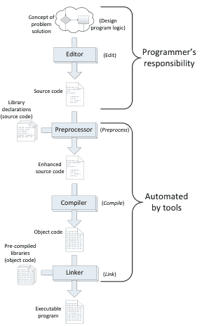

- 编译器。编译器将源代码翻译成目标代码。目标代码可能是特定平台或嵌入式设备的机器语言。目标代码也可以是另一种源语言；例如，最早的C++编译器将C++翻译成C，另一种高级语言。生成的C代码随后由C编译器处理以生成可执行程序。当今的C++编译器将C++直接翻译成机器语言。

C++的完整构建工具集包括预处理器、编译器和链接器：

  - 预处理器——在编译器开始处理代码之前，向源文件添加内容或修改其内容。我们主要使用预处理器的服务来 #include 我们程序所使用的库例程的信息。

  - 编译器——将C++源代码翻译成机器代码。

  - 链接器——将编译器生成的机器代码与预编译的库代码或来自其他来源的编译代码相结合，以创建一个完整的可执行程序。大多数编译后的C++代码无法独立运行，需要一些额外的机器代码来创建一个完整的可执行程序。缺失的机器代码已被预编译并存储在称为库的代码存储库中。一个称为链接器的程序将程序员的编译代码和库代码结合起来，创建一个完整的程序。

我们通常不考虑预处理器、编译器和链接器作为三个独立的程序工作（尽管它们确实如此）；我们使用的工具使其看起来只有一个过程在进行：将我们的源代码翻译成可执行程序。

- 调试器。调试器允许程序员更轻松地跟踪程序的执行，以便定位和纠正程序实现中的错误。使用调试器，开发人员可以同时运行程序并查看源代码中的哪一行负责程序的当前操作。程序员可以监视变量和其他程序元素的值，以查看它们的值是否按预期变化。调试器对于定位错误（也称为bug）和修复包含错误的程序非常有价值。（有关编程错误的更多信息，请参见第4.6节。）

- 性能分析器。性能分析器收集关于程序执行的统计信息，使开发人员能够调整程序的适当部分以提高其整体性能。性能分析器指示程序的一部分在特定运行期间被执行的次数，以及该部分执行需要多长时间。性能分析器也可用于测试目的，以确保程序中的所有代码在测试期间实际上在某处被使用。这称为覆盖率。软件在发布后失败是很常见的，因为用户会使用程序中在测试期间从未执行过的某些部分。性能分析的主要目的是找到可以改进的程序部分，以使程序运行得更快。

开发过程的编程组件在图1.1中有所说明。

许多开发人员使用集成开发环境（IDE）。IDE在一个综合程序中包含编辑器、调试器和其他编程辅助工具。C++的IDE示例包括Microsoft的Visual Studio 2015、Eclipse基金会的Eclipse CDT和Apple的Xcode。

尽管工具种类繁多（以及工具供应商的宣称），但对于除简单程序以外的所有程序，编程过程都不是自动的。好的工具很有价值，当然能提高开发人员的生产力，但它们无法编写软件。严谨的逻辑思维、创造力、常识，当然还有编程经验，都无可替代。

### 1.3 使用C++学习编程

AT&T贝尔实验室的Bjarne Stroustrup在20世纪80年代中期创建了C++。C++是编程语言C的扩展，C是20世纪70年代初AT&T贝尔实验室的产品。C是为编写Unix操作系统而开发的，C广泛用于系统级软件和嵌入式系统开发。C++最初提供面向对象编程特性（参见第13章和第14章），后来添加了泛型编程功能。C++与C的密切关系使得C++程序可以利用大量用C开发的代码。

C++在工业界广泛用于商业软件开发。它是一种工业级编程语言，用于在商业、科学和工程领域开发复杂系统。用C++编写的软件示例包括Microsoft Windows 8、Microsoft Office、macOS和Adobe Creative Suite。

为了满足商业软件开发的需求并完成其所有功能，C++本身是复杂的。虽然有经验的程序员可以用C++完成伟大的事情，但初学者有时会觉得它很困难。专业软件开发人员享受C++允许的灵活设计选项，但初学者需要更多的结构和更少的选项，以便在进入更复杂的概念之前掌握更简单的概念。

本书不试图涵盖C++编程语言的所有方面。有经验的程序员应当寻找其他更详细地介绍C++的书籍。这里的重点是介绍编程技巧并培养良好的习惯。为此，我们的方法避免了一些C++中更深奥的特性，并专注于可以直接转移到其他命令式编程语言（如Java、C#和Python）的编程基础。我们坚持基础知识，只有在处理手头问题时才会探索C++的更高级特性。

### 1.4 练习

- 1. 什么是编译器？
- 2. 编译代码与源代码有何不同？
- 3. 程序员使用什么工具来生成C++源代码？
- 4. 程序员使用什么工具（或哪些工具）将C++源代码转换为可执行机器代码？
- 5. 链接器做什么？
- 6. 链接器处理的是包含源代码的文件还是机器语言代码文件？
- 7. 预处理器对源代码做什么？
- 8. 列出在高级语言中开发软件相对于在机器语言中开发软件的几个优势。
- 9. IDE如何提高程序员的生产力？
- 10. 列出一个程序员为Microsoft Windows开发时使用的流行C++ IDE。
- 11. 列出一个程序员为Apple macOS开发时使用的流行C++ IDE。


## 第 2 章

## 编写 C++ 程序

编写得当的 C++ 程序具有特定的结构。语法必须正确，否则编译器将生成错误消息且不会生成可执行机器语言。本章通过提供一些简单的示例程序及相关基本概念来介绍 C++。本章介绍的大多数概念在许多其他编程语言中也适用。虽然其他语言可能使用略有不同的语法来实现这些概念，但这些思想可以直接迁移到 C、Java、C# 和 Ada 等其他语言。

### 2.1 简单 C++ 程序的一般结构

代码清单 2.1 (simple.cpp) 是功能最简单的 C++ 程序之一：

```cpp
Listing 2.1: simple.cpp

#include <iostream>

int main() {
    std::cout << "This is a simple C++ program!\n";
}
```

您可以将代码清单 2.1 (simple.cpp) 中所示的文本输入到编辑器中，并将其保存为名为 simple.cpp 的文件。文件的实际名称无关紧要，但名称“simple”准确描述了该程序的性质。扩展名 .cpp 是 C++ 源代码常用的扩展名。

使用文本编辑器创建此文件并编译后，即可运行该程序。程序将打印消息

```
This is a simple C++ program!
```

代码清单 2.1 (simple.cpp) 包含四行非空代码：

- #include <iostream>

这一行是预处理指令。C++ 源代码中的所有预处理指令都以 # 符号开头。这一行指示预处理器在编译器开始处理之前，将一些预定义的源代码添加到我们现有的源代码中。此过程是自动完成的，对我们不可见。

此处我们想要使用 iostream 库中的一个对象，iostream 库是一组预编译的 C++ 代码集合，C++ 程序（如我们的程序）可以使用它。iostream 库包含处理输入和输出（I/O）的元素——向显示器打印、从键盘获取用户输入以及处理文件。

代码清单 2.1 (simple.cpp) 中使用的项目之一 `std::cout` 并非 C++ 语言本身的一部分。该项目以及其他与输入和输出相关的内容，是在 C++ 中开发、编译并存储在 iostream 库中的。编译器需要了解这些 iostream 项目，以便能够编译我们的程序。`#include` 指令指定一个名为 `header`（头文件）的文件，该文件包含库代码的规范。编译器会检查我们在代码中如何使用 `std::cout`，并将其与 `<iostream>` 头文件中的规范进行对比，以确保我们正确使用库代码。

我们编写的大多数程序都使用此 `#include <iostream>` 指令，未来我们将编写的一些程序也会 `#include` 其他头文件。

- int main() {

这指定了我们程序的真正开始。此处我们正在声明一个名为 `main` 的函数。所有 C++ 程序都必须包含此函数才能可执行。关于 `int` 和括号的含义的详细信息将在后续章节中介绍。关于函数的更一般信息出现在第 8 章和第 9 章。

行末的左花括号标志着函数体的开始。函数体包含函数要执行的语句。

- std::cout << "This is a simple C++ program!\n";

我们的 `main` 函数体仅包含一条语句。该语句指示正在执行的程序在屏幕上打印消息 *This is a simple C++ program!*。语句是 C++ 程序中执行的基本单位。函数包含语句，编译器将这些语句翻译成可执行的机器语言指令。C++ 有多种不同类型的语句，后续章节将探讨这些不同类型的语句。C++ 中的所有语句都以分号 (;) 结尾。关于此语句的更详细解释见下文。

- }

右花括号标志着函数体的结束。每个函数定义都需要左花括号和右花括号。

> 请注意程序中哪些行以分号 (;) 结尾，哪些行不以分号结尾。不要在 `#include` 预处理指令后加分号。不要在包含 `main` 的行上加分号，也不要在花括号后加分号。

### 2.2 编辑、编译和运行程序

C++ 程序员有两种 C++ 开发环境可供选择。一种选择涉及带有一组独立工具的命令行环境。另一种选择是使用 IDE（参见第 1.2 节），它将所有工具组合成一个方便的软件包。Visual Studio 是 Microsoft Windows 平台上的主导 IDE，Apple Mac 开发人员通常使用 XCode IDE。附录 A 概述了如何使用 Visual Studio 2015 IDE 开发简单的 C++ 程序。

这些功能强大的 IDE 中众多的功能和配置选项可能会让初学者感到困惑。在命令行环境中，程序员只需在控制台窗口中输入几个简单的命令即可编辑、编译和执行程序。一些开发人员更喜欢命令行构建环境的简单性和灵活性，尤其是对于不太复杂的项目。

一个著名的命令行构建系统是 GNU 编译器套件 (http://gcc.gnu.org)，简称 GCC。GCC C++ 编译器（称为 g++）是目前最符合 C++ 标准的编译器之一。GCC C++ 编译器工具集适用于 Microsoft Windows、Apple Mac 和 Linux 平台，它是一个免费的开源软件项目，拥有全球开发团队。附录 B 概述了如何使用 GCC C++ 编译器。

Visual Studio 和 XCode 也提供命令行开发选项。附录 B 概述了 Visual Studio 命令行开发流程。

### 2.3 我们简单程序的变体

代码清单 2.2 (simple2.cpp) 展示了编写代码清单 2.1 (simple.cpp) 的另一种方式。

```cpp
Listing 2.2: simple2.cpp

#include <iostream>

using std::cout;

int main() {
    cout << "This is a simple C++ program!\n";
}
```

代码清单 2.2 (simple2.cpp) 中的 using 指令允许我们为 std::cout 打印对象使用更短的名称。我们可以省略 std:: 前缀，使用较短的名称 cout。此指令是可选的，但如果省略它，则必须使用较长的名称。名称 std 代表 "standard"，std 前缀表示 cout 是称为标准命名空间的一组名称的一部分。std 命名空间包含所有标准 C++ 类型和函数的名称，这些名称必须可供所有符合标准的 C++ 开发环境使用。第三方开发人员提供的标准库之外的组件位于它们自己单独命名的命名空间中。这些包括开源项目和商业库。

代码清单 2.3 (simple3.cpp) 展示了在 C++ 程序中使用 cout 更短名称的另一种方式。

```cpp
Listing 2.3: simple3.cpp

#include <iostream>

using namespace std;

int main() {
    cout << "This is a simple C++ program!\n";
}
```

虽然代码清单 2.2 (simple2.cpp) 通过其专注的 using 指令使 cout 名称为编译器所知，但代码清单 2.3 (simple3.cpp) 提供了一个全局 using 指令，使 std 命名空间中的所有名称都可供编译器使用。这种方法对于较小的程序（例如书籍和在线教程中的示例）具有一些优势。这个全局 using 指令允许程序员使用较短的名称，就像更专注的 using 指令一样，并且与更专注的 using 指令相比，它还可以使用更少的代码行，尤其是当程序使用 std 命名空间中的多个元素时。

我们对 using 指令的选择（或不选择）对最终产品（即可执行程序）没有影响。编译器为所有三个版本（不使用 using、专注使用 using 和全局使用 using）生成相同的机器语言代码。因此，我们必须选择一种能够增强我们编写和管理软件项目能力的方法。

需要注意的是，虽然这种全局 using 方法有其适用场景，但通常不鼓励在更复杂的软件项目中使用它。目前我们无法完全理解避免使用 using namespace std 指令的理由，但稍后在第 20.6 节中，我们将有足够的经验来理解全局 using namespace std 指令的缺点。我们将从一开始就努力遵循最佳实践，避免使用全局 using 语句。我们通常会使用 std 命名空间中元素的全名，并在代码中合适时使用更专注的 using 指令。

我们程序三个版本中 main 函数里的语句使用了名为 std::cout 的对象的服务。std::cout 对象在计算机屏幕上打印文本。C++ 源代码中消息的文本称为字符串，即字符串。字符串用引号 (") 括起来。符号 << 构成插入运算符。您可以将要打印的消息视为被“插入”到 cout 对象中。cout 对象表示输出流，即程序打印到控制台窗口的文本。消息末尾包含符号序列 \n。这被称为字符转义序列，反斜杠和字母 n 的组合表示换行符。它表示该行上的打印已完成，任何后续打印都应在下一行进行。这个换行符有效地导致光标移动到下一行。如果您从左到右阅读该语句，负责在屏幕上显示文本的 cout 对象接收要打印的文本，并以换行符结尾以移动到下一行。

为简单起见，我们将这种类型的语句称为打印语句，尽管单词 print 在语句中任何地方都没有出现。

除少数例外情况外，C++ 中的任何语句都必须出现在函数定义中。我们的单个打印语句出现在名为 main 的函数中。

任何函数（包括 main）都可能包含多条语句。在代码清单 2.4 (arrow.cpp) 中，六条打印语句在屏幕上绘制一个箭头：

### 代码清单 2.4: arrow.cpp

```cpp
#include <iostream>
int main() {
    std::cout << " *" << '\n';
    std::cout << " ***" << '\n';
    std::cout << " *****" << '\n';
    std::cout << " *" << '\n';
    std::cout << " *" << '\n';
    std::cout << " *" << '\n';
}
```

代码清单 2.4 (arrow.cpp) 的输出是


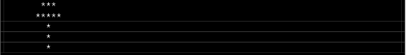

Each print statement “draws” a horizontal slice of the arrow. The six statements

```
std::cout << " *" << "\n";
std::cout << " ***" << "\n";
std::cout << " *****" << "\n";
std::cout << " *" << "\n";
std::cout << " *" << "\n";
std::cout << " *" << "\n";
```

constitute the body of the main function. The body consists of all the statements between the open curly brace ({) and close curly brace (}). We say that the curly braces delimit the body of the function. The word delim means to determine the boundaries or limits of something. The { symbol determines the beginning of the function’s body, and the } symbol specifies the end of the function’s body.

每个打印语句“绘制”箭头的一个水平切片。这六条语句构成 main 函数的函数体。函数体由位于左花括号（{）和右花括号（}）之间的所有语句组成。我们说花括号界定了函数的函数体。单词 delim 意为确定某物的边界或限制。{ 符号确定函数体的开始，} 符号指定函数体的结束。

We can rewrite Listing 2.4 (arrow.cpp) to achieve the same effect with only one long print statement as Listing 2.5 (arrow2.cpp) shows.

我们可以重写清单 2.4（arrow.cpp），以实现与清单 2.5（arrow2.cpp）所示的只用一个长打印语句相同的效果。

### Listing 2.5: arrow2.cpp

### 清单 2.5：arrow2.cpp

```
#include <iostream>
int main() {
std::cout << " *" << "\n"
<< " ***" << "\n"
<< " *****" << "\n"
<< " *" << "\n"
<< " *" << "\n"
<< " *" << "\n";
}
```

At first, Listing 2.4 (arrow.cpp) and Listing 2.5 (arrow2.cpp) may appear to be identical, but upon closer inspection of this new program we see that std::cout appears only once within main, and only one semicolon (;) appears within main. Since semicolons in C++ terminate statements, there really is only one statement. Notice that a single statement can be spread out over several lines. The statement within main appearing as

```
std::cout << " *" << "\n"
<< " ***" << "\n"
<< " *****" << "\n"
<< " *" << "\n"
<< " *" << "\n"
<< " *" << "\n";
```

could have just as easily been written as

```
std::cout << " *" << "\n" << " ***" << "\n"
<< " *****" << "\n" << " *" << "\n"
<< " *" << "\n" << " *" << "\n";
```

but the first way of expressing it better portrays how the output will appear. Read this second version carefully to convince yourself that the printed pieces will indeed flow to the std::cout printing object in the proper sequence to produce the same picture of the arrow.

乍一看，清单 2.4（arrow.cpp）和清单 2.5（arrow2.cpp）可能看起来相同，但仔细检查这个新程序后，我们发现 std::cout 在 main 中只出现一次，main 中也只出现一个分号（;）。由于 C++ 中的分号终止语句，实际上只有一条语句。请注意，单条语句可以分布在多行上。main 中出现的语句如下也同样可以写成但第一种表达方式更能描绘输出的外观。仔细阅读这个第二个版本，以使自己相信打印的片段确实会按正确的顺序流向 std::cout 打印对象，从而生成相同的箭头图片。

Consider the mistake of putting semicolons at the end of each of the lines in the “one statement” version:

```
std::cout << " *" \n";
     << " ***" \n";
     << " *****" \n";
     << " *" \n";
     << " *" \n";
     << " *" \n";
```

考虑在“单条语句”版本的每行末尾加上分号的错误：


If we put this code fragment in main, the program will not compile. The reason is simple—the semicolon at the end of the first line terminates the statement on that line. The compiler expects a new statement on the next line, but

```
<< " ***" \n";
```

is not a complete legal C++ statement since the << operator is missing the std::cout object. The string " *** \n" has nothing to “flow into.”

如果将这段代码片段放入 main，程序将无法编译。原因很简单——第一行末尾的分号终止了该行上的语句。编译器期望下一行有一个新语句，但不是一个完整的合法 C++ 语句，因为 << 运算符缺少 std::cout 对象。字符串 " *** \n" 没有东西可以“流入”。

### Listing 2.6: empty.cpp

### 清单 2.6：empty.cpp

```
int main() {
}
```

Since Listing 2.6 (empty.cpp) does not use the std::cout object and so does not need the #include and using directives. While it is legal and sometimes even useful in C++ to write functions with empty bodies, such functions will do nothing when they execute. Listing 2.6 (empty.cpp) with its empty main function is, therefore, truly the simplest executable C++ program we can write, but it does nothing when we run it!

由于清单 2.6（empty.cpp）不使用 std::cout 对象，因此不需要 #include 和 using 指令。虽然在 C++ 中编写空函数体的函数是合法的，有时甚至很有用，但此类函数在执行时不会做任何事情。因此，带有空 main 函数的清单 2.6（empty.cpp）确实是我们可以编写的最简单的可执行 C++ 程序，但运行它时什么也不做！

In general, a C++ program may contain multiple functions, but we defer such generality until Chapter 9. For now, we will restrict our attention to programs with only a main function.

一般来说，C++ 程序可能包含多个函数，但我们将这种普遍性推迟到第 9 章再讨论。目前，我们将注意力限制在只有 main 函数的程序上。

### 2.4 Template for simple C++ programs

### 2.4 简单 C++ 程序模板

For our immediate purposes all the programs we write will have the form shown in Figure 2.1.

就我们当前的目的而言，我们编写的所有程序都将采用图 2.1 所示的形式。

Our programs generally will print something, so we need the #include directive that brings the std::cout definition from <iostream> into our program. Depending on what we need our program to do, we may need additional #include directives. The main function definition is required for an executable program, and we will fill its body with statements that make our program do as we wish. Later, our programs will become more sophisticated, and we will need to augment this simple template.

我们的程序通常会打印一些东西，因此我们需要 #include 指令，它将 <iostream> 中的 std::cout 定义引入我们的程序。根据我们需要程序做什么，我们可能需要额外的 #include 指令。main 函数定义对于可执行程序是必需的，我们将用语句填充其函数体，使我们的程序按我们的意愿运行。后来，我们的程序会变得更加复杂，我们需要扩展这个简单的模板。

### Figure 2.1 The general structure of a very simple C++ program.

### 图 2.1 非常简单的 C++ 程序的一般结构。

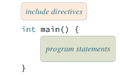

### 2.5 Exercises

### 2.5 练习

- 1. What preprocessor directive is necessary to use statements with the std::cout printing stream object?
- 1. 使用带有 std::cout 打印流对象的语句需要什么预处理器指令？
- 2. What statement allows the short name cout to be used instead of std::cout?
- 2. 什么语句允许使用短名称 cout 而不是 std::cout？
- 3. What does the name std stand for?
- 3. 名称 std 代表什么？
- 4. All C++ programs must have a function named what?
- 4. 所有 C++ 程序都必须有一个名为何的函数？
- 5. The body of main is enclosed within what symbols?
- 5. main 的函数体由什么符号括起来？
- 6. What operator directs information to the std::cout output stream?
- 6. 哪个运算符将信息定向到 std::cout 输出流？
- 7. Write a C++ program that prints your name in the console window.
- 7. 编写一个 C++ 程序，在控制台窗口中打印你的姓名。
- 8. Write a C++ program that prints your first and last name in the console window. Your first name should appear on one line, and your last name appear on the next line.
- 8. 编写一个 C++ 程序，在控制台窗口中打印你的名和姓。你的名应出现在一行上，你的姓出现在下一行。
- 9. What other files must you distribute with your executable file so that your program will run on a Windows PC without Visual Studio installed?
- 9. 你必须随可执行文件分发哪些其他文件，以便你的程序可以在未安装 Visual Studio 的 Windows PC 上运行？
- 10. Can a single statement in C++ span multiple lines in the source code?
- 10. C++ 中的单条语句能否在源代码中跨越多行？

## Chapter 3

## 第 3 章

## Values and Variables

## 值和变量

In this chapter we explore some building blocks that are used to develop C++ programs. We experiment with the following concepts:

在本章中，我们将探讨用于开发 C++ 程序的一些构建块。我们将尝试以下概念：

- numeric values
- 数值
- variables
- 变量
- declarations
- 声明
- assignment
- 赋值
- identifiers
- 标识符
- reserved words
- 保留字

In the next chapter we will revisit some of these concepts in the context of other data types.

在下一章中，我们将在其他数据类型的背景下重新探讨其中一些概念。

### 3.1 Integer Values

### 3.1 整数值

The number four (4) is an example of a _numeric value_. In Mathematics, 4 is an _integer_ value. Integers are whole numbers, which means they have no fractional parts, and an integer can be positive, negative, or zero. Examples of integers include 4, −19, 0, and −1005. In contrast, 4.5 is not an integer, since it is not a whole number.

数字四（4）是 _数值_ 的一个示例。在数学中，4 是 _整数_ 值。整数是整数，这意味着它们没有小数部分，整数可以是正数、负数或零。整数示例包括 4、−19、0 和 −1005。相比之下，4.5 不是整数，因为它不是整数。

C++ supports a number of numeric and non-numeric values. In particular, C++ programs can use integer values. It is easy to write a C++ program that prints the number four, as Listing 3.1 (number4.cpp) shows.

C++ 支持多种数值和非数值。特别是，C++ 程序可以使用整数值。编写一个打印数字四的 C++ 程序很容易，如清单 3.1（number4.cpp）所示。

### Listing 3.1: number4.cpp

### 清单 3.1：number4.cpp

```
#include <iostream>

int main() {
    std::cout << 4 << '\n';
}
```

Notice that unlike the programs we saw earlier, Listing 3.1 (number4.cpp) does not use quotation marks ("). The number 4 appears unadorned with no quotes. The expression '\n' represents a single newline character. Multiple characters comprising a string appear in double quotes ("), but, in C++, a single character represents a distinct type of data and is enclosed within single quotes ('). (Section 3.8 provides more information about C++ characters.) Compare Listing 3.1 (number4.cpp) to Listing 3.2 (number4-alt.cpp).

请注意，与我们之前看到的程序不同，清单 3.1（number4.cpp）不使用引号（"）。数字 4 出现时没有任何装饰，没有引号。表达式 '\n' 表示一个换行符。由多个字符组成的字符串出现在双引号（"）中，但在 C++ 中，单个字符代表一种不同的数据类型，并用单引号（'）括起来。（第 3.8 节提供了有关 C++ 字符的更多信息。）将清单 3.1（number4.cpp）与清单 3.2（number4-alt.cpp）进行比较。

```
#include <iostream>
int main() {
    std::cout << "4\n";
}
```

Both programs behave identically, but Listing 3.1 (number4.cpp) prints the value of the number four, while Listing 3.2 (number4-alt.cpp) prints a message containing the digit four. The distinction here seems unimportant, but we will see in Section 3.2 that the presence or absence of the quotes can make a big difference in the output.

两个程序的行为相同，但清单 3.1（number4.cpp）打印数字四的值，而清单 3.2（number4-alt.cpp）打印包含数字四的消息。这里的区别似乎不重要，但我们将在第 3.2 节中看到，引号的存在或缺失会对输出产生很大影响。

The statement

```
std::cout << "4\n";
```

sends one thing to the output stream, the string "4\n". The statement

```
std::cout << 4 << '\n';
```

sends two things to the output stream, the integer value 4 and the newline character '\n'.

语句向输出流发送一个东西，即字符串 "4\n"。语句向输出流发送两个东西，即整数值 4 和换行符 '\n'。

In published C++ code you sometimes will see a statement such as the following:

```
std::cout << 4 << std::endl;
```

This statement on the surface behaves exactly like the following statement:

```
std::cout << 4 << '\n';
```

but the two expressions `std::endl` and `'\n'` do not mean exactly the same thing. The `std::endl` expression does involve a newline character, but it also performs some additional work that normally is not necessary. Programs that do significant printing may execute faster if they terminate their output lines with `'\n'` instead of `std::endl`. The difference in speed is negligible when printing to the console, but the difference can be great when printing to files or other output streams. For most of the programs we consider, the difference in program execution speed between the two is imperceptible; nonetheless, we will prefer `'\n'` for printing newlines because it is a good habit to form (and it requires five fewer keystrokes when editing code).

在已发布的 C++ 代码中，你有时会看到如下语句：这条语句表面上与以下语句的行为完全相同：但两个表达式 `std::endl` 和 `'\n'` 的含义并不完全相同。`std::endl` 表达式确实涉及换行符，但它还执行一些通常不必要的额外工作。如果程序进行大量打印，使用 `'\n'` 而不是 `std::endl` 来终止输出行可能会执行得更快。在控制台打印时速度差异可以忽略不计，但打印到文件或其他输出流时差异可能很大。对于我们考虑的大多数程序，两者之间的程序执行速度差异难以察觉；尽管如此，我们仍将偏好使用 `'\n'` 来打印换行符，因为这是一个值得养成的好习惯（并且在编辑代码时少按五个按键）。

The three major modern computing platforms are Microsoft Windows, Apple macOS, and Linux. Windows handles newlines differently from macOS and Linux. Historically, the character `'\n'` represents a *new line*, usually known as a *line feed* or *LF* for short, and the character `'\r'` means *carriage return*, or *CR* for short. The terminology comes from old-fashioned typewriters which feed a piece of paper into a roller on a carriage that moves to the left as the user types (so the imprinted symbols form left to right). At the end of a line, the user must advance the roller so as to move the paper up by one line (LF) and move the carriage back all the way to its left (CR). Windows uses the character sequence CR LF for newlines, while macOS and Linux use LF. This can be an issue when attempting to edit text files written with an editor on one platform with an editor on a different platform.

三大主要现代计算平台是 Microsoft Windows、Apple macOS 和 Linux。Windows 处理换行符的方式与 macOS 和 Linux 不同。从历史上看，字符 `'\n'` 表示 *新行*，通常称为 *换行* 或简称 *LF*，字符 `'\r'` 表示 *回车*，或简称 *CR*。术语来自老式打字机，它将一张纸送入滚筒上的滑架，随着用户打字向左移动（因此打印的符号从左到右形成）。在行尾，用户必须推进滚筒，使纸张上移一行（LF），并将滑架全部移回最左侧（CR）。Windows 使用字符序列 CR LF 作为换行符，而 macOS 和 Linux 使用 LF。这在尝试使用一个平台上的编辑器编辑另一个平台上的编辑器编写的文本文件时可能是一个问题。

The good news is that the C++ standard guarantees that the `std::cout` output stream translates the `'\n'` character as it appears in C++ source code into the correct character sequence for the target platform. This means you can print `'\n'` via `std::cout`, and it will behave identically on all the major platforms.

好消息是，C++ 标准保证 `std::cout` 输出流会将 C++ 源代码中出现的 `'\n'` 字符转换为目标平台的正确字符序列。这意味着你可以通过 `std::cout` 打印 `'\n'`，并且它在所有主要平台上的行为都相同。

In C++ source code, integers may not contain commas. This means we must write the number two thousand, four hundred sixty-eight as 2468, not 2,468. Modern C++ does support single quotes (`'`) as digit separators, as in 2'468. Using digit separators can improve the human comprehension reading large numbers in C++ source code.

在 C++ 源代码中，整数不能包含逗号。这意味着我们必须将数字两千四百六十八写为 2468，而不是 2,468。现代 C++ 确实支持使用单引号（`'`）作为数字分隔符，例如 2'468。使用数字分隔符可以提高人类在 C++ 源代码中阅读大数字的理解能力。

In mathematics, integers are unbounded; said another way, the set of mathematical integers is infinite. In C++ the range of integers is limited because all computers have a finite amount of memory. The exact range of integers supported depends on the computer system and particular C++ compiler. C++ on most 32-bit computer systems can represent integers in the range -2,147,483,648 to +2,147,483,647.

在数学中，整数是无界的；换句话说，数学整数集是无限的。在 C++ 中，整数范围是有限的，因为所有计算机都有有限的内存。支持的整数的确切范围取决于计算机系统和特定的 C++ 编译器。在大多数 32 位计算机系统上，C++ 可以表示 -2,147,483,648 到 +2,147,483,647 范围内的整数。

What happens if you exceed the range of C++ integers? Try Listing 3.3 (exceed.cpp) on your system.

如果你超出了 C++ 整数的范围会怎样？在你的系统上尝试清单 3.3（exceed.cpp）。

### Listing 3.3: exceed.cpp

### 清单 3.3：exceed.cpp

```
#include <iostream>

int main() {
    std::cout << -3000000000 << '\n';
}
```


```
}
```

然而，负三十亿对于32位整数来说太大了，程序的输出显然是错误的：

```
1294967296
```

打印的数字甚至不是负数！大多数C++编译器会对此语句发出警告。第4.6节更详细地探讨了错误与警告。如果编译器在源代码中发现错误，它将不会生成可执行代码。警告指示潜在问题，并不会阻止编译器生成可执行程序。这里我们看到，程序员应该注意这个警告，因为程序的执行产生了无意义的输出。

这种有限的值范围在编程语言中很常见，因为每个数字都存储在固定大小的内存中。较大的数字需要更多的内存存储。为了建模无限的数学整数集，需要无限的内存！正如我们稍后将看到的，C++支持范围更大的整数类型。第4.8.1节提供了关于C++整数实现的一些细节。

### 3.2 变量与赋值

在代数中，变量用于表示数字。在C++中也是如此，只不过C++变量还可以表示非数字的值。清单3.4（variable.cpp）使用变量存储一个整数值，然后打印该变量的值。

### 清单3.4：variable.cpp

```
#include <iostream>
int main() {
  int x;
  x = 10;
  std::cout << x << '\n';
}
```

清单3.4（variable.cpp）中的main函数包含三条语句：

- int x;

这是一条声明语句。C++程序中的所有变量都必须声明。声明指定变量的类型。单词int表示该变量是整数。该整数变量的名称为x。我们说变量x的类型为int。C++支持非整数类型，有些类型在计算机内存中占用的空间更多或更少。编译器使用声明来预留适当大小的内存来存储变量的值。声明使编译器能够验证程序员在程序中正确使用变量；例如，我们将看到整数可以像数学中一样相加。然而，对于某些其他数据类型，加法是不可能的，因此不被允许。编译器可以确保参与加法操作的变量与加法兼容。如果不兼容，它可以报告错误。

如果程序员尝试使用未声明的变量，编译器将发出错误。如果未声明变量，编译器无法推断存储要求，也无法验证变量的正确用法。一旦声明，特定变量在同一上下文中不能重复声明。变量在其生命周期内不能更改其类型。

- x = 10;

这是一条赋值语句。赋值语句将一个值与变量关联。赋值语句的关键是符号=，称为赋值运算符。这里将值10赋给变量x。这意味着值10将存储在编译器为名为x的变量预留的内存位置中。我们不需要关心变量存储在内存的哪个位置；编译器会处理这个细节。

声明变量后，我们可以根据需要多次对其进行赋值和重新赋值。

- std::cout << x << '\n';

该语句打印变量x的当前值。

> 请注意，此处缺少引号非常重要。如果x的值为10，语句
> std::cout << x << '\n';
> 打印10，即变量x的值，但语句
> std::cout << "x" << '\n';
> 打印x，即包含单个字母x的消息。

赋值运算符(=)的含义与数学中的相等不同。在数学中，=断言其左侧的表达式等于其右侧的表达式。在C++中，=使其左侧的变量采用其右侧表达式的值。最好将x = 5读作“x被赋值为5”，或“x得到值5”。这一区别很重要，因为在数学中相等是对称的：如果x = 5，我们知道5 = x。在C++中，这种对称性不存在；语句

```
5 = x;
```

尝试重新赋值给字面整数5，但这无法完成，因为5始终是5且不能更改。这样的语句会产生编译器错误：

```
error C2106: '=' : left operand must be l-value
```

变量可以根据需要重新赋予不同的值，如清单3.5（multipleassignment.cpp）所示。

### 清单3.5：multipleassignment.cpp

```
#include <iostream>

int main() {
    int x;
    x = 10;
    std::cout << x << '\n';
    x = 20;
    std::cout << x << '\n';
    x = 30;
    std::cout << x << '\n';
}
```

请注意，清单3.5（multipleassignment.cpp）中的每个打印语句都相同，但当程序运行时，打印语句会产生不同的结果。

变量可以在声明时赋予值；例如，清单3.6（variable-init.cpp）是清单3.4（variable.cpp）的一个变体。

### 清单3.6：variable-init.cpp

```
#include <iostream>

int main() {
    int x = 10;
    std::cout << x << '\n';
}
```

请注意，在清单3.6（variable-init.cpp）中，变量x的声明和赋值在一条语句中完成，而不是两条。这种合并的声明和立即赋值称为初始化。

C++支持另一种初始化变量的语法，如清单3.7（alt-variable-init.cpp）所示。

### 清单3.7：alt-variable-init.cpp

```
#include <iostream>

int main() {
    int x{10};
    std::cout << x << '\n';
}
```

这种替代形式不常用于简单变量，但对于初始化称为对象的更复杂类型的变量是必要的。我们将在第13章和第14章介绍对象。

同一类型的多个变量可以在单个语句中声明，如果需要，也可以初始化。以下语句在一个声明语句中声明三个变量：

```
int x, y, z;
```

以下语句声明三个整数变量并初始化其中两个：

```
int x = 0, y, z = 5;
```

这里y的值未定义。声明可以拆分为多个声明语句：

```
int x = 0;
int y;
int z = 5;
```

在多个声明语句的情况下，类型名（此处为int）必须出现在每个语句中。

编译器将变量映射到计算机内存中的一个位置。我们可以将变量及其对应的内存位置可视化为一个框，如图3.1所示。

我们用变量的名字给框命名。图3.2显示了以下C++代码序列如何影响内存。

```
int a, b;
a = 2;
```

### 图3.1 将变量及其内存位置表示为框

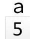

```
b = 5;
a = b;
b = 4;
```

重要的是，语句

```
a = b;
```

并不意味着a和b引用同一个框（内存位置）。此语句后，a和b仍引用独立的框（内存位置）。这仅仅意味着b的框（内存位置）中存储的值已被复制到a的框（内存位置）。a和b仍然是独立的框（内存位置）。当b的框的内容被复制到a时，a的框中的原始值会被覆盖。在将b赋给a之后，将b重新赋值为4不会影响a。

### 3.3 标识符

虽然数学家满足于给变量起像x这样的单字母名称，但程序员应该使用更长、更具描述性的变量名。altitude、sum和user_name这样的名称远比同样允许的a、s和u好。变量名应与其在程序中的用途相关。良好的变量名使程序对人类更具可读性。由于程序通常包含许多变量，精心选择的变量名可以使原本晦涩的符号集合更易于理解。

C++对变量名有严格的规则。变量名是标识符的一个示例。标识符是用于命名事物的单词。标识符可以命名的事物之一是变量。我们将在后面的章节中看到，标识符还用于命名函数和类等其他事物。标识符的形式如下：

- 标识符必须至少包含一个字符。

- 第一个字符必须是字母（大写或小写）或下划线

```
ABCDEFGHIJKLMNOPQRSTUVWXYZabcdefghijklmnopqrstuvwxyz_
```

- 其余字符（如果有）可以是字母（大写或小写）、下划线或数字

```
ABCDEFGHIJKLMNOPQRSTUVWXYZabcdefghijklmnopqrstuvwxyz_0123456789
```

- 标识符中不允许其他字符（包括空格）。


## 图 3.2 变量赋值期间内存的变化

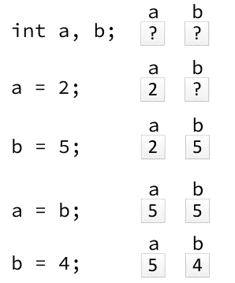

- 保留字不能用作标识符（参见表 3.1）。

以下是有效和无效标识符的一些示例：

- 以下所有单词都是有效标识符，因此可作为变量名：x、x2、total、port_22 和 FLAG。

- 以下单词都不是有效标识符：sub-total（连字符不是标识符中的合法符号）、first entry（空格不是标识符中的合法符号）、4all（以数字开头）、#2（井号不是标识符中的合法符号）和 class（class 是保留字）。

C++ 为特殊用途保留了一些本可用作标识符的单词。这些被称为保留字或关键字的单词具有特殊含义，用于定义 C++ 程序和语句的结构。表 3.1 列出了所有 C++ 保留字。

许多保留字的用途将在本书中逐一揭示。

您不得将表 3.1 中的任何保留字用作标识符。幸运的是，如果您不小心尝试在程序中将某个保留字用作变量名，编译器会发出错误（有关编译器错误的更多信息，请参见第 4.6 节）。

在清单 2.1（simplecpp）中，我们使用了几个保留字：using、namespace 和 int。请注意，include、cout 和 main 不是保留字。

某些编程语言不要求程序员在使用变量之前声明变量；变量的类型由变量的使用方式决定。某些语言允许同一个变量

| alignas | decltype | namespace | struct |
| :--- | :--- | :--- | :--- |
| alignof | default | new | switch |
| and | delete | noexcept | template |
| and_eq | double | not | this |
| asm | do | not_eq | thread_local |
| auto | dynamic_cast | nullptr | throw |
| bitand | else | operator | true |
| bitor | enum | or | try |
| bool | explicit | or_eq | typedef |
| break | export | private | typeid |
| case | extern | protected | typename |
| catch | false | public | union |
| char | float | register | unsigned |
| char16_t | for | reinterpret_cast | using |
| char32_t | friend | return | virtual |
| class | goto | short | void |
| compl | if | signed | volatile |
| const | inline | sizeof | wchar_t |
| constexpr | int | static | while |
| const_cast | long | static_assert | xor |
| continue | mutable | static_cast | xor_eq |

以承担不同类型，具体取决于程序不同部分中的使用方式。此类语言称为动态类型语言。C++ 是静态类型语言。在静态类型语言中，变量的类型必须在程序语句使用之前明确指定。虽然要求声明所有变量起初可能看起来是一种小麻烦，但它提供了几个优势：

- 当必须声明变量时，编译器可以捕获动态类型语言无法检测的拼写错误。例如，请考虑以下代码段：

```
int ZERO;
ZERO = 1;
```

第一行中的标识符以大写字母“O”结尾。第二行中的标识符以数字零结尾。在特定编辑器或代码打印输出中，这种区别可能难以看清或根本无法看清。C++ 编译器会立即检测第二条语句中的拼写错误，因为 ZERO（最后一个字母是零）未被声明。动态类型语言会创建两个变量：ZERO 和 ZERO0。

- 当必须声明变量时，编译器可以捕获无效操作。例如，变量可能被声明为 int 类型，但程序员可能不小心将非数值赋给变量。在动态类型语言中，变量会悄悄更改其类型，从而向程序中引入错误。在 C++ 中，编译器会将不正确的赋值报告为错误，因为一旦声明，C++ 变量就不能更改其类型。

- 理想情况下，要求程序员声明变量迫使程序员提前规划，并更仔细地考虑程序可能需要的变量。变量的用途与其类型相关联，因此程序员在声明变量之前必须清楚变量的用途。当不需要变量声明时，程序员可以在编写代码时根据需要“凭空”创建变量。程序员无需执行编写变量声明所要求的简单双重检查变量用途的操作。虽然声明变量的类型只能以非常有限的方式指定其用途，但任何捕获此类错误的机会都是有益的。

- 静态类型语言通常比动态类型语言更高效。编译器根据变量的类型知道变量需要多少存储空间。该变量值的空间在变量的生命周期内不会改变，因为其类型不能改变。在允许变量更改其类型的动态类型语言中，如果变量的类型在程序执行期间更改，则其所需的存储空间也可能更改，因此必须在其他地方为该变量分配内存以容纳不同的类型。运行时的这种内存重新分配会减慢程序的执行速度。

C++ 是区分大小写的语言。这意味着大小写很重要。if 是保留字，但 IF、If 或 iF 都不是保留字。标识符也区分大小写；名为 Name 的变量与名为 name 的变量不同。

由于这可能会让人类读者感到困惑，您不应仅通过大小写不同的名称来区分变量。出于同样的原因，将变量命名为与保留字相同（仅有一个或多个字母大写）的名称被视为不良做法。

### 3.4 其他整数类型

C++ 支持几种其他整数类型。short int 类型（可简写为 short）表示的整数可能占用比 int 类型更少的内存字节。如果 short 类型占用的内存更少，那么它必然表示的整数值范围比 int 类型更小。C++ 标准不要求 short 类型比 int 类型小；事实上，它们可能表示同一组整数值。long int 类型（可简写为 long）可能占用比 int 类型更多的存储空间，因此能够表示更大范围的值。同样，标准不要求 long 类型比 int 类型大。最后，long long int 类型（或简写为 long long）可能比 long 大。C++ 标准保证以下相对值范围成立：

```
short int ≤ int ≤ long int ≤ long long int
```

例如，在小型嵌入式设备上，所有这些类型可能占用完全相同的内存量，因此使用一种类型而非另一种类型没有优势。然而，在大多数系统上，范围会有一些差异。

C++ 提供排除负数的类整数类型。这些类型的名称中包含 unsigned 单词，意味着它们不允许负号。无符号类型以与有符号类型相同的方式具有各种潜在大小。C++ 标准保证以下无符号值的相对范围：

```
unsigned short ≤ unsigned ≤ unsigned long ≤ unsigned long long
```

表 3.2 列出了 Visual C++ 中有符号和无符号整数类型之间的差异。请注意，相应的有符号和无符号整数类型占用相同的内存量。因此，无符号类型提供的正值范围是其有符号对应类型的两倍。对于不需要负数的应用程序，无符号类型可能是更合适的选项。


| 类型名 | 短名 | 存储 | 最小数值 | 最大数值 |
|---|---|---|---|---|
| short int | short | 2 字节 | -32,768 | 32,767 |
| int | int | 4 字节 | -2 147 483 648 | 2 147 483 647 |
| long int | long | 4 字节 | -2 147 483 648 | 2 147 483 647 |
| long long int | long long | 8 字节 | -9 223 372 036 854 775 808 | 9 223 372 036 854 775 807 |
| unsigned short int | unsigned short | 2 字节 | 0 | 4 294 967 295 |
| unsigned int | unsigned int | 4 字节 | 0 | 4 294 967 295 |
| unsigned long int | unsigned long | 4 字节 | 0 | 4 294 967 295 |
| unsigned long long int | unsigned long long | 8 字节 | 0 | 18 446 744 073 709 551 615 |

表 3.2: Visual C++ 整数类型的特性

在源代码中，任何没有小数点的未修饰数值字面量都被解释为 `int` 字面量；例如，在语句
`int x = 4456;`
中，字面量值 4456 是一个 `int`。要将 4456 表示为 `long`，需附加 `L`，如
`long x = 4456L;`
C++ 还允许使用小写 `l` (*小写 L*)，如
`long x = 4456l;`
但你应避免使用它，因为在许多显示和打印字体中，它太像数字 1（一）了。为 `long long` 字面量使用 `LL` 后缀。无符号整数的后缀为 `u` (`unsigned`)、`us` (`unsigned short`)、`ul` (`unsigned long`) 和 `uLL` (`unsigned long long`)。大小写无关，但推荐使用大写 `L`。

在 C++ 源代码中，所有整数字面量都是 `int` 值，除非在数字末尾附加 `L` 或 `l`；例如，2 是一个 `int` 字面量，而 `2L` 是一个 `long` 字面量。

### 3.5 浮点数类型

许多计算任务需要带有小数部分的数字。例如，根据圆的半径计算圆面积的数学公式涉及值 $\pi$，其约为 3.14159。C++ 支持此类非整数数，它们称为 _浮点数_。该名称来源于在数学计算过程中，小数点可以移动或“浮动”到数字中的各种位置，以保持适当的有效数字位数。类型 `float` 和 `double` 表示不同类型的浮点数。`double` 类型使用更频繁，因为它代表“双精度浮点数”，可以用更多精度位数表示更广泛的值范围。`float` 类型表示精度较低的单精度浮点值。表 3.3 提供了关于在 32 位计算机系统上常见实现的浮点数值的一些信息。浮点数可以是正数也可以是负数。

从表 3.3 可以看出，`doubles` 提供更高精度，代价是占用更多内存。
示例 3.8 (pi-print.cpp) 打印数学值 $\pi$ 的近似值。

| 类型 | 存储 | 最小数值 | 最大数值 | 最小精度 |
| :--- | :--- | :--- | :--- | :--- |
| float | 4 字节 | 1.17549 x 10^-38 | 3.40282 x 10^+38 | 6 位 |
| double | 8 字节 | 2.22507 x 10^-308 | 1.79769 x 10^+308 | 15 位 |
| long double | 8 字节 | 2.22507 x 10^-308 | 1.79769 x 10^+308 | 15 位 |

表 3.3: 32 位计算机系统上的浮点数特性

### 示例 3.8: pi-print.cpp

```cpp
#include <iostream>
int main() {
    double pi = 3.14159;
    std::cout << "pi = " << pi << '\n';
    std::cout << "or " << 3.14 << " for short" << '\n';
}
```

示例 3.8 (pi-print.cpp) 的第一行声明一个名为 pi 的变量并为其赋值。示例 3.8 (pi-print.cpp) 的第二行打印变量 pi 的值，第三行打印一个字面量值。C++ 程序中任何带有小数点的数值字面量自动具有 double 类型，因此 `3.14` 具有 double 类型。要使数值字面量成为 float，必须在数字末尾附加 f 或 F，如 `3.14f`。

(f 或 F 后缀仅用于字面量值；不能通过附加 f 将 double 变量更改为 float 变量。尝试这样做会更改变量的名称！)

> 除非在数字末尾附加 f 或 F，否则所有浮点字面量都是 double 值；例如，2.0 是 double 字面量，而 2.0f 是 float 字面量。

浮点数是数学实数的近似值。与 int 数据类型的情况一样，浮点数的范围是有限的，因为每个值都需要固定大小的内存。不过，在某些方面，整数与 double 非常不同。int 数据类型范围内的任何整数都可以精确表示。这对浮点类型不成立。考虑实数 π。由于 π 包含无限多位数字，具有有限精度的浮点数只能近似其值。由于可用位数有限，即使是位数有限的数字也没有精确表示；例如，数字 23.123400654033989 对于 double 类型来说位数过多，必须近似为 23.3023498654034。第 4.8.2 节包含关于浮点数不精确性质后果的更多信息。

我们可以用科学计数法表示浮点数。由于大多数编程编辑器不提供上标和像 × 这样的特殊符号，C++ 对常规科学计数法做了小幅更改。数字 6.022 × 10²³ 写作 6.022e23。e 左侧的数字（也可以使用大写 E）是尾数，e 右侧的数字是 10 的指数。另一个例子，-5.1 × 10⁻⁴ 在 C++ 中表示为 -5.1e-4。示例 3.9 (scientificnotation.cpp) 使用科学计数法打印一些科学常数。

### 示例 3.9: scientificnotation.cpp

```cpp
#include <iostream>

int main() {
    double avogadros_number = 6.022e23, c = 2.998e8;
    std::cout << "Avogadro's number = " << avogadros_number << '\n';
    std::cout << "Speed of light = " << c << '\n';
}
```

第 4.8.2 节提供了关于 C++ 浮点值实现的一些见解，并解释了在内部，所有浮点数都以带有尾数和指数的指数计数法存储。

### 3.6 常量

在示例 3.9 (scientificnotation.cpp) 中，阿伏伽德罗常数和光速是科学常数；也就是说，在已测量和/或计算的精度范围内，它们不会改变。C++ 支持命名常量。常量的声明方式与变量类似，只是添加了 const 关键字：

```cpp
const double PI = 3.14159;
```

声明并初始化后，常量可以像变量一样使用，只有一种例外——常量不能被重新赋值。常量在其声明语句之外出现在赋值运算符 (=) 左侧是非法的。后续语句如

```cpp
PI = 2.5;
```

会导致编译器发出错误消息：

> error C3892: 'PI' : 你不能对 const 变量进行赋值

并导致程序编译失败。由于科学常数不会改变，示例 3.10 (const.cpp) 是示例 3.9 (scientificnotation.cpp) 的更好版本。

### 示例 3.10: const.cpp

```cpp
#include <iostream>

int main() {
    const double avogadros_number = 6.022e23, c = 2.998e8;
    std::cout << "Avogadro's number = " << avogadros_number << '\n';
    std::cout << "Speed of light = " << c << '\n';
}
```

由于在其声明语句之外为常量赋值是非法的，因此所有常量必须在声明处初始化。

按照惯例，C++ 程序员通常将常量名全部大写；这样，在源代码中，人类读者可以快速将常量与变量区分开。

### 3.7 其他数值类型

C++ 支持多种其他数值数据类型：

- long int—通常提供比 int 类型范围更大的整数；其缩写名为 long。它保证提供的整数值范围至少与 int 类型一样大。

带有 L 后缀的整数字面量，如 19L，具有 long 类型。小写字母 l 也允许作为后缀，但你不应使用它，因为人类读者难以区分 l（小写字母 L）和 1（数字一）。L 后缀仅用于字面量值；不能通过附加 L 将 int 变量更改为 long。尝试这样做会更改变量的名称！

- short int—通常提供比 int 类型范围更小的整数；其缩写名为 short。保证 int 的范围至少与 short 的范围一样大。

- unsigned int—仅限于非负整数；其缩写名为 unsigned。虽然 unsigned 类型仅限于非负值，但它可以表示的正值数量是 int 类型的两倍。（int 名称实际上是 signed int 的短名，int 可以写为 signed。）

- long double—可以扩展 double 类型的范围和精度。

虽然 C++ 语言标准为所有数值数据类型指定了最小范围和精度，但特定的 C++ 编译器可能会超过指定的最小值。

C++ 提供如此多样的数值类型，通常用于构建高效程序等专用目的。我们很少需要使用其中许多类型。我们的示例将主要使用 int 用于整数，double 用于实数近似，以及较少使用 unsigned 当需要非负整数值时。

### 3.8 字符

char 数据类型用于表示单个字符：字母表中的字母（大写和小写）、数字、标点符号和控制字符（如换行符和制表符）。大多数系统支持美国信息交换标准代码 (ASCII) 字符集。标准 ASCII 可以表示 128 个不同的字符。表 3.4 列出了各种字符的 ASCII 代码。

在 C++ 源代码中，字符由单引号 (' ) 包围，如

```cpp
char ch = 'A';
```

标准（双）引号 ("") 保留用于字符串，字符串由字符组成，但字符串和 char 非常不同。C++ 字符串在第 11.2.6 节中介绍。以下语句会产生编译器错误消息：

```cpp
ch = "A";
```

因为字符串不能赋值给字符变量。

在内部，char 存储为整数值，C++ 允许将数值赋给 char 变量，也允许将字符赋给数值变量。语句

语句


| 0 | 空 | 16 | | 32 | 空格 | 48 | 0 | 64 | @ | 80 | P | 96 | ` | 112 | p |
| 1 | | 17 | | 33 | ! | 49 | 1 | 65 | A | 81 | Q | 97 | a | 113 | q |
| 2 | | 18 | | 34 | " | 50 | 2 | 66 | B | 82 | R | 98 | b | 114 | r |
| 3 | | 19 | | 35 | # | 51 | 3 | 67 | C | 83 | S | 99 | c | 115 | s |
| 4 | | 20 | | 36 | $ | 52 | 4 | 68 | D | 84 | T | 100 | d | 116 | t |
| 5 | | 21 | | 37 | % | 53 | 5 | 69 | E | 85 | U | 101 | e | 117 | u |
| 6 | | 22 | | 38 | & | 54 | 6 | 70 | F | 86 | V | 102 | f | 118 | v |
| 7 | 响铃 | 23 | | 39 | ' | 55 | 7 | 71 | G | 87 | W | 103 | g | 119 | w |
| 8 | 退格 | 24 | | 40 | ( | 56 | 8 | 72 | H | 88 | X | 104 | h | 120 | x |
| 9 | 制表符 | 25 | | 41 | ) | 57 | 9 | 73 | I | 89 | Y | 105 | i | 121 | y |
| 10 | 换行 | 26 | | 42 | * | 58 | : | 74 | J | 90 | Z | 106 | j | 122 | z |
| 11 | | 27 | | 43 | + | 59 | ; | 75 | K | 91 | [ | 107 | k | 123 | { |
| 12 | 换页 | 28 | | 44 | , | 60 | < | 76 | L | 92 | \ | 108 | l | 124 | &#124; |
| 13 | 回车 | 29 | | 45 | - | 61 | = | 77 | M | 93 | ] | 109 | m | 125 | } |
| 14 | | 30 | | 46 | . | 62 | > | 78 | N | 94 | ^ | 110 | n | 126 | ~ |
| 15 | | 31 | | 47 | / | 63 | ? | 79 | O | 95 | _ | 111 | o | 127 | |

表 3.4: 字符的 ASCII 代码

`ch = 65;`

将一个数字赋给 `char` 变量，以示这完全合法。值 65 是字符 `A` 的 ASCII 代码。如果打印 `ch`，如下所示

```
ch = 65;
std::cout << ch;
```

则会打印出对应的字符 `A`，因为 `ch` 的声明类型是 `char`，而不是 `int` 或其他数值类型。

清单 3.11 (charexample.cpp) 展示了字符如何在程序中使用。

```
Listing 3.11: charexample.cpp

#include <iostream>

int main() {
    char ch1, ch2;
    ch1 = 65;
    ch2 = 'A';
    std::cout << ch1 << ", " << ch2 << ", " << 'A' << '\n';
}
```

该程序显示

A, A, A

第一个 `A` 被打印是因为语句

```
ch1 = 65;
```

将 `A` 的 ASCII 代码赋给 `ch1`。第二个 `A` 被打印是因为语句

```
ch2 = 'A';
```

将字符常量 A 赋给 ch2。第三个 A 被打印是因为字符常量 'A' 被直接发送到输出流。

整数和字符可以相互自由赋值，但 char 的取值范围远小于 int，因此将 int 值赋给 char 变量时必须小心。

有些字符是不可打印字符。ASCII 图表列出了几种常见的不可打印字符：

- `'\n'`—换行字符
- `'\r'`—回车字符
- `'\b'`—退格字符
- `'\a'`—"警报"字符（在某些系统上会发出“哔哔”声或其他音调）
- `'\t'`—制表符字符
- `'\f'`—换页字符
- `'\0'`—空字符（用于 C 字符串，参见第 11.2.6 节）

这些特殊的不可打印字符以反斜杠 (`\`) 符号开头。反斜杠称为转义符号，它表示其后的符号具有特殊含义，不应按字面解释。这意味着字面反斜杠字符必须表示为两个反斜杠：`'\\'`。

这些特殊的不可打印字符代码可以嵌入字符串中。要在字符串中嵌入反斜杠，必须对其进行转义；例如，语句

```
std::cout << "C:\\Dev\\cppcode" << '\n';
```

将打印


看看这条语句打印什么：

```
std::cout << "AB\bCD\aEF" << '\n';
```

以下两条语句行为相同：

```
std::cout << "End of line" << '\n';
std::cout << "End of line\n";
```

在 Microsoft Windows 平台上，字符序列 "\r\n"（回车，换行）出现在文本文件行尾。在 Unix 和 Linux 下，文本文件行以 '\n'（换行）结尾。在 Apple Macintosh 系统上，文本文件行以 '\r'（回车）字符结尾。遵循 C++ 标准的编译器将确保 C++ 程序中的 '\n' 字符在发送到输出流时，会为给定平台生成正确的行尾字符序列。

### 3.9 枚举类型

C++ 允许程序员创建一种新的、非常简单的类型，并列出该类型的所有可能值。这种类型称为*枚举类型*，或*枚举类型*。`enum` 关键字引入枚举类型。以下是定义枚举类型的最简单方式：

```
enum Color { Red, Orange, Yellow, Green, Blue, Violet };
```

这里，新类型名为 Color，Color 类型的变量可以取花括号内值列表中出现的值之一。右花括号后的分号是必需的。有时枚举类型定义的格式如下

```
enum Color {
    Red,
    Orange,
    Yellow,
    Green,
    Blue,
    Violet
};
```

但格式对编译器没有影响。

花括号内列出的值构成枚举类型变量可以取的*所有*值。枚举类型中每个值的名称必须是有效的 C++ 标识符（参见第 3.3 节）。

给定如上定义的 Color 类型，我们可以像以下代码片段所示声明和使用 `enum` 类型的变量：

```
Color myColor;
myColor = Orange;
```

这里变量 myColor 具有我们的自定义类型 Color，其值为 Orange。

以这种方式声明枚举类型时，在同一程序内的另一个枚举类型中重用枚举值名称是非法的。在以下代码中，枚举值 Light 同时出现在 Shade 类型和 Weight 类型中：

```
enum Shade { Dark, Dim, Light, Bright };
enum Weight { Light, Medium, Heavy };
```

这两个枚举类型不兼容，因为它们共享值 Light，因此编译器会发出错误。

这种枚举类型定义方式称为*无作用域枚举*。C++ 从 C 编程语言继承了这种无作用域枚举风格。C++ 标准委员机最近引入了一种改进的枚举类型定义方式，称为*有作用域枚举*，也称为*枚举类*。有作用域枚举解决了不同类型中重复枚举值的问题。以下定义在同一程序中是合法的：

```
enum class Shade { Dark, Dim, Light, Bright };
enum class Weight { Light, Medium, Heavy };
```

引用有作用域枚举中的值时，必须在其前加上类型（类）名称，如下所示

```
Shade color = Shade::Light;
Weight mass = Weight::Light;
```

在这里，Shade 和 Weight 是上面定义的有作用域枚举类型。使用 `::` 运算符将类型名称加在值前面，使编译器能够区分两个不同的值。有作用域枚举即使程序中没有其他枚举类型，也需要类型名称前缀。在现代 C++ 开发中，有作用域枚举优于无作用域枚举。不过，你应该熟悉无作用域枚举，因为大量已发布的 C++ 代码和较旧的 C++ 书籍使用无作用域枚举。

无论是有作用域还是无作用域，枚举类型中的值名称必须唯一。C++ 的惯例是将枚举类型及其关联值的首字母大写，尽管语言并不强制执行此惯例。

枚举类型适用于表示少量离散的非数值选项。例如，考虑一个控制小型机器人移动的程序。允许的方向有：前进、后退、左、右、上、下。程序可以将这些移动编码为整数，其中 0 表示左，1 表示后退，等等。虽然该实现可行，但并非理想。整数可以取比预期的六个值多得多的值。编译器无法确保表示机器人移动的整数变量保持在 0..5 范围内。如果程序员犯了错误，在某些罕见情况下赋予 0...5 范围之外的值，会怎样？程序将包含一个错误，可能导致机器人行为异常。使用枚举类型时，如果程序员只使用枚举类型的命名值，编译器将确保此类错误不会发生。

特定的枚举类型必然比 int 等类型具有远少得多的值。想象一下创建一个整数枚举类型并列出其所有值！（标准 32 位 int 类型表示超过四十亿个值。）因此，枚举类型仅适用于取值范围相对较小的类型。

### 3.10 使用 auto 进行类型推断

C++ 要求变量在使用前声明。通常这意味着指定变量的类型，如下所示

```
int count;
char ch;
double limit;
```

变量在声明时可以初始化：

```
int count = 0;
char ch = 'Z';
double limit = 100.0;
```

每个值都有类型：0 是 int，'Z' 是 char，0.0 是 double。auto 关键字允许编译器在变量声明时初始化，自动推断变量的类型：

```
auto count = 0;
auto ch = 'Z';
auto limit = 100.0;
```

auto 关键字不能在没有伴随初始化的情况下使用；例如，以下声明是非法的：


auto x;
```

因为编译器无法推断 x 的类型。

> 只有符合最新 C++11 标准的编译器才支持自动类型推断。使用旧版编译器的程序员必须在变量声明时指定变量的确切类型。

对初学 C++ 的程序员来说，使用 auto 进行自动类型推断并没有多大用处。直接指定变量的类型同样容易。当我们考虑 C++ 的一些更高级特性时（参见第 20.2 节），auto 的价值将变得更加清晰。

### 3.11 练习

- 1. 以下代码行会打印相同的内容吗？解释原因。
  std::cout << 6 << '\n';
  std::cout << "6" << '\n';

- 2. 以下代码行会打印相同的内容吗？解释原因。
  std::cout << c << '\n';
  std::cout << "x" << '\n';

- 3. 你的系统上可用的最大 int 是多少？

- 4. 你的系统上可用的最小 int 是多少？

- 5. 你的系统上可用的最大 double 是多少？

- 6. 你的系统上可用的最小 double 是多少？

- 7. 哪个 C++ 数据类型表示非负整数？

- 8. 如果在程序中尝试使用一个未声明的变量，会发生什么？

- 9. 以下尝试将值十赋给变量 x 的语句有什么问题？
  10 = x;

- 10. 变量被正确声明并初始化后，其值还能更改吗？

- 11. 以下声明和初始化还有另一种写法吗？
  int x = 10;

- 12. 在 C++ 中，能否在同一条声明语句中声明多个变量？如果可以，如何做？

- 13. 在声明
  int a;
  int b;
中，a 和 b 是否表示同一内存位置？

- 14. 将以下每个项分类为合法或非法的 C++ 标识符：
  - (a) fred
  - (b) if
  - (c) 2x
  - (d) -4
  - (e) sum_total
  - (f) sumTotal
  - (g) sum-total
  - (h) sum total
  - (i) sumtotal
  - (j) While
  - (k) x2
  - (l) Private
  - (m) public
  - (n) $16
  - (o) xTwo
  - (p) _static
  - (q) _4
  - (r) ____
  - (s) 10%
  - (t) a27834
  - (u) wilma's

- 15. 如果你想使用的变量名与保留字相同，该怎么办？

- 16. 为什么 C++ 要求程序员在使用变量之前声明它？声明变量有什么优势？

- 17. float 和 double 有什么区别？

- 18. 程序员如何强制将浮点字面量视为 float 而不是 double？

- 19. 值 2.45 × 10⁻⁵ 如何表示为 C++ 字面量？

- 20. 如何确保变量的值在初始化后永远不会更改？

- 21. 如何在某些系统上扩展 int 的范围？

- 22. 如何在某些系统上扩展 double 的范围和精度？

- 23. 编写一个程序，打印 0 到 127 所有值的 ASCII 图表。

- 24. "\n" 是字符串字面量还是字符字面量？

- 25. "\t" 是字符串字面量还是字符字面量？

- 26. 将 char 值赋给 int 变量是否合法？

- 27. 将 int 值赋给 char 变量是否合法？

- 28. 以下代码片段打印什么？
  ```
  int x;
  x = 'A';
  std::cout << x << '\n';
  ```

- 29. 字符 'n' 和字符 '\n' 有什么区别？

- 30. 编写一个 C++ 程序，运行时仅发出蜂鸣声。

- 31. 创建一个表示一周中各天的无作用域枚举类型。

- 32. 创建一个表示一周中各天的有作用域枚举类型。

- 33. 创建一个表示一年中各月的无作用域枚举类型。

- 34. 创建一个表示一年中各月的有作用域枚举类型。

- 35. 确定以下每个变量的确切类型：
  - (a) auto a = 5;
  - (b) auto b = false;
  - (c) auto c = 9.3;
  - (d) auto d = 5.1f;
  - (e) auto e = 5L;

## 第 4 章

## 表达式与算术

本章使用第 3 章介绍的 C++ 数值类型来构建表达式并执行算术运算。还涵盖了一些其他重要概念——用户输入、源代码格式、注释以及错误处理。

### 4.1 表达式

像 34 这样的字面量值和像 x 这样正确声明的变量都是简单表达式的示例。我们可以使用运算符来组合值和变量，形成更复杂的表达式。清单 4.1（adder.cpp）展示了如何使用加法运算符（+）来相加两个整数。

```
Listing 4.1: adder.cpp
#include <iostream>

int main() {
    int value1, value2, sum;
    std::cout << "Please enter two integer values: ";
    std::cin >> value1 >> value2;
    sum = value1 + value2;
    std::cout << value1 << " + " << value2 << " = " << sum << '\n';
}
```

在清单 4.1（adder.cpp）中：

- `int value1, value2, sum;`
  该语句声明三个整型变量，但未对其进行初始化。随着我们继续检查程序的其余部分，会发现在此处为变量赋值是多余的。

- `std::cout << "Please enter two integer values: ";`
  该语句提示用户输入一些信息。这是我们惯常的打印语句，但它没有以换行符 '\n' 结尾。这是因为我们希望光标保持在打印行的末尾，这样当用户输入值时，这些值会出现在提示输入值的消息同一行上。当用户按下回车键完成输入时，光标会自动移到下一行。

- `std::cin >> value1 >> value2;`
  该语句会导致程序执行停止，直到用户在键盘上输入两个数字并按下回车键。输入的第一个数字将被赋给 value1，输入的第二个数字将被赋给 value2。一旦用户按下回车键，输入的值就会被赋给变量。用户可以选择输入一个数字，按下回车键，输入第二个数字，然后再次按下回车键。或者，用户可以输入两个数字，用一个或多个空格分隔，然后只按一次回车键。程序在用户输入两个数字之前不会继续执行。

std::cin 输入流对象可以在一条语句中为多个变量赋值，如下所示：

```
int num1, num2, num3;
std::cin >> num1 >> num2 >> num3;
```

初学者常见的错误是使用逗号分隔变量，如下所示：

```
int num1, num2, num3;
std::cin >> num1, num2, num3;
```


编译器不会生成错误消息，因为这是合法的 C++ 代码。然而，该语句不会按预期从用户输入中为三个变量赋值。C++ 中的逗号运算符在不同语境下有不同含义，在这里它被视为语句分隔符；因此，变量 num2 和 num3 未参与 std::cin 输入流对象。我们无需以这种方式使用逗号运算符，但你应该意识到这个潜在陷阱。

std::cin 是一个可用于读取用户输入的对象。>> 运算符——在此处用于 std::cin 对象的语境中——被称为提取运算符。请注意，它与用于 std::cout 对象的 << 运算符是“相反”的。std::cin 对象表示输入流——即从键盘用户输入流向程序的信息。>> 运算符从输入流 std::cin 中提取数据，并按顺序将数据片段分配给其右侧的各个变量。

- `sum = value1 + value2;`
  这是一条赋值语句，因为它包含赋值运算符（=）。变量 sum 出现在赋值运算符左侧，因此当该语句执行时，sum 将接收一个值。赋值运算符右侧是一个涉及两个变量和加法运算符的算术表达式。该表达式通过将两个变量的值相加来求值。一旦确定了表达式的值，该值就可以赋给 sum 变量。

所有表达式都有一个值。确定表达式值的过程称为求值。求值简单表达式很容易。字面量值 54 求值为 54。名为 x 的变量的值是存储在为 x 保留的内存位置中的值。更复杂表达式的值是通过求值构成它的较小表达式，并使用运算符将它们组合起来，从而形成可能的新值来找到的。

表 4.1 列出了主要的 C++ 算术运算符。表 4.1。常见的算术运算——加法、减法和乘法——都按预期方式工作。所有这些运算符都被归类为二元运算符，因为它们作用于两个操作数。在语句中

x = y + z;


| 运算符 | 含义 |
| :--- | :--- |
| + | 加法 |
| - | 减法 |
| * | 乘法 |
| / | 除法 |
| % | 取模 |

表 4.1: 简单的 C++ 算术运算符

右侧是一个加法表达式 y + z。+ 运算符的两个操作数是 y 和 z。

上面的两个运算符，+ 和 -，也可用作一元运算符。一元运算符只有一个操作数。- 运算符期望其右侧紧跟一个单一的数值表达式（字面数字、变量或括号内的复杂数值表达式）；它计算其操作数的加法逆元。如果操作数为正（大于零），结果是一个大小相同的负值；如果操作数为负（小于零），结果是一个大小相同的正值。零不受影响。例如，以下代码序列

```cpp
int x = 3;
int y = -4;
int z = 0;
std::cout << -x << " " << -y << " " << -z << '\n';
```

输出

```
-3 4 0
```

以下语句

```cpp
std::cout << -(4 - 5) << " \n";
```

输出

```
1
```

一元 + 运算符仅为了完整性而存在：当应用于数值、变量或表达式时，其结果值与操作数的原始值无异。从以下语句中省略一元 + 运算符

```cpp
x = +y;
```

不会改变语句的行为。

所有算术运算符都受其操作的数据类型的限制；例如，在最大 int 为 2,147,483,647 的系统上，表达式

```
2147483647 + 1
```

不会计算出正确答案，因为正确答案超出了 int 的范围。

如果对两个 int 进行加、减、乘或除，结果是一个整数。只要操作不超过 int 的范围，算术运算就按预期工作。然而，除法是另一回事。语句

```cpp
std::cout << 10/3 << " " << 3/10 << " \n";
```

图 4.1 整数除法与整数取模。整数除法产生商，取模产生余数。在此示例中，25/3 为 8，25%3 为 1。

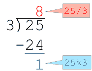

输出

```
3 0
```

因为在第一种情况下，10 除以 3 是 3 余 1，而在第二种情况下，3 除以 10 是 0 余 3。由于整数是完整的数字，答案的任何小数部分都必须被丢弃。丢弃小数部分只保留整数部分的过程称为截断。10 除以 3 应该是 3.3333...，但该值被截断为 3。截断不是四舍五入；例如，11 除以 3 是 3.6666...，但它也被截断为 3。

> 截断只是移除值的任何小数部分。它不进行四舍五入。10.01 和 10.999 都被截断为 10。

取模运算符（%）计算整数除法的余数；因此，

```cpp
std::cout << 10%3 << " " << 3%10 << '\n';
```

输出

```
1 3
```

因为 10 除以 3 是 3 余 1，而 3 除以 10 是 0 余 3。图 4.1 使用长除法更直观地说明整数除法和取模运算符的工作原理。

取模运算符比最初看起来更有用。清单 4.1 (timeconv.cpp) 展示了如何使用它将给定的秒数转换为小时、分钟和秒。

与整数算术相反，双精度浮点算术的行为符合预期：

```cpp
std::cout << 10.0/3.0 << " " << 3.0/10.0 << '\n';
```

输出

```
3.33333 0.3
```

图 4.2 int 的范围与 double 的范围

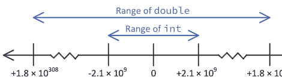

由于 `char` 在内部存储为数字（参见第 3.8 节），我们可以对字符进行算术运算。我们很少需要对字符应用数学运算，但有时这很有用。例如，字母表中的小写字母 a-z 占据 ASCII 值 97–122，其中 a = 97，b = 98，等等。大写字母 A-Z 编码为 65–90，其中 A = 65，B = 66，等等。要将任何小写字母大写，只需减去 32，如下所示

```cpp
char lower = 'd', upper = lower - 32;
std::cout << upper << '\n';
```

这段代码将打印 D。如果你不记得大小写字母之间的偏移量 32，可以使用字母本身来计算它：

```cpp
upper = lower - ( 'a' - 'A' );
```

在这种情况下，如果 Lower 被赋予 'a' 到 'z' 范围内的任何值，该语句将把 Large 写字母版本的 Lower 赋给 upper。另一方面，如果 Lower 的值不在该范围内，upper 将不会获得有意义的值。

### 4.2 混合类型表达式

表达式可能包含混合元素；例如，以下程序片段

```cpp
int x = 4;
double y = 10.2, sum;
sum = x + y;
```

将一个 `int` 加到一个 `double`，结果被赋给一个 `double`。算术运算是如何执行的？

如图 4.2 所示，`int` 的范围完全落在 `double` 的范围内；因此，任何 `int` 值都可以由 `double` 表示。`int` 4 也可以表示为 `double` 4.0。事实上，由于大多数系统上最大的 `int` 是 2,147,483,647，`double` 精度的最小 15 位数字足以精确表示所有整数。这意味着任何 `int` 值都可以由 `double` 表示。然而，反之不成立。2,200,000,000 可以由 `double` 表示，但对于 `int` 类型来说太大了。我们说 `double` 类型比 `int` 类型 **更宽**，而 `int` 类型比 `double` 类型 **更窄**。

那么，能够将 `int` 值赋给 `double` 变量是合理的。该过程称为 **扩展**，将 `int` 扩展为 `double` 始终是安全的。以下代码片段

```cpp
double d1;
int i1 = 500;
d1 = i1;
std::cout << "d1 = " << d1 << '\n';
```

是合法的 C++ 代码，当作为完整程序的一部分时，它将显示

```
d1 = 500
```

然而，将 double 赋给 int 变量并不总是可能的，因为 double 值可能不在 int 的范围内。此外，如果 double 变量在 int 的范围内但不是整数，int 变量无法处理小数部分。考虑以下代码片段：

```cpp
double d = 1.6;
int i = d;
```

第二行将 1 赋给 i。截断丢失了 0.6 的小数部分（参见第 4.1 节）。请注意，没有进行适当的四舍五入。Visual C++ 编译器会警告我们潜在的问题：

> warning C4244: '=' : 从 'double' 到 'int' 的转换，可能丢失数据

此警告提醒我们，赋值过程中可能会丢失一些信息。虽然在存在警告时编译器和链接器仍会生成可执行程序，但你应仔细审查所有警告。此警告特别有用，因为由于浮点数截断导致的错误很容易潜入计算中。

从更宽的类型转换为更窄的类型（如 double 到 int）称为 **缩窄**。将浮点值赋给整数变量通常是必要的。如果我们知道要赋的值在 int 的范围内，且该值没有小数部分或其截断无害，则赋值是安全的。为了在不触发编译器警告的情况下执行赋值，我们使用一种称为强制转换（cast，也称为类型转换）的过程。强制转换迫使编译器在不发出警告的情况下接受赋值。以下语句说服编译器在不发出警告的情况下接受 double 到 int 的赋值：

```cpp
i = static_cast<int>(d);
```

保留字 static_cast 执行缩窄转换并屏蔽编译器警告。要转换的项目（在此例中为变量 d）放在括号中，所需类型（在此例中为类型 int）出现在尖括号中。该语句

```cpp
i = static_cast<int>(d);
```

不会改变变量 d 的类型；d 被声明为 double，因此必须保持为 double 变量。该语句在临时内存位置中复制 d 的值，并在过程中将其转换为整数表示。

我们也可以对字面值和表达式进行强制转换：

```cpp
i = static_cast<int>(1.6);
i = static_cast<int>(x + 2.1);
```


将浮点数值缩小为整数会丢弃任何小数部分。缩小会截断；它不会四舍五入。例如，double 值 1.7 缩小为 int 值 1。

扩大转换始终是安全的，因此不需要类型转换。缩小是一种潜在的危险操作，使用显式转换并不能消除危险——它只是让编译器保持沉默。例如，请参阅清单 4.2（badnarrow.cpp）。

```
Listing 4.2: badnarrow.cpp

#include <iostream>

int main() {
    double d = 2200000000.0;
    int i = d;
    std::cout << "d = " << d << ", i = " << i << '\n';
}
```

Visual C++ 编译器在将 d 赋值给 i 时会发出关于可能丢失精度的警告。在这种情况下使用类型转换来屏蔽警告是个坏主意；程序的输出表明应该重视该警告：

```
d = 2.2e+009, i = -2147483648
```

打印出的 i 和 d 的值甚至不接近，而且也不可能接近，因为在使用 32 位整数的系统上，无法将 2,200,000,000 的值表示为 int。当将较宽类型的值赋值给较窄类型的变量时，程序员必须承担责任，确保要缩小的实际值确实在较窄类型的范围内。编译器无法确保赋值的安全性。

应谨慎且小心地使用转换，因为转换会在程序中创建一个免疫于编译器类型检查的位置。粗心的赋值可能会产生垃圾结果，将错误引入程序。

当我们必须执行混合算术运算时——例如将 int 加到 double 上——编译器会自动生成机器语言代码，将 int 值复制到临时内存位置并将其转换为等效的 double 值。然后它执行双精度浮点运算来计算结果。

整数算术仅在两个操作数都是 int 时发生。因此 1/3 的结果为 0，但 1.0/3.0、1/3.0 和 1.0/3 的结果均为 0.333333。

由于 double 比 int 宽，我们说 double 占主导地位。在混合类型算术表达式中，较不占主导地位的类型会被强制转换为较占主导地位的类型，以执行算术运算。

第 3.9 节介绍了枚举类型。在幕后，编译器将枚举值转换为整数。枚举中的第一个值为 0，第二个值为 1，以此类推。尽管枚举类型的底层实现是整数，但编译器不允许整数和枚举类型之间自由交换。以下代码无法编译：

```
enum class Color { Red, Orange, Yellow, Green, Blue, Violet };
std::cout << Color::Orange << " " << Color::Green << '\n';
```

std::cout 打印对象知道如何打印整数，但它对我们的 Color 类及其值一无所知。如果我们真的想将枚举类型值视为其底层整数，则必须使用类型转换。清单 4.3（enumcast.cpp）展示了如何从枚举类型中提取底层整数值。

## 清单 4.3：enumcast.cpp

```
#include <iostream>

int main() {
    enum class Color { Red, Orange, Yellow, Green, Blue, Violet };
    std::cout << static_cast<int>(Color::Orange) << " "
         << static_cast<int>(Color::Green) << '\n';
}
```

清单 4.3（enumcast.cpp）打印

```
1 3
```

这是预期的输出，因为 Color::Red 是 0，Color::Orange 是 1，Color::Yellow 是 2，Color::Green 是 3，以此类推。

尽管枚举类型在内部被编码为整数，但程序员在不涉及转换的情况下不能对枚举类型进行算术运算。这种情况应该非常罕见；如果你需要对变量进行算术运算，它实际上应该是数值类型，而不是枚举类型。

### 4.3 运算符优先级和结合性

当在同一表达式中使用不同运算符时，适用正常的算术规则。所有 C++ 运算符都有 *优先级* 和 *结合性*：

- 优先级——当表达式包含两种不同的运算符时，哪个应首先应用？

- 结合性——当表达式包含两个优先级相同的运算符时，哪个应首先应用？

要了解优先级的工作原理，请考虑表达式

```
2 + 3 * 4
```

它应该被解释为

```
(2 + 3) * 4
```

（即 20），或者是

```
2 + (3 * 4)
```

（即 14）才是正确的解释？与正常算术一样，在 C++ 中，乘法和除法具有同等重要性，并且在加法和减法之前执行。我们说乘法和除法优先于加法和减法。在表达式

```
2 + 3 * 4
```

乘法在加法之前执行，因为乘法优先于加法。结果是 14。乘法运算符（*、/ 和 %）彼此之间具有相同的优先级，加法运算符（二元 + 和 -）彼此之间也具有相同的优先级。乘法运算符优先于加法运算符。

与标准算术一样，在 C++ 中，如果要先执行加法，括号可以覆盖优先级规则。表达式

```
(2 + 3) * 4
```

结果为 20。多组括号可以以标准算术中可接受的任何方式排列和嵌套。

要了解结合性的工作原理，请考虑表达式

```
2 - 3 - 4
```

两个运算符相同，因此它们具有相同的优先级。第一个减法运算符是否应在第二个之前应用，如

```
(2 - 3) - 4
```

（即 -5），或者是

```
2 - (3 - 4)
```

（即 3）才是正确的解释？前者（-5）是正确的解释。我们说减法运算符是左结合的，求值是从左到右的。这种解释符合标准算术规则。除了赋值之外，所有二元运算符都是左结合的。赋值是一个例外；它是右结合的。要了解为什么结合性对赋值是一个问题，请考虑语句

```
w = x = y = z;
```

这是合法的 C++，称为链式赋值。赋值既可以用作语句，也可以用作表达式。语句

```
x = 2;
```

将值 2 赋给变量 x。表达式

```
x = 2
```

将值 2 赋给变量 x，并求值为所赋的值；即 2。由于赋值是右结合的，编译器会将链式赋值示例解释为如果写成如下形式：

```
w = (x = (y = z));
```

其行为如下：

- 先求值表达式 y = z。z 的值被赋给 y，表达式 y = z 的值是 z 的值。

- 求值表达式 x = (y = z)。y = z 的值，即 z，被赋给 x。因此表达式 x = y = z 的整体值是 z 的值。现在 x、y 和 z 的值都相等（等于 z）。

- 求值表达式 w = (x = y = z)。表达式 x = y = z 的值等于 z 的值，因此 z 的值被赋给 w。表达式 w = x = y = z 的整体值等于 z，变量 w、x、y 和 z 都相等（等于 z）。

与优先级的情况一样，我们可以使用括号来覆盖表达式中的自然结合性。

一元运算符的优先级高于二元运算符，且一元运算符是右结合的。这意味着语句

```
std::cout << -3 + 2 << '\n';
std::cout << -(3 + 2) << '\n';
```

显示

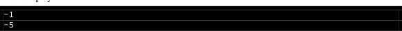

的行为符合预期。

表 4.2 显示了一些 C++ 运算符的优先级和结合性规则。* 运算符还具有一种与数学无关的一元形式；它在 10.7 节中介绍。

| 运算符数目 | 运算符 | 结合性 |
|---|---|---|
| 一元 | +, - | |
| 二元 | *, /, % | 左 |
| 二元 | +, - | 左 |
| 二元 | = | 右 |

表 4.2：运算符优先级和结合性。运算符在每一行中的优先级高于其下方的运算符。同一行中的运算符具有相同的优先级。

### 4.4 注释

优秀的程序员会通过插入注释来标注代码，以解释一段代码的目的，或解释他们为何选择以某种方式编写一段代码。这些注释是给人类读者看的，而不是给编译器看的。在业界，程序通常会由其他程序员或技术经理审查正确性。选择得当的标识符（参见 3.3 节）和注释可以辅助这一评估过程。此外，在实际中，程序员团队开发软件。可能需要另一位程序员来完成或修复他人编写的程序部分。编写良好的注释可以帮助他人更快地理解新代码，并提高他们修改旧代码或未完成代码的生产力。虽然这可能难以置信，但即使是同一位程序员在数月后再次处理自己的代码时，也可能难以记住各个部分的作用。注释可以大有帮助。

注释中包含的任何文本都会被编译器忽略。C++ 支持两种类型的注释：单行注释和块注释：

- 单行注释——第一种注释类型适用于编写单行备注：


```
// Compute the average of the values
avg = sum / number;
```

第一行是一条注释，用于说明其后语句的作用。注释以双正斜杠符号（//）开头，并持续到该行末尾。编译器会忽略 // 符号以及该行其余部分的内容。这种类型的注释也很适合在语句末尾添加简短注释：

```
avg = sum / number; // Compute the average of the values
```

在此处，可执行语句和注释出现在同一行。编译器会读取此处的赋值语句，但会忽略注释。编译器为本示例生成的机器代码与前一个示例相同，但本示例只使用一行源代码，而不是两行。

- 块注释——第二种注释以符号 /* 开头，并持续到遇到 */ 符号为止。/* ... */ 符号像括号界定括号内表达式一样界定注释。然而，与括号不同，这些块注释不能嵌套于其他块注释之内。

块注释非常适合多行注释：

```
/* After the computation is completed
the result is displayed. */
std::cout << result << '\n';
```

应该注释什么？避免对显而易见的事物发表评论；例如：

```
result = 0; // Assign the value zero to the variable named result
```

任何具有最基本 C++ 编程经验的人都能清楚这条语句的效果。因此，应考虑注释的受众；一般来说，“常规”活动无需备注。尽管上述语句的效果很明确，但其目的可能需要注释。例如：

```
result = 0; // Ensures 'result' has a well-defined minimum value
```

这条备注对读者完全理解程序某个特定部分的工作原理可能至关重要。一般来说，程序员不太倾向于提供过多注释。存疑时，添加一条备注。编写好注释所花的额外时间非常值得。

### 4.5 格式

程序注释对人类读者有帮助，但会被编译器忽略。源代码中另一个与编译器关系不大但人们认为有价值的方面是其格式。想象一下阅读一本书的困难，书中文本没有缩进或间距来分隔段落。与计算机程序的源代码相比，书籍的组织结构相当简单。经过几十年的软件构建，程序员们已确立了一小套行业认可的源代码格式风格。

编译器对源代码格式允许很大的灵活性。请参考清单 4.4（reformattedvariable.cpp），它是清单 3.4（variable.cpp）的重新格式化版本。

### 清单 4.4：reformattedvariable.cpp

```
#include <iostream>
int
main
(
)
{
{
int
x
;
x
=
10
;
std::cout
<<
x
<<
'\n'
;
}
}
}
```

清单 4.5（reformattedvariable2.cpp）是清单 3.4（variable.cpp）的另一个重新格式化版本。

### 清单 4.5：reformattedvariable2.cpp

```
#include <iostream>
int main(){int x=10;std::cout<<x<<'\n';}
```

两个重新格式化的程序都是有效的 C++，并编译为与原始版本相同的机器语言代码。大多数人会认为，原始版本比任一重新格式化的版本更易于阅读和更快理解。清单 3.4（variable.cpp）中的元素组织得更好。有经验的 C++ 程序员会发现清单 4.4（reformattedvariable.cpp）和清单 4.5（reformattedvariable2.cpp）在视觉上都令人难以忍受。

清单 3.4（variable.cpp）有哪些显著特征？

- 每条语句都独占一行。语句不会被不必要地拆分到两行文本中。从视觉上看，一行文本意味着要执行一个操作（语句）。

- 右花括号与包含相应左花括号的上一行垂直对齐。这样更容易判断花括号是否匹配且嵌套正确。它也能更好地描绘程序的逻辑结构。随着我们编写更复杂的程序，准确传达程序逻辑结构的能力变得非常重要。逻辑复杂的程序经常使用多层嵌套花括号（例如，参见清单 5.12（troubleshoot.cpp））。如果没有一致且有条理的花括号排列，就很难确定哪个左花括号对应哪个右花括号。

- 构成 main 函数体的语句缩进若干空格。这在视觉上强调了元素确实在逻辑上被包含的事实。与花括号对齐一样，为了强调逻辑包含而进行的缩进，在考虑更复杂的程序时变得更加重要。

- 空格用于分散语句并对语句片段进行分组。运算符（=）周围的空格使得从视觉上更容易将操作数与运算符分开，并理解表达式的细节。大多数人发现下面的语句

```
total_sale = subtotal + tax;
```

比下面的语句

```
total_sale=subtotal+tax;
```

更易于阅读，因为第二个版本缺少空格，使得更难识别语句中的各个部分。在带有额外空格的第一个版本中，运算符和变量名的起止位置更加清晰。

在英语等自然语言中，一本书被划分为不同的章节，章节由段落组成。一个段落可以与另一个段落区分开来，因为第一行缩进或两个段落之间出现额外空格。空格用于分隔每个句子中的单词。想象一下，如果一本书的所有句子都像这样印刷，阅读会有多困难：

Theobyranquicklytothetreetoseethestrandedcat.

在 C++ 程序中得当地放置空白空间，可以大大提高其可读性。

C++ 为程序员在格式化源代码方面提供了很大的自由度。编译器在移动到下一行之前，会逐行从左到右一次读取一个符号，读取构成源代码的字符。虽然额外空格有助于可读性，但在某些位置不允许使用空格：

- 变量名和保留字必须作为不中断的单元出现。
- 多符号运算符（如 <<）不能分隔（< < 是非法的）。

C++ 编程中一种普遍的编码惯例在清单 3.10（const.cpp）中得到体现。程序员通常在变量名中使用小写字母，但通常用全大写字母表示常量名；例如，用 PI 表示数学常数 π，而不是 pi。C++ 不要求常量大写，但将其大写有助于阅读源代码的人类快速区分变量和常量。

图 4.3 显示了程序员在 C++ 源代码中使用缩进和放置花括号的四种最常见方式。

K&R 风格和 ANSI 风格在已发布的 C++ 源代码中最为流行。Whitesmith 风格和 Banner 风格出现频率要低得多。http://en.wikipedia.org/wiki/Indent_style 介绍了格式化 C++ 代码的各种方式。请注意，所有公认的格式风格都会缩进 main 函数中包含的语句块。

大多数软件开发组织都会采用一套风格指南，有时称为代码规范。这些指南规定了在哪里缩进以及缩进多少个空格、在哪里放置花括号、如何为标识符命名等。为该组织工作的程序员必须为其生成的代码遵循这些风格指南。这能更好地使开发团队的任何成员更快地阅读和理解他人编写的代码。在代码需要审查正确性，或者代码需要修复或扩展而原程序员已不在开发团队时，这一点是必要的。


图 4.3 最常见的 C++ 编码风格。

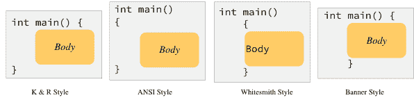

即使你没有被迫使用特定的风格，在你编写的代码中始终如一地使用一种风格也很重要。随着我们的程序变得更加复杂，我们将需要使用额外的花括号和各种缩进级别来组织编写的代码。一种一致的风格（尤其是图 4.3 中所示的标准风格之一）使代码更易于阅读，并验证代码确实表达了我们的意图。它还使查找和修复错误变得更容易。换句话说，随意的格式化会增加开发正确软件所需的时间，因为程序员的错误在格式不佳的代码中更容易隐藏。

优秀的软件开发工具可以提高程序员的生产力，许多编程编辑器都有能力根据标准风格自动格式化源代码。这些编辑器中的一些可以在程序员输入文本时纠正代码的风格。一个名为 _美化打印机_ 的独立程序可以将任意格式的 C++ 源文件转换为格式正确的文件。

### 4.6 错误和警告

初学者在编写程序时会犯错，原因是对编程缺乏一般经验，或不熟悉某种编程语言。资深程序员犯错是由于粗心大意，或因为所提议的问题解决方案有误，对错误方案的正确实现也无法产生正确的程序。无论出于何种原因，编程错误都属于以下三类之一：

- 编译时错误
- 运行时错误
- 逻辑错误

### 4.6.1 编译时错误

_编译时错误_ 是由于程序员滥用语言而导致的。_语法错误_ 是常见的编译时错误。例如，在英语中可以说：

男孩走得很快。

该句子使用了正确的语法。然而，句子

男孩走得很快。

在语法上是不正确的：主语的数（单数形式）与动词的数（复数形式）不一致。它包含一个语法错误。它违反了英语语言的一条语法规则。同样，C++ 语句

```
x = y + 2;
```

在语法上是正确的，因为它遵循了第 3.2 节中描述的赋值语句结构规则。但是，考虑将此赋值语句替换为稍作修改的版本：

```
y + 2 = x;
```

如果程序中出现这样的语句，并且变量 x 和 y 已正确声明，编译器将发出错误消息；例如，Visual C++ 编译器报告（其中包括）：

> 错误 C2106：'='：左操作数必须是左值

C++ 语法不允许像 y + 2 这样的表达式出现在赋值运算符的左侧。

> （错误消息中的术语 l-value 指的是赋值运算符的左侧；这里的 l 是“elle”，而不是“one”。）

编译器可能会对语法正确的语句生成错误，例如

```
x = y + 2;
```

如果变量 x 或 y 中任何一个未声明；例如，如果 y 未声明，Visual C++ 报告：

> 错误 C2065：'y'：未声明的标识符

其他常见的编译时错误包括语句末尾缺少分号、花括号和圆括号不匹配以及简单的拼写错误。

编译时错误通常是最容易修复的。编译器会精确定位问题的位置，并且错误不取决于程序执行的环境。只需重新编译相同的源代码即可重现确切错误。

编译器以生成晦涩难懂的错误消息而闻名。就初学者而言，它们似乎帮助不大。有时，一系列错误会导致消息指示实际错误所在行之后的行中存在错误。当你多次遇到相同的错误并且编译器消息变得更加熟悉时，你就能更好地从报告的消息中推断出实际问题。不幸的是，C++ 是一种如此复杂的语言，以至于有时一个简单的编译时错误会导致初学者 C++ 程序员无法理解的消息。

### 4.6.2 运行时错误

编译器确保不违反 C++ 语言的结构规则。例如，它可以检测格式错误的赋值语句以及在声明之前使用变量。但是，有些语言违规行为无法在编译时检测到。程序可能无法运行完成，而是以错误终止。我们通常说程序“崩溃”了。请考虑清单 4.6 (dividedanger.cpp)，在某些情况下它会崩溃。

```
Listing 4.6: dividedanger.cpp

// File dividedanger.cpp
#include <iostream>
int main() {
   int dividend, divisor;
   // Get two integers from the user
   std::cout << "Please enter two integers to divide:";
   std::cin >> dividend >> divisor;
   // Divide them and report the result
   std::cout << dividend << " / " << divisor << " = "
      << dividend/divisor << '\n';
}
```

表达式 dividend/divisor 可能很危险。例如，如果用户输入 32 和 4，程序运行良好

```
Please enter two integers to divide: 32 4
32/4 = 8
```

并显示答案 8。如果用户改为输入 32 和 0，程序会报告错误并终止。在数学中，除以零是未定义的，在 C++ 中，整数除以零是非法的。当程序在运行时尝试除法时，系统会检测到此尝试并终止程序。

这个特定的程序还可能以其他方式失败；例如，在 C++ 世界之外，32.0 看起来像个体面的整数。但是，如果用户输入 32.0 和 8，程序会崩溃，因为 32.0 不是在 C++ 中表示整数的有效方式。当编译器编译源代码行 std::cin >> dividend >> divisor; 时

鉴于 dividend 已声明为 int，它生成的机器语言代码与 dividend 声明为 double 时略有不同。编译后的代码期望用户输入的文本是没有额外修饰的数字。任何偏离此预期的情况都会导致运行时错误。如果用户输入的文本不表示整数（例如 fred），也会出现类似结果。

请注意，无论哪种情况——输入有效但不合适的整数（零）或输入非整数（32.0 或 fred）——编译器都无法在编译时检查这些问题。编译器无法预测程序运行时用户会输入什么。这意味着程序员有责任编写能够处理用户可能提供的错误输入的代码。随着我们继续探索 C++ 编程，我们将发现使程序对用户输入更具鲁棒性的方法（例如，参见第 5 章中的清单 5.3 (betterdivision.cpp)）。解决方案涉及根据用户提供的实际输入更改程序的运行方式。

### 4.6.3 逻辑错误

考虑将表达式

```
dividend/divisor;
```

在清单 4.6 (dividedanger.cpp) 中替换为表达式：

```
divisor/dividend;
```

该程序可以无错误编译。它运行，除非为 dividend 输入零，否则不会出现运行时错误。但是，它计算的答案通常不正确。只有在 dividend = divisor 时才会打印正确答案。程序包含一个错误，但编译器和运行时系统都无法检测到问题。这种类型的错误称为逻辑错误。

清单 4.20 (faultytempconv.cpp) 是包含逻辑错误的程序示例。清单 4.20 (faultytempconv.cpp) 可以编译且不会生成任何运行时错误，但它会产生错误的结果。

初学者往往在早期会与编译时错误作斗争，原因是对语言不熟悉。编译器及其错误消息实际上是程序员最好的朋友。随着程序员对语言经验的积累以及编写的程序变得更加复杂，编译时错误的数量会减少或易于修复，而逻辑错误的数量会增加。不幸的是，编译器和运行时环境都无法提供关于逻辑错误性质和有时位置的任何洞察。因此，逻辑错误往往是最难查找和修复的。调试器等工具经常用于帮助查找和修复逻辑错误，但这些工具的操作远非自动。

逃过编译器检测的错误（运行时错误和逻辑错误）通常被称为 bug。由于编译器无法检测这些问题，此类 bug 是开发人员沮丧的主要来源。沮丧往往源于在复杂程序中，bug 有时只在某些情况下才会显现，而这些情况在测试期间很难准确重现。随着你的程序变得更加复杂，你会发现这种沮丧。好消息是，编程经验和良好编程技术的有纪律应用可以帮助减少逻辑错误的数量。坏消息是，由于软件开发本质上是一种人类智力活动，逻辑错误是不可避免的。意外引入逻辑错误，随后发现并消除它们，是编程过程不可或缺的一部分。

### 4.6.4 编译器警告

编译器发出的警告确实标记了对 C++ 语言规则的违反，但它是对程序员的通知，表明程序包含一个潜在问题的结构。在清单 4.10 (tempconv.cpp) 中，程序员试图在变量被赋予已知值之前打印其值。

```
Listing 4.7: uninitialized.cpp

// uninitialized.cpp

#include <iostream>

int main() {
    int n;
    std::cout << n << '\n';
}
```

尝试构建清单 4.7 (uninitialized.cpp) 会得到 Visual C++ 编译器的以下消息：


warning C4700: uninitialized local variable 'n' used

编译器发出了警告，但仍然生成了可执行文件。运行时，程序会产生随机结果，因为它打印与变量关联的内存中的值，但程序未初始化该内存位置。

Listing 4.8 (narrow.cpp) 将一个 `double` 值赋给一个 `int` 变量，正如我们在第 4.1 节中所知，这会截断结果。

```cpp
Listing 4.8: narrow.cpp
#include <iostream>
int main() {
    int n;
    double d = 1.6;
    n = d;
    std::cout << n << '\n';
}
```

编译时我们会看到

warning C4244: '=' : conversion from 'double' to 'int', possible loss of data

由于这是警告而非错误，编译器会生成可执行文件，但警告应提示我们停下来反思代码的正确性。增强的警告级别防止程序员对情况视而不见。

在 IDE 中编译时，默认 Visual C++ 警告级别为 3，命令行上为 1（这就是为什么我们在命令行上使用 /W3 选项）；最高警告级别为 4。您可以将级别降低到 1 或 2，或完全禁用警告，但不推荐这样做。您可能希望降低警告级别的唯一原因是编译不符合较新 C++ 标准的旧有现有 C++ 源代码。开发新代码时，更高的警告级别更受青睐，因为它们为程序员提供更多帮助。除非另有说明，本书中所有完整程序示例在 Visual C++ 设置为警告级别 3 时均能干净编译。警告级别 3 对检测许多常见逻辑错误很有帮助。

我们可以通过简单地添加代码来增加更多警告。第 4.2 节展示了如何使用 `static_cast` 将较宽类型强制转换为较窄类型。在 Visual C++ 警告级别 3 下，如果未使用强制转换，编译器会发出警告。必须添加的少量代码应促使程序员停下来反思该结构的正确性。增强的警告级别防止程序员对情况视而不见。

使用编译器可用的最强警告级别。将所有警告视为必须纠正的问题。不要接受带有警告编译的程序作为完成。

我们可以将 `double` 字面量赋给 `float` 变量，无需任何特殊类型转换。编译器会自动将 `double` 缩窄为 `float`，如 Listing 4.9 (assignfloat.cpp) 所示：

```cpp
Listing 4.9: assignfloat.cpp

#include <iostream>

int main() {
    float number;
    number = 10.0; // Ok, double literal assignable to a float
    std::cout << "number = " << number << '\n';
}
```

语句

`number = 10.0;`

将 double 字面量 (10.0) 赋给 float 变量。您也可以显式使用 float 字面量，如：

`number = 10.0f;`

### 4.7 算术示例

在复杂表达式中执行的算术类型是按运算符逐个确定的。例如，考虑 Listing 4.10 (tempconv.cpp)，它尝试使用公式将华氏温度转换为摄氏温度

C = 5/9 * (F - 32)

```cpp
Listing 4.10: tempconv.cpp

// File tempconv.cpp
#include <iostream>

int main() {
    double degreesF, degreesC;
    // Prompt user for temperature to convert
    std::cout << "Enter the temperature in degrees F: ";
    // Read in the user's input
    std::cin >> degreesF;
    // Perform the conversion
    degreesC = 5/9 * (degreesF - 32);
    // Report the result
    std::cout << degreesC << '\n';
}
```

Listing 4.10 (tempconv.cpp) 包含记录每个步骤并解释代码目的的注释。初步测试颇有希望：

```
Enter the temperature in degrees F: 32
Degrees C = 0
```

水在 32 华氏度和 0 摄氏度下结冰，因此对于此测试，程序的行为是正确的。其他几次尝试则不尽如人意——考虑

```
Enter the temperature in degrees F: 212
Degrees C = 0
```

水在 212 华氏度（即 100 摄氏度）下沸腾，因此这个答案不正确。

```
Enter the temperature in degrees F: -40
Degrees C = 0
```

-40 是华氏和摄氏曲线相交的点，因此结果应为 -40，而非零。第一次测试仅是巧合正确。

不幸的是，无论输入如何，打印结果始终为零。问题在于语句中的除法 5/9

```
degreesC = 5/9*(degreesF - 32);
```

除法和乘法优先级相同，且均为左结合；因此先执行除法。由于两个操作数都是整数，执行整数除法，商为零（5 除以 9 为 0，余 5）。当然，零乘以任何数都是零，因此得出此结果。表达式中涉及浮点变量（degreesF）且整体结果被赋给浮点变量，这无关紧要。执行的确切操作类型的决定是按运算符逐个作出的，而不是对整个表达式全局决定。由于除法先执行且涉及两个整数值，因此在其他浮点部分介入前先使用整数除法。

一种解决方案是直接为五或九中的任一使用浮点字面量，如

```
degreesC = 5.0/9*(degreesF - 32);
```

这会强制执行双精度浮点除法（回顾字面量 5.0 是 double）。最终计算出的正确结果（受舍入而非截断影响）。

Listing 4.11 (timeconv.cpp) 使用整数除法和取模运算将给定秒数拆分为小时、分钟和秒。

```cpp
Listing 4.11: timeconv.cpp
// File: timeconv.cpp

#include <iostream>

int main() {
  int hours, minutes, seconds;
  std::cout << "Please enter the number of seconds:";
  std::cin >> seconds;
  // First, compute the number of hours in the given number
  // of seconds
  hours = seconds / 3600; // 3600 seconds = 1 hours
  // Compute the remaining seconds after the hours are
  // accounted for
  seconds = seconds % 3600;
  // Next, compute the number of minutes in the remaining
  // number of seconds
  minutes = seconds / 60; // 60 seconds = 1 minute
  // Compute the remaining seconds after the minutes are
  // accounted for
  seconds = seconds % 60;
  // Report the results
  std::cout << hours << " hr, " << minutes << " min, "
<< seconds << " sec\n";
}
```

如果用户输入 10000，程序将打印 2 hr, 46 min, 40 sec。注意对 seconds 变量的赋值，例如

```
seconds = seconds % 3600
```

赋值运算符 (=) 右侧首先被求值。seconds 除以 3,600 的余数被赋回 seconds。如果 seconds 的当前值大于 3,600，该语句可以改变 seconds 的值。程序中经常出现的类似语句如

```
x = x + 1;
```

该语句将变量 x 加 1，使其大一。这样的语句进一步证明 C++ 赋值运算符不表示数学相等。数学中的以下语句

```
x = x + 1
```

肯定永远不成立；一个数不能等于它本身加一。如果真是这样，我会往银行存入一美元，然后坚持说我真的有两美元在银行里，因为一个数等于它本身加一。那两美元会变成 3.00，然后 4.00，等等，我很快就会变富。然而在 C++ 中，该语句仅表示“给 x 加 1 并将结果赋回 x。”

Listing 4.11 (timeconv.cpp) 的一个变体，Listing 4.12 (enhancedtimeconv.cpp) 执行相同的逻辑来计算时间片段（小时、分钟和秒），但它使用更简单的算术来产生略有不同的输出——不打印 11,045 秒为 3 hr, 4 min, 5 sec，Listing 4.12 (enhancedtimeconv.cpp) 将其显示为 3:04:05。修改 Listing 4.11 (timeconv.cpp) 使其打印 3:4:5 微不足道，但 Listing 4.12 (enhancedtimeconv.cpp) 包含一些额外算术，在分钟和秒的个位数值前加上前导零，就像数字时钟显示上所做的那样。

```cpp
Listing 4.12: enhancedtimeconv.cpp

// File: enhancedtimeconv.cpp
//#include <iostream>
int main() {
int hours, minutes, seconds;
std::cout << "Please enter the number of seconds:";
std::cin >> seconds;
// First, compute the number of hours in the given number
// of seconds
hours = seconds / 3600; // 3600 seconds = 1 hours
// Compute the remaining seconds after the hours are
// accounted for
seconds = seconds % 3600;
// Next, compute the number of minutes in the remaining
// number of seconds
minutes = seconds / 60; // 60 seconds = 1 minute
// Compute the remaining seconds after the minutes are
```


```
// accounted for
seconds = seconds % 60;
// Report the results
std::cout << hours << ":";
// Compute tens digit of minutes
int tens = minutes / 10;
std::cout << tens;
// Compute ones digit of minutes
int ones = minutes % 10;
std::cout << ones << ":";
// Compute tens digit of seconds
tens = seconds / 10;
std::cout << tens;
// Compute ones digit of seconds
ones = seconds % 10;
std::cout << ones << "\n";
}
```

清单 4.12（enhancedtimeconv.cpp）利用了这样一个事实：如果 x 是一位数或两位数，那么 x / 10 就是 x 的十位数字。如果 x / 10 为零，那么 x 必然是一位数。

### 4.8 整数与浮点数

浮点数相对于整数具有某些明显的优势。浮点数（尤其是双精度数）的取值范围远大于任何整数类型。浮点数可以有小数部分，而整数不行。然而，整数具有一个浮点数无法提供的重大优势——精确性。为了了解为什么整数是精确的而浮点数不是，我们将探讨计算机存储和操作整数及浮点数类型的方式。

计算机在内部以二进制形式存储所有数据。二进制（基数 2）数制比熟悉的十进制（基数 10）数制简单得多，因为它只使用两个数字：0 和 1。十进制使用 10 个数字：0、1、2、3、4、5、6、7、8 和 9。尽管数字较少，但每个十进制整数都有等价的二进制表示。二进制数使用一种与十进制不无相似的位值系统。图 4.4 展示了熟悉的基数 10 位值系统的工作原理。

图 4.4 基数 10 位值系统

| ... | 10⁵ | 10⁴ | 10³ | 10² | 10¹ | 10⁰ |
| --- | --- | --- | --- | --- | --- | --- |
| ... | 4 | 7 | 3 | 4 | 0 | 6 |
| ... | 100,000 | 10,000 | 1,000 | 100 | 10 | 1 |

473,406 = 4 x 10⁵ + 7 x 10⁴ + 3 x 10³ + 4 x 10² + 0 x 10¹ + 6 x 10⁰
= 400,000 + 70,000 + 3,000 + 400 + 0 + 6
= 473,406

有 10 个数字可用，十进制数制使用 10 的幂来区分位值。将基数 10 系统与图 4.5 中所示的基数 2 位值系统进行比较。

图 4.5 基数 2 位值系统

| ... | 2⁵ | 2⁴ | 2³ | 2² | 2¹ | 2⁰ |
| --- | --- | --- | --- | --- | --- | --- |
| ... | 1 | 0 | 0 | 1 | 1 | 1 |
| ... | 32 | 16 | 8 | 4 | 2 | 1 |

100111₂ = 1 × 2⁵ + 0 × 2⁴ + 0 × 2³ + 1 × 2² + 1 × 2¹ + 1 × 2⁰
= 32 + 0 + 0 + 4 + 2 + 1
= 39

只有两个数字可用，二进制数制使用 2 的幂来区分位值。由于二进制数和十进制数都共享数字 0 和 1，我们将使用下标 2 来指示二进制数；因此，100 表示十进制值 _一百_，而 100₂ 是二进制数 _四_。有时为了非常清晰，我们会给十进制数附加下标 10，如 100₁₀。

在十进制中，很容易计算 3 + 5：

```
  3
+ 5
---
  8
```

和 3 + 9 稍微复杂一些，正如低年级小学生很快就会发现的那样：

```
  3
+ 9
---
```

答案当然是 12，但没有一个单一的 _数位_ 表示 12——需要两个数字，1 和 2。和为

```
  1
  03
+ 09
---
  12
```

我们可以说 3 + 9 是 2，_进位 1_。二进制数相加的规则比十进制数更短、更简单：

```
0₂ + 0₂ = 0₂
0₂ + 1₂ = 1₂
1₂ + 0₂ = 1₂
1₂ + 1₂ = 10₂
```

我们可以说和 1₂ + 1₂ 是 0₂，_进位_ 1₂。一个典型的较大求和如下

```
   11
9₁₀ = 1001₂
+ 3₁₀ = 0011₂
-------
12₁₀ = 1100₂
```

### 4.8.1 整数实现

数学整数是整数（没有小数部分），包括正数和负数。标准 C++ 支持多种整数类型：`int`、`short`、`long` 和 `long long`、`unsigned`、`unsigned short`、`unsigned long` 和 `unsigned long long`。这些类型由存储该类型所需的位数区分，因此也由它们能表示的取值范围区分。数学整数是无限的，但 C++ 的所有整数类型都对应于数学整数的有限子集。C++ 中最常用的整数类型是 int。所有 int 无论其值如何，都占用相同数量的内存，因此使用相同数量的位。int 中的确切位数取决于处理器。例如，32 位处理器旨在非常高效地操作 32 位整数。针对这种系统的 C++ 编译器很可能会使用 32 位 int，而针对 64 位机器的编译器可能会用 64 位表示 int。在 32 位计算机上，数字 4 和 1,320,002,912 都占用 32 位内存。

为简单起见，我们将关注无符号整数，特别是 unsigned 类型。Visual C++ 中的 unsigned 类型占用 32 位。使用 32 位可以表示 4,294,967,296 个不同的值，因此 Visual C++ 的 unsigned 类型表示整数 0 ... 4,294,967,295。20 世纪 90 年代许多计算机系统的硬件仅提供 16 位整数类型，因此当时 C++ 编译器通常支持范围为 0 ... 65,535 的 16 位无符号值。为简化对计算机整数属性的探索，我们将考虑一个更小的、神话般的无符号整数类型，我们将其称为 unsigned tiny。C++ 没有这种 unsigned tiny 类型，因为它的取值范围非常小——太小了，无法在实际程序中作为实际类型有用。我们的 unsigned tiny 类型仅使用 5 位存储，表 4.3 显示了 unsigned tiny 类型变量可以采用的所有值。

表 4.3：unsigned tiny 的值

| 位：位字符串 | 十进制值 |
| :--- | :--- |
| 00000 | 0 |
| 00001 | 1 |
| 00010 | 2 |
| 00011 | 3 |
| 00100 | 4 |
| 00101 | 5 |
| 00110 | 6 |
| 00111 | 7 |
| 01000 | 8 |
| 01001 | 9 |
| 01010 | 10 |
| 01011 | 11 |
| 01100 | 12 |
| 01101 | 13 |
| 01110 | 14 |
| 01111 | 15 |
| 10000 | 16 |
| 10001 | 17 |
| 10010 | 18 |
| 10011 | 19 |
| 10100 | 20 |
| 10101 | 21 |
| 10110 | 22 |
| 10111 | 23 |
| 11000 | 24 |
| 11001 | 25 |
| 11010 | 26 |
| 11011 | 27 |
| 11100 | 28 |
| 11101 | 29 |
| 11110 | 30 |
| 11111 | 31 |

表 4.3 显示，unsigned tiny 类型使用了五位中 0 和 1 的所有组合。我们可以直接从其位模式推导出十进制数 6：

```
00110 => 0 0 1 1 0 => 0 x 16 + 0 x 8 + 1 x 4 + 1 x 2 + 0 x 1 = 6
```

为了验证算术运算是否正确，尝试相加 4 + 3：

```
4₁₀ = 00100₂
+ 3₁₀ = 00011₂
-------
7₁₀ = 00111₂
```

这很容易，因为没有进位。接下来我们将尝试 3 + 1：

```
3₁₀ = 00011₂
+ 1₁₀ = 00001₂
-------
4₁₀ = 00100₂
```

在个位列（最右侧列），1₂ + 1₂ = 10₂，因此写入 0 并将 1 进位到左侧下一列的顶部（即二位列）。在二位列，1₂ + 1₂ + 0₂ = 10₂，因此我们还必须将 1 进位到四位列。

下一个示例说明了我们有限表示的局限性。考虑和 8 + 28：

```
   11
8₁₀ = 01000₂
+ 28₁₀ = 11100₂
-------
36₁₀ = 100100₂
```

在此求和中，我们从八位列向 16 位列进位了 1，并且从 16 位列向无处进位。我们需要第六列（32 位列），即另一个位值，但我们的 **无符号微型** 类型仅限于五位。来自 16 位的进位丢失了。最大的 **无符号微型** 值是 31，但 28 + 8 = 36。将值 36 存储在 **无符号微型** 中是不可能的，就像将值 5,000,000,000 存储在 C++ unsigned int 变量中也是不可能的。

将 1 加到最大可能的 **无符号微型** 31 上，结果得到最小可能的值 0！这反映了实际 C++ **无符号** 类型的行为，正如清单 4.13（unsignedoverflow.cpp）所演示的那样。

### 清单 4.13：unsignedoverflow.cpp

```
#include <iostream>

int main() {
    unsigned x = 4294967293; // Almost the largest possible unsigned value
    std::cout << x << " + 1 = " << x + 1 << " \n";
    std::cout << x << " + 2 = " << x + 2 << " \n";
    std::cout << x << " + 3 = " << x + 3 << " \n";
}
```

清单 4.13（unsignedoverflow.cpp）输出


图 4.6 32位无符号整数的循环特性。向 4,294,967,295 加 1 得到 0，即从 4,294,967,295 顺时针移动一位。从 2 减去 4 得到 4,294,967,294，即从 2 逆时针移动四位。

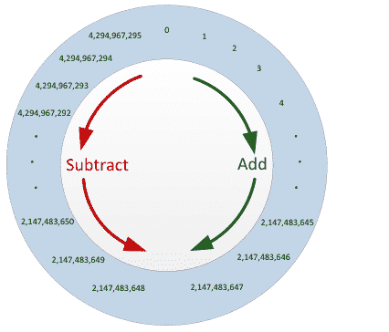

```
4294967293 + 1 = 4294967294
4294967293 + 2 = 4294967295
4294967293 + 3 = 0
```

事实上，Visual C++ 的 32 位无符号数遵循图 4.6 所示的循环模式。

在图中，加法使数值沿圆圈顺时针移动，而减法使数值沿圆圈逆时针移动。当达到数值限制时，数值会像汽车里程表一样回绕。有符号整数表现出类似的循环模式，如图 4.7 所示。

对于有符号整数，如图 4.7 所示，向最大可表示值加 1 会产生最小负值。清单 4.14（integeroverflow.cpp）演示了这一点。

### 清单 4.14: integeroverflow.cpp

```
#include <iostream>

int main() {
    int x = 2147483645; // Almost the largest possible int value
    std::cout << x << " + 1 = " << x + 1 << '\n';
    std::cout << x << " + 2 = " << x + 2 << '\n';
    std::cout << x << " + 3 = " << x + 3 << '\n';
}
```

图 4.7 32位有符号整数的循环特性。向 2,147,483,647 加 1 产生 -2,147,483,648，即从 2,147,483,647 顺时针移动一位。从 -2,147,483,645 减去 5 得到 2,147,483,646，即从 -2,147,483,645 逆时针移动五位。

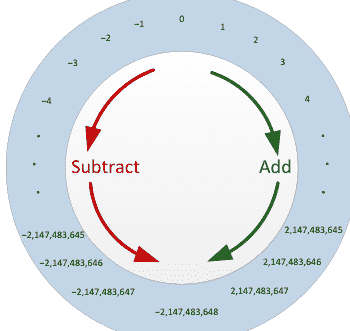

清单 4.14（integeroverflow.cpp）输出

```
2147483645 + 1 = 2147483646
2147483645 + 2 = 2147483647
2147483645 + 3 = -2147483648
```

尝试超过数值类型的最大限制会导致溢出，而尝试超过最小限制称为下溢。发生溢出或下溢的整数运算会产生一个有效但错误的整数结果。编译器不会检查计算是否会导致超过类型的限制，因为一般来说这是不可能做到的（考虑将两个在运行时确定值的整数变量相加）。同样重要的是，溢出或下溢情况不会生成运行时错误。因此，如果程序执行的整数运算（无论是最终结果还是中间值）超出所使用整数类型的范围，则属于逻辑错误。

### 4.8.2 浮点数实现

标准 C++ 浮点类型包括 float、double 和 long double。浮点数可以有小数部分（小数位），而“浮点数”术语指的是数字中的小数点可以根据计算结果必要时向左或向右移动（例如，2.5 × 3.3 = 8.25，两个一位小数值产生一个两位小数结果）。与整数类型一样，不同的浮点类型可以根据所需的存储位数及相应的值范围来区分。类型 float 代表单精度浮点数，double 代表双精度浮点数。浮点数作为数学实数的粗略近似，但正如我们将看到的，与实际实数相比，它们存在一些严重的局限性。

在大多数现代计算机系统中，浮点数在内部按照电气和电子工程师学会（IEEE 754）采用的标准以指数形式存储。在十进制系统中，科学计数法是最常见的指数记法：

一摩尔包含 6.023 × 10^23 个分子。

这里 6.023 称为尾数，23 称为指数。

IEEE 754 标准使用二进制指数记法；也就是说，尾数和指数都是二进制数。单精度浮点数（类型 float）占用 32 位，分布如下：

| 尾数 | 24 位 |
| 指数 | 7 位 |
| 符号 | 1 位 |
| 总计 | 32 位 |

双精度浮点数（类型 double）需要 64 位：

| 尾数 | 52 位 |
| 指数 | 11 位 |
| 符号 | 1 位 |
| 总计 | 64 位 |

图 4.8 一个微型浮点数简化的二进制指数值

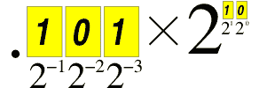

IEEE 754 实现的细节超出了本书的范围，但一个简化示例足以突出浮点类型的一般局限性。回顾十进制系统中的小数位值。从左到右，位值为：

| ... | 10,000 | 1,000 | 100 | 10 | 1 | . | 1/10 | 1/100 | 1/1000 | 1/10000 | ... |
| --- | --- | --- | --- | --- | --- | --- | --- | --- | --- | --- | --- |
| ... | 10^4 | 10^3 | 10^2 | 10^1 | 10^0 | . | 10^-1 | 10^-2 | 10^-3 | 10^-4 | ... |

每个位值是其左侧位值的十分之一。向右移动，除以十；向左移动，乘以十。在二进制系统中，因子是二而不是十：

| ... | 16 | 8 | 4 | 2 | 1 | . | 1/2 | 1/4 | 1/8 | 1/16 | ... |
| --- | --- | --- | --- | --- | --- | --- | --- | --- | --- | --- | --- |
| ... | 2^4 | 2^3 | 2^2 | 2^1 | 2^0 | . | 2^-1 | 2^-2 | 2^-3 | 2^-4 | ... |

如同我们的无符号微型示例（参见第 4.8.1 节），考虑一个仅由五位组成的二进制指数数——远少于 C++ 中 float 或 double 的位数。我们将我们的神话浮点类型称为微型浮点数（tiny float）。我们的 5 位 tiny float 类型的前三位将代表尾数，剩余两位存储指数。尾数的三位全部出现在二进制点右侧。2 位指数的基数当然是二。图 4.8 说明了这样的值。

为了进一步简化，尾数和指数都不能为负。因此，使用三位时，尾数可以取八个可能值之一。由于两位构成 tiny float 的指数，指数可以取四个可能值之一。表 4.4 列出了 tiny float 尾数和指数可能的所有值。图 4.8 所示的数字因此为

```
(1 x 2^-1 + 0 x 2^-2 + 1 x 2^-3) x 2^(1x2^1 + 0x2^0) = (1/2 + 1/8) x 2^2
= 5/8 x 4
= 2.5
```

表 4.5 将尾数和指数组合起来，揭示了我们可以用五位组成的 32 个不同位字符串表示的所有可能 tiny float 值。结果很有趣。

我们的 tiny float 数字范围是 0...7。然而，仅陈述范围具有误导性，因为这可能会给人印象，我们可以表示 0 到 7 之间任何精确到 1/8 位的值。事实上，这并不正确。我们可以用此方案表示 2.5，但无法表示 2.25。图 4.9 在实数轴上绘制了所有可能的 tiny float 值。

| 位字符串 | 二进制值 | 十进制值 |
| :--- | :--- | :--- |
| 000 | 0.000₂ | 0/2 + 0/4 + 0/8 = 0.000 |
| 001 | 0.001₂ | 0/2 + 0/4 + 1/8 = 0.125 |
| 010 | 0.010₂ | 0/2 + 1/4 + 0/8 = 0.250 |
| 011 | 0.011₂ | 0/2 + 1/4 + 1/8 = 0.375 |
| 100 | 0.100₂ | 1/2 + 0/4 + 0/8 = 0.500 |
| 101 | 0.101₂ | 1/2 + 0/4 + 1/8 = 0.625 |
| 110 | 0.110₂ | 1/2 + 1/4 + 0/8 = 0.750 |
| 111 | 0.111₂ | 1/2 + 1/4 + 1/8 = 0.875 |

| 位字符串 | 二进制值 | 十进制值 |
| :--- | :--- | :--- |
| 00 | 2⁰⁰₀₂ | 2⁰ = 1 |
| 01 | 2⁰⁰₁₂ | 2¹ = 2 |
| 10 | 2⁰¹₀₂ | 2² = 4 |
| 11 | 2⁰¹₁₂ | 2³ = 8 |

表 4.4: 构成所有 tiny float 值的八个可能尾数和四个可能指数

图 4.9 在实数轴上绘制所有可能的 tiny float 数字。请注意，数字在零附近更密集，向右移动变得更稀疏。0...1 范围内的精度是八分之一。1...2 范围内的精度只有四分之一，在 2...4 范围内下降到二分之一。在 4...7 范围内，我们的 tiny float 类型只能表示整数。

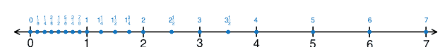

表 4.5 和图 4.9 揭示了我们 tiny float 类型的几个令人担忧的问题：

- 1. 存在许多空白；例如，值 2.4 缺失，因此无法精确表示（2.5 是最接近的近似值）。另一个例子是，0.75 和 1.75 都出现，但 2.75 缺失。

- 2. 该方案重复了一些数字；例如，三种不同的位模式表示十进制值 0.5：

  0.100 x 2⁰⁰ = 0.010 x 2⁰¹ = 0.001 x 2¹⁰ = 0.5₁₀

  这种重复限制了给定位数可以表示的不同值的数量。在我们的 tiny float 示例中，32 个位字符串中有 12 个（37.5%）是冗余的。

- 3. 数字分布不均匀。靠近零的值更多，远离零的值变得更稀疏。

第 4.8.1 节讨论的我们的无符号微小类型没有这些弱点。给定范围（0...31）内的所有整数都存在，没有两个位字符串表示相同的值，并且整数在其指定范围内均匀分布。虽然 C++ 提供的标准整数类型比我们的无符号微小类型具有更大的范围，但它们都共享这些相同的特性：其范围内的所有值都存在，所有位字符串都表示唯一的整数值。C++ 提供的标准浮点类型比我们的 tiny float 类型使用更多位，但它们表现出相同的问题，程度小得多：缺失的值、多个位模式表示相同的值，以及


| 位字符串 | 解释 | 十进制等价 | 值 |
|------------|----------------|--------------------|-------|
| 00000 | 0000 x 2^-2 | 0.000 x 1 | 0.000 |
| 00001 | 0000 x 2^-2 | 0.031 x 1 | 0.031 |
| 00010 | 0000 x 2^-2 | 0.062 x 1 | 0.062 |
| 00011 | 0000 x 2^-2 | 0.094 x 1 | 0.094 |
| 00100 | 0000 x 2^-2 | 0.125 x 1 | 0.125 |
| 00101 | 0001 x 2^-2 | 0.125 x 2 | 0.250 |
| 00110 | 0010 x 2^-2 | 0.125 x 4 | 0.500 |
| 00111 | 0011 x 2^-2 | 0.125 x 6 | 0.750 |
| 01000 | 0100 x 2^-2 | 0.125 x 8 | 1.000 |
| 01001 | 0101 x 2^-2 | 0.125 x 10 | 1.250 |
| 01010 | 0110 x 2^-2 | 0.125 x 12 | 1.500 |
| 01011 | 0111 x 2^-2 | 0.125 x 14 | 1.750 |
| 01100 | 1000 x 2^-1 | 0.250 x 1 | 0.250 |
| 01101 | 1001 x 2^-1 | 0.250 x 2 | 0.500 |
| 01110 | 1010 x 2^-1 | 0.250 x 4 | 1.000 |
| 01111 | 1011 x 2^-1 | 0.250 x 6 | 1.500 |
| 10000 | 1100 x 2^-1 | 0.250 x 8 | 2.000 |
| 10001 | 1101 x 2^-1 | 0.250 x 10 | 2.500 |
| 10010 | 1110 x 2^-1 | 0.250 x 12 | 3.000 |
| 10011 | 1111 x 2^-1 | 0.250 x 14 | 3.500 |
| 10100 | 0000 x 2^0 | 0.500 x 1 | 0.500 |
| 10101 | 0001 x 2^0 | 0.500 x 2 | 1.000 |
| 10110 | 0010 x 2^0 | 0.500 x 4 | 2.000 |
| 10111 | 0011 x 2^0 | 0.500 x 6 | 3.000 |
| 11000 | 0100 x 2^0 | 0.500 x 8 | 4.000 |
| 11001 | 0101 x 2^0 | 0.500 x 10 | 5.000 |
| 11010 | 0110 x 2^0 | 0.500 x 12 | 6.000 |
| 11011 | 0111 x 2^0 | 0.500 x 14 | 7.000 |
| 11100 | 1000 x 2^1 | 1.000 x 1 | 1.000 |
| 11101 | 1001 x 2^1 | 1.000 x 2 | 2.000 |
| 11110 | 1010 x 2^1 | 1.000 x 4 | 4.000 |
| 11111 | 1011 x 2^1 | 1.000 x 6 | 6.000 |

表 4.5：**微型浮点数** 值。位字符串的前三位构成尾数，最后两位表示指数。给定五位，我们可以生成 32 个不同的位字符串。请注意，由于不同尾数和指数的组合方式可能产生相同的值，因此 32 个不同的位字符串只产生 20 个唯一的 **微型浮点数** 值。

值在其范围内分布不均。这不仅仅是 C++ 对浮点数实现的问题；所有遵循 IEEE 754 标准的计算机语言和硬件都会出现这些问题。为了克服这些问题并真正表示和计算数学实数，我们需要一台具有无限内存和无限快处理器的计算机。

清单 4.15 (imprecisionedifference.cpp) 演示了浮点运算的不精确性。

```cpp
#include <iostream>
#include <iomanip>

int main() {
    double d1 = 2000.5;
    double d2 = 2000.0;
    std::cout << std::setprecision(16) << (d1 - d2) << '\n';
    double d3 = 2000.58;
    double d4 = 2000.0;
    std::cout << std::setprecision(16) << (d3 - d4) << '\n';
}
```

清单 4.15 (imprecisionedifference.cpp) 的输出是：

```
0.5
0.5799999999999272
```

该程序使用了一个额外的 #include 指令：

```
#include <iomanip>
```

此预处理器指令允许我们使用 std::setprecision 输出流操纵器，该操纵器指示 std::cout 输出流对象在浮点值中打印更多小数位。在程序执行期间，第一次减法得出正确答案。我们现在知道，某些浮点数（例如 0.5）具有精确的内部表示，而其他浮点数只是近似值。第二次减法的精确答案应为 0.58，如果我们将报告的结果四舍五入到 12 位小数，则答案匹配。浮点运算通常产生真实答案的接近近似值。

清单 4.16 (precise8th.cpp) 以一种迂回的方式计算零：

1 - 1/8 - 1/8 - 1/8 - 1/8 - 1/8 - 1/8 - 1/8 - 1/8 = 0

```cpp
#include <iostream>

int main() {
    double one = 1.0,
           one_eighth = 1.0/8.0,
           zero = one - one_eighth - one_eighth - one_eighth - one_eighth
                - one_eighth - one_eighth - one_eighth;

    std::cout << "one = " << one << ", one_eighth = " << one_eighth
              << ", zero = " << zero << '\n';
}
```

清单 4.16 (precise8th.cpp) 打印

```
one = 1, one_eighth = 0.125, zero = 0
```

数字 1/8 具有精确的十进制表示，0.125。它也具有精确的二进制表示，0.001₂。

然而，请考虑 1/5。虽然 1/5 = 0.2 在十进制中具有有限表示，但在二进制中没有有限表示：

1/5 = 0.2 = 0.0011001100110011...₂

在二进制表示中，0011 位序列无限重复。这意味着 1/5 没有精确的浮点表示。清单 4.17 (imprecise5th.cpp) 通过涉及 1/5 的运算进行了说明。

```cpp
// Listing 4.17: imprecise5th.cpp

#include <iostream>

int main() {
    double one = 1.0,
           one_fifth = 1.0/5.0,
           zero = one - one_fifth - one_fifth - one_fifth
                  - one_fifth - one_fifth;

    std::cout << "one = " << one << ", one_fifth = " << one_fifth
              << ", zero = " << zero << '\n';
}
```

```
one = 1, one_fifth = 0.2, zero = -5.55112e-017
```

报告的答案（5.55112 x 10^-17 = 0.0000000000000000555112）无疑接近正确答案（零）。如果将其四舍五入到一千万亿分位（小数点后 15 位），则是正确的。

浮点数的这种不精确性对程序员有什么影响？第 9.4.6 节展示了浮点值的误用如何导致程序中的逻辑错误。

小心避免溢出和下溢，整数运算是精确的，并且在大多数计算机系统上比浮点运算更快。如果应用程序要求绝对正确的答案且整数适合该计算，则应选择整数。例如，在财务计算中，跟踪每一分钱很重要。整数运算的精确性使整数成为一个有吸引力的选择。在处理数字时，整数类型应是程序员的首选。

由于计算机资源有限，浮点数的局限性是不可避免的。即使我们尽力以有限方式近似具有无限特性的值，妥协也是不可避免的。尽管存在不精确性，双精度浮点数仍每天在全世界用于解决复杂的科学和工程问题；例如，适当使用浮点数已使空间探测器能够到达遥远的行星。在上述演示浮点数不精确性的示例 C++ 程序中，如果我们同意必须尽可能多地计算位数，然后将结果四舍五入到更少的位数，那么问题在很大程度上就会消失。浮点数在精度和实用性之间提供了良好的权衡。

### 4.9 更多算术运算符

如清单 4.12 (enhancedtimeconv.cpp) 所示，正在执行的程序可以通过对变量的当前值进行一些算术运算来更改其值。变量可能增加 1 或减少 5。语句

```
x = x + 1;
```

将 x 增加 1，使其比执行此语句之前大 1。C++ 有一个更短的语句可以实现相同的效果：

```
x++;
```

这是递增语句。还有一个类似的递减语句可用：

```
x--; // Same as x = x - 1;
```

这些语句更准确地说是后递增和后递减运算符。还有前递增和前递减形式，例如

```
--x; // Same as x = x - 1;
++y; // Same as y = y + 1;
```

当它们单独出现在语句中时，递增和递减运算符的前置和后置版本工作方式相同。当它们嵌入到更复杂的语句中时，它们的行为不同。清单 4.18 (prevpost.cpp) 演示了前置和后置递增运算符的工作方式略有不同。

### 清单 4.18: prevpost.cpp

```cpp
#include <iostream>

int main() {
    int x1 = 1, y1 = 10, x2 = 100, y2 = 1000;
    std::cout << "x1=" << x1 << ", y1=" << y1
              << ", x2=" << x2 << ", y2=" << y2 << '\n';
    y1 = x1++;
    std::cout << "x1=" << x1 << ", y1=" << y1
              << ", x2=" << x2 << ", y2=" << y2 << '\n';
    y2 = ++x2;
    std::cout << "x1=" << x1 << ", y1=" << y1
              << ", x2=" << x2 << ", y2=" << y2 << '\n';
}
```

### 清单 4.18 (prevpost.cpp) 打印

```
x1=1, y1=10, x2=100, y2=1000
x1=2, y1=1, x2=100, y2=1000
x1=2, y1=1, x2=101, y2=101
```

如果 x1 在语句之前具有值 1

```
y1 = x1++;
```

那么语句执行后立即，x1 为 2，y1 为 1。

如果 x1 在语句之前具有值 1

```
y1 = ++x1;
```

那么语句执行后立即，x1 为 2，y1 也为 2。

如您所见，前置递增运算符在评估整个表达式时使用递增变量的新值。相比之下，后置递增运算符在评估整个表达式时使用递增变量的原始值。前置和后置递减运算符的行为类似。

对于初学者程序员来说，最好避免在更复杂的表达式中使用递增和递减运算符。我们将经常将它们作为独立语句使用，因为当它们不是更复杂表达式的一部分时，误解其行为的危险不存在。


C++ 提供了一种更通用的方式，来简化通过简单算术修改变量的语句。例如，语句

```
x = x + 5;
```

可以缩短为

```
x += 5;
```

这条语句的意思是“增加 x 五。”任何形式为

```
x op= exp;
```

的语句，其中

- x 是一个变量。
- op= 是算术运算符与赋值运算符的组合；就我们的目的而言，对我们最有用的是 +=、-=、*=、/= 和 %=。
- exp 是与变量 x 兼容的表达式。

这种形式的算术重新赋值语句等价于

```
x = x op exp;
```

这意味着语句

```
x *= y + z;
```

等价于

```
x = x * (y + z);
```

使用算术赋值的版本不需要括号。当要修改的变量名很长时，算术赋值尤其方便；考虑

```
temporary_filename_length = temporary_filename_length / (y + z);
```

与

```
temporary_filename_length /= y + z;
```

图 4.10 32 位 C++ 无符号整数的位位置


> 不要不小心颠倒算术赋值运算符符号的顺序，例如在语句
>
> `x = + 5;`
>
> 中。注意 + 和 = 符号已被颠倒。编译器将此语句解释为如果写成
>
> `x = +5;`
>
> 即赋值和一元运算符。这会将 x 赋值为恰好五，而不是将其增加五。
>
> 同样，
>
> `x = - 3;`
>
> 会将 -3 赋值给 x，而不是将 x 减少三。

第 4.10 节考察了 C++ 中可用的一些其他运算符。

### 4.10 位运算符

除了在第 4.1 节介绍的常见算术运算符之外，C++ 还提供了一些其他特殊用途的算术运算符。这些特殊运算符允许程序员检查或操作构成数据值的单个位。它们被称为位运算符。这些运算符包括 &、|、^、~、>>、<< 和 <<。应用程序员通常不需要经常使用位运算符，但位操作在许多系统编程任务中是必不可少的。

考虑 32 位无符号整数。位位置通常从右到左编号，从零开始。图 4.10 显示了单个位位置通常是如何编号的。

按位与运算符 & 接受两个整数子表达式并计算一个整数结果。表达式 e1 & e2 的求值过程如下：

- 如果 e1 和 e2 中的位 0 都是 1，则结果中的位 0 为 1；否则，结果中的位 0 为 0。
- 如果 e1 和 e2 中的位 1 都是 1，则结果中的位 1 为 1；否则，结果中的位 1 为 0。
- 如果 e1 和 e2 中的位 2 都是 1，则结果中的位 2 为 1；否则，结果中的位 2 为 0。

如果 e1 和 e2 中的位 31 都是 1，则结果中的位 31 为 1；否则，结果中的位 31 为 0。

例如，表达式 13 & 14 的求值结果为 12，因为：

```
13₁₀ = 00000000000000000000000000001101₂
& 14₁₀ = 00000000000000000000000000001110₂
12₁₀ = 00000000000000000000000000001100₂
```

13 和 14 的位 2 和位 3 都是 1；因此，结果中的位 2 和位 3 必须是 1。

按位或运算符 | 接受两个整数子表达式并计算一个整数结果。表达式 e1 | e2 的求值过程如下：

- 如果 e1 和 e2 中的位 0 都是 0，则结果中的位 0 为 0；否则，结果中的位 0 为 1。
- 如果 e1 和 e2 中的位 1 都是 0，则结果中的位 1 为 0；否则，结果中的位 1 为 1。
- 如果 e1 和 e2 中的位 2 都是 0，则结果中的位 2 为 0；否则，结果中的位 2 为 1。

如果 e1 和 e2 中的位 31 都是 0，则结果中的位 31 为 0；否则，结果中的位 31 为 1。

例如，表达式 13 | 14 的求值结果为 15，因为：

```
13₁₀ = 00000000000000000000000000001101₂
| 14₁₀ = 00000000000000000000000000001110₂
15₁₀ = 00000000000000000000000000001111₂
```

13 和 14 的位 4-31 都是 0。在位 0-3 中，要么 13 有一个 1，要么 14 有一个 1；因此，结果在位 0-3 中有 1，其他地方都是 0。

按位异或（通常称为 xor）运算符 (^) 接受两个整数子表达式并计算一个整数结果。表达式 e1 ^ e2 的求值过程如下：

- 如果 e1 中的位 0 与 e2 中的位 0 相同，则结果中的位 0 为 0；否则，结果中的位 0 为 1。
- 如果 e1 中的位 1 与 e2 中的位 1 相同，则结果中的位 1 为 0；否则，结果中的位 1 为 1。
- 如果 e1 中的位 2 与 e2 中的位 2 相同，则结果中的位 2 为 0；否则，结果中的位 2 为 1。

如果 e1 中的位 31 与 e2 中的位 31 相同，则结果中的位 31 为 0；否则，结果中的位 31 为 1。

例如，表达式 13 ^ 14 的求值结果为 3，因为：

```
13₁₀ = 00000000000000000000000000001101₂
^ 14₁₀ = 00000000000000000000000000001110₂
3₁₀ = 00000000000000000000000000000011₂
```

13 和 14 的位 0 和位 1 不同，因此这些位在结果中为 1。其他所有位置的位都匹配，因此这些位置在结果中必须设置为 0。

按位取反运算符 ( ~ ) 是一个一元运算符，它反转其表达式的所有位。表达式 ~ e 的求值过程如下：

如果 e 中的位 0 是 0，则结果中的位 0 为 1；否则，结果中的位 0 为 0。

如果 e 中的位 1 是 0，则结果中的位 1 为 1；否则，结果中的位 1 为 0。

如果 e 中的位 2 是 0，则结果中的位 2 为 1；否则，结果中的位 2 为 0。

⋮

如果 e 中的位 31 是 0，则结果中的位 31 为 1；否则，结果中的位 31 为 0。

例如，无符号表达式 ~13u 的求值结果为 4,294,967,282，因为

| 13₁₀ | = | 00000000000000000000000000001101₂ |
|---|---|---|
| 取反 | ↓ | |
| 4,294,967,282₁₀ | = | 11111111111111111111111111110010₂ |

对于有符号整数，第 31 位存储数字的符号。有符号整数使用一种称为二进制补码的表示法，它是标准二进制布局的微小变体。只需说，int 表达式 ~13 的求值结果与 ~13u 具有相同的模式，但作为有符号整数，它表示 -14。

移位运算符将整数中的所有位向左或向右移动：

- **向左移位 (<<)。** 表达式 x << y，其中 x 和 y 是整数类型，将 x 中的所有位向左移动 y 位。零填充空出的位置。移出左侧的位被丢弃。表达式 5 << 2 的求值结果为 20，因为 5₁₀ = 101₂ 向左移动两位得到 10100₂ = 20₁₀。请注意，x << y 等于 x × 2ʸ。

- **向右移位 (>>)。** 表达式 x >> y，其中 x 和 y 是整数类型，将 x 中的所有位向右移动 y 位。填充左侧空出位的内容取决于整数是有符号还是无符号（例如 int 与 unsigned）：

  - 对于有符号值，空出的位位置用符号位（原始最左侧位）填充。
  - 对于无符号值，空出的位位置用零填充。

移出右侧的位被丢弃。表达式 5 >> 2 的求值结果为 1，因为 5₁₀ = 101₂ 向右移动两位得到 001₂ = 1₁₀（原始位置 1 和 0 中的位被移出右端并丢失）。请注意，x >> y 等于 x ÷ 2ʸ。

不要将左移运算符 (<<) 与输出流插入运算符 (<<) 混淆。运算符相同，但上下文区分了它们。如果左操作数是整数类型，<< 表示左移；如果左操作数是像 std::cout 这样的流输出对象，<< 表示将右操作数发送到输出流对象以显示。同样，输入流对象 std::cin 使用 >> 用于与整数一起使用的右移运算符不同的目的。

清单 4.19 (bitwiseoperators.cpp) 尝试使用位运算符。


## 清单 4.19: bitwiseoperators.cpp

```
#include <iostream>

int main() {
    int x, y;
    std::cout << "Please enter two integers: ";
    std::cin >> x >> y;
    std::cout << x << " & " << y << " = " << (x & y) << '\n';
    std::cout << x << " | " << y << " = " << (x | y) << '\n';
    std::cout << x << " ^ " << y << " = " << (x ^ y) << '\n';
    std::cout << "~" << x << " = " << ~x << '\n';
    std::cout << x << " << " << 2 << " = " << (x << 2) << '\n';
    std::cout << x << " >> " << 2 << " = " << (x >> 2) << '\n';
}
```

开发者使用位运算来完成各种系统级编程任务。例如，在图形用户界面（GUI）中，用户通过鼠标和键盘与应用程序交互来生成事件。用户可能在窗口中的某个图形元素（如按钮）上单击鼠标按钮。关于此事件的多个信息片段可以存储在一个整数中。例如，位 0 可以指示单击鼠标按钮时是否按住了 Shift 键。位 1 可能负责 Alt 键，位 2 负责 Ctrl 键，等等。因此，整数值 5（其二进制形式为 00000000000000000000000000000101）表示单击鼠标按钮时同时按住了 Shift 键和 Alt 键。这可能要求程序采取与按下其他按键组合（或未按下任何按键）不同的操作。例如，假设 int 变量 key_status 保存了用户在最近一次鼠标单击时按下的按键信息。考虑表达式 key_status & 1。位字符串 00000000000000000000000000000001 表示表达式 1，而 key_status 的值未知，因此 key_status & 1 是

```
key_status = ?????????????????????????????????
&       1₁₀ = 00000000000000000000000000000001₂
0₁₀ or 1₁₀ = 00000000000000000000000000000000₂ or 00000000000000000000000000000001₂
```

如果结果为零，这意味着 key_status 中的位 0 为 0，因此未按下 Shift 键。另一方面，如果结果为一，这意味着位 0 为 1，因此按下了 Shift 键。在表达式

```
key_status & 1
```

中，1 被称为掩码，因为它用于屏蔽（或“移除”）key_status 的前 31 位。

通常，GUI 库会定义常量来帮助程序员检查或修改特定位；例如，给定以下常量：

```
const int SHIFT_DOWN = 1;       // This is 0...0001
const int CTRL_DOWN = SHIFT_DOWN << 1; // This is 0...0010
const int ALT_DOWN = CTRL_DOWN << 1;   // This is 0...0100
```

表达式

```
key_status & 1
```

最好写成

```
key_status & SHIFT_DOWN
```

表达式

```
key_status & (SHIFT_DOWN | ALT_DOWN)
```

可以测试鼠标事件期间 Shift 键和 Alt 键是否同时按下。你明白表达式 SHIFT_DOWN | ALT_DOWN 表示两个键同时按下吗？

我们可以使用掩码来确保某些位是开启或关闭。为了了解如何操作，请考虑掩码 5，即

```
00000000000000000000000000000101
```

如果 x 是一个 32 位整数变量，我们可以使用语句

```
x = x | 5;
```

有选择地将其位 0 和 2 打开。

接下来，考虑无符号值 4294967290u，即 ~5u，或

```
11111111111111111111111111111010
```

如果 x 是一个 32 位整数变量，我们可以使用语句

```
x = x & 4294967290u;
```

有选择地将其位 0 和 2 关闭。

直到我们在第 5 章中考虑条件执行时，才能充分体会使用位运算符进行掩码操作的实用性。即便如此，由于本书侧重于应用程序编程而非系统编程，我们很少会用到位运算符，只有少数孤立的情况会用到。不过，了解它们的存在是件好事，因为意外使用它们可能导致难以诊断的编译器消息和逻辑错误。

与其他作用于两个操作数的 C++ 算术运算符一样，我们可以将位二元运算符 &、|、^、<< 和 >> 与赋值结合，以简化变量的修改；例如，以下语句

```
x = x | y; // Turn on bits in x determined by
```

可以写成

```
x |= y; // Turn on bits in x determined by
```

表 4.6 列出了可能性。

| 赋值 | 简写 |
|---|---|
| x = x & y; | x &= y; |
| x = x | y; | x |= y; |
| x = x ^ y; | x ^= y; |
| x = x << y; | x <<= y; |
| x = x >> y; | x >>= y; |

### 4.11 算法

算法是一系列有限步骤，每个步骤耗时有限，用于解决问题或计算结果。计算机程序是算法的一个示例，制作千层面的食谱也是。在这两个示例中，步骤的顺序都很重要。在制作千层面的情况下，面条必须先在沸水中煮熟，然后再铺入馅料中烘烤。将生面条与其他所有食材一起放入烤盘中烘烤，然后再取出已经烤好的面条单独在沸水中煮熟，这是不合适的。同样，在计算机程序中，步骤的顺序也非常重要。虽然这一点可能显而易见，但请考虑以下合理的论证：

- 1. 摄氏度与华氏度之间的关系可以表示为

°C = 5/9 (°F - 32)

- 2. 给定华氏温度，可以计算出相应的摄氏温度。

掌握这些知识后，清单 4.20 (faultytempconv.cpp) 如下所示。

```
// File Faultytempconv.cpp
#include <iostream>
int main() {
    double degreesF = 0, degreesC = 0;
    // Define the relationship between F and C
    degreesC = 5.0/9*(degreesF - 32);
    // Prompt user for degrees F
    std::cout << "Enter the temperature in degrees F: ";
    // Read in the user's input
    std::cin >> degreesF;
    // Report the result
    std::cout << degreesC << '\n';
}
```

不幸的是，执行程序始终显示

```
-17.7778
```

无论输入如何。上面提供的英文描述是正确的。不存在像清单 4.10 (tempconv.cpp) 中那样的整数除法问题。问题仅在于语句顺序。语句

```
degreesC = 5.0/9*(degreesF - 32);
```

是一条赋值语句，而不是贯穿整个程序存在的关系定义。在赋值时，degreesF 的值为零。执行程序在从用户处接收到 degreesF 的值之前，就计算并赋值给了 degreesC 变量。

作为另一个示例，假设 x 和 y 是某个程序中的两个整数变量。我们如何交换这两个变量的值？我们希望 x 拥有 y 的原始值，y 拥有 x 的原始值。以下代码看起来可能合理：

```
x = y;
y = x;
```

这段代码的问题是，在执行第一条语句后，x 和 y 都具有相同的值（y 的原始值）。第二条赋值是多余的，不会改变 x 或 y 的值。解决方案需要一个第三个变量来在重新赋值之前记住其中一个变量的原始值。交换值的正确代码是

```
temp = x;
x = y;
y = temp;
```

这个小例子强调了算法必须精确指定的事实。在程序设计的早期阶段，关于如何解决问题的非正式概念可能很有价值，但编码后的程序需要对解决方案进行正确的详细描述。

我们迄今看到的算法都很简单。语句 1，接着是语句 2，等等，直到程序中的每条语句都执行完毕。第 5 章和第 6 章介绍了一些语言结构，允许对某些语句进行可选和重复执行。这些结构使我们能够构建更有趣的程序，但需要更复杂的算法才能实现这一点。我们不能忽视这样一个事实：一个 99% 正确的复杂算法并不正确。算法的设计和实现可能会因对最微小细节的疏忽而偏离轨道。

### 4.12 练习

- 1. 字面量 4 是有效的 C++ 表达式吗？
- 2. 变量 x 是有效的 C++ 表达式吗？
- 3. x + 4 是有效的 C++ 表达式吗？
- 4. 一元 + 运算符应用于数值表达式时有什么效果？
- 5. 按从高到低优先级对以下二元运算符进行排序：+、-、*、/、%、=。
- 6. 编写一个 C++ 程序，从用户处接收两个整数值。然后程序应打印和（加法）、差（减法）、积（乘法）、商（除法）以及除法后的余数（取模）。你的程序必须仅使用整数。

示例程序运行如下（用户在冒号后输入 10 和 2，程序打印其余内容）：

```
Please enter the first number: 10
Please enter the second number: 2
10 + 2 = 12
10 - 2 = 8
```


```
10 * 2 = 20
10 / 2 = 5
10 % 2 = 0
```

你能解释这些运算产生的所有结果吗？

- 7. 编写一个 C++ 程序，从用户处接收两个双精度浮点数值。程序随后应打印和（加法）、差（减法）、积（乘法）和商（除法）。你的程序应仅使用整数。

  示例程序运行如下（用户在冒号后输入 10 和 2.5，程序打印其余内容）：

  ```
  Please enter the first number: 10
  Please enter the second number: 2.5
  10 + 2.5 = 12.5
  10 - 2.5 = 7.5
  10 * 2.5 = 25
  10 / 2.5 = 4
  ```

  你能解释这些运算产生的所有结果吗？如果你尝试对双精度浮点数值进行除法后的余数（取模）运算，会发生什么？

- 8. 鉴于以下声明：

  ```
  int x = 2;
  ```

  指出以下每条 C++ 语句将打印什么。

  - (a) std::cout << "x"<< '\n';
  - (b) std::cout << 'x'<< '\n';
  - (c) std::cout << x << '\n';
  - (d) std::cout << "x + 1"<< '\n';
  - (e) std::cout << 'x' + 1 << '\n';
  - (f) std::cout << x + 1 << '\n';

- 9. 将以下类型按从最窄到最宽的顺序排列：int、double、float、long、char。

- 10. 鉴于以下声明：

  ```
  int i1 = 2, i2 = 5, i3 = -3;
  double d1 = 2.0, d2 = 5.0, d3 = -0.5;
  ```

  求值以下每个 C++ 表达式。

  - (a) i1 + i2
  - (b) i1 / i2
  - (c) i2 / i1
  - (d) i1 * i3
  - (e) d1 + d2
  - (f) d1 / d2
  - (g) d2 / d1
  - (h) d3 * d1
  - (i) d1 + i2
  - (j) i1 / d2
  - (k) d2 / i1
  - (l) i2 / d1
  - (m) i1/i2*d1
  - (n) d1*i1/i2
  - (o) d1/d2*i1
  - (p) i1*d1/d2
  - (q) i2/i1*d1
  - (r) d1*i2/i1
  - (s) d2/d1*i1
  - (t) i1*d2/d1

- 11. 以下语句打印什么：

  ```
  std::cout << /* * 5 */ 3 << '\n';
  ```

- 12. 鉴于以下声明：

  ```
  int i1 = 2, i2 = 5, i3 = -3;
  double d1 = 2.0, d2 = 5.0, d3 = -0.5;
  ```

  求值以下每个 C++ 表达式。

  - (a) i1 + (i2 * i3)
  - (b) i1 * (i2 + i3)
  - (c) i1 / (i2 + i3)
  - (d) i1 / i2 + i3
  - (e) 3 + 4 + 5 / 3
  - (f) (3 + 4 + 5) / 3
  - (g) d1 + (d2 * d3)
  - (h) d1 + d2 * d3
  - (i) d1 / d2 - d3
  - (j) d1 / (d2 - d3)
  - (k) d1 + d2 + d3 / 3
  - (l) (d1 + d2 + d3) / 3
  - (m) d1 + d2 + (d3 / 3)
  - (n) 3 * (d1 + d2) * (d1 - d3)

- 13. 单行注释与块注释有何不同？

- 14. 块注释可以嵌套吗？

- 15. 注释过多和注释过少，哪种更好？

- 16. 注释的目的是什么？

- 17. 清单 3.4（variable.cpp）、清单 4.4（reformattedvariable.cpp）和清单 4.5（reformattedvariable2.cpp）中的程序编译为相同的机器代码且行为完全相同。是什么让其中一个程序明显优于其他程序？

- 18. 为什么人类可读性是如此重要的考虑因素？

- 19. 考虑以下包含一些错误的程序。你可以假设程序中的注释准确描述了程序的预期行为。

  ```
  #include <iostream>

  int main() {
     int n1, n2, d1;         // 1
     // Get two numbers from the user
     cin >> n1 >> n2;        // 2
     // Compute sum of the two numbers
     std::cout << n1 + n2 << '\n';   // 3
     // Compute average of the two numbers
     std::cout << n1+n2/2 << '\n';   // 4
     // Assign some variables
     d1 = d2 = 0;            // 5
     // Compute a quotient
     std::cout << n1 /d1 << '\n';    // 6
     // Compute a product
     n1*n2 = d1;             // 7
     // Print result
     std::cout << d1 << '\n';        // 8
  }
  ```

  对于注释中列出的每一行，指出是否存在编译时错误、运行时错误或逻辑错误。并非所有行都包含错误。

- 20. 编译器警告与编译器错误有何区别？你应该担心警告吗？为什么或为什么不？

- 21. 增强编译器警告报告功能有什么优势？

- 22. 用最简洁的方式表达以下每条语句。

  - (a) x = x + 1;
  - (b) x = x / 2;
  - (c) x = x - 1;
  - (d) x = x + y;
  - (e) x = x - (y + 7);
  - (f) x = 2*x;
  - (g) number_of_closed_cases = number_of_closed_cases + 2*ncc;

- 23. 以下代码片段打印什么？

  ```
  int x1 = 2, y1, x2 = 2, y2;
  y1 = ++x1;
  y2 = x2++;
  std::cout << x1 << " " << x2 << '\n';
  std::cout << y1 << " " << y2 << '\n';
  ```

  输出为何会呈现这样的结果？

- 24. 考虑以下程序，它试图根据用户输入的半径计算圆的周长。给定圆的半径 r，圆的周长 C 由以下公式给出：

  $C = 2\pi r$

  ```
  #include <iostream>
  int main() {
     double C, r;
     const double PI = 3.14159;
     // Formula for the area of a circle given its radius
     C = 2*PI*r;
     // Get the radius from the user
     cout >> "Please enter the circle's radius: ";
     cin << r;
     // Print the circumference
     std::cout << "Circumference is " << C << '\n';
  }
  ```

  - (a) 编译器会发出警告。警告是什么？
  - (b) 程序未产生预期结果。为什么？
  - (c) 如何修复它，以便不仅消除警告，还能消除逻辑错误？

- 25. 在数学中，两点 $(x_1,y_1)$ 和 $(x_2,y_2)$ 之间的中点由以下公式计算：

  \(\left( \frac{x_1+x_2}{2}, \frac{y_1+y_2}{2} \right)\)

  编写一个 C++ 程序，从用户处接收两个数学点，并计算并打印它们的中点。

  程序运行示例产生如下输出：

  ```
  Please enter the first point: (0,0)
  Please enter the second point: (1,1)
  The midpoint of (0,0) and (1,1) is (0.5,0.5)
  ```

  用户实际输入 "(0,0)" 和 "(1,1)"，带有所示的括号和逗号。要了解如何实现这一点，假设你想允许用户输入点 (2,3,9)，将点的 x 分量赋给名为 x 的变量，将 y 分量赋给名为 y 的变量。你可以将以下代码片段添加到程序中以达到预期效果：

  ```
  double x, y;
  char left_paren, comma, right_paren;
  std::cin >> left_paren >> x >> comma >> y >> right_paren;
  ```

  如果用户实际输入 (2,3,9)，std::cin 语句将 ( 字符赋给变量 left_paren。接着将 2.3 赋给变量 x。将 , 字符赋给名为 comma 的变量，将值 9 赋给变量 y，将 ) 字符赋给变量 right_paren。变量 left_paren、comma 和 right_paren 只是用户输入的占位符，在程序的其他位置未被使用。实际上，只要数字相对于字符位于正确位置，用户可以输入其他字符来代替括号和逗号；例如，用户可以输入 *2.3*9#，程序会将输入解释为点 (2,3,9)。

| 食物 | 卡路里 |
| :--- | :--- |
| 豆类卷饼 | 357 |
| 配调味汁的沙拉 | 185 |
| 奶昔 | 388 |

表 4.7：几种快餐食品的卡路里含量

- 26. 表 4.7 列出了几种食物的卡路里含量。跑步或步行每英里消耗约 100 卡路里。编写一个 C++ 程序，向用户请求三个值：消耗的豆类卷饼、沙拉和奶昔的数量（按此顺序）。程序随后应显示为消耗该食物中所含卡路里而必须跑步或步行的英里数。程序运行情况如下（用户输入 3 2 1）：

  ```
  Number of bean burritos, bowls of salad, and milkshakes eaten? 3 2 1
  You ingested 1829 Calories
  You will have to run 18.29 miles to expend that much energy
  ```

  请注意，结果是浮点值，因此你应使用浮点运算来计算此问题的答案。

## 第 5 章

## 条件执行

前几章中的所有程序都会执行完全相同的语句，无论是否向它们提供了任何输入。它们遵循线性序列：语句 1、语句 2，等等，直到最后一条语句执行完毕且程序终止。像这样的线性程序在可解决的问题方面非常受限。本章介绍了允许程序语句根据程序执行的上下文（输入）可选执行的结构。

### 5.1 bool 类型

算术表达式求值为数值；布尔表达式求值为 true 或 false。虽然布尔表达式表面上看起来非常有限，但它们对于构建更有趣、更有用的程序至关重要。

C++ 支持非数值数据类型 bool，代表布尔值。术语 Boolean 源自英国数学家乔治·布尔的名字。离散数学的一个分支——布尔代数——专门研究逻辑表达式的属性和操作。与数值类型相比，bool 类型非常简单，因为它只能表示两个值：true 或 false。清单 5.1（boolvars.cpp）是一个演示布尔变量用法的简单程序。

```
Listing 5.1: boolvars.cpp
#include <iostream>

int main() {
    // Declare some Boolean variables
    bool a = true, b = false;
    std::cout << "a = " << a << ", b = " << b << '\n';
    // Reassign a
    a = false;
    std::cout << "a = " << a << ", b = " << b << '\n';
    // Mix integers and Booleans
    a = 1;
    b = 1;
    std::cout << "a = " << a << ", b = " << b << '\n';
    // Assign Boolean value to an integer
```


```cpp
int x = a, y = true;
std::cout << "a = " << a << " x = " << x << ", b = " << b
      << " y = " << y << '\n';
// More mixing
a = 1725;   // Warning issued
b = -19;    // Warning issued
std::cout << "a = " << a << " x = " << x << ", b = " << b << '\n';
}
```

清单 5.1 (boolvars.cpp) 生成以下输出：

```
a = 1, b = 0
a = 0, b = 0
a = 1, b = 1
a = 1, b = 1, x = 1, y = 1
a = 1, b = 1
```

从运行清单 5.1 (boolvars.cpp) 可以看出，布尔值 false 和 true 分别表示为整数 0 和整数 1。更准确地说，零表示布尔值 false，任何非零整数（正或负）都表示 true。将除 0 或 1 以外的整数直接赋值给布尔变量可能会导致警告（Visual C++ 报告将 'int' 截断为 'bool'），但该变量仍被解释为 true。数据类型 bool 基本上是程序员的一种便利；任何使用布尔变量的 C++ 程序都可以改用整数来实现相同的结果。虽然布尔值和变量与整数可以自由兼容和互换，但当上下文涉及真值而非数字时，bool 类型很方便，应该使用。

有时，使用单词 false 和 true 而不是 0 和 1 来打印布尔值是可取的。清单 5.2 (boolalpha.cpp) 使用 std::boolalpha 流操纵符来调整输出流，以提供所需的效果。

## 清单 5.2: boolalpha.cpp

```cpp
#include <iostream>

int main() {
  // Declare some Boolean variables
  bool a = true, b = false;

  // Condition the stream to display Booleans as words
  std::cout << std::boolalpha;
  std::cout << "a = " << a << ", b = " << b << '\n';

  // Reassign a
  a = false;
  std::cout << "a = " << a << ", b = " << b << '\n';

  // Mix integers and Booleans
  a = 1;
  b = 1;
  std::cout << "a = " << a << ", b = " << b << '\n';

  // Assign Boolean value to an integer
  int x = a, y = true;
  std::cout << "a = " << a << ", b = " << b
            << " x = " << x << ", y = " << y << '\n';

  // More mixing
  a = 1725;   // Warning issued
  b = -19;    // Warning issued
  std::cout << "a = " << a << ", b = " << b << '\n';
}
```

| 运算符 | 含义 |
| :--- | :--- |
| == | 等于 |
| < | 小于 |
| > | 大于 |
| <= | 小于或等于 |
| >= | 大于或等于 |
| != | 不等于 |

表 5.1: C++ 关系运算符

| 表达式 | 值 |
| :--- | :--- |
| 10 < 20 | 始终为 true |
| 10 > 20 | 始终为 false |
| x == 10 | 仅当 x 的值为 10 时为 true |
| x != y | 除非 x 和 y 具有相同的值，否则为 true |

表 5.2: 关系运算符示例

清单 5.2 (boolalpha.cpp) 生成以下输出：

```
a = true, b = false
a = false, b = false
a = true, b = true
a = true, b = true, x = 1, y = 1
a = true, b = true
```

需要注意的是，Visual C++ 编译器会对清单 5.1 (boolvars.cpp) 中最后两个赋值语句发出警告。尽管任何非零值都被视为 true，但 1 是 true 的首选整数等效值（当您尝试打印字面量 true 时可以看到这一点）。由于将除 true 或 false 或其等效值 1 或 0 以外的值赋给布尔变量的需求应该极其罕见，编译器的消息会提醒程序员检查以确保赋值不是错误。

### 5.2 布尔表达式

最简单的布尔表达式是 false 和 true，即布尔字面量。布尔变量也是布尔表达式。比较数值表达式是否相等或不相等的表达式也是布尔表达式。最简单的布尔表达式使用关系运算符来比较两个表达式。表 5.1 列出了 C++ 中可用的关系运算符。

表 5.2 显示了一些简单的布尔表达式及其关联值。像 10 < 20 这样的表达式是合法的，但用处不大，因为表达式 true 等效、更简单，且不太可能让人类读者困惑。当布尔表达式的真值取决于一个或多个变量的值时，它们非常有用。

关系运算符是二元运算符，且全部左结合。它们的优先级都低于任何算术运算符；因此，表达式

`x + 2 < y / 10`

的求值过程就好像加了括号：

`(x + 2) < (y / 10)`

C++ 允许语句为简单表达式；例如，语句

```
x == 15;
```

看起来像是试图将值 15 赋给变量 x，但并非如此。= 运算符执行赋值，而 == 运算符检查关系相等性。如果您犯了错误并像这里所示使用 ==，Visual C++ 将发出包含消息

> `warning C4553: '==' : operator has no effect; did you intend '='?`

的警告。

请回顾第 4.6.4 节，编译器警告并不表示违反了语言规则；相反，它提醒程序员代码中存在可能的问题区域。

另一个将表达式用作语句的示例是

```
x + 15;
```


此语句是合法的（但无用的）C++ 语句，编译器相应地通知我们：

> `warning C4552: '+=' : operator has no effect; expected operator with side-effect`

为什么允许将表达式用作语句？某些简单表达式具有副作用，确实会改变程序的行为。这样的表达式的一个示例是 x++。清单 4.18 (prevpost.cpp) 展示了 x++ 既作为独立语句，又作为较大语句中的表达式时的行为。更常见的示例是将函数调用（也是一种表达式）用作独立语句。（我们在第 8 章介绍函数。）为了尽可能保持语言结构的统一性，C++ 容忍将无用表达式用作语句，以便程序员使用更有用的表达式语句。幸运的是，大多数编译器会对无用的表达式语句发出信息性警告，以保持开发者在正确轨道上。

### 5.3 简单 if 语句

第 5.2 节中描述的布尔表达式起初可能看起来晦涩难懂，在实际程序中用处不大。但实际上，布尔表达式对于程序在运行时调整其行为至关重要。没有布尔表达式，大多数真正有用且实用的程序都不可能实现。

第 4.6 节中提到的运行时异常源于逻辑错误。清单 4.6 (dividedanger.cpp) 可能失败的一种方式是当用户为除数输入零时。幸运的是，程序员可以采取措施确保不会发生除以零的情况。清单 5.3 (betterdivision.cpp) 展示了如何做到这一点。

## 清单 5.3: betterdivision.cpp

```cpp
#include <iostream>

int main() {
    int dividend, divisor;

    // Get two integers from the user
    std::cout << "Please enter two integers to divide:";
    std::cin >> dividend >> divisor;

    // If possible, divide and report the result
    if (divisor != 0)
        std::cout << dividend << "/" << divisor << " = "
                  << dividend/divisor << '\n';
}
```

第二个 std::cout 语句可能并不总是执行。在以下运行中

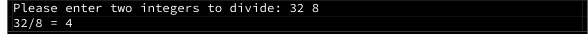

它被执行，但如果用户将第二个数字输入为零：


程序在用户输入值后不打印任何内容。

清单 5.3 (betterdivision.cpp) 中的最后一条语句以保留字 if 开头。if 语句允许可选执行代码。在这种情况下，打印语句仅在变量 divisor 的值不为零时执行。

### 布尔表达式

```
divisor != 0
```

决定右括号后的单条语句是否执行。如果 divisor 不为零，则打印消息；否则，程序不打印任何内容。

图 5.1 显示了程序执行如何通过清单 5.3 (betterdivision.cpp) 的 if 语句流动。

简单 if 语句的一般形式是

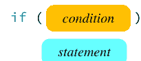

- 保留字 if 开始 if 语句。


## 图 5.1 if 流程图

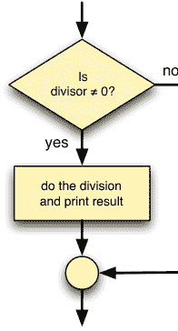

- 布尔表达式条件决定是否执行主体。布尔表达式必须像所示那样用括号括起来。

- 语句是在布尔表达式为真时要执行的语句。该语句构成了 if 语句的主体。第 5.4 节展示了主体如何由多个语句组成。

良好的编码风格要求我们应该缩进主体以强调可选执行并提高程序的可读性。编译器不要求缩进。有时程序员会将单语句主体放在 if 同一行；例如，以下 if 语句可选地给 y 赋值：

```cpp
if (x < 10)
    y = x;
```

并可以写成

```cpp
if (x < 10) y = x;
```

但不应写成

```cpp
if (x < 10)
    y = x;
```

因为缺少缩进隐藏了程序可选地执行赋值语句这一事实。编译器会接受它，但对于习惯于缩进惯例的人类读者来说，这具有误导性。当然，编译器会接受写成如下形式的代码

```cpp
if (x<10) y=x;
```

但缺少空格使得人类难以阅读。


当 if 语句以首选方式（使用两行源代码）编写时，重要的是不要在第一行末尾放置分号：

```cpp
if (x < 10); // No! Don't do this!
    y = x;
```

在这里，分号终止了 if 语句，但缩进暗示第二行意图作为 if 语句的主体。然而，编译器将格式不良的 if 语句解释为如果写成如下形式：

```cpp
if (x < 10)
    ; // This is what is really going on.
    y = x;
```

在 C++ 中这是合法的；它意味着 if 语句有一个空主体。在这种情况下，赋值不是主体的一部分。赋值语句在主体之后，并且无论布尔表达式的真值如何，都将始终执行。

在检查相等性时，如
if (x == 10)
std::cout << "ten";
请务必使用关系相等运算符 (==)，而不是赋值运算符 (=)。由于赋值语句有一个值（被赋的值，见第 4.3 节），C++ 允许在条件表达式中使用 =。然而，初学者在这种上下文中使用 = 几乎总是一个错误。Visual C++ 在警告级别 4 下检查条件表达式中赋值的使用；默认级别 3 不会。

### 5.4 复合语句

有时你需要根据特定条件可选地执行多个语句。清单 5.4 (alternatedivision.cpp) 展示了你必须如何使用花括号将多个语句分组为一个复合语句。

### 清单 5.4: alternatedivision.cpp

```cpp
#include <iostream>
int main() {
  int dividend, divisor, quotient;
  // Get two integers from the user
  std::cout << "Please enter two integers to divide:";
  std::cin >> dividend >> divisor;
  // If possible, divide them and report the result
  if (divisor != 0) {
    quotient = dividend / divisor;
    std::cout << dividend << " divided by " << divisor << " is "
              << quotient << '\n';
  }
}
```

赋值语句和打印语句都是 if 语句主体的一部分。给定特定程序运行期间布尔表达式 divisor != 0 的真值，要么两个语句都将执行，要么两个语句都不会执行。

复合语句由零个或多个语句组成，并用花括号分组。我们说花括号定义了一组语句块。作为一种风格，许多程序员总是使用花括号来界定 if 语句的主体，即使主体只包含一个语句。

```cpp
if (x < 10) {
  y = x;
}
```

他们这样做是因为如果以后向主体添加更多语句且程序员忘记添加所需的花括号，很容易引入逻辑错误。

以下代码的格式

```cpp
if (x < 10)
    y = x;
    z = x + 5;
```

暗示两个赋值都是 if 语句主体的一部分。由于构成主体的多个语句必须位于花括号内的复合语句中，编译器将代码片段解释为如果写成如下形式


```cpp
if (x < 10)
    y = x;
    z = y + 5;
```

这样的代码将可选地执行第一个赋值语句，并 *始终* 执行第二个赋值语句。

程序员可能本意是将其写成

```cpp
if (x < 10) {
    y = x;
    z = x + 5;
}
```

如果主体由单个语句组成，则花括号是可选的。如果主体只包含一个语句且未使用花括号，那么终止主体中语句的分号也终止 if 语句。如果使用花括号来界定主体，则不需要在主体的右花括号后加分号。

一对空花括号表示一个空块。空块是一个有效的复合语句。

### 5.5 if/else 语句

清单 5.3 (betterdivision.cpp) 的一个不良方面是，如果用户输入零除数，程序不打印任何内容。最好向用户提供一些反馈，以指示提供的除数无法使用。if 语句有一个可选的 else 子句，仅在布尔表达式为假时执行。清单 5.5 (betterfeedback.cpp) 使用 if/else 语句来提供所需的效果。

### 清单 5.5: betterfeedback.cpp

```cpp
#include <iostream>

int main() {
    int dividend, divisor;

    // Get two integers from the user
    std::cout << "Please enter two integers to divide:";
    std::cin >> dividend >> divisor;

    // If possible, divide them and report the result
```

## 图 5.2 if/else 流程图

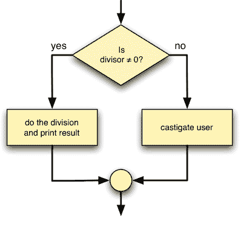

```cpp
if (divisor != 0)
    std::cout << dividend << "/" << divisor << " = "
              << dividend/divisor << '\n';
else
    std::cout << "Division by zero is not allowed\n";
}
```

给定的程序运行将恰好执行 `if` 主体或 `else` 主体中的一个。与清单 5.3 (betterdivision.cpp) 不同，始终会显示一条消息。

```
Please enter two integers to divide: 32 0
Division by zero is not allowed
```

`else` 子句包含一个替代主体，如果条件为假则执行该主体。程序的执行流程如图 5.2 所示。

清单 5.5 (betterfeedback.cpp) 避免了导致程序过早终止的除以零运行时错误，但它仍然提醒用户存在问题。另一个应用程序可能以不同的方式处理这种情况；例如，它可能用某个默认值替代 `divisor`，而不是零。

if/else 语句的一般形式是

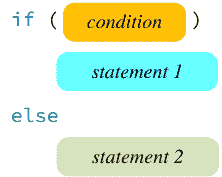

- 保留字 if 开始 if/else 语句。
- 条件是一个布尔表达式，用于确定运行中的程序将执行语句 1 还是语句 2。与简单的 if 语句一样，条件必须出现在括号内。
- 如果条件为真，程序执行语句 1。为了使 if/else 语句更具可读性，请将语句 1 的缩进比 if 行多一些空格。if 语句的这一部分有时称为 if 的主体。
- 保留字 else 开始 if/else 语句的第二部分。
- 如果条件为假，程序执行语句 2。为了使 if/else 语句更具可读性，请将语句 2 的缩进比 else 行多一些空格。if/else 语句的这一部分有时称为 else 的主体。

if/else 语句中 else 子句的主体可以是复合语句：

```cpp
if (x == y)
    std::cout << x;
else {
    x = 0;
    std::cout << y;
}
```

或者仅 if 主体可以是复合语句：

```cpp
if (x == y) {
    std::cout << x;
    x = 0;
}
else
    std::cout << y;
```

或者两部分都可以是复合语句：

```cpp
if (x == y) {
    std::cout << x;
    x = 0;
}
```


else {
    std::cout << y;
    y = 0;
}

或者，如清单 5.5（betterfeedback.cpp）所示，`if` 体和 `else` 体都可以是简单语句。

> 请记住，如果希望将多条语句与 `if` 或 `else` 的体关联，则必须使用复合语句。复合语句用花括号（{}）括起来。

如果你曾尝试使用 if/else 语句，并发现需要将 `else` 子句留空，如下所示

```
if (x == 2)
    std::cout << "x = " << x << '\n';
else
    ; // Nothing to do otherwise
```

或者，使用略有不同的语法，如下所示

```
if (x == 2)
    std::cout << "x = " << x << '\n';
else // Nothing to do otherwise
```

你反而应该使用一个简单的 `if` 语句：

```
if (x == 2)
    std::cout << "x = " << x << '\n';
```

上面所示的空 `else` 子句确实有效，但它们会使代码复杂化，并让人类更难以阅读。

由于浮点数的表示不精确（参见第 4.1 节中的清单 4.17（imprecise5th.cpp）），程序员在单独使用相等运算符（`==`）来比较浮点表达式时必须谨慎。清单 5.6（samedifferent.cpp）使用 `if`/`else` 语句来演示将相等运算符与浮点数量一起使用的风险。

## 清单 5.6：samedifferent.cpp

```
#include <iostream>
#include <iomanip>

int main() {
    double d1 = 1.11 - 1.10,
           d2 = 2.11 - 2.10;
    std::cout << "d1 = " << d1 << '\n';
    std::cout << "d2 = " << d2 << '\n';
    if (d1 == d2)
        std::cout << "Same\n";
    else
        std::cout << "Different\n";
    std::cout << "d1 = " << std::setprecision(20) << d1 << '\n';
    std::cout << "d2 = " << std::setprecision(20) << d2 << '\n';
}
```

在清单 5.6（samedifferent.cpp）中，d1 和 d2 的显示值被舍入，因此看起来相等，但在内部，精确表示略有不同。通过包含头文件 `iomanip`，我们可以使用 `std::setprecision` 流操纵器来强制 `std::cout` 在打印的浮点数中显示更多小数位。从清单 5.6（samedifferent.cpp）的输出可以看出，两个本应完全等于 0.01 的量实际上略有不同。

```
d1 = 0.01
d2 = 0.01
Different
d1 = 0.01000000000000000009
d2 = 0.009999999999999997868
```

此结果不应阻止你在真正需要的地方使用浮点数。在第 9.4.6 节中，我们将看到如何正确处理浮点数比较。

### 5.6 复合布尔表达式

简单布尔表达式（每个涉及一个关系运算符）可以使用逻辑运算符 `&&`（与）、`||`（或）和 `!`（非）组合成更复杂的布尔表达式。使用逻辑运算符组合的两个或多个布尔表达式称为 *复合布尔表达式*。

要介绍复合布尔表达式，请考虑一个计算机科学学位，它要求（在其他计算机课程之外）学习 *操作系统* 和 *编程语言*。如果我们孤立这两门课程，可以说学生必须成功完成操作系统和编程语言两门课程才能获得学位。通过 *操作系统* 但未通过 *编程语言* 的学生不符合要求。同样，没有 *操作系统* 的 *编程语言* 是不够的，同时未完成 *操作系统* 和 *编程语言* 的学生当然不符合资格。

逻辑 **与** 的工作方式完全相同。如果 `e1` 和 `e2` 是两个布尔表达式，则仅当 `e1` 和 `e2` 都为真时，`e1 && e2` 才为真；如果其中一个为假或两者都为假，则复合表达式为假。

为了说明逻辑 **或**，请考虑两门数学课程，*微分方程* 和 *线性代数*。计算机科学学位要求修读这两门课程中的一门。成功完成 *微分方程* 但未修读 *线性代数* 的学生满足要求。同样，学生可以修读 *线性代数* 但不修读 *微分方程*。重要的是要注意，学生可以选择同时修读 *微分方程* 和 *线性代数*（也许是为了数学辅修），但要求同样得到满足。

逻辑 **或** 的工作方式类似。给定我们的布尔表达式 `e1` 和 `e2`，复合表达式 `e1 || e2` 仅在 `e1` 和 `e2` 都为假时才为假；如果其中一个为真或两者都为真，则复合表达式为真。请注意，逻辑 **或** 是 *包含或*，而不是 *排他或*。在非正式对话中，我们在诸如“你想要蛋糕 **或** 冰淇淋作为甜点吗？”之类的陈述中常暗示 *排他或*。其含义是二选一，而不是两者都要。在计算机编程中，`or` 是包含的；如果 `or` 表达式中的两个子表达式都为真，则 `or` 表达式为真。

逻辑 **非** 只是反转其应用表达式的真值。如果 `e` 是一个真布尔表达式，则 `!e` 为假；如果 `e` 为假，则 `!e` 为真。

| e1 | e2 | e1 && e2 | e1 || e2 | !e1 |
|---|---|---|---|---|
| 假 | 假 | 假 | 假 | 真 |
| 假 | 真 | 假 | 真 | 真 |
| 真 | 假 | 假 | 真 | 假 |
| 真 | 真 | 真 | 真 | 假 |

表 5.3：逻辑运算符——e1 和 e2 是布尔表达式

表 5.3 称为真值表。它显示了两个简单表达式的所有真值组合，以及通过应用 C++ 逻辑运算符 &&、|| 和 ! 构建的复合布尔表达式的值。

&& 和 || 都是二元运算符；也就是说，它们需要两个操作数，且两者都必须是布尔表达式。逻辑非（!）是一元运算符（参见第 4.1 节）；它要求紧跟其右侧的单个布尔操作数。

运算符 ! 的优先级高于 && 和 ||。&& 的优先级高于 ||。&& 和 || 是左结合的；! 是右结合的。&& 和 || 的优先级低于除赋值外的任何其他二元运算符。这意味着表达式

```
x <= y && x <= z
```

求值为

```
(x <= y) && (x <= z)
```

有些程序员更喜欢像这里所示那样使用括号，尽管这不是必需的。括号可以提高复杂表达式的可读性，并且编译后的代码效率并不会降低。

诸如 < 之类的关系运算符比较两个操作数。比较结果是一个布尔值，可以自由转换为整数。关系运算符的误用可能导致令人惊讶的结果；例如，请考虑表达式

```
1 <= x <= 10
```

无论 x 的值如何，此表达式始终为真！如果程序员的意图是表示 x 落在 1..10 范围内（包含两端）的数学表示法，如 1 <= x <= 10，则上述 C++ 表达式不等效。

表达式

```
1 <= x <= 10
```

求值为

```
(1 <= x) <= 10
```


如果 x 大于或等于 1，则子表达式 1 <= x 求值为 true，即整数 1。然而，整数 1 始终小于 10，因此整个表达式为真。如果 x 小于 1，则子表达式 1 <= x 求值为 false，即整数 0。整数 0 始终小于 10，因此整个表达式为真。问题在于 C++ 不会严格区分布尔值和整数值。

表示 1 <= x <= 10 数学表示法的正确方式是

```
1 <= x && x <= 10
```

在这种情况下，x 必须同时大于或等于 1 **且** 小于或等于 10。修订后的布尔表达式比数学表示法稍微冗长一些，但它是 C++ 的正确表述。

以下代码段将指示值赋给 `bool`：

```
bool b;
int x = 10;
int y = 20;
b = (x == 10); // assigns true to b
b = (x != 10); // assigns false to b
b = (x == 10 && y == 20); // assigns true to b
b = (x != 10 && y == 20); // assigns false to b
b = (x == 10 && y != 20); // assigns true to b
b = (x != 10 && y != 20); // assigns false to b
b = (x == 10 || y == 20); // assigns true to b
b = (x != 10 || y == 20); // assigns true to b
b = (x == 10 || y != 20); // assigns true to b
b = (x != 10 || y != 20); // assigns false to b
```

请自己验证以下表达式是等价的：

```
(x !< y)


### 5.6 复合布尔表达式

```
! (x == y)
(x < y || x > y)
```

在表达式 e1 && e2 中，子表达式 e1 和 e2 必须都为真，整体表达式才为真。由于 && 运算符从左到右求值，这意味着如果 e1 为假，则无需求值 e2。如果 e1 为假，则无论 e2 取何值，都无法使表达式 e1 && e2 为真。逻辑 && 运算符首先测试其左侧的表达式。如果发现该表达式为假，则不会费心去检查右侧表达式。这种方法称为短路求值。类似地，在表达式 e1 || e2 中，如果 e1 为真，那么 e2 的值无关紧要——除非两个子表达式都为假，否则逻辑或表达式为真。|| 运算符也使用短路求值。

为什么短路求值很重要？以下两种情况说明了为什么需要考虑它：

- 子表达式的顺序会影响性能。程序运行时，复杂表达式的求值时间比简单表达式更长。我们将求值时间相对较长的表达式称为昂贵表达式。如果复合布尔表达式由一个昂贵的布尔子表达式和一个较不昂贵的布尔子表达式组成，则应将较昂贵的布尔表达式放在第二位。如果第一个子表达式为假且使用的是 &&，则不会求值昂贵的第二个子表达式；如果第一个子表达式为真且使用的是 ||，则同样会避免求值昂贵的第二个子表达式。

- 可以对子表达式进行排序以防止运行时错误。当一个子表达式以某种方式依赖于另一个子表达式时，这一点尤其正确。请考虑以下表达式：

```
(x != 0) && (z/x > 1)
```

在这里，如果 x 为零，则避免了除以零的情况。如果子表达式互换位置，当 x 为零时会导致运行时错误。

| 目数 | 运算符 | 结合性 |
|---|---|---|
| 一元 | (post) ++ (post) -- static_cast | |
| 一元 | (pre) ++ (pre) -- - + ! ~ | |
| 二元 | * / % | 左 |
| 二元 | + - | 左 |
| 二元 | << >> | 左 |
| 二元 | < > <= >= | 左 |
| 二元 | == != | 左 |
| 二元 | & | 左 |
| 二元 | ^ | 左 |
| 二元 | \| | 左 |
| 二元 | && | 左 |
| 二元 | \|\| | 左 |
| 二元 | =, +=, -=, *=, /=, %= | 右 |

假设你希望当变量 x 为 1、2 或 3 时打印单词“OK”。从英语非正式翻译可能会产生：

```
if (x == 1 || 2 || 3)
    std::cout << "OK\n";
```

不幸的是，x 的值无关紧要；代码始终打印单词“OK”。由于 == 运算符的优先级高于 ||，表达式

```
x == 1 || 2 || 3
```


```
(x == 1) || 2 || 3
```

表达式 x == 1 要么为真要么为假，但整数 2 始终被解释为真，整数 3 也被解释为真。

正确的语句应为

```
if (x == 1 || x == 2 || x == 3)
    std::cout << "OK\n";
```

修订后的布尔表达式更为冗长，也与英文表述不那么相似，但它是 C++ 的正确写法。

当前的 C++ 运算符列表如表 5.4 所示。

### 5.7 嵌套条件语句

if 或 else 语句块中的语句可以是任何 C++ 语句，包括其他 if/else 语句。我们可以使用嵌套 if 语句来构建任意复杂的控制流逻辑。请考虑清单 5.7（checkrange.cpp），它用于判断一个数字是否在 0 到 10 之间（包含 0 和 10）。

```
Listing 5.7: checkrange.cpp

#include <iostream>
int main() {
int value;
std::cout << "Please enter an integer value in the range 0...10: ";
std::cin >> value;
if (value >= 0) // First check
if (value <= 10) // Second check
std::cout << "In range";
std::cout << "Done\n";
}
```

清单 5.7（checkrange.cpp）的行为如下：

- 程序首先检查 value >= 0 条件。如果 value 小于零，执行中的程序不会求值第二个条件，也不会打印 In range，而是立即执行外部 if 语句后面的打印语句，该语句打印 Done。

- 如果执行中的程序发现 value 大于或等于零，则检查第二个条件。如果满足第二个条件，则显示 In range 消息；否则不显示。无论如何，程序在终止前都会打印 Done。

要使程序显示 In range 消息，必须满足这个嵌套 if 的两个条件。换句话说，必须同时满足第一个条件和第二个条件，才能打印 In range 消息。从这个角度来看，我们可以重写程序，只使用一个 if 语句即可实现相同的行为，如清单 5.8（newcheckrange.cpp）所示。

### 清单 5.8: newcheckrange.cpp

```
#include <iostream>
int main() {
int value;
std::cout << "Please enter an integer value in the range 0...10: ";
std::cin >> value;
if (value >= 0 && value <= 10)
std::cout << "In range\n";
}
```

清单 5.8（newcheckrange.cpp）使用逻辑 && 同时检查两个条件。其逻辑更简单，只使用一个 if 语句，代价是条件中的布尔表达式稍微复杂一些。在这里，第二个版本更可取，因为更简单的逻辑通常是一个可取的目标。

有时，程序的逻辑无法像清单 5.8（newcheckrange.cpp）那样简化。在清单 5.9（enhancedcheckrange.cpp）中，仅一个 if 语句不足以实现所需的行为。

### 清单 5.9: enhancedcheckrange.cpp

```
#include <iostream>
int main() {
int value;
std::cout << "Please enter an integer value in the range 0...10: ";
std::cin >> value;
if (value >= 0) // First check
if (value <= 10) // Second check
std::cout << value << " is acceptable\n";
else
std::cout << value << " is too large\n";
else
std::cout << value << " is too small\n";
}
```

清单 5.9（enhancedcheckrange.cpp）提供了更具体的消息，而不是简单的接受通知。程序根据变量的值恰好打印三条消息中的一条。单个 if 或 if/else 语句无法从两个以上的不同执行路径中进行选择。

清单 5.10（binaryconversion.cpp）使用一系列 if 语句来打印一个 10 位二进制字符串，表示用户提供的十进制整数的二进制等效值。（第 4.8 节提供了关于二进制数系统的一些背景信息。）我们使用 if/else 语句从左到右打印各个数字，本质上是组装表示二进制数的位序列。

### 清单 5.10: binaryconversion.cpp

```
#include <iostream>

int main() {
  int value;
  // Get number from the user
  std::cout << "Please enter an integer value in the range 0...1023: ";
  std::cin >> value;
  // Integer must be less than 1024
  if (0 <= value && value < 1024) {
    if (value > 512) {
      std::cout << 1;
      value %= 512;
    }
    else {
      std::cout << 0;
      if (value > 256) {
        std::cout << 1;
        value %= 256;
      }
      else {
        std::cout << 0;
        if (value > 128) {
          std::cout << 1;
          value %= 128;
        }
        else {
          std::cout << 0;
          if (value > 64) {
            std::cout << 1;
            value %= 64;
          }
          else {
            std::cout << 0;
            if (value > 32) {
              std::cout << 1;
              value %= 32;
            }
            else {
              std::cout << 0;
              if (value > 16) {
                std::cout << 1;
                value %= 16;
              }
              else {
                std::cout << 0;
                if (value > 8) {
                  std::cout << 1;
                  value %= 8;
                }
                else {
                  std::cout << 0;
                  if (value > 4) {
                    std::cout << 1;
                    value %= 4;
                  }
                  else {
                    std::cout << 0;
                    if (value > 2) {
                      std::cout << 1;
                      value %= 2;
                    }
                    else {
                      std::cout << 0;
                      std::cout << value << "\n";
                    }
                  }
                }
              }
            }
          }
        }
      }
    }
  }
}
```

在清单 5.10（binaryconversion.cpp）中：

- 外部 `if` 检查用户提供的值是否在适当范围内。该程序仅适用于小于 1,024 的非负整数值，因此范围是 0-1023。

- 每个内部 `if` 将用户提供的整数与递减的二的幂进行比较。如果数字足够大，程序：
    - 向控制台打印数字 1；以及
    - 通过余数运算符移除该二的幂对值的贡献。
  如果数字不大于等于给定的二的幂，程序改为打印 0 并继续，而不修改输入值。

- 对于末尾的个位不需要检查——剩余值将是 0 或 1，因此程序打印剩余的任何值。

以下是清单 5.10（binaryconversion.cpp）的示例运行：

```
Please enter an integer value in the range 0...1023: 805
1100100101
```

图 5.3 说明了当用户输入 805 时清单 5.10（binaryconversion.cpp）的执行情况。

清单 5.11（simplerbinaryconversion.cpp）以一些额外的算术为代价简化了清单 5.10（binaryconversion.cpp）的逻辑。它只使用一个 `if` 语句。


## 图 5.3 当用户提供 805 作为输入值时，二进制数转换程序的过程

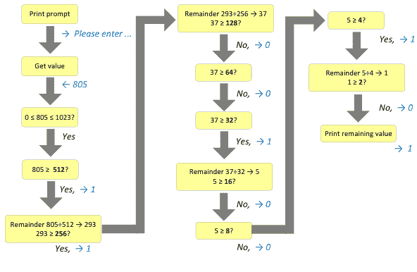

## 清单 5.11: simplerbinaryconversion.cpp

```cpp
#include <iostream>

int main() {
  int value;
  // Get number from the user
  std::cout << "Please enter an integer value in the range 0...1023: ";
  std::cin >> value;
  // Input value must be less than 1024
  if (0 <= value && value < 1024) {
    std::cout << value;
    value %= 512;
    std::cout << value << value/256;
    value %= 256;
    std::cout << value << value/128;
    value %= 128;
    std::cout << value << value/64;
    value %= 64;
    std::cout << value << value/32;
    value %= 32;
    std::cout << value << value/16;
    value %= 16;
    std::cout << value << value/8;
    value %= 8;
    std::cout << value << value/4;
    value %= 4;
    std::cout << value << value/2;
    value %= 2;
    std::cout << value << '\n';
  }
}
```

清单 5.11（simplerbinaryconversion.cpp）中唯一的 `if` 语句确保用户提供适当范围内的整数。最初出现在清单 5.10（binaryconversion.cpp）中的其他 `if` 语句已不再存在。一组巧妙的整数算术运算取代了原始的条件逻辑。这两个程序——binaryconversion.cpp 和 simplerbinaryconversion.cpp——行为相同，但 simplerbinaryconversion.cpp 的逻辑更简单。

清单 5.12（troubleshoot.cpp）实现了一个非常简单的故障排除程序，（同样简单的）计算机技术人员可以使用它来诊断故障计算机。

## 清单 5.12: troubleshoot.cpp

```cpp
#include <iostream>

int main() {
  std::cout << "Help! My computer doesn't work!\n";
  char choice;
  std::cout << "Does the computer make any sounds "
    << "(fans, etc.) or show any lights? (y/n): ";
  std::cin >> choice;
  // The troubleshooting control logic
  if (choice == 'n') { // The computer does not have power
    std::cout << "Is it plugged in? (y/n):";
    std::cin >> choice;
```

```cpp
if (choice == 'n') { // It is not plugged in, plug it in
    std::cout << "Plug it in. If the problem persists, "
              << "Please run this program again.\n";
}
else { // It is plugged in
    std::cout << "Is the switch in the \"on\" position? (y/n):";
    std::cin >> choice;
    if (choice == 'n') { // The switch is off, turn it on!
        std::cout << "Turn it on. If the problem persists, "
                  << "Please run this program again.\n";
    }
    else { // The switch is on
        std::cout << "Does the computer have a fuse? (y/n):";
        std::cin >> choice;
        if (choice == 'n') { // No fuse
            std::cout << "Is the outlet OK? (y/n):";
            std::cin >> choice;
            if (choice == 'n') { // Fix outlet
                std::cout << "Check the outlet's circuit "
                          << "breaker or fuse. Move to a "
                          << "new outlet, if necessary. "
                          << "If the problem persists, "
                          << "please run this program again.\n";
            }
            else { // Beats me!
                std::cout << "Please consult a service "
                          << "technician.\n";
            }
        }
        else { // Check fuse
            std::cout << "Check the fuse. Replace if "
                      << "necessary. If the problem "
                      << "persists, then "
                      << "please run this program again.\n";
        }
    }
} // The computer has power
else { // The computer has power
    std::cout << "Please consult a service technician.\n";
}
```
```

这个非常简单的故障排除程序试图诊断计算机无法工作的原因。改进的潜力是无限的，但此版本仅处理具有简单修复方法的电源问题。请注意，如果计算机有电源（风扇或磁盘驱动器发出声音或灯光可见），程序会指导用户去其他地方寻求帮助！捕获程序基本逻辑的决策树如图 5.4 所示。

执行的步骤如下：

- 1. 是否已插电？有时会忽略这个简单的修复方法。
- 2. 开关是否处于开启位置？这是另一个简单的修复方法。

## 图 5.4 计算机系统故障排除的决策树

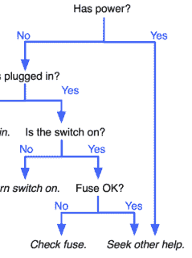

- 3. 如果适用，保险丝是否烧断？某些计算机系统具有用户可维护的保险丝，在电压浪涌时可能会烧断。（大多数较新的计算机具有可处理电压浪涌且没有用户可维护保险丝的电源。）
- 4. 插座处是否有电源？也许插座的断路器或保险丝有问题。

程序指导用户先进行较简单的检查。随着程序继续，它会逐步引入更困难的检查。根据你对无法正常运行的计算机进行故障排除的经验，你可能能够为这个简单的程序想出许多改进措施。

请注意，在清单 5.12（troubleshoot.cpp）中，花括号在许多严格来说不必要的地方被使用。在清单 5.12（troubleshoot.cpp）中加入它们可以提高程序的可读性，并使逻辑更易于理解。即使你不赞同为每个 if/else 体使用花括号的哲学，但在改善代码可读性的情况下使用它们也是个好主意。

回顾清单 4.11（timeconv.cpp）中的时间转换程序。如果用户输入 10000，程序运行如下：

```
Please enter the number of seconds:10000
2 hr 46 min 40 sec
```

如果用户输入 9961，程序打印：

```
Please enter the number of seconds:9961
2 hr 46 min 1 sec
```

假设我们希望通过不使用缩写来改进英文显示。如果我们拼写出 hours、minutes 和 seconds，则必须小心，在相应值为 1 时使用单数形式 hour、minute 或 second。清单 5.13（timeconvcond1.cpp）使用 if/else 语句以正确的数字表示时间单位。

## 清单 5.13: timeconvcond1.cpp

```cpp
// File timeconvcond1.cpp

#include <iostream>

int main( )
{
   // Some useful conversion constants
   const int SECONDS_PER_MINUTE = 60,
             SECONDS_PER_HOUR   = 60*SECONDS_PER_MINUTE; // 3600

   int hours, minutes, seconds;
   std::cout << "Please enter the number of seconds:";
   std::cin >> seconds;
   // First, compute the number of hours in the given number
   // of seconds
   hours = seconds / SECONDS_PER_HOUR; // 3600 seconds = 1 hours
   // Compute the remaining seconds after the hours are
   // accounted for
   seconds = seconds % SECONDS_PER_HOUR;
   // Next, compute the number of minutes in the remaining
   // number of seconds
   minutes = seconds / SECONDS_PER_MINUTE; // 60 seconds = 1 minute
   // Compute the remaining seconds after the minutes are
   // accounted for
   seconds = seconds % SECONDS_PER_MINUTE;
   // Report the results
   std::cout << hours;
   // Decide between singular and plural form of hours
   if (hours == 1)
      std::cout << " hour ";
   else
      std::cout << " hours ";
   std::cout << minutes;
   // Decide between singular and plural form of minutes
   if (minutes == 1)
      std::cout << " minute ";
   else
      std::cout << " minutes ";
   std::cout << seconds;
   // Decide between singular and plural form of seconds
   if (seconds == 1)
      std::cout << " second";
   else
      std::cout << " seconds";
   std::cout << '\n';
}
```

清单 5.13（timeconvcond1.cpp）中的 if/else 语句负责为每个时间单位打印正确的版本——单数或复数。清单 5.13（timeconvcond1.cpp）的一次运行产生

```
Please enter the number of seconds:10000
2 hours 46 minutes 40 seconds
```

所有单词都是复数，因为所有值都大于 1。另一次运行产生

```
Please enter the number of seconds:9961
2 hours 46 minutes 1 second
```

请注意，单词 second 是单数，正如它应该的那样。

```
Please enter the number of seconds:3601
1 hour 0 minutes 1 second
```

同样，此处打印的单词与它们所代表的值的数量一致。

对清单 5.13（timeconvcond1.cpp）的一个改进是：如果值为零，则不打印该值及其关联的时间单位。清单 5.14（timeconvcond2.cpp）添加了此功能。

## 清单 5.14: timeconvcond2.cpp

```cpp
// File timeconvcond1.cpp

#include <iostream>

int main() {
    // Some useful conversion constants
    // const int SECONDS_PER_MINUTE = 60,
    //             SECONDS_PER_HOUR   = 60*SECONDS_PER_MINUTE; // 3600

    int hours, minutes, seconds;
    std::cout << "Please enter the number of seconds:";
    std::cin >> seconds;
    // First, compute the number of hours in the given number
    // of seconds
    hours = seconds / SECONDS_PER_HOUR; // 3600 seconds = 1 hours
    // Compute the remaining seconds after the hours are
    // accounted for
    seconds = seconds % SECONDS_PER_HOUR;
    // Next, compute the number of minutes in the remaining
    // number of seconds
    minutes = seconds / SECONDS_PER_MINUTE; // 60 seconds = 1 minute
    // Compute the remaining seconds after the minutes are
    // accounted for
    seconds = seconds % SECONDS_PER_MINUTE;
    // Report the results
    if (hours > 0) { // Print hours at all?
        std::cout << hours;
        // Decide between singular and plural form of hours
        if (hours == 1)
            std::cout << " hour ";
        else
            std::cout << " hours ";
    }
    if (minutes > 0) { // Print minutes at all?
        std::cout << minutes;
        // Decide between singular and plural form of minutes
```


### 5.7 嵌套条件语句

```
if (minutes == 1)
    std::cout << " minute ";
else
    std::cout << " minutes ";
}
// Print seconds at all?
if (seconds > 0 || (hours == 0 && minutes == 0 && seconds == 0)) {
    std::cout << seconds;
    // Decide between singular and plural form of seconds
    if (seconds == 1)
        std::cout << " second";
    else
        std::cout << " seconds";
}
std::cout << "\\n";
}
```

在清单 5.14（timeconv2.cpp）中，每个负责打印时间值及其英文单位的代码段都受到一个 `if` 语句的保护，该语句仅在时间值大于零时才允许代码执行。秒的处理是个例外：如果所有时间值都为零，程序应打印 `0 seconds`。请注意，每个负责确定单数或复数形式的 `if`/`else` 语句都嵌套在决定是否打印该值的 `if` 语句中。

清单 5.14（timeconv2.cpp）的一次运行产生

```
Please enter the number of seconds: 10000
2 hours 46 minutes 40 seconds
```

由于所有值都大于一，所有单词都是复数形式。另一次运行产生

```
Please enter the number of seconds: 9961
2 hours 46 minutes 1 second
```

请注意，单词 `second` 是单数形式，正如它应该的那样。

```
Please enter the number of seconds: 3601
1 hour 1 second
```

同样，打印的单词与它们所代表的值的数量一致。

```
Please enter the number of seconds: 7200
2 hours
```

另一次运行产生：

```
Please enter the number of seconds: 60
1 minute
```

最后，以下运行显示程序正确处理零秒：

```
Please enter the number of seconds: 0
0 seconds
```

### 图 5.5 带有多个可选执行路径的流程图

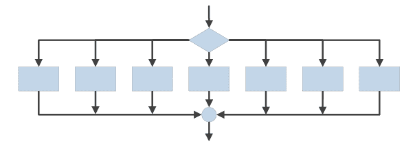

### 5.8 多路 if/else 语句

简单的 if/else 语句可以在两个执行路径之间进行选择。假设我们希望从几个可能的路径中选择一个执行路径，如图 5.5 所示？

清单 5.9（enhancedcheckrange.cpp）展示了如何从三个选项中进行选择。如果许多动作中恰好只有一个应该被采取，该怎么办？需要嵌套 if/else 语句，这些嵌套 if/else 语句的形式如清单 5.15（digittoword.cpp）所示。

### 清单 5.15: digittoword.cpp

```
#include <iostream>

int main() {
    int value;
    std::cout << "Please enter an integer in the range 0...5: ";
    std::cin >> value;
    if (value < 0)
        std::cout << "Too small";
    else
        if (value == 0)
            std::cout << "zero";
        else
            if (value == 1)
                std::cout << "one";
            else
                if (value == 2)
                    std::cout << "two";
                else
                    if (value == 3)
                        std::cout << "three";
                    else
                        if (value == 4)
                            std::cout << "four";
                        else
                            if (value == 5)
                                std::cout << "five";
                            else
                                std::cout << "Too large";
    std::cout << '\n';
}
```

观察清单 5.15（digittoword.cpp）的以下几点：

- 它根据用户的输入恰好打印八条消息中的一条。
- 请注意，每个 `if` 主体包含一条打印语句，每个 `else` 主体（最后一个除外）包含一个 `if` 语句。控制逻辑迫使程序依次检查每个条件。第一个匹配的条件获胜，其相应的 `if` 主体将被执行。如果没有条件为真，则将打印最后一个 `else` 的 `Too large` 消息。
- 不需要花括号来界定 `if` 或 `else` 主体，因为每个主体只包含一条语句（尽管一个深度嵌套的 `if`/`else` 语句是一个非常大的语句）。

清单 5.15（digittoword.cpp）的格式遵循早期示例中使用的约定。因此，随着检查的条件增多，文本量会向右漂移。一种常用的替代样式，如清单 5.16（restyleddigitword.cpp）所示，避免了这种向右漂移。

### 清单 5.16: restyleddigitword.cpp

```
#include <iostream>

int main() {
    int value;
    std::cout << "Please enter an integer in the range 0...5: ";
    std::cin >> value;
    if (value < 0)
        std::cout << "Too small";
    else if (value == 0)
        std::cout << "zero";
    else if (value == 1)
        std::cout << "one";
    else if (value == 2)
        std::cout << "two";
    else if (value == 3)
        std::cout << "three";
    else if (value == 4)
        std::cout << "four";
    else if (value == 5)
        std::cout << "five";
    else
        std::cout << "Too large";
    std::cout << '\n';
}
```

根据我们迄今的经验，清单 5.16（restyleddigitword.cpp）的格式在某种程度上掩盖了程序逻辑的真实结构，但这种格式化多路 `if`/`else` 语句的样式非常常见，以至于大多数程序员都认为是可接受的。所有缩进到同一级别的 else if 行序列将此结构标识为多路 if/else 语句。

清单 5.17（datetransformer.cpp）使用多路 if/else 将月/日格式的数字日期转换为扩展的美国英语形式和国际西班牙语形式；例如，2/14 将被转换为 February 14 和 14 febrero。

### 清单 5.17: datetransformer.cpp

```cpp
#include <iostream>

int main() {
    std::cout << "Please enter the month and day as numbers: ";
    int month, day;
    std::cin >> month >> day;
    // Translate month into English
    if (month == 1)
        std::cout << "January";
    else if (month == 2)
        std::cout << "February";
    else if (month == 3)
        std::cout << "March";
    else if (month == 4)
        std::cout << "April";
    else if (month == 5)
        std::cout << "May";
    else if (month == 6)
        std::cout << "June";
    else if (month == 7)
        std::cout << "July";
    else if (month == 8)
        std::cout << "August";
    else if (month == 9)
        std::cout << "September";
    else if (month == 10)
        std::cout << "October";
    else if (month == 11)
        std::cout << "November";
    else
        std::cout << "December";
    // Add the day
    std::cout << " " << day << " or " << day << " de ";
    // Translate month into Spanish
    if (month == 1)
        std::cout << "enero";
    else if (month == 2)
        std::cout << "febrero";
    else if (month == 3)
        std::cout << "marzo";
    else if (month == 4)
        std::cout << "abril";
    else if (month == 5)
        std::cout << "mayo";
    else if (month == 6)
        std::cout << "junio";
    else if (month == 7)
        std::cout << "julio";
    else if (month == 8)
        std::cout << "agosto";
    else if (month == 9)
        std::cout << "septiembre";
    else if (month == 10)
        std::cout << "octubre";
    else if (month == 11)
        std::cout << "noviembre";
    else
        std::cout << "diciembre";
    std::cout << "\\n";
}
```

清单 5.17（datetransformer.cpp）的示例运行如下所示：

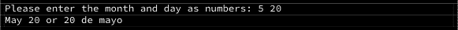

图 5.6 比较了诸如清单 5.16（restyleddigitword.cpp）这样的程序中的 if/else 语句结构与诸如清单 5.10（binaryconversion.cpp）这样的程序中的结构。

在诸如清单 5.16（restyleddigitword.cpp）这样的程序中，if/else 语句是嵌套的，而在诸如清单 5.10（binaryconversion.cpp）这样的程序中，if/else 语句是顺序的。

C++ 提供了构建一些非常复杂的条件语句的工具。重要的是要抵制使事情过于复杂的冲动。考虑计算用户提供的五个整数值中最大值的问题。完整的解决方案留作第 5.10 节的练习，但这里我们将概述一个适当的策略。

假设你允许用户一次性输入所有值；例如，对于整数变量 n1、n2、n3、n4 和 n5：

```
std::cout << "Please enter five integer values: ";
std::cin >> n1 >> n2 >> n3 >> n4 >> n5;
```

现在，允许自己有一个名为 max 的额外变量。所有变量都有含义，它们的名称应该以某种方式反映其含义。我们将让额外的 max 变量表示“目前为止我确定的最大值”。以下是解决问题的一种方法：

- 1. 将 max 设置为等于 n1。这意味着就我们目前所知，n1 是最大的数字，因为 max 和 n1 具有相同的值。
- 2. 将 max 与 n2 进行比较。如果 n2 大于 max，则将 max 更改为 n2 的值，以反映我们确定 n2 更大的事实；如果 n2 不大于 max，我们就没有理由更改 max，因此不要更改它。
- 3. 将 max 与 n3 进行比较。如果 n3 大于 max，则将 max 更改为 n3 的值，以反映我们确定 n3 更大的事实；如果 n3 不大于 max，我们就没有理由更改 max，因此不要更改它。
- 4. 对 n4 和 n5 遵循相同的过程。

最终，max 变量的含义保持不变——“目前为止我确定的最大值”，但是，在将 max 与所有输入变量进行比较后，我们现在知道它是所有五个输入值中的最大值


图 5.6 程序（如清单 5.16（restyleddigititoword.cpp））（左）中 if 语句的结构与程序（如清单 5.10（binaryconversion.cpp））（右）中 if 语句结构的对比

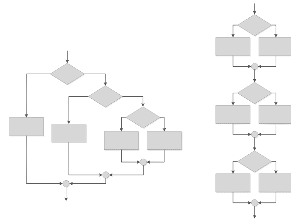

数字。额外变量 max 并非严格必要，但它能让思考问题及其解决方案变得更容易。

值得思考的问题：你想要一系列 if 语句，还是一个大型的多路 if/else 结构？

```
if (n1 >= n2 && n1 >= n3 && n1 >= n4 && n1 >= n5)
    std::cout << "The maximum is " << n1 << '\n';
else if ( n2 >= n1 && n2 >= n3 &&
          // the rest omitted . . .
```

这可行，但此逻辑要复杂得多，效率也更低（每个 >= 和 && 操作需要执行若干个机器周期）。由于更复杂，因此更难正确编写，此外还需要输入更多代码。很容易误将 > 用于 >= 而非 >=，这将无法产生正确结果。此外，如果你使用这种更复杂的逻辑，后来决定添加更多变量，则需要修改代码中所有的 if 条件，当然，还要确保每个条件都正确修改。如果你实现前面概述的更简单策略，则只需为每个附加变量添加一个简单的 if 语句即可。

第 6 章介绍循环，即重复执行语句的能力。你可以轻松调整第一种方法，允许用户输入任意多个数字，然后让程序报告用户输入的最大数字。带有更复杂逻辑的第二种方法无法以这种方式调整。使用第一种方法，你最终会得到更清晰、更简单的逻辑、更高效的程序以及更易于扩展的代码。

### 5.9 条件语句中的错误

请参考清单 5.18（badequality.cpp）。

```
Listing 5.18: badequality.cpp

#include <iostream>

int main() {
   int input;
   std::cout << "Please enter an integer:";
   std::cin >> input;
   if (input = 2)
      std::cout << "two\n";
   std::cout << "You entered " << input << '\n';
}
```

清单 5.18（badequality.cpp）演示了一个常见错误——在本意是使用相等运算符的地方使用了赋值运算符。运行该程序时，无论实际输入是什么，它始终打印消息“two”，并坚称用户输入了 2。回顾第 4.3 节，赋值表达式具有值。赋值表达式的值与所赋的值相同；因此，表达式

```
input = 2
```

的值为 2。再考虑到每个整数都可以视为布尔值（参见第 5.1 节），且任何非零值都被解释为 true，你可以看出 if 语句的条件

```
if (input = 2)
    std::cout << "two\n";
```

始终为 true。此外，变量 input 始终被赋值为 2。

由于这是一种常见的编码错误，大多数 C++ 编译器都可以检查此类赋值滥用情况。例如，在警告级别 4 时，Visual C++ 会在出现赋值而本应是条件表达式的位置时发出警告：

warning C4706: assignment within conditional expression

偶尔在条件表达式中使用赋值是合理的，因此编译器默认不执行此检查。出于我们的目的，最好指示编译器执行此额外检查。

仔细考虑使用的每个复合条件，例如清单 5.8（newcheckrange.cpp）中发现的

```
value > 0 && value <= 10
```

混淆逻辑 `and` 和逻辑 `or` 是常见的编程错误。如果将 `|` 替换为 `&&`，则表达式

```
x > 0 || x <= 10
```

无论变量 x 被赋予什么值，始终为 true。始终为 true 的布尔表达式称为重言式。思考一下。如果 x 是 int，变量 x 可以采用什么值才能使

```
x > 0 || x <= 10
```

为 false？无论其值如何，一个或两个子表达式都将为 true，因此此复合逻辑 `or` 表达式始终为 true。这个特定的 `or` 表达式只是表达值 true 的一种复杂方式。

另一个常见错误是编造始终为 false 的复合布尔表达式，称为矛盾式。假设你希望排除给定范围内的值；例如，拒绝 0...10 范围内的值，接受所有其他数字。以下代码片段中的布尔表达式能否胜任此任务？

```
// I want to use all but 0, 1, 2, ..., 10
if (value < 0 && value > 10)
    /* Code to execute goes here ... */
```

仔细观察该条件会发现它永远不可能为真。有什么数字既小于零又大于十？当然没有，因此该表达式是矛盾式，是表达 false 的一种复杂方式。要修正此代码片段，请将 `&&` 运算符替换为 `||`。

### 5.10 练习

- 1. 类型为 bool 的变量可以采用什么值？

- 2. 术语 bool 源自何处？

- 3. C++ 中 true 的整数等效值是什么？

- 4. C++ 中 false 的整数等效值是什么？

- 5. 值 –16 被解释为 true 还是 false？

- 6. 可以将整数值赋给 bool 变量吗？

- 7. 可以将 true 赋给 int 变量吗？

- 8. 鉴于以下声明：

```
int x = 3, y = 5, z = 7;
bool b1 = true, b2 = false, b3 = x == 3, b4 = y < 3;
```

求值以下布尔表达式：

- (a) x == 3
- (b) x != y
- (c) x >= y
- (d) x <= y
- (e) x != y - 2
- (f) x != 10
- (g) x >= 0 && x < 10
- (h) x < 0 && x < 10
- (i) x >= 0 && x < 2
- (j) x < 0 || x < 10
- (k) x > 0 || x < 10
- (l) x < 0 || x > 10
- (m) b1
- (n) !b1
- (o) !b2
- (p) b1 && b2

- 9. 将以下布尔表达式表示为更简单的形式；即，使用更少的运算符。x 是 int。

- (a) !(x == 2)
- (b) x < 2 || x == 2
- (c) !(x < y)
- (d) !(x <= y)
- (e) x < 10 && x > 20
- (f) x > 10 || x < 20
- (g) x != 0
- (h) x == 0

- 10. 最简单的重言式是什么？

- 11. 最简单的矛盾式是什么？

- 12. 编写一个 C++ 程序，从用户处请求一个整数值。如果该值在 1 到 100 之间（包含 1 和 100），则打印“OK;”；否则，不打印任何内容。

- 13. 编写一个 C++ 程序，从用户处请求一个整数值。如果该值在 1 到 100 之间（包含 1 和 100），则打印“OK;”；否则，打印“Out of range.”

- 14. 以下程序试图打印一条包含给定整数输入对应英文单词的消息。例如，如果用户输入值 3，程序应打印“You entered a three.”。在当前状态下，该程序包含逻辑错误。找出问题并修复它们，使程序按预期工作。

```
#include <iostream>

int main() {
 std::cout << "Please enter a value in the range 1...5: ";
 int value;
 std::cin >> value;
 // Translate number into its English word
 if (month == 1) {
 std::cout << "You entered a";
 std::cout << "one";
 std::cout << "\n";
 }
 else if (month == 2) {
 std::cout << "You entered a";
 std::cout << "two";
 std::cout << "\n";
 }
 else if (month == 3) {
 std::cout << "You entered a";
 std::cout << "three";
 std::cout << "\n";
 }
 else if (month == 4) {
 std::cout << "You entered a";
 std::cout << "four";
 std::cout << "\n";
 }
 else if (month == 5) {
 std::cout << "You entered a";
 std::cout << "five";
 std::cout << "\n";
 }
 else // Value out of range
 std::cout << "You entered a";
 std::cout << "value out of range";
 std::cout << "\n";
 }
```

- 15. 考虑以下 C++ 代码段：

```
// i, j, and k are ints
if (i < j) {
    if (j < k)
        i = j;
    else
        j = k;
}
else {
    if (j > k)
        j = i;
    else
        i = k;
}
std::cout << "i = " << i << " j = " << j << " k = " << k << '\n';
```

如果变量 i、j 和 k 具有以下值，代码将打印什么？

- (a) i 是 3，j 是 5，k 是 7
- (b) i 是 3，j 是 7，k 是 5
- (c) i 是 5，j 是 3，k 是 7
- (d) i 是 5，j 是 7，k 是 5
- (e) i 是 7，j 是 3，k 是 5
- (f) i 是 7，j 是 5，k 是 3

- 16. 考虑以下打印一行文本的 C++ 程序：

```
#include <iostream>
int main() {
    int input;
    std::cin >> input;
    if (input < 10) {
        if (input != 5)
            std::cout << "wow ";
        else
            input++;
    }
    else {
        if (input == 17)
            input += 10;
        else
            std::cout << "whoa ";
    }
    std::cout << input << '\n';
}
```

如果用户提供以下输入，程序将打印什么？

- (a) 3
- (b) 21
- (c) 5
- (d) 17
- (e) -5

- 17. 为什么以下代码段始终打印“ByeHi”？


```cpp
int x;
std::cin >> x;
if (x < 0);
    std::cout << "Bye";
std::cout << "Hi\n";
```

- 18. 编写一个 C++ 程序，向用户请求五个整数值。然后打印输入的最大值和最小值。如果用户输入的值为 3、2、5、0 和 1，程序将指示 5 是最大值，0 是最小值。您的程序应正确处理平局；例如，如果用户输入 2、4、2、3 和 3，程序应报告 2 为最小值，4 为最大值。

- 19. 编写一个 C++ 程序，向用户请求五个整数值。然后打印以下两项之一：如果输入的任何值有重复，则打印 "DUPLICATES"；否则，打印 "ALL UNIQUE"。

## 第 6 章
## 迭代

迭代重复执行一段代码。迭代对于解决许多编程问题很有用。迭代和条件执行是算法构建的关键组成部分。

### 6.1 while 语句

清单 6.1 (counttofive.cpp) 通过在每行输出一个数字来数到五。

```cpp
#include <iostream>

int main() {
  std::cout << 1 << '\n';
  std::cout << 2 << '\n';
  std::cout << 3 << '\n';
  std::cout << 4 << '\n';
  std::cout << 5 << '\n';
}
```

编译并运行后，该程序显示

```
1
2
3
4
5
```

你要如何编写代码来数到 10,000？你会复制、粘贴并修改 10,000 个打印语句吗？你可以这样做，但那不切实际！计数是如此常见的活动，计算机经常数到非常大的值，所以一定有更好的方法。我们真正想做的是打印变量（称其为 count）的值，然后递增该变量（count++），并重复此过程，直到变量足够大（count == 5 或也许 count == 10000）。反复执行同一段代码的过程称为迭代，或循环，在 C++ 中我们可以用几种不同的方式实现循环。

清单 6.2 (iterativecounttofive.cpp) 使用 while 语句来数到五：

```cpp
Listing 6.2: iterativecounttofive.cpp

#include <iostream>

int main() {
   int count = 1;        // Initialize counter
   while (count <= 5) {  // Display counter, then
      std::cout << count << '\n';  // Increment counter
      count++;
   }
}
```

清单 6.2 (iterativecounttofive.cpp) 使用 while 语句来显示一个正在数到五的变量。与清单 6.1 (counttofive.cpp) 采用的方法不同，将清单 6.2 (iterativecounttofive.cpp) 修改为数到 10,000 非常简单——只需将文本值 5 改为 10000。

行

```cpp
while (count <= 5)
```

开始 while 语句。括号内的表达式必须是布尔表达式。如果程序执行到达 while 语句时布尔表达式为真，则程序执行 while 语句的主体，然后再次检查条件。只要布尔表达式保持为真，程序就会反复执行 while 主体中的语句。

如果执行 while 语句时布尔表达式为真，则执行 while 语句的主体，并且只要布尔表达式保持为真，主体就会反复执行。

语句

```cpp
std::cout << count << '\n';
count++;
```

构成 while 语句的主体。花括号是必要的，因为主体由多个语句组成。

while 语句的一般形式为：

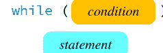

- 保留字 while 开始 while 语句。
- 布尔表达式条件确定主体是否会（或将继续）执行。表达式必须如图所示用括号括起来。
- 语句是在布尔表达式为真时要执行的语句。该语句构成 while 语句的主体。该语句可以是复合语句（多个用花括号括起来的语句，参见第 5.4 节）。

### 图 6.1 清单 6.2 (iterativecounttofive.cpp) 的 while 流程图

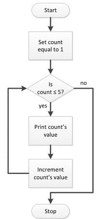

除了使用保留字 while 而不是 if 之外，while 语句与 if 语句完全相同。有时初学者会混淆两者，或者不小心输入 if 而本意是 while，或者反之。通常，两个语句截然不同的行为会立即揭示问题；但是，有时，尤其是在嵌套的复杂逻辑中，这个错误可能很难检测。

图 6.1 显示了程序执行如何通过清单 6.2 (iterativecounttofive.cpp)。

程序在执行主体之前检查 while 条件，然后在每次执行主体后重新检查条件。如果条件最初为假，程序执行将完全跳过主体，并继续执行 while 主体之后的语句。如果条件最初为真，程序会反复执行主体，直到条件变为假，此时循环终止。程序执行随后继续执行循环主体之后的语句（如果有）。请注意，如果条件中的布尔表达式最初为假，主体可能根本不会被执行。

清单 6.3 (countup.cpp) 从零开始计数，只要用户希望如此。

### 清单 6.3: countup.cpp

```cpp
/*
 * Counts up from zero.  The user continues the count by entering
 * 'Y'.  The user discontinues the count by entering 'N'.
 */
#include <iostream>

int main() {
    char input;         // The users choice
    int count = 0;      // The current count
    bool done = false;  // We are not done

    while (!done) {
        // Print the current value of count
        std::cout << count << '\n';
        std::cout << "Please enter \"Y\" to continue or \"N\" to quit: ";
        std::cin >> input;
        // Check for "bad" input
        if (input != 'Y' && input != 'y' && input != 'N' && input != 'n')
            std::cout << "\"" << input << "\" is not a valid choice" << '\n';
        else if (input == 'Y' || input == 'y') {
            count++;    // Keep counting
        } else if (input == 'N' || input == 'n')
            done = true;  // Quit the loop
    }
}
```

清单 6.3 (countup.cpp) 的示例运行产生

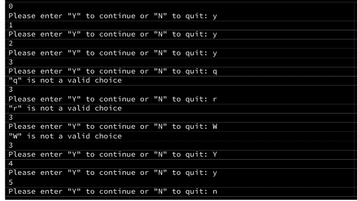

在清单 6.3 (countup.cpp) 中，表达式

```cpp
input != 'Y' && input != 'y' && input != 'N' && input != 'n'
```

如果字符变量 input 不等于列出的字符字面量之一，则为真。布尔变量 done 控制循环的执行。需要注意的是，while 条件中的表达式

```cpp
!done
```

计算结果为变量 done 的相反真值；该表达式不影响 done 的值。换句话说，对变量应用 ! 运算符不会修改变量的值。要实际更改变量 done，您需要重新赋值，如

```cpp
done = !done; // Invert the truth value
```

对于清单 6.3 (countup.cpp)，我们无需反转其值。我们确保其初始值为假，然后在用户输入大写或小写 N 时将其设为真。

清单 6.4 (addnonnegatives.cpp) 是一个允许用户输入任意数量非负整数的程序。当用户输入负值时，程序不再接受输入，并显示所有非负整数的和。如果第一个输入是负数，则和为零。

```cpp
Listing 6.4: addnonnegatives.cpp

/*
 * Allow the user to enter a sequence of nonnegative
 * integers. The user ends the list with a negative
 * integer. At the end the sum of the nonnegative
 * integers entered is displayed. The program prints
 * zero if the user enters no nonnegative integers.
 */
#include <iostream>
int main() {
  int input = 0, // Ensure the loop is entered
      sum = 0; // Initialize sum
  // Request input from the user
  std::cout << "Enter numbers to sum, negative number ends list:";
  while (input >= 0) { // A negative number exits the loop
    std::cin >> input; // Get the value
    if (input >= 0)
      sum += input; // Only add it if it is nonnegative
  }
  std::cout << "Sum = " << sum << '\n'; // Display the sum
}
```

将 input 初始化为零，并结合 while 的条件 input >= 0，保证程序至少执行一次 while 循环的主体。if 语句确保负数条目不会被添加到 sum。（条件是否可以使用 > 而不是 >= 并达到相同的结果？）当用户输入负整数时，程序不会更新 sum，而 while 的条件不再为真。程序执行随后离开循环并执行末尾的打印语句。

清单 6.4 (addnonnegatives.cpp) 表明 while 循环可用于简单计数之外的用途。


程序不会记录输入值的数量。程序只是将输入值累加到名为 sum 的变量中。

在清单 6.4 (addnonnegatives.cpp) 中，相同的条件出现了两次，一次在 while 中，又一次在 if 中，这有点别扭。此外，如果用户希望同时输入负值和非负值怎么办？我们可以使用一种常见的 C++ 惯用法来简化代码，该惯用法将 std::cin 和提取运算符作为 while 语句中的条件。

如果 x 是整数，表达式
std::cin >> x

如果用户没有输入有效的整数字面量，则求值为 false。掌握了这些知识，我们可以像清单 6.5 (addnumbers.cpp) 所示那样简化和增强清单 6.4 (addnonnegatives.cpp)。

## 清单 6.5: addnumbers.cpp

```cpp
#include <iostream>

int main() {
  int input, sum = 0;
  std::cout << "Enter numbers to sum, type 'q' to end the list:";
  while (std::cin >> input) {
    sum += input;
  }
  std::cout << "Sum = " << sum << '\n';
}
```

该条件从输入流读取一个值，如果成功，则被解释为 true。当用户输入 'q' 时，循环终止。如果用户在开头输入 'q'，则不会进入循环。if 语句不再必要，因为只有在 input 被合法赋值后，语句

```
sum += input;
```

才会执行。此外，变量 input 不再需要仅为了第一次进入循环而初始化一个值；现在它在 while 的条件中被赋值然后检查。

在清单 6.5 (addnumbers.cpp) 中，程序执行将在用户输入任何字母时终止；输入 'x' 或 Ctrl+Z 将像 'q' 一样终止序列。

如果使用

```
while (std::cin >> x) {
  // Do something ...
}
```

惯用法，请注意，当由于输入流无法读取变量 x 类型的值而退出循环时，std::cin 输入流对象会保持在错误状态，并且在程序其余执行期间无法使用。如果你希望使用此技术并稍后重用 std::cin，则必须重置 std::cin 并提取并丢弃自上次有效使用提取运算符以来输入的按键。此恢复过程在第 13.2 节中介绍，但目前，只有在程序在其执行期间不需要稍后的额外用户输入时，才使用此惯用法来控制循环。

清单 6.6 (powersof10.cpp) 打印从 1 到 1,000,000,000 的 10 的幂（下一个 10 的幂 10,000,000,000 超出了 `int` 类型的范围）。

## 清单 6.6: powersof10.cpp

```cpp
#include <iostream>
int main() {
    int power = 1;
    while (power <= 1000000000) {
        std::cout << power << '\n';
        power *= 10;
    }
}
```

清单 6.6 (powersof10.cpp) 生成

```
1
10
100
1000
10000
100000
1000000
10000000
100000000
1000000000
```

通常将一列数字右对齐，但清单 6.6 (powersof10.cpp) 将 10 的幂的最高有效数字左对齐打印。我们可以使用称为流操纵器的流对象将数字右对齐。我们需要的特定流操纵器名为 `std::setw`。setw 意为“设置宽度”。它可以这样使用

```cpp
std::cout << std::setw(3) << x << '\n';
```

该语句将 x 的值在屏幕上的三个字符水平空间内右对齐打印。清单 6.7 (powersof10justified.cpp) 显示了 setw 的效果。

## 清单 6.7: powersof10justified.cpp

```cpp
#include <iostream>
#include <iomanip>
// Print the powers of 10 from 1 to 1,000,000,000
int main() {
    int power = 1;
    while (power <= 1000000000) {
        // Right justify each number in a field 10 wide
        std::cout << std::setw(10) << power << '\n';
        power *= 10;
    }
}
```

清单 6.7 (powersof10justified.cpp) 打印

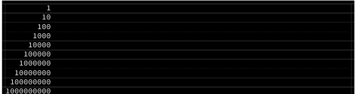

请注意，为了使用 `setw`，编译器需要了解它。关于 `std::setw` 所需的信息不在 `iostream` 头文件中，因此需要额外的预处理器包含指令：

```cpp
#include <iomanip>
```

`std::setw` 操纵器“调节”输出流以打印下一个项目。传递给“调节”流的值都在 `std::setw` 指定的空格数内右对齐。

顺便说一句，这是揭示另一个改进 C++ 程序输出技巧的好地方。清单 6.8 (powersof10withcommas.cpp) 通过在显示的数字中适当位置添加逗号来增强清单 6.7 (powersof10justified.cpp)。

## 清单 6.8: powersof10withcommas.cpp

```cpp
#include <iostream>
#include <iomanip>
#include <locale>

// Print the powers of 10 from 1 to 1,000,000,000
int main() {
    int power = 1;
    std::cout.imbue(std::locale(""));
    while (power <= 1000000000) {
        // Right justify each number in a field 10 wide
        std::cout << std::setw(13) << power << '\n';
        power *= 10;
    }
}
```

清单 6.8 (powersof10withcommas.cpp) 打印

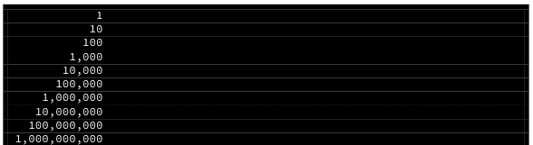

## 图 6.2 计算机系统故障排除决策树 清单 6.9 (troubleshootloop.cpp)

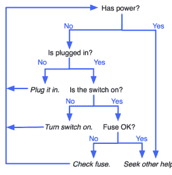

语句

```cpp
std::cout.imbue(std::locale(""));
```

调整 std::cout 对象以打印带有适合当前国家的数字分隔符的数字。如果将该语句替换为

```cpp
std::cout.imbue(std::locale("german"));
```

输出将变为

| 1 |
| --- |
| 100 |
| 1.000 |
| 10.000 |
| 100.000 |
| 1.000.000 |
| 10.000.000 |
| 100.000.000 |
| 1.000.000.000 |
| 10.000.000.000 |
| 100.000.000.000 |
| 1.000.000.000.000 |

因为德语在数字分隔符中使用句点代替逗号。“german”区域设置还会在英语浮点数出现小数点的地方显示逗号。

我们可以使用 while 语句使清单 5.12 (troubleshoot.cpp) 对用户更方便。请记住，计算机故障排除程序在检测到潜在问题后会强制用户重新运行程序（例如，打开电源开关，然后再次运行程序以查看可能还有什么问题）。更理想的决策逻辑如图 6.2 所示。

清单 6.9 (troubleshootloop.cpp) 包含一个 while 语句，以便程序执行继续直到问题解决或问题的解决超出了程序的能力范围。

## 清单 6.9: troubleshootloop.cpp

```cpp
#include <iostream>

int main() {
    std::cout << "Help!  My computer doesn't work!\n";
    char choice;
    bool done = false; // Initially, we are not done

    while (!done) { // Continue until we are done
        std::cout << "Does the computer make any sounds "
                  << "(fans, etc.) or show any lights? (y/n): ";
        std::cin >> choice;
        // The troubleshooting control logic
        if (choice == 'n') { // The computer does not have power
            std::cout << "Is it plugged in? (y/n): ";
            std::cin >> choice;
            if (choice == 'n') { // It is not plugged in, plug it in
                std::cout << "Plug it in.\n";
            }
        } else { // It is plugged in
            std::cout << "Is the switch in the \"on\" position? (y/n): ";
            std::cin >> choice;
            if (choice == 'n') { // The switch is off, turn it on!
                std::cout << "Turn it on.\n";
            } else { // The switch is on
                std::cout << "Does the computer have a fuse? (y/n): ";
                std::cin >> choice;
                if (choice == 'n') { // No fuse
                    std::cout << "Is the outlet OK? (y/n): ";
                    std::cin >> choice;
                    if (choice == 'n') { // Fix outlet
                        std::cout << "Check the outlet's circuit "
                                  << "breaker or fuse. Move to a "
                                  << "new outlet, if necessary.\n";
                    }
                } else { // Beats me!
                    std::cout << "Please consult a service "
                              << "technician.\n";
                    done = true; // Exhausted simple fixes
                }
            }
        } else { // Check fuse
            std::cout << "Check the fuse. Replace if "
                      << "necessary.\n";
        }
    } // The computer has power
    std::cout << "Please consult a service technician.\n";
}
```


done = true; // Only troubleshoots power issues
}
}
}
```

清单 6.9 (troubleshootloop.cpp) 主体的大部分内容由一个 `while` 语句包裹。布尔变量 `done` 通常被称为 `flag`。你可以认为当值为 false 时标志位处于“下”位，当值为 true 时处于“上”位。在这种情况下，当标志位被置位时，它是一个信号，表明程序应该终止。

请注意清单 6.9 (troubleshootloop.cpp) 的最后 11 行：

```
}
}
}
} else { // The computer has power
std::cout << "Please consult a service technician.\n";
done = true; // Only troubleshoots power issues
}
}
}
```

按照此代码的组织方式，要找到某个右花括号匹配的左花括号，可以在源代码中向上扫描，直到找到同一缩进层级的最近左花括号。我们的编程逻辑现在已经足够复杂，以至于花括号的正确位置对于人类读者更快速地解读程序工作方式至关重要。有关缩进和花括号位置以改善代码可读性的准则，请参见第 4.5 节。

### 6.2 嵌套循环

与 `if` 语句一样，`while` 循环体可以包含任意 C++ 语句，包括其他 `while` 语句。因此，一个循环可以嵌套在另一个循环中。要了解嵌套循环的工作原理，请考虑一个打印乘法表的程序。小学生在学习整数乘积（最高可达 10 甚至 12）时会使用乘法表，也称为口诀表。图 6.3 显示了一个 10 x 10 的乘法表。我们希望乘法表程序具有灵活性，并允许用户指定表格的大小。我们将从一个简单的程序开始开发工作，并边做边添加功能。首先，我们不必担心打印表格的行标题和列标题，也不会打印分隔表格与表格内容的线条。最初，我们将只打印表格的内容。我们会发现需要一个嵌套循环来打印表格的内容，但这在我们的第一次尝试中仍然太复杂，难以处理。在第一次尝试中，我们将以非常简单的方式打印表格的行。一旦我们确信简单的程序可以正常工作，就可以添加更多功能。清单 6.10 (timestable-1st-try.cpp) 展示了我们对乘法表的第一次尝试。

```
Listing 6.10: timestable-1st-try.cpp

#include <iostream>

int main() {
  int size; // The number of rows and columns in the table
  std::cout << "Please enter the table size: ";
std::cin >> size;
// Print a size x size multiplication table
int row = 1;
while (row <= size) { // Table has 10 rows.
    std::cout << "Row #" << row << " ";
    row++;
}
```

### 图 6.3 10 x 10 乘法表

| × | 1 | 2 | 3 | 4 | 5 | 6 | 7 | 8 | 9 | 10 |
|---|---|---|---|---|---|---|---|---|---|---|
| 1 | 1 | 2 | 3 | 4 | 5 | 6 | 7 | 8 | 9 | 10 |
| 2 | 2 | 4 | 6 | 8 | 10 | 12 | 14 | 16 | 18 | 20 |
| 3 | 3 | 6 | 9 | 12 | 15 | 18 | 21 | 24 | 27 | 30 |
| 4 | 4 | 8 | 12 | 16 | 20 | 24 | 28 | 32 | 36 | 40 |
| 5 | 5 | 10 | 15 | 20 | 25 | 30 | 35 | 40 | 45 | 50 |
| 6 | 6 | 12 | 18 | 24 | 30 | 36 | 42 | 48 | 54 | 60 |
| 7 | 7 | 14 | 21 | 28 | 35 | 42 | 49 | 56 | 63 | 70 |
| 8 | 8 | 16 | 24 | 32 | 40 | 48 | 56 | 64 | 72 | 80 |
| 9 | 9 | 18 | 27 | 36 | 45 | 54 | 63 | 72 | 81 | 90 |
| 10 | 10 | 20 | 30 | 40 | 50 | 60 | 70 | 80 | 90 | 100 |

清单 6.10 (timestable-1st-try.cpp) 的输出有些令人失望：

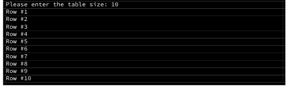

清单 6.10 (timestable-1st-try.cpp) 确实按正确位置打印了每一行——只是没有为每一行提供所需的详细信息。我们的下一步是改进程序打印每一行的方式。每一行应包含 size 个数字。每一行中的每个数字都表示当前行和当前列的乘积，例如，第 2 行第 5 列的数字应为 2 x 5 = 10。因此，在每一行中，我们必须将列号从 1 变化到 size。清单 6.11 (timestable-2nd-try.cpp) 包含所需的改进。

```
Listing 6.11: timestable-2nd-try.cpp
#include <iostream>
int main() {
int size; // The number of rows and columns in the table
std::cout << "Please enter the table size: ";
std::cin >> size;
// Print a size x size multiplication table
int row = 1;
while (row <= size) { // Table has size rows.
    int column = 1; // Reset column for each row.
    while (column <= size) { // Table has size columns.
        int product = row*column; // Compute product
        std::cout << product << " "; // Display product
        column++; // Next element
    }
    std::cout << '\n'; // Move cursor to next row
    row++; // Next row
}
```

我们使用一个循环来打印每一行的内容。外层循环控制程序打印的总行数，而内层循环在程序每次打印一行时完整执行，用于打印构成一行的各个元素。

清单 6.11 (timestable-2nd-try.cpp) 的结果是

| 请输入表格大小: 10 |
| --- |
| 1 2 3 4 5 6 7 8 9 10 |
| 2 4 6 8 10 12 14 16 18 20 |
| 3 6 9 12 15 18 21 24 27 30 |
| 4 8 12 16 20 24 28 32 36 40 |
| 5 10 15 20 25 30 35 40 45 50 |
| 6 12 18 24 30 36 42 48 54 60 |
| 7 14 21 28 35 42 49 56 63 70 |
| 8 16 24 32 40 48 56 64 72 80 |
| 9 18 27 36 45 54 63 72 81 90 |
| 10 20 30 40 50 60 70 80 90 100 |

每一列中的数字没有整齐对齐，但数字之间的相对位置是正确的。我们可以使用清单 6.7 (powersof10justified.cpp) 中介绍的 `std::setw` 流操纵符，在四位数字区域内将数字右对齐。清单 6.12 (timestable-3rd-try.cpp) 包含此对齐调整。

### 清单 6.12: timestable-3rd-try.cpp

```
#include <iostream>
#include <iomanip>
int main() {
    int size; // The number of rows and columns in the table
    std::cout << "Please enter the table size: ";
    std::cin >> size;
    // Print a size x size multiplication table
    int row = 1;
    while (row <= size) { // Table has size rows.
        int column = 1; // Reset column for each row.
        while (column <= size) { // Table has size columns.
            int product = row*column; // Compute product
std::cout << std::setw(4) << product; // Display product
column++; // Next element
}
std::cout << '\n'; // Move cursor to next row
row++; // Next row
}
```

清单 6.12 (timestable-3rd-try.cpp) 以吸引人的形式生成了表格的内容：

```
Please enter the table size: 10
1   2   3   4   5   6   7   8   9   10
2   4   6   8   10  12  14  16  18  20
3   6   9   12  15  18  21  24  27  30
4   8   12  16  20  24  28  32  36  40
5   10  15  20  25  30  35  40  45  50
6   12  18  24  30  36  42  48  54  60
7   14  21  28  35  42  49  56  63  70
8   16  24  32  40  48  56  64  72  80
9   18  27  36  45  54  63  72  81  90
10  20  30  40  50  60  70  80  90  100
```

输入值为 5：

```
Please enter the table size: 5
1   2   3   4   5
2   4   6   8   10
3   6   9   12  15
4   8   12  16  20
5   10  15  20  25
```

以及 15：

```
Please enter the table size: 15
1   2   3   4   5   6   7   8   9   10  11  12  13  14  15
2   4   6   8   10  12  14  16  18  20  22  24  26  28  30
3   6   9   12  15  18  21  24  27  30  33  36  39  42  45
4   8   12  16  20  24  28  32  36  40  44  48  52  56  60
5   10  15  20  25  30  35  40  45  50  55  60  65  70  75
6   12  18  24  30  36  42  48  54  60  66  72  78  84  90
7   14  21  28  35  42  49  56  63  70  77  84  91  98  105
8   16  24  32  40  48  56  64  72  80  88  96  104 112 120
9   18  27  36  45  54  63  72  81  90  99  108 117 126 135
10  20  30  40  50  60  70  80  90  100 110 120 130 140 150
11  22  33  44  55  66  77  88  99  110 121 132 143 154 165
12  24  36  48  60  72  84  96  108 120 132 144 156 168 180
13  26  39  52  65  78  91  104 117 130 143 156 169 182 195
14  28  42  56  70  84  98  112 126 140 154 168 182 196 210
15  30  45  60  75  90  105 120 135 150 165 180 195 210 225
```

也能产生良好的结果。

剩下要做的就是添加行标题和列标题以及界定表格边缘的线条。清单 6.13 (timestable.cpp) 添加了所需的代码。


## 清单 6.13: timestable.cpp

```cpp
#include <iostream>
#include <iomanip>

int main() {
    int size; // The number of rows and columns in the table
    std::cout << "Please enter the table size: ";
    std::cin >> size;
    // Print a size x size multiplication table

    // First, print heading: 1 2 3 4 5 etc.
    std::cout << " " << " "; // Print heading
    // Print column heading
    int column = 1;
    while (column <= size) {
        std::cout << std::setw(4) << column; // Print heading for this column.
        column++;
    }

    std::cout << '\n';

    // Print line separator: +-------
    std::cout << " +";
    column = 1;
    while (column <= size) {
        std::cout << "-----"; // Print line for this column.
        column++;
    }

    std::cout << '\n';

    // Print table contents
    int row = 1;
    while (row <= size) { // Table has size rows.
        std::cout << std::setw(2) << row << "|"; // Print heading for row.
        int column = 1; // Reset column for each row.
        while (column <= size) { // Table has size columns.
            int product = row*column; // Compute product
            std::cout << std::setw(4) << product; // Display product
            column++; // Next element
        }
        row++;
        std::cout << '\n'; // Move cursor to next row
    }
}
```

当用户提供值 10 时，清单 6.13 (timestable.cpp) 生成

| | 1 | 2 | 3 | 4 | 5 | 6 | 7 | 8 | 9 | 10 |
|---|---|---|---|---|---|---|---|---|---|---|
| 1 | 1 | 2 | 3 | 4 | 5 | 6 | 7 | 8 | 9 | 10 |
| 2 | 2 | 4 | 6 | 8 | 10 | 12 | 14 | 16 | 18 | 20 |
| 3 | 3 | 6 | 9 | 12 | 15 | 18 | 21 | 24 | 27 | 30 |
| 4 | 4 | 8 | 12 | 16 | 20 | 24 | 28 | 32 | 36 | 40 |
| 5 | 5 | 10 | 15 | 20 | 25 | 30 | 35 | 40 | 45 | 50 |
| 6 | 6 | 12 | 18 | 24 | 30 | 36 | 42 | 48 | 54 | 60 |
| 7 | 7 | 14 | 21 | 28 | 35 | 42 | 49 | 56 | 63 | 70 |
| 8 | 8 | 16 | 24 | 32 | 40 | 48 | 56 | 64 | 72 | 80 |
| 9 | 9 | 18 | 27 | 36 | 45 | 54 | 63 | 72 | 81 | 90 |
| 10 | 10 | 20 | 30 | 40 | 50 | 60 | 70 | 80 | 90 | 100 |

输入 15 得到

```
Please enter the table size: 15
 1  2  3  4  5  6  7  8  9 10 11 12 13 14 15
+---------------------------------------------
1 | 1  2  3  4  5  6  7  8  9 10 11 12 13 14 15
2 | 2  4  6  8 10 12 14 16 18 20 22 24 26 28 30
3 | 3  6  9 12 15 18 21 24 27 30 33 36 39 42 45
4 | 4  8 12 16 20 24 28 32 36 40 44 48 52 56 60
5 | 5 10 15 20 25 30 35 40 45 50 55 60 65 70 75
6 | 6 12 18 24 30 36 42 48 54 60 66 72 78 84 90
7 | 7 14 21 28 35 42 49 56 63 70 77 84 91 98 105
8 | 8 16 24 32 40 48 56 64 72 80 88 96 104 112 120
9 | 9 18 27 36 45 54 63 72 81 90 99 108 117 126 135
10| 10 20 30 40 50 60 70 80 90 100 110 120 130 140 150
11| 11 22 33 44 55 66 77 88 99 110 121 132 143 154 165
12| 12 24 36 48 60 72 84 96 108 120 132 144 156 168 180
13| 13 26 39 52 65 78 91 104 117 130 143 156 169 182 195
14| 14 28 42 56 70 84 98 112 126 140 154 168 182 196 210
15| 15 30 45 60 75 90 105 120 135 150 165 180 195 210 225
```

如果用户输入 7，程序打印

```
Please enter the table size: 7
 1  2  3  4  5  6  7
+--------------------
1 | 1  2  3  4  5  6  7
2 | 2  4  6  8 10 12 14
3 | 3  6  9 12 15 18 21
4 | 4  8 12 16 20 24 28
5 | 5 10 15 20 25 30 35
6 | 6 12 18 24 30 36 42
7 | 7 14 21 28 35 42 49
```

用户甚至可以输入 1：

```
Please enter the table size: 1
 1
+-
1 | 1
```

可以看出，表格会自动调整以适应用户输入所需的大小和间距。

下面是清单 6.13 (timestable.cpp) 的工作原理：

- 重要的是要区分仅执行一次（在所有循环之外）的操作与重复执行的操作。表格顶部的列标题位于所有循环之外；因此，它会一次性全部打印。
- 打印行标题的工作分布在外层循环的执行过程中。这是因为在打印前一行的所有结果之前，无法打印给定行的标题。
- 在嵌套循环中，row 是外层循环的控制变量；column 控制内层循环。
- 内层循环在外层循环的每一次迭代中执行 size 次。语句
  ```cpp
  std::cout << product << " "; // Display product
  ```
  执行多少次？size x size 次，表格中的每个乘积各一次。
- 在显示每行内容后会打印一个换行符；因此，内层（列）循环中打印的所有值都显示在同一行上。

当迭代过程本身必须重复时，使用嵌套循环。在我们的乘法表示例中，使用 while 循环打印每行的内容，但需要打印多行。内层循环打印每行的内容，而外层循环负责打印所有行。

清单 6.14 (permuteabc.cpp) 使用三重嵌套循环打印字母 A、B 和 C 的所有不同排列。每个字符串代表 ABC 的一个排列。

## 清单 6.14: permuteabc.cpp

```cpp
// File permuteabc.cpp
#include <iostream>
int main() {
  char first = 'A'; // The first letter varies from A to C
  while (first <= 'C') {
    char second = 'A'; // The second varies from A to C
    while (second <= 'C') {
      if (second != first) { // No duplicate letters
        char third = 'A'; // The third varies from A to C
        while (third <= 'C') { // Don't duplicate first or second letter
          if (third != first && third != second) {
            std::cout << first << second << third << '\n';
            third++;
          }
        }
        second++;
      }
      first++;
    }
  }
}
```

请注意如何使用 if 语句防止给定字符串中出现重复字母。清单 6.14 (permuteabc.cpp) 的输出是 ABC 的全部六个排列：

```
ABC
ACB
BAC
BCA
```

### 6.3 循环的异常终止

默认情况下，`while` 语句会一直执行直到其条件变为假。执行中的程序仅在循环的“顶部”检查此条件。这意味着，即使构成条件的布尔表达式在程序完成执行循环体内所有语句之前变为假，循环体中所有剩余语句也必须完成，循环才能再次检查其条件。换句话说，`while` 语句本身无法在循环体中间某处退出循环。

通常这种行为不是问题。通常意图是将循环体内的所有语句作为一个不可分割的单元来执行。然而，有时希望能够立即退出循环体，或从循环中间重新检查条件。C++ 提供了 `break` 和 `continue` 语句，以让程序员在设计循环控制逻辑时拥有更大的灵活性。

### 6.3.1 break 语句

C++ 提供 `break` 语句来实现中途退出的控制逻辑。`break` 语句会导致立即退出循环体。清单 6.15 (`addmiddleexit.cpp`) 是清单 6.4 (`addnonnegatives.cpp`) 的一个变体，用于说明 `break` 的用法。

```
Listing 6.15: addmiddleexit.cpp

#include <iostream>

int main() {
    int input, sum = 0;
    std::cout << "Enter numbers to sum, negative number ends list:";
    while (true) {
        std::cin >> input;
        if (input < 0)
            break; // Exit loop immediately
        sum += input;
    }
    std::cout << "Sum = " << sum << '\n';
}
```

清单 6.15 (`addmiddleexit.cpp`) 中 `while` 的条件是一个恒真式。这意味着条件始终为真，永远不会为假。当程序执行到达 `while` 语句时，它保证会进入循环体，而 `while` 循环本身并不提供退出方式。循环体中的 `if` 语句：

```
if (input < 0) // Is input negative
    break; // If so, exit the loop immediately
```

提供了必要的退出方式。在这种情况下，`break` 语句会根据变量 `input` 的值有条件地执行，从而退出循环。在清单 6.15 (`addmiddleexit.cpp`) 中，`break` 语句仅在用户输入负数时执行。当程序执行遇到 `break` 语句时，


图 6.4 左侧的代码泛指任何使用 break 语句的循环。可以转换左侧的代码以消除 break 语句，如右侧的代码所示。

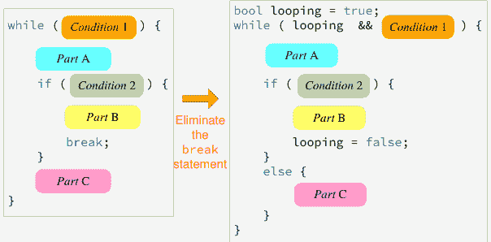

它会立即跳出循环。它会跳过循环体中 break 语句之后的任何语句。由于语句

```
sum += input; // Accumulate user input
```

出现在 break 之后，因此程序不可能将负数添加到 sum 变量中。

一些软件设计师认为程序员应谨慎使用 break 语句，因为它偏离了正常的循环控制逻辑。理想情况下，每个循环应有一个入口点和一个出口点。虽然清单 6.15（addmiddleexit.cpp）具有一个出口点（break 语句），但一些程序员通常在 while 语句中使用 break 语句，而这些 while 语句的条件并非恒真。向此类循环添加 break 语句会增加一个额外的出口点（检查条件的循环顶部是一个点，break 语句是另一个点）。在单个循环中使用多个 break 语句尤其可疑，你应避免这种做法。

如果 break 语句的使用可疑且可有可无，为何还要保留它呢？清单 6.4（addnonnegatives.cpp）中的逻辑相当简单，因此清单 6.15（addmiddleexit.cpp）的重构非常直接；一般来说，为避免使用 break 语句而重构代码可能会稍微复杂化逻辑，并需要引入额外的布尔变量。如图 6.4 所示，任何使用 break 语句的程序都可以重写为不使用 break 语句。

不使用 break 的版本引入了一个布尔变量，循环控制逻辑稍微复杂一些。不使用 break 的版本使用更多内存（额外变量）和更多执行时间（在循环的每次迭代中都需要在循环条件中进行额外检查）。这额外的内存微不足道，除了一些罕见的专用应用外，额外的执行时间也难以察觉。在大多数情况下，更重要的问题是，给定代码段的控制逻辑越复杂，代码就越难正确编写。在某些情况下，即使违反了“单入口点，单出口点”原则，简单的 break 语句也是一种可接受的循环控制选项。

### 6.3.2 goto 语句

break 语句退出其所在的单个循环。break 语句不足以完全跳出嵌套循环的中间部分。goto 语句允许程序的执行流程跳转到函数内的指定位置。清单 6.16（extnested.cpp）使用 goto 语句从嵌套循环的中间跳出。

```cpp
#include <iostream>

int main() {
    // Compute some products
    int op1 = 2;
    while (op1 < 100) {
        int op2 = 2;
        while (op2 < 100) {
            if (op1 * op2 == 3731)
                goto end;
            std::cout << "Product is " << (op1 * op2) << '\n';
            op2++;
        }
        op1++;
    }
end:
    std::cout << "The end" << '\n';
}
```

当 op1 * op2 为 3731 时，程序流程将跳转到程序内的指定标签。在此示例中，标签名为 end，但此名称是任意的。与变量名一样，标签名应选择为指示其预期用途。此处名为 end 的标签位于嵌套 while 循环之后和外部。

标签的名称是一个标识符（参见第 3.3 节），标签由紧随其名称后的冒号来区分。标签表示 goto 可以跳转到的目标。goto 标签必须出现在函数内的语句之前。

使用 goto 语句时，while 是多余的；例如，清单 6.2（iterativecounttofive.cpp）可以重写为不使用 while 语句，如清单 6.17（gotoloop.cpp）所示。

```cpp
#include <iostream>

int main() {
    int count = 1;        // Initialize counter

top:
    if (count > 5)
        goto end;
    std::cout << count << '\n'; // Display counter, then
    count++;              // Increment counter
    goto top;

end:
    ;     // Target is an empty statement
}
```

早期的编程语言（如 FORTRAN 和早期版本的 BASIC）没有类似 while 的结构化语句，因此程序员被迫使用 goto 语句来编写循环。使用 goto 语句的问题是，很容易开发出即使是原始代码作者也难以理解的程序逻辑。有关意大利面条代码的 Wikipedia 文章（http://en.wikipedia.org/wiki/Spaghetti_code）。20 世纪 60 年代的结构化编程革命引入了 while 语句等结构，导致 goto 在大多数情况下不再使用。所有现代编程语言都有 while 语句的形式，因此 C++ 中的 goto 语句在很大程度上被忽略，除了跳出嵌套循环的情况。同样，你应将 goto 语句的使用限制在嵌套循环的非正常退出上。

### 6.3.3 continue 语句

当程序执行在循环内部遇到 break 语句时，它会跳过循环体的其余部分并退出循环。continue 语句与 break 语句类似，但 continue 语句不一定退出循环。continue 语句跳过循环体的其余部分并立即检查循环条件。如果循环条件仍为真，则循环执行将从循环顶部恢复。清单 6.18（continueexample.cpp）展示了 continue 语句的实际应用。

```cpp
Listing 6.18: continueexample.cpp
#include <iostream>
int main() {
   int input, sum = 0;
   bool done = false;
   while (!done) {
      std::cout << "Enter positive integer (999 quits): ";
      std::cin >> input;
      if (input < 0) {
         std::cout << "Negative value " << input << " ignored\n";
         continue; // Skip rest of body for this iteration
      }
      if (input != 999) {
         std::cout << "Tallying " << input << '\n';
         sum += input;
      }
      else
         done = (input == 999); // 999 entry exits loop
   }
   std::cout << "Sum = " << sum << '\n';
}
```

程序员使用 continue 语句的频率不如 break 语句高，因为使用 continue 的代码很容易转换为不使用 continue 的等效形式。清单 6.19（nocontinueexample.cpp）的工作方式与清单 6.18（continueexample.cpp）完全相同，但它避免了 continue 语句。

```cpp
Listing 6.19: nocontinueexample.cpp
#include <iostream>
int main() {
   int input, sum = 0;
   bool done = false;
   while (!done) {
      std::cout << "Enter positive integer (999 quits): ";
      std::cin >> input;
      if (input < 0)
         std::cout << "Negative value " << input << " ignored\n";
      else {
         if (input != 999) {
            std::cout << "Tallying " << input << "\n";
            sum += input;
         }
         else
            done = (input == 999); // 999 entry exits loop
      }
      std::cout << "sum = " << sum << "\n";
   }
}
```

图 6.5 左侧的代码泛指任何使用 continue 语句的循环。可以转换左侧的代码以消除 continue 语句，如右侧的代码所示。

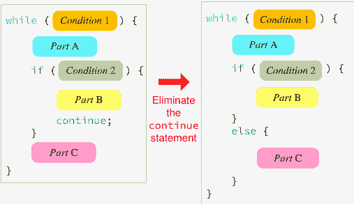

图 6.5 展示了如何将任何使用 continue 语句的程序重写为不使用 continue 的等效形式。该转换比 break 消除（见图 6.4）更简单，因为循环条件保持不变，且不需要额外变量。

使用 continue 的版本并不比使用 else 的版本更高效；事实上，Visual C++ 和 GNU C++ 编译器为清单 6.18（continueexample.cpp）和清单 6.19（nocontinueexample.cpp）生成相同的机器语言代码。此外，else 版本的逻辑并不比 continue 版本更复杂。因此，与上面的 break 语句不同，没有令人信服的理由使用 continue 语句。有时程序员可能会在最后一刻添加一个 continue 语句


将其添加到现有循环体中，以处理最初未被注意到的异常条件（例如忽略上面示例中的负数）。如果循环体很长，程序员可以在循环体顶部附近添加一个带有 `continue` 的条件语句，而无需触及循环其余部分的逻辑。因此，`continue` 语句仅为程序员提供了一种方便的替代方案。首选 `else` 版本。

### 6.4 无限循环

无限循环是没有退出的循环。一旦程序流程进入无限循环的主体，就无法逃脱。有些无限循环是设计好的；例如，长期运行的服务器应用程序（如 Web 服务器）可能需要持续检查传入的连接。该服务器应用程序可以在无限期运行的循环中执行此检查。然而，初学者程序员常常会意外创建无限循环，这些无限循环代表其程序中的逻辑错误。

故意创建的无限循环应当显而易见。例如，

```
while (true) {
    /* Do something forever . . . */
}
```

布尔字面量 `true` 始终为真，因此循环条件不可能为假。退出循环的唯一方法是通过循环体内某处嵌入的 `break` 语句、`return` 语句（参见第 9 章）或 `exit` 调用（参见第 8.1 节）。

编写故意的无限循环很容易。意外的无限循环非常常见，但初学者程序员诊断和修复它们可能会感到困惑。请考虑清单 6.20（`findfactors.cpp`），它尝试打印 1 到 20 的整数及其相关因子。

```
Listing 6.20: findfactors.cpp

#include <iostream>

int main() {
    // List of the factors of the numbers up to 20
    int n = 1;
    const int MAX = 20;
    while (n <= MAX) {
        int factor = 1;
        std::cout << n << ": ";
        while (factor <= n) {
            if (n % factor == 0) {
                std::cout << factor << " ";
                factor++;
            }
        }
        std::cout << "\n"; // Go to next line for next n
        n++;
    }
}
```

它显示

```
1: 1
2: 1 2
3: 1
```

然后会“冻结”或“挂起”，忽略任何用户输入（大多数系统上的 `Ctrl C` 键序列除外，它会中断并终止运行中的程序）。这种行为是意外无限循环的常见症状。1 的因子显示正常，2 的因子也是如此。3 的第一个因子显示正常，然后程序挂起。由于程序很短，问题可能容易定位。然而，在某些程序中，错误可能难以找到。即使在清单 6.20（`infactors.cpp`）中，调试任务也并非易事，因为它涉及嵌套循环。（在继续阅读之前，你能找到并修复清单 6.20（`infactors.cpp`）中的问题吗？）

为避免无限循环，我们必须确保循环具有某些属性：

- 循环条件不能是重言式（永远不可能为假的布尔表达式）。例如，

```
while (i >= 1 || i <= 10) {
/* Body omitted */
}
```

这是一个无限循环，因为为 `i` 选择的任何值都会满足两个子条件中的一个或两个。也许程序员本意是使用 `&&` 而不是 `||`，只要 `i` 保持在 1...10 范围内，就继续循环。

在清单 6.20（`infactors.cpp`）中，外层循环条件是

```
n <= MAX
```

如果 `n` 是 21 且 `MAX` 是 20，则条件为假，因此这不是重言式。检查内层循环条件：

factor <= n

我们可以看到，如果 `factor` 是 3 且 `n` 是 2，则表达式为假；因此，它也不是重言式。

- `while` 的条件最初必须为真才能进入其主体。主体中的代码必须以某种方式修改程序的状态，以影响每次迭代时检查的条件的结果。这通常意味着循环主体中的代码修改条件中使用的变量之一。最终，变量将采用使条件为假的值，循环终止。

在清单 6.20（`infactors.cpp`）中，外层循环的条件涉及变量 `n` 和常量 `MAX`。`MAX` 不能更改，因此为了避免无限循环，必须在循环内修改 `n`。幸运的是，外层循环主体中的最后一条语句递增 `n`。`n` 初始为 1，`MAX` 为 20，因此，除非出现导致内层循环无限的情况，否则外层循环最终应该终止。

内层循环的条件涉及变量 `n` 和 `factor`。内层循环中没有语句修改 `n`，因此必须在循环中修改 `factor`。好消息是 `factor` 在内层循环主体中被递增，但坏消息是递增操作受 `if` 语句主体的保护。内层循环包含一条语句，即 `if` 语句。该 `if` 语句的主体中又有两条语句：

```
while (factor <= n)
if (n % factor == 0) {
std::cout << factor << " ";
factor++;
}
```

如果在程序执行期间 if 的条件为假（例如，当 n 为 3 且 factor 为 2 时），内层循环无法更改程序的状态。这意味着 factor 不会改变，而 factor 控制内层循环的进展。这实际上为内层 while 循环创建了一个无限循环。我们必须移动修改 factor 变量的语句，将其置于 if 语句主体之外。

```
while (factor <= n) {
    if (n % factor == 0)
        std::cout << factor << " ";
    factor++;
}
```

请注意，花括号是必需的，以便递增 factor 的语句成为 while 主体的一部分。现在，内层 while 语句包含两条语句：if 语句和递增 factor 的语句。这个新版本运行正确，因为 factor 在内层 while 循环的每次迭代中都会改变，无论 if 语句中条件的真假值如何。

程序员可以使用调试器逐步执行程序，以查看无限循环在哪里以及为什么发生。另一种常见技术是在战略位置插入打印语句，以检查参与循环控制的变量的值。可以对原始内层循环进行如下增强：

```
while (factor <= n) {
    std::cout << " factor = " << factor
              << " n = " << n << '\n';
    if (n % factor == 0) {
        std::cout << factor << " ";
        factor++;
    }
}
```

它产生以下输出：

| 输出 |
| :--- |
| 1: factor = 1 n = 1 |
| 1 |
| 2: factor = 1 n = 2 |
| 1 factor = 2 n = 2 |
| 2 |
| factor = 1 n = 3 |
| 1: factor = 2 n = 3 |
| factor = 2 n = 3 |
| factor = 2 n = 3 |
| factor = 2 n = 3 |
| factor = 2 n = 3 |
| factor = 2 n = 3 |
| . |
| . |
| . |

程序会继续打印同一行，直到用户中断其执行。输出表明，一旦 factor 等于 2 且 n 等于 3，程序执行就会陷入内层循环。在这种情况下：

- 1. 2 < 3 为真，因此循环继续，并且
- 2. 3 % 2 等于 1，因此 `if` 语句不会递增 factor。

必须在每次遍历内层循环时递增 `factor`；因此，递增 `factor` 的语句必须移出 `if` 的受保护主体之外。

### 6.5 迭代示例

既然我们有了 `if` 和 `while` 语句，现在可以在 C++ 中实现一些复杂的算法。本节提供了几个示例，展示条件执行和迭代的强大功能。

### 6.5.1 绘制树形图

假设我们必须编写一个程序来绘制三角形树，用户提供树的高度。高度为五级的树看起来像


而高度为三级的树看起来像

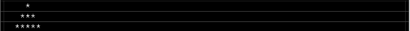

如果树的高度固定，我们可以将程序编写为清单 2.4（`arrow.cpp`）的简单变体，该变体仅使用打印语句而不使用循环。然而，我们的程序必须根据用户输入改变其高度和宽度。

清单 6.21（`startree.cpp`）提供了所需的功能。

### 清单 6.21: startree.cpp

```
#include <iostream>

int main() {
    int height;       // Height of tree
    std::cout << "Enter height of tree: ";
    std::cin >> height;   // Get height from user
    int row = 0;      // First row, from the top, to draw
    while (row < height) { // Draw one row for every unit of height
        // Print leading spaces
        int count = 0;
        while (count < height - row) {
            std::cout << " ";
            count++;
        }
        // Print out stars, twice the current row plus one:
```


```
// 1. number of stars on left side of tree
// = current row value
// 2. exactly one star in the center of tree
// 3. number of stars on right side of tree
// = current row value
count = 0;
while (count < 2*row + 1) {
    std::cout << "*";
    count++;
}
// Move cursor down to next line
std::cout << '\n';
// Change to the next row
row++;
}
```

当用户运行清单 6.21（startree.cpp）并输入 7 时，程序显示

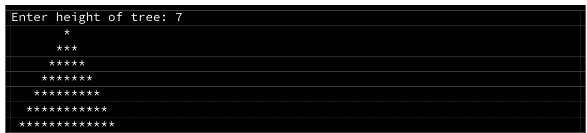

清单 6.21（startree.cpp）使用两个顺序 while 循环，两者都嵌套在一个 while 循环中。外部 while 循环负责在每次执行其循环体时绘制一行树：

- 只要用户输入的值大于零，程序就会执行外部 while 循环的循环体；如果用户输入零或更小的值，程序将终止且不执行任何操作。这是预期的行为。

- 外部 while 循环体中的最后一条语句：

  row++;

  确保变量 row 在每次循环中增加一；因此，它最终将等于 height（因为最初必须小于 height 才能进入循环），循环将终止。这里不可能出现无限循环。

- 外部循环的循环体包含多条语句；因此，循环体必须用花括号括起来。每当一组语句用花括号括起来时，就会形成一个块。在块中声明的任何变量都是该块的局部变量。变量的作用域（变量存在且可以使用的源代码部分）从其声明点到其所在块的结束。例如，变量 height 和 row 在 main 的函数体块中声明；因此，它们是 main 的局部变量。变量 count 在外部 while 语句的循环体块中声明；因此，count 是外部 while 语句的局部变量。尝试在外部 while 语句的循环体之外使用 count 将是一个错误。

变量 x 对特定代码段来说是局部的，是什么意思？这意味着 x 在其作用域之外不存在。程序中可能有其他名为 x 的变量，但它们是不同的变量。如果在同一个程序中可以有两个同名的不同变量听起来很奇怪，请考虑这样一个事实：同一个房间里可以有两个同名的人。他们是不同的人，但名字相同。同样，变量的含义取决于其上下文，其名称不一定是唯一的。

两个内部循环扮演不同的角色：

- 第一个内部循环打印空格。第一次通过外部循环时打印的空格数等于树的高度，并且每次迭代都会减少。这是正确的行为，因为向下的每一行都包含更少的前导空格但更多的星号。
- 第二个内部循环打印构成树的星号行。第一次通过外部循环时，row 为零，因此不打印左侧星号，打印一个中央星号（树的顶部），不打印右侧星号。每次通过循环时，要打印的左侧和右侧星号数量都增加一，并且打印相同的中央星号；因此，树向下每一行在两侧各宽一。观察 2*row + 1 值如何完美地表达所需的星号数量。
- 虽然看起来不对称，请注意，不需要第三个内部循环来打印星号打印后行尾的空格。空格是不可见的，所以没有理由打印它们！

### 6.5.2 打印素数

素数是大于一且只有因子（也称为除数）为一和其本身的整数。例如，29 是素数（只有 1 和 29 能整除它），但 28 不是（2、4、7 和 14 是 28 的因子）。素数曾经仅仅是数学家的智力好奇心，但现在它们在密码学和计算机安全中发挥着重要作用。

任务是编写一个程序，显示用户输入的值以内的所有素数。

清单 6.22（printprimes.cpp）提供了一个解决方案。

```cpp
Listing 6.22: printprimes.cpp

#include <iostream>

int main() {
    int max_value;
    std::cout << "Display primes up to what value? ";
    std::cin >> max_value;
    int value = 2; // Smallest prime number
    while (value <= max_value) {
        // See if value is prime
        bool is_prime = true; // Provisionally, value is prime
        // Try all possible factors from 2 to value - 1
        int trial_factor = 2;
        while (trial_factor < value) {
            if (value % trial_factor == 0) {
                is_prime = false; // Found a factor
                break; // No need to continue; it is NOT prime
            }
            trial_factor++;
        }
        if (is_prime)
            std::cout << value << " "; // Display the prime number
        value++; // Try the next potential prime number
    }
    std::cout << '\n'; // Move cursor down to next line
}
```

清单 6.22（printprimes.cpp），输入 90 时，产生：

```
Display primes up to what value? 90
2 3 5 7 11 13 17 19 23 29 31 37 41 43 47 53 59 61 67 71 73 79 83 89
```

清单 6.22（printprimes.cpp）的逻辑比清单 6.21（startree.cpp）的逻辑稍微复杂一些。用户为 max_value 提供一个值。主循环（外部 while）遍历从两到 max_value 的所有值：

- 引入了两个新变量，局部于外部循环的循环体：trial_factor 和 is_prime。is_prime 初始化为 true，意味着除非我们的测试证明否则，否则假设 value 是素数。trial_factor 在内部循环中取从两到 value - 1 的所有值：

```
int trial_factor = 2;
while (trial_factor < value) {
    if (value % trial_factor == 0) {
        is_prime = false; // Found a factor
        break; // No need to continue; it is NOT prime
    }
    trial_factor++;
}
```

当 trial_factor 能整除 value（即没有余数）时，表达式 value % trial_factor 为零——正好是 trial_factor 是 value 的因子时。如果执行的程序确定 trial_factor 的任何值是 value 的因子，则它将 is_prime 设置为 false 并通过 break 退出循环。如果循环继续到完成，程序永远不会将 is_prime 设置为 false，这意味着它没有找到因子，value 确实是素数。

- 内部循环后的 if 语句：

```
if (is_prime)
    std::cout << value << " "; // Display the prime number
```

只需检查 is_prime 的状态。如果 is_prime 为 true，则 value 必须是素数，因此它打印 value 以及一个额外的空格，以便与后续迭代中可能产生的输出分隔。

我们可以提出的一些重要问题包括：

- 1. 如果用户输入 2，它会被打印吗？

在这种情况下，max_value = value = 2，因此外部循环的条件

```
value <= max_value
```

为真，因为 2 <= 2。is_prime 被设置为 true，但内部循环的条件

```
trial_factor < value
```

不为真（2 不小于 2）。因此，跳过内部循环，is_prime 保持不变为 true，并打印 2。这种行为是正确的，因为 2 是最小的素数（也是唯一的偶素数）。

- 2. 如果用户输入小于 2 的数字，会打印任何内容吗？

while 条件确保不考虑小于二的值。while 的循环体永远不会被进入。只打印换行符，不显示任何数字。这种行为是正确的。

- 3. 内部循环是否保证始终终止？

要进入内部循环的循环体，trial_factor 必须小于 value。value 在循环中任何地方都不会改变，trial_factor 在循环内的 if 语句中任何地方都不会被修改，并且在 if 语句之后立即在循环中递增。因此，trial_factor 在循环的每次迭代中都会递增。最终，trial_factor 将等于 value，循环将终止。

- 4. 外部循环是否保证始终终止？

要进入外部循环的循环体，value 必须小于或等于 max_value。max_value 在循环中任何地方都不会改变。value 在外部循环循环体的最后一条语句中增加，并且 value 在其他任何地方都不会被修改。由于内部循环如上一答案所示保证终止，最终 value 将超过 max_value，循环将结束。

我们可以重新排列内部 while 的逻辑以避免 break 语句。当前版本是：

```
while (trial_factor < value) {
    if (value % trial_factor == 0) {
        is_prime = false; // Found a factor
        break; // No need to continue; it is NOT prime
    }
    trial_factor++;
}
```

我们可以将其重写为：

```
while (is_prime && trial_factor < value) {
    is_prime = (value % trial_factor != 0);
    trial_factor++; // Try next factor
}
```

这个没有 break 的版本为 while 引入了稍微复杂的条件，但删除了其循环体中的 if 语句。is_prime 在循环前初始化为 true。每次通过循环时，它都会被重新赋值。如果 value % trial_factor 为零，trial_factor 将变为 false。这正是 trial_factor 是 value 的因子时。如果 is_prime 变为 false，循环无法继续；如果 is_prime 永不变为 false，当 trial_factor 等于 value 时循环结束。由于运算符优先级，括号不是必需的。括号确实提高了可读性，因为包含 == 和 != 的表达式对人类来说解析起来很别扭。当括号放在不需要的地方时，例如

```
x = (y + 2);
```


编译器会简单地忽略它们，因此编译后的代码中没有效率损失。

我们可以进一步缩短循环：

```cpp
while (is_prime && trial_factor < value)
    is_prime = (value % trial_factor++ != 0);
```

此版本在测试表达式中使用了后自增运算符（参见第4.9节）。回顾一下，使用后自增运算符时，变量的值会在周围表达式（如果有）中使用，然后变量递增。由于while循环体现在只包含一条语句，因此不需要花括号。

### 6.6 练习

- 1. 在清单6.4（addnonnegatives.cpp）中，if语句的条件能否使用>代替>=并达到相同的结果？为什么？

- 2. 在清单6.4（addnonnegatives.cpp）中，while语句的条件能否使用>代替>=并达到相同的结果？为什么？

- 3. 使用循环重写以下代码片段，使其仅使用一个std::cout和一个'\n'。

```cpp
std::cout << 2 << '\n';
std::cout << 4 << '\n';
std::cout << 6 << '\n';
std::cout << 8 << '\n';
std::cout << 10 << '\n';
std::cout << 12 << '\n';
std::cout << 14 << '\n';
std::cout << 16 << '\n';
```

- 4. 在清单6.4（addnonnegatives.cpp）中，如果将包含std::cin的语句移出循环会发生什么？将赋值移出循环是好事还是坏事？为什么？

- 5. 以下代码片段打印多少个星号？

```cpp
int a = 0;
while (a < 100) {
    std::cout << "*";
    a++;
}
std::cout << '\n';
```

- 6. 以下代码片段打印多少个星号？

```cpp
int a = 0;
while (a < 100)
    std::cout << "*";
std::cout << '\n';
```

- 7. 以下代码片段打印多少个星号？

```cpp
int a = 0;
while (a > 100) {
    std::cout << "*";
    a++;
}
std::cout << '\n';
```

- 8. 以下代码片段打印多少个星号？

```cpp
int a = 0;
while (a < 100) {
    int b = 0;
    while (b < 55) {
        std::cout << "*";
        b++;
    }
    std::cout << '\n';
}
```

- 9. 以下代码片段打印多少个星号？

```cpp
int a = 0;
while (a < 100) {
    if (a % 5 == 0)
        std::cout << "*";
    a++;
}
std::cout << '\n';
```

- 10. 以下代码片段打印多少个星号？

```cpp
int a = 0;
while (a < 100) {
    int b = 0;
    while (b < 40) {
        if ((a + b) % 2 == 0)
            std::cout << "*";
        b++;
    }
    std::cout << '\n';
    a++;
}
```

- 11. 以下代码片段打印多少个星号？

```cpp
int a = 0;
while (a < 100) {
    int b = 0;
    while (b < 100) {
        int c = 0;
        while (c < 100) {
            std::cout << "*";
            c++;
        }
        b++;
    }
    a++;
}
std::cout << '\n';
```

- 12. 以下代码片段打印什么？

```cpp
int a = 0;
while (a < 100)
    std::cout << a++;
std::cout << '\n';
```

- 13. 以下代码片段打印什么？

```cpp
int a = 0;
while (a < 100)
    std::cout << a++;
std::cout << '\n';
```

- 14. 使用break语句重写以下代码片段并消除done变量。你的代码应与该代码片段行为完全相同。

```cpp
bool done = false;
int n = 0, m = 100;
while (!done && n != m) {
    std::cin >> n;
    if (n < 0)
        done = true;
}
std::cout << "n = " << n << '\n';
```

- 15. 重写以下代码片段以消除continue语句。你的新代码逻辑应比该片段的逻辑更简单。

```cpp
int x = 100, y;
while (x > 0) {
    std::cin >> y;
    if (y == 25) {
        x--;
        continue;
    }
    std::cin >> x;
    std::cout << "x = " << x << '\n';
}
```

- 16. 假设你得到了一些来自1960年代的代码，该语言不支持像while这样的结构化语句。你的任务是对其进行现代化改造并使其适应C++。以下代码片段已改编为C++，但你现在必须使用while语句对其进行结构化以替换gotos。你的代码应没有goto，并且仍然与该代码片段行为完全相同。

```cpp
int i = 0;
top: if (i == 10)
    goto end;
    std::cout << i << '\n';
    i++;
    goto top;
end:
```

- 17. 以下代码片段打印什么？

```cpp
int a = 0;
while (a < 100);
std::cout << a++;
std::cout << '\n';
```

- 18. 编写一个C++程序，接受用户输入的单个整数值。如果输入的值小于1，程序不打印任何内容。如果用户输入一个正整数n，程序将打印一个由*字符绘制的n×n方框。例如，如果用户输入1，程序打印

```
*
```

如果用户输入2，它打印

```
**
**
```

输入3会产生

```
***
***
***
```

以此类推。如果用户输入7，它打印

```
*******
*******
*******
*******
*******
*******
*******
```

即一个7×7的*符号方框。

- 19. 编写一个C++程序，允许用户输入正好二十个双精度浮点值。然后程序打印输入值的总和、平均值（算术平均数）、最大值和最小值。

- 20. 编写一个C++程序，允许用户输入任意数量的非负双精度浮点值。用户使用任意负值来终止输入列表。然后程序打印输入值的总和、平均值（算术平均数）、最大值和最小值。终止的负值不用于计算。如果用户提供的第一个数是负数，程序仅打印文本NO NUMBERS PROVIDED。

- 21. 重新设计清单6.21（startree.cpp），使其绘制一棵指向右侧的侧向树；例如，如果用户输入7，程序将打印

```
*
**
***
****
*****
******
*******
********
*********
********
*******
******
*****
****
***
**
*
```

- 22. 重新设计清单6.21（startree.cpp），使其绘制一棵指向左侧的侧向树；例如，如果用户输入7，程序将打印

```
    *
   **
  ***
 ****
*****
 ****
  ***
   **
    *
```

## 第 7 章

## 其他条件语句和迭代语句

if/else和while语句足以实现任何涉及条件执行和循环的算法。break和continue语句很方便但并非必需。C++提供了一些额外的条件和迭代语句，在某些情况下使用更方便。这些额外语句包括

- switch：某些多分支if/else语句的替代方案

- 条件运算符：表现出if/else语句行为的表达式

- do/while：在执行循环体后检查其条件的循环

- for：便于计数的循环

这些替代构造允许算法的某些部分以更清晰、更简洁的方式表达。本章探讨了表达条件执行和迭代的这些其他形式。

### 7.1 switch语句

switch语句为某些多分支if/else语句（如清单5.16（restyleddigititoword.cpp）中的语句）提供了一个方便的替代方案。清单7.1（switchdigititoword.cpp）是清单5.16（restyleddigititoword.cpp）的一个新实现，它使用switch语句代替多分支if/else语句。

```cpp
Listing 7.1: switchdigititoword.cpp
#include <iostream>
int main() {
    int value;
    std::cout << "Please enter an integer in the range 0..5: ";
    std::cin >> value;
    switch (value) {
case 0:
    std::cout << "zero";
    break;
case 1:
    std::cout << "one";
    break;
case 2:
    std::cout << "two";
    break;
case 3:
    std::cout << "three";
    break;
case 4:
    std::cout << "four";
    break;
case 5:
    std::cout << "five";
    break;
default:
    if (value < 0)
        std::cout << "Too small";
    else
        std::cout << "Too large";
    break;
}
std::cout << '\n';
}
```

switch的一般形式是：


```
switch (integral expression) {
    case integral constant 1:
        statement sequence 1
        break;
    case integral constant 2:
        statement sequence 2
        break;
    case integral constant 3:
        statement sequence 3
        break;
    ...
    case integral constant n:
        statement sequence n
        break;
    default:
        default statement sequence
}
```

在 switch 语句中

- 保留字 switch 标识一个 switch 语句。
- 紧跟在 switch 关键字后的带括号表达式必须求值为整型值。任何整数类型、字符和布尔表达式均可接受。浮点表达式和其他非整型类型均被禁止。
- `switch` 的主体由必需的花括号括起来。
- 每个 `case` 关键字后面都跟着一个整型 `constant` 和一个冒号 (:)。我们将这个整型常量称为 `case label`。该标签可以是字面量值或 `const` 符号值（参见第 3.6 节）。特别是，非 `const` 变量和其他表达式明确被禁止。

case label 在代码中定义一个位置；它不是可执行语句。case label 表示程序执行流可以跳转到的目标。

如果 `case` 标签与 `switch` 的表达式匹配，则执行该标签后面的语句，直到遇到 `break` 语句为止。每个 `case` 标签后面的语句和 `break` 语句都是可选的。为多个 `case` 标签执行同一组语句的一种方法是为一个或多个标签提供空语句，如下所示：

```
std::cin >> key; // get key from user
switch (key) {
  case 'p':
  case 'P':
    std::cout << "You chose \"P\"\n";
    break;
  case 'q':
  case 'Q':
    done = true;
    break;
}
```

这里，大写或小写的 `P` 都会导致相同的操作——将打印 `You chose P`。如果用户输入大写或小写的 `Q`，则 `done` 布尔变量被设置为 true。如果用户既不输入 `P` 也不输入 `Q`，则 `switch` 中的任何语句都不会执行。

`break` 语句是可选的。当匹配 `case` 标签时，后面的语句会执行，直到遇到 `break` 语句。然后控制流转移出 `switch` 的主体。这样，`switch` 中的 `break` 就像循环中的 `break` 一样工作：跳过语句主体的其余部分，程序执行在主体之后的下一条语句处恢复。缺少 `break` 语句是一个常见错误，当其遗漏不是故意时，会导致执行后续 `case` 标签的语句。该过程持续到遇到 `break` 或到达 `switch` 主体末尾。

- 如果没有任何 `case` 标签匹配，则匹配 `default` 标签。它像多路 `if/else` 语句中的最终 `else` 一样，作为一个兜底选项。`default` 标签是可选的。如果缺少它且没有任何 `case` 标签与表达式匹配，则 `switch` 主体内的任何语句都不会执行。

`switch` 语句有两个限制，使其不如多路 `if/else` 通用：

- `switch` 的参数必须是整型表达式。
- case 标签必须是常量整型值。整型字面量和常量是可接受的。变量或表达式 **不** 允许。

为了说明这些限制，请考虑以下可以轻松翻译为等效 `switch` 语句的 `if/else` 语句：

```
if (x == 1) {
    // Do 1 stuff here . . .
}
else if (x == 2) {
    // Do 2 stuff here . . .
}
else if (x == 3) {
    // Do 3 stuff here . . .
}
```

对应的 switch 语句是：

```
switch (x) {
case 1:
    // Do 1 stuff here . . .
    break;
case 2:
    // Do 2 stuff here . . .
    break;
case 3:
    // Do 3 stuff here . . .
    break;
}
```

现在考虑以下 if/else：

```
if (x == y) {
    // Do "y" stuff here . . .
}
else if (x > 2) {
    // Do "> 2" stuff here . . .
}
else if (z == 3) {
    // Do 3 stuff here . . .
}
```

这段代码无法轻松翻译为 switch 语句。变量 y 不能用作 case 标签。第二个选择检查的是不等式而不是精确匹配，因此直接翻译为 case 标签是不可能的。在最后一个条件中，检查的是不同的变量 z 而不是 x。switch 语句的控制流由单个值（例如 x 的值）决定，但多路 if/else 语句不受此限制。

在适用的情况下，switch 语句允许程序员紧凑地表达多路选择逻辑。大多数程序员发现 switch 语句比等效的多路 if/else 结构更易读。

switch 语句限制的一个积极后果是，它允许编译器为 switch 生成比等效 if/else 更高效的代码。如果必须从多个选项中做出选择，并且可以使用 switch 语句，那么 switch 语句可能比相应的多路 if/else 更快。

### 7.2 条件运算符

作为纯粹的语法便利，C++ 提供了一种称为条件运算符的 if/else 结构替代方案。它应用有限，但仍然方便。以下代码片段将两个值之一赋给 x：

- y/z 的结果，如果 z 非零，或
- 零，如果 z 为零；我们希望避免除以零的运行时错误。

```
// Assign a value to x:
if (z != 0)
    x = y/z; // Division is possible
else
    x = 0;   // Assign a default value instead
```

这段代码有两个赋值语句，但任何给定时间只执行一个。条件运算符可以形成更紧凑的语句：

```
// Assign a value to x:
x = (z != 0) ? y/z : 0;
```

条件表达式的一般形式是：

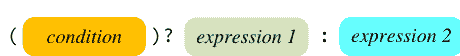

- condition 是一个可能出现在 if 语句中的普通布尔表达式。条件周围的括号不是必需的，但应使用以提高可读性。
- expression 1 是条件表达式的总体值，如果 condition 为 true。
- expression 2 是条件表达式的总体值，如果 condition 为 false。

条件运算符使用两个符号 (? 和 :) 和三个操作数。由于它有三个操作数，它被归类为三元运算符（C++ 中唯一的一个）。条件表达式的总体类型是 exp1 和 exp2 中更占优势的那个。条件表达式可以在任何可以使用表达式的地方使用。它本身不是语句；它用于语句中。

作为另一个示例，数字的绝对值在数学中由以下公式定义：

|n| = \begin{cases} n, & \text{when } n \ge 0 \\ -n, & \text{when } n < 0 \end{cases}

换句话说，正数或零的绝对值与该数字相同；负数的绝对值是该数字的加法逆元（负值）。以下 C++ 表达式表示变量 n 的绝对值：

```
(n < 0) ? -n : n
```

有人认为条件运算符晦涩难懂，因此其使用会降低程序的可读性。对资深 C++ 程序员来说，它相当容易理解，但由于其非常特定的性质，使用得比较少。

### 7.3 do/while 语句

执行中的程序在执行主体中的任何语句之前检查 while 语句（第 6.1 节）的条件；因此，我们说 `while` 循环是一个 *top-checking* 循环。有时，先检查条件再执行主体的顺序不方便；例如，请考虑清单 7.2 (goodinputonly.cpp)。

清单 7.2: goodinputonly.cpp

```cpp
#include <iostream>

int main() {
  int in_value = -1;
  std::cout << "Please enter an integer in the range 0-10 ";
  // Insist on values in the range 0...10
  while (in_value < 0 || in_value > 10)
    std::cin >> in_value;
  // in_value at this point is guaranteed to be within range
  std::cout << "Legal value entered was " << in_value << '\n';
}
```

清单 7.2 (goodinputonly.cpp) 中的循环会将用户困在 `while` 中，直到用户提供所需范围内的数字。其工作原理如下：

- `while` 的条件指定了一个包含所有 *不* 在所需范围内的值的集合。将 `in_value` 初始化为 -1 可确保 `while` 的条件最初为 true，因此程序总是至少执行一次循环主体。
- 程序执行进入循环之前，用户没有机会输入值。
- 用户逃离循环的唯一方法是输入违反条件的值——即所需范围内的值。

在循环检查之前初始化 `in_value` 有些人为。它仅用于确保进入循环主体。在用户有机会输入值之前检查有效值似乎不自然。在主体执行至少一次后才检查条件的循环会更合适。`do/while` 语句是一个 *bottom-checking* 循环，其行为正是这样。清单 7.3 (betterinputonly.cpp) 使用 do/while 语句来检查有效输入。

清单 7.3: betterinputonly.cpp

```cpp
#include <iostream>

int main() {
  int in_value;
  std::cout << "Please enter an integer in the range 0-10 ";
```


### 图 7.1 while 和 do/while 循环的流程图

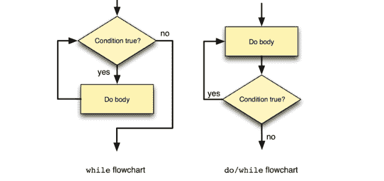

```
// Insist on values in the range 0...10
do
  std::cin >> in_value;
while (in_value < 0 || in_value > 10);
// in_value at this point is guaranteed to be within range
std::cout << "Legal value entered was " << in_value << '\n';
}
```

请注意，无需初始化 in_value，因为在通过输入流 std::cin 赋值之前不会使用其值。图 7.1 比较了 while 循环和 do/while 循环的流程图。

do/while 语句的一般形式如下：

```
do
statement
while ( condition );
```

- 保留字 do 和 while 用于标识 do/while 语句。do 和 while 关键字界定循环体，但如果循环体包含多条语句，仍然需要花括号。

- 条件与循环末尾的 while 相关联。条件是一个布尔表达式，必须用括号括起来。

- 该语句与 while 循环一般形式中的语句完全相同（参见第 6.1 节）。它可以是用花括号括起来的复合语句。

与 while 语句不同，do/while 语句的循环体保证至少执行一次。

do/while 循环为程序员提供了便利，并不是一种必不可少的编程结构。将任何使用 do/while 语句的代码转换为使用 while 语句且行为相同的代码都很容易。在实践中，程序员使用 while 循环的频率远高于 do/while 循环，因为更多算法需要顶部检查循环而非底部检查循环。然而，do/while 语句被包含在 C++ 中是有原因的。将能够更自然地用底部检查循环表达的算法转换为使用顶部检查循环，可能会导致笨拙的代码。在合适的时候使用 do/while。

### 7.4 for 语句

回顾清单 6.2 (iterativecountfive.cpp)。它只是从 1 数到 5。计数是计算机程序中经常执行的活动。任何程序要进行计数，都需要某些程序元素：

- 必须使用一个变量来跟踪计数；在清单 6.2 (iterativecountfive.cpp) 中，count 是命名恰当的计数器变量。
- 必须为计数器变量赋予初始值。在清单 6.2 (iterativecountfive.cpp) 的情况下，初始值为 1。
- 随着程序计数，必须修改变量（通常是递增）。语句 count++; 在清单 6.2 (iterativecountfive.cpp) 中递增 count。
- 必须提供一种方法来确定计数是否完成。在清单 6.2 (iterativecountfive.cpp) 中，while 语句的条件决定计数是否完成或必须继续。

C++ 提供了一种专门的循环，将这四个编程元素封装到一个方便的语句中。称为 for 语句，其一般形式是

```
for ( initialization ; condition ; modification ) statement
```

- 保留字 `for` 用于标识 `for` 语句。
- 循环由一个称为循环变量的特殊变量控制。
- 头部包含在括号中，包含三个部分，每个部分由分号分隔：
  - **初始化。** `initialization` 部分为循环变量赋予初始值。循环变量也可以在此处声明；如果在此处声明，则其作用域仅限于 `for` 语句。这意味着你只能在循环内使用该循环变量。这也意味着你可以在循环外自由重用该变量名来声明一个与循环变量同名的不同变量。初始化部分只执行一次。
  - **条件。** `condition` 部分是一个布尔表达式，与 `while` 语句的条件类似。每次执行循环体*之前*都会检查条件。
  - **修改。** `modification` 部分通常会更改循环变量。更改应使得条件最终变为假，以便循环终止。修改在每次迭代中执行，在循环体执行*之后*。请注意，最后一部分（`modification`）后面不跟分号；分号严格用于分隔三个部分。
- `statement` 与任何其他循环的循环体类似。它可以是花括号内的复合语句。

任何 `for` 循环都可以重写为 `while` 循环。上面给出的 `for` 循环的一般形式可以等价地写成

```
initialization
while ( condition ) {
statement
modification
}
```

清单 7.4 (forcounttofive.cpp) 使用 `for` 语句数到 5。

```
#include <iostream>
int main() {
    for (int count = 1; count <= 5; count++)
        std::cout << count << "\n"; // Display counter
}
```

使用 while 循环时，四个计数组件（变量声明、初始化、条件和修改）可以散布在代码中。使用 for 循环时，程序员应该能够通过查看一个语句来确定循环控制的所有重要信息。

回顾在屏幕上打印乘法表的清单 6.13 (timetable.cpp)。我们可以通过将所有 while 语句转换为 for 语句来更好地组织其代码。结果使用的代码要少得多，如清单 7.5 (bettertimestable.cpp) 所示。

清单 7.5: bettertimestable.cpp

```cpp
#include <iostream>
#include <iomanip>

int main() {
    int size; // The number of rows and columns in the table
    std::cout << "Please enter the table size: ";
    std::cin >> size;
    // Print a size x size multiplication table

    // First, print heading
    std::cout << "   ";
    for (int column = 1; column <= size; column++)
        std::cout << std::setw(4) << column; // Print heading for this column.
    std::cout << "\n";
    // Print line separator
    std::cout << "   +";
    for (int column = 1; column <= size; column++)
        std::cout << "----"; // Print separator for this column.
    std::cout << "\n";
    // Print table contents
    for (int row = 1; row <= size; row++) {
        std::cout << std::setw(4) << row << " |"; // Print row label.
        for (int column = 1; column <= size; column++)
            std::cout << std::setw(4) << row * column; // Display product
        std::cout << "\n"; // Move cursor to next row
    }
}
```

for 循环非常适合遍历行和列。两个循环的控制信息现在分别封装在各自的 for 语句中，而不是分散在 main 的各个位置。在 while 版本中，程序员很容易忘记更新一个或两个计数器变量（row 和/或 column）。for 循环使程序员更难忘记循环变量更新，因为更新是在 for 语句标题中直接完成的。

在 for 语句中做以下任何一项都被视为不良编程实践：

- 在循环体内修改循环控制变量——如果在循环体内修改循环变量，则循环控制的逻辑不再完全隔离在 for 语句的标题中。程序员必须在语句的其他地方查看才能完全理解循环的工作原理。
- 使用 break 过早退出循环——此操作也违反了将所有循环控制逻辑保持在一个地方（for 的标题）的概念。

语言允许这两种做法，但经验表明最好避免它们。如果似乎有必要违反此建议，请考虑使用另一种循环。while 和 do/while 循环并不意味着 for 循环所期望的同样程度的控制规律性。

清单 7.6 (permuteabcd.cpp) 是清单 6.14 (permuteabc.cpp) 的重写，它将 while 循环替换为 for 循环并添加了一个额外字符。

清单 7.6: permuteabcd.cpp

```cpp
// File permuteabcd.cpp
#include <iostream>
int main() {
    for (char first = 'A'; first <= 'D'; first++)
        for (char second = 'A'; second <= 'D'; second++)
            for (second != first; // No duplicate letters
                for (char third = 'A'; third <= 'D'; third++)
                    if (third != first && third != second)
                        for (char fourth = 'A'; fourth <= 'D'; fourth++)
                            if (fourth != first && fourth != second && fourth != third)
                                std::cout << first << second << third << fourth << '\n';
}
```

请注意，由于所有变量初始化和递增都在 for 语句标题中处理，我们不再需要循环体中的复合语句，因此花括号是不必要的。清单 7.6 (permuteabcd.cpp) 打印 ABCD 的所有 24 个排列：

```
ABCD
ABDC
ACBD
ACDB
ADBC
ADCB
BACD
BADC
BCAD
BCDA
BDAC
BDCA
CABD
CADB
CBAD
CBDA
CDAB
CDBA
DABC
DACB
DBAC
DBCA
DCAB
DCBA
```

清单 7.7 (forprintprimes.cpp) 是清单 6.22 (printprimes.cpp) 的重写，它将 while 循环替换为 for 循环。


```cpp
#include <iostream>

int main() {
    int max_value;
    std::cout << "Display primes up to what value? ";
    std::cin >> max_value;
    for (int value = 2; value <= max_value; value++) {
        // See if value is prime
        bool is_prime = true; // Provisionally, value is prime
        // Try all possible factors from 2 to value - 1
        for (int trial_factor = 2;
             is_prime && trial_factor < value;
             trial_factor++) {
            is_prime = (value % trial_factor != 0);
        }
        if (is_prime)
            std::cout << value << " "; // Display the prime number
    }
    std::cout << '\n'; // Move cursor down to next line
}
```

如清单 7.7（forprintprimes.cpp）所示，`for` 循环中的条件表达式不仅限于对循环控制变量的简单测试；它可以是任何合法的布尔表达式。如果需要，程序员可以使用逻辑 `&&`、`||` 和 `!` 运算符来创建复杂的布尔表达式。`for` 循环的修改部分不仅限于简单的算术运算，可以相当复杂。例如：

```cpp
for (double d = 1000; d >= 1; std::cin >> d) {
    /* Body goes here */
}
```

这里 d 从输入流中重新赋值。如果需要，可以在初始化部分初始化多个变量：

```cpp
for (int i = 0, j = 100; i < j; i++) {
    /* Body goes here */
}
```

虽然 `for` 语句支持这种复杂的头部，但通常简单更好。通常 `for` 循环应仅管理一个控制变量，初始化、条件和修改部分应保持简单。如果特定的编程情况需要过于复杂的 `for` 结构，请考虑使用另一种循环。

`for` 语句的任何或所有部分（初始化、条件、修改和主体）都可以省略：

- 初始化。如果缺少初始化，如

```cpp
for (; i < 10; i++)
    /* Body goes here */
```

则 `for` 循环不执行任何初始化，且必须在其他地方完成。

- 条件。如果缺少条件，如

```cpp
for (int i = 0; ; i++)
/* Body goes here */
```

则条件默认为真。除非意图是无限循环，否则主体中必须出现 `break` 或 `goto`。

- 修改。如果缺少修改，如

```cpp
for (int i = 0; i < 10; )
/* Body goes here */
```

则 `for` 不执行任何自动修改；修改必须由主体中的语句完成，以避免无限循环。

- 主体。空主体，如

```cpp
for (int i = 0; i < 10; i++) {}
```

或

```cpp
for (int i = 0; i < 10; i++);
```

会导致空循环。一些程序员使用空循环来在程序执行中产生不可移植的延迟。例如，程序员可能需要减慢图形动画的速度。使用空循环的这种尝试之所以不可移植，有几个原因。如果程序实际执行该循环，较慢的计算机会比较快的计算机延迟更久。程序延迟的时间会因计算机而异。更糟糕的是，一些编译器可能检测到此类代码没有功能效果并优化掉空循环。这意味着编译器将完全忽略 `for` 语句。

> > 如前所述（第 5.3 节），要小心不要在 `for` 头部末尾意外加上分号，如
> > `for (int i = 0; i < 10; i++); /* Intended body goes here */`
> > 分号会终止 `for` 语句，随后的预期主体并不是主体，即使它可能缩进正确。

创建有意无限循环的一个常见 C/C++ 惯用法是使用控制信息全部缺失的 `for` 语句：

```cpp
for ( ; ; )
/* Body goes here */
```

省略 `for` 头部的所有部分，是程序员在表达“我知道我在做什么——我确实想要这里是一个无限循环。”实际上，该循环可能根本不是无限的；其主体可能包含 `break` 或 `goto` 语句。

虽然 `for` 语句支持省略头部的部分内容，但应避免使用此类结构。`for` 循环的意图是让程序员在一个地方看到循环控制的所有方面。如果这些控制职责中的一些要在其他地方处理（不在 `for` 的头部中），则请考虑使用另一种循环。

程序员通常为 `for` 语句的控制变量选择一个简单的名称。请记住，变量名应选择得当，以反映其在程序中的用途。可能会让人惊讶的是，`i` 可能是 `for` 循环中整数控制变量最常用的名称。这种做法源于数学，在数学中，`i`、`j` 和 `k` 等变量通常用于索引向量和矩阵。此类数学结构在编程中有对应物，即数组和向量，我们将在第 11 章中探讨。计算机程序员在数组和向量处理中大量使用 `for` 循环，因此程序员普遍采用了短控制变量名称的惯例。因此，通常可以使用像 `i` 这样的简单标识符作为循环控制变量。

C++ 允许在 `for` 语句的主体中使用 `break`、`continue` 和 `goto` 语句。与 `while` 和 `do/while` 语句类似，`break` 会导致立即终止循环，`continue` 会立即检查条件以确定迭代是否应继续，而 `goto` 会跳转到函数中的某个标签。然而，如前所述，`for` 循环控制应限制在其头部中，并且应避免在 `for` 循环中使用 `break`、`continue` 和 `goto`。

任何 `for` 循环都可以用 `while` 循环重写并表现得完全相同。例如，考虑以下 `for` 循环

```cpp
for (int i = 1; i <= 10; i++)
    std::cout << i << '\n';
```

接下来考虑表现完全相同的 `while` 循环：

```cpp
int i = 1;
while (i <= 10) {
    std::cout << i << '\n';
    i++;
}
```

哪个更好？`for` 循环方便地将循环控制信息打包在其头部中，但在 `while` 循环中，这些信息分布在小段代码中。因此，`for` 循环对循环控制代码提供了更好的组织。一个循环是否比另一个性能更好？不，大多数编译器对这两种结构生成的代码基本相同。因此，在此示例中更倾向于使用 `for` 循环。

### 7.5 练习

- 1. 考虑以下代码片段。

```cpp
int x;
std::cin >> x;
switch (x + 3) {
 case 5:
    std::cout << x << '\n';
    break;
 case 10:
    std::cout << x - 3 << '\n';
    break;
 case 20:
    std::cout << x + 3 << '\n';
    break;
}
```

- (a) 当用户输入 2 时，打印什么？
- (b) 当用户输入 5 时，打印什么？
- (c) 当用户输入 7 时，打印什么？
- (d) 当用户输入 17 时，打印什么？
- (e) 当用户输入 20 时，打印什么？

- 2. 考虑以下代码片段。

```cpp
char ch;
std::cin >> ch;
switch (ch) {
case 'a':
    std::cout << "*\n";
    break;
case 'A':
    std::cout << "**\n";
    break;
case 'b':
case 'B':
    std::cout << "****\n";
case 'C':
    std::cout << "*****\n";
    break;
default:
    std::cout << "******\n";
}
```

- (a) 当用户输入 a 时，打印什么？
- (b) 当用户输入 A 时，打印什么？
- (c) 当用户输入 b 时，打印什么？
- (d) 当用户输入 B 时，打印什么？
- (e) 当用户输入 C 时，打印什么？
- (f) 当用户输入 c 时，打印什么？
- (g) 当用户输入 t 时，打印什么？

- 3. 以下代码片段打印什么？

```cpp
int x = 0;
do {
    std::cout << x << " ";
    x++;
} while (x < 10);
std::cout << '\n';
```

- 4. 以下代码片段打印什么？

```cpp
int x = 20;
do {
  std::cout << x << " ";
  x++;
} while (x < 10);
std::cout << '\n';
```

- 5. 以下代码片段打印什么？

```cpp
for (int x = 0; x < 10; x++)
  std::cout << "x*";
std::cout << '\n';
```

- 6. 重写以下代码片段，以使用 switch 代替 if/else 语句。

```cpp
int value;
char ch;
std::cin >> ch;
if (ch == 'A')
  value = 10;
else if (ch == 'P')
  value = 20;
else if (ch == 'T')
  value = 30;
else if (ch == 'V')
  value = 40;
else
  value = 50;
std::cout << value << '\n';
```

- 7. 重写以下代码片段，以使用多路 if/else 代替 switch 语句。

```cpp
int value;
char ch;
std::cin >> ch;
switch (ch) {
  case 'A':
    value = 10;
    break;
  case 'P':
    std::cin >> value;
    break;
  case 'T':
    value = ch;
    break;
  case 'V':
    value = ch + 1000;
    break;
  default:
    value = 50;
}
```


```
std::cout << value << '\n';
```

- 8. 将以下代码片段重写，以使用多路 if/else 语句代替 switch 语句。

```cpp
int value;
char ch;
std::cin >> ch;
switch (ch) {
case 'A':
    std::cout << ch << '\n';
    value = 10;
    break;
case 'P':
case 'E':
    std::cin >> value;
    break;
case 'T':
    std::cin >> ch;
    value = ch;
case 'C':
    value = ch;
    std::cout << "value=" << value << ", ch=" << ch << '\n';
    break;
case 'W':
    value = ch + 1000;
    break;
}
std::cout << value << '\n';
```

- 9. 将以下代码片段重写，以使用 while 循环代替 for 语句。

```cpp
for (int i = 100; i > 0; i--)
    std::cout << i << '\n';
```

- 10. 将以下代码片段重写，以使用条件运算符代替 if 语句：

```cpp
if (value % 2 != 0)     // Is value even?
    value = value + 1;  // If not, make it even.
```

- 11. 将以下代码片段重写，以使用条件运算符代替 if/else 语句：

```cpp
if (value % 2 == 0)     // Is value even?
    value = 0;          // If so, make it zero.
else
    value = value + 1;  // Otherwise, make it even.
```

- 12. 以下多路 if/else 是否适合重写为 switch 语句？如果适合，请使用 switch 重写代码；否则，请解释这样做不切实际的原因。

```cpp
int x, y;
std::cin >> x >> y;
if (x < 10)
    y = 10;
else if (x == 5)
    y = 5;
else if (x == y)
    y = 0;
else if (y > 10)
    x = 10;
else
    x = y;
```

## 第 8 章

## 使用函数

假设你必须编写一个 C++ 程序，计算用户提供的数字的平方根。清单 8.1（computesquareroot.cpp）提供了一个简单的实现。

```
Listing 8.1 computesquareroot.cpp

// File squareroot.cpp

#include <iostream>

int main() {
    double input;
    // Get value from the user
    std::cout << "Enter number: ";
    std::cin >> input;
    double diff;
    // Compute a provisional square root
    double root = 1.0;

    do { // Loop until the provisional root
        // is close enough to the actual root
        root = (root + input/root) / 2.0;
        std::cout << "root is " << root << "\n";
        // How bad is the approximation?
        diff = root * root - input;
    } while (diff > 0.0001 || diff < -0.0001);

    // Report approximate square root
    std::cout << "Square root of " << input << " = " << root << "\n";
}
```

该程序基于一个简单的算法，即牛顿法（Newton's Method），它使用逐次逼近来得出与真实答案相差在 0.0001 以内的结果。

一个示例运行如下

```
Enter number: 2
root is 1.5
root is 1.41667
root is 1.41422
Square root of 2 = 1.41422
```

实际平方根约为 1.4142135623730951，因此结果在我们可接受的容差（0.0001）以内。另一个运行如下

```
Enter number: 100
root is 50.5
root is 26.2401
root is 15.0255
root is 10.8404
root is 10.0326
root is 10.0001
root is 10
Square root of 100 = 10
```

这当然是精确答案。

虽然这段代码对许多应用来说可能是可接受的，但存在更快且能产生更精确结果的更好算法。这段代码的另一个问题是：如果你正在开发一个重要的科学或工程应用程序，并且必须在源代码的不同部分使用不同的公式，而每个公式都以某种方式涉及平方根，该怎么办？例如，在数学中，你使用平方根来计算两个几何点 (x1,y1) 和 (x2,y2) 之间的距离，如下所示


并且，使用二次公式，方程 ax^2 + bx + c = 0 的解为


在电气工程和物理学中，一组值 {a1, a2, a3, ..., an} 的均方根为

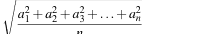

假设我们正在编写一个大型程序，除了许多其他功能外，还需要计算距离和求解二次方程。我们是否必须将清单 8.1（computesquareroot.cpp）中平方根代码的相关部分复制粘贴到源代码中每个需要平方根计算的副本中？另外，如果我们开发另一个需要计算均方根的程序，该怎么办？我们是否需要将清单 8.1（computesquareroot.cpp）中的代码复制到每个需要计算平方根的程序中，或者有没有更好的方法来打包平方根代码并重复使用它？

通过将代码打包到函数中，可以使其可重复使用。函数是可重复使用代码的单元。在第 9 章中，我们将编写自己的可重复使用函数，但在本章中，我们将研究 C++ 标准库中可用的一些函数。C++ 提供了一组存储在库中的标准预编译 C 和 C++ 代码。程序员可以在自己的代码中使用这部分库代码来构建复杂的程序。

## 图 8.1 平方根函数的概念视图

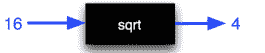

### 8.1 使用函数简介

在数学中，函数从给定值计算出结果；例如，从函数定义 f(x) = 2x + 3，我们可以计算出 f(5) = 13 和 f(0) = 3。C++ 中的函数与数学函数的工作方式类似。为了介绍函数概念，我们将查看实现数学平方根的标准 C++ 函数。

在 C++ 中，函数是执行特定任务的命名代码序列。程序本身由一组函数组成。函数的一个示例是数学平方根函数。这样的函数名为 sqrt，可供 C 和 C++ 程序使用（参见第 8.2 节）。平方根函数接受一个数值并生成一个 double 值作为结果；例如，16 的平方根是 4，因此当输入 16.0 时，sqrt 返回 4.0。图 8.1 可视化了平方根函数。

对于在程序中使用 sqrt 函数的程序员来说，函数是一个黑盒；程序员更关心函数做什么，而不是它如何做。

这个 sqrt 函数正是我们平方根程序所需要的。清单 8.1（computesquareroot.cpp）。新版本，清单 8.2（standardsquareroot.cpp），使用库函数 sqrt 并消除了原始代码的复杂逻辑。

```
Listing 8.2: standardsquareroot.cpp
#include <iostream>
#include <cmath>

int main() {
    double input;

    // Get value from the user
    std::cout << "Enter number: ";
    std::cin >> input;

    // Compute the square root
    double root = sqrt(input);

    // Report result
    std::cout << "Square root of " << input << " = " << root << '\n';
}
```

#include <cmath> 行指示预处理器用 cmath 库中一组数学函数的声明来扩充我们的源代码。sqrt 函数包含在内。表 8.1 列出了 cmath 库中可用的一些其他常用数学函数。编译器需要这些扩充代码，以便检查我们是否正确地使用了 sqrt 函数。

表达式

```
sqrt(input)
```

是函数调用，也称为函数调用。函数为使用它的代码提供服务。在这里，我们的 main 函数是调用者，它使用 sqrt 函数提供的服务。我们说 main 调用或调用 sqrt，并将 input 的值传递给它。表达式 sqrt(input) 求值为变量 input 值的平方根。幕后——可以说在黑盒内部——预编译的 C 代码使用 input 变量的值来计算其平方根。构成 sqrt 函数的这个预编译 C 代码没有什么特别之处；它是由库供应商的程序员或程序员团队使用我们可用的相同工具编写的。在第 9 章中，我们将编写自己的函数，但目前我们将享受他人为我们提供的函数。

调用函数时，函数名后跟一对圆括号。函数执行任务所需的信息必须出现在这些圆括号内。在表达式

```
sqrt(input)
```

input 是函数完成工作所需的信息。我们说 input 是传递给函数的参数，或形参。我们也可以说“我们正在将 input 传递给 sqrt 函数。”

虽然我们可能会说“我们正在将 input 传递给 sqrt 函数”，但程序实际上并没有让函数访问 main 的 input 变量。sqrt 函数本身无法更改 main 的 input 变量的值，它只是使用该变量的值来执行计算。

下面的简单类比可能有助于解释 main 和 sqrt 之间的通信方式。main 函数有工作要做，但它不亲自完成所有工作，而是将部分工作（在这里是困难的部分）委托给 sqrt。当 main 需要计算 input 的平方根时，它会将 input 变量的值写在一张纸上并交给 sqrt。main 然后闲坐等待，直到 sqrt 完成工作。sqrt 函数接受 main 的便条并开始处理任务（计算 main 给它的便条上数字的平方根）。完成后，sqrt 做两件事：sqrt 将一张写有答案的不同纸片交还给 main，并丢弃 main 最初传递给它的纸片。当 main 从 sqrt 接收到便条时，它使用便条上的信息，然后丢弃便条。main 函数然后可以继续处理其他事务。

因此，sqrt 函数无法访问 main 的原始 input 变量；它只有 input 的副本，仿佛“写在一张纸上”。（同样，如果 sqrt 函数使用任何变量来完成工作，main 对它们一无所知，也无法访问它们。）sqrt 完成工作并将计算结果返回给 main 后，sqrt 会丢弃其 input 的副本（类比地说，函数“扔掉”了 main 给它的带有 input 副本的纸片）。因此，在函数调用期间，参数是一个临时的、短暂的值，仅用于向函数传递信息。参数仅在函数执行期间存在。

图 8.2 说明了涉及简单函数调用的程序执行过程。

图 8.2 显示，程序的执行从其 main 函数开始。在这里，main 调用了两次 sqrt 函数。垂直条表示函数处于活动或“存活”的时间。函数的变量


图 8.2 右侧的图表可视化了左侧程序的执行过程。时间从左向右流逝。一个矩形条表示函数处于活动状态的时间。C++ 程序的执行从其 main 函数开始。在这里，main 两次调用 sqrt 函数。main 条的阴影部分显示了 main 等待 sqrt 完成的时间。

```
int main() {
  double value;

  // Assign variable
  value = 16;

  // Compute square root
  double root = sqrt(value);

  // Compute another
  root = sqrt(100);
}
```

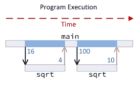

函数处于活动状态时存在。请注意，main 函数在程序执行期间始终处于活动状态。sqrt 变为活动状态两次，正好是 main 调用它的两次。

sqrt 函数可以以其他方式调用，如清单 8.3（usingSqrt.cpp）所示：

```
Listing 8.3: usingSqrt.cpp

/*
 * This program shows the various ways the
 * sqrt function can be used.
 */

#include <iostream>
#include <cmath>

int main() {
  double x = 16.0;
  // Pass a literal value and display the result
  std::cout << sqrt(16.0) << '\n';
  // Pass a variable and display the result
  std::cout << sqrt(x) << '\n';
  // Pass an expression
  std::cout << sqrt(2 * x - 5) << '\n';
  // Assign result to variable
  double y = sqrt(x);
  // Use result in an expression
  y = 2 * sqrt(x + 16) - 4;
  // Use result as argument to a function call
  y = sqrt(sqrt(256.0));
  std::cout << y << '\n';
}
```

图 8.3 最大值函数的概念视图

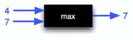

sqrt 函数接受单个数值参数。调用者可以传递给 sqrt 的参数可以是数字常量、数值变量、算术表达式，甚至是产生可接受数值结果的函数调用。

某些 C++ 函数（如 sqrt）会计算一个值并将其返回给调用者。调用者可以以多种方式使用此结果，如清单 8.3（usingSqrt.cpp）所示。倒数第二条语句将调用 sqrt 的结果传递给 sqrt，从而计算 sqrt(sqrt(256))，其结果为 4。

如果调用者代码尝试向函数传递与函数期望的类型不兼容的参数，编译器将发出错误。

```
std::cout << sqrt("16") << '\n'; // Illegal, a string is not a number
```

编译器能够根据预处理器通过

```
#include <cmath>
```

指令添加到代码中的附加信息，判断上述语句是非法的。

清单 8.3（usingSqrt.cpp）表明，程序可以根据需要调用 sqrt 函数任意多次、在任意位置调用。如图 8.1 所示，对于平方根函数的调用者而言，该函数是一个黑盒；调用者严格关心函数做什么，而不关心函数如何完成其任务。

我们可以安全地将所有函数视为黑盒。我们可以使用函数提供的服务，而无需关心其内部细节。我们可以保证，只能通过传递的参数来影响函数的行为，我们所做的其他任何事情都不会影响函数做什么或如何做。此外，除我们对其计算出的值所做的处理外，函数不能影响我们的任何代码。

某些函数接受多个参数；例如，C++ max 函数需要两个参数才能产生结果。max 函数选择并返回两个参数中较大的一个。max 函数在图 8.3 中可视化。

max 函数可以如下使用：

```
std::cout << "The larger of " << 4 << " and " << 7 << " is " << max(4, 7) << '\n';
```

请注意，参数包含在函数名后面的括号中，参数之间用逗号分隔。

从调用者的角度来看，函数有三个重要部分：

- 名称。每个函数都有一个名称，用于标识要执行的代码的位置。函数名称遵循与变量名称相同的规则；函数名称是标识符的另一个示例（参见第 3.3 节）。
- 参数类型。调用者必须提供函数期望的精确数量和类型的参数。如果调用者尝试使用过多或过少的参数调用函数，编译器将发出错误消息且不编译代码。同样，如果调用者传递的参数与函数指定的类型不兼容，编译器将报告相应的错误消息。
- 结果类型。函数可以计算结果并将此值返回给调用者。调用者对此结果的使用必须与函数指定的结果类型兼容。返回给调用者的结果类型和调用者传入的参数类型可能完全无关。

这三个关键信息在称为函数原型的规范中对每个函数进行正式描述。sqrt 函数的原型为

```
double sqrt(double)
```

max 函数的原型可以表示为

```
int max(int, int)
```

2. 实际库函数 max 的原型使用泛型；泛型超出了本入门书的范围，因此此处提供的原型仅用于说明问题。

在函数原型中，首先列出返回类型，然后是函数名，接着是出现在括号中的参数类型。有时在函数原型中列出参数名称很有用，例如

```
double sqrt(double n)
```

或

```
int max(int a, int b)
```

特定的参数名称无关紧要。名称使描述函数功能变得更容易；例如，sqrt 计算 n 的平方根，max 确定 a 和 b 中较大的一个。

使用库函数时，程序员必须在源代码中包含适当的 #include 指令。#include 指令中指定的文件包含库函数的原型。要使用 sqrt 函数，程序必须包含

```
#include <cmath>
```

预处理器指令。对于 max 函数，请包含

```
#include <algorithm>
```

尽管在 Visual C++ 中，包含 <iostream> 就足够了。

掌握函数原型后，编译器可以检查调用代码是否正确使用库函数。尝试以下方式使用 sqrt 函数

```
std::cout << sqrt(4.0, 7.0) << '\n'; // Error
```

将导致错误，因为 sqrt 的原型仅指定一个数值参数，而不是两个。

某些函数不接受参数；例如，用于生成伪随机数的 C++ 函数 rand 在不带任何参数的情况下调用：

```
std::cout << rand() << '\n';
```

rand 函数返回一个 int 值，但调用者不会向函数传递任何信息来执行其任务。rand 的原型为

```
int rand()
```

请注意空括号，它们指示此函数不接受任何参数。

与必须产生结果的数学函数不同，C++ 不要求函数向其调用者返回值。C++ 函数 exit 期望从调用者处获取一个整数值，但它不会将结果返回给调用者。不返回任何内容的函数的原型使用 void 作为返回类型，例如：

```
void exit(int);
```

exit 函数立即终止程序的执行。传递给 exit 的整数参数将返回给操作系统，操作系统可以使用该值来确定程序是正常终止还是由于错误而终止。C++ 程序在 main 执行完毕时会自动返回零——无需调用 exit。

请注意，由于 exit 不向调用者返回值，因此诸如

```
std::cout << exit(8) << '\n'; // Illegal!
```

之类的代码无法编译，因为表达式 exit(8) 的求结果为空，而 std::cout 流对象需要某种实际值才能打印。void 函数因其产生的副作用而有用，而不是因其计算出的值。副作用示例包括在控制台打印内容、通过网络发送数据或动画化图形图像。

### 8.2 标准数学函数

cmath 库提供了科学计算器的大部分功能。表 8.1 仅列出了可用函数中的少数几个。


| 函数 | 描述 |
|---|---|
| `double sqrt(double x)` | 计算一个数的平方根：`sqrt(x) = √x` |
| `double exp(double x)` | 计算 e 的幂：`exp(x) = e^x` |
| `double log(double x)` | 计算一个数的自然对数：`log(x) = log_e x = ln x` |
| `double log10(double x)` | 计算一个数的常用对数：`log10(x) = log_10 x` |
| `double cos(double)` | 计算以弧度指定的值的余弦：`cos(x) = cos x`；其他三角函数包括正弦、正切、反余弦、反正弦、反正切、双曲余弦、双曲正弦和双曲正切 |
| `double pow(double x, double y)` | 将一个数提升到另一个数的幂：`pow(x,y) = x^y` |
| `double fabs(double x)` | 计算一个数的绝对值：`fabs(x) = |x|` |

表 8.1: cmath 库中的一些函数

cmath 库还定义了一个名为 HUGE_VAL 的常量。程序员可以使用此常量来表示无穷大或未定义的值，例如垂直线的斜率或分母为零的分数。C++ 可用的数值函数完整列表可在 http://www.cplusplus.com/reference/clibrary/cmath/ 上找到。

> 在调用函数时，请务必将函数的参数按正确顺序传递；例如，调用 pow(10,2) 计算 10^2 = 100，但调用 pow(2,10) 计算 2^10 = 1,024。

使用 cmath 库中任何函数的 C++ 程序必须使用以下预处理器 #include 指令：

```
#include <cmath>
```

cmath 库中的函数非常适合解决图 8.4 所示的问题。假设一艘航天器相对于某个行星位于空间中的固定位置。因此，航天器到行星的距离也是固定的。一颗卫星正在圆形轨道上绕行星运行。我们希望计算当卫星沿其轨道路径推进了 10 度时，它将比航天器远多少。

我们将让坐标系的原点 (0,0) 位于行星中心，该中心也对应于圆形轨道路径的中心。卫星最初位于点 (x1,y1)，而航天器静止在点 (Px,Py)。航天器位于与卫星轨道相同的平面上。我们需要计算在卫星轨道的两个不同时间点，移动点（卫星）与固定点（航天器）之间距离的差值。

数学事实为以下两个问题提供了解决方案：

图 8.4 轨道距离问题。在此图中，卫星从点 (x1, y1) 开始，距离航天器 d1。卫星的轨道在 θ 角度旋转后将其带到点 (x2, y2)。到其新位置的距离是 d2。

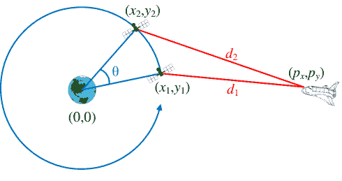

- 1. 问题：当移动点沿圆周移动时，必须重新计算其位置。
- 解决方案：给定移动点的初始位置 (x1, y1)，围绕原点旋转 θ 度将产生一个新点 (x2,y2)，其中
- x2 = x1 cosθ - y1 sinθ
- y2 = x1 sinθ + y1 cosθ

- 2. 问题：当移动点移动到新位置时，必须重新计算移动点与固定点之间的距离。
- 解决方案：图 8.4 中两点 (Px, Py) 和 (x1, y1) 之间的距离 d1 由以下公式给出
- d1 = √((x1 - Px)² + (y1 - Py)²)
- 同样，图 8.4 中的距离 d2 为
- d2 = √((x2 - Px)² + (y2 - Py)²)

清单 8.4 (orbitdist.cpp) 使用这些数学结果来计算距离的差值。

```
Listing 8.4: orbitdist.cpp
#include <iostream>
#include <cmath>
int main() {
// Location of orbiting point is (x,y)
double x; // These values change as the
double y; // satellite moves
const double PI = 3.14159;

// Location of fixed point is always (100, 0),
// AKA (p_x, p_y). Change these as necessary.
const double p_x = 100;
const double p_y = 0;

// Radians in 10 degrees
const double radians = 10 * PI/180;

// Precompute the cosine and sine of 10 degrees
const double COS10 = cos(radians);
const double SIN10 = sin(radians);

// Get starting point from user
std::cout << "Enter initial satellite coordinates (x,y):";
std::cin >> x >> y;

// Compute the initial distance
double d1 = sqrt((p_x - x)*(p_x - x) + (p_y - y)*(p_y - y));

// Let the satellite orbit 10 degrees
double x_old = x; // Remember x's original value
x = x*COS10 - y*SIN10; // Compute new x value
// x's value has changed, but y's calculation depends on
// x's original value, so use x_old instead of x.
y = x_old*SIN10 + y*COS10;

// Compute the new distance
double d2 = sqrt((p_x - x)*(p_x - x) + (p_y - y)*(p_y - y));

// Print the difference in the distances
std::cout << "Difference in distances: " << d2 - d1 << '\n';
}
```

我们可以使用平方根函数来提高素数程序的效率。与其尝试 n 到 n-1 的所有因子，不如只尝试到 n 的平方根的潜在因子。清单 8.5 (moreefficientprimes.cpp) 使用 sqrt 函数来减少需要考虑的因子数量。

### 清单 8.5: moreefficientprimes.cpp

```
#include <iostream>
#include <cmath>

int main() {
    int max_value;
    std::cout << "Display primes up to what value? ";
    std::cin >> max_value;
    for (int value = 2; value <= max_value; value++) {
        // See if value is prime
        bool is_prime = true; // Provisionally, value is prime
        double r = value, root = sqrt(r);
        // Try all possible factors from 2 to the square
        // root of value
        for (int trial_factor = 2;
             is_prime && trial_factor <= root; trial_factor++)
            is_prime = (value % trial_factor != 0);
        if (is_prime)
            std::cout << value << " "; // Display the prime number
    }
    std::cout << '\n'; // Move cursor down to next line
}
```

sqrt 函数有三种形式：

- double sqrt(double)
- float sqrt(float)
- long double sqrt(long double)

函数名称相同，但参数类型不同。我们说 sqrt 函数是重载的。（重载函数在第 10.3 节中有更详细的介绍。）当调用方调用 sqrt 函数时，编译器将调用与最匹配的原型匹配。如果调用方传递 double 参数，编译器生成代码以调用 double 版本。如果调用方改为传递 float 变量，编译器选择 sqrt 的 float 版本。当将 int 传递给 sqrt 时，编译器无法决定使用哪个版本，因为 int 可以自动转换为 float、double 或 long double。因此，编译器需要一些帮助来消除歧义，所以我们引入了一个额外的 double 类型变量，以便编译器使用 sqrt 函数的 double 版本。另一种选择是使用类型转换将整数值转换为 sqrt 函数可接受的类型之一。

### 8.3 最大值和最小值

C++ 提供了用于确定两个数的最大值和最小值的标准函数。清单 8.6 (maxmin.cpp) 演示了标准 min 和 max 函数。

```
#include <iostream>
#include <algorithm>

int main() {
   int value1, value2;
   std::cout << "Please enter two integer values: ";
   std::cin >> value1 >> value2;
   std::cout << "max = " << std::max(value1, value2)
             << ", min = " << std::min(value1, value2) << '\n';
}
```

要在程序中使用标准 max 和 min 函数，必须包含 <algorithm> 头文件。

### 8.4 clock 函数

<ctime> 库中的 clock 函数向操作系统请求正在执行的程序已运行的时间量。clock() 调用返回的单位取决于系统，但可以使用 <ctime> 库中定义的常量 CLOCKS_PER_SEC 将其转换为秒。在 Visual C++ 中，CLOCKS_PER_SEC 常量为 1,000，这意味着 clock() 调用返回程序已运行的毫秒数。

使用两次 clock 函数调用可以测量经过的时间。清单 8.7 (timeit.cpp) 测量用户从键盘输入一个字符需要多长时间。

```
Listing 8.7: timeit.cpp

#include <iostream>
#include <ctime>

int main() {
    char letter;
    std::cout << "Enter a character: ";
    clock_t seconds = clock();  // Record starting time
    std::cin >> letter;
    clock_t other = clock();  // Record ending time
    std::cout << static_cast<double>(other - seconds)/CLOCKS_PER_SEC
            << " seconds\n";
}
```

clock_t 类型是在 <ctime> 头文件中定义的一种类型。clock_t 等效于 unsigned long，您可以对 clock_t 值和变量执行算术运算，就像它们是 unsigned long 一样。在表达式 static_cast<double>(other - seconds)/CLOCKS_PER_SEC 中，需要强制转换来强制执行浮点除法；否则，结果将被截断为整数值。

清单 8.8 (measureprimespeed.cpp) 测量程序使用清单 7.7 (forprintprimes.cpp) 中的算法显示多达五十万以内的所有素数需要多长时间。

```
Listing 8.8: measureprimespeed.cpp

#include <iostream>
#include <ctime>
#include <cmath>

// Display the prime numbers between 2 and 500,000 and
// time how long it takes

int main() {
    clock_t start_time = clock(),  // Record start time
            end_time;
    for (int value = 2; value <= 500000; value++) {
        // See if value is prime
        bool is_prime = true;  // Provisionally, value is prime
        // Try all possible factors from 2 to n - 1
        for (int trial_factor = 2;
                is_prime && trial_factor < value;
                ...
```


```
trial_factor++)
    is_prime = (value % trial_factor != 0);
    if (is_prime)
        std::cout << value << " "; // Display the prime number
}
std::cout << '\n'; // Move cursor down to next line
end_time = clock();
// Print the elapsed time
std::cout << "Elapsed time: "
    << static_cast<double>(end_time - start_time)/CLOCKS_PER_SEC
    << " sec." << '\n';
}
```

在某个系统上，该程序平均需要 93 秒来打印小于等于 500,000 的所有质数。相比之下，更新、更高效的版本（清单 8.5，moreefficientprimes.cpp）使用了平方根优化，仅需 15 秒即可显示小于等于 500,000 的所有质数。具体时间会因计算机速度而异。

事实证明，程序执行时间的大部分花费在打印输出上，而非计算要打印的质数。我们可以通过将程序输出重定向到文件来更好地比较算法。如果可执行程序名为 primes.exe，可以在命令行中通过发出以下命令来重定向其输出：

```
primes > run1.out
```

这将创建一个名为 run1.out 的文本文件，可以用任何文本编辑器查看。其内容正是未使用重定向时本应打印到屏幕上的内容。

使用重定向运行时，时间差异更加显著：未优化版本生成小于等于 500,000 的质数需要 77 秒，而使用平方根优化的版本仅需 2 秒即可生成相同数量的质数！更快的质数生成器可在清单 11.25（fasterprimes.cpp）中找到；它使用完全不同的算法来生成质数。

在程序中使用标准时间函数，必须 #include <ctime> 头文件。

### 8.5 字符函数

C 库提供了若干对 C++ 程序员有用的字符函数。清单 8.9（touppercase.cpp）将小写字母转换为大写字母。

```
Listing 8.9: touppercase.cpp

#include <iostream>
#include <cctype>

int main() {
    for (char lower = 'a'; lower <= 'z'; lower++) {
        char upper = toupper(lower);
        std::cout << lower << " = " << upper << '\n';
    }
}
```

清单 8.9（touppercase.cpp）打印的前几行如下：

```
a = A
b = B
c = C
d = D
```

有趣的是，`toupper` 函数返回的是 `int`，而不是 `char`。在 Visual C++ 的增强警告级别 4 下，需要进行强制类型转换才能将结果赋值给变量 `upper`：

```
char upper = static_cast<char>(toupper(lower));
```

表 8.2 描述了一些更有用的字符函数。

| 函数 | 描述 |
| --- | --- |
| int toupper(int ch) | 返回给定字符的大写形式；如果不存在大写形式（例如标点符号或数字），则返回原始字符 |
| int tolower(int ch) | 返回给定字符的小写形式；如果不存在小写形式（例如标点符号或数字），则返回原始字符 |
| int isupper(int ch) | 如果 ch 是大写字母（'A'-'Z'），则返回非零值（true）；否则返回 0（false） |
| int islower(int ch) | 如果 ch 是小写字母（'a'-'z'），则返回非零值（true）；否则返回 0（false） |
| int isalpha(int ch) | 如果 ch 是字母表中的字母（'A'-'Z' 或 'a'-'z'），则返回非零值（true）；否则返回 0（false） |
| int isdigit(int ch) | 如果 ch 是数字（'0'-'9'），则返回非零值（true）；否则返回 0（false） |

表 8.2：cctype 库中的部分函数

还有其他函数可用于判断字符是否为标点字符（如逗号或分号，`ispunct`）、空格、制表符或换行符（`isspace`）。

在 C++ 程序中使用标准 C 字符函数，必须包含 `<cctype>` 头文件。

### 8.6 随机数

某些应用程序需要表现出随机性的行为。随机数在游戏和模拟中特别有用。例如，许多棋盘游戏使用一个骰子（一对骰子中的一个）来确定玩家应前进多少格。（参见图 8.5。）骰子或一对骰子也用于其他机会游戏。骰子是一个立方体，其六个面上各带有若干点。点数范围从 1 到 6。玩家掷一个骰子，有时掷一对骰子，朝上的面在所玩的游戏中具有意义。掷骰子后某个面的点数由骰子的复杂翻滚随机决定。涉及骰子的游戏的软件改编需要一种方法来模拟随机掷骰子。

### 图 8.5 一对骰子

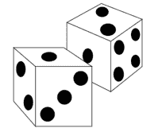

所有算法随机数生成器实际上都生成伪随机数，而非真随机数。伪随机数生成器有一个特定的周期，取决于所使用算法的性质。如果生成器使用足够长的时间，生成的数字模式将精确重复。真随机数序列不会包含这样的重复子序列。好消息是，所有实用的算法伪随机数生成器的周期都足够大，足以满足大多数应用程序的需求。

C++ 程序员可以使用两个标准 C 函数来生成伪随机数：srand 和 rand：

```
void srand(unsigned)
int rand();
```

srand 建立伪随机整数值序列的第一个值。每次调用 rand 都会返回伪随机值序列中的下一个值。清单 8.10（simplerandom.cpp）展示了如何打印 100 个伪随机数的序列。

```
Listing 8.10: simplerandom.cpp

#include <iostream>
#include <cstdlib>

int main() {
    srand(23);
    for (int i = 0; i < 100; i++) {
        int r = rand();
        std::cout << r << " ";
    }
    std::cout << '\n';
}
```

程序打印的数字看起来是随机的。算法以一个种子值开始，并使用公式生成下一个值。种子值决定生成的数字序列；相同的种子值生成相同的序列。如果再次运行程序，将显示相同的序列，因为使用了相同的种子值 23。为了使每次程序运行都显示不同的序列，每次运行的种子值必须不同。我们如何为每次运行建立不同的种子值？在运行时构建“随机”种子的最佳方法是使用 ctime 库中找到的 time 函数。调用 time(0) 返回自 1970 年 1 月 1 日午夜以来的秒数。

这个值在不同程序运行之间显然不同，因此每次执行都会使用不同的种子值，生成的伪随机数序列也会不同。清单 8.11（betterrandom.cpp）引入了 time 函数，以提高多次执行时的随机性。

### 清单 8.11：betterrandom.cpp

```
#include <iostream>
#include <cstdlib>
#include <ctime>

int main() {
   srand(static_cast<unsigned>(time(0)));
   for (int i = 0; i < 100; ++i) {
      int r = rand();
      std::cout << r << " ";
   }
   std::cout << '\n';
}
```

清单 8.11（betterrandom.cpp）的每次执行都会生成不同的伪随机数序列。time 返回的实际值类型是 time_t，因此 time 调用的结果在与 srand 一起使用之前必须强制转换为 unsigned int。

请注意，rand 返回的数字可能相当大。伪随机值的范围是从 0 到依赖于实现的最大值。Visual C++ 的 rand 函数的最大值为 32,767，对应于最大的 16 位有符号 int 值。cstdlib 头文件定义了常量 RAND_MAX，表示范围内的最大值。以下语句

```
std::cout << RAND_MAX << '\n';
```

将打印特定系统上 RAND_MAX 的值。

通常我们需要更有限范围内的值，例如 1..100。使用取模运算符进行简单的算术运算可以产生我们需要的结果。如果 n 是任意非负整数，m 是任意正整数，则表达式

```
n % m
```

生成 0...m-1 范围内的值。

这意味着语句

```
int r = rand() % 100;
```

只能将 0..99 范围内的值赋给 r。如果我们确实需要 1..100 范围内的值，该怎么办？我们只需在结果上加 1 即可：

```
int r = rand() % 100 + 1;
```

该语句生成 1..100 范围内的伪随机数。

现在我们拥有编写模拟掷骰子程序所需的一切。

清单 8.12（die.cpp）模拟掷骰子。


## 清单 8.12: die.cpp

```
#include <iostream>
#include <cstdlib>
#include <ctime>

int main() {
  // Set the random seed value
  srand(static_cast<unsigned>(time(0)));

  // Roll the die three times
  for (int i = 0; i < 3; i++) {
    // Generate random number in the range 1..6
    int value = rand() % 6 + 1;

    // Show the die
    std::cout << " +-------+\n";
    switch (value) {
      case 1:
        std::cout << " |\n";
        std::cout << " * |\n";
        std::cout << " |\n";
        break;
      case 2:
        std::cout << " * |\n";
        std::cout << " |\n";
        std::cout << " * |\n";
        break;
      case 3:
        std::cout << " * |\n";
        std::cout << " * |\n";
        std::cout << " * |\n";
        break;
      case 4:
        std::cout << " * * |\n";
        std::cout << " |\n";
        std::cout << " * * |\n";
        break;
      case 5:
        std::cout << " * * |\n";
        std::cout << " * |\n";
        std::cout << " * * |\n";
        break;
      case 6:
        std::cout << " * * * |\n";
        std::cout << " |\n";
        std::cout << " * * * |\n";
        break;
      default:
        std::cout << " *** Error: illegal die value ***\n";
        break;
    }
    std::cout << " +-------+\n";
  }
}
```

### 8.7 练习

- 1. 假设你需要在 C++ 程序中计算一个数的平方根。编写代码来执行平方根计算是个好主意吗？为什么或为什么不？

- 2. 在 C++ 源代码中，有什么方法可以帮助你区分变量名和函数名？

- 3. 以下哪个值可能由 rand 函数计算得出？
  - 4.5   34   -1   RAND_MAX + 1

- 4. clock_t 表示什么？

- 5. CLOCKS_PER_SEC 表示什么？

- 6. 通常，程序应该多久调用一次 srand 函数？

- 7. 在清单 8.2 (standardsquareroot.cpp) 中，当 sqrt 函数计算 main 提供的参数的平方根时，main 函数在做什么？

- 8. 考虑以下每个可能成为 C++ 程序一部分的代码片段。每个片段都包含对标准 C/C++ 库函数的调用。以以下三种方式之一回答每个问题：
  - 如果代码片段包含编译时错误，请将答案写为单词 error。
  - 如果代码片段不包含编译时错误且你可以在编译时确定其输出，请提供片段的字面输出。
  - 如果代码片段不包含编译时错误但你无法在编译时确定其确切输出，请提供一个可能的求值，并将答案写为单词 example，并提供代码片段可能产生的一个可能的字面输出。
  - (a) std::cout << sqrt(4.5) << '\n';
  - (b) std::cout << sqrt(4.5, 3.1) << '\n';
  - (c) std::cout << rand(4) << '\n';
  - (d) double d = 16.0;
    std::cout << sqrt(d) << '\n';
  - (e) std::cout << srand() << '\n';
  - (f) std::cout << rand() << '\n';
  - (g) int i = 16;
    std::cout << sqrt(i) << '\n';
  - (h) std::cout << srand(55) << '\n';
  - (i) std::cout << tolower('A') << '\n';
  - (j) std::cout << exp() << '\n';
  - (k) std::cout << sqrt() << '\n';
  - (l) std::cout << toupper('E') << '\n';
  - (m) std::cout << toupper('e') << '\n';
  - (n) std::cout << toupper("e") << '\n';
  - (o) std::cout << exp(4.5) << '\n';
  - (p) std::cout << toupper('h', 5) << '\n';
  - (q) std::cout << ispunct('!') << '\n';
  - (r) std::cout << tolower("FF") << '\n';
  - (s) char ch = 'D';
    std::cout << tolower(ch) << '\n';
  - (t) std::cout << exp(4.5, 3) << '\n';
  - (u) std::cout << toupper('7') << '\n';
  - (v) double a = 5, b = 3;
    std::cout << exp(a, b) << '\n';
  - (w) `std::cout << exp(3, 5, 2) << '\n';`
  - (x) `std::cout << tolower(70) << '\n';`
  - (y) `double a = 5;
    std::cout << exp(a, 3) << '\n';`
  - (z) `double a = 5;
    std::cout << exp(3, a) << '\n';`

## 图 8.6 直角三角形

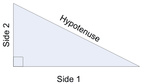

- 9. 从几何角度：编写一个计算机程序，给定直角三角形直角两边的长度，计算该三角形斜边的长度。（参见图 8.6。）如果你不确定如何在数学上解决这个问题，请进行网络搜索以了解勾股定理。

## 第 9 章

## 编写函数

随着程序变得越来越复杂，程序员必须以这种方式构建他们的程序，以便有效地管理其复杂性。大多数人很难一次跟踪太多信息。很容易在复杂问题的细节中陷入困境。管理复杂性的诀窍是将问题分解为更易于管理的部分。每个部分都有必须处理的自身细节，但这些细节尽可能在该部分内部被隐藏。问题最终通过将这些部分组合在一起形成完整的解决方案来解决。

迄今为止，我们的所有程序都已编写在一个函数——main 中。随着函数内语句数量的增加，该函数可能变得难以处理。在这样的函数中，自己完成所有工作的代码称为单体代码。冗长且复杂的单体代码因多种原因不受欢迎：

- 编写正确比较困难。在编写该代码中的任何语句时，都必须考虑整段代码中的所有细节。

- 调试比较困难。如果代码序列无法正确工作，通常很难找到错误的来源。代码中较早出现的错误语句的影响可能要等到后面的正确语句使用该错误语句的错误结果时才会显现出来。

- 扩展比较困难。在修改之前，必须充分理解整个代码序列中的所有细节。如果代码复杂，这可能是一项艰巨的任务。

使用分治策略，程序员可以将一个复杂的函数（如 main）分解为几个更简单的函数。然后，原始函数可以通过将工作委托给这些其他函数来完成其工作。这样一来，原始函数可以被视为“工作协调者。”

除了代码组织方面，函数还允许我们将功能打包成可重用的部分。在第 8 章中，我们了解到库函数可以大大增强程序的功能。虽然我们应该尽可能利用库函数，但有时我们需要一个表现出自定义行为且没有任何标准函数提供的函数。幸运的是，我们可以创建自己的函数，并且同一个函数可以在程序的多个位置中使用（调用）。如果函数的目的足够通用且我们正确编写该函数，我们可能还能在其他程序中重用该函数。

### 9.1 函数基础

回顾我们在清单 8.1 (computesquareroot.cpp) 中看到的“手写”平方根代码。我们知道更好的选择是标准库函数 sqrt；然而，我们将通过基于清单 8.1 (computesquareroot.cpp) 中的代码编写自己的平方根函数来说明自定义函数开发。在清单 9.1 (customsquareroot.cpp) 中，我们看到了 square_root 函数的定义。

```
Listing 9.1: customsquareroot.cpp

#include <iostream>
#include <iomanip>
#include <cmath>

// Compute an approximation of
// the square root of x
double square_root(double x) {
    double diff;
    // Compute a provisional square root
    double root = 1.0;

    do { // Loop until the provisional root
        // is close enough to the actual root
        root = (root + x/root) / 2.0;
        //std::cout << "root is " << root << '\n';
        // How bad is the approximation?
        diff = root * root - x;
    } while (diff > 0.0001 || diff < -0.0001);

    return root;
}

int main() {
    // Compare the two ways of computing the square root
    for (double d = 1.0; d <= 10.0; d += 0.5)
        std::cout << std::setw(7) << square_root(d) << " : " << sqrt(d) << '\n';
}
```

清单 9.1 (customsquareroot.cpp) 中的 main 函数将我们自定义的 square_root 函数与 sqrt 库函数的行为进行比较。其输出：

```
1 : 1
1.22474 : 1.22474
1.41422 : 1.41421
1.58116 : 1.58114
1.73205 : 1.73205
1.87083 : 1.87083
2 : 2
2.12132 : 2.12132
2.23607 : 2.23607
2.34521 : 2.34521
2.44949 : 2.44949
2.54952 : 2.54951
2.64577 : 2.64575
2.73861 : 2.73861
2.82843 : 2.82843
2.91548 : 2.91548
```


| 3 | 3 |
|---|---|
| 3.08221 | 3.08221 |
| 3.16228 | 3.16228 |

显示结果中存在一些微小差异。显然，我们应该使用标准 sqrt 函数，而不是我们自己的函数。

每个 C++ 函数都有两个方面：

- **函数定义**。函数的定义指定了函数的返回类型和参数类型，并提供了决定函数行为的代码。在清单 9.1（customsquareroot.cpp）中，square_root 函数的定义出现在 main 函数之上。

- **函数调用**。程序员通过函数调用来使用函数。main 函数同时调用了我们的 square_root 函数和 sqrt 函数。每个函数都有且只有一个函数定义，但可能有多次调用。

函数定义由四部分组成：

- **名称**—C++ 中的每个函数都有一个名称。名称是一个标识符（参见第 3.3 节）。与变量名称一样，为函数选择的名称应准确描绘其预期用途或描述其功能。

- **类型**—每个函数都有一个返回类型。如果函数向其调用者返回一个值，则其类型对应于它返回的值的类型。特殊类型 void 表示函数不返回值。

- **参数**—每个函数都必须指定它从调用者处接受的参数类型。参数出现在带括号的逗号分隔列表中，类似于函数原型（参见第 8.1 节）。然而，与函数原型不同，参数通常与每个类型关联有名称。

- **函数体**—每个函数定义都有一个由花括号括起来的函数体。函数体包含在调用函数时要执行的代码。

图 9.1 剖析了我们的 square_root 函数定义。

最简单的函数不接受参数，也不向调用者返回值。清单 9.2（simplefunction.cpp）是清单 4.1（adder.cpp）的一个变体，包含了这样的简单函数定义。

### 清单 9.2：simplefunction.cpp

```cpp
#include <iostream>

// Definition of the prompt function
void prompt() {
    std::cout << "Please enter an integer value: ";
}

int main() {
    int value1, value2, sum;
    std::cout << "This program adds together two integers.\n";
    prompt(); // Call the function
    std::cin >> value1;
```

### 图 9.1 函数定义解剖

函数计算的值的类型

函数名称

函数要求调用者提供的值的类型

```cpp
double square_root(double x) {
    double diff;
    // Compute a provisional square root.
    double root = 1.0;
    do { // Loop until the p
    // is close enough to
    root = (root + x/root) / 2.0;
    // How bad is the approximation?
    diff = root * root - x;
} while (diff > 0.0001 || diff < -0.0001);
return root;
}
```

函数体

函数用于调用者提供的值的名称

```cpp
prompt(); // Call the function again
std::cin >> value2;
sum = value1 + value2;
std::cout << value1 << " + " << value2 << " = " << sum << '\n';
}
```

prompt 函数只是打印一条消息。程序的运行过程如下：

1. 程序的执行（与所有 C++ 程序一样）从名为 main 的函数中的第一条可执行语句开始。main 函数中的第一行只是声明编译器维护所需的一些变量，因此下一行才实际开始可执行代码。
2. 第一条可执行语句打印程序意图的消息。
3. 下一条语句是对 prompt 函数的调用。此时，程序的执行转移到 prompt 函数的函数体中。prompt 内部的代码将一直执行，直到函数体结束或遇到 return 语句。由于 prompt 不包含 return 语句，prompt 的整个函数体（那条打印语句）都将被执行。
4. prompt 执行完毕后，控制权会返回到 main 中紧随 prompt 调用之后的位置。
5. prompt 调用后的下一个操作是从键盘读取 value1 的值。
6. 第二次调用 prompt 将控制权转移回 prompt 函数内部的代码。它会再次打印其消息。
7. 第二次调用 prompt 结束后，控制权返回到 main 中第二条输入语句的位置，该语句从键盘为 value2 赋值。
8. main 中剩下的两条语句将被执行，然后程序执行终止。

作为另一个简单示例，请考虑清单 9.3（countto10.cpp）。

### 清单 9.3：countto10.cpp

```cpp
#include <iostream>
int main() {
for (int i = 1; i <= 10; i++)
std::cout << i << '\n';
}
```

它只是简单地数到十：

```
1
2
3
4
5
6
7
8
9
10
```

如果我们希望在程序中频繁以这种方式数到十，可以编写如清单 9.4（count10func.cpp）所示的函数，并根据需要调用任意多次。

### 清单 9.4：countto10func.cpp

```cpp
#include <iostream>

// Count to n and print each number on its own line
void count_to_10() {
    for (int i = 1; i <= 10; i++)
        std::cout << i << '\n';
}

int main() {
    std::cout << "Going to count to ten . . .";
    count_to_10();
    std::cout << "Going to count to ten again . . .";
    count_to_10();
}
```

我们的 prompt 和 countto10 函数有些令人失望。prompt 函数可以被删除，每次对 prompt 的调用都可以替换为其函数体中的语句。count_to_10 函数也是如此，尽管拥有一个简单的单行语句来隐藏循环的复杂性很方便。不过，使用 prompt 函数确实有一个优势。如果删除 prompt 并将两次对 prompt 的调用替换为 prompt 内部的打印语句，我们必须确保打印的两条消息相同。如果我们只是调用 prompt，我们知道打印的两条消息将相同，因为只能打印一条可能的消息（即 prompt 函数体中的那条）。

我们可以通过一种称为参数传递的机制来改变函数的行为。如果函数是为接受来自调用者的信息而编写的，则调用者必须提供信息才能使用该函数。调用者通过函数要求的一个或多个参数来传递信息。如果我们有时想要数到不同的数字，count_to_10 函数对我们帮助不大。清单 9.5（countton.cpp）将清单 9.4（count10func.cpp）推广为可以数到调用者需要的任意高度。

### 清单 9.5：countton.cpp

```cpp
#include <iostream>

// Count to n and print each number on its own line
void count_to_n(int n) {
    for (int i = 1; i <= n; i++)
        std::cout << i << '\n';
}

int main() {
    std::cout << "Going to count to ten . . .";
    count_to_n(10);
    std::cout << "Going to count to five . . .";
    count_to_n(5);
}
```

当调用者（在此例中为 main）发出调用时

```cpp
count_to_n(10);
```

参数 10 在函数语句开始执行之前被赋值给 n。

调用者在调用期间必须向 count_to_n 传递恰好一个整数参数（或与整数赋值兼容的其他类型）。否则将导致编译器错误或警告：

```cpp
count_to_n(); // Error, missing parameter during the call
count_to_n(3, 5); // Error, too many parameters during the call
count_to_n(3.2); // Warning, possible loss of data (double to int)
```

我们可以如清单 9.6（betterprompt.cpp）所示增强 prompt 函数的功能。

### 清单 9.6：betterprompt.cpp

```cpp
#include <iostream>

// Definition of the prompt function
int prompt() {
    int result;
    std::cout << "Please enter an integer value: ";
    std::cin >> result;
    return result;
}

int main() {
    int value1, value2, sum;
    std::cout << "This program adds together two integers.\n";
    value1 = prompt(); // Call the function
    value2 = prompt(); // Call the function again
    sum = value1 + value2;
    std::cout << value1 << " + " << value2 << " = " << sum << '\n';
}
```

在这个版本中，prompt 处理输入，因此 main 不需要使用任何输入语句。main 中的赋值语句：

```cpp
value1 = prompt();
```

这意味着 prompt 不再是 void 函数；它必须返回一个可以赋值给变量 value1 的值。此外，prompt 返回的值必须与 int 赋值兼容，因为 value1 的声明类型是 int。快速查看 prompt 定义的第一行可以证实我们的假设：

```cpp
int prompt()
```

这表明 prompt 返回一个 int 值。

因为 prompt 被声明为返回 int 值，所以它必须包含一个 return 语句。return 语句指定要返回给调用者的确切值。在函数执行期间遇到 return 时，控制权会立即返回给调用者。函数调用的值是 return 语句指定的值，因此语句

```cpp
value1 = prompt();
```

将 return 语句执行时指示的值赋给变量 value1。


请注意，在清单 9.6（betterprompt.cpp）中，我们在 prompt 函数内部声明了一个名为 result 的变量。该变量是函数的局部变量，这意味着我们不能在 prompt 之外使用这个特定变量。这也意味着我们可以在 prompt 函数之外的不同上下文中自由使用相同的名称，而该用法不会干扰 prompt 中的 result 变量。我们说 result 是一个局部变量。

我们可以进一步增强 prompt 函数。目前 prompt 始终打印相同的消息。使用参数，我们可以自定义 prompt 打印的消息。清单 9.7（evenbetterprompt.cpp）展示了如何使用参数在 prompt 中提供自定义消息。

```
Listing 9.7: evenbetterprompt.cpp

#include <iostream>

// Definition of the prompt function
int prompt(int n)
{
    int result;
    std::cout << "Please enter integer #" << n << ": ";
    std::cin >> result;
    return result;
}

int main()
{
    int value1, value2, sum;
    std::cout << "This program adds together two integers.\n";
    value1 = prompt(1); // Call the function
    value2 = prompt(2); // Call the function again
    sum = value1 + value2;
    std::cout << value1 << " + " << value2 << " = " << sum << '\n';
}
```

在清单 9.7（evenbetterprompt.cpp）中，参数影响打印的消息。现在用户被提示输入值 #1 或值 #2。调用

value1 = prompt(1);

将值 1 传递给 prompt 函数。由于 prompt 的参数名为 n，该过程的工作方式就好像赋值语句

n = 1;

作为 prompt 内部的第一个动作被执行一样。

在函数定义的第一行：

int prompt(int n)

n 被称为形式参数。形式参数在函数体内像变量一样使用，但它是在函数的参数列表中声明的；它不是在函数体中声明的。形式参数是函数正式定义中使用的参数。

在函数调用时：

value1 = prompt(1);

传递给函数的参数（或实参）1 被称为实际参数。实际参数是函数调用过程中实际使用的参数。当调用函数时，任何实际参数都会被赋值给其对应的形式参数，然后函数开始执行。另一种说法是，在函数调用期间，实际参数被绑定到其对应的形式参数。

函数定义中使用的参数称为形式参数。形式参数在函数体内表现为局部变量；因此，形式参数的名称不会与其他函数中的任何局部变量或形式参数名称冲突。这意味着作为函数开发者，你可以选择最能代表参数在函数中作用的参数名称。


如果你正在编写函数，无法预测调用者的实际参数。你必须能够处理调用者发送的任何值。编译器将确保调用者参数的类型与你形式参数的声明类型兼容。

要记住形式参数和实际参数之间的区别，请记住：

- 形式参数是在函数的正式定义中声明和使用的参数。
- 实际参数是调用者在实际使用（调用或呼叫）函数时提供的参数。

当调用 `value1 = prompt(1);` 在 main 中执行，并且 prompt 函数体内的语句 `std::cout << "Please enter integer #" << n << ": ";` 被执行时，n 将具有值 1。同样，当调用 `value2 = prompt(2);` 在 main 中执行，并且 prompt 函数体内的语句 `std::cout << "Please enter integer #" << n << ": ";` 被执行时，n 将具有值 2。在 `value1 = prompt(1);` 的情况下，prompt 中的 n 绑定到 1，在 `value2 = prompt(2);` 的情况下，prompt 中的 n 绑定到 2。

函数定义要求所有形式参数都必须在函数名称后面的括号中声明。调用者在调用函数时不提供实际参数类型声明。鉴于清单 9.1（countersquareroot.cpp）中定义的 square_root 函数，以下调用者代码片段是非法的：

```
double number = 25.0;
// Legal, pass the variable's value to the function
std::cout << square_root(number) << '\n';
// Illegal, do not declare the parameter during the call
std::cout << square_root(double number) << '\n';
```

函数定义负责声明其参数的类型，而不是调用者。

### 9.2 使用函数

函数定义的一般形式是

```
type name( parameterlist ) {
    body
}
```

- 函数的类型指示函数返回的值的类型。通常，函数会执行计算，计算结果必须传回调用函数的位置。特殊类型 void 表示函数不返回值。
- 函数的名称是一个标识符（参见第 3.3 节）。函数的名称应指示函数的用途。
- 参数列表是逗号分隔的形式为
    类型 名称

的对列表，其中 类型 是 C++ 类型，名称 是表示参数的标识符。调用者通过参数将信息传递给函数。函数定义的参数列表中指定的参数称为形式参数。参数也称为实参。参数列表可以为空；空参数列表表示调用者无法向函数传递任何信息。
- 函数体是用花括号括起来的语句序列，用于定义函数要执行的操作。语句可以包含变量声明，在函数体中声明的任何变量都是该函数的局部变量。

函数体可能只包含一条语句、多条语句，或者根本不包含任何语句；无论如何，花括号始终是必需的。

请注意，可以通过多个参数将多个信息传递给函数，但只能通过返回值将一个信息从函数传出。回顾初等数学中的最大公约数（也称为最大公因数）。

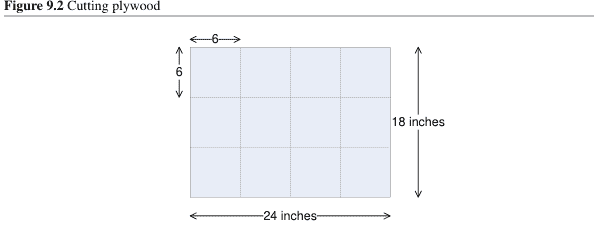
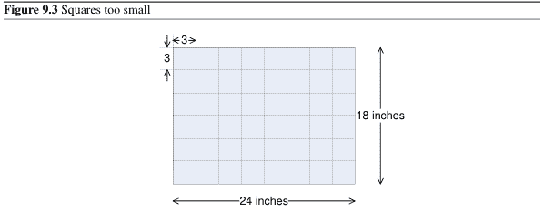

要确定 24 和 18 的 GCD，我们列出它们所有的公因数并选择最大的一个：

- 24: 1, 2, 3, 4, 6, 8, 12, 24
- 18: 1, 2, 3, 6, 9, 18

最大公约数函数在将分数化简为最简分数时很有用；例如，考虑分数 18/24。18 和 24 的最大公约数是 6，因此我们将分数的分子和分母都除以 6：18/6 / 24/6 = 3/4。GCD 函数除了用于将分数化简为最简分数外，还有其他应用领域。

考虑将一块长 24 英寸、宽 18 英寸的胶合板切割成最大尺寸的正方形块，且不浪费任何材料的问题。由于 GCD(24, 18) = 6，我们可以将胶合板切割成十二块 6 英寸 x 6 英寸的正方形，如图 9.2 所示。

如果我们将胶合板切割成任何其他尺寸且不浪费任何材料的正方形，那么这些正方形必须小于 6 英寸 x 6 英寸；例如，我们可以制作四十八块 3 英寸 x 3 英寸的正方形，如图 9.3 所示。

如果我们切割的正方形大于 6 英寸 x 6 英寸，那么并非所有胶合板都可以用来制作正方形。

## 图 9.4 正方形过大

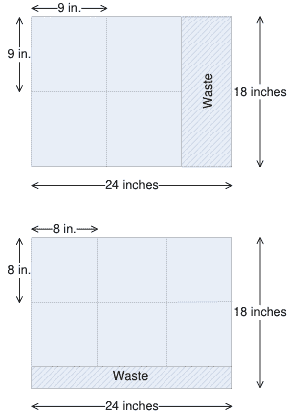

图 9.4 显示了一些较大正方形的情况。

除了基本算术和几何之外，GCD 函数在密码学中发挥着至关重要的作用，使得在不安全的网络上进行安全通信成为可能。

## 清单 9.8: gcdprog.cpp

```cpp
#include <iostream>

int main() {
    // Prompt user for input
    int num1, num2;
    std::cout << "Please enter two integers: ";
    std::cin >> num1 >> num2;

    // Determine the smaller of num1 and num2
    int min = (num1 < num2) ? num1 : num2;

    // 1 is definitely a common factor to all ints
    int largestFactor = 1;
    for (int i = 2; i <= min; i++)
```


```
if (num1 % i == 0 && num2 % i == 0)
   largestFactor = i; // Found larger factor
std::cout << largestFactor << '\n';
}
```

清单 9.8 (gcdproc.cpp) 实现了一种简单直接但朴素的算法，它通过考虑用户提供的两个值中较小值以下的每个整数来寻找潜在因子。该算法效率不高，尤其是对于较大的数字。其逻辑易于理解，无需深厚的数学洞察。很快我们将看到一种计算最大公约数（GCD）的更好算法。

如果我们需要在程序的多个不同位置计算 GCD，应该将代码封装在函数中，而不是将其复制到多个位置。以下代码片段定义了一个 C++ 函数，用于计算两个整数的最大公约数。它确定其参数中共同的最大因子（除数）：

```
int gcd(int num1, int num2) {
   // Determine the smaller of num1 and num2
   int min = (num1 < num2) ? num1 : num2;
   // 1 is definitely a common factor to all ints
   int largestFactor = 1;
   for (int i = 2; i <= min; i++)
      if (num1 % i == 0 && num2 % i == 0)
         largestFactor = i; // Found larger factor
   return largestFactor;
}
```

该函数名为 gcd，期望两个整数参数。其形式参数名为 num1 和 num2。它返回一个整数结果。其函数体声明了三个局部变量：min、largestFactor 和 i（i 局限于 for 语句）。其函体的最后一行是一条 return 语句。返回值的函数需要 return 语句。void 函数不需要 return 语句。如果 void 函数确实包含 return 语句，它只需由 return 后跟一个分号组成（换句话说，它不能返回值，就像 gcd 的 return 语句所做的那样）。不包含 return 语句的 void 函数仅在函数体末尾返回。

回顾第 6.5 节，局部变量仅在其作用域内有意义。这意味着当你编写函数时，可以命名一个局部变量，而无需担心其名称可能已在程序的其他部分使用。两个不同的函数可以使用名为 x 的局部变量，它们是两个互不影响的不同变量。函数定义中局部的任何内容对该函数定义外的所有代码都是隐藏的。

由于形式参数是局部变量，你可以在不同函数中重复使用形式参数的名称，而不会出现问题。

在同一个程序的两个不同函数中使用相同的名称来引用两个不同的变量，这可能看起来很奇怪。构成函数定义的语句块为局部变量提供了一个上下文。一个简单的类比可能会有所帮助。在美国，许多城市都有一条名为 Main Street 的街道；例如，加利福尼亚州旧金山有一条名为 Main Street 的大道。德克萨斯州达拉斯也有一条名为 Main Street 的街道。每个城市和城镇都为 Main Street 这个术语的使用提供了自己的上下文。旧金山的一个人问“我怎么去 Main Street？”，会得到前往旧金山 Main Street 的指引，而达拉斯的一个人问同样的问题，会得到达拉斯特定的指引。以类似的方式，在函数块中分配变量会将其身份本地化到该函数。我们可以将程序的执行视为一个人在美国各地旅行。在旧金山时，所有对 Main Street 的引用都指旧金山的 Main Street，但当旅行者抵达达拉斯时，Main Street 这个术语指达拉斯的 Main Street。程序的执行线程一次不能执行多条语句，这意味着编译器可以使用其当前上下文来解释语句中遇到的任何名称。同样，冒过度延伸类比之风险，一个人不可能同时身处多个城市。此外，Main Street 在一个大城市可能是一条繁忙的多车道大道，但在一个偏远的农村乡镇，同名的街道可能是一条狭窄的土路！同样，两个同名变量可能具有完全不同的类型。一个函数中名为 x 的变量可能表示整数，而另一个函数可能使用名为 x 的字符串变量。

局部变量的另一个优点是，它们仅在函数执行时才占用计算机内存中的空间。当函数开始执行时，会为局部变量和参数分配空间。当函数执行完毕并将控制权返回给调用者时，变量和参数超出作用域，它们所占用的内存会被释放，用于运行中的程序的其他用途。每次调用者调用函数时，都会发生局部变量的分配和释放过程。有关 C++ 在程序执行期间如何处理内存管理的更多信息，请参见第 18.1 节。

一旦编写了完整的函数定义，就可以在程序中使用该函数。我们调用程序员定义的函数，与调用标准库函数（如 `sqrt`（第 8.2 节）或 `rand`（第 8.6 节））的方式完全相同。如果函数返回一个值（即，它未被声明为 `void`），那么我们可以在允许该类型表达式的任何地方使用其调用。用于函数调用的参数称为实际参数。函数 `gcd` 可以作为赋值语句的一部分调用：

```
int factor = gcd(val, 24);
```

此调用使用变量 `val` 作为其第一个实际参数，并使用字面量值 24 作为其第二个实际参数。变量、表达式和字面量都可以自由用作实际参数。然后函数计算并返回其结果。此结果被赋给变量 `factor`。

函数调用和参数机制是如何工作的？它其实很简单。实际参数按顺序被赋值（绑定）给函数定义中的每个形式参数，然后控制权传递给函数体。当函数体执行完毕后，控制权返回到调用函数的程序位置。函数返回的值（如果有）会替换函数调用表达式。在语句

```
int factor = gcd(val, 24);
```

一个整数值被赋给 `factor`。右侧的表达式是一个函数调用，因此会调用函数来确定要赋什么值。变量 `val` 的值被赋给形式参数 `num1`，字面量值 24 被赋给形式参数 `num2`。然后执行 `gcd` 函数的函数体。当遇到函数体中的 `return` 语句时，程序执行返回到调用函数的位置。return 语句的参数成为赋给 `factor` 的值。将实际参数复制到形式参数的过程与赋值完全相同。这意味着编译器（在可能的情况下）会自动扩大或缩小（参见第 4.2 节）实际参数的值，以使其与相应的形式参数兼容；例如，如果 `val` 被声明为 `char`，其值会自动复制到临时位置并转换为 `int`。然后将此临时值绑定到形式参数 `num1`。请注意，`gcd` 可以从同一程序中的许多不同位置调用，并且由于在这些不同的调用中可以传递不同的参数值，`gcd` 在每次调用时都可能计算出不同的结果。

其他调用示例包括：

- `std::cout << gcd(36, 24);`

此示例仅打印调用的结果。值 36 绑定到 num1，值 24 绑定到 num2，以供函数调用使用。将打印值 12，因为 12 是 36 和 24 的最大公约数。

- x = gcd(x - 2, 24);

执行此语句将计算 x - 2 并将其值绑定到 num1。num2 将被赋值为 24。然后将调用结果赋给 x。由于赋值语句的右侧在赋给左侧之前被求值，因此在计算 x - 2 时使用 x 的原始值，然后函数返回值更新 x。

- x = gcd(x - 2, gcd(10, 8));

此示例显示一条语句中有两个调用。由于函数返回一个整数值，其结果本身可以用作函数调用中的实际参数。将一个函数调用的结果作为实际参数传递给另一个函数调用，称为函数组合。

如果函数调用与函数定义不一致，编译器将报告错误。可能的问题包括：

- 实际参数的数量与形式参数的数量不一致。参数数量必须完全一致。例如，语句 `int factor = gcd(24); // Error: too few parameters` 在给定的 gcd 定义下是非法的，因为需要两个参数时只提供了一个实际参数。

- 传递与形式参数不兼容的实际参数。例如，在定义了 `int` 时传递 `std::cout` 对象，如 `int factor = gcd(36, std::cout); // Error: second parameter is wrong type` 编译器将检测到 `std::cout` 不是有效的 `int` 并报告错误。

- 在不允许该类型表达式的上下文中使用结果。例如，返回 `void` 的函数不能在期望 `int` 的地方使用：`std::cout << srand(2); // Error: srand does not return anything` 编译器将不允许此代码。

### 9.3 按值传递

C++ 中的默认参数传递机制被归类为按值传递，也称为传值调用。这意味着实际参数的值被复制到形式参数，以供执行函数代码之用。由于函数处理的是实际参数的副本，因此函数的执行无法影响调用者拥有的实际参数的值。

清单 9.9 (passbyvalue.cpp) 说明了按值传递的后果。


```cpp
#include <iostream>

/*
 * increment(x)
 * Illustrates pass by value protocol.
 */
void increment(int x) {
    std::cout << "Beginning execution of increment, x = "
              << x << " \n";
    x++; // Increment x
    std::cout << "Ending execution of increment, x = "
              << x << " \n";
}

int main() {
    int x = 5;
    std::cout << "Before increment, x = " << x << " \n";
    increment(x);
    std::cout << "After increment, x = " << x << " \n";
}
```

为了增加戏剧性，我们选择将实际参数与形式参数命名相同。由于实际参数和形式参数在不同的上下文中声明和使用，并代表完全不同的内存位置，因此它们的名称可以相同而不会出现任何问题。

清单 9.9 (passbyvalue.cpp) 的输出为

```
Before increment, x = 5
Beginning execution of increment, x = 5
Ending execution of increment, x = 6
After increment, x = 5
```

main 中变量 x 的内存不受影响，因为 increment 对实际参数的副本进行操作。

C++ 支持另一种称为按引用传递的参数传递方式。按引用传递将在第 10.9 节中介绍。

函数以调用者按值传递参数的相同方式向调用者传递其返回值。在我们之前看到的 prompt 函数中：

```cpp
int prompt(int n) {
    int result;
    std::cout << "Please enter integer # " << n << ": ";
    std::cin >> result;
    return result;
}
```

return 语句是

```
return result;
```

变量 result 是 prompt 的局部变量。我们非正式地说我们正在返回 result 变量，但实际上，我们真正返回的只是 result 变量的值。调用者无法访问其调用的任何函数中声明的局部变量。事实上，函数的局部变量仅在函数处于活动状态（即正在执行）时才存在。当函数返回到其调用者时，其所有局部变量都会从内存中消失。在后续调用中，当函数再次变为活动状态时，其局部变量会重新出现，并在函数结束时再次消失。

### 9.4 函数示例

本节包含一些示例，说明如何使用函数来组织程序的代码。

### 9.4.1 更好组织的素数生成器

清单 9.10 (primefunc.cpp) 是清单 8.5 (moreefficientprimes.cpp) 的一个简单改进。它使用了平方根优化，并添加了一个单独的 is_prime 函数。

```cpp
Listing 9.10: primefunc.cpp

#include <iostream>
#include <cmath>

/*
 * is_prime(n)
 *  Determines the primality of a given value
 *  n an integer to test for primality
 *  Returns true if n is prime; otherwise, returns false
 */
bool is_prime(int n) {
    bool result = true;   // Provisionally, n is prime
    double root_n = sqrt(n);
    // Try all possible factors from 2 to the square
    // root of
    for (int trial_factor = 2;
         result && trial_factor <= root_n; trial_factor++)
        result = (n % trial_factor != 0);
    return result;
}

/*
 * main
 *  Tests for primality each integer from 2
 *  up to a value provided by the user.
 *  If an integer is prime, it prints it;
 *  otherwise, the number is not printed.
 */
int main() {
    int max_value;
    std::cout << "Display primes up to what value? ";
    std::cin >> max_value;
    for (int value = 2; value <= max_value; value++)
        if (is_prime(value)) // See if value is prime
            std::cout << value << " "; // Display the prime number
    std::cout << "\n"; // Move cursor down to next line
}
```

清单 9.10 (primefunc.cpp) 说明了关于组织良好的程序的几个重要点：

- 程序的完整工作不再局限于 main 函数。测试素性的工作被委托给一个单独的函数。main 专注于一个更简单的任务：生成所有要考虑的数字，并使用另一个函数 (is_prime) 来完成确定给定数字是否为素数的艰苦工作。main 现在更简单，也更具逻辑连贯性。当函数专注于单一任务时，它就是连贯的。连贯性是函数的理想属性。如果函数试图做太多不同的事情而变得过于复杂，那么编写正确代码并在发现问题时进行调试可能会更加困难。复杂的函数应该分解为几个更小、更连贯的函数。然后，原始函数将调用这些新的更简单的函数来完成其任务。在这里，main 不关心如何确定给定数字是否为素数；main 只是将工作委托给 is_prime，并利用 is_prime 函数的发现。

- 每个函数之前都有一个详尽的注释，描述了函数的性质。它解释了每个参数的含义，并指示函数应该返回什么。main 的注释可能不如其他函数详尽；这是因为 main 通常没有参数，并且在程序终止时始终向操作系统返回一个代码。

- 尽管外部注释指示函数要做什么，但每个函数内部的注释会更详细地解释函数如何完成其任务。

对 is_prime 的调用根据传递给它的值返回 true 或 false。这意味着我们可以像这样表达一个条件：

```
if (is_prime(value) == true) . . .
```

更紧凑地表达为

```
if (is_prime(value)) . . .
```

因为如果 is_prime(value) 为 true，则 true == true 为 true；如果 is_prime(value) 为 false，则 false == true 为 false。表达式 is_prime(value) 就足够了。

正如循环最好只有一个入口点和一个出口点一样，理想情况下函数也应该只有一个 return 语句。然而，返回语句数量较少的简单函数通常也是可以接受的。请考虑 is_prime 的以下版本：

```cpp
bool is_prime(int n) {
    for (int trialFactor = 2;
         trialFactor <= sqrt(static_cast<double>(n));
         trialFactor++)
        if (n % trialFactor == 0) // Is trialFactor a factor?
            return false; // Yes, return right away
    return true; // Tried them all, must be prime
}
```

此版本使用两个 return 语句，但消除了对局部变量 (result) 的需求。因为 return 语句会立即退出函数，所以不需要 break 语句。源代码中的两个 return 语句在文本上足够接近，因此逻辑相当清晰。

### 9.4.2 命令解释器

有些函数即使不从调用者接收任何信息且不返回任何结果也是有用的。清单 9.11 (calculator.cpp) 使用了这样的函数。

```cpp
Listing 9.11: calculator.cpp
#include <iostream>
#include <cmath>

/*
 * help_screen
 * Displays information about how the program works
 * Accepts no parameters
 * Returns nothing
 */
void help_screen() {
    std::cout << "Add: Adds two numbers\n";
    std::cout << "Example: a 2.5 8.0\n";
    std::cout << "Subtract: Subtracts two numbers\n";
    std::cout << "Example: s 10.5 8.0\n";
    std::cout << "Print: Displays the result of the latest operation\n";
    std::cout << "Example: p\n";
    std::cout << "Help: Displays this help screen\n";
    std::cout << "Example: h\n";
    std::cout << "Quit: Exits the program\n";
    std::cout << "Example: q\n";
}

/*
 * menu
 * Display a menu
 * Accepts no parameters
 * Returns the character entered by the user.
 */
char menu() {
    // Display a menu
    std::cout << "=== A)dd S)ubtract P)rint H)elp Q)uit ===\n";
    // Return the char entered by user
    char ch;
    std::cin >> ch;
    return ch;
}

/*
 * main
 * Runs a command loop that allows users to
 * perform simple arithmetic.
 */
int main() {
    double result = 0.0, arg1, arg2;
    bool done = false; // Initially not done
    do {
        switch (menu()) {
        case 'A': // Addition
case 'a':
    std::cin >> arg1 >> arg2;
    result = arg1 + arg2;
    std::cout << result << '\n';
    break;
case 'S': // Subtraction
case 's':
    std::cin >> arg1 >> arg2;
    result = arg1 - arg2;
    // Fall through, so it prints the result
case 'P': // Print result
case 'p':
    std::cout << result << '\n';
    break;
case 'H': // Display help screen
case 'h':
    help_screen();
    break;
case 'Q': // Quit the program
case 'q':
    done = true;
    break;
}
} while (!done);
}
```

help_screen 函数不需要来自 main 的任何信息，也不返回任何结果。每次调用时，它的行为都完全相同。menu 函数返回用户输入的字符。

### 9.4.3 受限输入

清单 7.3 (betterinputonly.cpp) 强制用户输入指定范围内的值。现在我们可以轻松地将该概念调整为一个函数。清单 9.12 (betterinputfunc.cpp) 使用一个名为 get_int_range 的函数，该函数在用户提供适当值之前不会返回。

```cpp
Listing 9.12: betterinputfunc.cpp

#include <iostream>

/*
 * get_int_range(first, last)
 *
 * Forces the user to enter an integer within a
 * specified range
 *
 * first is either a minimum or maximum acceptable value
 * last is the corresponding other end of the range,
 * either a maximum or minimum value
 * Returns an acceptable value from the user
 */
int get_int_range(int first, int last) {
    // If the larger number provided first,
    // switch the parameters
    if (first > last) {
        int temp = first;
```


```
first = last;
last = temp;
}
// Insist on values in the range first...last
std::cout << "Please enter a value in the range "
<< first << " ... " << last << ": ";
int in_value; // User input value
bool bad_entry;
do {
    std::cin >> in_value;
    bad_entry = (in_value < first || in_value > last);
    if (bad_entry) {
        std::cout << in_value << " is not in the range "
        << first << "..." << last << '\n';
        std::cout << "Please try again: ";
    }
} while (bad_entry);
// in_value at this point is guaranteed to be within range
return in_value;
}
/* main
* Tests the get_int_range function
*/
int main() {
    std::cout << get_int_range(10, 20) << '\n';
    std::cout << get_int_range(20, 10) << '\n';
    std::cout << get_int_range(5, 5) << '\n';
    std::cout << get_int_range(-100, 100) << '\n';
}
```

清单 9.12 (betterinputfunc.cpp) 强制用户在指定范围内输入一个值。此功能在许多程序中都很有用。

在清单 9.12 (betterinputfunc.cpp) 中

- 高值和低值由参数指定。这使得函数更加灵活，因为它可以在程序的其他地方使用完全不同的范围，并且仍能正确工作。

- 该函数应以较小的数作为第一个参数、较大的数作为第二个参数来调用。该函数也接受参数顺序颠倒的情况，并会自动交换它们以按预期工作；因此，

```
num = get_int_range(20, 50);
```

的效果与

```
num = get_int_range(50, 20);
```

完全相同。

- 布尔变量 bad_entry 用于避免两次求值布尔表达式（一次用于判断是否应打印错误输入消息，另一次用于判断循环是否应继续）。

### 9.4.4 改进的掷骰子模拟器

### 清单 9.13: betterdie.cpp

```
#include <iostream>
#include <cstdlib>
#include <ctime>

/*
 * initialize_die
 *
 * Initializes the randomness of the die
 */
void initialize_die() {
    // Set the random seed value
    srand(static_cast<unsigned>(time(0)));
}

/*
 * show_die(spots)
 *
 * Draws a picture of a die with number of spots
 * indicated
 *
 * spots is the number of spots on the top face
 */
void show_die(int spots) {
    std::cout << "+-------+\n";
    switch (spots) {
    case 1:
        std::cout << "|       |\n";
        std::cout << "|   *   |\n";
        std::cout << "|       |\n";
        break;
    case 2:
        std::cout << "| *     |\n";
        std::cout << "|       |\n";
        std::cout << "|     * |\n";
        break;
    case 3:
        std::cout << "| *     |\n";
        std::cout << "|   *   |\n";
        std::cout << "|     * |\n";
        break;
    case 4:
        std::cout << "| *   * |\n";
        std::cout << "|       |\n";
        std::cout << "| *   * |\n";
        break;
    case 5:
        std::cout << "| *   * |\n";
        std::cout << "|   *   |\n";
        std::cout << "| *   * |\n";
        break;
    case 6:
        std::cout << "| * * * |\n";
        std::cout << "| * * * |\n";
        std::cout << "| * * * |\n";
        break;
    default:
        std::cout << " *** Error: illegal die value ***\n";
        break;
    }
    std::cout << "+-------+\n";
}
/* roll
 * Returns a pseudorandom number in the range 1...6
 */
int roll() {
    return rand() % 6 + 1;
}
/* main
 * Simulates the roll of a die three times
 */
int main() {
    // Initialize the die
    initialize_die();

    // Roll the die three times
    for (int i = 0; i < 3; i++)
        show_die(roll());
}
```

在清单 9.13 (betterdie.cpp) 中，main 不再关心伪随机数生成的细节，也不负责绘制骰子。程序的这些重要组件现在位于函数中，因此它们的细节可以独立于 main 进行完善。

请注意，roll 调用的结果直接作为参数传递给 show_die。

### 9.4.5 树绘制函数

### 清单 9.14: treefunc.cpp

```
#include <iostream>
/* tree(height)
 * Draws a tree of a given height
 * height is the height of the displayed tree
 */
void tree(int height) {
    int row = 0; // First row, from the top, to draw
    while (row < height) { // Draw one row for every unit of height
        // Print leading spaces
        int count = 0;
        while (count < height - row) {
            std::cout << " ";
            count++;
        }
        // Print out stars, twice the current row plus one:
        // 1. number of stars on left side of tree
        // = current row value
        // 2. exactly one star in the center of tree
        // 3. number of stars on right side of tree
        // = current row value
        count = 0;
        while (count < 2*row + 1) {
            std::cout << "*";
            count++;
        }
        // Move cursor down to next line
        std::cout << "\n";
        // Change to the next row
        row++;
    }
}
/*
 * main
 * Allows users to draw trees of various heights
 */
int main() { // Height of tree
    int height;
    std::cout << "Enter height of tree: ";
    std::cin >> height; // Get height from user
    tree(height);
}
```

请注意，height 名称在 main 中用作局部变量，在 tree 中用作形式参数名。这里没有冲突，这两个 height 代表内存中的两个不同位置。此外，语句

```
tree(height);
```

使用 main 的 height 作为实际参数，而 height 碰巧也是形式参数的名称，这仅仅是巧合。在调用期间，main 的 height 变量的值被复制到 tree 中也名为 height 的形式参数。编译器可以根据每个变量的声明位置来跟踪哪个 height 是哪个。

### 9.4.6 浮点数相等性

回顾清单 4.17 (imprecise5th.cpp)，浮点数不是数学上的实数：浮点数是有限的，在内部表示为具有二进制尾数和指数的量。正如 1/3 在十进制（基数 10）数系统中无法有限表示一样，1/10 在具有固定位数的二进制（基数 2）数系统中也无法精确表示。通常，这种不精确不会引起问题，事实上，许多软件应用程序都使用浮点数编写，这些程序必须执行精确计算，例如将航天器导向遥远的行星。在这种情况下，即使是微小的错误也可能导致完全失败。浮点数可以安全有效地使用，但前提是要格外小心。

### 清单 9.15: simplefloataddition.cpp

```
#include <iostream>

int main() {
    double x = 0.9;
    x += 0.1;
    if (x == 1.0)
        std::cout << "OK\n";
    else
        std::cout << "NOT OK\n";
}
```

根据清单 9.15 (simplefloataddition.cpp) 的输出，一切看起来都很好：

```
OK
```

接下来，考虑清单 9.16 (badfloatcheck.cpp)，它试图使用双精度浮点数来控制循环。

### 清单 9.16: badfloatcheck.cpp

```
#include <iostream>

int main() {
    // Count to ten by tenths
    for (double i = 0.0; i != 1.0; i += 0.1)
        std::cout << "i = " << i << '\n';
}
```

编译并执行后，清单 9.16 (badfloatcheck.cpp) 开始时符合预期，但结束时不符合预期：

```
i = 0
i = 0.1
i = 0.2
i = 0.3
i = 0.4
i = 0.5
i = 0.6
i = 0.7
i = 0.8
i = 0.9
i = 1
i = 1.1
i = 1.2
i = 1.3
i = 1.4
i = 1.5
i = 1.6
i = 1.7
i = 1.8
i = 1.9
i = 2
i = 2.1
```

我们期望循环变量 i 等于 1 时停止，但程序会继续执行，直到用户输入 Ctrl-C。我们正在添加 0.1，就像在清单 9.15 (simplefloataddition.cpp) 中一样，但现在出现了问题。由于 0.1 在双精度浮点数表示的限制下无法精确表示，反复添加 0.1 会导致舍入误差随时间累积。虽然 0.1 + 0.9 舍入后可能等于 1，但 0.1 与自身相加 10 次可能是 1.000001 或 0.999999，两者都不完全等于 1。

清单 9.16 (badfloatcheck.cpp) 演示了，在比较浮点数值时，== 和 != 运算符的价值值得怀疑。更好的方法是检查两个浮点数值是否足够接近，这意味着它们仅相差非常小的量。在比较两个浮点数 x 和 y 时，我们本质上必须确定它们差值的绝对值是否很小；例如，|x - y| < 0.00001。C 的 abs 函数在第 8.2 节中介绍过，我们可以将其纳入 equals 函数中，如清单 9.17 (floatequals.cpp) 所示。

### 清单 9.17: floatequals.cpp

```
#include <iostream>
#include <cmath>

/**
 * equals(a, b, tolerance)
 *
 * Returns true if a == b or |a - b| < tolerance.
 * If a and b differ by only a small amount
 * (specified by tolerance), a and b are considered
 * "equal." Useful to account for floating-point
 * round-off error.
 * The == operator is checked first since some special
 * floating-point values such as HUGE_VAL require an
 * exact equality check.
 */
bool equals(double a, double b, double tolerance) {
   return a == b || fabs(a - b) < tolerance;
}

int main() {
   for (double i = 0.0; !equals(i, 1.0, 0.0001); i += 0.1)
      std::cout << "i = " << i << '\n';
}
```

第三个参数名为 tolerance，用于指定前两个参数必须多接近才被视为相等。对于 HUGE_VAL 等某些特殊浮点数值，必须使用 == 运算符，因此该函数也会检查 == 相等性。由于 C++ 对涉及逻辑 OR 的布尔表达式使用短路求值（参见第 5.2 节），如果 == 运算符指示相等，则不会执行更复杂的检查。

比较两个浮点数值是否相等时，您应该使用类似 equals 的函数。


### 9.4.7 带函数的乘法表

当我们上次在清单 7.5（bettertimestable.cpp）中访问我们的乘法表程序时，我们使用嵌套 for 循环来显示用户指定的大小。我们可以将代码分解为函数，如清单 9.8（timestablefunction.cpp）所示。我们的目标是拥有一组每个函数都非常简单的函数。我们还希望程序的整体结构在逻辑上井然有序。

```cpp
Listing 9.8: timestablefunction.cpp

#include <iostream>
#include <iomanip>

// Print the column labels for an n x n multiplication table.
void col_numbers(int n) {
    std::cout << "    ";
    for (int column = 1; column <= n; column++)
        std::cout << std::setw(4) << column; // Print heading for this column.
    std::cout << "\n";
}

// Print the table's horizontal line at the top of the table
// beneath the column labels.
void col_line(int n) {
    std::cout << "    +";
    for (int column = 1; column <= n; column++)
        std::cout << "----"; // Print separator for this row.
    std::cout << "\n";
}

// Print the title of each column across the top of the table
// including the line separator.
void col_header(int n) {
    // Print column titles
    col_numbers(n);
    // Print line separator
    col_line(n);
}

// Print the title that appears before each row of the table's
// body.
void row_header(int n) {
    std::cout << std::setw(4) << n << " |"; // Print row label.
}

// Print the line of text for row n
// This includes the row number and the
// contents of each row.
void print_row(int row, int columns) {
    row_header(row);
    for (int col = 1; col <= columns; col++) {
        std::cout << std::setw(4) << row*col; // Display product
    }
    std::cout << "\n"; // Move cursor to next row
}

// Print the body of the n x n multiplication table
void print_contents(int n) {
    for (int current_row = 1; current_row <= n; current_row++)
        print_row(current_row, n);
}

// Print a multiplication table of size n x n.
void timetable(int n) {
    // First, print column heading
    col_header(n);

    // Print table contents
    print_contents(n);
}

// Forces the user to enter an integer within a
// specified range first is either a minimum or maximum
// acceptable value last is the corresponding other end
// of the range, either a maximum or minimum value
// Returns an acceptable value from the user
int get_int_range(int first, int last) {
    // If the longer number is provided first,
    // switch the parameters
    if (first > last) {
        int temp = first;
        first = last;
        last = temp;
    }

    // Insist on values in the range first...last
    std::cout << "Please enter a value in the range "
              << first << "..." << last << ": ";
    int in_value; // User input value
    bool bad_entry;
    do {
        std::cin >> in_value;
        bad_entry = (in_value < first || in_value > last);
        if (bad_entry) {
            std::cout << in_value << " is not in the range "
                      << first << "..." << last << '\n';
            std::cout << "Please try again: ";
        }
    } while (bad_entry);

    // in_value at this point is guaranteed to be within range
    return in_value;
}

int main() {
    // Get table size from user; allow values in the
    // range 1...18.
    int size = get_int_range(1, 18);

    // Print a size x size multiplication table
    timetable(size);
}
```

图 9.5 当用户输入 3 以生成 3 x 3 乘法表时，清单 9.8（timestablefunction.cpp）中各函数激活的跟踪。时间从左向右流逝。水平条显示所涉及各函数的生命周期。

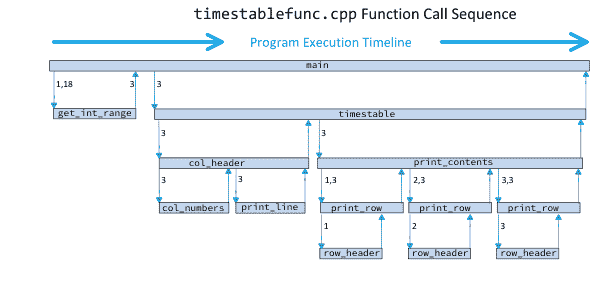

在清单 9.8（timestablefunction.cpp）中，每个函数都扮演着非常特定的角色；例如，row_header 打印特定行的标签，然后打印将行标签与表格主体分隔开的垂直条。我们重用了清单 9.12（betterinput.cpp）中的 get_int_range 函数。请注意，程序中似乎不再有任何嵌套循环。嵌套循环并未真正消失，它现在被程序的函数组合所隐藏。请观察，print_contents 函数包含一个循环。每次循环时，它会调用 print_row，但 print_row 本身也包含一个循环。因此，嵌套迭代仍然存在。

现实地说，清单 9.8（timestablefunction.cpp）中的函数分解是极端的。程序的相对简单性并不能真正证明八个各自聚焦如此狭窄的独立函数是合理的；然而，更复杂的软件系统正是以这种方式进行分解的。清单 9.8（timestablefunction.cpp）不仅让我们了解如何将复杂问题分解为更简单、更易管理的部分，我们还可以使用该程序来更好地理解函数调用过程的工作原理。要了解这一点，请考虑用户希望使用清单 9.8（timestablefunction.cpp）打印 3 x 3 乘法表的情况。

在图 9.5 中，向下的箭头对应于函数调用。向下箭头上的标签表示调用期间传递的参数。向上的箭头表示从函数返回。向上箭头上的标签是函数的返回值。void 类型的函数在其返回箭头上没有标签。

图 9.5 中的每个水平条都表示函数处于活动状态时程序执行的持续时间。main 函数始终是 C++ 程序中首先执行的函数，在清单 9.8（timestablefunction.cpp）中，main 立即调用 get_int_range 函数。在 get_int_range 执行的生命周期内，请注意 main 仍然处于活动状态。这意味着它可能维护的任何局部变量仍然存储在内存中且未丢失其值。这意味着 main 的 value 变量在程序的有效生命周期内存在。对于 get_int_range 中使用的变量 temp、in_value、bad_entry 以及参数 first 和 last，情况并非如此。这些由 get_int_range 维护的变量在 get_int_range 开始执行时（其条形的左端）自动出现，并在 get_int_range 完成时（其条形的右端）释放其空间。在打印 3 x 3 表格期间，程序调用 print_row 三次，每次调用时，函数的参数 row 和 column 以及局部变量 col 都会产生，然后在函数返回时消失。

### 9.5 组织函数

迄今为止我们看到的代码在调用之前提供函数定义。清单 9.19（organization1.cpp）以这种方式组织其函数：

```cpp
Listing 9.19: organization1.cpp
// Function definition precedes main where the function is called
#include <iostream>

int twice(int n) {
    return 2 * n;
}

int main() {
    std::cout << twice(5) << '\n';
}
```

当编译器尝试解析以下语句时：

```
std::cout << twice(5) << '\n';
```

它需要能够确定表达式 twice(5) 在给定上下文中是否有效；也就是说，它必须确定表达式 twice(5) 求值结果是否可以使用 << 运算符发送到 std::cout 对象。在解析过程中，以下几点很重要：

- twice 函数的早期定义将标识符 twice 声明给编译器。因此，编译器期望调用 twice 的调用者传递一个与 int 类型兼容的单个参数。编译器还知道调用 twice 将返回一个整数值。
- 语句中 twice 名称后面的括号表示该表达式是一个函数调用。
- 括号内是整数字面量 5，它显然与 int 类型兼容。
- 因此，表达式 twice(5) 求值结果为 int，<< 运算符可以将整数值发送到 std::cout 输出流对象。

编译器可以验证 main 函数中的代码是否正确使用了 twice 函数。

如果我们将 twice 的定义放在 main 函数定义之后，编译器将在 main 中出现 twice 调用的位置报告错误。这是因为编译器在 .cpp 文件中从上到下逐行解析 C++ 源代码。当编译器首次在其

[1] 从技术上讲，运行时环境在局部变量的声明点之后才分配其空间。对于在块内声明的变量，例如 if 语句体中的 temp 变量，该变量在块执行结束时被丢弃。


在main中调用时，它是一个未定义符号。编译器需要知道函数的返回类型和参数类型，以便验证调用者是否正确地调用了函数。

事实证明，我们可以在不提供twice函数完整定义的情况下，满足编译器对main中twice函数的了解需求。清单9.20（organization2.cpp）提供了清单9.19（organization1.cpp）中源代码的另一种组织方式。

### 清单 9.20: organization2.cpp

```cpp
// Function declaration precedes main; function definition follows main
#include <iostream>
int twice(int); // Declare function named twice
int main() {
    std::cout << twice(5) << '\n';
}
int twice(int n) { // Define function named twice
    return 2 * n;
}
```

下面的语句

```cpp
int twice(int);
```

是一个原型，用作函数声明。它本质上是一个没有函数体的函数定义。分号终止声明，函数声明中不出现花括号。我们可以为参数提供名称，但这不是必须的。函数声明提供了编译器确定调用者是否正确调用函数所需的所有信息。该函数可供源文件中声明之后出现的任何调用者使用。

清单9.21（organization3.cpp）对清单9.20（organization2.cpp）进行了略微的变体。

### 清单 9.21: organization3.cpp

```cpp
// Function declaration local to main; function definition follows main
#include <iostream>
int main() {
    int twice(int); // twice function available anywhere in main
    std::cout << twice(5) << '\n';
}
int twice(int n) { // Define function twice
    return 2 * n;
}
```

在清单9.21（organization3.cpp）中，我们在main函数内部声明了twice函数。这使得twice的声明局限于main。这意味着main中在twice声明之后出现的任何代码都可以使用twice，但main外部的代码不能（除非其他函数本身独立提供他们自己的twice声明）。清单9.22（localfuncdef1.cpp）和清单9.23（localfuncdef2.cpp）提供了局部声明和全局声明之间差异的具体示例。

### 清单 9.22: localfuncdef1.cpp

```cpp
#include <iostream>

// Global declarations available to all functions that follow the declarations
int two_times(int);
int three_times(int);

int main() {
    std::cout << two_times(5) << '\n';
    std::cout << three_times(5) << '\n';
}

int three_times(int n) {
    return two_times(n) + n;  // 3n = 2n + n
}

int two_times(int n) {
    return 2 * n;
}
```

two_times的声明出现在main和three_times的上方和外部，因此main和three_times都可以合法地调用two_times。

### 清单 9.23: localfuncdef2.cpp

```cpp
// Local declarations in main
#include <iostream>

int main() {
    // These function declarations are local to main
    int two_times(int);
    int three_times(int);
    std::cout << two_times(5) << '\n';
    std::cout << three_times(5) << '\n';
}

// The two_times function is not declared for three_times function!
int three_times(int n) {
    return two_times(n) + n;  // Compiler error
}

int two_times(int n) {
    return 2 * n;
}
```

清单9.23（localfuncdef2.cpp）中在main中给出的two_times函数声明在three_times函数中不可见；因此，该程序无法编译。

请注意，虽然C++允许我们在另一个函数的函数体内声明函数，但它不允许我们在另一个函数的函数体内定义函数。C++不支持嵌套函数定义。

一些程序员更喜欢在程序中使用之前声明所有函数（如清单9.20（organization2.cpp）或清单9.21（organization3.cpp）所示），并在main中使用之后定义函数。他们认为这更好地代表了编译代码的执行方式——main方法首先开始运行，并调用其他函数。当我们从上到下阅读源代码时，我们会在看到main调用的函数的实现细节之前，先看到main函数的细节。

在C++源代码中组织函数的更常见方法是将函数声明、函数调用和函数定义分离到各自不同的文件中。函数声明放入一个或多个头文件，函数定义出现在一个或多个.cpp文件中，调用代码（包括main）出现在单独的.cpp文件中。编译器分别编译所有.cpp文件，生成多个机器语言目标文件（Visual C++中的.obj文件）。然后链接器将这些单独的目标文件合并为一个可执行文件。第10.6节详细介绍了这种技术。

### 9.6 注释函数

注释函数的定义，提供有助于可能需要使用或扩展该函数的程序员的信息，是一种良好的做法。基本信息包括：

- **函数的目的。** 函数的目的并不总是仅从其名称中就能明显看出。这对于执行复杂任务的函数尤其如此。几句解释函数功能的话可能会有帮助。

- **每个参数的作用。** 参数名称和类型从定义中很明显，但参数的目的可能仅从其名称中不明显。有用的是指示每个参数的目的（如果有的话）。

- **返回值的性质。** 虽然函数可能如函数目的中所示做许多有趣的事情，但它到底向调用者返回什么？有用的是澄清函数生成的确切值（如果有的话）。

在商业环境中，通常还需要其他信息：

- **函数的作者。** 明确指定谁编写了该函数。可以包含电子邮件地址。如果关于函数出现问题，此联系信息可能非常宝贵。

- **函数实现最后修改的日期。** 每次更新函数时，可以添加一个额外的注释。每次更新都应指定所做的确切更改和负责更新的人员。

- **参考文献。** 如果代码是从另一个来源改编的，请列出该来源。参考文献可以包含Web URL。

以下片段显示了一个注释良好的函数定义的开头：

```cpp
/*
 * distance(x1, y1, x2, y2)
 *
 * Computes the distance between two geometric points
 * x1 is the x coordinate of the first point
 * y1 is the y coordinate of the first point
 * x2 is the x coordinate of the second point
 * y2 is the y coordinate of the second point
 *
 * Returns the distance between (x1,y1) and (x2,y2)
 *
 * Author: Joe Algori (joe@eng-sys.net)
 * Last modified: 2010-01-06
 * Adapted from a formula published at
 * http://en.wikipedia.org/wiki/Distance
 */
double distance(double x1, double y1, double x2, double y2) {
...
}
```

根据提供的信息：

- 调用者知道该函数能为他们做什么，
- 调用者知道如何使用该函数，
- 后续程序员如果对其使用或实现有疑问，可以联系原作者，
- 后续程序员如果对其实现有疑问，可以查看Wikipedia参考文献，以及
- 后续程序员可以根据其灵感来源（在此情况下为Wikipedia）来评判算法的质量。

### 9.7 自定义函数与标准函数

凭借我们对函数定义的了解，我们可以重写清单8.1（computesquareroot.cpp），使程序使用自定义平方根函数。清单9.24（squarerootfunction.cpp）显示了一种可能性。

### 清单 9.24: squarerootfunction.cpp

```cpp
#include <iostream>

double square_root(double x) {
  double diff;
  // Compute a provisional square root
  double root = 1.0;

  do { // Loop until the provisional root
       // is close enough to the actual root
       root = (root + x/root) / 2.0;
       std::cout << "root is " << root << '\n';
  // How bad is the approximation?
  diff = root * root - x;
  } while (diff > 0.0001 || diff < -0.0001);
  return root;
}

int main() {
  double input;

  // Get value from the user
  std::cout << "Enter number: ";
}


std::cin >> input;
// Report square root
std::cout << "Square root of " << input << " = "
<< square_root(input) << '\n';
}

清单 9.24（squarerootfunction.cpp）是否比清单 8.2（standardsquareroot.cpp）更好，后者使用 cmath 库中的标准 sqrt 函数？一般来说，如果你可以选择使用标准库函数或编写提供相同功能的自定义函数，请选择使用标准库例程。使用标准库例程的优势包括：

- 编写自定义代码的工作被完全消除；你可以将更多精力投入到应用程序开发的其他部分。
- 如果你编写自己的自定义代码，必须对其进行彻底测试以确保其正确性；标准库代码虽然不能免疫错误，但通常已经过完整测试套件的检验。库代码被许多开发者使用，因此任何潜在错误通常会早期暴露；你的代码仅由你编写的程序使用，错误可能不会立即显现。如果你的程序没有被广泛受众使用，错误可能会长期潜伏。标准库例程广为人知且值得信赖；自定义代码由于曝光有限，在获得更广泛的曝光和采用之前是可疑的。
- 标准例程通常经过调优以实现高效；要使自定义代码高效需要付出大量努力。
- 标准例程文档齐全；记录自定义代码需要额外工作，编写良好的文档是艰苦的工作。

清单 9.25（squarerootcomparison.cpp）在 1,000,000,000 个浮点数值范围内测试了我们的自定义平方根函数。

```
Listing 9.25: squarerootcomparison.cpp
#include <iostream>
#include <cmath>
// Consider two floating-point numbers equal when
// the difference between them is very small.
bool equals(double a, double b, double tolerance) {
return a == b || fabs(a - b) < tolerance;
}
double square_root(double x) {
// Compute a provisional square root
double root = 1.0;
do { // Loop until the provisional root
// is close enough to the actual root
root = (root + x/root) / 2.0;
} while (!equals(root*root, x, 0.0001));
return root;
}

int main() {
    for (double d = 0.0; d < 100000.0; d += 0.0001) {
        if (!equals(square_root(d), sqrt(d), 0.001))
            std::cout << d << ": Expected " << sqrt(d) << ", but computed "
                << square_root(d) << "\n";
    }
}
```

清单 9.25（squarerootcomparison.cpp）使用了来自清单 9.17（floatequals.cpp）的 equals 函数。第三个参数指定容差；如果前两个参数之间的差小于指定容差，则认为前两个参数相等。我们的新自定义 square_root 函数使用 equals 函数。main 函数也使用 equals 函数。然而，请注意，平方根计算中使用的容差比 main 用于检查结果的容差更小。因此，main 函数使用较不严格的相等性概念。

清单 9.25（squarerootcomparison.cpp）的输出：

```
0: Expected 0, but computed 0.0078125
0.0001: Expected 0.01, but computed 0.0116755
0.0008: Expected 0.0282843, but computed 0.0298389
0.0009: Expected 0.03, but computed 0.0313164
0.001: Expected 0.0316228, but computed 0.0327453
```

表明我们的自定义平方根函数对五个值产生的结果超出了 main 可接受的容差。十亿次测试中有五个错误答案，代表 0.0000005% 的错误率。虽然这个错误率非常小，但表明我们的 square_root 函数并不完美。导致函数失败的值之一可能对特定应用非常重要，因此我们的函数不可信。

### 9.8 练习

- 1. 以下是合法的 C++ 程序吗？

```
int proc(int x) {
    return x + 2;
}
```

```
int proc(int n) {
    return 2*n + 1;
}
```

```
int main() {
    int x = proc(5);
}
```

- 2. 以下是合法的 C++ 程序吗？

```
int proc(int x) {
    return x + 2;
}
```

```
int main() {
    int x = proc(5),
     y = proc(4);
}
```

- 3. 以下是合法的 C++ 程序吗？

```
#include <iostream>

void proc(int x) {
    std::cout << x + 2 << '\n';
}

int main() {
    int x = proc(5);
}
```

- 4. 以下是合法的 C++ 程序吗？

```
#include <iostream>

void proc(int x) {
    std::cout << x + 2 << '\n';
}

int main() {
    proc(5);
}
```

- 5. 以下是合法的 C++ 程序吗？

```
#include <iostream>

int proc(int x, int y) {
    return 2*x + y*y;
}

int main() {
    std::cout << proc(5, 4) << '\n';
}
```

- 6. 以下是合法的 C++ 程序吗？

```
#include <iostream>

int proc(int x, int y) {
    return 2*x + y*y;
}

int main() {
    std::cout << proc(5) << '\n';
}
```

- 7. 以下是合法的 C++ 程序吗？

```
#include <iostream>

int proc(int x) {
    return 2*x*x;
}

int main() {
    std::cout << proc(5, 4) << '\n';
}
```

- 8. 以下是合法的 C++ 程序吗？

```
#include <iostream>

proc(int x) {
    std::cout << 2*x*x << '\n';
}

int main() {
    proc(5);
}
```

- 9. 程序员期望以下程序打印 200。它实际上打印什么？为什么打印这个？

```
#include <iostream>

void proc(int x) {
    x = 2*x*x;
}

int main() {
    int num = 10;
    proc(num);
    std::cout << num << '\n';
}
```

- 10. 由于变量 x 在两个不同的位置（proc 和 main）中使用，该程序是否合法？为什么或为什么不？

```
#include <iostream>

int proc(int x) {
    return 2*x*x;
}

int main() {
    int x = 10;
    std::cout << proc(x) << '\n';
}
```

- 11. 由于实际参数与形式参数名称不同（y 与 x），该程序是否合法？为什么或为什么不？

```
#include <iostream>

int proc(int x) {
    return 2*x*x;
}

int main() {
    int y = 10;
    std::cout << proc(y) << '\n';
}
```

- 12. 完成在第 9.6 节中开始的 distance 函数。使用几个点坐标测试它，以确信你的实现是正确的。

- 13. 如果调用者向函数传递了过多参数，会发生什么？

- 14. 如果调用者向函数传递了过少参数，会发生什么？

- 15. 在 C++ 中命名函数的规则是什么？

- 16. 考虑以下函数定义：

```
#include <iostream>

int fun1(int n) {
    int result = 0;
    while (n) {
        result += n;
        n--;
    }
    return result;
}
```

```
void fun2(int stars) {
    for (int i = 0; i < stars; i++)
        std::cout << "*";
    std::cout << '\n';
}
```

```
double fun3(double x, double y) {
    return 2*x*x + 3*y*y;
}
```

```
bool fun4(char ch) {
    return ch >= 'A' && ch <= 'Z';
}
```

```
bool fun5(int a, int b, int c) {
    return (a <= b) ? (b <= c) : false;
}
```

```
int fun6() {
    return rand() % 2;
}
```

检查以下每个打印语句。如果语句非法，解释为什么非法；否则，指出该语句将打印什么。

- (a) std::cout << fun1(5) << '\n';
- (b) std::cout << fun1() << '\n';
- (c) std::cout << fun1(5, 2) << '\n';
- (d) std::cout << fun2(5) << '\n';
- (e) fun2(5);
- (f) std::cout << fun3(5, 2) << '\n';
- (g) std::cout << fun3(5.0, 2.0) << '\n';
- (h) std::cout << fun3('A', 'B') << '\n';
- (i) std::cout << fun3(5.0) << '\n';
- (j) std::cout << fun3(5.0, 0.5, 1.2) << '\n';
- (k) std::cout << fun4("T") << '\n';
- (l) std::cout << fun4('t') << '\n';
- (m) std::cout << fun4(5000) << '\n';
- (n) fun4(5000);
- (o) std::cout << fun5(2, 4, 6) << '\n';
- (p) std::cout << fun5(4, 2, 6) << '\n';
- (q) std::cout << fun5(2, 2, 6) << '\n';
- (r) std::cout << fun5(2, 6) << '\n';
- (s) if (fun5(2, 2, 6))
    std::cout << "Yes\n";
else
    std::cout << "No\n";
- (t) std::cout << "No\n";
- (u) std::cout << fun6(4) << '\n';
- (v) std::cout << fun3(fun1(3), 3) << '\n';
- (w) std::cout << fun3(3, fun1(3)) << '\n';
- (x) std::cout << fun1(fun1(fun1(3))) << '\n';
- (y) std::cout << fun6(fun6()) << '\n';


## 第 10 章

## 管理函数和数据

本章介绍了 C++ 中函数的一些其他方面。计算机科学中的关键概念递归在此得到介绍。

### 10.1 全局变量

到目前为止，所有变量都局限于函数内部，或局限于条件语句或循环语句主体中的块内部。局部变量具有许多非常理想的特性：

- 局部变量仅在变量作用域内占用内存。当程序执行离开局部变量的作用域时，会释放该变量的内存。释放的内存随后可供其他函数在其调用期间的局部变量使用。

- 我们可以在不同函数中使用相同的变量名而不会产生任何冲突。编译器从函数中该变量的声明获取关于在函数内使用的局部变量的所有信息。编译器不会在另一个函数的定义中查找局部变量的声明。因此，一个函数中的局部变量无法干扰在另一个函数中声明的局部变量。

局部变量是短暂的，因此其值在函数调用之间会丢失。有时，希望有一个变量在程序运行期间始终存在，即直到 main 函数完成。与局部变量相反，全局变量在所有函数之外声明，不局限于任何特定函数。事实上，源代码文本中出现在全局变量声明点之后的任何函数都可以合法访问和/或修改该全局变量。

清单 10.1（globalcalculator.cpp）是清单 9.11（calculator.cpp）的修改版，它使用了名为 result 的全局变量，该变量由程序中的多个函数共享。

```
Listing 10.1: globalcalculator.cpp
#include <iostream>
#include <cmath>
/*
 * help_screen
 * Displays information about how the program works
 * Accepts no parameters
 * Returns nothing
*/
void help_screen() {
    std::cout << "Add: Adds two numbers\n";
    std::cout << " Example: a 2.5 8.0\n";
    std::cout << "Subtract: Subtracts two numbers\n";
    std::cout << " Example: s 10.5 8.0\n";
    std::cout << "Print: Displays the result of the latest operation\n";
    std::cout << " Example: p\n";
    std::cout << "Help: Displays this help screen\n";
    std::cout << " Example: h\n";
    std::cout << "Quit: Exits the program\n";
    std::cout << " Example: q\n";
    std::cout << "\n";
}
/*
* menu
* Display a menu
* Accepts no parameters
* Returns the character entered by the user.
*/
char menu() {
    // Display a menu
    std::cout << "=== A)dd S)ubtract P)rint H)elp Q)uit ===\n";
    // Return the char entered by user
    char ch;
    std::cin >> ch;
    return ch;
}
/*
* Global variables used by several functions
*/
double result = 0.0, arg1, arg2;
/*
* get_input
* Assigns the globals arg1 and arg2 from user keyboard
* input
*/
void get_input() {
    std::cin >> arg1 >> arg2;
}
/*
* report
* Reports the value of the global result
*/
void report() {
    std::cout << result << '\n';
}
/*
 * add
 * Assigns the sum of the globals arg1 and arg2
 * to the global variable result
 */
void add() {
    result = arg1 + arg2;
}
/*
 * subtract
 * Assigns the difference of the globals arg1 and arg2
 * to the global variable result
 */
void subtract() {
    result = arg1 - arg2;
}
/*
 * main
 * Runs a command loop that allows users to
 * perform simple arithmetic.
 */
int main() {
    bool done = false; // Initially not done
    do {
        switch (menu()) {
        case 'A': // Addition
        case 'a':
            get_input();
            add();
            report();
            break;
        case 'S': // Subtraction
        case 's':
            get_input();
            subtract();
            report();
        case 'P': // Print result
        case 'p':
            report();
            break;
        case 'H': // Display help screen
        case 'h':
            help_screen();
            break;
        case 'Q': // Quit the program
        case 'q':
            done = true;
            break;
        }
    } while (!done);
}
```

清单 10.1（globalcalculator.cpp）使用了全局变量 result、arg1 和 arg2。这些名称不再出现在 main 函数中。这些全局变量在四个不同的函数中被访问和/或修改：get_input、report、add 和 subtract。

在将函数中的语句转换为机器语言的过程中，编译器解析其遇到的变量的方式如下：

- 如果变量有局部声明（即它是局部变量或参数），编译器将使用局部变量或参数，即使存在同名的全局变量。因此，局部变量优先于全局变量。我们说局部声明在局部变量的作用域内隐藏了全局声明。

- 如果变量没有局部声明但被声明为全局变量，编译器将使用全局变量。

- 如果变量既没有局部声明也没有全局声明，则该变量未定义，使用它是一个错误。

在局部变量隐藏同名全局变量的情况下，有一种方法可以在局部变量的作用域内同时访问局部变量和同名的全局变量。假设一个程序有一个名为 x 的全局变量和一个具有名为 x 的局部变量的函数。语句

```
x = 10;
```

在局部变量的作用域内将赋给局部 x。以下语句将在同名局部变量的作用域内赋给全局变量 x：

```
::x = 10;
```

:: 运算符称为作用域解析运算符。这种特殊语法可以在函数内访问全局变量时使用，但通常仅在需要访问被隐藏的全局变量时才使用。

如果在语句使用局部变量的值之前，该变量未通过初始化或赋值获得值，编译器将发出警告。例如，Visual C++ 编译器将对以下函数中的代码发出警告：

```
void uninitialized() {
    int x; // Declare the variable
    std::cout << x; // Then use it
}
```

警告是

warning C4700: 使用了未初始化的局部变量 'x'

（在 Visual C++ 中避免此警告的唯一方法是关闭所有警告。）局部变量在声明但未初始化后具有未定义的值。在其被正确赋值之前，不应使用其值。然而，全局变量在使用前不需要初始化。数值型全局变量会自动赋值为零。这意味着清单 10.1（globalcalculator.cpp）中 result 的初始化是多余的，因为 result 会自动被赋值为零。布尔型全局变量也会自动赋值为零，因为零表示假（参见第 5.1 节）。

何时可以使用全局变量，何时更适合使用局部变量？一般来说，出于多种原因，局部变量优于全局变量：

- 当函数仅使用局部变量且不执行其他输入操作（例如使用 `std::cin` 对象）时，其行为仅受传递给它的参数影响。如果出现非局部变量，函数的行为将受到每个可以修改该非局部变量的其他函数的影响。作为一个简单的示例，请考虑程序中出现的以下简单函数：

```
int increment(int n) {
    return n + 1;
}
```

你能预测该程序中以下语句将打印什么吗？

```
std::cout << increment(12) << '\n';
```

如果你猜是 13，那么你是正确的。`increment` 函数只是返回对其参数加一的结果。increment 函数每次用相同的参数调用时行为都相同。

接下来，请考虑某个程序中出现的以下三个函数：

```
int process(int n) {
    return n + m; // m is a global integer variable
}

void assign_m() {
    m = 5;
}

void inc_m() {
    m++;
}
```

你能预测程序中以下语句将打印什么吗？

```
std::cout << process(12) << '\n';
```

我们无法预测该语句单独会打印什么。以下场景都会产生不同的结果：

```
assign_m();
std::cout << process(12) << '\n';
```

打印 17。

```
m = 10;
std::cout << process(12) << '\n';
```

打印 22，

```
m = 0;
inc_m();
inc_m();
std::cout << process(12) << '\n';
```


打印 14，并且

```
assign_m();
inc_m();
inc_m();
std::cout << process(12) << '\n';
```

打印 19。相同的打印语句会打印出不同的值，这取决于程序执行到该点为止的累积效应。

如果该函数失败，可能很难定位错误，因为这可能是*另一个*函数的过错，该函数向全局变量赋了一个错误的值。情况可能比上面的简单示例更复杂；请考虑：

```
assign_m();
.
.    /* 30 statements in between, some of which may change a,
.       b, and m */
.
if (a < 2 && b <= 10)
    m = a & b - 100;
.
.    /* 20 statements in between, some of which may change m */
.
std::cout << process(12) << '\n';
```

- 使用非局部变量的非平凡程序，对于人类读者来说，比不使用非局部变量的程序更难理解。在检查函数内容时，非局部变量要求读者到其他地方（函数外部）去查找其含义：

```
// Linear function
double f(double x) {
    return m*x + b;
}
```

m 和 b 是什么？它们在何处、何时以及如何被赋值或重新赋值？

- 仅使用局部变量的函数可以与其他函数隔离进行正确性测试，因为其他函数不会影响该函数的行为。该函数的行为仅受其参数（如果有的话）的影响。

从函数中排除全局变量会带来*函数独立性*。依赖于其作用域外部的信息才能正确执行任务的函数是依赖函数。当函数操作全局变量时，它依赖于该全局变量处于正确状态，以便函数能正确完成其任务。包含许多依赖函数的非平凡程序更难调试和扩展。一个真正独立的函数不使用任何全局变量，也不使用任何程序员定义的函数来帮助它，可以隔离地进行正确性测试。此外，独立函数可以从一个程序复制，粘贴到另一个程序中，无需修改即可工作。函数独立性是一种可取的品质。

与全局变量不同，全局常量通常可以安全使用。使用全局常量的函数中的代码依赖于这些常量，但由于常量不能更改，开发人员无需担心有权访问全局常量的其他函数可能会干扰它们的值。

在函数中使用全局常量在程序维护方面有缺点。随着程序的发展，代码会被添加和删除。如果在程序开发过程中删除了全局常量或其含义发生了变化，该更改将影响任何使用该全局常量的函数。

清单 10.2 (digitaltimer.cpp) 使用全局常量来辅助数字计时器的显示。

```
Listing 10.2: digitaltimer.cpp
#include <iostream>
#include <iomanip>
#include <ctime>

// Some conversions from seconds
const clock_t SEC_PER_MIN = 60,    // 60 sec = 1 min
              SEC_PER_HOUR = 60 * SEC_PER_MIN,  // 60 min = 1 hr
              SEC_PER_DAY = 24 * SEC_PER_HOUR;  // 24 hr = 24 hr

/*
 * print_time
 *
 * Displays the time in hr:min:sec format
 * seconds is the number of seconds to display
 */
void print_time(clock_t seconds) {
    clock_t hours = 0, minutes = 0;

    // Prepare to print time ========================
    std::cout << '\n';
    std::cout << " ";

    // Compute and display hours ====================
    hours = seconds/SEC_PER_HOUR;
    std::cout << std::setw(2) << std::setfill('0') << hours << ":";

    // Remove the hours from seconds
    seconds %= SEC_PER_HOUR;

    // Compute and display minutes ==================
    minutes = seconds/SEC_PER_MIN;
    std::cout << std::setw(2) << std::setfill('0') << minutes << ":";
    seconds %= SEC_PER_MIN;

    // Compute and display seconds ==================
    std::cout << std::setw(2) << std::setfill('0') << seconds << '\n';
}

int main() {
    clock_t start = clock();    // Record starting time
    clock_t elapsed = (clock() - start)/CLOCKS_PER_SEC, // Elapsed time in sec.
            previousElapsed = elapsed;
    // Counts up to 24 hours (1 day), then stops
    while (elapsed < SEC_PER_DAY) {
        // Update the display only every second
        if (elapsed - previousElapsed >= 1) {
            // Remember when we last updated the display
            previousElapsed = elapsed;
            print_time(elapsed);
        }
        // Update elapsed time
        elapsed = (clock() - start)/CLOCKS_PER_SEC;
    }
}
```

在清单 10.2 (digitaltimer.cpp) 中：

- main 函数控制时间初始化和更新，并且严格以秒为单位。main 中的逻辑保持相对简单。

- 从给定秒数中提取小时、分钟和秒的代码被隔离在 print_time 中。现在，每当需要将秒数表示为 小时:分钟:秒 格式时，都可以使用 print_time 函数。

- 秒转换常量（SEC_PER_HOUR、SEC_PER_MIN 和 SEC_PER_DAY）是全局常量，以便两个函数在必要时都可以访问它们。在这种情况下，函数使用不同的常量，但将所有转换因子放在一个地方是合理的。

由于两个函数以各自可以独立开发的方式划分了职责，设计更加清晰，程序也更容易开发和调试。使用常量可确保共享值不会被任何一个函数损坏。

从函数定义中排除全局变量和全局常量并不能保证它在给定相同参数值时总是产生相同的结果；请考虑：

```
int compute(int n) {
    int favorite;
    std::cout << "Please enter your favorite number: ";
    std::cin >> favorite;
    return n + favorite;
}
```

compute 函数避免了全局变量，但我们无法预测表达式 compute(12) 的值。

回顾上面的 increment 函数：

```
int increment(int n) {
    return n + 1;
}
```

它的行为完全可预测。此外，increment 不会修改任何全局变量，这意味着它绝不会以任何方式影响整个程序的行为。我们称 increment 为纯函数。纯函数不能执行任何输入或输出（例如，使用 std::cout 和 std::cin 对象），也不允许使用全局变量。虽然 increment 是纯函数，但 compute 函数是非纯函数。下面的函数也是非纯函数，因为它执行输出：

```
int increment_and_report(int n) {
    std::cout << "Incrementing " << n << '\n';
    return n + 1;
}
```

纯函数只是计算其返回值，没有其他可观察的副作用。

仅使用纯函数且否则会被视为纯函数的函数本身也是纯函数；例如：

```
int double_increment(int n) {
    return increment(n) + 1;
}
```

double_increment 是纯函数，因为 increment 是纯函数；但是，double_increment_with_report：

```
int double_increment_with_report(int n) {
    return increment_and_report(n) + 1;
}
```

不是纯函数，因为它调用了非纯函数 increment_and_report。

### 10.2 静态变量

计算机内存中局部变量和函数参数的空间是在函数开始执行时在运行时分配的。当函数结束并返回时，用于函数局部变量和参数的内存会被释放用于其他目的。如果函数从未被调用，函数的局部变量和参数将永远不会占用计算机内存。

由于函数的局部变量是短暂的，函数通常无法在调用之间保留任何信息。C++ 提供了一种方法，使函数局部变量可以在调用之间保留。清单 10.3 (counter.cpp) 展示了如何将局部变量声明为 static，使其在程序执行期间一直保留在计算机内存中。

```
Listing 10.3: counter.cpp

#include <iostream>
#include <iomanip>

/* count
 * Keeps track of a count.
 * Returns the current count.
 */
int count() {
    // cnt's value is retained between calls because it
    // is declared static
    static int cnt = 0;
    return ++cnt; // Increment and return current count
}

int main() {
    // Count to ten
    for (int i = 0; i < 10; i++)
        std::cout << count() << ' ';
    std::cout << '\n';
}
```


在清单 10.3 (counter.cpp) 中，count 函数被调用了 10 次。每次调用都会返回它被调用次数的统计：

```
1 2 3 4 5 6 7 8 9 10
```

相比之下，如果从清单 10.3 (counter.cpp) 中删除单词 `static`，然后重新编译并重新运行，它将打印：

```
1 1 1 1 1 1 1 1 1 1
```

因为每次调用 `count` 时，都会为变量 `cnt` 分配新内存。

局部声明

```
static int cnt = 0;
```

为 `cnt` 分配空间，并在程序执行开始时只将其赋值为零一次。为 `cnt` 预留的空间在程序执行结束前不会被释放。

回顾清单 9.7 (evenbetterprompt.cpp)，其中包含了以下函数：

```
int prompt(int n) {
    int value;
    std::cout << "Please enter integer #" << n << ": ";
    std::cin >> value;
    return value;
}
```

调用者 main 使用 prompt 函数的方式如下：

```
int value1, value2, sum;
std::cout << "This program adds together two integers.\n";
value1 = prompt(1); // Call the function
value2 = prompt(2); // Call the function again
sum = value1 + value2;
```

第一次调用 prompt 会打印消息

```
Please enter integer #1:
```

并等待用户输入。第二次调用会打印消息

```
Please enter integer #2:
```

另一个调用者可能在循环中这样使用 prompt：

```
int sum = 0;
for (int i = 1; i < 10; i++)
    sum += prompt(i);
```

请注意，跟踪应传递给 prompt 的正确编号是调用者的责任。调用者可能会出错并传递错误的编号，或者可能不想管理此类细节。将跟踪输入计数的责任移交给 prompt 会更好。`static` 变量使这成为可能，如清单 10.4 (promptwithstatic.cpp) 所示。

```
#include <iostream>
/*
 * prompt requests an integer from the user and
 * keeps track of the cumulative number of entries.
 *
 * Returns the value entered by the user.
 */
int prompt() {
    static int count = 0;
    int value;
    std::cout << "Please enter integer #" << ++count << ": ";
    std::cin >> value;
    return value;
}

int main() {
    int value1, value2, sum;
    std::cout << "This program adds together two integers.\n";
    value1 = prompt(); // Call the function
    value2 = prompt(); // Call the function again
    sum = value1 + value2;
    std::cout << value1 << " + " << value2 << " = " << sum << "\n";
}
```

清单 10.4 (promptwithstatic.cpp) 的行为与清单 9.7 (evenbetterprompt.cpp) 完全相同，但在新版本中，main 不需要跟踪用户输入的次数。

局部静态变量继承自 C 编程语言，但随着 C++ 中对象的引入，其需求已有所减少（参见第 14 章）。带有静态变量的函数提供了一种实现具有持久状态的可执行代码的方法。对象提供了一种更自然、更灵活的方式来实现相同的效果。

### 10.3 重载函数

在 C++ 中，一个程序可以有多个同名函数。当程序中有两个或多个函数同名时，该函数被认为是重载的。这些函数必须以某种方式不同，否则编译器将无法知道如何将调用与特定的函数定义关联起来。编译器不仅通过函数名来识别函数；函数由其签名唯一标识。函数签名由函数名及其参数列表组成。在参数列表中，只有形式参数的类型重要，而不重要它们的名称。如果参数类型在数量和位置上都不完全匹配，则函数签名不同。请考虑以下重载函数：

- 1. void f() { /* ... */ }

此版本没有参数，因此其签名与所有其他版本（每个版本至少有一个参数）不同。

- 2. void f(int x) { /* ... */ }

此版本与版本 3 不同，因为其单个参数是 `int`，而不是 `double`。

```
3. void f(double x) { /* ... */ }
```

此版本与版本 2 不同，因为其单个参数是 `double`，而不是 `int`。

```
4. void f(int x, double y) { /* ... */ }
```

此版本与版本 5 不同，因为尽管版本 4 和 5 具有相同数量的参数且类型相同，但类型的顺序不同。

```
5. void f(double x, int y) { /* ... */ }
```

请参见版本 4 的注释。

重载函数为程序员提供了便利。如果不允许重载函数（许多编程语言不支持函数重载），则必须为执行基本相同任务但接受不同参数类型的不同函数创建新函数名。程序员最好为相似的函数选择相同的名称，并让编译器正确解决差异。对于构造函数（在对象创建期间调用的特殊函数，第 14 章），重载成为一个更重要的问题。

### 10.4 默认参数

我们可以定义接受可变数量参数的函数。请考虑清单 10.5 (countdown.cpp)，它指定了一个倒计时函数：

```
Listing 10.5: countdown.cpp

#include <iostream>

// Prints a count down from n to zero. The default
// starting value is 10.
void countdown(int n=10) {
  while (n > 0) // Count down from n to zero
    std::cout << n-- << '\n';
}

int main() {
  countdown(5);
  std::cout << "-------------" << '\n';
  countdown();
}
```

`countdown` 函数中表示为 `n=10` 的形式参数代表默认参数或默认实参。如果调用者未提供实际参数，则形式参数 `n` 被赋值为 10。以下调用

```
countdown()
```

打印

```
10
9
8
7
6
5
4
3
2
1
0
```

但调用

```
countdown(5)
```

显示

```
5
4
3
2
1
0
```

可以看出，当调用者未提供函数指定的参数，且该参数具有默认值时，调用期间将使用默认值。

我们可以在函数声明的参数列表中混合非默认参数和默认参数，但参数列表中的所有默认参数必须出现在所有非默认参数之后。这意味着以下定义是可接受的：

```
int sum_range(int n, int m=100) { // OK, default follows non-default
    int sum = 0;
    for (int val = n; val <= m; val++)
        sum += val;
    return val;
}
```

和

```
int sum_range(int n=0, int m=100) { // OK, both default
    int sum = 0;
    for (int val = n; val <= m; val++)
        sum += val;
    return val;
}
```

但以下定义是非法的，因为默认参数在函数的参数列表中位于非默认参数之前：

```
int sum_range(int n=0, int m) { // Illegal, non-default follows default
    int sum = 0;
    for (int val = n; val <= m; val++)
sum += val;
return val;
}
```

默认参数允许程序员提供高度可调的函数，为其典型用途提供更简单的接口。

重载（参见第 10.3 节）使程序员能够为两个同名的不同函数编写不同的函数定义。混合重载和默认参数可能会产生编译器不允许的歧义；例如，以下重载函数是可接受的：

```
void f() { /* ... */ }
void f(int n) { /* ... */ }
```

因为这重载了函数 f。如果调用者以 f() 调用 f，编译器将生成机器语言代码来调用 f 的第一个版本。如果我们尝试将 f 重载为

```
void f() { /* ... */ }
void f(int n=0) { /* ... */ }
```

编译器无法确定调用 f() 是指第一个重载版本还是参数默认为零的第二个版本。由于这种歧义，编译器会对尝试以无参数调用函数 f 的行为报告错误。另一种可能的组合是非法的：

```
void f(int m) { /* ... */ }
void f(int n=0) { /* ... */ }
```

因为这些函数具有相同的签名 f(int)。C++ 不允许程序包含具有相同签名的多个函数定义。

### 10.5 递归

阶乘函数在组合分析（数学中的计数理论）、概率论和统计学中广泛使用。n 的阶乘通常表示为 n!。阶乘对非负整数定义如下

n! = n · (n - 1) · (n - 2) · (n - 3) · ... 2 · 1

并且 0! 被定义为 1。因此 6! = 6 · 5 · 4 · 3 · 2 · 1 = 720。数学家以这种方式精确定义阶乘：

n! = {
     1 if n = 0
     (n - 1)! otherwise.

此定义是递归的，因为 ! 函数正在被定义，但 ! 也用于定义中。C++ 函数也可以递归定义。清单 10.6 (factorialtest.cpp) 包含一个阶乘函数，它精确模拟了数学定义。

### 清单 10.6: factorialtest.cpp

```
#include <iostream>

/*
 * factorial(n)
```


```cpp
* Computes n!
* Returns the factorial of n.
*/
int factorial(int n) {
    if (n == 0)
        return 1;
    else
        return n * factorial(n - 1);
}

int main() {
    // Try out the factorial function
    std::cout << "0! = " << factorial(0) << '\n';
    std::cout << "1! = " << factorial(1) << '\n';
    std::cout << "6! = " << factorial(6) << '\n';
    std::cout << "10! = " << factorial(10) << '\n';
}
```

观察清单 10.6 (factorialtest.cpp) 中的阶乘函数未使用循环来计算其结果。阶乘函数只是调用自身。factorial(6) 的调用计算过程如下：

```
factorial(6) = 6 * factorial(5)
    = 6 * 5 * factorial(4)
    = 6 * 5 * 4 * factorial(3)
    = 6 * 5 * 4 * 3 * factorial(2)
    = 6 * 5 * 4 * 3 * 2 * factorial(1)
    = 6 * 5 * 4 * 3 * 2 * 1 * factorial(0)
    = 6 * 5 * 4 * 3 * 2 * 1 * 1
    = 6 * 5 * 4 * 3 * 2 * 1
    = 6 * 5 * 4 * 3 * 2
    = 6 * 5 * 4 * 6
    = 6 * 5 * 24
    = 6 * 120
    = 720
```

请注意，可以通过将 if 的条件从 (n == 0) 改为 (n < 2) 来对阶乘函数进行微小优化。此更改会导致函数执行跟踪在末尾消除两次函数调用：

```
factorial(6) = 6 * factorial(5)
    = 6 * 5 * factorial(4)
    = 6 * 5 * 4 * factorial(3)
    = 6 * 5 * 4 * 3 * factorial(2)
    = 6 * 5 * 4 * 3 * 2 * 1
    = 6 * 5 * 4 * 3 * 2
    = 6 * 5 * 4 * 6
    = 6 * 5 * 24
    = 6 * 120
    = 720
```

图 10.1 显示了从 main 函数内部调用的 factorial(6) 的调用序列。

正确的简单递归函数定义基于四个关键概念：

图 10.1 跟踪了递归函数 factorial 在从 main 以参数 6 调用时的函数激活情况。指向激活条的箭头表示调用者传递的参数；指向外部的箭头显示传回给调用者的值。条的长度表示该函数调用处于活动状态的时间。

### 从 main 调用的 factorial(6) 函数调用序列

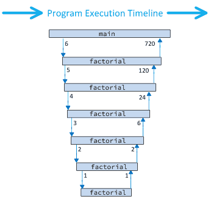

- 1. 函数可在其定义中选择性地调用自身；这是 *递归情况*。
- 2. 函数可在其定义中选择性地 *不* 调用自身；这是 *基本情况*。
- 3. 某种条件执行（例如 *if/else* 语句）根据传递给函数的一个或多个参数，在递归情况和基本情况之间进行选择。
- 4. 每个不对应基本情况的调用都必须使用使执行更接近基本情况的参数调用自身。函数的递归执行必须收敛到基本情况。

每次递归调用都必须使函数的执行更接近其基本情况。*factorial* 函数在 *if/else* 语句的 *else* 子句中调用自身。如果 *if* 语句的条件为真，则执行其基本情况。由于阶乘仅定义于非负整数，因此对 *factorial* 的初始调用必须传递零或更大的值。零参数（基本情况）不会导致递归调用。任何其他正参数都会导致递归调用，其参数比之前更接近零。递归过程的性质是向基本情况推进，在此之后递归终止。

我们可以轻松编写一个非递归阶乘函数，如清单 10.7 (*nonrecursivefact.cpp*) 所示。

### 清单 10.7: nonrecursivefact.cpp

```cpp
#include <iostream>

/*
 * factorial(n)
 * Computes n!
 * Returns the factorial of n.
 */
int factorial(int n) {
    int product = 1;
    for (int i = n; i > 0; i--)
        product *= i;
    return product;
}

int main() {
    // Try out the factorial function
    std::cout << " 0! = " << factorial(0) << '\n';
    std::cout << " 1! = " << factorial(1) << '\n';
    std::cout << " 6! = " << factorial(6) << '\n';
    std::cout << "10! = " << factorial(10) << '\n';
}
```

哪个 *factorial* 函数更好，是递归版本还是非递归版本？通常，如果递归函数和非递归函数使用相同的基本算法，那么非递归函数会更高效。与变量赋值或比较相比，函数调用是一项相对昂贵的操作。非递归函数的函数体不调用任何函数，但递归版本在除最后一次递归调用外的所有调用中都会调用一个函数——它调用自身。因此，*factorial* 的迭代版本比递归版本更高效。

尽管从技术上讲，阶乘函数的迭代版本比递归版本更高效，但在大多数系统上你无法分辨出区别。两个版本之间的执行时间差异可以忽略不计。原因是阶乘函数“增长”很快，这意味着它对于相对较小的参数会返回相当大的结果。特别是，factorial(13) 是可以在 32 位整数中容纳的最大值。无论是迭代版本还是递归版本的阶乘函数，都无法使用 32 位 int 类型计算 14!。

回顾第 9.2 节中的 gcd 函数。它计算了两个整数值的最大公约数（也称为最大公因数）。它可用，但效率不高。清单 10.8 (gcd.cpp) 中使用了更好的算法。它基于已知最古老的算法之一，由希腊数学家欧几里得在公元前 300 年左右开发。

### 清单 10.8: gcd.cpp

```cpp
#include <iostream>

/*
 gcd(m, n)
 *
 * Uses Euclid's method to compute the greatest common divisor
 * (also called greatest common factor) of m and n.
 * Returns the GCD of m and n.
 */
int gcd(int m, int n) {
 if (n == 0) {
 return m;
 }
 else
 return gcd(n, m % n);
}

int iterative_gcd(int num1, int num2) {
 // Determine the smaller of num1 and num2
 int min = (num1 < num2) ? num1 : num2;
 // 1 is definitely a common factor to all ints
 int largestFactor = 1;
 for (int i = 1; i <= min; i++)
 if (num1 % i == 0 && num2 % i == 0)
 largestFactor = i; // Found larger factor
 return largestFactor;
}

int main() {
 // Try out the gcd functions
 const int BEGIN = 1000000000,
 END = 1000000003;
 for (int num1 = BEGIN; num1 < END; num1++)
 for (int num2 = BEGIN; num2 < END; num2++)
 std::cout << "iterative_gcd(" << num1 << ", " << num2
 << ") = " << iterative_gcd(num1, num2) << "\n";
 for (int num1 = BEGIN; num1 < END; num1++)
 for (int num2 = BEGIN; num2 < END; num2++)
 std::cout << "gcd(" << num1 << ", " << num2
 << ") = " << gcd(num1, num2) << "\n";
}
```

运行清单 10.8 (gcd.cpp) 你会发现，gcd 和 iterative_gcd 函数在给定相同参数时计算出相同的结果。清单 10.8 (gcd.cpp) 通过计算相对较大整数的最大公约数，展示了两个函数之间的性能差异。gcd 函数产生结果的速度远快于 iterative_gcd。请注意，此 gcd 函数是递归的。它使用的算法与我们最初的迭代版本大不相同。由于算法的差异，此递归版本实际上比我们最初的迭代版本高效得多。因此，递归函数不能仅仅因为它是递归的就被视为低效。

虽然清单 10.8 (gcd.cpp) 以递归方式表达了 gcd 函数，但重写它以使其仍遵循欧几里得算法但使用循环而不是递归并不困难——这项任务作为本章末尾的练习出现。通常，当以递归方式表达时，解决某些类型问题的算法概念更容易理解。之后，一旦递归版本的细节被完善，开发人员可以将算法以迭代方式重写。

清单 10.9 (histobar.cpp) 提供了递归函数的另一个示例。segments1 函数使用迭代来绘制构成条形的段，该条形可能是直方图的一部分。segments2 函数做同样的事情，只是它使用递归。

### 清单 10.9: histobar.cpp

```cpp
#include <iostream>

// Draws a bar n segments long
// using iteration.
void segments1(int n) {
    while (n > 0) {
        std::cout << "*";
        n--;
    }
    std::cout << "\n";
}

// Draws a bar n segments long
// using recursion.
void segments2(int n) {
    if (n > 0) {
        std::cout << "*";
        segments2(n - 1);
    }
    else
        std::cout << "\n";
}

int main() {
    segments1(3);
    segments1(10);
    segments1(0);
    segments1(5);
    std::cout << "----------\n";
    segments2(3);
    segments2(10);
    segments2(0);
    segments2(5);
}
```

清单 10.9 (histobar.cpp) 的输出显示，两个函数产生相同的结果：

```
***
**********
```


递归函数可能在其定义中多次调用自身。考虑以下整数序列：

0, 1, 1, 2, 3, 5, 8, 13, 21, 34, 55, 89, 144, ...

这是无限斐波那契序列的开头（参见 https://en.wikipedia.org/wiki/Fibonacci_number）。它是一个以 0 开头，随后是 1 的整数序列。序列中后续元素是其前两个紧邻元素之和；因此，第三个数是 0 + 1 = 1，第四个数是 1 + 1 = 2，第五个数是 1 + 2 = 3，以此类推。构成斐波那契序列的数字称为斐波那契数。请注意，5 是斐波那契数，但 4 不是。

斐波那契数的数学特性在生物学、经济学和艺术等多种不同领域都有应用。

一个常见问题是计算第 n 个斐波那契数。0 是第 0 个，1 是第 1 个，1 也是第 2 个，2 是第 3 个，3 是第 4 个，5 是第 5 个，以此类推。

计算第 n 个斐波那契数的递归 C++ 函数很容易从斐波那契序列的定义得出：

```cpp
// Returns the nth Fibonacci number
int fibonacci( int n )
{
   if ( n <= 0 )
      return 0;
   else if ( n == 1 )
      return 1;
   else
      return fibonacci( n - 2 ) + fibonacci( n - 1 );
}
```

图 10.2 说明了使用此 fibonacci 函数对 fibonacci(5) 进行递归计算。请注意，调用 fibonacci(5) 总共调用了 15 次 fibonacci 函数。

图 10.2 fibonacci(5) 的递归计算。每个矩形代表一次对 fibonacci 函数的调用。图表顶部的调用代表 fibonacci(5) 的初始调用。向下指向的箭头表示正在传递给 fibonacci 调用的参数，而向上指向的箭头表示该调用返回的值。没有向下指向远离该调用的箭头的 fibonacci 调用表示一个基本情况；请注意，任何接收到 0 或 1 的调用都是基本情况。我们看到，fibonacci(5) 的递归过程总共调用了该函数 15 次。

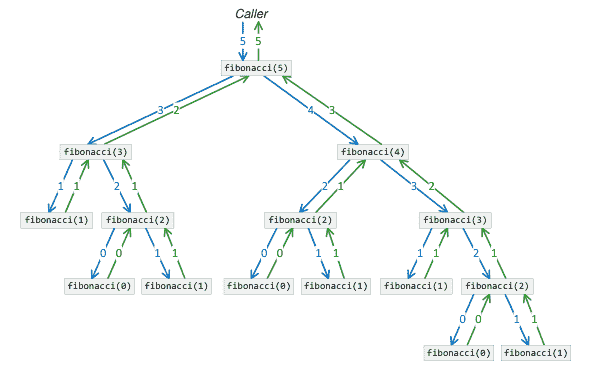

虽然此阶乘函数计算结果正确，但这种多次自我调用的倾向使其对于较大的值不切实际。第 21.8 节介绍了一种算法设计技术，可大大提高此递归函数的性能。

### 10.6 使函数可重用

函数定义将我们可以在程序中许多不同位置调用（使用）的功能打包在一处。然而，迄今为止，我们尚未看到如何轻松地在其他程序中重用函数定义。例如，清单 9.10 (primefunc.cpp) 中的 is_prime 函数在清单 9.10 (primefunc.cpp) 内工作良好，我们可以将其用于其他需要测试素性的程序中（例如，加密软件大量使用素数）。我们可以使用喜欢的文本编辑器的复制-粘贴功能，将清单 9.10 (primefunc.cpp) 中的 is_prime 函数定义复制到我们正在开发的新加密程序中。

只有当函数定义不使用任何程序员定义的全局变量、程序员定义的全局常量或其他程序员定义的函数时，才有可能使用这种复制-粘贴技术重用函数。如果函数确实使用了这些程序员定义的外部实体之一，我们必须复制并粘贴所有这些额外代码，以便函数能够编译。如果必须复制到新程序中的外部变量或函数的名称与程序中现有名称冲突，程序将无法按原样编译，我们必须重命名冲突的变量或函数以解决冲突。更改代码可能会意外引入错误，因此该过程需要绝对小心。

如果我们希望在其他程序中重用的函数仅使用局部变量和参数，就可以避免复制-粘贴引入的问题。这样的函数是真正独立的函数，可以轻松地在多个程序中重用。

然而，将源代码从一个程序复制到另一个程序的概念并不理想。在复制过程中，代码太容易不完整或引入其他错误。此外，这种代码重复是浪费的。如果特定系统上的 100 个程序都需要使用 is_prime 函数，在这种方案下，它们都必须包含 is_prime 代码。这种冗余浪费空间。最后，也许是这种复制-粘贴方法弱点最有力的证明，如果我们发现所有 100 个程序都围绕其构建的 is_prime 函数中存在一个错误，该怎么办？当我们发现错误并在一个程序中修复它时，其他 99 个程序仍然包含该错误。必须更新它们的源代码，然后每个程序都必须重新编译。如果其他 99 个程序有 99 个不同的作者，问题会更加复杂。我们必须联系多个开发者，告诉他们修复其 is_prime 函数。如果我们更新一个正确的 is_prime 函数以使其更高效，情况也会类似。问题在于：所有使用 is_prime 的程序都定义了自己的 is_prime 函数；虽然这些函数定义旨在相同，但没有机制将所有这些共同定义联系在一起。我们真的希望按原样重用该函数，而无需复制它。

幸运的是，C++ 提供了一种在单独文件中开发函数并将这些独立开发的函数的代码合并到一个程序中的方法。我们可以分别编译源文件，链接器可以将编译后的代码合并为一个可执行文件。我们需要一种方法，让编译器验证一个源文件中的调用代码是否正确地调用了另一个源文件中定义的函数。

清单 10.10 (prime.h) 提供了创建可重用 is_prime 函数的第一步。

清单 10.10: prime.h

```cpp
bool is_prime(int);
```

清单 10.10 (prime.h) 中的简单一行代码可以存储在名为 prime.h 的文件中。在 Visual Studio 中，您只需将新项目添加为头文件，将其命名为 prime.h，然后就可以将这一行代码键入新创建的文件中。此文件包含我们 is_prime 函数的原型（参见我们在第 8.1 节中关于函数原型的早期讨论）。打算使用我们 is_prime 函数的调用代码必须 #include 此文件，以便编译器可以检查调用者是否正确地使用了我们的 is_prime 函数。例如，尝试向 is_prime 传递两个参数会导致编译器错误，因为原型指定了一个整数参数。

第二个文件（可能命名为 prime.cpp）出现在清单 10.11 (prime.cpp) 中。

清单 10.11: prime.cpp

```cpp
// prime.cpp
#include <cmath>    // Needed for sqrt
#include "prime.h"  // is_prime prototype
/*
 * is_prime(n)
 * Determines the primality of a given value
 *
 * n An integer to test for primality
 * Returns true if n is prime; otherwise, returns false
*/
bool is_prime(int n) {
    bool result = true; // Provisionally, n is prime
    double r = n, root = sqrt(r);
    // Try all possible factors from 2 to the square
    // root of n
    for (int trial_factor = 2; result && trial_factor <= root; trial_factor++)
        result = (n % trial_factor != 0);
    return result;
}
```

清单 10.11 (prime.cpp) 中的代码放置在 prime.cpp 中，这是一个与 prime.h 不同的文件。它提供了 is_prime 函数的实现。请注意清单 10.11 (prime.cpp) 中引用 prime.h 文件的 #include 预处理器指令。虽然不是必需的，但这可以很好地检查此文件中的实现代码是否忠实于 prime.h 中指定的原型。此 prime.cpp 文件单独编译，如果 is_prime 的实现与头文件中的信息不一致，编译器将报告错误。

请注意，prime.cpp 文件不包含 main 函数；main 将出现在另一个文件中。另请注意，我们不需要 #include iostream 头文件，因为此文件中未使用 std::cout 和 std::cin 对象。cmath 头文件被 #include，因为 is_prime 使用 sqrt 函数。

程序的最后一部分是调用代码。假设清单 10.12 (primetester.cpp) 被添加到名为 primetester.cpp 的文件中的项目中。

### 清单 10.12: primetester.cpp

```cpp
#include <iostream>
#include "prime.h"

/*
 * main
 * Tests for primality each integer from 2
 * up to a value provided by the user.
 * If an integer is prime, it prints it;
 * otherwise, the number is not printed.
 */
int main() {
    int max_value;
    std::cout << "Display primes up to what value? ";
    std::cin >> max_value;
    for (int value = 2; value <= max_value; value++)
        if (is_prime(value)) // See if value is prime
            std::cout << value << " "; // Display the prime number
    std::cout << '\n'; // Move cursor down to next line
}
```

请注意，primetester.cpp 文件使用名为 is_prime 的函数，但其定义缺失。is_prime 的定义当然在 prime.cpp 中。


Visual Studio 在构建项目时会自动编译和链接 .cpp 文件。每个 .cpp 文件都会独立根据其自身优点进行编译。

如果你使用 Visual Studio 命令行工具，要构建程序，你需要输入

```
cl /EHsc /Za /W3 primetester.cpp prime.cpp
```

可执行文件的名称由列出的第一个源文件的名称决定，在此例中为 primetester。

如果你使用 GCC 工具而非 Visual Studio，要生成名为 primetester（或在 GCC 工具的 Microsoft Windows 版本下为 primetester.exe）的可执行程序，你需要发出以下命令

```
g++ -o primetester -Wall -O1 -std=c++11 prime.cpp primetester.cpp
```

GNU C++ 编译器将分别编译这两个源文件，生成两个机器语言目标文件。随后，链接器将使用这些目标文件创建可执行文件。当链接器创建完可执行文件后，它会自动删除这两个目标文件。

is_prime 函数现在更容易被其他程序使用。如果它成为许多程序中经常使用的函数，可以将其编译并放入一个称为库的特殊文件中。以这种形式，每次构建需要它的新程序时，都无需重新编译它。如果我们的 is_prime 放入动态库中，其代码可以在运行时加载和链接，并在许多正在执行的程序之间共享。本文不涉及库的创建。

在清单 8.7（timeit.cpp）、清单 8.8（measureprimespeed.cpp）和清单 10.2（digitaltimer.cpp）中，我们使用了 <ctime> 库中的 clock 函数来测量各种正在执行的程序中各部分的耗时。在这些程序中，程序员必须了解 clock_t 类型和 CLOCKS_PER_SEC 常量，两者均定义在 <ctime> 头文件中。此外，程序员必须正确使用 clock 函数，并正确执行一些算术运算，包括一个混乱的类型转换操作。凭借我们对全局变量（第 10.1 节）和多个源文件分别编译的知识，我们可以为 C 库提供的较低级计时函数提供更好的编程接口。

清单 10.13（timermodule.h）指定了一些方便的计时函数。

```
Listing 10.13: timermodule.h

// Header file timermodule.h

// Reset the timer so it reads 0 seconds
void reset_timer();

// Start the timer.  The timer will begin measuring elapsed time.
void start_timer();

// Stop the timer.  The timer will retain the current elapsed
// time, but it will not measure any time while it is stopped.
void stop_timer();

// Return the cumulative time (in seconds) kept by the timer since
// it last was reset
double elapsed_time();
```

清单 10.14（timermodule.cpp）实现了清单 10.13（timermodule.h）中声明的函数。

### 清单 10.14: timermodule.cpp

```
// File timermodule.h
// Implements the program timer module

#include <ctime>

// Global variable that keeps track of the elapsed time.
double elapsed;

// Global variable that counts the number of clock ticks since
// the most recent start time.
clock_t start_time;

// Global flag that indicates whether or not the
// timer is running.
bool running;

// Reset the timer so it reads 0 seconds
void reset_timer() {
    elapsed = 0.0;
    running = false; // Ensure timer is not running
}

// Start the timer. The timer will begin measuring elapsed time.
// Starting the timer if it already is running has no effect
void start_timer() {
    // Starting an already running timer has no effect
    if (!running) {
        running = true; // Note that the timer is running
        start_time = clock(); // Record start time
    }
}

// Stop the timer. The timer will retain the current elapsed
// time, but it will not measure any time while it is stopped.
// Stopping the timer if it is not currently running has no effect.
void stop_timer() {
    // Stopping a non-running timer has no effect
    if (running) {
        clock_t stop_time = clock(); // Record stop time
        running = false; // Stop the clock
        // Add to the elapsed time how long it has been since we last
        // started the timer
        elapsed += static_cast<double>((stop_time - start_time))
        / CLOCKS_PER_SEC;
    }
}

// Return the cumulative running time (in seconds)
// kept by the timer since it last was reset
double elapsed_time() {
    if (running) { // Compute time since last reset
        clock_t current_time = clock(); // Record current time
        return elapsed + static_cast<double>((current_time - start_time))
            / CLOCKS_PER_SEC;
    }
    else // Timer stopped; elapsed already computed in stop_timer
        return elapsed;
}
```

请注意，清单 10.14（timermodule.cpp）中的代码允许客户端代码停止计时器并在稍后重新启动，而不会丢失之前累积的任何时间。该实现使用三个全局变量——elapsed、start_time 和 running——来维护计时器的状态。这三个函数——start_timer、stop_timer、reset_timer——会影响其中一个或多个全局变量。第四个函数返回 elapsed 变量的值。

清单 10.15（bettertimet.cpp）使用我们的新计时器模块简化了清单 8.7（timeit.cpp）。

```
Listing 10.15: bettertimet.cpp
#include <iostream>
#include "timermodule.h" // Our timer module

int main() {
	char letter;
	std::cout << "Enter a character: ";
	start_timer(); // Start timing
	std::cin >> letter;
	stop_timer(); // Stop timing
	std::cout << elapsed_time() << " seconds" << '\n';
}
```

清单 10.15（bettertimet.cpp）中的代码比清单 8.7（timeit.cpp）中的代码更简单、更清晰。clock_t 类型以及混乱的算术运算和类型转换的所有痕迹都已消失。计时器模块为调用者提供了一个简单的接口，隐藏了计时实际发生的细节。

尽管我们的计时器模块使用方便，但它有一个严重的限制。假设你希望测量一个函数执行需要多长时间，并且在该函数执行期间，分别计时该函数内较小代码段的时间。当函数执行完毕后，你希望了解函数完成其工作花了多长时间，以及其代码的一部分执行花了多长时间。我们本质上需要两个独立的计时器，但使用我们的计时器模块，无法同时进行多个计时。我们将在第 16.2 节中看到一种更优的方式来模拟程序执行计时器。我们将使用对象，使我们能够维护所需数量的同时秒表。

### 10.7 指针

通常，我们无需关心变量在程序执行期间位于计算机内存的哪个位置。编译器会生成机器代码来为我们处理这些细节。某些系统软件（如操作系统和设备驱动程序）需要访问特定内存位置，以便与硬件交互。因此，系统程序员必须能够编写可访问这些较低级别细节的代码。高级应用程序的开发人员有时需要访问变量的地址，以实现特殊效果。

计算机内存中的每个字节都有一个唯一的地址进行编号。第一个地址是 0，位置按顺序编号，直到操作系统和硬件允许的某个最大值。C++ 变量存储在内存中，因此每个变量都位于特定地址。

### 图 10.3 指针声明与赋值

```
int x;
x = 4;
int *p;
p = &x;
```

如果 x 是任何类型的变量，表达式 &x 表示 x 的地址。& 运算符称为地址运算符。无论 x 的类型如何，表达式 &x 实际上只是一个数字——变量内存位置的数值地址，但除了系统编程中的某些情况外，程序员很少需要将此值视为数字。

虽然地址实际上只是一个非负整数值，但 C++ 在处理地址时使用特殊的表示法。在以下声明 `int *p;` 中

变量 p 本身不是 int；声明中的 `*` 符号表示 p 是指向 int 的指针。这意味着我们可以将 int 的地址赋给 p。以下代码序列

```
int x;
x = 4;
int *p;
p = &x;
```

将 x 的地址赋给 p。我们可以在图 10.3 中可视化这四条语句的执行。


## 图 10.4 通过指针进行赋值

```
int x;
x = 4;
int *p;
p = &x;
*p = 7;
```

在变量声明中，如上所示使用 *符号* 表示该变量是一个指针。它将用于引用另一个变量或内存中的其他位置。在此示例中，赋值语句序列允许指针 p 引用变量 x。

为了通过指针访问内存，我们使用一元 *运算符*。当不用于声明上下文时，一元 *运算符* 称为指针解引用运算符。继续上面的代码序列，

```
int x;
x = 4;
int *p;
p = &x;
*p = 7;
```

语句

```
*p = 7;
```

将值 7 复制到指针 p 引用的地址中。图 10.4 说明了完整序列。

请注意，对 *p 的赋值会修改变量 x 的值。指针 p 提供了访问为 x 分配的内存的另一种方式。

需要注意的是，语句

```
*p = 5;
```

是我们见过的第一个在赋值运算符左侧使用不止一个变量名的赋值语句。该语句是合法的，因为表达式 *p 表示可以存储值的内存位置。在这里，*p 充当变量 x 的占位符，我们可以轻松地向 x 赋值。

一元 *运算符* 根据上下文具有两种不同的含义：

- 在指针声明处，例如，

```
double *p;
```

* 表示 p 是指向 double 的指针；它本身不是 double。


- 在指针声明之后，例如。

```
*p = 0.08;
```

表达式 *p 表示分配给 p 的地址处的内存内容。

*运算符* 是 & *运算符* 的逆运算。& 查找变量的地址，当此地址赋给像 p 这样的指针变量时，*运算符* 访问指针引用的内存：

```
int v;
int *p = &v; // v is a normal integer variable
             // Pointer variable p points to v
*p = 5;      // Assigns 5 to variable v
```

我们可以声明一个指针而不为其赋值，如

```
int *p;
```

我们说 p 是一个未初始化指针，有时称为野指针。如果 p 是局部变量，其内容是不确定的比特位。由于 p 的声明类型，我们将这些比特位解释为地址，因此净效果是未初始化指针 p 指向计算机内存中的随机位置。尝试解引用 p，如

```
*p = 500;
```

无疑是在找麻烦。此语句尝试将值 500 写入程序员未知的某个内存位置。通常，该地址不属于操作系统为执行程序预留的内存区域，因此操作系统介入并发出运行时错误。这是滥用野指针的最佳结果。然而，伪造的地址可能位于执行程序的域内。在这种情况下，值 500 可能会覆盖另一个变量或程序本身的编译机器语言指令！此类错误很难追踪，因为被覆盖变量的值直到程序尝试使用该变量时才能被检测到。滥用未初始化指针的语句可能在源代码中远离尝试使用被覆盖变量的代码（甚至在不同的源文件中）。当程序失败时，程序员自然会查看发生故障的代码附近——被覆盖变量出现的附近代码。不幸的是，行为不当的代码是正常的，错误在于其他地方。通常没有简单的方法来定位错误的真正来源。

假设 p 是指向 int 的变量。语句

```
*p = 5;
```

将值 5 赋给 p 指向的内存位置。将此合法的 C++ 语句与以下非法的 C++ 语句进行比较：

```
p = 5; // Illegal statement as is
```


第二条语句试图使 p 引用内存地址 5；它不将值 5 赋给 p 引用的内存。C++ 对禁止在赋值中混合指针和非指针非常严格。

系统程序员有时需要将指针赋给内存中的特定地址，C++ 允许使用一种特殊的类型转换（即 reinterpret_cast）进行此类赋值：

```
p = reinterpret_cast<int *>(5); // Legal
```

熟悉的 static_cast（参见第 4.2 节）不起作用。为什么 C++ 在将指针赋给非指针以及反之亦然时如此严格？很容易犯下在需要时省略 *运算符* 的错误，因此特殊的类型转换迫使程序员停下来考虑混合赋值是否真正必要，或者尝试这样做是否是一个错误。

现代 C++ 编译器支持保留字 nullptr 来表示指向“无”的指针。它代表“空指针”。以下语句

```
p = nullptr;
```

表示 p 不指向任何地方。在大多数平台上，nullptr 映射到地址零，对于任何运行中的程序来说都越界。因此，解引用 p 将导致运行时错误。熟练的程序员可以使用调试器快速找到此类空指针访问问题的源头。

C++ 不允许将整数直接赋给指针，如

```
int *p = 5;
```

这里 p 必须指向一个整数；它本身不是整数。如果希望将 p 指向特定内存地址，必须使用特殊的类型转换：

```
int *p = reinterpret_cast<int *>(5);
```

C++ 允许使用字面值 0 代替 nullptr。语句

```
p = 0;
```

与将 nullptr 赋给 p 产生相同的结果。这是在 nullptr 关键字可用之前，C++ 程序员将指针指向无的方式。由于较新的编译器支持现有的 C++ 源代码，字面零赋值仍然有效。你应该使用 nullptr 关键字，因为它提高了源代码的可读性。由于 0 既可以表示整数值，也可以表示任何类型的指针，因此如果 p 已声明为指向整数的指针，以下两条语句都是合法的：

```
p = 0;
*p = 0;
```

第一条语句将 null 赋给 p，而第二条语句将 p 指向的数据设置为零。换句话说，第一条语句更改 p 指向的位置；第二条语句更改 p 指向的内存。表面上，这两条语句非常相似，容易混淆。接下来，考虑语句

```
p = nullptr; // OK
*p = nullptr; // Error, will not compile
```

第二条语句包含一个错误，因为将 nullptr 字面量赋给除指针类型以外的任何东西都是非法的。

nullptr 保留字是 C++11 标准的一部分。对于较旧的编译器，名称 nullptr 只是一个标识符（例如，变量或函数名）。在 nullptr 常量可用之前，字面量 0（零）被视为空指针引用。为了与旧代码向后兼容，C++11 允许使用 0 代替 nullptr，但如果可能，编写新代码时应避免这种做法。nullptr 字面量允许编译器执行更好的类型检查。为了了解原因，假设程序员认为变量 p 是指向整数的指针，但 p 实际上是一个简单的整数：

```
// Programmer believes p is a pointer to an integer
p = 0;
```

在这种情况下，编译器无法检测问题，因为 p 是整数，而零是有效的整数值。如果 p 实际上是整数而不是指针，编译器会标记以下代码：

```
// Programmer believes p is a pointer to an integer
p = nullptr;
```

因为 nullptr 不能赋给非指针类型。

nullptr 常量和指向无的指针概念在构建动态数据结构时更加有用（例如，参见第 18.3 节）。

### 10.8 引用变量

C++ 支持另一种在许多方面与指针相似的变量。当 & 符号在变量声明中用作类型名称的一部分时，如

```
int x;
int& r = x;
```

我们说 r 是一个引用变量。此声明创建一个变量 r，它引用与变量 x 相同的内存位置。我们说 r 别名 x。与指针变量不同，我们可以将 r 视为 int 变量——不需要使用 * 进行解引用。清单 10.16 (referencevar.cpp) 演示了引用变量如何别名其他变量。


## 清单 10.16: referencevar.cpp

```
#include <iostream>

int main() {
    int x = 5;
    int y = x;
    int& r = x;

    std::cout << "x = " << x << '\n';
    std::cout << "y = " << y << '\n';
    std::cout << "r = " << r << '\n';

    std::cout << "Assign 7 to x\n";
    x = 7;

    std::cout << "x = " << x << '\n';
    std::cout << "y = " << y << '\n';
    std::cout << "r = " << r << '\n';

    std::cout << "Assign 8 to y\n";
    y = 8;

    std::cout << "x = " << x << '\n';
    std::cout << "y = " << y << '\n';
    std::cout << "r = " << r << '\n';

    std::cout << "Assign 2 to r\n";
    r = 2;

    std::cout << "x = " << x << '\n';
    std::cout << "y = " << y << '\n';
    std::cout << "r = " << r << '\n';
}
```

清单 10.16 (referencevar.cpp) 的输出：

```
x = 5
y = 5
r = 5
Assign 7 to x
x = 7
y = 7
r = 7
Assign 8 to y
x = 8
y = 8
r = 8
Assign 2 to r
x = 2
y = 8
r = 2
```

清楚地表明，变量 x 和 r 表示同一量。重新赋值 x 会以完全相同的方式改变 r，重新赋值 r 也会以完全相同的方式改变 x。另一方面，变量 y 与 x 和 r 都独立。重新赋值 x 或 r 都不会影响 y，重新赋值 y 也不会影响 x 或 r。

声明引用变量时使用的 & 符号周围的空格无关紧要；具体来说，语句

```
int& r = x;
```

等效于

```
int &r = x;
```

引用变量与指针变量相似，但存在一些重要区别。引用语法比指针语法更简单，因为无需解引用引用变量即可分配其所指的内存位置。如果 num 是 int，ptr 是指向 int 的指针，ref 是指向 int 的引用，请考虑以下语句：

```
num = ref; // Assign num from ref, no need to dereference
num = *ptr; // Assign num from ptr, must dereference with *
```

与指针变量相比，引用变量有两个重大限制：

- 引用变量在声明时必须用实际变量进行初始化。指针变量可以在没有初始值的情况下声明，稍后再赋值。请考虑以下语句：

```
int *p; // Legal, we will assign p later
int& r; // Illegal, we must initialize r when declaring it
```

在 Visual C++ 下尝试编译此代码会提示编译器发出错误

```
error C2350: 'r': references must be initialized
```

- 引用变量在其生命周期内无法绑定到不同的变量。请考虑以下代码片段：

```
int x = 5, y = 7;
int *p = &x; // Binds p to point to x
int& r = x; // Binds r to x
p = &y; // Reassign p to point to y
r = y; // Assign y's value to x (via r)
```

语句

```
r = y;
```

不将 r 绑定到 y 变量。r 的声明将 r 绑定到 x 变量，直至 r 的生命周期结束。此语句仅通过引用 r 将 y 的值赋给 x。相比之下，我们可以随时自由地将指针变量绑定到任意选择的变量。

因此，在本示例中，引用变量的工作方式类似于必须绑定到变量且不能重定向到其他位置的指针。此外，与指针不同，尝试将 nullptr 赋给引用变量是非法的。引用与指针之间还有其他一些区别，此处不再深入探讨。引用变量提供的语法比指针变量更简单，因为在使用引用时不需要使用指针解引用运算符 (*)。

指针和引用之间还有一个重大区别——C++ 从 C 编程语言原样采用了指针，但 C 不提供引用。C++ 程序员经常使用用 C 编写的库函数，因此不应将引用与 C 代码混用非常重要。

第 10.9 节揭示了指针和引用在实现向函数传递引用方面的一个非常重要的实际应用。

### 10.9 按引用传递

向函数传递参数的默认技术是按值传递（参见第 9.3 节）。C++ 还支持按引用传递，也称为按引用调用，这允许函数修改调用者传递的形参的值。

请考虑清单 10.17 (faultyswap.cpp)，它使用一个函数，该函数试图交换其两个整数参数的值。

```
Listing 10.17: faultySwap.cpp

#include <iostream>

/* swap(a, b)
 * Attempts to interchange the values of
 * its parameters a and b. That it does, but
 * unfortunately it only affects the local
 * copies.
 */
void swap(int a, int b) {
    int temp = a;
    a = b;
    b = temp;
}

/* main
 * Attempts to interchange the values of
 * two variables using a faulty swap function.
 */
int main() {
    int var1 = 5, var2 = 19;
    std::cout << "var1 = " << var1 << ", var2 = " << var2 << '\n';
    swap(var1, var2);
    std::cout << "var1 = " << var1 << ", var2 = " << var2 << '\n';
}
```

清单 10.17 (faultyswap.cpp) 的输出是

```
var1 = 5, var2 = 19
var1 = 5, var2 = 19
```

不幸的是，swap 函数仅交换实际参数的副本，而非实际参数本身。我们真正希望编写一个交换调用者变量的函数。

要实现所需效果，必须使用按引用传递。C++ 可以通过两种方式实现按引用传递：指针参数和引用参数。

### 10.9.1 通过指针按引用传递

指针（参见第 10.7 节）允许我们访问变量的内存位置。我们可以利用此功能，允许函数修改其调用者拥有的变量的值。清单 10.18 (swapwithpointers.cpp) 提供了我们变量交换程序的正确版本。

## 清单 10.18: swapwithpointers.cpp

```
#include <iostream>
/*
 * swap(a, b)
 *   Interchanges the values of memory
 *   referenced by its parameters a and b.
 *   It effectively interchanges the values
 *   of variables in the caller's context.
 */
void swap(int *a, int *b) {
    int temp = *a;
    *a = *b;
    *b = temp;
}
/*
 * main
 *   Interchanges the values of two variables
 *   using the swap function.
 */
int main() {
    int var1 = 5, var2 = 19;
    std::cout << "var1 = " << var1 << ", var2 = " << var2 << '\n';
    swap(&var1, &var2);
    std::cout << "var1 = " << var1 << ", var2 = " << var2 << '\n';
}
```

清单 10.18 (swapwithpointers.cpp) 的输出是

```
var1 = 5, var2 = 19
var1 = 19, var2 = 5
```

这就是我们试图实现的结果。swap 函数可以直接操作 main 的变量，因为我们将这些变量的指针传递给了它。

在清单 10.18 (swapwithpointers.cpp) 中：

- swap 的形参 a 和 b 是指向整数的指针，它们本身不是整数。为了访问名为 a 的指针所指向的整数，必须对其进行解引用。这就是为什么在 swap 的函数体中对 a 的任何使用都要加上指针解引用运算符 * 的原因。语句 `int temp = *a;` 将 a 所指向的变量的值赋给局部变量 temp。由于 main 在调用 swap 时将 var1 的地址作为第一个参数传递，在此例中 a 指向 var1，因此 *a 实际上是访问 main 中 var1 内存位置的另一种方式。因此，该函数将 main 的 var1 变量的值赋给 temp。

- 在 swap 的语句中：
  `*a = *b;`
  由于 *a 实际上是 main 的 var1 变量，*b 实际上是 main 的 var2 变量，因此该语句将 main 的 var2 的值赋给其 var1 变量。

- swap 函数的 `*b = temp;` 语句将局部 temp 值赋给 main 的 var2 变量，因为 swap 的 b 参数指向 main 的 var2。

- 在 main 中，调用 `swap(&var1, &var2);` 将其局部变量的地址传递给 swap。

实际上，使用指针的按引用传递仍然使用按值传递。我们传递的不是值的副本，而是地址的副本。例如，在清单 10.18 (swapwithpointers.cpp) 中，var1 和 var2 的地址值被复制到形参 a 和 b。区别在于，我们并非试图重新赋值 a 或 b，而是重新赋值 a 和 b 所指向的内存。无论使用原始地址还是地址的副本，它仍然是同一个地址——内存中相同的数值位置。

### 10.9.2 通过引用按引用传递

C 和 C++ 都支持使用指针进行按引用传递（参见第 10.9.1 节）。由于 C++ 程序经常使用 C 库，C++ 程序员必须熟悉按引用传递的指针技术。然而，C++ 提供了一种使用 _引用参数_ 实现按引用传递的更简单方法。（有关引用变量的介绍，请参见第 10.8 节。）清单 10.19 (swapwithreferences.cpp) 在我们的变量交换程序中使用了引用参数。

```
Listing 10.19: swapwithreferences.cpp

#include <iostream>

/*
 * swap(a, b)
 *  Interchanges the values of memory
 *  referenced by its parameters a and b.
 *  It effectively interchanges the values
 *  of variables in the caller's context.
 */
void swap(int& a, int& b) {
    int temp = a;
    a = b;
    b = temp;
}

/*
 * main
 *  Interchanges the values of two variables
 *  using the swap function.
 */
int main() {
    int var1 = 5, var2 = 19;
    std::cout << "var1 = " << var1 << ", var2 = " << var2 << '\n';
    swap(var1, var2);
    std::cout << "var1 = " << var1 << ", var2 = " << var2 << '\n';
}
```


清单 10.19（swapwithreferences.cpp）的语法比清单 10.18（swapwithpointers.cpp）更简洁一些。在清单 10.19（swapwithreferences.cpp）中：

- swap 的形参 a 和 b 是整数的引用；这在它们的声明中由 int 后面的 & 符号表示。因为 a 是引用，我们像使用整数一样使用它；不需要使用 * 运算符对其解引用来更改它所别名的整数的值。然而，因为 a 是引用，它是其他位置另一个变量或内存位置的别名。这意味着如果我们修改 a，我们也会修改它引用的变量，在此例中是 main 中的 var1。语句

```
int temp = a;
```

将 a 的值赋给局部变量 temp，但由于 a 是访问 var1 的另一种方式，这条语句最终将 var1 的值赋给 temp。

- 在 main 中，调用

```
swap(var1, var2);
```

不需要任何特殊修饰。它看起来像是一个正常的按值传递函数调用。程序员必须意识到 swap 使用引用参数，并且任何使用引用参数的函数都可以更改传递给它的实际值。

引用参数被引入 C++ 是为了更清晰地实现一些更高级的面向对象特性。有人认为，对于像 swap 函数这样简单的情况，指针按引用传递比引用参数按引用传递更可取，因为使用指针按引用传递时，调用者被迫传递可能被修改的实际参数的地址。这样一来，就毫无疑问正在进行按引用传递。使用引用参数时，在调用点无法区分按值传递和按引用传递，因为使用引用参数的调用看起来与按值传递调用完全一样。

一般来说，纯按值传递函数优于按引用传递函数。使用按引用传递的函数会产生副作用。这意味着它们可以以只有查看函数内部并了解其工作原理才能确定的方式更改程序的状态。访问全局变量的函数（参见第 10.1 节）也可能产生副作用。当函数可以被视为在隔离状态下执行计算且不会影响其局部上下文之外任何内容的黑盒时，程序开发会容易得多。函数的工作结果可以赋值给变量，从而更改程序的状态，但这种更改是调用者的责任，而不是函数本身的责任。使用按值传递时，函数的参数和局部变量在函数执行时产生，函数结束时参数和局部变量消失，函数的执行不会影响其他任何内容。

无副作用函数可以与程序的其余部分隔离开来进行开发和测试。一旦程序员对其正确性满意，在系统其余部分开发过程中就不需要再对其进行修改。然而，有副作用的函数依赖于程序的其他部分，系统其他地方的更改可能要求程序员修改并重新评估现有函数。

### 10.10 高阶函数

目前为止我们看到的函数只接受数据作为参数。由于函数可以包含条件语句和循环，它们可以根据接收到的数据执行不同的操作。然而，每个函数内部的代码在编译时是固定的。请考虑以下函数：

```
int evaluate(int x, int y) {
    return x + y;
}
```

调用

```
evaluate(10, 2)
```

的结果是 12。由于 evaluate 函数返回其两个参数的和。调用

```
evaluate(-4, 6);
```

返回 2。这次函数返回不同的结果是因为我们传递了不同的参数。从某种意义上说，evaluate 函数的行为取决于调用者传递的参数；然而，它始终对其两个参数求和。我们无法调用 evaluate 并期望它改为对两个参数求积。evaluate 函数被硬编码为执行加法。

如果我们希望 evaluate 函数能够在程序执行的不同时间执行不同的算术运算，该怎么办？不幸的是，当前编写的 evaluate 无法调整以执行不同的算术运算。好消息是，我们可以重写 evaluate，使其能够灵活适应调用者不断变化的算术需求。

C++ 允许程序员将函数作为参数传递给其他函数。函数甚至可以将函数作为结果返回。接受一个或多个函数作为参数或将函数作为结果返回的函数称为高阶函数。正如我们将看到的，高阶函数开辟了新的编程可能性，使我们能够通过向其中插入不同的函数来自定义函数的行为以实现不同的效果。

C++ 通过函数指针支持高阶函数。在程序执行期间，函数的编译机器语言代码必须驻留在计算机内存中，程序才能调用该函数。这意味着每个函数都有一个内存地址，就像每个变量都有其特定的内存地址一样。指向函数的指针保存特定函数的编译代码的起始地址。

清单 10.20（arithmeticeval.cpp）展示了高阶函数的实际示例。

```
#include <iostream>

int add(int x, int y) {
    return x + y;
}

int multiply(int x, int y) {
    return x * y;
}

int evaluate(int (*f)(int, int), int x, int y) {
    return f(x, y);
}

int main() {
    std::cout << add(2, 3) << '\n';
    std::cout << multiply(2, 3) << '\n';
    std::cout << evaluate(&add, 2, 3) << '\n';
    std::cout << evaluate(&multiply, 2, 3) << '\n';
}
```

evaluate 函数的第一个参数，

```
int (*f)(int, int)
```

表示一个函数指针。该参数的名称是 f，f 是指向接受两个整数参数并返回整数结果的函数的指针。在清单 10.20（arithmeticeval.cpp）中，调用者必须传递给 evaluate 的第一个参数是与 evaluate 定义中指定的形参匹配的函数原型的地址。add 和 multiply 函数都符合条件，因为它们接受两个整数参数并返回整数结果。表达式

```
evaluate(&add, 2, 3)
```

将 add 函数的地址传递给 evaluate。在 evaluate 函数体中，我们看到 evaluate 调用由其第一个参数（f）指定的函数，并将其第二个（x）和第三个（y）参数作为该函数期望的两个参数传递给该函数。因此，调用

```
evaluate(&add, 2, 3)
```

的净效果与

```
add(2, 3)
```

相同。

C++ 对函数指针的语法有些宽松，这种语法不适用于数据指针。在源代码中调用 evaluate 时，我们可以省略函数参数前面的 &，如

```
std::cout << evaluate(add, 2, 3) << '\n';
```

由于编译器知道 add 是一个函数，并且单词 add 后面没有跟随括号，编译器推断这不是对 add 的调用，而是 add 函数的地址。

> 当先前声明的函数名在 C++ 源代码中单独出现时，它表示指向该函数的指针。

函数指针不仅限于函数参数。给出上面的 add 定义，以下代码片段是合法的 C++：

```
// Declare func to be a pointer to a function that accepts
// two integer parameters and returns an integer result
int (*func)(int, int);

// Assign add to func
func = add;

// Call add through func
std::cout << func(7, 2) << '\n';
```

这段代码作为完整 C++ 程序的一部分将打印 9。

通过函数指针的高阶函数为开发灵活程序提供了强大的工具。使用函数作为参数，我们可以动态自定义函数的行为，本质上是通过传递不同的函数来“插入”新功能。我们将在第 12 章中好好利用高阶函数。

### 10.11 练习

- 1. 请考虑以下 C++ 代码：

```
#include <iostream>

int sum1(int n) {
    int s = 0;
    while (n > 0) {
        s++;
        n--;
    }
    return s;
}

int input;

int sum2() {
    int s = 0;
    while (input > 0) {
        s++;
        input--;
    }
    return s;
}

int sum3() {
    int s = 0;
    for (int i = input; i > 0; i--)
        s++;
    return s;
}

int main() {
    // See each question below for details
}
```

- (a) 如果 main 编写如下，将打印什么？

```
int main() {
    input = 5;
    std::cout << sum1(input) << '\n';
    std::cout << sum2() << '\n';
}
```


```cpp
std::cout << sum3() << '\n';
}
```

### (b) 如果 main 按以下方式编写，打印什么？

```cpp
int main() {
    input = 5;
    std::cout << sum1(input) << '\n';
    std::cout << sum3() << '\n';
    std::cout << sum2() << '\n';
}
```

### (c) 如果 main 按以下方式编写，打印什么？

```cpp
int main() {
    input = 5;
    std::cout << sum2() << '\n';
    std::cout << sum1(input) << '\n';
    std::cout << sum3() << '\n';
}
```

### (d) 函数 sum1、sum2 和 sum3 中哪些会产生副作用？副作用是什么？

### (e) 哪个函数可能不使用 input 变量？

### (f) 变量 input 的作用域是什么？它的生命周期是什么？

### (g) 变量 i 的作用域是什么？它的生命周期是什么？

### (h) 函数 sum1、sum2 和 sum3 中哪些体现了良好的功能独立性？为什么？

## 2. 考虑以下 C++ 代码：

```cpp
#include <iostream>

int next_int1() {
    static int cnt = 0;
    cnt++;
    return cnt;
}

int next_int2() {
    int cnt = 0;
    cnt++;
    return cnt;
}

int global_count = 0;

int next_int3() {
    global_count++;
    return global_count;
}

int main() {
    for (int i = 0; i < 5; i++)
        std::cout << next_int1() << " " << next_int2() << " " << next_int3() << '\n';
}
```

### (a) 程序打印什么？

### (b) 函数 next_int1、next_int2 和 next_int3 中哪个最适合预期目的？为什么？

### (c) 对于名为 next_int2 的函数，有什么更好的名称？

### (d) next_int3 函数在此上下文中可用，但为什么它不是一个始终返回下一个最大整数的函数的良好实现？

## 3. 以下 C++ 程序分散在三个源文件中。第一个文件 counter.h 包含：

```cpp
int read();
int increment();
int decrement();
```

第二个文件 counter.cpp 包含：

```cpp
static int count;
int read() {
    return count;
}
int increment() {
    if (count < 5)
        count++;
}
int decrement() {
    if (count > 0)
        count--;
}
```

第三个文件 main.cpp 不完整：

```cpp
#include <iostream>
#include "counter.h"
int main() {
    // Add code here
}
```

### (a) 向 main 添加语句，使其能够产生以下输出：

```
3
2

4
```

限制是你只允许使用（三次）以下输出语句：

```cpp
std::cout << read() << ' ' << '\n';
```

### (b) 在使用上述相同输出语句的限制下，你可以向 main 添加什么代码以产生以下输出？


## 4. 考虑以下 C++ 代码：

```cpp
#include <iostream>

int max(int n) {
    return n;
}

int max(int m, int n) {
    return (m >= n) ? m : n;
}

int max(int m, int n, int r) {
    int x = m;
    if (n > x)
        x = n;
    if (r > x)
        x = r;
    return x;
}

int main() {
    std::cout << max(4) << '\n';
    std::cout << max(4, 5) << '\n';
    std::cout << max(5, 4) << '\n';
    std::cout << max(1, 2, 3) << '\n';
    std::cout << max(2, 1, 3) << '\n';
    std::cout << max(2, 1, 2) << '\n';
}
```

### (a) 由于有三个名为 max 的不同函数，该程序是否合法？

### (b) 程序打印什么？

## 5. 考虑以下函数：

```cpp
int proc(int n) {
    if (n < 1)
        return 1;
    else
        return proc(n/2) + proc(n - 1);
}
```

求值以下每个表达式：

### (a) proc(0)

### (b) proc(1)

### (c) proc(2)

### (d) proc(3)

### (e) proc(5)

### (f) proc(10)

### (g) proc(-10)

## 6. 重写 gcd 函数，使其实现欧几里得算法，但使用迭代而不是递归。

## 7. 如果 x 是一个变量，你将如何确定它在计算机内存中的地址？

## 8. 以下代码片段打印什么？

```cpp
int x = 5, y = 3, *p = &x, *q = &y;
std::cout << "x = " << x << ", y = " << y << '\n';
x = y;
std::cout << "x = " << x << ", y = " << y << '\n';
x = 7;
std::cout << "x = " << x << ", y = " << y << '\n';
*p = 10;
std::cout << "x = " << x << ", y = " << y << '\n';
p = q;
*p = 20;
std::cout << "x = " << x << ", y = " << y << '\n';
```

## 9. 给定声明：
int x, y, *p, *q;
指出以下每个代码片段将打印什么。

### (a)

```cpp
p = &x;
x = 5;
std::cout << *p << '\n';
```

### (b)

```cpp
x = 5;
p = &x;
std::cout << *p << '\n';
```

### (c)

```cpp
p = &x;
*p = 8;
std::cout << *p << '\n';
```

### (d)

```cpp
p = &x;
q = &y;
x = 100;
y = 200;
*q = *p;
std::cout << x << ' ' << y << '\n';
std::cout << *p << ' ' << *q << '\n';
```

### (e)

```cpp
p = &x;
q = &y;
x = 100;
y = 200;
q = p;
std::cout << x << ' ' << y << '\n';
std::cout << *p << ' ' << *q << '\n';
```

### (f)

```cpp
x = 5;
y = 10;
p = q = &y;
std::cout << *p << ' ' << *q << '\n';
*p = 100;
*q = 1;
std::cout << x << ' ' << y << '\n';
```

### (g)

```cpp
x = 5;
y = 10;
p = q = &x;
*p = *q = y;
std::cout << x << ' ' << y << '\n';
```

## 10. 以下函数行为不符合预期：

```
/*
 * (Faulty function)
 *
 * get_range
 *
 * Establishes a range of integers.  The lower value must
 * be greater than or equal to min, and the upper value
 * must be less than or equal to max.
 *
 * min is the lowest acceptable lower value.
 * max is the highest acceptable upper value.
 * lower is assigned the lower limit of the range
 * upper is assigned the upper limit of the range
 */
void getRange(int min, int max, int lower, int upper) {
    std::cout << "Please enter a data range within the bounds "
              << min << "..." << max << "\n";
    do { // Loop until acceptable values are provided
        std::cin >> lower >> upper;
        if (lower < min)
            std::cout << lower << " is too low, please try again.\n";
        if (upper > max)
            std::cout << upper << " is too high, please try again.\n";
    } while (lower < min || upper > max);
}
```

### (a) 修改函数，使其使用指针按引用传递工作。

### (b) 修改函数，使其使用引用参数按引用传递工作。

## 11. 将以下函数分类为纯函数或非纯函数。x 是全局变量，LIMIT 是全局常量。

### (a)

```cpp
int f1(int m, int n) {
    return 2*m + 3*n;
}
```

### (b)

```cpp
int f2(int n) {
    return n - LIMIT;
}
```

### (c)

```cpp
int f3(int n) {
    return n - x;
}
```

### (d)

```cpp
void f4(int n) {
    std::cout << 2*n << '\n';
}
```

### (e)

```cpp
int f5(int n) {
    int m;
    std::cin >> m;
    return m * n;
}
```

### (f)

```cpp
int f6(int n) {
    int m = 2*n, p;
    p = 2*m - 5;
    return p - n;
}
```

## 12. 完成以下函数，该函数将点 (x1,y1) 和 (x2,y2) 的中点分量赋给其 mx 和 my 引用参数，这些点由参数 x1、y1、x2 和 y2 表示。

```cpp
// Computes the midpoint of the points (x1, y1) and (x2, y2).
// The point (mx, my) represents the midpoint.
void midpoint(double x1, double y1, double x2, double y2,
    double& mx, double& my) {
    // Add your code . . .
}
```

## 13. 完成以下函数，该函数将两条直线交点的分量赋给其 ix 和 iy 引用参数。第一条直线通过点 (x1,y1) 和 (x2,y2)；第二条直线通过点 (x3,y3) 和 (x4,y4)。如果两条直线不在单一点相交（即它们互相平行），则函数应将 INFINITY 赋给 ix 和 iy。（INFINITY 是 cmath 头文件中定义的双精度浮点常量。它表示一个非常大的数，你可以有效地将其视为无穷大。）

```cpp
// Computes the point of intersection of two lines.
// The first line passes through the points
// (x1, y1) and (x2, y2). The second line passes through the
// points (x3, y3) and (x4, y4). The function assigns
// (ix, iy) as the intersection point.
// If the two lines do not intersect in a single point, the function
// computes (INFINITY, INFINITY).
void intersection(double x1, double y1, double x2, double y2,
                  double x3, double y3, double x4, double y4,
                  double& ix, double& iy) {
    // Add your code . . .
}
```

## 14. 重写清单 10.8（gcd.cpp）中的递归 gcd 函数，使其使用相同的基本欧几里得算法，但使用迭代而不是递归。


## 第 11 章

## 序列

到目前为止我们使用的变量每次只能保存一个值。正如我们所见，可以使用单个变量来创建一些有趣且有用的程序；但是，每次只能表示一个值的变量确实有其局限性。考虑清单 11.1（averagenumbers.cpp），它对用户输入的五个数求平均值。

```
Listing 11.1: averagenumbers.cpp

#include <iostream>

int main() {
    double n1, n2, n3, n4, n5;
    std::cout << "Please enter five numbers: ";
    // Allow the user to enter in the five values.
    std::cin >> n1 >> n2 >> n3 >> n4 >> n5;
    std::cout << "The average of " << n1 << " , " << n2 << " , " << n3 << " , " << n4 << " , "
              << n3 << " , " << n4 << " , " << n5 << " is "
              << (n1 + n2 + n3 + n4 + n5)/5 << "\n";
}
```

清单 11.1（averagenumbers.cpp）的示例运行如下：

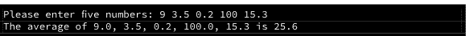

该程序方便地显示用户输入的值，然后计算并显示它们的平均值。

假设要求求平均值的数量必须从五个增加到 25 个。如果我们以清单 11.1（averagenumbers.cpp）为指南，必须引入二十个额外的变量，程序的总长度必然会增长。使用这种方法对 1,000 个数求平均是不切实际的。

清单 11.2（averagenumbers2.cpp）提供了一种对数求平均的替代方法。

```
Listing 11.2: averagenumbers2.cpp

#include <iostream>

int main() {
    double sum = 0.0, num;
    const int NUMBER_OF_ENTRIES = 5;
    std::cout << "Please enter " << NUMBER_OF_ENTRIES << " numbers: ";
    for (int i = 0; i < NUMBER_OF_ENTRIES; i++) {
        std::cin >> num;
        sum += num;
    }
    std::cout << "The average of " << NUMBER_OF_ENTRIES << " values is "
              << sum/NUMBER_OF_ENTRIES << '\n';
}
```

清单 11.2（averagenumbers2.cpp）的行为与清单 11.1（averagenumbers.cpp）略有不同，如下面使用相同数据的示例运行所示：

```
Please enter 5 numbers: 9 3.5 0.2 100 15.3
The average of the 5 values is 25.6
```

清单 11.2（averagenumbers2.cpp）可以更容易地修改为对 25 个值求平均，而清单 11.1（averagenumbers.cpp）则必须使用 25 个独立变量——只需更改常量 NUMBER_OF_ENTRIES。事实上，对 1,000 个数求平均的代码更改也并不更困难。但是，与原始平均程序不同，这个新版本不显示输入的数字。这是一个显著的差异；出于各种原因，可能需要保留所有输入的值：

- 所有值在输入后都可以重新显示，以便用户可以直观地验证其输入是否正确。
- 程序员可能希望以某种更持久的方式显示值；例如，用户可能改为在图形用户界面组件中输入值，例如可视网格（电子表格）。
- 更复杂的程序可能需要以不同的方式处理值；例如，我们可能希望仅显示高于某个值（如大于零）的输入值，但限制在用户完成所有数字输入后才确定。

在所有这些情况下，我们都必须保留所有变量的值以供将来调用。

我们需要结合上述两个程序的优点；具体来说，我们希望能够

- 保留每个单独的值，并且
- 避免定义单独的变量来存储所有单独的值

这些要求看似矛盾，但 C++ 提供了几种标准数据结构，可以同时提供这两个优点。在本章中，我们将考察 C++ 中可用的常见序列类型：向量和数组。

向量和数组是序列类型，因为序列意味着其元素是有序的。非空序列具有以下属性：

- 每个非空序列都有一个唯一的第一个元素。
- 每个非空序列都有一个唯一的最后一个元素。
- 非空序列中除了第一个元素之外的每个元素都有一个唯一的前驱元素。
- 非空序列中除了最后一个元素之外的每个元素都有一个唯一的后继元素。

我们称这为 *线性顺序*。在线性顺序中，你可以从第一个元素开始，反复访问后继元素，直到到达最后一个元素。序列中下一个元素是什么永远不会有任何歧义。

本章考察的数据结构，`std::vector`、原始数组和 `std::array`，都是序列类型。

### 11.1 向量

C++ 中的向量是一个对象，它管理一块可以同时保存多个值的内存；因此，向量表示一组值。向量有一个名称，我们可以通过值在向量管理的内存块中的位置来访问它包含的值。向量存储一组值，并且所有值必须都是相同类型。一组所有相同类型的值被称为 *同质*。

### 11.1.1 声明和使用向量

要在 C++ 程序中使用向量对象，必须添加预处理器指令

```
#include <vector>
```

向量类型是标准（`std`）命名空间的一部分，因此其全名是 `std::vector`，就像 `cout` 的全名是 `std::cout` 一样（参见第 2.1 节）。如果在源文件中包含指令

```
using std::vector;
```

则可以在代码中使用较短的名称 `vector`。

我们可以声明一个可以保存整数的向量对象，简单如下：

```
std::vector<int> vec_a;
```

尖括号内的类型可以是任何有效的 C++ 数据类型。以这种方式声明时，向量 `vec_a` 最初为空。

我们可以声明一个具有特定初始大小的向量，如下所示：

```
std::vector<int> vec_b(10);
```

这里 `vec_b` 最初保存 10 个整数。所有 10 个元素默认为零。请注意，向量的大小出现在向量名称后面的括号中。

我们可以声明一个给定大小的向量对象，并指定其所有元素的初始值：

```
std::vector<int> vec_c(10, 8);
```

在此示例中，`vec_c` 最初保存 10 个整数，所有值均为 8。请注意，向量名称后面括号中的第一个数字表示元素的数量，第二个参数指定所有元素的初始值。

我们可以声明一个向量并分别指定每个元素：

```
std::vector<int> vec_d{10, 20, 30, 40, 50};
```

### 图 11.1 四个不同的向量声明语句及其生成的向量的概念图

```
vector<int> vec_a;
vector<int> vec_b(10);
vector<int> vec_c(10, 8);
vector<int> vec_d{ 10, 20, 30, 40 };
```


请注意，元素出现在花括号中，而不是圆括号中。花括号中的元素列表构成向量初始化列表。这种声明仅适用于相对较小的向量。图 11.1 提供了向量 vec_a、vec_b、vec_c 和 vec_d 的概念图。

与任何其他变量一样，向量可以是局部或全局的，并且必须在使用之前声明。

> 向量初始化列表语法：
> std::vector<int> vec_d{10, 20, 30, 40, 50};
> 是 C++11 语言特性，因此旧版 C++ 编译器不支持；特别是，Visual Studio 2013 之前版本的 Visual Studio 版本中可用的 C++ 编译器不支持这种初始化列表语法。

一旦我们有了一个非空向量对象，就可以使用向量的名称、方括号运算符和整数索引来访问其元素：

### 图 11.2 方框下方的数字表示向量中的索引或位置。请注意，向量中的第一个元素位于索引 0，而不是 1。

```cpp
vector<int> list(3);
list[0] = 5;
list[1] = -3;
list[2] = 12;
```


```cpp
std::vector<int> list(3); // Declare list to be a vector of three ints
list[0] = 5; // Make the first element 5
list[1] = -3; // Make the second element -3
list[2] = 12; // Make the last element 12
std::cout << list[1] << '\n'; // Print the element at index 1
```

这段代码片段展示了方括号如何允许我们根据元素在向量中的位置访问单个元素。方括号内的数字表示距向量开头的距离。因此，表达式 list[0] 表示开头处的元素（距开头零的距离），而 list[1] 是第二个元素（距开头一的距离）。执行这些赋值语句后，list 向量在概念上如图 11.2 所示。

C++ 将方括号 [] 归类为二元运算符，因为它需要两个操作数：向量的名称和一个索引。

向量可以保存任何有效的 C++ 数据类型。以下代码片段声明了三种不同类型的向量：

```cpp
std::vector<int> list;
std::vector<double> collection{ 1.0, 3.5, 0.5, 7.2 };
std::vector<char> letters{ 'a', 'b', 'c' };
```

这里 list 为空但可以包含整数值，collection 是一个双精度浮点数向量，最初包含初始化列表中的值，letters 保存英文字母表前三个字母的小写形式。图 11.3 说明了这三个向量对象。

我们可以从图 11.1–11.3 中观察到两个关键点：

- 向量将其元素存储在连续的内存块中。这意味着，例如，索引 2 处的元素占用的内存紧随索引 1 处的元素之后，并紧挨着索引 3 处的元素之前。
- 向量中的元素通过数字索引定位。第一个元素位于索引零，而不是一。

在诸如

```cpp
list[3]
```


图 11.3 包含不同类型元素的向量。请注意，虽然两个不同的向量对象可能包含不同类型的元素，但特定向量对象内的所有元素必须都具有相同的类型。

```
vector<int> list;
vector<double> collection{ 1.0, 3.5, 0.5, 7.2 };
vector<char> letters{ 'a', 'b', 'c' };
```


方括号内的表达式（在此例中为 3）称为索引或下标。下标术语源自数学家，他们使用下标来引用数学序列中的元素（例如，V2 表示数学序列 V 中的第二个元素）。然而，与数学中常用的惯例不同，向量中的第一个元素位于位置零，而非一。表达式 list[2] 可读作“list sub two”。由于索引从零开始，如果向量 a 包含 n 个元素，则 a 中的最后一个元素是 a[n – 1]，而不是 a[n]。

通过索引访问的向量元素的行为就像该类型的变量一样；例如，假设我们声明 nums 为

```
std::vector<double> nums(10);
```

此声明指定一个包含 10 个双精度浮点元素的集合。以下代码片段展示了如何操作其中一些元素：

```
// Print the fourth element
std::cout << nums[3] << '\n';
// The third element is the average of the first and last elements
nums[2] = (nums[0] + nums[9])/2;
// Assign elements at indices 1 and 4 from user input
std::cin >> nums[1] >> nums[4];
```

请注意，与 std::cout 输出流对象关联的 << 运算符并非设计用于与整个向量对象一起使用：

```
std::cout << nums << '\n'; // <--- Will not compile!
```

[] 运算符内的表达式必须与整数兼容。假设 a 是一个向量，x 是一个数值变量，max 是一个返回数值的函数，而 b 是一个包含数值的向量。以下示例说明了符合合法向量索引条件的各种表达式：

- 数值字面量：a[34]
- 数值变量：a[x]
- 算术表达式：a[x + 3]
- 返回数值的函数调用的整数结果：a[max(x, y)]
- 包含数值的向量中的元素：a[b[3]]

浮点索引是允许的，但不鼓励使用。编译器会出于充分理由发出关于使用浮点索引的警告。向量可能在索引 2 或索引 3 处有元素，但不可能在索引 2 和索引 3 之间存在元素；因此，执行程序会将浮点索引截断为整数，以便选择向量中的适当元素。

### 11.1.2 遍历向量

遍历向量并访问每个元素的操作称为遍历。for 循环非常适合向量遍历。如果 a 是一个包含 10 个元素的整型向量，则以下循环打印 a 中的每个元素：

```
for (int i = 0; i < 10; i++)
std::cout << a[i] << '\n';
```

循环控制变量 i 遍历向量 a 的每个有效索引。变量 i 的值从 0 开始，到 9 结束，即向量 a 中的最后一个有效位置。

以下循环按逆序打印向量 a 的内容：

```
for (int i = 9; i >= 0; i--)
std::cout << a[i] << '\n';
```

以下代码生成一个名为 set 的向量，包含整数序列 0, 1, 2, 3, ..., 999：

```
std::vector<int> set(1000);
for (int i = 0; i < 1000; i++)
set[i] = i;
```

我们现在拥有构建程序所需的所有工具，该程序可以灵活地对数字求平均值，同时保留所有输入的值。清单 11.3 (vectoraverage.cpp) 使用向量和循环来实现清单 11.2 (averagenumbers.cpp) 的通用性，并具有保留所有输入以供稍后重新显示的能力。

清单 11.3: vectoraverage.cpp

```
#include <iostream>
#include <vector>

int main() {
  double sum = 0.0;
  const int NUMBER_OF_ENTRIES = 5;
  std::vector<double> numbers(NUMBER_OF_ENTRIES);

  std::cout << "Please enter " << NUMBER_OF_ENTRIES << " numbers: ";
  // Allow the user to enter in the values.
  for (int i = 0; i < NUMBER_OF_ENTRIES; i++) {
    std::cin >> numbers[i];
    sum += numbers[i];
  }

  std::cout << "The average of ";
  for (int i = 0; i < NUMBER_OF_ENTRIES - 1; i++) {
    std::cout << numbers[i] << ", ";
  }
  // No comma following last element
  std::cout << numbers[NUMBER_OF_ENTRIES - 1] << " is "
            << sum/NUMBER_OF_ENTRIES << '\n';
}
```

清单 11.3 (vectoraverage.cpp) 的输出与原始清单 1.1 (averagenumbers.cpp) 程序类似：

```
Please enter 5 numbers: 9 3.5 0.2 100 15.3
The average of 9.0, 3.5, 0.2, 100.0, 15.3 is 25.6
```

然而，与原始程序不同，我们现在可以方便地扩展此程序以处理任意数量的值。我们只需更改 NUMBER_OF_ENTRIES 常量的定义，即可让程序处理任意数量的值。对向量大小定义的这种集中化消除了硬编码值的重复，并导致一个更易于维护的程序。假设将 NUMBER_OF_ENTRIES 的每个出现都替换为字面值 5。程序的工作方式将完全相同，但更改大小将需要在程序中修改许多位置。当重复信息散布在整个程序中时，在进行更改时只更新部分而非全部信息是一种常见错误。如果所有重复信息都未更新以保持一致，则不一致会导致程序中的错误。通过在整个程序中忠实地使用 NUMBER_OF_ENTRIES 常量而非字面数值，我们消除了此类不一致的可能性。

清单 11.3 (vectoraverage.cpp) 中的第一个循环从用户处收集所有五个输入值。第二个循环仅打印前四个值，因为它在每个元素后也打印一个尾随逗号。由于最后一个元素后不应显示逗号，因此程序在循环结束后打印最后一个元素。

编译器会坚持要求程序员为索引使用数值，但程序员必须确保使用的索引在向量的边界内。由于索引可能由任意整数表达式组成，其值直到运行时才能确定，因此编译器无法检查越界的向量访问；例如，在代码中

```
int x;
std::vector<int> v(10); // Make a vector with 10 spaces available
std::cin >> x; // User enters x at run time
v[x] = 1; // Is this okay? What is x?
```

编译器无法预测用户会输入什么数字。这意味着滥用向量索引可能导致运行时错误。为了说明问题，请考虑清单 11.4 (vectoroutofbounds.cpp)。

清单 11.4: vectoroutofbounds.cpp

```
#include <iostream>
#include <vector>

int main() {
    const int SIZE = 3;
    std::vector<int> a{5, 5, 5};
    // Print the contents of the vector
    std::cout << "a contains ";
    for (int i = 0; i < SIZE; i++)
        std::cout << a[i] << " ";
    std::cout << "\n";
    // Change all the 5s in vector a to 8s
    for (int i = 0; i <= SIZE; ++) // Bug: <= should be <
        a[i] = 8;
    // Reprint the contents of the vector
    std::cout << "a contains ";
    for (int i = 0; i < SIZE; ++i)
        std::cout << a[i] << " ";
    std::cout << "\n";
}
```

清单 11.4 (vectoroutofbounds.cpp) 包含一个逻辑错误；重新赋值循环超出了向量 a 的末尾一个位置。尝试访问向量边界外的元素会产生所谓的未定义行为。C++ 语言标准使用此术语来表示程序的行为未指定，编译器编写者可以随意处理。通常，进入未定义行为的运行程序会崩溃，但有时它们可能继续执行而没有任何问题的迹象，并且大多数时候看起来行为正确。换句话说，实际的程序行为取决于系统和编译器。将表示未定义行为的代码视为逻辑错误，因为其行为在不同平台和编译器之间不一致。简单来说，程序的行为是不可预测的。不可预测的行为是不正确的行为。

在大多数情况下，越界访问只是访问向量外部的内存。如果这包括不属于执行程序的内存，现代操作系统将终止程序并生成错误消息。在 Visual C++ 下，当程序构建为调试版本（使用 IDE 时的默认设置）时，程序第一次打印向量的内容，但在第二次打印之前崩溃。然后 Microsoft Windows 会显示图 11.4 中所示的对话框。

图 11.4 Visual C++ 下的内存访问错误


在 Linux 或 macOS 下运行的程序可能只是在控制台中打印：

```
Segmentation fault
```


如果您的程序正在使用 vector，并且以此类消息终止，您应仔细检查其源代码，查找可能发生越界 vector 访问的位置。

以下代码片段展示了一些正确和不正确的 vector 访问：

```cpp
std::vector<int> numbers(10); // Declare the vector
numbers[0] = 5; // Put value 5 first
numbers[9] = 2; // Put value 2 last
numbers[-1] = 5; // Out of bounds; first valid index is 0
numbers[10] = 5; // Out of bounds; last valid index is 9
numbers[1.3] = 5; // Compiler warning, 1.3 is not an int
```

在使用 for 循环进行 vector 遍历时，例如

```cpp
for (int i = 0; i < SIZE; i++)
std::cout << a[i] << '\n';
```

在知道 SIZE 是 vector 中元素数量的情况下，很容易确保 i 不会超出 vector a 的边界，但在使用任意索引值之前应先检查它。在以下代码中：

```cpp
int x;
std::vector<int> a(10); // Make a vector with 10 spaces available
std::cin >> x; // User enters x at run time
// Ensure x is within the bounds of the vector
if (0 <= x && x < 10)
    a[x] = 1; // This is safe now
else
    std::cout << "Index provided is out of range\n";
```

if 语句确保 vector 访问在 vector 的边界内。

C++11 支持 for 语句的一种变体，它为支持遍历的对象（如 vector）使用特殊语法。通常称为基于范围的 for 或 "foreach" 语句，这个版本的 for 语句允许在不使用索引变量跟踪位置的情况下进行 vector 遍历。以下代码片段使用基于范围的 for 语句打印名为 vec 的整数 vector 的内容：

```cpp
for (int n : vec)
    std::cout << n << ' ';
```

您可以将此语句读作“对 vec 中的每个 int n，std::cout << n << ' '。”因此，冒号 (:) 读作“in”。在这个基于范围的 for 循环的第一次迭代中，变量 n 代表 vector vec 中的第一个元素。在第二次迭代中，n 代表第二个元素。第三次迭代时，n 是第三个元素，依此类推。声明的变量在循环的每次迭代中都扮演不同 vector 元素的角色。请注意，基于范围的 for 循环不需要控制变量来跟踪 vector 中的当前索引；循环本身处理该细节，使程序员免于此项任务。

这个基于范围的 for 语句的一般形式是

```cpp
for ( type element variable : vector variable ) statement
```

如果基于范围的 for 循环中的元素变量被声明为引用，则循环体内的代码可以修改 vector 的元素。清单 11.5 (foreachreference.cpp) 允许用户用 10 个数字填充 vector，然后打印 vector 的内容。

```cpp
Listing 11.5: foreachreference.cpp
#include <iostream>
#include <vector>
int main() {
  // Declare a vector of ten numbers
  std::vector<double> vec(10);
  // Allow the user to populate the vector
  std::cout << "Please enter 10 numbers: ";
  for (double& elem : vec)
    std::cin >> elem;
  // Print the vector's contents
  for (double elem : vec)
    std::cout << elem << '\n';
}
```

请注意，清单 11.5 (foreachreference.cpp) 中的第一个基于范围的 for 语句使用引用变量来为 vector 中的每个元素赋值。第二个基于范围的 for 语句不需要使用引用变量，因为它不会更改 vector vec 的任何内容。

在遍历 vector 时，并不总是可以使用基于范围的 for 语句。基于范围的 for 语句按顺序遍历 vector 元素，不能向后移动。此外，如果您只想考虑 vector 中的一部分元素，基于范围的 for 语句也不方便。示例包括访问 vector 中的每隔一个元素，或仅考虑前三分之一的元素。在这些特殊情况下，您可以使用带有整数控制变量的标准 for 循环。第 20.5 节探讨了以创造性方式遍历 vector 的其他一些选项。

### 11.1.3 Vector 方法

vector 是一个对象，对象与 int、double 和 bool 等简单类型在多个方面有所不同。大多数对象都可以访问称为方法的特殊函数。C++ 程序员通常将方法称为成员函数。方法是与对象类相关联的函数。方法调用涉及与函数调用略有不同的语法；例如，如果 obj 是一个支持名为 f 且不接受参数的方法的对象，我们可以使用以下语句代表 obj 调用 f：

```cpp
obj.f();
```

点运算符将对象与要调用的方法连接起来。除了这种特殊的调用语法外，方法的工作方式与第 8 章介绍的全局函数非常相似。方法可以接受参数并可以返回值。

vector 支持多种方法，但我们将重点介绍其中七种：

- push_back—在 vector 末尾插入新元素
- pop_back—从 vector 中删除最后一个元素
- operator[]—提供访问 vector 中给定索引处存储的值
- at—提供对 vector 中给定位置处存储的值的边界检查访问
- size—返回 vector 中当前存储的值的数量
- empty—如果 vector 不包含元素，则返回 true；如果 vector 包含一个或多个元素，则返回 false
- clear—使 vector 为空。

我们已经了解了如何声明特定大小的 vector 并使用提供的空间；但是，我们不受 vector 初始大小的限制。要向 vector 添加元素，我们使用 push_back 方法，如下所示：

```cpp
std::vector<int> list; // Make an empty vector that can hold integers
list.push_back(5); // Add 5 to the end of list
list.push_back(-3); // Add -3 to the end of the list
list.push_back(12); // Add 12 to the end of list
```

执行上述三个 push_back 调用后，list vector 在概念上就像图 11.2 所示。随着新元素插入到末尾，vector 的大小会自动调整。每次 push_back 方法调用都会使 vector 中的元素数量增加一个。

pop_back 方法执行与 push_back 相反的操作。调用 pop_back 会从 vector 中删除最后一个元素，实际上将 vector 中的元素数量减少一个。以下代码片段生成一个名为 list 的 vector，其中仅包含元素 5。

```cpp
std::vector<int> list; // Declare list to be a vector
list.push_back(5); // Add 5 to the end of list
list.push_back(-3); // Add -3 to the end of the list
list.push_back(12); // Add 12 to the end of list
list.pop_back(); // Removes 12 from the list
list.pop_back(); // Removes -3 from the list
```

我们一直在使用 operator[] 方法来访问 vector 中的元素。单词 operator 在 C++ 中是保留字，这使得这个方法更加有趣。表达式

```cpp
vec.operator[](2)
```

是编写

```cpp
vec[2]
```

的长形式。程序员专门使用较短的语法，但较长的表达式更好地说明了方括号 ([ ]) 运算符确实是 std::vector 对象类中的一个方法。

正如我们所看到的，程序员必须保持警惕，避免在 operator[] 方法中使用越界索引。vector 类提供了一个额外的方法 at，它提供索引边界检查。表达式 vec[x] 本身不提供边界检查，因此可能表示未定义行为。功能等效的表达式 vec.at(x) 会检查以确保索引 x 在 vector 的边界内。如果 x 在可接受的索引范围之外，该方法保证会产生运行时错误。清单 11.6 (vectoroutofbounds2.cpp) 是清单 11.4 (vectorofbounds.cpp) 的一个变体，它使用 at 方法而不是 operator[] 方法。

### 清单 11.6: vectoroutofbounds2.cpp

```cpp
#include <iostream>
#include <vector>

int main() {
  const int SIZE = 3;
  std::vector<int> a(5, 5);
  // Print the contents of the vector
  std::cout << "a contains ";
  for (int i = 0; i < SIZE; i++)
    std::cout << a.at(i) << " ";
    std::cout << '\n';
  std::cout << '\n';
  // Change all the 5s in vector a to 8s
  for (int i = 0; i <= SIZE; i++) // Bug: <= should be <
    a.at(i) = 8;
  // Reprint the contents of the vector
  std::cout << "a contains ";
  for (int i = 0; i < SIZE; i++)
    std::cout << a.at(i) << " ";
  std::cout << '\n';
}
```

编译并执行清单 11.6 (vectoroutofbounds2.cpp) 时，保证会产生运行时错误。运行时错误很糟糕，但未定义行为更糟，因为它可能表现为不可预测的运行时错误，并且程序在多个平台上的行为可能不同。

size 方法返回 vector 中的元素数量。以下代码片段打印 vector list 的内容：

```cpp
int n = list.size();
for (int i = 0; i < n; i++)
  std::cout << "list[" << i << "] ";
std::cout << '\n';
```

size 方法在此返回的确切类型是 std::vector<int>::size_type。该类型在 std::vector<int> 类中定义。它与 unsigned 类型兼容，并可以像上面所示一样赋值给 int 变量。我们可以避免额外的局部变量 n，如下所示：

```cpp
for (unsigned i = 0; i < list.size(); i++)
  std::cout << "list[" << i << "] ";
std::cout << '\n';
```

请注意，i 的声明类型是 unsigned，而不是 int。这在将 i 与 list.size() 进行比较时可以防止警告。有符号和无符号整数类型之间的比较可能很危险，并且


编译器会提醒我们这一事实。要了解为什么不应该轻视此警告，请考虑以下我们预期不会打印任何内容的代码：

```
unsigned u = 0;
int i = 0;
while (i < u - 1) {
    std::cout << i << '\n';
    i++;
}
```

但相反，它会打印出系统支持的尽可能多的无符号值！这是因为尽管 0 不小于 -1，但 -1 是有符号值，而不是无符号值。无符号数据类型无法表示有符号数。在 32 位系统上尝试计算无符号 0 减 1 会产生 4,294,967,295，这肯定不小于零。为保险起见，请将 size 方法的值赋给 int 变量，或使用无符号变量来控制循环迭代。更好的做是，尽可能使用基于范围的 for 语句。

empty 方法是一个便捷方法；如果 vec 是一个向量，表达式 vec.empty() 等价于布尔表达式 vec.size() == 0。请注意，empty 方法并不会使向量为空；它只是在向量为空时返回 true，否则返回 false。

clear 方法会移除向量中的所有元素，使其为空。在最初为空的向量上调用 clear 没有任何效果。清空向量后，向量的 size 方法将返回零，其 empty 方法将返回 true，而对其 operator[] 方法使用任何值（包括零）作为索引的调用将表现出未定义行为。

### 11.1.4 向量与函数

函数可以将向量作为参数接受，如清单 11.7（vectortofunc.cpp）所示。

```
Listing 11.7: vectortofunc.cpp
#include <iostream>
#include <vector>

/*
 * print(v)
 *   Prints the contents of an int vector
 *   v is the vector to print
 */
void print(std::vector<int> v) {
    for (int elem : v) {
        std::cout << elem << " ";
    }
    std::cout << '\n';
}

/*
 * sum(v)
 *   Adds up the contents of an int vector
 *   v is the vector to sum
 *   Returns the sum of all the elements
 *   or zero if the vector is empty.
 */
int sum(std::vector<int> v) {
    int result = 0;
    for (int elem : v)
        result += elem;
    return result;
}

int main() {
  std::vector<int> list{ 2, 4, 6, 8, };
  // Print the contents of the vector
  print(list);
  // Compute and display sum
  std::cout << sum(list) << '\n';
  // Zero out all the elements of list
  for (int i = 0; i < list.size(); i++)
    list[i] = 0;
  // Reprint the contents of the vector
  print(list);
  // Compute and display sum
  std::cout << sum(list) << '\n';
}
```

清单 11.7（vectortofunc.cpp）生成：

```
2 4 6 8
20
0 0 0 0
0
```

print 函数的定义：

```
void print(std::vector<int> v) {
```

这表明向量形式参数的声明方式与非向量形式参数相同。在此例中，print 函数使用按值传递，因此在程序执行期间，对 print 的调用会将实际参数（list）中的数据复制到形式参数（v）中。由于向量可能非常大，因此如上所示按值传递向量通常效率低下。按值传递要求函数调用为形式参数创建一个新的向量对象，并将实际参数的所有元素复制到该局部于函数的新向量中。更好的方法是使用按引用传递，但有一个变体：

```
void print(const std::vector<int>& v) {
  for (int elem : v)
    std::cout << elem << " ";
  std::cout << '\n';
}
```

& 符号表示调用 print 的调用者将按引用传递 v（参见第 10.9 节）。这会将实际参数（由调用者拥有）的地址复制到形式参数 v，而不是复制调用者向量中的所有数据。传递地址效率高得多，因为在大多数系统上，地址的大小与单个 int 相同，而向量例如可能包含 1,000,000 个 int。使用按值传递时，函数调用将不得不从调用者的实际参数中复制所有这 1,000,000 个整数到函数的形式参数中。

第 10.9 节指出，按值传递参数优于按引用传递参数。这是因为使用按值传递的函数无法修改调用者传递给它的实际变量。请仔细观察，我们的新 print 函数将其形式参数 v 声明为 const 引用。这意味着该函数无法修改调用者传递的实际参数。将向量对象作为常量引用传递，使我们能够在获得按值传递安全性的同时，实现按引用传递的效率。

不过，按常量引用传递与按值传递不同。接收按值传递参数的函数可以修改该参数并返回其修改后的副本。使用按常量引用传递的函数无法修改传递给它的参数。

与 print 函数一样，清单 11.7（vectortofunc.cpp）中的 sum 函数也不打算修改其向量参数的内容。由于 sum 函数只需查看向量的内容，因此其向量参数应声明为 const 引用。一般来说，如果函数的目的是修改向量，则引用不应为 const。清单 11.8（makerandomvector.cpp）使用一个名为 make_random 的函数，该函数用伪随机整数值填充向量。

```
Listing 11.8: makerandomvector.cpp

#include <iostream>
#include <vector>
#include <cstdlib> // For rand

/*
 * print(v)
 * Prints the contents of an int vector
 * v is the vector to print; v is not modified
 */
void print(const std::vector<int>& v) {
    for (int elem : v)
        std::cout << elem << " ";
    std::cout << "\n";
}

/*
 * make_random(v)
 * Fills an int vector with pseudorandom numbers
 * v is the vector to fill; v is modified
 * size is the maximum size of the vector
 */
void make_random(std::vector<int>& v, int size) {
    v.clear(); // Empties the contents of vector
    int n = rand() % size + 1; // Random size for v
    for (int i = 0; i < n; i++)
        v.push_back(rand()); // Populate with random values
}

int main() {
    srand(2); // Set pseudorandom number generator seed
    std::vector<int> list;
    // Print the contents of the vector
    std::cout << "Vector initially: ";
    print(list);
    print(list);
    make_random(list, 5);
    std::cout << "2nd random vector: ";
    print(list);
    make_random(list, 10);
    std::cout << "3rd random vector: ";
    print(list);
}
```

清单 11.8（makerandomvector.cpp）中的 make_random 函数调用向量方法 clear，该方法使向量为空。我们先调用 clear 是因为我们希望在添加更多元素之前确保向量为空。然后该函数会向空向量中添加随机数量的随机整数。

函数可以返回向量对象。清单 11.9（primelist.cpp）是一个返回向量的函数的实际示例。

Listing 11.9: primelist.cpp

```
#include <iostream>
#include <vector>
#include <cmath>

/*
print(v)
*
* Prints the contents of an int vector
* v is the vector to print; v is not modified
*/
void print(const std::vector<int>& v) {
    for (int elem : v)
        std::cout << elem << " ";
    std::cout << '\n';
}

/*
is_prime(n)
*
* Determines the primality of a given value
* n an integer to test for primality
* Returns true if n is prime; otherwise, returns false
*/
bool is_prime(int n) {
    if (n < 2)
        return false;
    else {
        bool result = true; // Provisionally, n is prime
        double r = n, root = sqrt(r);
        // Try all possible factors from 2 to the square
        // root of n
        for (int trial_factor = 2; result && trial_factor <= root;
             trial_factor++)
            result = (n % trial_factor != 0);
        return result;
    }
}

/*
* primes(begin, end)
*
* Returns a vector containing the prime
* numbers in the range begin...end.
*
* begin is the first number in the range
* end is the last number in the range
*/
std::vector<int> primes(int begin, int end) {
    std::vector<int> result;
    for (int i = begin; i <= end; i++)
        if (is_prime(i))
            result.push_back(i);
    return result;
}

int main() {
    int low, high;
    std::cout << "Please enter lowest and highest values in "
              << "the range: ";
    std::cin >> low >> high;
    std::vector<int> prime_list = primes(low, high);
    print(prime_list);
}
```

primes 函数声明了一个名为 result 的局部向量变量。该函数检查 begin...end 范围内的每个值（包含两端）。primes 函数将 is_prime 用作辅助函数。如果 is_prime 函数将某个值分类为素数，primes 函数中的代码会将该值添加到 result 向量中。在 primes 考虑了所提供范围内的所有值后，result 将包含该范围内的所有素数。最终，primes 返回包含指定范围内所有素数的向量。

当返回像 int、double、char 等内置标量类型的局部变量时，C++ 函数通常会复制该局部变量以返回给调用者。之所以需要复制，是因为局部变量仅在声明它们的函数正在执行期间存在。当函数执行完毕并返回给调用者时，运行时环境会回收函数局部变量和参数所占用的内存，以便其他函数可以使用这些空间。

primes 中的返回值不是简单的标量类型——它是一个对象，可能非常大，尤其是当调用者传入一个大范围时。现代 C++ 编译器生成机器代码，消除了复制局部向量 result 的必要性。这种技术称为返回值优化，当函数返回在函数内声明的对象时会发挥作用。使用返回值优化时，编译器“知道”该变量将消失且该变量要返回给调用者；因此，它生成机器语言代码，在调用者的内存空间中为结果分配空间，而不是在被调用函数中。由于调用者维护着对象的空间，该对象在函数返回后仍然存在。正因为有返回值优化，你可以在类似这种情况下按值返回向量，而无需担心耗时的复制操作。


由于向量可能包含大量元素，您通常应将向量作为引用参数而非值参数传递给函数：

- 如果函数旨在修改向量的内容，请将向量声明为非 const 引用（即，在声明参数时省略 const 关键字）。
- 如果函数不打算修改向量的内容，请将向量声明为 const 引用。

如果向量在函数内部声明为局部变量，通常可以安全地按值从函数返回向量。现代 C++ 编译器会生成优化后的代码，避免将结果复制回调用者时的开销。

### 11.1.5 多维向量

迄今为止我们看到的向量都是一维的——简单的值序列。C++ 支持更高维度的向量。二维向量最好可视化为带有行和列的表格。语句

```cpp
std::vector<std::vector<int>> a(2, std::vector<int>(3));
```

有效地将 a 声明为整数的二维（2D）向量。它实际上创建了一个包含两个元素的向量，每个元素本身是一个包含三个整数的向量。请注意，a 的类型是整数向量的向量。二维向量有时被称为矩阵。在此情况下，该声明指定二维向量 a 包含两行三列。图 11.5 显示了以下代码序列创建的向量的逻辑结构：

```cpp
std::vector<std::vector<int>> a(2, std::vector<int>(3));
a[0][0] = 5;
a[0][1] = 19;
a[0][2] = 3;
a[1][0] = 33;
a[1][1] = 22;
a[1][1] = -8;
a[1][2] = 10;
```

二维向量 a 被称为 2 x 3 向量，意味着它有两行三列（如图 11.5 所示）。行水平排列，列中的值垂直排列。在上面的每个赋值语句中，例如

```cpp
a[1][0] = 22;
```

第一个索引（此处为 1）表示行，第二个索引（此处为 0）表示向量中元素的列。从字面上看，表达式 a[1][0] 表示 (a[1])[0]；即，a 中索引 1 处的向量在索引 0 处的元素。

使用与一维向量初始化列表类似的语法，我们可以像上面一样声明并初始化二维向量 a：

```cpp
std::vector<std::vector<int>> a({{ 5, 19, 3 },
{22, -8, 10}});
```

图 11.5 一个 2 x 3 二维向量


请注意，每一行都出现在其自己的花括号内，每一行看起来都像一维向量初始化列表。

要访问二维向量的元素，请使用两个下标：

```cpp
a[r][c] = 4; // Assign element at row r, column c
std::cout << a[m][n] << '\n'; // Display element at row m, column n
```

以下函数打印双精度二维向量的内容：

```cpp
void print(const std::vector<std::vector<double>>& m) {
  for (unsigned row = 0; row < m.size(); row++) {
    for (unsigned col = 0; col < m[row].size(); col++) {
      std::cout << std::setw(5) << m[row][col];
    }
    std::cout << '\n';
  }
}
```

我们可以使用基于范围的 for 语句来简化代码：

```cpp
void print(const std::vector<std::vector<double>>& m) {
  for (const std::vector<double>& row : m) { // For each row
    for (int elem : row) { // For each element in a row
      std::cout << std::setw(5) << elem;
    }
    std::cout << '\n';
  }
}
```

参数 m 的声明有些复杂。我们可以通过使用 C++ 类型别名声明来简化语法。语句

```cpp
using Matrix = std::vector<std::vector<double>>;
```

为包含双精度数的二维向量的现有类型创建一个新名称 Matrix。此类类型别名语句通常出现在源文件顶部附近，并且大多具有全局作用域。在函数体内看到局部类型别名 using 语句的情况较少。

> 您可能会遇到使用 typedef 关键字的类型别名语句，如下所示：
> 
> typedef std::vector<std::vector<double>> Matrix;
> 
> 在这种情况下，此 typedef 指令与 using 类型别名的工作方式相同。C++ 从 C 编程语言继承了 typedef 关键字。C++ using 类型别名较新，并支持比更原始的 typedef 提供的功能更强的类型别名功能。出于此原因，在编写纯 C++ 代码时，您应优先使用 using 类型别名而非 typedef。

给定定义新类型名称 Matrix 的 using 语句，我们可以更简单地表示 print 函数的参数：

```cpp
void print(const Matrix& m) {
    for (const std::vector<double>& row : m) { // For each row
        for (int elem : row) // For each element in a row
            std::cout << std::setw(5) << elem;
        std::cout << '\n';
    }
}
```

我们可以利用 C++11 的类型推断能力进一步简化 print 函数（参见第 3.10 节）：

```cpp
void print(const Matrix& m) {
    for (auto row : m) { // For each row
        for (int elem : row) // For each element in a row
            std::cout << std::setw(5) << elem;
        std::cout << '\n';
    }
}
```

在这里，我们用 auto 替换了显式类型 const std::vector<double>&。编译器能够从上下文中推断变量 row 的类型：m 是一个 Matrix（即 std::vector<std::vector<double>>），因此 row 必须是二维向量的一个元素（而该元素本身是一个一维向量）。

清单 11.10（twodinvect.cpp）对二维向量进行了实验，并利用 using 类型别名语句简化了代码。

清单 11.10：twodinvect.cpp

```cpp
#include <iostream>
#include <iomanip>
#include <vector>

using Matrix = std::vector<std::vector<double>>;

// Allow the user to enter the elements of a matrix
void populate_matrix(Matrix& m) {
    std::cout << "Enter the " << m.size() << " rows of the matrix.\n";
    for (unsigned row = 0; row < m.size(); row++) {
        std::cout << "Row #" << row << " (enter " << m[row].size()
            << " values):";
        for (double& elem : m[row])
            std::cin >> elem;
    }
}

void print_matrix(const Matrix m) {
    for (auto row : m) {
        for (double elem : row)
            std::cout << std::setw(5) << elem;
        std::cout << '\n';
    }
}

int main() {
    int rows, columns;
    std::cout << "How many rows? ";
    std::cin >> rows;
    std::cout << "How many columns? ";
    std::cin >> columns;
    /* Declare the 2D vector
    Matrix mat(rows, std::vector<double>(columns));
    // Populate the vector
    populate_matrix(mat);
    // Print the vector
    print_matrix(mat);
}
```

仅使用一个索引与二维向量的表达式表示二维向量中的单行。该行本身是一个一维向量。因此，如果 a 是二维向量且 i 是整数，则表达式
a[i]
是表示行 i 的一维向量。

我们可以构建维度高于二的向量。三维向量的每个“切片”只是一个二维向量，四维向量是三维向量的向量，依此类推。例如，语句
matrix[x][y][z][t] = 1.0034;
将 1.0034 赋给双精度四维向量中的一个元素。在实践中，维度高于二的向量很少见，但高级科学和工程应用有时需要高维向量。

### 11.2 数组

C++ 是一种面向对象的编程语言，向量是软件对象的一个示例。C++ 最初是 C 编程语言的扩展，但 C 不直接支持面向对象编程。因此，C 没有可用于表示序列类型的向量。C 语言使用一种称为数组的更原始构造。忠于其 C 语言根源，C++ 既支持数组也支持向量。某些 C++ 库使用数组而不是向量。此外，C++ 程序可以使用过去 40 多年中构建的大量 C 库，其中许多库处理数组。虽然像 `std::vector` 这样的更现代构造可能更适合数组过去扮演的许多角色，但 C++ 程序员熟悉数组仍然很重要。

数组是一个引用内存块的变量，该内存块（如同向量一样）可以同时保存多个值。数组有一个名称，它包含的值通过数组指定内存块中的位置来访问。同样像向量一样，数组中的元素必须全部为相同类型。数组可以是局部变量或全局变量。数组是 C 和 C++ 核心语言内置的。这意味着您不需要添加任何 `#include` 指令即可在程序中使用数组。

### 11.2.1 静态数组

数组有两种类型：静态和动态。程序员在声明静态数组时必须提供其大小；例如，以下语句：

```cpp
// list is an array of 25 integers
int list[25];
```

将 `list` 声明为包含 25 个整数的数组。方括号内的值指定数组中的元素数量，且大小在数组生命周期内固定。方括号内的值必须是在编译时确定的常量值。它可以是字面值或符号常量，但不能是变量。这与向量声明形成对比，向量的初始大小可以由在运行时确定值的变量指定：

```cpp
int x;
std::cin >> x;          // Get x's value from the user at run time
int list1[x];           // Illegal for a static array
std::vector<int> list2(x); // OK for a vector
```

可以声明数组并用一系列元素对其进行初始化，语法与向量类似：

```cpp
double collection[] = { 1.0, 3.5, 0.5, 7.2 };
```

编译器可以计算初始化列表中的元素，因此您无需在方括号内提供数字。如果您在方括号内提供数字，它应至少与初始化列表中的元素数量一样大。等号是数组初始化所必需的。在初始化向量时，您可以选择像这里所示使用等号，但向量不需要。

如果声明省略了初始化列表，如下所示：

```cpp
int arr[100];
```

数组元素的初始值取决于声明的上下文：

- 正在执行的程序不会初始化局部数组的内容。
- 运行时环境将全局数值数组的值初始化为全零。

与向量一样，一旦声明了数组，就可以使用方括号运算符访问其元素：


### 图 11.6 包含三个元素的简单数组

```
int list[3];
list[0] = 5;
list[1] = -3;
list[2] = 12;
```


```
int list[3]; // Declare list to be an array of three ints
list[0] = 5 ; // Make the first element 5
list[1] = -3 ; // Make the second element -3
list[2] = 12 ; // Make the last element 12
```

这段代码片段表明，在声明点之后使用的方括号允许我们根据元素在数组所分配内存块中的位置来访问单个元素。这种语法与用于 vector 对象的语法相同。与 vector 一样，数组中的第一个元素出现在索引 0 处。

执行这些赋值语句后，list 数组在概念上如图 11.6 所示。

数组方括号运算符根据上下文具有两种不同的含义：

- 1. 在数组声明时，例如，
  `double nums[10];`
  方括号内的数字指定数组可以容纳的元素数量。编译器使用该数字以及数组的类型来确定为数组分配多少内存。

- 2. 在数组声明之后，例如，
  `nums[3] = 10.45;`
  方括号内的数字表示一个索引，用于定位数组所分配内存中的特定元素。


与 vector 不同，编译器会坚持要求程序员对索引使用整数值；例如，以下语句：

```
numbers[1.3] = 5;
```

如果 numbers 是数组，则该语句非法。与 vector 类似，程序员必须确保数组索引在数组的边界内。通过超出数组边界的索引访问元素会导致未定义行为。

我们可以将数组传递给函数，如清单 11.11（arraytofunc.cpp）所示，这是清单 11.7（vectortofunc.cpp）的数组版本。

```
Listing 11.11: arraytofunc.cpp
#include <iostream>
/*
 * print(a, n)
 *
 * Prints the contents of an int array
 * a is the array to print
 * n is the size of the array
 */
void print(int a[], int n) {
    for (int i = 0; i < n; i++) {
        std::cout << a[i] << " ";
    }
    std::cout << '\n';
}
/*
 * sum(a, n)
 *
 * Adds up the contents of an int array
 * a is the array to sum
 * n is the size of the array
 */
int sum(int a[], int n) {
    int result = 0;
    for (int i = 0; i < n; i++)
        result += a[i];
    return result;
}
int main() {
    int list[] = { 2, 4, 6, 8 };
    // Print the contents of the array
    print(list, 4);
    // Compute and display sum
    std::cout << sum(list, 4) << '\n';
    // Zero out all the elements of list
    for (int i = 0; i < 4; i++)
        list[i] = 0;
    // Reprint the contents of the array
    print(list, 4);
    // Compute and display sum
    std::cout << sum(list, 4) << '\n';
}
```

如 print 函数的定义所示：

void print(int a[], int n)

空方括号跟在数组形式参数的名称后面。程序员可以在方括号内提供一个数字，但编译器会忽略它。在调用接受数组参数的函数时，例如

```
print(list, 4);
```

程序员必须将数组的大小连同数组名称一起传递。这是因为数组只是引用一块内存，并且没有其大小的概念。

在 C++ 源代码中，未修饰的数组名称本身的行为类似于指向数组起始元素的常量指针。因此，当数组作为实际参数在函数调用中传递时，如清单 11.11（arrayfunc.cpp）所示：

```
print(list, 4);
```

函数接收数组的地址——数组的地址绑定到形式参数。因此，虽然函数不能影响数组本身的地址，但函数可以完全访问数组的内容。在清单 11.12（cleararray.cpp）中，clear 函数修改传递给它的任何数组的内容，使所有元素都为零。

### 清单 11.12：cleararray.cpp

```
#include <iostream>

/*
 * print(a, n)
 *
 * Prints the contents of an int array
 * a is the array to print
 * n is the size of the array
 */
void print(int a[], int n) {
    for (int i = 0; i < n; i++) {
        std::cout << a[i] << " ";
    }
    std::cout << '\n';
}

/*
 * clear(a, n)
 *
 * Makes all the elements of array a zero
 * a is the array to zero out
 * n is the size of the array
 */
void clear(int a[], int n) {
    for (int i = 0; i < n; i++)
        a[i] = 0;
}

int main() {
    int list[] = { 2, 4, 6, 8 };
    // Print the contents of the array
    print(list, 4);
    // Zero out the array
    clear(list, 4);
    // Reprint the contents of the array
    print(list, 4);
}
```

清单 11.12（cleararray.cpp）的输出是

```
2 4 6 8
0 0 0 0
```

clear 函数实际上修改了 main 的 list 数组的内容。该函数操作数组的实际元素，而不是其元素的副本。

因此，数组默认情况下按引用传递其包含的元素。默认情况下，数组的内容可能被错误的函数损坏。为了保护数组，使函数可以读取其内容但不能修改其内容，必须将参数声明为 const，例如

```
int sum(const int a[], int n)
```

在清单 11.11（arrayofunc.cpp）中，print 和 sum 函数没有理由能够修改其数组参数的内容，因此应将 const 说明符添加到它们的定义中。

作为一般规则，所有接受数组参数的函数都应将数组内容声明为 const，除非它们需要修改数组的元素。

> 作为一般规则，所有接受数组参数的函数都应将数组内容声明为 const，除非它们需要修改数组的元素。例如，如果 sum 函数必须能够检查数组的内容但不打算修改其内容，则应使用
> `int sum(const int a[], int n)`
> 而不是
> `int sum(int a[], int n)`

C++ 不直接支持空数组。物理数组必须至少包含一个元素。有时，考虑一个在概念上为空的数组是合适的：例如，如果我们希望将一个“空”数组传递给 sum 函数怎么办？我们可以将 0 作为第二个参数传递，因为空数组不包含任何元素，但第一个参数应该传递什么呢？任何数组都可以，但当不需要真正的数组时，没有必要创建一个真实的数组。相反，我们可以使用 nullptr：

```
quantity = sum(nullptr, 0);
```

如果你仔细检查 sum 函数的函数体，你会发现这次调用会将正确答案（即零）赋值给 quantity。

### 11.2.2 指针和数组

在 C++ 源代码中使用的数组名称引用内存中的一个位置，即数组中第一个元素（索引 0 处的元素）的地址。在这方面，数组名称类似于常量指针（有关 C++ 指针的更多信息，请参见第 10.7 节）。因此，我们可以在某种程度上将数组标识符视为指针。同样，我们可以指示指针指向数组，然后将指针本身视为数组。

清单 11.13（pointerprint.cpp）使用指针遍历数组。

```
Listing 11.13: pointerprint.cpp
#include <iostream>

int main() {
    int a[] = { 2, 4, 6, 8, 10, 12, 14, 16, 18, 20 },
        *p;

    p = &a[0]; // p points to first element of array a

    // Print out the contents of the array
    for (int i = 0; i < 10; i++) {
        std::cout << *p << ' '; // Print the element p points to
        p++; // Increment p so it points to the next element
    }
    std::cout << '\n';
}
```

语句
p = &a[0];
将 p 设置为指向数组 a 的第一个元素。完成同一件事的更简短的方法是
p = a；

因为 a 本身就是对数组内存位置的引用。这个赋值语句清楚地展示了数组变量和指针变量之间的关联。请注意，相反的赋值（a = p）是不可能的，因为上面声明的数组 a 不能单独出现在赋值运算符的左侧。

指针变量可以参与加法和减法表达式。语句
p++;
会更改 p 中存储的地址，因此随后指针将指向内存中的下一个整数位置。如果 p 被赋值给数组 a，则递增 p 会将其重定向到指向 a 的下一个元素。1 在图 11.7 中，指针 p 被赋值给数组 a，然后递增以引用 a 中的各种元素。

表达式
p[0]
是编写
*p

的另一种方式，因此数组索引运算符（[]）可以与指针一起使用。表达式
p[5]

1 内存中的每个字节都有一个唯一的数值地址。由于大多数 C++ 类型需要多于一个字节的存储空间，将指针递增 1 并不会简单地将其持有的地址加 1。添加的量取决于指针的类型，例如，在使用 32 位（4 字节）整数的系统上，将 1 加到整数指针变量会使其地址增加 4，而不是 1。编译器知道指针变量的类型，因为程序员必须声明所有变量。因此，编译器可以自动调整算术运算以使其正常工作。如果指针指向数组中的内存并且与数组的类型相同，则递增指针会正确地将指针重新定位到指向数组中的下一个元素。


图 11.7 递增指向数组的指针

```cpp
int a[] = { 2, 4, 6, 8 }, *p;
```


```cpp
p = a;
```


```cpp
p++;
```


```cpp
*p = 7;
```


### 11.2 数组

表示指针 p 所指向数组中索引为 5 的元素。

清单 11.14 (pointerprint2.cpp) 以一种不同的方式使用指针来遍历数组。

```cpp
Listing 11.14: pointerprint2.cpp

#include <iostream>

int main() {
    int a[] = { 2, 4, 6, 8, 10, 12, 14, 16, 18, 20 },
        *begin, *end, *cursor;

    begin = a;             // begin points to the first element of array a
    end = a + 10;          // end points to just after the last element

    // Print out the contents of the array
    cursor = begin;
    while (cursor != end) {
        std::cout << *cursor << ' ';  // Print the element
        cursor++;                     // Increment cursor so it points to the next element
    }
    std::cout << '\n';
}
```

在清单 11.14 (pointerprint2.cpp) 中，代码

```cpp
cursor = begin;
while (cursor != end) {
    std::cout << *cursor << ' ';  // Print the element
    cursor++;                     // Increment cursor so it points to the next element
}
```

可以更简洁地表示为 for 循环：

```cpp
for (cursor = begin; cursor != end; cursor++)
    std::cout << *cursor << ' ';  // Print the element
```

如果指针 p 指向一个数组，则索引 i 处的元素可以通过 p[i] 或 *(p + i) 访问。表达式 *(p + i) 解引用距离 p 引用的地址 i 个位置的地址。

有时使用指针表示法来表示函数的数组参数。以如下形式开始的数组打印函数

```cpp
void print(const int a[], int n)
```

也可以改写为

```cpp
void print(const int *a, int n)
```

其中 a 是指向数组的指针。编译器在其生成的机器语言中将这两种形式视为相同。

清单 11.15 (recursivearrayprint.cpp) 使用两个数组打印函数，iterative_print 和 recursive_print。两者在声明其数组参数时都使用指针表示法。

Listing 11.15: recursivearrayprint.cpp

```cpp
#include <iostream>
/*
 * iterative_print(a,n)
 *
 * Prints the contents of array a
 * a is the array to print; a is not modified
 * n is number of elements in a
 */
void iterative_print(const int *a, int n) {
    for (int i = 0; i < n; i++)
        std::cout << a[i] << ' ';
}
/*
 * recursive_print(a,n)
 *
 * Prints the contents of array a
 * a is the array to print; a is not modified
 * n is number of elements in a
 */
void recursive_print(const int *a, int n) {
    if (n > 0) {
        std::cout << *a << ' ';     // Print the first element of the array
        recursive_print(a + 1, n - 1); // Print rest of the array
    }
}
int main() {
    int list[] = { 23, -3, 4, 215, 0, -3, 2, 23, 100, 88, -10 };
    iterative_print(list, 11);
    recursive_print(list, 11);
}
```

函数 iterative_print 使用循环，而 recursive_print 则使用递归。在 recursive_print 函数内部，表达式 a + 1 指向数组 a 中的第二个元素。a + 1 本质上代表数组的其余部分——除了第一个元素之外的所有内容。语句 recursive_print(a + 1, n - 1);

递归调用该函数，传递数组的其余部分 (a + 1)，其长度比之前少一 (n - 1)。当数组长度为零时，递归终止。

与其传递指向数组的指针和数组的大小，不如传递两个指针。第一个指针指向数组的开头，另一个指针指向数组末尾之后的位置。以下打印函数对此进行了说明：

```cpp
void print(int *begin, int *end) {
    for (int *elem = begin; elem != end; elem++)
        std::cout << *elem << ' ';
    std::cout << '\n';
}
```

请注意，这段代码看起来根本没有使用数组！这段代码利用指针运算将 elem 指针从第一个元素移动到数组中的每个后续元素。由于分配给数组的内存是一个连续的内存地址块，指针运算只是将指针从数组中的一个元素重定向到该数组中的另一个元素。清单 11.16 (pointerarithmetic.cpp) 提供了更多指针运算的实际示例。

```cpp
Listing 11.16: pointerarithmetic.cpp

#include <iostream>

int main() {
    // Make an array
    int arr[] = {10, 20, 30, 40, 50};
    int *p = arr;    // p points to the first element
    std::cout << *p << '\n';   // Prints 10, does not change p
    std::cout << *p++ << '\n'; // Prints 10, does not change p
    std::cout << p[1] << '\n'; // Prints 20, does not change p
    std::cout << *p << '\n';   // Prints 20, does not change p
    p++;             // Advances p to the next element
    std::cout << *p << '\n';   // Prints 30, does not change p
    p += 2;          // Advance p two places
    std::cout << *p << '\n';   // Prints 40, does not change p
    std::cout << p[0] << '\n'; // Prints 40, does not change p
    std::cout << p[1] << '\n'; // Prints 50, does not change p
    p--;             // Moves p back one place
    std::cout << *p << '\n';   // Prints 30, does not change p
}
```

清单 11.16 (pointerarithmetic.cpp) 输出


图 11.8 说明了清单 11.16 (pointerarithmetic.cpp) 的工作原理。

清单 11.16 (pointerarithmetic.cpp) 还展示了如何将方括号数组访问运算符与指针一起使用。表达式 p[i] 指向内存中距离 p 所指向位置 i 个位置处的元素。

回到使用指针的打印函数：

```cpp
void print(int *begin, int *end) {
    for (int *elem = begin; elem != end; elem++)
        std::cout << *elem << ' ';
    std::cout << '\n';
}
```

指针 elem 首先指向 begin 所指向的同一个元素（即数组中的第一个元素），并在循环中反复移动到下一个元素，直到越过最后一个元素。调用者可以按如下方式调用该函数：

图 11.8 指针运算。递增指针 p 会将其移动到数组中的下一个元素。

```cpp
int arr[] = {10, 20, 30, 40, 50};
int *p = arr;
```


```cpp
p++;
```


```cpp
int list[25];                 // Allocate a static array
for (int i = 0; i < 25; i++) {
    list[i] = rand() % 1000;  // Fill with pseudorandom values
    print(list, list + 25);   // Print the elements of list
}
```

begin/end 指针方法的优点在于它允许程序员将数组的一个 *切片* 传递给函数；例如，如果我们希望打印数组从索引 3 到索引 7 的元素，则可以按如下方式调用该函数：

```cpp
print(list + 3, list + 8);   // Print elements at indices 3, 4, 5, 6, 7
```

### 11.2.3 动态数组

程序员无需担心管理静态数组使用的内存。编译器和运行时环境会自动确保数组有足够的空间来容纳其所有元素。局部数组占用的空间会在局部数组超出其声明作用域时自动释放。全局数组在程序执行期间始终存在。因此，静态数组的内存管理就像标量变量一样。

静态数组有一个显著的局限性：静态数组的大小在编译时确定。程序员可以更改源代码中的数组大小并重新编译程序，但一旦程序编译成可执行程序，任何静态数组的大小都是固定的。对于许多应用程序，执行程序的情况必须决定数组的大小。静态数组缺乏这种灵活性。

实现可变大小数组的一种方法是定义数组以容纳其可能需要的尽可能多的项目。清单 11.17 (largearrayaverage.cpp) 采用了这种方法。

```cpp
Listing 11.17: largearrayaverage.cpp
#include <iostream>
// Maximum number of expected values is 1,000,000
const int MAX_NUMBER_OF_ENTRIES = 10000000;
double numbers[MAX_NUMBER_OF_ENTRIES];
int main() {
    double sum = 0.0;
    int size;   // Actual number of entries
    // Get effective size of the array
    std::cout << "Please enter number of values to process: ";
    std::cin >> size;
    if (size > 0) {   // Nothing to do with no entries
        std::cout << "Please enter " << size << " numbers: ";
        // Allow the user to enter in the values.
        for (int i = 0; i < size; i++) {
            std::cin >> numbers[i];
            sum += numbers[i];
        }
        std::cout << "The average of ";
        for (int i = 0; i < size - 1; i++)
```


```cpp
std::cout << numbers[i] << ", ";
 // No comma following last element
 std::cout << numbers[size - 1] << " is "
 << sum/size << '\n';
}
```

清单 11.17（largearrayaverage.cpp）创建了一个可容纳一百万个条目的数组。变量 size 跟踪用户实际需要的大小。虽然数组的最大大小为一百万，但在给定执行期间实际使用的数组部分可能要小得多。

请注意，数组 numbers 是一个全局变量，而不是 main 的局部变量。这是因为大多数系统限制了函数内局部变量可用的存储量。局部变量驻留在称为栈的内存区域中。局部变量仅在使用它们的函数被调用时才存在于内存中；因此，随着函数的执行和返回，栈会增长和收缩。另一方面，全局变量在程序执行期间始终存在于计算机内存中。全局变量存储在所谓的静态内存中。可用于全局变量的静态内存量是有限的（即 RAM 或磁盘上的虚拟内存的大小，除非有其他限制），但全局限制通常远高于局部限制。一百万个双精度浮点数在 Visual C++ 和许多其他系统中占用 8,000,000 字节（8 兆字节）。Visual C++ 下局部变量的默认栈大小仅为 1 兆字节，尽管可以通过调整编译器和链接器生成选项来增加栈大小。

虽然清单 11.17（largearrayaverage.cpp）中的方法可行，但它浪费了内存资源。在现代计算中，用户可能同时打开多个程序。如果每个程序都占用其可能需要的最大内存量，可能没有足够的实际内存（RAM）可供使用，计算机将被迫使用更多虚拟内存（将运行程序的内存部分在磁盘驱动器之间来回传输）。虚拟内存访问会大大降低程序的速度，从而影响用户体验。每个程序明智地使用其资源非常重要。静态分配可能需要的最大数组不是一种好的方法。

幸运的是，程序员有一种方法可以创建所需大小的数组，即使该大小直到运行时才知道。清单 11.18（flexiblearrayaverage.cpp）展示了如何做到这一点。

### 清单 11.18：flexiblearrayaverage.cpp

```cpp
#include <iostream>
int main() {
 double sum = 0.0;
 double *numbers; // Note: numbers is a pointer, not an array
 int size; // Actual number of entries
 // Get effective size of the array
 std::cout << "Please enter number of values to process: ";
 std::cin >> size;
 if (size > 0) { // Nothing to do with no entries
 std::cout << "Please enter " << size << " numbers: ";
 // Allocate the exact size needed
 numbers = new double[size]; // Dynamically allocated array
 // Allow the user to enter in the values.
 for (int i = 0; i < size; i++) {
 std::cin >> numbers[i];
 sum += numbers[i];
}
std::cout << "The average of ";
for (int i = 0; i < size - 1; i++)
    std::cout << numbers[i] << ", ";
// No comma following last element
std::cout << numbers[size - 1] << " is "
    << sum / size << '\n';
delete [] numbers; // Free up the space held by numbers
}
```

请注意，numbers 未被声明为数组；它是一个指针：

```cpp
double *numbers; // Note: numbers is a pointer, not an array
```

该语句为单个指针分配空间，在 32 位系统上仅占用四个字节，在 64 位系统上占用八个字节。表达式

```cpp
new double[size]
```

在运行时为数组分配一块内存，该数组可以容纳恰好 size 个双精度浮点元素。该表达式的值是新分配内存块的起始地址。

语句

```cpp
numbers = new double[size]; // Dynamically allocated array
```

因此将分配的内存地址赋给 numbers。动态数组只是一个指针（参见第 10.7 节），它指向动态分配的内存块。如清单 11.18（flexiblearrayaverage.cpp）所示，动态数组分配中方括号内的值可以是运行时确定的变量。图 11.9 比较了静态数组、动态数组和向量之间的概念差异。

虽然我们通过指针访问动态数组，但静态数组的行为类似于常量指针；也就是说，是一个我们无法重新赋值以指向其他位置的指针。

保留字 new 为数组元素分配内存。new 在技术上被归类为运算符。通过 new 进行动态分配所使用的内存区域，既不同于局部变量（栈）使用的区域，也不同于全局变量（静态内存）使用的区域。动态内存来自堆。第 18.1 节提供了关于可执行 C++ 程序可用内存的更多详细信息，但这里只需注意堆的容量远大于栈即可。

变量 numbers 是 main 的局部变量，因此它位于栈上。它是一个指针，因此存储一个内存地址。new 表达式返回指向堆中内存的地址。因此，尽管 numbers 变量本身存储在栈上，但它引用的内存位于堆上。我们不需要担心数组太大而无法作为 main 的局部变量，因为其内容不占用栈空间。

当调用方调用函数时，正在执行的程序会自动在栈上分配函数的局部变量。当函数返回时，正在执行的程序也会自动释放局部变量。程序员不需要显式管理局部变量。然而，动态分配的内存需要程序员更多关注。语句

```cpp
delete [] numbers; // Free up the space held by numbers
```

使用 delete 运算符释放 numbers 数组占用的内存。程序员负责释放使用 new 分配的内存。new 运算符的每次使用都应该有

### 图 11.9 比较静态数组、动态数组和向量

```cpp
int list_1[5];
int *list_2 = new int[5];
vector<int> list_3(5);
```


稍后在程序执行中对应的 delete 用法。请注意，方括号（[]）为空。运行时环境会跟踪要释放的内存量。

你应该养成习惯，确保 new 运算符的每次使用都有相关的 delete 调用。如果从清单 11.18（flexiblearrayaverage.cpp）中省略了 delete 语句，在这种情况下该程序可能表现无异，因为大多数操作系统会在程序执行完毕时回收程序持有的所有动态内存。在需要随时间分配和释放动态内存的长时间运行程序中，会出现严重问题。像 Web 服务器和操作系统内核这样长时间运行的程序，可能会因未能正确释放内存而崩溃。这种情况称为内存泄漏——程序随时间通过 new 分配越来越多的内存，但从不通过 delete 释放内存。最终，程序会耗尽所有可用的堆空间并崩溃。

### 11.2.4 复制数组

需要记住的是，在 C++ 源代码中，静态数组变量的行为类似于常量指针。起初，似乎可以按如下方式复制数组：

```cpp
int a[10], b[10]; // Declare two arrays
for (int i = 0; i < 10; i++) // Populate one of them
    a[i] = i; // a is filled with increasing values
b = a; // Make a copy of array a?
```

由于 b 的行为类似于常量指针，我们无法对其重新赋值；也就是说，名称 b 不能单独出现在赋值运算符的左侧。但是，b 指向的位置，在其生命周期内必须继续指向该位置。上述代码无法编译。

也许解决方案是使用动态数组（有关动态数组的信息，参见第 11.2.3 节）。如果 b 不是 const，我们能否通过简单赋值来复制数组？以下代码是合法的：

```cpp
int a[10], *b; // Declare two arrays, one dynamic
for (int i = 0; i < 10; i++) // Populate one of them
    a[i] = i; // a is filled with increasing values
b = a; // Make a copy of array a?
```

但 b 不是 a 的副本。b 是 a 的别名，因此更改 a 的内容也会以相同方式更改 b 的内容，因为 b 引用与 a 相同的内存。图 11.10 说明了别名问题。

这说明了向量和数组之间的另一个关键区别：不可能通过简单的赋值语句将一个数组变量赋给另一个数组变量，从而将一个数组的所有元素复制到另一个数组中。如果数组是静态数组，则简单赋值是非法的。如果数组是动态数组，则赋值只是使两个指针指向同一内存块，这与向量赋值的效果不同。

以下代码展示了复制数组 a 的正确方法：

```cpp
int a[10], *b; // Declare two arrays, one dynamic
for (int i = 0; i < 10; i++) // Populate one of them
    a[i] = i; // a is filled with increasing values
// Really make a copy of array a
b = new int[10]; // Allocate b
for (int i = 0; i < 10; i++)
    b[i] = a[i];
```


**图 11.10 有缺陷的数组复制**


必须为动态数组分配独立空间，然后将原始数组中的每个元素复制到新数组中。图 11.11 展示了此过程的工作原理。

需要注意的是，由于上述代码使用 new 动态分配了 b，程序中其他位置的代码在不再使用 b 时最终应使用 delete 释放 b 的空间。未能正确释放 b 会构成内存泄漏。

请考虑以下场景：

```
int *a = new int[10],
     *b = new int[10];
// Do somethings with arrays a and b, and then
b = a;
```

赋值前，动态数组 b 已经被使用。这种简单的赋值不仅会创建别名，还会造成内存泄漏。如果重新赋值的数组最初指向为其分配的一块内存，且没有其他指针引用该内存块，那么该内存块对执行程序来说已不可达。

清单 11.18 (flexiblearrayaverage.cpp) 要求用户预先输入要平均的值的数量。这很不方便，而且人们臭名昭著地不擅长计数。一个解决方案是先分配一个最小大小的数组，然后在数组填满时根据需要调整其大小。清单 11.19 (resizearray.cpp) 采用了这种方法。

**清单 11.19: resizearray.cpp**

```
#include <iostream>
int main() {
    double sum = 0.0, // Sum of the elements in the list
           *numbers,  // Dynamic array of numbers
           input;      // Current user entry
```

**图 11.11 正确的数组复制**

```
int a[] = { 2, 4, 6, 8 }, b;

b = new int[4];

for ( int i = 0; i < 4; i++ )
    b[i] = a[i];
```

```
// Initial size of array and amount to expand full array
const int CHUNK = 3;
int size = 0, // Current number of entries
    capacity = CHUNK; // Initial size of array

// Allocate a modest-sized array to begin with
numbers = new double[capacity];

std::cout << "Please enter any number of nonnegative values "
          << "(negative value ends the list) : ";
std::cin >> input;

while (input >= 0) { // Continue until negative number entered
    if (size >= capacity) { // Room left to add an element?
        capacity += CHUNK; // Expand array
        double *temp = new double[capacity]; // Allocate space
        for (int i = 0; i < size; i++)
            temp[i] = numbers[i]; // Copy existing values
        delete [] numbers; // Free up old space
        numbers = temp; // Update numbers to new location
        std::cout << "Expanding by " << CHUNK << "\n";
    }
    numbers[size] = input; // Add number to array at last position
    size++; // Update last position
    sum += input; // Add to running sum
    std::cin >> input; // Get next number
}

if (size > 0) { // Can't average less than one number
    for (int i = 0; i < size - 1; i++)
        std::cout << numbers[i] << ", ";
    // No comma following last element
    std::cout << numbers[size - 1] << " is "
              << sum/size << '\n';
}
else
    std::cout << "No numbers to average\n";
delete [] numbers; // Free up the space held by numbers
}
```

请注意，清单 11.19 (resizearray.cpp) 的程序员花费了大量精力来实现 std::vector 提供的功能。与向量不同，数组的大小是固定的。除非修改源代码并重新编译，否则无法更改静态数组的大小。为了在运行时更改动态数组的大小，你必须

- 1. 分配所需大小的不同内存块，
- 2. 将所有现有元素复制到新内存中，
- 3. 使用 `delete` 释放之前的内存块以避免内存泄漏，以及
- 4. 将原始动态数组指针重新赋值以指向新内存块。

**图 11.12 一个 2 x 3 的二维数组**


清单 11.19 (resizearray.cpp) 包含执行此数组调整大小的代码。向量对象管理动态数组，其 push_back 方法为我们处理这些细节。

### 11.2.5 多维数组

正如 C++ 支持高维向量一样，它也支持多维数组。以下语句：

```
int a[2][3];
```

声明 a 为整数的二维（2D）数组。在此情况下，该声明指定数组 a 包含两行三列。图 11.12 显示了以下代码序列创建的数组的逻辑结构：

```
int a[2][3]; // a is a 2D array
a[0][0] = 5;
a[0][1] = 19;
a[0][2] = 3;
a[1][0] = 22;
a[1][1] = -8;
a[1][2] = 10;
```

二维数组 a 被称为 2 x 3 数组，意味着它有两行三列（如图 11.12 所示）。行水平排列，列中的值垂直排列。在上面的每个赋值语句中，例如

```
a[1][0] = 22;
```

第一个索引（这里是 1）表示行，第二个索引（这里是 0）表示数组中元素的列。

使用类似于 2D 向量的语法，我们可以像下面这样声明和创建上述 2D 数组：

```
int a[2][3] = { { 5, 19, 3 },
{ 22, -8, 10 } };
```

你可以省略第一个索引，如下所示：

```
int a[][3] = { { 5, 19, 3 },
{ 22, -8, 10 } };
```

以这种方式初始化的 2D 数组中，第一个下标是可选的，但第二个下标（即每列的大小）是必需的。

要访问 2D 数组的元素，请使用两个下标：

```
a[r][c] = 4; // Assign element at row r, column c
std::cout << a[m][n] << '\n'; // Display element at row m, column n
```

以下函数打印 ROWS × COLUMNS 二维 double 数组的内容，其中 ROWS 和 COLUMNS 均为常量：

```
void print(const double m[ROWS][COLUMNS]) {
    for (int row = 0; row < ROWS; row++) {
        for (int col = 0; col < COLUMNS; col++)
            std::cout << std::setw(5) << m[row][col];
        std::cout << '\n';
    }
}
```

我们可以在参数声明中省略 ROW 大小，但第二组方括号必须是常量积分表达式。参数 m 的声明相当复杂，和我们对 2D 向量所做的一样，可以通过使用 C++ 类型别名语句来简化语法。

```
using Matrix = double[ROWS][COLUMNS];
```

定义一个名为 Matrix 的新类型。

给定定义新类型名 Matrix 的类型别名 using 语句，我们可以更简单地表示 print 函数的参数：

```
void print(const Matrix m) {
    for (int row = 0; row < ROWS; row++) {
        for (int col = 0; col < COLUMNS; col++)
            std::cout << std::setw(5) << m[row][col];
        std::cout << '\n';
    }
}
```

清单 11.20 (twodimarray.cpp) 尝试使用 2D 数组，并利用类型别名语句简化代码。

**清单 11.20: twodimarray.cpp**

```
#include <iostream>
#include <iomanip>
const int ROWS = 3,
          COLUMNS = 5;

// The name Matrix represents a new type
// that means a ROWS x COLUMNS
// two-dimensional array of double-precision
// floating-point numbers.
using Matrix = double[ROWS][COLUMNS];

// Allow the user to enter the elements of a matrix
void populate_matrix(Matrix m) {
    std::cout << "Enter the " << ROWS << " rows of the matrix.\n";
    for (int row = 0; row < ROWS; row++) {
        std::cout << "Row #" << row << " (enter " << COLUMNS << " values):";
        for (int col = 0; col < COLUMNS; col++)
            std::cin >> m[row][col];
    }
}

// We declare m constant because printing a matrix should not
// change it.
void print_matrix(const Matrix m) {
    for (int row = 0; row < ROWS; row++) {
        for (int col = 0; col < COLUMNS; col++)
            std::cout << std::setw(5) << m[row][col];
        std::cout << "\n";
    }
}

int main() {
    // Declare the 2D array
    Matrix mat;
    // Populate the array
    populate_matrix(mat);
    // Print the array
    print_matrix(mat);
}
```

仅使用一个索引与 2D 数组一起使用的表达式表示 2D 数组中的单行。该行本身是一个 1D 数组。因此，如果 a 是 2D 数组且 i 是整数，则表达式

```
a[1]
```

是一个表示行 i 的 1D 数组。

与向量一样，C++ 允许维度高于二的数组。3D 数组的每个“切片”只是一个 2D 数组，4D 数组是 3D 数组的数组，等等。例如，语句

```
matrix[x][y][z][t] = 1.0034;
```

将 1.0034 赋给 double 4D 数组中的一个元素。在实践中，超过两个维度的数组很少见，但高级科学和工程应用有时需要高维数组。

### 11.2.6 C 字符串

字符串是字符序列。C 和 C++ 将字符串实现为 char 数组。C++ 语言还支持字符串对象（参见第 13.1 节）。在 C 语言中，唯一的选择是 char 数组。


## 图 11.13 C 字符串的物理布局

| 'H' | 'o' | 'w' | 'd' | 'y' | '!' | '\0' |
|---|---|---|---|---|---|---|
| 0 | 1 | 2 | 3 | 4 | 5 | 6 |

我们使用术语 *string* 来指代 C 语言中使用的字符数组。在本节中，任何提到术语 *string* 的地方都指 C 字符串。

字符串是字符数组。字符串字面量是用引号括起来的字符序列，如

```
std::cout << "Howdy!\n";
```

所有合适的 C 字符串都是 *空终止*。这意味着数组中的最后一个字符是 ASCII 零，C++ 用字符字面量 `'\0'` 来表示。图 11.13 显示了字符串 "Howdy!" 在内存中的物理布局。

由于字符串实际上是数组，使用字符串变量时必须小心：

- 必须为字符串中的字符数（包括空终止字符）预留足够空间。
- 字符数组必须正确地空终止。

以下代码片段是安全且可接受的：

```
char *word = "Howdy!";
std::cout << word << '\n';
```

变量 `word` 被声明为指向字符的指针，并初始化为指向字符串字面量。

以下代码片段不太安全：

```
char word[256];
std::cin >> word;
```

字符串 `word` 可以容纳 255 个有效字符加上空终止符。如果用户输入的单词相对较短（长度小于 255 个字符），则没有问题。如果用户输入的字符数超过 word 数组所能容纳的数量，执行中的程序会出现问题。这个问题被称为 *缓冲区溢出*。在最好的情况下，缓冲区溢出会导致程序出错。在最坏的情况下，聪明的用户可以利用缓冲区溢出来破坏软件系统。缓冲区溢出始终是逻辑错误，你应该非常小心以避免它们。

以下代码提供了一种安全的方式来获取用户输入：

```
char word[10];
fgets(word, 10, stdin);
std::cout << word << '\n';
```

`fgets` 函数是一个标准 C 函数。第二个参数指定将放入字符串 `word` 的字符串的最大长度，包括终止空字符。最后一个参数 stdin 是与 C++ 对象 std::cin 相关的 C 构造。为了在程序中使用 fgets，必须包含 <cstdio> 头文件。

以下代码招致灾难：

```
char *word;
std::cin >> word;
```

在这种情况下，word 指向内存中的随机位置（未初始化），并且代码不分配缓冲区来接收来自 std::cin 的输入字符。执行此代码时程序的行为是未定义的，但很可能会导致程序崩溃。阴险的是，取决于操作系统如何管理内存，程序大部分时间可能运行正常且仅偶尔崩溃。无论如何，该程序包含一个严重错误。

当将数组传递给函数时，调用者必须提供数组的大小，以便函数可以正确处理数组。由于 C 字符串是空终止的，因此不需要此类大小信息。清单 11.21 (findchar.cpp) 中的 find_char 函数确定特定字符是否存在于字符串中。

## 清单 11.21: findchar.cpp

```
#include <iostream>

bool find_char(const char *s, char ch) {
    while (*s != '\0') { // Scan until we see the null character
        if (*s == ch) {
            return true; // Found the matching character
        }
        s++; // Advance to the next position within the string
    }
    return false; // Not found
}

int main() {
    const char *phrase = "this is a phrase";
    // Try all the characters a through z
    for (char ch = 'a'; ch <= 'z'; ch++) {
        std::cout << '\'' << ch << '\'' << " is ";
        if (!find_char(phrase, ch))
            std::cout << "NOT ";
        std::cout << "in " << '\'' << phrase << '\'' << '\n';
    }
}
```

清单 11.21 (findchar.cpp) 的输出是

```
'a' is in "this is a phrase"
'b' is NOT in "this is a phrase"
'c' is NOT in "this is a phrase"
'd' is NOT in "this is a phrase"
'e' is in "this is a phrase"
'f' is NOT in "this is a phrase"
'g' is NOT in "this is a phrase"
'h' is in "this is a phrase"
'i' is in "this is a phrase"
'j' is NOT in "this is a phrase"
'k' is NOT in "this is a phrase"
'l' is NOT in "this is a phrase"
'm' is NOT in "this is a phrase"
'n' is NOT in "this is a phrase"
'o' is NOT in "this is a phrase"
'p' is in "this is a phrase"
'q' is NOT in "this is a phrase"
'r' is in "this is a phrase"
's' is in "this is a phrase"
't' is in "this is a phrase"
'u' is NOT in "this is a phrase"
'v' is NOT in "this is a phrase"
'w' is NOT in "this is a phrase"
'x' is NOT in "this is a phrase"
'y' is NOT in "this is a phrase"
'z' is NOT in "this is a phrase"
```

清单 11.21 (findchar.cpp) 中的 find_char 函数使用指针表示法遍历字符串。它不需要知道字符串中的字符数量，因为它从开头开始，依次扫描每个字符，直到找到要查找的字符或遇到空终止字符。

回顾第 5.1 节，对于布尔条件，C++ 将零值视为 false，将任何非零值视为 true。由于对布尔表达式有如此宽松的解释，我们可以将清单 11.21 (findchar.cpp) 中的 find_char 函数更紧凑地写成如下：

```
char find_char(const char *s, char ch) {
  // Scan until we see the null character or the character
  // we seek
  while (*s != '\0' && *s != ch)
    s++; // Advance to the next position within the string
  return *s; // Null character = false, any other is true
}
```

退出循环的唯一方法是扫描空终止字符或所查找的字符。在这里，如果循环遇到空终止字符，它将退出并返回该空字符。空字符只是 ASCII 零——布尔 false。如果循环找到所查找的字符，它将退出并返回该字符，该字符不会是 ASCII 零。除了空字符之外的任何字符的 ASCII 值都大于零；因此，调用代码将返回的字符解释为布尔 true。

大多数处理字符串的例程都依赖于字符串是空终止的，以便正常工作。

- * int strlen(const char *s) 返回字符串 s 中的字符数，不包括空终止符。
- * char *strcpy(char *s, const char *t) 将字符串 t 的内容复制到字符串 s 中，直到并包括空终止符；s 必须指向足够大的缓冲区以容纳 C 字符串 t 的所有字符。
- * char *strncpy(char *s, const char *t, unsigned n) 的工作方式类似于 strcpy，但最多复制 n 个字符；s 必须指向能够容纳至少 n 个字符的缓冲区。
- * int strcmp(const char *s, const char *t) 比较两个字符串的字典序（字典顺序）。如果 s 在字典序上出现在 t 之前，函数返回小于零的整数。如果 s 在字典序上出现在 t 之后，函数返回大于零的整数。如果两个字符串相同，函数返回零。

以下代码片段

```
std::cout << strcmp("ABC", "XYZ") << '\n';
std::cout << strcmp("XYZ", "ABC") << '\n';
std::cout << strcmp("ABC", "ABC") << '\n';
```

打印：

```
-1
1
0
```

- int strncmp(const char *s, const char *t, int n) 比较两个字符串的前 n 个字符的字典序（字典顺序）。如果 s 的前 n 个字符在字典序上出现在 t 的前 n 个字符之前；也就是说，s 会在字典中出现在 t 之前，函数返回小于零的整数。如果 s 的前 n 个字符在字典序上出现在 t 的前 n 个字符之后，函数返回大于零的整数。如果两个字符串的前 n 个字符相同，函数返回零。

你应该熟悉 C 字符串，因为 C++ 代码可以使用 C 库，而 C 库经常使用 C 字符串。然而，由于 C 字符串往往有问题，在大多数情况下，你应尽可能使用较新的字符串对象（参见第 13.1 节）。

### 11.2.7 命令行参数

一些从命令行执行的程序接受额外参数。例如，在 Microsoft Windows 命令提示符中，命令

```
copy count.cpp count2.cpp
```

会复制一个文件。macOS 和 Linux 的等效命令是

```
cp count.cpp count2.cpp
```

这些文件名称为命令行参数。它们是在程序名称之外提供的。命令行参数允许用户在启动程序时以某种方式自定义程序的行为。在上面的示例中，用户指定要复制的文件及其副本的名称。处理命令行参数的 C++ 程序通过数组来实现。

清单 11.22 (cmdlineargs.cpp) 是一个旨在从命令行带有额外参数执行的程序。它只是报告用户提供的额外信息。

## 清单 11.22: cmdlineargs.cpp

```
#include <iostream>

int main(int argc, char *argv[]) {
    for (int i = 0; i < argc; i++)
        std::cout << "[" << argv[i] << "]\n";
}
```


以下显示了清单 11.22 (cmdlineargs.cpp) 的一次运行：

```
C:\Code>cmdlineargs -h 45 extra
[cmdlineargs]
[-h]
[45]
[extra]
```

程序没有打印此程序运行中显示的第一行。命令行 shell 打印了 C:\Code> 等待用户命令，用户输入了第一行的其余部分。作为响应，程序打印了其余四行。参数 argc 包含用户在命令行中输入的参数数量（计数）。声明 char *argv[] 表示 argv 是一个 C 字符串数组。请注意，argv[0] 只是包含程序的文件名。argv[1] 是字符串 "-h"，argv[2] 是字符串 "45"，argv[3] 是字符串 "extra"。

## 清单 11.23: sqrtcmdline.cpp

```cpp
#include <iostream>
#include <sstream>
#include <cmath>

int main(int argc, char *argv[]) {
    if (argc < 3) {
        std::cout << "Supply range of values\n";
    }
    else {
        int start, stop;
        std::stringstream st(argv[1]),
            sp(argv[2]);
        st >> start;
        sp >> stop;
        for (int n = start; n <= stop; n++)
            std::cout << n << " " << sqrt(n) << '\n';
    }
}
```

由于命令行参数是字符串而不是整数，清单 11.23 (sqrtcmdline.cpp) 必须将字符串参数转换为其整数等价值。以下显示了清单 11.23 (sqrtcmdline.cpp) 的一些示例运行：

```
C:\Code>sqrtcmdline
Supply range of values
C:\Code>sqrtcmdline 2
Supply range of values
C:\Code>sqrtcmdline 2 10
2 1.41421
3 1.73205
4 2
5 2.23607
6 2.44949
7 2.64575
```

| 特性 | 向量 | 数组 |
| :--- | :--- | :--- |
| 索引 0 处的第一个元素 | 是 | 是 |
| 跟踪自身大小 | 是 | 否 |
| 根据需要自动扩展容量 | 是 | 否 |
| 可以为空 | 是 | 否 |

表 11.1: 向量与数组的比较

图 11.14 向量及其关联的数组。

```
vector<int> list;
```


```
8   2.82843
9   3
10  3.16228
```

### 11.3 向量与数组

需要注意的是，数组不是对象，因此没有关联的方法。在数组中使用方括号表示法并不代表特殊的运算符方法。方括号数组访问表示法是从 C 继承的核心 C++ 语言的一部分。C++ 向量库的创建者设计向量，使其尽可能像原始 C 数组一样行为。数组自 C 语言诞生之初就是 C 语言的一部分，但向量（由 C++ 添加）已采用数组的语法特性。数组和向量都使用方括号进行元素访问，并且都将第一个元素定位在索引零处。两者都提供对可容纳多个元素的内存块的访问。向量对象添加了一些额外的功能和便利性，使向量成为 C++ 开发者的更好选择。表 11.1 总结了向量和数组之间的许多差异。

向量与数组有着密切的关联——向量对象是围绕动态数组的薄封装。向量对象仅管理几个指向其动态数组的指针。图 11.14 提供了向量-数组关系的更准确图景。

图显示，向量本质上维护三个指针：

- 标记为 _begin 的指针指向为向量管理的数组分配的内存块的开头。这对应于数组中第一个元素的位置。
- 标记为 _end 的指针指向向量中最后一个可行元素之后的数组位置。
- _capacity 指针指向为数组分配的内存块之后的内存位置。

_capa
city 指针之所以存在，是因为向量管理的数组通常会分配比向量当前需要的更多空间。一个算法确定所需的额外空间量，以平衡存储节约和快速 push_back 调用的需求。当执行中的程序尝试将元素 push_back 到尚未达到容量的向量时，该操作非常快；但是，尝试将元素 push_back 到已达到容量的向量会强制运行时内存管理器执行以下操作：

- 在内存中其他地方分配足够大的空间来存储较大数组的内容，并为未来扩展预留一些额外空间，
- 将原始数组的所有元素复制到新分配的数组中，
- 将新元素添加到新分配数组的末尾，
- 删除原始数组持有的内存，以及
- 重定向向量对象中的三个指针，使其指向新分配数组中的适当位置。

调整大小和复制数组是一个相对耗时的过程，尤其是随着向量大小的增长。向量的容量经过调整，使得执行 push_back 的平均时间很快，而无需消耗太多额外内存。

向量通过提供添加元素和调整其管理的数组大小的便捷方法，为原始数组增加了价值。向量会跟踪其自身大小。数组不提供向量所具有的任何便捷方法。向量相对于原始动态数组带来的开销可以忽略不计。编写 C++ 代码时，应优先使用向量而不是数组。

如果你正在使用向量，但需要使用仅接受数组的 C 库，该怎么办？幸运的是，很容易“解封装”向量管理的数组。如果 vec 是一个向量，表达式 &vec[0] 是向量中第一个元素的地址。给定一个这样的函数：

```
void print(int a[], int n) {
    for (int i = 0; i < n; i++)
        std::cout << a[i] << ' ';
    std::cout << '\n';
}
```

该函数期望一个数组及其大小，你可以使用你的 vec 向量对象这样调用它：

```
print(&vec[0], vec.size());
```

请注意，第一个参数是封装数组的起始地址，第二个参数是元素的数量。假设你有一个使用指针范围的函数，如下例所示：

```
void print(int *begin, int *end) {
    for (int *elem = begin; elem != end; elem++)
        std::cout << *elem << ' ';
    std::cout << '\n';
}
```

这里 begin 指向数组的开头，end 指向数组末尾之后的一个位置。你可以使用你的 `vec` 向量对象这样调用这个函数：

```
print(&vec[0], &vec[0] + vec.size());
```

请注意，第一个参数是封装数组的起始地址，第二个参数使用指针运算来计算封装数组末尾之后的内存地址。

自 C++11 标准以来，`std::vector` 类具有一个名为 `data` 的方法，它返回向量管理的数组中第一个元素的指针。我们可以将上述语句重写为

```
print(vec.data(), vec.data() + vec.size());
```

或者更好的方式为

```
auto p = vec.data();
print(p, p + vec.size());
```

这避免了两次调用 `data` 方法。

正如这些示例所示，你可以使用向量对象代替数组，而无需担心无法使用仅处理数组的库。

如果你碰巧正在使用数组，并且需要使用期望向量的函数，那么从现有数组创建向量很容易。如果 `arr` 是一个包含 `n` 个元素的原始整数数组，语句

```
std::vector<int> vec(arr, arr + n);
```

创建一个新的向量对象 `vec`，其元素与 `arr` 相同。这种技术的一个缺点是，它将 `arr` 中的所有元素复制到向量管理的新动态数组中。这是因为向量对象要求对其管理的数组拥有完全控制权。当向量超出作用域时，它会自动释放其数组的内存。强迫向量管理一个预先存在的数组可能会以两种方式导致问题：

- 创建数组的代码可能会稍后 `delete` 向量之下的数组内容。在那之后尝试使用向量将会出现问题。

- 当向量超出作用域时，它会自动释放其管理的数组。最初创建数组的代码之后可能会尝试访问已释放的数组，结果同样会灾难性。

出于这些原因，标准库的开发者设计 `std::vector` 类以对其管理的数组拥有完全控制权。因此，我们不能在不复制数组的情况下，从其他地方创建的数组生成一个向量对象。

我们将在第 19 章中看到，以通用方式编写函数相对容易，这样它可以同样高效地接受和处理向量或数组。

向量是处理动态分配数组的便捷数据结构。C++ 提供了等效于静态 C 数组的面向对象类型。`std::array` 是在 C++ 中表示静态分配数组的首选方式。


要使用 `std::array` 类，必须使用以下预处理器指令：
`#include <array>`

与其声明静态数组为
`int arr[100];`

不如编写
`std::array<int, 100> arr;`

尖括号中的第一个表达式指定数组所持元素的类型，第二个表达式指定数组的静态分配大小。编译器必须能够计算大小；这意味着大小必须是整型字面量或定义的整型常量。与静态 C 数组一样，此大小无法在运行时指定。此外，与 `std::vectors` 不同，`std::array` 对象的大小在程序执行期间保持固定。然而，与 `std::vector` 类似，`std::array` 对象会跟踪其自身大小并支持重新赋值。清单 11.24（`stdarray.cpp`）显示，我们可以通过 `std::array` 对象的 `size` 方法确定其元素数量，就像使用 `std::vector` 对象一样。

### 清单 11.24: stdarray.cpp

```
#include <array>
#include <iostream>

int main() {
    std::array<int, 10> arr;
    std::cout << arr.size() << '\n';
}
```

清单 11.24（`stdarray.cpp`）输出

```
10
```

由于与 `std::vector` 相比 `std::array` 存在局限性，`std::array` 类在 C++ 程序中的使用不如 `std::vector` 类广泛。

程序员必须非常小心地管理原始数组及其相关指针，因为数组和指针的误用是程序中难以查找和修复的错误的常见来源。向量有效地解决了困扰原始数组的许多内存管理问题。此外，向量提供了数组无法提供的功能和便利性。正如我们所见，将向量适应需要数组的上下文很容易。

### 11.4 使用向量生成素数

清单 11.25（`fasterprimes.cpp`）使用了希腊数学家埃拉托斯特尼（生于公元前 274 年，卒于公元前 195 年）开发的算法。该算法背后的原理很简单：列出所有大于等于 2 的整数。2 是素数，但 2 的任何倍数都不能是素数（因为 2 的倍数有 2 作为因子）。遍历列表的其余部分，标记出所有 2 的倍数（4、6、8、...）。移动到列表中的下一个数字（在此例中为 3）。如果它未被标记，则它必定是素数，因此遍历列表的其余部分并标记出该数字的所有倍数（6、9、12、...）。继续此过程，直到列出所需的所有素数。

### 清单 11.25: fasterprimes.cpp

```
// File primesieve.cpp

#include <iostream>
#include <vector>
#include <ctime>

// Display the prime numbers between 2 and 500,000 and
// time how long it takes

// Largest potential prime considered
//const int MAX = 500000;
const int MAX = 500;

// Each position in the Boolean vector indicates
// if the number of that position is not prime:
// false means "prime," and true means "composite."
// Initially all numbers are prime until proven otherwise
std::vector<bool> nonprimes(MAX); // Global vector initialized to all false

int main() {
    clock_t start_time = clock(); // Record start time

    // First prime number is 2; 0 and 1 are not prime
    nonprimes[0] = nonprimes[1] = true;

    // Start at the first prime number, 2.
    for (int i = 2; i < MAX; i++) {
        // See if i is prime
        if (!nonprimes[i]) {
            std::cout << i << " ";
            // It is prime, so eliminate all of its
            // multiples that cannot be prime
            for (int j = 2*i; j < MAX; j += i)
                nonprimes[j] = true;
        }
    }

    std::cout << '\n'; // Move cursor down to next line

    // Print the elapsed time
    std::cout << "Elapsed time: "
        << static_cast<double>(clock() - start_time)/CLOCKS_PER_SEC
        << " seconds\n";
}
```

### 清单 11.26: fasterprimes2.cpp

```
#include <iostream>
#include <vector>
#include <ctime>

// Display the prime numbers between 2 and 500,000 and
// time how long it takes

// Largest potential prime considered
const int MAX = 200000;

// Each position in the Boolean vector indicates
// if the number of that position is not prime:
// false means "prime," and true means "composite."
// Initially all numbers are prime until proven otherwise
std::vector<bool> nonprimes(MAX); // Global vector initialized to all false

void count_primes1() {
  int count = 0;
  clock_t start_time = clock(); // Record start time
  for (int value = 2; value <= MAX; value++) {
    // See if value is prime
    bool is_prime = true; // Provisionally, value is prime
    // Try all possible factors from 2 to the value - 1
    for (int trial_factor = 2;
         is_prime && trial_factor < value; trial_factor++)
      is_prime = (value % trial_factor != 0);
    if (is_prime)
      count++; // Count the prime number
  }

  // Print the elapsed time
  std::cout << "Count = " << count << " ";
  std::cout << "Elapsed time: "
      << static_cast<double>(clock() - start_time)/CLOCKS_PER_SEC
      << " seconds\n";
}

void count_primes2() {
  int count = 0;
  clock_t start_time = clock(); // Record start time
  for (int value = 2; value <= MAX; value++) {
    // See if value is prime
    bool is_prime = true; // Provisionally, value is prime
    double r = value, root = sqrt(r);
    // Try all possible factors from 2 to the square
    // root of value
    for (int trial_factor = 2;
         is_prime && trial_factor < root; trial_factor++)
      is_prime = (value % trial_factor != 0);
    if (is_prime)
      count++; // Count the prime number
  }

  // Print the elapsed time
  std::cout << "Count = " << count << " ";
  std::cout << "Elapsed time: "
      << static_cast<double>(clock() - start_time)/CLOCKS_PER_SEC
      << " seconds\n";
}

void count_primes3() {
  int count = 0;
  clock_t start_time = clock(); // Record start time

  // First prime number is 2; 0 and 1 are not prime
  nonprimes[0] = nonprimes[1] = true;
  // Start at the first prime number, 2.
  for (int i = 2; i < MAX; i++) {
    // See if i is prime
    if (!nonprimes[i]) {
      count++; // It is prime, so count it
      // It is prime, so eliminate all of its
      // multiples that cannot be prime
      for (int j = 2*i; j < MAX; j += i)
        nonprimes[j] = true;
    }
  }
  // Print the elapsed time
  std::cout << "Count = " << count << " ";
  std::cout << "Elapsed time: "
      << static_cast<double>(clock() - start_time)/CLOCKS_PER_SEC
      << " seconds\n";
}

int main() {
    count_primes1();
    count_primes2();
    count_primes3();
}
```

回顾清单 8.8（`measureprimespeed.cpp`），它也打印了高达 500,000 的所有素数。使用重定向（参见第 8.4 节），清单 8.8（`measureprimespeed.cpp`）需要 77 秒。相比之下，清单 11.25（`fasterprimes.cpp`）在系统上执行相同任务大约需要 1 秒。这与平方根版本（清单 8.5 `moreefficientprimes.cpp`）相当，后者运行需要 2 秒。如果目标是打印高达 1,000,000 的素数，原始版本平均需要 271 秒，即约四分半钟。平方根版本平均需要 4.5 秒。新的基于向量的版本平均需要 2 秒。对于 5,000,000 个值，未优化的原始版本需要 1 小时 33 分钟多一点，平方根版本需要可观的 39 秒，但向量版本平均只需 9 秒即可运行。

向量和数组类型都表示元素的线性序列。向量和数组适合存储数据集合，但它们有一些局限性。在第 21.1 节中，我们将考虑另一种称为关联容器的聚合数据结构。关联容器允许通过键而不是索引访问元素。与索引不同，键不限于整数表达式。关联容器对于某些类型的问题是更好的选择。

### 11.5 练习

- 1. 你能声明一个向量来存储 `int` 和 `double` 的混合类型吗？

- 2. 如果尝试使用负索引访问向量的元素，会发生什么？

- 3. 给定声明

   `std::vector<int> list(100);`


- (a) 哪个表达式表示列表的第一个元素？
- (b) 哪个表达式表示列表的最后一个元素？
- (c) 编写打印列表内容的代码片段。
- (d) 表达式 List[3.0] 是合法还是非法？

## 4. 给定以下声明

```cpp
std::vector<int> List{2, 3, 1, 14, 4};
int x = 2;
```

求值以下每个表达式：

- (a) list[1]
- (b) list[x]
- (c) list.size()
- (d) list.empty()
- (e) list.at(3)
- (f) list[x] + 1
- (g) list[x + 1]
- (h) list[list[x]]
- (i) list[list.size() - 1]

## 5. 以下代码片段是合法还是非法？

```cpp
std::vector<int> list1(5), list2{ 3, 3, 3, 3, 3 };
list1 = list2;
```

## 6. 提供一条声明语句，声明一个名为 list 的整型向量，包含值 45、-3、16 和 8？

## 7. 向量是否会跟踪其包含的元素数量？

## 8. 数组是否会跟踪其包含的元素数量？

## 9. std::array 类与静态数组还是动态数组更有共同之处？

## 10. 完成以下函数，该函数计算整型向量中所有正值的总和。例如，如果向量 vec 包含元素 3、-5、2、-1 和 2，则调用 sum_positive(vec) 的结果为 12，因为 3 + 5 + 2 + 2 = 12。如果向量为空，函数返回零。该函数不影响向量的内容。

```cpp
int sum_positive(const std::vector<int>& v) {
    // Add your code...
}
```

## 11. 完成以下函数，该函数统计整型向量中的偶数个数。例如，如果向量 vec 包含元素 3、5、4、-1 和 0，则调用 count_evens(vec) 的结果为 2，因为向量中包含两个偶数：4 和 0。如果向量为空，函数返回零。该函数不影响向量的内容。

```cpp
int count_evens(const std::vector<int>& v) {
    // Add your code...
}
```

## 12. 完成以下函数，该函数统计二维整型向量中的偶数个数。

```cpp
int count_evens(const std::vector<std::vector<int>>& v) {
    // Add your code...
}
```

## 13. 完成以下函数，该函数比较两个整型向量，判断它们是否在完全相同的位置包含完全相同的元素。如果向量相等，函数返回 true；否则返回 false。例如，如果向量 vec1 包含元素 3、5、2、-1 和 2，且向量 vec2 也包含元素 3、5、2、-1 和 2，则调用 equals(vec1, vec2) 的结果为 true。如果向量 vec2 而是包含元素 3、2、5、-1 和 2，则调用 equals(vec1, vec2) 的结果为 false（第二个和第三个元素不在相同位置）。大小不相等的两个向量不能相等。该函数不影响向量的内容。

```cpp
bool equals(const std::vector<int>& v1, const std::vector<int>& v2) {
    // Add your code...
}
```

## 14. 完成以下函数，该函数判断一个向量中的所有元素是否也出现在另一个向量中。如果第二个向量中的所有元素也出现在第一个向量中，函数返回 true；否则返回 false。例如，如果向量 vec1 包含元素 3、5、2、-1、2、7 和 2，且向量 vec2 包含元素 5、7 和 2，则调用 contains(vec1, vec2) 的结果为 true。如果向量 vec2 而是包含元素 3、8、-1 和 2，则调用 contains(vec1, vec2) 的结果为 false（8 未出现在第一个向量中）。另外，如果向量 vec2 包含元素 5、7、2 和 5，则调用 contains(vec1, vec2) 的结果为 false（5 在 vec2 中出现两次，但在 vec1 中只出现一次，因此 vec1 不包含 vec2 中出现的所有元素）。该函数不影响向量的内容。

```cpp
bool contains(const std::vector<int>& v1,
    const std::vector<int>& v2) {
    // Add your code...
}
```

## 15. 假设你的任务是实现具有以下原型的函数

```cpp
void proc(std::vector<int> v);
```

在实现 proc 的函数体时，如何确定向量 v 的大小？

## 16. 考虑以下声明

```cpp
std::vector<std::vector<int>> collection(100, std::vector<int>(200));
```

- (a) 表达式 collection[15][29] 表示什么？
- (b) collection 包含多少个元素？
- (c) 编写 C++ 代码，打印 collection 中的所有元素。同一行中的所有元素应出现在同一行上，但每个后续行应各自占一行。
- (d) 表达式 collection[15] 表示什么？

## 17. 考虑以下声明

```cpp
std::vector<std::vector<std::vector<std::vector<int>>>> mesh(100, std::vector<int>(200, std::vector<int>(100, std::vector<int>(50))));
```

mesh 包含多少个元素？

## 18. C++ 数组与向量有何不同？

## 19. C++ 向量相对于数组提供了哪些优势？

## 20. 提供声明并创建名为 a 的静态数组的语句，该数组可容纳 20 个整数。

## 21. 提供声明并创建名为 a 的动态数组的语句，该数组可容纳 20 个整数。

## 22. 当程序中静态数组的使用结束时，程序员需要给予哪些额外关注？

## 23. 当程序中动态数组的使用结束时，程序员需要给予哪些额外关注？

## 24. 当程序中向量的使用结束时，程序员需要给予哪些额外关注？

## 25. 考虑以下使用范围处理数组元素的函数：
bool proc(const int *begin, const int *end) {
// Details omitted . . .
}

以及如下声明的数组和向量：
int a[10];
std::vector<int> v;

- (a) 提供使用数组 a 正确调用 proc 的语句。
- (b) 提供使用向量 v 正确调用 proc 的语句。

## 26. 可以声明一个数组来容纳 int 和 double 的混合类型吗？

## 27. 如果尝试使用负索引访问数组元素，会发生什么？

## 28. 给定声明
int list[100];

- (a) 哪个表达式表示 list 的第一个元素？
- (b) 哪个表达式表示 list 的最后一个元素？
- (c) 编写打印 list 内容的代码片段。
- (d) 表达式 list[3.0] 是合法还是非法？

## 29. 以下代码片段是合法还是非法？

```cpp
int list1[5], list2[5] = { 3, 3, 3, 3, 3 };
list1 = list2;
```

## 30. 提供一条声明语句，声明一个名为 list 的整型数组，包含值 45、-3、16 和 8？

## 31. 数组是否会跟踪其包含的元素数量？

## 32. 完成以下函数，该函数计算整型数组中所有正值的总和。例如，如果数组 arr 包含元素 3、-5、2、-1 和 2，则调用 sum_positive(arr) 的结果为 12，因为 3 + 5 + 2 = 12。如果数组为空（即 n < 1），函数返回零。

```cpp
// Array a with length n
int sum_positive(const int *a, int n) {
    // Add your code...
}
```

## 33. 完成以下函数，该函数求整型数组中偶数的和。例如，如果数组 arr 包含元素 3、5、2、-1 和 2，则调用 sum_evens(arr) 的结果为 4，因为 2 + 2 = 4。如果数组为空（即 n < 1），函数返回零。该函数不影响数组的内容。

```cpp
// Array a with length n
int sum_evens(const int *a, int n) {
    // Add your code...
}
```

## 34. 假设你的任务是实现具有以下原型的函数

```cpp
void proc(int a[]);
```

在实现 proc 的函数体时，如何确定数组 a 的大小？

## 35. 考虑以下声明

```cpp
int collection[100][200];
```

表达式 collection[15][29] 表示什么？

## 36. 考虑以下声明

```cpp
int collection[100][200];
```

collection 包含多少个元素？

## 37. 考虑以下声明

```cpp
int collection[100][200];
```

编写 C++ 代码，打印 collection 中的所有元素。同一行中的所有元素应出现在同一行上，但每个后续行应各自占一行。

## 38. 考虑以下声明

```cpp
int collection[100][200];
```


表达式 collection[15] 表示什么？

39. 考虑以下声明

```cpp
int mesh[100][200][100][50];
```

mesh 包含多少个元素？

40. 使用指针表示法而不是数组表示法重写以下表达式。

- (a) a[4]
- (b) a[1]
- (c) a[0][0]

41. 使用数组表示法而不是指针表示法重写以下表达式。

- (a) *(a + 3)
- (b) *a
- (c) *(a + 0)

42. 使用数组表示法而不是指针表示法重写以下代码片段：

```cpp
void display(int *a, int n) {
    while (n) {
        std::cout << *a << " ";
        a++;
        n--;
    }
    std::cout << '\n';
}
```

43. 使用指针表示法而不是数组表示法重写以下代码片段：

```cpp
int sum(int *a, int n) {
    int s = 0;
    for (int i = 0; i < n; i++)
        s += a[i];
    return s;
}
```

44. 考虑以下声明：

```cpp
char *word = "abcde";
```

求值以下每个表达式。如果表达式表示未定义行为，请写 UB。

- (a) word[1]
- (b) *word
- (c) word[5]

45. 假设你的任务是实现具有以下原型的函数

```cpp
void proc(char *s);
```

其中 s 是 C 字符串。在实现 proc 的函数体时，你如何确定字符串 s 的长度？

46. 给定以下出现在函数体中的声明：
double nums[100], *grid = new double[100];

- (a) nums 数组的元素将位于何处——静态内存、栈还是堆？
- (b) grid 数组的元素将位于何处——静态内存、栈还是堆？

47. 当使用 new 运算符分配内存时，最终应该使用什么运算符？省略它会有什么后果？

48. 程序员在处理动态内存时常犯哪些错误？

49. 完成以下函数，该函数统计 10 x 10 整型二维数组中负值的数量。

```cpp
int count_negatives(int a[10][10]) {
 // Add your code...
}
```

## 第 12 章

## 排序与搜索

第 11 章介绍了创建和使用向量的基础知识。在本章中，我们将探讨一些用于对向量内元素进行排序以及按值而非按索引查找元素的常见算法。

### 12.1 排序

我们将使用通用术语“序列”来指代向量或数组。排序——将序列中的元素按特定顺序排列——是一项常见活动。例如，整数序列可以按升序排列（即从小到大）。单词（字符串）序列可以按字典序（通常称为字母顺序）排列。存在许多排序算法，有些性能远优于其他算法。我们将考虑一种相对容易实现的排序算法。

选择排序算法相对容易实现，并且对较小的序列表现尚可。如果 A 是一个序列，且 i 和 j 表示序列中的索引，则选择排序的工作原理如下：

- 1. 设置 i = 0。
- 2. 检查所有元素 A[j]，其中 j > i。如果这些元素中有任何一个小于 A[i]，则将 A[i] 与这些元素中最小的一个交换。（这确保位置 i 之后的所有元素都大于或等于 A[i]。）
- 3. 如果 i 小于 A 的长度，则将 i 增加 1 并转到步骤 2。

如果步骤 3 中的条件不满足，算法将以排序好的序列终止。步骤 3 中“转到步骤 2”的命令表示一个循环。我们可以开始将上述描述翻译成 C++ 代码，如下所示：

```cpp
// n is A's length
for (int i = 0; i < n - 1; i++) {
  // Examine all the elements
  // A[j], where j > i
  // If any of these A[j] is less than A[i],
  // then exchange A[i] with the smallest of these elements.
}
```

步骤 2 中以“检查所有元素 A[j]，其中 j > i”开头的指令也需要一个循环。我们继续用以下代码改进我们的实现：

```cpp
// n is A's length
for (int i = 0; i < n - 1; i++) {
    for (int j = i + 1; j < n; j++) {
        // Examine all the elements
        // A[j], where j > i.
    }
    // If any A[j] is less than A[i],
    // then exchange A[i] with the smallest of these elements.
}
```

为了确定是否有任何元素小于 A[i]，我们引入一个名为 small 的新变量。small 的目的是跟踪迄今找到的最小元素的位置。我们最初将 small 设置为 i，因为我们希望找到任何小于位置 i 处元素的元素。

```cpp
// n is A's length
for (int i = 0; i < n - 1; i++) {
    // small is the position of the smallest value we've seen
    // so far; we use it to find the smallest value less than A[i]
    int small = i;
    for (int j = i + 1; j < n; j++) {
        if (A[j] < A[small])
            small = j; // Found a smaller element, update small
    }
    // If small changed, we found an element smaller than A[i]
    if (small != i)
        // exchange A[small] and A[i]
}
```

清单 12.1 (sortintegers.cpp) 提供了 selection_sort 函数的完整 C++ 实现，该实现包含在一个用于测试它的程序中。

```cpp
#include <iostream>
#include <vector>

/*
 swap(a, b)
 *
 * Interchanges the values of memory
 * referenced by its parameters a and b.
 * It effectively interchanges the values
 * of variables in the caller's context.
 */
void swap(int& a, int& b) {
    int temp = a;
    a = b;
    b = temp;
}
```

```cpp
/*
* selection_sort
*
* Arranges the elements of vector a into ascending order.
* a is a vector that contains integers.
*/
void selection_sort(std::vector<int>& a) {
int n = a.size();
for (int i = 0; i < n - 1; i++) {
// Note: i, small, and j represent positions within a
// a[i], a[small], and a[j] represents the elements at
// those positions.
// small is the position of the smallest value we've seen
// so far; we use it to find the smallest value less
// than a[i]
int small = i;
// See if a smaller value can be found later in the vector
for (int j = i + 1; j < n; j++)
if (a[j] < a[small])
small = j; // Found a smaller value
// Swap a[i] and a[small], if a smaller value was found
if (i != small)
swap(a[i], a[small]);
}
}
```

```cpp
/*
* print
*
* Prints the contents of a vector of integers.
* a is the vector to print.
* a is not modified.
*/
void print(const std::vector<int>& a) {
int n = a.size();
std::cout << '{';
if (n > 0) {
std::cout << a[0]; // Print the first element
for (int i = 1; i < n; i++)
std::cout << ', ' << a[i]; // Print the rest
}
std::cout << '}';
}
```

```cpp
int main() {
std::vector<int> list{23, -3, 4, 215, 0, -3, 2, 23, 100, 88, -10};
std::cout << "Before: ";
print(list);
std::cout << '\n';
selection_sort(list);
std::cout << "After: ";
print(list);
std::cout << '\n';
}
```

清单 12.1 (sortintegers.cpp) 使用了更花哨的打印例程，用逗号分隔向量的元素。程序的输出是

```cpp
Before: {23,-3,4,215,0,-3,2,23,100,88,-10}
After: {-10,-3,-3,0,2,4,23,23,88,100,215}
```

我们实际上不需要编写自己的函数来交换两个整数的值，如清单 12.1 (sortintegers.cpp) 中所示。C++ 标准库包含 `std::swap`，其工作方式与清单 12.1 (sortintegers.cpp) 中的 swap 函数完全相同；因此，如果你删除清单 12.1 (sortintegers.cpp) 中的自定义 swap 定义，并将 swap 调用替换为对 `std::swap` 的调用，程序将同样正常工作。

### 12.2 灵活排序

如果我们想要更改清单 12.1 (sortintegers.cpp) 中排序函数的行为，使其按降序而不是升序排列元素，该怎么办？这实际上是一个简单的修改；只需将行

```cpp
if (a[j] < a[small])
```

更改为

```cpp
if (a[j] > a[small])
```

假设我们想要更改排序，使其按升序排列元素，但向量中的所有偶数都出现在所有奇数之前？这需要多花一点精力，但仍然可以实现。

下一个问题更有趣：我们如何重写 `selection_sort` 函数，使其通过传递一个额外参数，能够以我们想要的任何方式对向量进行排序？

我们可以通过将排序函数变为高阶函数（参见第 10.10 节）来使其更加灵活，该函数接受一个排序函数作为参数。清单 12.2 (flexibleintsort.cpp) 使用相同的 `selection_sort` 函数以两种不同的方式排列向量中的元素。

```cpp
Listing 12.2 flexibleintsort.cpp

#include <iostream>
#include <vector>

/*
 * less_than(a, b)
 *  Returns true if a < b; otherwise, returns
 *  false.
 */
bool less_than(int a, int b) {
    return a < b;
}

/*
 * greater_than(a, b)
```


```cpp
bool greater_than(int a, int b) {
    return a > b;
}
```

```cpp
void selection_sort(std::vector<int>& a, bool (*compare)(int, int)) {
    int n = a.size();
    for (int i = 0; i < n - 1; i++) {
        // (note: i, small, and j represent positions within a
        // a[i], a[small], and a[j] represents the elements at
        // those positions.
        // small is the position of the smallest value we've seen
        // so far; we use it to find the smallest value less
        // than a[i];
        int small = i;
        // See if a smaller value can be found later in the vector
        for (int j = i + 1; j < n; j++)
            if (compare(a[j], a[small]))
                small = j; // Found a smaller value
        // Swap a[i] and a[small], if a smaller value was found
        if (i != small)
            std::swap(a[i], a[small]); // Uses std::swap
    }
}
```

```cpp
void print(const std::vector<int>& a) {
    int n = a.size();
    std::cout << '{';
    if (n > 0) {
        std::cout << a[0]; // Print the first element
        for (int i = 1; i < n; i++)
            std::cout << ',' << a[i]; // Print the rest
    }
    std::cout << '}';
}
```

```cpp
int main() {
    std::vector<int> list{ 23, -3, 4, 215, 0, -3, 2, 23, 100, 88, -10 };
    std::cout << "Original: ";
    print(list);
    std::cout << '\n';
    selection_sort(list, less_than);
    std::cout << "Ascending: ";
    print(list);
    std::cout << '\n';
    selection_sort(list, greater_than);
    std::cout << "Descending: ";
    print(list);
    std::cout << '\n';
}
```

清单 12.2（flexleintsort.cpp）利用了标准 swap 函数（参见第 12.1 节）。

清单 12.2（flexleintsort.cpp）的输出是

```
Original: {23,-3,4,215,0,-3,2,23,100,88,-10}
Ascending: {-10,-3,-3,0,2,4,23,23,88,100,215}
Descending: {215,100,88,23,23,4,4,2,0,-3,-3,-10}
```

传递给排序例程的比较函数自定义了排序的行为。排序算法的基本结构不会改变，但其排序概念是可调整的。如果 selection_sort 的第二个参数是 less_than，排序例程将元素排列为升序。如果调用者改为传递 greater_than，selection_sort 将向量的元素重新排列为降序。通过更复杂的比较函数，可以实现更具创意的排序方式。

选择排序是一种相对高效的简单排序，但更高级的排序平均而言比选择排序快得多，尤其是对于大型数据集。其中一种通用排序是 Quicksort，由 C. A. R. Hoare 于 1962 年设计。Quicksort 是已知最快的通用排序。由于排序是常见的数据处理活动，标准 C 库提供了一个名为 qsort 的函数来实现 Quicksort。有关 Quicksort 和 qsort 的更多信息可在 http://en.wikipedia.org/wiki/Quicksort 查看。

### 12.3 搜索

在向量中搜索特定元素是一项常见活动。我们将考虑两种最常见的搜索策略：线性搜索和二分搜索。

### 12.3.1 线性搜索

清单 12.3（linearsearch.cpp）使用一个名为 locate 的函数，该函数返回给定元素在整数向量中首次出现的位置；如果元素不存在，该函数返回 -1。

### 清单 12.3：linearsearch.cpp

```cpp
#include <iostream>
#include <vector>
#include <iomanip>
/*
 * locate(a, seek)
 *
 * Returns the index of element seek in vector a.
 * Returns -1 if seek is not an element of a.
 *
 * a is the vector to search.
 * seek is the element to find.
*/
int locate(const std::vector<int>& a, int seek) {
    int n = a.size();
    for (int i = 0; i < n; i++)
        if (a[i] == seek)
            return i; // Return position immediately
    return -1; // Element not found
}

/*
 * format(i)
 *
 * Prints integer i right justified in a 4-space
 * field. Prints "****" if i > 9,999.
 */
void format(int i) {
    if (i > 9999)
        std::cout << "****" << '\n'; // Too big!
    else
        std::cout << std::setw(4) << i;
}

/*
 * print(v)
 *
 * Prints the contents of an int vector.
 * v is the vector to print.
 */
void print(const std::vector<int>& v) {
    for (int i = 0; i < v.size(); i++)
        format(i);
}

/*
 * display(a, value)
 *
 * Draws an ASCII art arrow showing where
 * the given value is within the vector.
 * a is the vector.
 * value is the element to locate.
 */
void display(const std::vector<int>& a, int value) {
    int position = locate(a, value);
    if (position >= 0) {
        print(a);
        std::cout << '\n';
        position = 4*position + 7; // Compute spacing for arrow
        std::cout << std::setw(position);
        std::cout << " ^\n";
        std::cout << std::setw(position);
        std::cout << " | " << '\n';
        std::cout << " | " << '\n';
        std::cout << std::setw(position);
        std::cout << " +-- " << value << '\n';
    }
    else {
        std::cout << value << " not in ";
        print(a);
        std::cout << '\n';
    }
    std::cout << "=======" << '\n';
}

int main() {
    std::vector<int> list{ 100, 44, 2, 80, 5, 13, 11, 2, 110 };
    display(list, 13);
    display(list, 2);
    display(list, 7);
    display(list, 100);
    display(list, 110);
}
```

清单 12.3（linearsearch.cpp）的输出是


清单 12.3（linearsearch.cpp）中的关键函数是 locate；所有其他函数只是为了更有趣地显示 locate 的结果。如果 locate 找到匹配项，它会立即返回匹配元素的位置；否则，如果 locate 考虑了向量的所有元素但未找到匹配项，它将返回 –1。–1 是失败的良好指示，因为 –1 不是 C++ 向量中的有效索引。

其他函数如下

- * format 将整数右对齐打印在四个字符宽的字段中。如有必要，会在数字开头填充额外空格。
- • print 使用 format 函数打印任何向量中的元素，以正确格式化数值。这种对齐简化了 display 函数。
- • display 使用 locate、print 和 setw 以图形方式显示 locate 函数的操作。

locate 执行的这种搜索称为线性搜索，因为该过程从向量的开头到结尾沿直线路径进行，并按顺序考虑每个元素。图 12.1 说明了线性搜索。

### 图 12.1 线性搜索。搜索过程中未考虑的元素已置灰。

```cpp
int list[] = { 100, 44, 2, 80, 5, 13, 11, 2, 110 };
int x = locate(list, 9, 13);
```


### 12.3.2 二分搜索

线性搜索对于相对较小的向量是可接受的，但在大型向量中逐个检查每个元素非常耗时。线性搜索的替代方案是二分搜索。要执行二分搜索，向量的元素必须已排序。二分搜索利用向量的这种有序结构，采用一种巧妙而简单的策略，快速定位要查找的元素：

- 1. 如果向量为空，返回 -1。
- 2. 检查向量中间的元素。如果该元素正是你要查找的，返回其位置。如果中间元素大于你要查找的元素，则对向量的前半部分执行二分搜索。如果中间元素小于你要查找的元素，则对向量的后半部分执行二分搜索。

这种方法类似于以这种方式在电话簿中查找电话号码：

- 1. 将书打开到中间。如果该人的姓名出现在两个可见页面中的一页上，查看电话号码。
- 2. 如果不是，且该人的姓氏按字母顺序排在可见页面的姓名之前，则对打开书的左半部分应用搜索；否则，对打开书的右半部分应用搜索。
- 3. 如果该人的姓名应该出现在两个可见页面中的一页上但不存在，则以失败终止搜索。


清单 12.4 (binarysearch.cpp) 包含一个实现二分查找算法的 C++ 函数。

## 清单 12.4: binarysearch.cpp

```cpp
#include <iostream>
#include <vector>
#include <iomanip>

/*
 * binary_search(a, seek)
 * Returns the index of element seek in vector a;
 * returns -1 if seek is not an element of
 * a is the vector to search; a's contents must be
 * sorted in ascending order.
 * seek is the element to find.
 */
int binary_search(const std::vector<int>& a, int seek) {
    int first = 0, // Initially the first position
        last = a.size() - 1, // Initially the last position
        mid; // The middle of the last position
    while (first <= last) {
        mid = first + (last - first + 1)/2;
        if (a[mid] == seek) {
            return mid; // Found it
        } else if (a[mid] > seek) // continue with 1st half
            last = mid - 1;
        else // a[mid] < seek // continue with 2nd half
            first = mid + 1;
    }
    return -1; // Not there
}

/*
 * format(i)
 * Prints integer i right justified in a 4-space
 * field. Prints "****" if i > 9,999.
 */
void format(int i) {
    if (i > 9999)
        std::cout << "****\n"; // Too big!
    else
        std::cout << std::setw(4) << i;
}

/*
 * print(v)
 * Prints the contents of an int vector.
 * v is the vector to print.
 */
void print(const std::vector<int>& v) {
    for (int i : v)
        format(i);
}

/**
 * display(a, value)
 *
 * Draws an ASCII art arrow showing where
 * the given value is within the vector.
 * a is the vector.
 * value is the element to locate.
 */
void display(const std::vector<int>& a, int value) {
  int position = binary_search(a, value);
  if (position >= 0) {
    print(a); // Print contents of the vector
    std::cout << '\n';
    position = 4*position + 7; // Compute spacing for arrow
    std::cout << std::setw(position);
    std::cout << " ^\n";
    std::cout << std::setw(position);
    std::cout << " |\n";
    std::cout << std::setw(position);
    std::cout << " |\n";
    std::cout << std::setw(position);
    std::cout << " +-- " << value << '\n';
  } else {
    std::cout << value << " not in ";
    print(a);
    std::cout << '\n';
  }
  std::cout << "=======" << '\n';
}

int main() {
  // Check binary search on even- and odd-length vectors and
  // on empty vector
  std::vector<int> even_list{ 1, 2, 3, 4, 5, 6, 7, 8 },
                   odd_list{ 1, 2, 3, 4, 5, 6, 7, 8, 9 },
                   empty_list;

  for (int i = -1; i < 10; i++)
    display(even_list, i);
  for (int i = -1; i < 10; i++)
    display(odd_list, i);
  for (int i = -1; i < 10; i++)
    display(empty_list, i);
}
```

在 binary_search 函数中：

- first 和 last 的初始化：

```cpp
int first = 0, // Initially the first position
last = a.size() - 1, // Initially the last position
```

可确保对于非空向量，first 小于或等于 last。如果向量为空，first 为零，而 last 等于 n - 1，即 -1。因此，在空向量的情况下，binary_search 将跳过循环体并立即返回 -1。这是正确的行为，因为空向量不可能包含我们要查找的任何项。

## 图 12.2 二分查找。查找过程中不考虑灰显的元素。

```cpp
std::vector<int> list = { 10, 14, 20, 28, 29, 33,
34, 45, 48 };
int x = binary_search(list, 33);
```


- 变量 mid 表示 first 和 last 之间的中点值，并在以下语句中计算：

```cpp
mid = first + (last - first + 1)/2;
```

这种算法看起来可能有点复杂。计算两个值平均值的更直接的方法是

```cpp
mid = (first + last)/2; // Alternate calculation
```

这种计算中点的方法的问题是，它产生正确结果的次数比清单 12.4 (binarysearch.cpp) 中的版本更少。如果向量很大，且 first 和 last 都有相对较大的值，就会出现此问题。表达式 first + last 可能会溢出整数范围，产生无意义的结果。随后的除以二操作为时已晚，无法提供帮助。表达式 first + last 溢出整数范围的次数比表达式 first + (last - first + 1)/2 更多，因为 (last - first + 1)/2 要添加到 first 的值要小得多。如果你在想“我永远不会想到这个问题”，请不要太担心。大量称职的专业软件工程师都曾陷入过这一疏忽（参见 http://googleresearch.blogspot.com/2006/06/extra-extra-read-all-about-it-nearly.html）。

mid 的计算可确保 first <= mid <= last。

- 如果 mid 是所查找元素的位置（在第一个 if 语句中检查），则循环终止并返回正确位置。

- 第二个 if 语句可确保每次循环时 last 减小或 first 增加。因此，如果循环未因其他原因终止，最终 first 将大于 last，循环将终止。如果出于此原因终止循环，则函数返回 -1。这是正确的行为。

- 第二个 if 语句将无关元素排除在后续查找之外。剩余待考虑的元素数量实际上被减半。

图 12.2 说明了二分查找的工作原理。

二分查找算法的实现比更简单的线性查找算法更复杂。通常，简单越好，但对于处理可能包含大量数据的数据结构的算法，采用利用数据结构的巧妙技巧的更复杂算法（如二分查找所做的）通常会显著优于更简单、更容易编码的算法。

为了公平比较线性查找与二分查找，假设我们要在已排序的向量中定位一个元素。向量有序对二分查找至关重要，但对线性查找也有帮助。修订后的线性查找算法是

```cpp
// This version requires vector a to be sorted in
// ascending order.
int linear_search(const std::vector<int>& a, int seek) {
    int n = a.size();
    for (int i = 0; i < n && a[i] <= seek; i++)
        if (a[i] == seek)
            return i; // Return position immediately
    return -1; // Element not found
}
```

请注意，与线性查找的原始版本一样，循环将在检查完所有元素时终止，但当它遇到大于所查找元素的元素时也会提前终止。由于向量已排序，一旦开始看到大于所查找值的元素，就无需继续搜索；在已排序的向量中，seek 不可能出现在较大元素之后。

假设待搜索的向量包含 n 个元素。在最坏情况下（查找比向量中任何当前元素都大的元素），线性查找的循环需要 n 次迭代。在最佳情况下（查找比向量中任何当前元素都小的元素），函数会立即返回而不考虑任何其他元素。因此，循环迭代次数范围从 1 到 n，平均而言，线性查找在循环结束并返回之前需要 n/2 次比较。

现在考虑对包含 n 个元素的向量进行二分查找。每次比较后，剩余待考虑的向量大小为原始大小的一半。如果第一次探测未找到所查找项，则剩余待搜索的元素数量为 n/2。下一次循环后，剩余待考虑的元素数量为 n/2 的一半，即 n/4。第三次迭代后，向量中的搜索空间降至 n/4 的一半，即 n/8。每次循环都会继续将搜索区域减半，直到找到所查找元素或没有元素可考虑为止。确定一组事物可以对半分割多少次直到只剩一个元素的问题，可以用以 2 为底的对数来解决。对于二分查找，未找到所查找元素的最坏情况需要循环进行 log2 n 次迭代。

这种分析如何帮助我们确定哪种查找更好？算法的质量由两个关键特征来判断：

- 运行需要多少时间（处理器周期）？
- 运行需要多少空间（内存）？

在我们的情况中，两种查找算法处理序列时只需少量额外局部变量，因此对于大型序列，它们所需的空间基本相同。这里的巨大区别在于速度。二分查找每次循环都会执行更复杂的计算，每个操作都需要时间，因此二分查找可能更慢。线性查找更简单（循环中的操作更少），但其循环执行次数可能比二分查找的循环多得多，因此总体上它更慢。

我们可以通过两种方式推断出更快的算法：经验法和分析法。经验测试是一


实验；我们仔细实现两种算法，然后测量它们的执行时间。分析方法通过分析源代码来确定计算机处理器必须执行多少操作，才能在特定规模的问题上运行该程序。

清单 12.5 (searchcompare.cpp) 测量两种搜索的运行时间，以经验方式比较两种算法。

```
Listing 12.5: searchcompare.cpp

#include <iostream>
#include <iomanip>
#include <vector>
#include <ctime>

/*
 * binary_search(a, seek)
 * Returns the index of element seek in vector a;
 * returns -1 if seek is not an element of
 * a is the vector to search; a's contents must be
 * sorted in ascending order.
 * seek is the element to find.
 */
int binary_search(const std::vector<int>& a, int seek) {
    int n = a.size();
    int first = 0, // Initially the first element in vector
        last = n - 1, // Initially the last element in vector
        mid; // The middle of the vector
    while (first <= last) {
        mid = first + (last - first + 1)/2;
        if (a[mid] == seek)
            return mid; // Found it
        else if (a[mid] > seek)
            last = mid - 1; // continue with 1st half
        else // a[mid] < seek
            first = mid + 1; // continue with 2nd half
    }
    return -1; // Not there
}

/*
 * linear_search(a, seek)
 * Returns the index of element seek in vector a.
 * Returns -1 if seek is not an element of a.
 * a is the vector to search.
 * seek is the element to find.
 * This version requires vector a to be sorted in
 * ascending order.
 */
int linear_search(const std::vector<int>& a, int seek) {
    int n = a.size();
    for (int i = 0; i < n && a[i] <= seek; i++)
        if (a[i] == seek)
            return i; // Return position immediately
    return -1; // Element not found
}

/*
 * Tests the execution speed of a given search function on a
 * vector.
 * search - the search function to test
 * v - the vector to search
 * trials - the number of trial runs to average
 * Returns the elapsed time in seconds
 * The C++ chrono library defines the types
 * system_clock::time_point and microseconds.
 */
double time_execution(int (*search)(const std::vector<int>&, int),
                      std::vector<int>& v, int trials) {
    int n = v.size();
    // Average the time over a specified number of trials
    double elapsed = 0.0;
    for (int iters = 0; iters < trials; iters++) {
        clock_t start_time = clock(); // Start the timer
        for (int i = 0; i < n; i++) {
            search(v, i); // Search for all elements
        }
        clock_t end_time = clock(); // Stop the timer
        elapsed += static_cast<double>(end_time - start_time)/CLOCKS_PER_SEC;
    }
    return elapsed/trials; // Mean elapsed time per run
}

int main() {
    std::cout << "\n-----------------------------------\n";
    std::cout << " Vector Linear Binary\n";
    std::cout << " Size Search Search\n";
    std::cout << "-----------------------------------\n";

    // Test the sorts on vectors with 1,000 elements up to
    // 10,000 elements.
    for (int size = 0; size <= 50000; size += 5000) {
        std::vector<int> list(size); // Make a vector of the appropriate size

        // Ensure the elements are ordered low to high
        for (int i = 0; i < size; i++) {
            list[i] = i;
        }

        std::cout << std::setw(7) << size;
        // Search for all the elements in list using linear search
        // Compute running time averaged over five runs
        std::cout << std::fixed << std::setprecision(3) << std::setw(12)
                  << time_execution(linear_search, list, 5)
                  << " sec";
        // Search for all the elements in list binary search
        // Compute running time averaged over 25 runs
        std::cout << std::fixed << std::setprecision(3) << std::setw(12)
                  << time_execution(binary_search, list, 25)
                  << " sec\n";
    }
}
```

清单 12.5 (searchcompare.cpp) 将线性搜索和二分搜索应用于各种大小的向量，并显示结果。向量大小范围从 0 到 50,000。程序使用函数 time_execution 来计算线性搜索和二分搜索的平均运行时间。main 函数通过将指向相应函数的指针作为第一个参数传递，来指导 time_execution 应该执行哪种搜索。传递给 time_execution 的第二个参数指定函数应使用的运行次数来计算平均值。请注意，在此程序中，我们对线性搜索取五次运行的平均值，并对二分搜索执行 25 次运行。由于二分搜索执行速度非常快，因此我们对其进行更多次运行；五次运行的样本量不足以评估其性能，尤其是对于较小的向量，此时二分搜索的执行时间接近计时器的分辨率。此外，由于二分搜索确实执行得非常快，我们很容易就能让 time_execution 运行更多次，并计算出更准确的平均值。

在清单 12.5 (searchcompare.cpp) 中，我们使用流操纵符 std::fixed 和 std::setprecision 来美化输出。std::fixed 操纵符调整 std::cout 以使用固定数量的小数位，而 std::setprecision 操纵符指定小数点后要显示的位数。这两个操纵符配合使用，使我们可以按小数点对齐数字列。

清单 12.5 (searchcompare.cpp) 的一次示例运行显示

| 向量大小 | 线性搜索 | 二分搜索 |
| :--- | :--- | :--- |
| 0 | 0.000 秒 | 0.000 秒 |
| 5000 | 0.112 秒 | 0.001 秒 |
| 10000 | 0.444 秒 | 0.002 秒 |
| 15000 | 1.003 秒 | 0.003 秒 |
| 20000 | 2.172 秒 | 0.007 秒 |
| 25000 | 3.444 秒 | 0.005 秒 |
| 30000 | 5.254 秒 | 0.006 秒 |
| 35000 | 7.216 秒 | 0.008 秒 |
| 40000 | 9.701 秒 | 0.009 秒 |
| 45000 | 11.709 秒 | 0.018 秒 |
| 50000 | 12.287 秒 | 0.012 秒 |

在向量大小为 50,000 时，线性搜索在某个系统上平均需要约 12 秒，而二分搜索只需要不到一秒的很小一部分。二分搜索的时间非常小，以至于时间序列与严格的升序略有偏差。这是因为在我们的程序运行时，操作系统正在执行其他任务。它为每个活跃程序分配自己的处理器时间片来运行。操作系统可以中断正在执行的程序，以便让其他任务有时间运行。对于大多数程序，这种处理器时间共享是不可察觉的，但它可能对运行时间短的程序产生显著影响。我们可以在结果中看到，操作系统在处理大小为 20,000 和 45,000 的向量的二分搜索时，必定在处理其他事务，因为这些时间比我们根据数值模式预期的要略高。理想情况下，我们应该多次执行测试并对结果取平均，以获得更准确的图景。

如果将向量大小增加到 500,000，线性搜索运行需要 830 秒（13 分钟 50 秒），而二分搜索仍然不到一秒！从经验上看，二分搜索的性能远优于线性搜索。

| 动作 | 操作 | 操作成本 | 迭代次数 | 成本 |
| :--- | :--- | :--- | :--- | :--- |
| n = a.size() | =, a.size | 2 | 1 | 2 |
| i = 0 | = | 1 | 1 | 1 |
| i < size && a[i] <= seek | <, &&, [], <= | 4 | n/2 | 2n |
| a[i] == seek | [], == | 2 | n/2 | n |
| return i or return -1 | return | 1 | 1 | 1 |
| | | | 总成本 | 3n+4 |

表 12.1：线性搜索分析

有人可能会疑惑，为什么对包含 45,000 个元素的向量进行二分搜索，比对包含 50,000 个元素的向量进行二分搜索稍慢一些。这次特定的执行是在运行 Microsoft Windows 的计算机上进行的。Microsoft Windows 通过 clock 函数的计时器分辨率为毫秒，因此二分搜索的值接近计时器的分辨率。Windows 是一种多任务操作系统，意味着它同时管理多个任务（程序）。上述测量是在“轻载系统”上进行的，这意味着在程序执行期间，用户没有下载文件、浏览网页或进行其他特定操作。Windows 与所有现代多任务操作系统一样，在后台运行大量服务（其他程序），这些服务会窃取处理器时间片。它会不断检查网络连接、跟踪用户的鼠标移动等等。二分搜索算法的速度与具有毫秒计时器分辨率的多任务操作系统相结合，可能导致此类微小的计时异常。

除了使用经验方法外，我们还可以通过分析每个函数的源代码来判断哪种算法更好。每个算术运算、赋值、逻辑比较和向量访问都需要执行时间。我们将假设这些活动每个都需要一个单位的处理器“时间”。这一假设并不完全正确，但对于相对比较来说，它会给出可接受的结果。由于我们在分析两种搜索算法时将遵循相同的规则，因此用于比较目的的相对结果将相当准确。

我们首先考虑线性搜索：

```
int linear_search(const std::vector<int>& a, int seek) {
    int n = a.size();
    for (int i = 0; i < n && a[i] <= seek; i++)
        if (a[i] == seek)
            return i; // Return position immediately
    return -1; // Element not found
}
```

我们确定，平均而言，对于长度为 n 的向量，循环会进行 n/2 次迭代。i 的初始化在每次调用 linear_search 期间只发生一次。循环中除返回语句外的所有其他活动都会发生 n/2 次。该函数返回 1 或 -1，并且每次调用只执行一次返回。表 12.1 显示了线性搜索的详细情况。

因此，linear_search 函数的运行时间可以表示为一个简单的线性函数：L(n) = 3n + 4。


| 操作 | 操作类型 | 操作代价 | 迭代次数 | 代价 |
| :--- | :--- | :--- | :--- | :--- |
| n = a.size() | =, a.size | 2 | 1 | 2 |
| first = 0 | = | 1 | 1 | 1 |
| last = n - 1 | =, - | 2 | 1 | 2 |
| first <= last | < | 1 | log2 n | log2 n |
| mid = first + (last - first + 1)/2 | =, +, -, +, / | 5 | log2 n | 5log2 n |
| v[mid] == seek | [], == | 2 | log2 n | 2log2 n |
| v[mid] > seek | [], > | 2 | log2 n | 2log2 n |
| last = mid - 1 or first = mid + 1 | =, ± | 2 | log2 n | 2log2 n |
| return mid or return -1 | return | 1 | 1 | 1 |
| | | | 总代价 | 12log2 n + 6 |

### 表 12.2: 二分查找分析

接下来，我们来看看二分查找：

```cpp
int binary_search(const std::vector<int>& a, int seek) {
    int n = a.size(), // Number of elements
        first = 0, // Initially the first element in vector
        last = n - 1, // Initially the last element in vector
        mid; // The middle of the vector
    while (first <= last) {
        mid = first + (last - first + 1)/2;
        if (a[mid] == seek)
            return mid; // Found it
        else if (a[mid] > seek) // continue with 1st half
            last = mid - 1; // continue with 1st half
        else // a[mid] < seek
            first = mid + 1; // continue with 2nd half
    }
    return -1; // Not there
}
```

我们确定，在最坏情况下，如果向量包含 n 个元素，binary_search 中的循环会迭代 log2 n 次。循环前的两个初始化每次调用只执行一次。循环中的大多数操作会发生 log2 n 次，但每次调用只能执行一个 return 语句，并且在 if/else 语句中，每次循环迭代只能选择一条路径。表 12.2 展示了二分查找的完整分析。

我们将把我们的二分查找函数称为 B(n)。图 12.3 显示了两个函数 L(n) = 3n + 4 和 B(n) = 12log2 n + 6 的图像。

当 n < 17 时，线性函数 3n + 4 小于二分函数 12log2 n + 6。这意味着对于小于 17 的向量大小，线性查找的性能应优于二分查找。这是因为线性查找的代码不那么复杂，并且在二分查找完成其更复杂的计算之前，它就能在较小的向量上完成工作。然而，在 n = 17 时，两种算法的性能应该差不多，因为

L(17) = 3(17) + 4 = 51 + 4 = 55 ≈ 55.05 = 49.05 + 6 = 12(4.09) + 6 = 12 log2 17 + 6 = B(17)

图 12.3 显示，对于所有 n > 17，二分查找的性能优于线性查找，并且随着 n 的增长，性能差距会迅速扩大。这种巨大的性能差异与我们的实证观察一致

### 图 12.3 由分析线性和二分查找例程得出的函数图像


这些观察来自清单 12.5 (searchcompare.cpp)。不幸的是，我们无法对足够小的向量进行两种搜索的运行时间实证比较，以证明线性查找在非常小的向量上更快。正如清单 12.5 (searchcompare.cpp) 的输出所示，对于包含 1,000 个元素的向量，两种搜索完成工作的时间都少于我们计时器的分辨率。从实证和分析两方面来看，我们发现即使对于非常大的向量，二分查找也很快，而线性查找对于大向量来说不切实际。

### 12.4 向量排列

有时，考虑向量中元素的所有可能排列是很有用的。例如，排序算法必须能正确处理向量中元素的任何初始排列。为了测试排序函数，程序员可以检查它是否能为相对较小的向量的所有排列产生正确结果。对一组有序项目的重新排列称为 _排列_。清单 12.6 (vectorpermutations.cpp) 打印给定向量内容的所有排列。

### 清单 12.6: vectorpermutations.cpp

```cpp
#include <iostream>
#include <vector>

/*
 * print
 *
 * Prints the contents of a vector of integers
 * a is the vector to print; a is not modified
 */
void print(const std::vector<int>& a) {
    int n = a.size();
    std::cout << "{";
    if (n > 0) {
        std::cout << a[0]; // Print the first element
        for (int i = 1; i < n; i++)
            std::cout << ", " << a[i]; // Print the rest
    }
    std::cout << "}\n";
}

/*
 * Prints all the permutations of vector a in the
 * index range begin...end, inclusive. The function's
 * behavior is undefined if begin or end
 * represents an index outside of the bounds of vector a.
 */
void permute(std::vector<int>& a, int begin, int end) {
    if (begin == end) {
        print(a);
        std::cout << " \n";
    }
    else {
        for (int i = begin; i <= end; i++) {
            // Interchange the element at the first position
            // with the element at position i
            std::swap(a[begin], a[i]);
            // Recursively permute the rest of the vector
            permute(a, begin + 1, end);
            // Interchange the current element at the first position
            // with the current element at position i
            std::swap(a[begin], a[i]);
        }
    }
}

/*
 * Tests the permutation functions
 */
int main() {
    // Get number of values from the user
    std::cout << "Please enter number of values to permute: ";
    int number;
    std::cin >> number;
    // Create the vector to hold all the values
    std::vector<int> list(number);
    // Initialize the vector
    for (int i = 0; i < number; i++)
        list[i] = i;
    // Print original list
    print(list);
    std::cout << "\n-------\n";
    // Print all the permutations of list
    permute(list, 0, number - 1);
    std::cout << "\n-------\n";
    // Print list after all the manipulations
    print(list);
}
```

```
Please enter number of values to permute: 4
{0,1,2,3}
----------------------------------------
{0,1,2,3}
{0,1,3,2}
{0,2,1,3}
{0,2,3,1}
{0,3,2,1}
{0,3,1,2}
{0,3,1,2}
{1,0,2,3}
{1,0,3,2}
{1,2,0,3}
{1,2,3,0}
{1,3,2,0}
{1,3,0,2}
{2,1,0,3}
{2,1,3,0}
{2,0,1,3}
{2,0,3,1}
{2,3,0,1}
{2,3,1,0}
{3,1,2,0}
{3,1,0,2}
{3,2,1,0}
{3,2,0,1}
{3,0,2,1}
{3,0,1,2}
----------------------------------------
{0,1,2,3}
```

清单 12.6 (vectorpermutations.cpp) 中的 permute 函数是一个递归函数，因为它在其定义内部调用自身。我们已经看到递归可以作为迭代的替代方案；然而，这里的 permute 函数同时使用了迭代和递归来生成向量的所有排列。乍一看，这里使用的这两种算法设计技术的组合可能难以理解，但实际上，如果我们忽略代码的一些细节，就能更好地理解这个过程。

首先，请注意，在递归调用中，参数 begin 大 1，而 end 保持不变。这意味着随着递归的进行，结束索引永远不变，而起始索引不断增加，直到达到结束索引。当 begin 等于 end 时，递归终止。

函数的最简单形式如下：

```cpp
void permute(int *a, int begin, int end) {
    if (begin == end)
        // Print the whole vector
    else
        // Do the interesting part of the algorithm
}
```

让我们放大算法中有趣的部分（去掉注释）：

```cpp
for (int i = begin; i <= end; i++) {
    swap(a[begin], a[i]);
    permute(a, begin + 1, end);
    swap(a[begin], a[i]);
}
```

如果迭代和递归的混合让人困惑，那就消除迭代！

如果一个循环迭代固定次数，可以用循环体中语句的相应副本替换该循环；例如，我们可以将代码

```cpp
for (int i = 0; i < 5; i++)
std::cout << i << '\n';
```

改为

```cpp
std::cout << 0 << '\n';
std::cout << 1 << '\n';
std::cout << 2 << '\n';
std::cout << 3 << '\n';
std::cout << 4 << '\n';
```

请注意，循环已经消失。将循环转换为循环将执行的一系列语句的过程称为循环展开。编译器有时会展开循环以加快代码执行速度。展开循环后，循环控制变量（在此例中为 i）就消失了，因此无需对其进行初始化（仅执行一次），更重要的是，无需在每次循环迭代期间检查其值并对其进行更新。

我们在 permute 中展开循环的目的不是为了优化它。相反，我们试图更好地理解算法的工作原理。为了展开 permute 的循环，我们将考虑包含恰好三个元素的向量的情况。在这种情况下，permute 函数中的 for 循环将被硬编码为

```cpp
for (int i = 0; i <= 2; i++) {
 swap(a[begin], a[i]);
 permute(a, begin + 1, end);
 swap(a[begin], a[i]);
}
```

我们可以将此代码转换为

```cpp
swap(a[begin], a[0]);
permute(a, begin + 1, end);
swap(a[begin], a[0]);

swap(a[begin], a[1]);
permute(a, begin + 1, end);
swap(a[begin], a[1]);

swap(a[begin], a[2]);
permute(a, begin + 1, end);
swap(a[begin], a[2]);
```

一旦循环消失，我们就会看到，这只是一系列被 swap 调用夹在中间的 permute 递归调用。第一次 swap 调用将向量中的一个元素与第一个元素互换。第二次 swap 调用撤销第一次 swap 的效果。这一系列 swap-permute-swap 操作允许


### 图 12.4 描绘 permute 函数在向量 {} 上递归过程的树


permute 的初始调用 begin = 0 end = 2  
递归调用 begin = 1 end = 2  
基本情况 begin = 2 end = 2

使向量中的每个元素都有机会成为排列向量中的第一个元素。permute 的递归调用生成列表其余部分的所有排列。图 12.4 跟踪生成向量 {0,1,2} 的所有排列的递归过程。

图 12.4 最左侧的三分之一显示了向量的原始内容和 permute 的初始调用。三个分支代表 for 循环的三次迭代：i 从 begin (0) 变化到 end (2)。向量指示第一次交换后但 permute 递归调用之前的向量状态。

图 12.4 中间的三分之一显示了第一次 permute 递归调用期间的向量状态。两个分支代表 for 循环的两次迭代：i 从 begin (1) 变化到 end (2)。向量指示第一次交换后但下一次 permute 递归调用之前的向量状态。在此递归级别，索引零处的元素是固定的，此递归链中其余处理仅限于大于零的索引。

图 12.4 最右侧的三分之一显示了第二次 permute 递归调用期间的向量状态。在此递归级别，索引零和一处的元素是固定的，此递归链中其余处理仅限于大于一的索引。这只剩下索引二处的元素，但这代表递归的基本情况，因为 begin (2) 等于 end (2)。函数不再对自身进行递归调用。函数仅打印向量的当前内容。

图 12.4 中的箭头表示对 permute 的调用或从 permute 返回。它们说明了递归调用链。从左到右指向的箭头表示调用，从右到左指向的箭头表示从函数返回。与箭头关联的数字指示 permute 执行期间调用和返回发生的顺序。

从左数第二列显示了第一次 swap 调用后但第一次 permute 递归调用之前的向量原始内容。交换的元素以红色显示。第三列显示了第二级递归时的向量内容。在第三列中，索引零处的元素是固定的，因为此递归级别使用的 begin 值为一而不是零。此递归调用中的 for 循环交换高亮显示的红色元素。最右列是 begin 等于 end 的点，因此 permute 函数不再调用自身，从而有效终止递归。

虽然清单 12.6 (vectorpermutations.cpp) 是向量操作和递归的良好练习，但 C++ 标准库提供了一个名为 next_permutation 的函数，用于重新排列向量的元素。清单 12.7 (stlpermutations.cpp) 在循环中使用 next_permutation 来打印向量元素的所有排列。

### 清单 12.7: stlpermutations.cpp

```cpp
#include <iostream>
#include <vector>
#include <algorithm>

/*
 * print
 * Prints the contents of an int vector
 * a is the vector to print; a is not modified
 */
void print(const std::vector<int>& a) {
    int n = a.size();
    std::cout << " {";
    if (n > 0) {
        std::cout << " " << a[0]; // Print the first element
        for (int i = 1; i < n; i++)
            std::cout << "," << a[i]; // Print the rest
    }
    std::cout << " }";
}

int main() {
    std::vector<int> nums { 0, 1, 2, 3 };
    std::cout << " ---------------\n";
    do {
        print(nums);
        std::cout << " \n";
    } // Compute the next ordering of elements
    while (next_permutation(begin(nums), std::end(nums)));
}
```

### 12.5 随机排列向量

第 12.4 节展示了如何以有序方式生成向量的所有排列。然而，更常见的是，我们需要从中随机选择一个排列。例如，我们可能需要随机重新排列有序向量的内容，以便测试排序函数是否会生成原始有序序列。我们可以生成所有排列，将每个排列放入一个向量的向量中，然后从该向量的向量中随机选择一个排列。这种方法效率很低，尤其是随着要排列的向量长度增加时。幸运的是，我们可以轻松快速地随机排列向量的内容。清单 12.8 (randompermute.cpp) 包含一个名为 permute 的函数，用于随机排列向量的元素。

### 清单 12.8: randompermute.cpp

```cpp
#include <iostream>
#include <vector>
#include <ctime>
#include <cstdlib>

/*
 * print
 *
 * Prints the contents of an int vector
 * a is the vector to print; a is not modified
 */
void print(const std::vector<int>& a) {
    int n = a.size();
    std::cout << "{";
    if (n > 0) {
        std::cout << a[0]; // Print the first element
        for (int i = 1; i < n; i++) {
            std::cout << ", " << a[i]; // Print the rest
        }
    }
    std::cout << "}";
}

/*
 * Returns a pseudorandom number in the range begin...end - 1,
 * inclusive. Returns 0 if begin >= end.
 */
int random(int begin, int end) {
    if (begin >= end)
        return 0;
    else {
        int range = end - begin;
        return begin + rand() % range;
    }
}

/*
 * Randomly permute a vector of integers.
 * a is the vector to permute, and n is its length.
 */
void permute(std::vector<int>& a) {
    int n = a.size();
    for (int i = 0; i < n - 1; i++) {
        // Select a pseudorandom location from the current
        // location to the end of the collection
        std::swap(a[i], a[random(i, n)]);
    }
}

// Tests the permute function that randomly permutes the
// contents of a vector
int main() {
    // Initialize random number generator seed
    srand(static_cast<int>(time(0)));

    // Make the vector {1,2,3,4,5,6,7,8}
    std::vector<int> vec { 1, 2, 3, 4, 5, 6, 7, 8 };

    // Print vector before
    print(vec);
    std::cout << '\n';

    permute(vec);

    // Print vector after
    print(vec);
    std::cout << '\n';
}
```

清单 12.8 (randompermute.cpp) 的一次运行产生

```
1 2 3 4 5 6 7 8
2 7 1 6 4 8 3 5
```

请注意，清单 12.8 (randompermute.cpp) 中的 permute 函数使用简单的非嵌套循环且没有递归。permute 函数将 i 索引变量从 0 变化到向量中倒数第二个元素的索引。在循环中，该函数通过 rand（参见第 8.6 节）获得一个大于或等于 i 的伪随机索引。然后它交换位置 i 和随机位置处的元素。此时，索引 i 及更小处的所有元素都是固定的，并且随着函数执行的继续不会改变。然后循环递增索引 i，该过程持续进行，直到考虑了所有 i 值。

为了正确，我们的 permute 函数必须能够生成向量的任何有效排列。重要的是，我们的 permute 函数能够以等概率生成所有可能的排列；换句话说，我们不希望 permute 函数生成某些排列的频率高于其他排列。清单 12.8 (randompermute.cpp) 中的 permute 函数没问题，但请考虑该算法的一个微小变体：

```
// Randomly permute a vector?
void faulty_permute(std::vector<int>& a) {
    int n = a.size();
    for (int i = 0; i < n; i++) {
        // Select a pseudorandom position somewhere in the vector
        swap(a[i], a[random(0, n)]);
    }
}
```

你能看出 faulty_permute 和 permute 之间的区别吗？faulty_permute 函数从所有有效向量索引中选择随机索引，而 permute 将随机索引限制在大于或等于 i 的有效索引。这意味着 faulty_permute 在任何循环迭代期间都可以将向量 a 中的任何元素与位置 i 处的元素交换。虽然这种方法表面上可能看起来和 permute 一样好，但它实际上会产生排列的不均匀分布。清单 12.9 (comparepermutations.cpp) 在向量 {1, 2, 3} 上对每个排列函数进行 1,000,000 次测试并统计每个排列。这个三元素向量正好有六种可能的排列。

### 清单 12.9: comparepermutations.cpp

```cpp
#include <iostream>
#include <vector>
#include <ctime>
#include <cstdlib>
/*
* print
* Prints the contents of an int vector
* a is the vector to print; a is not modified
* n is the number of elements in the vector
*/
void print(const std::vector<int>& a) {
    int n = a.size();
    std::cout << "{";
    if (n > 0) {
        std::cout << a[0]; // Print the first element
        for (int i = 1; i < n; i++)
            std::cout << ", " << a[i]; // Print the rest
    }
    std::cout << "}";
}
/*
* Returns a pseudorandom number in the range begin...end - 1,
* inclusive. Returns 0 if begin >= end.
*/
int random(int begin, int end) {
    if (begin >= end)
        return 0;
    else {
        int range = end - begin;
        return begin + rand() % range;
    }
}
/*
* Randomly permute a vector of integers.
* a is the vector to permute, and n is its length.
*/
void permute(std::vector<int>& a) {
    int n = a.size();
    for (int i = 0; i < n - 1; i++) {
        // Select a pseudorandom location from the current
        // location to the end of the collection
```


```cpp
    std::swap(a[i], a[random(i, n)]);
}
}
```

```cpp
/* Randomly permute a vector? */
void faulty_permute(std::vector<int>& a) {
    int n = a.size();
    for (int i = 0; i < n; i++) {
        // Select a pseudorandom position somewhere in the collection
        std::swap(a[i], a[random(0, n)]);
    }
}
```

```cpp
/* Classify a vector as one of the six permutations */
int classify(const std::vector<int>& a) {
    switch (100*a[0] + 10*a[1] + a[2]) {
        case 123: return 0;
        case 132: return 1;
        case 213: return 2;
        case 231: return 3;
        case 312: return 4;
        case 321: return 5;
    }
    return -1;
}
```

```cpp
/* Report the accumulated statistics */
void report(const std::vector<int>& a) {
    std::cout << "1,2,3: " << a[0] << " \n";
    std::cout << "1,3,2: " << a[1] << " \n";
    std::cout << "2,1,3: " << a[2] << " \n";
    std::cout << "2,3,1: " << a[3] << " \n";
    std::cout << "3,1,2: " << a[4] << " \n";
    std::cout << "3,2,1: " << a[5] << " \n";
}
```

```cpp
/* Fill the given vector with zeros.
 * a is the vector, and n is its length.
 */
void clear(std::vector<int>& a) {
    int n = a.size();
    for (int i = 0; i < n; i++)
        a[i] = 0;
}
```

```cpp
int main() {
    // Initialize random generator seed
    srand(static_cast<unsigned>(time(0)));

    // permutation_tally keeps track of each permutation pattern
    // permutation_tally[0] counts {1,2,3}
    // permutation_tally[1] counts {1,3,2}
    // permutation_tally[2] counts {2,1,3}
    // permutation_tally[3] counts {2,3,1}
    // permutation_tally[4] counts {3,1,2}
    // permutation_tally[5] counts {3,2,1}
    std::vector<int> permutation_tally { 0, 0, 0, 0, 0, 0 };

    // original always holds the vector {1,2,3}
    const std::vector<int> original { 1, 2, 3 };

    // working holds a copy of original that gets permuted and tallied
    std::vector<int> working;

    // Run each permutation one million times
    const int RUNS = 1000000;

    std::cout << "--- Random permute #1 -----\n";
    clear(permutation_tally);
    for (int i = 0; i < RUNS; i++) { // Run 1,000,000 times
        // Make a copy of the original vector
        working = original;
        // Permute the vector with the first algorithm
        permute(working);
        // Count this permutation
        permutation_tally[classify(working)]++;
    }

    report(permutation_tally); // Report results

    std::cout << "--- Random permute #2 -----\n";
    clear(permutation_tally);
    for (int i = 0; i < RUNS; i++) { // Run 1,000,000 times
        // Make a copy of the original vector
        working = original;
        // Permute the vector with the second algorithm
        faulty_permute(working);
        // Count this permutation
        permutation_tally[classify(working)]++;
    }

    report(permutation_tally); // Report results
}
```

在清单 12.9 (comparepermutations.cpp) 的输出中，permute #1 对应我们最初的 permute 函数，而 permute #2 是 faulty_permute 函数。清单 12.9 (comparepermutations.cpp) 的输出表明，有缺陷的排列函数偏爱某些排列而非其他排列：

```
--- Random permute #1 ----
1,2,3: 166608
1,3,2: 166820
2,1,3: 166350
2,3,1: 166702
3,1,2: 166489
3,2,1: 167031
--- Random permute #2 ----
1,2,3: 148317
1,3,2: 184756
2,1,3: 185246
2,3,1: 185225
3,1,2: 148476
3, 2, 1: 147980
```

在一百万次运行中，permute 函数对 {1, 2, 3} 的六种可能排列提供了均匀分布。faulty_permute 函数生成排列 {1, 3, 2}、{2, 1, 3} 和 {2, 3, 1} 的频率高于生成排列 {1, 2, 3}、{3, 1, 2} 和 {3, 2, 1} 的频率。

要了解 faulty_permute 为何表现异常，我们需要检查它在一次调用中可能产生的所有排列。图 12.5 展示了一种层次结构，描绘了 faulty_permute 每次遍历 for 循环时如何转换其 vector 参数的内容。

### 图 12.5 一棵树，描绘了 faulty_permute 在其 for 循环的每次迭代中转换向量 1, 2, 3 的方式


树的顶部显示原始向量 {1, 2, 3}。第二行显示 for 循环第一次迭代后的三种可能结果配置。第二行最左侧的 3 元组表示索引零处的元素与索引零处的元素交换（实际上没有变化）。第二行第二个 3 元组表示索引 0 和索引 1 处元素的互换。第二行第三个 3 元组是位置 0 和位置 2 处元素互换的结果。下划线元素表示最近被交换的元素。如果 3 元组中只有一个项目带有下划线，则该函数只是将该项目与自身交换。底部的 3 元组行包含给定向量 {1, 2, 3} 时 faulty_permute 函数的所有可能结果。

如图 12.5 所示，向量 {1, 3, 2}、{2, 1, 3} 和 {2, 3, 1} 在最后一行中各出现五次，而 {1, 2, 3}、{3, 1, 2} 和 {3, 2, 1} 各只出现四次。总共有 27 种可能结果，因此某些排列出现的概率为 4/27 = 14.815%，而其他排列出现的概率为 5/27 = 18.519%。请注意，这些百分比与我们从清单 12.9 (comparepermutations.cpp) 中得到的实验结果一致。

比较图 12.5 和图 12.6。permute 的树的第二行与 faulty_permute 的树的第二行相同，但第三行不同。在循环的第二次遍历中，permute 函数不会尝试交换索引零处的元素与任何其他元素。我们看到，第三行中 3 元组的第一个元素都没有下划线。第三行包含 {1, 2, 3} 的每种可能排列的恰好一个实例。这意味着正确的 permute 函数不会偏向任何单独的排列，因此该函数可以以相等的概率生成所有排列。permute 函数生成特定排列的概率为 1/6 = 16.667%；这个数字与我们从清单 12.9 (comparepermutations.cpp) 中得到的实验结果一致。

### 图 12.6 一棵树，描绘了 permute 在其 for 循环的每次迭代中转换向量 1, 2, 3 的方式


### 12.6 练习

- 1. 完成以下函数，该函数重新排序向量的内容，使其顺序与原始顺序相反。例如，包含元素 2, 6, 2, 5, 0, 1, 2, 3 的向量将被转换为 3, 2, 1, 0, 5, 2, 6, 2。请注意，您的函数必须在向量内部物理重新排列元素，而不仅仅是按逆序打印元素。

```cpp
void reverse(std::vector<int>& v) {
    // Add your code...
}
```

- 2. 完成以下函数，该函数重新排序向量的内容，使所有偶数出现在任何奇数之前。偶数值按升序自行排序，随后的奇数也按升序自行排序。例如，包含元素 2, 1, 10, 4, 3, 6, 7, 9, 8, 5 的向量将被转换为 2, 4, 6, 8, 10, 1, 3, 5, 7, 9。请注意，您的函数必须在向量内部物理重新排列元素，而不仅仅是按逆序打印元素。

```cpp
void special_sort(std::vector<int>& v) {
    // Add your code...
}
```

- 3. 完成以下函数，该函数将向量的所有元素向后移动一位。被移出向量末尾的最后一个元素将被复制到第一个（第 0 个）位置。例如，如果将包含元素 2, 1, 10, 4, 3, 6, 7, 9, 8, 5 的向量传递给该函数，它将被转换为 5, 2, 1, 10, 4, 3, 6, 7, 9, 8。请注意，您的函数必须在向量内部物理重新排列元素，而不仅仅是按移位顺序打印元素。

```cpp
void rotate(std::vector<int>& v) {
    // Add your code...
}
```

- 4. 完成以下函数，该函数用于判断向量中偶数和奇数值的数量是否相同。如果向量包含 5, 1, 0, 2（两个偶数和两个奇数），则该函数将返回 true；但对于包含 5, 1, 0, 2, 11 的向量（奇数过多），它将返回 false。该函数应


如果向量为空则返回 true，因为空向量包含相同数量的偶数和奇数（0）。该函数不会影响向量的内容。

```cpp
bool balanced(const std::vector<int>& v) {
    // Add your code...
}
```

- 5. 完成以下函数：如果向量 a 包含重复元素则返回 true；如果 a 中的所有元素都是唯一的则返回 false。例如，向量 2, 3, 2, 1, 9 包含重复项（2 出现多次），但向量 2, 1, 0, 3, 8, 4 不包含（没有元素出现多次）。
  - 空向量没有重复项。
  - 该函数不会影响向量的内容。

```cpp
bool has_duplicates(const std::vector<int>& v) {
    // Add your code...
}
```

- 6. 可以对未排序的向量使用二分查找吗？为什么或为什么不可以？

- 7. 可以对未排序的向量使用线性查找吗？为什么或为什么不可以？

- 8. 完成以下函数 is_ascending：如果整数向量中的元素按升序排列（更准确地说，如果向量包含重复项，则为非降序），则返回 true。例如，以下语句

```cpp
std::cout << is_ascending({3, 6, 2, 1, 7}) << '\n';
```

将打印 false，但以下语句

```cpp
std::cout << is_ascending({3, 6, 7, 12, 27}) << '\n';
```

将打印 true。空向量中不存在的元素被视为按升序排列，因为它们不可能出现顺序错误。

```cpp
bool is_ascending(std::vector<int>& v) {
    // Add your code...
}
```

- 9. 考虑一个使用上一题中 is_ascending 函数的排序函数。它使用循环来测试整数向量的排列。当它找到包含向量所有元素且按升序排列的排列时，它会退出循环。你认为这是一个好的排序算法吗？为什么或为什么不？

## 第 13 章

## 标准 C++ 类

在硬件领域，台式计算机是通过组装以下部件构建的：

- 主板（包含处理器和各种支持卡插槽的电路板），
- 处理器，
- 内存，
- 显卡，
- 输入/输出卡（USB 端口、并行端口和鼠标端口），
- 磁盘控制器，
- 磁盘驱动器，
- 机箱，
- 键盘，
- 鼠标，以及
- 显示器。

（其中一些组件，如 I/O、磁盘控制器和显卡，可能与主板集成。）

显卡本身是一件精密的硬件，包含视频处理器芯片、内存和其他电子元件。技术人员无需组装显卡；显卡是现成的现货，直接使用。显卡在标准封装中提供了大量功能。一个显卡可以被不同供应商的另一张显卡或功能不同的另一张显卡替换。无论使用哪张显卡，整台计算机都能正常工作（前提是操作系统有可用的驱动程序），因为标准接口允许组件协同工作。

当今的软件开发越来越基于组件。软件组件的使用方式类似于硬件组件。软件系统可以很大程度上通过组装预先存在的软件构建块来构建。C++ 支持各种软件构建块。其中最简单的是我们在第 8 章和第 9 章中探讨的函数。一种更强大的技术使用内置和用户设计的软件对象。

C++ 是面向对象的。它不是第一种面向对象编程语言，但却是第一种在各种应用领域获得广泛使用的面向对象语言。面向对象编程语言允许程序员定义、创建和操作对象。与 `ints` 和 `doubles` 等原始数值变量相比，表示对象的变量可以具有相当大的功能。与普通变量一样，每个 C++ 对象都有一个类型。我们说对象是特定类的实例，而 `class` 与 _类型_ 含义相同。对象的类型就是它的类。我们一直在使用 `std::cout` 和 `std::cin` 对象。`std::cout` 是 `std::ostream` 类的实例——也就是说，`std::cout` 的类型是 `std::ostream`。`std::cin` 是 `std::istream` 类的实例。

使用对象的代码是该对象的 _客户端_；例如，以下代码片段

```cpp
std::cout << "Hello\n";
```

使用 `std::cout` 对象，因此是 `std::cout` 的客户端。我们迄今看到的许多函数都是 `std::cout` 和/或 `std::cin` 对象的客户端。对象为其客户端提供服务。

### 13.1 字符串对象

字符串是字符序列，最常用于表示单词和名称。C++ 标准库提供了类 `string`，它指定了 _字符串对象_。要使用字符串对象，必须提供预处理器指令

```cpp
#include <string>
```

`string` 类是标准命名空间的一部分，这意味着它的全名是 `std::string`。如果在代码中使用

```cpp
using namespace std;
```

或

```cpp
using std::string;
```

语句，则可以使用缩写名称 `string`。

声明字符串对象就像声明任何其他变量一样：

```cpp
string name;
```

可以使用熟悉的字符串引号语法将字符序列赋值给 `string` 对象：

```cpp
string name = "joe";
std::cout << name << '\n';
name = "jane";
std::cout << name << '\n';
```

可以使用简单的赋值运算符将一个 `string` 对象赋值给另一个：

```cpp
string name1 = "joe", name2;
name2 = name1;
std::cout << name1 << " " << name2 << '\n';
```

在这种情况下，赋值语句将构成 name1 的字符复制到 name2。赋值后，name1 和 name2 各自拥有构成字符串的字符副本；它们不共享内容。赋值后，更改一个字符串不会影响另一个字符串。string 类中的代码定义了赋值运算符在字符串对象上下文中应如何工作。

与 vector 类（第 11.1.3 节）一样，string 类提供了许多方法。一些字符串方法包括：

- operator[]——提供访问字符串中给定索引处存储的值
- operator=——将一个字符串赋值给另一个
- operator+=——将字符串或单个字符追加到字符串对象末尾
- at——提供对给定索引处存储的字符的边界检查访问
- length——返回构成字符串的字符数
- size——返回构成字符串的字符数（与 length 相同）
- find——定位字符串对象中子字符串的索引
- substr——返回由现有字符串对象的子字符串组成的新字符串对象
- starts_with——如果一个字符串是另一个字符串的前缀，则返回 true
- ends_with——如果一个字符串是另一个字符串的后缀，则返回 true
- empty——如果字符串不包含任何字符，则返回 true；如果字符串包含一个或多个字符，则返回 false
- clear——从字符串中删除所有字符

以下代码片段

```cpp
string word = "computer";
std::cout << "\"" << word << "\" contains " << word.length()
          << " letters." << '\n';
```

打印

```
"computer" contains 8 letters.
```

表达式：

```cpp
word.length()
```

代表 word 对象调用 length 方法。string 类提供了一个名为 size 的方法，其行为与 length 方法完全相同。

string 类定义了一个名为 operator[] 的方法，允许程序员访问字符串中的字符，如下所示：

```cpp
std::cout << "The letter at index 3 is " << word.operator[](3) << '\n';
```

这里 operator[] 方法使用与 length 方法相同的语法，但 operator[] 方法期望一个整数参数。上述代码片段最好写成

```cpp
std::cout << "The letter at index 3 is " << word[3] << '\n';
```

表达式

```cpp
word.operator[](3)
```

与表达式

```cpp
word[3]
```

等价

可以看出，operator[] 的工作方式与 std::vector 类第 11.1.3 节中的同名方法完全相同。

以下代码片段演示了字符串对象可用的一些方法：

### 清单 13.1：stringoperations.cpp

```cpp
#include <iostream>
#include <string>

int main() {
  // Declare a string object and initialize it
  // string word = "fred";
  // Prints 4, since word contains four characters
  std::cout << word.length() << " \n";
  // Prints "not empty", since word is not empty
  if (word.empty())
    std::cout << " empty\n";
  else
    std::cout << " not empty\n";
  // Makes word empty
  word.clear();
  // Prints "empty", since word now is empty
  if (word.empty())
    std::cout << " empty\n";
  else
    std::cout << " not empty\n";
  // Assign a string using operator= method
  word = "good";
  // Prints "good"
  std::cout << word << " \n";
  // Append another string using operator+= method
  word += "-bye";
  // Prints "good-bye"
  std::cout << word << " \n";
  // Print first character using operator[] method
  std::cout << word[0] << " \n";
  // Print last character
  std::cout << word[word.length() - 1] << " \n";
  // Prints "od-by", the substring starting at index 2 of length 5
  std::cout << word.substr(2, 5);
  std::string first = "ABC", last = "XYZ";
  // Splice two strings with + operator
  std::cout << first + last + " \n";
  std::cout << "Compare " << first << " and ABC: ";
  if (first == "ABC")
    std::cout << " equal\n";
}


图 13.1 从字符串 "Good-bye" 中提取新字符串 "od-by"

```
string word = "Good-bye";
string other = word.substr(2, 5);
```


```
else
    std::cout << "not equal\n";
    std::cout << "Compare " << first << " and XYZ: ";
    if (first == "XYZ")
        std::cout << "equal\n";
    else
        std::cout << "not equal\n";
}
```

语句

```
word = "good";
```

等效于

```
word.operator=("good");
```

这里我们看到了使用点（.）运算符显式调用方法的用法。同样，

```
word += "-bye";
```

是语法糖形式，用于编写

```
word.operator+=("-bye");
```

+ 运算符执行字符串连接，通过将一个字符串追加到另一个字符串末尾来生成新字符串。

使用 substr 方法可以从另一个字符串中提取新字符串，如图 13.1 所示。

除了字符串方法外，标准字符串库还提供了一些处理字符串的全局函数。这些函数使用运算符语法，允许我们通过 <、==、> 等运算符比较字符串。更完整的字符串方法和函数列表可在 http://www.cplusplus.com/reference/string/ 上找到。

### 13.2 输入/输出流

我们从一开始就使用了 iostream 对象。std::cout 是向屏幕打印输出的输出流对象。std::cin 是从键盘接收值的输入流对象。std::cout 的精确类型是 std::ostream，std::cin 的类型是 std::istream。

与其他对象一样，std::cout 和 std::cin 都有方法。<< 和 >> 运算符实际上是 operator<< 和 operator>> 方法。（<< 和 >> 运算符通常用于整数执行左移和右移位操作；有关更多信息，请参见第 4.10 节。）以下代码片段

```
std::cin >> x;
std::cout << x;
```

可以写成显式方法调用形式：

```
std::cin.operator>>(x);
std::cout.operator<<(x);
```

第一条语句代表 std::cin 对象调用 operator>> 方法，并按引用传递变量 x。第二条语句代表 std::cout 对象调用 operator<< 方法，并传递变量 x 的值。例如

```
std::cout << x << '\n';
```

是表达

```
std::cout.operator<<(x).operator<<('\n');
```

的更悦耳方式。

从左到右读取语句时，表达式 std::cout.operator<<(x) 将 x 的值打印到屏幕上并返回 std::cout 对象本身。然后返回值（即 std::cout）再次用于调用 operator<< 方法，以 '\n' 作为其参数。

例如

```
std::cin >> x >> y;
```

可以写成

```
std::cin.operator>>(x).operator>>(y);
```

与 std::cout 的 operator<< 情况类似，从左到右读取时，表达式 std::cin.operator>>(x) 调用 operator>> 方法并按引用传递变量 x。它从键盘读取一个值并将其赋给 x。该方法调用返回 std::cin 本身，并立即使用返回值调用 operator>>，按引用传递变量 y。

你可能已经注意到，提供程序未预料到的输入很容易导致程序失败。例如，编译并运行清单 13.2（naiveinput.cpp）。

```
Listing 13.2: naiveinput.cpp

#include <iostream>

int main() {
    int x;
    // I hope the user does the right thing!
    std::cout << "Please enter an integer: ";
    std::cin >> x;
    std::cout << "You entered " << x << '\n';
}
```

只要用户输入整数值，清单 13.2（naiveinput.cpp）就能正常工作。如果用户输入单词 "five"，这可以说是一个整数，会怎样？程序会产生错误结果。我们可以使用 `std::cin` 对象可用的一些其他方法来构建更健壮的程序。清单 13.3（betterinput.cpp）检测非法输入，并继续接收输入，直到用户提供可接受的值。

清单 13.3: betterinput.cpp

```
#include <iostream>
#include <limits>

int main() {
  int x;

  // I hope the user does the right thing!
  std::cout << "Please enter an integer: ";
  // Enter and remain in the loop as long as the user provides
  // bad input
  while (!(std::cin >> x)) {
    // Report error and re-prompt
    std::cout << "Bad entry, please try again: ";
    // Clean up the input stream
    std::cin.clear(); // Clear the error state of the stream
    // Empty the keyboard buffer
    std::cin.ignore(std::numeric_limits<std::streamsize>::max(), '\n');
  }

  std::cout << "You entered " << x << '\n';
}
```

我们在第 6.1 节中了解到，表达式

```
std::cin >> x
```

具有一个布尔值，可在条件语句或迭代语句中使用。如果用户输入的值与变量声明的类型兼容，则表达式求值为 true；否则，它被解释为 false。否定

```
!(std::cin >> x)
```

如果输入有误，则为 true，因此执行循环体的唯一方法是提供非法输入。只要用户提供错误输入，程序的执行就会停留在循环中。

虽然确定用户输入是否正确似乎足以让程序员采取正确措施，但事实并非如此。还需要两个额外步骤：

- 用户提供的错误输入字符会导致 `std::cin` 对象进入错误状态。输入流对象将保持在错误状态，直到程序员手动将其重置。调用

```
std::cin.clear();
```

会重置流对象，以便它可以处理更多输入。

- 用户输入的任何无法分配给给定变量的字符都留在键盘输入缓冲区中。清除流对象不会删除剩余的按键。要求用户重试而不清除之前输入的错误字符会导致相同的问题——流对象重新进入错误状态，错误字符仍留在键盘缓冲区中。解决方案是从键盘缓冲区中清除用户自上次有效数据输入以来输入的所有字符。语句

```
std::cin.ignore(std::numeric_limits<std::streamsize>::max(), '\n');
```

从缓冲区中删除所有字符，直到包括换行符（'\n'）。函数调用

```
std::numeric_limits<std::streamsize>::max()
```

返回缓冲区可容纳的最大字符数，因此 `ignore` 方法读取并丢弃字符，直到读取换行符（'\n'）或到达缓冲区末尾，以先发生者为准。

一旦流对象从其错误状态重置且键盘缓冲区为空，用户输入就可以照常进行。

`ostream` 和 `istream` 类有许多其他方法，但我们在此不予考虑。

`istream` 对象在从用户获取输入时使用空格（空格和制表符）作为分隔符。这意味着如果键盘输入的一行文本包含嵌入空格，则无法使用 `operator>>` 将完整行文本分配给字符串变量。清单 13.4（faultyreadline.cpp）说明了这一点。

清单 13.4: faultyreadline.cpp

```
#include <iostream>
#include <string>

int main() {
    std::string line;
    std::cout << "Please enter a line of text: ";
    std::cin >> line;
    std::cout << "You entered: \"" << line << "\"" << '\n';
}
```

清单 13.4（faultyreadline.cpp）的示例运行显示：

```
Please enter a line of text: Mary had a little lamb.
You entered: "Mary"
```

如你所见，清单 13.4（faultyreadline.cpp）未将完整行文本分配给字符串变量 line。文本在输入中的第一个空格处被截断。

要从键盘读取完整行文本（包括可能存在的任何嵌入空格），请使用全局 getline 函数。如清单 13.5（readline.cpp）所示，getline 函数接受一个 istream 对象和一个字符串对象进行赋值。

清单 13.5: readline.cpp

```
#include <iostream>
#include <string>

int main() {
    std::string line;
    std::cout << "Please enter a line of text: ";
    getline(std::cin, line);
    std::cout << "You entered: \"" << line << "\"" << '\n';
}
```

清单 13.5（readline.cpp）的示例运行产生：

```
Please enter a line of text: Mary has a little lamb.
You entered: "Mary has a little lamb."
```

### 13.3 文件流

许多应用程序允许用户创建和操作数据。真正有用的应用程序允许用户将数据存储到文件中；例如，文字处理器可以保存和加载文档。

如果向量是持久的，它们会更有用。当数据在程序执行之间存在时，数据就是持久的。在特定程序的一次执行期间，用户可以创建并填充一个向量。然后用户将向量的内容保存到磁盘并退出程序。稍后，用户可以再次运行程序并从磁盘重新加载向量，然后继续工作。

C++ fstream 对象允许程序员将持久性构建到他们的应用程序中。清单 13.6（numberlist.cpp）是一个简单示例，该程序允许用户将向量的内容保存到文本文件并从文本文件加载向量。

清单 13.6: numberlist.cpp

```
// File file_io.cpp
#include <iostream>
#include <fstream>
#include <string>
#include <vector>

/*
 * print_vector(v)
 *  Prints the contents of vector v.
 *  v is a vector holding integers.
 */
void print_vector(const std::vector<int>& vec) {
    std::cout << "{";
    int len = vec.size();
    if (len > 0) {
        for (int i = 0; i < len - 1; i++) {
            std::cout << vec[i] << ", "; // Comma after elements
        }
        std::cout << vec[len - 1]; // No comma after last element
    }
    std::cout << "}\n";
}
/*


```cpp
/*
 * save_vector(filename, v)
 * Writes the contents of vector v.
 * filename is name of text file created.  Any file
 * by that name is overwritten.
 * v is a vector holding integers.  v is unchanged by the
 * function.
 */
void save_vector(const std::string& filename, const std::vector<int>& vec) {
    // Open a text file for writing
    std::ofstream out(filename);
    if (out.good()) {    // Make sure the file was opened properly
        int n = vec.size();
        for (int i = 0; i < n; i++)
            out << vec[i] << " ";  // Space delimited
        out << '\n';
    }
    else
        std::cout << "Unable to save the file\n";
}

/*
 * load_vector(filename, v)
 * Reads the contents of vector v from text file
 * filename.  v's contents are replaced by the file's
 * contents.  If the file cannot be found, the vector v
 * is empty.
 * v is a vector holding integers.
 */
void load_vector(const std::string& filename, std::vector<int>& vec) {
    // Open a text file for reading
    std::ifstream in(filename);
    if (in.good()) {    // Make sure the file was opened properly
        vec.clear();    // Start with empty vector
        int value;
        while (in >> value)    // Read until end of file
            vec.push_back(value);
    }
    else
        std::cout << "Unable to load in the file\n";
}

int main() {
    std::vector<int> list;
    bool done = false;
    char command;
    while (!done) {
        std::cout << "I)nsert <item> P)rint "
                  << "S)ave <filename> L)oad <filename> "
                  << "E)rase Q)uit: ";
        std::cin >> command;
        int value;
        std::string filename;
        switch (command) {
        case 'I':
        case 'i':
            std::cin >> value;
            list.push_back(value);
            break;
        case 'P':
        case 'p':
            print_vector(list);
            break;
        case 'S':
        case 's':
            std::cin >> filename;
            save_vector(filename, list);
            break;
        case 'L':
        case 'l':
            std::cin >> filename;
            load_vector(filename, list);
            break;
        case 'E':
        case 'e':
            list.clear();
            break;
        case 'Q':
        case 'q':
            done = true;
            break;
        }
    }
}
```

清单 13.6 (numberlist.cpp) 是命令驱动的，带有菜单，当用户键入 S data1.txt 时，程序将向量的当前内容保存到名为 data1.txt 的文件中。用户可以擦除向量的内容：

```
I)nsert <item> P)rint S)ave <filename> L)oad <filename> E)rase Q)uit: E
```

然后可以使用加载命令恢复内容：

```
I)nsert <item> P)rint S)ave <filename> L)oad <filename> E)rase Q)uit: L data1.txt
```

用户也可以退出程序，稍后重新运行程序并加载先前保存的数字列表。用户可以使用不同的文件名将不同的数字列表保存到不同的文件中。

请注意，在 save_vector 和 load_vector 函数中，我们将 std::string 参数作为 const 引用传递。我们这样做的原因与对 std::vector 对象所做的相同（参见第 11.14 节）——这种技术避免了为传递给函数而复制字符串。这些函数可以通过引用“看到”调用者的实际字符串，而不是使用字符串对象的副本。const 说明符防止函数修改传递的字符串。复制字符串需要时间（尤其是长字符串），副本还会占用额外内存。在这种情况下，复制确实没有必要，因此按 const 引用传递是理想的方法。

std::ofstream 对象将数据写入文件。语句

```cpp
std::ofstream out(filename);
```

将名为 out 的对象与名为 filename 的文本文件关联。这在声明点处打开文件。我们也可以将文件流对象的声明与打开分开，如

```cpp
std::ofstream out;
out.open(filename);
```

清单 13.6 (numberlist.cpp) 中的 save_vector 函数传递一个 std::string 对象来打开文件，但文件名也可以是字符串字面量（带引号的字符串）。请考虑以下代码片段：

```cpp
std::ofstream fout("myfile.dat");
int x = 10;
if (fout.good()) // Make sure the file was opened properly
    fout << "x = " << x << '\n';
else
    std::cout << "Unable to write to the file \"myfile.dat\"\n";
```

打开文件后，程序员应通过调用文件流对象的 good 方法来验证该方法是否正确打开了文件。输出文件流可能因各种原因失败，包括磁盘已满或没有足够的权限在给定文件夹中创建文件。

一旦关联的文件打开，我们就可以像使用 std::cout 输出流对象一样使用 std::ofstream 对象，只不过数据被记录在文本文件中，而不是打印到屏幕上。与 std::cout 一样，你可以使用 << 运算符并向 std::ofstream 对象发送流操纵符，如 std::setw。std::cout 对象和 std::ofstream 类的对象属于同一类家族，并通过称为继承的概念相关联。我们将在第 17 章更详细地探讨继承。就目前的目的而言，这种关系意味着我们可以用 std::cout 对象做的任何事情，都可以用 std::ofstream 对象做。当然，区别在于，std::cout 的效果出现在控制台窗口中，而 std::ofstream 对象的效果被写入文本文件。

执行中的程序将所有数据写入文件后，当 std::ofstream 对象超出作用域时，文件对象会自动关闭文件，确保程序写入文件的所有数据都已完全保存到磁盘。std::ofstream 类还提供 close 方法，允许程序员手动关闭文件。当使用同一文件对象重新创建同一文件时，这有时很有用，如清单 13.7 (endltest.cpp) 所示。

在清单 13.6 (numberlist.cpp) 中，std::ifstream 对象从文件读取数据。语句

```cpp
std::ifstream in(filename);
```

将名为 in 的对象与名为 filename 的文本文件关联。这在声明点处打开文件。我们也可以将文件流对象的声明与打开分开，如

```cpp
std::ifstream in;
in.open(filename);
```

与 std::ofstream 对象一样，filename 是标识要读取的文件的字符串文件名。

打开文件后，程序应调用 good 以确保文件已成功打开。输入流对象通常无法正确打开，是因为文件不存在；可能是文件名拼写错误，或者文件路径不正确。输入流也可能因权限不足或磁盘上的坏扇区而失败。

一旦打开关联的文件，输入文件流对象的行为就像 std::cin 对象一样，只不过其数据来自文本文件而不是键盘。这意味着熟悉的 >> 运算符和 getline 函数与 std::ifstream 对象完全兼容。std::cin 对象和 std::ifstream 对象通过继承相关联，其方式类似于 std::cout 对象和 std::ofstream 对象的关联方式。

与输出流对象一样，std::ifstream 对象在超出作用域时会自动关闭其关联的文件。

输入和输出流使用一种称为缓冲的技术。缓冲依赖于两个事实：

- 将数据写入内存比写入磁盘更快。
- 将 n 个字节的数据一次性写入磁盘，比使用 n 次操作一次写入一个字节来写入 n 个字节的数据更快。

缓冲区是内存中用于保存待写入磁盘数据的特殊位置。程序写入缓冲区的速度比直接写入磁盘快得多。当缓冲区满时，程序（通过操作系统）可以将缓冲区的完整内容写入磁盘。

要理解缓冲的概念，请考虑用砖块砌墙的任务。估计表明，这堵墙大约需要 1,350 块砖。一旦我们准备好开始砌墙，就可以开车去建材商店购买一块砖。然后我们可以开车到工地，根据需要用砂浆将砖块放置在合适的位置。现在我们准备好放置下一块砖，因此必须开车回商店取下一块砖。然后我们开车回工地，安放砖块。我们重复这个过程大约 1,350 次。

如果这看起来非常低效，那确实如此。更好的做法是第一次行程尽可能多地将砖块装入车辆，然后根据需要再次前往商店获取更多砖块，直到墙壁完成。

在这个类比中，运输车辆就是缓冲区。输出流对象使用内存中称为缓冲区的特殊位置。就像用于运输砖块的车辆一样，内存缓冲区具有固定容量。程序写入缓冲区的速度比直接写入磁盘快得多。<< 运算符将要保存的各个值写入缓冲区，当缓冲区满时，输出流会以一次请求向操作系统发送缓冲区中的所有数据到磁盘。与砖块一样，这比一次只向显示器发送一个字符更高效。这种缓冲过程可以显著加快程序的输入和输出操作。

std::ofstream 对象将所有数据写入其缓冲区并在其生命周期结束后，即使缓冲区未满，也会将缓冲区中剩余的数据刷新到磁盘。缓冲区大小固定，因此数据的最后部分可能无法完全填满缓冲区。这类似于砌墙所需的最后一批砖块，可能无法构成满载。即使车辆未完全装载，我们仍需将这些剩余砖块运送到几乎完工的墙上。

在某些情况下，有必要确保在缓冲区满之前和完全关闭文件之前刷新缓冲区。对于任何写入文本的输出流对象，我们可以使用 std::endl 流对象在不关闭文件的情况下刷新缓冲区。我们在第 3.1 节简要提及了 std::endl。我们可以将 std::endl 与 '\n' 互换使用，以表示控制台打印中的换行。由于缓冲为文件输入和输出提供了性能优势，因此 std::endl 和 '\n' 的选择会对文件处理产生很大影响。清单 13.7 (endltest.cpp) 比较了 std::endl 和 '\n' 在各种情况下的性能。

```cpp
Listing 13.7: endltest.cpp
#include <iostream>
#include <fstream>
#include <ctime>
```


```cpp
#include <vector>
#include <cstdlib>

// Make a convenient alias for the long type name
using Sequence = std::vector<int>;

Sequence make_random_sequence(int size, int max) {
    Sequence result(size);
    for (int i = 0; i < size; i++)
        result[i] = rand() % max;
    return result;
}

void print_with_endl(const Sequence& vs, std::ostream& out) {
    for (auto elem : vs)
        out << elem << std::endl;
}

void print_with_n(const Sequence& vs, std::ostream& out) {
    for (auto elem : vs)
        out << elem << '\n';
}

int main() {
    // Sequence up to 100,000 elements, with each element < 100.
    auto seq = make_random_sequence(100000, 100);

    // Time writing the elements to the console with std::endl newlines
    clock_t start_time = clock();
    print_with_endl(seq, std::cout);
    unsigned elapsed1 = clock() - start_time;

    // Time writing the elements to the console with '\n' newlines
    start_time = clock();
    print_with_n(seq, std::cout);
    unsigned elapsed2 = clock() - start_time;

    // Time writing the elements to a text file with std::endl newlines
    std::ofstream fout("temp.out");
    start_time = clock();
    print_with_endl(seq, fout);
    fout.close();
    unsigned elapsed3 = clock() - start_time;

    // Reopen the file for writing
    fout.open("temp.out");
    // Time writing the elements to a text file with '\n' newlines
    start_time = clock();
    print_with_n(seq, fout);
    fout.close();
    unsigned elapsed4 = clock() - start_time;

    std::cout << "With std::endl (console): " << elapsed1 << '\n';
    std::cout << "With '\n' (console): " << elapsed2 << '\n';
    std::cout << "With std::endl (file): " << elapsed3 << '\n';
    std::cout << "With '\n' (file): " << elapsed4 << '\n';
}
```

清单 13.7 (endltest.cpp) 将包含 100,000 个整数的 vector 写入控制台和文本文件。每个数字都独占一行。由于 std::endl 在打印 '\n' 之外还会刷新流对象的缓冲区，我们预计它会降低程序的性能，因为在这种情况下它会最小化缓冲的好处。在一个系统上多次运行清单 13.7 (endltest.cpp) 显示，当写入控制台窗口时，使用 '\n' 终止行通常只比 std::endl 稍快（但并非总是如此）。当写入文本文件时，'\n' 终止符始终比 std::endl 快大约三倍。

清单 13.7 (endltest.cpp) 还利用了 std::cout 与任何 std::ofstream 对象之间的特殊关系。print_with_endl 和 print_with_n 函数都将 std::ostream 对象作为其第二个参数。请注意，调用者 main 在不同时间将 std::cout 对象和 fout 对象都传递给这些打印函数，编译器不会报错。我们将此工作原理的解释推迟到第 17 章。

### 13.4 复数

C++ 通过 std::complex 类支持数学复数。回顾数学知识，复数具有实部和虚部。通常写作 a + bi，其中 a 是实部（一个普通实数），bi 是虚部，其中 b 是实数且 i² = -1。

C++ 中的 std::complex 类是一个像 vector 这样的模板类。在尖括号中，你指定复数分量的精度：

```cpp
std::complex<float> fc;
std::complex<double> dc;
std::complex<long double> ldc;
```

在这里，fc 的实部和虚部系数是单精度浮点值。dc 和 ldc 具有指示的精度。清单 13.8 (complex.cpp) 是一个小示例，用于计算复共轭的乘积（结果应为实数）。

### 清单 13.8: complex.cpp

```cpp
// file complex.cpp
#include <iostream>
#include <complex>
int main() {
    // c1 = 2 + 3i, c2 = 2 - 3i; c1 and c2 are complex conjugates
    std::complex<double> c1(2.0, 3.0), c2(2.0, -3.0);
    // Compute product "by hand"
    double real1 = c1.real(),
           imag1 = c1.imag(),
           real2 = c2.real(),
           imag2 = c2.imag();
    std::cout << "c1 = " << c1 << " c2 = " << c2 << " = "
    << real1*real2 + imag1*real2 + real1*imag2 - imag1*imag2
    << '\n';
    // Use complex arithmetic
    std::cout << c1 << " * " << c2 << " = " << c1*c2 << '\n';
}
```

清单 13.8 (complex.cpp) 输出：

```
(2,3) * (2,-3) = 13
(2,3) * (2,-3) = (13,0)
```

请注意，程序将复数 2 - 3i 显示为有序对 (2, -3)。对的第一个元素是实部，第二个元素是虚部系数。如果虚部为零，则该数是实数（在此例中为 double）。

虚数具有超出本书范围的科学和工程应用，因此我们对 C++ complex 类的简要介绍到此结束。如果您需要解决涉及复数的问题，更多信息可在 http://www.cplusplus.com/reference/std/complex/ 中找到。

### 13.5 更好的伪随机数生成

清单 12.9 (comparepermutations.cpp) 表明，在随机置换 vector 内容时必须小心。一种天真的方法可能会在结果中引入意外偏差。事实证明，我们使用 rand 和取模生成伪随机数的简单技术本身也存在一些问题。

假设我们希望在范围 0 到 9,999 中生成伪随机数。该范围涵盖 10,000 个数字。在 Visual C++ 中，RAND_MAX 为 32,767，足以处理最大值 9,999。表达式 rand() % 10000 将评估为我们所需范围内的数字。一个好的伪随机数生成器应该产生任一数字的可能性相同。在一个在范围 0 到 9,999 中生成十亿个伪随机值的程序中，我们预计任何给定数字大约会出现 1,000,000,000 / 10,000 = 100,000 次。给定数字的实际值在每次运行之间会略有不同，但十亿次运行的平均值应该非常接近 100,000。

清单 13.9 (badrand.cpp) 通过在循环中生成十亿个伪随机数来评估 rand 与取模技术的质量。它统计伪随机数生成器产生 5 的次数，也统计 9,995 出现的次数。请注意，5 接近范围 0 到 9,999 的开头，而 9,995 接近该范围的结尾。为了验证结果的一致性，它重复此测试 10 次。程序报告每次单独试验的结果，最后计算 10 次试验的平均值。

```cpp
#include <iostream>
#include <iomanip>
#include <cstdlib>
#include <ctime>

int main() {
// Initialize a random seed value
srand(static_cast<unsigned>(time(nullptr)));

// Verify the largest number that rand can produce
std::cout << "RAND_MAX = " << RAND_MAX << '\n';

// Total counts over all the runs.
// Make these double-precision floating-point numbers
// so the average computation at the end will use floating-point
// arithmetic.
double total5 = 0.0, total9995 = 0.0;

// Accumulate the results of 10 trials, with each trial
// generating 1,000,000,000 pseudorandom numbers
const int NUMBER_OF_TRIALS = 10;

for (int trial = 1; trial <= NUMBER_OF_TRIALS; trial++) {
  // Initialize counts for this run of a billion trials
  int count5 = 0, count9995 = 0;
  // Generate one billion pseudorandom numbers in the range
  // 0..9,999 and count the number of times 5 and 9,995 appear
  for (int i = 0; i < 1000000000; i++) {
    // Generate a pseudorandom number in the range 0..9,999
    int r = rand() % 10000;
    if (r == 5)
      count5++;
    else if (r == 9995)
      count9995++;
  }
  // Display the number of times the program generated 5 and 9,995
  std::cout << "Trial #" << std::setw(2) << trial << ": 5: " << count5 << " 9995: " << count9995 << '\n';
  total5 += count5;
  total9995 += count9995; // average them at the end
}
std::cout << "\n\n";
std::cout << "Averages for " << NUMBER_OF_TRIALS << " trials: 5: "
          << total5 / NUMBER_OF_TRIALS << " 9995: "
          << total9995 / NUMBER_OF_TRIALS << '\n';
}
```

清单 13.9 (badrand.cpp) 的输出表明，我们的伪随机数生成器偏爱 5 而非 9,995：

| RAND_MAX = 32767 |
| 试验 # 1: 5 122295 9995: 91255 |
| 试验 # 2: 5 121789 9995: 91862 |
| 试验 # 3: 5 122440 9995: 91228 |
| 试验 # 4: 5 121602 9995: 91877 |
| 试验 # 5: 5 122599 9995: 91378 |
| 试验 # 6: 5 121599 9995: 91830 |
| 试验 # 7: 5 122366 9995: 91598 |
| 试验 # 8: 5 121839 9995: 91387 |
| 试验 # 9: 5 122295 9995: 91608 |
| 试验 #10: 5 121898 9995: 91519 |
| 10 次试验的平均值: 5: 122072 9995: 91554.2 |


图 13.2 如果完整显示，该表将包含 10,000 行和 32,768 个单独的数字。每行中的值在模 10,000 意义下等价。除最右列外，所有列都包含 10,000 个条目。


第一行验证了 Visual C++ 通过 rand 能产生的最大伪随机数是 32,767。程序显示的接下来 10 行展示了每次试验的结果，监测十亿次数字生成的活动。由于我们处理的是伪随机数，每次试验的结果不会完全相同，但在十亿次运行中结果应该接近。请注意各次运行结果的一致性。

虽然我们预期 5 和 9,995 出现的次数差不多——各约 100,000 次——但实际上数字 5 一直出现超过 100,000 次，平均 122,072 次。数字 9,995 一直出现少于 100,000 次，平均 91,554.2 次。请注意 122,072 = 1.33；这意味着值 5 出现的频率是 9,995 的 1.33 倍。换一种方式来看，133 ≈ 4/3，因此程序每产生四次 5，只产生三次 9,995。正如我们很快将看到的，这个 4:3 的比例并非偶然。

图 13.2 说明了表达式 rand( ) % 10000 为何无法产生均匀分布。

图 13.2 显示了 rand 函数在应用取模运算前能产生的所有数字的缩写列表。如果添加省略号代表的缺失行，该表将包含 10,000 行。每行中的四个值在模 10,000 意义下都等价；例如，

```
2 = 10,002 = 20,002 = 30,002
```

以及

1,045 = 11,045 = 21,045 = 31,045

由于 rand 函数无法产生范围 32,678...39,999 内的任何值，最右列不完整。因为最左侧三列是完整的，取模运算符可以用四种不同的方式产生范围 0...2,767 内的值；例如，以下代码片段

```
std::cout << 5 % 10000 << ' ' << 10005 % 10000 << ' ' <<
20005 % 10000 << ' ' << 30005 % 10000 << '\n';
```

打印

```
5 5 5 5
```

rand 函数无法返回大于 32,767 的值；具体来说，在上面的程序中，rand 无法产生 39,995。因此，在清单 13.9 (badrand.cpp) 中，使用 rand 和取模运算，我们只能用三种不同的方式产生 9,995：9,995、19,995 和 29,995。根据我们的分析，清单 13.9 (badrand.cpp) 可以用四种不同的方式生成数字 5，用三种不同的方式生成 9,995。这个 4:3 的比例与我们对清单 13.9 (badrand.cpp) 行为的经验观察一致。这种偏差的后果是，相对较小范围 0...2,767 内的值将比较大范围 2,768...9,999 内的数字出现频率高得不成比例。这种偏差在伪随机数生成器中绝对是不可取的。

我们必须使用更复杂的手段来产生更好的伪随机数。幸运的是，C++11 提供了几个标准类，可提供适合高级科学和数学应用的高质量伪随机生成器。

rand 函数本身还有另一个弱点，使其不适合用于严肃的科学、工程和数学应用。rand 使用线性同余生成器算法（参见 http://en.wikipedia.org/wiki/Linear_congruential_generator）。rand 的周期相对较小。这意味着，如果你调用 rand 足够多次，它生成的数字序列的模式将完全重复。对于 Visual C++，rand 的周期是 2,147,483,648。清单 13.10 (randomperiod.cpp) 验证了 rand 的周期。

## 清单 13.10：randomperiod.cpp

```
#include <iostream>
#include <iomanip>
#include <cstdlib>
#include <ctime>

int main() {
  // Set random number seed value
  srand(42);

  // Need to use numbers larger than regular integers; use long long ints
  for (long long i = 1; i < 4294967400LL; ++i) {
    int r = rand();
    if (1 <= i && i <= 10)
      std::cout << std::setw(10) << i << " : " << std::setw(6) << r << '\n';
    else if (2147483645 <= i && i <= 2147483658)
      std::cout << std::setw(10) << i << " : " << std::setw(6) << r << '\n';
    else if (4294967293LL <= i && i <= 4294967309LL)
      std::cout << std::setw(10) << i << " : " << std::setw(6) << r << '\n';
  }
}
```

清单 13.10 (randomperiod.cpp) 使用 C++ 标准的 long long int 整数数据类型，因为它需要计数超过 int 类型的限制 2,147,483,647。long long int 的简称就是 long long。Visual C++ 用四个字节存储 int 和 long 类型，因此它们的值范围相同。在 Visual C++ 下，long long 类型占用八个字节，使得 long 数据类型能够覆盖 –9,223,372,036,854,775,808 ... 9,223,372,036,854,775,807 的范围。要在 C++ 源代码中表示 long long 字面量，我们追加 LL 后缀，如 12LL。表达式 12 表示 12 的 int（4 字节版本），但 12LL 表示 12 的 long long（8 字节版本）。

清单 13.10 (randomperiod.cpp) 打印其生成的前 10 个伪随机数，然后打印从 2,147,483,645 到 2,147,483,658 的数字。最后，程序打印其第 4,294,967,290 个到第 4,294,967,309 个伪随机数。清单 13.10 (randomperiod.cpp) 显示

```
1: 175
2: 400
3: 17869
4: 39056
5: 16083
6: 12879
7: 8016
8: 1844
9: 15899
10: 1769
2147483645: 25484
2147483646: 21395
2147483647: 6359
2147483648: 0
2147483649: 175
2147483650: 400
2147483651: 17869
2147483652: 39056
2147483653: 16083
2147483654: 12879
2147483655: 8016
2147483656: 1844
2147483657: 15899
2147483658: 1769
4294967293: 25484
4294967294: 21395
4294967295: 6359
4294967296: 0
4294967297: 175
4294967298: 400
4294967299: 17869
4294967300: 39056
4294967301: 16083
4294967302: 12879
4294967303: 8016
4294967304: 1844
4294967305: 15899
4294967306: 1769
4294967307: 32409
4294967308: 29950
4294967309: 13471
```

请注意，在 2,147,483,648 次迭代后，程序开始以与开始时相同的顺序打印相同的数字。再过 2,147,483,648 次迭代（总共 4,294,967,296 次迭代后），序列再次重复。一位细心的观察者可以检测到这种重复，并因此在一段时间后能够预测程序将产生的下一个伪随机值。可预测的伪随机数生成器不是一个好的随机数生成器。这种生成器用于机会游戏会使聪明（且有耐心！）的玩家能够完全预测游戏。更好的伪随机数生成器将具有更长的周期。

梅森旋转（参见 http://en.wikipedia.org/wiki/Mersenne_twister）是一种广泛使用的高质量伪随机数生成器。它具有非常长的周期，2^19937 - 1，约为 4.3154 x 10^6001。如果梅森旋转的实现每秒能生成 1,000,000,000（十亿）个伪随机数，那么一个仅生成此类伪随机数且不做其他任何事情的程序，需要运行约 1.3684 x 10^5985 年才会开始重复。可以安全地假设，观察者无法等待足够长的时间来见证序列中重复的模式。

标准 C++ 库包含 mt19937 类，程序员可以从中实例化对象，使用梅森旋转算法生成伪随机数。生成伪随机数是一回事，但确保数字在指定值范围内均匀分布则是另一回事。幸运的是，标准 C++ 库提供了大量类，允许我们将 mt19937 对象的生成塑造为数学上合理的分布。

我们更好的伪随机生成器由三部分组成：

- 一个生成随机种子值的对象，
- 一个使用随机种子对象构建的伪随机数生成器对象，以及
- 一个使用伪随机数生成器对象来产生均匀分布的伪随机数序列的分布对象。

这些对象的 C++ 类如下：

- 种子对象是 random_device 类的实例。
- 伪随机数生成器对象是 mt19937 类的实例。
- 分布对象是 uniform_int_distribution 类的实例。

我们使用 random_device 对象来代替 srand。mt19937 对象执行 rand 函数的角色，尽管具有更好的特性。uniform_int_distribution 对象将伪随机值限制在特定范围内，取代了简单但有问题的取模运算符。清单 13.11 (highqualityrandom.cpp) 基于这些类，对清单 13.9 (badrand.cpp) 进行了改进的随机数生成升级。

```cpp
#include <iostream>
#include <cstdint>
#include <random>

int main() {
    std::random_device rdev; // Used to establish a seed value
    // Create a Mersenne Twister random number generator with a seed
    // value derived from rd
    std::mt19937 mt(rdev());
}
```


```cpp
// Create a uniform distribution object. Given a random
// number generator, dist will produce a value in the range
// 0...9999.
std::uniform_int_distribution<int> dist(0, 9999);

// Total counts over all the runs.
// Make these double-precision floating-point numbers
// so the average computation at the end will use floating-point
// arithmetic.
double total5 = 0.0, total9995 = 0.0;

// Accumulate the results of 10 trials, with each trial
// generating 1,000,000,000 pseudorandom numbers
const int NUMBER_OF_TRIALS = 10;

for (int trial = 1; trial <= NUMBER_OF_TRIALS; trial++) {
    // Initialize counts for this run of a billion trials
    int count5 = 0, count9995 = 0;

    // Generate one billion pseudorandom numbers in the range
    // 0...9,999 and count the number of times 5 and 9,995 appear
    for (int i = 0; i < 1000000000; ++i) {
        // Generate a pseudorandom number in the range 0...9,999
        int r = dist(mt);
        if (r == 5)
            count5++; // Number 5 generated, so count it
        else if (r == 9995)
            count9995++; // Number 9,995 generated, so count it
    }

    // Display the number of times the program generated 5 and 9,995
    std::cout << "Trial #" << trial << ": std::setw(2) << trial
              << " 5: " << std::setw(6) << count5
              << " 9995: " << std::setw(6) << count9995 << '\n';
    total5 += count5;
    total9995 += count9995; // accumulate the counts to
                            // average them at the end
}
std::cout << "--------------------------------" << '\n';
std::cout << "Averages for " << NUMBER_OF_TRIALS << " trials: 5: "
          << std::setw(6) << total5 / NUMBER_OF_TRIALS << " 9995: "
          << std::setw(6) << total9995 / NUMBER_OF_TRIALS << '\n';
}
```

Listing 13.11 (highqualityrandom.cpp) 的一次运行报告如下

```
Trial # 1 5: 99786 9995: 100031
Trial # 2 5: 99813 9995: 99721
Trial # 3 5: 99595 9995: 100144
Trial # 4 5: 100318 9995: 100243
Trial # 5 5: 99570 9995: 100169
Trial # 6 5: 99860 9995: 99724
Trial # 7 5: 99821 9995: 100263
Trial # 8 5: 99851 9995: 99887
Trial # 9 5: 100083 9995: 100204
Trial #10 5: 100202 9995: 99943
--------------------------------
Averages for 10 trials: 5: 99888.9 9995: 100033
```

在此次特定的程序运行中，我们看到在 1,000,000,000 次尝试中，程序生成值 5 的平均次数为 99,889.9 次，生成 9995 的平均次数为 100,033 次。这两个计数均大约等于预期的 100,000 目标值。单独查看 10 次试验，我们发现 5 的计数和 9995 的计数都没有倾向于大于或小于对方。在某些试验中，程序生成 5 的次数略少于 100,000 次，而在其他试验中则略多于 100,000 次。9,995 的情况亦然。这些多次试验表明，在超过 1,000,000,000 次迭代中，程序始终大约生成 100,000 次的 5 和大约 100,000 次的 9,995。Listing 13.11 (highqualityrandom.cpp) 向我们展示，由梅森旋转对象与分布对象配合生成的伪随机数，其均匀分布效果远优于使用 rand 配合取模运算产生的数。

请注意在 Listing 13.11 (highqualityrandom.cpp) 中，这三个对象是如何协同工作的：

- uniform_int_distribution 对象从 mt19937 生成器对象生成一个伪随机数。mt19937 对象生成一个伪随机数，而 uniform_int_distribution 对象将此伪随机数限制在所需范围内。
- 程序员使用 random_device 对象创建一个 mt19937 对象。random_device 对象向 mt19937 生成器对象提供种子值，该种子值可能来自硬件源。如果我们希望生成器产生完全可重现的值序列，也可以将一个固定整数值传递给 mt19937 的构造函数；例如，以下代码片段

```
mt19937 gen(20); // Use fixed seed instead of random_device
uniform_int_distribution<int> dist(0, 9999);
std::cout << dist(gen) << '\n';
std::cout << dist(gen) << '\n';
std::cout << dist(gen) << '\n';
```

始终打印


使用 random_device、mt19937 和 uniform_int_distribution 比使用 srand 和 rand 配合取模运算要复杂一些，但对于许多应用来说，这额外的努力是值得的。这种面向对象的方法更具模块化，因为如果我们选择，可以用另一个伪随机数生成器类的对象替换 mt19937。我们也可以将正态分布替换为其他分布。熟悉概率理论的人可能熟悉多种不同的概率分布，例如伯努利分布、泊松分布、二项分布、卡方分布等。C++ 标准库包含模拟所有这些概率分布及更多分布的分布类。程序员可以根据需要混合搭配生成器对象和分布对象，以实现专门的效果。虽然这种灵活性非常有用且有其用武之地，但 Listing 13.11 (highqualityrandom.cpp) 中使用的 random_device、mt19937 和 uniform_int_distribution 类足以满足大多数需要模拟随机过程的应用。

### 13.6 练习

- 1. 假设 s 是一个 std::string 对象。
- (a) 哪个表达式表示构成 s 的字符数量？
- (b) 哪个表达式表示 s 中的第一个字符？
- (c) 哪条语句会将字符 'x' 插入到 s 的前面？
- (d) 哪条语句会将字符 'x' 追加到 s 的后面？

- 2. 与 C 字符串（参见第 11.2.6 节）相比，C++ std::string 类型为程序员提供了哪些优势？

- 3. 回文是一种正读反读都一样的文本字符串。示例包括：
- “TENET”
- “STEP ON NO PETS”
- “RATS LIVE ON NO EVIL STAR”

所有这些字符串都是严格回文的示例，其中间距和标点必须完全反转。完成以下函数，该函数用于判断给定字符串是否为严格回文。如果字符串是严格回文，则应返回 true，否则返回 false。

空字符串正读反读都一样，因此它是回文。你的函数应忽略大小写（即，字符串 “TeneT” 被视为回文）。

```
bool palindrome(const string& s) {
    // Your code goes here . . .
}
```

- 4. std::cout 对象的类是什么？
- 5. std::cin 对象的类是什么？
- 6. 假设用户输入一行文本并按下回车键。例如，用户可能输入以下内容：

The sky is blue

你可以使用哪条 C++ 语句将包含空格的完整文本行赋值给名为 msg 的 std::string 变量？

- 7. 考虑以下 C++ 程序：

```
#include <iostream>
#include <fstream>
#include <string>

int main() {
    string w;
    std::ifstream x("results");
    while (x >> w)
        std::cout << '[' << w << ']' << "\n";
}
```

- (a) 解释该程序完成了什么任务。
- (b) 变量 x 代表什么？
- (c) 按当前编写方式，程序期望什么可能不成立？
- (d) 什么会导致程序不打印任何内容？
- (e) 你如何改进该程序，使其始终向用户提供反馈，即使第 7(c) 部分中的期望不成立？

## 第 14 章

## 自定义对象

在早期，程序员使用计算机系统的机器语言编写软件，因为编译器尚未发明。变量与高级编程语言的引入标志着20世纪50年代末的一大进步。程序员不再需要关心处理器和绝对内存地址的底层细节。命名变量和函数使程序员能够抽象掉这些机器级细节，专注于超越计算机电子学的概念，如整数和字符。对象提供了高于简单变量的抽象层次。对象使程序员能够超越简单值——开发者可以专注于更复杂的事物，如几何形状、银行账户和飞机机翼。代表这些现实事物的编程对象可以拥有远超我们迄今学习的简单变量的功能。

C++ 对象通常由一组数据和代码组成。通过将数据和代码捆绑在一起，对象存储信息并为软件系统的其他部分提供服务。对象构成了整体计算机应用的一部分计算单元。编程对象比一组简单变量更能自然地建模现实世界对象，因为它可以封装相当大的复杂性。对象使开发者更容易构建复杂的软件系统。

C++ 被归类为面向对象语言。大多数现代编程语言都有一定程度的面向对象特性。本章展示了程序员如何定义、创建和使用自定义对象。

### 14.1 对象基础

考虑处理几何点的任务。数学家将单个点表示为一对实数的有序对，通常表示为 (x, y)。在 C++ 中，double 类型用于近似数学实数的一个子集。我们可以用两个 double 变量来建模双精度浮点数范围内的坐标点。我们在概念上可能将点视为一个整体，但在这里我们将使用两个变量。因此，计算两点之间距离的函数需要四个参数——x1、y1、x2 和 y2——而不是两个点——(x1, y1) 和 (x2, y2)。理想情况下，我们应该能够使用一个变量来表示一个点。

表示点的一种方法可以使用一个二元向量，例如：

```
std::vector<double> pt { 3.2, 0.0 };
```


这种方法有几个问题：

- 我们必须使用数字索引而不是名称来区分点对象的两个组件。我们可以约定 `pt[0]` 表示点 `pt` 的 _x_ 坐标，`pt[1]` 表示点 `pt` 的 _y_ 坐标，但如果程序员使用类似 `pt[19]` 或 `pt[-3]` 的表达式，编译器也无法检测出错误。

- 我们无法将向量的大小限制为两个。程序员可能会不小心将额外项目推入本应表示点对象的向量的末尾。编译器无法防止程序将空向量当作点对象来处理。

- 我们无法使用向量来表示一般对象。考虑一个银行账户对象。银行账户对象可能包括许多其他多样的事物，其中包括账户号码（整数）、客户姓名（字符串）和利率（双精度浮点数）。这种对象的向量实现是不可能的，因为向量中的元素必须全部是相同类型。

除了存储数据，我们还希望我们的对象能够执行计算任务的主动代理。我们需要能够将代码与对象类关联。我们需要一种根本不同的编程构造来表示对象。

在探讨 C++ 具体如何处理对象之前，我们先来了解哪些功能是可取的。考虑一辆汽车。汽车用户——驾驶员——使用汽车进行交通出行。考虑到汽车的整体复杂性，用户与汽车的接口相当简单。驾驶员通过方向盘、加速和刹车踏板、转向灯控制、换挡杆等向汽车提供输入。汽车通过速度表、转速表、各种仪表灯和仪表等向驾驶员输出信息。这些标准化的驾驶员-汽车接口使经验丰富的驾驶员可以驾驶任何现代汽车，而无需针对特定品牌或车型进行特殊培训。

典型的驾驶员可以在不了解汽车工作细节的情况下非常有效地使用汽车。要从 A 点开到 B 点，驾驶员不需要知道发动机的气缸数、发动机的马力，或者车辆是前轮驱动还是后轮驱动。驾驶员可以引擎盖下查看发动机，但如果不付出相当大的努力或费用，驾驶员无法确认发动机本身 _内部_ 的任何细节。许多细节只有汽车爱好者或机械师才感兴趣。可能只有少数几位汽车工程师能够理解和欣赏关于车辆设计和实现的其他更深奥的细节。

从某些方面来说，面向对象编程语言中使用的编程对象类似于汽车部件。对象可能具备相当大的能力，但使用对象的程序员只需知道对象 _能做什么_，而不需要知道它 _如何工作_。对象为任何希望使用该对象的客户端代码提供接口。典型的对象会有选择地向客户端暴露其部分内容，并将其他部分对客户端隐藏。另一方面，对象的设计者必须了解对象实现的完整细节，并且必须是对象 _它做什么_ 及其 _它如何工作_ 的专家。

程序员使用两个关键字之一：`struct` 或 `class` 来定义新类型对象的结构。这两个构造非常相似。本章将使用 `class` 构造，我们将在第 15.9 节中考虑 `struct`s。

类充当模式或模板，执行中的程序可从中生成对象。本章将重点介绍四项有助于使用 C++ 类进行面向对象编程的内容：

- 1. 指定构成对象状态的数据，
- 2. 定义代表对象执行的代码，为使用该对象的客户端提供服务，
- 3. 定义自动初始化新创建对象的代码，确保其以明确定义的状态开始生命周期，
- 4. 指定对象的哪些部分对客户端可见，哪些部分对客户端隐藏。

类是程序员定义的类型。对象是类的一个 *实例*。术语 *对象* 和 *实例* 可以互换使用。

### 14.2 实例变量

最简单的对象仅存储数据。我们可以按如下方式定义数学点类型：

```
class Point {
public:
    double x;
    double y;
};
```

请注意类定义右花括号后面的分号。此分号是必需的，但容易被遗忘。按照惯例，类名以大写字母开头，但类名只是像变量名和函数名一样的标识符。在这里，我们的类名是 Point。类主体出现在花括号内。

类中声明的元素称为类的 *成员*。Point 类指定了两个名为 x 和 y 的双精度浮点数据组件。这些组件称为 *实例变量*。C++ 社区通常将这些称为 *成员数据* 或 *数据成员*。实例变量的其他名称包括 *字段* 和 *属性*。x 和 y 的声明出现在类主体中 *public* 标签之后。我们说 x 和 y 是 Point 类的公共成员；这意味着使用 Point 对象的客户端代码可以完全访问对象的 x 和 y 字段。任何客户端都可以检查和修改 Point 对象的 x 和 y 组件。

一旦此 Point 类定义可用，客户端就可以如清单 14.1 (mathpoints.cpp) 所示创建和使用 Point 对象。

### 清单 14.1: mathpoints.cpp

```
#include <iostream>

// The Point class defines the structure of software
// objects that model mathematical, geometric points
class Point {
public:
    double x; // The Point's x coordinate
    double y; // The Point's y coordinate
};

int main() {
    // Declare some point objects
    Point pt1, pt2;
    // Assign their x and y fields
```

### 图 14.1 两个带有各自数据字段的 Point 对象


```
pt1.x = 8.5; // Use the dot notation to get to a part of the object
pt1.y = 0.0;
pt2.x = -4;
pt2.y = 2.5;
// Print them
std::cout << "pt1 = (" << pt1.x << "," << pt1.y << ")\n";
std::cout << "pt2 = (" << pt2.x << "," << pt2.y << ")\n";
// Reassign one point from the other
pt1 = pt2;
std::cout << "pt1 = (" << pt1.x << "," << pt1.y << ")\n";
std::cout << "pt2 = (" << pt2.x << "," << pt2.y << ")\n";
// Are pt1 and pt2 aliases? Change pt1's x coordinate and see.
pt1.x = 0;
std::cout << "pt1 = (" << pt1.x << "," << pt1.y << ")\n";
// Note that pt2 is unchanged
std::cout << "pt2 = (" << pt2.x << "," << pt2.y << ")\n";
}
```

### 清单 14.1 (mathpoints.cpp) 输出

```
pt1 = (8.5,0)
pt2 = (-4,2.5)
pt1 = (-4,2.5)
pt2 = (-4,2.5)
pt1 = (0,2.5)
pt2 = (-4,2.5)
```

重要的是要注意，Point *不是* 对象。它表示一类对象。它是一个类型。变量 pt1 和 pt2 是类 Point 的对象，或实例。对象 pt1 和 pt2 各自都有名为 x 和 y 的字段副本。图 14.1 提供了点对象 pt1 和 pt2 的概念视图。

在大多数系统中，双精度浮点数需要八个字节的内存。由于每个 Point 对象存储两个 *double*，因此 Point 对象至少使用 16 个字节的内存。在实践中，对象可能比其各个组件的总和略大，因为大多数计算机架构限制了内存中数据的排列方式。这意味着某些对象包含几个额外字节用于“填充”。我们可以使用 `sizeof` 运算符来确定对象占用的确切字节数。在 Visual C++ 下，表达式 `sizeof pt1` 的求值结果为 16。

客户端可以使用点 (.) 运算符与对象一起访问对象的一个成员。表达式 `pt1.x` 表示对象 `pt1` 的 x 坐标。点运算符是一个二元运算符；其左操作数是表示类实例（对象）的表达式，其右操作数是类的成员名称。

清单 14.1 (mathpoints.cpp) 中的赋值语句

```
pt1 = pt2;
```

以及随后的语句演示了我们可以直接将一个对象赋值给另一个对象，而无需复制对象的每个单独成员。上述赋值语句完成以下操作：

```
pt1.x = pt2.x; // No need to assignment this way;
pt1.y = pt2.y; // direct object assignment does this
```

作为另一个示例，假设我们希望实现一个简单的银行账户对象。我们确定每个账户所需的信息包括姓名、ID 号和余额（账户中的金额）。我们可以按如下方式定义银行账户类：

```
class Account {
public:
std::string name; // The name of the account's owner
int id; // The account number
double balance; // The current balance
};
```

name、id 和 balance 字段构成了 Account 类，这些字段代表三种不同的类型。

我们可以轻松定义一个保存我们 Account 类实例的向量，如下所示：

```
std::vector<Account> accounts(5000);
```

这里 accounts 变量表示 5,000 个银行账户对象的序列。

清单 14.2 (bankaccount.cpp) 是一个使用 Account 对象的简单程序。

### 清单 14.2: bankaccount.cpp

```
Listing 14.2: bankaccount.cpp
#include <iostream>
#include <string>
#include <vector>
class Account {
public:
// String representing the name of the account's owner
std::string name;
// The account number
int id;
// The current account balance
double balance;
};
```


```cpp
// Allows the user to enter via the keyboard information
// about an account and adds that account to the database.
void add_account(std::vector<Account>& acts) {
    std::string name;
    int number;
    double amount;

    std::cout << "Enter name, account number, and account balance: ";
    std::cin >> name >> number >> amount;
    Account acct;
    acct.name = name;
    acct.id = number;
    acct.balance = amount;
    acts.push_back(acct);
}
```

```cpp
// Print all the accounts in the database
void print_accounts(const std::vector<Account>& acts) {
    int n = acts.size();
    for (int i = 0; i < n; i++) {
        std::cout << acts[i].name << " " << acts[i].id
                  << ", " << acts[i].balance << " \n";
    }
}
```

```cpp
void swap(Account& a1, Account& a2) {
    Account temp = a1;
    a1 = a2;
    a2 = temp;
}
```

```cpp
bool less_than_by_name(const Account& e1, const Account& e2) {
    return e1.name < e2.name;
}
```

```cpp
bool less_than_by_id(const Account& e1, const Account& e2) {
    return e1.id < e2.id;
}
```

```cpp
bool less_than_by_balance(const Account& e1, const Account& e2) {
    return e1.balance < e2.balance;
}
```

```cpp
// Sorts a bank account database into ascending order
// The comp parameter determines the ordering
void sort(std::vector<Account>& db,
          bool (*comp)(const Account&, const Account&)) {
    int size = db.size();
    for (int i = 0; i < size - 1; i++) {
        int smallest = i;
        for (int j = i + 1; j < size; j++)
            if (comp(db[j], db[smallest]))
                smallest = j;
        if (smallest != i)
            swap(db[i], db[smallest]);
    }
}
```

```cpp
// Allows a user to interact with a bank account database.
int main() {
  // The simple database of bank accounts
  std::vector<Account> customers;
  // User command
  char cmd;
  // Are we done yet?
  bool done = false;
  do {
    std::cout << "[A]dd [N]ame [I]D [B]alance [Q]uit=> ";
    std::cin >> cmd;
    switch (cmd) {
    case 'A':
    case 'a':
      // Add an account
      add_account(customers);
      break;
    case 'P':
    case 'p':
      // Print customer database
      print_accounts(customers);
      break;
    case 'N':
    case 'n':
      // Sort database by name
      sort(customers, less_than_by_name);
      print_accounts(customers);
      break;
    case 'I':
    case 'i':
      // Sort database by ID (account number)
      sort(customers, less_than_by_id);
      print_accounts(customers);
      break;
    case 'B':
    case 'b':
      // Sort database by account balance
      sort(customers, less_than_by_balance);
      print_accounts(customers);
      break;
    case 'Q':
    case 'q':
      done = true;
      break;
    }
  } while (!done);
}
```

清单 14.2 (bankaccount.cpp) 将银行账户对象存储在 vector 中（参见第 11.1 节）。此外，银行账户对象包含一个 std::string 对象作为字段。这表明对象可以包含其他对象，并暗示我们的对象可以具有任意复杂的结构。

清单 14.2 (bankaccount.cpp) 的示例运行输出如下：

```
[A]dd [N]ame [I]D [B]alance [Q]uit=> a
Enter name, account number, and account balance: Sheri 34 100.34
[A]dd [N]ame [I]D [B]alance [Q]uit=> a
Enter name, account number, and account balance: Mary 10 1323.00
[A]dd [N]ame [I]D [B]alance [Q]uit=> a
Enter name, account number, and account balance: Larry 88 55.05
[A]dd [N]ame [I]D [B]alance [Q]uit=> a
Enter name, account number, and account balance: Terry 33 423.50
[A]dd [N]ame [I]D [B]alance [Q]uit=> a
Enter name, account number, and account balance: Gary 11 7.27
[A]dd [N]ame [I]D [B]alance [Q]uit=> n
Gary,11,7.27
Larry,88,55.05
Mary,10,1323
Sheri,34,100.34
Terry,33,423.5
[A]dd [N]ame [I]D [B]alance [Q]uit=> i
Mary,10,1323
Gary,11,7.27
Terry,33,423.5
Sheri,34,100.34
Larry,88,55.05
[A]dd [N]ame [I]D [B]alance [Q]uit=> b
Gary,11,7.27
Larry,88,55.05
Sheri,34,100.34
Terry,33,423.5
Mary,10,1323
[A]dd [N]ame [I]D [B]alance [Q]uit=> q
```

该程序允许用户使用不同的比较函数以多种方式对银行账户数据库进行排序。请注意，less_than_by_name 等类似的比较函数出于效率考虑使用 const 引用参数（参见第 11.1.4 节）。

请注意，add_account 函数有一个名为 name 的局部变量。所有 Account 对象都有一个名为 name 的字段。add_account 函数以两种方式使用 name 标识符，但不会出现问题。编译器可以区分标识符的这两种用法，因为一种在点（.）运算符之前带有对象变量限定，而另一种没有；也就是说，acct.name 指的是 acct 对象中的 name 数据成员，而单独的变量 name 是局部变量。尽管它们的名称相似，acct.name 和 name 所引用的数据位于两个完全不同的内存位置。

### 14.3 成员函数

迄今为止我们开发的类（Point 和 Account）都是没有内置功能的被动实体。除了定义其对象的数据结构之外，类还可以定义代表其对象操作的函数。

回顾第 14.2 节中的银行账户类 Account：

```cpp
class Account {
public:
// String representing the name of the account's owner
std::string name;
// The account number
int id;
// The current account balance
double balance;
};
```

假设将此设计交给程序员 Sam，他必须编写一个 withdraw 函数。Sam 是一位谨慎的程序员，因此他的 withdraw 函数会检查透支情况：

```cpp
/********************************************************************
* withdraw(acct, amt)
* Deducts amount amt from Account acct, if possible.
* Returns true if successful; otherwise, it returns false.
* A call can fail if the withdraw would
* cause the balance to fall below zero
*
* acct: a bank account object
* amt: funds to withdraw
*
* Author: Sam Coder
* Date: April 17, 2019
********************************************************************/
bool withdraw(Account& acct, double amt) {
bool result = false; // Unsuccessful by default
if (acct.balance - amt >= 0) {
acct.balance -= amt; // Success
result = true;
}
return result;
}
```

以下代码片段显示了客户端在从银行提取资金时可能编写的预期代码：

```cpp
// Good client code
//
// A simple database of bank customers
std::vector<Account> accountDB;

// Populate the database via some function
accountDB = initialize_db();

// Get transaction information
int number;
double debit;
std::cout << "Please enter account number and amount to withdraw:";
std::cin >> number >> debit;

// Locate account index
int n = accountDB.size(), i = 0;
while (i < n) {
    if (accountDB[i].id == number)
        break; // Found the account
    i++;
}

// Perform the transaction, if possible
if (i < n) {
    if (withdraw(accountDB[i], debit))
        std::cout << "Withdrawal successful\n";
    else
        std::cout << "Cannot perform the withdrawal\n";
}
else
    std::cout << "Account does not exist\n";
```

不幸的是，没有什么能阻止客户端马虎大意：

```cpp
// Bad client code
//
// A simple database of bank customers
std::vector<Account> accountDB;

// Populate the database via some function
accountDB = initialize_db();

// Get transaction information
int number;
double debit;
std::cout << "Please enter account number and amount to withdraw:";
std::cin >> number >> debit;

// Locate account index
int n = accountDB.size(), i = 0;
while (i < n) {
    if (accountDB[i].id == number)
        break; // Found the account
    i++;
}

// Perform the transaction
if (i < n)
    accountDB[i] -= debit; // What if debit is too big?
else
    std::cout << "Account does not exist\n";
```

`Account` 对象本身无法防止透支，也无法以其他方式阻止客户端不当操作账户对象的余额。

我们需要能够保护银行账户对象的内部细节，同时又允许客户端以明确、受控的方式与它们交互。

考虑一个非编程示例。如果我向银行存入 1,000.00 美元，银行就持有我的资金。这仍然是我的钱，因此我理论上可以随时取回。银行将资金存放在其保险箱中，我的钱也在保险箱里。假设我希望从账户中取出 100 美元。由于我的账户中总共有 1,000 美元，该交易应该没有问题。以下场景有什么问题：

- 1. 进入银行。
- 2. 走过柜员进入可通往保险箱的后室。
- 3. 保险箱门是开着的，所以进入保险箱，从一叠 20 美元钞票中取出 100 美元。
- 4. 离开保险箱，告知柜员你从账户中取出了 100 美元。
- 5. 离开银行。

这不是正常银行处理取款的流程。在一个人人诚实、不犯错误的完美世界里，一切都没问题。但在现实中，许多客户可能不诚实，故意拿走比他们报告的更多的钱。尽管我忠实地点清了资金，但也许有些钞票粘在一起，我拿了六张 20 美元钞票而不是五张，从而犯了一个诚实的错误。如果我将钞票放入已有其他钱的钱包中，我可能永远不会发现这个错误。显然，银行需要一个更受控的程序来处理客户取款。

在处理编程对象时，在许多情况下，最好限制客户端对对象内部的访问。出于各种原因，客户端代码不应该能够直接更改银行账户对象，包括：

- 取款不应超过账户余额。
- 联邦法律规定，超过一定金额的存款应向某些政府机构报告，因此银行不希望客户能够以绕过此流程的方式向账户添加资金。
- 在给定账户的整个生命周期内，账户号码绝不应更改。

我们如何保护银行账户对象的内部细节，同时又允许客户端以明确、受控的方式与它们交互？诀窍是完全向客户端隐藏对象的字段，并提供称为 _成员函数_ 或 _方法_ 的特殊函数，这些函数可以访问隐藏的字段。这些方法是客户端更改对象内部状态的唯一可用手段。

在以下修订后的 `Account` 类中：

```cpp
class Account {
public:
// String representing the name of the account's owner
std::string name;
// The account number
int id;
// The current account balance
double balance;
};
```


class Account {
    // String representing the name of the account's owner
    string name;
    // The account number
    int id;
    // The current account balance
    double balance;
    public:
    // Methods will be added here . . .
};

类定义中的所有字段不再位于 public 部分。这使得以下客户端代码不可能：

```cpp
Account acct;
// Set the account's balance
acct.balance = 100; // Illegal, compiler reports an error
// Withdraw funds
acct.balance -= 20; // Illegal, compiler reports an error
```

balance 字段位于类的私有区域。

你可以使用显式的 private 标签，如下所示：

```cpp
class Account {
private:
    // String representing the name of the account's owner
    string name;
    // The account number
    int id;
    // The current account balance
    double balance;
public:
    // Methods will be added here . . .
};
```

因为类中任何未明确标记的部分都默认为私有，因此如果将所有私有成员放在类的第一个未标记部分中，则不需要 private 标签。换句话说，类的所有成员默认都是私有的，除非另有标记。有些程序员喜欢在类定义中将公共成员放在私有成员之前，如下所示：

```cpp
class Account {
public:
    // Methods will be added here . . .
private:
    // String representing the name of the account's owner
    string name;
    // The account number
    int id;
    // The current account balance
    double balance;
};
```

在这种情况下，`private` 标签是必要的。

为了强制执行 `withdraw` 函数的精神，我们将其设为方法，并添加一个 `deposit` 方法来向账户存入资金。清单 14.3 (newaccount.cpp) 为 `Account` 类添加了方法。

```cpp
Listing 14.3: newaccount.cpp
class Account {
    // String representing the name of the account's owner
    string name;
    // The account number
    int id;
    // The current account balance
    double balance;

public:
    /********************************************************************
     *  deposit(amt)
     *
     *  Adds amount amt to the account's balance.
     *
     *  Author: Sam Coder
     *  Date: April 17, 2019
     ********************************************************************/
    void deposit(double amt) {
        balance += amt;
    }

    /********************************************************************
     *  withdraw(amt)
     *
     *  Deducts amount amt from the account's balance,
     *  if possible.
     *  Returns true if successful; otherwise, it returns false.
     *  A call can fail if the withdraw would
     *  cause the balance to fall below zero
     *
     *  amt: funds to withdraw
     *
     *  Author: Sam Coder
     *  Date: April 17, 2019
     ********************************************************************/
    bool withdraw(double amt) {
        bool result = false; // Unsuccessful by default
        if (balance - amt >= 0) {
            balance -= amt;
            result = true; // Success
        }
        return result;
    }
};
```

在这个新的 `Account` 定义中，名为 `deposit` 和 `withdraw` 的成员不是字段；它们是方法定义。方法定义看起来像函数定义，但出现在类定义中。因此，方法也称为 *成员函数*。

客户端使用点（`.`）运算符访问方法：

```cpp
// Withdraw money from the Account object named acct
acct.withdraw(100.00);
```

`withdraw` 方法定义使用三个变量：amt、result 和 balance。变量 amt 和 result 局部于 withdraw——amt 是方法的参数，result 在 withdraw 的函数体中声明。balance 在哪里声明？它是在类的私有部分声明的字段。`withdraw` 方法影响其被调用对象的 balance 字段：

```cpp
// Affects the balance field of acct1 object
acct1.withdraw(100.00);
// Affects the balance field of acct2 object
acct2.withdraw(25.00);
```

当你看到方法定义代码中使用的变量时，它可能是几种变量之一。编译器按以下顺序确定变量的确切性质：

- 方法参数——如果变量在方法的参数列表中声明，则它是方法的参数。与自由函数的情况一样，方法参数是局部于该方法的变量。
- 局部变量——如果变量在方法体中声明，则该变量局部于该方法。你可以随意使用局部变量，它不会影响该函数外部的任何变量。
- 实例变量——如果变量不是方法的参数，未在方法体中声明，但在类中声明为实例变量，则它是客户端用于调用方法的对象的实例变量。
- 全局变量——如果变量不是方法的参数，未在方法体中声明，且未在类中声明为实例变量，则它必须是全局变量。如果不存在这样的全局变量，则该变量未声明，编译器将报告错误。

需要注意的是，编译器按此顺序检查。这意味着将方法的参数或局部变量命名为与类中的实例变量相同的名称是合法的。在这种情况下，方法的代码无法通过其简单名称访问实例变量或全局变量。我们说局部变量隐藏了实例变量或全局变量。第 15.3 节展示了如何访问这些隐藏的变量。

方法可以像全局函数一样重载（参见第 10.3 节）。这意味着同一个类中的多个方法可以具有相同的名称，但它们的签名必须不同。回顾一下，函数的签名由其名称和参数类型组成；方法的签名也由其名称和参数类型组成。

我们在第 14.2 节中看到，每个对象为其自身的数据字段提供存储空间。对象不需要为其方法分配任何空间。这意味着正在执行的程序必须维护的关于单个对象的唯一内容是对象的字段。虽然内存的确切组织因操作系统而异，但程序处理的所有数据出现在三个部分之一：栈、堆或静态内存。与 int 等简单数据类型一样，声明为局部于函数或方法的对象的字段位于称为栈的内存段中。同样与简单数据类型一样，使用 new 运算符分配的对象的字段出现在堆上。全局和静态局部对象中的字段位于正在执行的程序内存的静态部分。

考虑以下简单的类：

```cpp
class Counter {
    int count;
public:
    // Allow clients to reset the counter to zero
    void clear() {
        count = 0;
    }

    // Allow clients to increment the counter
    void inc() {
        count++;
    }

    // Return a copy of the counter's current value
    int get() {
        return count;
    }
};
```

对于这段代码，我们看到每个 Counter 对象将存储一个整数值（其 count 字段）。在 Visual C++ 中，sizeof Counter 与 sizeof int 相同——即四。局部 Counter 对象消耗四个字节的栈空间，全局 Counter 对象使用四个字节的静态内存，动态分配的 Counter 对象使用四个字节的堆空间。

除了用于数据的静态、栈和堆内存外，正在执行的程序还保留一段称为代码段的内存，用于存储程序中所有函数和方法的机器语言。编译器将方法翻译成机器语言，就像处理常规函数一样。在内部，Counter 类中的方法 inc 由一个更长的名称 Counter::inc 标识。虽然 Counter::inc 是一个方法，但在编译后的代码中，它的工作方式与不相关的任何类的普通函数完全相同。在客户端代码中

```cpp
Counter ctrl1, ctrl2; // Declare a couple of Counter objects
ctrl1.clear(); // Reset the counters to zero
ctrl2.clear();
ctrl1.inc(); // Increment the first counter
```

语句

```cpp
ctrl1.clear();
```

将 ctrl1 的私有 count 字段设置为零，而语句

```cpp
ctrl2.clear();
```

将 ctrl2 的 count 字段设置为零。由于所有 Counter 对象共享相同的重置方法，每次调用 Counter::clear 如何重置正确 Counter 对象的字段？诀窍在于：虽然 Counter 类的重置方法看起来不接受任何参数，但实际上它接收一个秘密参数，该参数对应于点号左侧对象的地址。C++ 源代码语句

```cpp
ctrl1.clear(); // Actual C++ code
```

在内部被视为

```cpp
Counter::clear(&ctrl1); // <-- Not real C++ code! Do not write this!
```


在编译后的代码中。方法中的代码可以通过它从调用者处接收到的指针来影响正确对象的字段。clear 方法包含单条语句

```
count = 0;
```

由于 count 变量未在 clear 方法内部局部声明，也不是全局变量，因此它必须是传递给 clear 的秘密参数所指向对象的名为 count 的字段。这意味着调用

```
ctrl.clear(); // Actual C++ code
```

从而修改 ctrl 计数器对象的 count 实例变量。

第 15.3 节展示了程序员如何访问传递给方法的这个秘密指针。

### 14.4 构造函数

仍缺少一个关键部分。在客户端开始使用对象之前，我们如何确保对象的字段具有合理的初始值？一个类可以定义构造函数，以确保对象以良好定义的状态开始。构造函数定义与方法定义类似。当客户端创建对象时，构造函数中的代码会代表对象执行。对于某些类，客户端可以提供构造函数在初始化对象时使用的信息。与函数和方法一样，类构造函数可以被重载。清单 14.4 (bankaccountmethods.cpp) 演示了一个增强的 Account 类，它提供 deposit 和 withdraw 方法，以及一个构造函数。

```
Listing 14.4: bankaccountmethods.cpp
#include <iostream>
#include <iomanip>
#include <string>

class Account {
// String representing the name of the account's owner
std::string name;
// The account number
int id;
// The current account balance
double balance;
public:
// Initializes a bank account object
Account(const std::string& customer_name, int account_number,
double amount):
name(customer_name), id(account_number), balance(amount) {
if (amount < 0) {
std::cout << "Warning: negative account balance\n";
balance = 0.0;
}
}
// Adds amount amt to the account's balance.
void deposit(double amt) {
balance += amt;
}
// Deducts amount amt from the account's balance,
// if possible.
// Returns true if successful; otherwise, it returns false.
// A call can fail if the withdrawal would
// cause the balance to fall below zero
bool withdraw(double amt) {
    bool result = false;
    if (balance - amt >= 0) {
        balance -= amt;
        result = true; // Success
    }
    return result;
}

// Displays information about the account object
void display() {
    std::cout << "Name: " << name << ", ID: " << id
              << ", Balance: " << balance << '\n';
}
};

int main() {
    Account acct1("Joe", 2312, 1000.00);
    Account acct2("Moe", 2313, 500.29);
    acct1.display();
    acct2.display();
    std::cout << "-------------------------------------" << '\n';
    acct1.withdraw(800.00);
    acct2.deposit(22.00);
    acct1.display();
    acct2.display();
}
```

清单 14.4 (bankaccountmethods.cpp) 生成

```
Name: Joe, ID: 2312, Balance: 1000
Name: Moe, ID: 2313, Balance: 500.29
-------------------------------------
Name: Joe, ID: 2312, Balance: 200
Name: Moe, ID: 2313, Balance: 522.29
```

以下特征区分了构造函数定义与常规方法定义：

- 构造函数与类同名。
- 构造函数没有返回类型，甚至不是 void。

清单 14.4 (bankaccountmethods.cpp) 中的构造函数使用客户端提供的值初始化所有字段。构造函数体开始处的花括号前的冒号与花括号之间的逗号分隔列表称为 *构造函数初始化列表*。初始化列表包含每个字段的名称及其带括号的初始值。构成对象的所有字段都必须在构造函数体执行之前初始化。在这种情况下，构造函数中的代码会将余额调整为零，如果客户端尝试创建具有初始负余额的账户，则会发出警告。构造函数因此确保账户对象的余额永远不会以负值开始。withdraw 方法确保，一旦创建，Account 对象的余额永远不会为负。请注意，客户端在对象声明时提供所需的构造函数参数：

```
// Client creating two Account objects
Account acct1("Joe", 2312, 1000.00);
Account acct2("Moe", 2313, 500.29);
```

由于 Account 类包含一个需要参数的构造函数定义，客户端现在无法像这样声明 Account 对象：

```
Account acct3; // Illegal, must supply arguments for constructor
```

与常规方法不同，使用构造函数时，我们可以使用花括号代替圆括号，如

```
// Client creating two Account objects
Account acct1{"Joe", 2312, 1000.00};
Account acct2{"Moe", 2313, 500.29};
```

如果 acct 是按清单 14.4 (bankaccountmethods.cpp) 定义的 Account 对象，则以下代码是非法的：

```
acct.balance -= 100; // Illegal, balance is private
```

由于 balance 字段是私有的，客户端无法直接访问它。客户端应改用适当的方法调用来调整 Account 对象的余额：

```
Account acct("Joe", 1033, 50.00); // New bank account object
acct.deposit(1000.00); // Add some funds
acct.withdraw(2000.00); // Method should disallow this operation
```

存款和取款的细节由对象本身负责，而不是客户端代码。上述尝试取款 2,000 美元不会更改账户余额，客户端可以检查 withdraw 的返回值，以便向用户提供有关错误的适当反馈。程序随后可以采取措施纠正这种情况。

不指定任何参数的构造函数称为默认构造函数。如果程序员未为类指定任何构造函数，编译器将提供一个什么都不做的默认构造函数。如果程序员为类定义了任何构造函数，编译器将不会生成默认构造函数。有关此构造函数策略的后果，请参见第 15.2 节。

如果你未为类定义构造函数，编译器会自动为你创建一个——一个不接受任何参数的默认构造函数。编译器生成的构造函数不会对新创建实例的状态做任何影响。

如果你为类定义了任何构造函数，编译器将不会提供默认构造函数。

### 14.5 定义新数值类型

C++ 的类特性允许我们定义自己的完整类型。我们将定义一个模拟数学有理数的新数值类型。在数学中，有理数定义为两个整数的比值，其中第二个整数必须非零。通常称为分数，有理数的两个整数组分称为分子和分母。有理数具有某些属性；例如，两个分数可以有不同的分子和分母，但仍被视为相等（1/2 = 2/4）。清单 14.5 (simplerational.cpp) 展示了如何定义和使用有理数。

```
Listing 14.5: simplerational.cpp
#include <iostream>
#include <cstdlib>

// Models a mathematical rational number
class SimpleRational {
 int numerator;
 int denominator;
public:
 // Initializes the components of a Rational object
 SimpleRational(int n, int d): numerator(n), denominator(d) {
 if (d == 0) {
 // Display error message
 std::cout << "Zero denominator error\n";
 exit(1); // Exit the program
 }
 }

 // The default constructor makes a zero rational number
 // 0/1
 SimpleRational(): numerator(0), denominator(1) {}

 // Allows a client to reassign the numerator
 void set_numerator(int n) {
 numerator = n;
 }

 // Allows a client to reassign the denominator.
 // Disallows an illegal fraction (zero denominator).
 void set_denominator(int d) {
 if (d != 0)
 denominator = d;
 else {
 // Display error message
 std::cout << "Zero denominator error\n";
 exit(1); // Exit the program
 }
 }

 // Allows a client to see the numerator's value.
 int get_numerator() {
 return numerator;
 }
}
```


```
// Allows a client to see the denominator's value.
int get_denominator() {
    return denominator;
};

// Returns the product of two rational numbers
SimpleRational multiply(SimpleRational f1, SimpleRational f2) {
    return {f1.get_numerator() * f2.get_numerator(),
            f1.get_denominator() * f2.get_denominator()};
}

void print_fraction(SimpleRational f) {
    std::cout << f.get_numerator() << "/" << f.get_denominator();
}

int main() {
    SimpleRational fract(1, 2); // The fraction 1/2
    std::cout << "The fraction is ";
    print_fraction(fract);
    std::cout << "\n";
    fract.set_numerator(19);
    fract.set_denominator(4);
    std::cout << "The fraction now is ";
    print_fraction(fract);
    std::cout << "\n";

    // Alternate syntax uses {} with constructor instead of ()
    SimpleRational fract1{1, 2}, fract2{2, 3};
    auto prod = multiply(fract1, fract2);
    std::cout << "The product of ";
    print_fraction(fract1);
    std::cout << " and ";
    print_fraction(fract2);
    std::cout << " is ";
    print_fraction(prod);
    std::cout << "\n";
}
```

Listing 14.5 (simplerational.cpp) 打印以下内容：

```
The fraction is 1/2
The fraction now is 19/4
The product of 1/2 and 2/3 is 2/6
```

SimpleRational 类定义了 C++ 原生未提供的一种新数值类型——有理数类型。（之所以命名为 SimpleRational，是因为这是我们对有理数类的初步尝试；更完善的版本将在清单 16.1 (rational.cpp) 中介绍。）这个 SimpleRational 类定义了两个重载构造函数。一个构造函数从客户端接受分子和分母的值。另一个构造函数允许客户端声明一个 SimpleRational 对象，如 SimpleRational frac；而无需提供初始分子和分母值。这个默认构造函数将对象赋值为 0/1。两个构造函数都确保 SimpleRational 对象的分母不会为零。

```
SimpleRational multiply(SimpleRational f1, SimpleRational f2) {
    return {f1.get_numerator() * f2.get_numerator(),
            f1.get_denominator() * f2.get_denominator()}; 
}
```

接受两个 SimpleRational 对象作为参数并返回一个 SimpleRational 结果。它是一个自由函数，而不是 SimpleRational 类的方法（或成员函数）。函数的返回语句需要特别注意。由于函数的声明，编译器知道该函数返回一个 SimpleRational 对象。return 关键字后花括号内的表达式：

```
{f1.get_numerator() * f2.get_numerator(),
f1.get_denominator() * f2.get_denominator()}
```

这正是我们可以传递给编译器以创建 SimpleRational 对象的表达式。因此，返回语句创建一个分数对象，其分子是调用者提供的对象的分子之积。同样，返回对象的分母是函数参数的分母之积。

我们可以在向函数传递参数时使用这种花括号初始化语法；例如，我们可以将以下语句简化为：

```
SimpleRational fract{2, 3};
print_fraction(fract);
```

为一条语句：

```
print_fraction({2, 3});
```

编译器知道 print_fraction 接受一个 SimpleRational 对象作为参数。编译器生成的代码使用调用者的花括号初始化列表来创建一个 SimpleRational 对象并传递给函数。

我们的新数值类型当然还有很多不足之处。我们无法非常方便地使用 `std::cout` 显示我们的有理数对象。我们无法使用 `+` 或 `*` 等标准算术运算符，也无法使用 `==` 或 `<` 比较两个有理数。在第 16.1 节中，我们将解决这些不足之处。

### 14.6 封装

在开发复杂系统时，允许不加限制地访问对象的内部可能会导致灾难性后果。粗心、困惑或无能的程序员很容易以这种方式更改对象的状态，从而损坏整个系统的行为。恶意程序员可能会故意调整一个或多个对象来破坏系统。无论哪种情况，如果软件系统控制医疗设备或军事导弹系统，后果可能是致命的。

C++ 提供了多种方法来保护对象的内部不受外界访问，但最简单的策略就是我们一直在使用的策略：我们可以将字段和方法（通常称为类成员）声明为 `public` 或 `private`。

编译器强制执行私有成员的不可访问性。例如，在清单 14.5 (simplerational.cpp) 中，客户端代码无法直接修改 SimpleRational 对象的 `denominator` 实例变量并将其设为零。客户端只能通过类设计者提供的方法来影响 `numerator` 和 `denominator` 的值。

可访问性规则（也称为可见性规则或权限）决定类和/或对象的哪些部分对外界可访问。C++ 在分配访问权限方面提供了很大的灵活性，但存在一些一般原则，如果遵循这些原则，有助于构建更易于构建和扩展的程序。

- 一般来说，字段应为 `private`。客户端不应能够任意更改对象的状态。允许此类操作可能会让客户端代码将对象置于未定义状态（例如，将分数的分母更改为零）。对象的状态应仅作为调用对象方法的结果而更改。

像 `int` 和 `double` 这样的内置原始类型无法防止客户端访问。私有字段规则的一个例外适用于程序员自然会将其视为原始类型的简单对象。回想一下清单 14.1 (Mathpoints.cpp) 中的几何 `Point` 类。点对象的 `x` 和 `y` 字段可以采用任何合法的浮点数值，在某些应用中，客户端将 `Point` 对象视为原始类型可能是合理的。在这种情况下，将 `x` 和 `y` 字段设为 `public` 是合适的。

- 为客户端代码提供服务的方法应属于类的 `public` 部分。类的作者必须确保 `public` 方法不会将对象置于非法状态。例如，考虑以下方法：

```
void set_denominator(int d) {
    denominator = d;
}
```

如果此方法是 `SimpleRational` 类的一部分，它将允许客户端代码通过一条简单的语句破坏一个有效的分数：

```
fract.set_denominator(0);
```

- 协助服务方法但不打算由外部世界使用的方法应位于类的 `private` 部分。这允许将 `public` 方法分解为更简单、也许更连贯的活动，而无需担心客户端代码访问这些更原始的方法。这些私有方法有时称为辅助方法或辅助函数。

程序员为什么会故意选择限制对对象部分的访问？限制访问显然限制了客户端对其创建的对象的控制。虽然乍一看这可能是一个缺点，但这种访问限制实际上提供了一些优势：

- 实现灵活性。从概念上讲，一个类由两部分组成：

  - 类接口——可见部分。客户端可以看到并使用对象的 `public` 部分。类的 `public` 方法和 `public` 变量构成了类的接口。类的接口指定它做什么。

  - 类实现——隐藏部分。客户端无法看到任何私有方法或私有变量。由于这些私有信息对客户端不可见，类开发人员可以随意处理类的私有部分。类的实现指定它如何完成需要做的事情。

我们希望我们的对象是黑盒：客户端不需要知道对象的工作原理，而只需依赖对象能做什么。


> 类设计中一个很好的经验法则是：将数据设为私有，并将为客户端提供服务的方法设为公有。

许多现实世界中的对象都遵循这种设计哲学。考虑一下数字手表。它的显示屏向用户显示当前时间和日期。它可以在不同模式下产生不同的输出；例如，秒表模式下的经过时间或闹钟模式下的唤醒时间。它只向用户展示几个按钮，用于更改模式、启动和停止秒表以及设置时间。它如何工作对大多数用户来说无关紧要；大多数用户关心的是它能做什么。用户打开手表查看其复杂的内部细节，将面临巨大风险。用户应仅通过其界面——显示屏和按钮——与手表交互。

同样，汽车向用户展示一个加速踏板。用户知道踩下踏板会让汽车加速。踏板通过电缆、电线或其他类型的连杆与燃油喷射系统（以及可能的其他系统，如定速巡航）相连，这只关乎汽车设计师或机械师。大多数司机更愿意对引擎盖下的细节一无所知。

更改类的接口可能会干扰已经编写用于使用该类对象的客户端代码。例如，假设 SimpleRational 类的维护者决定 SimpleRational 对象应该是不可变的；也就是说，客户端创建 SimpleRational 对象后，客户端无法调整分子或分母值。因此，set_numerator 和 set_denominator 必须消失。不幸的是，这两个方法都是公有的，因此属于 SimpleRational 对客户端的接口的一部分。现有的客户端代码可能正在使用这些方法，删除它们、将它们设为私有、更改其参数类型或对接口进行任何其他更改都会导致现有客户端代码不兼容。根据其原始接口编写用于 set_numerator 的客户端代码将不再正确。我们说 SimpleRational 接口的更改会破坏客户端代码。

类作者在类发布供客户端使用后，就没有灵活性去更改类的接口；任何更改都有破坏现有客户端代码的风险。另一方面，更改类中的私有信息不会破坏使用该类的现有客户端代码，因为私有类信息对客户端不可见。当类的私有部分发生变化时，客户端只需重新编译代码；客户端程序员不需要修改其源代码。因此，随着类中暴露给客户端的组件越来越多，类对变化的适应性就越差。为了使类尽可能灵活，这意味着最大化未来对类进行改进的能力，应尽可能向客户端隐藏信息。

- 减少编程错误。客户端代码无法滥用类的私有部分，因为客户端无法看到类的私有部分。正确限制客户端访问可以使客户端代码无法将对象置于定义不明确的状态。事实上，如果客户端可以通过类接口诱导对象进入非法状态，那么类的设计和/或实现就是有缺陷的。例如，如果客户端以某种方式使 SimpleRational 对象的分母为零，那么某个方法或构造函数必然包含逻辑错误。客户端绝不应该能够将对象置于非法状态。

- 隐藏复杂性。对象可以提供大量功能。尽管类可能为客户端提供相当简单的接口，但它提供的服务可能需要大量复杂代码来完成任务。软件开发的挑战之一是应对任务中常常令人难以承受的复杂性。

对于一个程序员来说，要一次性理解大型软件系统的所有细节是困难的，甚至是不可能的。具有设计良好的接口和隐藏实现的类提供了一种减少这种复杂性的方法。由于类的私有组件被隐藏，其细节无法增加客户端程序员必须管理的复杂性。客户端程序员需要关心对象究竟如何工作，但使对象工作的细节仍然存在。诀窍是仅在必要时暴露细节：

- **类设计者。** 类设计者必须关心类的隐藏实现细节。由于类的对象可能在许多不同的上下文中使用，类设计者通常不必担心类将被使用的上下文。从类设计者的角度来看，因此消除了可能使用该类的客户端代码的复杂性。

- **使用类的应用程序开发者。** 客户端代码的开发者必须关心正在开发的应用程序代码的细节。应用程序代码将使用对象。这些对象所代表的类的隐藏细节对客户端开发者无关紧要。因此，从客户端代码设计者的角度来看，使对象工作的代码的复杂性被消除了。

这种信息隐藏的概念称为 **封装**。细节仅在适当时才会暴露给特定方。总之，正确使用封装会带来以下结果：

- 更灵活且更能适应变化的软件，

- 更健壮且更可靠的软件，以及

- 程序员可以更容易理解和管理的软件开发过程。

最后，C++ 封装模型有其局限性。无法保护对象免受其自身代码的影响。类中的任何方法都可以完全访问该类中定义的任何成员。如果你认为类的某些部分应受到其某些方法的保护，则应将类拆分为多个类，并在生成的组件类之间施加适当的限制。

### 14.7 练习

- 1. 给定清单 14.5（simplerational.cpp）中 SimpleRational 数字类的定义，完成名为 add 的函数：

```
SimpleRational add(SimpleRational r1, SimpleRational r2) {
    // Details go here
}
```

该函数返回表示其两个参数之和的有理数。回想一下，加分数比乘分数更复杂：你必须找到一个公分母，调整分数使它们具有相同的分母，然后只需相加分子即可。

- 2. 给定清单 15.6（point.cpp）中几何 Point 类的定义，完成名为 distance 的函数：

```
double distance(Point r1, Point r2) {
    // Details go here
}
```

该函数返回作为参数传递的两个点之间的距离。

- 3. 类构造函数的用途是什么？

- 4. 类构造函数可以重载吗？

- 5. 给定第 14.3 节中 SimpleRational 数字类的定义，完成以下名为 reduce 的方法：

```cpp
class SimpleRational {
    // Other details omitted here ...

    // Returns an object of the same value reduced
    // to lowest terms
    SimpleRational reduce() {
        // Details go here
    }
};
```

该方法返回表示将对象化简为最简形式的有理数；例如，分数 10/20 将被化简为 1/2。

- 6. 给定第 14.3 节中 SimpleRational 数字类的定义，完成以下名为 reduce 的自由函数：

```cpp
// Returns a fraction to lowest terms
SimpleRational reduce(SimpleRational f) {
    // Details go here
}
```

该函数返回表示将对象化简为最简形式的有理数；例如，分数 10/20 将被化简为 1/2。

- 7. 给定第 14.2 节中几何 Point 类的定义，添加一个名为 distance 的方法：

```cpp
class Point {
    // Other details omitted

    // Returns the distance from this point to the
    // parameter p
    double distance(Point p) {
        // Details go here
    }
};
```

该方法返回调用该方法的点与参数 p 之间的距离。

- 8. 考虑以下 C++ 代码：

```cpp
#include <iostream>

class IntPoint {
public:
    int x;
    int y;
```


IntPoint(int x, int y): x(x), y(y) {}
};

class Rectangle {
    IntPoint corner; // Location of the rectangle's lower-left corner
    int width; // The rectangle's width
    int height; // The rectangle's height

public:
    Rectangle(IntPoint pt, int w, int h):
        corner(pt.x < -100 ? -100 : (pt.x > 100 ? 100 : pt.x),
               pt.y < -100 ? -100 : (pt.y > 100 ? 100 : pt.y)),
        width(w < 0 ? 0 : w),
        height(h < 0 ? 0 : h) {}

    int perimeter() {
        return 2*width + 2*height;
    }

    int area() {
        return width * height;
    }

    int get_width() {
        return width;
    }

    int get_height() {
        return height;
    }

    // Returns true if rectangle r overlaps this
    // rectangle object.
    bool intersect(Rectangle r) {
        // Details omitted
    }

    // Returns the length of a diagonal rounded to the nearest
    // integer.
    int diagonal() {
        // Details omitted
    }

    // Returns the geometric center of the rectangle with
    // the (x,y) coordinates rounded to the nearest integer.
    IntPoint center() {
        // Details omitted
    }

    bool is_inside(IntPoint pt) {
        // Details omitted
    }
}

};
int main() {
    Rectangle rect1(IntPoint(2, 3), 5, 7),
                rect2(IntPoint(2, 3), 1, 3),
                rect3(IntPoint(2, 3), 15, 3),
                rect4(IntPoint(2, 3), 5, 3);
    std::cout << rect1.get_width() << '\n';
    std::cout << rect1.get_height() << '\n';
    std::cout << rect2.get_width() << '\n';
    std::cout << rect2.get_height() << '\n';
    std::cout << rect3.get_width() << '\n';
    std::cout << rect3.get_height() << '\n';
    std::cout << rect4.get_width() << '\n';
    std::cout << rect4.get_height() << '\n';
    std::cout << rect1.get_area() << '\n';
    std::cout << rect1.get_perimeter() << '\n';
    std::cout << rect2.get_area() << '\n';
    std::cout << rect2.get_perimeter() << '\n';
    std::cout << rect3.get_area() << '\n';
    std::cout << rect3.get_perimeter() << '\n';
    std::cout << rect4.get_area() << '\n';
    std::cout << rect4.get_perimeter() << '\n';
}

- (a) 程序输出什么？

- (b) 关于 Rectangle 对象的左下角，x 坐标允许的最小值和最大值是多少？y 坐标允许的最小值和最大值是多少？

- (c) Rectangle 对象的最小和最大宽度是多少？

- (d) Rectangle 对象的最小和最大高度是多少？

- (e) 当客户端尝试使用超出可接受范围的参数创建 Rectangle 对象时会发生什么？

- (f) 实现 diagonal 方法。

- (g) 实现 center 方法。

- (h) 实现 intersect 方法。

- (i) 实现 is_inside 方法。

- (j) 完成名为 corner 的以下函数：

IntPoint corner(Rectangle r ) {
    // Details go here
}

该函数返回传入的 Rectangle 对象 r 的左下角。你不得修改 Rectangle 类。

- (k)

9. 开发一个 Circle 类，如上述 Rectangle 类一样，提供计算周长和面积的方法。Rectangle 的实例变量不适用于圆；具体来说，圆没有角，也不需要指定宽度和高度。一个中心点和半径更自然地描述一个圆。适当地构建你的 Circle 类。

10. 根据上述问题中的 Rectangle 和 Circle 类，编写一个 encloses 函数：

```cpp
// Returns true if rectangle rect is large enough to
// completely enclose circle circ
bool encloses(Rectangle rect, Circle circ) {
// Details omitted
}
```

使其在圆 circ 的尺寸允许其完全放入矩形 rect 内时返回 true。如果 circ 太大，函数返回 false。rect 和 circ 的位置不影响结果。

11. 考虑以下 C++ 代码：

```cpp
class Widget {
int value;
public:
Widget();
Widget(int v);
int get();
void bump();
};
Widget::Widget() {
value = 40;
}
Widget::Widget(int v) {
if (v >= 40)
value = v;
else
value = 0;
}
int Widget::get() const {
return value;
}
void Widget::bump() {
if (value < 50)
value++;
}
int main() {
Widget w1, w2(5);
std::cout << w1.get() << '\n';
std::cout << w2.get() << '\n';
w1.bump(); w2.bump();
}
```

```cpp
std::cout << w1.get() << '\n';
std::cout << w2.get() << '\n';
for (int i = 0; i < 20; i++) {
    w1.bump();
    w2.bump();
}
std::cout << w1.get() << '\n';
std::cout << w2.get() << '\n';
}
```

- (a) 程序输出什么？

- (b) 如果 w1 是一个 Widget 对象，表达式 w1.get() 可以返回的最小值是多少？

- (c) 如果 w1 是一个 Widget 对象，表达式 w1.get() 可以返回的最大值是多少？

## 第 15 章

### 15.1 传递对象参数

回顾清单 14.5（simplerational.cpp）中的 print_fraction 函数：

```cpp
void print_fraction(SimpleRational f) {
 std::cout << f.get_numerator() << "/" << f.get_denominator();
}
```

请注意，该函数使用按值传递协议接受其参数 f。这意味着在执行以下客户端代码期间：

```cpp
SimpleRational my_rational(3, 4);
print_fraction(my_rational);
```

程序会创建一个新的 SimpleRational 对象（print_fraction 定义中的形式参数 f），并将实际参数 my_rational 的成员数据复制到 f 中。此时程序有两个 3/4 分数的副本：客户端在其变量 my_rational 中有一个 3/4 理性数对象，正在执行的 print_fraction 在其形式参数 f 中有一个 3/4 理性数对象。当 print_fraction 函数执行完毕后，形式参数 f 作用域结束，其内存被释放。函数返回给调用者，留下调用者的 3/4 理性数对象作为唯一剩余的对象。

尽管 SimpleRational 对象相对较小（在 Visual C++ 下为四个字节），但创建一个作为形式参数的新对象、将实际参数的内容复制到形式参数中，最后清理形式参数的整个过程，都是执行程序不必要的工作。

我们在第 11.1.4 节中指出，将 std::vector 对象声明为函数的 const 引用参数，既提供了按引用传递的效率，又提供了按值传递的安全性：

- 按引用传递的效率：函数通过对象在内存中的位置访问调用者的对象。按引用传递向函数发送一个内存地址。无需将对象的数据复制到函数中。

- 按值传递的安全性：由于形式参数被声明为 const，函数无法修改调用者的实际参数。

我们在第 13.3 节中重新探讨了针对 std::string 对象的按 const 引用传递这一概念。

结果表明，最好优先使用按 const 引用传递对象，而不是按值传递。这意味着以下函数应该替换原始的 print_fraction 函数：

```cpp
void print_fraction(const SimpleRational& f) {
    std::cout << f.get_numerator() << " / " << f.get_denominator();
}
```

重写 multiply 也是必要的。以下提供了新的实现：

```cpp
// Returns the product of two rational numbers
SimpleRational multiply(const SimpleRational& f1,
                        const SimpleRational& f2) {
    return {f1.get_numerator() * f2.get_numerator(),
            f1.get_denominator() * f2.get_denominator()};
}
```

在 multiply 的这个新版本中，const 引用参数避免了每次调用 multiply 时构造、成员数据复制和内存清理两个 SimpleRational 对象的操作。

如果对于对象类型按 const 引用传递是更好的方法，为什么 C++ 不自动为我们这样做？C++ 默认按值传递。这以牺牲某些类型的效率为代价，保证了所有类型的安全性。

什么时候对对象类型使用按值传递是合理的？调用者可以创建一个对象，然后将该对象的副本传递给一个函数，该函数会修改该对象并将修改后的版本返回给调用者。调用者随后可以同时拥有原始对象和函数返回的修改后的对象。通过按 const 引用传递也可以做到这一点，但需要多写一点代码。以下示例代码说明了这一点：

```cpp
SimpleRational zero1(const SimpleRational& f) {
    SimpleRational result(f); // Make a copy of parameter f
    result.set_numerator(0);
    return result;
}
```

```cpp
SimpleRational zero2(SimpleRational f) {
    // Just use f; it is a copy of the caller's actual parameter
    f.set_numerator(0);
    return f;
}
```

在这里，zero1 必须显式地将其形式参数复制到它最终将返回的新局部变量中。zero2 函数不需要复制其形式参数；其形式参数已经是调用者实际参数的副本。

调用者可以如下使用 zero1 和 zero2 函数：


SimpleRational one_third{1, 3};
auto other = zero(one_third);
// Caller owns two objects: one_third (1/3) and other (0/3).

### 15.2 指向对象的指针和对象数组

鉴于第 14.2 节中的 Point 类，语句

```
Point pt;
```

声明变量 pt 为 Point 对象。与原始数据类似，我们可以声明指向对象的指针：

```
Point pt;
Point *p_pt;
```

这里，p_pt 是指向 Point 对象的指针。在使用指针之前，我们必须将其初始化为指向有效对象。我们可以将指针指向现有对象，如

```
p_pt = &pt;
```

或使用 new 运算符从堆上动态分配对象：

```
p_pt = new Point;
```

如果类具有一个接受参数的构造函数，我们需要在使用 new 时提供适当的参数。回顾第 14.4 节中的 Account 类。给定声明

```
Account acct("Joe", 3143, 90.00);
Account *acct_ptr;
```

在使用 acct_ptr 之前，它必须指向有效对象。如同 Point 类示例，我们可以将指针指向现有对象，如

```
acct_ptr = &acct;
```

或使用 new 运算符从堆上动态分配对象：

```
acct_ptr = new Account("Moe", 400, 1300.00);
```

请注意，我们包含了 Account 类构造函数所期望的参数。该语句为一个 Account 对象分配内存并执行构造函数的类代码以初始化新创建的对象。图 15.1 说明了指向账户对象的指针。

图 15.1 指向 Account 对象的指针


与任何动态分配的实体一样，程序员必须小心使用 delete 运算符来释放通过 new 创建的任何对象。

通过指针访问对象字段的点运算符语法有点笨拙：

```
Point *p = new Point;
(*p).x = 253.7;
(*p).y = -0.5;
```

需要括号，因为点（.）的优先级高于指针解引用运算符（*）。如果没有括号，语句将被评估为好像括号放置如下所示

```
* (p.x) = 253.7; // Error
```

变量 p 不是 Point 对象，而是指向 Point 对象的指针，因此在应用 . 运算符之前，必须使用 * 运算符对其进行解引用。C++ 提供了一种更简单的语法来通过指针访问对象的字段。指针运算符消除了对括号的需求：

```
Point *p = new Point;
p->x = 253.7;
p->y = -0.5;
```

符号对 -> 构成一个运算符（中间不允许有空格），该运算符旨在看起来像指向右侧的箭头。C++ 中没有相关的指向左侧的箭头。

你可以使用 -> 运算符访问指针引用的对象的方法：

```
Account *acct_ptr = new Account("Joe", 400, 1300.00);
if (acct_ptr->withdraw(10.00))
    std::cout << "Withdrawal successful\n";
else
    std::cout << "*** Insufficient funds ***\n";
```

执行中的程序不会自动释放通过 new 分配的内存。当对象不再需要时，程序员有责任手动释放内存。不带 [] 装饰的 delete 运算符释放单个动态分配的对象：

```
// acct_ptr points to an Account object previously allocated
// via new
delete acct_ptr;
```

以下函数存在逻辑错误，因为它未能释放通过 new 分配的内存：

```
void faulty_func() {
    Account *acct_ptr = new Account("Joe", 400, 1300.00);
    if (acct_ptr->withdraw(10.00))
        std::cout << "Withdrawal successful\n";
    else
        std::cout << "*** Insufficient funds ***\n";
    acct_ptr->display();
}
```

这里，acct_ptr 是局部变量，因此占用栈上的空间。它表示一个简单地址，本质上是一个数字。acct_ptr 变量的空间在 faulty_func 完成时会自动释放。问题是 acct_ptr 指向通过 new 分配的内存，并且该内存未在函数中释放。指针 acct_ptr 是访问该内存的唯一方式，因此当函数结束时，该内存在程序的生命周期内丢失。这种情况称为内存泄漏。如果程序快速运行到完成，泄漏可能未被发现。在像 Web 服务器这样运行时间较长的程序中，内存泄漏可能导致程序在一段时间后崩溃。当泄漏内存的代码被反复执行并最终耗尽所有可用内存时，问题就会出现。

修正后的函数将写成

```
void corrected_func() {
 Account *acct_ptr = new Account("Joe", 400, 1300.00);
 if (acct_ptr->withdraw(10.00))
 std::cout << "Withdrawal successful\n";
 else
 std::cout << "*** Insufficient funds ***\n";
 acct_ptr->display();
 delete acct_ptr;
}
```

如果我们退后一步，诚实地审视这个 corrected_func 函数，我们会发现根本没有理由使用指针和动态内存。这个 corrected_func 相对于以下函数没有任何优势。

```
void even_better_func() {
 Account acct("Joe", 400, 1300.00);
 if (acct.withdraw(10.00))
 std::cout << "Withdrawal successful\n";
 else
 std::cout << "*** Insufficient funds ***\n";
 acct.display();
}
```

那么为什么要考虑指向对象的指针呢？程序员通常使用指向对象的指针来构建复杂的链式数据结构。第 18.3 节描述了其中一种数据结构。

C++ 支持对象的向量和数组，但它们带来了特殊的挑战。首先，考虑一种简单情况。Point 类未定义构造函数，因此以下代码有效：

```
std::vector<Point> pts(100); // Okay
```

编译器很高兴生成在运行时分配足够空间以容纳 100 个 Point 对象的代码。由于 Point 没有构造函数，不需要特殊初始化。如果类定义了接受参数的构造函数且不提供不需要参数的构造函数，会怎样？考虑 Account 类。以下语句是非法的：

```
std::vector<Account> accts(100); // Illegal, the Account class has // no default constructor
```

在为 `accts` 元素创建空间时，C++ 期望一个默认构造函数来正确初始化向量的所有元素。`Account` 类中唯一的构造函数需要参数，因此编译器拒绝接受 `accts` 的声明。编译器无法生成在程序员开始使用向量之前初始化向量元素所需的代码。

一种解决方案是使用指针向量，如

```
std::vector<Account *> accts(100); // A vector of account pointers
```

请注意，这不会创建任何 `Account` 对象。程序员随后必须遍历向量并使用 `new` 逐个创建每个账户元素。示例如下：

```
std::vector<Account *> accts(100); // A vector of account pointers
for (int i = 0; i < 100; i++) {
  // Get information from the user
  std::cin >> name >> id >> amount;
  // Create the new account object
  accts[i] = new Account(name, id, amount);
}
```

在这种情况下，当程序不再需要 `accts` 向量时，它必须执行类似以下的代码

```
for (int i = 0; i < 100; i++) {
  delete accts[i];
}
```

以回收每个 `Account` 对象持有的动态内存。

一种避免使用指针的替代方法是使用向量的 `push_back` 方法逐个添加对象，如下所示：

```
std::vector<Account> accts; // Vector initially empty
for (int i = 0; i < 100; i++) {
  std::string name;
  int id;
  double amount;
  // Get information from the user
  std::cin >> name >> id >> amount;
  // Create the new account object
  accts.push_back({name, id, amount});
}
```

在这种情况下，以后不需要使用 `delete`。

回顾（参见 10.7），在 C++ 中，有一个文字值，任何类型的指针都可以赋值给它——`nullptr`。

```
Account *p_rec = nullptr; // p_rec is null
```

值为 `nullptr` 的指针被解释为指向空的指针。尝试删除空指针是合法的且不执行任何操作。

### 15.3 this 指针

回顾第 14.3 节中的 `Counter` 类，此处重现：


```cpp
class Counter {
int count;
public:
// Allow clients to reset the counter to zero
void clear() {
count = 0;
}
// Allow clients to increment the counter
void inc() {
count++;
}
// Return a copy of the counter's current value
int get() {
return count;
}
};
```

在第 14.3 节中，我们看到像 ctrl.clear() 这样的表达式会在调用 clear 方法时将 ctrl 的地址作为秘密参数传递。方法正是通过这种方式确定要重置哪个 count 字段——ctrl.clear() 重置 ctrl 的 count 字段，而 ctrl2.clear() 会重置 ctrl2 的 count 字段。

在方法定义中，程序员可以通过保留字 this 访问这个秘密参数。在方法体中，this 表达式表示指向调用该方法的对象的指针。我们可以重写 Counter 类，使 this 指针显式化，如下所示：

```cpp
// Uses this directly
class Counter {
int count;
public:
// Allow clients to reset the counter to zero
void clear() {
this->count = 0;
}
// Allow clients to increment the counter
void inc() {
this->count++;
}
// Return a copy of the counter's current value
int get() {
return this->count;
}
};
```

在 Counter 类的方法中，this->count 是编写 count 的另一种方式。有些程序员始终像这里所示这样使用 this 指针，以便更好地向人类读者传达 count 变量必须是一个字段，而不能是局部变量或全局变量。

当方法参数与字段同名时，this 指针非常有用：

```cpp
class Point {
double x;
double y;
public:
void set_x(double x) {
// Assign the parameter's value to the field
this->x = x;
}
// Other details omitted . . .
};
```

在 set_x 方法中，参数 x 与字段 x 同名。在 C++ 中这是合法的；方法参数或方法的局部变量可以与该类中的字段同名。问题是，局部变量或参数会隐藏对字段的访问。对名称 x 的任何未限定使用都指的是参数 x，而不是字段 x。一种解决方案是给参数起另一个名字；也许是 _x 或 x_param。不过，可以强烈地认为 x 是字段的最佳名称，_和_ x 也是 set_x 方法参数的最佳名称。在这种情况下，要访问字段，请使用 this 指针。由于 this 是保留字，表达式 this->x 不会被误认为是除了被调用方法的对象的 x 字段之外的任何东西。

this 指针的另一个用途是将当前对象传递给另一个函数或方法。假设存在一个名为 log 的全局函数，它接受一个 Counter 对象，如下所示：

```cpp
void log(Counter c) {
// Details omitted . . .
}
```

如果在 clear 方法中希望调用 Log 函数并将其传递给执行 clear 方法的对象，我们可以这样写：

```cpp
class Counter {
// . . .
public:
void clear() {
count = 0;
// Pass this object off to the log function
log(*this);
}
};
// . . .
```

我们将表达式 *this 作为实际参数传递给 Log，因为 Log 函数期望一个对象，而不是对象的指针。请记住指针的语法：如果 this 是指针，那么 *this 就是 this 指向的对象。

由于 this 作为传递给方法的隐式参数，因此在方法体之外使用 this 表达式是非法的。

### 15.4 const 方法

给定清单 14.5（simplerational.cpp）中的 SimpleRational 类，以下代码会产生编译器错误：

```cpp
const SimpleRational fract(1, 2); // Constant fraction 1/2
fract.set_numerator(2); // Error, cannot change a constant
```

这种行为是可取的，因为 set_numerator 方法可以更改 SimpleRational 对象的状态，而我们的 fract 对象应该是常量。不幸的是，这种正确的行为是偶然的。编译器不会分析我们的方法来确定它们到底做什么。考虑以下也无法编译的代码：

```cpp
const SimpleRational fract(1, 2); // Constant fraction 1/2
std::cout << fract.get_numerator(); // Error!
```

由于 get_numerator 方法不会修改 SimpleRational 对象，我们预期在常量对象上调用它应该是可以接受的，但编译器会拒绝。同样，编译器无法理解 get_numerator 应该做什么；具体来说，它不是设计用来确定一个方法不会更改对象状态的。程序员必须提供一些额外信息来帮助编译器。

如果一个方法不应该更改对象的状态，那么该方法应该声明为 const。在 SimpleRational 类中，方法 get_numerator 和 get_denominator 分别只是返回分数的分子和分母的副本。这两个方法都不打算修改任何实例变量。如果我们查看这些方法的代码，可以看到确实没有哪个方法会更改 SimpleRational 对象的任何内容。如果程序员犯了一个错误——也许是一个多余的复制粘贴错误——而语句

```cpp
numerator = 0;
```

进入了 get_numerator 方法怎么办？不幸的是，按目前的情况，编译器无法检测到这个错误，get_numerator 将包含一个严重的逻辑错误。

我们可以通过将 get_numerator（和 get_denominator）声明为 const 来消除此类错误的可能性：

```cpp
class SimpleRational {
public:
/* ... stuff omitted ... */
int get_numerator() const {
return numerator;
}
int get_denominator() const {
return denominator;
}
/* ... other stuff omitted ... */
};
```

const 关键字放在参数列表的右括号之后，方法体左花括号之前。如果我们意外尝试在 const 方法中重新赋值实例变量，编译器会报告错误。

将方法声明为 `const` 不仅仅是类开发者使用的一种良好的防御性编程策略。声明为 `const` 的方法可以用 `const` 对象调用，而用 `const` 对象调用非 `const` 方法是非法的。使用 `SimpleRational` 的 `get_numerator` 方法的新 `const` 版本，以下代码

```cpp
const SimpleRational fract(1, 2); // Constant fraction 1/2
fract.set_numerator(2); // Error, cannot change a constant
```

仍然是非法的，因为 `SimpleRational::set_numerator` 不是 `const`。但是

```cpp
const SimpleRational fract(1, 2); // Constant fraction 1/2
std::cout << fract.get_numerator(); // Okay with const get_numerator
```

现在是合法的。

你应该将任何不需要更改对象中任何字段的方法声明为 `const`。同样，不要将任何旨在更改对象中字段的方法声明为 `const`。`const` 方法可以与 `const` 和非 `const` 对象一起使用，但非 `const` 方法不能与 `const` 对象一起使用。为了最大灵活性，除非声明为 `const` 会阻止方法执行其应该做的事情，否则请始终将方法声明为 `const`。

> 你可以从 `const` 和非 `const` 对象调用 `const` 方法，但不能从 `const` 对象调用非 `const` 方法。为了最大灵活性，除非声明为 `const` 会阻止方法执行其应该做的事情，否则请始终将方法声明为 `const`。

### 15.5 分离方法声明和定义

在较大的 C++ 项目中，将方法实现与其声明分开是常见的做法。一个简单的示例说明了如何做到这一点；考虑类 `MyClass`：

```cpp
class MyClass {
public:
void my_method() const {
std::cout << "Executing \"my_method\"\n";
}
};
```

此版本的 `MyClass` 使用所谓的 _内联方法定义_；也就是说，方法 `my_method` 完全在声明的同一位置带有主体地定义。将内联版本与以下拆分为两个文件的等效表示进行比较：`myclass.h` 和 `myclass.cpp`。`myclass.h` 中的代码显示在清单 15.1（`myclass.h`）中。

### 清单 15.1: myclass.h

```cpp
// File myclass.h

class MyClass {
public:
void my_method() const; // Method declaration
};
```


myclass.h 中 MyClass 类的声明中没有 my_method 的函数体；相反，该方法的实现出现在其他地方，即 myclass.cpp 中。清单 15.2 (myclass.cpp)。

```
Listing 15.2: myclass.cpp

// File myclass.cpp

// Include the class declaration
#include "myclass.h"
#include <iostream>

// Method definition
void MyClass::my_method() const {
    std::cout << "Executing \'my_method\'\n";
}
```

如果没有 `MyClass::` 前缀，myclass.cpp 中 `my_method` 的定义将只是一个全局函数定义，就像自第 9 章以来我们看到的所有函数一样。类名和作用域解析运算符 (`::`) 将方法的定义绑定到其所属的类。

我们会在所有需要使用 `MyClass` 对象的源文件中 `#include` `.h` 头文件；`myclass.cpp` 文件单独编译并链接到项目的其余 `.cpp` 文件中。

清单 15.3 (pointinline.h) 展示了一个内联编写的点类。

```
Listing 15.3: pointinline.h

class Point {
    double x;
    double y;

public:
    Point(double x, double y): x(x), y(y) {}
    double get_x() const { return x; }
    double get_y() const { return y; }
    void set_x(double x) { this->x = x; }
    void set_y(double y) { this->y = y; }
};
```

清单 15.4 (pointsplit.h) 和清单 15.5 (pointsplit.cpp) 展示了如何将方法声明与其实现分开。

```
Listing 15.4: pointsplit.h

class Point {
    double x;
    double y;

public:
    Point(double x, double y); // No constructor implementation
    double get_x() const; // and no method
    double get_y() const; // implementations
    void set_x(double x);
    void set_y(double y);
};
```

```
Listing 15.5: pointsplit.cpp

// Point constructor
Point::Point(double x, double y): x(x), y(y) {}

// Get the x value
double Point::get_x() const {
    return x;
}

// Get the y value
double Point::get_y() const {
    return y;
}

// Set the x value
void Point::set_x(double x) {
    this->x = x;
}

// Set the y value
void Point::set_y(double y) {
    this->y = y;
}
```

类名前缀（如 `Point::`）之所以必要，不仅是为了让编译器能够将诸如 `get_x` 的方法定义与全局函数定义区分开来，还为了将该方法与可能出现在其他类中、具有相同名称和参数类型的方法区分开来。方法的签名与全局函数签名类似，只不过方法签名还包含类名。以下各项均表示不同的签名：

- `get_x()` 是名为 `get_x` 且不接受任何参数的全局函数的签名。
- `Point::get_x()` 是 `Point` 类中名为 `get_x()` 且不接受任何参数的方法的签名。
- `LinearEquation::get_x()` 是 `LinearEquation` 类中名为 `get_x()` 且不接受任何参数的方法的签名。

回顾第 10.3 节，返回类型不是函数签名的一部分。方法也是如此。

许多 C++ 程序员避免使用内联风格的类声明，而是出于多种原因使用分离的类声明和方法定义文件：

- 如果该类旨在多个程序中使用，则每当头文件被某个 C++ 源文件 `#include` 时，编译器都必须重新编译这些方法。当方法声明和定义分开时，编译器可以只编译一次定义的代码，链接器可以将此已编译代码与使用它的客户端代码合并。
- 客户端程序员可以查看头文件的内容。如果方法定义是内联的，客户端程序员可以确切地看到方法的工作方式。这可能是一个缺点：例如，客户端程序员可能会对方法的执行速度或方法处理向量中数据的特定顺序做出假设。这些假设可能会影响客户端代码调用方法的方式。如果类维护者更改了方法的实现，客户端程序员之前的假设可能就不再有效。更改前曾使处理速度更快的某个数据顺序，现在可能变得更慢。图形处理算法的改进可能会导致在方法重写后动画运行过快。为了让类设计师获得最大灵活性，客户端程序员不应该能够看到方法实现的细节，因为否则他们无法形成此类假设。

客户端程序员需要知道方法做什么，而不是它如何实现。

为了强制执行此隐藏的方法实现：

- 1. 将方法声明与其定义分开。将类声明放在头文件中，将方法定义放在 `.cpp` 文件中。
- 2. 将 `.cpp` 文件编译为目标文件。
- 3. 向客户端提供 `.h` 文件和已编译的目标文件，但不提供包含方法定义的源文件。
- 4. 客户端代码现在可以通过包含 `.h` 文件进行编译，并与目标文件链接，但客户端程序员无法访问方法定义的源代码。

- 有些程序员觉得内联风格很困难，因为它提供了太多细节。它使得确定类的对象应该做什么变得复杂，因为关于如何实现的细节散布在整个类声明中。

尽管存在这些缺点，内联方法有时也是合适的。对于在使用它们的同一文件中定义的简单类，内联风格很方便。如清单 15.6 (point.cpp) 所示。

```
Listing 15.6: point.cpp
#include <iostream>

class Point {
double x;
double y;

public:
Point(double x, double y): x(x), y(y) {}
double get_x() const { return x; }
double get_y() const { return y; }
void set_x(double x) { this->x = x; }
void set_y(double y) { this->y = y; }
};

double dist(const Point& pt1, const Point& pt2) {
// Compute distance between pt1 and pt2 and return it
// This is a function stub; add the actual code later
return 0.0; // Just return zero for now
}

int main() {
Point p1(2.5, 6), p2(0.0, 0.0);
std::cout << dist(p1, p2) << '\n';
}
```

在这里，`Point` 类非常简单，构造函数和方法实现也很明显。在这种情况下，内联结构更有意义。

清单 15.7 (trafficlight.h) 包含用于创建模拟红绿灯（停止-谨慎-通行）交通信号对象的类的接口。

```
Listing 15.7: trafficlight.h

enum class SignalColor { Red, Green, Yellow };

class Trafficlight {
private:
    SignalColor color; // The light's current color: Red, Green, or Yellow
public:
    Trafficlight(SignalColor initial_color);
    void change();
    SignalColor get_color() const;
};
```

`SignalColor` 是客户端可以使用的枚举类型。（第 3.9 节介绍了枚举类型。）通过使用枚举类型，我们将交通灯对象的颜色限制为 `SignalColor` 指定的三种颜色。

清单 15.8 (trafficlight.cpp) 中的交通信号实现代码定义了 `Trafficlight` 方法。

```
Listing 15.8: trafficlight.cpp

#include "trafficlight.h"

// Ensures a traffic light object is in the state of
// red, green, or yellow.  A rogue value makes the
// traffic light red
Trafficlight::Trafficlight(SignalColor initial_color) {
    switch (initial_color) {
    case SignalColor::Red:
    case SignalColor::Green:
    case SignalColor::Yellow:
        color = initial_color;
        break;
    default:
        color = SignalColor::Red; // Red by default, just in case
    }
}

// Ensures the traffic light's signal sequence
void Trafficlight::change() {
    // Red --> green, green --> yellow, yellow --> red
    if (color == SignalColor::Red)
        color = SignalColor::Green;
    else if (color == SignalColor::Green)
        color = SignalColor::Yellow;
    else if (color == SignalColor::Yellow)
        color = SignalColor::Red;
}

// Returns the light's current color so a client can
// act accordingly
SignalColor Trafficlight::get_color() const {


```
return color;
}
```

清单 15.8（trafficlight.cpp）中的代码必须 #include trafficlight.h 头文件，以便编译器能够接触到 TrafficLight 类声明；否则，在编译 trafficlight.cpp 时，编译器将无法知道方法实现是否忠实地与声明一致。如果 trafficlight.cpp 中 TrafficLight::change 的方法定义指定了参数，但其在 trafficlight.h 中的声明没有，那将是一个问题。此外，如果不包含 trafficlight.h，类型 SignalColor 在 trafficlight.cpp 中将是未定义类型。

请注意，在清单 15.7（trafficlight.h）的类声明之外，我们必须用 TrafficLight:: 作为前缀来修饰方法名。没有这个前缀，编译器会将标识符视为全局变量。它会将它们解释为函数，而不是方法。SignalColor 在 TrafficLight 类之外声明，因此不需要 TrafficLight:: 前缀。SignalColor 是一种全局类型，任何 #include trafficlight.h 的代码都可以使用它。

清单 15.9（trafficmain.cpp）展示了客户端如何使用 TrafficLight 类。

### 清单 15.9：trafficmain.cpp

```
#include <iostream>
#include "trafficlight.h"

void print(TrafficLight lt) {
    SignalColor color = lt.get_color();
    std::cout << "---------\n";
    std::cout << "| " << "\n";
    if (color == SignalColor::Red)
        std::cout << "| (R) |\n";
    else
        std::cout << "|   |\n";
    std::cout << "| " << "\n";
    if (color == SignalColor::Yellow)
        std::cout << "| (Y) |\n";
    else
        std::cout << "|   |\n";
    std::cout << "| " << "\n";
    if (color == SignalColor::Green)
        std::cout << "| (G) |\n";
    else
        std::cout << "|   |\n";
    std::cout << "| " << "\n";
    std::cout << "---------\n";
}

int main() {
    TrafficLight light(SignalColor::Green);
    while (true) {
        print(light);
        light.change();
        std::cin.get();
    }
}
```

清单 15.9（trafficmain.cpp）首先打印

```
+------+
|      |
| ( )  |
|      |
| ( )  |
|      |
| (G)  |
|      |
+------+
```

当用户按下 `Enter` 键时，程序打印

```
+------+
|      |
| ( )  |
|      |
| (Y)  |
|      |
| ( )  |
|      |
+------+
```

再次按下 `Enter` 键打印

```
+------+
|      |
| (R)  |
|      |
| ( )  |
|      |
| ( )  |
|      |
+------+
```

第三次按下 `Enter` 键完成循环：

```
+------+
|      |
| ( )  |
|      |
| ( )  |
|      |
| (G)  |
|      |
+------+
```

程序的执行以这种方式在其无限循环中继续，直到用户按下 `Ctrl+C`

请注意，`TrafficLight` 类中的 `color` 变量是私有的。这意味着，一旦客户端创建了一个交通灯对象，客户端影响 `color` 值的唯一方式是通过 `change` 方法。这使得客户端无法强制交通灯对象错误地循环，例如，客户端无法让交通灯直接从黄色变为绿色（它必须在从黄色到绿色的过程中经过红色）。

### 15.6 防止多重包含

C++ 遵循 *一次定义规则*，即 ODR，这意味着变量、函数、类、实例变量或方法在同一上下文中不能有多个定义。以下函数定义中的代码违反了一次定义规则：

```
int sum_and_display(const std::vector<int>& list) {
    int s = 0, size = list.size();
    // Add up the values in the list
    int i = 0;
    while (i < size) {
        s += list[i];
        i++;
    }
    // Print the contents of the list
    int i = 0; // Illegal, variable i already defined above
    while (i < size) {
        std::cout << std::setw(5) << list[i] << '\n';
        i++;
    }
    std::cout << "-------\n";
    std::cout << std::setw(5) << s << '\n';
}
```

这一行

```
int s = 0, size = list.size();
```

即使标识符 size 出现了两次，这也不是问题。第一次出现表示名为 size 的局部变量，第二次用法是对 std::vector 类的 size 方法的调用。该语句仅定义（声明）变量 size；size 方法已经在 std::vector 类中定义过了（编译器已从 <vector> 头文件处理了其定义）。

变量 i 在同一上下文中有两个不同的定义，因此在显示代码之前对其重新定义是一个错误。

与变量一样，一个类只能有一个定义。当我们构建旨在在程序中广泛使用的通用类时，必须注意不要违反一次定义规则。事实上，即使我们只定义一次类，也可能意外违反一次定义规则！

为了了解我们如何意外违反一次定义规则，请考虑以下简单示例。假设我们有一个在 count.h 中声明的简单计数器类：

```
class Counter {
    int count;
public:
    // Allow clients to reset the counter to zero
    void clear();
    // Allow clients to increment the counter
    void inc();
    // Return a copy of the counter's current value
    int get() const;
};
```

其实现在 count.cpp 中：

```
// Allow clients to reset the counter to zero
void Counter::clear() {
    count = 0;
}

// Allow clients to increment the counter
void Counter::inc() {
    count++;
}

// Return a copy of the counter's current value
int Counter::get() const {
    return count;
}
```

接下来，请考虑以下两个定义本身使用 Counter 对象的对象的头文件，widget.h：

```
// File widget.h

#include "count.h"

class Widget {
    Counter meter;
public:
    // Other stuff omitted
};
```

和 gadget.h：

```
// File gadget.h

#include "count.h"

class Gadget {
    Counter ticker;
public:
    // Other stuff omitted
};
```

预处理器指令

```
#include "count.h"
```

在文件 widget.h 中是必需的，因为编译器必须了解 Counter 类型才能正确处理实例变量 meter。同样，必须在 gadget.h 中包含 count.h 头文件，以便编译器接受 Gadget 对其 ticker 字段的声明。

希望使用 Widget 对象的客户端代码必须使用适当的 #include 语句：

```
#include "widget.h"

int main() {
    Widget myWidget;
    // Use the myWidget object
}
```

同样，使用 Gadget 对象的客户端代码必须在其文件顶部包含：

```
#include "gadget.h"

int main() {
    Gadget myGadget;
    // Use the myGadget object
}
```

这两个客户端程序都可以毫无问题地构建。然而，有时程序可能需要同时使用 Widget 对象 *和* Gadget 对象。由于 widget.h 头文件不了解 Gadget 类，而 gadget.h 头文件没有关于 Widget 的信息，因此必须在同时使用这两个类的代码中包含这两个头文件。适当的包含指令如下：

```
#include "widget.h"
#include "gadget.h"

int main() {
    Widget myWidget;
    Gadget myGadget;
    // Use the myWidget and myGadget objects
}
```

仅包含其中一个头文件而不包含另一个是不够的，因为编译器必须能够检查客户端是否正确地使用了这两种类型。然而，这个客户端代码无法编译。在这种情况下，问题出在 *count.h* 上。同时包含 widget.h 和 gadget.h 会包含 Counter 类的两次定义，因此编译器看到两个 Counter 的定义。尽管这两个定义是相同的，但这违反了一次定义规则，从而导致编译器错误。

这里的问题被称为 *多重包含*，当头文件 #include 其他头文件时可能会发生这种情况。多重包含是一个问题，但它通常是必要的，因为程序员可能有合法需求在同一个程序中同时使用这两种类型的对象。幸运的是，解决方案很简单。防止多重包含的标准方法是按如下方式包装类定义：

```
#ifndef COUNT_H_
#define COUNT_H_

class Counter {
int count;
public:
    // Allow clients to reset the counter to zero
    void clear();

    // Allow clients to increment the counter
    void inc();
}
```


```
// Return a copy of the counter's current value
int get() const;
};
#endif
```

不要在以 `#ifndef`、`#define` 和 `#endif` 开头的行末使用分号，因为这些是预处理器指令，而不是 C++ 语句。`#ifndef` 和 `#define` 预处理器指令后面的单词可以是任何有效的标识符，但最佳实践是生成一个与其出现的头文件名称相关联的唯一单词。惯例是使用全大写字母和下划线，如上所示（标识符不能包含点）。在头文件名称后加上下划线，进一步降低该名称在程序其他地方被使用的可能性。如果头文件名为 myheader.h，则预处理器包装器将是

```
#ifndef MYHEADER_H_
#define MYHEADER_H_
```

```
/* Declare your classes here */
```

```
#endif
```

与 C++ 程序一样，预处理器可以维护一组变量。这些预处理器定义的变量可以影响编译过程。预处理器定义的变量仅仅是编译的产物，对正在执行的 C++ 程序不可用。如果预处理器未见过给定预处理器变量的定义，则预处理器指令 `#ifndef` 求值为真；如果已见过该预处理器变量的定义，则 `#ifndef` 返回假。`#define` 指令定义一个预处理器变量。`#ifndef`/`#define`/`#endif` 指令的净效果是，在处理 C++ 源文件时，预处理器不会多次包含头文件。这意味着编译器将恰好看到一次类定义，从而满足一次定义规则。

`#ifndef`...`#define`...`#endif` 预处理器指令应用于包装头文件中的类声明，且不应出现在包含方法定义的 `.cpp` 文件中。由于你无法始终预测某个类的使用范围会有多广，因此为你创建的所有通用类使用这种预处理器技巧是良好的做法。这样做可以避免多重包含的问题。

### 15.7 重载运算符

我们可以重载许多 C++ 运算符，使其适用于程序员定义的类型。表 15.1 显示了一些已定义用于多个标准对象类的运算符。

我们可以定义特定运算符对我们设计的类型的工作方式。类的运算符可以表示为全局函数或成员函数。

### 15.7.1 运算符函数

考虑一个简单的数学点类：

```
class Point {
public:
```

| 运算符 | 类 | 功能 | 示例 | 章节 |
| :--- | :--- | :--- | :--- | :--- |
| `operator<<` | `std::ostream` | 右操作数被发送到左操作数指定的流中 | `std::cout << x;` | 第 2 章 |
| `operator>>` | `std::istream` | 右操作数从左操作数指定的流中提取 | `std::cin >> x;` | 第 4 章 |
| `operator[]` | `std::vector` | 右操作数指定方括号内的位置，用于在左操作数（一个 `vector`）中定位元素 | `x = v[2];` | 第 11.1 节 |
| `operator==` | `std::string` | 右操作数（一个 `string`）与左操作数（一个 `string`）进行比较，以确定它们是否以完全相同的顺序包含完全相同的字符 | `if (word == "please") proceed();` | 第 13 章 |

表 15.1：对象的一些重载运算符

```
double x;
double y;
};
```

假设我们希望按如下方式定义点上的加法运算：

(x1, y1) + (x2, y2) = (x1+y1, x2+y2)

因此，两点之和的 x 坐标是 x 坐标之和，y 坐标是 y 坐标之和。

我们可以使用以下全局函数重载加法运算符，使其适用于 Point 对象：

```
Point operator+(const Point& p1, const Point& p2) {
    Point result;
    result.x = p1.x + p2.x;
    result.y = p1.y + p2.y;
    return result;
}
```

使用稍微复杂一点的 Point 定义：

```
class Point {
    double x; // Fields are now private
    double y;
public:
    // Add a constructor
    Point(double x, double y);
    // Add some methods to access the private data members
    double get_x() const;
    double get_y() const;
};
```

以及预期的构造函数和方法实现：

```
// Initialize fields
Point::Point(double x, double y): x(x), y(y) {}

double Point::get_x() const {
    return x; // Return a copy of the x member
}
```

```
double Point::get_y() const {
    return y; // Return a copy of the y member
}
```

我们可以将运算符函数写成一行：

```
Point operator+(const Point& p1, const Point& p2) {
    return {p1.get_x() + p2.get_x(), p1.get_y() + p2.get_y()};
}
```

为自定义类重载输出流 << 运算符通常很方便。std::cout 对象（因此也是 std::ostream 类）具有名为 operator<< 的重载方法，允许我们打印整数和浮点数等原始类型。如果我们创建一个新类型，例如 Point 或 Rational，std::ostream 类没有内置的 operator<< 方法来处理我们新类型的对象。为了在程序员定义的对象上使用 std::cout 的运算符，我们必须定义以下形式的全局运算符函数：

```
std::ostream& operator<<(std::ostream& os, const X& x)
```

其中 X 表示程序员定义的类型。请注意，该函数返回类型 std::ostream&。这是因为第一个参数也是 std::ostream&，并且函数返回传入的同一个对象。如果 X 是程序员定义的类型，则表达式

```
operator<<(std::cout, x)
```

因此求值为对 std::cout 的引用。返回传入对象的这一过程允许我们将 << 运算符链接在一起，如下所示：

```
std::cout << x << y << '\n';
```

这是以下语句的美化语法：

```
operator<<(operator<<(operator<<(std::cout, x), y), '\n');
```

如果你仔细检查这个表达式，会发现所有 operator<< 调用的第一个参数只是 std::cout。

对于我们增强的 Point 类，operator<< 可能如下所示：

```
std::ostream& operator<<(std::ostream& os, const Point& pt) {
    os << '(' << pt.get_x() << ', ' << pt.get_y() << ')'; 
    return os;
}
```

该函数只是返回通过第一个参数传入的同一个 std::ostream 对象引用。

根据 operator+ 和 operator<< 的上述定义，客户端可以编写如下代码：

```
Point my_point(1, 2), your_point(0.45, 0);
std::cout << "Point 1: " << my_point << '\n';
std::cout << "Point 2: " << your_point << '\n';
std::cout << "my_point + your_point = " << my_point + your_point << '\n';
```

显示：

```
Point 1: (1.0, 2.0)
Point 2: (0.45, 0.6)
(1.0, 2.0) + (0.45, 0.6) = (1.45, 2.0)
```

当类开发者提供这样的 operator<< 函数时，客户端可以像打印基本数据类型一样轻松地打印对象。

<< 运算符未为 std::vector 类重载，但我们现在可以根据需要轻松地自己实现。对于整数向量，以下函数

```
std::ostream& operator<<(std::ostream& os, const std::vector<int>& vec) {
    os << '{';
    int n = vec.size();
    if (n != 0) {
        os << vec[0];
        for (int i = 1; i < n; i++)
            os << ',' << vec[i];
    }
    os << '}';
    return os;
}
```

提供了所需的功能。给定这个 operator<< 函数，客户端可以像显示内置类型一样显示向量：

```
std::vector<int> list(10, 5);
std::cout << list << '\n';
```

这段代码片段打印：

```
{(5,5,5,5,5,5,5,5,5,5)}
```

### 15.7.2 运算符方法

类可以定义运算符方法。一元运算符的方法不接受参数，二元运算符的方法只接受一个参数。"缺失"的参数是应用运算符的对象，即 this 指针。要了解运算符方法的工作原理，请考虑一个增强的有理数类：

```
class EnhancedRational {
    int numerator;
    int denominator;
    public:
    /* Other details omitted */
    // Unary plus returns the double-precision floating-point
    // equivalent of the rational number.
    double operator+() const {
        return static_cast<double>(numerator)/denominator;
    }
```


```
// Binary plus returns the rational number that results
// from adding another rational number (the parameter) to
// this object.
Rational operator+(const Rational& other) const {
    int den = denominator * other.denominator,
        num = numerator * other.denominator
            + other.numerator * denominator;
    return {num, den};
}
```

以下代码片段展示了客户端如何使用这些运算符方法：

```
Rational fract1(1, 2), fract2(1, 3), fract3;
double value = +fract1; // Assigns 0.5
fract3 = fract1 + fract2; // fract3 is 5/6
```

语句

```
fract3 = fract1 + fract2;
```

是等效语句的语法糖

```
fract3 = fract1.operator+(fract2);
```

这里我们可以看到，加法运算符的右操作数 fract2 成为二元 operator+ 方法的单个参数，该方法属于 EnhancedRational。

语句

```
double value = +fract1;
```

是以下语句的语法糖版本

```
double value = fract1.operator+();
```

虽然程序员可以在对象上下文中更改许多 C++ 运算符的含义，但所有 C++ 运算符的优先级和结合性都是固定的。例如，在 Rational 类中，不可能让二元 + 运算符在 Rational 对象或任何其他类的对象上下文中具有高于二元 * 运算符的优先级。

### 15.8 静态成员

在类声明中声明的变量称为实例变量，因为该类的每个实例（对象）都维护变量的自己的副本。例如，更改一个 Rational 对象的分子不会影响任何其他 Rational 对象的分子。

有时，让类的所有对象共享变量或常量会很方便。全局变量和常量当然可行，但全局变量不与任何特定类绑定。C++ 在类中使用 static 关键字来指定该类的所有对象共享一个字段；例如，

```
class Widget {
    int value;
    static int quantity;
};
```

每个 Widget 对象都有自己的 value 变量，但只有一个 quantity 变量，由所有 Widget 对象共享。

关于静态字段的一个不寻常之处是，必须在类声明之外定义它们。对于上面的 Widget 类，我们必须提供以下语句

```
int Widget::quantity;
```

在类声明之外的源代码中的某个位置。

考虑一个小部件工厂，其中每个小部件对象必须具有唯一的序列号。序列号是连续的，新小部件对象的序列号比紧随其前的小部件大 1。出于保修索赔的考虑，客户端不应能够更改小部件对象的序列号。清单 15.10 (serialnumber.cpp) 中的 Widget 类展示了如何使用静态变量来管理小部件对象的序列号。

### 清单 15.10: serialnumber.cpp

```
#include <iostream>

class Widget {
    // All Widget objects share serial_number_source
    static int serial_number_source;
    // Each Widget object is supposed to have its own
    // unique serial number
    int serial_number;
public:
    // A Widget object's serial number is initialized from
    // the shared serial_number_source variable which is
    // incremented each time a Widget object is created
    Widget(): serial_number(serial_number_source++) {}
    // Client's can look at the serial number but not touch
    int get_serial_number() const {
        return serial_number;
    }
};

// Initialize the initial serial number; the first
// Widget made will have serial number 1
int Widget::serial_number_source = 1;

// Make some widgets and check their serial numbers
int main() {
    Widget w1, w2, w3, w4;
    std::cout << "w1 serial number = " << w1.get_serial_number() << '\n';
    std::cout << "w2 serial number = " << w2.get_serial_number() << '\n';
    std::cout << "w3 serial number = " << w3.get_serial_number() << '\n';
    std::cout << "w4 serial number = " << w4.get_serial_number() << '\n';
}
```

清单 15.10 (serialnumber.cpp) 的输出是

```
w1 serial number = 1
w2 serial number = 2
w3 serial number = 3
w4 serial number = 4
```

每个 Widget 对象都有自己的 serial_number 变量，但所有 Widget 对象都可以访问共享的 serial_number_source 变量。执行的程序在程序执行开始时（在调用 main 函数之前）一次性初始化 serial_number_source。这意味着在程序创建任何 Widget 对象之前，serial_number_source 已正确初始化为 1。每次客户端创建新的 Widget 对象时，构造函数都会从静态变量中为单个对象分配序列号。构造函数还会递增 serial_number_source 的值，因此下一个创建的对象将比前一个 Widget 的序列号大 1。

C++ 程序员通常使用类静态字段来提供客户端可用的公共常量。请考虑清单 15.11 (trafficsignal.h)，它以与清单 15.7 (trafficlight.h) 略有不同的方式模拟一个简单的交通信号灯。它使用符号整数常量，而不是枚举类型。

### 清单 15.11: trafficsignal.h

```
#ifndef TRAFFICSIGNAL_H_
#define TRAFFICSIGNAL_H_

class TrafficSignal {
  int color; // The light's current color: RED, GREEN, or YELLOW
public:
  // Class constants available to clients
  static const int RED = 0;
  static const int GREEN = 1;
  static const int YELLOW = 2;

  TrafficSignal(int initial_color);
  void change();
  int get_color() const;
};

#endif
```

交通信号灯对象的状态（哪个灯亮着）由一个整数值决定：0 表示红色，1 表示绿色，2 表示黄色。客户端使用符号常量 RED、GREEN 和 YELLOW 要比试图记住哪个整数值代表哪种颜色方便得多。这些常量是公共的，因此客户端可以自由访问它们，但由于它们是常量，客户端无法更改它们的值。const 的另一个好处是：你可以在类体内部直接初始化静态 const 字段。你不需要像对待非 const 静态字段那样，在类体之外重新定义静态 const 字段。

清单 15.12 (trafficsignal.cpp) 提供了 TrafficSignal 类方法的实现。

### 清单 15.12: trafficsignal.cpp

```
#include "trafficsignal.h"

// Ensures a traffic light object is in the state of
// red, green, or yellow.  A rogue integer value makes the
// traffic light red
TrafficSignal::TrafficSignal(int initial_color) {
switch (initial_color) {
case RED:
case GREEN:
case YELLOW:
color = initial_color;
break;
default:
color = RED; // Red by default
}
}

// Ensures the traffic light's signal sequence
void TrafficSignal::change() {
// Red --> green, green --> yellow, yellow --> red
color = (color + 1) % 3;
}

// Returns the light's current color so a client can
// act accordingly
int TrafficSignal::get_color() const {
return color;
}
}
```

在 TrafficSignal 类的方法中，我们可以使用简单的名称 RED、GREEN 和 YELLOW。TrafficSignal 类之外的代码可以访问颜色常量，因为它们是公共的，但必须使用完全限定名 TrafficSignal::RED、TrafficSignal::GREEN 和 TrafficSignal::YELLOW。

客户端可以按如下方式创建交通信号灯对象

```
TrafficSignal light(TrafficSignal::YELLOW);
```

由于客户端代码在 TrafficSignal 类之外，它必须使用完整的 TrafficSignal::YELLOW 名称。此语句创建一个初始为黄色的交通信号灯。由于 RED、GREEN 和 YELLOW 公共字段是常量，客户端无法修改它们来颠覆交通信号灯对象的行为。

这可能不明显，但 TrafficSignal 类中的颜色常量必须声明为 static。要了解原因，请考虑对 TrafficSignal 进行的一个小更改，我们将其称为 TrafficSignalAlt 类：

```
class TrafficSignalAlt {
int color; // The light's current color: RED, GREEN, or YELLOW
public:
// Constant instance fields available to clients
const int RED; // Note: NOT static
const int GREEN;
const int YELLOW;

TrafficSignalAlt(int initial_color);
void change();
int get_color() const;
};
```

TrafficSignalAlt 类与 TrafficSignal 类相同，只是颜色常量是常量实例字段，而不是常量类（静态）字段。请注意，就像 TrafficSignal


class，TrafficSignalAlt 类没有默认构造函数。回顾第 14.4 节，默认构造函数不接受任何参数，而且如果程序员为类提供了任何构造函数，编译器不会自动提供默认构造函数。这意味着客户端无法编写诸如下面的代码

```
TrafficSignal light;
```

或

```
TrafficSignalAlt light2;
```

在对象创建期间，客户端 *必须* 提供一个表示交通灯颜色的整数参数。如果 RED、GREEN 和 YELLOW 是常量实例变量（即常量非-`static` 字段），每个 `TrafficSignalAlt` 对象都有其自身的字段副本，并且 RED、GREEN 和 YELLOW 字段不能存在于任何交通灯对象之外。这导致了一个鸡生蛋蛋生鸡的问题——我们如何使用符号常量 RED、GREEN 或 YELLOW 来创建第一个 `TrafficSignalAlt` 对象？除非我们有一个交通灯对象，否则这些常量不存在，然而我们需要一个交通灯对象才能拥有这些常量中的任何一个！

执行中的程序在调用 `main` 函数之前会初始化 `static` 类字段。这意味着任何与类相关的、在该类的任何对象被创建之前必须存在的数据都必须声明为 `static`。`static` 类变量存在于其类的任何实例之外。

C++ 允许将方法声明为 `static`。`static` 方法代表类执行，而不是代表类的实例。这意味着 `static` 方法不能访问类的任何实例变量（即非-`static` 字段），也不能调用其他非-`static` 方法。由于 `static` 方法代表类执行，它无法访问该类任何特定实例的字段。这解释了禁止 `static` 方法访问非-`static` 数据成员的限制。由于非-`static` 方法可以访问其被调用对象的实例变量，`static` 方法不能调用非-`static` 方法，从而间接访问实例变量。限制只单向适用——任何类方法，无论是 `static` 还是非-`static`，都可以访问 `static` 数据成员或调用 `static` 方法。

从另一个角度来看，所有非-`static` 方法都有 `this` 隐式参数（第 15.3 节）。没有 `static` 方法拥有 `this` 参数。这意味着在 `static` 方法中使用 `this` 是编译时错误。

### 15.9 类与结构体

C++ 类的所有成员默认都是 `private` 的。类

```
class Point {
public:
    double x;
    double y;
};
```

必须使用 `public` 标签，以便客户端可以访问 `Point` 对象的字段。`struct` 关键字与 `class` 关键字完全相同，只是成员的默认访问权限是 `public`：

```
struct Point {
    double x;    // These fields now are public
    double y;
};
```

C 语言支持结构体特性，但不支持 class 关键字。C 结构体不支持方法和构造函数。在 C++ 中（与 C 不同），结构体可以包含方法和构造函数。默认情况下，结构体中的成员是 public 的，但你可以像在类中一样应用 private 和 public 标签来精细控制客户端访问。

尽管两者相似，但 C++ 程序员更倾向于为带有方法的程序员定义类型使用类而不是结构体。结构体构造适用于声明旨在像原始类型一样处理的简单复合数据类型。例如，考虑 int 类型。我们可以直接操作整数，整数没有方法或任何隐藏部分。同样，几何点对象由两个坐标组成，这些坐标可以采用任何有效的浮点值。允许客户端代码直接操作坐标是有道理的，而不是强制客户端使用 set_x 和 set_y 等方法。另一方面，允许客户端直接修改 Rational 对象的分母是不明智的，因为分母为零的分数是未定义的。

> 在 C++ 中，默认情况下，由结构体定义的对象中的所有内容都对使用该对象的客户端可访问。相比之下，客户端默认无法访问作为类实例的对象的内部。结构体实例的默认成员访问权限是 public，类实例的默认成员访问权限是 private。

从某种意义上说，结构体特性是多余的。它是从 C 编程语言继承下来的。然而，通过保留 struct 关键字，C++ 程序可以使用使用 C 结构体的 C 库。任何期望利用使用结构体的 C 库的 C++ 程序都必须将其结构体定义限制为 C 支持的有限形式。此类结构体定义不能包含非公共成员、方法、构造函数等。

### 15.10 友元

默认情况下，类的私有成员对该类外部的代码不可访问。通常，只有类本身中的方法才有权查看和修改该类中的私有实例变量并调用该类中的私有方法。这种访问保护允许程序员修改类隐藏内部的实现，而不会影响使用该类的现有客户端代码。

对于某些类设计，类或结构体中由 public 和 private 标签决定的全有或无的访问权限过于限制。有时，设计一个授予类外部某些精确指定的函数或对象类特殊访问权限的类是有利的。

例如，考虑清单 14.5（simplerational.cpp）中 SimpleRational 类的一个变体。我们的新类名为 OpaqueRational，如下所示：

```
// Models a mathematical rational number
class OpaqueRational {
int numerator;
int denominator;
public:
// Initializes the components of an OpaqueRational object
OpaqueRational(int n, int d): numerator(n), denominator(d) {
    if (d == 0) {
        // Display error message
        std::cout << "Zero denominator error\n";
        exit(1); // Exit the program
    }
}

// The default constructor makes a zero rational number
// 0/1
OpaqueRational() : OpaqueRational(0, 1) {}
};
```

请注意，客户端可以创建 OpaqueRational 对象，但在创建后，客户端既不能查看也不能更改对象的内部。SimpleRational 类的 set_numerator、set_denominator、get_numerator 和 get_denominator 方法已不复存在。

我们希望能像下面这样轻松打印 OpaqueRational 对象：

```
OpaqueRational frac(1, 2); // Make the fraction 1/2
std::cout << frac << '\n';
```

我们希望 std::cout 语句打印文本


这将需要一个重载的 operator<< 函数来接受 OpaqueRational 对象，并且该 operator<< 函数需要能够访问 OpaqueRational 对象的私有实例变量。

类可以通过 friend 保留字授予外部函数或另一个类访问权限。在清单 15.13（printonlyrational.cpp）中，我们指定了一个友元函数，允许客户端通过带有输出流对象的 operator<< 以人类可读的形式显示不透明有理数对象。

### 清单 15.13: printonlyrational.cpp

```
#include <iostream>
#include <cstdlib>
// Models a mathematical rational number
class PrintOnlyRational {
  int numerator;
  int denominator;
public:
  // Initializes the components of an PrintOnlyRational object
  PrintOnlyRational(int n, int d): numerator(n), denominator(d) {
    if (d == 0) {
      // Display error message
      std::cout << "Zero denominator error\n";
      exit(1); // Exit the program
    }
  }
  // The default constructor makes a zero rational number
  // 0/1
  PrintOnlyRational(): PrintOnlyRational(0, 1) {}
// This operator can access the internal details of an
// object of this class.
friend std::ostream& operator<<(std::ostream& os,
                                const PrintOnlyRational& f);
};

std::ostream& operator<<(std::ostream& os, const PrintOnlyRational& f) {
    os << f.numerator << '/' << f.denominator;
    return os;
}

int main() {
    PrintOnlyRational fract1{ 2 }; // The fraction 1/2
    std::cout << "The fraction is " << fract << '\n';
    PrintOnlyRational fract2{ 2, 3 }; // The fraction 2/3
    std::cout << "The fraction is " << fract2 << '\n';
}
```

清单 15.13（printonlyrational.cpp）打印以下内容：

```
The fraction is 1/2
The fraction is 2/3
```

请注意，`operator<<` 函数不是 `PrintOnlyRational` 类的成员函数。通常，`operator<<` 无法访问 `PrintOnlyRational` 对象的 numerator 和 denominator 字段。然而，我们可以看到，编译器允许 `operator<<` 函数访问其 `f` 参数的私有实例变量。

我们在清单 15.13（printonlyrational.cpp）中选择在 `PrintOnlyRational` 类之外实现 `operator<<` 函数；然而，我们同样可以将其内联实现在类体中，如下所示：

```
class PrintOnlyRational {
    // Other details about the private members of the class omitted here . . .
public:
    // Other details about the public members of the class omitted here . . .
    friend std::ostream& operator<<(std::ostream& os,
                                    const PrintOnlyRational& f) {
        os << f.numerator << '/' << f.denominator;
        return os;
    }
};
```

以这种方式内联实现 `operator<<` 使其看起来非常像内联方法实现，但它不是成员函数。前面的保留字 `friend` 向编译器指示它确实是一个自由函数；C++ 不允许将成员函数声明为友元。

清单 15.14（friendclass.cpp）提供了一个友元类的示例。

```
Listing 15.14: friendclass.cpp
#include <iostream>
```


```cpp
class Widget {
int data;
public:
Widget(int d): data(d) {}
friend class Gadget;
};

class Gadget {
int value;
public:
// A Gadget objects copies the private data from a Widget object
Gadget(const Widget& w): value(w.data) {}
int get() const {
return value;
}
bool compare(const Widget& w) const {
return value == w.data;
}
};

int main() {
Widget wd(45);
Gadget gad(wd);
std::cout << gad.get() << '\n';
if (gad.compare(wd))
std::cout << "They are the same" << '\n';
}
```

在清单 15.14（friendclass.cpp）中，Gadget 构造函数访问 Widget 对象的私有数据元素以初始化 Gadget 对象。Gadget::compare 方法访问传递给它的 Widget 参数的数据。如果 Widget 类没有将 Gadget 声明为友元，则这些访问都不可能。请注意，虽然 Gadget 对象可以自由访问任何 Widget 对象的私有成员，但没有任何 Widget 对象可以特殊访问任何 Gadget 对象。友元关系不是自动对称的；也就是说，友元声明是单向的。要使关系相互，程序员必须在 Gadget 类中将 Widget 类声明为友元；然后两个类的对象都可以自由访问彼此的内部细节。

请注意，类单向地将友元权限授予外部类或函数；外部类或函数无法成为未将其指定为友元的类的友元。这使得类设计者能够完全控制访问类私有成员的代码。

假设 A、B 和 C 是类。进一步假设类 B 是类 A 的友元，类 C 是类 B 的友元。友元关系不具有传递性；这意味着 C 是 B 的友元且 B 是 A 的友元，并不会自动使 C 成为 A 的友元。C++ 对友元关系非常严格。类 A 的设计者需要将 C 声明为 A 的额外友元。一个类可以拥有所需数量的友元函数和类。

良好的面向对象设计尽可能避免使用友元。理想情况下，如果类 A 将友元权限授予类 B，则类 A 和类 B 的设计应由同一组开发者控制。否则，友元会削弱封装性（参见第 14.6 节）。如果类 A 将友元权限授予类 B，而类 B 不在类 A 开发者的控制之下，则类 B 中的一个或多个方法可能会操纵类型 A 对象的内部，并可能使其进入未定义的状态。

有人认为，清单 15.13（printonlyrational.cpp）示例可以像清单 15.15（readonlyrational.cpp）中所示那样编写得更好。

## 清单 15.15：readonlyrational.cpp

```cpp
#include <iostream>
#include <cstdlib>

// Models a mathematical rational number
class ReadOnlyRational {
int numerator;
int denominator;
public:
// Initializes the components of a ReadOnlyRational object
ReadOnlyRational(int n, int d): numerator(n), denominator(d) {
if (d == 0) {
// Display error message
std::cout << "Zero denominator error\n";
exit(1); // Exit the program
}
}

// The default constructor makes a zero rational number
// 0/1
ReadOnlyRational(): ReadOnlyRational(0, 1) {}

// Allows a client to see the numerator's value.
int get_numerator() const {
return numerator;
}

// Allows a client to see the denominator's value.
int get_denominator() const {
return denominator;
}
};

// This operator sends a fraction object to the output stream in
// a human-readable form.
std::ostream& operator<<(std::ostream& os, const ReadOnlyRational& f) {
os << f.get_numerator() << '/' << f.get_denominator();
return os;
}

int main() {
ReadOnlyRational fract1{1, 2}; // The fraction 1/2
std::cout << "The fraction is " << fract1 << '\n';
ReadOnlyRational fract2{2, 3}; // The fraction 2/3
std::cout << "The fraction is " << fract2 << '\n';
}
```

get_numerator 和 get_denominator 方法消除了对友元函数的需求。请注意，ReadOnlyRational 对象与 PrintOnlyRational 对象有细微差别。客户端可以按需查看 ReadOnlyRational 对象的分子和分母字段，但 PrintOnlyRational 对象是“仅打印”的；客户端可以轻松打印 PrintOnlyRational 对象，但无法轻易分辨单独的分子和分母值。

PrintOnlyRational 和 ReadOnlyRational 类都表示只读分数对象——一旦客户端创建了其中一个对象，客户端就无法更改其值。事实上，ReadOnlyRational 类更加通用，因为程序员可以将 ReadOnlyRational 对象纳入通过图形界面显示输出的应用程序中。PrintOnlyRational 对象将其访问限制在输出流上。PrintOnlyRational 类可能更适合需要这种有限访问的应用程序。

### 15.11 练习

- 1. 假设 Widget 是对象类，函数 proc 接受一个 Widget 对象作为参数。在不了解类 Widget 的任何情况下，以下哪个函数 proc 的定义被认为更好，为什么？

  ```
  Option #1:
  void proc(Widget obj) { /* Details omitted ... */ }
  ```

  ```
  Option #2:
  void proc(const Widget& obj) { /* Details omitted ... */ }
  ```

- 2. 假设你有以下类 Assembly 的定义：

  ```
  class Assembly {
  public:
      int value;
  };
  ```

  并且变量 ptr_a 声明并初始化如下：
  ```
  Assembly *ptr_a = new Assembly;
  ```

  - (a) 你可以使用点运算符 (.) 的什么语句，将 5 赋给 ptr_a 指向的对象的 value 字段？

  - (b) 你可以使用箭头运算符 (->) 的什么语句，将 5 赋给 ptr_a 指向的对象的 value 字段？

- 3. 假设你有以下类 Gadget 的定义：

  ```
  class Gadget {
      int value;
      public:
      Gadget(int v): value(v) {}
      int get() const {
          return value;
      }
  };
  ```

  考虑以下代码片段：
  ```
  Gadget x(5);
  int y = x.get();
  ```

  - (a) 第二条语句给 y 赋什么值？

  - (b) 重写 Gadget::get，使其显式使用 this 指针。

  - (c) 在执行第二行的 Gadget::get 期间，该方法的 this 指针的值是什么？

  - (d) 客户端在对象创建后可以做什么来更改 Gadget 对象的 value 字段？

- 4. 将方法声明为 const 的后果是什么？

- 5. 为什么 C++ 中需要 const 方法？

- 6. 给定以下 Counter 类声明：

  ```
  class Counter {
  int value;
  public:
  Counter(): value(0) {}
  void increment() {
  value++;
  }
  int get() const {
  return value;
  }
  };
  ```

  并且 Counter 对象声明如下所示：
  ```
  Counter c1;
  const Counter c2;
  ```

  确定以下每条语句是否合法。

  - (a) c1.increment();
    c2.increment();

  - (b) int x = c1.get();
    int y = c2.get();

  - (d) 给定以下 Counter 类声明：

    ```
    class Counter {
    int value;
    public:
    Counter(): value(0) {}
    void increment() {
    value++;
    }
    int get() {
    return value;
    }
    };
    ```

    并且 Counter 对象声明如下所示：

    ```
    Counter c1;
    const Counter c2;
    ```

    确定以下每条语句是否合法。

    - (a) c1.increment();
    - c2.increment();

    - (b) int x = c1.get();
    - int y = c2.get();

- 8. 考虑以下类声明：

  ```
  class Counter {
  int value;
  public:
  Counter() : value(0) {}
  void increment() {
  value++;
  }
  int decrement() {
  value--;
  }
  int get() const {
  return value;
  }
  };
  ```

  - (a) 说明如何将 Counter 类的代码正确分离到两个源文件中：其声明在 counter.h 文件中，其方法实现在 counter.cpp 文件中。

  - (b) 客户端代码通常会在其源代码中同时 #include counter.h 和 counter.cpp 文件吗？

  - (c) 你如何保护 counter.h 文件，以防止客户端意外多次 #include 头文件的内容？

  - (d) 将类声明和方法实现分开有什么优势？

- 9. 将方法声明为 static 的后果是什么？

- 10. 考虑以下类声明：

  ```
  class ValType {
  public:
  int value1;
  static int value2;
  };
  ```

  - (a) 如果客户端创建 100 个 ValType 对象，内存中会存在多少个 value1 字段？


(b) 如果客户端创建了 100 个 ValType 对象，内存中会存在多少个 value2 字段？

## 11. C++ 结构体与类有何相似之处？

## 12. C++ 结构体与类有何不同？

## 13. 鉴于以下自定义类型声明:

```cpp
class X {
    int value1;
public:
    static int value2;
    int value3;
    X() : value1(5) {}
    void f() {
        value1 = 0;
    }
    static void g() {
        value2 = 0;
    }
};
int X::value2 = 3;
```

```cpp
struct Y {
    int quantity1;
    Y() : quantity1(5) {}
    void f() {
        quantity1 = 0;
    }
private:
    int quantity2;
};
```

以及以下变量声明:

```cpp
X x_obj;
Y y_obj;
```

判断以下每条语句是否合法。

- (a) x_obj.value1 = 0;
- (b) x_obj.value2 = 0;
- (c) x_obj.value3 = 0;
- (d) X::value1 = 0;
- (e) X::value2 = 0;
- (f) X::value3 = 0;
- (g) y_obj.quantity1 = 0;
- (h) y_obj.quantity2 = 0;
- (i) Y::quantity1 = 0;
- (j) Y::quantity2 = 0;
- (k) x_obj.f();
- (l) x_obj.g();
- (m) X::f();
- (n) X::g();

## 14. 函数 f 相对于将 f 声明为其友元的类，拥有什么权限？

## 15. 考虑以下类声明:

```cpp
class ValType {
int value;
public:
ValType() : value(0) {}
void set(int v1) {
value = v1;
}
void show() const {
std::cout << value << '\n';
}
friend int f(const ValType& x);
};
```

并判断以下每个函数定义的合法性:

- (a) int f(const ValType& x) {
    return 2 * x.value;
  }

- (b) int g(const ValType& x) {
    return 2 * x.value;
  }

- (c) int f(const ValType& x) {
    x.show();
    return 0;
  }

- (d) int g(const ValType& x) {
    x.show();
    return 0;
  }

- (e) int f(const ValType& x, int n) {
    return n * x.value;
  }

## 16. 使用 friend 构造有哪些风险？

## 第 16 章

## 构建一些有用的类

本章利用前几章的概念来构建一些完整、实用的类。

### 16.1 更好的有理数类

清单 16.1 (rational.cpp) 增强了 SimpleRational 类（清单 14.5 (simplerational.cpp)），提供了一个更完整的类型。

### 清单 16.1: rational.cpp

```cpp
#include <iostream>

class Rational {
 int numerator;
 int denominator;

 // Compute the greatest common divisor (GCD) of two integers
 static int gcd(int m, int n) {
   if (n == 0)
     return m;
   else
     return gcd(n, m % n);
 }

 // Compute the least common multiple (LCM) of two integers
 static int lcm(int m, int n) {
   return m * n / gcd(m, n);
 }

 public:
 Rational(int n, int d): numerator(n), denominator(d) {
   if (d == 0) { // Disallow an undefined fraction
     std::cout << "*****Warning---Illegal Rational\n";
     numerator = 0; // Make up a reasonable default fraction
     denominator = 1;
   }
 }

 // Default fraction is 0/1
 Rational(): numerator(0), denominator(1) {}

 int get_numerator() const {
     return numerator;
 }

 int get_denominator() const {
     return denominator;
 }

 Rational reduce() const {
     // Find the factor that numerator and denominator have in common...
     int factor = gcd(numerator, denominator);
     // ...then divide it out in the new fraction
     // return Rational(numerator/factor, denominator/factor);
     return {numerator/factor, denominator/factor};
 }

 // Equal fractions have identical numerators and denominators
 bool operator==(const Rational& fract) const {
     // First, find the reduced form of this fraction and the parameter...
     Rational f1 = reduce(),
              f2 = fract.reduce();
     // ...then see if their components match.
     return (f1.numerator == f2.numerator)
         && (f1.denominator == f2.denominator);
 }

 // Unequal fractions are not equal
 bool operator!=(const Rational& other) {
     return !(*this == other);
 }

 // Compute the sum of fract and the current rational number
 Rational operator+(const Rational& fract) const {
     // Find common denominator
     int commonDenominator = lcm(denominator, fract.denominator);
     // Add the adjusted numerators
     int newNumerator = numerator * commonDenominator/denominator
         + fract.numerator * commonDenominator/fract.denominator;
     return {newNumerator, commonDenominator};
 }

 // Compute the product of fract and the current rational number
 Rational operator*(const Rational& fract) const {
     return Rational(numerator * fract.numerator,
         denominator * fract.denominator).reduce();
 }
};

// Allow a Rational object to be displayed in a nice
// human-readable form.
std::ostream& operator<<(std::ostream& os, const Rational& r) {
    os << r.get_numerator() << "/" << r.get_denominator();
    return os;
}
int main() {
Rational f1(1, 2), f2(1, 3);
std::cout << f1 << " + " << f2 << " = " << (f1 + f2) << '\n';
std::cout << f1 << " * " << f2 << " = " << (f1 * f2) << '\n';
}
```

清单 16.1 (rational.cpp) 生成

```
1/2 + 1/3 = 5/6
1/2 * 1/3 = 1/6
```

这种有理数类型有一些值得注意的特性：

- **构造函数**。重载的构造函数允许方便的初始化，并使创建未定义分数成为不可能。

- **私有静态方法**。Rational 提供两个 `private static` 方法：`gcd` 和 `lcm`。递归 `gcd`（最大公约数）方法的算法在第 10.5 节中介绍过。`lcm`（最小公倍数）方法源自数学关系：

gcd(m,n) x lcm(m,n) = m x n

这两个方法被声明为 `private`，因为它们不打算由客户端代码直接使用。*最大公约数*和*最小公倍数*是数论概念，`Rational` 客户端无需直接使用。客户端代码期望具有有理数典型的功能，例如加法和约简；这两个私有方法由其他公共方法使用，这些公共方法提供与有理数更密切相关的功能。这两个私有方法是 `static` 方法，因为它们不使用实例变量。计算两个整数的最大公约数不需要对象。将 `gcd` 和 `lcm` 作为实例方法是合法的，但实例方法应仅在必要时使用，因为它们有能力更改对象的状态。意外修改实例变量的有缺陷代码可能难以追踪。但是，如果使用类方法，编译器可以立即发现任何访问实例变量的尝试。

- **公共实例方法**。没有任何实例方法（`operator==`、`reduce`、`operator+` 和 `operator*`）会修改它们被调用的对象的状态。因此，`Rational` 类仍然生成不可变对象。方法 `operator+`、`operator*` 和 `reduce` 使用 `private` 辅助方法来完成各自的任务。

- **全局 << 运算符**。`operator<<` 是一个全局函数，允许将 `Rational` 对象发送到 `std::cout` 对象以像内置类型一样方便地显示。

### 16.2 秒表

线性查找与二分查找比较程序（清单 12.5 (searchcompare.cpp)）访问系统时钟以计时代码段的执行时间。该程序使用了标准 C 库中的 `clock` 函数和一个额外变量来计算经过时间。以下骨架代码片段：

```cpp
clock_t seconds = clock(); // Record starting time
/*
 * Do something here that you wish to time
 */
clock_t other = clock(); // Record ending time
std::cout << static_cast<double>(other - seconds) / CLOCKS_PER_SEC
          << " seconds\n";
```

这当然有效，可以适应任何程序，但它有几个缺点：

- 程序员必须小心为每个要计时的代码段正确实现计时代码。此过程容易出错：
  - `clock_t` 是一种很少使用的专用类型。从其名称不明显看出 `clock_t` 等效于无符号整数，因此程序员可能需要查阅库参考以确保其正确使用。
  - 程序员必须指定正确的算术运算：
    (other - seconds)/CLOCKS_PER_SEC
  - 将时间差强制转换为 double 是必要的，但容易被遗忘或错误应用。如果程序员错误地应用括号，如下所示
    static_cast<double>((other - seconds)/CLOCKS_PER_SEC)
    结果将丢失精度。更糟糕的是，以下括号分组
    static_cast<double>(other) - seconds/CLOCKS_PER_SEC
    将导致无效值，因为除法优先级高于减法。
- 计时代码是被分析代码的补充，但查看完整代码时，可能不明显哪些语句属于计时代码，哪些语句属于要计时的代码。

第 10.6 节为使用 C 时间库中可用的原始类型、常量和函数的上述缺点提供了解决方案。清单 10.14 (timemodule.cpp) 隐藏了 C 时间库的细节，并为调用者提供了方便的函数接口。不幸的是，如第 10.6 节所述，函数方法有一个严重的局限性。清单 10.14 (timemodule.cpp) 中的代码使用全局变量来维护计时器的状态。每个全局变量只有一个副本。这意味着使用计时器函数的程序员无法独立测量重叠事件的经过时间；例如，你无法测量函数执行需要多长时间，同时测量该函数内一段代码执行需要多长时间。

程序员可以通过直接使用原始 C 库 clock 函数来计时多个同时进行的活动，但那样我们就回到了原点：混乱且可能容易出错的代码。

对象提供了解决方案。考虑以下使用秒表对象来跟踪时间的客户端代码：

```cpp
Stopwatch timer; // Declare a stopwatch object
timer.start(); // Start timing
```


```
/*
 * Do something here that you wish to time
 */
timer.stop();         // Stop the clock
std::cout << timer.elapsed() << " seconds\n";
```

使用 Stopwatch 对象的代码，其简单程度已是程序员所能想到的极致，堪比使用清单 10.14（timermodule.cpp）中计时器函数的代码。作为额外的好处，开发者可以将 Stopwatch 对象视为真实的物理秒表：按一下按钮启动计时器（调用 start 方法），按一下按钮停止计时器（调用 stop 方法），然后读取经过的时间（使用 elapsed 方法的返回值）。如果你需要同时计时两件不同的事情该怎么办？当然是使用两个秒表，因此程序员会声明并使用两个 Stopwatch 对象。由于每个对象都维护自己的活动变量，每个 Stopwatch 对象都可以独立于所有其他活动的 Stopwatch 对象，自行跟踪其经过的时间。

在代码中使用 Stopwatch 对象的程序员不太可能出错，因为使其工作的细节被隐藏且不可访问。通过对象，我们可以将计时代码中所有混乱的细节封装成一个便捷的包。鉴于我们通过 C++ 类设计自定义类型的经验，我们现在已具备充分条件来实现这样的 Stopwatch 类。清单 16.2（stopwatch.h）提供了定义我们 Stopwatch 对象结构和功能的头文件。

## 清单 16.2: stopwatch.h

```
#ifndef STOPWATCH_H_DEFINED_
#define STOPWATCH_H_DEFINED_

#include <ctime>

class Stopwatch {
    clock_t start_time;
    bool running;
    double elapsed_time;
public:
    Stopwatch();
    void start();         // Start the timer
    void stop();          // Stop the timer
    void reset();         // Reset the timer
    double elapsed() const; // Reveal the elapsed time
    bool is_running() const; // Is the stopwatch currently running?
};

#endif
```

从这个类声明中我们可以看到，当客户端创建 Stopwatch 对象时，有一个构造函数可用于处理任何初始化细节。客户端可用的方法有四个：start、stop、reset 和 elapsed。reset 方法用于将时钟重置为零以开始新的计时。请注意，clock_t 变量的“混乱”细节是私有的，因此客户端无法查看或直接影响其在 Stopwatch 对象中的值。

这个 Stopwatch 类（清单 16.2（stopwatch.h））解决了上述非面向对象方法的弱点：

- 计时代码可以实现为 Stopwatch 类的方法。一旦方法正确，程序员就可以使用 Stopwatch 对象来计时代码段的执行时间，而无需担心计时实际是如何完成的。如果计时代码隐藏在 Stopwatch 类中，客户端代码就无法在计时代码中引入错误。
- 计时代码的细节不再与要计时代码交织在一起，因为计时代码位于 Stopwatch 类中。这使得程序员更容易维护他们正在计时的代码。
- Stopwatch 类为程序员提供了一个便捷的接口，取代了调用系统时间函数的底层细节。

清单 16.3（stopwatch.cpp）提供了 Stopwatch 的实现。

## 清单 16.3: stopwatch.cpp

```
#include <iostream>
#include "Stopwatch.h"

// Creates a Stopwatch object
// A newly minted object is not running and is in a "reset" state
Stopwatch::Stopwatch(): start_time(0), running(false), elapsed_time(0.0) {}

// Starts the stopwatch to begin measuring elapsed time.
// Starting a stopwatch that already is running has no effect.
void Stopwatch::start() {
    if (!running) {
        running = true;        // Set the clock running
        start_time = clock();  // Record start time
    }
}

// Stops the stopwatch.  The stopwatch will retain the
// current elapsed time, but it will not measure any time
// while it is stopped.
// If the stopwatch is already stopped, the method has
// no effect.
void Stopwatch::stop() {
    if (running) {
        clock_t stop_time = clock();  // Record stop time
        running = false;

        // Accumulate elapsed time since start
        elapsed_time += static_cast<double>(stop_time - start_time) / CLOCKS_PER_SEC;
    }
}

// Reports the cumulative time in seconds since the
// stopwatch was last reset.
// This method does not affect the state of the stopwatch.
double Stopwatch::elapsed() const {
    if (running) {             // Compute time since last reset
        clock_t current_time = clock();  // Record current time
        // Add time from previous elapsed to the current elapsed
        // since the latest call to the start method.
        return elapsed_time + static_cast<double>(current_time - start_time) / CLOCKS_PER_SEC;
    }
    else // Timer stopped; elapsed already computed in the stop method
        return elapsed_time;
}

// Returns the stopwatch's status (running or not) to the client.
// This method does not affect the state of the stopwatch.
bool Stopwatch::is_running() const {
    return running;
}

// Resets the stopwatch so a subsequent start begins recording
// a new time. Stops the stopwatch if it currently is running.
void Stopwatch::reset() {
    running = false;
    elapsed_time = 0.0;
}
```

请注意，我们的设计允许客户端在不停止 Stopwatch 对象的情况下查看其运行时间。另一种设计可能会在客户端尝试查看运行中秒表的经过时间时打印错误消息，甚至退出程序的执行。

Stopwatch 类的一些方面值得注意：

- Stopwatch 对象使用三个实例变量：
  - start_time 实例变量记录客户端上次调用 start 方法的时间。
  - elapsed_time 实例变量跟踪自上次调用 reset 方法以来的时间。
  - running 布尔实例变量指示时钟是否正在运行。

构造函数设置实例变量 start_time、elapsed_time 和 running 的初始值。

start 方法在对 running 进行赋值后记录系统时间。如果这两条语句的顺序颠倒，经过的时间将包括对 running 进行赋值所花费的时间。经过的时间应尽可能只包括 start 和 stop 方法调用之间客户端代码中的语句。

请注意，如果秒表正在运行，则不会对 start_time 进行赋值。

在 stop 方法中，系统时间在对 running 进行赋值之前被记录，因此经过的时间不包括对 running 的赋值。这能更准确地核算客户端代码的执行时间。

stop 方法计算累积的经过时间。这种设计允许客户端停止秒表，并在稍后重新启动，而不会丢失先前的时间段。

elapsed 方法要么返回由 stop 方法计算的经过时间，要么在不更改 elapsed_time 变量的情况下计算当前运行时间。当 Stopwatch 对象正在运行时，客户端应避免调用 elapsed，因为这样做会干扰对客户端代码执行时间的准确计时。

比较清单 12.5（searchcompare.cpp）的 main 函数与清单 16.4（bettersearchcompare.cpp）的 main 函数：

## 清单 16.4: bettersearchcompare.cpp

```
#include <iostream>
#include <iomanip>
#include <ctime>
#include <vector>
#include "Stopwatch.h"

/*
 * binary_search(v, seek)
 *     Returns the index of element seek in vector v;
 *     returns -1 if seek is not an element of v
 *     v is the vector to search; v's contents must be
 *     sorted in ascending order.
 *     seek is the element to find
 */
int binary_search(const std::vector<int>& v, int seek) {
    int first = 0,     // Initially the first element in vector
        last = v.size() - 1, // Initially the last element in vector
        mid;           // The middle of the vector
    while (first <= last) {
        mid = first + (last - first + 1)/2;
        if (v[mid] == seek)
            return mid;        // Found it
        else if (v[mid] > seek)
            last = mid - 1;    // continue with 1st half
        else // v[mid] < seek
            first = mid + 1;   // continue with 2nd half
    }
    return -1;   // Not there
}

// This version requires vector v to be sorted in
// ascending order.
/*
 * linear_search(v, seek)
 *     Returns the index of element seek in vector v;
 *     returns -1 if seek is not an element of v
 *     v is the vector to search; v's contents must be
 *     sorted in ascending order.
 *     seek is the element to find
 */
int linear_search(const std::vector<int>& v, int seek) {
    size_t n = v.size();
    for (size_t i = 0; i < n && v[i] <= seek; i++)
        if (v[i] == seek)
            return i;   // Return position immediately
    return -1;   // Element not found
}

int main() {
    const size_t SIZE = 30000;
    std::vector<int> list(SIZE);
```


```
Stopwatch timer;

// Ensure the elements are ordered low to high
for (size_t i = 0; i < SIZE; i++)
    list[i] = i;
// Search for all the elements in list using linear search
timer.start();
for (size_t i = 0; i < SIZE; i++)
    linear_search(list, i);
// Print the elapsed time
timer.stop();
std::cout << "Linear elapsed: " << timer.elapsed() << " seconds\n";
// Prepare for a new timing
timer.reset();
// Search for all the elements in list using binary search
timer.start();
for (size_t i = 0; i < SIZE; i++)
    binary_search(list, i);
// Print the elapsed time
timer.stop();
std::cout << "Binary elapsed: " << timer.elapsed() << " seconds\n";
}
```

这个新的面向对象版本更简单、更易读。

Stopwatch 类的设计允许客户端创建多个 Stopwatch 实例，每个实例都会跟踪自己的时间。在实际对执行中的程序进行性能分析时，这种通用性通常是不必要的。开发人员很少需要对重叠的代码进行计时，因此每个程序一个计时器对象通常就足够了。可以使用同一个 Stopwatch 对象检查多个代码段；只需启动它、停止它、检查时间，然后在需要对另一段代码进行计时时重置它并再次启动它。

### 16.3 带日志的排序

第 12.2 节展示了如何使用函数指针来自定义选择排序对整数向量进行排序的顺序。清单 12.2（flexibleintsort.cpp）中的 selection_sort 函数除了向量之外，还接受一个函数指针参数。该函数指针指向一个接受两个整数参数并返回 true 或 false 的函数。该函数应使用某种排序规则来确定其第一个整数参数是否在第二个整数参数之前。

假设我们希望分析排序函数在给定向量上采用特定排序策略时执行的比较次数和交换次数。一种方法是让排序函数本身跟踪它调用比较函数和交换的次数，并在完成时返回这些信息。若要这样做，我们必须定义一个对象来保存这两个数据（比较次数和交换次数），因为函数只能返回一个值，不能返回两个值。此外，如果这样做，我们必须对排序算法本身的代码进行重大修改。我们更希望保持排序算法专注于其排序任务，不被这些额外的日志代码弄乱。

如果我们不向排序函数传递函数指针，而是传递一个精心设计的对象。我们可以设计对象来执行我们想要的任何操作；具体来说，我们可以设计特殊对象来执行必要的比较，并跟踪它执行了多少次比较。我们可以让对象执行交换，并且它可以记录它执行的交换。

### 清单 16.5：loggingflexiblesort.cpp

```cpp
#include <iostream>
#include <vector>

/*
 * Comparer objects manage the comparisons and element
 * interchanges on the selection sort function below.
 */
class Comparer {
   // Keeps track of the number of comparisons
   // performed
   int compare_count;
   // Keeps track of the number of swaps performed
   int swap_count;
   // Function pointer directed to the function to
   // perform the comparison
   bool (*comp)(int, int);
public:
   // The client must initialize a Comparer object with a
   // suitable comparison function.
   Comparer(bool (*f)(int, int)) : compare_count(0), swap_count(0), comp(f) {}

   // Resets the counters to make ready for a new sort
   void reset() {
      compare_count = swap_count = 0;
   }

   // Method that performs the comparison. It delegates
   // the actual work to the function pointed to by comp.
   // This method logs each invocation.
   bool compare(int m, int n) {
      compare_count++;
      return comp(m, n);
   }

   // Method that performs the swap.
   // Interchange the values of
   // its parameters a and b which are
   // passed by reference.
   // This method logs each invocation.
   void swap(int& m, int& n) {
      swap_count++;
      int temp = m;
      m = n;
      n = temp;
   }

   // Returns the number of comparisons this object has
   // performed since it was created.
   int comparisons() const {
      return compare_count;
   }

   // Returns the number of swaps this object has
   // performed since it was created.
   int swaps() const {
      return swap_count;
   }
};

/**
 * selection_sort(a, compare)
 *
 * Arranges the elements of vector a in an order determined
 * by the compare object.
 * a is a vector of ints.
 * compare is a function that compares the ordering of
 * two integers.
 *
 * The contents of a are physically rearranged.
 */
void selection_sort(std::vector<int>& a, Comparer& compare) {
    int n = a.size();
    for (int i = 0; i < n - 1; i++) {
        // Note: i, small, and j represent positions within a
        // a[i], a[small], and a[j] represents the elements at
        // those positions.
        //
        // small is the position of the smallest value we've seen
        // so far; we use it to find the smallest value less
        // than a[i]
        int small = i;
        //
        // See if a smaller value can be found later in the array
        for (int j = i + 1; j < n; j++) {
            if (compare.compare(a[j], a[small]))
                small = j;    // Found a smaller value
        }
        // Swap a[i] and a[small], if a smaller value was found
        if (i != small)
            compare.swap(a[i], a[small]);
    }
}

/*
 * print
 *
 * Prints the contents of an integer vector
 * a is the vector to print.
 * a is not modified.
 */
void print(const std::vector<int>& a) {
    int n = a.size();
    std::cout << '{';
    if (n > 0) {
        std::cout << a[0];    // Print the first element
        for (int i = 1; i < n; i++)
            std::cout << ', ' << a[i];    // Print the rest
    }
    std::cout << '}';
}

/*
 * less_than(a, b)
 * Returns true if a < b; otherwise, returns
 * false.
 */
bool less_than(int a, int b) {
    return a < b;
}

/*
 * greater_than(a, b)
 * Returns true if a > b; otherwise, returns
 * false.
 */
bool greater_than(int a, int b) {
    return a > b;
}

int main() {
    // Make a vector of integers from an array
    std::vector<int> original { 23, -3, 4, 215, 0, -3, 2, 23, 100, 88, -10 };

    // Make a working copy of the original vector
    std::vector<int> working = original;
    std::cout << "Before: ";
    print(working);
    std::cout << '\n';
    Comparer lt(less_than);
    Comparer gt(greater_than);
    selection_sort(working, lt);
    std::cout << "Ascending: ";
    print(working);
    std::cout << " (" << lt.comparisons() << " comparisons, "
              << lt.swaps() << " swaps)\n";
    std::cout << "-------------------------------------\n";

    // Make another copy of the original vector
    working = original;
    std::cout << "Before: ";
    print(working);
    std::cout << '\n';
    selection_sort(working, gt);
    std::cout << "Descending: ";
    print(working);
    std::cout << " (" << gt.comparisons() << " comparisons, "
              << gt.swaps() << " swaps)\n";
    std::cout << "-------------------------------------\n";

    // Sort a sorted vector
    std::cout << "Before: ";
    print(working);
    std::cout << '\n';
    // Reset the greater than comparer so we start counting at
    // zero
    gt.reset();
    selection_sort(working, gt);
    std::cout << "Descending: ";
    print(working);
    std::cout << " (" << gt.comparisons() << " comparisons, "
              << gt.swaps() << " swaps)\n";
}
```

请注意，Comparer 对象封装了一个比较函数指针，包含一个 swap 方法，并维护两个整数计数器。传递给排序例程的比较对象通过其函数指针自定义排序行为，并通过其整数计数器跟踪它执行的比较和交换次数。与清单 12.2（flexibleintsort.cpp）一样，无论比较对象确定的顺序如何，排序算法的基本结构都保持不变。

清单 16.5（loggingflexiblesort.cpp）的输出是

```
Before: {23, -3, 4, 215, 0, -3, 2, 23, 100, 88, -10}
Ascending: {-10, -3, -3, 0, 2, 4, 23, 23, 88, 100, 215} (55 comparisons, 7 swaps)
Before: {23, -3, 4, 215, 0, -3, 2, 23, 100, 88, -10}
Descending: {215, 100, 88, 23, 23, 4, 2, 0, -3, -3, -10} (55 comparisons, 5 swaps)
Before: {215, 100, 88, 23, 23, 4, 2, 0, -3, -3, -10}
Descending: {215, 100, 88, 23, 23, 4, 2, 0, -3, -3, -10} (55 comparisons, 0 swaps)
```

从结果可以看出，比较次数由算法本身决定，但元素交换次数取决于元素的顺序和比较的性质。对已经排序的数组使用选择排序不会减少函数必须执行的比较次数，但如我们所见，它不需要任何交换。

### 16.4 自动化测试

我们知道，干净的编译并不意味着程序会正确运行。我们可以在与执行中的程序交互时检测代码中的错误。通过运行代码来揭示错误或证明没有错误的过程称为测试。到目前为止我们进行的非正式测试是足够的，但严肃的软件开发需要更正式的方法。随着你在软件开发方面积累更多经验，你会意识到良好的测试需要与编程本身相同的技能和创造力。

直到最近，测试往往只是事后才考虑的事情。测试不被认为和设计及编码一样光鲜。测试不佳会导致充满错误的程序，让用户感到沮丧。此外，测试大多是在程序设计和编码完成后才编写的。这种方法的问题是，重大设计缺陷可能要到开发周期后期才会显现。开发过程后期的变更必然比过程早期的变更更昂贵、更难处理。

标准测试方法的弱点导致了一种新策略：测试驱动开发。在测试驱动开发中，测试是自动化的，良好测试的设计和实现与实际程序的设计和开发同样重要。在纯粹的 TDD 中，开发人员在编写任何应用程序代码之前先编写测试，并立即测试他们编写的所有应用程序代码。

清单 16.6（tester.h）定义了一个基本测试对象的结构。

### 清单 16.6：tester.h

```cpp
#ifndef TESTER_H_
#define TESTER_H_
```


```cpp
#include <vector>
#include <string>

class Tester {
    int error_count; // Number of errors detected
    int total_count; // Number of tests executed

    // Determines if double-precision floating-point
    // values d1 and d2 are "equal."
    // Returns true if their difference is less than tolerance.
    bool equals(double d1, double d2, double tolerance) const;

    // Displays vector a in human-readable form
    void print_vector(const std::vector<int>& a);

public:
    // Initializes a Tester object
    Tester();

    // Determines if an expected integer result (expected)
    // matches the actual result (actual). msg is the message
    // that describes the test.
    void check_equals(const std::string& msg, int expected, int actual);

    // Determines if an expected double result (expected)
    // matches the actual result (actual) or they differ by at
    // most tolerance. msg is the message that describes the test.
    void check_equals(const std::string& msg, double expected,
                      double actual, double tolerance);

    // Determines if an expected string result (expected)
    // matches the actual result (actual). msg is the message
    // that describes the test.
    void check_equals(const std::string& msg,
                      const std::vector<int>& expected,
                      const std::vector<int>& actual);

    // Reports the final results: number of tests passed and
    // failed and the total number of tests run.
    void report_results() const;
};

#endif
```

一个简单的测试对象会跟踪已执行的测试数量和失败数量。客户端使用测试对象将计算结果与预测结果进行比较。请注意，equals 方法（用于检查两个双精度浮点数的相等性）是私有的，因为它旨在由类中的其他方法在内部使用。equals 方法的工作方式与我们在清单 9.17（floatequals.cpp）中检查的 equals 函数相同。

清单 16.7（tester.cpp）实现了 Tester 方法。

### 清单 16.7: tester.cpp

```cpp
#include <iostream>
#include <cmath>
#include "tester.h"

Tester::Tester(): error_count(0), total_count(0) {
    std::cout << "\n"
              << "---------------------------------------\n";
    std::cout << " Testing \n";
    std::cout << "---------------------------------------\n";
}

// d1 and d2 are "equal" if their difference is less than
// a specified tolerance
bool Tester::equals(double d1, double d2, double tolerance) const {
    return d1 == d2 || abs(d1 - d2) < tolerance;
}

// Prints the contents of a vector of integers.
void Tester::print_vector(const std::vector<int>& a) {
    int n = a.size();
    std::cout << "{";
    if (n > 0) {
        std::cout << a[0]; // Print the first element
        for (int i = 1; i < n; i++) {
            std::cout << ", " << a[i]; // Print the rest
        }
    }
    std::cout << "}";
}

// Compare integer outcomes
void Tester::check_equals(const std::string& msg, int expected,
                          int actual) {
    std::cout << "\n" << msg << " ";
    total_count++; // Count this test
    if (expected == actual) {
        std::cout << "OK\n";
    }
    else {
        error_count++; // Count this failed test
        std::cout << "*** Failed! Expected: " << expected
                  << ", actual: " << actual << "\n";
    }
}

// Compare double-precision floating-point outcomes
void Tester::check_equals(const std::string& msg, double expected,
                          double actual, double tolerance) {
    std::cout << "\n" << msg << " ";
    total_count++; // Count this test
    if (equals(expected, actual, tolerance))
        std::cout << "OK\n";
    else {
        error_count++; // Count this failed test
        std::cout << "*** Failed! Expected: " << expected
                  << ", actual: " << actual << "\n";
    }
}

// Compare vector outcomes
void Tester::check_equals(const std::string& msg,
    const std::vector<int>& expected,
    const std::vector<int>& actual) {
    std::cout << "[" << msg << "] ";
    total_count++; // Count this test
    if (expected == actual) {
        std::cout << "OK\n";
    } else {
        error_count++; // Count this failed test
        std::cout << "*** Failed! Expected: ";
        print_vector(expected);
        std::cout << " Actual: ";
        print_vector(actual);
        std::cout << "\n";
    }
}

// Display final test statistics
void Tester::report_results() const {
    std::cout << "\n----------------------------------------\n";
    std::cout << "[" << total_count << " tests run, "
        << total_count - error_count << " passed, "
        << error_count << " failed]\n";
    std::cout << "----------------------------------------\n";
}
```

### 清单 16.8: testvectorstuff.cpp

```cpp
#include <iostream>
#include <vector>
#include "tester.h"

// sort has a bug (it does not do anything)
void sort(std::vector<int>& vec) { // Not yet implemented
}

// sum has a bug (misses first element)
int sum(const std::vector<int>& vec) {
    int total = 0;
    for (size_t i = 1; i < vec.size(); i++)
        total += vec[i];
    return total;
}

int main() {
    Tester t; // Declare a test object
    // Some test cases to sort
    std::vector<int> vec { 4, 2, 3 };
    sort(vec);
    t.check_equals("Sort test #1", {2, 3, 4}, vec);
    vec = { 2, 3, 4};
    sort(vec);
    t.check_equals("Sort test #2", { 2, 3, 4 }, vec);
    // Some test cases to test sum
    t.check_equals("Sum test #1", sum({0, 3, 4}), 7);
    t.check_equals("Sum test #2", sum({-3, 0, 5}), 2);
}
```

程序的输出是

```
 Testing
[Sort test #1] *** Failed! Expected: {2,3,4} Actual: {4,2,3}
[Sort test #2] OK
[Sum test #1] OK
[Sum test #2] *** Failed! Expected: 5, actual: 2
```

请注意，sort 函数尚未实现，但我们仍然可以对其进行测试。第一个测试注定会失败。第二个测试检查我们的 sort 函数是否不会打乱已经排序的向量，我们毫无问题地通过了这个测试。这是巧合正确性的一个例子。

在 sum 函数中，程序员粗心大意，将向量的起始索引设为 1。请注意，第一个测试未能捕获该错误，因为第零位置的元素（零）不影响结果。测试人员必须富有创造性并心机深沉，以试图迫使被测试代码暴露其错误。

### 16.5 方便的高质量伪随机数

在第 13.5 节中，我们使用了标准 C++ 库中的一些类来生成高质量伪随机数。清单 13.11（highqualityrandom.cpp）使用了三种对象——random_device、mt19937 和 uniform_int_distribution——来生成良好的伪随机序列。

C++ 类构造允许我们创造性地将多种功能来源组合到一个方便的包中。清单 16.9（uniformrandom.h）包含一个自定义的 UniformRandomGenerator 类。

### 清单 16.9: uniformrandom.h

```cpp
#ifndef UNIFORM_RANDOM_DEFINED_
#define UNIFORM_RANDOM_DEFINED_

#include <random>

class UniformRandomGenerator {
    // A uniform distribution object
    std::uniform_int_distribution<int> dist;
    // A Mersenne Twister random number generator with a seed
    // obtained from a random_device object
    std::mt19937 mt;

public:
    // The smallest pseudorandom number this generator can produce
    const int MIN;

    // The largest pseudorandom number this generator can produce
    const int MAX;
    // Create a pseudorandom number generator that produces values in
    // the range low...high
    UniformRandomGenerator(int low, int high) : dist(low, high),
        mt(std::random_device()()),
        MIN(low), MAX(high) {}
    // Return a pseudorandom number in the range MIN...MAX
    int operator()() {
        return dist(mt);
    }
};
#endif
```

UniformRandomGenerator 类为需要访问高质量伪随机数的程序员提供了一个简化的接口。幕后，每个 UniformRandomGenerator 对象都包含其自己的 uniform_int_distribution 对象和 mt19937 对象。构造函数接受所需伪随机数范围的最小值和最大值。构造函数使用此范围为该范围构建适当的 uniform_int_distribution 对象。构造函数还初始化 mt19937 对象字段。UniformRandomGenerator 构造函数向 mt19937 类的构造函数传递一个临时 random_device 对象。由于 UniformRandomGenerator 对象仅使用 random_device 来创建其 mt19937 字段，并且以后不再需要它，因此 UniformRandomGenerator 对象不包含 random_device 字段。

要创建一个生成 -100...100 范围内伪随机整数的 UniformRandomGenerator 对象，客户端只需编写

```
UniformRandomGenerator gen(-100, 100);
```

UniformRandomGenerator 类还提供了一个 operator() 方法。这允许客户端“调用”对象，就好像它是一个函数一样。给定一个名为 gen 的 UniformRandomGenerator 对象，我们可以使用以下语句将伪随机数赋给整数变量 x：

```
int x = gen();
```

此语句看似在调用名为 gen 的全局函数；实际上，它是代表对象 gen 调用 UniformRandomGenerator 类的 operator() 方法。表达式 gen() 是 gen.operator()() 的语法糖。表达式 gen.operator()() 可能看起来不寻常，但它只是代表 gen 调用 UniformRandomGenerator::operator() 方法，并在最后一对空括号中不传递任何参数。

清单 16.10（testuniformrandom.cpp）是清单 13.11（highqualityrandom.cpp）的简化重制版。在清单 16.10（testuniformrandom.cpp）中，我们可以看到，使用我们的 UniformRandomGenerator 类，可以用一个简单易用的单个对象生成高质量伪随机数。

### 清单 16.10: testuniformrandom.cpp

```cpp
#include <iostream>
#include <iomanip>
#include "uniformrandom.h"
```


```cpp
int main() {
// Pseudorandom number generator with range 0..9,999
UniformRandomGenerator rand(0, 9999);

// Total counts over all the runs.
// Make these double-precision floating-point numbers
// so the average computation at the end will use floating-point
// arithmetic.
double total5 = 0.0, total9995 = 0.0;

// Accumulate the results of 10 trials, with each trial
// generating 1,000,000,000 pseudorandom numbers
const int NUMBER_OF_TRIALS = 10;

for (int trial = 1; trial <= NUMBER_OF_TRIALS; trial++) {
  // Initialize counts for this run of a billion trials
  int count5 = 0, count9995 = 0;
  // Generate one billion pseudorandom numbers in the range
  // 0..9,999 and count the number of times 5 and 9,995 appear
  for (int i = 0; i < 1000000000; i++) {
    // Generate a pseudorandom number in the range 0..9,999
    int r = rand();
    if (r == 5)
      count5++;
    else if (r == 9995) // Number 5 generated, so count it
      count9995++; // Number 9,995 generated, so count it
  }
  // Display the number of times the program generated 5 and 9,995
  std::cout << "Trial #" << std::setw(2) << trial << " 5: "
            << std::setw(6) << count5 << " 9995: " << std::setw(6) << count9995 << '\n';
  total5 += count5; // Accumulate the counts to
  total9995 += count9995; // average them at the end
}
std::cout << "\n--------------------\n";
std::cout << "Averages for " << NUMBER_OF_TRIALS << " trials: 5: "
          << std::setw(6) << total5 / NUMBER_OF_TRIALS << " 9995: "
          << std::setw(6) << total9995 / NUMBER_OF_TRIALS << '\n';
}
```

请注意，在清单 16.10 (testuniformrandom.cpp) 中，语句

`int r = rand();`

并非对我们熟悉的 `std::rand` 函数的调用；相反，这里的 `rand` 是一个 `UniformRandomGenerator` 对象，该语句正在调用其 `operator()` 方法。

### 16.6 练习

- 1. 创建一个名为 BigUnsigned 的大型无符号整数类型。BigUnsigned 对象表示任意精度的无符号整数；也就是说，与标准 C++ 无符号整数原始类型不同，BigUnsigned 对象可以表示尽可能大的无符号整数。与浮点类型不同，BigUnsigned 值保留其所有精度数字。

在内部，BigUnsigned 类应保存一个 std::vector 整数。向量中的每个整数都是 0、1、2、3、4、5、6、7、8 或 9 中的一个。向量中的每个元素表示整数中一个位值上的数字；例如，如果内部向量按以下顺序包含以下元素：

4, 9, 1, 1, 4, 3, 0, 5

我们将把关联的 BigUnsigned 对象解释为数学上的非负整数 49,114,305。

您的 BigUnsigned 类实现应提供以下功能：

- 类应提供一个不接受参数的构造函数，用于将 BigUnsigned 对象的向量初始化为仅包含一个等于零的元素。
- 类应提供一个接受单个无符号整数的构造函数。该构造函数应使用适当的元素填充其内部向量，以对应其参数的值。
- 类应提供一个接受 BigUnsigned 参数的构造函数。客户端使用此构造函数从现有的 BigUnsigned 对象创建新的 BigUnsigned 对象。
- 类应提供一个接受表示整数的 std::string 对象的构造函数。当客户端需要创建值超过 unsigned long long 范围的大整数时，应使用此构造函数。字符串参数应仅包含数字。
- 类应提供对名为 operator+ 的友元函数的访问，该函数用于添加两个 BigUnsigned 对象并返回 BigUnsigned 结果。
- 类应提供对名为 operator<< 的友元函数的访问，该函数允许客户端像打印内置整数类型一样轻松打印 BigUnsigned 值。

## 第 17 章

## 继承与多态

在第 16 章中，我们了解到可以设计类，使客户端能够生成表现出某些复杂行为的对象。我们从头构建了每个类。C++ 提供了一种通过称为继承的过程从现有类创建类的方法。通过此过程，新类继承现有类的所有特征，类开发者可以扩展和自定义继承的功能，以及添加新特性。

### 17.1 I/O 流继承

回顾第 13.3 节，将数据写入文件几乎与在屏幕上打印一样容易。一旦设置好 std::ofstream 对象，我们就可以像使用 std::cout 对象一样使用 << 运算符：

```cpp
std::ofstream fout("myfile.dat");
int x = 10;
if (fout.good()) { // Make sure the file was opened properly
    fout << "x = " << x << '\n';
}
else
    std::cout << "Unable to write to the file \"myfile.dat\"\n";
```

第 15.7 节展示了如何为程序员定义的类型重载 operator<< 运算符。对于整数向量，我们可以编写如下函数：

```cpp
ostream& operator<<(ostream& os, const std::vector<int>& vec) {
    os << '{';
    int n = vec.size();
    if (n > 0) { // Is the vector non-empty?
        os << vec[0]; // Send first element to the stream
        for (int i = 1; i < n; i++)
            os << ',' << vec[i]; // Send remaining elements
    }
    os << '}';
    return os;
}
```

我们能否轻松调整我们的 << 运算符，以便也能与 std::ofstream 对象一起使用？

答案或许出人意料，是我们不必调整 operator<< 函数；它与 std::ofstream 对象一起使用时无需修改即可工作。这是怎么可能的呢，因为 std::cout 对象的类型是 std::ostream，这与 std::ofstream 并非同一个类？

C++ 允许内置数值类型之间进行一些自动转换；例如，int 会被扩展为 double，而 double 会被截断为 int。bool 和 int 可以自由相互转换。这些类型是语言内置的，因此适用标准转换。然而，对于程序员定义的类型，编译器无法自动生成从一种类型转换为另一种类型的代码。大多数情况下，这样做也没有意义——想象一下尝试将 Stopwatch 类型的对象（清单 16.2 (Stopwatch.h)）转换为 Tester 类型的对象（清单 16.6 (tester.h)）。

那么，std::ofstream 类型的对象如何能自动转换为 ostream 类型的对象呢？您可能会认为这是因为它们都属于标准库，因此转换已被编程到其中。事实是，根本不存在转换！任何 std::ofstream 类型的对象都会自动被视为 ostream 对象，因为 ostream 和 std::ofstream 类以一种特殊的方式相关联。std::ofstream 类派生自 ostream 类。我们说 ostream 是基类，std::ofstream 是派生类。有时，superclass 术语用于基类，在这种情况下，派生类被称为子类。基类/派生类术语与超类/子类术语混用，尽管 C++ 社区倾向于使用基类/派生类而非超类/子类。该过程被称为继承，因为派生类继承其基类的所有特征。有时，声明、子类化和特化等术语用来代替继承一词。

作为派生过程的结果，派生类的实例可以被视为基类的实例。清单 17.1 (printstreams.cpp) 展示了函数如何处理两个由继承关系关联的不同类的实例。

清单 17.1: printstreams.cpp

```cpp
#include <fstream>

void print(std::ostream& os, int n) {
    os.width(10); // Right justified in 10 spaces
    os.fill('*'); // Fill character is *
    os << n << '\n';
}

int main() {
    // Pretty print to screen
    print(std::cout, 35);

    // Pretty print to text file
    std::ofstream fout("temp.data");
    if (fout.good()) {
        print(fout, 36);
    }
}
```

请注意，清单 17.1 (printstreams.cpp) 中的 print 函数期望客户端将 ostream 引用作为第一个参数传递，但 main 函数可以同样轻松地向其发送 ostream 和 std::ofstream 对象引用。

允许子类对象在任何期望超类对象的上下文中使用的这种能力被称为


作为李斯科夫替换原则，以计算机科学家芭芭拉·李斯科夫命名。

术语 *是一个* 在继承的上下文中有特殊含义。假设我们有类 B 和从 B 派生的类 D。B 是基类，D 是派生类。由于我们可以将派生类的实例视为其基类的实例，如果我们声明一个 D 对象为

```
D d; // d is a D object
```

我们可以说 d 是一个 D（如其声明所示），我们也可以说 d 是一个 B。

### 17.2 继承机制

`std::ofstream` 类的开发者并非从零开始。`ostream` 类首先存在，开发者指定 `std::ofstream` 类的方式使得任何 `std::ofstream` 对象都被视为一种特定的 `ostream`。在本节中，我们将考察一个非常简单的示例，以说明 C++ 中类继承的机制。

假设我们有如下定义的类 B：

```
class B {
}; // Details omitted
```

要从 B 派生一个新类 D，我们使用以下语法：

```
class D: public B {
}; // Details omitted
```

这里 B 是基类，D 是派生类。B 是预先存在的类，D 是基于 B 的新类。

要了解继承的工作原理，请考虑带有更多细节的类 B 和 D：

```
class B {
// Other details omitted
public:
void f();
};
```

```
void B::f() {
std::cout << "In function 'f'\n";
}
```

```
class D: public B {
// Other details omitted
public:
void g();
};
```

```
void D::g() {
std::cout << "In function 'g'\n";
}
```

客户端代码

```
B myB;
D myD;
myB.f();
myD.f();
myD.g();
```

输出

```
In function 'f'
In function 'f'
In function 'g'
```

尽管类 D 的源代码没有显式显示名为 f 的方法的定义，但它确实有一个从类 B 继承的此类方法。

请注意，继承只在一个方向上起作用。类 D 从类 B 继承方法 f，但类 B 不能继承 D 的 g 方法。鉴于上面类 B 和 D 的定义，以下代码是非法的：

```
B myB;
myB.g();    // Illegal, a B object is NOT a D object
```


如果我们从类 D 的定义中省略 `public` 关键字，如下所示

```cpp
class D: B {
    // Details omitted
};
```

D 对象继承的 B 的所有公共成员默认将为 `private`；例如，如果基类 B 如下所示：

```cpp
class B {
public:
    void f();
};

void B::f() {
    std::cout << "In function 'f'\n";
}
```

以下代码不合法：

```cpp
D myD;
myD.f();    // Illegal, method f now is private!
```

这意味着客户端不能将 D 对象完全视为 B 对象。这违反了李斯科夫替换原则，且 `is a` 关系不存在。

虽然这种私有继承在罕见情况下很有用，但大多数面向对象的软件设计使用公有继承。C++ 是少数支持私有继承的面向对象语言之一。

开发者可以从单个基类派生的类的数量没有限制。在以下代码中：

```
class D1: public B { /* Details omitted */ };
class D2: public B { /* Details omitted */ };
class D3: public B { /* Details omitted */ };
```

类 D1、D2 和 D3 都派生自类 B。

开发者可以从多个基类派生一个类，这个过程称为 *多重继承*。在以下代码中：

```
class B1 { /* Details omitted */ };
class B2 { /* Details omitted */ };
class D: public B1, public B2 { /* Details omitted */ };
```

这里类 D 有两个基类，B1 和 B2。如果特定函数或方法期望 B1 对象作为参数，调用者可以传递 D 对象；同样，任何需要 B2 对象的上下文都会接受 D 对象。在面向对象设计中，多重继承不如单继承（一个基类）常见。

下一节提供了一个简单示例，展示继承的工作原理。

### 17.3 继承的用途

继承是一种设计工具，允许开发者获取现有类并生成提供增强行为或不同行为的新类。增强或新的行为并非以现有代码为代价；也就是说，使用继承时，程序员不会触碰基类中的任何源代码。此外，开发者可以利用现有代码（在基类中），而无需在派生类中重复它。

我们可以演示使用继承来增强简单类的行为。清单 17.2 (text.h) 包含名为 Text 的类的声明。

### 清单 17.2: text.h

```
#ifndef TEXT_H_INCLUDED
#define TEXT_H_INCLUDED
#include <string>
// Base class for all Text derived classes
class Text {
std::string text;
public:
// Create a Text object from a client-supplied string
Text(const std::string& t);
// Allow clients to see the text field
virtual std::string get() const;
// Concatenate another string onto the
// back of the existing text
virtual void append(const std::string& extra);
};
#endif
```

Text 对象包装一个 std::string 对象，由于字符串对象对 Text 类是私有的，客户端无法直接访问字符串对象。客户端可以通过 get 方法查看字符串，并只能通过 append 方法以有限方式修改包装的字符串。请注意，两个方法 get 和 append 被标记为 virtual。virtual 关键字表明，这个 Text 类的设计者意图让从 Text 派生的类能够自定义其 get 和 append 方法的行为。

如清单 17.3 (text.cpp) 所示的 Text 方法实现没有什么特别之处。

### 清单 17.3: text.cpp

```
#include "text.h"

// Create a Text object from a client-supplied string
Text::Text(const std::string& t) : text(t) {}

// Allow clients to see the text field
std::string Text::get() const {
    return text;
}

// Concatenate another string onto the
// back of the existing text
void Text::append(const std::string& extra) {
    text += extra;
}
```

接下来我们介绍一个新类 FancyText，它派生自 Text 类。其接口出现在清单 17.4 (fancytext.h) 中。

### 清单 17.4: fancytext.h

```
#ifndef FANCYTEXT_H_INCLUDED
#define FANCYTEXT_H_INCLUDED

// Compiler needs to know specifics of the Text class in order to
// derive a new class from it
#include "text.h"

// Provides minimal decoration for the text
class FancyText: public Text {
    std::string left_bracket;
    std::string right_bracket;
    std::string connector;

public:
    // Client supplies the string to wrap plus some extra
    // decorations
    FancyText(const std::string& t, const std::string& left,
              const std::string& right, const std::string& conn);

    // Allow clients to see the decorated text field
    std::string get() const override;

// Concatenate another string onto the
// back of the existing text, inserting the connector
// string
void append(const std::string& extra) override;
};
#endif
```

请注意，get 和 append 方法的声明包含 override 说明符。这个关键字表明 FancyText 类覆盖了，或者为其基类中声明为 virtual 的方法提供了自定义行为。

清单 17.5 (fancytext.cpp) 提供了 FancyText 方法的实现。

### 清单 17.5: fancytext.cpp

```
#include "fancytext.h"

// Client supplies the string to wrap plus some extra
// decorations
FancyText::FancyText(const std::string& t, const std::string& left,
                     const std::string& right, const std::string& conn):
    Text(t), left_bracket(left),
    right_bracket(right), connector(conn) {}

// Allow clients to see the decorated text field
std::string FancyText::get() const {
    return left_bracket + Text::get() + right_bracket;
}

// Concatenate another string onto the
// back of the existing text, inserting the connector
// string
void FancyText::append(const std::string& extra) {
    Text::append(connector + extra);
}
```

虽然 Text 类的构造函数需要一个 std::string 参数，但 FancyText 的构造函数需要四个字符串参数：

```
FancyText::FancyText(const std::string& t, const std::string& left,
                     const std::string& right, const std::string& conn):
    Text(t), left_bracket(left),
    right_bracket(right), connector(conn) {}
```

构造函数体为空，因此所有初始化都在构造函数初始化列表中进行。我们想将构造函数的第一个参数 t 赋给继承的成员 text，但 text 在基类中是私有的。这意味着 FancyText 构造函数无法直接初始化它。由于其基类的构造函数知道如何处理这个参数，构造函数初始化列表（冒号和左花括号之间的部分）中的第一个表达式：

```
... Text(t) ...
```


显式调用基类构造函数，并向其传递 t。这个基类初始化表达式必须是初始化列表中的第一项，因为 C++ 要求对象从其基类继承的部分必须在任何新部分（由派生类添加）被初始化之前先进行初始化。初始化列表中的接下来三个表达式：

```
... left_bracket(left), right_bracket(right), connector(conn) ...
```

初始化正在构建的 FancyText 对象的 left_bracket、right_bracket 和 connector 字段。构造函数的函数体为空，因为不需要其他初始化工作。

FancyText 类改变了 get 的工作方式。我们说 FancyText 类重写了其继承的 get 方法。关键字 override 强调了 FancyText 中 get 方法的代码意图与 Text 的 get 方法中的代码执行不同的操作。在这种情况下，FancyText::get 方法通过连接三个字符串来构建一个字符串结果：第一个字符串是前括号字符串，第二个是包装字符串，第三个字符串是后括号字符串。请注意，第二个字符串是通过表达式获得的：

```
Text::get()
```

这调用了 get 方法的基类版本。我们说 FancyText::get 方法将部分工作委托给基类版本 Text::get。请注意，语句

```
return left_bracket + text + right_bracket; // Illegal
```

将是非法的，因为 text 是基类私有的。成员说明符 private 意味着类外不可访问，绝对不可访问。派生类在这方面没有特殊权限。为了执行委托，我们必须使用 Text::get() 而不是简单地使用 get()；非限定表达式 get() 等同于 this->get，它调用 FancyText::get。这意味着在 FancyText::get 的定义中调用非限定的 get 是一个递归调用，这不是我们想要的。

在基类中声明为 virtual 的方法在其派生类中自动为 virtual。你可以在派生类中重复 virtual 说明符，但使用 override 会使其变得多余。


override 关键字是在 C++11 中添加到语言的。在 C++11 之前，当派生类中的方法与其基类中的虚拟方法具有相同的签名时，该方法会隐式重写其基类版本。问题是，程序员可能打算在派生类中重写一个方法，但签名写错了。结果方法重载了原始方法，而不是重写它。如果程序员使用 override 说明符并使用与基类版本不匹配的签名，编译器将报告错误。override 说明符为程序员提供了一种明确传达其意图的方式。

为了向后兼容性，override 关键字是可选的。它的存在使编译器能够验证该方法是否实际上正在重写基类中的虚拟方法。如果没有它，程序员必须小心忠实地复制要重写的方法的签名。

override 关键字是一个上下文敏感关键字，这意味着它只有在出现在方法头声明中时才是关键字。在其他上下文中，它的行为类似于标识符。

FancyText::append 方法通过在现有包装文本字符串和要追加的字符串之间插入一个特殊分隔符字符串来重写继承的 append 方法。与 FancyText::get 类似，FancyText::append 方法通过调用 Text::append 将实际的连接操作委托给其基类。同样，这是因为 FancyText 类中的代码无法直接影响其 text 字段。

FixedText 类在清单 17.6（fixedtext.h）和清单 17.7（fixedtext.cpp）中声明和定义，是另一个派生自 Text 的类。

```cpp
#ifndef FIXEDTEXT_H_INCLUDED
#define FIXEDTEXT_H_INCLUDED

// Compiler needs to know specifics of the Text class in order to
// derive a new class from it
#include "text.h"

// The text is always the word FIXED
class FixedText: public Text {
public:
    // Client does not provide a string argument; the
    // wrapped text is always "FIXED"
    FixedText();

    // Nothing may be appended to a FixedText object
    void append(const std::string&) override;
};

#endif
```

FixedText 类比 FancyText 类简单一些。它不添加字段，也不重写 get 方法。其构造函数不接受参数，因为客户端不得确定包装字符串的内容——text 字段始终是单词 FIXED。它从 Text 类继承 text 字段和 get 方法（原样继承）。

```cpp
#include "fixedtext.h"

// Client does not provide a string argument; the
// wrapped text is always "FIXED"
FixedText::FixedText(): Text("FIXED") {}

// Nothing may be appended to a FixedText object
void FixedText::append(const std::string&) {
    // Disallow concatenation
}
```

FixedText 构造函数实现调用基类构造函数，将字符串 "FIXED" 赋值给其继承的 text 字段。get 方法不需要自定义。自定义的 append 方法不执行任何操作，因为客户端不允许添加任何额外文本。

清单 17.8（testtext.cpp）测试了这些类。

## 清单 17.8: testtext.cpp

```cpp
#include <iostream>
#include "text.h"
#include "fancytext.h"
#include "FixedText.h"

int main() {
    Text t1("plain");
    FancyText t2("fancy", "<<", ">>", "***");
    FixedText t3;
    std::cout << t1.get() << " ' \n";
    std::cout << t2.get() << " ' \n";
    std::cout << t3.get() << " ' \n";
    std::cout << "-----------------------------------\n";
    t1.append("A");
    t2.append("A");
    t3.append("A");
    std::cout << t1.get() << " ' \n";
    std::cout << t2.get() << " ' \n";
    std::cout << t3.get() << " ' \n";
    std::cout << "-----------------------------------\n";
    t1.append("B");
    t2.append("B");
    t3.append("B");
    std::cout << t1.get() << " ' \n";
    std::cout << t2.get() << " ' \n";
    std::cout << t3.get() << " ' \n";
}
```

清单 17.8（testtext.cpp）的输出是

```
plain
<<fancy>>
FIXED
--------------------------------
plainA
<fancy***A>
FIXED
--------------------------------
plainAB
<fancy***A***+B>
FIXED
```

鉴于在清单 17.2（text.h）和清单 17.5（fancytext.cpp）中声明的 Text 和 FancyText 类，以下客户端代码是合法的：

```
Text t1("ABC");
FancyText t2("XYZ", "[", "]", ":=");
std::cout << t1.get() << " " << t2.get() << " \n";
t1 = t2;
std::cout << t1.get() << " " << t2.get() << " \n";
```

由于 t2 的声明类型是 FancyText，凭借继承，t2 也是一个 Text 对象。上述代码片段打印

## 图 17.1 将派生类实例赋值给基类变量时的对象切割

```
Text t1("plain");
FancyText t2("Fancy", "<<", ">>", "::");
```


```
t1 = t2;
```


```
ABC <<XYZ>>
XYZ <<XYZ>>
```

请注意，赋值

```
t1 = t2;
```

仅将 FancyText 对象与 Text 对象共有的字段复制到对象 t1 中；即 text 字段。由于 t1 是一个普通 Text 对象，它不具有能够存储 FancyText 对象中包含的额外数据的 left_bracket、right_bracket 和 connector 字段。将派生类数据丢失时赋值给基类实例的过程称为对象切割。无法放入基类实例的部分将被“切割”掉。图 17.1 说明了对象切割。

请注意，反向赋值：

```
t2 = t1; // Illegal
```

是不可能的；尽管任何 FancyText 对象都是 Text 对象，但我们不能说任何 Text 对象都是 FancyText 对象（它可能是 FixedText 对象，或者只是没有任何特殊装饰的 Text 对象）。图 17.2 显示，这种尝试的赋值将是无意义的，因为基类实例缺少派生类实例所需的信息。未能正确分配所有


图 17.2 将基类实例赋值给派生类变量是不可能的，在 C++ 中是非法的

```cpp
Text t1("plain");
FancyText t2("Fancy", "<<", ">>", "::");
```


```cpp
t2 = t1;
```


派生类实例中的字段将产生一个定义不明确的对象，因此 C++ 不允许该赋值。

FixedText 类的实例不包含普通 Text 实例所没有的任何额外数据，但赋值规则保持不变：

```cpp
Text t1("ABC");
FixedText t3;
std::cout << t1.get() << " " << t3.get() << '\n';
t1 = t3;
std::cout << t1.get() << " " << t3.get() << '\n';
```

是合法的，并产生

```
ABC FIXED
FIXED FIXED
```

但语句

```cpp
t3 = t1; // Illegal
```

是非法的，无法编译。

### 17.4 多态性

图 17.3 文本类族的统一建模语言类层次图


将派生类实例赋值给基类类型的变量始终是合法的。这是因为派生类实例是基类实例的一种特定类型。相比之下，将基类实例赋值给派生类类型的变量是不合法的。这是因为“是一种”关系是单向的，即从派生类指向其基类。

Text、FancyText 和 FixedText 类构成了一个小的类层次结构。我们可以使用统一建模语言（UML）以图形形式表示这个类层次结构中的关系。图 17.3 显示了我们简单 Text 类层次结构的 UML 图。

矩形表示一个类。基类 Text 出现在图 17.3 的顶部。两个派生类出现在 Text 下方。继承箭头从派生类指向基类。箭头表示向上流动的“是一种”关系。UML 图提供的这种可视化布局和细节程度比 C++ 源代码更简洁地传达了类之间的关系。

UML 是一门庞大而复杂的图形语言，可用于建模软件开发过程的许多方面。有关 UML 的更多信息可在 http://www.uml.org 上找到。

回顾图 17.3 中所示的清单 17.2（text.h）、清单 17.4（fancytext.h）和清单 17.6（fixedtext.h）中的 Text 类层次结构。考虑以下客户端代码片段：

```cpp
Text t1("ABC");
FancyText t2("XYZ", "[", "]", "::");
std::cout << t1.get() << " " << t2.get() << '\n';
```

表达式 `t1.get()` 生成的机器代码的性质是什么？编译器将这个高级表达式翻译成机器语言指令，导致程序执行跳转到编译代码的另一部分。程序执行跳转到哪里？变量 `t1` 的声明类型是 `Text`，程序执行跳转到编译后的 `Text::get` 方法（同时，`t1` 的地址作为隐式 `this` 参数传递给该方法，以便编译后的代码可以访问 `t1` 的 `text` 字段）。

对于表达式 `t2.get()`，程序执行跳转到 `FancyText` 编译后的 `get` 方法，并将对象 `t2` 的地址作为隐式 `this` 参数传递。

当编译器可以根据对象的声明类型确定要执行哪个方法时，该过程称为 _静态绑定_ 或 _早期绑定_。对于非虚方法，所有情况下都使用静态绑定；对于我们迄今看到的虚方法，也在相应情况下使用静态绑定。

如果我们使用对象指针而不是对象本身，情况就不同了。考虑以下代码：

```cpp
Text t1("ABC");
FancyText t2("XYZ", "[", "]", ":");
std::cout << t1.get() << " " << t2.get() << '\n';
Text *p1, *p2;
p1 = &t1;
p2 = &t2;
```

变量 `p1` 和 `p2` 被声明为指向 `Text` 对象的指针。变量 `t1` 是一个 `Text` 对象，因此赋值

```cpp
p1 = &t1;
```

完全合理。

变量 `t2` 的声明类型是 `FancyText`，但 `FancyText` 对象 _是一种_ `Text` 对象，因此赋值

```cpp
p2 = &t2;
```

是合法的，因为 `p2` 确实指向一种特殊的 `Text` 对象。

以下代码片段打印什么？

```cpp
Text t1("ABC");
FancyText t2("XYZ", "[", "]", ":");
std::cout << t1.get() << " " << t2.get() << '\n';
Text *p1, *p2;
p1 = &t1;
p2 = &t2;
std::cout << p1->get() << " " << p2->get() << '\n';
```

这段代码显示


尽管 `p2` 的声明类型是“指向 `Text` 对象的指针”而不是“指向 `FancyText` 对象的指针”，但表达式 `p2->get()` 调用的是 `FancyText::get`，而不是 `Text::get`。在这种情况下，编译器如何确定要调用哪个方法？答案可能令人惊讶：编译器 _不_ 确定要调用哪个方法！

在通过指针调用虚方法的情况下，是运行中的程序而不是编译器确定到底执行哪段代码。该过程称为 *动态绑定* 或 *晚期绑定*。静态绑定相对容易理解：要执行的方法取决于调用方法的变量的声明类型。编译器会跟踪每个变量的声明类型，因此选择很容易。继承和 *是一种* 关系使事情变得更加复杂。在上面的示例中，p2 的声明类型是“指向 Text 的指针”。如果编译器被授权为表达式 p2->get() 选择要调用的方法，它唯一的选择将是 `Text::get`；然而，p2 实际上指向一个 `FancyText` 对象。执行中的程序如何知道执行哪段代码？

我们知道，类的每个实例都包含类中声明的字段的副本。在代码

```cpp
Text word1("Wow"), word2("Wee");
```

word1 对象的 text 字段是表示字符串 "Wow" 的 `std::string` 对象，而 word2 的 text 字段是 "Wee"。实际上，如果一个类包含至少一个虚方法，那么该类的所有实例都将包含一个额外的“隐藏”字段，即指向虚方法指针数组的指针。这个方法指针数组通常称为 *虚方法表*。每个类都有一个虚方法表，但该类的所有实例都必须存储指向该共享虚方法表的指针。编译器为类中的每个虚方法分配一个索引。在我们的示例中，`Text` 类包含两个虚方法，因此 `get` 的索引可能是 0，`append` 的索引可能是 1。

图 17.4 说明了虚方法表的典型场景。在这种情况下，编译器将表达式 p1->get() 翻译成 p1->vtable[0]() 的机器语言等价形式，它会调用 p1 所指向实例的正确 get 方法。同样，对于 append 方法，p1->append("suffix") 在内部变为 p1->vtable[1]("suffix")。如果 p1 指向一个 `Text` 实例，p1->vtable 指向 `Text` 类的 vtable 数组。如果 p1 相反地指向一个 `FancyText` 实例，p1->vtable 指向 `FancyText` 类的 vtable 数组。在任何情况下，正确的方法都在程序执行期间被选中。

你可能会争辩说，也许可以让编译器在所有情况下都能确定要调用哪个虚方法。在上面的代码中：

```cpp
Text t1("ABC");
FancyText t2("XYZ", "[", "]", ":");
std::cout << t1.get() << " " << t2.get() << '\n';
Text *p1, *p2;
p1 = &t1;
p2 = &t2;
std::cout << p1->get() << " " << p2->get() << '\n';
```

编译器难道不能推断出 p2 的精确类型，因为 p2 被赋值为指向 t2，并且它知道 t2 的类型是 `FancyText` 吗？

这种扩展的分析能力将进一步使编译器复杂化，而 C++ 编译器已经是非常复杂的软件了。无论如何，尝试添加这种能力都将徒劳无功，因为编译器通常无法始终确定要调用哪个方法。要了解原因，请考虑以下代码片段：

```cpp
Text *p;
if (std::rand() % 2 == 0)
    p = new Text("ABC");
else
    p = new FancyText("XYZ", "[", "]", ":");
std::cout << p->get() << '\n';
```


图 17.4 几个对象及其关联的 vtable。你不会在 C++ 源代码中找到此图中所示的虚线指针和 vtable 的任何证据。当涉及虚方法时，编译器会生成可执行代码，在幕后构建这些隐藏的数据结构。当客户端通过对象指针调用虚方法时，运行时环境会通过跟踪对象本身中存储的 vtable 指针来定位要执行的确切方法。请注意，由于 FixedText 类未重写继承的 get 方法，其 vtable 引用与 Text 的 vtable 相同的 get 代码。

```cpp
Text *p1, *p2, *p3, *p4;
p1 = new Text("ABC");
p2 = new FancyText("XYZ", "[", "]", "-");
p3 = new FixedText;
p4 = new FancyText("]", "{", "}", "-");
```


此代码在运行时生成一个伪随机数。如果生成偶数，它将 p 指向一个普通 Text 对象；否则，它将 p 指向一个 FancyText 对象。这段代码会调用哪个方法，Text::get 还是 FancyText::get？由于代码在运行时生成伪随机数，编译器无法确定 p 指向的对象的确切类型；因此，编译器无法确定调用哪个 get 方法。然而，编译器可以生成代码，跳转到 p 关联的 vtable 中对应 get 方法索引处存储的地址所找到的方法。

清单 17.9 (vtablesize.cpp) 演示了 vtable 指针确实占用包含虚方法的对象中的空间。

```cpp
#include <iostream>

// A class with no virtual methods
class NoVTable {
    int data;
public:
    void set(int d) { data = d; }
    int get() { return data; }
};

// A class with virtual methods
class HasVTable {
    int data;
public:
    virtual void set(int d) { data = d; }
    virtual int get() { return data; }
};

int main() {
    NoVTable no_vtable;
    HasVTable has_vtable;
    no_vtable.set(10);
    has_vtable.set(10);
    std::cout << "no_vtable size = " << sizeof no_vtable << '\n';
    std::cout << "has_vtable size = " << sizeof has_vtable << '\n';
}
```

```
no_vtable size = 4
has_vtable size = 8
```

NoVTable 对象为其整型字段需要四个字节，而 HasVTable 对象占用八个字节——四个字节用于其整型字段，四个字节用于其秘密的 vtable 指针。

动态绑定使面向对象编程中一种称为多态的强大技术成为可能。多态方法的行为取决于其被调用时的对象实际类型。请考虑清单 17.10 (polymorphicvector.cpp)。

```cpp
#include <string>
#include <vector>
#include <iostream>
#include "fancytext.h"
#include "fixedtext.h"

int main() {
    std::vector<Text *> texts { new Text("Wow"),
                                new FancyText("Wee", "[", "]", "-n-"),
                                new FixedText,
                                new FancyText("Whoa", ":", ":", ":", ":") };

    for (auto t : texts)
        std::cout << t->get() << "\n";
    for (auto t : texts) {
        t->append("A");
        t->append("B");
        t->append("C");
    }
    for (auto t : texts)
        std::cout << t->get() << "\n";
    for (auto t : texts)
        delete t;
}
```

我们从第 11.1 节知道，vector 是同类元素的集合。同类意味着 vector 中的元素必须全部是同一种类型。当涉及继承和 `is a` 关系时，同质性有了更深层的含义。在清单 17.10 (polymorphicvector.cpp) 中，`texts` vector 的声明类型是 `std::vector<Text *>`。有了继承，`texts` vector 不仅可以保存指向简单 `Text` 对象的指针，还可以同时保存指向 `FixedText` 和 `FancyText` 对象的指针。清单 17.10 (polymorphicvector.cpp) 输出


如我们所见，main 函数中的表达式 `t->get()` 是多态的；实际调用的 `get` 方法——`Text::get`、`FancyText::get` 或 `FixedText::get`——取决于 `t` 指向的对象的确切类型。append 方法也是多态的。在循环执行期间，当 `t` 依次取 vector 中每个元素的值时，`t` 指向的对象的确切类型会发生变化。尽管 `texts` vector 的所有元素都是指向 `Text` 对象的指针，但只有一个元素指向纯 `Text` 对象；其余元素指向 `FancyText` 或 `FixedText` 对象。

为什么要使用对象指针而不是对象本身来实现多态？请记住，指针存储内存地址（参见第 10.7 节）。所有指针，无论指向何种类型，大小都相同（32 位系统上为 4 字节，64 位系统上为 8 字节）。`Text` 对象和 `FancyText` 对象大小不同（有关概念图请参见图 17.1）；`FancyText` 对象更大，包含三个额外的字符串字段。vector 的所有元素必须大小相同。如果我们将 `texts` 设为 `Text` 对象的 vector 而不是指向 `Text` 对象的指针的 vector，当我们将一个 `FancyText` 对象赋值给 `texts` vector 中的一个元素时，赋值操作会切掉 `FancyText` 对象中的额外字段。指针赋值避免了切片问题。

使用指针的主要原因是，C++ 对代表对象调用的所有方法（虚方法和非虚方法）都使用静态绑定；编译器根据对象的声明类型选择方法。相比之下，C++ 对通过对象指针进行的虚方法调用使用动态绑定；对象的确切类型决定方法选择。

- C++ 中的多态方法需要四个关键要素：
  1. 该方法必须出现在属于继承层次结构的类中。
  2. 该方法必须在层次结构顶部的基类中声明为 `virtual`。
  3. 派生类根据需要重写继承的虚方法的行为。
  4. 客户端必须通过对象指针（或引用）调用该方法，而不是直接通过对象本身。

总之，多态需要继承和 is a 关系。基类定义方法签名，派生类用其自定义行为重写该方法。

### 17.5 继承和多态的替代方案

想象一下没有继承和多态的生活会是什么样子。清单 17.11 (alttext.h) 提供了 Text 类层次结构的替代方案。

```cpp
#ifndef ALT_TEXT_H_INCLUDED
#define ALT_TEXT_H_INCLUDED

#include <string>

// The kinds of text objects supported
enum class TextType { Plain, Fancy, Fixed };

class AltText {
  TextType type;
  std::string text;
  std::string left_bracket;
  std::string right_bracket;
  std::string connector;

public:
  AltText(TextType type, const std::string& t);
  AltText(TextType type, const std::string& t, const std::string& left,
          const std::string& right, const std::string& conn);
  AltText(TextType type);
  std::string get() const;
  void append(const std::string& extra);
};
#endif
```

清单 17.12 (alttext.cpp) 提供了 AltText 类的方法实现。

```cpp
#include "alttext.h"

AltText::AltText(TextType type, const std::string& t): type(type), text(t) {}

AltText::AltText(TextType type, const std::string& t, const std::string& left,
                 const std::string& right, const std::string& connector)
    : type(type), text(t), left_bracket(left), right_bracket(right),
      connector(connector) {}

AltText::AltText(TextType type): type(type), text("FIXED") {}

std::string AltText::get() const {
    switch (type) {
    case TextType::Plain:
    case TextType::Fixed:
        return text;
    case TextType::Fancy:
        return left_bracket + text + right_bracket;
    default:
        return "UNKNOWN TYPE";
    }
}

void AltText::append(const std::string& extra) {
    switch (type) {
    case TextType::Plain:
        text += extra;    // Just concatenate
        break;
    case TextType::Fancy:
        text += connector + extra;  // Join with connector
        break;
    case TextType::Fixed:
        break;    // Ignore attempt to append
    }
}
```

清单 17.13 (testalttext.cpp) 测试新的 AltText 类。

```cpp
#include <string>
#include <vector>
#include <iostream>

#include "alttext.h"

int main() {
    std::vector<AltText> texts { {TextType::Plain, "Wow"},
```


{TextType::Fancy, "Wee", "[", "]", "-"},
{TextType::Fixed},
{TextType::Fancy, "Whoa", "[", "]", "-", "-" } };
for (auto t : texts)
    std::cout << t.get() << " \n";
for (auto& t : texts) {
    t.append("A");
    t.append("B");
    t.append("C");
}
for (auto t : texts)
    std::cout << t.get() << " \n";
}

从用户的角度来看，清单17.13（testalltext.cpp）的工作方式与清单17.10（polymorphicvector.cpp）完全相同。然而，从程序员的角度来看，这两个程序有很大不同。清单17.13（testalltext.cpp）在一个类中封装了清单17.10（polymorphicvector.cpp）中三个不同类的所有功能。这种非多态代码使用TextType自定义枚举类型来区分文本对象。请注意，我们之前示例中具有多态性的每个方法现在都使用条件逻辑（switch语句）来执行适合我们希望建模的实际文本对象类型的代码。

这种避免继承和多态的方法存在几个不同的问题：

- 1. 每个Text对象都承载着每种可能文本对象的负担。普通文本对象持有花哨文本对象所需的左括号、右括号和分隔符字符串。字符串占用的内存量取决于其长度（它持有的字符数），但即使是空的std::string对象也需要一些内存。管理许多主要为普通文本对象的应用程序可能会消耗比实际需要多得多的内存。

- 2. 使用继承时，开发人员可以在不修改现有文本类代码的情况下引入新的文本类型。希望在此示例中引入一种避免继承的新文本对象的程序员必须对代码进行相当大的更改，涉及以下内容：
  - 向枚举类型添加标识新文本对象类型的新元素，
  - 添加新文本对象可能需要的新字段，以及
  - 在继承版本中曾经具有多态性的每个方法的switch语句中添加与新文本对象类型匹配的case标签。

- 3. 没有继承，我们需要访问原始源代码才能扩展数据类型。如果它是预编译库的一部分，我们就无法进行必要的修改。然而，使用继承时，即使我们无法访问或控制其实现的源代码，也可以从现有类派生出新类。

为了说明这些问题，假设我们希望添加一种限制文本长度的新文本对象。清单??（alttext2.h）扩展了非多态Text类。

## Listing 17.14: alttext2.cpp

```cpp
#ifndef ALT_TEXT2_H_INCLUDED
#define ALT_TEXT2_H_INCLUDED

#include <string>

// The kinds of text objects supported (added Bounded)
enum class TextType { Plain, Fancy, Fixed, Bounded };

class AltText2 {
  TextType type;
  std::string text;
  std::string left_bracket;
  std::string right_bracket;
  std::string connector;
  size_t length_limit; // Maximum number of characters in the text

public:
  AltText2(TextType type, const std::string& t);
  AltText2(TextType type, const std::string& t, const std::string& left,
           const std::string& right, const std::string& conn);
  AltText2(TextType type);

  // Constructor for a length-bounded text object
  AltText2(TextType type, const std::string& t, size_t limit);
  std::string get() const;
  void append(const std::string& extra);
};

#endif
```

我们将枚举扩展为包含TextType::Bounded。我们向Text类添加了一个额外字段（limit），这意味着每个Text对象都会有一个limit字段，无论是否需要。我们还添加了一个额外的构造函数重载，以正确初始化有界文本对象。

清单17.14（alttext2.cpp）实现了新Text类中的方法。

## Listing 17.15: alttext2.cpp

```cpp
#include "alttext2.h"

AltText2::AltText2(TextType type, const std::string& t): type(type), text(t) {}

AltText2::AltText2(TextType type, const std::string& t, const std::string& left,
                   const std::string& right, const std::string& conn)
  : type(type), text(t), left_bracket(left), right_bracket(right),
    connector(conn) {}

AltText2::AltText2(TextType type): type(type), text("FIXED") {}

AltText2::AltText2(TextType type, const std::string& t, size_t limit):
  type(type),
  text(t.substr(0, limit)), // Ensure text initially does not exceed bound
  length_limit(limit) {}

std::string AltText2::get() const {
  switch (type) {
  case TextType::Plain:
case TextType::Fixed:
case TextType::Bounded:
    return text;
case TextType::Fancy:
    return left_bracket + text + right_bracket;
default:
    return "UNKNOWN TYPE";
}
}

void AltText2::append(const std::string& extra) {
switch (type) {
case TextType::Plain:
    text += extra; // Just concatenate
    break;
case TextType::Fancy:
    text += connector + extra; // Join with connector
    break;
case TextType::Fixed:
    break; // Ignore attempt to append
case TextType::Bounded:
    // Ensure the length does not exceed the established limit
    int avail = length_limit - text.length();
    text += extra.substr(0, avail);
    break;
}
}
```

清单17.16（testalttext2.cpp）表明，我们的新有界文本对象确实限制了其封装字符串字段的长度。

## Listing 17.16: testalttext2.cpp

```cpp
#include <string>
#include <vector>
#include <iostream>
#include "alttext2.h"

int main() {
std::vector<AltText2> texts { {TextType::Plain, "Wow"},
{TextType::Fancy, "Wee", "[", "]", "-"},
{TextType::Fixed},
{TextType::Bounded, "XYZ", 5},
{TextType::Fancy, "Whoa", "-:", "-:", "-:"} };

for (auto t : texts)
std::cout << t.get() << " \n";
for (auto& t : texts) {
t.append("A");
t.append("B");
t.append("C");
t.append("D");
t.append("E");
t.append("F");
}
for (auto t : texts)
    std::cout << t.get() << '\n';
}
```

清单17.16（testalttext2.cpp）显示

```
Wow
[Wee]
FIXED
XYZ
:Whoa:
WowABCDEF
[Wee-A-B-C-D-E-F]
FIXED
XYZAB
:Whoa:A:B:C:D:E:F:
```

请注意，尽管我们的新有界文本对象不需要特殊的get方法，但我们仍然必须添加`case`标签以匹配`TextType::Bounded`类型。如果不添加这个`case`标签，意味着每个有界文本对象都将响应"UNKNOWN TYPE"字符串。我们肯定必须在附录中添加新代码，以确保连接操作不会使有界文本对象过长。

即使在引入这种新文本对象之前，`get`和`append`方法已知能完美工作，现在它们也变得可疑。我们对它们的修改可能引入了微妙的错误，因此必须彻底重新测试。

我们的非多态`Text`类相对较小，仅包含两个方法。考虑一个提供更多方法的更大型类。引入该类型的变体可能需要进行大量代码修改。

现在假设我们无法访问清单17.14（alttext2.cpp）中的源代码。它可能已编译并作为库的一部分。在这种情况下，我们无法修改`Text`类来引入我们需要的自定义行为。

与这些挑战形成对比的是，考虑向我们的多态`Text`类层次结构中添加有界文本类型。清单17.17（boundedtext.h）为我们的新类提供了接口。

## Listing 17.17: boundedtext.h

```cpp
#ifndef BOUNDEDTEXT_H_INCLUDED
#define BOUNDEDTEXT_H_INCLUDED

// Compiler needs to know specifics of the Text class in order to
// derive a new class from it
#include "text.h"

// Provides minimal decoration for the text
class BoundedText: public Text {
    size_t text_length_limit;
public:
    // Client supplies the string to wrap plus the limit on
    // how many characters it can hold
    BoundedText(const std::string& t, size_t limit);
    // Concatenate another string onto the back of the existing text,
    // but do not exceed the predetermined limit on the text's length.
```


void append(const std::string& extra) override;
};
#endif

Listing 17.18 (boundedtext.cpp) 实现了 BoundedText 构造函数和 append 方法。

```
Listing 17.18: boundedtext.cpp
#include "boundedtext.h"

BoundedText::BoundedText(const std::string& t, size_t limit):
    Text(t.substr(0, limit)), // Ensure text initially does not exceed bound
    length_limit(limit) {}

void BoundedText::append(const std::string& extra) {
    // Ensure the length does not exceed the established limit
    int avail = length_limit - get().length();
    Text::append(extra.substr(0, avail));
}
```

Listing 17.19 (testbounded.cpp) 包含用于测试新 BoundedText 类的客户端代码。

```
Listing 17.19: testbounded.cpp
#include <iostream>
#include <vector>
#include "text.h"
#include "FancyText.h"
#include "fixedtext.h"
#include "boundedtext.h"

int main() {
    std::vector<Text*> texts {
        new Text("Wow"),
        new FancyText("Wee", "[", "]", "-="),
        new FixedText,
        new BoundedText("XYZ", 5),
        new FancyText("Whoa", ":=", ":=", ":=") };

    for (auto t : texts)
        std::cout << t->get() << " \n";
    for (auto t : texts) {
        t->append("A");
        t->append("B");
        t->append("C");
        t->append("D");
        t->append("E");
        t->append("F");
    }
    for (auto t : texts)
        std::cout << t->get() << " \n";
    // Clean up memory
    for (auto t : texts)
        delete t;
}
```

这个 BoundedText 类解决了我们对非多态 Text 类的所有担忧：

- 1. 纯 Text 对象将拥有一个字符串字段，仅此而已。FixedText 对象同样只包含一个字符串字段。FancyText 对象将包含四个字符串字段，而每个 BoundedText 对象将维护一个字符串和一个整数值。每种特定类型的文本对象将仅包含其所需的数据，而非任何可能类型的文本对象可能所需的所有数据。
- 2. 这个派生类保留了基类中的原始代码，不做任何更改。我们在 BoundedText 类代码中不会做任何可能损坏 Text、FancyText 或 FixedText 类的事情。
- 3. 我们可以编译 Listing 17.17 (boundedtext.h) 和 Listing 17.18 (boundedtext.cpp) 中的代码，并使用 BoundedText 对象构建可执行程序，而无需访问 Listing 17.3 (text.cpp) 中的源代码。我们只需要头文件 Listing 17.2 (text.h)，它指定了 Text 类的接口。任何希望使用 Text 对象的客户端都必须能够访问此头文件，但编译使用 Text 对象的客户端代码不需要 Text 类实现的源代码。链接器需要编译后的 Listing 17.3 (text.cpp) 才能链接并生成可执行程序，但如果其编译代码可用，在构建过程的任何阶段都不需要 Listing 17.3 (text.cpp) 的源代码。

带有多态性的继承方法更具模块化；也就是说，如果我们的 BoundedText 代码无法工作或效率不够高，我们或其他人可以轻松提供一个不同的版本来编译并链接到应用程序中。这种模块化使多个程序员能够独立地实现不同的类，而不会互相干扰。

### 17.6 适配器设计模式

假设第三方库提供了一个名为 Message 的类，它与我们在 Listing 17.10 (polymorphicvector.cpp) 中的 Text 层次结构中的类相似。Message 对象包含一段私有文本和一个名为 text 的方法，该方法揭示其持有的文本。以下代码片段：

```
Message msg("My message");
std::cout << msg.text() << '\n';
```

将打印


除了揭示其包含的文本外，每次客户端调用 Message 对象的 text 方法时，对象都会记录该次访问。因此，Message 对象会跟踪客户端调用其 text 方法的次数。Message 类提供了一个名为 access_count 的方法，用于返回 text 调用的次数。以下代码：

```
Message msg("My message");
std::cout << msg.text() << '\n';
std::cout << msg.text() << '\n';
std::cout << msg.text() << '\n';
std::cout << msg.access_count() << '\n';
```

将打印

```
My message
My message
My message
3
```

我们无法修改 Message 类，无论是因为我们没有该库的源代码，还是因为其许可证禁止修改或逆向工程其代码。这意味着我们无法控制 Message 类或其工作方式。

如果我们想要维护一个 Text 和 Message 对象的集合，并将它们全部存储在一个 vector 中，这是可能吗？特定 C++ vector 中的所有元素都必须是相同类型。Message 类不属于 Text 类层次结构，因此两个类之间不存在 *is a* 关系。让我们尝试两种可能的解决方案。

复制一个 Message 对象。我们可以尝试将 Message 对象的内容简单地复制到一个 Text 对象中，并将这个新的 Text 对象放入 vector 中。以下代码说明了这一点：

```
// get_message is a function that provides a Message object
Message msg = get_message();
// Put the text inside msg into a new Text object
Text txt(msg.get_text());
// Insert a pointer to the text object into vector
std::vector<Text *> texts;
texts.push_back(&txt);
std::cout << texts[0]->get() << '\n';
std::cout << texts[0]->get() << '\n';
std::cout << msg.access_count() << '\n';
```

此代码片段打印的最后一行是

- 1

我们希望它打印

- 2

因为 Text::get 类似于 Message::text，且代码调用了两次 text 方法。不幸的是，如您可能已注意到，代码仅在从 msg 对象创建 txt 对象时调用一次 text。正是这一次调用导致访问计数变为一。随后对 get 的调用是在 Text 对象上进行的，而不是 Message 对象。这意味着我们的 vector 中实际上并没有 Message 对象，因此 vector 中的任何对象都无法利用 Message 对象提供的服务。

使用继承和多态性将 Message 对象封装在 Text 对象中。我们可以以巧妙的方式派生一个新的 Text 类，以便将 Message 对象放入 Text 对象的 vector 中。请考虑以下新类：

```
class MessageText: public Text {
    Message *msg;
public:
    MessageText(Message *m): Text(""), msg(m) {}
    std::string get() const override {
        return msg->text();
    }
};
```

此 MessageText 类的实例封装了一个指向 Message 对象的指针。构造函数不会调用被封装 Message 对象的 text 方法，因此从 Message 对象创建 MessageText 对象实际上不会增加 Message 对象的访问计数。此外，对 MessageText 对象的 get 方法的任何调用实际上都会调用其管理的 Message 对象的 text 方法。以下代码：

```
// get_message is a function that provides a Message object
Message msg = get_message();
// Put the text inside msg into a new Text object
// Text txt(msg.text());
MessageText txt(msg);
// Insert a pointer to the text object into vector
std::vector<Text *> texts;
texts.push_back(&txt);
std::cout << texts[0]->get() << '\n';
std::cout << texts[0]->get() << '\n';
std::cout << msg.access_count() << '\n';
```

其行为完全符合预期，输出的最后一行报告


这证明我们确实将一个 Message 对象偷偷放入了我们的 Text 对象 vector 中。

将一个类的接口适配到另一个类的接口的这种技术有一个名称：_适配器设计模式_。当你有一个与另一个类具有相似属性但接口不兼容的类时，适配器设计模式非常有用。你可以使用这种继承和多态性技术来派生一个具有所需接口的新类

> 假设你有类 X 和类 Y，它们描述具有相似功能但不同接口（不同方法）的对象，并且你需要将 Y 对象当作 X 对象来处理。你可以按以下方式使用适配器设计模式：
>
> - 1. 从 X 派生一个新类 Z。
> - 2. 在类 Z 的实例中存储指向 Y 对象的指针。
> - 3. 重写类 Z 中的方法，以调用封装的 Y 对象上的相应 Y 方法。

### 17.7 受保护成员

作为一个更实际但仍然相对简单的示例，假设我们需要建模二维形状对象，例如矩形、正方形、三角形、椭圆和圆形。我们的应用程序将确定如何


## 图 17.5 将二维形状装入二维容器


将零件装入包含区域，因此能够确定单个形状对象的面积非常重要。图 17.5 说明了将一些二维形状装入二维容器。

因此，我们希望确定能够容纳给定零件集合的容器的最小面积。一个现实世界的应用可能是计算能够容纳一组电子元件的最小电路板尺寸。我们的程序会简单得多，只能给出一个粗略的近似值；它不考虑单个形状的几何形状和方向，而仅计算元件的总面积。实际答案通常会大于我们程序计算的结果。

如果派生类中的方法需要使用继承的变量，就会出现一个有趣的问题。如果变量在基类中被声明为 private，派生类方法无法访问它。private 限定符的意思是“类外不可用，绝对如此”。我们知道，一般来说，将实例变量设为 public 是不明智的，因为这会破坏封装性。封装是一种可取的属性，C++ 在类中提供了第三级访问保护——protected。protected 成员（无论是数据还是方法）对类外的所有代码都不可访问，派生类内的代码除外。protected 的用法在形状代码中有所体现。

我们首先为所有形状对象定义基类：Shape。清单 17.20（shape.h）提供了 Shape 的代码。

## 清单 17.20: shape.h

```
#ifndef SHAPE_H_
#define SHAPE_H_

/*
 * Shape is the base class for all shapes
 */
class Shape {
public:
    // Longest distance across the shape
    virtual double span() const = 0;
    // The shape's area
    virtual double area() const = 0;
};
#endif
```

`Shape` 类中两个虚方法的“赋值为零”使它们变得特殊；它们被称为 *纯虚方法* 或 *纯虚函数*。这种特殊语法表示这些方法没有实现。无法为这些方法提供函数体。包含至少一个纯虚方法的类是 *抽象类*。无法创建抽象类的实例。编译器强制执行此限制；以下语句：

```
Shape myShape; // Illegal
```

是非法的。非抽象类称为 *具体类*。到目前为止我们看到的所有类，除了 `Shape` 之外，都是具体类。

抽象类代表抽象概念。`Shape` 是一个抽象概念。我们可以有圆形、矩形和许多其他种类的形状，但能否存在“仅仅是形状”而不属于特定种类形状的东西呢？尽管我们无法创建抽象类的实例，但抽象类对于组织类层次结构很有用。

我们可以从 `Shape` 类派生出一个具体类，如清单 17.21（rectangle.h）所示。

## 清单 17.21: rectangle.h

```
#ifndef RECTANGLE_H_
#define RECTANGLE_H_

#include "shape.h"

class Rectangle: public Shape {
protected:
    double length;
    double width;
public:
    Rectangle(double len, double wid);
    // Length of the longer side
    double span() const override;
    double area() const override;
};
#endif
```

请注意 `protected` 访问说明符的出现。任何直接或间接从 `Rectangle` 派生的类中的方法都将能够访问 `length` 和 `width` 字段。这些字段对这些类外部的代码不可访问。清单 17.22（`rectangle.cpp`）提供了 `Rectangle` 方法的实现。

## 清单 17.22: rectangle.cpp

```
// File rectangle.cpp

#include "rectangle.h"
#include <algorithm> // For max function

// Generally for rectangles length >= width, but the
// constructor does not enforce this.
Rectangle::Rectangle(double len, double wid): length(len), width(wid) {}

// Length of the longer side--determine which is longer
double Rectangle::span() const {
  return std::max(length, width);
}

double Rectangle::area() const {
  return length * width;
}
```

从数学我们知道正方形是一种特殊的矩形，因此清单 17.23（`square.h`）和清单 17.24（`square.cpp`）指定了一个 `Square` 类。

## 清单 17.23: square.h

```
#ifndef SQUARE_H_
#define SQUARE_H_

#include "rectangle.h"

// A square is a special case of a rectangle
class Square: public Rectangle {
public:
  // Length and width are equal in a square, so specify the
  // length of only one side
  Square(double side);
  // The inherited methods work as is; no need to
  // change their behavior.
};

#endif
```

## 清单 17.24: square.cpp

```
// File square.cpp
#include "square.h"
// Defer the work of initialization to the base class constructor
// Square::Square(double side): Rectangle(side, side) {}
```

接下来，我们添加一个三角形（清单 17.25（triangle.h）和清单 17.26（triangle.cpp））。

## 清单 17.25: triangle.h

```
#ifndef TRIANGLE_H_
#define TRIANGLE_H_
#include "shape.h"
class Triangle: public Shape {
protected:
    double side1; // Triangles have three sides
    double side2;
    double side3;
public:
    Triangle(double s1, double s2, double s3);
    double span() const override;
    double area() const override;
};
#endif
```

## 清单 17.26: triangle.cpp

```
// File triangle.cpp
#include "triangle.h"
#include <algorithm> // For max function
Triangle::Triangle(double s1, double s2, double s3):
    side1(s1), side2(s2), side3(s3) {}
// The span of a triangle is the length of the longest side
double Triangle::span() const {
    return std::max(side1, std::max(side2, side3));
}
// Not having the base and height of the triangle explicitly, we
// use Heron's formula to compute the area
double Triangle::area() const {
    // Compute semiperimeter
    double s = (side1 + side2 + side3)/2;
    // Compute area using Heron's formula
    return s*(s - side1)*(s - side2)*(s - side3);
}
```

椭圆是一种简单的曲线形状，我们可以将其添加到类层次结构中。清单 17.27（ellipse.h）和清单 17.28（ellipse.cpp）定义了椭圆类。

## 清单 17.27: ellipse.h

```
#ifndef ELLIPSE_H_
#define ELLIPSE_H_

#include "shape.h"

class Ellipse: public Shape {
protected:
    double major_radius; // The longer radius of the ellipse
    double minor_radius; // The shorter radius of the ellipse
public:
    Ellipse(double major, double minor);
    double span() const override;
    double area() const override;
};

#endif
```

## 清单 17.28: ellipse.cpp

```
// File ellipse.cpp

#include "ellipse.h"
#include <algorithm> // For max function

// PI is local to this file
static const double PI = 3.14159;

// Note: This constructor does not enforce
// major_axis >= minor_axis
Ellipse::Ellipse(double major, double minor):
    major_radius(major), minor_radius(minor) {}

// Greatest distance across is the length of the longer radius
double Ellipse::span() const {
    return std::max(major_radius, minor_radius);
}

double Ellipse::area() const {
    return PI * major_radius * minor_radius;
}
```

圆只是长短半轴相等的椭圆。清单 17.29（circle.h）和清单 17.30（circle.cpp）定义了 Circle 类。

## 清单 17.29: circle.h

```
#ifndef CIRCLE_H_
#define CIRCLE_H_

#include "ellipse.h"

// A circle is a special case of an ellipse
class Circle: public Ellipse {
public:
    // In a circle the major and minor radii are the same, so
    // we need specify only one value when creating a circle.
    Circle(double radius);
    // Inherited methods work as is, no need to change their
    // behavior.
};
#endif
```

## 图 17.6 形状类的继承层次结构


## 清单 17.30: circle.cpp

```
// File circle.cpp

#include "circle.h"

// PI is local to this file
static const double PI = 3.14159;

Circle::Circle(double radius): Ellipse(radius, radius) {}
```

这些形状类构成了图 17.6 所示的类层次结构。

## 清单 17.31: testshapes.cpp

```
// File testshapes.cpp
```


```cpp
#include <iostream>
#include <vector>

#include "rectangle.h"
#include "triangle.h"
#include "circle.h"
#include "ellipse.h"

int main() {
    Rectangle rect(3, 4);
    Circle circ(4, 5);
    Triangle tri(3, 4, 5);
    Ellipse ell(3, 4);

    std::vector<Shape *> shape_list;

    shape_list.push_back(&circ);
    shape_list.push_back(&tri);
    shape_list.push_back(&rect);
    shape_list.push_back(&ell);

    int n = shape_list.size();
    double area_total = 0.0, max_span = 0.0;

    for (int i = 0; i < n; i++) {
        // Examine the area of each shape
        std::cout << "Area = " << shape_list[i]->area() << '\n';
        // Accumulate the areas of all the shapes
        area_total += shape_list[i]->area();
        // Account for the longest object
        if (max_span < shape_list[i]->span())
            max_span = shape_list[i]->span();
    }

    // Report the total area of all the shapes combined
    std::cout << "Total shape area is " << area_total << '\n';
    // Report the minimum length of the container
    std::cout << "Longest shape is " << max_span << '\n';
}
```

请注意，Square 和 Circle 都不需要访问其基类的受保护字段。请参考清单 17.32（drawablerectangle.cpp），它从 Rectangle 派生出一个新类，以允许客户端在控制台窗口中使用文本图形绘制矩形对象。

### 清单 17.32: drawablerectangle.cpp

```cpp
#include <iostream>
#include "Rectangle.h"

class DrawableRectangle: public Rectangle {
public:
    // Delegate construction to the base class
    DrawableRectangle(double length, double width):
        Rectangle(length, width) {
    // Draw a rectangle using text graphics
    void draw() const {
        // Access the inherited protected fields
        int rows = static_cast<int>(length + 0.5),
            columns = static_cast<int>(width + 0.5);
        // Draw the rectangle
        for (int r = 0; r < rows; r++) {
            for (int c = 0; c < columns; c++)
                std::cout << '*';
            std::cout << '\n';
        }
    }
}
int main() {
    DrawableRectangle rec1(3, 2),
        rec2(10, 5),
        rec3(4, 8);
    rec1.draw();
    std::cout << "--------------------\n";
    rec2.draw();
    std::cout << "--------------------\n";
    rec3.draw();
}
```

### 17.7 受保护成员

清单 17.32（drawablerectangle.cpp）显示


DrawableRectangle::draw 方法需要访问 length 和 width 字段才能绘制矩形。重要的是要记住，每个 DrawableRectangle 对象都包含这些字段，因为它从 Rectangle 继承了它们；但是，如果在 Rectangle 中将 length 和 width 字段声明为 private 而不是 protected，DrawableRectangle::draw 将无法访问这些字段。

类为其成员支持三种保护级别：

- 1. private：这是默认设置。私有成员可被类本身内的任何代码访问，但外部代码不可访问。
- 2. protected：受保护成员可被类本身内的代码以及使用公有继承的派生类内的代码访问。受保护成员对其他（非派生）类不可访问。
- 3. public：公有成员可被任何地方的代码访问。

总之，private 意味着类外部完全不可访问。public 意味着对所有人开放。protected 对子类而言是“公有”的，对所有其他类而言是“私有”的。

### 17.8 精细调整继承

回顾清单 16.5（loggingflexiblesort.cpp）中找到的灵活排序代码。它使用对象来启用以下功能：

- 通过使用自定义比较函数，可以改变选择排序函数所强加的顺序。
- 用于确定排序顺序的对象会收集排序函数执行的比较次数和元素交换次数的数据。

清单 17.35（polymorphicsort.cpp）对清单 16.5（loggingflexiblesort.cpp）进行了略微的变体。除了将代码拆分为多个源文件外，它还添加了两个虚方法，使未来的开发者能够在派生类中自定义 compare 和 swap 方法。

清单 17.33（comparer.h）包含 Comparer 类的声明。

### 清单 17.33: comparer.h

```cpp
#ifndef COMPARER_H
#define COMPARER_H
/*
 * Comparer objects manage the comparisons and element
 * interchanges on the selection sort function below.
 */
class Comparer {
    // The object's data is private, so it is inaccessible to
    // clients and derived classes

    // Keeps track of the number of comparisons
    // performed
    int compare_count;

    // Keeps track of the number of swaps performed
    int swap_count;

// Function pointer directed to the function to
// perform the comparison
bool (*comp)(int, int);

protected:
// Method that actually performs the comparison
// Derived classes may customize this method
virtual bool compare_impl(int m, int n);

// Method that actually performs the swap
// Derived classes may customize this method
virtual void swap_impl(int& m, int& n);

public:
// The client must initialize a Comparer object with a
// suitable comparison function.
Comparer(bool (*f)(int, int));

// Resets the counters to make ready for a new sort
void reset();

// Method that performs the comparison. It delegates
// the actual work to the function pointed to by comp.
// This method logs each invocation.
bool compare(int m, int n);

// Method that performs the swap.
// Interchange the values of
// its parameters a and b which are
// passed by reference.
// This method logs each invocation.
void swap(int& m, int& n);

// Returns the number of comparisons this object has
// performed since it was created.
int comparisons() const;

// Returns the number of swaps this object has
// performed since it was created.
int swaps() const;
};
#endif
```

清单 17.34（comparer.cpp）提供了 Comparer 类方法的实现。

### 清单 17.34: comparer.cpp

```cpp
#include "comparer.h"

// Method that actually performs the comparison
// Derived classes may customize this method
bool Comparer::compare_impl(int m, int n) {
    return comp(m, n);
}

// Method that actually performs the swap
// Derived classes may customize this method
void Comparer::swap_impl(int& m, int& n) {
    int temp = m;
    m = n;
    n = temp;
}

// The client must initialize a Comparer object with a
// suitable comparison function.
Comparer::Comparer(bool (*f)(int, int)):
    compare_count(0), swap_count(0), comp(f) {}

// Resets the counters to make ready for a new sort
void Comparer::reset() {
    compare_count = swap_count = 0;
}

// Method that performs the comparison. It delegates
// the actual work to the function pointed to by comp.
// This method logs each invocation.
bool Comparer::compare(int m, int n) {
    compare_count++;
    return compare_impl(m, n);
}

// Method that performs the swap.
// Interchange the values of
// its parameters a and b which are
// passed by reference.
// This method logs each invocation.
void Comparer::swap(int& m, int& n) {
    swap_count++;
    swap_impl(m, n);
}

// Returns the number of comparisons this object has
// performed since it was created.
int Comparer::comparisons() const {
    return compare_count;
}

// Returns the number of swaps this object has
// performed since it was created.
int Comparer::swaps() const {
    return swap_count;
}
```

请注意，尽管 virtual 关键字出现在 comparer.h 的方法声明之前，但它并未出现在 comparer.cpp 的方法实现之前。

清单 17.35（polymorphicsort.cpp）提供了用于测试新 Comparer 类的客户端代码。

### 清单 17.35: polymorphicsort.cpp

```cpp
#include <iostream>
#include <vector>
#include "comparer.h"

/*
 * selection_sort(a, compare)
 *
 *   Arranges the elements of vector a in an order determined
 *   by the compare object.
 *   a is a vector of ints.
 *   compare is a function that compares the ordering of
 *   two integers.
 *   The contents of a are physically rearranged.
 */
void selection_sort(std::vector<int>& a, Comparer& compare) {
    int n = a.size();
    for (int i = 0; i < n - 1; i++) {
        // Note: i, small, and j represent positions within a
        // a[i], a[small], and a[j] represents the elements at
        // those positions.
        //
        // small is the position of the smallest value we've seen
        // so far; we use it to find the smallest value less
        // than a[i];
        int small = i;
        // See if a smaller value can be found later in the array
        for (int j = i + 1; j < n; j++)
            if (compare(a[j], a[small])) // found a smaller value
                small = j; // remember a[small], if a smaller value was found
        // Swap a[i] and a[small], if a smaller value was found
        if (i != small)
            compare.swap(a[i], a[small]);
    }
}
```

```cpp
/*
 * print
 *
 *   Prints the contents of an integer vector
 *   a is the vector to print.
 *   a is not modified.
 */
void print(const std::vector<int>& a) {
    int n = a.size();
    std::cout << '{';
    if (n > 0) {
        std::cout << a[0]; // Print the first element
        for (int i = 1; i < n; i++)
            std::cout << ', ' << a[i]; // Print the rest
    }
    std::cout << '}';
}
```

```cpp
/*
 * less_than(a, b)
 *
 *   Returns true if a < b; otherwise, returns
 *   false.
 */
```


```cpp
bool less_than(int a, int b) {
    return a < b;
}

/*
 * greater_than(a, b)
 *
 * Returns true if a > b; otherwise, returns
 * false.
 */
bool greater_than(int a, int b) {
    return a > b;
}

int main() {
    // Make a vector of integers
    std::vector<int> original { 23, -3, 4, 215, 0, -3, 2, 23, 100, 88, -10 };

    // Make a working copy of the original vector
    std::vector<int> working = original;
    std::cout << "Before: \n";
    print(working);
    std::cout << "\n";

    Comparator lt(less_than), gt(greater_than);
    selection_sort(working, lt);
    std::cout << "Ascending: \n";
    print(working);
    std::cout << " (" << lt.comparisons() << " comparisons, "
              << lt.swaps() << " swaps)\n\n";

    // Make another copy of the original vector
    working = original;
    std::cout << "Before: \n";
    print(working);
    std::cout << "\n";
    selection_sort(working, gt);
    std::cout << "Descending: \n";
    print(working);
    std::cout << " (" << gt.comparisons() << " comparisons, "
              << gt.swaps() << " swaps)\n\n";

    // Sort a sorted vector
    std::cout << "Before: \n";
    print(working);
    std::cout << "\n";
    // Reset the greater than comparator so we start counting at
    // zero
    gt.reset();
    selection_sort(working, gt);
    std::cout << "Descending: \n";
    print(working);
    std::cout << " (" << gt.comparisons() << " comparisons, "
              << gt.swaps() << " swaps)\n";
}
```

清单 17.35（polymorphicsort.cpp）中的函数与清单 16.5（loggingflexiblesort.cpp）中的函数相同，毫不奇怪，清单 17.35（polymorphicsort.cpp）的输出与清单 16.5（loggingflexiblesort.cpp）的输出也相同：

```
Before: {23,-3,4,215,0,-3,2,23,100,88,-10}
Ascending: {-10,-3,-3,0,2,4,23,23,88,100,215} (55 comparisons, 7 swaps)
------------------------------------------------------------
Before: {23,-3,4,215,0,-3,2,23,100,88,-10}
Descending: {215,100,88,23,23,4,2,0,-3,-3,-10} (55 comparisons, 5 swaps)
------------------------------------------------------------
Before: {215,100,88,23,23,4,2,0,-3,-3,-10}
Descending: {215,100,88,23,23,4,2,0,-3,-3,-10} (55 comparisons, 0 swaps)
```

由此产生一个问题：新的 Comparer 类相对于原始类有什么优势？

### 这个新 Comparer 类的设计很有趣：

- 由于其计数器字段是私有的，只有 Comparer 类本身的方法才能访问 Comparer 对象的数据。
- 两个虚方法 `compare_impl` 和 `swap_impl` 是受保护的，因此客户端不能直接访问它们。不过，派生类可以看到它们并重写它们。后缀 `_impl` 代表 "implementation"，因此 `compare_impl` 表示 `compare` 方法的实现细节，而 `swap_impl` 表示 `swap` 方法的实现细节。
- 公共 compare 和 swap 方法都将部分工作委托给受保护的 `compare_impl` 和 `swap_impl` 方法。
- compare 和 swap 方法未声明为 `virtual`，因此派生类不能重写它们。
- compare 和 swap 方法管理 `compare_count` 和 `swap_count` 计数器字段。由于派生类看不到这些字段，派生类设计者在重写 `compare_impl` 或 `swap_impl` 时，无法干扰对客户端调用 `compare` 或 `swap` 次数的正确统计。
- 向客户端报告结果的 comparisons 和 swaps 方法是非虚的，因此派生类不能重写它们的行为。

请注意，Comparer 类的设计者允许派生类中的比较和交换具有灵活性，但在如何执行和报告计数方面非常严格。如 `Comparer` 所示，在基类中正确使用 `protected` 和 `private` 说明符，使类设计者能够大大控制派生类设计者究竟可以做什么。派生类可以调整某些行为，但其他行为是不可协商的。

程序员除了更改比较的执行方式之外，还希望对 Comparer 类进行什么样的自定义？请考虑在清单 17.36（logcomparer.h）中声明的 `LogComparer` 类。

```cpp
#ifndef LOGCOMPARER_H_
#define LOGCOMPARER_H_

#include <fstream>
#include <string>
#include "comparer.h"

/*
 * Comparer objects manage the comparisons and element
 * interchanges on the selection sort function below.
 */
class LogComparer: public Comparer {
  // Output stream to which logging messages are directed
  std::ofstream fout;

protected:
  // Method that actually performs the comparison
  bool compare_impl(int m, int n) override;

  // Method that actually performs the swap
  void swap_impl(int m, int n) override;

public:
  // The client must initialize a LogComparer object with a
  // suitable comparison function and the file name of a text
  // file to which the object will direct logging messages
  LogComparer(bool (*f)(int, int), const std::string& filename);

  // The destructor must close the log file
  ~LogComparer();
};

#endif
```

`LogComparer` 类重写了 `compare_impl` 和 `swap_impl` 方法。`LogComparer` 类的实例使用 `std::ofstream` 对象将日志信息记录到文本文件中。

`LogComparer` 方法的实现可以在清单 17.37（logcomparer.cpp）中找到。

## 清单 17.37：logcomparer.cpp

```cpp
#include "logcomparer.h"
#include <cstdlib>
#include <iostream>

// Method that actually performs the comparison
// Derived classes may override this method
bool LogComparer::compare_impl(int m, int n) {
  fout << "Comparing " << m << " to " << n << '\n';
  // Base class method does the comparison
  return Comparer::compare_impl(m, n);
}

// Method that actually performs the swap
// Derived classes may override this method
void LogComparer::swap_impl(int m, int n) {
  fout << "Swapping " << m << " and " << n << '\n';
  int temp = m;
  m = n;
  n = temp;
}
}
// The client must initialize a LogComparer object with a
// suitable comparison function and the file name of the
// text file to receive logging messages.
LogComparer::LogComparer(bool (*f)(int, int), const std::string& filename):
   Comparer(f)
   {
   fout.open(filename);
   if (!fout.good()) {
      std::cout << "Could not open log file " << filename
                << " for writing\n";
      exit(1); // Terminate the program
   }
   // fout is an instance variable, not a local variable,
   // so the file stays open when the constructor finishes
}
```

构造函数尝试打开一个文件输出流，以将日志信息写入文本文件。如果构造函数出于任何原因无法打开文本文件进行写入，它将终止程序的执行。当 `LogComparer` 对象的生命周期结束时，析构函数会关闭文件流对象。

被重写的两个方法 `compare_impl` 和 `swap_impl` 会将文本写入日志文件。这两个方法都使用 `LogComparer` 对象的 `fout` 字段，而不是 `std::cout` 控制台输出流对象。

请注意，尽管 `override` 关键字出现在 `logcomparer.h` 的方法声明之后，但它并未出现在 `logcomparer.cpp` 的方法实现之后。

清单 17.38（loggingsort.cpp）中的客户端代码使用 `LogComparer` 对象创建一个名为 `sort.log` 的文本文件。

## 清单 17.38：loggingsort.cpp

```cpp
#include <iostream>
#include <vector>
#include "LogComparer.h"
/*
 * selection_sort(a, compare)
 *   Arranges the elements of vector a in an order determined
 *   by the compare object.
 *   a is a vector of ints.
 *   compare is a function that compares the ordering of
 *   two integers.
 *   The contents of a are physically rearranged.
 */
void selection_sort(std::vector<int>& a, Comparer& compare) {
   int n = a.size();
   for (int i = 0; i < n - 1; i++) {
      // Note: i,small, and j represent positions within a
      // a[i], a[small], and a[j] represents the elements at
      // those positions.
      // small is the position of the smallest value we've seen
      // so far; we use it to find the smallest value less
      // than a[i]
      int small = i;
```


```cpp
// See if a smaller value can be found later in the array
for (int j = i + 1; j < n; j++)
    if (compare.compare(a[j], a[small]))
        small = j;      // Found a smaller value
// Swap a[i] and a[small], if a smaller value was found
if (i != small)
    compare.swap(a[i], a[small]);
}

/*
 * print
 * Prints the contents of an integer vector
 * a is the vector to print.
 * a is not modified.
 */
void print(const std::vector<int>& a) {
    int n = a.size();
    std::cout << '{';
    if (n > 0) {
        std::cout << a[0];      // Print the first element
        for (int i = 1; i < n; ++i)
            std::cout << ', ' << a[i];  // Print the rest
    }
    std::cout << '}';
}

/*
 * less_than(a, b)
 * Returns true if a < b; otherwise, returns
 * false.
 */
bool less_than(int a, int b) {
    return a < b;
}

int main() {
    // Make a vector of integers from an array
    int a[] = { 23, -3, 4, 215, 0, -3, 2 };
    int len = (sizeof a)/(sizeof a[0]);
    std::vector<int> vec(a, a + len);

    // Make a working copy of the original vector
    std::cout << "Before: ";
    print(vec);
    std::cout << '\n';
    LogComparator lt("sort.log");
    selectionSort(vec, lt);
    std::cout << "Ascending: ";
    print(vec);
    std::cout << " (" << lt.comparisons() << " comparisons, "
              << lt.swaps() << " swaps)\n";
}
```

Listing 17.38 (loggingsort.cpp) 在控制台打印输出

```
Before: {23,-3,4,215,0,-3,2}
Ascending: {-3,-3,0,2,4,23,215} (21 comparisons, 4 swaps)
```

并将文本写入文件 sort.log

```
Comparing -3 to 23
Comparing 4 to -3
Comparing 215 to -3
Comparing 0 to -3
Comparing -3 to -3
Comparing 2 to -3
Swapping 23 and -3
Comparing 4 to 23
Comparing 215 to 4
Comparing 0 to 4
Comparing -3 to 0
Comparing 2 to -3
Swapping 23 and -3
Comparing 215 to 4
Comparing 0 to 4
Comparing 23 to 0
Comparing 2 to 0
Swapping 4 and 0
Comparing 4 to 215
Comparing 23 to 4
Comparing 2 to 4
Swapping 215 and 2
Comparing 23 to 4
Comparing 215 to 4
Comparing 215 to 23
```

如果在开发过程中选择排序函数出现问题，程序员可以查看日志文件的内容，以了解排序的进展，并或许找出问题所在。

Comparer 类的设计提供了一个总体结构，允许继承类在不干扰总体框架的情况下微调细节。继承和多态允许我们向现有代码库添加功能。虚方法提供了扩展点，派生类可以通过这些扩展点添加自定义行为。

### 17.9 练习

- 1. 考虑以下 C++ 代码：

```
class Widget {
public:
    virtual int f() { return 1; }
};

class Gadget: public Widget {
public:
    virtual int f() { return 2; }
};

class Gizmo: public Widget {
public:
    virtual int f() { return 3; }
};

void do_it(Widget *w) {
    std::cout << w->f() << " ";
}

int main() {
    std::vector<Widget *> widgets;
    Widget wid;
    Gadget gad;
    Gizmo giz;
    widgets.push_back(&wid);
    widgets.push_back(&gad);
    widgets.push_back(&giz);
    for (size_t i = 0; i < widgets.size(); i++)
        do_it(widgets[i]);
}
```

- (a) 程序打印什么？
- (b) 如果 `Widget` 类中的 `f` 方法是纯虚函数，程序仍然能够编译和运行吗？
- (c) 如果从所有代码中删除 `virtual` 关键字，程序的运行方式会有何不同？
- (d) 如果从除了 `Widget` 以外的所有类中删除 `virtual` 关键字，程序的行为会相同吗？

## 第 18 章

## 内存管理

### 18.1 C++ 程序可用的内存

现代操作系统为正在执行的程序预留一块内存。这使得操作系统能够同时管理多个程序的执行。不同的操作系统以不同方式布局正在执行程序的内存，但布局将包含以下四个部分：

- **代码.** 代码段内存保存程序的已编译可执行指令。程序执行期间，代码段的内容绝不应更改，且代码段的大小在程序执行期间不会改变。

- **数据.** 数据段内存包含全局变量（参见第 10.1 节）和持久局部变量（`static` 局部变量，参见第 10.2 节）。数据段中的变量在程序执行期间始终存在，但除非它们是常量（参见第 3.6 节），否则执行中的程序可以自由更改它们的值。尽管数据段中变量存储的值在程序执行期间可能会更改，但数据段的大小在程序执行期间不会改变。这是因为程序的源代码精确定义了全局变量和 `static` 局部变量的数量。编译器可以计算数据段的确切大小。

- **堆.** 堆是正在执行的程序获取动态内存的地方。`new` 运算符从堆中获取内存，`delete` 将先前分配的内存返回到堆中。随着程序使用 `new` 和 `delete` 分配和释放动态内存，堆的大小在程序执行期间会增长和收缩。

- **栈.** 栈是局部变量和函数参数所在的地方。当函数被调用时，局部变量和参数的空间会出现；当函数返回时，这些空间会消失。随着各种函数的执行，栈的大小在程序执行期间会增长和收缩。

操作系统通常会限制栈的大小。深度递归可能会消耗大量栈空间。例如，编写不当的递归函数（如省略基本情况，从而表现出“无限”递归的函数）会耗尽栈上所有可用空间。这种情况称为 _栈溢出_。现代操作系统会终止耗尽其所有栈空间的进程，但在某些嵌入式系统中，这种栈溢出可能无法被检测到。堆空间通常要充裕得多，操作系统可以使用 _虚拟内存_ 为正在执行的程序提供比实际内存可用空间更多的空间。虚拟内存的额外空间来自磁盘驱动器，操作系统会根据正在执行的程序的需求，在磁盘和实际内存之间传输数据。使用大量虚拟内存的程序运行速度远慢于使用少量虚拟内存的程序。然而，虚拟内存并非无限，因此存在内存泄漏的程序最终可能会耗尽内存。

由于函数和方法调用及其后续返回的工作方式，栈的增长和收缩非常规则。在函数调用期间，栈会扩展以容纳正在执行函数的局部变量和参数（如果该函数调用其他函数，栈会扩展得更多）；当函数返回时，栈会收缩回函数调用前的原始大小。变量从栈中移除的顺序与它们在栈上创建的顺序相反。栈始终由一块连续的内存组成，该块内部没有不可用空间区域。

随着程序执行 `new` 和 `delete`，堆会增长和收缩，但其扩展和收缩不规则。一个函数可能使用 `new` 分配对象或动态数组，而另一个函数可能在程序执行的后期使用 `delete` 释放该对象或数组。正在执行的程序释放动态分配内存的顺序可能与其分配顺序截然不同。这意味着堆上分配的内存通常不是连续的；也就是说，已释放对象的空间可能与已分配对象的空间交错分布。因此，堆上的可用内存在程序执行期间可能会变得碎片化。

数据段中的全局变量和 `static` 局部变量在程序执行期间始终存在。运行时环境在 main 开始执行前初始化全局变量，并在 `main` 返回时清理它们。运行时环境在函数或方法的第一次调用期间初始化 `static` 局部变量。栈上的非 `static` 局部变量仅在函数执行时存在。如果程序对同一个函数进行 20 次调用并返回，该函数的局部变量会出现和消失 20 次。正在执行的程序可以根据需要创建动态内存，在必要时保留它，并在不再需要时最终释放它。

全局数据的数量在程序开始执行时固定，栈数据在程序执行期间不持久。这意味着，如果一个正在执行的程序必须为任意时间段管理变化的数据量，则必须使用堆作为该数据的内存来源。运行时环境会自动管理全局内存和局部内存。不幸的是，程序员必须编写手动管理堆数据的代码。问题在于：除非常简单的系统外，手动内存管理都是一项困难的任务。早期使用 C++ 开发大型软件系统往往是一种令人沮丧的经历。

### 18.2 手动内存管理

与 `new` 和 `delete` 相关的内存管理问题经常是难以查找和修复的逻辑错误的根源。程序员必须严格遵守以下原则：

- 每次调用 `new` 在分配的内存不再需要时都应有对应的 `delete` 调用。这听起来很简单，但并不总是清楚何时应该使用 `delete`。

以下函数显示了内存泄漏：

```
void calc(int n) {
 // ...
```


## 图 18.1 内存泄漏

- 1. 在调用 calc 之前，变量 p 不存在

- 2. 在 calc 执行期间，变量 p 是活跃的，并指向动态分配的内存


- 3. calc 返回后，变量 p 消失，但代表其分配的内存仍然存在


```
// Do some stuff
// ...
int *p = new int[n];
// ...
// Do some stuff with p
// ...
// Exit function without deleting p's memory
}
```

如果程序足够多次地调用函数 calc，程序最终将耗尽内存。图 18.1 显示了当局部指针在函数执行结束时超出作用域时，内存是如何被搁置的。

在 calc 函数中，p 是一个局部变量。因此，p 位于栈上。当某次对 calc 的调用完成时，函数的清理代码会自动释放变量 p 所占用的空间。这是因为所有函数都会自动管理其参数和局部变量的内存。问题是，p 是通过 new 赋值的，指向从堆中分配的内存，而不是栈。函数执行只管理栈内存。当函数执行完成时，p 消失了，p 所指向的内存不会自动释放。更糟糕的是，局部变量 p 曾经引用的堆内存现在无法访问，因为没有其他仍然有效的变量知道它。

编写正确的 calc 函数在这种情况下有两种选择：

- 1. 在返回之前使用 delete 释放 p 分配的内存，

- 2. 将 p 返回给调用函数的调用者，并让调用者在使用完 calc 创建的对象时调用 delete。

选项 1 是最简单的解决方案。`calc` 函数需要一个动态分配的数组，创建它，使用它，然后在返回之前释放它。在这个单个函数定义中，我们可以看到一个 `new` 和后来对应的 `delete`——一个完美的匹配对。不幸的是，这并不是常见的情况。

选项 2 是更常见的情况。来自堆的动态内存分配使得正在执行的程序可以在运行时添加额外数据，这些数据在函数调用之间持续存在。理论上，这个过程很简单：

- 1. 需要 `calc` 函数所能提供的东西的代码将调用 `calc` 以获取一个动态分配的对象，并且

- 2. 在使用完它时 `delete` 该对象。

这里的问题是，我们看不到与 `delete` 配对的 `new`。`new` 隐藏在 `calc` 中，调用者必须执行 `delete`。调用代码的程序员必须自律，并记住适当地使用 `delete`。

- `delete` 运算符绝不应该用于释放之前通过 `new` 调用分配的内存。此代码片段说明了一个这样的示例：

```
int list[10], *p = list; // p points to list
// ...
// Do some stuff
// ...
delete [] p; // Logic error, attempt to deallocate p's memory
```

指针 `p` 引用的空间不是由 `new` 分配的，因此不应使用 `delete` 来尝试释放其内存。

尝试 `delete` 未使用 `new` 分配的内存会导致未定义行为，并代表一个逻辑错误。

- `delete` 不得用于多次释放同一内存。当两个指针引用同一内存时，可能会发生这种情况。这样的指针称为 *别名*。以下代码片段说明了这种情况：

```
int *p = new int[10], *q = p; // q aliases p
// ...
// Do some stuff with p and/or q
// ...
delete [] p; // Free up p's memory
// ...
// Do some other stuff
// ...
delete [] q; // Logic error, q's memory already freed!
```

由于指针 `p` 和指针 `q` 指向同一内存，它们互为别名。释放其中一个引用的内存，另一个的内存也会被释放，因为是同一内存。

对同一内存多次 `delete` 会导致未定义行为，并代表一个逻辑错误。

- 绝不要尝试访问之前通过 `delete` 释放的内存。尝试访问已删除的内存会导致未定义行为，并代表一个逻辑错误。代码片段

```
int *list = new int[10];
// ...
// Use list, then
// ...
delete [] list; // Deallocate list's memory
// ...
// Sometime later
// ...
int x = list[2]; // Logic error, but sometimes works!
```

说明了如何发生这种情况。出于效率原因，许多实现中的 delete 运算符将堆空间标记为“可用”，而不修改该内存的内容。粗心的程序员可能会无意中使用已删除指针的内存，仿佛它仍然有效。当释放的内存最终通过对 new 的调用在其他地方重新分配时，问题就会显现出来。结果是程序似乎“工作”一段时间，然后在不可预测的时间神秘失败。调试这种情况可能非常困难。问题通常是因为别名造成的：

```
int *list = new int[10];
// ...
int *arr = list; // arr aliases list
// ...
delete [] list; // Deallocate list's memory
// ...
// Sometime later
// ...
int x = arr[2]; // Same problem!
```

我们声明了 list 的内存，而不是 arr 的内存，不是吗？不，因为 arr 是 list 的别名，arr 引用了之前用 delete 释放的内存。

别名是一个问题，因为我们对变量的概念。当我们有两个名称不同的变量时，自然会认为它们代表两个不同的对象。这被称为值语义。指针和引用引入了别名的可能性：它们使用引用语义。引用语义使得诸如按引用调用和遍历动态数据结构（如链表）等有用技术成为可能，但使用引用语义推理对象的身份需要额外的谨慎。

确保每个 new 都有且只有一个对应的 delete 似乎很简单，但在实践中，确定确切何时使用 delete 可能非常困难。例如，假设你从函数调用中获得一个动态分配的对象，如下所示：

```
Widget *p = get_widget();
```

很有可能 get_widget 函数通过 new 分配一个 Widget 对象，并简单地返回指向该对象的指针。在这种情况下，我们可以使用

```
delete p;
```

在我们使用完 p 指向的对象时。但是，如果 get_widget 函数正在管理在其他地方创建的某个资源；也就是说，get_widget 返回指向它不创建的对象的指针，会怎样？清单 18.1 (howtodelete.cpp) 提供了一个初步示例。

## 清单 18.1: howtodelete.cpp

```
#include <iostream>

struct Widget {
    int value;
    Widget(int value): value(value) {
        std::cout << "Creating widget " << value << '\n';
    }
    ~Widget() {
        std::cout << "Destroying widget " << value << '\n';
    }
};

Widget global_w(5);

Widget *get_widget1() {
    // Caller must deallocate the returned object
    Widget *w = new Widget(10); // Allocation each call
    return w;
}

Widget *get_widget2() {
    // Caller must NOT deallocate the returned object
    // as it points to a global variable not dynamically
    // allocated
    return &global_w; // No allocation
}

void process() {
    Widget *p1 = get_widget1();
    std::cout << "p1->value = " << p1->value << '\n';
    Widget *p2 = get_widget2();
    std::cout << "p2->value = " << p2->value << '\n';
    delete p1; // Must delete p1
    delete p2; // But do not delete p2!
}

int main() {
    std::cout << "Entering main\n";
    process();
    std::cout << "Leaving main\n";
}
```

清单 18.1 (howtodelete.cpp) 中 process 函数的作者正确地假设，get_widget1 函数返回一个动态分配的对象，调用者（在此例中为 process）最终必须释放它。语句

```
delete p1;
```

正确地释放了 get_widget1 创建的对象。process 函数的作者还错误地假设，get_widget2 函数返回一个动态分配的对象，调用者最终必须释放它。不想冒内存泄漏的风险，process 作者添加了语句

```
delete p2;
```


在某个系统上，程序打印

```
Creating widget 5
Entering main
Creating widget 10
10
5
Destroying widget 10
Destroying widget 5
```

请注意，在这个特定系统上，程序没有运行到完成，因为它没有打印 Leaving main。程序在尝试释放未在堆上动态分配的全局内存后崩溃。在某些系统的某些执行过程中，程序会运行到完成且没有明显问题，但这是因为该程序非常简单，在错误删除之后做的事情很少。无论程序表现如何，它都涉及被识别为未定义行为的代码，因此包含必须修复的错误。

虽然我们可以在清单 18.1 (howdelete.cpp) 的源代码中看到 get_widget1 和 get_widget2 的实现，但如果这些函数是我们没有源代码的预编译库的一部分，问题将更具挑战性。阅读库文档中返回指针的函数非常重要，以了解调用者预期如何管理这些指针所引用的内存。

### 18.3 链表

C++ 中的对象可以保存几乎任何类型的数据，但存在一些限制。考虑以下结构体定义：

结构体定义：

```
struct Node {
    int data;
    Node next; // Error, illegal self reference
};
```

（这里我们使用结构体而不是类，因为我们将把 Node 对象视为不需要客户端特殊保护的原始数据类型。）编译器应该为 Node 对象预留多少空间？Node 包含一个整数和一个 Node，但这个包含的 Node 字段本身又包含一个整数和一个 Node，嵌套包含将永远持续下去。这样的结构在 C++ 中是非法的，这可以理解，编译器会发出错误。在定义的类或结构体中，不允许拥有相同类型的字段。

另一个对象定义看起来相似，但它是合法的结构：

```
struct Node {
    int data;
    Node *next; // Self reference via pointer is legal
};
```

第二个版本之所以合法，是因为编译器现在可以计算 Node 对象的大小。指针本质上只是一个内存地址，因此所有指针变量的大小都相同，无论其声明类型如何。指针解决了无限嵌套包含的问题。

对象引用自身类型对象的能力不仅仅是一个有趣的奇观；它具有实际应用。假设我们希望实现类似 vector 的序列结构。我们可以使用

### Figure 18.2 以空终止的链表


上面定义的自引用结构来构建一个通过指针链接在一起的 Node 对象列表。清单 18.2 (manualinkedlist.cpp) 手动构建一个小链表。

```
#include <iostream>

using namespace std;

struct Node {
  int data;    // The element of interest
  Node *next;  // Link to successor node in the link
             // Constructor
  Node(int data, Node *next): data(data), next(next) {}
};

int main() {
  // Node objects
  Node n4(3, nullptr),   // Make the last node
       n3(0, &n4),       // Make the next to last node and link to last node
       n2(10, &n3),      // Make the second node and link to third node
       n1(23, &n2);      // Make the first node and link to second node

  // Print the linked list built from the Node objects
  for (Node *cursor = &n1; cursor != nullptr; cursor = cursor->next)
    std::cout << cursor->data << ' ';
  std::cout << '\n';
}
```

清单 18.2 (manualinkedlist.cpp) 创建了图 18.2 中所示的以空终止的链表。程序打印

```
23 10 0 3
```

在图 18.2 中，节点 n4 的 next 字段中的线表示空指针。

清单 18.2 (manualinkedlist.cpp) 通过添加构造函数来扩展简单的 Node 结构体。程序不使用动态内存（没有调用 new）；这只有在我们事先知道列表中包含哪些节点时才可能。for 循环使用名为 cursor 的指针来访问列表中的每个节点。cursor 变量首先指向节点 n1。语句 cursor = cursor->next 将 cursor 重新赋值为指向当前节点之后的节点。这使得 cursor 可以访问节点 n1、n2、n3，最后 cursor 将指向列表中的最后一个节点 n4。n4 的 next 字段是 nullptr，因此当循环将 cursor 重新赋值为 n4 的 next 字段时，cursor 将为 nullptr，循环将终止。

值 `nullptr` 在布尔上下文中被视为 `false`，因此我们可以将布尔表达式 `cursor != nullptr` 简化为仅 `cursor`；这使我们可以稍微简化循环，如下所示：

```
// Print the linked list built from the Node objects
for (Node *cursor = &n1; cursor = cursor->next)
    std::cout << cursor->data << ' ';
```

由于我们将四个列表节点硬编码到程序源代码中，循环实际上并不必要。以下语句：

```
std::cout << n1.data << ' ' << n2.data << ' ' << n3.data
     << n4.data << '\n';
```

更简单，但何止于此？由于我们事先知道节点及其值，以下语句更简单：

```
std::cout << "23 10 0 3\n";
```

图 18.2 和清单 18.2 (manualinkedlist.cpp) 中的硬编码列表并未展示链表动态特性所能带来的实用性。只有在元素事先未知时，使用链表才有意义。然后我们可以在元素可用时动态分配空间。

凭借我们对 C++ 类、封装和方法的了解，我们可以构建一个对客户端友好的动态链表类型。清单 18.3 (intlist1.h)、清单 18.4 (intlist1.cpp) 和清单 18.5 (listmain.cpp) 中的代码展示了链表的强大功能。清单 18.3 (intlist1.h) 是简单整数链表类的头文件。

### Listing 18.3: intlist1.h

```
class IntList1 {
    /*
     * An object that holds an element in a linked list.
     * This type is local to the IntList1 class and inaccessible
     * to outside this class.
     */
    struct Node {
        int data;      // A data element of the list
        Node *next;    // The node that follows this one in the list
        Node(int d);   // Constructor
    };

    Node *head;   // Points to the first item in the list
    Node *tail;   // Points to the last item in the list

    /*
     * Returns the length of the linked list pointed to by p.
     */
    int length(Node *p) const;

    /*
     * dispose(p)
     * Deallocate the memory held by the list pointed to by p.
     */
    void dispose(Node *p);
```

```
public:
    /*
     * The constructor makes an initially empty list
     */
    IntList();

    /*
     * insert(n)
     *  Inserts n onto the back of the list.
     *  n is the element to insert.
     */
    void insert(int n);

    /*
     * print()
     *  Prints the contents of the linked list of integers.
     */
    void print() const;

    /*
     * Returns the length of the linked list.
     */
    int length() const;

    /*
     * clear()
     *  Removes all the elements in the linked list.
     */
    void clear();
};
```

Node 结构体在 IntList 类中声明。我们说 Node 是一个嵌套结构体。由于 Node 的声明出现在 IntList 的私有部分，Node 是仅 IntList 类中的代码所知的类型。由于其声明嵌套在 IntList 类中，Node 类型的完整名称是 IntList::Node。请回顾，结构体相当于类，只是其成员的默认访问权限是 public。我们可以以定义嵌套结构体的相同方式定义嵌套结构体。

请注意，IntList 类除了公有方法外还有几个私有方法。类外部的代码不能直接执行这些私有方法。这些私有方法是辅助方法，多个公有方法会调用它们来完成任务。我们说公有方法将工作委托给其私有辅助方法。为什么在这里需要这种委托？私有方法使用递归，需要 IntList1::Node 类型的参数，而该类型在 IntList1 类之外未知。因此，客户端无法直接使用私有方法，即使它们被设为公有。公有方法不会向客户端暴露类的任何实现细节；具体来说，它们将 IntList1::Node 类型以及 head 和 tail 实例变量对客户端隐藏起来。

请注意，IntList1 类的重载 length 方法（私有和公有）以及 print 方法都声明为 const。既不打印列表也不请求其长度应该修改 IntList1 对象。因此，客户端可以在常量 IntList1 对象上使用 print 和 length 方法。尝试在常量 IntList1 对象上使用 insert 或 clear 会导致编译器错误。这个错误是有道理的，因为 insert 肯定会修改列表对象，而 clear 可能会修改列表对象（我们说可能是因为 clear 不会修改一个


空列表)。

清单 18.4 (intlist.cpp) 实现了清单 18.3 (intlist.h) 中声明的方法。

```cpp
// intlist.cpp

#include "intlist1.h"
#include <iostream>

// Private IntList1 operations

/*
 * Node constructor
 */
IntList1::Node::Node(int n): data(n), next(nullptr) {}

/*
 * Returns the length of the linked list pointed to by p.
 */
int IntList1::length(IntList1::Node *p) const {
    if (p)
        return 1 + length(p->next);  // 1 + length of rest of list
    else
        return 0;    // Empty list has length zero
}

/*
 * dispose(p)
 * Deallocate the memory held by the list pointed to by p.
 */
void IntList1::dispose(IntList1::Node *p) {
    if (p) {
        dispose(p->next);   // Free up the rest of the list
        delete p;   // Deallocate this node
    }
}

// Public IntList1 operations

/*
 * The constructor makes an initially empty list.
 * The list is empty when head and tail are null.
 */
IntList1::IntList1(): head(nullptr), tail(nullptr) {}

/*
 * insert(n)
 * Inserts n onto the back of the list.
 * n is the element to insert.
 */
void IntList1::insert(int n) {
    // Make a node for the new element n
    IntList1::Node *new_node = new Node(n);
    if (tail) {   // Is tail non-null?
        tail->next = new_node; // Link the new node onto the back
        tail = new_node; // The new node is the new tail of the list
    }
    else // List is empty, so make head and tail point to new node
        head = tail = new_node;
}

/**
 * print()
 * Prints the contents of the linked list of integers.
 */
void IntList1::print() const {
   for (auto cursor = head; cursor; cursor = cursor->next)
      std::cout << cursor->data << ' ';
   std::cout << '\n';
}

/**
 * Returns the length of the linked list.
 */
int IntList1::length() const {
   return length(head); // Delegate work to private helper method
}

/**
 * clear()
 * Removes all the elements in the linked list.
 */
void IntList1::clear() {
   dispose(head); // Deallocate space for all the nodes
   head = tail = nullptr; // Null head signifies list is empty
}
```

由于清单 18.4 (intlist.cpp) 中的代码出现在类声明之外，任何使用 Node 类型的地方都需要使用其全名：IntList1::Node。请注意 Node 构造函数中 :: 的用法：

```
IntList1::Node::Node(int n): data(n), next(nullptr) {}
```

清单 18.4 (intlist.cpp) 中的两个私有方法（Length 和 Dispose）是递归的。IntList1 类的 insert 方法在向集合添加元素时使用 new 动态分配 Node 对象。clear 方法负责释放列表节点，从而清理列表所持有的内存。

清单 18.5 (listmain.cpp) 提供了一些示例客户端代码，用于操作链表。

## 清单 18.5: listmain.cpp

```cpp
// list_main.cpp

#include "intlist1.h"
#include <iostream>

int main() {
   bool done = false;
   char command;
   int value;
   IntList1 list;

   while (!done) {
       std::cout << "I)nsert <item> P)rint L)ength E)rase Q)uit >>";
       std::cin >> command;
       switch (command) {
       case 'I': // Insert a new element into the list
       case 'i':
           if (std::cin >> value)
               list.insert(value);
           else
               done = true;
           break;
       case 'P': // Print the contents of the list
       case 'p':
           list.print();
           break;
       case 'L': // Print the list's length
       case 'l':
           std::cout << "Number of elements: " << list.length() << '\n';
           break;
       case 'E': // Erase the list
       case 'e':
           list.clear();
           break;
       case 'Q': // Exit the loop (and the program)
       case 'q':
           done = true;
           break;
       }
   }
   list.clear(); // Free up the space held by the linked list
}
```

清单 18.5 (listmain.cpp) 中的客户端代码允许用户交互式地向列表添加项目、打印列表、确定列表大小并清空列表。以下是示例运行：

| 示例运行 |
|------------|
| I)插入 <item> P)打印 L)长度 E)擦除 Q)退出 >>p |
| I)插入 <item> P)打印 L)长度 E)擦除 Q)退出 >>i 90 |
| I)插入 <item> P)打印 L)长度 E)擦除 Q)退出 >>i 23 |
| I)插入 <item> P)打印 L)长度 E)擦除 Q)退出 >>i 10 |
| I)插入 <item> P)打印 L)长度 E)擦除 Q)退出 >>i -4 |
| I)插入 <item> P)打印 L)长度 E)擦除 Q)退出 >>p |
| 90 23 10 -4 |
| I)插入 <item> P)打印 L)长度 E)擦除 Q)退出 >>i 22 |
| I)插入 <item> P)打印 L)长度 E)擦除 Q)退出 >>p |
| 90 23 10 -4 22 |
| I)插入 <item> P)打印 L)长度 E)擦除 Q)退出 >>l |
| 元素数量: 5 |
| I)插入 <item> P)打印 L)长度 E)擦除 Q)退出 >>e |
| I)插入 <item> P)打印 L)长度 E)擦除 Q)退出 >>p |
| I)插入 <item> P)打印 L)长度 E)擦除 Q)退出 >>q |

## 图 18.3 典型 IntList1 对象的概念视图。此处的链表对象名为 list。


图 18.3 可视化了示例运行中途链表的概念状态。

请注意，客户端代码根本不使用指针。所有指针操作都隐藏在 IntList1 类内部。指针编程可能很棘手，很容易引入微妙且难以查找的错误；因此，封装再次带来了更轻松、更健壮的应用程序开发。Node 结构体本身在 IntList1 内部是私有的，使用这些链表的程序员无法访问。

如 IntList1::dispose 方法所示，指针变量本身可以用作条件语句或循环中的条件。空指针被解释为 false，任何非空指针都为 true。这意味着如果 p 是指针，语句

```
if (p)
/* Do something */
```

等同于

```
if (p != nullptr)
/* Do something */
```

而语句

```
if (!p)
/* Do something */
```

等同于

```
if (p == nullptr)
/* Do something */
```

大多数 C++ 程序员使用较短的语法。

为了更好地理解递归方法的工作原理，请按以下解释思考 Node 对象的结构：Node 对象持有一个数据项和一个指向其后列表其余部分的指针。指向 Node 的指针要么是空的，要么是非空的。空指针表示空列表。非空指针表示非空列表，由两部分组成：列表中的第一个元素和列表的其余部分。如果 Node 对象的 next 字段为空，则列表的其余部分为空。

有了这种对列表的看法，我们现在可以更详细地考察递归链表方法的行为：

- length— 列表要么为空，要么非空。空列表的长度为零。非空列表的长度至少为一，因为非空列表至少包含一个元素。从符号上讲（不是 C++），我们可以让 ∅ 表示空列表，让 x → ∅ 表示仅包含元素 x 的列表。

编写递归列表长度方法简单如下：

- 如果列表为空，其长度为零。从符号上讲，我们可以写 Length(∅) = 0。
- 如果列表非空，其长度为一（计算其第一个元素）加上列表其余部分的 Length。

从符号上讲，我们可以写 length(x→rest) = 1 + length(rest)。

我们可以将确定 2→10→7→∅ 长度的递归过程可视化为：

```
length(2→10→7→∅) = 1 + length(10→7→∅)
= 1 + 1 + length(7→∅)
= 1 + 1 + 1 + length(∅)
= 1 + 1 + 1 + 0
= 3
```

- dispose— dispose 方法的行为与 length 类似。不过请注意，它在删除当前节点*之前*递归调用以删除列表其余部分的节点。在使用 delete 释放数据后，尝试通过指针访问数据会导致未定义行为；因此，尝试这样做是逻辑错误。这意味着 dispose 中的代码不应写成

```
if (p) { // Logic error! Do not do it this way!
    delete p; // Deallocate this node first
    dispose(p->next); // Then free up the rest of the list
}
```

在这里，我们在删除 p 的内存后，试图使用 p→next，而 p→next 本身也使用了 p。

虽然递归方法对递归进行了良好的回顾，但递归对这些函数并非严格必要。我们可以改用以下代码片段所示的公共 length 和 clear 函数：

// length 和 clear 的迭代版本

```cpp
int IntList1::length() const {
    int len = 0;
    for (auto cursor = head; cursor; cursor = cursor->next)
        len++;
    return len;
}
```

```cpp
void IntList1::clear() {
    auto cursor = head;
    while (cursor) {
        auto temp = cursor;
        cursor = cursor->next;
        delete temp;
    }
    head = tail = nullptr; // Null head signifies list is empty
}
```


如第 10.5 节所述，对于用递归或迭代实现的相同基本算法，迭代版本会更高效。这是因为每次递归调用都需要在栈上分配额外空间来存储新的局部变量（如果有）和参数。递归方法或函数不仅需要更多内存，而且完成所需时间更长，因为执行程序必须执行额外工作来设置递归调用所需的新空间，并在递归调用返回时恢复上下文。如果我们构建一个非常大的链表，对递归 length 或 clear 方法的调用可能会占用栈上相当大的空间，并带来显著的性能开销。对于链表代码的未来版本，我们将使用 clear 方法的迭代版本。

为了优化 length 方法，我们将选择不同的路线。如果你有一个管理相当大的列表并频繁调用 length 方法的应用程序，即使是迭代也可能花费相当长的时间。我们可以向 IntList1 类添加一个整数实例变量，用于跟踪列表中的元素数量。这个新的实例变量以如下方式影响类的其余成员：

- 构造函数将把此变量初始化为零。
- insert 方法每次客户端向列表添加元素时都会将此变量加一。
- clear 方法将把此变量重置为零。
- length 方法将完全避免循环，只需返回此变量的值。

对于大型列表，遍历列表中所有元素并计数所花费的时间可能相当可观，因此单个额外整数所需的额外空间是加快 length 方法的良好权衡。

清单 18.3（intlist.h）和清单 18.4（intlist.cpp）中定义的 IntList1 类代码有助于介绍实现链式数据结构的概念。然而，我们的 IntList1 类与我们在第 16 节中检查过的所有早期自定义类有根本的不同。有了上述对 length 和 clear 的优化，它看起来似乎已准备好供客户端作为 std::vector 的替代品使用，但它有一些严重的限制和陷阱，使其对大多数应用程序来说几乎无法使用。第 18.4 节揭示了它的弱点，并介绍了使其成为可行的高质量类所需的修改，该类适用于任何需要动态链表数据结构的应用程序。

### 18.4 资源管理

第 18.3 节介绍了我们对动态链表类 IntList1 的首次尝试，该类定义在清单 18.3（intlist.h）和清单 18.4（intlist.cpp）中。IntList1::insert 方法从堆中为列表元素动态分配内存。程序员在使用完链表对象后必须有意地调用 clear。请考虑以下函数定义：

```
void f() {
    IntList1 my_list; // Constructor called here
    // Add some numbers to the list
    my_list.insert(22);
    my_list.insert(5);
    my_list.insert(-44);
    // Print the list
    my_list.print();
} // Oops! Forgot to call my_list.clear!
```

变量 my_list 是函数 f 的局部变量。当函数 f 执行完毕时，变量 my_list 将超出作用域。此时，为名为 my_list 的局部 IntList1 变量分配的栈空间将被回收；但是，列表堆分配元素的空间仍然存在。程序访问该内存的唯一方式是通过 my_list.head（或指向列表中最后一个元素的 my_list.tail），但 my_list 不再存在。这呈现了一个经典的内存泄漏。

请注意，迄今为止我们设计的所有类（IntList1 除外）都没有这个潜在问题。

幸运的是，C++ 为类设计者提供了一种方式，用于指定在对象生命周期结束时必须发生的操作。类似于在对象存在开始时执行代码的构造函数，析构函数是一种在对象停止存在之前立即执行的特殊方法。析构函数与其类同名，前缀为波浪号 ~。析构函数不接受任何参数。清单 18.6（intlist2.h）向清单 18.3（intlist.h）添加了一个析构函数，还添加了先前建议的 length 和 clear 方法的优化。

### 清单 18.6: intlist2.h

```
// intlist2.h

class IntList2 {
  // The nested private Node class from before
  struct Node {
    int data; // A data element of the list
    Node* next; // The node that follows this one in the list
    Node(int d); // Constructor
  };

  Node* head; // Points to the first item in the list
  Node* tail; // Points to the last item in the list

  int len; // The number of elements in the list

public:
  // The constructor makes an initially empty list
  IntList2();

  // The destructor that reclaims the list's memory
  ~IntList2();

  // Inserts n onto the back of the list.
  void insert(int n);

  // Prints the contents of the linked list of integers.
  void print() const;

  // Returns the length of the linked list.
  int length() const;

  // Removes all the elements in the linked list.
  void clear();
};
```

清单 18.7（intlist2.cpp）提供了 IntList2 类的实现。

### 清单 18.7: intlist2.cpp

```
// intlist2.cpp

#include "intlist2.h"
#include <iostream>

// Private IntList2 operations

// Node constructor
IntList2::Node::Node(int n): data(n), next(nullptr) {}

// The constructor makes an initially empty list.
// The list is empty when head and tail are null.
// The list's length initially is zero.
IntList2::IntList2(): head(nullptr), tail(nullptr), len(0) {}

// The destructor deallocates the memory held by the list
IntList2::~IntList2() {
    clear();
}

// Inserts n onto the back of the list.
// n is the element to insert.
void IntList2::insert(int n)
{
    // Make a node for the new element n
    IntList2::Node *new_node = new Node(n);
    if (tail) { // Is tail non-null?
        tail->next = new_node; // Link the new node onto the back
        tail = new_node; // The new node is the new tail of the list
    }
    else // List is empty, so make head and tail point to new node
        head = tail = new_node;
    len++; // List now has one more element
}

// Prints the contents of the linked list of integers.
void IntList2::print() const
{
    for (auto cursor = head; cursor; cursor = cursor->next)
        std::cout << cursor->data << ' ';
    std::cout << '\n';
}

// Returns the length of the linked list.
int IntList2::length() const {
    return len;
}

// Removes all the elements in the linked list.
void IntList2::clear() {
    auto cursor = head;
    while (cursor) {
        auto temp = cursor;
        cursor = cursor->next;
        delete temp;
    }
    head = tail = nullptr; // Null head signifies list is empty
    len = 0;
}
```

析构函数实现：

```
IntList2::~IntList2() {
    clear(); // Free up the space held by the nodes in the list
}
```

它只是调用 clear 方法的服务来释放列表所占用的空间。

构造函数和析构函数何时执行？局部或全局对象定义会调用类构造函数来正确初始化对象；例如，

```
IntList2 seq;
```

定义对象 seq。此定义调用 IntList2 构造函数，将 seq.head 和 seq.tail 都设置为 nullptr。如果 seq 是局部变量，其析构函数在函数执行结束时执行。如果 seq 是全局变量，其析构函数在程序结束时执行。

指针不是对象；它指向对象。这意味着定义

```
IntList2 *p;
```

不会调用 IntList2 的构造函数。给定 p 的此定义，语句

```
p = new IntList2;
```

实际上会创建一个 IntList2 对象，因此会为新创建的对象调用 IntList2 构造函数。p 指向的对象在程序员使用 delete 之前不会被销毁，如

```
delete p;
```

所示。此时，IntList2 的析构函数为 p 的对象执行。

向 IntList2 添加析构函数消除了我们之前看到的 f 函数中的内存泄漏。清单 18.8（test.cpp）是一个完整程序，在函数 f 中使用 IntList2。

### 清单 18.8: test.cpp

```
#include <iostream>
#include "intlist2.h"

void f() {
    IntList2 my_list; // Constructor called here
    // Add some numbers to the list
    my_list.insert(22);
    my_list.insert(5);
    my_list.insert(-44);
    // Print the list
    my_list.print();
} // my_list goes out of scope; destructor automatically frees its memory

int main() {
```


f();
}

我们可以通过为内部 Node 结构体添加析构函数来验证我们修改后的链表类是否正确释放其动态内存，如下所示：

```
// This is the modified nested, private Node class
struct Node {
    int data;    // A data element of the list
    Node *next;  // The node that follows this one in the list
    Node(int d); // Constructor
    ~Node();     // Destructor
};
};
```

我们还修改了构造函数实现并添加了析构函数实现，如下所示：

```
// Node constructor
IntList2::Node::Node(int n): data(n), next(nullptr) {
    std::cout << "Creating node " << data
              << " (" << reinterpret_cast<uintptr_t>(this) << ")\n";
}

// Node destructor
IntList2::Node::~Node() {
    std::cout << "Destroying node " << data
              << " (" << reinterpret_cast<uintptr_t>(this) << ")\n";
}
}
```

清单 18.9（intlist3.h）提供了使用此修改后的 Node 嵌套类更新的头文件，清单 18.10（intlist3.cpp）包含实现。

## 清单 18.9：intlist3.h

```
// intlist3.h

class IntList3 {
    // The nested private Node class from before
    struct Node {
        int data;    // A data element of the list
        Node *next;  // The node that follows this one in the list
        Node(int d); // Constructor
        ~Node();     // Destructor
    };

    Node *head;   // Points to the first item in the list
    Node *tail;   // Points to the last item in the list

    int len;      // Number of elements in the list

public:
    // The constructor makes an initially empty list
    IntList3();

    // The destructor that reclaims the list's memory
~IntList3();
// Inserts n onto the back of the list.
void insert(int n);
// Prints the contents of the linked list of integers.
void print() const;
// Returns the length of the linked list.
int length() const;
// Removes all the elements in the linked list.
void clear();
};
```

## 清单 18.10：intlist3.cpp

```
// intlist3.cpp

#include "intlist3.h"
#include <iostream>

// Private IntList3 operations

// Node constructor
IntList3::Node::Node(int n): data(n), next(nullptr) {
  std::cout << "Creating node " << data
    << " (" << reinterpret_cast<uintptr_t>(this) << ")\n";
}

IntList3::Node::~Node() {
  std::cout << "Destroying node " << data
    << " (" << reinterpret_cast<uintptr_t>(this) << ")\n";
}

// The constructor makes an initially empty list.
// The list is empty when head and tail are null.
// The list's length is initially zero.
IntList3::IntList3(): head(nullptr), tail(nullptr), len(0) {}

// The destructor deallocates the memory held by the list
IntList3::~IntList3() {
  clear();
}

// Inserts n onto the back of the list.
// n is the element to insert.
void IntList3::insert(int n) {
  // Make a node for the new element n
  IntList3::Node *new_node = new Node(n);
  if (tail) { // Is tail non-null?
    tail->next = new_node; // Link the new node onto the back
    tail = new_node; // The new node is the new tail of the list
  }
  else // List is empty, so make head and tail point to new node
head = tail = new_node;
    len++; // List now has one more element
}

// Prints the contents of the linked list of integers.
void IntList3::print() const {
    for (auto cursor = head; cursor; cursor = cursor->next)
        std::cout << cursor->data << ' ';
    std::cout << '\n';
}

// Returns the length of the linked list.
int IntList3::length() const {
    return len;
}

// Removes all the elements in the linked list.
void IntList3::clear() {
    auto cursor = head;
    while (cursor) {
        auto temp = cursor;
        cursor = cursor->next;
        delete temp;
    }
    head = tail = nullptr; // Null head signifies list is empty
    len = 0;
}
```

这里，Node 构造函数通过打印其数据字段和驻留内存中的地址来标识它正在创建的元素。C++ 对指针类型与非指针类型之间的转换非常严格——很容易意外进行转换，且几乎从未有意这样做——因此简单的 `static_cast` 在这里无效。`reinterpret_cast` 移除了保护措施，并将构成指针的位视为 `uintptr_t`，这是一种保证能表示与指针相同值范围的整数类型。析构函数指示 Node 对象何时被销毁。清单 18.11（test2.cpp）与清单 18.8（test1.cpp）是同一程序，只是它使用 IntList3 对象而不是 IntList2 对象。

## 清单 18.11：test2.cpp

```
#include <iostream>
#include "intlist3.h"

void f() {
    IntList3 my_list; // Constructor called here
    // Add some numbers to the list
    my_list.insert(22);
    my_list.insert(5);
    my_list.insert(44);
    // Print the list
    my_list.print();
} // my_list goes out of scope; destructor automatically frees its memory

int main() {
    f();
}
```

如果从 IntList3 类中移除析构函数，实际上使其成为没有增强 Node 结构体的 IntList1 类，清单 18.11（test2.cpp）将打印以下内容：

```
Creating node 22 (16846704)
Creating node 5 (16823408)
Creating node -44 (16822992)
22 5 -44
```

（实际内存地址每次运行都会不同，但 Node 数据值将相同。）

该函数创建了三个节点但没有删除任何一个。当此函数返回时，my_list 不再存在，因此我们无法再访问它分配的节点。如果保持 IntList3 不变，清单 18.11（test2.cpp）将打印以下内容：

```
Creating node 22 (19337072)
Creating node 5 (19313328)
Creating node -44 (19313696)
22 5 -44
Destroying node -44 (19313696)
Destroying node 5 (19313328)
Destroying node 22 (19337072)
```

这表明 IntList3 析构函数正确释放了链表对象持有的动态内存。在声明 Node 对象或使用 new 创建 Node 对象以赋值给 Node 指针时，Node 构造函数会执行。insert 方法使用 new 创建 Node 对象，因此会调用构造函数。当对象超出作用域或 delete 释放动态分配的对象时，Node 析构函数会执行。IntList3 析构函数调用 clear 方法，该方法使用 delete 释放列表中的每个节点。

考虑动态分配链表本身（而不仅仅是其节点）的情况：

```
void f2() {
    IntList3 *lptr;    // Pointer, constructor NOT called yet
    lptr = new IntList3;  // Constructor called here
    // Add some numbers to the list
    lptr->insert(22);
    lptr->insert(5);
    lptr->insert(-44);
    // Print the list
    lptr->print();
    delete lptr;    // Destructor called here
}
```

在此 f2 函数中，lptr 不是对象；它是指向对象的指针。声明 lptr 不会创建对象，因此 IntList3 构造函数不会执行。语句

```
lptr = new IntList3;
```

会创建一个对象，因此 IntList3 构造函数会代表 lptr 指向的对象执行。当 lptr 在函数 f2 执行结束时超出作用域，栈变量 lptr 会消失，但由于它是指针而非对象，不会执行任何析构函数代码。客户端必须使用 delete 显式释放内存：

```
delete lptr;    // Destructor called here
```

除非程序员打算让函数将指针返回给客户端（在这种情况下，客户端负责在使用完对象后调用 `delete`）。

如您所见，动态分配列表本身（存储其元素的节点除外）使我们回到了之前的情况。我们必须记住在使用完对象后做些什么。在此情况下，我们必须记住 `delete` 列表本身。析构函数在此无法帮助我们。这是一个很好的示例，表明虽然动态内存使我们能够做许多有趣的事情，但除非绝对必要以实现所需行为，否则最好避免使用它。

析构函数执行与构造函数相反的角色。构造函数确保新对象以明确定义的状态开始其生命周期，而析构函数负责执行对象生命周期结束时所需的操作。对于大多数类，析构函数是不必要的。然而，对于链表对象，析构函数是必不可少的，因为构成链表的节点是使用 `new` 运算符动态分配的。任何使用 `new` 分配的内存在不再使用时都需要相应的 `delete` 调用。clear 方法将处理内存释放，但如果没有析构函数，程序员必须记住在使用完链表对象时有意调用 `clear`。析构函数使程序员免于此责任并消除了内存泄漏的可能性。析构函数只是调用 `clear` 来清理列表持有的资源。

清单 18.12（testdestructors.cpp）演示了执行中的程序如何按创建顺序的逆序销毁局部和全局对象。对于通过 `new` 运算符分配的对象，如在函数 `test_widget_pointers` 中，析构函数仅在对相关指针应用 `delete` 时才执行。

## 清单 18.12：testdestructors.cpp

```
#include <iostream>

class Widget {
public:
  int data;
  Widget(int n): data(n) {
    std::cout << "Creating widget " << data
              << " " << reinterpret_cast<uintptr_t>(this) << "\n";
  }
  ~Widget() {
    std::cout << "Destroying widget " << data
              << " " << reinterpret_cast<uintptr_t>(this) << "\n";
  }
};

// Global widgets
Widget global1(100);
Widget global2(200);

void test_widget_objects() {
  std::cout << "Entering test_widget_objects" << '\n';
  Widget w1(1);
  Widget w2(2);
  Widget w3(3);
  Widget w4(4);
  std::cout << "Leaving test_widget_objects" << '\n';
}

void test_widget_pointers() {
  std::cout << "Entering test_widget_pointers" << '\n';
```


```
Widget *p1 = new Widget(10);
Widget *p2 = new Widget(20);
Widget *p3 = new Widget(30);
Widget *p4 = new Widget(40);
delete p2;
delete p1;
delete p4;
// Not deleting p3, introducing a memory leak
std::cout << "Leaving test_widget_pointers" << '\n';
}
```

```
int main() {
  std::cout << "Entering main" << '\n';
  test_widget_objects();
  test_widget_pointers();
  std::cout << "Leaving main" << '\n';
}
```

清单 18.12 (testdestructors.cpp) 打印如下内容：

```
Creating widget 100 (2707068)
Creating widget 200 (2707064)
Entering main
Entering test_widget_objects
Creating widget 1 (14024180)
Creating widget 2 (14024184)
Creating widget 3 (14024188)
Creating widget 4 (14024192)
Entering test_widget_objects
Destroying widget 4 (14024192)
Destroying widget 3 (14024188)
Destroying widget 2 (14024184)
Destroying widget 1 (14024180)
Entering test_widget_pointers
Creating widget 10 (14790752)
Creating widget 20 (14790816)
Creating widget 30 (14790832)
Creating widget 40 (14791760)
Destroying widget 20 (14790816)
Destroying widget 10 (14790752)
Destroying widget 40 (14791760)
Leaving test_widget_pointers
Leaving main
Destroying widget 200 (2707064)
Destroying widget 100 (2707068)
```

为 IntList1 类添加析构函数是纠正其缺陷的重要一步，但其后继类 IntList2 和 IntList3 仍不适合正式发布。请考虑清单 18.13 (listassign.cpp)，它使用了能够正确自动清理内存的 IntList3 类。

## 清单 18.13: listassign.cpp

```
#include "intlist3.h"
#include <iostream>

void f() {
    IntList3 seq1, seq2; // Create two empty integer linked lists

    seq1.insert(10); // Build the list [10]-->[-2]-->[8]
    seq1.insert(-2);
    seq1.insert(8);
    seq1.print();

    seq2.insert(5); // Build the list [5]-->[4]
    seq2.insert(4);
    seq2.print();

    std::cout << "\n--------------\n";

    seq1 = seq2; // What does this do?
    seq1.print();
}

int main() {
    f();
    std::cout << "All done\n";
}
```

清单 18.13 (listassign.cpp) 构建两个独立的链表，然后将一个链表赋值给另一个。在某个系统上，程序打印

```
Creating node 10 (14457304)
Creating node -2 (14457592)
Creating node 8 (14456152)
10 -> -2 -> 8
Creating node 5 (14456200)
Creating node 4 (14456248)
5 4
---------------
5 4
Destroying node 4 (14456248)
Destroying node 5 (14456200)
Destroying node 4 (14456248)
Destroying node 5 (14456200)
All done
```

在此次特定运行中，程序运行至完成；然而，有时程序会在打印 All done 之前崩溃。在某些系统上，程序会在打印最后三行输出之前崩溃。

在此次清单 18.13 (listassign.cpp) 的运行中，输出显示程序从未销毁包含 10、-2 和 8 的节点。此外，程序销毁了包含 4 和 5 的节点两次！我们可以通过比较括号中的内存地址，看到程序删除了同一内存两次。这种双重删除的未定义行为正是导致程序有时崩溃的原因。

问题出在这条语句：

```
seq1 = seq2;
```

这条语句究竟做了什么？

## 图 18.4 IntList3 赋值的概念视图。赋值后，两个链表对象别名同一组节点，seq1 的原始列表变得不可达。


在没有程序员额外指导的情况下，程序员定义类型的赋值运算符只是将赋值运算符右侧对象所占内存中的比特位复制到赋值运算符左侧对象保留的内存中。例如，在 Visual C++ 生成 32 位可执行文件时，IntList3 对象占用 12 字节内存——head 指针占 4 字节，tail 指针占 4 字节，len 占 4 字节。IntList3 对象的实际大小因系统而异，在 64 位计算机上会更大。你可以通过在清单 18.13 (listassign.cpp) 中添加以下语句来验证系统上 IntList3 对象的实际大小：

```
std::cout << sizeof seq1 << '\n'; // Prints 12 or 24 under Visual C++
```

赋值

```
seq1 = seq2;
```

只是将 seq2.head 复制到 seq1.head，将 seq2.tail 复制到 seq1.tail，并将 seq2.len 复制到 seq1.len。这会产生三种不良结果：

- 别名。赋值后，对象 seq1 和 seq2 引用同一组节点。有关赋值过程的示意图，请参见图 18.4。

这意味着任何对 seq1 管理的列表的修改都会以相同方式修改 seq2。赋值运算符不会复制 seq2 的内容。这意味着我们的链表对象在赋值方面与 std::vector 对象的行为不同：将一个向量赋值给另一个向量会复制所包含的元素。客户端会期望我们的链表对象表现得类似。然而，这个别名问题虽然不受欢迎，却导致了我们当前 IntList3 实现中的两个严重缺陷：

- **内存泄漏。** 只需将 `seq1` 的 `head` 和 `tail` 指针重定向到 `seq2` 的列表，`seq1` 原始列表中的节点就无法从程序中的任何变量访问到。程序无法 `delete` `seq1` 原始列表中的节点。这构成了内存泄漏。

- **内存损坏。** `seq1` 和 `seq2` 都是 `main` 函数的局部对象。根据声明顺序，`seq1` 的构造函数在 `seq2` 的构造函数之前执行。这意味着当 `main` 执行完毕时，`seq2` 的析构函数会在 `seq1` 的析构函数之前执行。对于局部对象，对象销毁的顺序与对象构造顺序相反。`seq2` 的析构函数将释放 `seq2` 列表中的所有节点。接下来，`seq1` 的析构函数将尝试 `delete` 其列表所占用的内存。不幸的是，这涉及引用和删除之前由 `seq2` 删除的动态内存。任何尝试 `delete` 已删除内存的行为都会导致 `undefined behavior`，这通常会导致内存损坏。这就是为什么清单 18.13 (listassign.cpp) 在某些运行中会崩溃。

幸运的是，C++ 为程序员提供了一种自定义自定义类型赋值行为的方法。在处理赋值本身之前，我们必须区分 _初始化_ 和 _赋值_。请考虑以下语句：

```
int x = 3;
```

这条语句定义并 _初始化_ 变量 `x` 为 3。这条语句与以下两条语句根本不同：

```
int x;
x = 3;
```

对于整数、浮点数和字符等简单类型，这两条语句在表面上与上面的单条语句行为相同。事实上，这两条语句涉及声明后跟赋值。初始化和赋值不是同一回事。回顾第 3.2 节中的初始化替代语法：

```
int x{3};
```

对编译器而言，这条语句与上面的初始化语句等效。然而，请注意，以下代码序列是不合法的：

```
int x;
x{3};   // Illegal
```

C++ 赋予程序员对自定义类型初始化和赋值的完全控制权。我们已经看到如何通过构造函数指定初始化。为了使我们的链表类合法化并使其对客户端使用安全，我们需要提供一个额外的构造函数，称为 _拷贝构造函数_，并为类定义赋值运算符。

名为 `X` 的类的拷贝构造函数具有以下形式：

```
class X {
  // Other stuff for class X
  X::X(const X& other);
};
```

参数是同一类型对象的引用。

要指定赋值，我们提供形式如下的 `operator=` 方法：

```
class X {
    // Other stuff for class X
    X& operator=(const X& other);
};
```

请注意，赋值运算符接受类类型的常量引用参数，并返回类类型的引用。

清单 18.14 (intlist4.h) 扩展了清单 18.9 (intlist3.h)，提供拷贝构造和赋值。

## 清单 18.14: intlist4.h

```
// intlist4.h

class IntList4 {
    // The nested private Node class from before
    struct Node {
        int data;    // A data element of the list
        Node *next;  // The node that follows this one in the list
        Node(int d); // Constructor
        ~Node();     // Destructor
    };

    Node *head;   // Points to the first item in the list
    Node *tail;   // Points to the last item in the list

    int len;      // Number of elements in the list

public:
    // The constructor makes an initially empty list
    IntList4();

    // The destructor that reclaims the list's memory
    ~IntList4();

    // Copy constructor
    IntList4(const IntList4& other);

    // Assignment operator
    IntList4 operator=(const IntList4& other);

    // Inserts n onto the back of the list.
    void insert(int n);

    // Prints the contents of the linked list of integers.
    void print() const;

    // Returns the length of the linked list.
    int length() const;

    // Removes all the elements in the linked list.
    void clear();
};


拷贝构造函数的实现非常直接：

```cpp
IntList4::IntList4(const IntList4& other): IntList4() {
    // Walk through other's list inserting each of its elements
    // into this list
    for (auto cursor = other.head; cursor; cursor = cursor->next)
        insert(cursor->data);
}
```

冒号后构造函数初始化列表中的表达式 IntList4() 调用的是接受无参数的重载构造函数版本。这被称为构造函数委托。无参构造函数仅将 head 和 tail 初始化为 nullptr。我们本可以在这里不调用其他构造函数而做同样的事情，但一般来说，委托是个好主意。委托可以避免代码重复，虽然目前无参构造函数中代码不多，但我们未来可能决定添加更多功能。通过委托，我们可以将额外活动添加到无参构造函数中，而无需也将其添加到这个拷贝构造函数中。

构造函数总是以一个全新的、不预先存在的对象开始。对于我们的链表对象来说，这意味着我们的构造函数不需要担心清理任何预先存在的节点列表。我们的拷贝构造函数只需确保 head 和 tail 实例变量最初为 null（构造函数委托会处理这一点），然后访问另一个列表中的每个节点，在遍历过程中将该节点的数据值插入到自己的列表中。

接下来我们将考虑赋值。假设 lst1 和 lst2 是两个链表对象。在赋值

```cpp
lst1 = lst2;
```

中，我们将 lst1 称为赋值目标对象，lst2 称为赋值源对象。请注意，该语句在语法去糖后的等价形式是

```cpp
lst1.operator=(lst2); // Same as lst1 = lst2;
```

与拷贝构造函数不同，赋值运算符处理的是预先存在的对象。这意味着赋值运算符在其操作过程中必须释放赋值目标列表所管理的原始节点列表（如果有）。如果不这样做，就会引入内存泄漏。此外，赋值运算符必须复制赋值源列表中的所有值，以避免别名问题。

我们可以用各种方式实现赋值运算符以确保其正确工作，但由于这种性质的赋值是非常常见的操作，C++ 程序员已经开发出一种标准惯用法，以保证赋值的正确性。最佳实践规定，我们应将赋值实现为一个过程。这包括制作赋值源列表的局部临时副本，并交换临时列表的节点列表与赋值目标列表的节点列表。请注意，交换节点列表只需在两个对象之间交换 head 和 tail 指针。这种复制-交换过程依赖于正确实现的拷贝构造函数和正确实现的析构函数。

以下代码提供了必要的赋值运算符：

```cpp
IntList4& IntList4::operator=(const IntList4& other) {
    // Make a local, temporary copy of other
    IntList4 temp(other);
    // Exchange the head and tail pointers and len from this list
    // with those of the new, temporary list
    std::swap(head, temp.head);
    std::swap(tail, temp.tail);
    std::swap(len, temp.len);
    // The temporary list now points to this list's original contents,
    // and this list now points to the copy of other's list
    // The temporary list will be destroyed when this constructor returns
    return *this;
}
```

也许令人惊讶的是，在这个赋值运算符中我们**不**看到：

- 缺少循环或任何访问赋值源列表（other）中每个节点的迹象。
- 缺少任何对 **delete** 的调用，以释放赋值目标列表中任何预先存在的列表节点。

这个赋值运算符如何神奇地满足我们对正确赋值的要求？其工作原理如下：

- 第一个可执行行：

```cpp
IntList4 temp(other);
```

调用拷贝构造函数，将赋值源列表（other）的副本制作到临时列表对象（temp）中。请回顾，拷贝构造函数使用循环遍历赋值源列表，复制该列表中的每个节点。这解决了别名问题，并解释了这个赋值运算符确实访问了 **other** 列表中的每个节点。

- 接下来的两条语句：

```cpp
std::swap(head, temp.head);
std::swap(tail, temp.tail);
std::swap(len, temp.len);
```

在赋值目标列表对象和临时列表对象之间交换 head 和 tail 指针以及 len 变量。这意味着赋值目标列表对象现在持有赋值源列表的副本，而临时列表对象持有原先由赋值目标列表对象管理的列表。

- 由于它是局部变量，临时列表对象（temp）在函数执行结束时超出作用域。**temp** 对象的析构函数此时执行。这个临时对象现在持有赋值目标对象的原始列表，因此析构函数会正确释放赋值目标对象原始列表中的所有节点。防止内存泄漏的 **delete** 调用位于链表类的析构函数中。

图 18.5 说明了赋值运算符的复制-交换过程。

我们的赋值运算符利用了拷贝构造函数和析构函数中已编写的代码。任何其他正确处理别名和内存管理问题的赋值实现，必然会复制拷贝构造函数或析构函数的功能。

请注意，`IntList4::operator=` 方法的声明表明它返回对 `IntList4` 对象的引用，我们在 `IntList4::operator=` 方法体的最后一行看到，该方法实际上返回对赋值运算符调用时出现在左侧的对象的引用。请回顾，`this` 关键字表示调用方调用方法的对象的指针（在此例中为赋值目标列表对象）。如果 `lst1` 和 `lst2` 是列表对象，在执行语句

```cpp
lst1 = lst2; // Syntactic sugar for lst1.operator=(lst2);
```

### 图 18.5 赋值执行的复制-交换过程

### 赋值前

### temp 从 seq2 复制构造

### temp 和 seq1 交换列表

### 赋值结束时 temp 销毁

this 指针指向 lst1（而 lst2 是名为 other 的参数）。该方法必须返回对象引用，而不是对象的指针，因此我们必须将其解引用为 *this。这是为程序员定义的类型定义 operator= 时的典型 C++ 惯用法。

我们可以改为定义 operator= 方法不返回任何内容（即，将其返回类型声明为 void）。或者，我们可以定义该方法返回 IntList4 以外的某种类型的对象。但是，如果我们这样做，我们的 IntList4 对象将无法正确处理链式赋值（参见第 4.3 节）。为了说明，假设 lst1、lst2 和 lst3 都是正确声明的 IntList4 对象。如果我们定义 IntList4::operator= 方法返回 void，则以下语句：

```cpp
lst1 = lst2;
```

完全可接受且按预期行为，但编译器不会接受以下语句：

```cpp
lst1 = lst2 = lst3;
```

这是因为赋值运算符从右到左结合；编译器将上述链式赋值语句解释为，就好像我们在以下语句中放置了括号：

```cpp
lst1 = (lst2 = lst3);
```

如果我们的赋值运算符返回 void，则该语句会产生编译时错误，因为子表达式 (lst2 = lst3) 将求值为 void，而 void 是一种退化类型，我们无法将其赋值给 lst1。

如果我们使用上面的原始定义，即 IntList4::operator= 方法返回对赋值运算符左侧 IntList4 对象的引用（*this），编译器不会报错，链式赋值将完美工作，其方式与涉及内置数值类型的链式赋值相同；也就是说，在执行上述链式赋值语句后，lst1 和 lst2 都将包含 lst3 中元素的精确副本。

清单 18.15 (intlist4.cpp) 提供了我们 IntList4 类的完整实现。

清单 18.15: intlist4.cpp

```cpp
// intlist4.cpp
#include "intlist4.h"
#include <iostream>
#include <utility> // For std::swap
// Private IntList4 operations
// Node constructor
IntList4::Node::Node(int n): data(n), next(nullptr) {
std::cout << "Creating node " << data
<< " (" << reinterpret_cast<uintptr_t>(this) << ")\n";
}
IntList4::Node::~Node() {
std::cout << "Destroying node " << data
<< " (" << reinterpret_cast<uintptr_t>(this) << ")\n";
}
```


```
// The constructor makes an initially empty list.
// The list is empty when head and tail are null.
// The list's size initially is zero.
IntList4::IntList4(): head(nullptr), tail(nullptr), len(0) {}
```

```
// Copy constructor makes a copy of the other object's list
IntList4::IntList4(const IntList4& other) {
// Walk through other's list inserting each of its elements
// into this list
for (auto cursor = other.head; cursor; cursor = cursor->next)
insert(cursor->data);
}
```

```
// Assignment operator
IntList4 IntList4::operator=(const IntList4& other) {
// Make a local, temporary copy of other
IntList4 temp(other);
// Exchange the head and tail pointers and len from this list
// with those of the new, temporary list
std::swap(head, temp.head);
std::swap(tail, temp.tail);
std::swap(len, temp.len);
// The temporary list now points to this list's original contents,
// and this list now points to the copy of other's list
// The temporary list will be destroyed when this constructor returns
return *this;
}
```

```
// The destructor deallocates the memory held by the list
IntList4::~IntList4() { clear(); }
```

```
// Inserts n onto the back of the list.
// n is the element to insert.
void IntList4::insert(int n) {
// Make a node for the new element
IntList4::Node* new_node = new Node(n);
if (tail) { // Is tail non-null?
tail->next = new_node; // Link the new node onto the back
tail = new_node; // The new node is the new tail of the list
}
else // List is empty, so make head and tail point to new node
head = tail = new_node;
len++; // List now has one more element
}
```

```
// Prints the contents of the linked list of integers.
void IntList4::print() const {
for (auto cursor = head; cursor; cursor = cursor->next)
std::cout << cursor->data << ' ';
std::cout << '\n';
}
```

```
// Returns the length of the linked list.
int IntList4::length() const {
return len;
}
```

图 18.6. 使用我们的 IntList4 类更新的清单 18.13（listassign.cpp）的带注释输出。仔细检查节点内存地址（括号内），以使自己相信该类的正确拷贝构造函数、赋值运算符和析构函数的实现解决了别名、内存泄漏和未定义行为问题。


```
// Removes all the elements in the linked list.
void IntList4::clear() {
    auto cursor = head;
    while (cursor) {
        auto temp = cursor;
        cursor = cursor->next;
        delete temp;
    }
    head = tail = nullptr; // Null head signifies list is empty
    len = 0;
}
```

图 18.6 提供了使用我们的 IntList4 类更新的清单 18.13（listassign.cpp）的带注释输出。

输出表明，赋值现在对我们的链表对象可以正确工作。正确实现 IntList4 类的拷贝构造函数、赋值运算符和析构函数解决了别名、内存泄漏和未定义行为问题。

拷贝构造函数、赋值运算符和析构函数在 C++ 中有着特殊的关系。这三种方法涉及“三法则”（Rule of Three）。三法则是这样的：如果类设计师觉得需要为类添加拷贝构造函数、赋值运算符和/或析构函数，那么该类应该同时拥有这三种方法。换句话说，为类定义仅一两种这些特殊方法而不包含全部三种，几乎总是一个错误。

三法则是一条设计准则；它不是 C++ 语言编译器强制执行的要求。考虑一下这条规则存在的原因。如果必须保证对象在其生命周期结束时执行某个操作，而不这样做会导致程序继续执行时产生不良后果，那么该对象的类必须包含析构函数。这种必要操作通常涉及释放它拥有的某些资源。如果析构函数负责释放资源，那么拷贝构造函数必须以某种方式获取与现有对象资源相关的资源。赋值运算符既必须释放拥有的资源，又必须获取与现有对象资源相关的资源。如果你漏掉了其中之一，会怎样？

- 如果你省略了析构函数，默认析构函数不会执行资源清理。对象可以通过拷贝构造和赋值获取资源，但无法释放它们。大多数资源（如内存）都是有限的，因此缺少适当的析构函数将限制可供执行应用程序使用的对象数量。
- 如果你省略了拷贝构造函数，默认拷贝构造函数会将现有对象的位复制到新对象中。这意味着拷贝构造的对象将拥有另一个对象所管理的完全相同的资源。销毁其中恰好一个对象将释放另一个对象所持有的资源。未被销毁的对象随后将无法访问其正常运行所需的资源。
- 如果你省略了赋值运算符，默认赋值会将一个现有对象的位复制到另一个现有对象中。这意味着被赋值的对象将拥有另一个对象所管理的完全相同的资源。它还意味着被赋值对象原本持有的资源没有被回收。销毁其中恰好一个对象将释放另一个对象所持有的资源。未被销毁的对象随后将无法访问其正常运行所需的资源。

总而言之，你设计一个违反三法则的类，应该有非常充分的理由。

### 18.5 右值引用

考虑以下代码片段：

```cpp
int x = 5, y;
y = x + 2;
```

在赋值语句

```cpp
y = x + 2;
```

变量 y 被称为左值。左值中的 l 代表 left，因为 y 可以单独出现在赋值运算符的左侧或右侧。表达式 x + 2 被归类为右值，因为它只能出现在赋值运算符的右侧，而不能出现在左侧；例如，以下语句是非法的：

```cpp
x + 2 = y; // Illegal!
```

表达式 x + 2 表示一个临时值，因为它仅在其出现的语句执行期间才有意义和存在。执行的程序会将 x + 2 的计算结果暂时存储在内存中，但语句结束后，程序通常无法引用该内存。术语“临时”很贴切，因为语句执行后，程序可能会将同一内存用于其他目的。

考虑以下变量声明：

```cpp
int x = 5;
int& r = x + 3; // Illegal!
```

第二条声明是非法的；C++ 不允许我们将临时值赋给引用变量。在这种情况下，变量 r 将成为一个在语句执行后立即不再存在的量的别名。然而，变量 r 将继续存在，但它将引用任何无效的量。

C++ 允许我们对临时值创建 const 引用。以下代码片段是合法的：

```cpp
int x = 5;
const int& cr = x + 3; // Legal
```

const 引用将临时值的值放置在通过 cr 引用的内存位置。临时值将持续存在，直到 cr 超出作用域。在这种情况下，cr 的行为就像它只是一个 const int 一样。

接下来，考虑以下函数定义：

```cpp
int f(int n) {
    return 10 * n;
}
```

在以下语句中：

```cpp
std::cout << f(x + 2) << '\n';
```

实际参数是传递给函数 f 的临时值。一切都按预期工作，因为在这个按值传递的示例中，执行的程序将临时值的值复制到形式参数 n。

现在考虑一个类似但略有不同的函数定义：

```cpp
int g(int& n) {
    return 10 * n;
}
```

以下语句是非法的：

```cpp
std::cout << g(x + 2) << '\n';
```

函数 g 接受一个变量的引用，但调用者试图传递一个临时值。一旦函数 g 开始执行，为原始临时值保留的内存就无效了，因此编译器不允许这样做，这是正确的。

与我们上面看到的简单声明类似，给定函数 h：

```cpp
int h(const int& n) {
    return 10 * n;
}
```

以下语句是完全可接受的：

```cpp
std::cout << h(x + 2) << '\n';
```


由于 n 在 h 中是 const int 引用，执行程序会将临时对象的值复制一份发送给 h。

虽然这些示例可能有些晦涩，但我们正在为更高效的链表自定义类型铺平道路。请参考清单 18.16（templist.cpp），它使用了我们来自清单 18.14（intlist4.h）和清单 18.15（intlist4.cpp）的 IntList4 类型。

```
Listing 18.16: templist.cpp
#include <iostream>
#include "intlist4.h"

IntList4 make_list(int n) {
    IntList4 result;
    for (int i = 0; i < n; i++)
        result.insert(i);
    return result;
}

int main() {
    auto my_list = make_list(4);
    my_list.print();
}
```

清单 18.16（templist.cpp）的输出显示创建和销毁了两个 IntList4 对象，而我们本期望只有一个。图 18.7 注释了清单 18.16（templist.cpp）的输出，以解释程序的行为。

该语句

```
auto my_list = make_list(4);
```

调用 IntList4 拷贝构造函数。该语句等价于

```
auto my_list{make_list(4)};
```

无论哪种情况，make_list(4) 表达式都表示 make_list 函数在传递实际参数 4 时返回的 IntList4 对象。表达式 make_list(4) 是一个右值，一个临时对象，因为它不能出现在赋值运算符的左侧。由于 IntList4 拷贝构造函数接受 const IntList4& 参数，它会接受该临时对象，但该临时对象是一个已经创建并驻留在内存中的链表对象。因此，拷贝构造函数将对这个已经创建的临时对象进行拷贝。

对这个短暂对象进行拷贝是浪费的。如果链表对象包含数百万个节点，这种额外的构造和销毁可能会很耗时。

C++ 确实允许一种称为右值引用的特殊引用用于值。右值引用使程序员能够为临时对象创建别名而无需进行拷贝。

在以下代码中：

```
int x = 5;
int&& r = x + 3; // Legal, note the two ampersands
std::cout << "x = " << x << " r = " << r << '\n';
```

我们可以看到，变量 r 提供了对临时对象值的访问。

图 18.7 清单 18.16（templist.cpp）的带注释输出。请仔细检查节点内存地址（括号内）。执行程序首先创建 make_list() 返回的临时 IntList4 对象。然后它从临时对象拷贝构造 my_list 对象，并销毁临时对象。打印链表后，程序最终销毁 my_list 对象。

```
Creating node 0 (18154856)
Creating node 1 (18199696)
Creating node 2 (18199872)
Creating node 3 (18199688)
Creating node 0 (18199440)
Creating node 1 (18199768)
Creating node 2 (18199768)
Creating node 3 (18199584)
Destroying node 3 (18199668)
Destroying node 2 (18199872)
Destroying node 1 (18199696)
Destroying node 0 (18154856)
0 1 2 3
Destroying node 3 (18199584)
Destroying node 2 (18199808)
Destroying node 1 (18199768)
Destroying node 0 (18199448)
```

我们可以将右值引用用作函数参数，如以下函数所示：

```
int h(int& n) {
 return 10 * n;
}
```

给定函数 h 的定义，以下调用是合法的：

```
std::cout << h(x + 3) << '\n';
```

我们可以重载函数和方法以同时接受普通引用和右值引用。编译器会根据调用者传递的实际参数来确定调用哪个重载函数。请参考清单 18.17（rvalueparams.cpp）。

## 清单 18.17: rvalueparams.cpp

```
#include <iostream>

int twice(const int& n) {
 std::cout << "Calling with reference parameter, result is == ";
 return 2 * n;
}

int twice(int&& n) {
 std::cout << "Calling with rvalue reference parameter, result is == ";
 return 2 * n;
}

int main() {
 int x = 6;
 std::cout << twice(x) << '\n';
 std::cout << twice(x + 2) << '\n';
 std::cout << twice(2) << '\n';
}
```

清单 18.17（rvalueparams.cpp）输出


表达式 twice(x) 使用左值调用 twice 函数，因此它调用 twice 的第一个版本。表达式 x + 2 和 2 是右值——两者都不能单独出现在赋值运算符的左侧——因此 twice(x + 2) 和 twice(2) 都会调用 twice 的第二个版本。

我们迄今看到的这些整数示例有助于我们更好地理解右值引用的工作原理，但老实说，右值引用对整数等简单类型价值不大。C++ 语言设计者将右值引用引入 C++ 的具体目的是使从临时对象进行拷贝构造和赋值更加高效。右值引用正是我们需要的，以便在处理临时链表时使我们的整数链表更加高效。

清单 18.18（intlist5.h）声明了我们整数链表类的第五代。它包含一个新的构造函数重载，并添加了一个赋值运算符重载，两者都接受右值引用。

## 清单 18.18: intlist5.h

```
// intlist5.h
class IntList5 {
    // The nested private Node class from before
    struct Node {
        int data;        // A data element of the list
        Node *next;      // The node that follows this one in the list
        Node(int d);     // Constructor
        ~Node();         // Destructor
    };
    Node *head;          // Points to the first item in the list
    Node *tail;          // Points to the last item in the list
    int len;             // Number the elements in the list
public:
    // The constructor makes an initially empty list
    IntList5();
    // The destructor that reclaims the list's memory
    ~IntList5();
    // Copy constructor
    IntList5(const IntList5& other);
    // Move constructor
    IntList5(IntList5&& other);
    // Assignment operator
    IntList5& operator=(const IntList5& other);
    // Move assignment operator
    IntList5& operator=(IntList5&& other);
    // Inserts n onto the back of the list.
    void insert(int n);
    // Prints the contents of the linked list of integers.
    void print() const;
    // Returns the length of the linked list.
    int length() const;
    // Removes all the elements in the linked list.
    void clear();
};
```

这个额外的构造函数称为移动构造函数，额外的赋值运算符称为移动赋值运算符。为了使论述更清晰，我们将原始赋值运算符称为拷贝赋值。编译器可以根据调用者传递的实际参数来区分重载方法：

- 如果调用者传递一个左值，编译器生成调用拷贝构造函数或拷贝赋值运算符的代码。
- 如果调用者传递一个右值，编译器生成调用移动构造函数或移动赋值运算符的代码。

移动构造的目的是将临时对象持有的资源高效地移动到正在创建的新对象中。我们希望避免对临时对象进行拷贝。同样，移动赋值的目的是将临时对象持有的资源高效地移动到现有对象中，而无需创建新对象。拷贝构造函数和拷贝赋值运算符旨在创建拷贝。

“窃取”临时对象的资源是安全的，因为临时对象是短暂的，并且在程序中稍后无法使用。尽管临时对象是短暂的，但它们仍然是真实的、无名的对象。如果临时对象的类具有析构函数，则在临时对象短暂的生命周期结束时，该对象的析构函数将执行。这意味着，尽管移动构造函数和移动赋值运算符可能将临时对象的资源移动到另一个对象中，但它们必须将临时对象留在一个定义明确的状态中，以便临时对象的析构函数能够完成其工作。

以下是 IntList5 类的移动构造函数实现：

```
// Move constructor takes possession of the temporary's list
IntList5::IntList5(IntList5&& temp): IntList5() {
  // Swap contents with the temporary
  std::swap(head, temp.head);
  std::swap(tail, temp.tail);
  std::swap(len, temp.len);
}
```

这个移动构造函数委托给不接受参数的构造函数。这将新对象的 head 和 tail 指针初始化为 nullptr，并将 len 字段初始化为零。请注意，这表示一个空的但有效的链表对象。然后，移动构造函数交换它正在创建的对象与临时对象的 head 和 tail 指针以及 len 变量。这有效地将临时对象的节点列表移动到该对象，并将该对象空的但有效的节点列表移动到临时对象。当这个移动构造函数完成时，临时对象的生命周期结束。由于临时对象仍然包含有效的 head 和 tail 指针（现在都为 null）和 len 数据（现在为零），其析构函数可以成功执行。请注意，在这个移动构造函数中，我们没有遍历节点列表逐个复制每个元素。这意味着对包含 1,000,000 个节点的列表进行移动构造所需的时间并不比移动构造一个空列表更多。

请注意，移动构造函数的参数未声明为 const。如果声明为 const，则无法将其内容与正在创建的新对象进行交换。同样重要的是，移动构造函数内的代码必须将临时对象留在一个定义明确的状态中，因为临时对象很快将由其析构函数清理。由于临时对象的析构函数将尝试跟随指针以释放其列表中剩余的任何节点，移动构造函数不应，例如，将临时对象的 head 指针设置为某个随机地址，或将其 len 字段设置为 -1。这正是我们执行交换操作的原因；我们用一个全新的空列表的内容替换临时对象的原始内容。

移动赋值运算符与移动构造函数类似，当然，赋值操作并非从一个最初为空的对象开始。我们必须确保我们的移动赋值运算符不会泄漏对象可能包含的任何预先存在的节点列表的内存。

IntList5 类的移动赋值运算符实现与移动构造函数非常相似：

```
// Move assignment operator
```


IntList5& IntList5::operator=(IntList5&& temp) {
    // Exchange the head and tail pointers and len from this list
    // with those of the new, temporary list
    std::swap(head, temp.head);
    std::swap(tail, temp.tail);
    std::swap(len, temp.len);
    // The temporary list now points to this list's original contents,
    // and this list now points to the temporary's list
    // The temporary list will be destroyed since it is a temporary
    return *this;
}

移动构造函数总是将其空列表与临时对象的列表进行交换，但移动赋值运算符用临时对象的列表替换被赋值对象的列表。被赋值对象的列表可能为空，但通常情况下不会为空。当移动赋值运算符返回时，传递给它的临时对象将不复存在。随后，临时对象的析构函数将正确释放被赋值对象原先的节点列表。

与移动构造函数一样，移动赋值运算符的右值引用参数不得声明为 const，否则临时对象将无法接收被赋值对象的数据。同样与移动构造函数一样，移动赋值运算符对临时对象进行的修改必须使其处于良好定义的状态，以便其析构函数能够成功销毁它。

清单 18.19 (intlist5.cpp) 包含了 IntList5 类的完整实现。

```
Listing 18.19: intlist5.cpp

// intlist5.cpp

#include "intlist5.h"
#include <iostream>
#include <utility>

// Private IntList5 operations

// Node constructor
IntList5::Node::Node(int n): data(n), next(nullptr) {
    std::cout << "Creating node " << data
              << " (" << reinterpret_cast<uintptr_t>(this) << ")\n";
}

IntList5::Node::~Node() {
    std::cout << "Destroying node " << data
              << " (" << reinterpret_cast<uintptr_t>(this) << ")\n";
}

// The constructor makes an initially empty list.
// The list is empty when head and tail are null.
// The list's size initially is zero.
IntList5::IntList5(): head(nullptr), tail(nullptr), len(0) {}

// Copy constructor makes a copy of the other object's list
IntList5::IntList5(const IntList5& other): IntList5() {
    // Walk through other's list inserting each of its elements
    // into this list
```

```
for (auto cursor = other.head; cursor; cursor = cursor->next)
    insert(cursor->data);
}
```

```
// Move constructor takes possession of the temporary's list
IntList5::IntList5(IntList5&& temp): IntList5() {
    // Swap contents with the temporary
    std::swap(head, temp.head);
    std::swap(tail, temp.tail);
    std::swap(len, temp.len);
}
```

```
// Assignment operator
IntList5& IntList5::operator=(const IntList5& other) {
    // Make a local, temporary copy of other
    IntList5 temp(other);
    // Exchange the head and tail pointers and len from this list
    // with those of the new, temporary list
    std::swap(head, temp.head);
    std::swap(tail, temp.tail);
    std::swap(len, temp.len);
    // The temporary list now points to this list's original contents,
    // and this list now points to the copy of other's list
    // The temporary list will be destroyed since it is a temporary
    return *this;
}
```

```
// Move assignment operator
IntList5& IntList5::operator=(IntList5&& temp) {
    // Exchange the head and tail pointers and len from this list
    // with those of the new, temporary list
    std::swap(head, temp.head);
    std::swap(tail, temp.tail);
    std::swap(len, temp.len);
    // The temporary list now points to this list's original contents,
    // and this list now points to the temporary's list
    // The temporary list will be destroyed since it is a temporary
    return *this;
}
```

```
// The destructor deallocates the memory held by the list
IntList5::~IntList5() { clear(); }
```

```
// Inserts n onto the back of the list.
// n is the element to insert.
void IntList5::insert(int n) {
    // Make a node for the new element n
    IntList5::Node *new_node = new Node(n);
    if (tail) { // Is tail non-null?
        tail->next = new_node; // Link the new node onto the back
        tail = new_node; // The new node is the new tail of the list
    }
    else // List is empty, so make head and tail point to new node
        head = tail = new_node;
    len++; // List now contains one more element
}
```

```
// Prints the contents of the linked list of integers.
void IntList5::print() const {
    for (auto cursor = head; cursor; cursor = cursor->next)
        std::cout << cursor->data << ' ';
    std::cout << '\n';
}

// Returns the length of the linked list.
int IntList5::Length() const {
    return len;
}

// Removes all the elements in the linked list.
void IntList5::clear() {
    auto cursor = head;
    while (cursor) {
        auto temp = cursor;
        cursor = cursor->next;
        delete temp;
    }
    head = tail = nullptr; // Null head signifies list is empty
    len = 0;
}
```

清单 18.20 (templist2.cpp) 与清单 18.16 (templist.cpp) 的代码相同，只是它使用了我们迭代器链表类的最新迭代版本。

## 清单 18.20: templist2.cpp

```
#include <iostream>
#include "intlist5.h"

IntList5 make_list(int n) {
    IntList5 result;
    for (int i = 0; i < n; i++)
        result.insert(i);
    return result;
}

int main() {
    auto my_list = make_list(5);
    my_list.print();
}
```

清单 18.20 (templist2.cpp) 的输出证实，我们添加的移动构造函数避免了仅为了传递临时对象而创建额外链表对象。

```
Creating node 0 (21169512)
Creating node 1 (21214272)
Creating node 2 (21214512)
Creating node 3 (21214304)
Creating node 4 (21214208)
0 1 2 3 4
Destroying node 4 (21214208)
Destroying node 3 (21214304)
Destroying node 2 (21214512)
Destroying node 1 (21214272)
Destroying node 0 (21169512)
```

make_list 函数创建临时对象；这解释了所有以 "Creating node..." 开头的语句。移动构造函数交换了临时对象的节点列表与新创建的 my_list 对象中发现的空列表。此时，my_list 包含临时对象的原始列表，而临时对象包含空列表。临时对象的析构函数执行，但找不到可销毁的节点（head 为 null）。在 main 函数结束时，my_list 的析构函数删除 my_list 中的所有节点。

顺便指出，编译器可以检测到 make_list 函数创建了一个局部对象 (result) 但仅将其返回给调用者。编译器可以使用返回值优化（参见第 11.1.4 节）来避免在函数内创建额外对象以返回给调用者。相反，编译器生成代码，使 make_list 函数能够直接在调用者的环境中创建链表对象。

移动构造和移动赋值的加入将我们带到了 C++ 的“五法则”。五法则涉及拷贝构造、移动构造、析构、拷贝赋值和移动赋值。如果程序员为类没有定义这些特殊方法中的任何一个，编译器将自动为每个方法提供自己的版本，这些版本适用于支持值语义的类；例如，第 16 章中的所有类都支持值语义。使用值语义的类避免了我们在链表类中遇到的内存管理和别名问题。

如果程序员定义了拷贝构造函数、析构函数或拷贝赋值运算符中的一个或多个，编译器不会自动提供移动构造函数或移动赋值运算符。就程序正确性而言，这不是问题；移动构造和移动赋值仅提供一种优化，用于在从右值（临时对象）构造或赋值时避免不必要地创建额外对象。缺少移动构造函数意味着临时对象将由拷贝构造函数拷贝，缺少移动赋值运算符意味着临时对象将由拷贝赋值运算符拷贝。

程序员可以通过显式地用 default 或 delete 标记这些方法，精确控制编译器提供哪些特殊方法。我们不会在此深入细节，而仅提供几个示例。

考虑类 X1：

```
class X1 {
public:
   int data;
};
```

类 X1 没有显式构造函数；因此，编译器将提供一个允许调用者创建 X1 对象的构造函数。

```
X1 my_x1; // Okay; default constructed
std::cout << my_x1.data << '\n'; // Prints some random integer value
```

在这种情况下，客户端需要重新赋值 my_x1.data，该对象才算是有点用处。

接下来，考虑类 X2：


```cpp
class X2 {
public:
    int data;
    X2(int n) : data(n) {}
};
```

这里程序员提供了一个显式构造函数，因此编译器不会生成默认构造函数。这意味着以下语句是非法的：

```
X2 my_x2; // Illegal; the client must provide an integer
```

如果我们确实希望客户端能够有或没有整数参数地创建对象，我们可以重载构造函数（提供我们自己的默认构造函数），或者使用 `default` 标签强制编译器为我们生成一个，如下所示：

```
class X3 {
public:
    int data;
    X3() = default; // Allow compiler to generate default constructor
    X3(int n) : data(n) {} // and provide our own
};
```

这使得以下两个语句都成为可能：

```
X3 my_x3a;
X3 my_x3b(4);
```

我们可以通过将编译器通常会提供的默认构造函数标记为 `delete` 标签，来阻止编译器生成其默认构造函数，如下所示：

```
class X4 {
public:
    int data;
    X4() = delete;
};
```

你是否注意到，我们在链表示例中使用的 Node 嵌套结构体中违反了三法则？我们添加了析构函数，但没有提供拷贝构造函数，也没有定义拷贝赋值运算符。我们如何为这一决定辩护？

实际上，Node 结构体不需要析构函数。链表类即使使用没有析构函数的 Node 内部结构，也能完美运行。Node 结构体内部没有任何代码分配资源。外部链表类负责分配和释放内存资源。链表方法将 Node 对象作为被动数据来操作。我们添加析构函数仅是为了能够准确看到程序何时销毁了一个 Node 对象。这使我们能够检测内存泄漏和多次删除，并将我们的链表类改进为一个健壮的实用工具。Node 析构函数既不清理任何资源，也不做任何会影响编译器生成的拷贝构造函数或编译器生成的拷贝赋值运算符所要完成的工作的事情。请记住，除非你有非常充分的理由不这样做，否则应当遵循三法则。在我们的情况中，充分的理由是我们的析构函数不做任何会促使我们编写自己的拷贝构造函数和拷贝赋值运算符以便与析构函数正确协调的事情。

为了强调我们违反三法则的有意决定，我们可以将 Node 结构体重写为

```
struct Node {
    int data;        // A data element of the list
    Node* next;      // The node that follows this one
    Node(int d);     // Constructor
    Node(const Node&) = default; // Copy constructor
    Node(Node&&) = default;      // Move constructor
    ~Node();         // Destructor
    Node& operator=(const Node&) = default; // Copy assignment
    Node& operator=(Node&&) = default;      // Move assignment
};
```

通过显式默认拷贝构造函数和拷贝赋值运算符，我们表明我们并非偶然遗漏了它们。包含析构函数会阻止编译器自动生成移动构造函数和移动赋值运算符。通过将这两个方法声明为 default，编译器会为我们生成它们。

由于我们的 Node 对象仅包含简单类型（一个 int 和一个指针），我们可以省略上述声明中的所有显式默认方法，而不会有任何不同。这是因为 C++ 仅仅通过复制来“移动”一个整数。一个简单的整数没有我们需要从临时对象中窃取的资源；只需简单的赋值即可。同样，一个指针可能指向某个复杂的对象，但指针本身仅仅是一个地址。复制和移动构造是相同的，复制和移动赋值的处理方式也相同。

### 18.6 智能指针

使用 new 和 delete 手动管理动态内存的 C++ 程序员遵循的是直接从 C 语言继承的风格。许多现代编程语言（如 Python、Java 和 C#）通过一种称为垃圾回收的技术来管理动态内存。垃圾回收负责处理避免多次删除和内存泄漏所需的记账工作。在垃圾回收语言中，程序员只需调用相当于 new 的操作；当执行中的程序不再使用动态分配的对象时，垃圾回收器会负责稍后释放空间。垃圾回收效果不错，但它确实会给执行中的程序增加一些开销。这种开销会消耗一些额外内存，并可能影响程序的运行时效率。C++ 致力于尽可能高效，因此不提供自动垃圾回收器。垃圾回收语言通常将所有对象都分配在堆上，从而以统一的方式管理对象。C++ 支持静态分配和栈分配的对象，以及堆分配的对象。堆分配稍慢，且堆碎片化会进一步降低程序性能。C++ 遵循“你只为所用付费”的格言，意味着不需要堆的程序不会承担使用堆的运行时成本。

C++ 提供了非垃圾回收语言的效率优势，并在需要时具备垃圾回收的便利性。C++ 通过多种方式实现这一点。我们已经见过并享受其益处一段时间的一种方式是：std::vector 类在幕后使用 new 和 delete 来管理动态数组。软件工程师仔细实现了 std::vector，以做正确的事情，避免别名、内存泄漏和多次删除。

现代 C++ 使得编写不直接使用 new 或 delete 来管理动态内存的程序成为可能。这种风格使用智能指针；也就是说，指针“知道”确切何时释放它们引用的内存。

C++ 智能指针消除了程序员进行此类手动干预的需要。智能指针会在适当的时间自动删除其关联的内存。std::shared_ptr 类型是标准 C++ 智能指针的一个示例。

假设我们有以下 Widget 类型：

```
struct Widget {
    int data;
    Widget(int n) : data(n) { }
};
```

以下代码在堆上创建一个 Widget 对象，并将其赋值给名为 p 的 std::shared_ptr 对象：

```
std::shared_ptr<Widget> p(new Widget(12));
```

泛型 std::make_shared 函数提供了一种更方便的方式来创建 std::shared_ptr 对象：

```
std::shared_ptr<Widget> p = std::make_shared<Widget>(12);
```

std::make_shared 函数消除了对 new 运算符的需求。它在幕后使用 new 来为其创建的对象分配必要的内存，但程序员看不到 new。在对象生命周期的另一端，使用智能指针时程序员永远不会调用 delete；智能指针会在适当的时间自动调用 delete。使用 std::make_shared 函数使程序员能够处理动态分配的内存，而无需直接使用 new 和 delete。这消除了困扰手动内存管理的内存泄漏和多次删除的可能性。

我们可以使用 auto 的类型推断能力，以更简单的方式表达智能指针的创建：

```
auto p = std::make_shared<Widget>(12);
```

在表达式 std::make_shared<Widget>(12) 中，尖括号内的名称是要创建的对象的类型，括号内的值是要传递给该类型构造函数的参数。编译器知道该函数将返回 std::shared_ptr<Widget> 类型，因此无需在左侧明确写出 p 的精确类型。

一旦以这些方式之一定义了 p，我们就可以在语法上将其视为原始指针；例如：

```
// Make p point to a dynamically created a Widget object
auto p = std::make_shared<Widget>(12);
std::cout << p->data << '\n'; // Prints 12
p->data = 5;
std::cout << p->data << '\n'; // Prints 5
```

清单 18.21 (simplesharedptrtest.cpp) 提供了一个使用 std::shared_ptr 对象进行一些简单测试的程序。

## 清单 18.21: simplesharedptrtest.cpp

```
#include <iostream>
#include <string>
#include <memory>

struct Widget {
    static unsigned id_source; // Source of unique IDs
```


### 18.6 智能指针

```cpp
struct Widget {
    unsigned id;
    Widget():id(id_source++) {
        std::cout << "Creating a widget #" << id << " ("
        << reinterpret_cast<uintptr_t>(this)
        << ")\n";
    }
    ~Widget() {
        std::cout << "Destroying a widget #" << id << " ("
        << reinterpret_cast<uintptr_t>(this)
        << ")\n";
    }
};

unsigned Widget::id_source = 0;

// Global shared pointer
auto global_ptr = std::make_shared<Widget>();

std::shared_ptr<Widget> make_widget() {
    std::cout << "------ Entering make_widget ----\n";
    std::cout << "------ Leaving make_widget ----\n";
    return std::make_shared<Widget>();
}

void test1() {
    std::cout << "---- Entering Test 1 ----\n";
    // Make p point to a dynamically created widget object
    auto p = std::make_shared<Widget>();
    std::cout << p->id << " \n";
    p->id = 25;
    std::cout << p->id << " \n";
    std::cout << "---- Leaving Test 1 ----\n";
}

void test2() {
    std::cout << "---- Entering Test 2 ----\n";
    // Make q point to a dynamically created widget object
    auto q = std::make_shared<Widget>();
    std::cout << q->id << " \n";
    q = nullptr; // Make q point to nothing
    std::cout << "---- Leaving Test 2 ----\n";
}

void test3() {
    std::cout << "---- Entering Test 3 ----\n";
    // Make p point to a dynamically created integer
    auto p = std::make_shared<int>(55);
    std::cout << *p << " \n"; // Prints 55
    *p = -4; // Reassign
    std::cout << *p << " \n"; // Prints -4
    std::cout << "---- Leaving Test 3 ----\n";
}

void test4() {
    std::cout << "---- Entering Test 4 ----\n";
    static auto p = make_widget();
    std::cout << p->id << " \n";
    std::cout << "--- Leaving Test 4 ---\n";
}

void test5() {
    std::cout << "--- Entering Test 5 ---\n";
    auto p = make_widget();
    std::cout << p->id << " \n";
    std::cout << "--- Leaving Test 5 ---\n";
}

void test6() {
    std::cout << "--- Entering Test 6 ---\n";
    // Aliasing
    auto q = std::make_shared<Widget>();
    auto r = q; // r aliases q, no new memory allocated
    auto s = q; // s aliases q, no new memory allocated
    std::cout << q->id << " \n";
    std::cout << r->id << " \n";
    std::cout << s->id << " \n";
    q = nullptr;
    std::cout << r->id << " \n";
    std::cout << s->id << " \n";
    r = nullptr;
    std::cout << s->id << " \n";
    s = nullptr; // Deallocates the widget object
    std::cout << "--- Leaving Test 6 ---\n";
}

int main() {
    std::cout << "--- Entering main ---\n";
    test1();
    test2();
    test3();
    test4();
    test5();
    test6();
    std::cout << "--- Leaving main ---\n";
}
```

清单 18.21 (simplesharedptrtest.cpp) 的输出按时间顺序显示了程序何时创建和销毁 Widget 对象：

```
Creating a widget #0 (18566044)
--- Entering main ---
--- Entering Test 1 ---
Creating a widget #1 (18566092)
1
25
--- Leaving Test 1 ---
Destroying a widget #25 (18566092)
--- Entering Test 2 ---
Creating a widget #2 (18566380)
2
Destroying a widget #2 (18566380)
--- Leaving Test 2 ---
--- Entering Test 3 ---
55
-4
--- Leaving Test 3 ---
--- Entering Test 4 ---
--- Entering make_widget ---
Leaving make_widget
Creating a widget #3 (18566404)
3
--- Leaving Test 4 ---
--- Entering Test 5 ---
--- Entering make_widget ---
Leaving make_widget
Creating a widget #4 (18566092)
4
--- Leaving Test 5 ---
Destroying a widget #4 (18566092)
--- Entering Test 6 ---
Creating a widget #5 (18566092)
5 5 5
5
5
Destroying a widget #5 (18566092)
--- Leaving Test 6 ---
--- Leaving main ---
Destroying a widget #3 (18566404)
Destroying a widget #0 (18566044)
```

清单 18.21 (simplesharedptrtest.cpp) 中的 Widget 构造函数确保其创建的每个 widget 对象都有一个唯一的 id 编号。第一个 widget 的 id 为 0，第二个为 1，以此类推。

执行中的程序在调用 main 函数之前会先初始化全局对象。程序输出的前两行：

```
Creating a widget #0 (18566044)
--- Entering main ---
```

显示了全局对象 global_ptr 的创建。接下来的几行：

```
--- Entering Test 1 ---
Creating a widget #1 (18566092)
1
25
--- Leaving Test 1 ---
Destroying a widget #25 (18566092)
```

显示了 test1 函数中局部 widget #1 的创建。test1 中的代码修改了 Widget 对象的 id 值。（请回顾，客户端可以自由修改结构体的字段。）在函数执行结束时，std::shared_ptr 对象会自动销毁 widget #1，现在它被称为 widget #25，正如我们从析构函数的输出中所见。

需要注意的是，p 是 test1 中的局部变量，因此 std::shared_ptr p 本身的空间位于栈上。对 std::make_shared 的调用通过 new 在堆上创建一个 widget 对象。当 p 在 test1 执行结束时超出作用域，p 的析构函数会自动调用 delete 从堆上释放该 widget。通常的函数返回机制会自动将 p 从栈上移除。

输出的接下来几行：

```
--- Entering Test 2 ---
Creating a widget #2 (18566380)
2
Destroying a widget #2 (18566380)
--- Leaving Test 2 ---
```

这表明，当先前分配给 widget 的 std::shared_ptr 被重新赋值（在此例中为 nullptr）时，原始 widget 对象的空间会立即被释放（其析构函数被调用）；对象在函数结束前即被清理。

在输出的接下来几行中：

```
--- Entering Test 3 ---
55
-4
--- Leaving Test 3 ---
```

test3 函数并未揭示 std::shared_ptr 自动内存管理的任何线索，因为 int 类型没有构造函数或析构函数来指示动态分配的 int 值的生命周期。程序中包含 test3 函数仅是为了演示 std::shared_ptr 对象可以像管理复杂类型一样妥善管理简单类型的动态内存。简单的 int 类型在其内存被释放时不会报告其销毁，但请放心，std::shared_ptr 对象会正确释放其内存。

在输出的接下来几行中：

```
--- Entering Test 4 ---
--- Entering make_widget ---
Leaving make_widget
Creating a widget #3 (18566404)
3
--- Leaving Test 4 ---
```

我们看到了 widget #3 的创建，但未看到其销毁。这是因为这是 test4 的第一次调用。第一次调用初始化静态局部变量 p，从而构造了一个 std::shared_ptr 及其关联的 Widget 对象。由于 p 是静态局部变量，它必须在 test4 的调用之间保持存活；因此，p 无法在程序执行完毕之前被释放（见下文）。

在输出的接下来几行中：

```
--- Entering Test 5 ---
--- Entering make_widget ---
Leaving make_widget
Creating a widget #4 (18566092)
4
--- Leaving Test 5 ---
Destroying a widget #4 (18566092)
```

我们看到与 test4 完全相同的情况，只不过 p 不是静态的。这意味着 p 会在函数返回时销毁其 widget 对象。

在最后一个测试函数 test6 的输出中，我们看到

```
--- Entering Test 6 ---
Creating a widget #5 (18566092)
5 5 5
5
5
Destroying a widget #5 (18566092)
--- Leaving Test 6 ---
```

test6 函数仅分配一个 Widget 对象。它将三个 std::shared_ptr 对象分配给同一个 widget 对象。这清楚地证明了 shared_ptr 这一名称的合理性——所有三个指针共享对同一对象的访问权。如果 p 和 q 是相同类型的 std::shared_ptr，则语句

```
q = p;
```

使 p 和 q 成为同一对象的别名。无论是否存在别名，test6 中的代码都恰好分配一个 Widget 对象，并在函数执行完成时释放该同一个 Widget 对象。

程序输出的最后几行：

```
--- Leaving main ---
Destroying a widget #3 (18566404)
Destroying a widget #0 (18566044)
```

显示了 test4 的静态局部 std::shared_ptr（widget #3）和 global_ptr（widget #0）的销毁。

如果你仔细分析清单 18.21 (simplesharedptrtest.cpp) 的输出，你会发现每个构造函数调用都有针对同一对象的相应析构函数调用（请记住 test1 将 widget #1 重命名为 #25，因此请比较 widget #1 的创建地址与 widget #25 的销毁地址，你会发现它们匹配）。清单 18.21 (simplesharedptrtest.cpp) 中的所有 Widget 对象都在堆上分配空间，然而代码中既看不到 new 也看不到 delete。

正是这种在适当时候释放其引用内存的能力，使得 std::shared_ptr 对象成为智能指针。

请回顾演示手动管理动态内存困难的清单 18.1 (howtodelete.cpp)。清单 18.22 (smartdelete.cpp) 将清单 18.1 (howtodelete.cpp) 中 get_widget 函数返回值的原始指针转换为 std::shared_ptr。结果如何？我们不再需要担心谁“拥有”堆上分配对象的内存；std::shared_ptr 对象管理所有这些细节。不需要 delete。

## 清单 18.22: smartdelete.cpp

```cpp
#include <iostream>
#include <memory>

struct Widget {
    int value;
    Widget(int value): value(value) {
        std::cout << "Creating widget " << value << '\n';
```


```cpp
}
~Widget() {
    std::cout << "Destroying widget " << value << '\n';
}
};

Widget global_w(5);

std::shared_ptr<Widget> get_widget1() {
    // Caller need not deallocate the returned object
    return std::make_shared<Widget>(10);
}

Widget *get_widget2() {
    // Caller must NOT deallocate the returned object
    // as it points to a global variable not dynamically
    // allocated
    return &global_w; // No allocation
}

void process() {
    auto p1 = get_widget1();
    std::cout << p1->value << '\n';
    auto p2 = get_widget2();
    std::cout << p2->value << '\n';
}

int main() {
    std::cout << "Entering main\n";
    process();
    std::cout << "Leaving main\n";
}
```

清单 18.22 (smartdelete.cpp) 的输出显示，程序正确销毁了其创建的 Widget 对象。

```
Creating widget 5
Entering main
Creating widget 10
10
5
Destroying widget 10
Leaving main
Destroying widget 5
```

std::shared_ptr 智能指针如何“知道”何时调用 delete 来释放其对象？

给定以下 Widget 类型：

```
struct Widget {
    int value;
    Widget(int value): value(value) {}
};
```

以下语句：

```
auto p = std::make_shared<Widget>(3);
```

创建一个引用包含值 3 的 Widget 对象的智能指针。当我们重新赋值变量 p 时，与 p 关联的对象会发生什么？以下语句：

```
// p is the Widget object created above
p = nullptr;
```

这会将 p 重定向为不指向任何对象。此时，没有变量引用先前创建的 Widget 对象。这意味着该对象实际上已与程序其余部分的执行隔离。这种被废弃的对象被归类为垃圾。垃圾是计算机科学中的一个技术术语，指的是执行程序分配但程序已无法访问的内存。std::shared_ptr 类型使用一种称为引用计数的技术，以自动回收被废弃对象所占用的空间。

引用计数垃圾回收的工作原理如下。通过 std::shared_ptr 构造函数或 std::make_shared 便捷函数动态创建的所有对象都有一个关联的引用计数。当执行程序创建由 std::shared_ptr 对象管理的新对象时，它会将共享指针对象的引用计数设置为 1。执行以下语句后：

```
auto p = std::make_shared<Widget>(3);
```

p 的引用计数为 1。引用计数为 1 意味着恰好有一个共享指针对象（在此例中为 p）被分配给该对象。创建别名，如下所示：

```
q = p;
```

将 p 的引用计数加一。p 和 q 共享同一对象并共享同一引用计数。如果我们创建另一个别名，如下所示：

```
r = p;
```

赋值语句将对象的引用计数增加到 3。如果重新赋值 p、q 或 r，如下所示：

```
q = std::make_shared<Widget>(22);
```

包含值 3 的小部件的引用计数减一，新小部件对象（包含值 22）的引用计数变为 1。如果我们随后重新赋值 p，例如：

```
p = nullptr;
```

这使得只有变量 r 引用包含值 3 的小部件，因此其引用计数为 1。如果我们最后重新赋值 r：

```
r = nullptr;
```

包含值 3 的小部件的引用计数降至零。std::shared_ptr 类具有一个自定义赋值运算符。赋值过程会更改通过这些智能指针管理的对象的引用计数。当赋值会导致共享指针对某个对象的引用计数变为零时，共享指针可以在附加到正在赋值的对象之前删除该对象。赋值会将正在赋值的对象的引用计数加一。

std::shared_ptr 类具有一个名为 use_count 的方法，用于返回共享指针当前管理的对象的引用计数。清单 18.23 (refcount.cpp) 利用此 use_count 方法来演示引用计数垃圾回收的工作原理。

## 清单 18.23: refcount.cpp

```cpp
#include <iostream>
#include <memory>

class Widget {
public:
    Widget() {
        std::cout << "Creating a widget ("
                  << reinterpret_cast<uintptr_t>(this)
                  << ")\n";
    }
    ~Widget() {
        std::cout << "Destroying a widget ("
                  << reinterpret_cast<uintptr_t>(this)
                  << ")\n";
    }
};

int main() {
    auto p = std::make_shared<Widget>();
    std::cout << p.use_count() << "\n"; // Prints 1
    auto q = p;
    std::cout << p.use_count() << "\n"; // Prints 2
    auto r = p;
    std::cout << p.use_count() << "\n"; // Prints 3
    r = nullptr;
    std::cout << p.use_count() << "\n"; // Prints 2
    q = nullptr;
    std::cout << p.use_count() << "\n"; // Prints 1
    p = nullptr;
    std::cout << p.use_count() << "\n"; // Prints 0
}
```

清单 18.23 (refcount.cpp) 输出：

```
Creating a widget (20338980)
1
2
3
2
1
Destroying a widget (20338980)
0
```

观察对象如何从引用计数 1 过渡到引用计数 0，从而自动删除小部件对象并调用其析构函数。

在清单 18.24 (intlist6.h) 中，我们重构了来自清单 18.18 (intlist5.h) 的链表类，以使用 std::shared_ptr 对象而非原始指针。

## 清单 18.24: intlist6.h

```cpp
// intlist6.h

#include <memory> // For std::shared_ptr

class IntList6 {
// The nested private Node class from before
struct Node {
    int data; // A data element of the list
    std::shared_ptr<Node> next; // The node that follows this one
    Node(int d); // Constructor
    Node(const Node&) = default; // Copy constructor
    Node(Node&&) = default; // Move constructor
    ~Node(); // Destructor
    Node& operator=(const Node&) = default; // Copy assignment
    Node& operator=(Node&&) = default; // Move assignment
};

std::shared_ptr<Node> head; // Points to the first item in the list
std::shared_ptr<Node> tail; // Points to the last item in the list
int len; // Number of elements in the list

public:
// The constructor makes an initially empty list
// IntList6();

// The destructor that reclaims the list's memory
~IntList6();

// Copy constructor
IntList6(const IntList6& other);

// Move constructor
IntList6(IntList6&& other);

// Assignment operator
IntList6& operator=(const IntList6& other);

// Move assignment operator
IntList6& operator=(IntList6&& other);

// Inserts n onto the back of the list.
void insert(int n);

// Prints the contents of the linked list of integers.
void print() const;

// Returns the length of the linked list.
int length() const;

// Removes all the elements in the linked list.
void clear();
};
```

清单 18.25 (intlist6.cpp) 实现了在清单 18.24 (intlist6.h) 中声明的方法。

## 清单 18.25: intlist6.cpp

```cpp
// intlist6.cpp

#include "intlist6.h"
#include <iostream>
#include <utility>

// Private IntList6 operations

// Node constructor
IntList6::Node::Node(int n): data(n), next(nullptr) {
    std::cout << "Creating node " << data
              << " (" << reinterpret_cast<uintptr_t>(this) << ")\n";
}

IntList6::Node::~Node() {
    std::cout << "Destroying node " << data
              << " (" << reinterpret_cast<uintptr_t>(this) << ")\n";
}

// The constructor makes an initially empty list.
// The list is empty when head and tail are null.
IntList6::IntList6(): head(nullptr), tail(nullptr), len(0) {}

// Copy constructor makes a copy of the other object's list
IntList6::IntList6(const IntList6& other): IntList6() {
    // Walk through other's list inserting each of its elements
    // into this list
    for (auto cursor = other.head; cursor; cursor = cursor->next)
        insert(cursor->data);
}

// Move constructor takes possession of the temporary's list
IntList6::IntList6(IntList6&& temp): IntList6() {
    // Swap contents with the temporary
    std::swap(head, temp.head);
    std::swap(tail, temp.tail);
    std::swap(len, temp.len);
}

// Assignment operator
IntList6& IntList6::operator=(const IntList6& other) {
    // Make a local, temporary copy of other
    IntList6 temp(other);

    // Exchange the head and tail pointers and len from this list
    // with those of the new, temporary list
    std::swap(head, temp.head);
    std::swap(tail, temp.tail);
    std::swap(len, temp.len);

    // The temporary list now points to this list's original contents,
    // and this list now points to the copy of other's list
    // The temporary list will be destroyed since it is a temporary
    return *this;
}
```


```cpp
// Move assignment operator
IntList6& IntList6::operator=(IntList6& temp) {
    // Exchange the head and tail pointers and len from this list
    // with those of the new, temporary list
    std::swap(head, temp.head);
    std::swap(tail, temp.tail);
    std::swap(len, temp.len);
    // The temporary now points to this list's original contents,
    // and this list now points to the temporary's list
    // The temporary list will be destroyed since it is a temporary
    return *this;
}
```

```cpp
// The destructor deallocates the memory held by the list
IntList6::~IntList6() { clear(); }
```

```cpp
// Inserts n onto the back of the list.
// n is the element to insert.
void IntList6::insert(int n) {
    // Make a node for the new element
    auto new_node = std::make_shared<Node>(n);
    if (tail) { // Is tail non-null?
        tail->next = new_node; // Link the new node onto the back
        tail = new_node; // The new node is the new tail of the list
    }
    else // List is empty, so make head and tail point to new node
        head = tail = new_node;
    len++;
}
```

```cpp
// Prints the contents of the linked list of integers.
void IntList6::print() const {
    for (auto cursor = head; cursor; cursor = cursor->next)
        std::cout << cursor->data << ' ';
    std::cout << '\n';
}
```

```cpp
// Returns the length of the linked list.
int IntList6::length() const {
    return len;
}
```

```cpp
// Removes all the elements in the linked list.
void IntList6::clear() {
    auto cursor = head;
    while (cursor) {
        auto temp = cursor; // Remember where we are
        cursor = cursor->next; // Move next node
        temp->next = nullptr; // Sever link from previous node
    }
    head = tail = nullptr; // Null head signifies list is empty
    len = 0;
}
```

在 IntList6 类中，我们看不到 new 或 delete 运算符。std::make_shared 函数和 std::shared_ptr 类为我们隐藏了这些细节。

我们本可以将 clear 方法中的代码表述得像下面这样简单：

```cpp
void IntList6::clear() {
    head = tail = nullptr; // Null head signifies list is empty
    len = 0;
}
```

请注意，它不使用循环来遍历列表中的节点。当我们将指向列表第一个元素的 head 设置为 nullptr 时，智能指针的重新赋值会自动销毁列表中的第一个节点。这是因为当前没有其他智能指针指向该节点。将 tail 指针设置为 null 可确保列表中的最后一个元素仅由倒数第二个元素的 next 指针指向。列表中第一个节点的销毁将销毁指向列表中第二个节点的第一个节点的 next 指针。这导致第二个节点被销毁。第二个节点的销毁会销毁其 next 指针，进而导致第三个节点、第四个节点等被销毁。这种级联过程最终会销毁 head 所指向列表中的所有节点。

如果 clear 的这种简单实现能与使用循环的清单 18.25（intlist6.cpp）中更复杂的 clear 方法达到相同的结果，为什么还要考虑更复杂的代码呢？事实证明，简单的方法在处理非常长的列表时存在问题。要了解原因，假设我们有一个很长的链表。当 clear 方法将 std::shared_ptr head 设置为 null 时，没有其他智能指针会指向第一个节点。在这种情况下，智能指针的重新赋值会在幕后调用一个方法来销毁它所指向的对象（即 head 所指向的对象，也就是列表中的第一个节点）。这个清理方法在过程完成之前不会返回，而对于很长的列表，这个过程可能非常耗时。第一个节点的销毁需要销毁其 next 指针 head->next。这个 head->next 指针指向列表中的第二个节点。销毁这个 head->next 指针会触发第二个节点的销毁，因为没有其他 std::shared_ptr 对象指向它。这意味着在 head 的清理方法返回之前，它触发的一系列事件必须调用 head->next 的清理方法，从而导致第二个节点被销毁。第二个节点的销毁必然要销毁第二个节点的下一个智能指针（head->next->next）。这反过来又会导致 head->next->next 所指向的对象（即列表中的第三个节点）被销毁。通过同样的过程，列表中第三个节点的销毁会导致第四个节点、第五个节点等被销毁。这种方法调用的级联过程会一直持续到到达列表中的最后一个节点。有两个智能指针指向最后一个节点：列表中倒数第二个节点的 next 指针以及 LinkedList 对象本身的 tail 指针。销毁倒数第二个节点会移除其中一个智能指针，但不会移除另一个。这意味着倒数第二个节点的清理方法无法销毁最后一个节点。然而，这会导致内存泄漏，因为 clear 方法也将 tail 设置为 nullptr，因此最后一个节点最终会被正确销毁。

一切看起来都运行完美——自动资源管理正如广告所宣称的那样——那么对于非常长的列表，问题出在哪里呢？我们之前描述 LinkedList::clear 方法的活动时，停留在倒数第三个智能指针的清理方法正在销毁倒数第二个节点的地方。问题在于：列表中第一个节点的销毁要等到第二个节点的销毁完成才算结束。第二个节点的销毁要等到第三个节点的销毁完成才算结束，以此类推。这意味着销毁第一个节点的清理方法不会完成自己的工作、返回，然后再清理该节点的 next 指针；它要等到第二个节点完成清理才返回，而第二个节点又要等到第三个节点的清理完成，以此类推。理论上，这条函数调用链最终会返回到发起它的操作——即将 head 重新赋值为 nullptr，对于不太长的列表，情况确实如此。每个方法调用都会消耗一些栈空间，对于非常长的列表，这条调用链可能会很深，以至于导致栈溢出，从而使程序崩溃。这种情况类似于递归层数过深的递归函数。在一个系统上，程序在尝试销毁包含 10,000 个节点的链表时崩溃了。

清单 18.25（intlist6.cpp）中 clear 方法的版本会遍历列表，将其最近访问过的节点的 next 指针设置为 nullptr。在下一次迭代中，临时指针 temp 在从 cursor 重新赋值期间销毁节点。这意味着它必须销毁 temp 的下一个智能指针，但上一次迭代已将其设置为 null。这消除了链式问题，并允许前一个节点通过单个立即返回的函数调用来销毁。这个版本通过一系列独立、隔离的立即返回的函数调用来释放列表，而不是一条可能导致栈溢出的函数调用链。

## 清单 18.26：smartlist.cpp

```cpp
// smartlist.cpp

#include <iostream>
#include "intlist6.h"

void test() {
  IntList6 list;
  for (int i = 0; i < 10; i++)
    list.insert(i);
  list.print();
}

int main() {
  for (int i = 0; i < 10; i++)
    test();
}
```

运行清单 18.26（smartlist.cpp）时，你会看到所有 Node 对象的创建都有对应的销毁。std::shared_ptr 对象负责处理所有堆内存管理。

我们的链表类有一个 insert 方法，允许客户端向列表中添加元素，但没有方法可以让客户端删除单个元素。在我们最近的非智能指针类 IntList5 中，我们可以添加以下方法：

```cpp
// Removes the first occurrence of n from the list.
// Returns true if successful (found n and removed it).
// Returns false if n is not originally present in the list.
bool IntList5::remove(int n) {
  Node *cursor = head, // Start at head of list
       *prev = head;   // Keep track of previous node seen
  // Loop until we run off the end of the list or
  // whichever comes first
  while (cursor && cursor->data != n) {
    prev = cursor;     // Remember previous node
    cursor = cursor->next; // Move to next node
  }
  if (!cursor)         // Did we run off the end of the list?
    return false;      // Indicate we did not find n
```


```
// Found n; cursor is pointing at the node containing n
if (head == tail) // n was the only element in the list
    head = tail = nullptr; // cursor still points to node with n
else if (cursor == head) // Is n the first element in the list?
    head = head->next; // Redirect head around n
else // n is not the first element
    prev->next = cursor->next; // Redirect previous node around n
if (cursor == tail) // Was n the last element in the list?
    tail = prev; // Update tail to new last element
delete cursor; // Delete n's node
len--; // List size decreases by 1
return true; // We found n and deleted its node
}
```

The remove method is more complicated than the insert method because the insert method always adds new elements to the back end of the list. The remove method must be able to remove elements from anywhere in the list—front, back, and anywhere in between.

The remove method for our IntList6 smart list class would look like the following:

```
// Removes the first occurrence of n from the list.
// Returns true if successful (found n and removed it).
// Returns false if n is not originally present in the list.
bool IntList6::remove(int n) {
    auto cursor = head, // Start at head of list
         prev = head; // Keep track of previous node seen
    // Loop until we run off the end of the list or find n,
    // whichever comes first
    while (cursor && cursor->data != n) {
        prev = cursor; // Remember previous node
        cursor = cursor->next; // Move to next node
    }
    if (!cursor) // Did we run off the end of the list?
        return false; // Indicate we did not find n
    // Found n; cursor is pointing at the node containing n
    if (head == tail) // n was the only element in the list
        head = tail = nullptr; // cursor still points to node with n
    else if (cursor == head) // Is n the first element in the list?
        head = head->next; // Redirect head around n
    else // n is not the first element
        prev->next = cursor->next; // Redirect previous node around n
    if (cursor == tail) // Was n the last element in the list?
        tail = prev; // Update tail to new last element
    // No delete is necessary
    len--; // List size decreases by 1
    return true; // We found n and deleted its node
}
```

The IntList6::remove method still needs to perform all the checks and properly redirect the pointers within the list, but it no longer needs to call delete explicitly.

## 第 19 章

## 泛型编程

The flexible sorting examples in Listing 12.2 (flexibleintsort.cpp), Listing 16.5 (loggingflexiblesort.cpp), and Listing 17.35 (polymorphicsort.cpp) allow us to arrange the elements in integer vectors in creative ways and perform other interesting activities such as logging. Those examples demonstrate the power of function pointers, inheritance, and polymorphism. As flexible and powerful as these techniques are, they all contain one major limitation: they deal with vectors of integers only. Consider the `Comparer` class from Listing 17.33 (comparer.h) and Listing 17.34 (comparer.cpp), and the “flexible” `selection_sort` function from Listing 17.38 (loggingsort.cpp). The `selection_sort` function accepts a vector of integers and a `Comparer` reference. What if we need to sort a vector of double-precision floating-point numbers or a vector of `std::string` objects? Unfortunately, all of this “flexible” code cannot handle this seemingly minor variation.

In this chapter we look at C++’s template mechanism that enables programmers to develop truly generic algorithms and data structures. We will see how the standard C++ library has embraced the template technology to provide a wealth of generic algorithms and data structures that greatly assist developers in the construction of quality software.

### 19.1 函数模板

Consider the following comparison function found in Listings Listing 12.2 (flexibleintsort.cpp), Listing 16.5 (loggingflexiblesort.cpp), and Listing 17.38 (loggingsort.cpp):

```
/*
 * less_than(a, b)
 *
 * Returns true if a < b; otherwise, returns
 * false.
 */
bool less_than(int a, int b) {
    return a < b;
}
```

Listing 19.1 (testlessthan.cpp) tests the `less_than` function with various arguments.

### 清单 19.1: testlessthan.cpp

```
#include <iostream>

/* less_than(a, b)
 * Returns true if a < b; otherwise, returns
 * false.
 */
bool less_than(int a, int b) {
    return a < b;
}

int main() {
    std::cout << std::boolalpha;
    std::cout << less_than(2, 3) << '\n';
    std::cout << less_than(2.2, 2.7) << '\n';
    std::cout << less_than(2.7, 2.2) << '\n';
}
```

The compiler generates warnings for the last two statements. The less_than function expects two integer arguments, but the calling code sends two double-precision floating-point values. The automatic conversion from double to int can lose information, hence the warnings. The output of Listing 19.1 (testlessthan.cpp) shows that we should take these warnings seriously:

```
true
false
false
```

Obviously 2 < 3 and 2.7 != 2.7, but 2.2 < 2.7? The automatic double to int conversion truncates, so the less_than function treats both 2.2 and 2.7 as 2, and clearly 2 != 2.

The situation is even worse for the following code:

```
std::string word1 = "ABC", word2 = "XYZ";
std::cout << (word1 < word2) << '\n';
std::cout << (word2 < word1) << '\n';
// The next statement will not compile
//std::cout << less_than(word1, word2) << '\n';
```

The C++ standard library provides a global operator< function that compares two std::string objects lexicographically. The first two std::cout statements produce the expected output:

```
1
0
```

but because the last line that is commented out will not compile if we remove the commenting symbols. This is because the C++ library does not provide a standard conversion from std::string to int, and less_than requires two int parameters.

As another example, consider the following function that computes the sum of the elements in a vector of integers:

```
int sum(const std::vector<int>& v) {
    int result = 0;
    for (int elem : v)
        result += elem;
    return result;
}
```

The following client code works well:

```
std::vector<int> v {10, 20, 30};
std::cout << sum(v) << '\n';
```

It prints 60. The following code does not compile:

```
std::vector<double> v {10, 20, 30};
std::cout << sum(v) << '\n';
```

The second code fragment attempts to pass a vector of double-precision floating-point values to the sum function. Unfortunately, the sum function accepts only vectors that contain integers. More precisely, sum accepts only arguments of type std::vector<int>, and a std::vector<double> object is not a std::vector<int>. The solution is easy: just copy and paste the original sum function and change all the occurrences of “int” to “double”, creating an overloaded sum function:

```
double sum(const std::vector<double>& v) {
    double result = 0;
    for (double elem : v)
        result += elem;
    return result;
}
```

This works, but the duplicated effort is unsatisfying. These two overloaded sum functions are identical except for the types involved. The actions of the two functions—the initialization, vector traversal and arithmetic—are essentially the same. In general, code duplication is undesirable. A programmer that discovers and repairs an error in one of the functions must remember to apply the corresponding correction to the function’s overloaded counterpart.

Both the less_than and sum functions share a common shortcoming: they are tied in some way to a particular data type. It would be convenient to be able to specify the common pattern and let the compiler fill in the types as required. In the case of less_than we would like to be able to write a function that can use the < operator on parameters of any type for which < is compatible. For sum, we would like to create a generic function that works for vectors containing any numeric type.

C++ enables programmers to write such generic functions via templates. A function template specifies a pattern of code, and either the programmer or the compiler supplies the exact type as needed. Listing 19.2 (templateless_than.cpp) uses C++’s template mechanism to create a generic less_than function.

### 清单 19.2: templateless_than.cpp

```
#include <iostream>
#include <string>
/**
* less_than(a, b)
* Returns true if a < b; otherwise, returns
* false.
*/
template <typename T>
```


```cpp
bool less_than(T a, T b) {
    return a < b;
}

int main() {
    std::cout << std::boolalpha;
    std::cout << less_than(2, 3) << '\n';
    std::cout << less_than(2.2, 2.7) << '\n';
    std::cout << less_than(2.7, 2.2) << '\n';

    std::string word1 = "ABC", word2 = "XYZ";
    std::cout << less_than(word1, word2) << '\n';
    std::cout << less_than(word2, word1) << '\n';
}
```

清单 19.2 (templatelessthan.cpp) 的输出是

```
true
true
false
true
false
```

在 less_than 函数定义中：

```cpp
template <typename T>
bool less_than(T a, T b) {
    return a < b;
}
```

template 和 typename 是保留字，T 是类型参数。template 关键字表明，其后的函数定义不是普通的函数定义，而是一种模式或模板，编译器可尝试从中生成正确的函数定义。函数模板也称为泛型函数。typename 关键字表明，其后的标识符（在此例中为 T）是 C++ 类型名称的占位符。类型参数 T 代表在其他地方确定的实际类型。T 是一个标识符，因此可以使用任何作为变量、函数或类合法的名称；一些程序员更喜欢更具描述性的名称，例如 CompareType 或 TypeParam。T、S、U 和 V 等单个大写字母是 C++ 程序员中流行的类型参数名称。正如函数或方法的常规参数表示一个值一样，模板参数表示一个类型。

在此上下文中，您可以将保留字 class 与关键字 typename 互换使用：

```cpp
template <class T>
bool less_than(T a, T b) {
    return a < b;
}
```

在清单 19.2 (templatelessthan.cpp) 中，编译器生成三个不同的 less_than 函数：一个接受两个整数，一个接受两个双精度浮点值，一个接受两个字符串对象。尽管程序员在源代码中看不到它们，但编译器实际上会创建以下具体函数定义：

```cpp
bool less_than(int a, int b) {
    return a < b;
}
bool less_than(double a, double b) {
    return a < b;
}
bool less_than(std::string a, std::string b) {
    return a < b;
}
```

当编译器从模板函数生成实际函数定义时，此过程称为模板实例化，切勿与类的对象实例化混淆。

编译器仅在需要时实例化函数。如果清单 19.2 (templatelessthan.cpp) 不包含 std::string 对象，则在处理源代码时，编译器不会实例化接受两个 std::string 对象的 less_than 版本。

出于效率考虑，编写 less_than 的更好方式是

```cpp
template <typename T>
bool less_than(const T& a, const T& b) {
    return a < b;
}
```

请注意，参数 a 和 b 是按引用传递，而非按值传递。这意味着调用者仅传递对象 a 和 b 的地址，无需制作副本发送到函数。如果 T 表示大对象，这可能会产生很大影响。由于参数是 const 引用，函数无法更改调用者实际参数的状态；因此，该函数提供了按值调用的安全性，而无需承担复制参数的开销。

如果调用者尝试类似下面的语句

```cpp
std::cout << less_than(2, 2.2) << '\n';
```

编译器会生成一个错误。这是因为模板定义指定其两个类型参数必须相同。字面量 2 是 int，字面量 2.2 是 double。编译器可以自动实例化接受两个 int 或两个 double 的 less_than 函数，但不能处理混合类型。在表达式

```cpp
less_than(2, 2.2)
```

编译器无法知道应该调用模板的哪个实例化版本。

一种解决方案要求程序员如下显式实例化函数：

```cpp
std::cout << less_than<int>(2, 2.2) << '\n';
```

这迫使编译器实例化并调用整数版本。编译器会发出关于截断 2.2 的警告。语句

```cpp
std::cout << less_than<double>(2, 2.2) << '\n';
```

将使用 less_than 的双精度浮点版本，并且可以干净地编译，没有警告，因为将 int 值 2 扩展为 double 是自动的。

我们可以重写 less_than 模板函数以避免显式实例化的需要。为了最大灵活性，我们可以将 less_than 模板函数表示为

```cpp
template <typename T, typename V>
bool less_than(const T& a, const V& b) {
    return a < b;
}
```

此版本使用两个类型参数 T 和 V，它们可以表示不同的类型。使用此新定义，以下所有语句均可接受：

```cpp
std::cout << less_than(2, 3) << '\n';
std::cout << less_than(2.2, 2.7) << '\n';
std::cout << less_than(2, 2.2) << '\n';
std::cout << less_than(2.2, 2) << '\n';
```

不需要显式模板实例化。给定此调用代码，编译器将自动实例化四个重载的 less_than 函数，如下所示：

- less_than(2, 3) 实例化为 `bool less_than(const int& a, const int& b)`
- less_than(2.2, 2.7) 实例化为 `bool less_than(const double& a, const double& b)`
- less_than(2, 2.2) 实例化为 `bool less_than(const int& a, const double& b)`
- less_than(2.2, 2) 实例化为 `bool less_than(const double& a, const int& b)`

虽然此更灵活的 less than 模板函数允许我们比较混合数值表达式，但通常期望两个参数为相同类型更合理。

回到我们的向量求和函数，我们可以将 sum 泛型地表示为

```cpp
template <typename T>
T sum(const std::vector<T>& v) {
    T result = 0;
    for (T elem : v)
        result += elem;
    return result;
}
```

与泛型 less_than 函数的情况一样，关键字 template 引入模板定义。紧随 template 关键字之后的尖括号 (<>) 包含模板参数声明。

当编译器看到类似下面的调用代码时

```cpp
std::vector<int> v {10, 20, 30};
std::cout << sum(v) << '\n';
```

它知道 v 的声明类型是 std::vector<int>；因此，它使用模板中的模式实例化一个看起来如下的实际函数：

```cpp
// The compiler automatically generates this from the template:
int sum(const std::vector<int>& v) {
    int result = 0;
    for (int elem : v)
        result += elem;
    return result;
}
```

请注意，编译器只是将 int 替换为类型参数 T 的每个出现。如果编译器看到类似下面的代码

```cpp
std::vector<double> v {10, 20, 30};
std::cout << sum(v) << '\n';
```

它再次使用模板实例化以下函数：

```cpp
// The compiler automatically generates this:
double sum(const std::vector<double>& v) {
    double result = 0;
    for (double elem : v)
        result += elem;
    return result;
}
```

在包含类似下面代码的程序中

```cpp
std::vector<double> v {10, 20, 30};
std::vector<int> w {10, 20, 30};
std::cout << sum(v) << '\n';
std::cout << sum(w) << '\n';
```

编译器将实例化 sum 函数的两个版本。编译器会自动且隐秘地生成这些函数。程序员永远看不到这些实例化的模板函数，因为它们不出现在任何源代码中。与将修改后的源代码版本发送到编译器的预处理器不同（参见第 1.2 节，回顾预处理器在程序构建过程中的作用），现代 C++ 编译器直接从程序员的源代码生成这些实例化函数的机器语言版本。

回顾我们来自清单 10.19 (swapwithreferences.cpp) 的 swap 函数。调用者可以使用它来交换两个整数值的值。凭借对 C++ 模板的了解，我们现在可以编写一个泛型版本，用于交换任何类型的两个变量的值：

```
/*
 * swap(a, b)
 *   Interchanges the values of memory
 *   referenced by its parameters a and b.
 *   It effectively interchanges the values
 *   of variables in the caller's context.
 */
```

```cpp
template <typename ElemType>
void swap(ElemType& a, ElemType& b) {
    ElemType temp = a;
    a = b;
    b = temp;
}
```

唯一的限制是两个参数必须是相同的类型。此处类型参数的名称是 ElemType。此 swap 函数工作正常，但我们无需自己编写此类函数；C++ 标准库包含一个 std::swap 模板函数，它的作用与上面所示的 swap 函数相同。

以下函数将打印任何类型的向量的内容：


```cpp
/*
 * print
 *
 * Prints the contents of a vector
 *  a is the vector to print.
 *  a is not modified.
 */
template <typename T>
void print(const std::vector<T>& a) {
    int n = a.size();
    std::cout << '{';
    if (n > 0) {
        std::cout << a[0]; // Print the first element
        for (int i = 1; i < n; i++)
            std::cout << ',' << a[i]; // Print the rest
    }
    std::cout << '}';
}
```

这里的限制是，向量中的元素必须能够使用 `<<` 打印到 `std::cout` 对象。

清单 19.3（templateflexsort.cpp）使用我们的新泛型函数，提高了我们来自清单 12.2（flexibleinsertion.cpp）的灵活排序程序的灵活性。

### 清单 19.3: templateflexsort.cpp

```cpp
#include <iostream>
#include <string>
#include <vector>
#include <utility> // For generic swap function

/*
 * less_than(a, b)
 *
 * Returns true if a < b; otherwise, returns
 * false.
 */
template <typename T>
bool less_than(const T& a, const T& b) {
    return a < b;
}

/*
 * greater_than(a, b)
 *
 * Returns true if a > b; otherwise, returns
 * false.
 */
template <typename T>
bool greater_than(const T& a, const T& b) {
    return a > b;
}

/*
 * selection_sort(a, n, compare)
 *
 * Arranges the elements of vector vec in an order determined
 * by the compare function.
 *
 * vec is a vector.
 *
 * compare is a function that compares the ordering of
 * two types that support the < operator.
 * The contents of vec are physically rearranged.
 */
template <typename T>
void selection_sort(std::vector<T>& vec,
                    bool (*compare)(const T&, const T&)) {
    int n = vec.size();
    for (int i = 0; i < n - 1; i++) {
        // Note: i, small, and j represent positions within vec.
        // vec[i], vec[small], and a[j] represents the elements at
        // those positions.
        // small is the position of the smallest value we've seen
        // so far; we use it to find the smallest value less
        // than vec[i]
        int small = i;
        // See if a smaller value can be found later in the vector
        for (int j = i + 1; j < n; j++)
            if (compare(vec[j], vec[small]))
                small = j; // Found a smaller value
        // Swap vec[i] and vec[small], if a smaller value was found
        if (i != small)
            std::swap(vec[i], vec[small]); // Uses swap from <utility>
    }
}

/*
 * print
 *
 * Prints the contents of a vector
 * vec is the vector to print.
 * The function does not modify vec.
 */
template <typename T>
void print(const std::vector<T>& vec) {
    int n = vec.size();
    std::cout << '{';
    if (n > 0) {
        std::cout << vec[0]; // Print the first element
        for (int i = 1; i < n; i++)
            std::cout << ', ' << vec[i]; // Print the rest
    }
    std::cout << '}';
}

int main() {
    std::vector<int> list{23, -3, 4, 215, 0, -3, 2, 23, 100, 88, -10};
    std::cout << "Original: ";
    print(list);
    std::cout << "\n";
    selection_sort(list, less_than<int>);
    std::cout << "\nAscending: ";
    print(list);
    std::cout << '\n';
    selection_sort(list, greater_than<int>);
    std::cout << "Descending: ";
    print(list);
    std::cout << '\n';
    std::cout << "-----------------------------------\n";
    std::vector<std::string> words { "tree", "girl", "boy", "apple",
                                     "dog", "cat", "bird" };
    std::cout << "Original: ";
    print(words);
    std::cout << '\n';
    selection_sort(words, less_than<std::string>);
    std::cout << "Ascending: ";
    print(words);
    std::cout << '\n';
    selection_sort(words, greater_than<std::string>);
    std::cout << "Descending: ";
    print(words);
    std::cout << '\n';
}
```

注意，除了 main 之外的所有函数都是泛型函数。selection_sort 函数是最有趣的一个。它接受一个泛型向量和一个函数指针，该函数指针接受两个相同类型的泛型参数。在 main 中的一次调用中：

```
selection_sort(list, greater_than<int>);
```

表达式 greater_than<int> 是一个显式模板实例化，它告诉编译器我们希望向 selection_sort 函数传递一个指向使用整数参数实例化的 greater_than 函数的指针。需要这种显式实例化，因为编译器无法在没有实际调用函数并传递真实参数的情况下自动实例化 greater_than 函数，而函数指针并不是函数调用。在程序的这一点上，我们并不是在调用 greater_than 函数，而只是传递一个指向它的指针。调用它将通过实际使用的参数向编译器提供必要的类型信息，但函数指针不包含参数信息。编译器需要这种显式模板实例化的帮助。

selection_sort 中对 swap 的调用实际上是在调用标准库中的 std::swap 函数。#include <utility> 指令引入了 std::swap 的声明，而 std::swap 本身也是一个模板函数。

编译器只有在替换模板参数的类型支持在函数中使用时，才能从模板函数实例化一个实际函数。考虑以下代码：

```
// Make two ofstream objects
std::ofstream fout1("file1.data"), fout2("file2.data");
// Compare them
if (less_than(fout1, fout2)) // <-- Error!
    std::cout << "fout1 is less than fout2\n";
```

表达式 less_than(fout1, fout2) 是非法的，因为不存在用于比较两个 std::ofstream 对象的 operator<；因此，编译器无法生成表示表达式 a < b 的机器语言，当 a 和 b 是 std::ofstream 时。最终，因此，编译器无法实例化接受两个 std::ofstream 对象的实际 less_than 函数。

当程序员错误地使用模板或构建错误的模板函数或类时，编译器可以检测并报告问题。所有当前的 C++ 编译器在模板处理方面都共享一个弱点：缺乏人类可读的错误信息。在这些情况下，编译器生成的错误信息往往冗长且难以解读，即使对于经验丰富的 C++ 程序员也是如此。这是因为编译器基于其对实例化代码的处理（而非原始未实例化源代码）来生成错误信息。由于程序员只能看到未实例化的源代码，因此解读编译器的模板错误信息通常比平时更具挑战性。

如清单 19.4（templatescale.cpp）所示，模板可以接受非类型参数。

### 清单 19.4: templatescale.cpp

```cpp
#include <iostream>

template <int N>
int scale(int value) {
    return value * N;
}

int main() {
    std::cout << scale<3>(5) << '\n';
    std::cout << scale<4>(10) << '\n';
}
```

请注意，在清单 19.4（templatescale.cpp）中，typename 关键字缺失，取而代之的是实际类型 int。这意味着参数 N 是一个非类型模板参数。程序输出：

```
15
40
```

清单 19.5（templatescale2.cpp）同时使用了类型参数和非类型参数。

### 清单 19.5: templatescale2.cpp

```cpp
#include <iostream>

template <typename T, int N>
T scale(const T& value) {
    return value * N;
}

int main() {
    std::cout << scale<double, 3>(5.3) << '\n';
    std::cout << scale<int, 4>(10) << '\n';
}
```

清单 19.5（templatescale2.cpp）在执行期间显示以下内容：

```
15.9
40
```

编译器将实例化两个 scale 函数：

```cpp
// Instantiated by the compiler due to scale<double, 3>:
double scale(const double& value) {
    return value * 3;
}
```

and

```cpp
// Instantiated by the compiler due to scale<int, 4>:
int scale(const int& value) {
    return value * 4;
}
```

C++ 允许的非类型模板参数类型非常有限。整数类型（int、unsigned、long 等）是可接受的，指针和引用也是如此。其他类型（如浮点类型和程序员定义的类型）可能不能作为非类型模板参数。

C++ 标准库包含许多泛型函数，我们已经见过其中一些：

- std::max—计算两个值的最大值
- std::min—计算两个值的最小值
- std::swap—交换两个变量的值

### 19.2 类模板

函数模板（第 19.1 节）使我们能够构建泛型函数。C++ 也支持类模板。使用类模板，我们可以以与类型无关的方式指定对象类的模式或结构。类模板机制是创建泛型类型的关键工具。

作为一个简单的示例，请考虑一个表示二维点对象的基本 Point 类。数学点对象应具有实数坐标，我们可以使用双精度浮点值来近似。另一方面，图形显示上的点更适合使用整数坐标，因为屏幕像素具有离散的整数位置。

与其提供两个单独的类，不如编写一个类模板，让编译器根据特定程序的要求实例化坐标。清单 19.6（genericpoint.h）包含泛型类。

### 清单 19.6: genericpoint.h

```cpp
#ifndef GENERICPOINT_H
#define GENERICPOINT_H

template <typename T>
class Point {
public:
    T x;
    T y;
    Point(T x, T y) : x(x), y(y) {}
};

#endif
```

如果客户端按如下方式声明 Point 对象：

```
Point<int> pixel(10, 10);
```

编译器将实例化一个看起来如下的 Point<int> 类：


```cpp
class Point {
public:
    int x;
    int y;
    Point(int x, int y): x(x), y(y) {}
};
```

如果客户端改为声明一个 Point 对象，如下所示：

```cpp
Point<double> pixel(10.0, 20.0);
```

编译器将实例化一个 Point<double> 类，其外观如下：

```cpp
class Point {
public:
    double x;
    double y;
    Point(double x, double y): x(x), y(y) {}
};
```

这些实例化都不会出现在任何源代码中，因此程序员看不到它们。编译器会用实际类型（int 或 double）替换参数化类型（T）。

作为一个更重要的示例，清单 19.7（genericcomparer.h）包含 Comparer 类的声明，它是清单 17.33（comparer.h）的泛型等价物。

## 清单 19.7：genericcomparer.h

```cpp
#ifndef GENERICCOMPARER_H_
#define GENERICCOMPARER_H_
/*
 * Comparer objects manage the comparisons and element
 * interchanges on the selection sort function below.
 */
template <typename T>
class Comparer {
    // The object's data is private, so it is inaccessible to
    // clients and derived classes
    // Keeps track of the number of comparisons
    // performed
    int compare_count;
    // Keeps track of the number of swaps performed
    int swap_count;
    // Function pointer directed to the function to
    // perform the comparison
    bool (*comp)(const T&, const T&);
protected:
    // Method that actually performs the comparison
    // Derived classes may customize this method
    virtual bool compare_impl(const T& m, const T& n) {
        return comp(m, n);
    }
    // Method that actually performs the swap
    // Derived classes may customize this method
    virtual void swap_impl(T& m, T& n) {
        T temp = m;
        m = n;
        n = temp;
    }

public:
    // The client must initialize a Comparer object with a
    // suitable comparison function.
    Comparer(bool (*f)(const T&, const T&)):
        compare_count(0), swap_count(0), comp(f) {}

    // Resets the counters to make ready for a new sort
    void reset() {
        compare_count = swap_count = 0;
    }

    // Method that performs the comparison. It delegates
    // the actual work to the function pointed to by comp.
    // This method logs each invocation.
    bool compare(const T& m, const T& n) {
        compare_count++;
        return compare_impl(m, n);
    }

    // Method that performs the swap.
    // Interchange the values of
    // its parameters a and b which are
    // passed by reference.
    // This method logs each invocation.
    void swap(T& m, T& n) {
        swap_count++;
        swap_impl(m, n);
    }

    // Returns the number of comparisons this object has
    // performed since it was created.
    int comparisons() const {
        return compare_count;
    }

    // Returns the number of swaps this object has
    // performed since it was created.
    int swaps() const {
        return swap_count;
    }
};
#endif
```

与清单 17.33（comparer.h）一样，清单 19.7（genericcomparer.h）中指定的 Comparer 对象可以比较和交换任何类型的值，旨在用于向量或数组排序程序。给定函数

```cpp
bool less_than(int m, int n) {
    return m < n;
}
```

以下代码片段实例化了一个用于整数的 Comparer 模板：

```cpp
Comparer comp(less_than); // Make an integer comparer object
```

清单 19.8（genericstatisticssort.cpp）提供了测试新 Comparer 类的客户端代码。

## 清单 19.8：genericstatisticssort.cpp

```cpp
#include <iostream>
#include <vector>
#include <string>
#include "genericcomparer.h"

/*
 * selection_sort(a, compare)
 *
 * Arranges the elements of vector a in an order determined
 * by the compare object.
 * a is a vector.
 * compare is a function that compares the ordering of
 * two integers.
 *
 * The contents of a are physically rearranged.
 */
template <typename T>
void selection_sort(std::vector<T>& a, Comparer<T>& compare) {
    int n = a.size();
    for (int i = 0; i < n - 1; i++) {
        // Note: i, small, and j represent positions within a
        // a[i], a[small], and a[j] represents the elements at
        // those positions.
        //
        // small is the position of the smallest value we've seen
        // so far; we use it to find the smallest value less
        // than a[i]
        int small = i;
        // See if a smaller value can be found later in the array
        for (int j = i + 1; j < n; j++)
            if (compare.compare(a[j], a[small]))
                small = j; // Found a smaller value

        // Swap a[i] and a[small], if a smaller value was found
        if (i != small)
            compare.swap(a[i], a[small]);
    }
}

/*
 * Prints the contents of a vector
 *
 * a is the vector to print.
 * a is not modified.
 */
template <typename T>
std::ostream& operator<<(std::ostream& os, const std::vector<T>& a) {
    int n = a.size();
    os << '{';
    if (n > 0) {
        os << a[0]; // Print the first element
        for (int i = 1; i < n; i++)
            std::cout << ', ' << a[i]; // Print the rest
    }
    os << '}';
    return os;
}

/*
 * less_than(a, b)
 * Returns true if a < b; otherwise, returns
 * false.
 */
template <typename T>
bool less_than(const T& a, const T& b) {
    return a < b;
}

/*
 * greater_than(a, b)
 * Returns true if a > b; otherwise, returns
 * false.
 */
template <typename T>
bool greater_than(const T& a, const T& b) {
    return a > b;
}

int main() {
    // Make a vector of integers
    std::vector<int> original { 23, -3, 4, 215, 0, -3, 2, 23, 100, 88, -10 };

    // Make a working copy of the original vector
    std::vector<int> working = original;
    std::cout << "Before: ";
    std::cout << working << '\n';
    Comparer<int> lt(less_than<int>), gt(greater_than<int>);
    selection_sort(working, lt);
    std::cout << "Ascending: ";
    std::cout << " (" << lt.comparisons() << " comparisons, "
              << lt.swaps() << " swaps)\n";
    // Make another copy of the original vector
    working = original;
    std::cout << "Before: ";
    std::cout << working << '\n';
    selection_sort(working, gt);
    std::cout << "Descending: ";
    std::cout << working << '\n';
    std::cout << " (" << gt.comparisons() << " comparisons, "
          << gt.swaps() << " swaps)\n";
    std::cout << "-----------------------------------\n";

    // Make a vector of strings
    std::vector<std::string> str_original { "tree", "boy", "apple",
                                            "girl", "dog", "cat" };

    // Make a working copy of the original vector
    std::vector<std::string> str_working = str_original;
    std::cout << "Before: ";
    std::cout << str_working << "\n";
    Comparer<std::string> str_lt(less_than<std::string>),
                          str_gt(greater_than<std::string>);
    selection_sort(str_working, str_lt);
    std::cout << "Ascending: ";
    std::cout << str_working << "\n";
    std::cout << " (" << str_lt.comparisons() << " comparisons, "
          << str_lt.swaps() << " swaps)\n";
    std::cout << "\n";

    // Make another copy of the original vector
    str_working = str_original;
    std::cout << "Before: ";
    std::cout << str_working << "\n";
    selection_sort(str_working, str_gt);
    std::cout << "Descending: ";
    std::cout << str_working << "\n";
    std::cout << " (" << str_gt.comparisons() << " comparisons, "
          << str_gt.swaps() << " swaps)\n";
    std::cout << "\n";
}
```

清单 19.8（genericstatisticssort.cpp）表明，泛型 Comparer 类对整数和字符串同样有效：

```
Before: {23,-3,4,215,0,-3,2,23,100,88,-10}
Ascending: {-10,-3,-3,0,2,4,23,23,88,100,215}
(55 comparisons, 7 swaps)
----------------------------------------
Before: {23,-3,4,215,0,-3,2,23,100,88,-10}
Descending: {215,100,88,23,23,4,2,0,-3,-3,-10}
(55 comparisons, 5 swaps)
----------------------------------------
Before: {tree,boy,apple,girl,dog,cat}
Ascending: {apple,boy,cat,dog,girl,tree}
(15 comparisons, 3 swaps)
----------------------------------------
Before: {tree,boy,apple,girl,dog,cat}
Descending: {tree,girl,dog,cat,boy,apple}
(15 comparisons, 4 swaps)
----------------------------------------
```

回顾清单 18.18（intlist5.h）和清单 18.19（intlist5.cpp）中的 IntList 链表类。它实现了一个整数元素的链表。假设我们改为想要创建一个 std::string 的链表


对象。如果没有 C++ 模板，我们就得复制 IntList 代码并对其进行修改，使其适用于字符串对象而非整数。我们可以将这个类命名为 StringList。请注意，IntList 和 StringList 类中的代码几乎完全相同；唯一的主要区别在于列表可以容纳的元素类型。C++ 的类模板特性非常适合用于设计泛型容器类。

清单 19.9（linkedlist.h）在其 LinkedList 类中定义了这样的泛型链表。

## 清单 19.9：linkedList.h

```cpp
// linkedlist.h

#include <iostream>
#include <utility> // For std::swap
#include <memory> // For std::shared_ptr

template <typename T>
class LinkedList {
// The nested private Node class from before
struct Node {
    T data; // A data element of the list
    std::shared_ptr<Node> next; // The node that follows this one
    // Constructor
    Node(const T& item): data(item), next(nullptr) {
        std::cout << "Creating node " << data
            << " (" << reinterpret_cast<uintptr_t>(this) << ")\n";
    }
    // Destructor
    ~Node() {
        std::cout << "Destroying node " << data
            << " (" << reinterpret_cast<uintptr_t>(this) << ")\n";
    }
    Node(const Node&) = default; // Copy constructor
    Node(Node&&) = default; // Move constructor
    Node& operator=(const Node&) = default; // Copy assignment
    Node& operator=(Node&&) = default; // Move assignment
};

std::shared_ptr<Node> head; // Points to the first item in the list
std::shared_ptr<Node> tail; // Points to the last item in the list
int len; // Number of elements in the list

public:
// The constructor makes an initially empty list.
// The list is empty when head and tail are null.
LinkedList(): head(nullptr), tail(nullptr), len(0) {}

// Copy constructor makes a copy of the other object's list
LinkedList(const LinkedList& other): LinkedList() {
// Walk through other's list inserting each of its elements
// into this list
for (auto cursor = other.head; cursor; cursor = cursor->next)
    insert(cursor->data);
}

// Move constructor takes possession of the temporary's list
LinkedList(LinkedList&& temp): LinkedList() {
    // Swap contents with the temporary
    std::swap(head, temp.head);
    std::swap(tail, temp.tail);
    std::swap(len, temp.len);
}

// Assignment operator
LinkedList& operator=(const LinkedList& other) {
    // Make a local, temporary copy of other
    LinkedList temp(other);
    // Exchange the head and tail pointers and len from this list
    // with those of the new, temporary list
    std::swap(head, temp.head);
    std::swap(tail, temp.tail);
    std::swap(len, temp.len);
    // The other list now points to this list's original contents,
    // and this list now points to the copy of other's list
    return *this;
}

// Move assignment operator
LinkedList& operator=(LinkedList&& temp) {
    // Exchange the head and tail pointers and len from this list
    // with those of the new, temporary list
    std::swap(head, temp.head);
    std::swap(tail, temp.tail);
    std::swap(len, temp.len);
    // The temporary list now points to this list's original contents,
    // and this list now points to the temporary's list
    // The temporary list will be destroyed since it is a temporary
    return *this;
}

// The destructor deallocates the memory held by the list
~LinkedList() {
    clear();
}

// Inserts item onto the back of the list.
// Item is the element to insert.
void insert(const T& item) {
    // Make a node for the new element n
    auto new_node = std::make_shared<LinkedList::Node>(item);
    if (tail) { // Is tail non-null?
        tail->next = new_node; // Link the new node onto the back
        tail = new_node; // The new node is the new tail of the list
    }
    else { // List is empty, so make head and tail point to new node
        head = tail = new_node;
    }
    len++;
}

// Removes the first occurrence of item from the list.
// Returns true if successful (found item and removed it).
// Returns false if item is not originally present in the list.
bool remove(const T& item) {
    auto cursor = head, prev = head; // Start at head of list
    // prev = head; // Keep track of previous node seen
    // Loop until we run off the end of the list or find n,
    // whichever comes first
    while (cursor && cursor->data != item) {
        prev = cursor; // Remember previous node
        cursor = cursor->next; // Move to next node
    }
    if (!cursor)
        return false; // Indicate we did not find n
    // Found n; cursor is pointing at the node containing n
    if (head == tail) // n was the only node in the list
        head = tail = nullptr; // cursor still points to node with n
    else if (cursor == head) // Is n the first element in the list?
        head = head->next; // Redirect head around n
    else // n is not the first element
        prev->next = cursor->next; // Redirect previous node around n
    if (cursor == tail) // Was n the last element in the list?
        tail = prev; // Update tail to new last element
    // No need to delete node; shared_ptr takes care of it
    len--; // List size decreases by 1
    return true; // We found n and deleted its node
}
// Prints the contents of the linked list of integers.
void print() const {
    for (auto cursor = head; cursor; cursor = cursor->next)
        std::cout << cursor->data << ' ';
    std::cout << '\n';
}
// Returns the length of the linked list.
int length() const {
    return len;
}
// Removes all the elements in the linked list.
void clear() {
    auto cursor = head;
    while (cursor) {
        auto temp = cursor; // Remember where we are
        cursor = cursor->next; // Move next node
        temp->next = nullptr; // Sever link from previous node
    }
    head = tail = nullptr; // Null head signifies list is empty
    len = 0;
}
// Provide a convenient way to print a linked list

template <typename V>
friend std::ostream& operator<<(std::ostream& os,
const LinkedList<V>& list);
};

// Prints a linked list object to an output stream
template <typename T>
std::ostream& operator<<(std::ostream& os, const LinkedList<T>& list) {
os << '{';
if (list.length() > 0) {
auto cursor = list.head;
os << cursor->data;
cursor = cursor->next;
while (cursor) {
os << ", " << cursor->data;
cursor = cursor->next;
}
}
os << '}';
return os;
}
```

请注意，在清单 19.9（linkedlist.h）中，链表元素具有泛型类型 T。请仔细观察 T 类型参数在代码中出现的位置。

清单 19.10（intlistmain.cpp）展示了客户端如何为整数元素实例化 LinkedList 模板。

## 清单 19.10：intlistmain.cpp

```cpp
// intlistmain.cpp

#include <iostream>
#include "linkedlist.h"

int main() {
bool done = false;
char command;
int value;
LinkedList<int> list; // Instantiated for integers

while (!done) {
std::cout << "I)nsert <item> D)elete <item> P)rint L)ength "
<< "E)rase Q)uit >>";
std::cin >> command;
switch (command) {
case 'I': // Insert a new element into the list
case 'i':
if (std::cin >> value)
list.insert(value);
else
done = true;
break;
case 'D': // Insert a new element into the list
case 'd':
if (std::cin >> value)
if (list.remove(value))
    std::cout << value << " removed\n";
else
    std::cout << value << " not found\n";
else
    done = true;
    break;
case 'P': // Print the contents of the list
    list.print();
    break;
case 'L': // Print the list's length
    std::cout << "Number of elements: " << list.length() << '\n';
    break;
case 'E': // Erase the list
    list.clear();
    break;
case 'Q': // Exit the loop (and the program)
    done = true;
    break;
}
}
}
```

语句

```
LinkedList<int> list;
```

会实例化一个实际类，其中所有 T 的出现都变为 int。它还将 list 声明为该实例化类的一个对象。

以下是清单 19.10（intlistmain.cpp）的示例运行。

```
I)nsert <item> P)rint L)ength D)elete <item> E)rase Q)uit >>p
I)nsert <item> P)rint L)ength D)elete <item> E)rase Q)uit >>i 44
Creating node 44 (16085084)
I)nsert <item> P)rint L)ength D)elete <item> E)rase Q)uit >>i 23
Creating node 23 (16084476)
I)nsert <item> P)rint L)ength D)elete <item> E)rase Q)uit >>i 88
Creating node 88 (16084380)
I)nsert <item> P)rint L)ength D)elete <item> E)rase Q)uit >>i 99
Creating node 99 (16084668)
I)nsert <item> P)rint L)ength D)elete <item> E)rase Q)uit >>p
44 23 88 99
I)nsert <item> P)rint L)ength D)elete <item> E)rase Q)uit >>l
Number of elements: 4
I)nsert <item> P)rint L)ength D)elete <item> E)rase Q)uit >>d 44
Destroying node 44 (16085084)
44 removed
I)nsert <item> P)rint L)ength D)elete <item> E)rase Q)uit >>l
Number of elements: 3
I)nsert <item> P)rint L)ength D)elete <item> E)rase Q)uit >>p
```

23 88 99
I>nsert <item> P>rint L>ength D>elete <item> E>raise Q>uit >>d 99
Destroying node 99 (16084668)
99 removed
I>nsert <item> P>rint L>ength D>elete <item> E>raise Q>uit >>p
23 88
I>nsert <item> P>rint L>ength D>elete <item> E>raise Q>uit >>l
Number of elements: 2
I>nsert <item> P>rint L>ength D>elete <item> E>raise Q>uit >>i 9
Creating node 9 (16085084)
I>nsert <item> P>rint L>ength D>elete <item> E>raise Q>uit >>p
23 88 9
I>nsert <item> P>rint L>ength D>elete <item> E>raise Q>uit >>q
Destroying node 23 (16084476)
Destroying node 88 (16084380)
Destroying node 9 (16085084)

清单 19.11（stringlistmain.cpp）展示了客户端如何为 std::string 元素实例化 LinkedList 模板。

## 清单 19.11：stringlistmain.cpp

```cpp
// stringlistmain.cpp

#include <iostream>
#include <string>
#include "linkedlist.h"

int main() {
    bool done = false;
    char command;
    std::string value;
    LinkedList<std::string> list; // Instantiated for strings

    while (!done) {
        std::cout << "I>nsert <item> P>rint L>ength D>elete <item>"
                  << " E>raise Q>uit >>";
        std::cin >> command;
        switch (command) {
        case 'I': // Insert a new element into the list
            case 'i':
            if (std::cin >> value)
                list.insert(value);
            else
                done = true;
            break;
        case 'D': // Insert a new element into the list
            case 'd':
            if (std::cin >> value)
                if (list.remove(value))
                    std::cout << value << " removed\n";
                else
                    std::cout << value << " not found\n";
        else
            done = true;
            break;
        case 'P': // Print the contents of the list
        case 'p':
           list.print();
           break;
        case 'L': // Print the list's length
        case 'l':
           std::cout << "Number of elements: " << list.length() << '\n';
           break;
        case 'E': // Erase the list
        case 'e':
           list.clear();
           break;
        case 'Q': // Exit the loop (and the program)
        case 'q':
           done = true;
           break;
        }
    }
}
```

清单 19.11（stringlistmain.cpp）为字符串库添加了额外的 #include 指令，但请注意，与清单 19.10（intlistmain.cpp）不同的唯一可执行语句是

```cpp
std::string value;
LinkedList<std::string> list; // Instantiated for strings
```

与

```cpp
int value;
LinkedList<int> list; // Instantiated for integers
```

两个程序中的所有其他代码均相同。

正如我们可以在同一程序中用多种不同类型实例化函数模板一样，我们也可以对类模板这样做。清单 19.9（linkedlist.h）中的类模板 LinkedList 使以下客户端代码成为可能：

```cpp
LinkedList<int> intlist;
LinkedList<std::string> strlist;
intlist.insert(5);
strlist.insert("Wow");
intlist.print();
strlist.print();
```

这段代码片段同时管理整数列表和字符串对象列表。

清单 19.12（listoflists.cpp）展示了如何使用我们的泛型列表构建列表的列表。

## 清单 19.12：listoflists.cpp

```cpp
#include <iostream>
#include "linkedlist.h"

int main() {
   // First build some lists that contain integers
   LinkedList<int> intlist1, intlist2, intlist3;
   for (int i = 10; i < 50; i += 10)
       intlist1.insert(i);
   for (int i = 100; i < 500; i += 100)
       intlist2.insert(i);
   for (int i = 5; i < 25; i += 5)
       intlist3.insert(i);

   // Next build a list that contains lists of integers
   LinkedList<LinkedList<int>> listoflists;
   listoflists.insert(intlist1);
   listoflists.insert(intlist2);
   listoflists.insert(intlist3);
   std::cout << "\n";
   std::cout << "listoflists\n";
   std::cout << "--------------------\n";
}
```

清单 19.12（listoflists.cpp）打印以下内容：

```cpp
Creating node 10 (2079460)
Creating node 20 (2078788)
Creating node 30 (2079652)
Creating node 40 (2078916)
Creating node 100 (2079236)
Creating node 200 (2079684)
Creating node 300 (2079716)
Creating node 400 (2079044)
Creating node 5 (2079620)
Creating node 10 (2079030)
Creating node 15 (2079200)
Creating node 20 (2078756)
Creating node 10 (2078820)
Creating node 20 (2078884)
Creating node 30 (2079428)
Creating node 40 (2078948)
Creating node 10, 20, 30, 40: (2084700)
Creating node 100 (2079076)
Creating node 200 (2079012)
Creating node 300 (2079108)
Creating node 400 (2079140)
Creating node (100, 200, 300, 400): (2068172)
Creating node 5 (2079332)
Creating node 10 (2079364)
Creating node 15 (2079396)
Creating node 20 (2080068)
Creating node (5, 10, 15, 20): (2067596)
----------------------------------------
{[10, 20, 30, 40], [100, 200, 300, 400], [5, 10, 15, 20]}
----------------------------------------
Destroying node [100, 200, 300, 400] (2068172)
Destroying node 200 (2079012)
Destroying node 300 (2079108)
Destroying node 400 (2079140)
Destroying node 100 (2079076)
Destroying node (5, 10, 15, 20) (2067596)
Destroying node 10 (2079364)
Destroying node 15 (2079396)
Destroying node 20 (2080068)
Destroying node 5 (2079332)
Destroying node (10, 20, 30, 40) (2084700)
Destroying node 20 (2078884)
Destroying node 30 (2079428)
Destroying node 40 (2078948)
Destroying node 10 (2078820)
Destroying node 10 (2079268)
Destroying node 15 (2079390)
Destroying node 20 (2078756)
Destroying node 5 (2079620)
Destroying node 200 (2079684)
Destroying node 300 (2079716)
Destroying node 400 (2079944)
Destroying node 100 (2079236)
Destroying node 20 (2078788)
Destroying node 30 (2079652)
Destroying node 40 (2078916)
Destroying node 10 (2079460)
```

到现在，你可能已经推断出 `std::vector` 是一个类模板。`std::vector` 类模板比我们简单的 `LinkedList` 模板复杂得多，但其能够存储不同类型元素的基本机制——即类模板——是相同的。

## 19.3 练习

- 1. 编写一个名为 `is_ascending` 的泛型函数，它接受一个 `std::vector`，其中包含任何可通过 `operator<` 比较的元素。如果向量中的元素以非递减（或升序）顺序排列，则该函数应返回 `true`；否则，该函数应返回 `false`。

- 2. 编写一个名为 `is_member` 的泛型函数，它接受一个任何类型（可通过 `operator==` 比较）的参数，以及第二个参数，即一个包含与第一个参数相同类型元素的 `std::vector`。如果第一个参数是第二个参数的成员，则该函数应返回 `true`；否则，该函数应返回 `false`。

- 3. 通过添加名为 `prepend` 的方法来扩展清单 19.9（linkedlist.h），该方法将元素添加到泛型链表的前面。

- 4. 通过添加一个 `operator==` 方法来扩展清单 19.9（linkedlist.h），如果两个泛型链表包含完全相同的元素且顺序完全相同，则该方法返回 `true`；否则，该方法返回 `false`。此外，提供一个利用你的 `operator==` 方法的一行 `operator!=` 方法。

## 第 20 章

## 标准模板库

注意！本章正在施工中

第 19 章介绍了使用模板进行泛型编程的机制。C++ 标准库利用模板提供了一组丰富的标准泛型容器和算法，用于操作容器并处理其中包含的元素。标准库的这一部分通常称为*标准模板库*，简称 *STL*。正如其名称所暗示的那样，STL 包含一些使用模板构建的泛型函数和类。`std::vector` 类（第 11 章）和 `std::swap` 函数（第 12.1 节）均属于 STL。

STL 由四个主要组件构成：

- 用于存储数据的泛型（即模板化）容器，例如 `std::vector`，
- 用于遍历容器的迭代器，
- 用于处理容器中数据的算法，以及
- 各种实用程序类和函数，例如 `std::swap` 和 `std::max`。

容器及其迭代器的设计使 STL 的泛型算法成为可能。STL 提供的算法功能强大且灵活，但也有些晦涩，对于普通 C++ 程序员来说可能难以使用。

在本章中，我们将探讨 STL 的一些功能，并提供示例来说明其功能。

### 20.1 容器

我们熟悉一个 STL 容器：`std::vector`。向量对象管理一个原始 C 数组。C 数组有两种类型：静态和动态（参见第 11.2 节）。向量管理动态分配的数组。向量对象可根据需要扩展其底层数组的存储空间。STL 在其 `std::array` 类中提供了静态数组的等效物。程序员在声明 `std::array` 对象时必须指定其大小。以下代码创建了一个可容纳 10 个整数值的 `std::array`：


std::array<int, 10> arr;

请注意，第二个模板参数是一个非类型参数（参见第19.1节），用于指定数组的大小。除了无法通过`push_back`等方法修改数组的大小之外，`std::array`对象的工作方式与`std::vector`非常相似。数组对象会跟踪其大小，而原始C数组则不会。

在清单19.9（linkedlist.h）中，我们开发了一个名为`LinkedList`的泛型链表类。这对处理泛型类型是很好的练习，但我们的工作实际上是在重复造轮子，因为STL提供了泛型的`std::list`类。STL使用指针将节点连接到其后继节点和前驱节点来实现链表。同时具有前向和后向指针的列表称为_双向链表_。清单20.1（`stdlistmain.cpp`）是我们列表程序的第三个也是最后一个变体。清单18.5（`mlistmain.cpp`）使用自定义类实现了一个整数的单向链表（仅前向指针）。我们在清单19.10（`intlistmain.cpp`）中使用C++模板特性构建了一个类型泛型的列表类。清单20.1（`stdlistmain.cpp`）使用STL提供的`std::list`类。

```
Listing 20.1: stdlistmain.cpp

// stdlistmain.cpp

#include <iostream>
#include <list> // Use the standard doubly linked list class

int main() {
  bool done = false;
  char command;
  int value;
  std::list<int> mylist; // Initially empty

  while (!done) {
    std::cout << "I)nsert <item> P)rint L)ength E)rase Q)uit >>";
    std::cin >> command;
    switch (command) {
      case 'I': // Insert a new element into the list
      case 'i':
        if (std::cin >> value)
          mylist.push_back(value);
        else
          done = true;
        break;
      case 'P': // Print the contents of the list
      case 'p':
        for (const auto& elem : mylist)
          std::cout << elem << ' ';
        std::cout << '\n';
        break;
      case 'L': // Print the list's length
      case 'l':
        std::cout << "Number of elements: " << mylist.size() << '\n';
        break;
      case 'E': // Erase the list
      case 'e':
        mylist.clear();
        break;
      case 'Q': // Exit the loop (and the program)
      case 'q':
        done = true;
        break;
    }
  }
}
```

清单20.1（stdlistmain.cpp）包含了我们需要编写的所有代码。STL提供了所有链表实现代码。请注意，清单20.1（stdlistmain.cpp）与清单19.10（intlistmain.cpp）之间的差异很小。

优先队列是一种数据结构，允许客户端存储具有不同优先级或排名的对象。客户端可以按任何顺序插入对象，优先队列始终会先处理（移除）高优先级对象，再处理低优先级对象。设计良好的优先队列支持非常快速的插入和删除操作。

C++标准库提供了`std::priority_queue`类。清单20.2（priorityqueuesimple.cpp）提供了一个使用`std::priority_queue`的简单示例。

```cpp
#include <iostream>
#include <queue>

int main() {
   std::priority_queue<int> queue;
   // Insert some integers into the priority queue
   queue.push(11);
   queue.push(2);
   queue.push(4);
   queue.push(15);
   queue.push(5);
   queue.push(7);
   // Serve items from the queue until it is empty
   while (!queue.empty()) {
      std::cout << queue.top() << ' '; // See what's on top
      queue.pop(); // Remove highest priority element
   }
   std::cout << '\n';
}
```

清单20.2（priorityqueuesimple.cpp）显示以下内容：

```
15 11 7 5 4 2
```

请注意，无论插入顺序如何，优先队列都会先处理较大的值，再处理较小的值。它将数值较大的数字等同于更高优先级。

如果我们想要改变优先级的概念，使得数值较小的数字被视为比数值较大的数字具有更高优先级，那么`std::priority_queue`类为我们提供了这样做的灵活性。我们必须定义一个特殊的类或`struct`，该类或结构体提供一个名为`operator()`的公共方法。该方法必须返回布尔结果，并接受与优先队列所持元素相同类型的两个参数。

考虑以下Cmp类型：

```
struct Cmp {
    bool operator()(int i1, int i2) {
        return i2 < i1;
    }
};
```

这个特殊方法`operator()`是*函数调用运算符*，也称为*函数调用运算符*。它使得Cmp类的任何实例都可以像函数一样使用。要了解其工作原理，请参考清单20.3（calloperator.cpp）。

## 清单20.3：calloperator.cpp

```cpp
#include <iostream>

struct Cmp {
    bool operator()(int i1, int i2) {
        return i2 < i1;
    }
};

int main() {
    Cmp op;
    std::cout << std::boolalpha;
    std::cout << op(2, 3) << '\n';
    std::cout << op(3, 2) << '\n';
    std::cout << op(3, 3) << '\n';
}
```

清单20.3（calloperator.cpp）打印以下内容：

```
false
true
false
```

第一行输出表明3 < 2为假。第二行揭示2 < 3为真，而在最后一行中，我们看到3 < 3为假。

表达式op(2, 3)看起来像是对名为op的函数的调用，但实际上它只是`op.operator()(2, 3)`的语法糖。我们可以看到，我们确实是在代表op对象调用名为`operator()`的方法。

清单20.4（reversepriority.cpp）提供了一个完整代码，用于创建一个保存整数的优先队列，并将数值较小的整数视为比数值较大的整数具有更高优先级。

## 清单20.4：reversepriority.cpp

```cpp
#include <iostream>
#include <queue>
#include <vector>

struct Cmp {
    bool operator()(int i1, int i2) {
        return i2 < i1;
    }
};

int main() {
    std::priority_queue<int, std::vector<int>, Cmp> queue;
    //std::priority_queue<int> queue;
    // Insert some integers into the priority queue
    queue.push(3);
    queue.push(12);
    queue.push(55);
    queue.push(11);
    queue.push(2);
    queue.push(4);
    // Serve items from the queue until it is empty
    while (!queue.empty()) {
        std::cout << queue.top() << ' '; // See what's on top
        queue.pop(); // Remove highest priority element
    }
    std::cout << '\n';
}
```

清单20.4（reversepriority.cpp）打印

```
2 3 4 11 12 55
```

由于我们提供了一个自定义比较器类来修改默认优先队列的排序，因此`std::priority_queue`对象的声明稍微复杂一些：

```
std::priority_queue<int, std::vector<int>, Cmp> queue;
```

模板实例化需要三个类型参数：

- `int`是优先队列所持项目的类型。
- `std::vector<int>`是保存优先队列中项目的容器类型；程序员可以指定不同的容器类型。`std::priority_queue`类充当现有容器类型的包装器。
- `Cmp`是优先队列将用于对其项目进行排序的比较器对象类型。

有了能够精确指定优先队列如何定义优先级的能力，我们可以在优先队列中存储任何类型的对象。默认情况下，`std::priority_queue`类可以存储任何可以使用`<`运算符进行比较的对象类型。这包括基本数值类型（`int`、`double`、`unsigned`等）和`std::string`对象。`std::complex`类（参见第13.4节）建模数学复数。关系运算符`<`、`>`和`>=`在复数上下文中没有实际的数学意义；因此，C++不会自动支持两个`std::complex`对象之间的operator `<`比较。然而，我们可以定义自己的排序。设`a + bi`和`c + di`为两个复数。如果`a + bi`在复平面上到0的距离小于`c + di`到0的距离，我们将定义`a + bi`具有比`c + di`更高的优先级。`a + bi`与0之间的距离是`√(a² + b²)`，`c + di`与0之间的距离是`√(c² + d²)`。以下自定义比较器类实现了这种复数优先级概念：

```
// Define priorities for complex numbers.
// If c1's distance to zero on the complex plane is less
// than c2's distance to zero, c1 has higher priority than c2.


struct ComplexCompare {
    bool operator()(Complex c1, Complex c2) {
        double a = c1.real(), b = c1.imag(),
               c = c2.real(), d = c2.imag();
        return sqrt(a*a + b*b) < sqrt(c*c + d*d);
    }
};

清单 20.5 (complexdiff.cpp) 使用此复数比较定义，以便将复数存储在优先队列中。

清单 20.5: complexdiff.cpp

```cpp
#include <iostream>
#include <queue>
#include <complex>

using Complex = std::complex<double>;

// Define priorities for complex numbers
// If c1's distance to zero on the complex plane is less
// than c2's distance to zero, c1 has higher priority than c2.
struct ComplexCompare {
    bool operator()(Complex c1, Complex c2) {
        double a = c1.real(), b = c1.imag(),
               c = c2.real(), d = c2.imag();
        return sqrt(a*a + b*b) < sqrt(c*c + d*d);
    }
};

int main() {
    std::priority_queue<Complex, std::vector<Complex>,
                        ComplexCompare> queue;

    // Insert some complex numbers into the priority queue
    queue.push({3, 2});
    queue.push({12, 3});
    queue.push({15, 45});
    queue.push({11, 5});
    queue.push({2, 1});
    queue.push({12.5, 5.4});

    // Serve items from the queue until it is empty
    while (!queue.empty()) {
        std::cout << queue.top() << ' '; // See what's on top
        queue.pop(); // Remove highest priority element
    }
    std::cout << '\n';
}
```

如果我们想以不同的方式对复数进行优先级排序，只需提供不同的自定义比较器类型即可。

自定义比较器对象允许我们将本身不是数值的项目放入优先队列中。假设我们正在编写处理短信的消息系统的一部分。除了消息中的文本外，每条消息都有一个范围为 1...10 的整数优先级。编号较低的消息优先于编号较高的消息。以下结构体的实例模拟我们的简单消息：

```cpp
struct Message {
    int rank; // Lower number = higher priority
    std::string text;
    // Constructor
    Message(const std::string& t, int rank): text(t), rank(rank) {}
};
```

以下展示了如何比较两个消息对象，以使编号较低的消息具有更高优先级：

```cpp
// Custom comparer object to properly prioritize Message objects
struct Cmp {
    bool operator()(Message m1, Message m2) {
        return m2.rank < m1.rank;
    }
};
```

清单 20.6 (messagepriority.cpp) 提供了完整的简单消息示例。

清单 20.6: messagepriority.cpp

```cpp
#include <iostream>
#include <queue>
#include <string>

struct Message {
    int rank; // Lower number = higher priority
    std::string text;
    // Constructor
    Message(const std::string& t, int rank): text(t), rank(rank) {}
};

// Custom comparer object to properly prioritize Message objects
struct Cmp {
    bool operator()(Message m1, Message m2) {
        return m2.rank < m1.rank;
    }
};

int main() {
    std::priority_queue<Message, std::vector<Message>, Cmp> queue;
    // Insert some messages into the priority queue
    queue.push({"Be there soon!", 2});
    queue.push({"Gimme a few minutes", 3});
    queue.push({"I will be late!", 1});
    queue.push({"I have to work next week", 7});
    queue.push({"I bought a new computer", 5});
    queue.push({"The project deadline is the first", 3});
    // Serve items from the queue until it is empty
    while (!queue.empty()) {
        // See what's on top
        Message msg = queue.top();
        std::cout << msg.text << ":" << msg.rank << '\n';
        queue.pop(); // Remove highest priority element
    }
    std::cout << '\n';
}
```

清单 20.6 (messagepriority.cpp) 的输出为

```
I will be late!: 1
Be there soon!: 2
The project deadline is the first: 3
Gimme a few minutes: 3
I bought a new computer: 5
I have to work next week: 7
```

向量、数组、列表和优先队列都是序列容器。这意味着它们的元素从数据结构的开头到结尾呈线性排列。STL 提供了其他类型的容器，我们将在第 21 章中探讨。

### 20.2 迭代器

第 11.2 节演示了如何使用指针访问数组中的元素。向量是一个管理原生数组的对象，向量类的开发者设计向量，使其在外观和感觉上尽可能像数组。他们采用了方括号 ([]) 运算符来访问元素。他们还设计了一种方法，让程序员可以使用类指针对象来访问向量中的元素。这些类指针对象称为迭代器。

迭代器是一个对象，它允许客户端以与实现无关的方式遍历和访问数据结构的元素。C++ 定义了两个全局函数 std::begin 和 std::end，分别用于生成指向向量或静态数组等数据结构首尾的迭代器。STL 中定义的容器提供 begin 和 end 方法，用于实现相同的目的，例如，如果 v 是一个 std::vector，则 std::begin(v) 返回的迭代器与调用 v.begin() 返回的相同。标准库中接受迭代器而非数组或向量作为参数的函数，对向量和数组同样适用。由于它们接受迭代器参数，这些标准函数还能够处理其他更复杂的数据结构。我们将在本章后面探讨其中一些标准函数。

为了表现得像指针一样，迭代器对象提供以下方法：

- operator*：用于访问迭代器当前位置的元素。语法与指针解引用完全相同（参见第 10.7 节）。
- operator++：用于将迭代器移动到数据结构中的下一个元素。语法与指针运算完全相同（参见第 11.2 节）。
- operator!=：用于确定两个迭代器对象当前是否引用数据结构中的不同元素。

清单 20.7 (simpleiterator.cpp) 展示了如何使用这些方法来操作迭代器对象。

清单 20.7: simpleiterator.cpp

```cpp
#include <iostream>
#include <vector>

int main() {
  // Make a simple integer vector
  std::vector<int> vec {10, 20, 30, 40, 50};
  // Direct an iterator to the vector's first element
  std::vector<int>::iterator iter = std::begin(vec);
  // Print the element referenced by the iterator
  std::cout << *iter << '\n';
  // Advance the iterator
  iter++;
  // See where the iterator is now
  std::cout << *iter << '\n';
}
```

清单 20.7 (simpleiterator.cpp) 的输出为

```
10
20
30
40
50
```

下面的语句

```
std::vector<int>::iterator iter = std::begin(vec);
```

该语句声明并初始化一个名为 iter 的迭代器对象。iter 的类型是 std::vector<int>::iterator。这个复杂的表达式表明，iterator 是在 std::vector<int> 类型中定义的一种类型。表达此语句的一种更简短的方法是利用编译器根据上下文推断变量类型的能力：

```
auto iter = std::begin(vec);
```

(第 3.10 节介绍了 C++ 的类型推断功能。) 编译器可以根据 std::begin 函数在使用时的返回类型推断 iter 的类型。（在此示例中，std::begin 用于 std::vector<int> 对象，因此其上下文是整数向量。）

虽然 std::begin 函数返回指向数据结构第一个元素的迭代器，但 std::end 函数返回指向数据结构最后一个元素之后的元素的迭代器（参见图 20.1）。

在以下代码片段中

```
std::vector<int> vec {10, 20, 30, 40, 50};
auto iter = std::end(vec);
```

迭代器对象 iter 不引用向量中的有效元素。因此，我们绝不应该尝试解引用 end 迭代器引用的元素；在这种情况下，表达式 *iter 是未定义的。我们通常使用 std::end 函数返回的迭代器来测试是否已超过数据结构的末尾。清单 20.8 (iteratorloop.cpp) 演示了这一点。

清单 20.8: iteratorloop.cpp

```cpp
#include <iostream>
#include <vector>
```


### 图 20.1 执行给定代码序列后迭代器对象 b 和 e 的概念可视化。

```
std::vector<int> vec { 10, 20, 30, 40, 50 };
auto b = std::begin(vec);
auto e = std::end(vec);
```


```
int main() {
    // Make a simple integer vector
    std::vector<int> vec {10, 20, 30, 40, 50};
    // Print the contents of the vector
    for (auto iter = std::begin(vec); iter != std::end(vec); iter++)
        std::cout << *iter << ' ';
    std::cout << '\n';
}
```

### 清单 20.8 (iteratorloop.cpp) 的输出为

```
10 20 30 40 50
```

表达式

```
iter != std::end(vec)
```

在每次循环时检查，以确保迭代器对象没有越过 vector 的末尾。

我们可以使用 vector 的 begin 和 end 方法，而不是 std::begin 和 std::end 函数。清单 20.9 (iteratorloopmethods.cpp) 是清单 20.8 (iteratorloop.cpp) 的一个修改版本，它使用了迭代器方法。

### 清单 20.9: iteratorloopmethods.cpp

```
#include <iostream>
#include <vector>

int main() {
    // Make a simple integer vector
    std::vector<int> vec {10, 20, 30, 40, 50};
    // Print the contents of the vector
    for (auto iter = vec.begin(); iter != vec.end(); iter++)
        std::cout << *iter << ' ';
    std::cout << '\n';
}
```

std::begin 和 std::end 函数被重载以支持 vector 对象、数组以及标准库中其他容器类。清单 20.10 (iteratorlooparray.cpp) 是清单 20.8 (iteratorloop.cpp) 的数组版本：

### 清单 20.10: iteratorlooparray.cpp

```
#include <iostream>
#include <vector>

int main() {
 // Make a static integer array
 int arr[] = {10, 20, 30, 40, 50};
 // Print the contents of the array
 for (auto iter = std::begin(arr); iter != std::end(arr); iter++)
 std::cout << *iter << ' ';
 std::cout << '\n';
}
```

清单 20.10 (iteratorlooparray.cpp) 的输出与清单 20.8 (iteratorloop.cpp) 相同：

```
10 20 30 40 50
```

任何对 std::begin 和 std::end 函数进行了重载的类型都可以参与基于范围的 for 语句。实际上，编译器在编译过程中会在内部将基于范围的 for 构造转换为其等效的 std::begin/std::end 形式。编译器会将以下代码：

```
for (auto i : vec)
 std::cout << i << ' ';
```

转换为类似于以下代码的代码：

```
for (auto __i = std::begin(vec); __i != std::end(vec); __i++)
 std::cout << *__i << ' ';
```

STL 支持多种迭代器。std::vector 对象可用的迭代器类型称为随机访问迭代器。随机访问迭代器的行为与指针完全相同。回顾第 11.2 节，我们可以使用指针算术来操作指针。如果 p 指向数组的第一个元素，则 p + 5 指向数组中的第六个元素（因为 p + 0 与 p 相同）。表达式 p++ 使 p 指向数组中的下一个元素，而 p-- 将 p 向后移动一个位置。我们可以对迭代器使用类似的算术运算，如清单 20.11 (iterarith.cpp) 所示。

### 清单 20.11: iterarith.cpp

```
#include <iostream>
#include <vector>

// Print the contents of vector v, traversing with a
// caller supplied increment value (inc)
void print(const std::vector<int>& v, int inc) {
    for (auto p = std::begin(v); p != std::end(v); p += inc)
        std::cout << *p << ' ';
    std::cout << '\n';
}

// Print the contents of the vector v backwards,
// traversing with a caller supplied decrement value (dec)
void print_reverse(const std::vector<int>& v, int dec) {
    auto p = std::end(v);
    while (p != std::begin(v)) {
        p -= dec;
        std::cout << *p << ' ';
    }
    std::cout << '\n';
}

int main() {
    std::vector<int> vec(20);
    for (int i = 0; i < 20; i++)
        vec[i] = i;

    print(vec, 1);
    print(vec, 2);
    print(vec, 4);
    print(vec, 5);
    print(vec, 10);

    std::cout << '\n';

    print_reverse(vec, 1);
    print_reverse(vec, 2);
    print_reverse(vec, 4);
    print_reverse(vec, 5);
    print_reverse(vec, 10);
}
```

### 清单 20.11 (iterarith.cpp) 的输出为

```
0 1 2 3 4 5 6 7 8 9 10 11 12 13 14 15 16 17 18 19
0 2 4 6 8 10 12 14 16 18
0 4 8 12 16
0 5 10 15
0 10

19 18 17 16 15 14 13 12 11 10 9 8 7 6 5 4 3 2 1 0
18 16 14 12 10 8 6 4 2 0
16 12 8 4 0
15 10 5 0
10 0
```

C++ 标准库中的一些专用数据结构支持专用迭代器，这些迭代器对其支持的算术运算类型有一些限制；例如，某些容器类型支持向前遍历但不支持向后遍历。对于这类迭代器，减法不是一种选择。

### 20.3 迭代器范围

迭代器对于指定序列（vector 和数组）上的 _范围_ 非常有用。我们可以使用一对迭代器来指定范围：一个迭代器指向序列中的第一个元素，另一个迭代器指向序列末尾之后的位置。全局函数 `std::begin` 和 `std::end` 非常符合此范围定义。

假设 `vec` 是一个 vector。两个迭代器 `std::begin(vec)` 和 `std::end(vec)` 覆盖 `vec` 中的完整值范围。在以下语句中：

```
auto b = std::begin(vec), e = b + 1;
```

两个迭代器 `b` 和 `e` 的范围仅包括 `vec` 中的第一个元素。将此范围与以下语句表示的范围进行比较：

```
auto b = std::begin(vec), e = b + 10;
```

在这里，两个迭代器 `b` 和 `e` 的范围涵盖 `vec` 的前 10 个元素。由以下语句定义的迭代器 `b` 和 `e` 的范围

```
auto e = std::end(vec), b = e - 5;
```

涵盖 `vec` 的最后五个元素。

第 11.2 节介绍了一种通过指针范围遍历数组的技术。与其将数组（即第一个元素的地址及其大小（元素数量））传递给遍历函数，不如基于范围的方法传递数组（同样，即指向第一个元素的指针）和指向数组末尾之后位置的指针。请注意，基于范围的数组技术中的指针如何直接对应于 `std::begin` 和 `std::end` 函数返回的迭代器对象。由于迭代器对象的行为类似于指针，我们可以编写真正通用的代码来处理数组和 vector。

以下函数使用迭代器来计算某个值在 vector 中出现的次数：

```
int count_value(std::vector<int>::iterator iter_begin,
             std::vector<int>::iterator iter_end, int seek) {
    int cnt = 0;
    for (std::vector<int>::iterator cursor = iter_begin;
         cursor != iter_end; cursor++)
        if (*cursor == seek)
            ++cnt;
    return cnt;
}
```

我们可以使用类型别名来简化其外观：

```
using Iter = std::vector<int>::iterator;

int count_value(Iter iter_begin, Iter iter_end, int seek) {
    int cnt = 0;
    for (Iter cursor = iter_begin; cursor != iter_end; cursor++)
        if (*cursor == seek)
            ++cnt;
    return cnt;
}
```

清单 20.12 (countitems.cpp) 演示了 count 函数。

### 清单 20.12: countitems.cpp

```
#include <iostream>
#include <vector>
using Iter = std::vector<int>::iterator;
// Count the elements in a vector of integers that match seek
int count_value(Iter iter_begin, Iter iter_end, int seek) {
    int cnt = 0;
    for (Iter cursor = iter_begin; cursor != iter_end; cursor++)
        if (*cursor == seek)
            cnt++;
    return cnt;
}

int main() {
    std::vector<int> a {34, 5, 12, 5, 8, 5, 11, 2};
    // Count multiple elements
    std::cout << count_value(std::begin(a), std::end(a), 5) << '\n';
    // Count single element
    std::cout << count_value(std::begin(a), std::end(a), 12) << '\n';
    // Count missing element
    std::cout << count_value(std::begin(a), std::end(a), 13) << '\n';
    a = {}; // Try an empty vector
    std::cout << count_value(std::begin(a), std::end(a), 5) << '\n';
}
```

清单 20.12 (countitems.cpp) 的输出为

```
3
1
0
0
```

这是其预期输出。

程序按预期工作，但我们可以通过将其泛化来大大扩展其功能，如清单 20.13 (genericcount.cpp) 所示。

### 清单 20.13: genericcount.cpp

```
#include <iostream>
#include <vector>
#include <array>
#include <list>
#include <string>
// Count the elements in a range that match seek.
// Type Iter is an iterator type working with a container that
// contains elements of type T. Type T elements must be
// comparable with operator==.
template <typename Iter, typename T>
int count_value(Iter iter_begin, Iter iter_end, const T& seek) {
```


```cpp
int cnt = 0;
for (auto cursor = iter_begin; cursor != iter_end; cursor++)
    if (cursor == seek)
        cnt++;
return cnt;
}

int main() {
    // Test with a vector of integers
    std::cout << "------Vector of integers-------\n";
    std::vector<int> a {34, 5, 12, 5, 8, 5, 11, 2};
    std::cout << count_value(std::begin(a), std::end(a), 5) << '\n';
    a = {}; // Try an empty vector
    std::cout << count_value(std::begin(a), std::end(a), 5) << '\n';
    std::cout << count_value(std::begin(a), std::end(a), 8) << '\n';

    std::cout << "---STL array of integers-------\n";
    // Test with a std::array of integers
    std::array<int, 8> arr {34, 5, 12, 5, 8, 5, 11, 2};
    std::cout << count_value(std::begin(arr), std::end(arr), 5) << '\n';
    arr = {}; // Try an empty array
    std::cout << count_value(std::begin(arr), std::end(arr), 5) << '\n';
    std::cout << count_value(std::begin(arr), std::end(arr), 8) << '\n';

    std::cout << "---Primitive C array of integers---\n";
    // Test with a primitive C array of integers
    int carr[] = {34, 5, 12, 5, 8, 5, 11, 2};
    std::cout << count_value(std::begin(carr), std::end(carr), 5) << '\n';
    std::cout << count_value(std::begin(carr), std::end(carr), 8) << '\n';

    std::cout << "------Vector of strings--------\n";
    // Test with a vector of strings
    std::vector<std::string> b {"mae", "al", "pat", "mel", "al",
                                "ray", "al"};
    std::cout << count_value(std::begin(b), std::end(b), "al") << '\n';
    b = {};
    std::cout << count_value(std::begin(b), std::end(b), "al") << '\n';
    std::cout << count_value(std::begin(b), std::end(b), "pat") << '\n';

    std::cout << "---Linked list of strings-------\n";
    // Test with a linked list of strings
    std::list<std::string> lst {"mae", "al", "pat", "mel", "al",
                                "ray", "al"};
    std::cout << count_value(std::begin(lst), std::end(lst), "al") << '\n';
    lst = {};
    std::cout << count_value(std::begin(lst), std::end(lst), "al") << '\n';
    std::cout << count_value(std::begin(lst), std::end(lst), "pat") << '\n';

    std::cout << "---Primitive C array of Points---\n";
    struct Point {
        int x;
        int y;
        bool operator==(const Point& other) {
            return x == other.x && y == other.y;
        }
    };
    // Test with a primitive array of Point objects
    Point pts[] = { {5, 3}, {0, 0}, {5, 3}, {3, 5}, {2, 1}, Point(5, 3) };
    std::cout << count_value(std::begin(pts), std::end(pts), Point(5, 3))
              << '\n';
    std::cout << count_value(std::begin(pts), std::end(pts), Point(3, 5))
              << '\n';
    std::cout << count_value(std::begin(pts), std::end(pts), Point(2, 3))
              << '\n';
}
```

### 清单 20.13 (genericcount.cpp) 的输出如下

```
----Vector of integers------
3
0
0
----STL array of integers------
3
0
0
----Primitive C array of integers----
3
1
1
----Vector of strings------
3
0
0
----Linked list of strings-------
3
0
0
----Primitive C array of Points----
2
1
0
```

由此可见，清单 20.13 (genericcount.cpp) 可以统计任何支持使用 == 运算符进行相等性测试的类型在支持迭代器的容器中出现的次数。

### 清单 20.14 (genericloggingflexiblesort.cpp) 使用模板函数和模板类，使我们灵活的排序日志代码真正具有泛型性。它还使用继承从模板类派生出一个类。

```cpp
Listing 20.14: genericloggingflexiblesort.cpp
#include <iostream>
#include <vector>
#include <cstdint>
#include <fstream>
#include <string>

/*
 * Comparer objects manage the comparisons and element
 * interchanges on the selection sort function below.
 */

template <typename T>
class Comparer {
    // The object's data is private, so it is inaccessible to
    // clients and derived classes

    // Keeps track of the number of comparisons
    // performed
    int compare_count;

    // Keeps track of the number of swaps performed
    int swap_count;

    // Function pointer directed to the function to
    // perform the comparison
    bool (*comp)(const T&, const T&);

protected:
    // Method that actually performs the comparison
    // Derived classes may override this method
    virtual bool compare_impl(const T& m, const T& n);

    // Method that actually performs the swap
    // Derived classes may override this method
    virtual void swap_impl(T& m, T& n);

public:
    // The client must initialize a Comparer object with a
    // suitable comparison function.
    Comparer(bool (*f)(const T&, const T&));

    // Resets the counters to make ready for a new sort
    void reset();

    // Method that performs the comparison.  It delegates
    // the actual work to the function pointed to by comp.
    // This method logs each invocation.
    bool compare(const T& m, const T& n);

    // Method that performs the swap.
    // Interchange the values of
    // its parameters a and b which are
    // passed by reference.
    // This method logs each invocation.
    void swap(T& m, T& n);

    // Returns the number of comparisons this object has
    // performed since it was created.
    int comparisons() const;

    // Returns the number of swaps this object has
    // performed since it was created.
    int swaps() const;
};

// Method that actually performs the comparison
// Derived classes may override this method
template <typename T>
bool Comparer<T>::compare_impl(const T& m, const T& n) {
    return comp(m, n);
}

// Method that actually performs the swap
// Derived classes may override this method
template <typename T>
void Comparer<T>::swap_impl(T& m, T& n) {
    T temp = m;
    m = n;
    n = temp;
}

// The client must initialize a Comparer object with a
// suitable comparison function.
template <typename T>
Comparer<T>::Comparer(bool (*f)(const T&, const T&)):
    compare_count(0), swap_count(0), comp(f) {}

// Resets the counters to make ready for a new sort
template <typename T>
void Comparer<T>::reset() {
    compare_count = swap_count = 0;
}

// Method that performs the comparison. It delegates
// the actual work to the function pointed to by comp.
// This method logs each invocation.
template <typename T>
bool Comparer<T>::compare(const T& m, const T& n) {
    compare_count++;
    return compare_impl(m, n);
}

// Method that performs the swap.
// Interchange the values of
// its parameters a and b which are
// passed by reference.
// This method logs each invocation, so
// we do not use std::swap here.
template <typename T>
void Comparer<T>::swap(T& m, T& n) {
    swap_count++;
    swap_impl(m, n);
}

// Returns the number of comparisons this object has
// performed since it was created.
template <typename T>
int Comparer<T>::comparisons() const {
    return compare_count;
}

// Returns the number of swaps this object has
// performed since it was created.
template <typename T>
int Comparer<T>::swaps() const {
    return swap_count;
}

/*
 * selection_sort(begin, end, compare)
 *
 * Arranges the elements of a sequence in an order determined
 * by the compare object.
 * begin points to the beginning of the sequence.
 * end points to the imaginary element just past the last
 * element of the sequence.
 *
 * compare is an object that compares the ordering of two
 * elements and records the actions it performs.
 *
 * The function physically rearranges the contents of the
 * sequence.
 */

template <typename T, typename V>
void selection_sort(T begin, T end, Comparer<V>& compare) {
    for (auto i = begin; i != end - 1; i++) {
        // Note: i, small, and j represent positions within the
        // sequence.
        // a[i], a[small], and a[j] represents the elements at
        // those positions.
        // small is the position of the smallest value we've seen
        // so far; we use it to find the smallest value less
        // than a[i]
        auto small = i;

        // See if a smaller value can be found later in the sequence
        for (auto j = i + 1; j != end; j++)
            if (compare(*j, *small)) // *small)
                small = j; // Found a smaller value

        // Swap a[i] and a[small], if a smaller value was found
        if (i != small)
            compare.swap(*i, *small);
    }
}

/*
 * print
 *
 * Prints the contents of a sequence
 * begin points to the beginning of the sequence.
 * ends points to the imaginary element just past the last.
 *
 * The function does not modify the sequence.
 */

template <typename T>
void print(const T begin, const T end) {
    std::cout << '<' << ' ';
    for (begin = begin; {
    if (T iter = begin;
    T iter = begin;
```


```cpp
std::cout << *iter; // Print the first element
iter++;             // Move to next element
while (iter != end) { // Print the rest
    std::cout << ' ' << *iter;
    iter++;         // Move to next element
}
std::cout << '}';
}
```

```cpp
/*
 * less_than(a, b)
 *
 * Returns true if a < b; otherwise, returns
 * false.
 */
template <typename T>
bool less_than(const T& a, const T& b) {
    return a < b;
}

/*
 * greater_than(a, b)
 *
 * Returns true if a > b; otherwise, returns
 * false.
 */
template <typename T>
bool greater_than(const T& a, const T& b) {
    return a > b;
}

/*
 * Comparer objects manage the comparisons and element
 * interchanges on the selection sort function below.
 */
template <typename T>
class LogComparator: public Comparator<T> {
    // Output stream to which logging messages are directed
    std::ofstream fout;

protected:
    // Method that actually performs the comparison
    bool compare_impl(const T& m, const T& n) override;

    // Method that actually performs the swap
    void swap_impl(T& m, T& n) override;

public:
    // The client must initialize a LogComparator object with a
    // suitable comparison function and the file name of a text
    // file to which the object will direct logging messages
    LogComparator(bool (*f)(const T&, const T&),
                  const std::string& filename);

    // The destructor must close the log file
~LogComparator();
};
```

```cpp
// Method that actually performs the comparison
// Derived classes may override this method
template <typename T>
bool LogComparator<T>::compare_impl(const T& m, const T& n) {
    fout << "Comparing " << m << " to " << n << '\n';
    // Base class method does the comparison
    return Comparator<T>::compare_impl(m, n);
}
```

```cpp
// Method that actually performs the swap
// Derived classes may override this method
template <typename T>
void LogComparator<T>::swap_impl(T& m, T& n) {
    fout << "Swapping " << m << " and " << n << '\n';
    //T temp = m;
    //m = n;
    //n = temp;
    // Base class method does the swap
    Comparator<T>::swap_impl(m, n);
}
```

```cpp
// The client must initialize a LogComparator object with a
// suitable comparison function and the file name of the
// text file to receive logging messages.
template <typename T>
LogComparator<T>::LogComparator(bool (*f)(const T&, const T&),
                                const std::string& filename): Comparator<T>(f) {
    fout.open(filename);
    if (!fout.good()) {
        std::cout << "Could not open log file " << filename
                  << " for writing\n";
        exit(1); // Terminate the program
    }
    // fout is an instance variable, not a local variable,
    // so the file stays open when the constructor finishes
}
```

```cpp
template <typename T>
LogComparator<T>::~LogComparator() {
    fout.close();
}
```

```cpp
int main() {
    // Make a vector of integers
    // vector<int> vec = { 23, -3, 10, 4, 215, 0, -3, 2 };
    std::cout << "Before: ";
    print(std::begin(vec), std::end(vec));
    std::cout << '\n';
    LogComparator<int> lt(less_than<int>, "upsort.log");
selection_sort(std::begin(vec), std::end(vec), lt);
std::cout << "Ascending: ";
print(std::begin(vec), std::end(vec));
std::cout << " (" << lt.comparisons() << " comparisons, "
<< lt.swaps() << " swaps)\n";
LogComparator<int> gt(greater_than<int>, "downsort.log");
selection_sort(std::begin(vec), std::end(vec), gt);
std::cout << "Descending: ";
print(std::begin(vec), std::end(vec));
std::cout << " (" << gt.comparisons() << " comparisons, "
<< gt.swaps() << " swaps)\n";

std::cout << "-----------------------\n";

// Make a vector of string objects
std::vector<std::string> words{"tree", "girl", "boy", "dog",
"cat", "girl", "bird"};

// Make a working copy of the original vector
std::cout << "Before: ";
print(std::begin(words), std::end(words));
std::cout << "\n";
std::cout << "lt.string()\n";
LogComparator<std::string> wlt(less_than<std::string>, "upwords.log");
selection_sort(std::begin(words), std::end(words), wlt);
std::cout << "Ascending: ";
print(std::begin(words), std::end(words));
std::cout << " (" << wlt.comparisons() << " comparisons, "
<< wlt.swaps() << " swaps)\n";
LogComparator<std::string> wgt(greater_than<std::string>, "downwords.log");
selection_sort(std::begin(words), std::end(words), wgt);
std::cout << "Descending: ";
print(std::begin(words), std::end(words));
std::cout << " (" << wgt.comparisons() << " comparisons, "
<< wgt.swaps() << " swaps)\n";

std::cout << "-----------------------\n";

// Make an array of integers
int arr[] = { 23, -3, 10, 4, 215, 0, -3, 2 };

std::cout << "Before: ";
print(arr, arr + 8);
std::cout << "\n";
LogComparator<int> lt2(less_than<int>, "upsort2.log");
selection_sort(arr, arr + 8, lt2);
std::cout << "Ascending: ";
print(arr, arr + 8);
std::cout << " (" << lt2.comparisons() << " comparisons, "
<< lt2.swaps() << " swaps)\n";
LogComparator<int> gt2(greater_than<int>, "downsort2.log");
selection_sort(arr, arr + 8, gt2);
std::cout << "Descending: ";
print(arr, arr + 8);
std::cout << " (" << gt2.comparisons() << " comparisons, "
<< gt2.swaps() << " swaps)\n";
}
```

请注意，清单 20.14（genericloggingflexiblesort.cpp）中的 selection_sort 函数并不限制其可处理的序列必须是 vector 或数组。selection_sort 的前两个参数是泛型的，函数内部的代码将这两个参数视为指针。由于迭代器对象在 selection_sort 中使用的范围内表现得与指针完全一样，编译器可以实例化模板以接受指针或迭代器参数。同样，print 函数对数组的指针范围和 vector 的迭代器同样适用。main 函数通过向 print 和 selection_sort 函数传递数组指针范围和 vector 迭代器，演示了这两个函数的灵活性。幕后，编译器会自动实例化两个重载的 print 函数和两个重载的 selection_sort 函数。

开始: {23,-3,10,4,215,0,-3,2}
升序: {-3,-3,0,2,4,10,23,215} (28 次比较, 5 次交换)
降序: {215,23,10,4,2,0,-3,-3} (28 次比较, 4 次交换)

开始: {tree,girl,boy,dog,cat,girl,bird}
升序: {bird,boy,cat,dog,girl,girl,tree} (21 次比较, 3 次交换)
降序: {tree,girl,girl,dog,cat,boy,bird} (21 次比较, 4 次交换)

开始: {23,-3,10,4,215,0,-3,2}
升序: {-3,-3,0,2,4,10,23,215} (28 次比较, 5 次交换)
降序: {215,23,10,4,2,0,-3,-3} (28 次比较, 4 次交换)

清单 20.14（genericloggingflexiblesort.cpp）中的代码确实是泛型的：

- 客户端可以使用 vector、原始数组以及任何通过重载 begin 和 end 函数来返回随机访问迭代器的序列类型。
- 客户端可以处理包含任何支持 < 和 = 运算符的类型元素的序列。
- 客户端可以自定义元素排序。
- 客户端可以自定义比较和交换过程的行为。

### 20.4 Lambda 函数

函数的一大好处是，我们可以编写一次函数代码，并在程序中的许多不同位置调用它（甚至可以从其他程序调用）。通常，要调用函数，我们必须知道其名称。我们见过的几乎所有示例都是通过名称调用函数。第 10.10 节中的清单 10.20（arithmeticeval.cpp）提供了不直接使用函数名称来调用函数的示例。在那里，我们看到一个名为 evaluate 的函数，它接受一个函数作为参数：

```cpp
int evaluate(int (*f)(int, int), int x, int y) {
    return f(x, y);
}
```

evaluate 函数调用 f。问题是，evaluate 调用什么函数？名称 f 指的是 evaluate 的一个参数；在清单 10.20（arithmeticeval.cpp）中没有定义名为 f 的单独函数。答案当然是，evaluate 调用调用者传入的函数。清单 10.20（arithmeticeval.cpp）中的 main 函数在一次调用中传递 add 函数，在另一次调用中传递 multiply 函数。

evaluate 函数中的代码要求调用者将函数作为第一个参数发送。这是否意味着我们必须编写一个带有名称的单独函数才能调用 evaluate？一旦我们创建了一个带有名称的函数，在其定义或声明之后，它就可以从程序中的任何位置调用。如果我们想确保我们的函数只执行一次，并且仅在被 evaluate 调用时执行，该怎么办？

C++ 支持通过 lambda 表达式定义匿名函数。lambda 表达式的一般形式是

```cpp
[ capture list ] ( parameter list ) -> return type { statements }
```

其中：

- capture list 指定函数可访问的调用上下文（稍后详述）
- parameter list 是逗号分隔的参数列表，如同任何函数定义中所见
- return type 是函数返回的结果类型
- statements 是如同任何函数定义中所见的语句

lambda 一词源自 lambda 演算（参见 http://en.wikipedia.org/wiki/Lambda_calculus），这是 Alonzo Church 在 1930 年代开发的一种基于函数的数学系统。lambda 演算的概念促成了现代计算机的发展。lambda 演算是 Haskell 和 F# 等现代函数式语言的基础。

我们可以在调用 evaluate 函数时使用 lambda 函数：

```cpp
int val = evaluate([] (int x, int y)->int { return x * y; }, 2, 3);
```

[ ... ]( ... ) { ... } 构造标识一个 lambda 函数；因此，传递给 evaluate 的第一个参数确实是一个接受两个整数参数的函数。请注意，在这里传递 lambda 函数的结果与传递清单 10.20（arithmeticeval.cpp）中的 multiply 函数的结果相同——两者都计算两个参数的乘积。

当编译器可以推断 lambda 函数结果的类型时，可以省略 -> 和返回类型：

```cpp
int val = evaluate([] (int x, int y) { return x * y; }, 2, 3);
```

在这里，编译器可以推断整数乘以整数的结果是整数。

给定如前面的 evaluate 函数，表达式

```cpp
evaluate([] (int x, int y) { return 3*x + y; }, 10, 2);
```

求值为 32。语句


[] (int x, int y) { std::cout << x << " " << y << '\n'; } (10, 20);

输出

```
10 20
```

请注意，此语句定义了 lambda 函数并显式调用它。

以下两条语句：

```
auto f = [] (int x) { return 5*x; };
std::cout << f(10) << '\n';
```

展示了如何将 lambda 函数赋值给变量，并在稍后通过该变量调用它。

lambda 函数的一个有趣方面是，它们可以用于创建闭包。闭包是一段代码（在此例中是类函数的对象），可以从其周围上下文中捕获变量。这些被捕获的变量随后可以在其原始上下文之外使用。为了演示闭包，我们首先必须探索函数对象。

std::function 对象的工作方式类似于函数指针（参见第 10.10 节）。std::function 类是一个由函数类型规范参数化的泛型类。我们可以声明一个表示接受两个整数参数并返回整数结果的函数对象，如下所示：

```
std::function<int(int, int)> f;
```

请注意尖括号内的类型参数 int(int, int)。第一个 int 表示函数的返回类型。括号内的两个 int 指定函数的参数。函数对象取代了函数指针的位置。函数指针在 C 和 C++ 中都可用，但 C 不提供函数对象。函数对象提供了超越简单函数指针的功能，包括管理闭包的能力。

清单 20.15（closurein.cpp）演示了一个简单的闭包。

```
Listing 20.15: closurein.cpp
#include <iostream>
#include <functional>
int evaluate2(std::function<int(int, int)> f, int x, int y) {
    return f(x, y);
}
int main() {
    int a;
    std::cout << "Enter an integer: ";
    std::cin >> a;
    std::cout << evaluate2([a](int x, int y) {
        if (x == a)
            x = 0;
        else
            y++;
        return x + y;
    }, 2, 3) << '\n';
}
```

请注意，main 通过它传递给 evaluate2 的 lambda 表达式创建一个函数。变量 a 出现在捕获方括号内。这使得 a 的值可供调用 lambda 函数的任何代码使用。在此例中，evaluate2 函数可以看到 a 的值，尽管 a 是 main 的局部变量，并且未作为显式参数传递给 evaluate2。

我们说 lambda 函数捕获了变量 a。当 evaluate2 调用调用者发送的函数时，evaluate2 无法访问名为 a 的变量。条件表达式中涉及的 a 是从 main 中捕获的。这是闭包将捕获的变量传输到函数调用中的一个示例。

为了举例说明闭包将捕获的局部变量从函数中传输出去，请考虑清单 20.16（makeadder.cpp），它包含一个向其调用者返回 lambda 函数的函数。

### 清单 20.16：makeadder.cpp

```
#include <iostream>
#include <functional>

std::function<int(int)> make_adder() {
    int loc_val = 2; // Local variable definition
    return [loc_val](int x) { return x + loc_val; }; // Returns a function
}

int main() {
    auto f = make_adder();
    std::cout << f(10) << '\n';
    std::cout << f(2) << '\n';
}
```

通常，当函数返回时，其所有局部变量都会消失。这意味着在 main 函数中执行以下语句后：

```
auto f = make_adder();
```

make_adder 的 loc_val 局部变量不应再存在。然而，make_adder 返回的函数在其计算中使用 loc_val。这意味着 make_adder 返回的函数形成了一个捕获 make_adder 的局部变量 loc_val 的闭包。在清单 20.16（makeadder.cpp）的输出中，我们可以看到函数 f 仍然知道 loc_val 的值：

```
12
4
```

C++ 的 lambda 捕获机制提供了超出此处所示示例的功能；例如，方括号内的表达式 &a 将按引用捕获变量 a，允许外部上下文修改该变量。请注意，当闭包按引用捕获变量时，只要闭包仍然有效，该变量必须存在于其原始上下文中。这意味着你不应尝试通过将要由该函数返回的闭包按引用捕获函数的局部非静态变量。局部变量在函数返回时消失，因此引用将指向垃圾值。

我们可以将变量赋给 lambda 函数；例如，以下代码片段：

```
auto f = [](int x) { return 2*x; };
std::cout << f(10) << '\n';
```

将打印 20。这为函数赋予了一个名称，因此语句

```
auto f = [](int x) { return 2*x; };
```

大致等同于函数定义

```
int f(int x) {
    return 2*x;
}
```

虽然这不是 lambda 函数特别有用的应用，但为了展示 C++ 语言的规则性，我们可以定义一个匿名函数并立即调用它；例如，语句

```
std::cout << [](int x, int y) { return x * y; }(2, 3);
```

打印 6。在此例中，语句

```
std::cout << 2*3 << '\n';
```

或者，更好的是，

```
std::cout << 6 << '\n';
```

以更简单的方式产生相同的结果。

作为使用 lambda 函数和闭包的更实际示例，请考虑导数的计算。熟悉基本微积分的人会回忆起，函数 f 在点 a 处的导数定义为

\( f'(a) = \lim_{h \to 0} \frac{f(a+h)-f(a)}{h} \)

如果你不熟悉微积分，你只需要知道函数的导数本身也是一个函数；上述公式展示了如何将函数转换为其导数。计算导数的过程称为求导。lim_{h->0} 表示法表明，随着 h 的值越来越接近零，答案会变得更加精确。让 h 正好为零会导致除以零，这是未定义的。诀窍是让 h 尽可能小，同时牢记计算机的浮点值有局限性。

基于数学定义，我们可以定义一个 C++ 函数来计算另一个函数的导数，如下所示：

```
std::function<double(double)> derivative(std::function<double(double)> f,
                                         double h) {
    // Capture function f and h value and return the function's derivative
    return [f, h](double x) { return (f(x + h) - f(x)) / h; };
}
```

请注意，derivative 函数返回一个函数，因为 lambda 表达式是一个简单的函数定义。derivative 返回的函数是一个闭包，因为它捕获了函数参数 f 和 h。

我们的 derivative 函数允许我们在给定值处计算函数的导数。这称为数值求导。另一种方法（微积分课程中强调的方法）使用符号求导。符号求导将函数的公式转换为不同的公式。符号求导的细节超出了本文的范围，但我们将使用其针对特定函数的一个结果来检查我们计算的数值结果。

特定函数 f 定义如下：

\( f(x) = 3x^2 + 5 \)

如果你学习过微积分，可以确认 f 的导数 f' 为：

\( f'(x) = 6x \)

如果不了解微积分，只需将其接受为正确答案，以便我们可以测试我们的 derivative 函数。

清单 20.17（derivative.cpp）在 f(x) = 3x^2 + 5 上使用 derivative 函数，并将其结果与已知解 f'(x) = 6x 进行比较。

```
Listing 20.17: derivative.cpp
#include <iostream>
#include <iomanip>
#include <functional>

// Approximates the derivative of function f given an h value.
// The closer h is to zero, the better the estimate.
std::function<double(double)> derivative(std::function<double(double)> f,
                                         double h) {
    // Capture function f and h value
    return [f, h] (double x) { return (f(x + h) - f(x)) / h; };
}

double fun(double x) { // The function we wish to differentiate
    return 3*x*x + 5;
}

double ans(double x) { // The known derivative of function fun
    return 6*x;
}

int main() {
    // Difference: Approximation better as h -> 0
    double h = 0.0000001;

    // Compute the function representing an approximation
    // of the derivative of function fun
    auto der = derivative(fun, h);

    // Compare the computed derivative to the exact derivative
    // derived symbolically
    double x = 5.0;
    std::cout << "\n";
    std::cout << " x       f(x)      h       Approx.   Actual \n";
    std::cout << "\n -----------------------------------------------\n";
    while (x < 5.1) {
        std::cout << std::fixed << std::showpoint << std::setprecision(5);
        std::cout << x << " " << fun(x) << " " << h << " " << der(x)
                  << " " << ans(x) << "\n";
        x += 0.01;
    }
}
```

当 h = 0.0000001 时，清单 20.17（derivative.cpp）产生小数点后第五位的良好结果：


| x | f(x) | h | 近似 f'(x) | 实际 f'(x) |
|---|---|---|---|---|
| 5.000000 | 80.000000 | 0.000000 | 30.000000 | 30.000000 |
| 5.010000 | 80.300300 | 0.000000 | 30.060000 | 30.060000 |
| 5.020000 | 80.601200 | 0.000000 | 30.120000 | 30.120000 |
| 5.030000 | 80.902700 | 0.000000 | 30.180000 | 30.180000 |
| 5.040000 | 81.204800 | 0.000000 | 30.240000 | 30.240000 |
| 5.050000 | 81.507500 | 0.000000 | 30.300000 | 30.300000 |
| 5.060000 | 81.810800 | 0.000000 | 30.360000 | 30.360000 |
| 5.070000 | 82.114700 | 0.000000 | 30.420000 | 30.420000 |
| 5.080000 | 82.419200 | 0.000000 | 30.480000 | 30.480000 |
| 5.090000 | 82.724300 | 0.000000 | 30.540000 | 30.540000 |
| 5.100000 | 83.030000 | 0.000000 | 30.600000 | 30.600000 |

即使 h 最大为 0.01，结果也不算太差：

| x | f(x) | h | 近似 f'(x) | 实际 f'(x) |
|---|---|---|---|---|
| 5.000000 | 80.000000 | 0.010000 | 30.030000 | 30.000000 |
| 5.010000 | 80.300300 | 0.010000 | 30.090000 | 30.060000 |
| 5.020000 | 80.601200 | 0.010000 | 30.150000 | 30.120000 |
| 5.030000 | 80.902700 | 0.010000 | 30.210000 | 30.180000 |
| 5.040000 | 81.204800 | 0.010000 | 30.270000 | 30.240000 |
| 5.050000 | 81.507500 | 0.010000 | 30.330000 | 30.300000 |
| 5.060000 | 81.810800 | 0.010000 | 30.390000 | 30.360000 |
| 5.070000 | 82.114700 | 0.010000 | 30.450000 | 30.420000 |
| 5.080000 | 82.419200 | 0.010000 | 30.510000 | 30.480000 |
| 5.090000 | 82.724300 | 0.010000 | 30.570000 | 30.540000 |
| 5.100000 | 83.030000 | 0.010000 | 30.630000 | 30.600000 |

在清单 20.17 (derivative.cpp) 中，语句
`auto der = derivative(fun, h);`
将 der 赋值为 derivative 返回的函数；因此，der(x) 返回 fun 在 x 处的导数值。为了让 der 计算其结果，它必须能够访问函数 fun。之所以能这样做，是因为 der 是一个 lambda 函数，它在调用 derivative 时捕获了 fun 和 h。

### 20.5 标准库中的算法

注意！本节正在施工中

STL 容器及其迭代器的灵活设计使得 STL 的泛型算法成为可能。
STL 提供的算法功能强大且灵活，但也有些晦涩，对普通 C++ 程序员来说可能难以使用。STL 算法最好被视为应用程序所需更具体任务的构建块。

要使用 STL 算法，必须包含以下预处理器指令：

```
#include <algorithm>
```

在本节中，我们将考察 STL 中的一些选定算法。本节中的许多示例将使用清单 20.18 (vectorprint.h) 头文件提供的服务，该文件提供方便的向量打印功能。

### 清单 20.18: vectorprint.h

```
#ifndef VECTORPRINT_H_INCLUDED
#define VECTORPRINT_H_INCLUDED

// Enables displaying a vector as convenient as a built-in type.
// All of the elements in the vector must be compatible with
// operator<< applied to an output stream object.
template <typename T>
std::ostream& operator<<(std::ostream& os, const std::vector<T>& a) {
    auto cursor = a.begin();
    auto end = a.end();
    os << '{';
    if (cursor != end) {
        os << *cursor++; // Print the first element and move cursor
        while (cursor != end)
            std::cout << ", " << *cursor++; // Print the rest
    }
    os << '}';
    return os;
}
#endif
```

std::for_each。一个相对简单的算法是 std::for_each。std::for_each 函数将一元函数应用于容器中的每个元素。与我们将看到的其他算法一样，std::for_each 在幕后使用迭代器来控制循环。以下语句打印名为 seq 的 std::list 对象中保存的整数的每个元素：

```
std::for_each(std::begin(seq), std::end(seq),
 [](int x) { std::cout << x << ' '; });
```

如果 seq 相反是一个 double 的 std::vector 或 std::string 对象的 std::array，则该语句无需更改也能同样正常工作。这就是 STL 算法的优雅之处：其中许多算法可以无缝地在 STL 提供的各种不同容器上工作。

### 清单 20.19: inelements.cpp

```
#include <iostream>
#include <list>
#include <algorithm>

int main() {
    // Make a list of integers
    std::list<int> seq{ 52, 22, 6, -3, 8, 4};
    // Display the list
    std::for_each(std::begin(seq), std::end(seq),
[] (int x) { std::cout << x << ' '; });
// Increase each element in the list by 1
std::for_each(std::begin(seq), std::end(seq),
[] (int& x) { x++; });
// Redisplay the list
std::for_each(std::begin(seq), std::end(seq),
[] (int x) { std::cout << x << ' '; });
std::cout << '\n';
}
```

清单 20.19 (inelements.cpp) 打印以下内容：

```
52 22 6 -3 8 4
53 23 7 -2 9 5
```

在语句

```
std::for_each(std::begin(seq), std::end(seq),
[] (int& x) { x++; });
```

中，请注意 lambda 函数按引用传递参数 x；这允许函数修改序列中的每个元素。

第 20.4 节介绍了 lambda 捕获，这是一种允许 lambda 函数访问其局部函数上下文之外数据的技术。我们可以使用 lambda 捕获来计算序列中元素的总和，如清单 20.20 (sumvec.cpp) 所示。

### 清单 20.20: sumvec.cpp

```
#include <iostream>
#include <vector>
#include <algorithm>
int main() {
int sum = 0;
std::vector<int> vec{5, 22, 6, -3, 8, 4};
for_each(std::begin(vec), std::end(vec), [&sum](int x) { sum += x; });
std::cout << "The sum is " << sum << '\n';
}
```

清单 20.20 (sumvec.cpp) 打印

```
The sum is 42
```

按引用捕获 sum 使得 std::for_each 函数在遍历向量 vec 时能够修改 sum。由于 lambda 函数按引用捕获 sum，因此重要的是要确保 sum 变量在 lambda 函数执行期间可用。在这种情况下，std::for_each 函数在 main 函数体中对其每个成员执行 lambda 函数，而 sum 变量仍在作用域内，因此在此按引用捕获 sum 是安全。稍后我们将拥有一种更好、更简单的方法，使用 std::accumulate 函数来累加容器中的元素。这种更好的方法不需要访问外部变量来管理总和。

一个合理的问题是：为什么要向 std::for_each 函数传递两个迭代器，而不是直接传递集合本身？从某种程度上说，对于调用者来说，编写
```
// Is it possible to avoid iterators?
for_each(vec, [&sum](int x) { sum += x; });
```
比编写
```
for_each(std::begin(vec), std::end(vec), [&sum](int x) { sum += x; });
```
更简单。

STL 的创建者为什么要这样设计算法？迭代器使算法更加灵活。如果你希望仅将整数向量前半部分的元素加倍，而保持向量后半部分元素不变，该怎么办？清单 20.21 (doublefirsthalf.cpp) 展示了如何实现这一点。

### 清单 20.21: doublefirsthalf.cpp

```
#include <iostream>
#include <vector>
#include <algorithm>
#include "vectorprint.h"

void twice(int& n) {
    n *= 2;
}

int main() {
    std::vector<int> vec { 10, 20, 30, 40, 50, 60, 70, 80 };
    std::cout << "Before: " << vec << '\n';
    // Only double the elements in the first half of the vector
    std::for_each(std::begin(vec), std::begin(vec) + vec.size()/2, twice);
    std::cout << "After: " << vec << '\n';
}
```

清单 20.21 (doublefirsthalf.cpp) 打印以下内容：

```
Before: {10, 20, 30, 40, 50, 60, 70, 80}
After: {20, 40, 60, 80, 50, 60, 70, 80}
```

大多数时候，程序员会将 STL 算法应用于容器的所有内容，但迭代器接口使程序员在需要时能够将算法的应用范围缩小到较小的元素范围。

使用迭代器的另一个原因是，算法开发者可以在算法函数中将迭代器视为原始指针变量。对迭代器对象应用 * 运算符可访问迭代器引用的当前元素，而对迭代器应用 ++ 运算符可将迭代器移动到容器中的下一个元素。为了编写函数，不必知道序列实际上是 std::vector、std::list 还是原始静态分配数组。为了演示，请考虑以下函数：

```
template <typename Iter>
void ten_times(Iter begin, Iter end) {
    auto cursor = begin;
    while (cursor != end) {
        *cursor *= 10;
        cursor++;
    }
}
```


这个通用函数接受两个“东西”，函数代码按原样编写将其解释为迭代器对象。它将其局部变量 cursor 设置为第一个迭代器。表达式 *cursor 指向 cursor 所指向的元素。表达式 cursor++ 将 cursor 迭代器移动到集合中的下一个元素。值得注意的是，此函数未指明迭代器引用的集合的确切类型。清单 20.22 (flexiblealgo.cpp) 展示了如何将此函数应用于各种实际集合类型。

### 清单 20.22: flexiblealgo.cpp

```cpp
#include <iostream>
#include <vector>
#include <list>
#include <array>

// Note that this function does not specify
// the type of the collection--only an iterator
// to a collection
template <typename Iter>
void ten_times(Iter begin, Iter end) {
    auto cursor = begin;
    while (cursor != end) {
        *cursor *= 10;
        cursor++;
    }
}

template <typename T>
void print(const T& collection) {
    for (auto elem : collection)
        std::cout << elem << ' ';
    std::cout << '\n';
}

int main() {
    // Try a vector of integers
    std::vector<int> int_vec { 3, -4, 0, 12, 8 };

    // Try a list of doubles
    std::list<double> double_list { 0.2, 10.4, 8.8 };
    double_list.push_back(0.3);
    double_list.push_back(5.8);
    double_list.push_back(2.0);

    // Try a std::array unsigned integers
    std::array<unsigned, 4> unsigned_array { 8, 4, 4, 10 };

    // Try a primitive statically allocated array of doubles
    double arr[] = { 7.1, 0.4, 0.35, 7.5 };

    std::cout << "Before: \n";
    print(int_vec);
    print(double_list);
    print(unsigned_array);
    print(arr);

    // Apply the algorithm to each of the collections
    ten_times(std::begin(int_vec), std::end(int_vec));
    ten_times(std::begin(double_list), std::end(double_list));
    ten_times(std::begin(unsigned_array), std::end(unsigned_array));
    ten_times(std::begin(arr), std::end(arr));

    std::cout << "After: \n";
    print(int_vec);
    print(double_list);
    print(unsigned_array);
    print(arr);
}
```

清单 20.22 (flexiblealgo.cpp) 将给定集合中的每个元素扩大十倍。以下显示程序的输出：

```
Before:
3 -4 0 12 8
0.2 10.4 8.8 0.3 5.8 2
8 4 4 10
7.1 0.4 0.35 7.5
After:
30 -40 0 120 80
2 104 88 3 58 20
80 40 40 100
71 4 3.5 75
```

这种通用迭代器接口允许开发者抽象掉特定容器类型及其持有的元素类型的细节。这种抽象提供了杠杆作用，能够表达特定算法的本质，而不会陷入算法可能应用于涉及特定容器类型及其包含类型的众多情况的细节中。STL 的创建者希望尽可能提高集合类和算法之间的互换性，而迭代器使这种兼容性成为可能。

**std::iota**。`std::iota` 函数在 `<numeric>` 头文件中声明，是一个简单但实用的函数，用于用递增数字填充容器。`std::iota` 函数允许我们替换以下代码：

```
// Make a vector to hold 1,000 elements
std::vector<int> seq(1000);
// Populate the vector with 0, 1, 2, 3, ..., 999
int count = 0;
for (auto& elem : seq)
    elem = count++;
```

与

```
// Make a vector to hold 1,000 elements
std::vector<int> seq(1000);
// Populate the vector with 0, 1, 2, 3, ..., 999
std::iota(std::begin(seq), std::end(seq), 0);
```

（该函数不具描述性的名称源自希腊字母 ι，这是 APL 编程语言中的一个函数，用于用递增数字填充向量。）请注意，程序员必须在使用 std::iota 填充值之前分配容器的空间。std::iota 函数的最后一个参数是序列中的初始值。序列中的第二个值将比第一个值大 1，第三个元素将比第二个元素大 1，以此类推。

**std::find。**std::find 算法在容器中定位元素。给定由迭代器指定的容器范围，std::find 函数返回指向最靠近容器前端的所查对象的迭代器。如果对象不存在于容器中，则函数返回位于容器末尾之后的迭代器对象。清单 20.23 (testfind.cpp) 测试 std::find 函数。

```
Listing 20.23: testfind.cpp

#include <iostream>
#include <vector>
#include <algorithm>
#include <numeric>

int main() {
  // Make a vector of 1,000 integers
  std::vector<int> seq(1000);
  // Populate the vector with 0, 1, 2, 3, ..., 999
  std::iota(std::begin(seq), std::end(seq), 0);

  // Look for 678
  auto iter = std::find(std::begin(seq), std::end(seq), 678);
  // Do we find it?
  if (iter != std::end(seq))
    std::cout << *iter << " is present" << '\n';
  else
    std::cout << "678 is NOT present" << '\n';

  // Look for -200
  iter = std::find(std::begin(seq), std::end(seq), -200);
  // Do we find it?
  if (iter != std::end(seq))
    std::cout << *iter << " is present" << '\n';
  else
    std::cout << "-200 is NOT present" << '\n';
}
```

清单 20.23 (testfind.cpp) 输出：

```
678 is present
-200 is NOT present
```

std::find 函数返回指向所查元素的迭代器。通过此迭代器，调用者可以操作集合中的实际元素。清单 20.24 (searchreplace.cpp) 提供了一个名为 replace 的函数，该函数使用 std::find 将向量中某个值的第一次出现替换为另一个值。

```
Listing 20.24: searchreplace.cpp

#include <iostream>
#include <vector>
#include <algorithm>
#include <string>
#include "vectorprint.h"

// Replaces the first occurrence of element seek in vector
// vec with new_value. Returns true is the substitution is
// possible; otherwise, returns false if the seq is not
// present in the vector.
template <typename T>
bool replace(std::vector<T>& vec, T seek, T new_value) {
    auto locate = std::find(vec.begin(), vec.end(), seek);
    if (locate == vec.end()) {
        *locate = new_value;
        return true; // Success
    }
    return false; // Unable to make the substitution
}

int main() {
    std::vector<std::string> seq { "dog", "cat", "horse", "owl", "cat",
                                   "dog", "fish" };
    std::string word1 = "cat",
                word2 = "mouse";
    std::cout << "Before: " << seq << "\n";
    if (replace(seq, word1, word2))
        std::cout << "After: " << seq << "\n";
    else
        std::cout << "Unable to replace " << word1 << " with "
                  << word2 << "\n";
}
```

清单 20.24 (searchreplace.cpp) 产生以下输出：

```
Before: (dog, cat, horse, owl, cat, dog, fish)
After: (dog, mouse, horse, owl, cat, dog, fish)
```

请注意，该函数仅将 "cat" 的第一次出现更改为 "mouse"，而未更改序列中稍后出现的 "cat" 字符串。

假设我们希望从序列中删除元素的第一次出现。我们可以通过两步过程完成：

- 1. 调用 std::find 定位要删除的元素，然后
- 2. 使用容器的 erase 方法删除该项目。

容器的 erase 方法（例如，std::vector::erase）有多个重载版本。我们在这里需要的版本期望调用者传递一个指向要删除元素的迭代器。

清单 20.25 (removefirst.cpp) 演示了这种两步过程。

```
Listing 20.25: removefirst.cpp

#include <iostream>
#include <vector>
#include <algorithm>
#include "vectorprint.h"

int main() {
    std::vector<int> nums { 4, 7, 2, 3, 7, 9, 0, 1, 8 };
    std::cout << "Original vector: " << nums << '\n';

    // Find the first occurrence of 7
    auto del = std::find(std::begin(nums), std::end(nums), 7);
    if (del != nums.end())
        nums.erase(del); // Remove it if we found it

    std::cout << "Vector with 7 removed: " << nums << '\n';
}
```

清单 20.25 (removefirst.cpp) 的以下输出显示，在 std::find/std::vector::erase 组合后，7 的第一次出现不存在。

```
Original vector:    {4, 7, 2, 3, 7, 9, 0, 1, 8}
Vector with 7 removed: {4, 2, 3, 7, 9, 0, 1, 8}
```

**std::sort。**在清单 20.14 (genericlogicalflexiblesort.cpp) 中，我们实现了一个名为 selection_sort 的通用、灵活的排序函数。虽然这样做扩展了我们的开发经验，并让我们深入了解 C++ 泛型编程技术，但如果我们只需要对容器进行排序，可以不必费心编写自己的排序函数。STL 提供了一个名为 std::sort 的标准排序函数，它为调用者提供了类似于我们 selection_sort 函数的接口。std::sort 函数是重载的，这里我们将重点介绍其中两个重载。一个版本接受两个迭代器，指定容器中的一个范围；另一个版本则指定两个迭代器加上一个比较函数，用于指定元素的排序方式。清单 20.26 (stdsort.cpp) 演练了 std::sort 函数。

### 清单 20.26: stdsort.cpp

```cpp
#include <iostream>
#include <vector>
#include <algorithm>
#include "vectorprint.h"

/*
 * less_than(a, b)
 *
 * Returns true if a < b; otherwise, returns
 * false.
 */
template <typename T>
bool less_than(const T& a, const T& b) {
    return a < b;
}

/*
 * greater_than(a, b)
 *
 * Returns true if a > b; otherwise, returns
 * false.
 */
template <typename T>
bool greater_than(const T& a, const T& b) {
    return a > b;
}
```


int main() {
  // Make a vector of integers
  std::vector<int> vec = { 23, -3, 10, 4, 215, 0, -3, 2 };

  auto working = vec; // Make a copy to keep the original unchanged
  std::cout << "Before: " << " " << working << '\n';
  std::sort(std::begin(working), std::end(working), less_than<int>());
  std::cout << "Ascending: " << " " << working << '\n';
  std::cout << '\n';
  working = vec; // Restore the original sequence
  std::cout << "Before: " << " " << working << '\n';
  std::sort(std::begin(working), std::end(working), greater_than<int>());
  std::cout << "Descending: " << " " << working << '\n';
  std::cout << '\n';
  working = vec; // Restore the original sequence
  std::cout << "Before: " << " " << working << '\n';
  std::sort(std::begin(working), std::end(working),
            [](int a, int b) { return a > b; });
  std::cout << "Descending: " << " " << working << '\n';
  std::cout << '\n';
  working = vec; // Restore the original sequence
  std::cout << "Before: " << " " << working << '\n';
  std::sort(std::begin(working), std::end(working));
  std::cout << "Ascending: " << " " << working << '\n';
}

以下是清单 20.26 (stdsort.cpp) 排序活动的结果：

| 标签 | 值 |
|---|---|
| 初始: | (23, -3, 10, 0, 4, 215, 0, -3, 2) |
| 升序: | {-3, -3, 0, 2, 4, 10, 10, 23, 215} |
| 初始: | (23, -3, 10, 4, 215, 0, -3, 2) |
| 降序: | {215, 23, 10, 4, 2, 0, -3, -3} |
| 初始: | (23, -3, 10, 0, 4, 215, 0, -3, 2) |
| 降序: | {215, 23, 10, 4, 2, 0, -3, -3} |
| 初始: | (23, -3, 10, 4, 215, 0, -3, 2) |
| 升序: | {-3, -3, 0, 2, 4, 10, 10, 23, 215} |

清单 20.26 (stdsort.cpp) 中对 std::sort 的最后一次调用使用不提供比较函数的重载。在这种情况下，默认比较操作使用 operator< 来比较元素以进行正确排序，因此它按非降序（升序）排序。

如果存在比较函数，它必须接受与容器所持元素相同类型的两个参数。该函数必须返回布尔结果。如果第一个参数在排序序列中必须出现在第二个参数之前，则函数应返回 true。如果第一个参数不应出现在第二个参数之前，则函数应返回 false。

std::copy：std::copy 函数将元素从一个容器复制到另一个容器。以下代码将向量 v1 的内容复制到向量 v2：

```
std::vector<int> v1 { 10, 20, 30, 40 };
std::vector<int> v2(v1.size()); // Make v2 the same size as v1
std::copy(v1.begin(), v1.end(), v2.begin());
```

`std::copy` 函数的前两个参数指定要从 `v1` 复制的值的范围，第三个参数指示在 `v2` 中放置值的起始位置。接收容器必须有足够的空间来接受所有复制的元素。请注意，给定代码对 `v1` 进行精确复制。`std::copy` 函数可能显得多余，因为向量的 `operator=` 也执行向量复制。

```
v2 = v1;
```

使用直接赋值时，无需确保接收向量有足够的空间；赋值运算符会处理此细节。然而，`std::copy` 函数比 `operator=` 灵活得多，如清单 20.27 (copywithtrim.cpp) 所示。

## 清单 20.27: copywithtrim.cpp

```
#include <iostream>
#include <vector>
#include <algorithm>
#include "vectorprint.h"

int main() {
    // v1 is the vector to copy from
    std::vector<int> v1 {10, 20, 30, 40, 50, 60, 70, 80};
    // Ensure the v2, the vector to copy to, has the correct size
    std::vector<int> v2(v1.size() - 2);

    std::cout << "v1: " << '\n';
    std::cout << "v2: " << '\n';

    // Copy all but the first and last element from v1
    // (in other words, trim off the front and back)
    std::copy(v1.begin() + 1, v1.end() - 1, v2.begin());

    std::cout << "v1: " << '\n';
    std::cout << "v2: " << '\n';
}
```

清单 20.27 (copywithtrim.cpp) 复制了一个向量，并去掉了其首尾元素，如其输出所示：

```
{10, 20, 30, 40, 50, 60, 70, 80}
{0, 0, 0, 0, 0, 0}
{10, 20, 30, 40, 50, 60, 70, 80}
{20, 30, 40, 50, 60, 70}
```

请注意，清单 20.27 (copywithtrim.cpp) 如何推进源向量的 begin 迭代器并减小 end 迭代器，以限制其复制的值范围。程序员有责任确保目标容器有足够的空间来容纳复制的元素，在此我们将 v2 创建为所需的精确大小。

清单 20.28 (copyintomiddle.cpp) 将一个向量的一部分复制到另一个向量的中间。

## 清单 20.28: copyintomiddle.cpp

```cpp
#include <iostream>
#include <vector>
#include <algorithm>
#include "vectorprint.h"

int main() {
  // v1 is the vector to copy from
  // vector<int> v1 {10, 20, 30, 40, 50, 60, 70, 80, 90, 100};
  // v2 is the vector to copy into
  std::vector<int> v2 {100, 200, 300, 400, 500, 600, 700, 800};

  std::cout << "Before: \n";
  std::cout << v1 << " \n";
  std::cout << v2 << " \n";

  // Replace a part of v2 with a portion of v1
  std::copy(v1.begin() + 3, v1.begin() + 6, v2.begin() + 3);

  std::cout << "After: \n";
  std::cout << v1 << " \n";
  std::cout << v2 << " \n";
}
```

清单 20.28 (copyintomiddle.cpp) 打印以下内容：

| 初始: |
|---|
| {10, 20, 30, 40, 50, 60, 70, 80, 90, 100} |
| {100, 200, 300, 400, 500, 600, 700, 800} |
| 之后: |
| {10, 20, 30, 40, 50, 60, 70, 80, 90, 100} |
| {100, 200, 300, 40, 50, 60, 700, 800} |

该程序用向量 v1 中的元素 40、50 和 60 覆盖向量 v2 中的元素 400、500 和 600。

标准库提供了一种特殊迭代器 std::ostream_iterator，它使 std::copy 函数能够将容器的内容复制到输出流而不是另一个容器。清单 20.29 (copytostream.cpp) 展示了此特殊迭代器的工作原理。

## 清单 20.29: copytostream.cpp

```cpp
#include <iostream>
#include <vector>
#include <iterator>

int main() {
  std::vector<int> vec { 10, 20, 30, 35, 40, 45, 50, 55 };

  // Copy the contents of the container to std::cout, separating
  // elements with a single space
  auto strm = std::ostream_iterator<int>(std::cout, " ");
  std::copy(std::begin(vec), std::end(vec), strm);
  std::cout << "\n";
}
```

清单 20.29 (copytostream.cpp) 将以下内容打印到控制台：

```
10 20 30 35 40 45 50 55
```

请注意，`std::ostream_iterator` 是一个泛型类，由输出流要接收的对象类型参数化。

清单 20.30 (copyfile.cpp) 展示了如何使用 `std::copy` 和 `std::ostream_iterator` 对象，同样轻松地将容器内容保存到文本文件中。

## 清单 20.30: copyfile.cpp

```cpp
#include <fstream>
#include <vector>
#include <iterator>

int main() {
  std::vector<int> vec { 10, 20, 30, 35, 40, 45, 50, 55 };

  // Open a text file for writing
  std::ofstream fout("output.txt");

  if (fout.good()) { // Confirm the file is ready to receive output
    // Copy the contents of the container to a text file,
    // separating elements with a single space
    auto strm = std::ostream_iterator<int>(fout, " ");
    std::copy(std::begin(vec), std::end(vec), strm);
    fout << '\n';
  }
}
```

请注意，下面两条语句

```cpp
auto strm = std::ostream_iterator<int>(fout, " ");
std::copy(std::begin(vec), std::end(vec), strm);
```

可以合并为一条语句，如

```cpp
std::copy(std::begin(vec), std::end(vec),
          std::ostream_iterator<int>(fout, " "));
```

从而避免额外变量。

`std::copy` 函数返回一个迭代器，指向目标容器中紧随函数复制的最后一个元素之后的位置。图 20.2 对此过程进行了图形表示。

当我们使用 `std::copy` 连接两个容器时，可以很好地利用此返回值。清单 20.31 (concatsequences.cpp) 提供了实现。

## 清单 20.31: concatsequences.cpp

```cpp
#include <iostream>
#include <vector>
```


图 20.2 std::copy 函数返回一个迭代器，指向目标容器中紧随最后一个被复制元素之后的位置。这里迭代器 r 说明了在给定代码序列中 std::copy 返回的值。

之前：

```cpp
std::vector<int> vec { 4, 1, 7 };
std::vector<int> seq(5);
```


之后：

```cpp
auto r = std::copy(vec.begin(), vec.end(),
             seq.begin());
```


```cpp
#include <algorithm>
#include "vectprint.h"

int main() {
  std::vector<int> v1 { 34, 0, -19, 8, 3 },
                   v2 { 66, 10, -7, -3, 0, 11, 5 };
  std::cout << "v1 = " << v1 << ", v2 = " << v2 << '\n';
  // Create v3 with the exact size needed for the concatenation
  // of v1 and v2
  std::vector<int> v3(v1.size() + v2.size());
  // Copy v1 first
  auto last = std::copy(v1.begin(), v1.end(), v3.begin());
  // The last iterator now points to the position in v3
  // immediately following the last element copied by std::copy.

  // Copy v2 into the place where the v1 copy left off
  std::copy(v2.begin(), v2.end(), last);
  std::cout << "v3 = " << v3 << '\n';
}
```

清单 20.31 (concatsequences.cpp) 中的 last 变量（由第一次调用 std::copy 返回）确定了放置第二个序列 v2 元素的起始位置。程序输出：

```
v1 = { 34, 0, -19, 8, 3 }, v2 = { 66, 10, -7, -3, 0, 11, 5 }
v3 = { 34, 0, -19, 8, 3, 66, 10, -7, -3, 0, 11, 5 }
```

如果我们正在开发一个需要在代码各处拼接向量的应用程序，可以通过将两次 std::copy 调用封装到自定义函数中来简化此过程。我们还通过重载 operator+ 使该函数使用起来更自然，这与 std::string 类设计者为字符串拼接所做的一样。清单 20.32 (vectorconcatfunction.cpp) 借用了我们在清单 20.31 (concatsequences.cpp) 中编写的代码来实现这样的函数。

### Listing 20.32: vectorconcatfunction.cpp

```cpp
#include <iostream>
#include <vector>
#include <algorithm>
#include "vectprint.h"

template <typename T>
std::vector<T> operator+(const std::vector<T>& left,
                 const std::vector<T>& right) {
  // Create result vector with the exact size needed for the
  // concatenation of the left vector and right vector.
  std::vector<T> result(left.size() + right.size());
  // Copy the left vector first
  auto last = std::copy(left.begin(), left.end(), result.begin());
  // The last iterator now points to the position in the result
  // immediately following the last element copied by std::copy.
  // Copy the right vector into the place where the previous copy left off
  std::copy(right.begin(), right.end(), last);
  return result;
}

int main() {
  std::vector<int> v1 { 34, 0, -19, 8, 3 },
                   v2 { 66, 10, -7, -3, 0, 11, 5 };
  std::cout << "v1 = " << v1 << ", v2 = " << v2 << '\n';
  auto combined = v1 + v2;
  std::cout << "v1 + v2 = " << combined << '\n';
}
```

清单 20.32 (vectorconcatfunction.cpp) 输出如下：

```
v1 = {34, 0, -19, 8, 3}, v2 = {66, 10, -7, -3, 0, 11, 5}
v1 + v2 = {34, 0, -19, 8, 3, 66, 10, -7, -3, 0, 11, 5}
```

请注意，我们的模板化 operator+ 方法会拼接任何两个持有相同类型元素的向量。

### std::transform

std::transform 函数的工作方式类似于 std::copy，不同之处在于它需要一个可以修改被复制元素的函数。std::copy 和 std::transform 函数都需要源容器的起始迭代器和结束迭代器，以及目标容器的起始迭代器。清单 20.33 (testtransform.cpp) 说明了 std::transform 的用法。

### Listing 20.33: testtransform.cpp

```cpp
#include <iostream>
#include <vector>
#include <algorithm>
#include <numeric>
#include "vectorprint.h"

int main() {
  const int SIZE = 20;

  // Make a vector of SIZE integers
  std::vector<int> seq(SIZE);
  // Populate the vector with 0, 1, 2, 3, ..., SIZE - 1
  std::iota(std::begin(seq), std::end(seq), 0);

  // Display the vector
  std::cout << seq << '\n';

  // Make a vector large enough to hold the transformed values
  std::vector<int> seq2(SIZE);

  // Copy the seq to seq2, transforming each value
  std::transform(std::begin(seq), std::end(seq), std::begin(seq2),
                 [](int n) { return 2*n; });

  // Display the two sequences
  std::cout << seq << '\n';
  std::cout << seq2 << '\n';
}
```

清单 20.33 (testtransform.cpp) 输出：

```
{0, 1, 2, 3, 4, 5, 6, 7, 8, 9, 10, 11, 12, 13, 14, 15, 16, 17, 18, 19}
{0, 1, 2, 3, 4, 5, 6, 7, 8, 9, 10, 11, 12, 13, 14, 15, 16, 17, 18, 19}
{0, 2, 4, 6, 8, 10, 12, 14, 16, 18, 20, 22, 24, 26, 28, 30, 32, 34, 36, 38}
```

std::transform 函数非常适合将 std::string 中的所有字母大写。清单 20.34 (uppercasestring.cpp) 将 C 函数 toupper 应用于字符串中的所有字符。

### Listing 20.34: uppercasestring.cpp

```cpp
#include <iostream>
#include <string>
#include <algorithm>
#include <cctype>

int main() {
    std::string name = "Fred",
               str = "abcDEF-GHiJkL345qw";

    std::cout << "Before: " << name << " " << str << "\n";
    // Uppercase the strings
    std::transform(std::begin(name), std::end(name),
                   std::begin(name), std::toupper);
    std::transform(std::begin(str), std::end(str),
                   std::begin(str), std::toupper);

    std::cout << "After : " << name << " " << str << "\n";
}
```

清单 20.34 (uppercasestring.cpp) 输出：

```
Before: Fred abcDEF-GHiJkL345qw
After: FRED ABCDEF-GHIJKL345QW
```

### std::count

std::count 的行为与清单 20.13 (genericcount.cpp) 中的 count_value 函数完全相同。清单 20.35 (stdcount.cpp) 说明了其用法。

### Listing 20.35: stdcount.cpp

```cpp
#include <iostream>
#include <vector>

int main() {
    std::vector<int> a { 34, 5, 12, 5, 8, 5, 11, 2};
    std::cout << std::count(std::begin(a), std::end(a), 5) << '\n';
    std::cout << std::count(std::begin(a), std::end(a), 7) << '\n';
    std::cout << std::count(std::begin(a), std::end(a), 8) << '\n';
    a = {}; // Try on empty vector
    std::cout << std::count(std::begin(a), std::end(a), 5) << '\n';
    std::cout << std::count(std::begin(a), std::end(a), 7) << '\n';
    std::cout << std::count(std::begin(a), std::end(a), 8) << '\n';
}
```

### std::count_if

std::count_if 函数计算容器中具有特定属性的元素数量；例如，以下代码将打印 vec 中偶数值的数量：

```cpp
// vec is a vector of integers
std::cout << std::count_if(std::begin(vec), std::end(vec),
             [](int n) { return n % 2 == 0 });
```

传递给 std::count_if 的最后一个参数是一个函数，它接受容器声明持有的类型的单个值。该函数返回 true 或 false。返回布尔结果的函数称为谓词。某些 STL 算法（如 std::count_if）期望将谓词作为参数，以便它们只处理满足谓词的元素。

### std::copy_if

std::copy_if 函数使用谓词，从一个容器有选择地复制满足给定条件的元素到另一个容器。清单 20.36 (copyevens.cpp) 使用 std::count_if 和 std::copy_if 来复制向量的相关部分。

### Listing 20.36: copyevens.cpp

```cpp
#include <iostream>
#include <vector>
#include <algorithm>
#include "vectorprint.h"

int main() {
    // Make a vector of SIZE integers
    std::vector<int> seq { 2, 3, 4, 5, 6, 7, 8, 9, 10, 11, 12 };
    std::cout << "Copying even numbers from " << seq << '\n';

    // A function to test for evenness
    auto is_even = [](int n) { return n % 2 == 0 };

    // Count the number of even integers in seq
    int even_count = std::count_if(std::begin(seq), std::end(seq), is_even);

    // Make a copy of vec omitting all the odd numbers
    std::vector<int> seq2(even_count);
    std::copy_if(std::begin(seq), std::end(seq), std::begin(seq2), is_even);

    // Display seq2
    std::cout << "New sequence " << seq2 << '\n';
}
```

清单 20.36 (copyevens.cpp) 输出：

```
Copying even numbers from { 2, 3, 4, 5, 6, 7, 8, 9, 10, 11, 12 }
New sequence { 2, 4, 6, 8, 10, 12 }
```

请注意，在清单 20.36 (copyevens.cpp) 中，我们将一个 lambda 函数赋值给变量 is_even。这样我们就不必编写两次相同的 lambda 表达式：一次用于在 std::count_if 中测试偶数，另一次用于在 std::copy_if 中测试偶数。谓词不必是 lambda 函数——它们也可以是全局命名函数。lambda 函数通常更方便，如果谓词在程序的其他地方不需要，则无需编写全局函数。

### std::find_if

std::find_if 函数使用谓词来定位容器中满足给定谓词的第一个元素。清单 20.37 (testfindif.cpp) 在整数向量中查找第一个偶数。


## 列表 20.37: testfindif.cpp

```cpp
#include <iostream>
#include <vector>
#include <algorithm>
#include <numeric>

int main() {
  // Make a vector of 1,000 integers
  std::vector<int> seq { 7, 935, 15, 2001, 14, 17, 16 };
  // Look for the first even number
  auto iter = std::find_if(std::begin(seq), std::end(seq),
                           // Do we find it?
                           [](int n) { return n % 2 == 0; });
  if (iter != std::end(seq))
    std::cout << *iter << " is the first even number" << '\n';
  else
    std::cout << "No even numbers present" << '\n';
}
```

列表 20.23 (testfind.cpp) 输出

```
14 is the first even number
```

std::find_if_not。函数 std::find_if_not 定位第一个不满足谓词的元素。列表 20.38 (findshortstring.cpp) 在字符串对象向量中查找第一个短字符串；即，不包含超过三个字符的字符串。

## 列表 20.38: findshortstring.cpp

```cpp
#include <iostream>
#include <vector>
#include <algorithm>
#include <string>

int main() {
  std::vector<std::string> words
    { "tree", "automobile", "truck", "boat", "airplane",
      "car", "wagon" };
  // Look for the word that does not have four or more letters
  auto iter = std::find_if_not(std::begin(words), std::end(words),
                               [](std::string w) { return w.length() >= 4; });
  // Do we find it?
  if (iter != std::end(words))
    std::cout << "\"" << *iter << "\" is the first short word" << '\n';
  else
    std::cout << "No short words present" << '\n';
}
```

列表 20.38 (findshortstring.cpp) 中的谓词仅在传入包含四个或更多字符的字符串时才求值为 true。当 std::find_if_not 函数在向量中定位到字符串 "car" 时返回 true，如以下输出所示：列表 20.38 (findshortstring.cpp) 输出

```
"car" is the first short word
```

当可用谓词提供的布尔逻辑与所需逻辑相反时，std::find_if_not 函数非常有用。与其尝试重写原始谓词或将其包装在另一个反转其逻辑的谓词中，不如直接使用 std::find_if_not 函数并保持原始谓词不变。如果我们只有 std::find_if 函数而没有 std::find_if_not 函数可用，并且想要使用原始谓词，我们可以重写列表 20.38 (findshortstring.cpp) 中的以下语句：

```
auto iter = std::find_if_not(std::begin(words), std::end(words),
                               [](std::string w) { return w.length() >= 4; });
```

为

```
auto iter = std::find_if(std::begin(words), std::end(words),
                               [](std::string w) {
                                   return !([](std::string w) {
                                       return w.length() >= 4;
                                   }(w));
                               });
```

请注意，我们如何用第二个 lambda 函数定义来包装对原始 lambda 函数的调用。外部 lambda 调用内部 lambda 并传入它接收到的字符串。外部 lambda 对内部 lambda 返回的结果取反，从而反转了内部 lambda 的逻辑。在此示例中，由于我们对源代码中的原始谓词拥有完全控制权，只需复制原始 lambda 函数并将 >= 运算符更改为 < 运算符，就会容易得多。

### std::shuffle

在第 12.4 节中，我们编写了一个函数来随机重排向量。STL 提供了一个可为我们完成这项工作的函数。列表 20.39 (testshuffle.cpp) 展示了如何使用 std::shuffle 重排向量。

## 列表 20.39: testshuffle.cpp

```cpp
#include <iostream>
#include <vector>
#include <algorithm>
#include <numeric>
#include <iterator>
#include <random>
#include "vectorprint.h"

int main() {
    std::vector<int> vec(10);

    // Sequence is 0, 1, 2, ..., 9
    std::iota(std::begin(vec), std::end(vec), 0);

    // Confirm original order
    std::cout << "Before: " << vec << '\n';

    std::random_device dev;
    std::mt19937 generator(dev());

    // Permute the vector
    std::shuffle(std::begin(vec), std::end(vec), generator);

    // Confirm the permutation
    std::cout << "After: " << vec << '\n';
}
```

列表 20.39 (testshuffle.cpp) 在重排前后打印向量。以下显示了列表 20.39 (testshuffle.cpp) 运行一次的输出：

```
Before: {0, 1, 2, 3, 4, 5, 6, 7, 8, 9}
After: {7, 3, 2, 4, 8, 6, 0, 5, 1, 9}
```

传递给 std::shuffle 函数的最后一个参数是一个按需生成伪随机数的对象。该函数使用此伪随机数生成器随机重新定位容器中的元素。第 13.5 节介绍了列表 20.39 (testshuffle.cpp) 中使用的 std::mt19937 高质量伪随机数生成器。

请注意，std::shuffle 函数仅适用于支持随机访问的容器。例如，std::list 类没有 operator[] 方法且不支持随机访问。这意味着你无法使用 std::shuffle 重排 std::list 对象中的元素。

### std::generate

我们可以使用 std::generate 函数基于生成函数填充容器。生成函数通常每次调用时返回不同的值。列表 20.40 (testgenerate.cpp) 使用 std::generate 来

- 用相同的值填充容器，
- 用公式生成的序列填充容器，以及
- 用伪随机值填充容器。

## 列表 20.40: testgenerate.cpp

```cpp
#include <iostream>
#include <vector>
#include <algorithm>
#include <random>
#include "vectorprint.h"
// Uniform pseudorandom number generator from an earlier chapter
#include "uniformrandom.h"

int main() {
std::vector<int> nums(18);
UniformRandomGenerator gen(0, 100);
// First, populate the vector with the value 2
std::generate(std::begin(nums), std::end(nums), [](){ return 2; });
std::cout << nums << '\n';
// Next, populate the vector with a formulaic sequence
int i = 10;
std::generate(std::begin(nums), std::end(nums),
[&i](){
int result = i;
if (i % 10 == 0)
    i += 5;
else
    i++;
return result;
}
std::cout << nums << '\n';
// Finally, populate the vector with pseudorandom
// integers in the range 0, 1, ..., 100
std::generate(std::begin(nums), std::end(nums), gen);
std::cout << nums << '\n';
}
```

列表 20.40 (testgenerate.cpp) 运行一次会产生以下输出：

```
{2, 2, 2, 2, 2, 2, 2, 2, 2, 2, 2, 2, 2, 2, 2, 2, 2, 2, 2, 2}
{10, 15, 16, 17, 18, 19, 20, 25, 26, 27, 28, 29, 30, 35, 36, 37, 38, 39}
{24, 3, 57, 51, 94, 36, 83, 30, 99, 67, 10, 11, 82, 88, 85, 100, 12, 11}
```

输出的前两行始终相同，但最后一行每次运行都会不同。

### std::accumulate

std::accumulate 函数将二元运算应用于容器中一系列元素。（二元运算是期望两个参数的运算符或函数。）二元运算将范围内的元素两两组合，以产生单个值。其一个用例是对数值列表中的元素求和。列表 20.41 (testaccumulate.cpp) 展示了 std::accumulate 函数的实际应用。

## 列表 20.41: testaccumulate.cpp

```cpp
#include <iostream>
#include <vector>
#include <algorithm>
#include <numeric>
#include <random>

// Uniform pseudorandom number generator from an earlier chapter
#include "uniformrandom.h"
#include "vectorprint.h"

int main() {
    std::vector<int> nums(6);

    UniformRandomGenerator gen(1, 5);

    // Populate the vector with pseudorandom
    // integers in the range 0, 1, ..., 5
    std::generate(std::begin(nums), std::end(nums), gen);
    std::cout << nums << '\n';

    // Add up the elements
    std::cout << std::accumulate(std::begin(nums), std::end(nums), 0,
                                 [](int a, int b) { return a + b; })
              << '\n';
}
```


```cpp
// Multiply the elements
std::cout << std::accumulate(std::begin(nums), std::end(nums), 1,
                             [](int a, int b) { return a * b; })
          << '\n';
}
```

`std::accumulate` 函数的前两个参数是指定要考虑的元素范围的迭代器。第三个参数是用于与容器中第一个元素一起首次应用二元运算符的初始种子值。对于加法，我们选择零，即加法的单位元（对于所有整数 x，x + 0 = x）。对于乘法，我们选择一，即乘法的单位元（对于所有整数 x，x · 1 = x）。最后一个参数是要应用的二元运算，第一种情况是加法，第二种情况是乘法。

运行列表 20.41（testaccumulate.cpp）一次会产生以下输出：

```
{5, 1, 4, 4, 2, 5}
21
800
```

这是预期的输出，因为对 `std::accumulate` 的第一次调用对所有元素应用加法，且 5 + 1 + 4 + 4 + 2 + 5 = 21。对 `std::accumulate` 的第二次调用对所有元素应用乘法，且 5 * 1 * 4 * 4 * 2 * 5 = 800。在加法的情况下，`std::accumulate` 累积其结果如下：

```
0 + 5 = 5 + 1 = 6 -> 6 + 4 = 10 -> 10 + 4 = 14 -> 14 + 2 = 16 -> 16 + 5 = 21
```

此过程将初始种子值 0 加到第一个元素 5 上。然后它取这个结果 5，并将其加到第二个元素 1 上以得到 6。它取这个结果 6，并将其加到第三个元素 4 上以得到 10。此过程持续进行，直到范围内没有更多元素可考虑为止。

可以在持有非数值的容器上使用 `std::accumulate`；例如，以下代码

```cpp
std::vector<std::string> words { "fred", "ella", "jo", "sam", "pat" };
std::copy(std::begin(words), std::end(words),
          std::ostream_iterator<std::string>(std::cout, " "));
std::cout << '\n';
// Concatenate the elements
std::cout << std::accumulate(std::begin(words), std::end(words),
                             std::string(""),
                             [](std::string a, std::string b) { return a + b; })
          << '\n';
```

将把向量中的所有字符串连接起来以产生以下输出：

```
fred ella jo sam pat
fredellajosampat
```

虽然这在理论上似乎不错，但这种方法效率不高，应避免使用。`operator+` 连接运算符的每次应用都会从两个现有的 `std::string` 对象创建一个新的 `std::string` 对象。特别是对于较长的列表，这种重复的字符串创建过程不必要地浪费时间和空间。对于包含 n 个字符串的容器，`std::accumulate` 在产生最终累积字符串结果的过程中会创建 n - 1 个新字符串对象。数值运算不会创建新对象，因此 `std::accumulate` 最适合用于持有数字的容器。（这就是为什么 `std::accumulate` 的声明出现在 `<numeric>` 头文件中。）

如果你需要将容器中的字符串连接成一个大字符串，你应该使用 `operator+=`。该运算符将字符追加到现有字符串对象的末尾，而不创建新的字符串对象。在这种情况下，简单熟悉的 `for` 循环优于高级 STL 算法。以下代码说明了一个更高效的解决方案：

```cpp
std::vector<std::string> words { "fred", "ella", "jo", "sam", "pat" };
std::copy(std::begin(words), std::end(words),
          std::ostream_iterator<std::string>(std::cout, " "));
std::cout << '\n';
// Concatenate the elements
std::string joined = "";
for (const std::string& word : words)
    joined += word;
std::cout << joined << '\n';
```

此版本产生相同的结果，但执行速度更快且内存占用更少。如果字符串数量较少，差别不大。只有当要连接的字符串集合变大时，我们才会检测到性能差异。列表 20.42（teststrconcat.cpp）测试了两种算法。

## 列表 20.42: teststrconcat.cpp

```cpp
#include <iostream>
#include <vector>
#include <string>
#include <algorithm>
#include <numeric>
#include <iterator>
#include <random>
#include <ctime>

// Uniform pseudorandom number generator from an earlier chapter
#include "uniformrandom.h"

// Some global resources

// Valid characters in our words
const std::string character_set = "ABCDEFGHIJKLMNOPQRSTUVWXYZ";

// Our words will contain 1-8 letters
UniformRandomGenerator word_len_gen(1, 8);
// We will select from a random index in character_set
UniformRandomGenerator char_chooser_gen(0, 25);

std::string make_random_string() {
    std::string result = "";
    int size = word_len_gen(); // Length of this word
    for (int i = 0; i < size; i++)
        result += character_set[char_chooser_gen()];
    return result;
}

std::vector<std::string> make_random_string_vector(int size) {
 std::vector<std::string> result(size);
 for (auto& elem : result)
 elem = make_random_string();
 return result;
}

std::string concat1(const std::vector<std::string>& words) {
 return std::accumulate(std::begin(words), std::end(words),
                        std::string(""),
                        [](std::string a, std::string b) { return a + b; });
}

std::string concat2(const std::vector<std::string>& words) {
 std::string joined = "";
 for (const std::string& word : words)
 joined += word;
 return joined;
}

int main() {
 auto words = make_random_string_vector(25);
 copy(std::begin(words), std::end(words),
 std::ostream_iterator<std::string>(std::cout, " "));
 std::cout << "\n\n";

 std::cout << "========================================\n";
 clock_t start_time, stop_time;
 start_time = clock();
 auto s = concat1(words);
 std::cout << s << "\n";
 stop_time = clock();
 std::cout << "Accumulate: " << stop_time - start_time << " msec\n";
 start_time = clock();
 s = concat2(words);
 std::cout << s << "\n";
 stop_time = clock();
 std::cout << "For loop: " << stop_time - start_time << " msec\n";
}
```

列表 20.42（teststrconcat.cpp）在一个包含 25 个随机生成的字符串（长度从 1 到 8 个字母不等）的向量上比较了两种算法。其在一次运行中的输出是

```
IQW WOP V WVAQZGNG M BJMBBIM T GS HBIPVLUU ZAIN NOPDPNQRD TO SUHV QY K M O LAY
========================================
IQWWOPVWVAQZGNGMBJMBBIMTGSHBIPVLUUZAINNOPDPNQRDTOSUHVQYKMOLAYODPKQHDWOAEVFZBGC
Accumulate: 2 msec
========================================
IQWQWOPYWVAQZGNGMBJMBBIMTGSHBIPVLUUZAINNOPDPNQRDTOSUHVQYKMOLAYODPKQHDWOAEVFZBGC
For loop: 1 msec
```

有些运行显示 `std::accumulate` 更快，但差异通常是个位数毫秒。如果你将向量的大小增加到 200,000 并注释掉打印字符串的语句，我们会看到更显著的差异：

```
----------------------------------------
Accumulate: 55805 msec
----------------------------------------
for loop:   34 msec
----------------------------------------
```

在这里，`std::accumulate` 需要将近一分钟来构建字符串，而使用 `operator+=` 的 `for` 循环不到十分之一秒。

`std::partition`。`std::partition` 函数重新排序容器中一系列元素，使得该范围内满足谓词的所有元素都出现在该范围内不满足谓词的元素之前。列表 20.43（testpartition.cpp）重新排列整数向量中的元素，使得所有偶数都出现在任何奇数之前。它还对字符串列表进行分区，使得包含超过三个字母的单词出现在任何三个或更少字母的单词之前。

## 列表 20.43: testpartition.cpp

```cpp
#include <iostream>
#include <vector>
#include <string>
#include <algorithm>
#include <iterator>
#include <random>

// Uniform pseudorandom number generator from an earlier chapter
#include "uniformrandom.h"

int main() {
    std::vector<int> nums(25);

    UniformRandomGenerator gen(0, 100);

    auto int_output = std::ostream_iterator<int>(std::cout, " ");

    // Populate the vector with pseudorandom
    // integers in the range 0, 1, ..., 100
    std::generate(std::begin(nums), std::end(nums), gen);

    std::cout << "Original sequence\n";
    std::copy(std::begin(nums), std::end(nums), int_output);
    std::cout << "\n";
    std::cout << "----------------------------------------\n";
    std::cout << "Partitioned sequence\n";
    std::partition(std::begin(nums), std::end(nums),
                   [](int n) { return n % 2 == 0; });
    std::copy(std::begin(nums), std::end(nums), int_output);
    std::cout << "\n";
    std::cout << "----------------------------------------\n";

    auto string_output = std::ostream_iterator<std::string>(std::cout, " ");
    std::vector<std::string> words { "fred", "ella", "adam", "jo",
                                     "pat", "mel", "anna", "ed",
                                     "oscar", "will", "tom", "ingrid" };

    std::cout << "Original sequence\n";
    std::copy(std::begin(words), std::end(words), string_output);
```


std::cout << '\n';
std::cout << "-----------------------------------\n";
std::cout << "Partitioned sequence" << '\n';
std::partition(std::begin(words), std::end(words),
               [](const std::string& w) { return w.length() > 3; });
std::copy(std::begin(words), std::end(words), string_output);
std::cout << '\n';
}

### 清单 20.43 (testpartition.cpp) 的输出

```
Original sequence
81 80 2 63 13 25 12 7 8 16 84 91 56 91 56 7 59 94 18 68 68 71 78 66 60

Partitioned sequence
60 80 2 66 78 68 12 68 8 16 84 18 56 94 56 7 59 91 91 7 25 71 13 63 81
...............................................................

Original sequence
fred ella adam jo pat mel anna ed oscar will tom ingrid

Partitioned sequence
fred ella adam ingrid will oscar anna ed mel pat tom jo
```

请注意，std::partition 不会尝试保持分区内元素的原始相对顺序。另外，std::partition 不会创建任何新的字符串对象；它只是在容器内移动现有的字符串对象。这使得 std::partition 对字符串的效率与对简单数字一样高。

## std::merge。

假设我们有两个已排序的序列，希望将它们合并为一个大的已排序序列。一种方法是将两个序列复制到一个更大的容器中，然后对容器进行排序，如下所示：

```
// v1 and v2 are two sorted vectors containing integers
std::vector<int> merged(v1.size() + v2.size());
auto last = std::copy(v1.begin(), v1.end(), merged.begin());
std::copy(v2.begin(), v2.end(), last);
std::sort(merged.begin(), merged.end());
```

此过程会产生正确的结果，但效率不高。请考虑如何将两叠已排序的卡片合并成一叠更大的已排序卡片。你会把一叠卡片放在另一叠卡片上面，然后重新排序这叠新的、更大的卡片吗？排序是一个耗时的过程。你必须查看每张卡片，并搜索在牌堆中重新定位它的正确位置。这种反复搜索就是拖慢过程的原因。更快的方法是查看两叠卡片顶部的卡片，选择两张顶部卡片中较小的一张，并将其面朝下放在新堆上。继续此过程，始终选择较小的顶部卡片并将其面朝下放在新堆上。当原来的两叠卡片都空了时，将新形成的堆翻转过来（使其卡片面朝上），那么得到的堆将包含所有按顺序排列的卡片。这快得多，因为你永远不需要搜索放置卡片的位置——你只需从两张可见的卡片中选出较小的一张，并将其放在新堆上。

STL 中 std::sort 的实现是一个好的实现，但即使有最好的实现，排序一般来说也是耗时的。由于将两个已排序的序列合并为一个新的已排序序列是一项常见的活动，STL 提供了 std::merge 函数。std::merge 函数将两个有序容器合并到第三个容器中。得到的容器将是有序的。清单 20.44 (testmerge.cpp) 提供了使用 std::merge 的示例。

### 清单 20.44：testmerge.cpp

```
#include <iostream>
#include <vector>
#include <algorithm>
#include <iterator>
#include <random>

// Uniform pseudorandom number generator from an earlier chapter
// include "uniformrandom.h"

int main() {
    std::vector<int> nums1(15),
                     nums2(13);

    UniformRandomGenerator gen1(0, 40),
                               gen2(0, 40);

    auto output = std::ostream_iterator<int>(std::cout, " ");

    // Populate the vectors with pseudorandom
    // integers in the range 0, 1, ..., 50
    std::generate(std::begin(nums1), std::end(nums1), gen1);
    std::generate(std::begin(nums2), std::end(nums2), gen2);

    std::cout << "Original sequences\n";
    std::copy(std::begin(nums1), std::end(nums1), output);
    std::cout << "\n";
    std::copy(std::begin(nums2), std::end(nums2), output);
    std::cout << "\n------------------\n";

    std::sort(std::begin(nums1), std::end(nums1));
    std::sort(std::begin(nums2), std::end(nums2));

    std::cout << "Sorted sequences\n";
    std::copy(std::begin(nums1), std::end(nums1), output);
    std::cout << "\n";
    std::copy(std::begin(nums2), std::end(nums2), output);
    std::cout << "\n------------------\n";

    // Merge the sequences
    std::vector<int> merged(nums1.size() + nums2.size());
    std::merge(std::begin(nums1), std::end(nums1),
               std::begin(nums2), std::end(nums2),
               std::begin(merged));

    std::cout << "Merged sequence\n";
    std::copy(std::begin(merged), std::end(merged), output);
    std::cout << "\n";
}
```

运行清单 20.44 (testmerge.cpp) 一次会打印以下内容：

```
Original sequences
8 26 8 17 26 23 31 7 16 30 5 21 37 20 4
-------------------------------------------
29 0 22 32 18 4 4 36 26 38 21 14 34 32
-------------------------------------------
Sorted sequences
4 5 7 8 8 16 17 20 21 23 26 26 30 31 37
-------------------------------------------
0 4 4 14 18 21 22 26 29 32 32 34 36 38
-------------------------------------------
Merged sequence
0 4 4 5 7 8 8 14 16 17 18 20 21 21 22 23 26 26 26 29 30 31 32 32 34 36 37 38
```

如您所见，如果您有两个希望合并的有序容器，并且希望得到的容器中的元素是有序的，那么 std::merge 函数将非常有用。

如前所述，使用 std::merge 合并两个容器，如下面的代码所示：

```
std::vector<int> merged(nums1.size() + nums2.size());
std::merge(std::begin(nums1), std::end(nums1),
           std::begin(nums2), std::end(nums2),
           std::begin(merged));
```

比复制然后排序（如下面的代码所示）在计算上高效得多。

```
std::vector<int> merged(nums1.size() + nums2.size());
auto last = std::copy(std::begin(nums1), std::end(nums1),
                      std::begin(merged));
std::copy(std::begin(nums2), std::end(nums2), last);
std::sort(std::begin(merged), std::end(merged));
```

清单 20.45 (comparemerges.cpp) 比较了合并两个已排序序列的两种不同方法。

### 清单 20.45：comparemerges.cpp

```
#include <iostream>
#include <vector>
#include <algorithm>
#include <iterator>
#include <random>
#include <ctime>

#include "vectorprint.h"
// Uniform pseudorandom number generator from an earlier chapter
#include "uniformrandom.h"

// The vectors v1 and v2 must be in sorted order
std::vector<int> merge1(const std::vector<int>& v1,
                        const std::vector<int>& v2) {
    clock_t start = clock();
    std::vector<int> result(v1.size() + v2.size());
    std::merge(std::begin(v1), std::end(v1),
               std::begin(v2), std::end(v2),
               std::begin(result));
    clock_t stop = clock();
    std::cout << "Merge 1 elapsed time: "
              << static_cast<double>(stop - start) / CLOCKS_PER_SEC
              << " sec\n";
    return result;
}

// The vectors v1 and v2 must be in sorted order
std::vector<int> merge2(const std::vector<int>& v1,
                        const std::vector<int>& v2) {
    clock_t start = clock();
    std::vector<int> result(v1.size() + v2.size());
    auto last = std::copy(std::begin(v1), std::end(v1),
                          std::begin(result));
    std::copy(std::begin(v2), std::end(v2), last);
    std::sort(std::begin(result), std::end(result));
    clock_t stop = clock();
    std::cout << "Merge 2 elapsed time: "
              << static_cast<double>(stop - start) / CLOCKS_PER_SEC
              << " sec\n";
    return result;
}

int main() {
    const int SIZE = 10'000'000;
    std::vector<int> nums1(SIZE), nums2(SIZE);

    UniformRandomGenerator gen1(0, SIZE), gen2(0, SIZE);

    // Populate the vectors with pseudorandom
    // integers in the range 0, 1, ..., 50
    std::generate(std::begin(nums1), std::end(nums1), gen1);
    std::generate(std::begin(nums2), std::end(nums2), gen2);

    //std::cout << "Original sequences\n";
    //std::cout << "nums1\n";
    //std::cout << "nums2\n";
    //std::cout << "nums2\n";

    std::sort(std::begin(nums1), std::end(nums1));
    std::sort(std::begin(nums2), std::end(nums2));

    //std::cout << "Sorted sequences\n";
    //std::cout << "nums1\n";
    //std::cout << "nums2\n";
    //std::cout << "nums2\n";

    std::cout << "Merging . . " << '\n';
}


```cpp
auto m1 = merge1(nums1, nums2);
//std::cout << "Merged sequence\n";
//std::cout << m1 << '\n';

auto m2 = merge2(nums1, nums2);
//std::cout << "Merged sequence\n";
//std::cout << m2 << '\n';

std::cout << std::boolalpha << (m1 == m2) << '\n';
}
```

清单 20.45 (comparemerges.cpp) 合并两个大小为 10,000,000 的向量。程序的输出显示执行时间有显著差异：

```
Merging ...
Merge 1 elapsed time: 0.182
Merge 2 elapsed time: 3.859
true
```

此结果体现了加速效果——使用 std::merge 的版本比复制-然后-排序的版本快 20 多倍。随着要合并的序列大小增加，运行时间的差异会慢慢增大。

### std::remove

假设我们希望从容器中删除所有等于特定值的元素。STL 提供了一个名为 std::remove 的函数，听起来很有希望，但单独使用它并不能实现我们通常想要的结果。请参考清单 20.46 (testsimpleremove.cpp)，它对 std::remove 函数进行了简单的实验。

### 清单 20.46: testsimpleremove.cpp

```cpp
#include <iostream>
#include <vector>
#include <algorithm>
#include "vectorprint.h"

int main() {
  std::vector<int> nums { 4, 7, 2, 3, 7, 9, 0, 1, 8 };
  std::cout << "Original vector: " << nums << '\n';

  // Remove 7
  std::remove(std::begin(nums), std::end(nums), 7);
  std::cout << "Vector with 7 removed: " << nums << '\n';
}
```

编译器会发出关于丢弃带有 nodiscard 属性的函数返回值的警告，但不报告任何错误。执行程序会产生以下输出：

```
Original vector: {4, 7, 2, 3, 7, 9, 0, 1, 8}
Vector with 7 removed: {4, 2, 3, 9, 0, 1, 8, 1, 8}
```

元素 7 确实从结果向量中消失了，但向量仍然包含原始数量的元素。std::remove 函数将每个 7 后面的元素向前复制以覆盖 7 的出现。看起来 std::remove 的实现不完整，函数作者忘记编写从结果向量中删除最后两个元素的代码！

实际上，std::remove 的行为是设计如此。编译器警告提醒我们，代码不应忽略（丢弃）std::remove 调用的返回值。该函数返回一个迭代器，指向最后一个被复制的元素的目标位置之后的位置。图 20.3 说明了清单 20.46 (testsimpleremove.cpp) 中 std::remove 的工作原理。

为了适当调整容器，我们需要使用容器 erase 方法的不同重载。我们之前看到的 erase 方法接受一个单一的迭代器对象；我们在这里需要的版本期望两个迭代器，表示要从容器中删除的元素范围。清单 20.47 (vectorerase.cpp) 展示了如何使用 std::vector<T>::erase 方法删除向量的一部分。

### 清单 20.47: vectorerase.cpp

```cpp
#include <iostream>
#include <vector>
#include "VectorPrint.h"

int main() {
    std::vector<int> nums {10, 20, 30, 40, 50, 60, 70, 80, 90, 100};
    std::cout << nums << '\n';

    // Delete elements from index 3 to index 7
    nums.erase(std::begin(nums) + 3, std::begin(nums) + 8);
    std::cout << nums << '\n';
}
```

清单 20.47 (vectorerase.cpp) 输出：

```
10 20 30 40 50 60 70 80 90 100
10 20 30 90 100
```

要有效地从容器中删除多个元素的出现，我们首先必须调用 std::remove，然后调用容器接受两个迭代器的 erase 方法。第一个迭代器将是 std::remove 返回的迭代器；第二个迭代器将是容器的结束迭代器。清单 20.48 (testmultiremove.cpp) 提供了此过程的示例。

### 清单 20.48: testmultiremove.cpp

```cpp
#include <iostream>
#include <vector>
#include <algorithm>
#include "VectorPrint.h"

int main() {
    std::vector<int> nums {4, 7, 2, 3, 7, 9, 0, 1, 8};
    std::cout << "Original vector: " << nums << '\n';

    // Remove 7
    auto del = std::remove(std::begin(nums), std::end(nums), 7);
    nums.erase(del, std::end(nums));
    std::cout << "Vector with 7 removed: " << nums << '\n';
}
```

构建并执行清单 20.48 (testmultiremove.cpp) 时，会显示以下内容：

### 图 20.3 std::remove 函数返回一个迭代器，指向容器中紧随最后一个被复制元素的目标位置之后的位置。这里迭代器 r 说明了给定代码序列中 std::remove 返回的值。

### 之前：

```cpp
std::vector<int> nums { 4, 7, 2, 3, 7, 9, 0, 1, 9};
```


### 过程中：

```cpp
auto r = std::remove(vec.begin(), vec.end(), 10);
```


### 之后：


```
Original vector: {4, 7, 2, 3, 7, 9, 0, 1, 8}
Vector with 7 removed: {4, 2, 3, 9, 0, 1, 8}
```

我们可以合并以下两条语句：

```
auto del = std::remove(std::begin(nums), std::end(nums), 7);
nums.erase(del, std::end(nums));
```

为一条语句：

```
nums.erase(std::remove(std::begin(nums), std::end(nums), 7), std::end(nums));
```

在这里，在调用 erase 方法之前，没有必要检查 std::remove 的返回值。如果要删除的元素不存在于容器中，std::remove 方法将保持容器内容不变并返回容器的结束迭代器。由于在此场景中（从容器中删除特定元素的所有出现），我们始终将容器的结束迭代器作为第二个参数传递给 erase，因此在这种情况下传递给 erase 的两个迭代器都将等于容器的结束迭代器。指向同一位置的两个迭代器表示一个空范围，当给出空范围时，erase 方法不会修改容器。

将容器的 erase 方法应用于 std::remove 函数的结果，在 C++ 社区中被称为 erase-remove 惯用法。

### std::remove_if

std::remove_if 函数的工作方式与 std::count_if、std::copy_if 和 std::find_if 类似。与其删除所有等于给定值的元素的出现，不如说 std::remove_if 删除所有满足给定谓词的元素。与 std::remove 类似，我们必须将 std::remove_if 与容器的 erase 方法结合起来，以实际删除匹配的元素。清单 20.49 (testremoveif.cpp) 提供了 std::remove_if 函数的示例，从链表中删除所有长度超过三个字符的字符串。

### 清单 20.49: testremoveif.cpp

```cpp
#include <iostream>
#include <list>
#include <string>
#include <algorithm>
#include <iterator>

int main() {
    std::list<std::string> words { "turtle", "bird", "dog",
                                   "mouse", "cat", "owl", "rabbit" };
    auto out = std::ostream_iterator<std::string>(std::cout, " ");

    std::cout << "Before: ";
    std::copy(words.begin(), words.end(), out);
    std::cout << "\n";
    // Remove words with more than three letters
    auto too_long = [](std::string w) { return w.length() > 3; };
    words.erase(std::remove_if(words.begin(), words.end(), too_long),
                words.end());
    std::cout << "After : ";
    std::copy(words.begin(), words.end(), out);
    std::cout << "\n";
}
```

清单 20.49 (testremoveif.cpp) 打印以下内容：

```
Before : turtle bird dog mouse cat owl rabbit
After : dog cat owl
```

### std::reverse

std::reverse 函数反转容器中元素的顺序。清单 20.50 (testreverse.cpp) 是一个使用 std::reverse 的简单程序。

### 清单 20.50: testreverse.cpp

```cpp
#include <iostream>
#include <vector>
#include <algorithm>
#include <numeric>
#include "vectorprint.h"

int main() {
  std::vector<int> nums(10);
  std::iota(nums.begin(), nums.end(), 0);
  std::cout << "Original sequence: " << nums << "\n";
  std::reverse(nums.begin(), nums.end());
  std::cout << "Reversed sequence: " << nums << "\n";
}
```

清单 20.50 (testreverse.cpp) 打印以下内容：

```
Original sequence: { 0, 1, 2, 3, 4, 5, 6, 7, 8, 9}
Reversed sequence: { 9, 8, 7, 6, 5, 4, 3, 2, 1, 0}
```

与 std::sort 类似，std::reverse 函数在容器内物理重新排列元素。与 std::sort 不同，你始终可以通过对反转后的容器应用 std::reverse 来恢复原始容器。

### std::all_of

std::all_of 函数如果容器中所有元素都满足谓词，则返回 true。如果至少有一个元素不满足谓词，则函数返回 false。清单 20.51 (testallanyof.cpp) 演练了 std::all_of 函数。

### std::any_of

std::any_of 函数如果容器中至少有一个元素满足谓词，则返回 true。如果没有元素满足谓词，则函数返回 false。

### std::none_of

std::none_of 函数如果容器中没有元素满足谓词，则返回 true。如果至少有一个元素满足谓词，则函数返回 false。

清单 20.51 (testallanyof.cpp) 演示了 std::all_of、std::any_of 和 std::none_of 函数的用法。

### 清单 20.51: testallanyof.cpp

```cpp
#include <iostream>
#include <vector>
#include <algorithm>
#include "vectorprint.h"

int main() {
```


### 20.6 命名空间

```cpp
auto is_greater_than_100 = [](int n) { return n > 100; };
auto is_greater_than_1000 = [](int n) { return n > 1000; };
auto is_nonnegative = [](int n) { return n >= 0; };
auto is_even = [](int n) { return n % 2 == 0; };

std::vector<int> nums { 4, 13, 0, 45, 230, 16 };
std::cout << "nums: " << std::boolalpha;
std::cout << "Nonnegative\n";
std::cout << " All? " << std::all_of(nums.begin(), nums.end(),
    is_nonnegative) << '\n';
std::cout << " Any? " << std::any_of(nums.begin(), nums.end(),
    is_nonnegative) << '\n';
std::cout << " None? " << std::none_of(nums.begin(), nums.end(),
    is_nonnegative) << '\n';

std::cout << "Greater than 100 --------\n";
std::cout << " All? " << std::all_of(nums.begin(), nums.end(),
    is_greater_than_100) << '\n';
std::cout << " Any? " << std::any_of(nums.begin(), nums.end(),
    is_greater_than_100) << '\n';
std::cout << " None? " << std::none_of(nums.begin(), nums.end(),
    is_greater_than_100) << '\n';

std::cout << "Greater than 1000 --------\n";
std::cout << " All? " << std::all_of(nums.begin(), nums.end(),
    is_greater_than_1000) << '\n';
std::cout << " Any? " << std::any_of(nums.begin(), nums.end(),
    is_greater_than_1000) << '\n';
std::cout << " None? " << std::none_of(nums.begin(), nums.end(),
    is_greater_than_1000) << '\n';
}
```

```
{4, 13, 0, 45, 230, 16}
Nonnegative --------
All? true
Any? true
None? false
Greater than 100 --------
All? false
Any? true
None? false
Greater than 1000 --------
All? false
Any? false
None? true
```

### 20.6 命名空间

在 2.3 节中，我们回顾了从 std 命名空间使用名称的各种方法。我们一直在避免使用全面的 using 指令：

```
using namespace std;
```

声称其缺点大于偶尔带来的便利。

我们现在正在为我们编写的程序中的函数和类型创建自己的名称。使用全面的 `using` 指令有时会带来问题，因为 std 命名空间包含数百个类型和函数名称，程序员很容易意外地为另一个目的重复使用 std 命名空间已声明的名称。此类名称冲突会在软件开发过程中导致问题，由于开发过程通常已经有足够的其他挑战需要应对，因此避免使用全面的 `using` 指令是最佳实践。

清单 20.52 (maxvector.cpp) 定义了一个 max 函数，用于计算整数向量中最大值出现的次数。`is_sorted` 函数用于判断向量中的所有元素是否按非递减顺序排列。`main` 函数在示例向量上测试该函数。

## 清单 20.52: maxvector.cpp

```cpp
#include <iostream>
#include <vector>

using namespace std;

// Counts the number of occurrences of the maximum value in
// a nonempty vector vec
int max(const vector<int>& vec) {
    auto p = std::begin(vec); // p points to the first element
    // Determine maximum value
    int m = *p++;             // Set m to the first element and move p
    while (p != std::end(vec)) {
        if (*p > m)           // Found a reason to update m
            m = *p;
        p++;
    }
    // Count the number of times the maximum appears
    int count = 0;
    for (auto elem : vec)
        if (elem == m)
            count++;
    return count;
}

// Returns true if all the elements in vector vec appear
// in nondecreasing order; otherwise, returns false.
bool is_sorted(const vector<int>& vec) {
    for (unsigned int i = 0; i < vec.size() - 1; i++)
        if (vec[i] > vec[i + 1])
            return false;     // Found elements out of order
    return true;
}

int main() {
    cout << boolalpha << is_sorted({1, 2, 3, 4, 5}) << '\n';
    cout << boolalpha << is_sorted({5, 4, 3, 2, 1}) << '\n';
    cout << boolalpha << is_sorted({5, 5, 5, 5}) << '\n';
    cout << "---------------\n";
    cout << max({1, 2, 3, 4, 5}) << '\n';
    cout << max({5, 4, 3, 2, 1}) << '\n';
    cout << max({3, 4, 5, 2, 1}) << '\n';
    cout << max({5, 2, 3, 4, 5}) << '\n';
    cout << max({5, 5, 4, 5, 2, 5}) << '\n';
    cout << max({5}) << '\n';
    cout << max({5, 5, 5, 5, 5}) << '\n';
}
```

### 20.6 NAMESPACES

请注意，全面的 using namespace std 指令使 std 命名空间中的所有函数和类型名称对本程序可用。迄今为止，这并非我们的常见做法，但在已发布的 C++ 代码中你经常会遇到这种方法。然而，该程序运行正确，输出如下：

```
true
false
true
--------------------------------
1
1
1
2
3
1
5
```

C++ 标准库中包含一个名为 is_sorted 的函数，声明在 <algorithm> 头文件中。标准 is_sorted 执行与此 is_sorted 相同的任务，但标准函数力求尽可能通用，接受两个迭代器而不是容器本身。为准备用标准 is_sorted 函数替换我们的 is_sorted 函数，我们在代码顶部与其他 #include 一起添加以下指令：

```
#include <algorithm>
```

如果我们带着这个添加编译并运行程序，将不会出现错误或警告，程序输出如下：

```
true
false
true
--------------------------------
5
5
5
5
5
5
5
5
```

请注意，经过这个微小更改后，我们的 max 函数表现得非常不同。事实上，执行 max 调用的代码不是清单 20.52 (maxvector.cpp) 中的代码，而是标准库中的 max 函数！这是因为像这样的调用

```
max({1, 2, 3, 4, 5})
```

将初始化列表传递给 max，而不是实际的 vector 对象。在包含 <algorithm> 之前，编译器所知的唯一 max 是清单 20.52 (maxvector.cpp) 中定义的那个。这个 max 函数期望一个 std::vector 对象的引用。std::vector 类包含一个接受初始化列表的构造函数。因此，编译器可以自动从初始化列表创建 vector。编译器会自动使用初始化列表创建 vector 对象，并将其发送给 max 函数进行处理。

包含 <algorithm> 头文件提供了 std::max 的声明，它接受（除其他参数外）一个初始化列表。当编译器将函数调用与其对应的定义匹配时，它总是寻找对所传递参数的最佳匹配。由于 std::max 接受初始化列表，因此它更好地匹配 main 函数中的调用。

请记住，我们包含 <algorithm> 头文件的目的是为了访问 is_sorted，并无意更改我们的 max 实现。不幸的是，编译器遵循一套既定且合理的算法，悄悄地（没有警告或错误）用另一个函数替换了它，从而改变了我们程序的行为。这是全面的 using namespace std 指令可能很危险的典型示例。

为避免危险，请避免使用 using 指令，如清单 20.53 (bettermaxvector.cpp) 所示

## 清单 20.53: bettermaxvector.cpp

```cpp
#include <iostream>
#include <algorithm>
#include <vector>

// Counts the number of occurrences of the maximum value in
// a nonempty vector vec
int max(const std::vector<int>& vec) {
    auto p = std::begin(vec); // p points to the first element
    // Determine maximum value
    int m = *p++;             // Set m to the first element and move p
    while (p != std::end(vec)) {
        if (*p > m)            // Found a reason to update m
            m = *p;
        p++;
    }
    // Count the number of times the maximum appears
    int count = 0;
    for (auto elem : vec)
        if (elem == m)
            count++;
    return count;
}

// Returns true if all the elements in vector vec appear
// in nondecreasing order; otherwise, returns false.
bool is_sorted(const std::vector<int>& vec) {
    for (unsigned i = 0; i < vec.size() - 1; i++)
        if (vec[i] > vec[i + 1])
            return false;     // Found elements out of order
    return true;
}

int main() {
    std::cout << std::boolalpha << is_sorted({1, 2, 3, 4, 5}) << '\n';
}
```


```
std::cout << std::boolalpha << is_sorted({5, 4, 3, 2, 1}) << '\n';
std::cout << std::boolalpha << is_sorted({5, 5, 5, 5, 5}) << '\n';
std::cout << "" << '\n';
std::cout << max({1, 2, 3, 4, 5}) << '\n';
std::cout << max({5, 4, 3, 2, 1}) << '\n';
std::cout << max({3, 4, 5, 2, 1}) << '\n';
std::cout << max({5, 2, 3, 4, 5}) << '\n';
std::cout << max({5, 4, 5, 2, 5}) << '\n';
std::cout << max({5}) << '\n';
std::cout << max({5, 5, 5, 5, 5}) << '\n';
}
```

在 Listing 20.53 (bettermaxvector.cpp) 中，由于缺少 `std::` 前缀，编译器知道对 `max` 的调用不能是对 `std::max` 的调用。

标识符（变量名、函数名和类型名）应当有意义，清晰地传达其意图。精心选择的英文单词或常见单词的简单变体是理想的。这意味着，由一组开发人员开发的库很可能包含与另一组程序员开发的不同库中出现的函数名和类型名相同的名称。单独使用每个库都不是问题，但在多个库之上构建软件系统时可能会出现问题；例如，考虑构建一个模拟和可视化传染性病原体传播的程序的任务。这样的系统可以很好地利用以下库：

- 一个定义数学向量类的 3-D 图形库，用于多种计算机图形渲染过程，例如场景方向和光照强度，
- 一个流行病学建模库，带有表示疾病传播方式的向量类型，例如蚊子或蜱虫，以及
- C++ 标准库，其中包括用于存储任意类型序列的向量泛型类。

在这些上下文中，名称 `vector` 具有不同的含义。C++ 命名空间允许我们在单个软件系统中同时有效地管理所有这些向量类型。

理想情况下，任何旨在广泛使用的代码都应该是命名空间的一部分。为内部使用开发库的公司可以将它们放在基于公司名称的命名空间中。面向公众使用的组件可以放在名称不同的命名空间中。

在 C++ 中，将我们开发的函数和类型放入自定义命名空间很容易。假设我们希望将 Listing 20.53 (bettermaxvector.cpp) 中的函数提供给更广泛的受众。Listing 20.54 (vectutils.h) 和 Listing 20.55 (vectutils.cpp) 将这两个函数打包到名为 `vectutils` 的命名空间中。Listing 20.54 (vectutils.h) 提供函数声明，Listing 20.55 (vectutils.cpp) 包含函数定义。

### 列表 20.54：vectutils.h

```
#include <vector>

namespace vectutils {

// Counts the number of occurrences of the maximum value in
// a nonempty vector vec
int max(const std::vector<int>& vec);

// Returns true if all the elements in vector vec appear
```

// in nondecreasing order; otherwise, returns false.
bool is_sorted(const std::vector<int>& vec);
} // End vectutils namespace
```

命名空间声明的一般形式是


命名空间的名称是一个标识符；因此，管理变量名、函数名和类型名的相同规则也同样适用于命名空间名。

Listing 20.54 (vectutils.h) 和 Listing 20.55 (vectutils.cpp) 演示了命名空间声明可以跨越多个文件。std 命名空间的组件分散在许多不同的文件中。

Listing 20.56 (testns.cpp) 测试我们新命名空间中的函数。

### 列表 20.56：testns.cpp

```
Listing 20.56: testns.cpp

#include <iostream>
#include "vectutils.h"

int main() {
    std::cout << std::boolalpha << vecutils::is_sorted({1, 2, 3, 4, 5}) << '\n';
    std::cout << std::boolalpha << vecutils::is_sorted({5, 4, 3, 2, 1}) << '\n';
    std::cout << std::boolalpha << vecutils::is_sorted({5, 5, 5, 5, 5}) << '\n';
    std::cout << vecutils::max({1, 2, 3, 4, 5}) << '\n';
    std::cout << vecutils::max({5, 4, 3, 2, 1}) << '\n';
    std::cout << vecutils::max({5, 5, 5, 5, 5}) << '\n';
    std::cout << vecutils::max({3, 4, 5, 2, 1}) << '\n';
    std::cout << vecutils::max({5, 2, 3, 4, 5}) << '\n';
    std::cout << vecutils::max({5, 4, 5, 2, 5}) << '\n';
    std::cout << vecutils::max({5}) << '\n';
    std::cout << vecutils::max({5, 5, 5, 5, 5}) << '\n';
}
```

请注意，与其为 vecutils::is_sorted 和 vecutils::max 使用长名称，不如使用有针对性的 using 声明：

```
using vecutils::is_sorted;
using vecutils::max;
```

我们也可以使用全面的 using 指令

```
using namespace vecutils;
```

但这会引入名称冲突的可能性，特别是与 <algorithm> 头文件中声明的 std 命名空间中同名函数的冲突。与 std 命名空间一样，最好避免为自定义命名空间使用全面的 using 指令。

C++ 允许嵌套命名空间，如下所示

```
namespace utils {
    namespace graphics {
        namespace math {
            double f(double v) { /* Details omitted . . . */ }
        }
    }
}
```

在没有任何 using 指令的情况下，我们将按如下方式调用函数 f

```
std::cout << utils::graphics::math::f(9.4) << '\n';
```

由于嵌套命名空间名称可能相当冗长，C++ 支持命名空间别名，如下所示

```
namespace ugm = utils::graphics::math;
```

这个命名空间别名使我们可以用更紧凑的语句调用 f

```
std::cout << ugm::f(9.4) << '\n';
```

嵌套允许开发人员更好地组织库中的组件；例如，一家公司可能有一个源自公司名称的外部命名空间，以及与公司内部门或分部对应的嵌套命名空间。

## 第 21 章

## 关联容器

### 21.1 关联容器

第 11 章介绍了 vector 和 array 数据类型。这两种数据结构都表示元素的线性序列。vector 和 array 便于存储数据集合，但它们有一些局限性。首先，我们根据元素的位置（索引）在 vector 或 array 中定位元素。要检索特定元素，必须提供其索引。虽然这种方法对于许多应用程序来说没问题，但在其他情况下，按索引访问的方法可能很笨拙或低效。

相比之下，关联容器允许基于键（而非索引）进行访问。与索引不同，键不限于整数表达式。C++ 标准库支持三种关联容器：set、map 和 unordered_map。这里我们将详细探讨每种类型。

### 21.2 std::set 数据类型

C++ 提供了一种在某种程度上模拟数学集合的数据结构。与 C++ 的 vector、array 和 list 不同，数学集合是无序的，且可能不包含重复元素。C++ std::set 容器与数学集合一样，会忽略任何尝试包含重复元素的操作；不过，std::set 对象会以特定的方式在内部对其元素进行排序。这种排序允许非常快速地访问元素。Listing 21.1 (settest.cpp) 演示了这些特性。

### 列表 21.1：settest.cpp

```
Listing 21.1: settest.cpp

#include <iostream>
#include <set>

// A custom type
struct MyClass {
    int data;
    MyClass(int d): data(d) {}
};

// We need this operator so we can insert our MyClass into a set
bool operator<(const MyClass& a, const MyClass& b) {
```


```
return a.data < b.data;
}

// Define this operator so output streams can print
// instances of our custom type.
std::ostream& operator<<(std::ostream& os, const MyClass& obj) {
    os << obj.data;
    return os;
}

int main() {
    // Attempt to add duplicates
    std::set<int> S {10, 3, 7, 2, 7, 11, 3};
    for (auto elem : S)
        std::cout << elem << ' ';
    std::cout << '\n';

    std::set<int> T {5, 4, 5, 2, 4, 9};
    for (auto elem : T)
        std::cout << elem << ' ';
    std::cout << '\n';

    // Make a set of our custom types
    std::set<MyClass> U {MyClass(10), MyClass(3), MyClass(7), MyClass(2)};
    for (auto& elem : U)
        std::cout << elem << ' ';
    std::cout << '\n';
}
```

清单 21.1（settest.cpp）的输出是

```
2 3 7 10 11
2 4 5 9
2 3 7 10
```

请注意，集合构造函数的初始化列表中的元素顺序与通过 `for` 循环遍历时打印的元素顺序不同。在清单 21.1（settest.cpp）的所有测试中，顺序实际上都是升序，这并非巧合。另请注意，集合不允许重复元素。

所有主要 C++ 库中 `std::set` 类的实现都使用红黑树（参见 https://en.wikipedia.org/wiki/Red–black_tree）作为内部数据结构。这种内部数据结构强加的顺序使得对集合元素的访问非常快速。红黑树允许二分查找（参见第 12.3.2 节）。集合通过 `operator<` 确定其元素的顺序。`<` 运算符适用于所有原始数值类型（`int`、`double`、`float`、`unsigned` 等）。`operator<` 已为 `std::string` 类实例定义，用于按字典顺序比较两个字符串。我们希望存储在 `std::set` 中的任何类型的实例都必须支持 `<` 运算符。

在清单 21.1（settest.cpp）中，我们定义了一个新的自定义类型 `MyClass`。我们必须确保可以使用 `<` 运算符比较两个 `MyClass` 实例，以便将 `MyClass` 对象放入集合中。为实现此目的，我们将 `operator<` 定义为比较两个 `MyClass` 对象的全局函数。这样，我们就可以创建 `MyClass` 对象的集合了。

我们可以使用接受指向另一个容器的一对迭代器的集合构造函数，从 vector 创建一个集合。

```
std::vector<int> vec {40, 10, 20, 50, 10, 30};
std::set<int> my_set(std::begin(vec), std::end(vec));
for (auto elem : my_set)
    std::cout << elem << ' ';
std::cout << '\n';
```

与初始化列表一样，从 vector 进行此构造不会保留 vector 中的原始顺序。此外，vector 中的任何重复元素在集合对象中都只会出现一次。

与数学不同，C++ 中的所有集合都必须是有限的。

清单 21.2（setoutput.h）提供了一个方便的函数，以人类易读的常见形式打印 std::set。

## 清单 21.2：setoutput.h

```
Listing 21.2: setoutput.h
#ifndef SETOUTPUT_H_DEFINED
#define SETOUTPUT_H_DEFINED

#include <iostream>
#include <set>

// Print out a set in a familiar form
template <typename T>
std::ostream& operator<<(std::ostream& os, const std::set<T>& s) {
    os << '{';
    auto iter = std::begin(s);
    auto done = std::end(s);
    if (iter != done) {
        os << *iter++;
        while (iter != done)
            os << ", " << *iter++;
    }
    os << '}';
    return os;
}

#endif
```

清单 21.2（setoutput.h）使我们能够编写如下代码：

```
std::set<int> S = {20, 40, 60, 80};
std::cout << S << '\n';
```

它打印

```
{(20, 40, 60, 80)}
```

就像数学书中集合出现的样子一样。我们将在后续使用 std::set 的程序中包含此头文件，以便轻松显示集合的内容。

C++ 支持标准的数学集合运算：交集、并集、集合差和对称差。这些函数属于算法库，因此设计为尽可能适用于多种容器。这种灵活性的缺点是它们有些晦涩且难以使用，如清单 21.3（setopsbuiltin.cpp）所示。

## 清单 21.3：setopsbuiltin.cpp

```cpp
#include <iostream>
#include <set>
#include <vector>
#include <algorithm>
#include <iterator>

#include "setoutput.h"

int main() {
    // Compute the intersection and union of two sets
    std::set<int> s1{1, 2, 3, 4, 5, 6};
    std::set<int> s2{2, 5, 7, 9, 10};
    std::set<int> s1_inter_s2;

    std::set_intersection(std::begin(s1), std::end(s1),
                          std::begin(s2), std::end(s2),
                          std::inserter(s1_inter_s2, std::end(s1_inter_s2)));

    std::cout << "Intersection of " << s1 << " and " << s2
              << " is " << s1_inter_s2 << '\n';

    std::cout << "\n----------\n";

    std::set<int> s1_union_s2;
    std::set_union(std::begin(s1), std::end(s1),
                   std::begin(s2), std::end(s2),
                   std::inserter(s1_union_s2, std::end(s1_union_s2)));

    std::cout << "Union of " << s1 << " and " << s2
              << " is " << s1_union_s2 << '\n';

    std::cout << "\n----------\n";

    std::vector<int> v1{1, 2, 3, 4, 5, 6};
    std::vector<int> v2{2, 5, 7, 9, 10};
    // Note: v1 and v2 both must be sorted for this to work
    // Since we created them sorted the next two statements are not
    // technically necessary, but we include them here to emphasize
    // the fact that the vectors must be sorted to compute their
    // intersection and union in this manner. Sets are inherently
    // sorted, so no such preprocessing.
    std::sort(std::begin(v1), std::end(v1));
    std::sort(std::begin(v2), std::end(v2));
    std::vector<int> v1_inter_v2;
    std::vector<int> v1_union_v2;
    std::set_intersection(std::begin(v1), std::end(v1),
                          std::begin(v2), std::end(v2),
                          std::back_inserter(v1_inter_v2));

    std::set_union(std::begin(v1), std::end(v1),
                   std::begin(v2), std::end(v2),
                   std::back_inserter(v1_union_v2));

    for (auto elem : v1_inter_v2)
        std::cout << elem << ' ';
    std::cout << '\n';

    for (auto elem : v1_union_v2)
        std::cout << elem << ' ';
    std::cout << '\n';
}
```

清单 21.3（setopsbuiltin.cpp）展示了交集和并集函数如何对 vector 和 set 都起作用。问题是，容器中的元素必须有序，这些函数才能正常工作。我们看到 std::set 对象会自动排序。由于 std::vector 对象不对其元素强加顺序，因此我们必须先对希望发送到标准交集和并集函数的任何 vector 进行排序。

清单 21.4（setops.cpp）实现了 operator& 和 operator|，以便与 set 对象一起使用，为程序员提供更方便的接口。& 运算符表示集合交集，| 运算符表示集合并集。

## 清单 21.4：setops.cpp

```cpp
#include <iostream>
#include <set>
#include <algorithm>
#include <iterator>

#include "setoutput.h"

// Computes the intersection of sets s1 and s2
template<typename T>
std::set<T> operator&(const std::set<T>& s1, const std::set<T>& s2) {
    std::set<T> result;
    std::set_intersection(std::begin(s1), std::end(s1),
                          std::begin(s2), std::end(s2),
                          std::inserter(result, std::end(result)));
    return result;
}

// Computes the union of sets s1 and s2
template<typename T>
std::set<T> operator|(const std::set<T>& s1, const std::set<T>& s2) {
    std::set<T> result;
    std::set_union(std::begin(s1), std::end(s1), std::begin(s2), std::end(s2),
                   std::inserter(result, std::end(result)));
    return result;
}

int main() {
    std::set<int> s1 {1, 2, 3, 4, 5, 6, 7, 8};
    std::set<int> s2 {2, 5, 7, 9, 10};
    std::cout << s1 << " & " << s2 << " = " << (s1 & s2) << '\n';
    std::cout << s1 << " | " << s2 << " = " << (s1 | s2) << '\n';
}
```

如果我们大量使用数学集合进行编程，可能会将这两个函数添加到重载 operator<< 以打印集合对象的头文件中。


set 类的真正价值在于它对元素提供的访问速度。作为关联容器，我们不像访问 vector 或 array 那样通过索引来访问元素。事实上，std::set 甚至不提供 `operator[]`。我们希望将一个项目放入 set 中，稍后检索它，而不必关心它在内部数据结构中的位置。

回顾 STL 提供的 `std::find` 算法（参见第 20.5 节）。给定指向容器开头的迭代器、指向容器末尾之后的迭代器以及要查找的项目，`std::find` 返回一个指向容器中所查找元素的迭代器。如果容器不包含所查找的元素，`std::find` 返回等于末尾之后迭代器的迭代器。

`std::find` 函数与 `std::set` 对象的工作方式与其他容器相同，但 `std::set` 类提供了其自身的 find 方法，该方法利用 set 对象内部数据的结构来非常快速地定位元素。清单 21.5（`setsvsvector.cpp`）说明了 `std::set::find` 方法的用法，比较了在 vector 中定位元素所需的时间与在包含 vector 中完全相同元素的 set 中定位同一元素所需的时间。

### 清单 21.5: setsvsvector.cpp

```cpp
#include <iostream>
#include <set>
#include <vector>
#include <algorithm>
#include <iterator>
#include <ctime>

#include "uniformrandom.h"

int main() {
    const int SIZE = 250000;
    // Make a vector and set
    std::vector<int> v;
    std::set<int> s;

    // Populate the vector and set with the first SIZE integers
    for (int i = 0; i < SIZE; i++) {
        v.push_back(i);
    }
    for (int i = 0; i < SIZE; i++) {
        s.insert(i);
    }

    // Make a vector that contains random numbers in the range
    // stored within the vector and set
    UniformRandomGenerator gen(0, SIZE - 1);
    std::vector<int> search_values;
    for (int i = 0; i < SIZE; i++) {
        search_values.push_back(gen());
    }

    clock_t start_time, stop_time;

    // Search each data structure for the integers 0 to 1,000,000
    start_time = clock();
    for (int i = 0; i < SIZE; i++) {
        int seek = search_values[i];
        std::find(std::begin(v), std::end(v), seek);
    }
    stop_time = clock();
    std::cout << "Vector time: " << stop_time - start_time << '\n';
    start_time = clock();
    for (int i = 0; i < SIZE; i++) {
        int seek = search_values[i];
        s.find(seek);
    }
    stop_time = clock();
    std::cout << "Set time: " << stop_time - start_time << '\n';
}
```

清单 21.5（`setsvsvector.cpp`）中的 vector 和 set 对象各包含整数 0、1、...、249,999。请注意，容器中的元素按升序排列。然后我们创建一个包含范围 0、1、...、249,999 内伪随机值的 vector。程序将在每个容器中搜索这些随机值。程序测量完成搜索所需的时间。

清单 21.5（`setsvsvector.cpp`）的输出揭示了 vector 上的 `std::find` 函数与 set 上的 `std::set::find` 方法之间巨大的性能差异：

```
Vector time: 84044 msec
Set time: 234 msec
```

在此次运行中，我们看到 vector 搜索花费了近一分半钟才能完成，而 set 搜索仅用了大约四分之一秒。虽然确切数字会因运行而异，并且取决于宿主机器而有所不同，但时间差异将保持一致。两个数据结构包含完全相同的元素，程序使用完全相同的搜索值。`std::set` 的搜索之所以快得多，是因为 `std::set::find` 在其内部数据结构上执行二分查找，而 `std::find` 使用线性查找（参见第 12.3.2 节）。

### 21.3 元组

在 C++ 中，函数只能返回一个东西。那个东西可能是一个整数，也可能是一个单个对象，比如 vector 或其他类的实例，但必须只有一个东西。如果我们需要函数返回多个东西怎么办？我们可以将所需的返回值放入 vector 中并返回该 vector。调用者随后在函数返回时从 vector 中提取组件。不幸的是，如果要返回的多个元素具有不同类型，这种方法就行不通了。我们迄今为止考察的容器类型——vector、数组、列表和 set——都是同构的；也就是说，它们的元素都具有相同的类型。

我们可以定义一个具有不同类型字段的 `struct` 或 `class`，但这会创建一个新的、有名称的自定义类型。在大型程序中，我们可能需要许多不同的 `struct` 来覆盖我们需要的所有多值返回类型组合。提供一个有名称的 `struct` 或 `class` 会将新类型引入系统，从而增加系统的复杂性。

我们所要做的只是能够为某些简单目的将多个元素打包在一起，而无需创建新的自定义类型。幸运的是，C++ 在其标准库中提供了 `std::tuple` 泛型类。清单 21.6（`simpletuples.cpp`）展示了如何在 C++ 程序中使用元组。

### 清单 21.6: simpletuples.cpp

```cpp
#include <iostream>
#include <string>
#include <tuple>
#include <cmath> // For sqrt

int main() {
    // Declare some local variables
    std::string word;
    int number;
    double quantity;

    // Construct a tuple directly with some literal values
    std::tuple<std::string, int, double> t1("Bob", 4, 9.5);
    // Unpack the tuple's components
    std::tie(word, number, quantity) = t1;
    // Print the results
    std::cout << "word = " << word << ", number = " << number
              << ", quantity = " << quantity << '\n';

    // Use std::make_tuple convenience function
    auto t2 = std::make_tuple("Eve", 22, 8.3);
    // Unpack the tuple's components
    std::tie(word, number, quantity) = t2;
    // Print the results
    std::cout << "word = " << word << ", number = " << number
              << ", quantity = " << quantity << '\n';

    // Declare some variables
    std::string name = "Jan";
    int age = 12;
    double amount = 50.2;

    // Build a tuple from more general expressions
    auto t3 = std::make_tuple(name, age * 2, std::sqrt(amount));
    // Unpack the tuple's components one at a time
    word = std::get<0>(t3); // 1st component is at index 0
    number = std::get<1>(t3); // 2nd component is at index 1
    quantity = std::get<2>(t3); // 3rd component is at index 2
    // Print the results
    std::cout << "word = " << word << ", number = " << number
              << ", quantity = " << quantity << '\n';
}
```

编译并执行后，清单 21.6（`simpletuples.cpp`）输出

```
word = Bob, number = 4, quantity = 9.5
word = Eve, number = 22, quantity = 8.3
word = Jan, number = 24, quantity = 7.0852
```

如程序所示，我们可以直接构造一个 std::tuple，如 t1 的情况，但 std::make_tuple 函数会产生更简单的代码。创建元组时使用的参数可以由字面量、变量和其他更复杂的表达式组成。

提取元组的组件称为解包。清单 21.6（`simpletuples.cpp`）展示了如何使用 std::tie 函数将元组的组件在一条语句中分配给单独的变量。std::tie 函数是一个泛型函数，适用于元组中可存储的任何类型。如果我们希望仅从元组中提取一个元素，可以使用 std::get 泛型函数。泛型 std::get 函数由一个整数参数化，该整数充当元组的索引。与 vector 类似，元组的第一个元素位于索引零。

C++ 支持另一种解包元组的方式。结构化绑定类似于 `std::tie`，但只能在声明用于表示元组组件的变量时使用。通过结构化绑定，我们可以将以下代码重写为：

```
std::string word, name = "Jan";
int number, age = 25;
double quantity, amount = 50.2;
auto t = std::make_tuple(name, age, amount);
// Unpack the tuple's components
std::tie(word, number, quantity) = t;
```

为

```
std::string name = "Jan";
int age = 25;
double amount = 50.2;
auto t = std::make_tuple(name, age, amount);
// Unpack the tuple's components
auto [word, number, quantity] = t;
```

语句

```
auto [word, number, quantity] = t;
```

构成结构化绑定。请注意，我们只能在声明要绑定到元组组件的变量时使用这种特殊语法。这会将元组的组件复制到新声明的变量中。具体来说，以下语句：

```
[word, number, quantity] = t; // Illegal, not a declaration
```

是非法的，即使变量 `word`、`number` 和 `quantity` 在此语句之前已正确声明。

我们可以指定按引用进行结构化绑定，如下所示：

```
auto& [word, number, quantity] = t;
```

在这种情况下，绑定中的每个名称都成为元组组件的别名。在上面的代码片段中，重新赋值 `number` 将同样修改元组 `t` 的第二个组件。

结构化绑定在循环中处理元组时尤其方便。清单 21.7（`tupleloop.cpp`）使用按引用的结构化绑定来重新赋值元组 vector 中的元素。然后程序使用结构化绑定来提取每个元组的组件并将其打印出来。

### 清单 21.7: tupleloop.cpp

```cpp
#include <iostream>
#include <string>
#include <vector>
#include <tuple>

int main() {
    // Create a vector that can hold ten tuples
    std::vector<std::tuple<std::string, int, double>> vec(10);
}
```


```
int count = 1;
double quant = 10.0;
// Populate the vector
for (auto& [s, i, d] : vec) {
    s = "Item #" + std::to_string(count);
    i = count++;
    d = quant;
    quant += 10;
}
// Print the contents of the vector
for (auto [s, i, d] : vec)
    std::cout << "[" << s << ", " << i << ", " << d << "]\n";
}
```

清单 21.7 (tupleloop.cpp) 输出如下：

```
[Item #1, 1, 10]
[Item #2, 2, 20]
[Item #3, 3, 30]
[Item #4, 4, 40]
[Item #5, 5, 50]
[Item #6, 6, 60]
[Item #7, 7, 70]
[Item #8, 8, 80]
[Item #9, 9, 90]
[Item #10, 10, 100]
```

C++ 标准库支持一种名为 std::pair 的 std::tuple 特例。虽然 std::tuple 支持零个或多个组件，但每个 std::pair 对象必须恰好包含两个组件。清单 21.8 (pairtest.cpp) 展示了 std::pair 的用法。

## 清单 21.8: pairtest.cpp

```cpp
#include <iostream>
#include <string>
#include <tuple>

int main() {
    // Declare some local variables
    // string word;
    int number;
    double quantity;

    // Construct a pair directly with some literal values
    std::pair<std::string, double> t1 ("Bob", 9.5);
    // Unpack the pair using ::tie
    std::tie(word, quantity) = t1;
    // Print the results
    std::cout << "word = " << word << ", quantity = " << quantity << '\n';

    // Use std::make_pair convenience function
    auto t2 = std::make_pair("Eve", 22);
    // Unpack the pair using std::get
    word = std::get<0>(t2); // 1st component
    number = std::get<1>(t2); // 2nd component
    // Print the results
    std::cout << "word = " << word << ", number = " << number << '\n';
    // Declare some variables
    std::string name = "Jo";
    int age = 12;
    // Build a pair from more general expressions
    auto t3 = std::make_pair(name + "ann", 2 * age);
    // Unpack the tuple using first and second fields
    word = t3.first; // 1st component
    number = t3.second; // 2nd component
    // Print the results
    std::cout << "word = " << word << ", number = " << number << '\n';
    // Use structured binding to extract components
    auto [wrd, nbr] = t3;
    // Print the results
    std::cout << "word = " << wrd << ", number = " << nbr << '\n';
}
```

如清单 21.8 (pairtest.cpp) 所示，我们可以将 `std::tie`、`std::get` 和结构化绑定与 `std::pair` 对象一起使用，它们的工作方式与 `std::tuple` 完全相同。由于 pair 对象始终恰好包含两个元素，`std::pair` 类提供了公共字段 `first` 和 `second`，我们可以通过它们使用更简单的语法来解包 pair。

`std::tuple` 和 `std::pair` 都不是关联容器。接下来我们将考虑的两个关联容器 `std::map` 和 `std::unordered_map` 都使用 `std::pair` 类。

### 21.4 std::map 数据类型

`std::map` 数据结构是 C++ 关联容器的另一个示例。要在程序中使用 `std::map` 对象，必须使用适当的 `#include` 指令：

```cpp
#include <map>
```

`std::map` 类是一个模板类，因此在声明实例时，必须在尖括号中提供类型参数，如下例所示：

```cpp
std::map<std::string, int> my_map;
```

在这里，`my_map` 变量指向一个关联容器，该容器保存 `std::pair` 对象，每个对象由一个字符串键和一个整数值组成。我们说映射对象中的每个整数都有一个关联的字符串键。在表达式 `std::map<std::string, int>` 中，第一个模板参数（此处为 `std::string`）指示映射的键类型，第二个模板参数指示映射中存储的值的类型（此处为 `int`）。清单 21.9 (simplemap.cpp) 提供了一个使用 C++ 映射对象的简单示例。

### 清单 21.9: simplemap.cpp

```cpp
#include <map>
#include <string>
#include <iostream>

int main() {
    std::map<std::string, int> container;
    container["Fred"] = 22;
    container["Ella"] = 21;
    container["Owen"] = 34;
    container["Zoe"] = 29;
    std::cout << container["Ella"] << '\n';
    std::cout << container["Zoe"] << '\n';
}
```

请注意，在此情况下，我们通过带有字符串“索引”的 operator[] 来访问映射对象中的元素，而不是像在 vector 中那样使用非负整数索引。在清单 21.9 (simplemap.cpp) 中，语句

```cpp
container["Fred"] = 22;
```

将值 22 与键 "Fred" 关联。键必须唯一；也就是说，无序映射中不能有两个值拥有相同的键。允许重复值；也就是说，两个不同的键可以拥有相同的值，但两个不同的值不能拥有相同的键。这与 vector 或数组类似，相同的值可以存储在不同的索引处，但只有一个值可以与特定索引关联。

映射与 vector 之间的一个重大区别是，大小为 n 的 vector 允许 0..n - 1 范围内的任何索引，而映射仅在程序员专门使用它时才包含键。考虑语句

```cpp
container["Fred"] = 22;
```

如果在该语句执行之前，方括号内的键（"Fred"）不存在于映射中，则该语句会将键添加到映射中，并将其与赋值运算符右侧的值配对。如果键已存在于映射中，则该语句会用赋值运算符右侧的新值替换先前与该键关联的值。

考虑使用给定键访问值，而不是赋值：语句

```cpp
std::cout << container["Fred"] << '\n';
```

打印与键 "Fred" 关联的值。如果 "Fred" 当前不是映射中的键，则该语句将使用映射声明的值类型的默认值添加键 "Fred"。对于整数，默认值为 0。其他示例中，默认浮点值为 0.0，默认字符串值为空字符串 ""，默认 bool 值为 false。

当你需要基于搜索键而非索引来快速、方便地访问集合中的元素时，会使用映射对象。考虑实现一个简单的电话联系人列表的问题。大多数人非常熟悉朋友、家人和业务联系人的姓名，但只能记住少数几个电话号码。联系人列表将姓名与电话号码关联。

例如，将姓名放入 vector 中，并使用关联的电话号码作为索引来查找姓名，这是不合适的。这种查找方法是倒过来的——我们不想根据电话号码找到姓名；我们想根据姓名查找号码。此外，每个电话号码都包含许多数字，我们不需要也不希望拥有一个索引如此大的 vector——数据结构中的大部分空间都将未被使用。

在我们的情况中，个人或公司的姓名是该联系人的唯一标识符。在这种情况下，姓名是该联系人的键。映射是将键映射到值的理想数据结构。它允许根据关联键快速检索值。清单 21.10 (phonelist.cpp) 使用 C++ 映射实现了一个带有简单命令行界面的电话联系人数据库。

## 清单 21.10: phonelist.cpp

```cpp
#include <iostream>
#include <string>
#include <map>
#include <algorithm>

int main() {
    std::map<std::string, int> contacts; // Telephone contact list
    bool running = true;

    while (running) {
        std::string name;
        int number;
        char command;
        std::cout << "(A)dd (L)ook up (Q)uit: ";
        std::cin >> command;
        switch (command) {
        case 'A':
        case 'a':
            //std::cout << "Enter new name: " << '\n';
            std::cin >> name;
            std::transform(std::begin(name), std::end(name),
                           std::begin(name), toupper);
            //std::cout << "Enter phone number for " << name << ": ";
            std::cin >> number;
            contacts[name] = number;
            break;

        case 'L':
        case 'l':
            std::cin >> name;
            transform(std::begin(name), std::end(name), std::begin(name),
                      toupper);
            std::cout << name << " " << contacts[name] << '\n';
            break;
        case 'Q':
        case 'q':
            running = false;
            break;
        case 'D': // Secret command
        case 'd':
            for (auto& elem : contacts)
                std::cout << elem.first << " " << elem.second << '\n';
            break;
        default:
            std::cout << command << " is not a valid command" << '\n';
        }
    }
}
```

以下是清单 21.10 (phonelist.cpp) 的示例运行：


```
A)dd  L)ook up  Q)uit: a Fred 5550134
A)dd  L)ook up  Q)uit: d
FRED 5550134
A)dd  L)ook up  Q)uit: a Ella 5559921
A)dd  L)ook up  Q)uit: l Ella
ELLA 5559921
A)dd  L)ook up  Q)uit: l Fred
FRED 5550134
A)dd  L)ook up  Q)uit: d
ELLA 5559921
FRED 5550134
A)dd  L)ook up  Q)uit: q
```

清单 21.10 (phone1.cpp) 包含一个名为“dump”的秘密命令，用于打印映射对象的内容。该命令执行以下循环：

```
for (auto& elem : contacts)
    std::cout << elem.first << " " << elem.second << '\n';
```

这段代码揭示了 std::map 对象将其元素存储为 std::pair 对象的事实。

请注意，我们将电话号码存储为整数，但映射对象中的值不仅限于整数。

为了进一步说明映射的用途，请考虑使用条件逻辑将一些西班牙语单词翻译成英语的清单 21.11 (translateif.cpp)。

### 清单 21.11: translateif.cpp

```
#include <iostream>
#include <string>

int main() {
    std::string word = "";        // Initial word to ensure loop entry
    while (word != "quit") {      // Loop until user presses return by itself
        // Obtain word from the user
        std::cout << "Enter Spanish word: ";
        std::cin >> word;
        if (word == "uno")
            std::cout << "one\n";
        else if (word == "dos")
            std::cout << "two\n";
        else if (word == "tres")
            std::cout << "three\n";
        else if (word == "cuatro")
            std::cout << "four\n";
        else if (word == "cinco")
            std::cout << "five\n";
        else if (word == "seis")
            std::cout << "six\n";
        else if (word == "siete")
            std::cout << "seven\n";
        else if (word == "ocho")
            std::cout << "eight\n";
        else // Unknown word
            std::cout << "???\n";
    }
}
```

```
}
}
```

清单 21.11 (translateif.cpp) 可以成功将八个西班牙语单词翻译成英语。如果我们希望增加程序的词汇量，就必须通过为每个新单词添加另一个 else if 块来修改程序的逻辑。清单 21.12 (translatemap.cpp) 提供了一种更好的方法；它使用映射来辅助翻译。

### 清单 21.12: translatemap.cpp

```
#include <iostream>
#include <fstream>
#include <string>
#include <map>
#include <algorithm>

// Convenient type name alias
using Dictionary = std::map<std::string, std::string>;

// English-Spanish word list
Dictionary word_map;

// Load the list of words from a file
void load_words(std::string filename, Dictionary& words) {
    std::ifstream in(filename);
    if (in.good()) { // Make sure the file was opened properly
        std::string english_word, spanish_word;
        while (in >> spanish_word >> english_word) // Read until end of file
            words[spanish_word] = english_word;
    }
    else
        std::cout << "Unable to load in the file\n";
}

int main() {
    // Load words from file
    load_words("engspanwords.txt", word_map);

    std::string word = "";
    while (word != "quit") { // Loop until user presses return by itself
        // Obtain word from the user
        std::cout << "Enter Spanish word: ";
        std::cin >> word;
        std::cout << word << " -> " << word_map[word] << '\n';
    }
}
```

请注意，清单 21.12 (translatemap.cpp) 使用的映射中，键和值都是字符串。清单 21.12 (translatemap.cpp) 配合包含以下数据的文本文件 engspanwords.txt：

| 西班牙语 | 英语 |
|---------|---------|
| uno | one |
| dos | two |
| tres | three |
| cuatro | four |
| cinco | five |
| seis | six |
| siete | seven |
| ocho | eight |

它翻译的单词与清单 21.11 (translateif.cpp) 相同，但我们完全不需要修改程序的逻辑来扩展程序的词汇量；我们只需将适当的单词添加到文本文件中。程序运行时，这些单词将成为我们映射中的键和值项。如果希望包含足够多的单词以使程序实用，这是一个显著的差异。

与 std::set 类似，主要的 C++ 平台使用红黑树（参见 https://en.wikipedia.org/wiki/Red-black_tree）作为 std::map 类的底层数据结构。这种数据结构的特性使得映射对象中的键查找非常快。

### 21.5 std::unordered_map 数据类型

std::unordered_map 类型是 C++ 关联容器的另一个示例。std::unordered_map 对象的工作方式类似于 std::map 对象，但它们各自使用不同的底层数据结构。大多数 std::map 实现使用红黑树（参见 https://en.wikipedia.org/wiki/Red-black_tree）来存储映射的元素，而无序映射使用哈希表（参见 https://en.wikipedia.org/wiki/Hash_table）。这种差异使得无序映射通常比映射通过键访问元素更快。映射对象牺牲原始速度，以便能够根据键高效地按顺序访问元素。无序映射对象确实是无序的；它们不提供客户端按键顺序遍历其键值对的有效方式。

为了在程序中使用 std::unordered_map 对象，我们必须使用适当的 #include 指令：
#include <unordered_map>

与 std::map 类一样，std::unordered_map 类是一个模板类，因此在声明实例时，我们必须在尖括号中提供类型参数，如以下示例所示：
std::unordered_map<std::string, int> my_map;

在此示例中，映射对象中的每个整数都有一个关联的字符串键。

清单 21.13 (ordvsunord.cpp) 以相同的顺序将相同的字符串添加到映射对象和无序映射对象中。然后它遍历每个容器，打印迭代器访问的每个元素。

```
Listing 21.13: ordvsunord.cpp

#include <iostream>
#include <string>
#include <map>
#include <unordered_map>

int main() {
    std::map<std::string, int> m;
    std::unordered_map<std::string, int> um;
```

```
// Add some names in random order
m["fred"] = um["fred"] = 23;
m["adam"] = um["adam"] = 99;
m["cathy"] = um["cathy"] = 2;
m["wilma"] = um["wilma"] = 50;
m["betty"] = um["betty"] = 19;
m["roger"] = um["roger"] = 44;
m["kim"] = um["kim"] = 7;
m["doug"] = um["doug"] = 10;
m["zach"] = um["zach"] = 5;
m["tom"] = um["tom"] = 34;

// Print the names in each container
for (auto& p : m) {
    std::cout << p.first << ": " << p.second << " ";
    std::cout << '\n';
    std::cout << "----------------------------------\n";
}
for (auto& p : um) {
    std::cout << p.first << ": " << p.second << " ";
    std::cout << '\n';
    std::cout << "----------------------------------\n";
}

// Add some more names to each container
m["tammy"] = um["tammy"] = 80;
m["joey"] = um["joey"] = 80;
m["abby"] = um["abby"] = 80;

// Again, print the names in each container
for (auto& p : m) {
    std::cout << p.first << ": " << p.second << " ";
    std::cout << '\n';
    std::cout << "----------------------------------\n";
}
for (auto& p : um) {
    std::cout << p.first << ": " << p.second << " ";
    std::cout << '\n';
    std::cout << "----------------------------------\n";
}
}
```

在一个系统上运行清单 21.13 (ordvsunord.cpp) 会打印


输出表明，我们可以按键的顺序遍历映射对象的元素。字符串键按字典顺序排列。无序映射的顺序看起来是随机的。

清单 21.13 (ordvsunord.cpp) 向两个映射对象中添加了一些额外元素。插入操作不会破坏映射对象的字典键顺序，但请注意，插入操作在无序映射中出现在看似随机的位置。

无序映射中元素的顺序并非真正随机；一种称为哈希函数的特殊函数在插入时决定它们在无序映射中的位置。这种哈希过程使得无序映射比常规映射对象稍快。如果访问速度至关重要且无需按顺序访问元素，那么 C++ std::unordered_map 是更好的选择。

### 21.6 使用关联容器进行计数

关联容器用于计数很有用。我们有使用变量进行计数的经验；请回顾清单 6.3 (countup.cpp) 和清单 6.21 (startree.cpp)。这些程序一次只计算一件事，因此每个程序只使用一个计数器变量。通常，我们需要为每个要管理的计数使用单独的变量。清单 21.14 (countnegnonneg.cpp) 使用一个函数来计算整数向量中负数和非负数的数量，并返回带有结果的 std::pair：

```
Listing 21.14: countnegnonneg.cpp

#include <iostream>
#include <vector>
#include <tuple>

std::pair<int, int> count_neg_nonneg(const std::vector<int>& nums) {
    // Initialize counters
    int neg_count = 0, nonneg_count = 0;
    for (int num : nums)
        if (num < 0)
            neg_count++;
        else
            nonneg_count++;
    return std::make_pair(neg_count, nonneg_count);
}

int main() {
    auto counts = count_neg_nonneg({8, -3, -1, 7, 7, -2, 0, 3});
    std::cout << counts.first << " " << counts.second << '\n';
}
```

由于我们需要计算两种不同的东西，因此必须使用两个单独的计数器。在此示例中，我们使用 neg_count 和 nonneg_count 充当计数器变量。

顺便提一下，请考虑清单 21.14 (countnegnonneg.cpp) 的变体，如清单 21.15 (countnegnonneg2.cpp) 所示。

```
Listing 21.15: countnegnonneg2.cpp

#include <iostream>
#include <vector>
#include <tuple>

// Make an alias for a more complicated type name
using IntPair = std::pair<int, int>;
```


```cpp
IntPair count_neg_nonneg(const std::vector<int>& nums) {
// Initialize counters
int neg_count = 0, nonneg_count = 0;
for (int num : nums)
    if (num < 0)
        neg_count++;
    else
        nonneg_count++;
return {neg_count, nonneg_count}; //std::make_pair(neg_count, nonneg_count);
}

int main() {
auto counts = count_neg_nonneg({8, -3, -1, 7, 7, -2, 0, 3});
std::cout << counts.first << " " << counts.second << '\n';
}
```

请注意，我们为更复杂的类型（std::pair<int, int>）创建了一个类型别名（IntPair）。在这个简单的程序中这并不特别有用（我们只在一个地方使用该类型），但它说明我们可以使用 using 语句为 std::pair 进行类型别名，就像为 std::vector 或任何其他看起来更复杂的类型名称一样。我们还简化了 count_neg_nonneg 函数末尾的 return 语句。编译器知道返回类型（声明为 IntPair——一对 int），因此它必须返回一个 pair 对象。没有任何其他修饰语的花括号表示法指示了在创建要返回的对象时应使用的 std::pair<int, int> 类构造函数的参数。编译器会自动生成机器代码，使用花括号中的参数调用 pair 构造函数。

假设我们希望跟踪文本文件中每个字母出现的数量。字母表中有 26 个字母，因此我们需要 26 个计数器变量。管理 26 个不同的计数器变量很不方便，因此我们可以使用一个包含 26 个整数的向量（vector）。索引 0 处的元素可以存储 A 的数量，索引 1 处的元素可以跟踪 B 的数量，以此类推。关联容器可能有用，但解决我们的问题并非必需。清单 21.16 (lettercount.cpp) 提供了一种实现。

### 清单 21.16: lettercount.cpp

```cpp
// Counts the number of occurrences of each
// letter in a text file.

#include <iostream>
#include <fstream>
#include <string>
#include <vector>
#include <cctype> // For toupper and isalpha

int main(int argc, char *argv[]) {
if (argc < 2) {
std::cout << "Usage: lettercount <filename>\n";
std::cout << " where <filename> is the name of a text file.\n";
}
else { // User provided file name
std::string filename = argv[1];
// Make counter vector 26 big, all filled with zeros
std::vector<int> counters(26, 0);
std::ifstream fin(filename);
if (fin.good()) {
    // Open the file for reading
    char ch;
    while (fin >> ch) {
        // Capitalize the letter
        ch = static_cast<char>(toupper(ch));
        if (isalpha(ch)) // Only count alphabetic characters
            // Compute offset into counter vector
            counters[ch - 'A']++;
    }
    // Report the counts for each letter
    char ch = 'A';
    for (auto count : counters) {
        std::cout << ch++ << ": " << count << '\n';
    }
} else
    std::cout << "Cannot open file for reading\n";
}
}
```

以下段落出自美国《独立宣言》（为简化起见，已删除所有标点）：

当人类事件的进程使得一个民族有必要解除与另一个民族之间的政治联系，并在地球各国势力中承担自然法则和自然之神赋予他们的独立平等地位时，对人类意见的应有尊重要求他们应当宣布促使他们分离的原因。

当清单 21.16 (lettercount.cpp) 处理此文件时，它报告：

| 字母 | 计数 |
|--------|-------|
| A | 26 |
| B | 2 |
| C | 13 |
| D | 11 |
| E | 50 |
| F | 6 |
| G | 2 |
| H | 27 |
| I | 17 |
| J | 0 |
| K | 1 |
| L | 10 |
| M | 9 |
| N | 24 |
| O | 27 |
| P | 9 |
| Q | 2 |
| R | 14 |
| S | 22 |
| T | 37 |
| U | 9 |
| V | 3 |
| W | 7 |
| X | 0 |
| Y | 2 |
| Z | 0 |

在这种情况下，我们知道需要计数 26 种不同的事物（字母），因此我们准备了 26 个计数器（26 个 vector 元素）。英文字母表中的字母数量不会改变，因此这种方法效果很好。

目前为止一切都好，但如果我们面临一种情况，必须计数多种事物，且无法事先知道将有多少种事物需要计数，该怎么办？我们如何确定在试图解决此类问题的程序中应使用多少个计数器变量？

答案是：我们无法知道需要多少个计数器变量，因此必须采用不同的方法。使用关联容器，我们可以将希望计数的项目作为键。与键关联的值将是该项目的计数。作为具体示例，清单 21.17 (wordcount.cpp) 读取包含单词的文本文件的内容。读取文件后，程序会打印每个单词的计数。为简化问题，文本文件仅包含没有标点的单词。用户在启动程序时在命令行中提供文件名（参见第 11.2.7 节）。

### 清单 21.17: wordcount.cpp

```cpp
// Uses a map to count the number of occurrences of each
// word in a text file.

#include <iostream>
#include <fstream>
#include <string>
#include <map>
#include <algorithm>
#include <cctype>

int main(int argc, char* argv[]) {
    if (argc < 2) {
        std::cout << "Usage: wordcount <filename>\n";
        std::cout << " where <filename> is the name of a text file.\n";
    }
    else { // User provided file name
        std::string filename = argv[1];
        std::map<std::string, int> counters; // Make a counting dictionary
        std::ifstream fin(filename);
        if (fin.good()) { // Open the file for reading
            std::string word;
            while (fin >> word) {
                // Capitalize all the letters in the word
                transform(std::begin(word), std::end(word),
                          std::begin(word), toupper);
                counters[word]++; // Increment counter for word
            }
            // Report the counts for each word
            for (auto item : counters)
                std::cout << item.first << " : " << item.second << '\n';
        }
        else
            std::cout << "Cannot open file for reading\n";
    }
}
```

如果我们将之前来自美国《独立宣言》的同一段落发送给清单 21.17 (wordcount.cpp)，它将打印以下内容：

```
A:1
AMONG:1
AND:3
ANOTHER:1
ASSUME:1
BANDS:1
BECOMES:1
CAUSES:1
CONNECTED:1
COURSE:1
DECENT:1
DECLARE:1
EARTH:1
EVENTS:1
FOR:1
GOD:1
HAVE:1
HUMAN:1
IMPEL:1
IN:1
IT:1
LAWS:1
MANKIND:1
NATURE:1
NATURE'S:1
NECESSARY:1
OF:5
ONE:1
OPINIONS:1
PEOPLE:1
POLITICAL:1
POWERS:1
REQUIRES:1
RESPECT:1
SEPARATE:1
SEPARATION:1
SHOULD:1
STATION:1
THAT:1
THE:9
THEM:3
TO:5
WHEN:1
WHICH:3
WITH:1
```

在清单 21.17 (wordcount.cpp) 中，由于我们无法预测文档中会出现哪些单词，因此不能为每个计数器使用单独的变量。相反，我们将文档中的单词作为 map 对象中的键。对于 map 中的每个键，我们关联一个整数值，用于跟踪该单词在文件中出现的次数。我们使用 map 而不是 unordered_map，以便可以按字典顺序列出单词及其计数。

在清单 21.17 (wordcount.cpp) 中，语句

```
counters[word]++;
```

递增映射到字符串 word 的整数。如果 map 当前持有字符串 word，则该表达式只需将整数值加一；如果字符串 word 未出现在 counters map 对象中，则该语句首先将字符串 word 插入并关联值为 0，然后立即将其递增到 1。这正是我们的单词计数程序所需的确切行为。

### 21.7 使用关联容器进行分组

关联容器对于对项目进行分组很有用。就像清单 21.17 (wordcount.cpp) 一样，清单 21.18 (groupwords.cpp) 读取文本文件的内容。与计数单词不同，清单 21.18 (groupwords.cpp) 根据单词中的字母数量将单词分组到集合中。所有只包含一个字母的单词在一个集合中，所有包含两个字母的单词在另一个集合中，以此类推。

### 清单 21.18: groupwords.cpp

```cpp
// Uses a map to group words in a document by their length.
#include <iostream>
#include <fstream>
#include <string>
#include <map>
#include <set>
#include <algorithm>
#include <cctype> // For toupper
// Conveniently send to an output stream a set of any printable type
template<typename T>
std::ostream& operator<<(std::ostream& os, const std::set<T>& s) {
    os << "{";
    auto iter = std::begin(s); // iter points to first element initially
    const auto iend = std::end(s); // iend always points just past the end
    if (iter != iend) { // Set empty?
        os << *iter++; // No? Print first element
        while (iter != iend) // More left?
            os << ", " << *iter++; // Print element, comma, move to next element
    }
    os << "}";
    return os;
}
int main(int argc, char *argv[]) {
    if (argc < 2) {
        std::cout << "Usage: wordgroup <filename>\n";
        std::cout << " where <filename> is the name of a text file.\n";
    }
    else { // User provided file name
        std::string filename = argv[1];
        // Make a grouping map of sets
        std::map<int, std::set<std::string>> groups;
        std::ifstream fin(filename);
```


```
if (fin.good()) { // Open the file for reading
std::string word;
while (fin >> word) {
// Capitalize all the letters in the word
transform(word.begin(), word.end(),
std::begin(word), toupper);
// Add word to appropriate set based on the word's length
groups[word.length()].insert(word);
}
// Report the counts for each word
for (auto item : groups)
std::cout << item.first << ": " << item.second << '\n';
}
else
std::cout << "Cannot open file for reading\n";
}
```

以下是清单 21.18（groupwords.cpp）在《独立宣言》片段上的示例运行：

```
1:(A)
2:(IN, IT, OF, TO)
3:(AND, FOR, GOD, ONE, THE)
4:(HAVE, LAWS, THAT, THEY, WHEN, WITH)
5:(AMONG, BANDS, EARTH, EQUAL, HUMAN, IMPEL, WHICH)
6:(ASSUME, CAUSES, COURSE, DECENT, EVENTS, NATURE, PEOPLE, POWERS, SHOULD)
7:(ANCIENT, BECOMES, DECLARE, ENTITLE, MANKIND, RESPECT, STATION)
8:(DISSOLVE, NATURE'S, OPINIONS, REQUIRES, SEPARATE)
9:(CONNECTED, NECESSARY, POLITICAL)
10:(SEPARATION)
```

每个整数键代表它所管辖的集合中所有字符串的长度。

在这个示例中，map 对象的需求不如清单 21.17（wordcount.cpp）中那么迫切，因为在实践中，英文单词的长度是有限的。我们可以改用包含 50 个集合的 vector。只有极少使用的、高度技术性的单词才会超过 50 个字母。我们可以以特殊方式处理这些“过长”单词，也许将它们与其他超过 49 个字母的单词一起存储在 vector 最后位置的集合中。如果这个长单词集合变得非空，我们的程序可以对其进行特殊处理。在典型情况下，这种方法会导致较高索引处出现许多空集合，因为大多数英文文本中的单词最多约 20 个字母。map 的优势在于它只存储所需内容。清单 21.19（groupwordsvector.cpp）是清单 21.18（groupwords.cpp）的近似转写，它使用 vector 代替 map。

## 清单 21.19：groupwordsvector.cpp

```
// Uses a vector to group words in a document by their length.
#include <iostream>
#include <fstream>
#include <string>
#include <vector>
#include <set>
#include <algorithm>
#include <cctype>
// Conveniently send to an output stream a set of any printable type
template<typename T>
std::ostream& operator<<(std::ostream& os, const std::set<T>& s) {
    os << '{';
    auto iter = std::begin(s); // iter points to first element initially
    const auto iend = std::end(s); // iend always points just past the end
    if (iter != iend) { // Set empty?
        os << *iter++; // No? Print first element
        while (iter != iend) { // More left?
            os << ", " << *iter++; // Print element, comma, move to next element
        }
    }
    os << '}';
    return os;
}

const size_t MAX_WORD_LENGTH = 20;

int main(int argc, char *argv[]) {
    if (argc < 2) {
        std::cout << "Usage: wordgroup <filename>\n";
        std::cout << " where <filename> is the name of a text file.\n";
    }
    else { // User provided file name
        std::string filename = argv[1];
        // Make a grouping map of sets
        std::vector<std::set<std::string>> groups(MAX_WORD_LENGTH);
        std::ifstream fin(filename);
        if (fin.good()) { // Open the file for reading
            std::string word;
            while (fin >> word) {
                // Capitalize all the letters in the word
                std::transform(std::begin(word), std::end(word),
                               std::begin(word), toupper);
                // Add word to appropriate set based on the word's length
                if (word.length() > MAX_WORD_LENGTH)
                    std::cout << "Ignoring word, too long\n";
                groups[word.length()].insert(word);
            }
        }
        // Report the counts for each word
        for (size_t i = 1; i < groups.size(); i++)
            std::cout << i << ": " << groups[i] << '\n';
    }
    else
        std::cout << "Cannot open file for reading\n";
}
```

我们可以在清单 21.19（groupwordsvector.cpp）的输出中看到未使用的空间：

```
1:{A}
2:{IN, IT, OF, TO}
3:{AND, FOR, GOD, ONE, THE}
4:{HAVE, LAWS, THAT, THEM, THEY, WHEN, WITH}
5:{AMONG, BANDS, EARTH, EQUAL, HUMAN, IMPEL, WHICH}
6:{ASSUME, CAUSES, COURSE, DECENT, EVENTS, NATURE, PEOPLE, POWERS, SHOULD};
7:{ANOTHER, BECOMES, DECLARE, ENTITLE, MANKIND, RESPECT, STATION};
8:{DISSOLVE, NATURE'S, OPINIONS, REQUIRES, SEPARATE}
9:{CONNECTED, NECESSARY, POLITICAL}
10:{SEPARATION}
11:{}
12:{}
13:{}
14:{}
15:{}
16:{}
17:{}
18:{}
19:{}
```

在不同的文档中，groups 中可能会有空集合，代表少于 11 个字母的单词。

### 21.8 备忘录法（Memoization）

我们知道程序在执行过程中可以使用变量来记住值。程序员必须能够预测程序需要管理的值的数量，以便在代码中编写足够的变量。关联容器提供了在程序执行期间创建任意数量新存储空间的机会。我们将考虑一个简单的问题，以展示 unordered_map 对象提供的动态存储的价值。

第 10.5 节介绍了斐波那契数列。该节提供了一个计算第 n 个斐波那契数的函数，如下所示：

```
// Returns the nth Fibonacci number
int fibonacci(int n) {
    if (n <= 0)
        return 0;
    else if (n == 1)
        return 1;
    else
        return fibonacci(n - 2) + fibonacci(n - 1);
}
```

这个 fibonacci 函数是正确的，但扩展性不佳——随着参数 n 的增加，其执行时间会显著增长。问题在于：在计算特定斐波那契数的解时，该函数可能会多次重复完全相同的工作。图 10.2 说明了 fibonacci(5) 调用所执行的重复工作。如图所示，在计算 fibonacci(5) 期间，该函数的递归执行会五次调用 fibonacci(1)。我们可以通过在 fibonacci 函数中添加一个用于计算函数调用次数的全局 map 来验证图 10.2 中显示的结果。

## 清单 21.20：fibonacciinstrumented.cpp

```
#include <iostream>
#include <map>
// This associative container will keep track of the number of
// calls to the fibonacci function.
std::map<int, int> call_counter;

// Returns the nth Fibonacci number
int fibonacci(int n) {
    // Count the call
    call_counter[n]++;

    if (n <= 0)
        return 0;
    else if (n == 1)
        return 1;
    else
        return fibonacci(n - 2) + fibonacci(n - 1);
}

int main() {
    // Call fibonacci(5)
    std::cout << "fibonacci(5) = " << fibonacci(5) << "\n\n";

    // Report the total number of calls to the fibonacci function
    std::cout << "Argument Calls" << "\n";
    std::cout << "--------------" << "\n";
    for (auto& counts : call_counter)
        std::cout << " " << counts.first << " " << counts.second << "\n";
}
```

## 清单 21.20（fibonacciinstrumented.cpp）输出

fibonacci(5) = 5

| 参数 | 调用次数 |
|---|---|
| 0 | 3 |
| 1 | 5 |
| 2 | 3 |
| 3 | 2 |
| 4 | 1 |
| 5 | 1 |

请注意，清单 21.20（fibonacciinstrumented.cpp）输出的结果与图 10.2 中显示的调用次数完全一致。随着我们计算更大的斐波那契数，重复工作的数量会迅速恶化：例如，fibonacci(20) 调用会递归调用 fibonacci(1) 6,765 次！为进一步强调，fibonacci(35) 调用会分别递归调用 fibonacci(1)、fibonacci(2)、fibonacci(3)、fibonacci(4) 和 fibonacci(5) 超过一百万次！我们可能会倾向于不太在意程序的重复工作——毕竟，是计算机在做工作，而不是我们。不幸的是，尽管计算机非常快，但执行任何任务都需要一定的时间。随着程序为解决问题必须执行的任务数量增加，计算解决方案所需的时间也会增加，而在 fibonacci 函数的情况下，时间会急剧增加。

我们可以使用一种称为备忘录法（memoization）的技术来提高 fibonacci 函数的性能。


（不要与表示将某事铭记于心的单词 memorization 混淆）。备忘录法是一种算法设计技术，它记录特定计算的结果，以便在算法执行过程中需要时稍后使用该结果。仿佛执行中的程序“给自己做个笔记”或“将结果存储在备忘录中”。当程序未来需要相同计算的结果时，它只需读取之前存储的备忘录中的答案即可。这样一来，程序就避免了重复工作。备忘录法对于由重叠子问题组成且看似需要对相同输入进行多次计算的问题尤其有用。

```cpp
// Returns the nth Fibonacci number. Caches a
// recursively computed result to be used when needed
// in the future. Provides a huge performance improvement
// over the recursive version.
int fibonacci12(int n) {
    // Map for caching the results of the fib function
    // ans is declared static so it retains its value between
    // calls to fibonacci12.
    // Precomputes the results for 0 and 1.
    static unordered_map<int, int> ans({{0, 0}, {1, 1}});
    if (n > 1 && ans[n] == 0) // Need to compute?
        ans[n] = fibonacci12(n - 2) + fibonacci12(n - 1);
    return ans[n];
}
```

fibonacci12 函数使用 unordered map 作为缓存，存储在程序执行期间持续存在的值。由于 ans 局部变量是 static 的，运行时环境在执行 main 函数之前会使用键 0 和 1 创建并初始化它。当调用者调用 fibonacci12 时，如果答案不在 ans 中，它会计算结果并将结果存储在 ans 中以供将来使用。这不仅有助于外部对函数的未来调用，还能加快必须执行相同工作的递归调用。

清单 21.21 (fibonacci.h) 声明了 fibonacci1 和 fibonacci12 的接口，这两个函数用于计算第 n 个斐波那契数：

```cpp
Listing 21.21: fibonacci.h
#ifndef FIBONACCI_H_DEFINED
#define FIBONACCI_H_DEFINED
// Values in the range 0..18,446,744,073,709,551,615 on Windows
using Integer = unsigned long long;
// Returns the nth Fibonacci number using
// recursion without memoization
Integer fibonacci(unsigned n);
// Returns the nth Fibonacci number using recursion
// with memoization. Provides a huge performance improvement
// over the pure recursive version.
Integer fibonacci12(unsigned n);
#endif
```

斐波那契数增长非常快，因此清单 21.21 (fibonacci.h) 中的函数返回 unsigned long long 值。为方便起见，它为 unsigned long long 引入了类型别名 Integer 以简化代码。例如，在 Visual C++ 下，此类型支持 0 到 18,446,744,073,709,551,615（含）范围内的值。清单 21.22 (fibonacci.cpp) 提供了这两个函数的实现。

```cpp
Listing 21.22: fibonacci.cpp
#include <unordered_map>
#include "fibonacci.h"

// Returns the nth Fibonacci number
Integer fibonacci(unsigned n) {
    if (n < 0)
        return 0;
    else if (n == 1)
        return 1;
    else
        return fibonacci(n - 2) + fibonacci(n - 1);
}

// Returns the nth Fibonacci number. Caches a
// recursively computed result to be used when needed
// in the future. Provides a huge performance improvement
// over the recursive version.
Integer fibonacci2(unsigned n) {
    // ans is a map for caching the results of the fibonacci2 function.
    // Declared static so it persists between function calls.
    // Precomputes the results for 0 and 1.
    static std::unordered_map<unsigned, Integer> ans {{0, 0}, {1, 1}};
    if (n > 1 && ans[n] == 0)
        ans[n] = fibonacci2(n - 2) + fibonacci2(n - 1);
    return ans[n];
}
```

与清单 21.22 (fibonacci.cpp) 中的代码一起编译和链接后，清单 21.23 (testfib.cpp) 验证 fibonacci2 函数在给定相同参数时与 fibonacci 函数产生相同的结果。它测试最高达 50 的 unsigned 值。你会观察到，随着参数变大，程序打印结果所需的时间会更长。

```cpp
Listing 21.23: testfib.cpp
#include <iostream>
#include "fibonacci.h"

// Compares the behaviors of the fibonacci and fibonacci2 functions.
int main() {
    // Print the first 50 Fibonacci numbers
    for (unsigned i = 0; i < 50; ++i) {
        std::cout << "i = " << i << " fibonacci(i) " << " "
                  << fibonacci2(i) << "\n";
    }
}
```

以下显示清单 21.23 (testfib.cpp) 输出的前 20 行：

```
0: 0 0
1: 1 1
2: 1 1
3: 2 2
4: 3 3
5: 5 5
6: 8 8
7: 13 13
8: 21 21
9: 34 34
10: 55 55
11: 89 89
12: 144 144
13: 233 233
14: 377 377
15: 610 610
16: 987 987
17: 1597 1597
18: 2584 2584
19: 4181 4181
20: 6765 6765
```

总共，所有 50 行都匹配，这让我们确信我们的备忘录版本是正确的。

清单 21.24 (timefib.cpp) 揭示了备忘录函数相比非备忘录版本执行快了多少。

### 清单 21.24: timefib.cpp

```cpp
#include <iostream>
#include <ctime>
#include <functional>

#include "Fibonacci.h"

// f is a function that accepts a single parameter, n is a number
// to pass to the function.
// Measures the time for function f to execute given parameter n.
// Returns the cumulative elapsed time in milliseconds.
unsigned time_it(const std::function<Integer(unsigned)>& f, unsigned n) {
  clock_t start_time = clock();
  f(n);
  clock_t end_time = clock();
  return static_cast<unsigned>(end_time - start_time); // Return elapsed time
}

// Tests the performance of the fibonacci and fibonacci2 functions.
int main() {
  auto t1 = time_it(fibonacci, 50);
  auto t2 = time_it(fibonacci2, 50);
  std::cout << "Time: " << "fibonacci = " << t1 << " msec, fibonacci2 = "
            << t2 << " msec\n";
}
```

运行清单 21.24 (timefib.cpp) 一次会打印

图 21.1 由调用 fibonacci2(5) 产生的递归函数调用层次结构。请注意，树右侧的 fibonacci(2) 和 fibonacci(3) 调用不需要递归调用；这是因为树左侧较早的调用已将它们的结果存储在 map 中以便即时检索。


```
Time: fibonacci = 111430 msec, fibonacci2 = 1 msec
```

原始递归版本需要超过 111 秒（近两分钟），而备忘录递归版本仅需 1 毫秒。在此次运行中，备忘录版本快了超过 100,000 倍。fibonacci2 函数之所以如此快，是因为它避免了 fibonacci 函数必须计算的所有冗余递归调用。

清单 21.24 (timefib.cpp) 提供了一个诚实的测试，因为它强制 fibonacci2 立即计算第 50 个斐波那契数，且没有先前的 fibonacci2 调用。完成 fibonacci2(n) 的调用后，0...n 范围内的所有斐波那契数都将出现在该函数的 unordered_map 预计算值缓存中。这意味着未来涉及该范围内任何值的调用都将非常快。任何在执行期间需要多次计算斐波那契数的程序都将特别受益于备忘录版本。

图 21.1 显示了我们的备忘录斐波那契函数计算第五个斐波那契数的递归树。该图仅显示了 fibonacci2 的九次调用，而非备忘录 fibonacci 函数则有 15 次调用。如果将清单 21.20 (fibonacciinstrumented.cpp) 中使用的函数调用计数插桩添加到 fibonacci2，你会发现它报告的数字与图 21.1 一致。

## 第 22 章

## 异常处理


在迄今为止的编程经验中，我们遇到了几种运行时错误。到目前为止，所有运行时错误都导致执行中的程序终止。C++ 提供了一个异常处理框架，允许程序员处理某些类型的运行时错误。异常处理基础设施并非始终终止程序的执行，而是使程序员能够检测问题并执行代码以纠正问题或以其他方式管理它。本章探讨 C++ 的异常处理机制。

### 22.1 动机

算法设计可能很棘手，因为细节至关重要。编写解决一般情况问题的算法可能很简单，但可能存在许多特殊情况，都必须在算法中加以处理，算法才能正确。这些特殊情况中的一些可能在最非同寻常的情况下很少发生。为了使实现算法的代码健壮，必须正确处理这些异常情况；然而，向算法添加必要的细节可能会使其过于复杂且难以正确构建。这种过于复杂的算法对其他人来说难以阅读和理解，也更难调试和扩展。

理想情况下，开发者会以算法的一般形式表达算法，包括任何常见的特殊情况。那些应该很少发生的异常情况，以及处理它们的策略，可以出现在其他地方，也许作为算法的注释。这样，算法就专注于解决当前问题，而处理异常情况的措施则在其他地方处理。

C++ 的异常处理基础设施允许程序员将实现专注算法的代码与处理算法可能面临的异常情况的代码清晰地分开。这种方法更加模块化，并鼓励开发更清晰、更易于维护和调试的代码。

异常是程序执行期间发生的异常事件。异常始终是可能的，但它应该是一个相对罕见的事件。如果它不罕见，那它就是习惯性的或预期的事件，程序应将其作为正常处理的一部分来处理。

异常几乎总是代表一个问题，通常是某种运行时错误。假设我们有


一个名为 v 的向量和一个整数 i。除非 0 <= i < v.size()，否则表达式 v[i] 尝试访问向量边界之外的元素。operator[] 方法不执行边界检查；因此，使用表达式 v[i] 的执行程序将表示未定义行为。请考虑改用表达式 v.at(i)。at 方法的工作方式与 operator[] 相同，只是 at 会检查向量的边界。如果 i >= v.size() 或 i < 0，表达式 v.at(i) 表示一种异常情况，我们说向量的 at 方法抛出（或引发）一个异常。

不利用 C++ 的异常处理基础设施，以下语句：

```cpp
v.at(i) = 4;
```

可能会伴随错误消息终止程序。虽然这比未定义行为好，但并非理想。程序会崩溃。当真实应用程序崩溃时，用户可能会丢失未保存的数据。表现不佳的程序会意外终止。最好能防范越界索引并保持程序运行。

算法本身可以处理许多潜在问题。例如，程序员可以使用 if 语句来测试向量的索引是否在适当的边界内：

```cpp
if (0 <= i && i < v.size()) // Ensure i is in range
    v.at(i) = 4;
```

但是，如果程序员在给定函数或方法中的多个不同位置访问向量，并且索引变量可能因位置而异，那么为确保安全的向量访问所需的 if 语句数量可能会模糊函数或方法的整体逻辑。

### 22.2 异常示例

请参考清单 22.1 (vectorboundscrash.cpp)。每当用户输入等于向量 nums 范围之外的索引的值时，程序就会崩溃。

```cpp
#include <iostream>
#include <vector>

int main() {
    std::vector<double> nums { 1.0, 2.0, 3.0 };
    int input;
    std::cout << "Enter an index: ";
    std::cin >> input;
    std::cout << nums.at(input) << '\n';
}
```

at 方法保证非法访问不会不被发现。为了在运行时拦截问题并防止程序因错误而终止，我们使用 try/catch 块，它由两部分组成：try 块和 catch 块。要形成 try/catch 块，我们

- 将可能抛出异常的代码包装在 try 块中，以及
- 在 catch 块中提供仅在发生异常时执行的代码。

清单 22.2 (vectorboundsexcept.cpp) 将异常处理代码添加到清单 22.1 (vectorboundscrash.cpp)。

### 清单 22.2: vectorboundsexcept.cpp

```cpp
#include <iostream>
#include <vector>

int main() {
  std::vector<double> nums { 1.0, 2.0, 3.0 };
  int input;
  std::cout << "Enter an index: ";
  std::cin >> input;
  try {
    std::cout << nums.at(input) << '\n';
  }
  catch (std::exception& e) {
    std::cout << e.what() << '\n';
  }
}
```

如果用户在执行清单 22.2 (vectorboundsexcept.cpp) 时输入小于零或大于二的值，程序将打印错误消息，并在技术上成功终止，而不是崩溃。

try 和 catch 都是 C++ 的关键字。与 if 和 while 等结构化语句的主体不同，try 块中的语句和 catch 块中的语句必须出现在花括号内，即使该部分只出现一条语句。

> 每个 try 块或 catch 块都必须用花括号包围其语句——即使它只包含一条语句。

清单 22.2 (vectorboundsexcept.cpp) 中 catch 块内的变量 e 是对异常对象的引用。exception 类是标准 C++ 库的一部分，是所有标准异常的基类。exception 类提供一个 what 方法，该方法返回一个字符串。exception::what 方法的字符串是一条包含异常信息的消息。C++ 标准未指定确切消息，但至少 exception::what 方法指示捕获的异常类型。以下显示当用户输入值 3 时，程序在 Visual C++ 下的报告内容：

```
Enter an index: 3
invalid std::vector<T> subscript
```

虽然清单 22.2 (vectorboundsexcept.cpp) 在技术上不会崩溃，但其行为与实际的异常程序终止并无太大区别。清单 22.3 (betterboundsexcept.cpp) 提供了一个更实用的示例。这个改进版本使用循环不断请求整数值，直到用户提供一个不会抛出异常的值为止。

### 清单 22.3: betterboundsexcept.cpp

```cpp
#include <iostream>
#include <vector>

int main() {
    std::vector<double> nums { 1.0, 2.0, 3.0 };
    int input;
    while (true) {
        std::cout << "Enter an index: ";
        std::cin >> input;
        try {
            std::cout << nums.at(input) << '\n';
            break; // Printed successfully, so break out of loop
        }
        catch (std::exception&) {
            std::cout << "Index is out of range. Please try again.\n";
        }
    }
}
```

异常代码

```
try {
    std::cout << nums.at(input) << '\n';
}
catch (std::exception& e) {
    std::cout << e.what() << '\n';
}
```

比条件代码

```
if (0 <= input && input < nums.size()) {
    std::cout << nums.at(input) << '\n';
}
else {
    std::cout << "Vector out of bounds exception\n";
}
```

更好，这一点并非从这个简单示例中立即显而易见。要了解异常的真正能力，请参考清单 22.4 (callchainexception.cpp)。

### 清单 22.4: callchainexception.cpp

```cpp
#include <iostream>
#include <vector>
#include <string>
// Used to keep track of object creation and destruction
class Tracker {
    std::string name;
public:
    Tracker(const std::string& s): name(s) {
        std::cout << "Creating Tracker (" << name << ")\n";
    }
    ~Tracker() {
        std::cout << "Destroying Tracker (" << name << ")\n";
    }
};

bool find(const std::vector<int>& v, int lower, int upper) {
    std::cout << "-----<<[Entering find]-----<<\n";
    Tracker obj("find"); // Local tracking object
    bool result = false; // Not there by default
    int seek;
    std::cout << "Enter item to locate: ";
    std::cin >> seek;
    for (int i = lower; i < upper; i++) {
        if (v.at(i) == seek) {
            result = true; // Found it
            break;
        }
    }
    std::cout << "-----<<[Leaving find]-----<<\n";
    return result;
}

void process(const std::vector<int>& v) {
    std::cout << "-----<<[Entering process]-----<<\n";
    Tracker obj("process"); // Local tracking object
    int low, high;
    std::cout << "Enter a range: ";
    std::cin >> low >> high;
    if (find(v, low, high))
        std::cout << "Found it\n";
    else
        std::cout << "Not there\n";
    std::cout << "-----<<[Leaving process]-----<<\n";
}

// Global tracking object
Tracker obj("global");

int main() {
    std::cout << "-----<<[Entering main]-----<<\n";
    Tracker obj("main"); // Local tracking object
    std::vector<int> nums { 11, 42, 23 };
    try {
        process(nums);
    }
    catch (std::exception& e) {
        std::cout << "nums vector bounds exceeded\n";
    }
    std::cout << "-----<<[Leaving main]-----<<\n";
}
```

清单 22.4 (callchainexception.cpp) 是专门制作的，旨在深入了解程序的确切执行路径。每个函数在其开始和结束处都会打印一条消息，以便我们可以看到函数内的代码何时处于活动状态。每个函数还声明一个局部 Tracker 对象，该对象由该函数的名称标识。执行中的函数在声明点构造一个局部对象，并在函数返回给其调用者时自动销毁该对象。因此，这些局部对象的生命周期与管理它们的函数的生命周期相镜像。最后，清单 22.4 (callchainexception.cpp) 声明了一个全局 Tracker 对象。执行中的程序在调用 main 之前创建全局对象，并且


在 main 完成后自动销毁它们。

在清单 22.4 (callchainexception.cpp) 中，在 main 中声明的 vector nums 包含三个元素。main 函数将其 nums vector 传递给 process。在调用 process 期间，main 函数无法控制 process 函数尝试访问 nums 范围外元素的行为。然而，process 函数本身并不尝试访问 main 提供的 vector 中的任何元素。相反，process 将 vector 传递给 find 函数。问题可能出在 find 中，因为 find 调用了 vector 的 at 方法。如果 find 函数使用越界索引调用 vector 的 at 方法，at 将抛出异常。请注意，与清单 22.2 (vectorboundsexcept.cpp) 不同，调用 std::vector<int>::at 的方法并不在 try/catch 块中执行。这意味着 find 无法捕获 std::vector<int>::at 可能抛出的任何异常。

以下是清单 22.4 (callchainexception.cpp) 的示例运行：

```
Creating Tracker (global)
---[Entering main]---
Creating Tracker (main)
---[Entering process]---
Creating Tracker (process)
Enter a range: 0 2
---[Entering find]---
Creating Tracker (find)
Enter item to locate: 4
---[Leaving find]---
Destroying Tracker (find)
Not there
---[Leaving process]---
Destroying Tracker (process)
---[Leaving main]---
Destroying Tracker (main)
Destroying Tracker (global)
```

在清单 22.4 (callchainexception.cpp) 的此输出中，我们看到以下事件序列：

- 1. 程序创建全局 Tracker 对象。
- 2. 程序调用 main。
- 3. main 函数创建其 Tracker 对象。
- 4. main 调用 process。
- 5. process 函数创建其 Tracker 对象。
- 6. process 函数获取用户输入的范围值。这里用户输入的范围是 0...2。
- 7. process 函数调用 find。
- 8. find 函数创建其 Tracker 对象。
- 9. find 函数获取用户输入的要查找的元素。这里用户输入 4（该元素不在 vector 中）。
- 10. find 函数执行其最后一条语句。
- 11. 当 find 返回到 process 时，程序销毁 find 的局部 Tracker 对象。
- 12. process 使用 find 的结果打印消息，指出所查找的元素不在 vector 中。
- 13. process 函数执行其最后一条语句。
- 14. 当 process 返回到 main 时，程序销毁 process 的局部 Tracker 对象。
- 15. main 函数执行其最后一条语句。
- 16. 当 main 返回时，程序销毁 main 的局部 Tracker 对象。
- 17. 当程序终止时，它销毁全局 Tracker 对象。

### 图 22.1 无异常的函数调用链。std::vector<int>::at 方法、find 函数和 process 函数都完成其工作并正常返回给其调用者。


图 22.1 以更直观的方式展示了此过程。

在这种情况下，用户在 process 函数中输入的范围不会在 find 中引起问题，因此没有发生异常。由于程序执行未产生异常，它未执行 catch 块中的打印语句。

要了解异常期间发生的情况，请参考清单 22.4 (callchainexception.cpp) 的以下示例运行：

```
Creating Tracker (global)
---[Entering main]---
Creating Tracker (main)
---[Entering process]---
Creating Tracker (process)
Enter Tracker range [0..10)
Entering Tracker find
---[Entering find]---
Creating Tracker (find)
Enter Item to Locate: 4
Destroying Tracker (find)
Destroying Tracker (process)
nums vector bounds exceeded
---[Leaving main]---
Destroying Tracker (main)
Destroying Tracker (global)
```

用户提供的范围 10..20 肯定超出了 main 的 nums vector 的边界。由于程序未打印 find 的退出消息，我们知道 find 函数未按常规完成其执行。这是因为 find 调用的 std::vector<int>::at 方法抛出了异常。此外，find 似乎也没有正常返回到 process，因为 process 也没有打印其退出消息。不过，我们确实看到程序正确地销毁了 find 和 process 拥有的局部 Tracker 对象。程序的执行路径立即返回到 main，我们看到 main 在执行其 catch 块中的语句后正常退出。程序通过销毁 main 的 Tracker 对象，然后销毁全局 Tracker 对象来结束。图 22.2 更好地说明了程序的异常。

### 图 22.2 被异常中断的函数调用链。std::vector<int>::at 方法、find 函数和 process 函数都未完成其工作并正常返回给其调用者。控制权传回调用链中最近 try 块关联的 catch 块。


清单 22.4 (callchainexception.cpp) 演示了异常有可能从根本上改变正常的函数调用和返回路径。从某种意义上说，异常的工作方式类似于“超级 goto”语句。程序的执行会跳回其执行序列中的先前点，绕过调用链中之间的所有函数。回顾第 6.3.2 节，除了用于从嵌套循环中退出外，不鼓励使用 goto 语句。这是因为使用不加区分的 goto 而非结构化分支和循环构造（如 if/else、switch、while 和 for）的代码逻辑往往晦涩难懂，难以扩展和维护。C++ 的异常机制在几个重要方面不同于“超级 goto”：

- goto 语句不能跳转到其所在函数之外的代码。异常没有此类限制。
- 程序员必须为 goto 语句指定目标（标签）。在清单 22.4 (callchainexception.cpp) 的情况下，std::vector<int>::at 方法抛出异常。我们可以在单个程序中的许多不同函数中调用 at，并在许多不同程序中使用 at。at 方法内部的代码不可能知道在遇到异常情况时应跳转到哪里。异常只是将程序的执行重定向到调用链中最近的能够处理该异常的 try/catch 块。

接下来是清单 22.5 (badinput.cpp)。

### 清单 22.5: badinput.cpp

```
#include <iostream>
#include <fstream>
// Sum the values the user enters
int main() {
  int input = 0, sum = 0;
  // Enable exceptions in the cin object
  std::cin.exceptions(std::ifstream::badbit | std::ifstream::failbit);
  std::cout << "Please enter integers to sum, 999 ends list: ";
  while (input != 999) {
    try {
      std::cin >> input; // Watch for faulty (non-integer) input
      if (input != 999)
        sum += input; // Do not include the terminating 999
    }
    catch (std::exception& e) {
      std::cout << "****Non-integer input detected\n";
      std::cin.exceptions(std::ifstream::badbit | std::ifstream::failbit);
      std::cin.clear(); // Clear I/O error
      std::cin.ignore(std::numeric_limits<std::streamsize>::max(), '\n');
      //std::cout << e.what() << '\n';
    }
  }
  std::cout << "Sum = " << sum << '\n';
}
```

接下来是清单 22.6 (strboundsexcept.cpp)。

### 清单 22.6: strboundsexcept.cpp

```
#include <iostream>
#include <string>
int main() {
  std::string s = "Wow";
  std::cout << s[3] << '\n';
  try {
    std::cout << s.at(3) << '\n';
  }
  catch (std::exception& e) {
    std::cout << e.what() << '\n';
  }
}
```

接下来是清单 22.7 (filereadexcept.cpp)。

### 清单 22.7: filereadexcept.cpp

```
#include <iostream>
#include <fstream>
#include <vector>
int main() {
  try {
    std::ifstream fin("data.dat");
    if (fin.good()) {
        int n;
        fin >> n; // Size of dataset
        std::vector<int> data(n); // Allocate vector
        for (int i = 0; i < n; i++) { // Error: should be <
            int value;
            fin >> value;
            data.at(i) = value;
        }
        // Print the values
        for (auto value : data) {
            std::cout << value << " ";
            std::cout << "\n";
        }
    } else
        std::cout << "File does not exist\n";
  }
catch (std::exception& e) {
    std::cout << e.what() << "\n";
}
}
```

### 22.3 自定义异常

标准 C++ 库只有有限数量的标准异常。我们可以创建自己的自定义异常，以满足应用程序可能需要的专门错误处理。清单 22.8 (customfileexcept.cpp) 定义了一个自定义异常类 FileNotFoundException，它派生自标准 std::exception 类。

### 清单 22.8: customfileexcept.cpp

```
#include <iostream>
#include <fstream>
#include <vector>
#include <string>

// Exception object to thrown when a client attempts to
// open a text file via a name that does not correspond to a
// file in the current working directory.
class FileNotFoundException : public std::exception {
    std::string message; // Identifies the exception and filename
public:
    // Constructor establishes the exception object's message
    FileNotFoundException(const std::string& fname) {
        message("File \"" + fname + "\" not found");
    }

    // Reveal message to clients
    const char* what() const {
        return message.c_str();
    }
};


```cpp
// Creates and returns a vector of integers from data stored
// in a text file.
// Filename: the name of the text file containing the data
// Returns a vector containing the data in the file, if possible
std::vector<int> load_vector(const std::string& filename) {
    std::ifstream fin(filename); // Open the text file for reading
    if (fin.good()) { // Did the file open successfully?
        std::vector<int> result; // Initially empty vector
        int n;
        for (int i = 0; i < n; i++ ) { // Size of data set
            int value;
            fin >> value; // Read in a data value
            result.push_back(value); // Append it to the vector
        }
        return result; // Return the populated vector
    }
    else // Could not open the text file
        throw FileNotFoundException(filename);
}

int main() {
    try {
        std::vector<int> numbers = load_vector("values.data");
        for (int value : numbers)
            std::cout << value << ' ';
        std::cout << '\n';
    }
    catch (std::exception& e) {
        std::cout << e.what() << '\n';
    }
}
```

如果在不包含名为 values.data 的文本文件的目录中执行清单 22.8 (customfileexcept.cpp)，它将显示

```
File "values.data" not found
```

由于我们从 std::exception 派生了 FileNotFoundException 类，因此任何 FileNotFoundException 对象也是 std::exception 对象（参见第 17.1 节）。这使得 main 函数可以在其 catch 块中捕获 FileNotFoundException 对象，尽管它声明捕获的是 std::exception 对象。

C++ 标准库提供了多个异常类，它们都派生自 std::exception。at 方法抛出的向量越界异常对象是标准 std::out_of_range 类的实例。std::out_of_range 类派生自标准 logic_error 类，而 logic_error 类本身又派生自标准 std::exception 类。图 22.3 显示了这些异常类之间的关系。

图 22.3 清单 22.8 (customfileexcept.cpp) 中涉及的异常类之间的关系。exception、logic_error 和 out_of_range 类是标准异常类，FileNotFoundException 是我们的自定义异常类。


### 22.4 捕获多个异常

清单 22.9 (filereadmultiexcept1.cpp) 可能抛出多种类型的异常。

```cpp
#include <iostream>
#include <fstream>
#include <vector>
#include <string>

// Exception object to throw when a client attempts to
// open a text file via a name that does not correspond to a
// file in the current working directory.
class FileNotFoundException : public std::exception {
    std::string message; // Identifies the exception and filename
public:
    // Constructor establishes the exception object's message
    FileNotFoundException(const std::string& fname):
        message("File \"" + fname + "\" not found") {}
    // Reveal message to clients
    const char* what() const {
        return message.c_str();
    }
};

// Creates and returns a vector of integers from data stored
// in a text file.
// filename: the name of the text file containing the data
// Returns a vector containing the data in the file, if possible
std::vector<int> load_vector(const std::string& filename) {
    std::ifstream fin(filename);    // Open the text file for reading
    if (fin.good()) {               // Did the file open successfully?
        int n;
        fin >> n;                   // Size of data set
        std::vector<int> result(n); // Allocate space for the vector
        int value, i = 0;
        while (fin >> value)        // Insert it into the vector
            result.at(i++) = value;
        return result;              // Return the populated vector
    } else // Could not open the text file
        throw FileNotFoundException(filename);
}

int main() {
    try {
        std::vector<int> numbers = load_vector("values.data");
        for (int value : numbers)
            std::cout << value << ' ';
        std::cout << '\n';
    } catch (std::exception& e) {
        std::cout << e.what() << '\n';
    }
}
```

用于将整数加载到向量中的文本文件具有特定格式。从文件中读取的第一个整数不是数据元素，而是指定后面跟随的整数数量。这为我们提供了创建和填充向量的两种选择：

- 1. 预先创建足够大小的向量，然后使用循环将各个元素放置在适当的位置。
- 2. 创建一个空向量，然后使用循环 push_back 各个元素。

选项 1 比选项 2 更高效。连续调用 std::vector<int>::push_back 必须多次重新分配并复制元素。选项 2 比选项 1 更安全，因为开始时指定的元素数量可能与文件中的实际数据元素数量不一致。如果指定的数量太小，函数将尝试越界访问向量。

清单 22.9 (filereadmultiple1.cpp) 牺牲安全性来换取效率。这意味着它依赖于正确创建的数据文件。如果文件不存在，load_vector 将抛出我们的 FileNotFoundException 自定义异常：

```
File "values.data" not found
```

如果文件存在且包含

```
3
10
20
30
40
50
```

load_vector 函数将抛出标准 std::out_of_range 异常。

清单 22.10 (filereadmultipleexcept2.cpp) 使用两个 catch 块，根据 load_vector 抛出的异常对象的精确类型打印不同的消息。

```cpp
#include <iostream>
#include <fstream>
#include <vector>
#include <string>

// Exception object to throw when a client attempts to
// open a text file via a name that does not correspond to a
// file in the current working directory.
class FileNotFoundException : public std::exception {
    std::string message; // Identifies the exception and filename
public:
    // Constructor establishes the exception object's message
    FileNotFoundException(const std::string& fname):
        message("File \"" + fname + "\" not found") {}
    // Reveal message to clients
    const char* what() const {
        return message.c_str();
    }
};

// Creates and returns a vector of integers from data stored
// in a text file.
// filename: the name of the text file containing the data
// Returns a vector containing the data in the file, if possible
std::vector<int> load_vector(const std::string& filename) {
    std::ifstream fin(filename); // Open the text file for reading
    if (fin.good()) { // Did the file open successfully?
        int n;
        fin >> n; // Size of data set
        std::vector<int> result(n); // Allocate space for the vector
        int value, i = 0;
        while (fin >> value)
            result.at(i++) = value; // Append it to the vector
        return result; // Return the populated vector
    } else // Could not open the text file
        throw FileNotFoundException(filename);
}

int main() {
    try {
        std::vector<int> numbers = load_vector("values.data");
        for (int value : numbers)
            std::cout << value << ' ';
        std::cout << '\n';
    }
    catch (std::out_of_range& e) {
        std::cout << "Error: vector bounds exceeded\n";
        std::cout << e.what() << '\n';
    }
    catch (FileNotFoundException& e) {
        std::cout << "Error: cannot open file\n";
        std::cout << e.what() << '\n';
    }
}
```

### 22.5 异常机制

`catch` 块中的异常处理程序可以采取几个步骤来处理异常，然后 *重新抛出* 异常或抛出完全不同的异常。

### 清单 22.11: rethrow.cpp

```cpp
#include <iostream>
#include <fstream>
#include <vector>

void filter(std::vector<int>& v, int i) {
    v.at(i)++;
}

void compute(std::vector<int>& a) {
    for (int i = 0; i < 6; i++) {
        try {
            filter(a, i);
        }
        catch (std::exception& ex) {
            std::cout << "******************************************\n";
            std::cout << "For loop terminated prematurely\n";
            std::cout << "* when i = " << i << '\n';
            std::cout << "******************************************\n";
            throw ex; // Rethrow the same exception
        }
    }
}

int main() {
    std::vector<int> list { 10, 20, 30, 40, 50 };
    try {
        compute(list);
    }
    catch (std::exception& e) {
        std::cout << "Caught an exception: " << e.what() << '\n';
    }
    std::cout << "Program finished\n";
}
```


清单 22.11 (rethrow.cpp) 产生以下输出：

```
************************************************
* For loop terminated prematurely
*   when i = 5
************************************************
Caught an exception: invalid std::vector<T> subscript
Program finished
```

请注意，在清单 22.11 (rethrow.cpp) 中，compute 函数不会创建新的异常对象；它只是重新抛出它捕获的同一个异常对象。中间异常处理程序的概念很重要，因为函数调用对其自身的本地上下文（例如其局部变量）有完整了解。这意味着调用链中的中间函数（或方法）可以访问该调用链中所有其他函数（或方法）可能无法获取的信息。清单 22.11 (rethrow.cpp) 中 compute 函数的 `catch` 块仅涉及局部变量。`main` 函数中的 `catch` 块无法知道导致 compute 失败的下标，因为 `i` 是 `compute` 的局部变量。一些通用的异常准则包括：

- 尽可能在抛出异常的代码附近（沿调用链向上）处理异常。
- 在适用的情况下，使用本地信息在该本地上下文中尽可能纠正问题：
  - 可用于从异常情况中恢复的本地信息是可用的；调用链上方的函数或方法无法获取此本地信息。
  - 容易发生异常的较低级别函数/方法可能由许多不同的较高级别函数/方法调用。如果较低级别函数/方法负责自身的异常处理，则较高级别函数/方法可能完全可以省略异常处理，从而使较低级别方法成为更健壮的复用单元。
  - 较低级别函数/方法可能处理多种不同类型的异常，根据抛出的异常类型执行它们能进行的任何本地清理，然后向较高级别方法抛出不同类型的异常。较高级别方法可能只需知道出现了问题，而不需要知道问题究竟是什么。例如，在清单 22.11 (rethrow.cpp) 中，compute 函数可以在每次 filter 抛出其 `std::out_of_range` 时抛出自定义 ComputeException 对象，而不仅仅是将其接收到的 `std::out_of_range` 对象沿调用链向上传递。

如果在调用链的较低级别无法或不希望完全恢复，则重新抛出异常，以便调用链上方的异常处理程序可以采取措施，以其上下文中合理的方式从问题中恢复。

当一段代码抛出异常时，最近异常处理程序中的 `catch` 块将按照它们在 C++ 源代码中出现的顺序进行检查。第一个与抛出的异常类型匹配的 `catch` 块将被执行。例如，清单 22.12 (multipleexceptions.cpp) 预期两种类型的异常，并使用捕获全部异常来应对可能出现的任何意外异常。

## 清单 22.12: multipleexceptions.cpp

```cpp
#include <vector>
#include <string>

// Get an integer from the user. Note that std::stoi can
// throw a std::invalid_argument exception if the user's
// input is not an integer, and it can throw std::out_of_range
// if the string is a valid integer but outside the range of
// a C++ int on this platform.
int get_int() {
    std::string input;
    std::cin >> input;
    int result = stoi(input);
    return result;
}

int main() {
    std::vector<int> a { 1, 2, 3, 4, 5, 6, 7, 8, 9, 10, 11, 12 };
    try { // What possibly could go wrong?
        int n = a.size();
        std::cout << "Enter index in the range 0..." << n - 1 << ": ";
        // Will user enter a valid integer value?
        int i = get_int();
        std::cout << "Index entered: " << i << '\n';
        // Will the user's index be in the range of valid indices?
        std::cout << "a[" << i << "] = a[" << i << "] = " << a.at(i) << '\n';
    }
    catch (std::out_of_range&) {
        std::cout << "Index provided is out of range\n";
    }
    catch (std::invalid_argument&) {
        std::cout << "Index provided is not an integer\n";
    }
    catch (...) { // What have we forgotten?
        std::cout << "Unknown error\n";
    }
}
```

捕获异常后，其类型首先与 `std::out_of_range` 进行比较。如果匹配，则执行 `std::out_of_range` catch 块。如果不匹配，则将异常的类型与 `invalid_argument` 进行比较。在匹配的情况下，将执行 `invalid_argument` catch 块。如果这两种类型都不匹配，则执行捕获全部代码。

当涉及继承时，情况变得更加有趣。每个 `catch` 块中执行的比较是 _赋值兼容性_ 测试。派生类实例的引用或指针可以赋值给声明为基类引用或指针的变量。由于派生类与其基类之间存在 _是一种_ 关系，这种向上转型操作始终合法。这意味着类型为 `std::out_of_range` 的异常对象与 `std::out_of_range` 变量和 `std::exception` 变量均具有赋值兼容性。由于 `catch` 块按照它们在源代码中出现的顺序进行检查，以下代码会出现问题：

```cpp
try {
    // Execute some code that can throw an
    // out_of_range exception
    ...
}
catch (std::exception& e) {
    // Do something here
}
catch (std::out_of_range& e) { // Error, this can never be reached
    // Do something else here
}
```

`std::out_of_range` catch 块永远不会执行，因为 `std::out_of_range` 对象本身也是一个异常实例。出于此原因，在 catch 块序列中，更具体的类型跟在更一般的类型之后是非法的。上述代码片段在任何上下文中都无法编译。因此，在 catch 块序列中，先列出更具体的异常，然后再列出更一般的异常。

所有 C++ 标准异常类都以 `std::exception` 作为其直接或间接基类。C++ 不要求异常对象派生自 `exception`；事实上，`int` 和 `char` 等原始类型也可以被抛出和捕获。出于此原因，“捕获全部”异常子句是

```
catch (...) {
    // Catches any exceptions not caught by more specific
    // catch blocks in this try/catch block
}
```

省略号 (...) 代表任何类型的异常。

任何函数或方法都可以抛出异常对象。给定类型 E 的异常，执行此操作的语句是：

```
throw E();
```

### 22.6 使用异常

异常应保留用于不常见的错误。例如，以下代码将名为 vec 的整数向量中的所有元素相加：

```
int sum = 0, n = vec.size();
for (int i = 0; i < n; i++) {
    sum += vec[i];
}
std::cout << "Sum = " << sum << '\n';
```

这个循环相当典型。另一种方法是使用异常：

```
sum = 0;
int i = 0;
try {
    while (true) {
        sum += vec.at(i++);
    }
} catch (std::out_of_range&) {}
std::cout << "Sum = " << sum << '\n';
```

两种方法都计算出相同的结果。第二种方法在数组访问越界时终止循环。它在语句

```
sum += vec.at(i++);
```

的中途中断，因此不会错误地修改 sum 的值。然而，第二种方法 _总是_ 抛出并捕获异常。异常绝对 **不是** 不常见的情况。

你不应使用异常来控制正常的逻辑流。虽然异常机制对其预定用途非常有用，但它会给程序执行增加一些开销，尤其是在抛出异常时。当异常很少时，这种开销是合理的；但当异常是程序正常执行的一部分时，则不合理。

有时不清楚何时适合使用异常。考虑一个返回向量中元素位置的函数。不使用异常的直接方法可以写成：

```
int find(const std::vector<int>& a, int elem) {
    int n = a.size();
    for (int i = 0; i < n; i++)
        if (a[i] == elem)
            return i; // Found it at position i
    return -1; // Element not present
}
```

这里返回值 -1 表示所查找的元素在数组中不存在。如果元素不存在，是否应该抛出异常？以下代码说明了这一点：

```
int find(const std::vector<int>& a, int elem) {
    int n = a.size();
    for (int i = 0; i < n; i++)
        if (a[i] == elem)
            return i; // Found it at position i
    // Element not there; throw an exception
    throw ElementNotPresentException();
}
```

在第一种方法中，粗心的程序员可能不检查结果，并盲目地将 -1 用作有效位置。异常代码不会允许这种情况发生。然而，第一种方法对于确定元素是否存在于向量中很有用。如果 find(x) 返回 -1，则 x 不在向量中；否则，它在向量中。如果使用异常方法，客户端程序员在没有抛出异常风险的情况下无法确定元素是否存在。由于异常应很少见，第二种方法似乎不太理想。总之，

- 第一种方法更有用，但客户端需要记住正确检查结果。
- 第二种方法提供了异常安全网，但在查找缺失元素时总会抛出异常。

哪种方法最终更好？第一个版本使用常见的编程惯用法，是大多数编程场景下更好的方法。异常版本是较差的选择，因为尝试查找向量中缺失的元素并不罕见；异常应保留用于不常见的错误情况。


## 附录

## 附录 A

## 使用 Visual Studio 2015 开发 C++ 程序

本附录介绍在 Visual Studio 下进行 C++ 软件开发的任务：

- 若要开始创建 C++ 程序，必须先从 Windows 开始屏幕或其他相关快捷方式启动 Visual Studio 2015。图 A.1 显示了要激活的相应应用程序磁贴。

你很快应该会看到类似图 A.2 所示的启动画面。

如果你以前从未使用过 Visual Studio 应用程序，则需要等待片刻，以便它为你配置开发环境。此时，你将指示 Visual C++ 是你首选的开发语言。你也可以选择配色方案。此处显示的图形反映了 _蓝色_ 配色方案。

图 A.3 显示了 Visual Studio 完全加载并准备就绪时的外观。

- 启动 Visual Studio 后，你通过创建新项目来开始开发 C++ 程序的过程。如图 A.4 所示，你可以通过遵循菜单序列 _文件_→_新建_→_项目_ 来创建新项目。

- 在随即出现的对话框中（如图 A.4 右侧所示），你应在左侧窗格中选择项目类型为 _Visual C++_，并在中间窗格中使用 _Win32 控制台应用程序_ 选项。在对话框底部附近的名称字段中，输入项目名称；我们将使用名称 _simple_。如果需要，你可以将位置更改为其他文件夹，甚至其他驱动器（例如 USB 闪存驱动器）。在此示例中，我们选择不更改 Visual Studio 提供的默认位置。

- 当你在项目创建对话框中选择 _OK_ 时，如图 A.5 左侧所示，将出现 _Win32 应用程序向导_。此时，对话框中的说明指出“从任何窗口单击 **完成** 以接受当前设置。” **不要选择完成**；相反，选择 _下一步_ 以继续。我们还有一个关键步骤要完成，以便正确设置我们的项目。

图 A.1 Visual Studio 应用程序磁贴


图 A.2 Visual Studio 启动画面


图 A.3 Visual Studio 已准备就绪


图 A.4 创建新项目


图 A.5 配置新项目


- 在随后的应用程序设置对话框中（参见图 A.5 右侧图像），选择“空项目”复选框。在继续之前，对话框应类似于图 A.5 右侧图像。准备好继续时，选择“完成”。

- 此时，解决方案资源管理器面板显示新创建的（虽然为空）项目结构。图 A.6 左侧图像显示新填充的解决方案资源管理器窗格。

- 在解决方案资源管理器中右键单击 simple 元素。如图 A.6 右侧所示，从随即出现的弹出菜单中选择“添加”和“新建项”。

- 在添加新项对话框中（如图 A.7 左侧所示），选择 C++ 文件 (.cpp)，并在底部文本字段中输入 C++ 文件的名称。无需在名称末尾添加 .cpp，因为 Visual Studio 会为你完成此操作。此处的文件将命名为 simple.cpp。完成后按“添加”。

- 如图 A.7 右侧所示，解决方案资源管理器窗格现在显示文件 simple.cpp，大型编辑器窗格已准备好让你输入程序的源代码。新源文件最初为空。

- 在顶部带有 simple.cpp 选项卡的编辑器窗格中，输入我们简单 C++ 程序的源代码。图 A.8 显示了完成的代码。

- 此时，你可以通过从“文件”菜单中选择“保存”或同时按下 Ctrl S 键来保存源文件。如果不保存程序，Visual Studio 在生成和运行程序前会提示你保存。

- 要运行程序，请选择“调试”->“启动但不调试”，如图 A.9 左侧所示。（你也可以使用 Ctrl F5 键序列来生成和运行程序。）Visual Studio 将尝试生成可执行程序。如果你尚未保存文件或自上次保存以来已进行更改，它将提示你保存文件。生成过程的进度在底部窗口的“输出”面板中显示。其中一行显示

```
1>Compiling . . .
```

稍后另一行显示

```
1>Linking . . .
```

最后几行非常重要：

```
1>Build succeeded.
1>
1>Time Elapsed 00:00:02.98
========== Build: 1 succeeded, 0 failed, 0 up-to-date, 0 skipped ============
```

这些行表明生成成功。

- 将出现一个带有程序输出的控制台窗口。图 A.9 右侧图像显示了此文本窗口。你可以按键盘上的任意键关闭窗口。如果控制台窗口未出现，则你的程序中有拼写错误；返回编辑器，修复错误，然后再次尝试运行程序。

图 A.6 添加 C++ 源文件


图 A.7 准备编辑 C++ 源文件


图 A.8 编辑器窗格


图 A.9 生成并运行程序


- 使用完 Visual Studio 后，如图 A.10 所示，选择“文件”->“退出”菜单项。

这些是在 Visual Studio 2015 中编写基本 C++ 程序的步骤。虽然这些步骤起初可能看起来复杂且繁琐，但在编写几个 C++ 程序后，它们会变得自然而然。

运行程序时，Visual Studio 环境创建了一个控制台窗口来运行程序。

```
This is a simple C++ program:
Press any key to continue . . .
```

输出的第一行由程序打印。提示用户按任意键继续的第二行由 Visual C++ 运行时环境添加，以便控制台窗口保持可见足够长的时间，让用户能够看到输出。如果你从标准 Windows 命令行 shell（CMD.EXE，通常在开始菜单的“附件”下，名为命令提示符）运行程序，则只会显示程序的输出，“按任意键继续 . . .”消息不会出现。

以下总结了使用 Visual Studio IDE 编写 C++ 程序时应遵循的步骤：

- 在主菜单中：
  - 文件->新建->项目 (or Ctrl Shift N)

- 选择“Win32 控制台项目”并单击“下一步”以设置“空项目”选项

图 A.10 退出 Visual Studio


- 在解决方案资源管理器窗格中右键单击“源文件”并选择“添加”->“新建项”。

- 选择 C++ 文件 (.cpp) 并输入文件名

- 在编辑器面板中输入程序的源代码

- 保存文件：文件->保存文件名 (or Ctrl S)

- 在主菜单中：调试->启动但不调试 (or Ctrl F5)

可以不使用 Visual Studio 的集成开发环境来开发 C++ 程序。Visual Studio 附带一些用于命令行开发的其他工具。附录 B 描述了如何使用独立文本编辑器编辑 C++ 源代码，并从 Windows 命令提示符 (CMD.EXE) 编译和运行程序。Linux 和 macOS 下的命令行开发在附录 B 中介绍。一些程序员更喜欢使用他们喜欢的编辑器、独立编译器和脚本来自动化生成过程的自由。

## 附录 B

## 命令行开发

像 Visual Studio 这样的集成开发环境 (IDE) 将开发人员所需的所有工具合并到一个综合应用程序中。虽然这种方法对大多数程序员来说效果很好，但一些开发人员更喜欢不那么集中的方法，而是使用命令行工具来管理开发过程。命令行工具专注且快速，与功能齐全的 IDE 相比，每个工具本身都相当简单。开发人员可能更喜欢 IDE 提供之外的不同编辑器。开发人员可以围绕命令行工具构建脚本，以自动化生成和测试过程。

在命令行环境中工作时，有几个命令是必不可少的。这些命令主要围绕操作和使用文件及文件夹。我们的讨论假设使用 Windows CMD.EXE shell，并将根据需要注明 macOS 和 Linux 的差异。Linux 和 macOS 都是类 Unix 操作系统。

在 Windows 中运行 CMD.EXE、在 Mac 上运行 Terminal 应用程序，或在 Linux 中运行 bash 终端时，操作系统会呈现一个基于文本的控制台窗口。你在该窗口中键入命令并接收文本反馈。大多数命令是通过键入其名称来启动的程序。以下列出了用于命令行的常用命令。

- dir

当命令行界面启动时，它会将你定位在操作系统管理的文件系统中的某个特定文件夹或目录中。你的位置称为当前工作目录。dir 命令打印当前工作目录中的文件列表。在类 Unix 机器上，ls -l 命令执行类似工作。dir /w 命令以较少详细信息显示文件的宽列表；ls 命令是类 Unix 系统上的等效命令。

- mkdir name

在当前目录中创建名为 name 的新子目录（子文件夹）。子目录可让你更好地组织文件。

- cd name

将当前目录更改为 name 指定的目录。其用法示例包括

- cd Code

将当前工作目录更改为名为 Code 的子目录。此处的名称相对于当前目录。提供与当前目录的子目录不对应的名称是错误的。


- cd ..
  将当前工作目录更改为其父目录。换句话说，当前工作目录本身也是某个其他目录的子目录。此命令将这个其他（父）目录设为当前工作目录。.. 表示“父目录”或“父文件夹”。

- cd C:\Users\rick\Documents\Code
  将当前工作目录更改为完全指定的目录。此处的名称称为全路径名。该名称是绝对位置；它不相对于当前工作目录。类 Unix 系统没有驱动器号（C:），反斜杠（\）将替换为正斜杠（/）。

- cd .
  将当前工作目录更改为其自身，这实际上什么也不做！此命令没有任何实际作用。在此上下文中，点号（.）表示“当前工作目录”。

- del name
  删除名为 name 的文件。请谨慎使用此命令。类 Unix 系统使用 rm 命令来替代。

- ren name1 name2
  将文件 name1 重命名为 name2。move 命令执行相同的操作，类 Unix 系统使用 mv 命令来重命名文件。

在开始编程之前，我们可以为代码创建一个新目录，并使用以下命令将该新目录设为当前工作目录：

```
mkdir Code
cd Code
```

我们可以使用简单的文本编辑器来编辑源代码，例如 Windows 上的 Notepad 或 Wordpad、Mac 上的 TextEdit，或 Linux 系统上的 gEdit。更强大的编程编辑器，例如 Notepad++（http://notepad-plus-plus.sourceforge.net）（Windows）和 Vim（http://www.vim.org）（Windows、Mac 和 Linux），使编辑源代码更加方便。

### B.0.1 Visual Studio 命令行工具

Visual Studio 提供了一系列命令行工具，作为其集成开发环境的替代方案。

要使用命令行工具，请从“开始”菜单中选择 Visual Studio 命令提示符。将出现一个命令控制台，类似于 IDE 在执行程序时提供的控制台（参见第 2.2 节）。您不需要选择菜单项或与对话框交互，而是在控制台窗口中输入命令来构建和运行程序。要编辑程序，可以使用 IDE 中的编辑器，也可以使用独立编辑器，例如 Notepad++（http://www.notepad-plus.sourceforge.net）或 Vim（http://www.vim.org）。Notepad++ 和 Vim 均提供类似于内置 Visual Studio 编辑器的彩色语法高亮显示和代码折叠功能。

要使用 Visual Studio 的命令提示符版本，最好先创建一个文件夹来存放所有开发项目文件；例如，可以在“文档”文件夹下创建一个名为 Code 的文件夹。假设此文件夹的完整路径为 C:\Users\rick\Documents\Code

创建开发文件夹后，即可启动 Visual Studio 命令提示符。

应在控制台窗口中首先发出的命令是

```
C:
```

以确保您正在使用正确的驱动器。接下来发出

```
cd \Users\rick\Documents\Code
```

cd 命令表示“更改目录”。此命令将控制台的工作目录设置为您之前创建的开发文件夹。如果您在另一个文件夹中工作，可以将 cd 命令中给出的路径调整为您的工作区。

您已准备好编辑代码。如果您的环境已设置为使编辑器程序位于系统路径中，则可以键入

```
notepad++ simple.cpp
```

如果您使用 Vim，请键入

```
gvim simple.cpp
```

如果文件 simple.cpp 已存在，您可以键入

```
devenv simple.cpp
```

以启动 Visual Studio 编辑器。

在编辑器中输入您的程序，然后将其保存到文件中。

创建完源文件后，我们需要构建可执行程序。切换回 Visual Studio 命令提示符窗口，并发出命令

```
cl /W3 /EHsc simple.cpp
```

cl（“cee el”，而非“cee one”）命令代表“编译和链接”，它对程序进行预处理、编译和链接。/W3 开关使用第 3 级警告级别。第 3 级警告对源代码提供更彻底的分析，并能检测出更多编程错误。如果省略 /W3 开关，编译器默认在警告级别 1 下运行。警告级别 1 不足以捕捉初学者和经验丰富的 C++ 程序员犯下的许多错误。默认情况下，IDE 编译器使用警告级别 3，可通过调整项目属性来更改警告级别。在命令行中，指定 /W4（最高警告级别）与指定 /W3 同样容易。最好使用 /W4，以便编译器能对潜在的程序员错误进行更彻底的检查。我们编写的所有 C++ 程序都需要 /EHsc。

如果要减少编译器和链接器生成的输出中的详细信息级别，可以添加额外的 /nologo 开关：

```
cl /W4 /EHsc /nologo simple.cpp
```

请注意，此处我们使用了增强的警告级别（/W4）。要查看编译器选项的完整列表（选项多得您可能永远用不完），请键入

```
cl /?
```

对于仅包含一个源文件的 C++ 程序，编译器会生成一个与源文件同名的可执行文件（在我们的示例中为 simple），扩展名为 exe。

程序成功编译后，可以输入生成的可执行文件的名称来运行程序。在我们的示例中，我们将发出命令

```
simple
```

程序在同一窗口中运行；不会生成新的控制台窗口。程序执行完毕后，不会打印“按任意键继续”消息；您只会得到一个准备好输入下一条命令的命令提示符。

如果您在编辑器中修改了源代码，则在再次运行前必须记住重新编译代码。在 IDE 中，如果修改了代码，环境会建议在运行程序前重新生成项目。

如果程序由多个源文件组成，请在命令行中列出所有所需文件。exe 文件将以第一个列出的文件命名；例如，命令

```
cl /W4 /EHsc /nologo app.cpp list.cpp util.cpp
```

该命令编译三个 C++ 源文件，并将编译后的代码链接在一起以生成 app.exe。

在 Visual Studio 命令提示符程序中，可以随时使用命令进入 Visual Studio IDE

```
devenv
```

（devenv 代表“开发环境”。）如果您是在 IDE 中而非命令提示符下启动 Visual Studio，则可以随时通过在“工具”菜单下选择“命令提示符”项来打开命令提示符控制台窗口。

### B.0.2 使用 GNU 工具开发 C++ 程序

GNU 编译器套件（http://gcc.gnu.org，简称 GCC）提供的工具包括目前最新且符合标准的 C++ 编译器之一。GNU 工具是免费的，适用于主要计算平台：

- Microsoft Windows XP-Windows 10

基于 Windows 的 GCC 工具可在 MinGW 网站 http://www.mingw.org 上找到。Nuwen 网站（www.nuwen.org）提供易于安装的 MinGW 自定义发行版，包含多个额外的有用 C++ 库。

- Apple macOS

Homebrew（http://brew.sh）和 MacPorts（http://www.macports.org/）项目将 GCC 工具集带给 Mac 开发者。Mac 用户也可以使用随 Xcode 提供的 clang++ 编译器。

- Linux

基于 Linux 的 GCC 工具可在所有主要 Linux 发行版中轻松获取。要获取它们，只需安装 g++ 开发包即可。

GNU C++ 编译器的名称是 g++。它是一个命令行工具，这意味着它是从命令行 shell 中启动的——Windows 中为 CMD.EXE，Mac 和 Linux 环境中为 bash。

要了解 GNU C++ 构建系统的工作原理，我们将考虑第 2 章中的清单 2.1（simple.cpp）。使用编辑器创建一个包含清单 2.1（simple.cpp）代码的文本文件，并将文件保存为 simple.cpp。在 Windows 中，如果已正确安装和设置 notepad++，则可以在命令行 shell 中键入

```
notepad++ simple.cpp
```

此命令将打开一个带有编辑器的单独窗口。我们可以输入清单 2.1（simple.cpp）的源代码并保存文件。

要使用 GNU C++ 创建可执行程序，请在命令行窗口中发出命令

```
g++ -Wall -std=c++14 -o simple simple.cpp
```

此命令包含五个部分：

- `g++` 调用 GCC C++ 构建过程。这一条命令运行预处理器，接着是编译器，最后是链接器，以生成可执行程序。尽管预处理器和链接器也参与其中，但我们通常简单地说我们正在“编译程序”。

- `-Wall` 表示“全部警告”，指示编译器在编译源代码时非常严格。它不仅检查程序是否是格式正确的 C++，还会警告许多程序员认为可疑的代码结构，因为这类代码通常包含错误。-Wall 组件可以理解为“尽可能警告尽可能多的潜在问题”。您应该使用此指令编译所有 C++ 程序，因为它使编译器能够捕捉许多否则可能被忽略的粗心程序员错误。从新手到专家，所有 C++ 程序员都应使用 -Wall 指令。

> C++ 标准委员会负责定义 C++ 语言。该委员会会随着时间的推移不断完善语言规范。除了向语言添加新功能外，委员会还解决现有语言功能中的不足之处。由于委员会的工作，较新的编译器可以更彻底地检查 C++ 程序的有效性。现代编译器在捕捉常见编程错误方面做得更好。
> -Wall 指令是可选的，因为有时开发人员必须使用较旧的 C++ 源代码。该代码最初是在较宽松的 C++ 语言规则下编写的，但重写代码以使其符合现代标准可能并不值得。如果这些旧代码已被证明可靠，则可以在不进行更严格检查的情况下对其进行编译。然而，所有新代码都应利用最新 C++ 编译器提供的更新、更好的检查功能；因此，对于您编写的代码，请始终在编译器命令行中使用 -Wall。


- g++ -Wall -std=c++14 -o simple simple.cpp

-std=c++14 选项指示编译器按照国际标准化组织（ISO）于 2014 年采纳的 C++14 标准规则来处理 C++ 源代码。由于该标准相对较新，如果你省略命令中的这部分，g++ 将假设程序员正在按照较旧的 1998 年 ISO C++ 标准（通常称为 C++98）编写源代码。

本书中的代码基于 C++11 标准。

- g++ -Wall -std=c++14 -o simple simple.cpp

命令中的 -o simple 部分指定可执行程序的名称。所需名称出现在 -o 部分之后，因此我们的可执行程序在 Microsoft Windows 系统上将命名为 simple.exe。在 Mac 和 Linux 平台上，生成的可执行文件名将只是 simple（无 exe 扩展名）。如果 C++ 源代码中没有错误，编译器将生成名为 simple.exe（或 simple）的可执行文件。在 Windows 机器上，我们可以通过在命令行中键入命令从命令行运行编译后的程序

```
simple
```

（我们也可以使用全名 simple.exe。）在类 Unix 系统（macOS 或 Linux）上，我们则键入

```
./simple
```

来执行程序。

- g++ -Wall -std=c++14 -o simple simple.cpp

simple.cpp 指定我们希望编译的 C++ 源文件的名称。这里，文件 simple.cpp 必须位于我们的当前工作目录中，编译器才能处理它。

因此，编译 C++ 源文件的命令一般形式为

```
g++ -Wall -std=c++14 -o executable source
```

其中 source 是包含 C++ 源代码的文件名，executable 是构建过程生成的可执行程序的名称。

当你使用完可执行文件 simple.exe 后，可以使用以下命令将其删除：

```
del simple.exe
```

我们可以随时通过简单地重新编译源文件来重新构建可执行文件。小心不要意外删除源文件，否则你别无选择，只能重新输入它。

## 索引

- 抽象类, 524
- 实际参数, 208
- 适配器设计模式, 522
- 别名, 326
- 别名，指针, 546
- 与，按位, 72
- 与，逻辑, 97
- 参数, 182
- 数组, 311
- 数组切片, 322
- 赋值, 19
- 关联容器, 705
- 结合性，运算符, 44
- 属性, 409
- 辅助方法, 428

- 伪随机数生成中的偏差, 401
- 二分查找, 359, 706
- 按位与, 72
- 按位异或, 73
- 按位左移, 74
- 按位取反, 73
- 按位运算符, 72
- 按位或, 73
- 按位右移, 74
- 按位移位运算符, 74
- 按位异或, 73
- 块, 92
- 后检测循环, 165
- break语句, 140
- 缓冲区溢出, 333
- 缓冲, 395

- C字符串, 333
- 引用调用, 274
- 值调用, 215
- 调用者, 182
- 回车, 17
- case标签, 162
- catch块, 738
- 类派生, 496
- 类特化, 496

- 类模板, 618
- 客户端, 384
- 闭包, 657
- 巧合正确性, 491
- 命令行, 9
- 命令行参数, 336
- 编译器, 2
- 具体类, 524
- 构造函数, 422
- 构造函数委托, 572
- 构造函数初始化列表, 423
- 复制赋值, 583
- 复制构造函数, 570
- 复制和交换, 572
- CR, 17
- 当前工作目录, 765

- 数据成员, 409
- 默认参数, 252
- 默认构造函数, 424
- 默认参数, 252
- 委托，方法, 502
- 分隔, 11
- 定义，类, 496
- 导数, 659
- 析构函数, 559
- 微分, 659
- 点运算符 (.), 411
- 双向链表, 634
- 动态绑定, 509

- 早期绑定, 508
- 封装, 430
- 枚举类型, 31
- 枚举类, 31
- 枚举类型, 31
- 删除-移除惯用法, 694
- 转义序列, 10
- 求值, 38
- 异常, 737
- 异常处理, 737
- 异或，按位, 73

- 显式模板实例化, 611, 616
- 表达式, 37
- 斐波那契数列, 260
- 字段, 409
- for语句, 167
- foreach, 298
- 碎片化，内存, 544
- 友元, 466
- 全路径名, 766
- 函数调用, 182
- 函数调用运算符, 636
- 函数声明, 231
- 函数定义, 203
- 函数调用, 182
- 函数调用运算符, 636
- 函数对象, 657
- 函数重载, 251
- 函数指针, 278
- 垃圾, 598
- 垃圾回收, 590
- 生成函数, 681
- 泛型函数, 610
- goto语句, 142
- 哈希函数, 722
- 哈希表, 720
- 堆碎片化, 544
- 辅助方法, 428
- 隐藏变量, 420
- 高阶函数, 278
- 同质的, 291
- if语句, 89
- 继承, 496
- 初始化, 20, 570
- 初始化列表, 699
- 实例, 409
- 实例变量, 409
- is-a关系, 497
- 迭代, 123
- 迭代器, 640
- 键, 705
- Lambda演算, 656
- Lambda捕获, 658
- Lambda表达式, 656
- 晚期绑定, 509
- 左移, 74
- LF, 17

- 换行, 17
- 线性序, 291
- 线性搜索, 359
- 链接器, 5
- 里氏替换原则, 497
- 逻辑与, 97
- 逻辑否定, 98
- 逻辑非, 98
- 逻辑或, 97
- 循环, 123
- 循环展开, 372
- 左值, 578
- 掩码, 75
- 矩阵, 307
- 成员数据, 409
- 成员函数, 419
- 成员函数, 299, 417
- 成员, 409
- 记忆化, 731
- 内存碎片化, 544
- 内存泄漏, 326, 441
- 梅森旋转伪随机数生成器, 403
- 方法委托, 502
- 方法, 299, 417
- 移动赋值, 583
- 移动构造函数, 583
- 多重继承, 499
- 否定，按位, 73
- 否定，逻辑, 98
- 嵌套循环, 133
- 换行, 10
- 非类型参数，模板, 617
- 非类型模板参数, 617
- 非，逻辑, 98
- 数值微分, 659
- 对象切片, 505
- 运算符结合性, 44
- 运算符优先级, 44
- 或，逻辑, 97
- 溢出, 64
- 重载函数, 251
- 重写, 502
- 参数, 182
- 参数，实际, 208
- 引用传递, 274
- 值传递, 215

- 伪随机数生成器的周期, 401
- 指针, 267
  - 指针别名, 546
  - 多态, 511
- 优先级，运算符, 44
- 谓词, 678
- 美化打印机, 50
- 优先队列, 635
- 优先级继承, 498
- 私有成员, 418
- 性能分析器, 5
- 受保护成员, 523
- 纯虚方法, 524

- 随机访问迭代器, 643
- 基于范围的for, 298
- 范围, 645
- 有理数, 425
- 再抛出, 751
- 再抛出异常, 752
- 实数, 64
- 红黑树, 706, 720
- 引用计数, 598
- 引用语义, 547
- 引用变量, 271
- 关系运算符, 87
- return语句, 207
- 返回值优化, 306, 588
- 右移, 74
- 五法则, 588
- 三法则, 577
- 右值引用, 580

- 作用域枚举, 31
- 序列, 290
- 移位，按位, 74
- 短路求值, 100
- 切片，数组, 322
- 智能指针, 590
- 源代码格式化, 47
- 特化，类, 496
- 栈溢出, 544
- 标准命名空间, 9
- 标准模板库, 633
- 静态绑定, 508
- std::accumulate, 682
- std::all_of, 695
- std::any_of, 695
- std::copy, 670
- std::copy_if, 678
- std::count, 677

- std::count_if, 677
- std::find, 667
- std::find_if, 678
- std::find_if_not, 679
- std::for_each, 662
- std::generate, 681
- std::iota, 666
- std::merge, 687
- std::none_of, 695
- std::partition, 686
- std::remove, 691
- std::remove_if, 694
- std::reverse, 695
- std::shuffle, 680
- std::sort, 669
- std::transform, 676
- std::vector, 291
- 流操纵符, 129
- STL, 633
- 流操纵符, 68, 86
- 字符串连接, 387
- 字符串对象, 384
- 结构体, 465
- 结构化绑定, 713
- 子类化, 496
- switch语句, 159
- 符号微分, 659
- 对称的, 468

- 模板实例化, 611
- 模板类型参数, 610
- 模板值参数, 617
- 模板, 609
- 临时对象, 579
- this, 442
- throws, 738
- 传递的, 468
- try块, 738
- try/catch块, 738
- 元组解包, 712
- 补码, 74
- 二维数组, 330
- 二维向量, 307
- 类型别名, 308
- 类型参数, 610
- typedef, 309

- 未定义行为, 297
- 下溢, 64
- unordered_map, 720
- 解包元组, 712


- 无作用域枚举, 31
- 无符号, 24
- using 类型别名, 308
- 值参数, 模板, 617
- 值语义, 547
- 通过引用的变量别名, 271
- 变量隐藏, 420
- 向量, 291
- 向量初始化列表, 292
- 虚拟内存, 544
- 虚函数表, 509
- while 语句, 124
- 异或, 按位, 73
