# 计算机视觉基础（完整教师资源，含解答手册与解答）


**Wesley E. Snyder** 是北卡罗来纳州立大学电气与计算机工程荣休教授。他此前曾在 Bowman Gray 医学院任教，并曾在 GE 公司研究与开发中心、NASA 兰利研究中心和西德航空航天局（DLR）工作。他发表了 179 篇研究论文，并于 1993 年被评为北卡罗来纳州杰出工程教育家。他是 IEEE 会士、Gladdon 会士（西澳大学）以及美国医学与生物医学工程学会会士。

**Hairong Qi** 是田纳西大学诺克斯维尔分校电气工程与计算机科学系的 Gonzalez 家族讲席教授。她的研究兴趣包括协作信号与图像处理、高光谱成像和生物信息学。她获得了 NSF CAREER 奖、多项国际会议最佳论文奖，并荣获 2012 年 IEEE 地球科学与遥感学会颁发的最高影响力论文奖。


本书献给我美丽的妻子 Rosalyn，我们结婚已有 48 年（截至目前）。她耐心地将自己的编辑技巧应用于本书的多次校读。更重要的是，她耐心地忍受了与我共同生活。

WES

献给 QiQi 和 YangYang，我两个可爱的孩子，她们可能还不明白妈妈在做什么，但仍然以重大方式提供了帮助。

HQ


- C 图像文件系统（IFS）软件 362


# 前言

本书向数学、计算机科学或工程专业的高年级本科生或一年级研究生介绍计算机视觉的基本原理。

本书故意采用通俗风格。作者力求保持学生的兴趣，激励其继续阅读。作者常直接对学生说话，仿佛学生和作者身处同一课堂。文风较为随意，作者频繁使用第一人称，很少使用被动语态，偶尔可能会出现笑话。

本书标题中所述的基础包含两种形式：数学原理和算法概念。原理和概念是一起教授的，即通过描述一个计算机视觉问题（例如，分割）、描述可解决该问题的算法，并解释算法背后的数学原理。

这些数学原理包括

- 线性算子 通过多种应用进行教学，包括：
  - 基函数 通过边缘检测器进行教学
  - 高斯卷积 通过开发高斯边缘核进行教学
  - 约束优化 通过寻找最优边缘检测核和主成分进行教学
  - 伪逆 通过解释光度立体视进行教学
  - 尺度 通过开发高斯边缘核进行教学。
- 非线性算子 通过数学形态学进行教学。
- 采样的影响 通过举例说明使用小核来确定方向。
- 优化的使用 通过开发去噪算法、用于分割的自适应轮廓和图割进行教学。
- 一致性的使用 通过类霍夫算法、形状匹配以及投影到流形上进行教学。
- 投影几何 通过从运动中恢复形状和从 X 中恢复形状的算法进行教学。

这些内容按层次递进的方式组织，从像素级操作（如去噪）开始，经过边缘检测、分割和形状描述，最终达到识别。在递进的每个层次，学生都会学习特定术语的含义、将概念应用于图像时的良好效果，以及解决应用问题的一种或多种方法。

书中用作示例的几乎所有图像都可供下载。当使用其中某个图表时，图表标题会给出图像的名称。

## 本书未包含的内容：

统计模式识别和人工神经网络[0.1]这两个学科在本书中仅被简要提及。这是因为这两个学科都足够重要、足够广泛，足以单独开设完整的课程。

此外，未包含一些当前活跃研究感兴趣的主题。例如，深度学习[0.3]正在证明对计算机视觉系统的最终成功至关重要，但此类主题更适合在高级专题课程中讲授，那时学生已经使用本书入门计算机视觉。

我们建议在学习本书之前，学生具备足够的图像处理[0.2]知识，以便了解什么是像素、增强与恢复的区别、如何处理彩色或多光谱图像，以及如何进行图像处理，最好同时在空间域和频率域进行，并了解不同的滤波方法。

使用本书的学生将获得计算机视觉领域的广泛介绍，其中包括对许多必需数学原理的加强。

本书分为四部分：

- **第一部分，预备知识** 涉及生物视觉、数学以及软件中算法的实现。
- **第二部分，预处理** 讨论在启动计算机视觉算法之前“清理”图像的必要性，即去除由噪声和模糊引起的损坏。还包括卷积等局部区域操作的必要性。
- **第三部分，图像理解** 涵盖将图像分割为有意义的区域并表示这些区域。本部分还包括区域和场景的匹配。
- **第四部分，三维世界中的二维图像** 描述了物体的图像如何与观察世界中的这些物体相关联。

## 参考文献

- [0.1] R. O. Duda, P. E. Hart, and D. G. Stork. *模式分类*. Wiley Interscience, 第 2 版, 2000.
- [0.2] R. Gonzalez, R. Woods, and L. Eddins. *使用 MATLAB 进行数字图像处理*. McGraw-Hill, 第 2 版, 2016.
- [0.3] Y. LeCun, Y. Bengio, and G. Hinton. 深度学习. *自然*, 521(7553), 2015.

# 给教师的说明

这是一门计算机视觉入门课程。面向数学密集型课程（如电气工程、计算机工程、数学、物理学或计算机科学）的高年级学生或一年级研究生。

虽然本书提供了计算机视觉的“基础”，但学习本书需要大学水平的数学基础。我们建议所有学生都修过通常的三学期微积分课程，至少一门微分方程课程，以及一门或两门矩阵和线性代数概念课程。

作者强烈认为，计算机视觉学生应当对计算机实际在做什么有相当好的理解——而这意味着编程。虽然 MATLAB 是一个出色的研究工具，并提供了出色的渲染工具，但使用 MATLAB 可能会阻止学生深入了解基本操作（当然，除非学生实际编写 MATLAB 代码且不使用工具箱）。我们更希望学生学习并使用 C 或 C++。

我们提供一个在附录 C 中描述的软件包，使用该软件包取得了相当大的成功。它可以免费下载，适用于 MacOSX64、Linux64 和大多数 Windows 版本，网址为 www.cambridge.org/9781107184886，并附带大量图像。但是，使用本书不需要此软件包。教师可以选择任何软件平台，包括 MATLAB。

教授这门课程的一种风格（也是我们通常采用的风格）是布置若干个小型项目，每个持续大约一到两周，而不是一个期末项目。

在教授这门课程时，我们遇到的主要问题是：有些学生分不清编译器和钓鱼竿的区别，有些学生认为特征值是用糖做的、配糖浆食用的。强调掌握线性代数非常重要。

我们还建议在修读本课程之前，学生先修一门图像处理课程，在其中了解什么是像素、恢复的作用，以及增强与滤波的区别。

本书的教学风格故意采用通俗风格。我们试图让学生感觉自己正在与本书进行个人对话。因此，我们经常使用“我们”一词，而不是被动语态。我们还偶尔加入一些笑话或幽默内容。偶尔的微笑希望能激励学生继续阅读。

本书的作者还撰写过一本早期的计算机视觉书籍，于 2004 年由剑桥大学出版社出版。本文确实包含少量直接摘自该书的内容。

# 第一部分

## 预备知识

在本书的这一部分，我们开始为进行计算机视觉（CV）做准备。首先，我们简要介绍生物视觉和计算机视觉的生物学动机。接着是一章，描述如何编写计算机程序来处理图像。然后我们提供一章数学。该章的重点是线性代数，因为这是 CV 中最常用的数学学科。我们还简要涉及概率和函数最小化。

在通过修读先修课程和复习数学来准备好“人”之后，我们需要让这个人了解图像究竟是什么。事实证明，“image”一词在不同语境下有多种不同含义，第 4 章讨论了这些含义。


# 1 计算机视觉、一些定义和一些历史

> 没有任何事物是神秘的。神秘在于你的眼睛。
> – 伊丽莎白·鲍温

## 1.1 简介

关于理解大脑，存在两种根本不同的哲学。(1) 首先理解大脑。如果我们能理解大脑的工作原理，就能构建智能机器。(2) 运用我们能想到的任何技术，制造智能机器。如果我们能做到这一点，它将为我们提供关于大脑如何工作的一些线索。本书主要讲述第二种方法，尽管它借鉴了对生物计算的当前理解。然而，在本章中，我们定义了一些术语，介绍了更大的局部-全局问题，然后对哺乳动物大脑的功能做了非常简要的介绍。

- (第 1.2 节) 从信号与系统角度，我们描述了计算机视觉与其他一些密切相关研究领域的区别，例如图像处理和模式识别。
- (第 1.3 节) 由于计算机视觉中几乎所有问题都涉及局部性与全局性的问题，我们简要解释了“局部-全局”问题以及用于解决该问题的“一致性”原则。
- (第 1.4 节) 计算机视觉深深植根于生物视觉。因此，在本节中，我们讨论了计算机视觉的生物动机以及从研究人类视觉系统中获得的一些惊人发现。

## 1.2 一些定义

计算机视觉是机器（通常是数字计算机）自动处理图像并报告“图像中有什么”的过程。也就是说，它识别图像的内容。例如，内容可能是一个机加工零件，目标不仅是定位零件，还要对其进行检查。

学生们往往会被文献中经常出现的其他术语弄混淆，例如图像处理、机器视觉、图像理解和模式识别。

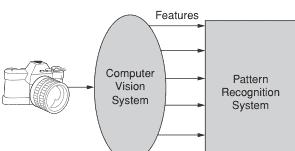

图 1.1 计算机视觉系统接受图像作为输入，并从图像中提取若干测量值。这些测量值称为特征，并提供给模式识别系统，以对被成像的对象或对象做出决策。

我们可以将图像处理的整个过程分为低级图像处理和高级图像处理。如果我们从信号与系统角度解释这些过程，从系统的输入/输出格式来描述它们的差异和相似性会更清晰。当低级图像处理系统处理输入图像时，输出仍然是一幅图像，但略有不同。例如，它可能是去除了噪声的图像、占用存储空间比输入图像少的图像、比输入图像更清晰的图像等。虽然低级图像处理不提供关于被成像对象的信息，但它很可能是必要的，因为它使高级算法能够正常工作。

机器视觉、图像理解和高级图像处理这些术语常用于表示计算机视觉。它们是对输入图像进行操作的过程，但输出不再是图像，而是对图像的解释。

模式识别表示计算机视觉系统的一个基本组成部分，其输入是图像的描述（例如，描述图像中对象的特征），采用结构化格式（例如，向量），输出是基于这些输入描述的识别结果。因此，对于模式识别过程，输入和输出都不是图像。

图 1.1 说明了计算机视觉系统的一种解释。对象是什么、其类别是什么的决策，是由模式识别（PR）系统做出的。模式识别系统做出的决策基于对输入进行的测量。这些测量值称为特征。例如，PR 系统必须决定一个对象是斧头还是小斧，它接收的输入是柄的长度和头部的质量。如果柄的长度需要从图像中确定，那么做出该判断的系统就是计算机视觉系统。

因此，计算机视觉系统在图像中进行测量，并将这些测量值报告给模式识别系统。如果计算机视觉系统很复杂并返回“房间里的大象数量 = 1”，那么 PR 系统可能无事可做。

我们刚刚提出的定义有例外。可能当前最好的例子是深度学习的当前研究。这些系统使用受神经启发的计算结构来识别图像中的特定对象。有人可能会认为这些系统是模式分类器，但它们解决的问题显然是计算机视觉问题，因此将它们归类为计算机视觉系统也是合适的 [1.4]。

## 1.3 局部-全局问题

计算机视觉中几乎所有问题都可以描述为“局部-全局”或“格式塔”问题的不同版本。我们通过两个例子来描述它：

第一个是盲人摸象的古老寓言：“盲人被要求通过触摸大象身体的不同部分来确定大象长什么样。摸到腿的盲人说大象像一根柱子；摸到尾巴的说大象像一根绳子；摸到鼻子的说大象像一根树枝；摸到耳朵的说大象像一把手扇；摸到肚子的说大象像一堵墙；摸到象牙的说大象像一根实心管子。”1

同一个故事的视觉示例：找一本封面有趣的杂志，剪一张大约是杂志高度和宽度两倍的空白纸。在纸张中心剪一个小孔（直径 1 或 2 厘米），然后把纸放下来，盖住杂志。现在，找一个以前没见过这本杂志的朋友。允许他/她以任何方式移动纸张，但只能通过那个孔露出杂志封面。请你的朋友描述封面。很可能，你会得到一个完全错误的描述。

这就是我们要求计算机做的事情：在整个图像上进行局部测量（例如，梯度），然后计算机以某种方式从所有这些局部测量中推断出图像是一张大象的照片。2

这个问题的部分解决方案多种多样，其中一些将在本书中介绍。大多数解决方案利用一致性。也就是说，如果计算机能发现若干测量值以某种方式一致，它可能能够推断出导致该一致性的全局图像的方面。

在阅读材料的过程中，请记住你所读的内容如何用于解决这个更大的问题。

## 1.4 生物视觉

生物计算（神经元）和生物视觉（使用这些神经元）是计算机视觉的灵感来源。自计算机视觉作为一门学科诞生以来，就一直有尝试测量生物视觉并在计算机中对其进行建模。在计算机视觉的历史上，已经开发出许多技术来利用受生物启发的模型。近年来，深度学习等新技术变得流行，这些方法的形式源于早期的生物视觉研究。

1 来自维基百科。

2 我们要求计算机解决一个格式塔问题，从大量局部分布的测量中发现图像内容的身份。

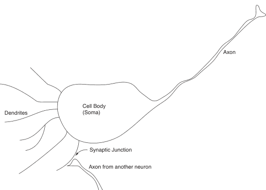

图 1.2 生物神经元有许多输入（即树突），每个都有权重，以及一个单一输出（即轴突），轴突可能分叉并通向多个地方。

### 1.4.1 生物动机

首先，我们考虑生物神经元，如图 1.2 所示。树突是微小的纤维，将信号传递到神经元胞体。胞体用于整合（在树突输入和时间上）来自这些树突的输入。这种整合过程实际上是以正离子形式积累电荷。当积累了足够的电荷时，细胞膜会击穿，允许大量离子流动，沿着细胞的单一输出（即轴突）传播。轴突可能相当长，甚至超过 10 厘米。这种离子流的传播称为动作电位。信息由动作电位发生的速率编码。典型的动作电位振幅在几十毫伏，持续时间在毫秒级。

输出/输入信号转换发生在轴突作用于树突或胞体的地方。这样的连接点称为突触连接。当电荷沿轴突移动时，它们会导致神经递质化学物质跨越突触连接释放。多达 1,000 个突触可能向单个神经元提供输入。

图 1.3 图形说明两个轴突通过两个不同大小的突触连接到单个胞体。神经递质是从轴突释放到突触连接的化学物质，它们可能鼓励细胞放电（兴奋性


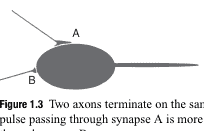

突触）或抑制细胞放电（抑制性突触处的抑制性神经递质）。在图中，较大的突触 A 能够释放更多神经递质，从而对突触后神经元产生更大影响。突触传递信号能力的变化似乎是我们所称记忆的一种形式。突触前神经元对突触后神经元的影响可以建模为加权求和器上的正负号。据估计，成人神经系统拥有 10^10 个神经元。每个神经元有 1,000 个突触，每个突触有 8 位存储（实际上，突触没有那么精确……5 位更有可能），我们大脑中就有 10TB 的存储量！所以，好好利用它吧！阅读本章剩余部分及后续内容！

神经元可以用乘积和之后跟一个非线性来数学建模，如图 1.4 所示。因此，神经元的方程可以写为

y_q = S_q \left( \sum_i x_i w_{iq} \right) (1.1)

其中 i 和 q 分别是输入和神经元的索引，S_q 是非线性函数。非线性 S_q 具有 Sigmoid 形式（呈字母“S”形）。常见的 Sigmoid 是逻辑函数 S(x) = 1 / (1 + e^-x)，其中 a 控制 Sigmoid 在中心处的斜率。

从历史上看，此类数学神经网络模型中首先采用的非线性是简单的阈值。这样做是因为生物神经元中明显存在类似阈值的现象

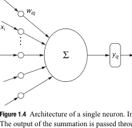

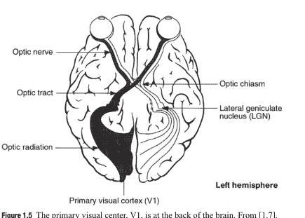

可测量。第一个模型，即 McCulloch-Pitts 神经元，于 1943 年开发 [1.2]。将此类神经元集合的应用导致了感知机 [1.5] 的发展，感知机是带有阈值的简单线性机器。通过在单层机器上添加层，可以指定任意复杂的决策边界 [1.3]。使用阈值在尝试确定解决特定问题所需的权重值时会造成困难。因为阈值函数不可微，所以为多层网络找到权重变得具有挑战性。这个问题通过 [1.6, 1.8] 用可微的 Sigmoid 替换阈值来解决。这一观察，即不可微函数可以由可微函数近似，是神经网络研究领域复兴的源头。

### 1.4.2 视觉感知

你已经知道，图像是由光在视网膜上形成的。光传感器产生的电信号通过视神经、外侧膝状体（LGN），并终止于大脑后部的一个大区域——视觉皮层，如图 1.5 所示。视觉皮层实际上可以分为几个部分，V1（或初级）、V2、V3、V4 和 V5。图像在不同区域接收不同的处理。视觉皮层也被称为*条纹皮层*，因为它似乎具有长长的、相当笔直的带状结构（图 1.6）。

视觉皮层是*视网膜图式*的。也就是说，当视网膜上的特定光传感器受到刺激时，视觉皮层中的特定细胞会放电，而且，如果视网膜上的两个点靠得很近，那么视觉皮层中的相应点也靠得很近。

1962 年，Hubel 和 Wiesel 在 [1.1] 的工作中，使神经元的数学建模接触到了视觉领域。这两位神经生理学家使用哺乳动物（最初是猫，

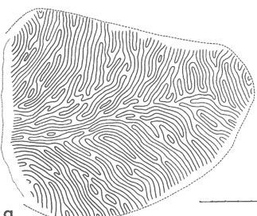

图 1.6 视觉皮层在适当染色后似乎分为长长的带状结构。引自 [1.7]。

以及后来的猴子）并植入了电子探针，这些探针足够小，可以检测单个神经元的放电。凭借这种能力，他们做出了一些惊人的发现。3

第一个发现是，皮层中的某些细胞与视网膜上不仅存在光，而且存在边缘之间存在对应关系。更有趣的是，当视网膜特定位置存在特定方向的边缘时，皮层中有些细胞会做出反应！

以这种方式放电的每个皮层细胞都被认为具有感受野，感受野由所有光感受器组成，当这些感受器受到刺激时，会对该皮层细胞产生某些直接影响。最简单的感受野实际上存在于视网膜神经节细胞中，称为“中心兴奋”细胞，如图 1.7 所示，当感受野中心受到刺激而周围未受到刺激时，这些细胞会放电。皮层中更有趣的细胞被发现，当中心受到特定方向边缘的刺激时会放电。存在以这种方式表现的细胞，这促使在本书第 5 章中使用核算子。还发现了对边缘运动有反应的细胞。

Hubel 和 Wiesel 的另一项观察是，皮层中有接收来自左眼输入的神经元带，这些带中的每一个都与接收来自右眼输入的带相邻。这表明皮层的布线执行了人类感知深度所需的一些计算。

最后，后来对大脑生理学的探索表明，当从初级视觉皮层移动到 V2、V3 及更远区域时，感受野似乎会增大，这表明存在具有多层计算和互连的分层架构。

目前，视觉感知领域正在进行大量的辩论和研究，并且预计该领域在未来多年将继续非常活跃。

3 是的，他们确实于 1981 年获得了诺贝尔奖。

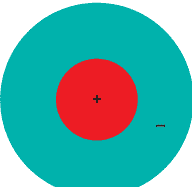

图 1.7 初级视觉皮层中的某些细胞只有在内部细胞之和减去外部细胞之和超过某个阈值时才会放电。

## 参考文献

- [1.1] D. Hubel 和 T. Wiesel. 猫视觉皮层中的感受野、双眼相互作用和功能架构。*生理学杂志（伦敦）*，160, 1962.
- [1.2] W. McCulloch 和 W. Pitts. 神经活动中内在观念的逻辑演算。*数学生物物理学通报*，5, 1943.
- [1.3] M. Minsky 和 S. Papert. *感知机：计算几何导论*. MIT Press, 1969.
- [1.4] R. Ranjan, V. Patel 和 R. Chellappa. Hyperface：面部检测、标志定位、姿态估计和性别识别的深度多任务学习框架。IEEE 模式分析与机器智能汇刊，2016.
- [1.5] F. Rosenblatt. 感知机——一种感知和识别自动机。技术报告 85-460-1，康奈尔航空实验室，1957.
- [1.6] D. Rumelhart. *并行分布式处理：认知微观结构探索*. MIT Press, 1982.
- [1.7] M. Tovée. *视觉系统导论*. 剑桥大学出版社，2008.
- [1.8] P. Werbos. *超越回归：行为科学中预测与分析的新工具*. 博士论文。

# 2 编写程序处理图像

> 计算机科学与计算机的关系，并不比天文学与望远镜的关系更大。
> - E.W Dijkstra

## 2.1 引言

编写图像分析软件可以采取两种方法，具体取决于需要优化什么。可以采用优化/最小化程序员时间的编程风格，也可以采用最小化计算机时间的编程方式。在本课程中，计算机时间不会成为问题（至少通常不会），但你的时间将更加宝贵。出于这个原因，我们希望遵循一种编程哲学，用最少的程序员时间产生正确、可运行的代码。本书中的编程作业规定使用 C 或 C++ 编写，而不是 MATLAB 或 JAVA。这是一个有意识且深思熟虑的决定。MATLAB 特别是向用户隐藏了许多数据结构和数据操作的细节。大多数时候，这是件好事。然而，在多年教授本课程各种变体的过程中，作者发现，这些细节恰恰是学生需要掌握的细节，以便有效地理解图像处理（特别是在像素层面）到底是什么。

在本书中，至少最初，我们希望学生编写在像素层面工作的代码，以便他们了解计算机实际上在做什么。课程后期，学生将逐步提升抽象层次。我们将读者指向 [2.2, 2.1] 以获取强调使用 MATLAB 的文本。

## 2.2 图像处理的基本编程结构

图像可以被视为二维或三维数组。它们通常以扫描线方式逐像素处理。为了操作图像，两层或三层嵌套循环是最常用的编程结构，如图 2.1 和 2.2 所示。

在这些示例中，我们使用两个或三个整数（row、col 和 frame）作为图像行、列和帧的索引。通过以步长增加 row、col 和 frame


```
int row, col;
......
for (row = 0; row < 128; row++)
{
    for(col = 0; col < 128; col++)
    {
        /* pixel processing */
        ......
    }
    ......
}
......
```

图 2.1 基本编程结构：双重嵌套 for 循环。

首先，我们实际上是逐帧地从左到右、从上到下按像素扫描图像。

## 2.3 良好的编程风格

始终遵循一个重要的编程构造：所有程序都应编写成能够适用于任意尺寸图像的形式。你不需要编写能够适用于任意维数（虽然这也是可能的）或任意数据类型的程序；只需适用于任意尺寸。这一要求的一个含义是，你不能声明静态数组并将所有数据复制到该数组中（这是新手程序员喜欢做的事）。相反，你必须使用图像访问子程序。

另一条重要的编程准则是，除极少数情况外，禁止使用全局变量。全局变量是在子程序外部声明的变量。

```
int row, col, frame;
......
for (frame = 0; frame < 224; frame++)
{
    for (row = 0; row < 128; row++)
    {
        for (col = 0; col < 128; col++)
        {
            /* pixel processing */
            ......
        }
        ......
    }
    ......
}
......
```

图 2.2 基本编程结构：三重嵌套 for 循环。

使用此类全局变量是糟糕的编程实践，可以说它比编程中任何其他事情都更容易导致错误。良好的结构化编程实践要求子程序需要知道的一切都包含在其参数列表中！

遵循这些简单的编程准则将使你能够更轻松、更高效地编写通用代码，并且更少出错。随着你变得更熟练，如果以后需要，可以利用指针操作功能来提高程序的运行速度。

在代码的不同段落之间添加一些空格（例如，一个空行）也能提高可读性。我们强调注释的重要性。但是，不要添加太多注释，因为这会打断代码的流畅性。通常，你应该在每个函数实现的顶部添加一个块注释，包括函数的功能描述、谁编写了该函数、如何调用该函数以及函数返回什么。你还应该为每个变量声明添加描述。

## 2.4 计算机视觉中尤其重要的要点

如果你花时间阅读本节，就比你的朋友领先几天的劳动成果。他们会犯下这里描述的常见错误，并花很长时间来发现它们。因此，以下是一些应避免的事项。

- 如果你使用几乎任何图像读取函数读入图像，你将读取一个由整数组成的数据集，每个整数 8 位，因此值范围为 0 到 255。请记住这一点。
- 上一点的事实会导致问题，因为使用 8 位整数时，250 + 8 = 2 且 3 - 5 = 254。
- 如果你读入图像，请立即将其转换为浮点数。所有操作都在浮点数下进行。这包括亮度缩放。在写入输出图像之前，不要将其转换回整数。MATLAB 就是这样做的。除非你刻意创建整数，否则一切都是浮点数。

## 2.5 图像分析软件工具包

有许多基本计算函数，讲师可能认为与计算机视觉课程的学生无关，例如，使用不同数据类型的图像（浮点数尤其重要）、压缩文件中的数据、表示 3D、4D 或彩色图像等。对于这些功能，使用某种图像分析工具包可能会很方便。作者至少使用过两个可以满足此需求的工具包：OpenCV 和 IFS。我们使用 IFS（图像文件系统），部分是因为我们开发了它，部分是因为我们认为它具有更优越的功能。IFS 系统在附录 C 中有描述，并附带一些示例程序。

1 C++ 用户请注意：类的变量可供该类中的任何方法使用，很容易编写出具有难以调试的副作用的方法。这正是我们通过禁止全局变量的政策试图避免的。

```
CC = g++
INCLUDES = -I ./include
LIBS = -L ./lib -lifs
CFLAGS = $(INCLUDES)

myprog: myprog.o
	$(CC) -o myprog myprog.o $(LIBS)
myprog.o: myprog.c
	$(CC) -c myprog.c $(INCLUDES)
```

图 2.3 一个示例 UNIX makefile。

## 2.6 Makefiles

基本上，makefile 指定如何构建你的项目，如图 2.3 中的示例 makefile 所示。你应该使用 makefile，因为它们远优于直接输入命令。如果你使用 Microsoft Visual Studio、Mac Xcode 或其他开发环境进行软件开发，那么 makefile 对你来说有些隐藏，但了解它们的工作原理是有帮助的。

图 2.3 中的示例几乎是可以编写的最简单的 makefile。它指出名为 myprog 的可执行文件只依赖于一件事，即目标模块 myprog.o。然后它展示了如何从 myprog.o 和库生成 myprog。同样，myprog.o 是通过编译（但不链接）源文件 myprog.c 生成的，使用位于 "include" 目录中的头文件。注意：要指定库（如链接步骤中），必须指定库名（例如 libifs.a），但要指定包含文件（例如 ifs.h），只需指定该文件所在的目录，因为文件名已在 #include 预处理器指令中给出。

在 WIN64 中，makefile 的外观如图 2.4 所示的示例。这里，展示了 make 程序的许多符号定义功能，并明确指定了编译器的位置。

```
CFLAGS = -Ic:\lcc\include -g2 -ansi
CC = c:\lcc\bin\lcc.exe
LINKER = c:\lcc\bin\lcclnk.exe
DIST = c:\ece763\myprog\lcc\
OBJS = c:\ece763\myprog\objs\
LIBS = ifs.lib -lm
### Build myprog.c
myprog:
	$(CC) -c $(CFLAGS) c:\ece763\myprog\mysubroutine1.c
	$(CC) -c $(CFLAGS) c:\ece763\myprog\mysubroutine2.c
	$(CC) -c $(CFLAGS) c:\ece763\myprog\myprog.c
	$(LINKER) -subsystem console -o myprog.exe myprog.obj mysubroutine1.obj
	mysubroutine2.obj $(LIBS)
```

图 2.4 一个示例 WIN32 makefile。

IFS 生成的程序（ifstool 除外）都是基于控制台的。也就是说，你需要在 PC 上的 MS-DOS 窗口中、在 Linux 或 Mac 上的终端窗口中（使用 OS-X）运行它们。

## 2.7 作业

作业 2.1：学习如何使用 IFS。此作业的目的是让你使用计算机并开始编写程序。

- 1. 使用 ifsTool 查看以下图像：imagesecho1、imagesecho2、imagesecho3。
- 2. 书面作业，需提交：用一段话描述这三个“echo”图像的外观。我们认识到你不了解解剖学。只需描述你看到的内容；附上图像的打印件。如果你碰巧了解解剖学，你的讲师会印象深刻。
- 3. 编程作业，需提交：编写一个程序，将上述图像之一作为输入，生成一个输出图像，类型和大小相同，但将每个像素强度从 in(row, col) 更改为 out(row, col) = a × in(row, col) + b，其中 a 和 b 是输入参数。尝试以一种方式编写程序，使你可以更改 a 和 b 的值而无需修改代码本身。
- 4. 上述程序的功能是什么？

## 参考文献

- [2.1] P. Corke. Robotics, Vision and Control: Fundamental Algorithms in MATLAB. Springer, 2011.
- [2.2] R. Gonzalez, R. Woods, and L. Eddins. Digital Image Processing Using MATLAB. McGraw-Hill, 第 2 版, 2016.

# 3 数学原理回顾

> > 实际问题需要良好的数学。
> > - R. Chellappa

## 3.1 简介

本章回顾了使用本书作为教材所需的几个先修主题。学生应具有相当于大约三个学期的本科微积分经验，并接触过微分方程和偏微分方程。学生应修读包含概率和统计概念的课程，包括先验概率、条件概率、贝叶斯规则和期望。最后，非常重要的是，学生应具有本科水平的线性代数训练。

本章回顾并刷新了这些课程中的许多概念，但仅作为回顾，而不是呈现全新材料。

- (第 3.2 节) 我们简要回顾线性代数中的重要概念，包括各种向量和矩阵运算、导数算子、特征值分解及其与奇异值分解的关系。
- (第 3.3 节) 由于几乎所有计算机视觉主题都可以表述为最小化问题，在本节中，我们简要介绍函数最小化，并讨论梯度下降和模拟退火，这两种最小化技术分别可以导致局部极小值和全局极小值。
- (第 3.4 节) 在计算机视觉中，我们通常关心某些测量发生的概率。在本节中，我们简要回顾概率密度函数和概率分布函数等概念。

## 3.2 线性代数简要回顾

在本节中，我们非常简要地回顾向量和矩阵运算。通常，我们用粗体小写表示向量，用小写斜体罗马字母表示标量，用大写罗马字母表示矩阵。


### 3.2.1 向量

Vectors are always considered to be column vectors. If we need to write one horizontally for the purpose of saving space in a document, we use transpose notation. For example, we denote a vector that consists of three scalar elements as:

$$ \mathbf{x} = [x_1 \ x_2 \ x_3]^T = \begin{bmatrix} x_1 \\ x_2 \\ x_3 \end{bmatrix} . $$

#### 内积

The inner product of two vectors is a scalar, \(c = x^T y\). Its value is the sum of products of the corresponding elements of the two vectors:

$$ x^T y = \sum_i x_i y_i. $$

You will also sometimes see the notation \(< x, y >\) used for inner product. We do not like this because it looks as an expected value of a random variable. One sometimes also sees the “dot product” notation \(x \cdot y\) for inner product.

The magnitude of a vector is \(|\mathbf{x}| = \sqrt{\mathbf{x}^T \mathbf{x}}\). If \(|\mathbf{x}| = 1\), \(\mathbf{x}\) is said to be a unit vector. If \(\mathbf{x}^T \mathbf{y} = 0\), then \(\mathbf{x}\) and \(\mathbf{y}\) are orthogonal. If \(\mathbf{x}\) and \(\mathbf{y}\) are orthogonal unit vectors, they are orthonormal.

#### 外积

While the inner product of two vectors generates a scalar, the outer product generates a matrix.

The outer product of two vectors is a matrix, \(\mathbf{x} \otimes \mathbf{y} = \mathbf{x} \mathbf{y}^T\). Each element of this matrix can be written as \((\mathbf{x} \mathbf{y}^T)_{ij} = x_i y_j\). For example, suppose \(\mathbf{x}\) is of 2 dimensions and \(\mathbf{y}\) is of 3 dimensions, then these two vectors is a matrix of dimension \(2 \times 3\),

$$ \mathbf{x} \otimes \mathbf{y} = \begin{bmatrix} x_1 \\ x_2 \end{bmatrix} [y_1 \ y_2 \ y_3] = \begin{bmatrix} x_1 y_1 & x_1 y_2 & x_1 y_3 \\ x_2 y_1 & x_2 y_2 & x_2 y_3 \end{bmatrix} . $$

The outer product is also sometimes called the tensor product.

#### 叉积

There is yet another product operation between vectors, the cross product, which returns a vector. This again contrasts the inner product that returns a scalar and the outer product that returns a matrix.

Given a vector \(\mathbf{x} = [x_1 \ x_2 \ x_3]^T\), we define the matrix

$$ [\mathbf{x}]_\times = \begin{bmatrix} 0 & -x_3 & x_2 \\ x_3 & 0 & -x_1 \\ -x_2 & x_1 & 0 \end{bmatrix} . \quad (3.1) $$

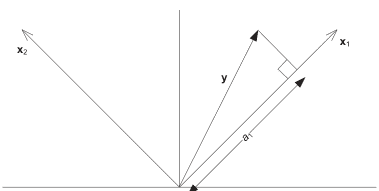

Figure 3.1 x1 and x2 are orthonormal bases. The projection of y onto x1 has length a1.

This matrix is skew-symmetric. That is, it is equal to the negative of its transpose. The cross product between two vectors x and y can then be defined as

$$ \mathbf{x} \times \mathbf{y} = [\mathbf{x}]_\times \mathbf{y} = \begin{bmatrix} 0 & -x_3 & x_2 \\ x_3 & 0 & -x_1 \\ -x_2 & x_1 & 0 \end{bmatrix} \begin{bmatrix} y_1 \\ y_2 \\ y_3 \end{bmatrix} = \begin{bmatrix} x_2 y_3 - x_3 y_2 \\ x_3 y_1 - x_1 y_3 \\ x_1 y_2 - x_2 y_1 \end{bmatrix}. \quad (3.2) $$

Note that if \(\mathbf{x} = \mathbf{y}\), their cross product is the zero vector:

$$ \mathbf{x} \times \mathbf{y} = \mathbf{0}. \quad (3.3) $$

The advantage of describing this operation as a matrix is that you can perform the cross product operation (which is only defined for vectors) using matrix multiplication. Thus \(\mathbf{x} \times M = [\mathbf{x}]_\times M\) takes the cross product of \(\mathbf{x}\) with each column of \(M\).

#### 线性无关

Suppose we have \(n\) vectors \(\mathbf{x}_1, \mathbf{x}_2, \dots, \mathbf{x}_n\); if we can write \(\mathbf{v} = a_1\mathbf{x}_1 + a_2\mathbf{x}_2 + \cdots + a_n\mathbf{x}_n\), where \(a_1, a_2, \dots, a_n \in \mathbb{R}\), then \(\mathbf{v}\) is said to be a linear combination of \(\mathbf{x}_1, \mathbf{x}_2, \dots, \mathbf{x}_n\).

A set of vectors \(\mathbf{x}_1, \dots, \mathbf{x}_n\) is said to be linearly independent if it is impossible to write any of the vectors as a linear combination of the others.

Given \(d\) linearly independent vectors, of \(d\) dimensions, \(\mathbf{x}_1, \mathbf{x}_2, \dots, \mathbf{x}_d\) defined on \(\mathbb{R}^d\), then any vector \(\mathbf{y}\) in the space may be written as \(\mathbf{y} = a_1\mathbf{x}_1 + a_2\mathbf{x}_2 + \cdots + a_d\mathbf{x}_d\).

Since any \(d\)-dimensional real-valued vector \(\mathbf{y}\) may be written as a linear combination of \(\mathbf{x}_1, \mathbf{x}_2, \dots, \mathbf{x}_d\), the set \(\{\mathbf{x}_i, i = 1, \dots, d\}\) is called a basis set and the vectors are said to span the space, \(\mathbb{R}^d\). Any linearly independent set of vectors can be used as a basis (necessary and sufficient). It is often particularly convenient to choose basis sets which are orthonormal.

For example, the following two vectors form a basis for \(\mathbb{R}^2\):

$$ \mathbf{x}_1 = [0 \quad 1]^T \quad \text{and} \quad \mathbf{x}_2 = [1 \quad 0]^T. $$

This is the familiar Cartesian coordinate system. Here's another basis set for \(\mathbb{R}^2\):

$$ \mathbf{x}_1 = [1 \quad 1]^T \quad \text{and} \quad \mathbf{x}_2 = [-1 \quad 1]^T. $$

1. Is this set orthonormal?

| * | a | b | c | d |
|---|---|---|---|---|
| a | a | b | c | d |
| b | a | b | c | d |
| c | a | c | c | a |
| d | a | d | a | d |

| + | a | b | c | d |
|---|---|---|---|---|
| a | a | b | c | d |
| b | b | b | b | b |
| c | c | b | c | b |
| d | d | b | b | d |

If \( \mathbf{x}_1, \mathbf{x}_2, \dots, \mathbf{x}_d \) span \( \mathbb{R}^d \), and \( \mathbf{y} = a_1 \mathbf{x}_1 + a_2 \mathbf{x}_2 + \cdots + a_d \mathbf{x}_d \), then the *components* of \(\mathbf{y}\) may be found by

\( a_i = \mathbf{y}^T \mathbf{x}_i \) (3.4)

and \( a_i \) is said to be the *projection* of \(\mathbf{y}\) onto \( \mathbf{x}_i \). In a simple Cartesian geometric interpretation, the inner product of Eq. 3.4 is literally a projection as illustrated in Figure 3.1. However, whenever Eq. 3.4 is used, the term “projection” may be used as well, even in a more general sense (e.g., the coefficients of a Fourier series).

### 3.2.2 向量空间

A vector space is a set of vectors and two operations, * and +, which are defined on those vectors. Furthermore for a set to be a vector space, it must satisfy the following two conditions:

- If \( \mathbf{v}_1 \) and \( \mathbf{v}_2 \) are elements of a vector space named, say, \( V \), then \( \mathbf{v}_1 + \mathbf{v}_2 \) is also in \( V \).
- If \( \mathbf{v}_1 \) is an element of a vector space named, say, \( V \), and \( \alpha \) is a scalar defined consistent with \( V \), then \( \alpha \mathbf{v}_1 \in V \).

The property mentioned above has a name, *closure*. We say a vector space is *closed* under vector addition and scalar multiplication.

The only vector spaces that usually concern us are those in which the vectors are composed of real numbers, using the familiar addition and multiplication of real numbers. However, so you can understand these concepts a bit more clearly, let’s construct a finite vector space.

#### 向量空间示例

Define a set of symbols \( S = \{a, b, c, d\} \) and two operations on those symbols named * and +. Since we only have four symbols, we get to define the operations with tables as illustrated in Table 3.1.

Define a set \( V \) consisting of all the vectors of length 2, using the scalars in \( S \). Let’s see if the combination of \( V \) and the two operations defined above could be a vector space:

Here are two vectors from \( V \), let’s add them:

\( \begin{bmatrix} a \\ b \end{bmatrix} + \begin{bmatrix} c \\ d \end{bmatrix} = \begin{bmatrix} c \\ b \end{bmatrix} \). (3.5)

Observe that adding these two vectors produces a vector that is in the same vector space. So at least from this one test, we might have a vector space. To really be sure, we would have to evaluate all the conditions listed above.

### 3.2.3 零空间

The null space of a matrix, \(A\), is the set of all vectors, \(\mathbf{x}\) which satisfy

$$ A\mathbf{x} = \mathbf{0}, \quad (3.6) $$

where \(\mathbf{0}\) is the vector of all zeros. This is accomplished by first doing row reduction. We provide an example here, to remind the student of how to do row reduction: Let

$$ A = \begin{bmatrix} 4 & 5 & 6 \\ 1 & 2 & 3 \\ 2 & 4 & 6 \end{bmatrix}. \quad (3.7) $$

The first step is to divide the first row by the 1,1 element to make that element equal to one. Recall that if the 1,1 element is zero, you need to swap rows.

$$ A = \begin{bmatrix} 1 & 5/4 & 3/2 \\ 1 & 2 & 3 \\ 2 & 4 & 6 \end{bmatrix}. $$

Now multiply the first row by -1 times the 2,1 element, and add it to the second row, replacing the second row. Also perform the same operation on the third row, which will make the 3,1 element equal to zero.

$$ A = \begin{bmatrix} 1 & 5/4 & 3/2 \\ 0 & 3/4 & 3/2 \\ 0 & 3/2 & 3 \end{bmatrix} $$

which simplifies to

$$ A = \begin{bmatrix} 1 & 5/4 & 3/2 \\ 0 & 1 & 2 \\ 0 & 1 & 2 \end{bmatrix}. $$

Now, we attempt to set the 3,2 element to zero by multiplying the second row by -1 and adding it to the third row. When we do that, the third row becomes all zeros, and we conclude that this matrix has rank equal to 2. (In truth, the student probably noticed much earlier that the second and third rows were proportional, right?)

$$ A = \begin{bmatrix} 1 & 5/4 & 3/2 \\ 0 & 1 & 2 \\ 0 & 0 & 0 \end{bmatrix}. $$


我们可以通过将 $A$ 与未知向量 $\mathbf{x} = [x_1 \ x_2 \ x_3]^T$ 相乘并将结果设为零来找到零空间。

$$
\begin{bmatrix} 1 & 5/4 & 3/2 \\ 0 & 1 & 2 \\ 0 & 0 & 0 \end{bmatrix} \begin{bmatrix} x_1 \\ x_2 \\ x_3 \end{bmatrix} = \begin{bmatrix} 0 \\ 0 \\ 0 \end{bmatrix}.
$$

将乘积设为零，得到以下方程

$x_1 + \frac{5}{4}x_2 + \frac{3}{2}x_3 = 0$ (3.8)

$x_2 + 2x_3 = 0.$ (3.9)

这简化为

$x_1 = x_3$ (3.10)

$x_2 = -2x_3.$ (3.11)

令 $x_3 = 1$，则零向量为 $[1 \ -2 \ 1]^T$。由于秩为 2，零空间由这一个向量及其所有标量倍数组成。将 $[1 \ -2 \ 1]^T$ 除以其模长 $\sqrt{6}$，可得到一个单位向量；$[0.4082 \ -0.8165 \ 0.4082]^T$。

#### 右零空间和左零空间

以上，我们求解了问题

$A\mathbf{x} = \mathbf{0}.$

然而，我们可能面临的是以下问题

$\mathbf{x}A = \mathbf{0},$

这被称为求解左零空间。矩阵 $A$ 的左零空间就是 $A^T$ 的零空间。

### 3.2.4 函数空间

考虑一个函数，例如 $f(x) = x^2$，定义在大于零且小于六的整数上。你可以将 $f(x)$ 的值作为有序集合列出：[1, 4, 9, 16, 25]，这看起来完全像一个向量。因此，把函数视为向量完全没问题。当然，有一个小问题。如果我们在实数上定义函数，就会得到一个无穷维向量。但除了无法列出所有元素这一事实外，无穷维并不是问题。

正交概念可以轻松扩展到连续函数，只需将函数视为无穷维向量即可。只需列出当 $x$ 在 $a$ 和 $b$ 之间变化时的所有 $f(x)$ 值。如果 $x$ 是连续的，那么 $a$ 和 $b$ 之间有无穷多个可能的 $x$ 值。但这不应该阻止我们——我们无法枚举它们，但仍可以将包含所有 $f(x)$ 值的向量视为一个向量。现在，我们为有限维向量定义的求和概念变成了积分，内积可以写成

$<f(x), g(x)> = \int_a^b f(x)g(x)dx.$ (3.12)

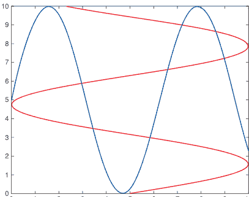

图 3.2 误解“余弦与正弦正交”这一说法，将正交与垂直混淆的人脑海中浮现的心理图像。

正交和标准正交的概念对这种内积定义同样适用。如果积分等于零，我们说这两个函数正交。因此，从正交向量到正交函数的过渡并不困难。当然，在有无穷多个维度的情况下，无法将正交可视化为“垂直”，所以你需要放弃将事物视为垂直的想法。只需回忆定义并使用它即可。

不过，如果你喜欢荒谬的误解，图 3.2 说明了对“正弦和余弦正交”这一说法的错误解释。²

### 3.2.5 线性变换

线性变换 A 只是一个矩阵。假设 A 是 m × d。如果将其应用于向量 x ∈ ℜ^d，y = Ax，则 y ∈ ℜ^m。因此，A 从一个向量空间 ℜ^d 中取出一个向量，并在 ℜ^m 中产生一个向量。如果向量 y 可以通过将 A 应用于 ℜ^d 中的唯一一个向量来产生，则 A 被称为一对一（单射）。现在假设 ℜ^m 中没有任何向量无法通过将 A 应用于 ℜ^d 中的某个向量来产生；在这种情况下，A 被称为满射（覆射）。如果 A 是一对一且满射，则 $A^{-1}$ 存在。如果矩阵乘法 C = AB 有意义，则称两个矩阵 A 和 B 可乘。

一些重要（且常被遗忘）的性质：如果 \(A\) 和 \(B\) 可乘，则

\((AB)^T = B^T A^T\) (3.13)

且

\((AB)^{-1} = B^{-1} A^{-1}\) (3.14)

如果 \(A\) 和 \(B\) 都可逆。

与行列式（det）和迹（tr）相关的另外几个有用性质是

\(\det(AB) = \det(BA) \quad \text{and} \quad \text{tr}(AB) = \text{tr}(BA)\)

当然，这仅在 \(A\) 和 \(B\) 为方阵时才成立。

#### 标准正交变换

如果矩阵 \(A\) 满足

\(AA^T = A^T A = I\) (3.15)

那么显然，矩阵的转置也是其逆矩阵，且 \(A\) 被称为标准正交变换（OT），几何上对应于旋转。如果 \(A\) 是一个 \(d \times d\) 的标准正交变换，则 \(A\) 的列向量标准正交、线性无关，并构成跨越 \(\Re^d\) 空间的基。对于 \(\Re^3\)，三个方便的 OT 是绕笛卡尔坐标轴的旋转（假设右手坐标系*），其中 \(\theta\) 为逆时针方向定义的旋转角。

\(R_x = \begin{bmatrix} 1 & 0 & 0 \\ 0 & \cos \theta & -\sin \theta \\ 0 & \sin \theta & \cos \theta \end{bmatrix}, R_y = \begin{bmatrix} \cos \theta & 0 & \sin \theta \\ 0 & 1 & 0 \\ -\sin \theta & 0 & \cos \theta \end{bmatrix}, R_z = \begin{bmatrix} \cos \theta & -\sin \theta & 0 \\ \sin \theta & \cos \theta & 0 \\ 0 & 0 & 1 \end{bmatrix}\) (3.16)

假设 \(R\) 是 OT，且 \(\mathbf{y} = R\mathbf{x}\)，则 \(\mathbf{x}\) 和 \(\mathbf{y}\) 具有相同的模长：

\(|\mathbf{y}| = |\mathbf{x}|\) (3.17)

尽管 Eq. 3.16 中的三个旋转矩阵共享一些共同特征，即总是有一列全零和一个单个 1 以及一行全零和一个单个 1，但这些特征并不是构成旋转矩阵的必要条件。实际上，旋转矩阵共享两个有趣的性质：

- 两个旋转矩阵（即 OT）的乘积是一个旋转矩阵，且
- 任何 OT 都可以被视为一个旋转矩阵，其中旋转是关于某个轴进行的。

在以下内容中，我们展示一个很好地演示上述两个性质的示例。

3 我们假设你知道转置、逆、行列式和迹的含义。如果你不知道，就不应该修这门课。

4 右手坐标系表示旋转轴（通过环绕手指指示）指向观察者。

假设依次执行两个旋转，第一个绕 x 轴旋转 20 度，第二个绕 z 轴旋转 45 度，均为逆时针方向，则复合变换矩阵 \( R_{xz} \) 可通过 \( R_{xz} = R_z R_x \) 计算，其中

\( R_x = \begin{bmatrix} 1.0000 & 0 & 0 \\ 0 & 0.9397 & 0.3420 \\ 0 & -0.3420 & 0.9397 \end{bmatrix}, R_z = \begin{bmatrix} 0.7071 & -0.7071 & 0 \\ 0.7071 & 0.7071 & 0 \\ 0 & 0 & 1.0000 \end{bmatrix} \).

且

\( R_{xz} = R_z R_x = \begin{bmatrix} 0.7071 & -0.7071 & 0 \\ 0.6645 & 0.6645 & 0.3420 \\ -0.2418 & -0.2418 & 0.9397 \end{bmatrix} \).

如我们所见，在复合矩阵 \( R_{xz} \) 中，列向量是正交的，但我们看不到 Eq. 3.16 中绕 x、y、z 轴的三个旋转矩阵所特征的那一列全零和一个单个 1。

#### 正定

矩阵 \( A \) 是正定的，如果

\( y = x^T A x > 0, \forall x \in \Re^d, x \neq 0 \).

矩阵 \( A \) 是半正定的，如果

\( y = x^T A x \ge 0, \forall x \in \Re^d, x \neq 0 \).

\( x^T A x \) 被称为二次型。由于二次型始终返回一个标量，正定或半正定矩阵始终是方阵。

### 3.2.6 导数与导数算子

二次型的导数特别有用：

\( \frac{d}{dx}(x^T A x) = (A + A^T)x \).

既然提到了导数，我们还会提到一些其他向量微积分内容：

假设 \( f(\mathbf{x}) \) 是 \( \mathbf{x} \) 的标量函数，\(\mathbf{x} \in \Re^d\)，则

\( \frac{df}{d\mathbf{x}} = \left[ \frac{\partial f}{\partial x_1} \frac{\partial f}{\partial x_2} \dots \frac{\partial f}{\partial x_d} \right]^T, \quad (3.18) \).

这被称为梯度。在讨论图像边缘时会经常用到它，而 \( f(\mathbf{x}) \) 将是作为两个空间方向函数的亮度。如果 \( f(\mathbf{x}) \) 是向量值函数，则导数是一个矩阵

\( \frac{d\mathbf{f}}{d\mathbf{x}} = \begin{bmatrix} \frac{\partial f_1}{\partial x_1} & \frac{\partial f_1}{\partial x_2} & \dots & \frac{\partial f_1}{\partial x_d} \\ \vdots & \vdots & \ddots & \vdots \\ \frac{\partial f_d}{\partial x_1} & \frac{\partial f_d}{\partial x_2} & \dots & \frac{\partial f_d}{\partial x_d} \end{bmatrix}, \quad (3.19) \).

这被称为雅可比矩阵。


另外：如果 f(x) 是标量值函数，二阶导数矩阵

```
\frac{d^2 f}{d\mathbf{x}^2} = \begin{bmatrix} \frac{\partial^2 f}{\partial x_1^2} & \frac{\partial^2 f}{\partial x_1 \partial x_2} & \cdots & \frac{\partial^2 f}{\partial x_1 \partial x_d} \\ \vdots & \vdots & \ddots & \vdots \\ \frac{\partial^2 f}{\partial x_d \partial x_1} & \frac{\partial^2 f}{\partial x_d \partial x_2} & \cdots & \frac{\partial^2 f}{\partial x_d^2} \end{bmatrix},
```

称为黑塞矩阵。

这里，我们引入一种新记号，一个仅包含算子的向量，

```
\nabla = \begin{bmatrix} \frac{\partial}{\partial x_1} & \frac{\partial}{\partial x_2} & \cdots & \frac{\partial}{\partial x_d} \end{bmatrix}^T.
```

需要注意的是，这是一个算子，而不是向量。我们会用它做一些线性代数方面的事情，但它本身没有值，甚至没有真正的意义——必须作用于某个对象才有意义。在本书的大部分内容中，我们将处理二维图像，以及这个算子的二维形式，

```
\nabla = \begin{bmatrix} \frac{\partial}{\partial x} & \frac{\partial}{\partial y} \end{bmatrix}^T.
```

将此算子作用于标量 f，我们将得到一个有意义的向量，即 f 的梯度：

```
\nabla f = \begin{bmatrix} \frac{\partial f}{\partial x} & \frac{\partial f}{\partial y} \end{bmatrix}^T.
```

同样，如果 f 是向量，我们可以使用内积（点积）定义散度（在以下所有定义中，仅使用 Eq. 3.21 中定义的 ∇ 算子的二维形式。但是，请记住，相同的概念适用于任意维度的算子）：

```
div \mathbf{f} = \nabla \mathbf{f} = \begin{bmatrix} \frac{\partial}{\partial x} & \frac{\partial}{\partial y} \end{bmatrix} \begin{bmatrix} f_1 \\ f_2 \end{bmatrix} = \frac{\partial f_1}{\partial x} + \frac{\partial f_2}{\partial y}.
```

我们还将有机会使用 ∇ 算子与矩阵的外积，即雅可比矩阵：

```
\nabla \times \mathbf{f} = \begin{bmatrix} \frac{\partial}{\partial x} \\ \frac{\partial}{\partial y} \end{bmatrix} [f_1 \quad f_2] = \begin{bmatrix} \frac{\partial f_1}{\partial x} & \frac{\partial f_1}{\partial y} \\ \frac{\partial f_2}{\partial x} & \frac{\partial f_2}{\partial y} \end{bmatrix}.
```

### 3.2.7 特征值和特征向量

如果矩阵 A 和向量 x 维度匹配，则可以写出特征方程

```
A\mathbf{x} = \lambda \mathbf{x}, \lambda \in \Re.
```

由于 Ax 是线性运算，A 可以被视为一种变换，它将 x 映射到自身，只有长度发生变化。可能存在多个满足 Eq. 3.26 的特征值 λ。对于 x ∈ ℝ^d，A 将恰好有 d 个特征值（但不一定互异）。这些特征值可以通过求解 det(A − λI) = 0 得到。（但对于 d > 2，我们不推荐这种方法。请改用数值软件包。）

6 “Eigen-” 是德语前缀，意为“主要的”或“最重要的”。这些术语并非以某位 Eigen 先生命名。

给定满足 Eq. 3.26 的某个特征值 \(\lambda\)，相应的 \(\mathbf{x}\) 称为相应的 *特征向量*。7

### 3.2.8 特征值分解

如果正半定矩阵 \(A\) 也是对称的，则它可以写成 \(A = BB^T\)，其中 \(B\) 为某个矩阵。计算机视觉中遇到的许多矩阵都是正半定的。特别是，协方差矩阵（我们将多次遇到）具有此属性。

假设我们知道如何计算特征值和特征向量，正半定矩阵可以写成

\(A = E \Lambda E^T,\) (3.27)

其中 \(E\) 是每一列都是 \(A\) 的特征向量的矩阵，\(\Lambda\) 是对角线上有相应特征值的方阵对角矩阵。如果 \(A\) 不是正半定且对称，但仍可逆，则形式简单变为

\(A = E \Lambda E^{-1},\) (3.28)

我们可以通过特征值分解并考虑所有对应于零特征值的特征向量，轻松找到零空间。例如，使用与前面 Eq. 3.7 中相同的矩阵（它 *不是* 对称的），我们得到

\(A = \begin{bmatrix} 4 & 5 & 6 \\ 1 & 2 & 3 \\ 2 & 4 & 6 \end{bmatrix} = \begin{bmatrix} 0.7560 & 0.9469 & 0.4082 \\ 0.2927 & -0.1438 & -0.8165 \\ 0.5855 & -0.2877 & 0.4082 \end{bmatrix} \times \begin{bmatrix} 10.5826 & 0 & 0 \\ 0 & 1.4174 & 0 \\ 0 & 0 & -0.0000 \end{bmatrix} \begin{bmatrix} 0.3727 & 0.6398 & 0.9069 \\ 0.7585 & -0.0884 & -0.9353 \\ 0.0000 & -0.9798 & 0.4899 \end{bmatrix}.\)

请注意，\(E\)（左侧矩阵）的最右列是对应于零特征值的特征向量，它正是我们在 3.2.3 节示例中找到的零空间。还要注意，由于 \(A\) 不是对称的，我们不得不在乘积的第三个矩阵中使用 \(E^{-1}\)。

在此示例中，如果有两个零特征值，则两个相应的特征向量将构成零空间元素空间的基。也就是说，任何这两个向量的线性组合都将在零空间中。

但当然，这仅适用于方阵！

在下一节中，我们将概括这一概念并发展 *奇异值分解*，即 SVD。

7 对于任何给定矩阵，只有少数几个特征值/特征向量对。

### 3.2.9 奇异值分解

虽然特征值分解仅限于方阵，但 SVD 可以应用于任何矩阵。SVD 将矩阵 \(A\) 分解为三个矩阵的乘积：

```
\( A = U D V^T, \)
(3.29)
```

其中 \(U\) 和 \(V\) 是正交归一矩阵，\(D\) 是对角矩阵，对角线上的值从大到小排列。

为了理解这意味着什么，假设你有一台可以像 Eq. 3.29 中描述的那样计算矩阵分解的机器，并考虑使用它来分解 \(A\)。现在，由于 \(A = U D V^T\)，我们知道 \(A^T = V D U^T\)。将 \(A\) 右乘以 \(A^T\) 得到 \(A A^T = U D V^T V D U^T\)，但由于 \(V\) 是正交归一的，\(V^T V = I\)，因此 \(A A^T\) 可以写成

```
\( A A^T = U D^2 U^T, \)
(3.30)
```

并且 \(U\) 的列（参见 Eq. 3.27）将是 \(A A^T\) 的特征向量。同样，可以证明 \(V\) 的列将是 \(A^T A\) 的特征向量。\(D\) 将是一个对角矩阵，对角线上是 \(A^T A\) 特征值的平方根，按降序排列。8

\(D\) 的对角元素称为 \(A\) 的奇异值，因此 \(A\) 的奇异值是 \(A A^T\) 特征值的平方根。

这一观察告诉我们计算 SVD 的一种方法：使用特征值分解。但更重要的是：特征值分解只能应用于方阵，而对于任意矩阵 \(A\)，\(A A^T\) 和 \(A^T A\) 都是方阵。

现在假设我们的问题是找到一个秩为 2 的 \(3 \times 3\) 矩阵的零空间，就像 3.2.3 节中的问题一样。使用相同的原始矩阵，我们计算

```
\( A A^T = \begin{bmatrix} 77 & 32 & 64 \\ 32 & 14 & 28 \\ 64 & 28 & 56 \end{bmatrix} , \quad A^T A = \begin{bmatrix} 21 & 30 & 39 \\ 30 & 45 & 60 \\ 39 & 60 & 81 \end{bmatrix} . \)
(3.31)
```

使用特征值分解对 \(A A^T\) 进行分解，我们得到

```
\( A A^T = \begin{bmatrix} 0.7242 & -0.6896 & -0.0000 \\ 0.3084 & 0.3239 & 0.8944 \\ 0.6168 & 0.6477 & -0.4472 \end{bmatrix} \begin{bmatrix} 145.1397 & 0 & 0 \\ 0 & 1.8603 & 0 \\ 0 & 0 & -0.0000 \end{bmatrix} \times \begin{bmatrix} 0.7242 & 0.3084 & 0.6168 \\ -0.6896 & 0.3239 & 0.6477 \\ -0.0000 & 0.8944 & -0.4472 \end{bmatrix} . \)
(3.32)
```

8 所有计算 SVD 的数值软件包都会进行这种排序

同样，\( A^T A \) 的特征值分解为

```
\( A^T A = \begin{bmatrix} 0.3684 & -0.8352 & -0.4082 \\ 0.5565 & -0.1536 & 0.8165 \\ 0.7447 & 0.5280 & -0.4082 \end{bmatrix} = \begin{bmatrix} 145.1397 & 0 & 0 \\ 0 & 1.8603 & 0 \\ 0 & 0 & -0.0000 \end{bmatrix} \times \begin{bmatrix} 0.3684 & 0.5565 & 0.7447 \\ -0.8352 & -0.1536 & 0.5280 \\ -0.4082 & 0.8165 & -0.4082 \end{bmatrix} . \) (3.33)
```

从 \(A A^T\) 的特征向量中选择 \(U\)，从 \(A^T A\) 的特征向量中选择 \(V\)，并取其中任意一个中心矩阵对角元素的平方根，我们可以写成

```
\( U \Lambda V^T = \begin{bmatrix} 0.7242 & -0.6896 & -0.0000 \\ 0.3084 & 0.3239 & 0.8944 \\ 0.6168 & 0.6477 & -0.4472 \end{bmatrix} = \begin{bmatrix} 12.0474 & 0 & 0 \\ 0 & 1.3639 & 0 \\ 0 & 0 & 0 \end{bmatrix} \times \begin{bmatrix} 0.3684 & 0.5565 & 0.7447 \\ -0.8352 & -0.1536 & 0.5280 \\ -0.4082 & 0.8165 & -0.4082 \end{bmatrix} , \) (3.34)
```

这就是 \(A\) 的 SVD。考虑 \(A\) 的零空间，我们意识到 \(A\) 的零向量（在此特定情况下）是 \(V\) 的列（或 \(V^T\) 的行），对应于零奇异值。

## 3.3 函数最小化简介

函数最小化是工程中无处不在的元素：人们总是在寻找使某些参数的函数达到最小的参数集。用符号表示，我们将问题表述为：找到使某个函数 \( H(\mathbf{x}) \) 达到最小的向量 \( \hat{\mathbf{x}} \)：

```
\( \hat{H} = \min_{\mathbf{x}} H(\mathbf{x}) \) (3.35)
```

其中 \( \mathbf{x} \) 是某个 \( d \) 维参数向量，\( H \) 是 \( \mathbf{x} \) 的标量函数，通常称为 *目标函数*。我们将使 \( H \) 达到最小的 \( \mathbf{x} \) 表示为 \( \hat{\mathbf{x}} \)

```
\( \hat{\mathbf{x}} = \arg \min_{\mathbf{x}} H(\mathbf{x}) . \) (3.36)
```

学习如何最小化函数有两个不同的原因：

- 我们可能需要找到一种执行某些过程的方法，使其成本最小、运行时间最短、编程难度最小等。
- 我们可能需要解决一些我们（暂时）不知道如何解决的问题。例如，我们可能希望在图像中绘制一个轮廓，将暗区与亮区分开，并且希望这些区域尽可能平滑。

9 在本书中，几乎每个计算机视觉主题都将以某种最小化的方式讨论，所以请习惯它！


在第二种情况下，我们的方法可能是找出某个标量函数，当条件是我们所寻求的条件时，该函数将取得最小值。例如，假设我们选择了类似下面的目标函数

```
H(C) = \int_{inside(C)} |f(x, y) - \hat{f}| dx dy + \int_{outside(C)} |f(x, y) - \tilde{f}| dx dy \quad (3.37)
```

其中 C 是（未知的）轮廓，\(\hat{f}\) 是轮廓内的平均亮度，\(\tilde{f}\) 是轮廓外的平均亮度。找到最小化该目标函数的 C 当然会将图像很好地划分为内部和外部。当然，我们不知道 C、\(\hat{f}\) 或 \(\tilde{f}\)。因此，我们创建了一个新问题：给定目标函数，如何最小化它？

在下一小节中，我们将说明一些简单、通用的方法，以开始思考函数最小化问题。函数最小化的主题将在 6.5.1 节中再次出现，其中最小化将用于在保持锐利边缘的同时平滑图像；在 5.4.2 节中，最小化将用于寻找检测边缘的好方法；以及在 10.3.2 节中，它将用于拟合直线，仅举几例。

### 3.3.1 梯度下降

最小化函数\(^{11}\)最直接的方法是将其导数设为零：

```
\nabla H(\mathbf{x}) = 0, \quad (3.38)
```

其中 \(\nabla\) 是梯度算符。公式 3.38 得到一组方程，每个元素对应 \(\mathbf{x}\) 的一个元素，必须同时求解。

```
\begin{cases} \frac{\partial}{\partial x_1} H(\mathbf{x}) = 0 \\ \frac{\partial}{\partial x_2} H(\mathbf{x}) = 0 \\ \vdots \\ \frac{\partial}{\partial x_d} H(\mathbf{x}) = 0. \end{cases} \quad (3.39)
```

这种方法只有在公式 3.39 的方程组可求解时才实用。如果 \(d=1\)，或者 \(H\) 在 \(\mathbf{x}\) 中最多是二次的，则可能成立。

**练习 3.1.** 找到最小化向量 \(\mathbf{x} = [x_1, x_2, x_3]^\text{T}\)

```
H = a x_1^2 + b x_1 + c x_2^2 + d x_3^2
```

其中 \(a\)、\(b\)、\(c\) 和 \(d\) 是已知常数。

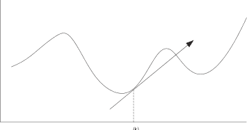

图 3.3 导数的符号总是指向远离极小值的方向。

### 解答

```
{
\frac{\partial H}{\partial x_1} = 2a x_1 + b = 0 \\
\frac{\partial H}{\partial x_2} = 2a x_2 = 0 \\
\frac{\partial H}{\partial x_3} = 2a x_3 = 0
}
```

其最小值由以下给出

```
x_3 = x_2 = 0, x_1 = \frac{-b}{2a}.
```

如果 H 是高于二阶的某个函数，或者是超越函数，则将导数设为零的技术可能会导致一组（通常）无法代数求解的联立方程，我们必须求助于数值技术。其中第一种是梯度下降。

在一维情况下，梯度的用途很容易理解。在点 x^(k) 处，其中 k 是迭代索引（图 3.3），导数指向远离极小值的方向。也就是说，在一维情况下，其符号在“上坡”斜面上为正。

因此，在追求极小值的过程中，为了找到新点 x^(k+1)，我们令

```
x^{(k+1)} = x^{(k)} - \alpha \frac{\partial H}{\partial x}|_{x=x^{(k)}} \tag{3.40}
```

其中 \(\alpha\) 是某个“小”常数。

在 x 是带有 d 个变量的向量的问题中，我们写

```
x^{(k+1)} = x^{(k)} - \alpha \nabla H(x)|_{x=x^{(k)}}. \tag{3.41}
```

在公式 3.41 中，如何选择变量 \(\alpha\)（也称为学习率）并不立即显而易见。如果 \(\alpha\) 太小，公式 3.41 的迭代将花费太长时间才能收敛。如果 \(\alpha\) 太大，算法可能会变得不稳定，永远找不到极小值。

我们可以通过考虑寻找根的著名牛顿-拉夫逊方法来估计 \(\alpha\)：在一维情况下，我们在点 x^(k) 处对函数 H(x) 进行泰勒级数展开并截断，假设所有高阶项均为零，

```
H(x^{(k+1)}) = H(x^{(k)}) + (x^{(k+1)} - x^{(k)})H'(x^{(k)}).
```

由于我们希望 \(x^{(k+1)}\) 是 \(H\) 的零点，因此令

\(H(x^{(k)}) + (x^{(k+1)} - x^{(k)})H'(x^{(k)}) = 0, \quad (3.42)\)

并发现，为了估计根，我们应该使用

\(x^{(k+1)} = x^{(k)} - \frac{H(x^{(k)})}{H'(x^{(k)})}. \quad (3.43)\)

然而，在优化中，我们不是在寻找根，而是在最小化函数，那么知道如何寻找根对我们有什么帮助呢？函数的极小值是其导数的根，因此“梯度下降”算法变为

\(x^{(k+1)} = x^{(k)} - \frac{H'(x^{(k)})}{H''(x^{(k)})}. \quad (3.44)\)

在高维情况下，公式 3.44 变为

\(\mathbf{x}^{(k+1)} = \mathbf{x}^{(k)} - \mathbf{H}^{-1}\nabla H, \quad (3.45)\)

其中 \(\mathbf{H}\) 是二阶导数的黑森矩阵，我们在本章前面提到过：

\(\mathbf{H} = \left[ \frac{\partial^2}{\partial x_i \partial x_j} H(\mathbf{x}) \right]. \quad (3.46)\)

将公式 3.41 与公式 3.45 进行比较，我们得到

\(\alpha = \mathbf{H}^{-1}.\)

请注意，\(\alpha\) 不再是标量。

**练习 3.2:** 给定一组 \(x, y\) 数据对 \(\{(x_i, y_i)\}\) 和形式为

\(y = ae^{bx}, \quad (3.47)\)

找到最小化参数 \(a\) 和 \(b\)

\(H(a, b) = \sum_i (y_i - ae^{bx_i})^2. \quad (3.48)\)

### 解答

我们可以通过观察 \(\ln y = \ln a + bx\) 并重新定义变量 \(g = \ln y\) 和 \(r = \ln a\)，用线性方法求解此问题。作这些替换后，公式 3.48 变为

\(H(r, b) = \sum_i (g_i - r - bx_i)^2 \quad (3.49)\)

\(\frac{\partial H}{\partial b} = 2 \sum_i (g_i - r - bx_i)(-x_i) \quad (3.50)\)

\(\frac{\partial H}{\partial r} = 2 \sum_i (g_i - r - bx_i)(-1). \quad (3.51)\)

我们可以通过将导数设为零并求解联立方程的根来求解此最小化问题，或者如果方程不可求，则使用梯度下降算法。假设采用前者，将公式 3.50 设为零，我们得到

```
\(\sum_i g_i x_i - \sum_i r x_i - \sum_i b x_i^2 = 0\) (3.52)
```

或

```
\(r \sum_i x_i + b \sum_i x_i^2 = \sum_i g_i x_i\) (3.53)
```

和从公式 3.51

```
\(\sum_i g_i - r \sum_i 1 - b \sum_i x_i = 0\) (3.54)
```

或

```
\(Nr + b \sum_i x_i = \sum_i g_i\) (3.55)
```

其中 \(N\) 是数据点的数量。公式 3.53 和 3.55 是两个未知数的两个联立线性方程，易于求解。

如果采用梯度下降算法，则在选择 \([r \ b]^T\) 的初始值后，可以使用以下公式更新参数：

```
\(\begin{bmatrix} r \\ b \end{bmatrix}^{(k+1)} = \begin{bmatrix} r \\ b \end{bmatrix}^{(k)} - \alpha \begin{bmatrix} \frac{\partial H}{\partial r} \\ \frac{\partial H}{\partial b} \end{bmatrix}.\)
```

有关更复杂的下降技术（如共轭梯度法），请参见 [3.1, 3.2, 3.3]。

### 3.3.2 局部极小值与全局极小值

梯度下降存在一个严重问题：其解在很大程度上取决于起始点。如果在“山谷”中启动，它将找到该山谷的底部。我们无法保证这个特定的极小值是最低的，即“全局”极小值。

在继续之前，我们将发现区分两种非线性优化问题是有用的：

- **组合优化。** 在这种情况下，变量具有离散值，通常为 0 和 1。当 **x** 由 \(d\) 个二值变量组成时，**x** 存在 \(2^d\) 个可能值。原则上，\(H(\mathbf{x})\) 的最小化仅包括为 **x** 生成每个可能值以及相应的 \(H(\mathbf{x})\)，并选择最小值。由于可能值的指数爆炸，这种“穷举搜索”通常不切实际。我们将发现，模拟退火为解决组合优化问题提供了绝佳方法。

- **图像优化。** 图像具有一个特定属性：每个像素仅受其局部邻域的影响（这将在稍后详细说明）；然而，像素值是连续值的，通常有成千上万个这样的变量。我们将发现，平均场退火适合解决这些问题。有关平均场退火的更多讨论，请参见 6.5.3 节。


### 3.3.3 模拟退火

我们将基于一种称为“模拟退火”（SA）的算法，对以下所述的最小化技术进行大部分讨论，该算法如下所示为算法3.1。（有关更多细节，请参见Aarts和van Laarhoven的书[3.4]。）

```
Algorithm 3.1: Simulated annealing.
Data: Choose (at random) an initial value of x, and an initial value of T > 0.
Result: x̂ that minimizes H.
1 while T > Tmin do
2     Generate a point y which is a “neighbor” of x. (The exact definition of “neighbor” will be discussed soon.);
3     if H(y) < H(x) then
4         Replace x with y;
5         also denoted as “accepting y”
6     end
7     else
8         Compute Py = exp(−(H(y)−H(x))/T);
9         if Py ≥ R then
10            Replace x with y, where R is a random number uniformly distributed between 0 and 1;
11        end
12    end
13    Decrease T slightly;
end
```

模拟退火在组合优化的背景下最容易理解。在这种情况下，向量x的一个“邻居”的定义是另一个向量y，其中x的仅一个元素被（离散地）更改以创建y。12 因此，如果x是二进制且维度为d，可以选择邻居y = x ⊕ z，其中z是一个二进制向量，其中恰好一个元素非零，且该元素随机选择，⊕表示异或。

在算法的第3至第5行中，我们执行下降。因此我们“总是向下走”。

在算法的第7至第10行中，我们提供了一种有时进行上移的机制。最初，我们忽略参数T，并注意如果y表示上移，接受y的概率与exp(−(H(y) − H(x)))成正比。因此，上移可能发生，但随着上移幅度增大，其发生的概率呈指数级下降。然而，上移的可能性受T的强烈影响。考虑T非常大的情况。那么(H(y)−H(x))/T ≤ 1且Py ≈ 1。因此，所有移动都将被接受。随着T逐渐降低，上移的可能性逐渐降低，直到对于较低的T值（T << (H(y) − H(x)），此类移动基本上是不可能的。

| 和 | | 方式数 |
|---|---|---|
| 0 | | 0 |
| 1 | | 1 |
| 2 | 1-1 | 1 |
| 3 | 2-1,1-2 | 2 |
| 4 | 1-3,3-1,2-2 | 3 |
| 5 | 2-3,3-2,4-1,1-4 | 4 |
| 6 | 1-5,5-1,2-4,4-2,3-3 | 5 |
| 7 | 3-4,4-3,2-5,5-2,6-1,1-6 | 6 |
| 8 | 2-6,6-2,3-5,5-3,4-4 | 5 |
| 9 | 3-6,6-3,4-5,5-4 | 4 |
| 10 | 4-6,6-4,5-5 | 3 |
| 11 | 5-6,6-5 | 2 |
| 12 | 6-6 | 1 |

图3.4 掷两个骰子的可能方式。

可以将其与物理过程类比，其中每个变量（1或0）的状态类似于粒子的自旋（向上或向下）。在高温下，粒子随机改变状态，如果温度逐渐降低，则会达到最低能量状态。因此，算法3.1中的参数 _T_ 类似于（且常被称为）温度，这种最小化技术因此被称为“模拟退火”。

## 3.4 概率简要回顾

让我们设想一个统计实验：掷两个骰子。可以掷出2到12之间的任何数字（包含2和12），但众所周知，某些数字比其他数字更可能出现。要了解这一点，请考虑掷出5的可能方式。

从图3.4可以看出，用两个骰子掷出5有四种可能方式。每个事件都是独立的。也就是说，用第二个骰子掷出2的机会完全不取决于骰子1掷出什么。

事件的独立性是一个重要的含义。这意味着两个事件的联合概率等于它们各自概率的乘积，以及条件概率：

```
Pr(a, b) = Pr(a|b)Pr(b) = Pr(a)Pr(b) = Pr(b|a)Pr(a). (3.56)
```

在等式3.56中，符号 _a_ 和 _b_ 表示事件，例如掷出6。Pr(_b_) 是此类事件发生的概率，Pr(_a_|_b_) 是在事件 _b_ 已发生的情况下，事件 _a_ 发生的条件概率。

在图3.4中，我们列出了掷两个骰子的所有可能方式，并显示了2到12的数字出现的不同方式数量。我们注意到，6个不同的事件可以导致掷出7。由于这些事件的概率相等（36分之1），

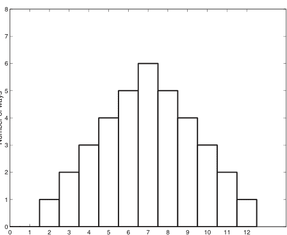

图3.5 图3.4信息的图形形式。

那么7是掷两个骰子最可能的结果。在图3.5中，图3.4的信息以图形形式呈现。

在计算机视觉中，我们最常关心特定测量值发生的概率。然而，当我们尝试为连续值函数绘制类似图3.5的图表时，我们会遇到问题。例如，我们如何提出问题：“一个男人身高六英尺的概率是多少？”显然，答案是零，因为无数种可能性可能任意接近6.0英尺（我们同样可以问：“一个男人身高（精确为）6.31459267英尺的概率是多少？”）。尽管如此，我们直觉上知道，男人身高六英尺的可能性高于身高十英尺的可能性。我们需要一种方法来量化这种直觉上的可能性概念。

一个有意义的问题是：“一个男人身高 **小于** 六英尺的概率是多少？”这样的函数被称为 **概率分布函数**

```
P(x) = Pr(h < x) (3.57)
```

对于某个测量值 h。图3.6 说明了掷两个骰子结果的概率分布函数。

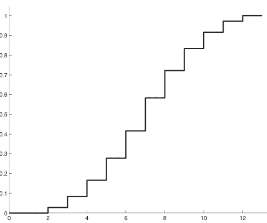

图3.6 图3.5的概率分布，显示掷两个骰子得到小于 x 的数字的概率。注意，在更可能的数字处曲线更陡峭。

另一个合理的问题是：“一个男人的身高在 x 和 x + Δx 之间的概率是多少？”这样的问题可以用密度函数轻松回答：

```
Pr(x ≤ h < x + Δx) = Pr(h < x + Δx) - Pr(h < x) = P(x + Δx) - P(x)
```

除以 Δx 并取 Δx → 0 的极限，我们可以看到，可以将 *概率密度函数* 定义为分布函数的导数：

```
p(x) = \frac{d}{dx}P(x) (3.58)
```

其中 p(x) 具有我们所期望的所有属性。它对于连续值测量有定义，并且对于直觉上最可能的测量值具有最大值。此外，

```
\int_{-\infty}^{\infty} p(x)dx = 1 (3.59)
```

这是我们必须要求的，因为 **某个** 值肯定会发生。

## 3.5 作业

作业3.1：确定函数 sin x 和 sin 2x 是否可能是标准正交或正交函数。

作业3.2：找到绕 z 轴逆时针旋转 30° 对应的 OT。证明结果矩阵的列是 R³ 的一组基。

作业3.3：证明等式 3.17。提示：使用等式 3.13。等式 3.15 也可能有用。

作业3.4：正定矩阵具有正特征值。证明这一点。（顺便说一句，这甚至正确吗？）

作业3.5：在第 3.2.2 节中，我们定义了一组奇特的标量，称为 S，并将其与两个称为 * 和 + 的奇怪操作耦合，并推测这可能是一个向量空间。给出了一个例子，表明这可能是。你怎么看？你能找到一个反例吗？

作业3.6：在第 3.2.2 节中，我们定义了一组奇特的标量，称为 S，并将其与两个称为 * 和 + 的奇怪操作耦合，并推测这可能是一个向量空间。你将如何在这个空间中定义正交性？你是否必须找到类似于零的东西？你将如何定义内积？讨论。

作业3.7：函数 y = xe⁻ˣ 是否有一个唯一的 x 值使 y 最小？如果是，你能通过求导并令其等于零来找到它吗？假设此问题需要使用梯度下降来解决。编写你将用来找到使 y 最小的 x 的算法。

作业3.8：我们需要使用梯度下降来解决一个最小化问题。我们要最小化的函数是 sin x + ln y。以下哪个是进行梯度下降所需的梯度表达式？
(a) cos x + 1/y   (b) y = -cos x / -1/x   (c) -∞
(d) [cos x; 1/y]   (e) ∂/∂x sin x + ∂/∂y ln y

作业3.9：(a) 编写使用梯度下降来找到使函数 z = x exp(-(x² + y²)) 最小的向量 [x, y]ᵀ 的算法。(b) 编写一个计算机程序来找到使 z 最小的 x, y 对。

作业3.10：在 -10 ≤ x ≤ 10 范围内找到 y = 50 sin(x) + x² 的最小值。同时使用梯度下降（GD）和模拟退火（SA）来定位最小值。本作业旨在让学生亲身体验 GD 和 SA 的工作原理，以及 GD 如何可能陷入局部最小值，而 SA 无论初始起点如何都能找到全局最小值。

- 1. 使用 MATLAB 绘制此函数。在给定的 x 区间内直观观察多个局部最小值和全局最小值。
- 2. 实现 GD 并在以下参数设置下测试代码。
- (a) 选择起始点 x = 7。最小值是多少？


- (b) 在 x = 1 处选取一个起点。最小值是多少？
- (c) 改变步长（或学习率），看看什么样的步长会在 x = 7 时导致越过局部最小值。
- 3. 实现 SA 并在与上述相同的参数设置下测试代码。
- (a) 在 x = 7 处选取一个起点。最小值是多少？
- (b) 在 x = 1 处选取一个起点。最小值是多少？
- (c) 改变初始温度和温度变化率。这会影响结果吗？

## 参考文献

- [3.1] R. Burden, J. Faires, and A. Reynolds. 数值分析. Prindle, 1981.
- [3.2] G. Dahlquist and A. Bjorck. 数值方法. Prentice-Hall, 1974.
- [3.3] B. Gottfried and J. Weisman. 优化理论导论. Prentice Hall, 1973.
- [3.4] J. van Laarhoven and E. Aarts. 模拟退火：理论与应用. D. Reidel, 1988.

# 4 图像：表示与创建

> 计算机毫无用处。它们只能给我们答案。
> – 毕加索

## 4.1 引言

既然你已经修过图像处理课程，就没有必要描述图像是如何形成的。然而，表示（representations）是另一回事。本章讨论各种图像表示方案，以及将图像视为曲面的处理方法。

- (第 4.2 节) 在本节中，我们讨论图像所包含信息的数学表示，以及图像在数字机器中存储和操作的方式。
- (第 4.3 节) 在本节中，我们介绍一种思考图像的方式——将其视为高度变化的曲面——我们将发现这是描述图像属性及其操作的一种强大方法。

## 4.2 图像表示

在本节中，讨论了表示图像信息的几种方式。这些表示包括：图像式、函数式、线性、概率和图形表示。请注意，在数字图像中，第一维是列，第二维是行。在 3D 数字图像中，维度为列、行和帧。

### 4.2.1 图像式表示（图像）

图像中信息的图像式表示就是一幅图像。没错，没错；玫瑰就是玫瑰就是玫瑰。当你明白我们所说的函数式、线性和关系式表示是什么意思时，你就会意识到我们需要一个词来表示本身就是一幅图片的表示。在以下内容中，我们简要描述 2D、3D 和距离图像。

- 2D 图像：熟悉的 2D 图像是亮度图像，也称为亮度图。这些包括照片；你习惯称之为“图像”或“照片”的东西。这些可能是彩色或灰度。（小心“黑白”一词，因为它可能被解释为“二值”）。阴影是一个 2D 二值图像。我们通常将点 < x, y > 处的亮度表示为 f(x, y)。注意：x 和 y 可以是实数或整数。在整数情况下，我们指的是采样图像中的离散点。这些点称为“像素”，即“图像元素”的缩写。在实数情况下，我们通常将图像视为一个函数。

1 “图像式”源自希腊语，意为图片。

- 3D 图像：这些数据结构通常出现在医学图像中，如 CT（计算机断层扫描）、MRI（磁共振成像）、超声等。在典型的 3D 医学图像中，每个像素代表一个点的密度。我们通常将点 < x, y, z > 处的密度表示为 f(x, y, z)。这三个空间维度在数字图像中由列、行和帧表示。

电影也是 3D 图像，但第三维不是空间维度，而是时间维度。它由帧号表示，对应时间。

- 距离图像：这些实际上是 2D 的，但它们所代表的信息在 3D 空间中被解释。

在距离图像中，每个点的值代表一个距离，通常是从摄像机的距离，或沿着包含摄像机的平面的法线方向的距离。我们可以将点 < x, y > 处的距离表示为 z(x, y)。例如，假设传感器是激光器，测量飞行时间。那么“亮度”实际上与光脉冲从激光器传播到表面、反弹并返回位于源点的探测器所需的时间成正比。事实上，这样的传感器测量的是作为两个偏转角 θ 和 ϕ 的函数的距离，该函数生成距离图像。

图 4.1 说明了同一场景的亮度图像和距离图像。在距离图像中，可以看到表面亮度随扫描仪距离增加而增加。

将 r、θ 和 ϕ 坐标转换为 z(x, y) 通常很简单，而且通常，你得到的任何数据（在本课程中至少）都已经执行了此校正以生成 *深度图像*。Microsoft Kinect™ 可以返回深度图像。

图 4.1 的底行展示了图 4.1 顶行中两幅图像的随机伪彩色渲染。要对灰度图像进行伪彩色处理，首先必须有一个具有固定有限亮度级数的图像。最常见的这种标度是 0 到 255。然后，对于 256 种可能的亮度中的每一种，都会分配一种颜色。在随机伪彩色渲染的情况下，颜色是随机选择的。

正如这里所见，使用随机伪彩色使用户能够看到原始图像中可能不明显的图像方面。在此情况下，噪声表现为像素大小的彩色点。在第 6 章中，你将学习如何去除大部分这种噪声。

### 4.2.2 函数式表示（方程）

我们可以将函数拟合到任何一组数据点上。当我们测量数字图像时，它始终由一组离散且有限的测量值 f(x, y) 组成。通过执行诸如 *最小二乘* 数据拟合等操作，我们可以找到最适合这组数据的连续函数。我们可以用一个方程来表示图像，至少在小区域内，例如二次曲线：

```
z = ax^2 + by^2 + cxy + dx + ey + f (4.1)
```

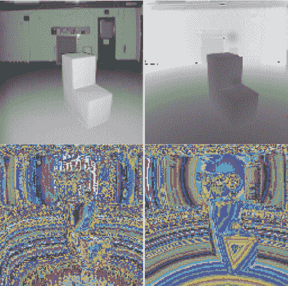

图 4.1 同一场景的亮度（左上）和距离（右上）图像。在此图像中，亮度图像实际上是由返回激光束的强度测量的。第二行展示了两幅图像的伪彩色渲染。这种查看图像的方式有助于学生注意到图像的属性，例如噪声，这些属性可能对人眼不明显。

或二次曲面：

```
ax^2 + by^2 + cz^2 + dxy + exz + fyz + gx + hy + iz + j = 0 . (4.2)
```

Eq. 4.1 中给出的形式，其中一个变量用其他变量定义，通常称为 *显式* 表示，而 Eq. 4.2 的形式是 *隐式* 表示。

函数 f(x) 的 *零集* 定义为 f(x) = 0 的点集。隐式表示可以等价地用零集 {(x, y, z) : f(x, y, z) = 0} 表示。隐式多项式有一些方便的属性。例如，考虑圆 x^2 + y^2 = R^2 和一个不在 f(x, y) 零集中的点 (x0, y0)。也就是说，由于满足

```
f(x, y) = x^2 + y^2 - R^2 = 0 (4.3)
```

的点 (x, y) 集合是零集，如果我们将 x0 和 y0 代入 f(x, y) 的方程，我们知道会得到非零结果（因为我们说过该点不在零集中）；如果该值为负，我们知道点 (x0, y0) 在曲线内部，否则在外部 [4, 1]。这种内部/外部属性适用于所有由多项式表示的封闭曲线（和曲面）。

### 4.2.3 线性表示（向量）

我们可以将图像展开为一个向量，使得在这种表示中向量-矩阵运算非常方便。例如，亮度值如所示的 2 x 2 图像 [6 10; 4 0] 可以写成向量 [5 10 6 4]^T。我们将在 5.3 节中更详细地讨论这一点。

以这种方式将图像表示为一个长向量称为词典式表示。

另一种将证明非常重要的线性表示是形状矩阵。假设某个区域的边界有 N 个点，并考虑该边界上的所有点。将它们写成形式为 [x, y]^T 的 2 维向量。现在将所有这些点作为单个矩阵的列收集起来

```
S = [x1 x2 ... xN; y1 y2 ... yN]
```

该矩阵是我们形状矩阵的最简单表示。它将在 10.6.1 节中再次出现。

### 4.2.4 概率表示（随机场）

在第 6 章中，图像将被表示为生成图像的随机过程的输出。这样，我们可以利用一套强大的数学工具，在给定损坏的噪声图像测量值的情况下，估计特定图像的最佳版本。这种表示将自然地导致一种优化方法，该方法将减少噪声但保留锐利边缘。

### 4.2.5 图形表示（图）

图是一种关系数据结构。它由数据元素组成，称为顶点或节点，以及顶点之间的关系，称为边。

图可以完全由集合描述。顶点集是一组“有趣的事物”，边可以由一组有序对描述。例如，设 G = < V, E > 表示一个图，其中顶点集

```
V = {a, b, c, d, e, f, g, h}
```

边集为

```
E = {(a, b), (a, c), (a, d), (b, d), (c, d), (d, e), (f, g), (g, h)}。
```

图也可以以图形方式表示，如图 4.2 所示，用于此示例。一般来说，图可以是有向的。也就是说，由边表示的关系可能有方向。例如，考虑关系“在上方”和“相邻


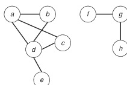

图 4.2 包含两个连通分量的图。该图包含两个大小为 3 的团，{a,b,d} 和 {a,c,d}，且没有大小为 4 的团。

"TO"。显然 ABOVE(A, B) != ABOVE(B, A)，因此 ABOVE 需要用有向图表示，而关系“相邻”没有首选方向。有向图的图形表示可以被视为边的两端带有箭头。

在以下内容中，我们定义一些重要的图术语：

- 节点的度是进入该节点的边的数量。
- 节点 v0 和 v1 之间的路径是一个节点序列 v0, v1, ..., vl，使得对于 i = 0, 1, ..., l - 1，vi 和 vi+1 之间存在一条边。
- 如果任意两个节点之间存在一条路径，则称该图是连通的。
- 团（请记住这个词，你还会再见到它）是一个子图，其中任意两个节点之间存在一条边。
- 树是不包含环的图。树表示已应用于图像压缩、图像编码以及任何数据元素之间存在层次关系的应用中。

图将在本书中多次出现，作为描述区域之间关系和分割的一种手段。图表示的一个应用如下：将每个像素视为图中的一个节点。相邻像素之间可能存在边，也可能不存在。如果存在一条边，则这两个像素位于图的同一连通分量中。考虑图 4.2 中的图。该图有 8 个顶点、8 条边和两个连通分量。也就是说，沿着边存在从 a 到 d、b 到 c 或 f 到 h 等路径。但是，不存在从 a 到 f 的路径。

通过定义“标签图像”，连通分量的概念可以轻松地与像素相关联，标签图像是一种与原始图像同构的图式表示，其中每个像素包含其所属连通分量的索引/标签信息。根据此定义，我们看到图 4.3 中的图像包含两个连通分量（标记为 2 和 3），此外还有背景（标记为 1 和 4），如图 4.4 所示。

这种将图像视为图的思路可以在分割中以两种方式使用：合并和切割。合并算法最初从不包含任何边的图像图开始，然后添加边以生成连通分量。当将像素视为图像图中的节点时，而不是将其称为“像素节点”、“像素顶点”或其他类似术语，我们简单地继续将其称为“像素”。


图 4.3 包含两个连通分量的图像。

切割算法从所有相邻像素之间的边开始，然后切割边以将图像图分离为不同的组件。两种方法的示例将在第 8 章中描述。

### 4.2.6 邻接悖论与六边形像素

作为图像表示主题的旁注，我们更深入地讨论“邻接”问题以及著名的“邻接悖论”。我们还简要描述了一种替代采样方法，该方法需要六边形像素，而不是传统的方形像素。我们讨论了这种替代采样将如何完全解决邻接悖论。

两个像素要么相互相邻，要么不相邻，对吧？在图像的图形表示意义上，似乎确实如此。但是像素通常是矩形的，因此它们可能与上方、下方、左方或右方的像素相邻。在图表示中，图的一条边在两个节点之间运行以指示它们相邻。但是对角线呢？让我们更仔细地看一下。

我们可以以多种方式定义邻域，但最常见且最直观的方式是说，如果两个像素共享一条边（4-连通）或共享一条边或一个顶点（8-连通），则它们是邻居。像素的邻域（或光环）是邻居像素的集合（惊喜！）。中心点的 4-邻居如图 4.5(b) 所示。像素的邻居通常与该像素相邻，但并没有根本要求它们必须如此。当我们讨论“团”时，我们会再次看到这一点。

```
1111222111111111111111111111
1112222111113333333333333111
1112222111113333333333333111
1112222111111111133333311111
1112221111111111113333331111
1122222211111111113333333111
1122442221111111133333331111
1122222211111111111333311111
1112222111111111111111111111
```

图 4.4 与图 4.3 对应的标签图像。

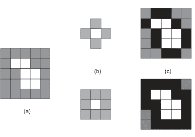

图 4.5 (a) 集合 A（阴影像素）和集合 B（空白像素）。(b) 4-连通的邻域关系——阴影像素根据定义是中心像素的邻居。(c) (a) 中白像素集合的光环，使用 4-连通邻居定义，由深色像素给出。(d) 8-连通的邻域关系。(e) (a) 中白像素集合的光环，使用 8-连通邻居定义。

#### 离题：邻接悖论

在图 4.6 中，前景像素显示为黑色，背景显示为白色。我们已经学习了 4-连通和 8-连通。让我们应用所学知识。此图中的前景是一个环，可能是一个非常低分辨率的垫圈图像。这个环是封闭的吗？也就是说，我们能否从一个点开始绕着环走一圈，不重复走过的路，只从一个像素传递到一个连通邻居？（顺便说一句，我们刚刚定义了连通性的一个属性，称为路径——参见第 4.2.5 节。）如果我们能这样绕着这个区域走一圈，我们就说该区域是封闭的。使用 4-连通。它是封闭的吗？如果你说不是，那很好！在 4-连通系统中，我们无法从像素 a 到达像素 b。如果它不是封闭的，那它必须是开放的。对吧？如果它是开放的，内部和外部必须是连通的，对吧？但是，使用 4-连通定义，内部和外部是分离的区域——一个矛盾！

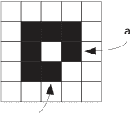

图 4.6 邻接悖论。

图 4.7 六边形采样像素的邻域。

看来我们不得不放弃 4-连通，因为它会导致悖论。让我们改用 8-连通。现在，前景是封闭的，对吧？但是现在，内部和外部也是连通的！这怎么可能呢？如果区域是封闭的，内部和外部必须（逻辑上）是分离的。因此，8-连通也不行。

对于这个特定的悖论，有一个修复方法，至少算是一种修复方法，即为前景使用一种定义（8-连通或 4-连通），为背景使用另一种定义。这个修复方法对二值图像有效，但当我们处理具有多于两个亮度级别的图像时，这些离散化问题会再次出现。这个示例旨在说明，在数字图像中，直觉并不总是正确的。还有许多其他类似问题的示例，例如，涉及区域周长的度量。请注意，就像在生活中一样，奇怪的事情会发生，直觉并不总是成立。

#### 采样的一种变体：六边形像素

传统上，电子成像传感器主要以矩形阵列排列，因为电子束需要以栅格扫描方式扫描，最近则是因为将半导体器件以矩形组织排列稍微方便一些。但是，如我们上面所见，矩形阵列在尝试定义邻域时会引入歧义。另一方面，六边形像素为歧义问题提供了理想的解决方案。

我们很容易想象使用六边形组织的像素阵列的成像传感器。当一组具有柔性边界的相切圆受到压力时，六边形是最小能量解。蜂巢是最著名的这种自然出现的组织，但还有许多其他组织，包括人视网膜中视锥细胞的组织。我们在图 4.7 中看到，在六边形连通性分析中不存在连通性悖论：每个像素恰好有六个邻居，并且每个像素与其直接邻居之间的距离在六边形镶嵌的六个主要方向上都是相同的。

## 4.3 图像作为曲面

在本节中，我们考虑将图像解释为 3D 空间中的曲面的问题。以这种方式思考图像将使我们能够将图像属性视为高度。


### 4.3.1 梯度

将 f(x, y) 的值视为空间中的一个曲面，则有序三元组 (x, y, f(x, y)) 描述了这个曲面。对于每个点 (x, y)，第三维都有一个对应的值。重要的是要注意，对于任何 (x, y) 对，只有一个这样的 f 值。如果你在 x, y 平面上画一条直线，并问自己："当我沿着这条 x, y 线移动时，f(x, y) 如何变化？"，你提出的问题与 "在点 x, y 沿着这个特定方向的方向导数是多少？" 是相同的。

有一个特殊的方向，即最大化方向导数幅值的方向，我们称之为梯度。梯度向量具有特殊且非常简单的形式：G(x, y) = [∂f/∂x, ∂f/∂y]^T。

梯度的一个特征有时会让学生感到困惑。梯度是一个 2-向量。它位于 x, y 平面内。当你沿着梯度方向迈出一步时，你是在平面内（而不是向上，离开平面）移动，使得 f 以最陡峭的方式上升。

### 4.3.2 等亮线

考虑所有满足 f(x, y) = C 的点的集合，其中 C 为某个常数。如果 f 表示亮度，那么这组点中的所有像素都具有相同的亮度。因此，我们将这组集合称为等亮线，或水平集。

> **定理：** 在任何图像点 (x, y) 处，通过该点的等亮线与梯度垂直。证明作为课后作业。

### 4.3.3 山脊

考虑空间中的一个曲面，表示为 z(x, y)。现在，z 表示高程，而不是亮度。我们可以很容易地将其视为一座山。如果我们绘制这座山的地质等高线图，图中的线是等高程线。但是，如果我们将"高程"理解为表示亮度，那么等高线就是等亮线。站在这座"山"的某个点上，沿着梯度指向的方向看，如图 4.8 所示；你所看的方向就是你进行最陡上升的方向。

请注意，梯度方向是该特定点的最陡方向。它不一定指向山峰。

让我们沿着局部梯度方向迈出小步来攀登这座山。2 山脊线上会发生什么？你怎么知道自己在山脊上？你如何用数学描述这个过程？

考虑沿着梯度方向迈步。你的步伐通常保持相同方向，直到到达山脊；然后，方向会剧烈转变。因此，山脊的一个有用定义是**梯度方向变化率的局部极大值点**的集合。也就是说，我们需要找到 |∂v/∂η| 最大的点。这里，v

2 局部极大值是指没有更大邻居的任何点。

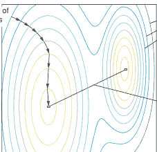

图 4.8 梯度方向、等亮线和山脊的示意图。高程图上的等高线相当于等亮线。某点的梯度向量与该点的等亮线垂直。

表示梯度的方向。在笛卡尔坐标系中，

```
\(\frac{\partial f}{\partial v} = \frac{2f_x f_y f_v - f_x^2 f_x - f_y^2 f_y}{(f_x^2 + f_y^2)^{3/2}}.\) (4.4)
```

## 4.4 作业

**作业 4.1：** 在图 4.7 中，我们说明了一种完全不同的思考像素的方式。在该图中，像素不是矩形的，而是六边形的，每个像素有 6 个邻居，而不是 4 或 8 个。如果你有一台六边形像素的相机，这有助于解决邻接悖论吗？讨论。

**作业 4.2：** 假设图像 $f(x, y)$ 可由 $f(x, y) = x^4/4 - x^3 + y^2$ 描述。在点 $x = 1, y = 2$ 处，以下哪个是沿着通过该点的等亮线的单位向量？

- (a) \(\left[ \frac{2}{\sqrt{3}} \quad \frac{1}{\sqrt{3}} \right]^T\) (c) \(\left[ \frac{-1}{\sqrt{3}} \quad \frac{2}{\sqrt{3}} \right]^T\) (e) \(\left[ 2 \quad 1 \right]^T\)
- (b) \(\left[ \frac{1}{\sqrt{3}} \quad \frac{-2}{\sqrt{3}} \right]^T\) (d) \(\left[ -2 \quad 4 \right]^T\) (f) \(\left[ \frac{-2}{\sqrt{3}} \quad \frac{1}{\sqrt{3}} \right]^T\)

## 参考文献

[4.1] R. Bajcsy and F. Solina. 三维物体识别再探。在 *ICCV 论文集*，1987。

# 第二部分

## 预处理

当作者最初开始从事计算机视觉工作时，我们的意图是使用已知的最高级、最优雅、最复杂的人工智能方法来编写程序。当然，什么都没起作用。

图像从来不是你所期望的那样。真实图像都有噪声。即使是完美的数字图像也是采样的，而采样本身会引入一种噪声。然后还有模糊和其他畸变。

本书的这一部分首先探讨在噪声图像中查找边缘的问题。该章不仅将展示如何查找边缘；还将介绍图像处理中的一些其他基本主题，例如卷积。

然后，我们进入去噪部分。模糊图像肯定会去除噪声。当然，它也会去除图像内容。诀窍是去除噪声但保留图像细节，该主题将在下一章中讨论。

本部分的最后一个主题是形态学，这是一组用于擦除小细节和填补缺口的非线性方法。距离变换，一种用于图像信息的紧凑且有用的表示，也包含在形态学章节中。

# 5 核算子

> 你需要边界……即使在我们的物质创造中，边界也标志着最美丽的地方，在海洋与海岸之间，在山脉与平原之间，在峡谷与河流交汇处。
> - Wm. Paul Young

## 5.1 引言

本章将探讨图像上的线性运算。导数，可能是最常见的线性算子，首先被考虑。该讨论扩展到边缘检测，即对图像应用导数核的结果。将考虑各种实现此目标的方法。

- (第 5.2 节) 我们首先定义什么是线性算子，并解释核算子，即乘积之和，这是本书中出现频率最高的线性算子类型。
- (第 5.3 节) 本节展示了如何使用图像的向量表示将核算子转换为矩阵乘法形式，以便进行一些分析研究。
- (第 5.4 节) 我们重点讨论导数，因为它可能是计算机视觉应用中最常用的核算子。我们讨论如何通过导数的定义、函数拟合、使用图像的向量表示以及对特殊模糊核求导来找到导数核算子。
- (第 5.5 节) 在图像上应用导数算子会产生边缘图像。本节描述了不同类型的边缘和一个流行的边缘检测器，即 Canny 边缘检测器。
- (第 5.6 节) 解释了尺度空间的概念，以及尺度空间如何与不同尺度的边缘检测相关联。
- (第 5.7 节) 在第 1 章中，我们简要描述了生物视觉。在这里，我们重新审视这个问题，并询问人类如何执行低级视觉，即边缘检测。我们介绍了 Gabor 滤波器，据信它很好地表征了视觉皮层中感受野的功能。
- (第 5.8 节) 我们通过对各种类型的导数核在检测不同方向边缘（角度和幅度）方面的能力进行实验研究来总结本章。

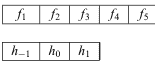

图 5.1 一个带有五个像素的一维图像和一个带有三个像素的一维核。下标是像素的 x 坐标。

## 5.2 线性算子

如果一个对单个图像 f 进行运算以产生第二个图像 g 的算子 D(f) 满足线性条件，则称其为线性算子，即

```
g = D(\alpha f_1 + \beta f_2) = \alpha D(f_1) + \beta D(f_2), (5.1)
```

其中 f1 和 f2 是图像，\alpha 和 \beta 是标量乘数。在 f 被采样的情况下（如数字图像），许多作者选择将 f 写为矩阵 fij，而不是函数记法 f(x, y)。然而，我们更喜欢 x, y 记法，原因将在后面变得明显。我们以后还会发现使用单个下标 fi 在几个点上更方便，但目前，让我们坚持使用 f(x, y)，并记住 x 和 y 只取一小范围的整数值，例如，0 < x < 511。

考虑一个名为 f 的带有五个像素的一维图像和另一个一维图像，我们将其称为名为 h 的带有三个像素的核，如图 5.1 所示。如果我们将核放置下来，使其中心像素 h0 位于 f 的某个特定像素上方，例如 f2，则得到 g2 = f1 h-1 + f2 h0 + f3 h1，这是核元素和图像元素的乘积之和。

有了这个理解，考虑将其应用于二维图像的常见情况。乘积之和的一般形式计算如下，

```
g(x, y) = \sum_\alpha \sum_\beta f(x + \alpha, y + \beta) h(\alpha, \beta). (5.2)
```

为了更好地把握 Eq. 5.2 的精髓，让我们将 h 写成一个 3 x 3 的数字网格。请记住，y = 0 位于图像的顶部，并且随着向下移动，y 值增大 1。现在想象将这个网格放在图像上方，使网格中心正位于像素 f(x, y) 上方。然后，网格中的每个 h 值都与图像中的相应点相乘。我们今后将把 h 值的网格称为"核"。暂时假设 \alpha 和 \beta 只取值 -1、0 和 1，如图 5.2 所示。在这种情况下，Eq. 5.2 展开为 Eq. 5.3，我们将此过程称为应用 3 x 3 核。

```
g(x, y) = f(x - 1, y - 1)h(-1, -1) + f(x, y - 1)h(0, -1) + f(x + 1, y - 1)h(1, -1) + f(x - 1, y)h(-1, 0) + f(x, y)h(0, 0) + f(x + 1, y)h(1, 0) + f(x - 1, y + 1)h(-1, 1) + f(x, y + 1)h(0, 1) + f(x + 1, y + 1)h(1, 1) (5.3)
```

1 请注意这里参数的顺序，x（列）和 y（行）。有时会遵循相反的约定。


| h(-1, -1) | h(0, -1) | h(1, -1) | f(x - 1, y - 1) | f(x, y - 1) | f(x + 1, y - 1) |
|---|---|---|---|---|---|
| h(-1, 0) | h(0, 0) | h(1, 0) | f(x - 1, y) | f(x, y) | f(x + 1, y) |
| h(-1, 1) | h(0, 1) | h(1, 1) | f(x - 1, y + 1) | f(x, y + 1) | f(x + 1, y + 1) |

图 5.2 内核作为 3 x 3 网格（左侧），应用于图像中以像素 f(x, y) 为中心的邻域（右侧）。内核的位置使得内核中心落在图像的 x, y 像素上。

### 参数方向：卷积与相关

让我们重述两个重要方程：首先是内核算子的方程，从 Eq. 5.2 重新抄录，然后是二维离散卷积的方程。²

```
g(x, y) = \sum_\alpha \sum_\beta f(x + \alpha, y + \beta)h(\alpha, \beta) (5.4)
```

```
g(x, y) = \sum_\alpha \sum_\beta f(x - \alpha, y - \beta)h(\alpha, \beta) (5.5)
```

细心的学生会注意到上述两个方程在顺序上存在差异。在正式卷积中，如下方程所示，参数发生反转：内核最右侧的像素（例如，图 5.1 中的 h_1）与图像相应区域中最左侧的像素（例如，图 5.1 中的 f_1）相乘。然而，在上方程中，我们考虑的是将内核“放置”在图像上并相乘对应像素。如果我们相乘对应像素，左-左和右-右，则得到相关，这通常是 _内核算子_ 所指的含义。不幸的是，大量文献中存在误称——两者有时都被称为“卷积”。我们建议学生注意这一点。在许多出版物中，当意指“乘积和”时，使用了“卷积”一词。为了避免混淆，在本书中，除非我们真正意指下方程的应用，否则通常会避免使用“卷积”一词，而是使用“内核算子”或“相关”来表达我们的意思。请注意，如果内核是对称的（例如，[1 2 1]），则相关和卷积给出相同的结果。

2 从数学上讲，卷积和相关在坐标的左右顺序上有所不同。

## 5.3 图像的向量表示

在 4.2.3 节中，我们简要讨论了图像的向量表示。在此基础上，该讨论进行了更详细的扩展。有时，将图像表示为向量形式更为方便，这样图像上线性算子的应用可以写成矩阵乘法的形式。假设我们按扫描行顺序列出图像中的每个像素，作为一个长向量。例如，对于 4 x 4 图像

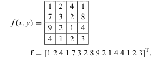

这称为 *词典序* 表示。如果我们以这种方式写出图像，每个像素可以由单个索引标识，例如，f0 = 1，f1 = 7，f15 = 3，索引从零开始。现在假设我们想要应用以下内核

| -1 | 0 | 2 |
|---|---|---|
| -2 | 0 | 4 |
| 3 | 9 | 1 |

将此内核应用于图像上的点 x = 1, y = 1，其中 (0, 0) 是图像的左上角像素。该内核的词典序表示为 k = [-1 0 2 -2 0 4 3 9 1]^T。

图像形式中的点 (1,1) 对应于向量形式中的像素 f8。“应用”内核通常意味着将内核中心放置在图像中感兴趣的像素上。在此示例中，我们可以通过将向量 f 与向量进行点积来完成此内核的应用

```
h_5 = [-1 0 2 0 -2 0 4 3 9 1 0 0 0 0]^T
```

作为第二个示例，为了确定在 (2,1) 应用此内核应使用什么向量，我们得到

```
h_8 = [0 -1 0 2 0 -2 0 4 0 3 9 1 0 0 0 0]^T
```

比较 (1,1) 处的 h_5 和 (2,1) 处的 h_8。它们除了旋转外是相同的。我们可以通过构建一个矩阵来对整个图像执行内核操作，其中每一列都是这样的 h。这样做将得到如下所示的矩阵。通过计算乘积 g = H^T f，g 将是将内核 H 应用于图像 f 的结果（词典序形式），其中矩阵如下：

```
H = [ ... -1  0  ...  0  ... ]
    [ ...  0 -1  ...  0  ... ]
    [ ...  2  2  ...  0  ... ]
    [ ... -2  0  ...  0  ... ]
    [ ...  0 -2  ... -1  ... ]
    [ ...  4  0  ...  0  ... ]
    [ ...  0  4  ...  2  ... ]
    [ ...  3  0  ...  0  ... ]
    [ ...  9  3  ... -2  ... ]
    [ ...  1  9  ...  0  ... ]
    [ ...  0  1  ...  4  ... ]
    [ ...  0  0  ...  0  ... ]
    [ ...  0  0  ...  3  ... ]
    [ ...  0  0  ...  9  ... ]
    [ ...  0  0  ...  1  ... ]
      ↑   ↑       ↑
    h5  h6     h10
```

请注意，矩阵 H 为图像中的每个像素都有一列。它可能非常大。如果 f 是典型的 256 x 256 像素图像，则 H 是 (256 x 256) x (256 x 256)，这是一个很大的数字（尽管仍然小于美国国债）。不要担心 H 的巨大尺寸。这种图像算子形式对于思考图像和证明关于图像算子的定理很有用。它是概念工具，而非计算工具。

最后，使用快速傅里叶变换可以显著加快乘以循环矩阵的速度；但我们将在另一篇中详细说明。

## 5.4 导数估计

由于导数可能是最常见的线性算子，在本节中我们讨论四种不同的导数估计方法。首先，我们描述一种直观的方法，它使用导数的定义来生成内核算子。接着是通过函数拟合求解导数内核的正式推导。基于图像的向量表示，我们介绍基向量的概念，并讨论一些描述边缘特征的特殊基向量。最后，我们详细阐述了通过对特殊模糊内核求导来构建内核的方法，利用了内核算子的线性特性。

### 5.4.1 使用内核估计导数

让我们通过一个示例来考察这一概念——近似图像的空间导数，\(\frac{\partial f}{\partial x}\) 和 \(\frac{\partial f}{\partial y}\)。我们从模糊记得的微积分课中回忆起，

```
\(\frac{\partial f}{\partial x} = \lim_{\Delta x \to 0} \frac{f(x + \Delta x) - f(x)}{\Delta x}\) (5.7)
```

这表明可以使用内核 \(\frac{[-1 \quad 1]}{\Delta x}\)（当 \(\Delta x = 1\) 时）。但此内核不是对称的——x 处的估计取决于 x 和 x + 1 处的值，但不取决于 x - 1 处的值。这使得应用点难以定义。相反，对称定义更好，例如

```
\(\frac{\partial f}{\partial x} = \lim_{\Delta x \to 0} \frac{f(x + \Delta x) - f(x - \Delta x)}{2\Delta x},\) (5.8)
```

\(\Delta x\) 不能小于 1，从而得到此内核：\(\frac{1}{2} \begin{bmatrix} -1 & 0 & 1 \end{bmatrix}\)。为了记号简洁，我们写

```
1/2 \(\begin{bmatrix} -1 & 0 & 1 \end{bmatrix}\). (5.9)
```

导数的一个主要问题是对噪声敏感。在一定程度上，可以通过水平求差然后垂直平均来补偿噪声——这产生了以下内核：

```
\(\frac{\partial f}{\partial x} = 1/6 \begin{bmatrix} -1 & 0 & 1 \\ -1 & 0 & 1 \\ -1 & 0 & 1 \end{bmatrix} \otimes f\) (5.10)
```

在此我们引入了一个新符号，\(\otimes\) 表示上述描述的乘积和实现。文献中充斥着像这样的内核。它们都结合了

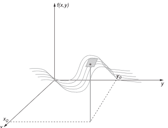

图 5.3 图像的亮度可以被视为一个曲面，即两个变量的函数。此处曲面显示为平滑曲线，平面表示点 x0, y0 处的切平面。切平面的斜率是两个空间偏导数。

通过差分估计导数，然后以某种方式平均结果以补偿噪声的概念。这些临时内核中最著名的可能是 Sobel：

\frac{\partial f}{\partial x} = \frac{1}{8} \begin{bmatrix} -1 & 0 & 1 \\ -2 & 0 & 2 \\ -1 & 0 & 1 \end{bmatrix} \otimes f. (5.11)

Sobel 算子的好处在于它是中心加权的。也就是说，由于导数在中心点估计，因此中心行应比上方或下方的行计数更多，这似乎是合理的。

### 5.4.2 通过函数拟合估计导数

在本节中，我们介绍了一种数据拟合问题的基本方法，即最小化平方误差之和。这种通用方法在一个简单的应用场景中介绍：找到最适合一组 2D 点的平面。然而，它可能在各种应用中都有用。

这种方法提供了一种利用图像 f(x, y) 连续表示的替代方式。将亮度视为两个空间坐标的函数，并考虑在某一点与该亮度曲面相切的平面，如图 5.3 所示。

在此情况下，我们可以使用平面方程来写出切平面上一点的连续图像表示

f(x, y) = ax + by + c. (5.12)


然后，边缘强度由两个数字描述：\(\frac{\partial f}{\partial x} = a, \frac{\partial f}{\partial y} = b\)。点 \((x, y)\) 处亮度的变化率由梯度向量表示

```
\(\nabla f = \begin{bmatrix} \frac{\partial f}{\partial x} \\ \frac{\partial f}{\partial y} \end{bmatrix}^T = [a \ b]^T.\) (5.13)
```

这里采用的方法是，在给定 f 的某些带噪声、模糊的测量值以及 Eq. 5.12 的假设下，求解 a、b 和 c。要找到这些参数，首先注意到 Eq. 5.12 可以写成 f(x, y) = a^T x，其中向量 a 和 x 分别为 a^T = [a b c] 和 x^T = [x y 1]。

假设我们在图像中的一组点 \(\chi \subset \mathbb{Z} \times \mathbb{Z}\)（Z 是整数集合）上测得了亮度值 g(x, y)。在这组点上，我们寻求最能拟合数据的平面。为实现此目标，将误差写为关于测量值 g(x, y) 和（目前未知的）函数 f(x, y) 的平方和误差函数。

```
\(E = \sum_x (f(x, y) - g(x, y))^2 = \sum_x (\mathbf{a}^T \mathbf{x} - g(x, y))^2.\)
```

展开平方并为简化起见消除函数记法，我们得到

```
\(E = \sum_x (\mathbf{a}^T \mathbf{x})(\mathbf{a}^T \mathbf{x}) - 2\mathbf{a}^T \mathbf{xg} + g^2.\)
```

回顾对于向量 a 和 x，有 a^T x = x^T a，并将求和过程展开，我们得到

```
\(E = \sum \mathbf{a}^T \mathbf{x} \mathbf{x}^T \mathbf{a} - 2 \sum \mathbf{a}^T \mathbf{xg} + \sum g^2 = \mathbf{a}^T \left( \sum \mathbf{x} \mathbf{x}^T \right) \mathbf{a} - 2\mathbf{a}^T \sum \mathbf{xg} + \sum g^2.\)
```

现在我们希望找到使 E 最小的 a（即平面的参数）；因此可以求导并令结果为零。（这是标量对向量的导数，因此结果必须是一个向量。）我们得到

```
\(\frac{dE}{d\mathbf{a}} = 2\mathbf{a}^T \left( \sum \mathbf{x} \mathbf{x}^T \right) - 2 \sum \mathbf{xg} = 0.\) (5.14)
```

令 \(\sum \mathbf{x} \mathbf{x}^T = S\)（它是“散射矩阵”），并看看 Eq. 5.14 的含义：考虑一个关于原点对称的邻域 \(\chi\)。在该邻域中，假设 x 和 y 只取 -1、0 和 1。那么

```
\(S = \sum \mathbf{x} \mathbf{x}^T = \sum \begin{bmatrix} x \\ y \\ 1 \end{bmatrix} [x \ y \ 1] = \begin{bmatrix} \sum x^2 & \sum xy & \sum x \\ \sum xy & \sum y^2 & \sum y \\ \sum x & \sum y & \sum 1 \end{bmatrix}\)
```

对于上述邻域，其值为

```
\(\begin{bmatrix} 6 & 0 & 0 \\ 0 & 6 & 0 \\ 0 & 0 & 9 \end{bmatrix}.\)
```

如果你不明白这些数值是从哪里来的，请注意 y 的正方向是向下的。

以下是获取这些数值的更多细节。观察左上角的点，坐标为 \(x = -1, y = -1\)。在该点，\(x^2 = (-1)^2 = 1\)。现在观察顶部中间的点，坐标为 \(x = 0, y = -1\)。在该点，\(x^2 = 0\)。对邻域中的所有 9 个点都这样做，你将得到

\(\sum x^2 = 6.\)

请注意这个有用的观察：如果将邻域关于原点对称，则散射矩阵中所有包含 \(x\) 或 \(y\) 的奇次幂的项都将为零。

另外：一个常见的错误是在右下角放置 1 而不是 9——请小心！

现在我们有矩阵方程

\(2 \begin{bmatrix} a & b & c \end{bmatrix} \begin{bmatrix} 6 & 0 & 0 \\ 0 & 6 & 0 \\ 0 & 0 & 9 \end{bmatrix} = 2 \begin{bmatrix} \sum g(x,y)x \\ \sum g(x,y)y \\ \sum g(x,y) \end{bmatrix}.\)

我们可以轻松求解 \(a\)：

\(a = \frac{1}{6} \sum g(x,y)x \approx \frac{\partial f}{\partial x}.\)

因此，要从邻域中每个 9 个点的拟合计算导数，请取该点的测量值 \(g(x, y)\)，乘以其 \(x\) 坐标，然后将它们相加。让我们以表格形式写下 \(x\) 坐标：

| -1 | 0 | 1 |
|---|---|---|
| -1 | 0 | 1 |
| -1 | 0 | 1 |

这正是 Eq. 5.10 的核，我们之前是直观地推导出的。现在，我们已正式推导出来。理论与直觉一致，难道不是很令人满意吗？（这里，我们没有将每一项乘以 1/6，但可以简单地将 1/6 提出来，得到答案后再除以 6 即可。）

这是通过使用一种优化方法（在此例中是最小化平方误差）来完成的，以找到形式为 \(y = f(x)\) 的方程中函数 \(f(x)\) 的系数，其中 \(f\) 是多项式。这种形式被称为 *显式函数表示*。

还有一个术语问题：在未来的讨论中，我们将使用 *核半径* 这一表达。半径是从中心到最近边缘的像素数量。例如，\(3 \times 3\) 核的半径为 1。\(5 \times 5\) 核的半径为 2，以此类推。可以设计圆形的核，但大多数时候，我们使用方形。

### 5.4.3 图像的基向量

在第 5.3 节中，我们看到可以将图像视为一个向量。如果我们可以对图像这样做，那么当然也可以对小子图像这样做。考虑单个点的 9 像素邻域。我们可以轻松构造该邻域的字典序表示的 9 维向量。在线性代数中，我们学到任何向量都可以表示为基向量的加权和，我们将在这里应用相同的概念。

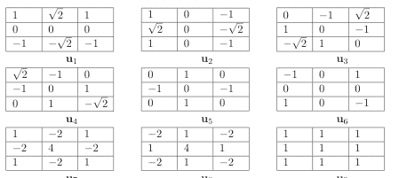

让我们写出基的定义：

```
v = \sum_{i=1}^{9} a_i u_i
```

其中 v 现在是这个 9 像素邻域的向量表示，a_i 是标量权重，u_i 是某组基向量。但我们应该使用哪些基向量呢？更确切地说：哪组基会有用？我们通常使用的、笛卡尔基是

```
u_1 = [1 0 0 0 0 0 0 0 0]^T  (5.15)
u_2 = [0 1 0 0 0 0 0 0 0]^T
\vdots
u_9 = [0 0 0 0 0 0 0 0 1]^T
```

虽然方便简单，但这里完全没有帮助。另一组基 surely 会更有用！在弄清楚是什么之前，请记住，对于这个实值 9 维空间，存在无限多个可能的基向量。有这么多选择，我们应该能够挑选出一些好的基向量。为实现这一点，请考虑系数 a_i 的作用。回顾一下，如果某个特定的 a_i 远大于所有其他 a_i，那么 v 与 u_i "非常相似"。^3 计算 a 然后为我们提供了一种手段，以找出特定图像最类似于一组原型邻域中的哪一个。

图 5.4 展示了 Frei 和 Chen [5.10] 开发的一组原型邻域。请注意，邻域 (u_1) 在水平中心线下方为负、上方为正，因此指示水平边缘，即 dI/dy 很大的点。

现在回顾如何计算投影 a_i。向量 v 在基向量 u_i 上的标量投影是内积 a_i = v^T u_i。

当两个（适当归一化的）向量相同时，它们的投影最大。这表明投影操作（即内积）可用于匹配。但归根结底，相关性（第 5.2 节）只是一系列乘积的和，因此投影并不像相关性——它就是相关性。

### 5.4.4 作为可采样可微函数的核

在作业 5.2 中，你被要求使用第 5.4.2 节推导的方法，通过拟合平面来构建一个 5 × 5 导数核。如果你做得正确，核值会随着距离中心越远而增加。这合理吗？为什么距离我们估计导数的点更远的数据点应该对估计贡献更大？错了！这是我们假设所有像素都拟合同一平面所产生的产物。它们显然并非如此。

这里有一个更好的方法——给中心像素更大的权重。你已经见过这一点——Sobel 算子，Eq. 5.11 就是这样做的。但现在，让我们更严谨一些。让我们通过应用一个中间更大的核来模糊图像，然后进行求导。对于这样的核，我们有很多选择，例如三角形或高斯函数，但深入研究 [5.25] 表明，高斯函数对此类问题效果最好。我们可以将此过程写为

```
g_* \approx \frac{\partial(g \otimes h)}{\partial x},
```

其中 g 是测量图像，h 是高斯函数，g* 将是我们的新导数估计图像。现在，来自线性系统理论的一个关键点：对于线性算子 D 和 \(\otimes\)，

```
D(g \otimes h) = D(h) \otimes g. (5.16)
```

Eq. 5.16 意味着我们不必在一步中模糊，在下一步中求导；相反，我们可以预先计算模糊核的导数，然后直接应用得到的核。

让我们看看是否还记得如何对二维高斯函数求导。（你忘了它是一个二维函数吗？）

d 维多元高斯函数的一般形式为

```
\frac{1}{(2\pi)^{d/2}|K|^{1/2}} \exp \left( - \frac{[\mathbf{x} - \mu]^T K^{-1} [\mathbf{x} - \mu]}{2} \right) (5.17)
```

其中 K 是协方差矩阵，|K| 是其行列式，\(\mu\) 是均值向量。由于我们希望高斯函数以原点为中心 \(\mu = 0$，并且没有理由偏好某一方向，因此我们选择 K 为对角矩阵（各向同性）：

```
K = \begin{bmatrix} \sigma^2 & 0 \\ 0 & \sigma^2 \end{bmatrix} = \sigma^2 I. (5.18)
```

对于二维情况，Eq. 5.17 简化为

```
h(x, y) = \frac{1}{2\pi\sigma^2} \exp \left( - \frac{[x \ y]^T [x \ y]}{2\sigma^2} \right) = \frac{1}{2\pi\sigma^2} \exp \left( - \frac{x^2 + y^2}{2\sigma^2} \right) (5.19)
```

以及

```
\frac{\partial h(x, y)}{\partial x} = \frac{-x}{2\pi\sigma^4} \exp \left( - \frac{x^2 + y^2}{2\sigma^2} \right). (5.20)
```


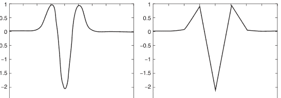

图 5.5 (a) 以 0 为中心的一维高斯函数的二阶导数。(b) 三点近似。

如果我们的目标是边缘检测，那么我们就完成了。但是，如果我们的目标是对导数（特别是高阶导数）进行精确估计，使用高斯核（因为它会模糊图像）显然会引入只能部分补偿的错误 [5.30]。尽管如此，这仍然是开发有效导数核的最佳方法之一。

为便于今后参考，Eq. 5.21 给出了一些一维高斯函数的导数。尽管对于我们的大部分需求来说，并没有特别需要归一化因子 \(2\sigma\)（它只是确保高斯函数积分为一），但我们还是包含了它。这样，这些公式就与文献一致。这里使用下标表示法来表示导数。也就是说，\(G_{xx}(\sigma, x) = \frac{\partial^2}{\partial x^2} G(\sigma, x)\)，其中 \(G(\sigma, x)\) 是均值为零、标准差为 \(\sigma\) 的关于 \(x\) 的高斯函数。

```
\(G(\sigma, x) = \frac{1}{\sqrt{2\pi}\sigma} \exp \left( -\frac{x^2}{2\sigma^2} \right)\)

\(G_x(\sigma, x) = \frac{-x}{\sqrt{2\pi}\sigma^3} \exp \left( -\frac{x^2}{2\sigma^2} \right)\)

\(G_{xx}(\sigma, x) = \left( \frac{x^2}{\sqrt{2\pi}\sigma^5} - \frac{1}{\sqrt{2\pi}\sigma^3} \right) \exp \left( -\frac{x^2}{2\sigma^2} \right)\)

\(G_{xxx}(\sigma, x) = \frac{x}{\sqrt{2\pi}\sigma^5} \left( 3 - \frac{x^2}{\sigma^2} \right) \exp \left( -\frac{x^2}{2\sigma^2} \right)\)

(5.21)
```

让我们更详细地了解如何利用这些公式及其二维等价形式来推导核。

获取高斯函数导数核值的最简单方法是直接代入 x = 0、1、2 等及其负值，从而得到核的数值。

首先出现的问题是“\(\sigma\) 应该取多少？”为了解决这个问题，我们推导用于一维高斯函数二阶导数的核元素。其他导数可以使用同样的理念来开发。观察图 5.5 (a) 并问：“是否存在一个 \(\sigma\) 值，使得二阶导数的极值出现在 \(x = -1\) 和 \(x = 1\) 处？”显然存在，其值为 \(\sigma = 1/\sqrt{3}\)。（你将在作业 5.7 中证明这一点。）

给定这个 \(\sigma\) 值，可以在整数点 \(x = \{-1, 0, 1\}\) 处计算高斯函数二阶导数的值。在 \(x = 0\) 处，我们得到 \(G_{xx}(\frac{1}{\sqrt{3}}, 0) = -2.07\)，在 \(x = 1\) 处，\(G_{xx}(\frac{1}{\sqrt{3}}, 1) = 0.9251\)。到目前为止，这还不算太难，是吧？不幸的是，我们还没有完成。核元素之和为零很重要。如果不为零，第 6 章中描述的迭代算法在多次迭代后将无法保持适当的亮度水平。核还需要对称。这本质上定义了高斯函数的二阶导数。最接近给定值且满足对称性和和为零的最合理的一组值是 \(\{1, 2, 1\}\)。然而，这并不能教会我们太多。让我们来看一个 \(5 \times 1\) 核，看看能否多了解一些。我们要求：

- 核元素应尽可能接近高斯函数相应导数的值；
- 对于导数核，元素之和必须为零；
- 核应关于其中心对称，除非你想进行特殊处理。

我们可以计算 5 元素一维高斯函数的元素，如果这样做，假设 \(\sigma = \frac{1}{\sqrt{3}}\)，对于 \(x = \{-2, -1, 0, 1, 2\}\)，我们得到 \(\{0.0565, 0.2251, -2.0730, 0.9251, 0.0565\}\)。不幸的是，这些数字之和不为零。核值之和为零很重要，但实际值精确则没那么重要。那么在这种情况下我们该怎么办？我们使用约束优化。一种策略是建立一个问题，寻找一个尽可能接近这些值但积分为零的函数。对于更复杂的问题，作者使用 Interopt [5.4] 来求解数值优化问题，但你可以不使用数值方法来解决这个问题。具体做法如下。首先，理解问题（针对上面给出的 5 点情况）：我们希望找到尽可能接近 \(\{0.0565, 0.9251, -2.0730, 0.9251, 0.0565\}\) 的五个数字，且满足这五个数字之和为零的约束。由于对称性，我们实际上只有三个数字，我们将其表示为 \([a, b, c]\)。为了记号方便，引入三个常数 \(\alpha = 0.0565, \beta = 0.9251,\) 和 \(\gamma = -2.073\)。

```
$H_a(a, b, c) = 2(a - \alpha)^2 + 2(b - \beta)^2 + (c - \gamma)^2.$ (5.22)
```

因此，为了找到与这些数字相似的 \(a, b,\) 和 \(c\)，我们写出求和的 MSE 形式

and minimizing \(H_a\) will produce \(a, b,\) and \(c\) that are close to \(\alpha, \beta,\) and \(\gamma\). In order to further satisfy the "sum to zero" requirement of the kernel values, we need to add a constraint to \(H_a\) that requires \(2a + 2b + c = 0\).

使用拉格朗日乘数的概念，我们可以通过最小化另一个目标函数来找到 \(a, b,\) 和 \(c\) 的最佳选择

```
$H(a, b, c) = 2(a - \alpha)^2 + 2(b - \beta)^2 + (c - \gamma)^2 + \lambda(2a + 2b + c).$ (5.23)
```

表 5.1 当 \(\sigma = 1/\sqrt{3}\) 时一维高斯函数的导数。

| 导数 | 值 |
| :--- | :--- |
| 一阶导数，3 x 1 | [ 0.2420, 0.0, -0.2420] 或 [ 1, 0, -1 ] |
| 一阶导数，5 x 1 | [0.1080, 0.2420, 0, -0.2420, -0.1080] |
| 二阶导数，3 x 1 | [1, -2, 1] |
| 二阶导数，5 x 1 | [0.07846, 0.94706, -2.05104, 0.94706, 0.07846] |

对于不熟悉使用拉格朗日乘数进行约束优化的学生，有必要做一些解释。前面带有 \(\lambda\) 的项（\(\lambda\) 是拉格朗日乘数）是约束。它的表述方式是，如果它恰好等于零，我们就能找到合适的 \(a, b,\) 和 \(c\)。通过最小化 \(H\)，我们将找到在同时满足约束的同时最小化 \(H_\lambda\) 的参数。要最小化 \(H\)，求偏导数并令其等于零：

```
\(\frac{\partial H}{\partial a} = 4(a - \alpha) + 2\lambda.\)
\(\frac{\partial H}{\partial b} = 4(b - \beta) + 2\lambda.\)
\(\frac{\partial H}{\partial c} = 2c - 2\gamma + \lambda\)
\(\frac{\partial H}{\partial \lambda} = 2a + 2b + c\)
```

将偏导数设为零并简化，我们得到以下线性方程组：

```
\(a = \alpha - \frac{\lambda}{2}\)
\(b = \beta - \frac{\lambda}{2}\)
\(c = \gamma - \frac{\lambda}{2}\)
\(2a + 2b + c = 0\)
```

求解该方程组可得到表 5.1 中给出的集合。对于一阶导数，3 x 1 的情况，对称性确保值始终和为零，因此整数值与浮点值一样好。

我们可以以同样的方式计算核，以使用高斯函数在二维中估计偏导数；假设各向同性高斯，关于 x 的一阶导数的一个实现如图 5.6 所示。你将有机会作为家庭作业推导其他导数。

| 0.0261 | 0 | -0.0261 |
| 0.1080 | 0 | -0.1080 |
| 0.0261 | 0 | -0.0261 |

图 5.6 使用高斯导数推导的 3 x 3 一阶导数核。

### 5.4.5 其他高阶导数

我们刚刚看到如何使用高斯导数来计算二阶或三阶导数。既然话题已经提到，并且你以后需要知道相关术语，我们在这里定义两个依赖于二阶导数的标量算子：拉普拉斯算子和二次变差。

点 (x, y) 处亮度的拉普拉斯算子是

\(\frac{\partial^2 f}{\partial x^2} + \frac{\partial^2 f}{\partial y^2}\)

而亮度的二次变差（QV）是

\(\left(\frac{\partial^2 f}{\partial x^2}\right)^2 + \left(\frac{\partial^2 f}{\partial y^2}\right)^2 + 2\left(\frac{\partial^2 f}{\partial x \partial y}\right)^2\)

拉普拉斯算子可以用多个核近似，包括以下三个常用核

| 0 | 1 | 0 |
|---|---|---|
| 1 | -4 | 1 |
| 0 | 1 | 0 |

| 1 | 1 | 1 |
|---|---|---|
| 1 | -8 | 1 |
| 1 | 1 | 1 |

| -1 | 2 | -1 |
|---|---|---|
| 2 | -4 | 2 |
| -1 | 2 | -1 |

二次变差可以通过三个偏二阶导数核来估计，

\(\Delta_{xx} = \frac{1}{6} \begin{bmatrix} 0 & 0 & 0 \\ 1 & -2 & 1 \\ 0 & 0 & 0 \end{bmatrix}, \Delta_{yy} = \frac{1}{6} \begin{bmatrix} 0 & 1 & 0 \\ 0 & -2 & 0 \\ 0 & 1 & 0 \end{bmatrix}, \Delta_{xy} = 2 \begin{bmatrix} -0.25 & 0 & 0.25 \\ 0 & 0 & 0 \\ 0.25 & 0 & -0.25 \end{bmatrix}\)

请注意，如 Eq. 5.28 所示的拉普拉斯算子是一个二维各向同性核，这意味着它没有方向，因为只使用了一个核。

Eq. 5.29 中的第三个核通常被称为交叉项，因为它同时涉及 x 和 y。第三个（交叉）项的重要性取决于所求解的问题。

为了说明这一点，请考虑图 5.7，它展示了不带和带交叉项的二次变差的应用。最左侧图像中算子的强度（未计算交叉项）随边缘方向显著变化。然而，中心图像使用了 QV 中的所有三项，并具有近乎完美的均匀强度。一些学生会意识到，如果 \(\frac{\partial^2 f}{\partial x^2}\) 和 \(\frac{\partial^2 f}{\partial y^2}\) 实际上是二阶导数空间的一组基，那么它们的和应该对梯度方向不变。不幸的是，这些基项是先平方再相加，而不仅仅是相加，平方的非线性引入了强度变化，需要交叉项来补偿。

### 5.4.6 尺度简介

到目前为止，我们在讨论导数核时故意忽略了“尺度”因子。在大多数计算机视觉应用中，使用高斯导数，其中高斯参数 \(\sigma\) 是函数的变量，即 \(G(x, y, \sigma)\)，\(\sigma\) 被称为尺度。因此，拉普拉斯算子是 \(G_{xx}(x, y, \sigma) + G_{yy}(x, y, \sigma)\)。现在尺度已成为讨论中的一个因素


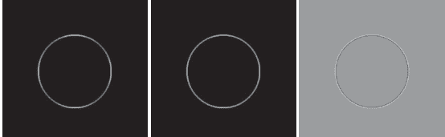

图 5.7 左：将 QV 的前两项应用于亮度中的圆形阶梯边缘。中：将包含所有三项的 QV 应用于同一阶梯边缘。右：将拉普拉斯算子应用于同一阶梯边缘。拉普拉斯算子具有负值，亮度已缩放以显示黑色=最负，灰色=0，白色=最正。

在求导过程中，我们必须处理尺度与缩放、核大小以及函数尺度之间的关系。

假设你拍摄了一张 512 × 512 的图像，图像中有一个你感兴趣的小物体。你手头有很棒的成像软件，因此使用其中一个程序在感兴趣的物体周围画一个框并将其提取出来。此过程如图 5.8 所示。

假设原始图像为 512 × 512 像素，感兴趣的物体为 128 × 128 像素。计算这些像素的一种方法是：在原始图像中，对每个 4 × 4 像素的方形块，在较小的图像中生成一个像素。仅对 16 个原始像素求平均会生成一个信息模糊的图像，但新图像很小，如图 5.8 中间所示。但是，假设你的客户坚持要求分辨率较低的图像（现在为 128 × 128）仍然是 512 × 512。这样做后，新图像会明显模糊。

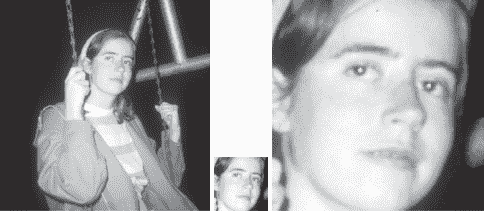

图 5.8 一张 512 × 512 的图像被窗口化、裁剪并选定了一个小区域。然后将生成的图像再次缩放，产生了一张模糊的图像。

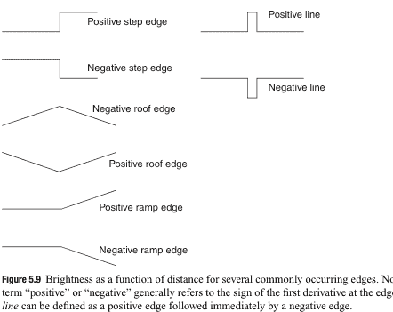

你可能能看到缩放图像中的模糊，这是由较小的图像（将较低尺度插值到较大图像）造成的。因此，我们看到模糊与尺度之间存在关系。在尺度空间中，正如我们将在 5.6 节中讨论的那样，放大会产生更小的观察区域并包含更多细节——更小的尺度，而缩小会产生更大的观察区域，但单个图像特征由更少的像素组成，实际上是模糊的——更大的尺度。因此，“尺度”的一个含义是模糊程度，第二个含义是特征的相对大小。这个简单概念的几个其他细节将在本书后面部分出现。

## 5.5 边缘检测

边缘是图像中亮度突然变化的区域；即导数（或者更准确地说，某种导数）具有大幅度的区域。查找边缘的常见方法是首先在图像上应用导数核。我们可以将边缘分类为阶梯边缘、屋顶边缘或斜坡边缘 [5.19]，如图 5.9 所示。

我们已经看到（两次）应用类似公式 5.10 的核如何近似对 x 的偏导数。同样，公式 5.30 的核估计 \(\frac{\partial f}{\partial y}\)。根据你选择的正 y 方向，你可以选择左核（正 y 向下指）或右核（正 y 向上指）。

\(h_y = \frac{1}{6} \begin{bmatrix} -1 & -1 & -1 \\ 0 & 0 & 0 \\ 1 & 1 & 1 \end{bmatrix} \text{ or } \frac{1}{6} \begin{bmatrix} 1 & 1 & 1 \\ 0 & 0 & 0 \\ -1 & -1 & -1 \end{bmatrix} \quad (5.30)\)

在文献中出现过一些其他形式，出于历史原因，你应该了解其中一些。下面是我们已经看到的两个导数估计，分别称为“Sobel 算子”的 x 版本和 y 版本。

$h_x = \frac{1}{8} \begin{bmatrix} -1 & -2 & -1 \\ 0 & 0 & 0 \\ 1 & 2 & 1 \end{bmatrix} \quad h_y = \frac{1}{8} \begin{bmatrix} -1 & 0 & 1 \\ -2 & 0 & 2 \\ -1 & 0 & 1 \end{bmatrix} . \quad (5.31)$

重要提示（这会在整个学期给你带来麻烦，所以你最好现在就开始）。在软件实现中，正 y 方向是“向下”。这是由于扫描是从上到下、从左到右。因此，像素 (0,0) 是图像的左上角。此外，编号从零开始，而不是一。我们发现避免混淆的最佳方法是在编写程序时永远不要使用“x”和“y”这两个词，而是使用“行”和“列”，并记住现在 0 在顶部。

在本书中，我们有时会使用常规笛卡尔坐标系，以便数学正确，并进一步让学生困惑（毕竟，教授存在的目的就是如此）。

澄清了这个混乱之后，让我们继续。给定梯度向量

$\nabla f = \left[ \frac{\partial f}{\partial x} \frac{\partial f}{\partial y} \right]^T \equiv [f_x \quad f_y]^T , \quad (5.32)$

我们关心其幅度

$|\nabla f| = \sqrt{f_x^2 + f_y^2} \quad (5.33)$

（我们将称之为“边缘强度”）及其方向

$\angle \nabla f = \tan^{-1} \left( \frac{f_y}{f_x} \right) , \quad (5.34)$

查找图像中边缘的一种方法是计算“梯度幅度”图像——即每个像素的亮度为该点计算出的梯度向量幅度的图像。然后，对该值进行阈值处理，以创建一个图像：背景为零，边缘为某个大数（1 或 255）。去试试看：完成作业 5.4。

你从这些实验中学到了什么？显然，当我们尝试通过简单核操作查找边缘时，会出现几个问题。我们发现，无论怎样，噪声图像会导致边缘：

- 某些地方太粗
- 某些地方缺失
- 某些地方多余

这就是生活——使用简单核我们无法做得更好，但我们将在下一章讨论更复杂的方法。

### 5.5.1 Canny 边缘检测器

如你所料，查找图像中边缘的方法不仅仅是对导数进行阈值处理。我们希望比简单梯度阈值揭示的更精确地知道边缘的位置。Tagare 和 deFigueiredo [5.28]（另见 [5.2]）将边缘检测过程概括为

- 1. 将输入与一个滤波器进行卷积，该滤波器平滑地对输入求导，并在边缘位置及其附近产生高值。输出 g(x) 是求导的阶梯边缘与噪声之和。
- 2. 一个决策机制隔离出滤波器输出显著高于噪声的区域。
- 3. 一个机制识别隔离区域中 g(x) 导数的零交叉点，并将其声明为边缘的位置。

在该领域获得相当声誉的两种方法是所谓的“Canny 边缘检测器” [5.6] 和“面模型” [5.11]。在这里，我们只描述 Canny 边缘检测器。

此边缘检测算法首先在每个点查找梯度幅度的估计值。Canny 使用 2 × 2 核，而不是我们使用的 3 × 3 核，但这不影响该方法的哲学。一旦我们有了两个偏导数的估计值，我们就使用公式 5.33 和 5.34 计算梯度的幅度和方向，生成两个图像 M(x, y) 和 Θ(x, y)。我们现在有一个结果，可以轻松识别梯度幅度大的像素。然而，这还不够，因为我们现在需要对幅度数组进行细化，只保留极大值点，创建一个新图像 N(x, y)。此过程称为非极大值抑制（NMS）。

NMS 可以以多种方式实现。然而，其基本思想如下。首先，将 N(x, y) 初始化为 M(x, y)。然后，在每个点 (x, y) 处，沿梯度方向看一个像素，沿反方向看一个像素。如果 M(x, y)（所讨论的点）不是这三个点中的最大值，则将其在 N(x, y) 中的值设为零。否则，N 的值保持不变。

NMS 之后，我们有位置正确且宽度仅为一个像素的边缘。然而，这些新边缘仍然存在我们之前识别的问题——由于噪声导致的额外边缘点（误检）以及由于模糊或噪声导致的缺失边缘点（漏检）。使用双阈值方法可以获得一些改进。使用两个阈值 τ1 和 τ2，其中 τ2 显著大于 τ1。将这两个不同的阈值应用于 N(x, y)，分别生成两个二值边缘图像，记为 T1 和 T2。由于 T1 是使用较低阈值创建的，它将比 T2 包含更多的误检。因此，T2 中的点被认为是真实边缘的一部分。将 T2 中的连接点复制到输出边缘图像。当找到边缘末端时，会在 T1 中查找可能作为边缘延续的点。延续将被扩展，直到它连接到另一个 T2 边缘点，或找不到连接的 T1 点。

6 有时也使用复数形式 nonmaxima suppression 来书写。该表达式存在歧义。它可能是指抑制每个非极大值点，或者抑制所有非极大值点。我们选择使用单数形式。


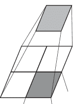

图 5.10 金字塔是一种数据结构，它是一系列图像，其中每个像素是下一层中四个像素的平均值。

在 [5.6] 中，Canny 还说明了一些巧妙的近似方法，可提供显著的加速效果。

## 5.6 尺度空间

在 5.4.6 节中，我们简要介绍了尺度的概念。在此，我们详细阐述构建尺度空间的过程以及尺度空间的一些重要属性。“尺度空间”是图像金字塔概念的扩展，最初由 Kelly [5.18] 用于图像处理，后来以多种方式扩展（参见 [5.5, 5.7, 5.26, 5.27] 及其他许多文献）。

### 5.6.1 金字塔

在金字塔中，会生成同一图像的一系列表示，每个表示都是通过对下一更高层图像进行 2:1 子采样（或平均）创建的（图 5.10）。

图 5.11 展示了一个高斯金字塔。它是通过在 2:1 子采样之前对每一层进行高斯模糊生成的。当你看这张图时，应该会产生一个有趣的问题：你能否从这个金字塔中的所有数据重建原始图像？答案是“不，因为在每一层，你都在丢弃高频信息。”

尽管单独的高斯金字塔不包含足够的信息来重建原始图像，但我们可以构建第二个金字塔以提供额外信息。为此，我们使用拉普拉斯金字塔，它是通过使用拉普拉斯算子计算图像的类似表示来构建的。该过程保留了高频信息。图 5.12 对此进行了说明。结合两种金字塔表示可以重建原始图像。

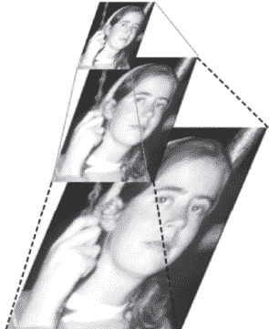

图 5.11 高斯金字塔，通过对每一层进行高斯模糊然后进行 2:1 子采样构建。这种看待金字塔的方式强调了这样一个事实：我们应该将金字塔视为一种三维数据结构。

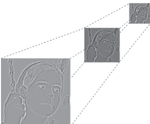

图 5.12 这个拉普拉斯金字塔实际上是通过高斯差分计算的。另见 11.3.2 节。这种看待金字塔的方式强调了这样一个事实：每个更高层级的图像像素更少。

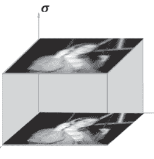

图 5.13 在堆叠尺度空间中，原始图像位于底部，每个更高层级都越来越模糊，使用尺度为 \(\sigma\) 的高斯模糊。

### 5.6.2 无重采样的尺度空间

在现代（堆叠）尺度空间表示中，每一层是前一层的模糊这一概念得以保留，但不进行子采样——每一层与前一层大小相同，但更模糊。显然，在高尺度级别，即 \(\sigma\) 较大时，只有最大的特征可见。图 5.13 对此进行了说明。

这里为你提供一个思想实验：取一张图像，使用标准差为 1 的高斯核对其进行模糊处理。

```
\(f(x, y, 1) = G(x, y, 1) \circledast f(x, y)\)
```

其中

```
\(G(x, y, \sigma) = \frac{1}{2\pi\sigma^2} e^{-\frac{x^2+y^2}{2\sigma^2}}\)
```

此操作生成一张新图像。将该图像称为图像 1。现在，使用标准差为 2 的高斯核对原始图像进行模糊处理。将该图像称为图像 2。继续此过程，直到你得到一组可以视为堆叠的图像，并且“顶部”图像几乎被模糊掉。我们说顶部图像是图像在“大尺度”下的表示。这组图像被称为尺度空间表示。显然，由于我们不需要只使用标准差的整数值，我们可以创建具有所需尺度分辨率的尺度空间表示。尺度空间表示的基本前提是，某些特征可以随尺度进行跟踪，这些特征随尺度的变化揭示了图像的一些信息。

尺度空间已被正式定义 [5.22, 5.23] 为具有以下属性：

- 所有信号都应定义在同一域上（无金字塔）。
- 尺度参数值的增加应产生更粗糙的表示。
- 粗糙层级上的信号应比精细层级上的信号包含更少的结构。如果将局部极值点的数量视为平滑度的度量，那么随着尺度变粗糙，极值点的数量不应增加。此属性称为尺度空间因果性。
- 所有表示都应通过对原始图像应用核算子来生成。

最后一个属性无疑是可争论的，因为它在形式上要求一个线性、空间不变算子。违反这一要求的一个有趣的尺度空间方法是使用越来越大的结构元素进行灰度形态平滑来生成尺度空间 [5.15]。你可以使用尺度空间概念来表示纹理，甚至概率密度函数，在这种情况下，你的尺度空间表示就成为一个聚类算法 [5.21]。随着课程的深入，我们将看到尺度表示的应用。

尺度空间表示最有趣的方面之一是我们的老朋友高斯函数的行为。高斯函数的二阶导数（在二维中，高斯拉普拉斯：LOG）已被证明 [5.24] 作为核使用时具有非常好的特性。LOG 的零交叉是边缘位置的良好指示器。

#### 尺度空间因果性

有人可能会问：“高斯函数是开发这种核所要使用的最佳平滑算子吗？”换句话说：我们想要一个核，其二阶导数在移向更大尺度时永远不会产生新的零交叉。事实上，我们可以用以下更一般的形式来表达这一愿望：

让我们将“特征”的概念定义为某个算子取得极值（最大值或最小值）的点。尺度空间因果性的概念指出，随着尺度增加，图像变得越来越模糊，永远不会产生新特征。高斯函数是唯一具有此属性的核（线性算子）[5.2, 5.3]。

尺度空间因果性的这一思想在以下示例中得到说明。图 5.14 说明了图像中单条扫描线沿线的亮度剖面，以及使用方差递增的一维高斯函数对该单条线进行模糊处理所创建的尺度空间。在图 5.15 中，我们看到高斯拉普拉斯以及拉普拉斯变号的点。本示例中的特征（即零交叉，它们是边缘的良好候选项）在右图中指示。请观察，随着尺度增加，永远不会创建新特征点（在此例中为零交叉）。从顶部（低尺度）到底部（高尺度），一些特征消失，但不会创建新特征。

这一思想的一个明显应用是首先识别图像中的重要边缘。我们可以通过升高尺度，找到那些少数边缘，然后将其跟踪到更低尺度来实现这一点。

## 5.7 人们是如何做到的？

两位神经生理学家，大卫·休贝尔和托尔斯滕·威塞尔 [5.13, 5.14]，先是在猫，后来在猴子的大脑（具体来说是视觉皮层）中植入了一些电极。

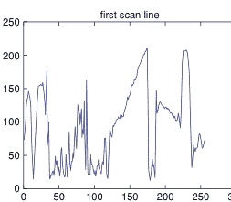

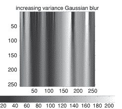

图 5.14 左：穿过图像的扫描线的亮度剖面。右：该扫描线的尺度空间表示。尺度向底部增加，因此从顶部到底部不应创建新特征。

在记录神经元放电的同时，他们向动物提供了各种类型的视觉刺激。他们观察到了一些有趣的结果：首先，只有在观察到特定类型的模式时，某些细胞才会放电。例如，特定的细胞可能只有在观察到特定角度的从亮到暗的边缘时才会放电。有证据表明，他们测量的每个细胞都来自一个称为感受野的细胞邻域的输入。存在多种类型的感受野，可能都连接到相同的光探测器，这些探测器以这种方式组织起来以完成边缘检测和其他处理。Jones 和 Palmer [5.16] 仔细绘制了感受野函数，并证实 [5.8, 5.9] 感受野的功能可以由加博函数准确表示，其形式如公式 5.39 所示。

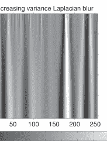

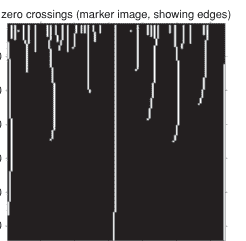

图 5.15 尺度空间表示的拉普拉斯（左）和拉普拉斯的零交叉（右）。由于这是一维数据，拉普拉斯和二阶导数之间没有区别。


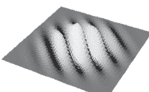

图 5.16 二维 Gabor 滤波器。请注意，正/负响应很像高斯函数的四阶导数。

Gabor 滤波器是高斯函数和正弦波的乘积，其中高斯函数提供中心加权，正弦波提供对边缘的敏感性。

尽管有众多参数，Gabor 滤波器相对易于使用。它之所以广受欢迎，有三个原因。首先，生物学证据表明，Gabor 滤波器是视觉皮层神经元对图像中边缘响应的较好代表。其次，Gabor 滤波器作为具有可参数化方向的方向导数算子相对易于使用。此外，参数的选择允许用户不仅指定尺度，还指定滤波器所选取的边缘/直线类型。

Gabor 滤波器应用于图像中的点 (x, y) 时，计算如下：

```
\( x' = x \cos \theta + y \sin \theta \quad (5.37) \)

\( y' = -x \sin \theta + y \cos \theta \quad (5.38) \)

\( g(x, y; \lambda, \theta, \psi, \sigma, \gamma) = \exp \left( - \frac{x'^2 + y'^2}{2\sigma^2} \right) \cos \left( 2\pi \frac{x'}{\lambda} + \psi \right) \quad (5.39) \)
```

其中，平行条纹的法线角度为 \(\theta\)，\(\lambda\) 是决定正弦波波长的变量，\(\gamma\) 是长宽比（算子的长宽比），\(\psi\) 是相位，\(\sigma\) 是高斯函数的标准差（尺度）。

如果你使用 IFS 库，Gabor 滤波器通过 IFS 函数 f1Gabor 实现。

图 5.16 展示了一个 Gabor 滤波器。

以这种方式描述的 Gabor 滤波器（你可以选择使用复指数代替余弦）具有相当大的灵活性。例如，如果 \(\psi = 0\)，余弦以原点为中心，我们生成的滤波器（在 1D 中）看起来与图 5.17 中的顶部曲线非常相似。这个滤波器几乎完全像 \(-\frac{d^2f}{dx^2}\)，可以被视为四阶导数算子，或者直线检测器，因为一条直线仅仅是两个背靠背的边缘。然而，如果 \(\psi = \frac{\pi}{2}\)，余弦变为正弦，我们就得到了一个上升阶跃边缘检测器。同样，\(\psi = -\frac{\pi}{2}\) 将产生一个下降边缘检测器。

公式 5.39 的指数因子是一个二维高斯函数，其等光线形成与 x 轴和 y 轴对齐的长轴和短轴的椭圆。

关于公式 5.39 中参数的取值，当这些参数在活体生物中实际测量时，已做出以下有趣的观察 [5.20]：

- 椭圆的长宽比 \(\gamma\) 为 2:1。

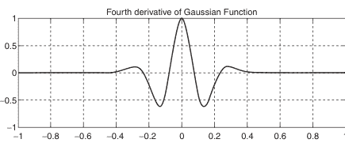

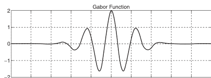

图 5.17 Gabor 滤波器截面与高斯函数四阶导数相似截面的比较。

- 由正弦波生成的平面波倾向于沿椭圆的短轴传播。
- 频率响应的半幅带宽在最佳方向上约为 1 到 1.5 个八度。

那么，我们的大脑中是否有 Gabor 滤波器？或者 Gabor 类小波发生器？我们不知道你的大脑情况，但 Young [5.31] 研究了哺乳动物视网膜的刺激-响应特性，并观察到，那些用 Gabor 滤波器或小波很好建模的感受野，同样可以用称为“偏移高斯差”的核来描述，这本质上是带有加法偏移的 LOG。图 5.17 展示了一个 Gabor 和高斯函数四阶导数的截面。你可以看到明显的差异，主要区别在于 Gabor 延伸至无穷，而四阶导数只有三个极值点。然而，以神经生理学实验可达到的精度来看，它们看起来是相同的。问题仅在于数据测量不够准确，并且可以将各种曲线拟合到数据上。

## 5.8 数字梯度检测器的性能

图像梯度在图像分析中起着重要作用。例如，梯度的方向是沿该方向微小步进时产生亮度最大无穷小增加的方向。不幸的是，在数字图像处理中，“无穷小”一词必须被翻译为“等于一”。寻找梯度的方法则变成了对公式 5.33 找到的幅值进行简单的阈值处理。

当然，问题是，估计梯度垂直和水平分量的算子并非没有误差。当我们在研究一个完全无关的现象时遇到这种情况，我们说：“这是老掉牙的事情。肯定有一篇在七十年代写的论文量化了梯度算子的性能。”在搜索了 IEEE Transactions on Pattern Recognition and Machine Intelligence 创刊以来的所有完整论文副本后，我们找到的关于梯度算子性能最好的最新论文是 2014 年写的 [5.1]。也许关于这个主题还有待学习。

在那篇论文 [5.1] 中，Alfaraj 和 Wang 讨论了所使用的核如何影响梯度向量估计的质量。本节详细阐述了这一主题，主要是实验性的。比较了简单的 1 x 3 导数、简单的 5 x 5、Sobel、Gabor 和高斯导数的性能。

解决了两个问题：

- 该算子对特定角度边缘的响应是否一致，以及
- 将 0 度和 90 度版本的算子一起使用（公式 5.34）在估计特定边缘片段方向时的准确性如何。

### 5.8.1 方向导数

在第一组测试中，使用了一条穿过图像中心的完美合成垂直边缘。

第二组测试与第一组相同，只是对输入图像应用了一个小 ($\sigma \approx 1$) 模糊，导致理想阶跃边缘模糊。下面的研究中，模糊图像的结果与理想图像的结果并列展示。

对于行数或列数为偶数的图像，没有中心像素。出于这个原因，这些实验中使用的所有图像均为 $129 \times 129$。不失一般性，边缘被定义为亮度 0.0 的均匀区域与亮度 1.0 的区域之间。

方向导数被定义为特定方向上的亮度变化率。计算机视觉中常用的大多数梯度算子只有两个方向：水平和垂直。Gabor 滤波器是这一规则的常见例外，将在下文进一步讨论。

在下面的所有图中，边缘方向被定义为图 5.18 中所示的角度 $\theta$。

#### 简单的 1 x 3 滤波器

最小的对称差分算子如下图所示，水平算子在左侧。

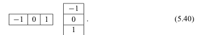

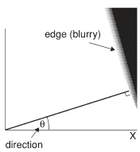

图 5.18 边缘的方向被定义为边缘法线与 x 轴所成的角度。

将此算子应用于各种边缘会产生图 5.19 所示的图表。左侧，图示了应用于理想阶跃边缘的结果；右侧，应用于略微模糊的边缘。观察到，当应用于完美阶跃边缘时，这两个算子产生二值输出。垂直算子只有两个可能的输出，水平算子同样只有两个。因此，使用一对 1 x 3 差分只能区分四个方向——方向空间分辨率非常低。应用于模糊阶跃边缘效果更好，因为模糊操作将边缘信息分散到更大的区域。

#### Sobel 核

两个著名的 Sobel 核

| -1 | 0 | 1 |
|---|---|---|
| -2 | 0 | 2 |
| -1 | 0 | 1 |

和

| -1 | -2 | -1 |
|---|---|---|
| 0 | 0 | 0 |
| 1 | 2 | 1 |

(5.41)

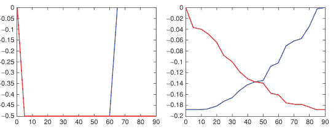

图 5.19 使用简单的 1 x 3 算子估计 ∂f/∂x（红色）和 ∂f/∂y（蓝色）的结果。水平轴是边缘的方向。垂直轴的比例不重要，因为实验的目的是说明边缘检测器量化得多么粗糙。左：两个算子应用于完美阶跃边缘。右：两个算子应用于模糊边缘。


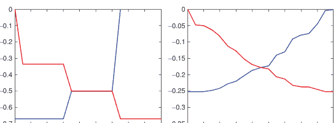

图 5.20 将 Sobel 3 x 3 算子应用于估计 ∂f/∂x（红色）和 ∂f/∂y（蓝色）的结果。水平轴是边缘的角度。左侧：将两个算子应用于理想阶梯边缘。右侧：将两个算子应用于模糊边缘。

通过求差和求和对数据进行平滑，并应用中心权重。图 5.20 说明了使用上述 Sobel 算子进行导数估计所得的准确性。与 1 x 3 相比，准确性有显著提高，但仍不够理想。请注意，这种启发式动机的内核看起来有点像高斯的导数。

### 最优双二次拟合

在此实验中，使用第 5.4.2 节的最小平方误差方法来确定平面拟合到表面的最优拟合。对平面拟合求取两个一阶偏导数，得到用于 5 x 5 核的以下两个导数核：

| -2 | -1 | 0 | 1 | 2 |
|---|---|---|---|---|
| -2 | -1 | 0 | 1 | 2 |
| -2 | -1 | 0 | 1 | 2 |
| -2 | -1 | 0 | 1 | 2 |
| -2 | -1 | 0 | 1 | 2 |

和

| -2 | -2 | -2 | -2 | -2 |
|---|---|---|---|---|
| -1 | -1 | -1 | -1 | -1 |
| 0 | 0 | 0 | 0 | 0 |
| 1 | 1 | 1 | 1 | 1 |
| 2 | 2 | 2 | 2 | 2 |

(5.42)

左侧，图 5.21 说明了将此核应用于理想边缘的结果，右侧则是模糊图像。这些核并不直观，因为它们对远离感兴趣点的像素赋予更多权重。确实，如果被检测的边缘较短或呈曲线，这些核的表现较差。这里展示的看似良好的性能，仅仅归因于被检测的边缘又长又直，这通常是一个不切实际的假设。

### 高斯导数

二维高斯，

```
h(\mathbf{x}) = \frac{1}{(2\pi)^{d/2} |K|^{1/2}} \exp \left( - \frac{[\mathbf{x} - \boldsymbol{\mu}]^T K^{-1} [\mathbf{x} - \boldsymbol{\mu}]}{2} \right) (5.43)
```

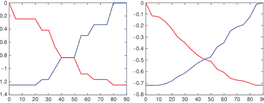

图 5.21 将公式 5.42 的非中心加权算子应用于估计 ∂f/∂x（红色）和 ∂f/∂y（蓝色）的结果。水平轴是边缘的角度。垂直轴的比例无关紧要，因为实验的目的是说明边缘检测器量化得多么粗糙。左侧：将两个算子应用于理想阶梯边缘。右侧：将两个算子应用于模糊边缘。

可进行微分，得到

```
\(\frac{\partial h(x, y)}{\partial x} = \frac{-x}{2\pi\sigma^4} \exp \left( - \frac{x^2 + y^2}{2\sigma^2} \right)\) (5.44)
```

用于各向同性协方差。

高斯导数（DoG）卷积核可以从上述方程导出，只需使用公式 5.44 的结果即可。

在图 5.22 中，说明了尺度 σ 的影响。随着尺度增加，算子对方向变化的响应变得越来越平滑。这表明算子确定方向的能力同样取决于尺度。这是真的，但也必须考虑图像中特征的尺度。这将在第 11 章中更详细地讨论。

### Gabor 滤波器

图 5.23 说明了使用 Gabor 算子估计的垂直边缘检测器 ∂f/∂x。当应用于同一组边缘且尺度相同时，观察到与高斯导数的相似性。然而，差异显著——响应远不如高斯导数平滑。这可能导致 Gabor 作为方向估计器的用途较小。

### 5.8.2 估计方向

在本节中，使用以下算法评估这些算子确定方向的能力，分别应用于理想和模糊阶梯边缘。

- 1. 将算子的垂直版本和水平版本应用于每个边缘图像，生成一组梯度估计值。
- 2. 使用这些估计值，应用公式 5.34 来估计边缘的方向。
- 3. 绘制估计角度与边缘实际角度的对比图。

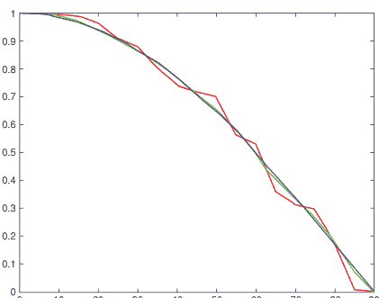

图 5.22 将高斯导数算子应用于估计 ∂f/∂x，公式 5.42 的尺度分别为 2（红色）、4（绿色）和 6（蓝色）。水平轴是边缘的方向。

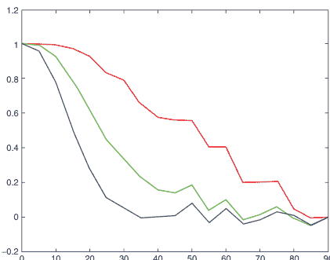

图 5.23 将 Gabor 滤波器应用于在尺度 2（红色）、4（绿色）和 6（蓝色）下估计 ∂f/∂x。水平轴是边缘的角度。

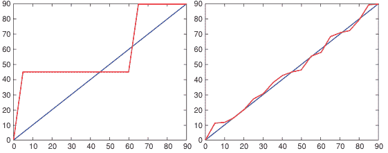

图 5.24 用于估计垂直和水平偏导数的 3 x 1 核的边缘方向估计值与实际方向对比。真实边缘方向为蓝色，估计值为红色。左图是理想边缘的结果，右图是模糊边缘的结果。

#### 简单的 1 x 3 滤波器

图 5.24 绘制了实际角度与估计值的对比，使用 1 x 3 算子来估计方向导数。显然，1 x 3 算子对此应用不太有用，至少对于理想边缘不适用。如前所述，轻微模糊会分散信息，从而允许更准确的边缘估计。

#### Sobel 核

图 5.25 说明了使用先前展示的 Sobel 算子进行导数估计并结合公式 5.34 所得的准确性。与 1 x 3 相比，准确性有显著提高，但仍不够理想。

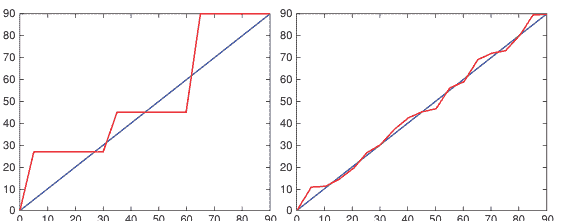

图 5.25 使用两个 3 x 3 Sobel 核来估计角度，能产生稍好一些的估计，但仍不太理想。用于生成左图结果的边缘是理想阶梯边缘，右图则是模糊阶梯边缘。

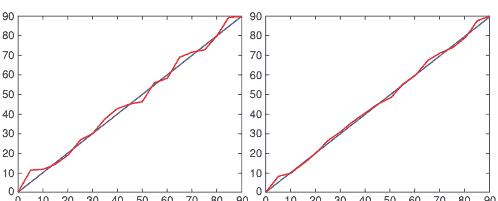

**图 5.26** 使用高斯导数推导的核来估计垂直和水平偏导数的边缘方向估计值与实际方向对比。使用的尺度为 σ = 2。

#### 高斯导数

图 5.26–5.28 绘制了实际角度与估计值的对比，使用三个仅在尺度上不同的算子来估计方向导数。显然，随着尺度增加，估计值好得多。这是因为较大 σ 值的模糊量增加。

#### Gabor 滤波器

使用两个 Gabor 滤波器，一个调谐到 90°，另一个调谐到 0°，我们来估计梯度。与高斯导数一样，Gabor 滤波器包含一个可调尺度参数，同样称为 σ。在图 5.29–5.31 中，说明了 σ = 2、4、6 的 Gabor 滤波器的性能。

Gabor 对方向的选择性远高于其他任何滤波器。也就是说，Gabor 在其敏感的方向附近产生强输出，并且

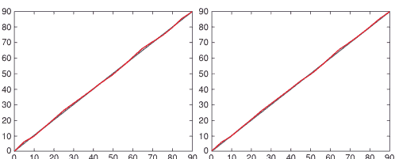

**图 5.27** 使用高斯导数推导的核来估计垂直和水平偏导数的边缘方向估计值与实际方向对比。使用的尺度为 σ = 4。

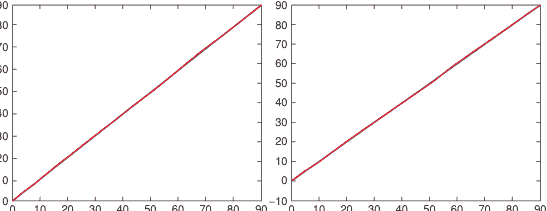

图 5.28 使用高斯导数推导的核来估计垂直和水平偏导数的边缘方向估计值与实际方向对比。使用的尺度为 σ = 6。

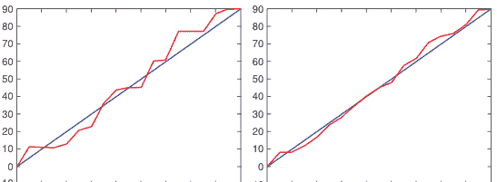

图 5.29 通过应用垂直和水平 Gabor 滤波器确定的边缘方向估计值。使用尺度 2。

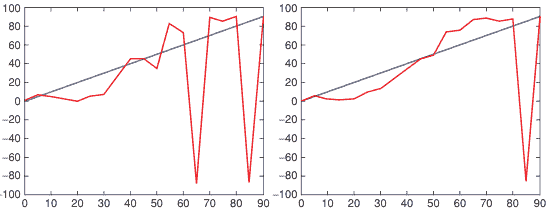

图 5.30 通过应用垂直和水平 Gabor 滤波器确定的边缘方向估计值。使用尺度 4。


图 5.31 通过应用垂直和水平 Gabor 滤波器确定的边缘方向估计。使用了尺度 6。

其他地方基本上是噪声。这在图 5.29-5.31 中很明显。在本实验中使用的 Gabor 滤波器的情况下，对于远离 0 或 90 度的大多数角度，两个测量值中的一个是没有意义的；或者更糟的是，正弦波的第二个周期可能出现在输出中，引入周期性失真。使用较大的 \(\sigma\) 时，指数允许更多周期的正弦波影响输出，产生令人惊讶的结果，即增大 \(\sigma\) 会降低性能。

### 5.8.3 讨论

本节讨论的五个函数，即 1 x 3、Sobel、5 x 5、高斯导数和 Gabor，有许多相似之处。它们都可以用来估计确定边缘角度的两个导数。表现最好的是高斯导数，尤其是在较大的 \(\sigma\) 时。

但是尺度是一个问题。使用高斯导数时，图 5.28 展示了几乎完美的性能。但是该核必须有多大？函数 fDoG 使用一个延伸至 3\(\sigma\) 的核，以准确确定值。对于 \(\sigma = 6\)，这会产生一个 37 x 37 的核！

请记住，在大多数计算机视觉应用中，你希望找到局部特征。像直线边缘长达 37 像素这样的特征，在大多数应用中是一个非常大的特征。因此，如此大的核仅适用于非常大尺寸的图像。如果 \(\sigma = 2\)，仅使用 5 x 5 核即可获得相当好的性能。

## 5.9 结论

在本章中，我们探讨了几种推导核算子的方法，这些算子应用于图像时，会对边缘类型产生强响应。

- 我们应用了导数的定义。
- 我们通过最小化平方误差之和，将解析函数拟合到曲面上。
- 我们将子图像转换为向量，并将这些向量投影到描述边缘特征的特殊基向量上。
- 我们利用核算子的线性特性，交换了模糊和微分的角色来构建核。我们使用了约束优化和拉格朗日乘数法来解决这个问题。

使用导数核进行边缘检测，虽然有效，但仍存在许多潜在问题。在后续章节中，我们将讨论一些更高级的算法，以进一步提高边缘检测的性能。

例如，在选择了用于估计导数的最佳算子、最佳阈值和最佳边缘位置估计后，仍可能剩下一组像素，被标记为可能属于边缘。如果这些位置相邻，可以从一个像素“走”到下一个像素，最终绕过一个区域。然而，这些点不太可能以我们希望的方式连接。由于模糊、噪声或部分遮挡，某些点可能缺失。解决这个问题有很多方法，包括参数变换，这将在本书后面详细讨论（第 9 章）。

举另一个例子，应用高斯低通滤波器，然后在（二阶）导数中搜索零点，可以准确（达到亚像素精度）找到边缘的确切位置，但前提是边缘是直线 [5.29]。如果边缘是曲线，就会引入错误。此外，本章中引用或描述的所有方法都在边缘法线方向上执行信号处理 [5.17]。为了更好地定位实际边缘，在第 8 章中，我们将讨论通过优化来定位曲线边缘更有效的高级算法。这比对导数进行简单阈值处理改进了边缘检测。

我们将通过提出边缘检测中的另一个问题来结束本章。假设我们想提出这样的问题：“此点处是否存在方向为 \(\theta\) 的边缘？”我们如何构建一个专门对 \(\theta\) 方向边缘敏感的核？一种直接的方法 [5.12] 是构建两个高斯一阶导数核 \(G_x\) 和 \(G_y\) 的加权和，使用类似这样的权重：

```
\(G_\theta = G_x \cos \theta + G_y \sin \theta\) (5.45)
```

你能计算这种方向选择性吗？用这种方式确定的 \(3 \times 3\) 核，你能检测到的最小角度差是多少？但是，除非使用相当大的核，否则这种方式得到的核方向选择性相当差。如果我们希望跨尺度进行微分，问题会更糟，因为尺度空间表示通常计算得比较粗糙，以最大限度地减少计算时间。你有解决方案吗？如果感兴趣，我们推荐 Perona [5.27] 的工作，它提供了解决这些问题的方法。

作者感谢 Bilge Karacali 和 Rajeev Ramanath 在制作本章使用的图像方面提供的帮助。

## 5.10 作业

### 作业 5.1：第 5.4.2 节展示了如何通过拟合平面来估计一阶导数。显然，这对于二阶导数行不通，因为平面的二阶导数处处为零。使用相同的方法，但使用双二次函数。

$f(x, y) = ax^2 + by^2 + cx + dy + e$

然后 $A = [a \ b \ c \ d \ e]^T$ 和 $X = [x^2 \ y^2 \ x \ y \ 1]^T$。

现在找到估计 $\frac{\partial^2 f}{\partial x^2}$ 的 $3 \times 3$ 核。使用 $3 \times 3$ 邻域。

### 作业 5.2：使用第 5.4.2 节的相同方法，而不是找到 $3 \times 3$ 核，在 $5 \times 5$ 邻域内找到 $5 \times 5$ 核，它使用平面方程估计中心点处的 $\frac{\partial^2}{\partial n^2}$。

### 作业 5.3：使用与作业 5.1 相同的方法，但找到估计中心点处二阶导数的 $5 \times 5$ 核，使用双二次函数方程。

### 作业 5.4：此作业包含几个步骤：

- 1. 创建图像：

- (a) 编写一个程序来生成如下所示的 $64 \times 64$ 图像


图像应包含如图所示的均匀亮度区域。将其保存在文件中并命名为 SYNTH1.ifs。

- (b) 编写一个程序，读取 SYNTH1.ifs，并应用模糊核

1/10

| 1 | 1 | 1 |
|---|---|---|
| 1 | 2 | 1 |
| 1 | 1 | 1 |

并将结果写入名为 BLUR1.ifs 的文件

- (c) 向 BLUR1.ifs 添加方差为 $\sigma^2 = 9$ 的高斯随机噪声，并将输出写入文件 BLUR1.V1.ifs。

- 2. 实现边缘检测器

- (a) 编写一个程序，将以下两个核（文献中称为“Sobel 算子”）应用于图像 SYNTH1.ifs、BLUR1.ifs 和 BLUR1.V1.ifs。

| -1 | 0 | 1 |
|---|---|---|
| -2 | 0 | 2 |
| -1 | 0 | 1 |

| -1 | -2 | -1 |
|---|---|---|
| 0 | 0 | 0 |
| 1 | 2 | 1 |

为实现此目标，执行以下操作：

- i. 将 \( h_x\)（见上文）应用于输入，将结果保存为内存中的临时图像（请记住，数字可以是负数）。

- ii. 将 \( h_y\) 应用于输入，将结果保存为内存中的另一个数组。

- iii. 计算第三个数组，其中数组中的每个点是你刚刚保存的两个数组中对应点的平方和。最后，对每个点取平方根。保存结果。

- iv. 检查你得到的值。推测，高值表明存在边缘。选择一个阈值并计算一个新图像，当边缘强度超过阈值时为 1，否则为 0。

- v. 将步骤 1-4 也应用于模糊和带噪声的图像。

- (b) 撰写报告。包括所有三个二进制输出图像的打印输出。是否丢失了任何边缘点？是否人为创建了任何点？是否有任何边缘太粗？讨论结果对噪声、模糊和阈值选择的敏感性。要彻底；这是一门研究课程，需要创造力和探索新想法，以及正确完成作业要求的最低限度。

### 作业 5.5：在作业 5.2 中，你推导了一个估计 \( \frac{\partial^2 f}{\partial x^2} \) 的 \( 5 \times 5 \) 核。使用相同创建的图像重复作业 5.4，使用该核对 \( \frac{\partial^2 f}{\partial x^2}\) 以及适用于 \( \frac{\partial^2 f}{\partial y^2}\) 的版本。

### 作业 5.6：验证我们在等式 5.21 中进行的数学推导。这些方程仅显示了一维高斯的 x 导数。为了使导数正确工作，它应该在一个方向上求导，在另一个方向上模糊。这需要高斯的二维形式。找到一个 \( 3 \times 3 \) 核，实现等式 5.21 的高斯导数垂直边缘算子。使用 \( \sigma = 1\) 和 \( \sigma = 2\) 并确定两个核。对 \( 5 \times 5\) 核重复此过程。讨论 \( \sigma\) 选择的影响及其与核大小的关系。假设核可能包含实数（浮点数）。假设核只能包含整数。开发产生近似相同结果的核。

### 作业 5.7：在第 5.4.4 节中，讨论了开发离散高斯核有用的参数。证明使二阶导数最大值出现在 \( x = -1\) 和 \( x = 1\) 处的 \( \sigma\) 值为 \( \sigma = 1/\sqrt{3} \)。

### 作业 5.8：使用拟合多项式的方法来估计 \( \frac{\partial^2 f}{\partial y^2} \)。以下哪个多项式最合适选择？

- (a) \( f = ax^2 + by + cxy \) (b) \( f = ax^3 + by^3 + cxy \)
- (c) \( f = ax^2 + by^2 + cxy + d \) (d) \( f = ax + by + c \)


### Assignment 5.9

将以下表达式拟合到 \( 3 \times 3 \) 邻域的像素数据：\( f(x, y) = ax^2 + bx + cy + d \)。从这个拟合中，确定一个用于估计关于 \( x \) 的二阶导数的核。

### Assignment 5.10

使用函数 \( f = ax^2 + by^2 + cxy \) 来找到一个估计 \( \frac{\partial^2 f}{\partial x^2} \) 的 \( 3 \times 3 \) 核。以下哪个是得到的核？（注：以下答案不包括比例因子。因此，下面最佳选择将是与正确答案成比例的那个。）

- (a)

| 6 | 4 | 0 |
| 4 | 6 | 0 |
| 0 | 0 | 4 |

- (b)

| 2 | 6 | 2 |
| -4 | 0 | -4 |
| 2 | 6 | -2 |

- (c)

| 6 | 4 | 0 |
| 4 | 6 | 0 |
| 0 | 0 | 1 |

- (d)

| 1 | -2 | 1 |
| 3 | 0 | 3 |
| 1 | -2 | 1 |

- (e)

| 1 | 0 | -1 |
| -2 | 0 | 2 |
| 1 | 0 | -1 |

- (f)

| 1 | 2 | 1 |
| -2 | 0 | -2 |
| -1 | -2 | -1 |

### Assignment 5.11

以下表达式估计什么？\( (f \otimes h_1)^2 + (f \otimes h_2)^2 = E \)，其中核 \( h_1 \) 定义为

| 0.05 | 0.08 | 0.05 |
| -0.136 | -0.225 | -0.136 |
| 0.05 | 0.08 | 0.05 |

而 \( h_2 \) 是通过转置创建的。选择最佳答案

- a) 关于 x 的一阶导数（其中 x 是水平方向）
- b) 关于 x 的二阶导数
- c) 拉普拉斯算子
- d) 关于 y 的二阶导数
- e) 二次变差

### Assignment 5.12

你将使用对高斯函数求导的思想来推导一个核。一个一维（零均值）高斯函数需要具有什么方差，才能使其一阶导数的极值出现在 \( x = \pm 1 \) 处？

### Assignment 5.13

与拉普拉斯算子相比，二次变差的优势是什么？

### Assignment 5.14

设 \( E = (f - Hg)^T(f - Hg) \)。利用线性算子的核形式与矩阵形式之间的等价性，用核符号写出 \( E \) 的表达式。

### Assignment 5.15

本次作业的目的是带你构建一个图像金字塔，以便你更充分地理解这种数据结构的潜在实用性，并能在编码和传输应用中使用它。在此过程中，你将对图像编码的一般领域有更多了解。编码不是本课程的主要学习目标，但在你的研究生涯中，你肯定会遇到整天从事编码工作的人。掌握一些更基本的概念将证明是有用的。

- 1. 找到你的指导教师指定的图像。我们将该图像称为 XXX512。验证它确实是 512 x 512。如果它不是 512 x 512，那么首先编写一个程序将其填充到该大小。

- 2. 编写一个程序，接受一个二维 n x n 图像，并生成一个相同数据类型、大小为 n / 2 x n / 2 的图像。程序名应为 ShrinkByTwo，并通过以下方式调用：

```
ShrinkByTwo inimg outimg
```

程序不应简单地每隔一个像素取一个。相反，输出图像的每个像素应通过对输入图像中对应的四个像素求平均来构建。注意输出图像应与输入图像具有相同的类型。使用你的程序创建 XXX256、XXX128、XXX64 和 XXX32。不要处理低于 32 x 32 图像的情况。提交你的程序和图像打印件。

- 3. 编写一个子程序来放大图像。它应具有以下调用约定：

```
ZoomByTwo(inimg, outimg)
```

调用程序负责创建、读取图像等。子程序只是用 inimg 的放大版本填充 outimg。使用你希望的任何算法来填充缺失的像素。（我们建议缺失的像素可以是输入像素的某个平均值。）

在继续之前，我们需要考虑一个“金字塔编码器”。当你运行 ShrinkByTwo 时，你生成的图像集就是 XXX512 的金字塔表示。在金字塔编码器中，目标是使用金字塔表示通过信道传输尽可能少的信息。其思路如下：首先，传输所有的 XXX32。然后，发送端和接收端都运行 ZoomByTwo 来创建 XXX32 的放大版本，例如

```
ZoomByTwo(XXX32,a64prime)
```

当我们从 XXX64 创建 XXX32 时，我们丢弃了一些信息，并且无法轻易恢复，因此 a64prime 不会与 XXX64 相同。但是，如果 ZoomByTwo（在图像编码文献中称为“预测器”）相当好，那么 a64prime 与 XXX64 之间的差异将很小（数值上很小，但仍然是 64 x 64）。因此，计算 diff64，即 a64prime 与 XXX64 之间的差异。如果预测器完美，那么结果差异将是一个全零的 64 x 64 图像，可以用某种巧妙的方式编码（例如通过行程长度编码），并用非常少的比特传输。现在让我们将 diff64 传输到接收端。通过简单地将 diff64 加到接收端生成的 a64prime 版本上，我们可以纠正预测器产生的错误，现在我们在接收端得到了 XXX64 的正确版本，但我们只传输了 diff64。多聪明，不是吗？

现在，从 XXX64 开始，我们玩同样的游戏，通过传输 diff128 等来创建 XXX128，诸如此类，烦不胜烦。现在，作业如下：

- 4. 创建上述描述的图像，diff64、diff128、diff256、diff512。测量传输每个图像所需的近似比特数。进行该测量：计算 diff64 的标准差。取该标准差的以 2 为底的对数，这就是编码该图像所需的每像素平均比特数。假设你直接传输 XXX512。那将需要 512 x 512 x 8 比特（假设图像是 8 位；你最好验证一下！）。现在，通过将你为每个传输的 diff 图像找到的每像素比特数相加，与你的金字塔编码器的性能进行比较。你的编码器工作良好吗？在你的报告中讨论这一点。

### Assignment 5.16

在高尺度水平下，只有 ______________ 对象可见。（填空）

## Bibliography

- [5.1] M. Alfaraj, Y. Wang, and Y. Luo. 增强各向同性梯度算子. Geophysical Prospecting, 62, 2014.
- [5.2] V. Anh, J. Shi, and H. Tsai. 带限信号过零点的缩放定理. IEEE Trans. Pattern Anal. and Machine Intel., 18(3), 1996.
- [5.3] J. Babuad, A. Witkin, M. Baudin, and R. Duda. 高斯核用于尺度空间滤波的唯一性. IEEE Trans. Pattern Anal. and Machine Intel., 8(1), 1986.
- [5.4] G. Biberbo and W. Snyder. 具有许多极小值的函数优化. IEEE Transactions on SMC, 21(4), July/August 1991.
- [5.5] P. Burt and E. Adelson. 作为紧凑图像代码的拉普拉斯金字塔. CVGIP, 16, 1981.
- [5.6] J. Canny. 边缘检测的计算方法. IEEE Trans. Pattern Anal. and Machine Intel., 8(6), 1986.
- [5.7] J. Crowley. 视觉信息的表示，博士论文. CMU, 1981.
- [5.8] J. Daugman. 皮层感受场的二维频谱分析. Vision Research, 20, 1980.
- [5.9] J. Daugman. 由二维视觉皮层滤波器优化的空间、空间频率和方向分辨率的不确定性关系. J. Optical Soc. America, 2(7), 1985.
- [5.10] W. Frei and C. Chen. 快速边界检测：一种推广和一种新算法. IEEE Transactions on Computers, 25(2), 1977.
- [5.11] R. Haralick and L. Shapiro. 计算机与机器人视觉，第 1 卷. Addison-Wesley, 1992.
- [5.12] M. Van Horn, W. Snyder, and D. Harrington. 应用于内冠状动脉超声图像的径向滤波方案. Computers in Cardiology, Sep. 1993.
- [5.13] D. Hubel and T. Wiesel. 猫视觉皮层中的感受场、双眼相互作用和功能架构. Journal of Physiology (London), 160, 1962.
- [5.14] D. Hubel and T. Wiesel. 猕猴视觉皮层的功能架构. Proceedings of the Royal Society, B, 198, 1978.
- [5.15] P. Jackway and M. Deriche. 多尺度形态膨胀-腐蚀的尺度空间特性. IEEE Trans. Pattern Anal. and Machine Intel., 18(1), 1996.
- [5.16] J. Jones and L. Palmer. 猫初级视觉皮层简单感受场的二维 Gabor 滤波器模型评估. J. Neurophysiology, 58, 1987.


- [5.17] E. Joseph 和 T. Pavlidis. 利用峰值位置的条形码波形识别. IEEE Trans. Pattern Anal. and Machine Intel., 16(6), 1994.
- [5.18] M. Kelly. 机器智能 6. 爱丁堡大学出版社, 1971.
- [5.19] M. Kisworo, S. Venkatesh, 和 G. West. 使用局部能量方法对亚像素精度边缘进行建模. IEEE Trans. Pattern Anal. and Machine Intel., 16(4), 1994.
- [5.20] T. Lee. 使用二维 Gabor 小波的图像表示. IEEE Trans. Pattern Anal. and Machine Intel., 18(10), 1996.
- [5.21] Y. Leung, I. Zhang, 和 Z. Xu. 基于尺度空间滤波的聚类. IEEE Trans. Pattern Anal. and Machine Intel., 22(12), 2000.
- [5.22] T. Lindeberg. 离散信号的尺度空间. IEEE Trans. Pattern Anal. and Machine Intel., 12(3), 1990.
- [5.23] T. Lindeberg. 尺度空间理论：分析不同尺度结构的基本工具. 应用统计杂志, 21(2), 1994.
- [5.24] D. Marr 和 E. Hildreth. 边缘检测理论. 伦敦皇家学会学报, B, 207, 1980.
- [5.25] D. Marr 和 T. Poggio. 人类立体视觉的计算理论. 伦敦皇家学会学报, 1979.
- [5.26] E. Pauwels, L. Van Gool, P. Fiddelaers, 和 T. Moons. 尺度不变和递归尺度空间滤波器的扩展类. IEEE Trans. Pattern Anal. and Machine Intel., 17(7), 1995.
- [5.27] P. Perona 和 J. Malik. 使用各向异性扩散的尺度空间和边缘检测. IEEE Transactions Pattern Analysis and Machine Intelligence, 12, 1990.
- [5.28] H. Tagare 和 R. deFigueiredo. 关于定位性能度量和最优边缘检测的答复. IEEE Trans. Pattern Anal. and Machine Intel., 16(1), 1994.
- [5.29] P. Verbeek 和 L. van Vliet. 关于低通滤波的二维和三维图像中曲线边缘的定位误差. IEEE Trans. Pattern Anal. and Machine Intel., 16(7), 1994.
- [5.30] I. Weiss. 有效的高阶微分滤波器. IEEE Trans. Pattern Anal. and Machine Intel., 16(7), 1994.
- [5.31] R. Young. 空间视觉的高斯导数模型：I. 视网膜机制. 空间视觉, 2, 1987.

# 6 噪声去除

> 改变和改进是两回事。– 德国谚语。

## 6.1 引言

在光电晶体管或电荷耦合器件等感光器件中，入射光子可能（概率性地）产生电子电荷。产生的电荷数量应与每秒照射到器件上的光子数成正比。然而，热量（任何高于绝对零度的事物）的存在也会随机产生电荷，从而产生信号。这种信号称为暗电流，因为它是相机即使在黑暗中也会产生的信号。暗电流是导致相机输出随机波动（我们称之为噪声）的几种现象之一。噪声的性质与传感器类型密切相关。例如，计数放射性粒子发射的设备会受到具有泊松分布而非暗电流高斯噪声的噪声的损坏。

在本章中，开发了去除噪声和退化的技术，以便能够更清晰地提取特征用于分割。我们将以一维介绍每个主题，以便学生更好地理解过程，然后将该概念扩展到二维。以下各节将介绍这些内容：

- (第 6.2 节) 图像中的噪声可以通过平滑简单地减少。然而，平滑过程也会模糊边缘。本节介绍在同时保持边缘的同时减少噪声的主题，即边缘保持平滑。

- (第 6.3 节) 设计边缘保持平滑的一个直观想法是，平滑应根据应用的局部图像数据与权重相关联。如果两个像素在空间上接近且具有相似的光度值，则权重应较大。否则，权重应较小。双边滤波是一种实现这种临时“好主意”的算法。

- (第 6.4 节) 这里描述了扩散，将去噪问题表述为偏微分方程（PDE）的解。挑战在于如何找到一种除边缘外会导致模糊的PDE。

- (第 6.5 节) 讨论了最大后验概率（MAP）算法，以展示如何将噪声去除表述为最小化问题。这里，挑战在于找到一个最小值为所需结果的目标函数。


图 6.1（蓝色）具有完美阶跃边缘的信号图。（红色）添加了高斯随机噪声的相同信号。（绿色）使用 Eq. 6.1 中的核模糊后得到的信号。

基于扩散的方法（例如，可变导度扩散（VCD））与基于MAP的优化方法进行了比较，并表明两种方法是等价的。详情见第 6.6 节。这种等价性表明了能量最小化方法与空间分析方法之间的关系，以及它们各自参数（温度和尺度）之间的关系。

## 6.2 图像平滑

我们首先介绍一个常见概念，即图像平滑。最初，我们在简单的一维函数的上下文中讨论它。

### 6.2.1 一维情况

一维离散信号 _f_(_x_) 中的噪声可以通过使用类似下面的简单核来模糊信号来简单地减少：

```
1 2 4 2 1
```

这是一维高斯的五点近似版本（回顾第 5.4.4 节）。在图 6.1 中，高度为零和一的阶跃边缘（回顾第 5.5 节）添加了高斯随机噪声，然后模糊以去除噪声。请注意，模糊后的信号噪声减少了，但边缘不再清晰。


图 6.2 x 的三个函数：x = 64 处的冲激，以及该冲激与 \(\sigma = 1\)（下方）和 \(\sigma = 3\)（上方）的高斯卷积的两个版本。

### 6.2.2 二维情况

在二维中，我们使用类似下面的二维高斯近似：

| 1 | 2 | 1 |
|---|---|---|
| 2 | 4 | 2 |
| 1 | 2 | 1 |

这样的核只是模糊图像。确实，这将减少图像中的噪声，但也会模糊边缘并严重降低图像质量。因此，我们需要找到一种既能减少噪声，又能保持边缘清晰的方法。这种算法称为边缘保持平滑。然而，在考虑边缘保持平滑之前，我们需要先理解简单的平滑。

与高斯卷积能非常有效地模糊图像，但引发了“\(\sigma\) 的最佳选择是什么？”的问题。为方便起见，我们重复二维高斯的方程，Eq. 5.19：

```
\(h(x, y) = \frac{1}{2\pi\sigma^2} \exp \left( - \frac{[x \ y][x \ y]^T}{2\sigma^2} \right) = \frac{1}{2\pi\sigma^2} \exp \left( - \frac{x^2 + y^2}{2\sigma^2} \right)\) (6.2)
```

要获得更多模糊，只需增大 \(\sigma\)。但是，增大 \(\sigma\) 将需要更大的核，因为核大小通常选择为 2 或 3 倍 \(\sigma\)，这反过来会在图像边界处引起额外问题并需要更多计算时间。

在图 6.2 中，展示了一维冲激以及该冲激的两个模糊版本。回顾所有三条曲线的积分值相同。

1 请注意，在本章中，我们使用“卷积”一词实际表示“乘积和”算子。由于高斯核是对称的，这里的卷积实际上等价于相关。


因此，让我们使用小核。如果我们使用宽度为 \(\sigma_1\) 和 \(\sigma_2\) 的高斯卷积两次，这等价于使用 \(\sigma = \sqrt{\sigma_1^2 + \sigma_2^2}\) 的核进行卷积。因此，平滑可以通过反复应用小核卷积来实现。使用小核允许模糊更紧密地接近图像边界。

在图 6.3 中，显示了灰度图像的噪声版本，在图 6.4 中，显示了同一图像片段的放大视图。放大视图使我们能够更有效地评估模糊去除的效果。

模糊过程去除了噪声，但也严重损坏了细节。从这个结果可以看出，需要一种既能消除噪声又能保留


图 6.5（从左到右）一幅被灰度相机扫描的漫画。（Caraman/Stock/Getty Images Plus，经许可使用）。（库名：cartoon1.png），一幅带噪声的灰度图像（库名：swinggray40.png），一幅血管造影图（库名：angio.png）。

the edges. In the following sections, three methods will be described. The three methods will be used to both illustrate the method itself, and the underlying relevant mathematical techniques.

边缘。在以下各节中，将描述三种方法。这三种方法将用于既说明方法本身，也说明其背后的相关数学技术。

## Test Images

## 测试图像

In the subsections to follow, each of these methods is demonstrated as it operates on the three images shown in Figure 6.5.

在以下小节中，将展示每种方法在图 6.5 所示三幅图像上的操作。

The first test image is a girl in a swing. Figure 6.3. This image has some sharp edges at the boundaries between face, hair, and other features, but over the face, the brightness changes gradually except for noise.

第一个测试图像是一个在秋千上的女孩。图 6.3。这幅图像在面部、头发和其他特征的边界处有一些锐利的边缘，但在面部区域，亮度变化是渐变的，除了噪声。

The second is an angiogram, which is an x-ray of the coronary arteries of a living heart. In this case, in addition to the Poisson instrument noise, the image contains “clutter”. Clutter objects in an image are not of interest, but are real. In this image the clutter results from the presence of many other blood vessels around the large coronary artery in the center of the image.

第二个是血管造影图，即活体心脏冠状动脉的 X 光片。在此情况下，除了泊松仪器噪声外，图像还包含“杂波”。图像中的杂波对象并非感兴趣对象，但却是真实存在的。在这幅图像中，杂波是由图像中心大冠状动脉周围许多其他血管的存在引起的。

The third is an image of a cartoon, scanned with a poor-quality camera with a poor lens and a defective analog-to-digital converter.

第三个是一幅漫画的图像，使用质量差的相机、劣质镜头和有缺陷的模数转换器扫描得到。

In Figure 6.6 we illustrate one way to visualize the amount of high-frequency noise in an image. A random color has been assigned to each brightness level. Because the colors are random, two pixels may have similar brightnesses but be assigned very different colors. Only if two pixels have identical brightnesses will they have the same color. Good noise removal tends to produce patches that have identical colors. Figure 6.6 provides the color maps of these images. The random nature of all three is quite apparent.

图 6.6 说明了一种可视化图像中高频噪声量的方法。每个亮度级别都分配了一种随机颜色。由于颜色是随机的，两个像素可能具有相似的亮度，但被分配了非常不同的颜色。只有当两个像素具有相同的亮度时，它们才会具有相同的颜色。良好的噪声去除倾向于产生具有相同颜色的补丁。图 6.6 提供了这些图像的颜色映射。所有三幅图像的随机性都非常明显。


Figure 6.6 (left-to-right) Using a random color map to show noise: A cartoon scanned by a grayscale camera, a noisy grayscale image, and an angiogram.

图 6.6（从左到右）使用随机颜色映射显示噪声：由灰度相机扫描的漫画，一幅带噪声的灰度图像，以及一幅血管造影图。

## 6.3 Edge-Preserving Smoothing Using Bilateral Filters

## 6.3 使用双边滤波器进行边缘保护平滑

In this section you will learn how a bilateral filter can be used to smooth an image while preserving edges. A bilateral filter simply convolves the image with a kernel, as was done many times in previous chapters. The difference here is that the weights of the filter vary according to the image data where they are applied. You may have encountered similar systems in your signal processing courses, where you encountered “linear, time-invariant systems,” and learned about the Fourier transform. Here, in the signal processing analogy, this would be a time-variant system. Of course, in image processing, we think of space-variant rather than time-variant, but the mathematics is the same.

在本节中，你将学习如何使用双边滤波器在保持边缘的同时平滑图像。双边滤波器只是用核与图像进行卷积，就像在前几章中多次做的那样。这里的区别在于，滤波器的权重根据应用它们的图像数据而变化。你可能在信号处理课程中遇到过类似的系统，在那里你遇到了“线性时不变系统”，并学习了傅里叶变换。在这里，在信号处理类比中，这将是一个时变系统。当然，在图像处理中，我们考虑的是空间变量而非时变量，但数学是相同的。

The idea is this: at every point in the image, we compute a weighted sum of the neighbors of that point, just as we do with a regular kernel operator. However, if the neighbor is far away, we do not consider it very strongly, and similarly, if the brightness of the neighbor is very different from the center pixel, it is also not strongly considered. Paris [6.22] summarizes it nicely, saying “two pixels are close to each other not only if they occupy nearby spatial locations but also if they have some similarity in the photometric range.” This is accomplished at a point \(\mathbf{x} = [x, y]\) by computing a new value for \(f(\mathbf{x})\) using

```
\(f(\mathbf{x}) = \sum_i f(\mathbf{x}_i) G_{\sigma_s}(\|\mathbf{x} - \mathbf{x}_i\|) G_{\sigma_r}(f(\mathbf{x}) - f(\mathbf{x}_i)),\) (6.3)
```

where \(G_\sigma(t)\) is a 2D Gaussian with width parameter (standard deviation) \(\sigma\), and

```
\(G_\sigma(t) = \frac{1}{2\pi\sigma} \exp\left(-\frac{t^2}{2\sigma^2}\right).\)
```

The norm \(\|.\|\) denotes the 2-norm, the Euclidean distance from point \(\mathbf{x}\) to each of the neighboring points \(\mathbf{x}_i\).

其思想如下：在图像的每个点上，我们计算该点邻域的加权和，就像使用常规核算子一样。但是，如果邻域点很远，我们不会非常考虑它；同样，如果邻域点的亮度与中心像素差异很大，它也不会被强烈考虑。Paris [6.22] 很好地总结了这一点，他说“两个像素彼此接近，不仅当它们占据附近的空间位置时，而且当它们在光度范围内具有一定相似性时也是如此。”这通过在点 \(\mathbf{x} = [x, y]\) 处使用以下公式计算 \(f(\mathbf{x})\) 的新值来实现：

其中 \(G_\sigma(t)\) 是一个带宽参数（标准差）\(\sigma\) 的二维高斯函数，并且

范数 \(\|.\|\) 表示 2-范数，即从点 \(\mathbf{x}\) 到每个邻域点 \(\mathbf{x}_i\) 的欧氏距离。

The product of the two Gaussians will be small if either is small, that is, if the point \(\mathbf{x}_i\) is far from \(\mathbf{x}\), or if the two points differ significantly in brightness. The two \(\sigma\) parameters control what is considered a reasonable distance in the image or difference in brightness for a particular application.

如果两个高斯函数中的任何一个很小，它们的乘积就会很小，也就是说，如果点 \(\mathbf{x}_i\) 离点 \(\mathbf{x}\) 很远，或者两个点在亮度上有显著差异。这两个 \(\sigma\) 参数控制对于特定应用，什么被认为是图像中的合理距离或亮度差异。

Equation 6.3 adds up weights that are data dependent, and therefore must be normalized for the result to make sense. Normalization proceeds by computing a normalization term

方程 6.3 累加了依赖于数据的权重，因此必须对结果进行归一化才能有意义。归一化通过计算一个归一化项来进行


Figure 6.7 The first column represents the example images processed by a bilateral filter, the second column by VCD, and the third by an MAP method using a piecewise-constant prior.

图 6.7 第一列表示由双边滤波器处理的示例图像，第二列由 VCD 处理，第三列由使用分段常数先验的 MAP 方法处理。

and revising Eq. 6.3 to be

并修改方程 6.3 为

```
f(\mathbf{x}) = \frac{1}{Z} \sum_i f(\mathbf{x}_i) G_{\sigma_s}(||\mathbf{x} - \mathbf{x}_i||) G_{\sigma_r}(f(\mathbf{x}) - f(\mathbf{x}_i)) , \quad (6.4)
```

Comparing Figure 6.4 with the first column of Figure 6.7, we see that using the bilateral filter removes the noise and leaves the details sharper. In the center image, large areas of

将图 6.4 与图 6.7 的第一列进行比较，我们可以看到，使用双边滤波器去除了噪声并保留了更清晰的细节。在中间图像中，可以观察到大面积的


**Figure 6.8** The images in the previous figure, illustrated using random color maps. The first column represents the example images processed by a bilateral filter, the second column by VCD, and the third by an MAP method using a piecewise-constant prior.

**图 6.8** 前一幅图中的图像，使用随机颜色映射进行说明。第一列表示由双边滤波器处理的示例图像，第二列由 VCD 处理，第三列由使用分段常数先验的 MAP 方法处理。

uniform brightness can be observed. This may be considered one of the weaknesses of bilateral filtering when applied to images with smoothly changing brightness.

均匀亮度区域。这可能被认为是双边滤波在应用于亮度平滑变化的图像时的弱点之一。

The denoising effect is also illustrated in the first column of Figure 6.8 using the random color map.

去噪效果也在图 6.8 的第一列中使用随机颜色映射进行了说明。

In the next section, a different approach will be presented to solve the edge-preserving smoothing problem, and give you the opportunity to learn how the use of partial differential equations can be applied to Computer Vision problems.

在下一节中，将介绍一种不同的方法来解决边缘保护平滑问题，并让你有机会学习如何将偏微分方程的应用用于计算机视觉问题。

## 6.4 Edge-Preserving Smoothing Using the Diffusion Equation

## 6.4 使用扩散方程进行边缘保护平滑

In this section you will learn the relationship between diffusion and blurring, what a Green’s function is, and how to use variable-conductance diffusion to do edge-preserving smoothing of an image.

在本节中，你将学习扩散与模糊之间的关系，什么是 Green 函数，以及如何使用可变导电扩散来对图像进行边缘保护平滑。

### 6.4.1 The Diffusion Equation in One Dimension

### 6.4.1 一维扩散方程

In one dimension, the “diffusion equation” or “heat equation” is the partial differential equation (PDE),

在一维中，“扩散方程”或“热方程”是偏微分方程（PDE），

$$
\frac{\partial f(x,t)}{\partial t} = \frac{\partial}{\partial x} \left[ c \frac{\partial f(x,t)}{\partial x} \right] (6.5)
$$

where c is a scalar known as “conductance.” This equation models the distribution of heat in a material over time.

其中 c 是一个称为“导电率”的标量。该方程模拟了材料随时间变化的热量分布。

Think about Eq. 6.5. Both sides are functions of time, and the left-hand side is the rate of change with respect to time. In that equation, we use the notation of differential calculus. Such notation is compact, general, and relatively easy to use when we need to understand the properties of systems or processes. Ultimately, however, we will implement them on a digital computer, which performs operations that are discrete in time and space. Therefore partial derivatives cannot be truly computed, but rather must be estimated, using some discrete estimator such as:

考虑方程 6.5。两边都是时间的函数，左边是对时间的变化率。在该方程中，我们使用微积分的符号。这种符号简洁、通用，当我们需要理解系统或过程的属性时，相对容易使用。然而，最终我们将在数字计算机上实现它们，数字计算机执行在时间和空间上是离散的操作。因此，偏微分无法真正计算，而必须使用某种离散估计器来估计，例如：

$$
\frac{\partial f(x,t)}{\partial t} \approx f(x,t) - f(x,t-1).
$$

Given an initial function f(x, t0), some estimator, like the right-hand side of Eq. 6.5, can provide an estimate of the time change. Since that is the change with respect to time, it is added to the current estimate,

给定初始函数 f(x, t0)，某些估计器（如方程 6.5 的右侧）可以提供时间变化的估计。由于这是对时间的变化，它被加到当前估计中，

$$
f(x, t_1) = f(x, t_0) + \Delta_t f(x, t_0).
$$

If a diffusion is run for a time, t, the function f(x, t) becomes more and more blurred as t grows larger. This blurring will be exactly the same as what you would find if the starting image were convolved with a Gaussian kernel with a \(\sigma\) that is a particular function of t.

如果扩散运行一段时间 t，随着 t 增大，函数 f(x, t) 会变得越来越模糊。这种模糊将与如果将起始图像与一个高斯核卷积所得到的结果完全相同，该高斯核的 \(\sigma\) 是 t 的特定函数。

This relationship between running a PDE over time and the existence of a convolution that does the same thing is the definition of a Green’s function. That is: Suppose we have a PDE that, when run on an image f with a particular set of initial and boundary conditions, produces a result g. If there exists a kernel that, when convolved with f, also produces g, we say the kernel is the “Green’s function” of the PDE. In the case we are describing, convolution with a Gaussian produces the same result as running the diffusion equation (except, of course, for the difference between discrete convolution (a sum of products) and continuous convolution (an integral of a product). Therefore, we say the Gaussian is the Green’s function of the diffusion equation.

随时间运行 PDE 与存在执行相同操作的卷积之间的这种关系是 Green 函数的定义。也就是说：假设我们有一个 PDE，当在图像 f 上使用一组特定的初始条件和边界条件运行时，产生结果 g。如果存在一个核，当与 f 卷积时也产生 g，我们说该核是 PDE 的“Green 函数”。在我们描述的情况下，与高斯函数卷积产生与运行扩散方程相同的结果（当然，离散卷积（乘积之和）与连续卷积（乘积的积分）之间的区别除外）。因此，我们说高斯函数是扩散方程的 Green 函数。

Therefore, one can simulate the PDE or one can convolve. The simulation of the PDE as t goes from 0 to T is equivalent to convolution with a Gaussian with \(\sigma\) of

因此，可以模拟 PDE，也可以进行卷积。当 t 从 0 变到 T 时，PDE 的模拟等同于与一个具有 \(\sigma\) 的高斯函数进行卷积，

$$
\sigma = \sqrt{2cT} . (6.6)
$$


### 6.4.2 PDE的模拟

那么，如何模拟一个PDE呢？对于这个PDE，其左侧是关于时间的变化，这真的很简单。只需在离散时间下考虑该方程，并为像素i写出，

\(\frac{\Delta f_i(x,t)}{\Delta t} = \frac{\partial}{\partial x} \left[ c \frac{\partial f(x,t)}{\partial x} \right]_i, \quad (6.7)\)

然后令\(\Delta t\)为程序一次迭代所需的时间。你已经知道如何近似右侧。左侧是每次迭代的变化。因此，如上所述，计算右侧并在每次迭代中将其加到\(f\)中。

### 6.4.3 二维扩散方程

方程6.7提供了一种连续平滑一维函数的方法。前面的描述可以通过使用向量梯度推广到二维，如下所示。（记住，二维中的向量梯度算子是\(\nabla = \left[ \frac{\partial}{\partial x} \quad \frac{\partial}{\partial y} \right]^T\)）。

\(\frac{\partial f_i}{\partial t} \approx \alpha (\nabla^T(c\nabla f))|_i, \quad (6.8)\)

这将以同样的方式进行模拟。乘法标量\(\alpha\)是由于我们并未真正使用无穷小导数而产生的。在实际实现此方法时，选择\(\alpha\)为一个小的正常数，例如0.01。当我们考虑梯度下降时，这将被更详细地讨论。

### 6.4.4 可变导度扩散（VCD）

当然，模拟扩散方程的问题是它会模糊一切。它去除了噪声，也去除了边缘。通过考虑标量c可以解决这个问题。

首先，令c为位置的标量函数，c(x, y)。为了平滑（边缘除外），如果(x, y)是边缘像素，则令c(x, y)很小。如果c(x, y)很小（在热传递类比中，热流很少，在图像中，平滑很少）。另一方面，如果c(x, y)很大，则在像素(x, y)附近允许进行大量平滑。VCD随后实现一种操作，重复后产生近似分段均匀的结果。它仅在边缘之间进行平滑，从而保留这些边缘。

由于c是空间的函数，它不能从Eq. 6.5中提取出来以在右侧产生一个漂亮的二阶导数。但是c应该采取什么形式呢？它可以是任何在图像非常"繁忙"的区域接近于零的空间函数。2

2 也就是说，像素的强度值变化显著。

一种可能的形式是：

\(c(x, y) = \exp(-\Lambda(f(x, y))) \quad (6.9)\)

其中\(\Lambda(f(x, y))\)是衡量(x, y)附近边缘强度的某种指标。c的特定形式选择取决于问题，但当边缘强时，\(\Lambda\)应该很大，以便指数接近于零，且没有模糊。如果没有


图6.9 运行简单扩散时间过长可能导致图像仍具有锐利的外部边缘，但丢失了内部细节。

c(x, y)应该很小，指数接近于一，模糊继续进行。c(x, y)的一个示例，在性能和计算之间提供良好的折中方案是

\(c(x, y) = \exp \left( - \frac{f_x^2(x, y) + f_y^2(x, y)}{\tau^2} \right)\) (6.10)

其中f_x和f_y是通常的第一阶导数，并且它们被平方。\(\tau\)需要将分子缩放到指数的有用范围内。VCD算法总结如下：

- **VCD算法**
- 使用Eq. 6.10或类似方程计算c(x, y)，并将其存储为图像，以便在调试期间查看。
- 对每个像素，使用Eq. 6.8计算该像素的变化。将这些值保存为图像以便查看。如果你有bug，它可能会表现为该图像中的零。
- 将变化图像中的每个像素乘以一个小数，例如\(\alpha = 0.01\)。
- 将乘法结果加到f的当前值上以得到f的下一个值。
- 该算法可以表示为单个方程：f(x, y) <- f(x, y) + 0.01\nabla(c(x, y)\nabla f(x, y))。

图6.7（中间列）展示了在三个测试图像上运行VCD的结果。该算法产生了噪声减少且边缘锐利的区域。它大幅修改了杂乱内容。图6.8的中间列展示了使用随机颜色映射的结果。

VCD的一个问题是，在不修改算法的情况下很难找到一个好的停止点。允许其运行时间过长会产生类似图6.9的结果。

在本节中，我们展示了一种基于PDE制定过程以实现所需功能的边缘保护平滑方法。边缘敏感扩散有许多变体。解决同一问题的另一种方法是基于目标函数的最小化以获得相同或更好的结果，该方法将在下一节中描述。在阅读之前，请回头重读第3.3节，并回想一下，定义和求解优化问题可以为许多应用提供一种强大的方法。

## 6.5 使用优化的边缘保护平滑

在本节中，我们通过估计图像在添加噪声之前的样子来解决从图像中去除噪声的问题。为此，将推导一个目标函数，其最小值将通过梯度下降找到。将找到目标函数的几种形式，使用户能够指定解的所需属性。本节中提出的算法的实现由附录B中的材料支持。

### 6.5.1 用于噪声去除的目标函数

此问题将涉及几个变量：

- **f** 被噪声损坏之前的图像。它是未知的。估计此图像是我们必须解决的问题。虽然它是一幅图像，我们构建词汇表示并将图像视为向量。**f**的元素随后表示为\(f_i\)。
- **g** 我们测量的图像。它被噪声损坏。其元素为\(g_i\)。
- \(P(\mathbf{g}|\mathbf{f})\) 条件概率。给定（未知）图像**f**，这是图像**g**会因向**f**添加随机噪声而生成的概率。
- **P(f)** "先验"或*先验*概率。这是\(P(\mathbf{f})\)存在的概率。也就是说，在没有任何其他信息的情况下，**f**的第一个元素具有亮度\(f_0\)，**f**的第二个元素具有亮度\(f_1\)等等的概率。例如，我们可能知道一个*先验*，即我们关心的所有图像几乎总是局部常数。
- **P(f|g)** 后验概率，或*后验*概率，即在给定测量且我们知道测量的情况下，**f**的第一个元素具有值\(f_0\)等等的概率。我们想要找到最大化此概率的特定**f**。因此，我们称这些算法为最大后验概率（MAP）算法。
- **P(g)** **g**的先验概率。这仅取决于**g**，而不取决于**f**，而**f**是我们试图找到的，所以这个术语没有用处。将其设为一给出了一个合理的优化函数，如Eq. 6.11所示。

上述所有术语可以通过单个方程相关联，即贝叶斯规则：

\(P(\mathbf{f}|\mathbf{g}) = P(\mathbf{g}|\mathbf{f}) \frac{P(\mathbf{f})}{P(\mathbf{g})}.\) (6.11)

下一步是找到条件概率的形式。我们从畸变过程的模型开始。我们假设图像仅在每个像素处受到加性噪声的畸变：

\(g_i = f_i + n_i\) (6.12)

所以

\(n_i = g_i - f_i\) (6.13)

对于单个像素，假设噪声是高斯的，并且

\(P(g_i|f_i) = P(g_i - f_i) = P(n_i) = \frac{1}{\sqrt{2\pi}\sigma} \exp \left( - \frac{(g_i - f_i)^2}{2\sigma^2} \right)\) (6.14)

假设添加到一个像素的噪声与添加到所有其他像素的噪声在统计上独立，这使我们能够写出

\(P(\mathbf{g}|\mathbf{f}) = \prod_i \frac{1}{\sqrt{2\pi}\sigma} \exp \left( - \frac{(g_i - f_i)^2}{2\sigma^2} \right)\) (6.15)

我们可以为先验使用几乎任何东西，只要它合理，但使用某种乘积形式非常方便，因为我们将在下一个方程中取对数。然而，也有基于马尔可夫随机场（MRF）理论[6.5, 6.14]的理论依据。在MRF中，像素具有特定值的概率确实取决于其邻居的值，而邻居的值又取决于它们的邻居，就像你学习的马尔可夫随机过程一样[6.4, 6.11, 6.17]。目前，让我们只为先验选择一种形式：

\(P(\mathbf{f}) = \prod_i \exp(-\Gamma(f_i))\) (6.16)

其中\(\Gamma\)是像素\(i\)邻域的某个函数。稍后，我们将为\(\Gamma\)选择一种形式。

所以我们想要最大化的函数是

\(\prod_i \frac{1}{\sqrt{2\pi}\sigma} \exp \left( - \frac{(g_i - f_i)^2}{2\sigma^2} \right) \prod_i \exp(-\Gamma(f_i))\) (6.17)

涉及乘积和指数的表达式强烈暗示使用对数，这样做会产生一个新的目标，现在称为\(H\)：

\(H = \sum_i \log \left( \frac{1}{\sqrt{2\pi}\sigma} \right) - \sum_i \frac{(g_i - f_i)^2}{2\sigma^2} - \sum_i \Gamma(f_i)\) (6.18)

Eq. 6.18中的第一个项不依赖于任何图像，因此我们可以在优化目的上忽略它。接下来，我们通过简单地改变符号，从寻找最大化概率的图像\(\mathbf{f}\)转变为寻找最小化目标函数的\(\mathbf{f}\)。

\(H = \sum_i \frac{(g_i - f_i)^2}{2\sigma^2} + \sum_i \Gamma(f_i)\) (6.19)


图 6.10 噪声越大，惩罚应越强。假设亮度的局部变化是由噪声引起的，变化越大，惩罚越重。然而，亮度的局部变化也可能是由边缘引起的，边缘不应受到惩罚（否则，它们会被模糊）。因此，我们希望惩罚函数有一个上限。左侧：具有正确特性但不可微的惩罚函数。右侧：具有相同形式且仅为高斯函数负值的可微惩罚函数。

第一项 $H_n$ 称为噪声项，第二项 $H_p$ 称为先验项。

最小化 H 是什么意思？我们尚未为 $\Gamma$ 选择形式，但仅观察噪声项，我们会发现当 $\mathbf{f} = \mathbf{g}$ 时它为零，并且由于分子和分母均为正，我们无法得到小于零的结果。虽然我们最初考虑概率和高斯密度来推导，但突然得到的结果是，最小化的 $\mathbf{f}$ 将类似于测量值 $\mathbf{g}$。这当然符合直觉。

从噪声项中，我们已经有一个需要满足的要求，即优化的 $\mathbf{f}$ 应类似于测量值 $\mathbf{g}$。我们使用先验来使优化的 $\mathbf{f}$ 具有我们可选择的其他属性。首先，观察到由于我们寻求一个最小化 $H$ 的 $\mathbf{f}$，任何使 $H$ 变大的东西都不太可能被选中。如果我们选择类似于

```
\(\Gamma(f_i) = (f_i - f_{i+1})^2\)
```

的 $\Gamma$，那么具有大量像素间差异较大的点的图像不太可能被选中。我们说这些点受到了惩罚。我们能找到一个最小化此先验项的图像吗？当然。任何像素间差异为零的图像都会最小化它。不幸的是，这样的图像并不有趣。

情况实际上更糟！项 $(f_i - f_{i+1})^2$ 关于像素间差异是二次的，因此它对更大的差异惩罚更重！但如果是具有大像素间差异的边缘呢？使用此先验将选择一个模糊边缘的 $\mathbf{f}$。

我们需要一个项，对于小差异取小值，随着噪声增加而增长（可能是二次），但在某个点停止变大。这样的函数对边缘的惩罚不会超过最高级别的噪声。这样的函数在图 6.10 左侧显示。该函数的问题是它不连续，因此不可微，而我们在本节后面需要微分。然而，同一图右侧的函数满足相同的愿望，并且是连续的。它仅仅是高斯函数的负值。

将高斯函数的负值作为 $\Gamma$ 函数，目标函数采用另一种形式：

```
\(H = \sum_i \frac{(g_i - f_i)^2}{2\sigma^2} - \beta \sum_i \exp(-(f_i - f_{i+1})^2)\)
```

其中 \(\beta = \frac{b}{\sqrt{2\tau^2}}\)，且 \(b\) 是一个可设置的权重，用于强调先验项与噪声项的相对重要性。现在，我们将 \((f_i - f_{i+1})^2\) 识别为空间导数，并重写目标函数，考虑到我们有两个空间导数，它们在像素 \(i\) 处求值：

```
\(H = \sum_i \frac{(g_i - f_i)^2}{2\sigma^2} - \beta \sum_i \exp \left( - \left( \left( \frac{\partial f}{\partial x} \right)^2 + \left( \frac{\partial f}{\partial y} \right)^2 \right) \right)_i.\) (6.22)
```

最后，我们认识到需要在导数的参数中添加一个分母，以使参数保持在合理范围内：

```
\(H = \sum_i \frac{(g_i - f_i)^2}{2\sigma^2} - \beta \sum_i \exp \left( - \frac{ \left( \frac{\partial f}{\partial x} \right)^2 + \left( \frac{\partial f}{\partial y} \right)^2 }{2\tau^2} \right).\) (6.23)
```

现在我们有一个目标函数，当我们找到最小化它的 **f** 时，将产生一张平滑图像。最小化将需要微分。为了计算 \(H\) 相对于 **f** 元素的导数，我们对 Eq. 6.23 进行最后一次修改。我们将求和的指数替换为指数的和。从数学上讲，这是一个完全不同的函数，但两个先验项都由分段常数图像最小化，且第二个版本显著更易于处理：

```
\(H = \sum_i \frac{(g_i - f_i)^2}{2\sigma^2} - \beta \sum_i \left( \exp \left( - \frac{ \left( \frac{\partial f}{\partial x} \right)^2 }{2\tau^2} \right) + \exp \left( - \frac{ \left( \frac{\partial f}{\partial y} \right)^2 }{2\tau^2} \right) \right).\) (6.24)
```

我们开始寻找 \(H\) 的梯度过程，通过用卷积替换偏导数来指示它们将如何计算。

```
\(H = \sum_i \frac{(g_i - f_i)^2}{2\sigma^2} - \beta \sum_i \left\{ \exp \left( - \frac{ (f \otimes h_x)^2 }{2\tau^2} \right) + \exp \left( - \frac{ (f \otimes h_y)^2 }{2\tau^2} \right) \right\}.\) (6.25)
```

其中 \(h_x\) 和 \(h_y\) 是分别估计 \(x\) 和 \(y\) 方向导数的核。

为了最小化目标函数，我们使用梯度下降法，该方法已在第 3.3.1 节中介绍。梯度下降法需要一种方法来找到每个像素（例如像素 \(i\)）的 \(\frac{\partial H}{\partial f_i}\)。像素 \(f_i\) 的 Eq. 6.25 的梯度为

```
\(\frac{\partial H}{\partial f_i} = \frac{(f_i - g_i)}{\sigma^2} + \beta \left( \frac{1}{\tau^2} \left( (f \otimes h_x) \exp \left( - \frac{ (f \otimes h_x)^2 }{2\tau^2} \right) \right) \otimes h_{rev} \right)|_{f_i} + \beta \left( \frac{1}{\tau^2} \left( (f \otimes h_y) \exp \left( - \frac{ (f \otimes h_y)^2 }{2\tau^2} \right) \right) \otimes h_{rev} \right)|_{f_i}\) (6.26)
```

其中核 \(h_{rev}\) 的逆是将核 \(h\) 上下翻转、左右翻转。例如，

If \(h = \begin{matrix} h_{-1,-1} & h_{-1,0} & h_{-1,1} \\ h_{0,-1} & h_{0,0} & h_{0,1} \\ h_{1,-1} & h_{1,0} & h_{1,1} \end{matrix}\), then \(h_{rev} = \begin{matrix} h_{1,1} & h_{1,0} & h_{1,-1} \\ h_{0,1} & h_{0,0} & h_{0,-1} \\ h_{-1,1} & h_{-1,0} & h_{-1,-1} \end{matrix}\)。

这个梯度形式的推导见附录 B。

这里描述的算法是许多 MAP 算法的示例之一，可用于图像恢复和噪声去除。

### 6.5.2 选择先验项

通过以稍微更通用的方式写出 Eq. 6.21 的先验，可以获得一些洞见，即，

```
\Gamma(f) = -\frac{1}{\tau} \exp \left( - \frac{(\Delta(f))_i^2}{2\tau^2} \right) \quad (6.27)
```

其中项 \((\Delta(f))_i\) 表示在像素 \(i\) 处（未知）图像 \(f\) 的某个函数。什么样的图像最小化此项？让我们看看这个表达式的含义：

先验项前面的负号\(^3\) 要求，为了最小化函数，我们必须找到使指数最大化的图像。为了确定什么样的图像最大化指数，请查看指数的参数。观察负号，并注意分子和分母均为平方，因此始终为正。因此，指数的参数始终为负。一个始终为负且使指数最大的参数值为零。因此，为了最大化指数，选择任何使 \(\Delta(f)\) 为零的图像 \(f\)。最大化指数反过来最小化目标函数。

我们从中得出什么结论？对于任何函数 \(\Delta(f)\)，使 \(\Delta(f)\) 为零的 \(f\) 就是先验项将寻找的 \(f\)。这一观察给了我们很大的设计自由度。我们可以选择函数 \(\Delta(f)\) 来产生我们寻求的解类型。

#### 示例：分段常数图像

考虑先验的这种形式

```
\Lambda(f) = \left( \frac{\partial f}{\partial x} \right)^2 + \left( \frac{\partial f}{\partial y} \right)^2 \quad (6.28)
```

为了使此项为零，两个偏导数都必须为零。满足此条件的唯一表面类型是不随任何方向变化的表面——平坦，或几乎处处平坦。为了理解为什么解是分段常数而不是完全常数，你需要认识到被最小化的总函数是先验项和噪声项之和。先验项寻求常数解，但噪声项寻求忠实于测量的解。此问题的最优解是分段平坦的解，如图 6.11 中以红色在一维中说明。

函数 \(\Delta(f)\) 仅在 \(f\) 发生突变（即边缘）的点附近非零。为了更清楚地看到这会产生什么效果，考虑扩展到连续函数。如果它是连续的，则 Eq. 6.27 中的求和变为积分。积分的参数仅在少数点（称为零测度集）处非零，与积分的其余部分相比微不足道。

\(^3\) 实现此算法时出现的大多数错误都是由于丢失负号！


图 6.11 单条穿过噪声图像的直线上亮度拟合的分段常数解与分段线性解。分段常数解（红色）在几乎每一点的导数均为零。非零导数仅存在于有阶梯的点。分段线性解（橙色）在几乎每一点的二阶导数均为零。

#### 示例：分段平面图像

考虑

```
\(\Lambda^2(f) = \left(\frac{\partial^2 f}{\partial x^2}\right)^2 + \left(\frac{\partial^2 f}{\partial y^2}\right)^2 + 2 \left(\frac{\partial^2 f}{\partial x \partial y}\right)^2 .\) (6.29)
```

这有什么作用？哪种函数的所有二阶导数都为零？答案是平面。因此，对 \(\Lambda(f)\) 采用这种形式将生成局部为平面但仍保持对数据忠实度的图像——即分段平面图像。另一种基于二阶导数的替代算子是拉普拉斯算子：\(\frac{\partial^2 f}{\partial x^2} + \frac{\partial^2 f}{\partial y^2}\)。我们在第 5 章中见过这两者。

你可能会问你的教师：“将亮度图像分解为分段线性片段，就等同于假设实际表面是平面的，对吧？”答案很可能是“是的，除了光照、反射率和反照率的变化之外。”不顾这一点，你继续说道：“但实际表面并不全是平面的。”对你的担忧有两方面的回答：首先是一个平凡且无用的观察，即所有表面都是平面的——你只需考察足够小的区域即可。但其次，你应该意识到，你永远不会让算法运行到收敛到完美的分段线性解，而只是运行到足以获得足够平滑的程度。

图 6.11 中以橙色显示的是一个分段线性估计的一维示例。

- 这是二次变分。拉普拉斯算子也涉及二阶导数。问问自己它与二次变分有何不同。

总之，你可以为指数的参数选择任何你希望的函数，只要你想要的图像是通过将该参数设为零而产生的。Li [6.18] 介绍了先验模型的一些更一般性质：作为局部图像梯度 \(\Lambda\) 的函数，先验应当

- 在其一阶导数上连续，
- 是偶函数（\(h(\Lambda) = h(-\Lambda)\)），
- 为正（\(h(\Lambda) > 0\)），
- 对正参数的导数为负（\(\Lambda > 0\) 时 \(h'(\Lambda) < 0\)），并且
- 在极限下趋于常数（\(\lim_{\Lambda \to \infty} |h(\Lambda)| = C\)）。

有趣的是，Yi 和 Chelberg [6.28] 观察到，二阶先验所需的计算量远大于一阶先验，且一阶先验可以近似不变。然而，在我们自己的实验中，我们发现二阶先验提供的额外灵活性超过了其使用所带来的计算代价。

### 6.5.3 MAP 算法实现与均值场退火（MFA）

MAP 算法的实现细节列于第 110 页的图 6.12 中：基于梯度下降实现 MAP 算法常常受局部极小值困扰，如第 3.3.2 节所述。通过添加 _退火_ 可以改善这一点。均值场退火（MFA）是一种寻找通常具有多个极小值的复杂函数良好极小值的技术。统计力学中的均值场近似允许对一组粒子的能量状态进行连续表示。同样，MFA 近似了名为“模拟退火”（SA）的随机算法。SA 已被证明即使对于非凸问题也能以概率收敛到全局极小值 [6.11]。由于 SA 也需要不可接受的长时间才能收敛，因此推导出了一些加速技术 [6.16]；MFA 就是其中一种技术。

向先前的算法添加退火，使我们获得了一项区别于其他 MAP 方法的能力，即避开大多数局部极小值的能力。“魔法”全在于等式 6.27 中参数 \(\tau\) 的使用。图 6.12 是整个修改后的算法，在目标函数的梯度 \(\nabla_\tau(H(f))\) 被解析求出之后。

关于此退火过程为何能避开局部极小值的详细内容在其他地方有所描述 [6.6, 6.7, 6.8]，但此过程源于对模拟退火 [6.10] 的类比（参见第 3.3.3 节）。

让我们看看第 110 页 MFA 算法中引号内的词语是什么意思。

考虑如果 \(\tau_{init}\) 很大时会发生什么。较大的 \(\tau\) 会导致指数的参数接近于零，且指数本身的值约为一。但该值本身又除以 \(\tau\)，因此当 \(\tau\) 很大时，先验的值约为 \(1/\tau\) 的量级；如果 \(\tau\) 是一个大数，那么相对于噪声项，先验就微不足道了。我们可以通过选择 \(\tau_{init}\) 大于分子平均值的两倍（例如）来看出 \(\tau\) 初始是“大”的，

```
\(\tau_{init} = 2 < |f \otimes r| >.\) (6.30)
```

- 梯度下降用于利用 $H_i$ 和 $H_p$ 的导数修改 $f$ 的当前估计。噪声项的导数很简单：在每次迭代中，只需将像素 $i$ 更改为 $\Delta H_a = \alpha \frac{(y_i - p_i)}{\sigma^2}$，其中 $\alpha$ 为某个小常数。
- 可使用三个核算子来估计二次变分中的三个偏二阶导数
  \(\Delta_{xx} = \frac{1}{6} \begin{bmatrix} 0 & 0 & 0 \\ 1 & -2 & 1 \\ 0 & 0 & 0 \end{bmatrix}, \Delta_{yy} = \frac{1}{6} \begin{bmatrix} 0 & 1 & 0 \\ 0 & -2 & 0 \\ 0 & 1 & 0 \end{bmatrix}, \Delta_{xy} = 2 \begin{bmatrix} -0.25 & 0 & 0.25 \\ 0 & 0 & 0 \\ 0.25 & 0 & -0.25 \end{bmatrix}.\)
- 计算三幅图像，其中这些图像的第 \(i\) 个像素分别为 \(r_{ixx} = (\Delta_{xx} \otimes f)_i\)、\(r_{iyy} = (\Delta_{yy} \otimes f)_i\) 和 \(r_{ixy} = (\Delta_{xy} \otimes f)_i\)。
- 创建图像 \(s_{xx}\)，其元素为 \(\frac{\tau}{c} \exp \left( - \frac{r_{ixx}^2}{2c^2} \right)\)，并类似地创建 \(s_{yy}\) 和 \(s_{xy}\)。
- 为了梯度下降，来自先验项的像素 \(i\) 的变化为 \(\Delta H_p = \beta ((\Delta_{xx} \otimes s_{xx}) + (\Delta_{yy} \otimes s_{yy}) + (\Delta_{xy} \otimes s_{xy}))_i\)。
- 按照梯度下降规则，使用 \(f_i \leftarrow f_i - \eta \Delta H_i\) 更改 \(f\) 的每个元素，其中 \(\Delta H_i = \Delta H_a + \Delta H_p\)，\(\eta\) 为某个小标量常数。
- 可证明学习系数 \(\eta\) 为 \(\eta = \frac{\nu \sqrt{\sigma}}{\sqrt{RMS(\Delta H)}}\)，其中 \(\nu\) 是一个小的无量纲数，如 0.04；\(RMS(\Delta H)\) 是梯度 \(\Delta H\) 的均方根范数；\(\sigma\) 可确定为图像中噪声的标准差（请注意，这在合成图像中不一定是一个好的估计）。在这种形式下，\(\eta\) 每次迭代都会变化。然而，\(\eta\) 也可以简单地选择为某个小数，如 .01。
- 系数 \(\beta\) 约为 \(\sigma\) 的量级，选择 \(\beta = \sigma\) 通常就足够了。

图 6.12 使用分段线性先验的 MAP 算法。

其中 $r$ 表示作用于图像 $f$ 的导数核。在决定选择 $\tau$ 的初始值以使先验为零之后，得到的初始目标函数仅为噪声项，通过选择 $f$ 的初始值为 $g$ 即可将其最小化。

MFA 基于模拟退火的数学。可以证明，在模拟退火中，可以通过遵循对数退火计划来实现全局极小值，如

```
\( r(k) = \frac{1}{\ln k} \) (6.31)
```

- **带退火的 MAP**
  - 从“大”的 $\tau$ 开始。
  - 进行梯度下降以越来越接近最近的局部极小值。
  - 随着下降迭代的进行，“缓慢”地减小 $\tau$。
  - 当 $\tau$ 达到应用相关的小值时，停止。

图 6.13 带退火的 MAP 使用概要。


图 6.14 左：两个盒子的裁剪图像，使用激光扫描仪扫描。此图像显示来自激光的返回信号强度。中：使用随机颜色图说明图像中的噪声。几乎每个像素与其邻居至少相差一个亮度级别。右：使用分段常数先验的 MFA 算法进行噪声去除，其中由于噪声引起的亮度变化被消除。

其中 $k$ 为迭代次数。该调度极慢地降低 $\tau$ – 慢到不切实际。相反，可以选择如下的调度：

$\tau(k) = 0.99\tau(k-1)$ (6.32)

已证明该调度在许多应用中效果良好，且比对数调度更快地降低 $\tau$。然而，收敛到全局最小值的保证已失效。我们只需满足于一个良好的最小值，这几乎总是足够的。

对 $\tau$ 进行几个数量级的退火，产生了在图 6.7 和 6.8 的最右列中所示的噪声降低。

最后，图 4.1 中所示的距离图像在图 6.14 中展示，并使用 MFA 进行了缩放和平滑。

### 6.5.4 病态逆问题与正则化

若问题 $\mathbf{g} = D(f)$ 满足 [6.13] 中所述的良好定义条件，即：

- 对每个 $\mathbf{g}$，存在一个解 $\mathbf{f}$
- 解是唯一的
- 解 $\mathbf{f}$ 连续依赖于数据 $\mathbf{g}$

若这三个条件不全部满足，则该问题被称为“病态”或“位错”。数学问题的条件数通过输出对输入变化的敏感度来衡量。对于条件良好的问题，输入的微小变化不会对输出产生太大影响，而对于病态问题，输入的微小变化可能会导致输出发生巨大变化。

病态的一个示例 [6.15] 如下：考虑由矩阵 A、未知图像 f 和测量 g 描述的两变量线性系统，其中

```
g = Af  A = [ 1 1 ; 1 1.01 ]  f = [f1 f2]^T  g = [1 1]^T .
```

此逆问题的解为 f1 = 1, f2 = 0。现在，假设测量值 g 被噪声损坏，产生 g = [1 1.01]^T。那么，逆问题的解为 f1 = 0, f2 = 1。测量数据中微不足道的微小变化导致解发生了巨大变化。

对病态问题本质的严谨探讨超出了本书的范围，但学生应意识到许多逆问题是病态的。特别是，仅利用系统的输出来确定带噪声系统的输入通常是病态的。

处理这些病态恢复问题有多种方法。它们都共享一个共同结构：正则化。一般来说，任何正则化方法都试图找到一个相关的良好定义问题，其解近似于原始病态问题的解 [6.20]。更常见的正则化方法之一是向目标函数添加一个额外项，以限制解的性质。在某些问题中，这可能是一个约束，在某些情况下则是一个惩罚项。随着本书的深入，惩罚与约束之间的区别将变得清晰。在本章中，我们看到一个惩罚：未知图像应平滑，并与测量值相似；否则，将施加惩罚。最近开发的用于去噪的惩罚项包括全变分 [6.25] 和非局部均值 [6.9]。在后续章节中，我们将使用约束，例如，向量 MUST 是单位向量。

## 6.6 等效算法

在本节中，您将学到一个令人惊讶的结果：使用扩散进行噪声去除与我们讨论过的 MFA 算法实际上是同一个算法。使用扩散源于将问题视为一个过程（在此例中为扩散）。MFA 源于将问题视为寻找某个目标函数的最小值。

为便于推导，此处仅考虑 x 方向的导数，且仅考虑先验项。推导完成后，这将推广到二维。将先验项重写为

```
H_p(f) = \frac{-b}{\sqrt{2\pi}\tau} \sum_i \exp \left( - \frac{(f \otimes r)_i^2}{2\tau^2} \right) . \quad (6.33)
```

符号 $(f \otimes r)$ 表示将核 $r$ 应用于图像 $f$ 在点 $i$ 的结果。核可以被选择以强调与问题相关的图像特性。此通用形式此前已用于去除分段常数和分段线性图像中的噪声。

为了对未知图像 \( f \) 执行梯度下降，需要导数，因此我们计算（来自公式 B.8）：

```
\(\frac{\partial H_p}{\partial f_i} = \frac{b}{\sqrt{2\pi}\tau} \left( \left( \frac{(f \otimes r)}{\tau^2} \exp \left( - \frac{(f \otimes r)^2}{2\tau^2} \right) \right) \otimes r_{rev} \right)_i\)
```

其中 \( r_{rev} \) 表示核 \( r \) 的镜像。为了最容易地跟随推导，可将 \( r \) 视为估计一阶导数的核。那么 $ (f \otimes r)_i $ 可写为 $ (\nabla f)_i $。下文中，下标 $ i $ 将被省略，仅为了使括号数量保持可控。

我们寻求使图像梯度的幅度在几乎所有地方都很小。为了了解发生了什么，将公式 6.34 中的部分卷积符号替换为梯度：

```
\(\frac{\partial H_p}{\partial f_i} = \kappa ((\nabla f) \exp(-(\nabla f)^2)) \otimes r_{rev}\)
```

然后

```
\(\frac{\partial H_p}{\partial f_i} = -\kappa (\nabla ((\nabla f) \exp(-(\nabla f)^2)))\)
```

在上述方程中，常数被合并到 \( \kappa \) 中；退火控制参数 \( \tau \) 为清晰起见设为 1。注意，对于居中的一阶导数核，$ f \otimes r = - (f \otimes r_{rev}) $。

最后，考虑在梯度下降算法中使用 $ \frac{\partial H_p}{\partial f_i} $。在最简单的梯度下降实现中，$ f $ 按以下方式更新：

```
\( f^{k+1} = f^k - \eta \frac{\partial H_p}{\partial f_i} \)
```

其中 $ f^k $ 表示迭代 $ k $ 时的 $ f $ 值，$ \eta $ 是某个小常数。重写公式 6.37，

```
\( -\frac{\partial H_p}{\partial f_i} = \frac{f_i^{k+1} - f_i^k}{\eta} \)
```

注意，公式 6.38 的左边表示迭代 $ k $ 和 $ k+1 $ 之间 $ f $ 的变化，并且实际上与 $ f $ 的导数形式有很强的相似性。我们通过定义迭代 $ k $ 在时间 $ t $ 计算，迭代 $ k+1 $ 在时间 $ t + \Delta t $ 计算，使这种相似性显式化。由于 $ t $ 是人为引入的参数，没有物理上有意义的单位，我们可以用任何方便的比例常数对其进行缩放，从而得到

```
\( -\frac{\partial H_p}{\partial f_i} = \frac{f(t + \Delta t) - f(t)}{\Delta t} \approx \frac{\partial f_i}{\partial t} \)
```

其中我们允许将常数 $ \alpha $ 重命名为 $ \Delta t $，使表达式看起来像是对时间的导数。将此（重新）定义代入公式 6.35，我们得到最终结果：通过简单地更改符号并明确迭代之间的时间，MAP 先验项的导数可重写为

```
\(\frac{\partial f_i}{\partial t} = \kappa (\nabla ((\nabla f) \exp(-(\nabla f)^2)))\)
```

您之前在 6.4 节中见过扩散方程

\(\frac{\partial f}{\partial t} = \kappa(\nabla(c\nabla f))\) (6.41)

。观察到，当导电率 $ c $ 被指数函数替换时，这与公式 6.40 相同。

若将图像亮度视为热量并允许其随时间（迭代）扩散，结果将平滑噪声，并且如果 $ c $ 计算得当，边缘也可以被保留。我们已在 6.4.4 节中见过变导电扩散（VCD）[6.12, 6.21, 6.23]，这正是该算法。

根据公式 6.40，我们已证明 MAP 与 VCD 的等效性，前提是 MAP 在不使用噪声项的情况下执行。这种等效性为图像分析的两种思想流派的统一提供了依据：优化流派考虑图像应具有的特性，然后建立一个其解为所需图像的优化问题。这也可被称为恢复流派。过程流派更关注确定应用哪些空间分析方法。自适应滤波、扩散、模板匹配等更关注过程本身，而非该过程对图像某个假设“能量函数”所做的操作。本节所示结果表明，这两种流派不仅在哲学上等效。至少对于这种特定的边缘保持平滑形式，它们是精确等效的。

学生可能会问：“至少从图表来看，VCD 似乎不如 MAP 效果好，但如果它们是等效的，这怎么可能呢？”答案是，上述等效性仅考虑了 MAP 目标函数的先验项。添加噪声项增加了不仅要具有锐利边缘的平滑性，还要与原图像相似的愿望。Nordström [6.21] 也观察到扩散技术与正则化（优化）方法之间的相似性。他指出：“各向异性扩散方法不寻求任何类型的最优解。”Nordström 随后从原始视角出发，将“统一”相当不同的正则化方法和各向异性扩散方法。”他以非常优雅和精确的方式推导出一个代价函数，其行为表现为各向异性扩散，方式与此处所示的推导类似。Nordström 还主张添加“稳定代价”的必要性，以“限制可能的估计图像函数的空间”。此时，读者不应惊讶地了解到，稳定代价的形式为

\(\sum_i (f_i - g_i)^2\) (6.42)

我们在公式 6.19 中已表明，这是无模糊成像系统中高斯噪声影响的度量。因此，我们可以将偏置各向异性扩散（BAD）[6.21] 视为图像的最大后验恢复。这一观察现在允许 VCD/BAD 的研究人员考虑使用不同的稳定代价，如果他们有关于噪声生成过程的额外信息。


## 6.7 结论

在本章中，我们（除其他外）介绍了针对同一问题的三种方法：边缘保持平滑。我们的目的是借此机会讲解计算机视觉中解决问题的三种不同哲学：(1) 将一个临时的“好点子”发展成有效的算法，(2) 将问题表述为微分方程的解，或 (3) 将问题表述为极小化问题。通过适当选择参数，这三种方法产生相似的结果。MAP被证明表现更好，但这是因为MAP不仅平滑图像；它还保持对原始图像的忠实度。通常，将计算机视觉问题表述为优化问题的解更容易。

双边滤波策略最早于1995年在Aurich和Weule的论文[6.1]中出现，但“双边滤波”这一术语直到1998年才出现[6.26]。它已被用于诸如噪声去除[6.2, 6.3, 6.19]、图像运动分析[6.27]以及许多其他应用。本书的作者在将数码相机中的图像表示转换为传统颜色（这一过程称为去马赛克[6.24]）时使用了它。

优化方法在本章中如此普遍，以至于本章标题几乎可以称为“图像优化”。我们建立一个目标函数，它是测量图像和（未知的）真实图像的函数，并找到使目标函数最小化的（未知的）真实图像。引入了两项：噪声项，它取决于测量；以及先验项，它仅取决于真实图像。然后通过找到使目标函数最小化的图像来确定“真实”图像。可以使用多种极小化技术。在本章中，我们使用带退火的梯度下降法，但也可以使用其他更复杂、更快速的技术，例如共轭梯度法。

## 6.8 作业

- 作业 6.1：在教师选定的图像上实现第6.4.4节中的VCD算法。尝试各种运行时间和参数设置。

- 作业 6.2：在Eq. 6.29中，二次变化被表述为先验项。一个非常相似的先验是拉普拉斯算子。区别是什么？也就是说，是否存在能够最小化拉普拉斯算子而不能最小化二次变化的图像特征？反之亦然？请注意，我们说的是“拉普拉斯算子”而不是“平方拉普拉斯算子”。对此发表评论。

- 作业 6.3：以下哪个表达式表示拉普拉斯算子？
  - (a) \(\frac{\partial^2 f}{\partial x^2} + \frac{\partial^2 f}{\partial y^2}\) (c) \((\frac{\partial^2 f}{\partial x^2})^2 + (\frac{\partial^2 f}{\partial y^2})^2\) (e) \(\sqrt{(\frac{\partial^2 f}{\partial x^2})^2 + (\frac{\partial^2 f}{\partial y^2})^2}\)
  - (b) \(\frac{\partial f}{\partial x} + \frac{\partial f}{\partial y}\) (d) \((\frac{\partial f}{\partial x})^2 + (\frac{\partial f}{\partial y})^2\) (f) \(\sqrt{(\frac{\partial f}{\partial x})^2 + (\frac{\partial f}{\partial y})^2}\)

- 作业 6.4：扩散方程的一种形式写作 \(df/dt = h_x \otimes (c(h_x \otimes f)) + h_y \otimes (c(h_y \otimes f))\)，其中 \(h_x\) 和 \(h_y\) 分别估计 \(x\) 和 \(y\) 方向的一阶导数。这表明计算此结果必须应用四个核。然而，简单的代数表明，这可以重写为 \(df/dt = c(h_{xx} \otimes f + h_{yy} \otimes f)\)，只需应用两个核。这个算法的简化是否正确？如果不正确，请解释原因，以及在什么条件下这成立。

- 作业 6.5：考虑以下图像目标函数

\(H(f) = \sum_i \left( \frac{f_i - g_i}{\sigma^2} \right)^2 - \sum_i \exp \left( - \frac{(h \otimes f)_i^2}{\tau^2} \right) = H_a(f, g) + H_p(f).\)

\(f\) 的像素由 \(i\) 字典序索引，核 \(h\) 为

| -1 | 2 | -1 |
|---|---|---|
| -2 | 4 | -2 |
| -1 | 2 | -1 |

令 \(G_p(f_i)\) 表示 \(H_p\) 对像素 \(k\) 的偏导数，即 \(G_p(f_i) = \frac{\partial}{\partial f_k} H_p(f)\)。写出 \(G_p(f_i)\) 的表达式。使用核表示法。

- 作业 6.6：延续作业 6.5，仅考虑*先验项*。写出一个方程，描述作为简单梯度下降算法一次迭代，像素 \(k\) 处图像亮度的变化。

- 作业 6.7：延续作业 6.6，扩展此微分方程（假设亮度仅在 \(x\) 方向变化），代入你推导的 \(G_p(f_i)\) 形式。这是一种扩散方程吗？讨论。（提示：用适当的导数替换核的应用）。

- 作业 6.8：在扩散问题中，你被要求像Eq. 6.8中那样扩散一个向量量，而不是你在项目中处理的亮度。用适当的向量量替换扩散方程中的项，并写出新的微分方程。（提示，如果你将向量表示为 \([a \ b]^T\)，可能会发现代数更容易）。

- 作业 6.9：扩散运行的时间与模糊以某种方式相关。这就是为什么有些人将此类扩散称为“尺度空间”。讨论这一术语的使用。

- 作业 6.10：第109页给出了先验函数应具备的属性列表。确定反高斯是否具有这些属性。

- 作业 6.11：在附录B的Eq. B.7中，求和前有一个负号，但在下一个方程中，该负号消失了。它去哪了？

- 作业 6.12：我有一张需要模糊的图像，所以我在上面运行了fDoG以与 \(\sigma = 2\) 的高斯卷积，但模糊程度不够。于是我又用 \(\sigma = 2\) 运行了同一函数，结果正是我想要的。我是否可以只运行一次程序就得到相同的结果？如果可以，我应该使用什么值的 \(\sigma\)？

- 作业 6.13：本章早期给出了一个方程，将两个高斯模糊与单个模糊联系起来。假设你已经使用 \(\sigma = 0.5\) 的高斯卷积模糊了一张图像。结果发现你实际上需要用 \(\sigma = 2.0\) 的高斯模糊原始图像。你无法访问原始图像，那么你应该对已经拥有的那张图像再进行多少模糊？

- 作业 6.14：在附录B中，Eq. B.3通过将核展开为求和来说明涉及核的表达式的偏导数。使用此方法证明Eq. B.8可以从Eq. B.7推导出来。使用一维问题进行证明，并使用一个 \(3 \times 1\) 的核。（将核的元素表示为 \(h_{-1}\)、\(h_0\) 和 \(h_1\)）。

## 参考文献

- [6.1] 执行边缘保持扩散的非线性高斯滤波器。载于 *DAGM Symposium 论文集*，1995年。

- [6.2] M. Aleksic, M. Smirnov, 和 S. Goma. 新型双边滤波方法：带锐化的图像噪声降低。载于 *Digital Photography II Conference 论文集*，第6069卷。SPIE, 2006年。

- [6.3] E. Bennett 和 L. McMillan. 使用每像素虚拟曝光进行视频增强。载于 *ACM SIGGRAPH Conference 论文集*，2005年。

- [6.4] J. Besag. 格点系统的空间相互作用及其统计分析。*皇家统计学会杂志*, 36, 1974年。

- [6.5] J. Besag. 关于脏图像的统计分析。*皇家统计学会杂志*, 48(3), 1986年。

- [6.6] G. Bilbro 和 W. Snyder. 使用均值场退火进行范围图像恢复。载于 *神经网络信息处理系统进展*. Morgan-Kaufmann, 1989年。

- [6.7] G. Bilbro 和 W. Snyder. 均值场退火，应用于图像噪声去除。*神经网络计算杂志*, 1990年。

- [6.8] G. Bilbro 和 W. Snyder. 具有众多极小值的函数优化。*IEEE SMC 交易*, 21(4), 1991年7月/8月。

- [6.9] A. Buades, B. Coll, 和 J. M. Morel. 一种用于图像去噪的非局部算法。载于 *CVPR*, 2005年。

- [6.10] D. Geiger 和 F. Girosi. 马尔可夫随机场的并行和确定性算法：表面重建与积分。*AI Memo*, (1114), 1989年。

- [6.11] D. Geman 和 S. Geman. 随机松弛、Gibbs分布和图像的贝叶斯恢复。*IEEE 模式分析与机器智能交易*, 6(6), 1984年11月。

- [6.12] S. Grossberg. 亮度感知的神经动力学：特征、边界、扩散和共振。*感知与心理物理学*, 36(5), 1984年。

- [6.13] J. Hadamard. *线性偏微分方程中柯西问题讲义*. Yale University Press, 1923年。

- [6.14] J. Hammersley 和 P. Clifford. 有限图和格点上的马尔可夫场。未发表的手稿。

- [6.15] E. Hensel. *工程师的逆问题理论与应用*. Prentice-Hall, 1991年。

- [6.16] S. Kapoor, P. Mundkur, 和 U. Desai. 使用MRF模型进行深度和图像恢复。*IEEE 模式分析与机器智能交易*, 16(11), 1994年。

- [6.17] R. Kashyap 和 R. Chellappa. 图像空间相互作用模型中邻域的估计与选择。*IEEE 信息论交易*, IT-29, 1983年1月。

- [6.18] S. Li. 计算机视觉中不连续自适应平滑先验。*IEEE 模式分析与机器智能交易*, 17(6), 1995年。

- [6.19] C. Liu, W. Freeman, R. Szeliski, 和 S. Kang. 从单幅图像估计噪声。载于 *IEEE 计算机视觉与模式识别会议论文集*, 2006年。


[6.20] M. Nashed. Aspects of generalized inverses in analysis and regularization. _广义逆及其应用_, 1976.

[6.21] N. Nordström. Biased anisotropic diffusion-a unified regularization and diffusion approach to edge detection. _图像与视觉计算_, 8(4), 1990.

[6.22] S. Paris, P. Kornbrost, J. Tumblin, and F. Durand. A gentle introduction to bilateral filtering and its applications. In _ACM SIGGRAPH 2008_, 2008.

[6.23] P. Perona and J. Malik. Scale-space and edge detection using anisotropic diffusion. _IEEE 模式分析与机器智能汇刊_, 12, 1990.

[6.24] R. Ramanath and W. Snyder. Adaptive demosaicking. _电子成像期刊_, 12(4), 2003.

[6.25] L. Rudin, S. J. Osher, and E. Fatemi. Nonlinear total variation based noise removal algorithms. _Physica D_, 60, 1992.

[6.26] C. Tomasi and R. Manduchi. Bilateral filtering for gray and color images. In _国际计算机视觉会议_, 1998.

[6.27] J. Xiao, H. Cheng, H. Sawhney, C. Rao, and M. Isnardi. Bilateral filtering-based optical flow estimation with occlusion detection. In _欧洲计算机视觉会议论文集_, 2006.

[6.28] J. Yi and D. Chelberg. Discontinuity-preserving and viewpoint invariant reconstruction of visible surfaces using a first-order regularization. _IEEE 模式分析与机器智能汇刊_, 17(6), 1995.

# 7 数学形态学

> 我认为宇宙是纯粹的几何——基本上，一个美丽的形状在时空中扭曲和舞动。– 安东尼·加雷特·利西

## 7.1 引言

在本章中，形状的研究开始了。在本书的其余部分中，我们将继续从多种不同的方式来观察形状。在这里，该主题在像素层面上介绍，提供一些简单的局部操作来修改形状，改变连通性，并提供处理噪声的非线性方法。

- (第 7.2 节) 二值形态学改变二值对象的形状。我们在两个基本形态学算子——膨胀和腐蚀——的基础上定义它们，并在此基础上推导出另外两个算子：开运算和闭运算。我们还讨论了这些形态学算子的一些有趣特性及其在噪声去除和边缘连接中的应用。
- (第 7.3 节) 我们将讨论扩展到灰度形态学，并定义当对象不是用二值描述时的膨胀和腐蚀操作。我们从使用平坦结构元素的灰度形态学推进到使用灰度结构元素。
- (第 7.4 节) 作为形态学操作最重要的应用之一，我们讨论距离变换（DT）及其不同的计算方法。

形态学操作可以被视为集合操作的结果，也可以被视为函数复合的结果。本章中都描述了这两种方法，以便让学生了解相似性和适用性。我们将发现，基于集合论的形态学思维方式最适合二值图像，而函数记法对于灰度图像更为方便。在第 7.5 节中，提供了一个结合膨胀、腐蚀和距离变换用于边缘连接的应用示例，以说明这些操作的威力。

1 也就是说，类似于集合的交集和并集。

## 7.2 二值形态学

在本节中，我们首先介绍两个基本形态学算子：膨胀和腐蚀。然后我们定义开运算和闭运算，这两个算子是基于膨胀和腐蚀开发的。我们还讨论了这些算子的有趣特性及其在解决计算机视觉问题中的应用。

### 7.2.1 膨胀

首先，我们给出直观定义：图像的膨胀是将该图像中所有前景区域稍微扩大后得到的图像。

最初，我们只考虑二值图像，其中前景像素的亮度为 1，背景为 0。根据此定义，前景可以被视为图像中每个前景像素坐标的有序对集合。例如

```
A = {(4, 6), (6, 6), (5, 4), (4, 2), (5, 2), (6, 2)} . (7.1)
```

是下图的集合表示（其中坐标被阴影遮盖）。


让我们定义一个仅包含两个像素的第二个图像，

```
B = {(0, 0), (0, 1)} (7.2)
```

考虑 B 中的一个像素，并将该元素记为 b ∈ B。通过将有序对 b 添加到 A 中的每个有序对来创建一个新集合。

例如，对于图像 A，添加对 (0,1) 会得到集合

```
A(0,1) = {(4, 7), (6, 7), (5, 5), (4, 3), (5, 3), (6, 3)}.
```

相应的图像是


到现在，你可能已经观察到 \(A_{(0,1)}\) 只不过是 \(A\) 的平移。在牢固理解这一概念后，考虑如果你构建一组 \(A\) 的平移，对 \(B\) 中的每个对都有一个平移，会发生什么。我们将该集合表示为 \(\{A_b, b \in B\}\)，即 \(b\) 是 \(B\) 中的一个有序对。

形式上，\(A\) 由 \(B\) 的 *膨胀* 定义为 \(A \oplus B = \{a + b \mid (a \in A, b \in B)\}\)，这与所有这些 \(A\) 平移的并集相同，

\(A \oplus B = \bigcup_{b \in B} A_b \quad (7.3)\)

使用这两个集合 \(A\) 和 \(B\)，并将 \(B = \{(0, 0), (0, 1)\}\) 视为图像，


得到的并集产生

\(A \oplus B = A_{(0,0)} \cup A_{(0,1)} = \{(4, 6), (6, 6), (5, 5), (4, 4), (4, 2), (5, 2), (6, 2), (4, 7), (6, 7), (5, 5), (4, 3), (5, 3), (6, 3)\}\)

它作为图像表示为


集合 A 中元素的数量记为 #A，（集合的基数）。在此示例中，#A=6，#B=2，且 #(A \(\oplus\) B)=12。这仅仅是巧合，因为 \(A_{(0,0)}\) 和 \(A_{(0,1)}\) 之间没有重叠，换句话说：\(A_{(0,0)} \cap A_{(0,1)} = \emptyset\)。对于更一般的问题，情况并非如此。一般来说，

#(A \(\oplus\) B) \(\le\) #A \(\cdot\) #B . (7.4)

你会发现，通常（就所有实际目的而言）一个图像相对于另一个图像是“小”的。也就是说，在上面的示例中，

#A >> #B . (7.5)

在这种情况下，我们将较小的图像 B 称为结构元素（s.e.）。请注意，所有图像（无论是数据图像还是结构元素）都基于坐标系，坐标可以是正或负。位于 (0,0) 的特殊像素称为原点。

我们将频繁使用结构元素，并且经常使用原点。s.e. 中的所有点都相对于某个原点，但需要注意的是，原点不一定在 s.e. 中。例如，考虑 s.e. {(1,0),(0,1),(-1,0),(0,-1)}，它有四个点，其中没有一点是 (0,0)。

图 7.1 说明了一个二值图像、其膨胀及其腐蚀，使用以下结构元素：

| 0 | 1 | 0 |
|---|---|---|
| 1 | 1 | 1 |
| 0 | 1 | 0 |

在以下材料中，我们将不再区分集合表示法和由该集合表示的图像。图 7.2 显示了一个用于实现膨胀的代码片段。


图 7.1 一个二值图像（上方）及其由 3 x 3 结构元素进行的膨胀和腐蚀。

```
// Code Clip: Binary Dilation
#define GOOD(r,c) ((r >= 0) && (r < nr) && (c >= 0) && (c < nc))
int bdila(float **inp, float **sep, float **oup, int nr, int nc,
    int nser, int nsec, int orgr, int orgc, float th)
{
int r, c, i, j, I, J;
for (r = orgr; r < nr; r++)
    for (c = orgc; c < nc; c++)
    {
    if (inp[r][c] > th)
    {
        for (i = 0; i < nser; i++) // i is same direction as r
        for (j = 0; j < nsec; j++) // j is same direction as c
        if (sep[i][j] > th)
        {
        I = i - orgr;
        J = j - orgc;
        if (GOOD(r,c))
        oup[r-1][c-1] = ONE;
        }
    }
}
return 0;
}
```

图 7.2 一个计算输入图像 inp 由结构元素 sep 的二值膨胀并生成输出 oup 的函数。r 和 c 表示图像中的行和列，而 i 和 j 表示结构元素中的行和列。orgr 和 orgc 是结构元素原点的坐标。th 是定义前景为亮度大于 th 的点的阈值。


要深入探讨，我们需要定义一些符号：如果 x 是有序对：

- 1. 集合 A 关于 x 的平移* 记为 $A_x$，
- 2. A 的反射记为 $\tilde{A}$，且 $\tilde{A} = \{(-x, -y) \mid (x, y) \in A \}$。


这里，$A = \{(0, 0), (-2, -1), (1, 1)\}$ 且 A 的反射为 $\tilde{A} = \{(0, 0), (2, 1), (-1, -1)\}$。

### 7.2.2 腐蚀

腐蚀算子被定义为膨胀的一种逆运算。它不是正式的逆运算，因为先膨胀后腐蚀不一定能得到原始图像。事实上，这是形态学运算最强大的特点之一。

$A \ominus B = \{a \mid (a + b) \in A \text{ for every } b \in B\}$

这可以用平移表示为

$A \ominus B = \bigcap_{b \in B} A_b.$

需要注意两点：第二个集合 B 被反射，并且使用了交集符号。让我们举个例子：


2 我们不必局限于二维空间。只要 x 和 A 来自同一空间，它就适用。更一般地，如果 A 和 B 是空间 ε 中的集合，且 x ∈ ε，则 B 关于 x 的平移记为 $B_x = \{y \mid \text{for some } a \in A, y = a + x \}$。

所以 $B = \{(0, 0), (1, 0)\}$，因此 $\tilde{B} = \{(0, 0), (-1, 0)\}$。与其繁琐地列出 $A$ 的全部 17 个元素，不如直接绘制


然后


图 7.1 的第二行展示了右侧的腐蚀，与左侧的膨胀相比。

### 7.2.3 膨胀与腐蚀的性质

这里，我们讨论这两个形态学算子的几个重要性质。

- 交换律：膨胀满足交换律，这意味着我们可以以任何顺序对图像进行膨胀而不改变结果：

$A \oplus B = B \oplus A . \quad (7.8)$

- 结合律：膨胀也满足结合律，这意味着我们可以以任意方式对图像进行分组膨胀而不改变结果。

$(A \oplus B) \oplus C = A \oplus (B \oplus C)$. (7.9)

- 分配律：该性质表明，在需要对两个图像的并集进行膨胀的表达式中，我们可以先膨胀再取并集。换句话说，膨胀可以分配到括号内的所有项上。即，

$A \oplus (B \cup C) = (A \oplus B) \cup (A \oplus C)$. (7.10)

- 单调性：如果 $A \subseteq B$，则

$A \oplus K \subseteq B \oplus K$. (7.11)

对于任意结构元 K。当该性质成立时，我们称该算子是单调的。

- 广延性与反广延性：如果我们说一个算子是广延的，意思是将该算子应用于集合 A 时，得到的结果包含 A。如果结构元包含原点（即元素 (0,0)），则膨胀是广延的：

$A \oplus K \supseteq A, \text{if } (0, 0) \in K$ (7.12)

如你所料，腐蚀也具有某些广延性质：也就是说，腐蚀是“反广延的”，如果 $(0, 0) \in K$，则 $A \ominus K \subseteq A$，其中 $(0, 0)$ 表示原点处的元素。

- 对偶性：对偶性类似于德摩根定律：它关联集合补集、膨胀和腐蚀。

$(A \oplus B)^c = A^c \ominus \tilde{B}$

$(A \ominus B)^c = A^c \oplus \tilde{B}$ (7.13)

其中上标 c 表示集合补集。

- 腐蚀的其他性质：

$A \ominus (B \oplus C) = (A \ominus B) \ominus C$ (7.14)

$(A \cup B) \ominus C \supseteq (A \ominus C) \cup (B \ominus C)$ (7.15)

$A \ominus (B \cap C) \supseteq (A \ominus B) \cup (A \ominus C)$ (7.16)

$A \ominus (B \ominus C) = (A \ominus B) \oplus C$ (7.17)

需要注意：不能对形态学算子进行消去运算，因为膨胀和腐蚀互不是逆运算。例如：如果 $A = (B \ominus C)$，并且我们对两边都用 C 进行膨胀，则会得到 $A \oplus C = (B \ominus C) \oplus C$。如果膨胀和腐蚀互为逆运算，则右边应仅为 B。然而，右边实际上是 B 关于 C 的腐蚀，而不只是 B。我们将在下一节介绍开运算。

### 7.2.4 开运算与闭运算

A 关于结构元 B 的开运算记为

$A \circ B = (A \ominus B) \oplus B$ (7.18)


图 7.3 PCB 检验中的闭运算演示：顶部：由于制造缺陷导致开路的电路板导体。中间：对导体进行膨胀可有效消除间隙。底部：腐蚀后，间隙消失。

如你所料，A 关于结构元 B 的闭运算记为

$A \bullet B \equiv (A \oplus B) \ominus B$

(7.19)

那么这一切的目的是什么？让我们举个例子：印刷电路板检验。图 7.3(a) 显示了一块带有两条走线的 PC 板图片。在其中一条走线上，当板子通过波峰焊机时，一根头发粘在了板上，导致焊料中出现狭窄间隙并造成开路。我们将使用闭运算来识别间隙。首先，使用一个小的结构元对图像进行膨胀。我们选择一个比感兴趣特征（走线）小但比缺陷大的结构元。膨胀后的结果如图 7.3(b) 所示。现在，我们使用相同的结构元进行腐蚀，也许会让你惊讶的是，缺陷消失了。参见图 7.3(c)。为了检验目的，可以将原图从闭运算结果中减去，差分图像将仅包含缺陷。此外，这些操作可以在硬件中完成，速度极快。

这里是另一个示例，演示了组合开运算和闭运算的一些有趣功能。图 7.4 显示了一幅数字 2 的图像，其前景区域和背景区域都受到噪声损坏 [Figure 7.4(a)]。噪声的大小为 2 x 2。如果我们选择一个比噪声大小稍大一点的结构元，例如 3 x 3，先应用开运算，则背景噪声被消除 [Figure 7.4(c)]；然后在结果图像上应用闭运算，前景噪声被消除 [Figure 7.4(e)]。因此，通过串联开运算和


- (a) $A$
- (b) $A \ominus B$
- (c) $A \oplus B \ominus B$ 或 $A \circ B$
- (d) $(A \ominus B) \oplus B$
- (e) $(A \oplus B) \ominus B \oplus B$ 或 $A \bullet B$

图 7.4 形态学滤波器（开运算 + 闭运算）演示。

闭运算，我们得到一幅完全干净的图像。我们通常将“开运算 + 闭运算”操作称为形态学滤波器，因为它能有效滤除图像中的噪声。

### 7.2.5 开运算与闭运算的性质

下面列出了开运算和闭运算的一些性质（有些你应该准备好自行推导）。

- 对偶性：$(A \circ K)^c = A^c \bullet \hat{K}$

  对偶性证明：注意此证明的进行方式。我们期望学生能如此仔细地进行证明。

  $(A \circ K)^c = [(A \ominus K) \oplus K]^c$ 开运算的定义

  $= (A \ominus K)^c \ominus \hat{K}$ 膨胀的补集

  $= (A^c \oplus \hat{K}) \ominus \hat{K}$ 腐蚀的补集

  $= A^c \bullet \hat{K}$ 闭运算的定义 (7.20)

- 幂等性：开运算和闭运算都是幂等的。也就是说，重复相同的操作没有进一步的影响：

  $A \circ K = (A \circ K) \circ K$

  $(A \bullet K) = (A \bullet K) \bullet K$

- 闭运算是广延的：$A \bullet K \supseteq A$。

- 开运算是反广延的：$A \circ K \subseteq A$。

- 由 $K$ 膨胀的图像在用 $K$ 进行开运算后保持不变。也就是说，$A \oplus K = (A \oplus K) \circ K$。

- 证明。

  - 1. $A \bullet K \supseteq A$ 因为闭运算是广延的
  - 2. $(A \bullet K) \oplus K \supseteq A \oplus K$ 膨胀是单调的
  - 3. $(A \oplus K) \ominus K \supseteq A \oplus K$ 闭运算的定义
  - 4. $(A \oplus K) \circ K \supseteq A \oplus K$ 开运算的定义
  - 5. 对于任意 $B$，$B \circ K \subseteq B$ 开运算是反广延的
  - 6. 因此，$(A \oplus K) \circ K \subseteq A \oplus K$ 用 $A \oplus K$ 代入 $B$
  - 7. $(A \oplus K) \circ K = A \oplus K$ 因为 $A \oplus K$ 同时大于等于且小于等于 $(A \oplus K) \circ K$，因此只有等号成立。

## 7.3 灰度形态学

在本节中，二值形态学的概念被扩展到不一定是二值的图像。我们首先在 7.3.1 节讨论具有恒定亮度的结构元的灰度形态学，也称为平面结构元。然后，在 7.3.2 节中，我们考虑亮度值有变化的结构元，也称为非平面结构元。


在思考灰度形态学时，有时将图像视为三元组会很有帮助，三元组由 x 坐标、y 坐标和亮度组成。例如，三元组 (3, 4, 5) 表示 x = 3、y = 4 处的像素亮度为 5。

图 7.5 说明了两个结构元素，展示了平面结构元素与非平面结构元素之间的区别。

### 7.3.1 使用平面结构元素的灰度图像

如果结构元素在每个点上的高度恒定（通常为 1），则定义为平面。使用平面结构元素可提供一些简化，使学生能够过渡到真正的灰度形态学。本节描述了基本的形态学操作：膨胀和腐蚀。开运算和闭运算可使用等式 7.18 和 7.19 确定，与之前一样。

由于图像是灰度图像，使用集合概念来描述图像会变得笨拙，我们通常恢复到函数表示法。（注：可以使用集合操作来执行这些操作，我们将在 7.3.3 节中描述这些内容。）

图像中一点的坐标将用向量 x 或类似的粗体符号表示。使用此表示法，可以轻松思考 3 维或更高维空间中的形态学操作。同样，结构元素中一点的坐标将用向量 s 表示。

现在，我们需要一种以函数方式描述膨胀结果的表示法。这可以通过将操作作为函数名称来轻松实现。例如，用结构元素 k 对图像 f 进行膨胀的结果，作为位置 x 的函数，简单地表示为 $(f \oplus k)(x)$。文献中还有其他表示法，例如 \(\delta_k^f(f)\)，但我们更喜欢这种表示法。

#### 灰度膨胀

用平面结构元素对灰度图像进行膨胀可定义为

$(f \oplus k)(x) = \max_{s \in k} \{ f(x - s) \} . \quad (7.21)$

请注意，等式 7.21 未提及结构元素的亮度，仅涉及坐标。因此，如果使用此等式，则等同于使用平面结构元素，只有结构元素的形状重要，而其亮度无关。

在继续之前，请查看等式 7.21$^3$，并像我们在 7.2 节中所做的那样，解释它在二值图像和二值结构元素背景下的含义。s 是坐标

$^3$ 请记住：x 是图像中的坐标，s 是结构元素中的坐标。

| | 0 | 1 | 2 | 3 | 4 |
|---|---|---|---|---|---|
| 6 | | | | | |
| 5 | | | | | |
| 4 | 10 | 20 | 30 | | |
| 3 | | 40 | | | |
| 2 | 50 | 60 | 70 | | |
| 1 | | | | | |
| 0 | | | | | |

| | -1 | 0 | 1 |
|---|---|---|---|
| 1 | | | 1 |
| 0 | | | 1 |
| -1 | -1 | 0 | 1 |

| | 0 | 1 | 2 | 3 | 4 |
|---|---|---|---|---|---|
| 6 | | | | | |
| 5 | 10 | 20 | 30 | | |
| 4 | 10 | 40 | 30 | | |
| 3 | 50 | 60 | 70 | 70 | |
| 2 | 50 | 60 | 70 | | |
| 1 | | | | | |
| 0 | | | | | |

图 7.6 由平面结构元素膨胀的灰度图像。

结构元素中特定点的坐标向量，在结构元素的坐标系中定义。例如，等式 7.2 中的结构元素 \( B \) 可写成集合

\( k(x, y) = \delta_{x,y} + \delta_{x-1}, \quad (7.22) \)

其中 \( \delta \) 是克罗内克三角函数，当两个下标均为零时等于 1。

假设图像中某个像素位于 \( \mathbf{x} \)。设 \( \mathbf{s} \) 为结构元素中的一对坐标。\( \mathbf{x} \) 处的膨胀图像应设置为与结构元素重叠的所有像素中的最大值。在二值情况下，该最大值将为 1。这与上一节所做的完全相同，只是没有使用函数表示法。

在图 7.6 中，我们给出了一个灰度图像 \( f \) 被平面结构元素 \( k \) 膨胀的示例。图像上标记的数值表示该像素处的灰度强度。

#### 灰度腐蚀

如果如上所述，我们从被膨胀区域相对于结构元素原点的位置来考虑膨胀，那么可以用同样的方式思考腐蚀。即，

\( (f \ominus k)(\mathbf{x}) = \min_{\mathbf{s} \in k} \{ f(\mathbf{x} + \mathbf{s}) \} , \quad (7.23) \)

而在等式 7.21 中，膨胀使用 \( \mathbf{x} - \mathbf{s} \)，腐蚀则使用加号。

在图 7.7 中，重复了与图 7.6 相同的灰度图像示例，但应用了腐蚀。

在图 7.8 中，对灰度图像应用了灰度膨胀和腐蚀。为了理解结果，读者应记住，膨胀定义为对亮区域的膨胀。因此，膨胀后的面部似乎略大，而白色区域的腐蚀实际上会导致黑色区域的膨胀。比较腐蚀和膨胀图像中的眼睛和眼球。图 7.9 也展示了相同的效果，它是图 6.5 中卡通图的放大。同样，白色区域的腐蚀会产生黑色区域的表观膨胀。这种效果导致黑线表观变粗。

f = [grid matrix], k = [grid matrix]
(f \ominus k)(x) = [grid matrix]

图 7.7 由平面结构元素腐蚀的灰度图像。


图 7.8 左：原始图像。中间：灰度膨胀。右：灰度腐蚀。


图 7.9 左：原始图像。中间：灰度膨胀。右：灰度腐蚀。


图 7.10 一维中灰度闭运算去除噪声的功能如图所示。在此，结构元素由一条水平线表示，该水平线放置在亮度函数上方每个可容纳的位置。然后，函数不允许低于结构元素。此过程会剪切信号的小负偏移，同时保留信号的较大部分不变。

#### 灰度开运算和闭运算

开运算和闭运算的定义与上一节相同，使用膨胀和腐蚀的结果。

灰度形态学的主要应用之一是去除噪声。图 7.10 说明了灰度闭运算在一维中的作用。（二维中也会发生同样的情况，只是更难可视化。）结构元素可被视为一条固定长度的水平线，沿图像亮度函数移动，寻找越来越低的位置，直到触及亮度函数两侧都接触的位置。发生这种情况时的亮度成为亮度函数的最低值，如下图所示。

从前面的讨论中可以看出，区域不再需要是二值的。但是，在此表述中，结构元素必须是平面的。该要求将在下一节中放宽。

### 7.3.2 使用灰度结构元素的灰度图像

在本节中，灰度形态学的概念被扩展，以包含使用非平面结构元素。仅提供膨胀和腐蚀的等式，因为其他所有内容都可从中推导出来。

用灰度结构元素对灰度图像进行膨胀，只需对等式 7.21 进行微小扩展即可实现。我们允许结构元素具有非二值值。

$(f \oplus k)(x) = \max_{s \in k} [f(x - s) + k(s)] . \quad (7.24)$

| | 0 | 1 | 2 | 3 | 4 |
|---|---|---|---|---|---|
| 6 | | | | | |
| 5 | | | | | |
| 4 | 10 | 20 | 30 | | |
| 3 | | 40 | | | |
| 2 | 50 | 60 | 70 | | |
| 1 | | | | | |
| 0 | | | | | |

| 1 | 2 | | |
|---|---|---|---|
| 0 | 5 | | |
| -1 | -1 | 0 | 1 |

| 6 | 5 | 5 | 5 | 5 | 5 |
|---|---|---|---|---|---|
| 5 | 5 | 12 | 22 | 32 | 52 |
| 4 | 5 | 15 | 42 | 35 | 55 |
| 3 | 5 | 52 | 62 | 72 | 72 |
| 2 | 5 | 55 | 65 | 75 | 55 |
| 1 | 5 | 5 | 5 | 5 | 5 |
| 0 | 0 | 1 | 2 | 3 | 4 |

| | 0 | 1 | 2 | 3 | 4 |
|---|---|---|---|---|---|
| 6 | | | | | |
| 5 | -5 | -5 | -5 | -5 | -5 |
| 4 | -5 | -2 | -2 | -2 | -5 |
| 3 | -5 | -5 | 18 | -5 | -5 |
| 2 | -5 | -2 | 38 | -2 | -5 |
| 1 | -5 | -5 | -5 | -5 | -5 |
| 0 | -5 | -5 | -5 | -5 | -5 |

图 7.11 使用灰度结构元素的灰度形态学。如果在某点计算需要不存在的像素，则该单元格留空。

用灰度结构元素对灰度图像进行腐蚀可通过以下方式实现

$(f \ominus k)(x) = \min_{s \in k} [f(x + s) - k(s)] . \quad (7.25)$

与之前一样，通过在膨胀的 x - s 中使用“-”以及在腐蚀的 x + s 中使用“+”来避免结构元素的反转。

图 7.11 展示了一个示例，使用与图 7.6 相同的灰度图像但使用灰度结构元素进行膨胀和腐蚀。例如，当 x = (1, 4) 时，

```
(f ⊕ k)(x) = max{f(1, 4) - (0, 0) + k(0, 0), f(1, 4) - (0, 1) + k(0, 1)}
= max[15, 2] = 15;
```

同样，

```
(f ⊖ k)(x) = min{f(1, 4) + (0, 0) - k(0, 0), f(1, 4) + (0, 1) - k(0, 1)}
= min[10, -2] = -2.
```

图 7.11 说明了灰度结构元素很少被使用的一个原因——它们可能产生负值。当然，可以通过例如将负像素设置为零来轻松处理这些值。尽管如此，平面结构元素仍然更容易理解和设计。

此时可以向灰度形态学添加另一种变体：允许坐标 x 和 s 为连续值。本入门书不探讨该变体。


图 7.12 罩影示意图。深色线是罩影的顶部，也是亮度函数。

### 7.3.3 基于集合运算的灰度形态学

虽然 7.3.1–7.3.2 节中的定义简单明了且易于实现，但定义灰度形态学操作的另一种方法允许使用二值形态学操作。为了实现这一点，定义了一个新概念，即罩影：

二维灰度图像 f 的罩影 U(f) 是满足 0 <= U <= f(x, y) 的所有有序三元组 (x, y, U) 的集合。如果将 f 视为连续值，则 U(f) 是一个无限集。为了使形态学操作可行，假设 f 被量化为 M 个值。

为了说明罩影的概念，设 f 为一维，相应坐标处的像素值为

```
f(x) = [1, 2, 3, 1, 2, 3, 3] .
```

f 在图 7.12 中显示为亮度函数。

在图 7.12 中，粗黑线表示 f，罩影是 f 下方的阴影区域。根据此图，粗黑线是罩影的顶部。罩影是有序对的集合：

- U(f) = {(0, 0), (1, 1), (1, 2), (2, 1), (2, 2), (2, 3), (3, 1), (4, 1), (4, 2),
- (5, 1), (5, 2), (5, 3), (6, 1), (6, 2), (6, 3)}.

诀窍在于：尽管灰度图像不再是二值的（因此不能用集合成员关系表示），但罩影确实具有集合的属性。因此，可以使用二值膨胀操作来定义灰度图像 f 由灰度结构元素 k 膨胀的结果，如下所示：

```
f(x, y) \oplus k(x, y) = TOP(U(f) \oplus U(k))       (7.26)
```

腐蚀的定义类似。此外，灰度开运算和闭运算可以用灰度膨胀和腐蚀来定义。

将此概念推广到二维图像时，罩影变为三维的，即三元组的集合

```
U(f(x, y)) = {((x, y, z) | (z <= f(x, y))} .       (7.27)
```


然后，灰度膨胀和腐蚀可以紧凑地写为

```
f(x, y) \oplus k(x, y) = \{(x, y, z) | (z \le \max(f(x-x_1, y-y_1) + k(x_1, y_1))) \forall(x_1, y_1)\}
f(x, y) \ominus k(x, y) = \{(x, y, z) | (z \le \min(f(x+x_1, y+y_1) - k(x_1, y_1))) \forall(x_1, y_1)\}
(7.28)
```

其中 $(x_1, y_1) \in \Omega \subset Z \times Z$，$\Omega$ 表示可能的像素位置集合，此处假设为正整数。

## 7.4 距离变换

形态学操作的一个非常重要的应用是距离变换（DT）。DT 可以有多种定义方式，但这里将介绍一种简单的方法。距离变换是图像的一种图形表示，其中 DT 中的每个像素包含输入图像中对应像素到某个特征的距离。最常见的特征是边缘。在这种情况下，从像素到边缘的距离定义为到最近边缘点的距离。在本节中，区域 R 的边界由点集 $\partial R$ 表示。图 7.13 说明了已知边界的区域内部和外部的 DT。

根据所使用的距离度量，DT 有不同的版本。欧氏 DT 由以下公式描述

```
$$ DT(\mathbf{x}) = \min_{y \in \partial R} \| \mathbf{x} - \mathbf{y} \| $$ (7.29)
```

其中 x 和 y 是坐标的二维向量。

某些 DT 算法得到的距离变换取决于距离、邻域的定义以及算法的细节。显然，图 7.13 所示的变换并未提供每个像素到最近边界点的欧氏距离。

### 7.4.1 使用迭代最近邻计算 DT

首先，迭代过程的初始条件是对于 $\mathbf{x} \in \partial R$，$DT(\mathbf{x}) = 0$。即，区域边界像素的 DT 设为 0。然后在第 1 次迭代时，检查每个像素并确定它是否有一个标记为 0 的邻居。如果是，则将其标记为 1。对所有像素执行此操作，然后重复，查找带有标记邻居的未标记像素。将 \(\eta(s)\) 表示为像素的邻居集合，我们得到一个通用算法：在第 \(i\) 次迭代时，对于每个至少有一个标记邻居 y 的未标记像素 x，\(DT(x) = \min_{y \in \eta(x)} DT(y) + 1\)。重复此过程，直到所有 DT 点都有标记。使用带有 4 连通邻域定义的此算法会生成这样的 DT：从一点到边界的距离是曼哈顿距离。


图 7.14 用于计算 4 连通 DT 的掩模。掩模的原点由加号表示。

### 7.4.2 使用二值形态学算子计算 DT

可以使用常规形态学操作来估计 DT：假设我们想求点 x 到对象外边缘的距离。为此，使用某个“合适”的结构元素（通常是圆形且以零为中心）反复腐蚀图像。每次像素消失时，记录该像素消失的迭代次数。将迭代次数存储在 DT 的对应像素中。很简单，不是吗？该方法并不完全给出欧氏距离，但对于许多目的来说效果良好。Huang 和 Mitchell [7.3] 展示了如何使用灰度形态学获得欧氏距离变换，Breu 等人 [7.2] 展示了如何在线性时间内计算欧氏 DT。对于严格凸的结构元素，点沿着被腐蚀区域边界的法线方向移动 [7.6]。

### 7.4.3 使用掩模计算 DT

距离变换可以通过迭代应用掩模来完成，例如图 7.14 所示的掩模。在第 m 次迭代时，距离变换使用以下公式更新，

```
\(D^m(x, y) = \min_{k,l \in T} (D^{m-1}(x+k, y+l) + T(k,l)) \quad (7.30)\)
```

更详细的说明如下：首先，距离变换 D(x, y) 在每个非边缘点初始化为表示“无穷”的特殊符号，\(D^0(x, y) = \infty, \forall(x, y) \notin \partial R\)，在每个边缘点初始化为零 \(D^0(x, y) = 0, \forall(x, y) \in \partial R\)。然后，掩模的应用从图像的左上角开始，将掩模的原点放在图像的 (1,1) 像素上，并应用 Eq. 7.30 计算 (1,1) 处的 DT 新值。在图 7.15 的示例中，DT 用非边缘点的无穷大和边缘点的零来表示。图 7.14 中掩模的原点应用于（或覆盖在）带阴影区域的像素上。应用 Eq. 7.30 为带阴影区域像素的距离变换值生成 \(\min(1 + 0, 1 + \infty)\)。

| 0 | ∞ | ∞ | ∞ | ∞ |
|---|---|---|---|---|
| 0 | | ∞ | ∞ | ∞ |
| ∞ | ∞ | ∞ | ∞ | ∞ |
| ∞ | ∞ | ∞ | ∞ | ∞ |
| ∞ | ∞ | ∞ | ∞ | ∞ |

图 7.15 计算左上角点为 (0,0) 的图像中 (1,1) 点的距离变换值。结果为 1。

经过一次从上到下、从左到右的扫描后，掩模被反转（两个方向），并再次从下到上、从右到左应用。

需要强调的是，在使用 Eq. 7.30 通过掩模计算距离变换时，输入图像在应用过程中会被修改。这称为原地算法。此类算法通常不是个好主意，因为可能导致意外结果。例如，考虑在边缘检测中使用此想法。算法的输出，即梯度幅值，会写入图像中的一个像素，然后成为下一个输入像素邻域中的输入像素。但是，如果设计得当（例如，Eq. 7.30），这种方法可以比每次迭代都写入整个图像的迭代算法快得多地产生正确结果。

除图 7.14 以外的掩模会产生 DT 的其他变体。特别是，图 7.16 产生倒角图。如果除以 3，倒角图会产生一个对欧氏距离并非糟糕的近似的 DT。

图 7.17 说明了一个边界及其距离变换。在 DT 的灰度版本中很难看到细节，只能观察到随着远离边界像素，图像变得更亮。但是，通过随机为距离分配颜色，等距离轮廓变得容易识别，如图 7.18 所示。

### 7.4.4 使用 Voronoi 图计算 DT

在本书后续章节中，我们将关注区域之间的连接以及相邻区域之间的关系。我们偶尔需要考虑实际不相接的区域之间的关系。为此，Voronoi 图的概念将很有用。我们在此介绍它，是因为它与距离变换有相似之处。

考虑图 7.19 所示的图像。在该图像中，白色圆圈内用灰色标出了若干区域。对于任意区域 i，该区域的 Voronoi 域是点的集合，这些点到该区域内点的距离比到任何其他区域内点的距离更近：

```
V_i = { x | d(x, p_i) < d(x, p_j), ∀(j ≠ i) } (7.31)
```

| 4 | 3 | 4 |
|---|---|---|
| 3 | +0 | |

图 7.16 应用后产生（近似欧氏）倒角图的掩模。


图 7.17 左：边缘图像。右：左图像的距离变换（DT），使用图 7.14 的掩码计算得出。

其中 p_i 表示区域 i 中任意点的坐标，d 计算点 x 与点 p_i 之间的距离。与这两个区域等距的点集称为 Voronoi 图，并在图中以深色线条表示。

Breu 等人在 [7.2] 中展示了如何通过构建并定期采样 Voronoi 图来计算 d 维二值图像的距离变换（DT）。


图 7.18 图 7.17（右）所示的距离变换，使用随机伪彩色分配。


图 7.19 若干区域及其生成的 Voronoi 图。根据 Tagare 等人 [7.5] 重绘。

## 7.5 边缘连接的应用

本节介绍一个应用，即边缘间隙闭合（或边缘连接），它结合使用距离变换与膨胀和腐蚀，以说明此类方法的强大之处。

在 7.2.4 节中，您学习到闭运算有时可用于闭合间隙。这暗示了一个简单的算法：

- 使用与间隙大小相当的结构元素膨胀边界像素。
- 使用相同的结构元素（s.e.）腐蚀生成的闭合边界。

不幸的是，这在实际生活中效果并不理想。一般来说，腐蚀过程并不确切知道何时停止，当腐蚀运行时间过长时，可能会产生新的间隙，从而违背了初衷。

还有一种方法，即使用 _细化_。细化算法执行与腐蚀 [7.1] 类似的操作，但不会破坏连通性（产生间隙）。生成的点集类似于 _骨架_，我们将在 10.4.5 节中讨论。上述细化算法的弱点在于它们不记得边界最初的位置。在接下来的几段中，我们将展示如何使用距离变换来实现这一点，并将结果与细化进行比较。

在 2D 图像中，区域的外边界应为封闭曲线，但由于噪声和模糊，此类边界通常存在间隙，如图 7.20 所示。为解决此问题，首先计算边缘图像的距离变换。接下来，我们将任何点

| 2 | 3 | 3 | 4 | 5 | 6 | 5 | 4 | 4 | 4 |
|---|---|---|---|---|---|---|---|---|---|
| 1 | 2 | 2 | 3 | 4 | 5 | 4 | 3 | 3 | 3 |
| 1 | 1 | 1 | 2 | 3 | 4 | 3 | 2 | 2 | 2 |
| 1 | 1 | 1 | 2 | 3 | 2 | 1 | 1 | 1 | 1 |
| 2 | 1 | 1 | 1 | 1 | 2 | 1 | 1 | 1 | 1 |
| 3 | 2 | 2 | 1 | 2 | 3 | 2 | 1 | 1 | 1 |
| 4 | 3 | 3 | 2 | 3 | 4 | 3 | 2 | 2 | 2 |
| 5 | 4 | 4 | 3 | 4 | 5 | 4 | 3 | 3 | 3 |

图 7.20 带有间隙的边界及其距离变换。根据 [7.4] 重绘，经许可使用。

| Q | 3 | 3 | 4 | 5 | 6 | 5 | 4 | 4 | 4 |
|---|---|---|---|---|---|---|---|---|---|
| Q | Q | Q | Q | 3 | 4 | 5 | 4 | 3 | 3 |
| Q | Q | Q | Q | Q | 3 | 4 | Q | Q | Q |
| Q | Q | Q | Q | Q | Q | 3 | Q | Q | Q |
| Q | Q | Q | Q | Q | Q | Q | Q | Q | Q |
| 3 | Q | Q | Q | Q | Q | Q | Q | Q | Q |
| 3 | 3 | Q | Q | Q | Q | Q | Q | Q | Q |
| 4 | 3 | 3 | Q | 3 | 3 | 4 | 3 | Q | Q |
| 5 | 4 | 4 | 4 | 3 | 4 | 5 | 4 | 3 | 3 |

图 7.21 带有间隙的边界及其距离变换，其中小于 3 的距离变换值被替换为 Q。

其距离变换值小于参数 m 的点，将被特别标记为 Q，如图 7.21 所示。

现在，请注意，所有标记为 Q 的点实际上构成了原始边界的膨胀。我们称这为 DT 引导的膨胀，或简称 DT 膨胀。

接下来，我们将说明如何使用这种 DT 引导的膨胀来创建封闭边界。图 7.22 说明了包含两个区域的图像上的边缘检测结果。噪声导致了大量的“辍点”，即边缘中缺失的点。在图 7.23 中，我们首先展示了前一幅图的 DT 膨胀，但使用灰色渐变表示该点的距离变换值。在该图的右侧，将 8 连通距离变换值为 2 或更小的距离变换像素设置为零，从而创建原始边界的宽幅膨胀版本。现在，两个区域被这个宽边界分隔开。

DT 膨胀之后，在背景图像上运行连通分量标记。连通分量标记将在 8.4 节中详细描述，但基本上，它识别属于由 DT 膨胀边界分隔的每个背景区域的像素，并根据它们所属的区域以不同方式标记这些像素。在 DT 膨胀图像上运行连通分量标记的结果如图 7.24 所示。这些像素被标记为属于区域 x 或区域 y。


图 7.22 两个相邻区域的边缘因辍点而损坏。根据 [7.4] 重绘，经许可使用。


图 7.23 左：图 7.22 的 DT 膨胀，使用距离变换距离为 2 或更小。请注意，它生成了一个封闭边界。原始边界像素为黑色。距离变换距离为 1 或 2 的像素逐渐变浅。右：相同的膨胀，将距离变换中距离为 2 或更小的所有像素设置为黑色。根据 [7.4] 重绘，经许可使用。

我们已经以这种方式膨胀了边界，使得膨胀后的边界将两个区域分隔开。下一步是去除所有这些黑色像素。我们通过使用距离变换的腐蚀过程来完成此操作，为黑色像素分配标签。我们将此过程表示为 DT 引导的腐蚀，或简称 DT 腐蚀。此腐蚀也是一个简单的过程：


图 7.24 左：在背景上运行连通分量标记，允许区分未连接的背景区域。右：DT 腐蚀后，所有边界像素都分配给最近的区域。根据 [7.4] 重绘，经许可使用。


图 7.25 左：噪声边界检测器的输出。（库文件名：cutleryNoisy.png）中间：距离变换。（库文件名：cutleryDT.png）右：膨胀图像。（库文件名：cutleryThick.png）。根据 [7.4] 重绘，经许可使用。

对于距离变换值为 2（以本例为例）的每个像素，我们将其分配给其邻居中占多数的标签。如果出现平票，则随机做出决定。在对标签为 2 的所有黑色像素进行腐蚀后，该过程重复应用于标签为 1，然后是 0 的像素。最终得到图 7.24 右侧的标记结果。边界标记始终存在一个问题：是否应将边界像素本身计入区域？这种标记不仅分隔了两个区域，还明确将边界像素标记为区域的像素。

在图 7.25 中，我们展示了另一个示例，说明 DT 膨胀和 DT 腐蚀如何帮助闭合餐具图像中的间隙。在图 7.25 左侧，显示了一张单幅图像，它是对餐具图像进行边缘检测和阈值处理后的结果。右侧显示的膨胀是 DT 膨胀的结果，但也很容易是常规二值膨胀的结果。此时，可以选择使用细化来查找边界的骨架。细化结果显示在图 7.26 中间。可以观察到，有时细化效果很好。但当相对分辨率（叉齿间距与像素大小的比率）较小时，细化会产生错误的骨架。这是因为在膨胀的叉齿中没有信息告诉细化算法如何移动。使用 DT 腐蚀可以将边界腐蚀到图 7.26 右侧的适当封闭边界。

## 7.6 结论

在本章中，我们探讨了处理区域形状的一种特定方法。形态学算子在二值图像和灰度图像中都很有用。


图 7.26 左：对膨胀图像应用连通分量的结果。中间：使用细化查找封闭边界的结果。右：使用 DT-腐蚀查找边界的结果。来自 [7.4]。经许可使用。

距离变换一直是许多论文（例如，[7.2]）的研究主题，这些论文提高了精度和/或加快了 DT 算法。

通过形态学算子的适当组合，我们可以非常高效地实现噪声去除和边缘连接等特殊效果。然而，作者想指出，基于形态学的噪声去除或边缘连接只能去除小规模（即小于结构元素半径）的噪声特征，并封闭相对较小的间隙。例如，在图 7.22 中，边缘中最大的间隙为 3 像素。因此，DT 距离为 2 或更小即可。然而，假设间隙大小为 7 像素。那么就需要 DT 距离为 4 或更小的 DT-膨胀，这将完全封闭图 7.23（左）和 7.24（左）中标记为 "x" 的背景区域。当边缘存在较大间隙时，我们可以使用霍夫变换，这是一种将在第 9 章中详细讨论的技术。

## 7.7 作业

- 作业 7.1：在第 7.2.3 节中，我们指出膨胀具有交换性，因为加法具有交换性。腐蚀也涉及加法，但两幅图像中有一幅是反转的。腐蚀具有交换性吗？证明或反驳它。

- 作业 7.2：证明（或反驳）由核 _K_ 腐蚀的二值图像在被 _K_ 闭合后保持不变。即，证明 \( A \ominus K = (A \oplus K) \ominus K \)。

- 作业 7.3：证明如果原点不在结构元素中，则膨胀不一定是扩展的。

- 作业 7.4：证明膨胀是单调的。

- 作业 7.5：设 C 为仅包含 **一个** 暗像素的二值图像类。对于某幅特定图像，设该像素位于 $(i_0, j_0)$。

使用包含 $(0, 0)$ 作为元素的核进行腐蚀和膨胀，设计一个算子，即一组腐蚀和膨胀以及结构元素（可能只需要一个结构元素，也可能需要多个），当应用于 C 的元素时，将输出一幅图像，其中暗像素移动到 $(i_0 + 2, j_0 + 1)$。忽略边界。

- 作业 7.6：以下哪个陈述是正确的？（你应该能够推理出来，而无需进行证明。）

  - 1) $(A \ominus B) \ominus C = A \ominus (B \ominus C)$
  - 2) $(A \ominus B) \ominus C = A \ominus (B \oplus C)$ (7.32)

- 作业 7.7：使用你在作业 5.4 或（由教师决定）作业 5.5 中创建的阈值图像。选择一个合适的结构元素，并应用开运算来去除噪声。

- 作业 7.8：在第 7.4 节中，给出了一个掩码（图 7.16），并指出应用该掩码生成的距离变换是从内部点到最近边缘点的欧氏距离的“并不差的近似”。它有多差？对以下图像应用该算法：

| ∞ | ∞ | ∞ | ∞ |
|---|---|---|---|
| ∞ | ∞ | ∞ | ∞ |
| ∞ | ∞ | 0 | ∞ |
| ∞ | ∞ | 0 | ∞ |
| ∞ | 0 | 0 | ∞ |
| ∞ | 0 | 0 | ∞ |

你的教师可能会要求你手动完成此操作。显示程序每次遍历后的输出，或者你的教师可能会要求你编写一个程序。

> 注意：如果手动操作，这可能会很乏味且耗时，因为你需要手动计算多个步骤（大约十五个）。或者，如果你编写程序：这也可能很耗时。请务必分配足够的时间。

- 作业 7.9：考虑一个面积为 500 像素的区域，其中 120 个像素位于边界上。你需要使用欧氏距离找出从每个内部像素到边界的距离变换。（注意：边界上的像素不被视为区域的一部分——至少在这个问题中是这样。）计算复杂度是多少？（注意：你可能会想出比用于得出以下任何答案的算法更巧妙的算法，因此如果你的算法没有得出其中一个答案，请解释它。）

  - a) 60,000
  - b) 120,000
  - c) 45,600
  - d) 91,200

- 作业 7.10：陷阱问题：对于作业 7.9，要确定这个距离变换，你必须计算多少个平方根？请记住，这是欧氏距离。

- 作业 7.11：细化算法的输出与距离变换的极大值之间的主要区别是什么？（选择最佳答案）。

  - c)
  - a) 细化算法保持连通性。DT 的极大值不一定连通。
  - b) DT 的极大值是唯一的，细化算法不产生唯一结果。
  - c) DT 保持连通性。细化算法不保持连通性。
  - d) 细化算法产生强度对称轴。DT 不产生。

## 参考文献

- [7.1] C. Arcelli, L. Cordella, L., 和 S. Levialdi。二值图像的并行细化。Electron. Letters, (11) 1975。
- [7.2] H. Breu, J. Gil, D. Kirkpatrick, 和 M. Werman。线性时间欧氏距离变换算法。IEEE Trans. Pattern Anal. and Machine Intel., 17(5), 1995。
- [7.3] C. Huang 和 O. Mitchell。使用灰度形态学分解的欧氏距离变换。IEEE Trans. Pattern Anal. and Machine Intel., 16(4), 1994。
- [7.4] W. Snyder, M. Hsiao, K. Boone, M. Hudacko, 和 B. Groshong。边缘和表面中的间隙闭合。Image and Vision Computing, 1992 年 10 月。
- [7.5] H. Tagare, F. Vos, C. Jaffe, 和 J. Duncan。排列：用于评估断层切片相似性的部分之间的空间关系。IEEE Trans. Pattern Anal. and Machine Intel., 17(9), 1995。
- [7.6] R. van den Boomgaard 和 A. Smeulders。图像的形态学结构：形态学尺度空间的微分方程。IEEE Trans. Pattern Anal. and Machine Intel., 16(11), 1994。

# 第三部分

## 图像理解

终于！你拥有一幅边缘相对清晰（偶尔缺少边缘像素和其他缺陷除外）、区域内部相对平滑（亮度中仍存在一些变化除外）且背景平滑（背景中可能有其他对象除外）的图像。现在，你所要做的就是识别特定区域（分割），描述这些区域（测量形状和计算特征），并识别它们（将它们与模型匹配）。如你所料，事情并没有那么简单。事情从来都不是那么简单。这是一幅简单的图片。你的计算机软件能识别它吗？


这幅图像的库名称为：StingRay.jpg。

# 8 分割

> 智者与愚者之间的界限比蜘蛛网还要脆弱。
> – 纪伯伦

## 8.1 引言

分割是将对象与背景分开的过程。它是形状分析和对象识别等后续所有过程的基础。

图像的分割是将其划分为连通区域的过程，每个区域在某种意义上是同质的，并由唯一标签标识。例如，在图 8.2（一个“标签图像”）中，区域 1 被标识为背景。虽然区域 4 也是背景，但它被标记为单独的区域，因为它与区域 1 不连通。

“同质”一词值得讨论。它可能意味着所有像素的亮度都相同，但对于大多数实际应用来说，这个标准过于严格。它可能意味着所有像素都接近某个代表性（平均）亮度。更正式地说 [8.56]，如果亮度值与由特定概率分布生成一致，则区域是同质的。在距离成像 [8.31] 的情况下，我们（可能）有一个描述表面的方程，我们可以说，如果区域可以由该方程与某种概率变形的组合来描述，则该区域是同质的。例如，如果距离图像中某个区域的所有点都位于同一平面上，除了偏离量（其距平面的距离可由特定高斯分布描述）之外，可以说该区域是同质的。

本章将讨论几种分割方法。我们将逐步深入复杂度不断增加的问题和方法：

- （第 8.2 节）基于阈值的技术保证能形成封闭区域，因为它们只是将所有高于（或低于，取决于问题）指定阈值的像素分配到同一区域。然而，使用单一阈值只允许将区域分类为“前景”和“背景”。
- （第 8.3 节）将亮度分割为两类是最简单的情况。当考虑彩色图像并且必须考虑颜色相似性时，情况会变得更具挑战性。
- （第 8.4 节）另一种复杂程度出现在需要确定两个看似分离的区域是否真的是一个区域时。也就是说，它们是否接触？为此，我们需要连通分量。


图 8.1 具有两个前景区域的图像。

- (第 8.5 节) 在许多应用中，上述方法返回的分割结果不尽理想，因为它们的边界损坏和/或不完整。对于这类问题，基于轮廓的方法效果最好。
- (第 8.6 节) 对于某些问题，最好将亮度函数视为被明亮山脉环绕的暗谷，在这类问题中，分水岭方法效果良好 [8.4]。分水岭方法包括（类比地）向图像中注水，在其中竖起区域边界，以防止不同流域的水相互混合。
- (第 8.7 节) 优化可以直接应用，将图像视为一个图，像素作为节点，相邻像素之间有边。图像图中的最优切割提供了一种定义和优化分割质量的方法。这些方法计算量可能很大，但如果能为手头问题推导出合适的目标函数，则能提供出色的性能。
- (第 8.8 节) 平均场退火算法（在第 6 章中用于噪声去除）可以应用于获得最优分段常数图像，从而直接得到分割。

在继续之前，请注意分割软件可能会出错，这将在第 8.9 节中更详细地讨论。因此，有必要区分图像的“正确”划分和分割器返回的划分，两者不一定相同。我们将把理想图像的各个组件称为区域，而把分割器返回的组件称为补片。只要技巧和细心，你总是能编写返回与相应区域完全相同的补片的分割器。

```
111122211111111111111111111111111111
1112222111111333333333333333311111
1111222111111333333333333333311111
11112221111111111111333333111111
11112211111111111111113333331111
11122111111111111111113333331111
1122222111111111111333333331111
1122442221111111111333333331111
1222442221111111111333333331111
112222221111111111111333111111
11112211111111111111111111111111
1111111111111111111111111111111
```

图 8.2 图 8.1 图像的分割与标注。


图 8.3 在这张非均匀照明的棋盘格图片中，标记为 A 的“黑色”方块实际上比 B 处的“白色”方块更亮，但人类毫不费力地将它们正确区分开来。

model, as regions. On the other hand, the components returned by the segmenter will be called patches. With skill and care you will always write segmenters that return patches that are identical to the corresponding regions.

## 8.2 阈值法：仅基于亮度的分割

在本节中，你将学习如何仅使用亮度将图像划分为区域。你将了解有几种方法，并看到一个使用最小化将两个或多个高斯分布拟合到直方图的示例。

在区域的特定灰度值不重要的应用中，可以通过简单选择亮度阈值将图像分割为“前景”（或“对象”）和“背景”。任何亮度高于阈值的区域都表示为前景对象，所有低于阈值的区域都表示为背景（或者，取决于问题，反之亦然）。

选择阈值的方法从极其简单到非常复杂不等。随着技术复杂度的提高，性能会提高，但代价是计算量增加。

### 8.2.1 阈值法的局部性

单一阈值几乎从不适合整个图像。几乎总是物体与背景之间的局部对比度包含了相关信息。由于镜头晕影或非均匀照明（如图 8.3 所示）等效应，相机灵敏度经常从图像中心向边缘下降，因此试图建立全局阈值可能是徒劳的。这种效应的一个显著例子可以在直线网格图像中看到，其中“均匀”的白色在表面上变化显著。


图 8.4 使用简单阈值策略对具有辐射和几何畸变的校准图像进行分割。

be futile to attempt to establish a global threshold. A dramatic example of this effect can be seen in an image of a rectilinear grid, in which the "uniform" white varies significantly over the surface.

Effects such as vignetting are quite predictable and easy to correct. It is more difficult, however, to predict and correct effects of nonuniform illumination, such as sunlight through a window, which changes radically over the day. Since a single threshold cannot provide acceptable performance, we must choose local thresholds. The most common approach is called *block thresholding*, in which the picture is partitioned into rectangular blocks and different thresholds are used on each block. Typical block sizes are 32 × 32 or 64 × 64 or 512 × 512 images. The block is first analyzed and a threshold is chosen; then that block of the image is thresholded using the results of the analysis. In more sophisticated (but slower) versions of block thresholding, the block is analyzed and the threshold computed. Then that threshold is applied only to the single pixel at the center of the block. The block is then moved over one pixel, and the process is repeated.

The simplest strategy for choosing a threshold is to average the intensity over the block and choose $I_{avg} + \Delta I$ as the threshold, where $\Delta I$ is some small increment, such as 5 out of 256 gray levels. Such a simple thresholding scheme can have surprisingly good results. Figure 8.4 shows (1) a calibration image acquired by a scintillator detecting x-rays, (2) the segmented image using this simple thresholding method, but with the same threshold applied on the entire image (i.e., global thresholding), and (3) the same method applied locally (i.e., local thresholding). We notice the artifact with global thresholding at the left of the image, which is well handled by local thresholding.

### 8.2.2 通过直方图分析选择阈值

When the simpler schemes fail, one is forced to move to more sophisticated techniques, such as thresholding based on histogram analysis. Before describing this technique, we first define a histogram:


Figure 8.5 A histogram of bimodal image, with many bright pixels (intensity around 200) and many dark pixels (intensity around 100).

The histogram h(f) of an image f(x, y) is a function of the permissible intensity values. In a typical imaging system, intensity takes on values between zero (black) and 255 (white). A graph that shows, for each gray level, the number of times that level occurs in the image is called the histogram of the image. Illustrated in Figure 8.5 is a histogram of a checkerboard under reasonably uniform illumination.

Often, instead of using individual brightness values that answer the question “How many pixels have brightness 35?”, a histogram is set up to answer the question “How many pixels have brightness between 35 and 55?” In this case, the horizontal axis of the histogram is broken into segments called bins. There might, for example, be only 64 bins in an image with brightness ranging from 0 to 255, and all brightnesses in one bin (say, 33 to 36) would be considered the same. Modifying a histogram in this way is called rebinning, and is needed when the number of samples is small. For example, suppose you wanted a histogram of the grades in the Computer Vision class, but there are only 30 students. Assuming all the grades are between 50 and 100, it is likely that most bins will contain either zero or one sample. To get a useful histogram, we could break the 50–100 range into ten bins of five points each. With only ten bins, distinct peaks might be visible. If not, then another rebinning might be required.

If the histogram h(f) is divided by the number of pixels in the image, we arrive at a function that has all the properties of a discrete probability. Henceforth, when we use the notation h(f), we assume that division has been done, and think of the histogram as a probability function.

Figure 8.5 illustrates the same checkerboard as Figure 8.3. Two distinct peaks are present, one at gray level 100, and one at gray level 200. With the exception of noise pixels, almost every point in the image belongs to one of these regions. A good threshold, then, is anywhere between the two peaks.


Otsu's method [8.38] 在分析双峰图像的直方图时非常有效。它会自动计算最小化类内方差（或等价地，最大化类间方差）的最优阈值（学生将有机会在作业 8.2 中证明这一结论）。Otsu's method 的步骤如下：

- **大津法**
- 1. 计算输入图像的直方图和概率 _P_(_i_)，其中 _i_ 是输入图像中可能强度级别的索引，例如，_i_ = 0, ..., _L_。
- 2. 对于每个可能的阈值 _t_，其中 _t_ \(\in\) [0, _L_]，计算类内方差 \(\sigma_w^2(t)\)，
  
  \(\sigma_w^2(t) = w_1(t)\sigma_1^2(t) + w_2(t)\sigma_2^2(t)\) (8.1)
  
  其中 \(w_1(t) = \sum_{i=0}^{t-1} P(i)\) 和 \(w_2(t) = \sum_{i=t}^{L} P(i)\) 是估计类概率的权重，而每个类的方差计算为
  
  \(\sigma_1^2(t) = \sum_{i=0}^{t-1} [i - \mu_1(t)]^2 P(i)/w_1(t), \sigma_2^2(t) = \sum_{i=t}^{L} [i - \mu_2(t)]^2 P(i)/w_2(t),\) (8.2)
  
  其中 \(\mu_1(t) = \sum_{i=0}^{t-1} iP(i)/w_1(t)\) 和 \(\mu_2(t) = \sum_{i=t}^{L} iP(i)/w_2(t)\) 是每个类的均值。
- 3. 最优阈值是使 \(\sigma_w^2(t)\) 最小的那个阈值。

鉴于上述等价性，该过程也可修改为最大化类间方差，

\(\sigma_b^2(t) = w_1(t)w_2(t)[\mu_1(t) - \mu_2(t)]^2.\) (8.3)

采用最大化表述的好处在于，它允许以递归方式计算类间方差，从而加快 Otsu's method 的穷举搜索过程（否则该过程非常耗时）。公式 8.3 的证明及其递归计算特性是一道作业题（作业 8.3）。图 8.6 展示了两张合成图像、它们的直方图以及使用 Otsu's method 的阈值结果。可以看到，当直方图为双峰时，即使在图像中添加了 20dB 高斯噪声，Otsu's method 仍然非常有效。然而，如果直方图不是双峰的，例如呈现三个峰值，Otsu's method 将无法生成合理的分割结果。

在以下章节中，将介绍两种更复杂的寻找最优阈值的技术。

### 8.2.3 用高斯函数之和拟合直方图

给定图像的双峰直方图 _h_(_f_)，其中 _f_ 表示亮度值，寻找该图像最佳阈值的一种标准技术 [8.17] 是拟合直方图


图 8.6 使用 Otsu's method 的两张合成图像及其阈值结果。（文件名：seg_synthetic1.png 和 seg_synthetic2.png）

使用两个高斯函数之和：

```
$$h(f) = \frac{A_1}{\sqrt{2\pi}\sigma_1} \exp\left[\frac{-(f-\mu_1)^2}{2\sigma_1^2}\right] + \frac{A_2}{\sqrt{2\pi}\sigma_2} \exp\left[\frac{-(f-\mu_2)^2}{2\sigma_2^2}\right]. \quad (8.4)$$
```

将此函数拟合到实验得到的直方图需要估计六个参数：两个 A、两个 \(\mu\) 和两个 \(\sigma\)。如果 _h_(_f_) 已正确归一化，可以调整双分量高斯函数的常规归一化方式，使其在 256 个离散灰度级上各自求和为 1（而不是在连续区间上积分为 1），从而引入额外约束 \(A_1 + A_2 = 1\)。使用此约束可将待估计参数的数量从 6 减少到 5。

简单拟合将遵循第 5 章中介绍的一种方法，将简单模型拟合到数据以找到内核。不幸的是，高斯函数之和表达式的复杂性使得简单方法不可行。相反，我们必须使用某种数值最小化方法。人们立即会想到梯度下降，但常规下降对于这个双高斯问题通常会终止于次优局部最小值，对于三高斯问题则更不可靠。图 8.7 的结果是作者使用一种称为树退火（tree annealing，TA）[8.7, 8.47] 的非线性优化方法获得的，该方法可以轻松处理双高斯或三高斯问题。


图 8.7 将三个高斯函数之和与直方图 h(f) 进行 MSE 拟合。中心峰是人为添加的，以证明该算法可以拟合任意复杂的函数。

无论使用什么算法，基于直方图的阈值处理的理念都是相同的：在直方图中找到峰值，并将阈值选择在它们之间。

本节描述的问题是一个更一般问题的特例，即高斯混合模型（Gaussian Mixture Models，GMMs），也就是使用高斯函数之和来近似一个函数。本节还提供了一个背景，用于描述一种称为期望最大化（Expectation Maximization，EM）的强大且通用的优化方法。在下一小节中，我们将说明如何使用 EM 来解决我们刚刚讨论的相同问题，即寻找高斯混合模型的参数。

### 8.2.4 高斯混合模型和期望最大化

在上一小节中，我们描述了高斯混合模型，并提供了求解该模型参数的一种方法。在本小节中，通过使用 EM 来估计高斯混合模型的参数来对 EM 进行说明。

期望最大化是一种具有两个阶段的迭代算法。在第一阶段（通常称为“E步”）中，建立描述系统的目标，并将其表述为期望值。在第二阶段（即“M步”）中，找到优化该期望值的参数。然后该过程进行迭代。

本节中用于求解 GMM 问题的 EM 推导遵循 [8.15] 的形式和顺序，但此处仅使用一维高斯函数。

给定来自 K 个高斯函数之和的 n 个样本 y1, y2, ..., yn，我们需要估计 k = 1, ..., K 的 Ak、μk 和 σk。定义

```
\(\psi(y|\mu, \sigma) = \frac{1}{\sqrt{2\pi}\sigma} \exp\left(-\frac{(y-\mu)^2}{2\sigma^2}\right)\) (8.5)
```

并使用 \(\psi\)，定义 \(\gamma_{ij}^m\) 为第 i 个样本在第 m 次迭代时属于第 j 个高斯函数的概率估计：

```
\(\gamma_{ij}^m = \frac{A_j^m \psi(y_i|\mu_j^m, \sigma_j^m)}{\sum_{k=1}^K A_k^m \psi(y_i|\mu_k^m, \sigma_k^m)}\) (8.6)
```

其中参数上的上标 \( m \) 表示该参数在第 \( m^{th} \) 次迭代时的估计值。

前一公式的分母保证了 \( \sum_{j=1}^K \gamma_{ij}^m = 1 \)。有了这个约束，我们可以放心地将 \( \gamma \)’s 视为概率。在以下内容中，我们通常会丢弃上标 \( m \)（除了在 \( \gamma \) 上），因为每次迭代的所有操作都以相同方式进行。

与第 6.5.1 节一样，我们通常处理概率的对数，而不是概率本身。这是因为我们几乎总是处理被假设为独立的随机变量。这种独立性意味着联合概率可以写成乘积，而它们的对数可以写成求和。对求和容易进行的操作（例如，微分）在尝试对乘积进行时可能会非常复杂。

用 \( \theta \) 表示参数向量，包括所有 \( A \)’s、\( \mu \)’s 和所有 \( \sigma \)’s。最初，我们只需为这些变量选择某些值，并假设这些值是正确的。随后，随着算法的运行，这些值会被更新。

基于单个测量值 \( y_i \)，我们寻求 \( \log p(y_i|\theta) \) 的期望值。回顾，随机变量的期望值是随机变量的值乘以其概率的总和。用 \( Q_i(\theta|\theta^m) \) 表示这个值，即给定这些参数的 \( m^{th} \) 估计值时参数的期望值，因此

```
\( Q(\theta|\theta^m) = \sum_{j=1}^K \gamma_{ij}^m \log A_j \Psi(y_i|\mu_j, \sigma_j) \)
\( = \sum_{j=1}^K \gamma_{ij}^m \left( \log A_j - \frac{1}{2} \log 2\pi - \log \sigma_j - \frac{(y_i - \mu_j)^2}{2\sigma_j^2} \right). \) (8.7)
```

不难证明，如果公式 8.7 对单个测量值 \( y_i \) 成立，那么

```
\( Q(\theta|\theta^m) = \sum_{i=1}^n \sum_{j=1}^K \gamma_{ij}^m \left( \log A_j - \log \sigma_j - \frac{(y_i - \mu_j)^2}{2\sigma_j} \right) + C. \) (8.8)
```

其中 \( C \) 是一个不影响最大化的常数，因此可以舍弃。为了使期望值采用更易处理的形式，定义

```
\( n_j^m = \sum_{i=1}^n \gamma_{ij}^m. \) (8.9)
```

公式 8.9 允许我们将 \( A \)’s 与 \( \mu \)’s 和 \( \sigma \)’s 分开，写成

```
\( Q(\theta|\theta^m) = \sum_{j=1}^K n_j^m (\log A_j - \log \sigma_j) - \sum_{i=1}^n \sum_{j=1}^K \gamma_{ij}^m \frac{(y_i - \mu_j)^2}{2\sigma_j^2}. \) (8.10)
```

此公式结束了 EM 算法的 E 步。

既然我们已将 \( Q(\theta|\theta^m) \) 表示为封闭形式，我们就找出使其最大化的参数值。在此简要介绍中，我们通过仅求解均值 \( \mu_j \) 来说明该过程，将优化 \( A \)’s 和 \( \sigma \)’s 的估计留作练习。首先，我们观察到


since the first term of Eq. 8.10 contains no reference to \(\mu\), we ignore it, and rewrite the equation for \(Q\) without the first term, just for the purpose of estimating the \(\mu\)'s.

由于Eq. 8.10的第一项不包含对\(\mu\)的引用，我们忽略它，并重写关于\(Q\)的方程，去掉第一项，仅为了估计\(\mu\)的目的。

\(\displaystyle Q = \sum_{i=1}^n \sum_{j=1}^K \gamma_{ij}^y \frac{(y_i - \mu_j)^2}{2\sigma_j^2}.\) (8.11)

Just to make the explanation clearer, reverse the order of the summations:

为了使解释更清晰，反转求和顺序：

\(\displaystyle Q = \sum_{j=1}^K \sum_{i=1}^n \gamma_{ij}^y \frac{(y_i - \mu_j)^2}{2\sigma_j^2}.\) (8.12)

We will differentiate with respect to \(\mu_k\), and when we do so, all the terms in the sum over \(j\) will go to zero, except when \(j=k\), eliminating that sum. Thus differentiating Eq. 8.10 with respect to \(\mu_k\):

我们将对\(\mu_k\)求导，这样做时，对\(j\)求和中的所有项都将变为零，除非\(j=k\)，从而消去该求和。因此，对Eq. 8.10关于\(\mu_k\)求导：

\(\displaystyle \frac{\partial Q(\theta|\theta^m)}{\partial \mu_k} = \frac{\partial Q}{\partial \mu_k} = \sum_{i=1}^n \gamma_{ik}^y \frac{(y_i - \mu_k)}{\sigma_k^2}.\) (8.13)

Set the derivative to zero:

将导数设为零：

\(\displaystyle \frac{1}{\sigma_k^2} \sum_i \gamma_{ik}^y y_i - \frac{1}{\sigma_k^2} \sum_i \gamma_{ik}^y \mu_k = 0.\) (8.14)

Since it does not depend on \(i\), factor \(\mu_k\) out of the summation, eliminate the constants, and rearrange:

由于它不依赖于\(i\)，将\(\mu_k\)从求和中提取出来，消去常数，并重新排列：

\(\displaystyle \mu_k \sum_i \gamma_{ik}^y = \sum_i \gamma_{ik}^y y_i\) (8.15)

and therefore

因此

\(\displaystyle \mu_k = \frac{\sum_i \gamma_{ik}^y y_i}{\sum_i \gamma_{ik}^y}.\) (8.16)

But the denominator was already defined to be \(\pi_k\), so

但分母已经定义为\(\pi_k\)，所以

\(\displaystyle \mu_k = \frac{1}{n \pi_k} \sum_i \gamma_{ik}^y y_i.\) (8.17)

After solving for the optimizing values of the other parameters, we have completed the M-step of the EM algorithm.

在求解其他参数的最优值后，我们已完成EM算法的M步。

These new estimates of the parameters are now used in a new calculation of the E-step, and the process iterates.

这些新的参数估计值现在用于重新计算E步，过程迭代进行。

EM is guaranteed to never produce worse estimates over iterations [8.55]; however, it can become stuck in local maxima. For that reason, EM is usually started several times, from different initial conditions. See [8.21, 8.10, 8.41] for more discussion of convergence properties.

EM保证在迭代过程中永远不会产生更差的估计[8.55]；然而，它可能会陷入局部最大值。出于这个原因，EM通常从不同的初始条件启动多次。有关收敛特性的更多讨论，请参见[8.21, 8.10, 8.41]。

This approach will not work when the histogram cannot be adequately described by a Gaussian Mixture model. For example, Figure 8.8 shows the thresholding result using Otsu's method applied on the stingray image on page 147. For this image, simple thresholding methods completely fail, and we must resort to more complex segmentation approaches such as active contours, which will be discussed in section 8.5.

当直方图无法用高斯混合模型充分描述时，此方法将不起作用。例如，图8.8显示了对第147页的鳐鱼图像应用大津法得到的阈值结果。对于此图像，简单的阈值方法完全失效，我们必须求助于更复杂的分割方法，如主动轮廓，这将在第8.5节中讨论。


Figure 8.8 A nearly unimodal histogram and thresholding results using Otsu's method.

图8.8 近似单峰直方图及使用大津法的阈值结果。

## 8.3 Clustering: Segmentation Based on Color Similarity

## 8.3 聚类：基于颜色相似性的分割

In this section you will learn a very powerful and general tool, clustering. In section 8.2, we mainly discussed the thresholding technique applied to grayscale images. When there are multiple spectral bands (e.g., the three-band color images), we can certainly apply thresholding on each individual band and then use some fusion approach to combine segmentation results from individual bands. In this section, we describe another way to produce a segmentation of a color image, and also use this opportunity to teach clustering.

在本节中，你将学习一种非常强大且通用的工具——聚类。在第8.2节中，我们主要讨论了应用于灰度图像的阈值技术。当存在多个光谱带（例如，三带彩色图像）时，我们当然可以对每个单独的带应用阈值，然后使用某种融合方法来合并各个带的分割结果。在本节中，我们描述了生成彩色图像分割的另一种方法，并借此机会讲解聚类。

Figure 8.9 illustrates a street in the village of Appledore in North Devon, UK where several houses painted with different colors are shown. In order to segment the houses of different colors, one intuitive approach is to find regions of similar colors. That is, we can represent each house by a cluster of similar-colored pixels, and represent the cluster by a single color. One might ask: “How many colors are in this picture?” A first attempt at answering this question would be to reason that the color image contains 8 bits of red, 8 bits of green, and 8 bits of blue. Therefore, there would be 2^24 = 16,777,216 different colors. But a bit of meditation leads one to realize there are only 1296 x 864 = 1,119,744 pixels in this 1296 x 864 image, and therefore there really cannot be more than 1,119,744 different colors in the image.

图8.9展示了英国北德文郡阿普尔多尔村的一条街道，其中展示了几座涂有不同颜色的房屋。为了对不同颜色的房屋进行分割，一种直观的方法是寻找颜色相似的区域。也就是说，我们可以用一组颜色相似的像素来表示每座房屋，并用单一颜色来表示该聚类。有人可能会问：“这张图片里有多少种颜色？”回答这个问题的第一个尝试是推理：彩色图像包含8位红色、8位绿色和8位蓝色。因此，将有2^24 = 16,777,216种不同的颜色。但稍加思考会让人意识到，这张1296 x 864的图像中只有1296 x 864 = 1,119,744个像素，因此图像中实际上不可能有超过1,119,744种不同的颜色。

But how many colors are really needed? Is there a way to use even fewer? These questions are addressed next.

但实际上需要多少种颜色？有没有办法使用更少的颜色？下文将解答这些问题。

This application gives us the opportunity to learn about clustering, or unsupervised learning. The clustering method described below readily produces the desired color partition.

这个应用让我们有机会了解聚类，即无监督学习。下面描述的聚类方法可以轻松生成所需的颜色划分。

### 8.3.1 K-means Clustering

### 8.3.1 K-means聚类

There are many ways to do clustering. Stuart Lloyd developed what later became known as the k-means algorithm in 1957, but did not publish it in the open literature until 1982 [8.32, 8.33]. Interestingly, decades later, k-means is still one of the most popular clustering algorithms.

聚类有多种方法。Stuart Lloyd在1957年开发了后来被称为k-means算法的方法，但直到1982年才在公开文献中发表[8.32, 8.33]。有趣的是，几十年后，k-means仍然是最流行的聚类算法之一。


Figure 8.9 LEFT: The village of Appledore, North Devon, UK. The authors are grateful to Matthew Rowe, Irene Rowe, and David Rowe for this picture. Library Name: ColoredHouses-sm.jpg RIGHT: The three-dimensional RGB color space for the image on the left. Each point in the color space corresponds to a pixel in the image and is shown at coordinates, < r, g, b > with color < r, g, b >.

图8.9 左图：英国北德文郡阿普尔多尔村。作者感谢Matthew Rowe、Irene Rowe和David Rowe提供这张图片。库名：ColoredHouses-sm.jpg 右图：左图像的三维RGB颜色空间。颜色空间中的每个点对应图像中的一个像素，并显示在坐标< r, g, b >处，颜色为< r, g, b >。

The student is advised (again) to take a course in pattern recognition to gain an understanding of this concept in more depth.

建议学生（再次）修读模式识别课程，以更深入地理解这一概念。

The k-means algorithm is presented in Figure 8.10:

k-means算法如图8.10所示：

- 1. In the 3D color space < r, g, b >, choose a set of k initial cluster centers. How you pick the initial cluster centers is problem-dependent. For example, if you are clustering points in a color space, where the dimensions are red, green, and blue, you might scatter all your cluster centers uniformly over this 3-space, or you might put all of them along the line from <0,0,0> to <maxred, maxgreen, maxblue>.

- 1. 在3D颜色空间< r, g, b >中，选择一组k个初始聚类中心。如何选择初始聚类中心取决于具体问题。例如，如果你在颜色空间中对点进行聚类，其中维度为红色、绿色和蓝色，你可以将所有聚类中心均匀地散布在这个3D空间中，或者将它们全部沿着从<0,0,0>到<maxred, maxgreen, maxblue>的直线放置。

- 2. Assign each pixel in the image as belonging to the closest cluster center. That is, for the pixel at < x, y >, whose color is < r, g, b >, compute the distance to cluster mean i whose color is r_i g_i b_i, using
  d_i,x,y = sqrt((r - r_i)^2 + (g - g_i)^2 + (b - b_i)^2). (8.18)
  The pixel at < x, y > is said to "belong" to cluster i if d_i,x,y < d_j,x,y for any cluster j, j != i.

- 2. 将图像中的每个像素分配给最近的聚类中心。也就是说，对于位于< x, y >、颜色为< r, g, b >的像素，计算其到颜色为r_i g_i b_i的聚类均值i的距离，使用
  d_i,x,y = sqrt((r - r_i)^2 + (g - g_i)^2 + (b - b_i)^2). (8.18)
  如果对于任何聚类j（j != i）都有d_i,x,y < d_j,x,y，则说位于< x, y >的像素“属于”聚类i。

- 3. Compute the mean of each cluster, that is, the color that is the average of all the colors in that cluster. This becomes the new center of that cluster.

- 3. 计算每个聚类的均值，即该聚类中所有颜色的平均颜色。这成为该聚类的新中心。

- 4. Reassign each pixel to the cluster with the nearest mean.

- 4. 将每个像素重新分配给均值最近的聚类。

- 5. If nothing has changed in this iteration, exit; otherwise go back to step 2.

- 5. 如果本次迭代中没有任何变化，则退出；否则返回步骤2。

Figure 8.10 K-means clustering of colors.

图8.10 颜色的K-means聚类。

Performance of color clustering has been compared to the problem Michelangelo would have had if he had been required to color the Sistine chapel with crayons. Figure 8.11 illustrates the results of using a small box of 10 crayons, a medium box of 24 crayons, and a large box of 64 crayons. That is, we have color segmentations with 10, 24, and 64 clusters, respectively. The color of each crayon is the color of the cluster center.

颜色聚类的性能已被比作米开朗基罗如果被要求用蜡笔为西斯廷教堂上色时所面临的问题。图8.11展示了使用一盒10支蜡笔、一盒24支蜡笔和一盒64支蜡笔的结果。也就是说，我们分别有10、24和64个聚类的颜色分割。每支蜡笔的颜色即为聚类中心的颜色。


Figure 8.11 "Coloring" Figure 8.9 using 10, 24, and 64 different colors. To the human eye, the 64 color rendering is indistinguishable from the original, and the 24 color is almost indistinguishable. Exact results depend on the choice of initial color centers, because this algorithm is sensitive to local minima.

图8.11 使用10、24和64种不同颜色对图8.9进行“着色”。在人眼看来，64色渲染与原图无法区分，24色几乎也无法区分。确切结果取决于初始颜色中心的选择，因为该算法对局部最小值敏感。

Although Lloyd's algorithm is both simple and well known, there are three major issues with the algorithm design. First, it assumes the prior knowledge of the number of clusters (i.e., k) that in many cases becomes inconvenient and unrealistic. Second, the algorithm is very sensitive to the initial cluster selection. Figure 8.12 shows the result of color segmentation using random initialization and uniform distribution along the diagonal direction. The difference in the output result is apparent. Third, the algorithm has a strong bias toward finding (hyper)spherical clusters. For example, it does not do well on clustering problems such as the one shown in Figure 8.13.

尽管Lloyd算法既简单又广为人知，但算法设计存在三个主要问题。首先，它假设事先知道聚类数量（即k），在许多情况下这既不方便也不现实。其次，该算法对初始聚类选择非常敏感。图8.12显示了使用随机初始化和沿对角线方向均匀分布进行颜色分割的结果。输出结果的差异显而易见。第三，该算法强烈倾向于寻找（超）球形聚类。例如，它在图8.13所示的此类聚类问题上表现不佳。

For clusters like those, other algorithms are better suited, such as the mean shift algorithm, which will be discussed next. Another option is the set of hierarchical methods, which are beyond the scope of this text. We should note that there is a body of literature that the student may encounter about Vector Quantization, which has many similarities to clustering.

对于此类聚类，其他算法更合适，例如将在下一节讨论的均值漂移算法。另一种选择是层次方法集合，这超出了本文的范围。我们应该注意，学生可能会遇到关于矢量量化的大量文献，它与聚类有许多相似之处。

### 8.3.2 Mean Shift Clustering

### 8.3.2 均值漂移聚类

The mean shift algorithm was originally proposed in 1975 by Fukunaga and Hostetler [8.23] for mode detection. It considers the set of input points as samples drawn from an

均值漂移算法最初由Fukunaga和Hostetler于1975年提出，用于模式检测[8.23]。它将输入点集视为从某个分布中抽取的样本。


(a) 使用0到1之间的随机数进行初始化。

(b) 沿3D颜色平面对角线的均匀初始化。

图8.12 使用k-means（k = 6）进行颜色聚类时不同初始化的影响。库名：ColoredHouses-sm.jpg。

经验概率密度函数。该算法迭代地将每个数据点移向概率密度函数的“众数”（或局部极大值）。尽管功能强大且用途广泛，但该算法直到1995年Cheng的工作[8.16]才引起广泛关注，该工作表明均值漂移可以推广以解决聚类问题。

与k-means算法不同，均值漂移不假设预先知道聚类数量，因为该算法具有非参数特性。众数的数量自动指示聚类的数量。此外，由于均值漂移基于密度估计，它可以处理任意形状的聚类。

均值漂移算法中的关键参数是所谓的窗口大小h，它指定窗口/核函数的半径或大小。在每个窗口内计算均值。窗口大小间接地确定聚类之间的距离。因此，与k-means算法需要预定义聚类数量不同，均值漂移算法根据指定的窗口大小自动得出聚类结果。均值漂移算法如图8.14所示。

Cheng [8.16]表明，如果使用高斯核而不是平坦核，均值漂移过程等价于梯度上升过程，从而将聚类分析变成寻找表征数据的均值漂移不动点的确定性问题。


图8.13 两个细长且扭曲的聚类，k-means无法准确对其进行聚类。

- 1. 初始化：选择大小为h的窗口/核，例如平坦核，
$$
K(x) = \begin{cases} 1 & \text{if } ||x|| \le h \\ 0 & \text{if } ||x|| > h \end{cases}
$$
并将窗口应用于每个数据点x。
- 2. 均值计算：在以x为中心的每个窗口内，计算数据的均值m(x)。
$$
m(x) = \frac{\sum_{s \in \Omega_x} K(s-x)s}{\sum_{s \in \Omega_x} K(s-x)}
$$
其中\(\Omega_x\)是包含在由h指定的窗口内的数据点集合。
- 3. 均值漂移：将窗口移动到均值，即x = m(x)，其中差值m(x) - x在[8.23]中被称为*均值漂移*。
- 4. 如果\(||m(x) - x|| > \epsilon\)，返回步骤2。

图8.14 颜色的均值漂移聚类。

图8.15说明了使用均值漂移的聚类结果。均值漂移最大的问题是其收敛速度慢，以及需要调整窗口大小参数h。有一些算法[8.19]可以根据数据的局部密度分布自适应地调整窗口大小。

## 8.4 连通分量：使用区域生长进行空间分割

在本节中，您将学习一种在图像中区分一个区域与另一个区域的方法。这与第一个区域是否“连接”到第二个区域有关。“这个区域是否连接到那个区域？”是一个可以用多种方式解决的问题。最简单的算法可能被称为“区域生长”。它使用一个标签内存L，与图像内存f同构，就像图8.2对应图8.1一样。在此描述中，我们将把“黑”像素称为对象，把“白”像素称为背景。


(a) 窗口大小h = 30时有14个聚类。(b) 窗口大小h = 20时有35个聚类。

图8.15 使用均值漂移的聚类结果，聚类数量自动确定。


图8.16 一个前景/背景图像示例。

### 8.4.1 递归方法

该算法通过使用一个下压栈来实现区域生长，以临时保存区域中像素的坐标。它从图像f(x, y)生成一个标签图像L(x, y)。L初始化为全零。

- 1. 找到一个未标记的黑像素，即L(x, y) = 0。为该区域选择一个新的标签编号，称为N。如果所有像素都已标记，则停止。
- 2. L(x, y) <- N。
- 3. 如果f(x - 1, y)是黑色且L(x - 1, y) = 0，则设置L(x - 1, y) <- N并将坐标对(x - 1, y)压入栈。
  - 如果f(x + 1, y)是黑色且L(x + 1, y) = 0，则设置L(x + 1, y) <- N并将(x + 1, y)压入栈。
  - 如果f(x, y - 1)是黑色且L(x, y - 1) = 0，则设置L(x, y - 1) <- N并将(x, y - 1)压入栈。
  - 如果f(x, y + 1)是黑色且L(x, y + 1) = 0，则设置L(x, y + 1) <- N并将(x, y + 1)压入栈。
- 4. 通过弹出栈选择一个新的(x, y)。
- 5. 如果栈为空，则增加N并转到1，否则转到2。

此标记操作生成一组连通区域，每个区域分配一个唯一的标签编号。请注意，此示例假设4邻域连通性。要查找给定像素所属的区域，计算机只需查询L内存中的相应位置并读取区域编号。

#### 示例：应用区域生长

此处描述的算法称为区域生长，因为它一次一个像素地识别哪些像素属于特定区域，实际上在标签图像中“生长”该区域。图8.16显示了一个6 x 6像素阵列。假设< x, y >的初始值为< 4, 5 >。我们应用上述算法，并每次执行步骤3时显示栈和L的内容。设N的初始值为1。在下面的图中，行号和列号以灰色阴影显示。

在此，我们通过定义两个像素如果亮度相同且它们之间的曼哈顿距离为1，则它们CONNECTED（连通）来说明连通性的概念。

(a) 第1次遍历，栈为：< 4, 4 >
| 6 | 0 | 0 | 0 | 0 | 0 | 0 |
| 5 | 0 | 0 | 1 | 0 | 0 | 0 |
| 4 | 0 | 0 | 0 | 0 | 0 | 0 |
| 3 | 0 | 0 | 0 | 0 | 0 | 0 |
| 2 | 0 | 0 | 0 | 0 | 0 | 0 |
| 1 | 0 | 0 | 0 | 0 | 0 | 0 |
| | 2 | 3 | 4 | 5 | 6 | 7 |

(b) 第2次遍历，栈为：< 4, 3 >
| 6 | 0 | 0 | 0 | 0 | 0 | 0 |
| 5 | 0 | 0 | 1 | 0 | 0 | 0 |
| 4 | 0 | 0 | 1 | 0 | 0 | 0 |
| 3 | 0 | 0 | 0 | 0 | 0 | 0 |
| 2 | 0 | 0 | 0 | 0 | 0 | 0 |
| 1 | 0 | 0 | 0 | 0 | 0 | 0 |
| | 2 | 3 | 4 | 5 | 6 | 7 |

(c) 第3次遍历，栈为：< 5, 3 >
| 6 | 0 | 0 | 0 | 0 | 0 | 0 |
| 5 | 0 | 0 | 1 | 0 | 0 | 0 |
| 4 | 0 | 0 | 1 | 0 | 0 | 0 |
| 3 | 0 | 0 | 1 | 0 | 0 | 0 |
| 2 | 0 | 0 | 0 | 0 | 0 | 0 |
| 1 | 0 | 0 | 0 | 0 | 0 | 0 |
| | 2 | 3 | 4 | 5 | 6 | 7 |

(d) 第4次遍历，栈为：< 4, 2 >
| 6 | 0 | 0 | 0 | 0 | 0 | 0 |
| 5 | 0 | 0 | 1 | 0 | 0 | 0 |
| 4 | 0 | 0 | 1 | 0 | 0 | 0 |
| 3 | 0 | 0 | 1 | 1 | 0 | 0 |
| 2 | 0 | 0 | 0 | 0 | 0 | 0 |
| 1 | 0 | 0 | 0 | 0 | 0 | 0 |
| | 2 | 3 | 4 | 5 | 6 | 7 |

(e) 第5次遍历，栈为：< >
| 6 | 0 | 0 | 0 | 0 | 0 | 0 |
| 5 | 0 | 0 | 1 | 0 | 0 | 0 |
| 4 | 0 | 0 | 1 | 1 | 0 | 0 |
| 3 | 0 | 0 | 1 | 1 | 0 | 0 |
| 2 | 0 | 0 | 1 | 0 | 0 | 0 |
| 1 | 0 | 0 | 0 | 0 | 0 | 0 |
| | 2 | 3 | 4 | 5 | 6 | 7 |

图8.17 示例中每次遍历后L内存的内容。

解答：请参见图8.17，跟随算法进行操作。

Pass 1：执行步骤3后立即。N已设置为1。算法已检查像素< 4, 5 >，检查了其4个邻居，并在前景中仅检测到一个4邻居，即位于< 4, 4 >的像素。因此，该像素的坐标被放入栈中。

Pass 2：< 4, 4 >从栈顶移除，并在L图像中标记为1，检查其邻居，仅找到一个4邻居，坐标< 4, 3 >被压入栈中。

Pass 3：栈顶包含< 4, 3 >。该坐标对从栈中移除，并在L图像中标记为1。检查其所有邻居，找到两个4邻居，即位于< 4, 2 >和< 5, 3 >的像素。因此，这些像素的坐标被放入栈中。

Pass 4：栈再次被“弹出”，这次移除< 5, 3 >，并在L图像中将相应点标记为1。检查该像素，确定没有未标记的4邻居。

Pass 5：栈再次被弹出，移除< 4, 2 >，并在L图像中将该点标记为1。检查该像素，确定没有未标记的4邻居。

Pass 6：栈再次被弹出，这次返回值为“栈空”，该区域的算法完成，因为所有与原始像素< 4, 5 >连通的黑像素都已标记。请注意，位于< 6, 4 >和< 6, 5 >的两个像素未被标记。

现在，N增加到2，以便下一个区域将被标记为2。然后，扫描恢复。最终，这两个未标记的黑像素将被遇到并由相同的基于栈的算法标记。


上述算法的最简单推广是允许对“连接到”给出更一般的定义。也就是说，在上述描述中，前景像素全为黑色。如果我们允许灰度像素，可以简单地用如下谓词定义“连接到”：

|f(x) - f(y)| > R => CONNECTED(x, y), (8.19)

或者，可以使用更复杂的度量，例如像素颜色。这种区域生长算法只是执行连通分量分析的几种策略之一。还存在比所描述算法更快的其他策略，包括一种以光栅扫描速率运行的算法 [8.49]。

### 8.4.2 迭代方法

由于上述描述的区域生长技术总是产生封闭区域，因此通常优于基于边缘检测或直线拟合的其他分割技术。已有大量关于基本区域生长技术的变体和应用被提出 [8.11, 8.22]。尽管区域生长已被证明是计算机视觉不可或缺的一部分，但它不太适合实时应用。这促使人们考虑替代的、更快的、更针对特定硬件的区域划分方法。

本节介绍了一种替代算法，该算法也能产生封闭区域。该算法在功能上与递归区域生长相同，因为它返回一组满足邻接性和相似性标准的标记像素。该方法最初作为基于图论中“并查集”概念的图操作方法发表 [8.49]。它很有吸引力，因为当由专用硬件实现时，它可以以视频速率运行 [8.48]。此外，该算法只需一次数据扫描即可“即时”生成标签图像。这一结果通过使用内容寻址内存的概念来实现。这种内存可以是物理硬件，也可以是仿真软件中的查找表驱动访问方法。

该算法基于图像像素之间等价关系的概念。等价性在此定义如下：如果两个像素 a 和 b 属于图像的同一区域，则定义它们为等价（记作 R(a, b)）。可以证明该关系具有自反性（R(a, a)）、对称性（R(a, b) => R(b, a)）和传递性（R(a, b) /\ R(b, c) => R(a, c)），因此它是一个等价关系。等价关系的传递性使得只需考虑局部邻接属性即可确定区域中的所有像素。在该算法中，属于同一区域具有传递性的事实允许进行推理。

与前一节一样，名为 L 的标签图像将保存区域的标签。标签内存初始化为 0，计数器名为 N 也初始化为 0。此外，创建一个数组 M，其含义为：如果 M[i] = k，则标签 i 与标签 k 等价。根据此解释，如果 M 按 ∀i, M[i] = i 初始化，则意味着最初没有两个标签是等价的。像素按光栅扫描顺序从上到下、从左到右进行标记。前景像素 i 与其上方像素和左侧像素进行比较。可能出现三种情况：

- 1. 如果两个像素均未标记（意味着它们是背景像素），且当前像素是新区域的起始点，则将 N 加 1，并将 N 分配为像素 i 的标签。

| 1 | 1 | 1 |   | 2 | 2 |
|---|---|---|---|---|---|
| 1 | 1 | 1 |   | 2 | 2 |
| 1 | 1 | 1 |   | 2 | 2 |
| 1 | 1 | 1 |   | 2 | 2 |
| 1 | 1 | 1 | 1 | 1 | ? |

图 8.18 标签分配中的歧义。

- 2. 如果两个像素的亮度相似，则将它们视为“等价”。如果上方像素和左侧像素已标记且标签相同，则也用该标签标记像素 i。

- 3. 如果上方像素和左侧像素均已标记且标签不同，则需要解决此问题。图 8.18 演示了在问号标记的像素处发现等价关系 R(1, 2) 时，此比较可能导致的情况。

标签冲突的解决方式如下。假设我们发现一个新像素可以标记为 r 或 s。不失一般性，假设 r < s。然后，对于 M 中每个标签为 r 的元素，将其标签替换为 s。这样一来，每个等价关系的等价标签都相同，这实际上意味着所有标记为 r 或 s 的像素都在同一区域内。

上述算法可能非常快，因为步骤 3 中的重新标记可以使用内容寻址内存 [8.48] 在单个步骤中完成。

### 8.4.3 示例应用

图 8.19 展示了来自 Microsoft Kinect® 摄像头的深度图像，展示了摄像头的伪影。这些伪影是亮度为零的小区域。在图像上运行连通分量标记会生成一个标签图像，其中每个区域


图 8.19 左：带有伪影的深度图像。库名：d_box1.png。右：为每个伪影分配不同标签，然后为标签分配随机伪彩色后的标签图像。


图 8.20 使用核医学成像的左心室。来自 [8.20]，经许可使用。

具有不同标签。为每个标签分配不同的随机颜色会生成图中的第二幅图像。

由于所有区域现在都被唯一标识，可以分别处理。例如，可能需要擦除完全位于较大区域内部的小区域。许多其他类似操作都基于连通分量标记。

## 8.5 使用主动轮廓进行分割

在本节中，你将学习如何先假设一个轮廓（例如区域外的圆），然后让该轮廓移动，直到遇到区域时停止，从而对区域进行分割。主动轮廓的概念最初是为了解决这样一个事实而开发的：任何边缘检测算法在某些图像上都会失败，因为在图像的某些区域，边缘根本不存在。例如，图 8.20 展示了使用核医学成像的人类心脏。在某些心脏病学研究中，有必要估计左心室中的血液体积。体积测量过程如下：

将放射性药物引入血液流中，并制作一张反映每个点辐射的图像。某一点的亮度是沿垂直于成像平面的方向对该像素所对应区域内血液量的积分的度量。因此，可以通过对心室区域求和亮度来计算心室内的血液体积。当然，这需要对心室边界进行准确分割，而由于心室左上角几乎没有对比度，这变得困难。这是因为心室后方其他来源（上腔静脉和下腔静脉等）的辐射会导致对比度模糊。因此，需要一种能够弥补这些相当大的间隙的技术。

遵循这一理念，首先由用户或自动初始化一个人工轮廓。然后轮廓开始移动，并继续移动，直到许多/大部分轮廓点与图像边缘点对齐。

下面将讨论两种不同的理念来推导主动轮廓算法：基于粒子的方法（如蛇模型）和水平集方法。在基于粒子的方法中，首先在感兴趣区域周围放置一组有序点。然后，这组点根据能量最小化演化到新位置。可以通过插值得到物体的最终轮廓。轮廓在搜索边界点时的动画让人联想到蛇的运动，因此这些边界通常被称为“蛇模型”。另一方面，在水平集方法中，首先确定一个表示光滑表面的函数。然后根据某些偏微分方程对该函数进行演化。物体的最终轮廓由该函数的零水平集给出。

### 8.5.1 蛇模型：离散与连续

蛇是平面上的一组有序点，\(\mathbf{x}_i = [x_i \quad y_i]^T$，构成围绕某个感兴趣区域的边界曲线。遵循这种方法，边界移动以减少能量：

\(E = E_I + E_E, \tag{8.20}\)

其中内能（\(E_I\)）表征蛇本身，外能（\(E_E\)）表征蛇当前所在位置的图像。我们将说明使用蛇进行图像分割的两种方法：离散蛇和连续蛇。前者简单易懂。后者稍微复杂一些，也更通用一些。

#### 离散蛇

内能 \(E_I\) 测量沿轮廓的弯曲程度、曲线大小等，但特别是，内能不依赖于图像。内能的精确形式取决于应用，但最初使用的形式如下：

\(E_I = \sum_i \alpha ||\mathbf{x}_i - \mathbf{x}_{i-1}|| + \beta ||\mathbf{x}_{i-1} - 2\mathbf{x}_i + \mathbf{x}_{i+1}||. \tag{8.21}\)

最小化第一项，即找到一组使 \(\sum \alpha ||\mathbf{x}_i - \mathbf{x}_{i-1}||\) 尽可能小的蛇点，会产生一条蛇点彼此靠近的曲线。如果 \(\beta = 0\)，蛇将坍缩为一个点（如果没有外能）。

要理解第二项，请看图 5.5，它是高斯函数的二阶导数。注意它在中间处强烈为负。现在将其与 Eq. 8.21 第二项中的系数进行比较。可以看出，内能中的第二项大致估计了二阶导数。因此，它将由一条直线（或至少弯曲缓慢的曲线）来最小化。因此，最小化第二项的曲线弯曲程度很小。

我们可以为外能选择多种形式。基本思想是，如果局部图像梯度很高，我们不希望蛇移动。可以通过选择如下简单的形式来实现：

\(E_E = - \sum_i \exp \left[ (f_x(\mathbf{x}_i))^2 + (f_y(\mathbf{x}_i))^2 \right]. \tag{8.22}\)


或

$$
E_E = \sum_i \exp \left[ -(f_I(\mathbf{x}_i))^2 - (f_J(\mathbf{x}_i))^2 \right]. \tag{8.23}
$$

由于第二种形式的范围限制在零到一之间，因此稍微容易管理一些。

同样，寻找使 $E$ 最小化的蛇的方法有很多种选择。最简单的一种是 *简单下降法*。也就是说，

#### 通过简单下降法寻找最小化蛇

- 1. 在第 $k$ 次迭代时，计算当前蛇的 $E$，将其记为 $E^k$。
- 2. 随机选择一个蛇点。使用随机选择很重要。
- 3. 将该蛇点向上、下、左或右移动一个像素，方向随机选择。
- 4. 在新点处计算 $E$，将其称为 $E^{k+1}$。
- 5. 如果 $E^{k+1} - E^k < 0$，则这是一个好的移动，能量降低了。因此 *接受* 该点。也就是说，用新值替换 $\mathbf{x}^k$ 的旧值。
- 6. 如果有任何变化，转到步骤 1。

接下来，我们探讨将离散公式转换为连续公式的想法。这将使我们更容易进行数学推导。

### 离散到连续表示

在计算机视觉中，我们发现有些地方使用带求和的离散问题表示更方便，而其他地方则使用带积分的连续表示。一般来说，连续形式更便于进行高级数学运算，且连续表示通常能更好地洞察函数。然而，算法最终必须以离散形式实现。

在本节中，我们通过一个说明上一节中蛇的示例来介绍这一非常通用的概念。学生有机会跟随一个展示两种表示等价性的推导，并学习在需要时如何在两者之间切换。

如前所述，我们现在有一个函数，其最小值即为所需轮廓。我们只需找到一组点 $\{\mathbf{x}\}$，使其最小化公式 8.20 中的 $E$。

此前，有人观察到公式 8.21 的第二项类似于二阶导数。现在看第一项——多么令人惊讶！它看起来像一个一阶导数，这使人考虑是否应该在连续域中表示这样的函数，如下所示：

$$
E_I = \alpha \int_0^1 |\mathbf{x}'|^2 ds + \beta \int_0^1 |\mathbf{x}''|^2 ds \tag{8.24}
$$

其中 $\mathbf{x} = \mathbf{x}(s) = [x(s) \ y(s)]^T$，$\mathbf{x}' = \frac{d\mathbf{x}}{ds}$，$\mathbf{x}'' = \frac{d^2\mathbf{x}}{ds^2}$，$s$ 是曲线的参数。通常使用从某个任意起点开始的弧长作为参数。定义了一条穿过每个蛇点的曲线。

还要注意，由于 x 是一个 2 维向量，公式 8.24 中的平方范数仅为 |x|^2 = x^T x。为了使用梯度下降法沿最小化 E 的方向移动蛇，需要一个梯度。一点微积分 [8.26] 得出，对于每个蛇点，

$$
\frac{\partial \mathbf{x}}{\partial t} = \alpha \frac{\partial^2 \mathbf{x}}{\partial s^2} - \beta \frac{\partial^4 \mathbf{x}}{\partial s^4}
$$

其中导数可使用以下公式估计：

$$
\frac{\partial^2 u}{\partial s^2} \big|_j \approx \frac{u_{j+1} - 2u_j + u_{j-1}}{\delta s^2}
$$

$$
\frac{\partial^4 u}{\partial s^4} \big|_j \approx \frac{u_{j+2} - 4u_{j+1} + 6u_j - 4u_{j-1} + u_{j-2}}{\delta s^4}
$$

在公式 8.26 中，左边表示在第 j 个蛇点处估计的导数。u 可以是 x 或 y。两者都需要。[8.26] 中导出的估计是使用有限差分进行的，这是公式 5.7 的近似风格，此处再次作为公式 8.27 提供，为了方便起见更改了符号以与公式 8.26 中使用的符号保持一致。由于有限差分出现频率很高，我们将借此机会简要讨论它们。

我们在第 3 章中学习了一阶导数的一般形式：

$$
\frac{\partial u}{\partial s} = \lim_{\Delta s \to 0} \frac{u(s + \Delta s) - u(s)}{\Delta s}
$$

一阶导数的非对称近似，不进行任何平均处理，为：

$$
\frac{\partial u}{\partial s} \big|_j \approx \frac{u_{j+1} - u_j}{\delta s}
$$

在第 5 章中，我们还看到了对称形式：

$$
\frac{\partial u}{\partial s} \big|_j \approx \frac{u_{j+1} - u_{j-1}}{2\delta s}
$$

要得到二阶导数，我们可以简单地对一阶导数求导（使用非对称形式）：

$$
\frac{\partial^2 u}{\partial s^2} \big|_j \approx \frac{u_{j+1} + u_{j-1} - 2u_j}{\delta s^2}
$$

在噪声图像中，以这种方式使用有限差分来估计导数不如 5.8.1 节中的 DoG 技术有效，但在这里，它已经足够了。

我们需要考虑一下 \(\delta s$。在初始化蛇时，如果初始化为圆形，则所有蛇点均等间距。用 \(\delta s_{i,i+1}$ 表示蛇点 i 和 j 之间的距离，在圆形初始化后，\(\forall i, \delta s_{i,i+1} = \delta_c$。然而，当蛇开始变形以匹配图像时，所有 \(\delta s$ 不再必然相同，公式 8.26 的集合可能不完全正确。在这种情况下，你有三种选择：(1) 假设它们相同并继续；这可能不是一个糟糕的估计；(2) 对蛇进行重采样；或 (3) 使用蛇点之间的实际距离以以下方式计算导数：首先定义 \(s_{ij} = ||\mathbf{x}_i - \mathbf{x}_j||$，并对导数使用对称形式，则前两个导数的有限差分估计变为

$$
u'|_i = \frac{\partial u}{\partial s}|_i \approx \frac{u_{i+1} - u_{i-1}}{s_{i+1} - s_{i-1}}. \tag{8.29}
$$

以及

$$
u''|_i \approx \frac{\partial^2 u}{\partial s^2}|_i \approx \frac{(u_{i+2} - u_i)(s_i - s_{i-2}) - (u_i - u_{i-2})(s_{i+2} - s_i)}{(s_{i+2} - s_i)(s_i - s_{i-2})(s_{i+1} - s_{i-1})}. \tag{8.30}
$$

这虽然有点复杂，但比仅仅假设足够均匀或对蛇进行重采样更准确。有趣的是，在一阶导数以上，非对称和对称形式的系数是相同的。

外部能量衡量应影响蛇移动的图像属性。一个明显的图像属性是边界经过区域的 *边缘性*。如果图像中的某个区域被认为具有高边缘性，则该区域包含一个或多个强边缘。

公式 8.25 可以修改为包含图像分量，如下所示：

$$
\frac{\partial \mathbf{x}}{\partial t} = \alpha \frac{\partial^2 \mathbf{x}}{\partial s^2} - \beta \frac{\partial^4 \mathbf{x}}{\partial s^4} + \mathbf{f} \tag{8.31}
$$

其中 f 是指向图像边缘的力。请记住，$\partial \mathbf{x}$ 是朝着感兴趣图像特征方向的一步——此处我们仅考虑图像边缘——如果向其添加一个指向边缘的向量，我们就以适当的方式修改 $\delta \mathbf{x}$。图像梯度本身就是这样一个向量，但梯度仅在边缘附近具有大幅值，因此梯度无法有效地从远处拉动蛇。如果在一个形状周围设置蛇并仅使用内部力允许其收缩，这可能效果不错。

由于距离变换的梯度指向最近的边缘，因此这在此上下文中可能可用。

最后，请记住使用以下公式更新每个蛇点的位置：

$$
\mathbf{x}^{new} = \mathbf{x}^{old} + \frac{\partial \mathbf{x}^{old}}{\partial t}. \tag{8.32}
$$

图 8.21 说明了蛇演化的三个步骤。

这种主动轮廓有两个主要问题：(1) 初始轮廓必须靠近图像边缘（除非有可用算子来扩展边缘的影响，例如距离变换）；以及 (2) 轮廓不会进入凹陷区域；事实上，得到的轮廓可能是凸包。这在图 8.21 中有所说明。

### 8.5.2 水平集：有边缘与无边缘

仅考虑边界点的移动，如蛇所做的那样，会引入一些额外问题。特别是，没有真正有效的方法来允许边界可能分裂为独立分量，或独立分量可能合并为一个边界的可能性。在演化过程中，边界点可以


图 8.21 蛇演化的三个步骤。左侧展示了初始蛇，这里只有 32 个点，被描绘为感兴趣区域周围的一个圆。中间展示了蛇在过程中处于中途状态。它在左下和右下遇到边界处停止了移动。右侧展示了蛇的最终状态，演示了这种简单蛇的一个问题：它不能有效地闭合凹区域。（原始库名：blob.png）

变得非常接近或非常远离，使得蛇的计算在数值上不稳定。也就是说，基于单独移动点或粒子的方法不能有效地处理轮廓的拓扑变化。

在本节中，描述了解决这些问题的水平集概念。我们介绍了两种不同的分割算法，两者都使用水平集的思想。首先，我们解释这个概念如何利用图像梯度来控制水平集的移动。这最初由 Osher 和 Sethian [8.37] 开发。然后，我们描述了一种不使用图像边缘，而是使用区域统计差异的第二种方法。这最初由 Chan 和 Vese [8.13] 开发。

与蛇类似，我们在感兴趣区域周围创建一个人工轮廓，然后让该轮廓作为图像的函数进行演化。区别在于，我们不依赖一组粒子的演化来插值轮廓，而是处理一个隐式函数 \(\psi\)，它描述了一个零水平集为轮廓的曲面。

给定一个函数 \(\psi : \mathbb{R} \times \mathbb{R} \rightarrow \mathbb{R}\)，在 x, y 平面上，\(\psi\) 的 C 水平集定义为满足 \(\psi(x, y) = C\) 的点 x, y 的集合。图 8.22 展示了一个水平集函数（Eq. 8.33），它定义了一个 3D 曲面及其三个水平集，C 分别设置为 0、2 和 -0.5。我们从图 8.22(b) 到 (d) 观察到，轮廓首先分裂为两个，然后最终合并为一个。像这样的边界轮廓的拓扑变化可以很容易地由水平集函数处理，但不能由基于粒子的方法处理。

```
\psi(x, y) = 1.5e^{-2((x+0.5)^2+(y-0.1)^2)} + e^{-2((x-0.1)^2+(y-0.1)^2)} - 1 \quad (8.33)
```

其思想是：定义一个其零水平集为初始轮廓的函数，初始轮廓由我们选择。零水平集自然导致图像的分割，定义两个区域为 \(\psi(x, y) \ge 0\) 和 \((\psi(x, y) < 0)\)。然后以这样的方式修改该函数，使其零水平集朝所需方向移动。

在实践中，有许多 x 和 y 的函数可以使用。例如，我们可以在水平集的背景下解释基于阈值的分割方法，其中水平集函数可以定义为灰度图像的值，即 \(\psi(x, y) = f(x, y) - t\)，其中 t 为阈值。因此，分割结果是这样的：\(\{\psi(x, y) \ge 0\}\)（或 \(\{f(x, y) \ge t\}\)）被视为一个区域，\(\{\psi(x, y) < 0\}\)（或 \(\{f(x, y) < t\}\)）被视为另一个区域。定义初始轮廓的另一种方便方法是使用距离变换，如这里所示。

你还记得距离变换吗？在第 7 章中，距离变换产生了一个函数 DT(x, y)，它在边界像素上等于零，并且随着远离边界而增大。现在考虑距离变换的一个新版本，它在感兴趣轮廓之外与旧版本完全相同。（请记住，轮廓是闭合的，因此内部和外部的概念是有意义的。）在轮廓内部，这个新函数（我们将称之为度量函数）是距离变换的负值。

```
\psi(x, y) = \begin{cases} DT(x, y), & \text{if } (x, y) \text{ is outside the contour} \\ -DT(x, y), & \text{if } (x, y) \text{ is inside the contour} \end{cases} \quad (8.34)
```

基于水平集的分割算法修改度量函数 \(\psi\)。对于每个点 (x, y)，我们根据某些修改规则计算 \(\psi(x, y)\) 的新值。我们可以修改这些点的几种方式，下面将讨论其中两种。一种使用图像边缘移动轮廓，另一种不使用图像边缘移动轮廓。请记住，感兴趣的轮廓仍然是（修改后的）度量函数取值为零的点的集合，即零水平集。我们将其初始化为距离变换或 x 和 y 的其他函数。这是基于水平集的分割方法的另一个优势，其中初始轮廓不必非常接近感兴趣区域的实际边缘。

在本节中，有几个事物是相关的：度量函数 \(\psi\)、其零水平集（即轮廓）、轮廓的运动，以及导致轮廓运动所需的 \(\psi\) 的变化。这里将零水平集和轮廓这两个表达式混用。我们将使用空间坐标的向量表示，x = [x y]^T。

### 使用图像边缘移动轮廓

考虑零水平集中的一个点 x，并观察在任何时间 t，\(\psi\) 是三个变量的函数，

```
\psi(x, y, t). \quad (8.35)
```

今后，我们将省略参数列表以使推导更清晰。对 \(\psi\) 关于时间取全导数。

```
\frac{d\psi}{dt} = \frac{\partial \psi}{\partial x} \frac{\partial x}{\partial t} + \frac{\partial \psi}{\partial y} \frac{\partial y}{\partial t}
```

```
\frac{d\psi}{dt} = - \left[ \frac{\partial \psi}{\partial x} \quad \frac{\partial \psi}{\partial y} \right] \left[ \begin{matrix} \frac{dx}{dt} \\ \frac{dy}{dt} \end{matrix} \right]
```

从这里开始，我们记住由于这一切都是时间的函数，我们可以使用下标表示导数。通过用 \(\psi\) 的变化来表示这一点，并识别梯度，Eq. 8.37 变为

```
\frac{d\psi}{dt} = -(\nabla_x \psi)^T \mathbf{x}_t.
```

术语 \(\mathbf{x}_t\) 描述了边界点随时间的变化。由于我们可以自由选择这一点，我们选择运动沿着轮廓的法向方向进行。法向量由梯度确定：

```
\nabla_x \psi = \left[ \frac{\partial \psi}{\partial x} \quad \frac{\partial \psi}{\partial y} \right]^T.
```

当你将水平集视为等光线时，你会意识到梯度垂直于等光线，因此，给定梯度向量，法向量只是梯度的归一化（自然）版本。\(^4\)

```
\mathbf{x}_t = \mathbf{n}_t = \frac{\nabla_x \psi}{|\nabla_x \psi|}.
```

因此，我们得出结论，在特定点 \((x, y)\) 处度量函数随时间的变化可以写成

```
\frac{d\psi}{dt} = -S(\mathbf{x})(\nabla_x \psi)^T \frac{\nabla_x \psi}{|\nabla_x \psi|} = -S(\mathbf{x}) \frac{(\nabla_x \psi)^T (\nabla_x \psi)}{|\nabla_x \psi|} = -S(\mathbf{x}) |\nabla_x \psi|
```

其中 \(S\) 是 \(\mathbf{x}\) 的一个“速度”函数，我们尚未定义。该函数将考虑边界的平滑性以及它应该匹配的图像。

有三种情况，我们应该以不同的方式设计速度函数。首先，当图像具有大量边缘性时，我们希望在点 \(\mathbf{x}\) 处改变 \(\psi\) 以趋近于零。为了实现这一点，定义点 \(\mathbf{x}\) 处图像的速度函数，类似于

```
S_E = \exp(-||\nabla f||)
```

我们将此速度称为 *外部速度*，因为它源于度量函数外部的因素。其次，当度量函数平滑时，点 \(\mathbf{x}\) 处 \(\psi\) 的变化应为一个 *小数*。第三，当它具有显著

\(^3\) 请确保您理解：这里，我们谈论的是度量函数的梯度，而不是图像的梯度。

\(^4\) 在下一个公式中不要混淆。\(\nabla \psi\) 是作用于标量函数的算子。它是一个整体。可以将其视为一个符号。


图 8.23 最左边的第一个是初始图，显示圆形轮廓。从第二个到第四个，级集继续增长。作者感谢 T. F. Chen 提供此图。经许可使用。来自 [8.14]。

变化，并且我们希望轮廓平滑。可以通过使用曲率来实现，曲率告诉我们轮廓变化的速度。级集的曲率可以局部地从以下公式确定：

```
\kappa = \frac{\psi_{xx}\psi_y^2 + 2\psi_x\psi_y\psi_{xy} + \psi_{yy}\psi_x^2}{(\psi_x^2 + \psi_y^2)^{3/2}}.
(8.43)
```

如果此方程的分母为零，就会出现问题，分母为零并非不可能，尤其是对于合成图像。为避免不便，可以通过向分母添加一个小常数（例如 0.01）来稳定 Eq. 8.43。请记住，曲率通常只取 0 到 1 之间的值，我们可以以类似 [8.44] 的方式使用曲率来获得所需的行为：

```
S_I = 1 - \epsilon\kappa,
(8.44)
```

其中 $\epsilon$ 是用于确定曲率 $\kappa$ 影响程度的常数。

定义速度的方式有很多，这些方式都可以发挥此作用。可以选择速度的符号来鼓励轮廓向内或向外移动。如果定义 $S = S_\epsilon S_\epsilon$，则 Eq. 8.41 变为

```
\frac{d\psi}{dt} = -S|S_\epsilon||\nabla_k \psi|.
(8.45)
```

Eq. 8.45 用于通过将速度与曲率相关联来更新 $\psi$，使用

```
\psi^{n+1}(x, y) = \psi^n(x, y) - \alpha S(x, y) |\nabla_k \psi(x, y)|,
(8.46)
```

其中 $\alpha$ 是某个小标量。$\alpha$ 的用法与 Eq. 3.40 中相同，以确保算法不会在单个步骤中完全跨过最优解。

在算法运行过程中，度量函数遵循类似 Eq. 8.46 的规则演变。随着其演变，它会在不同点处取零值，这些点将定义轮廓的演变，即零级集。

在图 8.23 中，说明了基于级集分割演变的四个实例。原始图像是胸部的计算机断层扫描图像。正在识别胸部的暗区。

5 曲率是 1/(局部最佳拟合圆的半径)。一条直线具有无限半径——零曲率，我们无法定义小于单个像素的圆。

### 不使用图像边缘移动轮廓

在本小节中，您将学习 Chan-Vese 算法背后的概念，这是当前基于主动轮廓分割最有效的方法之一。您还将更多地接触连续数学与离散数学之间转换的过程。

虽然大多数算法都有描述其功能的名称，但此处描述的算法以作者 Chan 和 Vese 命名，可能是因为“通过最大化两个区域之间的差异进行分割”太难说出口。在撰写本文时，Chan-Vese 算法的扩展提供了一些非常好的分割结果，与本章后面将讨论的一些基于图的方法竞争。Chan-Vese 算法使用级集方法来寻找将图像分割为两个差异最大的区域的轮廓。重要的是要意识到，这些区域不需要是连通的。由于该算法不依赖图像梯度，它可以成功检测其边界不一定由边缘定义的对象。

在此，我们介绍 Chan 和 Vese 原始论文 [8.13] 中的同一示例应用。有许多适合学生的论文扩展了 Chan-Vese 算法 [8.12, 8.18, 8.1, 8.2]，仅举几例。

从哲学上讲，Chan-Vese 分割选择一个描述轮廓内外亮度差异的目标函数。此处讨论的版本假设算法正在寻找一个将两个相对均匀的区域（分别表示为背景和前景）分开的轮廓。如同在第 8.5.1 节中所做的那样，推导始于连续数学，并以有限差分结束。考虑以下函数：

```
\( F(C) = \int_{inside C} (f(x, y) - \mu_1)^2 dxdy + \int_{outside C} (f(x, y) - \mu_2)^2 dxdy, \quad (8.47) \)
```

其中 \(\mu_1\) 是轮廓内的平均亮度，\(\mu_2\) 是轮廓外的平均亮度。

如果两个区域接近均匀，一个由轮廓精确包围，另一个完全在轮廓之外，则 \( F(C) \) 将很小。找到这样的最佳轮廓 \( C \) 是优化的目标。

在继续之前，可以先指出此目标函数的一个问题：优化此函数的轮廓不受平滑性约束，因此可能会急剧弯曲和变形以精确匹配两个区域。我们通过添加一个正则化项来修改 \( F(C) \) 以鼓励平滑轮廓——即简单地最小化轮廓长度。

```
\( F(C) = \alpha \, \text{Length}(C) + \int_{inside C} (f(x, y) - \mu_1)^2 dxdy + \int_{outside C} (f(x, y) - \mu_2)^2 dxdy, \quad (8.48) \)
```

其中 \(\alpha\) 是一个常数，用于缩放轮廓长度与区域统计差异之间的相对重要性。

通过像以前一样定义函数 \(\psi(x, y)，该问题可以轻松转换为级集问题。为方便起见，我们将轮廓内的点集表示为 \(\omega\)，将图像中的所有点表示为 \(\Omega\)。

```
\(\omega = \{(x,y)|\psi(x,y) > 0\}\)
\(\omega^c = \{(x,y)|\psi(x,y) < 0\}.\)
\(C = \partial \omega = \{(x,y)|\psi(x,y) = 0\}\)
```

（学生应注意，这是对 \(\psi\) 的略有不同的定义，与第 8.5.2 节开头给出的定义不同，因为在这里，内部为正，外部为负。）

为了将 Eq. 8.48 转换为可最小化的形式，我们引入一个二元函数，

```
\(H(z) = \left\{ \begin{array}{ll} 1 & \text{if } z \ge 0 \\ 0 & \text{if } z < 0. \end{array} \right.\)
```

\(H(\cdot)\) 称为 *Heaviside 函数*，按定义具有导数：

```
\(\delta(z) = \frac{\partial H(z)}{\partial z},\)
```

其中 \(\delta\) 是 Dirac 测度。

现在我们可以用 \(H\) 来写出之前的表达式，请记住我们感兴趣的轮廓是 \(\psi\) 的零级集：

```
\(Length(C) = Length(\psi = 0) = \int_\Omega |\nabla H(\psi(x,y))|dxdy\)
\(= \int_\Omega \delta(\psi(x,y))|\nabla\psi(x,y)|dxdy.\)
```

通过使用 \(H，我们消除了不均匀的积分区域：

```
\(\int_{\psi > 0} (f(x,y) - \mu_1)^2 dxdy \text{ becomes } \int_\Omega (f(x,y) - \mu_1)^2 H(\psi(x,y))dxdy\)
```

同样地

```
\(\int_{\psi < 0} (f(x,y) - \mu_2)^2 dxdy \text{ becomes } \int_\Omega (f(x,y) - \mu_2)^2 (1 - H(\psi(x,y)))dxdy.\)
```

最后，收集 \(F\) 的各个组成部分，我们得到

```
\(F(C) = \alpha \int_\Omega \delta(\psi(x,y))|\nabla\psi(x,y)|dxdy\)
\(+ \int_\Omega (f(x,y) - \mu_1)^2 H(\psi(x,y))dxdy\)
\(+ \int_\Omega (f(x,y) - \mu_2)^2 (1 - H(\psi(x,y)))dxdy.\)
```

此时，我们有度量函数的表达式，但它依赖于一个不连续的 Heaviside 函数，以及其导数（虽然已定义，但没有数值）。我们必须用某种可以在数学上操作的东西来替换 \(H\)。这样的表达式称为 *正则化器*。\(H\) 的一个这样的正则化器是 Chan 和 Vese [8.13] 使用的：

```
H_\epsilon(z) = \frac{1}{2} \left( 1 + \frac{2}{\pi} \arctan \left( \frac{z}{\epsilon} \right) \right). \tag{8.56}
```

当 \(\epsilon \to 0\) 时，它趋近于 \(H\)。

参数 \(\mu_1\) 和 \(\mu_2\) 可以用 \(H\) 表示为

```
\mu_1(\psi) = \frac{\int_\Omega f(x,y) H(\psi(x,y)) dx dy}{\int_\Omega H(\psi(x,y)) dx dy} \\
\mu_2(\psi) = \frac{\int_\Omega f(x,y) (1 - H(\psi(x,y))) dx dy}{\int_\Omega (1 - H(\psi(x,y))) dx dy}. \tag{8.57}
```

既然我们有了目标函数的表达式，就必须推导一种改变 \(\psi\) 的方法，使零级集朝着最小化该函数的方向移动。可以证明\(^6\) 这将导致下面的时间步方程，即 Eq. 8.58。为节省空间，下标 \(i\) 和 \(j\) 分别用于列号和行号。上标 \(n\) 表示迭代次数。

```
\psi_{i,j}^{n+1} \leftarrow [\psi_{i,j}^n + \Delta t \delta_\epsilon(\psi_{i,j}^n)(A_{i,j}\psi_{i+1,j}^n + A_{i-1,j}\psi_{i-1,j}^{n+1} + B_{i,j}\psi_{i,j+1}^n + B_{i,j-1}\psi_{i,j-1}^{n+1} \\
- (f_{i,j} - \mu_1)^2 + (f_{i,j} - \mu_2)^2)] / [1 + \delta_\epsilon(\psi_{i,j})(A_{i,j} + A_{i-1,j} + B_{i,j} + B_{i,j-1})]. \tag{8.58}
```

请注意，右侧出现了项 \(\psi_{i-1,j}^{n+1}\)。这可能会令人困惑，因为如果此赋值语句正在计算 \(\psi^{n+1}\)，它如何能使用 \(\psi^{n+1}\) 呢？此方程描述了对 \(\psi\) 函数的原地修改，从左到右、从顶部（\(j=0\)）到底部（\(j = maxrow\)）进行。这样，就可以在赋值语句的两侧都使用 \(\psi^{n+1}\)，因为在右侧，像素 \(\psi_{i,j}^{n+1}\) 正在被计算，并且它依赖于其已计算的邻居 \(\psi_{i-1,j}^{n+1}\)。

每次迭代的时间差 \(\Delta t\) 通常选择为 1。

\(A\) 和 \(B\) 可以通过以下方式找到

```
A_{i,j} = \frac{\alpha}{\eta + (\psi_{i+1,j}^n - \psi_{i,j}^n)^2 + ((\psi_{i+1,j}^n - \psi_{i-1,j}^{n+1})/2)^2} \\
B_{i,j} = \frac{\alpha}{\eta + ((\psi_{i+1,j}^n - \psi_{i-1,j}^{n+1})/2)^2 + (\psi_{i,j+1}^n - \psi_{i,j}^n)^2}. \tag{8.59}
```

\(\eta\) 是某个小数，用于避免分母余数可能为零的可能性。

图 8.24 和 8.25 说明了使用基于区域的 Chan-Vese 算法分割狮子趾图像和鳐鱼图像的情况。在两种情况下，算法都由远离感兴趣区域的轮廓初始化。

Chan-Vese 在鳐鱼图像上的表现尤其有趣，因为它漏掉了右下角的边缘，该边缘实际上非常清晰，_作为一个边缘_。但是 Chan-Vese 不使用边缘，在这种情况下，鳐鱼身体的颜色与沙子的颜色完美匹配，因此漏掉了边缘，尽管它对边缘来说应该是清晰的。


输入图像


初始轮廓


2000 次迭代


基于全局区域的分割


图 8.24 狮子足迹的原始图像、初始轮廓、Chan-Vese 找到的边缘以及生成的分割。使用了来自 https://www.mathworks.com/matlabcentral/fileexchange/23445-chan-vese-active-contours-without-edges 的 Matlab 代码。

输入图像


初始轮廓


2000 次迭代


基于全局区域的分割


图 8.25 沙地中鳐鱼的原始彩色图像、初始轮廓、Chan-Vese 找到的最终轮廓以及生成的分割。使用了来自 https://www.mathworks.com/matlabcentral/fileexchange/23445-chan-vese-active-contours-without-edges 的 Matlab 代码。

| 53 | 52 | 51 | 53 | 52 | 51 | 53 | 50 | 51 |
|---|---|---|---|---|---|---|---|---|
| 49 | 50 | 49 | 51 | 40 | 41 | 39 | 41 | 40 |
| 48 | 47 | 12 | 12 | 18 | 19 | 16 | 15 | 20 |
| 46 | 41 | 12 | 12 | 19 | 20 | 17 | 15 | 16 |
| 45 | 42 | 12 | 15 | 18 | 17 | 19 | 17 | 18 |
| 46 | 44 | 43 | 44 | 41 | 16 | 18 | 20 | 19 |

图 8.26 带有三个用阴影标记的排水区的图像，包括亮度为 12 的 5 像素排水区、亮度为 15 的 2 像素排水区和亮度为 16 的 1 像素排水区。

detector. 这强调了需要某种额外的东西。也许是一种混合方法，可以结合边缘信息与区域差异？

Chan 和 Vese 引入的用统计量描述前景（或内部）和背景（或外部）的概念继续是一个强大的想法。例如，Ramudu 等人 [8.40] 遵循相同的哲学，但引入了一个力（他们称之为 spf），等于

```
spf(f(x, y)) = \frac{f(x, y) - \frac{1}{2}(\mu_1 + \mu_2)}{\max(f(x, y) - \frac{1}{2}(\mu_1 + \mu_2))} (8.60)
```

并表明使用此力移动轮廓通常比 Chan-Vese 产生更好的分割。

## 8.6 分水岭：基于亮度表面的分割

在本节中，你将学会像水流动一样思考在亮度表面上上下移动。我们继续将亮度函数 f(x, y) 视为 f 代表垂直距离，并将亮度图像视为一个表面。

假设我们在该表面上倒水。水会向下流动，并且（假设它不会被吸收或蒸发）最终会停在某个局部高程最低点。在数字（采样和量化）图像中，这样的最低点不一定是单个像素。它可能是一组相邻像素，所有这些像素都具有相同的亮度。我们称这个最终的最低点集合为排水区。一般来说，图像中有许多排水区。给定表面上的一个点 (x, y)，在该点上放置一滴水，并跟踪它直到它停在某个排水区。所有流向单个排水区（例如排水区 i）的表面点的集合，称为与该排水区相关的流域或集水区。

当试图使用流域对图像进行分割时，会出现一些令人惊讶的问题。首先，从单个点开始，水会沿最陡坡度方向流动，但肯定可能存在多个方向具有相等的最陡坡度。因此，跟踪那一滴水流向何处的问题可能具有挑战性且计算复杂度高。但是，与其跟随水向下流动，不如从排水区开始，找到所有肯定流入该排水区的相邻点。该计算可以局部完成。然后，我们找到流入这些点的点，等等。

图 8.26 说明了 5 像素排水区附近的像素亮度。每个像素“查看”其邻居并说：“如果你是我的邻居且比我亮，你

| 53 | 52 | 51 | 53 | 52 | 51 | 53 | 50 | 51 |
|---|---|---|---|---|---|---|---|---|
| 49 | 50 | 49 | 51 | 40 | 41 | 39 | 41 | 40 |
| 48 | 47 | 12 | 12 | 18 | 19 | 16 | 15 | 20 |
| 46 | 41 | 12 | 12 | 19 | 20 | 17 | 15 | 16 |
| 45 | 42 | 12 | 15 | 18 | 17 | 19 | 17 | 18 |
| 46 | 44 | 43 | 44 | 41 | 16 | 18 | 20 | 19 |

图 8.27 排水区中的每个像素检查其所有邻居（在此示例中，使用 4 连通性）。任何比排水区像素亮的邻居像素都被标记为属于同一个流域。第一个被处理的排水区是最暗的。

属于我的流域，除非你已经属于另一个流域，但如果你已经属于另一个流域，你就是一个分水岭像素。” 将标签分配给像素可能会让人联想到连通分量，但一个重要的区别是，在这里，像素在做出邻域决策之前是按亮度排序的。

基于分水岭的分割问题可以表述为找到图像中每个点所属的流域。

当每个流域注水时，在某些点上水位会升高到两个相邻流域的水可能混合。发生这种情况的点的轨迹称为分水岭线或简称分水岭。

这在图 8.26–8.29 的一个简单示例中得到说明，展示了开发简单示例图像的基于分水岭的分割的步骤。这组图从第一幅图中识别出三个最小值，即初始排水区。

在离散采样数据上计算分水岭有多种方法。研究人员发现，分水岭方法通常需要稍微调整以应对数据的特殊性。例如，大量噪声会创建成千上万个微小且无趣的分水岭。这里，我们介绍 [8.42] 中算法 4.3 提供的方法。我们先介绍算法，然后讨论一个关键假设。首先，给出一些定义：

如果点 p 和点 q 是邻居，并且坡度 (f(q)−f(p)) 在邻居集合中最大，则点 p 是点 q 的直接下游点。这里，d(p, q) 是 p 和 q 之间的距离。如果使用 4 连通邻域，d 将始终为 1.0。直接下游于 q 的点集合 pq = {p1, p2, ...} 表示为 Γ+(q)，我们使用符号 p ∈ Γ+(q) 表示 p 是 q 的直接下游点。如果存在点路径 (p1, p2, ..., pn)，其中 pi ∈ Γ+(pi+1) 对所有 i 成立，则点 p1 是 pn 的下游点。

| 53 | 52 | 51 | 53 | 52 | 51 | 53 | 50 | 51 |
|---|---|---|---|---|---|---|---|---|
| 49 | 50 | 49 | 51 | 40 | 41 | 39 | 41 | 40 |
| 48 | 47 | 12 | 12 | 18 | 19 | 16 | 15 | 20 |
| 46 | 41 | 12 | 12 | 19 | 20 | 17 | 15 | 16 |
| 45 | 42 | 12 | 15 | 18 | 17 | 19 | 17 | 18 |
| 46 | 44 | 43 | 44 | 41 | 16 | 18 | 20 | 19 |

图 8.28 按亮度顺序选择像素，检查邻居的过程重复。在此遍历中，几个像素被识别为属于两个流域，因此被标记（橙色）为分水岭像素。

| 53 | 52 | 51 | 53 | 52 | 51 | 53 | 50 | 51 |
|---|---|---|---|---|---|---|---|---|
| 49 | 50 | 49 | 51 | 40 | 41 | 39 | 41 | 40 |
| 48 | 47 | 12 | 12 | 18 | 19 | 16 | 15 | 20 |
| 46 | 41 | 12 | 12 | 19 | 20 | 17 | 15 | 16 |
| 45 | 42 | 12 | 16 | 18 | 17 | 19 | 17 | 18 |
| 46 | 44 | 43 | 44 | 41 | 16 | 18 | 20 | 19 |

图 8.29 再遍历一次即可识别所有流域和分水岭。

我们强调 Γ+(q) 是一个集合。q 处的水可以（并且通常会）向多个方向流动。

如果 p ∈ Γ+(q)，则点 q 是 p 的直接上游点，p 的直接上游点集合将为

Γ+(p) = {q | p ∈ Γ+(q)}. (8.61)

检查等式 8.61，可以观察到需要两次搜索来确定 q ∈ Γ+(p)。首先，找到 p 的所有邻居点 q。然后，对于每个这样的点，确定 p 是否是该 q 的下游点。

符号澄清后，分割算法相当简单：

- 在图像中找到所有排水区，并构建一个标签图像（参见第 8.1 节），其中特定排水区的所有标签相同，并且与所有其他标签不同。
- 确定一个包含图像中所有不是排水区内部的点的结构。将该集合称为 V。
- 在 V 中搜索以找到亮度最小的点，并将该点称为 p。（最初，p 将是排水区的外部点）。给 p 分配该排水区的标签。
- 从 V 中删除 p。
- 对于 V 中剩余的所有点 q ∈ Γ+(p)：
  - 如果 q 未标记，则给 q 分配与 p 相同的标签
  - 如果 q 已标记且其标签与 p 不同，则给 q 分配一个标签，指示它是两个流域边界上的像素（分水岭）。
- 如果 V 不为空，则返回步骤 3。

步骤 4 的效果是，随着过程的继续，步骤 3 中的搜索会变得越来越快。

如果存在平原，该算法中会出现一个问题。平原是亮度相等的相邻像素的局部集合，但具有既更亮又更暗的边界像素。这样的区域可能不是局部最小值，因为它们可能具有更暗的邻居像素。为了使上述算法正常工作，必须以某种方式扭曲图像，使其变为下完整。在下完整图像中，每个非最小像素都有一个更暗的邻居。有关使任何图像下完整的算法，请参见 [8.42]。

细心的学生会注意到，在图 8.26-8.29 中，没有不是最小值的平原。也就是说，这个示例被故意选择为下完整图像。


图 8.30 一张“火山状”图像，其亮度向中间增加，然后突然下降。此外，右下方还有一个第二个“火山口”。库名：ws1.png

图 8.30 说明了一张合成图像，当接近中心时亮度会增加。然而，亮度函数并未达到峰值，而是相当突然地显著下降，形成类似火山的函数。在火山的一侧，会出现第二个突然的极小值（一个“火山口”）。该亮度函数经过一个分水岭程序处理，该程序识别了哪些像素属于哪个流域，并用颜色标识这些流域，从而形成图 8.31。

为了使用分水岭的哲学，或许多其他计算机视觉技术，必须能够找到图像中的极小值。我们现在考虑分水岭的这一重要组成部分。


图 8.31 对相邻图像应用分水岭算法所识别区域的伪彩色。

### 寻找极小值

在这里，我们要解决一个看似简单的问题：在图像中寻找局部极小值。这看起来显而易见：只需寻找值低于所有邻居的像素。然而，在量化图像中，两个相邻像素可能具有相同的亮度。因此，我们必须按如下方式重新定义极小值：

**Definition:** 一个 *极小值* 是一组连接的像素，$R$，所有像素具有相同的亮度，且没有像素具有亮度较低的直接邻居。即，

$R = \{p | f(p) \le f(q), \eta \in \eta(p)\}.$

其中 $\eta(p)$ 表示 $p$ 的局部邻域。$\eta(p)$ 可以使用 2D 图像中的 4- 或 8-邻域，以及 3D 图像中的 6-、8- 或 26-邻域来定义。

根据定义，寻找极小值似乎仍然很简单。只需找出所有亮度相同的区域，但其外部边界像素是其直接邻域中的极小值。不幸的是，事情并非如此简单，因为这需要解决连通分量问题。

相反，让我们以一种蛮力的方式来思考：

与我们在讨论连通分量时一样，从两个图像开始，一个亮度图像 $f$ 和一个标签图像 $L$。将 $L$ 的所有元素初始化为 COULDBE，表示该像素可能是极小值的一个元素。然后使用以下伪代码算法：

```
for (p = 0; p < NumberOfPixels)
    if (L(p) != NOTAMIN)
    {
        for q in the immediate neighborhood of p
        {
            if (f(p) > f(q)) L(p) <-- NOTAMIN
            if (f(p) == f(q) && L(q) == NOTAMIN) L(p) <-- NOTAMIN
        }
    }
```

该算法的一遍会生成一个标签图像，其中像素被标记为“不能是极小值”（NOTAMIN）或“未知”（COULDBE）。

对连续标签图像应用相同算法的几次迭代，将收敛到真实的极小值。

这个极其简单算法的惊人之处在于其收敛速度之快。一旦没有像素从 COULDBE 重新标记为 NOTAMIN，迭代即停止。图 8.32 中的图显示了算法在（蓝色）一个简单的 128 x 128 图像和（红色）一个复杂度更高的 141 x 141 图像（沙地上的狮子足迹）上多次迭代期间标记为 COULDBE 的像素数量。从图中可以观察到，在简单的 128 x 128 图像中找到所有极小值只需遍历数据四次，而一个非常复杂、噪声大且杂乱的 141 x 141 图像只需十次遍历。


图 8.32 两个图像中寻找极小区域的收敛情况。

### 8.6.1 分水岭示例

在本小节中，我们将说明一个分水岭哲学不太适用的示例图像，并解释原因。

图 8.33 说明了沙地上狮子足迹的距离图像。较暗的像素距离摄像机更远。当动物踩下后抬起脚时，脚的运动会将沙子踢入足迹，创建出既有噪声又有大量随机杂乱的图像。这样的图像有大量极小值，如图 8.33b 所示。（学生请记住上面提出的定义：极小值是一组连接的像素，所有像素亮度相同，且没有一个像素有更暗的邻居。）


(a) 原始图像。库名：f512B.png (b) 该图像有 206 个极小值。极小值在此插图中随机着色，绿色表示背景。(c) 使用这 206 个极小值得到的分水岭分割。

图 8.33 一个具有 206 个极小值的非常嘈杂的图像，产生无意义的分水岭分割。


图 8.34 经过更多模糊后，极小值的数量减少到 17 个，可以提取出有意义的分水岭分割。对应四个脚趾的四个区域用数字标记。脚趾上侧的边界未被区分，因为这些边缘不符合分水岭哲学的假设：两个流域之间的山脊。

处理这种随机杂乱和噪声有多种方法，但最简单的是模糊。图 8.34a 说明了原始图像的模糊版本。模糊将极小值的数量减少到 73 个。然而，这还不足以产生有意义的分水岭分割。

最后，如图 8.34 所示，经过更多模糊后，产生的图像只有 17 个极小值。对应四个脚趾的区域容易被识别，这些脚趾的下边界与人类分割脚趾的方式一致。然而，脚趾的上边界仍未被识别，因为背景从脚趾一直向上倾斜到图像边界，且没有分水岭线。

有方法可以使分水岭效果更好。例如，可以通过移除对应于该区域的初始化极小值来简单地消除错误分段。学生可参考 [8.6, 8.5, 8.42] 列出几个相关参考文献。

本示例的要点是强调必须选择适合当前问题的分割算法。例如，在 8.7–8.8 节中，将展示不同工具非常适合此应用。

## 8.7 图割：基于图论的分割

在本节中，您将发现了解图论文献的另一个原因。如果可以确定在图像图上适当定义的目标函数，那么图论文献提供了优化该目标函数的算法。

用图表示图像（第 4.2.5 节的 *图像图*），其中像素是节点，如果像素是邻居，则节点之间存在边。在节点 $i$ 和 $j$ 之间的边被赋予一个权重 $w_{ij}$。权重可以是标量，用于衡量两个节点的相似度。设 $S_1$ 和 $S_2$ 为两个节点集。$S_1$ 和 $S_2$ 之间的 *切割* 是一组边，如果移除这些边，将把两个集合分离成图的独立分量，即 $S_1 \cap S_2 = \emptyset$。

切割的权重，$cut(S_1, S_2)$ 是被切割的边的权重之和。为了找到最优切割，我们可能会寻找权重最小的切割。然而，这个简单概念如果不加修改通常不会奏效，因为它可能产生围绕单个像素的切割。相反，需要某种归一化。

设整个图表示为 $V = S_1 \cup S_2$，并理解集合 $S_1$ 和 $S_2$ 是不相交的（$S_1 \cap S_2 = \emptyset$）。然后，归一化切割可以通过目标函数定义为

$N(S_1, S_2) = \frac{cut(S_1, S_2)}{W_1 + cut(S_1, S_2)} + \frac{cut(S_1, S_2)}{W_2 + cut(S_1, S_2)}$ (8.62)

其中 $W_1$ 是区域 $S_1$ 内所有权重之和，$W_1 = \sum w_{ij}, i \in S_1, j \in S_1$。$W_2$ 的定义类似。

现在，问题在于：找到最优归一化切割通常是一个 NP-complete 问题。也就是说，目前没有已知算法能在指数时间以下找到最优切割。针对这个问题有许多方法 [8.54, 8.46, 8.36, 8.52]。

为了说明这一想法，我们将总结 Boykov 和 Funka-Lea [8.8] 的方法。该方法使用图割来找到图像的最优前景-背景分割。首先，在第 4.2.5 节中描述的图像图通过添加两个“终端”节点 $s$ 和 $t$ 进行扩展。任何与 $s$ 连接的像素将被视为前景，任何与 $t$ 连接的像素将被视为背景。最初，两个连接都存在。图被扩展，将节点集 $V$ 更改为 $V = V \cup \{s, t\}$，并将边集 $E = \{(p_i, p_j)\}$ 扩展为 $\xi = E \cup \{(p_i, s), (p_i, t)\} \forall i$。切割后的此扩展图的图形表示见图 8.35。定义 $S$ 为与 $s$ 有边的像素集，$T$ 为与 $t$ 有边的像素集也会很方便。最初，$S = T$，算法将切割边直到 $S \cap T = \emptyset$。

### 8.7.1 目标函数

使用该图进行分割需要一个完整的切割。这样的切割 $C$ 是所有被切割的边的集合，包括像素之间的边以及像素与终端之间的边。完整的切割要求每个像素必须连接到 $s$ 或 $t$ 之一，但不能同时连接到两者。该


图 8.35 一个带有两个标记节点 s 和 t 的图像图。一些像素连接到终端节点 s，另一些连接到 t。切割 ((e, i), (f, j), (j, k), (k, o), (k, l)) 将像素完全分开。为简单起见，未显示到终端的边的切割，例如 (c, t)，但此类边实际上是切割的一部分。

当然，诀窍在于如何找到这样的最优切割。必须解决两个问题：首先，“这里的最优是什么意思？”其次，“我们如何找到这样的最佳切割？”

下面将按照 [8.8] 提出一个目标函数。为此，我们定义一组成本，即错误决策的惩罚。然后，我们通过最小化总成本来寻求做出良好决策。

目标函数首先将我们对两个区域（s 和 t，即对象和背景）的了解编码。假设我们对对象像素和背景像素有一些信息，我们可以使用条件概率来描述假设像素属于这两种选择之一时我们所知道的内容。也就是说，我们可以使用像素 p 在属于前景时具有亮度 f_p 的概率 Pr(f_p | foreground)，以及类似的 Pr(f_p | background)。我们必须稍微修改这个目标，因为我们在最佳选择处寻求最小值，而概率在最佳选择处取得最大值，因此我们可以尝试负对数似然，例如

```
R_p(foreground) = -ln Pr(f_p | foreground)
R_p(background) = -ln Pr(f_p | background).
```

除了每个像素与其分配区域的匹配程度外，目标函数还必须编码像素之间的差异。定义 B(p, q) 为决定切割（或不切割）边时出错的成本。如果这两个像素之间存在强烈的亮度差异，而我们选择不切割，则惩罚应该很高。

同样，如果两个像素亮度相似但我们选择切割，也应产生高惩罚。相似性的一种表示形式是我们熟悉的函数：

```
B(p, q) = exp \left( - \frac{(f_p - f_q)^2}{2\sigma^2} \right),
```

其中 \(\sigma\) 是图像噪声的某种度量。当亮度相似时，该值较大（接近 1.0），我们不应切割此边。

除了像素之间的边外，我们还必须考虑像素与终端节点之间的边，即 (p, s) 和 (p, t) 的成本。请记住，我们考虑的是错误决策的成本，只需使用 \(R_p(background)\) 作为 (p, s) 的成本，并使用 \(R_p(foreground)\) 作为 (p, t) 的成本。

为了得到一个作为目标函数的单一标量，定义一个向量 \(A\)（表示“分配”），带有单独的元素 \(A_r\)，每个像素对应一个这样的元素。\(A\) 的每个元素 \(A_p\) 确定像素 \(p\) 的二进制分配：

```
\(A_p = \begin{cases} 0 & background \\ 1 & foreground \end{cases}\)
```

根据公式 8.64，我们可以将 \(B\) 解释为：

```
\(B = \begin{cases} 0 & \text{if the two pixels have very different brightnesses.} \\ 1 & \text{if the two pixels have very similar brightnesses.} \end{cases}\)
```

因此，我们寻求使以下式子最小的 \(A\) 值：

```
\(E(A) = \sum_p R_p(A_p) + \sum_{p,q} \delta(p,q)B(p,q) \quad (8.65)\)
```

其中 \(\delta(p,q) = \begin{cases} 1 & \text{if } A_p \neq A_q \\ 0 & \text{if } A_p = A_q \end{cases}\)。如果两个像素标记不同（\(\delta = 1\)），则当它们亮度相似时，会对误差产生贡献。函数 \(\delta : Z \times Z \rightarrow \mathbb{R}\) 体现了我们的直觉，即连接亮度差异较大的像素的边应为边缘像素。

### 8.7.2 求解目标函数

最小化这个目标函数是一个组合优化问题，我们必须找到使 \(E\) 最小的 \(A\) 值。

*可行切割* 的表达式定义如下：如果 (1) 对于每个像素，切割要么切断到 s 的链接，要么切断到 t 的链接，但不能两者都切断；并且 (2) 对于每个被切割的边 (p, q)，p 和 q 连接到不同的终端，则该切割是可行的。

可以将寻找最优 \(\hat{A} = argmin_A E(A)\) 的过程与寻找最优可行切割 \(\hat{C}\) 的问题相关联。具体来说，可以证明最优切割产生的像素标记（\(A_p\) 的值）将是最优标记。

因此，我们不再通过组合搜索来寻找最优标记，而是可以寻找图的最优切割并得到相同的结果。图理论文献中有许多用于寻找最优切割的算法。这些算法在 [8.9] 中进行了讨论和评估。我们在此不再深入探讨，因为这会将我们从计算机视觉引向图论。


图 8.36 图切割也可用于对非常嘈杂的狮子趾图像进行分割。结果图像很好地识别了趾部，但引入了一些多余的边缘。这些边缘需要后处理。

图 8.36 说明了使用此特定目标函数和图切割优化来分割狮子趾图像的结果。⁸

## 8.8 使用 MFA 进行分割

在第 6.5.2 节中，你学习了如何应用平均场退火（MFA）算法来恢复一幅图像，该图像

- 1. 与原始图像相似，并且
- 2. 具有亮度均匀但边缘清晰的区域。我们称之为“分段常数”。

假设我们使用该节的分段常数先验，并运行 MFA 算法直到温度非常低。请回顾，随着温度降低，解越来越接近满足先验的最佳解。因此，通过简单地运行 MFA 算法足够长的时间，我们可以得到一个二进制解——即一个分割。

图 8.37 说明了将此方法应用于分割一幅非常嘈杂、模糊且几乎没有可辨识边缘的图像。狮子的四个趾被分割成亮度均匀的区域，然后使用连通分量对其进行标记，以用不同颜色识别它们。

## 8.9 评估分割质量

在本节中，你将了解为什么没有单一的分割方法适用于所有应用，并将了解一些关于如何在相同应用上下文中比较竞争算法的想法。

⁸ 作者感谢 Zhifzi Zhang 在生成此结果方面提供的帮助。


(a) 原始图像，狮子足迹的距离图像，亮度越高表示越深。库名：fourteoriginal.png

(b) 使用分段常数 MFA 先验分割的图像。

图 8.37 使用 MFA 分割狮子足迹的距离图像。

到目前为止，你可能已经得出结论，分割有许多算法和算法变体。但哪个是最好的？我们需要一个算法来评估分割质量。但哪个是最好的此类评估算法？我们需要一个算法来评估评估算法的质量……这有帮助吗？我们是否陷入了停机问题！）

尽管如此，评估分割质量有几种方法。由于分割的一个结果是边缘，你可以通过测量边缘位置来间接推断分割质量。Pratt [8.39] 提供了这样一个算法。

Hoover 等人 [8.25] 提出了以下形式化方法，以使用人工分割的基准真值（GT）图像作为“金标准”来比较机器分割（MS）图像的质量。设 M 和 G 分别表示 MS 和 GT 图像；设 Mi（i = 1, ..., m）表示 M 中的一个区块；并设 Gj（j = 1, ..., m）表示 G 中的一个区域。|R| 表示区域 R 中的像素数量。设 Oj 为同时属于 MS 图像中的区块 i 和 GT 图像中的区域 j 的像素数量。最后，设 T 为阈值，0.5 < T ≤ 1.0。

可能获得五种不同的分割结果，其中只有一种是正确的。它们定义如下：

- 1. 当 Oj ≥ T |M| 且 Oj ≥ T |G| 时，发生正确分类。
- 2. 当 GT 图像中的一个区域在 MS 图像中被分割成多个区块时，发生过分割。
- 3. 当 GT 图像中不同区域的像素被识别为属于 MS 图像中的同一区块时，发生欠分割。该定义与过分割的定义同构，只是两幅图像互换。


- 4. 当 GT 图像中的某个区域既未被正确分割，也不是过分割或欠分割的一部分时，会发生漏分类。

- 5. 噪声分类与漏分类相同，区别在于该区域实际上是 MS 图像中的一个补丁。

在范围图像的情况下，可以通过计算 GT 区域和相应 MS 补丁的法向量，然后求这两个向量之间夹角的绝对值，来进一步比较两个分割结果。根据这些定义，我们可以通过统计正确或错误的分割数量以及测量总角度误差来评估范围图像分割的质量。通过将这些度量与 T 进行绘图并比较这些图表，可以确定分割器性能的度量。

Hoover 等人 [8.25] 采用这种方法对四种不同范围图像分割算法的质量进行了彻底评估。

一个更简单的算法是 Jaccard 相似度指数 [8.27]：设 $S_1$ 为分割过程返回的区域面积，$S_2$ 为人类专家返回的相同度量。则

```
$J(S_1, S_2) = \frac{S_1 \cap S_2}{S_1 \cup S_2}.$ (8.66)
```

在 2004 年国际计算机视觉与模式识别会议（CVPR）上，David Martin [8.35] 发表了题为“Evaluating Segmentation”的优秀教程，该教程主要侧重于基于图的算法，但也是评估分割质量的良好教程。

## 8.10 结论

在本章中，我们使用一致性的概念来识别区域的组成部分。在第 8.2 节中，如果所有像素的亮度相同，则定义它们位于同一区域。在分析直方图时，通常需要一些额外处理（Chow 和 Kaneko [8.17]；Rosenfeld 和 Kak [8.43]。Trier 和 Jain [8.53] 解释并实验比较了几种此类方法）。

各种优化方法的使用是本章的主导主题。例如，在第 8.2.2 节中，我们使用了一种优化方法（最小平方误差）来找到最佳阈值。在第 8.5 节中，我们利用主动轮廓的理念，通过指定特定于问题的目标函数并找到最小化该函数的边界，获得了封闭边界。可以使用任何合适的最小化技术。

那么应该使用什么呢？当然，答案总是“视情况而定。”这取决于你的问题。

如果你面临的问题是数据已经二值化（划分为背景和前景），并且你需要知道哪些像素属于哪个对象，那么连通分量是首选工具。在这种情况下，如果你有一个已知位于感兴趣区域的 (x, y) 对，则可以从该点开始使用区域生长；或者如果你碰巧有一个易于使用的迭代连通分量算法版本（就像作者一样），只需在整个图像上运行它（不会花太长时间），然后查看哪个区域包含感兴趣的像素。

如果你尚未定义前景和背景，可以通过设置局部差异（Eq. 8.19 中的 R）并不允许两个差异大于此值的像素位于同一区域，来使用连通分量进行分割。但是，由于这是一个局部操作，它会受到“泄漏”的影响。也就是说，如果一个区域的亮度变化足够缓慢，背景和前景可能会被意外合并。但是，如果 R(p, q) 被定义为要求相等亮度，那么连通分量将产生一个分割。可以通过简单定义来防止泄漏

```
R(p, q) = \begin{cases} TRUE & \text{if } |f(p) - f(q)| < \text{a sufficiently small threshold} \\ FALSE & \text{otherwise.} \end{cases} (8.67)
```

蛇问题完美契合 MAP 理念，可以使用模拟退火（SA）[8.50]。但是，搜索邻域存在问题。也就是说，正如我们所讨论的，SA 保证能找到全局最小化一组状态的状态。但是，为了使 SA 工作，必须对状态集进行采样。在 [8.50] 中，使用现有轮廓作为起点，在每次迭代中，采样的唯一状态是当前轮廓以内一个像素范围内的轮廓，并从该集合中选择一个最小值。得到的轮廓是采样集合中的最佳轮廓，但不一定是整个感兴趣区域中的最佳轮廓。

二维蛇的最小化问题可以使用动态规划求解 [8.24]。

Baswarth 等人 [8.3] 对主动轮廓领域的文献进行了合理的文献综述。

使用水平集进行自适应轮廓的想法最初由 Sethian [8.44, 8.45] 提出。Malladi [8.34] 通过观察到仅考虑当前轮廓附近的一组点具有优势，对此进行了扩展。Taubin [8.51] 在拟合分段线性曲线时隐式地使用了水平集的概念。Kimmel、Amir 和 Bruckstein [8.28] 证明水平集可用于其他目的，例如在曲面上寻找最短路径。

并非所有使用可变轮廓理念的算法都遵循第 8.5 节中描述的策略。例如，Lai 和 Chin [8.30] 描述了一种变体，它将轮廓点视为一系列随机变量，因此可以用马尔可夫过程来描述，并使用 MAP 策略进行优化。

分水岭很有趣，可以用于生成完整的分割，并识别不同的流域。

有兴趣的读者可以参考 Roerdink 和 Meijster [8.42] 关于分水岭的优秀综述/教程以获取更多详细信息。另一个优秀的教程可在 Web 上找到，网址为 http://cmm.ensmp.fr/~beucher/wtshed.html。

图割可以找到最优分割。原则上，这些分割将优于连通分量产生的分割，因为用户可以控制目标函数且优化是全局的。但是，某些图割版本需要定义前景和背景的先验信息。因此，它们无法分割具有不同亮度的同质区域的图像，而使用连通分量和 Eq. 8.67 中的非常小的阈值可以实现这一点。

## 8.11 作业

作业 8.1：图像的直方图在第 8.2.2 节中定义和讨论。在该节中，直方图在识别待分割区域方面起着重要作用。但是，如果直方图是平坦的呢？获取你的教师分配的图像并计算其直方图。从这个直方图中找到最佳暗/亮阈值是否容易？讨论这一点。找到一种运行直方图均衡化的方法。该程序将产生非常接近平坦的直方图。考虑该图像的直方图。讨论。

作业 8.2。在 Otsu 方法中，证明最小化类内方差等同于最大化类间方差的说法。

作业 8.3。在 Otsu 方法中，推导 Eq. 8.3 中的类间方差表达式，并解释如何递归计算它以加快过程。

作业 8.4：推导 Eq. 8.41。

作业 8.5：你有一组像素，它们来自一张已知是黑白图像，但纸张又旧又脏，直方图明显有两个峰值，且噪声很大。你有一个想法：只考虑两个峰值附近的点。这将给你两个独立的直方图，你可以用仅 3 个参数（或者……由你决定）来拟合每个直方图。尝试一下。你不需要编写软件，只需思考这个问题。独立找到两个峰值。你遇到任何问题吗？

作业 8.6：以下是 3 空间中的 6 个点：[1, 2, 0]、[2, 7, 2]、[3, 4, 1]、[7, 7, 6]、[5, 6, 4]、[0, 0, 1]。使用欧氏距离，以位于 [5, 6, 0] 和 [7, 1, 6] 的 2 个簇启动 k-means 算法。运行算法的两次迭代。显示每次迭代的输出。使用曼哈顿距离重复。你得出什么结论？你可以手动完成，编写一个简单的程序，或者运行你找到的某个程序。

- 作业 8.7：方程 8.4 给出了两个高斯函数之和的方程。考虑估计六个参数的问题：
  - 1. 写出 Eq. 8.4 的模型与 n 个点的实际直方图之间的平方误差和的方程。
  - 2. 对 A1 对该方程求微分，并写出需要求解的方程，以使用“求导并令其等于零”的策略。
  - 3. 对 A2 对该方程求微分，并写出需要求解的方程，以使用“求导并令其等于零”的策略。
  - 4. 讨论同时求解所有六个方程的可行性，并提出解决此问题的适当方法。

作业 8.8：图 8.26 展示了一幅非常小的图像。假设用 **粗体** 字体标记的像素是边缘像素，所有像素的给定值可以忽略。找出所有剩余像素的距离变换值。同时使用欧氏距离和 4 连通距离。

作业 8.9：关于颜色聚类。在你的图像目录中有三个图像，分别名为 faced.ifs、faceblue.ifs 和（你能猜到吗？）facegreen.ifs。这些是红色的，


蓝色和绿色分量，构成一幅全彩色图像。每个像素可以用 8 位红色、8 位绿色和 8 位蓝色来表示。因此，这幅图像中潜在的颜色数量为 2^24 种。不幸的是，你的计算机只有 8 位颜色，总共只有 256 种可能的颜色。你的任务（如果你选择接受的话）是想出一种方法，在工作站上以全彩色显示这幅图片。

方法：使用某种聚类算法。找出最能代表颜色空间的 128 个聚类，并将所有点分配给这些颜色之一。然后，创建一个包含以下数据的文件。例如：

| 亮度值 | 红色 | 绿色 | 蓝色 |
|---|---|---|---|
| 1 | 214 | 9 | 3 |

这意味着，如果一个像素的亮度为 1，则应在屏幕上显示为 214 级红色、9 级绿色和 3 级蓝色。这样的像素将显示为近乎纯红。因此，每个聚类中心由一种颜色表示。在上面的示例中，聚类中心 1 是近乎纯红的点。现在，创建一幅图像，其中每个像素的亮度等于最近聚类的聚类编号。

用 64、32、16、8 和 4 个聚类重复相同的实验。比较差异。

### 作业 8.10：使用第 8.5.1 节讨论的有限差分，基于导数的对称（Eq. 8.68）和非对称（Eq. 8.69）定义来估计四阶导数。比较差异。

```
\frac{\partial u}{\partial s} = \lim_{\Delta s \to 0} \frac{u(s + \Delta s) - u(s - \Delta s)}{2 \Delta s} \qquad (8.68)

\frac{\partial u}{\partial s} = \lim_{\Delta s \to 0} \frac{u(s + \Delta s) - u(s)}{\Delta s} \qquad (8.69)
```

## 参考文献

- [8.1] N. Badshah 和 K. Chen. 针对变分分割中 Chan-Vese 模型的多网格方法. Communications in Computational Physics, 4(2), 2008.
- [8.2] E. Bae 和 X. Tai. 多相位 Chan-Vese 图像分割模型的高效全局最小化. 在《计算机视觉与模式识别中的能量最小化方法》中. Springer, 2009.
- [8.3] D. Basuawar, A. Govardhan, 和 P. Prenchand. 主动轮廓与图像分割：当前技术现状. 计算机科学与技术全球期刊：图形与视觉, 12(11), 2012.
- [8.4] S. Beucher. 函数的分水岭与图像分割. 在 IEEE ICASSP 会议中, 1982 年 5 月.
- [8.5] S. Beucher 和 F. Meyer. 分割的形态学方法：分水岭变换. 在 E. R. Dougherty (编), 《图像处理中的数学形态学》, 第 433-481 页. 1993.
- [8.6] W. Bieniecki. 基于分水岭的彩色图像算法中的过分割避免. 在《现代无线电工程、电信与计算机科学国际会议论文集》, 2004.
- [8.7] G. Bilbro 和 W. Snyder. 具有多个极小值的函数优化. IEEE SMC 交易, 21(4), 1991 年 7 月/8 月.
- [8.8] Y. Boykov 和 G. Funka-Lea. 图割与高效 n 维图像分割. 计算机视觉国际期刊, 70(2), 2006.
- [8.9] Y. Boykov 和 V. Kolmogorov. 视觉中能量最小化的最小割/最大流算法实验比较. IEEE 模式分析与机器智能交易, 26(9), 2004 年 9 月.
- [8.10] R. Boyles. 关于 EM 算法的收敛性. 皇家统计学会期刊, B 系列, 45(1), 1983.
- [8.11] C. R. Brice 和 C. L. Fennema. 基于区域的场景分析. 人工智能, 1, 1970.
- [8.12] T. Chan, B. Sandberg, 和 L. Vese. 矢量值图像的无边主动轮廓. 视觉通信与图像表征期刊, 11, 2000.
- [8.13] T. Chan 和 L. Vese. 无边主动轮廓. IEEE 图像处理交易, 10(1), 2001.
- [8.14] T. F. Chen. 使用水平集进行医学图像分割. 技术报告 TR CS-2008-12, 滑铁卢大学, 2008.
- [8.15] Y. Chen 和 M. Gupta. EM 算法的理论与应用. 信号处理基础与前沿, 4(3), 2010.
- [8.16] Y. Cheng. 均值漂移、模式搜索与聚类. IEEE 模式分析与机器智能交易, 17(8), 1995.
- [8.17] C. Chow 和 T. Kaneko. 从电影血管造影中自动检测左心室. 计算机与生物医学研究, 5, 1972.
- [8.18] G. Chung 和 L. Vese. 使用多层水平集方法的基于能量最小化的分割与去噪. 在《计算机视觉与模式识别中的能量最小化方法》, 卷 3757/2005, 2005.
- [8.19] D. Comaniciu 和 P. Meer. 均值漂移：特征空间分析的稳健方法. IEEE 模式分析与机器智能交易, 24(5), 2002 年 5 月.
- [8.20] X. Dai, W. Snyder, G. Bilbro, R. Williams, 和 R. Cowan. 核医学图像中的左心室边界检测. 数字成像期刊, 1998 年 2 月.
- [8.21] A. Dempster, N. Laird, 和 D. Rubin. 通过 EM 算法从不完全数据中进行最大似然估计. 皇家统计学会期刊, B 系列, 39(1), 1977.
- [8.22] R. O. Duda 和 P. E. Hart. 模式分类与场景分析. Wiley, 1973.
- [8.23] K. Fukunaga 和 L. D. Hostetler. 密度函数梯度的估计及其在模式识别中的应用. IEEE 信息论交易, IT-21(1), 1975 年 1 月.
- [8.24] D. Geiger, A. Gupta, L. Costa, 和 J. Vlontzos. 用于可变轮廓检测、跟踪与匹配的动态规划. IEEE 模式分析与机器智能交易, 17(3), 1995 年 3 月.
- [8.25] A. Hoover, G. Jean-Baptiste, X. Jiang, P. Flynn, H. Bunke, D. Goldgof, K. Bowyer, D. Eggert, A. Fitzgibbon, 和 R. Fisher. 范围图像分割算法的实验比较. IEEE 模式分析与机器智能交易, 18(7), 1996.
- [8.26] J. Ivins 和 J. Porrill. 关于蛇（主动轮廓模型）你一直想知道却不敢问的一切. AFYRU 技术备忘录 86, 2000 年 7 月.
- [8.27] P. Jaccard. 德鲁兹流域及邻近地区高山植物分布. 沃州自然科学学会公报, 37(140), 1901.
- [8.28] R. Kimmel, A. Amir, 和 A. Bruckstein. 使用水平集传播在曲面上寻找最短路径. IEEE 模式分析与机器智能交易, 17(6), 1995 年 6 月.
- [8.29] R. Kashyap 和 R. Chellappa. 图像空间交互模型中邻域的估计与选择. IEEE 信息论交易, IT-29, 1983 年 1 月.
- [8.30] K. Lai 和 R. Chin. 可变轮廓：建模与提取. IEEE 模式分析与机器智能交易, 17(11), 1995 年 11 月.
- [8.31] K. Lee, P. Meer, 和 R. Park. 范围图像的稳健自适应分割. IEEE 模式分析与机器智能交易, 24(2), 1998.
- [8.32] S. Lloyd. PCM 中的最小平方量化. 贝尔系统实验室论文, 1957.
- [8.33] S. Lloyd. PCM 中的最小平方量化. IEEE 信息论交易, 28(2), 1982.
- [8.34] R. Malladi, J. Sethian, 和 B. Vemuri. 基于前沿传播的形状建模：一种水平集方法. IEEE 模式分析与机器智能交易, 17(2):158–175, 1995 年 2 月.
- [8.35] D. Martin. 分割评估. 在 CVPR 教程中, 2004.
- [8.36] A. Ng, M. Jordan, 和 Y. Weiss. 谱聚类：分析与算法. MIT 出版社, 2001.
- [8.37] S. Osher 和 J. Sethian. 与曲率相关速度传播的前沿：基于 Hamilton-Jacobi 公式的算法. 计算物理学期刊, 79, 1988.
- [8.38] N. Otsu. 基于灰度直方图的阈值选择方法. IEEE 系统、人与控制交易, 9(1), 1979 年 9 月.
- [8.39] W. K. Pratt. 数字图像处理. Wiley, 1978.
- [8.40] K. Ramudu, G. Reddy, A. Srinivas, 和 T. Krishna. 基于主动轮廓和水平集演进的卫星与医学图像全局区域分割（用于噪声图像）. 应用物理与数学国际期刊, 2(6), 2012.
- [8.41] R. Redner 和 H. Walker. 混合密度、最大似然与 EM 算法. SIAM 评论, 26, 1984 年 4 月.
- [8.42] J. Roerdink 和 A. Meijster. 分水岭变换：定义、算法与并行化策略. Fundamenta Informaticae, 41, 2001.
- [8.43] A. Rosenfeld 和 A. Kak. 数字图像处理. Academic Press, 第 2 版, 1997.
- [8.44] J. Sethian. 曲率与前沿演化. 数学物理通讯, 101, 1985.
- [8.45] J. Sethian. 界面传播的数值算法：Hamilton-Jacobi 方程与守恒定律. 微分几何期刊, 31, 1990.
- [8.46] J. Shi 和 J. Malik. 归一化割与图像分割. IEEE 模式分析与机器智能交易, 22(9), 2000 年 8 月.
- [8.47] W. Snyder 和 G. Bilbro. 范围图像分割. 在《国际机器人与自动化会议》中, 1985 年 3 月.
- [8.48] W. Snyder 和 A. Cowart. 使用联想记忆的区域生长迭代方法. IEEE 模式分析与机器智能交易, 1983 年 5 月.
- [8.49] W. Snyder 和 C. Savage. 用于图像分析的内容寻址读写存储器. IEEE 计算机交易, 1982 年 10 月.
- [8.50] G. Storvik. 通过随机采样和模拟退火的动态轮廓贝叶斯方法. IEEE 模式分析与机器智能交易, 16(10), 1994 年 10 月.
- [8.51] G. Taubin 和 R. Ronfard. 自适应曲线重建的隐式单纯形模型. IEEE 模式分析与机器智能交易, 18(3), 1996 年 3 月.
- [8.52] D. Tolliver 和 G. L. Miller. 谱圆化及其在图像分割与聚类中的应用. 在《国际计算机视觉与模式识别会议》中, 2006.
- [8.53] O. Trier 和 A. Jain. 二值化方法的目标导向评估. IEEE 模式分析与机器智能交易, 17(12), 1995.


- [8.54] Y. Weiss. 基于特征向量的分割：统一视角. 在国际计算机视觉会议论文集中，1999.
- [8.55] C. Wu. 关于EM算法收敛性质的研究. 统计学年鉴，11，1983年3月.
- [8.56] S. Zhu and A. Yuille. 区域竞争：统一活动轮廓、区域生长和贝叶斯/MDL用于多频带图像分割. IEEE Trans. Pattern Anal. and Machine Intel., 18(9), 1996.

# 9 参数变换

> 假设我站在玻璃的另一边，橙子难道还在我右手里吗？
> - Lewis Carroll

## 9.1 引言

假设你被要求找出图9.1所示图像中的直线。如果图像中只有一条直线，可以使用直线拟合来确定曲线的参数。但这里有两条直线段。如果我们先对这幅图像进行分割，那么就可以分别对每个线段进行拟合——是的，这在某种程度上是一个分割问题。

解决从局部测量推断大规模特性问题的另一种方法是使用参数变换。在这种方法中，我们假设图像中正在搜索的对象可以用数学表达式描述，而该表达式由一组参数表示。例如，直线可以写成斜截式：

```
y = ax + b, (9.1)
```

其中 a 和 b 是描述直线并关联变量 x 和 y 的参数。我们的方法如下：给定一组点（或其他特征），它们都满足同一个方程，我们将找到该方程的参数。从某种意义上说，这与将曲线拟合到一组点是相同的，但正如我们将发现的，参数变换方法允许我们找到多条曲线，而无需事先知道哪个点属于哪条曲线。也就是说，参数变换颠倒了变量和参数的角色。

在本章中，我们首先考虑寻找直线、圆和椭圆的特殊情况来开展这项研究。然后将讨论扩展到寻找任意形状：

- (第9.2节) 第一种这样的技术是霍夫变换，它识别图像中的独立直线。本节还讨论了这种方法的计算复杂性问题。参数变换可能需要相当长的时间，因为对于每个感兴趣的点，都必须绘制一个函数。但是，可以通过利用图像梯度等图像信息来加快此过程。也就是说，我们可以用参数空间中的计算来换取图像空间中的计算。

- (第9.3节) 在含噪图像中搜索圆使我们发现，具有两个以上参数的函数可以通过多种方式处理，包括简单地增加问题的维度。


图9.1 边缘检测器输出的图像。人类可以立即辨别出该边界由两条直线段组成。图像库名：work.png

- (第9.4节) 任意方向的椭圆有六个参数，遵循简单的参数变换哲学将需要一个六维搜索空间。然而，本节说明了如何利用几何关系使用更小的搜索空间来寻找椭圆。

- (第9.5节) 广义霍夫变换说明了使用本节哲学来识别不可参数化形状的方法。

- (第9.6节) 本章中的所有方法都利用在变换空间中定位峰值。仅仅识别局部极大值是不够的。本节讨论了如何可靠地找到这些峰值。

在本章末尾，我们还讨论了如何使用基于参数变换的技术在距离图像中查找3D形状（第9.7节）以及在立体视觉中查找对应关系（第9.8节）。

## 9.2 霍夫变换

首先，让我们证明一个说明性定理。

定义：给定 \(R^d\) 中的一个点，以及定义该空间中曲线的参数化表达式，该点的参数变换是将点视为常数、参数视为变量所得到的曲线。


**图9.2** 参数空间中两条曲线的交点。

例如，Eq. 9.1的参数变换产生

```
b = y - xa
```

这本身是在 < a, b > 二维空间中的一条直线。给定点 x = 3, y = 5，则参数变换是在 < a, b > 空间中的直线 b = 5 - 3a 。

**定理：** 如果二维空间中的 n 个点共线，则使用形式 b = y - xa 对应于这些点的所有参数变换都在 < a, b > 空间中的一个共同点相交。

_证明._ 假设 n 个点 {(x1, y1), (x2, y2), ... (xn, yn)} 都满足同一个方程

```
y = a_0 x + b_0
```

考虑其中两个点，(xi, yi) 和 (xj, yj)。这些点的参数变换是曲线（碰巧是直线）

```
b = yi - xi a
b = yj - xj a
```

这两条曲线在 a, b 中的交点如图9.2所示。同时求解Eq. 9.4的两个方程得到

```
yj - yi = (xj - xi)a
```

因此 a = (yj - yi) / (xj - xi)，只要 xj != xi。我们将 a 代入Eq. 9.4 来求 b，

```
b = yi - xi (yj - yi) / (xj - xi)
```

我们得到了两条曲线相交处的 a 和 b 值。然而，我们还知道从Eq. 9.3 所有 x 和 y 都满足同一条曲线。通过将Eq. 9.3 代入Eq. 9.6，我们得到

```
b = (a0 xi + b0) - xi ((a0 xj + b0) - (a0 xi + b0)) / (xj - xi)
```


图9.3 在直线的 \(\rho, \theta\) 表示中，\(\rho\) 是直线到原点的垂直距离，\(\theta\) 是与x轴的夹角。请注意，如果直线表示亮度边缘，则沿直线的任何一点，梯度方向都垂直于直线。

化简为

\(b = (a_0 x_i + b_0) - x_i a_0 = b_0.\) (9.8)

同样，

\(a = \frac{y_j - y_i}{x_j - x_i} = \frac{(a_0 x_j + b_0) - (a_0 x_i + b_0)}{x_j - x_i} = a_0.\) (9.9)

因此，对于由 \(a_0\) 和 \(b_0\) 参数化的直线上的任意两点，它们的参数变换在点 \(a = a_0\) 和 \(b = b_0\) 处相交。由于任意两点的变换都在那个点相交，所有此类变换都在那个共同点相交。得证。

概念回顾：图像中的每个点在参数空间中产生一条曲线（可能是直线）。如果图像中的点都位于一条直线上，则相应的曲线将在参数空间中的一个共同点相交。明白了吗？现在，进入下一个问题。

### 9.2.1 垂直线的问题

垂直线怎么办？那么参数 \(a\) 趋向于无穷大。这不好。也许我们需要直线方程的一种新形式。这里有一个很好的形式：

\(\rho = x \cos \theta + y \sin \theta.\) (9.10)

选取 \(\rho\) 和 \(\theta\) 的值，然后满足Eq. 9.10 的点集 \(\{(x_i, y_i)\}\) 可以证明是一条直线。这个方程有一个几何解释，如图9.3所示。


图9.4 通过累加器数组绘制的三条直线。直线本身已显示。每当一条直线通过累加器时，该累加器的值加1。请注意，垂直轴是 \(\rho\)，水平轴是 \(\theta\)。

这种直线表示方法有许多优点。与使用斜率不同，这两个参数都是有界的：\(\rho\) 不能大于图像的最大对角线，\(\theta\) 不需要大于 \(2\pi\)。任何角度的直线都可以表示而没有奇点。

使用这种直线参数化解决了我们面临的一个问题，即无限斜率的可能性。另一个问题是交点的计算。

### 9.2.2 如何查找交点 – 累加器数组

在参数空间中，找出所有曲线的所有交点然后确定哪些交点彼此接近是不可行的。相反，我们使用 _累加器数组_ 的概念。要创建累加器数组，我们创建一个图像，例如360列乘512行。我们将数组的每个元素初始化为零。通常将此数组视为图像很方便，从现在起，我们将把这个特殊图像的元素称为累加器。图9.4说明了使用以下算法通过非常小的累加器数组绘制三条直线：

```
For each point \((x_i, y_i)\) in the edge image,
1. for all values of \(\theta\) compute \(\rho\).
2. at the point \(\rho, \theta\) in the accumulator array, increase the value at that point by 1.
```

该算法导致对应于交点的累加器被多次递增，从而更频繁地增加。因此，累加器数组中的峰值对应于多个交点，进而对应于适当的参数选择。图9.5说明了具有两条直线边缘的图像及其相应的霍夫变换，其中每个像素的亮度是累加器的值。要理解为什么两条直线会有四个交点，请考虑当开始在变化 \(\theta\) 时计算 \(\rho\)，会发现具有负 \(\rho\) 的点。与其测试负值并反射，不如简单地允许 \(\rho\) 为负，这使累加器大小加倍。有了更大的范围，包括 \(0 \rightarrow 350^\circ\) 和正负 \(\rho\)，存在冗余。例如，在图9.5中，最左边的峰值在 \(66^\circ\) 处，第三个峰值是


图 9.5 左侧是一幅图像，包含两条斜率和截距截然不同的线段，但它们的实际位置受到噪声的显著损坏。右侧是相应的霍夫变换。在该变换中，垂直轴是 \(\rho\)，\(\theta\) 是水平轴。

在 247° 处，差异几乎正好是 180°。这两个峰实际上对应于同一点。

### 9.2.3 使用梯度降低计算复杂度

参数变换的计算复杂度可能相当高。霍夫变换有时被称为“咖啡变换”，因为多年来，人们可以命令计算机执行霍夫变换，然后在它完成之前喝掉一整杯咖啡。例如，假设我们正在执行一个图像大小为 \(512 \times 512\) 的霍夫变换，并且希望角分辨率为一度。因此，我们的累加器数组为 \((512 \times 2\sqrt{2}) \times 360\)（因为 \(\rho\) 可以是正或负）。迭代包括为每个 \(\theta\) 值计算 \(\rho\)，因此我们可以为图像中的每个边缘像素计算并增加 360 个累加器。

降低计算量的一种方法是观察图像中的边缘点通常是某个梯度算子的输出，如果我们同时拥有该梯度的幅度和方向，就可以利用这些信息来降低计算复杂度。要了解这一点，请参阅图 9.3。如果我们知道某点的梯度，就知道边缘的方向，因此也知道 \(\theta\)。因此，我们只需计算一个 \(\theta\) 值，而不是 360 个，并且只需增加一个累加器——实现 360:1 的加速。不错！

当然（到现在你应该已经习惯了各种限制），这种方法存在一些问题。首先是大多数梯度算子返回的方向并不十分准确。（请回头查看 5.8.1 节）。因此，你正在增加的那个单元可能位置不准确。有一个简单的部分解决办法：诀窍不是增加一个点，而是增加一个邻域。例如，你可以将计算出的点增加两，并将该点邻域增加一。（是的，这在某种程度上是高斯函数）。

你也可以在增加累加器数组的过程中使用梯度的幅度。在前面的描述中，我们建议你对梯度图像进行阈值处理，并在图像中对应边缘点的位置将累加器数组增加 1。另一种方法是按梯度的幅度或与幅度成比例的值进行增加。当然，这要求你使用一个


图 9.6 包含点 P0、P1 和 P2 的圆。两条弦显示为虚线，弦的垂直平分线分别为 B01 和 B12。

用于累加器数组的浮点表示，但如果使用浮点累加器，这不应该是问题。

总之，你可以用参数空间中的计算来换取图像空间中的计算（梯度幅度和方向的计算），这种权衡可以带来显著的加速。你将在本章后面再次看到这一点。其他启发式方法 [9.12] 也可以带来加速。

## 9.3 寻找圆

霍夫变换的推广可用于涵盖圆弧的检测。该技术的实用性通过使用低维累加器数组得到保证。

### 9.3.1 由任意三个非共线像素表示的圆位置的推导

在平面上给定任意三个非共线点，本小节将回顾如何找到通过这三个点的圆的圆心和半径。在 9.3.2 节中，此结果将被整合到一个参数变换中，以识别通过这三个点的圆。

在图 9.6 中，显示了三个点 P0、P1 和 P2。显示了通过这三个点的圆。显示了弦 P0P1 和 P1P2。这些弦的垂直平分线分别标记为 B01 和 B12。B01 和 B12 的交点是圆的圆心，半径是该交点到三个点 P0、P1 和 P2 中任意一点的距离。在平分线 B01 和 B12 平行的情况下，它们不会有有限的交点。任何三个非共线点都将位于一个圆上，该圆的圆心由连接各点线段的垂直平分线的交点确定，半径等于圆心到任意一点的距离。包含 P0、P1 和 P2 的圆在 x-y 平面上由以下方程定义。

```
(x - h)^2 + (y - k)^2 = R^2
(9.11)
```


图 9.7 所有梯度向量的延长线都倾向于在一点相交。

其中 C = (h, k) 是半径为 R 的圆的圆心。但是，如果我们知道圆的一些信息，如何使用参数变换技术来找到参数呢？或者，如果我们对圆一无所知呢？这些问题将在下一小节中解答。

### 9.3.2 当原点未知但半径已知时寻找圆

方程 9.11 描述了一个表达式，其中 x 和 y 被假设为变量，而 h、k 和 R 被假设为参数。与之前一样，让我们重写这个方程，交换参数和变量的角色。

(h - x_i)^2 + (k - y_i)^2 = R^2. (9.12)

在 (h, k) 空间中，这描述了什么几何形状？你猜对了，是一个圆。图像空间中的每个点 (x_i, y_i) 在参数空间中产生一条曲线，如果图像空间中的所有这些点都属于同一个圆，那么参数空间中的曲线在哪里相交？到现在你应该能想出来了。现在，如果 R 也未知呢？这是同样的问题。然而，与允许 h 在所有可能值中变化并计算 k 不同，我们现在必须允许 h 和 k 都在所有值中变化并计算 R。我们现在有一个三维参数空间。允许两个值变化并计算第三个值定义了这个 3-空间中的一个曲面。这是什么类型的曲面（椭圆、双曲锥、圆锥、抛物面、平面）？

### 9.3.3 使用梯度信息减少寻找圆的计算量

假设我们知道图像中只有一个圆或圆的一部分。如何以最少的计算量找到圆心？一种方法如下：在每个边缘点，计算梯度向量。累加器与图像同构。在每个边缘点，沿着梯度向量行进，边走边增加累加器。与之前一样，累加器的最大值将指示圆的圆心。如果圆的内部比外部更亮，那么所有梯度向量都将指向大约同一点，如图 9.7 所示。如果内部更暗，那么所有梯度向量都将指向远离圆心的方向，但在任何情况下，向量的延长线都将在一个共同点相交。

如果你知道半径呢？如果你知道方向（来自梯度），并且你知道距离（来自已知半径），那么你就知道圆心的位置（至少在内部/外部歧义范围内）。假设你有一个点在 \((x_i, y_i)\)，你相信它可能位于半径为 \(R\) 的圆上，并假设该点的梯度幅度为 \(M\)，方向为 \(\theta\)。那么，圆心的位置在

```
\(x_0 = x_i - R \cos \theta \quad y_0 = y_i - R \sin \theta.\) (9.13)
```

同样，累加器数组应在邻域上增加，而不是仅增加一个累加器，按与 \(M\) 成比例的量进行增加将证明是有效的。

## 9.4 寻找椭圆

只有当椭圆的长轴是水平时，椭圆才满足方程

```
\(\frac{x^2}{\alpha^2} + \frac{y^2}{\beta^2} = 1, \quad \alpha > \beta\) (9.14)
```

其中 \(\alpha\) 和 \(\beta\) 是标量。如果长轴是垂直的，会得到类似的方程，但对于椭圆相对于坐标轴的所有其他旋转，只有以下形式的方程

```
\(ax^2 + cy^2 + bxy + dx + ey + f = 0\) (9.15)
```

就足够了。但这是一般圆锥曲线的方程，并不限制为椭圆。可以添加约束 \(b^2 - 4ac < 0\)，但添加此约束会将拟合过程复杂化为一个更难的问题。相反，Xie 和 Ji [9.11] 提供了一种基于累加器思想的简单查找椭圆的算法。

该算法通过选择两个点作为椭圆的长轴，然后寻找一致性来确定这一对实际上是长轴。

图 9.8 说明了椭圆的几何特征。检查该图可知，了解长轴及其端点也确定了圆心和方向，只剩下短轴长度需要确定。以下算法概述了该方法：

- 1. 设置参数 Mm 和 MM，即长轴的最小和最大长度，以及 nm 和 nM，即短轴的最小和最大长度。
- 2. 扫描图像寻找强梯度点，并将每个点存储在包含 x、y、m、\(\theta\) 的数组 P 中，其中 m 是梯度幅度，\(\theta\) 是梯度方向。该数组可能相当大。


- 此外，分配空间以存放次轴长度的一维累加器。
- 3. 扫描 P 并选择一个点 x1，它可能是某个椭圆长轴的端点。例如，如果梯度方向会迫使长轴超出图像范围，则它不可能是端点。
- 4. 现在，为长轴的另一端选择一个候选点 x2。可以使用各种启发式方法来减少对 x2 的搜索。例如，1) 另一端必须满足 Mm <= |x1 - x2| <= MM，或 2) x1 处的梯度方向知识提供了在哪里搜索 x2 的信息。
- 5. 长轴半长度 a 为 |x1 - x2|/2，原点 x0 位于 (x1 + x2)/2，椭圆的方向为 theta = tan^-1((y2 - y1) / (x2 - x1))。
- 6. 选择一个点 x，使得 |x - x0| < a。令 d = |x - x0|，并令 f = |x2 - x|。
  - (a) 考虑三角形 x、x0 和 x2，如图 9.8 所示，其内角为 tau。由于 a^2 + d^2 - f^2 = 2ad cos tau，我们可以计算 cos tau：
    cos tau = (a^2 + d^2 - f^2) / (2ad)
    令 2b 表示次轴的长度，因此 b 是该轴的“半长度”。则
    b^2 = a^2 d^2 sin^2 tau / 2ad.
  - (b) 为长度 b 递增累加器。
  - (c) 如果还有更多像素满足步骤 6 的条件，则对这些像素重复步骤 6。
- 7. 找到累加器的最大值。如果最大值足够高，则 x1 和 x2 是椭圆长轴的端点。保存此信息。如果累加器的最大值太小，则继续用步骤 3 扫描。
- 8. 清除累加器
- 9. 从 P 中移除在此椭圆上刚刚找到的所有点。
- 10. 继续直到到达 P 的末尾。

该算法快速、高效，且相对容易编程和理解。它只有一个问题：如果存在真实的椭圆，但一端或另一端被遮挡，则该算法将无法工作。

## 9.5 广义 Hough 变换

迄今为止，我们一直假设所寻找的形状可以由解析函数表示，即可由一组参数表示。我们一直使用的允许同意“投票”的数据组件的概念，可以扩展到广义形状。现在，假设区域形状任意，并且已知方向、形状和尺寸。我们的第一个问题是想出如何以适合 Hough 类方法使用的方式表示此对象。以下是一种这样的方法 [9.1]:


图 9.8 如果知道长轴和次轴，则就知道了椭圆。

首先，定义某个参考点。参考点的选择是任意的，但重心很方便。将该点称为 O。对于边界上的每个点 Pi，计算该点处的梯度向量以及从边界点到参考点的向量 OPi。将梯度方向量化为，比如说，n 个值，并创建一个具有 n 行的表 R。每当边界上的某个点 P 具有值为 theta_i (i = 1, ..., n) 的梯度方向时，就在行 i 上填充一列新列，使用 T[i, k] = OPi，其中 k 是行 i 上条目的索引。因此，边界上多个点可能具有相同梯度方向的事实，通过为每个条目在表中放置单独的列来容纳。

在图 9.9 中，显示了形状和 R 表中的三个条目。


| | |
|---|---|
| 0 | (-3.5, -7) (-3.2, 0) |
| 30 | (-5, 5) |

图 9.9 一个带有三个点的简单图形及其生成的 R 表。T[i, k] 是 R 表第 i 行上的第 k 个向量。图中的符号和 R 表中的数字可通过以下方式解析：T[1, 1] = (-3.5, -7)，T[1, 2] = (-3.2, 0)，以及 T[2, 1] = (-5, 5)。

要利用这种形状表示来执行形状匹配和定位，我们使用以下算法。

### 广义 Hough 变换算法

- 1. 形成一个 2D 累加器数组，用于存储参考点的候选图像位置。将累加器初始化为零。
- 2. 对于每个边缘点 \( P_i \)。
  - (a) 计算梯度方向，并确定 \( R \) 表的哪一行对应于该方向。设该行行为行 \( i \)。
  - (b) 对于行 \( i \) 上的每个条目 \( k \)，
    - i. 通过将存储的向量添加到边界点位置来计算候选中心的位置：\( \mathbf{a} = T[i, k] + P_i \)。
    - ii. 在 \( \mathbf{a} \) 处递增累加器。

在本章的作业中，讨论了不变性问题。

## 9.6 寻找峰值

累加器数组的峰值理想上位于或接近真实参数值，但通常它们可能会因原始数据中的噪声而偏移。有几种方法来解决这个问题，包括一些复杂的方法 [9.2, 9.9] 和一些简单的方法。

在应该只有一个峰值的简单问题中，通常只需查找单个最大值即可。然而，如第 5 章所学，核算子对方向的估计不够准确。此外，由于采样和噪声的影响，图像点并不精确位于我们认为的位置。因此，累加器中绘制的线条不精确相交，无法形成完美的尖锐峰值。此类峰值往往是“颠簸”的；单个峰值可能是多模态的。通常，简单的模糊就足以平滑颠簸并产生单个局部最大值。然而，平滑并不总是足够。图 9.10 展示了典型累加器“峰值”的特写，这里可以看出它根本不是单个峰值。

当可能出现多个显著峰值时，解决该问题的策略如下：

- 1. 在累加器中搜索高度超过阈值的局部最大值。
- 2. 如果其中两个最大值彼此“接近”，则将它们合并。
- 3. 转到步骤 1，直到不再发现显著的新峰值。

一般多峰问题本质上是一个聚类问题 [9.2]，因此任何擅长聚类的算法也擅长寻找峰值。

如第 8 章所讨论，聚类是寻找数据中自然分组的过程。明显的应用是找到累加器峰值的最佳估计，然而，这些想法的适用性远比仅仅寻找分布的众数要广泛得多。图 9.11 说明了使用 k-means 聚类在累加器中寻找峰值的用法。


图 9.10 被视为 Hough 累加器中“峰值”的区域。此亮区域在累加器的水平轴上覆盖 56 到 78 度，在垂直轴上覆盖 200 到 208 个距离单位。四个独立的局部最大值由红点标识。

累加器。要找到 n 个峰值，只需从 n 个不同的聚类中心开始聚类，并让聚类中心移动。聚类已在第 8.3 节中详细讨论。

## 9.7 查找 3D 形状 – 高斯图

“高斯图”提供了一种在距离图像中表示操作的有效方法。从哲学上讲，它是一种参数变换。概念非常简单：首先，对球面进行镶嵌


图 9.11 两个聚类中心从随机起始点移动到峰值。


图 9.12 一个形状，一个带有两个平端的圆柱，以及该形状的高斯图表示。圆柱上的法向量由箭头说明。圆柱稍微朝观察者旋转，以便观察者可以看到一端。这使得箭头的表观长度有所变化。高斯球本身在黑色背景上说明，已递增的区域指示为白色。在球体旁边绘制了两个大红箭头，以指示两个峰值处的法向方向。

球面的表面，分成你希望的任何大小的补片。此镶嵌将确定图的分辨率。将计数器（累加器）与镶嵌的每个单元格关联。现在考虑一个距离图像。在距离图像中，计算每个像素处的表面法线，并递增具有相同表面法线的高斯图的累加器。这基本上提供了法向量的直方图，进而可用于识别距离图像中物体的方向。

从高斯图确定表面方向，首先是识别图中的显著峰值。图上峰值的位置对应于表面的方向，峰值大的事实表明表面上有许多具有该方向的表面补片。

图 9.12 说明了一个 3D 形状，一个圆柱，及其高斯球表示。

## 9.8 查找对应关系 – 立体视觉中的参数一致性

我们现在将简要地解决立体视觉的问题，并提供基于累加器数组的改进。

虽然直到第 12 章才会看到细节，但你已经知道，当一个人分别用每只眼睛观察同一物体时，物体在两个视图之间似乎会（水平）移动。这种 *视差* 是两个对应像素之间的像素距离，可计算为

$$d = \frac{BF}{z}$$ (9.16)

其中 $z$ 是对应于这两个像素的点的距离，$B$ 是基线（两台相机/眼睛之间的距离），$F$ 是其中一台的焦距


图 9.13 将立体对中一幅图像提取的模板与第二幅和第三幅图像进行匹配的结果，作为匹配点逆距离位置的函数。图源自 [9.8]。经许可使用。

摄像头（假设所有摄像头均相同。）最困难的问题是确定每台摄像头图像中的哪些像素对应于 3D 空间中的相同点。假设从最左侧图像中提取一个小窗口，并使用平方差和（SSD）沿其他图像的一条水平线对该小窗口进行模板匹配。可以将该目标函数与视差或逆距离（1/z）作图。使用逆距离很方便，我们通常会发现匹配函数有多个极小值，如图 9.13 所示。如果从第三台或第四台摄像头拍摄图像，其基线与摄像头 1 不同，则会发现类似的非凸曲线。然而，所有曲线都将在同一点（即正确视差）处具有极小值。立即，我们就获得了一致性！可以形成一个新函数（累加器），即多个基线对所取此类曲线之和。我们发现，这个新函数（称为 SSD-in-inverse-distance）在正确答案处有一个尖锐的极小值。Okutomi 和 Kanade [9.8] 已证明，该函数在正确匹配位置总是表现出清晰的极小值，并且测量的不确定性随基线对数量的增加而降低。

## 9.9 结论

本章以 Hough 变换及其后代的形式介绍了参数变换的概念，它们都使用累加器数组。累加器数组允许轻松检测一致性，因为一致的“事物”都会累加到同一个累加器单元，或者至少是附近的累加器单元。通过添加假设来构建累加器数组，我们还获得了一定的抗噪能力，因为不一致的解倾向于不贡献于全局一致的解。

“Hough 变换”这一术语在应用于寻找圆、椭圆等时实际上是一个误称。只有 Hough [9.4] 关于寻找直线的原始工作才应真正使用该术语。然而，许多作者在真正意指“参数变换”时也使用“Hough 变换”这一术语。例外是广义 Hough 变换 [9.1]，它除了曲线本身的属性外没有参数。

由于曲率表示法向方向的变化率，高斯映射可以与曲率相关联。高斯映射的可逆性及其在旋转和平移下的不变性在 [9.5] 中有更详细的讨论。该映射还应用于识别图像中的消失点 [9.6]。

聚类在本章中被提及为一种在累加器中寻找峰值的方法，在 8.3 节中被提及为一种对颜色进行分组的方法，是一种通用且强大的工具。例如，McLean 和 Kotturi [9.7] 使用一种聚类版本 [9.3] 来定位图像中的消失点。

本章列出的主题并未包含累加器方法的所有应用。然而，文献提供了各种示例，例如寻找抛物线 [9.10]。

## 9.10 作业

作业 9.1：在名为“leadhole”的目录中有一组穿过电路板孔的电线图像。这些孔大致呈圆形且为黑色。使用参数变换方法寻找孔的中心。这是一个项目，需要提交正式报告。在报告中，展示图像，并缩放到可查看的大小。标记属于孔边界的像素以及孔的中心。此标记过程可以通过简单地将这些像素设置为非常亮来轻松完成。尽可能处理多张图像。如果你的方法在某些情况下失败，请讨论原因。

作业 9.2：你将使用广义 Hough 变换方法来表示对象并在图像中搜索该对象。（该对象是一个完美的正方形，白色背景内部为黑色，中心位于原点，边长为两个单位。）你只有五个点可用，分别位于 (0, 1)、(1, 0)、(1, 0.5)、(-1, 0) 和 (0, -1)。填写将在此对象的广义 Hough 变换中使用的“R 表”。

下面的示例表包含四行。你不需要全部填写，如果需要更多行，可以添加。

| p1(x,y) | p2(x,y) |
|---|---|
| | |
| | |
| | |
| | |

作业 9.3：设 P1 = [x1, y1] = [3, 0] 和 P2 = [x2, y2] = [2.39, 1.42] 为两个点，它们大约位于同一圆盘的边界上。我们事先不知道圆盘内部是暗还是亮。P1 和 P2 处的图像梯度分别为 5∠0 和 4.5∠π/4（使用极坐标表示法）。

使用 Hough 方法估计圆盘中心的位置和圆盘的半径，并确定圆盘比背景更暗还是更亮。

作业 9.4：设 P1 = [x1, y1] = [3, 0]、P2 = [x2, y2] = [2.39, 1.42] 和 P3 = [1.1, 1.99] 为三个点，它们大约位于同一圆盘的边界上。我们事先不知道圆盘内部是暗还是亮。P1、P2 和 P3 处的图像梯度分别为 5∠0、4.5∠π/4 和 4.9∠π/2（使用极坐标表示法）。

使用 Hough 方法估计圆盘中心的位置和圆盘的半径，并确定圆盘比背景更暗还是更亮。

作业 9.5：噪声始终存在，尽管像 Hough 这样的参数变换在减少噪声方面做得非常出色。你能否将第 6 章中学到的概念（如 VCD）应用于累加器，以减少该累加器中的噪声？请讨论。

作业 9.6：9.5 节中描述的广义 Hough 变换（GHT）是否对缩放不变？也就是说，假设你有两个区域 A 和 B，它们完全相同，只是 B 是 A 的缩放版本。该节中描述的 GHT 会得出它们是相同形状的结论吗？如果不会，你将如何修改该算法以使其对缩放不变？

作业 9.7：图 9.11 说明了一个 Hough 累加器。发明一种使用聚类算法寻找峰值的方法。（不要简单地找到最亮的点）。建议可能包括用累加器值的平方对每个点进行加权，对值的平方的指数进行某种操作等。

## 参考文献

- [9.1] D. Ballard. 将 Hough 变换推广以检测任意形状。*模式识别*，13(2), 1981.
- [9.2] Y. Cheng. 均值漂移、模式搜索与聚类。*IEEE 机器智能与模式分析汇刊*，17(8), 1995.
- [9.3] T. Hofmann and J. Buhmann. 通过确定性退火进行成对数据聚类。*IEEE 机器智能与模式分析汇刊*，19(1), 1997.
- [9.4] P. V. C. Hough. 识别复杂模式的方法和手段。*美国专利*，3069654, 1962.
- [9.5] P. Liang and C. Taubes. 面向计算机视觉应用的基于方向的微分几何表示。*IEEE 机器智能与模式分析汇刊*，16(3), 1994.
- [9.6] E. Lutton, H. Maitre, and J. Lopez-Krahe. 使用 Hough 变换确定消失点的贡献。*IEEE 机器智能与模式分析汇刊*，16(4).
- [9.7] G. McLean and D. Kotturi. 通过线聚类检测消失点。*IEEE 机器智能与模式分析汇刊*，17(11), 1995.
- [9.8] M. Okutomi and T. Kanade. 多基线立体视觉。*IEEE 机器智能与模式分析汇刊*，15(4), 1993.
- [9.9] J. Princen, J. Illingworth, and J. Kittler. 假设检验：分析和优化 Hough 变换性能的框架。*IEEE 机器智能与模式分析汇刊*，16(4), 1994.
- [9.10] H. Wechsler and J. Sklansky. 在胸部 X 光片中寻找肋笼。*模式识别*，9, 1977.
- [9.11] Y. Xie and Q. Ji. 一种新的高效椭圆检测方法。在 *ICRA* 中，2002.
- [9.12] Yli-Jääski and N. Kiryati. 概率圆 Hough 变换中自适应终止投票。*IEEE 机器智能与模式分析汇刊*，16(9), 1994.


# 10 表示和匹配形状

> 当平移、缩放和旋转的影响被滤除后，剩下的就是形状。
> – 大卫·肯德尔

## 10.1 引言

本章假设分割已成功，并探讨对结果区域进行表征的问题。我们首先考虑二维区域，其中区域内每个像素的值为 1，所有背景像素的值为 0。我们假设一次只处理一个区域，因为在学习分割时，我们已经了解如何实现这些假设。

在思考形状和形状度量时，需要牢记某些度量可能具有不变性特性。也就是说，如果物体（例如）旋转，某个度量可能保持不变。考虑图片中一个人的高度——如果相机旋转，该人表观高度会改变，当然，除非人随相机一起旋转。

本章考虑的常见变换是通过对形状矩阵进行某些线性运算来描述的，已在 4.2.3 节中讨论。

在本章剩余部分，我们将不断思考表现出各种不变性并可用于匹配区域形状的操作。

- (第 10.2 节) 要理解不变性，我们必须首先了解可能改变区域形状的变形，其中大部分可以用矩阵运算描述。
- (第 10.3 节) 一个特别重要的矩阵是区域内点分布的协方差矩阵，因为该矩阵的特征值和特征向量以非常稳健的方式描述形状。
- (第 10.4 节) 在本节中，我们介绍一些用于描述区域的重要特征。我们从区域的一些简单属性开始，如周长、直径和细度。然后将讨论扩展到一些不变特征（对各种线性变换不变），如矩、链码、傅里叶描述子和中轴。
- (第 10.5 节) 由于在前面的章节中，我们已用称为特征的一组数字表示区域，在本节中，我们讨论如何匹配此类数字集合。
- (第 10.6 节) 从同质区域的边界可以确定形状。本节讨论了描述和匹配边界的四种不同方法。这些描述子代表了在更抽象层面上描述形状的更通用方法。
- (第 10.7 节) 边界可以写成一个长向量，因此可以被视为非常高维空间中的一个点。这提供了另一种匹配和插值形状的方法。本节介绍了该概念，并将其演示为形状之间插值的方法。

## 10.2 线性变换

本章的一个重要主题是区域对各种线性变换的不变性。也就是说，考虑边界上的所有像素，就像我们在创建形状矩阵时所做的那样，并将每个像素的 x、y 坐标写成一个 2 维向量，然后对该向量集进行操作。一般来说，（此处）无需区分我们考虑的是整个区域还是仅其边界。

### 10.2.1 刚体运动

首先感兴趣的变换是正交变换，例如 $R_Z = \begin{bmatrix} \cos \theta & -\sin \theta \\ \sin \theta & \cos \theta \end{bmatrix}$，它作用于区域中像素的坐标以产生新的坐标对。例如，$\begin{bmatrix} x' \\ y' \end{bmatrix} = R_Z \begin{bmatrix} x \\ y \end{bmatrix}$，其中 $R_Z$ 如上定义，表示绕 Z 轴旋转，Z 轴定义为垂直于图像平面的轴。给定区域 $s$，我们可以轻松构建其形状矩阵，记为 $S$，其中每一列包含区域中一个像素的 x、y 坐标。例如，假设区域 $s = \{(1, 2), (3, 4), (1, 3), (2, 3)\}$，则相应的坐标矩阵 $S$ 为 $S = \begin{bmatrix} 1 & 3 & 1 & 2 \\ 2 & 4 & 3 & 3 \end{bmatrix}$。我们可以通过矩阵乘法对整个区域应用旋转等正交变换

$$
S' = \begin{bmatrix} \cos \theta & -\sin \theta \\ \sin \theta & \cos \theta \end{bmatrix} \begin{bmatrix} 1 & 3 & 1 & 2 \\ 2 & 4 & 3 & 3 \end{bmatrix}
$$

这对旋转效果非常好，但如何在此形式化中包含平移呢？

添加平移的第一种方法是先旋转，使用 2×2 旋转，然后加上平移，即

$$
S' = R S + \begin{bmatrix} dx \\ dy \end{bmatrix} \quad (10.1)
$$

这可行，但需要两个操作：矩阵乘法和加法。如果能用单个矩阵乘法完成就好了。这可以通过在旋转矩阵中添加一行和一列来实现，除了右下角的 1 外全为零。有了这个新定义，旋转的形式如下：

$$
\begin{bmatrix} \cos \theta & -\sin \theta & 0 \\ \sin \theta & \cos \theta & 0 \\ 0 & 0 & 1 \end{bmatrix}
$$

点的定义也通过在第三个位置添加 1 来扩展，因此在这种新记法中，坐标对 (x, y) 变为 \(\begin{bmatrix} x \\ y \\ 1 \end{bmatrix}\)。

现在，平移和旋转可以组合成一个单一的矩阵表示（称为齐次变换矩阵）。这是通过更改第三列以包含平移来实现的。例如，要将一个点绕原点旋转 \(\theta\) 角度，然后沿 x 方向平移 dx、沿 y 方向平移 dy，我们执行矩阵乘法

$$
\mathbf{x}' = \begin{bmatrix} \cos \theta & -\sin \theta & dx \\ \sin \theta & \cos \theta & dy \\ 0 & 0 & 1 \end{bmatrix} \begin{bmatrix} x \\ y \\ 1 \end{bmatrix} \quad (10.2)
$$

因此，可以通过单个矩阵乘法表示观察平面内的旋转（绕 z 轴）和平移。上述所有变换都称为等距变换的类元素，其特征是它们可以移动物体，但不会改变其形状或大小。这些有时也被称为刚体运动。

### 10.2.2 仿射变换

如果稍微推广刚体运动的概念，允许物体也变大，我们就得到相似变换。1 相似变换允许缩放变化（例如，缩放）。

但是，我们能做些什么来表示相机平面外的旋转呢？为了回答这个问题，我们需要定义仿射变换。对 2 维向量 \(\mathbf{x} = [x, y]^T\) 的仿射变换产生 2 维向量 \(\mathbf{x}' = [x', y']^T\)，其中

$$
\mathbf{x}' = \mathbf{Ax} + \mathbf{b}, \quad (10.3)
$$

而 **b** 同样是一个 2 维向量。这看起来与上面提到的相似变换很相似，只是我们不要求矩阵 **A** 是正交归一的，只要求非奇异。仿射变换可能会扭曲区域的形状。例如，剪切可能源于仿射变换，如图 10.1 所示。

你可能已经认识到，将平面物体旋转出视野等同于对该物体进行仿射变换。这为我们提供了一种（非常有限的）思考视野外旋转的方式。如果物体近似为平面，且视野外的旋转很小，即没有任何物体被遮挡，则该 3D 运动在观察平面上的投影可以近似为 2D 仿射变换。例如，


图 10.1 仿射变换可以缩放坐标轴。如果轴被不同地缩放，图像会发生剪切畸变。第 8 章中提到的“blob”图像在此显示为旋转 0.4 弧度，并在列方向剪切 .7、行方向剪切 1.5 后的样子。

图 10.2 互为仿射变换的飞机图像。（来自 [10.3]。经许可使用。）

$$
\begin{bmatrix} a_{11} & a_{12} \\ a_{21} & a_{22} \end{bmatrix} = \begin{bmatrix} \cos \theta & -\sin \theta \\ \sin \theta & \cos \theta \end{bmatrix} \begin{bmatrix} \alpha & 0 \\ 0 & \beta \end{bmatrix} \begin{bmatrix} 1 & \delta \\ 0 & 1 \end{bmatrix} \quad (10.4)
$$

与之前一样，我们可以使用齐次坐标来组合仿射变形和平移，使用

$$
\begin{bmatrix} \mathbf{y} \\ 1 \end{bmatrix} = \begin{bmatrix} \mathbf{A} & \mathbf{b} \\ \mathbf{0}^T & 1 \end{bmatrix} \begin{bmatrix} \mathbf{x} \\ 1 \end{bmatrix} \quad (10.5)
$$

那么，这些变换概念有什么用呢？可以通过逆变换来纠正变换并使物体对齐，以帮助形状分析。例如，可以通过平移使质心位于原点来纠正平移。纠正旋转涉及旋转图像，直到物体的主轴与坐标轴对齐。

寻找主轴是作为一种线性变换来完成的，该变换将物体（或其边界）的协方差矩阵转换为单位矩阵。这种变换与白化变换和 K-L 变换相关。不幸的是，一旦进行这样的


图 10.2 互为仿射变换的飞机图像。（来自 [10.3]。经许可使用。）


transformation has been done, Euclidean distances between points in the region have been changed [10.41].

### 10.2.3 Norms and Metrics

In the previous paragraph, the word “distance” occurs. Although one usually thinks that “distance” means “Euclidean distance,” in this book, this word is used many times and in many forms. For that reason, we should be just a bit more rigorous about exactly what the concept means. The Euclidean distance (for example) is a type of measure called a “metric.”

Any metric $m(a, b)$ in a $d$-dimensional space has the following properties: $m : \mathbb{R}^d \times \mathbb{R}^d \rightarrow \mathbb{R}$

- $\forall_{a,b} m(a, b) \ge 0$ nonnegativity
- $\forall_a m(a, a) = 0$ identity
- $\forall_{a,b} m(a, b) = m(b, a)$ symmetry
- $\forall_{a,b,c} m(a, b) + m(b, c) \ge m(a, c)$ triangle inequality

We will have several opportunities to examine metrics in later chapters.

Frequently, we will also find ourselves using the term *norm*, usually in the context of the norm of a vector or of a matrix. Usually, the norm operation is denoted by the presence of two vertical bars on each side of the vector, as in $||\mathbf{x}||$. However, you may encounter the notation of a single vertical bar, (as an absolute value) being used as a norm. If $||\cdot||$ is a scalar measure of a vector, it is a norm if it has the following properties, for any vectors $\mathbf{x}$ and $\mathbf{y}$ and any scalar $\alpha$:

if $\mathbf{x} \neq 0$ then $||\mathbf{x}|| > 0$,
$||\alpha \mathbf{x} + \mathbf{y}|| \le ||\mathbf{x}|| + ||\mathbf{y}||$.

We frequently use the term *p-norm*, where $p$ is some integer. The *p-norm* of a vector $\mathbf{x}$ is defined by the sum $(\sum_k |x_k|^p)^{1/p}$. Here are some common examples:

- $L_0$ **norm** This is simply the number of elements in the vector.
- $L_1$ **norm** $\sum_k |x_k|$. Here $x_k$ is the $k^{th}$ element of the vector, and the vertical bar is the absolute value of the element. If the vector is resulted from the difference of two vectors, this norm is called the *city block distance* because it is the distance you would walk if you could not cut across a block. It is also (for the same reason) sometimes called the *Manhattan distance*. Figure 10.3 illustrates an application of the Manhattan distance.
- $L_2$ **norm** $\sqrt{\sum_k |x_k|^2}$. This is the usual definition of the magnitude of a vector, and is equal to $\sqrt{\mathbf{x}^T \mathbf{x}}$. If the vector resulted from the difference of two vectors, this norm is called the *Euclidean distance*.
- $L_\infty$ **norm** $(\sum_k |x_k|^\infty)^{1/\infty}$. Obviously, you can't take something to the infinity power, but as $p$ gets larger, $|x_k|^p$ becomes dominated by the largest element. Therefore, the L-infinity norm is simply the maximum.


As an example to encourage thinking about norms, consider the set of positive real numbers, denoted R≥0, and think about vectors constructed of positive real numbers. Now, define an operator that might be a norm by:

$$L_1(a) = \frac{1}{n} \sum a_i \quad (10.7)$$

Consider $L_1(a)$. Certainly this can only be zero if $a$ is the zero vector. Second, consider $L_1(a + b)$. Since

$$\frac{1}{n} \sum a_i + \frac{1}{n} \sum b_i = \frac{1}{n} \sum (a_i + b_i), \quad (10.8)$$

we see that this operator meets the two requirements stated above, so it appears to be a norm. At least when applied to vectors in R≥0. In fact, it is almost the $L_1$ norm. But, is this really a norm or is it just the average of the elements of the vector after all? Is there something in the previous paragraph that is tricky?

Well, yes, sort of. The formal definition of a norm given above assumes the set of vectors to which it applies is a vector space, and R≥0 is not a vector space (unless we are willing to change that definition too) because it does not contain additive inverses. Still, $L_1$ might be useful. It is certainly simpler than $\sqrt{r \times r + g \times g + b \times b}$ when finding a grayscale representation for a color pixel.

## 10.3 The Covariance Matrix

Consider the distribution of points illustrated in Figure 10.4a. Each point may be exactly characterized by its location, the ordered pair, $(x_1, x_2)$, but neither $x_1$ nor $x_2$, by itself, is adequate to describe the point. Now consider Figure 10.4b, which shows two new axes, $u_1$ and $u_2$. Again, the ordered pair $(u_1, u_2)$ is adequate to exactly describe the point, but $u_2$ is (compared to $u_1$) very nearly zero, most of the time. Thus, we would lose very little if we simply discarded $u_2$ and used the scalar, $u_1$, to describe each point. Our objective in this section will be to learn how to determine $u_1$ and $u_2$ in an optimal manner for an arbitrary distribution of points.


*Figure 10.4 Two ways of representing the same shape.*

### 10.3.1 Derivation of the K-L Expansion

Let $x$ be a $d$-dimensional random vector. We will describe $x$ in terms of a set of basis vectors. That is, represent $x$ by

$$x = \sum_{i=1}^d y_i b_i. \quad (10.9)$$

Here, the vectors $b_i$ are deterministic (and may in general, be specified in advance). If any random vector $x$ may be expressed in terms of the same $d$ vectors, $b_i$ ($i = 1, \dots, d$), we say the vectors $b_i$ span the space containing $x$, and refer to them as a basis set for the set of all $x$'s. To make further use of the basis set, we require:

- The $b_i$ vectors are linearly independent.
- The $b_i$ vectors are orthonormal, i.e.,

$$b_i^T b_j = \begin{cases} 1 & (i = j) \\ 0 & (i \neq j) \end{cases} \quad (10.10)$$

Under these conditions, the $y_i$ of Eq. 10.9, can be determined by

$$y_i = b_i^T x \quad (i = 1, \dots, d). \quad (10.11)$$

Here, we say the scalar $y_i$ results from projecting $x$ onto the basis vector $b_i$, and we define

$$y = [y_1, \dots, y_d]^T. \quad (10.12)$$

Suppose we wish to ignore all but $m$ ($m < d$) components of $y$, which are denoted the principal components, and yet we wish to still represent $x$, although with some error. We will thus calculate (by projection onto the basis vectors) the first $m$ elements of $\mathbf{y}$, and replace the others with constants, forming the estimate.

$$\hat{\mathbf{x}} = \sum_{i=1}^m y_i \mathbf{b}_i + \sum_{i=m+1}^d \alpha_i \mathbf{b}_i. \quad (10.13)$$

The error that has been introduced by using some arbitrary constants, the $\alpha$’s of Eq. 10.13, rather than the elements of $y$, is given by

$$\Delta \mathbf{x} = \mathbf{x} - \hat{\mathbf{x}} = \mathbf{x} - \sum_{i=1}^m y_i \mathbf{b}_i - \sum_{i=m+1}^d \alpha_i \mathbf{b}_i. \quad (10.14)$$

but since

$$\mathbf{x} = \sum_{i=1}^m y_i \mathbf{b}_i + \sum_{i=m+1}^d y_i \mathbf{b}_i \quad (10.15)$$

we arrive at

$$\Delta \mathbf{x} = \sum_{i=m+1}^d (y_i - \alpha_i) \mathbf{b}_i. \quad (10.16)$$

If we think of $x$ and therefore $\Delta \mathbf{x}$ as random vectors, we can use the expected magnitude of $\Delta \mathbf{x}$ to quantify how well our representation works.

$$\epsilon(m) = E \left\{ \sum_{i=m+1}^d \sum_{j=m+1}^d (y_i - \alpha_i) \mathbf{b}_i^T (y_j - \alpha_j) \mathbf{b}_j \right\} \quad (10.17)$$

$$= E \left\{ \sum_{i=m+1}^d \sum_{j=m+1}^d (y_i - \alpha_i)(y_j - \alpha_j) \mathbf{b}_i^T \mathbf{b}_j \right\} \quad (10.18)$$

noting that $y_i$ is a scalar, and recalling Eq. 10.10, this becomes

$$\epsilon(m) = \sum_{i=m+1}^d E \{(y_i - \alpha_i)^2\}. \quad (10.19)$$

To find the optimal choice for $\alpha_i$, minimize with respect to $\alpha_i$

$$\frac{\partial \epsilon}{\partial \alpha_i} = \frac{\partial}{\partial \alpha_i} E \{(y_i - \alpha_i)^2\} = E \{-2(y_i - \alpha_i)\}, \quad (10.20)$$

which can be set to zero, resulting in

$$\alpha_i = E(y_i) = \mathbf{b}_i^T E\{\mathbf{x}\}. \quad (10.21)$$

So, we should replace those elements of $y$ that we do not measure by their expected values. Something both mathematically and intuitively appealing.

2 To be a basis, the vectors do not have to be orthonormal, just not parallel; however, in this derivation, we will require orthonormality.


将等式 10.21 代入等式 10.19，我们得到

```
\(\epsilon(m) = \sum_{i=m+1}^d E\{(y_i - E\{y_i\})^2\}.\)
```

将等式 10.11 代入等式 10.22：

```
\(\epsilon(m) = \sum_{i=m+1}^d E\{(\mathbf{b}_i^T \mathbf{x} - E\{\mathbf{b}_i^T \mathbf{x}\})^2\}\)
```

```
\(= \sum_{i=m+1}^d E\{(\mathbf{b}_i^T \mathbf{x} - E\{\mathbf{b}_i^T \mathbf{x}\})(\mathbf{b}_i^T \mathbf{x} - E\{\mathbf{b}_i^T \mathbf{x}\})\}\)
```

```
\(= \sum_i \mathbf{b}_i^T \{E(\mathbf{x} - E(\mathbf{x}))(\mathbf{x}^T - E\{\mathbf{x}^T\})\mathbf{b}_i\}\)
```

```
\(= \sum_i \mathbf{b}_i^T \{E(\mathbf{x} - E(\mathbf{x}))(\mathbf{x} - E(\mathbf{x}))^T\}\mathbf{b}_i\)
```

现在我们认识到等式 10.26 中 b 之间的项是 x 的协方差：

```
\(\epsilon(m) = \sum_{i=m+1}^d \mathbf{b}_i^T K_x \mathbf{b}_i.\)
```

我们可以对等式 10.27 求导，将结果设为零，并试图找到向量 \(\mathbf{b}_i\)，但这行不通，因为使函数最小化的 \(\mathbf{b}\) 是零向量。我们必须利用它们是单位向量这一事实。也就是说，对于每个 \(i\)，\(\mathbf{b}_i^T \mathbf{b}_i = 1\)。我们通过使用拉格朗日乘数将其作为约束条件。

回顾，目标函数可以通过添加一个等于零的项（乘以标量拉格朗日乘数）在约束条件下得到最小化。对于我们的问题，目标函数变为

```
\(\sum_i [\mathbf{b}_i^T K_x \mathbf{b}_i - \lambda_i (\mathbf{b}_i^T \mathbf{b}_i - 1)].\)
```

为了避免与求和索引混淆，对某个任意 \(\mathbf{b}\)（例如 \(\mathbf{b}_k\)）求导。这样做，人们会发现，对 \(i\) 求和中仅涉及 \(k\) 的项才是非零的，因此求和消失，我们得到

```
\(\nabla_{\mathbf{b}_k} \epsilon = 2K_x \mathbf{b}_k - 2\lambda_k \mathbf{b}_k.\)
```

整理后，这变为

```
\(K_x \mathbf{b}_k = \lambda_k \mathbf{b}_k.\)
```

也就是说，最优基向量是 \(K_x\) 的特征向量。

y 的协方差可以通过以下方式轻松与 \(K_x\) 相关联：

```
\(K_y = E\{(\mathbf{y} - E\{\mathbf{y}\})(\mathbf{y} - E\{\mathbf{y}\})^T\} = B^T K_x B\)
```

其中矩阵 \(B\) 的列由基向量 \((\mathbf{b}_1, \mathbf{b}_2, \dots, \mathbf{b}_d)\) 组成。

此外，如果 \( B \) 的列是 \( K_x \) 的特征向量，那么 \( B \) 将是对角化 \( K_x \) 的变换，从而得到

\( K_y = \begin{bmatrix} \lambda_1 & 0 & \dots & 0 \\ 0 & \lambda_2 & \dots & 0 \\ \dots & \dots & \dots & \dots \\ 0 & 0 & \dots & \lambda_d \end{bmatrix} . \) (10.32)

将等式 10.32 代入等式 10.27，我们得到

\( \epsilon(m) = \sum_{i=m+1}^d \mathbf{b}_i^T \lambda_i \mathbf{b}_i . \) (10.33)

由于 \( \lambda_i \) 是标量，

\( \epsilon(m) = \sum_{i=m+1}^d \lambda_i \mathbf{b}_i^T \mathbf{b}_i . \) (10.34)

并且，再次记着 \(\mathbf{b}_i\) 的标准正交条件，

\( \epsilon(m) = \sum_{i=m+1}^d \lambda_i . \) (10.35)

因此，我们用一个 \( m \) 维向量 \(\mathbf{y}\) 来表示一个 \( d \) 维测量 \(\mathbf{x}\)，其中 \( m < d \)，

\( y_i = \mathbf{b}_i^T \mathbf{x} , \) (10.36)

并且 \(\mathbf{b}_i\) 是 \(\mathbf{x}\) 协方差的特征向量。将随机向量用协方差矩阵的特征向量展开，称为卡胡宁-洛ève展开，或“K-L 展开”。

### 10.3.2 K-L 展开的性质

不失一般性，特征向量 \(\mathbf{b}_i\) 可以按其对应的特征值排序。也就是说，为特征向量分配下标，使得

\( \lambda_1 > \lambda_2 > \dots > \lambda_d . \) (10.37)

然后，我们将对应于 \(\lambda_1\) 的 \(\mathbf{b}_1\) 称为“主要特征向量”。

考虑二维高斯：

\( G(x, y) = \frac{1}{2\pi|K|} \exp \left( - \frac{\begin{bmatrix} x & y \end{bmatrix} K^{-1} \begin{bmatrix} x \\ y \end{bmatrix}}{2} \right) , \) (10.38)

并考虑该高斯的 \( C \) 层集，\( G(x, y) = C \)。


现在，我们对两边取对数，得到

```
\ln C = \ln \left( \frac{1}{2\pi |K|} \right) - \frac{[x \ y] K^{-1} \begin{bmatrix} x \\ y \end{bmatrix}}{2}. \quad (10.39)
```

由于 \(|K|\) 是标量常数，我们将所有常数合并为一个新常数 \(C' = \ln C - \ln(\frac{1}{2\pi |K|})\)，并得到

```
$C' = [x \ y] K^{-1} \begin{bmatrix} x \\ y \end{bmatrix}. \quad (10.40)$
```

现在，使用 $K^{-1} = \begin{bmatrix} k_{11} & k_{12} \\ k_{21} & k_{22} \end{bmatrix}$ 展开逆协方差矩阵，我们得到

```
$C' = k_{11}x^2 + 2k_{12}xy + k_{22}y^2. \quad (10.41)$
```

为了证明等式 10.41 表示椭圆而不是其他二阶函数，我们必须更仔细地检查协方差矩阵。我们对 $K^{-1} = E \Lambda E^T$ 进行特征值分解。在此分解中，$\Lambda$ 是对角矩阵，特征值在对角线上。如果特征值均为正，则这表示椭圆。由于协方差矩阵总是有正特征值，因此等式 10.41 表示椭圆。

在更高维度中，相同的论证得出结论：高斯的层集将是椭球体或超椭球体。

如果我们将点 x 的分布视为由超椭球体表示，那么该椭球体的主轴将穿过数据的重心，并沿着 $K_x$ 最大特征值对应的特征向量方向。如图 10.5 所示。因此，K-L 变换将椭圆拟合到二维数据，将椭球体拟合到三维数据，并将超椭球体拟合到更高维数据。

### 用于直线拟合

考虑随机向量 x 的一组实例，\(\{x\}_i, i = 1, \dots, m\)。我们希望找到最能拟合这组数据的直线。将原点移动到该组数据的重心。然后，用其单位法向量 \(\mathbf{n}\) 来表征（目前未知的）最佳拟合直线。然后，对于每个点 \(x_i\)，\(x_i\) 到最佳拟合直线的垂直距离将等于该点在 \(\mathbf{n}\) 上的投影，如图 10.6 所示。将此


距离表示为 \(d_l(\mathbf{n})\)：

```
d_l(\mathbf{n}) = \mathbf{n}^T \mathbf{x}_l. \quad (10.42)
```

为了找到最佳拟合直线，最小化垂直距离平方和，

```
\epsilon = \sum_{l=1}^m d_l^2(\mathbf{n}) = \sum_{l=1}^m (\mathbf{n}^T \mathbf{x}_l)^2 = \sum_{l=1}^m (\mathbf{n}^T \mathbf{x}_l)(\mathbf{x}_l^T \mathbf{n}) = \mathbf{n}^T \left( \sum_{l=1}^m \mathbf{x}_l \mathbf{x}_l^T \right) \mathbf{n} \quad (10.43)
```

受限于 \(\mathbf{n}\) 是单位向量的约束条件，

```
\mathbf{n}^T \mathbf{n} = 1. \quad (10.44)
```

使用拉格朗日乘数进行约束最小化需要最小化

```
\mathbf{n}^T \left( \sum_{l=1}^m \mathbf{x}_l \mathbf{x}_l^T \right) \mathbf{n} - \lambda (\mathbf{n}^T \mathbf{n} - 1). \quad (10.45)
```

定义 \(S = \sum_{l=1}^m \mathbf{x}_l \mathbf{x}_l^T\)，按如下方式求导：

```
\frac{\partial \epsilon}{\partial \mathbf{n}} \left( \mathbf{n}^T S \mathbf{n} - \lambda (\mathbf{n}^T \mathbf{n} - 1) \right). \quad (10.46)
```

对二次型 \(\mathbf{n}^T S \mathbf{n}\) 求导，得到 \(2S\mathbf{n}\)，将导数设为零得到

```
2S\mathbf{n} - 2\lambda \mathbf{n} = 0 \quad (10.47)
```

这与前面提到的相同的特征值问题。因此我们可以断言：最佳拟合直线穿过数据点的均值，并沿着该组数据协方差的主要特征向量方向。

我们现在已经看到了两种不同的方法来找到最能拟合数据的直线：第 5.4.2 节中描述的最小二乘法，如果应用于拟合直线而不是平面，则最小化数据点到直线的垂直距离。本节中描述的方法最小化等式 10.43 所述的垂直距离。该


此处提出的方法适用于任意维度中的直线，即使最佳拟合直线恰好是垂直的，也不会失效。

也存在其他拟合直线的方法。例如，[10.26] 描述了保持至任意指定阶矩的分段表示。将函数拟合到数据中在许多场景中都会出现。例如，Gorman [10.28] 研究了不仅拟合直线边缘，还拟合点、直线和具有直线边缘的区域。通过这样做，可以获得亚像素精度。

### 10.3.3 群

本节进一步介绍变换的一些术语，从线性变换过渡到更一般的类型。

在进一步讨论变换理论时，将以平面旋转这一特定变换为例，因为其属性易于可视化。回顾第 10.2 节，二维空间中一点的旋转可通过 2×2 矩阵轻松计算。这类表示旋转的 2×2 矩阵集合称为 SO(2)，即二维特殊正交群。将这些矩阵的列视为向量时，它们相互正交，且行列式为 1.0。

在数学中，群是一组满足四个属性的变换：

**恒等** 将集合中任何元素映射到其自身的变换本身也必须在集合中。在 SO(2) 中，变换 \(\begin{bmatrix} 1 & 0 \\ 0 & 1 \end{bmatrix}\) 即满足此条件。

**逆元** 如果一个变换在集合中，则其逆变换也必须在集合中。例如，如果 \(\begin{bmatrix} 0.866 & 0.5 \\ -0.5 & 0.866 \end{bmatrix}\) 在变换集合中，则 \(\begin{bmatrix} 0.866 & -0.5 \\ 0.5 & 0.866 \end{bmatrix}\) 也必须在集合中。

**结合律** 设 A、B 和 C 为集合中的变换，令 D 为复合 \(D = B \circ C\)，E 为 \(E = A \circ B\)，其中 \(\circ\) 此处表示矩阵乘法。则必须满足以下关系：\(A \circ D = E \circ C\)。

换句话说，\(A \circ (B \circ C) = (A \circ B) \circ C\)，这具有熟悉的结合律形式。在此，由于 SO(2) 是线性群，变换的复合 \(\circ\) 可通过简单的矩阵乘法计算。

**封闭性** 如果 A 和 B 在集合中，则 \(A \circ B\) 在群中。例如，如果 \(A = \begin{bmatrix} 0.866 & 0.5 \\ -0.5 & 0.866 \end{bmatrix}\) 且 \(B = \begin{bmatrix} 0.9397 & -0.3420 \\ 0.3420 & 0.9397 \end{bmatrix}\)，则 \(A \circ B = \begin{bmatrix} 0.9848 & 0.1737 \\ -0.1737 & 0.9848 \end{bmatrix}\)，且 \(A \circ B\) 也是群的一个元素。

## 10.4 区域的特征

本节介绍一些用于描述区域的重要特征。我们从区域的一些简单属性（如周长、直径和细度）入手，然后将讨论扩展到一些不变特征，如矩、链码、傅里叶描述子和中轴。


图 10.7 对不同区域应用两种不同紧凑度量度的结果。由于圆在给定面积下具有最小周长，因此它最小化 \( T_a \)。相比之下，海星在相同面积下具有较大的周长。

### 10.4.1 简单特征

本节描述几种可用于描述补丁（分割过程的输出）形状的简单特征。其中许多特征可以作为分割过程本身的一部分来计算。例如，由于连通分量标记程序必须接触区域中的每个像素，因此它可以轻松跟踪面积。以下是一系列同样易于计算的简单特征。

- **平均灰度值** 在黑白“剪影”图像的情况下，这很容易计算。

- **最大灰度值** 这很容易计算。

- **最小灰度值** 这很容易计算。

- **面积 (A)** 区域中所有像素的计数。

- **周长 (P)** 存在几种不同的定义。可能最简单的是计算区域中与不在区域内的像素相邻的所有像素。

- **直径 (D)** 直径是最大弦的长度；即区域中两点间互距最大的两点之间的距离 [10.33, 10.35]。

- **细度（也称为紧凑度）(T)** 存在两种紧凑度定义：\( T_a = \frac{P^2}{A} \) 衡量周长平方与面积的比值；\( T_b = \frac{D^2}{A} \) 衡量直径与面积的比值。图 10.7 在示例区域上比较了这两种度量。

- **重心 (CG)** 重心可通过以下公式确定：

\(\hat{\mathbf{x}} = \frac{1}{N} \sum_{i=1}^N \mathbf{x}_i\) (10.48)

对区域中所有 \( N \) 个点成立。

3 有些作者 [10.34] 倾向于不将紧凑度的数学定义与此定义混淆，因此将此度量称为等周度量。


- **X-Y 长宽比** 参见图 10.8。长宽比是区域边界矩形的长宽比。这很容易计算。

- **最小长宽比** 参见图 10.8。这同样是一个长宽比，但需要大量计算才能找到这样的最小矩形，也称为边界框。最小长宽比的计算可能比较困难，因为它需要搜索极值点。

通常，如果将区域视为椭圆形点分布的表示，就可以获得最小长宽比的非常好的近似。在此情况下，如图 10.5 所示，点的协方差的特征值是沿主轴和次轴正交轴方向上点分布的度量。这些特征值的比值是最小长宽比的非常好的近似。此外，协方差的特征向量对旋转和平移不变，且对噪声具有鲁棒性。

- **洞的数量** 一个非常描述性且计算相对容易的特征是区域中洞的数量。连通分量可用最小努力得出答案。

- **三角形相似性** 考虑区域边界上的三个点 P1、P2 和 P3，令 d(P1, P2) 表示这两点之间的欧氏距离，并令 S = d(P1, P2) + d(P2, P3) + d(P3, P1) 为该三角形的周长。二维向量

\(\begin{bmatrix} d(P_1, P_2) \\ d(P_2, P_3) \end{bmatrix} / S\) (10.49)

仅仅是边长与周长的比值。它对旋转、平移和尺度变化不变 [10.7]。

- **对称性** 在二维中，如果区域关于某条直线的反射不变，则称其为“镜像对称”。该直线称为对称轴。如果区域绕某个 2π/n 点（通常是区域的重心）旋转不变，则称其具有 n 阶旋转对称性。确定区域对称性存在两个挑战。第一个是简单地确定对称轴。另一个是回答“它有多对称？”的问题。1995 年之前大多数在计算机视觉应用中分析区域对称性的论文将对称性视为一个谓词：要么区域是对称的，要么不是。Zabr sky 等人。


图 10.9 区域的凸包。阴影区域是凸差异。

[10.19, 10.43] 提出了一种称为对称距离的度量，用于量化区域 *有多* 对称。

- **凸差异** 如果将一根橡皮筋绕过给定区域，所得到的区域将是凸包（图 10.9）。区域与其凸包之间的面积差称为凸差异。有关计算凸包的快速算法，请参见 Shamos [10.33]，以及用于并行机的此类算法 [10.14]。

如果我们有幸拥有一个可分析的凸区域，可以先求出凸包，然后在 $O(n \log n)$ 时间内找到直径。此外，求出凸包还为我们提供了另一个简单特征，即凸差异，如图 10.9 所示。

### 10.4.2 矩

形状的矩易于计算，并且如我们将看到的，可以使其对相似变换具有鲁棒性。区域上的 $p+q$ 阶矩可定义为

$m_{pq} = \int x^p y^q f(x,y) dx dy$ (10.50)

其中积分是在整个区域上进行，而不仅仅是边界。如果函数 $f$ 在区域内为 1，在区域外为 0，则区域的面积即为 $m_{00}$，我们发现重心为

$m_x = \frac{m_{10}}{m_{00}}, m_y = \frac{m_{01}}{m_{00}}$。 (10.51)

#### 对平移的不变性

尽管等式 10.50 和 10.51 的结果完全依赖于进行测量的坐标系，但可以推导出一组相对于重心平移不变的类矩测量值。

$\mu_{pq} = \int (x - m_x)^p (y - m_y)^q f(x,y) dx dy$. (10.52)

这些称为*中心矩*。

由于中心矩是相对于区域中心计算的，中心矩显然对平移不变。


### 表 10.1 Hu不变矩

\(\phi_1 = \eta_{20} + \eta_{02}\)
\(\phi_2 = (\eta_{20} - \eta_{02})^2 + 4\eta_{11}^2\)
\(\phi_3 = (\eta_{30} - 3\eta_{12})^2 + (3\eta_{21} - \eta_{03})^2\)
\(\phi_4 = (\eta_{30} + \eta_{12})^2 + (\eta_{21} + \eta_{03})^2\)
\(\phi_5 = (\eta_{30} - 3\eta_{12})(\eta_{30} + \eta_{12})[(\eta_{30} + \eta_{12})^2 - 3(\eta_{21} + \eta_{03})^2]\)
\(+ (3\eta_{21} - \eta_{03})(\eta_{21} + \eta_{03})[3(\eta_{30} + \eta_{12})^2 - (\eta_{21} + \eta_{03})^2]\)
\(\phi_6 = (\eta_{20} - \eta_{02})[(\eta_{30} + \eta_{12})^2 - (\eta_{21} + \eta_{03})^2] + 4\eta_{11}(\eta_{30} + \eta_{12})(\eta_{21} + \eta_{03})\)
\(\phi_7 = (3\eta_{21} - \eta_{03})(\eta_{30} + \eta_{12})[(\eta_{30} + \eta_{12})^2 - 3(\eta_{21} + \eta_{03})^2]\)
\(- (\eta_{30} - 3\eta_{12})(\eta_{21} + \eta_{03})[3(\eta_{30} + \eta_{12})^2 - (\eta_{21} + \eta_{03})^2]\)

几乎总是，我们关心的是区域形状而非亮度分布，因此通常设置\(f = 1\)。

#### 对尺度变换的不变性

假设通过将区域移近摄像头来对其进行缩放。如5.4.6节所讨论，此变化称为_尺度变换_。变化后的点（假设x和y方向的尺度变换相同）与变化前的点之间的关系如下

\(\begin{bmatrix} x' \\ y' \end{bmatrix} = \begin{bmatrix} \alpha & 0 \\ 0 & \alpha \end{bmatrix} \begin{bmatrix} x \\ y \end{bmatrix}.\)

可通过归一化实现对尺度的不变性，具体如下：当图像按\(\alpha\)缩放时，中心矩变为

\(\eta_{pq} = \iint (\alpha x)^p (\alpha y)^q d(\alpha x) d(\alpha y) = \alpha^{p+q+2} \mu_{pq}.\)

要找到\(\alpha\)，我们要求缩放区域的面积（即\(\eta_{00}\)）始终为1。在此情况下，\(\eta_{00} = \alpha^2 \mu_{00} = 1\)，因此，\(\alpha = \mu_{00}^{-1/2}\)。将其代入Eq. 10.54，

\(\eta_{pq} = \alpha^{p+q+2} \mu_{pq} = (\mu_{00}^{-1/2})^{p+q+2} \mu_{pq}.\)

最后，归一化中心矩可写为

\(\eta_{pq} = \frac{\mu_{pq}}{\mu_{00}^\gamma}\)

其中\(\gamma = \frac{p+q+2}{2}\)将导致对平移和尺度变换不变的矩。

Hu矩[10.15]还融入了旋转，以找到一组阶数不高于3且对平移、旋转和尺度变换不变的矩，这意味着即使图像被移动、旋转或缩放，我们也能得到相同的矩。它们列于表10.1中。

值得注意的是，尽管不变矩理论由Hu于1962年提出，但它们是通过Gonzalez和Wintz于1977年出版的书[10.12]而广为人知的。

自Hu [10.15]最初提出该概念以来，该概念已被Rothe等人[10.30]扩展到对仿射变换不变的矩。尽管它们


图 10.10 围绕边界从一个像素移动到另一个像素时可能采取的八个方向（用于8邻域）和四个方向（用于4邻域）。

吸引力，基于矩的策略确实存在问题，其中不乏对量化和采样的敏感性[10.24]。（参见本章的作业。）

使用矩实际上是图像匹配[10.30]中一种更通用方法的特例，该方法称为归一化法。在此方法中，我们首先对所有点执行（通常是线性）变换，将区域转换为标准框架。最简单的此类变换是从所有像素中减去重心（CG）的坐标，从而将坐标原点移动到区域的重心。在更一般的情况下，此类变换可能是一个包含平移、旋转和剪切的通用仿射变换。然后我们在变换域中进行匹配，在该域中，同一类（例如，三角形）的所有对象看起来都相同。

如果要用灰度图像计算矩，还需要一些改进，即当Eq. 10.50中的f不仅仅是1或0时。所有不变性理论仍然成立，但如Gruber和Hsu [10.13]所指出，噪声会以数据依赖的方式损坏矩特征。

一旦程序提取了一组特征，这组特征可用于匹配两个观测值，或将观测值与模型匹配。匹配中简单特征的用法在10.5.1节中有描述。

### 10.4.3 链码

链码是描述区域边界的一种特征。在链码中，围绕区域的一次遍历由一系列数字表示，所有数字均在0到7之间（如果使用八个方向）或0到3之间（如果使用四个方向），指定每一步的方向。八个和四个基准方向定义如图10.10所示。然后，区域的边界可由一串单个数字表示。更紧凑的表示法在方向重复时使用上标。例如，001212776660可写成0^2 12^1 27^2 6^4 0，并说明了图10.11所示的边界。用一系列符号描述边界的能力在称为句法模式识别的学科中起着重要作用，并在计算机视觉文献中出现。这种表示允许使用编译器理论的原理来识别形状。

### 10.4.4 傅里叶描述子

在本节中，我们讨论了形状的频域表示。“傅里叶描述子”这一标题出于历史原因而使用。然而，根据本书的定义，

### 表 10.2 图像域与变换域中运动的等价关系

| 在图像中 | 在变换域中 |
| :--- | :--- |
| 大小变化 | 乘以常数 |
| 围绕原点旋转 | 相位移（每个项的相位都加上相同的量） |
| 平移 | 直流分量的变化 |

该算法是一种形状表示方法，而非第11章中定义的描述子。

给定区域的边界，我们想象区域绘制在复平面上，每个点的x坐标表示沿实轴的距离。y坐标表示沿虚轴的距离。因此，每个边界点被视为一个单一的复数。遍历闭合边界则得到一组（循环）复数序列。

对此序列进行傅里叶变换会产生另一组复数序列，可以证明它具有表10.2所示的各种不变性。以下示例以某种过度简化的方式说明了这些思想：假设我们有两个边界的傅里叶描述子：

f1 = .7, .505, .304, .211, ...
f2 = .87, .505, .304, .211, ...

我们看到这两个序列仅在第一个（直流）项上不同。因此，它们表示同一边界的两种编码，仅相差一个平移。此示例过度简化，因为在现实中，序列将是一组复数，而不是如图所示的实数，但概念是相同的。

#### 使用傅里叶描述子的实际注意事项

我们如何表示从一个边界点到另一个边界点的移动至关重要。仅使用4邻域链码会产生较差的结果。使用八邻域代码可将错误降低40%至80%，但仍不如人们所期望的那么好。一种更好的方法是重新采样边界（参见10.6节），使边界沿线的像素等距分布。


图 10.11 链码001211277660表示的边界段。（此代码的有效性是一道作业题。它要么正确，要么几乎正确）。


还有其他复杂情况，包括通常的边界参数化（弧长）对仿射变换不变[10.2, 10.42]。实验[10.20]比较了仿射不变傅里叶描述子和自回归方法。有关傅里叶描述子的更多细节，请参见[10.3]和作业10.5。

### 10.4.5 中轴

在二维中，中轴（有时也称为区域的骨架）定义为最大圆心的轨迹。最大圆是可以在位于区域给定点的最大圆。让我们更仔细地说一遍（我们都需要学习如何使用数学来使措辞精确）：最大圆在至少2个点处接触区域边界，使得没有圆上的点在区域之外。

可以证明中轴上的任何点都是距离变换（DT）的局部最大值。如果某点的DT值为k且其没有邻居具有更大的值，则该点为局部最大值。图10.12（左）重复了图7.13。该距离变换的局部最大值集合在右侧说明。

图10.13说明了中轴的使用示例。思考中轴的另一种方式是将其视为静电势场的最小值。如果边界恰好是直线，或者在三维中是平面，则这种方法相对容易开发[10.8]。有关高效计算中轴的其他算法，请参见[10.11]。

#### 中轴与脊线的关系

中轴仅定义于二值图像，或者至少仅定义于每个区域可由其边界表示的图像。然而，脊线（回顾4.3.3节）定义于灰度图像。我们可以使用以下策略将这两种表征关联起来：使用图像的尺度空间表示。也就是说，对二值图像进行模糊处理。此过程将二值图像转换为灰度图像。现在找到脊线。从高尺度（大量模糊）处的脊线开始。这是中轴的初始估计。现在，稍微降低尺度并看看出现了哪些新脊线。将它们添加到您的估计中。在不同尺度上继续此过程。有关这种称为对称强度轴的哲学的更多细节，请参见Pizer等人[10.29]。


(a) 中轴（红色）用于曲线平面管状物体。来自 F.E. Wolter: http://weltenlab.de/archive/mirror/brown00/figs.html。经许可使用。


(b) 中轴用于生成建筑屋顶的脊线。来自 https://spacessymmetrystructure.wordpress.com/2009/10/05/medial-axes-voronoi-skeletons/。经许可使用。

图 10.13 示例形状及其中轴。

## 10.5 匹配特征向量

假设对某个区域进行了一系列测量，例如面积、周长、颜色，如我们在 10.4.1 节中讨论的那样。如果将这些测量值收集到一个向量中，该“特征向量”可用于表示区域形状。然后，可以通过计算两个区域特征向量之间的某种距离度量来比较这两个区域。因此，如果 g 是典型垫片图像得到的特征向量，f 是典型法兰的特征向量，x 是未知区域的向量，我们可以通过判断 ||x − f|| < ||x − g|| 来确定 x 是垫片还是法兰。

### 10.5.1 匹配简单特征

使用 10.4.1 节中描述的简单特征的最直接方法是将它们用于模式分类器。为此，我们将为模型和对象提取统计表示并匹配这些表示。策略如下：

- 1. 决定希望使用哪些测量值来描述形状。例如，在一个将未知形状识别为法兰或垫片的系统中，可以构建一个测量七个不变矩和长宽比的系统，总共八个“特征”。最佳特征集取决于应用，包括最优选择特征集的方法，这些方法超出了本书的范围（参见 [10.10, 10.36]，这只是众多统计方法教材中的几本）。将这八个特征组织成一个向量，x = [x1, x2, ..., x8]^T。

- 2. 使用一组示例图像（称为“训练集”）来描述“模型”对象，从中已提取特征向量。继续八个特征的示例，将收集一组 n 张法兰图像并测量每个法兰的特征向量。然后，计算法兰的平均特征向量。垫片将通过一组示例垫片的平均值以类似方式表征。

- 3. 现在，给定一个由其特征向量 x 表征的未知区域，形状匹配包括找到在某种意义上与观察到的区域“最接近”的模型。我们根据这些距离中哪个更小来做出决定。

在下一节中，我们讨论匹配两个向量。在该节中，未知测量向量将与在训练集上进行的那些测量的平均值进行比较。

### 10.5.2 匹配向量

假设向量 a 和 b 维度相同，则相减是有意义的

```
d = a - b,
```

在寻找两个图像中匹配描述符的问题（即对应问题）中。然而，更一般的问题是找到向量所属的类。在这种情况下，我们需要为类提出一种表示，该表示将是统计的。

### 10.5.3 将向量匹配到类

如果 d = a - b，则从 a 到 b 的欧氏距离为 √d^T d。在下面的描述中，我们熟练使用“类”一词。也就是说，我们试图决定未知特征向量是否是几个可能类中的一个成员。例如，我们可能试图确定图像中的形状是垫片还是法兰的轮廓。

如果我们有一大组法兰示例和同样大的一组垫片，并且两个类都可以由特征向量表示，我们可以通过它们的统计信息来描述这些类。例如，样本均值

```
m_i = 1/n_i Σ_{j=1}^{n_i} x_ij (10.57)
```

表示包含 n_i 个示例向量 x_ij 的类 i 的均值。当一组点服从高斯分布时，

```
1 / ((2π)^{d/2} |K|^{1/2}) exp( - (x - μ)^T K^{-1} (x - μ) / 2 ) (10.58)
```

不难证明这些点的样本均值为 μ。

给定一个未知向量 x 和一组类，每个类由其均值表示，{m1, ..., mc}，其中 c 是类的数量，我们可以计算 x 到 m_a 的欧氏


图 10.14 说明了两个类及其均值，一个为红色，一个为蓝色。未知向量 x 被分配到类 a，因为它更接近类 a 的均值而不是类 b 的均值。

距离，并做出决定：x 属于最近的类，即其均值最接近 x 的类，如图 10.14 所示。

这种技术称为最近均值分类，可能是许多统计模式识别方法中最简单的一种。

使用最近均值的想法需要扩展，如图 10.15 所示，其中展示了两个高斯概率，说明最近均值算法除非考虑协方差（covariance），否则会失败。由于在决策中需要考虑方差，而不是到均值的距离 (x - mu_i)^T (x - mu_i)，我们使用马氏距离，(x - mu_i)^T K^-1 (x - mu_i)。

使用马氏距离只是统计模式识别学科中的许多方法之一，这是每个阅读本书的学生都应该修读的课程。

## 10.6 使用边界描述形状

到目前为止，我们已经看到了许多形状及其表示技术的示例。你应该对形状的含义有相当好的理解。现在，让我们尝试抽象我们的理解，看看关于形状一般可以怎么说。

首先，我们需要描述一个在边界讨论中会多次出现的概念：弧长。想象你正在沿着 x,y 平面上绘制的数字轮廓行走。当你从一个像素步入下一个像素时，有时会行进 1.0 的距离，有时会行进 1.414 的距离。当使用连续数学思考曲线时，我们将曲线视为单个参数的向量值函数：

```
X(s) = [x(s); y(s)]
```

其中 s 是从某个定义的起点沿曲线的距离（即“弧长”）。我们可能需要执行积分或其他运算，这些运算假设参数 s 是


图 10.15 展示了两个高斯分布，一个均值为 2.5，另一个均值为 7。这两个分布的方差显著不同。点 x = 4 更接近类 1 的均值（距离为 1.5），而不是类 2 的均值（距离为 3），但在 x 处，x 属于类 2 的概率更高。

均匀采样。这需要对边界进行重采样，进而禁止边界点恰好落在像素边界上。图 10.16 说明了一种重采样边界的简单方法。

如果重采样间隔为 1.0，则新采样点的数量将等于区域的周长。除了使周长测量一致之外，弧长参数化还为曲线表示提供了强大的功能，你将在学习微分几何课程时了解这一点（这是计算机视觉高级学生绝对应该修读的另一门课程）。

### 10.6.1 形状矩阵

考虑图像中某个区域的边界。将该边界上的每个点写成形式为 [x; y] 的 2 维向量。假设边界包含 n 个点，则整个边界可以写成这些向量的矩阵

```
X = [x1 ... xi ... xn; y1 ... yi ... yn]. (10.59)
```

暂时忘记这是某个区域的边界，只需将其视为形状 X 的矩阵表示。


| | a | b | c | d | e | f | g | h |
|---|---|---|---|---|---|---|---|---|
| 像素坐标 | 0.0 | 1.0 | 2.1 | 3.1 | 3.2 | 2.3 | 1.3 | 0.3 |
| 路径沿线距离 | 0 | 1 | 2 | 3 | 4 | 5 | 6 | 7 | 8 |

图 10.16 重采样边界的过程。边界上位于整数点（像素）的点用圆圈标记并用字母标记。找出这些点之间的距离并首尾相连形成一条水平线。然后以等间隔对该水平线进行重采样，并用星号标记采样点。

有多少种可能的形状与 X 相同？这当然取决于你如何定义“相同”。如果即使两个形状在纸上不同的位置绘制，也被描述为相同，那么仅由于平移，X 就有无数个“双胞胎”。如果唯一的区别是旋转或缩放，那么又会出现另外几个无穷集。这个无限集合的集合称为形状空间。

当然，在计算机视觉中，我们的问题是相反的。我们得到形状空间中的某个点，并寻找原始形状。因此，我们真正想做的只是将这些无穷集减少到一个。问题的组成部分分解如下：

**平移** 我们按如下方式补偿平移：找到 X 的重心 \([\bar{x}, \bar{y}]^T\)，并从 X 的每一列中减去向量 \([\bar{x}, \bar{y}]^T\)。这将产生一个矩阵 \(\tilde{X}\)，无论在哪里绘制，它都是相同的。

**缩放变化** 在没有遮挡的情况下，我们通过计算 \(\sqrt{tr(XX^T)}\) 来补偿缩放变化。然后将 X 的每个元素除以该标量以产生 \(X_n\)，这是一个无论在哪里绘制以及缩放多少都相同的矩阵。如果形状可能部分被遮挡，这种简单的归一化将不够。在 10.6.4 节中，我们将讨论 SKS，它可以补偿部分遮挡。

**旋转** 以简单而非常通用的方式处理旋转变得更加具有挑战性。参见 [10.21]。然而，如果只使用已对旋转不变的特征（如距离和曲率），则可以轻松处理旋转。


**图 10.17** 形状边界上的所有点都表示为 {C1, C2, ... CN}。计算从所有这些点到形状上下文点中某一个点的有序向量集，并用于确定形状上下文。

### 10.6.2 形状上下文

形状上下文 [10.5] [10.6] 算法用于匹配 2D 形状，由 Belongie 等人在 [10.4] 中提出。如图 10.17 所示，给定一个轮廓 C，表示为有序点集 C = {C1, C2, ... CN}，令 P ∈ C。对于 C 的任何元素，我们可以计算从该点到 P 的向量，从而构建这样的向量有序集 ΔP = (P - C1, P - C2, ... P - CN)。将 ΔP 的元素转换为对数极坐标并进行粗略量化，然后构建一个二维直方图，定义点 P 的形状上下文：

\(h(P, \theta, r) = \sum_j \delta(\theta - \theta_j, r - r_j) \quad j = 1, \dots, N, \quad (10.60)\)

其中 \(\delta\) 表示克罗内克三角函数：

\(\delta(x, y) = \begin{cases} 1 & \text{if } x = 0 \text{ and } y = 0 \\ 0 & \text{otherwise} \end{cases}\)

直方图只是计算该轮廓上每个特定（角度，对数距离）对出现的次数。由于直方图的大小是固定的，在此情况下为 60 个箱，我们可以用单个索引对其进行索引并将其表示为 h(P, k)。我们将 h(P, k) 称为曲线 C 中点 P 的形状上下文。

显然，直方图的合理分辨率选择取决于 N。

特定轮廓的形状上下文是该轮廓中所有点的形状上下文的集合。

在没有遮挡的情况下，形状上下文可以对相似变换不变 [10.4]。对平移的不变性是自动的，因为形状上下文仅使用相对距离和角度。对缩放的不变性是通过将所有距离 \(\Delta_P\) 除以形状中所有此类距离的中位数来实现的。由于使用了对数极系统，实际使用的计算是对数的减法。

5 在 [10.6] 中，直方图有 12 个等间距角度箱和 5 个等间距对数半径箱。

#### 使用形状上下文匹配轮廓

要匹配区域形状，我们将使用形状上下文来找到一个度量，用于表征曲线 C 与另一条曲线（例如 C'）匹配的程度。令 P 表示曲线 C 上的一点，并令 Q ∈ C'。将相应的直方图表示为 h(P, k) 和 h(Q, k)。对于任何特定的 P 和 Q，我们可以通过匹配两条曲线上的各个点来匹配它们的形状上下文。由于 P 和 Q 表示特定曲线上的点，它们可以被视为索引。由于 P 索引曲线 C，Q 索引 C'，我们可以构建一个匹配成本矩阵。具体来说，如果我们认为曲线 C 中的点 P 与曲线 C' 中的点 Q 相同，我们就定义将 P 分配给 Q 的成本。这个“分配成本”是

\(\gamma_{PQ} = \frac{1}{2} \sum_{k=1}^{K} \frac{(h(P, k) - h(Q, k))^2}{h(P, k) + h(Q, k)}.\)
(10.61)

可以计算所有这些分配成本并将其输入矩阵。

\(\Gamma_{ij} = [\gamma_{PQ}] \quad P \in C, Q \in C'.\)
(10.62)

矩阵 \(\Gamma\) 是将形状 \(i\) 匹配到形状 \(j\) 的成本的表示。如果 \(N_i = N_j\)，\(\Gamma_{ij}\) 是方阵，否则，可以通过添加具有恒定匹配成本的“虚拟”节点来使 \(\Gamma_{ij}\) 成为方阵。要提取此成本的标量度量，我们必须找到映射 \(f : C \rightarrow C'\)，它是双射（一一且满射），并最小化总成本。也就是说，对于 \(C\) 的第 \(p\) 个元素，我们必须找到 \(C'\) 中恰好一个元素将其分配给它。这被称为 *线性分配问题*（LAP）。这个问题可以用矩阵 \(\Gamma_{ij}\) 来表述，观察到对于每一行，我们必须为匹配选择且只能选择一列，而该列反过来不能匹配其他任何行。

线性分配问题是一大类可使用单纯形算法求解的线性规划问题之一（参见 [10.9]）。线性分配问题的特例可以用多种策略在 \(O(n^3)\) 时间内求解，其中最著名的是“匈牙利算法” [10.23]。我们使用了 Jonker 和 Volgenant 的实现 [10.17]。

假设未知曲线 C' 正在与模型数据库 \(B\) 进行匹配。LAP 的解产生一个数字，\(\hat{\Gamma}_{ij} = \min(\Gamma_{ij}), C' \in B\)，这是这两条曲线的最佳分配。因此最佳匹配的索引 \(m = \text{argmin}_j(\hat{\Gamma}_{ij})\)。

### 10.6.3 曲率尺度空间

曲率尺度空间（CSS）是由 Mokhtarian 和 Mackworth [10.25] 引入的一种形状表示方法。CSS 也已被 MPEG-7 标准采用为轮廓形状描述子 [10.44]。CSS 表示是平面曲线曲率零交叉点的多尺度组织。该表示在连续域中定义，随后进行采样。考虑一个由弧长 \(s\) 参数化的曲线，并将 \(s\) 设置在范围 \(0 \le s \le 1\) 内，以提供尺度不变性，则

\(C(s) = [x(s), y(s)]^T.\)
(10.63)

这样的曲线的曲率由以下公式给出：

\(\kappa(s) = \frac{(\dot{x}(s)\ddot{y}(s) - \dot{y}(s)\ddot{x}(s))}{(\dot{x}(s)^2 + \dot{y}(s)^2)^{3/2}},\) (10.64)

其中 \(\dot{x}\) 表示 \(\frac{\partial x}{\partial s}\)。

上述轮廓可以通过与宽度为 \(\sigma\) 的 1D 高斯核卷积来逐步模糊，其中模糊的每个级别都会增加尺度 \(\sigma\)。令该轮廓的模糊版本由 \(C : \mathbb{R} \times \mathbb{R} \rightarrow \mathbb{R} \times \mathbb{R}\) 给出。

\(C(s, \sigma) = x(s) * G_\sigma(s, \sigma), y(s) * G_\sigma(s, \sigma).\) (10.65)

每个尺度 \(\sigma\) 处曲线的一阶和二阶导数可以按以下方式估计：

\(x_s(s, \sigma) = x(s) * G_s(s, \sigma)\)
\(y_s(s, \sigma) = y(s) * G_s(s, \sigma)\)
\(x_{ss}(s, \sigma) = x(s) * G_{ss}(s, \sigma)\)
\(y_{ss}(s, \sigma) = y(s) * G_{ss}(s, \sigma)\) (10.66)

其中下标表示偏微分。

每个尺度 \(\sigma\) 处的曲率可以通过明确尺度依赖性来找到，如下所示：

\(\kappa(s, \sigma) = \frac{(x_s(s, \sigma)y_{ss}(s, \sigma) - x_{ss}(s, \sigma)y_s(s, \sigma))}{(x_s(s, \sigma)^2 + y_s(s, \sigma)^2)^{3/2}}.\) (10.67)

曲率零交叉点是轮廓上曲率改变符号的点。CSS 表示计算每个尺度处的曲率零交叉点，并将其表示在 \((s, \sigma)\) 平面上。如图 10.18 所示，横轴为弧长（s），纵轴为尺度（\(\sigma\)）。这称为 CSS 图像。鱼的轮廓从 SQUID 基础数据中获得。6 我们实现了一个 CSS 版本并将其应用以获得右侧图形。

CSS 图像的极大值集用作给定轮廓的形状签名。CSS 图像中低尺度值的极大值与曲线中的噪声相关，并被忽略。遵循 Mokhtarian [10.1]，我们假设低于 \(\frac{\sigma_{max}}{20}\) 的任何内容都被视为噪声，并且不用于匹配过程，其中 \(\sigma_{max}\) 是 CSS 图像中的最高极大值。

CSS 描述子由于使用曲率而对平移不变。通过将曲线重采样为固定数量的边界点来获得尺度不变性。7 旋转和起点变化会导致 CSS 图像中的循环移位，并在本节后面描述的匹配过程中进行补偿。

#### 使用曲率尺度空间匹配轮廓

本节前面定义了曲率尺度空间。在这里，我们讨论了该表示在匹配平面曲线中的应用。

6 http://www.ee.surrey.ac.uk/CVSSP/demos/csas/demo.html.

7 我们建议将轮廓重采样为 200 个点。


图 10.18 SQUID 数据库 [10.1, 10.25] 中的鱼轮廓及其对应的 CSS 图像。右侧图像的垂直轴为尺度。

图 10.18 右侧的图示说明了一个具有两个高峰的曲率尺度空间，峰值由字母标记。水平轴 s 表示在遍历曲线时介于零和一之间的弧长。垂直轴是尺度。标记为 B 的峰值表明，在轮廓末端附近的某个位置，曲率符号发生变化且尺度较高。

曲率尺度空间匹配算法在 [10.25] [10.1] 中有详细描述。他们数据库中的每条曲线都表示为一组对 {(s, \(\sigma\))}，每对分别表示 CSS 图像中某个极大值\(^8\) 的弧长和尺度。匹配过程涉及寻找两个轮廓极大值之间的对应关系。我们将这两个图像分别称为目标和模型。

设 \(M_{target} = ((t_1, \gamma_1), (t_2, \gamma_2), \dots, (t_L, \gamma_L))\) 为目标的极大值，按弧长 t 参数化并按尺度 \(\gamma\) 降序排列。同样，设 \(M_{model} = ((s_1, \sigma_1), (s_2, \sigma_2), \dots, (s_N, \sigma_N))\) 为模型的极大值，按弧长 s 参数化并按尺度 \(\sigma\) 降序排列。匹配算法如下：

- 1. 使用目标和模型 CSS 图像中最高的极大值来查找 CSS 移位参数。

```
\(\alpha = s_1 - t_1\) (10.68)
```

这将补偿轮廓起始点和方向的任何变化。初始化两个列表：一个包含来自目标的极大值对 \((t_1, \gamma_1)\)，另一个包含来自模型的极大值对 \((s_1, \sigma_1)\)。匹配成本初始化为：

```
\(MC = |\sigma_1 - \gamma_1|\) (10.69)
```

\(^8\) 此处，极大值是指尺度最高的点。

- 2. 现在，针对目标中次高的极大值 ($t_2, \gamma_2$)，我们应用先前计算的 CSS 移位参数 ($\alpha$)。我们在模型中找到与此移位后的目标极大值最接近且不在模型列表中的极大值。

```
$(s_m, \sigma_m) = \arg \min_{i=1...N} ||(s_i, \sigma_i) - (t_2 + \alpha, \gamma_2)||, (s_i, \sigma_i) \notin M_{model}$ (10.70)
```

将这两个极大值分别添加到各自的列表中。匹配成本按以下方式更新：

```
$MC = \begin{cases} MC + ||(s_m, \sigma_m) - (t_2 + \alpha, \gamma_2)|| & \text{if } ||t_2 + \alpha - s_m|| < T \\ MC + ||\gamma_2|| & \text{if } ||t_2 - s_m|| > T \\ MC + ||\gamma_2|| & \text{No more maxima in model} \end{cases}$
```

其中 $T$ 是用户定义的阈值。

- 3. 对目标中的所有元素重复步骤 2。

- 4. 使用目标和模型中次高的极大值 ($t_2, \gamma_2$) 和 ($s_2, \sigma_2$) 以及模型中接近目标最高极大值（在最大尺度值 80% 以内）的极大值来计算 CSS 移位参数。使用这些 CSS 移位参数重复步骤 1-3 并计算匹配成本。

- 5. 通过交换目标和模型的位置重复步骤 1-4。

- 6. 所有这些匹配中最低的成本被视为最佳匹配值。

[10.1] 中描述的该方法的一种修改涉及在匹配过程之前使用形状的全局参数（如偏心率和圆度）来消除某些形状。它还克服了原始方法的一些问题，例如浅凹陷。

### 10.6.4 SKS 模型

从一组局部测量中做出全局决策的问题被认为是机器智能（尤其是计算机视觉）领域的基本问题之一。本节在图像分析领域为该问题提供了一种通用方法 [10.22]，描述了一种在图像中识别形状的通用方法。该策略首先在图像的显著点进行局部测量。然后，使用类似于 Hough 变换的策略融合这些局部测量的信息。

该方法称为 SKS（简单 K-空间）算法，可以证明它对相机平面内的旋转、平移和尺度变化不变，并且对部分遮挡和图像亮度的局部变化非常稳健。

该算法在以下约束下开发：所有操作都必须由生物神经网络合理计算，其特征为：

- 大量内存
- 简单计算
- 这些操作的准确性较低
- 高度并行性。

由此产生的算法使用累加器数组来搜索形状识别中的一致性。

我们从一些定义开始：

**对象** 对于 SKS 而言，对象是图像中我们需要识别的任何东西。如果应用是通过轮廓识别对象，它可以是剪影的形状或区域的边界。它也可以是兴趣点的邻域，如果应用是查找诸如 SIFT（参见第 11.4 节）之类的对应关系，或本节描述的边界曲线上的一点。它甚至可以是由许多特征（例如，雕像）组成的复杂场景。在本章中，我们将描述确定和匹配区域边界的应用。

**特征点** 每个对象由一个或多个特征点组成。剪影的边界由点组成。并非每个点都必然是特征点，那些不是特征点的点不会进入算法。图像中的特征点可以是兴趣点（将在第 11.5 节中描述）或边界符号发生变化的点。

**属性列表** 每个特征点都有一个属性列表。在剪影轮廓上，属性可能是特征点处轮廓的曲率。在区域图像中，属性列表可能包括该点处曲线的曲率和色调。在图像分析应用中，特征点的属性可能与邻域的特征相同。我们使用符号 v 表示属性列表，写成向量形式。唯一的例外是当属性列表只有一个元素（通常是曲率 \(\kappa\)）时，在这种情况下使用标量符号（例如，\(\kappa\)）而不是 v。

**参考点** 正在识别的对象通常有一个单一的参考点。9 从参考点的距离用符号 \(\rho\) 表示。参考点通常选择为区域的重心。

在 SKS 中，一般哲学如下：

**构建模型。** 构建形式如下的模型

```
m(\rho, v) = \frac{1}{Z} \sum_{i=1}^n \delta(\rho - \rho_i) \delta(||v - v_i||), \quad (10.71)
```

其中 Kronecker delta \(\delta(x) = \begin{cases} 1 & \text{if } x = 0 \\ 0 & \text{otherwise} \end{cases}\) 。这样的模型只是计算具有属性 v 的点在距离参考点 \(\rho\) 处出现的次数。经过适当归一化后，该计数可以近似为概率。为了允许测量中的噪声和误差，可以修改模型方程，允许将 delta 函数替换为高斯函数。

```
m(\rho, v) = \frac{1}{Z} \sum_{i=1}^n \exp \left( - \frac{(\rho - \rho_i)^2}{2\sigma_\rho^2} \right) \exp \left( - \frac{||v - v_i||^2}{2\sigma_v^2} \right) \quad (10.72)
```

其中 Z 是归一化项，稍后讨论。

9 如果可能发生部分遮挡，则可以使用多个参考点。

**使用模型匹配图像** 通过扫描图像，找到与模型最一致的点。该点将是该模型参考点的最佳匹配。这是通过在每个点 x 处计算

$A_C(\mathbf{x}) = \frac{1}{Z} \sum_k m(||\mathbf{x} - \mathbf{x}_k||, \mathbf{v}_k)$ (10.73)

来实现的，其中 $\mathbf{v}_k$ 是描述某一点的特征向量。

在本书中，SKS 出现了两种形式。在本节中，为区域轮廓开发了一个模型，在第 11.15 节中，使用相同的哲学来构建兴趣点周围局部区域的描述子。

#### 使用 SKS 对轮廓进行建模

我们考虑由其轮廓特征的二维形状。事实上，由于被识别的对象实际上只是嵌入平面中的一条 1D 曲线，这实际上是一个一维问题。

设形状由平面中的曲线定义，$\alpha(s) = [x(s), y(s)]^T$ 按弧长 $s$ 参数化。然后，我们构建一个用作形状模型的函数：

$m(\rho, \kappa) = \int_s \delta(\rho - \rho(s))\delta(\kappa - \kappa(s)) ds$ (10.74)

其中 $\rho$ 表示曲线上点 $s$ 到名为 $\Omega$ 的特殊参考点的欧几里得距离。$\Omega = [\Omega_x, \Omega_y]^T$ 是平面中的任意点。一旦选定，$\Omega$ 在模型构建过程中必须保持不变。

$\kappa(s)$ 在原则上表示曲线在点 $s$ 处的任何测量值或测量向量。这里建议使用曲率，因为它对平移和旋转不变。

在实践中，delta 函数近似为高斯函数，

$\delta(\xi) \approx \frac{1}{\sqrt{2\pi}\sigma} \exp \left( - \frac{\xi^2}{2\sigma^2} \right)$ (10.75)

这将提供额外的噪声平均值。

因此，模型中的一点 $a, b$ 是衡量在该模型中可能找到一个具有曲率 $b$ 且距离参考点距离 $a$ 的点的可能性的指标。

为了实际实现 Eq. 10.74 的积分，积分当然必须被替换为求和，但这要求对结果进行归一化。暂时推迟归一化常数的实际定义，我们用高斯函数替换 Eq. 10.74 中的 delta 函数，得到

$m(\rho, \kappa) = \frac{1}{Z} \sum_t \frac{1}{\sigma_\rho} \exp \left( - \frac{(\rho - \rho_t)^2}{2\sigma_\rho^2} \right) \frac{1}{\sigma_\kappa} \exp \left( - \frac{(\kappa - \kappa_t)^2}{2\sigma_\kappa^2} \right)$ (10.76)

目前归一化项为 $Z$。

关于 Eq. 10.74 的一个观察是相关的。该积分提供了观察到某个 $(\rho, \kappa)$ 对的次数计数。因此，它可以被视为观察到特定值对的概率的估计。

我们发现，在 Eq. 10.76 中使用最大值而非求和效果良好。


模型的定义，

\( m(\rho, \kappa) = \frac{1}{Z} \sum \delta(|\rho - \rho_i|)\delta(\kappa - \kappa_i), \)

可以将其视为在曲线 _c_ 上找到某点的次数计数，该点距原点距离为 \(\rho\) 且具有局部曲率 \(\kappa\)。所有此类求和的集合，对 \(\rho\) 和 \(\kappa\) 的所有可能取值，简单来说就是一个直方图。将直方图转换为概率密度函数估计的方法是除以实例总数，这实际上就是曲线上的点数。

用指数替换 \(\delta\) 会使这种对模型的简单思考方式略显复杂，但直方图的概念仍然成立。这样思考时，_Z_ 应该就是 _m_，即曲线上的点数。但是，在将曲线与SKS模型匹配时，还需要另一种归一化。因此，让我们将归一化问题推迟到几个段落后再讨论。

#### 使用SKS匹配轮廓

前面描述了一种为二维形状构建模型的算法。该模型被称为 _m_，\( m : U \times \mathbb{R}^d \rightarrow \mathbb{R} \)，其中 _U_ = (0, _maxdist_)，它是两个参数的函数，第一个是距离，第二个是d维特征向量。

要使用此模型将未知离散形状（设为 _C_）与模型 _m<sub>j</sub>_ 匹配，我们计算函数

\( A_C(\mathbf{x}) = \frac{1}{Z} \sum_k m(||\mathbf{x} - \mathbf{x}_k||, \mathbf{v}_k) \) (10.77)

其中 **x** 是图像平面上的一个点，\(\mathbf{x}_k\) 是曲线 _C_ 上的第 _k_ 个点，而 **v**_<sub>k</sub>_ 是该第 _k_ 个点处的特征向量。如果 **v**_<sub>k</sub>_ 是标量，则曲率是一个不错的选择。

函数 _A_ 将呈陡峭峰值，并且（在完全匹配的极限情况下）在开发 _M_ 时选择的参考点处等于 1.0。

图 10.19 说明了将形状与自身匹配与将其与同一类（坦克）中的另一个相似对象匹配之间的区别。通过适当的归一化，_A_(_X_) 的最大值可以被强制为 1.0 并位于 x 的正确值处。然后，分类归结为一个简单的阈值。

归一化的实现方法如下：将模型与自身匹配，并记录匹配质量。由于与自身匹配是最佳可能值，该值被用作模型的归一化。

图 10.20 显示了一个被锤子部分遮挡的手枪轮廓。SKS 可以从此图像中识别出这两个对象。神经网络可以以可比性能解决同一问题 [10.16]。实验表明，在绘制图 10.18 的鱼轮廓集上，SKS 的轮廓匹配版本的性能略好于 CSS 或 Shape Context。

## 10.7 形状空间中的测地线

流形是一组点的集合，被解释为一个曲面，其中每个点都有一个局部邻域是欧几里得的。也就是说，你在高中学到的几何适用于


流形，但仅局部适用。例如，欧几里得 [10.27] 断言两条平行线永远不会相交。在平面上这是正确的，但在球面上则不然。地球表面上的经线在赤道处平行，但在两极处相交。同样，球面上的三角形内角和不正好是 180°（图 10.23）。因此，受限于球面表面的几何必须是非欧几里得几何。非欧几里得几何的概念引导人们思考流形，因为流形是思考一般空间的一个好方法。

流形允许对曲线和曲面进行优雅的表示，熟悉投影到流形以及在流形上寻找两点之间最短路径（即测地线）的基本概念，对计算机视觉学生很有帮助。

我们再次思考匹配两个形状，但我们以不同的方式思考形状，即将其视为非常高维空间中的一个点。此外，两点之间的距离将以不同的方式定义——它将是沿称为测地线的特定路径测量的距离。流形的概念对形状描述至关重要，但确实比本书中许多其他部分需要更高的抽象水平。


### 10.7.1 二维中的形状

形状可以被视为图像中区域边界的一个属性。因此，我们经常互换使用 "轮廓"（contour）、“边界”（boundary）和 "曲线"（curve）这些词。二维形状可以被视为弧长 s 的矢量值函数。因此，在熟悉的笛卡尔坐标中，平面上的曲线可以写成矢量函数 \(\alpha(s) = \begin{bmatrix} x(s) \\ y(s) \end{bmatrix}\)，其中 \(0 \le s < 2\pi\)。将 s 限制在 0 和某个常数值（如 \(2\pi\)）之间，迫使任何形状的周长相同，从而提供对尺度变化的不变性。我们即将介绍的概念并不局限于平面曲线，因为我们可以轻松地写出 \(\alpha(s) = [x(s) \ y(s) \ z(s)]^T\)，用于三维空间中的曲线（想象一个拉直的衣架）。

使用 s 作为曲线的参数很方便，因为在每个点上，\(\alpha\) 的第一个导数就是该点处曲线的切线。

```
\( T = \frac{d\alpha}{ds}, \quad (10.78) \)
```

第二个导数是法线，通常\(^{10}\)定义为单位向量：

```
\( N = \frac{\frac{dT}{ds}}{||\frac{dT}{ds}||}, \quad (10.79) \)
```

最后，这两者的叉积是副法线，

```
\( B = T \times N. \quad (10.80) \)
```

由于这三个向量（切线、法线和副法线）相互正交，它们定义了一个特定的坐标系，即弗雷内框架。这三个向量及其导数也成比例相关，如下：

```
\(\frac{dT}{ds} = \kappa N \quad (10.81)\)
```

```
\(\frac{dN}{ds} = -\kappa T + \tau B \quad (10.82)\)
```

```
\(\frac{dB}{ds} = -\tau N. \quad (10.83)\)
```

其中 \(\kappa\) 是曲率（是的，这就是我们之前提到的同一曲率），\(\tau\) 是挠率。你可以将挠率视为弗雷内框架沿非平面曲线时的扭转。

也可以使用其他曲线表示：例如，如我们在 10.4.4 节中讨论的，我们可以不使用有序坐标对列表，而是将每个点视为复数 \(x + iy\)，这使我们能够将点视为标量。或者，我们可以考虑切线的方向——切线与 x 轴所成的角度，或法线的方向。切线角 \(\theta_h(s)\) 特别方便，并且被使用

10 是的，这个双关语是故意的。


图 10.21 在单位圆上，曲线在点 P 处的切线方向是一个简单的标量 \(\theta\)。

这里，因为它易于可视化，并且因为在单位圆上，该方向与弧长的关系仅仅是加上一个常数，

```
\(\begin{cases} \theta_a(s) = s + \frac{\pi}{4} & \text{for } 0 \le s < \frac{3\pi}{2} \\ \theta_b(s) = s - \frac{3\pi}{2} & \text{for } \frac{3\pi}{2} \le s < 2\pi \end{cases}\)
```

如图 10.21 所示。当然，单位圆不是一个非常有趣的形状。但是，请注意 \(\theta\) 的平均值，定义为 \(\frac{1}{2\pi} \int_0^{2\pi} \theta(s) ds = \pi\)。

在本节剩余的大部分内容中，将使用切线方向形式，即 \(\theta(s)\)（连续）或 \([\theta_1, \theta_2, \dots, \theta_n]^T\)（离散），因为向量的每个元素都是实标量。

函数的平均值等于 \(\pi\) 的要求将再次出现。我们可以用 \(s\) 参数化并用于描述曲线的另一个特征是曲率。我们不会在这里描述该方法，但你应该学习这一重要定理：任何非零曲率的正则曲线，其形状（和大小）完全由其曲率和挠率决定。这是曲线的基本定理，总有一天可能会派上用场。

### 10.7.2 封闭边界作为向量

带有（例如）100个样本的采样边界可以写成一个100维向量。图 10.22 说明了一个带有九个点的边界。因此，有100个点时，我们有一个100维向量。没问题。一千个点？仍然没问题。如果我们将边界视为连续的而不是采样的，会怎样呢？继续将其视为向量是完全可以的，但当 \(s\) 从 0 变化到 \(2\pi\) 时，它会采取无限多个不同的值，曲线的表示就变成了一个无限维向量。我们称这些为“函数”。我们无法将其写成表格，但我们可能也不想写出那个1000维的向量。如同在第3章中所做的那样，我们简单地使用函数记法。

但我们面临的不止一种无穷。不仅每个轮廓都由一个无限维向量表示，而且可能有无限多个这样的轮廓。想象一条单一的曲线，如图 10.22 所示。你可以围绕某个感兴趣的点（例如，其重心）旋转该曲线，从而创建无限多条新曲线，每种可能的旋转对应一条。


图 10.22 仅包含九个点的边界。这些点可以作为有序对列出，使用笛卡尔 (x, y) 或极坐标 (ρ, θ)。如果采样点在弧长上等距分布（在此图中并非如此），则遵循“前进一步（距离为 1.0），转过角度 θi，并继续”的想法。遵循此约定，坐标列表仅仅是转角的列表，即标量。

如第 10.2 节所述，2D 旋转通过将每个点乘以旋转矩阵来实现，

```
\(\begin{bmatrix} x'(s) \\ y'(s) \end{bmatrix} = \begin{bmatrix} \cos \theta & -\sin \theta \\ \sin \theta & \cos \theta \end{bmatrix} \begin{bmatrix} x(s) \\ y(s) \end{bmatrix}\)
```

像这样的旋转矩阵具有其列为标准正交向量的特性，并被称为“标准正交变换”。我们将此类旋转的集合称为“特殊正交群”，SO(n)，其中 n 指的是算子的维度。在本节描述的情况下，我们考虑 n = 2。

还有一组可能的操作可以应用于边界而不改变形状。这涉及移动起点，并称为“重参数化群”，D。重参数化群还包括参数在沿曲线移动时可能改变速度的可能性，但我们在这里将忽略该可能性。

现在，对于任何单一形状，都有无限多个可能的版本，在某种意义上它们都是等价的。由于我们使用向量的概念来表示每个形状，并且第 3.2.2 节的条件很容易被证明为真，因此我们定义了一个向量空间。

### 10.7.3 向量空间

请回顾第 3.2.2 节，向量空间是一组向量，满足如果两个向量是同一空间的成员，则它们的和也在同一集合中的要求。此外，如果 ω 是标量，V 是向量集合的一个元素，那么 ωV 也是集合的一个成员。为了使定义真正完整，


图 10.23 在球面上绘制的三角形不具有 180 度，因此球面在全局上不是欧几里得的，但在局部上是欧几里得的。图片来自 https://en.wikipedia.org/wiki/Spherical_geometry。

我们需要指定向量加法的性质（结合律、分配律等），但现在不必深究。

由于我们可以将形状写为向量，并且可以对这些向量进行加法和乘法运算以产生可解释为形状的新向量，因此单个形状是向量空间的一个元素。

这里有两个重要的特殊向量空间：第一个是所有可平方积分函数的空间 L^2，即所有满足 ∫ f^2(t)dt < ∞ 的函数 f。第二个是所有可能闭合形状的空间，我们将称其为 C。在后续章节中，我们将介绍定义 C 的属性。

### 10.7.4 流形

上面定义的特殊空间 C 具有局部欧几里得的特性。要理解这意味着什么，请考虑球面的表面。当三角形绘制在球面上时，其内角和不等于 180 度（参见图 10.23）。然而，如果球面足够大，或三角形足够小，内角和与 180 度之间的差异将变得无限小。此外，变得无限小的过程是平滑的。因此，球面具有“局部欧几里得”几何。任何具有此类特性的表面都称为“流形”。因此，我们将 C 称为可能闭合曲线的流形，这里不会尝试证明流形的欧几里得性质。

以地球表面为例，该流形是一个 2-流形，即任何点都由两个参数（经度和纬度）唯一标识。此外，该流形中有无限个点。它是连续且可微的。仅凭两个参数，我们无法讨论地球内部的点，但当需要使用此类术语时，我们会谈论“嵌入”更高维空间的流形。例如，我们将地球表面视为嵌入在 3-空间中。

流形仅仅是一组带有某些连续性约束的点。大多数时候，我们将其视为连续表面，但这其实并不是什么大问题。

经常将流形描述为表面的术语会很方便，因此你会看到诸如“在流形上”之类的术语。

请回顾在第 8.4.2 节中，我们讨论过等价关系？在这里，我们按如下方式定义一个不同的等价关系：如果两个向量 v1 和 v2 都表示相同的形状，与旋转和参数化无关，则它们是等价的。根据此定义，C 被划分为等价类，每个不同的形状对应一个等价类。由于存在特定周长的无限多个可能的 2D 闭合形状，等价类的数量仍然是无限的。C 中对应于特定形状的所有不同元素（即，一个特定等价类的所有元素）定义了一个轨道。你也可能看到等价类的集合被称为“商集”。

设 I 表示区间 I = [0, 2π]，并设 β : I -> R^2 为平面中的一条曲线。然后，如果 s ∈ I 是弧长，我们不仅可以用坐标来描述曲线，还可以用其方向（如上所述的 θ(s)）或其速度向量来描述，

```
q(s) = \frac{\dot{\beta}(s)}{\sqrt{||\dot{\beta}(s)||}} (10.85)
```

我们观察到，该函数在任何特定 s 处的值都与 β 相切。此外，\frac{\dot{\beta}(s)}{||\dot{\beta}(s)||} 是 s 处的单位切向量。

### 10.7.5 投影到闭合曲线流形上

在本小节中，遵循 [10.18] 中提出的方法的哲学进行阐述。我们将把曲线描述为连续函数，也描述为非常长的向量，并讨论（如前所述）如何在这两种表示之间转换。

表示曲线有两种方式。

- **在函数空间中** 一个单函数 θ(s)，其中 s 是通常的弧长，θ 是曲线切线与 x 轴所成的角。

- **在离散向量空间中** 曲线是围绕曲线的所有点的列表。在这种离散形式中，s 是均匀采样的，因此 θ(s) 表示沿 θ 方向行进距离 Δs 的操作。现在，曲线不是连续函数，而是一个高维（例如，256 个元素，而非无限）向量。

当将曲线视为函数时，我们用 θ(s) 表示曲线，其中 θ 是点 s 处切线的方向。

当将曲线视为向量时，我们用粗体符号表示它，例如 θ。由于这些向量具有无限个元素（直到我们对其进行量化），这两种表示实际上是相同的。

我们首先使用连续形式。

我们请求你在修完另一门数学课之前，先暂时接受以下三个方程。任何曲线 \(\theta(s)\) 如果是闭合的，必须满足以下三个方程：

```
\(\Phi_1(\theta) \equiv \frac{1}{2\pi} \int_0^{2\pi} \theta(s) ds = \pi\)

\(\Phi_2(\theta) \equiv \int_0^{2\pi} \sin \theta(s) ds = 0\)

\(\Phi_3(\theta) \equiv \int_0^{2\pi} \cos \theta(s) ds = 0.\)

(10.86)
```

我们现在开始将平面中的闭合曲线集合视为一个流形，并开始使用术语“流形”，实际指的是平面中闭合曲线的流形。

假设我们有两个闭合曲线 \(\alpha(s)\) 和 \(b(s)\)。如果将它们视为向量，那么根据定义它们位于流形上。这些曲线中的每一个都由无限个点组成，我们仍可以将其视为标量的有序列表，即一个向量。可以在任何两个这样的点之间画一条直线。问题：每个中间点也是闭合曲线吗？要找到两点之间直线上的点¹ 相当容易，如下所示：

将第一个向量称为 \(A\)，第二个向量称为 \(B\)。假设 \(s\) 采样得相当精细，这些向量的维度可能在一千左右。点

```
\(C = \alpha A + (1 - \alpha) B\)

(10.87)
```

如果 \(0 \le \alpha \le 1\)，则该点位于 \(A\) 和 \(B\) 之间的直线（欧几里得直线）上。因此，只需让 \(\alpha\) 从 0 变化到 1，即可生成位于 \(A\) 和 \(B\) 之间直线上的中间向量。图 10.24 中的下组曲线说明了这一点，显然，中间点不是闭合曲线。给定其中一个中间点，例如 \(\theta\)，我们需要找到该点在流形上的投影。在这里，“投影”仅仅意味着找到流形上最接近感兴趣点的点。我们通过找到沿流形方向的一个小步骤来处理这个问题。设该步骤命名为 \(h(s)\)，并在每个 \(s\) 值处将其添加到 \(\theta(s)\)。

```
\(\Phi_1(\theta + h) = \frac{1}{2\pi} \int_0^{2\pi} (\theta(s) + h(s)) ds = \Phi_1 + \frac{1}{2\pi} \int_0^{2\pi} h(s) ds\) (10.88)

\(\Phi_2(\theta + h) = \int_0^{2\pi} (\cos(\theta(s) + h(s)) ds\) (10.89)

\(\Phi_3(\theta + h) = \int_0^{2\pi} (\sin(\theta(s) + h(s)) ds.\) (10.90)
```

¹ 由于维度为 \(d\) 的向量表示 \(d\) 维空间中的一个点，因此我们在这里互换使用向量和点这两个词。


图 10.24 从左到右，从表示一种鲨鱼的流形上的一点移动到表示另一种鲨鱼的点。上方的一组曲线是向量，它们都是流形上测地线的一部分。下方的一组曲线在 256 维欧几里得空间中沿直线移动。显然，第二组向量并非全是闭合曲线。

利用公式 10.89 和 10.90，可以进行一些涉及和的正弦与余弦以及小数正弦与余弦性质的代数运算，从而得到

```
\Phi_1(\theta + h) = \Phi_1 + \frac{1}{2\pi} \int_0^{2\pi} h(s)ds
\Phi_2(\theta + h) = \Phi_2 - \int_0^{2\pi} \sin(\theta(s))h(s)ds
\Phi_3(\theta + h) = \Phi_3 + \int_0^{2\pi} \cos(\theta(s))h(s)ds
```

定义微小移动为

```
d\Phi_1 \equiv \frac{1}{2\pi} \int_0^{2\pi} h(s)ds
d\Phi_2 \equiv - \int_0^{2\pi} \sin(\theta(s))h(s)ds
d\Phi_3 \equiv \int_0^{2\pi} \cos(\theta(s))h(s)ds
```

此时，让我们从函数空间中无限长的向量转换为具有 $d$ 个元素的非常长的向量，其中 $d$ 可能是一千。实际差别不大，但这将允许更便捷的记法。

观察到 $d\Phi_1$ 可以写成内积形式：

```
d\Phi_1 = \left\langle \frac{1}{2\pi} \mathbf{h} \right\rangle.
```

其中 \(\mathbf{h} = [h_1, h_2, \dots, h_d]^T\)，同样地

\(d\Phi_2 = \langle -\sin(\theta), \mathbf{h} \rangle\)
\(d\Phi_3 = \langle \cos(\theta), \mathbf{h} \rangle\)

这三个方程可以写成矩阵-向量乘积，如

\(d\Phi(\mathbf{h}) = J\mathbf{h}\) (10.94)

其中雅可比矩阵 \(J\) 通过展开三个内积得到：

\(J = \begin{bmatrix} \frac{1}{2\pi} & \frac{1}{2\pi} & \cdots & \frac{1}{2\pi} \\ -\sin(\theta_1) & -\sin(\theta_2) & \cdots & -\sin(\theta_d) \\ \cos(\theta_1) & \cos(\theta_2) & \cdots & \cos(\theta_d) \end{bmatrix}.\) (10.95)

在过于沉溺于数学细节之前，让我们记住自己身在何处以及正在做什么。我们位于 \(d\) 维空间中的一点 \(\theta$。在此点，我们可以计算向量 \(\Phi$，如果它不等于 \([\pi, 0, 0]^T$，则我们不在流形上。我们通过将 \(\mathbf{h}$ 加到 \(\theta$ 来迈出一小步（请记住，\(\mathbf{h}$ 是一个向量），并希望这一步能让我们更接近流形；但我们不知道哪个小步 \(\mathbf{h}$ 能做到这一点。

定义残差，即我们想要到达的位置与当前位置之间的差值，为 \(\mathbf{r}$，

\(\mathbf{r} = \begin{bmatrix} \pi \\ 0 \\ 0 \end{bmatrix} - \Phi\) (10.96)

并尝试找到一个 \(\mathbf{h}$ 的值，使得 \(J\mathbf{h}$ 接近 \(\mathbf{r}$。此外，我们希望找到能完成这项工作的最小 \(\mathbf{h}$。

和我们之前看到的那样，仅仅最小化 \(J\mathbf{h} - \mathbf{r}$ 是行不通的，因为它可以被像 \(\mathbf{h} = 0$ 这样的无用值最小化。因此，我们坚持要求 \(\mathbf{h}$ 满足 \(J\mathbf{h} - \mathbf{r} = 0$，然后定义一个拉格朗日函数：

\(L = \frac{1}{2}\mathbf{h}^T\mathbf{h} + \Lambda^T(J\mathbf{h} - \mathbf{r}) = \frac{1}{2}\mathbf{h}^T\mathbf{h} + \Lambda^T J \mathbf{h} - \Lambda^T \mathbf{r}.\) (10.97)

通过对 \(\mathbf{h}$ 最小化此函数，我们将得到一步，至少能让我们接近流形。对 \(\mathbf{h}$ 求导并令其为零：

\(\mathbf{h} = -J^T \Lambda.\) (10.98)

现在我们有两个涉及 \(J$ 和 \(\mathbf{h}$ 的方程：

\(J\mathbf{h} = \mathbf{r}\) (10.99)
\(\mathbf{h} = -J^T \Lambda.\) (10.100)

求解这个关于 \(\mathbf{h}$ 的方程看起来很简单：只需使用公式 10.99，并利用伪逆（回顾第 12.6.4 节）按如下方式求解 \(\mathbf{h}$：

```
J\mathbf{h} = \mathbf{r}
J^T J\mathbf{h} = J^T \mathbf{r}
\mathbf{h} = (J^T J)^{-1} J^T \mathbf{r}.
```

这就完成了！很简单，对吧？……呃……对吧？

等等：J 有 3 行和大约 1000 列。因此 \((J^T J)$ 大约是 \(1000 \times 1000$，一个可计算但可能不可逆的矩阵。我们需要做的是操纵代数，直到找到涉及 \((JJ^T)^{-1}$ 的东西，它是 \(3 \times 3$，而不是 \((J^T J)^{-1}$。首先求解公式 10.100 关于 \(\Lambda$。同样，使用伪逆并找到

\(\Lambda = -(JJ^T)^{-1}J\mathbf{h}\) (10.101)

现在，将此等式两边乘以 \(J^T$：

\(-J^T \Lambda = J^T(JJ^T)^{-1}J\mathbf{h}\) (10.102)

观察到，根据公式 10.100，左边就是 \(\mathbf{h}$，右边最后两项就是 \(\mathbf{r}$，从而得到我们最终可计算的答案：

\(\mathbf{h} = J^T(JJ^T)^{-1}\mathbf{r}\) (10.103)

因此，给定 \(d$ 空间中的一点 \(\theta$，我们可以通过以下步骤找到该点在近似形状流形上的投影：

- 1. 计算 \(\mathbf{r}$ 和 \(J$。
- 2. 计算 \(\mathbf{h}$。
- 3. 将 \(\mathbf{h}$ 加到 \(\theta$。
- 4. 迭代。是的，迭代。这个推导最初使用了一阶泰勒级数，因此它只能让我们接近解。这个投影算法通常在 2 或 3 次迭代后收敛到有用的解。

现在我们有了一种方法，可以从 \(d$ 空间中的一点到达流形上的一点，但这不是我们想要的。我们想要的是两点之间的测地线。

### 10.7.6 寻找测地线

曲面上两点之间的测地线是曲面上长度最短的路径。在平面上，测地线是唯一的，但在其他曲面上，它们可能不是唯一的。例如，在地球上，从北极到南极有无数条最短路径。有趣的是，球面上每条测地线都是一个圆的一部分（称为*大圆*），其圆心在地球中心。

如果我们能找到一组从第一个点到第二个点且保持在流形上的点，并且有办法最小化该路径的长度，那么我们就得到了一条测地线\(^{12}$。也就是说，测地线是流形上最短的曲线。

假设我们有两个点，\(\theta$ 和 \(\theta_f$（初始点和终点），两者都已知位于流形上，我们要寻找它们之间的测地线。

首先定义一个算子 \(P(\theta)$，将 \(\theta$ 投影到闭合形状的流形上。这就是我们刚刚推导的投影算子。

- 1. 使用公式 10.87，找到 \(\theta$ 和 \(\theta_f$ 之间欧几里得直线上 \(n$ 个等距点 \(\mathbf{d}$，包括 \(\theta$ 和 \(\theta_f$，如图 10.25 所示，并将这些点命名为 \(\mathbf{d}_1 - \mathbf{d}_n$。

12 作者感谢 Lyle Noakes 在推导该公式方面提供的帮助。


图 10.25 找到位于 \(\theta_1$ 和 \(\theta_f$ 之间直线上的 \(n$ 个点。然后将这些点中的每一个投影到流形上，以找到 \(\theta$ 的新值。

找到所有这些点在流形上的投影，并将它们表示为 \(\theta_1 - \theta_n$。由于 \(\theta'_i = \theta_i$ 和 \(\theta'_f = \theta_f$ 已经在流形上，因此无需投影它们。

- 2. 计算 \(d$ 的新值，如图 10.26 所示

\(\mathbf{d}_i = (\mathbf{d}_{i-1} + \boldsymbol{\theta}_{i+1})/2, \quad i = 2, \dots, n-1. \quad (10.104)\)

这个过程，即从 \(\mathbf{d}_{i-1}$ 和 \(\boldsymbol{\theta}_{i+1}$ 估计 \(\mathbf{d}_i$，称为*跳跃法*。由 \(\mathbf{d}_i$ 定义的一组点构成一条*折线*，即一组首尾相连的直线段。将该折线重新采样为沿折线等距的 \(n$ 个段。这些将是点 \(\mathbf{d}_i$ 的新估计值。

- 3. 如上所述投影这些 \(\mathbf{d}$，并迭代直到收敛。这通常只需要几次迭代。

收敛后，这些点中的每一个都位于近似形状流形的一条测地线上。该过程在图 10.24 中有所插图。在该图中，最上方一行展示了最左侧的一种鲨鱼和最右侧的另一种鲨鱼。两者都是闭合曲线。通过使用本节描述的方法，可以计算出也是闭合曲线的中间值，这与图 10.24 下半部分不同。


图 10.26 计算了 d 的新值，这些值将更接近流形。例如，\(\mathbf{d}_i = (\mathbf{d}_i + \boldsymbol{\theta}_i)/2$。


## 10.8 结论

在本章中，定义了若干可用于量化区域形状的特征。有些特征，如矩，易于测量。而其他特征，如直径或凸差异，则需要开发相当复杂的算法以避免长时间的计算。此外，还有一些关于形状描述符自动学习的研究 [10.40]。

对各种线性变换的不变性是设计鲁棒形状描述符的关键。对哺乳动物视觉皮层信号处理的研究 [10.32] 表明，图像在经过对数极变换后在皮层中表示，并且不变性可以通过这种方式提供 [10.31][10.39]。其他变换 [10.37] 在计算机应用中可能提供等效或更优的表示。

本章未涵盖的一个备受关注的主题是形状如何随时间变化。例如，考虑步行个体步态的分析。这不仅需要形状分析，还需要分析形状如何变化。Veeraraghavan 等人的论文 [10.38] 清晰而彻底地阐述了这一主题。

优化方法在本章中多次出现：

- 在 10.3.2 节中，给出了一个推导过程，用于找到最佳拟合一组点的直线，其意义在于垂直距离之和最小。为了实现这一点，我们需要使用带拉格朗日乘数的约束最小化。
- 在进行主成分分析时，约束优化再次被用于找到最佳基向量。
- 形状上下文需要求解线性分配问题。
- CSS 和 SKS 都在相对较小的搜索空间中搜索极大值。

## 10.9 作业

### 作业 10.1：证明对于旋转 \(R\) 和平移向量 \(\mathbf{b}\)，\(\mathbf{x}' = R\mathbf{x} + \mathbf{b}\) 不是线性运算。

### 作业 10.2：对于 10.4.1 节中描述的每个特征，确定该特征是否对以下内容不变：（1）观察平面内的旋转，（2）该平面内的平移，（3）该平面外的旋转（如果物体是平面的，则为仿射变换），以及（4）缩放。

### 作业 10.3：设两点之间的欧氏距离由算子 \(d(P_1, P_2)\) 表示。（你可能希望在下一题中使用它。）设计一个单调度量 \(R(P_1, P_2)\)，将所有距离映射到 0 到 1 之间。也就是说，如果 \(d(P_1, P_2) = \infty\)，则 \(R(P_1, P_2) = 1\)，如果 \(d(P_1, P_2) = 0\)，则 \(R(P_1, P_2) = 0\)。

对于你开发的度量，说明你将如何证明你的度量是一个正式的度量。只需搭建问题即可。如果你实际进行了证明，将获得额外学分。

### 作业 10.4：以下是区域边界上的五个点：(1,1)、(2,1)、(2,2)、(2,4)、(3,2)。使用特征向量方法对这组点拟合一条直线，从而找到区域的主轴。找到主轴后，估计区域的长宽比。

### 作业 10.5：在线图像数据库中有一个名为 blob.tifs 的图像，其前景为黑色，背景为白色。

- (1) 计算前景区域的前三个不变矩。
- (2) 将前景区域围绕其重心旋转 10、20 和 40 度，并计算结果图像的不变矩。将旋转后的图像随作业一起提交。你得出了什么结论？

### 作业 10.6：讨论以下假设：设 P1 和 P2 为区域中确定区域直径的两个点。那么 P1 和 P2 位于区域的边界上。

### 作业 10.7：从公式 10.31 的第一部分开始，证明第二部分。

### 作业 10.8：强度对称轴与中轴有什么区别？

### 作业 10.9：证明公式 10.56。

### 作业 10.10：在表 10.1 中，证明不变矩 φ1 对旋转不变。

### 作业 10.11：你的教师将指定一张包含单个区域的图像，其亮度为单位，背景为零。

- (1) 计算前景区域的七个不变矩。
- (2) 将前景区域围绕其重心旋转十度、二十度和四十度，并计算结果图像的不变矩。你得出了什么结论？

### 作业 10.12：证明公式 10.49 对（a）平移、（b）旋转和（c）缩放不变。

### 作业 10.13：图 10.11 的标题是否正确？

### 作业 10.14：测量了两个轮廓 A 和 B 并对其边界进行了编码。然后计算了傅里叶描述符。这些描述符列于表 10.3 中。这两个对象是否可能表示彼此的等距变换？它们是否可能是彼此的相似变换？

| 对象 A | 对象 B |
|---|---|
| 5.00 + i0.00 | 5.83 + i 0.0 |
| 4.2 + i2.0 | 3.69 + i 13.15 |
| 3.86 + i1.00 | 3.48 + i 12.00 |
| 2.95 + i2.05 | 2.30 + i 12.77 |
| 3.19 + i 11.47 | 2.70 + i 12.24 |

它们是否可能是彼此的仿射变换？（仿射变换是一种线性变换，不仅包括刚体运动，还包括坐标轴缩放的可能性。如果 2D 中的两个轴按相同比例缩放，则得到缩放。如果按不同比例缩放，则得到剪切。）

如果你决定这两组描述符表示相同的形状（可能经过变换），请描述并证明将 A 转换为 B 的操作类型。如果它们不是相同的形状，请解释原因。

### 作业 10.15：

一个单位半径、高度为十的圆柱体围绕原点垂直放置，且已知其表面是兰勃特反射体。也就是说，反射亮度与观察角度无关，而取决于入射角，遵循关系式：f = aI cos θ，其中 a 是反照率，I 是光源亮度。在这个圆柱体上，反照率是恒定的。

相机位于 x = 0, y = -2, z = 0，相机的光轴水平且指向原点。

已知光源距离原点 4 个单位，并且是一个各向同性辐射的点光源。圆柱体图像中最亮的点位于 29 度处，该角度在水平面内从相机的观察轴测量。

光源在哪里？

## 参考文献

- [10.1] S. Abbasi, F. Mokhtarian, 和 J. Kittler. 形状相似性检索中的曲率尺度空间图像. Multimedia Syst., 7(6), 1999.
- [10.2] V. Anh, J. Shi, 和 H. Tsai. 带限信号零交叉的缩放定理. IEEE Trans. Pattern Anal. and Machine Intell., 18(3), 1996.
- [10.3] H. Arber, W. Snyder, H. Burkhardt, 和 G. Hirzinger. 仿射不变傅里叶描述符在 3D 物体识别中的应用. IEEE Trans. Pattern Anal. and Machine Intell., 12(7), 1990 年 7 月.
- [10.4] S. Belongie 和 J. Malik. 基于形状上下文的匹配. 在 IEEE 图像和视频库基于内容的访问研讨会 (CBAIVL-2000) 上, 2000.
- [10.5] S. Belongie, J. Malik, 和 J. Puzicha. 使用形状上下文进行形状匹配和对象识别. 在技术报告 UCB/CSD-00-1128 中. 加州大学伯克利分校, 2001 年 1 月.
- [10.6] S. Belongie, J. Malik, 和 J. Puzicha. 使用形状上下文进行形状匹配和对象识别. IEEE Trans. Pattern Anal. and Machine Intell., 24(4), 2002 年 4 月.
- [10.7] A. Califano 和 R. Mohan. 用于识别视觉形状的多维索引. IEEE Trans. Pattern Anal. and Machine Intell., 16(4), 1994 年 4 月.
- [10.8] J. Chuang, C. Tsai, 和 M. Ko. 使用广义势场进行三维物体骨架化. IEEE Trans. Pattern Anal. and Machine Intell., 22(11), 2000 年 11 月.
- [10.9] G. Dantzig. 单纯形法的起源 科学计算史. 系统优化实验室. 斯坦福大学, 1987.
- [10.10] R. O. Duda, P. E. Hart, 和 D. G. Stork. 模式分类. Wiley Interscience, 第 2 版, 2000.
- [10.11] A. Ferreira 和 S. Ubeda. 使用八次扫描操作并行计算中轴变换. IEEE Trans. Pattern Anal. and Machine Intell., 21(3), 1999 年 3 月.


[10.12] R. Gonzalez 和 P. Wintz. 数字图像处理. Pearson, 1977.

[10.13] M. Gruber 和 K. Hsu. 基于矩的高抗噪图像归一化. IEEE Trans. Pattern Anal. and Machine Intell., 19(2), 1997年2月.

[10.14] D. Helman 和 J. Ja'Ja'. 扫描线阵列处理器上的高效图像处理算法. IEEE Trans. Pattern Anal. and Machine Intell., 17(1), 1995年1月.

[10.15] M. Hu. 基于矩不变量的视觉模式识别. IRE Trans. Information Theory, 8, 1962.

[10.16] K. Sohn, J. Kim, 和 S. Yoon. 基于混合Hopfield神经网络的遮挡环境下鲁棒边界基础物体识别. Pattern Recognition, 29(12), 1996年12月.

[10.17] R. Jonker 和 A. Volgenant. 稠密和稀疏线性赋值问题的最短增广路径算法. Computing, 38, 1987.

[10.18] S. Joshi, E. Klassen, A. Srivastava, 和 I. Jermyn. Rn中弹性曲线黎曼分析的新表示. 在 Computer Vision and Pattern Recognition, CVPR'07, 2007年6月.

[10.19] K. Kanatani. 关于将对称性作为连续特征的评论. IEEE Trans. Pattern Anal. and Machine Intell., 19(3), 1997年3月.

[10.20] H. Kauppinen, T. Seppnen, 和 M. Pietikinen. 2D形状分类中自回归与基于傅里叶描述子的实验比较. IEEE Trans. Pattern Anal. and Machine Intell., 17(2), 1995年2月.

[10.21] D. G. Kendall, D. Barden, T. K. Carne, 和 H. Le. 形状与形状理论. Wiley, 1999.

[10.22] K. Krish, S. Heinrich, W. Snyder, H. Cakar, 和 S. Khorram. 一种新的基于特征的图像配准算法. 在 ASPRS 2008 年度会议, 2008年4月.

[10.23] Harold W. Kuhn. 赋值问题的匈牙利算法. Naval Research Logistics Quarterly, 2, 1955.

[10.24] S. Liao 和 M. Pawlak. 关于基于矩的图像分析. IEEE Trans. Pattern Anal. and Machine Intell., 18(3), 1996年3月.

[10.25] F. Mokhtarian, S. Abbasi, 和 J. Kittler. 基于曲率尺度空间的高效鲁棒形状检索. 在 第一届图像数据库与多媒体检索国际研讨会论文集, 第35–42页, 1996年8月.

[10.26] T. Nguyen 和 B. Oommen. 信号和图像的保矩分段线性逼近. IEEE Trans. Pattern Anal. and Machine Intell., 19(1), 1997年1月.

[10.27] 亚历山大的欧几里得. 几何原本. 未知, 公元前300年.

[10.28] L. O'Gorman. 用于配准和测量的直边形状亚像素精度. IEEE Trans. Pattern Anal. and Machine Intell., 18(7), 1996.

[10.29] S. Pizer, C. Burbeck, J. Coggins, D. Fritsch, 和 B. Morse. 边界形状之前的对象形状：尺度空间中轴. J. Math. Imaging and Vision, 4, 1994.

[10.30] I. Rohe, H. Süsse, 和 K. Voss. 确定不变量的归一化方法. IEEE Trans. Pattern Anal. and Machine Intell., 18(4), 1996.

[10.31] G. Sandini 和 V. Tagliasco. 用于场景分析的类人视网膜样结构. Computer Graphics and Image Processing, 14, 1980.

[10.32] E. Schwartz. 计算解剖学和条纹皮层的功能架构：感知编码的空间映射方法. Vision Res., 20, 1980.

[10.33] M. Shamos. 几何复杂性. 在 第7届年度ACM计算理论研讨会, 1975.

[10.34] D. Sinclair 和 A. Blake. 平面曲线的等周归一化. IEEE Trans. Pattern Anal. and Machine Intell., 16(8), 1994年8月.

[10.35] W. Snyder 和 J. Tang. 查找区域的极值. IEEE Transactions on Pattern Analysis and Machine Intelligence, 1980.

[10.36] C. Therrien. 决策、估计与分类. Wiley, 1989.

[10.37] F. Tong 和 Z. Li. 空间变换感知的互反小波变换. IEEE Trans. Pattern Anal. and Machine Intell., 17(5), 1995年5月.

[10.38] A. Veeraraghavan, A. Roy-Chowdhury, 和 R. Chellappa. 视频中形状序列匹配及其在人体运动分析中的应用. IEEE Trans. Pattern Anal. and Machine Intell., 27(12), 2005.

[10.39] C. Weiman 和 G. Chalkin. 用于图像处理和显示的对数螺旋网格. Computer Graphics and Image Processing, 11, 1979.

[10.40] D. Weinshall 和 C. Tomasi. 从图像序列中线性和增量获取不变形状模型. IEEE Trans. Pattern Anal. and Machine Intell., 17(5), 1995年5月.

[10.41] M. Werman 和 D. Weinshall. 2D点集之间的相似性和仿射不变距离. IEEE Trans. Pattern Anal. and Machine Intell., 17(8), 1995年8月.

[10.42] R. Yip, P. Tam, 和 D. Leung. 平行投影下对称性检测中椭圆傅里叶描述子的应用. IEEE Trans. Pattern Anal. and Machine Intell., 16(3), 1994年3月.

[10.43] H. Zabrodsky, S. Peleg, 和 D. Avnir. 对称性作为连续特征. IEEE Trans. Pattern Anal. and Machine Intell., 17(12), 1995年12月.

[10.44] D. Zhang 和 G. Lu. 基于形状的图像检索中曲率尺度空间与傅里叶描述子的比较研究. Journal of Visual Communication and Image Representation, 14(1), 2002年3月.

# 11 表示与匹配场景

> 这些东西中有一个与其他不同：
> - 芝麻街

## 11.1 引言

在本章中，与第10章中匹配区域不同，我们考虑与匹配场景相关的问题。
这种层次的匹配建立了一种解释。也就是说，它将两种表示
建立对应关系：

- (第11.2节) 在本节中，两种表示可能采用相同的形式。例如，相关性将观察图像与模板进行匹配，这种方法称为模板匹配。特征图像也是一种用于图像的表示，它利用主成分的概念来匹配图像。
- (第11.3节) 匹配场景时，我们实际上并不想匹配每个像素，而只想在“有趣”的点上进行匹配。这需要定义兴趣点。
- (第11.4、11.5和11.6节) 一旦识别出兴趣点，这些章节将开发三种方法，SIFT、SKS和HoG，用于使用描述子描述兴趣点的邻域，然后匹配这些描述子。
- (第11.7节) 如果场景以抽象方式表示，即图中的节点，则提供图匹配方法。
- (第11.8和11.9节) 在这些章节中，描述了另外两种匹配方法，包括可变形模板。

当我们研究场景或场景组件的匹配时，引入了一个新词：描述子。这个词表示场景中局部邻域的表示，一个可能包含约200像素的邻域，比我们考虑过的核大，但比模板小。核、模板和描述子这些术语，虽然在某种程度上暗示了大小，但实际上是在描述这种局部表示的使用方式，读者将会看到。

## 11.2 匹配图像表示

### 11.2.1 将模板匹配到场景

请回顾，图像的图像表示本身就是一幅图像，例如，一幅较小的图像、一幅未模糊的图像等。在本节中，我们需要匹配两幅图像。

模板是图像（或子图像）的一种表示，它本身是一幅图像，但几乎总是比原图小。模板通常在目标图像中移动，直到找到最大化某个匹配函数的位置。最明显的这样的函数是平方误差和，有时也称为平方差和（SSD），

\( SSD(x, y) = \left( \sum_{u=1}^N \sum_{v=1}^N (f(x+u, y+v) - T(u, v)) \right)^2 \, , \) (11.1)

它提供了一个衡量模板（T）在点x, y处与图像（f）匹配程度的指标，假设模板为N x N。如果我们展开平方并进行求和，我们发现 1

\( SSD(x, y) = \sum_{u, v} f^2(x+u, y+v) - 2 \sum_{u, v} f(x+u, y+v) T(u, v) + \sum_{u, v} T^2(u, v). \) (11.2)

在这个方程中，模板索引表示为从1到N。然而，模板的原点可以任意定义为模板中心，在这种情况下，模板索引可以有负值，而不会失去一般性。

让我们来看看这些项：第一项是应用点处的图像亮度平方和。它不说明图像与模板匹配的程度（尽管它确实取决于图像）。第三项只是模板元素的平方和，无论模板应用在哪里，它都是一个常数。第二项同时包含图像和模板，是匹配的关键，该项就是相关性。

我们在这本书中多次见过相关性。例如，边缘检测器实际上看起来像一个边缘，核算子使用相关性来检测这一事实。相关性反复出现。由于Eq. 11.2第一项中的图像依赖性，使用最大相关性进行匹配与最小化SSD并不完全相同，这种差异可能导致问题并需要归一化。

#### 归一化相关性

为了使相关性对光照变化不那么敏感，可以通过修改图像和模板来对其进行归一化：

- 计算模板下方区域的图像均值，表示为 \(\hat{f}(x, y)\)。
- 计算模板中所有点的均值，表示为 \(\hat{T}\)。


- 计算方差

```
S_1 = \sum_{x,y} [f(x,y) - \hat{f}]^2 \quad (11.3)
S_2 = \sum_{u,v} [T(u,v) - \hat{T}]^2 \quad (11.4)
```

求和范围为模板的区域。注意，\(\hat{f}\) 由 (x, y) 参数化，因为随着模板位置的变化而变化。

- 然后归一化相关性变为

```
\frac{\sum_{u,v} [f(x+u, y+v) - \hat{f}][T(u,v) - \hat{T}]}{S_1 S_2}
```

### 11.2.2 点匹配

如果将图像视为一组点，且各点之间的距离已知，则可以通过假设物体的 3D 模型，并寻找从 3D 到 2D 最能描述观测结果的变换来解决此问题。这些技术超出了本书的范围，但需要此信息的读者可参阅 [11.51] 和 [11.3]。不过，点云匹配的可能应用包括比较稀疏距离相机返回的两个形状。我们将在第 12 章讨论此问题。

### 11.2.3 特征图像

假设给定一组 p 个图像 f_1, f_2, ..., f_p，你面临的问题是：这些图像中哪一个最能代表该组？你可以使用第 10.3.1 节的数学方法来实现这一点，具体步骤如下：

- 1. 构造一组向量 {g_1, g_2, ..., g_p}：其中每个 g_i 是对应图像的字典序表示减去平均图像：g_i = f_i - \bar{f}。
- 2. 使用第 10.3.1 节学过的相同方法计算该组的协方差矩阵 K。
- 3. 使用特征值技术求取 K 的特征向量和特征值。
- 4. 假设在特征值中，前 k 个值远大于其他值。那么对应的特征向量（特征图像）e_i，i = 1, ..., k，将发挥主成分的作用。其中仅有少数几个可能就足以在不丢失太多信息的情况下重建原始图像。
- 5. 通过构造以这些特征向量为列的矩阵 [e_1, e_2, ..., e_k]，将每个图像投影到主特征向量上。w_i^T = g_i^T [e_1, e_2, ..., e_k]。(11.5)

然后，e_j 是第 j 个特征图像，w_i^T 是一个 k 维向量，包含原始图像在每个特征图像上的投影系数。

表 11.1 对于顶部显示的原始图像，第二行是两个主特征图像，w_i 是第 i 个图像在两个主特征图像上的投影向量。还显示了测试图像的投影，w_test 最接近 w_1。库名：facegray.png, monalisa.jpg, clock.jpg, einstein.jpg

| | g1 | g2 | g3 |
|---|---|---|---|
| 原始图像 | w1 = [-5.863; -10.869] | w2 = [18.185; -8.937] | w3 = [-12.321; 19.806] |
| 主成分 | e1 | e2 | |
| 测试图像 | w_test = [20.23; 44.28] | | |
| 距离 | d(Face, Test) = 20.2 | d(Einstein, Test) = 44.3 | |

- 6. 给定一个未知图像，例如 g_test，确定 g_test 在每个特征向量上的投影，生成一个与 Eq. 11.5 结果类似的投影向量。

- w_test^T = g_test^T [e_1, e_2, ..., e_r] (11.6)

- 7. 将向量 w_test 与其他投影向量 w_i 进行比较（通过计算欧氏距离或其他相似度量），并将未知图像分配给最近的类别。

下面，我们展示了将特征图像方法应用于人脸识别的一个有趣示例 [11.48]。数据库中有 3 个图像（Face、Einstein 和 Clock），要比较的图像是 MonaLisa。每个图像的大小为 256 × 256。按照上述七个步骤，我们首先计算特征图像。表 11.1 显示了三个原始图像以及使用前两个主导特征向量推导出的两个特征向量。因为 \sum_{i=1}^p \lambda_i 接近 \lambda_1 + \lambda_2，我们得出结论：两个特征图像就足够了。表 11.1 还显示了由 Eq. 11.5 计算的投影系数。基于简单的欧氏距离计算，结果表明与 MonaLisa 最接近的匹配是 Face。直觉上，我们认识到在这组图像中，MonaLisa 的姿态比 Einstein 更接近 Face，因此这个决定是合理的。

#### 降低计算复杂度

尽管特征图像方法在图像匹配方面具有潜力，但从上述过程可以看出，最耗时的步骤是特征系统的推导。当图像尺寸较大时，协方差矩阵（大小为 mn × mn）的计算可能会占用大量计算资源，或者完全不可行。

通过以下示例说明了一种降低计算量的方法。假设每个图像只有四个像素，且集合中只有三个这样的图像。即，mn = 4 且 p = 3。这些图像为


然后平均值 \(\bar{\mathbf{f}} = [3, 2, 2, 3]^T\)。减去平均值得到


构造矩阵 G，其中 G 的第 i 列是图像 gi 之一，并考虑乘积 S = GGᵀ。在此示例中，


并且


观察 S 是散射矩阵，与协方差比例因子相同。一般来说，如果 S 很大——如果图像是 256 × 256，那么 S 就是 256² × 256²。但是，如果集合中只有比如说三个图像，那么 G 就是 256² × 3。观察内积 S₂ = GᵀG 只有 3 × 3。在此示例中，


$S_2$ 结果具有 0.0、6.0 和 10 的特征值，主特征向量为 $[-0.707 \ 0.0 \ 0.707]^T$。

假设 $\mu$ 是 $G^T G$ 的一个特征向量。即，$\mu$ 是满足以下条件的向量：

```
$G^T G \mu = \lambda \mu.$ (11.7)
```

这里有个技巧：将 Eq. 11.7 的两边同时乘以 $G$，得到

```
$GG^T(G\mu) = \lambda(G\mu).$ (11.8)
```

对于某个常数 $\lambda$，我们注意到 $G\mu$ 是 $GG^T$ 的一个特征向量。由于 $GG^T$ 的大小远大于 $G^T G$ 的大小，在确定特征向量的过程中，我们得到了同样显著的复杂度降低。

继续此示例，将 $G$ 乘以主特征向量，得到

```
$G\mu = \begin{bmatrix} -2 & 1 & 1 \\ 0 & -1 & 1 \\ 1 & 1 & -2 \\ 1 & -1 & 0 \end{bmatrix} \begin{bmatrix} -0.707 \\ 0.0 \\ 0.707 \end{bmatrix} = \begin{bmatrix} 2.12 \\ 0.707 \\ -2.121 \\ -0.707 \end{bmatrix}.$
```

将此向量归一化为单位向量，得到 $[.6708 \ .2236 \ -.6708 \ -0.2236]^T$。

现在，如果你还没有这样做，请启动 MATLAB 并查看 $GG^T$ 的特征向量是什么。

因此，如果 $e_i$ 是 $S$ 的特征向量，我们可以使用简单的线性代数来求取它们。当然，我们无法找到所有特征向量。由于 $G$ 是 $mn \times p$，且 $p \ll mn$，$GG^T$ 的秩最多为 $p$，因此只有 $p$ 个特征值非零。

因此，你拥有一个用于评估图像集并将图像与其特征图像匹配的工具。现在，我们转向定义和匹配图像中“有趣”的区域。

## 11.3 兴趣算子

兴趣算子是一种在图像中“有趣”点处返回高值的算子。存在许多这样的算子，可追溯到 Moravec 于 1980 年的工作 [11.34]。在这里，我们将只研究两种算子：Harris-Laplace 算子和 SIFT 兴趣算子。

### 11.3.1 Harris-Laplace 算子

图像中的“有趣”点是什么？它肯定不是任何方向都没有变化的点！线或边缘上的点呢？在这样的点上，局部上，存在亮度变化最大的特定方向和变化最小的另一个方向——这稍微有趣一些。但是角点呢？如图 11.1(c) 所示，多个方向上存在强烈的亮度变化。

因此，角点将是一个有趣的点。但是，我们如何将这些观察转化为有用的算法呢？上面提到的 Moravec 通过取一个小方形窗口（例如 $3 \times 3$）并提取这 9 个像素来实现这一点。然后他将它们与 $3 \times 3$ 窗口


(a) 同质或仅含噪声的区域很无聊。(b) 含有边缘的区域稍微有趣。(c) 含有角点的区域相当有趣。

**图 11.1** Harris 兴趣算子将角点定义为有趣的区域。请注意，垂直边缘和角点只有从远处看才像垂直边缘和角点。近距离观察，人们会注意到更多细节。这是一个将在下一节讨论的尺度属性。

通过向上、下、左、右移动窗口来提取。在有趣点处，差异最大。这种方法出奇地有效，但可以改进。为此，用如下方程表达 Moravec 的直觉：

首先，用窗口函数 \(w(x, y)\) 替换“提取一个小方形窗口”这一表述，该函数在所考虑点周围的小邻域外为零。这样的函数可以是全 1 的简单方阵，也可以是像高斯函数这样的中心加权函数。然后，描述由 \(\Delta x, \Delta y\) 移动引起的强度变化：

\( E(\Delta x, \Delta y) = \sum_{x,y} w(x,y)[f(x+\Delta x, y+\Delta y) - f(x,y)]^2 \quad (11.9) \)

像 \(f(x + \Delta x) - f(x)\) 这样的表达式，立即被识别为潜在的泰勒级数。

\( E(\Delta x, \Delta y) = \sum_{x,y} w(x,y) \left\{ \left[ f(x,y) + \frac{\partial f}{\partial x}\Delta x + \frac{\partial f}{\partial y}\Delta y + \text{Higher Order Terms} \right] - f(x,y) \right\}^2 \quad (11.10) \)

展开平方，将求和移到各个项中，并舍弃高阶项后，我们可以将这个目标函数写成矩阵形式：

\( E = [\Delta x \quad \Delta y] M \begin{bmatrix} \Delta x \\ \Delta y \end{bmatrix} \quad (11.11) \)

其中，使用下标表示法表示偏导数，

\( M = \sum w(x,y) \begin{bmatrix} f_x^2 & f_x f_y \\ f_x f_y & f_y^2 \end{bmatrix} \quad (11.12) \)

此时，我们观察到 \(M\) 恰好具有协方差矩阵的形式，这促使我们思考这可能意味着什么。通常的协方差矩阵衡量一组点 \(x\) 和 \(y\) 的分布。然而，这里我们描述的是 *变化* \(\Delta x\) 和 \(\Delta y\) 的分布。请记住，协方差的特征值的大小告诉我们数据如何


分布在特征向量的方向上。这里也是如此，但表征的是数据的变化。所以：

- 两个特征值都小：平滑区域……不有趣
- 一个特征值远大于另一个：边缘
- 两个特征值都大且大小大致相同：角点……有趣。

求 2×2 矩阵的特征值并不特别困难；这涉及求解一元二次方程，而后者又涉及开平方根。一点也不难，除非你要做几百万次。

现在这里有一个有趣的观察：考虑函数

```
R = det(M) - α(Tr(M))² (11.13)
```

其中 α 是一个小常数，例如 0.05。

如果将 R 作为两个特征值的函数来绘图，当两个特征值都大且相近时得到大值，当一个大一个小时得到中等值，当两个都非常小时得到非常小的值——这正是我们在描述符中想要的。如果你回忆行列式和迹的定义，就会意识到不需要开平方根，也不需要进行测试；R 值大意味着角点。函数 R 在图 11.2 中有示意图。我们将确定 R 的过程称为 Harris 算子。

所以我们（表面上）有了一种寻找角点的方法，但遗漏了一个重要细节：尺度。

### 尺度问题

图 11.3 展示了这个问题：一条线包含一条曲线。至少，在某种尺度下它包含一条曲线。如果我们构建一个与大圆一样大的 Harris 算子，它会看到一个明显的角点。然而，如果我们的算子只扫过小圆，它看到的几乎是一条完美的直线，因此我们必须找到一种考虑尺度的方法。以下算法 [11.33] 效果良好：

查看等式 11.12，我们观察到这个问题中实际上有两个不同的尺度。第一个是导数本身的尺度。如果我们使用高斯导数方法，高斯的 σ 会影响边缘检测器将产生强响应的特征的尺度。第二，函数 w，即限制


定义 R 的区域的窗口函数，也有一个相关的尺度。这一观察导出了一个算法：

- 1. 构建尺度空间，如第 5.6 节所述。尺度空间的每一层都是通过使用不同的尺度进行模糊创建的。经验 [11.31] 表明，以下值效果良好：$\sigma_0 = 1.6$ 和 $k = \sqrt{2}$，其中 $\sigma_0$ 是尺度的初始值，$k$ 是确定空间后续层尺度的乘数，即 $\sigma_i = k\sigma_{i-1}$。

- 2. 在该空间的每个点上应用 Harris 算子。人们可能会认为，一个在尺度和空间上都是 Harris 局部最大值的点会是兴趣点，但 Harris 在定位尺度方面不够精确。相反，如果尺度空间中的某个点 $R(x, y, \sigma)$ 是局部最大值，则其空间坐标 $x, y$ 会被记住。也就是说，如果 $R$ 足够大且对于 $(x, y)$ 的所有 $(x', y')$ 邻域都满足 $R(x, y, \sigma) > R(x', y', \sigma)$，则 $(x, y)$ 会被记住。

- 3. 在每个被记住为 Harris 局部最大值的点 $(x, y)$ 处，在尺度上搜索导数（即拉普拉斯算子）的最大值。

- 4. 以这种方式找到的任何点，如果拉普拉斯算子和 Harris 都有明显的最大值，则为兴趣点。

### 拉普拉斯算子

在实现之前，了解拉普拉斯算子的几个重要特性很重要。拉普拉斯算子是二阶导数之和，但如前面多次提到的，我们实际上无法求导，只能估计导数。通常，我们与高斯函数的采样二阶偏导数进行卷积，高斯的尺度很重要。使用高斯拉普拉斯算子创建内核的过程称为高斯拉普拉斯算子或 LoG。回顾第 5.4.6 节，用于制定内核的高斯的尺度（标准差）、该内核的像素大小以及所寻找特征的尺度都相互关联。

因此，应使用所考虑的尺度空间特定层级的尺度来计算拉普拉斯算子。如果特征的尺度未知，则可以将拉普拉斯算子应用于尺度空间的每个层级。在每个点上这样做时，LoG 的极值将指示该点在该图像中最佳的尺度。


图 11.4 同一场景在两个不同尺度下的视图。要对这些图像应用任何算子，必须选择合适的尺度。

### 11.3.2 SIFT 兴趣算子

尺度不变特征变换（SIFT）是计算机视觉文献中最著名、引用率最高的算法之一。它有两个版本。[11.31, 11.32]；这里描述的是第二个版本：

SIFT 中使用的兴趣算子与 Harris-Laplace 有许多相似之处，并且也在高斯尺度空间上运行。然而，存在一些重要差异，但在探索这些差异之前，我们需要更仔细地观察尺度空间。

当使用高斯卷积的导数来查找图像中的边缘时，用户必须认识到高斯的形式涉及一个变量 \(\sigma\)，它会影响算法的性能。例如，考虑图 11.4，它展示了同一图像在两个不同尺度下的视图。为了找到不同尺度下物体的边缘，边缘查找器的尺度 \(\sigma\) 必须合适。

可以使用尺度空间。SIFT 中使用的尺度空间 [11.31] 是金字塔和分块尺度空间（如图 5.13 所示）之间的折中方案。这种新配置使用 *八度* 的概念，即一组尺度不同但大小相同的图像，在这些图像上尺度加倍。一旦尺度加倍，原始图像在每个方向上以 2:1 进行子采样，这一操作相当于加倍尺度，并在缩小后的尺寸上计算另一个八度。这在图 11.5 中有示意图。这种方法的优势是计算效率。也就是说，子采样后，处理下一个八度只需要 1/4 的时间。在图 11.5 的示例中，八度包含使用 0.707、1.0、1.414、2.0 和 2.83 的尺度模糊的图像。因此，我们有一个八度，尺度从 1 变化到 2，加上一个尺度较低的图像和一个尺度较高的图像。需要这些额外图像，因为它们将用于计算高斯差分尺度空间。


图 11.5 尺度空间的三个八度。为了说明最低（最左列）尺度，五幅图像中有两幅被省略。


图 11.6 左侧图像是通过相加两个二阶导数计算得到的拉普拉斯图像，两者均使用 1.2 的尺度。右侧图像是通过对两个高斯模糊图像求差计算得到的，一个尺度为 1.0，另一个尺度为 1.414。

SIFT 使用 LoG 来查找兴趣点，但通过如图 11.7 所示的高斯差分尺度空间来估计 LoG。对于尺度空间的每一层，都按像素逐像素减去下一层，从而产生一个“DoG”（高斯差分）。也就是说，如果高斯尺度空间表示为 f(x, y, σ)，那么高斯差分 D 由³ 定义

$$D(x, y, \sigma) = f(x, y, k\sigma) - f(x, y, \sigma),$$ (11.14)

在本章的所有情况下，尺度比均为 \(\sqrt{2}\)。在图 11.6 中，使用 1.2 尺度计算的拉普拉斯图像与两个高斯模糊图像之差进行了比较，一个尺度为 1.0，另一个尺度为 1.414。

DoG 证明 [11.30] 是拉普拉斯图像的极佳近似。高斯差分尺度空间在图 11.7 中对一个八度进行了说明。

SIFT 对兴趣点的方法是寻找在空间和尺度上都极大的 DoG 点。也就是说，三元组 \(I = [x, y, \sigma]^T\) 是一个兴趣点，条件是 \(D(x, y, \sigma)\) 是局部极值点。

在必须无论如何都要计算 DoG 空间的应用中，SIFT 兴趣算子特别高效。

在 SIFT 过程的这一阶段，我们知道了兴趣点的位置和尺度。由于知道了尺度，我们可以使用确定的微分核尺度来计算兴趣点邻域中的梯度。确定这些点的方向并计算梯度方向直方图。该直方图是方向的一元函数。对其进行平滑处理并找到峰值。直方图峰值对应的方向用于

² 注意：根据上下文不同，缩写 DoG 可以指高斯差分（如本文所用），也可以指高斯导数（如前文所述）。
³ 我们使用 f(x, y, kσ) 的记法，而不是 Lowe [11.31] 所用的 L(x, y, kσ)，因为我们观察到学生容易将 L 与拉普拉斯算子混淆。


图 11.7 SIFT 尺度空间的一个八度，说明了从亮度尺度空间的一个八度生成 DoG 尺度空间。

生成主方向并为兴趣点附近定义一个坐标系。

请注意，几乎所有操作都是以某种梯度为基础进行的。请回顾，基于梯度的决策对光照变化的敏感度远低于仅基于亮度的决策。

此时，兴趣算子已识别出图像中兴趣点的位置、尺度和主方向。在下一节中，这些信息将用于为兴趣点邻域开发描述子。


图 11.8 兴趣点邻域被子采样为 16×16 点阵列，并在每个点上确定梯度权重和方向。然后对每个 4×4 子阵列中的梯度进行直方图统计，并对直方图进行平滑处理，以构建一个包含 128 个数字的数组。请注意，为简化图示，此处仅显示了一个 2×2 的 4×4 子阵列数组。（图源自 [11.31]）

## 11.4 SIFT

SIFT 描述子是一个描述兴趣点邻域的向量。它基于梯度，因此对光照变化的敏感度降低。此外，该描述子是在尺度空间中开发的。

### 11.4.1 SIFT 描述子

在兴趣点邻域中对梯度和方向进行采样，然后使用以兴趣点为中心且 σ 等于主尺度的高斯函数进行加权。提取一个 16×16 采样数组。从 256 个方向中各减去主方向，以创建一组相对于由主方向定义的局部坐标系的方向测量值。如图 11.8 所示，对每个 4×4 子区域构建方向直方图。每个直方图构建为 8 个桶（参见第 8.2.2 节）。然后对这些直方图进行平滑处理。最后，每个 16 个子区域各有一个直方图，描述子包含 4×4×8 个元素。

### 11.4.2 使用 SIFT 描述子匹配邻域

SIFT 描述子是一个长度为 128 的单一向量，用于描述兴趣点附近的小区域。该描述子由梯度构建，因此比仅基于亮度的描述子对光照变化的敏感度更低。此外，该描述子对尺度、平移和旋转具有不变性。

由于描述子是一个简单的长度为 128 的向量，将一张图像中的区域与另一张图像中的区域进行匹配，只需比较两个向量即可——即第 10.5.2 节所述的最小距离分类。


图 11.9 兴趣点 $j$ 邻域中的一点 $k$ 距离兴趣点 $\rho$。$\phi_k$ 是相对于主方向的梯度方向。

## 11.5 SKS

正如 SIFT 找到一组以具有许多不变性的方式描述邻域的特征一样，SKS 也有一个版本 [11.24, 11.25] 执行类似功能。主要区别在于，在 SKS 中，匹配与描述子同样重要，而在 SIFT 中，匹配过程可以简单到向量之间的最小距离。

### 11.5.1 SKS 描述子

首先，检测兴趣点。可以使用任何兴趣点检测器。引用的工作中使用了 Harris-Laplace，但其他检测器可能同样有效。兴趣算子的确定还会为每个兴趣点的邻域返回一个特征尺度。

选择关于兴趣点（例如兴趣点 $j$）的邻域，其大小与特征尺度成正比。兴趣点检测器还返回半径为 $\sigma_j$ 的圆形邻域中的主方向 $\Theta_j$，其中 $\sigma_j$ 是发现兴趣点时的尺度。

了解主方向允许构建一个以兴趣点为中心且与相机方向无关的“不变坐标系”。

现在使用相对于主方向的方向，为每个兴趣点的邻域构建模型，如下所示：

在兴趣点 $j$ 周围半径为 $\sigma_j$ 的圆形区域内的每个点 $k$ 上，提取有序对 $(\rho_{jk}, \phi_{jk})$。如同 Eq. 10.12 中一样，$\rho_{jk}$ 是第 $k$ 个点到兴趣点的距离，如图 11.9 所示。在图中，$(\rho_{jk}, \phi_{jk})$ 是点 $k$ 相对于兴趣点处不变坐标系的极坐标，而 \(\phi_{jk}\) 是点 \(k\) 处的梯度方向与主方向 \(\Theta_j\) 之差，

\(\phi_{jk} = \phi_k - \Theta_j\)

请注意，特征是方向差，这些差值对旋转具有不变性（假设主方向计算正确）。

使用参考点的距离 \(\rho\) 和局部梯度方向 \(\phi\) 作为参数，邻域（例如邻域 \(j\)）的 SKS 模型为

\(m_j(\rho, \phi) = \sum_{k=1}^K \left[ \exp \left( - \frac{(\rho - \rho_k)^2}{2\sigma_\rho^2} \right) \exp \left( - \frac{(\phi - \phi_k)^2}{2\sigma_\phi^2} \right) \right], \quad (11.15)\)

求和对邻域中的所有点进行。请注意，这与 Eq. 10.12 中用于表示区域边界的形式几乎相同。

此处对 SKS 算法的描述仅介绍了两个测量值，\(\rho\) 和 \(\phi_{jk}\)。然而，人们可以轻易设想其他可能用于表征邻域中点的测量值（例如颜色）。通过允许将标量 \(\phi_{jk}\) 替换为向量 \(v_{jk}\)，可以轻松容纳额外的测量值。因此，特征点 \(j\) 处的模型更一般地给出如下：

\(m_j(\rho, v) = \sum_{k=1}^K \left[ \exp \left( - \frac{(\rho - \rho_k)^2}{2\sigma_\rho^2} \right) \exp \left( - \frac{||v - v_k||^2}{2\sigma_v^2} \right) \right] \quad (11.16)\)

在某些情况下，Eq. 11.16 中的求和可以被 \(max\) 操作替换。虽然这改变了模型的直观意义，但它的效果与求和一样好，有时甚至更好。

邻域 \(j\) 的模型 \(m_j(\rho, v)\) 可以看作一个函数，用于估计给定特征向量 \(v\) 与兴趣点 \(j\) 周围所有特征向量的接近程度。该模型函数也可以预先计算并存储为查找表，从而显著加快匹配过程。

Eq. 11.16 仍有点简化，因为向量 \(v\) 的元素几乎总是具有不同的方差。因此，一般来说，需要一种协方差表示，例如：

\(m_j(\rho, v) = \sum_{k=1}^K \left[ \exp \left( - \frac{(\rho - \rho_k)^2}{2\sigma_\rho^2} \right) \exp \left( - \frac{v^T K^{-1} v}{2\sigma_v^2} \right) \right] \quad (11.17)\)

此处 \(K\) 是测量向量 \(v\) 的协方差。

### 11.5.2 使用 SKS 描述子匹配邻域

要将邻域与 SKS 模型匹配，我们以与第 10 章中几乎相同的方式使用 Eq. 10.77（此处为方便起见重复）：

\(A_C(\mathbf{x}) = \frac{1}{Z} \sum_k m(||\mathbf{x} - \mathbf{x}_k||, \mathbf{v}_k) \quad (11.18)\)


由于我们现在匹配的是邻域而非边界，求和是对邻域内所有感兴趣的像素进行，而不是沿线的像素。这里，通常感兴趣的特征是角度差 \(\Phi_{jk}\)，而不是在考虑边界时使用的曲率。除此之外，匹配方程的解释是相同的。

使用 SKS 哲学来匹配航空图像中的区域在图 11.10 中得到演示，该图说明了同一区域的两幅图像，它们的拍摄方向、高度和云量不同。由于一切都使用梯度而非像素来完成，因此对亮度变化（如云量）具有近乎完美的不变性。局部不变坐标系的确定和使用提供了对旋转和平移的不变性。实验表明，SKS 在处理此类问题方面略优于 SIFT。图 11.11 通过以红色显示对应编号，说明了相同匹配策略在寻找对应关系方面的适用性。由于在图 11.11 中难以看到对应编号，我们在图 11.12 中放大了两幅图像中堆栈周围的区域。


图 11.12 图 11.11 中两幅图像相同区域的放大图：说明两个对应点，即点 42 和点 69。

## 11.6 HoG

方向梯度直方图（HoG）描述符 [11.8] 将 SIFT 中梯度方向直方图的使用扩展到这些梯度直方图的更密集分布。这种方法已被证明在识别交通场景中的行人方面特别出色。

### 11.6.1 HoG 描述符

Dalal 和 Triggs 在描述 HoG 概念时，[11.8] 首先将图像分为 8 × 8 像素的“单元”。在单元中的每个像素处，计算梯度幅值和方向。单元被分组为由两个单元组成的块，每边十六个像素。每个定义的单元包含 64 个像素，每个块包含 256 个像素。为每个单元创建梯度方向直方图，每个此类直方图在 180 度范围内被划分为 9 个 bin。

每个块中的直方图都经过归一化，以纠正由于光照差异引起的对比度变化（有关归一化的详细信息，请参见 [11.8]）。使用重叠块来构建最终描述符，即直方图向量。

HoG 描述符可以如图 11.13 所示进行可视化，该图显示了将 HoG 应用于坐着的人的结果。

### 11.6.2 匹配 HoG 描述符

由于 HoG 描述符是相当长的向量，通常使用支持向量机（SVM）进行匹配，SVM 是模式识别系统中的一种高级方法。如果问题符合其架构，它们具有出色的性能。它们非常适合回答“我正在看的东西是 X 还是


图 11.13 坐着的人的 HoG 描述符。每个单元的直方图由穿过每个单元中心的九条线表示，每个直方图 bin 一条线。每条线的亮度与 bin 的高度成正比，每条线的角度是每个单元表示的方向。请注意，这些线沿梯度方向，即亮度变化最快的方向。通常，只显示一条线，表明该单元由单一方向主导。

Y” 然而，SVM 并非真正设计用来回答“我正在看的东西是 A 吗？”在这种情况下，由于 SVM 架构实际上只能区分两个类别，我们必须将第二个问题改为“我正在看的东西是 X 还是其他东西？”这需要找到一组“其他东西”的示例，这是一项具有挑战性的任务。SVM 也不太适合确定相似性，而确定相似性是将一个点匹配到两个以上类别之一所必需的。由于 SVM 是模式分类算法，而不是（根据我们的定义）计算机视觉算法，我们仅在附录 A 中对它们进行了简要描述。

## 11.7 图匹配

在本节中，我们考虑匹配本质上基于图的图像表示的问题。但是，我们允许存储在图节点中的数据包括图像或模板。

子图同构是最直接的匹配方法。首先，我们定义同构。设 G1 = <V1, E1> 是一个由顶点集合 V1 和边集合 E1 组成的图。同样，设 G2 = <V2, E2> 是一个由顶点集合 V2 和边集合 E2 组成的图。如果存在一个函数 f(v) 将 G1 中的节点映射到 G2 中的节点，则 G1 和 G2 是同构的。也就是说，如果 v' = f(v)，对于 G1 中的 v，则 v' 在 G2 中，并且 f 是单射（一对一）。此外，如果 edge(v1, v2) = E1，则 edge(f(v1), f(v2)) ∈ E2。

子图同构问题是：给定一对非同构图 G1 和 G2，G1 是否存在一个同构于 G2 的子图 S = <s, e>？

不幸的是，子图同构问题是 NP-complete 的；也就是说，所有已知的求解该问题的算法在复杂度上都是指数级的。尽管如此，对于小规模问题，子图同构可以是一个强大的工具。

这里描述了另外三种方法：关联图、松弛标注和弹簧加载模板。这些方法将在混合表示上产生匹配，即那些本质上基于图但包含图像信息的表示。

匹配通常与标注相同。也就是说，我们试图将匹配表述为集合元素的成对匹配。这将在这里说明。

假设我们有一组对象。对象可以是图像中的区域、街道上的汽车或其他任何东西。但是，为每个对象贴上标签很重要。对象的标签可以是它所属的类（法兰和垫片）、模型中与图像中对象区域最匹配的区域，或其他各种类似问题。然而，在大多数标注问题中，我们希望同时为一组对象贴上标签。

让我们考虑标注的一致性。例如，将对象 1 标注为狮子与将对象 2 标注为羚羊的一致性。如果我们拥有的唯一信息是对象 1 和对象 2 之间的距离，那么如果对象 1 和对象 2 相距较远，我们可以说标注是一致的。但是，如果两个对象靠得很近，我们会推测将对象 1 标注为狮子与将对象 2 标注为羚羊不一致，简单原因是狮子和羚羊很少靠得很近（除了少数通常对羚羊不利的情况）。

为了形式化这一点，假设我们有一组对象 A、一组标签 Λ 和一组一致性函数：r : A x Λ x A x Λ → [-1, 1]。当 r 的值接近 1.0 时，标注被定义为一致；当值为 -1 时，不一致。零被解释为仅表示没有可用信息。因此，一致性函数的值

r(λ, λ1, y, λ2)                                          (11.19)

在示例应用中可能是

r(x, 1, y, 2) = 0.98,                                         (11.20)

可以解释为我们有高度信心，将区域 1 标注为 x 与将区域 2 标注为 y 是一致的。

对一组对象的“标注”为该组对象的每个成员分配一个标签。


图 11.14 左：一台距离相机观察了一个场景，并将其分割成满足相同方程的段，但发生了一个错误。右：生成的关联图的节点。

### 11.7.1 关联图

关联图是一种标注技术，特别容易可视化。

关联图体现了一种比同构性限制更少、且可能收敛更快的方法论。它将收敛到一个一致但不一定最优的解（当然，取决于任何特定应用中使用的最优性标准）。

该方法将模型中的一组节点与从图像中提取的一组节点进行匹配。

定义：关联图表示为 G = < V, P, R >，其中 V 表示一组节点，P 表示节点上的一组一元谓词，R 表示节点之间的一组二元关系。

谓词是只取 TRUE 或 FALSE 值的语句。例如，设 x 表示距离图像中的一个区域。那么 CYLINDRICAL(x) 是一个谓词，它是真或假，取决于 x 中的所有像素是否位于同一圆柱面上。

二元关系描述一对节点所具有的属性，例如 ABOVE(a, b)。给定两个图：G1 = < V1, P1, R1 > 和 G2 = < V2, P2, R2 >，我们通过以下方式构建关联图 G = < VA, R >：

- 对于 V1 中的每个 v1 和 V2 中的每个 v2，如果 v1 和 v2 具有相同的属性，则构建 G 的一个节点，表示为 (v1, v2)。
- 如果 lambda 在 R 中且 lambda(v1, v1') => lambda(v2, v2')，则向 RA 添加一条边，连接 (v1, v1') 到 (v2, v2')。这里，符号 => 表示“是一致的”。

G1 到 G2 的最佳匹配通过找到 G 的最大团来确定。图 11.14 右侧说明了关联图的节点。

与计算机视觉中的其他每种技术一样，我们需要问：“这种方法好吗？”在尝试回答这个问题时，会出现一些问题。

问题 1：最大团是最佳匹配吗？

最大团是最大的一致匹配集。这真的是最佳匹配吗？


问题 2：计算复杂度。与子图同构问题类似，寻找最大团的问题也是 NP-完全的。也就是说，目前没有已知算法能在指数时间以下解决这个问题。是否存在捷径？遗憾的是，我们对这些问题没有通用答案，但关联图对于小型一致标记问题仍然是一个有用的工具。

### 使用关联图将场景与模型匹配的示例

在图 11.14 左侧中，我们展示了一个发生分割错误（过分割）的观察。也就是说，区域 B 和 C 实际上属于同一区域，但由于某些测量或算法错误，被标记为两个独立的区域。在此示例中，一元谓词是标签 spherical、cylindrical 和 planar。区域 A 和 1 是球形的，而 B、C、D、2 和 3 是圆柱形的。匹配的唯一候选项是具有相同谓词的项。因此，只有 A 可以匹配 1，且关联图中包含 A 的唯一节点将是 (A,1)。

我们现在构建一个图，其中所有候选匹配均为节点。然后我们得到关联图的节点，如图 11.14 所示。要填充关联图的边，使用一致性的概念。

挑战在于：识别什么是一致性——确定 r(i, λ, j, λ')，或者在此示例中，确定 r(1, A, 4, 2, B)，其中兼容性函数 r 与上文 Eq. 11.19 中描述的含义相同。通常，通过确定什么是不一致的来做这件事往往更容易，这始终是一个取决于问题的决定。在此，我们定义任何两个标记如果不涉及同一区域，则视为一致。此示例的一些一致性示例如下：

```
r(1, A, 4, 2, B) = 1
r(2, B, 2, C) = -1
r(2, B, 3, B) = -1
```

Eq. 11.22 的第二行表示，图像中的补丁 B 不能同时是模型中的区域 2，而图像中的补丁 C 是同一区域。在这两个示例中，不一致性实际上基于分割器工作正确的假设。

然而，也可以允许分割器失败。在这种情况下，会向关联图添加新边，因为新的关系现在是一致的。例如，我们现在可以添加 r(3, C, 3, D) = 1，因为我们相信两个补丁 C 和 D 都可能是同一区域的一部分（分割器可能因过分割而失败），然而，r(2, D, 3, D) = -1 仍然成立，因为我们仍然相信分割器不会合并补丁（因欠分割而失败）。允许过分割会产生图 11.15 的关联图。

注意 4 另一种可用于阻止边构建的不一致性类型：3D 和 3B 不相连，因为 B 和 D 不相邻。也就是说，我们相信如果分割因过分割而失败，分割器不会在两者之间引入一个全新的补丁。图 11.15 的示例不考虑这种可能性。我们必须强调，如何制定这些规则完全取决于问题！

4 关联图是一种一致标记。


图 11.15 实线表示在假设分割器不失败时存在的边。如果我们相信分割器可能因过分割而失败，则添加虚线。粗线表示大小为 4 的最大团。

一旦获得允许的一致性，匹配就很简单了。只需找出所有最大团。最大团不是唯一的，因为可能存在多个大小相同的团。在此示例中，至少有两个最大团，其中两个为：{(1(A),2(B),2(C),3(D)} 和 {(1(A),3(B),2(C),2(D)}。

### 11.7.2 松弛标记

使用关联图时，r 函数的取值被限制为整数，对应于“一致”或“不一致”的值。在本节中，我们将这一想法推广，以提供连续的一致性程度。由于使用了迭代算法，这种一致标记形式被称为松弛标记。首先定义标记的置信度为 $P_s(\lambda), P: \mathbb{R} \to [0, 1]$。这里，置信度被解释为标签 $\lambda$ 对对象 $x$ 正确的置信度。

现在给定一组对象 $X = \{x_1, x_2, \dots, x_n\}$，以及这些对象的一组标签 $\Lambda = \{\lambda_1, \lambda_2, \dots, \lambda_m\}$，定义标签更新操作如下：

```
$P_i^{k+1}(\lambda) = \frac{P_i^k[1+q_i^k(\lambda)]}{\sum_j P_j^k(\lambda_j)[1+q_j^k(\lambda_j)]}$ (11.22)
```

其中 $k$ 是迭代次数。求和是针对对象 $x_i$ 的所有可能标签。$q_i$ 是将对象 $x_i$ 标记为 $\lambda$ 与所有对象的所有可能标记的一致性程度的度量。分母是一种归一化，以确保 $P$ 保持在 0 和 1 之间。

$q(\cdot)$ 的公式为：

```
$q_i^{k+1}(\lambda) = \sum_j C_{ij} \left[ \sum_l r(i, \lambda, j, \lambda_l) P_j^k(\lambda_l) \right].$ (11.23)
```

请注意，在 Eq. 11.23 中，一致性函数 $r$ 与所考虑标记的强度相乘。因此，置信度低的标记对结果影响不大，尽管它可能非常一致。术语 $C_{ij}$ 量化了对象 $i$ 对对象 $j$ 的影响。也就是说，假设这两个对象在图像中相距很远。那么，它


图 11.16 将一组传感器节点一致标记为“类型 1”或“类型 2”的示例。经过多次迭代，每个标记的置信度会收敛到 1 或 0。

可能是对象 i 的标记对对象 j 的标记完全没有影响，此信息可以通过简单地使 $C_{ij}$ 变小来表示。

对 k 进行迭代将产生一个解，该解将为对象集找到最佳标记。图 11.16 说明了一个具有七个对象的系统，该系统通过反复应用公式 11.22 和 11.23 进行交互。每个标记在迭代过程中收敛到 0 或 1，从而得到最优的一致标记。

### 11.7.3 弹簧与模板

Springs and Templates 哲学 [11.14] 为匹配问题提供了另一种方法。这是一种混合模型匹配范式，既涉及图结构匹配，也涉及模板匹配。模型是一组由“弹簧”连接的刚性“模板”，弹簧表征为了使模型与图像匹配必须施加多少变形。图 11.17 使用一个人脸的简单模型来说明这一概念。眼睛等特定特征通过模板匹配等图标方法进行匹配。然而，为了匹配整个面部，还会记录模板最佳匹配位置之间的距离。然后，匹配基于最小化总成本，如下所示。

```
Cost = \sum_{d \in templates} TemplateCost(d, F(d))
+ \sum_{d,e \notin xref} SpringCost(F(d), F(e)) + \sum_{c \in missing} MissingCost(c). (11.24)
```


图 11.17 面部的弹簧与模板模型。弹簧的拉伸或压缩程度量化了模板的错位程度。此图未显示所有弹簧。

在 Eq. 11.24 中，$d$ 是一个模板，$F(d)$ 是该模板在图像中应用的点。因此，TemplateCost 是一个函数，指示特定模板在其最佳匹配点应用时与图像匹配的程度。SpringCost 是衡量模型必须被扭曲（弹簧被拉伸）的程度，以便在这些特定位置应用这些特定模板。最后，可能不是每个模板都能定位——在某些图像中，左眼可能不可见——并且可能会对缺失的事物施加成本。所有这些成本均通过经验确定。但是，一旦确定，就相对容易确定任何给定图像与任何给定模型匹配的程度。

弹簧匹配有一个重大问题：匹配的元素数量会影响成本的大小。可能存在许多小的且真正无关紧要的错误。尽管如此，这些错误会被求和，并且因为数量多，可能会累加成一个较大的数值错误值。这样的图像可能与只有一个错误的图像进行比较，但该错误可能非常巨大且明显。简单地比较错误可能会得出直觉上错误的结果。

这并非 Springs and Templates 所特有的问题。通常的解决方案是归一化计算，使用诸如以下的技术：

```
cost = \frac{SpringCost (\text{unary and binary})}{Total number of springs} + \frac{constant}{Total number of references matched} \quad (11.25)
```

尽管 Springs and Templates 作为说明归一化需求和结合方法的绝佳示例，但它已被其他更复杂的方法所取代，这些方法将在以下部分中提及。

## 11.8 再论弹簧与模板

为了解决对应问题，我们可以使用基于一致性的哲学。在本节中，我们将通过一个示例来描述这种哲学，该示例将在我们讨论第 12 章中的随机样本一致（RANSAC）时再次使用。


图 11.18 物体的边界。曲率符号发生变化的点已标记。图片重绘自 [11.22]。

第一步是识别相对独特的特征点。然后算法将利用这些点之间的关系。区域边界上曲率符号发生变化的边界点满足此要求，如图 11.18 所示。

此示例推导最初由 Shapiro 和 Brady [11.46] 描述，他们使用特征向量方法，如下所示：

与原始弹簧与模板（Springs and Templates）表述一样，我们正在寻找一组特征点集中哪个集最能匹配某个特定集。设 \(d_{ij}\) 为特征点 \(x_i\) 和 \(x_j\) 之间的欧氏距离，并构建一个权重矩阵

\(H = H_{ij}, \text{ where } H_{ij} = \exp \left( - \frac{d_{ij}}{2\sigma^2} \right).\) (11.26)

矩阵 \(H\) 通过特征分解对角化为三个矩阵的乘积

\(H = E \Lambda E^T.\) (11.27)

假设 \(E\) 和 \(\Lambda\) 的行和列已排序，使得特征值沿对角线按递减大小排列。我们将 \(E\) 的每一行视为一个特征向量，记为 \(\mathbf{F}_i\)。因此 \(E = \begin{bmatrix} \mathbf{F}_1 \\ \vdots \\ \mathbf{F}_n \end{bmatrix}\)。

假设我们有两幅图像 \(f_1\) 和 \(f_2\)，再假设 \(f_1\) 有 \(m\) 个特征点，而 \(f_2\) 有 \(n\) 个特征点，且 \(m < n\)。然后通过独立处理每组特征点，对于图像 \(f_1\) 有 \(H_1 = E_1 \Lambda_1 E_1^T\)，对于图像 \(f_2\) 有 \(H_2 = E_2 \Lambda_2 E_2^T\)。由于图像的点数不同，矩阵 \(H_1\) 和 \(H_2\) 的特征值数量也不同。因此我们选择仅使用最重要的 \(k\) 个特征进行比较。

重要的是，待匹配的特征向量方向应保持一致，但改变符号不影响正交归一性。我们选择 \(E_1\) 作为参考，然后通过选择最能使两组特征向量对齐的方向来定向 \(E_2\) 的轴。详情见 [11.46]。对齐轴后，定义一个表征图像 1 与图像 2 之间匹配的矩阵 \(Z\)，由

\(Z_{ij} = (\mathbf{F}_{i1} - \mathbf{F}_{P})^T (\mathbf{F}_{i1} - \mathbf{F}_{P2}).\) (11.28)

最佳匹配由 \(Z\) 中在其行和列中最小的元素指示。

关于类似算法的更多文献，请参见 Scalaroff 和 Pentland [11.44] 以及 Wu [11.50]。

## 11.9 可变形模板

回顾第 8.5 节中的可变形轮廓（snakes）。如果我们考虑蛇所包围的区域，而不是蛇本身，我们就会意识到我们有一个形状可以变形的区域，从而发明了“可变形模板”。可以利用允许模板变形的哲学来跟踪物体 [11.52]。此外，可变形模板的概念在图像数据库访问中可能很有用。例如，Bimbo 和 Pala [11.5] 将图像中的形状与用户绘制的草图（一种“图标索引”，即一种可变形模板）进行比较。

最佳匹配模板写作

$$\Phi(s) = \tau(s) + \theta(s),$$ (11.29)

其中 \(s\) 为（归一化的）弧长，\(\tau\) 为数据库中存储的模板，\(\theta(s)\) 为使该特定模板与正在访问的图像中一系列边界点匹配所需的变形。我们强调，\(\theta(s)\) 是原始模板与变形模板之间的 *差异*。数据库中与模板最匹配的图像是使“原始模板与变形模板之间的差异”最小化的图像。这可以通过最小化

$$E = \int_0^1 \left( \alpha \left[ \left( \frac{d^2 \theta_x}{ds^2} \right)^2 + \left( \frac{d^2 \theta_y}{ds^2} \right)^2 \right] + \beta \left[ \left( \frac{d^2 \theta_x}{ds^2} \right)^2 + \left( \frac{d^2 \theta_y}{ds^2} \right)^2 \right] - L(\phi(s)) \right) ds$$ (11.30)

来实现，其中第一项表示模板为了适应物体所需的应变程度，第二项表示弯曲模板所花费的能量，第三项表示点 \(\phi(s)\) 处图像（而非模板）梯度的度量。因此，这是一个可变形模板问题。该优化问题可以数值求解 [11.5]。

## 11.10 结论

在本章中，学生了解了几种表示和匹配方法，并以足够的深度了解了每种方法对特定类问题的有用性。然而，此处介绍的方法列表远非详尽无遗。在以下部分，我们提供与本章讨论的主题相关的额外参考文献。

特征图像是原始图像的低维表示，其中投影是通过最小化原始数据与投影数据之间的误差来选择的。为了更高效地使用特征图像进行计算，读者请参阅 [11.35, 11.36]。

在兴趣点检测器方面，我们的讨论仅集中在 2D 技术上。为了处理例如视频序列，也开发了 3D 兴趣算子，


图 11.19 边缘检测器生成的一组点，可能来自圆或多边形。

包括 Harris3D 检测器 [11.27]、Cuboid 检测器 [11.12]、Hessian 检测器 [11.49] 以及简单的密集采样 [11.3, 11.23]。Wang 等人 [11.47] 在动作识别的背景下对各种检测器进行了全面评估。

除了 HoG、SIFT 和 SKS 之外，在 2D 和 3D 应用中其他常用的特征描述子还包括 Cuboid [11.12]、加速稳健特征（SURF）[11.2, 11.1]、HoG3D [11.45] 以及局部二值模式（LBP）[11.37] 及其许多变体。

在第 11.7.2 节中，我们仅简要提及一种称为 *一致标注*（consistent labeling）的学科，它假设最一致的标注/匹配最可能是最好的。一致标注已被用于视觉中的许多应用，以及传感器网络 [11.7] 等其他应用，其中问题是识别传感器节点集合中最不一致的响应。关于关联图的原始论文是 [11.40]。关于一致标注的更多文献，请参见 [11.21, 11.39, 11.42]，仅举几例。

同样，可变形模型也有变体 [11.10, 11.11]，尤其是针对距离图像 [11.20]。

在结束本章讨论时，学生可能会问：“我们应该使用哪种模型？”考虑图 11.19：你应该将其匹配到圆还是六边形上？显然，这个问题没有简单的答案。如果你有先验的、特定于问题的知识，即你总是处理圆形物体，你可能会选择使用圆形模型，这当然比多边形模型简单。

最小描述长度（MDL）范式指出，给定图像的最优表示可以通过最小化表示的编码长度与残差误差之和来确定。有趣的是，MAP 表示可以证明 [11.9, 11.28] 等价于 MDL 表示，前提是先验真正代表信号。Schweitzer [11.43] 使用 MDL 哲学开发计算光流的算法，Lanterman [11.26] 使用它来表征 ATR 应用中的红外场景，并表示“如果有几种描述与观测数据兼容，我们选择最简约的一种。”

Rissanen [11.41] 在 MDL 背景下思考信息论，建议对象/模型匹配的质量可以由以下公式表示

\(L(x, \theta) = -\log_2 P(x|\theta) + L(\theta)\) (11.31)

其中 \(x\) 是观测对象，\(\theta\) 是模型，表示为参数向量，\(P(x|\theta)\) 是给定模型下进行此特定测量的条件概率，\(L(\theta)\) 表示表示模型所需的比特数。对数的


条件概率则是衡量数据与模型拟合程度的指标。因此，我们可以用更复杂模型的更精确拟合来权衡更简单模型的较不精确拟合 [11.6]。

归根结底，计算机视觉问题不会由单一程序、单一算法或单一数学集合来解决。归根结底，其解决方案将取决于构建能够整合一系列专用程序的系统的能力。如何实现这一点仍有争议，只有少数作者承担了这项艰巨的任务。例如，Grosso 和 Tistarelli [11.18] 结合了立体视觉和运动。Bilbro 和 Snyder [11.4] 融合了亮度和距离以提高距离图像的质量，而 Pankanti 和 Jain [11.38] 融合了立体视觉、阴影和松弛标注。Zhu 和 Yuille [11.53] 将 MDL 方法（包括主动轮廓和区域生长）纳入对分割的统一视角中。

我们从本书中省略了对人工神经网络（ANN）的讨论，因为 ANN 领域非常广泛，实在无法全部容纳。强烈建议学生通过先修统计模式识别课程，再修人工神经网络课程，来丰富其在计算机视觉方面的理解。有大量教材讨论了神经网络在匹配应用中的使用 [11.19, 11.17]。

深度学习的最新发展在很大程度上推动了表示和识别领域的最新技术。在深度学习网络中，一组特征是从原始输入中自动推导出来的，而与使用第 10 章和本章讨论的技术提取的“手工设计”特征相比。Gonzalez 和 Woods 在其《数字图像处理》最新版本 [11.15] 中对此问题进行了详尽讨论。LeCun、Bengio 和 Hinton 发表在《自然》杂志上的最新论文 [11.29] 以及 Goodfellow、Bengio 和 Courville 的最新著作 [11.16] 都是学习深度学习的良好起点。

## 11.11 作业

- **作业 11.1:** 你是一家小型制造公司的产品质量经理。你的公司生产 α 和 β。每个部件可以用其长度来描述。你进行了大量测量，确定 α 的平均长度为 10m，β 的平均长度为 8m。你有一个烦人的工程师为你工作，他还（未经要求）计算了 α 和 β 的长度方差，得到 α 的 σ² 为 0.4，β 的 σ² 为 2。一个未知物体从装配线上下来。传感器测量它并返回 8.6m 的值。你的计算机立即返回一个决策，认为这个物体是 α，因为 8.6 比 10 更接近 8。你看到结果，微笑着高兴地走开，知道你的系统返回的答案似乎合理。那个烦人的工程师摔下他的帽子（公司报销购买），愤怒地朝另一个方向走去。这是怎么回事？

- **作业 11.2:** 你在本书的另一章中见过 Eq. 11.30。这两种形式之间有什么关系？

- **作业 11.3:** SIFT 被称为尺度不变特征变换。SIFT 描述子还对哪些其他事物不变或近似不变？考虑图像亮度、平移、旋转以及可能的其他变化。如果你声称 SIFT 对其中一种变形不变，请解释原因。

- **作业 11.4:** SKS 的两个版本似乎都对平移不变，因为所有距离都相对于一个固定参考点。SKS 描述子还对哪些其他事物不变或近似不变？考虑图像光照、平移、旋转以及可能的其他变化。如果你声称 SKS 描述子对其中一种变形不变，请解释原因。

- **作业 11.5:** 在本章中，我们指出寻找最大团的问题是 NP 完全的。这到底意味着什么？假设你有一个包含十个节点、相互连接了 20 条边的关联图。你必须进行多少次测试才能找到所有团（你必须这样做才能识别出其中哪些是最大团）？你被允许（鼓励！）在图论教材中查找寻找团的方法。

- **作业 11.6:** 在 11.7.1 节中，提出了一个涉及允许分割错误的关联图的示例问题。该图的结果是两个最大团，（大概）意味着场景的两种不同解释。用文字描述这两种解释。

- **作业 11.7:** 以下是一个不完整的引用：C. Olson，“最大似然模板匹配”。首先，找到这篇论文的副本。你可以使用搜索引擎、网络、图书馆或任何你希望的其他资源。在这篇论文中，作者以一种不同的方式进行模板匹配：使用二值（边缘）图像和一个相似的模板，他不问“模板在此点是否与图像匹配？”而是问“在此点，到最近边缘点的距离是多少？”他如何高效地执行这一看似是搜索的操作？一旦他知道到最近边缘点的距离，他如何利用该信息来计算匹配质量度量？

- **作业 11.8:** 在图像匹配问题中，我们有两种类型的物体：狮子和羚羊（各占一个像素）。
  - 场景可能只包含狮子和/或羚羊。
  - 狮子成群狩猎，所以如果你看到一只狮子，你至少会看到另一只狮子，通常相距约 5 个像素。
  - 羚羊尽可能地彼此靠近。
  - 除了某些罕见的、（对羚羊来说）不愉快的事件外，狮子和羚羊相距非常远。

  我们希望使用松弛标注来解决这个分配问题。书中包含了所有公式，除了一致性 r(a, i1, b, i2) 的公式，其中 a 和 b 是图像中的感兴趣点，lambda 是“羚羊”或“狮子”的标签。为这个问题发明一个 r 函数。也就是说，告诉如何计算以下值：
  - r(a, lion, b, antelope)
  - r(a, lion, b, lion)
  - r(a, antelope, b, lion)
  - r(a, antelope, b, antelope)

- **作业 11.9:** 你认为弹簧和模板的概念可以应用于作业 11.8 吗？请讨论。

- **作业 11.10:** 仍在思考狮子和羚羊，你观察到这个场景：


### 表 11.2 动物对之间的距离。还显示了解释（P 表示可能，最后转换为 C-一致）

| 动物 1 | 动物 2 | 距离 | AA | AL | LA | LL |
|---|---|---|---|---|---|---|
| 1 | 2 | 5 | P | P | P | C |
| 1 | 3 | 4 | P | X | X | P |
| 1 | 4 | 4.47 | P | X | X | P |
| 1 | 5 | 5.09 | P | P | P | P |
| 1 | 6 | 5.38 | | | | |
| 2 | 3 | 6.4 | P | P | P | P |
| 2 | 4 | 5 | P | P | P | P |
| 2 | 5 | 6.4 | P | P | P | P |
| 2 | 6 | 5.83 | P | P | P | P |
| 3 | 4 | 2 | C | X | X | X |
| 3 | 5 | 14 | C | X | X | X |
| 3 | 6 | 2.2 | C | X | X | X |
| 4 | 5 | 1.4 | C | X | X | X |
| 4 | 6 | 1 | | | | |
| 5 | 6 | 1 | | | | |

为方便起见，我们在上面的表格中列出了每对动物之间的距离。狮子是黄色的（由灰色内部表示）或棕色的（由黑色内部表示——没错，没有任何狮子是棕色的）。羚羊是白色的（由白色内部表示）或黄色的。你希望使用关联图方法来解决这个问题；由于这种技术不如非线性松弛强大，你与一位植物学家¹交谈，他给你提供了一些改进的信息：狮子之间永远不会靠近超过 3 个像素，羚羊与所有其他羚羊的距离永远不会超过 3 个像素。

为这个问题绘制一个关联图。（用对表示关联图中的节点：例如，1L 表示“将节点 1 解释为狮子”。）通过圈出该团中的节点来指示最大团。

## 参考文献

- [11.1] H. Bay, A. Ess, T. Tuytelaars, and L. V. Gool. 加速稳健特征（SURF）。*计算机视觉与图像理解*，110(3), 2008.
- [11.2] H. Bay, T. Tuytelaars, and L. V. Gool. SURF：加速稳健特征。在 *欧洲计算机视觉会议（ECCV）*，卷 3591，页 404–417, 2006.
- [11.3] B. Bhanu and O. Faugeras. 二维物体形状匹配。*IEEE 模式分析与机器智能汇刊*，6(2), 1984.
- [11.4] G. Bilbro and W. Snyder. 距离和亮度数据融合。在 *IEEE 智能控制研讨会*，1988 年 8 月.
- [11.5] A. Bimbo and P. Pala. 通过用户草图的弹性匹配进行可视图像检索。*IEEE 模式分析与机器智能汇刊*，19(2), 1997.
- [11.6] J. Canning. 用于识别外观可变物体的最小描述长度模型（蒸汽模型）。*IEEE 模式分析与机器智能汇刊*，16(10), 1994.
- [11.7] C. Chang, W. Snyder, and C. Wang. 使用松弛标注在传感器网络中进行安全目标定位。*国际传感器网络杂志*，1(1), 2008.
- [11.8] N. Dalal and B. Triggs. 用于人体检测的方向梯度直方图。在 *国际计算机视觉与模式识别会议（CVPR ’05）*，2005.
- [11.9] T. Darrell and A. Pentland. 使用支撑层进行合作鲁棒估计。*IEEE 模式分析与机器智能汇刊*，17(5), 1995.
- [11.10] D. DeCarlo and D. Metaxas. 混合可变形模型。*IEEE 模式分析与机器智能汇刊*，18(4), 1996.
- [11.11] S. Dickinson, D. Metaxas, and A. Pentland. 基于模型的分割在从距离数据中恢复体积部件中的作用。*IEEE 模式分析与机器智能汇刊*，19(3), 1997.
- [11.12] P. Dollar, V. Rabaud, G. Cottrell, and S. Belongie. 通过稀疏时空特征进行行为识别。在 *IEEE 国际视觉监控与跟踪和监控性能评估会议*，页 65–82, 2005.
- [11.13] L. Fei-Fei and P. Perona. 用于学习自然场景类别的贝叶斯层次模型。在 *IEEE 国际计算机视觉与模式识别会议（CVPR）*，2005.
- [11.14] M. Fischler and R. Elschlager. 图形结构的表示与匹配。*IEEE 计算机汇刊*，22(1), 1973 年 1 月.
- [11.15] R. Gonzalez and R. Woods. *数字图像处理*. Pearson, 第 4 版, 2018.

¹ 是的，一位植物学家！他不在自己的领域里。


- [11.16] I. Goodfellow, Y. Bengio, and A. Courville. 深度学习. MIT出版社, 2016.

- [11.17] D. Graupe. 人工神经网络原理. 世界科学出版社, 2007.

- [11.18] E. Grosso and M. Tistarelli. 主动/动态立体视觉. IEEE Trans. Pattern Anal. and Machine Intell., 17(9), 1995.

- [11.19] S. Haykin. 神经网络与学习机器. Prentice-Hall, 2009.

- [11.20] M. Hebert, K. Ikeuchi, and H. Delingette. 自由曲面识别的球面表示. IEEE Trans. Pattern Anal. and Machine Intell., 17(7), 1995.

- [11.21] R. Hummel and S. Zucker. 松弛标注过程的基础. IEEE Trans. Pattern Anal. and Machine Intell., 5(5), 1983.

- [11.22] K. Sohn, J. Kim, and S. Yoon. 基于混合Hopfield神经网络的遮挡环境下鲁棒边界物体识别. Pattern Recognition, 29(12), December 1996.

- [11.23] F. Jurie and B. Triggs. 为视觉识别创建高效码本. In Int. Conf. on Computer Vision (ICCV), 2005.

- [11.24] K. Krish, S. Heinrich, W. Snyder, H. Cakir, and S. Khourram. 一种新的基于特征的图像配准算法. In ASPRS 2008 Annual Conference, April 2008.

- [11.25] K. Krish, S. Heinrich, W. Snyder, H. Cakir, and S. Khourram. 基于累积图像特征的重叠图像全局配准. Pattern Recognition Letters, 31(2), January 2010.

- [11.26] A. Lanctman. 红外场景的最小描述长度理解. Automatic Target Recognition VIII, SPIE, 3371, April 1998.

- [11.27] I. Laptev and T. Lindeberg. 时空兴趣点. International Journal of Computer Vision, 64(2,3), 2005.

- [11.28] Y. Leclerc. 图像分区的简单稳定描述构建. International Journal of Computer Vision, 3, 1989.

- [11.29] Y. LeCun, Y. Bengio, and G. Hinton. 深度学习. Nature, 521(7553), 2015.

- [11.30] T. Lindeberg. 使用广义尺度空间兴趣点的图像匹配. Journal of Mathematical Imaging and Vision, 52(1), 2015.

- [11.31] D. Lowe. 来自尺度不变关键点的独特图像特征. International Journal of Computer Vision, 20, 2004.

- [11.32] D. G. Lowe. 来自局部尺度不变特征的物体识别. In Proc. of the International Conference on Computer Vision ICCV, 1999.

- [11.33] C. Mikolajczyk and K. Schmid. 基于尺度不变兴趣点的索引. In Eighth IEEE International Conference on Computer Vision. IEEE, 2001.

- [11.34] H. Moravec. 探测车视觉避障. In Proceedings of the International Joint Conference on Artificial Intelligence, 1981.

- [11.35] H. Murakami and B. Kumar. 从一组图像中高效计算主图像. IEEE Transactions on Pattern Analysis and Machine Intelligence, 4(5):511–515, September 1982.

- [11.36] H. Murase and M. Lindenbaum. 使用空间时域自适应方法对大图像进行部分特征值分解. IEEE Transactions on Image Processing, 4(5), May 1995.

- [11.37] T. Ojala, M. Pietikainen, and T. Maenpaa. 基于局部二值模式的多分辨率灰度和旋转不变纹理分类. IEEE Trans. Pattern Analysis and Machine Intelligence, 24, 2002.

- [11.38] S. Pankanti and A. Jain. 集成视觉模块：立体视觉、阴影、分组和直线标注. IEEE Trans. Pattern Anal. and Machine Intell., 17(9), 1995.

- [11.39] M. Pellilo and M. Refice. 松弛标注过程的兼容性系数学习. IEEE Trans. Pattern Anal. and Machine Intell., 16(9), 1994.

- [11.40] R. Bolles. 通过最大团的鲁棒特征匹配. Proc. Soc. Photo-opt. Instrum. Eng., 182, April 1979.

- [11.41] J. Rissanen. 整数的通用先验及基于最小描述长度的估计. Am. Statistics, 11, 1983.

- [11.42] P. Sastry and M. Thattechar. 松弛标注随机自动机算法分析. IEEE Trans. Pattern Anal. and Machine Intel., 16(5), 1994.

- [11.43] H. Schweitzer. 计算视觉运动的奥卡姆算法. IEEE Trans. Pattern Anal. and Machine Intel., 17(11), 1995.

- [11.44] S. Sclaroff and A. Pentland. 用于对应和识别的模型匹配. IEEE Trans. Pattern Anal. and Machine Intel., 17(6), 1995.

- [11.45] P. Scovanner and M. Shah. 三维SIFT描述子及其在动作识别中的应用. In ACM Int. Conf. on Multimedia, 2007.

- [11.46] L. Shapiro and J. M. Brady. 基于特征的对应：一种特征向量方法. Image and Vision Computing, 10(5), June 1992.

- [11.47] H. Wang, M. M. Ullah, A. Klaser, I. Laptev, and C. Schmid. 动作识别的局部时空特征评估. In British Machine Vision Conf. (BMVC), 2009.

- [11.48] X. Wang and H. Qi. 基于信息复杂度评估的最优非正交小波基的人脸识别. In International Conference on Pattern Recognition, volume 1, pages 164–167, August 2002.

- [11.49] G. Willems, T. Tuytelaars, and L. V. Gool. 一种高效的密集且尺度不变的时空兴趣点检测器. In European Conf. on Computer Vision (ECCV), 2008.

- [11.50] Q. Wu. 计算光流的相关-松弛标注框架——模板匹配的新视角. IEEE Trans. Pattern Anal. and Machine Intel., 17(9), 1995.

- [11.51] M. Yang and J. Lee. 基于一般变换下点匹配的多图像物体识别. IEEE Trans. Pattern Anal. and Machine Intel., 16(7), 1994.

- [11.52] Y. Zhong, A. Jain, and M. Dubuisson-Jolly. 使用可变形模板的物体跟踪. IEEE Trans. Pattern Anal. and Machine Intel., 22(5), May 2000.

- [11.53] S. Zhu and A. Yuille. 区域竞争：统一活动轮廓、区域生长以及贝叶斯/MDL用于多频段图像分割. IEEE Trans. Pattern Anal. and Machine Intel., 18(9), 1996.

# 第四部分

## 三维世界中的二维图像

我们人类和我们的计算机生活在一个三维世界中，但我们的眼睛只能看到该世界投射到我们二维视网膜上的投影。我们通过使用立体视觉稍微校正这种投影。不知何故，我们的眼-脑系统知道如何通过共同使用两幅图像来推断一定的深度。

当然，我们的眼-脑系统也会被欺骗。

在本书的这一部分中，我们为学生提供了解决这一现象的基本工具和理解。


# 12 与三维相关

> 我一直对几何学和三维形式的研究充满热情。
> – 埃尔诺·鲁比克

## 12.1 引言

我们看到的大多数图像都是我们周围三维世界中表面的投影。它们是由该3D世界中表面反射的光线、通过相机镜头并与相机焦平面相交而产生的。以这种方式由反射光产生的图像在这本书中被称为“亮度”或“明度”图像。

本书此前未描述的是三维世界与二维图像之间的关系，包括两者之间的匹配。我们首先回顾简单投影相机的几何，并将其与三维空间中点的位置联系起来。我们真正希望的是每个场景都有一幅深度图，但这并不总是可行的，因此我们探讨了2D-3D关系的几个方面：

- (第12.2节) 必须确定两台相机所见空间中某点的三维位置，假设两台相机是已知的。这通常被称为立体视觉问题。当我们说一台相机是“已知”时，我们的意思是我们知道它在哪里，它朝向哪个方向，以及它的所有内部参数，如焦距、分辨率等。

- (第12.3节) 实际上，并不真正需要知道关于相机的所有信息。如果每个相机视图中有几个点可以建立对应关系，那么可以确定两台相机的几乎所有相关信息。对该问题的一个充分解决方案会导致一个称为基础矩阵的精巧小矩阵，它包含了解决双相机问题所需的一切。这项工作的基础是对应问题，即识别一幅图像中的哪个点对应另一幅图像中的哪个点的问题。找到对应问题的鲁棒解决方案可能很困难。

- (第12.4节) 一旦我们有了解决对应问题的方法，就可以进行图像的部分匹配和图像拼接。

- (第12.5节) 如果不是两台相机，而是一台相机和一个可控光源，我们仍然可以找到空间中点的三维位置。我们在此背景下讨论可控照明以及如何实现深度成像。


- (第 12.6 节) 只使用一台相机时，我们有时仍可以通过观察图像中事物的变化（例如阴影、纹理、对焦等）来获取 3D 信息。这些“形状从”方法在第 12.6 节中有所介绍。
- (第 12.7 节) 最后，我们探讨三维曲面本身的数学。

我们应该强调，在本书中，我们只向学生介绍这些方法。有多种方式可以结合多台相机的信息、同一台相机的多个视图，以及各种其他相关方法来解决这些问题。在现场遇到问题的学生可能需要本章基本方法的这些扩展，并可参考更详细的参考文献，如 [12.15]。

在进入下一节之前，我们先澄清一些定义：

**距离图像是** 你习惯的形式 f(x, y) 的数据结构，但区别在于：f 不表示亮度。相反，它表示从相机到表面的某个距离度量。在第 4 章中，我们区分了距离图像和深度图像，区别在于坐标系的性质。为了完全准确，我们说，距离图像是从单一点（激光）到感兴趣表面上各点的距离集合，因此采用 r(θ, φ) 的形式，其中 θ 和 φ 是激光的指向角。该图像可以转换为 z(x, y) 形式的图像，我们称之为深度图像。

从这里开始，我们不再区分深度图像和距离图像。相反，我们将两者都称为距离图像。这使我们在讨论中更加简单，并与大多数文献保持一致。所以从这里开始，当你读到“range”时，要知道它可能是任一测量。

**密集距离图像是** 对于每个坐标对 (x, y)，都有一个给定的 f 值。在密集距离图像中，邻域的概念是有意义的（当然，除非 f 是不连续的）。

**稀疏距离图像是** f 仅在相对较少的 (x, y) 点上进行测量。

最后，**点云是** 三元组 {(x1, y1, z1), ...} 的集合。在点云中，邻域信息不是隐含的，但可能可以计算哪些点是邻居。

在文献中，“距离图像”一词经常表示“密集距离图像”。所以如果这很重要（通常并不重要），请在解释这个特定术语时小心。

再说一遍：距离图像是到表面的距离。我们在 3D 空间中测量距离，但当遇到表面时，该测量就会停止。我们不会查看物体内部。如果有一个可以查看物体内部的传感器，（例如，计算机断层扫描、正电子发射断层扫描、磁共振成像），就可以将物体表示为 d(x, y, z) 的形式，其中 d 表示材料的密度或其他属性。此类图像在医学影像中很常见。但是，我们不会在本书中介绍 3D 图像。

## 12.2 相机几何 – 来自两台已知相机的距离（立体视觉）

在本节中，我们探讨两个问题：首先，我们考虑相机，并将图像中的点（2D 空间）与正在成像的 3D 空间物体相关联。其次，我们找到一个将一个图像与另一个图像相关联的变换。当然，我们希望教你关于图像及其与世界的关系，但我们也希望教你如何使用几种对计算机视觉至关重要的重要数学运算。你将理解射影变换及相关的线性代数，以及如何最小化向量的二次函数。这将涉及一些矩阵操作和微分。

首先，让我们考虑投影。

### 12.2.1 投影

我们生活在 3D 空间中：具体来说，是一个具有三个空间维度的空间——我们不将时间视为一个维度（在此情况下）。从这个 3D 空间，我们有能力将信息从 3D 空间“投影”到我们称之为“图片”的无限集合的二维空间中的任何一个。

#### 正射投影

我们可以考虑的第一种投影称为正射投影，最简单的正射投影是从 3D 空间中的某个点投影到 z = 0 平面。给定空间中的一点 [x, y, z]T 在空间中，其在 z = 0 平面上的正射投影就是 [x, y]T。这很简单，对吧？当然，当你意识到所有具有相同 x 和 y 坐标的点都投影到相机平面上的同一点，并且相对于世界来说，你的相机相当小，你就会意识到正射投影过程可能会丢弃大量数据。

正射投影通常用于胸部 X 光，其中从胶片或传感设备获得的图像几乎与被成像物体的大小完全相同。我们不会对正射投影做太多处理，因为它们需要极大的焦平面。但是，有一种情况我们可以考虑这种投影，即感兴趣的物体非常小且距离相机非常远（假设常规投影相机模型）。在这种情况下，光线几乎是平行的，投影，至少是单个小物体的投影，非常接近正射投影。在这种情况下，我们可能会考虑使用正射投影，因为数学最终会简单一些。

但是，让我们继续考虑更现实的相机。要理解相机，请认识到有两个感兴趣的坐标系：表示相机在世界中的世界坐标系，以及表示相机焦平面上像素位置的相机坐标系。我们通常使用小写粗体符号表示焦平面上的点，使用大写粗体符号表示空间中的点。

#### 投影

这里通常的 3D 空间被称为欧几里得空间。我们将在一个更高维的空间中进行这些数学运算，称为“射影空间”。射影 4D 空间是


图 12.1 世界坐标的原点位于焦点 O。焦平面的原点位于主点。请注意，焦平面的 x 轴与世界的 X 轴平行，y 和 Y 也是如此。在此投影相机模型中，空间中坐标为 (X, Y, Z) 的点被投影到图像平面上坐标为 (x, y) 的点。相机原点反过来通过投影矩阵与世界原点相关联，该矩阵描述了相机、相机的位置和相机的方向。

一个四维空间，常规 3D 空间是其子空间。3D 空间中的一点与其在射影 4D 空间中的对应点的关系为（对于某个标量 w）

```
\begin{bmatrix} X \\ Y \\ Z \\ \end{bmatrix} \Leftrightarrow \begin{bmatrix} Xw \\ Yw \\ Zw \\ w \\ \end{bmatrix} 。
```

从 3D 到 4D 空间的映射是一对多，但有两种情况尤其有趣：如果 w = 1，我们有一种特别简单的情况，即射影空间表示的前三个元素等于欧几里得表示。另一种特别有趣的情况是 w = 0 的（无限）点集。这些被称为“无穷远点”。射影表示的一个强大之处在于，无限远点可以方便地表示。用 1 增广的 3 维向量通常被称为“齐次坐标”，如我们在第 10 章中所见。

### 12.2.2 投影相机

大多数相机可以用一个相当简单的模型来建模，即“投影相机”，如图 12.1 所示。世界中的某个特定点 X = [X Y Z 1]ᵀ，通过穿过成像平面并在相机中心 O（也称为焦点）处汇聚的光线，被投影到焦平面¹。从焦点出发垂直于

¹ 我们通常将焦平面称为成像平面。


图 12.2 y 是焦平面上的高度，f 是从焦平面到焦点的距离。Y 是被摄物体的高度，Z 是相机的距离。

焦平面是主轴，主轴在主点处与焦平面相交，主点通常被选为 2D 相机坐标系的原点。从焦点到主点的距离是焦距 f。

从 X 到 O 的光线与成像平面相交的点的坐标为 x = [x y 1]，可以通过已知焦距 f 和 X，利用相似三角形来确定。（参见图 12.2）。在该图中，我们注意到

```
\frac{y}{f} = \frac{Y}{Z} \Rightarrow y = f\frac{Y}{Z} \text{ and } \frac{x}{f} = \frac{X}{Z} \Rightarrow x = f\frac{X}{Z} \tag{12.2} \tag{12.3}
```

我们已经提到过，在齐次坐标中，\(\begin{bmatrix} \alpha x \\ \alpha y \\ \alpha \end{bmatrix} = \begin{bmatrix} x \\ y \\ 1 \end{bmatrix}\)。我们现在可以定义一个关联 2D 到 3D 的矩阵，使用

```
\begin{bmatrix} x \\ y \\ 1 \end{bmatrix} = \begin{bmatrix} fX/Z \\ fY/Z \\ 1 \end{bmatrix} = \begin{bmatrix} fX \\ fY \\ Z \end{bmatrix} = \begin{bmatrix} f & 0 & 0 & 0 \\ 0 & f & 0 & 0 \\ 0 & 0 & 1 & 0 \end{bmatrix} \begin{bmatrix} X \\ Y \\ Z \\ 1 \end{bmatrix} \tag{12.4}
```

由于我们使用齐次坐标，向量 \([fX \ fY \ Z]^T\) 可以除以其第三个元素，以找到 3D 空间点投影到图像平面上的“真实”坐标，\(\mathbf{x} = [fX/Z \ fY/Z \ 1]^T\)。这导致图像中的点与世界中的点之间存在简单的线性关系：

```
\mathbf{x} = P\mathbf{X}. \tag{12.5}
```

方程 12.5 还定义了“投影矩阵” P。

焦平面上的其他点可以被选为成像坐标系的原点。例如，许多系统将图像的左上角作为原点，并定义 y 轴正方向向下。如果原点不在主点处，则该信息可以作为平移添加到投影矩阵中：

```
\begin{bmatrix} f & 0 & d_x & 0 \\ 0 & f & d_y & 0 \\ 0 & 0 & 1 & 0 \end{bmatrix}. \tag{12.6}
```

通常定义投影矩阵的一个子矩阵，该子矩阵仅涉及相机的属性，并将其称为 *相机标定矩阵* K。

```
\(\mathbf{K} = \left[ \begin{array}{ c c c } f & 0 & d_x \\ 0 & f & d_y \\ 0 & 0 & 1 \end{array} \right] .\) (12.7)
```

重要的是要强调，\(d_x\) 和 \(d_y\) 仅指图像原点相对于主点的位置。\(^2\) 它们不是相机在空间中的 \(x-y\) 坐标。因此 K 仅表征相机本身的属性，而不是其位置或指向方向。因此 K 的元素通常被称为 *内参*。K 的定义还允许我们以不同的方式写出 Eq. 12.5：

```
\(\mathbf{x} = \mathbf{K}[\mathbf{I} | \mathbf{0}]\mathbf{X} .\) (12.8)
```

使用此表示法，K 是一个 3 x 3 矩阵。\([I | 0]\) 是由矩阵 \(I\) 和向量 \(\mathbf{0}\) 组成的单个 3 x 4 矩阵。\(I\) 是 3 x 3 单位矩阵，\(\mathbf{0}\) 是一个全零的 3 x 1 向量，生成一个 3 x 4 矩阵。我们说这个 3 x 4 矩阵是通过 *连接* \(I\) 和 \(\mathbf{0}\) 生成的。

### 12.2.3 坐标系

看图 12.1。想象你站在相机前方的 Z 轴上，面向相机。从这个角度看，X 轴指向你的右侧，x 轴也是如此。y 轴向上，Z 轴穿过你（这可不太舒服，对吧？）。用右手从 X 轴向 Y 轴弯曲手指。注意你的右手拇指指向 Z 轴的方向，你会发现这是一个右手坐标系。如果你走到相机后面看这些坐标，你会看到 X 指向你的左侧，但这些坐标仍然是正确的。不要因为认为自己站在相机后面而感到困惑。

#### 移动相机

矩阵 \(\mathbf{P} = \mathbf{K}[\mathbf{I} | \mathbf{0}]\) 告诉如何将空间中的点与位于原点的相机焦平面上的点关联起来。但是假设相机移动了呢？假设它在 3D 空间中旋转且其原点被平移。我们可以将该信息包含在投影矩阵中。

在推导修改后的投影矩阵之前，我们需要了解关于相机旋转的问题。图 12.3 说明了相机绕 Y 轴的旋转，因此显示了 X-Z 平面。在该图中，没有显示平移。坐标系 \(\psi_1 = [X_1, Y_1, Z_1]^T\) 是原始坐标系，然后该系统/相机旋转以创建第二个系统 \(\psi_2 = [X_2, Y_2, Z_2]^T\)。当然，你在该图中看不到 Y 轴，因为它指向纸面内。

在图 12.3 中，相机明显已经旋转，并且是绕 Y 轴旋转。但是朝哪个方向？

\(^2\) 记住：目前，相机的原点和世界的原点是相同的。这称为 *中心投影*。这即将改变。


图 12.3 说明了两个坐标系，它们具有相同的原点。用黑色绘制的帧是原始帧，表示为 \(\psi_1\)，绿色帧表示为 \(\psi_2\)，是旋转的结果。还说明了黑色和绿色的焦平面。

叉积，特别是回忆叉积的一个版本，即 \(X \times Y = Z\)。将此规则应用于图 12.3 表明，要得到右手坐标系，唯一方法是让 \(Y\) 指向远离观察者，进入纸面。因此，正 \(Y\) 方向向下，具体取决于观察者的位置！如果是这种情况，那么图中显示的旋转 \(\theta\) 为负，实际上是 \(-20\) 度。该数字将在引入旋转矩阵后稍后使用。

在三维中，绕正 \(Y\) 轴正向旋转的旋转矩阵\(^3\) 为

```
\(\begin{aligned} R_Y = \begin{bmatrix} \cos \theta & 0 & \sin \theta \\ 0 & 1 & 0 \\ -\sin \theta & 0 & \cos \theta \end{bmatrix} . \quad (12.9) \end{aligned}\)
```

#### 构建投影矩阵

假设我们的第二个相机由旋转矩阵 \(\bar{R}\) 旋转，然后位于点 \(\mathbf{c}_2 \neq \mathbf{0}\)。我们寻找一个投影矩阵 \(P_2\)，它将 3D 空间中的点投影到该相机的焦平面上。\(\bar{R}\) 移动相机。然而，我们需要的不是“相机在哪里？”而是“通过该相机观察，世界在哪里？”记住，在某种意义上，观察者位于相机 *内部*，而世界在旋转。为了考虑这一点，我们只需要一个转置：

```
\(R = \bar{R}^T . \quad (12.10)\)
```

有了这个观察，我们可以按如下方式构建投影矩阵：

- 1. 构建矩阵 \(M\)，方法是将旋转矩阵与 \(3 \times 3\) 单位矩阵和位移向量的连接相乘。我们需要位移向量的版本，该向量描述了相机坐标中的原点，


图 12.4 两个相机观察同一物体。两个相机均未旋转。正 Y 轴指向纸面内。

（而不是原点中的相机）– \(\mathbf{e}_2\)，形成一个表示为 M 的 3 x 4 矩阵。

$M = R[I | -\mathbf{e}_2]$.

$M$ 包含关于相机 2 的位置和方向的信息。其元素称为相机的外参。

- 2. 最后，通过左乘内参矩阵构建投影矩阵。

$P_{3 \times 4} = K_{3 \times 3} M_{3 \times 4}$ (12.11)

其中矩阵维度显示以供清晰。

现在，相机视野中的任何点 X 都投影到相机焦平面上的点 x，遵循（再次写出 Eq. 12.5）：

$\mathbf{x} = P\mathbf{X}$ (12.12)

#### 无旋转示例

在图 12.4 中，两个相机观察同一物体，两者的焦距均为 10，且没有其他内部畸变。因此对于两个相机，内参矩阵为

$K = \begin{bmatrix} 10 & 0 & 0 \\ 0 & 10 & 0 \\ 0 & 0 & 1 \end{bmatrix}$。

假设相机 1 位于原点 ($\mathbf{e}_1 = \mathbf{0}$)，并沿着全局坐标系的 Z 轴指向。那么其投影矩阵为

$P_1 = K \begin{bmatrix} 1 & 0 & 0 & 0 \\ 0 & 1 & 0 & 0 \\ 0 & 0 & 1 & 0 \end{bmatrix} = \begin{bmatrix} 10 & 0 & 0 & 0 \\ 0 & 10 & 0 & 0 \\ 0 & 0 & 1 & 0 \end{bmatrix}$。


给定3-空间中的一点 \(X = [50 \quad 0 \quad 50 \quad 1]^T\)，我们通过乘法对其进行操作

\[
\mathbf{x}_1 = \begin{bmatrix} 10 & 0 & 0 & 0 \\ 0 & 10 & 0 & 0 \\ 0 & 0 & 1 & 0 \end{bmatrix} \begin{bmatrix} 50 \\ 0 \\ 50 \\ 1 \end{bmatrix} = \begin{bmatrix} 500 \\ 0 \\ 50 \end{bmatrix},
\]

请记住，这个齐次3向量实际上表示2-空间（相机平面）中的一个点。我们除以50，发现焦平面上的点是 \(\mathbf{x}_1 = [10 \quad 0 \quad 1]^T\)。

让我们将第二台相机定位在相对于第一台相机的 \(\mathbf{c}_2 = [100 \quad 0 \quad 0]^T\) 处，仍然朝着同一方向。第二个投影矩阵是通过构造一个矩阵找到的

\[
P_2 = K R_2 [I - \mathbf{c}_2]. \tag{12.13}
\]

由于这里没有旋转，\(R_2 = \begin{bmatrix} 1 & 0 & 0 \\ 0 & 1 & 0 \\ 0 & 0 & 1 \end{bmatrix}\)。代入公式 12.13，

\[
P_2 = \begin{bmatrix} 10 & 0 & 0 & 0 \\ 0 & 10 & 0 & 0 \\ 0 & 0 & 1 & 0 \end{bmatrix} \begin{bmatrix} 1 & 0 & 0 & -100 \\ 0 & 1 & 0 & 0 \\ 0 & 0 & 1 & 0 \end{bmatrix} \tag{12.14}
\]

和

\[
P_2 = \begin{bmatrix} 10 & 0 & 0 & -1000 \\ 0 & 10 & 0 & 0 \\ 0 & 0 & 1 & 0 \end{bmatrix}, \tag{12.15}
\]

将此矩阵应用于同一点 \(X = [50 \quad 0 \quad 50 \quad 1]^T\)，我们发现 \(X\) 出现在相机2的焦平面上，位置为 \(\mathbf{x}_2 = [-10 \quad 0 \quad 1]^T\)。

本示例在图 12.4 中有所说明。图的水平轴标记为世界坐标。然而，投影矩阵返回的值位于各相机主点相对的焦平面上。从物体 \(X\) 到相机2的光线在 \(x = -10\) 处穿过相机2的焦平面，而不是 \(X = 90\)。

#### 带有第二台相机旋转的示例

如上文所述，第二台相机将绕正 \(Y\) 轴旋转角度 \(\theta\)，该旋转由以下公式描述

\[
\tilde{R} = \begin{bmatrix} \cos \theta & 0 & \sin \theta \\ 0 & 1 & 0 \\ -\sin \theta & 0 & \cos \theta \end{bmatrix}. \tag{12.16}
\]

\(\tilde{R}\) 是移动相机2的旋转矩阵。为了了解相机2如何观察世界，我们需要 \(\tilde{R}\) 的转置，记为 \(R\)。

\[
R = \begin{bmatrix} \cos \theta & 0 & -\sin \theta \\ 0 & 1 & 0 \\ \sin \theta & 0 & \cos \theta \end{bmatrix}. \tag{12.17}
\]

现在我们有了 \(R\) 的正确版本。


图 12.5 两台相机的俯视图。右侧相机绕正 \(y\) 轴（指向纸张内部）旋转了-20度。光线与焦平面相交的点在右相机上为 \(x = -4.6\)，在左相机上为 \(x = 10\)。

在以下内容中，为记号方便，\(\sin \theta\) 和 \(\cos \theta\) 分别被 \(s\) 和 \(c\) 替代。

现在我们需要像之前一样将单位矩阵与指向原点的向量拼接，并左乘 \(K\)：

\[
P_2 = \begin{bmatrix} 10 & 0 & 0 \\ 0 & 10 & 0 \\ 0 & 0 & 1 \end{bmatrix} \begin{bmatrix} c & 0 & -s \\ 0 & 1 & 0 \\ s & 0 & c \end{bmatrix} \begin{bmatrix} 1 & 0 & 0 & -100 \\ 0 & 1 & 0 & 0 \\ 0 & 0 & 1 & 0 \end{bmatrix} \tag{12.18}
\]

然后

\[
P_2 = \begin{bmatrix} 10 & 0 & 0 \\ 0 & 10 & 0 \\ 0 & 0 & 1 \end{bmatrix} \begin{bmatrix} c & 0 & -s & -100c \\ 0 & 1 & 0 & 0 \\ s & 0 & c & -100s \end{bmatrix} .
\]

\[
P_2 = \begin{bmatrix} 10c & 0 & -10s & -1000c \\ 0 & 10 & 0 & 0 \\ s & 0 & c & -100s \end{bmatrix}
\]

将此矩阵与我们之前使用的点 \(X\) 相乘，我们得到

\[
\mathbf{x} = \begin{bmatrix} 10c & 0 & -10s & -1000c \\ 0 & 10 & 0 & 0 \\ s & 0 & c & -100s \end{bmatrix} \begin{bmatrix} 50 \\ 0 \\ 50 \\ 1 \end{bmatrix}
\]

\[
= \begin{bmatrix} 500c - 500s - 1000c \\ 0 \\ 50s + 50c - 100s \end{bmatrix} = \begin{bmatrix} -500(s + c) \\ 0 \\ 50(c - s) \end{bmatrix} .
\]

现在，请看图 12.5。


图 12.6 两台相机观察同一点 \(X\)。在右侧图像中，该点出现在点 \(x_r\) 处，在左侧图像中出现在 \(x_l\) 处。直线 \(O_lX\) 上的所有3D点都投影到左图像的同一图像点 \(x_l\)。

在该图中，

\[
c = \cos(-20^\circ) = 0.939
\]
\[
s = \sin(-20^\circ) = -0.342
\]
\[
c - s = 1.281
\]
\[
c + s = 0.597.
\]

将这些值代入公式 12.19 的右侧，我们得到

\[
\mathbf{x}_2 = \begin{bmatrix} -500(s+c) \\ 0 \\ 50(c-s) \end{bmatrix} = \begin{bmatrix} -298.5 \\ 0 \\ 64.05 \end{bmatrix}
\]

将齐次向量的第三个元素除去，得到

\[
\mathbf{x}_2 = \begin{bmatrix} -4.66 \\ 0 \\ 1 \end{bmatrix}
\]

现在我们看到，空间中的点与焦平面上的点之间存在确定的关系。现在应该很容易弄清楚如何进行立体视觉：只需取两个对应点，找到相机光线在3-空间中相交的点即可。

啊，但是等等！

在图 12.6 中，显示了一条从点 \(O_l\) 到点 \(x_l\) 的直线，并继续延伸向3-空间点 \(X\)。同样，直线 \((O_r, x_r)\) 也继续延伸向 \(X\)。但是请记住，这些是3-空间中的直线，与平面上的直线不同，它们不一定相交；事实上，它们几乎从不相交。此外，我们的“魔法”对应查找器告诉我们，\(x_l\) 的邻域看起来有点像 \(x_r\) 的邻域。这是真的，并非所有提议的对应关系都是正确的。在下一节中，对应问题将在不需要相机矩阵且允许少量小错误的情况下得到解决。

4 但当然，这并不容易。

## 12.3 从运动中恢复形状 – 两台未知相机的测距

在上一节中，我们知道相机的位置和指向方向。在本节中，我们放宽了这些要求，并用合理数量的良好对应关系来替代它们。

请注意，大多数哺乳动物都有两只眼睛，因此人们会怀疑它们正在利用这种双眼信息来推断三维世界的某些方面。这种怀疑得到了 Julesz 工作的加强，他表明 [12.20] 随机点立体图可以用于构建一张图像，除非从恰当的距离观察，否则该图像看起来完全像随机噪声，但通过正确观察，相同的图像似乎具有深度。

这种感知的诀窍在于利用两只眼睛之间的 _对应关系_；也就是说，一个区域对两只眼睛来说看起来如此相似，以至于两只眼睛都可能认为它是同一个。给定一个对应关系，大脑可以计算该区域3D位置的估计值。我们将在下文严格探讨这一想法。

### 12.3.1 立体视觉和对应问题

假设我们有两台相机观察同一场景，但不知道相机位姿。<sup>5</sup> 然而，我们有一个算子，能够说“图像1中的这个点看起来像图像2中的那个点”。也就是说，我们有一个可以解决对应问题的算子，但并不总是正确。

与上一节一样，齐次坐标用于处理这个问题。也就是说，2-向量 \([x \ y]^T\) 由3-向量 \([x \ y \ 1]\) 表示。此外，我们将处理平面中的直线，参数为 _a_、_b_ 和 _c_，使得直线方程变为

\[
l^\mathsf{T} x = 0 \tag{12.19}
\]

其中 \(l = [a \ b \ c]^T\) 且 \(x = [x, y, 1]^T\)。

现在这里有一个有趣的事实：如果左图像中的点 \(\mathbf{x}_l\) 和右图像中的点 \(\mathbf{x}_r\) 确实对应，那么存在一个矩阵 _F_ 满足

\[
x_l^\mathsf{T} F x_r = 0 \tag{12.20}
\]

此外，如果左图像中有许多点 \(\mathbf{x}_{l_i}\) 和右图像中有许多对应点 \(\mathbf{x}_{r_i}\)，那么 _相同的_ 矩阵 _F_ 对所有 _i_ 都满足 \(\mathbf{x}_{l_i} F \mathbf{x}_{r_i} = 0\)。该

<sup>5</sup> “位姿”是一组6个数字，包括3-空间中的位置（x, y, z）和方向（横滚角、俯仰角、偏航角）。


**图 12.7** 我们知道点 X 必须位于穿过 x_l 的射线上，但仅凭左图我们不知道它在哪里。然而，在右图中，该射线投影为一条直线，即极线。

对应问题看起来似乎很简单：如果我们认为两个点可能对应，则将它们代入公式 12.20。如果结果为零，则这两个点对应。

希望你已经发现了上一段中的挑战：我们不知道 F，也不知道哪些对应是正确的。

如图 12.6 所示，一幅图像中的单个点可以对应另一幅图像中一组位于直线上的点中的任意一点。这条直线称为 x 的极线，如图 12.7 所示。

F 称为基础矩阵，可以使用“八点算法” [12.1] 来估计，这将在下一节中简要讨论。然而，存在一个问题：估计 F 需要 8 个对应。如果我们随机选择 8 个，那么其中有一个是错的可能性相当大。如果一个估计是错的，那么 F 很可能也是错的，因此我们无法用它来测试哪些对应是正确的。听起来我们似乎没有希望了，不是吗？

以下是一种方法：首先找到一组较大的（远多于 8 个）可能的对应，（记住，一个对应是两个有序坐标三元组，左图像中的三元组 x_l = [x_l, y_l, 1]^T 和右图像中的三元组 x_r = [x_r, y_r, 1]^T）。将可能的对应集记为 S_c。

- 1. 从 S_c 中随机选择 8 个可能的对应。
- 2. 从这 8 个对应中，计算 F 的估计值。（参见第 12.3.2 节。）
- 3. 识别内点。内点是非常接近满足公式 12.20 的对应。我们通过以下方式确定它们：
  - (a) 找到两条极线。与 x_l 对应的极线记为 l_l，与 x_r 对应的极线记为 l_r。记住根据公式 12.19，一条直线是一个 3-向量。我们可以轻松地使用以下方式找到极线：

  ```
  l_l = F x_r,       (12.21)
  l_r = F x_l,       (12.22)
  ```


图 12.8 一对图像中的右图像，包含一对可能的对应点：左图像中的 x 和右图像中的 x_r。直线 l_r 是右图像中所有可能与 x 对应的点的集合。如果对应是完美的，x_r 将位于这条直线上。因此，距离 d(x_r, l_r) 是此拟议对应可能误差的度量。

  - (b) 找到极线距离，如图 12.8 所示。此距离可以通过左图像中的 \( d(x_r, l_r) = \frac{|ax_r|}{(a^2+b^2)^{1/2}} \) 找到，右图像同样如此。（记住 l 是向量 \( [a \ b \ c]^T \)，即方程 \( ax + by + c = 0 \) 的系数）。

  - (c) 计算误差

  \( E = d(x_l, l_l) + d(x_r, l_r). \) (12.23)

  - (d) 如果 E 太大，则它是外点，否则是内点。因此需要一个阈值。许多应用程序选择最大距离为 1 像素。

- 4. 在第 k 次迭代中，上一步中刚找到的 F 的估计值记为 F_k。在 S_c 中的所有拟议对应上测试这个 F 值，并跟踪所有与 F_k 一致的对应。我们将此称为基数为 |S_k| 的内点集。如果 |S_k| 是迄今看到的最大值，则存储 F_k 是迄今看到的最佳值的事实。也就是说，F_k 解释了更多的内点对应。

- 5. 随机选择另外 8 个点并找到另一个可能的 F，重复上述步骤，直到运行了某个最大迭代次数 N，或者我们找到了一个在其内点集中包含所有对应的单一 F。

上述算法是一种非常通用的方法——随机样本一致性（RANSAC）[12.8, 12.52]的特定版本，用于在存在可能包含外点的噪声时寻找模型。也许最容易理解外点概念的方式是在确定一个点是否来自特定高斯概率分布的背景下：如果一个点距离均值超过三个标准差，我们通常会将该点称为外点。在此应用中，我们不使用概率模型，但理念是相同的。

是的，我们仍然没有告诉你如何找到空间中的 3D 位置。

### 12.3.2 八点算法

在继续之前，我们应该讨论所涉及数字的范围。使用像素坐标，典型图像的坐标在 0 到大约 1000 之间。因此，算法必须处理涉及三个数量级数字的算术运算。在求解此类系统时，可能需要双精度，且结果数字可能仍然很大。（考虑计算一个由 0 到 1000 之间的数字组成的 \(20 \times 20\) 矩阵的行列式。涉及 \(1000^{20}\) 数量级的中间结果并非不可能。）以下归一化 [12.28] 提供了显著改进：

- 将坐标系的原点移动到图像中心。
- 缩放坐标，使得点到原点的平均距离为 \(\sqrt{2}\)。

此技术可能至关重要。它有时被称为 *预处理* 数据。

八点算法有许多变体。在本节中，我们描述一个简单版本，以便学生能够掌握基本原理。当然，这不会是绝对最佳版本，但我们也会为需要在健壮软件中实现这些概念的学生提供文献指针。

首先重写公式 12.20：

```
\([x_i \ y_i \ 1] \begin{bmatrix} f_{11} & f_{12} & f_{13} \\ f_{21} & f_{22} & f_{23} \\ f_{31} & f_{32} & f_{33} \end{bmatrix} \begin{bmatrix} x_r \\ y_r \\ 1 \end{bmatrix} .\)
```

展开矩阵乘法，我们得到

```
\(x_i x_r f_{11} + y_i x_r f_{21} + x_r f_{31} + x_i y_r f_{12} + y_i y_r f_{22} + y_r f_{32} + x_i f_{13} + y_i f_{23} + f_{33} = 0,\)
```

我们可以通过定义

```
\(\mathbf{a} = [x_i x_r, y_i x_r, x_r, x_i y_r, y_i y_r, y_r, x_i, y_i, 1]^T\)
```

和

```
\(\mathbf{f} = [f_{11} f_{21} f_{31} f_{12} f_{22} f_{32} f_{13} f_{23} f_{33}]^T\)
```

将公式 12.24 转换为

```
\(\mathbf{a}^T \mathbf{f} = 0.\)
```

公式 12.24 重写为公式 12.28 后，仅表示单个对应。如果我们有若干这样的方程，可以像下面所示将它们堆叠起来

```
\(\mathbf{a}_1^T \mathbf{f} = 0\)
\(\mathbf{a}_2^T \mathbf{f} = 0\)
\(\dots\)
\(\mathbf{a}_n^T \mathbf{f} = 0\)
```

并用单个矩阵方程重写此系统：

```
\(A \mathbf{f} = \mathbf{0}.\)
```

公式 12.30 可以使用奇异值分解（SVD）（参见第 3.2.9 节）求解 f。SVD 将找到三个矩阵 U、D 和 V，使得 A = UDV^T。V 中对应最小奇异值的列将是 f 的最小二乘估计。然后使用公式 12.27 从 f 重建 F。

还有一个问题：F 必须是奇异的，具体来说是秩为 2。再次使用 SVD，写 F = UDV^T，D 将是对角矩阵，三个奇异值在对角线上，

$$ F = U \begin{bmatrix} D_{11} & 0 & 0 \\ 0 & D_{22} & 0 \\ 0 & 0 & D_{33} \end{bmatrix} V^T. $$

取决于实现，最小奇异值可能是 D11 或 D33。我们需要将最小的一个设为零。暂时假设最小奇异值是 D33。

最接近 D 的秩为 2 的对角矩阵将是

$$ D' = \begin{bmatrix} D_{11} & 0 & 0 \\ 0 & D_{22} & 0 \\ 0 & 0 & 0 \end{bmatrix}. $$

新的 F 估计值则由以下构造

$$ F = UD'V^T \qquad (12.31) $$

该估计值将具有秩 2，如所要求。

因此，给定对应，可以消除错误的对应并找到基础矩阵。在下一节中，我们将从 F 找到相机矩阵。

### 12.3.3 查找相机矩阵

你可以尝试拿出卷尺和量角器，测量两台相机的位置和方向。原则上，你可以用这种方法找到相机矩阵。但是，让我们想想：假设你的数码相机在 1cm x 1cm 的芯片上有 1000 x 1000 的像素阵列，这意味着你的像素间距为十微米。十微米的测量误差会使相机原点移动一个像素。你的卷尺到底有多准确？与其测量，不如使用相机本身来确定相机矩阵。

在第 12.3.1 节中，你学习了如何找到基础矩阵。本小节介绍了一种从基础矩阵找到两个相机矩阵的方法。

给定基础矩阵 F，两个相机矩阵可以选择为

$$ P_l = \begin{bmatrix} 1 & 0 & 0 & 0 \\ 0 & 1 & 0 & 0 \\ 0 & 0 & 1 & 0 \end{bmatrix} \text{ and } P_r = [[e']_\times F | e']. \qquad (12.32) $$

这里 e' 是满足 e'^T F = 0 的极点。


要找到这个极点，我们只需观察到 \(\mathbf{e}'\) 位于 \(F\) 的左零空间中。你可能会认为这是一个问题，直到你意识到 \(F\) 的秩为 2。因此，当你找到 \(F^\top\) 的零空间（参见第 3.2.3 节）并利用 \(\mathbf{e}'\) 的第三个元素等于 1 这一观察时，你会意识到零空间中只有一个元素，当然，除了零向量和 \(\mathbf{e}'\) 的所有标量倍数。因此，我们可以从 \(F\) 的左零空间中找到 \(\mathbf{e}'\)，并从中找到相机矩阵。

### 12.3.4 从相机矩阵进行立体视觉

给定两个具有相机矩阵 \(P_l\) 和 \(P_r\) 的相机，这些矩阵提供两个向量方程：

```
\(\mathbf{x}_l = P_l \mathbf{X}, \quad \mathbf{x}_r = P_r \mathbf{X}.\)
```

将其中任何一个方程针对某个矩阵 \(P\) 展开，

```
\(\begin{bmatrix} x \\ y \\ z \end{bmatrix} = \begin{bmatrix} P_{11} & P_{12} & P_{13} & P_{14} \\ P_{21} & P_{22} & P_{23} & P_{24} \\ P_{31} & P_{32} & P_{33} & P_{34} \end{bmatrix} \begin{bmatrix} X \\ Y \\ Z \\ 1 \end{bmatrix}.\)
```

回顾 Eq. 3.3，向量与其自身的叉积为零。我们利用这一事实，观察到 \(\mathbf{x} = P \mathbf{X}\) 意味着 \(\mathbf{x} \times P \mathbf{X} = 0\)，其中 \(\times\) 是叉积。

定义 \(P_i\) 为 \(P\) 的第 \(i\) 行。这将是一个 3 元素的行向量。在下一个方程中，将对 \(P\) 矩阵的每一行与 \(\mathbf{X}\) 进行内积运算。由于这些向量是行向量，不需要转置。

叉积产生

```
\([y\mathbf{P}_3 - \mathbf{P}_2]\mathbf{X} = 0\)
\([(x\mathbf{P}_3 - \mathbf{P}_1)]\mathbf{X} = 0\)
\([x\mathbf{P}_2 - y\mathbf{P}_1]\mathbf{X} = 0.\)
```

为了帮助学生理解符号，我们展开 Eq. (12.34) 的第一行

```
\((yP_{31} - P_{11})X + (yP_{32} - P_{22})Y + (yP_{33} - P_{23})Z + yP_{34} - P_{24} = 0.\)
```

由于它等于零，我们可以反转 Eq. 12.34 中间项的符号。

考虑 Eq. (12.34) 中三个方程的线性无关性。将第一个方程乘以 \(x\)，第二个方程乘以 \(y\)，然后相加。由于这产生了第三个方程，我们认识到这些方程不是线性无关的。由于它不提供额外信息，丢弃第三个方程，留下两个方程：

```
\([y\mathbf{P}_3 - \mathbf{P}_2]\mathbf{X} = 0\)
\([x\mathbf{P}_3 - \mathbf{P}_1]\mathbf{X} = 0.\)
```

上述推导引用了任意矩阵 P。要进行立体视觉，我们使用 Eq. 12.35，将 P_l 代入 P，再将 P_r 代入 P，以产生四个方程的系统：

```
[vP13 - P12] X = 0
[vP13 - P11] X = 0
[vP13 - P12] X = 0
[vP13 - P11] X = 0
```

现在我们有三个未知数的四个方程，Eq. 12.36 可以重写为矩阵-向量乘积：

```
AX = 0.
```

X 可以作为 A^T A 最小特征值对应的特征向量来找到（[12.15]，第 90 页）。

### 12.3.5 一个根本性的歧义

自第 12.3 节以来，本章所做的一切都基于这样一个观察：很难以所期望的精度测量相机姿态。因此，我们使用对应关系来找到投影矩阵和 3D 空间点。我们实际上没有测量任何东西。要看这可能给我们带来什么麻烦，请考虑一下你以前见过的这个相当基本的方程：

```
x = PX.
```

通过寻找对应关系，我们找到了一个矩阵 P，并且对于图像中许多有趣的点 x_i，我们找到了对应的空间点 X_i。我们可以将 Eq. 12.38 写为

```
x = PIX.
```

其中 I 是 4 x 4 单位矩阵。现在设 H 为任意可逆的 4 x 4 矩阵。我们可以用 HH^-1 替换 I，得到

```
x = PHH^-1 X = (PH)(H^-1 X).
```

我们现在注意到 PH 可以被视为相机矩阵，H^-1 X 可以被视为空间点。这些也满足 Eq. 12.38 的条件。

实际上有无数个矩阵/点对可以满足条件。要真正解决从运动中恢复形状的问题，我们需要一些实际测量；否则，我们无法区分近处的玩具坦克和远处的真实坦克。

解决这个三角测量问题有几种方法。已经讨论过的解决方法也适用于此问题。有关更多细节，读者请参阅 [12.15]。

## 12.4 图像拼接与单应矩阵

本节讨论 *单应矩阵*，它映射两幅图像之间的点。使用的坐标表示是 *齐次坐标*。也就是说，设图像 1 中的点为 \(\begin{bmatrix} x \ y \ 1 \end{bmatrix}\)，并假设图像 2 中对应的点为 \(\begin{bmatrix} x' \ y' \ 1 \end{bmatrix}\)。那么 3 x 3 矩阵 \(H\) 将具有以下性质：

```
\(\begin{bmatrix} w'x' \ w'y' \ w' \end{bmatrix} = H \begin{bmatrix} x \ y \ 1 \end{bmatrix}.\) (12.41)
```

从 \(\begin{bmatrix} w'x' \ w'y' \ w' \end{bmatrix}\) 中，可以通过除以第三个坐标 \(w'\) 来找到焦平面上的点。

展开前一个方程，我们得到

```
\(\begin{bmatrix} wx' \ wy' \ w' \end{bmatrix} = \begin{bmatrix} h_{11}x + h_{12}y + h_{13}w \ h_{21}x + h_{22}y + h_{23}w \ h_{31}x + h_{32}y + h_{33}w \end{bmatrix}.\) (12.42)
```

由于这些是向量的齐次表示，它们表示投影操作。

在跟随 \(H\) 的推导时，你会发现寻找单应矩阵的过程与寻找基础矩阵的过程相似。两者都基于寻找对应关系，并使用叉积。与其简单地指出与寻找 \(F\) 的区别，这里以完整形式呈现寻找 \(H\) 的推导。

该算法需要两幅图像之间尽可能多的对应关系（找得越多，效果越好……至少十个）。显然，这些必须位于两幅图像的重叠区域。

给定一个对应关系 \(\mathbf{x}' = H\mathbf{x}\)，我们利用第 12.3.4 节中的相同观察：如果两个向量相等，则它们的叉积为零。

给定两个向量 \(\mathbf{u}\) 和 \(\mathbf{v}\)，叉积的第一个元素是 \(u_2v_3 - u_3v_2$，在本问题中

```
\(\mathbf{u} = \begin{bmatrix} wx' \ wy' \ w' \end{bmatrix} \quad \mathbf{v} = \begin{bmatrix} h_{11}x + h_{12}y + h_{13}w \ h_{21}x + h_{22}y + h_{23}w \ h_{31}x + h_{32}y + h_{33}w \end{bmatrix}\) (12.43)
```

叉积的第一个元素变为

```
\(c_1 = u_2v_3 - u_3v_2 = y'(h_{31}x + h_{32}y + h_{33}w) - w'(h_{21}x + h_{22}y + h_{23}w)\) (12.44)
```

由于我们需要将 \(H\) 写为向量 \(\mathbf{h}\)，定义 \(h_1 = h_{11}, h_2 = h_{12}, h_3 = h_{13}, h_4 = h_{21}, \dots h_9 = h_{33}\)，然后按 \(h\) 的下标对 Eq. 12.44 的项进行排序，以便得到方程

```
c_1 = u_2 v_3 - u_3 v_2 = 0 + 0 + 0 - w'xh_4 - w'yh_5 - w'wh_6 + y'xh_7 + y'yh_8 + y'wh_9.
(12.45)
```

一旦以这种形式写出，我们就认识到叉积的第一个元素可以写成内积，并将其设为零，我们得到一个方程，

```
c_1 = [0 0 0 -w'x -w'y -w'w y'x y'y y'w] \cdot \mathbf{h} = 0.
(12.46)
```

然而，在这个问题中我们实际上并没有九个自由度，因为无论我们如何缩放图像，相同的方程都成立。这使我们可以自由地为 \(\mathbf{h}\) 的一个元素选择相同的值。通常的惯例是选择 \(h_9 = 1\)。这样做给了我们一个常数值放在右侧，产生

```
[0 0 0 -w'x -w'y -w'w y'x y'y y'w] \cdot \mathbf{h} = -y'w.
(12.47)
```

同样，叉积的第二个元素产生一个方程

```
[xw' yw' ww' 0 0 0 -xx' -xy' -xx'] \cdot \mathbf{h} = -wx'.
```

从这两个方程出发，我们现在开发一个算法：

- 对于每个对应关系 \(x_i, y_i \Longleftrightarrow X'_i, Y'_i\) 构造这个 \(2 \times 8\) 矩阵。

  ```
  \(\begin{bmatrix} 0 & 0 & 0 & -x_i & -y_i & -1 & x_i y'_i & y_i y'_i \\ x_i & y_i & 1 & 0 & 0 & 0 & -x_i x'_i & -y_i x'_i \end{bmatrix}\).
  ```

- 假设你找到了 \(n\) 个对应关系，将 \(2 \times 8\) 矩阵堆叠形成一个 \(2n \times 8\) 矩阵。将该矩阵称为 \(A\)。

- 对于每个对应关系，构造 \(2 \times 1\) 向量

  ```
  \(\begin{bmatrix} -y'_i \\ x'_i \end{bmatrix}\).
  ```

- 将这些向量堆叠生成一个名为 \(\mathbf{D}\) 的 \(2n \times 1\) 向量，满足

  ```
  A^T \mathbf{h} = \mathbf{D}.
  (12.48)
  ```

- 使用以下公式计算向量 \(\mathbf{h}\)：

  ```
  \mathbf{h} = (A^T A)^{-1} A^T D.
  ```

前一个方程重写如下，明确显示矩阵/向量大小：

```
\mathbf{h}_{8 \times 1} = (A_{8 \times 2n}^T A_{2n \times 8})^{-1} A_{8 \times 2n}^T D_{2n \times 1}.
```

请注意，这需要对 \(8 \times 8\) 矩阵求逆。


图 12.9 两张图像，从同一点拍摄，但绕 Y 轴旋转，并绕 Z 轴轻微旋转。作者感谢 Junyi Liu 提供此图。

你现在有一个 8 元素向量

```
h = [h1, h2, h3, h4, h5, h6, h7, h8]^T
```

构造 3 × 3 矩阵

```
H = [[h1, h2, h3], [h4, h5, h6], [h7, h8, 1.0]]
```

矩阵 H 满足 x' = Hx。因此，对于图像 i 中的任何点 x，Hx 将是图像 i 中的对应点。

一旦你有了 H，就可以将一张图像复制到另一张图像的坐标中。因此，对于 Ii 中的每个点，找到其在 Ii' 中的坐标，并将像素从 Ii 复制到 Ii'。请注意，你需要将 Ii' 设得更大，因为 Ii 中的许多点会落在原始 Ii' 之外。

如右侧图像所示，你很可能会遇到与之前作业中相同的黑点问题（我们称之为“反向插值”）。如果这是一个问题，不要使用 H 从 Ii 复制到 Ii'，即扫描输入图像并找出它在输出中的位置，而是使用 H^-1 从 Ii' 复制到 Ii，扫描输出图像并找出它在输入中的来源。

如果你的两张图像拼合得相当好，恭喜！你现在可以进行图像拼接了。

图像拼接的示例在图 12.9 和 12.10 中给出。


图 12.10（上方）图 12.9 中两张图像的自动拼接。拼接的右半部分可能看起来比左半部分稍亮。这是由于相机上的自动增益控制（AGC）造成的。相机将其增益设置为图像中的平均亮度。出于这个原因，我们建议任何从事计算机视觉工作的人使用允许用户禁用 AGC 的相机。（下方）相同图像的拼接，但使用反向插值，这会导致右侧出现伪影。作者感谢 Junyi Liu 提供这些图像。


> > 这种运动表示什么？是的，这是相机运动，但发生了什么？

图 12.11 两幅图像之间的视差。由相机运动引起。

### 12.4.1 视差

假设我们只有一台相机，但场景中的某物在移动，或者那台单一相机在移动。从两幅图像的信息中，我们可能识别出移动物体，随时间跟踪它，并可能识别它。如果相机本身在移动，那么可以预测碰撞时间或相机运动。先从静止相机和单个移动物体的情况开始：

假设该数据的对应问题存在解。收集两幅图像，\(f_1\) 和 \(f_2\)，它们在不同时间拍摄。在第二幅图像中的每个像素 \(\mathbf{x}_2 = [x_2, y_2]^T\) 处，确定第一幅图像中的对应点 \(\mathbf{x}_1 = [x_1, y_1]^T\)（如果存在）。然后，*视差向量*是 \(\mathbf{x}_2 - \mathbf{x}_1\)。如果找到一组对应关系，并将视差向量绘制为箭头，可能会得到类似图 12.11 的图像。

在图 12.11 中，观察到了由前向相机运动引起的视差。如果存在足够的对应关系，可以分析此类视差场以确定相机运动。

当两台相同的相机排列成平行轴时，会出现视差的一种特殊情况，如图 12.4 所示。在这种情况下，唯一的运动是水平位移，它是一个标量。该标量反过来可以被视为*视差图像*中的亮度，其中更亮的物体更近。图 12.12 说明了这一点。沿与相机轴垂直的直线移动相机也能获得类似结果。

### 12.4.2 匹配几何不变量

本节介绍了一种特殊的匹配情况，它展示了行列式的威力，行列式是一种对图像运动具有显著不变性的运算。我们说明了行列式的威力及其不变性特性。

*不变量*是一种属性、测量或操作，如果输入经历某一类变换，其输出不会改变。例如，考虑一个矩阵


图 12.12 运动后拍摄的两幅图像。物体越远，在图像中移动越少，因此水平视差可以转换为距离，如底部的距离图所示。库名：left_10.png, right_10.png

它有三列，每列都是二维空间中的齐次坐标：

$$
M = \begin{bmatrix} 1 & 2 & 3 \\ 4 & 1 & 3 \\ 1 & 1 & 1 \end{bmatrix}
$$

矩阵 $M$ 的行列式 $|M| = 5.0$。

现在，绕 $z$ 轴旋转所有三个点 $\pi/4$，然后使用齐次变换矩阵将所有点平移 (2,4)：

$$
M' = \begin{bmatrix} 0.7071 & -0.7071 & 2 \\ 0.7071 & 0.7071 & 4 \\ 0 & 0 & 1 \end{bmatrix} \begin{bmatrix} 1 & 2 & 3 \\ 4 & 1 & 3 \\ 1 & 1 & 1 \end{bmatrix}
$$

且 $M'$ 的行列式将是 5.0，与运动前一样。这是行列式的一个属性，并展示了行列式对等距变换不变性的一个示例。

显然，2D 图像中的测量值与 3D 空间中的点之间存在关系，我们应该寻找这种不变量关系。

本节利用 Weiss 和 Ray [12.56] 的工作介绍了不变量的概念，该工作将三维中的不变量与二维中的不变量联系起来。

我们从简单地找到一组不变数字开始。方法是从 3D 模型中找到五个点，并从中计算一些以不变方式唯一表征它们的属性。然后，我们将在图像中找到五个点，并确定它们最匹配哪个模型。

从 3D 模型中选择一组五个特征点 \(\{\mathbf{X}_1, \mathbf{X}_2, \mathbf{X}_3, \mathbf{X}_4, \mathbf{X}_5\}\)，其中至少四个不共面。只需要四个线性无关向量来张成 4 空间。\(^6\) 因此，由于五个点不能线性无关，其中一个可以表示为其他点的线性组合。选择点 5。

\(\mathbf{X}_5 = a\mathbf{X}_1 + b\mathbf{X}_2 + c\mathbf{X}_3 + d\mathbf{X}_4.\) (12.49)

对于五个点中的每一个，我们构造四列的矩阵，使用点作为列，并使用我们省略的点的索引作为下标。由于点矩阵的行列式对刚体运动\(^7\)不变，我们将使用行列式，并写出由五个点中任意四个点构造的行列式，使用相同的下标记法：

\(M_1 = |\mathbf{X}_2 \mathbf{X}_3 \mathbf{X}_4 \mathbf{X}_5|.\) (12.50)

用 Eq. 12.49 中的展开式替换 \(X_5\)。

\(M_1 = |\mathbf{X}_2 \mathbf{X}_3 \mathbf{X}_4 (a\mathbf{X}_1 + b\mathbf{X}_2 + c\mathbf{X}_3 + d\mathbf{X}_4)|.\) (12.51)

利用行列式的一个常被遗忘的属性，称为“列分配法则”，以及将矩阵的单列乘以标量会使行列式乘以相同数量的事实，我们将 Eq. 12.49 中 \(\mathbf{X}_3\) 的形式代入 Eq. 12.50，推导出

\(M_1 = a|\mathbf{X}_2 \mathbf{X}_1 \mathbf{X}_3 \mathbf{X}_4| + b|\mathbf{X}_2 \mathbf{X}_2 \mathbf{X}_3 \mathbf{X}_4| + c|\mathbf{X}_2 \mathbf{X}_3 \mathbf{X}_3 \mathbf{X}_4| + d|\mathbf{X}_2 \mathbf{X}_4 \mathbf{X}_3 \mathbf{X}_4|.\) (12.52)

可以通过观察具有两个相同列的矩阵的行列式为零来简化：

\(M_1 = a|\mathbf{X}_2 \mathbf{X}_1 \mathbf{X}_3 \mathbf{X}_4|.\) (12.53)

可以通过观察交换两列会翻转行列式符号来进一步简化。

\(M_1 = -a|\mathbf{X}_1 \mathbf{X}_2 \mathbf{X}_3 \mathbf{X}_4|.\) (12.54)

所以

\(M_1 = -aM_5.\) (12.55)

同样

- \(M_2 = bM_5\) (12.56)
- \(M_3 = -cM_5\) (12.57)
- \(M_4 = dM_5\) (12.58)

由此，我们可以写出 Eq. 12.49 中系数的表达式：

\(a = -\frac{M_1}{M_5} \quad b = \frac{M_2}{M_5} \quad c = -\frac{M_3}{M_5} \quad d = \frac{M_4}{M_5}.\) (12.59)

\(^6\) 复习第 10.3.1 节中关于张成空间的内容。

\(^7\) 事实上，线性形式的绝对不变量始终是行列式幂的比值 [12.14]。


在 2D 中，相同的五个点投影为一组 3-向量（同样使用齐次坐标），并且

\(\mathbf{x}_5 = a\mathbf{x}_1 + b\mathbf{x}_2 + c\mathbf{x}_3 + d\mathbf{x}_4.\) (12.60)

我们通过省略两个索引来构建矩阵，并用下标表示省略的索引：

\(m_{12} = [\mathbf{x}_3 \ \mathbf{x}_4 \ \mathbf{x}_5].\) (12.61)

此时，我们简化记法，⁸ 去掉 x 并只跟踪下标，重写 \(m_{12}\) 的定义：

\(m_{12} = [3 \ 4 \ 5].\) (12.62)

如上所述，我们可以使用代数来关联行列式和系数，例如，

\(m_{12} = a[3 \ 4 \ 1] + b[3 \ 4 \ 2]\) (12.63)
\(= a[1 \ 3 \ 4] + b[2 \ 3 \ 4]\) (12.64)
\(= am_{25} + bm_{15}\) (12.65)

以及

\(m_{13} = am_{35} - cm_{15}\) (12.66)
\(m_{14} = am_{45} + dm_{15}.\) (12.67)

公式 12.59 给出了用 \(M_i\) 表示的系数形式，并将这些关系加入公式 12.65–12.67 得到

\(M_4 m_{12} + M_1 m_{25} - M_2 m_{15} = 0\)
\(M_3 m_{13} + M_1 m_{35} - M_3 m_{15} = 0\)
\(M_4 m_{14} + M_1 m_{45} - M_4 m_{15} = 0.\) (12.68)

这些关系对 3D 和 2D 运动均不变，只有一个影响所有 \(M_i\) 的乘法尺度因子除外。我们可以通过使用比值来消除这种依赖，并定义 3D 不变量

\(I_1 = \frac{M_1}{M_5} \quad I_2 = \frac{M_2}{M_5} \quad I_3 = \frac{M_3}{M_5}\) (12.69)

以及 2D 不变量

\(i_{12} = \frac{m_{12}}{m_{15}} \quad i_{13} = \frac{m_{13}}{m_{15}} \quad i_{25} = \frac{m_{25}}{m_{15}} \quad i_{35} = \frac{m_{35}}{m_{15}}.\) (12.70)

分母不能为零，因为它们是已知非奇异矩阵的行列式。查看公式 12.68 并将第一行除以 \(M_5\)：

\(m_{12} + \frac{M_1}{M_5} m_{25} - \frac{M_2}{M_5} m_{15} = 0\) (12.71)

⁸ 此处请注意记法的变化！

这简化为

```
m_{12} + I_1 m_{25} - I_2 m_{15} = 0. (12.72)
```

同样除以 \(m_{15}\) 并产生两个独立方程：

```
i_{12} + I_1 i_{25} - I_2 = 0
i_{13} + I_1 i_{35} - I_3 = 0. (12.73)
```

如果我们有 2D 不变量，就有两个关于 3D 不变量的方程。不幸的是，公式 12.73 的两个方程不能完全确定三个 3D 不变量。不过，这两个方程确定了 I 的 3D 空间中的一条空间直线。

我们如何利用这样的想法？给定一个物体的 3D 模型和任意五个点（其中四个不共面），我们可以找到 I_1、I_2 和 I_3，即一组三个标量，它们定义了一个我们称之为“模型空间”的 3D 空间中的点。为了进行识别，我们首先从 2D 图像中提取（通常是若干组）5 元组特征点，并从中构建 2D 不变量。每个 5 元组在 I_1、I_2（公式 12.73）空间中产生两个方程，即 3D 不变量空间中的一条直线。如果 2D 图像中的一个 5 元组是某个 3D 5 元组的投影，那么得到的直线将通过代表模型的那个单点。如果我们对这五个点有不同的投影，就会得到一条不同的直线，但它仍然通过模型点。

在现实场景中实现此方法比此描述稍微复杂一些，因为必须实际使用射影几何，而不是假设正交投影。其他复杂性在于确定一种合适的方法来选择 5 元组，以及处理直线可能“几乎”通过该点的事实。Weiss 和 Ray [12.56] 解决了这些问题。我们可以指出，这种方法还为对应问题提供了解决方案。

## 12.5 控制光照 – 单摄像机和光源的距离测量

通过控制光照获取密集距离图像有两种主要方法：使用飞行时间法和使用结构光照。

### 飞行时间法

如果激光或其他光源可以快速调制，并且快速电子设备可以测量光脉冲从源激光出发、弹射远处目标并返回探测器所需的时间，那么到远处物体的距离可以轻松计算。这种方法对于创建像月球这样的远处物体的距离图像效果极佳。然而，光速相对较快，我们没有足够快的电子设备来对电路板上的元件等小物体进行此操作。对于非常短的距离，获取距离图像将需要结构光照。

设计飞行时间系统需要仪器设计技能，这超出了本书的范围。

### 结构光照

对立体视觉的一种修改消除了对应问题：用光源替换一台摄像机（例如，通过圆柱镜的激光束形成一片光平面）。要了解其工作原理，请考虑常规的双摄像机立体视觉问题，并用投影仪替换其中一台摄像机，投影仪向场景照射非常窄且非常明亮的狭缝，如图 12.13 所示。现在，一个角度 \(\theta\) 来自投影仪已知；另一个角度 \(\phi\) 通过在相机图像中找到亮点、计数像素并了解像素与角度之间的关系来测量。最后，知道摄像机之间的距离 \(d\) 就可以求解三角形。当使用结构光照观察金属表面等镜面反射体时，会出现一个有趣的问题。对于镜面反射体，反射的光可能不足或过多（偏振滤镜有帮助 [12.35]）。

#### 12.5.1 结构光照 – 示例

进行结构光照的关键在于认识到，通过控制光照，立体视觉问题中的一个或多个未知数可以被消除。让我们更详细地看一个示例，看看这可能如何工作。

要解决的问题是机器人视觉中的一个应用：机器人需要从手推车上拾取闪亮的金属涡轮叶片，并将其放入机器中进行进一步处理。为了定位叶片，通过将激光束通过圆柱透镜，将一条水平光狭缝投射到场景中。生成的图像的几何关系如图 12.14 所示。如果图像中没有叶片，激光的光条在反射自手推车后将在图像中形成一条水平线。叶片的存在会导致光条在图像中垂直平移。垂直位移量与产生角度 \(\phi\) 的角度差成正比。知道两个角度以及相机和投影仪之间的距离 \(d\)，就可以简单计算距离 \(z\)。

```
$z = \frac{d \tan \theta \tan \phi}{\tan \theta + \tan \phi}$. (12.74)
```

虽然这个关系相对简单，但只需保存 z 与行位移的查找表会更简单。

在这个问题中出现的一个实际问题是来自涡轮叶片等镜面反射体的反射的镜面特性；亮点可能比图像的其余部分亮几个数量级。通过将光束通过偏振滤镜来解决这个问题。通过在相机镜头上放置另一个这样的滤镜，镜面斑点的幅度会大幅降低。

在这个结构光照应用示例中，每次只投射一条光条，因此没有关于哪个亮点来自哪个投影仪的歧义。然而，在更一般的情况下，可能会有多个光源，并且需要某种消歧方法 [12.7, 12.31]。

## 12.6 从 x 判断形状 – 单摄像机的距离测量

在本节中，*形状*被定义为深度函数 z(x, y)。然而，没有特殊硬件，将亮度 f(x, y) 的测量值转换为深度并不明显。为了实现这一点，已经开发了许多方法，并在 12.6.1 节中描述。

### 12.6.1 从阴影判断形状

*从阴影判断形状*最初由 Horn [12.18] 提出，他主张，对光如何生成、反射和观察的某些知识可以显著提高计算机视觉系统的性能。考虑图 12.15，并假设你知道

- 光散射的规律
- 表面的反照率（表面的涂装/着色方式）
- 光源方向
- 观察者方向
- 像素的测量亮度

那么第一个目标是获取表面法线。一旦表面法线已知，就有可能实际确定表面 z(x, y)。

表面法线向量可以写成 \mathbf{n} = \frac{\mathbf{r}}{|\mathbf{r}|}，其中方向向量 \mathbf{r} = [\frac{\partial z}{\partial x}, \frac{\partial z}{\partial y}, 1]^T。在大多数从阴影判断形状的文献中，偏导数缩写为：$p = \frac{\partial z}{\partial x}, q = \frac{\partial z}{\partial y}$。


图 12.15 光线以入射角（相对于表面法线 N）照射到表面上，并被反射/散射到另一个方向。

尽管我们不断使用“亮度”这一术语，但它实际上并没有严格的物理定义。Horn [12.18] 提醒我们，应将辐照度定义为落在表面上的单位面积功率，单位为瓦特每平方米。然后，辐亮度定义为单位缩短面积每单位立体角的功率。这种对缩短面积的依赖表明，观察角度和入射角度都可能在场景“亮度”中发挥重要作用。

在某一点，表面的反射率模型关联了表面法线、指向光源的方向以及观察者的方向。例如，反射亮度可能与入射亮度通过如下关系相关：

$$R(x, y) = r_0 f(x, y) \cos(\theta_i).$$ (12.75)

因此，如果我们知道入射亮度 f、反照率（表面的涂装方式）r0 和反射亮度 R，我们或许可以求解 θi，进而推断表面法线，再进而推断表面。公式 12.75 的反射率函数称为兰勃蒂安模型。请注意，观察角度不进入兰勃蒂安模型。试试这个：看一个白色的泡沫塑料杯，无论你在眼前如何转动它，亮度都不会改变，因此表观反射光与观察角度无关。然而，将它靠近单一光源，你会发现入射角度确实影响表面看起来有多亮。另一个常见的反射率函数是镜面模型：

$$R(x, y) = r_0 f(x, y) \delta(\theta_i - \theta_o),$$ (12.76)

它描述了镜子——只有当照明角度等于入射角度时，你才能得到反射。当然，大多数表面，即使是“光亮”的，也不是完美的镜面反射体，对于混合表面，更现实的模型可能是

$$R(x, y) = r_0 f(x, y) \cos^4(\theta_i - \theta_o).$$ (12.77)

虽然使用反射率函数需要对相机进行辐射量标定 [12.16]，但这一要求本身并不是主要困难。为了了解问题的复杂性 [12.33]，让我们用单位入射向量 I = [I_x, I_y, I_z]^T 和法向量 n 的元素来展开公式 12.75，回顾这两个向量的内积将是 cos θ。

```
\( R(x, y) = r_0 f(x, y) \mathbf{I} \cdot \mathbf{n} = r_0 f(x, y) \left( I_x \frac{\partial z}{\partial x} + I_y \frac{\partial z}{\partial y} + I_z \right). \quad (12.78) \)
```

假设我们知道入射角度 θ（实际上我们只能近似知道）、反照率 r0 和入射亮度 f，我们仍然有一个必须求解的偏微分方程来确定表面函数 z。

那么我们该怎么做——求解这个棘手的偏微分方程呢？如果我们有 p 和 q，就可以做到，但这本身就是一个挑战性问题。有多种方法，（参见 Horn 的著作 [12.18]）其细节超出了本书的范围。基本上，使用数值微分方程求解器来估计 z(x, y)，同时考虑被估计对象的边界条件，并与阴影提供的局部梯度信息一致。

### 12.6.2 使用两个光源的形状从阴影

在这里，我们将说明当有两个光源可用时如何使用形状从阴影。我们不会在这里深入物理，但扫描电子显微镜提供了一个绝佳的应用。在这样的显微镜中，会产生两幅图像，一幅来自二次发射（SE）电子，另一幅来自背散射（BSE）电子。


图 12.16 给定的测量亮度对可以由 SE 和 BSE 图像中 p、q 值的轨迹生成。（作者感谢 B. Karakci 提供此图。）

与其试图精确建模相机的几何结构，不如通过在显微镜中放置一个球体并对其成像来简单测量反射率函数 RSE 和 RBSE。在球体上，p 和 q 很容易确定。例如，特定的亮度值可能由图 12.16 所示的点轨迹表示。然后，


图 12.17 左侧展示了来自背散射电子传感器的带有 4 个焊盘的集成电路。结合二次发射传感器并使用本节的技术，可以生成一幅距离图像，如右侧所示。有了这些信息，焊盘和缺陷的高度可以轻松确定。（作者感谢 B. Karaca 提供此图。）

假设反照率已知（这是一个重要的假设），测量亮度是 BSE 和 SE 图像中 p 和 q 的函数。虽然每幅图像中有无限多个可能的 p、q 值，但只有两个可能的 (p, q) 对可以解释两个测量亮度。因此，我们通过定义目标函数并找到最小化该函数的表面来求解 z(x, y)。

为了实现这一点，首先让 \(\rho((p_1, q_1), (p_2, q_2))\) 定义一个表示由两个 p、q 有序对定义的表面法线差异的函数。（例如，它可以是两者之间夹角的余弦这样简单的东西。）然后，我们考虑由第 \(i^{th}\) (p, q) 对定义的表面法线与 \(z(x, y)\) 处表面法向量之间的差异，并将该差异写为 \(d(x,y) = \rho((\frac{\partial z}{\partial x}, \frac{\partial z}{\partial y}), (p, q))\)。最后，假设图 12.16 的两条曲线在 m 点相交（并将 m 作为 x、y 的函数，以提醒读者这一切都是针对单个 x、y 点进行的），我们定义目标函数为

```
E = \sum_{x,y} \left( \sum_i (d(x,y))^{-1} \right)^{-1} + \lambda \Lambda \qquad (12.79)
```

允许 \(\Lambda\) 成为一个正则化项，例如分段线性。

使用此技术检查集成电路 [12.21] 在图 12.17 中得到说明。上面给出的简单模型的一个变体发生在表面不是完全反射的情况下。例如，在红外波长（以及其他波长，程度较低）下，从表面测量得到的功率是反射能量和由于表面温度而发射的能量（所谓的“黑体辐射”）的组合 [12.29]。

### 12.6.3 从表面法线恢复形状

假设我们有两个偏导数，\(\frac{\partial z}{\partial x}\) 和 \(\frac{\partial z}{\partial y}\)；我们有 \(z\) 的导数，我们想要 \(z\)——某个微积分教授说我们应该积分。让我们试试。由于本书的目的是说明简单原则，而不深入复杂的数学，除非必要，我们在这里提出一个简单的策略。不，它不是最好的，但它应该说明这些原则。

- 1. 从 x = 0 和 y = 0 开始
- 2. 将像素 (x, y) 设为零。
- 3. 遍历 y 的值
  - (a) 遍历 x 的值
    - 设置 z(x, y) <- z(x - 1, y) + p(x - 1, y)。
  - (b) 递增 y 并将 x 设为零。
  - (c) 设置 z(x, y) <- z(x, y - 1) + q(x, y - 1)

请注意，上述算法以扫描线方式遍历图像，先在每个点上按 p 递增 z，然后每行按 q 递增一次。还有其他遍历图像的方式，其他可走的路径。如果无论走哪条路径都能得到相同的图像 z，我们称这是一个可积函数。为了可积，函数应该是连续且可微的。

许多论文和 Horn 的经典著作 [12.18] 讨论了解决形状从阴影问题各种特殊情况的方法。Zhang 的一篇论文 [12.61] 回顾了 Horn 的著作到 1999 年之间的领域。（请记住，公式 12.78 本身就是一个特殊情况——它假设亮度不依赖于观察角度。）在以下部分，我们讨论另一个特殊情况，光度立体。

### 12.6.4 光度立体

在许多情况下，将表面的反射率建模为表面法向量与照明向量之间夹角的余弦成正比是合理的，即兰勃蒂安反射率模型：

```
\(R(x, y) = r_a \mathbf{N}_i \cdot \mathbf{n}\) (12.80)
```

其中 \(\mathbf{N}_i\) 是光源 \(i\) 方向的单位向量\(^9\)，\(\mathbf{n}\) 是表面的单位法向量。如果我们幸运地拥有一个满足此方程且无论照明如何都具有相同反照率（\(r_a\)）的兰勃蒂安反射体对象，我们可以利用多个角度拍摄的多幅图像（并非所有光源都在一条直线上）来确定表面法线 [12.19, 12.57]。让我们用三个不同的光源（一次一个）照亮某个特定像素，并每次测量该像素的亮度。在给定像素处，我们从三个观测构建一个向量

```
\(\mathbf{R} = [R_1, R_2, R_3]^T\) (12.81)
```

\(^9\) 呃？之前我们说的是“余弦。”公式 12.80 中没有余弦。这怎么解释？


我们知道每个光源的方向。$^{10}$ 让这些方向用从表面点指向光源的单位向量表示，即 $\mathbf{N}_1$、$\mathbf{N}_2$ 和 $\mathbf{N}_3$。将这三个方向向量写成一个矩阵，使每个向量成为矩阵的一行。

$N = \begin{bmatrix} \mathbf{N}_1 \\ \mathbf{N}_2 \\ \mathbf{N}_3 \end{bmatrix} = \begin{bmatrix} n_{11} & n_{12} & n_{13} \\ n_{21} & n_{22} & n_{23} \\ n_{31} & n_{32} & n_{33} \end{bmatrix}.$ (12.82)

现在我们有了 Eq. 12.80 的矩阵版本：

$\mathbf{R} = r_0 N \mathbf{n}.$ (12.83)

我们可以通过将 Eq. 12.83 两边同时乘以 $N^{-1}$ 来求出标量反照率 $r_0$，得到

$N^{-1} \mathbf{R} = r_0 \mathbf{n}.$ (12.84)

$N$ 是已知的，且 $\mathbf{n}$ 是单位向量，因此我们取绝对值：

$r_0 = |N^{-1} R|,$ (12.85)

一旦知道 $r_0$，我们就可以使用以下公式求解 $\mathbf{n}$：

$\mathbf{n} = \frac{1}{r_0} N^{-1} \mathbf{R}.$ (12.86)

这种光度立体法的推导假设反照率（有时也称为表面反射率）对于每个照明角度都是相同的。在下一小节中，我们将举例说明一种将形状从阴影与光度立体法相结合的应用，并且不做此假设。例如，镜面反射体提供了一种特殊条件：观察角度正好等于入射角度。这允许使用特殊技术 [12.34]。不过，首先我们来考虑如果有超过三个光源可用时会发生什么。

$^{10}$ 好吧，几乎如此。由于像素不都在同一点，因此像素之间的方向会有一些变化，但光源通常非常远，以至于方向差异可以忽略不计。

### 12.6.5 来自超过三个光源的光度立体法

如果我们使用超过三个光源会怎样？这为我们讨论一个重要话题——超定系统和 *伪逆*——提供了绝佳的背景。如果我们实际上使用超过三个光源，我们希望能够抵消一些噪声和/或测量误差的影响。假设我们有 $k$ 个光源。那么 Eq. 12.83 可以重写为 $\mathbf{R}_{k \times 1} = N_{k \times 3} \mathbf{n}_{3 \times 1}$，其中下标用于强调矩阵维度，并且为了说明清晰，已移除了 $r_0$。

现在，我们不能简单地乘以 $N$ 的逆，因为 $N$ 不是方阵。只需要三个方程就可以确定表面法线。当方程超过三个时，我们的问题就是 *超定* 的。和以往许多次一样，让我们建立一个最小化问题：找到表面法线向量 $\mathbf{n}$，使测量值 $R$ 与 $N$ 和 $\mathbf{n}$ 的乘积之间的差平方和最小。

当然，如果 Eq. 12.80 在所有地方都严格成立，那么我们就不需要进行最小化了。当然，如果 Eq. 12.80 在所有地方都成立，那么进行超过三次测量就没有意义了。我们相信测量并不完美，进行额外测量有一定好处。首先，定义一个向量 \(\mathbf{R} = [R_1 R_2 \dots R_k]^T$。定义一个目标函数 \(E$，它包含了寻找最优解的愿望：

\(\displaystyle E = \sum_{i=1}^k (\mathbf{R}_i - \mathbf{N}\mathbf{n})^2.\) (12.87)

将每个 \(\mathbf{R}_i$ 作为一列构建一个表示为 \(R$ 的矩阵。那么我们有

\(\displaystyle E = (\mathbf{R} - \mathbf{Nn})^T(\mathbf{R} - \mathbf{Nn}).\) (12.88)

展开乘积

\(\displaystyle E = R^T R - 2\mathbf{n}^T N^T R + \mathbf{n}^T N^T N \mathbf{n}.$ (12.89)

我们希望找到使这个平方差和 \(E$ 最小的表面法线向量 $\mathbf{n}$，因此我们对 $\mathbf{n}$ 对 \(E$ 求导。

\(\displaystyle \nabla_{\mathbf{n}} E = -2\mathbf{n}^T R + 2N^T N \mathbf{n}$ (12.90)

将梯度设为零，我们得到

\(\displaystyle N^T N \mathbf{n} = N^T R$ (12.91)

或

\(\displaystyle \mathbf{n} = (N^T N)^{-1} N^T R.$ (12.92)

（以防你还没有认出来，伪逆刚刚出现了）。这花费了大量精力。让我们看看是否有更简单的方法：

回到 Eq. 12.83，再次为了清晰起见省略 \(r_0$，并将两边乘以 \(N^T$。

\(\displaystyle N^T R = N^T N \mathbf{n}.$ (12.93)

将两边乘以 \((N^T N)^{-1}$，我们得到与 Eq. 12.92 相同的结果。

那么，我们为什么要费这么大劲呢？——Eqs. 12.87 到 12.91 的所有工作似乎都是多余的。我们现在已经向你展示，乘以伪逆 \((N^T N)^{-1} N^T$ 会产生超定线性系统的最小平方误差估计。这是一个重要结果，在光度立体法以及许多其他应用中都很重要。

### 12.6.6 从纹理中恢复形状

纹理，或者更确切地说是纹理的空间变化，可以用于表征 3D 形状，如图 12.18 所示。有关展示纹理如何暗示 3D 形状的精美图片集合，请参见 [12.49]。当然，要执行从纹理中恢复形状，必须能够稳健地提取纹理原始元素。然而，这个主题对于本书的范围来说太广泛了。

从纹理中恢复形状的思想也已应用于恢复 3D 运动的工作 [12.46, 12.44]。


图 12.18 此图不包含阴影或颜色，只有纹理变化，但仍然向观众呈现了平面上一个三维球体的感知。（作者感谢 John Franke 在开发生成此图的软件方面提供帮助。）

### 12.6.7 从对焦中恢复形状

从对焦中获取距离是显而易见的，然而，扩展到稳健的从对焦中恢复形状是困难的。主要问题是精确确定每个像素何时对焦 [12.32, 12.45]。遗憾的是，我们也无法在本书中涵盖从对焦中恢复形状。

## 12.7 三维空间中的曲面

本章的大部分内容都在讨论如何获取曲面的距离信息。但一旦获得了这些信息，我们该如何使用呢？本节将讨论曲面。（此处定义的）曲面是嵌入三维空间的二参数流形。我们不能将曲面限制为可微的，因为真正的不连续性可能发生。尽管如此，我们认为我们所处理的曲面至少是局部可微的。我们从二阶曲面开始。

### 12.7.1 二次曲面

由二次代数方程定义的曲面称为 *二次曲面*。二次曲面的一般方程为

\(ax^2 + by^2 + cz^2 + fyz + gzx + hxy + px + qy + rz + d = 0.$ (12.94)

这一个方程描述了所有二阶曲面。

#### 二次曲面：三个示例

图 12.19 展示了三个示例曲面。距离图像模拟软件使用 Eq. 12.104 的二次曲面系数矩阵，但指定了右列


图 12.19 二次曲面函数示例。系数矩阵在文中给出。

- **抛物面**  
  \(\begin{bmatrix} 0 & -.05 & .2 \\ 0 & 0 & 0 \\ -1 & 0 & 0 \end{bmatrix}$ (图 12.19a)
- **椭球面**  
  \(\begin{bmatrix} .51 & -.15 & .2 \\ 0 & 0 & 0 \\ 0 & 0 & 0 \end{bmatrix}$ (图 12.19b)
- **双曲面**  
  \(\begin{bmatrix} 1.5 & -1 & 5 \\ 0 & 0 & 0 \\ 0 & 0 & 0 \end{bmatrix}$ (图 12.19c)

如果二次曲面以原点为中心，且其主轴碰巧与坐标轴对齐，则二次曲面将采用特定形式。例如，与坐标轴对齐的椭球面具有特殊形式

\(\frac{x^2}{a^2} + \frac{y^2}{b^2} + \frac{z^2}{c^2} = 1.$ (12.95)

前一个方程中的 \(a, b,\) 和 \(c$ 只是标量常数，而不是 Eq. 12.94 中的 \(a, b,\) 和 \(c$。

然而，当二次曲面的轴与坐标轴不对齐时，只会出现 Eq. 12.94 的一般形式。

### 12.7.2 将二次曲面拟合到数据

在距离图像中，我们通常有许多曲面。人们可能只寻找不弯曲过快的曲面。遵循这一理念会产生寻求平滑解并沿高表面曲率线分割区域的算法。这种理念的一个示例在 6.5.2 节中讨论过，我们在其中描述了一种在寻找数据点的最佳分段线性拟合的同时去除噪声的算法。这种拟合相当于用一组平面拟合曲面。平面相遇的点会产生“根”边或“阶”边，具体取决于视角（见图 5.9）。如果退火算法


诸如MFA之类的方法，只需不将算法运行至真正的平面解，即可对更通用的表面产生良好的分割 [12.3]。

范围图像分割的第二种哲学方法是假设表面的某个方程，例如二次曲面（一般二阶曲面，在12.7.1节中定义）。然后，所有满足该方程且相邻的点都属于同一表面。这种哲学将分割和拟合的问题混合在一起 [12.6, 12.39]。

下面，我们选择一种形式来描述表面。描述类型有两种选择：隐式和显式。隐式形式显然更具吸引力，但拟合起来可能困难得多。例如，考虑二阶形式。表面的显式表示可能为

z = ax^2 + by^2 + cxy + dx + ey + g, (12.96)

而隐式形式为

S(x, y, z) = ax^2 + by^2 + cz^2 + fyz + gzx + hxy + px + qy + rz + d = 0. (12.97)

如12.7.1节中所述，Eq. 12.97的表达式称为二次曲面，是描述所有二阶曲面（圆锥、球面、平面、椭球体等）的一般形式。在第5章中，你学习了如何通过最小化平方误差将显式函数拟合到数据。不幸的是，显式形式不容易允许z中的高阶项。你可以使用二次方程求解Eq. 12.97中的z，从而得到一个显式形式，但现在右侧有一个平方根，并且失去了使用线性方法求解系数向量的能力。

然而，隐式形式可用于做出以下观察：如果点[x_i, y_i, z_i]^T位于由参数向量[a, b, c, f, g, h, p, q, r, d]^T描述的表面上，那么S(x_i, y_i, z_i)应恰好为零。

当我们将实际的x、y、z值代入特定二次曲面的方程时，S的值可能不精确为零。S的值称为残差。我们利用如果数据和系数一致则残差应为零这一事实，来开发寻找系数的算法，这有时被称为最小化平方残差，有时也称为最小化代数距离。

系数可以通过最小化E = \sum(S(x_i, y_i, z_i))^2来找到。在某些情况下，这能取得良好结果，但这并非我们真正想要的。我们实际上应该最小化某个距离度量，例如点到表面的欧几里得距离（这被称为表面的几何距离 [12.47]）。这在代数上通常难以处理。（要实现这一点，请参见[12.51]以获取重要细节。）虽然基于代数距离的方法大多数时候效果相当好，但它们当然可能失败。我们使用的任何距离度量都应具有以下属性 [12.27]：（1）每当真实（欧几里得、几何）距离为零时，度量应为零（代数距离实现了这一点）；（2）在样本点处，真实距离和度量对参数的导数相同。

在下一小节中，将二次曲面拟合到一组数据。

### 拟合二次曲面

我们从除以常数项后归一化的二次曲面方程版本开始：

$ax^2 + by^2 + cz^2 + fyz + gzx + hxy + px + qy + rz + 1 = 0.$ (12.98)

对于某个特定点$(x_i, y_i, z_i)$，定义向量：

$\mathbf{x}_i = \begin{bmatrix} x_i^2 \\ y_i^2 \\ z_i^2 \\ y_i z_i \\ z_i x_i \\ x_i y_i \\ x_i \\ y_i \\ z_i \end{bmatrix} \text{ and } \mathbf{a} = \begin{bmatrix} a \\ b \\ c \\ f \\ g \\ h \\ p \\ q \\ r \end{bmatrix} .$

通过将每个$\mathbf{x}_i$作为$X$的一列，从点集$\mathbf{x}$构建矩阵$X$。现在，$X$是一个9行$n$列的矩阵，其中$n$是我们测量的点数。如果每个点（$X$的每一列）实际上位于由$\mathbf{a}$定义的表面上，那么

$X^T \mathbf{a} + [\mathbf{1}] = [\mathbf{0}]$ (12.99)

其中$[\mathbf{1}]$和$[\mathbf{0}]$分别是由1和0组成的$n$维向量。

或

$X^T \mathbf{a} = -[\mathbf{1}].$ (12.100)

现在，我们可以使用伪逆来找到$\mathbf{a}$的均方估计

$\hat{\mathbf{a}} = (X X^T)^{-1} X^T [-\mathbf{1}]$ (12.101)

重写Eq. 12.101以显示维度，我们看到

$\hat{\mathbf{a}}_{9 \times 1} = (X_{9 \times n} X_{n \times 9}^T)^{-1}_{9 \times 9} X_{9 \times n} [-\mathbf{1}]_{n \times 1}$ (12.102)

这只需要求解一个$9 \times 9$逆矩阵即可找到描述该二次曲面的系数。此外，这种方法允许使用超定方程组和最小平方误差解。

### 确定几何

从范围或其他表面数据中，二次曲面系数可以通过前一节等方法确定。给定系数后，二次曲面的类型可以通过以下方法确定。（注意，这里我们使用额外的系数2来定义$yz$、$zx$和$xy$项。这只是为了使Eq. 12.104的矩阵方便地运作。否则，这些2将不存在。$^{11}$）

- 1. 如果存在常数项$d$，则除以该常数，重新定义其他系数（例如，$a = \frac{a}{d}$），从而得到常数项为1的二次曲面方程形式：

$$ax^2 + by^2 + cz^2 + 2fyz + 2gzx + 2hxy + px + qy + rz + 1 = 0. \quad (12.103)$$

该方程随后可以写成如下形式

$$[x \ y \ z \ 1] \begin{bmatrix} a & h & g & p \\ h & b & f & q \\ g & f & c & r \\ 0 & 0 & 0 & 1 \end{bmatrix} \begin{bmatrix} x \\ y \\ z \\ 1 \end{bmatrix} = 0. \quad (12.104)$$

- 2. 考虑左上角的$3 \times 3$子矩阵。求得其三个特征值$\lambda_1, \lambda_2, \text{和 } \lambda_3$。然后求每个非零特征值的倒数，$r_1 = \frac{1}{\lambda_1}, r_2 = \frac{1}{\lambda_2}, \text{和 } r_3 = \frac{1}{\lambda_3}$。
- 3. 至少有一个倒数必须为正，才能存在实表面。
- 4. 如果恰好有一个为正，则表面为双叶双曲面。
- 5. 如果恰好有两个为正，则它是单叶双曲面。
- 6. 如果全部三个均为正，则它是椭球体，$r_1, r_2, r_3$的平方根是椭球体的主轴。
- 7. 否则，双曲面焦点之间的距离由$r$的大小决定。

### 12.7.3 拟合椭圆和椭球

虽然本节讨论的是拟合表面，但我们已介绍代数距离的概念，这是重新考虑将椭圆拟合到曲线数据的更简单情况，以及拟合椭球体的三维扩展的适当位置。椭圆由圆锥曲线的一般方程描述：

$$ax^2 + hxy + cy^2 + dx + ey + f = 0. \quad (12.105)$$

这种隐式形式不仅描述椭圆，还描述直线、双曲线、抛物线和圆。为了保证生成的曲线是椭圆，我们还必须确保它满足

$$b^2 - 4ac < 0. \quad (12.106)$$

满足此约束会产生一个非线性优化问题。相反，我们可以使用残差来精确找到系数$a - f$，就像在前一节中所做的那样。

遵循这种方法提供了一个效果相当好的解决方案，但倾向于用双曲线弧而不是椭圆来拟合低曲率。当尝试将椭球体拟合到范围数据时，也会出现类似困难。有关更多详细信息，请参见Wang [12.54]、Rosin and West [12.36]以及Fitzgibbon et al. [12.9]。

寻找椭圆有一种快速简便的解决方案，如果主轴的两端都未被遮挡，则效果良好，我们已在第9.4节中讨论过，还有Lei and Wong [12.58]的另一种方法，它以强大的方式使用累加器。

## 12.8 结论

已有许多论文从各种来源提取三维形状：从剪影 [12.23, 12.24, 12.26, 12.30, 12.62]；从镜面反射体图像 [12.37]；从三个正交投影（X射线投影）[12.48]，利用物体倾向于具有正交性 [12.12] 或对称性 [12.10] 的假设。最终，在所有这些算法中，都必须解决可见性问题 [12.50]。也就是说，在任何特定图像中，并非每个表面的每个部分都对相机可见，因为可能发生遮挡。

将函数拟合到数据的方式也取决于数据噪声或损坏的性质。如果噪声是加性的、零均值高斯噪声（这是我们几乎总是假设的），那么最小垂直距离（最小化平方误差和）或最小法线距离（我们称之为特征向量线拟合）方法效果良好。

如果噪声不是高斯的，那么其他方法更合适。例如，核医学图像主要受计数（泊松）噪声损坏。这种噪声与高斯噪声在两个重要方面不同：它永远不是负的，并且与信号相关。远离零点时，泊松噪声可以合理地建模为方差等于信号的加性高斯噪声。其他传感器产生其他类型的噪声。Stewart [12.43]考虑了内点和外点的情况，但假设坏数据在传感器的动态范围内随机分布。也就是说，噪声不是加性的。

给定一个分割，是否应该合并两个相邻区域？如果它们相邻并在某个噪声度量范围内满足相同的方程，则应合并。这种哲学有多种形式：[12.5, 12.22, 12.25, 12.38]。其他关于拟合表面的相关论文包括 [12.2, 12.55, 12.59]。

人们还面临着使用哪些表面测量作为分割基础的问题。曲率似乎特别有吸引力，因为曲率测量对视角不变。然而，“曲率估计”对量化噪声非常敏感 [12.53]，因为它们基于二阶导数。

## 广义圆柱（GC）

圆柱可以描述为沿空间直线平移的圆，圆的平面垂直于该直线。现在，假设该直线允许在空间中弯曲，实际上成为由弧长s参数化的任意空间曲线。那么，直线就成为s的向量函数t(s)、y(s)、z(s)。接下来，允许圆的半径随曲线上的点变化，R = R(s)，你就对广义圆柱有了一些了解 [12.4, 12.11, 12.13, 12.40, 12.41, 12.60]。然而，GC的概念甚至比上述描述更一般。平移的对象不必是圆，可以是任何二维形状。

如果我们可以将GC拟合到区域，那么可以使用直线的向量函数和半径函数作为特征来描述区域的形状。然而，将GC拟合到图像存在重大挑战。我们将在本书中不再深入探讨GC的想法。


## 自遮挡

有人可能会认为，距离图像已经包含了三维形状的完整描述，但当然，你无法在一张图像中看到整个表面 [12.17]。一个棘手的问题是如何将多个距离图像集成起来，以形成一个三维物体的统一描述 [12.42]。

即使你可能已经相当成功地分割了表面，这些分割几乎从来都不是完全正确的。有人可能会认为，描述空间曲线交点的方程应该很容易找到。毕竟，你拥有那些交点决定边缘的表面的方程。只需计算交点！唉，事情从来没有那么简单。问题出现在你有顶点时，即边缘的交点：三线性或多线性交点。你刚刚推导的那些方程从来不会精确地在一点相交。Hoover 等人 [12.17] 解决了这个问题，并将解决方案扩展到不可见表面。

## 12.9 作业

作业 12.1：一台距离相机安装在原点，沿正 Z 轴方向朝下。这是一种扫描式飞行时间激光扫描仪。激光器安装在一个可以绕两个不同轴旋转的平台上。首先，它可以绕 Z 轴旋转角度 \(\phi\)。然后，它可以绕 \(\hat{y}\) 轴旋转角度 \(\theta\)。\(\hat{y}\) 是第一次旋转发生后的 \(y\) 轴。光束击中一个表面，探测器测量飞行时间，并由此确定到表面的距离 \(\rho\)。给定这两个角度值和距离测量值，
1. 该点在 3D 空间中的位置在哪里？是的，这是从球坐标到笛卡尔坐标的变换。但是，不要直接查一下，要推导出来。
2. 是否存在 3D 空间中的点，我们无法准确确定其笛卡尔值？如果是，请描述它们。

作业 12.2：在本章中，你被介绍了以下记号：\([\mathbf{a}]_\times\)，它被声称是一个 \(3 \times 3\) 矩阵。计算乘积 \([\mathbf{a}]_\times \mathbf{b}\)，其中 \(\mathbf{b}\) 是一个 \(3 \times 1\) 向量。将此操作的结果与计算 \(\mathbf{a}\) 与 \(\mathbf{b}\) 的叉积的结果进行比较。

作业 12.3：前一题中的相机使用上升时间为 250ps 的电子元件构建。也就是说，从一束光击中探测器开始，经过 250 皮秒后电子元件才输出逻辑 "1"。下降时间相同。该相机的 *距离分辨率* 是多少？也就是说，该相机能检测到的最小距离差是多少？你可能需要做一些假设。

作业 12.4：在 12.2.2 节中，一个简单的相机被描述为一组参数。该集合中未提供的两个参数是焦平面在 \(x\) 和 \(y\) 方向上的范围。为了了解这两个参数的影响，假设你面前有一台中心投影相机，其焦距为 10mm。假设该相机的焦平面范围为 -6mm < x < 6mm 和 -4mm < y < 4mm。在 12.2.2 节中，我们假设焦平面是无限的，但现在我们限制了焦平面。这是否限制了该相机能看到的内容？例如，该相机能看到点 X = [700mm, 300mm, 1.0m]^T 处的物体吗？描述该相机可见的空间区域。

12 它们可能不会相交，因为它们在 3D 空间中。

作业 12.5：有人递给你一台焦距为 25mm 的投影相机，要求你将其放置在 X = [100, 100, 10]^T 处，沿 Z 轴方向朝下，然后问：“这台相机在不旋转的情况下能看到原点吗？”你的回答是什么？接着他要求你找到一个相机可以放置的位置，使得它在不旋转的情况下能看到原点。你会怎么说？

作业 12.6：前一题中的相机沿 Z 轴方向笔直朝下。哪个投影矩阵描述了这台相机？

作业 12.7：你左边的同学在考试中把试卷掉在地上了。你“注意到”他推导出了以下 M 矩阵：
```
[ 25  0  0.75  0 ]
[ 0   1   0    0 ]
[ 0.75 0  0.25 0 ]
```
你怎么看？

作业 12.8：假设你成功找到了基本矩阵，F = 
```
[ 0.25 0  0.75 ]
[ 0    1  0    ]
[ 0.75 0  0.25 ]
```
描述一对相机。右图像中点 [8, 10, 12]^T 在左图像中对应的极线方程是什么？

作业 12.9：假设矩阵 F 是描述两台观察同一场景相机的几何关系的基本矩阵。x_l 是相机 l 中 x-y 坐标的齐次坐标向量。同样，x_r 是相机 r 中的 x-y 坐标。以下条件是什么意思？（一个可能的答案是“无意义”）。
- a) x_l^T x_r = 0
- b) x_l^T F x_r = 0
- c) x_l^T x_l = 1
- d) x_l^T x_l = 1

作业 12.10：这里有一种进行立体视觉的替代方法：考虑从左相机原点经过点 x_l 并延伸到点 X 的直线。这是空间中的一条直线，形式为 ax + by + cz = r。给定该相机原点的位置和点 x_l，我们可能可以找到该方程的参数。同样，我可以找到点 x_r 的方程，它是 X 仅通过右相机投影得到的结果。这是空间中的两条直线，都经过 X。要找到 X，我只需要找到这两条直线的交点。这是一个好方法吗？它会起作用吗？为什么或为什么不？

作业 12.11：一台焦距为 10 的相机被放置在这样一个位置，使其投影矩阵为

\( P_I = \begin{bmatrix} 10 & 0 & 0 & 0 \\ 0 & 10 & 0 & 0 \\ 0 & 0 & 1 & 0 \end{bmatrix} \)。

如何移动这台相机，使其直接指向点 [30 0 30]^T？移动后，投影矩阵会是什么？选择所有正确的选项。

- a) \( P_{new} = \begin{bmatrix} 10 & 0 & 0 & 0 \\ 0 & 10 & 0 & 0 \\ 0 & 0 & 1 & 0 \end{bmatrix} \)

- b) \( P_{new} = \begin{bmatrix} 10 & 0 & 0 & -300 \\ 0 & 10 & 0 & 0 \\ 0 & 0 & 1 & 0 \end{bmatrix} \)

- c) \( P_{new} = \begin{bmatrix} 10\cos(45^\circ) & 0 & -\sin(45^\circ) & 0 \\ 0 & 1 & 0 & 0 \\ \sin(45^\circ) & 0 & 10\cos(45^\circ) & 0 \\ 10\cos(45^\circ) & \sin(45^\circ) & 0 & -300 \end{bmatrix} \)

- d) \( P_{new} = \begin{bmatrix} -\sin(45^\circ) & 10\cos(45^\circ) & 0 & 0 \\ 0 & 1 & 0 & 0 \\ 10\cos(45^\circ) & \sin(45^\circ) & 0 & -300 \\ 0 & 0 & 0 & 0 \end{bmatrix} \)

作业 12.12：在本章中，我们介绍了伪逆，它可用于“求解”（即，找到形式为

\( C = AB \)

的线性方程的最小平方误差解估计）的解，其中 \( A \) 是非方阵，\( B \) 和 \( C \) 是不同长度的向量。如果矩阵实际上是方阵呢？人们希望相信，在这种情况下，伪逆与逆矩阵相同。这实际上是真的吗？如果是，请证明。

作业 12.13：使用光度立体视觉的哲学，如果用户坚持使用超定系统，所需的最小图像数量是多少？

作业 12.14：详细讨论 Eq. 12.84 如何变为 Eq. 12.85。

作业 12.15：以下方程描述了 3D 空间中的一个表面：

\( 1.5x^2 + 1.5y^2 + 3z^2 + xy + x + z + 1 = 0 \)。

这是什么类型的表面（椭球体、圆柱体、双曲面等）？

## 参考文献

- [12.1] M. Armstrong, A. Zisserman, and R. Hartley. 来自图像三元组的自校准。 *计算机视觉 – ECCV’96*, 第 1–16 页, 1996.

- [12.2] J. Berckmann and T. Caelli. 使用协方差技术计算表面几何和分割。 *IEEE 图像模式分析与机器智能汇刊*, 16(11), 1994.

- [12.3] G. Bilbro 和 W. Snyder. 使用均值场退火进行距离图像恢复。收录于神经网络信息处理系统进展。Morgan-Kaufmann, 1989.

- [12.4] T. Binford. 计算机视觉感知。收录于 IEEE 系统与控制会议，1971 年 12 月。

- [12.5] G. Blais 和 M. Levine. 注册多视图距离数据以创建 3D 计算机对象。IEEE 图像模式分析与机器智能汇刊, 17(8), 1995.

- [12.6] K. Boyer, M. Mirza, 和 G. Ganguly. 鲁棒序列估计器：一种通用方法及其在距离数据中表面组织中的应用。IEEE 图像模式分析与机器智能汇刊, 16(10), 1994.

- [12.7] D. Caspi, N. Kiryati, 和 J. Shamir. 使用自适应彩色结构光进行距离成像。IEEE 图像模式分析与机器智能汇刊, 20(5), 1998 年 5 月。

- [12.8] M. Fischler 和 R. Bolles. 随机样本一致：用于模型拟合的范式，应用于图像分析和自动制图。ACM 通讯, 24(6), 1981.

- [12.9] A. Fitzgibbon, M. Pilu, 和 R. Fisher. 椭圆直接最小二乘拟合。IEEE 图像模式分析与机器智能汇刊, 21(5), 1999 年 5 月。

- [12.10] P. Flynn. 使用对称模型进行 3D 物体识别：对称提取与编码。IEEE 图像模式分析与机器智能汇刊, 16(8), 1994 年 8 月。

- [12.11] R. Gonzalez 和 P. Wintz. 数字图像处理。Pearson, 1977.

- [12.12] A. Gross. 面向对象的启发式方法。IEEE 图像模式分析与机器智能汇刊, 16(8), 1994 年 8 月。

- [12.13] A. Gross 和 T. Boult. 从单一强度视图中恢复 SHGsCs。IEEE 图像模式分析与机器智能汇刊, 18(2), 1996 年 2 月。

- [12.14] G. Gurcvich. 代数不变量理论基础。P. Nordcliff Ltd., 荷兰, 1964.

- [12.15] R. Hartley 和 A. Zisserman. 计算机视觉中的多视图几何，第二版，第 2 卷。剑桥大学出版社, 2004.

- [12.16] G. Healey 和 R. Kondepudy. 辐射 CCD 相机校准和噪声估计。IEEE 图像模式分析与机器智能汇刊, 16(3), 1994 年 3 月。

- [12.17] A. Hoover, D. Goldgof, 和 K. Bowyer. 从分割距离图像中提取有效的边界表示。IEEE 图像模式分析与机器智能汇刊, 17(9), 1995 年 9 月。

- [12.18] B. K. P. Horn. 机器人视觉。MIT 出版社, 1986.

- [12.19] Y. Iwahori, R. Woodham, 和 A. Bagheri. 光度立体视觉的主成分分析与神经网络实现。收录于基于物理的计算机视觉建模 IEEE 会议, 1995.

- [12.20] B. Julesz. 独眼人感知基础。芝加哥大学出版社, 1971.

- [12.21] B. Karacali 和 W. Snyder. 从给定梯度场进行表面重建中的噪声减少。计算机视觉国际期刊, 60(1), 2004 年 10 月。

- [12.22] K. Koster 和 M. Spann. MIR：一种强健聚类方法——应用于距离图像分割。IEEE 图像模式分析与机器智能汇刊, 22(5), 2000.

- [12.23] A. Laurentini. 基于剪影的图像理解中的视觉体概念。IEEE 图像模式分析与机器智能汇刊, 16(2), 1994 年 2 月。

- [12.24] A. Laurentini. 从 2D 剪影中能多大程度上理解 3D 形状。IEEE 图像模式分析与机器智能汇刊, 17(2), 1995 年 2 月。

- [12.25] S. LaValle 和 S. Hutchinson. 参数图像模型的贝叶斯分割方法论。IEEE 图像模式分析与机器智能汇刊, 17(2), 1995.

- [12.26] S. Lavallee 和 R. Szeliski. 使用 3D 距离图从图像轮廓中恢复自由形式物体的位置和方向。IEEE 图像模式分析与机器智能汇刊, 17(4), 1995 年 4 月。


- [12.27] K. Lee, Y. Choy, 和 S. Cho. 文档图像几何结构分析：一种基于知识的方法. IEEE Trans. Pattern Anal. and Machine Intel., 22(11), 2000.
- [12.28] H. C. Longuet-Higgins. 从两个投影重建场景的计算机算法. Nature, 1981年9月.
- [12.29] J. Michel, N. Nandhakumar, 和 V. Velten. 用于物体识别的红外图像中的热物理代数不变量. IEEE Trans. Pattern Anal. and Machine Intel., 19(1), 1997年1月.
- [12.30] F. Mokhtarian. 基于曲率尺度空间的轮廓基础孤立物体识别. IEEE Trans. Pattern Anal. and Machine Intel., 17(5), 1995年5月.
- [12.31] R. Morano, C. Ozturk, R. Conn, S. Dubin, S. Zietz, 和 J. Nissan. 使用伪随机码的结构光. IEEE Trans. Pattern Anal. and Machine Intel., 20(3), 1998年3月.
- [12.32] S. Nayar 和 R. Bolle. 基于反射率的物体识别. Int. J. of Computer Vision, 1996.
- [12.33] S. Nayar 和 Y. Nakagawa. 从对焦中恢复形状. IEEE Trans. Pattern Anal. and Machine Intel., 16(8), 1994年8月.
- [12.34] M. Oren 和 S. Nayar. 镜面表面几何理论. Int. J. of Computer Vision, 1996.
- [12.35] N. Page, W. Snyder, 和 S. Rajala. 涡轮叶片图像处理系统. 在 Proc. SPIE 0397. 数字图像处理应用, 卷 261, 1983年10月.
- [12.36] P. Rosen 和 G. West. 曲线非参数分割为各种表示. IEEE Trans. Pattern Anal. and Machine Intel., 17(12), 1995.
- [12.37] H. Schultz. 从镜面表面的多个图像中检索形状信息. IEEE Trans. Pattern Anal. and Machine Intel., 16(2), 1994年2月.
- [12.38] H. Shum, I. Keuchci, 和 R. Reddy. 带缺失数据的主成分分析及其在多面体对象建模中的应用. IEEE Trans. Pattern Anal. and Machine Intel., 17(9), 1995.
- [12.39] W. Snyder 和 G. Bilbro. 深度图像分割. 在 Int. Conference on Robotics and Automation, 1985年3月.
- [12.40] B. Sroroka. 来自平行切片的广义圆柱. 在 Proceedings of the Conference on Pattern Recognition and Image Processing, 1979.
- [12.41] B. Sroroka 和 R. Bajcsy. 来自连续切片的广义圆柱. 在 3rd Int. Joint Conf. on Pattern Recognition, 1976年11月.
- [12.42] M. Soucy 和 D. Laurendeau. 一组深度视图集成的通用表面方法. IEEE Trans. Pattern Anal. and Machine Intel., 17(4), 1995年4月.
- [12.43] C. Stewart. Minipiran：计算机视觉的一种新鲁棒估计器. IEEE Trans. Pattern Anal. and Machine Intel., 17(10), 1995.
- [12.44] J. Stone 和 I. Isard. 自适应尺度滤波：从纹理获取形状的通用方法. IEEE Trans. Pattern Anal. and Machine Intel., 17(7), 1995年7月.
- [12.45] M. Subbarao 和 T. Choi. 从图像对焦中准确恢复三维形状. IEEE Trans. Pattern Anal. and Machine Intel., 17(3), 1995年3月.
- [12.46] S. Sull 和 N. Ahuja. 飞行图像序列的集成3D分析与分析引导合成. IEEE Trans. Pattern Anal. and Machine Intel., 16(4), 1994年4月.
- [12.47] S. Sullivan, L. Sandford, 和 J. Ponce. 使用几何距离拟合进行3D对象建模和识别. IEEE Trans. Pattern Anal. and Machine Intel., 16(12), 1994.
- [12.48] Y. Sun, L. Liu, 和 J. Grady. 从三个相互正交的投影中重建3D树状结构. IEEE Trans. Pattern Anal. and Machine Intel., 16(3), 1994年3月.
- [12.49] B. Super 和 A. Bovik. 使用局部谱矩从纹理中恢复形状. IEEE Trans. Pattern Anal. and Machine Intel., 17(4), 1995年4月.
- [12.50] K. Tarabanis, R. Tsai, 和 A. Kaul. 计算无遮挡视点. IEEE Trans. Pattern Anal. and Machine Intel., 18(3), 1996年3月.
- [12.51] G. Taubin. 3D空间中非平面曲线和表面估计. 在 IEEE Robotics and Automation Conference, 1988年5月.
- [12.52] P. Torr 和 D. Murray. 基本矩阵估计的鲁棒方法的开发与比较. International Journal of Computer Vision, 24(3), 1997.
- [12.53] E. Trucco 和 R. Fisher. 基于曲率的深度数据分割实验. IEEE Trans. Pattern Anal. and Machine Intel., 17(2), 1995.
- [12.54] R. Wang, A. Hanson, 和 E. Riseman. 椭圆快速提取. 在 Ninth International Conference on Pattern Recognition, 1988.
- [12.55] M. Wani 和 B. Batchelor. 基于边缘区域的深度图像分割. IEEE Trans. Pattern Anal. and Machine Intel., 16(3), 1994.
- [12.56] I. Weiss 和 M. Ray. 从单幅图像中基于模型的3D对象识别. IEEE Trans. Pattern Anal. and Machine Intel., 23(2), 2001.
- [12.57] R. Woodham. 从多幅图像中确定表面方向的光度法. Optical Engineering, 19, 1980.
- [12.58] Y. Lei 和 K. Wong. 基于对称性的椭圆检测. Pattern Recognition Letters, 20, 1999.
- [12.59] X. Yu, T. Bui, 和 A. Krzyzak. 深度图像分割和重建的鲁棒估计. IEEE Trans. Pattern Anal. and Machine Intel., 16(5), 1994.
- [12.60] M. Zerroug 和 R. Nevatia. 基于某些曲轴广义圆柱的不变和准不变特性分析的三维描述. IEEE Trans. Pattern Anal. and Machine Intel., 18(3), 1996年3月.
- [12.61] R. Zhang, P. Tsai, J. Cryer, 和 M. Shah. 从阴影中恢复形状：一项综述. IEEE Trans. Pattern Anal. and Machine Intel., 21(8), 1999年8月.
- [12.62] J. Zheng. 从轮廓序列中获取3D模型. IEEE Trans. Pattern Anal. and Machine Intel., 16(2), 1994年2月.

# 13 开发计算机视觉算法

> 教育是一个人忘记在学校学到的一切之后所剩下的东西。
> - 阿尔伯特·爱因斯坦

我们在回顾如何开发良好算法来解决计算机视觉问题的背景下结束本书。步骤尽可能按顺序列出，并参考书中的材料和示例。

该方法通过一个示例来解释：假设您需要开发一个算法，从两个重叠的图像中构建全景图。这需要您找到一种方法，将一幅图像中的坐标转换为下一幅图像中的适当坐标，如第 13.1 节所述。（参见图 13.1。）

## 了解文献

如果您正在研究一个您认为重要的问题，那么很可能其他人也研究过它。自Web搜索出现以来，搜索变得更加容易，但不要将搜索局限于Google。在图书馆花几天时间查找是可以的。查看旧期刊论文的实际纸质版本未必是一件坏事。毕竟，您计划在这个项目上花费数月甚至数年。有些论文是在Web搜索出现之前撰写的 [13.2]。通常，您可能幸运地发现其他人已经为您做了良好的文献综述。例如，在运动形状恢复主题中，[13.3] 和 [13.1] 彻底讲解了相关材料。

## 形成目标函数

在第6章中，我们看到了寻找作为优化问题解的图像的一个示例。我们找到了既类似于输入图像又具有其他可取属性的图像。在第5章中，我们通过找到对数据的最佳拟合来推导卷积核。在第12章中，目标函数被明确使用了两次。

在某些罕见情况下，无法将问题表述为优化问题，但这是一个很好的起点。

## 正确进行数学推导

一旦您设定了目标函数，就需要将其最小化。为此，您通常需要梯度。您能像6.5.1节中那样解析地找到梯度吗，还是必须使用数值方法来估计梯度？在第12章中，我们使用两幅图像求解了单应性。但是，即使数学正确，这是否是一种有效的方法？您甚至能使用这种方法来解决一般立体视觉问题吗？这些问题与下一个主题密切相关。

## 注意您的假设

每学期我们教授这门课程时，都会遇到一些学生，他们认为所有图像都由亮度范围的像素组成


图 13.1 同一栋建筑的两张图像重叠。事实上，它们是同一相机简单旋转的结果。

between 0 and 255. A derivation that assumes nothing can be brighter than 255 can produce interesting results, as with 255 + 2 = 1. More subtle assumptions are also around, for example, a relationship may be linear if the second camera is a rotation of the first, but not if rotations and translations are combined.

介于 0 和 255 之间。假设没有任何东西比 255 更亮的推导可以产生有趣的结果，例如 255 + 2 = 1。还有更微妙的假设，例如，如果第二台相机是第一台相机的旋转，则关系可能是线性的，但如果旋转和平移结合在一起，则不是。

Also be aware that numerical methods such as inverse problems may be surprisingly sensitive to small errors. Learn the meaning of ill-conditioned. As we discussed in Chapter 6, ill-conditioned systems require special treatment.

还要注意，诸如逆问题之类的数值方法可能对小错误出奇地敏感。了解病态条件的含义。如第 6 章所讨论，病态系统需要特殊处理。

## Choose Performance Metrics

## 选择性能指标

In the next step, you will need to test your algorithm on some images. Wouldn’t you love to say, “My algorithm works better than any other on this data!” But what do you mean works better? You need to decide (possibly even before you begin the work) how you will evaluate the results. What is good performance? How can you measure it? How can you compare it?

下一步，您需要在一些图像上测试您的算法。您难道不想说：“我的算法在这组数据上优于任何其他算法！”吗？但您所说的“更好”是什么意思？您需要决定（甚至可能在开始工作之前）如何评估结果。什么是良好性能？如何衡量它？如何比较它？

## Test Your Idea on a Synthetic Image

## 在合成图像上测试您的想法

If you completed the project assignments of Chapter 5, you already simulated an ideal image. Then, you corrupted that image with blur and noise. This sort of simulation allows you to test your algorithms under the most favorable conditions. If your algorithm doesn’t work on synthetic images, it almost certainly won’t work on real images, which have unknown and unmeasured distortions.

如果您完成了第 5 章的项目作业，您已经模拟了一张理想图像。然后，您用模糊和噪声损坏了该图像。这种模拟允许您在最有利的条件下测试您的算法。如果您的算法在合成图像上不起作用，那么它几乎肯定也无法在真实图像上工作，因为真实图像具有未知且未测量的畸变。

## Test Your Idea on a Phantom

## 在幻体上测试您的想法

A phantom is a real image, but it contains features that have been very carefully measured. The lead-hole images that you may have analyzed in the homeworks of Chapter 9 are of holes drilled with high precision in a circuit board. Since you know with great precision the parameters of the object being imaged, these images represent a type of phantom, and your algorithm should return precise answers when it determines the radius of those holes.

幻体是一张真实图像，但它包含经过非常仔细测量的特征。您可能在第 9 章的作业中分析过的铅孔图像是电路板上高精度钻孔的图像。由于您对被成像物体的参数了如指掌，这些图像代表一种幻体，当您的算法确定这些孔的半径时，应返回精确的答案。

Medical physicists calibrating x-ray machines also use a type of phantom, in the form of a block of plastic or wax with very tiny wires embedded in the wax. These wires will be visible only if the x-ray machine is working optimally.

校准 X 射线机的医学物理学家也使用一种幻体，形式为嵌有极细导线的塑料或蜡块。只有当 X 射线机工作最佳时，这些导线才可见。

## Determine the Answer to “What Is Truth?”

## 确定“什么是真理”的答案

You probably can’t find the definitive answer to this ancient question, but you can and must test your algorithm on real examples. To do that, you must determine some definition for how well your algorithm is performing, and that requires a definition of what correct performance is. For example, in medical imaging, you might decide that if three expert radiologists agree, their collective judgement is correct by definition. You get to choose the definition, but to publish your results, you have to defend your decision.

您可能无法找到这个古老问题的最终答案，但您可以而且必须在真实示例上测试您的算法。为此，您必须确定算法表现良好的某个定义，而这需要定义什么是正确性能。例如，在医学影像中，您可能会决定，如果三位专家放射科医生意见一致，那么他们的集体判断按定义就是正确的。您可以选择定义，但要发表结果，您必须为您的决定辩护。

## Thoroughly Test Your Algorithm

## 彻底测试您的算法

You will need to run many tests. Evaluate your algorithm as a function of multiple image distortions, such as the amount of additive noise, the diversity of test examples, etc. When it fails, learn what makes it fail.

您需要运行许多测试。作为多种图像畸变（例如加性噪声的量、测试示例的多样性等）的函数来评估您的算法。当它失败时，了解导致其失败的原因。

The list of topics above isn't complete. We didn't include techniques on how to avoid letting frustration get you down.

上面的主题列表并不完整。我们没有包括如何避免沮丧打垮您的技巧。

In this book, we have introduced a few very important principles. When you encounter a real problem, you can use the principles you have mastered here to help you grasp the nature of the problem and how hard it might be to solve. Then, you can move on to more detailed literature that will provide more, but narrower direction. For example, the “bible” of multi-camera image analysis is a 400-page book [13.1], which covers in great detail the topics to which we provide an introduction in sections 12.2–12.3.

在本书中，我们介绍了几条非常重要的原则。当您遇到实际问题时，可以使用在此掌握的原则来帮助您把握问题的本质以及解决问题可能有多困难。然后，您可以转向更详细的文献，这些文献将提供更多但更狭窄的方向。例如，多相机图像分析的“圣经”是一本 400 页的书 [13.1]，它详细涵盖了我们在第 12.2–12.3 节中介绍的主题。

We hope that the introduction given in this book makes your life a bit easier as you move into this exciting field!
W.E.S. and H.Q.

我们希望本书提供的介绍能让您进入这个激动人心的领域时生活轻松一些！
W.E.S. 和 H.Q.

## Bibliography

## 参考文献

- [13.1] R. Hartley and A. Zisserman. *Multiple view geometry in computer vision*, volume 2. Cambridge University Press, 2000.

- [13.1] R. Hartley 和 A. Zisserman. *计算机视觉中的多视图几何*, 第 2 卷. 剑桥大学出版社, 2000.

- [13.2] Sir Isaac Newton. *Mathematical Principles of Natural Philosophy*. The Royal Society, 1687.

- [13.2] 艾萨克·牛顿爵士. *自然哲学的数学原理*. 皇家学会, 1687.

- [13.3] M. A. Sutton, J. J. Orteu, and H. Schreier. *Image Correlation for Shape, Motion and Deformation Measurements*. Springer, 2009.

- [13.3] M. A. Sutton, J. J. Orteu, 和 H. Schreier. *用于形状、运动和变形测量的图像相关*. Springer, 2009.

# Appendix A Support Vector Machines

# 附录 A 支持向量机

In Chapter 1 of this book, we distinguished between *Pattern Recognition* and *Computer Vision*. Computer Vision systems make measurements on images, and Pattern Recognition systems accept measurements as inputs and make decisions.

在本书第 1 章中，我们区分了*模式识别*和*计算机视觉*。计算机视觉系统对图像进行测量，而模式识别系统接受测量作为输入并做出决策。

There is a problem with these definitions. At the time of publication of this book, many Computer Vision experts are working on the problem of *Object Recognition*, assigning a label to an object (e.g., bicycle or car) in a scene that is cluttered with other objects and background. Making such a decision is clearly a pattern recognition problem, but most research in this area is published in the Computer Vision literature.

这些定义存在一个问题。在本书出版时，许多计算机视觉专家正在研究*对象识别*问题，即在杂乱的其他物体和背景的场景中为物体（例如，自行车或汽车）分配标签。做出这样的决定显然是一个模式识别问题，但该领域的大多数研究都发表在计算机视觉文献中。

Support Vector Machines (SVMs) are systems that accept a set of measurements from two classes, $I_1 = \{x_1 \ x_{12} \ ...\}$ and $I_2 = \{x_1 \ x_{22} \ ...\}$. Having gained information from those two sets, then given an unknown x, the SVM can decide whether x belongs to class 1 or class 2. Such a machine is clearly a pattern classifier, and their operation is also taught in pattern recognition books.

支持向量机 (SVM) 是接受来自两个类的一组测量值的系统，$I_1 = \{x_1 \ x_{12} \ ...\}$ 和 $I_2 = \{x_1 \ x_{22} \ ...\}$。从这两组中获得信息后，给定未知 x，SVM 可以决定 x 属于类 1 还是类 2。这样的机器显然是一个模式分类器，其操作也在模式识别书籍中教授。

Nevertheless, the SVM is often used in solving computer vision problems like object recognition, and the inputs are usually measurements from image feature measurement systems like HoG's (see section 11.6). You, the student reading this book, are likely to meet people who are working on state-of-the-art systems (or at least reading about them). Since you should know at least a bit about these systems, we will introduce you to the basic concepts.

尽管如此，SVM 常用于解决对象识别等计算机视觉问题，输入通常来自图像特征测量系统（如 HoG）（参见第 11.6 节）。阅读本书的您，学生，很可能会遇到正在从事最先进系统（或至少阅读相关内容）的人。既然您应该至少了解一些这些系统，我们将向您介绍基本概念。

Support Vector Machines are pattern classifiers based on the concept of minimizing structural risk, which were first introduced by Vapnik [A.7]. They provide performance superior to most other pattern classification methods when the classification problem is to distinguish between two classes.

支持向量机是基于最小化结构风险概念的模式分类器，最初由 Vapnik [A.7] 引入。当分类问题是区分两个类时，它们提供优于大多数其他模式分类方法的性能。

## A.1 Derivation of the Support Vector Machine

## A.1 支持向量机的推导

Assume the problem may be described by asking to which of two classes an unknown vector belongs, and suppose two training sets are provided, each consisting of examples from one of the classes. Further assume the two classes are separable by a linear hypersurface.

假设问题可以描述为询问未知向量属于两个类中的哪一个，并假设提供了两个训练集，每个由一个类的示例组成。进一步假设两个类可以由线性超平面分离。

The feature space is to be divided by a hyperplane into two regions, in which the examples of the training sets are separated. Define the distance from the closest point in class 1 to the hyperplane as $d_1$. Similarly let $d_2$ be the distance from the closest point in class 2 to the hyperplane. The *margin* is defined as $d_1 + d_2$. Instead of accepting any hyperplane that divides the region space, we seek the hyperplane that maximizes the margin.

特征空间将由一个超平面分为两个区域，训练集的示例在这两个区域中被分开。定义类 1 中最近点到超平面的距离为 $d_1$。同样，令 $d_2$ 为类 2 中最近点到超平面的距离。*间隔*定义为 $d_1 + d_2$。我们不接受任何划分区域空间的超平面，而是寻求最大化间隔的超平面。

Given an unknown feature vector x, project this sample onto some unit vector $\phi$, and make a decision using the following rule:

给定未知特征向量 x，将此样本投影到某个单位向量 $\phi$ 上，并使用以下规则做出决策：

```
decide class 1 if $\phi^T x - q > 0$ otherwise decide class 2, (A.1)
```

where $q$ is a scalar constant. Let $x_1$ and $x_2$ denote points in class 1 and class 2 respectively. Since we are seeking the points closest to the decision hyperplane, we seek $x_1$ and $x_2$ such that their projections onto $\phi$ are as close together as possible, while still being on the correct side. That is, we seek points $x_1$ and $x_2$ such that with minimal positive $\rho$,

其中 $q$ 是标量常数。令 $x_1$ 和 $x_2$ 分别表示类 1 和类 2 中的点。由于我们寻找最接近决策超平面的点，我们寻找 $x_1$ 和 $x_2$，使它们在 $\phi$ 上的投影尽可能接近，同时仍在正确的一侧。也就是说，我们寻找点 $x_1$ 和 $x_2$，使得在最小正 $\rho$ 下，

```
$\phi^T x_1 = q + \rho$
$\phi^T x_2 = q - \rho$. (A.2)
```

Define $I_i$ to be the set of training examples from class $i$. For any point $x$ in $I_i$, $\phi^T x - q > \rho$, and for any such point in $I_2$, $\phi^T x - q < -\rho$. We need to find two things: (1) a pair of points, one in each class, which are as close together as possible. We will call these points *support vectors*; and (2) a vector onto which to project the support vectors so that their projections are maximally far apart. We solve this problem as follows:

定义 $I_i$ 为来自类 $i$ 的训练示例集合。对于 $I_i$ 中的任何点 $x$，$\phi^T x - q > \rho$，对于 $I_2$ 中的任何这样的点，$\phi^T x - q < -\rho$。我们需要找到两件事：(1) 一对点，每个类一个，它们尽可能接近。我们将这些点称为*支持向量*；以及 (2) 一个向量，用于投影支持向量，使它们的投影尽可能远离。我们按以下方式解决这个问题：

Recall that $\phi$ was a unit vector. It is thus equal to some other vector in the same direction divided by its magnitude, $\phi = \frac{w}{||w||}$. We will find one such vector, with certain properties that will be introduced shortly. For now, let $x_1$ denote any point in $I_1$, not necessarily a support vector, and similarly for $x_2$. Then

回想一下，$\phi$ 是一个单位向量。因此，它等于同一方向的某个其他向量除以其模长，$\phi = \frac{w}{||w||}$。我们将找到这样一个向量，不久将介绍其某些属性。目前，令 $x_1$ 表示 $I_1$ 中的任何点，不一定是支持向量，$x_2$ 亦然。那么

```
$\frac{w}{||w||} x_1 - q \ge \rho$
$\frac{w}{||w||} x_2 - q \le \rho$ (A.3)
```

which leads to

这导致

```
$w^T x_1 - q ||w|| \ge \rho ||w||$
$w^T x_2 - q ||w|| \le \rho ||w||$. (A.4)
```

Define $b = -q ||w||$, and constrain $w$ by requiring that its magnitude satisfy:

定义 $b = -q ||w||$，并通过要求 $w$ 的模长满足以下条件来约束 $w$：

```
$||w|| = \frac{1}{\rho}$. (A.5)
```

Now we have two equations that describe behavior for any points in class 1 or class 2:

现在我们有两个方程，描述类 1 或类 2 中任何点的行为：

```
$w^T x_1 + b \ge 1$
$w^T x_2 + b \le 1$. (A.6)
```

We seek the line that maximizes the margin, $\rho$, as illustrated in Figures A.1. Eq. A.5 shows that this is the same as finding the projection vector $w$ whose magnitude is minimal. That is, we seek the $w$ that minimizes $w^T w$. We have seen the derivative of a quadratic form before, and we know that the null vector would minimize this, providing a trivial and useless solution. Some constraints are needed.

我们寻求最大化间隔 $\rho$ 的直线，如图 A.1 所示。等式 A.5 表明，这等同于寻找模长最小的投影向量 $w$。也就是说，我们寻求最小化 $w^T w$ 的 $w$。我们以前见过二次型的导数，并且知道零向量将最小化它，提供一个平凡且无用的解。需要一些约束。

Define a label $y_i$ for the point $x_i$ as,

为点 $x_i$ 定义标签 $y_i$ 如下，

```
$y_i = \begin{cases} 1 & \text{if } x_i \in I_1 \\ -1 & \text{if } x_i \in I_2. \end{cases} (A.7)$
```


**图 A.1** 左图：说明了分割线的不良选择。正方形和圆形的集合是线性可分的，但这条线非常靠近每个类中的点。支持向量被圈出。右图：说明了更好的分割线选择。这条线尽可能远离两个类中的任何点，从而产生更大的间隔。

使用 $y_i$ 的该定义，考虑表达式 $y_i(w^T x_i + b)$。无论 $x_i$ 属于哪个类，该表达式始终大于或等于 1。这可以用作约束，我们的最小化问题变为：找到使 $w^T w$ 最小的 w，使得 $y_i(w^T x_i + b) \ge 1$。这可以通过设置以下受约束优化问题来实现：

$L = w^T w - \sum_{i=1}^l \lambda_i(w^T x_i + b - 1)$ (A.8)

其中 $l$ 是训练集中的样本数量。

对 w 求偏导数，

$\frac{\partial L}{\partial w} = w - \sum \lambda_i x_i y_i.$ (A.9)

将其设为零，得到

$w = \sum \lambda_i x_i y_i.$ (A.10)

对 b 求导数，

$\frac{\partial L}{\partial b} = - \sum \lambda_i y_i.$ (A.11)

L 的方程变为

$L = \frac{1}{2} \sum_i \sum_j \lambda_i \lambda_j y_i y_j x_i^T x_j - \sum_i \sum_j \lambda_i \lambda_j y_i y_j x_i^T x_j - b \sum_i \lambda_i y_i + \sum_i \lambda_i.$ (A.12)

第一项和第二项除了 1/2 之外相同。第三项为零。通过定义矩阵 $A$，其中 $A_{ij} = [y_i y_j x_i^T x_j]^T$，可以将 $L$ 写成矩阵形式

$L = - \frac{1}{2} \Lambda^T A \Lambda + 1^T \Lambda$ (A.13)

其中 1 表示全一向量。

寻找使 \(L\) 最小的拉格朗日乘数向量（\(\Lambda\)）是一个二次优化问题。有几个可用的数值包可以执行此类操作。一旦我们得到拉格朗日乘数集，最优投影向量将由 Eq. A.10 给出，我们观察到这需要对训练集的所有元素求和。为了找到使 \(L\) 最小的 \(b\)，我们需要使用 Kuhn-Tucker [A.3] 条件：

\(\lambda_i(y_i(w^T x_i + b) - 1) = 0 \text{ for all } i\) (A.14)

原则上，Eq. A.14 可以使用任何 \(i$ 来求解 \(b$，但在数值上使用平均值更好。同样，我们注意到 \(A$ 的维度与训练集中的样本数量相同。因此，除非在构建 SVM 之前对训练集进行某种“过滤”，否则计算复杂度可能相当大。

## A.2 非线性支持向量机

与其处理实际样本，不如考虑应用一个非线性变换，该变换生成一个更高维度的向量，\(y_i = \Theta(x_i)$。例如，如果 \(\mathbf{x} = [x_1 \ x_2]^T$ 是维度 2，\(\mathbf{y}$ 可以定义为

\(\mathbf{y} = [x_1^2 \ x_2^2 \ \sqrt{2}x_1x_2 \ x_1 \ x_2 \ 1]^T\) (A.15)

其维度为 6。这种维度的增加并不会破坏分类器的能力。确实，SVM 似乎能够很好地处理训练集中未知数多于样本的情况。

Eq. A.15 所述形式的扩展增加了空间的维度，并增加了类在更高维空间中线性可分的可能性（原因超出了本简要说明的范围）。它还提供了一种简单机制，用于融合测量信息的非线性混合。Eq. A.15 的多项式形式只是扩展测量向量维度的一种方法。当人们查看 Eq. A.13 并观察到，要计算最优分离超平面，不需要知道向量本身，只需要知道计算所有可能内积得到的标量时，就会想到更有趣的一组方法。因此，如果我们能预先确定这些内积应该是什么，就不需要将每个向量映射到高维空间，然后再计算这些向量的内积。

## A.3 核与内积

我们寻求由 \(\mathbf{y}_i = \Theta(\mathbf{x}_i), \Theta: (R^d \rightarrow R^m)$ 定义的更高维空间中的最佳分离超平面，其中 \(m > d$。然后，\(A$ 的元素方程变为这些新向量内积的函数 \(A = [y_i y_j^T \Theta(\mathbf{x}_i) \Theta(\mathbf{x}_j)]$。为了记号方便（并为了得出一个非常巧妙的结果），定义一个核算子 \(K(\mathbf{x}_i, \mathbf{x}_j)$，它同时考虑非线性变换 \(\Theta$ 和内积。与其问“我应该使用什么非线性算子”，不如问一个不同的问题：“给定一个特定的核，它是否有可能表示非线性算子与内积的组合？”惊人的答案是“是的，在某些条件下这是成立的。”这些条件被称为 Mercer 条件：给定一个双向量值参数的核函数 \( K(\mathbf{a}, \mathbf{b})$，如果对于任何具有有限能量的 \( g(\mathbf{x})$，¹ 则 \( \int K(\mathbf{a}, \mathbf{b})g(\mathbf{a})g(\mathbf{b})d\mathbf{a}d\mathbf{b} \ge 0 \)，并且存在一个映射 \( \Phi$ 和 \( K$ 的如下分解

\( K(\mathbf{a}, \mathbf{b}) = \psi_i(\mathbf{a})\psi_i(\mathbf{b}). \) (A.16)

在 Eq. A.16 中，下标 \( i \) 表示向量值函数 \( \psi$ 的第 \( i^{th}$ 个元素。因此，该表达式表示一个内积。请注意，Mercer 条件仅说明如果 \( K$ 满足这些条件，则 \( K$ 可以分解为函数 \( \psi$ 的两个实例的内积。它们没有说明 \( \psi$ 是什么，也没有说明 \( \psi$ 的维度是多少。但这没关系。我们不需要知道。事实上，向量 \( \psi$ 可能具有无限维度。那也没关系。

已知满足 Mercer 条件且在 SVM 文献中非常流行的一个核是径向基函数

\( K(\mathbf{a}, \mathbf{b}) = \exp \left( - \frac{(\mathbf{a} - \mathbf{b})^T(\mathbf{a} - \mathbf{b})}{2\sigma^2} \right). \) (A.17)

在文献中，支持向量机已被应用于面部识别 [A.6]、鸟类识别 [A.10]、通用物体识别 [A.2]、乳腺癌检测 [A.1] 等问题，以及许多其他问题。在文献的比较分析中，它们已被实证证明优于神经网络和最近邻规则等经典分类工具 [A.5, A.8, A.9]。有趣的是，在与基于高光谱数据的分类器进行比较时，使用多光谱数据（通过过滤从原始高光谱数据派生）的基于 SVM 的分类器优于基于原始数据的分类器 [A.4]。

## 参考文献

- [A.1] P. S. Bradley, U. M. Fayyad, and O. L. Mangasarian. 用于数据挖掘的数学规划：制定与挑战. INFORMS Journal on Computing, 11(3), 1999.

- [A.2] P. Felzenszwalb, R. Girshick, D. McAllester, and D. Ramanan. 基于判别训练部件模型的物体检测. IEEE Trans Pattern Anal Mach Intell., 32(9), 2010.

- [A.3] R. Fletcher. 优化实用方法. Wiley, 1987.

- [A.4] B. Karacaali and W. Snyder. 即时多光谱自动目标识别. In Combat Identification Systems Conference, Jun 2002.

- [A.5] D. Li, S. M. R. Azimi, and D. J. Dobeck. 水下目标识别不同神经网络分类范式的比较. In Proceedings of SPIE, Detection and Remediation Technologies for Mines and Minelike Targets V, volume 4038, pages 334–345, 2000.

- [A.6] E. Osuna, R. Freund, and F. Girosi. 训练支持向量机：面部检测的应用. In Proceedings of CVPR’97, Jun 1997.

- [A.7] V. Vapnik. 统计学习理论的本质. Springer, 1995.

¹ \( \int g^2(\mathbf{y}) d\mathbf{y} \) 是有限)。


- [A.8] M. H. Yang 和 B. Moghadam. 使用支持向量机进行性别分类. 在 IEEE 国际图像处理会议论文集中，第 2 卷，第 471–474 页，2000 年.
- [A.9] Y. Yang 和 X. Liu. 文本分类方法的重新审视. 在 1999 年第 22 届信息检索研究与开发国际会议 (SIGIR '99) 论文集中，第 42–49 页，1999 年.
- [A.10] N. Zhang, R. Farrell, F. Iandola, 和 T. Darrell. 用于细粒度识别和属性预测的可变形部件描述子. 在 IEEE 国际计算机视觉会议上，2013 年.

# 附录 B 如何对包含核算子的函数求导

公式 6.25 的函数因涉及对所有像素求和以及使用卷积而变得复杂，卷积会创建涉及一次多个像素的项。本附录讨论了此类表达式的求导。该材料被放在附录中，因为它对于理解噪声去除的概念并非必不可少，但对于必须实现软件的人来说很重要.

在之前的讨论中，模糊的影响被排除，并假设噪声是失真的唯一来源。在本节中，第 6 章推导的结果被扩展，并在测量图像 g 的形成中包含模糊，使得噪声项可以写成公式 B.1。我们将说明先验项和噪声项的求导，仿佛两者都包含卷积。首先，我们说明如何对包含核算子（或模糊算子）的函数求导.

\(\sum_i ((f \otimes h) - g_i)^2\) (B.1)

举一维示例，假设 \(f_i\) 是原始（未知）图像中的一个像素，\(g_i\) 是测量图像中的一个像素，而 \(h\) 是具有有限核大小 5 的水平模糊核，如下所示：


在此，详细检查了公式 B.1 中噪声项关于 \(f\) 的导数，这是使用梯度下降所必需的。我们将利用对求和求偏导数的事实。因此，求和中任何不涉及偏导数分母的项都将为零.


图 B.1 噪声项推导中的逆核.

首先写出噪声项 \(H_\alpha\) 中涉及某个像素（我们选取 \(f_4\)）的所有项，在该像素处进行了测量（\(g_4\)）.

```
\(E_4 = ((f \otimes h)_2 - g_2)^2 + ((f \otimes h)_3 - g_3)^2 + ((f \otimes h)_4 - g_4)^2\) (B.2)
+ ((f \otimes h)_5 - g_5)^2 + ((f \otimes h)_6 - g_6)^2
= (f h_{-2} + f h_{-1} + f h_0 + f h_1 + f h_2 - g_2)^2
+ (f h_{-2} + f h_{-1} + f h_0 + f h_1 + f h_2 - g_3)^2
+ (f h_{-2} + f h_{-1} + f h_0 + f h_1 + f h_2 - g_4)^2
+ (f h_{-2} + f h_{-1} + f h_0 + f h_1 + f h_2 - g_5)^2
+ (f h_{-2} + f h_{-1} + f h_0 + f h_1 + f h_2 - g_6)^2
```

其中，\((f \otimes h)\) 表示将核 \(h\) 应用于图像 \(f\)，其中 \(h\) 的原点（在此情况下为中心）位于像素 \(f_r\) 处。

然后可以推导 \(H_\alpha\) 关于像素 \(f_4\) 的导数为：

```
\(\frac{\partial H_\alpha}{\partial f_4} = 2((f \otimes h)_2 - g_2)h_2 + 2((f \otimes h)_3 - g_3)h_1 + 2((f \otimes h)_4 - g_4)h_0\)
+ 2((f \otimes h)_5 - g_5)h_{-1} + 2((f \otimes h)_6 - g_6)h_{-2}\) (B.3)
\(\frac{\partial H_\alpha}{\partial f_4} = ((f \otimes h) - g) \otimes h_{rev})|_{f_4}\) (B.4)
```

其中，核 \(h\) 的逆为 \(h_{rev} = [h_2 | h_1 | h_0 | h_{-1} | h_{-2}]\)，并且 \((f \otimes h - g)\) 在所有点上计算。\(h_{rev}\) 的应用在图 B.1 中说明得更清楚，其中我们假设 \(n_i = ((f \otimes h) - g)\)。二维图像上逆核的应用遵循与一维情况相同的规则。公式 B.5 显示了一个 \(3 \times 3\) 核函数（\(h\)）及其对应的逆核 \(h_{rev}\)。

```
\(h = \left[ \begin{array}{ c c c } h_{-1,-1} & h_{-1,0} & h_{-1,1} \\ h_{0,-1} & h_{0,0} & h_{0,1} \\ h_{1,-1} & h_{1,0} & h_{1,1} \end{array} \right] , h_{rev} = \left[ \begin{array}{ c c c } h_{1,1} & h_{1,0} & h_{1,-1} \\ h_{0,1} & h_{0,0} & h_{0,-1} \\ h_{-1,1} & h_{-1,0} & h_{-1,-1} \end{array} \right]\) (B.5)
```

因此，当涉及核函数时，求导的一般形式如下：设 \(\Lambda(f \otimes h)\) 为某个可微函数。关于 \(f\) 的导数为

```
\(\frac{\partial}{\partial f} \Lambda(f \otimes h) = (\Lambda'(f \otimes h)) \otimes h_{rev}\) (B.6)
```

其中 \(\Lambda'(\xi) = \frac{\partial}{\partial \xi} \Lambda(\xi)\).

除了噪声项外，先验项也可以包含核算子。回顾，先验能量函数建模邻域操作，因此可以表示为核操作，核的选择取决于图像的属性。我们使用以下先验来说明梯度：

```
\(H_p = - \sum_r \exp(-(f \otimes r)^2)\) (B.7)
```

```
\(\frac{\partial H_p}{\partial f} = [2(f \otimes r) \exp(-(f \otimes r)^2)] \otimes r_{rev}\) (B.8)
```

回顾，先验的导数 \(\frac{\delta H}{\delta f}\) 本身也是一幅图像，该图像通过将 \(r\) 应用于 \(f\)、与指数逐像素相乘以生成另一幅图像，然后将 \(r\) 的逆应用于该图像来得到。

# 作者索引

- Aarts, E., 33
- Adelson, E., 69
- Aleksic, M., 115
- Alfara, M., 76
- Allen, J., 104
- Anh, V., 68, 72
- Arcelli, C., 139
- Armstrong, M., 315
- Badshah, N., 177
- Bae, E., 177
- Baigay, R., 42
- Bailey, A., 209, 215
- Bay, H., 294
- Bengio, S., 294
- Bengio, Y., xiv, 295
- Bennett, E., 115
- Besag, J., 104
- Beucher, S., 150, 187
- Bhau, B., 269
- Biniucki, W., 187
- Blostein, S., 609, 155
- Bimbo, A., 293
- Binford, T., 343
- Björck, A., 32
- Bolle, R., 338
- Bolles, R., 316
- Boone, K., 139
- Boult, T., 343
- Bovik, A., 337
- Boykov, Y., 132, 340
- Boykov, Y., 188, 190
- Boyles, R., 158
- Brady, J. M., 292
- Brue, H., 136, 138, 143
- Brice, C., 166
- Bruckstein, A., 194
- Bundes, A., 112
- Bühlmann, J., 215
- Burges, C., 197
- Burden, R., 192
- Burt, P., 69
- Canny, J., 68, 69
- Caspí, D., 331
- Chan, 177
- Chan, T., 173, 177
- Chan-Vese, 177
- Chellappa, D., 109
- Chen, C.-K., 16, 104
- Chen, C., 59
- Chen, T., 176
- Chen, Y., 156
- Cheng, H., 115
- Cheng, Y., 162, 211
- Chin, R., 194
- Choi, T., 338
- Chong, C. V., 154, 193
- Chung, G., 177
- Clifford, P., 104
- Coll, B., 112
- Comaniciu, D., 163
- Cordella, L., 139
- Corke, P., 11
- Costa, L., 194
- Cortrell, G., 294
- Courtille, A., 295
- Cox, A., 166
- Crowley, J., 69
- Dahlquist, G., 32
- Dai, X., 168
- Dalal, N., 284
- Daugman, J., 73
- deFigueiredo, R., 68
- Dempster, A., 58
- Deriche, M., 72
- Desai, U., 109
- Dollar, P., 294
- Duda, R., xiv, 166
- Eddins, L., 11
- Eischlager, R., 290
- Ess, A., 294
- Faires, J., 32
- Fatemi, E., 112
- Faugeras, O., 269
- Fei-Fei, L., 294
- Fennema, C., 166
- Fiddelaers, P., 69
- Fischler, M., 290, 316
- Flynn, P., 192
- Freeman, W., 115
- Frei, W., 59
- Fukunaga, K., 161
- Funka-Lea, G., 188
- Ganguly, G., 340
- Geiger, D., 109, 194
- Geman, D., 104, 109
- Geman, S., 104, 109
- Gil, J., 136, 138, 143
- Girosi, F., 109
- Goldfeld, D., 192
- Goma, S., 115
- Gonzalez, R., 295
- Goodman, J., 295
- Gonzalez, R., xiv, 343
- Goodfellow, I., 295
- Gool, L., 294
- Gottfried, B., 32
- Graupe, D., 295
- Groshong, B., 139
- Gupta, A., 194
- Gupta, M., 156
- Hadamard, J., 111
- Hammersley, J., 104
- Harlick, R., 68
- Hart, P., xiv, 166
- Hartley, A., 320
- Hartley, R., 304, 315
- Haykin, S., 295
- Hayley, S., 232
- Hazewinkel, S., 281
- Hinton, G., 281
- Hensel, E., 112
- Hinton, G., xiv, 295
- Hoffman, T., 215
- Hoover, A., 192
- Horn, B. K. P., 331, 332
- Hostetler, L., 161
- Hsiao, M., 139
- Huang, C., 136
- Hubel, D., 8, 72
- Illingworth, 211
- Ivins, J., 171
- Jaccard, P., 193
- Jackway, P., 72
- Jain, A., 193
- Jain, R., 87, G, 192
- Ji, Q., 208
- Jiang, X., 192
- Jones, J., 73
- Jordan, M., 188
- Joseph, E., 85
- Julez, B., 314
- Jurie, F., 294
- Kak, A., 193
- Kanade, T., 215
- Kang, S., 115
- Kappoot, S., 109
- Kashyap, R., 104
- Kelly, M., 104
- Kelly, P., 154, 193
- Kim, J., 292
- Kimmel, R., 194
- Kirkpatrick, D., 136, 138, 143
- Kiryti, N., 206, 331
- Kisworo, M., 66
- Klauser, A., 294
- Kolmogorov, V., 190
- Kondepudy, R., 332
- Kong, T. Y., 197
- Kotturi, D., 215
- Krish, K., 281
- Lai, K., 194
- Laird, N., 158
- Laptev, I., 294
- LeCun, Y., xiv, 295
- Lee, J., 269
- Lee, K., 149
- Lee, T., 74
- Levine, M., 72
- Levialdi, S., 139
- Li, S., 109
- Liang, P., 215
- Lindeberg, T., 71, 278, 294
- Liu, C., 115
- Lloyd, S., 159
- Longuet-Higgins, C., 317
- Lopez, D., 215
- Lorente, N., 275, 276
- Luo, Y., 76
- Lutton, E., 215
- Maeapna, T., 294
- Maitre, H., 215
- Malik, J., 69, 85, 188
- Malladi, R., 194
- Mart, D., 60
- Mart, T., 72
- Martin, D., 193
- Mason, J. W., 8
- McCulloch-Pitts, 8
- McLean, G., 215
- McMillan, L., 115
- Meer, P., 149, 163
- Meijster, A., 182


# 作者索引

- Meyer, F. 187
- Mikołajczyk, C. 274
- Miller, G. 188
- Minsky, M. 8
- Mirza, M. 340
- Mitchell, O. 136
- Moons, T. 69
- Moravec, H. 272
- Morin, J. 112
- Mundkur, P. 109

- Nakagawa, Y. 332
- Nashel, M. 112
- Nayar, S. 332, 336, 338
- Nevatia, R. 343
- Ng, A. 188
- Nordström, N. 114

- Ojala, T. 294
- Okutomi, M. 215
- Oren, M. 336
- Oshcr, S. 112, 173
- Otsu, N. 154

- Page, N. 330
- Pala, P. 293
- Palmer, L. 73
- Papert, S. 8
- Paris, S. 97
- Pauwels, E. 69
- Pavlidis, T. 85
- Pentland, A. 293
- Perona, P. 69, 85, 294
- Petitot, J. M. 294
- Price, W. 8
- Poggio, T. 60
- Porrill, J. 171
- Pratt, W. 192
- Princeton, J. 211

- Qi, H. 270

- Rabaud, V. 294
- Rajala, S. 330
- Ramamurthi, R. 115
- Ramudu, K. 181
- Rao, C. 115
- Ray, M. 326
- Reddy, G. 181
- Redner, R. 158
- Reynolds, A. 32
- Rosenfeld, A. 132
- Rosenfeld, A. 194
- Rosenfeld, F. 8
- Rosenfeld, A. 193
- Rosin, P. 342
- Rubin, D. 158

- Rudin, L. 112
- Rumelhart, D. 8

- Sandberg, B. 177
- Savage, C. 166
- Sawhney, H. 115
- Schmid, C. 294
- Schneid, R. 274
- Schulz, R. 295
- Sezan, M. 294
- Sethian, J. 173, 176, 194
- Shah, M. 294
- Shamir, J. 331
- Shapiro, L. 68, 292
- Shi, J. 68, 72, 188
- Sklansky, J. 213
- Smeulders, A. 136
- Sminchisescu, C. 115
- Smith, W. 85, 109, 115, 139, 155, 166, 168, 330

- Sohn, K. 292
- Solina, F. 42
- Stork, D. xiv
- Storvik, G. 194
- Subramo, M. 338
- Super, A. 337
- Szelinski, R. 115

- Tagarede, H. 68
- Tai, X. 177
- Taubes, C. 215
- Taubin, G. 194, 340
- Tolliver, D. 188
- Trier, O. 193
- Tsotsos, J. K. 294
- Tuceryan, M. 68, 72
- Turnbull, J. 97
- Tuytehaars, T. 294

- Ullah, M. 294

- van den Boomgaard, R. 136
- van Laarhoven, J. 33
- van Vliet, L. 85
- VanGool, L. 69
- VanHorn, M. 85
- Vemuri, B. 194
- Venkatash, S. 66
- Verbeek, P. 85
- Vese, L. 173, 177
- Vlontzos, J. 194

- Walker, H. 158
- Wang, H. 294
- Wang, X. 270
- Wang, Y. 76
- Wechsler, H. 215
- Weisman, J., 32
- Weiss, I., 326
- Weiss, J., 61
- Weiss, Y., 188
- Werbos, P., 8
- Werman, M., 136, 138, 143
- West, G., 66, 342
- Wessel, T., 8, 72
- Williams, M., 244
- Williams, T., 343
- Woodham, R., 335
- Woods, R., xiv, 11, 295
- Wu, C., 158
- Wu, Q., 293
- Xiao, J., 115
- Xie, Y., 208
- Xu, Z., 72
- Yang, M., 269
- Yi, J., 109
- Yoon, S., 292
- Young, R., 75
- Yuille, A., 149
- Yuille, A., 206
- Zhang, J., 72
- Zhu, S., 149
- Zisserman, A., 304, 320

# 主题索引

- 4-连通, 44
- 8点算法, 315
- 8-连通, 44
- 8点算法, 316
- 累加器, 204
- 动作电位, 6
- 主动轮廓, 168
- 自适应轮廓, 194
- 邻接, 44
- 邻接范式, 45
- 邻接区域, 343
- 仿射变换, 220
- α修剪滤波器, 322
- 血管造影, 96
- 入射角, 331
- 观测角, 331
- 弧长, 237, 240, 244, 252, 256, 293
- 长宽比, 232
- 关联图, 287
- 关联的, 126
- 轴, 237
- 轴突, 6
- 后散射, 333
- 基, 181
- 基, 18, 224
- 基向量, 58
- 双模态的, 154
- 二值形态学, 120
- 二值形态学, 287
- 箱, 153
- 分叉的, 40
- 黑体辐射, 334
- 分块阈值处理, 152
- 模糊, 187
- 包围盒, 232
- 基数, 122
- 集水盆, 181
- 中心矩, 233
- CG, 231
- 链码, 235
- 倒角图, 137

- 圆, 342
- 街区距离, 222
- 类, 239
- 分类器, 238
- 团, 43, 287
- 闭合, 19
- 闭区域, 166
- 最近均值, 240
- 闭运算, 126
- 闭合, 19, 230
- 聚类, 159
- 组合优化, 190
- 补集, 126
- 成分, 230
- 电导, 100
- 可兼容的, 22
- 锥曲线, 342
- 连通的, 43, 164
- 连通分量, 43, 163
- 连通分量标记, 140
- 连通分量标记, 232, 166
- 一致性, 288, 289
- 一致性函数, 286
- 一致性标记, 286, 288, 294
- 凸差异, 233
- 凸包, 233
- 卷积, 53
- 相关, 53, 268
- 对应, 314
- 对应问题, 239, 314
- 协方差, 60, 232
- 覆盖积, 13, 309
- 交叉项, 17, 64
- CSS, 245
- 曲率, 250
- 曲率尺度空间, 244
- 割, 188
- 暗电流, 92
- 深度学习, 4, 5
- 可变轮廓, 194
- 可变模板, 293
- 度, 43
- 树突, 6
- 稠密的, 304

- 深度图像, 304
- 高斯导数, 276
- 描述子, 280
- 直径, 231
- 高斯差, 70
- 微分几何, 241
- 扩散方程, 100
- 膨胀, 120
- 狄利克雷, 178
- 距离图, 42
- 方向导数, 47
- 视差, 325
- 距离变换, 135, 174
- 分配律的, 126
- 散度, 25
- 点积, 17
- 下采样, 182
- 排水, 181
- 脱落, 140
- DT膨胀, 140
- DT腐蚀, 141
- DT引导膨胀, 140
- DT引导腐蚀, 141
- 对偶性, 126
- 动态规划, 194

- 边缘检测, 66, 68
- 边缘连接, 139
- 保边平滑, 94
- 特征值分解, 26
- 特征图像, 269, 293
- 特征值, 25
- 特征向量, 25
- 爱因斯坦, 270
- 椭圆显微镜, 333
- 椭圆, 208, 342
- 椭球, 342
- EM, 156
- 极线的, 315
- 极线距离, 316
- 等价关系, 166, 256
- 等价性, 166
- 欧氏的, 305
- 欧氏距离, 222
- 期望-最大化, 156
- 显式的, 340
- 广延的, 126

- 特征选择, 238
- 特征向量, 238, 239, 250
- 椭圆查找, 208
- 极小值查找, 185
- 拟合, 128
- 平坦结构元, 129
- fldDoG, 84
- flGabor, 74
- 焦平面, 309

- 足迹, 186
- 四连通, 182
- 傅里叶描述子, 235
- 弗雷内框架, 252
- 函数空间, 255
- 基础矩阵, 315

- 加博, 73, 74
- 高斯映射, 212
- 高斯球, 212
- 高斯, 60
- 高斯混合模型, 156
- 广义圆柱, 343
- 广义Hough变换, 209
- 测地线, 250, 260
- 几何不变量, 325
- 几何, 5
- GMM, 156
- 冈萨雷斯, 234
- 梯度, 24, 47, 175, 205
- 梯度下降, 30, 113
- 图, 42
- 图割, 188
- 图匹配, 285
- 灰度, 40
- 灰度膨胀, 129
- 灰度腐蚀, 130
- 灰度形态学, 128
- 格林函数, 100
- 群, 230

- Harris算子, 274
- 热方程, 170
- 赫维赛德, 178
- 高级图像处理, 4
- 直方图, 153, 278
- 齐次的, 149
- 齐次坐标, 314
- 齐次变换, 220
- 单应性, 321
- Hough复杂度, 205
- 超曲线, 342

- 图像的, 39
- 条件不良的, 111
- 不适定的, 111
- 图像导数, 55
- 图像图, 43, 188
- 图像处理, 3
- 图像理解, 3, 4
- 隐式的, 340, 342
- 递增的, 126
- 独立事件, 34
- 信息论, 21
- 单射的, 286
- 内积, 17
- PCB板检测, 127
- 可积的, 335

- 强度对称轴, 237
- 兴趣点算子, 272
- 兴趣点, 278
- 内能, 169, 172
- 交集, 124
- 内参数, 310
- 不变性, 218
- 不变量, 234, 325
- 不变量, 332
- 逆, 332
- 等距变换, 220, 326
- 同构的, 286
- 同位素, 47, 175
- 各向同性的, 60
- 迭代的, 166
- 雅可比矩阵, 24, 259
- 联合概率, 34
- 核, 52
- 核算子, 359
- 克罗内克, 130
- 标签, 286
- 标签图像, 43, 149
- 标记, 164, 286, 289, 294
- 标签, 289
- 拉格朗日乘数, 63, 226, 229
- 朗伯的, 332, 335
- 拉普拉斯, 64, 69
- 高斯拉普拉斯, 72, 275
- 拉普拉斯金字塔, 69
- 泄漏, 194
- 跳跃法, 261
- 学习率, 30
- 最小二乘, 40
- 左零空间, 21
- 水平集, 172, 173
- 字典序的, 42, 54, 269
- 线 - 定义, 66
- 线性代数, 16
- 线性分配问题, 244
- 线性组合, 18
- 线性算子, 52
- 线性透视, 22, 219
- 线性无关, 18, 327
- 局部-全局, 5, 247
- LOG, 72
- 低级图像处理, 4
- 下完备, 183
- 亮度, 39
- 机器视觉, 3, 4
- 向量的大小, 17
- 马哈拉诺比斯距离, 240
- 曼哈顿距离, 164, 222
- 流形, 251, 256
- MAP, 194

- 匹配: 形状上下文, 244
- 最大后验, 103
- 均值, 60
- 平均场退火, 109
- 均值漂移, 161
- 中间的, 237
- 中轴, 237
- 合并, 343
- 度量, 222
- 最小描述, 174
- MFA, 109
- 最小化, 28
- 最小值, 185
- 最小区域, 185
- 矩, 233
- 矩, 234
- 蒙娜丽莎, 270
- 形态学滤波器, 128
- MRI, 40
- MSSD, 343
- 多元高斯, 60
- 邻域, 44
- 神经递质, 6
- NMS, 68
- 非极大值抑制, 68
- 法向, 222
- 法向, 331
- 归一化相关, 268
- 归一化割, 188
- NP完全, 188, 286
- 零空间, 20
- 目标函数, 92, 177, 188, 273, 350
- 一对一, 22
- 满射的, 22
- 开运算, 126
- 算子, 25
- 优化, 28, 154
- 轨道, 256
- 原点, 122
- 正交的, 17
- 正交变换, 219
- 正射的, 305
- 正射投影, 305
- 标准正交的, 17, 220
- 标准正交变换, 23, 254
- 外积, 17
- 过定的, 336
- 过分割, 192
- 抛物线, 342
- 参数变换, 200
- 粒子, 173
- 路径, 151
- 路径, 43, 45, 335
- 模式分类器, 238
- 模式识别, 3, 4, 240


- 感知器, 8
- 周长, 231
- 光度立体视觉, 335
- 分段常数, 107
- 分段平面, 108
- 像素, 40
- 高原, 183
- 点匹配, 269
- 泊松, 343
- 偏振, 330
- 折线, 261
- 弹出, 314
- 姿态, 314
- 正定, 24
- 正半定, 24
- 势, 237
- 谓词, 287
- 预测, 279
- 主成分, 224
- 概率, 34
- 概率密度, 35
- 概率分布, 36
- 概率函数, 153
- 投影, 19, 270
- 投影矩阵, 309
- 投影空间, 305
- 投影器, 40
- 近端算子, 336, 337
- 压入, 165
- 金字塔, 69
- 二次型, 24
- 二次变差, 64
- 二次曲面, 358, 340
- 质量, 191
- 商集, 256
- R表, 210
- 核半径, 58
- 随机点立体图, 314
- 随机样本一致, 316
- 距离图像, 40, 193, 304
- RANSAC, 316
- 感受野, 73
- 递归, 164
- 反射, 124
- 反射率, 332
- 自反的, 166
- 区域生长, 163, 166
- 基于区域的分割, 177
- 正则化项, 178
- 正则化, 177
- 松弛, 269
- 松弛标记, 289
- 重采样, 236, 261
- 重采样, 241
- 残差, 259, 340
- 视网膜拓扑的, 8
- 脊, 47
- 脊线, 237
- 刚体运动, 220
- 旋转, 219
- 旋转矩阵, 23, 309, 311
- 行化简, 20
- s.c., 122
- 标量, 17
- 尺度, 64, 234, 274
- 尺度变化, 234
- 尺度不变特征变换, 276
- 尺度空间, 69, 276
- 尺度空间因果性, 72
- 二次发射, 333
- 分割, 149
- 语义, 394
- 网络集, 297
- 形状上下文, 340
- 从焦点获取形状, 338
- 从运动获取形状, 314
- 从阴影获取形状, 331
- 从纹理获取形状, 337
- 形状从-, 331, 335
- 形状矩阵, 42, 241
- SIFT, 276, 280
- 轮廓, 239
- 相似变换, 233
- 简单特征, 231, 238
- 模拟退火, 109, 194
- 奇异值, 27
- 奇异值分解, 27, 318
- 骨架, 237
- 偏度, 18
- SKS, 247, 250, 281
- 平滑, 93
- 蛇模型, 168, 169
- SO(2), 230
- 跨度, 224, 327
- 稀疏, 304
- 空间导数, 55
- 空间导数组, 230
- 特殊正交群, 332
- 球体, 290
- 平方误差, 268
- SSD, 268
- SSE, 268
- 立体视觉, 213
- 拼接, 321
- 直线, 228
- 结构元, 122
- 子图同构, 286
- 平方差和, 268
- 平方误差和, 268
- 表面, 338
- 表面法线, 331, 335
- SVD, 27, 318
- 对称的, 166
- 对称性, 232
- 突触, 6
- 句法模式识别, 235
- 坦克, 250
- 模板, 268
- 张量积, 17
- 训练节点, 190
- 训练, 139
- 阈值, 152
- 时变的, 97
- 断层扫描, 40
- 扭率, 252
- 训练集, 239
- 传递的, 166
- 平移, 124, 233
- 转置, 17
- 树, 35
- 树退火, 155
- 三角形相似, 232
- 本影, 134
- 分割不足, 192
- 可变导电扩散, 101
- 向量空间, 19, 254
- 向量, 17
- 警觉度, 151
- 沃罗诺伊图, 137
- 分水岭, 181
- 权重, 188
- Wintz, 234
- 零水平集, 178
- 零集, 41
- 缩放, 234
