# C 语言数据结构基础


本页故意留空


致
我亲爱的妻子
Pavithra
和我迷人的儿子
Prithvi Jai
—P Sudharsan

我亲爱的妻子
Sangeetha
和我迷人的孩子们
Riya & Tamizh
—J John Manoj Kumar

本页故意留空

## 前言

我们非常荣幸地为安娜大学–ECE 课程的学生介绍本书《C 语言数据结构基础》。虽然市面上有许多关于数据结构的教科书，但本文试图与众不同。它旨在满足那些希望熟悉 C 语言编程，并为各种数据结构编写带有算法的 C 语言程序的人的需求。

本书中的算法针对复杂的数据结构呈现，随后附有完整的可执行 C 程序。这些算法使读者能够专注于解决问题的方法，而无需担心变量声明和编程语言的规范。

本书分为 5 章。第 1 章和第 2 章介绍 C 语言的基本概念，第 3–5 章使用 C 语言编写使用各种数据结构的程序。书中所有概念均通过多样的示例进行说明（如有需要）。本文中的所有程序均经过测试和调试，以消除错误。我们竭力确保本文中说明的所有概念都配有详细示例。

虽然本书主要为考试目的而编写，但也考虑到了实践方面，并希望它能吸引学生和在职工程师。本书特别关注过去 5 年各大学考试的问题和程序。

已尽一切努力以易于理解和表达的语言从基础介绍主题和程序，以方便读者并更好地理解。本书包含 100 多个程序和 450 多个选择题。全书给出了大量说明性示例，旨在在读者心中灌输 C 语言中数据结构的基础知识及其背后的逻辑。

- P Sudharsan
- J John Manoj Kumar

## 致谢

我们衷心感谢 A Nagoor Kani 先生在过去 20 多年里为我们提供的所有指导、支持、激励、鼓励和合作。没有他，我们作为作者的职业生涯就不会起步。

我们感谢我们的技术编辑 C Mohana Priya 女士和 K Uthra 女士对手稿的编辑、校对和排版以及书籍版面制作所做出的贡献。

我们谨向所有审稿人表示诚挚的感谢，感谢他们宝贵的建议和意见，这些建议和意见帮助我们更深入地探讨该主题，并在本文中添加了更多带有程序的内容。

我们感谢 Satish K Jain 先生，CBS Publishers & Distributors 总裁，他对在 CBS 旗下出版本作品表现出浓厚的兴趣。我们感谢 CBS Publishers & Distributors 的所有团队成员，感谢他们在出版本作品过程中的关心和照顾。

最后，特别感谢我们的亲戚、朋友、学生以及整个教学界，感谢他们对我们写作的热烈支持和鼓励。

P Sudharsan
J John Manoj Kumar


## C 语言编程基础

### 1.1 引言

C 是一种在 1972 年于贝尔实验室开发的通用结构化编程语言。它由一名名叫丹尼斯·里奇的系统程序员设计和编写。C 最初是为在名为 BASIC 的操作系统下进行编程而编写的。

C 是一种强大的编程语言，因其可靠、简单、易用且可移植性高（即，用 C 编写的程序可以轻松地从一个操作系统转移到另一个操作系统），在全世界引起了广泛关注。

C 的特点是能够编写非常简洁的源程序，因为语言内部包含大量运算符。它的指令集相对较小，但包含大量增强基本指令的库函数。程序员可以编写自己的额外库函数。因此，用户可以扩展 C 语言的功能和能力。

C 通常被描述为一种中级编程语言。这并非反映其编程能力的不足，而更多地反映了其访问系统底层功能的能力。它的设计既具有相对良好的编程效率，也具有相对良好的机器效率。C 编译器结合了汇编语言的功能和高级语言的特性，因此非常适合编写操作系统、解释器、编辑器和汇编程序等系统软件。

#### 1.1.1 字符集

字符表示字母、数字或特殊字符。这些字符可以组合成变量。C 使用常量、变量、运算符、关键字和表达式作为构建基本程序的基础。C 编程中使用的有效字符如下。

##### 字母表

| 类别 | 字符 |
| --- | --- |
| 小写 | abcdefghijklmnopqrstuvwxyz |
| 大写 | ABCDEFGHIJKLMNOPQRSTUVWXYZ |
| 数字 | 0123456789 |

| 符号 | 名称 | 符号 | 名称 | 符号 | 名称 |
| :--- | :--- | :--- | :--- | :--- | :--- |
| ~ | 波浪号 | _ | 下划线 | / | 斜杠 |
| ! | 感叹号 | + | 加号 | < | 小于号 |
| @ | at 符号 | - | 减号 | > | 大于号 |
| # | 井号 | = | 等于号 | ? | 问号 |
| $ | 美元符号 | ' | 撇号 | { | 左花括号 |
| % | 百分号 | " | 引号 | } | 右花括号 |
| ^ | 插入符号 | : | 冒号 | [ | 左方括号 |
| & | 和符号 | ; | 分号 | ] | 右方括号 |
| * | 星号 | , | 逗号 | . | 点运算符 |
| ( | 左圆括号 | &#124; | 竖线 | \ | 反斜杠 |
| ) | 右圆括号 | | | | |

| 符号 | 名称 | 符号 | 名称 | 符号 | 名称 |
| :--- | :--- | :--- | :--- | :--- | :--- |
| \b | 空格 | \f | 换页符 | \n | 换行符 |
| \r | 回车符 | \t | 水平制表符 | \v | 垂直制表符 |

#### 1.1.2 标记、标识符和关键字

#### 标记

标记是程序中最小的独立单位。C 支持的标记如下，

- 标识符
- 关键字
- 常量
- 字符串字面量
- 运算符

C 程序通常根据 C 语言语法使用这些标记编写。空格也用于分隔相邻标记。

#### 标识符

标识符是由字母或下划线字符开头的字母数字字符串，用于标识或命名各种编程元素，如变量、函数名、数组名、结构体、共用体、typedef 名称、枚举常量的标签和成员等等。

下划线字符在标识符中被视为字母。下划线字符可以在标识符的任何位置使用，但通常用于标识符的中间。共有 63 个字母数字字符，即 53 个字母字符和 10 个数字（即 0–9）。用于表示标识符的字符有 53 个，即 52 个字母字符（大写和小写字母）和下划线字符。标识符应尽可能简短、信息丰富、易记且易于发音。


## 构造标识符的规则

- 标识符的第一个字符必须是字母或下划线，后面可以跟任何字母、数字或下划线。
- 标识符内不允许包含逗号或空格。
- 除了下划线外，不能使用任何特殊字符来表示标识符。
- 用于表示标识符的名称不应是关键字。
- 标识符区分大小写（即，AVERAGE 与 average、Average 或 AVERAGE 不同）。
- 标识符可以是任意长度，但只有前 31 个字符会被识别。

### 表 1.1：标识符

| 有效 | 无效 |
| :--- | :--- |
| CHENNAI | 786 |
| PRIYA | R*P |
| FLOAT | (sum) |
| average_value | % |
| SuChItRA | 100th |
| Word | float |
| _rama | cost$ |
| mark_1 | FIVE STAR |
| One_And_Only | [JeyaBal] |
| mountTAIN | "Saranya" |

## 关键字

关键字也称为**保留字**，其含义已在 C 编译器中预先定义。所有关键字都有固定含义，且其含义不可更改。

关键字只能用于其预定义的用途，不能用作标识符。所有关键字必须强制使用小写编写。在程序中使用关键字时，无需包含头文件。

C 语言中的关键字如下所示：

| | | | |
|---|---|---|---|
| auto | double | int | struct |
| break | else | long | switch |
| case | enum | register | typedef |
| char | extern | return | union |
| const | float | short | unsigned |
| continue | for | signed | void |
| default | goto | sizeof | volatile |
| do | if | static | while |

### 1.2 C 程序结构

C 是一种编程语言，本节介绍 C 程序的结构，以便读者更好地理解程序的逻辑。每个 C 程序都包含一些基本的构建块。这些构建块应按正确的顺序和过程编写。让我们看一个计算两个整数之和的示例程序。

```
Program 1.1:
/* Program to calculate the sum of two integers */
/* firstpgm.c */
#include<stdio.h>
void main()
{
int x, y, sum;
printf("Enter the values of X and Y : ");
scanf("%d %d", &x, &y);
sum = x + y;
printf("The sum of the variables X and Y = %d", sum);
}
The program displays the following output
Enter the values of X and Y : 25 30
The sum of the variables X and Y = 55
```

为了方便理解程序的整体组织，在每个语句末尾添加了注释。让我们详细查看每个注释语句。

### /* 标题注释 */

C 程序中使用的任何注释语句都必须用 /* */ 括起来。注释语句用于标识程序的目的。此语句通常在程序开头指定，但可以在程序中的任何位置指定。这可能存在也可能不存在于程序中，取决于程序员的意愿。注释语句不是可执行语句。在程序中包含注释语句是良好的编程实践。

### /* 库文件访问 */

程序中的第二行 #include <stdio.h> 指的是一个特殊文件，其中包含有关各种输入和输出操作的信息，在编译程序时必须包含这些信息。C 编译器将自动处理所需信息的包含。头文件 stdio.h 包含 C 中所有标准输入和输出函数的信息。如果在程序中不包含头文件 stdio.h，C 编译器可能会抱怨程序中使用的未定义函数和数据类型。

### /* 函数 */

程序中的第三行 main() 是一个函数，可能包含一个或多个语句。每个 C 程序必须至少包含一个函数，即 main()。C 程序将始终通过执行 main() 函数开始，该函数将访问程序中使用的其他函数。main() 后面跟着的空括号表示该函数不包含任何参数。程序的其余行用一对花括号括起来。用一对花括号括起来的语句称为函数体。

### /* 变量声明 */

变量声明是一条语句，用于向 C 编译器提供有关程序中将使用的变量的信息。声明变量的一般形式或语法是

```
data type variable(s);
```

声明由一个数据类型组成，后面跟一个或多个变量名，用逗号分隔并以分号结尾。在程序 1.1 中，我们声明了

```
int x, y, sum;
```

其中 int 是 C 中的数据类型，x、y 和 sum 是程序中将使用的变量。变量的类型告诉编译器如何存储变量值（即，要分配多少内存空间）。请注意，程序中使用的所有变量必须在所有可执行语句之前声明。

### /* 输出语句 */

程序中的其他行是语句。第一个语句是 printf 语句，它会生成一个请求，要求用户为求和的变量 x 和 y 提供信息（即值）。printf 语句通常称为输出语句，因为它在屏幕上显示消息。要在屏幕上显示的信息必须用双引号（" "）指定。

### /* 输入语句 */

变量 x 和 y 的值通过 scanf 语句输入计算机，该语句位于 printf 语句下方。scanf 语句通常称为输入语句，因为它读取要由计算机处理的值。

### /* 赋值语句 */

第四行是该程序的重要语句，因为它将通过键盘输入的 x 和 y 的两个值相加。此语句称为赋值语句，因为它将 x+y 的值赋给变量 sum。

### /* 输出语句 */

花括号内的最后一行是 printf 语句，它在屏幕上显示程序的输出（即 x 和 y 的和）。

您可能会注意到，花括号内的所有语句都以分号结尾。这对所有表达式语句都是强制要求的。printf、scanf 和其他表达式语句中的空格通常被鼓励作为良好的编程实践。

## 编写程序时应注意的重要事项

- 所有语句必须使用小写字母编写。但是，符号常量和标识符可以使用大写字母编写。
- 所有语句必须以分号结尾。
- 可以在程序中需要的任何位置包含注释语句。在程序中包含注释语句是良好的编程实践。
- 变量声明期间、函数参数内、运算符前后以及其他表达式语句中的空格通常被鼓励作为良好的编程实践。
- 程序中使用的开花括号和闭花括号应平衡。例如，如果有三个开花括号，则应有三个闭花括号。

## 1.2.1 库函数

标准库不是 C 语言的一部分，而是支持 C 语言的环境。标准库为标准 C 库提供函数声明、类型和宏定义。C 语言附带许多库函数，用于执行各种常用操作。大多数函数返回 1 或 0，分别表示条件为真或假。有许多库函数执行标准输入和输出操作（例如，scanf()、printf()、getc()、gets() 等），执行字符串操作的函数（例如，strcpy()、strcat()、strcmp()、strlen() 等），执行数学计算的函数（例如，sin()、cos()、sqrt()、pow() 等）等等。访问库函数只需编写函数名，后跟一个参数列表，该参数列表表示传递给函数的信息。参数必须用括号括起来并用逗号分隔。传递给库函数的参数可以是常量、变量或复杂表达式。典型的 C 库包含大量函数，可在附录中详细查看。

## 1.2.2 头文件

具有类似功能的库函数被分组为单独的库文件中的程序（带有 .h 文件扩展名）。为了使用库函数，有必要在程序的主体部分包含特定信息，称为头文件


files. 在程序中包含头文件的一般形式或语法是，
#include <filename.h>
其中 filename 表示头文件，.h 表示文件扩展名。C 语言中的不同头文件有

assert.h float.h math.h stdarg.h stdlib.h
ctype.h limits.h setjmp.h stddef.h string.h
errno.h locale.h signal.h stdio.h time.h

### 1.2.3 main() 函数

函数是一个自包含的程序段，每次被访问时都会执行某个特定的、明确定义的任务。一个程序可以有一个或多个函数，但至少应有一个函数，即必须是 main()。单词 main 后面的空括号是必需的。C 程序总是从执行 main() 函数开始。有些程序员将 main() 函数放在文件开头，而另一些人则将其放在文件末尾。无论位置如何，每个 C 程序都必须包含一个 main() 函数。main() 函数由两部分组成，即声明部分和执行部分。声明部分声明可执行部分中使用的所有变量。变量的初始化也可以在声明部分完成。变量声明根据其指定的数据类型分配内存空间。执行部分包含声明部分之后的一个或多个语句。执行部分使用声明部分中声明的所有变量。这些声明部分和执行部分必须出现在 main() 函数的开括号和闭括号之间。

程序从开花括号开始执行，在闭花括号处结束执行。main() 函数的闭花括号是程序的逻辑结束。声明部分和可执行部分中的所有语句必须以分号结尾。main() 函数可能包含也可能不包含声明语句，但应包含可执行语句。程序 1.2 展示了同时包含声明部分和可执行部分的 main() 函数。

```
Program 1.2:
/* Program to find the area of a rectangle */
/* area.c */
#include<stdio.h>
void main()
{
int length = 5, breadth = 3, area;
area = length * breadth;
printf("The Area of the rectangle = %d", area);
}
```

程序显示以下输出
The Area of the rectangle = 15

## 1.3 编译和链接过程

在执行 C 程序之前，C 程序的编译和链接过程是必要的。通常，为特定任务创建和执行 C 程序涉及以下过程。

- 对程序进行输入和编辑
- 对程序进行预处理
- 对程序进行编译
- 对程序进行链接
- 执行程序。

### 对程序进行输入和编辑

为了编写或创建 C 程序，必须使用编辑器工具输入程序代码，并将其保存为扩展名为 .c 的文件。例如，本书中的程序 1.1 被输入并保存为 firstpgm.c。C 程序编辑器基本上是用于创建程序的文本编辑器，并具有输入、修改、保存、删除等功能。

### 对程序进行预处理

预处理是编译器在启动程序编译命令时执行的过程。在预处理过程中，会扫描整个程序文件以识别宏、头文件和命令。宏和头文件会被展开，命令会被删除。

例如，在程序 1.1 中，头文件 stdio.h 包含有关各种输入和输出操作的信息，这些信息将被包含，而用 /* */ 括起来的命令行会被删除。

### 对程序进行编译

编译是将预处理后的程序转换为目标程序，并以 .obj 扩展名保存目标程序的过程。程序 1.1 在编译后将保存为 firstpgm.obj。

在创建目标程序之前，源程序会经过调试。在识别并纠正所有错误后，将进行编译的分析和综合阶段。分析是将源程序分成小元素并生成源程序内部表示的过程。综合是生成机器代码（即目标程序）的阶段。

### 对程序进行链接

链接是将目标程序转换为可执行程序的过程。链接过程的输出以 .exe 文件扩展名保存。当程序以模块形式开发时，各模块的目标程序由链接器链接到单个可执行文件。

### 执行程序

运行程序的 .exe 文件称为执行。执行 .exe 文件后，系统或计算机将执行程序编写所要完成的任务。

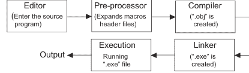

## 1.4 常量

常量是 C 程序中表示固定数值或字符值的标记，这些值在程序执行过程中不会改变。图 1.2 显示了 C 中的各种常量类型。

#### 1.4.1 整型常量

C 语言处理多种数字，其中最常用的是整数，通常称为整型。整型常量是指不带小数点的数字序列。整型常量可以以以下三种方式指定。

- 十进制整型常量
- 八进制整型常量
- 十六进制整型常量。

值 35 可以以以下三种方式中的任何一种编写，

- 35 表示十进制常量
- 043 表示八进制常量
- 0x23 表示十六进制常量。

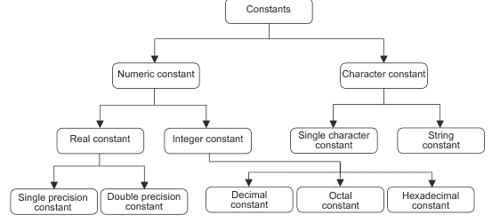

整型常量前的前导 0（零）指定它是八进制整型常量。它可以包含 0–7 的数字。如果八进制常量包含数字 8 或 9，将报告错误。整型常量前的前导 0x 或 0X 指定它是十六进制常量。它可以包含 0–9 的数字以及 a 到 f 或 A 到 F 的字母。

### 构造整型常量的规则

- 整型常量可以是正数或负数（默认符号为正）。
- 整型常量不应有小数点。
- 整型常量中不允许有逗号和空格。
- 整型常量不应使用指数 e。

后缀 u 或 U 用于表示无符号 int 常量，l 或 L 用于表示 long int 常量，s 或 S 用于表示 short int 常量。通常不需要这些后缀。编译器会自动将小整型常量视为 short 类型，将大整型常量视为 long 类型。

### 整型常量示例

| 12 | -5 | 0 | 10000 | -25000 |

### 1.4.2 实型常量

实型常量通常称为浮点常量。它们可以以两种形式编写，即，

- 小数形式。
- 指数形式。

### 小数形式

小数部分由表示数字整数部分的一系列数字组成，后跟一个小数点，再后跟表示小数部分的一系列数字。整数部分或小数部分可以省略，但两者不能同时省略。小数点不能省略。

### 构造实型常量（小数形式）的规则

- 实型常量可以是正数或负数（默认符号为正）。
- 实型常量必须有小数点。
- 实型常量中不允许有逗号和空格。

### 实型常量示例（小数形式）

| 0.0001 | -0.963 | 485.98 | +123.456 |
|---|---|---|---|
| 727.01 | 0.987 | -.8765 | +001.05 |

### 指数形式

当常量的值太小或太大时，使用实型常量的指数形式表示。在指数形式表示中，实型常量由两部分组成。e 之前的部分称为尾数，e 之后的部分称为 **指数**。指数由可选的加号或减号后跟一系列数字组成。例如，425000 可以表示为 4.25e5（或）42.5e4。同样，0.00028 可以表示为 2.8e-4（或）0.28e-3。

### 构造实型常量（指数形式）的规则

- 尾数部分和指数部分应由字母 e 分隔。
- 尾数部分和指数部分可以是正数或负数（默认符号为正）。
- 尾数和指数部分必须至少有一个数字。
- 实型常量中不允许有逗号和空格。

### 实型常量示例（指数形式）

| +3.2e+5 | 3.4e5 | -8.25e-5 |
|---|---|---|
| -10.9e5 | 9.72e-10 | 0.0025e8 |

### 1.4.3 单字符常量

单字符常量或字符常量是一对单引号内包含的单个字符。单字符常量必须是单引号内的单个字母、单个数字或单个特殊字符。单字符常量的长度仅为一个。

| 有效 | 无效 |
|---|---|
| '\A' | "\x" |
| '\m' | 'xyz' |
| '\2' | '123' |
| '\*' | 'pq' |
| '\_' | '$$' |

### 1.4.4 字符串常量

字符串、字符串常量或字面量是由双引号内包含的一系列字符组成。字符串常量可以由任何数字、字母、转义序列和空格的组成。字符串的末尾由一个称为 NULL 字符 '\0' 的单个字符标记。请注意，单字符常量 'A' 和单字符字符串常量 "A" 不相同。字符串常量 "A" 由字符 A 和 \0 组成。

- 'A' - 字符常量 → 'A'
- "A" - 字符串常量 → 'A' 和字符串结束标记 '\0' (NULL)

此外，字符常量具有等效的整数值，而单字符字符串常量没有等效的整数值。它占用两个字节，一个用于 A 的 ASCII 码，另一个用于值为 0 的 NULL 字符，该字符用于终止所有字符串。


## 构建字符串常量的规则

- 字符串常量可以是单个字母或数字，或用双引号括起来的特殊字符或字母/数字序列。
- 每个字符串常量都以 NULL 字符结尾，该字符会自动赋值。

## 表 1.3：字符串常量

| 有效 | 无效 |
| :--- | :--- |
| "W" | 'Prasad' |
| "100" | "12-June-1978" |
| "Madhu" | "10-02-1978" |

### 1.5 变量

在程序执行过程中可能发生变化的量称为变量。变量名是一个任意名称，是用于引用存储特定值的内存区域的标识符。这些内存位置可以包含整数、实数、单个字符或字符串常量。

### 1.5.1 变量声明

程序中的数据项必须在某个时刻赋值给变量。之后，程序只需通过引用变量名即可稍后访问该数据项。变量所表示的信息在程序执行过程中可以改变，但与变量关联的数据类型不能改变。程序员使用的变量名应以有意义的方式反映其在程序中的用途、功能或性质。程序中使用的所有变量必须在所有可执行语句之前声明（即，在函数的开花括号（{）之后，每个函数的开始处）。变量声明以其类型开头，后跟一个或多个变量名。声明将变量分配给特定的数据类型，并根据数据类型为变量分配内存。例如，

```
int a, b, c;
char d1, e2, f3;
float x_1, y_2, z_3;
```

在第一个声明中，a、b 和 c 被声明为整型变量（因为使用了 int 数据类型）。在下一个声明中，d1、e2 和 f3 是字符变量（因为使用了 char 数据类型）。在最后一个声明中，x_1、y_2 和 z_3 是浮点变量（因为使用了 float 数据类型）。

### 1.5.2 变量初始化

变量也可以在声明时初始化。这是通过在声明后添加等号及其后要初始化的所需值来完成的。例如，

```
int a = 5, b = 10;
char d1 = 'a';
float x_1 = 100.056;
```

第一个声明声明了两个整型变量 a 和 b，并分别将它们初始化为值 5 和 10。下一个声明声明了一个字符变量 d1，并用值 'a'（即单个字符常量）进行初始化。最后一个声明声明了一个浮点变量 x_1，并用值 100.056 进行初始化。变量也可以在程序中使用形式为

```
variable = constant;
```

的赋值语句进行初始化，

其中 constant 是要赋给变量的值。例如，

```
age = 23;
salary = 7500.75;
```

第一个声明将值 23 初始化给变量 age，下一个声明将值 7500.75 初始化给变量 salary。C 语言中的变量大致可分为两类。它们是，

- 常量变量
- 易变变量

### 常量变量

无法由其所在函数或同一程序中的任何其他函数更改的变量称为**常量变量**。为此目的使用关键字 const。它在程序执行过程中保护变量免受修改。以下声明说明了这一点，

```
const int x = 34;
```

在上述初始化中，x 是一个声明为整型的变量（因为使用了 int 数据类型）。变量中的值（即 x 中的 34）在程序执行过程中无法修改，因为在数据类型声明之前使用了 const 关键字。C 编译器保护常量变量免受修改。

### 易变变量

可以随时由其所在函数或同一程序中的任何其他函数更改的变量称为**易变变量**。为此目的使用关键字 volatile。以下声明说明了这一点，

```
volatile int z = 6000;
```

## 1.6 数据类型

语言支持的数据类型决定了编程语言可以处理的值的类型。C 语言的数据类型非常丰富。它支持多种数据类型，每种类型在计算机内存中的表示可能不同，这使程序员可以根据应用程序的需求选择合适的类型。C 语言中的数据类型大致可分为，

- 基本数据类型
- 用户定义数据类型
- 空数据类型

### 1.6.1 基本数据类型

所有 C 编译器都支持四种基本数据类型，即，

- 表示为 char 的字符数据类型
- 表示为 int 的整数数据类型
- 表示为 float 的浮点数据类型
- 表示为 double 的双精度浮点数据类型

### 整数数据类型

经常使用的整数称为整数。它们的存储占用两个字节。为了控制数字范围和内存中的存储空间，使用 signed 和 unsigned 形式的 short int、int、long int。

### 浮点数据类型

经常使用的实数称为浮点数。float 数据类型用于以浮点格式存储任何数字。浮点数据类型存储带有小数部分的数值。它们通常占用 4 字节内存进行存储。这些称为单精度数。当 float 数据类型提供的范围不足时，使用 double 数据类型。double 数据类型表示与 float 相同的数据类型，但精度更高，因此需要 8 字节内存进行存储。这些称为双精度数。为了进一步提高精度，可以使用 long double，它使用 10 字节内存进行存储。这些称为扩展精度数。

### 字符数据类型

char 数据类型用于表示只需要一个字节内存存储的字符。为了控制字符范围和内存中的存储空间，使用 signed 和 unsigned char 数据类型。

表 1.4 显示了各种数据类型可以存储的值的范围。

| 数据类型 | 大小（字节） | 范围 |
| :--- | :--- | :--- |
| char or signed char | 1 | -128 到 127 |
| unsigned char | 1 | 0 到 255 |
| int | 2 | -32768 到 32767 |
| short int or signed short int | 2 | -32,768 到 32,767 |
| int or signed int | 2 | -32,768 到 32,767 |
| unsigned short int | 2 | 0 到 65,535 |
| unsigned int | 2 | 0 到 65535 |
| long int or signed long int | 4 | -2,147,483,648 到 2,147,483,647 |
| unsigned long int | 4 | 0 到 4,294,967,295 |
| float | 4 | 3.4e-38 到 3.4e+38 |
| double | 8 | 1.7e-308 到 1.7e+308 |
| long double | 10 | 3.4e-4932 到 1.1e4932 |

#### 1.6.2 用户定义数据类型

C 语言支持一种称为类型定义的功能，允许用户定义与现有数据类型等效的新数据类型。这种技术在某些情况下可以帮助澄清程序的源代码。用户定义的数据类型标识符稍后可用于声明变量。

### 类型定义

关键字 typedef 用于定义新的数据类型名称。请注意，您并不是实际创建新的数据类型，而是为现有数据类型定义一个新名称。定义新数据类型的一般形式或语法是

```
typedef data type identifier;
```

其中 identifier 是给数据类型的新名称。类型定义的几个示例是

```
typedef int age;
typedef float average;
```

其中 age 代表 int，average 代表 float。它们稍后可用于声明变量，如

```
age child, adult;
average mark1, mark2;
```

其中 child 和 adult 被声明为整型变量，而 mark1 和 mark2 被声明为浮点变量。使用类型定义，您可以创建有意义的数据名称以提高程序的可读性。它们还暗示了程序中使用的数据类型名称的用途。


## 枚举数据类型

枚举数据类型提供了一个机会，让你可以用一组由标识符表示的命名整数常量来发明自己的数据类型，这些常量指定了该类型变量可以拥有的所有有效值。它们可以在任何整数常量有效的表达式中使用。

```
enum identifier { enumeration_list } list_of_variables;
```

其中 enum 是关键字，用于指定枚举数据类型；identifier 是用户定义的枚举数据类型，可用于声明 enumeration_list（也称为枚举常量）。identifier 和 list_of_variables 均为可选，但至少必须存在一个。例如，枚举

```
enum month { JANUARY, FEBRUARY, MARCH, APRIL, MAY, JUNE, JULY,
AUGUST, SEPTEMBER, OCTOBER, NOVEMBER, DECEMBER };
```

这将创建一个新类型 month，其中 enumeration_list 为 JANUARY . . . , DECEMBER。

枚举列表的值会自动设置为整数 0 到 11。若要将 enumeration_list 编号为 1 到 12，enum 声明应为

```
enum month { JANUARY = 1, FEBRUARY, MARCH, APRIL, MAY, JUNE, JULY,
AUGUST, SEPTEMBER, OCTOBER, NOVEMBER, DECEMBER };
```

其中第一个 enumeration_list（即 JANUARY）被显式设置为 1，因此其余值从 1 开始递增，结果为 1 到 12。要为新类型 month 定义变量，语句

```
enum month month_start, month_end;
```

该语句将 month_start 和 month_end 声明为新类型 month 的变量。

#### 1.6.3 空数据类型

关键字 void 用于指示空数据类型。该数据类型不用于声明任何变量，而是用于指示无内容。当用作函数返回类型时，void 表示函数不返回值。当用于函数参数列表时，void 表示函数不接受任何参数。

## 1.7 C 中使用运算符的表达式

运算符是一个符号或特殊字符，用于指示计算机执行特定的数学或逻辑运算，并应用于操作数以产生结果。运算符在程序中用于操作数据和变量。运算符作用以求值表达式的数据项称为操作数。C 语言强大的主要原因之一是其丰富的运算符。C 不仅提供常见的算术运算符和逻辑运算符，还提供用于位级操作、指针操作等的运算符。C 中使用的运算符有

- 算术运算符
- 一元运算符
- 自增和自减运算符
- 关系运算符
- 相等运算符
- 逻辑运算符
- 位运算符
- 条件运算符
- 赋值运算符
- 特殊运算符。

### 1.7.1 算术运算符

C 语言拥有所有基本算术运算符。表 1.5 显示了各种算术运算符及其含义。

| 运算符 | 含义 |
|---|---|
| + | 加法 |
| - | 减法 |
| * | 乘法 |
| / | 除法 |
| % | 取模运算（整数除法后的余数） |

作用于算术运算符的操作数必须表示数值，因此操作数可以是整数量或浮点数量。一个整数量除以另一个整数量称为整数除法。整数除法会截断小数部分（即，商的小数部分将被丢弃）。取模运算产生整数除法的余数作为结果。取模运算仅在整数之间有意义。

假设操作数 x 和 y 是整数变量，其值分别为 9 和 -4。几个算术表达式及其结果如下

| 表达式 | 结果 |
|---|---|
| x + y | 5 |
| x - y | 13 |
| x * y | -36 |
| x / y | -2 |
| x % y | 1 |

当两个操作数（如 x 和 y）被声明为整数时，对这些整数执行的算术运算称为**整数运算**。它始终产生整数值。当两个操作数（如 x 和 y）被声明为实数（即 `float` 或 `double` 或 `long double`）时，对这些浮点数执行的算术运算称为浮点运算。它始终产生浮点值。如果任一操作数是实数，则对这些整数执行的算术运算称为混合模式运算。它始终产生实数值（浮点值）。例如，

```
125/25.0 = 5.0
```

由于 25.0 是实常量，125 被转换为实数（即 125.0），结果也是实数。

### 1.7.2 一元运算符

作用于单个操作数以产生新值的运算符称为一元运算符。一元运算符通常位于其操作数之前，尽管一些一元运算符写在操作数之后。表 1.6 显示了各种一元运算符及其含义。

| 运算符 | 含义 |
|---|---|
| - | 一元负号 |
| ++ | 自增 1 |
| -- | 自减 1 |
| sizeof | 返回操作数的大小。 |

当运算符用于变量之前时，先对变量应用操作，然后将结果用于表达式。这种表示法称为前缀表示法。当运算符用于变量之后时，先使用变量的值，然后对变量应用操作。这种表示法称为后缀表示法。如果操作数 x 的值为 3，则各种表达式及其结果如下

| 表达式 | 执行 |
|---|---|
| ++x | x <- 3 + 1 |
| x++ | x <- 3 ; x <- 3 + 1 |
| --x | x <- 3 - 1 |
| x-- | x <- 3 ; x <- 3 - 1 |

前自增运算（++x）将 x 加 1 然后将值赋给 x。后自增运算（x++）将值赋给 x 然后加 1。前自减运算（--x）将 x 减 1 然后赋给 x。后自减运算（x--）将值赋给 x 然后减 1。这些运算符通常非常高效，但如果在单个语句中尝试使用过多求值，会引起混淆。

### sizeof 运算符

sizeof 运算符不是库函数，而是一个关键字，用于以字节为单位返回操作数的大小。sizeof 运算符始终位于其操作数之前。该运算符可用于动态内存分配。sizeof 运算符的各种表达式及其结果如下

| 表达式 | 结果 |
|---|---|
| sizeof(char) | 1 |
| sizeof(int) | 2 |
| sizeof(float) | 4 |
| sizeof(double) | 8 |

### 1.7.3 关系运算符

关系运算符是用于测试两个变量之间或变量与常量之间关系的符号。这些运算符用于在控制语句中检查条件。表 1.7 显示了各种关系运算符及其含义。

表 1.7：关系运算符及其含义

| 运算符 | 含义 |
|---|---|
| < | 小于 |
| > | 大于 |
| <= | 小于或等于 |
| >= | 大于或等于 |

包含关系运算符的表达式称为关系表达式。关系表达式的值要么是 1，要么是 0。如果表达式为真，则用整数值 1 表示。如果表达式为假，则用整数值 0 表示。这些运算符的结合方向为从左到右。

如果 x、y、z 的值分别为 1、2、3，则表达式的结果和返回值如下

| 表达式 | 结果 | 值 |
|---|---|---|
| x < y | 真 | 1 |
| (x + y) >= z | 真 | 1 |
| (y + z) > (x + z) | 假 | 0 |
| y >= 10*(x + z) | 假 | 0 |

### 1.7.4 相等运算符

与关系运算符密切相关的是两个相等运算符。表 1.8 显示了各种相等运算符及其含义。

表 1.8：相等运算符及其含义

| 运算符 | 含义 |
|---|---|
| == | 等于 |
| != | 不等于 |

表达式的值要么是 1，要么是 0。如果表达式为真，则结果为 1；如果表达式为假，则结果为 0。如果 x 和 y 的值分别为 1 和 2，则各种表达式及其结果如下

| 表达式 | 结果 | 值 |
|---|---|---|
| y != 2 | 假 | 0 |
| x == 2 | 假 | 0 |
| x == 1 | 真 | 1 |
| y != 3 | 真 | 1 |

### 1.7.5 逻辑运算符

用于组合两个或多个关系表达式的运算符称为逻辑运算符。这些运算符用于一次测试多个条件。

表 1.9 显示了各种逻辑运算符及其含义。

| 运算符 | 含义 |
|---|---|
| && | 逻辑 AND |
| \|\| | 逻辑 OR |
| ! | 逻辑 NOT |

### 1.7.6 位运算符

C 语言有一些称为位运算符的运算符，用于需要操作内存字中单个位的应用程序。这些运算符允许程序员访问和操作数据中的单个位。位运算符只能对整数和字符操作，不能对浮点数和双精度数操作。

表 1.10 显示了各种位运算符及其含义。

| 运算符 | 含义 |
|---|---|
| ~ | 按位取反 |
| << | 左移 |
| >> | 右移 |
| & | 按位 AND |
| \| | 按位 OR |
| ^ | 按位 X-OR |

### 掩码

掩码是一种过程，其中给定的位模式通过位运算符转换为另一个位模式。原始位模式是位运算中的一个操作数。第二个操作数称为掩码，是一种特别选择的位模式，用于实现所需的转换。通常使用逻辑按位 AND 运算符（&）进行掩码操作。


### 1.7.7 条件运算符（三元运算符）

用于求值条件的表达式称为**条件表达式**。用于求值条件表达式的运算符称为**条件运算符**。用 `?:` 表示。它也被称为**三元运算符**，因为它接受三个操作数作为其参数。条件运算符的一般形式或语法是

```
expr1 ? expr2 : expr3;
```

求值条件表达式时，先求值 `expr1`。如果 `expr1` 为真，则仅求值 `expr2`。如果 `expr1` 为假，则仅求值 `expr3`。

例如，

```
a = ( b > 2 ) ? 8 : 6 ;
```

### 1.7.8 赋值运算符

赋值运算符用于将表达式的结果赋给变量。等号（=）用作赋值运算符。它用于形成赋值表达式，该表达式将表达式的值赋给标识符，可以写成如下形式

```
identifier = expression;
```

其中 `expression` 表示常量、变量或复杂表达式。从表达式求值得到的值存储在 `identifier` 中，它是一个变量。

此外，C 具有一组形式为下面的简写赋值运算符

```
identifier <operator> = expression;
```

运算符应为算术运算符或位运算符。**表 1.11** 显示了各种简写运算符及其含义。

| 运算符 | 含义 |
|---|---|
| += | 赋和 |
| -= | 赋差 |
| *= | 赋积 |
| /= | 赋商 |
| %= | 赋余 |
| ~= | 赋按位取补 |
| <<= | 赋左移 |
| >>= | 赋右移 |
| &= | 赋按位与 |
| |= | 赋按位或 |
| ^= | 赋按位异或 |

### 1.7.9 特殊运算符

下面列出了 C 中使用的一些特殊运算符。这些运算符称为分隔符或标点符。

| 符号 | 名称 | 含义 |
| :--- | :--- | :--- |
| & | 与符号 | 也称为**地址运算符**，通常位于标识符名称之前，指示标识符的内存位置（地址）。 |
| * | 星号 | 也称为**间接运算符**，是一元运算符，通常位于标识符名称之前，指示创建指针运算符。 |
| {} | 大括号 | 开始和结束大括号表示复合语句或函数的开始和结束。语句的结束大括号后不需要分号，结构声明除外。 |
| [] | 方括号 | 也称为**数组下标运算符**，用于指示一维和多维数组下标。 |
| : | 冒号 | 用于标签。 |
| , | 逗号 | 用于将相关表达式链接在一起。使用逗号的表达式从左到右链接，最右侧表达式的值是组合表达式的值。逗号运算符的优先级低于所有运算符。例如，在表达式 sum = (x = 5, y = 3, x + y) ; 中，结果将是 sum = 8。逗号运算符还用于声明期间分隔变量。例如，int a, b, c ; |
| ... | 省略号 | 三个连续的句点，中间没有空格。它用于函数原型，以指示该函数可以带有任意数量的不同类型的参数。例如，void fun(char c, int n, float f, ...); |
| # | 井号 | 上述声明表明 fun() 是一个函数，它至少接受三个参数，按指定顺序为 char、int 和 float，但可以带有任意数量的任意类型的其他参数。你也可以省略省略号前的逗号。也称为磅符号，用于指示预处理器指令。 |
| . 和 -> | 成员访问运算符 | 用于访问结构或联合的成员。例如，如果 abc 是结构 str 的成员，则使用成员访问运算符访问成员 abc，如 str.abc = 23.45; str -> abc = 23.45; 运算符 . 称为直接成员访问运算符，-> 称为间接成员访问运算符或指针成员访问运算符。 |
| () | 括号 | 也称为函数调用运算符，用于指示函数原型、函数调用、函数参数等的开始和结束。括号还用于对表达式进行分组，从而改变表达式求值的顺序。 |
| ; | 分号 | 语句终止符。它用于结束 C 语句。所有有效的 C 语句都必须以分号结束，C 编译器将其解释为语句的结束。例如，c = a + b; b = 5; |

## 1.8 管理输入和输出操作

现代计算机的主要优势之一是其在程序执行期间与用户通信的能力。此功能使程序员能够在程序执行时读取输入变量的值，而无需修改程序。一旦读取所需值并按下 ENTER 键，程序执行将重新开始，输出将显示在屏幕上。为了执行输入和输出操作，C 提供了许多输入和输出函数。这些函数大致可分为两类。它们是，

- 格式化 I/O 函数。
- 非格式化 I/O 函数。

### 1.8.1 格式化 I/O 函数

格式化输入/输出函数从用户读取任何类型的数据作为输入，并在屏幕上显示任何类型的数据作为输出。它们使用格式字符串（也称为转换说明符）来识别涉及的数据类型。这些函数执行后返回一个整数值。返回值等于成功读取/写入的值的数量。返回值对用户检查读取/写入数据的正确性很有用。scanf() 函数是格式化输入函数，printf() 函数是格式化输出函数。

### scanf() 函数

scanf() 函数允许程序在执行期间中断，以便通过键盘从用户读取所需值。scanf 代表 "scan function" 或 "scan formatted"。此函数（即 scanf()）可用于读取任何数值、单个字符和字符串的组合。scanf() 函数的一般形式或语法是

```
scanf("format_string", Val1, Var2, ..., Varn);
```

其中 format_string 指的是转换规范，即包含某些所需格式信息的字符串，Val1、Var2、...、Varn 是表示各个输入数据项的参数。每个字符组必须以 % 符号开头，后跟一个转换字符，指示要读取的相应数据项的类型。scanf() 函数的简单形式可能是

```
scanf("%d", &a);
```

其中变量 a 之前已声明为整数。%d 称为转换说明符。它的作用是指定数字在被扫描前转换为十进制表示法。在变量名 "a" 之前的 & 符号是强制性的，每当要从用户读取整数、浮点数或字符值时。实际上，& 表示地址，&a 表示 a 的地址。用户输入后计算机读取的值将存储在 a 的地址（内存位置）中。但是，字符串是这一规则的例外，读取字符串时变量前不需要前导 &。

表 1.12 显示了从用户读取输入的不同 scanf 格式代码。

| 代码 | 含义 |
| :--- | :--- |
| %c | 读取单个字符 |
| %s | 读取字符串 |
| %d | 读取有符号短整型 |
| %u | 读取无符号整型 |
| %ld | 读取有符号长整型 |
| %lu | 读取无符号长整型 |
| %lo | 读取八进制整型 |
| %x | 读取十六进制整型 |
| %e | 读取浮点值 |
| %f | 读取浮点值 |
| %g | 读取浮点值 |
| %lf | 读取双精度值 |
| %i | 读取十进制、十六进制、八进制整型 |
| %[...] | 读取单词字符串 |

程序 1.3 有助于你更好地理解。

### 程序 1.3:

```
/* scanf1.c */
#include<stdio.h>
void main()
{
   char empname[20];       /* Character with length 20 */
   int empno;
   float salary;
   scanf("%s %d %f", empname, &empno, &salary);
   .........
}
```

在程序 1.3 中，scanf() 函数使用三个转换说明符 %s、%d 和 %f。第一个转换说明符 %s 表示 empname，它是一个字符串（注意，读取字符串时不使用 & 符号）。第二个转换说明符 %d 表示 empno 是一个整数。第三个转换说明符 %f 表示 salary，它是浮点数据类型。

### 使用 scanf() 函数时需注意的重要事项

- 输入数据项必须用空格分隔，并应按相同顺序与接收输入的变量匹配。
- 转换说明符中包含的格式规范应按顺序与参数匹配。


- 读取操作在遇到与所读取值不匹配的无效数据类型时将终止。
- 当使用字段宽度说明符时，其应足够大以容纳输入数据的大小。

## printf() 函数

printf() 函数用于将计算机中任何数据类型的输出发送到标准输出设备。该函数可用于显示任意组合的数字、字符和字符串。printf 代表“打印函数”或“格式化打印”。printf() 函数的一般形式或语法为，

```
printf("format_string", Var1, Var2,..., Varn);
```

其中 format_string 指的是转换说明，即包含某些所需格式信息的字符串，而 Var1、Var2、...、Varn 是代表各个输出数据项的参数。每个字符组必须以 % 符号开头，后跟一个转换字符，用于指示相应数据项的类型。printf() 函数的简单形式可能为

```
printf("%d", a);
```

其中变量 a 此前已声明为整型，%d 称为转换说明符。其作用是指定数字在显示到屏幕之前转换为十进制表示法。

表 1.13 显示了在屏幕上显示输出时使用的不同 printf() 格式代码。程序 1.4 有助于更好地理解相关内容。

## 表 1.13：printf() 函数中使用的格式代码

| 代码 | 含义 |
| :--- | :--- |
| %c | 显示单个字符 |
| %s | 显示字符串 |
| %d | 显示有符号短整型 |
| %u | 显示无符号整型 |
| %ld | 显示有符号长整型 |
| %lu | 显示无符号长整型 |
| %i | 显示有符号十进制整型 |
| %o | 显示八进制整型，不带前导零 |
| %x | 显示十六进制整型，不带前导 0x |
| %hx | 显示小写十六进制整型 |
| %p | 显示大写十六进制整型 |
| %e | 以指数形式显示浮点值 |
| %f | 显示不带指数的浮点值 |
| %g | 根据值显示 e 类型或 f 类型的浮点值 |
| %lf | 显示双精度值 |
| %n | 因错误中止程序 |

## 程序 1.4：

```
/* printf1.c */
#include <stdio.h>
void main()
{
char empname[20];
int empno;
float salary;
printf("Enter employee name, no & salary : ");
scanf("%s %d %f", empname, &empno, &salary);
printf("\n The employee name is %s", empname);
printf("\n The employee number is %d", empno);
printf("\n The employee salary is %f", salary);
}
```

```
The program displays the following output
Enter employee name, no & salary : Joy 4 8484
The employee name is Joy
The employee number is 4
The employee salary is 8484.000000
```

在程序 1.4 中，最后三个 printf() 函数使用了三个转换说明符 %s、%d 和 %f。第一个转换说明符 %s 表示 empname，将其显示为字符串。第二个转换说明符 %d 表示 empno，将其显示为整数。第三个转换说明符 %f 表示 salary，将其显示为浮点数。请注意，由于使用了 \n 字符，输出显示在新行中。

### 1.8.2 非格式化 I/O 函数

所有非格式化 I/O 函数仅读取和显示 char 数据类型，且不使用格式字符串来标识涉及的数据类型。getch()、getche()、getchar() 是单字符非格式化输入函数，putch()、putchar() 是单字符非格式化输出函数。gets()、puts() 分别是非格式化字符串 I/O 函数。

### getchar() 函数

所有输入操作中最简单的是从标准输入读取单个字符。读取单个字符可以通过名为 getchar() 的函数来完成。getchar() 函数不需要任何参数，尽管在单词 getchar 后面跟着一对空括号。getchar() 函数的语法为，

```
variable = getchar();
```

其中 variable 指的是此前声明的字符变量。当遇到上述语句时，计算机会等待直到按下一个键，并将字符作为值赋给 `getchar()` 函数，该值被赋给 `getchar()` 函数左侧的字符变量。但是，`getchar()` 函数需要按下回车键才能将字符赋给变量。

### getch() 函数

`getch()` 函数与 `getchar()` 函数类似，它在键入字符的瞬间读取单个字符，无需等待按下回车键。它不会在屏幕上显示用户键入的字符。

### getche() 函数

`getche()` 函数与 `getch()` 函数类似，它在键入字符的瞬间读取单个字符，无需等待按下回车键。它会在屏幕上回显或显示用户键入的字符。

### gets() 函数

在 C 语言中，`gets()` 函数用于从标准输入设备接收字符串，直到遇到新行或 eof（文件结束）。`gets()` 函数的一般形式或语法为

```
gets(variable);
```

其中 `variable` 指的是此前声明的字符数组。`gets()` 函数接收的字符串可能包含空白字符。`gets()` 函数仅在遇到新行字符时终止。请注意，`gets()` 函数只能为一个变量接收数据。

### putch() 函数

`putch()` 函数在键入字符的瞬间显示单个字符，无需等待按下回车键。它会在屏幕上显示用户键入的字符。

### putchar() 函数

所有输出操作中最简单的是在标准输出上显示单个字符。显示单个字符可以通过名为 `putchar()` 的函数来完成。字符变量必须作为参数传递给函数，并用括号括在单词 `putchar` 中。`putchar()` 函数的一般形式或语法为

```
putchar(variable);
```

其中 `variable` 指的是此前声明的字符变量。`putchar()` 函数可用于在标准输出中显示一维字符型数组中的字符串。然后每个字符都可以在循环中单独存储。

### puts() 函数

在 C 语言中，puts() 函数用于在标准输出设备上一次显示一个字符串，后跟一个换行字符。puts() 函数的一般形式或语法为

```
puts(argument);
```

puts() 函数仅接受一个参数。传递给函数的参数必须是一个数据项。它代表一个字符串或字符数组。puts() 函数显示的字符串可能包含空白字符。puts() 函数一次只显示一个字符串。

## 1.9 决策与分支语句

在迄今为止我们所见的 C 程序中，语句通常按其在程序中出现的顺序依次执行。默认情况下，程序中的语句按顺序执行。然而，在实际中，我们会遇到需要在满足指定条件之前更改语句执行顺序的情况。C 语言使用决策控制语句来处理这类情况。

根据逻辑测试的结果执行多种可能操作中的一种，称为分支。程序的某些部分需要执行多次，或者直到满足特定条件，这称为循环。C 语言中不同的决策控制或决策语句包括

- if 语句
- if-else 语句
- switch 语句
- 条件运算符
- break、continue 和 goto 语句。

### 1.9.1 if 语句

C 语言使用关键字 if 来实现决策控制语句。if 语句可用于检查某些条件，并在满足指定条件时执行一个或多个语句。if 语句的一般形式或语法为

```
if(condition)
{
executable-X-statement(s) ;
}
executable-Y-statement(s) ;
```

图 1.3 显示了 if 语句的操作。if 语句中使用的条件应在括号内指定。当带有 if 语句的程序被求值时，首先执行 if 语句后指定的条件。如果条件为真，则花括号内的 executable-X-statement(s)

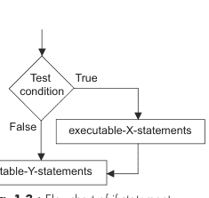


将被执行。如果条件为假，控制将直接转移到花括号外的语句，并执行可执行-Y语句，而不执行可执行-X语句。可执行-X语句（即if语句的主体）应括在花括号内。请注意，如果if语句的主体（即可执行-X语句）只包含一条语句，则括住它们的花括号不是必须的。如果表达式的值为零，则视为假；如果表达式的值为非零值，则视为真。表1.14显示了可用作if语句内条件的各种表达式。

| 条件表达式 | 含义 |
| :--- | :--- |
| a == b | a 等于 b |
| a != b | a 不等于 b |
| a < b | a 小于 b |
| a > b | a 大于 b |
| a <= b | a 小于或等于 b |
| a >= b | a 大于或等于 b |

请注意，= 用于赋值，而 == 用于比较两个量。两个或多个条件可以在 if 语句中使用逻辑与运算符（&&）或逻辑或运算符（||）组合。if 语句可以在单个 if 语句中比较任意数量的变量。程序 1.5 有助于您更好地理解。

程序 1.5:

```c
/* Program to find the biggest of two numbers using an if statement */
/* big_num.c */
#include<stdio.h>
void main()
{
    int value1, value2, big = 0;
    printf("Enter two values : ");
    scanf("%d %d", &value1, &value2);
    big = value1;
    if (value1 < value2)
    {
        big = value2;
    }
    printf("The biggest number is %d", big);
}
```

程序显示以下输出
Enter two values : 8 21
The biggest number is 21

用户输入 8 和 21 后，它们分别被赋值给变量 value1 和 value2。变量 value1 中存储的值被赋给变量 big（即，8 被赋给变量 big）。if 语句检查条件，即 value1 是否小于 value2（即，8 < 21）。由于在这种情况下条件为真，value2 被赋给变量 big（即，21 被赋给变量 big），并且 printf() 函数显示消息。

### 1.9.2 if-else 语句

if-else 语句是 if 语句的扩展，用于在条件为假时也执行一个或多个语句。if 语句默认会在条件为真时执行单个语句或一组语句，但在条件为假时不执行任何操作。else 语句会在条件为假时执行单个语句或一组语句。if-else 语句的一般形式或语法是

```c
if (condition)
{
    executable-X-statements(s);
}
else
{
    executable-y-statements(s);
}
```

图 1.4 显示了 if-else 语句的操作。if 语句中使用的条件应指定在括号内。如果条件为真，则从条件之后直到 else 之前的语句将被执行。如果条件为假，则 else 之后的语句将被执行。程序 1.6 有助于您更好地理解。

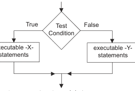

程序 1.6:

```c
/* Program to check whether the no is odd or even using an if-else statement */
/* odd_even.c */
#include <stdio.h>
void main()
{
    int number;
    printf("Enter a number : ");
    scanf("%d", &number);
    if(number % 2 == 0)   /* if remainder is zero */
    {
    printf("The number is even");
    }
    else
    {
    printf("The number is odd");
    }
}
```

程序显示以下输出
Enter a number : 258
The number is even

用户输入 258 后，它被赋给变量 number。if 语句检查条件，即变量的余数是否为零。由于在这种情况下条件为真，if 块中的语句被执行。else 块被跳过，程序结束。

### 多个 if-else 语句

多个 if-else 语句提供了一种测试多个条件并为每个条件执行一个或多个语句的方法。多个 if-else 语句比一系列 if-else 语句快得多，因为当满足任一条件时，if 结构就会退出。

程序 1.7:

```c
/* mul_if.c */
#include<stdio.h>
#include<conio.h>
void main()
{
int i;
printf("\nEnter the value of i : ");
scanf("%d",&i);
if(i == 1)
printf("Hello Chocks");
else if (i == 2)
printf("Hello Girish");
else if (i == 3)
printf("Hello Madhu");
else if (i == 4)
printf("Hello Mani");
else
printf("Hello Moorthy");
}
```

程序显示以下输出
RUN1 Enter the value of i : 2
Hello Girish
RUN2 Enter the value of i : 7
Hello Moorthy

在 run1 中，用户输入 2 后，它被赋给变量 i。if 语句检查条件，即 i 是否等于 1（例如，if(i==1)）。由于条件为假，控制转移到下一个 if 语句（例如，else if(i==2)），并检查 i 是否等于 2。由于条件为真，执行其后的语句。printf() 函数显示消息

Hello Girish

所有其他 else if 语句都被忽略，程序结束。

在 run2 中，由于没有任何条件为真，所有 if 语句都被忽略，控制转移到 else 块。printf() 函数显示消息

Hello Moorthy

程序结束。请注意，程序中可以包含任意数量的 if-else 语句，但每个 if 语句内指定的条件应不同。

### 嵌套 if-else 语句

if-else 语句内包含一个或多个 if-else 语句称为嵌套 if 语句。程序 1.8 有助于您更好地理解。

程序 1.8:

```c
/* nest_if.c */
#include<stdio.h>
void main()
{
int choice, yrs_of_exp;
printf("\nEnter 1 for Project Leader");
printf("\nEnter 2 for Software Engineer");
printf("\nEnter your choice : ");
scanf("%d", &choice);
printf("Enter Years Of Experience : ");
scanf("%d", &yrs_of_exp);
if(choice == 1)
{
if(yrs_of_exp > 5)
printf("\nSalary Hike is 7500");
else
printf("\nSalary Hike is 6000");
}
else if(choice == 2)
{
if(yrs_of_exp > 3)
printf("\nSalary Hike is 5000");
else
printf("\nSalary Hike is 4000");
}
else
 printf("\nInvalid Choice ...");
}
```

程序显示以下输出
Enter 1 for Project Leader
Enter 2 for Software Engineer
Enter Your Choice : 1
Enter Years Of Experience : 8
Salary Hike is 7500

当用户输入 1（表示 `Project Leader`）时，控制进入第一个 `if` 语句。第一个 if 语句内的嵌套 if 检查条件。由于经验年限（即 `yrs_of_exp`）大于 5，`printf()` 函数显示消息

Salary Hike is 7500

嵌套 `if` 的控制退出，同时主 if 的控制也退出，程序结束。

### 1.9.3 switch 语句

switch 语句允许我们从多个选项中做出决策。它通常称为 `switch-case` 语句。`switch` 语句的一般形式或语法是

```c
switch(expression)
{
 case constant1 : statement(s);
 case constant2 : statement(s);
 ..... .....
 case constantN : statement(s);
 default : statement(s);
}
```

switch 语句会从多个可用组中选择特定的一组语句。选择基于包含在 `switch` 语句中的表达式的当前值。每个 case 由一个或多个整数值表达式标记。如果某个 case 匹配表达式值，则从该 case 开始执行，并在遇到 `break` 语句时结束。所有 `case` 表达式必须不同。如果没有其他 case 满足，则执行标记为 `default` 的 case。`switch` 语句中的 `default` 是可选的。**程序 1.9** 有助于您更好地理解。


## 程序 1.9:

```
c
/* Program to demonstrate the use of switch statement */
/* switch.c */
#include<stdio.h>
void main()
{
 int a, b, choice;
 printf("Enter two numbers : ");
 scanf("%d %d", &a, &b);
 printf("\n Enter 1 for addition : ");
 printf("\n Enter 2 for subtraction : ");
 printf("\n Enter 3 for multiplication : ");
 printf("\n Enter 4 for division : ");
 printf("\n Enter your choice : ");
 scanf("%d", &choice);
 switch(choice)
 {
 case 1:
 printf("Sum is %d", a+b);
 break;
 case 2:
 printf("Difference is %d", a-b);
 break;
 case 3:
 printf("Product is %d", a*b);
 break;
 case 4:
 printf("Quotient is %d", a/b);
 break;
 default:
 printf("Invalid choice");
 }
}
```

### 程序显示以下输出

```
Enter two numbers : 5 8
Enter 1 for addition
Enter 2 for subtraction
Enter 3 for multiplication
Enter 4 for division
Enter your choice : 1
Sum is 13
```

用户输入 5 和 8 后，它们分别被赋值给变量 a 和 b。用户输入的选择为 1，因此控制权直接转移到 switch 语句内部第一个值为 1 的 case 语句。case 语句内的 printf() 函数执行，输出 a 和 b 的和为
Sum is 13
printf() 函数下方的 break 语句将控制权转移到 switch-case 语句的末尾。

switch 语句中的“穿透”（fall through）是指某个 case 不包含 break 语句，从而导致控制权转移到下一个 case 语句。程序 1.10 有助于你更好地理解这一点。

```
c
/* Program to demonstrate the use of switch without break */
/* no_break.c */
#include<stdio.h>
void main()
{
    int choice = 2;
    switch(choice)
    {
        case 1: printf("\n This is Case 1 ...");
        case 2: printf("\n This is Case 2 ...");
        case 3: printf("\n This is Case 3 ...");
        default: printf("\n This is Default ...");
    }
}
```

### 程序显示以下输出

This is Case 2 ...
This is Case 3 ...
This is Default ...

程序 1.10 的输出绝非我们所期望。我们原本期望只执行 case 2 中的 printf() 函数，而不执行其他行。之所以会这样，是因为我们在每个 case 语句末尾都没有包含 break 语句，因此随后的 case 语句（包括 default 语句）都被执行了。

## 使用 switch 语句的局限性

- 只能使用存储在其中的值对单个变量进行测试（即，不能使用关系运算符并像 if 或 if-else 语句那样组合两个或多个条件）。
- 浮点型、double 类型和 long 类型变量不能用作 switch 语句中的 case。
- 每个 case 中可以执行多条语句，无需像 if 或 if-else 语句那样使用一对花括号。

## 使用 switch 语句时需注意的重要事项

- case 中也允许使用字符值。你可以在 switch 的不同 case 中混合使用整型和字符常量。
- 不同 case 语句中使用的整型表达式可以按任意顺序指定。
- switch 可以嵌套在另一个 switch 内部，但很少这样做。这种语句称为嵌套 switch 语句。
- default 是可选的。如果不存在且没有其他 case 匹配，则不执行任何操作。default 可以出现在 switch 语句中的任何位置，但一个 switch-case 语句中应只有一个 default。
- switch 语句在编写菜单驱动程序时非常有用。

### 1.9.4 条件运算符

用于求值条件的表达式称为条件表达式。用于求值条件表达式的运算符称为条件运算符（? :）。它是 if-else 语句的一种简单形式。条件运算符也被称为三元运算符，因为它接受三个操作数作为其参数。条件运算符的一般形式或语法是

```
expr1 ? expr2 : expr3;
```

expr1 是求值的条件。求值三元运算符时，先求值 expr1。如果 expr1 为真，则仅求值 expr2。如果 expr1 为假，则仅求值 expr3。下面显示了一个条件表达式示例。

```
a = ( (b < 2) ? 8 : 6 );
```

如果 b 小于 2，则 a 的值将为 8。如果 b 大于 2，则 a 的值将为 6。程序 1.11 有助于你更好地理解这一点。

```
c
/* Program to find the biggest of two numbers using a ternary operator */
/* ternary1.c */
#include<stdio.h>
void main()
{
    int a, b, c;
    printf("Enter the value of a and b : ");
    scanf("%d %d", &a, &b);
    c = ( a > b ) ? a : b ;
    printf("The biggest value is %d", c);
}
```

### 程序显示以下输出

Enter the value of a and b : 125 100
The biggest value is 125

用户输入 125 和 100 后，它们分别被赋值给变量 a 和 b。条件语句中的第一个表达式（即 a > b）求值为真（因为 a 的值大于 b 的值），因此，第二个表达式（即 a）的值被赋给变量 c，printf() 函数显示消息，程序结束。请注意，条件运算符中不一定只能求值算术表达式。它们还可以根据第一个表达式返回的值来求值其他语句。

### 1.9.5 break、continue 和 goto 语句

### break 语句

break 语句用于在 switch 语句的任何点终止或退出。break 语句的一般形式或语法是

```
break;
```

break 语句没有任何表达式或参数。break 语句导致控制权转移出整个 switch 语句。break 语句也可以在 for、while 或 do-while 循环中使用。关键字 break 仅跳出其所在的循环。有关 break 语句的用法，请参阅程序 1.9 和 1.10。

### continue 语句

continue 语句用于将控制权转移到循环的开头，从而终止循环的当前迭代，并从同一循环的下一次迭代重新开始。continue 语句可以在 while、do-while 或 for 循环中使用。continue 语句的一般形式或语法是

```
continue;
```

continue 语句没有任何表达式或参数。continue 语句通常用于迭代语句中。它导致控制权传递到包含 continue 语句的循环继续部分。如果 continue 语句未包含在循环中，编译器会指示语法错误。continue 语句仅适用于循环，而不适用于 switch 语句。

### goto 语句

goto 语句用于在循环或函数中将控制权从一个点转移到程序的任何其他部分。如果滥用，goto 语句会使程序难以理解。goto 语句的一般形式或语法是

```
goto label;
   statement(s);
   ...
label:
   statement(s);
```

goto 语句需要一个标签来标识控制权要转移到的位置。标签可以是任何有效的变量名。标签后面必须跟一个冒号（:）。标签可以放在程序中的任何位置，无论在 goto 语句之前还是之后。goto 语句打破了程序的正常顺序执行。它仅指示计算机在指定语句处恢复执行，该语句指定为标签。标签的命名规则与变量相同，只是标签不需要声明。

## 1.10 循环语句

程序中被重复执行的片段称为循环。程序的某些部分需要执行多次，或直到满足特定条件。这种重复操作通过循环结构完成。三种循环结构是，

- while 循环
- do-while 循环
- for 循环。

### 1.10.1 while 循环

C 语言中最简单的循环结构是 while 循环。while 循环的一般形式或语法是

```
initialize loop counter;
while(condition)
{
statement(s);
increment or decrement loop counter;
}
```

图 1.5 显示了 while 循环的操作。循环过程通常有三个步骤。它们是，

- 计数器初始化
- 测试指定条件以执行循环中的语句
- 递增或递减计数器。

在循环中，一系列语句会一直执行，直到满足某些条件。循环由两个部分组成。一部分称为循环体，另一部分是控制语句。控制语句测试某些条件，然后指导循环体中包含的语句重复执行。

当 while 循环括号内指定的条件满足时，控制权转移到循环内部的语句并执行循环体

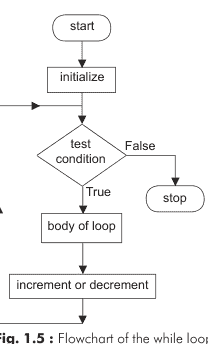


循环并递增或递减循环计数器。循环持续进行，直到条件被违反。while 循环在每次迭代之前测试条件。如果条件最初失败，循环将被完全跳过，即使在第一次迭代本身也是如此。

程序 1.12 有助于你更好地理解这些内容。

```
/* Program to calculate the simple interest */
/* Simple.c */
#include<stdio.h>
void main()
{
    int p, n, count = 1;
    float r, si;
    while(count <= 2)
    {
        printf("\n Enter P, N and R : ");
        scanf("%f %d %f", &p, &n, &r);
        si = (p * n * r) / 100;
        printf("\n Simple interest = %f",si);
        count++;
    }
}
```

程序显示以下输出
Enter P, N and R : 3000 2 1.5
Simple Interest = 90
Enter P, N and R : 4500 4 2.75
Simple Interest = 495

在程序 1.12 中，循环体在检查条件后执行。循环执行两次，第三次 while 循环测试条件时，条件最终变为假，程序结束。请注意，while 循环中指定的测试条件在程序的某个时刻最终应变为假，否则循环将变成无限循环。当事先不知道循环次数时，通常使用 while 循环。

### 1.10.2 do-while 循环

do-while 循环（有时也称为 do 循环）与其对应的 while 循环在条件检查方面有所不同。循环条件不会在循环体执行一次之前进行测试。如果条件为假，在第一次循环迭代后循环终止。但是，如果条件为真，循环继续。do-while 循环的一般形式或语法是

```
do
{
    statement(s);
}while(condition);
```

在 do-while 中，即使条件第一次就失败，语句也会至少执行一次。do-while 循环的操作可以从图 1.6 的流程图中说明。程序 1.13 有助于你更好地理解这些内容。

```
Program 1.13:
/* do_while.c */
#include<stdio.h>
void main()
{
 char yes;
 int a, b;
 do
 {
 printf("Enter two numbers : ");
 scanf("%d %d", &a, &b);
 printf("SUM = %d", a+b);
 printf("\n Do you want to continue say Y/N : ");
 scanf("%c", &yes);
 }while((yes == 'Y')||(yes == 'y'));
}
```

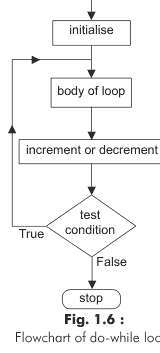

程序显示以下输出
Enter two numbers : 5 5
SUM = 10
Do you want to continue say Y/N : Y
Enter two numbers : 6 3
SUM = 9
Do you want to continue say Y/N : N

程序 1.13 的输出清楚地说明了 do-while 循环的功能。控制进入循环而不测试任何条件，循环体执行一次。while 语句检查条件，由于条件为真（即 y），控制再次转移到 do 循环的起始处，循环体再次执行。此过程持续进行，直到条件为假（即 n）。请注意，do-while 循环中 while 后面放置分号，因为它被视为一条语句。

### 1.10.3 for 循环

for 循环是 C 语言中最常用、最流行的循环。for 循环允许我们在一行中指定循环的三个方面。它们是，

- 初始化循环的值
- 循环计数器中的条件，用于确定循环是否应继续
- 每次执行程序段时递增或递减循环计数器的值

`for` 循环的操作可以从图 1.7 的流程图中说明。`for` 循环的一般形式或语法是

```
for(e1 ; e2 ; e3)
{
 statement(s);
 }
```

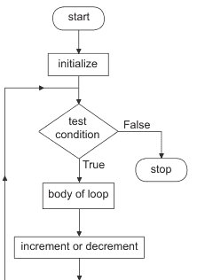

图 1.7：for 循环流程图。

其中 e1 是一个表达式，用于初始化 `for` 循环中使用的一个或多个变量。e2 是一个表达式，用于测试 `for` 循环中的条件，e3 是另一个表达式，用于递增或递减索引（该索引可能或可能未在表达式 e1 中初始化）。当 `for` 循环开始执行时，e1 中的表达式会首先被初始化，然后检查 e2 中的条件。如果条件满足，循环体中的语句将执行一次，然后如 e3 所示递增或递减索引。只要 e2 中的条件为真，循环动作就会继续。*请注意，控制仅在第一次进入循环时才会转到 e1，之后，根据条件 e2 和 e3 交替执行。请注意，for 后面不放置分号，因为它是一个循环而不是一条语句。* 程序 1.14 有助于你更好地理解这些内容。

### 程序 1.14

```
/* Program to find the sum of first N natural numbers */
#include <stdio.h>
#include<conio.h>
void main()
{
int i, n, sum = 0;
printf("Enter the limit : ");
scanf("%d", &n);
for(i = 1 ; i <= n ; i++)
{
sum = sum + i;
}
printf("\n The sum of first %d numbers is %d", n, sum);
}
```

程序显示以下输出
Enter the limit : 5
The sum of first 5 numbers is 15

在程序 1.14 中，用户输入了 5，该值赋给变量 n。`for` 循环从 1 递增到 5（即，直到 n = 5），5 个自然数的和被累加并存储在变量 sum 中。结果使用 `printf()` 函数显示。

## 1.11 数组

C 语言提供了一种功能，使用户能够设计一组称为数组的相似数据。数组的定义方式与普通变量相同，只是每个数组名称后面都必须跟一个方括号内的大小说明，以便一次存储多个值。数组被定义为一组同类型的同质数据项，它们共享一个共同名称，并通过数组中的位置相互区分。数组中的单个值称为元素。每个数组元素通过指定数组名称，后跟方括号内的一个数字来引用，该数字称为索引或下标。数组的维度由识别每个元素所需的下标数量决定。下标始终放置在数组名称后的方括号 [] 内。每个下标必须表示为非负整数。每个下标的值可以表示为整数常量、整数变量或复杂的整数表达式。

数组是结构化变量类型，为大小说明中声明的所有元素分配内存。能够使用一个简单名称来表示一组项目并引用项目编号，使我们能够开发高效的程序。

### 1.11.1 数组的初始化和声明

数组是指一组共享相同名称和相同数据类型的数据项。数组中的单个数据项称为元素。数组中的每个元素通过下标访问，下标从零开始，且始终写在一对方括号内。例如，

```
int a[10];
char ab[10][10];
```

第一个声明声明了一个一维整数数组 a，可存储 10 个整数常量（即，0–9）。下一个声明声明了一个二维字符数组 ab，可存储长度不超过 10 的 10 个字符串常量。

数组在声明时也可以初始化。方法是在声明后添加等号，后跟要初始化的所需值。例如，

```
int a[5] = {1, 2, 3, 4, 5};
char name[6] = {'M', 'a', 'd', 'h', 'u', '\0'};
char name[6] = "Madhu";
```

第一个声明声明了一个类型为整数的一维数组 a，并将值 1 初始化到 a[0]，2 初始化到 a[1]，依此类推，直到 a[4] 中的 5（请注意，数组的初始化从下标零开始）。接下来的两个初始化或多或少相似，声明了一个类型为 char 的一维数组 name。第一个声明按字符初始化字符串“Madhu”，而下一个声明直接初始化字符串（请注意，按字符初始化字符串时，NULL 字符是必需的）。


### 1.12 一维数组

由单个下标指定其元素的数组称为*一维*或*单维*或*单下标*或*线性数组*。目前为止我们看到的数组都是一维数组。可以使用仅一个下标为一组项目指定变量名，这样的变量称为一维数组，也称为列表。声明数组的主要目的是在内存中为元素预留空间。数组声明的一般形式或语法是

```
storageType dataType arrayName[size];
```

声明数组时，*存储类型* 是可选的。*存储类型* 可以是 *auto*，或 *register*，或 *static*，或 *extern*。存储类请参阅第 2.12 节。*数据类型* 指定将存储在数组中的元素类型。*数组名* 是用于标识数组的名称。数组命名规则与标识符相同。*大小* 是正整数常量，表示数组中可存储的最大元素数量。每个下标必须表示为非负整数。在 n 元素数组中，数组元素存储在 `x[0], x[1], ..., x[n-2], x[n-1]` 中，如 **图 1.8** 所示。

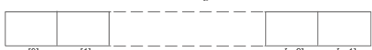

**图 1.8：一维数组的内存分配。**

### 1.12.1 声明数组

与普通变量一样，数组变量也应声明。声明数组的一般形式或语法是

```
datatype arrayName[subscript];
```

其中，*数组名* 是类型为 *数据类型* 的有效 C 变量，*下标* 是整数常量，表示数组中可存储的最大元素数量。例如，声明

```
int days[31];
```

读作“days，一个包含 31 个 int 值的数组”。在上述声明中，*int* 指定变量的数据类型，与普通变量一样，单词 *days* 指定数组的名称。数字 31 是数组的大小，表示要在数组中存储 31 个类型为 *int* 的元素。此数字称为数组的维度。方括号 [] 告诉编译器，我们正在处理数组。**请注意，数组不应与同一块或函数中的普通变量同名。**

```
int value[50];
char book[102];
extern float amount[20];
```

在第一个示例中，*int* 指定变量的类型，单词 *value* 指定数组的名称。方括号内的数字 50 表示要存储在数组中的最大元素数量。方括号表示该变量是一个数组。同样，在第二个示例中，book 是一个大小为 102 个元素的字符数组。在第三个示例中，extern 用于数据类型 float 之前，以指示数组 amount 是一个全局数组变量。

### 数组的属性

- 数组的类型是其元素的数据类型。
- 数组的位置是其第一个元素的位置。
- 数组的长度是数组中的数据元素数量。
- 数组的大小是数组长度乘以元素大小，但数组的大小通常称为所用下标的乘积。

### 使用数组时需注意的重要事项

- 数组名应为有效的 C 标识符。
- 数组名应唯一，类似于其他变量。
- 数组中存储的元素值应为相同类型（即，如果数组声明为 int，则只能存储 int 类型的元素）。

### 1.12.2 访问数组元素

数组声明后，让我们看看如何访问数组中的单个元素。这是通过下标（即数组名后方括号中指定的数字）来完成的。下标指定元素在数组中的位置。所有数组元素都从零开始编号。第一个项目存储在数组名本身指向的地址处。这也可以称为位置 0。因此，数组 days 的第一个元素称为 days[0]。数组的第四个元素称为 days[3]。能够使用变量作为下标使数组在编写程序时非常有用。程序 1.15 有助于您更好地理解数组。

### 程序 1.15：

```
/* Program to find the biggest of 10 numbers using arrays. */
/* big_10.c */
#include<stdio.h>
void main()
{
    int value[10], i, big = 0;
    printf("Enter any 10 numbers : ");
    for(i = 0 ; i < 10 ; i++)
        scanf("%d", &value[i]);
    big = value[0];
    for(i = 0 ; i < 10 ; i++)
        if(big < value[i])
            big = value[i];
    printf("The biggest number is %d", big);
}
```

程序显示以下输出
Enter any 10 numbers : 38 26 14 53 62 71 84 11 97 47
最大数字是 97

在程序 1.15 中，我们使用名为 value 的数组来存储 10 个数字以找出 10 个数字中的最大值。如果不使用数组，该程序将使用 10 个不同的变量，例如 a、b、...、i、j。在程序 1.15 中，变量 i 用作下标来引用数组的元素。程序中使用的第一个 for 循环从用户处读取 10 次数字。第一次时，下标值 i 等于零（i = 0），因此 scanf() 函数将用户输入的值存储在数组元素 value[0]（即数组的第一个元素）中。此过程重复，直到 i 变为 9。程序中的下一个 for 循环用于在循环体上执行操作以找出 10 个数字中的最大值，并使用 printf() 函数显示结果。

### 使用下标时需注意的重要事项

- 下标值不应为负数。
- 下标必须始终是整数或产生整数的表达式。
- 下标必须指定在数组名前面的方括号内。
- 如果有多个下标（如多维数组的情况），每个下标必须分别指定在各自的方括号内。

### 1.12.3 初始化一维数组

目前为止，我们已经了解了如何从用户处读取数组元素的值，但也可以像普通变量一样初始化数组。这是因为为数组保留的存储位置包含垃圾值。数组可以通过以下任一方式初始化。

- 在声明期间初始化数组
- 使用循环初始化数组

### 在声明期间初始化数组

在声明期间初始化数组的一般形式或语法是

```
storageType dataType arrayName[size] = {list of values};
```

其中 storageType 是可选的。dataType 指定将存储在数组中的元素类型。arrayName 是用于标识数组的名称。size 是整数常量，表示数组中可存储的最大元素数量。在这种情况下 size 是可选的。值列表是用逗号分隔的用于初始化数组的值。

```
int mark[7] = {100, 45, 75, 88, 63};
char name[8] = {'s', 'u', 'd', 'h', 'i', 'r', '\0'};
float amount[] = {12.3, 234.56, 34.56, 5678.90};
```

在第一个示例中，数组的大小为 7，值 100、45、75、88、63 分别赋给变量 mark[0]、mark[1]、...、mark[4]。在第二个示例中，数组中的值的数量少于数组的大小，因此值 's'、'u'、'd'、'h'、'i'、'r'、'\0' 将分配给变量 name[0]、name[1]、...、name[6]，剩余变量 name[7] 将自动设置为零。在第三个示例中，省略了数组的大小。在这种情况下，编译器为所有给定的初始化元素分配足够的内存空间。因此，数组 amount[] 的大小将为 4。

图 1.9 显示了第一个示例中数组 mark 占用的内存。数组 mark 元素占用的地址以十六进制值显示。由于数组是 int 类型，数组中的每个元素占用 2 字节内存。无论初始值如何，所有数组元素都将存储在连续内存位置中。无论数组是否初始化，一旦声明，将根据数组的数据类型为其连续分配内存。请注意，未初始化的数组元素将设置为零。

| mark[0] | mark[1] | mark[2] | mark[3] | mark[4] | mark[5] | mark[6] |
|---|---|---|---|---|---|---|
| 100 | 45 | 75 | 88 | 63 | 0 | 0 |
| FFE8 | FFEA | FFEC | FFEE | FFF0 | FFF2 | FFF4 |

图 1.9：数组 mark 的内存分配。

### 使用循环初始化数组

可以使用 for 循环、while 循环或 do-while 循环来初始化数组。以下示例说明了使用 for 循环初始化数组的用法。

### 使用 for 循环初始化数组的示例

1. 
```c
int i, mark[50];
for(i = 0; i < 50; i++)
{
mark[i] = 0;
}
```

2. 
```c
int i, mark[50], x = 5;
for(i = 0 ; i < 50 ; i++)
{
mark[i] = x;
x += 5;
}
```

3. 
```c
int i, mark[50];
for(i = 0 ; i < 50 ; i++)
{
scanf("%d", &mark[i]);
}
```


在第一个示例中，`for` 循环将数组中所有元素的值初始化为零。在第二个示例中，`for` 循环将值 5 初始化到 `mark[0]`，10 到 `mark[1]`，依此类推。在第三个示例中，`scanf()` 函数从用户读取数组的值。与 `for` 循环类似，数组的初始化可以使用 `while` 和 `do-while` 循环进行。

### 初始化数组的规则

- 如果初始化器的数量少于数组中的元素数量，则剩余元素设置为零。例如，int value[5] = {21, 5, 79};
- 指定的初始化器数量超过数组中的元素数量是错误的。例如，int value[2] = {4, 3, 2, 1, 5, 7};
- 在声明数组时如果提供了初始化器，则无需显式指定数组的长度。例如，int value[] = { 5, 4 };
- 字符数组可以由字符串常量初始化，这会将数组的第一个元素设置为字符串中的第一个字符，第二个元素设置为第二个字符，依此类推。数组还会接收字符串常量中的终止 '\0'。初始化可以是 char name[7] = "GANDHI"; 这等同于 char name[7] = {'G', 'A', 'N', 'D', 'H', 'I', '\0'};

### 1.13 二维数组

元素由两个下标指定的数组称为二维数组。二维数组的定义方式与一维数组相同，只是需要两对方括号来表示两个下标。二维数组也称为矩阵。每个下标必须表示为非负整数。二维数组的一般形式或语法是

```
storageType dataType arrayName[rowsize][colsize];
```

其中 storageType 可以是 auto、static 或 extern。声明数组时 storageType 是可选的。dataType 指定将存储在数组中的元素类型。arrayName 是用于标识数组的名称。数组名称的命名规则与标识符相同。rowsize 和 colsize 是正值整数常量。这两个下标表示与每个下标关联的数组元素数量。使用两对方括号来表示两个下标的值。例如，

```
int mark[2][2];
```

定义一个具有 2 行 2 列的整数数组表格。数组元素从索引零开始，因此数组的各个元素将是

```
mark[0][0] mark[0][1]
mark[1][0] mark[1][1]
```

第一个元素存储在内存位置 [0] [0]，接着是第二个元素在 [0] [1]，依此类推，最后一个元素将存储在内存位置 [1] [1]。二维数组的元素总数可以通过行数和列数的乘积计算得出。一个 m×n 的二维数组可以有一个具有 m 行 n 列的值表，如图 1.10 所示。

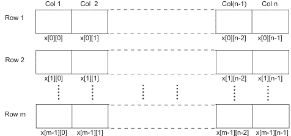

图 1.10：双维数组的内存分配。

rowsize 和 colsize 的乘积表示数组的最大元素数量。rowsize 和 colsize 不必相等。初始化数组元素的值时必须小心。colsize 下标增长最快，rowsize 下标增长最慢（即，将分配第一行的所有元素，然后分配第二行的所有元素，依此类推）。

### 1.13.1 初始化二维数组

与一维数组一样，二维数组也可以初始化。数组可以通过以下方式初始化，

- 在声明期间初始化数组
- 使用循环初始化数组。

### 在声明期间初始化数组

与一维数组类似，二维数组也可以在声明期间用一个或多个值进行初始化。在声明期间初始化数组的一般形式或语法是

```
StorageType dataType arrayName[rowsize] [colsize] = { List of Values };
```

其中 storageType 可以是 auto、register、static 或 extern。声明数组时 storageType 是可选的。dataType 指定将存储在数组中的元素类型。arrayName 是用于标识数组的名称。数组名称的命名规则与标识符相同。请注意，数组不应与同一块或函数中的普通变量具有相同的名称。rowsize 和 colsize 是正值整数常量，表示与每个下标关联的数组元素数量。

例如，

```
int mark[4][2] = { {84, 56},
       {92, 67},
       {75, 78},
       {69, 89} };
```

第一个下标范围从 0 到 3，第二个下标范围从 0 到 1。在第一种情况下，第一个内部花括号对分配给第一行的数组元素，第二个内部花括号对的值分配给第二行的数组元素，依此类推。需要一对外部花括号，包含内部花括号。每行包含一个学生的 2 个分数，用逗号分隔并用花括号括起来，并使用逗号运算符与下一个学生的分数分开，整个数组用一对花括号括起来。数组 mark 也可以声明为

```
int mark[4][2] = {84, 56, 92, 67, 75, 78, 69, 89};
```

初始赋值的结果是，

```
mark[0][0] = 84       mark[1][0] = 56
mark[0][1] = 92       mark[1][1] = 67
mark[0][2] = 75       mark[1][2] = 78
mark[0][3] = 69       mark[1][3] = 89
```

考虑以下二维数组的初始化。

```
int rank[3][2] = {1, 2, 3, 4, 5, 6};
int rank[][2] = {1, 2, 3, 4, 5, 6};
float amount[2][3] = {25.6, 90.2, 89.4, 72.6};
```

在第一个示例中，数组的大小为 6（即 3*2），值 1、2、3、4、5、6 分别分配给变量 rank[0][0]、rank[0][1]、...、rank[2][1]。在第二个示例中，rowsize 缺失。在初始化数组时，第二个维度（即 colsize）是必要的，但第一个维度（即 rowsize）是可选的。如果未分配行大小，编译器会为所有给定的初始化元素分配足够的内存空间。第一个和第二个示例是相同的。在第三个示例中，数组中的值的数量少于数组的大小，因此值 25.6、90.2、89.4、72.6 将分配给变量 amount[0][0]、amount[0][1]、amount[0][2] 和 amount[1][0]，剩余变量 amount[1][1] 和 amount[1][2] 将自动设置为零。

### 程序 1.16

```
/* Program to calculate the sum of all elements in a matrix. */
/* summat.c */
#include<stdio.h>
void main()
{
    int a[10][10], i, j, m, n, sum = 0;
    printf("Enter the order of matrix : ");
    scanf("%d %d", &m, &n);
    printf("Enter the elements of matrix : ");
    for(i = 0 ; i < m ; i++)
    for(j = 0 ; j < n ; j++)
    scanf("%d", &a[i][j]);
    for(i = 0 ; i < m ; i++)
    for(j = 0 ; j < n ; j++)
    sum = sum + a[i][j];
    printf("Sum of elements of the matrix is %d", sum);
}
```

程序显示以下输出

```
Enter the order of matrix : 2 2
Enter the elements of matrix : 1 1 1 1
Sum of elements of the matrix is 4
```

在程序 1.16 中，我们使用了一个名为 "a" 的数组并分配了 4 个（4x2）int 类型的元素。程序显示数组矩阵元素占用的内存的值和地址。由于数组是 int 类型，数组中的每个元素占用 2 字节内存。

### 使用循环初始化数组

可以使用 for 循环、while 循环或 do-while 循环来初始化数组。以下示例说明了使用 for 循环初始化数组的用法。

### 使用 for 循环初始化数组的示例

- 1.
  ```
  int i, j, x = 5, mark[10][5];
  for(i = 0 ; i < 10 ; i++)
  for(j = 0 ; j < 5 ; j++)
  {
  mark[i][j] = x;
  x += 5;
  }
  ```

- 2.
  ```
  int i, j, mark[10][5];
  for(i = 0 ; i < 10 ; i++)
  for(j = 0 ; j < 5 ; j++)
  scanf("%d", &mark[i][j]);
  ```

在第一个示例中，for 循环将值 5 初始化到变量 mark[0][0]，10 到变量 mark[0][1]，依此类推。在第二个示例中，scanf() 函数从用户读取数组的值。同样，数组也可以使用 while 循环和 do-while 循环进行初始化。


### 1.14 多维数组

存在需要存储相同数据类型的值表格的情况。

在许多情况下，我们无法使用二维或双维数组，在这种情况下我们使用多维数组。元素由三个和四个下标指定的数组分别称为三维数组和四维数组。

声明多维数组的一般形式或语法是

```
dataType arrayName[subscript1][subscript2],...,[subscriptN];
```

其中下标的数量表示数组的维度。例如，

```
int value[10][10][10];
float sales[2][3][4][5];
```

在第一个示例中，value 是一个三维数组，可以存储 1000（即 10*10*10）个整型元素。同样，在第二个示例中，sales 是一个四维数组，可以存储 120（即 2*3*4*5）个浮点型元素。矩阵的每个元素都由使用的下标标识。多维数组的初始化方式与一维数组类似。初始化列表按行列出。花括号用于分隔一行到下一行的初始化列表，并在每个花括号后放置逗号。我们不详细介绍多维数组，因为我们通常只处理一维或二维数组。

### 1.15 字符串数组

字符串是用双引号括起来的任意字符组（双引号除外）。字符串是以 NULL 字符结尾的字符数组，因此字符串也可以称为字符串数组。在 C 语言中，字符串是通过使用字符数组来声明和/或定义的。例如，

> "字符串函数的概念"

是一个字符串。每当字符串存储在内存中时，编译器会自动在字符串末尾插入一个 NULL 字符 ('\0')。这个 NULL 字符表示字符串的结束。NULL 字符是第一个 ASCII 字符，其值为零。NULL 字符可以用作信号，让编译器知道字符串已结束。未以 '\0' 结尾的字符串不算真正的字符串，而仅仅是一个字符集合。

### 1.15.1 声明字符串

声明可存储字符数组的字符串的一般形式或语法可以声明为

```
char variable_name[size];
```

其中 char 是数据类型，variable_name 是标识符（即字符数组），size 是字符串可以存储的最大字符数，包括 NULL 字符。

例如，

```
char name[10], book[20];
```

其中 `char` 是数据类型，`name` 是变量，10 是变量的大小，可存储最多十个字符（包括 NULL 字符）（即，字符数组 name 可以存储从 `name[0]` 到 `name[8]` 的 9 个字符，变量 `name[9]` 用于存储 NULL 字符 ‘\0’）。同样，`book` 是一个可以存储最多 20 个字符的字符数组。

声明字符数组时，会为 NULL 字符分配额外的内存空间。双引号内的每个字符都被视为数组的一个元素并存储在内存中。当编译器遇到字符串常量 "Franklin" 时，它会在字符串常量后追加一个额外的 NULL 字符。字符串常量 "Franklin" 可以使用 `scanf()` 函数读取，如下所示：

```
scanf("%s", name);
```

`scanf()` 函数通常接受变量的地址，因为数组名本身表示数组的起始地址，因此在读取字符串时，我们不在变量名前使用取地址符（&）。**在读取字符串时，如果在变量名前使用取地址符，则是错误的。** `%s` 选项使用空格作为分隔符，因为它将空格分隔的字符视为两个独立的字符串。请注意，在 `scanf()` 函数中，数组名不带下标使用，因为我们正在将字符数组作为字符串读取。

### 1.15.2 初始化字符串

字符数组可以由字符串常量初始化，其结果是数组的第一个元素设置为字符串中的第一个字符，第二个元素设置为第二个字符，依此类推。数组还接收字符串常量中的终止 ‘\0’。初始化可以是

```
char name[7] = "GANDHI";
```

这等同于声明为

```
char name[] = { 'G', 'A', 'N', 'D', 'H', 'I', '\0' };
```

在第一种初始化方法中，‘\0’ 不是必需的，因为 C 会自动在字符串末尾插入 NULL 字符。但在下一种初始化方法中，必须在字符元素列表之后指定 NULL 终止。初始化值时提及数组大小是可选的。既然我们知道每个字符串都是一个字符数组，我们也可以像初始化数组时通常所做的那样，单独初始化字符串的字符。相同的字符串 "GANDHI" 也可以按如下方式初始化：

```
name[0] = 'G';
name[1] = 'A';
name[2] = 'N';
name[3] = 'D';
name[4] = 'H';
name[5] = 'I';
name[6] = '\0';
```

### 1.15.3 读取字符串

通过键盘从用户读取字符串有三种方法，即，

- 通过使用 scanf() 函数
- 通过使用 gets() 函数
- 通过使用循环。

### 通过使用 scanf() 函数

带有格式字符串 %s 的 scanf() 函数可用于从用户读取字符串。

例如，

```
main()
{
   char name[25];
   scanf("%s", name);
}
```

scanf() 函数的缺点是无法将多单词字符串（即带有空格的字符串）读入单个字符数组变量。scanf() 函数在遇到空格时会终止输入。

例如，如果 scanf() 函数的输入为

United Kingdom

字符串 United 将被读入变量 name，而字符串 Kingdom 不会被读取，因为 %s 选项使用空格作为分隔符，它将空格分隔的字符串视为两个字符串。请注意，在读取字符串时，scanf() 函数中的数组名不带下标使用。

### 通过使用 gets() 函数

使用数组名的 gets() 函数也可用于从键盘读取字符串。gets() 函数克服了 scanf() 函数的缺点，因为它可以读取任何长度、包含任意数量空格和制表符的字符串。它仅在按下 ENTER 键时终止（即仅在遇到换行符时）。

例如，

```
main()
{
   char name[20];
   gets(name);        /* String read from a keyboard */
}
```

如果要读取的输入是 “United Kingdom”，则整个字符串将存储在数组 name 中。它将 “United” 和 “Kingdom” 之间的空格作为输入字符串的一部分接受。gets() 函数的缺点是，它一次只能读取一个字符串。

例如，语句

```
gets(name, designation);
```

是无效的。使用 scanf() 函数的优点是它可以一次读取多个字符串。例如，

```
scanf("%s %s %s", name, designation, address);
```

scanf() 函数用于一次读取 name、designation 和 address 数组的输入，而使用 gets() 函数无法做到这一点。

### 通过使用循环

我们知道字符串是一个字符数组，因此也可以使用循环从用户处逐个字符读取字符串。你可以使用 for、while 或 do-while 循环。以下示例中的循环会读取用户输入，直到字符串由换行符终止。程序中的下标 i 会逐个递增字符串（即逐个字符），直到遇到换行符。例如，

```
main()
{
    int i; char name[20];
    for(i = 0; i != '\n'; i++)
        scanf("%c", &name[i]); /* String read using a for loop */
}
```

```
main()
{
    int i = 0;
    char name[20];
    while(i != '\n')    /* String read using a while loop */
    {
        scanf("%c", &name[i]);
        i++;
    }
}
```

```
main()
{
    int i = 0;
    char name[20];
    do    /* String read using a do-while loop */
    {
        scanf("%c", &name[i]);
        i++;
    }while(i != '\n');
}
```

请注意，如果按字符读取字符串，则在数组名前使用取地址符。


### 1.16 字符串库函数

随每个 C 编译器提供一大套有用的库函数。表 1.15 列出了常用的字符串函数及其用途。

### 表 1.15：字符串函数

| Function | Meaning |
| :--- | :--- |
| strcpy() | 将一个字符串复制到另一个字符串 |
| strcat() | 将一个字符串追加到另一个字符串末尾 |
| strchr() | 查找字符串中给定字符的第一次出现 |
| strcmp() | 比较两个字符串 |
| strcmpi() | 比较两个字符串，不区分大小写（“i”表示该函数忽略大小写） |
| strcpy() | 将一个字符串复制到另一个字符串 |
| strcspn() | 查找字符串 s1 的初始段，该段完全由不属于字符串 s2 的字符组成。 |
| strdup() | 复制一个字符串 |
| stricmp() | 比较两个字符串，不区分大小写（与 strcmpi 相同） |
| strlen() | 查找字符串的长度 |
| strlwr() | 将字符串转换为小写 |
| strncat() | 将一个字符串的前 n 个字符追加到另一个字符串末尾 |
| strncmp() | 比较两个字符串的前 n 个字符 |
| strncpy() | 将一个字符串的前 n 个字符复制到另一个字符串 |
| stricmp() | 比较两个字符串，不区分大小写（与 strcmpi 相同） |
| strnset() | 将字符串的前 n 个字符设置为给定字符 |
| strrbrk() | 扫描字符串 s1，查找任何出现在 s2 中的字符的第一次出现。 |
| strrchr() | 查找字符串中给定字符的最后一次出现 |
| strrev() | 反转一个字符串。 |
| strset() | 将字符串的所有字符设置为给定字符 |
| strspn() | 查找字符串 s1 的初始段，该段完全由属于字符串 s2 的字符组成。 |
| strstr() | 在另一个字符串中查找给定字符串的第一次出现 |
| strtok() | 扫描 s1，查找第一个不包含在 s2 中的标记 |
| strupr() | 将字符串转换为大写 |
| strxfrm() | 将字符串 s2 转换为字符串 s1，不超过 n 个字符。 |

从上面的列表中，我们将讨论 strlen()、strcpy()、strcat()、strcmp()、strrev()、strlwr() 函数，因为这些是最常用的字符串库函数。

### 1.16.1 strlen() 函数

strlen()（字符串长度）函数返回存储在字符串中的字符数。strlen() 函数的一般形式或语法是

```
x = strlen(str);
```

其中 x 是接收字符串长度的整型变量，str 是有效的字符串变量或常量。程序 1.17 有助于你更好地理解。

### 程序 1.17

```
/* strlen.c */
#include<stdio.h>
#include<string.h>
void main()
{
char str[25];
printf("Enter a string : ");
gets(str);
printf("The length of the string is %d", strlen(str));
}
```

程序显示以下输出

```
Enter a string : Surya
The length of the string is 5
```

在程序 1.17 中，strlen() 函数接受一个参数（即用户输入的字符串），并返回字符串的长度。请注意，字符串长度不计算空字符。如果用户输入带空格的字符串，strlen() 函数返回字符串的长度，包括字符串中之间的空格数量。例如，

```
Enter a string : Raj Kumar
The length of the string is 9
```

strlen() 函数还计算字符串中的空格，并将字符串长度返回为 9。

### 1.16.2 strcpy() 函数

字符串不能直接使用赋值语句复制（指针除外）。但是，可以使用赋值语句逐个元素复制字符串。strcpy()（字符串复制）函数用于将一个字符串的内容复制到另一个字符串。strcpy() 函数的一般形式或语法是

```
strcpy(string1, string2);
```

其中 string1 和 string2 是有效的字符串变量或字符串常量。strcpy() 函数接受两个参数用于复制。第二个参数（即 string2）中的字符串被复制到第一个参数（即 string1）。要将一个字符串复制到另一个字符串，应将源字符串和目标字符串的基地址提供给此函数。程序 1.18 有助于你更好地理解。

### 程序 1.18

```
/* strcpy.c */
#include<stdio.h>
#include<string.h>
void main()
{
char str[25];
char cpy[25];
printf("Enter a string : ");
gets(str);
strcpy(cpy, str);
printf("\n The source string is %s", str);
printf("\n The copied string is %s", cpy);
}
```

程序显示以下输出

```
Enter a string : Krishna
The source string is Krishna
The copied string is Krishna
```

在程序 1.18 中，变量 str 用于读取输入字符串，并将输入字符串复制到 cpy。str 中的变量被逐个字符复制到 cpy，直到遇到空字符。空字符也被复制。

### 1.16.3 strcat() 函数

strcat()（字符串连接）函数将源字符串连接到目标字符串的末尾。strcat() 函数接受两个参数用于连接。第二个参数（即 string2）中的字符串与第一个参数（即 string1）中存在的字符串连接。strcat() 函数的一般形式或语法是

```
strcat(string1, string2);
```

其中 string1 和 string2 是有效的字符串变量或字符串常量。string2 的内容与 string1 的内容连接。程序 1.19 有助于你更好地理解。

### 程序 1.19

```
/* strcat.c */
#include<stdio.h>
#include<string.h>
void main()
{
    char str[25], cat[25];
    printf("Enter a string : ");
    gets(str);
    printf("Enter another string : ");
    gets(cat);
    strcat(str, cat);
    printf("The concatenated string is : %s", str);
}
```

程序显示以下输出

```
Enter a string : Rama
Enter another string : Chandran
The concatenated string is : RamaChandran
```

在程序 1.19 中，第一个字符串存储在变量 str 中，第二个字符串存储在变量 cat 中。cat 中的字符串与 str 中的字符串连接，并显示输出。

### 1.16.4 strcmp() 函数

strcmp()（字符串比较）函数比较两个字符串以查找字符串是否相等。strcmp() 函数的一般形式或语法是，

```
strcmp(string1, string2);
```

其中 string1 和 string2 是有效的字符串变量或字符串常量。strcmp() 函数接受两个参数用于比较并返回一个整数。第一个参数（即 string1）中的字符串与第二个参数（即 string2）中的字符串逐个字符比较，直到遇到两个字符串之间的不匹配或两个字符串中任何一个的末尾。程序 1.20 有助于你更好地理解。

### 程序 1.20

```
/* strcmp.c */
#include<stdio.h>
#include<string.h>
void main()
{
    char str[25], cmp[25];
    int x;
    printf("Enter a string : ");
    gets(str);
    printf("Enter another string : ");
    gets(cmp);
    x = strcmp(str, cmp);
    if(x == 0)
    puts("Strings are Equal");
    else if(x > 0)
    printf("String %s is greater than string %s", str, cmp);
    else
    printf("String %s is greater than string %s", cmp, str);
}
```

### 程序显示以下输出

```
RUN 1
Enter a string : Subramanian
Enter another string : Subramanian
Strings are Equal

RUN 2
Enter a string : Jaikumar
Enter another string : Sasikumar
String Sasikumar is greater than string Jaikumar

RUN 3
Enter a string : Yuvaraj
Enter another string : Jebaraj
String Yuvaraj is greater than string Jebaraj
```

在运行 1 中，用户输入两个字符串后，strcmp() 函数逐个字符比较两个字符串，由于在未检测到不等字符的情况下到达字符串末尾，因此字符串相等。strcmp() 函数返回值零，因此 if 语句中的条件为真，printf() 函数显示消息

> 字符串相等

在运行 2 中，用户输入两个字符串 Jaikumar、Sasikumar 后，由于字符串 Sasikumar 大于字符串 Jaikumar，strcmp() 函数返回大于零的值，else if 语句中的条件为真，printf() 函数显示消息

> 字符串 Sasikumar 大于字符串 Jaikumar

在运行 3 中，用户输入两个字符串 Yuvaraj、Jebaraj 后，由于字符串 Jebaraj 小于字符串 Yuvaraj，strcmp() 函数返回一个值


小于零，并且 else 块中的条件（即 printf() 函数）被执行并显示消息

字符串 Yuvaraj 大于字符串 Jebaraj

请注意，strcmp() 函数返回的值通常是两个字符串中第一个不匹配处的不等字符的 ASCII 值之差。

### 1.16.5 strrev() 函数

strrev()（字符串反转）函数用于反转字符串。该函数只接受一个参数。strrev() 函数的一般形式或语法是

```
x = strrev(string);
```

其中 x 是用于保存反转后字符串的字符串变量，string 是存储要反转的字符串的有效字符串变量或字符串常量。程序 1.21 可帮助您更好地理解。

### 程序 1.21：

```
/* strrev.c */ #include<stdio.h> #include<string.h> void main() { char x[20]; printf("Enter the string : "); gets(x); printf("The reversed string is : %s", strrev(x)); }
```

程序显示以下输出

RUN1 Enter the string : Aravind The reversed string is : ndivrA RUN2 Enter the string : Gayathri Devi The reversed string is : iveD irhtayagA

在程序 1.21 中，输入字符串存储在数组 x 中，并作为参数传递给 strrev() 函数，该函数反转字符串并显示输出。

请注意，上述输出中字符串之间的空格也被反转了。

### 1.16.6 strlwr() 函数

strlwr()（字符串转小写）函数用于将字符串转换为小写。该函数只接受一个参数。strlwr() 函数的一般形式或语法是

```
x = strlwr(string);
```

其中 x 是用于保存转换为小写后的字符串的字符串变量，string 是包含字符串（大写）的有效字符串或常量。程序 1.22 可帮助您更好地理解。

### 程序 1.22：

```
/* strlwr.c */
#include<stdio.h>
#include<string.h>
void main()
{
 char x[20];
 printf("Enter the string : ");
 gets(x);
 printf("The case changed string is : %s", strlwr(x));
 }
```

程序显示以下输出

RUN1 Enter the string : PRAMILA
The case changed string is : pramila
RUN2 Enter the string : ZaHiRa
The case changed string is : zahira

在程序 1.22 中，函数 strlwr() 将大写字母更改为小写并显示输出。如果输入的字符串是大写，编译器不会报错并自动显示输出。请注意，本章中每个程序我们都包含了 #include<string.h>，因为所有字符串函数都预定义在头文件 string.h 中。

### 1.17 简单程序

### 程序 S1：

编写一个程序来交换（互换）两个数字（使用三个变量）。

```
/* swap1.c */
#include<stdio.h>
void main()
{
int a, b, c;
printf("Enter two numbers : ");
scanf("%d %d", &a, &b);
printf("Before swapping . . \n");
printf("A = %d B = %d", a, b);
c = a;
a = b;
b = c;
printf("After swapping . . \n");
printf("A = %d B = %d", a, b);
}
```

程序显示以下输出

Enter two numbers : 90 70
Before swapping . .
A = 90 B = 70
After swapping . .
A = 70 B = 90

### 程序 S2：

编写一个程序来交换（互换）两个数字（使用两个变量）。

```
/* swap2.c */
#include<stdio.h>
void main()
{
int a, b;
printf("Enter two numbers : ");
scanf("%d %d", &a, &b);
printf("Before swapping . . \n");
printf("A = %d B = %d", a, b);
a = a + b;
b = a - b;
a = a - b;
printf("After swapping . . \n");
printf("A = %d B = %d", a, b);
}
```

程序显示以下输出

Enter two numbers : 23 54
Before swapping . .
A = 23 B = 54
After swapping . .
A = 54 B = 23

### 程序 S3：

编写一个不使用算术运算符来交换两个数字的程序。

```
/* swap3.c */
#include<stdio.h>
void main()
{
 int a, b;
 printf("Enter two numbers : ");
 scanf("%d %d", &a, &b);
 printf("Before swapping . . \n");
 printf("A = %d B = %d", a, b);
 a = a ^ b;
 b = a ^ b;
 a = a ^ b;
 printf("\nAfter swapping . . \n");
 printf("A = %d B = %d", a, b);
}
```

程序显示以下输出

Enter two numbers : 90 70
Before swapping . .
A = 90 B = 70
After swapping . .
A = 70 B = 90

### 程序 S4：

编写一个程序将摄氏温度转换为华氏温度。

```
/* temp_f_c.c */
#include<stdio.h>
void main()
{
 float cent, fahren;
 printf("Enter temperature in centigrade : ");
 scanf("%f", &cent);
 fahren = (1.8 * cent + 32);
/* cent = (fahren - 32) / 1.8; for converting temperature in fahrenheit to centigrade */
 printf("The temperature in fahrenheit is %.2f", fahren);
}
```

程序显示以下输出

Enter temperature in centigrade : 45
The temperature in fahrenheit is 113.00

### 程序 S5：

编写一个程序使用 if 语句查找三个数字中的最大值。

```
/* max1_f.c */
#include<stdio.h>
void main()
{
 float a, b, c, max;
 printf("Enter three numbers : ");
 scanf("%f %f %f", &a, &b, &c);
 max = a;
 if (b > max)
     max = b;
 if (c > max)
     max = c;
 printf("Largest of three numbers is %.2f", max);
}
```

程序显示以下输出

Enter three numbers : 45.75 65.00 34.998
Largest of three numbers is 65.00

### 程序 S6：

编写一个程序来查找给定数字是奇数还是偶数。

```
/* odd_even.c */
#include<stdio.h>
void main()
{
    int num;
    printf("Enter the number : ");
    scanf("%d", &num);
    if (num % 2 == 1)    /* find the modulus of the number */
        printf("The number is odd");
    else
        printf("The number is even");
}
```

程序显示以下输出

RUN1 Enter the number : 46
    The number is even
RUN2 Enter the number : 73
    The number is odd

### 程序 S7：

编写一个程序来查找单利和复利。

```
/* sim_com.c */
#include<stdio.h>
void main()
{
    int n;
    float p, r, dur, simple, compound, total;
    printf("Enter principal,rate,no.of.years,compounding/year \n");
    scanf("%f %f %d %d", &p, &r, &dur, &n);
    simple = (p * dur * r) / 100;
    printf("Simple Interest is %.2f", simple);
    total = p * pow((double) (1+r/(n*100)), (double) (n*dur));
    compound = total - p;
    printf("Compound Interest is %.2f", compound);
}
```

程序显示以下输出

Enter principal,rate,no.of.years,compounding/year
34 124 5 6
Simple Interest is 210.80
Compound Interest is 8636.00

### 程序 S8：

编写一个程序来查找给定年份是否为闰年。

```
/* leapyear.c */
#include<stdio.h>
void main()
{
 int x;
 printf("Enter the year : ");
 scanf("%d",&x);
 if ((x % 4 == 0) && (x % 100 == 0) || (x % 400 != 0))
 printf("%d is a leap year", x);
 else
 printf("%d is not a leap year", x);
}
```

程序显示以下输出

RUN1 Enter the year : 1999
1999 is not a leap year
RUN2 Enter the year : 2000
2000 is a leap year

### 程序 S9：

编写一个程序来查找给定数字的阶乘。

```
/* factorial.c */
#include<stdio.h>
void main()
{
 long i, j, x = 1;
 printf("Enter the number : ");
 scanf("%d",&i);
 for (j = 1 ; j <= i ; j++)
 x = j * x;
 printf("Factorial value of %d is %d", i, x);
}
```

程序显示以下输出

Enter the number : 5
Factorial value of 5 is 120

### 程序 S10：

编写一个程序来查找整数各位数字之和。

```
/* digitsum.c */
#include<stdio.h>
void main()
{
 long x, y = 0, z = 0;
 printf("Enter the number : ");
 scanf("%ld", &x);
 while (x > 0)
{
 y = x % 10;
 z = z + y;
 x = x / 10;
}
printf("The sum of the digits in the integer is %ld", z);
}
```

程序显示以下输出

Enter the number: 1234
The sum of the digits in the integer is 10

### 程序 S11：

编写一个程序使用高斯方法查找前 'n' 个自然数的平均值。

```
/* ave_gaus.c */
#include<stdio.h>
void main()
{
 int n;
 float sum = 0, i, ave;
 printf("Enter a number : ");
 scanf("%d", &n);
 for(i = 1 ; i <= n ; i++)
 {
 sum = sum + i;
 }
 ave = (float)sum / (float)n; /* type casting */
 printf("Average of %2d numbers is %.2f\n", n, ave);
 printf("Average by gauss method is %.2f", ((float)n*((float)n+1.0)/2.0)/(float)n);
}
```

程序显示以下输出

Enter a number : 12
Average of 12 numbers is 6.50
Average by gauss method is 6.50

### 程序 S12：

编写一个使用函数的程序来查找前 N 个数字的平方并计算其和。

```
/* square.c */
#include<stdio.h>
int squares(int);
void main()
{
 int i, n, s, sum = 0;
 printf("Enter the limit : ");
 scanf("%d", &n);
 for(i = 1 ; i <= n ; i++)
 {


```
s = squares(i);
sum += s;
printf("Square of %d is %d", i, s);
}
printf("\nSum of the squares is %d", sum);
}
int squares(int b)
{
return(b * b);
}
```

```
The program displays the following output
Enter the limit : 5
Square of 1 is 1
Square of 2 is 4
Square of 3 is 9
Square of 4 is 16
Square of 5 is 25
Sum of the squares is 55
```

### 程序 S13:

编写一个程序，检查给定的数字是否为回文数。

```c
/* palinnum.c */
#include<stdio.h>
#include<stdlib.h>
void main()
{
long int a = 0, b = 0, c = 0, d = 0, e = 0;
printf("Enter the number : ");
scanf("%d", &a);
e = a;
while(a > 0)
{
b = a % 10;
c = c + b;
a = a / 10;
d = b + d * 10;
}
if(e == d) /* check whether the reverse and the original number are equal */
printf("%d is a Palindrome number", e);
else
printf("%d is not a Palindrome number", e);
}
```

```
The program displays the following output
RUN1 Enter the number : 234
234 is not a Palindrome number
RUN2 Enter the number : 998
989 is a Palindrome number
```

## 程序 S14:

编写一个程序，检查给定的数字是否为质数。

```c
/* prime.c */
#include<stdio.h>
#include<conio.h>
void main()
{
int i, flag; long number;
printf("Enter the number : ");
scanf("%d", &number);
if(number < 3)
printf("The number is prime");
else
for(i = 2 ; i < number/2 ; i++)
if(number % i == 0)
{
flag = 1;
break;
}
else
flag = 0;
if(flag == 1)
printf("The number is not prime");
else
printf("The number is prime");
}
```

```
The program displays the following output
RUN1 Enter the number : 7
The number is prime
RUN2 Enter the number : 21
The number is not prime
```

## 程序 S15:

编写一个程序，打印给定数字的乘法表。

```c
/* multable.c */
#include<stdio.h>
void main()
{
int i, tables, counter = 1;
printf("Enter the table number & the counter value : ");
scanf("%d %d", &tables, &counter);
printf("The table is . . . \n");
for(i = 1 ; i <= counter ; i++)
printf("%d x %d = %d\n", tables, i, i * tables);
}
```

```
The program displays the following output
Enter the table number & the counter value : 5 10
The table is . . .
5 x 1 = 5
5 x 2 = 10
5 x 3 = 15
5 x 4 = 20
5 x 5 = 25
5 x 6 = 30
5 x 7 = 35
5 x 8 = 40
5 x 9 = 45
5 x 10 = 50
```

## 程序 S16:

编写一个程序，求一元二次方程的根。

```c
/* quadratic.c */
#include<stdio.h>
void main()
{
 float a, b, c, d, real, imag, r1, r2, n;
 int k;
 printf("Enter the values of A,B & C : ");
 scanf("%f %f %f", &a, &b, &c);
 if(a != 0)
 {
 d = b * b - 4 * a * c;
 if(d < 0)
 k = 1;
 else if(d == 0)
 k = 2;
 else if(d > 0)
 k = 3;
 switch(k)
 {
 case 1:
 printf("Roots are Imaginary \n");
 real = -b / (2 * a);
 d = -d;
 n = pow((double)d,(double)0.5);
 imag = n / (2 * a);
 printf("r1 = %7.2f + j %7.2f \n",real,imag);
 printf("r2 = %7.2f - j %7.2f \n",real,imag);
 break;
 case 2:
 printf("Roots are Real and Equal \n");
 r1 = -b / (2 * a);
 printf("r1 = r2 = %7.2f \n",r1);
 break;
 case 3:
 printf("Roots are Real and Unequal \n");
 r1 = (-b + sqrt((double)d)) / (2 * a);
 r2 = (-b - sqrt((double)d)) / (2 * a);
 printf("r1 = %7.2f \n", r1);
 printf("r2 = %7.2f \n", r2);
 break;
 }
 else
 printf("Equation is linear");
 }
}
```

```
The program displays the following output
RUN1 Enter the values of A,B & C : 1.0 2.0 1.0
Roots are Real and Equal
r1 = r2 = -1.00
RUN2 Enter the values of A,B & C : 1.0 2.0 7.0
Roots are Imaginary
r1 = -1.00 + j 8190.50
r2 = -1.00 - j 8190.50
RUN3 Enter the values of A,B & C : 0.0 4.0 7.0
Equation is linear
```

## 程序 S17:

编写一个程序，对整数进行排序。

```c
/* intsort.c */
#include<stdio.h>
void main()
{
long sort[20], a, i = 0, j, k, number, temp;
printf("Enter the number : ");
scanf("%ld", &number);
while(number > 0)
{
a = number % 10;
sort[i] = a;
i++;
number = number / 10;
}
for(j = 0 ; j < i-1 ; j++)
for(k = j + 1 ; k < i ; k++)
if(sort[j] > sort[k])
{
temp = sort[j];
sort[j] = sort[k];
sort[k] = temp;
}

printf("\nThe numbers in ascending order .... ");
for(j = 0 ; j < i ; j++)
    printf("%d", sort[j]);
}
```

```
The program displays the following output
Enter the number : 8153
The digits of the number in ascending order .... 1 3 5 8
```

## 程序 S18:

编写一个程序，将数字按升序排列。

```c
/* ascend.c */
#include<stdio.h>
void main()
{
    int a[50], i, j, n, temp;
    printf("Enter the limit : ");
    scanf("%d", &n);
    printf("Enter the elements : ");
    for(i = 0 ; i < n ; i++)
        scanf("%d", &a[i]);
    for(i = 0 ; i < n-1; i++)
        for(j = i ; j < n; j++)
            if(a[i] > a[j])
            {
                temp = a[i];
                a[i] = a[j];
                a[j] = temp;
            }
    printf("The sorted list is : ");
    for(i = 0 ; i < n ; i++)
        printf("%d", a[i]);
}
```

```
The program displays the following output
Enter the limit : 5
Enter the elements : 17 13 12 14 16
The sorted list is : 12 13 14 16 17
```

## 程序 S19:

编写一个程序，将整数转换为其对应的英文单词。

```c
/* numname.c */
#include<stdio.h>
void main()
{
    long num, a[8], i, j, k, c = 0;
    printf("Enter a number : ");
    scanf("%d", &num);
    while(num > 0)
    {
        j = num % 10;
        a[c] = j;
        num = num / 10;
        c++;
    }
    a[c] = '\0';
    for(k = c - 1 ; k >= 0 ; k--)
    switch(a[k])
    {
        case 1 :      printf("ONE ");
                      break;
        case 2 :      printf("TWO ");
                      break;
        case 3 :      printf("THREE ");
                      break;
        case 4 :      printf("FOUR ");
                      break;
        case 5 :      printf("FIVE ");
                      break;
        case 6 :      printf("SIX ");
                      break;
        case 7 :      printf("SEVEN ");
                      break;
        case 8 :      printf("EIGHT ");
                      break;
        case 9 :
            printf("NINE ");
            break;
        default :
            printf("ZERO ");
    }
}
```

```
The program displays the following output
Enter a number : 123456
one two three four five SIX
```

## 程序 S20:

编写一个程序，计算给定金额中包含的五百元、一百元、五十元、二十元、十元、五元、二元和一元的数量。

```c
/* rupee.c */
#include<stdio.h>
void main()
{
int rs;
printf("Enter the amount in rupees : ");
scanf("%d",&rs);
if(rs >= 500)
printf("\n The no.of five hundred's are %d", rs/500);
if(rs >= 100)
printf("\n The no.of hundred's are %d", rs/100);
if(rs >= 50)
printf("\n The no.of fifties are %d", rs/50);
if(rs >= 20)
printf("\n The no.of twenties are %d", rs/20);
if(rs >= 10)
printf("\n The no.of ten's are %d", rs/10);
if(rs >= 5)
printf("\n The no.of fives are %d", rs/5);
if(rs >= 2)
printf("\n The no.of two's are %d", rs/2);
if(rs >= 1)
printf("\n The no.of one's are %d", rs/1);
}
```

```
The program displays the following output
Enter the amount in rupees : 243
The no.of hundred's are 2
The no.of fifties are 4
The no.of twenties are 12
The no.of ten's are 24
The no.of five's are 48
The no.of two's are 121
The no.of one's are 243
```

### 1.18 数组程序

### 程序 A1:

编写一个程序，查找数组中的第二大数。

```c
/* large2.c */
#include<stdio.h>
void main()
{
 int a[25], temp = 0, i, j, n;
 printf("Enter the limit : ");
 scanf("%d", &n);
 printf("Enter the elements : ");
 for(i = 0 ; i < n ; i++)
 scanf("%d", &a[i]);
 for(i = 0 ; i < n-1 ; i++)
 for(j = i ; j < n ; j++)
 if(a[i] < a[j])
 {
 temp = a[i];
 a[i] = a[j];
 a[j] = temp;
 }
 printf("The second largest number is %d", a[j]);
}
```

```
The program displays the following output
Enter the limit : 7
Enter the elements : 3 4 2 1 6 8 9
The second largest number is 8
```

### 程序 A2:

编写一个程序，读取并反转数组。

```c
/* rev_arr.c */
#include<stdio.h>
void main()
{
 float a[10], b[10], i, j, n;
 printf("Enter the limit : ");
 scanf("%f", &n);
 printf("Enter the elements : ");
 for(i = 1 ; i <= n ; i++)
 scanf("%f", &a[i]);


```
printf("\nThe reversed array is : ");
for(i = n ; i >= 1 ; i--)
    printf("%2.2f", a[i]);
}
```

> 程序显示以下输出
> 输入限制：5
> 输入元素：9 7 6 3 2
> 反转后的数组是：2.00 3.00 6.00 7.00 9.00

### 程序 A3：

编写一个程序，查找数组中最小的数及其位置。

```c
/* smallpos.c */
#include<stdio.h>
void main()
{
    int a[10], i, n, s = 0, pos = 0;
    printf("Enter the limit : ");
    scanf("%d", &n);
    printf("Enter the elements : ");
    for(i = 0 ; i < n ; i++)
        scanf("%d", &a[i]);
    s = a[0];
    for(i = 0 ; i < n ; i++)
    {
        if(a[i] < s)
        {
            s = a[i];
            pos = i;
        }
    }
    printf("The smallest number is %d", s);
    printf("\nIts position is %d", pos+1);
}
```

> 程序显示以下输出
> 输入限制：4
> 输入元素：67 5 74 987
> 最小的数是 5
> 其位置是 2

### 程序 A4：

编写一个程序，仅显示数组中的负数元素。

```c
/* negative.c */
#include<stdio.h>
void main()
{
    int i, num, neg[25];
    printf("Enter the limit : ");
    scanf("%d", &num);
    printf("Enter the elements : ");
    for(i = 0 ; i < num ; i++)
        scanf("%d", &neg[i]);
    printf("The negative elements are : ");
    for (i = 0 ; i < num ; i++)
    if(neg[i] < 0)
    {
        printf( "%d", neg[i]);
        continue;
    }
    printf("\n");
}
```

> 程序显示以下输出
> 输入限制：5
> 输入元素：-5 -4 3 -2 -1
> 负数元素为：-5 -3 -1

### 程序 A5：

编写一个程序，使用数组生成斐波那契数列。

```c
/* Fiboarr.c */
#include <stdio.h>
void main()
{
    int i, n, fib[30];
    printf("Enter the limit : ");
    scanf("%d", &n);
    fib[0] = 0;
    fib[1] = 1;
    for(i = 2; i < n; i++)
    fib[i] = fib[i-1] + fib[i-2];
    printf("The fibonacci series is : ");
    for(i = 0; i < n; i++)
    printf("%d ", fib[i]);
}
```

> 程序显示以下输出
> 输入限制：8
> 斐波那契数列为：0 1 1 2 3 5 8 13

### 1.19 矩阵程序

### 程序 M1：

编写一个程序，计算矩阵中所有元素的和。

```c
/* summat.c */
#include<stdio.h>
void main()
{
int a[10][10], i, j, m, n, sum = 0;
printf("Enter the order of matrix : ");
scanf("%d %d", &m, &n);
printf("Enter the elements of matrix : ");
for(i = 0 ; i < m ; i++)
for(j = 0 ; j < n ; j++)
scanf("%d", &a[i][j]);
for(i = 0 ; i < m ; i++)
for(j = 0 ; j < n ; j++)
sum = sum + a[i][j];
printf("Sum of elements of the matrix is %d", sum);
}
```

程序显示以下输出

```
Enter the order of matrix : 2 2
Enter the elements of matrix : 1 1 1 1
Sum of elements of the matrix is 4
```

### 程序 M2：

编写一个程序，判断矩阵是否对称。对称意味着原始矩阵中的元素与其转置矩阵中的元素必须相同。

```c
/* symetric.c */
#include<stdio.h>
void main()
{
int i, j, row, column, mat[10][10], trans[10][10];
printf("Enter the order of matrix : ");
scanf("%d %d", &row, &column);
if (row != column)
{
printf("The given matrix cannot be symmetric");
exit(0);
}
printf("Enter the elements in row wise \n");
for(i = 0 ; i < row ; i++)
for(j = 0 ; j < column ; j++)
{
    scanf("%d", &mat[i][j]);
    trans[j][i] = mat[i][j];
}
for(i = 0 ; i < row ; i++)
for(j = 0 ; j < column ; j++)
if(mat[i][j] != trans[i][j])
{
    printf("The given matrix is not symmetric");
    exit(0);
}
printf("The given matrix is symmetric");
}
```

| 运行 | 输出 |
| --- | --- |
| RUN1 | 输入矩阵阶数：3 3\n按行输入元素\n1 1 1\n1 1 1\n1 1 1\n给定矩阵是对称的 |
| RUN2 | 输入矩阵阶数：3 3\n按行输入元素\n1 2 3\n1 2 3\n1 2 3\n给定矩阵不是对称的 |
| RUN3 | 输入矩阵阶数：3 4\n给定矩阵不能是对称的 |

### 程序 M3：

编写一个程序，减去两个矩阵。

```c
/* sub_mat.c */
#include<stdio.h>
void main()
{
    int a[3][3], b[3][3], c[3][3];
    int i, j;
    printf("Enter the elements of matrix 1 \n");
    for(i = 0 ; i < 3 ; i++)
    for(j = 0 ; j < 3 ; j++)
    scanf("%d", &a[i][j]);
    printf("Enter the elements of matrix 2 \n");
    for(i = 0 ; i < 3 ; i++)
    for(j = 0 ; j < 3 ; j++)
    scanf("%d", &b[i][j]);
    for(i = 0 ; i < 3 ; i++)
    for(j = 0 ; j < 3 ; j++)
        c[i][j] = a[i][j] - b[i][j];
    printf("\n Result of matrix subtraction is \n");
    for(i = 0 ; i < 3 ; i++)
    {
        for(j = 0 ; j < 3 ; j++)
            printf("\n%d ", c[i][j]);
        printf("\n");
    }
}
```

> 程序显示以下输出
>
> 输入矩阵 1 的元素
> 11  13  15  17  19      21  23  25  27
>
> 输入矩阵 2 的元素
> 1   3   5   7   9       21  23  25  27
>
> 矩阵减法结果为
> 10  10  10  10
> 10  10  10  0
> 0   0   0   0

### 程序 M4：

编写一个程序，计算两个矩阵的乘积。

```c
/* mulmat.c */
#include<stdio.h>
void main()
{
    int a[5][5], b[5][5], c[5][5], i, j, k, m, n, p, q;
    printf("%d %d", &m, &n);
    printf("Enter the order of matrix 1 : ");
    scanf("%d %d", &m, &n);
    printf("Enter the order of matrix 2 : ");
    scanf("%d %d", &p, &q);
    if(n == p)
    /* if column of matrix 1 is equal to the row of matrix 2 */
    {
    printf("Enter the elements of matrix 1 \n");
    for(i = 0 ; i < m ; i++)
    for(j = 0 ; j < n ; j++)
    scanf("%d", &a[i][j]);
    printf("Enter the elements of matrix 2 \n");
    for(i = 0 ; i < p ; i++)
    for(j = 0 ; j < q ; j++)
    scanf("%d", &b[i][j]);
    for(i = 0 ; i < m ; i++)
    for(j = 0 ; j < q ; j++)
    {
        c[i][j] = 0;
        for(k = 0 ; k < p ; k++)
            c[i][j] = c[i][j] + a[i][k] * b[k][j];
    }
    }
    else
        printf("Matrix multiplication is invalid");
        printf("Result of matrix multiplication is \n");
        for(i = 0 ; i < m ; i++)
        {
            for(j = 0 ; j < q ; j++)
                printf("%d \t", c[i][j]);
            printf("\n");
        }
}
```

> 程序显示以下输出
> 运行 1 输入矩阵 1 的阶数：3 3
> 输入矩阵 2 的阶数：3 3
> 输入矩阵 1 的元素
> 1 3 5 7 9 11 21 23 25
> 输入矩阵 2 的元素
> 25 23 21 11 9 7 5 3 1
> 矩阵乘法结果为
> 83 65 47
> 329 275 221
> 903 765 627
> 运行 2 输入矩阵 1 的阶数：1 2
> 输入矩阵 2 的阶数：3 4
> 矩阵乘法无效

### 程序 M5：

编写一个程序，计算矩阵的行列式。

```c
/* determinant.c */
#include<stdio.h>
void main()
{
float a[10][10], det, ratio;
int i, j, k, n;
printf("Enter the order of matrix : ");
scanf("%d", &n);
printf("Enter the elements of matrix \n");
for(i = 1 ; i <= n ; i++)
for(j = 1 ; j <= n ; j++)
scanf("%f", &a[i][j]);
for(k = 1 ; k <= n-1 ; k++)
{
    for(i = k+1 ; i <= n ; i++)
    {
        ratio = a[i][k]/a[k][k];
        for(j = 1 ; j <= n ; j++)
            a[i][j] = a[i][j] - ratio * a[k][j];
    }
}
det = 1.0;
for(i = 1 ; i <= n ; i++)
    det = det * a[i][i];
printf("The determinant of the matrix is %.3f", det);
}
```

程序显示以下输出
运行 1 输入矩阵阶数：3
输入矩阵元素
9 8 7
6 5 4
3 2 1
矩阵的行列式是 0.000
运行 2 输入矩阵阶数：3
输入矩阵元素
9 9 9
6 5 4
12 36 4
矩阵的行列式是 504.000

### 1.20 总结

C 是由丹尼斯·里奇开发的一种通用结构化编程语言。

标识符是由字母数字字符组成的字符串，以字母字符或下划线字符开头，用于标识或命名各种编程元素，如变量、函数、数组、结构体、联合体等。

关键字是 C 编译器中已定义具有固定含义的单词。它们只能用于其预定义的目的，不能用作用户定义的变量。

语言支持的数据类型决定了该语言可以处理的值的类型。基本数据类型为 char、int、float 和 double。

类型定义允许用户定义与现有数据类型等效的新数据类型。


- 枚举数据类型提供了使用一组命名整数常量定义自己的数据类型的机会。

- C 中的常量是指在程序执行期间不改变的固定值。

- 字符常量包含一对单引号内的单个字符。

- 字符串常量或字面量由双引号内的一系列字符组成。它可以包含任意数量的数字、字母、转义序列和空格。

- 字符串常量的结尾由一个称为空字符的单个字符标记。

- 在程序执行期间可能变化的量称为变量。

- 运算符是一种符号或特殊字符，用于告诉编译器执行某些数学和/或逻辑运算。

- sizeof 运算符是一个关键字，用于返回操作数的字节大小。

- 由 (?:) 表示的条件运算符用于求值条件表达式。

- 程序中的语句执行某个特定操作。C 中使用的语句分为表达式语句、复合语句和控制语句。

- 表达式语句由有效的 C 表达式组成，并以分号结尾。

- 放在花括号 '{' 和 '}' 内的一组有效的 C 表达式语句称为复合语句。

- 程序中使用的注释语句必须用 /* 和 */ 括起来。程序中可以有也可以没有它们。

- 预处理器指令 #include<stdio.h> 指的是一个特殊文件，其中包含有关各种标准输入和输出操作的信息，这些信息在程序编译时必须包含在程序中。

- 每个 C 程序必须至少包含一个函数，即 main 函数。程序将始终通过执行 main() 函数开始。

- 声明部分和执行部分中使用的所有语句都必须以分号结尾。

- 格式化输入/输出函数从用户处读取任何类型的数据作为输入，并在屏幕上显示任何类型的数据作为输出。它们使用格式字符串来识别涉及的数据类型。

- 所有非格式化输入/输出函数只读取和显示 char 数据类型。它们不使用格式字符串来识别涉及的数据类型，因为所有数据都被视为字符格式。

- 被称为输入语句的 scanf() 函数用于通过键盘从用户处读取格式化输入。

- 被称为输出语句的 printf() 函数用于在屏幕上显示格式化输出。

- getchar()、getch()、getche() 函数处理单个字符输入。

- putchar() 函数处理单个字符输出。

- gets() 函数读取用户的输入，直到遇到换行符。

- gets() 和 puts() 函数分别处理字符串输入和输出。

- if-else 语句用于在条件为真时执行一个操作，在条件为假时执行另一个操作。

- 程序中可以包含任意数量的 if-else 语句，但每个 if 语句组中指定的条件应不同。

- 多重 if-else 语句可以测试多种不同的情况。如果多个条件为真，则仅执行第一个真条件之后的语句。

- Switch 控制语句允许我们从多个选项中做出决策，但它只能测试相等性。

- switch 语句中使用的四个关键字是 switch、case、break 和 default。

- switch 语句中的 default 是可选的。default 可以出现在 switch 语句内部的任何位置。

- break 语句用于终止或退出 switch 语句。

- continue 语句用将控制转移到循环的开头。

- goto 语句用将控制从程序中的一个点转移到遇到标签的该程序中的任何其他部分的循环或函数。

- 程序中被重复执行的一段称为循环。

- 请注意，while/do-while 循环中指定的条件应在程序的某个点最终变为假，否则循环将变成无限循环。

- 数组是一组具有相同数据类型的元素，它们共享一个共同名称，并通过在数组中的位置相互区分。数组中的各个值称为元素。

- 数组名应唯一，且应为有效的 C 变量名。

- 数组中的每个元素通过指定数组名后跟一个或多个方括号内的下标来引用。

- 下标必须始终是正整数或整数表达式。

- 数组可以初始化为其声明的相同类型。

- 指定的初始化器数量超过数组元素数量是错误的。

- 如果在声明数组时已提供初始化器，则无需显式指定数组的长度。

- 字符数组可以由字符串常量初始化，结果是数组的第一个元素设置为字符串中的第一个字符，第二个元素设置为第二个字符，依此类推。数组还接收字符串常量中的终止符 '\0'。

- 其元素由一个下标指定的数组称为一维数组、单维数组、单下标数组或线性数组。它也称为列表。

- 其元素由两个下标指定的数组称为二维数组或双维数组。它也称为矩阵。

- 多维数组中的元素数量是其下标的乘积。

- 双引号内指定的任何字符副本都是字符串常量。

- 字符串可以通过 scanf() 和 gets() 函数读取。

- 字符串也可以使用 scanf()、getchar() 等函数逐个字符读取。

- strlen() 函数返回字符串中存在的字符数。

- strcpy() 函数将一个字符串的内容复制到另一个字符串中。

- strcat() 函数将第二个参数与第一个参数的内容连接。

- strcmp() 函数比较两个字符串以查找（作为参数传递的）字符串是否相等。

- strrev() 函数反转作为参数传递的字符串。

- strlwr() 函数将字符串转换为小写。

### 1.21 简答题

- 1. 什么是标识符？标识符是 C 程序中各种编程元素的名称，例如变量、数组、函数、结构体、联合体、标签等。标识符只能由大写字母、小写字母、下划线和数字组成，但只能以字母或下划线开头。

- 2. 什么是一元运算符？作用于单个操作数的运算符称为一元运算符。C 中使用的一元运算符有 -、+、-- 和 sizeof 运算符。

- 3. 讨论 C 中的自增运算符？自增运算符 (++) 是一元运算符，它使其操作数增加 1。如果 x = 3，则 ++x 等于 4。

- 4. 讨论 C 中的自减运算符？自减运算符 (--) 是一元运算符，它使其操作数减少 1。如果 x = 3，则 --x 等于 2。

- 5. 什么是二元运算符？作用于两个操作数的运算符称为二元运算符。C 中使用的二元运算符有 +、-、*、/、%、= 等。

- 6. 什么是三元运算符？作用于三个操作数的运算符称为三元运算符。C 中可用的三元运算符是 (?)。该运算符也称为条件运算符。

- 7. 什么是关系运算符？用于测试两个变量之间或变量与常量之间关系的运算符称为关系运算符。C 中的关系运算符有大于 (>)、大于或等于 (>=)、小于 (<)、小于或等于 (<=) 和等于 (==)。

- 8. 什么是逻辑运算符？用于组合两个或多个关系表达式的运算符称为逻辑运算符。C 中使用的逻辑运算符有逻辑 AND (&&)、逻辑 OR (||) 和逻辑 NOT (!)。

- 9. 什么是位运算符？用于需要操作内存字中单个位的应用程序的运算符称为位运算符。C 中使用的位运算符有取反 (~)、左移 (<<)、右移 (>>)、按位 AND (&)、按位 NOT (|) 和按位 OR (^)。

- 10. 定义掩码。掩码是一种过程，其中给定模式通过位运算符转换为另一个位模式。

- 11. 什么是赋值运算符？用于将表达式的结果赋给变量的运算符称为赋值运算符。最常用的赋值运算符是等于 (=)。

- 12. 说明逗号运算符的用途。逗号运算符用于将相关表达式连接在一起。

- 13. 什么是表达式？表达式是根据 C 语言语法以任何形式编写的常量、变量、运算符和函数调用的组合。

- 14. 定义控制语句。控制语句是根据括号内指定的条件改变语句执行的语句。例如，

```
If (a > b)
{
    printf ( " a is greater" )
}
```

- 15. 与 puts() 函数相比，putchar() 函数有什么限制？它一次只能输出一个字符，而 puts() 函数一次可以输出一个字符串（任意数量的字符）。


### 16. 区分 getchar() 和 gets() 函数。

| getchar() | gets() |
|---|---|
| a) 用于接收单个字符。 | a) 用于接收带有空格和空白的单个字符串。 |
| b) 不需要任何参数。 | b) 它需要一个参数。 |

### 17. 区分 scanf() 和 gets() 函数。

| scanf() | gets() |
|---|---|
| a) 带有空格的字符串在按下 ENTER 键之前无法访问。 | a) 可以访问包含任意数量空格的字符串。 |
| b) 可以访问所有数据类型。 | b) 只能访问字符数据类型。 |
| c) 空格和制表符不可作为输入字符串的一部分。 | c) 空格和制表符完全可以作为输入字符串的一部分。 |
| d) 一次可以接收任意数量的字符、整数、浮点数和布尔值。 | d) 一次只能接收一个字符串。 |

### 18. 区分 printf() 和 puts() 函数。

| puts() | printf() |
|---|---|
| a) 它们一次只能显示一个字符串。 | a) 它们一次可以显示任意数量的字符、整数或字符串。 |
| b) 所有数据类型都被视为字符。 | b) 每种数据类型都根据转换规格单独考虑。 |

### 19. goto 语句中的标签是什么？

标签可以是任何有效的变量名，并且必须后跟一个冒号。标签放置在控制权从 goto 语句转移过去的语句之前。标签可以位于程序中的任何位置，无论在 goto 语句之前还是之后。

### 20. 定义循环。

被反复执行的程序段称为循环。示例包括 while、do-while 和 for 循环。

### 21. 说明 for 循环中循环表达式的三个部分。

循环表达式的三个部分是初始化、条件和递增或递减。

示例：

```
for(i = 0; i < 5 ; i++)
```

这里，i = 0 是初始化

i < 5 是条件

i++ 是递增

### 22. 如何在 for 循环中初始化多个变量？

可以通过用逗号分隔初始化来在 for 循环中初始化多个变量。示例：

```
for (a = 0, b = 3, c = 5 ; a < 50 ; a++, b++, c++)
```

### 23. 前增量和后增量操作有什么区别？

前增量操作（如 ++a）在 a 用于计算之前将 a 的值加 1，而后增量操作（如 a++）在计算中使用 a 的当前值或现值，然后将 a 的值加 1。

### 24. 区分 break 和 continue 语句。

| break | continue |
|---|---|
| a) 用于终止循环或从 switch 中退出循环。 | a) 用于将控制权转移到循环的开头。 |
| b) 执行 break 语句时会导致包含它的循环立即终止。 | b) 执行 continue 语句时会导致循环当前迭代立即终止。 |

### 25. 区分 while 和 do-while 循环。

| while 循环 | do-while 循环 |
|---|---|
| a) while 循环在每次迭代之前测试条件。 | a) do-while 循环在第一次迭代之后测试条件。 |
| b) 如果条件最初失败，则循环会被完全跳过，即使在第一次迭代中也是如此。 | b) 即使条件最初失败，循环也会执行一次。 |

### 26. 什么是数组？

数组是一组共享通用名称和类型的相关数据项。

### 27. 定义字符串常量。

用双引号括起来的任何字符组都是字符串常量。它由空字符 ('\0') 终止。

### 28. 字符串如何存储在数组中？

字符串的每个字符都存储在单独但连续的内存位置中，其最后一个字符为空字符 ('\0')，该字符会自动插入到字符串末尾。

### 29. 说明使用下标变量的规则。

- 它们必须是整数。
- 下标值不能为负数。
- 下标必须跟在数组名称后面的方括号中。
- 如果有多个下标，每个下标应分别放在连续的方括号中，中间不得有逗号。示例：ar[10][10][10]。

### 30. 说明初始化数组的一些规则。

- 如果初始化器的数量少于数组中的元素数量，则剩余元素设置为零。
- 指定的初始化器多于数组中的元素数量是错误的。
- 在声明期间为数组提供初始化器时，无需显式指定数组的长度。

## Chapter 2

## Functions, Pointers, Structures and Unions

### 2.1 Introduction

函数是为执行某个特定明确任务而创建的自包含程序段（一组段），可以在程序的任何部分调用。函数将大型计算任务分解为更小的任务。几乎所有编程语言都有函数的某种等价物，例如子程序或过程。C 允许程序员定义自己的函数来执行各个单独的任务。C 的设计旨在使函数高效且易于使用。C 程序通常由许多小函数组成，而不是少数几个大函数。每个 C 程序由一个或多个函数组成，但至少应有一个函数，即必须是 `main()`。每次编写新程序时，都必须定义 `main()` 函数。`main()` 函数调用另一个函数来分担工作。

C 函数可分为两类，即 **用户定义函数** 和 **库函数**。迄今为止在程序中看到的 `main()` 函数是用户定义函数的一个示例。这些函数由用户根据其要求定义。用户可以在开发用户定义函数时实现自己的想法。`printf()` 和 `scanf()` 是库函数的示例。这两类之间的主要区别在于，用户定义函数必须由用户在编写程序时开发，而库函数是预先定义的函数。C 语言有一个标准库，提供了丰富的函数集合，用于执行输入、输出、字符串操作、常见数学计算以及许多其他有用操作。

> 注意：常用库函数列于附录 IV。

函数可以通过简单地将函数名作为语句来调用。每当从程序的其他部分调用函数时，它都会执行其预定的操作。同一个函数可以从程序中的不同位置访问（调用）。一旦函数执行完其预定的操作，控制权将返回到访问该函数的下一条语句。函数的用法通过 **程序 2.1** 详细说明。

```
Program 2.1:

/* function.c */
#include<stdio.h>
#include<conio.h>
void func();
void main()
{
  printf("\n Inside main function");
  func();      /* Function call statement */
  printf("\n Again inside main function");
}
void func()     /* Function definition */
{
  printf("\n Inside func function");
}

The program displays the following output
Inside main function
Inside func function
Again inside main function
```

C 程序的执行从 main() 函数开始，第一个 printf() 函数执行并显示消息。

在 main() 函数内部

控制权被转移到下一条语句，即函数调用语句（也就是 func()）。当编译器遇到函数调用时，控制权将转移到该函数。函数被执行并显示消息。

在 func() 函数内部

一旦 func() 函数执行完毕，控制权将转移或返回到调用该函数的下一条语句（即 main() 函数内的第二个 printf() 函数）。printf() 函数显示消息

又回到 main() 函数内部

程序随即结束。请注意，当在 main() 函数中调用函数时，语句中存在一个分号。当函数从另一个函数调用时，这是强制性的。通常，函数会处理从程序调用部分传递给它的信息。信息通过称为参数或形参的特殊标识符传递给函数，并通过 return 语句返回。

在编写程序时使用函数有很多优点。例如，许多程序可能需要从程序内的不同位置反复执行某一组特定语句。这些重复语句可以放在一个函数中，在需要时随时执行。因此，使用函数避免了在程序中重复相同语句的需求，从而节省了内存。

使用函数还使程序员能够构建包含系统相关特性的常用例程的用户定义库函数。每个例程可以作为单独的函数进行编程，并存储在特殊的库文件中。这些用户定义的库函数可以作为 C 编程库的后续部分添加。


#### 2.1.1 定义函数

函数定义由两部分组成，即，

- 参数声明
- 函数体。

函数规范的第一部分包括函数返回值的类型说明，后跟函数名，以及一组用逗号分隔并用括号括起来的参数（可能存在也可能不存在）。如果函数定义不包含任何参数，则函数名后必须跟一对空括号。

定义函数的语法一般形式如下，

```
returnType functionName (argument list)
{
    declaration(s);
    statement(s);
    return(expression);
}                              Body of the function
```

其中 returnType 指定函数返回值的数据类型。C 语言假设每个函数都会返回一个值。如果未指定 returnType，则默认假设其类型为 int。functionName 用于标识函数。函数命名规则与标识符相同。函数名后括号内指定的参数列表是可选的。它包含有效的变量名，其数据类型位于变量名之前。定义函数时，右括号后不允许使用分号。

大多数函数都有一个参数列表和一个返回值，用于在函数之间进行通信。函数引用中的参数定义了实际传输的数据项，称为实参或实际参数。表示从程序调用部分传输到函数的数据项名称的参数，称为形参或形式参数。函数定义中声明的所有变量都是局部变量。它们的作用域仅在定义它们的函数中可知。函数参数也是局部变量。

函数定义的第二部分包含一条语句或一组语句，用于定义函数要执行的操作。这些语句从函数的左花括号开始，到函数右花括号之前的最后一条语句结束，称为函数体。函数中使用的变量必须在函数开始处（即左花括号之后）或在所有表达式语句之前声明。

例如，

```
int add(int x, int y)        /* Argument declaration */
{
    int z;
    z = x + y;
    return(z);               } Body of the function
```

名为 add() 的函数接受两个整数，即 x 和 y。由于函数名 add 之前指定了 int，因此该函数返回一个整数值。传递到函数内部的参数的数据类型可以在声明中指定，也可以在函数体左花括号之前指定，如下例所示。

```
int add(x, y)
int x, y;
/* Argument declaration */
{
int x;
int z = x + y;
return(z);
}
```

执行 return 语句时，程序控制权返回到调用函数。return 语句括号内的表达式是返回给被调用函数的值。如果函数到达最终右花括号时没有 return 语句，则控制权将转移到调用函数，但不传递任何值。在这种情况下，指定的 returnType 为 void。

## 2.1.2 return 语句

return 语句用于将控制权从被调用函数返回到调用函数的下一条语句。return 语句还会使程序在逻辑上返回到访问（调用）函数的位置。return 语句每次调用返回一个值。return 语句可以是以下所示的任意一种类型。

```
return;
return();
return(constant);
return(variable);
return(expression);
return(conditional expression);
return(condition);
```

第一条和第二条 return 语句不返回任何值，仅相当于函数的右花括号。如果函数在没有使用 return 语句的情况下到达末尾，则控制权将简单地转移回程序的调用部分，而不返回任何值。在这种情况下，建议使用空 return 语句（不带任何表达式、常量或变量）。这些 return 语句向调用函数返回值 1。

第三条 return 语句向调用函数返回一个常量。

例如，

```
if(x <= 1)
return(1);
```

当 if 语句内指定的条件求值为真时，return 语句返回常量 1。

第四条 return 语句向调用函数返回一个变量。

例如，

```
if(x <= 15)
return(x);
```

return 语句根据变量 x 的值，向调用函数返回一个变量（该变量可能返回任何值）。

第五条 return 语句根据括号内指定的表达式的结果返回一个值。

例如，

```
return(a + b * c);
```

根据 a、b 和 c 的值返回一个值。

第六条 return 语句根据括号内指定的条件表达式的结果返回一个值。

例如，

```
return(a > b ? a : b);
```

上述 return 语句根据变量 a 和 b 的值返回一个值。

最后一条 return 语句调用括号内指定的函数，并收集该函数获得的结果，然后将其返回给调用函数。

例如，

```
return(power(3, 2));
```

返回在求值 power() 函数后获得的值。

## 使用 return 语句时需注意的重要事项

- return 语句的局限性在于它只能从被调用函数向调用函数返回一个值。
- return 语句可以出现在函数中的任何位置，不一定在函数末尾。
- 函数中使用的 return 语句数量不受限制，因为先执行的 return 语句会将值从被调用函数返回到调用函数，而其他 return 语句则不再执行。
- 如果被调用函数不返回任何值，则必须使用关键字 void 作为返回类型说明符。
- return 语句中表达式周围的括号是可选的。

## 2.1.3 函数原型

C 函数默认返回一个整数值。当函数需要返回 int 以外的值时，有必要在程序中函数使用之前提及函数的第一行，这称为函数原型，也称为函数声明。函数原型不仅标识函数的返回类型，还标识函数名、函数中的参数个数、传递的参数的数据类型以及预期的参数顺序。

函数原型通常显式写在程序开头，位于所有用户定义函数（包括 main() 函数）之前。声明函数原型的语法一般形式如下，

```
returnType FunctionName(dt1 arg1, dt2 arg2, ..., dtn argn);
```

其中 returnType 表示函数返回值的数据类型，dt1、dt2、...、dtn 表示参数 arg1、arg2、...、argn 的数据类型。在函数原型中必须指定参数的数据类型，但参数名可以省略。函数原型类似于函数定义的第一行（但函数定义的第一行不以分号结尾）。函数原型中的参数名不需要在程序的其他地方声明。实际参数的数据类型必须与原型中参数的数据类型一致。原型是可取的，因为它们有助于在函数参数、函数定义和函数调用语句之间进行错误检查。在程序 2.5 中，我们使用了一个函数原型，

```
int sum(int x);
```

其中 sum 是函数名，函数名 sum() 之前的 int 表示该函数返回整数类型的值。括号内的变量 x 是传递给被调用函数的参数。参数 x 之前的数据类型 int 表示它是整数类型。

## 2.1.4 函数类型

根据是否存在参数以及是否返回值，函数可分为

- 无参数且无返回值的函数
- 无参数且有返回值的函数
- 有参数且无返回值的函数
- 有参数且有返回值的函数。

### 无参数且无返回值的函数

当函数没有参数时，它不会从调用函数接收任何数据；同样，当函数没有返回值时，调用函数也不会从被调用函数接收任何数据。因此，调用函数和被调用函数之间没有数据传输。如果此类函数用于执行任何操作，它们会在同一块中读取输入并显示输出。程序 2.2 可帮助你更好地理解。

```
/* nargret.c */
#include<stdio.h>
#include<conio.h>
void name();
/* * Function prototype * */
void main()
{
    name();
}
```


```c
void name()
{
    char empname[25];
    printf("Enter the employee name : ");
    scanf("%s", empname);
    printf("The employee name is %s", empname);
}
```

```
The program displays the following output
Enter the employee name : Rama
The employee name is Rama
```

在程序 2.2 中，main() 是调用函数，它调用函数 name()。函数 name() 不包含参数，因此没有参数声明。请注意，被调用函数（即 name）直接从输入终端（即键盘）接收其数据（即员工姓名），并在被调用函数本身中将 empname 的内容显示到输出终端（即屏幕）。由于没有内容需要返回，因此未使用 return 语句。函数的右花括号表示函数执行结束，从而将控制权返回给调用函数。关键字 void 用于函数 name() 之前，以指示没有返回值。

## 无参数且有返回值的函数

当函数没有参数时，它不会从调用函数接收任何数据，但可以进行一些处理，然后将结果返回给被调用函数。因此，调用函数和被调用函数之间存在数据传输。程序 2.3 有助于你更好地理解这些内容。

### 程序 2.3:

```c
/* Program to find the sum of even numbers within the limit. */
/* retnoarg.c */
#include<stdio.h>
int sum();
/* Function prototype */
void main()
{
    printf(" %d", sum());
}
int sum()
{
    int i, n, result = 0;
    printf("Enter the limit : ");
    scanf("%d", &n);
    printf("Sum of Even numbers within %d is ", n);
    for(i = 2 ; i <= n ; i += 2)
    {
        result += i;
    }
    return(result);
}
```

```
The program displays the following output
Enter the limit : 10
Sum of Even numbers within 10 is 30
```

在程序 2.3 中，main() 是调用函数，它调用函数 sum()。sum() 不包含参数，因此没有参数声明。请注意，被调用函数（即 sum()）直接在被调用函数（即 sum()）中从输入终端（即键盘）接收其数据（即计算偶数的上限）。该函数中使用了 return 语句，以返回在限制内计算的前 n 个偶数之和，结果从 main() 函数显示到标准输出设备（即屏幕）。请注意，在函数名 sum() 之前使用 int 而不是 void，因为它向被调用函数返回 int 类型的值。

## 有参数但无返回值的函数

当函数有参数时，它会从调用函数接收数据。main() 函数无法控制函数接收输入数据的方式。我们也可以让调用函数从输入终端读取数据并将其传递给被调用函数。这种方法似乎更好，因为调用函数可以在将数据传递给被调用函数之前检查数据的有效性。程序 2.4 有助于你更好地理解这些内容。

### 程序 2.4:

```c
/* Program to calculate simple interest. */
/* agnot.c */
#include<stdio.h>
void simple(float, float, int); /* Function prototype or declaring functions */
float principal, rate;
int year;
void main()
{
printf("Enter principal,rate of interest & no.of years \n");
scanf("%f %f %d", &principal, &rate, &year);
simple(principal, rate, year);
}
void simple(float principal, float rate, int year)
{
float simple_interest = 0.0;
simple_interest = ( principal * rate * year ) / 100;
printf("The simple interest is %.2f", simple_interest);
}
```

```
The program displays the following output
Enter principal,rate of interest & no.of years
5000 1.5 2
The simple interest is 150.00
```

在程序 2.4 中，main() 是调用函数，它调用函数 simple()。该函数接收三个参数（即 principal、rate 和 year）。前两个参数为浮点类型，第三个参数为整型。请注意，被调用函数（即 simple()）从调用函数（即 main()）接收其数据。由于没有内容需要返回，因此未使用 return 语句。函数的右花括号标志着函数结束，从而将控制权返回给调用函数。关键字 void 用于函数名 simple() 之前，以指示没有返回值。

## 有参数且有返回值的函数

当函数有参数时，它会从调用函数接收数据，进行一些处理，然后将结果返回给被调用函数。这样一来，main() 函数将对该函数拥有控制权。这种方法似乎更好，因为调用函数可以在将数据传递给被调用函数之前检查数据的有效性，并在将结果发送到标准输出设备（即屏幕）之前检查结果的有效性。请注意，当调用函数时，实际参数值的副本会被传递给被调用函数。程序 2.5 有助于你更好地理解这些内容。

### 程序 2.5:

```c
/* Program to find the sum of first N natural numbers. */
/* arg_ret.c */
#include<stdio.h>
int sum(int x); /* Function prototype */
void main()
{
int n;
printf("Enter the limit : ");
scanf("%d", &n);
printf("Sum of first %d natural numbers is %d", n, sum(n));
}
int sum(int x)
{
int i, result = 0;
for(i = 1; i <= x; i++)
result += i;
return(result);
}
```

在程序 2.5 中，main() 是调用函数，它调用函数 sum()。函数 sum() 接收一个参数。请注意，被调用函数（即 main()）从调用函数（即 main()）接收其数据。该函数中使用了 return 语句，以返回从标准输入设备输入的 n 个自然数之和，结果从 main() 函数显示到标准输出设备。请注意，在函数名 sum() 之前使用 int 而不是 void，因为它向被调用函数返回 int 类型的值。

## 调用函数时需注意的重要事项

- 函数名后必须加括号。
- 函数调用中的函数名与函数定义中的函数名必须相同。
- 实际参数和形式参数的类型、数量和顺序必须相同。
- 调用函数时，语句末尾必须使用分号。

### 2.2 向函数传递值

向函数传递参数通常有两种方式，即：

- 按值传递。
- 按引用传递。

在按值传递中，会创建变量的副本并将其作为参数传递给函数。在这种方法中，对函数参数所做的更改不会影响调用该函数的变量，因为更改仅在函数内部进行。在按引用传递中，每个参数的地址会被传递给函数。在这种方法中，对函数参数所做的更改会影响调用该函数的变量。

### 2.2.1 按值传递

传递变量实际值的过程称为按值传递。在这种情况下，调用函数中的值作为参数传递给被调用函数。当通过实际参数将值传递给函数时，实际参数的值会被复制到被调用函数中的变量，因此相应形式参数的值可以在函数内更改，但调用函数中实际参数的值不会更改。程序 2.6 有助于你更好地理解这些内容。

程序 2.6:

```c
/* Program to demonstrate call by value. */
/* call_val.c */
#include<stdio.h>
void add(int);
void main()
{
int x = 5;
printf("\n Value of x before calling the function is %d", x);
add(x);
printf("\n Value of x after calling the function is %d", x);
}
void add(int y)
{
y = y + 5;
printf("\n Value of x in the called function is %d", y);
}
```


程序显示以下输出
调用函数前 x 的值为 5
被调用函数中 x 的值为 10
调用函数后 x 的值为 5

第一个 `printf()` 函数显示 `x` 的原始值，然后将其传递给函数 `add()`。在 `add()` 函数中，`x` 的值被复制到 `y`。该值加上 5，新值（即 10）在第二个 `printf()` 函数中显示。

**请注意，形式参数被修改后的值显示为** `y`。最后，`main()` 函数中 `x` 的值在最后一个 `printf()` 函数中再次显示。程序的输出表明，`x` 的值在 `main()` 函数中未被修改，但 `x` 的值被复制到函数 `add()` 中的变量 `y`，`y` 的值加上 5，并在控制从 `add()` 函数转移到 `main()` 函数时再次在输出中显示，此时 `x` 的值保持为 5 并在输出中显示。

使用按值传递方式向函数传递参数的优点是

- 表达式可以作为参数传递。
- 可以避免对调用函数中变量的不想要的更改。

其缺点是

- 信息无法通过参数从调用函数传回给被调用函数。

## 2.2.2 按引用传递

使用指针传递变量地址来调用函数的过程称为 *按引用传递*。在这种情况下，不是将值传递给被调用函数，而是通过传递变量的地址将参数的引用传递给被调用函数。地址运算符 (`&`) 放置在函数定义的参数类型之后。程序 2.7 可帮助您更好地理解。

### Program 2.7 :

```
/** Program to demonstrate call by reference. */
/* call_ref.c */
#include<stdio.h>
void add(int *a);
void main()
{
    int x = 5;
    printf("\n Value of x before calling the function is %d", x);
    add(&x);
    printf("\n Value of x after calling the function is %d", x);
}
void add(int *y)
{
*y = *y + 2;       /* Increments the value of a by 2 */
printf("\n Value of x in the called function is %d", *y);
}
```

程序显示以下输出
调用函数前 x 的值为 5
被调用函数中 x 的值为 7
调用函数后 x 的值为 7

当控制进入 main() 函数时，x 的值初始化为 5，并由第一个 printf() 函数在输出中显示。程序的下一行

add(&x);
调用 add() 函数，该函数接收指向 x 的指针（因为地址运算符放置在参数类型之后）。请注意，x 地址的副本被传递给 add() 函数。在这种情况下，对函数参数所做的更改将影响调用该函数的变量。因此，在 add() 函数中递增的 *y 值将 x 的值递增 2。因此，使用指针作为参数，被调用函数可以访问和修改调用函数中指针所指向的对象。请注意，参数的地址不是参数的地址，而是参数副本的地址。因此，变量 x 的地址保持不变，仅在 add() 函数中将其值递增 2。

在按引用传递的情况下，如果在函数中修改了这些值，则调用函数中参数的原始值可能会被更改。然而，在按值传递的情况下，调用函数中参数的原始值可以保留。

## 2.3 递归

递归是一个函数重复调用自身直到满足某个指定条件的过程。如果函数体内的语句调用同一个函数，则该函数称为递归函数。递归是用自身来定义某事物的过程。当递归程序执行时，递归函数调用不会立即执行。它们被放置在栈（后进先出）上，直到终止递归函数的条件满足。然后，函数调用以相反顺序执行，因为它们从栈中弹出。程序 2.8 可帮助您更好地理解。

### Program 2.8:

```
/** Program to find factorial of a number using recursive function. */
/* fact_rec.c */
#include<stdio.h>
long fact(long);     /* Function prototype */
void main()
{
    long num, fac;
    printf("Enter a number : ");
    scanf("%d", &num);
    fac = fact(num);
    printf("The factorial of %ld is %ld", num, fac);
}
long fact(long x)
{
    if(x <= 1)
        return(1);
    else
        return(x * fact(x - 1));
}
```

程序显示以下输出
RUN1 输入一个数字：0
0 的阶乘是 1
RUN2 输入一个数字：3
3 的阶乘是 6

在 run1 中，当输入的数字为 0 时，让我们看看函数 fact() 执行什么操作。参数 num 的值被复制到 x。由于 x 为 0，条件 (x <= 1) 得到满足，因此通过 return 语句返回 1（即 0 的阶乘值为 1），并且 printf() 函数显示消息。0 的阶乘是 1。

在 run2 中，当输入的数字为 3 时，条件 (x <= 1) 失败，因此控制转移到 else 块。

由于 x 的当前值为 3，上述语句将求值为 3 * fact(2)。右侧表达式包括对函数 fact() 的调用，其中 x 等于 2，它返回 2 * fact(1)；

再次以 x 等于 1 调用函数 `fact()`。这次，函数返回 1。操作序列可以总结为

```
fact = 3 * fact(2)
= 3 * 2 * fact(1)
= 3 * 2 * 1
= 6
```

递归函数可以有效地用于解决那些解决方案表述为将相同解决方案成功应用于问题子集的问题。不要被递归函数表面的复杂性所吓倒。它们有时是评估某些数学函数的最简单答案。然而，总是有替代的非递归解决方案可用。这通常会使用循环，可能缺乏递归解决方案的优雅性。

## 使用函数时需注意的重要事项

- C 程序可以包含一个或多个函数。
- 一个函数可以被调用任意次数。
- 一个函数可以从任何其他函数中调用。
- 被调用函数每次调用只返回一个值。
- 函数声明必须以分号结尾。
- 函数定义不应以分号结尾。
- 一个函数不能在另一个函数定义内定义。
- 可以在满足条件之前自行调用的函数称为递归。
- 一个函数在程序中不能声明和定义多次。
- 函数定义可以以任何顺序出现。
- 函数调用中的函数名和函数定义中的函数名应相同。
- 程序中函数定义的顺序和调用顺序不必相同。
- 如果函数不带参数，函数名后的括号是必须的。
- 实际参数的类型、顺序和数量必须与形式参数相同。

## 递归函数的优点

- 用于创建多种算法的更清晰、更简单的版本。
- 调用递归函数时占用的内存比普通函数少得多。
- 递归是创建和访问某些动态数据结构（如链表、栈、队列等）的非常有用的方法。

### 2.4 指针

我们知道变量存储在内存中。每个内存位置都有一个数值地址。C 中的变量名具有使程序员能够通过其名称引用内存位置的能力，但编译器必须将这些名称转换为各自的内存地址。此过程由编译器自动执行。内存位置的地址或名称指向该内存位置中包含的任何内容。传递地址不会违反编程规则。地址仅传递给需要访问这些内存位置的函数。在程序执行的任何时刻，每个现有变量都有一个与之关联的唯一地址。此类局部变量先前占用的内存位置在程序执行结束时被释放，并且该内存位置稍后在其他程序中分配给另一个变量。*指针是一个变量，它表示数据项（如变量或数组元素）的位置（而不是值）。*

## 2.5 指针运算符

与所有变量一样，指针变量也应声明。指针变量的一般形式或语法是

```
dataType *variableName;
```

其中 dataType 是 variableName 的类型，可以是任何有效类型。* 称为 *间接运算符*，也称为 *解引用运算符*，它表明该变量不是普通变量而是指针变量。`variableName` 是指针变量的名称。指针变量的命名规则与标识符相同。当 * 放置在 `variableName` 之前时，它返回的值不是指针变量的值，而是存储在内存位置中的值的地址。任何指针变量的内容都可以通过间接运算符访问。如果 `ptr` 是指针变量，则 `*ptr` 用于访问指针变量 `ptr` 的内容。间接运算符 (*) 只能作用于指针变量操作数。

程序中声明的所有变量都占用内存中的特定地址。在 C 中，可以使用称为 *地址运算符* 的运算符获取变量的地址。该运算符可以位于变量名或数组元素之前，但不应位于常量、表达式或未加下标的数组名之前。设 `ptr` 为表示数据项的变量。编译器会自动为数据项分配内存单元。如果我们知道内存单元的位置（地址），则可以访问该数据项。变量 `ptr` 的地址可以通过表达式 `&ptr` 确定，其中 `&` 求操作数（即 `ptr`）的地址，如 *图 2.1* 所示。


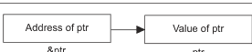

### Fig. 2.1: Representation of a pointer variable.

### 图 2.1: 指针变量的表示。

For example,

例如，

```c
main()
{
 int *ptr, i = 25;
 ptr = &i;
}
```

where ptr is a pointer variable for storing the address of an integer value, hence ptr is an integer pointer. In the above program segment, ptr is made to point i by storing the address of i (i.e., &i) in ptr.

其中，ptr 是一个用于存储整数值地址的指针变量，因此 ptr 是一个整型指针。在上述程序片段中，通过将 i 的地址（即 &i）存储在 ptr 中，使 ptr 指向 i。

### Program 2.9:

### 程序 2.9：

```c
/* Program for accessing a variable through a pointer. */
/* pointer.c */
#include<stdio.h>
void main()
{
 int a = 5, b = 10, *ptr;
 ptr = &a;
 printf("\n Initial values a = %d & b = %d", a, b);
 b = *ptr;
 printf("\n Changed values a = %d & b = %d", a, b);
 printf("\n Value of ptr is %d", ptr);
 printf("\n Value of the address of a is %d", &a);
 printf("\n Value of *ptr is %d", *ptr);
}
```

The program displays the following output
程序显示以下输出
Initial values a = 5 & b = 10
Changed values a = 5 & b = 5
Value of ptr is 4094
Value of the address of a is 4094
Value of *ptr is 5

In Program 2.9 we are using a pointer variable *ptr. The pointer variable is initialized by assigning the address of the variable a to ptr as (ptr = &a). In the expression b = *ptr, the symbol * is placed before a pointer to access the content of the variable which is assigned to it. One can be surprised when you see the output of the program particularly the value of the address of a, when you execute this program in different computers at different times you will get different values of address which will be allocated to the variable a at different times.

在程序 2.9 中，我们使用了一个指针变量 *ptr。该指针变量通过将变量 a 的地址赋值给 ptr（即 ptr = &a）进行初始化。在表达式 b = *ptr 中，符号 * 放在指针之前，以访问分配给它的变量的内容。当您在不同计算机和不同时间执行此程序时，可能会对程序的输出感到惊讶，特别是变量 a 的地址值，每次分配给变量 a 的地址都会不同。

## 2.6 Initialization of Pointers

## 2.6 指针的初始化

Like ordinary variables, a pointer variable can be initialized. Static and external (global) pointer variables are initialized with NULL by default. Automatic (local) pointer variables can be initialized either with NULL or with the address of some other variable, which is already defined.

与普通变量一样，指针变量也可以初始化。静态和外部（全局）指针变量默认初始化为 NULL。自动（局部）指针变量可以初始化为 NULL，也可以初始化为某个已定义变量的地址。

For example the statement,

例如，语句，

```
ptr = &i;
```

is called as **pointer initialization**, since the address of `i` is initialized to the pointer variable `ptr`. A pointer variable can be also initialized as an ordinary variable in declaration itself. For example,

这称为**指针初始化**，因为 `i` 的地址被初始化到指针变量 `ptr`。指针变量也可以在声明本身中像普通变量一样初始化。例如，

```c
int i, *ptr = &i;
```

is also valid, since `ptr` points to the value stored in the address of `i`.

这也是有效的，因为 `ptr` 指向存储在 `i` 地址中的值。

## 2.7 Pointer Arithmetic

## 2.7 指针运算

An interesting use of pointers is pointer arithmetic. The arithmetic operations that can be performed on pointers are addition and subtraction. You can use the increment (++) and decrement (--) operators on the size of the variable pointed by the pointer. For example if

指针的一个有趣用途是指针运算。可以对指针执行的算术运算是加法和减法。您可以对指针所指向变量的大小使用递增（++）和递减（--）运算符。例如，如果

```
ptr++;
```

is an integer pointer, the increment operation moves the pointer by two bytes (since an integer is two bytes long) from where it is previously pointed. Similarly, if `ptr` is a character pointer, the increment operation moves the pointer by one byte (since a character is one byte long) from where it is previously pointed. If a decrement operation is carried out on a pointer, the pointer moves backwards, depending upon the size of the variable pointed by the pointer.

它是一个整型指针，则递增操作会将指针从之前指向的位置移动两个字节（因为整型占两个字节）。同样，如果 `ptr` 是字符指针，则递增操作会将指针从之前指向的位置移动一个字节（因为字符占一个字节）。如果对指针执行递减操作，指针将向后移动，移动距离取决于指针所指向变量的大小。

For example, if

例如，如果

```
ptr--;
```

is a character pointer. The decrement operation moves the pointer backwards by one byte from where it is previously pointed. The expression,

它是一个字符指针。递减操作会将指针从之前指向的位置向后移动一个字节。表达式，

```
ptr += 6;
```

increments the pointer by 6 elements of its type. Similarly, a pointer can be subtracted from an integer. Besides incrementation and decrementation of a pointer to an integer, you may also subtract one pointer from another pointer in order to find the number of elements of their type which separates the two pointers. Other operations like multiplication and division of pointers are prohibited. You cannot add or subtract `float` or `double` type pointers from each other.

将指针按其类型递增 6 个元素。同样，可以从整数中减去一个指针。除了对整型指针进行递增和递减外，您还可以用一个指针减去另一个指针，以找出分隔两个指针的其类型元素的数量。其他操作（如指针的乘法和除法）是被禁止的。您不能相互添加或减去 `float` 或 `double` 类型的指针。

## 2.8 Structure

## 2.8 结构体

*A structure* is a derived type usually representing a collection of variables of same or different data types grouped together under a single name. The variables or data items in a structure are called as *members* of the structure. A structure may contain one or more integer variables, floating-point variables, character variables, arrays, pointers, and even other structures can also be included as members. Structures help to organize data, particularly in large programs, because they allow a group of related variables to be treated as a single unit.

*结构体* 是一种派生类型，通常表示将相同或不同数据类型的变量集合分组在一个名称下。结构体中的变量或数据项称为结构体的*成员*。结构体可以包含一个或多个整型变量、浮点型变量、字符型变量、数组、指针，甚至还可以将其他结构体作为成员包含。结构体有助于组织数据，尤其是在大型程序中，因为它们允许将一组相关变量视为一个单元。

There are two fundamental differences between an array and a structure. One is, an array demands a homogeneous data type, i.e., the elements of an array must be of the same data type, where as a structure is a heterogeneous data type, since it can have any data type as its member. The second difference is that elements in an array are referred by their positions, where as members in a structure are referred by their unique names.

数组与结构体之间存在两个基本区别。其一，数组要求同质数据类型，即数组的元素必须是相同的数据类型，而结构体是异质数据类型，因为它可以将任何数据类型作为其成员。第二个区别是，数组中的元素通过其位置来引用，而结构体中的成员通过其唯一名称来引用。

### 2.8.1 Declaring a Structure

### 2.8.1 声明结构体

Structure declarations are somewhat more complex than array declarations since a structure must be defined in terms of its individual members. The general form or the syntax of declaring a structure is

结构体声明比数组声明稍微复杂一些，因为结构体必须根据其各个成员来定义。声明结构体的一般形式或语法是

```
struct <structure_name>
{
    data type member1;
    data type member2;
    data type member2;
    ..... .....
    data type memberN;
};
```

In the above declaration, *struct* is a keyword, followed by an optional user-defined structure name usually referred as a tag, which is used to identify the structure, and then the list of members with its data types. The list of member declarations is enclosed in a pair of flower braces. The closing brace of the structure and the semicolon ends the structure declaration. A typical example of declaring a structure is

在上述声明中，*struct* 是一个关键字，后面跟着一个可选的用户定义的结构体名称（通常称为标签），用于标识结构体，然后是带有其数据类型的成员列表。成员声明列表用一对花括号括起来。结构体的右花括号和分号结束结构体声明。声明结构体的典型示例是

```
struct employee
{
    int empno;
    char empname[15];
    float salary;
};
```

where *employee* is the name of the structure (i.e., tag). The structure *employee* contains three members of type *int*, *char* and *float* representing *empno*, *empname* and *salary* respectively.

其中，*employee* 是结构体的名称（即标签）。结构体 *employee* 包含三个成员，类型分别为 *int*、*char* 和 *float*，分别表示 *empno*、*empname* 和 *salary*。

### 2.8.2 Defining a Structure

### 2.8.2 定义结构体

Declaring a structure merely describes the template of the structure. Declaration does not reserve any memory space but it creates a new data type. Defining a structure means creating variables to access the members in the structure. Creating a structure variable allocates sufficient memory space to hold all the members of the structure. Structure variables can be created during structure declaration or by explicitly using the structure name. The general syntax for defining the structure is,

声明结构体仅描述结构体的模板。声明不保留任何内存空间，但它创建一个新数据类型。定义结构体意味着创建变量以访问结构体中的成员。创建结构体变量会分配足够的内存空间来容纳结构体的所有成员。结构体变量可以在结构体声明期间创建，也可以通过显式使用结构体名称来创建。定义结构体的一般语法是，

```
struct <structure_name>
{
    data type member1;
    data type member2;
    data type member2;
    ......
    ......
    data type memberN;
}structure_variable(s);
```

The structure can be defined declaration itself and an example for defining the structure during declaration is,

结构体可以在声明本身中定义，在声明期间定义结构体的示例是，

```c
struct employee
{
    int empno;
    char empname[15];
    float salary;
}emp1;
```

where the structure variable emp1 declares a variable emp1 of its type. The structure_variable(s) can be declared like ordinary variables and used to access the members of the structure. More than one structure_variable can also be declared by placing a comma in between the variables. Fig. 2.2 shows the memory allocation for the structure employee.

其中，结构体变量 emp1 声明了其类型的变量 emp1。结构体变量可以像普通变量一样声明，并用于访问结构体的成员。通过在变量之间放置逗号，也可以声明多个结构体变量。图 2.2 显示了结构体 employee 的内存分配。

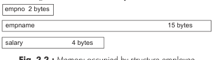

The syntax for defining the structure using the structure name is,

使用结构体名称定义结构体的语法是，

```
struct structure_name structure_variable(s)

or

structure_name structure_variable(s);
```

Note that the keyword struct is optional when defining the structure using the structure name.

注意，使用结构体名称定义结构体时，关键字 struct 是可选的。

A typical example for declaring a structure using the structure name is

使用结构体名称声明结构体的典型示例是

```c
struct employee emp1; or employee emp1;
```

If you need only one structure variable, the structure name or the tag is not necessary.

如果只需要一个结构体变量，则不需要结构体名称或标签。

For example,

例如，

```c
struct
{
    int empno;
    char empname[15];
    float salary;
}emp1;
```

where the structure declares and defines a variable named emp1. Note that the structure name or the structure variables may be omitted, but both, should not be omitted.

其中，该结构体声明并定义了一个名为 emp1 的变量。请注意，可以省略结构体名称或结构体变量，但两者不能同时省略。

The member names within a particular structure must be distinct from one another though a member name can be same as the name of the variable, which is defined outside the structure.

特定结构体中的成员名称必须彼此不同，尽管成员名称可以与结构体外部定义的变量名称相同。

For example,

例如，

```c
struct employee
{
    int empno;
    char empname[15];
    float salary;
}emp;
char empname[15];
```

where character variable empname inside the structure shares the same name with the variable empname declare outside the structure. Note that a structure declaration that is not followed by a list of variables reserves no storage space, it merely describes the template (i.e., the structure is only defined not declared).

其中，结构体内部的字符变量 empname 与结构体外部声明的变量 empname 共享相同的名称。请注意，后面没有跟变量列表的结构体声明不保留任何存储空间，它仅描述模板（即，结构体仅被定义而未被声明）。

### 2.8.3 Accessing Structure Members

### 2.8.3 访问结构体成员

We have declared and defined the structure and now let us see how the elements of the structure can be accessed. A member of a structure is always referred and accessed by the structure variable. In arrays, we use subscripts for accessing individual elements of an array. In structures we use the member access operator also referred as the dot operator “.” to access the members independently. The general form or the syntax for accessing a member of the structure is

我们已经声明并定义了结构体，现在让我们看看如何访问结构体的元素。结构体的成员始终通过结构体变量来引用和访问。在数组中，我们使用下标来访问数组的单个元素。在结构体中，我们使用成员访问运算符（也称为点运算符“.”）来独立访问成员。访问结构体成员的一般形式或语法是

```c
structure_variable.member_name
```

The structure variable followed by a period operator and the member name refers an individual member. For example, for accessing the structure elements, you can use

结构体变量后跟点运算符和成员名称引用一个单独的成员。例如，访问结构体元素时，可以使用

```c
emp1.empname similarly emp1.empno
```

In the above example, emp1 is the structure variable, which is used to access the

在上述示例中，emp1 是结构体变量，用于访问


使用成员访问运算符访问成员 empname 和 empno。
要为结构体成员（例如 empname）赋值，请使用，
emp1.empname = "suresh";
这将名称 "suresh" 赋给结构体成员 empname。同样，要在屏幕上显示
结构体成员 empname 的值，请使用，
puts(emp1.empname);
你也可以通过以下程序段逐字符显示 empname 的内容，
for(i = 0 ; emp1.empname[i] != '\0' ; i++)
putchar(emp1.empname[i]);

### 2.8.4 初始化结构体

定义结构体是创建新数据类型的一种方式。与其他任何数据类型一样，
结构体中的成员不能在定义时初始化。C 语言语法阻止程序员
在结构体模板中初始化单个结构体成员。结构体成员只能在结构体
声明时使用结构体变量初始化，或通过显式使用结构体名称初始化。在结构体
声明期间初始化结构体的语法为，

```
struct <structure_name>
{
    data type member1;
    .
    .
    .
    data type memberN;
} structure_variable = {value1, value2,....., valueN};
```

例如，

```
struct employee
{
    int height;
    float weight;
} empl = {175, 77.5};
```

上述初始化将 175 初始化给结构体成员 height，将 77.5 初始化给
结构体成员 weight。要初始化的结构体成员的值必须
用一对花括号括起来。注意，用于初始化结构体
成员的常量必须与结构体中声明成员的顺序相同。

### 程序 2.10

```
/* Program to initialize the structure using the structure name. */
#include<stdio.h>
struct class_room
{
    char name[15];
    long int reg_no;
}s3;
void main()
{
    struct class_room s1 = {"Jeyabal", 876543};
    struct class_room s2 = {"Vanitha"};
    printf("Name is %s", s1.name);
    printf("\nReg no is %d", s1.reg_no);
    printf("\n\nName is %s", s2.name);
    printf("\nReg no is %d", s2.reg_no);
    s3 = s1;
    printf("\n\nName is %s", s3.name);
    printf("\nReg no is %d", s3.reg_no);
}
```

> 该程序显示以下输出
> Name is Jayabal
> Reg no is 876543
> Name is Vanitha
> Reg no is 0
> Name is Jayabal
> Reg no is 876543

程序 2.10 展示了使用结构体名称初始化结构体的示例。要初始化的结构体成员的值必须
用一对花括号括起来。注意，用于初始化结构体成员的常量必须与结构体中声明成员的顺序相同。如果某些结构体成员未初始化，则 C 编译器会自动将它们初始化为零。这就是程序 2.10 中结构体变量 s2 的情况。

一个结构体变量中的信息也可以使用单个赋值语句赋给另一个结构体变量。在程序 2.10 中我们使用了，

```
s3 = s1;
```

以将结构体变量 s1 中的值复制到 s3。当需要初始化结构体的许多成员时，这种赋值语句是必需的。注意，只有当两个结构体变量属于同一结构体类型时，才能将一个结构体变量赋给另一个。

## 2.9 结构体嵌套结构体

嵌套结构体只不过是一个结构体内嵌另一个结构体（即，一个结构体可以包含一个或多个结构体作为其成员）。一个结构体可以在另一个结构体内定义和/或声明。例如，

```
struct employee
{
    int empno;
    char name[15];
    struct employ_add
    {
        int no;
        char street[15];
        char area[15];
        long pincode;
    } address;
    char deptname[15];
    float salary;
} empl, emp2;
```

在上述结构体声明中，employee 是主结构体。它从结构体 employ_add 获取关于员工地址的额外信息。嵌套结构体的成员按以下方式访问

```
main_structure_variable.sub_structure_variable.sub_structure_member
```

例如，

```
empl.address.no
```

引用子结构体成员 no，该成员通过主结构体变量 empl 后跟内部结构体变量 address 来访问。子结构体不一定要在主结构体内指定。相反，子结构体变量可以在主结构体内定义并在主结构体外声明，如下所示，

```
struct employ_add        /* sub structure */
{
    int no;
    char street[15], area[15];
    long pincode;
} address;
struct employee        /* main structure */
{
    int empno;
    char name[15], deptname[15];
    float salary;
    struct employ_add address;
}
```

其中 address 是在主结构体 struct employee 内定义的子结构体变量。程序 2.11 说明了嵌套结构体的概念。

### 程序 2.11

```
/* neststruct.c */
#include<stdio.h>
void main()
{
struct employee
{
int empno;
char empname[20];
struct employ_add
{
int no;
char *street;
char *area;
char *city;
long pincode;
}address;
char *deptname;
float salary;
}emp1;
printf("Enter empno,empname,deptname,salary of the employee \n");
scanf("%d%s%s%f",&emp1.empno,emp1.empname,emp1.deptname,&emp1.salary);
printf("Enter the address of the employee");
printf("\n (no, street name,area name,city,pincode)\n");
scanf("%d %s %s %s %ld",&emp1.address.no,emp1.address.street,emp1.address.area,emp1.address.city,&emp1.address.pincode);
printf("\n Employee No = %d", emp1.empno);
printf("\n Employee Name = %s", emp1.empname);
printf("\n Department Name = %s", emp1.deptname);
printf("\n Employee Salary = %.2f", emp1.salary);
printf("\n Employee Address....\n %d, %s, \n %s, \n %s-%d.",
 emp1.address.no, emp1.address.street,
 emp1.address.area, emp1.address.city,
 emp1.address.pincode);
}
```

该程序显示以下输出
Enter empno, empname, deptname, salary of the employee
1 Raaji Management 8000
Enter the address of the Employee
(no, street_name, area name, city, pincode)
25 First_main_road Adyar Chennai 600020
Employee No = 1
Employee Name = Raaji
Department Name = Management
Employee Salary = 8000.00
Employee Address ....
25, First_main_road,
Adyar,
Chennai-600020.

请注意，结构体不能嵌套在其自身内部。例如，
struct employee
{
 int empno;
 char empname[15];
 struct employee emp; /* Error */
};
不是有效的嵌套结构体。

## 2.10 联合体

联合体是另一种类似结构体的复合数据类型，可以容纳不同类型和大小的对象，由编译器跟踪大小。联合体提供了一种在单个存储区域中操作不同种类数据的方法。定义联合体的一般形式或语法为

```
union <union name>
{
 data type member1;
 ...
 data type memberN;
} union_variable(s);
```

联合体的语法与结构体相同，只是关键字 struct 被关键字 union 替换。声明联合体的示例是

```
union exam
{
    int roll_no;
    char name[15];
    int mark1, mark2, mark3;
};
```

在上述示例中，联合体 exam 有 5 个成员。第二个成员是一个包含 15 个字符（即 15 字节）的字符数组 name。第二个成员是 int 类型，存储需要 2 字节。所有其他成员 mark1、mark2、mark3 都是整数，存储需要 2 字节。图 2.3 显示了联合体 exam 成员的内存分配。

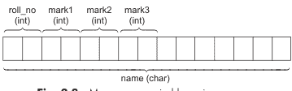

在联合体中，所有这 5 个成员都分配在同一内存位置（即，所有成员共享相同的内存位置）。联合体共享内存空间，而不是浪费存储在未使用的变量上。编译器分配足够大的存储空间以容纳联合体中最大的类型。在上述声明中，成员 name 需要 15 个字符，这是所有成员中的最大值，因此分配了总共 15 字节的内存空间。在结构体的情况下，分配的总内存空间将为 23（即 15+2+2+2+2）字节。

### 程序 2.12

```
/* size.c */
union exam
{
    int roll_no;
    char name[15];
    int mark1, mark2, mark3;
} ul;
/* Union declaration */

struct exam1
{
    int roll_no;
    char name[15];
    int mark1, mark2, mark3;
} s1;
/* Structure declaration */
```


void main()
{
 printf("The size of the union is %d\n", sizeof(u1));
 printf("The size of the structure is %d", sizeof(s1));
}

程序显示以下输出
The size of the union is 15
The size of the structure is 23

### 2.10.1 初始化联合体

在存储方面，联合体与结构体之间存在主要区别。在结构体中，每个成员都有自己的存储位置，而联合体的所有成员占据相同的内存位置（即，联合体将其所有成员的值存储在单个位置）。这表明，虽然联合体可能包含多种不同数据类型的成员，但它一次只能处理一个成员。因此，你只能在联合体中初始化一个成员。如果你尝试初始化多个成员，最后初始化的值将被赋给所有成员。

### 程序 2.13

```
/* Program to demonstrate initialization of a union. */
/* initial.c */
union exam
{
 int roll_no, mark1, mark2, mark3;
}u1;
void main()
{
 u1.roll_no = 252;
 u1.mark1 = 89;
 printf("Roll No : %d\n", u1.roll_no);
 printf("Mark 1 : %d\n", u1.mark1);
 printf("Mark 2 : %d\n", u1.mark2);
 printf("Mark 3 : %d\n", u1.mark3);
}
```

程序显示以下输出
Roll No : 89
Mark 1 : 89
Mark 2 : 89
Mark 3 : 89

请注意，在该程序中，即使未初始化的成员（即 mark2 和 mark3）也会采用与其他成员相同的值。

## 2.11 存储类

在 C 语言中，所有变量都具有数据类型和存储类。数据类型指变量所表示的信息类型（即 int、char 等）。存储类决定变量的存储方式、未初始化时的初始值、变量的生命周期（即变量在程序中保持活动的时间）以及程序中变量的作用域。变量的作用域定义为变量可见或有效的区域。作用域通常由一组花括号建立。在 C 语言中声明的任何变量都只属于以下四种存储类之一。它们是，

- 自动存储类
- 寄存器存储类
- 静态存储类
- 外部存储类

### 2.11.1 自动存储类

在块内定义且局限于其声明块的变量称为自动变量或局部变量。自动变量只能由其声明所在的块访问。任何其他块都无法访问其值。

在块内声明局部变量时，在 C 语言中更准确的做法是在变量声明前使用关键字 auto。以下语句是局部变量声明的示例：

```
auto int number;
```

这些变量在每次执行块时都会作为新变量创建，并在块遇到 return 语句或块的右花括号时销毁。变量的生命周期在于其声明所在的块内。C 编译器默认将块内声明的任何变量视为自动变量。因此，变量声明时不需要关键字 auto。自动变量存储在内存中。当自动变量未初始化时，它会采用称为垃圾值的不可预测值。程序 2.14 说明了自动变量的作用域和生命周期。

### 程序 2.14

```
/* auto.c */
#include<stdio.h>
void main()
{
    auto int x = 5;
    {
        auto int x = 4;
        {
            auto int x = 3;
            printf("%d \t",x);
        }
        printf("%d \t",x);
    }
    printf("%d \t",x);
}
```

程序显示以下输出

3 4 5

由于所有 printf() 函数均在其定义所在的块内出现，因此 x 局限于该块。请注意，在函数内定义的变量的默认存储类为 auto。另请注意，作为参数传递给函数的值也被视为局部变量。

### 2.11.2 寄存器存储类

寄存器存储类与自动存储类相似，因为在块内定义的变量局限于其指定的块。寄存器变量只能由其声明所在的块访问。其值不能被任何其他函数访问。在块内声明寄存器变量时，在 C 语言中更准确的做法是在变量定义前使用关键字 register。

以下语句是寄存器变量定义的示例，

```
register int number;
```

寄存器变量存储在 CPU 寄存器中，因此其访问速度比存储在内存中的自动变量更快。因此，如果变量在程序中多处使用，最好将其存储类声明为 register。寄存器变量的默认初始值也是垃圾值。

程序 2.15 说明了寄存器变量的作用域和生命周期。

### 程序 2.15

```
/* register.c */
#include<stdio.h>
void main()
{
register int x;
for(x = 1; x <= 10; x++)
printf("%d",x);
}
```

程序显示以下输出

1 2 3 4 5 6 7 8 9 10

我们不能对所有类型的变量都使用寄存器存储类。例如，register double x; register float y; register long z;

上述声明是错误的，因为微型计算机中的 CPU 寄存器通常是 16 位寄存器，因此无法存储 float 或 double 值（分别需要 32 和 64 字节来存储值）。如果使用上述声明，你不会收到错误消息，但编译器会将这些变量视为自动变量。

### 2.11.3 静态存储类

一般来说，static 一词指任何对变化无反应的事物。在程序中，如果在单独的块内声明静态变量，则它们局限于其声明所在的块。静态变量在整个程序生命周期内保留其值。因此，如果退出某个块并在稍后重新进入，则在该块中声明的静态变量将保留其值（即，静态变量在退出块时不会被销毁，而是保留其值，并在下次执行该块时再次可用。因此，静态变量仅在程序开始执行时初始化一次）。在块内声明静态变量时，在 C 语言中更准确的做法是在变量定义前使用关键字 static。以下语句是静态变量声明的示例：static int number;

静态变量存储在内存中。当静态变量未初始化时，它采用零值。变量的值在程序的不同函数调用之间保持。程序 2.16 说明了静态变量的作用域和生命周期。

### 程序 2.16

```
/* static.c */
#include<stdio.h>
void sum();
/* Function prototype */
void main()
{
    sum();
    sum();
    sum();
    sum();
}
/* Function call */
void sum()
{
    static int x = 1;
    printf("%d ", x);
    x = x + 1;
}
```

程序显示以下输出
1 2 3 4

我们之所以得到上述输出，是因为变量的值在不同函数调用之间保持（不变）。如果变量未定义为 static，则程序的输出将是

1 1 1 1

### 2.11.4 外部存储类

在整个程序期间始终处于活动状态的变量称为外部变量，也称为全局变量。全局变量可以被程序中的任何函数访问。全局变量不属于任何特定函数（即，它们本质上是全局的），通常在所有函数之外声明，通常在程序开头，但在所有预处理器指令之后。程序中任何在变量声明之后的函数都可以引用全局变量。程序中的任何函数都可以访问全局变量的值，并在需要时更改变量的值。在程序中声明外部变量或全局变量时，在 C 语言中更准确的做法是在变量声明前使用关键字 extern。以下语句是外部变量声明的示例。

```
extern int number;
```

全局变量也存储在内存中。当外部变量未初始化时，它采用零值。只要程序执行未结束，变量的值在不同函数调用之间都会保持。

请注意，extern 变量的初始化仅发生一次。（即，当程序启动时，在控制进入 main() 函数之前）。程序 2.17 说明了全局变量的作用域和生命周期。

### 程序 2.17

```
/* extern.c */
#include<stdio.h>
void test1();
void test2();
void test3();
void main()
{
extern int value;
value = 100;
test1();
test2();
test3();
printf("%d ", value);
}
void test1()
{
extern int value;
value += 100;
printf("%d ", value);
}
void test2()
{
extern int value;
value = 1000;
printf("%d ", value);
}


```c
void test3()
{
    extern int value;
    value += 100;
    printf("%d ", value);
}
```

程序显示以下输出
200 1000 1100 1100

关键字 `extern` 在程序中未用于声明变量 `value`，因为该变量在所有函数（包括 `main()` 函数）之上声明。如果你想在函数内部声明一个变量，并使其成为全局变量，则必须在变量定义之前精确使用关键字 `extern`。表 2.1 展示了各种存储类之间的差异。

| 存储类 | 关键字 | 存储位置 | 变量作用域 | 初始化值 | 变量类型 |
| :--- | :--- | :--- | :--- | :--- | :--- |
| 自动 | auto | 内存 | 在定义它的块内 | 垃圾值 | 局部 |
| 寄存器 | register | CPU | 在定义它的块内 | 垃圾值 | 局部 |
| 静态 | static | 内存 | 只要程序执行未结束，变量的值就会保持 | 垃圾值 | 局部 |
| 外部 | extern | 内存 | 变量在整个程序中均处于活动状态且存活 | 垃圾值 | 全局 |

## 2.12 预处理器

C 预处理器是一组在编译过程开始时执行的特殊语句，称为指令，它允许在 C 程序中插入文件。常用的预处理器有

- 文件包含
- 宏定义
- 条件编译。

这些预处理器包含以下指令，
#define #endif #ifdef #line
#elif #error #undef #pragma
#else #if #include #undef

所有预处理指令都以 # 符号开头。该符号后跟一个指令字。预处理指令通常出现在程序开头，但也可能出现在程序的任何位置。但是，该指令仅适用于其出现之后的程序部分。

### 2.12.1 文件包含

文件包含是第一种预处理指令。#include 预处理指令用于在程序中包含一个或多个文件。#include 指令指示编译器制作指定文件的副本，以包含在指令所在位置。#include 指令的一般形式或语法是

```
#include <filename>
#include "filename"
```

文件包含的第一种形式（即文件名用尖括号 <> 括起来）会导致预处理器在专门用于文件的特殊目录中查找具有指定文件名的文件。这些文件的名称由每个具体实现指定，例如 stdio.h、math.h、string.h 等。字母 'h' 通常表示头文件，该头文件通常包含在程序开头。#include 指令也用于由多个一起编译的源文件组成的程序。这称为嵌套包含。允许的嵌套层数因不同的 C 编译器而异（标准 C 编译器通常使用八层嵌套文件包含）。

文件包含的第二种形式（即文件名用双引号 " " 括起来）会导致预处理器在当前工作目录中查找具有指定文件名的文件。使用引号通常专用于包含与当前处理的程序特定相关的文件。通常这些文件（通用文件）由用户创建以在程序中使用。

### 2.12.2 宏定义

宏定义是第二种预处理指令。#define 预处理指令用于定义符号常量并为其赋值。#define 指令定义一个标识符和一组字符，每次在源文件中遇到该标识符时，都会用这组字符替换它。#define 指令的一般形式或语法是

```
#define identifier set-of-characters
```

其中标识符（也称为宏名称或宏模板）在源文件（程序）中每次遇到时都会替换这组字符。程序 2.18 说明了 #define 指令的用法。

### 程序 2.18：

```
/* macro1.c */
#define FIVE 5
#define SIX FIVE+1
#define SEVEN SIX+1
void main()
{
 printf("%d \t %d \t %d", FIVE, SIX, SEVEN);
}
```

程序显示以下输出
5 6 7

程序 2.18 中的前三个语句，即，

```
#define FIVE 5
#define SIX FIVE+1
#define SEVEN SIX+1
```

是宏定义。它们由标识符（即 FIVE、SIX 和 SEVEN）及其对应的字符集（即 5、FIVE+1 和 SIX+1）组成。标识符和字符集之间可以有任意数量的空格，但一旦字符集开始，它们之间不应有任何空格。它们可以由换行符终止。

在预处理期间，标识符（也称为宏模板）会被替换为其各自的字符集（也称为宏展开），并为 FIVE 分配 5，为 SIX 分配 6，依此类推。

同样，你可以使用 #define 指令显示消息。如果在宏定义之后的程序中遇到标识符 FIVE、SIX 和 SEVEN，它们将分别被替换为 5、6 和 7。但是，如果在宏定义之前遇到这些标识符，则不会替换它们。

### 程序 2.19：

```
/* macro2.c */
#define A "X is Big"
#define B "Y is Big"
void main()
{
    int X, Y;
    printf("\n Enter value for X and Y : ");
    scanf("%d %d", &X, &Y);
    if (X > Y)
    printf(A);
    else
    printf(B);
}
```

程序显示以下输出
Enter value for X and Y : 2 1
X is Big

从输出中可以看出 x 大于 y，程序显示了消息。

在显示消息之前，编译器会预处理标识符 A 并替换字符串 X is Big。请注意，字符串（字符集）用双引号括起来，因此对于编译器来说，printf() 函数实际上会显示为

```
printf("X is Big") ;
```

请注意，如果字符串未用双引号括起来，编译器将不会显示消息。如果宏的字符集超过一行，则必须在行尾放置反斜杠 (`\`) 字符，以指示字符集在下一行继续。例如，

```
#define Two_line_string "This is a two line\\ string"
```

标识符或宏名称可以带有参数。每次遇到标识符时，宏名称中使用的参数会被程序中找到的实际参数替换。这种类型的宏称为函数宏。程序 2.20 有助于更好地理解这些内容。

### 程序 2.20：

```
/* macro3.c */
#define PI 3.14159
#define AREA_OF_CIRCLE(R) (PI*R*R)
void main()
{
    float radius, area;
    printf("Enter the radius of the circle : ");
    scanf("%f", &radius);
    area = AREA_OF_CIRCLE(radius);
    printf("The area of the circle is %4f", area);
}
```

程序显示以下输出
Enter the radius of the circle : 4
The area of the circle is 50.2654

无论 AREA_OF_CIRCLE(radius) 在程序中出现在哪里，radius 的值都会替换字符集中的 R，符号常量 PI 会被替换为其值（即 PI 被替换为 3.14159），并且宏在程序中展开。例如，语句

```
area = AREA_OF_CIRCLE(4);
```

展开为

```
area = ( 3.14159*4*4 );
```

并且程序计算圆的面积并显示消息。符号常量和宏可以使用 #undef 预处理指令取消定义。#undef 指令的一般形式或语法是

```
#undef identifier
```

其中 identifier 是已定义的宏名称。

符号常量或宏的作用域从其定义处（即从 #define）开始，直到使用 #undef 指令将其取消定义为止。在 #undef 指令之后，对相应标识符的任何引用都将被忽略。例如，


#define BLUE 5
#define BLACK 10
void main()
{
    ....
    #undef BLUE
    ....
    #undef BLACK
}

其中，程序内的标识符 BLUE 和 BLACK 分别表示 5 和 10，直到通过指令 #undef 将其取消定义。

### 2.12.3 条件编译

条件编译是预处理器指令的第三种类型，它使程序员能够控制预处理器指令的执行，而编译指令为 #if、#else、#elif 和 #endif。#if 和 #endif 指令的一般形式或语法为

```
#if expression
statement(s);
#endif
```

如果 #if 指令后面的表达式为真，则其后面的语句将被执行，否则将跳过这些语句。#endif 指令标记 #if 块的结束。程序 2.21 有助于更好地理解这些内容。

### 程序 2.21

| /* compile.c */ #define A 500 void main() { #if A == 500 printf("A has a constant value of 500"); #endif } |
|---|
| 程序显示以下输出 A has a constant value of 500 |

因为 A 的值等于 500。请注意，#if 指令后面的表达式在编译时求值，因此它只能包含先前定义的标识符，且不能使用变量。同样，#elif 和 #else 指令也用于根据条件编译指令。

## 使用预处理器指令时需注意的重要事项

- 所有预处理器指令都应以 # 符号开头。
- 预处理器指令不应以分号结尾。
- 标识符与字符集之间可以有任意数量的空格。
- 字符集之间不应留有空格。
- #if 指令必须与 #endif 指令配对使用。

### 2.13 简单程序

### 程序 S1

编写一个程序，读取一个 N 位整数，并将该整数缩减为一位数。

```
/* digitcnt.c */
#include<stdio.h>
long DigitCount(long n);
void main()
{
 long no;
 printf("Enter an integer : ");
 scanf("%ld", &no);
 printf("Its single digit is %ld", DigitCount(no));
}
long DigitCount(long n)
{
 return(n / 10 == 0 ? n : DigitCount(n / 10 + n % 10));
}
```

> 程序显示以下输出
> Enter an integer : 987456
> Its single digit is 3

### 程序 S2

编写一个程序，使用递归生成斐波那契数列。

```
/* genfibo.c */
#include <stdio.h>
void fibo(int, int, int); /* function prototype */
void main()
{
 int x = -1, y = 1, z = 0;
 printf("Enter any number : ");
 scanf("%d", &z);
 printf("The fibonacci series is : ");
 fibo(z, x, y); /* calling the function fibo() */
}
void fibo(int x, int f, int f1) /* function definition */
{
    if(x == 0)
    exit(0);
    printf("%d ", f+f1);
    fibo(-x, f1, f+f1); /* calling the recursive function fibo() */
}
```

程序显示以下输出
Enter any number : 5
The fibonacci series is : 0 1 1 2 3

### 程序 S3

编写一个程序，使用递归生成三波那契数列。

```
/* gentribo.c */
#include <stdio.h>
void tribo(int, int, int, int);
void main()
{
    int x = -1, y = 1, z = 0, n;
    printf("Enter any number : ");
    scanf("%d", &n);
    printf("The tribonacci series is : ");
    tribo(n, x, y, z); /* calling the function tribo() */
}
void tribo(int x, int f, int f1, int f2)
{
    if(x == 0)
    exit(0);
    printf("%d ", f + f1 + f2);
    tribo(--x, f1, f2, f + f1 + f2); /* calling the recursive function tribo() */
}
```

程序显示以下输出
Enter any number : 6
The tribonacci series is : 0 1 1 2 4 7

### 程序 S4

编写一个程序，使用递归计算给定数字的 NCR。

```
/* ncr.c */
#include<stdio.h>
float ncr(int n, int r);
void main()
{
 int n, r, result;
 printf("Enter the value of N and R : ");
 scanf("%d %d", &n, &r);
 result = ncr(n, r);
 printf("The NCR value is %.3f", result);
}
float ncr(int n, int r)
{
 if(r == 0)
 return 1;
 else
 return(n * 1.0 / r * ncr(n - 1, r - 1) );
}
```

程序显示以下输出

Enter the value of N and R : 5 2

The NCR value is : 10.00

### 程序 S5

编写一个程序，计算给定数字的 NPR。

```
/* npr.c */
#include<stdio.h>
int npr(int n, int r);
void main()
{
 int n, r, result;
 printf("Enter the value of N and R : ");
 scanf("%d %d", &n, &r);
 result = npr(n, r);
 printf("The NPR value is : %d", result);
}
int npr(int n, int r)
{
    if(r == 0)
        return 1;
    else
        return(n * npr(n-1, r-1));
}
```

程序显示以下输出
Enter the value of N and R : 5 2
The NPR value is : 20

### 程序 S6

编写一个程序，使用递归计算给定数字的最小公倍数。

```
/* lcm.c */
#include<stdio.h>
int allone(int a[], int n);
long int lcm(int a[], int n, int prime);
void main()
{
    int a[20], status, i, n, prime;
    printf("Enter the limit : ");
    scanf("%d", &n);
    printf("Enter the numbers : ");
    for(i = 0; i < n; i++)
    scanf("%d", &a[i]);
    printf("The least common multiple is %ld", lcm(a, n, 2));
}
int allone(int a[], int n)
{
    int k;
    for(k = 0; k < n; k++)
    if(a[k] != 1)
    return 0;
    return 1;
}
long int lcm(int a[], int n, int prime)
{
    int i, status = 0;
    if(allone(a, n))
        return 1;
    for(i = 0; i < n; i++)
        if((a[i] % prime) == 0)
        {
            status = 1;
            a[i] = a[i] / prime;
        }
    if(status == 1)
        return(prime * lcm(a, n, prime));
    else
        return(lcm(a, n, prime=(prime == 2)?prime+1 : prime+2));
}
```

程序显示以下输出
Enter the limit : 6
Enter the numbers : 6 5 4 3 2 1
The least common multiple is 60

### 程序 S7

编写一个递归程序，使用递归计算给定数字的最大公约数。

```
/* gcd.c */
#include<stdio.h>
int check_limit(int a[], int n, int prime);
int check_all(int a[], int n, int prime);
long int gcd(int a[], int n, int prime);
void main()
{
    int a[20],stat, i, n, prime;
    printf("Enter the limit : ");
    scanf("%d", &n);
    printf("Enter the numbers : ");
    for(i = 0; i < n; i++)
        scanf("%d", &a[i]);
    printf("The greatest common divisor is %ld", gcd(a, n, 2 ));
}
int check_limit(int a[], int n, int prime)
{
    int i;

    for(i = 0; i < n; i++)
        if(prime > a[i])
            return 1;
    return 0;
}
int check_all(int a[], int n, int prime)
{
    int i;

    for(i = 0; i < n; i++)
        if((a[i] % prime) != 0)
            return 0;

    for(i = 0; i < n; i++)
        a[i] = a[i] / prime;
    return 1;
}
long int gcd(int a[], int n, int prime)
{
    int i;

    if(check_limit(a, n, prime))
        return 1;

    if(check_all(a, n, prime))
        return(prime * gcd(a, n, prime));
    else
        return(gcd(a, n, prime = (prime == 2) ? prime+1 : prime+2));
}
```

程序显示以下输出
Enter the limit : 5
Enter the numbers : 99 55 22 77 121
The greatest common divisor is 11

### 程序 S8

编写一个程序，使用递归求 X 的 N 次幂的值。

```
/* powerx.c */
#include<stdio.h>
double power(double, int);
void main()
{
    double x;
    int n;
    printf("Enter the values of X and N : ");
    scanf("%lf %d", &x, &n);
    printf("The power of %.3lf to %d is %.3lf", x, n, power(x,n));
}
double power(double x, int n)
{
    return((n == 0) ? 1 : x * power(x, n-1));
}
```

程序显示以下输出
Enter the values of X and N : 3.250 6
The power of 3.250 to 6 is 1178.420

### 程序 S9

编写一个程序，使用递归查找数组中最小和最大的数字。

```
/* smallbig.c */
#include<stdio.h>
int min(int a[], int n);
int max(int a[], int n);
void main()
{
    int i, n, a[20];
    printf("Enter the value of N : ");
    scanf("%d", &n);
    printf("Enter the elements of the array : ");
    for(i = 0; i < n; i++)
    scanf("%d", &a[i]);
    printf("\nThe smallest number in the array is %d", min(a, n-1));
    printf("\nThe biggest number in the array is %d", max(a, n-1));
}


int min(int a[], int n)
{
    if (n == 0)
        return a[n];
    else
        return (a[n] < min(a, n - 1) ? a[n] : min(a, n - 1));
}

int max(int a[], int n)
{
    if (n == 0)
        return a[n];
    else
        return (a[n] > max(a, n - 1) ? a[n] : max(a, n - 1));
}

> 程序显示以下输出
> 输入N的值：5
> 输入数组元素：9 5 4 77 55
> 数组中最小的数是4
> 数组中最大的数是77

### 程序 S10 :
编写一个使用递归反转字符串的程序。

```
/* rev_str.c */
/* #include<stdio.h> */
/* strlen() */
char* revstr(char* str);
char* reverse(char* str, int n);
void main()
{
    char str[20];
    printf("Enter the string : ");
    scanf("%s", str);
    printf("Its reversal is %s", revstr(str));
}
char* revstr(char *str)
{
    return reverse(str, strlen(str));
}
```

```
char * reverse(char * str, int n)
{
    char t;
    if ((*str == '\0') || (str > (str + n - 1)))
        return str;
    t = *(str + n - 1);
    *(str + n - 1) = *str;
    *str = t;
    reverse(str + 1, n - 2);
    return str;
}
```

> 程序显示以下输出
> 输入字符串：Software
> 其反转是 erawtfoS

### 2.14 摘要

- 函数是一个自包含的程序段，用于执行某个特定的明确定义的任务。
- 使用函数的三个步骤是声明函数、定义函数和调用函数。
- 通过指定函数名，后跟一对包含所需参数的括号来调用函数。
- 代表从程序调用部分传递到函数中的数据项名称的参数称为形式参数或形参。
- 函数引用中对应的、定义实际传输数据项的参数称为实际参数或实参。
- return 语句用于将信息从函数返回到程序的调用函数。
- 函数可以在任何地方声明，只要其声明位于对函数的所有引用之上。因此，函数应在调用之前声明。
- 当函数执行 return 语句、执行函数的最后一条语句或遇到函数的右花括号时，函数的执行终止。
- 函数原型声明函数的返回类型，并声明函数将接收的参数的数量、类型和顺序。
- 递归是一个函数反复调用自身，直到满足某个指定条件的过程。
- 变量的作用域定义为变量可见或有效的区域。作用域通常由一组花括号建立。
- 指针是一个变量，表示数据项（如变量或数组元素）的内存位置（而不是值）。
- 像所有变量一样，指针变量也应在使用前声明。
- 取地址运算符 (&) 给出变量的地址。
- 可用于初始化指针的三个值是零、空和地址。
- 未初始化的指针称为悬空指针。
- 对指针执行的算术运算是加法和减法。
- 向函数传递参数有两种方式，即按值传递和按引用传递。
- 按值传递是传递变量的实际值的过程。
- 按引用传递是使用指针传递地址作为参数来调用函数的过程，其参数必须包含一个指针。
- 结构是一种派生类型，通常表示将相同或不同数据类型的变量集合在一个名称下分组。
- 关键字 struct 开始结构声明，后跟结构名，结构成员用花括号括起来，后跟分号结束结构声明。
- 结构定义创建一个新数据类型，可用于声明变量。
- 结构中的变量或数据项称为结构的成员。
- 通常，结构类型声明出现在源代码文件的顶部，在定义任何变量或函数之前。
- 结构的标签名是可选的。如果结构在没有标签名的情况下定义，则派生数据类型的变量必须在结构定义中声明，且不能声明新结构的其他变量。
- 结构变量可以用同一类型的结构变量初始化。
- 结构的成员始终通过结构变量名使用成员访问运算符来引用和访问。
- 包含另一个结构作为其成员的结构称为结构嵌套或结构中的结构。
- 结构数组定义为一组具有共同变量名的不同数据类型的数据，存储在连续内存位置中。你也可以将数组用作结构成员。
- 包含指向同一结构类型的指针的成员的结构称为自引用结构。
- 结构指针运算符 (->) 用于通过指向结构的指针访问结构的成员。
- 位字段是一个内置功能，允许你访问单个位。它们必须定义为结构的成员，并声明为 unsigned 或 int 类型。
- 每个位字段随后可以像结构的其他成员一样单独访问。它们能更好地利用内存，以存储数据所需的最少位数。
- 联合是另一种像结构一样的复合数据类型，可以保存不同类型和大小的变量，编译器跟踪其大小。
- 关键字 union 开始联合声明，后跟标签（即联合名），在花括号内声明联合成员。
- 联合可以包含多种类型的许多成员，但为联合保留的内存空间足够大，可以存储其最大成员。
- 存储类确定与变量关联的存储的生存期。C 中的不同存储类有 auto、register、static 和 extern。
- 在函数内定义且局限于声明它们的函数的变量称为 auto 变量或局部变量。
- 在函数内定义并声明为 register 的变量称为寄存器变量。
- 在程序生命周期内保留其值的变量称为静态变量。
- 在整个程序中既存活又活跃的变量称为外部变量或全局变量。它们可以从程序的任何部分访问。
- auto 和 register 变量的默认值是垃圾值。static 和 extern 变量的默认值是零。

### 2.15 简答题

### 1. 定义函数

函数是一个自包含的程序段（段组），用于执行某个特定的明确定义的任务。

### 2. 如何调用函数？

通过指定函数名，后跟一对包含所需参数或实参的括号来调用函数。

### 3. 我们可以从函数声明中获得哪些信息？

从函数声明中可以获得的信息有

- 函数名
- 传递给函数的参数的数量、顺序和类型
- 函数返回的值的类型

### 4. 什么是函数原型？它们放在哪里？

在函数被访问之前定义函数称为函数原型。函数原型通常放在程序开头，main() 函数之前。

### 5. 函数的执行何时终止？

当函数执行 return 语句或执行函数的最后一条语句时，函数的执行终止。

### 6. 说明 return 语句的作用。

return 语句的作用是从函数返回一个值。由于它通常放在函数末尾，return 语句也会终止函数。

### 7. 向函数传递变量的类型有哪些？

向函数传递变量有两种类型，即

- 按值传递
- 按引用传递。

### 8. 定义变量的作用域。

变量的作用域定义为变量可见或有效的区域。作用域通常由一组花括号建立。

### 9. 定义 auto 变量。

在函数内定义且局限于声明它们的函数的变量称为 auto 变量。它们也称为局部变量。

### 10. 定义 register 变量。

在函数内定义并声明为 register 的变量称为寄存器变量。它们存储在 CPU 寄存器中，访问速度比存储在内存中的其他变量更快。

### 11. 定义 static 变量。

在程序生命周期内保留其值的变量称为静态变量。

### 12. 定义 external 变量。

在整个程序中既存活又活跃的变量称为外部变量。它们也称为全局变量。这些变量通常在 main() 函数之上声明。

### 13. 区分局部变量和全局变量。

| 局部变量 | 全局变量 |
|---|---|
| a) 这些在函数体内声明。 | a) 这些在函数外声明。 |
| b) 这些变量只能在声明它们的函数内引用。 | b) 这些变量可以从程序的任何部分引用。 |
| c) 变量的值在函数执行完毕后消失。 | c) 变量的值仅在整个程序执行完毕后消失。 |


### 14. 说明函数原型与函数定义之间的区别。

| 函数原型 | 函数定义 |
|---|---|
| a) 它定义函数。 | a) 它定义函数。 |
| b) 它以分号结尾。 | b) 它不以分号结尾。 |
| c) 声明不需要包含参数。 | c) 它应该包含参数名。 |

### 15. 什么是递归函数？

递归是指函数反复调用自身，直到满足某个指定条件的过程。如果函数体内的一条语句调用了同一个函数，则该函数称为递归函数。

### 16. 比较递归与迭代的异同。

递归与迭代的比较

- 两者都基于控制结构。
- 两者都涉及重复。
- 两者都涉及终止测试。
- 两者都可能无限发生。

| 迭代 | 递归 |
|---|---|
| a) 迭代显式使用重复结构。 | a) 递归通过反复调用函数来实现重复。 |
| b) 当循环条件不满足时，迭代终止。 | b) 当识别到基本情况时，递归终止。 |
| c) 迭代不断修改计数器，直到循环继续条件不满足。 | c) 递归不断产生原问题的简单版本，直到达到基本情况。 |
| d) 当循环继续测试永远不会变为假时，会发生无限循环。 | d) 如果递归步骤每次都不能以收敛于基本情况的方式减小问题，则会发生无限循环。 |
| e) 迭代通常发生在循环中，因此省略了额外的内存分配。 | e) 递归会导致函数的另一份副本，因此会占用相当大的内存空间。 |

### 17. 区分用户定义函数与库函数。

用户定义函数的语句是根据程序员的要求作为程序的一部分编写的，而库函数是预定义的。

### 18. 定义指针。

指针只不过是包含另一个变量地址的变量。

### 19. 如何初始化指针？

```
int *a, b;
a = &b;
```

a 现在包含 b 的地址。
第二个声明 a = &b; 称为指针初始化。

### 20. 定义地址。

地址是具有固定位数的整数，用于标记内存中的一个字节。地址是从零到内存最后位置的正整数值。

### 21. 说明指针的用途。

指针的用途如下：

- 指针提供了一种表示多维数组的简单方法。
- 指针提高执行速度。
- 指针减少程序的长度和复杂性。

### 22. 指针中存储的地址与该地址处的值有什么区别？

指针中存储的地址是变量的地址。变量的值存储在另一个位置。间接运算符 (*) 返回存储在地址处的值。

### 23. 间接运算符与取地址运算符有什么区别？

间接运算符 (*) 返回指针中存储的地址的值。取地址运算符 (&) 返回变量的内存地址。

### 24. 说明按值调用与按引用调用的区别。

| 按值调用 | 按引用调用 |
|---|---|
| a) int a; | a) int &a; |
| b) 形式参数 a 是局部变量。 | b) 形式参数 a 是局部引用。 |
| c) 它不能更改实际参数。 | c) 它可以更改实际参数。 |
| d) 实际参数可以是常量、变量或表达式。 | d) 实际参数必须是变量。 |

### 25. 什么是结构模板？

模板是结构体成员及其类型说明的列表，用花括号括起来。

### 26. 说明点运算符 (.) 的用途。

点运算符与结构体的单个成员及其成员名一起使用，用于访问结构体变量。例如，emp.empno；
其中，emp 是结构体变量，empno 是结构体成员。

### 27. 什么是嵌套结构？

将另一个结构体作为其成员的结构体称为嵌套结构体。

### 28. 说明位字段的限制。

位字段的限制如下：

- 无法创建位字段。
- 位字段依赖于机器。
- 无法读取位字段的地址。
- 位字段不能声明为 static。

### 29. 说明使用位字段的优势。

使用位字段的优势如下：

- 在一个字节中存储布尔变量（true/false）。
- 加密某些例程以访问字节内的位。
- 传输设备的状态信息，该信息编码为字节内的一个或多个位。

### 30. 说明数组与结构体之间的区别。

| 数组 | 结构体 |
|---|---|
| a) 数组是表示相同数据类型的数据项集合的单个实体。数组中的单个条目称为元素。 | a) 结构体是表示不同数据类型的数据项集合的单个实体。结构体中的单个条目称为成员。 |
| b) 数组声明为其元素预留足够的内存空间。 | b) 结构体定义为其成员预留足够的内存空间。 |
| c) 没有表示数组的关键字，但变量名前的方括号 [ ] 告诉我们正在处理数组。 | c) 关键字 struct 告诉我们正在处理结构体。 |
| d) 元素的初始化可以在数组声明期间进行。 | d) 成员的初始化只能在结构体定义期间进行。 |
| e) 数组的元素存储在连续的内存位置中。 | e) 结构体的成员不存储在连续的内存位置中。 |
| f) 数组元素通过方括号 [ ] 访问，索引放在其中。 | f) 结构体的成员通过点运算符（也称为句点运算符）访问。 |

### 31. 说明结构体与联合体之间的区别。

| 结构体 | 联合体 |
|---|---|
| a) 结构体中的每个成员占用并使用其自身的内存空间。 | a) 联合体的所有成员使用相同的内存空间。 |
| b) 关键字 struct 告诉我们正在处理结构体。 | b) 关键字 union 告诉我们正在处理联合体。 |
| c) 结构体的所有成员都可以初始化。 | c) 只有联合体的第一个成员可以初始化。 |
| d) 结构体的成员不存储在连续的内存位置中。 | d) 联合体的成员存储在连续的内存位置中。 |
| e) 由于每个成员存储在单独的内存位置中，因此需要更多的内存空间。 | e) 由于所有成员存储在相同的内存位置中，因此需要较少的内存空间。 |

## 第 3 章
## 线性数据结构
### 3.1 简介

程序由算法和数据结构组成。**算法**是解决问题实例的逐步配方。算法说明要执行的操作以及执行操作的顺序。**数据结构**表示执行某些任务时单个数据元素之间存在的逻辑关系。换句话说，数据结构定义了一种组织所有数据项的方式，不仅考虑存储的元素，还存储元素之间的关系。为算法开发程序时，我们应首先确定步骤并为该算法选择合适的数据结构。数据结构的选择和实现对于更轻松地操作数据同样重要。因此，算法和数据结构在开发程序时密切相关。

数组可以让你快速访问大量数据，并能访问其单个元素。你可以拥有任何数据类型的数组。但是，如果程序决定需要更多空间，你无法使数组变大，但如果有必要，我们可以基于数组构建自己的集合数据类型来解决这个问题。数据结构是数组的实际实现。

#### 基本数据结构

**基本数据结构**是直接操作机器指令的基本数据结构。它们在不同计算机上有不同的表示。所有基本常量（整数、浮点数、字符常量、字符串常量）和指针都被视为基本数据结构。

#### 次要数据结构

**次要数据结构**是从基本数据结构派生的更复杂的数据结构。它们强调将相同或不同的数据项按每个数据项之间的关系进行分组。次要数据结构大致可分为静态数据结构和动态数据结构。如果使用静态内存分配创建数据结构（即，在预先知道数据项数量时形成的数据结构），则称为**静态数据结构**或**固定大小数据结构**。如果使用动态内存分配创建数据结构（即，在预先不知道数据项数量时形成的数据结构），则称为**动态数据结构**或**可变大小数据结构**。


动态数据结构大致可分为线性数据结构和非线性数据结构。线性数据结构中相邻元素之间具有线性关系。链表是线性数据结构的示例。链表是一种线性动态数据结构，可在其执行期间增长和收缩。元素可以从列表的任何一端插入和删除。如果元素在同一端插入和删除，则该列表称为栈。如果元素在一端插入并在另一端删除，则该列表称为队列。循环链表与链表类似，只是第一个节点和最后一个节点互相连接。

非线性数据结构中相邻元素之间不存在线性关系。在线性数据结构中，每个节点都有一个指向另一个节点的链接，而在非线性数据结构中，每个节点可能指向多个其他节点。树是一种非线性动态数据结构，一次可能指向一个或多个节点。图与树类似，只是其相邻元素之间没有层次关系。

#### 3.1.1 栈

栈是一种有序的元素集合，其中插入和删除操作仅限于一端。添加和/或删除元素的端称为栈顶。栈也称为“堆”和“压下列表”。放入栈的第一个元素位于栈底。放入栈的最后一个元素位于栈顶。最后添加到栈的元素是第一个被移除的元素。因此，栈被称为后进先出（LIFO）列表。

考虑图 3.1，其中五个圆盘通过一个轴叠放在一起。如果我们想插入一个新圆盘，例如 6。可以将圆盘插入到圆盘 5 的顶部。由于轴的存在，无法将圆盘 6 插入到圆盘中间。同样，如果我们想移除一个圆盘，例如 4，则只能先移除圆盘 5，再移除圆盘 4，依此类推。由于轴的存在，无法从圆盘中间移除圆盘。栈中会执行类似的操作。

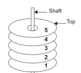

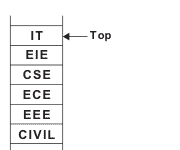

Fig. 3.1 : 带有五个圆盘的轴。

Fig. 3.2 : 栈操作。

### 3.2 数组及其使用栈的表示

栈通过指向栈顶元素的指针来引用，该指针称为*顶指针*。顶指针跟踪栈中的顶部元素。最初，当栈为空时，顶指针的值为零；当栈包含单个元素时，顶指针的值为一，依此类推。图 3.1 显示了栈的表示。

可在栈上执行的主要操作是插入和删除。栈上的这些操作分别称为*压入*操作和*弹出*操作。*压入*操作向栈中添加一个新元素。每次向栈中插入新元素时，在元素放入栈之前，顶指针加一。*弹出*操作删除栈中最顶部的元素。每次从栈中移除元素时，顶指针减一。*图 3.2*中所示的栈包含七个元素。我们知道，插入和删除只能在栈顶进行，这意味着在删除*IT*之前无法删除*EIE*，在删除*IT*和*EIE*之前无法删除*CSE*，依此类推。栈中的元素只能以与压入（即插入/添加）到栈中的顺序相反的顺序弹出（即移除/删除）。

表示栈的最简单方法之一是使用一维数组。栈和数组都是有序的元素集合，但数组和栈是两种不同的东西。数组中的元素数量是固定的，无法更改元素数量，但当元素被压入和弹出时，栈的大小会不断变化。栈存储在数组的一部分中，因此可以声明足够大的数组来容纳栈的最大元素数量。

在程序执行期间，栈大小可以在为其保留的空间内变化。数组的一端（即栈底）是固定的，而数组的另一端（即栈顶）会根据栈中压入和/或弹出的元素不断变化。处理极端情况时必须小心，例如不要向已满的栈压入元素，也不要从空栈弹出元素。

使用数组表示栈，我们需要，

- 一个数组，用于存储栈的元素，可以是任何数据类型，例如 int、char、float 等。
- 一个整数变量，用于指示数组中栈的顶部位置。

### 3.2.1 压入操作

PUSH 是一种用于向栈中添加新元素的操作。栈的 PUSH 操作使用数组实现。在实现 PUSH 操作时，需要检查栈的溢出条件（即，必须检查栈是否已满）。如果栈的大小定义为 15，则只能向栈中插入（即添加）15 个元素。无法向栈中添加更多元素，因为数组中没有空间容纳这些元素。

以下过程可帮助您更好地理解。

- 创建一个带有一个参数的函数 PUSH()，该参数为要添加的元素。
- 通过将 TOP 变量加 1，在数组中放置新元素。

### 3.2.2 弹出操作

POP 是一种用于从栈顶移除元素的操作。栈的 POP 操作也使用数组实现。在实现 POP 操作时，需要检查栈的下溢条件（即，必须检查栈是否为空）。用户不应从空栈中弹出元素。此类尝试是非法的，应予以避免。如果进行此类尝试，应向用户报告下溢条件。

以下过程可帮助您更好地理解。

- 创建一个带有一个参数的函数 POP()，该参数为存储弹出值的元素地址。
- 将 TOP 变量减 1。

### 3.2.3 窥视操作

PEEK 是一种用于显示栈顶元素的操作，由 TOP 指针指向，但不实际移除该元素。栈的 PEEK 操作使用数组实现。在实现 PEEK 操作时，需要检查栈的下溢条件（即，必须检查栈是否为空）。用户不应尝试从空栈中窥视元素。此类尝试是非法的，应予以避免。如果进行此类尝试，应向用户报告下溢条件。

以下过程可帮助您更好地理解。

- 创建一个带有一个参数的函数 PEEK()，该参数为存储顶部值的元素地址。

### 3.2.4 空栈

如果栈不包含任何元素，则称为空栈。如果要从栈中弹出元素，或查看栈的内容，必须检查栈是否为空，因为无法从空栈弹出元素，也无法显示空栈的内容。此类尝试是非法的，应予以避免。如果进行此类尝试，应向用户报告下溢条件。要检查栈是否为空，我们在程序 3.1 中使用一个变量 top。假设将变量 top 初始化为 -1。如果在执行期间变量 top 为 -1，则显示输出消息“栈在 POP 时下溢”。此条件称为栈的空条件。


以下过程可帮助您更好地理解事物。

- 创建一个不带参数的函数 isEmpty()。
- 检查 TOP 指针是否等于 -1。（TOP 的初始化为 -1）。
- 如果条件为真，则表示栈为空。
- 否则，栈不为空。

### 3.2.5 栈已完全占用

如果栈中包含的元素数量等于其大小（即程序 3.1 中的 STACK_SIZE），则我们说该栈已满。如果要将元素推入栈中，则必须检查栈是否已满，因为当栈已完全占用时，无法将元素推入栈中。此类尝试是非法的，应予以避免。如果进行了此类尝试，应向用户通知溢出条件。要检查栈是否已满，我们在程序 3.1 中使用指针 top。我们检查变量 top 是否等于数组的最大大小减一（因为数组从零开始，如果数组大小为 5，且栈已满，则栈的最后一个元素存储在数组位置 4）。如果条件满足，将显示输出消息“栈溢出于 PUSH”。此条件称为栈已完全占用。

以下过程可帮助您更好地理解事物。

- 创建一个不带参数的函数 isFull()。
- 检查 TOP 指针是否等于 STACK_SIZE - 1。
- 如果条件为真，则表示栈已满。否则，栈未满。

### 程序 3.1:

```c
/* Program to implement a stack using Arrays. */
/* arrstack.c */
#include<stdio.h>
#include<conio.h>
#define STACK_SIZE 5
int push(int value);
int pop(int *value);
int peek(int *value);
int size();
int isEmpty();
int isFull();
void view();
void displayMenu();
int top = -1, stack[STACK_SIZE];
void main()
{
    int data, status, choice;
    displayMenu();
    while(1)
    {
        printf("\n\n ? ");
        scanf("%d",&choice);
        switch(choice)
        {
        case 1 :
            printf("\n Enter the element : ");
            fflush(stdin);
            scanf("%d",&data);
            status = push(data);
            if(status == -1)
                printf("\n Stack Overflow on PUSH !!!");
            break;
        case 2 :
            status = pop(&data);
            if(status == -1)
                printf("\n Stack Underflow on POP !!!");
            else
                printf("\n The popped value is %d", data);
            break;
        case 3 :
            status = peek(&data);
            if(status == -1)
                printf("\n Stack is Empty !!!");
            else
                printf("\n The top most value is %d", data);
            break;
        case 4 :
            printf("\n Stack Size is %d", STACK_SIZE);
            printf("\n Current Stack Elements = %d", size());
            break;
        case 5 :
            view();
            break;
        default:
            printf("\n End of Run of your Program . . ");
            exit(0);
        }
    }
}
```

```c
void displayMenu()
{
    printf("\n Representation of Stack Using Arrays ...");
    printf("\n\n\t 1. Push ");
    printf("\n\n\t 2. Pop ");
    printf("\n\n\t 3. Peek ");
    printf("\n\n\t 4. Size ");
    printf("\n\n\t 5. View ");
    printf("\n\n\t 6. Exit ");
}
```

```c
int push(int value)
{
    extern int top, stack[];
    if(isFull())
    return -1;
    stack[++top] = value;
    return 0;
}
```

```c
int pop(int *value)
{
    extern int top, stack[];
    if(isEmpty())
    return -1;
    *value = stack[top--];
    return 0;
}
```

```c
int peek(int *value)
{
    extern int top, stack[];
    if(isEmpty())
    return -1;
    *value = stack[top];
    return 0;
}
```

```c
int isEmpty()
{
    extern int top, stack[];
    if(top == -1)
    return 1;
    else
    return 0;
}
```

```c
int isFull()
{
    extern int top, stack[];
    if(top == STACK_SIZE - 1)
        return 1;
    else
        return 0;
}
```

```c
int size()
{
    extern int top, stack[];
    return top+1;
}
```

```c
void view()
{
    extern int top, stack[];
    int i;
    if(isEmpty())
    {
        printf("\n The Stack is Empty !!!");
        return;
    }
    printf("\n The content of the stack is ... TOP");
    for(i = top; i >= 0; i--)
        printf(" --> %d", stack[i]);
    if(isFull())
        printf("\n The Stack is Full !!!");
}
```

程序显示以下输出

使用数组表示栈 ...

1. 入栈
2. 出栈
3. 窥视
4. 大小
5. 查看
6. 退出

```text
? 2
Stack Underflow on POP !!!
? 3
Stack is Empty
? 4
Stack Size is 5
Current Stack Elements = 0
? 5
The Stack is Empty !!!
? 1
Enter the element : 1
? 1
Enter the element : 2
? 1
Enter the element : 3
? 1
Enter the element : 4
? 1
Enter the element : 5
? 1
Enter the element : 6
Stack Overflow on PUSH !!!
? 5
The content of the stack is ... TOP --> 5 --> 4 --> 3 --> 2 --> 1
The Stack is Full !!!
? 4
Stack Size is 5
Current Stack Elements = 5
? 3
The top most value is 5
? 2
The popped value is 5
? 2
The popped value is 4
? 2
The popped value is 3
? 3
The top most value is 2
? 2
The popped value is 2
? 2
The popped value is 1
? 2
Stack Underflow on POP !!!
? 6
End of Run of your Program . .
```

### 3.3 队列

*队列*是元素的有序集合，插入操作在一端进行，删除操作在另一端进行。进行插入的端称为队尾，进行删除的端称为队头。放入队列的第一个元素位于队列的起始位置。放入队列的最后一个元素位于队列的末尾。在队列中，第一个插入的元素将是第一个被移除的元素。因此，队列有时也被称为 *先进先出*（FIFO）列表。

设想有五个人在售票处前排队购票。排在队伍最前面的人将获得第一张票，第二个人将获得下一张票，依此类推。如果新人想购票（假设是第六个人），他应该站在第五个人后面。队列中会执行类似的操作。

队列在计算机系统中有许多应用。大多数计算机只有一个处理器，因此一次只能为一个用户提供服务。其他用户的条目被放入队列。每个条目会随着用户获得服务而逐渐移动到队列的前端。队列也用于支持打印缓存。*图 3.3* 显示了队列的表示。*图 3.3* 中所示的队列包含 5 个元素：1、2、3、4 和 5。

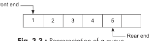

其中，队头是指向队列中第一个元素的指针，队尾是指向队列中最后一个元素的指针。元素 1 是队列的第一个元素，5 是队列中的最后一个元素。如果要删除某个元素（例如 3），必须先删除元素 1，然后删除元素 2，再删除元素 3。队头将从第 1 个元素 1 移动到 4。

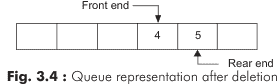

同样，如果要添加新元素（例如 6），它会被添加到 5 之后，因为它位于队尾。插入新元素后，队尾将从元素 5 移动到元素 6，即队列的最后位置。超过此位置后，无法在队列中插入任何元素。

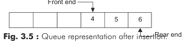

对队列可执行的主要操作是插入和删除。队列上的这些操作分别称为入队和出队操作。入队操作向队列中添加新元素。该过程通过递增队尾并在队尾位置添加新元素来执行。出队操作通过递增队头并删除队头位置的第一个元素来执行。

## 3.4 数组及其使用队列的表示

表示队列的最简单方法之一是使用一维数组。队列和数组都是元素的有序集合。但是，数组和队列是两种不同的东西。数组中的元素数量是固定的，无法更改存储在数组中的元素数量。但是，当元素入队和出队时，队列的大小会不断变化。队列大小存储在数组的一部分中，因此可以声明足够大的数组以容纳队列的最大元素数量。在程序执行期间，队列大小可以在为其保留的空间内变化。数组的一端（即队列的底部）称为队尾，数组的另一端（即队列的顶部）称为队头。处理极端情况时必须小心，例如不要向已完全占用的队列插入元素，也不要从空队列删除元素。要使用数组表示线性队列，我们需要，

- 一个用于保存队列元素的数组，可以是 int、float 或 char 等任何数据类型，
- 一个整数（即 FRONT），用于存储队列中第一个元素的位置。
- 另一个整数（即 REAR），用于存储队列中最后一个元素的位置。


## 3.4.1 入队操作

入队操作是用于在队列尾部添加新元素的操作。在实现入队操作时，需要检查队列的溢出条件。（因为如果尾部位于队列的最后一个位置，则无法插入任何数据）。

以下过程可帮助您更好地理解。

- 创建一个带有两个参数的函数 ENQUEUE(，即数组和要添加的元素。
- 通过递增 REAR 变量在数组中分配新元素。

## 3.4.2 出队操作

出队操作是用于从队列前端移除元素的操作。在实现出队操作时，需要检查队列的下溢条件（即，您需要检查队列是否为空）。用户不应从空队列中删除元素。此类尝试是非法的，应予以避免。如果进行此类尝试，应向用户通知下溢条件。

以下过程可帮助您更好地理解。

- 创建一个带有两个参数的函数 DEQUEUE(，即数组和用于存储出队值的元素地址。
- 将 FRONT 变量递增 1。

## 3.4.3 窥视操作

窥视操作是用于显示队列前端元素的操作，该元素由 FRONT 指针指向，但不实际移除它。队列的窥视操作使用数组实现。在实现窥视操作时，需要检查队列的下溢条件（即，您需要检查队列是否为空）。用户不应尝试从空队列中窥视元素。此类尝试是非法的，应予以避免。如果进行此类尝试，应向用户通知下溢条件。以下过程可帮助您更好地理解。

- 创建一个带有一个参数的函数 PEEK(，即用于存储前端值的元素地址。

## 3.4.4 空队列

如果队列不包含任何元素，则称为空队列。如果要从队列中出队一个元素，您需要检查队列是否为空，因为不能从空队列中出队元素。以下过程可用于创建和检查空队列。

- 创建一个不带参数的函数 ISEMPTY(。
- 检查 FRONT 指针和 REAR 指针是否等于 -1。
- 如果条件为真，则表示队列为空。
- 否则，队列不为空。

## 3.4.5 完全占用队列

如果队列包含的元素数等于其大小（即 QSIZE），则我们说队列已满。如果要向队列中插入元素，您需要检查队列是否已满，因为当队列完全占用时无法向其中插入元素。此类尝试是非法的，应予以避免。如果进行此类尝试，应向用户通知溢出条件。

要检查队列是否已满，我们在程序 3.1 中使用了指针 REAR。我们正在检查指针 REAR 是否等于数组的最大大小减一（因为数组从零开始，如果数组大小为 5，且队列已满，则队列的最后一个元素存储在数组位置 4）。如果满足条件，将显示输出消息“Queue Overflow on ENQUEUE”。此条件称为完全占用队列。以下过程可帮助您更好地理解。

- 创建一个不带参数的函数 isFull()。
- 检查 REAR 指针是否等于 QSIZE – 1。
- 如果条件为真，则表示队列已满。否则，队列未满。

## 程序 3.2 :

```c
/* Program to implement a linear queue using arrays */
/* lqueue.c */
#define QSIZE 4										/* Maximum size of the Queue */
void displayMenu();
int isEmpty();
int isFull();
int size();
int enqueue(int value);
int dequeue(int *value);
int peek(int *value);
void view();
int queue[QSIZE], front = -1, rear = -1;
void main()
{
	int status, choice, data;
	displayMenu() ;
	while(1)
	{
		printf("\n ? ");
		scanf("%d", &choice);
		switch(choice)
		{
		    case 1 :
		        printf("Enter the element : ");
		        fflush(stdin);
		        scanf("%d", &data);
		        status = enqueue(data);
		        if(status == -1)
		            printf("Queue Overflow on ENQUEUE...");
		        break;
		    case 2 :
		        status = dequeue(&data);
		        if(status == -1)
		            printf("Queue Underflow on DEQUEUE ...");
		        else
		            printf("The Dequeued Value is %d", data);
		        break;
		    case 3 :
		        status = peek(&data);
		        if(status == -1)
		            printf("\n Queue is Empty");
		        else
		            printf("\n The Top most value is %d", data);
		        break;
		    case 4 :
		        printf("\n Queue Size is %d", QSIZE);
		        printf("\n Current Queue Elements = %d", size());
		        break;
		    case 5 :
		        view();
		        break;
		    default:
		        printf("\n End of Run of your Program . . ");
		        exit(0);
		    }
	}
}
void displayMenu()
{
 printf("\n Representation of Linear Queue using Arrays ...");
 printf("\n\t 1. Enqueue ");
 printf("\n\t 2. Dequeue ");
 printf("\n\t 3. Peek ");
 printf("\n\t 4. Size ");
 printf("\n\t 5. View ");
 printf("\n\t 6. Exit ");
}
int isEmpty()
{
 extern int queue[], front, rear;
 if(front == -1 && rear == -1)
 /* Check for Empty Queue */
 return 1;
 else
 return 0;
}
int isFull()
{
 extern int queue[], front, rear;
 if(rear == (QSIZE - 1))
 /* Check for Occupied Queue */
 return 1;
 else
 return 0;
}
int enqueue(int value)
{
 extern int queue[], front, rear;
 if(isFull())
 /* Check for Rear at last position */
 return -1;
 else if(isEmpty())
 /* Check for Empty Queue */
 front = rear = 0;
 else
 rear = rear + 1;
 queue[rear] = value;
 return 0;
}
int dequeue(int *value)
{
 extern int queue[], front, rear;
 if(isEmpty())
 {
     return -1;
 }
 *value = queue[front];
 /*Check for Queue contains only one element*/
 if(front == rear)
     front = rear = -1;
 else
     front = front + 1;
 return 0;
}

int peek(int *value)
{
    extern int queue[], front, rear;
    if(isEmpty())
    /* Check for Empty Queue */
    return -1;
    *value = queue[front];
    return 0;
}

int size()
{
    extern int queue[], front, rear;
    return (rear - front + 1);
}

void view()
{
    extern int queue[], front, rear;
    int f;
    if(isEmpty())
    {
        printf("Queue is EMPTY !!!");
        return;
    }
    printf("\nContent of the Queue is ... \n FRONT -->");
    for(f = front; f != rear+1; f = f + 1)
    {
        printf(" %d --> ", queue[f]);
    }
    printf(" REAR");
    if(isFull())
        printf("\n Queue is FULL");
}
```

## 程序显示以下输出

使用数组表示线性队列 ...
1. 入队
2. 出队
3. 窥视
4. 大小
5. 查看
6. 退出

```c
? 2
Queue Underflow on DEQUEUE ...
? 3
Queue is Empty
? 4
Queue Size is = 5
Current Queue Elements = 1
? 5
Queue is EMPTY !!!
? 1
Enter the element : 1001
? 1
Enter the element : 1002
? 1
Enter the element : 1003
? 1
Enter the element : 1004
? 1
Enter the element : 1005
Queue Overflow on ENQUEUE...
? 5
Content of the Queue is ...
FRONT -> 1001 -> 1002 -> 1003 -> 1004 -> REAR
Queue is FULL
? 4
Queue Size is = 4
Current Queue Elements = 4
? 3
The Top most value is 1001
? 2
The Dequeued Value is 1001
? 2
The Dequeued Value is 1002
? 5
Content of the Queue is ...
FRONT -> 1003 -> 1004 -> REAR
? 4
Queue Size is = 4
Current Queue Elements = 2
? 2
The Dequeued Value is 1003
? 2
The Dequeued Value is 1004
? 2
Queue Underflow on DEQUEUE ...
? 5
Queue is EMPTY !!!
? 6
End of Run of your Program . . .
```

### 3.5 链表

链表或列表是元素的有序集合。列表中的每个元素称为节点。每个节点包含两个字段，即，

- 数据字段
- 链接字段。

数据字段包含要存储在列表中的元素的实际数据（即，值），链接字段也称为下一个地址字段，包含列表中下一个节点的地址。图 3.6 可帮助您更好地理解。

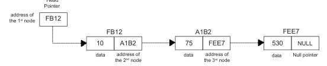

图 3.6：链表表示。

图 3.6 所示的链表包含三个节点，每个节点都有一个数据字段和一个链接字段。链表包含一个指针，称为头指针，它指向列表中的第一个节点，该节点存储列表中第一个节点的地址（即，FB12）。数据字段包含要


存储在列表中。第一个节点的数据字段存储值 10。第一个节点的数据字段包含第二个节点的地址（即，A1B2）。同样，列表的第二个节点在数据字段中存储值 75，在链接字段中存储第三个节点的地址（即，FE77）。列表的最后一个节点在数据字段中仅包含信息部分（即，530），地址字段存储 NULL 指针。此 NULL 指针用于指示列表的末尾。请注意，链表中的节点不是按其在内存中的物理位置排序的（即，它们可能/可能不会放置在连续的内存位置中），而是由存储在节点数据本身一部分中的逻辑链接排序的。

链表中存储的地址分为以下三种类型，即，

- 外部地址
- 内部地址
- 空地址。

**外部地址** 是列表中第一个节点的地址。此地址存储在头指针中，头指针指向列表中的第一个节点。整个链表只能通过头指针访问。**内部地址** 是链表中除最后一个节点外每个节点存储的地址。链接字段（也称为下一地址字段）中存储的内容是下一个节点的地址。**空地址** 是列表最后一个节点的 NULL 指针存储的地址，用于指示列表的末尾。

## 3.5.1 链表的类型

链表有不同类型。它们可以分类为，

- 单链表
- 双链表
- 循环链表。

### 单链表

目前为止我们看到的列表称为单链表，其中每个节点只有一个指向其下一个节点的链接。此列表也称为**线性链表**。头指针指向列表中的第一个节点，空指针存储在列表中最后一个节点的链接字段中，用于指示列表末尾。**图 3.6** 显示了一个单链表。在单链表中只能单向遍历（移动）（即，从列表的头到空）。不能逆向遍历列表（即，从列表的空到头）。

### 双链表

对于某些应用程序，尤其是需要双向遍历列表的情况，双链表比单链表效果好得多。双链表是单链表的一种高级形式，其中每个节点包含三个字段，即，

- 前一地址字段
- 数据字段
- 下一地址字段。

节点的前一地址字段包含其前一个节点的地址。此字段也称为*后向链接字段*。数据字段存储节点的信息部分。下一地址包含列表中下一个节点的地址。此字段也称为*前向链接字段*。图 3.7 显示了双链表的结构。

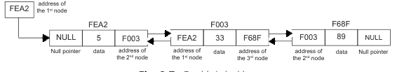

### 循环链表

循环链表是链表的另一种形式，其中列表的最后一个节点连接到列表中的第一个节点。循环链表有不同类型。它们可以分类为，

- 循环单链表
- 循环双链表。

请注意，循环链表看起来像循环列表，没有任何*列表末尾*（即，没有 NULL 指针）。图 3.8 显示了循环单链表的结构。图 3.9 显示了循环双链表的结构。

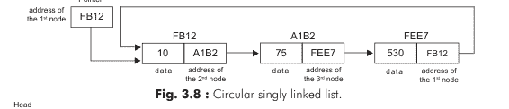

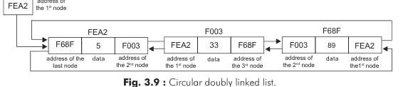

### 3.6 基于链表的栈实现

表示栈的另一种方法是使用单链表。这种表示方法比使用数组表示栈具有更多优势。它们是，

- 在声明栈时不需要指定要存储在栈中的元素数量（因为在向栈中添加元素时，内存会在运行时动态分配）。
- 插入和删除可以轻松高效地处理。
- 链表表示的栈可以根据列表中发生的插入和删除操作，在不浪费内存空间的情况下动态增长和缩小。
- 可以为每个栈使用链来高效表示多个栈。

可以对栈执行的基本操作有，

- Push 操作
- Pop 操作
- Peek 操作
- 查看栈大小
- 查看栈内容。

### 3.6.1 Push 操作

PUSH 是用于向栈中添加新元素的操作。栈的 PUSH 操作也可以使用单链表实现。以下过程有助于更好地理解。

- 创建带有两个参数的函数 PUSH()（栈指针和要插入的 VALUE）。
- 创建一个新指针（即，NEWPTR）来保存新元素。
- 使用 GETNODE() 为新指针分配栈节点的大小。
- 栈的大小取决于可用的堆内存。
- 如果 GETNODE() 返回 NULL，则表示没有可用的堆内存。
- 将 VALUE 赋给新指针的数据。
- 将新指针的链接赋给栈的头（即，TOP）。
- 将栈的头赋给新指针。

```
Algorithm for Declaration of Structure Stack
Struct STACK
DATA : Data Field
NEXT : Link Field (Address of next Struct STACK)
End Struct
```

```
Algorithm for Allocating Memory for the New Node
GETNODE()
SIZE : INTEGER
NEWNODE : STACK
Step 1 : Set SIZE = get the size of the STACK
Step 2 : Set NEWNODE = Allocate space in memory for SIZE and return the initial address
Step 3 : Return NEWNODE
End GETNODE()
```

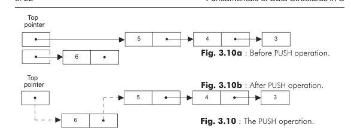

```
Algorithm for Inserting a Node in the Stack
PUSH(VALUE : INTEGER)
GLOBAL: TOPSTK : STACK
NEWPTR : STACK
Step 1 : If (ISFULL() == 1)
    Return -1
[End of If Structure]
Step 2 : NEWPTR = GETNODE()
Step 3 : NEWPTR -> DATA = VALUE
Step 4 : NEWPTR -> NEXT = TOPSTK
Step 5 : TOPSTK = NEWPTR
Step 6 : Return 0
End PUSH()
```

图 3.10a 显示了 PUSH 操作前的栈和新节点。在图 3.10b 中，TOP 指针被指向新节点的 NEW 指针。新节点的元素被指向由 TOP 指针已指向的节点，其他节点保持不变。

### 3.6.2 POP 操作

POP 是用于从栈顶移除元素的操作。栈的 POP 操作也可以使用单链表实现。在实现 POP 操作时，需要检查栈的下溢条件。用户不应从空栈中移除元素。此类尝试是非法的，应予以避免。以下过程可帮助您更好地理解。

- 创建带有两个参数的函数 POP()，用于存储栈指针和要删除的最后一个元素的地址。
- 创建一个临时指针（即，tempptr）来保存移除的元素。
- 将 TOP 指针赋给临时指针。
- 将 TOP 指针指向第一个节点之后的节点，其他节点保持不变。
- 使用 RELEASENODE() 释放临时指针分配的内存。

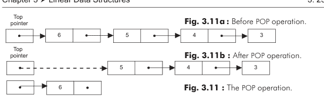

```
Algorithm for Releasing the Memory for the Node to be Deleted
RELEASENODE(NEWNODE : STACK)
Step 1 : Deallocate the space for the STACK of NEWNODE
Step 2 : Return
End RELEASENODE()
```

```
Algorithm for Removing a Node from the Stack
POP(VALUE : INTEGER)
GLOBAL: TOPSTK : STACK
TEMP : STACK
Step 1 : If (ISEMPTY() == 1)
    Return -1
    [End of If Structure]
Step 2 : TEMP = TOPSTK
Step 3 : TOPSTK = TOPSTK -> NEXT
Step 4 : VALUE = TEMP -> DATA
Step 5 : RELEASENODE(TEMP)
Step 6 : Return 0
End POP()
```

图 3.11 说明了 POP 操作。图 3.11a 显示了 POP 操作前的栈。在图 3.11b 中，创建了一个临时指针（即，tempptr），并将其指向要移除的节点（即，由 TOP 指针指向的节点）。将 TOP 指针指向第一个节点之后的节点，其他节点保持不变。临时指针分配的内存被释放。因此，由 TOP 指针指向的元素从栈中移除。请注意，栈和链表的表示方式相同。栈与普通链表的区别在于，插入和删除可以在链表中的任何位置发生，但只能在栈的顶部节点发生。


## 3.6.3 PEEK 操作

PEEK 操作用于显示栈顶元素，由 TOP 指针指向，但不实际移除该元素。栈的 PEEK 操作也使用链表实现。在实现 PEEK 操作时，需要检查栈的下溢条件。用户不应尝试从空栈中 PEEK 元素。这种尝试是非法的，应予以避免。

```
Algorithm to Retrieve the Contents from the Top of the Stack

PEEK(VALUE : INTEGER)
GLOBAL: TOPSTK : STACK
TEMP : STACK
Step 1 : If (IS EMPTY() == 1)
    Return -1
    [End of If Structure]
Step 2 : TEMP = TOPSTK
Step 3 : VALUE = TEMP -> DATA
Step 4 : Return 0
End PEEK()
```

## 3.6.4 遍历栈

要读取栈中的信息或显示栈中的信息，必须遍历（移动）链表，从第一个节点开始逐个节点，直到到达列表末尾。遍历列表涉及以下步骤，

- 将 TOP 指针的地址赋给一个变量。
- 显示数据字段中的信息。
- 通过推进指针直到 NULL，从一个节点遍历到另一个节点。

```
Algorithm for Displaying the Contents of the Stack

VIEW()
GLOBAL: TOPSTK : STACK
TOP : STACK
Step 1 : If (IS EMPTY() == 1)
    Print "Stack is EMPTY"
    Return
    [End of If Structure]
Step 2 : TOP = TOPSTK
Step 3 : Do While(TOP != NULL)
    Print "Value is", TOP -> DATA
    TOP = TOP -> NEXT
    [End of Step 3 While Structure]
End VIEW()
```

## 3.6.5 空栈

如果栈中不包含任何元素，则称为**空栈**。如果要从栈中弹出一个元素，必须检查栈是否为空，因为不能从空栈中弹出元素。在链表中，如果栈指向 NULL，则该栈被称为空栈。如果要从空栈中弹出一个元素，将显示输出“栈下溢”。

```
Algorithm for IS_EMPTY()
IS_EMPTY(VALUE : INTEGER)
GLOBAL: TOPSTK : STACK
Step 1 : If (TOPSTK == NULL)
            Return 1
        Else
            Return 0
        [End of If Structure]
End IS_EMPTY()
```

## 3.6.6 完全占用的栈

如果栈中包含的元素数量等于其大小，则称栈已满。如果要将元素压入栈中，必须检查栈是否已满，因为当栈完全占用时，无法将元素压入栈中。对于使用链表表示的栈，栈中存储元素没有限制，因为存储栈元素所需的内存是使用 malloc() 函数动态分配的。但是，如果存储栈元素所需的内存不可用，则无法将元素插入栈中。如果在链表中 malloc() 函数返回 NULL，则称为**完全占用的栈**。如果要在完全占用的栈中插入一个元素，将显示输出“栈上溢”。

```
Algorithm for IS_FULL()
IS_FULL(VALUE : INTEGER)
GLOBAL: TOPSTK : STACK
TEMP: STACK
Step 1 : TEMP = GETNODE()
Step 2 : If (TEMP == NULL)
            Return 1
        Else
            RELEASENODE(TEMP)
            Return 0
        [End of If Structure]
End IS_FULL()
```

## 3.6.7 栈大小

对于使用链表表示的栈，存储元素没有限制，因为存储栈元素所需的内存是使用 malloc() 函数动态分配的。要查找栈的大小（即已存储的元素数量），并检查存储栈元素所需的内存是否可用，请使用 sizeof() 函数，如程序 3.2 所述。请注意，当链表指向的内存指向 NULL 时，无法将元素存储在栈中。

```
Algorithm to Count the Nodes in a Stack
SIZE(VALUE : INTEGER)
GLOBAL: TOPSTK : STACK
TOP : STACK; COUNT : INTEGER
Step 1 : TOP = TOPSTK
Step 2 : COUNT = 0
Step 3 : Do While(TOP != NULL)
    COUNT = COUNT + 1
    TOP = TOP -> NEXT
    [End of Step 3 While Structure]
Step 4 : Return COUNT
End SIZE()
```

## Program 3.3 :

```
/* Program to implement a stack using singly linked list. */
/* linstack.c */
#include<stdio.h>
#include<conio.h>
#include<stdlib.h>
typedef struct node
{
    int data;
    struct node *next;
}stack;
int size();
void view();
int isFull();
int isEmpty();
void displayMenu();
int push(int value);
int pop(int *value);
int peek(int *value);
stack *getNode();
void releaseNode(stack *newnode);
stack *topStk = NULL;
void main()
{
    int data, status, choice;
    displayMenu();
    while(1)
    {
        printf("\n\n ? ");
        scanf("%d", &choice);
        switch(choice)
        {
            case 1:
                printf("\n Enter the element : ");
                fflush(stdin);
                scanf("%d", &data);
                status = push(data);
                if(status == -1)
                    printf("\n Memory is not available ...");
                break;
            case 2:
                status = pop(&data);
                if(status == -1)
                    printf("\n Stack underflow on POP");
                else
                    printf("\n The popped value is %d", data);
                break;
            case 3:
                status = peek(&data);
                if(status == -1)
                    printf("\n Stack is Empty !!!");
                else
                    printf("\n The Top most value is %d", data);
                break;
            case 4:
                printf("\n Current Stack Elements = %d", size());
                break;
            case 5 :
                view();
                break;
            default:
                printf("\n End of Run of your Program . . .");
                exit(0);
        }
    }
}

void displayMenu()
{
    printf("\n Representation of stack using single linked lists . . .");
    printf("\n\t 1. Push ");
    printf("\n\t 2. Pop ");
    printf("\n\t 3. Peek ");
    printf("\n\t 4. Size ");
    printf("\n\t 5. View ");
    printf("\n\t 6. Exit ");
}

stack *getNode()
{
    return((stack *)malloc(sizeof(stack)));
}

void releaseNode(stack *newnode)
{
    free(newnode);
}

int push(int value)
{
    extern stack *topStk;
    stack *newptr;
    if(isFull())
    return -1;
    newptr = getNode();
    newptr -> data = value;
    newptr -> next = topStk;
    topStk = newptr;
    return 0;
}

int pop(int *value)
{
    extern stack *topStk;
    stack *temp;
    if(isEmpty())
        return -1;
    temp = topStk;
    topStk = topStk -> next;
    *value = temp -> data;
    releaseNode(temp);
    return 0;
}

int peek(int *value)
{
    extern stack *topStk;
    stack *temp;
    if(isEmpty())
        return -1;
    temp = topStk;
    *value = temp -> data;
    return 0;
}

int isEmpty()
{
    extern stack *topStk;
    if(topStk == NULL)
        return 1;
    else
        return 0;
}

int isFull()
{
    extern stack *topStk;
    stack *temp;
    temp = getNode();
    if(temp == NULL)
        return 1;
    else
    {
        releaseNode(temp);
        return 0;
    }
}

int size()
{
    extern stack *topStk;
    stack *top;
    int count = 0;
    for(top = topStk; top != NULL; top = top -> next)
    count++;
    return count;
}

void view()
{
    extern stack *topStk;
    stack *top;
    if(isEmpty())
    {
    printf("\n The stack is Empty !!! ");
    return;
    }
    printf("\n The content of the stack is... TOP");
    for(top = topStk; top != NULL; top = top -> next)
    printf(" --> %d", top -> data);
}
```

## 程序显示以下输出

```
Representation of stack using single linked lists ...
1. Push
2. Pop
3. Peek
4. Size
5. View
6. Exit

? 2
Stack underflow on POP

? 3
Stack is Empty
? 4
Current Stack Elements = 0
? 5
The stack is Empty !!!
? 1
Enter the element : 101
? 1
Enter the element : 102
? 1
Enter the element : 103
? 1
Enter the element : 104
? 1
Enter the element : 105
? 5
The content of the stack is... TOP --> 105 --> 104 --> 103 --> 102
--> 101
? 4
Current Stack Elements = 5
? 2
The popped value is 105
? 2
The popped value is 104
? 5
The content of the stack is... TOP --> 103 --> 102 --> 101
? 4
Current Stack Elements = 3
? 2
The popped value is 103
? 2
The popped value is 102
? 5
The content of the stack is... TOP --> 101
? 2
The popped value is 101
? 2
Stack underflow on POP
? 5
The stack is Empty !!!
? 6
End of Run of your Program . . .
```


### 3.7 基于链表的队列实现

表示队列的另一种方法是使用单链表。这种表示方式比使用数组表示队列具有更多优势。其优势如下

- 在声明队列时无需指定要存储的元素数量（因为在向队列添加元素时，内存是在运行时动态分配的）。
- 插入和删除操作可以轻松高效地处理。
- 基于链表的队列表示可以根据列表中的插入和删除操作动态增长和缩减大小，而不会浪费内存空间。
- 可以为每个队列使用一条链来高效表示多个队列。

可以对队列执行的基本操作如下，

- 入队操作
- 出队操作
- 窥视操作
- 查看队列大小
- 查看队列内容。

### 3.7.1 入队操作

ENQUEUE 是一种用于向队列中添加新元素的操作。队列的 ENQUEUE 操作也可以使用单链表实现。以下过程有助于更好地理解。

- 创建一个带有三个参数的函数 ENQUEUE()，即队列的 FRONT 指针、REAR 指针以及要插入的 ELEMENT。
- 创建一个新指针（即 NEWPTR）来保存新元素。
- 使用 GETNODE() 动态为新指针分配队列节点的大小。
- 将 ELEMENT 赋值给新指针的数据字段。
- 将 REAR 指针的链接赋值给 NEWPTR。
- 将队列的 REAR 指针赋值给 NEWPTR。

图 3.12a 显示了 ENQUEUE 操作前的队列和新节点。在图 3.12b 中，REAR 指针的链接被指向新节点，并将尾指针赋值给新节点。

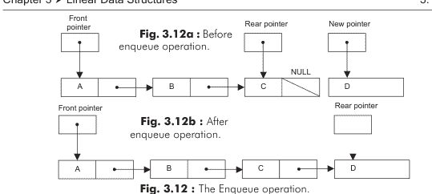

### 声明结构体 Queue 的算法

```
Struct QUEUE
DATA : Data Field
NEXT : Link Field (Address of Struct QUEUE)
End Struct
```

### 为新节点分配内存的算法

```
GETNODE()
SIZE : INTEGER
NEWNODE : QUEUE
Step 1 : Set SIZE = get the size of the QUEUE
Step 2 : Set NEWNODE = Allocate the space from memory for the size of SIZE and
return the initial address
Step 3 : Return NEWNODE
End GETNODE()
```

### 在队列中插入节点的算法

```
ENQUEUE(FRONT : QUEUE, REAR : QUEUE, VALUE : DATA)
NEWPTR : QUEUE
Step 1 : Set NEWPTR = GETNODE()
Step 2 : If (NEWPTR == NULL)
Print "Memory is Not Available"
Return -1
[End of If Structure]
Step 3 : Set NEWPTR -> DATA = value
Step 4 : Set NEWPTR -> NEXT = NULL
Step 5 : If (FRONT == NULL AND REAR == NULL)
FRONT = NEWPTR
Else
REAR -> NEXT = NEWPTR
[End of If Structure]
Step 6 : Set REAR = NEWPTR
Step 7 : Return 0
End ENQUEUE()
```

### 3.7.2 出队操作

DEQUEUE 是一种用于从队列 FRONT 移除元素的操作。队列的 DEQUEUE 操作也可以使用单链表实现。以下过程可以帮助你更好地理解。

- 创建一个带有三个参数的函数 DEQUEUE()，即 FRONT 指针、队列的 REAR 以及存储要删除的最后一个元素的地址。
- 创建一个临时指针（即 tempptr）来保存被移除的元素。
- 将 FRONT 指针赋值给临时指针。
- 将 FRONT 指针指向第一个节点之后的节点，其他节点保持不变。
- 使用 RELEASENODE() 释放临时指针分配的内存。

| 释放待删除节点内存的算法 |
| :--- |
| RELEASENODE(NEWNODE : QUEUE) |
| Step 1 : 释放 NEWNODE 的 QUEUE 空间 |
| Step 2 : 返回 |
| End RELEASENODE() |

| 从队列中移除节点的算法 |
| :--- |
| DEQUEUE(FRONT : QUEUE, REAR : QUEUE, VALUE : DATA) |
| TEMP : QUEUE |
| Step 1 : If (FRONT == NULL AND REAR == NULL) |
| Print "QUEUE is Underflow" |
| Return -1 |
| [End of if Structure] |
| Step 2 : Set TEMP = FRONT |
| Step 3 : Set VALUE = FRONT -> DATA |
| Step 4 : If (FRONT == REAR) |
| Set REAR = NULL |
| [End of if Structure] |
| Step 5 : Set FRONT = FRONT -> NEXT |
| Step 6 : RELEASENODE(TEMP) |
| Step 7 : Return 0 |
| End DEQUEUE() |

图 3.13a 显示了 DEQUEUE 操作前的队列。在图 3.13b 中，创建了一个临时指针（即 tempptr），并使其指向要移除的节点（即 FRONT 指针指向的节点）。FRONT 指针被指向第一个节点之后的节点，其他节点保持不变。临时指针分配的内存被释放。因此，FRONT 指针指向的元素从队列中移除。

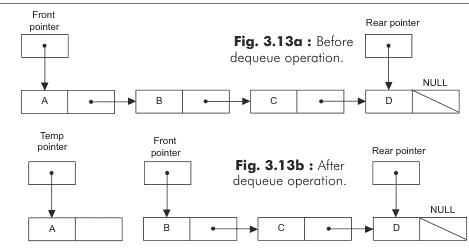

请注意，队列和链表的表示方式相同。队列与普通链表的区别在于，插入和删除可以在链表的任何位置进行，但在队列中，插入只能在尾端进行，删除只能在头端进行。

### 3.7.3 PEEK 操作

PEEK 操作用于显示队列 FRONT 处由 FRONT 指针指向的元素，而不实际移除它。队列的 PEEK 操作也使用链表实现。在实现 PEEK 操作时，需要检查队列的下溢条件。用户不应尝试从空队列中 PEEK 元素。这种尝试是非法的，应予以避免。

```
Algorithm to Retrieve the Contents from the Top of the Queue

PEEK(FRONT : QUEUE, VALUE : DATA)
Step 1 : If (IS_EMPTY(FRONT))
    Print "Queue is Empty."
    Return
[End of If Structure]
Step 2 : VALUE = FRONT -> DATA
End PEEK()
```

### 3.7.4 遍历队列

要读取或显示队列中的信息，必须从 FRONT 节点开始逐个节点地遍历（移动）链表，直到到达 REAR 节点。遍历列表涉及以下步骤。

- 将 FRONT 指针的地址赋值给一个变量。
- 显示数据字段中的信息。
- 通过推进指针直到 REAR，从一个节点遍历到另一个节点。

### 3.7.5 空队列

如果队列不包含任何元素，则称为**空队列**。如果要从队列中出队一个元素，必须检查队列是否为空，因为不能从空队列中出队元素。如果在链表中队列的 FRONT 和 REAR 都指向 NULL，则称为空队列。如果要从空队列中出队一个元素，将显示输出 "queue is underflow"。

```
Algorithm for IS_EMPTY()

IS_EMPTY(FRONT : QUEUE)
Step 1 : If (FRONT == NULL)
    Return 1
    Else
    Return 0
    [End of If Structure]
End IS_EMPTY()
```

### 3.7.6 已满队列

如果队列包含的元素数量等于其大小，则称队列已满。如果要将元素入队到队列中，必须检查队列是否已满，因为当队列已满时无法将元素入队。对于使用链表表示的队列，队列中存储元素没有限制，因为存储队列元素所需的内存是使用 `malloc()` 函数动态分配的。但是，如果存储队列元素所需的内存不可用，则无法将元素入队到队列中。如果在链表中 malloc() 函数返回 NULL，则称为已满队列。如果需要从已满队列中入队一个元素，将显示输出 "queue is overflow"。

```
Algorithm for IS_FULL()

IS_FULL()
TEMP : QUEUE
Step 1 : TEMP = GETNODE()
Step 2 : If (TEMP == NULL)
    Return 1
    Else
    RELEASENODE(TEMP)
    Return 0
    [End of If Structure]
End IS_FULL()
```

### 3.7.7 队列大小

对于使用链表表示的队列，存储元素没有限制，因为存储队列元素所需的内存是使用 malloc() 函数动态分配的。要查找队列的大小（即已存储的元素数量）以检查存储队列元素所需的内存是否可用，请使用如程序 3.2 中所述的 size() 函数。请注意，当链表指向的内存指向 NULL 时，无法将元素存储在队列中。

```
Algorithm: to Count the Nodes in a Queue

SIZE(FRONT : QUEUE)
COUNT : INTEGER
Step 1 : COUNT = 0
Step 2 : If (FRONT == NULL)
    Return COUNT
    [End of If Structure]
Step 3 : Do While(FRONT != NULL)
    COUNT = COUNT + 1
    FRONT = FRONT -> NEXT
    [End of Step 3 While Structure]
Step 4 : Return COUNT
End SIZE()
```


## 程序 3.4:

```c
/* Program to implement a Queue using singly linked list. */
/* linqueue.c */
#include<stdio.h>
typedef struct node
{
    int data;
    struct node *link;
}queue;
queue *getNode();
void releaseNode(queue *p);
int isFull();
int isEmpty(queue *front);
void enqueue(queue **frontptr, queue **rearptr, int value);
void dequeue(queue **frontptr, queue **rearptr, int *value);
void peek(queue *front, int *value);
void view(queue **front);
int size(queue *front);
void displayMenu(void);
void main()
{
    queue *front = NULL, *rear = NULL;
    int choice, item;
    displayMenu();
    while(1)
    {
        printf("\n ? ");
        scanf("%d", &choice);
        switch(choice)
        {
            case 1 :
            if(isFull())
            printf("\n Queue Overflow on ENQUEUE");
            else
            {
                printf("\n Enter the element : ");
                fflush(stdin);
                scanf("%d", &item);
                enqueue(&front, &rear, item);
            }
            break;
case 2 :
    if(isEmpty(front))
    printf("\n Queue Underflow on DEQUEUE");
    else
    {
    dequeue(&front, &rear, &item);
    printf("\nThe dequeued value is %d", item);
    }
    break;

case 3 :
    if(!isEmpty(front))
    {
    peek(front, &item);
    printf("\n The front value is %d", item);
    }
    else
    printf("\n Queue is Empty");
    break;

case 4 :
    printf("\nCount of Queue Elements=%d",size(front));
    break;

case 5 :
    view(front);
    break;

default :
    printf("\n End of run of your program . . .");
    exit(0);
    }
}

void displayMenu()
{
    printf("\n Representation of Queue using Linked List ...");
    printf("\n\n\t 1. Enqueue ");
    printf("\n\n\t 2. Dequeue ");
    printf("\n\n\t 3. Peek ");
printf("\n\t 4. Size ");
printf("\n\t 5. View ");
printf("\n\t 6. Exit ");
}

void releaseNode(queue *p)
{
    free(p);
}

queue* getNode()
{
    int size;
    queue * newnode;
    size = sizeof(queue);
    newnode = (queue *)malloc(size);
    return(newnode);
}

int isEmpty(queue *front)
{
    if(front == NULL)    /* Check for Empty Queue */
    return 1;
    else
    return 0;
}

int isFull()
{
    queue * newnode;
    newnode = getNode();
    if(newnode == NULL)    /* Check for Fully Occupied Queue */
    return 1;
    releaseNode(newnode);
    return 0;
}

void enqueue(queue **frontptr, queue **rearptr, int value)
{
    queue *newnode;
    if(isFull())
    {
        printf("\n Memory not available");
        return;
    }
    newnode = getNode();
    newnode->data = value;
    newnode->link = NULL;
    if(*frontptr == NULL)
        *frontptr = newnode;
    else
    {
        (*rearptr)->link = newnode;
        *rearptr = newnode;
    }
}

void dequeue(queue **frontptr, queue **rearptr, int *value)
{
    queue *tempnode;
    if(isEmpty(*frontptr))
        return;
    tempnode = *frontptr;
    *frontptr = (*frontptr) -> link;
    if(*frontptr == NULL)
        *rearptr = NULL;
    *value = tempnode -> data;
    releaseNode(tempnode);
}

void peek(queue *front, int *value)
{
    if(isEmpty(front))
    {
        printf("\n The queue is empty !!!");
        return;
    }
    *value = front -> data;
}

void view(queue *front)
{
    if(isEmpty(front))
    {
        printf("\n The Queue is empty !!!");
        return;
    }
    printf("\n Queue contains ... Front -> ");
    while(front != NULL)
    {
        printf("%d --> ", front ->data);
        front = front -> link;
    }
    printf("\nRear \n");
}

int size(queue *front)
{
    int count = 0;
    if(front == NULL)
        return count;
    for(;front != NULL;)
    {
        count++;
        front = front -> link;
    }
    return count;
}
```

程序显示以下输出

使用链表的队列表示 ...

- 1. 入队
- 2. 出队
- 3. 查看队首
- 4. 大小
- 5. 显示队列
- 6. 退出

? 2

出队时队列下溢

? 3
队列为空！！！
? 4
队列元素数量 = 0
? 5
队列为空！！！
? 1
请输入元素：1
? 1
请输入元素：2
? 1
请输入元素：3
? 1
请输入元素：4
? 5
队列包含 ... 前端 --> 11 --> 22 --> 33 --> 44 --> 尾端
? 4
队列元素数量 = 4
? 3
前端值为 11
? 2
出队值为 11
? 2
出队值为 22
? 4
队列元素数量 = 2
? 5
队列包含 ... 前端 --> 33 --> 44 --> 尾端
? 2
出队值为 33
队列包含 ... 前端 --> 44 --> 尾端
? 2
出队值为 44
队列为空！！！
? 2
出队时队列下溢
? 4
队列元素数量 = 0
? 5
队列为空！！！
? 6
你的程序运行结束 . . .

### 3.8 算术表达式求值

表达式由两个组成部分组成，即操作数和运算符。运算符指示要对操作数执行的操作。在求值表达式时使用两种运算符，即一元运算符和二元运算符。一元运算符只需要一个操作数来执行其预期操作，而二元运算符需要两个操作数来执行其预期操作。大多数使用的运算符本质上是二元的。计算机通过重构算术表达式来求解，使每个计算的顺序嵌入到表达式中。转换后，表达式可以一次性求解。

在计算机中表示表达式有三种方式，即，

- 中缀表示法
- 前缀表示法
- 后缀表示法。

表示法的前缀“in”、“pre”和“post”指的是操作数相对于运算符的位置。上述所有方式在求值表达式时都以不同的方式使用运算符和操作数。表 3.1 显示了表示表达式的不同方式。

| 表示法 | 算术表达式 | 示例 |
| :--- | :--- | :--- |
| 中缀 | 操作数 运算符 操作数 | a+b |
| 前缀 | 运算符 操作数 操作数 | +ab |
| 后缀 | 操作数 操作数 运算符 | ab+ |

### 中缀表示法

表示数学表达式的常规方式称为中缀表示法。在这种表示算术表达式的形式中，运算符位于其操作数之间。例如，将数字 a 和 b 相加的表达式以中缀形式写为
( a + b )

请注意，运算符 + 写在操作数 a 和 b 之间。我们习惯于这种中缀表示法。然而，从算法角度来看，后缀和前缀表示法比中缀表示法更容易求值。因此，让我们讨论中缀到后缀表示法和中缀到前缀表示法的转换。

### 中缀表示法的优点

- 它是表示表达式的数学方式。
- 从视觉上更容易看出哪个操作是从第一个到最后一个执行的。

### 前缀表示法

前缀表示法也称为**波兰表示法**，是一种不使用括号或运算符优先级规则来编写代数表达式的方法。波兰数学家 **扬·Łukasiewicz** 引入了前缀表示法。在这种表示算术表达式的形式中，运算符写在其操作数之前。例如，将数字 `a` 和 `b` 相加的表达式以前缀形式写为

```
( + a b )
```

请注意，运算符 "+" 写在操作数 `a` 和 `b` 之前。

### 后缀表示法

后缀表示法也称为**后缀形式**或**逆波兰表示法**（或 RPN），也是一种不使用括号或运算符优先级规则来编写代数表达式的方法。这也是由 Jan Lukasiewicz 引入的。在这种表示算术表达式的形式中，运算符写在其操作数之后。

例如，将数字 “a” 和 “b” 相加的表达式以后缀形式写为

```
( a b + )
```

请注意，运算符 + 写在操作数 `a` 和 `b` 之后。

### 后缀表示法的优点

- 无需担心优先级规则。
- 无需担心从右到左结合性的规则。
- 无需使用括号来覆盖上述规则。

求值中缀表达式需要遵循一组规则，例如运算符的优先级和结合性，这相当难以记忆。前缀和后缀表示法乍一看可能使用起来很别扭。但使用这些表示法的原因是存在一个相当简单的算法，可以使用栈来求值算术表达式。

### 3.8.1 表示法转换

求值表达式的主要问题是决定执行操作的顺序。表达式 (a+b) 的求值顺序非常简单。如果表达式复杂，我们需要了解运算符及其优先级来指定表达式的求值顺序。

为了确定表达式的求值顺序，我们为运算符分配优先级。优先级最高的运算符将首先被求值。由于我们更重视二元运算符，按其优先级顺序列出的最重要的二元运算如表 3.2 所示。请注意，通过使用括号可以覆盖运算符的默认优先级。


## 表 3.2: 按优先级排序的二元运算

| 优先级 | 运算（符号） |
|---|---|
| 1 | 幂运算 (↑) |
| 2 | 乘法 (*), 除法 (/) |
| 3 | 加法 (+), 减法 (-) |

在表 3.2 中，优先级按从高到低的顺序列出。当扫描同一优先级的无括号运算符时，求值顺序假定为从右到左（幂运算除外，其优先级为从左到右）。

每个中缀表达式都对应一个具有相同效果的后缀表达式。反之则不成立，因为存在歧义。中缀表达式 x+y*z 在后缀中可以表示为 xyz+* 或 xy+z*。歧义的原因是中缀表达式缺少括号。如果中缀表达式完全加括号，则不会有歧义。因此 (x+y)*z 和 x+(y*z) 分别对应 xy+z* 和 x(y+z)+。

## 中缀转后缀期间应遵循的规则

- 从左到右完全为表达式加括号（加括号时，先对优先级较高的运算符加括号）。
- 将运算符逐一移至其右侧，使每个运算符替换其对应的右括号。
- 已转换为后缀的表达式部分应视为单个操作数。
- 一旦表达式转换为后缀形式，删除所有括号。

## 示例 3.1

以后缀记法求值中缀表达式 3 + 8 * 4 / 2 - (8 - 3)。

### 解答

中缀表达式的求值顺序如下，

```
Infix expression : 3 + 8 * 4 / 2 - (8 - 3)
```

```
Postfix notation : 3 8 4 * 2 / + 8 3 - -
```

中缀表达式在后缀记法中的结果为 14。

## 示例 3.2

给出中缀表达式 x + y * z 的后缀形式。

### 解答

后缀的求值顺序为
对具有最高优先级的运算符的操作数加括号 = x + (y * z)
将括号内的运算符移至操作数右侧 = x + (y z *)
将已转换为后缀的表达式部分视为单个操作数 = x + A [A=(yz*)]
对子表达式加括号 = (x + A)
将括号内的运算符移至操作数右侧 = (x A +)
代入 A 的值 = (x (yz*)+)
删除所有括号 = xyz*+
所需的后缀形式是 xyz*+

## 示例 3.3

给出中缀表达式 p + q / r - s 的后缀形式。

### 解答

后缀的求值顺序为
对具有最高优先级的运算符的操作数加括号 = p + (q / r) - s
将括号内的运算符移至操作数右侧 = p + (q r /) - s
将已转换为后缀的表达式部分视为单个操作数 = p + A - s [A=(qr/)]
对具有最高优先级的运算符的子表达式加括号 = (p + A) - s
将括号内的运算符移至操作数右侧 = (p A +) - s [B=(pA+)]
将已转换为后缀的表达式部分视为单个操作数 = B-s
对子表达式加括号 = (B - s)
将括号内的运算符移至操作数右侧 = (B s -)
代入 B 的值 = ((pA+) s -)
代入 A 的值 = ((p (qr/)+) s -)
删除所有括号 = pqr/+s-
所需的后缀形式是 pqr/+s-

## 示例 3.4

给出中缀表达式 (m - n) / p * q + r ↑ s * t 的后缀形式。

### 解答

- 后缀形式的求值顺序为 = (m n -) / p * q + r ↑ s * t
- 将括号内的运算符移至操作数右侧 = (m n -) / p * q + r ↑ s * t
- 将已转换为后缀的表达式部分视为单个操作数 = A / p * q + r ↑ s * t [A=(mn-)]
- 对具有最高优先级的运算符的子表达式加括号 = A / p * q + (r ↑ s) * t
- 将括号内的运算符移至操作数右侧 = A / p * q + (r s ↑) * t
- 将已转换为后缀的表达式部分视为单个操作数 = A / p * q + B * t [B=(rs↑)]
- 从左到右对具有最高优先级的运算符的子表达式加括号 = (A / p) * q + B * t
- 将括号内的运算符移至操作数右侧 = (A p /) * q + B * t
- 将已转换为后缀的表达式部分视为单个操作数 = C * q + B * t [C=(Ap/)]
- 从左到右对具有最高优先级的运算符的子表达式加括号 = (C * q) + B * t
- 将括号内的运算符移至操作数右侧 = (C q *) + B * t
- 将已转换为后缀的表达式部分视为单个操作数 = D + B * t [D=(Cq*)]
- 从左到右对具有最高优先级的运算符的子表达式加括号 = D + (B * t)
- 将括号内的运算符移至操作数右侧 = D + (B t *)
- 将已转换为后缀的表达式部分视为单个操作数 = D + E [E=(Bt*)]
- 从左到右对具有最高优先级的运算符的子表达式加括号 = (D + E)
- 将括号内的运算符移至操作数右侧 = (D E +)
- 代入 E 的值 = (D(Bt*))+
- 代入 D 的值 = ((Cq*) (Bt*))+
- 代入 C 的值 = (((Ap/) q*) (Bt*))+
- 代入 B 的值 = (((Ap/) q*) ((rs↑) t*))+
- 代入 A 的值 = (((mn-) p/) q*) ((rs↑) t*))
- 删除所有括号 = mn-p/q*rs↑t*+
所需的后缀形式是 mn-p/q*rs↑t*+

## 中缀转前缀期间应遵循的规则

- 从左到右完全为表达式加括号（加括号时，先对优先级较高的运算符加括号）。
- 将运算符逐一移至其左侧，使每个运算符替换其对应的左括号。
- 已转换为前缀的表达式部分应视为单个操作数。
- 一旦表达式转换为前缀形式，删除所有括号。

## 示例 3.5

以前缀记法求值中缀表达式 3 + 8 * 4 / 2 - (8 - 3)。

### 解答

中缀表达式的求值顺序如下，

Infix expression : 3 + 8 * 4 / 2 - (8 - 3)
Prefix notation : - + 3 / * 8 4 2 - 8 3
       32      16      19      5
             14

中缀表达式在前缀记法中的结果为 14

## 示例 3.6

给出中缀表达式 p / q * r + s 的前缀形式。

### 解答

前缀形式的求值顺序为

对具有最高优先级的运算符的操作数加括号 = (p / q) * r + s
- 将括号内的运算符移至操作数左侧 = (/ p q) * r + s
- 将已转换为前缀的表达式部分视为单个操作数 = A * r + s [A=(/pq)]
- 从左到右对具有最高优先级的运算符的子表达式加括号 = (A * r) + s
- 将括号内的运算符移至操作数左侧 = (* A r) + s
- 将已转换为前缀的表达式部分视为单个操作数 = B + s [B=(*Ar)]
- 从左到右对具有最高优先级的运算符的子表达式加括号 = (B + s)
- 将括号内的运算符移至操作数左侧 = (+ B s)
- 代入 B 的值 = (+ (*Ar) s)
- 代入 A 的值 = (+ (* (/pq) r) s)
- 删除所有括号 = +/*pqrs
所需的前缀形式是 +*/pqrs

## 示例 3.7

给出中缀表达式 (A * B + (C / D)) - E 的前缀形式。

### 解答

前缀形式的求值顺序为

- 从左到右对具有最高优先级的运算符的操作数加括号 = (A*B+(C/D))-E
- 将括号内的运算符移至具有最高优先级的操作数左侧 = (A*B+(/CD))-E
- 将已转换为前缀的表达式部分视为单个操作数 = (A*B+X)-E [X=(/CD)]
- 从左到右对具有最高优先级的运算符的子表达式加括号 = ((A*B)+X)-E
- 将括号内的运算符移至操作数左侧 = ((*AB)+X)-E
- 将已转换为前缀的表达式部分视为单个操作数 = (Y+X)-E [Y=(*AB)]
- 将括号内的运算符移至操作数左侧 = (+YX)-E


- 将转换为后缀表达式的部分视为单个操作数 = Z-E [Z=(+YX)]
- 从左到右对具有最高优先级的运算符的子表达式加括号 = (Z-E)
- 将括号内的操作数移到操作数左侧 = (-ZE)
- 替换 z 的值 = (-(+YX) E)
- 替换 Y 的值 = (- (+(*AB) X) E)
- 替换 X 的值 = (- (+(*AB) (/CD) ) E)
- 删除所有括号 = -*+AB/CDE
- 所需的前缀形式是 -*+AB/CDE。

### 3.8.2 将中缀表达式转换为后缀形式

使用计算机对表达式求值可以采用多种方式。有些程序员可能会尝试解析表达式并找出优先级最高的运算符，先计算它们，然后再使用优先级较低的运算符来求值表达式。但如果向表达式中添加了括号和函数，计算将很快变得非常复杂。一种更简单的计算方法是将表达式从中缀表示法转换为后缀表示法。乍一看这可能很奇怪，但在计算机上进行计算时，这种方法要容易得多。

### 将中缀表达式转换为后缀表达式时采用以下过程

- 读取中缀字符串。
- 从左到右遍历表达式。
- 如果遇到操作数，则将其添加到后缀字符串中。
- 如果遇到运算符，则将其压入栈中，只要满足以下任一条件。
  - 栈为空。
  - 栈顶运算符的优先级低于正在处理的运算符的优先级。
- 如果上述所有条件都不满足，则将正在处理的运算符弹出到后缀字符串中。
- 当中缀字符串为空时，将栈中的元素弹出到后缀字符串中以获得结果。

### 中缀转后缀算法

IN_TO_POST(INSTR : STRING, POSTSTR : STRING)
其中 INSTR 包含中缀表达式，POSTSTR 存储结果表达式

步骤 1：初始化栈

步骤 2：While (INSTR != NULL)

步骤 3：CH = 从 INSTR 获取字符

步骤 4：If (CH == 操作数) Then
         将 CH 追加到 POSTSTR
         Else If (CH == '(') Then
         将 CH 压入栈中
         Else If (CH == ')') Then
         从栈中弹出数据并将其追加到 POSTSTR，直到
         从栈中获取 '('
         Else
         While (precedence(栈顶) >= precedence(CH))
         从栈中弹出数据并将其追加到 POSTSTR
         [While 结构结束]
         [步骤 4 If 结构结束]

步骤 5：将 CH 压入栈中。

步骤 6：[步骤 2 While 结构结束]

步骤 7：将栈中的所有数据弹出并追加到 POSTSTR，直到
         栈为空

END_IN_TO_POST()

### 程序 3.5

```c
/* Program to convert infix expression to postfix notation. */
/* in_post.c */
/* */
#include <stdio.h>
#include <ctype.h>
#include <string.h>
#define MAX 9
typedef struct node
{
 char data;
 struct node *next;
}stack;
int push(char);
int pop(char *);
stack *getNode();
void releaseNode(stack *);
void inToPost(char [], char []);
int indexPriority(char P[][2], char data);
stack *topStk = NULL;
```

```c
char ip[MAX][2] = {
    {'(', MAX}, {')', 0 }, {'\0', 0}, {'+', 1},
    {'-', 1}, {'*', 2}, {'/', 2}, {'%', 2},
    {'\0', 3}
};
```

```c
char sp[MAX][2] = {
    {'(', 0}, {')', -1}, {'\0', 0}, {'+', 1},
    {'-', 1}, {'*', 2}, {'/', 2}, {'%', 2},
    {'\0', 3}
};
```

```c
void main()
{
    char inStr[20], postStr[20];
    printf("Enter the infix expression : ");
    scanf("%s", inStr);
    inToPost(inStr, postStr);
    printf("The postfix expression is : %s", postStr);
}
```

```c
int push(char value)
{
    extern stack *topStk;
    stack *newptr;
    newptr = getNode();
    if(newptr == NULL)
    return -1;
    newptr -> data = value;
    newptr -> next = topStk;
    topStk = newptr;
    return 0;
}
```

```c
int pop(char *value)
{
    extern stack *topStk;
    stack *temp;
    if(topStk == NULL)
    return -1;
    temp = topStk;
    topStk = topStk -> next;
    *value = temp -> data;
    releaseNode(temp);
    return 0;
}
```

```c
stack *getNode()
{
    return ((stack *)malloc(sizeof(stack)));
}

void releaseNode(stack *newnode)
{
    free(newnode);
}

void inToPost(char inStr[], char postStr[])
{
    char ch, item;
    int i = 0, st = 0, spr, ipr;
    push('\0');
    while((ch = inStr[st++]) != NULL)
    {
        if(tolower(ch) >= 'a' && tolower(ch) <= 'z')
            postStr[i++] = ch;
        else if(ch == '(')
            push(ch);
        else if(ch == ')')
        {
            pop(&item);
            while(item != '(')
            {
                postStr[i++] = item;
                pop(&item);
            }
        }
        else
        {
            pop(&item);
            spr = indexPriority(sp, item);
            ipr = indexPriority(ip, ch);
            while(sp[spr][1] >= ip[ipr][1])
            {
                postStr[i++] = item;
                pop(&item);
                spr = indexPriority(sp, item);
            }
        }
        push(item);
        push(ch);
    }
    while(!pop(&item))
    postStr[i++] = item;
}
```

```c
int indexPriority(char P[][2], char data)
{
    int ind;
    for(ind = 0; ind < MAX; ind++)
    if(P[ind][0] == data)
    return ind;
}
```

程序显示以下输出

RUN1 输入中缀表达式：a-b*c+d/g
后缀表达式为：abc-*dg/+

RUN2 输入中缀表达式：(A+B)*(C-D)%G
后缀表达式为：AB+CD--G/

### 3.8.3 对后缀表示法中的表达式求值

如果使用栈，对后缀表示法中的表达式求值非常简单。要对后缀表达式进行求值，需从左到右扫描该表达式。变量或常量被压入栈中。当遇到运算符时，使用栈顶两个元素执行指示的操作，并用结果替换栈上的操作数。

### 使用栈对后缀表达式求值时需注意的步骤

- 从左到右遍历表达式。
- 如果遇到操作数，则将其压入栈中。
- 如果看到二元运算符，则从栈中弹出两个元素，使用该运算符对这些操作数求值，并将结果压回栈中。
- 如果看到一元运算符，则从栈中弹出一个元素，使用该运算符对这些操作数求值，并将结果压回栈中。
- 当整个表达式求值结束后，栈上应仅剩下最终结果。如果栈上剩下零个或多于一个操作数，则说明程序不一致，或者表达式无效。

### 对后缀表达式求值的算法

- EVALPOST(POSTEXP : STRING)
- 其中 POSTEXP 包含后缀表达式
- 步骤 1：初始化栈。
- 步骤 2：While (POSTEXP != NULL)
- 步骤 3：ch = 从 POSTEXP 获取字符
- 步骤 4：If (ch == 操作数) Then
  - 读取 CH 的值并将 CH 压入栈中
  - Else If (ch == 运算符) Then
    - 从栈中弹出两个操作数，并使用运算符执行算术运算
      将结果值压入栈中
    - [步骤 4 if 结构结束]
- 步骤 5：[步骤 2 While 结构结束]
- 步骤 6：从栈中弹出数据并返回弹出的数据
- END EVALPOST()

### 程序 3.6

```c
/* Program to evaluate postfix expression using stacks. */
/* evalpost.c */
#include<stdio.h>
#include<ctype.h>
#include<stdlib.h>
typedef struct node
{
    int data;
    struct node *next;
}stack;
stack *topStk = NULL;
int push(int);
int pop(int );
stack *getNode();
int evalPost(char []);
int calc(int, int, char);
void printError();
void main()
{
    char postStr[20];
    printf("\nEnter the postfix string : ");
    gets(postStr);
    printf("\nThe evaluated value of %s is %d",postStr, evalPost( postStr) );
}
```


```c
stack *getNode()
{
    return((stack *)malloc(sizeof(stack)) );
}

int push(int val)
{
    stack *top;
    top = getNode() ;
    if(top == NULL)
    {
        return -1;
    }
    top -> data = val;
    top -> next = topStk;
    topStk = top;
    return 0;
}

int pop(int *val)
{
    if(topStk == NULL)
    return -1;
    *val = topStk -> data;
    topStk = topStk -> next;
    return 0;
}

int calc(int a, int b, char c)
{
    switch(c)
    {
    case '+': return a + b;
    case '-': return a - b;
    case '*': return a * b;
    case '/': return a / b;
    case '%': return a % b;
    }
}

int value(char ch)
{
    int val;
    printf("Enter the value of %c : ", ch);
    scanf("%d", &val);
    return val;
}
```

```c
int evalPost(char postExp[])
{
    int i = 0, op1, op2;
    char ch;
    while((ch = postExp[i++]) != '\0')
    {
        if(ch == ' ')
            continue;
        if((tolower(ch) >= 'a') && (tolower(ch) <= 'z'))
            push(value(ch));
        else if(ch=='+' || ch=='-' || ch=='*' || ch=='/' || ch=='%')
        {
            if(pop(&op2) || pop(&op1))
                printError();
            push(calc(op1, op2, ch));
        }
    }
    pop(&op1);
    if(!pop(&op2))
        printError();
    return op1;
}
void printError()
{
    printf("The given postfix expression is Wrong");
    exit(0);
}
```

程序显示以下输出

```
RUN1 Enter the postfix string : ab+cd-*
Enter the value of a : 10
Enter the value of b : 20
Enter the value of c : 30
Enter the value of d : 40
The evaluated value of ab+cd-* is -300
RUN2 Enter the postfix string : AB*C/D-
Enter the value of A : 10
Enter the value of B : 20
Enter the value of C : 40
Enter the value of D : 50
The evaluated value of AB*C/D- is -45
```

## 使用栈求值后缀表达式时需注意的重要事项

- 将中缀表达式转换为后缀记法时，操作数始终保持相同顺序，而运算符可能顺序不同。
- 在操作中，从栈中弹出的第一个元素应作为运算符右侧的操作数求值。对于乘法和加法，顺序无关紧要，但对于减法和除法，如果交换操作数，结果将不正确。

图 3.15 展示了使用栈对后缀记法表达式 3 + 8 * 4 / 2 - (8 - 3) 求值的过程。

后缀表达式

| 3 | 8 | 4 | * | 2 | / | + | 8 | 3 | - | - |
|---|---|---|---|---|---|---|---|---|---|---|
| | 8 | 4 | 32 | 2 | 16 | | 8 | 3 | 5 | |
| 3 | 3 | 8 | 3 | 32 | 3 | 16 | 19 | 8 | 19 | 14 |

图 3.15：后缀记法中由栈求值的表达式。

### 3.9 链表的应用

链表构成了许多数据结构的基础，因此值得探讨一些使用链表实现的应用。使用链表的一些重要应用包括

- 多项式操作
- 栈
- 队列。

### 3.9.1 多项式操作

链表通常用于表示和操作多项式。多项式是包含非零系数和指数项的表达式。例如，

P(x) = a_n x^n + a_{n-1} x^{n-1} + ... + a_1 x + a_0

其中 P(x) 是关于 x 的多项式，a_0、a_1 ....、a_{n-1}、a_n 是常数，n 是正整数。

在多项式的链表表示中，列表中的每个项/元素称为一个节点。每个节点包含三个字段，即，

- 系数字段
- 指数字段
- 链接字段。

系数字段和指数字段存储多项式的数据。系数字段保存多项式的系数值，指数字段保存多项式的指数值。链接字段包含多项式中下一项的地址。单链表中多项式的表示如图 3.16 所示。使用单链表表示多项式如图 3.17 所示。

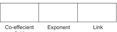

图 3.16：多项式节点的表示。

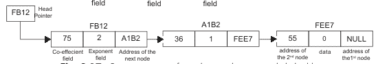

图 3.17：使用单链表表示多项式。

使用单链表创建多项式始于创建一个节点。创建节点需要分配足够的内存。信息存储在使用 malloc() 函数为节点类型分配的内存中。在程序 3.7 中，getNode() 函数用于创建节点。为 poly 类型的结构体分配内存后，需要从用户处读取各项（即 coef 和 exp）的信息。在程序 3.7 中，readNode() 函数用于从用户处读取节点的详细信息。

```
Algorithm for Declaration of Structure Poly
Struct POLY
COEF : FLOAT
EXP : INTEGER
NEXT : Link Field (Address of next Struct POLY)
End Struct
```

```
Algorithm for Allocating Memory for the New Node
GETNODE()
SIZE : INTEGER; NEWNODE : POLY
Step 1 : Set SIZE = get the size of the NODE
Step 2 : Set NEWNODE = Allocate space in memory for the size of SIZE and return the initial address
Step 3 : Return NEWNODE
End GETNODE()
```

```
Algorithm for Reading the Content for the New Node (Coefficient, Exponent)
READNODE(NEWNODE : NODE)
Step 1 : Read, NEWNODE -> COEF
Step 2 : Read, NEWNODE -> EXP
Step 3 : Set NEWNODE -> NEXT = NULL
Step 4 : Return
End READNODE()
```

将新节点与现有列表连接。如果列表为空，则将列表的头指针设置为新节点，否则将新节点插入列表的适当位置。在程序 3.7 中，InsertNode() 函数用于根据指数值的降序将新节点与列表连接。

```
Algorithm for Inserting a Node into the Polynomial List
INSERTNODE(HEAD : POLY, P : POLY )
Step 1 : If (P -> COEF == 0) Then
         Return HEAD
         [End of If Structure]
Step 2 : If (HEAD == NULL) Then
         Return P
Step 3 : Else If (P -> EXP > HEAD -> EXP) Then
         P -> NEXT = HEAD
         Return P
Step 4 : Else If (P -> EXP < HEAD -> EXP) Then
         HEAD -> NEXT = INSERTNODE (HEAD -> NEXT, P)
Step 5 : Else If ((HEAD -> COEF + P -> COEF) == 0) Then
         HEAD -> COEF = HEAD -> COEF + P -> COEF
Step 6 : Else
         Return HEAD -> NEXT
Step 7 : [End of Step 2 If Structure]
Step 8 : Return HEAD
END INSERTNODE()
```

createPoly() 函数用于按任意顺序（指数/系数）逐个读取多项式的各项，直到指数值为零。使用 insertNode() 函数将它们插入适当位置，最后返回生成的多项式。

```
Algorithm for Creating the Polynomial List
CREATEPOLY()
HEAD, P : POLY
Step 1 : Assign HEAD = NULL
Step 2 : Repeat
Step 3 : P = GETNODE()
Step 4 : READNODE(P)
Step 5 : HEAD = INSERTNODE (HEAD, P)
Step 6 : [End of Step 2 Repeat Until (P -> EXP == 0)]
Step 7 : Return HEAD
END CREATEPOLY()
```

要读取或显示多项式的信息，需要从第一项开始逐项遍历链表，直到到达列表末尾。多项式的遍历由 viewPoly() 函数执行。

```
Algorithm for Displaying the Coefficients and Exponents of the Polynomial List
VIEWPOLY(HEAD : POLY)
P : POLY
Step 1 : Assign P = HEAD
Step 2 : While (P != NULL)
Step 3 : Print "Coefficient is ", P -> COEF
Step 4 : Print "Exponent is ", P -> EXP
Step 5 : P = P -> NEXT
Step 6 : [End of Step 2 While Structure]
END VIEWPOLY()
```

copyNode() 函数用于复制现有节点。使用参数 sign，可以更改项系数的符号。仅在 polySub() 中才会更改系数项的符号。

```
Algorithm for Copying, by Creating a New Node
COPYNODE(P : POLY, SIGN : INTEGER)
NEWNODE : POLY
Step 1 : NEWNODE = GETNODE()
Step 2 : NEWNODE -> COEF = SIGN * P -> COEF
Step 3 : NEWNODE -> EXP = P -> EXP
Step 4 : NEWNODE -> NEXT = NULL
Step 5 : Return NEWNODE
END COPYNODE()
```

以下过程用于使用单链表相加两个多项式。

- 使用 createPoly() 函数读取第一个多项式的系数和指数项，直到指数项为零。
- 使用 createPoly() 函数读取第二个多项式的系数和指数项，直到指数项为零。
- 使用 polyAdd() 函数根据以下比较相加两个多项式。
- 使用 copyNode() 和 insertNode() 函数将第一个多项式复制到生成的多项式中。
- 遍历第二个多项式的每一项，并使用 copyNode() 和 insertNode() 函数将它们插入生成的多项式中，直到达到第二个多项式的 NULL 值。
- 显示生成的多项式。


## 多项式加法算法

```pseudocode
POLYADD(POLY1 : POLY, POLY2 : POLY)
HEAD : POLY
Step 1 : Assign HEAD = NULL
Step 2 : While (POLY1 != NULL)
Step 3 : HEAD = INSERTNODE(HEAD, COPYNODE(POLY1, 1) )
Step 4 : POLY1 -> NEXT
Step 5 : [End of Step 2 While Structure]
Step 6 : While (POLY2 != NULL)
Step 7 : HEAD = INSERTNODE(HEAD, COPYNODE(POLY2, 1) )
Step 8 : POLY2 -> NEXT
Step 9 : [End of Step 6 While Structure]
Step 10 : Return HEAD
END POLYADD()
```

以下过程用于使用单链表减去两个多项式。

- 使用函数 polySub() 按以下比较减去两个多项式。
- 使用函数 copyNode() 和 insertNode() 将第一个多项式复制到结果多项式中。
- 遍历第二个多项式的每一项，并使用函数 copyNode() 和 insertNode() 将它们插入到结果多项式中，直到达到第二个多项式的 NULL 值。（注意：第二个多项式通过使用函数 copyNode() 改变系数的符号来插入到结果多项式中。）
- 显示结果多项式。

## 多项式减法算法

```pseudocode
POLYSUB(POLY1 : POLY, POLY2 : POLY)
HEAD : POLY
Step 1 : Assign HEAD = NULL
Step 2 : While (POLY1 != NULL)
Step 3 : HEAD = INSERTNODE(HEAD, COPYNODE(POLY1, 1) )
Step 4 : POLY1 -> NEXT
Step 5 : [End of Step 2 While Structure]
Step 6 : While (POLY2 != NULL)
Step 7 : HEAD = INSERTNODE(HEAD, COPYNODE(POLY2, -1) )
Step 8 : POLY2 -> NEXT
Step 9 : [End of Step 6 While Structure]
Step 10 : Return HEAD
END POLYSUB()
```

以下过程用于使用单链表乘两个多项式。

- 使用函数 PolyMul() 按以下比较乘两个多项式。
- 遍历第二个多项式的每一项，并使用函数 mulNode() 与第一个多项式的每一项相乘，然后使用函数 copyNode() 和 insertNode() 将它们插入到结果多项式中，直到达到第二个多项式的 NULL 值。
- 显示结果多项式。

## 将被乘多项式与乘数节点相乘的算法

```pseudocode
MULNODE(P1 : POLY, P2 : POLY)
TEMP : POLY
Step 1 : Assign TEMP = NULL
Step 2 : If (P1 != NULL) Then
    TEMP = GETNODE()
    TEMP -> COEF = P1 -> COEF * P2 -> COEF
    TEMP -> EXP = P1 -> EXP + P2 -> EXP
    TEMP -> NEXT = MULNODE(P1 -> NEXT, P2)
    [End of if Structure]
Step 3 : Return TEMP
END MULNODE()
```

## 多项式乘法算法

```pseudocode
POLYMUL(P1 : POLY, P2 : POLY)
Step 1 : If (P2 == NULL) Then
    Return NULL
    [End of If Structure]
Step 2 : Return POLYADD(MULNODE(P1,P2), POLYMUL(P1, P2->NEXT))
END POLYMUL()
```

以下过程用于使用单链表除两个多项式。

- 函数 polyDiv() 用于求除数的商和余数（该函数返回商值，并将余数值赋给函数中的参数）。
- 如果被除数或除数为 NULL，则将余数值设为 NULL，并返回商值为 NULL。
- 如果被除数的第一个指数大于或等于除数的第一个指数，
  - 将被除数的第一个系数除以除数的第一个系数，并将被除数的第一个指数减去除数的第一个指数，将相应的系数和指数赋给结果多项式。
- 使用函数 mulNode() 将结果多项式与除数相乘，并使用函数 polySub() 用结果减去被除数以得到余数。
- 函数 polyDiv() 以余数作为新的被除数递归调用，直到上述除法条件不再满足。
- 如果上述除法条件不再满足，则返回结果多项式，并将被除数值作为余数。

## 多项式除法算法

```pseudocode
POLYDIV(P1 : POLY, P2 : POLY, RMDR : POLY)
RES : POLY
Step 1 : Assign RES = NULL
Step 2 : If (P1 == NULL || P2 == NULL) Then
         Set RMDR = NULL
         Return NULL
         [End of If Structure]
Step 3 : If (P1 -> EXP >= P2 -> EXP) Then
         RES = GETNODE()
         RES -> COEF = P1 -> COEF / P2 -> COEF
         RES -> EXP = P1 -> EXP - P2 -> EXP
         RES -> NEXT = POLYDIV(POLYSUB(P1, MULNODE(P2, RES)), P2, RMDR)
         Else
         RMDR = P1
         [End of If Structure]
Step 4 : Return RES
END POLYDIV()
```

## 程序 3.7

```c
/* Program to demonstrate polynomial manipulation using singly linked lists. */
/* polymani.c */
#include <stdio.h>
#include <conio.h>
#include <stdlib.h>
#define POSITIVE 1
#define NEGATIVE -1
typedef struct node
{
    float coef;
    int exp;
    struct node *next;
}poly;

void viewMenu();
void readNode(poly *);
void viewPoly(poly *);
poly *getNode();
poly *createPoly();
poly *copyNode(poly *, int);
poly *insertNode(poly *, poly *);
poly *mulNode(poly *p1, poly *p2);
poly *polyAdd(poly *p1, poly *p2);
poly *polySub(poly *p1, poly *p2);
poly *polyMul(poly *p1, poly *p2);
poly *polyDiv(poly *p1, poly *p2, poly **rmdr);
void main()
{
    int choice;
    poly *poly1 = NULL, *poly2 = NULL, *res = NULL;
    poly *Quotient, *Remainder = NULL;
    viewMenu();
    while(1)
    {
        printf("\n ? ");
        fflush(stdin);
        scanf("%d", &choice);
        switch(choice)
        {
            case 0 :
                viewMenu();
                break;
            case 1 :
                printf("\n Enter the First Polynomial ...");
                poly1 = createPoly();
                printf("\n First Polynomial is : ");
                viewPoly(poly1);
                break;
            case 2 :
                printf("\n Enter the Second Polynomial ...");
                poly2 = createPoly();
                printf("\n Second Polynomial is : ");
                viewPoly(poly2);
                break;
            case 3 :
                printf("\n The First Polynomial is ... \n");
                viewPoly(poly1);
                printf("\n The Second Polynomial is ... \n");
                viewPoly(poly2);
                break;
            case 4 :
                printf("\n The Resultant Polynomial after Addition is ... \n");
                res = polyAdd(poly1, poly2);
                viewPoly(res);
                break;
            case 5 :
                printf("\n The Resultant Polynomial after Subtraction is ... \n");
                res = polySub(poly1, poly2);
                viewPoly(res);
                break;
            case 6 :
                printf("\n The Resultant Polynomial after Multiplication is ... \n");
                res = polyMul(poly1, poly2);
                viewPoly(res);
                break;
            case 7 :
                printf("\n The Resultant Polynomial after Division is ... \n");
                Quotient = polyDiv(poly1, poly2, &Remainder);
                printf("\n Quotient : ");
                viewPoly(Quotient);
                printf("\n Remainder : ");
                viewPoly(Remainder);
                break;
            default :
                printf("\n End of Run of your Program . . ");
                exit(0);
        }
    }
}

void viewMenu()
{
    printf("\n\n Polynomial Manipulation using singly linked list ...");
    printf("\n\n\t 0. View the Main Menu");
    printf("\n\n\t 1. Create the First Polynomial");
    printf("\n\n\t 2. Create the Second Polynomial");
    printf("\n\n\t 3. View the First and Second Polynomial");
    printf("\n\n\t 4. Polynomial Addition");
    printf("\n\n\t 5. Polynomial Subtraction");
    printf("\n\n\t 6. Polynomial Multiplication");
    printf("\n\n\t 7. Polynomial Division");
    printf("\n\n\t 8. Exit");
}
poly *createPoly()
{
    poly *p, *head = NULL;
    do
    {
        p = getNode();
        readNode(p);
        head = insertNode(head, p);
    }while(p->exp != 0);
    return head;
}
poly *getNode()
{
    return (poly *)malloc(sizeof(poly));
}
void readNode(poly* newnode)
{
    int exp;
    float coef;
    printf("\nEnter the Coefficient : ");
    scanf("%f", &coef);
    printf("Enter the Exponent : ");
    scanf("%d", &exp);
    newnode->coef = coef;
    newnode->exp = exp;
    newnode->next = NULL;
}


```c
poly *insertNode(poly *head, poly *p)
{
    if(p -> coef == 0.0F)
        return head;
    if(head == NULL)
        return p;
    else if(p -> exp > head -> exp)
    {
        p -> next = head;
        return p;
    }
    else if(p -> exp < head -> exp)
        head -> next = insertNode(head -> next, p);
    else if(p -> exp == head -> exp)
    {
        head -> coef = head -> coef + p -> coef;
        if(head -> coef == 0.0F)
            return head -> next;
    }
    return head;
}

void viewPoly(poly * ply)
{
    if(ply == NULL)
        printf("NULL\n");
    while(ply != NULL)
    {
        printf("%.2fx^%d", ply -> coef, ply -> exp);
        printf("%s", (ply -> next == NULL) ? " = 0\n" : " + ");
        ply = ply -> next;
    }
}

poly * polyAdd(poly *poly1, poly *poly2)
{
    poly *head = NULL;
    while(poly1 != NULL)
    {
        head = insertNode(head, copyNode(poly1, POSITIVE));
        poly1 = poly1 -> next;
    }
    while(poly2 != NULL)
    {
        head = insertNode(head, copyNode(poly2, POSITIVE));
        poly2 = poly2 -> next;
    }
    return head;
}
poly * polySub(poly *poly1, poly *poly2)
{
    poly *head = NULL;
    while(poly1 != NULL)
    {
        head = insertNode(head, copyNode(poly1, POSITIVE));
        poly1 = poly1 -> next;
    }
    while(poly2 != NULL)
    {
        head = insertNode(head, copyNode(poly2, NEGATIVE));
        poly2 = poly2 -> next;
    }
    return head;
}
poly * polyMul(poly *poly1, poly *poly2)
{
    if(poly2 == NULL)
        return NULL;
    else
        return polyAdd(mulNode(poly1,poly2),polyMul(poly1,poly2->next));
}
poly * copyNode(poly * p, int sign)
{
    poly *newnode;
    newnode = getNode();
    newnode -> coef = sign * p -> coef;
    newnode -> exp = p -> exp;
    newnode -> next = NULL;
    return newnode;
}

poly *mulNode(poly *p1, poly *p2)
{
    poly *temp = NULL;
    if(p1 != NULL)
    {
        temp = getNode();
        temp -> coef = p1 -> coef * p2 -> coef;
        temp -> exp = p1 -> exp + p2 -> exp;
        temp -> next = mulNode(p1->next, p2);
    }
    return temp;
}

/* For Quotient and Remainder p1 / p2 */

poly *polyDiv(poly *p1, poly *p2, poly **rmdr)
{
    poly *res = NULL;
    if(p1 == NULL || p2 == NULL)
        return (*rmdr = NULL);
    if(p1 -> exp >= p2 -> exp)
    {
        res = getNode();
        res -> coef = p1 -> coef / p2 -> coef;
        res -> exp = p1 -> exp - p2 -> exp;
        res -> next = polyDiv(polySub(p1,mulNode(p2,res)),p2,rmdr);
    }
    else
        *rmdr = p1;
    return res;
}
```

## 程序显示以下输出

- 使用单链表的多项式操作 ...
- 0. 查看主菜单
- 1. 创建第一个多项式
- 2. 创建第二个多项式
- 3. 查看第一个和第二个多项式
- 4. 多项式加法
- 5. 多项式减法
- 6. 多项式乘法
- 7. 多项式除法
- 8. 退出

? 3
第一个多项式是 ...
NULL
第二个多项式是 ...
NULL
? 4
加法后的结果多项式是 ...
NULL
? 5
减法后的结果多项式是 ...
NULL
? 6
乘法后的结果多项式是 ...
NULL
? 7
除法后的结果多项式是 ...
解是无穷大 ...
解是无穷大 ...
商：NULL
余数：NULL
? 1
请输入第一个多项式 . . .
请输入系数：3
请输入指数：2
请输入系数：2
请输入指数：1
请输入系数：1
请输入指数：0
第一个多项式为：3.00x^2 + 2.00x^1 + 1.00x^0 = 0
? 2
请输入第二个多项式 . . .
请输入系数：2
请输入指数：1
请输入系数：3
请输入指数：1
请输入系数：5
请输入指数：0
第二个多项式为：5.00x^1 + 5.00x^0 = 0

? 3
第一个多项式是 ...
3.00x^2 + 2.00x^1 + 1.00x^0 = 0
第二个多项式是 ...
5.00x^1 + 5.00x^0 = 0
? 4
加法后的结果多项式是 ...
3.00x^2 + 7.00x^1 + 6.00x^0 = 0
? 5
减法后的结果多项式是 ...
3.00x^2 + -3.00x^1 + -4.00x^0 = 0
? 6
乘法后的结果多项式是 ...
15.00x^3 + 25.00x^2 + 15.00x^1 + 5.00x^0 = 0
? 7
除法后的结果多项式是 ...
商：0.60x^1 + -0.20x^0 = 0
余数：2.00x^0 = 0
? 8
您的程序运行结束 . . .

程序 3.8 能够以任意顺序读取输入，同时也能读取指数值为零的输入。如果您反复输入相同的指数值，它将自动将相同指数的系数相加，并按降序存储。您还可以修改任意一个现有多项式，并用旧多项式对新多项式进行操作（加、减、乘、除）。

## 链表的优点

- 在声明链表时无需指定元素数量（因为在向列表添加节点时可以动态分配内存）。
- 链表的大小可以根据列表中的插入和删除操作而增长和缩小。
- 列表中任何位置的插入和删除都可以轻松高效地处理。
- 链表不会浪费任何内存空间。

## 链表的缺点

- 在列表中查找特定元素既困难又耗时。
- 链表存储相同数量的元素所需的存储空间比数组多（. . . 列表中的每个元素都需要额外的内存空间来存储下一个节点的地址）。

### 3.10 总结

- 链表的一些重要应用是栈和队列。
- 栈可以通过数组或链表实现。
- 栈是有序元素集合，插入和删除操作仅限于一端。元素添加和/或移除的端称为栈顶。
- 栈被称为后进先出（LIFO）列表、堆栈或压栈列表。
- 栈可以执行的基本操作是 push、pop 和 peek 操作。
- push 是用于向栈中添加新元素的操作。
- pop 是用于从栈中移除最顶部元素的操作。
- peek 是用于显示栈中最顶部元素的操作。
- 在栈的数组表示中，如果栈不包含任何元素，则称为空栈。
- 在栈的数组表示中，如果栈包含的元素数量等于其大小，则称为已完全占用的栈。
- 在链表中，如果栈指向 NULL，则该栈被称为空栈。
- 如果链表中 malloc 函数返回 NULL，则称为已完全占用的栈。
- 栈的一些重要应用包括汉诺塔、字符串反转、检查括号匹配以及算术表达式求值。
- 汉诺塔是一个游戏，我们得到一个由 n 个磁盘组成的塔，最初从上到下按尺寸递增堆叠。在这个塔旁边，还有两个塔。目标是使用塔 2 将所有磁盘从塔 1 移动到塔 3。
- 给定一个算术表达式，我们所说的“平衡”确切意思是，各种形状的左括号（圆括号、方括号或花括号）必须与同一形状的对应最后未匹配的右括号符号匹配，并且当算术表达式结束时，所有括号符号都必须匹配。
- 表示算术表达式的不同记数法包括中缀记法、前缀记法和后缀记法。
- 表示数学表达式的常规方式称为中缀记法。
- 前缀记法（也称为波兰记法）是一种编写代数表达式的方式，不使用括号或运算符优先级规则。

后缀记法（也称为后缀形式或逆波兰记法（RPN））也是一种编写代数表达式的方式，不使用括号或运算符优先级规则。

队列是有序元素集合，插入操作在一端进行，删除操作在另一端进行。进行插入的端称为队尾，进行删除的端称为队首。

队列可以执行的基本操作是入队和出队操作。

入队是用于向队列队尾添加新元素的操作。

出队是用于从队列队首移除元素的操作。

循环队列是线性队列的另一种形式，其中最后一个节点连接到列表的第一个节点。

双端队列（Deque）是队列的另一种形式，插入和删除操作在队列的队首和队尾都进行。

双端队列有两种变体，即输入受限双端队列和输出受限双端队列。输入受限双端队列仅允许在一端（可以是队首或队尾）进行插入。输出受限双端队列仅允许在一端（可以是队首或队尾）进行删除。

循环队列的实现部分与线性队列相同，只是最后一个位置连接到队列的第一个位置。因此，队首和队尾循环移动。

循环双端队列的实现部分与线性双端队列相同，只是最后一个位置连接到双端队列的第一个位置。因此，队首和队尾循环移动。

### 3.11 简答题

- 1. 定义栈。

栈是有序元素集合，插入和删除操作仅限于一端。元素添加和/或移除的端称为栈顶。栈也称为“堆栈”和“压栈列表”。

- 2. 列出可以在栈和队列上执行的基本操作。

栈和队列可以执行的基本操作如下，

- push 操作
- pop 操作
- 查看栈内容。


## 3. 陈述表示表达式的不同方式。

表示表达式的不同方式如下，

- 中缀表示法
- 前缀表示法
- 后缀表示法

## 4. 陈述中缀转后缀转换过程中应遵循的规则。

中缀转后缀转换过程中应遵循的规则如下，

- 从左到右对表达式完全加括号（加括号时，优先级较高的运算符先加括号）。
- 将运算符逐个移至其右侧，使每个运算符替换其对应的右括号。
- 已转换为后缀形式的表达式部分应视为单个操作数。
- 一旦表达式转换为后缀形式，删除所有括号。

## 5. 提及使用链表而非数组表示栈的优势。

使用链表而非数组表示栈的优势如下：

- 在声明栈时无需指定要存储的元素数量（因为在向栈中添加元素时，内存会在运行时动态分配）。
- 插入和删除操作可以轻松高效地处理。
- 链表表示的栈可以根据列表中发生的插入和删除操作，在不浪费内存空间的情况下动态增长和缩减大小。
- 可以为每个栈使用一条链来高效表示多个栈。

## 6. 定义队列。

队列是一种有序的元素集合，其中插入和删除操作仅限于一端。添加和/或删除元素的端称为尾端，进行删除操作的端称为头端。

## 7. 陈述队列与链表的区别。

队列与链表的区别在于：在链表中，插入和删除可以在任何位置进行；而在队列中，插入只能在尾端进行，删除只能在头端进行。

## 8. 列出链表中使用的各种地址类型。

链表中使用的地址包括：

- 外部地址
- 内部地址
- 空地址

## 9. 定义外部地址。

外部地址是列表中第一个节点的地址。该地址存储在头指针中，头指针指向列表中的第一个节点。

## 10. 定义内部地址。

内部地址是链表中除最后一个节点外每个节点存储的地址。链接字段（也称为下一个地址字段）中存储的内容是下一个节点的地址。

## 11. 定义空地址。

空地址是列表最后一个节点的NULL指针存储的地址，用于指示列表的末尾。

## 12. 陈述链表中前一个地址字段和下一个地址字段的用途。

节点的前一个地址字段（也称为后向链接字段）包含其前一个节点的地址。下一个地址字段（也称为前向链接字段）包含列表中下一个节点的地址。

## 13. 列出链表中执行的基本操作。

链表中执行的基本操作包括：

- 创建列表
- 插入节点
- 删除节点
- 修改节点
- 遍历列表

## 14. 列出链表中执行的其他操作。

链表中执行的其他操作包括：

- 在列表中搜索元素
- 查找节点的后继元素
- 查找节点的前驱元素
- 将链表追加到另一个现有列表
- 将链表拆分为两个列表
- 将链表按升序或降序排列。

## 15. 列出使用链表的优势。

使用链表的优势如下：

- 在声明链表时无需指定元素数量（因为在向列表中添加节点时，内存可以动态分配）。
- 链表可以根据列表中发生的插入和删除操作动态增长和缩减大小。
- 列表中任何位置的插入和删除操作都可以轻松高效地处理。
- 链表不会浪费任何内存空间。

## 16. 列出使用链表的劣势。

使用链表的劣势如下：

- 在列表中搜索特定元素既困难又耗时。
- 链表存储相同数量的元素所需的存储空间比数组更多（...列表中的每个元素都需要额外的内存空间来存储下一个节点的地址）。

## 17. 陈述数组与链表的区别。

| Arrays | Linked Lists |
| :--- | :--- |
| a) 数组的大小是固定的。 | a) 列表的大小是可变的。 |
| b) 声明时必须指定元素数量。 | b) 声明时无需指定元素数量。 |
| c) 插入和删除操作有些困难。 | c) 插入和删除操作可以轻松执行。 |
| d) 对于相同数量的元素，它占用的内存比链表少。 | d) 它占用更多内存。 |

## 18. 什么是静态链表。

使用链表的优势是在需要时为节点动态分配内存。当结构体数组的大小固定时，使用结构体数组实现此功能，这种列表类型称为静态链表，也称为链表的游标实现。

## 19. 绘制单链表的节点表示。

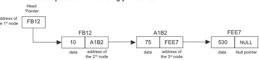

图：单链表的表示。

## 20. 绘制双链表的节点表示。

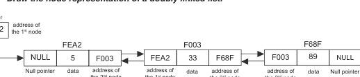

图：双链表的表示。

## 21. 绘制循环单链表的节点表示。

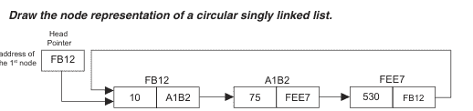

图：循环单链表的表示。

## 第4章

### 非线性数据结构

### 4.1 引言

我们在*第3章*中看到的数据结构是线性数据结构，因为它们的相邻元素之间存在线性关系。本章将要介绍的数据结构是非线性数据结构，因为它们的相邻元素之间不存在线性关系。在线性数据结构中，每个节点都有一个指向另一个节点的链接，而在非线性数据结构中，每个节点可能指向多个其他节点。非线性数据结构包括树和图。

**树**是一种非线性的二维数据结构，表示单个数据项之间的层次关系。*图4.1*显示了一个简单的树结构。自然树从地面向上生长到空中。但树数据结构从上到下向下生长。这是表示树数据结构的公认方式。**树**是满足以下要求的非空节点和边集合。

- 它有一个称为树根的特殊数据项。
- 其余所有数据项被分割为若干子集，每个子集本身也是一棵树，称为**子树**。

树中的每个数据项称为**节点**。它是树的基本结构。它指定了每个数据项的信息部分。*图4.1*中表示的树共有24个节点。**边**也称为**链接**，是两个节点之间的连接。树中的**路径**是一系列不同的节点，其中连续节点通过树中的边相连。在*图4.1*中，A和X之间的路径由节点路径(A,C)、(C,H)、(H,Q)和(Q,X)给出。树的一个重要属性是任何两个节点之间应且只能有一条路径连接。如果某对节点之间没有路径，或某些节点之间有多条路径，则我们将该结构称为**图**而非树。

树中最高层或第一层称为**根**或**根节点**。在*图4.1*中，A称为根节点。指向根节点的每个链接称为**子节点**或**孩子节点**。在*图4.1*中，节点B、C、D和E被称为父节点的子节点


节点 A。父节点与其子节点之间的链接也称为 *分支*。树中除根节点外的所有节点都必须通过子节点从父节点派生。给定父节点的子节点称为 *兄弟节点*。在 *图 4.1* 中，节点 B、C、D 和 E 相对于其父节点 A 被称为 *兄弟节点*，而 F 和 G 是其父节点 B 的 *兄弟节点*，以此类推。

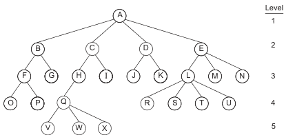

**图 4.1：树结构。**

在树所表示的层次结构中，父节点的子节点比父节点低一级。整个树结构的分级方式使得根节点始终位于第 1 级。然后，其直接子节点位于第 2 级，它们的直接子节点位于第 3 级，以此类推。一般来说，如果一个节点位于第 n 级，则其子节点将位于第 (n+1) 级。因此在 *图 4.1* 中，根节点 A 位于第 1 级，其子节点 B、C、D 和 E 位于第 2 级，以此类推。一个本身也是树的树子集称为 *子树*。节点中子树的数量称为其 *度*。在 *图 4.1* 中，根节点 A 的度为 4，节点 B 的度为 2，而节点 L 的度为 4。

一个节点的祖先是从根节点到该节点路径上的所有节点。树的根节点是树中所有节点的祖先。在 *图 4.1* 中，节点 O 的祖先是 A、B 和 F。树中的每个节点都可以是父节点，并可以拥有任意数量的子节点。没有子节点（即度为零）的节点称为 *叶节点* 或 *终端节点*。从根节点到终端节点遍历给定树时的所有其他中间节点称为 *非终端节点*。在 *图 4.1* 中，共有 15 个终端节点（即 G、I、K、M、N、O、P、R、S、T、U、V、W 和 X）和 9 个非终端节点（即 A、B、C、D、E、F、H、L、Q 和 X）。

树的 *高度* 或 *深度* 定义为树中任何节点的最大层级。在 *图 4.1* 中，根节点 A 具有最大层级，其向下延伸至树底的 V、W 和 X。*图 4.1* 中所示树的高度为 5。在给定树中，如果移除根节点，则它将变成一个森林。在 *图 4.1* 中，如果移除根节点 A，则它将变成一个包含四棵树的森林。

### 4.2 二叉树

最重要的树结构之一是二叉树。二叉树是一种节点要么为空，要么不超过两个子节点的树，每个子节点可以是叶节点。

图 4.2 显示了二叉树的结构。二叉树中的每个节点都有两个子树，即左子树和右子树。二叉树中给定节点左侧的所有节点均称为左子树。二叉树中给定节点右侧的所有节点均称为右子树。在图 4.2 中，B、D 和 F 是左子树，C、E 和 G 是右子树。

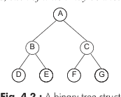

### 4.2.1 二叉树的类型

- 左偏二叉树：仅具有左子节点的二叉树。
- 右偏二叉树：仅具有右子节点的二叉树。
- 满二叉树：所有叶节点位于同一层级且每个非叶节点恰好有两个子节点的二叉树。
- 完全二叉树：每个非叶节点恰好有两个子节点但不一定位于同一层级的二叉树。

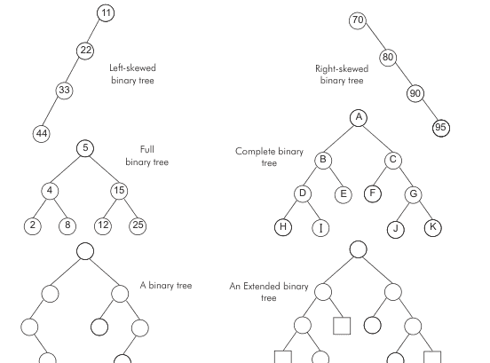

图 4.3：二叉树示例。

### 二叉树的属性

- 二叉树第 n 层的最大节点数为 2^(n-1)，其中 n >= 1。
- 高度为 h 的二叉树的最大节点数为 2^h - 1，其中 h >= 1。
- 对于任何非空树，n_l = n_d + 1，其中 n_l 是叶节点的数量，n_d 是度为 2 的节点的数量。

### 4.3 二叉树的表示

二叉树的表示可以采用两种方式。它们是，

- 线性表示（使用数组）
- 链式表示（使用指针）。

### 4.3.1 二叉树的线性表示

可以使用数组来存储二叉树的节点。数组中存储的节点按顺序访问。二叉树的线性表示使用大小为 2^(h+1) - 1 的一维数组，其中 h 是树的高度。图 4.4 (a,b,c) 所示的二叉树结构高度为 3，而图 4.4(d) 的高度为 4。因此，存储前三棵二叉树所需的数组大小为 2^(3+1) - 1 = 15，存储最后一棵二叉树所需的数组大小为 2^(4+1) - 1 = 31。

确定数组大小后，采用以下方法在数组中表示二叉树。

- 将根节点的值存储在数组的第一个位置（即索引 = 1）。
- 第 n 个节点的左子节点存储在位置 2n，第 n 个节点的右子节点存储在位置 (2n+1)。
- 如果没有左子节点或右子节点，则数组位置留空。

为验证树中是否存在父节点、左子节点或右子节点，执行以下步骤。

- 第 i 个节点的父节点位于 i/2 位置，其中 (i != 1)。如果 (i = 1)，则它是二叉树的根节点，没有父节点。
- 第 i 个节点的左子节点位于 2i，其中 (2i <= n)。如果 (2i > n)，则第 i 个节点没有左子节点。
- 第 i 个节点的右子节点位于 (2i + 1)，其中 (2i + 1) <= n。如果 (2i + 1) > n，则第 i 个节点没有右子节点。

图 4.5 显示了图 4.4 中二叉树的数组线性表示。使用数组表示二叉树的主要优点是简单且易于实现，但在大多数情况下，会有大量未利用的空间。满二叉树不会浪费任何空间，而完全二叉树或偏斜二叉树则会利用相当多的空间。由于数组中的数据上下移动，节点的插入和删除操作需要花费大量处理时间。

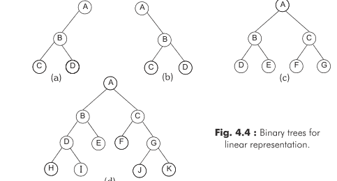

图 4.4：用于线性表示的二叉树。

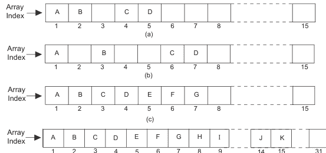

图 4.5：图 4.4 中二叉树的线性表示。

### 4.3.2 二叉树的链式表示

二叉树的链式表示克服了二叉树线性表示的缺点，例如浪费内存空间以及在树中插入和删除节点的困难。已知二叉树中的每个节点都有两个子节点，链式表示中的每个节点需要 3 个字段，即左子节点字段（表示为 Lfield）、右子节点字段（表示为 Rfield）和数据字段（表示为 Dfield）。此外，根字段包含根节点的位置。因此，实现二叉树的链式表示需要 3 个数组和一个变量。如果任何子树为空，则相应的指针（即 Lfield 和 Rfield）将存储 NULL 值。如果树本身为空，则根字段将存储 NULL 值。

使用二叉树链式表示的 **优点** 是，插入和删除操作不涉及数据移动和节点移动（与线性表示的情况不同），只需重新排列指针。二叉树链式表示的缺点包括，

- 给定节点结构时，难以确定其父节点。
- 为具有一个或没有子树的节点存储 NULL 指针会浪费内存空间。
- 该实现需要动态内存分配，在某些编程语言中不可能实现。

图 4.6 显示了图 4.4(c) 中二叉树的指针链式表示。

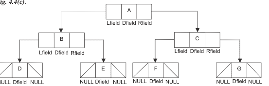

图 4.6：图 4.4(c) 中二叉树的链式表示。

### 4.4 二叉树遍历

对二叉树执行的最重要操作之一是其遍历。*遍历二叉树意味着移动通过二叉树中的所有节点，恰好访问树中的每个节点一次。* 对于链表，节点按从第一个到最后一个的自然顺序排列，因此遍历遵循相同的顺序。然而，对于树，节点不是有序的，因此我们必须遵循不同的过程来遍历所有节点。遍历二叉树时需要牢记的一件事是，以相同的方式对待每个节点及其子树。遍历二叉树时执行的任务包括，

- 访问一个节点（由字母 V 表示）
- 遍历左子树（由字母 L 表示）
- 遍历右子树（由字母 R 表示）。

基于这三个任务，有六种可能的遍历组合。它们是 VLR、LVR、LRV、VRL、RVL 和 RLV。通过采用始终先遍历左子树再遍历右子树的约定，这六种遍历可以减少为三种组合。根据该因素，可能的组合为，

- V L R（指定为先序遍历）
- L V R（指定为中序遍历）
- L R V（指定为后序遍历）。


### 4.4.1 前序遍历

二叉树前序遍历的步骤如下，

- 处理根节点。
- 遍历左子树。
- 遍历右子树。

每个节点的值在访问该节点时进行处理。前序遍历会产生前缀表达式。图 4.7 显示了前序遍历中每个节点的访问顺序。

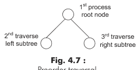

### 4.4.2 中序遍历

二叉树中序遍历（也称为对称序遍历）的步骤如下，

- 遍历左子树。
- 处理根节点。
- 遍历右子树。

中序遍历会产生中缀表达式。

图 4.8 显示了中序遍历中每个节点的访问顺序。二叉树的中序遍历始终按升序列出值，因此此过程被称为二叉树排序。

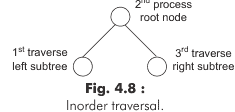

### 4.4.3 后序遍历

二叉树后序遍历（也称为末序遍历）的步骤如下，

- 遍历左子树。
- 遍历右子树。
- 处理根节点。

后序遍历会产生后缀表达式。图 4.9 显示了后序遍历中每个节点的访问顺序。

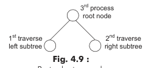

### 4.4.4 层序遍历

在层序遍历中，我们根据节点的层级进行遍历。二叉树层序遍历的步骤如下，

- 处理第 1 层的根节点。
- 遍历根节点下的下一层（即第 2 层）。
- 从左到右处理该层的节点。
- 同样遍历下一层并从左到右处理节点，一直持续到所有层级结束。

图 4.10 显示了层序遍历中每个节点的访问顺序。

先处理根节点并遍历下一层
从左到右处理所有节点并遍历下一层
从左到右处理所有节点并遍历下一层
从左到右处理所有节点

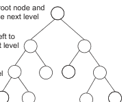

图 4.10：层序遍历。

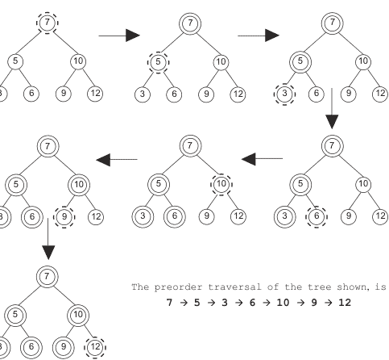

所示树的前序遍历为：7 -> 5 -> 3 -> 6 -> 10 -> 9 -> 12

图 4.11：前序遍历。

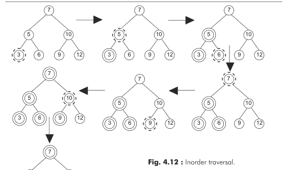

图 4.12：中序遍历。

所示树的中序遍历为：3 -> 5 -> 6 -> 7 -> 9 -> 10 -> 12

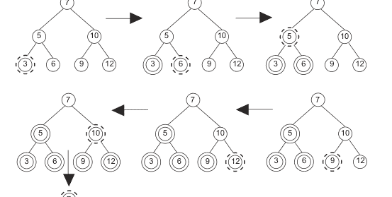

图 4.13：后序遍历。

所示树的后序遍历为：3 -> 6 -> 5 -> 9 -> 12 -> 10 -> 7

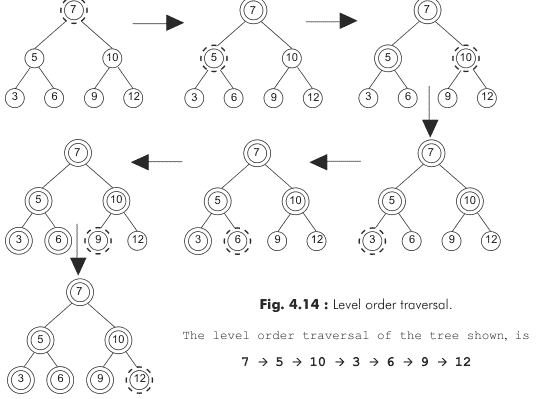

图 4.14：层序遍历。

所示树的层序遍历为：

7 -> 5 -> 10 -> 3 -> 6 -> 9 -> 12

### 程序 4.1

```c
/* Implementation of various traversal operations in a Binary Tree. */
/* traverse.c */
#include<stdio.h>
#include<alloc.h>
#include<stdlib.h>
typedef struct node
{
 int data;
 struct node *left;
 struct node *right;
}tree;
tree *getNode();
void readNode(tree *head);
void releaseNode(tree *head);
tree *createBTree();
tree *insertNode(tree *btree, tree *temp);
void preorder(tree *btree);
void inorder(tree *btree);
void postorder(tree *btree);
void levelorder(tree *btree);
tree *queue[30];
int front, rear;
int isEmpty();
void enqueue(tree** btree);
int dequeue(tree **dqdata);
void main()
{
 int choice;
 tree *btree;
 printf("\nCreate a New Binary Tree");
 btree = createBTree();
 printf("\n TREE TRAVERSAL ");
 printf("\n\n\t 1. Preorder Traversal ");
 printf("\n\n\t 2. Inorder Traversal ");
 printf("\n\n\t 3. Postorder Traversal ");
 printf("\n\n\t 4. Levelorder Traversal ");
 printf("\n\n ? ");
 scanf("%d", &choice);
 if(btree == NULL)
 {
 printf("Binary Tree is Empty");
 return;
 }
 switch(choice)
 {
 case 1 :
 printf("Preorder Binary tree traversal is ... \n");
 preorder(btree);
 break;
 case 2 :
 printf("Inorder Binary tree traversal is ... \n");
 inorder(btree);
 break;
 case 3 :
 printf("Postorder Binary tree traversal is ... \n");
 postorder(btree);
 break;
 case 4 :
     printf("Levelorder Binary tree traversal is ... \n");
     levelorder (btree);
     break;
 }
 releaseNode (btree);
}
tree* getNode()
{
    int size;
    tree * newnode;
    size = sizeof(tree);
    newnode = (tree *)malloc(size);
    return (newnode);
}
void readNode(tree* newnode)
{
    printf("\nEnter the Data : ");
    scanf("%d", &newnode->data);
    newnode->left = NULL;
    newnode->right = NULL;
}
void releaseNode(tree* head)
{
    free(head);
}
tree *createBTree()
{
    char ch;
    tree *btree = NULL, *temp;
    do
    {
        temp = getNode();
        readNode(temp);
        btree = insertNode(btree, temp);
        fflush(stdin);
        printf("Do u wish to Add Data in the Tree (y/n) ? ");
        scanf("%c", &ch);
    }while (ch == 'y' || ch == 'Y');
    return btree;
}
tree *insertNode(tree *btree, tree *temp)
{
    if(btree == NULL)
    return temp;
    else if(temp->data < btree->data)
    btree->left = insertNode(btree->left,temp);
    else if(temp->data > btree->data)
    btree->right = insertNode(btree->right,temp);
    else if(temp->data == btree->data)
    {
        printf("\n Data is already Existing ... ");
        return btree;
    }
    return btree;
}

void inorder(tree *btree)
{
    if(btree != NULL)
    {
        inorder(btree->left);
        printf(" %d ", btree->data);
        inorder(btree->right);
    }
}

void preorder(tree *btree)
{
    if(btree != NULL)
    {
        printf(" %d ", btree->data);
        preorder(btree->left);
        preorder(btree->right);
    }
}

void postorder(tree *btree)
{
    if(btree != NULL)
    {
        postorder(btree->left);
        postorder(btree->right);
        printf(" %d ", btree->data);
    }
}

void levelorder(tree *btree)
{
    enqueue(btree);
    while(!isEmpty())
    {
        dequeue(&btree);
        if(btree != NULL)
        {
            printf(" %d ", btree->data);
            enqueue(btree->left);
            enqueue(btree->right);
        }
    }
}

int isEmpty()
{
    if(front == -1 && rear == -1)
        return 1;
    else
        return 0;
}

void enqueue(tree* btree)
{
    if(isEmpty())
    {
        front = rear = 0;
    }
    else
        rear = rear + 1;
    queue[rear] = btree;
    return 0;
}

int dequeue(tree **dqdata)
{
    if(isEmpty())
        return -1;
    *dqdata = queue[front];
    if(front == rear)
        front = rear = -1;
    else
        front = front + 1;
    return 0;
}
```

程序显示以下输出

```
RUN1
Enter data to Create a New Binary Tree ...
Enter the Data : 7
Do u wish to Add Data in the Tree (y/n) ? y
Enter the Data : 5
Do u wish to Add Data in the Tree (y/n) ? y
Enter the Data : 10
Do u wish to Add Data in the Tree (y/n) ? y
Enter the Data : 3
Do u wish to Add Data in the Tree (y/n) ? y
Enter the Data : 6
Do u wish to Add Data in the Tree (y/n) ? y
Enter the Data : 9
Do u wish to Add Data in the Tree (y/n) ? y
Enter the Data : 12
Do u wish to Add Data in the Tree (y/n) ? n
```

### 树遍历

- 1. 前序遍历
- 2. 中序遍历
- 3. 后序遍历
- 4. 层序遍历

? 1

前序二叉树遍历为 ...

7 5 3 6 10 9 12

### 运行 2

输入数据以创建新的二叉树 ...
输入数据：7
您希望在树中添加数据吗 (y/n) ? y
输入数据：5
您希望在树中添加数据吗 (y/n) ? y
输入数据：10
您希望在树中添加数据吗 (y/n) ? y
输入数据：3
您希望在树中添加数据吗 (y/n) ? y
输入数据：6
您希望在树中添加数据吗 (y/n) ? y
输入数据：9
您希望在树中添加数据吗 (y/n) ? y
输入数据：12
您希望在树中添加数据吗 (y/n) ? n

### 树遍历

- 1. 前序遍历
- 2. 中序遍历
- 3. 后序遍历
- 4. 层序遍历

? 2

中序二叉树遍历为 ...

3 5 6 7 9 10 12

### 运行 3

输入数据以创建新的二叉树 ...
输入数据：7
您希望在树中添加数据吗 (y/n) ? y
您希望在树中添加数据吗 (y/n) ? y
输入数据：5
您希望在树中添加数据吗 (y/n) ? y
输入数据：10
您希望在树中添加数据吗 (y/n) ? y
您希望在树中添加数据吗 (y/n) ? y
输入数据：3
您希望在树中添加数据吗 (y/n) ? y


输入数据：6
您希望在树中添加数据吗 (y/n) ? y
输入数据：9
您希望在树中添加数据吗 (y/n) ? y
输入数据：12
您希望在树中添加数据吗 (y/n) ? n
树遍历
1. 先序遍历
2. 中序遍历
3. 后序遍历
4. 层序遍历
? 3
后序二叉树遍历结果为 ...
3 6 5 9 12 10 7

运行
输入数据以创建新的二叉树 ...
输入数据：7
您希望在树中添加数据吗 (y/n) ? y
输入数据：5
您希望在树中添加数据吗 (y/n) ? y
输入数据：10
您希望在树中添加数据吗 (y/n) ? y
输入数据：3
您希望在树中添加数据吗 (y/n) ? y
输入数据：6
您希望在树中添加数据吗 (y/n) ? y
输入数据：9
您希望在树中添加数据吗 (y/n) ? y
输入数据：12
您希望在树中添加数据吗 (y/n) ? n
树遍历
1. 先序遍历
2. 中序遍历
3. 后序遍历
4. 层序遍历
? 4
层序二叉树遍历结果为 ...
7 5 10 3 6 9 12

### 4.5 二叉搜索树

二叉搜索树是一种特殊的二叉树，需满足以下特性。

- 每个节点都有一个值，且任意两个节点的值不得相同（即，二叉搜索树中的值互不相同）。
- 任何左子树中的值均小于其父节点的值。
- 任何右子树中的值均大于其父节点的值。
- 每个节点的左子树和右子树又都是二叉搜索树。

图 4.15 展示了二叉搜索树的结构。

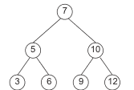

图 4.15：二叉搜索树。

### 4.5.1 二叉搜索树中的基本操作

可对二叉搜索树执行的基本操作有，

- 创建二叉搜索树。
- 插入节点
- 删除节点
- 查找节点
- 修改节点
- 查看二叉搜索树的内容。

#### 创建二叉搜索树

二叉搜索树的每个节点包含两部分：数据部分和链接部分。

创建二叉搜索树涉及三个过程，即，

- 创建节点。
- 从用户处读取节点的详细信息。
- 将节点插入二叉搜索树。

在程序 4.2 中，getNode() 函数用于创建节点。为类型为 node 的结构体分配内存后，需要从用户处读取节点的信息。在程序 4.2 中，readNode() 函数用于从用户处读取节点的详细信息。在程序 4.2 中，insertNode() 函数用于向二叉搜索树插入新节点。getNode()、readNode() 和 insertNode() 函数会被反复调用，以向二叉搜索树插入任意数量的节点。

#### 插入节点

在二叉搜索树中可执行的最基本操作之一是插入节点。在读取数据之前，需为新节点分配内存（方式与创建树时类似）。新节点将包含空数据字段和空链接字段。随后，将从用户处读取的信息存储到新节点的数据字段中。新节点的链接字段被赋值为 NULL。

- 检查二叉搜索树的根节点是否为 NULL。
- 如果条件为真，则表示二叉搜索树为空，因此将新节点视为根节点。否则，执行后续步骤。
- 将新节点数据与根节点数据进行比较，针对以下三种情况。
- 如果新节点数据的内容等于根节点数据，则插入操作终止（因为存在重复项）。
- 如果新节点数据的内容小于根节点数据，检查根节点的左子节点是否为 NULL。如果条件为真，插入新数据并终止过程。否则，将根节点的左子节点视为根节点，并再次检查上述三种条件。
- 如果新节点数据的内容大于根节点数据，检查根节点的右子节点是否为 NULL。如果条件为真，插入新数据并终止过程。否则，将根节点的右子节点视为根节点，并再次检查上述三种条件。

在程序 4.2 中，insertNode() 函数用于向二叉搜索树插入新节点。图 4.16 详细说明了二叉搜索树中的插入操作。

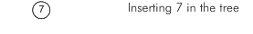

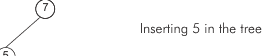

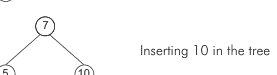

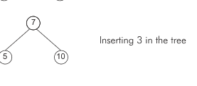

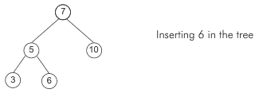


图 4.16：二叉搜索树中插入操作的步骤。

#### 删除节点

在二叉搜索树中可执行的另一个基本操作是删除节点。需释放要删除节点的内存。节点可从树中的三个不同位置删除，即，

- 删除叶子节点
- 删除只有一个子节点的节点
- 删除有两个子节点的节点。

##### 删除叶子节点

从二叉搜索树删除叶子节点所遵循的步骤。

- 查找叶子节点的父节点，并将指向叶子节点的链接设置为 NULL。
- 释放已删除节点的内存。


图 4.17a：删除叶子节点 6 之前。图 4.17b：删除叶子节点 6 之后。图 4.17：删除叶子节点的步骤。

##### 删除只有一个子节点的节点

从二叉搜索树删除只有一个子节点的节点所遵循的步骤。

- 查找要删除节点（只有一个子节点）的父节点。
- 将父节点的链接赋值为要删除节点的子节点。
- 释放已删除节点的内存。


图 4.18a：删除节点 5 之前。图 4.18b：删除节点 5 之后。图 4.18：删除只有一个子节点的节点的步骤。

##### 删除有两个子节点的节点

从二叉搜索树删除有两个子节点的节点所遵循的步骤。

- 查找要删除节点（有两个子节点）的父节点。
- 将中序后继的内容复制到要删除节点（有两个子节点）。
- 删除中序后继节点。如果中序后继节点没有子节点，遵循删除叶子节点中给出的步骤。如果中序后继节点只有一个子节点，遵循删除只有一个子节点的节点中给出的步骤。
- 释放中序后继节点的内存。
- 用中序后继内容的副本替换要删除节点的内容。

在程序 4.2 中，deleteNode() 函数用于从二叉搜索树删除节点。


#### 查找节点

在二叉搜索树中可执行的最重要操作之一是查找节点。

- 检查二叉搜索树的根节点是否为 NULL。如果是，二叉搜索树为空，因此终止查找操作。
- 如果二叉搜索树不为空，将新节点数据与根节点数据进行比较，针对以下三种情况。
- 如果新节点数据的内容等于根节点数据，则找到查找元素，因此终止过程。
- 如果新节点数据的内容小于根节点数据，检查根节点的左子节点是否为 NULL。如果条件为真，则未找到查找元素，并终止过程。否则，将根节点的左子节点视为根节点，并再次检查上述三种条件。
- 如果新节点数据的内容大于根节点数据，检查根节点的右子节点是否为 NULL。如果条件为真，则未找到查找元素，并终止过程。否则，将根节点的右子节点视为根节点，并再次检查上述三种条件。

在程序 4.2 中，searchNode() 函数用于在二叉搜索树中查找节点。

#### 修改节点

修改二叉搜索树中节点所遵循的步骤。

- 首先使用查找节点中给出的步骤在二叉搜索树中查找该节点，然后修改节点的内容。

在程序 4.2 中，modifyNode() 函数用于修改二叉搜索树中的节点。


## 查看二叉搜索树的内容

要显示二叉搜索树中的信息，你必须遍历（移动）二叉搜索树。二叉搜索树的内容以 90° 逆时针位置显示，以树状形式查看二叉搜索树的内容。

### 程序 4.2:

```c
/* Implementation of basic operations in a Binary Search Tree. */
/* bst.c */
#include<stdio.h>
#include<alloc.h>
#include<stdlib.h>
typedef struct node
{
 int data;
 struct node *left, *right;
}tree;
tree *getNode();
void displayMenu();
void readNode(tree *);
void releaseNode(tree * head);
tree *createBTree();
tree *insertNode(tree *btree, tree *temp);
tree *deleteNode(int digit, tree *btree);
tree *searchNode(tree *btree, int key);
void view(tree *btree, int level);
tree *findParNode(tree *btree, int item, tree **par);
tree *delNoChild(tree *btree, tree *par, tree *loc);
tree *delOneChild(tree *btree, tree *par, tree *loc);
tree *delTwoChild(tree *btree, tree *par, tree *loc);
void main()
{
 int choice, key;
 tree *btree = NULL, *temp, *par, *loc;
 displayMenu();
 while(1)
 {
 printf("\n ? ");
 scanf("%d", &choice);
 switch(choice)
 {
    case 0 :
        displayMenu();
        break;
    case 1 :
        btree = NULL;
        printf("\nCreate a New Binary Tree");
        btree = createBTree();
        break;
    case 2 :
        printf("\nInsert the Node in the Tree");
        temp = getNode();
        readNode(temp);
        btree = insertNode(btree,temp);
        break;
    case 3 :
        if(btree == NULL)
            printf("Binary Tree is Empty ...");
        else
        {
            printf("\nDelete the Node from the Tree");
            printf("\nEnter the Element for Deleting the Node : ");
            scanf("%d", &key);
            btree = deleteNode(key, btree);
        }
        break;
    case 4 :
        if(btree == NULL)
            printf("Binary Tree is Empty ...");
        else
        {
            printf("\nSearch the Node in the Tree");
            printf("\nEnter the Searching Element : ");
            scanf("%d", &key);
            temp = searchNode(btree, key);
            if(temp == NULL)
                printf("Search Element %d is Not Found", key);
            else
                printf("Search Element %d is Found",temp->data);
        }
        break;
    case 5 :
        if(btree == NULL)
            printf("Binary Tree is Empty ...");
        else
        {
            printf("Binary Search tree is ...\n");
            view(btree, 1);
        }
        break;

default :
    printf("\n End of Run of your Program . . .");
    releaseNode(btree);
    exit(0);
}
}

void displayMenu()
{
    printf("\n Basic operations in a Binary Search Tree ");
    printf("\n\t 0. Show Menu ");
    printf("\n\t 1. Create a Binary Tree ");
    printf("\n\t 2. Insert a Node ");
    printf("\n\t 3. Delete a Node ");
    printf("\n\t 4. Search a Node ");
    printf("\n\t 5. View the Binary Tree ");
    printf("\n\t 6. Exit ");
}

tree *getNode()
{
    int size;
    tree *newnode;
    size = sizeof(tree);
    newnode = (tree *)malloc(size);
    return(newnode);
}

void readNode(tree *newnode)
{
    printf("\nEnter the Data : ");
    scanf("%d", &newnode->data);
    newnode->left = NULL; newnode->right = NULL;
}

void releaseNode(tree * head)
{
    free(head) ;
}
tree *createBTree()
{
    char ch;
    tree *btree = NULL, *temp;
    do
    {
        temp = getNode() ;
        readNode(temp) ;
        btree = insertNode(btree, temp) ;
        flush(stdin) ;
        printf("Do u wish to Add Data in the Tree (y/n) ? ");
        scanf(" %c", &ch);
    }while ( ch == 'y' || ( ch == 'Y' ) );
    return btree;
}
tree *findParNode(tree *btree, int data, tree **par)
{
    if(btree == NULL)
        return NULL;
    else if(data < btree->data)
    {
        *par = btree;
        return findParNode(btree->left,data, par) ;
    }
    else if(data > btree->data)
    {
        *par = btree;
        return findParNode(btree->right, data, par) ;
    }
    else if(data == btree->data)
        return btree;
}

tree *insertNode(tree *btree, tree *temp)
{
    tree *par = NULL, *loc = NULL;
    loc = findParNode(btree, temp->data, &par);
    if(loc != NULL)
    {
        printf("\n Data is already Existing ... ");
        return btree;
    }
    if(btree == NULL)
        return temp;
    else if(temp->data < par->data)
        par->left = temp;
    else
        par->right = temp;
    return btree;
}

tree *deleteNode(int key, tree *btree)
{
    tree *par = NULL, *loc = NULL;
    loc = findParNode(btree, key, &par);
    if(loc == NULL)
    {
        printf("\nItem Not Present ");
        return btree;
    }
    if(loc->left == NULL && loc->right == NULL)
        btree = delNoChild(btree, par, loc);
    if((loc->left != NULL && loc->right == NULL) ||
        (loc->left == NULL && loc->right != NULL))
        btree = delOneChild(btree, par, loc);
    if(loc->left != NULL && loc->right != NULL)
        btree = delTwoChild(btree, par, loc);
    releaseNode(loc);
    return btree;
}

tree *delNoChild(tree *btree, tree *par, tree *loc)
{
if(par == NULL)
return NULL;
else if(loc == par->left)
par->left = NULL;
else if(loc == par->right)
par->right = NULL;
return btree;
}

tree *delOneChild(tree *btree, tree *par, tree *loc)
{
tree *temp;
if(loc->left != NULL)
temp = loc->left;
else
temp = loc->right;
if(par == NULL)
btree = temp;
else if(loc == par->left)
par->left = temp;
else if(loc == par->right)
par->right = temp;
return btree;
}

tree *delTwoChild(tree *btree, tree *par, tree *loc)
{
tree *suc, *parSuc;
parSuc = loc;
for(suc = loc->right; suc->left != NULL;suc = suc->left)
parSuc = suc;
if(suc->left==NULL && suc->right==NULL)
delNoChild(btree, parSuc, suc);
else
delOneChild(btree, parSuc, suc);
if(par == NULL)
btree = suc;
else if(loc == par->left)
par->left = suc;
else if(loc == par->right)
par->right = suc;
suc->left = loc->left;
suc->right = loc->right;
return btree;
}

tree *searchNode(tree *btree, int key)
{
    if(btree == NULL)
        return NULL;
    else if(key < btree->data)
        return searchNode(btree->left,key);
    else if(key > btree->data)
        return searchNode(btree->right,key);
    else if(key == btree->data)
        return btree;
}

void view(tree *btree, int level)
{
    int k;
    if(btree == NULL)
        return;
    view(btree->right, level+1);
    printf("\n");
    for(k = 0; k < level; k++)
        printf(" ");
    printf("%d", btree->data);
    view(btree->left, level+1);
}
```

The program displays the following output

```
Basic operations in a Binary Search Tree

0. Show Menu
1. Create a Binary Tree
2. Insert a Node
3. Delete a Node
4. Search a Node
5. View the Binary Tree
6. Exit

? 3
Binary Tree is Empty ...
? 4
Binary Tree is Empty ...
? 5
Binary Tree is Empty ...

? 1
Create a New Binary Tree
Enter the Data : 20
Do u wish to Add Data in the Tree (y/n) ? y
Enter the Data : 10
Do u wish to Add Data in the Tree (y/n) ? y
Enter the Data : 30
Do u wish to Add Data in the Tree (y/n) ? n

? 5
Binary search tree is ...
   30
 20
10

? 2
Insert the Node in the Tree
Enter the Data : 25

? 5
Binary search tree is ...
   30
  25
 20
10

? 2
Insert the Node in the Tree
Enter the Data : 15

? 5
Binary search tree is ...
   30
  25
 20
 15
10

? 2
Insert the Node in the Tree
Enter the Data : 5
? 5
Binary search tree is ...
30
  25
20
  15
    10
      5
? 2
Insert the Node in the Tree
Enter the Data : 40
? 5
Binary search tree is ...
40
  30
     25
20
  15
    10
      5
? 4
Search the Node in the Tree
Enter the Searching Element : 50
Search Element 50 is Not Found
? 4
Search the Node in the Tree
Enter the Searching Element : 5
Search Element 5 is Found
? 4
Search the Node in the Tree
Enter the Searching Element : 40
Search Element 40 is Found

? 3
Delete the Node from the Tree
Enter the Element for Deleting the Node : 5
? 5
Binary search tree is ...
40
   30
      25
   20
      15
   10

? 3
Delete the Node from the Tree
Enter the Element for Deleting the Node : 30
? 5
Inorder Binary tree traversal is ...
40
   25
20
   15
10

? 3
Delete the Node from the Tree
Enter the Element for Deleting the Node : 10
? 5
Binary search tree is ...
40
   25
20
   15

? 3
Delete the Node from the Tree
Enter the Element for Deleting the Node : 20
? 5
Binary search tree is ...
40
   25
   15
```


```
? 3
Delete the Node from the Tree
Enter the Element for Deleting the Node : 25
? 5
Binary search tree is ...
40
  15
? 3
Delete the Node from the Tree
Enter the Element for Deleting the Node : 40
? 5
Binary search tree is ...
15
? 3
Delete the Node from the Tree
Enter the Element for Deleting the Node : 15
? 5
Binary Tree is Empty ...
? 6
End of Run of your Program ...
```

### 4.6 树的应用

- 1. 树表示单个数据项之间的层次关系。我们可以使用树来存储自然形成层次结构的信息。例如，在 Windows 中，转到命令行并键入 `tree`。您可以看到文件夹结构被组织并存储为树结构。
- 2. 二叉树用于表示算术表达式。此功能用于计算器和编译器中，用于解析表达式并执行它们。
- 3. 二叉搜索树以排序方式排列其节点元素，因此信息可以轻松插入、删除和搜索。
- 4. 输入期间的拼写检查和自动更正建议是通过树结构实现的。
- 5. 用于路由器算法中，以确定数据包的下一条路径/路由应发送到何处。

### 4.7 集合的表示、并集和查找操作

集合是通过并集、交集和集合差等操作访问的数据项集合。集合是由不同元素组成的无界集合。请考虑图 4.21 中所示的集合 S 的以下元素集合。


图 4.21：集合示例。

以下是从上述元素集合形成的一些不同集合。

```
S = (95, 20, 17, 33, 4, 134)
S = (33, 95, 17, 4, 20, 134)
S = (134, 20, 95, 4, 17, 33)
S = (134, 17, 20, 4, 95, 33)
S = (4, 20, 134, 33, 17, 95)
S = (17, 134, 33, 95, 4, 20)
S = (20, 4, 95, 17, 134, 20)
```

如果两个集合没有共享任何元素，则称它们为不相交集。请考虑图 4.21，它显示了两个不相交集。


图 4.22：不相交集示例。

上述两个集合是不相交的，因为它们之间不共享任何元素。

集合/不相交集中执行的不同操作如下，

- find(x) - 查找包含 "x" 的集合的唯一代表元素。
- union(x, y) - 将包含 "x" 和 "y" 的集合合并为一个集合（注意，在执行并集操作之前，"x" 和 "y" 必须位于不同的集合中）。
- make(x) - 创建一个包含元素 "x" 的单个集合。


图 4.23：用于解释 find 操作的集合

图 4.23 显示了三个集合 A、B 和 C。find (256) 操作返回包含元素 256 的集合 C。find (256) = 集合 C。

元素 95 和 134 的并集操作如图 4.25 所示，三个集合 A、B 和 C 如图 4.24 所示。


### 4.7.1 智能并集算法

有两种不同的智能并集算法，如下，

- 按大小合并。
- 按高度合并。

请考虑下图 4.26 中森林（树的集合）的初始设置。树（不一定是二叉树）使用数组实现，使用每个节点的父节点。数组中值为 -1 表示树的根节点。

| 索引 | 节点 | 值 |
|---|---|---|
| 0 | A | -1 |
| 1 | B | -1 |
| 2 | C | -1 |
| 3 | D | -1 |
| 4 | E | -1 |
| 5 | F | -1 |
| 6 | G | -1 |

图 4.26：森林的初始设置。

要执行两个集合的并集操作，请将一棵树的根设为另一棵树根的子节点，从而合并两棵树。图 4.27 显示了合并 D 和 E 后的森林。图 4.28 显示了合并 F 和 G 后的森林。图 4.29 显示了合并 D 和 F 后的森林。


| 索引 | 节点 | 值 |
|---|---|---|
| 0 | A | -1 |
| 1 | B | -1 |
| 2 | C | -1 |
| 3 | D | -1 |
| 4 | E | D |
| 5 | F | -1 |
| 6 | G | -1 |

**图 4.27：合并(D, E)后的森林设置**


| 索引 | 节点 | 值 |
|---|---|---|
| 0 | A | -1 |
| 1 | B | -1 |
| 2 | C | -1 |
| 3 | D | -1 |
| 4 | E | D |
| 5 | F | -1 |
| 6 | G | F |

**图 4.28：合并(F, G)后的森林设置**


| 索引 | 节点 | 值 |
|---|---|---|
| 0 | A | -1 |
| 1 | B | -1 |
| 2 | C | -1 |
| 3 | D | -1 |
| 4 | E | D |
| 5 | F | D |
| 6 | G | F |

**图 4.29：合并(D, G)后的森林设置**

在按大小合并算法中，我们用树的大小表示树的根节点，因此对于节点 D，我们将值表示为 -4，因为它包含 4 棵树，如图 4.30 所示。在按大小合并算法中，我们始终将较小的树作为较大的树的子树。当深度增加时，该树比另一侧小。因此，合并后，它至少是早期阶段的两倍大。


| 索引 | 节点 | 值 |
|---|---|---|
| 0 | A | -1 |
| 1 | B | -1 |
| 2 | C | -1 |
| 3 | D | -4 |
| 4 | E | D |
| 5 | F | D |
| 6 | G | F |

图 4.30：按大小合并

在按高度合并算法中，我们用树的高度表示树的根节点，因此对于节点 D，我们将值表示为 -3，因为高度为 3，如图 4.31 所示。在按高度合并算法中，我们始终将较矮的树作为较高树的子树。


| 索引 | 节点 | 值 |
|---|---|---|
| 0 | A | -1 |
| 1 | B | -1 |
| 2 | C | -1 |
| 3 | D | -3 |
| 4 | E | D |
| 5 | F | D |
| 6 | G | F |

图 4.31：按高度合并

### 4.7.2 路径压缩

假设我们有一个算法，它可以在相对较快的时间内完成所有基本计算（即插入、删除、修改、查看和遍历），但有时由于给定树的形状，搜索操作可能需要相对更多的时间。为了减少搜索操作所需的时间，在对节点 N 进行搜索后，请记住节点 N 到根节点的路径。然后第二次遍历该路径，并使路径中的所有节点都指向树的根节点。这缩短了从访问节点到根节点的路径长度，并使树变短。这种技术称为路径压缩。图 4.32 显示了路径压缩前的树，其中要搜索节点 G。图 4.33 显示了路径压缩后的树，其中树的所有节点都连接到树的根节点“A”。


### 4.8 图

图是一种非线性数据结构，表示其相邻元素之间的关系。在图中，相邻元素之间没有层次关系。图由一组非空顶点（在树中称为节点）和一组边组成，每条边连接两个不同的顶点。路径是一系列不同的顶点，每个顶点都与下一个顶点相邻，但第一个顶点和最后一个顶点可能不同。在图 4.34 中，1、2、3 是一条路径，3、4、1 也是一条路径。环是包含至少三个顶点的路径，其起始顶点和结束顶点相同。在图 4.34 中，由顶点 1、2、3、4 形成的路径是一个环。

### 4.8.1 图中的定义

图通常分为，

- 无向图。
- 有向图。

如果任意两个节点之间的边没有方向性，则该图称为无向图或未限定图。图 4.34 显示了一个无向图，其中 12 或 21、23 或 32、34 或 43 以及 14 或 41 都是没有方向性的边。如果任意两个节点之间的边具有方向性，则该图称为


作为有向图。图 4.35 显示了一个由从 1 到 2、2 到 3、3 到 4、4 到 5、5 到 6 和 6 到 7 的有向边组成的有向图。反向不是边（即，2 到 1、3 到 2 等等）。在有向图中，所有边都指向同一方向，沿着始终沿箭头指示的方向移动的路径。这样的路径称为有向路径。在有向图中，循环称为有向循环。


如果一个图没有顶点，则称为空图。如果一个图的所有顶点和边也都存在于另一个图中，则称为另一个图的子图。如果存在从任一顶点到所有其他顶点的路径，则称为连通图。在一对不同顶点中，如果从每个顶点到所有其他顶点都存在有向路径，则该有向图称为强连通图。它也称为完全图。具有 n 个顶点的完全有向图将有 n(n-1) 条边。具有 n 个顶点的完全无向图将有 n(n-1)/2 条边。图 4.36 显示了一个强连通有向图。如果任何顶点到任何其他顶点都没有有向路径，则有向图称为弱连通图。图 4.37 显示了弱连通有向图。

有向图中顶点的入度是指进入该顶点的边的数量。有向图中顶点的出度是指从该顶点退出的边的数量。有向图中顶点的度由入度和出度之和计算得出。在图 4.37 中，顶点 c 的入度为 2，而顶点 c 的出度为 0。入度为 0 的顶点称为源顶点，出度为 0 的顶点称为汇顶点。没有边的顶点称为孤立顶点。入度为 1 且出度为 0 的顶点称为悬挂顶点。如果图中每条边都分配了一些权重或值，则该图称为加权图。边的权重是一个正值，可能表示顶点之间的距离或路径沿线边的权重。图 4.38 显示了加权图。

### 4.9 图的表示及其操作

图通常采用以下方案表示，

- 关联矩阵
- 邻接矩阵
- 邻接表。

### 4.9.1 关联矩阵

包含 m 个顶点和 n 条边的图可以用一个具有 m 行和 n 列的矩阵表示。如果第 i 个顶点连接到第 j 条边的一端，则在矩阵的第 i 行和第 j 列存储 1；如果第 i 个顶点未连接到图中第 j 条边的任何一端，则存储 0。这样的矩阵称为关联矩阵。

IncMat [i] [j] = 1，如果顶点 V_i 与边 E_j 相关联。
= 0，否则。

图 4.39 显示了三个无向图，图 4.40 显示了图 4.39 中无向图的关联矩阵。


| | E1 | E2 | E3 |
|---|---|---|---|
| V1 | 1 | 0 | 0 |
| V2 | 0 | 1 | 0 |
| V3 | 0 | 0 | 1 |
| V4 | 1 | 1 | 1 |

| | E1 | E2 | E3 | E4 |
|---|---|---|---|---|
| V1 | 1 | 1 | 0 | 0 |
| V2 | 0 | 0 | 1 | 1 |
| V3 | 1 | 0 | 1 | 0 |
| V4 | 0 | 1 | 0 | 1 |

| | E1 | E2 | E3 | E4 | E5 | E6 | E7 | E8 |
|---|---|---|---|---|---|---|---|---|
| V1 | 1 | 1 | 1 | 0 | 0 | 0 | 0 | 0 |
| V2 | 1 | 0 | 0 | 1 | 1 | 0 | 0 | 0 |
| V3 | 0 | 0 | 0 | 1 | 0 | 1 | 1 | 0 |
| V4 | 0 | 1 | 0 | 0 | 1 | 1 | 0 | 1 |
| V5 | 0 | 0 | 0 | 0 | 1 | 0 | 1 | 0 |
| V6 | 0 | 0 | 1 | 0 | 0 | 0 | 1 | 1 |

图 4.40：图 4.39 中无向图的关联矩阵。

程序 4.3 :

```
/* Program to create and view the incidence Matrix. */
#include <stdio.h>
#define VSIZE 20
int nVertex, nEdges, incMat[VSIZE][VSIZE];
void insertEdge(int vStart, int vEnd);
void createGraph();
void viewGraph();

void main()
{
    createGraph();
    printf("\n Incidence Matrix is . . \n");
    viewGraph();
}

void createGraph()
{
    int r, c;
    printf("\n Enter the no. of Vertices : ");
    scanf("%d", &nVertex);
    for(r = 0; r < nVertex; r++)
        for(c = 0; c < nVertex; c++)
            if(r != c)
                insertEdge(r+1, c+1);
}

void insertEdge(int vStart, int vEnd)
{
    int i, ie;
    if(vStart > nVertex || vStart < 1 || vEnd > nVertex || vEnd < 1)
        return;
    printf("Enter the Weight of the Edge from V%d to V%d : ",
        vStart, vEnd);
    scanf("%d", &ie);
    if(ie <= 0)
        return;
    for(i = 0; i < nEdges; i++)
        if(incMat[vEnd-1][i] == 1 && incMat[vStart-1][i] == 1)
            return;
    incMat[vEnd-1][nEdges] = incMat[vStart-1][nEdges] = 1;
    nEdges++;
}

void viewGraph()
{
 int e, v, c;
 for(e = 0; e < nEdges; e++)
 printf(" \n E%d",e+1);
 for(v = 0; v < nVertex; v++)
 {
 printf("\n\nV%d ",v+1);
 for(c = 0; c < nEdges; c++)
 printf("%-2d ", incMat[v][c]);
 }
 }
 printf("\n\n Total No. of Vertices : %d", nVertex);
 printf("\n Total No. of Edges : %d", nEdges);
}
```

程序显示以下输出

```
RUN 1
Enter the no. of Vertices : 4
Enter the Weight of the Edge from V1 to V2 : 0
Enter the Weight of the Edge from V1 to V3 : 0
Enter the Weight of the Edge from V1 to V4 : 1
Enter the Weight of the Edge from V2 to V1 : 0
Enter the Weight of the Edge from V2 to V3 : 0
Enter the Weight of the Edge from V2 to V4 : 1
Enter the Weight of the Edge from V3 to V1 : 0
Enter the Weight of the Edge from V3 to V2 : 0
Enter the Weight of the Edge from V3 to V4 : 1
Enter the Weight of the Edge from V4 to V1 : 1
Enter the Weight of the Edge from V4 to V2 : 1
Enter the Weight of the Edge from V4 to V3 : 1
```

关联矩阵是

| | E1 | E2 | E3 |
|---|---|---|---|
| V1 | 1 | 0 | 0 |
| V2 | 0 | 1 | 0 |
| V3 | 0 | 0 | 1 |
| V4 | 1 | 1 | 1 |

顶点总数：4
边总数：3

```
RUN 2  Enter the no. of Vertices : 5
Enter the Weight of the Edge from V1 to V2 : 1
Enter the Weight of the Edge from V1 to V3 : 0
Enter the Weight of the Edge from V1 to V4 : 1
Enter the Weight of the Edge from V1 to V5 : 1
Enter the Weight of the Edge from V2 to V1 : 1
Enter the Weight of the Edge from V2 to V3 : 1
Enter the Weight of the Edge from V2 to V4 : 1
Enter the Weight of the Edge from V2 to V5 : 0
Enter the Weight of the Edge from V3 to V1 : 0
Enter the Weight of the Edge from V3 to V2 : 1
Enter the Weight of the Edge from V3 to V4 : 1
Enter the Weight of the Edge from V3 to V5 : 1
Enter the Weight of the Edge from V4 to V1 : 1
Enter the Weight of the Edge from V4 to V2 : 1
Enter the Weight of the Edge from V4 to V3 : 1
Enter the Weight of the Edge from V4 to V5 : 1
Enter the Weight of the Edge from V5 to V1 : 1
Enter the Weight of the Edge from V5 to V2 : 0
Enter the Weight of the Edge from V5 to V3 : 1
Enter the Weight of the Edge from V5 to V4 : 1
Incidence Matrix is . . .
    E1  E2  E3  E4  E5  E6  E7  E8
V1  1   1   1   0   0   0   0   0
V2  1   0   0   1   1   0   0   0
V3  0   0   0   1   1   0   1   0
V4  0   1   0   0   1   1   0   1
V5  0   0   1   0   0   0   1   1
Total No. of Vertices : 5
Total No. of Edges : 8
```

### 4.9.2 邻接矩阵

包含 n 个顶点的图可以用一个具有 n 行和 n 列的矩阵表示。如果图中第 i 个顶点和第 j 个顶点之间存在边，则在矩阵的第 i 行和第 j 列存储边的权重；如果不存在边，则存储 0。这样的矩阵称为邻接矩阵。注意，对于无权图，边的权重为 1。

```
AdjMat[i] [j] = Weight of the edge, if there is a path from vertex Vi to Vj.
= 0, Otherwise.
```


图 4.41 显示了图 4.39 中所示无向图的邻接矩阵。尽管邻接矩阵是表示图的一种简单方法，但节点数量较多的图可能会占用大量内存。大多数邻接矩阵都将是稀疏矩阵（即包含大量零的矩阵）。

| | V₁ | V₂ | V₃ | V₄ |
|---|---|---|---|---|
| V₁ | 0 | 0 | 0 | 1 |
| V₂ | 0 | 0 | 0 | 1 |
| V₃ | 0 | 0 | 0 | 1 |
| V₄ | 1 | 1 | 1 | 0 |

| | V₁ | V₂ | V₃ | V₄ |
|---|---|---|---|---|
| V₁ | 0 | 0 | 1 | 1 |
| V₂ | 0 | 0 | 1 | 1 |
| V₃ | 1 | 1 | 0 | 0 |
| V₄ | 1 | 1 | 0 | 0 |

| | V₁ | V₂ | V₃ | V₄ | V₅ |
|---|---|---|---|---|---|
| V₁ | 0 | 1 | 0 | 1 | 1 |
| V₂ | 1 | 0 | 1 | 1 | 0 |
| V₃ | 0 | 1 | 0 | 1 | 1 |
| V₄ | 1 | 1 | 1 | 0 | 1 |
| V₅ | 1 | 0 | 1 | 1 | 0 |

图 4.41：图 4.40 中所示无向图的邻接矩阵。

## 程序 4.4

```c
/* Program to create, insert, delete and view the adjacency matrix. */
/* adjmat.c */
#include <stdio.h>
#define VSIZE 20
int checkWt();
int checkDir();
void insertVertex();
void deleteVertex(int vDel);
void insertEdge(int vStart, int vEnd);
void deleteEdge(int vStart, int vEnd);
void createGraph();
void viewGraph();
void displayMenu();
int nVertex, adjMat[VSIZE][VSIZE];
void main()
{
 char choice = 'y';
 int ch, vs, ve, vd;
 display_menu();
 while ( (choice == 'y') || (choice == 'Y') )
 {
     printf("\n");
     fflush(stdin);
     scanf("%d", &ch);
     switch(ch)
     {
         case 0 : display_menu();
                  break;
         case 1 : createGraph();
                  break;
         case 2 : insertVertex();
                  break;
         case 3 : printf("\n Enter the Starting & Ending Vertex to insert an edge : ");
                  scanf("%d %d", &vs, &ve);
                  insertEdge(vs, ve);
                  break;
         case 4 : printf("\n Enter the Vertex to delete : ");
                  scanf("%d", &vd);
                  deleteVertex(vd);
                  break;
         case 5 : printf("\n Enter the Starting & Ending Vertex to delete an edge : ");
                  scanf("%d %d", &vs, &ve);
                  deleteEdge(vs, ve);
                  break;
         case 6 : viewGraph();
                  break;
         default: printf("End of run of your program . . ");
                  exit(0);
     }
 }
}
```

```c
void insertVertex()
{
    int rc;
    nVertex++;
    for(rc = 0; rc < nVertex; rc++)
        adjMat[rc][nVertex-1] = adjMat[nVertex-1][rc] = 0;
}

void insertEdge(int vStart, int vEnd)
{
    int ie;
    if(vStart > nVertex || vStart < 1 || vEnd > nVertex || vEnd < 1)
        return;
    printf("Enter Weight of the Edge from V%d to V%d : ", vStart, vEnd);
    scanf("%d",&adjMat[vStart-1][vEnd-1]);
}

void deleteVertex(int vDel)
{
    int r, c;
    if(vDel > nVertex || vDel < 1)
        return;
    for(r = vDel-1; r < nVertex; r++)
        for(c = 0; c < nVertex; c++)
            adjMat[r][c] = adjMat[r+1][c];
    for(c = vDel-1; c < nVertex; c++)
        for(r = 0; r < nVertex; r++)
            adjMat[r][c] = adjMat[r][c+1];
    nVertex--;
}

void deleteEdge(int vStart, int vEnd)
{
    if(vStart > nVertex || vStart < 1 || vEnd > nVertex || vEnd < 1)
        return;
    if(!checkDir()) adjMat[vEnd-1][vStart-1] = 0;
    adjMat[vStart-1][vEnd-1] = 0;
}
```

```c
int checkDir()
{
 int r, c;
 for(r = 0; r < nVertex; r++)
 for(c = 0; c < nVertex; c++)
 if(adjMat[r][c] != adjMat[c][r])
 return 1;
 return 0;
}

int checkWt()
{
 int r, c;
 for(r = 0; r < nVertex; r++)
 for(c = 0; c < nVertex; c++)
 if(adjMat[r][c] > 1)
 return 1;
 return 0;
}

void createGraph()
{
 int r, c;
 printf("\n Enter the no. of Vertices : ");
 scanf("%d", &nVertex);
 for(r = 0; r < nVertex; r++)
 for(c = 0; c < nVertex; c++)
 {
 adjMat[r][c] = 0;
 if(r == c)
 insertEdge(r+1, c+1);
 }
}

void viewGraph()
{
 int v, r, c, edges, inDeg[VSIZE], outDeg[VSIZE];
 for(v = 0; v < nVertex; v++)
 printf(" V%d", v+1);
 for(r = 0; r < nVertex; r++)
 {
 printf("\n%2d ", r+1);
 for(c = 0; c < nVertex; c++)
   printf("%-2d   ", adjMat[r][c]);
 }

 for(v = 0; v < nVertex; v++)
 {
   inDeg[v] = outDeg[v] = 0;
   edges = 0;
   for(r = 0; r < nVertex; r++)
   {
      for(c = 0; c < nVertex; c++)
      {
         if(adjMat[r][c] != 0)
         {
            edges++;
            outDeg[r]++;
            inDeg[c]++;
         }
      }
   }
   if(!checkDir())
   {
      edges = edges / 2;
   }
   printf("\n\n%s Graph",(checkDir()) ? "Directed" : "Undirected");
   printf("\n\n%s Graph",(checkWt()) ? "Weighted" : "Unweighted");
   printf("\nTotal No. of Vertices : %d", nVertex);
   printf("\nTotal No. of Edges : %d", edges);
   printf("\nVertex Indegree Outdegree");
   for(r = 0; r < nVertex; r++)
   {
      printf("\n V%-2d   %-9d %-9d", r+1, inDeg[r], outDeg[r]);
      if(inDeg[r] == 0 && outDeg[r] != 0)
         printf("\n%s", "SOURCE");
      if(inDeg[r] != 0 && outDeg[r] == 0)
         printf("\n%s", "SINK");
      if(inDeg[r] == 1 && outDeg[r] == 0)
         printf("\n%s", "PENDANT");
      if(inDeg[r] == 0 && outDeg[r] == 0)
         printf("\n%s", "ISOLATED");
   }
}

void display_menu()
{
   printf("\n\nBasic Operations in an Adjacency Matrix . . . ");
   printf("\n\n\t 0. Display Menu");
   printf("\n\n\t 1. Creation of Graph");
   printf("\n\n\t 2. Insert a Vertex ");
   printf("\n\t 3. Insert an Edge");
   printf("\n\t 4. Delete a Vertex");
   printf("\n\t 5. Delete an Edge");
   printf("\n\t 6. View the Graph");
   printf("\n\t 7. Exit");
}
```

程序显示以下输出

```
Basic Operations in an Adjacency Matrix . . .
        0. Display Menu
        1. Creation of Graph
        2. Insert a Vertex
        3. Insert an Edge
        4. Delete a Vertex
        5. Delete an Edge
        6. View the Graph
        7. Exit
? 1
Enter the no. of Vertices : 5
Enter the Weight of the Edge from V1 to V2 : 1
Enter the Weight of the Edge from V1 to V3 : 0
Enter the Weight of the Edge from V1 to V4 : 1
Enter the Weight of the Edge from V1 to V5 : 1
Enter the Weight of the Edge from V2 to V1 : 1
Enter the Weight of the Edge from V2 to V3 : 1
Enter the Weight of the Edge from V2 to V4 : 1
Enter the Weight of the Edge from V2 to V5 : 0
Enter the Weight of the Edge from V3 to V1 : 0
Enter the Weight of the Edge from V3 to V2 : 1
Enter the Weight of the Edge from V3 to V4 : 1
Enter the Weight of the Edge from V3 to V5 : 1
Enter the Weight of the Edge from V4 to V1 : 1
Enter the Weight of the Edge from V4 to V2 : 1
Enter the Weight of the Edge from V4 to V3 : 1
Enter the Weight of the Edge from V4 to V5 : 1
Enter the Weight of the Edge from V5 to V1 : 1
Enter the Weight of the Edge from V5 to V2 : 0
Enter the Weight of the Edge from V5 to V3 : 1
Enter the Weight of the Edge from V5 to V4 : 1
```

| | V1 | V2 | V3 | V4 | V5 |
|---|---|---|---|---|---|
| V1 | 0 | 1 | 0 | 1 | 1 |
| V2 | 1 | 0 | 1 | 1 | 0 |
| V3 | 0 | 1 | 0 | 1 | 1 |
| V4 | 1 | 1 | 1 | 0 | 1 |
| V5 | 1 | 0 | 1 | 1 | 0 |

无向图
无权图
顶点总数：5
边总数：8

| 顶点 | 入度 | 出度 |
|---|---|---|
| V1 | 3 | 3 |
| V2 | 3 | 3 |
| V3 | 3 | 3 |
| V4 | 4 | 4 |
| V5 | 3 | 3 |

? 2
? 6

| | V1 | V2 | V3 | V4 | V5 | V6 |
|---|---|---|---|---|---|---|
| V1 | 0 | 1 | 0 | 1 | 1 | 0 |
| V2 | 1 | 0 | 1 | 1 | 0 | 0 |
| V3 | 0 | 1 | 0 | 1 | 1 | 0 |
| V4 | 1 | 1 | 1 | 0 | 1 | 0 |
| V5 | 1 | 0 | 1 | 1 | 0 | 0 |
| V6 | 0 | 0 | 0 | 0 | 0 | 0 |

无向图
无权图
顶点总数：6
边总数：8

| 顶点 | 入度 | 出度 |
|---|---|---|
| V1 | 3 | 3 |
| V2 | 3 | 3 |
| V3 | 3 | 3 |
| V4 | 4 | 4 |
| V5 | 3 | 3 |
| V6 | 0 | 0 |

孤立点

? 3
请输入要插入边的起始顶点和结束顶点：1 6
请输入从 V1 到 V6 的边的权重：1

? 6

| | V1 | V2 | V3 | V4 | V5 | V6 |
|---|---|---|---|---|---|---|
| V1 | 0 | 1 | 0 | 1 | 1 | 1 |
| V2 | 1 | 0 | 1 | 1 | 0 | 0 |
| V3 | 0 | 1 | 0 | 1 | 1 | 0 |
| V4 | 1 | 1 | 1 | 0 | 1 | 0 |
| V5 | 1 | 0 | 1 | 1 | 0 | 0 |
| V6 | 0 | 0 | 0 | 0 | 0 | 0 |

有向图
无权图
顶点总数：6
边总数：17

| 顶点 | 入度 | 出度 |
|---|---|---|
| V1 | 3 | 4 |
| V2 | 3 | 3 |
| V3 | 3 | 3 |
| V4 | 4 | 4 |
| V5 | 3 | 3 |
| V6 | 1 | 0 |

汇点：悬点

? 4
请输入要删除的顶点：5
? 6

| | V1 | V2 | V3 | V4 | V5 |
|---|---|---|---|---|---|
| V1 | 0 | 1 | 0 | 1 | 1 |
| V2 | 1 | 0 | 1 | 1 | 0 |
| V3 | 0 | 1 | 0 | 1 | 0 |
| V4 | 1 | 1 | 1 | 0 | 0 |
| V5 | 0 | 0 | 0 | 0 | 0 |

有向图
无权图
顶点总数：5
边总数：11


| 顶点 | 入度 | 出度 |
|--------|----------|-----------|
| V1 | 2 | 3 |
| V2 | 3 | 3 |
| V3 | 2 | 2 |
| V4 | 3 | 3 |
| V5 | 1 | 0 : SINK: PENDANT |

? 5
输入要删除边的起始顶点和结束顶点：4 3
? 6

| | V1 | V2 | V3 | V4 | V5 |
|---|---|---|---|---|---|
| V1 | 0 | 1 | 0 | 1 | 1 |
| V2 | 1 | 0 | 1 | 1 | 0 |
| V3 | 0 | 1 | 0 | 1 | 0 |
| V4 | 1 | 1 | 0 | 0 | 0 |
| V5 | 0 | 0 | 0 | 0 | 0 |

有向图
无权图
顶点总数：5
边总数：10

| 顶点 | 入度 | 出度 |
|--------|----------|-----------|
| V1 | 2 | 3 |
| V2 | 3 | 3 |
| V3 | 1 | 2 |
| V4 | 3 | 2 |
| V5 | 1 | 0 : SINK: PENDANT |

? 7
你的程序运行结束 . . .

#### 4.9.3 邻接表

包含 m 个顶点和 n 条边的图可以使用链表表示，称为邻接表。图中顶点的数量构成一个单链表。每个顶点都有一个单独的链表，节点数等于从相应顶点连出的边数。图 4.42 和图 4.43 分别显示了无向图和有向图。图 4.44 显示了图 4.42 和图 4.43 中图的邻接表。尽管邻接表是表示图的一种困难方式，但节点数量多的图将使用较少的内存。

### 图 4.42：无向图。


### 图 4.43：有向图。


### 图 4.44：图 4.42 中无向图的邻接表。


### 图 4.45：图 4.43 中有向图的邻接表。


### 程序 4.5:

```c
/* Program to create, insert, delete and view the adjacency list. */
/* adjlist.c */
#include <stdio.h>
typedef struct vnode
{
    int VName;
    struct vnode *vlink;
    struct enode *elink;
}vnode;
typedef struct enode
{
    int VName;
    int eWeight;
    struct enode *elink;
}enode;
vnode *adjList = NULL;
vnode* getNode();
enode* getENode();
void insertVertex();
void insertEdge(int vStart, int vEnd);
void deleteVertex(int vDel);
void deleteEdge(int vStart, int vEnd);
void createGraph();
void viewGraph();
void display_menu();
void main()
{
    char choice = 'y';
    int ch, vs, ve, vd, vi;
    display_menu();
    while( (choice == 'y') || (choice == 'Y') )
    {
        printf("\n\n ? ");
        fflush(stdin);
        scanf("%d", &ch);
        switch(ch)
        {
            case 0 :
                display_menu();
                break;

            case 1 :
                createGraph();
                break;

            case 2 :
                insertVertex();
                break;

            case 3 :
                printf("\n Enter the Starting & Ending Vertex to insert Edge : ");
                scanf("%d %d", &vs, &ve);
                insertEdge(vs, ve);
                break;

            case 4 :
                printf("\n Enter the Vertex to delete : ");
                scanf("%d", &vd);
                deleteVertex(vd);
                break;

            case 5 :
                printf("\n Enter the Starting & Ending Vertex to delete Edge : ");
                scanf("%d %d", &vs, &ve);
                deleteEdge(vs, ve);
                break;

            case 6 :
                viewGraph();
                break;

            default :
                printf("End of run of your program . . .");
                exit(0);
        }
    }
}

vnode* getNode()
{
    int size;
    vnode *newnode;
    size = sizeof(vnode);
    newnode = (vnode *)malloc(size);
    newnode->vlink = NULL;
    newnode->elink = NULL;
    return(newnode);
}

enode* getENode()
{
    int size;
    enode *newnode;
    size = sizeof(enode);
    newnode = (enode *) malloc(size);
    newnode->elink = NULL;
    return (newnode);
}

void insertVertex()
{
    vnode *tv, *nv;
    nv = getNode();
    nv->VName = 1;
    if(adjList == NULL)
    {
        adjList = nv;
        return;
    }
    for(tv = adjList; tv->vlink != NULL; tv=tv->vlink);
    tv->vlink = nv;
    nv->vName = tv->vName + 1;
}

void insertEdge(int vStart, int vEnd)
{
    vnode *pv;
    enode *te, *pe;
    for(pv = adjList; pv != NULL && pv->vName != vStart; pv = pv->vlink);
    if(pv == NULL)
        return;
    te = getENode();
    printf("Enter Edge Weight from V%d to V%d : ", vStart, vEnd);
    scanf("%d",&te->eWeight);
    te->vName = vEnd;
    if(pv->elink == NULL)
    {
        pv->elink = te;
        return;
    }
    for(pe = pv->elink; pe->elink != NULL; pe = pe->elink);
    pe->elink = te;
}

void deleteVertex(int vDel)
{
    vnode *pv, *tv;
    enode *pe, *te;
    if(adjList == NULL)
        return;
    if(adjList->vName == vDel)
    {
        tv = adjList;
        adjList = adjList->vlink;
        free(tv);
        return;
    }
    for(pv = adjList; pv->vlink != NULL && pv->vlink->vName != vDel;
        pv = pv->vlink);
    if(pv->vlink == NULL)
        return;
    else
    {
        tv = pv->vlink;
        pv->vlink = pv->vlink->vlink;
        free(tv);
    }
    for(pv = adjList; pv != NULL; pv = pv->vlink)
    {
        if(pv->elink == NULL)
            continue;
        if(pv->elink->vName == vDel)
        {
            te = pv->elink;
            pv->elink = pv->elink->elink;
            free(te);
            continue;
        }
        for(pe = pv->elink; pe->elink != NULL && pe->elink->vName != vDel;
            pe = pe->elink);
        if (pe->elink != NULL)
        {
            te = pe->elink;
            pe->elink = pe->elink->elink;
            free(te);
        }
    }
}

void deleteEdge(int vStart, int vEnd)
{
    vnode *pv;
    enode *pe, *te;
    if(adjList == NULL)
        return;
    for(pv = adjList; pv != NULL && pv->vName != vStart; pv = pv->vlink);
    if(pv == NULL)
        return;
    if(pv->elink == NULL)
        return;
    if(pv->elink->vName == vEnd)
    {
        te = pv->elink;
        pv->elink = pv->elink->elink;
        free(te);
        return;
    }
    for(pe = pv->elink; pe->elink != NULL && pe->elink->vName != vEnd;
        pe = pe->elink);
    if(pe->elink != NULL)
    {
        te = pe->elink;
        pe->elink = pe->elink->elink;
        free(te);
    }
}

void createGraph()
{
    int r, c, v, nVertex;
    printf("\n Enter the no. of Vertices : ");
    scanf("%d", &nVertex);
    adjList = NULL;
    for(v = 0; v < nVertex; v++)
        insertVertex();
    for(r = 0; r < nVertex; r++)
        for(c = 0; c < nVertex; c++)
            if(r != c)
                insertEdge(r+1, c+1);
}

void viewGraph()
{
    int edges = 0, wStatus = 0, nVertex = 0;
    vnode *pv;
    enode *pe;
    for(pv = adjList; pv != NULL; pv = pv->vlink)
    {
        printf("\n%-2d to ", pv->vName);
        nVertex++;
        for(pe = pv->elink; pe != NULL; pe = pe->elink)
        {
            edges++;
            printf("\n%-2d(%d) -> ", pe->vName, pe->eWeight);
            if(pe->eWeight > 1)
                wStatus = 1;
        }
        printf("NULL");
    }
    if(adjList != NULL)
    {
        printf("\n %s Graph", (wStatus) ? "Weighted" : "Unweighted");
        printf("\n Number of Vertices : %5d", nVertex);
        printf("\n Number of Edges : %5d", edges);
    }
}

void display_menu()
{
    printf("\n\n Basic Operations in an Adjacency List . . .");
    printf("\n\n\t 0. Display Menu");
    printf("\n\n\t 1. Creation of Graph");
    printf("\n\n\t 2. Insert a Vertex ");
    printf("\n\n\t 3. Insert an Edge");
    printf("\n\n\t 4. Delete a Vertex");
    printf("\n\n\t 5. Delete an Edge");
    printf("\n\n\t 6. View the Graph");
    printf("\n\n\t 7. Exit");
}
```

*程序显示以下输出*

```text
Basic Operations in an Adjacency List . . .
    0. Display Menu
    1. Creation of Graph
    2. Insert a Vertex
    3. Insert an Edge
    4. Delete a Vertex
    5. Delete an Edge
    6. View the Graph
    7. Exit
? 1
Enter the no. of Vertices : 4
Enter Edge Weight from V1 to V2 : 1
Enter Edge Weight from V1 to V3 : 1
Enter Edge Weight from V1 to V4 : 0
Enter Edge Weight from V2 to V1 : 1
Enter Edge Weight from V2 to V3 : 0
Enter Edge Weight from V2 to V4 : 1
Enter Edge Weight from V3 to V1 : 1
Enter Edge Weight from V3 to V2 : 0
Enter Edge Weight from V3 to V4 : 1
Enter Edge Weight from V4 to V1 : 0
Enter Edge Weight from V4 to V2 : 1
Enter Edge Weight from V4 to V3 : 1

? 6
V1 to V2 (1) -> V3 (1) -> V4 (0) -> NULL
V2 to V1 (1) -> V3 (0) -> V4 (1) -> NULL
V3 to V1 (1) -> V2 (0) -> V4 (1) -> NULL
V4 to V1 (0) -> V2 (1) -> V3 (1) -> NULL

Unweighted Graph
Number of Vertices : 4
Number of Edges : 12

? 2

? 6
V1 to V2 (1) -> V3 (1) -> V4 (0) -> NULL
V2 to V1 (1) -> V3 (0) -> V4 (1) -> NULL
V3 to V1 (1) -> V2 (0) -> V4 (1) -> NULL
V4 to V1 (0) -> V2 (1) -> V3 (1) -> NULL
V5 to NULL

Unweighted Graph
Number of Vertices : 5
Number of Edges : 12
```


? 3
输入起始顶点和结束顶点以插入边：5 2
输入从 V5 到 V2 的边权重：1

? 6
V1 到 V2 (1) ->> V4 (0) ->> NULL
V2 到 V1 (1) ->> V3 (0) ->> V4 (1) ->> NULL
V3 到 V1 (1) ->> V2 (0) ->> V4 (1) ->> NULL
V4 到 V1 (0) ->> V2 (1) ->> V3 (1) ->> NULL
V5 到 V2 (1) ->> NULL

无权图
顶点数：5
边数：13

? 4
输入要删除的顶点：3

? 6
V1 到 V2 (1) ->> V4 (0) ->> NULL
V2 到 V1 (1) ->> V4 (1) ->> NULL
V4 到 V1 (0) ->> V2 (1) ->> NULL
V5 到 V2 (1) ->> NULL

无权图
顶点数：4
边数：7

? 5
输入起始顶点和结束顶点以删除边：4 2

? 6
V1 到 V2 (1) ->> V4 (0) ->> NULL
V2 到 V1 (1) ->> V4 (1) ->> NULL
V4 到 V1 (0) ->> NULL
V5 到 V2 (1) ->> NULL

无权图
顶点数：4
边数：6

? 7
您的程序运行结束 . . .

### 4.10 图遍历

图遍历意味着访问图中的所有节点。在许多实际应用中，遍历图很重要，这样每个顶点都通过最少路径数系统地访问一次。两种重要的图遍历方法是

- 深度优先遍历（或）深度优先搜索（DFS）
- 广度优先遍历（或）广度优先搜索（BFS）。

### 4.10.1 深度优先遍历

深度优先搜索（DFS）的逻辑类似于树的前序遍历。最初访问第一个节点，然后找到与第一个节点相邻的未访问节点。然后访问该未访问节点，并从相邻节点（将其视为第一个节点）发起深度优先搜索。如果所有相邻节点都已访问，则回溯到最后访问的节点，找到另一个相邻节点，并再次从相邻节点发起深度优先搜索。此遍历持续进行，直到所有节点都被访问一次。以下算法描述了图中的 DFS。

**深度优先遍历算法**

- 步骤 1：假设 DFS 从起始顶点 A 开始。处理顶点 A 并将其标记为已访问。
- 步骤 2：使用图的邻接矩阵，找到从顶点 A 开始的路径上尚未访问的顶点。处理该顶点，将其视为新顶点，并将该顶点标记为已访问。
- 步骤 3：使用新的搜索顶点重复步骤 2。如果没有顶点（即，如果到达死端），则回溯到前一个节点并从那里继续搜索。
- 步骤 4：当无法在步骤 3 中回溯到前一个搜索节点时，从最初选择的搜索节点开始的搜索即完成。
- 步骤 5：如果图中仍包含未访问的节点，则选择任何未访问的顶点，重复步骤 1 到步骤 4。

上述算法以递归方式执行，也可以使用栈以非递归方式实现。为了清晰理解遍历，请参考图 4.39(c) 所示的图及其在图 4.41(c) 中所示的邻接矩阵。程序 4.6 可帮助您更好地理解。

### 程序 4.6:

```
/* Program to demonstrate Depth First Search. */
/* dfs.c */
#include <stdio.h>
int a[10][10], visited[10], n;
void searchFrom(int k);

void main()
{
int i, j;
printf("Enter the no. of Nodes : ");
scanf("%d", &n);
printf("Enter the adjacency matrix . . . \n");
for(i = 1; i <= n; i++)
for(j = 1; j <= n; j++)
{
if(i != j)
{
printf("Enter the value of %d, %d element : ", i, j);
scanf("%d", &a[i][j]);
}
}
printf("Nodes are visited in this order ");
for(i = 1; i <= n; i++)
if(visited[i] == 0)
searchFrom(i);
}

void searchFrom(int k)
{
int i;
printf("%d => %d ", k);
visited[k] = 1;
for(i = 1; i <= n; i++)
if(visited[i] == 0)
if(a[k][i] != 0)
searchFrom(i);
}
```

程序显示以下输出
输入节点数：5
输入邻接矩阵 . . .
输入 1, 2 元素的值：1
输入 1, 3 元素的值：0
输入 1, 4 元素的值：1
输入 1, 5 元素的值：0
输入 2, 1 元素的值：0
输入 2, 3 元素的值：1
输入 2, 4 元素的值：1
输入 2, 5 元素的值：0
输入 3, 1 元素的值：0
输入 3, 2 元素的值：0
输入 3, 4 元素的值：0
输入 3, 5 元素的值：1
输入 4, 1 元素的值：0
输入 4, 2 元素的值：0
输入 4, 3 元素的值：1
输入 4, 5 元素的值：1
输入 5, 1 元素的值：1
输入 5, 2 元素的值：0
输入 5, 3 元素的值：0
输入 5, 4 元素的值：0
节点访问顺序为 -> 1 -> 2 -> 3 -> 5 -> 4

### 4.10.2 广度优先遍历

广度优先遍历技术从给定顶点开始，然后继续访问与该顶点连接的所有顶点。最初访问第一个节点，然后找到与第一个节点相邻的所有未访问节点。然后访问这些未访问节点，并从相邻节点（将其视为第一个节点）发起广度优先搜索。此遍历持续进行，直到所有节点都被访问一次。以下算法描述了图中的 BFS。

- 步骤 1：考虑图中的任意顶点。处理该顶点并将其标记为已访问。
- 步骤 2：使用图的邻接矩阵，继续访问下一个顶点，该顶点与步骤 1 中考虑的顶点有边连接。
- 步骤 3：回溯到步骤 1 中考虑的顶点，沿边向未访问顶点下降，并将新顶点标记为已访问。
- 步骤 4：重复步骤 3，直到步骤 1 中节点的所有相邻顶点都已标记为已访问。
- 步骤 5：从步骤 2 中访问的顶点开始，重复步骤 1 到步骤 4，然后再次从步骤 3 中访问的顶点按访问顺序重新开始。

上述算法以递归方式执行，也可以使用队列以非递归方式实现。为了清晰理解遍历，请参考图 4.33(c) 所示的图及其在图 4.37(c) 中所示的邻接矩阵。程序 4.7 可帮助您更好地理解。

### 程序 4.7:

```
/* Program to demonstrate Breadth-First Search. */
/* bfs.c */
#include<stdio.h>
int visited[10], a[10][10], n;
void searchFrom(int k);
void main()
{
int i,j;
printf("Enter the No. of Nodes : ");
scanf("%d", &n);
printf("Enter the adjacency matrix ... \n");
for(i = 1; i <= n; i++)
for(j = 1; j <= n; j++)
if(i != j)
{
printf("Enter the value of %d, %d element : ", i, j);
scanf("%d", &a[i][j]);
}
printf("Nodes are visited in this order ");
for(i = 1; i <= n; i++)
if(visited[i] == 0)
searchFrom(i);
}
void searchFrom(int k)
{
int i;
printf("--> %d ", k);
visited[k] = 1;
for(i = 1; i <= n; i++)
{
if(visited[i] == 0)
{
if(a[k][i] != 0)
{
    searchFrom(i);
}
}
}
}
```

*程序显示以下输出*
输入节点数：5
输入邻接矩阵 ...
输入 1, 2 元素的值：1
输入 1, 3 元素的值：0
输入 1, 4 元素的值：1
输入 1, 5 元素的值：0
输入 2, 1 元素的值：0
输入 2, 3 元素的值：1
输入 2, 4 元素的值：1
输入 2, 5 元素的值：0
输入 3, 1 元素的值：0
输入 3, 2 元素的值：0
输入 3, 4 元素的值：0
输入 3, 5 元素的值：1
输入 4, 1 元素的值：0
输入 4, 2 元素的值：0
输入 4, 3 元素的值：1
输入 4, 4 元素的值：1
输入 5, 1 元素的值：1
输入 5, 2 元素的值：0
输入 5, 3 元素的值：0
输入 5, 4 元素的值：0

节点访问顺序为 --> 1 --> 2 --> 3 --> 4 --> 5

### 4.11 总结

- 树是一种非线性的二维数据结构，表示单个数据项之间的层次关系。
- 树中的路径是一系列不同节点的序列，其中连续节点通过树中的边相连。
- 没有子节点的节点称为终端节点。它也称为叶子节点。这些节点的度为零。
- 所有从根节点到终端节点遍历给定树的中间节点都称为非终端节点。
- 二叉树是一种树，其节点要么为空，要么不超过两个子节点，每个子节点可能是叶子节点。
- 满二叉树是一种树，其中所有叶子都在同一层，且每个非叶子节点恰好有两个子节点。
- 完全二叉树是一种树，其中每个非叶子节点恰好有两个子节点，但不一定在同一层。
- 后序遍历生成后缀表达式。前序遍历生成前缀表达式。中序遍历生成中缀表达式。
- 左偏二叉树是一种仅具有左子节点的二叉树。
- 右偏二叉树是一种仅具有右子节点的二叉树。
- 扩展二叉树是将任何二叉树转换为完全二叉树的过程，用特殊节点替换原始二叉树中的每个空子树。原始树中的节点称为内部节点，而特殊节点称为外部节点。
- 一般树（即节点可以有任意数量子节点的树）可以使用最左子节点-右兄弟表示法转换为等效的二叉树。
- 遍历二叉树意味着移动通过二叉树中的所有节点，仅访问树中的每个节点一次。
- 不同的二叉树遍历技术包括前序遍历、中序遍历和后序遍历。
- 在二叉树的链式表示中，可以看到所有叶子节点和一些非叶子节点具有 NULL 值。与其在左指针和右指针字段中存储 NULL 值，不如在这些字段中存储一些有用信息。这些链接被视为线索。实现这些线索的二叉树称为线索二叉树。


- 如果仅使用左指针字段（用于存储中序前驱）作为线索，则该二叉树称为左中序线索二叉树。

- 如果仅使用右指针字段（用于存储中序后继）作为线索，则该二叉树称为右中序线索二叉树。

- 如果同时使用左指针和右指针字段作为线索，则该二叉树称为完全中序线索二叉树。

- 支持插入新元素和删除最大元素操作的适当数据结构称为 **优先队列**。

- **二叉堆**是一个被视为完全二叉树的数组。完全二叉树在除最底层外的所有层都被完全填充，且最底层从左向右填充。

- 图是一种非线性数据结构，表示其相邻元素之间的非层次关系。在图中，相邻元素之间没有层次关系。

- 如果图中任意两节点之间的边没有方向性，则该图称为无向图。它也称为非有向图。

- 如果图中任意两节点之间的边具有方向性，则该图称为有向图。它也称为有向图（digraph）。

- 有向图中的路径定义为一系列互不相同的顶点，每个顶点都与下一个顶点相邻，但起始顶点和结束顶点可能不同。

- 环是包含至少三个顶点的路径，且起始顶点和结束顶点相同。

- 如果对于每一对不同顶点，都存在从每个顶点到其他每个顶点的有向路径，则该有向图称为强连通图。它也称为完全图。

- 如果任何顶点都没有到达其他任何顶点的有向路径，则该有向图称为弱连通图。

- 如果图中每条边都被赋予某个权重或值，则该图称为带权图。边的权重是一个正值，可能表示顶点之间的距离或路径上边的权重。

- 邻接矩阵是一种使用 0 和 1 表示图的表示法。包含 n 个顶点的图可以用 n 行 n 列的矩阵表示。

- 遍历图意味着访问图中的所有节点。两种重要的图遍历方法是深度优先遍历和广度优先遍历。

### 4.12 简答题

### 1. 定义树。

树是一种非线性的二维数据结构，表示单个数据项之间的层次关系。

### 2. 定义树中的路径。

树中的路径是一系列不同的节点，其中相邻节点通过树中的边相连。

### 3. 定义树中的终端节点。

没有子节点的节点称为终端节点。它也称为叶子节点。这些节点的度为零。

### 4. 定义二叉树。

二叉树是一种树，其节点要么为空，要么不超过两个子节点，每个子节点可能是叶子节点。

### 5. 定义满二叉树。

满二叉树是所有叶子节点都在同一层且每个非叶子节点恰好有两个子节点的树。

### 6. 定义完全二叉树。

完全二叉树是每个非叶子节点恰好有两个子节点但不一定在同一层的树。

### 7. 陈述二叉树的性质。

二叉树的性质包括，

- 二叉树第 n 层上的最大节点数为 2^(n-1)，其中 n >= 1。

- 高度为 n 的二叉树中的最大节点数为 2^(n-1)，其中 n >= 1。

- 对于任何非空树，n = n0 + 1，其中 n1 是叶子节点的数量，n2 是度为 2 的节点的数量。

### 8. 二叉树有哪些不同的遍历技术？

不同的二叉树遍历技术包括

- 先序遍历。

- 中序遍历。

- 后序遍历。

- 层序遍历。

### 9. 遍历二叉树时执行哪些任务？

遍历二叉树时执行的任务包括，

- 访问一个节点。

- 遍历左子树。

- 遍历右子树。

### 10. 先序遍历期间执行哪些任务。

先序遍历期间执行的任务包括，

- 处理根节点。

- 遍历左子树。

- 遍历右子树。

### 11. 中序遍历期间执行哪些任务。

中序遍历期间执行的任务包括，

- 遍历左子树。

- 处理根节点。

- 遍历右子树。

### 12. 后序遍历期间执行哪些任务。

后序遍历期间执行的任务包括，

- 遍历左子树。

- 遍历右子树。

- 处理根节点。

### 13. 层序遍历期间执行哪些任务。

层序遍历期间执行的任务包括，

- 处理第 1 层的根节点。

- 遍历根节点下的下一层（即第 2 层）。

- 从左到右处理该层中的节点。

- 同样遍历下一层并从左到右处理节点，继续直到所有层结束。

### 14. 陈述二叉树链式存储结构的优缺点。

二叉树链式存储结构的优点包括

- 节点的插入和删除除了指针的重新排列外不涉及数据移动，因此处理时间较短。

二叉树链式存储结构的缺点包括

- 给定节点结构时，难以确定其父节点。

- 为具有一个或没有子树的节点存储空指针会浪费内存空间。

- 它需要动态内存分配，而某些编程语言无法实现。

### 15. 定义二叉搜索树。

二叉搜索树是一种特殊的二叉树，要么为空，要么如果非空应满足以下特征。

- 每个节点都有一个值，且没有两个节点应具有相同的值（即二叉搜索树中的值互不相同。

- 任何左子树中的值都小于其父节点的值。

- 任何右子树中的值都大于其父节点的值。

- 每个节点的左子树和右子树又是二叉搜索树。

### 16. 定义图。

图是一种非线性数据结构，表示其相邻元素之间的非层次关系。在图中，相邻元素之间没有层次关系。

### 17. 定义无向图。

如果图中任意两节点之间的边没有方向性，则该图称为无向图。它也称为非有向图。

### 18. 定义有向图。

如果图中任意两节点之间的边具有方向性，则该图称为有向图。它也称为有向图（digraph）。

### 19. 定义图中的路径。

图中的路径定义为一系列互不相同的顶点，每个顶点都与下一个顶点相邻，但起始顶点和结束顶点可能不同。

### 20. 定义图中的环。

环是包含至少三个顶点的路径，且起始顶点和结束顶点相同。

### 21. 定义强连通图。

如果对于每一对不同顶点，都存在从每个顶点到其他每个顶点的有向路径，则该有向图称为强连通图。它也称为完全图。

### 22. 定义弱连通图。

如果任何顶点都没有到达其他任何顶点的有向路径，则该有向图称为弱连通图。

### 23. 定义带权图。

如果图中每条边都被赋予某个权重或值，则该图称为带权图。边的权重是一个正值，可能表示顶点之间的距离或路径上边的权重。

### 24. 定义关联矩阵。

关联矩阵是一种使用 0 和 1 表示图的表示法。包含 m 个顶点和 n 条边的图可以用 m 行 n 列的矩阵表示。如果第 i 个顶点连接到第 j 条边的一端，则在矩阵的第 i 行第 j 列存储 1；如果第 i 个顶点未连接到第 j 条边的任何一端，则存储 0。

### 25. 定义邻接矩阵。

邻接矩阵是一种使用 0 和 1 表示图的表示法。包含 n 个顶点的图可以用 n 行 n 列的矩阵表示。如果图中第 i 个顶点和第 j 个顶点之间存在边，则在矩阵的第 i 行第 j 列存储 1；如果不存在边，则存储 0。

### 26. 定义邻接表。

包含 m 个顶点和 n 条边的图可以使用链表表示，称为邻接表。


## 27. 什么是图的遍历？说明图的不同遍历方式。

图的遍历是指访问图中的所有节点。在许多实际应用中，遍历图非常重要，即通过最少的路径系统地访问每个顶点一次。图的两种重要遍历方法是

- 深度优先遍历（或）深度优先搜索（DFS）。
- 广度优先遍历（或）广度优先搜索（BFS）。

## 28. 确定下图所示无向图的关联矩阵。


上图所示无向图的关联矩阵如下，

| | E1 | E2 | E3 | E4 | E5 | E6 | E7 | E8 | E9 | E10 |
|---|---|---|---|---|---|---|---|---|---|---|
| A | 1 | 0 | 0 | 1 | 1 | 0 | 0 | 0 | 0 | 0 |
| B | 1 | 1 | 0 | 0 | 0 | 1 | 0 | 0 | 0 | 0 |
| C | 0 | 1 | 1 | 0 | 0 | 0 | 1 | 0 | 1 | 0 |
| D | 0 | 0 | 1 | 1 | 0 | 0 | 0 | 1 | 0 | 1 |
| E | 0 | 0 | 0 | 0 | 1 | 1 | 1 | 1 | 0 | 0 |
| F | 0 | 0 | 0 | 0 | 0 | 0 | 0 | 0 | 1 | 1 |

## 29. 确定下图所示有向图的关联矩阵。


上图所示有向图的关联矩阵如下，

| | E1 | E2 | E3 | E4 | E5 | E6 | E7 | E8 |
|---|---|---|---|---|---|---|---|---|
| A | 0 | 0 | 0 | 0 | 0 | 0 | 0 | 1 |
| B | 1 | 0 | 0 | 0 | 0 | 0 | 0 | 0 |
| C | 0 | 1 | 0 | 0 | 0 | 0 | 0 | 0 |
| D | 0 | 0 | 1 | 0 | 0 | 0 | 0 | 0 |
| E | 0 | 0 | 0 | 1 | 0 | 0 | 1 | 0 |
| F | 0 | 0 | 0 | 0 | 1 | 1 | 0 | 0 |

## 第 5 章

## 搜索和排序算法

### 5.1 引言

在本章中，我们将讨论编程中使用的两种最重要的技术：排序和搜索。**排序**一组或一序列的元素或数据项是指根据组中数据项之间的关系，将它们重新排列为升序或降序。**搜索**是一种编程技术，用于确定某个元素或数据项是否存在于列表中。

毫无疑问，排序是最基本的算法问题。许多不同的方法都能得出有用的排序算法，这些思想可用于解决许多其他问题。在计算机科学领域，寻找对给定数据集进行排序的更好算法是一个持续性的问题。简单的排序技术可以将数据按升序或降序排列。同一算法可用于递增或递减排序，我们只需根据需要在比较算法中将 $\le$ 改为 $\ge$ 即可。在本章中，我们将看到一些排序技术，且数据仅按升序排列。选择排序技术时需考虑的因素有，

- 排序技术的编程时间。
- 排序技术的执行时间。
- 对列表进行排序所需的比较次数。
- 排序技术所需的主存或辅助存储空间。

排序如此重要的一个原因是，一旦一组项目被排序，许多其他问题就会变得容易。加速搜索或许是排序最重要的应用。一旦元素在数组中按排序顺序排列，只需查看数组的第 k$^{th}$ 位置，即可在常数时间内找到第 k$^{th}$ 大的元素。

所有数据处理都需要高效、快速地访问记录。只有当数据项已根据某些指定键排序时，搜索技术才最高效。如果列表未排序，在列表较大时搜索记录会花费更多时间。因此，排序成为一种必要的技术。当排序方法具有最少的交换次数时，即如果算法进行过程中，两个值相等的数据项保证不会相互重新排列，则该排序方法被认为是稳定的。

一些重要的排序技术有

- 冒泡排序
- 插入排序
- 快速排序
- 归并排序。

一些重要的搜索技术有

- 线性搜索
- 二分搜索。

### 5.2 线性搜索

线性搜索（也称为顺序搜索）是最简单的搜索技术。搜索从列表的一端开始，逐个查找所需元素，直到找到该元素或到达列表末尾。如果找到搜索元素，则搜索成功；如果在列表中未找到搜索元素，则搜索不成功。线性搜索技术中，列表中的数据项不需要按顺序排列。

```
Algorithm for Linear Search
LINEAR_SEARCH (ARR, N, FIND)
where ARR is an array of N elements in which the element FIND is to be searched.
Step 1 : Repeat For I = 0, 1, 2, ..., N-1
Step 2 : If (ARR[I] = FIND) Then
    RETURN I
    [End of If structure]
Step 3 : [End of Step 1 For loop]
Step 4 : Return -1
END LINEAR_SEARCH()
```

### 程序 5.1：

```
/* Program to search an element using linear search. */
/* linear.c */
#include<stdio.h>
int linear_search(int [], int, int);
void main()
{
int i, n, pos, find, list[100];
printf("Enter the limit : ");
scanf("%d", &n);
printf("Enter the elements : ");
for(i = 0 ; i < n ; i++)
    scanf("%d", &list[i]);
printf("Enter the element to be searched : ");
scanf("%d", &find);
if((pos = linear_search(list, n, find)) == -1)
    printf("The element is not present");
else
    printf("The element is in the %d position", pos+1);
}
int linear_search(int list[], int n, int find)
{
    int i;
    for(i = 0 ; i < n ; i++)
    if(list[i] == find)
        return i;
    return -1;
}
```

**程序显示以下输出**
RUN1
Enter the limit : 5
Enter the elements : 78 88 89 98 65
Enter the element to be searched : 65
The element is in the 5 position
RUN2
Enter the limit : 5
Enter the elements : 90 8 3 2 1
Enter the element to be searched : 5
The element is not present

给定列表可以是任意顺序，要查找的元素出现在第一个位置或最后一个位置的可能性相同。最佳情况是 1，即当要搜索的元素出现在列表的第一个位置时发生。最坏情况是 n，即当要搜索的元素出现在列表的最后一个位置时发生。更坏的情况是 n+1，即当要搜索的元素不在列表中时发生。平均而言，线性搜索算法进行的比较次数是列表中元素数量的一半，公式为 (n+1) / 2。线性搜索方法对小型无序数组效果良好，但当列表大小较大时会变得低效。

### 5.3 二分搜索

*二分搜索算法*是最高效的搜索技术之一，它要求列表按升序排序。要在列表中*搜索元素*，二分搜索算法将列表分割并定位列表的中间元素。然后将其与搜索元素进行比较。如果搜索元素小于中间元素，则搜索列表的第一部分，否则搜索第二部分。算法再次将列表减为两半，定位中间元素，并与搜索元素比较。如果搜索列表小于中间元素，则搜索列表的第一部分。此过程持续进行，直到搜索元素等于中间元素，或列表仅包含一个不等于搜索元素的元素。

```
Algorithm for Binary Search
BINARY_SEARCH (ARR, FIND, BEG, END)
where ARR is an array in which the element FIND is to be searched, BEG refers
to the initial index position of the list, END refers to the final position of the list.
Step 1 : If (BEG > END) Then
    RETURN -1
    [End of If structure]
Step 2 : Assign MID = (BEG + END) / 2
Step 3 : If (FIND = ARR(MID)) Then
    RETURN MID
Else If (FIND < ARR(MID)) Then
    RETURN BINARY_SEARCH (ARR, FIND, BEG, MID-1)
Else
    RETURN BINARY_SEARCH (ARR, FIND, MID+1, END)
    [End of If structure]
END BINARY_SEARCH()
```

### 程序 5.2：

```
/* Program to search an element using binary search. */
/* binary.c * /
#include<stdio.h>
int binary_search(int [], int, int, int);
void main()
{
int i, n, find, pos = 0, list[100];
printf("Enter the limit : ");
scanf("%d", &n);
```


```c
printf("Enter the elements : ");
for(i = 0 ; i < n ; i++)
    scanf("%d", &list[i]);
printf("Enter the element to be searched : ");
scanf("%d", &find);
pos = binary_search(list, find, 0, n);
if(pos != -1)
    printf("The element is in the %d position", pos+1);
else
    printf("The element is not present");
}
int binary_search(int list[], int find, int beg, int end)
{
    int mid;
    if(beg > end)
        return (-1);
    mid = (beg + end)/2;
    if(find == list[mid]);
        return(mid);
    else if(find < list[mid])
        return binary_search(list, find, beg, mid-1);
    else
        return binary_search(list, find, mid+1, end);
}
```

*程序显示以下输出*
RUN1   Enter the limit : 5
       Enter the elements : 3 12 56 98 987
       Enter the element to be searched : 12
       The element is in the 2 position
RUN2   Enter the limit : 4
       Enter the elements : 23 34 45 108
       Enter the element to be searched : 78
       The element is not present

在程序 5.2 中使用的 binary_search() 函数接受 4 个参数：整数数组 a、要查找的元素、起始数组下标 beg 和结束数组下标 end。如果查找元素小于中间元素，则第 4 个参数（即结束下标）设置为 mid-1，搜索从数组下标开头继续到 mid-1。如果查找元素大于中间元素，则起始下标设置为 mid+1，搜索从 mid+1 继续到数组末尾。此过程持续进行，直到查找元素等于中间元素，或者列表中只剩下一个不等于要查找元素的元素。由于每次遍历都消除一半的元素，与线性搜索算法相比，二分查找算法运行速度更快。因此，平均情况和最坏情况的运行时间几乎相同。

### 5.4 冒泡排序

在学生和工程师中，最容易且最广泛使用的排序技术是冒泡排序。这种排序也称为 _下沉排序_。_冒泡排序的思想是反复将列表中最小的元素移动到最低索引位置_。要找到最小元素，冒泡排序算法首先将列表的第一个元素与其下一个元素进行比较，一直到列表末尾，如果两个元素顺序不正确，则互换它们。无论哪种情况，经过这样一趟后，较小的元素将位于列表的最低索引位置。然后焦点移到下一个较小的元素，过程重复。交换仅发生在列表中相邻元素之间，因此每趟之后只有一个元素会被放置在其排序顺序中。还要注意，一旦元素被放置在其排序顺序中，在后续遍历中就不再参与比较。当焦点到达列表末尾时，最小的元素将从其原始位置“冒泡”到列表的第一个索引位置，而较大的值则下沉到列表的最后一个索引位置。排序在没有元素互换的一趟之后终止。

```
Algorithm for Bubble Sort

BUBBLE (ARR, N)

where ARR is an array of N elements.

Step 1 : Repeat For I = 0, 1, 2, ..., N-1

Step 2 : Repeat For J = I+1 to N-1

Step 3 : If (ARR[I] > ARR[J]) Then

Interchange ARR[I] and ARR[J]

[End of If structure]

Step 4 : Increment J by 1

Step 5 : [End of Step 2 For loop]

Step 6 : [End of Step 1 For loop]

Step 7 : Print the sorted array ARR.

END BUBBLE()
```

## 程序 5.3:

```
/* Program to sort the numbers using bubble sort. */
/* bubble.c */
#include<stdio.h>
void bubble(int a[], int n);
int i, j, n, temp, a[25];
void main()
{
    printf("Enter the limit : ");
    scanf("%d",&n);
    printf("Enter the elements : ");
    for(i = 0 ; i < n ; i++)
    scanf("%d", &a[i]);
    bubble(a, n); /* Calling the function bubble() */
    printf("The sorted list is : ");
    for(i = 0 ; i < n ; i++)
    printf("%d ", a[i]);
}
void bubble(int a[], int n)
{
    for(i = 0 ; i <= n-1 ; i++)
    for(j = i+1 ; j <= n-1 ; j++)
    if(a[i] > a[j])
    {
    temp = a[i];
    a[i] = a[j];
    a[j] = temp;
    }
}
```

程序显示以下输出

Enter the limit : 6
Enter the elements : 56 91 35 72 48 68
The sorted list is : 35 48 56 68 72 91

| 未排序列表 | 56 | 91 | 35 | 72 | 48 | 68 |
|---|---|---|---|---|---|---|
| | 56 | 91 | 35 | 72 | 48 | 68 |
| | 35 | 56 | 91 | 72 | 48 | 68 |
| | 35 | 48 | 91 | 72 | 56 | 68 |
| | 35 | 48 | 56 | 91 | 72 | 68 |
| | 35 | 48 | 56 | 68 | 91 | 72 |
| 已排序列表 | 35 | 48 | 56 | 68 | 72 | 91 |

### 图 5.1：冒泡排序跟踪。

冒泡排序算法在第一趟中进行 (n-1) 次比较，以将最小元素放置在列表的第一个位置。第二趟进行 (n-2) 次比较，以将下一个最小元素放置在列表的第二个位置，依此类推。因此，冒泡排序所需的比较次数由以下公式给出

\([n - 1] + [n - 2] + ..... + 2 + 1 = \frac{n(n - 1)}{2} = \frac{n^2 - n}{2} = O[n^2]\)

因此，执行冒泡排序算法所需的时间与 \(n^2\) 成正比，其中 n 是列表中的元素数量。这种排序方法仅适用于简单列表。最佳情况发生在输入数据元素几乎已排序时。最坏情况发生在输入数据元素按降序排列时。

### 5.5 插入排序

插入排序的主要思想是一次考虑一个元素，将其插入到先前有序元素序列相对的适当位置，使得结果序列也是有序的。如果你会玩纸牌，插入排序很容易理解。想象一下，你在桌面上将发给你的纸牌进行整理。每拿到一张新牌，就将其与手中的牌进行比较。通过向左或向右移动一位，将牌插入手中牌的适当位置。此过程持续进行，直到手中所有牌都排好序。

```
Algorithm for Insertion Sort

INSERT (ARR, N)

where ARR is an array of N elements.

Step 1 : Repeat For I = 1, 2, 3, ..., N-1
Step 2 : Assign TEMP = ARR[I]
Step 3 : Repeat For J = 1 to I Then
Step 4 : If (TEMP < ARR[J-1]) Then
ARR[J] = ARR[J-1]
Else
Goto Step 7
[End of If structure]
Step 5 : Decrement J by 1
Step 6 : [End of Step 3 For loop]
Step 7 : Assign ARR[J] = TEMP
Step 8 : [End of Step 1 For loop]
Step 9 : Print the sorted array ARR.
END INSERT()
```

## 程序 5.4:

```
/* Program to sort the numbers using insertion sort. */
/* insert.c */
#include<stdio.h>
void insert(int a[], int n);
int i, j, temp, a[25];
void main()
{
printf("Enter the limit : ");
scanf("%d", &n);
printf("Enter the elements : ");
for(i = 0 ; i < n ; i++)
scanf("%d", &a[i]);
insert(a, n); /* Calling the function insert() */
printf("The sorted list is : ");
for(i = 0 ; i < n ; i++)
printf("%d ", a[i]);
}
void insert(int a[], int n)
{
for(i = 1 ; i <= n-1 ; i++)
{
temp = a[i];
for(j = i ; j >= 1 ; j--)
{
    if(temp < a[j-1])
    a[j] = a[j-1];
    else
    break;
}
a[j] = temp;
}
}
```

程序显示以下输出

```
Enter the limit : 6
Enter the elements : 56 91 35 72 48 68
The sorted list is : 35 48 56 68 72 91
```

| 未排序列表 | 56 | 91 | 35 | 72 | 48 | 68 |
|---|---|---|---|---|---|---|
| | 56 | 91 | 35 | 72 | 48 | 68 |
| | 35 | 56 | 91 | 72 | 48 | 68 |
| | 35 | 48 | 56 | 91 | 72 | 68 |
| | 35 | 48 | 56 | 91 | 72 | 68 |
| | 35 | 48 | 56 | 68 | 72 | 72 |
| | 35 | 48 | 56 | 68 | 72 | 91 |
| 已排序列表 | 35 | 48 | 56 | 68 | 72 | 91 |

### 图 5.2：插入排序跟踪。

当列表最初已排序时，比较次数为 O(n²)，因为每趟只进行一次比较。在最坏情况下（即，如果列表按降序排列），插入排序所需的比较次数由以下公式给出

```
1 + 2 + 3 + ..... + [n - 2] + [n - 1] = [n(n - 1)] / 2 = [n² - n] / 2
```

因此，比较次数为 O(n²)。在平均情况下，比较次数由以下公式给出

```
1/2 + 2/2 + 3/2 + ..... + [n - 2]/2 + [n - 1]/2 = [n(n - 1)] / 4 = [n² - n] / 4 = O[n²]
```

尽管插入排序优于冒泡排序，但比较次数几乎相同。如果列表几乎已排序，插入排序效率更高，耗时更少。可以通过使用二分查找而不是线性查找来找到在列表中插入元素的适当位置，从而改进插入排序的时间。这


将比较的总次数从 O(n^2) 减少到 O(log n)。即使找到了正确位置，它在 O(log n) 步的排序时间内也需要将 (n-1) / 2 个元素向前移动。因此，在插入排序中使用二分查找并不能显著改善排序的时间要求。由于插入排序在 "n" 较小时效率较高，当 "n" 较小时，线性查找几乎与二分查找一样高效。

### 5.6 归并排序

归并排序算法在其操作中也使用分治法则。归并排序的第一步是将列表切分为两部分。如果列表长度为偶数，则将列表分成两个相等的子列表。如果列表长度为奇数，则通过使第一个子列表比第二个子列表多一个条目来将列表分为两部分。然后将两个子列表都分成两部分，并继续下去，直到每个子列表的大小都为一。最后，开始合并各个子列表以获得一个有序列表。

### 归并排序算法

```
MERGE_SPLIT (ARR, FIRST, LAST)
where ARR is an array of N elements, FIRST is the initial index of the array
and LAST is the final index of the array.
Step 1 : If (FIRST < LAST) Then
Step 2 : Assign MIDDLE = (FIRST + LAST) / 2
Step 3 : MERGE_SPLIT(ARR, FIRST, MIDDLE)
Step 4 : MERGE_SPLIT(ARR, MIDDLE+1, LAST)
Step 5 : MERGE(ARR, FIRST, MIDDLE, MIDDLE+1, LAST)
Step 6 : [End of If structure]
END MERGE_SPLIT()
```

```
MERGE (ARR, F1, L1, F2, L2)
where ARR is an array of N elements, F1 is the initial index of the first sub list,
L1 is the final index of the first sub list, F2 is the initial index of the second sub list,
L2 is the final index of the second sub list.
Step 1 : Initialize I = F1, J = F2, K = 0
Step 2 : Repeat While (I <= L1 AND J <= L2)
Step 3 : If (ARR[I] < ARR[J]) Then
TEMP[K] = ARR[I]
Increment I by 1
Else
TEMP[K] = ARR[J]
Increment J by 1
[End of If structure]
Step 4 : Increment K by 1
Step 5 : [End of Step 2 While loop]
Step 6 : Repeat While (I <= L1)
Step 7 : Assign TEMP[K] = ARR[I]
Step 8 : Increment K by 1
Step 9 : Increment I by 1
Step 10 : [End of Step 6 While loop]
Step 11 : Repeat While (J <= L2)
Step 12 : Assign TEMP[K] = ARR[J]
Step 13 : Increment K by 1
Step 14 : Increment J by 1
Step 15 : [End of Step 11 While loop]
Step 16 : Assign I = F1, J = 0
Step 17 : Repeat While (I <= L2 AND J < K)
Step 18 : Assign ARR[I] = TEMP[J]
Step 19 : Increment J by 1
Step 20 : Increment I by 1
Step 21 : [End of Step 17 While loop]
Step 22 : Print the sorted array ARR
END MERGE()
```

### 程序 5.5 :

```
/* Program to sort the numbers using merge sort. */
/* merge.c */
#include<stdio.h>
void merge_split(int a[], int first, int last);
void merge(int a[], int f1, int l1, int f2, int l2);
int a[25], b[25];
void main()
{
    int i, n;
    printf("Enter the limit : ");
    scanf("%d", &n);
    printf("Enter the elements : ");
    for(i = 0 ; i < n ; i++)
        scanf("%d", &a[i]);

    merge_split(a, 0, n-1);        /* Calling the function merge_split() */
    printf("The sorted list is : ");
    for(i = 0 ; i < n ; i++)
        printf("%d ", a[i]);
}

void merge_split(int a[], int first, int last)
{
    int mid;
    if(first < last)
    {
        mid = (first + last)/2;
        merge_split(a, first, mid);
        merge_split(a, mid+1, last);
        merge(a, first, mid, mid+1, last);
    }
}

void merge(int a[], int f1, int l1, int f2, int l2)
{
    int i, j, k = 0;
    i = f1;
    j = f2;
    while(i <= l1 && j <= l2)
    {
        if(a[i] < a[j])
            b[k] = a[i++];
        else
            b[k] = a[j++];
        k++;
    }
    while(i <= l1)
        b[k++] = a[i++];
    while(j <= l2)
        b[k++] = a[j++];
    i = f1;
    j = 0;
    while(i <= l2 && j < k)
        a[i++] = b[j++];
}
```

程序显示以下输出

```
Enter the limit : 6
Enter the elements : 56 91 35 72 48 68
The sorted list is : 35 48 56 68 72 91
```

| 未排序列表 | 56 | 91 | 35 | 72 | 48 | 68 |
|---|---|---|---|---|---|---|
| | [56 91] [35] | | [72 48] [68] | | |
| | [56] [91] [35] | | [72] [48] [68] | | |
| | [56 91] [35] | | [48 72] [68] | | |
| | [35 56 91] | | [48 68 72] | | |
| | [35 48 56 68 72 91] | | | | |
| 排序后列表 | 35 | 48 | 56 | 68 | 72 | 91 |

图 5.3 : 归并排序的跟踪。

与快速排序不同，归并排序中实现的分割阶段是单一的，而合并阶段的实现是复杂的。归并排序算法遍历整个列表，最多需要 log n 趟，并在每趟中合并 n 个元素。因此，归并排序所需的比较总次数为 O(n log n)。归并排序的主要缺点是它需要一个额外的数组（如程序 5.5 中的 b），包含 n 个元素。

### 5.7 快速排序

快速排序（也称为分区交换排序）由 C.A.R. Hoare 开发。它是一种排序算法，在处理较大列表时优于任何其他排序方法。它在其操作中采用分治法则。快速排序的主要思想是将初始未排序列表分为两部分，使得第一个列表中的每个元素都小于第二个列表中存在的所有元素。然后对两部分都递归重复该过程，直到序列相对较短，可以将序列排序直到序列长度减为一，即我们将问题分为两个更小的问题，并通过解决较小的问题来征服。算法的第一步需要选择一个枢轴值，用于划分大数和小数。通常将列表的第一个元素选为枢轴值。一旦选择了枢轴值，所有小于枢轴的元素都放在集合的开头，所有大于枢轴的元素都放在右侧。这个过程本质上每次都将枢轴值放在正确的位置。然后对枢轴的每一侧进行快速排序。

### 快速排序算法

```
QUICK (ARR, FIRST, LAST)
where ARR is an array of N elements, FIRST refers to the first index of the array
and LAST refers to the last index of the array.

Step 1 : If (FIRST < LAST) Then
Step 2 : Assign PIVOT = ARR[FIRST], I = FIRST, J = LAST
Step 3 : Repeat While (I < J)
Step 4 : Repeat While (ARR[I] <= PIVOT AND I < LAST)
Step 5 : Increment I by 1
Step 6 : [End of Step 4 While loop]
Step 7 : Repeat While (ARR[J] <= PIVOT AND J > FIRST)
Step 8 : Decrement J by 1
Step 9 : [End of Step 7 While loop]
Step 10 : If (I < J) Then
            Interchange ARR[I] and ARR[J]
            [End of Step 10 If structure]
Step 11 : [End of Step 3 While loop]
Step 12 : Interchange ARR[FIRST] and ARR[J]
Step 13 : QUICK(ARR, FIRST, J-1)
Step 14 : QUICK(ARR, J+1, LAST)
Step 15 : [End of Step 1 If structure]
Step 16 : Print the sorted array ARR.
END QUICK()
```

### 程序 5.6 :

```
/* Program to sort the numbers using quick sort. */
/* quick.c */
#include<stdio.h>
int i, j, n, pivot, a[20];
void quick(int a[], int left, int right);
void swap(int a[], int i, int j);
void main()
{
int i, n, a[20];
printf("Enter the limit : ");
scanf("%d", &n);

printf("Enter the elements : ");
for(i = 0; i < n ; i++)
    scanf("%d", &a[i]);
quick(a, 0, n-1);        /* calling the function quick() */
printf("The Sorted list is : ");
for(i = 0 ; i < n ; i++)
    printf("%d ", a[i]);
}

void quick(int a[], int first, int last)
{
    if(first < last)
    {
        pivot = a[first];
        i = first;
        j = last;
        while(i < j)
        {
            while(a[i] <= pivot && i < last)
                i++;
            while(a[j] >= pivot && j > first)
                j--;
            if(i < j)
                swap(a, i, j);        /* calling the function swap() */
        }
        swap(a, first, j);            /* calling the function swap() */
        quick(a, first, j-1);         /* calling the function quick() */
        quick(a, j+1, last);          /* calling the function quick() */
    }
}

void swap(int a[], int i, int j)
{
    int temp;
    temp = a[i];
    a[i] = a[j];
    a[j] = temp;
}
```

*程序显示以下输出*

```
Enter the limit : 6
Enter the elements : 55 91 35 72 48 68
The sorted list is : 35 48 56 68 72 91
```


| 未排序列表 | 56 | 91 | 35 | | 72 | 48 | 68 |
|---|---|---|---|---|---|---|---|
| | 56 | 91 | 35 | | 72 | 48 | 68 |
| | 35 | 91 | 56 | | 72 | 48 | 68 |
| | 35 | 72 | 56 | 91 | 48 | 48 | 68 |
| | 35 | 72 | 56 | 48 | 91 | 91 | 68 |
| | 35 | 72 | 56 | 48 | 68 | 68 | 91 |
| | 35 | 68 | 56 | 48 | 72 | 72 | 91 |
| | 35 | 56 | 68 | 48 | 48 | 72 | 91 |
| | 35 | 56 | 48 | 48 | 68 | 72 | 91 |
| 已排序列表 | 35 | 48 | 56 | 68 | 72 | 91 |

## 图 5.4：快速排序的跟踪。

所选的基准值应使其小于大约一半的元素且大于大约一半的元素。考虑极端情况，即最小值或最大值被选为基准值。当对基准值两侧的值递归调用快速排序时，一组数据将为空，而另一组数据的大小将几乎与原始数据集一样大。如果选择了不良的基准元素，数组将不会被均匀划分，快速排序可能会在与原始数组一样大的数组上被调用。

在最佳情况下，快速排序被认为是 O(n log n)，这种情况发生在输入数组被均匀划分时。在最坏情况下，快速排序的时间复杂度为 O(n^2)。这种情况发生在基准元素完全无法划分输入数组时（即，所有元素都大于或小于基准元素）。为了提高排序效率，有巧妙的方法来选择基准值，使得极不可能出现极端值。其中一种方法称为三数取中分区法。在此方法中，随机选择三个元素，并将这三个值的中位数作为基准元素。

### 5.8 散列（哈希）

散列是一种数据结构，允许在 O(1) 时间内执行插入、删除和搜索操作。但是，散列在需要元素之间任何顺序信息的操作中效率不高，例如排序、查找最小值和最大值。

假设我们需要保存500名学生的信息。因此，我们可以为每个学生分配0到499之间的识别号，然后使用一个包含500个元素的多维数组。访问数组中的元素非常高效。数组元素通常通过索引（也称为下标）来访问。要搜索特定记录，我们必须顺序搜索整个数组，直到找到所需的记录。因此，在数组中查找特定数据项的搜索时间与列表中的数据项数量成正比，因为要搜索的项可能位于第一个位置、任何中间位置或最后一个位置。同样，如果我们想在数组中存储每个学生的Reg_No（应该是一个11位数字），如果我们想直接使用Reg_No作为索引，表格的元素数量应该远多于学生数量，这是巨大的空间浪费。现代方法是按照主键的排序顺序制作表格中的条目。然后我们应用任何排序和搜索技术来获取所需的记录，这大大减少了搜索时间。但是，将表格中的现有记录按排序顺序移动是不必要的，而且是一项困难的任务。为了解决这个问题，我们为文件中的记录生成一个表格。然后我们获取每个记录的主键，并应用一个函数来操作它，生成一个地址值，并在生成的地址处存储记录。因此，如果我们将学生的500个Reg_No与0-499之间的数字进行映射，那么我们可以使用Reg_No作为搜索键，并仍然使用包含500个元素的数组来存储记录。如果我们可以在搜索键和索引之间找到映射，我们可以将每个记录存储在具有相应索引的元素中。因此，每个元素只需一次操作即可找到，这种技术被称为*散列寻址*或*散列*。

这种散列技术用于在文件中搜索特定记录。因此，我们将使用文件的概念来分析这种技术。假设有一个包含N条记录的文件F。该文件具有一组字段SF，构成文件的主键PK（即，学生记录中的*Roll_No*字段在学院的每个学生中都是唯一的）。这个主键PK用于唯一标识文件中的特定记录。我们假设该文件由内存中保存的表维护，该表存储主键PK和带有主键PK的记录的地址部分，通过对键执行算术运算将它们映射到相应的表地址，从而直接引用表中的记录。这种维护键（即映射到索引值的项的键）的表被称为*散列表*。散列表有时也被称为*散射表*，因为我们试图将数据散布到整个表中。数组中的每个槽（被视为散列表）有时被称为*桶*。

散列表是一种与数组工作方式完全相同的数据结构，区别在于它不强制你使用整数作为索引，而是可以使用任何任意数据类型作为索引。基本上需要一个函数将键K映射到散列表（索引从0到n）的整数索引i，这样的函数被称为*散列函数*。理想情况下，给定键值时，散列函数用于确定任何记录的位置（表索引）。

散列函数将键转换为预定义区间（0到n）内的数字。然后将这些数字用作散列表中数组的索引来存储记录。如果索引是数字，且N是数组的大小，则 h(key) = key % N。这将所有键映射到区间（0到n-1）内的数字。如果索引是字符字符串，则将键的二进制表示视为数字，然后像之前一样应用该字符串。如果每个字符用m位表示，则该字符串可以视为m进制数。

我们应该选择一个散列函数，使其为不同的主键值提供不同的值。不幸的是，有时，两个不同的值可能会散列到同一个地址。这种情况，即两个不同的键值散列到相同的散列地址，被称为*碰撞*。

在这种情况下，对于插入新键值对，必须找到另一个可能的位置。如果所有桶都已填满，则此状况称为*溢出*。因此，我们应该有一些解决方法来避免这种溢出。

- 处理溢出的方法有
  - 开放寻址
  - 链地址法。

由散列函数生成的0到N-1之间的整数用作包含n个元素的散列表中的索引。最初，散列表中的所有槽都是空白的。要将值插入散列表，请使用散列函数为每个要插入的值生成一个地址。要在表中搜索键，则重复使用相同的散列函数。散列性能中一个重要的考虑因素是*负载因子*的值，用(λ)表示，定义为要存储的记录数与表大小的比率。随着负载因子的增加，散列性能会下降，因为需要搜索碰撞链所需的时间。

散列函数对给定键返回的值是其散列地址。完美的散列函数将每个键映射到不同的表位置。已证明，如果P是质数，则我们可以获得键在表上更好（更均匀）的分布。通过使用模运算将字符串转换为数字得到的键利用了字符串中的大部分信息。我们可以使用不同的方法在散列函数中从键值生成地址。一些重要的方法有，

- 截断法
- 折叠法
- 中间平方法
- 除法。

## 5.8.1 截断法。

截断法是使用散列函数计算键的最简单、最容易的方法。假设你想为以下键生成散列表地址，

- 987456 125978 963294 852137

截断法根据散列表的大小截断给定键的一部分。如果我们假设散列表的大小为1000，那么最右边（或


最左侧) 3 位数字被截断并用作哈希表地址。给定键的哈希表地址为，
456 978 294 137
由于，我们仅使用最后三位数字来计算哈希表地址，
这种方法中冲突的可能性更大。

### 5.8.2 折叠法

在这种方法中，给定的键被分解为数字组，并将这些组相加以得到哈希表地址。例如，如果要映射的键是 143765980，将其分解为 3 个 3 位数字组 (143)、(765)、(980) 并将它们相加，结果为 1888。您可以直接使用结果作为哈希表地址。但是，如果哈希表的大小较小，您可以将结果截断为最后 2 或 3 位数字，具体取决于哈希表的大小。请注意，在这种方法中，不一定非要对数字进行相加，您也可以对数字进行相乘，或将每个组乘以一个基数，以得到要存储在哈希表中的哈希地址。

### 5.8.3 中间平方法

在生成哈希表地址的中间平方法中，读取键后，对其进行平方，并选择中间数字作为要存储在哈希表中的随机地址。让我们考虑，您想为以下键生成哈希表地址，
456 978 294 137

现在对这些键进行平方，将得到以下值，
207936 956484 86436 18769

现在从每个平方值中取两个中间数字，并将其用作这些键的哈希地址。给定数字的哈希表地址将为，
79 64 43 76

### 5.8.4 除法

这是获取要映射键的地址的最佳方法之一。获取键，根据哈希表的大小选择一个质数并执行模运算，将模运算的结果存储为哈希表的地址。让我们考虑，您想为键 987456782 生成哈希表地址。对模运算使用任何质数。让我们考虑，表大小为 61，因此哈希地址将为 46（即，987456883 % 61）。
请注意，您也可以结合上述所有方法或任意组合，为相应的键生成哈希地址。

### 良好哈希函数的属性

- 函数应快速计算。
- 函数应易于计算（使用少量简单指令）和理解。
- 函数应依赖于键的所有或大部分位。
- 函数应表面上和随机地分布键。
- 它应尽可能均匀地将值分布在地址范围内并避免冲突。为了在地址范围内均匀分布值，我们在定义哈希函数之前需要知道地址边界。

### 5.9 溢出解决技术 --- 开放寻址

当数据项无法放置在哈希函数计算的索引处（因为冲突）时，我们会查找哈希表中另一个空位置的可用性。此过程称为 *开放寻址*。开放寻址通常用于存储空间较大的情况，因此它仅使用哈希表中的空间，不使用哈希表外的任何空间来存储键值。在开放寻址中，数组用作哈希表的存储。开放寻址的方法包括，

- 线性探测（开放寻址）。
- 二次探测。

### 5.9.1 线性探测

当没有空间插入新值时，会出现线性探测方法。为了解决这个问题，会增加表的大小，表大小的变化会导致哈希函数的变化。

例如，让我们使用除法函数方法，为指定的键查找哈希地址。让要在哈希表中映射的键为 18、72、65、34 和 13。使用质数 7 进行模运算，键映射的哈希地址如下，

```
H(18) = 18 % 7 = 4
H(72) = 72 % 7 = 2
H(65) = 65 % 7 = 2
H(34) = 34 % 7 = 6
H(13) = 13 % 7 = 6
```

| 索引 | 值 |
|---|---|
| 0 | 13 |
| 1 | |
| 2 | 72 |
| 3 | 65 |
| 4 | 18 |
| 5 | |
| 6 | 34 |

图 5.5：使用线性探测解决冲突。

第一个键（即 18）将映射到哈希表的第 4 个位置。下一个键（即 72）将映射到哈希表的第 2 个位置。第三个键（即 65）将尝试将键映射到哈希表的第 2 个位置，由于该位置已被映射，它将搜索下一个空闲位置，即哈希表中的第 3 个位置。第四个键（即 34）将映射到哈希表的第 6 个位置。第五个键（即 13）将尝试将键映射到哈希表的第 6 个位置，由于该位置已被映射，它将搜索下一个空闲位置，即哈希表中的第 0 个位置（因为哈希表的大小为 7）。

要在哈希表中搜索元素，我们检查与键对应的哈希地址位置，如果在该位置未找到键，则沿哈希地址位置线性搜索元素。这种解决技术的主要缺点是主聚集问题。也就是说，如果哈希表已填满一半或发生溢出，则很难在哈希表中找到空位置，因此插入过程需要更长时间。

### 5.9.2 二次探测

二次探测与线性探测类似，不同之处在于，每次不是只向前查看一个索引，直到找到空索引，而是执行以下操作。在该方法中，我们向前查看 1 个位置，并将键放入哈希表。在第二次冲突时，我们向前查看 4（2^2）个位置，在第三次时，我们向前查看 9（3^2）个位置，依此类推。如果 i 是二次探测中数组中的位置，则步长为 i+1、i+4、i+9、i+16，依此类推。让我们假设，我们想要映射前一个示例中考虑的键，

| 索引 | 值 |
|---|---|
| 0 | |
| 1 | |
| 2 | 72 |
| 3 | 65 |
| 4 | 18 |
| 5 | 13 |
| 6 | 34 |

图 5.6：使用二次探测解决冲突。

第一个键（即 18）将映射到哈希表的第 4 个位置。下一个键（即 72）将映射到哈希表的第 2 个位置。第三个键（即 65）将尝试将键映射到哈希表的第 2 个位置，由于该位置已被映射，它将通过向前移动 1 个位置来搜索下一个空闲位置，即哈希表中的第 3 个位置，并且由于该位置为空，因此将键映射到该位置。第四个键（即 34）将映射到哈希表的第 6 个位置。第五个键（即 13）将尝试将键映射到哈希表的第 6 个位置，由于该位置已被映射，它将通过向前移动 4 个位置来搜索下一个空闲位置，即哈希表中的第 3 个位置（因为哈希表的大小为 7），由于该位置已被占用，它将通过向前移动 9 个位置来搜索下一个空闲位置，即哈希表中的第 5 个位置，并且由于该位置为空，因此将键映射到该位置。

二次探测与线性探测一样容易实现，且比线性探测具有更小的聚集效应。二次探测的问题是它会产生二次聚集。该方法不会搜索哈希表中的所有位置来找到空槽。因此，与线性探测相比，插入需要更长时间。

### 5.10 溢出解决技术 --- 链地址法

该方法使用链表作为哈希表的存储。它维护映射到相同哈希地址的独立元素链。当数据项无法放置在哈希函数计算的哈希地址时，会分配一个链或链接，并将键元素存储在该链中。这允许将无限数量的元素映射到相同的哈希地址，并且不需要事先知道哈希表中存储的元素数量。这种方法称为链地址法，因为您的哈希表中有一堆独立的链。在这种方法中，没有存储空间有限的问题，因此插入和搜索元素可以立即完成。当我们想要映射前一个示例中的键（18、72、65、34 和 13）时，使用除法函数方法映射的键的哈希地址为 4、2、2、6 和 6。键的映射如图 5.7 所示。


图 5.7：使用链地址法解决冲突。

**使用链地址法进行哈希的主要优点是获得均匀且完美的冲突解决哈希。** 由于链地址法是使用链表实现的，因此没有内存浪费（因为哈希表的内存是在需要插入记录时分配的）。具有相同内存地址的元素将位于同一链中。因此，与线性探测和二次探测相比，搜索操作更快。


### 5.11 Summary

- 对一组或一系列元素或数据项进行排序，是指根据组中数据项之间的关系，将它们重新排列为升序或降序。

- 查找是一种编程技术，用于确定给定列表中是否存在某个元素或数据项。

- 冒泡排序之所以得名，是因为在排序数据时，最小的数据项会“冒泡”到部分排序列表的初始位置。

- 插入排序之所以得名，是因为在排序数据时，每个数据项都被插入到最初放置的数据项中的正确位置。

- 快速排序将初始未排序列表分为两部分，使得第一个列表中的每个元素都小于第二个列表中存在的所有元素。然后对两部分都递归重复该过程，直到序列相对较短，可将其排序直到序列长度减为一。

- 归并排序算法将列表切分为两部分。如果列表长度为偶数，则将列表分成两个相等的子列表。如果列表长度为奇数，则通过使第一个子列表比第二个子列表多一个条目来划分列表。然后将两个子列表都分成两部分，一直进行下去，直到每个子列表的大小为一。最后，开始合并各个子列表以获得一个排序后的列表。

- 在顺序查找中，要查找的值从左到右逐个搜索，直到找到元素或到达列表末尾。这种查找不要求列表中的数据项按排序顺序排列。

- 二分查找算法将列表分为两部分并定位列表中的中间元素。如果查找元素小于中间元素，则查找列表的第一部分，否则查找列表的第二部分。此过程持续进行，直到查找元素等于中间元素，或者列表只包含一个不等于查找元素的元素。

- 二分查找的一种可能改进是，在每一步不使用中间元素，而是更精确地猜测所查找的键落在当前感兴趣区间中的位置。这个改进版本称为斐波那契查找。

- 维护键（映射到索引值的项）的表称为哈希表。

- 哈希表也称为散列表，因为我们试图将数据散布到整个表中。

我们基本上需要一个函数来将键 K 映射到哈希表（索引从 0 到 n）的整数索引 i，这样的函数称为哈希函数。

哈希性能的一个重要考虑因素是负载因子的值，用 (L) 表示，定义为要存储的记录数与表大小之比。

当数据项无法放置在哈希函数计算的索引处（因为冲突）时，我们会查找哈希表中另一个空位置是否可用。此过程称为开放寻址。

### 5.12 Short-answer Questions

### 1. 定义排序。
对一组或一系列元素或数据项进行排序，是指根据组中数据项之间的关系，将它们重新排列为升序或降序。

### 2. 选择排序技术时需要考虑哪些因素？
选择排序技术时需要考虑的因素有

- 编程时间
- 排序技术的运行时间
- 对列表进行排序所需的比较次数
- 排序技术所需的主存或辅助内存空间。

### 3. 排序技术的必要性是什么？
所有数据处理都需要高效、快速地访问记录。只有当数据项根据某些指定键排序时，查找技术才最高效。如果列表/文件未排序，当列表/文件很大时，查找记录需要更多时间。

### 4. 列举一些排序技术。
排序技术包括

- 冒泡排序
- 插入排序
- 选择排序。
- 归并排序
- 快速排序

### 5. 什么时候排序方法被认为是稳定的？
当排序方法具有最少的交换次数时，即如果算法进展时，两个匹配值的数据项保证不会相互重新排列，则该排序方法被认为是稳定的。

### 6. 列出一些稳定和不稳定的排序技术。
稳定排序技术包括

- 冒泡排序
- 选择排序
- 插入排序
- 归并排序。

不稳定排序技术包括

- 希尔排序
- 基数排序
- 快速排序。

### 7. 为什么冒泡排序得名？
冒泡排序之所以得名，是因为在排序数据时，最小的数据项会“冒泡”到部分排序列表的初始位置。

### 8. 为什么冒泡排序也称为下沉排序？
冒泡排序（也称为下沉排序）之所以得名，是因为在排序数据时，最大的数据项会“下沉”到列表的最终位置。

### 9. 说明插入排序的局限性。
插入排序的局限性在于，它只比较相邻元素，并且每次只交换一个位置的元素。远处的较小元素需要多次遍历排序才能将其正确放置在正确位置。

### 10. 归并排序中如何执行排序？
归并排序算法将列表切分为两部分。如果列表长度为偶数，则将列表分成两个相等的子列表。如果列表长度为奇数，则通过使第一个子列表比第二个子列表多一个条目来将列表分为两部分。然后将两个子列表都分成两部分，一直进行下去，直到每个子列表的大小为一。最后，开始合并各个子列表以获得一个排序后的列表。

### 11. 快速排序中如何执行排序？
快速排序将初始未排序列表分为两部分，使得第一个列表中的每个元素都小于第二个列表中存在的所有元素。然后对两部分都递归重复该过程，直到序列相对较短，可将其排序直到序列长度减为一。

### 12. 什么是三数中值分区法？
三数中值分区法用于快速排序中以找到基准值。这是通过在列表中随机选择三个元素并找到这些元素的中位数来确定基准值的。

### 13. 定义查找。
查找是一种编程技术，用于确定给定列表中是否存在某个元素或数据项。

### 14. 列举一些查找技术。
查找技术包括

- 线性查找
- 索引顺序查找
- 二分查找
- 斐波那契查找。

### 15. 什么是二分查找？
二分查找算法是最高效的查找技术之一，它要求列表按升序排序。要在列表中查找元素，二分查找算法将列表分为两部分并定位列表中的中间元素。如果查找元素小于中间元素，则查找列表的第一部分，否则查找列表的第二部分。此过程持续进行，直到查找元素等于中间元素，或者列表只包含一个不等于查找元素的元素。

### 16. 哪种内部排序技术最快？为什么？
顾名思义，快速排序技术是最快的排序技术。快速排序的目的是将数据项移动到正确位置，仅足以到达其在列表中的最终位置。因此，这种方法减少了不必要的交换。快速排序技术的优势在于，一次移动即可将数据项移动很远的距离，将其放置在精确位置。

### 17. 使用冒泡排序对以下数字进行排序 30, 5, 95, 6, 3, 15。
使用冒泡排序对数字进行排序的步骤包括，

```
30, 5, 95, 6, 3, 15
3, 5, 95, 6, 30, 15
3, 5, 95, 6, 30, 15
3, 5, 6, 95, 30, 15
3, 5, 6, 15, 30, 95
3, 5, 6, 15, 30, 95
```

### 18. 使用插入排序对以下数字进行排序 30, 5, 95, 6, 3, 15。
使用插入排序对数字进行排序的步骤包括，

```
30, 5, 95, 6, 3, 15
5, 30, 95, 6, 3, 15
5, 30, 95, 6, 3, 15
5, 6, 30, 95, 3, 15
3, 5, 6, 30, 95, 15
3, 5, 6, 15, 30, 95
```


## 19. 使用快速排序对以下数字进行排序 30, 5, 95, 6, 3, 15.

使用快速排序对数字进行排序的步骤包括，

- 30, 5, 95, 6, 3, 15
- 15, 5, 95, 6, 3, 30
- 15, 5, 30, 6, 3, 95
- 15, 5, 3, 6, 30, 95
- 6, 5, 3, 15, 30, 95
- 3, 5, 6, 15, 30, 95

## 20. 使用归并排序对以下数字进行排序 30, 5, 95, 6, 3, 15.

使用归并排序对数字进行排序的步骤包括，

- 30, 5, 95, 6, 3, 15
- 5, 30, 95, 6, 3, 15
- 5, 30, 95, 3, 6, 15
- 5, 30, 95, 3, 6, 15
- 5, 30, 95, 3, 6, 15
- 3, 5, 6, 15, 30, 95

## C 语言技术问答

## I – 从给定选项中选择正确的答案

- 1. 哪些规则决定了指令的含义？
  - (a) 语义规则 (b) 语法规则
  - (c) 编程规则 (d) 语言规则

- 2. 求值为真或假的表达式称为_______表达式。
  - (a) 逻辑（布尔） (b) int
  - (c) char (d) data

- 3. 具有不同数据类型操作数的表达式称为_______表达式。
  - (a) 一元 (b) 二元
  - (c) 双重 (d) 混合

- 4. 以下哪项不是合法的标识符？
  - (a) first (b) conversion
  - (c) payRate (d) primary

- 5. 字符串中的每个字符在字符串中都有一个相对的_______。
  - (a) 位置 (b) 层次
  - (c) 重要性 (d) 区域

- 6. 有效数字的最大位数称为_______。
  - (a) 有效数字 (b) 位置
  - (c) 位置 (d) 精度

- 7. 预处理指令由一个称为_______的程序处理。
  - (a) 编译器 (b) 链接器
  - (c) 预处理器 (d) 后处理器

- 8. 一组使你能够编写代码的规则、符号和特殊字称为_______。
  - (a) 语法规则 (b) 语义规则
  - (c) 编程语言 (d) 语法

- 9. 当一种数据类型的值自动转换为另一种数据类型时，认为发生了_______类型强制转换。
  - (a) 内在 (b) 显式
  - (c) 隐式 (d) 单一

- 10. 每个C程序都有一个名为_______的函数。
  - (a) master (b) index
  - (c) main (d) default

- 11. 哪种数据类型处理整数，即没有小数部分的数字？
  - (a) 整型 (b) 枚举类型
  - (c) 浮点型 (d) 数值型

- 12. 以下哪项是算术运算符？
  - (a) * 乘法 (b) / 除法
  - (c) % 取余 (d) 以上都是

- 13. 构成保留字的字母始终是_______。
  - (a) 小写 (b) 大写
  - (c) 驼峰式 (d) 大写开头

- 14. 零个或多个字符的序列称为_______。
  - (a) 字符 (b) 字符串
  - (c) 枚举 (d) 集合

- 15. EBCDIC字符集有_______个值。
  - (a) 84 (b) 128
  - (c) 256 (d) 512

- 16. 从计算机到输出设备的字符序列称为_______。
  - (a) 输出流 (b) 输入流
  - (c) 普通输出 (d) 普通输入

- 17. 由空格和某些不可打印字符（如制表符、换行符）组成的字符称为_______。
  - (a) openspace (b) emptyspace
  - (c) blankspace (d) 空白字符

- 18. 除空格外的一个可打印字符是哪种简单数据类型的有效输入？
  - (a) char (b) int
  - (c) double (d) b和c都是

- 19. 哪个逻辑运算符表示非？
  - (a) ! (b) &
  - (c) || (d) *

- 20. 单向选择的语法是_______。
  - (a) if(expression) statement
  - (b) if(expression) statement
  - (c) if(expression)(if) statement
  - (d) if(statement) expression

- 21. 以下哪项是二元运算符？
  - (a) ! (b) &&
  - (c) || (d) b和c都是

- 22. C语言中的双向选择是_______。
  - (a) if..else (b) if..then
  - (c) if..only (d) if

- 23. 由于关系运算符和逻辑运算符从左到右求值，这些运算符的_______被认为是从左到右。
  - (a) 结合性 (b) 相对性
  - (c) 求值 (d) 计算

- 24. C语言和普通语言的非正式混合称为_______。
  - (a) 编码者 (b) 伪代码
  - (c) 语言代码 (d) 程序代码

- 25. 哪个运算符表示等于？
  - (a) = (b) ==
  - (c) EQUAL TO (d) EQUALITY TO

- 26. switch语句中用于确定处理哪个case的表达式称为_______。
  - (a) 动作 (b) 选择器
  - (c) 目的 (d) 声明

- 27. 哪个逻辑运算符表示OR操作？
  - (a) OR (b) or
  - (c) | (d) ||

- 28. if语句中表达式后面的语句有时称为_______语句。
  - (a) 决策 (b) 声明式
  - (c) 目的 (d) 动作

- 29. 控制结构为_______程序执行提供了替代方案。
  - (a) 受控 (b) 顺序
  - (c) 重复 (d) 迭代

- 30. 以下哪个运算符的优先级最高？
  - (a) 自增 (++) (b) 一元负号 (-)
  - (c) 自减 (--) (d) 一元正号 (+)

- 31. 复合语句由用_______括起来的一系列语句组成。
  - (a) 方括号 (b) 圆括号
  - (c) 花括号 (d) 尖括号

- 32. 哪个运算符允许你在程序中进行比较？
  - (a) 比较 (b) 条件
  - (c) 关系 (d) 逻辑

- 33. 计算机从左到右求值逻辑表达式，并在表达式值已知时立即停止的过程称为_______。
  - (a) 电路求值 (b) 短路求值
  - (c) 短求值 (d) 逻辑求值

- 34. 哪些运算符允许你组合逻辑表达式？
  - (a) 格式化 (b) 条件
  - (c) 值 (d) 逻辑（布尔）

- 35. _______的主要目的是简化计数控制循环的编写。
  - (a) for循环 (b) if循环
  - (c) while循环 (d) if...else循环

- 36. 当在_______发生后才检查条件有意义时，do...while循环很有用。
  - (a) 触发 (b) 动作
  - (c) 条件 (d) 开始

- 37. 标志控制的while循环使用一个_______变量来控制循环。
  - (a) 控制 (b) 循环控制
  - (c) 布尔 (d) 标志

- 38. 在C语言中，do是一个_______字。
  - (a) 唯一 (b) 保留
  - (c) 动作 (d) 特殊

- 39. 当你知道要读取的数据项数量时，使用哪种while循环？
  - (a) 迭代while循环 (b) 计数器控制的while循环
  - (c) 受限while循环 (d) 特定while循环

- 40. 在switch结构中执行时，_______语句会立即退出switch结构。
  - (a) continue (b) break
  - (c) halt (d) end

- 41. 在while循环中，表达式充当_______。
  - (a) 主键 (b) 条件
  - (c) 表达式 (d) 决策

- 42. break和continue语句改变了_______的流程。
  - (a) 信息 (b) 位置
  - (c) 动作 (d) 控制

- 43. 当哨兵值未知时，使用哪种while循环？
  - (a) 计数器控制的while循环 (b) EOF（文件结束）控制的while循环
  - (c) 标志控制的while循环 (d) 未知哨兵控制的while循环

- 44. 如果do...while循环中的表达式求值为_______，则语句再次执行。
  - (a) 真 (b) 假
  - (c) 开 (d) 关

- 45. 在计数器控制的while循环中，计数器有时被_______为0。
  - (a) 定义为 (b) 递减为
  - (c) 初始化为 (d) 递增为

- 46. 在for语句中，如果省略循环条件，则假设为_______。
  - (a) 真 (b) 假
  - (c) 开 (d) 关

- 47. 无休止地执行的循环称为_______。
  - (a) 无终止循环 (b) 无尽循环
  - (c) 无限循环 (d) 延长循环

- 48. 在for循环中，如果循环条件最初为_______，则循环体不执行。
  - (a) 真 (b) 假
  - (c) 开 (d) 关

- 49. 以下哪项不是C语言中的循环结构？
  - (a) if (b) do.. while
  - (c) while (d) for

- 50. 使用哨兵值结束循环的while循环称为_______控制的while循环。
  - (a) 数值 (b) 计数器
  - (c) 变量 (d) 哨兵

- 51. 在一个控制结构语句内使用另一个控制结构语句称为_______。
  - (a) 组织 (b) 分组
  - (c) 堆叠 (d) 嵌套

- 52. 调用函数时，使用其名称连同实际_______列表。
  - (a) 函数 (b) 模块
  - (c) 参数 (d) 组

- 53. 头文件_______包含数学函数。
  - (a) math (b) emath
  - (c) fmath (d) stdio

- 54. 以下哪项不是预定义函数？
  - (a) pow (b) slower
  - (c) abs (d) sum

- 55. 实际参数列表的语法是_______。
  - (a) expression, variable, ...
  - (b) expression variable, variable, ...
  - (c) expression, expression or variable ...
  - (d) expression or variable, expression or variable

- 56. 函数使你能够将程序分成可管理的_______。
  - (a) 任务 (b) 组
  - (c) 模块 (d) 节点

- 57. 在C语言中，预定义函数被组织到独立的_______中。
  - (a) 分区 (b) 区域
  - (c) 组 (d) 库

- 58. 具有数据类型的函数称为_______函数。
  - (a) 用户定义 (b) 预定义
  - (c) void (d) 返回值

- 59. 形式参数列表的语法是_______。
  - (a) identifier, dataType identifier, dataType ...
  - (b) dataType identifier, identifier, ...
  - (c) dataType identifier, dataType Identifier, ...
  - (d) identifier, dataType Identifier, ...

- 60. 正向和反向读取都相同的整数称为_______。
  - (a) 唯一整数 (b) 双向数
  - (c) 正向/反向数 (d) 回文数

- 61. 什么可以让你将复杂程序分成可管理的片段？
  - (a) 节点 (b) 子节点
  - (c) 函数 (d) 数据包

- 62. 哪个函数在x为大写时返回x的最小值；否则返回x？
  - (a) toupper(x) (b) tolower(x)
  - (c) upper(x) (d) lower(x)

- 63. 在函数头中声明的变量称为_______。
  - (a) 形式参数 (b) 头参数
  - (c) 实际参数 (d) 主参数

- 64. 没有函数体的函数头称为_______。
  - (a) 函数头 (b) 函数原型
  - (c) 头原型 (d) 函数头头原型

- 65. 函数头和函数体称为函数的_______。
  - (a) 主模块 (b) 定义
  - (c) 主组 (d) 描述

- 66. 函数类型是函数返回值的数据类型。
  - (a) 最终 (b) 首
  - (c) 唯一 (d) 唯一


- **67.** 当函数退出时，控制权返回给_______。
  (a) 控制器   (b) 调用者
  (c) 主控       (d) 组织者

- **68.** 如果函数的形式参数列表为空，则其形式为_______。
  (a) functionType functionName()
  (b) functionType Name()
  (c) functionType functionParam()
  (d) functionType functionList()

- **69.** 在函数调用中，实际参数的数量和类型必须按给定顺序与_______参数匹配。
  (a) 唯一的   (b) 函数
  (c) 特定的 (d) 形式的

- **70.** 没有数据类型的函数称为_______函数。
  (a) 用户定义的   (b) 预定义的
  (c) void         (d) 可返回值的

- **71.** 带有按引用传递参数的void函数的形式参数列表语法是什么？
  (a) dataType variable, dataType variable, ...
  (b) dataType variable, dataType variable, ...
  (c) dataType& variable, dataType& variable, ...
  (d) dataType& variable, dataType& variable, ....

- **72.** 在数据操作过程中，形式参数的内容直接指导计算机操作其_______所指示的内存单元中的数据。
  (a) 位置   (b) 变量
  (c) 参数  (d) 内容

- **73.** 在函数内部声明外部变量时使用_______保留字。
  (a) external   (b) extern
  (c) outside    (d) global

- **74.** 带有参数的void函数的函数调用语法是什么？
  (a) functionName(formal parameter);
  (b) functionName(actual parameter list);
  (c) functionName(global variables);
  (d) functionName(void);

- **75.** 返回值函数返回_______。
  (a) 一个值   (b) 多个值
  (c) void值      (d) 控制变量

- **76.** 任何使用全局变量的函数都不是_______，通常不能在多个程序中使用。
  (a) 独立的   (b) 独立的
  (c) 唯一的        (d) 全局可访问的

- **77.** 与返回值函数一样，在函数调用中，实际参数的数量及其数据类型必须_______形式参数。
  (a) 匹配   (b) 重复
  (c) 替换 (d) 与...不同

- **78.** 在块进入时分配内存并在块退出时释放内存的变量称为_______变量。
  (a) static   (b) 短期的
  (c) 永久的 (d) automatic

- **79.** 接收相应实际参数内容副本的形式参数称为_______。
  (a) 引用参数
  (b) 开放参数
  (c) 值参数
  (d) 值变量

- **80.** 以下哪项确切指程序中标识符的可访问性/可见性？
  (a) 标识符的位置
  (b) 标识符的作用域
  (c) 标识符的内存地址
  (d) 标识符的可访问性

- **81.** 在程序执行期间内存始终保持分配的变量称为_______变量。
  (a) static   (b) 短期的
  (c) 永久的 (d) automatic

- **82.** 接收相应实际参数位置（内存地址）的形式参数称为_______。
  (a) 引用参数
  (b) 开放参数
  (c) 值参数
  (d) 指定参数

- **83.** 在函数（或块）内声明的标识符称为_______标识符。
  (a) 局部   (b) 全局
  (c) 函数的 (d) 唯一的

- **84.** 可以使用关键字_______将引用（形式）参数声明为常量。
  (a) con   (b) const
  (c) constant (d) 以上都不是

- **85.** 在每个函数定义外部声明的标识符称为_______标识符。
  (a) 局部   (b) 全局
  (c) 函数的 (d) 唯一的

- **86.** 不能将常量值作为_______参数的默认值。
  (a) 引用   (b) 自动的
  (c) 默认的     (d) 形式的

- **87.** 以下哪些标识符在函数（块）外部不可访问？
  (a) 局部 (b) 全局
  (c) 函数的 (d) 唯一的

- **88.** 因为枚举是有序值集合，所以_______运算符可用于枚举类型。
  (a) 关系 (b) 算术
  (c) 数值 (d) 顺序

- **89.** typedef语句的一般语法是_______。
  (a) typedef existing Name newTypeName;
  (b) typedef existingTypeName newTypeName;
  (c) typedef newTypeName existingTypeName;
  (d) typedef existing TypeName newTypeName;

- **90.** 在C中，用双引号括起来的零个或多个字符序列称为_______。
  (a) 变量 (b) 字符
  (c) 字符串 (d) 单词

- **91.** 用户定义的简单数据类型称为_______类型。
  (a) 用户定义的
  (b) 枚举
  (c) 唯一的
  (d) 指定的

- **92.** 枚举类型是_______类型。
  (a) 关系的 (b) 整型的
  (c) 算术的 (d) 唯一的

- **93.** 以下哪条语句为数据类型int创建别名（或整数）？
  (a) typedef integer;
  (b) typedef int integer;
  (c) typedef int real;
  (d) typedef int integer;

- **94.** 为数据类型指定的值必须是_______。
  (a) 数字 (b) 变量
  (c) 字符 (d) 标识符

- **95.** 哪个函数返回字符串中当前的字符数？
  (a) strlen() (b) strlength()
  (c) strlng() (d) strlengh()

- **96.** 枚举类型的语法是什么？
  (a) enum typeName{value1, value2 ...};
  (b) enum typeName{value1, value2 ...};
  (c) enum typeName{name1, name2 ...};
  (d) enum typeName{object1, object2 ...};

- **97.** 可以将枚举类型作为_______传递给函数，就像任何其他简单数据类型一样。
  (a) 标识符 (b) 参数
  (c) 枚举值 (d) 字符值

- **98.** 如果程序中的全局标识符与头文件中的某个全局标识符同名，编译器会生成_______错误。
  (a) 未定义的 (b) 标识符
  (c) 语法 (d) 重复的

- **99.** 固定数量的组件的集合，且所有组件均为相同数据类型，称为_______。
  (a) 数据库 (b) 数组
  (c) 组织 (d) 区域

- **100.** 哪条语句声明一个包含10个组件的数组列表？
  (a) int list[];
  (b) int list[10];
  (c) int list[11];
  (d) int list[12];

- **101.** 如果(index < 0)或(index > arraySize - 1)，则称数组下标_______。
  (a) 在...之间 (b) 最大化
  (c) 在范围内 (d) 越界

- **102.** 将一个数组复制到另一个数组时，必须_______复制它。
  (a) 一次全部 (b) 手动
  (c) 分组 (d) 逐个组件

- **103.** 第一个数组组件的地址称为数组的_______地址。
  (a) 主 (b) 内存
  (c) 第一个 (d) 基

- **104.** 零个或多个字符序列称为_______。
  (a) 字符串 (b) 字符单元
  (c) 字母数字 (d) 数据组

- **105.** 组件按列表形式排列的数组称为_______。
  (a) 一维数组 (b) 二维
  (c) 多维 (d) 列表

- **106.** 以下哪项不是对数组执行的基本操作？
  (a) 初始化 (b) 输入数据
  (c) 输出数据 (d) 更改数组边界

- **107.** C不检查索引值是否在_______之内。
  (a) 作用域 (b) 范围
  (c) 索引 (d) 公式

- **108.** 除了整数，C允许任何_______类型用作数组索引。
  (a) 浮点 (b) 字符
  (c) 字符串 (d) 值

- **109.** 哪个函数将字符串s2复制到字符串变量s1？
  (a) strcpy(s1, s2) (b) strcpy(s1, s2)
  (c) strcpy(s1, s2) (d) strcpy(s2, s1)

- **110.** 声明一维数组的一般形式是_______。
  (a) Type arrayName[InExp];
  (b) dataType Name[InExp];
  (c) dataType array[InExp];
  (d) dataType arrayName[InExp];

- **111.** 如果数组中的数据是数值，可以求数组元素的和与_______。
  (a) 平均值 (b) 乘积
  (c) 数量 (d) 值

- **112.** 像任何其他简单变量一样，数组在声明时也可以_______。
  (a) 初始化 (b) 操作
  (c) 调整大小 (d) 删除

- **113.** 因为数组仅按引用传递，声明数组作为形式参数时不使用符号_______。
  (a) * (b) %
  (c) $ (d) &

- **114.** 组件类型为char的数组称为_______数组。
  (a) char (b) 字符
  (c) 字母 (d) 字母数字

- **115.** 哪种数据类型的变量一次只能存储一个值？
  (a) 结构的 (b) 单一的
  (c) 简单的 (d) 一元的

- **116.** 比较结构体变量时，应_______比较它们。
  (a) 按排序顺序 (b) 整体
  (c) 分组 (d) 逐个成员

- **117.** 结构体的成员用_______括起来。
  (a) 方括号 (b) 尖括号
  (c) 花括号 (d) 圆括号

- **118.** 访问结构体成员的语法是_______。
  (a) structMemberName.VariableName;
  (b) structVariableName.memberName;
  (c) structVariableName.[memberName];
  (d) struct[VariableName]memberName;

- **119.** 结构体变量可以作为_______按值或按引用传递。
  (a) 变量 (b) 控制
  (c) 参数 (d) 对象

- **120.** 组件employees[50]是数组employees的_______组件。
  (a) 第49个 (b) 第50个
  (c) 第51个 (d) 第52个

- **121.** 固定数量组件的集合，且组件通过名称访问，称为_______。
  (a) 对象 (b) 组
  (c) 数组 (d) 结构体

- **122.** 在数组中，使用_______连同组件的相对位置（索引）来访问组件。
  (a) 数组索引 (b) 组件名
  (c) 数组名 (d) 函数名

- **123.** 与数组一样，结构体上不执行_______运算。
  (a) 二进制 (b) 关系
  (c) 布尔 (d) 算术

- **124.** struct语句必须以_______结束。
  (a) 和符号 (b) 句点
  (c) 冒号 (d) 分号

- **125.** 在C中，点号(.)是一个运算符，称为_______。
  (a) 访问运算符 (b) 成员访问运算符
  (c) 函数访问运算符 (d) 成员运算符

- **126.** 数组是_______数据结构。
  (a) 开放的 (b) 封闭的
  (c) 异构的 (d) 同构的

- **127.** 将二进制数转换为十进制数时，首先求二进制数中每个位的_______。
  (a) 权值 (b) 位置
  (c) 位置 (d) 量

- **128.** 递归函数的函数体包含一条语句，该语句导致在完成_______之前再次执行同一函数。
  (a) 当前 (b) 最后
  (c) 最终 (d) 单一

- **129.** 我们也可以使用_______控制结构编写算法来查找非负整数的阶乘。
  (a) 迭代 (b) 直接
  (c) 整数 (d) 阶乘


- 130. 每次递归调用都要求系统为其形式参数和（自动）局部变量分配______空间。
  (a) 可变的 (b) 内存
  (c) 存储 (d) 结果

- 131. 对递归函数的每次调用都有该函数______的副本。
  (a) 头部 (b) 变量
  (c) 函数体 (d) 尾部

- 132. 每个递归定义必须有一个或多个______情况。
  (a) 开放 (b) 基础
  (c) 一般 (d) 特定

- 133. 解决那些否则解决方案会非常复杂的特定问题的一种非常强大的方法被称为______。
  (a) 迭代 (b) 行化
  (c) 循环编程 (d) 递归

- 134. 使用循环结构（如while、for、do-while）来重复一组语句的解决方案被称为具有______控制结构。
  (a) 迭代 (b) 复制
  (c) 重复 (d) 循环

- 135. 解决特定问题通常使用哪两种方式？
  (a) 逻辑地和递归地
  (b) 逻辑地和迭代地
  (c) 迭代地和递归地
  (d) 线性地和递归地

- 136. 当函数终止时，为其形式参数分配的内存空间随后被______。
  (a) 清除 (b) 释放
  (c) 重新分配 (d) 删除

- 137. 通过将问题归约为其自身的更小版本来解决问题的过程称为______。
  (a) 循环编程 (b) 递归
  (c) 取整 (d) 分形化

- 138. 基础情况______递归。
  (a) 停止 (b) 启动
  (c) 关闭 (d) 打开

- 139. 在双向链表中插入一个项目时，在列表中插入一个节点需要调整某些节点中的指针。
  (a) 一个 (b) 两个
  (c) 三个 (d) 没有

- 140. 一组称为节点的项目，其中节点的顺序由每个节点中存储的地址确定，称为______列表。
  (a) 链接 (b) 对象
  (c) 节点 (d) 项目

- 141. 以逆向方式构建列表时，新节点始终插入在列表的______。
  (a) 开头 (b) 中间
  (c) 末尾 (d) 最低位置

- 142. 以逆向方式构建列表时，列表为空，因此指针首先必须初始化为______。
  (a) 打开 (b) NULL
  (c) 关闭 (d) 第一个数据记录

- 143. 链表是称为______的组件的集合。
  (a) 对象 (b) 项目
  (c) 类 (d) 节点

- 144. 以逆向方式构建列表时，新节点成为列表中的______节点。
  (a) 末尾 (b) 中间
  (c) 第一个 (d) 最后一个

- 145. 函数______释放每个节点占用的内存。
  (a) dealloc() (b) free()
  (c) realloc() (d) freeloc()

- 146. 函数retrieveFirst返回第一个节点中包含的______。
  (a) 地址 (b) 链接
  (c) 信息 (d) 指针

- 147. 要从有序链表中删除给定项目，______。
  (a) 首先我们搜索列表以查看要删除的项目是否在列表中
  (b) 删除节点的信息组件
  (c) 首先对节点进行排序
  (d) 首先组织节点的信息部分

- 148. 假设current是与指针head相同类型的指针；那么语句______将head的值复制到current中。
  (a) head = current; (b) head = current;
  (c) current = head; (d) current = head;

- 149. 我们需要______个指针来正向构建列表。
  (a) 两个 (b) 三个
  (c) 四个 (d) 没有

- 150. 如果列表是______，那么我们可以在末尾或开头插入新项目。
  (a) 灵活 (b) 封闭
  (c) 开放 (d) 任意

- 151. 要打印每个节点中包含的数据，我们必须从第一个节点开始______列表。
  (a) 初始化 (b) 组织
  (c) 预处理 (d) 遍历

- 152. 在搜索有序列表时，我们将搜索项目与列表中的______节点进行比较。
  (a) 第一个 (b) 中间
  (c) 最后一个 (d) 当前

- 153. 列表的长度是列表中______的数量。
  (a) 对象 (b) 节点
  (c) 项目 (d) 函数

- 154. 每个节点（最后一个节点除外）包含______节点的地址。
  (a) 第一个 (b) 下一个
  (c) 最后一个 (d) 结束

- 155. 将栈实现为数组时，我们跟踪数组的栈顶位置，可以简单地声明另一个称为top的______。
  (a) 类 (b) 数组
  (c) 栈 (d) 变量

- 156. 如果front是______，则队列为空。
  (a) 等于rear (b) NULL
  (c) 销毁 (d) 设置为9

- 157. 因为top的值指示栈是否为空，我们可以简单地将top设置为______来初始化栈。
  (a) 0 (b) 1
  (c) 2 (d) 3

- 158. addQueue操作在队列的______添加一个新元素。
  (a) 队首 (b) 中间
  (c) 队尾 (d) 头部

- 159. 许多编译器现在首先将算术表达式翻译成某种形式的______表示法。
  (a) 后缀 (b) 中缀
  (c) 前缀 (d) 再缀

- 160. 如果将top的值设置为0，即使栈中有元素，它们也被视为______。
  (a) 更新的信息 (b) 有价值的数据
  (c) 未链接的数据 (d) 垃圾

- 161. 一组同质元素，其中元素的添加和删除仅在一端进行，称为______。
  (a) 列表 (b) 栈
  (c) 队列 (d) 栈顶

- 162. 队列也称为______数据结构。
  (a) 后进后出(LILO) (b) 先进后出(FIFO)
  (c) 后进先出(LIFO) (d) 先进先出(FIFO)

- 163. 发生添加和删除的栈的一端称为栈的______。
  (a) 栈顶 (b) 中间
  (c) 栈底 (d) 初始元素

- 164. 一种在一端（称为队尾）添加元素、从另一端（称为队首）删除元素的数据结构称为______。
  (a) 栈 (b) 队列
  (c) 树 (d) 列表

- 165. 栈也称为______数据结构。
  (a) 后进后出(LILO) (b) 先进后出(FIFO)
  (c) 后进先出(LIFO) (d) 先进先出(FIFO)

- 166. 队列是一组相同类型的元素，元素在一端添加，称为______。
  (a) 队尾 (b) 栈顶
  (c) 背部 (d) 队首

- 167. 将元素添加或压入栈是一个______步骤的过程。
  (a) 一 (b) 二
  (c) 三 (d) 四

- 168. 由于可以向栈中添加新项目，我们可以执行称为______的添加操作。
  (a) push (b) pop
  (c) add (d) pull

- 169. 我们将队列的添加操作称为______。
  (a) incQueue (b) enQueue
  (c) decQueue (d) addQueue

- 170. 如果尝试向已满的栈中添加新项目，则产生的情况称为______。
  (a) 溢出 (b) 下溢
  (c) 流错误 (d) 流控制

- 171. 栈的删除操作称为______。
  (a) push (b) pop
  (c) add (d) pull

- 172. 顺序搜索也称为______搜索。
  (a) 线性 (b) 有方向
  (c) 箭头 (d) 二分

- 173. 顺序搜索和二分搜索的算法通过将目标与列表元素进行比较来搜索列表，这些被称为______搜索算法。
  (a) 基于方向 (b) 基于目标
  (c) 基于比较 (d) 基于对象

- 174. 从节点x到另一个节点y的一系列分支称为从x到y的______。
  (a) 叶子 (b) 分支
  (c) 路径 (d) 根

- 175. 如果在顺序搜索中找到搜索项目，则返回其______。
  (a) 数据内容 (b) 搜索变量
  (c) 函数 (d) 索引

- 176. 列表上最重要的操作是______。
  (a) 初始化 (b) 搜索
  (c) 插入 (d) 删除

- 177. 选择排序算法通过选择列表未排序部分中最小的元素，然后将此元素移动到列表的______来对列表进行排序。
  (a) 底部 (b) 顶部
  (c) 中间 (d) 下一个开放位置

- 178. 与快速排序类似，归并排序使用______技术对列表进行排序。
  (a) 分治 (b) 浮到顶部
  (c) 沉到底部 (d) 冒泡

- 179. 项目中唯一标识数据集中项目的唯一成员称为项目的______。
  (a) 索引 (b) 标识符
  (c) 对象 (d) 键

- 180. ______排序算法通过将每个元素移动到其正确位置来对列表进行排序。
  (a) 插入 (b) 选择
  (c) 定位 (d) 放置

- 181. 归并排序和快速排序在它们如何______列表方面有所不同。
  (a) 链接 (b) 分区
  (c) 分类 (d) 更新

- 182. 顺序搜索始终从列表中的______元素开始。
  (a) 第一个 (b) 中间
  (c) 最后一个 (d) 索引

- 183. 如果列表存储在数组中，我们可以使用______变量向任一方向遍历列表。
  (a) 链接 (b) 列表
  (c) 遍历 (d) 索引

- 184. 一旦子列表被排序，归并排序的下一步是______已排序的子列表。
  (a) 进一步划分 (b) 对比
  (c) 比较 (d) 合并

- 185. 顺序搜索持续进行，直到在列表中找到项目或______。
  (a) 达到哨兵值
  (b) 搜索重新开始
  (c) 整个列表被搜索
  (d) 搜索列表变得太大

- 186. 如果列表存储在链表中，我们只能从______节点开始单向遍历列表。
  (a) 键 (b) 控制
  (c) 第一个 (d) 最后一个

- 187. 顺序搜索适用于______列表。
  (a) 中等大小 (b) 非常短
  (c) 单元素 (d) 非常长

- 188. 如果搜索项目是列表中的第一个元素，则需要______。
  (a) 一次比较
  (b) 两次比较
  (c) 不需要比较
  (d) 多次比较

- 189. 二分搜索要求列表的______按顺序排列。
  (a) 元素 (b) 变量
  (c) 函数 (d) 操作

- 190. 如果列表的______根据某些标准排序，则该列表是有序的。
  (a) 端点 (b) 起点
  (c) 元素 (d) 变量

- 191. 如果二叉树为空，则高度为
  (a) -1 (b) 0
  (c) 1 (d) 未定义

- 192. 搜索算法的性能取决于二叉搜索树的______。
  (a) 包含的数据
  (b) 变量的形状
  (c) 变量的类型
  (d) 使用的搜索类型


- **193.** 如果二叉树中的一个节点没有左子节点和右子节点，则称为______。
  (a) 父节点 (b) 唯一子节点
  (c) 根节点 (d) 叶子节点

- **194.** 如果在二叉搜索树中找到该项，则返回______。
  (a) 已找到 (b) 已识别
  (c) 真 (d) 假

- **195.** 箭头通常称为有向边或______。
  (a) 有向分支 (b) 特定分支
  (c) 重要分支 (d) 直线分支

- **196.** 在______遍历中，二叉树的遍历方式如下：1. 访问节点。2. 遍历左子树。3. 遍历右子树。
  (a) 中序 (b) 先序
  (c) 后序 (d) 层序

- **197.** 在二叉树图中，二叉树的每个节点表示为______。
  (a) 矩形 (b) 三角形
  (c) 圆形 (d) 正方形

- **198.** 二叉树是一种______数据结构。
  (a) 大型 (b) 可变
  (c) 静态 (d) 动态

- **199.** 确定 x 是否在二叉搜索树 T 中所需的比较次数是______在 T 中插入 x 所需的比较次数。
  (a) 多一次 (b) 少一次
  (c) 相同 (d) 多两次

- **200.** 如果 U 和 V 是二叉树中的两个节点，如果存在从 U 到 V 的分支，则 U 称为 V 的______。
  (a) 子节点 (b) 父节点
  (c) 姊妹节点 (d) 兄弟节点

- **201.** 如果二叉搜索树是______，我们首先将搜索项与根节点中的信息进行比较。
  (a) 空 (b) 非空
  (c) 开放 (d) 关闭

- **202.** 箭头末端的三条线表示子树是______。
  (a) 开放 (b) 关闭
  (c) 空 (d) 满

- **203.** 二叉树的根节点绘制在图形的______。
  (a) 顶部 (b) 底部
  (c) 中间 (d) 侧面

- **204.** 要制作二叉树的完全副本，需要创建与要复制的二叉树中一样多的______。
  (a) 决策点 (b) 节点
  (c) 函数 (d) 变量

- **205.** 在二叉树的中序遍历中，对于每个节点，首先访问______子树，然后访问该节点，接着访问______子树。
  (a) 主, 次 (b) 次, 主
  (c) 右, 左 (d) 左, 右

- **206.** 在二叉搜索树中插入一个项后，生成的二叉树必须是______。
  (a) 二叉搜索树 (b) 重新排序
  (c) 已更新 (d) 重新链接

- **207.** 二叉树中的每个节点最多有______个子节点。
  (a) 一个 (b) 两个
  (c) 三个 (d) 四个

- **208.** 权重最小的路径称为______路径。
  (a) 最大 (b) 最小
  (c) 最长 (d) 最短

- **209.** 设 G 为一个图。如果 V(H) 是 V(G) 的子集且 E(H) 是 E(G) 的子集，则图 H 称为 G 的______。
  (a) 有向图 (b) 无向图
  (c) 子图 (d) 对图

- **210.** 如果______的数量为零，则图为空。
  (a) 参数 (b) 函数
  (c) 顶点 (d) 变量

- **211.** 所有在 A 中或在 B 中的元素的集合称为______。
  (a) 顶点 (b) 图
  (c) 并集 (d) 交集

- **212.** 如果 G 中任何两个顶点都相连，则 G 称为______连通。
  (a) 直接 (b) 间接
  (c) 强 (d) 弱

- **213.** 路径 P 的权重是路径 P 上所有边的权重的______，这也称为从 u 通过 P 到 v 的权重。
  (a) 积 (b) 和
  (c) 逆 (d) 最小值

- **214.** 如果存在从 u 到 v 的路径，则顶点 u 和 v 称为______。
  (a) 有向 (b) 粘合
  (c) 连通 (d) 不连通

- **215.** 将特定顶点指定为根的树称为______树。
  (a) 最小 (b) 有根
  (c) 加权 (d) 生成

- **216.** 以图形方式显示图时，顶点绘制为______。
  (a) 箭头 (b) 线条
  (c) 正方形 (d) 圆形

- **217.** 深度优先遍历类似于二叉树的______遍历。
  (a) 先序 (b) 后序
  (c) 中序 (d) 层序

- **218.** 图 G 是一对，其中 G=<V,E>，V 是一个非空有限集，也称为______集。
  (a) 顶点 (b) 图
  (c) 并集 (d) 交集

- **219.** 要编写处理和操作图的程序，图必须存储或表示在______中。
  (a) 一个变量 (b) 计算机内存
  (c) 一个函数 (d) 一个数组

- **220.** 树 T 是一个简单图，使得如果 u 和 v 是 T 中的两个顶点，则存在从 u 到 v 的唯一路径。
  (a) 无 (b) 两个
  (c) 三个 (d) 四个

- **221.** 一条路径，其中除第一个和最后一个顶点外，所有顶点都不同，称为______路径。
  (a) 分量 (b) 环
  (c) 复杂 (d) 简单

- **222.** 如果为 T 中的边分配了权重，则 T 称为______树。
  (a) 最小 (b) 有根
  (c) 加权 (d) 生成

- **223.** 以图形方式显示图时，顶点符号内的标签表示______。
  (a) 顶点 (b) 切线
  (c) 并集 (d) 交集

- **224.** 图的广度优先遍历类似于逐层遍历______。
  (a) 函数 (b) 二叉树
  (c) 变量 (d) 类

## II - 预测以下 C 代码的输出或错误
### C 程序基础

- 1.
```c
void main()
{
 int const * ptr = 5;
 printf("%d",++(*ptr));
}
```

- 2.
```c
void main()
{
 extern int i;
 i = 20;
 printf("%d",i);
}
```

- 3.
```c
void main()
{
 int i = -1, j = -1, k = 0, l = 2, m;
 m = ++i && ++j && ++k || ++l;
 printf("%d %d %d %d %d", ++i, ++j, ++k, ++l, ++m);
}
```

- 4.
```c
void main()
{
 printf("%x", -1 << 4);
}
```

- 5.
```c
void main()
{
 int a = -2;
 printf("c = %d", a);
}
```

- 6.
```c
#define int char
void main()
{
 int i = 65;
 printf("sizeof(i) = %d", sizeof(i));
}
```

- 7.
```c
void main()
{
 int i = 10;
 i = !i > 5;
 printf("%d", i);
}
```

- 8.
```c
void main()
{
 printf("\nab");
 printf("\bsi");
 printf("\rha");
}
```

- 9.
```c
void main()
{
 int i = 5;
 printf("%d %d %d %d %d", ++i, --i, --i, ++i, i);
}
```

- 10.
```c
#define square(x) x*x
void main()
{
 int i = 64 / square(4);
 printf("%d", i);
}
```

- 11.
```c
#define a 10
void main()
{
 #define a 50
 printf("%d", a);
}
```

- 12.
```c
#define clrscr() 100
void main()
{
 clrscr();
 printf("%d", clrscr());
}
```

- 13.
```c
void main()
{
 printf("%p", main);
}
```

- 14.
```c
void main()
{
 clrscr();
 clrscr();
}
```

- 15.
```c
enum colors {BLACK, BLUE, GREEN};
void main()
{
 printf("%d - %d - %d", BLACK, BLUE, GREEN);
 return(1);
}
```

- 16.
```c
void main()
{
 char far *farther, *farthest;
 printf("%d - %d", sizeof(farther), sizeof(farthest));
}
```

- 17.
```c
void main()
{
 char far *a, near *b, huge *c;
 printf("%d - %d - %d", sizeof(a), sizeof(b), sizeof(c));
}
```

- 18.
```c
void main()
{
 int a = 100, b = 200;
 printf("%d - %d");
}
```

- 19.
```c
void main()
{
char *ptr;
ptr = "John";
printf("%c",*&*ptr);
}
```

- 20.
```c
void main()
{
int i = 5;
printf("%d",+++ ++i);
}
```

- 21.
```c
void main()
{
int i = 5;
printf("%d",i+++++i);
}
```

- 22.
```c
void main()
{
int i;
/* Input value is 234 */
printf("%d",scanf("%d",&i));
}
```

- 
```c
#define f(a,b) a##b
void main()
{
int cd = 100;
printf("%d",f(c,d));
}
```

- 
```c
void main()
{
extern int i;
i = 20;
printf("%d",sizeof(i));
}
```

- 
```c
void main()
{
printf("%d",out);
int out = 100;
}
```

- 
```c
void main()
{
extern out;
printf("%d",out);
}
int out = 100;
```

- 
```c
void main()
{
int i = -1;
-i;
printf("i = %d, i = %d\n",i,++i);
}
```

- 
```c
void main()
{
char name[10],str[12];
scanf("\ \"\%[^\\"]",str);
}
```
scanf 函数将如何执行？

- 
```c
void main()
{
main();
}
```

- 
```c
void main()
{
char not;
not = !2;
printf("%d",not);
}
```

- 
```c
void main()
{
int i = 1;
printf("%d=%d is \"%s\",i,i==1?"TRUE":"FALSE");
}
```

- 
```c
#define MAX 3
void main()
{
typedef char data[MAX];
data list = {0, 1, 2};
data name = "John";
printf("%d %s",list[0],name);
}
```

- 
```c
#define MAX 3
#define int data[MAX]
void main()
{
data list = {0, 1, 2};
printf("%d",list[0]);
}
```

- 
```c
int i = 10;
void main()
{
extern int i;
{
int i = 20;
{
const volatile unsigned i=30;
printf("%d",i);
}
printf(" %d",i);
}
printf("%d",i);
}
```

- 
```c
void main()
{
int i = -1;
-i;
printf("i = %d, +i = %d\n",i,++i);
}
```

- 
```c
void main()
{
int i = -1;
-i;
printf("i = %d, -i = %d\n",i,-i);
}
```


## IF 语句

```c
37.#include <stdio.h>
void main()
{
 const int i = 4;
 float j;
 j = ++i;
 printf("%d %f",i,++j);
}
```

```c
38.#include <stdio.h>
void main()
{
 register int i = 4;
 char j[] = "John";
 printf("%s %d",j,i);
}
```

```c
39.void main()
{
 int i = 5, j = 6, z;
 printf("%d",i+++j);
}
```

```c
40.void main()
{
 char a[] = "12345\0";
 int i = strlen(a);
 printf("The length of the string a is %d\n",++i);
}
```

```c
41.void main()
{
 int a;
 unsigned b=-1;
 printf("%u ",a+b);
 printf("%u ",a==-b);
}
```

```c
42.void main()
{
 int i=+++j, j=++, k=++;
 printf("%d %d %d",i,j,k);
}
```

```c
43.void main()
{
 static int i=++, j=++, k=++;
 printf("%d - %d - %d - %d",i,j,k);
}
```

```c
44.#define prod(a,b) a*b
void main()
{
 int x = 3, y = 4;
 printf("%d",prod(x+2,y-1));
}
```

```c
45.void main()
{
 float a = 2;
 printf("%f\n", a >> 2);
}
```

```c
46.void main()
{
 enum { i = 10, j = 20, k = 50 };
 printf("%d\n", ++k);
}
```

```c
47.void main()
{
 float a = 2;
 printf("%f\n", a << 2);
}
```

```c
48.void main()
{
 float a = 2, b = 4;
 printf("%f\n",a % b);
}
```

```c
49.void main()
{
 float a = 5, b = 2;
 printf("%f\n",fmod(a,b));
}
```

```c
50.typedef enum errorType
{
 warning, error, exception
}error;
void main()
{
 error e;
 e = 1;
 printf("%d",e);
}
```

```c
51.typedef struct error
{
 int warning, error, exception;
}error;
void main()
{
 error e;
 e.error=1;
 printf("%d",e.error);
}
```

```c
52.#define something 100
#ifdef something
 int some = 0;
#endif
void main()
{
 int thing = 0;
 printf("%d",some,thing);
}
```

```c
53.#ifdef something
 int some = 0;
#endif
void main()
{
 int thing = 0;
 printf("%d",some,thing);
}
```

```c
54.#ifdef something
#if something == 0
int some = 0;
#endif
void main()
{
 int thing = 0;
 printf("%d %d",some,thing);
}
```

```c
55.void main()
{
 int arr[2][2];
 printf("%d%d",(arr==*arr) ****(arr==arr[0])) );
}
```

```c
56.void main()
{
 int i = 5;
 printf("%d",++i++);
}
```

```c
57.void main()
{
 int i = 5;
 printf("%d",i+++i=6);
}
```

```c
58.void main()
{
 char text1[] = "%d\n";
 text1[1] = 'c';
 printf(text1, 65);
}
```

```c
59.void main()
{
 int i=5, j=10;
 i = i &= j & 10;
 printf("%d %d",i,j);
}
```

```c
60.void main()
{
 int i=5, j=10;
 i = j = i || 10;
 printf("%d %d",i,j);
}
```

```c
61.void main()
{
 int i=5, j=10;
 j = i = j = 10;
 printf("%d %d",i,j);
}
```

```c
62.void main()
{
 int i=5, j=10;
 j = i = j > i;
 printf("%d %d",i,j);
}
```

```c
63.void main()
{
 int i = 4, j = 7;
 j||i++&&printf("YOU CAN WIN");
 printf("%d %d",i,j);
}
```

```c
64.void main()
{
 register int a = 2;
 printf("Address of a = %d",&a);
 printf("Value of a = %d",a);
}
```

```c
65.void main()
{
 extern i;
 printf("%d\n",i);
 {
 int i = 20;
 printf("%d",i);
 }
}
```

```c
66.#define DIM(array, type) sizeof(array)/sizeof(type)
void main()
{
 int arr[10];
 printf("The dimension of the array is %d",DIM(arr,int));
}
```

```c
67.void main()
{
 printf("sizeof(void *) = %d\n", sizeof(void *));
 printf("sizeof(int*) = %d\n", sizeof(int *));
 printf("sizeof(double *) = %d\n", sizeof(double *));
 printf("sizeof(struct unknown*) = %d", sizeof(struct unknown*));
}
```

```c
68.void main()
{
 char a[4] = "HELLO";
 printf("%s",a);
}
```

```c
69.void main()
{
 char a[4] = "HELLO";
 printf("%s",a);
}
```

```c
70.void main()
{
 extern int i;
 {
 int i = 20;
 {
 const volatile unsigned i=30;
 printf("%d", i);
 }
 printf("%d", i);
 }
 printf("%d", i);
}
```

```c
void main()
{
 float a=123.4;
 double b=123.4;
 if(a == b)
 printf("INDIA will win match");
 else
 printf("INDIA may win match");
}
```

```c
void main()
{
 static int a=5;
 printf("%d --a--", a);
 if(a)
 main();
}
```

```c
void main()
{
 static int i = 5;
 if(--i)
 {
 main();
 printf("%d ",i);
 }
}
```

```c
void main()
{
 int i=3;
 switch(i)
 {
 default: printf("zero");
 break;
 case 1: printf("one");
 break;
 case 2: printf("two");
 break;
 case 3: printf("three");
 break;
 }
}
```

```c
void main()
{
 int a=1,b=2;
 switch(b)
 {
 case 1: printf("Good Morning");
 break;
 case b: printf("Bad Morning");
 break;
 }
}
```

```c
#define FALSE -1
#define TRUE 1
#define NULL 0
void main()
{
 if(NULL)
 puts("NULL");
 else if(FALSE)
 puts("TRUE");
 else
 puts("FALSE");
}
```

```c
void main()
{
 int year=10;
 /* Input value is 10*/
 scanf("%d",&year);
 if (year%4==0&&year%100!=0)
 printf("%d is a leap year");
 else
 printf("%d is not a leap year");
}
```

```c
void main()
{
 int i=0, j=0;
 if(i&&j++)
 printf("%d--%d",i++,j);
 printf("%d %d",i,j);
}
```

```c
void main()
{
 int a = 0;
 int b = 20;
 char c = 1;
 char d = 10;
 if(a,b,c,d)
 printf("Programming");
}
```

```c
void main()
{
 char str[]="0";
 if(printf("%s\n", str))
 printf("Good Morning");
 else
 printf("Good Night");
}
```

```c
void main()
{
 int a, b = 100,c;
 if(a = b % 2)
 {
 c=100;
 }
 printf("%d %d %d",a,b,c);
}
```

```c
void main()
{
 float a=1.5;
 switch(a)
 {
 case 1: printf("1");
 break;
 case 2: printf("2");
 break;
 default: printf("0");
 break;
 }
}
```

```c
1. void main()
{
   char str[] = "man";
   int i;
   for(i = 0; str[i] != '\0'; i++)
   printf("%c%c%c%c", *(str+i), *(str+i), *(str+i));
}
```

```c
2. void main()
{
   int arr[] = {2,2,3,4,4,5,6,6};
   int i, *ptr1=arr, *ptr2=arr;
   put(arr[0]);
   for(i = 0; i <= 5; i++)
   {
      printf("%d ", *arr);
      ++ptr2;
   }
   for(i = 0; i < 5; i++)
   {
      printf("%d ", *ptr1);
      ++ptr1;
   }
}
```

```c
3. void main()
{
   char *str="I Love You", *ptr;
   ptr = str;
   while(*str != '\0')
   {
      ++str;
   }
   printf("%s %s", str, ptr);
}
```

```c
4. void main()
{
   int a = 1;
   while(a <= 5)
   {
      printf("%d", a);
      if(a > 3)
         goto INDIA;
   }
   ++a;
}
int func()
{
   INDIA:
   printf("I LOVE INDIA");
}
```

```c
5. void main()
{
   int i;
   char *ptr;
   static char Lang[4][20] =
   {
      "Pascal", "C", "C++", "Java"
   };
   for(i = 0; i <= 3; i++)
   {
      printf("%s\n", Lang[i]);
   }
   for(i = 0; i < 3; i++)
   {
      puts(Lang[i]);
   }
}
```

```c
6. void main()
{
   int a = 0;
   for(a++; a++; printf("%d", a));
   printf("%d", a);
}
```

```c
7. int i;
void main()
{
   unsigned int i;
   for(i = 1; i > -3; i--)
   printf("%c attitude");
}
```

```c
8. void main()
{
   while(1)
   {
      if(printf("%d", printf("%d")))
      break;
      else
      continue;
   }
}
```

```c
9. void main()
{
   unsigned int i = 5;
   while(i-- > 0)
   printf("%u", i);
}
```

```c
10. void main()
{
   unsigned int i = 65000;
   while(i++ == 0);
   printf("%d", i);
}
```

```c
11. void main()
{
   int i = 0;
   while(+(+i--) != 0)
   i-=i++;
   printf("%d", i);
}
```

```c
12. void main()
{
   signed char i = 0;
   for(i >= 0; i++;)
   printf("%d", i);
}
```

```c
13. void main()
{
   unsigned char i = 0;
   for(i >= 0; i++;)
   printf("%d", i);
}
```

```c
14. void main()
{
   char i = 0;
   for(i >= 0; i++;)
   printf("%d", i);
}
```

```c
15.void main()
{
    while(strcmp("John", "John\0"))
        printf("Strings Are Not Equal");
}
```

```c
16.void main()
{
    char str1[]={'J','o','h','n','\0'};
    char str2[]={'J','o','h','n','\n','\0'};
    while(strcmp(str1,str2))
        printf("Strings Are Not Equal");
}
```

```c
17.void main()
{
    int i = 3;
    for(; i+=0; )
        printf("%d",i);
}
```

```c
18.void main()
{
    static int i;
    while(i <= 10)
    {
        (i > 2) ? ++i : i--;
    }
    printf("%d",i);
}
```

```c
19.void main()
{
    char ch;
    for(ch=0;ch<=127;ch++);
        printf("\n %d",ch,ch);
}
```

```c
20.void main()
{
    int n = 1;
    11:
    printf("Testing in C");
    while(11)
        break;
    goto 11;
}
```

## 函数

```c
1. void main()
{
    char str[] = "Hello World";
    display(str);
}
void display(char *str)
{
    printf("%s",str);
}
```

```c
2. void main()
{
    show();
}
void show()
{
    printf("Fashion Show");
}
```

```c
3. void main()
{
    int i = func(10);
    printf("%d",--i);
}
int _func(int i)
{
    return(i++);
}
```

```c
4. void main()
{
    char c = '\', x, Convert(z);
    x = Convert(c);
    printf("%c",x);
}
Convert(z)
{
    return z;
}
```

```c
5. int sum(int m, int n);
void main(int argc, char **argv)
{
    printf("Enter a Character : ");
    getchar();
    sum(argv[1], argv[2]);
}
int sum(int m, int n)
{
    return(m+n);
}
```

```c
6. a()
{
    printf("Hai");
}
b()
{
    printf("Hello");
}
c()
{
    printf("Bye");
}
void main()
{
    int (*ptr[3])();
    ptr[0] = a;
    ptr[1] = b;
    ptr[2] = c;
    ptr[2]();
}
```


- 7.
  ```c
  void main()
  {
   int i;
   i = abc();
   printf("%d",i);
  }
  abc()
  {
   _AX = 1000;
  }
  ```

- 8. 定义函数的以下表示法被称为？
  - i.
    ```c
    int abc(int a,float b)
    { /* some code
    }
    ```
  - ii.
    ```c
    int abc(a,b)
    int a; float b;
    { /* some code
    }
    ```

- 9.
  ```c
  void main()
  {
   char a[100];
   a[0] = 'A';
   a[1] = 'b';
   a[2] = 'c';
   a[3] = 'd';
   func(a);
  }
  func(char a[])
  {
   a++;
   printf("%c",*a);
   a++;
   printf("%c",*a);
  }
  ```

- 10.
  ```c
  func(int a, int b)
  {
   return(a == b);
  }
  void main()
  {
   int Process(), func();
   printf("The value of process
   is %d",Process(func,3,6));
  }
  process(int (*pf)(),int val1,int val2)
  {
   (*pf) ();
   return((*pf) (val1,val2));
  }
  ```

- 11.
  ```c
  int func(int);
  void main()
  {
   int a = func(sizeof(float));
   printf("Value is %d",+a);
  }
  int func(int func)
  {
   func += 2.5;
   return(func);
  }
  ```

- 12.
  ```c
  void pascal func(int, int, int);
  void main()
  {
   int i = 10;
   func(i++, i++, i++);
   printf("%d %d",i);
  }
  void pascal func(int i, int j, int k)
  {
   printf("%d %d %d", i, j, k);
  }
  ```

- 13.
  ```c
  void pascal fun1(int i,int j,int k)
  {
   printf("%d %d %d",i,j,k);
  }
  void cdecl fun2(int i,int j,int k)
  {
   printf("%d %d %d",i,j,k);
  }
  void main()
  {
   int i = 5;
   fun1(i++, i++, i++);
   printf("%d\n",i);
   i = 5;
   fun2(++i, ++i, ++i);
   printf("%d",i);
  }
  ```

- 14. 描述以下 C 语句。
  ```c
  void(* abc(int,void(*def)())) () {
  ```

- 15.
  ```c
  int DIM(int array[])
  {
   return sizeof(array)/sizeof(int);
  }
  void main()
  {
   int arr[10];
   printf("The array dimension is
   %d",DIM(arr));
  }
  ```

```c
void main()
{
 char *ptr;
 printf("%d %d",sizeof(ptr),
 sizeof(ptr));
}
```

```c
void main()
{
 char s[] = 'a','b','c','\n','\0';
 char *ptr,*str;
 ptr = s;
 str = s;
 printf("%d",++*ptr + ++*str - 9);
}
```

```c
void main()
{
 int arr[2][2] = {{10,2,3,4},
 {15,6,7,8}};
 int *ptr,*qtr;
 ptr = arr[1][1];
 qtr = arr[1][1];
 *qtr = **arr;
 printf("%d-%d",ptr,*qtr);
}
```

```c
void main()
{
 int a[] = {10,20,30,40,50};
 int i;
 int *ptr;
 for (i = 0; i < 5; i++)
 {
 printf("%d", a[i]);
 }
 ptr = a;
 for (i = 0; i < 5; i++)
 {
 printf("%d", *ptr);
 ptr++;
 }
}
```

```c
void main()
{
 static int arr[]={0,1,2,3,4};
 int *ptr[] = {arr,arr+2,arr+4};
 int **p = {arr+1,arr+2,arr+3,arr+4};
 ptr++;
 p++;
 printf("\n%p %d %d %d",ptr,*ptr-arr,*ptr);
 ++ptr;
 printf("%p\n%d %d %d",ptr+2,ptr-arr,*ptr);
 ++ptr;
 printf("%d %d %d",ptr-p,*ptr-arr,*ptr);
}
```

```c
void main()
{
 void *vp;
 char ch = 'A', *cp = "Hello";
 int i = 20;
 vp = &ch;
 printf("%c",*(char*)vp);
 vp = &i;
 printf("%d",*(int*)vp);
 vp = cp;
 printf("%s",(char*)vp+3);
}
```

```c
void main()
{
 static char *s[] =
{"Black","White","Green","Red"};
 char **ptr[] = {s+3,s+2,s+1,s};
 char ***p;
 p = ptr;
 ++p;
 printf("%s",++*p+3);
}
```

```c
void main()
{
 int i, n;
 char *x = "John";
 n = strlen(x);
 *x = '\0';
 for (i = 0; i < n; i++)
 {
 printf("%s\n",x);
 x++;
 }
}
```

```c
void main()
{
 int *vptr; int v = 0;
 char *cptr, c = 10;
 cptr = &c;
 vptr = &v;
 printf("%c %c", c, v);
}
```

```c
void main()
{
 char *str1 = "abcd";
 char str2[] = "abcd";
 printf("%d %d %d",sizeof(str1),
 sizeof(str2),sizeof("abcd"));
}
```

- 13.
  ```c
  void main()
  {
   int *j;
   {
   int i = 10;
   j = &i;
   }
   printf("%d",*j);
  }
  ```

- 14.
  ```c
  void main()
  {
   char *p;
   int *q;
   long *r;
   p = q = r = 0;
   p++;
   q++;
   r++;
   printf("%p - %p - %p",p,q,r);
  }
  ```

- 15.
  ```c
  int arr[] = {1, 2, 3};
  void main()
  {
   int *ptr;
   ptr = arr;
   ptr += 3;
   printf("%d", *ptr);
  }
  ```

- 16.
  ```c
  void main()
  {
   char *ptr;
   ptr = "%d\n";
   ptr++;
   ptr++;
   printf(ptr-2,300);
  }
  ```

- 17.
  ```c
  void main()
  {
   void v;
   int integer = 2;
   int *i = &integer;
   v = i;
   printf("%d",(int*)v);
  }
  ```

- 18.
  ```c
  void main()
  {
   int a[10];
   printf("%d",*a+1-*a+3);
  }
  ```

- 19.
  ```c
  void main()
  {
   char *ptr = "abcde";
   printf("%c",++*ptr++);
  }
  ```

- 20.
  ```c
  void main()
  {
   char *p = "abcde";
   char x;
   x = *p++;
   *++p = 2;
   printf("%d", x);
  }
  ```

- 21.
  ```c
  void main()
  {
   int *qtr=(int*)malloc(sizeof(int));
   int *cptr=(int*)calloc(sizeof(int),1);
   printf("%d", *qtr);
   printf("%d", *cptr);
  }
  ```

- 22.
  ```c
  void main()
  {
   int i = 2, *ptr1, *ptr2;
   ptr1 = ptr2 = &i;
   *ptr2 += *ptr1 += ++i;
   printf("%d %d %d",i,*ptr1,*ptr2);
  }
  ```

- 23.
  ```c
  void main()
  {
   char *ptr = "GOODD";
   char arr[] = "GOODD";
   printf("%d %d %d", sizeof(ptr),
   sizeof(arr), sizeof(ptr),
   strlen(ptr), sizeof(arr),
   strlen(arr));
  }
  ```

- 24.
  ```c
  int swap(int *a,int *b)
  {
   *a = *a + *b; *b = *a - *b;
   *a = *a - *b;
  }

  void main()
  {
   int x = 10, y = 20;
   swap(&x, &y);
   printf("%x %d %d %d\n", x, y);
  }
  ```

- 25.
  ```c
  void main()
  {
   void swap();
   int x = 10, y = 20;
   swap(&x, &y);
   printf("%x %d %d %d\n", x, y);
  }
  void swap(int *a, int *b)
  {
   *a ^= *b; *b ^= *a;
   *a ^= *b;
  }
  ```

- 26.
  ```c
  void main()
  {
   int i = 257; int *ptr = &i;
   printf("%d %d", *((char*)ptr),
   *((char*)ptr+1));
  }
  ```

- 27.
  ```c
  void main()
  {
   int i = 258; int *ptr = &i;
   printf("%d %d", *((char*)ptr),
   *((char*)ptr+1));
  }
  ```

- 28.
  ```c
  void main()
  {
   int i = 300;
   char *ptr = &i;
   *++ptr = 2;
   printf("%d", i);
  }
  ```

```c
void main()
{
    char *str = "hello";
    char *ptr = str, ch = 127;
    while(*ptr++)
    {
        ch = (*ptr > ch) ? *ptr:ch;
    }
    printf("%d,%d", ch);
}
```

- 30. 以下代码段中微妙的错误是什么？
  ```c
  void fun(int n, int arr[])
  {
      int *ptr = 0, i = 0;
      while(++i < n)
          ptr = &arr[i];
      *ptr = 0;
  }
  ```

```c
void main()
{
    int i = 0x400;
    /* i* points to the address 400' */
    int *i;
    i = &i;
    /* prints value of memory location pointed by i*/
    printf("%d", *i);
}
```

```c
void main()
{
    int i = 10, j = 2;
    int *ip = &i, *jp = &j;
    int k = *ip / *jp;
    printf("%d\n%d\n%d\n", k);
}
```

```c
int *ptr;
ptr = (int *) 0x400;
```

```c
char *someFun()
{
    char *temp = "String constant";
    return temp;
}
int main()
{
    puts(someFun());
}
```

```c
char *someFun1()
{
    char temp[] = "string";
    return temp;
}
char *someFun2()
{
    char temp[] = {'s','t','r','i','n','g','\0'};
    return temp;
}
int main()
{
    puts(someFun1());
    puts(someFun2());
}
```

## 结构体与共用体

```c
void main()
{
    struct X
    {
        int x = 2;
        char name[] = "John";
    };
    struct X *s;
    printf("%d", s->x);
    printf("%s", s->name);
}
```

```c
void main()
{
    struct X
    {
        int x;
        struct Y
        {
            char s;
            struct X *p;
        };
        struct Y *q;
    };
}
```

```c
void main()
{
    struct X
    {
        int x;
        char name[5];
    };
    struct X *s = malloc(sizeof(struct X));
    printf("%d", s->x);
    printf("%s", s->name);
}
```

```c
void main()
{
    struct X
    {
        int x;
        struct Y
        {
            char s;
            struct X *p;
        };
        struct Y *q;
    };
}
```

```c
struct A_A
{
    struct A_A *prev;
    int i;
    struct A_A *next;
};
void main()
{
    struct A_A abc,def,ghi,jkl;
    int x = 100;
    abc.i = 0;
    abc.prev = &jkl;
    abc.next = &def;
    def.prev = &abc;
    def.next = &ghi;
    ghi.i = 2;
    ghi.prev = &def;
    ghi.next = &jkl;
    jkl.prev = 3;
    jkl.next = &ghi;
    jkl.next = &abc;
    x=abc.next->next->prev->next->i;
    printf("%d",x);
}
```

- 6.
  ```c
  struct A_X
  {
   int x, y;
  };
  struct A_A origin, *ptr;
  void main()
  {
   ptr = &origin;
   printf("Value of ptr is %d - %d\n",(*ptr).x,(*ptr).y);
   printf("Value of ptr is %d - %d\n",ptr->x,ptr->y);
  }
  ```

- 7.
  ```c
  void main()
  {
   struct student
   {
   char name[30];
   struct date dob;
   }stud;
   struct date
   {
   int dd, mm, yy;
   };
   scanf("%s %d %d %d", stud.name,
   &stud.dob.dd,&stud.dob.mm,
   &stud.dob.yy);
  }
  ```

- 8.
  ```c
  void main()
  {
   struct date;
   struct student
   {
   int rollno;
   char name[30];
   struct date dob;
   }stud;
   struct date
   {
   int dd, mm, yy;
   };
   scanf("%s %d %d %d", stud.name,
   &stud.dob.dd,&stud.dob.mm,
   &stud.dob.yy);
  }
  ```

- 9. "somefile.dat" 中存储了 10 条记录，但以下程序打印了 11 个名称。哪里出了问题？
  ```c
  void main()
  {
   struct student
   {
   char name[30];
   int rollno;
   }stu;
   FILE *fp;
   fp=fopen("c:\somefile.dat","r+");
   while((!feof(fp)))
   {
   fread(&stud,sizeof(stud),1,fp);
   puts(stud.name);
   printf("%s - %d",
   stud.name,stud.rollno);
   }
  }
  ```

- 10. 以下代码是否合法？
  ```c
  struct a
  {
   int x;
   struct a b;
  };
  ```

- 11. 以下代码是否合法？
  ```c
  struct a
  {
   int x;
   struct a *b;
  };
  ```

- 12. 以下代码是否合法？
  ```c
  typedef struct a
  {
   int x;
   Type *b;
  }Type;
  ```

- 13. 以下代码是否合法？
  ```c
  typedef struct a Type;
  struct a
  {
   int x;
   Type *b;
  };
  ```

- 14. 以下代码是否合法？
  ```c
  void main()
  {
   typedef struct a Type;
   Type someVariable;
   struct a
   {
   int x;
   Type *b;
   };
  }
  ```

- 15.
  ```c
  void main()
  {
   struct X
   {
   int x;
   float y;
   };
   struct X v1, v2;
   v1.x = 10;
   v1.y = 20.5;
   v2 = v1;
   printf("\t%d%f\t%f%d\t%f",
   v1.x,v1.y,v2.x,v2.y);
  }
  ```


## III – 预测以下问题的输出

- 1. 以下哪些是有效的标识符？
  (a) circle area    (b) char
  (c) INT            (d) book's
  (e) no_of_side     (f) no-constraint

- 2. 以下哪些是有效的表达式？
  (a) b*b - 4.0*a*c = d;    (b) 5.54 = e;
  (c) f += +g-h;            (d) f = +g-h;
  (e) i = j = + 2;          (f) k == 8;

- 3. 以下每个整数常量的类型是什么？
  (a) 1234        (b) 1234u
  (c) 1234as      (d) 1234L
  (e) 1234us      (f) 1234uL

- 4. 以下每个常量的类型是什么？
  (a) 12          (b) -34.56
  (c) '34.56'     (d) '3'
  (e) '\n'        (f) "Son's"

- 5. 以下哪些是有效的字符常量？
  (a) 'a'         (b) 'abc'
  (c) '_Z_1234'   (d) '\t'

- 6. 以下哪些是有效的字符串常量？
  (a) 3 + "Program"    (b) "book"
  (c) "1234.56789"     (d) "\n\t"

- 7. 当 a = 2, b = 3 且 c = 4 时，以下语句的结果是什么？
  (a) ++a + a++;    (b) c *= c + 1;
  (c) a + b * c / a;    (d) c == a + 5;
  (e) 'a' + a;        (f) sizeof(a) + a;

- 8. 以下表达式等价的 C 语句是什么？
  (a) b*b - 4*a*c / 2*a
  (b) b*b - 4*a*c / (2*a)
  (c) ((b*b) - (4*a*c)) / 2*a
  (d) ((b*b) - (4*a*c)) / (2*a)

- 9. 当 a = 2, b = 3 且 c = 4 时，以下表达式的结果是什么？
  (a) a & b | c        (b) ~a ^ b & c
  (c) a | b & c        (d) ~--b
  (e) a << c >> b      (f) a ^ b ^ c

- 10. 当 a = 2, b = 0 且 c = 4 时，以下条件表达式的结果是什么？
  (a) a && b || c        (b) !!b
  (c) a || b && c        (d) a && b || !c

- 11. 通过去除括号和逻辑非运算符来简化表达式。
  (a) !(a)        (b) !(a > b)
  (c) !(a >= b)   (d) !(a == b)

- 12. 当 a = 1, b = 0, c = 3 且 d = 4 时，以下条件表达式的结果是什么？
  (a) !(a)        (b) (a || b && c || d)
  (c) (a && b || c && d)    (d) !(a && (b || c))

- 13. 以下 C 语句的结果是什么？
  (a) 5 / 2        (b) 5.0 / 2
  (c) 5 % 2        (d) 5 % 2.0

- 14. 以下 C 语句的值是多少。
  (a) 38 * 1000        (b) 38.0 * 1000
  (c) 'A' * 1000       (d) 'A' * 1000.0

- 15. 以下 C 语句中 a 的值是多少？
  (a) char a = '123';    (b) char a = 0x53;
  (c) char a = 0123;     (d) char a = 83;

- 16. 以下哪项不是 C 中的数据类型？
  (a) 整型        (b) 字符型
  (c) void           (d) 布尔型

- 17. 请指定运算符的优先级顺序。
  (a) 算术、关系、逻辑、赋值
  (b) 算术、逻辑、关系、赋值
  (c) 关系、算术、逻辑、赋值
  (d) 逻辑、算术、关系、赋值

- 18. 哪些运算符具有从左到右的结合性？
  (a) 单目        (b) 二目
  (c) 三目      (d) 逗号

- 19. 请指定使用的运算符类型。
  (a) sizeof(double)    (b) abc + x_y_z
  (c) return((a+b) ? a:b)    (d) a += b;

- 20. 以下哪项是有效的二元表达式？
  (a) -3        (b) a + b
  (c) c += 25   (d) 4 - e

- 21. 以下哪项是有效的赋值语句？
  (a) i = (j + k++);    (b) i = j = k;
  (c) i += k;       (d) 5000 = k;

- 22. 当 x 初始值为 5 时，语句执行后 x 的值是多少？
  (a) x %= 10;        (b) x = x+++3;
  (c) x >= 1;         (d) x <= 1;
  (e) x >>= -1;       (f) x <<= -1;

- 23. 当 x = 5 且 y = 7 时，语句执行后 z 的值是多少？
  (a) z = (x++, y++);    (b) z = x += ++y;
  (c) z = x++ - -y;      (d) z = x + y -= x * ++y;

- 24. 关于混合模式运算，以下哪项是正确的？
  (a) 编译器生成的隐式转换
  (b) 编译器自动执行常量转换
  (c) 显式转换用于更改表达式类型
  (d) 显式转换更改内存中变量的类型

- 25. C 中头文件的用途是什么？
  (a) 函数声明    (b) 函数定义
  (c) (a) 和 (b) 都是        (d) 以上都不是

- 26. 以下 scanf() 格式说明符表示什么？
  (a) %d        (b) %x
  (c) %u        (d) %o
  (e) %lu       (f) %ld

- 27. 以下 scanf() 格式说明符表示什么？
  (a) %e        (b) %f
  (c) %g        (d) %lf

- 28. 以下 printf() 格式说明符表示什么？
  (a) %n        (b) %X
  (c) %p        (d) %o
  (e) %i        (f) %hx

- 29. 格式说明符 %-9.2f 的对齐方式、小数位数和宽度分别是？
  (a) 右对齐，2，9    (b) 左对齐，2，9
  (c) 右对齐，9，2    (d) 左对齐，9，2

- 30. 以下 C 语句的输出是什么？
  printf("%d", printf("Programming"));
  (a) 11Programming    (b) Programming11
  (c) 编译时错误    (d) 警告

- 31. C 中使用以下哪些文件访问模式？
  (a) 文本        (b) 二进制
  (c) 文本 & 二进制    (d) 以上都不是。

- 32. 以下哪项指定了无限循环？
  (a) for(;;);        (b) while(1);
  (c) for(;=4;);      (d) while(true);
  (e) for(;0;); (f) while(a = 0);

- 33. 当 i 初始值为 0 时，以下循环执行多少次？
  (a) for(i < 5; i--);    (b) while(1);
  (c) for(;i=4;++);       (d) while ( i ++ );
  (e) do{while(i = 0);}   (f) do{while(1);}

- 34. 以下 C 语句用于从键盘读取一行输入？
  (a) scanf("%s",str)    (b) scanf("%[^\n]",str)
  (c) gets(str)        (d) getchar()

- 35. 以下哪种是最简单的文件结构？
  (a) 顺序    (b) 索引
  (c) 随机        (d) 以上全部

- 36. 字符、整数和浮点指针的大小是多少。
  (a) 1, 1, 1    (b) 2, 2, 2
  (c) 4, 4, 4    (d) 1, 2, 4

- 37. 以下哪项不是预处理指令？
  (a) #define    (b) #2igma
  (c) #line    (d) #pragma

- 38. 在宏定义中，哪个运算符用于将两个独立字符串连接成一个字符串？
  (a) #    (b) ##
  (c) +    (d) strcat

- 39. scanf() 中的参数列表是以下哪项的示例
  (a) 值传递    (b) 引用传递
  (c) 指针传递    (d) (b) 和 (c) 都是

- 40. printf() 中的参数列表是以下哪项的示例
  (a) 值传递    (b) 引用传递
  (c) 地址传递    (d) (b) 和 (c) 都是

- 41. main() 函数中有多少个参数？
  (a) 0    (b) 1
  (c) 2    (d) 3

- 42. 以下哪项是有效的 main() 函数？
  (a) main(int)    (b) main(int,char*)
  (c) main(int,char*,char*)    (d) main()

- 43. switch-case 语句接受以下哪项作为其输入。
  (a) 整型变量    (b) 浮点型变量
  (c) 字符型变量    (d) 字符串变量
  (e) 字符常量    (f) 整型常量

- 44. break 语句在 switch-case 控制语句中的作用是什么？
  (a) 控制权传递到 switch 块之后
  (b) 控制权传递到下一个 switch case 语句
  (c) 控制权传递到第一个 switch case 语句
  (d) 控制权传递到 default switch case 语句

- 45. 以下哪个字符不是字符串中的终止字符？
  (a) NULL    (b) '\0'
  (c) 0    (d) '.'

- 46. 求以下表达式的值。
  (a) fabs(5)    (b) fabs(-5)
  (c) fabs(5.5)    (d) fabs(-5.44)
  (e) fabs(5.5)    (f) fabs(-5.44)

- 47. 求以下表达式的值。
  (a) floor(5.4)    (b) ceil(5.4)
  (c) floor(5.5)    (d) ceil(5.5)
  (e) floor(5.6)    (f) ceil(5.6)

- 48. 当 x = 1.234, y = 5.678 时，求以下表达式的值。
  (a) floor(x*10 + y*5)
  (b) ceil(x*10 + y*5)
  (c) floor(x*0.5) / 10
  (d) ceil(x+0.05) / 10
  (e) floor(x*0.05)*50
  (f) ceil(x + y * 0.5 ) * 50

- 49. 在以下树结构中，哪种在空间和时间复杂度方面更高效？
  (a) 满二叉树
  (b) 不完全二叉树
  (c) 完全二叉树
  (d) 右偏二叉树

- 50. 关于 switch-case 语句，以下哪项陈述是正确的？
  (a) 两个 case 标签可以具有相同的值
  (b) switch 控制表达式中的条件必须求值为整型
  (c) 它可以有两个 default 语句
  (d) 每个 case 后必须有 break 语句

- 51. 以下哪种情况会在 if-else 语句中产生悬空问题？
  (a) 任何嵌套 if 语句
  (b) 没有真语句的嵌套 if 语句
  (c) 没有假语句的嵌套 if 语句
  (d) 没有真或假语句的嵌套 if 语句

- 52. 以下表达式的值是多少？
  (a) tolower('A')    (b) toupper('A')
  (c) tolower('g')    (d) toupper('g')
  (e) tolower('5')    (f) toupper('5')


53. 关于 for 循环的以下哪项陈述是正确的？
(a) 初始化部分首先执行
(b) 条件部分首先执行
(c) 如果条件为假，循环在第一次检查时即退出
(d) for 循环中允许多条语句
(e) for 循环中初始化部分和增量/减量部分是强制性的

54. 关于 while 循环的以下哪项陈述是正确的？
(a) 循环中允许多条语句
(b) 它是预测试循环
(c) 如果条件为假，循环不会在第一次检查时退出
(d) While 语句以分号结束
(e) 循环中不需要初始化

55. 以下哪项不是跳转语句？
(a) break (b) continue
(c) goto (d) move
(e) jump

56. 以下哪个头文件包含文件操作所用函数的函数原型？
(a) stdio.h (b) stdlib.h
(c) stdarg.h (d) stddef.h
(e) file.h (f) stdfile.h

57. 当文件以 r 模式打开时，以下哪项陈述是正确的？
(a) 以读取方式打开文件，并将文件指针设置在文件开头
(b) 以读取方式打开文件，并将文件指针设置在文件末尾
(c) 以读取方式打开文件，并清除文件中的所有文本
(d) 如果文件不存在，则返回错误

58. 当文件以 w 模式打开时，以下哪项陈述是正确的？
(a) 以写入方式打开文件，并将文件指针设置在文件开头
(b) 以写入方式打开文件，并将文件指针设置在文件末尾
(c) 以写入方式打开文件，并清除文件中的所有文本
(d) 如果文件不存在，则返回错误

59. 如果文件未成功打开，在 C 中会发生什么？
(a) 如果文件不存在，则返回错误
(b) 终止程序
(c) 继续执行程序中的下一条语句
(d) 显示错误消息

60. 在以下选项中找出不同类的一项。
(a) malloc() (b) calloc()
(c) realloc() (d) free()

61. 在以下选项中找出不同类的一项。
(a) getch() (b) getche()
(c) getchar() (d) kbhit()

62. 哪个函数用于将字符串转换为双精度浮点数？
(a) atof() (b) atof()
(c) atol() (d) strtod()
(e) fvtol() (f) gotv()

63. C 中 exe..()、spawn..() 和 system() 函数的用途是什么？
(a) 使程序能够运行其他文件
(b) 使程序能够运行其他子进程
(c) 使程序能够包含其他文件
(d) 以上全部

64. 当数组作为参数传递给函数时，C 使用 ______。
(a) 值传递 (b) 引用传递
(c) 指针传递 (d) 地址传递

65. 语句 a[i] 的等价表达式是什么？
(a) i[a] (b) *(a+i)
(c) *(&a[i]) (d) a+r

66. 关于指针，以下哪些陈述是正确的？
(a) 字符串常量可以赋值给字符指针
(b) 字符串常量可以赋值给字符数组
(c) 可以将指向 int 的指针强制转换为指向 float 的指针
(d) 当不同类型的指针相互赋值时，会进行隐式转换

67. 语句 a[i][j][c] 的等价表达式是什么？
(a) "(*(*(a+i)+c)"
(b) "(*(a+i)+c)"
(c) "(&a[i][j]+c)"
(d) "a[i]+j+c"

68. 关于数组，以下哪些陈述是正确的？
(a) 将一个数组变量赋值给另一个数组变量
(b) 数组包含不同类型的元素
(c) 数组索引从 -1 开始
(d) 数组索引可以是字符常量

69. 以下哪项语句定义了指向 float 或一维 float 数组的指针变量？
(a) float *ptr
(b) float &ptr
(c) float *ptr
(d) float &&ptr

70. 当 char 'p'、int 'q'、float 'r'、double 's' 时，以下选项的递增值是多少？
(a) p++
(b) q++
(c) r++
(d) s++

71. 以下指针变量的大小是多少？
(a) char *ptr
(b) char near *ptr
(c) char far *ptr
(d) char huge *ptr

72. 声明 float **p 定义 p 为，
(a) 指向指向 float 变量的指针的指针
(b) 指向 float 变量的指针
(c) 指向 float 变量地址的指针
(d) 二维指针

73. 使用以下哪种方法无法进行排序？
(a) 插入
(b) 选择
(c) 交换
(d) 删除

74. 有 10 个节点时，可能有多少棵不同的树？
(a) 1004
(b) 1014
(c) 1024
(d) 1034

75. 在构建树时，哪种是合适且高效的数据结构？
(a) 数组
(b) 链表
(c) 栈
(d) 队列

## 答案 --- I

(1) (c) (2) (a) (3) (d) (4) (d) (5) (a) (6) (d) (7) (c)
(8) (c) (9) (c) (10) (c) (11) (b) (12) (d) (13) (a) (14) (b)
(15) (c) (16) (a) (17) (d) (18) (b) (19) (a) (20) (b) (21) (d)
(22) (a) (23) (a) (24) (b) (25) (b) (26) (b) (27) (d) (28) (a)
(29) (a) (30) (b) (31) (c) (32) (c) (33) (b) (34) (d) (35) (a)
(36) (c) (37) (c) (38) (b) (39) (b) (40) (b) (41) (d) (42) (d)
(43) (a) (44) (a) (45) (c) (46) (a) (47) (c) (48) (b) (49) (a)
(50) (d) (51) (d) (52) (c) (53) (a) (54) (d) (55) (d) (56) (a)
(57) (d) (58) (d) (59) (c) (60) (d) (61) (c) (62) (b) (63) (a)
(64) (b) (65) (b) (66) (c) (67) (b) (68) (a) (69) (c) (70) (c)
(71) (c) (72) (b) (73) (b) (74) (b) (75) (a) (76) (b) (77) (a)
(78) (c) (79) (c) (80) (b) (81) (a) (82) (a) (83) (a) (84) (b)
(85) (b) (86) (d) (87) (a) (88) (c) (89) (b) (90) (c) (91) (b)
(92) (b) (93) (b) (94) (d) (95) (a) (96) (a) (97) (b) (98) (c)
(99) (b) (100) (b) (101) (d) (102) (b) (103) (d) (104) (a) (105) (d)
(106) (d) (107) (b) (108) (b) (109) (c) (110) (d) (111) (a) (112) (a)
(113) (a) (114) (a) (115) (c) (116) (d) (117) (c) (118) (b) (119) (c)
(120) (c) (121) (c) (122) (a) (123) (d) (124) (d) (125) (b) (126) (c)
(127) (a) (128) (a) (129) (a) (130) (b) (131) (b) (132) (b) (133) (d)
(134) (a) (135) (b) (136) (b) (137) (b) (138) (a) (139) (b) (140) (a)
(141) (a) (142) (d) (143) (d) (144) (c) (145) (b) (146) (a) (147) (a)
(148) (c) (149) (a) (150) (a) (151) (d) (152) (a) (153) (b) (154) (b)
(155) (d) (156) (b) (157) (a) (158) (c) (159) (a) (160) (d) (161) (b)
(162) (d) (163) (a) (164) (b) (165) (c) (166) (a) (167) (b) (168) (a)
(169) (b) (170) (a) (171) (b) (172) (a) (173) (b) (174) (c) (175) (d)
(176) (b) (177) (a) (178) (a) (179) (d) (180) (a) (181) (b) (182) (a)
(183) (d) (184) (d) (185) (a) (186) (c) (187) (b) (188) (a) (189) (a)
(190) (c) (191) (c) (192) (a) (193) (d) (194) (d) (195) (c) (196) (a)
(197) (b) (198) (c) (199) (d) (200) (c) (201) (b) (202) (b) (203) (c)
(204) (a) (205) (b) (206) (d) (207) (a) (208) (b) (209) (d) (210) (c)
(211) (c) (212) (c) (213) (c) (214) (b) (215) (c) (216) (d) (217) (d)
(218) (c) (219) (a) (220) (d) (221) (b) (222) (b) (223) (c) (224) (a)
(225) (b)

## C 程序基础

1. 答案：
编译器错误：无法修改常量值。
解释：
变量 ptr 是指向“常量整数”的指针。但我们试图更改“常量整数”的值，这是不可能的，因此出现错误。

2. 答案：
链接器错误：未定义符号 i
解释：
extern 存储类声明（extern int i）指示编译器，i 的内存分配在其他程序中，该地址将在链接时在当前函数中使用。但由于链接器在程序中找不到另一个名为 i 且已分配内存空间的变量。因此发生了链接器错误。

3. 答案：
0 0 1 3 1
解释：
请始终记住，逻辑操作的结果始终是 1 或 0。逻辑 AND（&&）运算符的优先级高于逻辑 OR（||）运算符。因此，表达式“i++ && ++j && ++k”首先执行。该表达式的结果是 0（因为，-1 && -1 && 0 = 0）。接下来计算下一个表达式（即，0 || 2），其结果为 1（因为 OR 运算符始终给出 1，除了‘0 || 0’组合）。因此 m 的值为 1。其他变量的值也都递增了 1，因此你会得到上述输出。

4. 答案：
fff0
解释：
常量 -1 在内部表示为全 1。左移四次（因为 << 4）后，最低有效的 4 位被填充为 0。%x 格式说明符指定将整数值打印为十六进制值。

5. 答案：
a = 2;
解释：
在初始化 a 时，一元减号（或取反）运算符被使用了两次。如同数学中，负乘负等于正，同样的规则也适用于编程，因此你会得到上述输出。另请注意，你不能写 –2，因为 – 运算符只能应用于变量进行递减操作（如 –a）。

6. 答案：
sizeof(i) = 1
解释：
因为 #define 将字符串 int 替换为宏定义 char。

7. 答案：
i = 0
解释：
在表达式 i!=5 中，NOT（!）运算符的优先级高于 ‘>’ 符号。! 是一元逻辑运算符。!i（!10）为 0（真的非为假）。0 > 5 为假（零）。


### 8. 答案
hai

**解释**: \n - 换行符 \b - 退格符 \r - 回车符。第一个 printf() 函数在新行中打印字符串 "ab"。第二个 printf() 函数首先向后退格一个字符（即 b）并删除字符 b，然后在同一行中打印字符串 "st"。执行第二行后，输出为 "as"。第三个 printf() 函数首先移动到同一行的第一个位置（即 \r），然后在同一行中打印字符串 "hai"。执行第三行后，输出为 "hai"。

### 9. 答案
4 4 6 6 5

**解释**: printf() 函数调用中的参数从左到右压入栈中。求值通过从栈中弹出进行，求值顺序从右到左，因此你会得到上述输出。

### 10. 答案
64

**解释**: 宏定义 square(4) 将被替换为 4 * 4，因此表达式变为 i = 64 / 4 * 4。由于 / 和 * 优先级相同，表达式将被求值为 (64 / 4) * 4（即 16 * 4 = 64）。

### 11. 答案
50

**解释**: 预处理器指令可以在程序中的任何位置重新定义，因此将采用最近赋予的值。

### 12. 答案
100

**解释**: 预处理器在编译器执行之前作为一个独立阶段执行。因此会发生将 clrscr() 文本替换为 100 的操作。传递给编译器的输入程序如下，

```c
void main()
{
100;
printf("%d\n", 100);
}
```

请注意，100; 是一个完全可执行的语句但没有任何操作，因此不会引发任何错误。

### 13. 答案
将打印某个地址。

**解释**: 函数名只是地址（类似于数组名是地址）。我们知道 main() 也是一个函数。因此将打印 main() 函数的地址。printf() 函数中的格式说明符 %p 指定参数是一个地址，并以十六进制数字形式打印。

### 14. 答案
无输出 / 错误。

**解释**: clrscr() 的第一个声明出现在 main() 函数内部，因此它成为一个函数调用。在第二个用法中，clrscr(); 是一个函数声明（因为它不在任何函数内部）。

### 15. 答案
0 - 1 - 2

**解释**: enum 数据类型从 0 开始为其枚举列表分配数字，如果未显式定义，因此你会得到上述输出。

### 16. 答案
4 - 2 - 1

**解释**: 第一个输出（即 4）表示字符远指针的大小。第二个输出（即 2）表示字符指针的大小。第三个输出（即 1）表示字符的大小。

### 17. 答案
4 - 2 - 4

**解释**: 第一个输出（即 4）表示字符远指针的大小。第二个输出（即 2）表示字符近指针的大小。第三个输出（即 4）表示字符巨型指针的大小。

### 18. 答案
200 - 100

**解释**: printf() 函数按逆序获取程序中前两个赋值的值。可以给出任意数量的 printf。它们都只使用前两个赋值。如果程序中给出了更多数量的赋值，则 printf() 函数将获取垃圾值。

### 19. 答案
J

**解释**: * 是解引用运算符，& 是引用运算符。只要有意义，它们可以与变量一起使用任意次。这里 ptr 指向字符串 "John" 中的第一个字符。*ptr 对其进行解引用，因此其值为 'J'。再次 & 将其引用到一个地址，* 将其解引用为值 'J'。

### 20. 答案
12

**解释**: 传递给编译器的输入语句如下所示 (5 + 7)，因此你会得到上述输出。

### 21. 答案
编译器错误。

**解释**: 表达式 i+++++i 被解析为 i ++ ++ + i，这是运算符的非法组合。

### 22. 答案
1

**解释**: scanf() 函数返回成功读取的输入项数。这里输入为 10，应已成功扫描。因此读取的项数为 1，所以你会得到上述输出。

### 23. 答案
100

**解释**: 宏定义中使用的 # 是一个连接运算符，用于将两个独立的字符串连接为一个字符串。在程序中，我们将变量名 'c' 和 'd' 连接为 'cd'。变量 cd 的值为 100，因此你会得到上述输出。

### 24. 答案
链接器错误：未定义的符号 'i'。

**解释**: 使用关键字 extern 声明的变量 i 指定全局声明，即变量 i 在其他地方定义。编译器将外部变量传递给链接器进行解析，因此编译器不会发现错误。在链接期间，链接器搜索 i 的定义。由于未找到，链接器会引发错误。

### 25. 答案
编译器错误：函数 main 中未定义的符号 out。

**解释**: 规则是变量仅从声明点开始可用，因此你会得到一个错误。即使 out 是全局变量，它在 main() 函数中也不可用。因此会出现错误。

### 26. 答案
100

**解释**: 这是编写前一个程序的正确方法。

### 27. 答案
i = 1, i = -1

**解释**: 表达式 -(~1) 的求值结果为 1，因此你会得到上述输出。

### 28. 答案
首先它检查前导空白并将其丢弃。然后它匹配一个引号，并读取所有字符直到遇到另一个引号。

### 29. 答案
运行时错误：栈溢出。

**解释**: main() 函数递归地反复调用自身。每次调用函数时，其返回地址都存储在调用栈中。由于没有终止函数调用的条件，调用栈在运行时溢出并终止程序，从而导致运行时错误。

### 30. 答案
0

**解释**: 字符 ! 用于表示逻辑非运算符。在 C 中，值 0 被视为布尔值 FALSE，任何非零值都被视为布尔值 TRUE。这里 2 是非零值，因此为 TRUE。!TRUE 为 FALSE，因此打印 0。

### 31. 答案
i=1 is TRUE

**解释**: 当两个字符串放在一起或由空格分隔时，它们会被连接（这称为“字符串化”操作）。因此字符串就好像是给定的 "%d==1 is %s"。因此条件运算符（? :）求值为 "TRUE"。

### 32. 答案
0 John

**解释**: typedef 用于声明新类型，因此 typedef 将 'data' 分配为大小为 [MAX] 的字符数组，因此你会得到上述输出。

### 33. 答案
编译器错误。

**解释**: #define 预处理器用于文本替换，因此变量 data 在预处理器指令中声明而不在函数中，因此会出现错误。

### 34. 答案
30 20 10

**解释**: 程序中每一对花括号都会引入一个新块，从而引入一个新作用域。在最内层块中，i 被声明为 const volatile unsigned，这是一个有效的声明，i 被假设为 int 类型，因此 printf() 函数打印变量的值 30。在下一个块中，i 的值为 20，因此 printf() 函数打印变量的值 20。在最外层块中，i 被声明为 extern，因此不为其分配存储空间。完成后，链接器将 i 解析为全局变量 i（因为它是那里唯一可见的变量），因此 printf() 函数打印变量的值 10。

### 35. 答案
i = 1, +i = 1

**解释**: 一元 + 是 C 中唯一的虚拟运算符，每当它出现时，你可以直接忽略它，因为它在一元表达式中没有任何效果。

### 36. 答案
i = 1, i = 1

**解释**: 执行 -i，但此执行不影响 i 的值。在 printf 中，首先打印 i 的值。之后，打印表达式 -i = -(-1) 的值。

### 37. 答案
编译器错误。

**解释**: 变量 i 被声明为常量，因此你不能更改常量变量 i 的值。


### 38. 答案：
John 4

解释：
如果将 i 声明为寄存器变量，编译器会将其视为普通整数，并将其作为整数值处理。变量 i 可能存储在寄存器或内存中。

### 39. 答案：
11

解释：
表达式 i+++j 被求值为 (i++ + j)，因此你会得到上面的输出。

### 40. 答案：
变量 a 的长度是 6

解释：
char 数组 'a' 将保存初始化的字符串，其长度将从 0 计算到空字符。因此变量 'i' 将保存等于 5 的值，在前自增操作后，i 的值递增到 6，并作为输出打印。

### 41. 答案：
0 65535

解释：
初始化到无符号变量 'b' 的值 -1 在 2 的补码中表示为 16 位格式的全 1，其值为 65535。变量 'b' 加 1 后，结果为 16 位格式的全 0，其值为 0。变量 'b' 减 1 后，再次结果为 16 位格式的全 1，其值为 65535，因此你会得到上面的输出。

### 42. 答案：
垃圾值。

解释：
标识符从其声明点起可在程序代码中使用，因此 i = i++ 之类的表达式是有效语句。变量 i、j 和 k 是自动或局部变量，因此它们包含一些垃圾值，这些值将作为输出显示。

### 43. 答案：
i = j = k = 1

解释：
由于静态变量默认初始化为零，因此你会得到上面的输出。

### 44. 答案：
10

解释：
宏展开并求值为 (x + 2 * y - 1) = (x + (2 * y) - 1) = 10

### 45. 答案：
编译器错误：不能对 float 应用右移。

解释：
位运算符不能应用于 float 值，因此你会得到上面的错误。

### 46. 答案：
编译器错误：需要左值。

解释：
枚举常量不能被修改，因此你不能对其应用 ++ 操作。

### 47. 答案：
编译器错误：不能对 float 应用左移。

解释：
位运算符不能应用于 float 值，因此你会得到上面的错误。

### 48. 答案：
编译器错误：不能对 float 应用取模。

解释：
取模运算符不能应用于 float 值，因此你会得到上面的错误。

### 49. 答案：
1.000000

解释：
fmod() 函数用于查找浮点数的模值，类似于用于整数的取模 (%) 运算符。

### 50. 答案：
编译器错误：error 的多重声明。

解释：
名称 error 被用于两种含义。一种是它是一个值为 1 的枚举常量。另一种用法是它是 enum errorType 的类型名（由于 typedef）。在给定情况下，编译器无法区分 error 的含义以知道 error 被以何种意义使用，因此你会得到上面的错误。

### 51. 答案：
1

解释：
标识符 error 的三种用法在任何时刻都可以被编译器区分，因此由于它们位于不同的命名空间，这是完全有效的。请注意，此代码仅用于解释其背后的概念。在实际编程中，不要使用这种名称重载。它会降低代码的可读性。

### 52. 答案：
0 0

解释：
这是条件编译的一个简单示例。名为 'something' 的宏已定义，因此 #ifdef 的条件编译求值为真，并声明全局变量 'some' 并将其初始化为零，该值将在输出中打印。

### 53. 答案：
编译器错误：未定义符号 some

解释：
名为 'something' 的宏未定义，因此 #ifdef 的条件编译求值为假，因此声明 int some = 0; 实际上从源代码中被移除，因此你会得到以下输出。

### 54. 答案：
0 0

解释：
此代码用于展示预处理器表达式与普通表达式不同。如果一个名称未知，预处理器将其视为等于零，因此你会得到上面的输出。

### 55. 答案：
1

解释：
变量 arr 由 2 个单数组组成，每个包含 2 个整数。变量 arr 指向所有 2 个数组的开头。arr 指向第一个 1D 数组（包含 2 个整数）的起始位置，其地址与 &arr 相同。因此表达式 (arr == &arr) 求值为真。同样，arr 只不过是 '(arr + 0)'，加上零不会改变值/含义，而 arr[0] 是说 '(arr + 0)' 的另一种方式。因此表达式 (arr + 0) == arr[0] 为真（1）。由于表达式的两部分都求值为真，结果为真，因此你会得到上面的输出。

### 56. 答案：
编译器错误：函数 main 中需要左值

解释：
++i 产生一个值。对于求值后缀表达式 ++，需要一个左值。

### 57. 答案：
1

解释：
该表达式可以视为 i = (++i==6)，因为 == 运算符的优先级高于 = 运算符。在内部表达式中，++i 等于 6 产生真(1)，因此你会得到上面的输出。

### 58. 答案：
A

解释：
最初字符串 text 初始化为 "%c\n"。由于赋值 text[1]='c'，字符串变为 "%cn"。由于该字符串成为 printf() 函数的格式字符串，且 ASCII 值 65 为 'A'，因此你会得到上面的输出。

### 59. 答案：
1 10

解释：
该表达式求值为 i = (i &= j && 10)；内部表达式 (j && 10) 求值为 1，因为 j=10。i 是 5。i = 5 & 1 是 1，因此你会得到上面的输出。

### 60. 答案：
5 10

解释：
该表达式求值为 i = (i == j || 10)；内部表达式 (j || 10) 求值为 1，因为 j==10。i 是 5。i = 5 || 1 是 5，因此你会得到上面的输出。

### 61. 答案：
20 20

解释：
表达式 (j = i = j + 10) 是简单赋值语句的一个示例，其求值为 j = i = 20，因此你会得到以下输出。

### 62. 答案：
1

解释：
表达式 (j >= i >= 10) 求值为 j > i 是 1，因此你会得到以下输出。

### 63. 答案：
4 1

解释：
布尔表达式只需在表达式的真值未知之前进行求值。j 不等于零，意味着表达式的真值为 1。因为其后跟随 ||，且 true || (任何东西) 求值为真，因此剩余表达式不被求值，所以 i 的值保持不变。
同样，当表达式中涉及 && 运算符时，当任何操作数变为假时，整个表达式的真值变为假，因此剩余表达式不会被求值，因为 false && (任何东西) 求值为假。

### 64. 答案：
编译器错误：对寄存器变量应用 '&'

解释：
地址运算符 (&) 不能应用于寄存器变量。

### 65. 答案：
链接器错误：未解析的外部符号 i

解释：
标识符 i 在内部块中可用，因此使用 extern 对解决它没有帮助。

### 66. 答案：
10

解释：
10 个元素的整数数组的大小是 10 * sizeof(int)。宏展开为 sizeof(arr)/sizeof(int) = 10 * sizeof(int) / sizeof(int) = 10。

### 67. 答案：
sizeof(void *) = 2
sizeof (int *) = 2
sizeof (double *) = 2
sizeof(struct unknown *) = 2

解释：
任何数据类型的指针大小相同。

### 68. 答案：
编译器错误：初始化器过多。

解释：
数组 a 的大小为 4，但字符串常量需要 6 个字节（包括终止 NULL 字符）来存储。

### 69. 答案：
HELLs:Hell-@???@~--1

解释：
字符数组的内存刚好足以容纳字符串 "HELL"，但没有足够空间存储终止空字符。因此它会正确打印 HELL，并继续打印垃圾值，直到意外遇到一个 NULL 字符。请注意，每次求值时，字符串 'HELL' 之后你可能会得到任意字符组合。

### 70. 答案：
30 20 0

解释：
第一个 printf() 函数表示 const volatile unsigned 变量 'T' 的值。第二个 printf() 函数表示局部变量 'T' 的值。第三个 printf() 函数表示在 main 函数外部声明的 extern 变量 'T' 的值。


## IF 语句

1. 答案：
INDIA may win match
解释：
使用 float、double 和 long double 声明的浮点变量无法精确预测。根据字节数的不同，所表示值的精度因编译器而异。float 占用 4 字节，long double 占用 10 字节。因此，float 存储的值 123.4 的精度低于 long double 值。请注意，永远不要使用关系运算符比较浮点数。

2. 答案：
5 4 3 2 1
解释：
静态变量 'a' 只初始化一次，静态变量 'a' 值的任何变化在函数调用之间都会保留。main() 函数被视为普通函数，可以递归调用，因此你会得到上述输出。

3. 答案：
0 0 0 0
解释：
静态变量 'i' 只初始化一次，静态变量 'i' 值的任何变化在函数调用之间都会保留。main() 函数被视为普通函数，会递归调用，除非 i 变为等于 0，因此你会得到上述输出。

4. 答案：
Three
解释：
一个使用 switch case 语句的简单 C 程序。default 分支可以放在 switch 内部的任何位置。只有当所有其他 case 都不匹配时才会执行，因此你会得到上述输出。

5. 答案：
编译器错误：需要常量表达式。
解释：
case 语句只能包含常量或常量表达式（这意味着我们不能直接使用变量名，因此会出现上述错误）。

6. 答案：
TRUE
解释：
预处理器处理后提交给编译器的输入程序如下，

```
void main()
{
    if(0)
        puts("NULL");
    else if(-1)
        puts("TRUE");
    else
        puts("FALSE");
}
```

预处理器只替换条件语句中给出的值，不替换 puts() 函数中双引号内的值。if 条件 (NULL) 求值为布尔值零，表示为 false，因此条件永远不会为真，所以进入 else if 条件。else if 条件求值为布尔值一，因此条件始终为真，且在不执行 else 条件的情况下退出，因此你会得到上述输出。

7. 答案：
1000 是闰年
解释：
一个用于检查给定年份是否为闰年的简单 C 程序。

8. 答案：
0 - 0
解释：
逻辑运算符对其操作数采用一种称为惰性求值的技术。这些运算符首先求值其操作数，然后仅在需要时才求值右侧操作数。显然 false && 任何操作数始终为 false，而 true || 始终为 true。在这种情况下，第二个及后续操作数不会被求值。因此在上述情况中，i 的值为 0，因此 if 语句后面的 printf 语句不会被执行。i 和 j 的值保持不变并被打印。

9. 答案：
Programming
解释：
逗号运算符的结合性从左到右。只返回最右侧的值，其他值被忽略。因此，最后一个变量 y 的值被返回以在 if 语句中检查。由于它是非零值，if 条件变为 true，因此 if 语句后面的 printf 语句被执行，因此你会得到上述输出。

10. 答案：
Good Morning
解释：
printf() 函数返回它打印的字符数。因此打印空字符返回 1（注意空字符被视为单个字符），这使得 if 语句求值为 true，因此你会得到上述输出。

11. 答案：
0 - 100 - 9874
解释：
(b % 2) 的值为 0 被赋给 a。if 条件简化为 if(a)，换句话说就是 if(0)，花括号内的语句不会被执行，因此 c 的值不会被初始化。打印的 c 的值是一个垃圾值。如果你在不同系统和不同时间执行同一程序，会得到不同的值。

12. 答案：
编译器错误：switch 表达式不是整型
解释：
switch 语句只能应用于整型。

## 循环语句

1. 答案：
mmmm
aaaa
nnnn
解释：
str[i]、[i]str、*(str+i)、*(i+str) 都是表示数组中同一位置的不同方式。通常数组名是该数组的基地址。这里 str 是数组的基地址，i 是从基地址开始的索引号。因此，用 * 间接引用它与 str[i] 相同。[i]str 可能令人惊讶。但在 C 语言中，它与 str[i] 相同。

2. 答案：
2222223456
解释：
最初，指针 arr 被赋给 ptr1 和 ptr2。在第一个循环中，由于只增加了 ptr2 而没有增加 arr，值 2 会被打印 5 次。在第二个循环中，ptr1 本身被增加，因此你会得到上述输出。

3. 答案：
J\MpvfIzPv
解释：
++*str++ 将按以下顺序解析。
* *str 是 str 当前指向的每个位置的值将被考虑。
* ++*str 检索到的值将被递增。
* 当遇到 ; 时，位置将被递增，即将执行 str++。
因此你会得到上述输出。

4. 答案：
编译器错误：未定义标签 'INDIA'
解释：
标签的作用域仅限于函数。标签 'INDIA' 仅在函数 func() 中可用。因此它在 main() 函数中不可见。

5. 答案：
编译器错误：需要左值
解释：
数组名是指针常量。因此它不能被修改。

6. 答案：
1
解释：
在进入 for 循环之前，条件会被求值，结果为 0（即 false）并退出循环。（注意 for 循环末尾的分号），a 会增加 1，因此你会得到上述输出。

7. 答案：
无输出。
解释：
在 main() 函数中，i 是无符号整数。它与有符号值（即 -3）进行比较。由于两种数据类型不匹配，条件变为 false，控制权退出循环，因此 printf() 函数不会被执行，你不会从程序中得到任何输出。

8. 答案：
01
解释：
内层 printf 先执行以打印某个垃圾值。printf 返回打印的字符数，该值也无法预测。尽管如此，外层 printf 仍会打印某些内容并因此返回非零值。因此它遇到 break 语句并跳出 while 语句。

9. 答案：
5 4 3 2 1 0 65535 65534 65533 65534 ...
解释：
由于 i 是无符号整数，它永远不会变为负数。因此表达式 (i-- > 0) 始终为真，从而执行无限循环，因此你会得到上述输出。

10. 答案：
1
解释：
注意 while 语句后面的分号。当 i 的值变为 0 时，它会退出 while 循环。由于对 i 进行后增操作，打印 i 的值，因此 i 的值增加 1，因此你会得到上述输出。

11. 答案：
-1
-1
解释：
一元 + 是 C 语言中唯一的虚拟运算符。因此它对表达式没有影响，现在 while 循环是 while(i-- != 0)，结果为 false，因此退出 while 循环。由于对 i 进行后减操作，打印值 -1，因此 i 的值减 1，因此你会得到上述输出。

12. 答案：
-128
解释：
注意 for 语句后面的分号。i 的初始值设置为 0。内层循环执行以将值从 0 递增到 127（char 的最大正范围），然后旋转到负最小值 -128。for 循环中的条件失败，因此退出 for 循环。它打印 i 的当前值，即 -128。

13. 答案：
无限循环。
解释：
与上一个问题的区别在于 char 被声明为无符号。因此 i++ 永远不会产生负值，条件 (i >= 0) 永远不会变为 false，从而形成无限 for 循环。

14. 答案：
行为取决于实现。
解释：
char 默认是有符号还是无符号取决于实现。如果实现默认将 char 视为有符号，程序将打印 -128 并终止。另一方面，如果它默认将 char 视为无符号，则会进入无限循环。


## FUNCTIONS

### 15. 答案：
无输出。

解释：
显式地以 \0 结尾字符串常量没有区别。所以 "John" 和 "John\0" 是等价的。因此，strcmp() 函数返回 0（false），因而 printf() 函数不会被执行，你也不会从程序中得到任何输出。

### 16. 答案：
无输出。

解释：
显式地用 \0 初始化字符串常量没有区别。所以 "John" 和 "John\0" 是等价的。因此，strcmp() 函数返回 0（false），因而 printf() 函数不会被执行，你也不会从程序中得到任何输出。

### 17. 答案：
编译器错误：需要左值。

解释：
众所周知，自增运算符返回右值，因此它不能出现在赋值操作的左侧。

### 18. 答案：
32767

解释：
由于 i 是静态变量，默认初始化为 0，因此 while 循环中的条件求值为 true。在 while 循环内部，条件运算符求值为 false，执行 i--。这会持续到整数值回绕到正值（32767）。while 条件变为 false，因此跳出 while 循环，打印 i 的当前值。

### 19. 答案：
依赖实现

解释：
char 数据类型默认可能是有符号或无符号。如果是有符号，则执行 ch++。当 ch 达到 127 时，它会回绕到 -128。因此 char 始终小于 127。

### 20. 答案：
无限打印字符串 "Testing in C"。

解释：
在这里，声明 int i = 1 表示 i 是一个整型变量。但 i1 表示标签值，稍后由 goto 语句使用。在 C 中，这两者是不同的。语句 goto i1 无条件地将控制流再次转移到标签语句。因此，程序会无限打印字符串 "testing in C"。

## FUNCTIONS

### 1. 答案：
编译器错误：函数 display 的重复声明中类型不匹配。

解释：
当遇到函数调用语句（即 display(str)）时，编译器对 display() 函数一无所知。它假设 display() 函数的参数和返回类型为整型（即默认类型）。当它看到实际的函数 display() 时，参数和类型与之前假设的相矛盾，因此会出现上述错误。
避免此类错误的解决方案如下，

- 在 main() 函数之上，为程序中使用的所有函数使用函数声明语句。
- 在函数中使用该函数之前至少使用一次函数声明语句。

### 2. 答案：
编译器错误：函数 show 的重复声明中类型不匹配。

解释：
当遇到函数调用语句（即 show(str)）时，编译器对 show() 函数一无所知。它假设 show() 函数的参数和返回类型为整型（即默认类型）。当它看到实际的函数 show() 时，参数和类型与之前假设的相矛盾，因此会出现上述错误。
避免此类错误的解决方案如下，

- 在 main() 函数中声明 void show()。
- 在 main() 函数之前定义 void show()。

### 3. 答案：
9

解释：
返回语句（i++）会先返回 i，然后再将其递增。返回的值（即 10）会先被递减，然后在 printf() 函数中打印。

### 4. 答案：
编译器错误。

解释：
在变量声明语句中声明函数 convert() 是错误的。

### 5. 答案：
编译器错误：调用函数 sum() 时类型不匹配。

解释：
参数 argv[1] & argv[2] 是字符串。它们在未转换为整型值的情况下被传递给函数 sum。

### 6. 答案：
Bye

解释：
变量 ptr 是一个指向返回类型为 int 的函数的指针数组。ptr[0] 被赋值为函数 a) 的地址。同样，ptr[1] 和 ptr[2] 分别对应函数 b) 和 c)。ptr[2]() 实际上等同于调用 c()，因为 ptr[2] 指向函数 c()。

### 7.
答案：
1000

解释：
通常，函数的返回值通过累加器的信息传递。这里 _AX 是表示累加器的伪全局变量。因此，将累加器的值设置为 1000，所以函数返回值 1000。

### 8.
答案：
i. ANSI C 表示法
ii. Kernighan & Ritchie 表示法

### 9.
答案：
bc

解释：
基地址仅在函数中被修改，因此变量 'a' 首先指向 'b'，递增后指向 'c'，所以你会得到上述输出。

### 10.
答案：
process 的值是 0！

解释：
函数 'process' 有 3 个参数 - 1，指向另一个函数的指针 2 和 3，整数。当该函数从 main() 调用时，形式参数的以下替换发生：func 替代 pf，3 替代 val1，6 替代 val2。该函数返回由函数 'func' 执行的操作的结果。函数 func 有两个整型参数。形式参数替换为 3 替代 a 和 6 替代 b。由于 3 不等于 6，a=b 返回 0。因此函数返回 0，进而由函数 'process' 返回。

### 11.
答案：
值是 7

解释：
在函数定义 int f(int(func) 中，函数名和参数名可以相同。函数 func() 被调用，其中传递 sizeof(float)（即 4），在第一个表达式后，func 中的值将为 6，因为 'func' 是整型变量，因此存储在 func 中的值会从 float 到 int 进行隐式类型转换。变量 'func' 的值返回到 main()，在前自增操作后打印，因此你会得到上述输出。

### 12.
答案：
编译器错误：未知类型 integer 或 integer 不能开始参数声明。
编译器错误：未声明函数 write()。

解释：
使用 pascal 关键字并不意味着可以使用 pascal 代码。它意味着该函数在调用函数时遵循 pascal 参数传递机制。

### 13.
答案：
5 6 7 8
5 6 7 8

解释：
Pascal 参数传递机制强制参数从左到右调用，而 cdecl 是正常的 C 参数传递机制，其中参数从右到左传递。

### 14. 答案：abc 是一个指向函数的指针，该函数接受 2 个参数，一个整型变量和一个指向返回 void 的函数的指针。函数 abc() 的返回类型为 void。

解释：
使用顺时针规则来找到结果。

### 15. 答案：
数组维度是 1

解释：
数组不能作为参数传递给函数，只能传递指针，因此该参数等价于 int *arr（这是 [] 和 * 用法等价的极少数地方之一）。返回语句求值为 sizeof(*it) sizeof(int)，在此情况下恰好相等。

## POINTERS

### 1. 答案：
1 2

解释：
sizeof() 运算符给出其操作数的字节数。ptr 变量是一个字符指针，存储其值（一个字符）需要一个字节，因此 sizeof(*ptr) 返回值 1。由于存储字符指针的地址需要两个字节，sizeof(ptr) 返回 2。

### 2. 答案：
d

解释：
语句 (ptr = &s[3]) 表示变量 ptr 指向字符 'n'。语句 (str=s) 表示变量 str 指向字符 'a'。表达式 ++*ptr 表示，ptr（指向 'n'）递增 1。'n' 的 ASCII 值是 10，然后递增到 11。++*ptr 的值为 11。表达式 ++*str 表示，str（指向 'a'）递增 1。'a' 的 ASCII 值是 97，然后递增到 98。++*str 的值为 98。现在计算 (11 + 98 - 9)，得到 100，即 'd' 的 ASCII 值，因此得到上述输出。

### 3. 答案：
SomeGarbageValue--1

解释：
第一行的变量声明 arr[2][2][2] 只声明了 2 个二维数组。但在语句 ptr = arr[2][2][2] 中，你试图访问第 3 个二维数组（未声明），因此它将取一些垃圾值。如果打印 *ptr，它将打印一些垃圾值。语句 *q = ***a 赋予数组 arr 的起始地址。如果打印 *q，它将打印数组 arr 的第一个元素。

### 4. 答案：
100, 100 - 100, 1
114 - 106 - 102 - 2

解释：
给定的数组是一个三维数组。假设数组的初始地址是 100，这意味着给定的数组值存储在连续内存位置中。因此，第一个 print() 函数中，'*a' 打印数组第一个元素的地址，间接运算符 '***a' 给出数组第一个位置的值。第二个 print() 函数中，a+1 在第三维上递增，因此指向地址 114 处的值，'a+1' 在第二维上递增，因此指向 106，'*a+1' 在第一维上递增，因此指向 104，'**a+1' 获取第二个位置的值，因为第一个位置递增了 1 并指向第二个位置的值（即 2），因此你得到上述输出。


### 5.

ANSWER : 编译器错误：需要左值。

EXPLANATION : 错误出在语句 a++ 中。操作数必须是左值，且对于任何运算符可以是任何标量类型，但数组名只有在带下标时才成为左值。直接使用数组名是不可更改的左值。

### 6.

ANSWER :
1 1 1
2 2 2
3 3 3

EXPLANATION : 给定的数组是一个三维数组。假设数组的初始地址是 1000，这意味着后续的数组值存储在连续的内存位置中。语句 "*ptr = p" 将数组 'p' 的起始地址赋给指针变量 'ptr'。执行指令 ptr++ 后，ptr 中的值变为 1002，前提是整数的缩放因子为 2 字节。说明 (ptr-p) 表示 ptr 中的值 - 数组 'p' 起始位置的值，即 (1002 - 1000) / (缩放因子) = 1。表达式 (ptr++ - *ptr) 表示 ptr 中的值 - 指针 ptr 所指向位置存储的值，即 (由 1002 指向的值) = 1。因此第一个 printf() 函数的输出是 1 1 1。其他所有 printf() 函数亦然。

### 7.

ANSWER : 1

EXPLANATION : 给定的数组是一个二维数组，它指向其第一个元素，因此输出如上。

### 8.

ANSWER : A20lo

EXPLANATION : 由于使用了 void 指针（即 *vp），它可以强制转换为任何其他类型的指针。语句 (vp = &ch) 存储字符 'ch' 的地址，下一条语句在将 vp 强制转换为适当的数据类型指针后打印指针 vp 中存储的值，其输出为 'A'。语句 (vp = &j) 存储整数 'j' 的地址，下一条语句在将 vp 强制转换为适当的数据类型指针后打印指针 vp 中存储的值，其输出为 20。语句 (vp = cp) 存储字符串 'cp' 的地址，下一条语句在将 vp 强制转换为适当的数据类型指针后打印指针 vp 中存储的值，其输出为 'lo'。

### 9.

ANSWER : ck

EXPLANATION : 在此问题中，我们有一个字符指针数组 's'，指向 4 个字符串的起始位置。然后我们有 'ptr'，它是指向 char 类型的指针的指针，以及变量 'p'，它是指向指向指针的 char 类型指针的指针。变量 'p' 保存 ptr 的初始值，即 p = s+3。下一条语句将 p 中的值加 1，因此它变为 s+2。在 printf() 函数中，表达式 *++p 被求值，从而将 p 的值递增为 s+1，然后执行前递减运算符，我们得到 s+1 = s。递增运算符现在从 s 数组中获取值并向起始地址添加 3。因此字符串从第三个位置开始打印，输出为 'ck'。

### 10.

ANSWER :

ohn
hn
n

EXPLANATION : 这里一个字符串（指向 char 的指针）被初始化为值 "John"。strlen() 函数返回字符串的长度，因此 n 的值为 4。下一条语句将第 n 个位置的值（即 '\0'）赋给第一个位置。现在字符串变为 "\0ohn"。现在 printf 语句在每次迭代后递增其起始位置来打印字符串。循环从 0 开始到 4。第一次 x[0] = "\0"，因此它不打印任何内容，指针值被递增。第二次它从 x[1] 开始打印，即 "ohn"，第三次打印 "hn"，最后一次打印 "n"，然后循环终止。

### 11.

ANSWER : 编译器错误：v 的大小未知。

EXPLANATION : 你可以创建 void * 类型的变量，但不能创建 void 类型的变量，因为 void 是一个空数据类型。在第二行中，你正在创建类型为 void* 的变量 vptr 和类型为 void 的变量 v，因此会出错。

### 12.

ANSWER : 2 5 5

EXPLANATION : sizeof(str1) 是一个字符指针，因此它给出指针变量的大小。下一个 sizeof(str2) 表示数组名，其大小为 5（包括 '\0' 空字符）。最后的 sizeof("abcd") 与第二个类似，因此你得到上述输出。

### 13.

ANSWER : 10

EXPLANATION : 变量 i 是块级变量，其可见性仅限于该块内部。但 j 的生存期是函数的生存期，因此它存活到 main() 函数退出。由于 i 有其分配的空间，"j" 打印存储在 i 中的值（因为 j 指向 i），因此你得到上述输出。

### 14.

ANSWER : 0001 - 0002 - 0004

EXPLANATION : ++ 运算符应用于指针时，会根据其对应的数据类型递增地址。

### 15.

ANSWER : 垃圾值。

EXPLANATION : 指针 ptr 指向数组 'an' 范围之外。

### 16.

ANSWER : 300

EXPLANATION : 指针指向 %，因为它被递增两次，然后又递减 2，它指向 "%d\n"，并打印 300。

### 17.

ANSWER : 编译器错误：不能对 void 类型应用间接寻址。

EXPLANATION : void 指针是一种通用指针类型。不能对其进行指针运算。

### 18.

ANSWER : 4

EXPLANATION : 表达式 "a" 和 -"a" 相互抵消。结果简单如 (1+3) = 4。

### 19.

ANSWER : b

EXPLANATION : 表达式 (ptr++) 将第一个值赋给 ++*(ptr++) 表达式，然后被递增，表达式 ++* 递增指针所指向地址中存储的值。

### 20.

ANSWER : b

EXPLANATION : 表达式 ++*(p++) 和 ++*p++ 之间没有区别。请注意，括号是供读者查看哪个表达式首先求值的视觉线索。

### 21.

ANSWER : 某个垃圾值
0

EXPLANATION : malloc() 函数分配的内存空间未初始化，而 calloc() 函数返回初始化为零的已分配内存空间。

### 22.

ANSWER : 16 16

EXPLANATION : 指针变量 ptr1 和 pt2 都引用同一内存位置 a。因此，通过 ptr1 和 pt2 的更改最终只影响 a 的值。

### 23.

ANSWER : 2 1 4 5 4

EXPLANATION : 表达式 sizeof(ptr) 类似于 sizeof(char*)，其值为 2。表达式 sizeof(*ptr) 类似于 sizeof(char)，其值为 1。表达式 sizeof(arr) 是字符数组的大小，其值为 5。当 sizeof() 运算符应用于数组时，它返回数组的大小，这与指针变量的大小不同，因为 sizeof(arr) 中的 arr 是字符数组，数组大小为 5，因为还需要考虑终止空字符所需的空间。

### 24.

ANSWER : x = 20 y = 10

EXPLANATION : 这是使用指针交换两个值的一种方法。

### 25.

ANSWER : x = 20 y = 10

EXPLANATION : 这是使用位运算符交换两个值的另一种方法。

### 26.

ANSWER : 1 1

EXPLANATION : 整数值 257 在内存中存储为 00000001 00000001（16 位），因此通过将其强制转换为 char* 来获取各个字节并打印。

### 27.

ANSWER : 2 1

EXPLANATION : 整数值 258 在内存中存储为 00000001 00000010（16 位），因此通过将其强制转换为 char* 来获取各个字节并打印。

### 28.

ANSWER : 556

EXPLANATION : 整数值 300 的二进制表示为 00000001 00101100。它在内存中存储为 00101100 00000001。表达式 ++*ptr = 2 的结果使内存表示变为 00101100 00000010。因此对应的整数为 00000010 00101100，即 556。

### 29.

ANSWER : 0

EXPLANATION : 在 'ptr' 到达字符串末尾后，'str' 指向的值为 '\0'。因此 'str' 的值小于 'ch' 的值。所以 'ch' 的值为 0。

### 30.

ANSWER & 说明 : 如果循环体从未执行，ptr 未被分配任何地址，因此 ptr 保持为 NULL。当 'ptr = 0' 时，可能会导致问题（这会引发运行时错误或 NULL 指针赋值并终止程序）。

### 31.

ANSWER : 未定义行为。

EXPLANATION : 第二条语句会导致未定义行为，因为它指向某个位置，该位置的值可能不可用于修改。这种指针类型中，引用位置的实现不可用被称为“不完全类型”。

### 32.

ANSWER : 5

EXPLANATION : 输出很简单，它除以两个整数指针值，因此你得到上述输出。

### 33.

ANSWER : 是的。

EXPLANATION : 指针 ptr 将指向内存位置 0x400 中的整数。

### 34.

ANSWER : 字符串常量

EXPLANATION : 程序没有问题并能正确输出，因为字符常量存储在代码/数据区，而不是分配在栈上，因此不会导致悬空指针。

### 35.

ANSWER : 垃圾值。

EXPLANATION : 两个函数都存在悬空指针问题。在 someFun1() 中，temp 是一个字符数组，因此其空间在堆上分配，并初始化为字符串 "string"。这在函数调用时动态创建，并在退出函数时动态删除，因此字符串数据在调用的 main() 函数中不可用，导致打印一些垃圾值。函数 someFun2() 也存在同样的问题，但在这种情况下问题可以轻松识别。


## 结构体与联合体

- 1. 答案：
  - 编译器错误：
  - 解释：
  - 在结构体声明中不能初始化变量。

- 2. 答案：
  - 编译器错误：
  - 解释：
  - 结构体 Y 嵌套在结构体 X 中。因此，结构体 Y 的元素需通过结构体 X 的实例来访问，而这需要知道 Y 的实例。如果实例是在定义结构体之后创建的，编译器将无法知道相对于 X 的实例。因此，对于嵌套结构体 Y，必须声明一个成员。

- 3. 答案：
  - 编译器错误：
  - 解释：
  - 不应在结构体声明内部对结构体成员进行初始化。

- 4. 答案：
  - 编译器错误：
  - 解释：
  - 在嵌套结构体 Y 的末尾必须声明一个成员。

- 5. 答案：
  - 2
  - 解释：
  - 上述所有语句构成一个循环双向链表。语句 abc.next -> next -> prev -> next -> 指向 'ghi' 节点，该特定节点的值为 2。

- 6. 答案：
  - ptr 的值为 0 - 0
  - ptr 的值为 0 - 0
  - 解释：
  - 变量 ptr 是指向结构体变量的指针。我们可以通过箭头运算符或间接运算符来访问结构体的元素。由于结构体 A_A 是全局声明的，其成员 x 和 y 默认初始化为零。

- 7. 答案：
  - 编译器错误：未定义的结构体 date
  - 解释：
  - 在 'student' 结构体定义内部，给出了 struct date 类型的成员。编译器在使用 date 结构体之前没有其定义，因此会出现上述错误。

- 8. 答案：
  - 编译器错误：未定义的结构体 date。
  - 解释：
  - 在 'student' 结构体定义内部仅可用 struct date 的声明，但要拥有 struct date 类型的变量，需要结构体的定义。

- 9. 解释：
  - fread() 函数成功读取 10 条记录并打印名称。只有当 fread() 函数尝试读取另一条记录并在读取 EOF 时失败时，才会返回 EOF。因此它会再次打印最后一条记录。此后，条件 feof(fp) 才变为假，从而退出 while 循环。

- 10. 答案：
  - 不可以。
  - 解释：
  - 结构体包含与自身相同类型的成员是不合法的，如本例所示。因为这会导致结构体声明无限递归。

- 11. 答案：
  - 可以。
  - 解释：
  - "b 是指向 struct a 类型的指针，因此是合法的。编译器在确定结构体大小之前就知道指向结构体的指针的大小（如你所知，任何类型的指针大小都相同）。这种结构体称为自引用结构体。

- 12. 答案：
  - 不可以。
  - 解释：
  - 在声明结构体的位置，类型名 Type 尚未知晓（即，typedef 不进行前向引用）。

- 13. 答案：
  - 可以。
  - 解释：
  - 在声明结构体的位置，类型名 Type 已知，因为它已经被 typedef 了。

- 14. 答案：
  - 不可以。
  - 解释：
  - 当遇到声明 (typedef struct a Type;) 时，struct a 的主体尚未知晓，这些被称为不完整类型。

- 15. 答案：
  - 10 20.5 10 20.5
  - 解释：
  - 结构体变量赋值等同于简单数据类型变量赋值。因此 v1.x 和 v1.y 的值被赋给 v2.x 和 v2.y。

## 答案 III

- 1. (c) 和 (e)
- 2. (d)、(e) 和 (f)
- 3. (a) 整数
  - (b) 无符号整数
  - (c) 有符号整数
  - (d) 长整数
  - (e) 无符号短整数
  - (f) 无符号长整数
- 4. (a) 整数
  - (b) 双精度浮点数
  - (c) 字符串
  - (d) 字符
  - (e) 字符
  - (f) 字符串
- 5. (a) 和 (d)
- 6. (a)、(c) 和 (d)
- 7. (a) 6
  - (b) 20
  - (c) 8
  - (d) -3
  - (e) 99
  - (f) 4
- 8. (d)
- 9. (a) -6
  - (b) -3
  - (c) 2
  - (d) 3
  - (e) 1
  - (f) 5
- 10. (a) 1
  - (b) 0
  - (c) 1
  - (d) 0
- 11. (a) a == 0
  - (b) a <= b
  - (c) (a == 0) < b
  - (d) a == b == 0
- 12. (a) 0
  - (b) 1
  - (c) 0
  - (d) 0
- 13. (a) 2
  - (b) 2.5
  - (c) 1
  - (d) 编译错误：非法使用浮点数
- 14. (a) -27536
  - (b) 38000.000
  - (c) -536
  - (d) 65000.000
- 15. (a) 'S'
  - (b) 'S'
  - (c) 'S'
  - (d) 'S'
- 16. (a)、(b) 和 (d)
- 17. (a)
- 18. (a) 和 (d)
- 19. (a) sizeof 运算符
  - (b) 算术运算符
  - (c) 三元运算符
  - (d) 赋值运算符
- 20. (b)、(c) 和 (d)
- 21. (a)、(b) 和 (c)
- 22. (a) 5
  - (b) 9
  - (c) 2
  - (d) 10
  - (e) 0
  - (f) 0
- 23. (a) 7
  - (b) 15
  - (c) 7
  - (d) 24
- 24. (a)、(b) 和 (c)
- 25. (a)
- 26. (a) 有符号整数
  - (b) 十六进制整数
  - (c) 无符号整数
  - (d) 八进制整数
  - (e) 无符号长整数
  - (f) 有符号长整数
- 27. (a) 指数形式的浮点数值
  - (b) Float 类型
  - (c) 取决于值的指数类型或 Float 类型的浮点数值
  - (d) Double 类型
- 28. (a) 指向整数的指针
  - (b) 无符号十六进制整数
    - (使用 A, B, C, D, E, F)
  - (c) 指针
  - (d) 无符号八进制整数
  - (e) 有符号十进制整数
  - (f) 无符号十六进制整数
    - (使用 a, b, c, d, e, f)
- 29. (b)
- 30. (b)
- 31. (c)
- 32. (a)、(b)、(c) 和 (e)
- 33. (a) 32769
  - (b) 0
  - (c) 无限循环
  - (d) 无限循环
  - (e) 1
  - (f) 无限循环
- 34. (b) 和 (c)
- 35. (a)
- 36. (b)
- 37. (b)
- 38. (b)
- 39. (b)
- 40. (a)
- 41. (a)、(c) 和 (d)
- 42. (b)、(c) 和 (d)
- 43. (e)、(c)、(e) 和 (f)
- 44. (a)
- 45. (d)
- 46. (a) 5.0
  - (b) 5.0
  - (c) 5.5
  - (d) 5.44
  - (e) 0.0 (ANSI C 不支持 fabsll())
  - (f) -0.0 (ANSI C 不支持 fabsll())
- 47. (a) 5
  - (b) 6
  - (c) 5
  - (d) 6
  - (e) 5
  - (f) 6
- 48. (a) 40.0
  - (b) 41
  - (c) 0.1
  - (d) 0.2
  - (e) 200
  - (f) 250.00
- 49. (a)
- 50. (b)
- 51. (a)
- 52. (a) a
  - (b) A
  - (c) g
  - (d) G
  - (e) 5
  - (f) 5
- 53. (a)、(c) 和 (d)
- 54. (a)、(b) 和 (e)
- 55. (d) 和 (e)
- 56. (a)
- 57. (a) 和 (d)
- 58. (a)、(c) 和 (d)
- 59. (a)、(c) 和 (d)
- 60. (d)
- 61. (d)
- 62. (b) 和 (d)
- 63. (d)
- 64. (b)
- 65. (a)、(b) 和 (c)
- 66. (a)、(b) 和 (c)
- 67. (a)、(c) 和 (d)
- 68. (d)
- 69. (a)
- 70. (a) 1
  - (b) 2
  - (c) 4
  - (d) 8
- 71. (a) 2
  - (b) 2
  - (c) 4
  - (d) 4
- 72. (a) 和 (d)
- 73. (d)
- 74. (c)
- 75. (b)

## I. ASCII 表

表格列出了 ASCII 字符及其十进制 ASCII 代码。前 32 个 ASCII 字符和最后一个字符是控制字符。这些字符是不可打印字符，用括号括起来（例如，(null)）。

| 字符 | ASCII 代码 | 字符 | ASCII 代码 | 字符 | ASCII 代码 | 字符 | ASCII 代码 |
|---|---|---|---|---|---|---|---|
| (nul) | 0 | (sp) | 32 | @ | 64 | ` | 96 |
| (soh) | 1 | ! | 33 | A | 65 | a | 97 |
| (stx) | 2 | " | 34 | B | 66 | b | 98 |
| (etx) | 3 | # | 35 | C | 67 | c | 99 |
| (eot) | 4 | $ | 36 | D | 68 | d | 100 |
| (enq) | 5 | % | 37 | E | 69 | e | 101 |
| (ack) | 6 | & | 38 | F | 70 | f | 102 |
| (bel) | 7 | ' | 39 | G | 71 | g | 103 |
| (bs) | 8 | ( | 40 | H | 72 | h | 104 |
| (ht) | 9 | ) | 41 | I | 73 | i | 105 |
| (nl) | 10 | * | 42 | J | 74 | j | 106 |
| (vt) | 11 | + | 43 | K | 75 | k | 107 |
| (np) | 12 | , | 44 | L | 76 | l | 108 |
| (cr) | 13 | - | 45 | M | 77 | m | 109 |
| (so) | 14 | . | 46 | N | 78 | n | 110 |
| (si) | 15 | / | 47 | O | 79 | o | 111 |
| (dle) | 16 | 0 | 48 | P | 80 | p | 112 |
| (dc1) | 17 | 1 | 49 | Q | 81 | q | 113 |
| (dc2) | 18 | 2 | 50 | R | 82 | r | 114 |
| (dc3) | 19 | 3 | 51 | S | 83 | s | 115 |
| (dc4) | 20 | 4 | 52 | T | 84 | t | 116 |
| (nak) | 21 | 5 | 53 | U | 85 | u | 117 |
| (syn) | 22 | 6 | 54 | V | 86 | v | 118 |
| (etb) | 23 | 7 | 55 | W | 87 | w | 119 |
| (can) | 24 | 8 | 56 | X | 88 | x | 120 |
| (em) | 25 | 9 | 57 | Y | 89 | y | 121 |
| (sub) | 26 | : | 58 | Z | 90 | z | 122 |
| (esc) | 27 | ; | 59 | [ | 91 | { | 123 |
| (fs) | 28 | < | 60 | \ | 92 | \| | 124 |
| (gs) | 29 | = | 61 | ] | 93 | } | 125 |
| (rs) | 30 | > | 62 | ^ | 94 | ~ | 126 |
| (us) | 31 | ? | 63 | _ | 95 | (del) | 127 |


## II. 优先级表

| 描述 | 运算符 | 结合性 |
|---|---|---|
| 函数表达式 | `()` | 从左到右 |
| 数组表达式 | `[]` | 从左到右 |
| 结构运算符 | `->` | 从左到右 |
| 结构运算符 | `.` | 从左到右 |
| 一元负号 | `-` | 从右到左 |
| 自增/自减 | `++ --` | 从右到左 |
| 按位取反 | `~` | 从右到左 |
| 逻辑非 | `!` | 从右到左 |
| 取地址 | `&` | 从右到左 |
| 取值 | `*` | 从右到左 |
| 类型转换 | `(type)` | 从右到左 |
| 字节大小 | `sizeof` | 从右到左 |
| 乘法 | `*` | 从左到右 |
| 除法 | `/` | 从左到右 |
| 加法 | `+` | 从左到右 |
| 减法 | `-` | 从左到右 |
| 左移 | `<<` | 从左到右 |
| 右移 | `>>` | 从左到右 |
| 小于 | `<` | 从左到右 |
| 小于或等于 | `<=` | 从左到右 |
| 大于 | `>` | 从左到右 |
| 大于或等于 | `>=` | 从左到右 |
| 等于 | `==` | 从左到右 |
| 不等于 | `!=` | 从左到右 |
| 按位与 | `&` | 从左到右 |
| 按位异或 | `^` | 从左到右 |
| 按位或 | `|` | 从左到右 |
| 逻辑与 | `&&` | 从左到右 |
| 逻辑或 | `||` | 从左到右 |
| 条件运算符 | `?:` | 从右到左 |
| 赋值 | `=` | 从右到左 |
| | `*=` `/=` | 从右到左 |
| | `+=` `-=` `&=` | 从右到左 |
| | `^=` `|=` | 从右到左 |
| | `<<=` `>>=` | 从右到左 |
| 逗号 | `,` | 从右到左 |

## III. 头文件

本附录是 ANSI（美国国家标准机构）标准定义的头文件摘要。头文件包含关于各种功能相同的库函数的信息。头文件可以在程序中以任何顺序包含。头文件必须在任何外部声明或定义之外以及在其中存在的库函数使用之前包含。

标准库的库函数、常量、全局变量和宏在以下头文件中声明。

| alloc.h | assert.h | bios.h | conio.h | ctype.h |
| --- | --- | --- | --- | --- |
| dir.h | dos.h | errno.h | fcntl.h | float.h |
| graphics.h | io.h | limits.h | malloc.h | math.h |
| mem.h | process.h | setjmp.h | share.h | signal.h |
| stdarg.h | stddef.h | stdio.h | stdlib.h | string.h |
| time.h | values.h | | | |

某些头文件仅包含常量、全局变量和宏，此类头文件重要性较低。因此它们未包含在描述中。

### alloc.h

头文件 <alloc.h> 声明用于内存动态分配（也包括重新分配）以及在程序执行结束前清除已用内存的函数。

示例：calloc()、malloc() 等。

### assert.h

assert 宏用于向程序添加诊断信息。如果在包含 <assert.h> 时定义了 NDEBUG，则 assert 宏将被忽略。

### bios.h

头文件 <bios.h> 声明用于中断启用/禁用功能的函数，这些函数用于 RS-232 通信和 BIOS 中断。

示例：bioscom()、biostime() 等。

### conio.h

头文件 <conio.h> 声明处理文本模式窗口的函数。

示例：clrscr()、clreol() 等。

### ctype.h

头文件 <ctype.h> 声明用于测试字符的函数。对于每个函数，参数是一个 int，其值必须是 EOF 或可表示为 unsigned char，返回值是一个 int。如果参数 C 满足条件，这些函数返回非零值，否则返回零。

### dir.h

此头文件 <dir.h> 定义用于对驱动器中现有目录执行操作的库函数。头文件中存在的函数可用于重命名、删除、复制、移动目录从一个位置到另一个位置等等。

示例：chdir()、mkdir() 等。

### dos.h

此头文件 <dos.h> 定义用于与操作系统交互的库函数。头文件中存在的函数可用于获取、设置日期、时间等等。这些函数也可用于暂停执行一段时间。示例：delay()、gettime() 等。

### errno.h

库中的许多函数在发生错误或文件结束时会设置状态指示器。这些指示器可以显式设置和测试。整数表达式 errno 可能包含一个错误号，以提供关于最近错误的更多信息。

### fcntl.h

此头文件 <fcntl.h> 为 open 和类似库函数定义“打开标志”。

### float.h

头文件 <float.h> 的子集是与浮点算术相关的常量。当给出一个值时，它表示相应量的最小幅度。每个实现定义适当的值。示例：FLT_RADIX、FLT_DIG 等。

### graphics.h

头文件 <graphics.h> 包含用于在图形窗口中执行所有图形效果的库函数。这是包含大量库函数的头文件之一。示例：circle()、detectgraph() 等。

### io.h

头文件 <io.h> 定义用于输入和输出功能的库函数，这些功能不存在于 stdio.h 头文件中。示例：chmod()、eof() 等。

### limits.h

头文件 <limits.h> 定义整数类型大小的常量。以下值是可接受的最小幅度。也可以使用更大的值。示例：CHAR_BIT、CHAR_MAX 等。

### math.h

头文件 <math.h> 声明数学函数和宏。所有这些函数都返回 double 数据类型。三角函数的角度以弧度表示。示例：sin、cos、exp 等。

### setjmp.h

<setjmp.h> 中的声明提供了一种避免正常函数调用和返回序列的方法，通常用于允许从深层嵌套函数调用中立即返回。

示例：longjmp、setjmp 等。

### signal.h

头文件 <signal.h> 提供用于处理执行过程中出现的异常条件的设施，例如来自外部源的中断信号或执行过程中的错误。信号的初始状态由实现定义。信号函数组的名称以 SIG 开头。

示例：SIGABRT、SIGFPE 等。

### stdarg.h

头文件 <stdarg.h> 有助于遍历未知数量和类型的函数参数列表。宏可以在参数处理后调用一次。

示例：va_list、va_start 等。

### stdlib.h

头文件 <stdlib.h> 声明用于数字转换、存储分配和类似任务的函数。

示例：realloc、malloc、exit 等。

### stdio.h

<stdio.h> 中定义的输入和输出函数、类型和宏代表了库的近三分之一。它是常用的头文件之一。

示例：scanf、printf 等。

### string.h

头文件 <string.h> 用于执行字符串函数。头文件 <string.h> 中定义了两组字符串函数。它们的名称以 str 开头，也有以 mem 开头的名称。

示例：strcpy、strcmp、memcpy 等。

### time.h

头文件 <time.h> 声明用于操作日期和时间的类型和函数。有些函数处理本地时间，这可能与日历时间不同。

示例：tm_sec、tm_min、tm_hour 等。

## IV. 库函数

### 内存管理函数（包含文件为 alloc.h）

| 函数 | 用途 |
|---|---|
| calloc(n, size) | 分配 n 个 (n * size) 字节的多块内存，并将内存初始化为 0。 |
| coreleft(void) | 返回未使用的 RAM 内存量。 |
| farcalloc(n, size) | 分配大于 64K 的 n 个 (n * size) 字节的多块内存。 |
| farcoreleft(void) | 返回高于最高分配块的未使用 RAM 内存量。 |
| farfree(*ptr) | 释放由 ptr 指向的先前由 farcalloc()、farmalloc() 和 farrealloc() 分配的内存块。 |
| farmalloc(size) | 分配大于 64K 的 (size) 字节内存块。 |
| farrealloc(*ptr, size) | 重新分配由 ptr 指向的先前由 farcalloc() / farmalloc() 分配的块的大小为 size，如果必要，将内容复制到新位置。 |
| free(*ptr) | 释放由 ptr 指向的先前由 calloc()、malloc() 和 realloc() 分配的内存块。 |
| malloc(size) | 分配 (size) 字节的内存块。 |
| realloc(*ptr, size) | 重新分配由 ptr 指向的先前由 calloc() / malloc() 分配的块的大小为 size，如果必要，将内容复制到新位置。 |

### 中断启用/禁用函数（包含文件为 bios.h）

| 函数 | 用途 |
|---|---|
| bioscom() | 用于 RS-232 通信（串行 I/O）。 |
| biosdisk() | 用于中断 0x13 直接向 BIOS 发出磁盘操作。 |
| biosequip() | 用于 BIOS 中断 0x11 返回描述连接到系统的设备的整数。 |
| bioskey() | 使用 BIOS 中断 0x16 执行各种键盘操作。 |
| biosmemory() | 用于 BIOS 中断 0x12 返回 RAM 大小。 |
| biosprint() | 用于 BIOS 中断 0x17 在由端口标识的打印机上执行各种打印机功能。 |
| biostime() | 用于 BIOS 中断 0x1A 读取或设置 BIOS 计时器。 |

### 文本模式窗口函数（包含文件为 conio.h）

| 函数 | 用途 |
|---|---|
| clrscr() | 清除文本模式窗口。 |
| clreol() | 清除文本窗口中直到行尾的内容。 |
| cgets(char*str) | 从控制台读取字符串并将字符串（及字符串长度）存储在 *str 位置。 |


- **cputs(char *str)** 将以空字符结尾的字符串 str 写入当前文本窗口。它不会追加换行符。

- **cprintf(..)** 将格式化输出显示到屏幕上的文本窗口。

- **cscanf(..)** 从文本窗口读取格式化输入。

- **getch()** 从控制台读取一个字符，但不回显到屏幕。

- **getche()** 从控制台读取一个字符并回显到屏幕。

- **gotoxy()** 在文本窗口中定位光标。

- **movetext()** 将屏幕上的文本从一个矩形区域复制到另一个。

- **gettext()** 将文本模式屏幕上的文本复制到内存。

- **puttext()** 将内存中的文本复制到文本模式屏幕。

- **kbhit()** 检查当前可用的按键。

- **putch()** 将字符显示到当前文本窗口。

- **textbackground()** 选择新的文本背景颜色。

- **window()** 定义活动文本模式窗口。

## 字符分类函数（头文件是 ctype.h）

- **isalnum(c)** 判断参数是否为字母数字字符。若为真则返回非零值；否则返回 0。

- **isalpha(c)** 判断参数是否为字母字符。若为真则返回非零值；否则返回 0。

- **isascii(c)** 判断参数是否为 ASCII 字符。若为真则返回非零值；否则返回 0。

- **iscntrl(c)** 判断参数是否为 ASCII 字符。若为真则返回非零值；否则返回 0。

- **isdigit(c)** 判断参数是否为十进制数字字符。若为真则返回非零值；否则返回 0。

- **isgraph(c)** 判断参数是否为图形 ASCII 字符。若为真则返回非零值；否则返回 0。

- **islower(c)** 判断参数是否为小写。若为真则返回非零值；否则返回 0。

- **isodigit(c)** 判断参数是否为图形 ASCII 字符。若为真则返回非零值；否则返回 0。

- **isprint(c)** 判断参数是否为可打印 ASCII 字符。若为真则返回非零值；否则返回 0。

- **isspace(c)** 判断参数是否为空白字符。若为真则返回非零值；否则返回 0。

- **isupper(c)** 判断参数是否为大写。若为真则返回非零值；否则返回 0。

- **isxdigit(c)** 判断参数是否为十六进制数字。若为真则返回非零值；否则返回 0。

- **tolower(c)** 测试字符，如果是大写则转换为小写。

- **toupper(c)** 测试字符，如果是小写则转换为大写。

## 目录函数（头文件是 dir.h）

- **chdir(char *path)** 使 path 指定的目录成为当前工作目录。

- **findfirst(char *path)** 使用 DOS 系统调用 0x4E 开始搜索磁盘目录。

- **findnext(char *path)** 查找与 findfirst 的路径名参数匹配的后续文件。

- **getcurdir()** 获取指定驱动器的当前目录。

- **getcwd()** 获取当前工作目录。

- **mkdir(char *path)** 根据给定路径创建新目录。

- **rmdir(char *path)** 删除路径由 path 给出的目录。

- **searchpath(char *p)** 在 DOS 路径 (p) 中搜索文件。

## 磁盘操作系统函数（头文件是 dos.h）

- **absread()** 使用 DOS 中断 0x25 读取特定磁盘扇区。

- **abswrite()** 使用 DOS 中断 0x26 写入特定磁盘扇区。

- **allocmem()** 使用 DOS 系统调用 0x48 分配一块空闲内存并返回分配块的段地址。

- **delay()** 按毫秒间隔挂起程序执行。

- **disable()** 用于禁用中断。

- **dostounix()** 将日期和时间转换为 UNIX 时间。

- **enable()** 用于启用中断。

- **freemem()** 释放先前分配的 DOS 内存块。

- **geninterrupt()** 生成软件中断的宏。

- **getdate()** 获取 DOS 系统日期。

- **gettime()** 获取 DOS 系统时间。

- **inport()** 从硬件端口读取一个字。

- **inportb()** 从硬件端口读取一个字节。

- **int86()** 用于执行 8086 软件中断。

- **intdos()** 用于执行 DOS 中断 0x21 以调用指定的 DOS 函数。

- **intdosx()** 用于执行 DOS 中断 0x21 以调用指定的 DOS 函数。

- **intr()** 执行软件中断的备用接口，生成 8086 软件中断。

- **keep()** 退出当前程序并保留驻留。

- **nosound()** 关闭 PC 扬声器。

- **outport()** 向硬件端口发送一个字。

- **outportb()** 向硬件端口发送一个字节。

- **setdate()** 设置 DOS 系统日期。

- **settime()** 设置 DOS 系统时间。

- **sleep()** 按毫秒间隔挂起执行。

- **sound()** 在指定频率下打开 PC 扬声器。

- **unixtodos()** 将日期和时间从 UNIX 格式转换为 DOS 格式。

## 输入/输出函数（头文件是 io.h）

- **access()** 确定文件的可访问性。

- **chmod()** 设置文件访问权限（读、写 & 执行）。

- **chsize()** 更改文件大小。

- **close()** 关闭先前由 open() 打开的文件。

- **creat()** 创建新文件或覆盖现有文件。

- **creatnew()** 创建并打开新文件以进行二进制模式的读取 & 写入。

- **eof()** 检查文件结束。

- **filelength()** 获取文件大小（以字节为单位）。

- **lock()** 设置或重置文件共享锁。

- **mktemp()** 创建唯一文件名。

- **open()** 打开文件。

- **read()** 使用 DOS 函数 0x3F（读取系统调用）从文件读取字节到缓冲区。

- **remove()** 删除文件的宏。

- **rename()** 将文件名从 oldname 更改为 newname。

- **tell()** 获取文件指针的当前位置。

- **write()** 使用 DOS 函数 0x40 将缓冲区中的字节写入文件。

## 算术函数（头文件是 math.h）

- **cos(d)** 返回双精度 d 的余弦值。

- **cosh(d)** 返回双精度 d 的双曲余弦值。

- **ceil(d)** 返回向上舍入到下一个更高整数的值。

- **acos(d)** 返回 d 的反余弦值。

- **asin(d)** 将指数提升到 d 次幂。

- **exp(d)** 返回 e 的 d 次幂值。

- **fabs(d)** 返回 d 的绝对值。

- **floor(d)** 返回向下舍入到下一个更低整数的值。

- **fmod(d, d2)** 返回 d / d2 的余数。

- **hypot(d)** 返回直角三角形的斜边。

- **log(d)** 返回 d 的自然对数。

- **log10(d)** 返回 d 的自然对数。

- **modf(d)** 将参数分解为整数部分和小数部分。

- **pow(d, d2)** 返回 d 的 d2 次幂。

- **sin(d)** 返回 d 的正弦值。

- **sinh(d)** 返回 d 的双曲正弦值。

- **sqrt(d)** 返回 d 的平方根。

- **tan(d)** 返回 d 的正切值。

- **tanh(d)** 返回 d 的双曲正切值。

## 内存函数（头文件是 mem.h）

- **memcpy()** 从源复制 n 个字节的块到目标。

- **memchr()** 在 n 个字节的字符串中搜索字符。

- **memcmp()** 比较字符串 s1 和 s2 的前 n 个字节。

- **memicmp()** 比较字符串 s1 和 s2 的前 n 个字节，忽略大小写。

- **memmove()** 将 n 个字节的块从源移动到目标。

- **movmem()** 将长度为 length 字节的块从源移动到目标。

- **setmem()** 在内存中设置长度为 length 字节的块。

## 进程函数（头文件是 process.h）

- **abort()** 异常终止进程。

- **exec()** 使您的程序能够加载并运行其他文件（子进程）。

- **exit()** 终止程序。

- **getpid()** 获取程序的进程 ID。

- **spawnl()** 使您的程序能够运行其他文件（子进程），并在子进程完成后将控制权返回给您的程序。

- **system()** 从正在执行的 C 程序内部调用 DOS 命令解释器文件以执行 DOS 命令。

## 跳转函数（头文件是 setjmp.h）

- **longjmp()** 执行非局部 goto。

- **setjmp()** 为非局部 goto 设置环境。

## 信号接收/发送函数（头文件是 signal.h）

- **raise()** 向执行中的程序发送软件信号。

- **signal()** 指定信号处理动作。

## 数据转换函数（头文件是 stdlib.h）

- **atof(s)** 将字符串转换为浮点数。

- **atoi(s)** 将字符串转换为整数。

- **atol(s)** 将字符串转换为长整数。

- **atos(s)** 将字符串转换为长整数。

- **abs(i)** 返回整数的绝对值。

- **ecvt(d)** 将双精度数转换为字符串。

- **fcvt(d)** 将双精度数转换为字符串。

- **gcvt(d)** 将双精度数转换为字符串。

- **itoa(i)** 将整数转换为字符串。

- **strtod(s)** 将长整数转换为字符串。

- **strtol(s)** 将字符串转换为双精度数。

- **strtoul(s)** 将字符串转换为无符号长整数。

- **ultoa(l)** 将无符号长整数转换为字符串。


## 字符串操作函数（包含文件为 string.h ）

- **strcats(s1, s2)** 将字符串 s2 连接到字符串 s1 的末尾，并以 '\0' 结尾，返回 s2。
- **strchr(s1, c)** 比较 s1 的字符，从字符串 s1 的开头开始比较。返回 c 在 s1 中首次出现的指针。如果 c 不在 s1 中，则返回 NULL。
- **strcmp(s1, s2)** 按字典顺序区分大小写地比较两个字符串。如果 s1 < s2 返回负值，如果 s1 和 s2 相同返回 0，如果 s1 > s2 返回正值。
- **strcpy(s1, s2)** 将字符串 s2 复制到字符串 s1。
- **strdup(s)** 复制字符串 s。
- **strcmpi(s1, s2)** 与 strcmp 相同。
- **strlen(s)** 返回字符串的字符数。
- **strlwr(s)** 将字符串转换为小写。
- **strcat(s1, s2)** 将字符串 s2 连接到字符串 s1 的末尾，返回 s2 并以 '\0' 终止 s1。
- **strncmp(s1, s2, n)** 与 strcmp 相同，但它将字符串 s2 的一部分与字符串 s1 进行比较，直到位置 n。
- **strncpy(s1, s2, n)** 与 strcpy 相同，但它将字符串 s2 的一部分复制到字符串 s1，直到位置 n。
- **strnicmp(s1, s2, n)** 与 strcmp 相同，但它将字符串 s1 和字符串 s2 的一部分进行比较，直到位置 n。
- **strrchr(s1, c)** 从字符串 s1 的末尾开始，将 s1 的字符与字符 c 进行比较。返回 c 在 s1 中最后一次出现的指针。如果 c 不在 s1 中，则返回 NULL。
- **strrev(s)** 反转字符串 s。
- **strset(s1, s2)** 将 s1 中的所有字符设置为 s2，（不包括空字符）。
- **strstr(s1, s2)** 返回 s1 中整个字符串 s2 首次出现的指针。如果字符串 s2 不在 s1 中，则返回 NULL。
- **strupr(s)** 将字符串转换为大写。
- **strpbrk(s1, s2)** 返回字符串 s1 中字符串 s2 的任意字符首次出现的指针，如果 s2 的任何字符都不存在则返回 NULL。

## 标准输入/输出函数（包含文件为 stdio.h ）

- **fclose(f)** 关闭文件 f，如果文件成功关闭则返回 0。
- **feof(f)** 判断是否已到达文件结束条件。如果是，返回非零值；否则返回 0。
- **fgetc(f)** 从文件 f 读取单个字符。
- **fgetchar(f)** 从键盘读取单个字符。

- **fgets(s,n,f)** 从文件 f 读取包含 n 个字符的字符串 s。
- **fopen(ft,s)** 打开名为 f 类型为 s 的文件。返回指向文件的指针。

## 时间函数（包含文件为 TIME.H）

- **asctime()** 将日期和时间转换为 ASCII。
- **clock()** 返回程序启动以来的时钟滴答数。
- **ctime()** 将日期和时间转换为字符串。
- **difftime()** 计算两个时间之间的差值。
- **gmtime()** 将日期和时间转换为格林威治标准时间 (GMT)。
- **localtime()** 将日期和时间转换为结构体。
- **mktime()** 将时间转换为日历格式
- **stime()** 设置系统日期和时间
- **time()** 获取一天中的时间。

## 注意

- * 表示指针。
- c 表示字符类型参数。
- d 表示双精度参数。
- f 表示文件参数。
- i 表示整数参数。
- l 表示长整型参数。
- s 表示字符串参数。

## V. 常见编程错误

本附录面向 C 程序员，旨在帮助在编译程序时查找错误（bug）。建议跟踪此类错误，并确保程序中不存在这些已知错误。我列出了更常见的编程错误清单，这将帮助你编写程序。它们没有按任何特定顺序排列。

### 1. 忘记包含 stdio.h

忘记在程序中包含头文件 stdio.h，该头文件用于通过键盘读取用户输入或在屏幕上显示输出。在这种情况下，编译器会发出错误消息。

### 2. 忘记包含头文件

忘记在程序中包含头文件，该程序使用了头文件中的一个或多个函数。在这种情况下，编译器会发出错误消息。

### 3. 缺少分号

每个 C 语句必须以分号结尾。缺少分号可能会导致编译器混淆并产生错误消息。
示例：x = a + b + c
上述语句应为
x = a + b + c ;

### 4. 将关键字用作标识符

另一个常见错误是将关键字用作标识符来命名变量、数组、函数、结构体或联合体等。在这种情况下，编译器会发出错误消息。

### 5. 在函数定义末尾放置分号

在函数定义的参数列表右括号后放置分号是常见错误。

### 6. 函数声明末尾缺少分号

在函数声明（即函数原型）的参数列表右括号后省略分号是常见错误。

### 7. 以分号结束 if 语句

另一个常见错误是在括号后的 if 语句末尾放置分号。分号可能导致 if 语句省略其主体，因此无论条件为真还是假，它都不会执行任何操作。

### 8. 以分号结束循环

另一个常见错误是将分号放在错误的位置，即在循环中。分号可能导致循环进入无限循环，程序员可能会得到不同的输出。
示例：

```
#include<stdio.h>
main()
{
int x = 1;
while (x<=50) ;
{
printf("ERROR") ;
x++;
}
}
```

在上述程序中，x 的值不会递增且始终小于 50。因此程序段应为

```
while (x <= 50)
{
printf("ERROR") ;
x++;
}
```

### 9. 不正确的注释字符

每个注释应以 /* 开头并以 */ 结尾。它们之间的任何内容都会被编译器忽略。如果遗漏了开头的 /* 或结尾的 */，则编译器会在程序中搜索并将所有行视为注释。因此，我们会收到错误消息。每个开头的 /* 应始终配对一个结尾的 */。否则，将发生错误。

### 10. 未声明的变量

C 要求每个变量在使用前必须声明其类型。在开发大型程序过程中，可能会使用未声明的变量。因此，会报错。

### 11. 在运算符之间使用空格

在 ==、!=、>=、<= 等运算符之间留空格是常见错误。

### 12. 颠倒运算符顺序

颠倒 =!、=>、=< 等运算符的顺序是常见错误。

### 13. 混淆各种运算符的优先级

表达式根据运算符优先级进行求值。初学者常混淆运算符优先级。
示例：while(sum=multiply() <= 50)
sub = 5 - sum;

函数调用 multiply() 返回三个数的乘积，并将其与 50 进行比较。如果值等于或小于 50，则关系测试为真，1 被赋给 sum，否则将赋 0。但这并非程序员想要的输出。

表达式应为

```
while(sum=multiply() <= 50)
sub = 5 - sum;
```

### 14. 省略 scanf() 中变量前的取地址符 (&)

示例：

```
int x;
scanf("%d", x);
```

语句应为

```
int x;
scanf("%d", &x);
```

### 15. 使用运算符 = 而非运算符 ==

执行关系测试时，很可能忘记使用运算符 == 而改用运算符 =。

示例：

```
#include<stdio.h>
main()
{
 int x = 1;
 while(x = 5)
 {
 printf("Hello");
 x++;
 }
}
```

该语句在语法上是有效的，变量 x 被赋值为 5，然后因为 x = 5 为真，消息被打印一次，控制流会退出循环，因为 x 变为 6。因此我们陷入了无限循环。类似的错误可能出现在其他控制语句（如 for 和 if）中。循环控制语句中的此类错误可能导致无限循环。

语句应为

```
while(x == 5)
```

### 16. 省略 switch 语句中 case 末尾的 break 语句

示例：

```
#include<stdio.h>
main()
{
 int x;
 printf("ENTER AN INTEGER : ");
 scanf("%d", &x);
 switch(x)
 {
 case 1 :
 printf("Hello");
```


```
case 2 :
    printf("Welcome");
case 3 :
    printf("Hai");
} }
```

请记住，如果在 case 结尾没有包含 break 语句，则执行将继续到下一个 case。由于在上面的程序中，我们在 case 1、case 2 和 case 3 的 printf() 后面没有使用 break，因此控制将打印所有消息。

```
switch(x)
{
    case 1 :
        printf("Hello");
        break;
    case 2 :
        printf("Welcome");
        break;
    case 3 :
        printf("Hai");
        break;
}
```

## 17. 在 switch 语句中使用 continue 语句

在 switch 语句中使用 continue 语句而非 break 语句是一个常见错误。请注意，continue 语句仅在循环中有效，绝不能与 switch 语句一起使用。

## 18. 越界访问数组

示例：

```
#include<stdio.h>
main()
{
    int x[50], i, sum = 0;
    for(i = 1; i < 100; i++)
        sum += x[i];
}
```

在数组 x 中不存在 x[50] 这样的元素，因为数组计数从 0 开始，而不是从 1 开始。如果程序越界，编译器会发出警告。

请注意，所有索引都从 0 开始，而不是从 1 开始。

## 19. 复合语句末尾缺少花括号

使用循环时忘记关闭花括号是一个常见错误。编译器通常会检测到这一点，因为每个左花括号都应该有对应的右花括号。但是，如果我们将匹配的花括号放在错误的位置，编译器不会注意到这个错误，程序将产生意外结果。

## 20. 在宏定义末尾插入分号

宏定义不能以分号结尾。分号可能会让编译器困惑并导致错误消息。

示例：

```
# define SIZE 40;
```

上面的宏定义应该是

```
# define SIZE 40
```

## 21. 混淆字符常量和字符串

在语句

```
ch = 'x';
```

一个单个字符被赋值给 ch。在语句

```
str = "x";
```

指向字符串 "x" 的指针被赋值给 str。

请注意，在第一种情况下，ch 的声明将是

```
char ch;
char *str;
```

## 22. 忘记在字符数组（字符串）中为空终止符预留额外位置

请记住，每个字符数组都以空字符 ('\0') 结尾，因此其维数应声明得足够大，以容纳数组中的字符以及空字符。

示例：要存储字符串 "ANITRA"，数组的维数应为 8

```
i.e., char string[8] = "ANITHRA";
```

## 23. 缺少引号

每个字符串都必须用双引号括起来，而单个字符常量必须用单引号括起来。如果漏掉引号，字符串或字符将被视为变量名。

示例：

```
if(output == NO)
    mark = B;
```

在上面的示例中，NO 和 B 被视为变量，因此会出现错误消息 "undefined variable B"、"undefined variable NO"。

## 24. 向函数传递错误的参数类型

例如，

```
abc = fleet_sum(5) ;
```

如果 fleet_sum 函数期望一个浮点参数，则上述语句将产生错误结果，因为传递的是一个整数值。我们可以使用强制类型转换运算符来显式转换传递给函数的值。

## 25. 省略返回类型声明

如果函数返回的值不是 int，则省略函数的返回类型是语法错误。

例如，

```
abc = sum (a) ;
```

如果没有显式声明函数的返回类型，编译器将假设该函数返回 int 类型的值。因此，使用 void 作为返回类型是良好的编程实践。

## 26. 函数定义和函数调用中的参数不匹配

调用与函数定义或函数声明中的参数不匹配的函数是语法错误。

## 27. 在另一个函数内定义函数

在另一个函数内定义函数是语法错误。但是，你可以从任何其他函数中调用一个函数。

## 28. 引用结构体变量时混淆运算符 (->) 与运算符 (.)

请注意，点运算符 (.) 用于结构体变量，而箭头运算符 -> 用于结构体指针变量。因此，如果 'a' 是结构体变量，则使用 a.b 来引用 a 的成员 b；而如果 'a' 是指向结构体的指针，则使用 a -> b 来引用由 a 指向的结构体的成员 b。

## 29. 在 #define 语句中宏名称与其参数列表之间留出空格

例如，

```
#define PAY (m, n) (30, 80)
```

上面的宏定义是不正确的，因为预处理器将定义名称后的第一个空格视为该名称定义的开始。

定义应该是

```
# define PAY(M, N) (30, 80)
```

## 30. 宏定义中参数周围省略括号

```
#define SQR(x) x * x
main()
{
 int y;
 y = 16/SQR(4);
 printf("%d", y);
}
```

在上面的示例中，我们期望 y 的值为 1，但实际值将是 16。这是因为在预处理时，算术语句采用以下形式：

```
y = 16 / 4 * 4 ;
```

算术语句应该是

```
y = 16/(SQR(4));
```

## VI. C 编译器中使用的键

### 菜单栏键

| 按键 | 菜单项 | 功能 |
|---|---|---|
| Alt+Spacebar | 菜单 | 进入 (系统) 菜单 |
| Alt+C | 编译菜单 | 进入编译菜单 |
| Alt+D | 调试菜单 | 进入调试菜单 |
| Alt+E | 编辑菜单 | 进入编辑菜单 |
| Alt+F | 文件菜单 | 进入文件菜单 |
| Alt+H | 帮助菜单 | 进入帮助菜单 |
| Alt+O | 选项菜单 | 进入选项菜单 |
| Alt+P | 项目菜单 | 进入项目菜单 |
| Alt+R | 运行菜单 | 进入运行菜单 |
| Alt+S | 搜索菜单 | 进入搜索菜单 |
| Alt+W | 窗口菜单 | 进入窗口菜单 |
| Alt+F4 (Alt+x) | 文件退出 | 退出 C 编译器。 |

### 常规 IDE 键

| 按键 | 菜单项 | 功能 |
|---|---|---|
| F1 | 帮助 | 显示帮助屏幕。 |
| F2 | 文件-保存 | 保存活动编辑窗口中的文件。 |
| F3 | 文件-打开 | 打开一个对话框，以便您可以打开文件。 |
| F4 | 运行/转到光标 | 将程序运行到光标所在的行。 |
| F5 | 缩放窗口 | 缩放活动窗口。 |
| F6 (ctrl+F6) | 下一个窗口 | 在所有打开的窗口之间循环。 |
| F7 | 运行/跟踪进入 | 在调试模式下运行程序，跟踪进入函数。 |
| F8 | 运行/逐过程 | 在调试模式下运行程序，跳过函数调用。 |
| F9 | 编译 & 生成 | 调用项目管理器生成 .exe 文件。 |
| F10 | 无 | 进入菜单栏。 |

### 编辑键

| 按键 | 菜单项 | 功能 |
|---|---|---|
| Ctrl+Del | 编辑-清除 | 从窗口中删除选定的文本；不将其放入剪贴板 |
| Ctrl+Ins | 编辑-复制 | 将选定的文本复制到剪贴板 |
| Shift+Del | 编辑-剪切 | 将选定的文本放入剪贴板，删除选定内容 |
| Shift+Ins | 编辑-粘贴 | 从剪贴板粘贴文本到活动窗口 |
| Alt+Bksp | 编辑-撤销 | 将活动窗口中的文本恢复到之前的状态 |
| Ctrl+L | 搜索/再次搜索 | 重复上一次查找或替换命令。 |

### 窗口管理键

| 按键 | 菜单项 | 功能 |
|---|---|---|
| Alt+# | | 显示一个窗口，其中 # 是要查看的窗口编号 |
| Alt+0 | 列出全部 | 显示打开的窗口列表 |
| Ctrl+F4 (Alt+F3) | 关闭窗口 | 关闭活动窗口 |
| Shift+F5 | 平铺窗口 | 平铺所有打开的窗口 |
| Alt+F5 | 调试/检查 | 打开检查器窗口 |
| Shift+F5 | 用户屏幕 | 显示用户屏幕 |
| F5 | 缩放窗口 | 缩放/取消缩放活动窗口 |
| Ctrl+F6 (F6) | 窗口\下一个 | 切换活动窗口 |
| Ctrl+F5 | | 更改活动窗口的大小或位置。 |

### 在线帮助键

| 按键 | 菜单项 | 功能 |
|---|---|---|
| F1 | 帮助-内容 | 打开上下文相关的帮助屏幕 |
| F1 F1 | 帮助-使用帮助 | 打开关于帮助的帮助。（当您已在帮助系统中时，只需按 F1。） |
| Shift+F1 | 帮助-索引 | 打开帮助索引 |
| Alt+F1 | 帮助-上一主题 | 显示上一个帮助屏幕 |
| Ctrl+F1 | 帮助-主题搜索 | 在活动编辑窗口中调用特定于语言的帮助。 |

### 调试/运行键

| 按键 | 菜单项 | 功能 |
|---|---|---|
| Alt+F5 | 调试/检查 | 打开检查器窗口 |
| Alt+F7 | 搜索-上一个错误 | 转到上一个错误 |
| Alt+F8 | 搜索-下一个错误 | 转到下一个错误 |
| Alt+F9 | 编译 | 编译到 .obj |
| Ctrl+F2 | 运行/程序重置 | 重置正在运行的程序 |
| Ctrl+F3 | 调试/调用堆栈 | 显示调用堆栈 |
| Ctrl+F4 | 调试/求值/修改 | 求值表达式 |
| Ctrl+F5 (Ctrl+F7) | 调试/添加监视 | 添加监视表达式 |
| Ctrl+F8 | 调试/切换断点 | 设置或清除条件断点 |
| Ctrl+F9 | 运行 | 运行程序 |
| F4 | 运行/转到光标 | 将程序运行到光标位置 |
| F7 | 运行/跟踪进入 | 执行跟踪进入函数 |
| F8 | 运行/逐过程 | 执行跳过函数调用 |
| F9 | 编译/生成 | 生成（编译/链接）程序 |


## VII. 术语表

- **访问时间** 从内存中检索信息所需的时间。

- **地址** 指向内存中某个位置的值。

- **地址总线** 单向线路或通路，用于标识内存中下一条要执行的指令或下一段数据将被找到的存储位置。

- **邻接矩阵** 最常用的图形表示方案。

- **算法** 解决问题实例的逐步配方。

- **模拟计算机** 一种设备，它通过用一种物理量表示另一种物理量，利用与所表示依赖量具有物理相似性的连续变量在设备内表示数据，并对这些数据执行操作。

- **应用软件** 用于完成除仅运行计算机系统之外的特定任务的软件。

- **参数** 调用函数时提供的值列表。它们在函数名后的括号内指定。

- **数组** 它是一组共享共同名称的元素，并通过它们在数组中的位置相互区分。

- **ASCC** 自动序列控制计算器。

- **ASCII** 美国信息交换标准代码。

- **汇编器** 一种翻译程序，将用汇编语言编写的程序翻译成机器语言。

- **赋值** 将一个变量复制到另一个变量的过程。

- **结合性** 当语句包含多个运算符时，用于求值表达式的方向（从左到右或从右到左）。

- **auto** 局部变量的存储类说明符。

- **auto 变量** 它仅在声明它的块或函数中可见。默认情况下，所有变量都是 auto 类型。

- **辅助存储器** 参见二级存储器。

- **基数-10 数制** 也称为十进制数制，因为它使用十个独立符号（0 到 9）来表示其数字。

- **基数-16 数制** 也称为十六进制数制，因为它使用十六个独立符号（0 到 9 和 A 到 F）来表示其数字。

- **基数-2 数制** 也称为二进制数制，因为它仅使用两个独立符号（0 和 1）来表示其数字。

- **基数-8 数制** 也称为八进制数制，因为它使用八个独立符号（0 到 7）来表示其数字。

- **BCD** 二进制编码十进制。

- **二进制** 基数为 2 的计数系统。二进制数字是 0 和 1。

- **二进制编码十进制** 使用二进制数字表示十进制数字 0 到 9 的最简单方法。

- **二分查找** 用于搜索有序列表的方法。搜索从表格中间开始，确定参数位于表格的上半部分还是下半部分，然后继续划分包含所查找参数的那部分表格，直到找到该参数。

- **二叉树** 它是一种树，其节点要么为空，要么不超过两个子节点，每个子节点都可以是叶节点。

- **位** 二进制数字。它是计算机的基本存储单元，能够以 0 和 1 的形式存储值。

- **位运算符** 对内存字中的单个位进行操作的运算符。

- **布莱兹·帕斯卡** 发明了第一台机械计算器的法国数学家。

- **布尔值** 可以为真或假的变量或表达式。

- **分支** 父节点与其子节点之间的链接。

- **break** 用于终止或退出循环或 switch 语句。

- **冒泡排序** 将数组的顶部元素与其后继元素进行比较，如果顺序不正确，则交换（互换）这两个元素。

- **缓冲区** 用于临时存储从磁盘传输的数据的存储位置。

- **错误** 程序中的一个错误。

- **总线** 互连中央处理器和 I/O 设备的一组线路。

- **字节** 八个二进制数字（即八位）。用 ASCII 表示的字符需要一个字节的存储空间。

- **引用调用** 使用指针传递变量地址来调用函数的过程。

- **值调用** 传递变量实际值的过程。

- **calloc** 该函数动态分配一块内存（以字节为单位）并返回一个指针变量。该内存块初始化为零。

- **读卡机** 使用打孔卡将输入信息读入计算机的输入设备。

- **case** 用于在 switch 语句中提供标签。

- **CD-ROM** 只读光盘。一种常见的便携式二级存储设备，可存储 700 MB 到 1.4 GB 范围内的大量数据。

- **存储单元** CPU 可用于存储数据的内存最小部分。每个单元能够存储一位信息。每个单元存储一个称为位的二进制数字。

- **中央处理器** 计算机系统的核心，安装在每台计算机的主板上，负责指令的解释和执行。

- **char** 用于声明字符变量和数组的基本数据类型。

- **查尔斯·巴贝奇** 计算机之父，发明了解析机。

- **中国算盘** 约 2000 年前在中国发明的第一种计算设备。

- **子项** 参见子节点。

- **子节点** 根节点中的每个链接。

- **循环队列** 线性队列的另一种形式，其中最后一个位置连接到列表的第一个位置。

- **逗号运算符** 将多个语句连接在单个表达式中的运算符。

- **命令** 向操作系统发出的提供特定功能的指令。

- **命令行** 发送到操作系统的完整命令。

- **命令行参数** 在命令提示符下传递给 main 函数的参数。

- **编译器** 一种软件程序，一次性将高级语言程序翻译成机器语言程序。

- **计算** 描述和转换数据与指令的过程的研究。它是一组定义和解决问题的技术，是一种适应特定问题的完成信息化任务的方式。

- **计算机** 一种可编程的电子数据处理机器，根据给定的指令，以高速接收、存储、关联、执行算术和逻辑操作并输出大量数据。

- **完全二叉树** 每个非叶节点都有恰好两个子节点（不一定在同一层）的二叉树。

- **完全图** 参见强连通图。

- **连通图** 如果从任何顶点到任何其他顶点都存在路径，则该图为连通图。

- **常量** 指在程序执行期间不改变的固定值。

- **连续** 一种存储特性，指定值存储在内存或磁盘上的连续位置中。

- **continue** 用于将控制转移到循环的开头，但不终止循环。

- **控制总线** 双向线路或通路，用于将控制信号从控制单元传递到系统中的其他单元，反之亦然。

- **环** 包含至少三个顶点的路径，其起始顶点和结束顶点相同。

- **数据域** 链表节点中包含要存储在列表中的元素的实际数据（即值）的字段。

- **数据总线** 用于在两个单元之间双向传输数据的线路或通路。

- **数据结构** 它定义了组织所有数据项的方式，不仅包括存储的元素，还包括元素之间的关系。

- **数据类型** 定义用于操作字符集的命名值和操作集合。

- **调试** 从程序中删除错误的过程。


- **默认** 它是 switch 语句中的默认标签。当没有任何 case 标签与 switch 中的表达式匹配时，控制权将转移到 default 语句。

- **解引用运算符** 它是星号 (*) 符号，用于指示指针的内容（一个地址）。

- **度** 节点中的子树数量。

- **深度** 参见 高度。

- **双端队列** 它是队列的另一种形式，插入和删除操作在队列的前端和后端都进行。

- **出队** 它是队列中的一种操作，用于从队列前端移除一个元素。

- **派生数据类型** 它是从其他类型构造的复合数据类型，例如数组指针、结构体、联合体等。

- **数字计算机** 读取输入、存储数据、处理并输出离散信号的设备。

- **有向图** 参见 有向图。

- **目录** 存储文件位置的索引。

- **有向环** 它是有向图中的环。

- **有向图** 它是一种图，其中任意两个节点之间的边都有方向。

- **有向路径** 在有向图中，所有边都指向同一方向，遵循始终沿箭头指示方向移动的路径。

- **目录** 存储文件位置的索引。

- **do** 它是一个控制语句，用于创建操作循环。它与 while 关键字一起使用。

- **double** 它是浮点数据类型说明符，用于使浮点值小数点后的位数加倍。

- **双字** 它是 16-bit 边界上的位集合。

- **双向链表** 它是包含两个指针的链表，一个指向其前驱，另一个指向其后继，从而允许向前和向后遍历列表。

- **动态数据结构** 当数据项的数量事先未知时形成的数据结构。

- **DRAM** 动态随机存取存储器。大多数个人计算机中使用的物理读/写内存类型，仅在持续刷新或重新充电时才保留数据，否则将丢失其内容。

- **E'PROM** 电可擦除可编程只读存储器。

- **EAPROM** 电可改变可编程只读存储器。

- **EDSAC** 电子延迟存储自动计算器

- **EDVAC** 电子离散变量计算机

- **EEPROM** 电可擦除可编程只读存储器。一种 ROM 类型，可以使用电脉冲擦除并逐字节重新编程，无需从计算机系统中移除。

- **边** 它是两个节点之间的连接。也称为链接。

- **else** 它用于在双向分支执行控制中指定替代路径。它与 if 语句一起使用。

- **ENIAC** 电子数值积分计算机。

- **enum** 它用于创建用户定义的整数数据类型。

- **入队** 它是队列中的一种操作，用于在队列后端添加新元素。

- **EOF** 文件结束，当读取操作在处理完最后一块数据后尝试继续读取时出现的条件。

- **EPROM** 可擦除可编程只读存储器。一种信息类型，其中写入的信息可以通过将 EPROM 暴露在高强度紫外线下 5 到 10 分钟来擦除，然后可以写入新信息。

- **表达式** 它是归约为单个值的运算符和操作数的序列。

- **extern** 它是存储类说明符。

- **外部变量** 它是对所有函数和程序所有部分都可见的变量。它通常在 main 函数之前在程序开头声明。

- **外部地址** 它是列表中第一个节点的地址，存储在列表的头指针中。

- **斐波那契数** 序列中等于前两个数之和的数。例如：1、1、2、3、5、8 等等。

- **斐波那契查找** 二分查找的一种可能改进是不在每一步都使用中间元素，而是更精确地猜测一个斐波那契数，其中所查找的键落在当前感兴趣的区间内。

- **FIFO 列表** 参见 队列。

- **文件** 磁盘中永久存储一组相关数据的位置，以便在需要时访问和修改信息。

- **文件指针** 指向包含文件信息的结构体的指针。

- **float** 它是一种基本数据类型，用于声明变量以存储单精度值。

- **for** 它是一种控制语句，用于创建迭代操作循环。

- **free** 它释放由 malloc 或 calloc 已经分配的内存块。

- **前端** 在队列中进行删除操作的一端。

- **满二叉树** 它是一种二叉树，其中所有叶子都在同一层级，且每个非叶子节点都有恰好两个子节点。

- **函数** 它是一个自包含的程序段（语句块），用于执行某个特定的明确定义的任务。

- **函数调用** 它是调用另一个函数的语句。

- **函数声明** 它提供调用函数所需的信息。这包括函数名、返回类型以及传递给函数的每个参数的类型。

- **函数原型** 参见 函数声明。

- **垃圾回收** 对不再使用的内存进行有效回收。

- **垃圾值** 当 auto 或 register 变量未初始化时所采取的不可预测的值。

- **getch** 它与 getchar 类似，在输入字符的瞬间读取单个字符，无需等待按下 ENTER 键。它不会在屏幕上显示该字符。

- **getchar** 它是一个用于从标准输入设备获取单个字符的函数。它不需要任何参数。

- **getche** 它与 getch 类似，在输入字符的瞬间读取单个字符，无需等待按下 ENTER 键，但它会在屏幕上回显或显示用户输入的字符。

- **gets** 它代表 "获取字符串"。此函数用于获取字符串输入，并自动在字符串末尾分配一个空字符。

- **全局变量** 参见 外部变量。

- **goto** 它是一种转移语句，使我们能够无条件地跳过一组语句。

- **图** 它由一组非空顶点（在树的情况下称为节点）和一组边组成，每条边连接两个不同的顶点。

- **图形数位板** 图形设计师使用的图形输入设备，与鼠标或任何其他指针设备相比，它可以在屏幕上绘制出更准确的图画。

- **格雷码** 它是一种二进制码，其特性是任何两个连续元素之间只有一位发生变化。

- **硬盘** 常用的二级存储设备，由覆盖磁性材料的刚性金属盘组成，用于存储大量数据。

- **硬件** 计算机系统的各种功能单元。

- **头指针** 链表中的一个指针，指向列表中存储列表首个节点地址的第一个节点。

- **头文件** 它是一个包含将在一个或多个文件中使用的声明的文件。该文件通常通过 #include 指令包含在程序中。

- **高度** 它是树中任意节点的最大层级。

- **混合计算机** 模拟计算机和数字计算机的组合，兼具两者的所有优点。

- **if** 它是一种控制语句，用于测试表达式，并根据表达式的值将控制权转移到特定语句或一组语句。

- **击打式打印机** 一种通过接触（使用敲击色带和纸张的锤子）来产生输出的打印机类型，用于在要打印的纸上打印文本。

- **输入单元** 由各种输入设备组成，有助于将程序、数据、信息和各种操作命令读入计算机。

- **关联矩阵** 参见 邻接矩阵。

- **入度** 在有向图中，进入顶点的边的数量。


### 中缀表示法
这是表达数学表达式的常用方式。在这种表示法中，运算符位于操作数之间。

### 插入排序
这是一种排序方式，通过在第 i 趟中将第 i 个元素插入到其正确位置来实现。

### int
它是一种基本数据类型，用于声明存储整数值的变量。

### 约瑟夫-玛丽·雅卡尔
带有穿孔卡系统的自动织机（即**雅卡尔织机**）的发明者。

### 操纵杆
用于玩电脑游戏和控制电脑模拟的输入设备。

### 关键字
它是在特定上下文中具有特定含义的单词。

### 爱达·拉夫莱斯女士
第一位为巴贝奇分析机编程的程序员。

### 叶子节点
参见终端节点。

### 库
它是一组可供多个程序员使用的程序或函数。

### LIFO 列表
*参见栈。*

### 线性数据结构
一种其相邻元素之间具有线性关系的数据结构

### 线性搜索
参见*顺序搜索。*

### 链接
参见*边。*

### 链接字段
它是链表节点中的一个字段，也称为下一地址字段，包含列表中下一个节点的地址。

### 链表
它是一种线性动态数据结构，可以在执行期间增长和缩小。

### 左子树
二叉树中给定节点左侧的所有节点。

### 左偏二叉树
它是一种只有左子节点的二叉树。

### long
它是一种数据类型修饰符，可应用于某些基本数据类型以增加其大小。

### LSB
最低有效位。位位置为零的数制中最右边的位。

### 宏
插入在程序中以替代符号的内联语句或一系列语句。

### 大型机
这些是具有大内存容量、能够处理大量数据并能解决复杂科学和数学问题的计算机。

### 磁带
一种低成本的二级存储设备，用于存储数据和文件。

### malloc
它代表“*内存分配*”，在运行时分配一块内存（以字节为单位）并返回一个指针变量。该内存块未初始化。

### MAR
存储器地址寄存器。用于存储要从中检索字或存储字的位置地址的寄存器。

### 掩模编程 ROM
一种在制造时写入内容的 ROM 类型。

### 矩阵
一种二维数组，其中数据元素的位置必须通过给出两个坐标（即行和列）来指定。

### MDR
存储器数据寄存器。用于存储从内存中检索的数据或存储到内存中的数据的寄存器。

### 微型计算机
这些是以单个硅芯片（IC/微处理器）作为其 CPU 构建的小型计算机。

### 归并排序
这是最常用的外部排序。将一个文件分为两个子文件。这些文件一次比较一对记录，并通过将它们写入其他文件以进行进一步比较来合并。

### 模块化
将大型程序/项目拆分为更小模块以快速执行操作的过程，这有助于轻松进行错误检查。

### 多维数组
它是阶数高于一的数组。每个数据元素必须通过为每个维度给出一个坐标来指定。

### 半字节
它是 4 位边界上的位集合。

### 下一地址字段
也称为前向链接字段，用于存储其下一个节点的地址。

### 节点
数据结构中的每个数据项。

### 非击打式打印机
一种在打印时不与纸张接触（如电静敏、静电、喷墨和激光打印）的打印机类型。

### 非终端节点
从给定树的根节点遍历到终端节点的所有中间节点。

### 非易失性单元
一种在断电时不会丢失其中存储信息的存储单元。

### 空地址
它是列表最后一个节点的 NULL 指针存储的地址，指示列表的末尾。

### 空字符
它用于终止字符串。其 ASCII 码为零。

### 八进制
一种基数为 8 的计数系统。八进制数字为 0、1、2、3、4、5、6 和 7。

### OCR
光学字符识别。一种通常称为光学扫描仪的输入设备，可直接从打印文档中识别打印字符。

### OMR
光学标记读取器。识别被深色铅笔或墨水涂黑的字符。

### 操作数
语句中对其执行操作的对象。

### 操作系统
一组程序，通过协调硬件和软件的操作，充当用户与计算机之间的接口。

### 出度
它是有向图中从顶点退出的边的数量。

### 输出受限双端队列
它是双端队列的另一种形式，仅允许在一端（可以是前端或后端）进行删除。

### 参数
它是传递给函数的值或变量。

### 路径（树）
它是一系列不同的节点，其中连续节点通过树中的边相连。

### 路径（图）
它是图中一系列不同的顶点，每个顶点都与下一个相邻，但第一个顶点和最后一个顶点可能不同。

### 堆栈
*参见栈。*

### 指针
它是一个变量，表示数据项（如变量或数组元素）的位置（而非值）。

### 绘图仪
一种用于使用计算机绘制图表和图形的输出设备。

### 弹出
它是栈中的一种操作，用于从栈顶删除现有元素。

### 后缀表示法
也称为逆波兰表示法，其中运算符表示在其操作数之后。

### 优先级
它确定执行操作的顺序。

### 精度
它指定在固定数量的二进制数字中必须表示的值中的有效数字位数。

### 前缀表示法
也称为波兰表示法，其中运算符表示在其操作数之前。

### 预处理器
它是编译器的一部分，在进一步编译之前操作程序文本。

### 前一地址字段
也称为后向链接字段，用于存储其前一个节点的地址。

### printf
它代表"打印函数"或"格式化打印"。该函数用于根据格式字符串在标准输出设备上输出任何数字、字符和字符串的组合。

### 程序
它是提供给计算机的一系列指令，用于指导计算机执行任务。

### 编程
它是将指令准备并输入计算机以供执行的过程。

### PROM
可编程只读存储器。一种信息只能写入一次，之后只能读取的存储器类型。其内容将来无法更改。

### 伪代码
它是一种用英语编写的非正式语言，特别是用于开发算法。

### 压入
它是栈中的一种操作，用于在栈顶添加新元素。

### 压下列表
*参见栈。*

### puts
它代表"输出字符串"。该函数用于在标准输出设备上输出以空字符结尾的字符串。

### 队列
它是一个有序的元素集合，插入在一端进行，删除在另一端进行。

### 快速排序
这种排序将初始未排序列表分为两部分，使得第一个列表中的每个元素都小于第二个列表中所有元素。然后对两部分递归重复该过程，直到序列相对较短，可以排序直到序列长度减为一。

### 基数排序
它的名称源于在排序数据时，它会考虑元素从低序字节到高序字节的基数（数字位置），并对列表中的数据项进行排序。

### RAM
随机存取存储器。它是一种读写内存，其中内容可以被读取，也可以用于写入任何信息。它构成主内存的主要部分。

### realloc
它代表"重新分配"。该函数增加或减少动态分配的内存块的大小。

### 队尾
队列中进行插入的一端。

### 递归
它是一种函数反复调用自身直到满足某个指定条件的过程。

### 寄存器变量
它类似于自动变量，用于将变量存储在 CPU 寄存器中，以便尽可能快地访问它们。

### 寄存器
它是一个存储类说明符。

### return
它用于标记函数执行的结束，并将控制权转移回调用函数。

### 返回值
它是被调用函数发送给调用函数的值。

### 右子树
二叉树中给定节点右侧的所有节点。

### 右偏二叉树
它是一种只有右子节点的二叉树。

### ROM
只读存储器。它是一种带有永久存储信息的 RAM，无法擦除。它是一种非易失性内存。

### 根
参见根节点。

### 根节点
它是树中最高级别或第一级别。

### 排序
根据组中数据项之间的关系，将一组或一系列元素或数据项按升序或降序重新排列。

### scanf
它代表"扫描函数"或"格式化扫描"。该函数用于根据格式字符串从标准输入设备获取任何数字、字符或字符串的组合输入。

### 搜索
它是一种编程技术，用于确定给定列表中是否存在某个元素或数据项。

### 二级存储器
一种不直接连接到 CPU 并永久存储数据和指令的内存。

### 选择排序
从文件或数组中依次选择元素并将其放置在正确位置。

### 顺序搜索
要查找的值从左到右逐个搜索，直到找到元素或到达列表末尾。这种搜索不要求列表中的数据项按排序顺序排列。

### short
它是一种数据类型修饰符，可应用于某些基本数据类型以减小其大小。

### 兄弟节点
给定父节点的子节点。


**有符号** 它是一种数据类型修饰符，用于字符和整型数据类型变量，指示变量带符号存储。

**单链表** 它是一种链表，其中每个节点只包含一个指向列表中下一个节点的链接字段。

**汇顶点** 它是出度为 0 的顶点。

**sizeof** 它是一个运算符，用于以字节为单位获取数据类型的大小。

**SRAM** 静态随机存取存储器。个人计算机中使用的一种物理读/写内存，只要电路供电，就能保存数据。

**源顶点** 它是入度为 0 的顶点。

**栈** 它是一种元素的有序集合，插入和删除操作仅限于一端。栈也称为“堆栈”和“下压列表”。

**静态变量** 它是一个变量，其整个值在不同函数调用之间持续存在，直到程序结束。

**静态** 它是一个存储类说明符。

**静态数据结构** 在事先知道数据项数量时形成的数据结构。

**标准错误** 它是自动用于显示错误消息的标准错误文件操作数。

**标准输入** 它是自动打开的标准输入文件，用于获取程序的输入。

**标准输出** 它是自动打开的标准输出文件，用于显示程序的输出。

**字符串** 它是由空字符终止的字符数组。

**强连通图** 它是一个有向图，其中每对不同顶点之间都存在从每个顶点到其他每个顶点的有向路径。

**结构体 (struct)** 它是一个或多个变量的集合，可能具有不同的数据类型，在单个名称下分组以便于处理。它们还用于创建用户定义的数据类型。

**子树** 本身也是树的树的子集。

**超级计算机** 大型精密、昂贵的计算机，采用最新的尖端技术。

**switch** 它是一个控制语句，提供多向分支，将其参数按顺序与每个模式参数匹配。

**语法** 管理语言中单词顺序和关系的规则。

**系统软件** 它是一组编写用于服务其他程序的程序，例如基本输入输出系统 (bios)、设备驱动程序、操作系统、通常是图形用户界面等等。

**终端节点** 没有子节点的节点（即度为零）。

**栈顶** 从栈中添加和/或删除元素的一端。

**遍历** 移动通过二叉树中的所有节点，以每次恰好访问树中每个节点的方式。

**树** 它是一种非线性、二维的数据结构，表示单个数据项之间的层次关系。

**三波纳契数** 序列中是前三个数之和的数。例如：1, 1, 2, 4, 7, 13, 24, ...

**触摸屏** 输入设备，允许用户仅通过触摸显示屏来操作计算机。

**类型转换运算符** 它是更改表达式类型的运算符。

**typedef** 它代表“类型定义”，允许用户定义与现有数据类型等效的新数据类型。

**一元负号** 它是对表达式值取补的运算符。

**无向图** 它是一个图，其中任意两个节点之间的边没有方向性。

**联合体** 它在声明上类似于 struct，用于在同一位置为多个数据项分配存储。

**UNIVAC** UNIVersal Automatic Computer。

**无限定图** 参见无向图。

**无符号** 它是一种数据类型修饰符，用于字符和整型数据类型变量，指示变量不带符号存储。

**用户编程 ROM** 两十年前引入的一种 ROM 类型，用户使用它来存储自己的数据/信息。

**变量** 它是指在程序执行期间可能变化的量。

**VDU** 可视显示单元。最常用的输出设备，也称为显示器，是类似电视的设备，在你面前的屏幕上显示你键入或以其他方式输入计算机的内容。

**void** 它是一种数据类型，用于指示函数不返回任何内容。

**volatile** 它是变量声明中使用的数据类型修饰符。它指示变量可能受程序控制之外的因素修改。

**弱连通图** 它是一个有向图，如果任何顶点没有到任何其他顶点的有向路径。

**带权图** 它是一个图，其中图中的每条边都被分配了一些权重或值。边的权重是一个正值，可能表示顶点之间的距离或路径沿线边的权重。

**while** 它是一个控制语句，用于根据测试结果重复执行一组语句。

## INDEX

### A
- 访问结构体成员 2.20
- 实际参数 2.3
- 地址运算符 1.22, 2.15
- 邻接矩阵 4.43
- 邻接表 4.52
- 算法 3.1
- 数组 1.43
  - 声明 1.43, 1.44, 1.49
  - 初始化 1.43, 1.46, 1.49
- 参数 2.2
- 数组下标运算符 1.22
- 赋值语句 1.5

### B
- 二分查找 5.4
- 二叉搜索树 4.17
- 二叉树 4.3
  - 完全 4.3
  - 满 4.3
  - 左偏 4.3
  - 右偏 4.3
- 二叉树遍历 4.6
  - 中序 4.7
  - 层序 4.7
  - 后序 4.7
  - 前序 4.7
- 函数体 2.3
- 分支 4.2
- 分支语句 1.29
- break 语句 1.38
- 冒泡排序 5.6
- 桶 5.18

### C
- 引用调用 2.11
- 值调用 2.10
- 被调函数 2.8
- 调用函数 2.8
- C 字符集 1.1
- 字符数据类型 1.14
- 子节点 4.1
- 子节点 4.1
- 冲突 5.19
- 注释行 1.4
- 编译 1.8
- 完全图 4.39
- 条件编译 2.36
- 条件表达式 1.37
- 连通图 4.39
- 条件运算符 1.37
- 常量 1.9
  - 整型 1.9
  - 实型 1.10
  - 单字符 1.11
  - 字符串 1.11
- 常量变量 1.13
- continue 语句 1.38
- 进制转换 3.45
- 转换说明符 1.24

### D
- 数据结构 3.1
  - 基本 3.1
  - 非基本 3.1
- 数据类型 1.14
  - 浮点 1.14
  - 整型 1.14
  - 基本 1.14
- 决策语句 1.29
- 声明部分 1.7
- 度 4.2, 4.39
- 树的深度 4.2
- 双端队列 3.12, 3.34
- 解引用运算符 2.15
- 有向图 4.38
- 有向环 4.38
- 除法散列法 5.20
- 双精度数 1.14
- 动态数据结构 3.1
  - 线性 3.2
  - 非线性 3.2

### E
- 终点 4.1
- 后序遍历 4.7
- 枚举数据类型 (enum) 1.16
- 空数据类型 1.16
- 空栈 3.4, 3.25
- 空队列 3.12, 3.36
- 入队 3.32, 3.32
- 执行 1.9
- 执行部分 1.7
- 指数 1.11
- 指数形式 1.10
- 扩展精度数 1.14

### F
- 文件包含 2.33
- 先进先出列表 3.10
- 固定大小数据结构 3.1
- 浮点运算 1.18
- 浮点常量 1.10
- 浮点数 1.14
- 形式参数 2.3
- 格式化输入输出函数 1.24
- 折叠法 5.20
- 格式字符串 1.24
- 小数形式 1.10
- 栈满 3.5, 3.25
- 队列满 3.13, 3.36
- 函数 1.5, 2.1
  - 库函数 2.1
  - 用户自定义函数 2.1
- 函数调用运算符 1.23
- 函数声明 2.5
- 函数原型 2.5

### G
- getch 函数 1.28
- getchar 函数 1.27
- getche 函数 1.28
- gets 函数 1.28
- goto 语句 1.38
- 图 3.2, 4.1, 4.37
  - 有向 4.38
  - 无向 4.37
- 图遍历 4.63
  - 广度优先 4.65
  - 深度优先 4.63

### H
- 头文件 1.6
- 树的高度 4.2
- 哈希寻址 5.18
- 哈希 5.17, 5.18
- 哈希函数 5.18
- 哈希表 5.18

### I
- 标识符 1.2
- if 语句 1.29
- if-else 语句 1.31
  - 多重 1.32
  - 嵌套 1.33
- 关联矩阵 4.39
- 入度 4.39
- 间接运算符 1.22, 2.15
- 中缀 3.44
- 输入语句 1.5
- 插入排序 5.8
- 整数 1.14
- 整数运算 1.17

### K
- 关键字 1.3

### L
- 叶子 4.2
- 左子树 4.3
- 库文件 1.4
  - 二进制函数 1.6
- 线性链表 3.19
- 线性探测 5.21
- 线性查找 5.2
- 链接 4.1
- 链表 3.2, 3.18
  - 循环 3.2, 3.26
  - 双向 3.19
  - 单向 3.19
- 链表应用 3.59
- 链接 1.8
- 列表 3.18
- 负载因子 5.19


- 循环语句 1.29, 1.39
  - do-while 循环 1.40
  - for 循环 1.41
  - while 循环 1.39

### M
- 宏 2.33
- 主函数 1.7
- 尾数 1.10
- 掩码 1.20
- 矩阵 1.48
- 成员访问运算符 1.23
- 归并排序 5.11
- 中间平方法 5.20
- 混合模式算术 1.18
- 多维数组 1.52

### N
- 嵌套结构 2.23
- 节点 4.1
- 非终端节点 4.2
- 空图 4.39

### O
- 一维数组 1.44
- 操作数 1.16
- 运算符 1.16
  - 算术 1.17
  - 赋值 1.121
  - 按位 1.20
  - 条件 1.21
  - 相等 1.19
  - 逻辑 1.20
  - 关系 1.19
  - 三元 1.21
  - 一元 1.18
- 开放寻址 5.21
- 出度 4.39
- 输出语句 1.5
- 溢出 5.19
- 溢出解决技术 5.23

### P
- 参数 2.2
  - 实际 2.3
  - 形式 2.3
- 分区交换排序 5.14
- 路径 4.1, 4.37
- 路径压缩 4.36
- 窥视操作 3.4, 3.12, 3.24, 3.35
- 悬挂节点 4.39
- 堆 3.2
- 多项式操作 3.59
- 指针 2.15
  - 算术 2.17
  - 初始化 2.17
  - 运算符 2.15
- 弹出操作 3.4, 3.22
- 后缀表示法 1.18, 3.45
- 前缀表示法 1.18, 3.45
- 预处理 1.8
- 预处理器 2.32
- Printf 函数 1.26
- 下压列表 3.2
- 压入操作 3.3, 3.21
- putchar 函数 1.28
- puts 函数 1.29

### Q
- 二次探测 5.22
- 队列 3.2, 3.16
- 快速排序 5.14

### R
- 递归 2.12
- 关系表达式 1.19
- 返回语句 2.4
- 右子树 4.3
- 根 4.1
- 根节点 4.1

### S
- Scanf 函数 1.24
- 散列表 5.18
- 搜索 5.1
- 分离链接 5.23
- 集合 4.33
- 兄弟节点 4.2
- 单精度数 1.14
- 汇沉顶点 4.39
- 沉降排序 5.6
- sizeof 运算符 1.18
- 智能并查集算法 4.34
- 排序 5.1
- 源顶点 4.39
- 静态数据结构 3.1
- 栈 3.2
- 存储类 2.28
  - 自动 2.28
  - 外部 2.31
  - 寄存器 2.29
  - 静态 2.30
- strcat 函数 1.58
- strcmp 函数 1.59
- strcpy 函数 1.57
- 字符串数组 1.52
  - 声明 1.52
  - 初始化 1.53
- 字符串库函数 1.56
- strlen 函数 1.57
- Strwr 函数 1.62
- 强连通图 4.39
- strrev 函数 1.61
- 结构体 2.18
  - 声明 2.18
  - 定义 2.19
  - 初始化 2.21
- C 的结构 1.4
- 子图 4.39
- 子树 4.1, 4.2
- 对称顺序 4.7
- Switch-case 语句 1.34

### T
- 终端节点 4.3
- 标记 1.2
- 栈顶指针 3.3
- 遍历 3.24, 3.35
- 树 3.2, 4.1
- 截断法 5.19
- 二维数组 1.48
- typedef 1.15

### U
- 非格式化 I/O 函数 1.27
- 联合体 2.25
  - 初始化 2.27
- 按高度合并 4.34
- 按大小合并 4.34
- 无限定图 4.37
- 用户定义数据类型 1.15

### V
- 变量 1.12
  - 声明 1.12
  - 初始化 1.13
- 可变大小数据结构 3.1
- Void 1.16
- 易失性变量 1.13

### W
- 弱连通图 4.39
- 加权图 4.39

### X

### Y

### Z

## C 语言数据结构基础
面向安娜大学

本书专门根据安娜大学电子与通信工程（ECE）课程的“2017 年规定”编写。本书以通俗易懂的方式编写，旨在满足希望熟悉 C 语言编程并能为各种数据结构编写带有算法的 C 语言程序的学生的需求。

全书分为 5 个章节和附录。全文分为两部分，第一部分专门介绍 C 语言的基本概念，包括数组、字符串、函数、指针、递归和联合体；其余部分则明确侧重于使用 C 语言利用各种数据结构、链表、栈和队列、树、图、哈希、排序和搜索编写程序。书中所有概念在必要时均配有示例。

## 主要特点：

- 简单且系统化的表达风格
- 明确关注大量大学考试题目，助力高分得分
- 复杂数据结构的算法后附可执行的 C 程序
- 算法与编程语言无关
- 程序已经过测试和调试，修正错误
- 100 多个程序，适用于实验室实践和项目
- 450 多道选择题（MCQs），对面试很有价值

本书将满足安娜大学 ECE 课程 BTech 学生的要求。

P Sudharsan 目前担任 Infosys Ltd（钦奈）项目经理。他获得马德拉斯大学电气与电子工程学士（BE）学位，以及安娜大学电力系统硕士（ME）学位。他在编程方面拥有 20 多年的经验，并编写了 10 多本书，包括《C 与数据结构》、《使用 C 语言的数据结构》、《计算基础》、《C 语言程序设计》和《UNIX 中的计算机程序设计》。他的研究领域包括 C、C++、UNIX、MATLAB、电力系统的计算机应用、网络和安全。他自 1999 年起一直从事计算机编程工作。

J John Manoj Kumar 目前担任渣打银行（钦奈）项目经理。他是一名程序员、讲师和调试员。他获得马德拉斯大学 VRS 工程技术学院计算机科学与工程学士（BE）学位。他自 1998 年起一直从事计算机编程工作。他编写了两本书：《C 与数据结构》和《使用 C 语言的数据结构》。他的研究领域包括数据结构、算法、C、C++ 和 Java 编程，他喜欢调试错误。他在计算机编程方面拥有 20 多年的经验，曾任教 10 年以上，并在马来西亚 Scope International 担任 8 年多的项目经理。

