# ARM Cortex-M3 嵌入式软件基础


本页故意留空


## 献词

也许是在很多年前，我不愿承认，但我仍然记得当本科生是什么感觉。和我自己的学生一样，我也不得不偶尔上一些课，这些课的大部分材料来自幻灯片和讲义，因为讲师正在为课程编写教材。因此，向所有不得不和我一起经历同样的痛苦的学生，向那些不知不觉帮助我整理和澄清材料的学生，向那些委婉指出我错误的学生，以及那些激发我灵感的学生——谢谢你们。这本书献给你们以及追随你们脚步的人。

本页故意留空


## 前言

你家里有多少台计算机？大多数人可能会回答两三台。你家里有多少 *微处理器*？在回答之前请仔细思考。提示：远不止两三台！事实上，实际上远不止 10 或 20 台！今天，微处理器已嵌入到你所能想到的几乎每种电子设备中，以及许多你可能不会想到的设备中。它们已无处不在——不仅在我们家中，而且在我们的工作场所、汽车、飞机、交通信号灯、超市、手机等方面——简而言之，几乎涉及我们生活的方方面面。

嵌入式系统为学生提供了一个令人兴奋的机会来表达他们的创造力。哪个学生没有梦想过设计下一个能够吸引公众想象力的新小工具呢？作为教育者，我们的挑战是利用这种兴奋感，引导这些年轻心灵的能量，激发他们掌握学科内容！

## 本版新增内容

本版几乎完全重写，包含以下重大更改：

1. 涵盖 ARM Cortex-M3 v7 处理器的架构和指令集，取代了早期对 Intel IA32 处理器的介绍。选择 32 位 ARM 处理器是因为 (1) 2004 年至 2010 年间设计的嵌入式系统中有 75% 使用了 32 位处理器；(2) ARM 处理器的使用正在快速增长，从 2007 年所有嵌入式应用中的 19% 增长到 2010 年的 35% 以上；(3) ARM® Cortex™-M3™ 专为实时嵌入式应用而设计。

2. 涵盖使 ARM Cortex-M3 处理器非常适合嵌入式应用的特性，包括避免刷新指令流水线的条件执行、中断“尾链接”、中断“晚到处理”以及用于寻址内存和 I/O 寄存器中单个位的“位带”。

3. 涵盖 ARM 过程调用标准以及用于函数参数、返回值和临时变量的适当寄存器选择。

4. 新增关于“实现算术”的章节，并将汇编语言编程和 I/O 的介绍从三章重新组织并扩展为四章。

¹来源：Jerry Krasner, Ph.D., Dolores A. Krasner，“嵌入式市场预测者：2010 年嵌入式硬件/软件设计偏好。”

²来源：VDC Research Group，“嵌入式软件与工具 2010 年市场情报服务，Track 2：嵌入式系统工程调查数据，第 1 卷：操作系统。”

5. 扩展了二进制加法和减法的介绍，并新增了使用移位、加法和减法作为乘以常数的替代方法、使用倒数乘法作为除以常数的替代方法，以及关于定点实数乘法的完整示例的新材料。

6. 更新以反映 C 编程语言的 C99 标准。

7. 大幅扩展了第 1 章至第 12 章末尾的习题集，包括精选习题的答案。

8. 配套网站包含基于 Texas Instruments' EKI-LM3S811 评估套件的 14 个新的实验室编程作业，该套件包括 LM3S811 评估板、TI 的 Stellaris 外设驱动库源代码以及 IAR Systems' Embedded Workbench 集成开发环境的 Kickstart 版。LM3S811 评估板提供可编程定时器、拇轮驱动电位计、A/D 转换器、图形显示屏、用户和复位按钮、用户 LED、并行端口、串行 UART、USB 端口和 JTAG 连接器。

9. 使用开源 FreeRTOS 实时内核开发多线程实验室作业，以研究调度、处理器利用率、线程饥饿、无界优先级翻转、死锁、互斥量、信号量和队列。

10. 配套网站提供了易于组装且成本低廉的面包板的完整设计方案，该面包板用于最后四个实验室作业，以开发用于小型直流电机反馈控制的多线程应用程序。

## 目标

本文本的最终目标是为支持嵌入式软件的多线程编程风格和高可靠性要求奠定基础。在此背景下，制定了以下目标：

1. 理解机器级数据表示方式，并认识到这些表示方式的后果和局限性。

2. 掌握嵌入式系统中最常用的语言特定功能，例如位操作和变体访问。

3. 从程序员的角度了解处理器架构，以及汇编级编程有时是必要的或合适的。

4. 了解各种 I/O 编程风格，并最终了解事件驱动方法如何允许将数据处理分离为若干独立的计算线程。

5. 了解抢占式和非抢占式多线程编程、共享资源和临界区，以及如何使用调度来管理系统响应时间。


- 6. 通过重新学习作用域、参数传递、递归和内存分配等主题，以加强基本编程技能。
- 7. 了解与共享内存对象相关的问题，共享内存如何受内存分配影响，以及可以使用哪些编程实践来最大限度地减少共享内存的出现。

## 目标读者

本文旨在作为计算机科学、计算机工程或电气工程课程中大二水平课程的基础。此类课程设想为传统的计算机组成与汇编语言编程课程的替代。

本文以汇编在实践中最常用的方式来介绍汇编——即从用 C 等高级语言编写的主程序中调用的小型、快速或特殊用途例程。因此，本书仅从“需要知道”的角度而非主要目标来介绍处理器组成和汇编语言。这种方法在文本和课程中都留出了时间，在嵌入式软件的背景下介绍汇编。结果是，学生不仅了解到汇编仍有重要作用，而且他们对多线程编程、抢占式和非抢占式系统、共享资源以及调度的发现，有助于保持他们的兴趣，激发他们的好奇心，并加强他们对后续操作系统、实时系统、网络和基于微处理器的设计课程的准备。

在大多数院校，入门级编程序列（CS1 和 CS2）不再使用 C 或 Pascal 等过程式编程语言教授；相反，目前流行的方法是使用 C++ 或 Java 等面向对象编程语言。尽管发生了这一变化，但发现一门或多门高年级课程仍在使用过程式语言并不罕见，在工业界发现此类语言仍在使用也不罕见。在作者所在的院校，我们通过围绕本文内容重新设计传统汇编语言课程来解决这一悖论；这不仅在已排满的课程中腾出了空间来介绍过程式方法和嵌入式系统这一热门话题，还提供了机会来加强学生对参数传递、作用域和内存分配方案的理解，这些内容他们最初在 CS1 和 CS2 中接触过。

本文假设学生已经知道如何使用 C、C++ 或 Java 进行编程，并且这些语言的低级语法相似，因此从 C++ 或 Java 转到 C 相对容易。本书不详尽地介绍 C，而是强调在嵌入式应用中更频繁使用的 C 语言特性，并通过包含大量预写源代码的示例和编程作业来介绍过程式风格。原则上，唯一的绝对先修课程是使用 C、C++ 或 Java 的 CS1 课程。但是，强烈建议具备额外的编程成熟度，例如从 CS2 数据结构课程中获得的成熟度。

## 编程作业和配套网站

本文辅以配套网站 www.pearsonhighered.com/lewis 上描述的一系列编程作业。鉴于本文面向大二学生，这些作业主要旨在说明文本中的某个主题，而不是作为扩展的编程项目。因此，每个作业的大部分源代码都已提供，学生被要求只关注与主题直接相关的部分。有些作业涉及文本中未涵盖的相关主题，例如 A/D 转换、反馈控制和处理器利用率。这些作业旨在按顺序完成，有些确实依赖于早期作业完成的工作。作业 6 到 10 是完整程序，首先在不修改的情况下运行以说明问题，然后进行修改以探索特定解决方案。编程作业 11 到 14 需要使用网站上描述的特殊电机面包板。

| 编程作业 | 相关章节 | 评论 |
| :--- | :--- | :--- |
| 01 整数运算 | 2, 3 | 无需特殊硬件 |
| 02 工具介绍 | | 实现俄罗斯方块游戏 |
| 03 时间测量 | | 已用时间、程序延迟和 PWM |
| 04 模拟器件 | | 探索 A/D、PWM 和 中断（在 C 中） |
| 05 定点实数 | 3, 5, 6, 7 | 汇编编码 |
| 06 处理器利用率 | | |
| 07 饥饿 | 10 | 这些作业是完整程序，演示多线程应用中出现的主题。学生修改程序以研究或纠正性能问题 |
| 08 互斥量、信号量和队列 | 9, 10 | |
| 09 优先级反转 | 10 | |
| 10 死锁 | 10 | |
| 11 电机速度控制—第 1 部分 | | 需要特殊电机面包板 |
| 12 电机速度控制—第 2 部分 | 9, 10 | 添加简单多任务 |
| 13 电机速度控制—第 3 部分 | 9, 10 | 添加互斥量、信号量和队列 |
| 14 电机速度控制—第 4 部分 | | 添加处理器利用率监控 |

## 平台选择

第 5 到 6 章介绍的处理器架构是 32 位 ARM Cortex-M3。使用该处理器并集成多种有用 I/O 器件的 Stellaris® LM3S811 评估板可从德州仪器单独获得，作为 EKI-LM3S811 评估套件的一部分，该套件包含集成软件开发环境和驱动程序库。

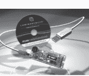

EKI-LM3S811 评估套件。（Luminary Micro, Inc. 提供）

## 致谢

如果没有许多人的努力，本文和配套网站上的软件就不可能完成。其中，我要特别感谢过去 10 年来圣克拉拉大学 COEN 20 课程的学生和助教，他们见证了从第一版到几乎完全重写的第二版的过渡，并帮助完善了文本、问题和实验作业。

我也要感谢许多同事：感谢 Qiang Li 和 Neil Quinn，他们承担了使用我的材料教学这一不讨好的任务，并慷慨地对原文提出了许多改进建议。感谢 Hal Brown 和 Vasu Alagar，他们帮助我开发了实数定点乘法的数学表示，从而得出了汇编中的高效直线实现以及学生相对容易理解的算法解释。感谢 Darren Atkinson，他在 C 语言方面的专业知识非常宝贵。还要感谢北卡罗来纳州立大学的 Dana Lasher，她贡献了出现在中断驱动 I/O 章节中的电话呼叫类比。

我还要感谢俄亥俄北方大学的 Samuel Khoroblyov 及其他审阅新版草稿并发现我拼写错误、拼写错误、语法错误、遗漏、疏忽和偶尔明显错误的人。我也想感谢 Prentice-Hall 及其制作人员，他们使得在大约一年的时间里创作本文尽可能顺利。最后，我感谢圣克拉拉大学批准我的 sabbatical 休假，使我能够找到时间完成这次修订。

本页故意留空

## 简介

### 1.1 什么是嵌入式系统？

嵌入式系统是在其实现中包含微处理器的电子设备。微处理器的主要目的是简化系统设计并提供灵活性。在设备中拥有微处理器意味着，删除错误、进行修改或添加新功能只需重写控制设备的软件。然而，与个人电脑不同，嵌入式系统可能没有磁盘驱动器，因此软件通常存储在只读存储器（ROM）芯片中；这意味着修改软件需要更换或“重新编程” ROM。

如表 1-1 所示，嵌入式系统应用于广泛的应用领域。最初它们仅用于昂贵的工业控制应用，但随着技术降低了专用处理器的成本，它们开始出现在汽车、通信和办公设备以及电视等中等价格的应用中。今天的嵌入式系统非常便宜，以至于几乎用于我们生活中的每一款电子产品。例如，Vitality 的 GlowCap™ 中微小的 ATMEL 8 位 picoPower AVR 处理器（见图 1-2）帮助人们记住按时服药。它可以感应瓶子何时被打开，将该信息无线传输到 Vitality 服务器，闪烁其 LED，并播放铃声。

虽然典型家庭可能只拥有一两台个人电脑，但其家庭、汽车及随身物品中发现的嵌入式处理器数量


图 1-1 NASA 2003 年火星探测漫游车使用了 BAE 系统公司的 RAD6000 32 位 RISC 处理器和 Wind River 系统公司的 VxWorks 操作系统作为其操作系统。图片来源：NASA/JPL/Cornell University。


| 应用领域 | 示例 |
| :--- | :--- |
| 航空航天 | 导航系统、自动着陆系统、飞行高度控制、发动机控制和太空探索。 |
| 汽车 | 燃油喷射控制、乘客环境控制、防抱死制动系统、安全气囊控制和 GPS 映射。 |
| 游戏设备 | Nintendo DS、Nintendo Wii、Microsoft Xbox 360 和 Sony Playstation 3。 |
| 通信 | 卫星网络路由器、交换机和集线器。 |
| 计算机外设 | 打印机、扫描仪、键盘、显示器、调制解调器、硬盘驱动器和 CD-ROM 驱动器。 |
| 家居 | 洗碗机、微波炉、DVD 播放器、电视、音响、火灾/安防报警系统、草坪喷淋控制、恒温器、摄像头、时钟收音机和应答机。 |
| 工业 | 电梯控制、监控系统和机器人。 |
| 仪器仪表 | 数据采集、示波器、信号发生器、信号分析仪和电源。 |
| 医疗 | 成像系统（例如 X 光、MRI 和超声波）、患者监护仪和体温计。 |
| 办公自动化 | 传真机、复印机、电话和收银机。 |
| 个人 | 个人数字助理、便携式媒体播放器、便携式电子书阅读器、寻呼机、手机和智能手机。 |

个人物品的数量要大得多。在许多情况下，我们甚至可能不知道有计算机存在，或没有意识到它们已经变得多么普遍。

令人惊讶的是，嵌入式处理器占全球微处理器产量的几乎 100%！每生产一个用于台式计算机的微处理器，就会有 100 多个用于嵌入式系统。考虑到 1999 年北美平均中产阶级家庭中嵌入式微处理器的数量估计在 40 到 50 个之间，这不足为奇。你可以在时钟收音机、音响、电视中找到它们，

图 1-2 Vitality's GlowCap™ 内嵌了一颗 ATMEL 8 位 picoPower AVR 处理器。图片由 Vitality, Inc. 提供。


图 1-3 Sonicare DiamondClean 牙刷使用一颗 8 位 PIC 微处理器。图片由 Philips Consumer Lifestyle 提供。
VCR、DVD 播放器、DVR、游戏机、遥控器、洗衣机、烘干机、洗碗机、微波炉、冰箱、咖啡机、恒温器、草坪喷淋控制、车库门开启器、摄像头、有线和蜂窝电话、应答机、传真机、寻呼机、个人数字助理 (PDA)、MP3 播放器、手表，甚至牙刷（图 1-3）。

那么你的汽车呢？2005 年，平均豪华汽车约有 150 个嵌入式微控制器和微处理器，用于燃油喷射系统、防抱死制动系统、安全气囊控制、环境控制、GPS 映射、座椅和安全带、收音机等，数量是 2002 年的三倍。

### 1.2 嵌入式软件设计目标有何独特之处？

本书的目标是帮助你学习如何为嵌入式系统设计和实现软件。虽然你已经有使用高级语言编写桌面应用程序的经验，但编写嵌入式应用程序在可靠性、性能和成本方面带来了一些新挑战。

图 1-4 Vue-40 售货机使用一颗 16 位 Hitachi H8/300 CPU。图片由 SandenVendo America, Inc. 提供。
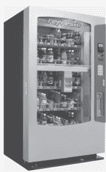

图 1-5 Seagate Barracuda XT 硬盘驱动器包含两颗 ARM Cortex-R4 处理器——一颗控制伺服，另一颗处理命令和数据流。图片由 Seagate Technology, LLC 提供。


可靠性要求将使程序员承担更大责任，以消除缺陷并设计能够容错和应对意外情况的软件。许多嵌入式系统需要全年无休、每周 7 天、每天 24 小时运行。当出问题时，你不能只是“重启”。因此，良好的编码实践和彻底的测试在嵌入式处理器领域变得前所未有地重要。

性能目标将迫使我们学习和应用多线程和调度等新技术。需要直接与传感器、执行器、键盘、显示器等通信，这要求程序员更好地了解执行输入和输出的替代方法如何提供在速度、复杂性和成本之间进行权衡的机会。虽然我们通常会使用高级语言编程以提高生产力，但使用这些替代方法偶尔可能需要我们降到计算机层面，直接使用汇编语言编程。

计算机使用固定精度和补码表示法来存储和处理数值。这与人类处理数字的方式存在微妙差异，并且常常是问题的意外来源。我们的软件将不得不忍受关于数值范围和分辨率的限制。然而，作为程序员，我们需要确保全面理解超出这些限制的后果以及如何处理此类情况。

图 1-6 Amazon Kindle 2 使用一颗 32 位 ARM 处理器。图片由 © Helen Sexton/Alamy 提供。


### 1.3 “实时”是什么意思？

实时系统处理事件。系统输入上发生的事件会导致系统输出上发生其他事件。输入事件的示例包括检测电话铃声信号、对汽车刹车踏板施加力或打开微波炉门等。响应这些输入事件而产生的输出事件可能包括将电话线摘机、对汽车制动系统施加液压以及关闭微波炉。

实时系统的主要设计目标之一是最小化响应时间。软实时系统是设计用于尽可能快地计算响应但没有明确截止时间的系统。如果施加了截止时间，则该系统称为硬实时系统。始终保持硬实时系统的响应时间在给定截止时间内非常重要，否则整个系统可能无法正常运行。例如，防抱死制动系统必须在几毫秒内检测并响应牵引力丢失；一两秒的延迟是不可容忍的，而且可能致命。

### 1.4 “多线程”是什么意思？

嵌入式系统是具有多个输入和输出并必须响应多个独立事件的实时系统。例如，控制你炉子的可编程恒温器必须连续执行三个任务：（1）监控温度，（2）监控一天中的时间，以及（3）扫描键盘以获取用户输入。恒温器内部只有一台计算机，但它可以使用单独的代码线程来执行每个任务，如图 1-7 所示。尽管线程之间相互通信，但大部分时间它们是独立运行的。

将代码分解为线程可以简化软件开发和维护，让程序员一次专注于一项任务。然而，这也要求处理器以某种方式在线程之间不断切换。多线程过程让线程看起来是同时执行的，但实际上任何一时刻只有一个线程在执行。线程被认为是并发执行的。为了澄清，我们将任务定义为要完成的工作，将线程定义为指令序列。任务可以分为一个或多个并发运行的线程，但单个线程可能有助于一个或多个任务的目标。

| do forever {<br>measure temp ;<br>if (below setting)<br>start furnace ;<br>else (above setting)<br>stop furnace ;<br>} | do forever {<br>measure temp ;<br>if (time == 6am)<br>temp = 72° ;<br>else if (time == 11pm)<br>temp = 60° ;<br>} | do forever {<br>check keypad ;<br>if (raise temp)<br>setting++ ;<br>else if (lower temp)<br>setting-- ;<br>} |
|---|---|---|

图 1-7 可编程恒温器内的三个并发代码线程。

### 1.5 嵌入式处理器有多强大？

微控制器单元 (MCU) 将处理器、内存、I/O 端口、定时器和多个外设集成在单个芯片上。过去，MCU 通常采用 8 位和 16 位处理器。今天，对智能手机、GPS 设备、便携式媒体播放器和家用网络路由器等智能设备日益增长的需求正在推动 MCU 转向提供更高性能和功能的 32 位处理器。如图 1-8 所示，32 位处理器正在新的嵌入式设计中迅速取代其前代产品。
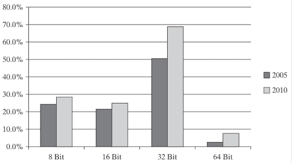
图 1-8 嵌入式系统中使用的指令集架构。注意：由于多重响应，百分比总和超过 100%。来源：VDC Research Group，“嵌入式软件战略市场情报计划 2005，第 I 卷：嵌入式和实时操作系统”以及“嵌入式软件和工具 2010 市场情报服务，Track 2：嵌入式系统工程调查数据，第 1 卷：操作系统”。

### 1.6 使用哪些编程语言？

尽管偶尔需要使用汇编语言编写嵌入式应用程序的一小部分代码，但即使是最简单的应用程序中的大部分代码也使用高级语言编写。传统上，语言的选择一直是（和


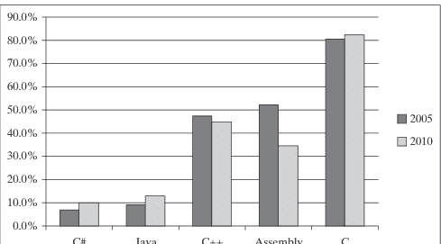

图 1-9 用于开发嵌入式软件的编程语言。注：由于多重响应，百分比总和超过 100%。来源：VDC Research Group，“The Embedded Software Strategic Market Intelligence Program 2005, Volume 1: Embedded and Real-Time Operating Systems”和“Embedded Software & Tools 2010 Market Intelligence Service, Track 2: Embedded System Engineering Survey Data, Volume 1: Operating Systems”。

(续) C. 用 C 语言编写的程序从一个编译器和/或目标处理器到另一个具有很好的可移植性。有多种不同目标处理器的 C 编译器可用，并且它们生成非常高效的代码。

尽管 C++ 和 Java 在桌面应用程序编程中很流行，但它们在嵌入式系统中并未被广泛使用，因为支持其一些功能需要较大的运行时开销。例如，即使是一个相对简单的 C++ 程序，产生的代码量也大约是同等 C 程序的两倍，而对于大量使用运行时库的大型程序，情况则更糟。3

### 1.7 构建嵌入式应用程序有何不同？

你应该已经熟悉用于构建桌面应用程序并将其加载到内存中执行的工具和软件组件。该过程在图 1-10 中总结。编译器和/或汇编器用于构建一个或多个目标文件，这些目标文件与运行时库链接在一起，形成存储为磁盘文件的可执行映像。

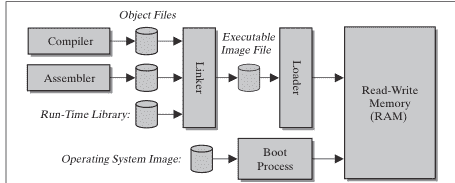

当你想要运行桌面应用程序时，其可执行映像由操作系统中称为加载器的部分从磁盘加载到内存中。操作系统本身已经在内存中，在引导过程中放置在那里。4

桌面系统旨在运行多个不同的应用程序。因此，使用读/写主内存，以便可以快速轻松地将完全不同的应用程序加载到内存中，在必要时替换之前的应用程序。

与通用桌面系统不同，嵌入式系统是为单一目的设计的。一旦嵌入式软件加载到内存中，通常没有理由更改它。嵌入式系统不将程序存储在磁盘上，而是将程序保存在非易失性只读存储器或闪存中。由于不需要将程序存储在磁盘上，可以消除大量原本支持文件系统所必需的软件。

嵌入式应用程序软件和实时内核作为单个程序映像存储在同一内存中。由于不需要文件系统，内核比常规操作系统小得多，并且可以轻松地作为另一个目标文件链接到程序中，如图 1-11 所示。

一般来说，构建嵌入式和桌面应用程序使用相同类型的软件开发工具。尽管专门为嵌入式应用程序开发设计的工具套件通常可用，但在许多情况下，可以使用与桌面应用程序相同的编译器、汇编器和链接器。然而，有两个重要区别。首先，桌面应用程序编译器附带的运行时库通常不适用于多线程应用程序，必须替换为可重入的库。其次，需要一种称为定位器的额外软件，将链接器的输出转换为适合存储在嵌入式系统程序存储器中的形式。5 当桌面操作系统加载
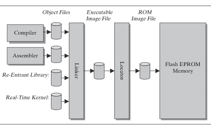
由链接器生成的可执行程序映像到内存中时，它必须修改少数几个字节，其值取决于程序将被加载的地址。在我们可以使用这样的可执行映像将嵌入式程序永久存储在 ROM 中之前，必须首先使用称为定位器的程序执行相同的“修复”。

### 1.8 典型嵌入式程序有多大？

我们已经习惯了需要几兆字节内存和磁盘空间的桌面应用程序。因此，嵌入式产品中使用的内存如此之少令人惊讶，尤其是考虑到嵌入式应用程序及其实时内核都存储在内存中。表 1-2 中列出了两个典型示例。

| 属性 | 传真机 | CD 播放器 |
| :--- | :--- | :--- |
| 微处理器 | 16 位 | 8 位 |
| 线程数 | 6 | 9 |
| 读写内存 (RAM) | 2048 字节 | 512 字节 |
| 实际使用的 RAM 总量 | 1346 字节 (66%) | 384 字节 (75%) |
| 内核使用量 | 250 字节 (19%) | 146 字节 (38%) |
| 只读内存 (ROM) | 32.0 KB | 32.0 KB |
| 实际使用的 ROM 总量 | 28.8 KB (90%) | 17.8 KB (56%) |
| 内核使用量 | 2.5 KB (8.7%) | 13% |

*（改编自 H. Takada, "Designing Embedded Systems with pTRON Kernel," Embedded Systems Conference, Spring 1998.）*

## 问题

- 1. 在杂志、目录或网上找到一张你所能找到的包含嵌入式处理器的最小产品的照片或广告。

- 2. 在杂志、目录或网上找到一张你所能找到的包含嵌入式处理器的最大产品的照片或广告。

- 3. 在杂志、目录或网上找到一张你所能找到的包含嵌入式处理器的最便宜产品的照片或广告。

- 4. 在杂志、目录或网上找到三个不同的软实时系统的照片或广告，这些系统包含嵌入式处理器。

- 5. 在杂志、目录或网上找到三个不同的硬实时系统的照片或广告，这些系统包含嵌入式处理器。

## 简答题

- 6. 估计在 2000 年，仅消费品中每个家庭的嵌入式微处理器的全球平均数量是多少？

- 7. 每生产一个用于桌面计算机的微处理器，就有多少个是为嵌入式系统生产的？

## 选择题

- 8. 多线程意味着：
  - (a) 多个处理器同时执行不同线程。
  - (b) 多个处理器并发执行不同线程。
  - (c) 一个处理器同时执行不同线程。
  - (d) 一个处理器并发执行不同线程。

- 9. 新嵌入式设计中最常用的处理器类型是：
  - (a) 8 位
  - (b) 16 位
  - (c) 32 位
  - (d) 64 位

- 10. 新嵌入式设计中最常用的编程语言是：
  - (a) C
  - (b) C++
  - (c) Java
  - (d) 汇编语言

- 11. 大多数嵌入式应用程序使用的操作系统是：
  - (a) MS/DOS
  - (b) MS/Windows
  - (c) Unix
  - (d) 以上都不是

## 数据表示

有各种类型的数据——数值、文本、图像、音频等等。无论考虑哪种类型，如果我们要使用计算机处理数据，那么数据必须首先转换为计算机能理解的格式。计算机由使用电压表示值的电子设备构成。为了简化电子设备，这些设备要么是“开”，要么是“关”；因此，只使用两种电压。因此，计算机将信息存储为仅由两个符号（“0”和“1”）组成的模式，这不足为奇。

在熟悉的十进制（基数 10）数系统中，我们使用一组数字符号来表示大于 9 的数字。相同的技术在二进制（基数 2）系统中用于表示大于 1 的数字。原则上，你已经知道的关于多位十进制数字（例如，计数、加法、减法）的大部分内容在二进制数字中保持不变。

### 2.1 定点二进制数

### 计算机存储整数和实数的方式不同

你可能已经知道，计算机根据数字是否有小数部分来区分数字。没有小数部分的整数称为整数，而有小数部分的数字称为实数。大多数实数在计算机中使用浮点表示法存储。整数和实数使用完全不同的表示，因为实现算术运算所需的硬件对于整数来说比浮点数简单得多且快得多。我们不仅需要同时使用这两种类型，而且由于编写嵌入式系统软件的可靠性要求，我们还需要充分理解这些数字与我们日常数学中使用的数字有何不同，以及这种差异带来的限制。

### 计算机存储数字使用的二进制位数多于其十进制等效值

显然，我们必须学习如何在十进制和二进制之间进行转换。在此过程中，我们会发现，对于任何一个值，所需的二进制位数比十进制位数多。例如，值 1234 在十进制系统中只需要四位数字，但当转换为基数 2 表示时，结果（10110010010）需要更多位数。一般来说，基数越小，表示相同值所需的位数就越多。因此，大的二进制数很枯燥且容易出现抄写错误。但是，经过一点练习后，你很快就会发现


base-2 和 base-16（十六进制）表示之间的转换可以通过目测几乎瞬间完成。“Hex”数字使用的位数远少于其二进制等价数，因此当我们讨论计算机中存储的二进制数时，将使用十六进制（hex）作为一种方便的简写符号。

## 计算机使用固定位数存储数字，这限制了范围

使用纸笔进行算术运算时，数字的位数没有限制。然而，计算机处理的数字使用的是专为处理有限数量二进制位（“位”）而设计的硬件。类似于汽车只能显示 0 到 99,999 英里的五位里程表，计算机使用固定数量的位来存储数字，这限制了可以表示的值的范围。通常有几种固定精度选项可用：8 位的“字节”、16 位的“半字”、32 位的“字”或 64 位的“双字”。使用较少位数（例如字节）存储的数字显然需要更少的内存，但提供的值的范围非常有限。有了这些选项，程序员可以通过为每个变量选择仍能提供所需值范围的最小表示来节省内存。因此，我们需要充分理解这些限制。

## 计算机不像我们那样使用“符号-数值”来存储有符号数

作为人类，我们分别书写数字的符号和数值。也就是说，我们将数值写为由减号或（可选）加号引导的数字序列。这使我们可以在不改变其表示的数字序列的情况下更改数字的符号。这种符号-数值系统对人类来说很直观，因为它使理解数字的大小及其与其他数字的关系相对容易。

然而，计算机并不理解数字；它们只需要快速且廉价地处理数字。虽然可以通过分配一个额外位来指示符号，从而将符号-数值系统用于二进制数，但事实证明，以这种方式表示有符号数会不必要地复杂化执行算术运算的硬件。因此，我们需要学习另一种表示有符号数的方法，称为 2 的补码（2’s complement）。

总之，与我们习惯的相比，计算机中数字存储存在几个基本差异：

- 1. 计算机存储仅由 0 和 1 组成的二进制数。
- 2. 计算机以不同方式存储整数和实数。
- 3. 计算机使用比其十进制等价数更多的二进制位来存储数字。
- 4. 计算机使用固定位数存储数字，这限制了范围。
- 5. 计算机不像我们那样使用“符号-数值”来存储有符号数。

显然，我们必须理解如何在人类和计算机表示之间进行转换，以及计算机在使用二进制数时如何执行算术运算。我们还需要理解上述差异可能产生的意外后果以及发生时该如何处理。

### 2.2 位值计数制

当我们看到一个写成十进制数字序列的数字时，我们几乎立即不假思索地解释其值。这是因为我们已经学会了，当我们从左到右读取数字时，我们看到的第一个数字比后面的数字更重要，并且我们已经记住了符号的顺序，该顺序赋予“9”比“0”更大的权重。

位值计数制（例如我们熟悉的十进制系统）使用符号序列来表示大数。序列表示的值可以用一个简单的多项式在数学上表达，其中每个符号的算术值相对于其位置进行加权。例如，十进制序列 1234 的值为

```
1234₁₀ = 1 x 10³ + 2 x 10² + 3 x 10¹ + 4 x 10⁰
= 1 x 1000 + 2 x 100 + 3 x 10 + 4 x 1
```

当我们从十进制切换到二进制时，我们只需在多项式中使用 2 的幂而不是 10 的幂。对于更一般的 base-R 情况，只需使用 R 的幂：

```
5678ᵣ = 5 x R³ + 6 x R² + 7 x R¹ + 8 x R⁰
```

这种技术也可以处理带有小数部分的数字，只要我们记住小数点右侧的指数为负：

```
36.72ᵣ = 3 x R¹ + 6 x R⁰ + 7 x R⁻¹ + 2 x R⁻²
```

这里重要的是，我们能够使用熟悉的十进制算术来评估这个多项式——但仅当目标表示是十进制时才行，也就是说，当我们从其他进制系统转换为十进制时。反向转换除非使用基-R 算术来评估多项式，否则行不通——这是你真的不想做的事情！因此，在接下来的内容中，我们将使用多项式求值来转换为十进制，但使用完全不同的技术来从十进制转换。

#### 2.2.1 二进制转十进制转换

### 多项式求值

基于对位值计数制的理解，我们现在已准备好将二进制数转换为十进制。所需的只是应用 R 等于 2 的多项式求值。例如，我们将二进制数 1011.0111₂ 转换为十进制，如下所示：

```
1 x 2^3 + 0 x 2^2 + 1 x 2^1 + 1 x 2^0 + 0 x 2^-1 + 1 x 2^-2 + 1 x 2^-3 + 1 x 2^-4
= 8 + 2 + 1 + 1/4 + 1/8 + 1/16 = 11.4375₁₀
```

请注意，由于位权是 2 的幂而不是 10 的幂，每个二进制位对总数值的贡献远少于等价十进制表示中数字的贡献。因此，表示任何特定值所需的位数随着所选基数的减小而增加。

### 简化算术

转换带有小数部分的二进制数可能需要多次除法来计算小数位的贡献。在上面的例子中，需要进行三次这样的除法。许多人发现，只需简单地改变问题，就更容易进行算术运算。如果我们记住 1011.0111₂ 等价于 10110111₂ x 2^-4，那么转换只需一次除法即可评估，如下所示：

```
(1 x 2^7 + 0 x 2^6 + 1 x 2^5 + 1 x 2^4 + 0 x 2^3 + 1 x 2^2 + 1 x 2^1 + 1 x 2^0) ÷ 16
= (128 + 32 + 16 + 4 + 2 + 1) ÷ 16 = 183 ÷ 16 = 11.4375₁₀
```

#### 2.2.2 十进制转二进制转换

我们不使用多项式求值将十进制（基 10）转换为基 R，因为这样做需要执行基 R 算术。虽然这可能看起来反直觉，但实际上使用两种不同的算法分别转换整数部分和小数部分更容易。我们将对整数部分使用反复除法，对小数部分使用反复乘法。其优点是允许我们使用常规十进制算术而不是基 R 算术。

### 反复除法

在介绍算法之前，首先考虑当你将十进制整数（如 1234）除以 10 时会发生什么。除法会产生两个结果——商为 123，余数为 4。

实际上，该操作将原始四位数分为两部分——它将最低有效位作为余数“提取”出来，并将剩余数字作为商。然后我们可以重复该过程，将商 123 除以 10 以提取下一个最低有效位，依此类推，直到商变为零。

如果我们除以 2 而不是 10，我们知道余数只能是 0 或 1。正如除以 10 的余数是原始十进制表示中最低有效位（最右侧数字）一样，

```
97 ÷ 2 -> quotient = 48, remainder = 1.
48 ÷ 2 -> quotient = 24, remainder = 0.
24 ÷ 2 -> quotient = 12, remainder = 0.
12 ÷ 2 -> quotient = 6, remainder = 0.
6 ÷ 2 -> quotient = 3, remainder = 0.
3 ÷ 2 -> quotient = 1, remainder = 0.
1 ÷ 2 -> quotient = 0, remainder = 1.
1 1 0 0 0 0 1₂
```

图 2-1 使用反复除法将 97 从十进制转换为二进制。

原始十进制表示中最低有效位（最右侧数字）一样，除以 2 的余数将是其二进制表示中的最低有效位。因此，重复该过程将按从右到左（从最低位到最高位）的顺序生成二进制位（图 2-1）。

反复除法适用于任何进制——也就是说，我们可以通过反复除以 R，将十进制整数转换为任何其他进制 R。余数固有地限制在 0 到 R - 1 的范围内，这与基 R 数字的数字值范围完全相同。第一次除法的余数决定了结果的最低有效位，商用于重复该过程，直到商变为零。

### 反复乘法

反复除法对整数效果很好，但对小数完全不起作用。相反，我们必须使用一种称为反复乘法的不同算法。

在介绍算法之前，考虑当你将小数（如 0.1234）乘以 10 时会发生什么。我们可以将乘积（1.234）视为由整数部分和小数部分组成。也就是说，原始数字中最高有效位被“提取”为乘积的整数部分，其余数字留在小数部分中。请注意，乘积的整数部分必须始终是 0 到 9 范围内的一位数字。我们可以对剩余的小数部分重复该过程，以按从左到右（从最高位到最低位）的顺序提取其余数字。

如果我们乘以 2 而不是 10，我们知道整数部分只能是 0 或 1。正如乘以 10 的整数部分是原始十进制表示中最高有效位（最左侧数字）一样，乘以 2 的整数部分将是其二进制表示中的最高有效位。因此，重复该过程将按从左到右（从最高位到最低位）的顺序生成二进制位。

反复乘法适用于任何进制——也就是说，我们可以通过反复乘以 R，将十进制小数转换为任何其他进制 R。乘积的整数部分固有地限制在 0 到 R - 1 的范围内，这与基 R 数字的数字值范围完全相同。第一次乘法的整数部分决定了结果的最高有效位，乘积的小数部分用于重复该过程。


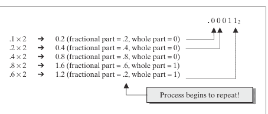

图 2-2 使用反复乘法将 0.1 从十进制转换为二进制。

### 反复乘法并不总是终止

然而，与反复除法不同，反复乘法可能会无限继续下去。这是因为一个数进制中用有限位数表示的分数值，在另一个数进制中可能需要无限位数。例如，人人都知道，除非使用无限位数（称为*循环小数*），否则三分之一无法写成十进制小数。然而，将其写成三进制（基数为 3）小数只需要一位数字！（即，0.333 ... 3₁₀ = 0.1₃）当我们将某些有限长度的十进制小数转换为不同进制表示时，也会发生这种情况。如图 2-2 所示，十分之一的十进制表示在转换为二进制时需要无限位数。

### 知道何时停止反复乘法

那么，我们如何知道何时停止反复乘法呢？在大多数情况下，乘积的小数部分会变为零，然后我们可以简单地使用整数部分作为结果的最后一位数字并停止。然而，当小数部分与之前的某个小数部分相同时，结果将永远重复。无论我们在哪里停止，都必须丢弃结果的其余数字，并且会有相应的*表示误差*。

通常，保留多少位小数的决定不是由我们做出的，而是由结果是要存储在字节、半字、字还是双字中决定的。如果不是，那么一个合理的选择是生成足够的数字，以产生与原始十进制小数相同的精度。例如，当我们将一个值写成十进制小数 .123 时，我们已将其精确到 1000 分之 1。（请注意，将其写成 .1230 表示精确到 10000 分之 1。）要在二进制中获得 1000 分之 1 的精度，需要 10 位二进制数字；9 位二进制数字只能提供 512 分之 1（2⁹）的精度，而 10 位则提供 1024 分之 1（2¹⁰）的精度。

### 截断和四舍五入

当你终止反复乘法时，简单地丢弃任何额外数字称为对结果进行*截断*。然而，为了尽量减少误差，我们应该对结果进行*四舍五入*。

在十进制中，四舍五入意味着当下一位数字为 5 或更大时，在结果上加 1；例如，将十进制小数 0.12345 四舍五入到三位数字得到 0.123，而将其四舍五入到四位数字得到 0.1235。在二进制中，四舍五入意味着当下一位数字为 1 时，在结果上加 1；例如，将二进制小数 0.11101 四舍五入到三位数字得到 0.111，而将其四舍五入到四位数字得到 0.1111。

实际上，四舍五入要求当我们丢弃的部分至少达到下一个结果的一半时，我们要对结果加 1。对十进制和二进制值进行四舍五入只需查看下一位数字，但这仅仅是因为 10 和 2 是偶数。当进制为奇数时，“一半”并不总是可以由单个数字确定。考虑三进制小数 0.221XX... X，其中“XX...X”是任意的三进制数字序列。如果我们想四舍五入到三位数字，当最左边的 X 为 0 时，结果肯定是 0.221；当最左边的 X 为 2 时，结果是 0.222；但如果它是 1 呢？那么你必须查看下一个 X，依此类推。唉...

#### 2.2.3 十六进制：二进制的简写

当我们手动处理二进制数时，所需的更多位数增加了抄写错误的可能性。*十六进制*（基数 16）数制通过本质上作为二进制数的简写符号来解决这个问题。

当两个进制具有幂关系时，如 R₁ = (R₂)ᵏ，将一个数从一个进制表示转换为另一个进制就变得微不足道。具体来说，基数 R₁ 表示中的每个数字将与相应的基数 R₂ 表示中的 k 位数字一一对应。这就是为什么十六进制（基数 16）被用作二进制的简写的原因。由于 16 = 2⁴，每个十六进制数字将对应*四*个二进制数字。

十六进制数使用值在 0 到 15 之间的数字符号。前 10 个符号与十进制系统相同（“0”到“9”）；其余六个符号取自字母表的前六个字母（“A”到“F”）。

首先，我们必须记住表 2-1 中显示的 0 到 15 的 4 位二进制表示。一旦掌握了这一点，二进制和十六进制之间的转换几乎可以一目了然。要从十六进制转换为二进制，只需将每个十六进制符号替换为其对应的 4 位二进制模式。要从二进制转换为十六进制，从二进制点开始，识别每组四位，在外部用 0 填充不完整的组，然后将每组替换为相应的十六进制数字（图 2-3）。

我们刚刚看到，二进制和十六进制之间的转换只需要简单的表查找。但是，如果你没有表的副本怎么办？幸运的是，一旦你认识到二进制计数模式，从头重新创建表也微不足道。

计数的原理在所有位值进制中都是相同的。首先，记住你在十进制中所做的：在最低有效位上加 1。如果结果

| 十六进制符号 | 数字值 | 二进制模式 | 十六进制符号 | 数字值 | 二进制模式 |
|---|---|---|---|---|---|
| 0 | 0 | 0000 | 8 | 8 | 1000 |
| 1 | 1 | 0001 | 9 | 9 | 1001 |
| 2 | 2 | 0010 | A | 10 | 1010 |
| 3 | 3 | 0011 | B | 11 | 1011 |
| 4 | 4 | 0100 | C | 12 | 1100 |
| 5 | 5 | 0101 | D | 13 | 1101 |
| 6 | 6 | 0110 | E | 14 | 1110 |
| 7 | 7 | 0111 | F | 15 | 1111 |

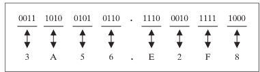

小于 10，写下它并复制左侧的所有剩余位数。否则，写下零并在下一位上加 1，依此类推。对于另一种进制的唯一区别是，在每一步将结果与 R（基数）而不是 10 进行比较。

经过一点练习，相对容易地复制表 2-1 中指示的二进制计数序列。但是，一旦你注意到，从零开始，最低有效位在每次计数时都会改变，次低有效位每两次计数改变一次，再下一位每四次计数改变一次，依此类推。无论表示中使用多少位，值零始终由全 0（00 ... 0）表示。这一事实，加上之前的观察，使得重建包含任意位数的完整二进制计数序列变得微不足道。

> 记住：计算机不使用十六进制。我们使用。

#### 2.2.4 固定精度、回绕和溢出

人人都知道，如果你开车足够长的时间，最终里程表会从 99,999.9 英里“回绕”到 00,000.0 英里。当然，正确的结果是 100,000.0 英里，但里程表只有六位数字的空间。除了缺少的数字，其余的表示都是正确的。同样，你可以轻松想象，如果你倒车开足够远，新车的里程表可能会从 00,000.0 向后回绕到 99,999.9 英里。

回绕是固定精度的结果。例如，你汽车里程表使用固定精度的六位十进制数字。计算机使用 8 位的倍数来存储数字，使用固定精度，并遭受类似的后果。使用 8 位向上计数最终会导致从 11111111 回绕到 00000000；向下计数最终会从 00000000 向后回绕到 11111111（并提供了一些关于负数应如何表示的洞察）。

当二进制模式用于表示无符号值时，全 0 的模式被分配给值零，全 1 的模式对应可以表示的最大可能值。向任何方向回绕都意味着超出了表示范围，这被称为溢出。

然而，回绕和溢出并不等同。回绕描述模式序列的行为，而溢出描述算术行为。回绕是否导致溢出取决于模式如何被解释为数值。例如，当我们转到 2 的补码有符号数时，我们将看到回绕发生在范围中间而没有溢出，而范围两端的溢出发生而没有回绕。

### 2.3 整数的二进制表示

整数可以是有符号或无符号。两者都使用固定数量的位存储。如果整数是有符号的，其中一位指示值是正还是负，留下少一位用于大小。因此，使用无符号整数可以表示的大小范围是有符号整数的两倍。有时，这点额外的范围可能很有用，因此一些现代编程语言提供两种类型。

有时，程序员会将整数声明为无符号，不是因为更大的大小范围，而是简单地因为这些值永远不应该是负数。对于许多应用，例如计数或测量距离或时间，无符号整数更合适。将整数设为无符号则成为一种文档，提供了关于整数在算法中如何使用的更多洞察。

然而，重要的是要认识到，整数是有符号还是无符号完全取决于你决定如何解释其位模式。模式中不存储任何指定其应如何解释的信息。例如，如果 8 位模式 10100111 被解释为无符号数，则其十进制值为 167；如果被解释为有符号（2 的补码）整数，则其十进制值为 -89。

正如我们将在本章后面看到的，当你用高级语言编程时，编译器根据整数的声明方式选择适当的指令；然而，当用汇编语言编程时，选择适当指令的责任就落在程序员身上！

正如我们将看到的，使两种解释都合理的是，加法和减法的硬件对于有符号和无符号整数可以是相同的。虽然比较、乘法和除法的硬件对于


有符号和无符号整数，差异很小且成本低廉。然而，这确实意味着计算机必须为这些操作提供不同的指令，具体取决于用作操作数的整数类型。

#### 2.3.1 有符号整数

迄今为止，我们只考虑过如何以二进制表示无符号整数。然而，当需要有符号整数时，我们必须扩展简单的位值表示法。虽然可以添加一位来指示符号，但计算机并不会简单地将其附加到独立表示的数值上。结果表明，使用这种符号加数值方法实际上会使算术单元的硬件设计变得复杂，因此改用一种称为补码的方法。

如图 2-4 所示，正值的补码表示与无符号表示相同。负值可以通过从零开始倒数来推导。就像新车倒车行驶时的里程表一样，当我们从零开始倒退时，二进制计数会翻转到全 1，然后从那里递减。

#### 2.3.2 同一数值的正负表示

研究图 2-4 一段时间后，你会很快发现，不能通过简单更改补码数表示中的某一位来改变其符号。不过好消息是，正确的步骤并不困难。给定正数量的表示，一种称为形成补码的操作

| 4 位符号加数值表示 | | 4 位补码 | |
|---|---|---|---|
| +7 | 0111 | +7 | 0111 |
| +6 | 0110 | +6 | 0110 |
| +5 | 0101 | +5 | 0101 |
| +4 | 0100 | +4 | 0100 |
| +3 | 0011 | +3 | 0011 |
| +2 | 0010 | +2 | 0010 |
| +1 | 0001 | +1 | 0001 |
| +0 | 0000 | +0 | 0000 |
| -0 | 1000 | -1 | 1111 |
| -1 | 1001 | -2 | 1110 |
| -2 | 1010 | -3 | 1101 |
| -3 | 1011 | -4 | 1100 |
| -4 | 1100 | -5 | 1011 |
| -5 | 1101 | -6 | 1010 |
| -6 | 1110 | -7 | 1001 |
| -7 | 1111 | -8 | 1000 |

的数会产生其负数对应数的表示，反之亦然。执行此操作的最简单算法是反转所有位，然后将结果加 1。第二种技术是从右到左处理位一次，按原样复制位，包括第一个 1，然后复制所有剩余位的反码。

首先，必须确切知道表示中使用了多少位，否则任何一种算法都无法正确工作。例如，假设要求找出 -27₁₀ 的有符号补码表示。最简单的方法是先找出 +27₁₀ 的表示，然后应用补码算法得到相应的负数表示。假设你将 27₁₀ 转换为二进制并得到 10111₂。反转这五位并加 1 会产生 00101₂，即 +5，而不是 -27₁₀。问题在于，我们最初使用的是 27₁₀ 的无符号表示（11011₂），而不是 +27₁₀ 的有符号表示（011011₂）。仅在原始数字前添加一个或多个前导 0（例如 00011011₂）会导致算法产生 11100101₂，这是 -27₁₀ 的正确表示。

请注意，当尝试将算法应用于满量程负表示（10...0₂）时，会出现一种异常情况。以 4 位为例，如果反转 1000₂，则它变为 0111₂，再加 1 会得到 1000₂（即我们开始时的值）。不过，对于补码来说，这并不令人惊讶，因为其满量程负值的大小始终比可表示的最大正值大 1。

稍加观察，你很快就会意识到，非负数量必须以一个或多个前导 0 开头，而负数量必须以一个或多个前导 1 开头。因此，你可以通过仅查看最高位来轻松确定补码数的符号。但是，尽管该位被称为“符号位”，也不要被误导，以为表示的符号部分和数值部分是独立的。

> 请记住：不能仅通过反转最高位来更改补码数的符号！

#### 2.3.3 解释补码数的值

当给出一个二进制补码数并要求将其转换为十进制时，大多数人首先查看符号位。如果它是 0，则他们只需将该数视为无符号二进制数，并使用多项式求值进行转换。但是，如果符号位是 1，则该值必须为负。在这种情况下，他们通过对位模式形成补码来找到相同大小的相应正数表示，用它来确定十进制大小，然后在其前面加上负号（图 2-5）：

适用于正负值的单一方法是使用多项式求值，但为最高位使用不同的权重。不要使用 2^(n-1) 的权重，只需将其更改为 -2^(n-1)，如图 2-6 所示。

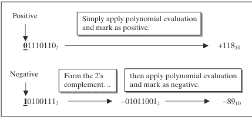

图 2-5 基于符号位解释补码数。

```
01110110₂ = 0x(-2⁷) + 1x2⁶ + 1x2⁵ + 1x2⁴ + 0x2³ + 1x2² + 1x2¹ + 0x2⁰
          = 64 + 32 + 16 + 4 + 2
          = 118₁₀

10100111₂ = 1x(-2⁷) + 0x2⁶ + 1x2⁵ + 0x2⁴ + 0x2³ + 1x2² + 1x2¹ + 1x2⁰
          = -128 + 32 + 4 + 2 + 1
          = -89₁₀
```

图 2-6 补码数的修正多项式求值。

#### 2.3.4 改变带整数和小数部分的数字的符号

在查找有符号十进制数的补码表示时，常用的方法是先将其正数对应值转换为二进制，然后应用补码算法使其变为负数。在转换同时包含整数部分和小数部分的数字时，常见的错误是分别处理各部分。例如，在将数字 -5.75₁₀ 转换为二进制点位于中间的 8 位补码表示时，你可能会想按以下方式操作：

- 步骤 1：+5₁₀ = 0101，因此 -5₁₀ 变为 1011
- 步骤 2：.75₁₀ = .1100
- 步骤 3：组合得到 1011.1100₂

不幸的是，此结果对应 -4.25，而非 -5.75。正确的转换方法是先找出 +5.75 的 8 位表示，然后应用补码算法，仿佛不存在二进制点：

- 步骤 1：+5.75₁₀ = 0101.1100。
- 步骤 2：求 01011100 的补码，结果为 10100100。
- 步骤 3：恢复二进制点，得到 1010.0100₂。

#### 2.3.5 二进制加法和减法

两个 N 位二进制数 X 和 Y 的加法可以分解为 N 个相同的子问题，每次仅将两位 Xᵢ 和 Yᵢ 相加，进位 Cᵢ 从右侧（C₀）向左侧（Cₙ）传播。一种称为全加器的逻辑电路用于将每对输出位与前一位位置的进位输入相结合，以生成和的一位以及下一个进位输出：

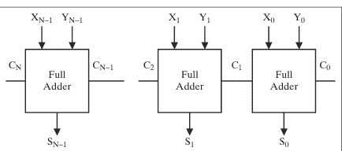

理解全加器功能的更好方法是将其视为一个电路，用于相加三个 1 位数字，可能的和为 0、1、2 或 3，如表中“和”列所示。这四个值分别对应位模式 00、01、10 和 11，其中最低有效位为 Sᵢ，最高有效位为 Cᵢ₊₁。

| Cᵢ | Xᵢ | Yᵢ | 和 | Cᵢ₊₁ | Sᵢ |
|---|---|---|---|---|---|
| 0 | 0 | 0 | 0 | 0 | 0 |
| 0 | 0 | 1 | 1 | 0 | 1 |
| 0 | 1 | 0 | 1 | 0 | 1 |
| 0 | 1 | 1 | 2 | 1 | 0 |
| 1 | 0 | 0 | 1 | 0 | 1 |
| 1 | 0 | 1 | 2 | 1 | 0 |
| 1 | 1 | 0 | 2 | 1 | 0 |
| 1 | 1 | 1 | 3 | 1 | 1 |


减法类似，X – Y 由一组 N 个“全减器”计算得出，这些全减器将借位 (B<sub>i</sub>) 从右向左传播：

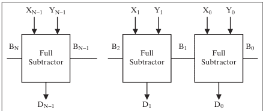

全减器的两个输出函数 (D<sub>i</sub> 和 B<sub>i+1</sub>) 可以以与全加器类似的方式推导。关键在于意识到 X<sub>i</sub> 输入对差值的贡献为 0 或 +1，而 Y<sub>i</sub> 和 B<sub>i</sub> 各自对差值的贡献为 0 或 –1，因此可能的差值为 –2、–1、0、+1、0 和 +1，并且这些值表示为两位 2 的补码数。因此表变为：

| B<sub>i</sub> | X<sub>i</sub> | Y<sub>i</sub> | 差值 | B<sub>i+1</sub> D<sub>i</sub> |
|---|---|---|---|---|
| 0 | 0 | 0 | 0 | 0 0 |
| 0 | 0 | -1 | -1 | 1 1 |
| 0 | +1 | 0 | +1 | 0 1 |
| 0 | +1 | -1 | 0 | 0 0 |
| -1 | 0 | 0 | -1 | 1 1 |
| -1 | 0 | -1 | -2 | 1 0 |
| -1 | +1 | 0 | 0 | 0 0 |
| -1 | +1 | -1 | -1 | 1 1 |

**记住：** 尽管我们使用有符号表示法来表示差值，但我们已经知道，用于对 2 的补码操作数进行加减运算的同一电路同样适用于对无符号操作数进行加减运算。

基于上面的全减器表，我们可以使用它从右向左一位一位地进行 8 位二进制减法运算：

| | B<sub>8</sub> | B<sub>7</sub> | B<sub>6</sub> | B<sub>5</sub> | B<sub>4</sub> | B<sub>3</sub> | B<sub>2</sub> | B<sub>1</sub> | B<sub>0</sub> |
|---|---|---|---|---|---|---|---|---|---|
| 借位 | 0 | 0 | 0 | 0 | 1 | 1 | 1 | 1 | 0 |
| 被减数 X<sub>7</sub>...X<sub>0</sub> | 0 | 1 | 1 | 1 | 1 | 0 | 0 | 1 | 0 |
| 减数 Y<sub>7</sub>...Y<sub>0</sub> | 0 | 1 | 0 | 0 | 0 | 1 | 1 | 1 | |
| 差值 D<sub>7</sub>...D<sub>0</sub> | 0 | 0 | 1 | 0 | 1 | 0 | 1 | 1 | |

#### 2.3.6 范围和溢出

n 位二进制数的每一位都有两种可能的值（0 和 1），因此总共有 2^n 种不同的 0 和 1 模式可用于表示由 n 位组成的数字。当这些模式用于表示无符号整数时，可能值的范围因此为 0 到 2^n - 1。例如，8 位量可以容纳范围为 0 到 2^8 - 1（0 到 255）的无符号值。

当用于表示有符号整数时，一半的模式分配给正值，另一半分配给负值。2^n 的一半是 2^(n-1)，因此范围的非负一半涵盖从 0 到 2^(n-1) - 1 的值。其余的 2^(n-1) 个模式分配给从 -1 到 -2^(n-1) 的负值。因此，2 的补码有符号数的整个值范围是从 -2^(n-1) 到 +2^(n-1) - 1。例如，8 位量可以容纳范围从 -2^7 到 +2^7 - 1（-128 到 +127）的有符号值。

如果整数算术运算产生的值超出了数据类型范围的上限，则该值会“回绕”（溢出）回范围的较低部分。如图 2-7 所示，将 20 加到持有值 250 的 8 位无符号数上，结果为 14。正确结果 270（需要 9 位）与实际结果 14（最低 8 位）之间的差值（256）对应于结果中无法存储的第 9 位的权重。

对于有符号数，当对符号不同的数进行加法或对符号相同的数进行减法时，永远不会发生溢出；溢出仅在对两个符号相同的整数进行加法或对两个符号不同的数进行减法时才可能发生。例如，从持有值 -120 的 8 位有符号数中减去 17，结果将为 +119。正确结果 -137（需要 9 位）与 +119（最低 8 位）之间的差值（256）对应于结果中无法存储的第 9 位的权重。

当溢出确实发生时，这是因为幅值信息已传播到符号位位置。例如，要使一个数看起来为正，最高位必须为 0，但随着其幅值增加，1 开始越来越多地出现在左侧。相反，要使一个数看起来为负，最高位必须为 1，但随着其幅值增加，0 开始越来越多地出现在左侧。

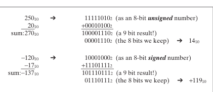

图 2-7 整数数据类型超出范围的溢出。

在整数数据类型的加法和减法期间，溢出会静默发生；编译器不提供运行时检查。完全由程序员负责预测每个变量可能的值范围，并分配适当大小的数据类型以避免溢出。

### 2.4 实数的二进制表示

实数是包含小数部分的数字。尽管浮点数是用于表示实数的常用表示法，但定点表示法也是可能的，并且具有一些优势，这些优势对于低成本嵌入式应用尤其重要。

#### 2.4.1 浮点实数

浮点数类似于科学计数法，即它们由两部分信息组成：有效数字和比例因子。有效数字（或尾数）存储为一个小数值，其最左侧有一个隐含的二进制小数点；比例因子是 2 的幂次，表示法中仅存储指数。

如今，所有台式机微处理器都包含用于实现浮点算术的硬件，包括任何必要的二进制点预对齐或结果后规格化。

浮点表示法使用符号加数值格式，并在对指数进行编码之前向其加上偏移量。符号加数值格式对于浮点算术所需的算法更为方便，而带偏移量的指数简化了用于比较指数以进行操作数预对齐的硬件。

ANSI/IEEE 标准没有对浮点数的特定位布局做出规定。然而，典型的实现使用图 2-8 所示的布局，其中符号位位于表示法的最高位位置，随后依次是指数位和尾数位字段。这种传统排列与将实数的所有信息按重要性递减顺序保持一致。

ANSI/IEEE 格式的一个有趣特征是，尾数的一位并未存储在表示法中！请记住，为了保持最大精度，我们始终对每个结果进行规格化。这迫使每个非零尾数的最高位始终为 1。该位是尾数的整数位，因此

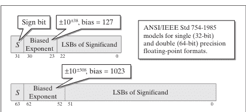

图 2-8 ANSI/IEEE 浮点表示法。

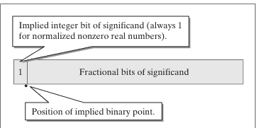

### 图 2.9 实际尾数的构造。

所有非零数的尾数都在 1.0 <= 尾数 < 2.0 的范围内。通过不存储整数位，ANSI/IEEE 格式能够在尾数中存储一位额外的精度（图 2-9）。

示例 2-1 中所示的程序在使用 ANSI/IEEE 浮点数（位排列如图 2-8 所示）的计算机上编译并运行。该程序的输出通过打印出几个浮点数的二进制内容，说明了 32 位单精度表示法的细节。

```c
#include <stdio.h>
int main()
{
    static float f[] =
    {
        -2.0, -1.0, -0.75, -0.5,
        0.0, 0.5, 0.75, 1.0, 2.0
    };
    int i, j;
    for (i = 8; i >= 0; i--)
    {
        void *p = &f[i];
        long bits = (*(long *) p);
        int zero = (bits == 0L);
        printf("%9.2f*:", f[i]);
        for (j = 0; j < 32; j++)
        {
            if ((j == 1) || j == 9) printf(" ");
            if (j == 0) printf("%c(%d) ", '!', zero);
            printf("%d", bits < 0);
            bits <<= 1;
        }
        printf("\n");
    }
    return 0;
}
```

```
Program output:
2.00 0 10000000 (1).00000000000000000000000
1.00 0 01111111 (1).00000000000000000000000
0.75 0 01111110 (1).10000000000000000000000
0.50 0 01111110 (1).00000000000000000000000
0.00 0 00000000 (0).00000000000000000000000
-0.50 1 01111110 (1).00000000000000000000000
-0.75 1 01111110 (1).10000000000000000000000
-1.00 1 01111111 (1).00000000000000000000000
-2.00 1 10000000 (1).00000000000000000000000
```

### 示例 2-1 说明单精度浮点表示法的程序。


无论位如何存储，以 ANSI/IEEE 格式存储的浮点数的值可以表示为

实数值 = (-1) 符号位 × 2 (偏移指数 - 偏移常数) × 实际有效数字

浮点数的优势在于，通过对每个结果进行归一化，可以自动将错误最小化。有效数字的位数是固定的，因此归一化会调整指数以消除有效数字中的前导零，从而提供最大可能的精度。

劣势是成本和执行时间增加。浮点数和整数的表示是使用处理器的不同部分实现的。因此，带有浮点指令的处理器通常比仅实现整数运算的处理器要贵一些。由于浮点数和整数是分别处理的，处理器内部有更多的状态信息；同时拥有两者意味着在多线程应用程序中从一种计算切换到另一种计算需要更长的时间。

#### 2.4.2 定点实数

许多廉价的微处理器根本不提供浮点运算指令，或者执行此类指令的速度远慢于整数运算指令。这种速度差异，以及在从一个执行线程切换到另一个线程时需要更改浮点处理器状态信息的需求，是避免在大多数嵌入式程序中使用实数的强大动机。幸运的是，某些类型的算术可以通过使用整数操作在定点实数上轻松执行。

在定点表示中，每个数由两部分组成：小数点左侧表示数值整数部分的固定位数，以及右侧表示数值小数部分的固定位数。我们之前学习的整数表示只是定点的一种特殊情况，即没有小数位；也就是说，隐含的二进制点紧跟在最低有效位的右侧。

具有相同隐含二进制点位置的两个定点实数的加法和减法可以使用常规整数加法和减法指令来实现。具有不同二进制点位置的两个定点实数的加法和减法，以及乘法和除法，稍微复杂一些，但正如我们将在下一章中看到的，非常可控。

### 2.5 文本的 ASCII 表示

一个字节的内存可以用于存储 256 种不同的 8 位 1 和 0 模式中的任意一种。除了表示小数字之外，这些模式还可以用作代码。例如，我们可以通过为字母表中的每个字母（包括小写和大写）、每个十进制数字以及各种标点字符分配唯一代码，将文本存储在计算机中。

为此目的使用的标准代码是表 2-2 所示的美国信息交换标准代码（ASCII）。表中的前 32 个代码（以及最后一个代码）用于文本格式化和控制信息。

| 十六进制 | 控制/图形 | 十六进制 | 控制/图形 | 十六进制 | 控制/图形 | 十六进制 | 控制/图形 |
|----------|-----------|----------|-----------|----------|-----------|----------|-----------|
| 00 | NUL | 20 | Space | 40 | @ | 60 | ` |
| 01 | SOH | 21 | ! | 41 | A | 61 | a |
| 02 | STX | 22 | " | 42 | B | 62 | b |
| 03 | ETX | 23 | # | 43 | C | 63 | c |
| 04 | EOT | 24 | $ | 44 | D | 64 | d |
| 05 | ENQ | 25 | % | 45 | E | 65 | e |
| 06 | ACK | 26 | & | 46 | F | 66 | f |
| 07 | BEL | 27 | ' | 47 | G | 67 | g |
| 08 | BS | 28 | ( | 48 | H | 68 | h |
| 09 | HT | 29 | ) | 49 | I | 69 | i |
| 0A | LF | 2A | * | 4A | J | 6A | j |
| 0B | VT | 2B | + | 4B | K | 6B | k |
| 0C | FF | 2C | , | 4C | L | 6C | l |
| 0D | CR | 2D | - | 4D | M | 6D | m |
| 0E | SO | 2E | . | 4E | N | 6E | n |
| 0F | SI | 2F | / | 4F | O | 6F | o |
| 10 | DLE | 30 | 0 | 50 | P | 70 | p |
| 11 | DC1 (X-ON) | 31 | 1 | 51 | Q | 71 | q |
| 12 | DC2 | 32 | 2 | 52 | R | 72 | r |
| 13 | DC3 (X-OFF) | 33 | 3 | 53 | S | 73 | s |
| 14 | DC4 | 34 | 4 | 54 | T | 74 | t |
| 15 | NAK | 35 | 5 | 55 | U | 75 | u |
| 16 | SYN | 36 | 6 | 56 | V | 76 | v |
| 17 | ETB | 37 | 7 | 57 | W | 77 | w |
| 18 | CAN | 38 | 8 | 58 | X | 78 | x |
| 19 | EM | 39 | 9 | 59 | Y | 79 | y |
| 1A | SUB | 3A | : | 5A | Z | 7A | z |
| 1B | ESC | 3B | ; | 5B | [ | 7B | { |
| 1C | FS | 3C | < | 5C | \\ | 7C | \| |
| 1D | GS | 3D | = | 5D | ] | 7D | } |
| 1E | RS | 3E | > | 5E | ^ | 7E | ~ |
| 1F | US | 3F | ? | 5F | _ | 7F | DEL |

该表总共包含 128 个代码，因此只需要字节中可用的 8 位中的 7 位。一些计算机制造商使用第 8 位来定义另外 128 个代码，并用它们来表示希腊字符以及用于在显示器的字符单元格中组成线条或方框的字符。其他人将第 8 位用作奇偶位，以检测单比特错误。奇偶位的值由其他 7 位确定，使得 8 位总数中 1 的数量为奇数。只要发现一个字节包含偶数个 1，就会检测到错误。

| 常量 | 十六进制 | 字符 | 常量 | 十六进制 | 字符 |
|------|---------|------|------|---------|------|
| '\a' | 07 | 警报（例如，铃声） | '\v' | 0B | 垂直制表符 |
| '\b' | 08 | 退格 | '\\' | 5C | 反斜杠 |
| '\f' | 0C | 换页符 | '\'' | 27 | 单引号 |
| '\n' | 0A | 换行符 | '"' | 22 | 双引号 |
| '\r' | 0D | 回车 | '\?' | 3F | 问号 |
| '\t' | 09 | 水平制表符 | | | |

编程语言（包括高级语言，如 C，以及汇编语言）不要求程序员记住 ASCII 代码。与其编写二进制或十六进制常量，不如简单地使用字符常量来生成包含字符 ASCII 代码的 7 位模式。例如，假设您要将字母 A 的 ASCII 代码存储在一个字节的内存中。与其编写十六进制常量 0x41（在 C 中）或 41h（在汇编语言中），两种语言都允许将字母用一对单引号括起来（如 'A'）以达到相同目的。前 32 个 ASCII 控制代码中较常用的一些可以在 C 中使用字符转义来表示，如表 2-3 所示。字符转义由反斜杠后跟一个字母组成；将组合用单引号括起来会生成一个没有相应图形图像的 ASCII 代码。一般来说，使用字符常量而不是数值代码会生成更易读的源代码，并有助于避免所谓的“魔术常数”，其预定用途会随时间变得模糊不清。

单词、句子和段落是字符串的示例。除了字符串的内容之外，还必须以某种方式指示字符串的长度。否则，我们将不知道何时停止尝试将内存内容解释为 ASCII 代码！

字符串的长度可以通过字符计数（存储在字符串前面）或特殊的哨兵字节来指定，该字节标记字符串的结束。在 C 中，使用由全零组成的哨兵字节（称为 NULL）来标记字符串的结束。因此，诸如“Hello”之类的字符串常量总共占用六个字节的内存：五个字节用于单词的字母，第六个字节用于全零的终止字节（图 2-10）。

| 'H' | 'e' | 'l' | 'l' | 'o' | NUL |
|-----|-----|-----|-----|-----|-----|
| 01001000 | 01100101 | 01101100 | 01101100 | 01101111 | 00000000 |
| 48 | 65 | 6C | 6C | 6F | 00 |

### 2.6 二进制编码十进制

二进制编码十进制（BCD）是一种表示法，其中十进制数的每个数字都单独编码。分别存储数字简化了从键盘记录数值数据或在诸如收银机之类的数字显示器上显示结果的过程。

共有 10 个十进制数字，因此每个数字需要四位来编码。在压缩 BCD 中，两个十进制数字存储在一个字节（八位）中。未压缩 BCD 每个字节只存储一个数字，以便于访问数字的各个十进制数字。这两种格式的示例见图 2-11。压缩 BCD 多年前被引入作为节省内存的一种手段。随着内存价格的大幅下降，使用压缩 BCD 已不再那么重要。

BCD 格式仅表示数字的大小；如果需要带符号的数字，则必须分别存储符号，并将数字视为符号加大小格式进行操作。

某些计算机提供特殊指令来支持 BCD 算术以及在 BCD 和无符号二进制之间进行转换。但是，这些指令通常不提供一整套算术运算符，必须与其他指令结合在更复杂的算法中，才能执行任何真正有用的算术运算。

十进制数字也可以使用其对应的 ASCII 代码来表示。许多显示设备现在使用 ASCII 输入数据，BCD 数字与其 ASCII 表示之间的转换非常简单。给定一个包含 0 到 9 之间值的字节，只需将其与 00110000 进行 OR 运算即可得到其 ASCII 表示；给定十进制数字的 ASCII 表示，只需将其与 00001111 进行 AND 运算即可恢复相应的十进制整数。

鉴于当今处理器速度极快，BCD 指令曾经提供的任何优势现在都相对微不足道。

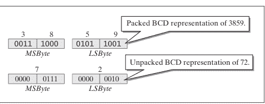

图 2-11 压缩和未压缩 BCD 表示。


## PROBLEMS

- 1. Give the entire count sequence of binary patterns for 3-bit unsigned integers.

- 2. What is the decimal value represented by the 8-bit binary number 11001001.0101₂ when interpreted as:
  - (a) An unsigned number?
  - (b) A 2's-complement number?

- 3. What is the decimal value represented by the binary number 10001101₂ when interpreted as:
  - (a) A sign + magnitude number?
  - (b) A 2's-complement number?

- 4. Use polynomial evaluation to:
  - (a) Convert 101101₂ to base 10.
  - (b) Convert DEAF₁₆ to base 10.
  - (c) Convert 0.325₄ to base 10.

- 5. Use repeated division to:
  - (a) Convert 150₁₀ to base 2.
  - (b) Convert 1500₁₀ to base 16.
  - (c) Convert 400₁₀ to base 7

- 6. Use repeated multiplication to⁵:
  - (a) Convert 0.9₁₀ to base 2.
  - (b) Convert 0.9₁₀ to base 16.
  - (c) Convert 0.9₁₀ to base 3.

- 7. Use shortcuts based on power relationships to:
  - (a) Convert ACE₁₆ to base 2.
  - (b) Convert FACE₁₆ to base 8.
  - (c) Convert 1011.0111₂ to base 8.
  - (d) Convert 2321.1₈ to base 8.
  - (e) Convert 176₈ to base 3

- 8. Perform the indicated conversions:
  - (a) Convert FA₁₆.E₈ to base 2 (binary).
  - (b) Convert 101011.01101₂ to base 16 (hexadecimal).
  - (c) Convert 56.23₁₀ to base 2 (binary).
  - (d) Convert 1101.101101₂ to base 10 (decimal).
  - (e) Convert 12.34₈ to base 7

- 9. Convert the decimal number -371₁₀ to 16-bit 2's-complement binary, with 8 bits of integer part and 8 bits of fractional part.

⁵ If the process repeats indefinitely, calculate as few digits as necessary to provide same or better resolution.

- 10. What is the 2's-complement 8-bit representation of -10010₂?

- 11. Give the 2's-complement 8-bit representation of -77₁₀, with the binary point in the middle (e.g., bbbb.bbbb).

- 12. For each of the following 2's-complement numbers, give the corresponding 8-bit representation of the negative of its value:
  - (a) 01010101
  - (b) 10101010
  - (c) 10000001
  - (d) 01111110

- 13. Consider a 2's-complement number represented by n bits, with the binary point placed between the two most significant bits (e.g., bbb ... b).
  - (a) Give an algebraic expression in terms of n for the positive value that has the smallest nonzero magnitude.
  - (b) Give the binary representation of (a), where n is 8.
  - (c) Give an algebraic expression in terms of n for the negative value that has the smallest nonzero magnitude.
  - (d) Give the binary representation of (c), where n is 8.

- 14. Give the 32-bit binary representation of the floating-point value -25.1:

| 31 | 30 | ... | 23 | 22 | ... | 0 |
|---|---|---|---|---|---|---|
| | | | | | | |

- 15. The ASCII code for the symbol "0" is 30₁₆. Use this fact to determine the hex constants that would be stored in memory, starting at address N, for the C character string "12345":

| Address | N+1 | N+2 | N+3 | N+4 | N+5 | N+6 | ... |
|---|---|---|---|---|---|---|---|
| N | | | | | | | |

- 16. Perform the indicated addition on the following 4-bit operands, filling in all the indicated fields:

| | | | | | 0 | Carries |
|---|---|---|---|---|---|---|
| 1 | 0 | 1 | | 1 | | Addend |
| + | 0 | 1 | 1 | | 0 | Augend |
| | | | | | | Sum Bits |

- 17. Perform the indicated subtraction on the following 4-bit operands, filling in all the indicated fields:

| | | | | | 0 | Borrows |
|---|---|---|---|---|---|---|
| 1 | 0 | 1 | | 1 | | Minuend |
| - | 0 | 1 | 1 | | 0 | Subtrahend |
| | | | | | | Difference Bits |

- 18. If the operands are unsigned, then does an overflow occur:
  - (a) In problem 16?
  - (b) In problem 17?

- 19. If the operands are signed, then does an overflow occur:
  - (a) In problem 16?
  - (b) In problem 17?

- 20. Find the indicated sum of the following signed 8-bit 2's-complement numbers and indicate which cause an arithmetic overflow to occur:
  - (a) 00111101 +01101100
  - (b) 00101101 +10110101
  - (c) 11101011 +11110100

- 21. Find the indicated difference of the following signed 8-bit 2's-complement numbers and indicate which cause an arithmetic overflow to occur:
  - (a) 00101100 +01010100
  - (b) 00101110 +01101011
  - (c) 11000100 +1010101

- 22. Assume that the C assignment statement "s = a + b" has just been executed, where all variables are declared as signed ints. Write a C expression that is true if and only if the addition results in an overflow.

- 23. Repeat problem 22 for the C assignment statement "s = a - b"

- 24. What is the most positive decimal value of a 6-bit 2's-complement number?

- 25. What is the most negative decimal value of a 6-bit 2's-complement number?

- 26. What is the minimum decimal value of a 6-bit unsigned number?

- 27. What is the maximum decimal value of a 6-bit unsigned number?

- 28. The exact binary representation of one-sixth (1/6) requires an infinite number of digits. Truncating it (discarding extra bits) to make it fit within a fixed-precision representation creates a representation error. What is the absolute error that results from storing one-sixth without rounding using 8 fractional bits?

## True/False:

- 29. Overflow is impossible when subtracting one unsigned number from another.

- 30. Overflow is impossible when subtracting two signed operands of the same sign.

- 31. There are two representations of zero in 2's complement.

- 32. If rollover occurs when incrementing an integer, there is an overflow.

- 33. In 2's complement, the absolute values of full-scale negative and full-scale positive are identical.

## Implementing Arithmetic

### 3.1 2'S-COMPLEMENT AND HARDWARE COMPLEXITY

Computers manipulate bit patterns. *How* those patterns are assigned to the values they represent has a big effect on hardware complexity. For example, both the sign-plus-magnitude and the 2's-complement representation allow us to recognize whether a number is positive or negative simply by looking at the most significant bit. However, wouldn't it be great if patterns were assigned to values in such a way that the same hardware could be used to perform integer arithmetic regardless of whether the operands were signed or unsigned? That is exactly what the 2's-complement representation is intended to do!

For example, suppose we were to add the two *unsigned* decimal values 9 and 3. The computer would be given their binary equivalents, 1001 and 0011. The correct decimal result is 12, so the hardware that performs addition is designed to produce the binary equivalent, 1100. But what happens if those same binary patterns are interpreted instead as *signed* numbers according to the 2's-complement scheme shown in Figure 3-1? Then, the operands would be -7 and +3, and the same binary result of 1100 produced by the hardware would correctly be interpreted as -4.

The fundamental characteristic of 2's-complement representation that makes this work is that it follows a count sequence¹ from full-scale negative to full-scale positive (with a rollover to zero), in much the same way that the representation of unsigned numbers follows a count sequence from the smallest magnitude (zero) to the largest. The sign-plus-magnitude representation does not share this characteristic.

¹ The sequence of numeric values represented by the sequence of patterns is monotonically increasing, meaning that it increases by one at each step.

In a similar manner, using the 2's-complement representation permits one hardware subtractor for both signed and unsigned integers. However, it also turns out that we do not even need separate hardware for addition and subtraction! All we need to do in order to compute the difference A - B is to *add* the negative of B to A, as in A + (-B). In other words, we simply need to add some hardware to form the 2's complement of B.

All hardware adders accept an initial “carry-in” that can be used to add a constant of 0 or 1 to the sum. Normally, this input is set to 0. However, if we set it to 1 and invert all the bits of B, the net effect will be the same as adding -B instead of B. We can

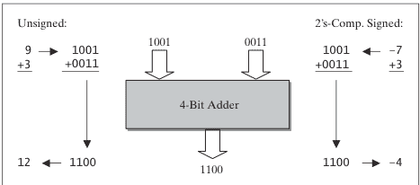

FIGURE 3-1 One adder for both unsigned and 2's-complement signed numbers.

then implement a single circuit with one control input that will compute either A + B or A – B by simply using a set of exclusive-OR gates as a controlled inverter that passes either B or its inverse to the adder, as shown in Figure 3-2.

There are minor differences, however, in how other operations are implemented. Suppose, for example, that we need to compare two integers X and Y. Knowing their bit patterns is not sufficient to determine which represents the greater value. For example, 1001 is not always greater than 0011. That is true only if these patterns represent unsigned integers. If they represent signed integers, then 0011 represents the greater value.

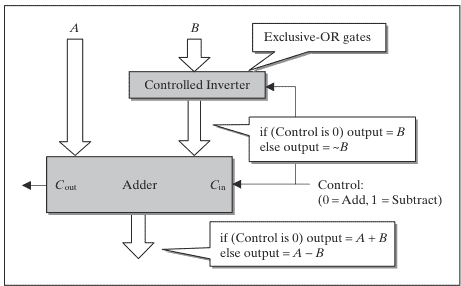

FIGURE 3-2 Modified adder performs both addition and subtraction.


| C 源代码 | 编译器生成的指令 |
| :--- | :--- |
| `signed int x, y; ... if (x > y) doit();` | LDR R0, x<br>LDR R1, y<br>CMP R0, R1<br>BLE EndIf<br>BL doit<br>EndIf: |
| `unsigned int x, y; ... if (x > y) doit();` | LDR R0, x<br>LDR R1, y<br>CMP R0, R1<br>BLS EndIf<br>BL doit<br>EndIf: |

图 3-3 比较两个整数的指令取决于它们的声明方式。

该方法是计算它们的差值，而不考虑操作数是有符号还是无符号，然后检查差值的特征——借出位和（对于有符号整数）结果的符号以及是否发生溢出。借出位决定了两个无符号操作数中哪个更大，但对于有符号操作数，我们必须查看差值的符号以及是否发生溢出。

虽然可以使用单个减法器来计算差值，但为了确定两个值中哪个更大，计算机必须检查结果的特征。在图 3-3 中，编译器生成使用比较（CMP）指令来计算差值 X – Y 的代码。它实际上会丢弃这个差值，只保存差值的特征，然后在随后的比较中使用条件分支指令利用该信息。如你所见，编译器生成的用于比较两个整数的代码针对有符号和无符号操作数使用不同的条件跳转指令（图 3-3）。

| 借出位 | 关系 | X – Y 的符号 | 溢出 | 关系 |
| :--- | :--- | :--- | :--- | :--- |
| 0 | X ≥ Y | 正 | 否 | X ≥ Y |
| 1 | X < Y | 负 | 是 | X ≥ Y |
| | | 正 | 是 | X < Y |
| | | 负 | 否 | X < Y |

图 3-4 比较有符号和无符号整数。

有符号和无符号整数的乘法和除法工作方式的差异也要求我们为这些操作使用不同的机器指令。

### 3.2 乘法和除法

与加法或减法相比，乘法和除法本质上是更复杂的操作，涉及多个中间计算。一些最廉价和较旧的处理器甚至不提供乘法或除法指令，要求这些操作在软件中实现。设计带有乘法和除法指令的处理器涉及芯片面积和执行时间之间的设计权衡。一种解决方案是将中间步骤实现为顺序过程，只需要少量数字电路，但会导致显著更长的执行时间。另一方面，执行时间可以更快，但前提是通过使用更多数字电路并行计算中间步骤。这些问题促使程序员寻找存在更快、更高效乘除方法的情况。

#### 3.2.1 有符号与无符号乘法

计算机通常有两种不同的乘法指令：一种用于无符号操作数，另一种用于有符号（补码）操作数。有趣的是，两者的区别只出现在它们双长乘积的最高位半部分。

考虑两个 4 位操作数，其位模式为 1100 和 0110。作为无符号数，它们的十进制等效值为 12 和 6，乘积为 72，表示为双长乘积 0100 1000。但是，如果将其解释为有符号补码数，它们的十进制等效值为 -4 和 +6，乘积为 -24，表示为 1110 1000。

在像 C 这样的高级编程语言中，当你乘两个相同类型的数字时，乘积也是相同的类型。换句话说，两个 n 位整数的乘积也将是一个 n 位整数。这意味着编译器生成的代码实际上会丢弃乘积的最高位半部分，因此编译器可以使用有符号或无符号乘法指令。

在某些处理器上，有符号乘法的执行时间可能比无符号乘法稍长。因此，如果你在汇编语言中编程，并将乘积存储在与用于生成它的操作数大小相同的变量中，则始终使用无符号乘法！

#### 3.2.2 用移位代替乘以或除以 2 的幂

最廉价的微处理器有时不提供整数乘法或除法指令，或者执行此类指令的速度远慢于整数加法或减法指令。然而，乘以 2 的幂可以轻松实现为左移，通常只需很少时钟周期即可执行：

```
2^k × A = A << k (A is shifted left by k bits)
```

这适用于 A 的正值和负值。

正操作数可以通过右移除以 2 的幂，如下所示：

```
A / 2^k => A >> k (A is shifted right by k bits)
```

然而，负操作数更成问题。首先，我们必须使用保留符号位的“算术”右移。与常规（“逻辑”）右移将 0 移入最高位不同，算术右移用其先前值的副本填充最高位。例如，将 8 位补码数 –80₁₀ (10110000₂) 除以 2¹ 应该产生 –40₁₀ (11011000₂)。重复该过程可除以更高的 2 的幂。也就是说，算术右移 –80₁₀ 两次会产生 11101100₂ (–20₁₀)。

另一个问题是，当被除数既为负数又为奇数时，算术右移与整数除法之间的差异。例如，–1 除以 2 为 0，但如果对其进行算术右移，结果将是 –1。问题在于这两种操作处理商的小数部分的方式不同。将 –15 除以 2 理想情况下应产生 –7.5 的商，但当然整数除法会丢弃结果的小数部分，只留下整数 –7。除法总是向 0 截断，而算术右移总是向负无穷截断。这种差异仅在负奇数上出现：

| 操作数 | 操作 | 真实商 | 整数商 | 算术右移 |
| :--- | :--- | :--- | :--- | :--- |
| 正数 & 偶数 | +10 ÷ 2 | +5.0 | +5 | +5 |
| 正数 & 奇数 | +11 ÷ 2 | +5.5 | +5 | +5 |
| 负数 & 偶数 | –10 ÷ 2 | –5.0 | –5 | –5 |
| 负数 & 奇数 | –11 ÷ 2 | –5.5 | –5 | –6 |

如果在移位前始终将负被除数的大小减一，可以纠正负奇被除数引入的错误：

| 操作数 | 原始操作 | 调整后的被除数 | 算术右移 |
| :--- | :--- | :--- | :--- |
| 正数 & 偶数 | +10 ÷ 2 | +10 | +5 |
| 正数 & 奇数 | +11 ÷ 2 | +11 | +5 |
| 负数 & 偶数 | –10 ÷ 2 | –9 | –5 |
| 负数 & 奇数 | –11 ÷ 2 | –10 | –5 |

移位前的调整可以作为一个“if”语句实现，仅在被除数为负时向其加 +1。然而，处理器的设计旨在优化从内存顺序获取的指令的执行，因为绝大多数代码是不分支的“直线”代码。任何偏离顺序执行（“if”语句固有的）的行为都会打断顺序流并造成我们尽可能希望避免的微小延迟。幸运的是，有更好的方法来进行移位前的调整。许多处理器可以使用单条指令扩展整数的符号，有效地将其表示的位数加倍：
11101010 -> 11111111 11101010，或
00101011 -> 00000000 00101011

当解释为整数时，符号扩展（结果的最高位半部分）对于正操作数为 0，对于负操作数为 -1。这可以用于通过在移位前从操作数中减去符号扩展来纠正算术右移的结果。

#### 3.2.3 乘以任意常量

乘以 2 的幂以外的常量有时可以使用移位、加法和减法的序列更高效地实现。取决于处理器，这些指令的执行速度可以比乘法快多达 50 倍，因此可以是一种有效的替代方案。然而，对于任何特定常量，通常存在多个可能的序列，最佳选择取决于常量的二进制位模式。一般来说，表示中包含孤立 1 的常量最好使用加法实现，而包含 1 序列的常量最好使用减法实现：

| 十进制常量 | 8 位二进制表示 | 最优分解 | 指令数量 |
| :--- | :--- | :--- | :--- |
| +74 | 01001010 | 2^6A + 2^3A + 2^1A | 3 次移位和 2 次加法 |
| +30 | 00011110 | 2^5A - 2^1A | 2 次移位和 1 次减法 |
| -14 | 11110010 | -2^4A + 2^1A | 2 次移位和 1 次减法 |
| -17 | 11101111 | -2^4A - 2^0A | 1 次移位和 2 次减法 |

重新排列分解可以使实现更容易构想。例如，+9 的分解可以重写为 2^1 x (A + 2^2 x (A + 2^2 A))。从右到左处理表达式，指令序列变为：

- 1. 获取 A 的副本：-> A
- 2. 左移 3 位：-> 2^3 A
- 3. 加上 A：-> A + 2^3 A
- 4. 左移 2 位：-> 2^2 (A + 2^3 A)
- 5. 加上 A：-> A + 2^2 (A + 2^3 A)
- 6. 左移 1 位：-> 2^1 (A + 2^2 (A + 2^3 A))


许多现代精简指令集计算机（RISC）微处理器（例如 ARM 处理器芯片系列）能够预移位任何指令的操作数，从而实现更高效的实现。

- 1. 获取 A 的副本，左移 6 位：→ 2^6 A
- 2. 加上 A，左移 3 位：→ 2^5 A + 2^2 A
- 3. 加上 A，左移 1 位：→ 2^5 A + 2^3 A + 2^1 A

#### 3.2.4 除以任意常量

如果除数是常量但没有除法指令，只要处理器有乘法指令，仍然可以利用倒数乘法原理进行除法。原则上，我们只需乘以 1/B，而不是除以 B：

A / B = A x (1/B)

当然问题是，对于任何大于 1 的 B，1/B 都为零。为解决此问题，使用 2^k / B 代替 1/B，并通过将结果算术右移 k 位来除以 2^k。

A x (1/B) = [A x (2^k/B)] x 2^-k

= [A x (2^k/B)] >> k

由于乘法指令生成双长乘积 P，最高位半部和最低位半部始终保留在一对单长存储位置中，即 P_hi 和 P_lo。如果选择 k 与处理器的基本字长相同，那么不必将 P 右移 k 位，而可以直接从更高位半部 P_hi 中取得商。

倒数乘法可能在商中引入误差。当 2^k/B 不是整数时，舍弃小数部分会得到一个值略小的乘数。如果差异足够大，得到的商也会偏小。不过，可以通过将余数计算为被除数减去 B 与商的乘积来纠正这一点。如果余数大于除数，则必须将 1 加到商中。

### 3.3 定点实数运算

许多嵌入式应用几乎不需要或根本不需要实数。当需要实数时，出于各种原因，定点实数比浮点数更常见。处理器可能没有浮点指令，带有浮点功能的处理器可能会增加过多成本，或者使用浮点数可能会导致不可接受的性能损失。

缩放提供了一种使用与整数相同的硬件来处理实数的方法。例如，8 位数 01011110 解释为整数时的十进制值为 94。但是，如果假设隐含小数点右侧有 3 位（如 01011.110），则十进制解释变为 11.75。实际上，该整数已通过除以 $2^3$ 进行缩放，其中指数由小数点右侧的位数决定。

如表 3-1 所示，如果对共享共同缩放因子的两个定点实数进行加法或减法，结果也将具有相同的缩放因子。

缩放因子不同的操作数在加法或减法前必须对齐。为此，移位一个操作数，直到两者的小数点对齐且缩放因子相等。如果移位的是小数位数较少的操作数（如表 3-2 所示），则必须小心所需的左移不会导致溢出。如果移位的是小数位数较多的操作数，则必须小心所需的右移不会导致精度损失（如表 3-3 所示）。两种方法都可以使用，但得到的和或差的缩放因子会有很大不同。

| 操作数 / 结果 | 位模式 | 整数 | 缩放因子 | 值 |
|---|---|---|---|---|
| A | 00011.110 | +30 | $2^3$ | +3.750 |
| B | 00110.011 | +51 | $2^3$ | +6.375 |
| A + B | 01010.001 | +81 | $2^3$ | +10.125 |
| A - B | 11101.011 | -21 | $2^3$ | -2.625 |

| 操作数 / 结果 | 位模式 | 整数 | 缩放因子 | 值 |
|---|---|---|---|---|
| A | 0001001.1 | 19 | $2^1$ | +9.500 |
| B | 00011.110 | 30 | $2^3$ | +3.750 |
| $2^2 \times A$ | 01001.100 | 76 | $2^3$ | +9.500 |
| $2^2 \times A + B$ | 01101.010 | 106 | $2^3$ | +13.250 |

| 操作数 / 结果 | 位模式 | 整数 | 缩放因子 | 值 |
|---|---|---|---|---|
| A | 0001001.1 | 19 | $2^1$ | +9.500 |
| B | 00011.110 | 30 | $2^3$ | +3.750 |
| $B \div 2^2$ | 0000011.1 | 7 | $2^1$ | +3.500 |
| $A + B \div 2^2$ | 0001101.0 | 26 | $2^1$ | +13.000 |

与任何定精度方案一样，我们必须小心溢出。定点实数的加法和减法与整数一样容易溢出。如果需要，可以通过将两个操作数预先右移 1 位来避免溢出，即预先调整它们的缩放因子，用一位精度换取一位范围。

乘法和除法不要求操作数的小数点对齐。例如，乘积 A × B 中的小数位数只是 A 的小数位数加上 B 的小数位数之和（表 3-4）。除以两个定点实数类似于乘法的逆运算：商 A ÷ B 中的小数位数是 A 的小数位数减去 B 的小数位数（表 3-5）。

您可能已经注意到，表 3-5 中的商并不完全准确⁴，因为整数除法会将结果截断为小于或等于精确商的最大整数。我们可以通过在除法前尽可能将被除数左移来提高结果的准确性，如表 3-6 所示。当然，这会改变被除数的缩放因子（因此也改变商的缩放因子），但它在结果中提供了更多的小数位数，从而获得更准确的结果。

### 表 3-4 定点实数乘法

| 操作数 / 结果 | 位模式 | 整数 | 缩放因子 | 值 |
|---|---|---|---|---|
| A | 0000000000111.110 | 30 | 2² | +3.7500 |
| B | 00000000000110.011 | 51 | 2² | +12.7500 |
| A × B | 000001011111.1010 | 1530 | 2⁵ | +478125 |

### 表 3-5 定点实数除法

| 操作数 / 结果 | 位模式 | 整数 | 缩放因子 | 值 |
|---|---|---|---|---|
| A | 000001011111.1010 | 1530 | 2³ | +478125 |
| B | 00000000000110.011 | +115 | 2³ | +14.3750 |
| A ÷ B | 00000000000011.011 | 13 | 2² | +3.2500 |

### 表 3-6 定点实数除法前的移位

| 操作数 / 结果 | 位模式 | 整数 | 缩放因子 | 值 |
|---|---|---|---|---|
| 2³ × A | 0010111111010000 | 12240 | 2⁸ | +478125 |
| B | 0000000000110.0110 | -115 | 2¹ | +14.3750 |
| 2³ × A ÷ B | 00000000001101010 | 106 | 2² | +3.3125 |

尽可能将我们的虚拟小数点向左移动，可以使定点值以更高的精度表示。因此，对于任何给定变量，我们都应始终选择尽可能大的负指数的缩放因子，同时仍保留足够的整数位以获得合理的值范围。

#### 3.3.1 使用通用 16.16 格式的定点数

为定点变量找到最佳缩放因子需要知道其在执行期间的取值范围。然而，当范围和分辨率要求适中时，一种简单的方法是对所有定点数使用 32 位，其中整数部分和小数部分各占 16 位（图 3-5）。

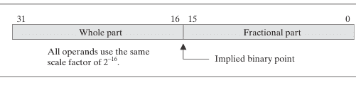

当所有操作数使用相同的缩放因子时，加法和减法不再需要预先对齐操作数。但是，乘法和除法仍然需要 *一些* 调整，否则结果将不会与操作数具有相同的缩放因子。请记住，当将两个定点操作数相乘时，它们的缩放因子也会相乘：

```
Product = (A + 2^16) x (B + 2^16)
       = (A x B) + 2^32
```

我们需要的是 16.16 格式的乘积（即缩放因子为 2^16 的结果）。换句话说，整数乘积需要右移 16 位。将两个 32 位整数相乘会产生一个 64 位乘积，其中间隐含一个二进制小数点。将此乘积右移 16 位，然后将结果放回 32 位位置，意味着我们丢弃了整数乘积两端各 16 位。丢弃最低 16 位仅会导致一定的精度损失；丢弃最高 16 位需要对操作数施加最大幅度限制以避免溢出（图 3-6）。

```
Quotient = (A + 2^16) / (B + 2^16)
        = (A / B) + 2^0
        = A + B
```


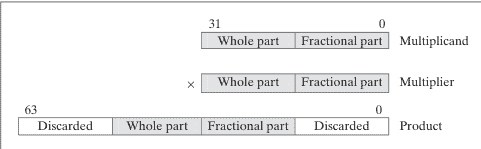

图 3-6 使用整数乘法生成定点乘积。

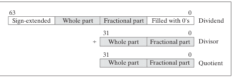

图 3-7 使用整数除法生成定点商。

再次强调，需要的是一个缩放因子为 2^16（而非 2^0）的结果！不过，与其将商左移 16 位，不如将被除数左移，因为 64 位被除数除以 32 位除数会产生 32 位商。鉴于有额外的被除数位，最好将符号扩展的被除数预先左移 16 位，如图 3-7 所示。

定点乘法和除法通常实现为汇编语言编写的函数，以便利用大多数处理器整数指令集中提供的双长乘积和被除数。这使得在汇编语言和 32 位处理器上实现 16.16 格式定点数的乘法和除法相当直接。然而，在高级语言（如 C）中实现则存在问题，因为操作数和结果都使用单一数据类型（因此也是单一字长）。

#### 3.3.2 使用通用 32.32 格式的定点数

16.16 格式的范围限制在约 ±32767，小数点右侧精度约为五位十进制数字。当内存空间不是问题时，通过为所有定点数使用 64 位（整数部分和小数部分各 32 位），可以显著提高范围和精度（图 3-8）。5

#### 3.3.3 32.32 定点实数的乘法

到现在，你可以猜到 32.32 格式在 64 位处理器上最容易实现。不幸的是，64 位处理器通常被认为对于几乎所有嵌入式应用来说都太昂贵了。作为在 32 位处理器上实现 32.32 定点运算的示例，让我们来考虑乘法。由于乘法是如此基本的运算，我们的目标是通过设计一种算法来最大化性能，该算法可以用汇编语言编写，使用常规 32 位整数运算，且不使用任何循环或分支。

我们的策略是先考虑如何计算两个 64 位无符号整数的 128 位乘积，然后修改该结果以处理有符号整数。接下来，我们使用 32.32 缩放来选择保留 128 位乘积中的哪 64 位，并注意丢弃其余部分如何简化计算。

考虑一个 64 位整数 A，其位按小端格式编号（A63A62...A0）。A 的无符号值可以通过多项式求值表示为：

```
A_u = 2^63 A_63 + 2^62 A_62 + ... + 2^0 A_0
```

将第一项与其余部分分开，我们得到

```
A_u = 2^63 A_63 + (2^62 A_62 + ... + 2^0 A_0)
= 2^63 A_63 + A_62..0 (where A_62..0 = 2^62 A_62 + ... + 2^0 A_0)
```

因此，两个 64 位无符号整数的 128 位乘积为

```
A_u B_u = (2^63 A_63 + A_62..0) x (2^63 B_63 + B_62..0)
= 2^126 A_63 B_63 + 2^63 A_63 B_62..0 + 2^63 B_63 A_62..0 + A_62..0 B_62..0
```

5 这种方法曾用于索尼 PlayStation，其 MIPS 处理器没有浮点单元。

现在，考虑当位被解释为 64 位有符号整数时会发生什么。首先，请注意 A 的有符号值可以表示为

$A_s = -2^{63} A_{63} + (2^{62} A_{62} + \cdots + 2^0 A_0) = -2^{63} A_{63} + A_{62..0}$

因此，两个 64 位有符号整数的 128 位乘积为

$A_s B_s = (-2^{63} A_{63} + A_{62..0}) \times (-2^{63} B_{63} + B_{62..0}) = 2^{126} A_{63} B_{63} - 2^{63} (A_{63} B_{62..0} + B_{63} A_{62..0}) + A_{62..0} B_{62..0}$

这与 $A_u B_u$ 仅在中间项的符号上有所不同，因此我们可以简单地计算 $A_s B_s$ 为：

$A_s B_s = A_u B_u - 2 \times 2^{63} (A_{63} B_{62..0} + B_{63} A_{62..0}) = A_u B_u - 2^{64} A_{63} B_{62..0} - 2^{64} B_{63} A_{62..0}$

图形上，乘积 $A_s B_s$ 的计算如图 3-9 所示。

请记住，图 3-9 中最后两个部分积的最高位中显示的 0 是因为 $A_{62..0}$ 和 $B_{62..0}$ 是 63 位（而非 64 位）无符号值。

A 和 B 以 32.32 格式存储定点实数；鉴于 $A_s B_s$ 将以相同格式存储，我们必须从部分积的两端各丢弃 32 位，以保持正确的 32.32 缩放，如图 3-10 所示。

在 32 位处理器上使用整数乘法计算乘积 $A_u B_u$ 的中间 64 位（即上述三项中的第一项）的方法是将每个 64 位操作数分解为两个 32 位半部（即 $A_u = 2^{32} A_{hi} + A_{lo}$ 和 $B_u = 2^{32} B_{hi} + B_{lo}$），然后组合交叉乘积：

$A_u B_u = (2^{32} A_{hi} + A_{lo}) \times (2^{32} B_{hi} + B_{lo}) = 2^{64} A_{hi} B_{hi} + 2^{32} (A_{hi} B_{lo} + A_{lo} B_{hi}) + A_{lo} B_{lo}$

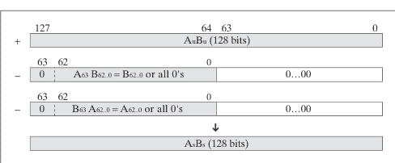

图 3-9 从无符号乘积计算有符号定点乘积。

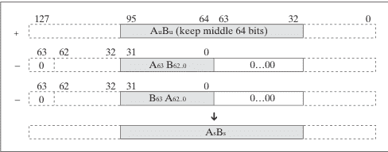

图 3-10 从 64.64 格式转换为 32.32 定点格式。

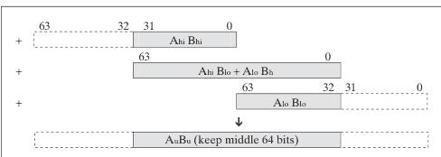

图 3-11 计算 32.32 无符号定点乘积。

我们只保留中间 64 位，因此可以丢弃 A_hi B_hi 的 32 位高半部和 A_lo B_lo 的 32 位低半部，如图 3-11 所示。

计算有符号乘积 A_s B_s 所剩下的全部工作是：根据条件，从无符号乘积 A_u B_u 的高半部中减去 A_62..0 和 B_62..0 的低半部（见图 3-11）。请注意，A 与 A_62..0 之间以及 B 与 B_62..0 之间的唯一区别是最高位位置；这一点无关紧要，因为我们在减法中仅使用了它们的低半部。因此，要将无符号乘积转换为有符号乘积，只需在 A 为负（A_63 = 1）时从无符号乘积 A_u B_u 的高半部中减去 B 的低半部，并在 B 为负（B_63 = 1）时减去 A 的低半部。6

6 请注意，通过调整高半部将无符号乘积更改为有符号乘积，与前面关于有符号乘法和无符号乘法之间差异的讨论有关。

#### 3.3.4 示例：相乘两个 4.4 定点实数

为说明整个算法，请考虑相乘两个数 A 和 B 的问题，每个数都表示为 2 的补码 4.4 定点实数。为简化示例，假设要在 4 位微处理器上实现该算法，其无符号乘法指令从两个 4 位操作数生成一个 8 位乘积。

令 A = -1.50₁₀ = 1110.1000₂ 注：作为无符号整数，Aᵤ = 11101000₂ = 232₁₀

令 B = +2.75₁₀ = 0010.1100₂ 注：作为无符号整数，Bᵤ = 00101100₂ = 44₁₀

16 位乘积 AᵤBᵤ 应为 232 × 44 = 10208₁₀。以下表达式显示了在 4 位 CPU 上如何计算它：

AᵤBᵤ = 2⁸AₕBₕ + 2⁴(AₕBₗ + AₗBₕ) + AₗBₗ
= 2⁸(1100 x 0010) + 2⁴((1100 x 1100 + 1000 x 0010) + (1000 x 1100)
= 2⁸(00011000) + 2⁴(10101000 + 00010000) + 01100000

2 的幂仅确定各个 8 位部分积应如何对齐：

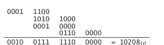

请记住，在此基础上，我们实际上只需要中间 8 位（01111110）。剩下的全部工作是：根据 B 和 A 的符号（分别）有条件地减去 A 和 B 的低半部。由于只有 A 为负，我们只需从上面计算出的 8 位的高半部中减去 B 的低半部：

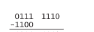

插入二进制小数点并转换为十进制以进行检查，我们得到：

1011.1110₂ = -0100.0010₂ = -4.125₁₀（正确！）

只要稍加巧思，相乘两个有符号 32.32 定点实数的这个算法就可以实现为直线代码（没有任何循环或分支）。不幸的是，有符号除法的算法要困难得多。然而，在实践中，大多数除法使用常数除数，因此可以重写为乘以常数倒数的等效乘法。只有当除数是变量时，才真正需要定点实数的除法。


## PROBLEMS

- 1. 将无符号值除以 8 需要向哪个方向移位，以及需要多少次一位移位？

- 2. 对 x 应用的移位、加法和减法运算的最短序列是什么，可以产生：
  - (a) 21 倍的 x？
  - (b) 57 倍的 x？
  - (c) 100 倍的 x？
  - (d) 188 倍的 x

- 3. 考虑一个 6.6 格式的 12 位定点实数。以下各项是多少：
  - (a) 十进制中最大的正值是多少？二进制中是多少？
  - (b) 十进制中最大的负值是多少？二进制中是多少？
  - (c) 十进制中最小的（非零）正值是多少？二进制中是多少？
  - (d) 十进制中最小的负值是多少？二进制中是多少？

- 4. 使用以下方法将两个 4 位数 0110 和 1011₂ 相乘，给出 8 位二进制乘积及其十进制等效值：
  - (a) 无符号乘法？
  - (b) 有符号乘法？

- 5. 两个 n 位整数相乘时的溢出通常定义为乘积超出 n 位可表示的范围。假设 n 为 8，一个操作数的值为 100。给出另一个操作数的两个值，这两个值相差 1，使得一个乘积溢出而另一个不溢出。

- 6. 将以下两个 16 位定点有符号实数相乘，并将结果转换为另一个 16 位定点有符号实数：

| | 15 | 14 | 13 | 12 | 11 | 10 | 9 | 8 | 7 | 6 | 5 | 4 | 3 | 2 | 1 | 0 |
|---|---|---|---|---|---|---|---|---|---|---|---|---|---|---|---|---|
| -25 1/3 | 1 | 1 | 0 | 0 | 1 | 1 | 1 | 0 | 1 | 0 | 0 | 1 | 1 | 1 | 0 | 0 |
| +2.5625 | 0 | 0 | 0 | 0 | 1 | 0 | 1 | 0 | 1 | 0 | 0 | 0 | 0 | 0 | 0 | 0 |
| | 0 | 0 | 1 | 0 | 1 | 0 | 0 | 0 | 1 | 0 | 0 | 0 | 0 | 0 | 0 | 0 |

- 确定所需的缩放因子，以在不丢失整数部分的情况下最大化结果的小数精度。

- 7. 假设你需要将一个 32 位补码整数变量除以一个常数，但你的 CPU 没有除法指令。
  - (a) 哪种除数值允许使用算术右移？
  - (b) 如何确定将被除数移动多少位？
  - (c) 如果移位，哪种被除数值会导致结果相差 1？

- 8. 假设除数使得无法通过简单的算术右移进行除法，因此必须使用倒数乘法。
  - (a) 这种方法是否总是产生与整数除法指令相同的商？
  - (b) 如何确定常数乘数的整数值？
  - (c) 将两个 32 位数相乘会产生一个 64 位乘积。这些位的哪个子集保存整数商？
  - (d) 倒数乘法有时会产生不如真实除法准确的结果。何时倒数乘法会产生正确的整数商？

- 9. 假设你使用生成 64 位双长乘积的整数乘法指令来相乘两个 32 位数。假设一个数是 32 位整数，另一个数是 16.16 定点实数。
  - (a) 产品的整数部分占多少位？
  - (b) 产品的小数部分占多少位？

- 10. 使用值 -2.5₁₀ 和 -1.75₁₀ 重现第 3.3.4 节示例中的所有步骤。

## 充分利用 C

本章假设你已经学习过 C、C++ 或 Java 编程入门。掌握其中任何一种语言即可进行 C 语言编程，因为这三种语言在数据类型、声明、表达式和控制语句方面共享通用语法。

很少有学生能在第一门编程课程中掌握一门编程语言。本章并非对 C 语言的完整讲解，也无意如此。不过，它确实提供了几个完整的 C 程序示例，以帮助巩固基础。如果你的唯一经验是 C++ 或 Java，那么从面向对象编程风格转向 C 语言使用的过程式编程风格可能需要一段时间，请不要感到惊讶。

每种编程语言都有其自身的语法和语义特性。其中一些特性在面向实时嵌入式系统编写的软件中比在普通桌面应用程序中更具重要性。为嵌入式系统编写软件需要仔细理解整数数据类型以及操作位和字节的设施。本章详细描述了这些特性的实现方式，使用了大多数入门课程中省略或仅简要提及的 C 语言特性，并且通常需要多年经验才能掌握。

### 4.1 整数数据类型

1989 年，国际标准化组织发布了 C89 标准（通常称为 ANSI C），定义了一组广泛的整数数据类型，如表 4-1 所示。保留字 char 和 int 是基本数据类型的名称，带有 unsigned、signed、short、long 和 long long 修饰符。如果声明中出现一个或多个修饰符，通常理解保留字 int 并可以省略。如果既不使用 signed 也不使用 unsigned，则默认假设为 signed。

表 4-1 给出的大小和范围是典型的，但 C89 并未强制要求。事实上，1989 年标准允许三种可能的有符号表示：符号加幅值、1 的补码和 2 的补码。当用于存储整数时，基本数据类型 char 可能默认为有符号或无符号，而基本数据类型 int 的大小可能介于 short 和 long int 之间。

在嵌入式应用中，通常必须知道变量的确切位数和范围。1999 年 ISO C99 标准引入了几种新数据类型，以消除数据类型大小和范围的歧义，这些类型在 C99 引入的新 stdint.h 头文件中有记录，并且现在已被大多数 C 编译器广泛实现（表 4-2）。

表 4-1 ISO C89 (ANSI C) 中的基本整数数据类型

| 有符号类型 | 典型大小 | 典型范围 |
| :--- | :--- | :--- |
| signed char | 8 bits | –128 到 +127 |
| signed short int | 16 bits | –32,768 到 +32,767 |
| signed long int | 32 bits | –2,147,483,648 到 +2,147,483,647 |
| signed long long int | 64 bits | –2^63 到 +(2^63 – 1) |
| 无符号类型 | 典型大小 | 典型范围 |
| unsigned char | 8 bits | 0 到 255 |
| unsigned short int | 16 bits | 0 到 65,535 |
| unsigned long int | 32 bits | 0 到 4,294,967,295 |
| unsigned long long int | 64 bits | 0 到 18,446,744,073,709,551,615 |

注意：ANSI C 未指定这些整数类型的大小或值范围，但要求其大小至少与上述列出的一样大。当不使用修饰符时，基本数据类型 int 不得小于 short int，也不得大于 long int。long long 整数类型很常见，但直到 1999 年的 ISO C99 标准才正式成为 C 语言的一部分。

表 4-2 ISO C99 标准中的其他整数数据类型

| 有符号类型 | 指定大小 | 指定范围（2 的补码） |
| :--- | :--- | :--- |
| int8_t | 8 bits | –128 到 +127 |
| int16_t | 16 bits | –32,768 到 +32,767 |
| int32_t | 32 bits | –2,147,483,648 到 +2,147,483,647 |
| int64_t | 64 bits | –9,223,372,036,854,775,808 到 +9,223,372,036,854,775,807 |
| 无符号类型 | 指定大小 | 指定范围 |
| uint8_t | 8 bits | 0 到 255 |
| uint16_t | 16 bits | 0 到 65,535 |
| uint32_t | 32 bits | 0 到 4,294,967,295 |
| uint64_t | 64 bits | 0 到 18,446,744,073,709,551,615 |

虽然新的 C99 整数数据类型对嵌入式应用是一个重要的补充，但仍有一些编译器不支持它们。¹ 在大多数情况下，一个简单的解决方法是创建包含新类型名称 typedef 声明的自定义头文件。如所示，C99 预定义宏 (__STDC_VERSION__) 可用于向 C99 兼容编译器隐藏这些声明。

```
#ifndef __STDC_VERSION__
typedef signed       char     int8_t ;
typedef signed       short int int16_t ;
```

¹ Microsoft Visual Studio 2010 C 编译器不支持 C99。


```c
typedef signed long int int32_t ;
typedef signed long long int int64_t ;
typedef unsigned char uint8_t ;
typedef unsigned short int uint16_t ;
typedef unsigned long int uint32_t ;
typedef unsigned long long int uint64_t ;
#endif
```

#### 4.1.1 整数范围和标准头文件 LIMITS.H

在为不支持 C99 标准的编译器定义自己的数据类型之前，您应该验证基本整数数据类型的大小和范围是否与表 4-1 所示相同。大多数编译器都提供一个名为 limits.h 的标准头文件，用于指定编译器实现的整数类型的范围。每种类型支持的最小值和最大值由宏指定，如表 4-3 所示。

| 数据类型 | 最小值 | 最大值 |
|---|---|---|
| signed char | SCHAR_MIN | SCHAR_MAX |
| signed short int | SHRT_MIN | SHRT_MAX |
| signed long int | LONG_MIN | LONG_MAX |
| signed long long int | LLONG_MIN | LLONG_MAX |
| unsigned char | 0 | UCHAR_MAX |
| unsigned short int | 0 | USHRT_MAX |
| unsigned long int | 0 | ULONG_MAX |
| unsigned long long int | 0 | ULLONG_MAX |

您也可以编译并运行示例 4-1 中的程序，以检查任何 C 编译器的整数数据类型的大小和范围（图 4-1）。该程序通过计算需要多少次 1 位移位才能清空操作数中的所有 1 来测量每种数据类型的大小。

然后，程序通过将操作数与在其最高位中带有 1 的值与零进行比较来确定数据类型是否为无符号类型。只有当数据类型为有符号类型时，操作数的值才会被解释为小于零。

如果数据类型是有符号类型，程序会通过检查它如何表示 -1 的值来确定表示形式是补码、反码还是符号加幅值。三种表示形式的最大值（最大正值）始终相同。最小值（最小负值）由该表示形式的相应位模式确定。

该程序不尝试计算有符号或无符号 long long 的范围，仅仅是因为一些较旧的不符合 C99 标准的编译器（也是此代码最有用的编译器）不支持这些数据类型。

```c
#include <stdio.h>

#define LSB1(type, bits)                      (1)
#define MSB1(type, bits)                      (((type) 1) << (bits-1))
#define BOTH(type, bits)                      (LSB1(type, bits) | MSB1(type, bits))
#define ALL1(type, bits)                      (~((type) 0))

#define UNSIGNED(type, bits)                  ((type) MSB1(type, bits) > 0)
#define TWOSCOMP(type, bits)                  (ALL1(type, bits) == -1)
#define ONESCOMP(type, bits)                  (~LSB1(type, bits) == -1)
#define SIGNPLUS(type, bits)                  (BOTH(type, bits) == -1)

#define RANGE(type, name)
{
    type minval, maxval, bit ;
    unsigned bits ;
    char *format ;

    /* Measure size of data type in bits */
    bits = 1 ; bit = 1 ; while ((bit <<= 1) != 0) bits++ ;

    if (UNSIGNED(type, bits))
    {
        format = "%2lu" ;
        maxval = ALL1(type, bits) ;
        minval = (type) 0 ;
    }
    else
    {
        format = "%2ld" ;
        maxval = (type) ~MSB1(type, bits) ;

        if (TWOSCOMP(type, bits))
            minval = MSB1(type, bits) ;
        else if (ONESCOMP(type, bits))
            minval = MSB1(type, bits) ;
        else if (SIGNPLUS(type, bits))
            minval = ALL1(type, bits) ;
    }

    printf("%20s (%2u bits): ", name, bits) ;
    printf(format, (long) minval) ;
    printf(" to ") ;
    printf(format, (long) maxval) ;
    printf("\n") ;
}
```

示例 4-1 显示 C 整数类型的大小和范围（第 I 部分）。

```c
void main()
{
    printf("\nTesting range of UNSIGNED ints ...\n\n" ) ; 
    RANGE(unsigned char,       "unsigned char"     ) ; 
    RANGE(unsigned short int,  "unsigned short int" ) ; 
    RANGE(unsigned int,        "unsigned int"      ) ; 
    RANGE(unsigned long int,   "unsigned long int" ) ; 

    printf("\nTesting range of SIGNED ints ...\n\n" ) ; 
    RANGE(signed char,         "signed char"       ) ; 
    RANGE(signed short int,    "signed short int"  ) ; 
    RANGE(signed int,          "signed int"        ) ; 
    RANGE(signed long int,     "signed long int"   ) ; 
}
```

示例 4-1 显示 C 整数类型的大小和范围（第 II 部分）。

```
Testing range of UNSIGNED ints ...
    unsigned char ( 8 bits):      0 to        255
    unsigned short int (16 bits): 0 to      65535
    unsigned long int (32 bits):  0 to 4294967295

Testing range of SIGNED ints ...
    signed char ( 8 bits):   -128 to        127
    signed short int (16 bits): -32768 to     32767
    signed long int (32 bits): -2147483648 to 2147483647
```

图 4-1 运行示例 4-1 程序的典型结果。

### 4.2 布尔数据类型

原始 C 语言也不包含布尔数据类型，直到 1999 年 C99 标准才加入。传统上，C 使用整数数据类型来存储布尔值。为了向后兼容，C99 创建了一个名为 _Bool 的新原始整数数据类型，该类型只能保存 0 和 1 的值，以及一个名为 stdbool.h 的新标准头文件，包含以下宏定义：

```c
#define bool    _Bool
#define false   ((_Bool) 0)
#define true    ((_Bool) 1)
```

2 零值被解释为布尔假，任何其他值（即使是负值）都被解释为真。布尔运算符保证产生的结果要么是 0（假），要么是 1（真）。

旧版 C 编译器缺乏布尔数据类型和常量，这会影响可读性。有几种可能的补救措施可以创建您自己的“伪”布尔数据类型。例如，一种流行的解决方案是简单地使用宏将布尔值映射到字节上，如下所示：

```c
#ifndef _STDC_VERSION__
#define bool unsigned char
#define false 0
#define true 1
#endif
```

或者使用 typedef 声明，如下所示：

```c
#ifndef _STDC_VERSION__
typedef unsigned char bool ;
const unsigned char false = 0 ;
const unsigned char true = 1 ;
#endif
```

第三种替代方案是通过将 bool 定义为枚举类型来实现：

```c
#ifndef _STDC_VERSION__
typedef enum {false = 0, true = 1} bool ;
#endif
```

虽然此定义可能看起来更直观合适，但并没有严格强制执行可以分配给枚举类型的值。大多数 C 编译器使用 int 作为枚举类型的底层实现，因此会允许将任何整数常量分配给此类变量。

### 4.3 混合数据类型

有时一点知识可能是危险的。了解何时将整数变量声明为有符号类型、何时使用无符号类型，最终会导致同时使用两者的程序。然而，这种细节级别所承担的责任超出了仅指定适当数据类型的范围。

当运算符将有符号整数和无符号整数组合在一起时，C 会在求值表达式之前将有符号整数的数据类型转换为与无符号整数匹配。在这种情况下，底层位模式没有相应的变化，这可能导致意想不到的效果，如下面的代码³所示：

```c
unsigned int u ;
...
if ( u > -1 ) ...
```

上面 if 语句中的条件乍一看可能总是为真，因为无符号整数始终大于或等于零。然而，实际上，该条件始终为假！原因是有符号整数常量 -1（全 1 的字）被转换为无符号，因此被解释为满量程值。

本示例不应被用作反对使用无符号整数的论据。相反，请将其视为正确使用整数所面临挑战的一部分！

然而，某些数据类型转换需要对表示值的位模式进行相应的更改。例如，尽管 4 的有符号和无符号整数表示相同，但 4 的浮点表示完全不同。

转换被认为是数据类型提升或数据类型降级。当转换没有潜在精度损失时（例如，将整数值赋给浮点变量），该转换称为“提升”。相反，当转换可能导致精度损失时（例如，将浮点值赋给整数变量，或将 32 位整数值赋给 8 位 char），则称为降级。降级通常会导致编译器发出警告。

某些转换是隐式发生的，例如，将整数值赋给浮点变量：

```c
double gpa = 4 ;
```

隐式转换始终可以通过使用强制转换来显式化，如下所示：

```c
double gpa = (double) 4 ;
```

括号及其间的数据类型名称构成强制转换运算符，该运算符应用于其右侧的单个操作数。使用强制转换使转换显式化也表明这是有意的，从而消除了由隐式降级引起的警告消息。

### 4.4 操作内存中的位

程序员经常将具有不同但相关含义的多个操作数打包到单个内存位置中。一个示例是旧操作系统 MS/DOS 用于将当前日期和时间存储到单个 32 位位置中的打包表示（图 4-2）：

| 31 ... 25 | 24 ... 21 | 20 ... 16 | 15 ... 11 | 10 ... 5 | 4 ... 0 |
|---|---|---|---|---|---|
| 1980年 | 月 | 日 | 小时 | 分钟 | 秒+2 |

图 4-2 MS/DOS 中使用的日期和时间的打包 32 位表示。

小型嵌入式系统也会打包数据以减少读写内存的数量（从而降低成本）。例如，大型布尔值数组最有效的存储方式是将八个 1 位布尔变量打包到每个字节中，而不是使用整个整数来保存只能是 0 或 1 的值：

```c
uint8_t flags[10] ; /* 80 1-bit Boolean flags, 8 per byte */
```


这些位的操作通常通过一组依赖于 C 语言位运算符的宏或函数来实现。如表 4-4 所示，位运算符和布尔运算符都提供 AND、OR、异或（XOR）和 NOT 等基本操作。但是，布尔运算符用于形成条件表达式（如 `if` 语句中），而相应的位运算符集用于操作位。

| 操作 | 布尔运算符 | 位运算符 |
| :--- | :--- | :--- |
| AND | `&&` | `&` |
| OR | `||` | `|` |
| XOR | `unsupported` | `^` |
| NOT | `!` | `~` |

较旧的 C 编译器不提供布尔数据类型，程序员不得不使用整数变量来存储布尔值。布尔运算符的设计目的是产生类型为 `int` 的结果，其中 true 和 false 分别由 1 和 0 表示。在将整数值解释为布尔值时，零值被视为 false，*任何*非零值都被视为 true。

位运算符作用于操作数中的各个位位置；也就是说，任何单个位位置的结果完全独立于所有其他位位置。如下所示，将位与运算符（`&`）应用于操作数 A 和 B 会产生一个结果，其中位 5 仅取决于 A 的位 5 和 B 的位 5 的值。

如图 4-3 所示，位运算符将每个操作数视为有序位向量并产生位向量结果。然而，布尔运算符将每个多位操作数视为单个值，以解释为 true 或 false。表 4-4 说明了这种差异如何为相同的操作数产生非常不同的结果。

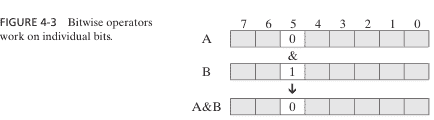

通常，将一个操作数中的某一位视为控制另一个操作数中对应位如何传播到结果的开关，更容易理解位运算符如何用于操作打包的操作数。如表 4-5 至 4-7 所示，控制位（a）的值决定了打包操作数中对应位（b）是保持不变还是反向传播到结果中，或者结果中的该位是被清零还是置 1。

```
Boolean: (5 || !3) && 6
=> (true OR (NOT true)) AND true
=> (true OR false) AND true
=> (true) AND true
=> true
=> 1

Bitwise: (5 | ~3) & 6
=> (00.0101 OR ~00.0011) AND 00.0110
=> (00.0101 OR 11.1100) AND 00.0110
=> (11.1101) AND 00.0110
=> 00.0100
=> 4
```

图 4-4 布尔运算符与位运算符。

#### 4.4.1 测试位

位与运算符常用于测试单个位的值。将一个在感兴趣位位置上包含单个 1 的“掩码”与包含要测试位的打包操作数进行与运算。因此，结果非零当且仅当感兴趣的位为 1。例如，考虑

```
if ((bits & 64) != 0)       /* check to see if bit 6 is set */
```

由于任何非零值都被解释为 true，一些程序员会省略与零的冗余比较，认为（也许）这可能减少汇编语言代码的数量。但是，该比较不会产生额外代码，并提高了可读性。

```
if ((bits & 0x0040) != 0)   /* check to see if bit 6 is set */
```

如所示，掩码（64）通常以十六进制（0x0040）编写，以便更容易识别正在测试哪个位。更好的解决方案是使用如下所示的移位表达式。

```
if ((bits & (1 << 6)) != 0)   /* check to see if bit 6 is set */
```

同样，汇编语言指令的数量没有增加。由于移位运算符的两个操作数都是常量，编译器将用等效常量替换移位表达式。

#### 4.4.2 设置、清零和反转位

将位设置为 1 可以轻松使用位或运算符完成：

```
bits = bits | (1 << 7);        /* sets bit 7 */
```

这通常会更简洁地写成

```
bits |= (1 << 7);             /* sets bit 7 */
```

请注意，我们不会将位加（+）到操作数上！只有当已知操作数中目标位的当前值为 0 时，这才有效。否则，加 1 会在目标位留下 0 并传播进位，从而修改更高位位置中的位。虽然“将位设置为 1”这句话暗示该位原本为 0，但大多数时候该位的当前值实际上是未知的。对 1 进行或运算可确保结果为 1，无论当前值如何，并且在此过程中不会影响操作数的其他位。

将位清零为 0 同样可以使用位与运算符完成：

```
bits &= ~(1 << 7);            /* clears bit 7 */
```

请注意，出于与上述类似的原因，我们不会从操作数中减去该位！

上述赋值的右侧是一个常量，用作位掩码，其中除了位 7 为 0 外，其余均为 1。与运算符使用该 0 将 0 强制写入结果的相应位位置，而其他操作数的所有其他位均保持不变传递。

在清除大小（位宽）大于整数常量（默认类型为 int）的变量中的位时，必须小心用于定义掩码的常量与操作数一样宽。例如，如果变量 ‘bits’ 的类型为 uint64_t，则赋值右侧的 1 也必须在移位前提升到相同的宽度，如

```
bits &= ~(((uint64_t) 1) << 7); /* clears bit 7 */
```

否则，编译器首先会将右侧的常量表达式作为默认 int（通常为 32 位宽）进行求值，然后在生成的常量前填充前导 0 以匹配变量 bits 的宽度。这些额外的 0 将清除结果中非预期的位位置。

反转（或切换）一位可以使用位异或运算符完成：

```
bits ^= (1 << 6); /* flips bit 6 */
```

虽然使用加 1 而不是位异或运算符会反转目标位，但也可能传播进位，从而修改操作数中更高位的位。

#### 4.4.3 提取位

位字段是存储在较大变量中的连续位子集，例如存储在单个 32 位位置中的日期和时间各个组件。提取位字段的值是通过右移来删除字段右侧不需要的位，并与掩码进行与运算以删除左侧不需要的位来完成的（图 4-5）：

| 时间 | 位 15 - 11 | 位 10 - 5 | 位 4 - 0 |
| :--- | :--- | :--- | :--- |
| | 小时 | 分钟 | 秒 + 2 |
| time >> 5 | 位 15 - 11 | 位 10 - 6 | 位 5 - 0 |
| | ????? | 小时 | 分钟 |
| (time >> 5) & 0x3F | 位 15 - 11 | 位 10 - 6 | 位 5 - 0 |
| | 00000 | 000000 | 分钟 |
| minutes = (time >> 5) & 0x3F | 15 | 分钟 | 0 |

图 4-5 从打包的时间表示中提取分钟。

#### 4.4.4 插入位

将新值存储到位字段中，首先需要将其清零为全 0，通过左移将新值与位字段对齐，然后将该值或运算到打包操作数中。如果插入的值可能超过目标位字段的宽度，则在将其或运算到打包操作数之前，最好先将新值与掩码进行与运算（图 4-6）。


| | 位 15 - 11 | 位 10 - 5 | 位 4 - 0 |
|---|---|---|---|
| oldtime | 小时 | 旧分钟 | 秒数 + 2 |
| newtime = oldtime & ~(0x3F << 5) | 小时 | 000000 | 秒数 + 2 |
| newtime |= (newmins & 0x3F) << 5 | 小时 | 新分钟 | 秒数 + 2 |

图 4-6 将分钟插入时间压缩表示中。

### 4.5 操作输入/输出端口中的位

输入和输出设备将信息保存在称为 I/O 端口的位置中。I/O 设备通常有用于数据、状态信息以及控制或命令信息的端口。

命令端口和状态端口包含压缩信息是一种常见的硬件设计做法，如图 4-7 和 4-8 所示。

| 位 7 | 位 6 | 位 5 | 位 4 | 位 3 | 位 2 | 位 1 | 位 0 |
|---|---|---|---|---|---|---|---|
| 载波检测 | 振铃指示 | 数据设备就绪 | 清除发送 | 载波检测变化 | 振铃指示 | 数据设备就绪变化 | 清除发送变化 |

图 4-7 UART 调制解调器状态端口（只读）。

| 位 7 | 位 6 | 位 5 | 位 4 | 位 3 | 位 2 | 位 1 | 位 0 |
|---|---|---|---|---|---|---|---|
| 保留 | 保留 | 保留 | 启用 IRQ | 选择打印机 | 初始化打印机 | 自动换行 | 数据选通 |

图 4-8 并行打印机控制端口（只写）。

某些计算机为内存和 I/O 设备使用独立的地址空间。在这种情况下，I/O 端口只能使用专门用于 I/O 操作的处理器指令来访问。C 语言语法中不直接支持此功能。在这种情况下，必须使用特定于编译器的库函数（或自行编写）来访问 I/O 数据。

在许多情况下（在嵌入式应用中很常见），读写内存的地址空间远大于所需空间。例如，32 位处理器通常具有 32 位内存地址总线，可支持容量超过 4 GB 的内存，但大多数嵌入式应用永远不会需要接近此限制。因此，使用 32 位处理器的嵌入式应用通常采用硬件，将内存地址空间的一部分解码为 I/O 设备而非内存。然后，可以通过指针访问 I/O 设备中保存的数据，该指针的值已使用第 4.6 节描述的技术初始化为其地址。

不幸的是，情况通常更复杂一些：I/O 硬件通常设计为数据要么只读，要么只写。有时，多个 I/O 设备被分配到同一地址，需要其他技术来访问感兴趣的特定数据。以下各节讨论了解决这些情况的常见策略。

#### 4.5.1 只写 I/O 设备

前面介绍的用于操作读写内存中变量内位的读-修改-写技术不能用于只写 I/O 端口，例如 PC 的并行打印机控制端口（参见图 4-8）。解决方案是在变量中保存写入端口的最后一位模式的副本。要在不影响其他位的情况下修改端口中的一个或多个位，请将读-修改-写技术（本章前面描述过）应用于变量，然后将变量的结果值复制到 I/O 端口。

变量中的值与实际 I/O 端口中的值之间的同步至关重要。变量的初始值必须与端口的硬件复位条件匹配，端口中值的每次修改都必须伴随对变量的相应更新。确保同步的有效技术是将对只写端口的所有访问封装在一个函数中，该函数还会更新关联变量的值。图 4-9 说明了这样一个函数及其用法。

```
void LPTIControl(uint8_t bits2set, uint8_t bits2clr)
{
    static uint8_t bits = 0x00 ; // should match hardware reset condition
    if (bits2set != 0 || bits2clr != 0)
    {
        bits |= bits2set ; // Insert 1's as needed
        bits &= ~bits2clr ; // Insert 0's as needed
        Byte2Port(bits, 0x3BE) ; // Copy bits to the printer port
    }
    else bits = 0x00 ; // Reinitialize to hardware reset condition
}

void PulseLPTIDataStrobe(int msec)
{
    LPTIControl(0x01, 0x00) ; // Set data strobe line to 1
    DelayMilliSeconds(msec) ; // Keep at 1 for a short time
    LPTIControl(0x00, 0x01) ; // Clear data strobe line to 0
}
```

图 4-9 操作只写 I/O 端口中的位。

#### 4.5.2 按读写操作区分的 I/O 设备

有时，两个（或多个）不同的 I/O 端口共享一个地址。这通常发生在一个端口是只写（例如命令端口）而另一个端口是只读（例如状态端口）的情况。写入命令端口的数据无法从状态端口读取。对地址的写入访问只写端口，而读取访问只读端口。

例如，考虑分配给 PC 上某个串行 UART 设备的八个端口地址集，如表 4-8 所示。I/O 地址 02FB 的位 7 称为除数锁存器访问位（DLAB）。当 DLAB 为 1 时，I/O 地址 02FB 连接到当前波特率除数的最低有效字节，该字节可读可写；当 DLAB 为 0 时，写入 02FB 将字符发送到串行线路上，但从 02FB 读取会检索已到达的字符。

| I/O 地址 | DLAB | 限制 | 说明 |
| :--- | :--- | :--- | :--- |
| 02F8 | 0 | 只写 | 发送器保持寄存器（保存要发送的字符） |
| | 0 | 只读 | 接收器缓冲寄存器（包含接收到的字符） |
| | 1 | | 波特率除数锁存器的最低有效字节 |
| 02F9 | 1 | | 波特率除数锁存器的最高有效字节 中断使能寄存器 |
| 02FA | n/a | 只读 | 中断 ID 寄存器 |
| 02FB | n/a | | 线路控制寄存器（位 7 是 DLAB 位） |
| 02FC | n/a | | 调制解调器控制寄存器 |
| 02FD | n/a | 只读 | 线路状态寄存器 |
| 02FE | n/a | 只读 | 调制解调器状态寄存器 |
| 02FF | n/a | | 保留 |

#### 4.5.3 按顺序访问区分的 I/O 设备

有时，多个只读端口被分配到同一地址；在这种情况下，它们通常通过读取数据的顺序来区分。当然，I/O 设备的硬件某处必须存在访问计数器，并且必须有单独的方法对其进行初始化。分配到单个 I/O 地址的多个只写端口也可以通过顺序，或通过写入数据中特定位的值来区分。

考虑 PC 中使用的 8259 可编程中断控制器。如表 4-9 所示，它包含六个寄存器，仅通过两个 I/O 地址访问。例如，寄存器 OCW1、ICW2、ICW3 和 ICW4 共享同一 I/O 地址。对 ICW2、ICW3 和 ICW4 的访问是顺序的，并且只能在写入 ICW1 后立即发生。在所有其他时间，写入此地址的数据会进入寄存器 OCW1。图 4-10 说明了一个用于初始化四个 ICW 值的函数。

4 向这些寄存器写入数据的指令序列必须在中断禁用的情况下执行。否则，代码序列可能会被执行碰巧写入这些相同寄存器的代码的中断例程使无效。

| 地址 | 数据 | 限制 | 说明 |
| :--- | :--- | :--- | :--- |
| 0020 | xxxx1xxx | 只读 | 中断请求或服务中寄存器 |
| | xxx0xxxx | 只写 | 初始化命令字 1 (ICW1) |
| | xxx0xxxx | 只写 | 操作控制字 2 |
| | xxx01xxx | 只写 | 操作控制字 3 |
| 0021 | | 只写 | 操作控制字 1 (中断屏蔽寄存器) ICW1, ICW2, ICW3, ICW4 (按顺序，仅在写入 ICW1 后立即) |
| 0022-003F | | | 保留 |

```
void InitializeICWs(uint8_t icw[])
{
    bool was_enabled ; // Used to save the current interrupt enable state

    icw[0] = (1 << 4) ; // Bit 4 must be 1 to write ICW1
    was_enabled = GetInterruptEnable() ; // Get current interrupt enable state
    DisableInterrupts() ; // Sequence must not be interrupted!
    BytePort(icw[0], 0x20) ; // Output ICW1 and reset ICW counter
    BytePort(icw[1], 0x21) ; // Output ICW2
    BytePort(icw[2], 0x21) ; // Output ICW3
    BytePort(icw[3], 0x21) ; // Output ICW4
    if (was_enabled) EnableInterrupts() ; // Restore interrupt enable state
}
```

图 4-10 用于初始化 8259 芯片四个 ICW 值的函数。

#### 4.5.4 按写入数据中的位区分的 I/O 设备

表 4-9 显示，从 I/O 地址 0020 读取访问只读中断请求/服务中寄存器，而写入同一地址则根据写入数据中位 3 和 4 的值选择只写寄存器 ICW1、OCW2 和 OCW3 中的一个。例如，将 01010111 写入端口 0020 将数据发送到 ICW1，而将 01000111 写入同一端口将数据发送到 OCW2。

### 4.6 访问内存映射 I/O 设备

现代微处理器能够寻址千兆字节的内存，但嵌入式系统通常只需要不到一兆字节。如果硬件设计为将一些未使用的地址分配给 I/O 设备，则可以将它们的“内存映射”I/O 端口视为内存位置来操作。例如，


硬件可以设计为将写入特定内存地址的数据改为发送给特定I/O设备的命令，而从同一地址读取的数据可能提供关于设备当前状态的信息。

内存映射I/O设备的典型示例是显示缓冲区，其中屏幕上的每个字符位置被分配一个或多个唯一的内存地址。例如，在PC中，彩色显示缓冲区从地址B8000H开始映射到内存。每个字符位置分配两个字节；第一个字节包含ASCII字符代码，后跟第二个字节，用于指定字符的前景色和背景色。分配给特定行和列的第一个字节的地址因此计算如下。

B8000H + 2 × (80 × row + col)

#### 4.6.1 使用指针访问数据

在C语言中使用变量时，您通常不必担心它们在内存中的位置。您只需通过声明来创建变量（即为其分配内存），然后通过引用其标识符来操作其内容。但是，要在屏幕上显示文本，我们必须使用指针。

在C语言中，指针是包含地址的变量。没有指针数据类型名称。相反，我们在声明中将星号（"*"）放在标识符前面来声明变量是指针：

```
uint8_t *p ; /* "p" is a pointer to a byte */
```

请注意，声明明确了所指对象的类型（因此也明确了大小）。尽管声明分配了内存来保存指针，但在使用前仍必须对其进行初始化，如下所示：

```
p = (uint8_t *) (0xB8000 + 2 * (80 * row + col)) ;
```

当然，如果需要，初始值也可以在声明中指定，如下所示：

```
uint8_t *p = (uint8_t *) (0xB8000 + 2 * (80 * row + col)) ;
```

如果没有强制转换，最后一个示例表示试图将int类型的数据存储在用于保存地址的变量中。虽然地址和int可能使用相同数量的位，但如果不使用强制转换，编译器仍会发出警告，表明我们正在混淆"苹果和橘子"。

指针初始化后，我们可以使用星号作为解引用运算符来访问其指向的数据：

```
*p = 'A' ; /* Display 'A' on the screen. */
```

声明和初始化此类指针，然后使用它将字符存储到显示缓冲区中的结果在图4-11中以图形方式展示。

请注意，由于p被声明为指向字节的指针，解引用的指针（*p）可以在任何通常使用uint8_t类型变量的上下文中使用——即，在赋值运算符的任一侧。

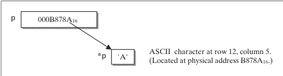

图4-11 指针与其指向对象的关系

#### 4.6.2 数组、指针和“取地址”运算符

当我们声明一个名为“a”的字节数组时，内存中会分配相应的字节序列。元素a[0]存储在第一个字节中，其地址称为数组的基地址。我们可以通过将“取地址”运算符应用于a[0]来获取此地址，如 &a[0]。由于 &a[0] 是uint8_t类型数据的地址，我们将其视为值类型为“指向uint8_t的指针”的表达式（图4-12）。

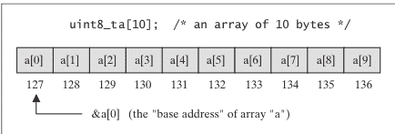

图4-12 字符数组及其对应的内存地址。

在C语言中，没有下标的数组名称（例如，“a”）严格等同于其第一个元素的地址（例如，&a[0]）。因此，a的数据类型也是“指向uint8_t的指针”，这意味着在下标操作时，我们可以用指针代替数组名称（例如，p[k]）。可以利用这一事实，通过将指针初始化为显示缓冲区的基地址，然后应用下标操作，将显示缓冲区作为数组来访问：

```
uint8_t *color_display_buffer = (uint8_t *) 0xB8000 ;
...
color_display_buffer[2*(80*row+col)] = 'A' ;
```

当然，使用一个下标选择行、第二个下标选择列、第三个下标区分字符单元格的ASCII和属性字节会更好。为此，我们首先需要使用一对typedef来描述一个由80个双字节单元格组成的行：

```
typedef uint8_t ONE_CELL[2] ; // 1 cell of 2 bytes
typedef ONE_CELL ONE_ROW[80] ; // 1 row of 80 cells
```

然后，我们可以声明一个指向后者类型对象的指针，并将其初始化为显示缓冲区的基地址。

```
ONE_ROW *color_display_buffer = (ONE_ROW *) 0xB8000 ;
```

然后，表达式"color_display_buffer[i]"引用第i行单元格。由于每一行都是单元格数组，可以对该表达式应用第二个下标（"color_display_buffer[i][j]"）来选择该行的第j个单元格。最后，由于每个单元格都是两个字节的数组，我们可以使用以下赋值语句将要显示的字符代码存储到其中的第一个字节：

```
color_display_buffer[row][col][0] = 'A' ;
```

### 4.7 结构体

与数组类似，结构体是由多个不同成员组成的聚合数据类型。虽然数组的成员共享一个共同的数据类型，但结构体没有此要求。因此，单个结构体变量可以包含表示char、int、double等混合类型的成员元素——甚至包含自身为结构体的成员。

C语言的声明语句

```
struct PERSON
{
    int age ;
    char gender ;
};
```

是一种结构体描述，可以使用标识符"PERSON"来引用，称为结构体标记。此声明不分配任何内存，也不创建结构体实例；它仅描述结构体数据的组织方式。我们可以使用此标记在声明语句中创建名为"sue"的结构体变量：

```
struct PERSON sue ;
```

一些程序员更喜欢使用typedef而不是结构体标记，如下所示：

```
typedef struct
{
    int age ;
    char gender ;
} PERSON;
```

这允许将名为"sue"的结构体实例简单地声明为

```
PERSON sue ;
```

可以在声明中指定成员元素的初始值。例如，声明

```
PERSON sue = { 30, 'F' } ;
```

将把"sue"的"age"成员初始化为30，将"gender"成员初始化为'F'。

结构体成员可以像普通变量一样使用，通过两个成员选择运算符之一来引用。与刚才所示声明的“sue”一起，“sue.age”和“sue.gender”用于引用“sue”的两个成员元素，如下所示：

```
sue.age = 25 ;
```

默认情况下，函数参数按值传递，这意味着函数会得到参数的副本。与其花费执行时间来复制结构体，我们通常更喜欢仅传递其地址。函数原型可能如下所示：

```
void foo(PERSON *p) ;
```

在函数内部，我们只有指向结构体的指针。在这种情况下，必须使用不同的语法，以便对“p”所指向结构体的“age”成员的引用变为

```
p->age = 21 ;
```

#### 4.7.1 紧凑型结构体

结构体在内存中按其在结构体描述中出现的相同顺序存储其成员组件。但是，没有要求组件必须相邻。这种自由允许编译器将成员对齐到字边界，以用内存空间换取更快的访问时间（图4-13）。5

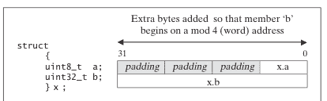

图4-13 用于地址对齐的结构体填充。

但是，有时我们需要使用结构体来描述所有数据都相邻的布局。在这种情况下，必须禁用编译器的结构体填充，以准确描述数据的组织方式。这种做法有时因编译器而异，但对于Microsoft、Borland或GNU（gcc）C/C++编译器，可以使用pragma指令来实现，如图4-14所示的程序所示。


```c
#include <stdio.h>
#include <stdint.h>

#pragma pack(1) // Turn off structure padding ...

typedef struct // This struct occupies 6 bytes
{
    int8_t  a ;
    int32_t b ;
    int8_t  c ;
} PACKED ;

#pragma pack() // Turn on structure padding ...

typedef struct // This struct typically occupies 12 bytes
{
    int8_t  a ;
    int32_t b ;
    int8_t  c ;
} PADDED ;

int main()
{
    printf("size packed = %d bytes\n", sizeof(PACKED)) ;
    printf("size padded = %d bytes\n", sizeof(PADDED)) ;
    return 0 ;
}
```

图 4-14 比较打包结构体和填充结构体。

结构体通常可以改善用于访问内存映射 I/O 设备的代码的可读性。在第 4.6.2 节中，我们将 PC 显示器上的字符单元描述为两个字节的数组：

```c
typedef uint8_t ONE_CELL[2] ;
```

大多数程序员更喜欢使用比单纯的第三个下标更能暗示其内容的内容来引用单元的 ASCII 字节和属性字节。这可以通过将单元描述为打包结构体来实现：

```c
#pragma pack(1)
typedef struct
{
    uint8_t ascii ;
    uint8_t attr ;
    ONE_CELL ;
}
#pragma pack()
```

在屏幕上显示字符时，可以更有效地写成 color_display_buffer[row][col].ascii = 'A' ;

#### 4.7.2 位字段

在第 4.4.3 节和 4.4.4 节中，我们使用按位与、按位或和移位运算符来提取和修改时间打包表示中的“分钟”字段。结构体位字段允许我们使用更简洁的语法访问此数据，该语法隐藏了所有必要的位操作。我们首先将时间描述为一个结构体，其中小时、分钟和秒被声明为结构体位字段（图 4-15）：

```c
typedef struct
{
    uint16_t
    seconds :6,
    minutes :5, /* actually, half seconds! */
    hours   :5 ;
} TIME ;
```

图 4-15 使用位字段描述时间打包表示。

请注意，位字段仅在结构体中可用，并且必须使用整型数据类型声明。6 每个字段的宽度由一个常量指定，该常量通过冒号与字段名分隔。

> 警告！ISO 标准未指定编译器必须将位字段分配到相应内存位置的位的顺序。虽然有些编译器可能从最低有效位到最高有效位分配位字段，但其他编译器可能正好相反。

如果我们使用类型 TIME（而不是 uint16_t）来声明时间变量，如 TIME time ; 那么三个位字段可以像常规结构体成员一样引用，将提取和插入问题留给编译器！例如，将时间 13:34:18 存储在我们的打包表示中，现在可以通过三个简单的赋值轻松完成：

```c
time.hours = 13 ;
time.minutes = 34 ;
time.seconds = 18 / 2 ;
```

在许多情况下，打包操作数中的一个或多个位位置未使用或保留，如 ARM 处理器的处理器状态寄存器的情况。然后可以在相应的结构体中包含一个或多个未命名的位字段来跳过这些位位置，如图 4-16 所示。

6 Pre-ANSI (C89) 编译器通常不支持有符号位字段。

```c
struct PSR          // Assumes bitfields are allocated from LSB to MSB
{
    uint32_t        exception :9,   // Current exception number
                    :1,           // (reserved)
                    ici_it1  :6,   // (see technical reference manual)
                    T        :8,   // (reserved)
                    T        :1,   // Always 1
                    qci_it2  :2,   // (see technical reference manual)
                    Q        :1,   // Saturation flag
                    V        :1,   // Signed overflow flag
                    Z        :1,   // Zero or equal flag
                    C        :1,   // Unsigned carry flag
                    N        :1 ;  // Negative flag
} ;
```

图 4-16 ARM 处理器的程序状态寄存器。

### 4.8 变体访问

有时将内存中的同一数据视为多种不同组织形式很有用。例如，与其将 32:32 定点实数视为单个 64 位量，不如有时将其视为分别包含整数部分和小数部分的一对 32 位位置更方便。

首先我们将看到如何使用指针、强制转换和下标来访问对象的不同视图。然后，我们将使用联合体来完成同样的事情，语法更简洁，就像结构体位字段为操作位提供了比按位与、按位或和移位运算符更简洁的语法一样。

在第 4.6.2 节中，我们了解到下标可以应用于指针变量，就像它是一个数组一样。然后在第 4.7 节中，我们了解到指向结构体的指针可以用于引用其成员元素。在这两种情况下，指针的值及其声明提供了构造引用所需的信息——即它所指向的对象的基地址和数据类型。现在，我们不是拥有指向对象的指针，而是拥有对象本身；但我们可以对该对象应用运算符并产生同样有用的指针值表达式。

#### 4.8.1 强制转换对象的地址

给定任何对象，我们可以通过应用“取地址”运算符（“&”）来获取其地址，然后可以将该地址强制转换为指向任何所需类型数据的指针。例如，表达式

```c
(uint8_t *) &x
```

被视为指向 uint8_t 类型数据的指针，无论“x”可能如何声明。有几种方法可以将此表达式付诸实用。只需在表达式左侧添加常规解引用运算符，如

```c
*(uint8_t *) &x
```

或右侧的下标为零，如

```c
((uint8_t *) &x)[0]
```

即可产生对 x 中存储的第一个 8 位字节的引用。当然，我们可以同样轻松地通过不同的下标选择来访问 x 的任何字节。

通过在强制转换中选择适当的数据类型，我们可以解引用指针以任意我们选择的方式访问 x 中保存的位。例如，要访问名为“result”的 32.32 定点实数的整数部分，我们只需写

```c
((uint32_t *) &result)[1]
```

同样可以轻松地将地址强制转换为指向结构体的指针。如果我们创建一个结构体来命名 32.32 定点实数的整数部分和小数部分，如

```c
typedef struct
{
    uint32_t    fract;
    uint32_t    whole;
} FIXED64PARTS ;
```

那么我们可以使用成员名称而不是非直观的下标来访问整数部分：

```c
((FIXED64PARTS *) &result)->whole
```

当然，有人可能合理地反对这种语法不够优雅。如果你需要做几个这样的引用，可以通过创建指向所需类型的指针并将其初始化为对象的地址来改善代码的外观：

```c
FIXED64PARTS *f64 = (FIXED64PARTS *) &result ;
```

然后只需通过指针引用成员元素：

```c
f64->whole
```

如果你反对为指针分配内存及其引入的相关运行时开销，那么创建一个宏，如

```c
#define F64(object) (((FIXED64PARTS *) &(object)))
```

并使用它来掩盖引用的混乱细节：

```c
F64(result)->whole
```

请注意，当所需数据组件的大小不与任何标准数据类型对应时，我们仍然可以安排结构体声明以使用结构体位字段来描述数据。

#### 4.8.2 使用联合体

变体访问也可以使用联合体来完成。联合体声明的语法与结构体相同，只是关键字相应更改。

然而，在语义上存在巨大差异。结构体的所有成员在内存中占据独立位置，而联合体的所有成员占据相同的内存（即，它们相互覆盖）。因此，结构体的大小是其成员大小之和，但联合体的大小与其最大成员的大小相同。

例如，考虑以下内容：

```c
typedef union
{
    uint64_t    real ;
    FIXED64PARTS part ;
} FIXED64REAL ;
```

此声明定义了一种数据类型，用于单个 64 位对象，该对象可以作为单个 32.32 定点实数或其单独的组件部分（即整数部分和小数部分）来访问。如果我们创建一个名为 "result" 的此类型联合体，那么可以使用图 4-17 中显示的标识符来引用整个对象或其部分。

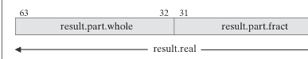

图 4-17 FIXED64REAL 联合体的组件部分。

使用联合体实现变体访问消除了创建宏来隐藏使用强制转换和“取地址”运算符的混乱细节的需要。是否使用联合体可能取决于所需变体访问的数量以及（当然）你自己的编程风格选择。

## 问题

- 1. 判断题：
  - (a) 编译器生成更多指令来计算 x & (1 << 5) 而非 x & 32。
  - (b) C 表达式 &a[5] 是一个常量。
  - (c) ANSI 标准要求有符号整数使用二进制补码表示法。
  - (d) 递增指向 long 的指针会使其持有的数值变化 1。
  - (e) 在 C 中，'A'+3 的值为 'D'。
  - (f) 在 C 中，布尔运算产生的值为假时是 0，为真时是 1。
  - (g) !x 的值为 0 当且仅当 x 的值为 1。
  - (h) 如果 "x" 是 unsigned int，则表达式 x > -1 始终为真。
  - (i) 语句 c = a + b 发生溢出当且仅当：(c<0 && a>0 && b>0) || (c>0 && a<0 && b<0) 为真。


- 2. 给出以下各数据类型所包含的字节数：
  - (a) char
  - (b) short
  - (c) long
  - (d) long long

- 3. 给出以下各数据类型所能容纳的最大值（以十进制整数表示，而非 2 的幂）：
  - (a) unsigned char
  - (b) unsigned short int
  - (c) unsigned long int

- 4. 给出以下各数据类型所能容纳的补码范围（以十进制整数表示，而非 2 的幂）：
  - (a) signed char
  - (b) signed short int
  - (c) signed long int

- 5. 以下各表达式的十六进制（基数 16）值是多少：
  - (a) (unsigned char) 0x12345678
  - (b) (short) ((signed char) 0xFF)
  - (c) (short) ((unsigned char) 0xFF)

- 6. 给定如下定义的宏，展示以下各用法将如何展开：

```c
#define REM(a, b) a % b
```

  - (a) REM(5, 2)
  - (b) REM(S + 2, X)
  - (c) REM(S, X - 2)

- 7. 定义一个名为 BIT(x, n) 的宏，使其展开为一个表达式，其值恰好为 0 或 1，对应 x 的第 n 位的值。

- 8. 定义一个名为 "SQUARE" 的 C 宏，使其在以下所有四种可能情况下都能产生正确结果：

```c
x = SQUARE (y) ;
x = SQUARE(SQUARE(y - 2)) ;
x = SQUARE(y - 2) ;
x = SQUARE (S + SQUARE(y - 2)) ;
```

- 9. 定义一个名为 "SHL" 的宏，带有两个操作数。该宏应展开为一个表达式，该表达式可可靠地计算出将其第一个操作数左移第二个操作数所指定的位位数所对应的值。操作数的内容不得被修改。

- 10. 执行以下 C 代码后，变量中剩余什么值：

```c
unsigned char u ;
signed char s ;
u = (unsigned char) -128 ;
s = (signed char) +128 ;
```

- 11. 给出以下各表达式的十进制值：
  - (a) ~5
  - (b) !-5
  - (c) ~-6+1
  - (d) 6 && 2
  - (e) 6 & 2
  - (f) 6 && ~-2
  - (g) 6 & ~-2
  - (h) 3 | 5
  - (i) 3 | 5
  - (j) !-3
  - (k) ~-3
  - (l) 10
  - (m) ~0
  - (n) !113
  - (o) 0 << 4
  - (p) 60 >> 2
  - (q) ~-13
  - (r) 3 ^ 5
  - (s) 3 & ~5

- 12. 以下各表达式的十六进制（基数 16）值是多少：
  - (a) 0x7D | 0x4E
  - (b) 0x7D & 0x4E
  - (c) 0x7D ^ 0x4E
  - (d) 0x7D & ~0x4E
  - (e) 0x7D & ~0x4E

- 13. 执行指定代码行后，无符号字符 "x" 中剩余的 8 位二进制值是多少：

| "x" 的初始值 | 代码行 |
|---|---|
| (a) 11100101₂ | x |= (1 << 4) ; |
| (b) 11011001₂ | x &= ~(1 << 6) ; |
| (c) 10111010₂ | x ^= (1 << 5) ; |
| (d) 10101010₂ | x = (x >> 3) & 0x0F ; |
| (e) 00001111₂ | x = ~x ; |
| (f) 00001111₂ | x = !x ; |
| (g) 00000000₂ | x |= 0x20 ; |
| (h) 11111111₂ | x &= ~0x0F ; |

- 14. 给出以下各 C 表达式的整数值，以十进制常数表示。如果无法确定值，请输入 "NEI"（信息不足）：
  - (a) x && !x
  - (b) x & ~x
  - (c) x || !x
  - (d) x |= ~x
  - (e) x ^= ~x

- 15. 编写一个 C 表达式，当且仅当整数变量 "x" 的第 5 位为 1 时为真。

- 16. 假设各位从右到左从 0 开始编号。对于以下各项，编写一行 C 代码：

```c
unsigned int n ;
```

  - (a) 将 x 的第 n 位设置为 1，不修改其他位。
  - (b) 反转 x 的第 5 位，不修改其他位。
  - (c) 将 x 的第 6、3 和 2 位清零，不修改其他位。
  - (d) 将 x 左移 n + 2 位。
  - (e) 用 x 的第 5-2 位（即中间的 4 位“半字节”）所保存的 4 位数的值替换 n。

- 17. 假设变量 "x" 已声明为 char 类型数据。"x" 内各位的值表示为：

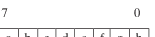

对于以下各项，假设 "x" 的初始值如上所示。给出执行指定赋值语句后 "x" 中剩余的内容。

  - (a) x |= ( 1 << 3 ) ;
  - (b) x &= ~( 1 << 4 ) ;
  - (c) x ^= ( 1 << 5 ) ;

- 18. 对于以下每种情况，给出右移表达式的十六进制值，或输入短语“编译器相关”。

```c
(a) unsigned char x = 0x80 ; x >> 1 ;
(b) signed char x = 0x80 ; x >> 1 ;
```

- 19. 不同编译器可能对以下表达式产生什么十六进制值？((signed char) 0xFF) >> 1

- 20. 使用结构体位域描述以下 16 位压缩操作数：

| 14 13 | 12 11 10 9 | 7 ... 0 |
| :---: | :---: | :---: |
| 性别 | 发色 | 年龄 |

- 21. 编写代码，仅递增名为 "x" 的 32 位操作数的第三个字节（第 16 到 23 位），使用：
  - (a) 按位与、按位或和移位
  - (b) 强制类型转换和下标

- 22. 以下第一个 printf 语句打印 "1C3F"。第二个 printf 打印什么？

```c
union {
    short w ;
    char b[2] ;
} x ;
x.w = 0x1C3F ;
printf("%04X %04X\n", x.w) ;
x.b[1] = 0xA6 ;
printf("%04X %04X\n", x.w) ;
```

- 23. 编写一个 C 函数，用于设置打包为每字节 8 位的字节数组中指定位。该函数必须恰好有两个参数：第一个是字节数组的名称，第二个是要设置的位的索引（从零开始）。函数原型应为。

```c
void SetBit(unsigned char bits[], int index) ;
```

- 24. 在下表中，根据需要在每个单元格中输入“YES”或“NO”，以比较操作压缩操作数的各种技术。

| 特性 | 按位运算符 | 结构体位域 | 变体访问 | 联合体 |
|---|---|---|---|---|
| 语法混乱？ | | | | |
| 语义歧义？ | | | | |
| 位域赋值限制？ | | | | |
| 代码生成更高效？ | | | | |

- 25. 考虑从 32 位变量的第 8 到 15 位提取值的问题。

| 31 ......... 16 | 15 ......... 8 | 7 ......... 0 |
|---|---|---|
| 忽略这些位 | 提取此值 | 忽略这些位 |

  - (a) 假设该变量声明为名为 "packed" 的 unsigned long。仅使用移位和按位运算符编写代码，将提取的值复制到名为 "value" 的变量中。

  - (b) 将该变量声明为名为 "packed" 的联合体，并带有适当的成员元素，以便其内容可以作为一个名为 "l" 的 32 位 long、一个名为 "s" 的两个 16 位 short 的数组，或一个名为 "c" 的四个 8 位 char 的数组来访问。然后仅使用联合体成员选择运算符编写代码，将提取的值复制到名为 "value" 的变量中。

## 第 5 章
### 汇编语言程序设计
### 第一部分：计算机组成

当今嵌入式系统的应用软件几乎完全使用 C 等高级语言编写，但总会有需要将部分代码用处理器的低级指令编写的情况。汇编语言编写是一项枯燥且容易出错的练习，除非绝对必要，否则应避免。然而，有几种情况汇编编程是合适或必要的：

- 1. 程序中可能存在对绝对速度至关重要的部分。
- 汇编编程可以更有效地利用中央处理器（CPU）的寄存器和指令集，从而生成比编译器生成的代码运行更快的代码。

- 2. 可能没有其他方式来访问硬件的特定功能。
- 例如，C 编译器可能不提供访问 I/O 端口或禁用/启用中断系统的库函数。或者编译器可能生成无法利用 CPU 某些更专用指令的代码，例如实现位和字节反转、位域提取和插入、二进制-ASCII 转换、表查找或整块数据高速复制的指令。

然而，对于大部分代码，最好使用高级语言编写。使用高级语言更不枯燥、更可靠，且天生更高效。速度损失通常在程序的上层组织级别不是问题，且算法在此上下文中更容易表达和理解。

掌握汇编语言编程需要时间，并涉及熟悉后续页面中涵盖的大量新且详细的信息。然而，一旦掌握，你将对计算机的工作原理、你编写的 C 代码如何转换为机器语言有更强的理解，从而更好地理解如何编写高效且有效的 C 程序。

汇编代码编写枯燥且容易出错。因此，我们的方法是尽可能避免汇编，将绝大部分代码用 C 编写。当汇编是必要或可取时，它将仅用于从 C 调用的小子程序（函数）。我们的应用程序将是 C 和汇编的混合，并将要求深入理解函数调用/返回接口。

首先，我们必须了解简单计算机的内部组织——其内部组件以及数据在各部分之间操作和移动时如何执行计算。


每台计算机都由三个主要组件组成：(1) CPU，执行操作的地方；(2) 内存，存储数据的地方；(3) 输入/输出（I/O）系统，用于收集输入数据或输出结果。这三个单元通过称为总线的导线组互连。

台式机处理器使用一组总线连接 CPU 和内存，并使用另一组总线连接 CPU 和 I/O。内存与 I/O 设备之间传输的数据通常经过 CPU 并由其协调。当需要更高的数据传输速率时，可以添加直接内存访问（DMA）控制器来执行这些传输。数据传输更快，因为 CPU 不再需要执行指令来传输数据，且 CPU 可以在数据传输的同时自由执行自己的计算（图 5-1）。

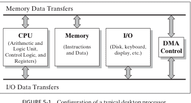

大多数现代嵌入式处理器使用一种称为内存映射 I/O 的配置，采用单一互连路径。当今处理器的 32 位地址能够寻址 4 GB（2^32 字节）的信息。由于这远超嵌入式应用所需，地址空间的一部分被保留并由 I/O 设备解码。这消除了对单独 I/O 指令的需求，因为所有常规内存访问指令都可以用于访问 I/O 设备。大多数嵌入式应用不需要更高的数据传输速率，并完全省略 DMA 控制器。即使添加了 DMA 控制器，性能也会稍慢，因为每次传输都需要一个读周期后跟一个写周期，而两条互连路径允许周期同时发生（图 5-2）。

在计算机内部，CPU 从内存中检索数据，对其进行操作，并将结果存回内存。信息通过三组导线在 CPU 和内存之间流动，分别称为地址总线、数据总线和控制与状态总线。CPU 将信息放在地址总线上以告诉内存访问哪些数据，并使用控制与状态总线来确定信息传输方向并协调时序。数据本身通过数据总线传输。

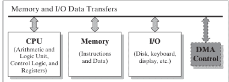

图 5-2 典型嵌入式处理器的配置。

### 5.1 内存

我们已经知道，计算机使用 1 和 0 的位来存储数据。为方便起见，这些位通常组织成 8 位的字节。为区分不同字节，每个字节都分配了一个唯一地址。每当我们想要检查内存中某个字节的内容，或替换其内容时，都必须指定其地址。地址只是一个二进制数。用于指定地址的位数是固定的，并限制了内存能容纳的最大字节数。例如，如果地址由 20 位组成，则不同地址的最大数量为 2^20。这个数字接近 100 万，因此相应的内存容量通常被称为 1 兆字节。当今的 32 位处理器具有 32 位地址总线，可寻址 4 GB（2^32 字节）的内存（图 5-3）。相邻字节组合形成 16 位半字、32 位字和 64 位双字。按照惯例，这些较大操作数的地址始终指定为其最低有效字节的地址。例如，32 位地址为 104 的 16 位半字由位于地址 104 和 105 的 2 个字节组成。有两种可能的字节顺序：“小端”和“大端”。流行的 Intel 处理器使用小端格式，其中信息的最低有效字节存储在最低地址。在此格式中，32 位量的地址与其最低有效字节的地址相同。小端格式如图 5-4 所示。Motorola 处理器和通过 Internet 传输的所有数据使用大端格式，其中顺序相反。ARM 处理器本质上是小端架构，尽管它们确实提供有限的支持来访问大端数据。

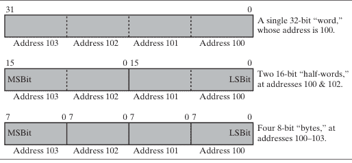

图 5-4 小端字节和位顺序（最高有效位和字节在最左侧）。

内存可以执行两种基本操作：读取和写入。当数据写入内存时，它会替换该位置的先前内容，这些内容被丢弃。内存读取操作是非破坏性的，并检索内存位置内容的副本。然而，从物理上讲，内存使用 32 位数据总线，以便在单个读取或写入周期中传输多达 4 个字节。1 有时，实际使用的字节少于 4 个，要么是因为操作数是字节或半字，要么是因为操作数未对齐——即，跨越两个相邻的 32 位内存字。未对齐或双字操作数需要多个内存周期。

1 从物理上讲，内存组织为 2^30 个 32 位字。32 位地址的最高 30 位选择字，而剩余位用于选择该字中的适当字节。

#### 5.1.1 数据对齐

为理解对齐为何重要，请考虑一个字节可寻址的内存，其数据总线宽度为 32 位（4 字节）。每次内存读取都提供 32 位（4 字节）的信息。内存的前 16 个字节（地址 0 到 15）排列为每个 4 字节的物理 32 位字，每个字从 mod-4 地址开始，如下所示。

| 地址 15 | 地址 14 | 地址 13 | 地址 12 |
| 地址 11 | 地址 10 | 地址 9 | 地址 8 |
| 地址 7 | 地址 6 | 地址 5 | 地址 4 |
| 地址 3 | 地址 2 | 地址 1 | 地址 0 |

32 位数据字可以存储在 *任意* 连续的 4 字节集中。例如，从地址 4 开始的字如下高亮显示：

| 地址 15 | 地址 14 | 地址 13 | 地址 12 |
| 地址 11 | 地址 10 | 地址 9 | 地址 8 |
| 地址 7 (最高有效字节) | 地址 6 | 地址 5 | 地址 4 (最低有效字节) |
| 地址 3 | 地址 2 | 地址 1 | 地址 0 |

然而，我们也同样可以轻松地存储从地址 6 开始的字：

| 地址 15 | 地址 14 | 地址 13 | 地址 12 |
| 地址 11 | 地址 10 | 地址 9 (最高有效字节) | 地址 8 |
| 地址 7 | 地址 6 (最低有效字节) | 地址 5 | 地址 4 |
| 地址 3 | 地址 2 | 地址 1 | 地址 0 |

区别在于，地址 4 处的字可以在单个内存周期内从内存中读取，但由于地址 6 处的字分布在两个“物理”字中，因此需要两个内存读取周期才能检索所有 32 位。第一个读取周期将检索地址 4 到 7 的 4 个字节；其中，地址 4 和 5 的字节被丢弃，地址 6 和 7 的字节移动到最右侧：

| | | 地址 7 | 地址 6 (最低有效字节) |

第二个读取周期检索地址 8 到 11 的 4 个字节；地址 10 和 11 的字节被丢弃，地址 8 和 9 的字节移动到最左侧：

| 地址 9 (最高有效字节) | 地址 8 | | |

最后，将两半组合以形成所需的 32 位操作数：

| 地址 9 (最高有效字节) | 地址 8 | 地址 7 | 地址 6 (最低有效字节) |

字节的定位和组合在硬件中完成，速度远快于单个内存周期所需的时间。然而，每个内存周期时间通常比处理器的基本时钟周期慢得多，并代表主要性能瓶颈。因此，编译器有意为 32 位操作数分配内存，使其起始于可被 4 整除的地址，并为 16 位半字分配内存，使其起始于可被 2 整除的地址。

### 5.2 中央处理器

计算机的 CPU 是发生计算的地方。它由多个组件组成，包括算术逻辑单元（ALU）、一组寄存器和一个控制单元。一个或多个数据和控制总线互连这些组件。

在 CPU 内部，ALU 执行算术运算（例如，加法、减法）、位操作运算（例如，按位 AND、OR、XOR 和移位），并且是做出条件分支决策的地方。此类低级操作以其简单性为特征，只需要一个或两个输入操作数并产生单个输出结果。由于任何时候只能有一个操作数位于内存数据总线上，因此 ALU 需要一个或多个寄存器来保存其他操作数和结果。在最简单的配置中，使用一个称为累加器（ACC）的单个寄存器，如图 5-5 所示。

ALU 可以将一个输入不经修改地传递到累加器；这允许用两个操作数之一预加载累加器。ALU 的一个输入始终连接到累加器；这允许 ALU 将累加器的当前内容与某个内存位置内容的副本相结合。

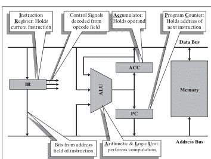


并将结果存回累加器。该结果随后可通过从累加器返回到存储器数据总线的回送路径存储在内存中。使用此结构将两个数字相加并将结果存储在内存中需要三个步骤：

```
ACC <- MEM[adrs_of_op1] ;Copy 1st operand from memory into ACC
ACC <- ACC + MEM[adrs_of_op2] ;Replace contents of ACC by sum
MEM[adrs_of_result] <- ACC ;Store contents of ACC into memory
```

大多数CPU都有多个可充当累加器的寄存器。除了指定内存操作数的地址外，此类机器的指令还必须指定使用哪个寄存器：

```
REG[r] <- MEM[adrs_of_op1] ;Copy 1st operand from memory into register 'r'
REG[r] <- REG[r] + MEM[adrs_of_op2] ;Replace contents of register 'r' by sum
MEM[adrs_of_result] <- REG[r] ;Store contents of register 'r' into memory
```

寄存器的数量因计算机而异，但通常约为16个。

使用所谓“加载/存储”架构的处理器要求所有操作数都驻留在寄存器中——也就是说，唯一可访问内存的操作只是将数据从内存加载（读取）到寄存器中，或将寄存器内容存储（写入）到内存中：

```
REG[r1] <- MEM[adrs_of_op1] ;Copy 1st operand from memory into register 'r1'
REG[r2] <- MEM[adrs_of_op2] ;Copy 1st operand from memory into register 'r2'
REG[r3] <- REG[r1] + REG[r2] ;Perform the addition, leaving the result in a 3rd register
MEM[adrs_of_result] <- REG[r3] ;Store contents of register 'r3' into memory
```

#### 5.2.1 其他寄存器

CPU内部有许多其他寄存器。每个寄存器都有专门用途。例如，每个CPU都有一个指令寄存器，用于保存当前指令；一个程序计数器 (PC)，用于指定要执行的下一条指令的地址；以及一个状态寄存器，用于保存关于ALU生成的最新结果的信息。其他常见的特殊用途寄存器包括堆栈指针 (SP)，用于在内存中模拟堆栈，以及用于数组下标的索引寄存器。

#### 5.2.2 取指-执行周期

CPU的控制单元负责从内存中获取指令、对其进行解码，然后通过指导计算机各个部分之间适当的数据传输和操作序列来执行指令。此序列无限重复，构成计算机的基本取指-执行周期（图 5-6）。

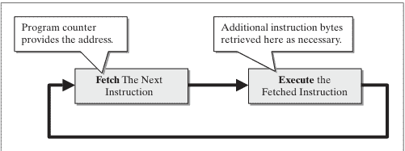

图 5-6 控制单元的取指-执行周期。

在取指阶段，控制单元将PC的当前内容放在存储器地址总线上，并启动存储器读操作，以从内存中检索指令的第一个字节。在等待存储器读操作完成期间，控制单元递增PC，为检索下一条指令字节做准备。当内存完成读取时，控制单元将存储器数据总线上的数据复制到指令寄存器中（图 5-7）。

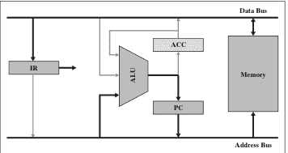

图 5-7 取指阶段使用的CPU组件。

取指阶段的详细事件序列如下：

- 1. 存储器地址总线 ← 程序计数器
- 2. 启动存储器读操作
- 3. 递增程序计数器
- 4. 等待存储器读操作完成
- 5. 指令寄存器 ← 存储器数据总线
- 6. 转至执行阶段

指令的第一个字节包含操作码（或简称“opcode”）以及指示指令中是否有需要检索的其他字节的信息。操作码位由控制单元解码，然后控制单元按特定顺序触发适当的控制信号序列，以执行指令的执行阶段。指令中的任何其他字节都将在此阶段检索（并递增PC）；这些字节可能需要提供用作操作数的常量，或检索关于使用哪些寄存器或如何计算内存中操作数地址的信息。

执行阶段期间发生的具体细节取决于正在执行的特定指令。例如，将数据从内存加载到累加器的指令（图 5-8）从指令寄存器中获取内存操作数的地址，将其放在存储器地址总线上，启动存储器读操作，然后通过ALU将内存数据传输到累加器。

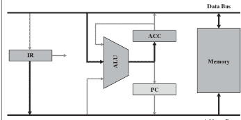

图 5-8 执行阶段用于从内存加载寄存器的CPU组件。

一旦操作数加载到累加器中，后续指令可以在其与第二个操作数之间执行加法，从内存中获取一个操作数，从累加器中获取第二个操作数，并用结果替换其内容（图 5-9）。

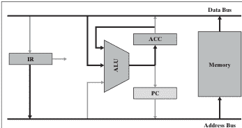

图 5-9 ADD指令执行阶段使用的CPU组件。

取指-执行周期本质上提供指令的顺序（即“直线式”）执行。循环和决策需要我们分支，并从当前指令后紧邻位置以外的某个位置开始获取指令。分支指令通过在执行阶段将全新地址加载到PC中来实现这一点。此地址可能作为指令中嵌入的常量存储，作为从寄存器检索或从内存读取的值，或作为分支指令执行阶段期间执行的某些计算的结果（图 5-10）。

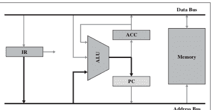

图 5-10 分支指令执行阶段使用的CPU组件。

### 5.3 输入/输出

计算机的I/O系统包括CPU和内存以外的所有内容。这不仅包括专为与人类交互而设计的设备，例如键盘和显示器，还包括其他类型的设备，例如磁盘驱动器、网络接口、传感器和执行器。

每个I/O设备都通过某种接口连接到计算机。该接口可能以插入式适配器卡的形式存在，也可能是与CPU位于同一块印刷电路板上的额外电路，甚至可能直接集成在处理器芯片中。

将外部设备连接到计算机主要是一个同步问题。I/O设备通常以与处理器无关且远慢于处理器的速度运行——通常慢几个数量级。总是需要某种形式的握手来协调两者之间的传输，以便计算机不会以输出设备无法接受的速度输出数据，也不会尝试处理尚未可用的输入数据。

I/O有多种不同的硬件和软件策略。这些策略将在后续章节中详细讨论。为特定类型的设备选择最有效的组合是系统级设计决策，几乎总是在性能和成本之间进行权衡。

### 5.4 ARM® Cortex™-M3 v7M 架构简介

任何关于计算机组织的实际讨论最终都必须聚焦于特定的CPU。尽管此处介绍的信息是针对ARM微处理器家族中的单个处理器，但本节并非旨在全面描述该处理器或ARM家族中的其他处理器。我们在此的目标是理解用C等高级语言实现的算法如何在特定微处理器的架构中得以实现，并在适当或必要时能够在任一级别进行编码。

在此，我们仅对ARM® Cortex-M3 v7M架构进行初步介绍，该架构专为小型嵌入式应用而设计。Cortex-M3处理器实现了ARM架构规范的Thumb-2指令子集。大多数Thumb-2指令宽16位，在内部扩展为完整的32位ARM指令。接下来的几章提供了多个汇编语言代码示例，说明更常用的Thumb-2指令。

#### 5.4.1 内部组织

ARM处理器拥有一个复杂的CPU，能够并行执行多个低级操作。当操作数从内存读取并放置在数据总线上时，硬件符号扩展器将8位和16位操作数转换为完整的32位表示，以便CPU内部的所有数据始终为32位宽。

ARM处理器使用“加载-存储”架构。这意味着任何计算都必须首先使用加载指令将操作数从内存读取到寄存器中，并使用存储指令将结果写回内存。换句话说，add、subtract、bitwise-and等指令只能对寄存器内容进行操作，不能直接对内存位置的内容进行操作。此类指令从寄存器（称为Rm和Rn）中获取操作数，并将结果留在称为Rd的寄存器中。

桶形移位器允许操作数Rm在与操作数Rn在ALU中组合之前，以算术、逻辑方式向左或向右移动任意数量的比特位，或进行旋转。除此之外，桶形移位器还允许进行Rn + 2xRm形式的计算。当Rn和Rm都指定同一寄存器时，桶形移位器简化了某些倍数值的计算，例如5X = X + 2^2X 或 -7X = X - 2^3X（图 5-11）。

独立的存储器地址计算器 (MAC) 为内存访问准备带下标和相对地址引用，特殊的递增器可以在后续指令中调整存储器地址，而无需完全重新计算地址，这在重复操作（例如将数组内容初始化为常量值）中非常有用。

CPU包含一组13个通用寄存器（R0到R12）和三个特殊用途寄存器（R13、R14和R15）。通用寄存器分为“低”寄存器（R0到R7）和“高”寄存器（R8到R12），关于哪些指令可以使用后者有一些小限制。R15用作PC，R13用作SP，R14用作“链接”寄存器（LR），在调用子程序时保存返回地址。


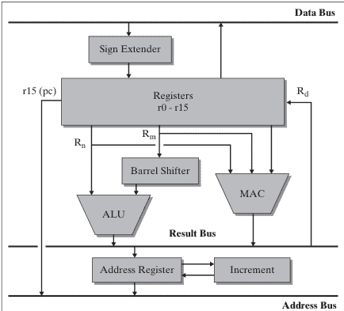

图 5-11 ARM Cortex-M3 v7M CPU 的内部组织。

一组 1 位状态标志和其他信息存储在一个 32 位程序状态寄存器 (PSR) 中（图 5-12）。PSR 被分为三个位字段：应用程序状态寄存器 (APSR)、中断程序状态寄存器 (IPSR) 和执行程序状态寄存器 (EPSR)。对于应用程序而言，最重要的是 PSR 的四个最高位，它们保存用于做出条件分支决策的信息。Q 位是粘性饱和位，支持两个很少使用的指令（SSAT 和 USAT）。IPSR 保存异常处理期间使用的被抢占异常编号。ICIT/IT 位保存 IT 块指令以及在中断处理期间挂起并在返回后继续的指令的状态信息。T 位始终为 1，以指示 Thumb 状态。

#### 5.4.2 指令流水线

由于大多数指令是从顺序地址位置获取的，ARM 处理器使用一种称为“流水线”的技术来加速取指-执行过程。流水线允许在任何一个处理器时钟周期内同时进行三条指令的处理。在获取一条指令的同时，另一条正在解码，第三条正在执行。Thumb 指令宽度为 16 位或 32 位，大多数为 16 位。因此，在使用 PC 中保存的地址从内存读取一条 16 位指令的同时，前一条指令（来自地址 PC-2）正在解码，再前一条

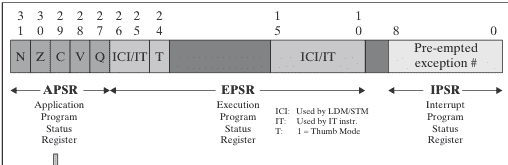

| Bits | 名称 | 描述 |
|---|---|---|
| 31 | N | 负（或小于） |
| 30 | Z | 零（或等于） |
| 29 | C | 进位或借位输出 |
| 28 | V | 溢出（2 的补码） |
| 27 | Q | 粘性饱和标志 |

图 5-12 程序状态寄存器内的位字段。

来自地址 PC-4 的那条指令正在执行。请注意，PC 保存的是当前正在获取的指令的地址，而不是正在执行的指令的地址。通过重叠这些操作，指令可以以每个时钟周期一条的速率执行，而不是每三个时钟周期一条（图 5-13 和 5-14）。

当执行分支指令时，流水线中的其他两条指令必须被丢弃，并且需要重新填充流水线。为了加速该过程，处理器在解码阶段获取目标指令。对于条件分支指令，分支决策在执行阶段确定。如果分支决策失败，则流水线中已有的下一条顺序指令将被执行。

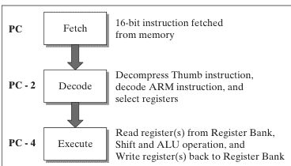

图 5-13 Cortex-M3 指令流水线。

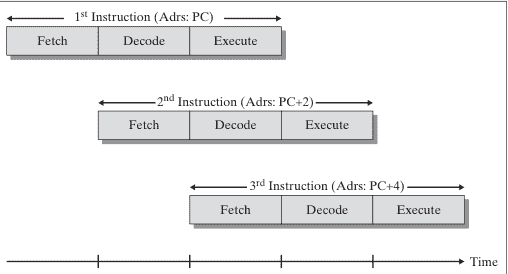

图 5-14 Cortex-M3 中重叠的指令处理。

否则，在解码阶段获取的目标指令可以仅带有一个周期延迟地被解码和执行。为了进一步减少这些“流水线停顿”，某些 Cortex-M3 指令可以根据标志的状态有选择地启用或禁用，而不是使用条件分支指令来避免它们。

#### 5.4.3 内存模型

ARM 规范在 Cortex-M3 MCU 的 4 GB 内存地址空间内为代码、数据和内存映射 I/O 设备保留了特定区域。Cortex-M3 规范的特定实现可能只实现每个区域的部分内容，但始终以符合规范的方式使用这些区域。内存是按字节寻址的，但每个内存周期传输一个完整的 32 位字（4 字节）。代码和数据存储在独立的硬件中；指令通过 I-Code 总线从非易失性闪存中获取，而系统总线用于访问静态读写内存（或外设）中的数据。由于两个存储器在物理上是分离的，哈佛架构通过独立的数据路径允许同时访问指令和数据，从而提升了整体性能（图 5-15）。

#### 5.4.4 位带

32 位处理器中可用的 32 位地址总线提供了 4 GB 地址空间，这远大于几乎任何嵌入式应用所需的空间。Cortex-M3 设计利用额外空间实现了一种称为“位带”的硬件功能。该技术使用地址空间中的两个不同区域来引用相同的物理数据。在主“位带区域”中，每个地址对应一个字节的数据；在“位带别名”中，每个地址对应该相同数据的一个位。位带的优势在于，单个数据位可以通过单条指令读取或写入，而不需要一系列位操作

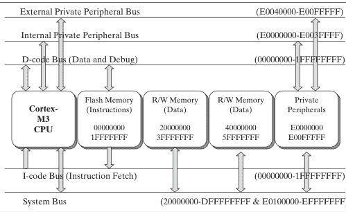

图 5-15 Cortex-M3 总线结构。

指令。例如，从位带别名区域读取地址的 LDR 将寄存器加载为值 0 或值 1。类似地，向位带别名区域写入地址的存储寄存器到内存 (STR) 指令仅修改主区域中的单个数据位。当然，修改要求位带硬件执行读-修改-写操作，但只获取和执行一条指令（STR）。

如图 5-16 所示，读写数据地址空间的第一兆字节和外设设备地址空间的第一兆字节被指定为位带区域。这些主区域中的每个都有一个对应的 32 MB 位带别名，主区域中的每个数据位在别名区域中都有一个对应的字地址。因此，主区域中的每个字节在别名区域中都有八个字。

两个位带别名区域提供了一种高效的方式来访问 I/O 设备的单个状态和控制位，或实现一组 1 位布尔标志。此外，由于位带硬件不允许其读-修改-写操作被其他总线活动中断，这些 1 位布尔标志是实现一组互斥对象（第 9 章将讨论）的高效方式，用于仲裁对共享资源的访问。

位带别名中每个 mod-4 字地址对应相应位带区域中的单个位。要访问位带区域中的特定位，其对应的位带别名地址计算如下：

```
bit-band alias address = bit-band base + 128 × word offset + 4 × bit number
```

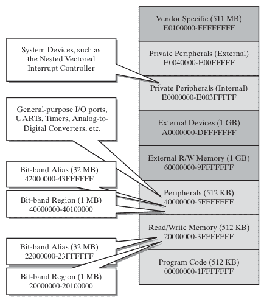

图 5-16 Cortex-M3 内存地址空间。

例如，如果要修改地址 20001000₁₆ 处的位 3，位带别名计算如下：

```
22000000₁₆ + 128 × 1000₁₆ + 4 × 3 = 2208000C₁₆
```

地址 2208000C 允许直接访问地址 20001000 处字的仅位 3。从该地址读取将提供一个全零字，除了最低有效位，它是位带区域中所选位的副本。写入同一地址将忽略写入数据的所有位，除了最低有效位（图 5-17）。

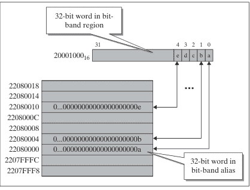

图 5-17 Cortex-M3 中的位带。

### 5.5 ARM 汇编语言

用汇编语言编程是一个乏味但偶尔必要的过程。在 C 等高级语言中只需一行代码即可实现的功能，在汇编语言中不可避免地需要几行代码。例如，仅将两个整数变量的内容相加并将结果存储在第三个变量中，在 ARM 汇编语言中需要四行代码。

汇编语言程序员还需要管理更多细节。虽然 C 程序员可以让编译器确定混合不同类型操作数时可能需要哪些转换，但在汇编语言编程时，这成为你的责任。我们理所当然的基本操作，例如数组下标、参数传递和指针解引用，突然需要设计指令序列。

就像学习外语一样，在学习如何用汇编语言编程之前，我们必须先学习词汇——可用的指令、其语义的细微差别、编写方式以及允许的选项。

#### 5.5.1 指令格式和操作数

ARM Cortex-M3 处理器实现了 ARM 家族的 Thumb 和 Thumb-2 指令子集。在汇编语言中，ARM 指令写为操作码（或简称“opcode”），后跟零个或多个操作数，这些操作数可能是


常量、寄存器或内存引用。在寄存器和内存之间传输数据的指令通常指定两个操作数，如：

```
LDR R0,temperature ;load register R0 from memory location 'temperature'
STR R1,result ;store register R1 into memory location 'result'
```

大多数 ARM 指令在两个源操作数之间执行计算，并指定第三个目标操作数。例如，汇编语言 ADD 指令写作：

```
ADD R2,R3,R4 ;R2 ← R3 + R4
```

汇编语言中每一行源代码包含一行机器语言，如图 5-18 所示，每行由空格分隔的四个字段组成：标签字段、操作码字段、操作数字段和注释字段。如果使用标签，它必须从第 1 列开始，并通常以冒号结尾；否则，第 1 列必须留空。注释以分号开头，汇编器忽略分号右侧的所有内容。

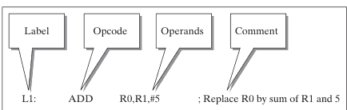

图 5-18 汇编语言代码行中的四个字段。

汇编器将每一行源代码翻译成单条指令的二进制表示。新汇编语言程序员最常见的错误是误解操作数字段的用途。在运行时执行以下指令会将名为“data”的变量的内容加载到 R0。然而，在汇编过程（执行前）中，标识符所代表的值是其地址。

```
LDR R0,data ;load register R0 with the content of variable "data"
```

当操作数字段包含算术表达式时，这一点变得很重要。例如，执行指令，

```
LDR R0,data+4 ;load register R0 from an address 4 bytes higher than that of "data"
```

不会将 data 的内容与 4 相加并将和放入寄存器 R0。相反，加法发生在汇编期间；它导致汇编器将 4 加到 data 的地址上，并将和放入指令表示的地址字段中。例如，如果变量 data 存储在内存地址 100，则上述指令将从地址 104 加载寄存器 R0。

在 ARM 汇编中，方括号用于括起来更复杂的地址规范，这些地址规范取决于寄存器的内容。因此，每当你看到方括号时，就知道该指令将访问内存。

```
LDR R0, [R1] ; register R0 is loaded from memory whose address is given by R1
```

#### 5.5.2 将汇编语言翻译为二进制

将汇编语言源代码翻译为二进制目标代码是一个两步过程，如图 5-19 所示。汇编器对程序的源代码进行两次完整扫描。在第一遍扫描期间，汇编器构建一个符号表，其中包含程序员定义的标识符的信息，例如附加标签的指令的地址，或由其标识符表示的变量的地址。在第二遍扫描期间，汇编器使用这些信息来组装各个指令的表示。

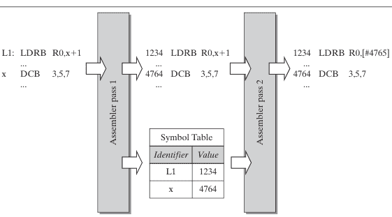

## 问题

- 1. 哪种互连关系是不正确的？
  - (a) I/O—MEM—CPU
  - (b) MEM—CPU—I/O
  - (c) CPU—I/O—MEM

- 2. 哪个计算机将信息放在地址总线上？
  - (a) 主存储器
  - (b) CPU
  - (c) ALU

- 3. 对于包含以下总容量的内存，需要多少根地址线？
  - (a) 256 KB
  - (b) 2 MB
  - (c) 4 GB

- 4. 用以下之一填空：IR、ALU、PC、ACC、MEMORY、FETCH PHASE 或 EXECUTE PHASE：
  - (a) 数据存储在 ______ 中。
  - (b) 程序存储在 ______ 中。
  - (c) 要执行，指令被加载到 ______ 中。
  - (d) 要执行的指令的地址保存在 ______ 中。
  - (e) 指令在 ______ 期间被取出。
  - (f) 指令在 ______ 期间被解释。
  - (g) 算术运算在 ______ 中发生。
  - (h) 临时中间结果保存在 ______ 中。

- 5. 取指阶段之前是 ______ 阶段。

- 6. 取指阶段之后是 ______ 阶段。

- 7. 指令寄存器 (IR) 在 ______ 阶段期间被加载。

- 8. 指令执行的计算在 ______ 阶段期间发生。

- 9. 在 ARM 架构中，以下各项有多少字节？
  - (a) 半字？
  - (b) 双字？

- 10. 考虑地址对齐，从具有 60-nsec 周期时间和 16 位宽数据总线的内存中取出 4 字节操作数的最坏情况时间是多少？

- 11. 如果连接 CPU 和内存的数据总线宽 4 字节，从内存中读取以下每项需要多少个内存周期？
  - (a) 从十进制地址 5 读取的 16 位操作数
  - (b) 从十进制地址 15 读取的 16 位操作数
  - (c) 从十进制地址 10 读取的 32 位操作数
  - (d) 从十进制地址 20 读取的 32 位操作数

- 12. 考虑下面所示的 ARM 处理器的 32 位内存部分视图和十进制地址：

| 地址 111 | 地址 110 | 地址 109 | 地址 108 |
|---|---|---|---|
| 地址 107 | 地址 106 | 地址 105 | 地址 104 |
| 地址 103 | 地址 102 | 地址 101 | 地址 100 |
| 地址 99 | 地址 98 | 地址 97 | 地址 96 |

  - (a) 将地址为 102 的字着色？
  - (b) 地址 102 处的字的最高有效字节的地址是什么？
  - (c) 读取地址 102 处的字需要多少个内存周期？
  - (d) 读取地址 102 处的半字需要多少个内存周期？

- 13. 在使用小端格式的计算机中，16 位字的哪个字节具有更高的地址？
  - (a) 最低有效字节
  - (b) 最高有效字节

- 14. 在使用小端格式的计算机中，如果 16 位字的 2 个字节位于地址 100 和 101，那么整个 16 位字的地址是多少？

- 15. 考虑使用小端编号的计算机。如果 32 位操作数位于十进制地址 N，那么以下各项的地址是什么？
  - (a) 最高有效字节
  - (b) 对应最高有效半字的 16 位操作数

- 16. 如果字内的字节被分配的地址从最高有效字节增加到最低有效字节，则计算机被认为使用：
  - (a) 小端编号
  - (b) 大端编号

- 17. 在使用小端编号的计算机中，操作数内的位是如何编号的？
  - (a) 从最低有效位到最高有效位，从 0 开始
  - (b) 从最低有效位到最高有效位，从 1 开始
  - (c) 从最高有效位到最低有效位，从 0 开始
  - (d) 从最高有效位到最低有效位，从 1 开始

- 18. 如果一维数组的第一个元素位于内存地址 100，如果数组包含以下类型，第二个元素的地址将是多少？
  - (a) 字符 (chars)
  - (b) 短整型 (short ints)
  - (c) 长整型 (long ints)
  - (d) 长长整型 (long long ints)

- 19. 在取指-执行周期的取指阶段，ARM Cortex-M3 的以下哪些寄存器会被修改？（全部圈出。）
  - (a) SP
  - (b) PC
  - (c) LR
  - (d) PSR

- 20. 以下哪些内容 Cortex-M3 可以在一个内存周期内访问？（全部圈出。）
  - (a) 单个字节
  - (b) 半字
  - (c) 字
  - (d) 双字

- 21. 一般来说，Cortex-M3 处理器使用：
  - (a) 1 操作数指令格式
  - (b) 2 操作数指令格式
  - (c) 3 操作数指令格式

- 22. 以下哪些操作数类型可以用作 ARM Cortex-M3 处理器中指令的最左操作数？（全部圈出。）
  - (a) 内存位置
  - (b) 常量
  - (c) I/O 端口
  - (d) 寄存器

- 23. 递增内存位置所需的 Cortex-M3 指令最少数量是多少？

- 24. 在内存中设置单个位所需的 Cortex-M3 指令最少数量是多少？
  - (a) 不使用位带？
  - (b) 使用位带？

- 25. Cortex-M3 的位带别名中，哪个地址对应地址 2004066C 处的字的第 7 位？

- 26. Cortex-M3 的位带区域中，哪个地址包含对应于位带别名中字地址 22001234 的位？

- 27. 以下哪些是正确的？在汇编语言中，用作包含数据的内存位置标签的标识符所代表的“值”是：
  - (a) 内存位置的内容
  - (b) 内存位置的地址
  - (c) 在执行时确定
  - (d) 在汇编器第一遍扫描期间确定
  - (e) 在汇编器第二遍扫描期间确定

- 28. 指令二进制表示中的操作码部分在汇编期间何时填充？
  - (a) 在汇编器第一遍扫描期间
  - (b) 在汇编器第二遍扫描期间
  - (c) 在程序执行期间


## 第 6 章

### 汇编语言编程 第 2 部分：数据操作

ARM 处理器是“加载/存储”架构的一个示例，这意味着所有计算（加法、乘法等等）都在寄存器中保存的数据上执行，而不是在内存中执行。换句话说，在对数据进行操作之前，必须先将数据移动到寄存器中。数据传输指令包括将常量加载到寄存器、加载和存储内存数据以及栈操作的指令。

### 6.1 将常量加载到寄存器

Thumb-2 指令子集包括将常量加载到寄存器的指令。MOV 和 MVN 指令将常量嵌入指令本身的表示中。此类常量被称为“立即”常量，因为一旦指令被取出，它们即可立即使用，无需从单独的内存位置加载常量。

MOV 指令将常量复制到寄存器中；MVN 指令本质上是“移动非”，将常量的反码复制到寄存器中：¹

```
MOV R1, #100 ;R1 <- 100
MVN R1, #100 ;R1 <- ~100 (same as R1 <- -101)
```

常量前面总是带有井号。默认情况下，常量以十进制写出：十六进制常量必须以“0x”开头，例如“MOV R1, #0xF3。”

虽然处理器的 MOV 指令仅支持正常量，但如果你编写负常量，汇编器会将其转换为等效的 MVN 指令。例如，汇编器会将“MOV R1, #-100”替换为“MVN R1, #99。”

不幸的是，MOV 和 MVN 指令都不支持完整的 32 位值范围，因为指令中只有少数位用于保存常量。因此，MOV 和 MVN 指令仅限于 0 到 255 范围内的常量以及少数“其他”值。当需要不同值时，唯一的替代方案是将常量存储在单独的内存位置，并使用内存引用指令加载它。

¹ MOV 或 MVN 指令的源操作数可以是常量、寄存器或移位寄存器中的任何一种。

好消息是有一种特殊的“伪操作”，适用于*任何*最多 32 位宽的常量。你只需编写看起来像普通 ARM 指令的内容（只是用等号替换井号），然后让汇编器找出实现目标的最高效方式：

```
LDR R1,#10 ;assembler replaces this by MOV R1,#10.
LDR R1,#15 ;assembler replaces this by MVN R1,#14.
LDR R1,#127435 ;assembler replaces this by a memory reference
;instruction that loads the constant from a
;separate memory location.
```

### 6.2 将内存数据加载到寄存器

LDR 指令用于将数据从内存加载到寄存器。普通 LDR 指令将（复制）一个 32 位值从内存加载到寄存器。但是，当将 8 位或 16 位数据加载到 32 位寄存器时，操作数本身始终在寄存器中右对齐，其最高位根据值是有符号还是无符号进行填充（图 6-1 和 6-2）。

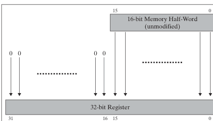

图 6-1 LDRH 指令用零填充位 16 到 31。

小于 32 位宽的无符号操作数必须用零填充额外的位位置（称为“零填充”）。这确保了寄存器内容的无符号解释与从内存加载的数据的无符号解释相同。例如，从内存加载无符号半字到寄存器（LDRH）指令用于 16 位*无符号*整数；它将 16 位半字从内存加载到寄存器的最低 16 位，并用 0 填充剩余的 16 位。同样，从内存加载无符号字节到寄存器（LDRB）指令用于 8 位无符号整数；它将 8 位字节从内存加载到寄存器的最低 8 位，并用 0 填充剩余的 24 位。

小于 32 位宽的有符号操作数必须用其符号位的副本填充额外的位位置。使用“符号扩展”是因为 ARM 处理器（如大多数现代处理器）使用有符号数的补码表示。2 例如，从内存加载有符号半字到寄存器（LDRSH）指令用于 16 位有符号整数；它用内存操作数的符号位（位 15）的 16 个副本填充寄存器的剩余 16 位。同样，从内存加载有符号字节到寄存器（LDRSB）指令用于 8 位有符号整数，并用内存操作数的符号位（位 7）的 24 个副本填充寄存器的剩余 24 位。


图 6-2 LDRSH 指令用符号位填充位 16 到 31。

使用 LDRH 和 LDRB 对无符号值进行零填充，以及使用 LDRSH 和 LDRSB 对有符号值进行符号扩展，是生成原始操作数的数值等效 32 位表示所必需的。当然，加载 32 位字或 64 位双字时不需要零填充和符号扩展，因此只有一条指令（LDR）用于加载 32 位字操作数，只有一条（LDRD）用于加载 64 位双字操作数。

LDRD 将一对寄存器加载为 64 位双字值的两个半部。64 位值以小端格式存储，最低半部（位 0 到 31）存储在字节地址 N 到 N + 3 中，最高半部（位 32 到 63）存储在字节地址 N + 4 到 N + 7 中。最低半部首先加载到指令中列出的最左侧寄存器，然后最高半部加载到第二个寄存器（表 6-1）。

| 指令 | 操作 | 备注 |
| :--- | :--- | :--- |
| LDR Rd,<mem> | Rd ← mem32[address] | |
| LDRB Rd,<mem> | Rd ← mem8[address] | 寄存器的最高位用 0 填充（用于加载 8 位和 16 位无符号整数。） |
| LDRH Rd,<mem> | Rd ← mem16[address] | |
| LDRSB Rd,<mem> | Rd ← mem8[address] | 寄存器的最高位用内存操作数符号位的副本填充。（用于加载 8 位和 16 位有符号整数。） |
| LDRSH Rd,<mem> | Rd ← mem16[address] | |
| LDRD Rd, Rd2,<mem> | Rd, Rd2 ← mem64[address] | <mem> 只能是 [Rn] 或 [Rn,#imm]。 |

注：符号“<mem>”指本节后面描述的内存地址表达式。

### 6.3 将数据从寄存器存储到内存

LDR 指令不仅必须支持各种不同大小的操作数，还必须针对有符号和无符号操作数以不同方式操作。然而，用于将寄存器存储到内存的 STR 指令只需考虑大小。普通 STR 指令将寄存器中的 32 位数据复制到 32 位内存位置。STRB 和 STRH 指令用于内存中的目标位置分别只有 8 位或 16 位宽，或者仅将寄存器的最低位复制到内存的情况。STRD 指令将一对寄存器中的 64 位复制到内存中的 64 位双字，其操作类似于 LDRD 的逆操作（图 6-3 和表 6-2）。


图 6-3 STRH 指令将位 0 到 15 写入内存。

| 指令 | 操作 | 备注 |
|---|---|---|
| STR Rt,<mem> | Rt → mem32[address] | |
| STRB Rt,<mem> | Rt → mem8[address] | |
| STRH Rt,<mem> | Rt → mem16[address] | |
| STRD Rt,Rt+1,<mem> | Rt:Rt+1 → mem64[address] | 地址必须指定为立即常量。 |

注：符号“<mem>”指本节后面描述的内存地址表达式。

当将字节或半字结果写入内存时，寄存器的所有 4 个字节都放置在 32 位内存数据总线上，但只有其中一个或两个字节在写周期中被启用写入。例如，考虑将半字结果写入地址 104 时会发生什么：应写入的两个内存字节位于地址 104 和 105。但是，32 位内存数据总线实际上有 4 个字节宽，对应地址 104、105、106 和 107。内存数据总线的每个字节都有自己的写使能；在内存写周期中，地址 106 和 107 的写使能信号被禁用，因此只有地址 104 和 105 的字节被修改。特定的存储指令类型决定 32 位寄存器的哪些字节被写入：

| 指令 | 操作数 | 地址 N+3 | 地址 N+2 | 地址 N+1 | 地址 N |
|---|---|---|---|---|---|
| STRB | 8 位 | | | | 地址 N |
| STRH | 16 位 | | | 地址 N + 1 | 地址 N |
| STR | 32 位 | 地址 N + 3 | 地址 N + 2 | 地址 N + 1 | 地址 N |
| STRD | 低 32 位 | 地址 N + 3 | 地址 N + 2 | 地址 N + 1 | 地址 N |
| STRD | 高 32 位 | 地址 N + 7 | 地址 N + 6 | 地址 N + 5 | 地址 N + 4 |

### 6.4 将简单的 C 赋值语句转换为 ARM 汇编

LDR 和 STR 是唯一可以引用内存的指令，并且将在我们编写的任何代码中频繁出现。我们首先来看看像“dst = 5;”或“dst = src;”这样的简单 C 赋值语句如何转换为 ARM 汇编。表 6-3 给出了涵盖 8、16、32 和 64 位操作数、有符号和无符号提升（将较小变量复制到较大变量）以及截断的多种解决方案。表中的少数条目必须修改（由脚注指示）以适用于涉及有符号数据类型提升的情况；所有其他条目都适用于有符号或无符号情况。

有符号操作数的提升需要将符号扩展到目标的最高位位置。当目标为 16 位或 32 位时，


| | 8-bit 目标 | 16-bit 目标 | 32-bit 目标 | 64-bit 目标 |
|---|---|---|---|---|
| 源为常数 5 | LDR<br>STRB<br>R0, =5<br>R0, dist8 | LDR<br>STRH<br>R0, =5<br>R0, dist16 | LDR<br>STR<br>R0, =5<br>R0, dist32 | LDR<br>LDR<sup>1</sup><br>STRD<br>R0, =5<br>R1, =0<br>R0, R1, dist64 |
| 8-bit 源 | LDRB<br>STRB<br>R0, src8<br>R0, dist8 | LDRB<br>STRH<br>R0, src8<br>R0, dist16 | LDRB<sup>2</sup><br>STR<br>R0, src8<br>R0, dist32 | LDRB<sup>2</sup><br>LDR<sup>4</sup><br>STRD<br>R1, =0<br>R0, R1, dist64 |
| 16-bit 源 | LDRB<br>STRB<br>R0, src16<br>R0, dist8 | LDRH<br>STRH<br>R0, src16<br>R0, dist16 | LDRH<sup>3</sup><br>STR<br>R0, src16<br>R0, dist32 | LDRH<sup>4</sup><br>LDR<sup>4</sup><br>STRD<br>R1, =0<br>R0, R1, dist64 |
| 32-bit 源 | LDRB<br>STRB<br>R0, src32<br>R0, dist8 | LDRH<br>STRH<br>R0, src32<br>R0, dist16 | LDR<br>STR<br>R0, src32<br>R0, dist32 | LDR<br>LDR<sup>4</sup><br>STRD<br>R0, =32<br>R1, =0<br>R0, R1, dist64 |
| 64-bit 源 | LDRB<br>STRB<br>R0, src64<br>R0, dist8 | LDRH<br>STRH<br>R0, src64<br>R0, dist16 | LDR<br>STR<br>R0, src64<br>R0, dist32 | LDRD<br>STRD<br>R0, R1, src64<br>R0, R1, dist64 |

<sup>1</sup>如果源操作数是负常数，则替换为 ASR R1, R0, #31。
<sup>2</sup>如果源操作数是有符号的，则替换为 LDRSB。
<sup>3</sup>如果源操作数是有符号的，则替换为 LDRSH。
<sup>4</sup>如果源操作数是有符号的，则替换为 ASR R1, R0, #31。

符号扩展完全由 LDRSB 或 LDRSH 指令处理。但是，当目标宽度为 64 位时，创建符号扩展的高 32 位需要对低半部分的副本执行 31 位算术右移；用于此目的的 ASR 指令将在本章后面介绍。

### 6.5 内存地址计算

在执行类似于“LDR R0, data;”的指令的执行阶段时，指令必须向内存提供内存操作数“data”的地址。如果将地址作为 32 位常数存储在指令本身的表示中，这意味着所有 LDR 和 STR 指令都将超过 32 位宽。为了节省内存空间和指令获取时间，这些指令仅指定如何从较少的位数计算地址。汇编器会自动将对变量“data”的引用转换为 PC-relative 引用，其中地址计算为程序计数器 (R15) 与指令中存储的小常数之和。该常数称为位移，其值是指令地址与数据地址之间的差值。位移仅 13 位宽，因此限制在 ±4,095 以内。

PC-relative 寻址是 ARM 寻址模式中称为“偏移寻址”的特例。它为计算地址提供了四个基本选项，如表 6-4 所示。这些选项的使用示例将在本节后面介绍。

| 语法 | 内存地址 | 示例 | 注释 |
| :--- | :--- | :--- | :--- |
| [Rn] | Rn | [R5] | |
| [Rn, #constant] | Rn + constant | [R5, #100] | |
| [Rn, Rm] | Rn + Rm | [R4, R5] | 与 LDRD 或 STRB 不可一起使用。这些指令只能使用寄存器 Rn。 |
| [Rn, Rm, LSL #constant] | Rn + (Rm << constant) | [R4, R5, LSL #3] | |

注意：“LDR R0, data”是 [Rn, #constant] 的一种特殊 PC-relative 情况。


在编写汇编语言时，重要的是要记住，访问内存的指令的操作数字段仅限于使用值为常数的表达式（例如由变量名表示的地址），或表 6-4 中列出的四个选项之一。例如，汇编器会拒绝带下标的数组名（例如，LDR R0, data[k]）或在方括号括起来的地址规范中使用变量名（例如，LDR R0, [R0+k]）。

图 6-4 说明偏移寻址如何使用寄存器、移位器和小常数来生成指令操作数的地址。另外两种寻址模式只是偏移寻址的变体，它们在处理数组数据的循环中很有用。预索引寻址（在右方括号后跟一个感叹号来指定）仅在指令结束时将地址写回寄存器 Rn。后索引寻址（仅将 Rn 放在方括号中来指定）也执行相同操作，但使用 Rn 的先前内容作为指令操作数的地址。

### 6.6 内存寻址示例

当指令引用内存中的数据时，只有两种可能情况中的一种存在。要么数据的地址是常数，要么它是必须在运行时计算的值。在 C 语言中，地址为常数的唯一变量是那些全局声明（在所有函数之外）或在函数内部但使用 static 关键字声明的变量。通过指针访问的数据、所有函数参数以及在函数内部声明的任何非 static 变量都具有必须计算的地址。

#### 6.6.1 将 C 指针表达式转换为汇编

在 C 语言中，指针用于保存内存中某个位置的地址。它们通常通过将“取地址”运算符 (&) 应用于另一个变量的结果来初始化：

```c
int8_t *ptr2byte; // 32-bit pointer holds address of an 8-bit byte
int8_t data;
ptr2byte = &data; // store address of data (a constant) in pointer
```

&data 的值是一个常数。在 ARM 汇编中，我们使用特殊的“ADR”指令来获取该常数：

```asm
ADR R0, data ;R0 ← &data
STR R0, ptr2byte ;ptr2byte ← R0
```

ADR 指令的源操作数字段可以使用与 LDR 和 STR 指令相同的任何内存引用表达式，但它并不实际引用内存——它仅计算地址而不导致内存读取或内存写入。在其最简单的形式中（如前所述），它类似于将常数加载到寄存器中的 LDR 指令，因为“data”的地址是一个常数。但是，这个地址实际上是通过将某个内容加到程序计数器的当前值上获得的。

当你解引用指针时，你使用其内容作为要引用的数据的地址。假设“ptr2byte”已用“data”的地址初始化，我们可以通过指针的间接引用将零存储到其中，如下所示：

```c
*ptr2byte = 0; // store a zero into the byte "data"
```

请注意，我们将零存储在由变量而非常数提供其地址的位置。因此，在 ARM 汇编中，我们必须将该变量的内容加载到寄存器中，然后在将零存储到内存时将其用在一对方括号内：

```asm
LDR R0, =0 ;get the constant zero
LDR R1, ptr2byte ;get the address held in "ptr2byte"
STRB R0, [R1] ;store the zero into a byte of memory
```

上述代码使用 STRB 指令是因为指针被声明为指向宽度为 8 位的数据。但是，指针本身是使用常规 LDR 指令加载的，因为地址始终是 32 位。

理解指针算术的工作原理也很重要。请考虑以下内容：

```c
int32_t array[100]; // an array of 32-bit words of 4 bytes each
int32_t *ptr2word; // a pointer to a 32-bit word
ptr2word = array; // initialize ptr2word with the address of array[0]
```

由于 ptr2word 包含 array[0] 的地址，我们知道 *ptr2word 是对 array[0] 内容的引用。同样，指针表达式 ptr2word + 1 是 array[1] 的地址，指针表达式 ptr2word + k 是 array[k] 的地址。重要的是要意识到数组的每个元素包含 4 个字节，因此如果 array[0] 的地址是 1000，则 array[1] 的地址将是 1004。这意味着当我们写 ptr2word + 1 时，我们实际上是在向地址添加 4 而不是 1。例如，C 赋值语句

```c
*(ptr2word + 5) = 0; // equivalent to: array[5] = 0;
```

将被转换为以下 ARM 汇编：

```asm
LDR R0, =0 ;get the constant zero
LDR R1, ptr2word ;get the address held in "ptr2word"
STR R0, [R1, #20] ;store zero at address 4*5 bytes higher in memory
```

如果我们用整数变量 k 替换常数 5，如下所示：

```c
*(ptr2word + k) = 0; // equivalent to: array[k] = 0;
```

那么 ARM 汇编代码变为：

```asm
LDR R0, =0 ;get the constant zero
LDR R1, ptr2word ;get the address held in "ptr2word"
LDR R2, k ;get the integer held in "k"
STR R0, [R1, R2, LSL #2] ;store at address 4k bytes beyond pointer
```

能够对地址计算中使用的寄存器内容进行左移，是乘以 2 的幂的简单方法，并且特别有用，因为我们通常处理宽度为 1、2、4 或 8 字节的数据。

还要记住，两个指针的差不是它们所持有的地址之差，而是对象之差。例如，请考虑以下声明：

```c
int32_t array[100]; // an array of 100 words of 4 bytes each
int32_t * p1 = &array[10];
int32_t * p2 = &array[20];
```

如果数组从地址 1000 开始，则 p1 将初始化为地址 1040，p2 初始化为 1080。但是，表达式 p2 - p1 的值不是 40（地址之差），而是 10（对象之差）。在汇编中计算此值需要先进行减法，然后除以 4：

```asm
LDR R0, p1 ;get the address held in p1
LDR R1, p2 ;get the address held in p2
SUB R2, R1, R0 ;R2 <- the difference in addresses
ASR R0, R2, #2 ;R0 <- R2, arithmetic shift right by 2 (divide by 4)
```


#### 6.6.2 将 C 下标表达式翻译为汇编

A subscripted array reference shares much in common with pointer dereferencing. In either case, the address calculation involves three components:

- 1. The starting address (provided either by a pointer or by the name of an array)
- 2. The value of a subscript or integer offset
- 3. The size of the objects held in the array or pointed to by the pointer

The only real difference is whether the starting address is a constant or a variable. In fact, you can actually subscript a pointer or dereference an array name. 3 Consider the declarations:

```
int32_t array[100], *ptr2word, k;
```

Applying a subscript to the pointer (e.g., ptr2word[k] = 0;) produces the same ARM assembly code we saw earlier for “*(ptr2word+k) = 0,” and dereferencing the array name (e.g., “*(array + k) = 0;”) is equivalent to the subscripted reference array[k] = 0, which produces very similar assembly code:

```
LDR R0, =0 ;get the constant zero
ADR R1, array ;get the starting address of “array”
LDR R2, k ;get the integer held in “k”
STR R0, [R1, R2, LSL#2] ;store at address 4k bytes into array
```

#### 6.6.3 将结构体引用翻译为汇编

The location of a member element within a structure is obtained by adding a constant (10 in the examples below) to the starting address of the structure. When the reference is specified using the name of a global or statically allocated structure, as in

```
s.m = 5; store 5 into member 'm' of structure 's'
```

then the address of the member element is the sum of two constants and may be computed when the code is assembled:

```
LDR R0, =5 ;get the constant 5
STR R0, s+10 ;store 5 into the member element
```

However, if the reference to the structure is via a pointer, as in

```
p->m = 5; store 5 into member 'm' of the structure pointed to by 'p'
```

then the address must be calculated at run-time using the value of the pointer:

```
LDR R0, =5 ;get the constant 5
LDR R1, p ;get the address of the structure from the pointer
STR R0, [R1, #10] ;store 5 into the member element
```

### 6.7 栈指令

A stack is a “Last-In, First-Out” (LIFO) data structure in which data is retrieved in the opposite order from which it was written. Processors implement stacks by allocating a region of memory for the stack and maintaining a “stack pointer” (SP) register that holds the address of the next stack location to be accessed, called the _top_ of the stack. A “push” operation writes data to the top of the stack, and a “pop” operation reads data from the top of the stack. Push and pop operations adjust the SP so that the location designated as the top of the stack automatically moves up and down in memory as push and pop instructions are executed (Figure 6-5).


FIGURE 6-5 Implementation of a stack in memory.

In the ARM processor, PUSH and POP instructions transfer one or more 32-bit words between the registers and the stack. The stack grows downward toward lower memory addresses as more and more data are pushed. Each PUSH writes a set of registers to the top of the stack and decrements SP (R13) by four times the number of registers written. Each POP does the reverse—it loads a set of registers from the top of the stack and increments SP by four times the number of registers loaded. When more than one register is written to the stack by a single PUSH instruction, the highest numbered register is written to the highest memory address, and the lowest numbered register to the lowest memory address (Table 6-5).

| 指令 | 操作 | 示例 | 注释 |
| :--- | :--- | :--- | :--- |
| PUSH {reglist} | regs → mem[SP – 4 × #regs]; [SP -= 4 × #regs] | PUSH {R0,R1,R7} | 不得包含 SP 或 PC。 |
| POP {reglist} | regs ← mem[SP]; SP += 4 × #regs | POP {R1,R2,R6,LR} | 不得包含 SP。可以包含 PC 或 LR，但不能同时包含。 |

Stacks are a convenient temporary storage because no identifiers are needed for referring to the locations within a stack. C functions make extensive use of the stack for parameters, temporary variables, and to preserve and restore the content of registers that the function must modify. When a function needs to use one or more registers in order to carry out its computation, the function can use a PUSH instruction to preserve their original content and a POP to restore them when finished. When a larger amount of temporary storage is needed, space is allocated on the stack by simply subtracting a constant from SP for the duration of the function.

### 6.8 数据处理指令

The Thumb-2 data-processing instructions of the Cortex-M3 processor perform arithmetic, shifting, and bit manipulation. They share a number of common features, including what they can use as operands and whether or not they affect the flags in the APSR. Almost all of these instructions compute a result from two source operands. The result and one of the operands are held in registers, while the second operand may be a constant (e.g., "ADD R0,R1,#2"), a register (e.g., "ADD R0,R1,R2"), or a register that has been shifted in some way by the barrel shifter (e.g., "ADD R0,R1,R2,ASR #31"). There are five different ways that the second source operand may be shifted. (Table 6-6). In the following tables, this operand is simply represented by "<op>".

| 移位选项 | 含义 | 注释 |
|---|---|---|
| LSL #n | Logical shift left by n bits | 零填充；0 ≤ n ≤ 31 |
| LSR #n | Logical shift right by n bits | 零填充；1 ≤ n ≤ 32 |
| ASR #n | Arithmetic shift right by n bits | 符号扩展；1 ≤ n ≤ 32 |
| ROR #n | Rotate right by n bits | 1 ≤ n ≤ 32 |
| RRX | Rotate right with carry (n + 1 bits) | 仅移位 1 位 |

#### 6.8.1 更新 APSR 中的标志

The APSR is used to record the characteristics of a computed value and may be tested later to make branch decisions. Since the LDR, STR, PUSH, and POP instructions simply move data from one place to another, they never modify any of the flags. Many of the other instructions can modify the flags, provided that the letter "S" is appended to the end of the instruction mnemonic.

For example, an "ADD R0,R0,#1" instruction will increment the content of register R0 but has no effect on the flags. However, changing the ADD to an ADDS will record information in the flags as to whether or not the result was negative (N = 1), zero (Z = 1), or resulted a carry out (C = 1) or a 2's-complement overflow (V = 1).

Although it does not perform any arithmetic computation, the MOVS version of the MOV instruction can be used to capture the characteristics of a value copied into a register. For example, the "MOV R1,R0" instruction will move (copy) the content of R0 into R1, but will not modify any flags. However, changing the MOV to an MOVS will also update the N and Z flags to indicate whether the value was negative (N = 1) or zero (Z = 1). In the following tables, the column labeled "[S]" indicates whether or not you may append an "S" and what flags are updated if you do.

#### 6.8.2 算术指令

The Thumb-2 instruction subset provides the four basic arithmetic operations of addition, subtraction, multiplication, and division. In addition, an RSB (reverse subtract) instruction is provided when you need to subtract the value of a register from a constant, and an NEG (negative) instruction when you need to change the sign of a value held in a register (Table 6-7).

| 指令 | 操作 | [S] | 注释 |
| :--- | :--- | :--- | :--- |
| ADD | Rd, Rn, <op2> Rd <- Rn + <op2> | NZCV | |
| ADC | Rd, Rn, <op2> Rd <- Rn + <op2> + C | NZCV | |
| SUB | Rd, Rn, <op2> Rd <- Rn - <op2> | NZCV | |
| SBC | Rd, Rn, <op2> Rd <- Rn - <op2> - C | NZCV | |
| RSB | Rd, Rn, <op2> Rd <- <op2> - Rn | NZCV | 反向减法 |
| MOV | Rd, <op> Rd <- <op> | NZ | 进位可能受 <op> 影响 |
| NEG | Rd, Rn Rd <- -Rn | | 始终更新：NZCV |

The ADC instruction is used to perform multiple precision addition on operands that are more than 32 bits wide. For example, the ADC is used when adding the most significant halves of two 64-bit operands to incorporate the carry resulting from the addition of the least significant halves. The SBC instruction does the same for multiple precision subtraction, using the carry to hold the borrow (Figure 6-6).


FIGURE 6-6 Double-length 64-bit addition (z = x + y).

There are several instructions for multiplication and a couple for division. The SMULL and SMLAL instructions 5 compute a 64-bit product from 32-bit signed


操作数；UMULL 和 UMLAL 对无符号操作数执行相同操作。有符号和无符号乘法仅在双长乘积的最高位半部分有所不同。MUL、MLA 和 MLS 指令仅生成单长乘积，因此这些指令可与有符号或无符号操作数一起使用。MLA、MLS、UMLAL 和 SMLAL 指令在级数近似中很有用，且 MLS 指令可用于计算除法后的余数（表 6-8）。

| 指令 | 操作 | [S] | 备注 |
|---|---|---|---|
| MUL | Rd <- Rn x Rm | NZ | 32 位乘积 |
| MLA | Rd <- (Rn x Rm) + Ra | | 32 位乘积 |
| MLS | Rd <- Ra - (Rn x Rm) | | 32 位乘积 |
| UMULL | RdHi,RdLo <- Rn x Rm | | 无符号 64 位乘积 |
| UMLAL | RdHi,RdLo <- Rn x Rm + RdHi,RdLo | | |
| SMLAL | RdHi,RdLo <- Rn x Rm + RdHi,RdLo | | 有符号 64 位乘积 |
| SMLALD | RdHi,RdLo <- Rn x Rm + RdHi,RdLo | | |
| UDIV | Rd <- Rn / Rm | | 无符号 32 位商；无余数 |
| SDIV | Rd <- Rn / Rm | | 有符号 32 位商；无余数 |

要计算除法的余数，必须从被除数中减去商与除数的乘积。例如，考虑以下 C 赋值语句：

```
remainder = dividend % divisor ;
```

假设所有变量均为 32 位无符号整数，则余数在汇编中计算如下：

```
LDR R0, dividend ;R0 <- dividend
LDR R1, divisor ;R1 <- divisor
UDIV R2,R0,R1 ;R2 <- quotient
MLS R0,R2,R1,R0 ;R0 <- dividend - divisor x quotient
STR R0, remainder
```

#### 6.8.3 位操作指令

嵌入式应用程序经常处理打包信息，并需要一组有效的指令来操作位。Thumb-2 指令子集包括以下基本的按位 NOT、AND、OR 和异或操作（表 6-9）：

C 中熟悉的按位操作可以轻松翻译为等效的 ARM 汇编。例如，用于清除“x”第 5 位的 C 语句：

```
x &= ~(1 << 5) ; // clear bit n of x
```

| 指令 | 操作 | [S] | 备注 |
|---|---|---|---|
| AND Rd, Rn, <op2> | Rd <- Rn & <op2> | NZC | |
| ORR Rd, Rn, <op> | Rd <- Rn \| <op> | NZC | |
| EOR Rd, Rn, <op> | Rd <- Rn ^ <op> | NZC | "异或" |
| BIC Rd, Rn, <op> | Rd <- Rn & ~<op> | NZC | "位清除" |
| ORN Rd, Rn, <op> | Rd <- Rn \| ~<op> | NZC | "或非" |
| MVN Rd, Rn | Rd <- ~Rn | NZC | "移取反" |

将使用 BIC 指令编码，如下所示：

```
LDR R0, x ;get a copy of x
BIC R0, R0, #0x20 ;clear bit 5
STR R0, x ;store result back into x
```

#### 6.8.4 移位指令

表 6-10 列出了 Thumb-2 移位指令。虽然许多其他指令（例如 ADD、ORR 等）可以包含对其一个操作数的移位，但移位量限制为常量。移位指令没有该限制。它们将操作数 (Rn) 的副本移位指定数量的比特位，该数量由常量或另一个寄存器的内容指定。在所有情况下，将字母“S”附加到指令助记符会导致进位标志 (C) 捕获从操作数移位“出”的比特；在多比特移位中，它捕获最后移位出的比特。

移位指令在用于填充操作数另一端空出的比特位方面有所不同，如图 6-7 所示。逻辑左移 (LSL) 和

| 指令 | 操作 | [S] | 备注 |
|---|---|---|---|
| LSL Rd, Rn, <shift> | Rd <- Rn << <shift> | NZC | |
| LSR Rd, Rn, <shift> | Rd <- Rn >> <shift> | NZC | 零填充 |
| ASR Rd, Rn, <shift> | Rd <- Rn >> <shift> | NZC | 符号扩展 |
| ROR Rd, Rn, <shift> | Rd <- Rn >> <shift> | NZC | 右旋转 |
| RRX Rd, Rn | Rd <- Rn >> 1 | NZC | 右移，用 C 填充 |

注意：“<shift>”可以是常量或寄存器，并指定要移位的比特位数。

6 此限制仅适用于 Cortex-M3 处理器的 Thumb-2 指令子集；更通用的 ARM 指令集允许移位量由寄存器的内容确定。

逻辑右移 (LSR) 指令始终插入 0。算术右移 (ASR) 指令复制最高有效位，使结果与原始操作数具有相同的符号。


图 6-7 移位指令（附加“S”以修改进位标志）。

右旋转指令 (ROR) 执行 32 位旋转，因此用从位 0 移出的值填充位 31。注意，N 位的左旋转可以通过 32-N 位的右旋转来实现。扩展右旋转 (RRX) 执行 33 位旋转，进位标志 (C) 作为操作数的 1 位扩展；然后旋转所有 33 位，使位 31 填充进位标志的先前内容。

移位 64 位双长操作数需要三条指令。例如，要对双长操作数执行逻辑左移，先对高半部分执行逻辑左移。这会在其最低有效位留下一个 0，必须用低半部分的最高有效位替换它。一条指令可以同时将低半部分的副本右移 31 位，并按位或到高半部分。最后，只需对低半部分左移即可（图 6-8）。

| | | R1 | R0 |
|---|---|---|---|
| LDRD R0,R1,data64 | => | b63 ... b32 | b31 ... b0 |
| LSL R1,R1,#1 | => | b62 ... b32 0 | b31 ... b0 |
| ORR R1,R1,R0,LSR #31 | => | b62 ... b32 b31 | b31 ... b0 |
| LSL R0,R0,#1 | => | b62 | b31 b30 ... b0 0 |
| STRD R0,R1,data64 | => | | |

图 6-8 双长 64 位逻辑左移。

另一种解决方案是先对低半部分左移，并使用 LSLS 指令将位 31 捕获到进位标志中。然后，对高半部分左移。最后，使用以零作为第二个操作数的 ADC 指令，将保存在进位标志中的位 31 放入高半部分。但是请注意，虽然这种方法适用于双长左移，但不适用于相反方向。寻找双长左旋转的最优解留给读者作为练习。

#### 6.8.5 位字段操作指令

使用 Thumb-2 指令可以轻松实现位置和宽度固定的位字段的提取和插入。一条指令可以将 0 插入寄存器的位字段中，将一个寄存器的最低有效位复制到另一个寄存器的位字段中，或从寄存器中提取位字段并将其扩展为 32 位有符号或无符号值。在每种情况下，位字段的最低有效位 (lsb) 位置和宽度均由指令的最后两个（常量）操作数指定（表 6-11）。

| 指令 | 操作 | [S] | 备注 |
|---|---|---|---|
| BFC | Rd<bits <- 0 | | |
| BFI | Rd<bits <- Rc<lsb> | | |
| SBFX | Rd <- Rc<bits> | | 符号扩展 |
| UBFX | Rd <- Rc<bits> | | 零扩展 |

例如，图 6-9 说明了如何轻松使用位字段操作指令从 16 位打包时间表示的中间提取 6 位无符号分钟，或将其替换为来自另一个寄存器的新值。


图 6-9 位字段插入和提取指令。

#### 6.8.6 其他位、字节和半字指令

除了位、移位和位字段指令外，以下指令偶尔用于特定情况，例如在小端和大端系统之间转换数据（处理以太网数据包中保存的数据时需要这样做）。这些指令不修改其操作数 (Rn) 或任何标志（表 6-12）。

| 指令 | 操作 | [S] | 备注 |
|---|---|---|---|
| CLZ Rd,Rn | Rd ← CountZeros(Rn) | | 前导零数 (0–32) |
| RBIT Rd,Rn | Rd ← RevBits(Rn) | | 反转位顺序 |
| REV Rd,Rn | Rd ← RevByteOrder(Rn) | | 反转字节顺序 |
| REV16 Rd,Rn | Rd ← RevHalfWords(Rn) | | 反转每个半字中的字节 |
| REVSH Rd,Rn | Rd ← RevLoHalf(Rn) | | 反转 2 个最低有效字节；符号扩展 |
| SXTB Rd,Rn | Rd ← SignedByte(Rn) | | 符号扩展；操作数可以是 Rn，或“Rn,ROR #n”，其中 n = 8、16 或 24 |
| SXTH Rd,Rn | Rd ← SignedHalf(Rn) | | 符号扩展；操作数可以是 Rn，或“Rn,ROR #n”，其中 n = 8、16 或 24 |
| UXTB Rd,Rn | Rd ← UnsignedByte(Rn) | | |
| UXTH Rd,Rn | Rd ← UnsignedHalf(Rn) | | |

## 处理大乘积

如果手动进行算术运算，将两个 n 位整数相乘会产生 2n 位的乘积。但是，C 中的乘法生成的乘积与操作数具有相同的数据类型（因此大小也相同）。考虑以下 C 代码行：

```
a = (b*c) / d ;
```

如果所有变量均为 16 位整数，则生成的汇编代码将类似于：

```
LDRSH R0, b
LDRSH R1, c
MUL R0, R0, R1
SXTH R0, R0 ;Force a 16-bit representation (short × short → short)
LDRSH R2, d
SDIV R0, R0, R2
STRH R0, a
```

现在，考虑当 b、c 和 d 各自包含像 +10,000 这样的大值时会发生什么。从数学上讲，最终结果也应该是 +10,000，但 32 位乘积太大，无法用 16 位表示，因此除法不会产生正确的结果。

7 这就是为什么 MUL、MLA 和 MLS 指令仅保留双长乘积的最低有效半部分。


尝试在 C 中通过在除法前将乘积强制转换为 32 位值来修复问题行不通，因为它只是将错误的 16 位乘积扩展为等价的错误 32 位表示。在 C 中唯一的解决方案是在乘法前强制转换操作数。

如果变量是包含 10^6 等大值的 32 位整数，情况会更加有趣。虽然在乘法前将它们强制转换为 64 位整数可行，但没有 64 x 64 位乘法指令，因此编译器被迫生成调用库函数来执行乘法的代码。还要注意，虽然你可以用汇编编码并使用 SMULL 指令从两个 32 位操作数生成 64 位乘积，但没有除法指令可以使用 64 位被除数。

有了这些背景，现在考虑尝试用 C 编写软件来乘以两个 16.16 定点整数 x 和 y，以生成 16.16 定点数 z。虽然操作数和乘积都是 32 位值，但你必须计算 64 位乘积，因为 16.16 定点乘积位于 64 位整数乘积的中间。因此，高效完成此操作的唯一方法是使用汇编：

```
LDR R0, x ;R0 ← x (a 16.16 fixed-point real)
LDR R1, y ;R1 ← y (a 16.16 fixed-point real)
SMULL R0,R1,R0,R1 ;R0,R1 ← 64-bit integer product
LSL R0,R0,#16 ; keep 16 MSBs of least significant half
ORR R0,R0,R1,LSL#16 ;and 16 LSBs of the most significant half
STR R0, z
```

## 问题

- 1. 如果寄存器 SP 包含 12348₁₀，然后执行“PUSH {R1}”指令，寄存器 SP 中将剩下什么值？
  - (a) 12347
  - (b) 12346
  - (c) 12345
  - (d) 12344

- 2. 假设你有三个名为 x、y 和 z 的 32 位整数。给出实现赋值语句 z = x / y 所需的适当 ARM Cortex-M3 汇编语言指令序列，假设这些整数为：
  - (a) 无符号
  - (b) 有符号

- 3. 访问数组元素时，以下哪些寄存器不会用于保存数组的下标？（全部圈出。）
  - (a) R11
  - (b) R12
  - (c) R13
  - (d) R14
  - (e) R15

- 4. 假设寄存器 R0 和 R1 已经保存了一个 64 位量，其中最高 32 位在 R1 中，最低 32 位在 R0 中。给出实现以下操作所需的最短 ARM Cortex-M3 指令序列：
  - (a) 64 位逻辑右移 1 位
  - (b) 64 位算术右移 1 位
  - (c) 64 位旋转（不包括进位标志）1 位

- 5. 在 Cortex-M3 处理器上实现以下四个 C 赋值语句中的每一个所需的最少指令数是多少？

  ```
  long long int a ;
  long int b ;
  ```

  - (a) a = (long long) b ;
  - (b) b = (long) a ;
  - (c) b += 100 ;
  - (d) a += 100 ;

- 6. 对于以下每个案例，给出每个变量的 C 声明以及完成相同操作的 C 赋值语句。在可以确定的地方指定有符号或无符号；否则在声明中省略：

  - (a)
    ```
    LDRH R0,=red
    ADR R1,blue
    LDR R2,purple
    STRH R0,[R1,R2,LSL #1]
    ```
  - (b)
    ```
    LDR R0,=green
    ADD R0,R0,#1
    LDR R1,=0
    STRD R0,R1,violet
    ```
  - (c)
    ```
    LDRB R0,=black
    LDR R1,=5
    UDIV R2,R0,R1
    MLS R0,R1,R2,R0
    STRB R0,white
    ```
  - (d)
    ```
    LDRD R0,R1,=orange
    LSL R1,R1,#1
    ORR R1,R1,R0,LSR #31
    LSL R0,R0,#1
    LSR R0,R0,#1
    STRD R0,R1,yellow
    ```

- 7. 给定以下 C 声明语句，

  ```
  int8_t s8 ;           uint8_t u8, *pu8 ;
  int16_t s16 ;         uint16_t u16 ;
  int32_t s32 ;         uint32_t u32, *pu32 ;
  int64_t s64 ;         uint64_t u64 ;
                                      uint16_t *pu16 ;
  ```

  将以下每个 C 赋值语句翻译成 Cortex-M3 汇编：

  - (a) u32 = 100 ;
  - (b) u8 = u32 ;
  - (c) u16 = 100 ;
  - (d) s16 = s8 ;
  - (e) u8 = 100 ;
  - (f) s32 = s16 ;
  - (g) u64 = 100 ;
  - (h) s32 = s8 ;
  - (i) u16 = u8 ;
  - (j) s64 = s32 ;
  - (k) u32 = u16 ;
  - (l) s64 = -1 ;
  - (m) u32 = u8 ;
  - (n) pu32 = &u32 ;
  - (o) u64 = u32 ;
  - (p) pu8 = &u8 ;
  - (q) u8 = u16 ;
  - (r) ((uint8_t *) &u32)[0] = u8 ;
  - (s) u16 = u32 ;
  - (t) *pu32++ = 0 ;
  - (u) u16 = u8 + 1 ;
  - (v) u64 = u64 + 1 ;
  - (w) *pu16 = *pu16 + 1 ;

- 8. 将以下每个 C 赋值语句翻译成 Cortex-M3 汇编：

  - (a)
    ```
    signed long long s64 ;
    signed s32 ;
    signed char s8 ;
    s32 = s64 + s8 ;
    ```
  - (b)
    ```
    long k32, *p32, a32[10] ;
    k32 = (p32 - a32) + 5 ;
    ```
  - (c)
    ```
    long long a64[10] ;
    long k32, *p32 ;
    p32 = ((long *) &a64[k32]) + 1 ;
    ```
  - (d)
    ```
    unsigned long u32 ;
    signed long s32 ;
    s32 = 10 * u32 ;
    ```
  - (e)
    ```
    short int **pp16 ;
    (*pp16 + 1) = 0 ;
    ```
  - (f)
    ```
    long k32, a32[10], *p32 ;
    k32 = &a32[k32] - p32 ;
    ```
  - (g)
    ```
    short a16[10] ;
    long k32 ;
    ++a16[k32 - 1] ;
    ```
  - (h)
    ```
    unsigned long long u32 ;
    unsigned long long u64 ;
    u64 = (unsigned long long) u32 ;
    ```
  - (i)
    ```
    signed char s8 ;
    signed long long s64 ;
    s64 = (signed long long) s8 ;
    ```
  - (j)
    ```
    signed long long int s64 ;
    signed long s32 ;
    s64 = (signed long long) s32 ;
    ```
  - (k)
    ```
    signed long s32 ;
    s32 &= 10 ;
    ```
  - (l)
    ```
    unsigned short u16 ;
    u16 /= 10 ;
    ```

## 汇编编程第 3 部分：控制结构

本章探讨了在 ARM 汇编中实现决策结构、循环和函数调用。大多数嵌入式程序是 C 和汇编的混合。主程序和大多数过程通常用 C 实现，只有少数低级支持例程用汇编编写——通常是为了优化性能。因此，我们的目标是学习如何尽可能高效地实现这些结构。

### 7.1 指令排序

处理器运行后，会反复执行取指-执行周期。因此，处理器的默认操作是执行从连续内存位置读取的直线指令序列。然而，为了完成任何有用的工作，程序必须偶尔通过将控制权（有条件或无条件）转移到内存的另一部分来偏离此序列。

在 C 中，控制转移由 break、continue、switch 和 goto 语句、函数调用和返回以及循环末尾的隐式转移创建。当代码被编译时，这些都被翻译成分支指令，¹ 如图 7-1 所示。

| C 源代码 | ARM 汇编语言 |
| :--- | :--- |
| `for (;;) {` | `top_of_for:` |
| `...` | `...` |
| `if ((a==5)` | `...` |
| `break;` | `BEQ end_of_for` |
| `...` | `...` |
| `}` | `B top_of_for` |
| | `end_of_for:` |

图 7-1 编译器为 break 语句和 for 循环末尾生成的代码中的分支指令。

¹switch 语句翻译成汇编的方式取决于 case 标签常量的数量和分布。有时通过索引目标地址表来形成多路跳转；在其他情况下，switch 语句被翻译成等效的 if-then-else 级联序列。

### 7.2 实现决策

决策通常从评估一个为真或假的表达式开始。该表达式称为条件，可能是两个值的简单比较。涉及多个比较的复合条件是通过使用布尔运算符组合这些基本条件来构建的。

在汇编中，每个决策都是一个两步过程：一条指令用于设置标志，随后是另一条使用标志来做出实际决策的指令。复合条件的每个组件都需要这个两部分序列——比较后跟条件分支。在大多数情况下，第一条指令通过计算两个值的差来比较它们。该差值的实际值不重要——只需要知道其特征。例如，比较（CMP）计算两个值的差，丢弃该差值，但将其特征保存在标志中。然后通过检查标志（使用条件分支指令），我们可以就两个值的相对大小做出决策，并相应地改变执行流程。

CMP 将寄存器与第二个操作数进行比较，第二个操作数可以是常量、寄存器或移位寄存器。还有一条 CMN（比较负数）指令，它是加而不是减第二个操作数。这两条指令都会记录结果是否为负、零、产生进位（或借位）或产生 2 的补码溢出。TST 指令用于测试寄存器中一个或多个位是否非零，TEQ 指令用于测试两个值是否相同且不影响 V 或 C 标志（表 7-1）。

| 指令 | 操作 | [S] | 备注 |
|---|---|---|---|
| CMP | Rn,<op2> Rn - <op2> | | 始终更新：NZCV |
| CMN | Rn,<op2> Rn + <op2> | | |
| TST | Rn,<op2> Rn & <op2> | | 始终更新：NZ；如果移位，<op> 可能影响 C 标志 |
| TEQ | Rn,<op2> Rn ^ <op2> | | |

图 7-1 包含一个条件分支指令（BEQ）的示例，该指令根据零标志（Z）的状态做出分支决策。如果 Z 为 1，则相等比较为真，指令跳出循环；否则，指令流


表 7-2 ARM 条件码

| 代码 | 含义 | 要求 |
|---|---|---|
| EQ | 相等 | Z = 1 |
| NE | 不相等 | Z = 0 |
| HS | 无符号 ≥（“高或相同”） | C = 1 |
| LO | 无符号 <（“低”） | C = 0 |
| HI | 无符号 >（“高”） | C = 1 && Z = 0 |
| LS | 无符号 ≤（“低或相同”） | C = 0 || Z = 1 |
| GE | 有符号 ≥（“大于或等于”） | N = V |
| LT | 有符号 <（“小于”） | N ≠ V |
| GT | 有符号 >（“大于”） | Z = 0 && N = V |
| LE | 有符号 ≤（“小于或等于”） | Z = 1 || N ≠ V |
| CS | 进位置位（HS 的同义词） | C = 1 |
| CC | 进位清零（LO 的同义词） | C = 0 |
| MI | 负 | N = 1 |
| PL | 正 – 正数或零（非负） | N = 0 |
| VS | 溢出置位 | V = 1 |
| VC | 溢出清零 | V = 0 |
| AL | 总是（无条件） | （很少使用） |

continues sequentially with whatever instruction immediately follows the BEQ. The “EQ” in BEQ is called a condition code; there are 15 possible condition codes as summarized in Table 7-2.

Eight of the condition codes are used much more frequently than others and are indicated in bold in the table. EQ and NE are used for equality and inequality tests. The codes for relative magnitude tests depend on whether the operands are signed or unsigned; condition codes GE, LT, GT, and LE are used with signed operands, while HS, LO, HI and LS are used with unsigned operands.

If you are not sure why two separate sets of condition codes for relative magnitude comparisons are necessary, then ask yourself which is greater: 1101₂ or 0111₂. As 4-bit unsigned values, they represent decimal 13 and 7 so that 1101₂ > 0111₂; however, as 4-bit signed 2’s-complement values, they represent –3 and +7 so that 1101₂ < 0111₂.

#### 7.2.2 If-Then 和 If-Then-Else 语句

Consider the following simple C if-then statement shown in Figure 7-2. Since the C code uses an equality comparison (==), you may be tempted to use a BEQ instruction in assembly. If you do, you will have to add an unconditional branch around the two instructions that are the then clause. Instead, a more efficient solution is to use the BNE instruction to eliminate the unconditional branch:

| C 源代码 | 低效汇编 | 高效汇编 |
|---|---|---|
| int32_t a, b ; | LDR R0, a | LDR R0, a |
| if (a == 0) b = 1 ; | CMP R0, #0 | CMP R0, #0 |
| | BEQ Then | BNE EndIf |
| | B EndIf | Then: LDR R0, =1 |
| | Then: LDR R0, =1 | STR R0, b |
| | STR R0, b | EndIf: ... |
| | EndIf: ... | |

FIGURE 7-2 Converting an if-then statement to assembly.

It is important to realize that when a decision is made in assembly, the only possible action is to branch. In other words, to get closer to what is actually done in assembly, we should imagine that the if statement has been rearranged so that the action controlled by the if statement is a goto, which then requires that we reverse the sense of the comparison:

if (a != 0) goto L1 ;
b = 1 ;
L1:

When coding a relative magnitude comparison, it is important to remember that the opposite of “less than” is NOT “greater than.” If a condition includes the equality case, then the opposite condition must not, and vice versa!

Figure 7-3 illustrates how an else-if statement is translated into assembly. When an else is added, an unconditional branch must always be included. As shown in Figure 7-4, the unconditional branch must immediately follow the then clause (b = 1;) in order to skip over the else (c = 2;) so that only one of the two will be executed. If omitted, the code simply will not work as intended.

| C 源代码 | 错误汇编 | 正确汇编 |
|---|---|---|
| int32_t a, b ; | LDR R0, a | LDR R0, a |
| if (a < 100) b = 1 ; | CMP R0, #100 | CMP R0, #100 |
| | BGT L1; #NO! | BGE L1 |
| | LDR R0, =1 | LDR R0, =1 |
| | STR R0, b | STR R0, b |
| | L1: ... | L1: ... |

FIGURE 7-3 Correctly choosing the opposite condition code.

| C 源代码 | 汇编代码 |
| :--- | :--- |
| signed int a,b,c; | LDR R0,a ;Is a > 0 ? |
| | CMP R0,#0 |
| if (a > 0) b = 1; | BLT Else |
| else c = 2; | Then: LDR R0,=1 ;b ← 1 |
| | STR R0,b |
| | B EndIf ;skip over the else! |
| | Else: LDR R0,=2 ;c ← 2 |
| | STR R0,c |
| | EndIf: ... ;end of the if |

FIGURE 7-4 Converting an if-then-else statement to assembly.

#### 7.2.3 Compound Conditionals

Simple equality tests and relative magnitude comparisons translate from C to assembly in a relatively straightforward manner. However, compound conditionals containing two or more conditionals are a little trickier. First, let us consider comparing a value against the minimum and maximum of a range of values:

```
if (x >= -100 && x <= +100) y = x ; // Assume that "x" is a signed int.
```

Sometimes it is easier to convert this to assembly if the logical AND is replaced by a logical OR. To do so, first replace the conditional by its logical inverse and modify the if statement so that it skips over the assignment (instead of executing it) when the new condition is true:

```
if (!(x == -100 && x <= +100)) goto L1 ;
```

```
L1: y = x;
...
```

Next, use DeMorgan's law from Boolean algebra to remove the logical NOT. To do so, replace all the logical ANDs (`&&`) by logical ORs (`||`), all logical ORs by logical ANDs (there are none in this example), and all operands (the two conditionals) by their inverse. The result is

```
if (x < -100 || x > +100) goto L1 ;
```

```
L1: y = x;
...
```

Now that the expression is ORing the results from the two compares, it is much easier to visualize how to separate the two comparisons into two if statements:

```
if (x < -100) goto L1;
```

```
if (x > +100) goto L1;
```

```
y = x;
L1: ...
```

and thus much easier to visualize how to translate the preceding into assembly language:

```
LDR R0, x       ; if (x < -100) goto L1
CMN R0,#100
BLT L1
CMP R0,#100     ; if (x > +100) goto L1
BGT L1
STR R0,y        ; y = x ;
L1: ...
```

Now consider a different problem. Suppose that we want to execute the assignment when x was outside (rather than inside) the range. In C, we would simply write the following if statement:

```
if (x < -100 || x > upper_limit) y = x;
```

Separating this into two if statements, each with a single comparison and each controlling a goto, yields

```
if (x < -100) goto L1 ;
if (x > +100) goto L1 ;
goto L2 ;
L1: y = x ;
L2: ...
```

We can eliminate one of the goto’s (and thus an unconditional branch instruction) by inverting the sense of the last comparison and changing the destination of its goto:

```
if (x < -100) goto L1 ;
if (x <= +100) goto L2 ;
L1: y = x ;
L2: ...
```

Then, translating into assembly, the final result becomes

```
LDR R0, x       ; if (x < -100) goto L1
CMN R0,#100
BLT L1
CMP R0,#100     ; if (x <= +100) goto L2
BLE L2
STR R0,y        ; y = x ;
L1: ...
```

#### 7.2.4 The “If-Then” (IT) Instruction

We learned in Chapter 5 that branch instructions stall the instruction pipeline, causing performance to suffer. When an if statement controls a short sequence of instructions, it often executes faster to always fetch the instructions but simply use the flags to enable or disable their execution phase (Figure 7-5).

The IT instruction makes the execute phase of one to four following instructions conditional. The conditions can be all the same, or some of them can be the logical inverse of the others. The conditional instructions following the IT instruction form the IT block.

| C 源代码 | 汇编代码 |
|---|---|
| signed int a,b,c; | LDR R0, a ; is a > 0? |
| | CMP R0, #0 |
| if (a > 0) b = 1; | ITT GT ; controls 4 instructions |
| else c = 2; | LDRGT R0,=1 ; yes: b ← 1 |
| | STRGT R0,b |
| | LDRLE R0,=2 ; no: c ← 2 |
| | STRLE R0,c |

FIGURE 7-5 Speeding up an if-then-else statement with an IT block.

The first instruction in the IT block is enabled if the condition code given in the operand field of the IT instruction is true. The remaining instructions in the block are controlled by appending one to three letters to the IT mnemonic. If the letter is a “T” (“then”), the condition code enables the corresponding instruction; if the letter is an “E” (“else”), the opposite of the condition code enables the instruction. All instructions in the IT block must have their enabling condition code appended to their mnemonic.⁶

An instruction within an IT block may modify the flags, but has no effect on whether the remaining instructions in the block are enabled or disabled.

There are three fundamental restrictions regarding IT blocks:

- 1. An IT block may not contain an IT, CBZ, CBNZ, CPSID, or CPSIE instruction.⁷
- 2. Instructions that modify the PC may be used only as the last instruction of the block.
- 3. A branch to an instruction within an IT block is not allowed.

## 7.3 IMPLEMENTING LOOPS

Loops generally consist of four parts: initialization, test for completion (or continuation), update of the loop control variables, and the body of the loop (the code to be repeated). Sometimes the update is part of the body of the loop. Loops may be distinguished by whether their test for completion is placed before or after the body of the loop. For and while loops test for completion before each iteration and thus repeat zero or more times; do-while loops test after each iteration and always repeat at least once.

Some loops repeat for a fixed number of iterations, specified by either a constant or the value of a variable, such as finding the factorial of a number or computing the average of a set of values. Others repeat until some condition is satisfied that depends on values computed during the loop, such as finding the greatest common divisor (GCD) of two integers or the convergence test in a series approximation.

⁶ 所有 ARM 处理器都使用单一的统一汇编语言（UAL）。与 Thumb-2 指令不同，向常规 ARM 指令附加条件码会使其执行变为条件执行，而无需 IT 指令。当针对常规 ARM 处理器汇编时，IT 指令会被忽略，而 IT 块内指令附加条件码这一看似冗余的要求，允许同一段源代码同时用于常规 ARM 和 Thumb-2 代码。
⁷ CPSID 用于禁用中断，CPSIE 用于启用中断。


所有 for 循环、while 循环和 do-while 循环都有一个从循环底部到顶部的隐式分支；当翻译成汇编语言时，此分支指令会变得显式（图 7-6 和 7-7）。

| C 源代码 | 汇编代码 |
| :--- | :--- |
| // Computes Greatest<br>// Common Divisor<br>// of 'a' and 'b'<br>uint32_t a, b, gcd;<br>while (a != b)<br>{<br> if (a > b) a -= b ;<br> else b -= a ;<br>}<br>gcd = a ; | LDR R0,a ;initialization<br>LDR R1,b<br>top: CMP R0,R1<br> BEQ done ;test for continuation (a != b)<br> ITE GT<br>SUBGT R0,R0,R1 ;loop body and update<br>SUBLE R1,R1,R0 ;b -= a<br> B top ;implicit branch to the top<br>done: STR R0,gcd |

## 图 7-6 将 while 循环的组件翻译成汇编语言。

| C 源代码 | 汇编代码 |
| :--- | :--- |
| // Computes n!<br>uint32_t k, fact, n ;<br>fact = 1 ;<br>for (k = n; k != 0; k--)<br>{<br> fact *= k ;<br>} | LDR R0,=1 ;initialization (fact = 1, k = n)<br>LDR R1,n<br>top: CMP R1,#0<br> BEQ done ;test for continuation (k != 0)<br> MUL R0,R0,R1 ;loop body (fact *= k)<br>SUB R1,R1,#1 ;update (k--)<br> B top ;implicit branch to the top<br>done: STR R0,fact |

## 图 7-7 将 for 循环的组件翻译成汇编语言。

计数循环（即重复执行预定次数的循环）非常常见，以至于 Thumb-2 指令集提供了两条指令（CBZ 和 CBNZ），将这些循环的比较和分支决策合并为一条指令。例如，前面示例中的 CMP 和 BEQ 指令可以被一条“CBZ R1,done”指令替换（表 7-3）。

## 表 7-3 ARM Thumb-2 比较和分支指令

| 指令 | 操作 | [S] | 注释 |
| :--- | :--- | :--- | :--- |
| CBZ Rn,label | 如果 Rn = 0，则分支到 label | | 不能在 IT 块中使用 |
| CBNZ Rn,label | 如果 Rn != 0，则分支到 label | | |

#### 7.3.1 加速数组访问

处理数组的循环很常见，因此是优化的良好候选。它们通常按顺序遍历数组的元素，从而可以利用处理器的前增量和后增量寻址能力。例如，这些寻址模式可以在将数组初始化为常量值、扫描数组以查找特定值、将一个数组复制到另一个数组或比较两个数组时提高性能。所有此类循环都必须加载或存储数组的一个元素，然后递增或递减地址；前增量和后增量将这两个操作合并为一条指令。

### 前增量寻址模式

前增量寻址模式的语法仅在右方括号后添加一个感叹号：

```
LDR R0, [R1, #4]! ; R1 ← R1 + 4, then R0 ← mem[R1]
LDR R0, [R1, R2]! ; R1 ← R1 + R2, then R0 ← mem[R1]
LDR R0, [R1, R2, LSL #2]! ; R1 ← R1 + (R2 << 2), then R0 ← mem[R1]
```

### 后增量寻址模式

后增量寻址模式的语法仅将右方括号移动到第一个寄存器之后：

```
LDR R0, [R1], #4 ; R0 ← mem[R1], then R1 ← R1 + 4
LDR R0, [R1], R2 ; R0 ← mem[R1], then R1 ← R1 + R2
LDR R0, [R1], R2, LSL #2 ; R0 ← mem[R1], then R1 ← R1 + (R2 << 2)
```

例如，使用后增量寻址和 CBNZ 指令，将以 NUL 结尾的字符串从一个内存区域复制到另一个内存区域可以实现为三条指令的循环：

```
ADR R0, source ; R0 ← starting address of source string
ADR R1, destination ; R1 ← starting address of destination string
copy: LDRB R2, [R0], #1 ; R2 ← char from source string; R0++
STRB R2, [R1], #1 ; char in destination string; R2++; R1++
CBNZ R2, copy ; continue until last char copied is a NUL
```

当已知要复制的数据是 4 字节的倍数时，使用加载多个和存储多个指令可以使复制速度更快。每条指令可以在寄存器和内存之间传输 1 个或多个 32 位字，并更新保存内存地址的另一个寄存器（表 7-4）。

| 指令 | 操作 | [S] | 注释 |
| :--- | :--- | :--- | :--- |
| LDMIA Rn{!},<reglist> | Rfirst ← mem[Rn],<br>Rin+1 ← mem[Rn+4],<br>Rlast ← mem[Rn+8], 等等。 | | Rfirst 和 Rlast 指按寄存器编号而非列表中出现顺序排列的寄存器 |
| LDMDB Rn{!},<reglist> | Rlast ← mem[Rn],<br>Rlast-1 ← mem[Rn-4],<br>Rfirst ← mem[Rn-8], 等等。 | | |
| STMIA Rn{!},<reglist> | mem[Rn] ← Rfirst,<br>mem[Rn+4] ← Rin+1,<br>mem[Rn+8] ← Rlast, 等等。 | | "!" 是可选的回写后缀。如果存在，从中加载或存储到的最终地址会写回到 Rn |
| STMDB Rn{!},<reglist> | mem[Rn] ← Rlast,<br>mem[Rn-4] ← Rlast-1,<br>mem[Rn-8] ← Rlast-2, 等等。 | | 示例：LDMIA R0!,{R1,R3 to R7} |

POP 等效于 LDMIA SP!,<reglist>
PUSH 等效于 STMDB SP!,<reglist>

## 7.4 实现函数

要编写可从高级语言调用的汇编语言函数，仅仅理解控制如何从调用程序传递到函数并返回是远远不够的。参数如何传递以及如何检索返回值，由编译器将 C 函数调用转换为一系列汇编语言指令的方式预先确定。在函数内部，我们将看到编译器的设计也建立了某些规则，用于管理寄存器的保存、分配以及临时结果的使用。我们必须在这些约束下工作，但根本目标是优化性能。

### 7.4.1 函数调用和返回

表 7-5 显示了用于调用和从 C 函数返回的两条最常用指令。带链接分支（BL）指令将返回地址（BL 指令后紧随的那条指令的地址）保存在寄存器 LR 中，然后分支到函数的入口点地址。随后，LR 与间接分支（BX）指令一起使用，通过将 LR 的内容复制回程序计数器来从被调用函数返回。

几乎任何将返回地址复制到 PC 的指令都可用于实现返回。虽然“BX LR”看起来等同于“MOV PC,LR”，但后者是

| 指令 | 操作 | [S] | 注释 |
| :--- | :--- | :--- | :--- |
| BL label | LR ← 返回地址;<br>PC ← 标签的地址 | | 子程序调用 |
| BX Rn | PC ← Rn | | 当 Rn = LR 时用于子程序返回 |

不鼓励使用，以保持与原始 ARM 指令集的兼容性。如本章后面将看到，将返回地址弹出到 PC 通常更高效。

当从 C 程序调用无参数且无返回值的函数时，编译器会生成一条 BL 指令。图 7-8 显示了禁用中断系统的此类函数的简单示例。EXPORT 伪指令告诉汇编器将函数名告知链接器，以便它可以解析其他源代码文件中对该函数的引用。

| C 函数原型： | void DisableInterrupts(void); |
| :--- | :--- |
| C 中的示例用法： | DisableInterrupts(); |
| 汇编中的函数调用： | BL DisableInterrupts |
| 汇编中的函数定义： | EXPORT DisableInterrupts<br>DisableInterrupts:<br>CPSID<br>;禁用中断<br>BX LR ;从函数返回 |

## 图 7-8 无参数且无返回值的函数。

显然，寄存器 LR 只能保存一个返回地址，因此调用其他函数的函数必须在其入口点保存 LR，并在返回前恢复其原始内容。图 7-9 中的代码使用 PUSH 和 POP 指令来实现这一点。与使用 POP 恢复 LR 然后立即跟随 BX LR 将 LR 复制到 PC 不同，一种简单且常用的优化是将指令对替换为直接弹入 PC 的单个 POP。

##### 7.4.2 寄存器使用

我们的目标是学习如何实现可由 C 编写的程序调用的汇编语言函数。我们编写代码的方式必须与


## 图 7-9 嵌套函数调用期间保存寄存器 LR。

注意：最后两条指令可以替换为 POP {PC}。


## 表 7-6 ARM 架构过程调用标准

| 寄存器 | AAPCS 名称 | 主要用途 | 是否用作临时寄存器？ | 是否保留？ |
|---|---|---|---|---|
| R0 | A1 | 第一个函数参数；8 位/16 位/32 位返回值 | 是 | |
| R1 | A2 | 第二个函数参数；64 位返回值的高半部 | 是 | |
| R2, R3 | A3, A4 | 第三和第四个函数参数 | 是 | |
| R4 到 R8 | V1 到 V5 | 寄存器变量 | 是 | 是 |
| R9 到 R11 | V6 到 V8 | 用法取决于编译器 | 是 | 是 |
| R12 | IP | 过程内调用临时寄存器 | 是 | |
| R13 | SP | 堆栈指针（当前栈帧的低端） | 这些寄存器有特殊用途 | |
| R14 | LR | 链接寄存器 | | |
| R15 | PC | 程序计数器 | | |

编译器期望函数的运行方式。除了将控制权转移到子程序并返回的简单机制之外，兼容性还要求我们理解：

- 1. 在哪里找到传递给我们函数的参数，
- 2. 在哪里留下返回值以便调用者可以找到它们，以及
- 3. 哪些寄存器必须保留，哪些可以修改。

幸运的是，这些要求由 ARM 架构过程调用标准（AAPCS）规定，并在表 7-6 中总结。它使用寄存器 R0 到 R3 来保存传递给函数的前四个字的参数，并使用寄存器 R0 和 R1 来保存返回值。R0 用于返回 8 位、16 位和 32 位值；64 位值在 R0 和 R1 中返回，其中 R1 保存高 32 位。寄存器 R0 到 R3 可以在函数内根据需要修改，而无需考虑其原始内容。大多数其他寄存器也可用于使用，但在任何修改之前必须保留其原始内容，并在函数返回之前恢复。

### 7.4.3 参数传递

寄存器 R0 到 R3 用于传递参数（图 7-10），通常足以满足我们在汇编中编写的小型支持例程。8 编译器将每个 8 位、16 位或 32 位参数加载到按从左到右顺序分配的单个寄存器中；双字参数在两个连续寄存器中传递（例如，R0 和 R1、R1 和 R2，或 R2 和 R3），高 32 位位于成对寄存器的第二个寄存器中。被调用函数可以修改 R0 到 R3 的内容，因此无需在返回时保留原始参数值。

8 当调用带有多个 32 位参数（超过四个）的函数时，编译器会在调用前将其余参数压入堆栈；然后由函数负责在返回前将 SP 恢复到其原始值。一种流行的替代方法是将参数存储在结构中，并将结构的地址传递给函数。

| C 函数原型和调用 | 生成的汇编 |
| :--- | :--- |
| void display(int8_t, int16_t [], int64_t); ... | ... R0, ch ... |
| doIt(ch, array, bignum); | ADR R1, array ... |
| ... | LDRD R2,R3,bignum ... |
| ... | BL display ... |
| ... | ... |

图 7-10 参数在 R0 到 R3 中传递。

### 7.4.4 返回值

函数预期将任何 8 位、16 位或 32 位结果返回在 R0 中，根据声明的返回类型进行零填充或符号填充（图 7-11）。返回 64 位结果的函数必须将位 0 到 31 放在 R0 中，将位 32 到 63 放在 R1 中（图 7-12）。如果函数必须返回多个结果，常见的做法是调用者传递一个指向结构的指针，并让函数使用该指针将结果存储到结构中。虽然 C 函数允许返回包含超过 64 位的结构，但这对于用汇编编写的支持例程很少需要。

### 7.4.5 临时变量

函数应首先尝试使用寄存器 R0 到 R3 存放任何所需的临时变量，因为无需保留其内容。寄存器 R4 到 R11 是第二选择，但其原始内容必须在函数入口处保存，并在函数返回前恢复。

当需要更多临时变量空间时，可以在堆栈上分配。这通过在函数入口处从 SP 减去一个常数来实现，该常数对应于


图 7-11 在 R0 中返回 32 位结果。

```
sint64_t multiply(sint32_t, sint32_t);
...
product = multiply(a, b);
...
Compiler
...
LDR R0, a
LDR R1, b
BL multiply
STRD R0,R1, product
...
export multiply
multiply SMULL R0,R1,R0,R1
BX LR
```

图 7-12 在 R0 和 R1 中返回 64 位结果。

所需的堆栈空间字节数，<sup>9</sup> 然后使用正的 SP 相对偏移量（例如，[SP, #8]）引用分配的内存位置。必须在函数返回前将常数重新加到 SP 上以恢复 SP 的原始值。

使用寄存器或堆栈空间存放临时变量而不是使用标签创建固定位置有两个重要原因：

- 1. **内存节约**：函数返回时堆栈空间会自动释放，以便可用于其他需求。
- 2. **可重入性**：函数的每次入口都会为其临时变量分配一组唯一的内存位置。因此，如果函数被中断，并且中断代码调用（或重入）同一函数，则可确保每次调用只修改其自己的一组临时变量。

尽管堆栈顶部之后的内存空间当前未使用，但在将临时变量放置在那里之前，仍必须分配（保留）它。例如，如果我们的函数调用另一个函数，被调用函数可能会覆盖这部分空间的不确定数量。即使没有调用其他函数，也可能发生硬件中断，调用覆盖该空间的中断服务例程。因此，为了保护我们放置在堆栈这一“未使用”部分中的临时变量，我们必须首先调整堆栈指针（并在不再需要变量时稍后恢复它）。

### 7.4.6 保留寄存器

修改寄存器的函数通常必须在堆栈上保留和恢复其先前的内容。但是，由于堆栈存储在内存中，而内存周期是主要的性能瓶颈，因此尽可能少地保留寄存器很重要。

<sup>9</sup>为保持地址对齐，常数应为四的倍数。

理想情况是图 7-13 中的函数 f1 这样的函数，它本身不包含函数调用，并且不修改 R0 到 R3 以外的任何寄存器。

在这种情况下，无需保留任何寄存器。

当函数修改 R0 到 R3 以外的任何寄存器时，必须保留其原始内容。最佳方法是在进入函数时立即将这些寄存器压入堆栈，并在函数返回前将其弹出，如图 7-13 中的函数 f2 所示。

当函数调用嵌套时，第二次调用会覆盖 LR 中保存的当前返回地址。因此，当一个函数（例如图 7-13 中的函数 f3）包含对第二个函数（f4）的调用（BL）时，第一个函数必须在其入口处压入 LR 的内容，并在返回前将其弹出。请注意，由于 LR 已经在堆栈上，通常用于返回调用者的 BL LR 指令可以通过在 POP 指令中用 PC 替换 LR 来消除。

寄存器 R0 到 R3 不是调用其他函数的函数保存信息的好地方。例如，在图 7-13 中，对函数 f4 的调用可能需要将参数放在 R0 到 R3 中，并且/或者在返回前修改其内容。因此，常见的做法是让 f3 将其参数和临时变量移动到 R4 到 R11，在进入 f3 时保留其原始内容，并在返回前恢复它们。

| 函数 f1 | 函数 f2 | 函数 f3 |
|---|---|---|
| ;Function f1<br>;modifies<br>;only R0-R3<br>;and does<br>;not call any<br>;functions.<br>f1<br>...<br>...<br>BX LR | ;Function f2 does<br>;not call any functions,<br>;but modifies one or<br>;more registers other<br>;than R0-R3; their<br>;original content must<br>;be preserved.<br>f2 PUSH {R4,...}<br>...<br>...<br>POP {R4,...}<br>BX LR | ;Function f3 contains a call to a second<br>;function (f4). The BL used to call f4<br>;modifies LR, which contains f3's return<br>;address, so we must preserve LR on the<br>;stack. That value is then POP'd into PC<br>;to cause a return. Also, since f4 may<br>;modify R0-R3,<br>;<br>; (1) f3's parameters should be moved to<br>; R4-R7 for use,<br>; (2) any temporary variables should be<br>; allocated from R4-R11, and<br>; (3) any of R4-R11, that are used should<br>; be preserved on entry to f3 and<br>; restored just prior to return.<br>f3 PUSH {R4,...,LR} ; preserve<br>MOV R4,R0 ; move parameter to R4<br>...<br>BL f4 ; may modify R0-R3<br>...<br>POP {R4,...,PC} ; restore and return |

图 7-13 函数需要保留寄存器的情况总结。


## 问题

- 1. 编写一串 Cortex-M3 指令，用于求 1 到 100 的整数之和。

- 2. 编写一串 Cortex-M3 指令，对应以下语句，其中 x、y 和 z 是标记 32 位内存位置的标签，其内容为无符号整数：
  - (a) if (x < y) z = 6 ; else z = x ;
  - (b) x = (13 * y) / 3 ;
  - (c) x = 0; for (y = 0; y < 1000; y = y << 1) x += y ;
  - (d) if (x > 10) if (x < 20) y = 1 ; else z = 0 ;

- 3. 将以下内容转换为一系列 ARM Thumb-2 指令，且不使用 IT 块：
  - (a) unsigned short int a, b ;
     if (a > 0 && a < 100) b = b << 2 ;
  - (b) signed long int a, b ;
     if (a > 100 || a < 50) a = a & b ;
  - (c) unsigned long int a, b, c ; //Careful!
     if (a > 200)
     if (b > 0) c = 5 ;
     else c = -5 ;

- 4. 使用 IT 块将以下内容转换为一系列 ARM Thumb-2 指令：
  - (a) signed short int a, b, c ;
     if (a > b) c = b + 2 ;
  - (b) unsigned short int a, b, c ;
     if (a == b) c = 0 ; else c = a - b ;
  - (c) signed long int a, b, c ;
     a = (b < c) ? b : c ;
  - (d) unsigned long int a, b, c ; //Careful!
     if (a > 200)
     if (b > 0) c = 5 ;
     else c = -5 ;

- 5. 编写一串 Cortex-M3 指令，对应以下语句，其中 ch 是标记 8 位内存位置的标签，其内容为 ASCII 字符，而 x、y 和 z 是标记 32 位内存位置的标签，其内容为有符号整数：
  - (a) if (x < y && y < z) z = 6; else z = x;
  - (b) if (-10 < x && x < +10) goto L1;
  - (c) if (x < 10 || x > 20) y = 0 ; else y = 1 ;
  - (d) if ('a' <= ch && ch <= 'z') ch = ch - 'a' + 'A' ;
  - (e) x = y / 5 ;

- 6. 将以下内容转换为一系列 Cortex-M3 指令：
  - (a) int f1(long, long) ; // function prototype
     x = f1(a, 125) ; // function call
  - (b) void f2(signed char) ; // function prototype
     f2(c) ; // function call

```
(c) void f3(char *); // function prototype
    f3(&c); // function call

(d) uint64_t Add(uint64_t a, uint64_t b)
    {
    return a + b ;
    }

(e) uint64_t foo(uint32_t, uint32_t *);
    uint64_t n64 ;
    uint32_t n32 ;
    ...
    n64 = foo(100, &n32) ;

(f) uint32_t green(uint32_t t) ;
    uint32_t blue(uint32_t a)
    {
    return a + green(5) ;
    }

(g) int32_t GetAndClear(int32_t *p)
    {
    int32_t temp = *p ;
    *p = 0 ;
    return temp ;
    }

(h) unsigned long u32 ;
    signed long s32 ;
    if (u32 > 10) s32 = s32 - 1 ;
    else s32 = s32 + 1 ;

(i) signed long s32 ;
    if (-10 < s32 && s32 < +10) s32 = 0 ;

(j) unsigned long u32, min, max ;
    if (u32 < min || u32 > max) u32 = 0 ;

(k) long s32, extra(long) ;
    s32 = s32 + extra(s32) ;

(l) void swap(long *p1, long *p2)
    {
    long temp = *p1 ;
    *p1 = *p2 ;
    *p2 = temp ;
    }

(m) long Red(long a, long b)
    {
    return Blue(a) + Blue(b) ;
    }
```

- 7. 编写一串 Cortex-M3 指令来实现该函数，以统计并返回其参数中为 1 的位数。

```
unsigned CountOnes(uint32_t ) ;
```

## 汇编语言编程

### 第 4 部分：I/O 编程

许多连接到嵌入式系统的外部输入/输出（I/O）设备，例如键盘、电磁阀和继电器，通常是机械式的。其响应时间由物理移动所需的时间来表征，其速度比计算机 CPU 或主内存的速度慢几个数量级。另一种常见的 I/O 设备是模数转换器（A-to-D 转换器），它以电压作为输入，并提供其值的数字表示以用于计算。转换涉及在 A-to-D 转换器的硬件中实现的算法执行，但其运行速度仍远慢于计算机速度。

通常限制 I/O 数据传输速度的瓶颈是外部设备的速度，计算机不得以比设备处理数据更快的速度传输数据。然而，少数 I/O 设备可以以非常高的速率传输数据，这需要深入了解处理器执行 I/O 的各种选项的功能和局限性。

所有 I/O 设备都与 CPU 异步操作。换句话说，决定输入设备何时有数据可用或输出设备何时准备好接受更多数据的事件与 CPU 无关。因此，大多数 I/O 编程需要 CPU 与 I/O 设备之间进行大量的“握手”以协调传输，从而可靠地传输数据。

I/O 数据传输的时间行为因设备而异，如图 8-1 所示。例如，键盘以非常低的速率提供数据，数据字节的到达时间有些随机。调制解调器接收到的数据以相对较低的速率到达，但字节之间的时间相当恒定（周期性）。高数据速率设备有时会一次性传输整个“数据块”（包含多个字节）。数据块的大小可能是固定的或可变的，并且与较慢的设备一样，数据块可能随机或周期性到达。

| 数据速率 | 发生情况 | 时间递增 → |
| :--- | :--- | :--- |
| 低 | 随机 | ↓ ↓ ↓ ↓ ↓ ↓ ↓ ↓ |
| | 周期性 | ↓ ↓ ↓ ↓ ↓ ↓ ↓ ↓ ↓ ↓ ↓ ↓ ↓ ↓ ↓ ↓ ↓ ↓ ↓ ↓ ↓ ↓ |
| 高 | 随机 | ↓ ↓ ↓ ↓ ↓ ↓ ↓ ↓ ↓ ↓ ↓ ↓ ↓ ↓ ↓ ↓ ↓ ↓ ↓ ↓ ↓ ↓ |
| | 周期性 | ↓ ↓ ↓ ↓ ↓ ↓ ↓ ↓ ↓ ↓ ↓ ↓ ↓ ↓ ↓ ↓ ↓ ↓ ↓ ↓ ↓ ↓ |

图 8-1 I/O 数据传输的不同类型时间行为。

## 8.1 CORTEX-M3 I/O 硬件

台式计算机通常具有用于访问内存和外设的独立指令。其内存引用指令无法访问 I/O 设备，其 I/O 指令无法引用内存。因此，在 C 中访问 I/O 设备的唯一方法是使用 I/O 指令编写汇编支持例程，然后在需要向设备传输数据或从设备传输数据时随时调用该 C 函数。

然而，Cortex-M3 使用第 5 章开头描述的内存映射架构。这为内存和 I/O 建立了统一的地址空间，允许使用常规 LDR 或 STR 指令引用其中任何一种。使用内存映射 I/O 在 C 中编写软件以访问 I/O 设备，与使用指针访问常规内存中的位置并无不同。这仅仅是将指针初始化为 I/O 设备的地址，然后使用解引用运算符通过指针间接访问设备的问题。

### 8.1.1 中断和异常

考虑以下情况：你在家里的书桌前处理所得税。电话响了（一个中断）。你停止处理税务并接听电话（你接受中断）。是你的朋友，她想知道你汽车修理工的姓名和电话号码，以便她可以打电话安排为她的汽车保养。你告诉她姓名和号码（你立即处理中断请求）。然后你挂断电话，回去继续处理税务。完成税务所需的额外时间微不足道，但你朋友完成任务所需的时间可能会大大缩短。这个简单的例子清楚地说明了中断如何在实时系统中大幅改善响应时间。使用中断要求我们首先了解 CPU 如何处理中断，以便为每个 I/O 设备选择最合适的软件方案。

中断是异常的一种特殊情况。除了中断，异常还可以由某些内部错误触发，例如除以零、未定义指令或非法未对齐内存访问。当发生异常时，处理器执行一系列称为异常处理程序的特殊指令。术语中断服务例程（ISR）通常用于指代中断的异常处理程序。

编写处理程序通常需要用汇编语言编写代码，即使处理器使用内存映射 I/O。尽管它们有很多共同之处，但处理程序和常规 C 函数本质上是不同的。异常可以在任何时候发生——在任何两条指令之间，甚至在执行单条指令的过程中。与常规 C 函数不同，处理程序必须保存和恢复所有寄存器的内容，包括程序状态寄存器，以便处理程序可以返回到被中断的代码，仿佛除了时间流逝之外什么都没有发生。

出于这个原因，处理程序传统上完全用汇编语言编写，或者作为 C 与内联汇编的混合体，或者作为使用特殊中断关键字定义的常规 C 函数，该关键字会导致编译器生成保存和恢复所有寄存器的代码。然而，Cortex-M3 的设计方式使得硬件处理了这些差异，因此处理程序可以编写为没有参数的常规 void 函数。


#### 8.1.2 线程模式和处理程序模式

Cortex-M3 处理器运行在两种模式之一。在执行主程序或线程期间，处理器处于 *线程模式*；在执行处理程序期间，处理器处于 *处理程序模式*。执行代码时，这种“杰基尔博士与海德先生”式的行为允许处理器对常规 C 函数表现出一种方式，对处理程序表现出略有不同的方式。线程模式和处理程序模式由处理器状态字（PSR）的第 0 到第 8 位区分。在线程模式下，这些位全部为零；在处理程序模式下，它们保存一个非零数，用于标识异常类型。

#### 8.1.3 进入异常处理程序

当处理器识别到异常时，它会自动执行一组特定的操作：

- 1. **堆栈：** R0 到 R3、R12、返回地址以及 PSR 和链接寄存器（LR）的内容被压入堆栈。（请注意，PSR 和寄存器 R0 到 R3 及 R12 正是 AAPCS¹ 不要求函数保存的那些寄存器。）

- 2. 在堆栈操作的同时，处理器识别异常，将其标识作为异常编号记录在 PSR 中，并使用该编号从 *向量表*² 定位并复制相应处理程序的起始地址到程序计数器（PC）。


图 8-2 堆栈期间保存的处理器状态。

¹ARM 架构过程调用标准（AAPCS）在第 7 章中定义。

²默认情况下，向量表存储从地址 0 开始，但可以通过更改向量表偏移寄存器的内容来重定位。

- 3. 寄存器 LR 被加载为全 1，除了最低 4 位；这些位记录异常发生前处理器的模式（线程或处理程序）。（注意：LR 不包含返回地址！）存储在 LR 中的值（称为 EXC_RETURN）是一种特殊值，处理器在处理程序返回时会识别并使用它来恢复先前的模式。）

- 4. 启用处理程序模式。

- 5. 开始执行处理程序。

#### 8.1.4 从异常处理程序返回

（当处理程序执行一条指令（例如“BX LR”）将 EXC_RETURN 值加载到 PC 时，处理器会启动返回序列。该值向处理器发出启动返回序列的信号，并确定处理器是返回到线程模式还是处理程序模式。返回序列随后从堆栈中弹出八个字，用于恢复寄存器 R0 到 R3、R12、LR 和 PSR，并将返回地址加载到 PC。）


图 8-3 硬件中断处理。

³ 某些异常非常严重，甚至是致命的，因此处理程序没有返回的必要。

#### 8.1.5 延迟降低

Cortex-M3 使用三种技术来降低中断延迟——即从中断请求到相应处理程序开始执行的时间。

### 挂起或放弃指令执行

当中断请求到达时，处理器可能正在执行某条指令的中途。如果该指令能在单个时钟周期内完成，则允许其完成。LDM、STM、PUSH 和 POP 等向内存或从内存传输多个字的指令可以被挂起，并在中断后继续。所有其他指令都会被放弃并在中断后重新启动，因此在所有情况下，异常请求都在单个处理器时钟周期内得到处理。

### 迟到处理

假设处理器已开始中断响应序列，但在堆栈操作期间突然有另一个更高优先级的中断到达。处理器不会完成响应并进入第一个中断的处理程序，只为被迟到的高优先级中断抢占，而是会重定向剩余的中断响应，以便先处理迟到的中断。

### 尾随链接

中断驱动 I/O 的数据传输能力在一定程度上受到保存和恢复八个字处理器状态信息所带来的开销影响。在大多数处理器中，当两个 ISR 连续执行时，状态信息会在第一个中断结束时从堆栈弹出，然后在下一个中断开始时再次压入堆栈。Cortex-M3 通过一种称为尾随链接（tail-chaining）的技术完全消除了这种无用的弹出-压入序列，将 ISR 切换时间从 24 个时钟周期降低到仅 6 个。


#### 8.1.6 优先级和嵌套异常

有些中断比其他中断更重要。例如，当你在汽车中猛踩刹车时，你无法等待处理器完成它可能正在处理的工作——即使它正在为其他设备执行 ISR。防抱死制动系统必须立即开始工作，这一点至关重要。像防抱死制动这样的实时应用有严格的截止时间，要确保满足这些截止时间，就必须为中断分配优先级，并允许高优先级中断抢占低优先级中断。

Cortex-M3 处理器集成了一个名为嵌套向量中断控制器（NVIC）的器件，用于在各种异常和中断之间实现优先级系统。如表 8-1 所示，较小的数字对应较高的优先级，外部设备的中断优先级低于其他类型的异常。

有一种特殊的硬件中断称为不可屏蔽中断（NMI），其目的是处理灾难性事件，例如即将发生的电源故障或内存奇偶校验故障。它的优先级高于任何其他中断，且不能被禁用。

大多数优先级数字可通过软件从 0（最高）配置到 255（最低），但复位、NMI 和 硬故障 除外。在软件修改之前，任何优先级可配置的异常的默认优先级均为 0。如果两个中断被分配了相同的优先级，则中断编号较小的那个被视为具有更高的优先级。

| 异常类型 | 异常 # | IRQ # | 优先级 | 注释 |
|---|---|---|---|---|
| 复位 | 1 | | -3 (固定) | 初始 SP 值（复位时加载） |
| NMI | 2 | | -2 (固定) | 上电和热复位 |
| 硬故障 | 3 | | -1 (固定) | NMI |
| 内存管理 | 4 | | | |
| 总线故障 | 5 | | | 地址/内存相关故障 |
| 用法故障 | 6 | n/a | | 未定义指令 |
| 保留 | 7–10 | | 通过系统处理程序优先级寄存器配置 | |
| SVCall | 11 | | | 软件中断（SVC 指令） |
| 调试监视器 | 12 | | | |
| 保留 | 13 | | | |
| PendSV | 14 | | | |
| SysTick | 15 | | | 系统定时器滴答 |
| 外部中断 | 16–255 | 0–239 | 可配置 | |

十二个系统异常（4–15）的优先级数字存储在 NVIC 中，每个字节一个，起始地址为 E000ED18₁₆，可以通过等效于以下代码的指令进行修改：

```
((uint8_t *) 0xE000ED18)[exception_number - 4] = priority ;
```

最多 240 个外部中断的优先级数字也存储在 NVIC 中，每个字节一个，起始地址为 E000E400₁₆，可以通过等效于以下代码的指令进行修改：

```
((uint8_t *) 0xE000E400)[IRQ_number] = priority ;
```

配置后，优先级数字决定哪些异常可以抢占其他异常的处理程序。例如，如果处理器正在执行外部中断的处理程序，该处理程序可能会被硬故障异常抢占，因为它的优先级更高。

### 启用和禁用外部中断

中断可以完全启用或禁用，也可以选择性启用或禁用。要启用或禁用所有外部中断，请使用以下两条指令之一：

- CPSIE i ; 启用外部中断
- CPSID i ; 禁用外部中断

单个外部中断由 NVIC 内的两组八个寄存器控制，称为置使能寄存器（起始地址为 E000E100₁₆）和清使能寄存器（起始地址为 E000E180₁₆）。每个寄存器宽 32 位，每个中断对应 1 位。在置使能寄存器中将某位设置为 1 将启用相应的中断，而在清使能寄存器中将相应位设置为 1 将禁用它。例如，可以通过等效于以下代码的指令在 NVIC 中启用单个中断：

```
((uint32_t *) 0xE000E100)[IRQ_number / 32] |= 1 << (IRQ_number % 32) ;
```

## 8.2 同步、传输速率和延迟

CPU 和 I/O 设备在物理上是独立的。I/O 设备内部发生的、决定数据何时可用于输入或设备何时准备好接收输出数据的事件，不受计算机控制。向 I/O 设备或从 I/O 设备传输数据需要通过某种方式检查设备状态并等待其准备好传输，从而将 CPU 与 I/O 设备同步。

传输速率仅仅是 CPU 与外部设备之间每秒传输的字节数的度量。直接内存访问（DMA）提供了最快的传输速率，但代价是增加了一些硬件复杂性。轮询等待循环最容易实现并提供良好的传输速率，但在实时应用中很少使用。中断驱动 I/O 是三种技术中最慢的，因为需要保存和恢复机器状态的开销（尤其是每个中断仅传输 1 字节数据时），但它是最常用的技术。


延迟是指从设备准备就绪到传输第一个数据字节之间的延迟度量。延迟因此等同于“响应时间”。使用轮询等待循环时，延迟可能非常高甚至不可预测；使用中断驱动I/O时，延迟可控；使用DMA时，延迟非常低。

即使CPU能够以非常高的速率传输数据，如果开始传输花费太长时间，也可能毫无用处。例如，如果一系列若干数据字节作为串行线上的一块连续数据到达，CPU必须在第二个字节到达之前识别第一个数据字节的可用性并将其从输入中移除。如果在数据块开始到达时计算机正忙于执行其他任务，则数据块中许多第一个数据字节可能会丢失。

轮询等待循环具有长且通常不可预测的延迟，因为计算机在数据到达那一刻可能甚至没有检查设备是否有新数据到达。使用中断驱动I/O可大幅降低延迟，但仍会带来软件开销，其延迟高于DMA。

## 8.3 缓冲区和队列

中断驱动I/O本质上将处理实际I/O传输的中断服务例程（ISR）与处理数据的后台代码分离开来，但两者通过将数据传递到称为缓冲区的内存区域来相互通信。例如，处理键盘中断的ISR将按键的编码表示存储到缓冲区中；然后后台例程从缓冲区中检索这些按键，并将其解释为数字、文本行或编辑命令。

一种常见的特殊情况是“先进先出”（FIFO）缓冲区，称为队列。如图8-5所示，队列中任一时刻的数据量取决于数据到达插入的频率以及数据被移除处理的速度。队列的这种“弹性”特性有助于解耦填充队列的代码与清空队列的代码之间的时序关系，使两者能够更异步地运行。

数据在队列的“尾部”插入（入队），并按相同顺序从队列的“头部”移除（出队）。队列作为数组（q.bfr）实现，使用两个下标来标识当前头部（q.dq）和尾部（q.rq）位置，如图8-6所示。还需要两个整数来跟踪队列的大小（q.size）及其当前包含的数据量（q.count）。当数据在尾部插入或从头部移除时，相应的下标会前进。如果下标超过数组末尾，则将其重置为0，使队列以循环方式运行。使用此数据结构的代码如图8-7所示。

| 插入: | ↓ | ↓ | ↓ | ↓ | ↓ | ↓ | ↓ | | | | | | | | | | | | | | | | |
|---|---|---|---|---|---|---|---|---|---|---|---|---|---|---|---|---|---|---|---|---|---|---|---|---|---|
| 队列中的项目: | 0 | 1 | 0 | 1 | 1 | 2 | 2 | 1 | 1 | 1 | 2 | 1 | 2 | 2 | 3 | 2 | 2 | 2 | 2 | 1 | 1 | 1 | 1 | 0 |
| 移除: | | | ↓ | | | ↓ | | | | ↓ | | | | ↓ | | | | ↓ | | | | | |

图 8-5 使用队列将数据到达时间与数据处理时间解耦。


图 8-6 使用数组实现队列。

```c
typedef struct
{
    uint32_t nq; // insertion index
    uint32_t dq; // removal index
    uint32_t count; // #items in queue
    uint32_t size; // buffer capacity
    uint8_t bfr[1]; // buffer array
} QUEUE;
```

```c
QUEUE *CreateQueue(uint32_t bfrsize)
{
    uint32_t bytes;
    QUEUE *q;

    bytes = (sizeof(QUEUE) - 1) + bfrsize;
    q = (QUEUE *) malloc(bytes);
    if (q != NULL)
    {
        q->dq = q->nq = q->count = 0;
        q->size = bfrsize;
    }

    return q;
}
```

```c
BOOL Enqueue(QUEUE *q, uint8_t data)
{
    BOOL full;

    disable();
    full = q->count == q->size;
    if (!full)
    {
        q->bfr[q->nq] = data;
        if (++q->nq == q->size)
            q->nq = 0;
        q->count++;
    }
    enable();

    return !full;
}
```

```c
BOOL Dequeue(QUEUE *q, uint8_t *ptr2data)
{
    BOOL empty;

    disable();
    empty = q->count == 0;
    if (!empty)
    {
        *ptr2data = q->bfr[q->dq];
        if (++q->dq == q->size)
            q->dq = 0;
        q->count--;
    }
    enable();

    return !empty;
}
```

图 8-7 实现FIFO队列的C函数。

由于Enqueue和Dequeue都会修改同一队列数据结构，因此必须在两个函数内禁用中断，否则数据可能会损坏。进入Enqueue和Dequeue函数时会禁用中断，并在退出时通过调用C库函数enable重新启用中断。

#### 8.3.1 双缓冲

周期窃取DMA通常用于用大块数据（例如存储在硬盘一个扇区中的512字节数据）填充缓冲区，数据处理会延迟到缓冲区填满后进行。尽管DMA与其他计算并行进行，但数据块的处理速度会因填充缓冲区所需的时间而减慢，如图8-8所示。


图 8-8 单缓冲DMA。

我们了解到，队列可以用于解耦通过共享缓冲区通信的两个异步代码线程。尽管我们可以使用每个条目都是一个数据块的队列，但所需内存量可能不合理。一种常见的折中方案是包含恰好两个块的队列的特殊情况，称为双缓冲。当DMA正在填充一个缓冲区时，CPU正在从另一个缓冲区检索数据。一旦DMA和CPU都完成了对其缓冲区的使用，缓冲区就会交换，过程重复。如图8-9所示，通过DMA在一个缓冲区传输数据所需的时间与CPU处理另一个缓冲区中数据所需的时间重叠，从而有效地将整体处理速度翻倍。


图 8-9 双缓冲时序

### 8.4 估算I/O性能能力

I/O软件设计必须考虑I/O设备的要求和限制。一般来说，有三种策略：轮询等待循环、中断驱动I/O和DMA。我们选择的策略必须能够提供足够快的数据速率以跟上设备的需求，并且通常以最低可能的成本和复杂度实现。

估算I/O性能需要知道我们的代码执行速度有多快。表8-2总结了Cortex-M3指令的执行时间（以处理器时钟周期为单位）。存在例外，例如执行任何通过将新值加载到程序计数器来实际分支的指令。但是，该表应适用于绝大多数指令。

| 指令 | 时钟周期 |
| :--- | :--- |
| PUSH, POP, LDM, STM | 1 + #regs |
| SDIV, UDIV | 2-12 |
| SMLAL, UMLAL | 4-7 |
| SMULL, UMULL | 3-5 |
| 无条件分支 (B, BL, BX) | 2-4 |
| 有条件分支 | 成功 | 2-4 |
| | 失败 | 1 |
| LDRD, STRD | 3 |
| ADR, MLA, MLS, 以及所有 LDR 和 STR | 2 |
| 所有其他指令 | 1 |

*a 假设内存和处理器以相同速度运行。*

某些指令的执行时间以范围给出。例如，执行乘法或除法所需的时间取决于操作数的值。在大多数情况下，我们希望使用最坏情况值，以便执行时间估计保守。但是，当有条件分支指令用于循环时，通常更准确的做法是考虑大多数情况是分支还是顺序执行，并使用相应的周期数。

#### 8.4.1 轮询等待循环

轮询等待循环在传输每个数据字节之前使用软件测试设备状态，如图8-10所示。请注意函数第三个参数中关键字volatile的使用。该参数是指向UART内存映射地址空间的指针。UART状态端口是只读的，但会变化以反映UART硬件状态的变化。需要关键字volatile来防止某些会导致代码失败的编译器优化。如果没有它，优化后的代码可能在进入while循环之前只将状态端口读入寄存器一次，并将循环条件转换为对寄存器内容的测试，而不是在每次循环迭代时从内存重新加载UART状态。


最快的传输率发生在代码设计为在紧循环中传输一个数据块时，如图 8-10 和 8-11 所示。但是，对于输入或输出，软件必须在传输每个字节数据之前反复测试设备是否就绪。执行一次 for 循环迭代所需的时间决定了每次传输的最小时间，从而决定了最大数据率。然而，延迟是不可预测的，因为无法保证程序在设备准备好传输第一个字节数据时已经进入函数并正在等待设备。

```
// TXFE (bit 7 of status port) =1 if transmitter holding register empty
#define TXFE (1 << 7)

// RS232 Data Port    = rs232 base address + 0
// RS232 Status Port  = rs232 base address + 24

void rs2320output(uint8_t *ptr2data, int bytes, volatile uint32_t *rs232base)
{
  for (int byte = 0; byte < bytes; byte++)
  {
    while (((*rs232base + 6) & TXFE) == 0)
    {
      // do nothing (wait for data to arrive)
    }
    *rs232base = (uint32_t *)ptr2data++ ;
  }
}
```

图 8-10 使用轮询等待循环同步串行线路上的数据传输。

```
EXPORT rs2320output

rs2320output:

  ; R0 contains the parameter 'ptr2data'
  ; R1 contains the parameter 'bytes'
  ; R2 contains base address of RS232 device

Repeat: CBZ   R1,Return    ; more data to send?
Outwait:LDR   R3,[R2,#0x18]  ; get status word
        TST   R3,#0x80     ; TXFE = 1?
        BEQ   Outwait      ; loop until ready
        LDRB  R3,[R0],#1   ; get next byte & update pointer
        STR   R3,[R2]      ; send data to device
        SUB   R1,R1,#1     ; decrement byte count
        B     Repeat       ; do it all again
Return: BX  LR             ; return
```

图 8-11 经汇编优化的轮询等待循环：

如图 8-12 所示，轮询等待循环函数可以重新用汇编编程，以减少执行时间并从而提高最大数据率。图 8-12 中函数 rs232Output 的最快执行发生在设备始终就绪时，这意味着等待循环的条件分支 (BZ) 将无法分支，而是直接顺序执行。在这种情况下，循环的每次迭代总共执行八条指令（其中没有引用命名内存位置），两条都直接顺序执行的条件分支指令，以及一条无条件分支。如图 8-12 详细说明，一次代码执行估计需要 14 个时钟周期。典型的 Cortex-M3 器件将程序内存放置与处理器在同一芯片上，内存周期时间与处理器时钟周期相同。使用 50-MHz 芯片，每个时钟周期为 20 nsec，因此 for 循环一次迭代的总执行时间（传输 1 字节数据的时间）约为 280 nsec（280 x 10^-9 秒）。最大数据率仅为该时间的倒数，约为 3.6 MB/sec。

5 虽然 RS232 串行输出设备（如大多数 I/O 设备）每次传输仅接受 1 字节，但可以设想另一种设备可能每次传输接受一个完整的 32 位字；在这种情况下，我们的最大数据率本可达到 40 MB/sec。

| | 时钟周期 |
|---|---|
| EXPORT rs232Output | |
| rs232Output: | |
| Repeat: CBZ R1,Return | 1 (失败) |
| OutWait: LDR R3,[R2,#0x18] | 2 |
| TST R3,#0x80 | 1 |
| BEQ OutWait | 1 (失败) |
| LDRB R3,[R0],#1 | 2 |
| STR R3,[R2] | 2 |
| SUB R1,R1,#1 | 1 |
| B Repeat | 4 |
| 时钟周期 | 14 |
| 执行时间： | 14 x 20 nsec = 280 nsec |
| 最大数据率： | 10^9/280 = 3.6 MB/sec |

图 8-12 估计数据率性能。

#### 8.4.2 中断驱动 I/O

图 8-13 给出了 RS232 串行输入设备的一个典型（尽管可能简化）中断服务例程 (ISR) 版本。一进入，ISR 即从设备读取数据字节，然后将其存入队列以供后续处理。在

| 指令 | 注释 | 时钟周期 |
|---|---|---|
| Rs232InputHandler: | | |
| ADR R0,rs232InpDataPort | R0 <- rs232 设备地址 | 2 |
| LDR R0,[R0] | R0 <- rs232 输入数据字节 | 2 |
| LDR R2,rs232InpNQIndex | 更新入队索引 | 2 |
| ADD R2,R2,#1 | | 1 |
| AND R2,R2,#0x3F | 递增并环绕 (0 到 63) | 1 |
| STR R2,rs232InpNQIndex | | 2 |
| LDR R3,rs232InputQueue | R3 <- 缓冲区地址 | 2 |
| STRB R0,[R3,R2] | 将数据存入缓冲区 | 2 |
| LDR R2,rs232InputCount | 更新队列中的项数 | 2 |
| ADD R2,R2,#1 | | 1 |
| STR R2,rs232InputCount | | 2 |
| BX LR | 返回 | 4 |
| | 连续 ISR 之间的尾链时间： | 6 |
| | 时钟周期： | 29 |
| | 执行时间： | 29 x 20 nsec = 580 nsec |
| | 最大数据率： | 10^9/580 = 1.7 MB/sec |

图 8-13 RS232 串行中断处理程序的性能分析。

实践中，将数据插入队列的代码很可能是对实时内核中例程的调用，该例程还会更改挂起线程的状态并可能导致上下文切换。出于简化目的，此处省略了这种额外复杂性，但这意味着我们得到的最大数据率性能估计会有些过于乐观。

最大数据率对应来自同一设备的背靠背中断，并假设没有其他更高优先级的中断或异常抢占此代码。那么，从一次传输到下一次传输的总时间将是 ISR 执行时间与任意两个 ISR 之间尾链时间之和。使用与之前相同的时钟频率和内存速度假设，总时间约为 580 nsec，从而产生 1.7 MB/sec 的最大数据率。

提高中断驱动 I/O 数据传输率的一种方法是在 ISR 内传输整个数据块，使用与轮询等待循环方法类似的代码。这种方法通过在每个中断期间处理多个数据字节，避免了为每个要传输的数据字节处理中断所带来的巨大开销。


估计从中断请求时刻到从设备读取数据时刻的最坏情况延迟相对简单直接。我们只需加上一个周期来完成或放弃当前指令、堆栈及其余异常响应所需的时间，以及 ISR 中实际从设备读取数据所需的前两条指令的执行时间。如图 8-14 所示，总计为 17 个时钟周期，即 340 nsec。

#### 8.4.3 直接内存访问

直接内存访问 (DMA) 是一种高性能、低延迟的 I/O 数据传输方法。连接到处理器的专用硬件 DMA 控制器处理实际传输。控制器的额外成本导致除非连接的 I/O 设备需要，否则将其省略。

DMA 控制器必须通过软件初始化，以指定每次传输的源和目的地以及要传输的字节数。传输可以是从输入设备到内存，或从内存到输出设备。初始化后，DMA 控制器接管并在无需处理器进一步协助的情况下执行传输。一旦所有字节都已传输，DMA 控制器便向 CPU 发出硬件中断以信号完成。

DMA 控制器基本上以两种模式之一运行：块传输或周期窃取。在块传输中，DMA 控制器从 CPU 夺取内存总线控制权，传输其所有数据，然后将总线归还给 CPU。在周期窃取模式中，DMA 控制器每当能从 CPU 窃取总线时传输一个字节，然后将总线归还给 CPU 并等待下一个机会。

虽然我们之前假设内存周期时间为一个 20 nsec 处理器时钟周期，但这仅在处理器和内存都在同一芯片上时才可行。DMA 更常用于内存


I/O设备在物理上是独立的，其周期时间对应两到三个处理器时钟周期。因此，对最大DMA数据速率的合理估计可能需要使用60 nsec/周期。如果每个周期传输一个完整的32位字（4字节），则数据速率将为4 / (60 × 10⁻⁹) 字节/秒，即约66 MB/秒。

DMA传输可以在任何两个存储器周期之间发生，因此DMA的最大延迟不超过一次DMA存储器周期所需的时间。

#### 8.4.4 方法比较

我们对各种I/O类型的延迟和传输速率的执行时间性能估计，以及硬件成本和软件复杂度的相对比较，均汇总在表8-3中。这些结果假设对内存和I/O的所有总线访问都在单个处理器时钟周期内完成。

| | 轮询等待循环 | 中断驱动I/O | 直接内存访问 |
|---|---|---|---|
| 最大传输速率 | ~ 3.6 MB/秒 | ~ 1.7 MB/秒 | ~ 66 MB/秒 |
| 最佳情况延迟 | 不可预测 | 340 纳秒 | ~ 60 纳秒 |
| 硬件成本 | 最低 | 低 | 中等 |
| 软件复杂度 | 低 | 中等 | 中等 |

程序化I/O在实时嵌入式系统中很少使用，因为输入设备的延迟不可预测，并且在等待设备准备好进行数据传输期间无法进行任何其他有用工作。DMA在小型嵌入式系统中很少使用，因为DMA控制器的额外成本，而且中断驱动的数据速率通常足以满足大多数应用程序的需求。

我们用于估计性能能力的示例代码是用汇编语言编写的。然而，我们已经看到Cortex-M3具有许多特性，使得用C语言编写中断服务例程（ISR）成为可能（且可取），几乎没有或没有性能损失。ISR在I/O设备和内存之间传输数据，但没有输入参数或返回值。在C语言中，Cortex-M3的ISR被编写为常规void函数，其中包含对特定内存映射I/O设备和位于内存中的缓冲区或队列的硬编码引用。唯一需要一些非典型C代码的细节是将向量表定位到物理地址零。几乎每个C编译器都提供某种扩展语法，允许在声明中指定此内容，但这通常因编译器而异。如果没有，可以始终求助于用汇编语言创建向量表。

## 问题

- 1. 以下哪种I/O方法具有最高的可能数据速率？
  - (a) 轮询等待循环
  - (b) 中断驱动I/O
  - (c) DMA

- 2. 以下哪种I/O方法的延迟最小？
  - (a) 轮询等待循环
  - (b) 中断驱动I/O
  - (c) DMA

- 3. 以下哪种I/O方法需要最多的额外硬件？
  - (a) 轮询等待循环
  - (b) 中断驱动I/O
  - (c) DMA

- 4. 指令执行速度的根本限制是：
  - (a) 指令流水线阶段数
  - (b) 要执行的指令数
  - (c) 最大内存带宽
  - (d) 每条指令的平均操作数

- 5. 假设使用单周期（零等待状态）内存，执行以下每条Cortex-M3指令所需的最坏情况时钟周期数是多少？
  - (a) LDRB R0,[R1]
  - (b) ADR R0,data
  - (c) ADDS R0,R1,#100
  - (d) PUSH {R1-R4}
  - (e) BEQ Finish

- 6. 除了表示指令所需的字节外，执行以下每条指令期间向内存或从内存传输了多少额外字节？
  - (a) LDRB R0,[R1]
  - (b) ADR R0,data
  - (c) ADDS R0,R1,#100
  - (d) PUSH {R1-R4}
  - (e) BEQ Finish

- 7. 要使Cortex-M3响应中断请求，以下哪些必须为真？（圈出所有适用项。）
  - (a) 设备必须请求中断。
  - (b) 设备的中断请求不得被NVIC屏蔽。
  - (c) 不得正在执行较高优先级异常的处理程序。
  - (d) 中断必须已通过CPSIE指令启用。
  - (e) 当前指令的执行必须完成。

- 8. 以下关于Cortex-M3的哪些陈述是正确的？（圈出所有适用项。）
  - (a) 中断可能发生在任何两个相邻存储器周期之间。
  - (b) 中断可能发生在任何两个相邻指令之间。
  - (c) 中断可能发生在任何两个C语句之间。

- 9. 以下哪些陈述是正确的？（圈出所有适用项。）
  - (a) DMA可能发生在任何两个存储器周期之间。
  - (b) DMA可能发生在任何两个汇编语言指令之间。
  - (c) DMA可能发生在任何两个C语句之间。

- 10. 当Cortex-M3响应中断时，以下哪些寄存器会被压入堆栈？（圈出所有适用项。）
  - (a) R0
  - (b) R4
  - (c) R12
  - (d) LR
  - (e) PSR

- 11. 以下哪些提供了用于从向量表中检索外部中断处理程序地址的索引？
  - (a) 内置于CPU中的硬编码常量
  - (b) 流水线中的下一条指令
  - (c) NVIC

- 12. 以下哪些提供了用于从向量表中检索非外部中断异常处理程序地址的索引？
  - (a) 内置于CPU中的硬编码常量
  - (b) 流水线中的下一条指令
  - (c) NVIC

- 13. 判断题：寄存器LR在事件处理程序执行期间包含返回地址。

- 14. 以下哪些减少了两个连续异常之间的时间？
  - (a) 放弃
  - (b) 尾链处理
  - (c) 迟到处理

- 15. 以下哪些重定向了异常响应序列？
  - (a) 放弃
  - (b) 尾链处理
  - (c) 迟到处理

- 16. 以下哪些是正确的？（圈出所有适用项。）
  - (a) 向量表的起始地址始终为零。
  - (b) 向量表的起始地址存储在向量表偏移寄存器中。
  - (c) 向量表的起始地址对内部中断和外部中断不同。

- 17. 假设当前正在执行一个中断服务例程且中断已启用。对于以下每项，圈出合适的形容词以指示CPU何时响应第二个中断：
  - (a) 如果第二个中断的优先级为（低/高），则仅在中断服务例程返回后响应。
  - (b) 如果第二个中断的优先级为（低/高），则立即响应。

- 18. 我们的ARM处理器硬件设计使得异常处理程序（包括中断服务例程）可以像任何其他函数一样用C语言编写。这要求在响应中断请求的硬件过程中将哪些寄存器保存到堆栈中？

- 19. 中断驱动I/O和轮询等待循环I/O都在软件中实现，但中断驱动I/O的最大数据速率几乎慢一个数量级。这是什么原因造成的？

- 20. 对于输入设备，延迟定义为从数据在设备上可用时刻到从设备读取数据时刻的时间。在以下情况下，什么决定了延迟：
  - (a) 使用中断驱动I/O，中断已启用，且当前没有其他中断服务例程正在执行？
  - (b) 使用中断驱动I/O且中断已启用，但其他中断服务例程当前正在执行？
  - (c) 使用DMA？
  - (d) 使用轮询等待循环？

- 21. 编写一个指令循环，以最快速度将1000字节的数据从一个内存区域传输到另一个内存区域，并估计在具有零等待状态内存的Cortex-M3上执行它需要多长时间。

## 并发软件

### 9.1 前台/后台系统

在许多对响应时间至关重要的系统中，通常将程序组织为前台/后台系统，如图9-1所示。大部分实际工作在“前台”中执行，前台实现为一个或多个中断服务例程，每个ISR处理特定的硬件事件。如我们在第8.4节中所学，这种安排使系统能够以可预测的延迟响应外部事件。只要外部事件相互独立，各个中断服务例程（ISR）之间可能没有或只有很少的通信。

主程序执行必要的初始化，然后进入程序的“后台”部分，后台通常只不过是一个等待中断发生的简单循环。

#### 9.1.1 线程状态与串行化

有时之前发生的事件将决定如何处理输入事件。作为一个简单的示例，考虑一个被发送了


图9-1 前台/后台系统的组织。

注意：未指示程序终止路径，因为一旦启动，大多数嵌入式应用程序将无限期运行。


```c
unsigned int byte_counter ;
void Send_Request_For_Data(void)
{
byte_counter = 0 ;
outputb(CMD_PORT, RQST_DATA_CMD) ;
}
void Process_One_Data_Byte(void)
{
BYTE8 data = inportb(DATA_PORT) ;
switch (++byte_counter)
{
case 1: Process_Temperature(data); break ;
case 2: Process_Altitude(data); break ;
case 3: Process_Humidity(data); break ;
...
}
}
```

> 此计数器保存状态信息。它允许我们根据接收数据字节的顺序来区分它们。

### 图 9-2 ISR 中的状态信息示例。

请求数据，然后返回一整组数据值作为响应。集合中的每个数据字节可能与特定测量相关联，字节仅根据它们到达的相对顺序来区分。如果每个字节都会引起新的中断请求，那么正确处理数据要求相应的 ISR 提供一个计数器，该计数器在发出原始命令时重置为零，并在每个输入中断时递增。图 9-2 示例中所示的计数器为输入任务提供了一种简单的状态信息形式。

#### 9.1.2 管理延迟

如果由 ISR 实现的任务执行与外部事件相关的所有工作，那么它可能有大量工作要做。此时，在硬件中实现中断优先级系统，并在每个 ISR 开头尽快重新启用高优先级中断变得很重要。但是，请不要忘记，只要我们还在 ISR 中，低优先级中断就会保持禁用状态！如果 ISR 包含大量代码，那么如果低优先级中断直到 ISR 结束才重新启用，则对其施加的延迟时间可能仍然无法容忍。

例如，处理输入设备的 ISR 可能需要处理输入数据，然后将结果发送到某个输出设备。但当然，在输出设备准备好之前，你无法向其写入数据。如果在 ISR 内部轮询输出设备的就绪状态，如图 9-3 所示，任何待处理的低优先级中断都将不得不等待不确定的时间。这显然是不可接受的。


### 图 9-3 需从 ISR 中移除的等待循环。


### 图 9-4 从 ISR 内部向队列写入数据，随后在后台循环中清空队列。

一种解决方案是让 ISR 将输出数据写入队列。数据可以由后台任务从队列中移除，如图 9-4 所示。ISR 然后变成直线代码，对低优先级中断施加更可预测的延迟。

使用中断驱动输入和轮询等待循环输出是一种直观的解决方案，因为从输入到输出的数据流是由输入设备启动的。不幸的是，此类系统的整体响应时间（从输入到输出）远非最优，因为后台循环甚至可能被最低优先级中断挂起。与其等待后台输出结果，不如对输入和输出都使用中断驱动输入/输出（I/O），以实现更快的响应时间。

完全中断驱动架构的一般结构如图 9-5 所示。以这种方式使用队列时，必须解决一个小细节。当输出设备处理完当前输出字节时，会请求一个中断以指示它们现在准备好接收下一个字节。换句话说，输出 ISR 仅在


### 图 9-5 使用输出就绪 ISR 清空输出队列。

仅在输出设备从“忙碌”状态转换到“就绪”状态时才被调用。这会产生两个问题：

- 1. 当输入 ISR 将第一个数据放入先进先出（FIFO）队列时，输出设备处于空闲状态且已处于“就绪”状态，因此输出设备不会发出即将发生的中断请求。输出 ISR 不会被调用，数据也不会从队列中移除。
- 2. 如果以某种方式启动，只要队列中有数据，“中断-出队-输出”循环就会重复。但是，如果输出设备在队列为空时变为就绪状态，则不会发生后续中断来移除放入队列中的下一个数据。

暂且假设可以确定输出设备是否正在忙于处理数据字节。此信息可能从设备状态端口获得，或通过软件忙碌标志获得，该标志在将数据发送到设备时置位，在设备就绪中断返回时清除。除了重新启用中断和清除标志外，将输出 ISR 的其余部分替换为对实际输出数据的过程（例如 SendData）的调用。

输入 ISR 每次将数据写入队列时都会检查输出忙碌标志。如果设备忙碌，则预期会发生设备就绪中断，无需采取任何操作；否则，输入 ISR 调用 SendData 来“启动”输出过程。图 9-6 给出的流程图说明了该过程。


#### 9.1.3 中断过载

现在考虑图 9-6 中输入就绪 ISR 中标记为“处理数据”的方框。如果所有实质性工作都在 ISR 中完成，该方框可能对应于耗时较长的计算，导致相同或更低优先级的中断在很长一段时间内保持禁用状态。如果发生这种情况（称为中断过载），需要考虑处理器和算法是否真的足够快以满足外部设备的数据速率要求。但是，偶尔错过一个或多个中断可能并不那么灾难性。例如，从缓慢变化的模拟信号中获取的周期性样本的丢失中断，通常可以通过对前一个样本和下一个样本求平均来替代。

#### 9.1.4 将工作移至后台

降低延迟的一种相当明显的方法是将任何非时效关键工作（例如更新显示器）移至后台线程。待处理的数据由前台 ISR 写入队列，然后从队列中读取以进行后台处理。当系统无法容忍因中断过载而忽略一个或多个中断时，这有时提供了急需的替代方案。

要从前台/后台系统中获得最佳性能，需要将尽可能多的工作移至后台线程。后者成为一组队列及其相关例程，用于处理数据。虽然这可能优化单个 ISR 的延迟，但移至后台的更大工作量呼吁对处理器时间进行受管理的分配。就像启动它们的外部中断一样，每个后台任务都有不同的重要性级别，因此应分配不同百分比的 CPU 时间。虽然可以以不同频率检查队列来实现粗糙的优先级系统，但通常正是此时应考虑更复杂的方法。这是其余章节的主题。

## 9.2 多线程编程

随着嵌入式实时应用软件变得越来越复杂，需要一种更好的策略来管理处理器时间。考虑多线程程序的组织，如图 9-7 所示。该程序结构为一组独立线程，在后台处理数据，而 ISR 仅负责填充输入队列和清空输出队列。将数据处理从 ISR 移至后台，通过最小化执行 ISR 所花费的时间来降低延迟。此外，它允许将 ISR 设计为简单的“直线”代码，而不需要任何等待循环。


### 图 9-7 多线程实时嵌入式软件的组织。

在嵌入式系统中，每个线程通常实现为执行一些初始化然后进入无限处理循环的函数。在循环顶部，线程通常等待数据可用、外部事件发生或条件变为真。

线程调用一组运行时例程库（称为实时内核），该库旨在管理多线程程序中的资源。内核提供从一个线程切换到另一个线程的机制，以及在线程之间建立协调、同步、通信和优先级的机制。通常


该库还将包含用于管理队列的例程，并且甚至可以与中断服务例程（ISR）交互，以进一步改善响应时间。

#### 9.2.1 独立线程的并发执行

多线程程序中的每个线程都仿佛拥有与其他线程分离的独立处理器一样运行。在大多数情况下，线程的设计、编程和行为都仿佛它是唯一运行的线程。以这种方式将后台划分为一组独立线程的能力，极大地简化了任何单个线程的设计，从而也简化了整个程序的总复杂度。

一个重要但有时较难实现的设计目标是，以尽量减少线程间关联并从而最大化线程独立性的方式，将后台软件划分为多个线程。不过，偶尔线程也需要共享信息或协调其执行。内核以一种有纪律的方式为这些需求提供服务，这有助于构建良好的程序架构并降低复杂度。

同一时间只有一个线程在运行，而其他线程处于挂起状态。然而，处理器在线程之间切换得如此之快，以至于（对外部环境而言）所有线程似乎都在同时运行。实际上，线程被认为是并发运行的。程序员根据每个线程的重要性为其分配优先级，而一个名为调度程序的内核例程则使用这些信息来确定下一个运行哪个线程。

#### 9.2.2 上下文切换

每个线程都有自己的栈和一个称为其上下文的特殊内存区域。如图 9-8 所示，上下文包括线程栈的内存以及线程上次挂起时所有 CPU 寄存器内容的副本。

如图 9-9 所示，从线程 A 到线程 B 的上下文切换首先将所有 CPU 寄存器保存到上下文 A，然后从上下文 B 重新加载所有 CPU 寄存器。由于 CPU 寄存器集包括栈指针（SP）和程序计数器（PC），重新加载上下文 B 实际上会重新激活线程 B 的栈，并返回到其上次挂起时停止的位置。

#### 9.2.3 非抢占式（协作式）多线程

在非抢占式多线程中，线程必须显式调用内核例程来执行上下文切换。通过调用此例程，线程放弃对处理器的控制，从而允许另一个线程运行。上下文切换调用通常称为让出（yield），这种形式的多线程通常称为协作式多线程。

当发生外部事件时，处理器可能正在执行与设计用于处理该事件的线程不同的线程，并且执行所需线程的第一个机会要等到当前线程到达下一个让出时才会出现。当让出实际发生时，可能有几个其他线程被安排先运行。在大多数情况下，这使得预测非抢占式多线程系统的最坏情况响应时间变得不可能或极其困难。


图 9-8 每个线程维护自己的栈和寄存器内容。


图 9-9 上下文切换。

显然，程序员必须频繁调用让出例程，否则系统响应时间可能会受到影响。至少，必须在任何线程正在等待某些外部条件的循环中插入让出，如图 9-10 所示。在其他需要长时间才能完成的循环中（例如读取或写入文件），也可能需要让出，或者在长时间计算过程中周期性地分布让出。


图 9-10 非抢占式系统中的上下文切换。

#### 9.2.4 抢占式多线程

在抢占式多线程中，使用硬件中断来触发上下文切换，如图 9-11 所示。当发生外部事件时，会调用相关的硬件 ISR。ISR 包含对内核例程的调用，以通知正在等待数据的线程数据现已可用。然后内核决定哪个线程最需要处理器（通常是处理数据的那个线程），并执行上下文切换，使 ISR 返回到该线程而不是被中断的线程。由于线程的排序适当地由外部事件的顺序驱动，因此系统响应时间得到了显著改善。

抢占式多线程消除了程序员在各个后台线程中显式调用内核以让出处理器的义务。程序员不再需要担心让出例程被调用的频率；它仅在需要时才被调用——即，响应外部事件时。

## 9.3 共享资源和临界区

考虑一下如果两个或多个线程同时向同一（共享）磁盘、打印机、网卡或串行端口发送数据会发生什么。如果访问未得到协调


图 9-11 抢占式系统中的上下文切换。

以至于同一时间只有一个线程使用该资源，数据流可能会混合在一起，如图 9-12 所示，在目标处产生乱码。

操纵共享资源的一组指令构成所谓的临界区，必须防止其他（异步）操纵相同资源的代码对其进行抢占。否则，相关数据和程序的正常运行可能会被损坏。一旦受到保护，临界

图 9-12 对共享打印机的未仲裁访问。


区将成为一个原子操作，保证在不受干扰或数据损坏的情况下执行完成。

在多线程应用程序中，两个或多个线程通常通过共同的数据结构相互传递信息来进行通信。该数据结构是一种称为共享内存的共享资源的特例。对这种共享内存的异步访问可以以三种基本方式发生：1

- 1. 内存可能在线程和 ISR 之间共享。如果线程的临界区被中断以执行 ISR，则可能发生数据损坏。
- 2. 内存可能在两个 ISR 之间共享。如果一个 ISR 的临界区可以被中断以执行另一个 ISR，则可能发生数据损坏。
- 3. 内存可能在两个线程之间共享。除非协调它们临界区的执行，否则可能发生数据损坏。

非抢占式系统本质上比抢占式系统对这类错误提供了更大的保护，因为程序员对上下文切换发生的位置和时间具有显式控制权。程序员只需确保在操纵资源的序列中间不调用（直接或间接）可能导致上下文切换的任何内核函数即可。

然而，在抢占式系统中，程序员无法控制上下文切换发生的时间和位置，因为它们可以由中断触发。除了避免内核调用外，程序员还必须使用下面讨论的技术等方法来仲裁对资源的访问。

#### 9.3.1 禁用中断

当 ISR 访问共享资源时，防止损坏的唯一方法是在任何其他访问期间禁用中断。但是，即使不涉及 ISR，禁用中断也可能是一个合适的选择，前提是中断仅禁用几行代码。请注意，禁用中断的最长持续时间会增加每个任务的最坏情况响应时间。但是，与任何其他技术相比，禁用和启用中断的开销极小。

#### 9.3.2 禁用任务切换

在执行长临界区期间禁用中断会显著降低系统响应时间。这样做会阻止所有其他线程和 ISR 的执行，即使它们不需要访问共享资源。一种略有不同的方法，仍然阻止所有其他线程但保持中断启用，是在临界区期间禁用任务切换。大多数内核为此目的提供了一对非常快速的函数。禁用任务切换可以保护竞争线程中的临界区，但由于它不禁用中断，因此无法保护由 ISR 操纵的共享资源。

1 注意，这些示例仅考虑恰好由两个异步代码序列共享的内存。涉及超过两个异步代码序列的更复杂变体当然也是可能的。


#### 9.3.3 Spin Locks

另一种选择是保持中断和任务切换都处于启用状态，并仲裁竞争临界区的执行，使它们互不干扰。换句话说，当一个线程处于临界区中时，如果其他线程到达操作同一资源的临界区入口点，则应将其阻塞。

一个简单的步骤是为每个共享资源关联一个单一的布尔标志。如图 9-13 所示，在进入临界区之前设置标志，退出时清除标志；当标志被设置时，对同一资源的所有其他访问都被阻塞。阻塞由一个紧凑循环提供，该循环在标志被设置时“自旋”。等待循环对标志的测试及其随后的设置必须共同构成一个名为“测试并设置”的单一原子操作；否则，如果标志为清除状态，并且在测试和设置标志之间发生向竞争线程的上下文切换，那么两个线程都可能不会被阻塞。


图 9-13 使用“自旋锁”保护临界区。

虽然图 9-13 未显示，但所有自旋锁循环都应包含一个内核调用。对于抢占式内核，这通常是一个调用，用于将线程“休眠”几毫秒，然后再次测试标志，并通过减少频繁上下文切换的开销来提高性能。对于非抢占式系统，此调用绝对必要，以便给其他线程运行的机会；如果没有此调用，锁将永远不会被释放（由锁定它的线程释放），程序将实际停止。

#### 9.3.4 Mutex Objects

虽然自旋锁允许不相关的代码继续执行，但内核必须偶尔执行上下文切换回自旋锁以重新测试标志，如果仍被锁定，则通过另一次上下文切换返回。上下文切换的开销远大于禁用和启用中断的开销，并且只要标志保持锁定状态，它就不会导致有成效的工作。互斥对象通过将测试并设置操作移至内核来消除这种开销，以便在锁释放之前不会切换回阻塞的线程。

使用互斥体协调进入临界区需要在临界区的两侧调用内核函数。就在进入临界区之前，第一个内核调用（称为“pend”或“take”）会导致线程阻塞，直到可以获取指定的互斥体。当可用时，互斥体被获取，线程继续执行。当线程到达其临界区末尾时，第二个内核调用（称为“post”或“give”）释放互斥体，以便等待同一互斥体的其他线程可以继续。任何时候只有一个线程可以拥有互斥体；当线程获取互斥体时，它是唯一可以释放它的线程。

#### 9.3.5 Semaphores

信号量与互斥体类似，因为它可以导致线程阻塞（或挂起），直到条件满足，但不同之处在于信号量通常用于管理事件，而不是仲裁对共享资源的访问。信号量提供了一种机制，供一个线程向另一个线程发送信号。第一个线程被视为“生产者”，第二个线程被视为“消费者”（尽管没有实际数据被生产或消费）。在许多情况下，生产者是 ISR，消费者是等待中断发生的线程。

信号量包含一个计数，由生产者递增，由消费者递减。计数不能低于 0 或高于创建信号量时建立的某个值“N”。当计数为零时，消费者被阻塞，直到生产者执行一个递增计数的 post。当计数为 N 时，生产者被阻塞，直到消费者执行一个递减计数的 pend。

信号量的一个常见用途是计数事件。最初计数设置为零。事件处理程序通过执行递增计数的 post（或 give）来记录每个事件，而处理事件的另一个线程执行递减计数的 pend（或 take）。信号量也可用于管理一组 N 个相同的资源。最初计数设置为 N，对应可用资源的数量。当线程需要资源时，它执行递减计数的 pend。当资源被释放时，它执行递增计数的 post。请注意，信号量不知道分配了哪个资源，只知道数量。

“二进制信号量”是一种特殊情况，其中计数只能为 0 或 1，并且比更通用的“计数信号量”更常用。虽然二进制信号量可以用于替代互斥体来仲裁对共享资源的访问，但存在一个微妙但重要的区别：必须从同一线程中调用一对相应的互斥 pend 和 post 操作，这使内核能够知道在任何时刻哪个线程（如果有）拥有互斥体。信号量没有这种所有权概念。3

## PROBLEMS

- 1. 以下哪项适用于仅保护*短*临界区？
  - (a) 禁用中断
  - (b) 禁用任务切换
  - (c) 自旋锁
  - (d) 互斥对象
  - (e) 信号量

- 2. 以下哪项会导致不必要的上下文切换？
  - (a) 禁用中断
  - (b) 禁用任务切换
  - (c) 自旋锁
  - (d) 互斥对象
  - (e) 信号量

- 3. 以下哪些方法保护线程和 ISR 之间共享的数据？（圈出所有适用项。）
  - (a) 禁用中断
  - (b) 禁用任务切换
  - (c) 自旋锁
  - (d) 互斥对象
  - (e) 信号量

- 4. 某些处理器有两组寄存器：一组用于整数操作，一组用于浮点操作。在抢占式内核中，整数寄存器在每次上下文切换时始终被保存和恢复。在什么条件下，上下文切换也必须保存和恢复浮点寄存器？（圈出所有适用项。）
  - (a) 浮点寄存器必须始终保存和恢复。
  - (b) 如果浮点操作仅在单个线程中使用。
  - (c) 如果浮点操作在多个线程中使用。

- 5. 判断正误：多线程应用程序中的每个线程必须有自己的堆栈。

- 6. 当使用*非抢占式*内核时，上下文切换发生在
  - (a) 仅通过显式调用内核函数
  - (b) 仅由于硬件中断
  - (c) 以上皆是

- 7. 当使用*抢占式*内核时，上下文切换发生在
  - (a) 仅通过显式调用内核函数
  - (b) 仅由于硬件中断
  - (c) 以上皆是

- 8. 以下哪项提供更好的系统响应时间？
  - (a) 非抢占式内核
  - (b) 抢占式内核

- 9. 以下哪种情况绝不会导致多线程应用程序中的数据损坏？
  - (a) 两个线程，都读取存储在内存中的共享数据结构
  - (b) 两个线程，一个读取，另一个写入存储在内存中的共享数据结构
  - (c) 两个线程，都写入和读取内存中的共享数据结构

- 10. 圈出以下所有可能适合在多线程应用程序中仲裁对共享资源访问的选项：
  - (a) 禁用/启用中断系统
  - (b) 禁用/启用上下文切换（通过内核函数调用）
  - (c) 使用信号量或互斥体（通过内核函数调用）
  - (d) 自旋锁

- 11. 哪种实时内核对外部事件提供更好的整体响应时间？
  - (a) 抢占式
  - (b) 非抢占式（协作式）

- 12. 在以下哪两种实时内核类型中，你可以准确预测代码中上下文切换将发生的位置？
  - (a) 抢占式
  - (b) 非抢占式（协作式）

- 13. 以下哪两种实时内核类型要求你插入对内核的“让出”调用？
  - (a) 抢占式
  - (b) 非抢占式（协作式）

- 14. 要有临界区所需的最少线程数是 _______。

- 15. 要有临界区所需的最少共享资源数是 _______。

- 16. 以下函数通过串行通信线路传输一个信息包，但在多线程应用程序中被多个线程调用时可能会传输损坏的数据包。描述在 (a) 使用抢占式内核时和 (b) 使用非抢占式内核时，需要进行哪些更改（如果有）以及原因。[提示：不要忘记函数 SendByte 在等待设备准备就绪时可能会让出！]

```c
void SendPacket(int type, char *packet, int length)
{
    SendByte(0xFF);
    SendByte(type);
    SendByte(length);
    while (length--) SendByte(*packet++);
}
```


## 调度

多线程编程是嵌入式软件的常见策略。将应用程序划分为独立的执行线程，并仔细管理线程间的通信，往往能简化每个线程的设计。划分后，应考虑这些线程如何竞争其应得的处理器时间。

### 10.1 线程状态

我们首先认识到，只有一个线程可以运行，其余线程必须等待轮到自己，如图 10-1 所示。_调度程序_的工作是以满足性能要求的方式管理轮流执行。

为了竞争处理器时间，每个线程必须通过调用内核来让调度程序知晓。在进行该调用之前，线程对调度程序是未知的，并被认为处于 _非活动_ 状态。如图 10-2 所示，线程因此处于三种状态之一（_非活动_、_运行中_ 或 _就绪_），内核管理线程从一种状态到另一种状态的转换。


**图 10-1** 调度程序选择要运行的线程，其余线程等待。

一种名为 _时间片轮转_ 的简单调度算法为每个线程运行相同的固定时间。当线程达到其分配的时间片末尾时，内核仅将控制权交给序列中的下一个线程，一遍又一遍地重复该序列。虽然时间片轮转可能是某些类型应用程序的合适策略，但实时系统需要一个对外部事件响应更快的内核。

图 10-2 初始线程状态图。


### 10.2 挂起线程

为了优化处理器利用率，调度必须认识到线程经常需要等待某个事件发生或某个共享资源可用。当这种情况发生时，调度程序应在第一个线程等待时运行另一个线程。然而，仅仅将延迟任务移回就绪状态是不合适的，因为该线程可能稍后再次被选中运行，却发现仍需继续等待，从而增加不必要的任务切换开销。

解决方案是引入第四种状态，称为挂起，如图 10-3 所示。

当运行中的线程达到无法继续执行的点，直到满足某个特定条件（例如外部事件的发生或共享资源的释放），则使用另一个内核调用将线程更改为挂起状态；调度程序随后从就绪列表中选择并运行另一个线程。当挂起条件最终得到满足时，向调度程序发出另一个内核调用，将挂起线程移至就绪状态。

图 10-3 修订后的线程状态图。


大多数线程在嵌入式应用程序运行期间会在这三种状态（就绪、运行中和挂起）之间循环。然而，有些线程通常处于非活动状态；它们在需要时偶尔被设为就绪，运行至完成，然后返回非活动状态。

### 10.3 上下文切换

图 10-4 显示了非抢占式上下文切换。最初，线程 A 正在运行，线程 B 正在挂起状态等待特定事件发生。当事件发生时，它触发一个中断服务例程（ISR），该例程通过向内核执行信号量“post”调用来记录该事件。内核知道线程 B 一直处于挂起状态（等待事件发生），并将其状态从挂起更改为就绪。ISR 然后返回并继续执行线程 A。稍后，线程 A 发出内核调用以让出处理器，为调度程序提供上下文切换到线程 B 的机会。


线程可以随时显式调用调度程序，以给其他线程运行的机会；这种调用称为让出。让出调用仅将当前线程移至就绪状态并调用调度程序，如图 10-5 所示。然而，还有其他类型的内核调用可能会隐式调用调度程序：

- 终止线程的内核调用。
- 等待外部事件发生的内核调用。
- 等待当前正在使用的共享资源的内核调用。
- “休眠”指定时间量的内核调用。

1 当实现线程的函数返回时，控制权会隐式转移回调度程序；无需内核调用来终止线程。


图 10-5 非抢占式内核中的线程状态。

非抢占式系统必须频繁进行内核调用才能实现良好的响应时间。然而，在抢占式内核下运行的线程无需进行内核调用即可让出。中断例程内的上下文切换允许抢占式内核立即激活处理事件的线程。这提供了大幅改进且可预测的响应时间，这对于依赖在特定截止时间约束内完成任务的实时系统至关重要。

例如，图 10-6 说明了当发生中断时，抢占式系统如何在一个线程与另一个线程之间进行上下文切换。线程 B 正在挂起状态等待某个外部事件。如图 10-4 的非抢占式示例所示，该事件触发一个执行信号量 post 内核调用的 ISR，将线程 B 的状态从挂起更改为就绪。然而，就在返回之前，ISR 会向调度程序发出第二个内核调用，以检查是否应发生上下文切换，并在必要时更改 ISR 的返回地址。如图 10-5 和 10-7 所示，抢占式和非抢占式内核都允许运行中的线程暂时移至“中断”状态。然而，与非抢占式内核不同，抢占式内核允许被中断的线程移回就绪状态，以便在中断完成时另一个线程可以恢复执行。


图 10-6 抢占式内核中的中断触发上下文切换。


### 10.4 轮转调度

调度是指内核选择一个就绪线程运行的过程。最简单的调度算法称为轮转调度。内核维护一个包含就绪线程列表的队列。当调度程序需要选择一个线程运行时，它仅从队列头部移除下一个线程；线程在变为就绪状态时进入队列尾部。

轮转调度简单地将所有线程视为同等重要。然而，在大多数实时应用程序中，某些线程比其他线程更重要。例如，更新显示器的任务当然可以相对于在防抱死制动系统中施加制动压力的任务而延迟。

### 10.5 基于优先级的调度

实时系统的调度算法根据程序员分配给每个线程的优先级数字来选择运行哪个线程。静态优先级在应用程序执行期间永远不会改变；然而，我们将看到，动态优先级是使系统响应时间快速且可预测所必需的。

#### 10.5.1 资源饥饿

设计不良的多线程系统有时会遭受一种称为饥饿的情况。饥饿发生时，线程永远不会被调度运行，因为它无法获取所需的一个（或多个）资源—通常是 CPU。例如，一个从不让出或阻塞的高优先级线程将始终优先于任何低优先级线程获得 CPU。此时，低优先级线程被认为处于 CPU 饥饿状态。

请注意，线程无需显式让出或阻塞即可防止饥饿。如果两个线程具有相同优先级，只要调度程序设计为以轮转方式循环处理相同优先级的线程以确保每个线程都有机会运行，则任何一个线程都不会使另一个线程饥饿。然而，如果多个线程具有不同的响应时间要求，则为它们分配相同优先级是不合适的。在这种情况下，我们必须小心设计系统，以确保没有资源被单个线程永久占据。


#### 10.5.2 优先级反转

高优先级线程本应优先于低优先级线程。然而，一种称为优先级反转的情况可能暂时挫败这一意图，当一个任务的完成被另一个优先级较低的任务延迟时，据说就存在优先级反转。

优先级反转涉及两个使用相同（共享）资源的线程。例如，假设图 10-8 中的低优先级线程之前已获取并仍然独占访问此类资源。尽管高优先级线程现在正在运行，但当它尝试获取同一资源时，高优先级线程会被置于挂起状态，并且必须等待低优先级线程完成其临界区并释放资源。这种简单的优先级反转形式不存在的时间不超过低优先级线程临界区的持续时间（在此期间它拥有资源）。它被称为有界优先级反转，因为低优先级线程临界区的执行时间应设计为可预测、短且固定持续时间。

无界优先级反转发生在第三个（中优先级）线程在反转期间抢占低优先级线程时，从而进一步延迟高优先级线程。（这正是火星探路者号任务期间发生的情况。）它被称为“无界”，因为只要中优先级线程拥有继续运行所需的所有资源，它就会持续存在，这与其他两个线程共享的资源无关，并且可能是不可预测的。针对这个特定问题有两个著名的解决方案：优先级继承协议（PIP）和优先级上限协议（PCP）。两者都基于在运行时修改线程优先级的能力。


2 火星探路者号软件包含三个线程（其中包括）：一个高优先级总线管理线程，运行快速且频繁；一个中优先级通信线程，运行时间长得多；以及一个低优先级气象线程，运行不频繁。为了发布其数据，气象线程必须获取（共享）总线。然后通信线程唤醒并抢占气象线程。最后，总线管理线程唤醒并被阻塞，因为它无法获取总线；当它无法满足其截止期限时，一个警报触发并通过硬件重置重新初始化计算机。

考虑一个系统，其中低优先级线程已获取共享资源。只要该线程保持所有权，尝试获取同一资源的高优先级线程就会被阻塞。PIP 和 PCP 的目标都是通过防止中优先级线程抢占（从而延迟）低优先级线程，直到它们释放资源的所有权，来限制阻塞持续的时间。

对共享资源的仲裁由相关互斥锁实现，当资源可用时解锁，当资源正在使用时锁定。线程通过内核调用尝试锁定互斥锁来请求独占访问。如果互斥锁已被锁定，则尝试失败，线程被置于挂起状态，直到互斥锁被解锁。否则，内核锁定互斥锁并允许线程继续。然后据说该线程 *拥有* 互斥锁，直到它进行后续内核调用来解锁它。

#### 10.5.3 优先级上限协议

PCP 规定，当线程获取共享资源时立即提高其优先级，并在释放资源时将其恢复到原始值。临时优先级是程序员预先确定的值，是访问同一资源的所有线程中最高的，被称为优先级 *上限*。

PCP 的一个有趣方面是它可以轻松地在线程的源代码中实现。所需要的只是在获取资源前调用内核库函数来提高优先级，并在释放资源后调用另一个函数来降低优先级。如果 PCP 在内核中实现，则上限仅在创建互斥锁时作为调用参数提供，并由内核维护的相关数据结构中保存。这种方法更受青睐，因为 PCP 然后对应用程序是透明的，除了初始互斥锁创建之外。

PCP 的缺点是它 *总是* 提高优先级，无论是否有高优先级线程被阻塞，因此可能不必要地延迟其他线程的执行。此外，当有超过两个线程访问资源时，将优先级提升到上限值可能比需要的更具限制性。

#### 10.5.4 优先级继承协议

PIP 在锁定和解锁互斥锁的内核代码中实现。如果且当线程无法锁定互斥锁时，内核查找哪个线程拥有互斥锁。³ 如果所有者的优先级低于当前被阻塞的线程，内核会暂时将所有者的优先级提高到与被阻塞线程相同，直到资源被释放。

PIP 对线程的源代码是透明的，因为它完全在内核中实现。总体而言，与 PCP 相比，PIP 的系统响应时间性能更好。PIP 仅在低优先级线程开始阻塞高优先级线程时才提高其优先级，因此仅在必要时才延迟其他线程的执行。此外，当必须提高优先级时，PIP 仅将其提高到被阻塞线程的优先级，这可能低于上限。

### 10.6 分配优先级

调度中的主要挑战是以一种方式分配优先级编号，以保证系统满足实时性能标准。在实时系统中，更快的响应时间通常比更慢的响应时间更可取。然而，这并不总是意味着我们必须尽可能快地计算每个输出响应。在相应的截止期限约束内计算所有输出响应是一个略有不同的目标。

在传统的多用户系统中，我们通常试图通过先运行最短的计算（任务）来使用户对系统性能感到满意，目标是最小化平均总体响应时间。例如，考虑两个人同时提交请求的情况——一个需要 1 秒 CPU 时间，另一个需要 6 秒。如图 10-9 所示，如果较长的任务先运行，响应时间将是 6 和 7 秒，一个用户将被显著延迟；然而，如果较短的任务先运行，响应时间是 1 和 7 秒，两个用户都感到满意。


图 10-9 为最小化平均响应时间而进行的调度。

#### 10.6.1 截止期限驱动调度

最短优先策略可能不适用于具有响应时间截止期限的实时系统。每个任务关联两个时间：(1) 由 CPU 速度和计算复杂度决定的计算响应所需的最短时间，以及 (2) 外部约束允许的最大时间（截止期限）。

4 实际上，任务不像图 10-9 那样串行运行；相反，CPU 不断来回切换，将其时间百分比分配给每个任务。所示示例代表将 100% 分配给一个任务和 0% 分配给另一个任务的极端情况。实际分配将介于所示两种情况之间。


图 10-10 为满足截止期限而进行的调度。

例如，考虑两个任务，两者同时启动。一个是 2 秒任务，截止期限为 7 秒，另一个是 4 秒任务，截止期限为 5 秒。如图 10-10 所示，只有较长（4 秒）任务先运行，才能同时满足两个截止期限。这种调度形式称为截止期限驱动，因为它先调度截止期限最早的线程。

#### 10.6.2 速率单调调度

如果我们将自己限制为具有固定长度执行时间的周期性任务，则可以使用一种称为速率单调分析（RMA）的流行技术来分析确定给定系统是否会满足其截止期限。RMA 的完整处理超出了本文的范围。

使用 RMA 的主要结果是，执行周期最短的任务被分配最高优先级，而不考虑每个任务可能有多关键。这种分配有助于确保执行更快的任务满足其截止期限，通过阻止较慢任务的抢占。

例如，处理串行数据包到达的任务将有一个与串行数据速率相关的周期。随着速率的增加，完整数据包被组装并更频繁地准备好进行处理——这意味着连续数据包之间的周期减少，并且（根据 RMA）该任务的优先级因此应该更高。

RMA 还提供估计处理器利用率的能力。这是衡量处理器能力被使用多少的指标，并指示是否需要更快的

5 Klein 等人，“实时系统实践者手册：实时系统速率单调分析指南，”Kluwer Academic Publishers，Boston, MA，1993。


无论是否需要处理器，一个更慢（且更便宜）的处理器是否足够。正如你所料，随着处理器利用率增加，任务无法满足其截止日期的概率也随之增加。一个经验法则是尽量将利用率保持在 80% 以下。

### 10.7 死锁

死锁是指两个或多个线程因互相等待对方资源而被阻塞的情况。只有当每个线程都需要同时独占访问两个或多个共享资源时，才会发生这种情况（图 10-11）。

考虑共享两个资源 R1 和 R2 的两个线程 T1 和 T2。由于资源是共享的，线程使用互斥对象 M1（用于资源 R1）和 M2（用于资源 R2）来保护其临界区。假设线程 T1 已锁定互斥对象 M1，因为它正在使用资源 R1，且线程 T2 已锁定互斥对象 M2，因为它正在使用 R2。这对应于图 10-12 的开头，此时两个线程仍处于活动状态且均未被阻塞。

当每个线程都试图在不先解锁已拥有的互斥对象的情况下锁定另一个互斥对象时，问题便开始了。例如，当 T2 尝试锁定 M1 时，内核将 T2 置于挂起状态，因为 M1 已被 T1 锁定。T1 继续运行，但随后尝试锁定 M2；由于 M2 已被 T2 锁定，内核也将 T1 置于挂起状态。现在两个线程都已阻塞并处于挂起状态，没有一个能完成其临界区以释放其锁。

为简单起见，我们的示例仅基于两个线程。经过稍加思考，你很快就会意识到，涉及超过两个线程的 N 向死锁也是可能的（如图 10-11 所示）。随着 N 的增加，我们识别潜在死锁情况的能力会迅速下降。幸运的是，确实存在可以分析软件并自动检测此类情况的开发工具，但仍然是程序员需要找到问题的解决方案。

重要的是要认识到，当通过关闭任务切换或禁用中断来保护临界区时，死锁根本不可能发生。不幸的是，这些技术仅适用于短临界区。互斥对象是不影响其他任务响应时间的前提下保护长临界区的唯一合理方式。

处理死锁有几种不同的策略。一种常见的方法是要求所有线程以相同的顺序获取资源。但是，即使所选的特定顺序是任意的，它也常常导致资源被锁定的时间超过必要时间。偶尔找不到对所有线程都方便的顺序。当这种情况发生时，一种替代策略是要求线程在无法获取任何一个资源时释放其所有已获取的资源并重新开始。甚至还有检测死锁发生时的算法，但在大多数实时系统中，一旦检测到死锁，打破死锁是不切实际的。

### 10.8 看门狗定时器

优先级反转和死锁可能导致实时系统失败。虽然存在避免此类问题的策略，但有时由于成本、复杂性或疏忽而未实施。即使实施了，系统仍可能因编程错误、硬件故障或未预见的情况而失败。

如果嵌入式应用程序的连续运行至关重要，且故障仅为暂时性，则可以使用看门狗定时器提供一种原始的恢复机制。看门狗定时器只是一个以固定速率向零递减的硬件计数器。软件应定期重新启动计数器，使其永远不会真正达到零。如果计数器确实达到零，则假设发生了故障。看门狗硬件随后向 CPU 发送重置信号，导致系统重新初始化。在安全关键型应用中，看门狗硬件还必须负责将一切置于安全状态，因为 CPU 本身可能已失败。

在实时多线程应用程序中，看门狗定时器验证的内容不仅仅是 CPU 正在执行指令这一事实，这一点很重要。向系统时钟滴答的 ISR 添加几行代码来重新启动看门狗很诱人。但是，在存在截止日期或优先级反转的情况下，此中断或其 ISR 很容易继续正常工作，因此无法验证任务是否满足其截止日期。

当由事件触发时，任务计算相应输出响应所需的时间必须小于指定的截止日期。无论任务是周期性、偶发性还是不频繁执行，都无关紧要。因此，重新启动看门狗计数器的软件必须仅在验证所有此类截止日期均已满足后才执行此操作。

图 10-13 和 10-14 说明了一种有效的软件策略。它为每个任务关联一个时间整数表示（“deadline”）和两个布尔标志（“busy” 和 “failed”）。所有此类标志在系统初始化期间都清除为 false。每当发生触发任务执行的事件时，该事件会计算任务的未来截止日期，将其记录在整数中，将 busy 设置为 true，然后进行释放挂起任务的内核调用。一旦任务完成输出响应的计算，如果它错过了截止日期，则将其 failed 标志设置为 true，并且无条件地将其 busy 标志清除为 false。

如图 10-14 所示，看门狗软件定期检查每个任务。如果任务的 failed 标志为 true，或者其 busy 标志为 true 且当前时间大于其发布的截止日期，则该任务已错过截止日期。如果没有任何任务失败，看门狗软件将重新启动硬件计数器。这些检查计算起来相对简单和快速，通常可以作为相对不频繁但高优先级的任务运行，对系统其余部分影响不大。

| 任务触发器（例如，ISR 或不同线程） | 计算输出响应的任务 |
| :--- | :--- |
| ... | while (true) |
| deadline[TASK] = current_time() + LIMIT; | { |
| busy[TASK] = true; | SemaphorePend(...); |
| SemaphorePost(...); | ... // Compute output response |
| ... | if (current_time() > deadline[TASK]) |
| | { |
| | failed[TASK] = true; |
| | } |
| | busy[TASK] = false; |
| | } |

图 10-13 监视任务的截止日期。

```
while (true)
{
    int now, task;
    sleep(...); // for less than counter period ...
    now = current_time();
    for (task = 0; task < tasks; task++)
    {
        if (
            if (failed[task]) break;
            if (busy[task] && now > deadline[task]) break;
        )
    }
    if (task == tasks) restart_counter();
}
```

图 10-14 用于重新启动硬件计数器的看门狗任务。

## 问题

- 1. 在有界优先级反转期间，哪个线程拥有共享资源？
  - (a) 高优先级线程
  - (b) 低优先级线程

- 2. 有界优先级反转何时开始：
  - (a) 低优先级线程获取共享资源时。
  - (b) 高优先级线程开始等待（“挂起”）共享资源时。

- 3. 有界优先级反转何时结束：
  - (a) 低优先级线程释放共享资源时。
  - (b) 高优先级线程释放共享资源时。

- 4. 三个线程（分别为低、中、高优先级）之间的无界优先级反转需要一个由以下线程共享的资源：
  - (a) 低和中优先级线程
  - (b) 低和高优先级线程
  - (c) 中和高优先级线程
  - (d) 所有三个线程

- 5. 以下哪种无界优先级反转解决方案可最大限度地缩短低优先级线程优先级被提升的持续时间？
  - (a) 优先级继承协议
  - (b) 优先级上限协议

- 6. 考虑由三个线程组成的多线程应用程序。最初，一个低优先级线程正在运行并拥有一个共享资源。一个高优先级线程正在挂起（等待）


在同一资源上。在低优先级线程释放资源之前，中优先级线程变为就绪。请将下面的每个答案作为一个代数表达式，由以下一个或多个术语相加组成（视情况而定）：

- N = 无等待。
- L = 低优先级线程完成其临界区所需的最短时间。
- M = 中优先级线程完成其任务所需的最短时间。
- H = 高优先级线程完成其临界区所需的最短时间。

如果使用以下协议，高优先级线程最多必须等待多长时间：

- (a) 固定优先级协议？
- (b) 优先级上限协议？
- (c) 优先级继承协议？

7. 如果使用以下协议，什么决定了中优先级线程必须等待的最长时间：

- (a) 固定优先级协议？
- (b) 优先级上限协议？
- (c) 优先级继承协议？

8. 如果使用以下协议，什么决定了低优先级线程完成其临界区所需的最长时间：

- (a) 固定优先级协议？
- (b) 优先级上限协议？
- (c) 优先级继承协议？

9. 如果使用以下协议，什么决定了中优先级线程完成其任务所需的最长时间：

- (a) 固定优先级协议？
- (b) 优先级上限协议？
- (c) 优先级继承协议？

10. 通过完成以下线程状态序列，展示线程如何发生死锁。将状态列为“就绪”、“挂起”或“运行”。如果状态是“挂起”，请说明线程正在等待获取哪个资源。

| | 线程 A 的状态 | 线程 B 的状态 | 资源 1 由谁拥有 | 资源 2 由谁拥有 |
|---|---|---|---|---|
| 开始： | 运行 | 就绪 | 线程 | 无 |
| 事件 1： | | | | |
| 事件 2： | | | | |
| 事件 3： | | | | |

11. 指出以下每种情况发生所需的最小线程数和最小共享资源数：

- (a) 有界优先级反转
- (b) 无界优先级反转
- (c) 死锁

12. 假设多线程应用程序中发生了无界优先级反转。以下哪种解决方案对系统响应时间的负面影响最小？

- (a) 优先级上限协议
- (b) 优先级继承协议

13. 假设多线程应用程序中发生了无界优先级反转。以下哪种协议在临界区开始时更改线程的优先级？

- (a) 优先级上限协议
- (b) 优先级继承协议

14. 假设多线程应用程序中发生了无界优先级反转。以下哪种协议需要运行时内核内置支持？

- (a) 优先级上限协议
- (b) 优先级继承协议

15. 假设多线程应用程序中发生了死锁。以下哪种解决方案要求线程测试资源是否被锁定？

- (a) 更改互斥量获取顺序
- (b) 释放互斥量并稍后重试

16. 以下哪种优先级分配策略可以计算是否能满足响应时间截止期限？将最高优先级分配给那些……的线程：

- (a) 截止期限最短。
- (b) 包含最短临界区。
- (c) 执行所需总时间最短。
- (d) 由发生频率最高的事件触发。
- (e) 所需共享资源数量最少。

17. 考虑一个只有两个线程竞争单个共享资源的多线程应用程序。假设低优先级线程的临界区执行时间为“L”秒，高优先级线程的临界区执行时间为“H”秒。优先级反转的最大可能持续时间是多少？

18. 重复问题 17，但假设添加了一个第三个中优先级线程，该线程不使用任何共享资源。假设既不使用 PCP 也不使用 PIP，并且中优先级线程在不让出处理器的情况下运行时间不会超过“M”秒。

19. 重复问题 17，但假设：

- (a) 使用优先级上限协议。
- (b) 使用优先级继承协议。

## 内存管理

虽然内存资源管理在任何编程项目中都值得关注，但对于嵌入式系统来说更为关键。我们已经看到，多线程代码对于满足实时系统的响应时间要求至关重要，并且通过将软件分解为一组更小、更简单（但相关）的任务，它通常可以简化复杂应用程序的设计。

在多线程代码中，每个线程操作自己的私有数据，但通常通过访问少量共享数据与其他线程通信。任何被多个线程或中断服务例程（ISR）操作的数据都会创建一种称为“共享内存”的情况，并要求仔细协调访问，否则数据损坏必然会发生。不幸的是，编程多线程应用程序真正令人沮丧的困难在于，很容易不经意间创建无意的共享内存实例，甚至没有意识到。

本章回顾了管理数据及其创建、初始化、删除和可访问性的 C 语言特性。建立对这些特性（包括其相对优势、劣势和替代方案）的清晰理解，将使我们能够构建保护数据完整性的强健多任务软件。本章的目标不仅是掌握使用作用域来限制私有数据可访问性的常见方法，还要为下一章对共享内存问题的深入处理打下基础，以便我们能够识别并避免那些会创建无意共享内存的编程实践。

### 11.1 C 中的对象

在最初的 C 编程语言中，对象被定义为可以检查和修改的内存区域。这早于面向对象编程的发展，后者扩展了对象的概念。但是，就本文而言，您可以简单地将对象视为变量——标量（例如 char、int 或指针）或聚合数据类型（例如 struct 或 union）。

每个对象都具有若干不同的属性，如表 11-1 所示。其中最熟悉的包括数据类型、名称、值和地址。作用域和生命周期这些不太熟悉的概念在常规桌面应用程序编程中也是重要的对象属性，但对我们来说更为重要，因为它们提供了共享数据和受限访问的基本机制。

作用域和生命周期是对象的“何处和何时”。程序员使用局部和全局等词语来谈论对象的作用域，以指对象可以在源代码中的哪个位置被引用。为对象分配内存的方式决定了其生命周期，并对程序执行期间_何时_可以发生此类引用施加了第二个限制。

| 属性 | 描述 |
| :--- | :--- |
| 类型 | char, int, unsigned int 等。（_还隐含大小、范围和精度_） |
| 名称 | 用于访问对象的标识符 |
| 值 | 对象中持有的数据 |
| 地址 | 对象所在的内存位置 |
| 作用域 | 识别对象名称的源代码部分 |
| 生命周期 | 对象被创建和销毁的时间概念，因此也是其可用的时间 |

### 11.2 作用域

大多数程序员并没有充分利用作用域提供的限制可访问性的功能。声明通常只放在两个位置之一：(1) 所有函数之外以创建全局变量，或 (2) 紧跟在函数头之后以创建局部于函数的临时变量。

然而，对作用域更深入的了解使我们能够进一步限制可访问性，从而更好地防止意外滥用对象（图 11-1）。

```
int a ;               /* global object (accessible by any function) */
void f( )
{
    int b ;           /* temporary local (accessible only inside f) */
    b = ... ;
    ...
}
```

图 11-1 全局和局部作用域的典型用法。

#### 11.2.1 细化局部作用域

简单来说，局部作用域是指在包含块中声明的对象。块（可以嵌套）以左花括号开始，以匹配的右花括号结束。对象的作用域从其声明点开始，在其包含块的右花括号处结束。在块中声明的对象不能在该块之外引用。因此：

- 1. 只要对象在不同的块中声明，就可以为多个对象使用相同的标识符；标识符与


identifiers and the objects to which they refer is resolved by the block in which they appear.

- 2. 当对象的声明出现在尽可能内层的块中时，对对象访问的限制最大。（与其将所有局部声明放在函数开头，不如考虑将它们移到循环体中或 if 语句的 then 或 else 块中。）

- 3. 当块嵌套时，内部块中声明的对象优先于（“隐藏”）外部块中使用相同标识符声明的对象。

These principles are illustrated in Example 11-1.


示例 11-1 具有相同标识符但嵌套作用域的两个对象。

#### 11.2.2 细化全局作用域

在 C 语言中，在所有函数之外声明的对象被认为具有全局作用域。这些声明通常放在源文件的顶部（或放在源文件顶部包含的头文件中）。

但全局实际上意味着标识符仅从声明点到文件末尾可访问。因此，减少全局变量作用域（在文件上下文中）的一个简单方法是将其声明放在尽可能靠近源文件末尾的位置（即，就在使用它的第一个函数之前）。然后，语言的语法规则将防止在声明之前的语句中意外误用该标识符。

当程序由多个源文件组成（如图 11-2 所示）时，一个文件中定义的全局对象可以被任何其他文件中的代码引用，前提是满足两个条件。

- 1. 包含对全局对象引用的文件必须使用 extern 关键字声明它（否则可能会创建一个单独的实例）。

- 2. 包含全局定义的文件在其声明中不得使用 static 关键字。

```
/* defining file; do initializations here ... */
int a = 123; /* externally visible */
static int b = 0; /* local to file */
void f1() {
...
}

/* referencing file; no initializations here ... */
void f2() {
extern int a;
a = ... /* actual reference */
}
```

图 11-2 跨多个源文件访问数据。

在引用文件中，标识符的作用域由 extern 声明的位置决定。如果声明是全局的，则标识符对文件是全局的；将声明放在块中使其对该块是局部的。

虽然需要 extern 关键字来建立对全局对象的跨文件引用，但它将控制权留在引用方而非定义方手中。它对程序员未意图的跨文件引用没有提供任何保护。将 static 关键字添加到全局对象的声明中，将其作用域限制在声明它的文件中。1 static 关键字的这一非直观特性导致对象的标识符对链接过程隐藏，并消除了从其他文件进行语法引用的任何可能性。

由于 static 关键字的这一特性并不特别直观，许多程序员创建一个宏来明确他们的意图，如下面的代码所示：
#define LOCAL2FILE static
...
LOCAL2FILE int b = 0; /* This 'b' is not accessible from other files! */

函数本质上是全局的。虽然在引用文件中通常需要函数原型声明来指定参数的数量和类型，但原型不需要包含 extern 关键字来建立跨文件引用。除非函数定义以 static 关键字开头，否则链接器会自动解析跨文件函数引用。

### 11.3 生命周期

对象被创建、初始化、使用和销毁。生命周期的概念是指对象存在的持续时间（即，何时可访问），它决定了对象如何被

| 方法 | 对象创建时间 ... | 对象初始化时间 ... | 对象销毁时间 ... |
| :--- | :--- | :--- | :--- |
| 自动 | 每次程序进入声明它的函数时 | 如果在声明中指定，初始化每次程序进入块时发生 | 每次函数返回时 |
| 静态 | 一次：当程序首次加载到内存时 | 一次：就在程序开始运行之前 | 一次：当程序停止时 |
| 动态 | 通过调用库函数 malloc | 通过编写修改其内容的可执行语句 | 通过调用库函数 free |

创建和销毁，从而决定其内存管理是自动的还是程序员的责任。

当对象被创建时，会为其分配一块内存。C 语言提供三种基本的内存分配类型，如表 11-2 所示：静态、自动和动态。每种都是为不同目的设计的；理解它们的行为对于充分利用其功能至关重要。

### 11.4 自动分配

自动内存分配是函数内部的默认分配方法。虽然不是必需的，但可以将关键字 auto 作为声明前缀添加，以明确分配方法。

当从栈中为自动对象分配内存时，它们被创建；这发生在每次进入其包含函数时。如果指定了初始化，则每次进入包含块时都会发生初始化。例如，图 11-3 中名为 "y" 的自动对象在进入函数 "foo" 时创建，并在 for 循环的每次迭代中初始化。自动对象的内存位置在函数执行期间保持固定；但是，对象在从函数返回时被销毁并释放其内存；这允许在需要为其他自动对象时重用同一内存区域。函数可以返回自动变量的值 2，但不应返回其地址，因为变量在函数返回后不再存在。

自动分配的明显缺点是缺乏持久性。也就是说，在函数体内声明的自动对象不会在函数的一次调用到下一次调用之间保留其值。自动分配的优点是通过重用来节省内存。更重要的是，程序以对程序员透明的方式自动管理这种内存资源的重用。

| C 语言 | 汇编语言 |
|---|---|
| void foo(void) { | foo PUSH {LR} ;preserve return address |
| { | SUB SP, SP, #80 ;allocate both x and y on stack |
| ... | ... |
| for (;;) { | L1: ;top of the for loop ... |
| { | MOV R0, SP ;R0 <- address of y |
| int32_t y[10] = {10}; | BDR R1, #40 ;R1 <- number of bytes to zero |
| ... | BL memset ;library runtime to clear memory |
| ... | ;body of for loop ... |
| } | B L1 |
| } | L2: ADD SP, SP, #80 ;release allocated memory |
| | POP {LR} ;restore return address |
| | RET ;return from function |

图 11-3 自动对象的创建、初始化和销毁。

#### 11.4.1 存储类 “register”

关键字 register 是显式或隐式使用关键字 auto 的显式替代方案。唯一的区别是，编译器尝试分配 CPU 的一个寄存器而不是内存区域，从而提供对对象的更快访问。实际上，该关键字允许程序员告诉编译器有关如何优化代码的信息。寄存器分配对需要最大性能的实时程序员来说可能很诱人，但自 C 语言首次推出以来，编译器技术已有了长足进步，程序员辅助优化的需求不再那么重要。

了解何时对对象进行寄存器分配具有欺骗性的非显而易见性。寄存器分配在每个函数内是局部的。当一个函数调用另一个函数时，无法知道第二个函数可能对寄存器做什么，因此在调用期间，所有寄存器变量都必须保存在内存中（并稍后从内存中恢复）。由此产生的开销通常会抵消任何性能提升。更糟糕的是，这种函数调用发生的时间并不总是显而易见的。一些看似简单的 C 运算符实际上是由库例程实现的，这些例程被调用来计算不出现函数调用的表达式。

使用关键字 register 并不能保证会分配寄存器。C 语言允许编译器简单地忽略该关键字，而改用自动内存分配。当然，对（大型）聚合对象进行寄存器分配的请求会失败，因为它们的大小通常大于寄存器的位数。更重要的是，大多数 CPU 可用于分配的寄存器数量非常有限（也许只有两三个）；一旦它们被分配完，额外的请求必须转换为自动分配。


### 11.5 静态分配

静态对象在程序首次加载到内存时分配（并可能初始化）*一次*。其在内存中的位置在程序整个执行期间永不改变，因此静态对象在程序终止前不会被销毁。

静态分配的*优势*在于值的持久性。与使用自动分配的对象不同，存储在静态对象中的值将在函数的一次执行到下一次执行之间保留。

静态分配的*劣势*在于一旦对象不再需要，就无法将内存回收用于其他目的。因此，大量使用静态对象会导致程序需要大量内存。缺乏经验的程序员试图通过将所有对象声明为全局来避免处理作用域限制，最终会产生非常“臃肿”的程序。

每个全局对象本质上都使用静态分配。缺乏经验的程序员有时会将对象设为全局，仅为了在函数的一次调用到下一次调用之间保留其值。然而，在不使用全局*作用域*的情况下实现相同目的的更好方法，可能是简单地在局部对象的声明中添加关键字 `static`，如图 11-4 所示。

| 不良 | 良好 |
| :--- | :--- |
| /\* These two objects are \*/<br>/\* global to this file! \*/<br><br>unsigned total = 0 ;<br>unsigned count = 0 ;<br><br>void Enter_Score(unsigned score)<br>{<br> total += score ;<br> count++ ;<br> printf("average score = %u\n",<br> total / count ) ;<br> } | void Enter_Score(unsigned score)<br>{<br> /\* These two objects are \*/<br> /\* local to this function! \*/<br> static unsigned total = 0 ;<br> static unsigned count = 0 ;<br><br> total += score ;<br> count++ ;<br> printf("average score = %u\n",<br> total / count ) ;<br> } |

图 11-4 保留值的良好和不良方式。

然而，当静态对象被多个线程修改时，可能会出现问题。当对象是全局时，担心这种可能性是自然而然的。然而，将它们移入函数的局部作用域并不能防止这种情况。如果你不习惯使用静态局部变量，你可能会倾向于保持静态对象为全局，而不是去了解为什么限制其作用域没有帮助。但真正的问题与它们的作用域无关；而是在于它们是静态的。因此，首要任务应尽可能尝试将其分配方法更改为自动或动态。

### 11.6 三个用于区分静态与自动的程序

有时，亲眼看到某事物的运行会更容易理解。示例 11-2 中所示三个程序的输出，有助于了解静态和自动对象分配在对象创建、初始化和销毁方面的差异。


#### 11.6.1 对象创建

示例 11-2 旨在提供一些关于自动分配对象与静态分配对象在对象创建方面差异的见解。该程序由函数 main、f1 和 f2 组成。函数 f1 声明了两个整数对象：一个名为“a”的自动分配对象，另一个名为“s”的静态分配对象。函数 f1 被调用三次：首先由主程序调用，然后由 f2（由 main 调用）调用，最后再次由 main 调用。

在所有三种情况下，静态对象“s”的地址保持不变，这表明只有一个“s”实例，其内存位置在程序整个执行期间保持固定。

然而，自动对象“a”的地址在 f1 由 f2 间接调用时会发生变化，而与由主程序直接调用时不同。因此，其位置显然不固定，这表明它在程序执行期间被创建（和销毁）了多次。

#### 11.6.2 对象初始化

示例 11-3 旨在提供一些关于自动分配对象与静态分配对象在对象初始化方面差异的见解。该程序由函数 main、f1、f2、f3 和 f4 组成。

在函数 f1 和 f2 中，用于整数对象的分配方法对函数行为没有影响。在两个函数中，整数在函数体中的可执行语句每次调用函数时都会重置为零。

```c
#include <stdio.h>

int f1() { auto int a ; a = 0; return ++a ; }
int f2() { static int s ; s = 0; return ++s ; }

int f3() { auto int a = 0 ; return ++a ; }
int f4() { static int s = 0 ; return ++s ; }

int main()
{
    printf("f1(): %d %d %d\n", f1(), f1(), f1()) ;
    printf("f2(): %d %d %d\n", f2(), f2(), f2()) ;
    printf("f3(): %d %d %d\n", f3(), f3(), f3()) ;
    printf("f4(): %d %d %d\n", f4(), f4(), f4()) ;

    return 0 ;
}

Program Output:
f1(): 1 1 1
f2(): 1 1 1
f3(): 1 1 1
f4(): 3 2 1
```

## 示例 11-3 自动与静态对象的初始化。

函数 f3 和 f4 相似，只是整数的初始值在其声明中指定。这种初始化在对象创建时执行；对象创建是在函数调用时发生，还是在程序首次加载到内存时（即执行前）发生，取决于对象使用的内存分配方法。

每次执行进入其包含块时都会创建自动对象，并在退出块时销毁。这意味着函数 f3 中的整数 "a" 在每次调用 f3 时都会被创建并重新初始化，这由恒定的返回值 1 证明。

然而，静态对象仅在程序首次加载到内存时创建（和初始化）一次。因此，f4 的第一次调用返回 1，第二次返回 2，依此类推。

#### 11.6.3 对象销毁

示例 11-4 旨在提供一些关于自动分配对象与静态分配对象在对象销毁方面差异的见解。不幸的是，“对象销毁”一词有些误导。当对象被“销毁”时实际发生的是，其内存被提供用于其他用途；对象的数据可能在该内存中驻留一段时间，直到内存被分配给其他目的并被写入。

3 C 编程语言允许函数参数的求值顺序在不同编译器之间有所不同。尽管示例 11-3 输出第四行显示的值序列表明参数是从右到左处理的，但其他编译器可能从左到右处理它们，导致值以相反顺序出现。

```c
#include <stdio.h>

int *f1()
{
    static int s = 12345 ;
    return &s ;
}

int *f2()
{
    auto int a = 12345 ;
    return &a ;
}

void Demo(int *(*f)())
{
    int *p = (*f)() ;
    printf("Address=%08X, Contents=%d\n", p, *p) ;
    printf("Address=%08X, Contents=%d\n", p, *p) ;
    printf("\n") ;
}

int main() { Demo(f1) ; Demo(f2) ; return 0 ; }
```

## 示例 11-4 自动与静态对象的销毁。

示例 11-4 中所示的程序由函数 main、f1、f2 和 Demo 组成。函数 f1 和 f2 各创建一个整数对象，将其初始化为值 12345，并返回对象的地址；唯一的区别是 f1 创建的对象使用静态分配，而 f2 创建的对象使用自动分配。

函数 Demo 将 f1 或 f2 返回的对象地址存储在指针 "p" 中，并通过解引用指针访问该位置的内容。然后使用库函数 printf 的调用显示地址和内容。请注意，Demo 中有两个相同的 printf 调用。当 Demo 使用 f1 时，两个 printf 调用显示地址（p）及其内容（*p）的相同值。然而，当 Demo 使用 f2 时，第一个和第二个 printf 调用显示内容的不同值。

f2 中的自动对象在 f2 返回时被释放（销毁），其内存被提供用于其他目的。当内存作为参数被检索（*p）以传递给第一个 printf 调用时，它尚未被重新分配或其值被覆盖。4 然而，在 printf 执行期间，该内存被重用，这由第二个 printf 显示的修改后的值证明。然而，静态对象在程序终止前不会被释放，因此其值保持不变。

4 虽然不太可能，但 f2 返回时释放的内存可能会被在调用 printf 刚好之前触发的硬件中断服务例程重新分配并覆盖。


### 11.7 动态分配

动态对象使用库函数 malloc 从称为 *堆* 的内存区域分配。`sizeof` 运算符通常用于确定容纳所需类型对象所需的内存量，并将此结果作为参数提供给 malloc。分配足够大的未使用堆部分以容纳请求，并返回指向分配内存开头的指针。此指针通常被重新强制转换并保存在指向所需类型数据的指针中。

当对象不再需要时，程序员有责任通过调用库函数 free 来释放内存，并向其提供最初由 malloc 提供的相同指针值。在释放之前，对象在内存中的位置永远不会变化。

图 11-5 说明了 malloc 和 free 的用法。虽然图示暗示对象的生存期是一段代码行范围，但它是动态属性——而非程序语法属性。生存期更正确地理解为经过的时间，以及程序 *行为* 的结果。事实上，指针可以在函数之间传递，malloc 和 free 可以在不同函数甚至不同线程中调用。

```
#include <stdlib.h>       /* required to use malloc and free. */
#define NULL    ((void*) 0)     /* may not be defined in stdlib.h */
typedef ... ANYTYPE ;
...
ANYTYPE *p ;
p = (ANYTYPE *) malloc( sizeof(ANYTYPE) ); /* object created */
if ( p == NULL ) Error("Insufficient heap space") ;
...
The object is initialized and used here via the pointer p.
...
free(p) ;                     /* object destroyed */
```

图 11-5 动态内存分配。

动态分配的 *优点* 是它既提供了静态分配的持久性，又通过重用节省了内存。*缺点* 是它给程序员带来了负担，即每次调用 malloc 都必须配对调用相应的 free。如果不这样做，可能会导致缓慢的“内存泄漏”，这可能非常难以调试。

#### 11.7.1 碎片化

在大量调用 malloc 和 free 之后，堆中的已分配块可能被太小而无用的空闲块隔开。这种碎片化最终可能导致分配请求失败，即使可用的空闲内存总量足够。不幸的是，malloc 不能简单地重新排列堆以合并空闲块，因为已分配块必须保持固定。

最坏情况碎片化发生在已分配块较小且中间有大块空闲块时。在有足够多块的情况下，最大的单个空闲块可能仅占可用空闲内存总量的一小部分。这是否实际发生取决于块大小的多样性以及程序执行期间分配和释放它们的顺序。

由于碎片化导致分配失败的概率随不同块大小的数量和范围而增加。有人建议嵌入式应用使用的块大小远少于桌面应用，因为文件和字符串处理在嵌入式系统中要少得多。

在大多数情况下，务实的解决方案是简单地使用比所需“稍大一些”的堆，并进行广泛测试以验证大小足够。但是，必须在长时间运行期间保证无故障操作的嵌入式应用可能需要考虑其他技术来管理内存。

#### 11.7.2 内存分配池

消除堆碎片化的一种常见策略是使用分配池。内存分配池是一组大小相等的内存块。通常会使用多个池，每个池使用不同的块大小。内存从满足请求的最小块大小的池中分配。始终分配整个块，即使这意味着分配的大小超过了请求的大小。

基于池的分配方案的实现通常最好留给应用程序员。程序员对应用程序的了解使他或她处于独特的位置，可以确定最佳块大小、池的数量和每个池的块数。一旦确定，每个池所需的全部内存将在程序执行开始时从堆中预先分配。除非不再需要其块大小，否则池内存永远不会返回到堆。块的分配和释放由叠加在常规堆管理例程之上的函数管理。

### 11.8 可变大小自动分配 (alloca)

我们使用堆越少，就越不必担心碎片化。从堆分配动态内存的最常见原因是对象的大小在执行时才知晓。如果该对象仅在函数执行期间作为临时对象需要，则可以通过使用库函数 alloca 从堆栈分配自动内存来避免使用堆，如图 11-6 所示。

```
FILE *OpenFile(char *name, char *ext, char *mode)
{
   int size = strlen(name) + strlen(ext) + 2 ;
   char *filespec = (char *) alloca(size);
   sprintf(filespec, "%s.%s", name, ext) ;
   return fopen(filespec, mode) ;
}
```

图 11-6 使用 alloca 分配自动内存。

使用 alloca 还有其他优点。首先，它非常快。与堆不同，不需要搜索块列表来查找足够大的未分配块。在大多数情况下，编译器只是将 alloca 调用转换为一条机器指令，该指令仅调整堆栈指针寄存器中保存的值。其次，无需显式释放使用 alloca 分配的内存。由于函数返回总是恢复堆栈指针，因此在函数内分配的任何自动内存都会固有地被释放，完全消除了内存泄漏的可能性。当函数内有多个返回语句时，这尤其方便。

当然，使用 alloca 确实有一些缺点：使用 alloca 分配的内存不会跨函数持久化（即，你不能在一个函数中分配并在另一个函数中释放），因此它不是使用 malloc 分配的动态内存的替代品。但也许 alloca 最显著的缺点是，当没有足够的堆栈空间来满足请求时，没有故障指示。相反，堆栈的内容会被简单地覆盖，应用程序很可能会崩溃。

由于 alloca 修改堆栈指针，您必须小心不要在另一个调用的参数列表中调用它，例如 f(a, alloca(n), b)。这样做会导致不可预测的结果，因为它在将函数参数压入堆栈的过程中修改了堆栈指针。

#### 11.8.1 可变大小数组

一些 C 编译器支持的另一种实现 alloca 功能的方法是使用可变大小数组 (VSA)，如图 11-7 所示。与声明固定维度的数组不同，一些编译器允许在运行时计算这些维度。在大多数情况下，VSA 可以直接替代调用 alloca，并提供更简洁语法的额外优势。

```
FILE *OpenFile(char *name, char *ext, char *mode)
{
   char filespec[strlen(name) + strlen(ext) + 2] ;
   sprintf(filespec, "%s.%s", name, ext) ;
   return fopen(filespec, mode) ;
}
```

图 11-7 使用 VSA 分配自动内存。

然而，除了语法差异之外，生存期也存在微妙差异。函数 alloca 在每次调用时分配内存，但直到调用 alloca 的函数返回之前，它不会释放 *任何* 已分配的内存。另一方面，VSA 在进入其块时分配内存，并在退出块时释放内存。因此，图 11-8 左侧的 alloca 调用累积了总共 10 个各 n 字节的已分配块，而右侧的 VSA 在任何时候都不会有超过一个 n 字节块的分配。也就是说，出现在循环中的 alloca 调用没有 VSA 等价物。

| alloca | VSA |
| :--- | :--- |
| void foo(int n) { int i ; for (i = 0; i < 10; i++) { char *a = alloca(n) ; ... return ; } } 在循环的每次迭代中分配内存。仅在函数返回时释放内存。 | void foo(int n) { int i ; for (i = 0; i < 10; i++) { char a[n] ; ... return ; } } 在循环的每次迭代中分配内存。在每次循环迭代结束时释放内存。 |

图 11-8 alloca 与 VSA 分配内存之间的微妙差异。

### 11.9 递归函数和内存分配

递归函数是直接或间接调用自身的函数。例如，图 11-9 所示的函数将一个数字输出为一系列十六进制字符；数字计算为除以 16 的余数，并使用递归以便这些数字按正确的从左到右的顺序生成。

函数参数（与其他临时对象一样）使用自动内存分配。由于参数在进入函数块时分配，它们会一直存在直到函数返回。每次函数调用自身时，都会计算另一组参数值，并分配另一组内存位置来保存它们。因此，在一系列递归调用的最深嵌套级别，将创建并共存多组不同的参数。每组分配的内存会在函数按逆序从调用返回而退出这些级别时释放（图 11-9）。

然而，相比之下，请注意图 11-10 中十六进制数字字符数组使用静态分配。该数组通过将数字用作数组索引，将 0 到 15 范围内的小数字转换为其对应的十六进制字符。将数组设为静态可保证只存在一个副本，因为静态对象仅在程序加载到内存时分配一次。


进入 PutHex(123)：为 n = 123 分配内存。
进入 PutHex(12)：为 n = 12 分配内存。
进入 PutHex(1)：为 n = 1 分配内存。
退出 PutHex(1)：释放 n = 1 的内存。
退出 PutHex(12)：释放 n = 12 的内存。
退出 PutHex(123)：释放 n = 123 的内存。

图 11-9 参数的递归调用和内存分配。

```c
void putHex(unsigned n)
{
    static const char digits[] = "0123456789ABCDEF" ;
    if (n >> 16) PutHex(n / 16); /* display most significant digits first */
    putchar(digits[n % 16]); /* then display least significant digit. */
}
```

图 11-10 以十六进制格式显示数字的递归函数。

## 问题

### 1. 用正确的选项填充下表中的每个单元格：

| | auto | static | VSA | dynamic | alloca |
|---|---|---|---|---|---|
| 何时创建（分配）？（程序加载、进入函数、进入块，或由程序员确定） | | | | | |
| 多次调用使用此类对象的函数会创建多少个对象实例？（单个或多个） | | | | | |
| 何时销毁（释放）？（程序终止、从函数返回、退出块，或由程序员确定） | | | | | |
| 何时初始化？（程序加载、进入函数、进入块，或仅通过赋值语句） | | | | | |
| 在哪里分配？（栈、堆，或数据段） | | | | | |

### 2. 以下代码可以编译通过且无致命错误，但无法按预期执行。请提供一个修正后的版本。

```c
int *AddressOfCopy(int value)
{
    int copy = value;
    return &copy;
}
```

### 3. 对于以下每个问题，你的答案应为一种或多种以下内存分配方式：automatic、register、static、dynamic、alloca、VSAs，或 none of these。以下哪些内存分配方法

- (a) 通过重用来节省内存？
- (b) 可以在所有函数之外使用？
- (c) 在程序加载后但执行前执行初始化？
- (d) 在执行期间可能导致同一变量被初始化多次？
- (e) 需要调用函数来分配内存？
- (f) 在程序执行期间不可见地销毁对象？
- (g) 可用于在同一函数的一次调用到下一次调用之间保持对象中的值？
- (h) 使用不当可能导致“内存泄漏”？
- (i) 防止对对象应用“取地址”运算符？
- (j) 是一对花括号内的默认方式？
- (k) 可能被编译器静默转换为自动分配？
- (l) 要求通过指针间接引用分配的对象？
- (m) 在函数内不可用？
- (n) 用于函数参数？

### 4. 以下三个程序中哪个需要的内存最多？

- (a)
```c
void f1(void) {auto char a[100000]; }
void f2(void) {auto char a[100000]; }
int main(void) { f1(); f2(); return 0; }
```

- (b)
```c
void f1(void) {static char a[100000]; }
void f2(void) {static char a[100000]; }
int main(void) { f1(); f2(); return 0; }
```

- (c)
```c
int main(void)
{
    char *p;
    p = (char *) malloc(100000); free(p);
    p = (char *) malloc(100000); free(p);
    p = (char *) malloc(100000); free(p);
}
```

### 5. 以下三个程序中哪个需要的内存最多？

- (a)
```c
void f1(void) {auto char a[100000]; }
void f2(void) {auto char a[100000]; }
int main(void) { f1(); f2(); return 0; }
```

- (b)
```c
void f1(void) {auto char a[100000]; }
void f2(void) {auto char a[100000]; f1(); }
int main(void) { f2(); return 0; }
```

- (c)
```c
void f1(void) { auto char a[100000]; }
void f2(void) { auto char b[100000]; }
void f3(void) { auto char c[100000]; }
int main(void) { f1(); f2(); f3(); return 0; }
```

### 6. 考虑下面所示的C程序。随着语句导致内存分配或释放，从栈分配的内存量会增长和收缩。当程序到达下面所示的每个编号点时，分配了多少栈空间？注意：你的答案应以1,000字节的倍数给出。

```c
int main(void)
{
    ①
    f1(1000) ;
    ②
    if (...) {
        {
            char array[1000] ;
            ③
            f2(1000) ;
        }
    }
    ④
    return 0 ;
}
```

```c
void f1(int bytes)
{
    static int k ;
    for (k = 1; k <= 2; k++)
    {
        char array[k*bytes] ;
        ⑤
    }
    for (k = 1; k <= 2; k++)
    {
        char *p = alloca(k*bytes) ;
        ⑥
    }
}
```

```c
void f2(int bytes)
{
    static int k ;
    for (k = 1; k <= 2; k++)
    {
        char *p = alloca(k * bytes) ;
        ⑦
    }
    for (k = 1; k <= 2; k++)
    {
        char array[k * bytes] ;
        ⑧
    }
}
```

### 7. 以下四个printf语句分别打印什么？

```c
int foo(void)
{
    auto int x = 0;
    x = x + 1;
    return x;
}
```

```c
int bar(void)
{
    static int x = 0;
    x = x + 1;
    return x;
}
```

```c
int main(void)
{
    printf("%d", foo());
    printf("%d", foo());
    printf("%d", bar());
    printf("%d", bar());
    return 0;
}
```

### 8. 编译并运行以下程序，然后根据程序的输出回答以下问题：

```c
#include <stdio.h>
#include <stdbool.h>
int main(void)
{
    go(3);
    return 0;
}
```

```c
void go(int n)
{
    static int s = 0;
    auto int a = 0;
    show("Enter", &n, &a, &s);
    if (n != 0) go(n - 1);
    show("Leave", &n, &a, &s);
}
```

```c
void show(char *label, int *pn, int *pa, int *ps)
{
    printf("%s: Object Address Contents\n", label);
    printf(" n %08X %d\n", pn, *pn);
    printf(" a %08X %d\n", pa, *pa);
    printf(" s %08X %d\n", ps, *ps);
    printf("\n");
}
```

- (a) 在程序执行期间，任一时刻函数参数 "n" 的实例最大数量是多少？
- (b) 在程序执行期间，任一时刻静态整数 "s" 的实例最大数量是多少？
- (c) 在程序执行期间，任一时刻自动整数 "a" 的实例最大数量是多少？
- (d) 三个对象（"n"、"s" 和 "a"）中，哪两个是从同一内存区域分配的？

### 9. 以下六个printf语句分别打印什么？

```c
int x;
void one(void) { int x; x = 1; }
void two(int x) { x = 2; }
void three(void) { x = 2; }
void four(int *p) { *p = 3; }
int main(void)
{
    printf("%d\n", x);
    x = 4; one();
    printf("%d\n", x);
    x = 5; two(x);
    printf("%d\n", x);
    x = 6;
    {
        int x = 7; three();
        printf("%d\n", x);
    }
    printf("%d\n", x);
    x = 8; four(&x);
    printf("%d\n", x);
    return 0;
}
```

### 10. 重新排列以下代码，使所有变量的作用域尽可能受限：

```c
#include <stdio.h>
int old_value = 0;
int average;
void f(int value)
{
    if (value != old_value)
    {
        average = (value + old_value) / 2;
        printf("average = %d\n", average);
    }
    old_value = value;
}
```

### 11. 考虑下面所示的C程序。随着语句导致内存分配或释放，从栈分配的内存量会增长和收缩。当程序到达下面所示的每个编号点时，分配了多少栈空间？

```c
int main(void)
{
    static int k = 600 ;
    static char *p ;
    ①
    if (1)
    {
        char b[4*k] ;
        ②
    }
    ③
    if (1)
    {
        char a[1000] ;
        ④
        p = alloca(8*k) ;
        ⑤
    }
    ⑥
    return 0 ;
}
```

### 12. 以下C函数的哪些行会导致编译器产生错误消息（而不仅仅是警告消息）？

```c
int *f(int p)
{
    register int r1 = 0 ;
    register int r2 = r1 + 1 ;
    auto int a1 = 0 ;
    auto int a2 = a1 + 1 ;
    static int s1 = 0 ;
    static int s2 = s1 + 1 ;
    if (r1 == 0) return &r1;
    if (a1 == 0) return &a1;
    if (s1 == 0) return &s1;
    return &p;
}
```


## 共享内存

当两个或多个异步指令序列访问相同数据时，该数据称为共享内存。对共享内存的访问必须经过仔细协调，否则可能发生数据损坏。尽量减少共享内存的使用、识别必须共享的数据并对其进行保护，是多线程编程风格面临的最大挑战之一，而这种编程风格是实时嵌入式系统的基石。

“异步”一词意味着各个指令序列之间没有可预测的时间关系。一个序列可能只执行了部分指令就被提前中断，以便另一个序列的某些部分得以执行。两个序列之间的实际切换点是不可预测的。如果存在两个序列都必须访问的数据，那么程序在不同指令序列之间切换的自由程度必须以某种方式受到限制，以便访问变得同步。

传统的桌面应用程序通常设计为单线程代码。只有中断服务例程（ISR）相对于应用程序异步执行。尽管共享内存用于在ISR和操作系统之间缓冲数据，但我们依赖后者来同步访问。在应用程序中，所有数据均由单个线程代码分配、初始化、使用和释放。以这种方式使用的数据被认为是线程私有的。

然而，嵌入式软件是I/O密集型的，并且通常是多线程的，有许多对共享内存的需求和机会（无论是有意还是无意）。共享内存对于允许线程间或任务间的通信和协调至关重要，因此我们不能简单地消除其使用。

除了容易导致数据损坏之外，共享内存还会增加程序复杂度。当线程设计得尽可能与其他线程独立时，它们更容易设计、理解和调试。每次出现共享内存都会在线程之间建立另一种关系，从而降低它们的独立性。

### 12.1 识别共享对象

对象的数据是否可以共享，既不取决于其作用域，也不取决于其内存分配方式，而只取决于对象的使用方式。有三种机制可以使对象的数据变为共享。

#### 12.1.1 共享全局数据

从多个线程的源代码中按名称引用的全局对象是最容易识别的一种共享内存。无论如何，无论程序是否多线程，都应尽量减少全局对象的数量，因为全局对象在函数之间创建关联，从而增加程序复杂度。

#### 12.1.2 共享私有数据

如果一个线程将其私有对象的地址传给另一个线程，那么该对象可以被两个线程访问，不再是私有的。无论是更改对象的作用域还是更改其内存分配方式，都无法消除这种形式的共享内存。

#### 12.1.3 共享函数

共享函数是指被多个线程调用的函数；被共享函数调用的任何函数也是共享函数。在共享函数中引用的任何静态对象因此都是一种共享内存。对象的作用域是全局还是局部无关紧要。由于该对象只有一个实例，其内容本质上被所有调用引用它的函数的线程共享。

大多数程序员不期望函数局部对象是共享内存。但是，如果这些对象是静态分配的，并且函数从多个线程（直接或间接）调用，则会发生共享，并且可能极难识别。不要忘记，库函数更可能在多个线程中使用。任何从多个线程调用的函数都应被视为共享函数，因此确保它们不操作任何静态对象变得至关重要。

### 12.2 可重入函数

在多线程软件中，多个不同的线程可能并发执行。在某些系统中，一个线程到另一个线程的上下文切换因此可能在几乎任何时候发生。如果上下文切换发生在共享函数的中间，那么即使不存在递归函数，该函数也可能被重新进入（类似于递归函数）。

如图12-1所示，线程A可能正在执行strstr库函数的中途，却被线程B抢占。然后有可能线程B也会调用（并可能从中返回）strstr，然后才恢复线程A。

在多线程程序中，从多个线程调用的函数必须为任何不应与其他线程共享的数据使用单独的线程特定实例。当函数内部仅使用自动或动态分配时，这种情况会自动发生，并创建一类可重入函数，这些函数本质上是线程安全的，因为每次进入函数都会创建其对象的新实例。然而，静态对象永远不能是线程特定的，因为它们只有一个实例。


如果传递给可重入函数的参数之一恰好是指针，那么就会创造一种情况，允许（但不强制）该函数修改外部共享对象。这并不意味着该函数不再是可重入的；相反，这只是函数使用方式的问题，我们必须检查调用以纠正任何问题。

### 12.3 只读数据

并非所有共享数据都以相同的方式影响多线程程序的复杂度。当共享数据被修改时，就会发生数据损坏。如果共享数据只被读取而从不被写入，则不会发生数据损坏。常量表就是以这种方式使用的，并被视为只读数据的示例。

随着程序的成熟，很难预料对象的使用方式会如何变化。程序修改有一天可能会添加代码来修改曾经只读的数据。例如，曾经硬编码到程序中的配置数据，有一天可能会在程序初始化期间从文件加载。

至少，你应该为任何共享只读数据添加注释，以便在尝试定位共享数据问题原因时记得可以忽略它。但更好的方法是通过使用类型限定符“const”声明对象，在语法上保护数据免受修改。

#### 12.3.1 类型限定符 "const"

关键字const用于声明对象的值不得由程序修改——即，其值是“只读”的。这提供了一点防御性编程，因为编译器随后会将任何直接修改对象的尝试报告为语法违规。创建const对象的声明语句必须包含一个初始值，因为不允许随后尝试设置其值。

与定义宏来表示常量值相比，请注意const声明使数据类型显式化：

```
#define AGE 35 /* "AGE" is merely text to be replaced */
const int age = 35; /* "age" is a signed int with value 35 */
```

const关键字在指针声明中使用时，允许多种有趣的可能性，如表12-1所示的示例所暗示。

| 声明 | 解释 |
| :--- | :--- |
| int total; | "total" 是一个（可修改的）int。 |
| const int year = 1999; | "year" 是一个只读 int。 |
| const int *p; | "*p" 是一个（可修改的）指针，指向一个只读 int。 |
| int * const p = &total; | "p" 是一个只读指针，指向一个（可修改的）int。 |
| const int * const p = &year; | "*p" 是一个只读指针，指向一个只读 int。 |

请注意，将const属性附加到对象并不意味着其值不能被修改——这只是在编译期间强制执行的语法限制。在程序执行期间，仍然有可能绕过此限制。

### 12.4 应避免的编码实践

静态对象最常见的问题是在共享函数中被修改。但是，有两个很好的理由说明，始终最好尽量避免在*任何*函数中修改静态对象——即使是只由单个线程调用的函数：

- 1. 首先，你不能仅通过检查函数是否在多个线程中按名称调用来判断它是否是共享函数。在多个线程中找到调用是共享的充分但非必要条件。这是因为当共享函数调用另一个函数时，第二个函数也会被隐式共享。

- 2. 其次，我们都努力成为高效的程序员，因此尽量通过重用现有代码来避免“重复造轮子”。但这有时意味着，以前仅在一个线程中使用的非共享函数有一天可能会在多个线程中使用。

我们不能通过不使用静态对象来消除其问题。有时它们确实是必需的。但通过避免某些编码实践，我们可以消除最常见的问题。以下是两个修改局部静态对象且应避免的典型函数示例。

#### 12.4.1 在局部静态对象中保持内部状态的函数

图12-2说明了strtok函数的典型用法。在第一次调用中，指向句子的指针作为第一个参数传递给strtok；后续调用则传递空指针。稍加思考，你很快就会意识到，strtok内部必须保留初始指针的副本，并在后续调用中更新它，以跟踪句子中的当前位置。为了保留此指针的值从一个


```c
char *strtok(char *str1, char *str2) ;
```

strtok 函数在字符串 str1 中定位标记（即子字符串）。字符串 str2 定义了一组或多个字符，这些字符充当标记分隔符。以下示例将句子中的单词分开，并将每个单词单独打印在一行上：

```c
char *sentence = "... any English sentence ..." ;
char *word ;

for (word = sentence; word = strtok(word, " ,.;?!") ; word = NULL)
{
printf("%s\n", word) ;
}
```

图 12-2 strtok 库函数的典型用法。

在 strtok 的一次调用到下一次调用之间，指针必须使用静态分配，这意味着指针只有一个副本。但当多个线程尝试使用此函数时，这会造成明显的问题！

我们现在知道，库函数 strtok 会跟踪下次调用时使用的本地状态信息。图 12-3 给出了 strtok 的示例源代码版本，展示了使用名为 state 的静态局部变量来保存此信息。

```c
char *strtok(char *string, char *delimeters)
{
static char *state ;
char *beg, *end ;
if (string != NULL) state = string ;
if (state == NULL) return NULL ;
beg = state + strspn(state, delimeters) ;
if (*beg == '\0') return NULL ;
end = strpbrk(beg, delimeters) ;
if (end == NULL) state = NULL ;
else {*end++ = '\0'; state = end; }
return beg ;
}
```

当 strtok 从多个线程调用时，这个局部静态对象会造成问题。

图 12-3 带有问题的局部静态对象的库函数 strtok。

strtok 的线程安全（可重入）版本（称为 strtok_r）通过用调用者创建的线程特定对象替换局部静态指针来解决该问题，该对象由函数通过参数访问，如图 12-4 所示。

```c
char *strtok_r(char *string, char *delimeters, char **state)
{
char *beg, *end ;
if (string != NULL) *state = string ;
if (*state == NULL) return NULL ;
beg = *state + strspn(*state, delimeters) ;
if (*beg == '\0') return NULL ;
end = strpbrk(beg, delimeters) ;
if (end == NULL) *state = NULL ;
else { *end++ = '\0' ; *state = end ; }
return beg ;
}
```


图 12-4 库函数 strtok_r 用第三个参数替换局部静态对象。

另一个因保留局部静态对象而导致类似问题的库函数示例是随机数生成器 rand。一系列对 rand 的调用会产生一系列伪随机数。配套函数 srand 使用起始“种子”值初始化序列；对于任何一种种子，rand 产生的数字序列都是确定的，因此可重复。但是，如果多个线程调用 rand（或 srand），则任何单个线程中返回的序列将不再是确定的。在某些情况下，这可能不可接受。

#### 12.4.2 返回局部静态对象地址的函数

导致多线程程序出现问题的另一种编码做法是使用返回局部静态对象地址的函数。图 12-5 显示了此类函数的示例。该函数将一个字符串和一个整数组合成一个 12 字符的文件名。文件名在局部静态缓冲区中准备，其地址作为函数的返回值。

假设我们调用此函数来准备用于后续文件创建的文件名。然后，如果在我们有机会创建文件之前，第二个线程调用同一个函数，我们的文件名就会被修改。

当然，问题在于所有线程共享一个缓冲区；解决方案是让每个线程提供自己的单独缓冲区。一般来说，有两种方法可以实现这一点：（1）让线程通过将其地址作为额外参数传递给函数来提供缓冲区，如图 12-6 所示，或（2）从堆中分配缓冲区，如图 12-7 所示。

从堆中分配消除了添加新函数参数的需要，但要求程序员在不再需要文件名时通过显式调用库函数 free 释放空间。让调用者提供缓冲区更快，因为我们不必搜索堆空间，并且它保证了在堆空间不足时函数不会失败。

```c
char *Make_Filename(char *name, int version)
{
    static char fname_bfr[13] ;
    sprintf(fname_bfr, "%8s.%03d", name, version) ;
    return fname_bfr ;
}
```

图 12-5 返回局部静态对象地址的函数示例。

```c
char *Make_Filename(char *name, int version, char *fname_bfr)
{
    sprintf(fname_bfr, "%8s.%03d", name, version) ;
    return fname_bfr ;
}
```

图 12-6 修改后的函数，让调用者提供线程特定缓冲区。

```c
char *Make_Filename(char *name, int version)
{
    char *fname_bfr = (char *) malloc(13) ;
    if (fname_bfr == NULL) return NULL ;
    sprintf(fname_bfr, "%8s.%03d", name, version) ;
    return fname_bfr ;
}
```

图 12-7 修改后的函数，从堆中分配线程特定缓冲区。

标准 C 库包含几个返回局部静态对象地址的函数。这些函数包括 ctime、asctime、localtime、gmtime、getenv、strerror 和 tmpnam。一些 C 编译器为这些函数提供经过修改的特殊版本，以供多线程程序使用。修改后的版本通常在原始名称末尾追加 "_r"（表示可重入），例如 ctime_r。

### 12.5 访问共享内存

假设我们有一个包含共享内存的程序，并且我们决定无法避免它。例如，用于缓冲输入设备中断服务例程（ISR）数据的队列是共享内存，即使程序不是多线程的。那么队列数据结构究竟如何会损坏？我们如何同步对队列的访问以使其受到保护？


考虑图 12-8 所示的代码。左侧是主程序中的一系列指令，它已从队列中删除一个项目并正在递减其计数。右侧是将数据插入队列然后递增其计数的 ISR。如果 ISR 在递减计数的指令序列中间中断主程序，那么当 ISR 返回主程序时，其递增的计数将被覆盖，程序将不知道队列中已添加了一个新项目。

例如，假设队列中项目的初始计数为 10。当主程序从队列中删除一个项目时，它开始递减计数。它将旧计数（10）加载到寄存器 R1 中以开始递减序列，但在继续之前突然被 ISR 中断。进入 ISR 时，主程序的所有寄存器（包括 R1）都保存在堆栈上。然后 ISR 将新项目插入队列，并将队列计数从 10 递增到 11，恢复主程序的寄存器（包括 R1 中的值 10），并返回。主程序从中断处恢复，将 R1 递减到 R9，然后将其存储到 count 中，从而覆盖了 ISR 放入的值 11。请注意，有一次队列插入和一次删除，因此完成时队列计数仍应为 10。但是，由于共享内存冲突，计数保持为 9！

#### 12.5.1 处理器架构的影响

前面的示例通常仅适用于类似 ARM 处理器的加载/存储架构。其他处理器通常具有递增和递减指令，可以用单条指令更新计数，而不是像所示的那样使用一系列指令。由于中断仅发生在指令 _之间_，因此计数的递减将在中断被识别之前完成。但是，如果计数保存在 32 位整数中（例如 IBM-PC 中的定时器滴答计数），并且处理器寄存器仅 8 或 16 位宽，那么递增或递减计数将需要多条指令。一般来说，任何多指令递增或递减序列都必须受到中断保护。因此，您必须在递增或递减操作之前禁用中断，并在之后重新启用它们，如图 12-9 所示。


图 12-9 即使是简单的 C 操作也必须受到中断保护。

正如我们刚才看到的，中断不仅可以发生在两行 C 代码之间，还可以发生在任何两条机器指令之间。如表 12-2 所示，即使是最简单的 C 代码行也可能产生多条机器指令，尤其是当它涉及大小超过单条指令能力的操作数时。对于 16 位处理器，这包括 longs、指针、任何浮点数据和大多数结构。对于 8 位处理器，我们还必须考虑所有 16 位操作数，例如 shorts。与其担心这些差异，不如养成良好的编程习惯，保护对 _任何_ 共享内存的访问——无论大小如何。但是，使用 32 位处理器时，生活显然更简单！

ISR 不是唯一异步执行的代码序列示例。抢占式实时内核在嵌入式软件中很常见，它们使用 ISR 作为触发点，在多线程应用程序中从一个线程上下文切换到另一个线程。当发生中断时，ISR 可能返回到与被中断的线程不同的线程。由于中断可以在线程执行过程中的任何点发生，因此所有线程相对于所有其他线程都是异步的。结果，我们必须担心线程之间共享的对象，即使这些对象未被任何 ISR 访问。


| 架构 | 操作数 (x) | 8 位 CPU | 16 位 CPU | 32 位 CPU |
|---|---|---|---|---|
| 加载/存储架构：唯一可以引用内存的指令是加载和存储。 | 8 位 | | | |
| 例如，RISC 处理器，如 ARM 和 MIPS | 16 位 | * | | |
| | 32 位 | X | * | |
| | 64 位 | X | X | * |
| 其他架构：像加法和减法这样的指令可能具有内存操作数。 | 8 位 | | | |
| 例如，CISC 处理器，如 Intel x86。 | 16 位 | * | | |
| | 32 位 | X | * | |
| | 64 位 | X | X | * |

*本表假设单条指令可存储的内存操作数不大于处理器的字长。但是，某些处理器有可以存储双长度操作数（例如 STRD）的指令。

#### 12.5.2 只读和只写访问

即使您只想读取共享对象的当前值而不修改它，也必须保护读取操作。在 16 位处理器上，如果您只是复制共享 32 位长整型的值，中断可能会在复制最低 16 位和最高 16 位之间发生。如果中断导致长整型中的值被修改，那么复制值的一半将来自更改之前，另一半来自更改之后。当值在代码序列的多个位置使用时，防止此类数据损坏的一种方法是禁用中断，制作一个本地（私有）副本，重新启用中断，然后使用本地副本。此技术在图 12-10 中所示。

```
extern long shared_variable ;
long private_copy ;
/* make a copy with interrupts disabled */
disable( ) ;
private_copy = shared_variable ;
enable( ) ;
/* subsequent code can use "private_copy" */
/* without fear of data corruption. */
```

图 12-10 保护对共享内存对象的只读访问。

#### 12.5.3 类型限定符 “volatile”

关键字 volatile 可作为限定符附加到 C 中任何对象的声明上，以指示其值可能会由声明出现的代码以外的机制异步修改，例如内存映射 I/O 设备的状态端口发生变化，或通过直接内存访问或中断例程修改内存中的数据。但是，将该限定符添加到它们的声明中并不能消除前面讨论的临界区问题。

该关键字很有用，因为它禁用了某些否则会导致代码失败的编译器优化。例如，图 12-11 中的代码旨在访问 64 位共享变量，而无需禁用中断、禁用任务切换或使用互斥量。这种策略在某些情况下实际上可以奏效，例如访问相对于循环速度更新不频繁的共享计数值。

```
uint64_t get_Shared(void)
{
    extern uint64_t shared ;
    uint64_t validated ;
    do  validated = shared ;        /* 1st access */
        while (validated != shared );   /* 2nd access */
    return validated ;
}
```

图 12-11 说明使用 volatile 限定符的必要性的代码。

然而，编译器可能会注意到该函数从未修改 shared，validated 只是 shared 的副本，从而完全消除循环，如图 12-12 中间列所示。如右侧列所示，将关键字 volatile 添加到共享变量的声明中，通过防止应用这些优化来纠正这些问题。

作为预防措施，每个共享内存对象的声明都应使用 volatile 限定符。它还建议定义一个宏：

```
#define SHARED_MEMORY volatile
```

这有助于以更明显的方式记录共享对象：

```
extern SHARED_MEMORY long shared;
```

1 在抢占式内核中，中断可以触发切换到另一个线程的任务切换，该线程可能会修改共享内存。

| 未优化 | 未使用 volatile 的优化 | 使用 volatile 的优化 |
| :--- | :--- | :--- |
| get_shared:<br>PUSH [R4,R5]<br>ADR R2,shared<br>LDRD R4,R5,[R2]<br>MOV R0,R4<br>MOV R1,R5<br>ADR R2,shared<br>LDRD R4,R5,[R2]<br>CMP R1,R5<br>BNE L1<br>CMP R0,R4<br>BNE L1<br>POP {R4,R5}<br>BNE L1<br>POP {R4,R5}<br>BX LR | get_shared:<br>ADR R2,shared<br>LDRD R0,R1,[R2]<br>BX LR<br><br>优化编译器已消除了对共享内存的第二次读取以及整个循环！ | get_shared:<br>PUSH [R4,R5]<br>ADR R2,shared<br>LDRD R0,R1,[R2]<br>LDRD R4,R5,[R2]<br>CMP R1,R5<br>BNE L1<br>CMP R0,R4<br>BNE L1<br>POP {R4,R5}<br>BX LR |

图 12-12 编译器生成的汇编代码。

volatile 关键字也可用于指针的声明——并非因为指针本身是 volatile，而是因为它指向的数据是 volatile，如下所示：

```
volatile long *pv; /* pointer to shared data */
```

由于 pv 指向的 volatile 对象通常位于固定内存位置，因此将 pv 设为常量指针非常常见，如下所示：

```
volatile long * const pv = <initial-value>;
```

虽然也许违反直觉，但有时同时使用 volatile 和 const 来描述对象本身是合适的：

```
const volatile long * const pv = <initial-value>;
```

以上在标识符 pv 的作用域内使用 const 和 volatile 限定符对代码有以下影响：

- 1. 第一个 const 防止在声明它的源代码中修改对象 *pv。
- 2. volatile 限定符告诉优化器，对象 *pv 可能会由标识符 pv 作用域之外的机制修改。
- 3. 第二个 const 禁止对指针 pv 进行任何修改。

- 1. 判断题：
  - (a) 由于共享内存导致的数据损坏仅发生在多线程程序中。
  - (b) 由于共享内存导致的数据损坏仅发生在抢占式多线程程序中。
  - (c) 共享函数仅指从多个线程按名称调用的函数。
  - (d) 修改局部静态对象的函数绝非线程安全。
  - (e) 不修改局部静态对象的函数固有地线程安全。
  - (f) 递归函数固有地可重入。
  - (g) 向变量声明添加类型限定符 “const” 可防止其在程序执行期间被修改。
  - (h) 向共享对象声明添加类型限定符 “volatile” 告诉编译器另一个线程可能会更改其值，以便编译器生成代码来防止数据损坏。

- 2. 以下哪些组合需要额外编码来保护对共享数据的访问？（全部圈选）
  - (a) 非抢占式系统中的 ISR 和线程
  - (b) 抢占式系统中的 ISR 和线程
  - (c) 非抢占式系统中的两个线程
  - (d) 抢占式系统中的两个线程
  - (e) 两个 ISRs

- 3. 以下哪些类型的内存对象可能会变成共享对象，即使其地址未明确传递给另一个线程？（全部圈选）
  - (a) 在所有函数外声明的数据
  - (b) 在函数内声明的静态内存
  - (c) 在函数内声明的自动内存
  - (d) 从堆分配的动态内存
  - (e) 函数参数

- 4. 以下哪些类型的数据被视为线程特有？（全部圈选）
  - (a) 在所有函数外声明的数据
  - (b) 在函数内声明的静态内存
  - (c) 在函数内声明的自动内存
  - (d) 从堆分配的动态内存
  - (e) 函数参数

5. 对于以下数据类型和 CPU 字长的哪些组合，赋值语句 “x = 0;”（其中 “x” 是共享对象）是必须防止数据损坏可能性的临界区？
数据类型：int8_t, int16_t, int32_t, int64_t
CPU 字长：8 位，16 位，32 位

6. 对于以下数据类型和 CPU 字长的哪些组合，赋值语句 “x++”（其中 “x” 是共享对象）是必须防止数据损坏可能性的临界区？（假设处理器使用加载/存储架构。）
数据类型：int8_t, int16_t, int32_t, int64_t
CPU 字长：8 位，16 位，32 位


7. 下面所示的函数在多线程应用程序中被多个线程调用时会导致运行时错误。请说明问题的原因，然后修改该函数以纠正问题，但不要更改函数的参数列表或其返回值。

```
int ExtractWords(char *sentence, char *words[])
{
    char *word;
    int count;
    count = 0;
    word = sentence;
    for (;;) {
        word = strtok(word, ";,:.?!");
        if (!word) break;
        words[count++] = word;
        word = NULL;
    }
    return count;
}
```

8. 以下哪些函数是线程安全的？

```
int f1(int select)
{
    static const int a[] = {-2, -1, 0, +1, +2} ;
    ...
    return a[select] ;
}
```

```
char *f2(char *b)
{
    static char a[100] ;
    strcpy(a, b) ;
    return a ;
}
```

```
long long int f3(void)
{
    static long long int x = 0 ;
    return ++x ;
}
```

```
unsigned f4(unsigned a, unsigned b)
{
    if (a == 0) return 0 ;
    if (a == 1) return b ;
    return f4(a - 1, b) ;
}
```

9. 图12-3中所示的原始strtok函数不是线程安全的。设计一个线程安全的版本，仅在绝对必要时通过禁用中断来保护其每个临界区。

10. 在不添加代码保护其临界区的情况下，设计以下函数的线程安全版本。

```
double AvgSoFar(double value)
{
    static double total = 0.0 ;
    static int count = 0 ;
    return (total += value) / ++count ;
}
```

## 系统初始化

桌面应用程序员从不需要担心*系统*初始化。绝大多数应用程序由某种操作系统加载和执行，该操作系统在引导过程中已经初始化了系统，以提供适当的运行时环境。然而，嵌入式应用程序几乎总是从断电状态启动。当通电时，处理器没有堆栈、没有堆、没有中断系统，也没有定时器。此外，I/O设备必须初始化，变量的初始值必须从ROM复制到RAM。

使系统启动并运行所需做的大部分工作都是特定于硬件的。也就是说，它根据CPU类型、内存的数量和类型以及连接的I/O设备种类而异。它也可能是特定于软件的，因为每个编译器和/或实时内核可能会对内存应如何组织、中断系统应如何配置以及首选的定时器滴答速率提出其自身特殊的要求。

本章不可能涵盖初始化可以或应该如何进行的每一种可能变体；它*确实*涵盖了使用IAR Systems Embedded Workbench编写C程序并编译为在德州仪器LM3S811（一种基于ARM Cortex-M3处理器的微控制器MCU）上运行的程序可能如何进行初始化。除此之外，本章将说明如何对一些I/O设备（包括中断控制器和可编程定时器）进行编程。

初始化进行的事件顺序不一定与这里呈现的相同。但是，一般而言，CPU初始化通常是第一步，启用中断系统通常是最后一步。

### 13.1 内存布局

设计初始化代码的一个良好起点是考虑编译器的期望。大多数应用程序将内存分为五个区域：程序代码（称为“文本”）、已初始化静态量（称为“数据”）、未初始化静态量（称为“bss”）、堆栈和堆。尽管这些区域的相对位置可能不同，但初始向量表和代码必须位于非易失性内存（如闪存EPROM）中，向量表位于地址0，其他所有内容位于读/写内存（RAM）中（图13-1）。


图13-1 嵌入式C程序的内存组织。

### 13.2 CPU和向量表

首次通电时，ARM Cortex-M3处理器会自动从地址0（向量表的第一个条目）加载堆栈指针（R13），并从地址4（向量表的第二个条目）加载程序计数器（R15）。然后开始执行。因此，初始向量表及其指向的代码必须保存在非易失性内存中，该内存在断电后不会丢失其内容。

堆栈可以声明为32位无符号长整型数组。由于第一次压栈将存储在SP-4给出的地址，因此SP应初始化为数组中最后一个条目之后的32位字的地址。因此，如果数组声明为1：

```
static unsigned long pulStack[128] @ ".noninit" ;
```

则SP的初始值可以指定为&pulStack[128]。为了避免在两个地方指定堆栈大小（128），相同的初始值可以指定为：

```
((unsigned long)&pulStack[0]) + sizeof(pulStack)
```

或简化为：

```
(unsigned long) pulStack + sizeof(pulStack)
```

1 行首以"at"符号(@)开头的行末的非同寻常文本用于IAR的Embedded Workbench，用于告诉编译器该变量不应包含在由启动代码初始化的静态量中，该启动代码在进入函数main之前执行，如第13.3.2节所述。

加载到程序计数器中的值是启动函数的入口地址，其责任是根据需要执行任何其他初始化，然后转移到函数main的入口点以启动应用程序。

向量表中还有两个条目必须在执行开始前具有初始值。由于不可屏蔽中断和硬故障不能被禁用，这两个异常的处理程序必须已经存在，并且它们的入口地址存储为向量表中地址8和12的下一个两个条目。所有其他中断最初处于禁用状态，所有中断优先级均处于默认值。因此，至少向量表必须填充其前四个条目。使用IAR Embedded Workbench时，可以使用以下代码在C中创建向量表并强制将其位于地址0：

```
// A union that describes the entries of the vector table. The union is needed
// since the first entry is the stack pointer and the remainder are function pointers.
typedef union
{
    void (*pfnHandler)(void);
    unsigned long ulPtr;
} uVectorEntry;
```

```
// The vector table. Note that the proper constructs must be placed on
// this to ensure that it ends up at physical address 0x0000.0000.
__root const uVectorEntry _vector_table[] @ ".invec" =
{
    .ulPtr = (unsigned long) pulStack + sizeof(pulStack), // Initial SP
    .iar_program_start, // Initial PC
    NmiISR, // The NMI handler
    FaultISR, // The hard fault handler
    ...
}
```

表的声明使用了IAR Embedded Workbench编译器支持的几个C语言扩展：

- 1. 声明开头出现的文本"__root"可防止链接器删除该变量，即使标识符"__vector_table"在程序的其他任何地方都未按名称引用。

- 2. 文本"@".invec"导致链接器将向量表定位于从地址0开始的位置。

- 3. 表中的第一个条目使用名为指定初始化器的C99特性。它是一个用花括号括起来的表达式；表达式开头的".ulPtr = "文本告诉编译器，该值应分配给名为ulPtr的联合体成员。

第一次堆栈压栈将值存储到地址SP-4，因此表达式“(unsigned long) pulStack + sizeof(pulStack)”产生紧邻堆栈上方的32位字的地址。

### 13.3 C运行时环境

处理器启动并运行后，但在执行进入函数main之前，启动函数必须初始化位于读/写内存中的已初始化静态量（data）和未初始化静态量（bss）的内容。

#### 13.3.1 从非易失性内存复制初始值到数据区域

所有静态变量（隐式包括所有全局变量）都必须由启动函数初始化。那些在声明中指定了初始值的静态量作为一个连续组位于“数据”区域；作为它们初始值的常量作为一个相应但分离的连续组位于非易失性内存的文本区域。在进入函数main之前，启动函数必须将这些常量复制到读/写内存的数据区域中各自的目标位置。使用IAR Embedded Workbench IDE创建的程序所使用的启动函数如下所示：

```
unsigned long *pulSrc, *pulDest, *pulEnd;
//
// Copy the data segment initializers from flash to SRAM.
//
pulSrc = __segment_begin("DATA_ID");
pulDest = __segment_begin("DATA_I");
pulEnd = __segment_end("DATA_I");
while(pulDest < pulEnd)
{
    *pulDest++ = *pulSrc++;
}
```

除了通过从非易失性内存复制来初始化数据部分外，在某些MCU上，将程序代码复制到读/写内存也是可取的，因为非易失性内存的访问时间通常比读/写内存慢一些。

#### 13.3.2 清零未初始化静态量

在C语言中，有一个约定，即内存bss区域中的未初始化静态量在启动期间被填充为零。此区域包括所有未指定初始值而声明的静态对象。由于某些程序包含依赖于此

2. “__segment_begin()”和“__segment_end()”用于IAR的Embedded Workbench，用于提供由参数指定的段的第一个字节和之后字节的地址：“DATA_ID”指非易失性内存中作为已初始化静态量（data）初始值的常量；“DATA_I”指已初始化静态量所在的读/写内存中的段。


feature，它是初始化 C 运行时环境的必要部分。使用 IAR Embedded Workbench IDE 创建的程序包含以下代码来执行此操作³：

```
unsigned long *pulDest, *pulEnd;

// Zero fill the bss segment.
pulDest = __segment_begin("DATA_Z");
pulEnd = __segment_end("DATA_Z");
while(pulDest < pulEnd)
{
    *pulDest++ = 0;
}
```

#### 13.3.3 设置堆

堆传统上被实现为动态内存块的链表。通常，列表最初应包含一个与整个堆空间对应的单个空闲块。当需要分配内存时，会搜索列表以找到足够大以满足请求的块。搜索可能使用首次适配或最佳适配算法。如果找不到足够大的块，则通过向请求者返回 NULL 指针来指示失败。否则，所选块将被分割为两个块，一个被分配并给予请求者，另一个保存剩余的空闲空间。

管理堆的代码作为一组库例程提供。它们要么是常规 C 运行时库的一部分，要么你可以用自己的例程替换它们。

在许多嵌入式应用程序中，可以完全避免使用动态内存，从而节省管理堆所需的代码空间。然而，拥有堆通常很方便，有时实时内核为了创建线程、队列、信号量或互斥体所需的数据结构而需要堆。在许多情况下，这可能是堆的唯一用途，无需提供释放已分配块的函数。这不仅完全消除了堆碎片化的可能性，而且还大大减小了代码大小，因为在释放内存时无需重新组合相邻的空闲块。

必须能够偶尔释放堆空间的嵌入式应用程序必须设计为避免堆碎片化。一种常见策略是将每个请求的大小向上取整，以便所有已分配块的大小相同，或者创建包装函数，将堆划分为一组分配池，每个池具有固定块大小。虽然块可以被释放，但这些技术确实防止了碎片化，并且还消除了重新组合相邻空闲块的需求，从而简化并提高了代码速度。

出于这些原因，你可能会发现堆库有不止一个版本⁴，或者它可能使用不同的配置选项编译。

³ DATA_Z 是指未初始化静态变量所在的读/写内存段。

⁴ FreeRTOS 内核包含三组不同堆函数的源代码。如上所述，第一组消除了释放内存的函数，第二组提供该函数但不组合相邻空闲块，第三组只是标准 C 运行时库函数 malloc 和 free 的包装器。

### 13.4 系统定时器

几乎任何嵌入式应用程序都需要某种系统定时器。定时器用于测量经过的时间、跟踪实际的时间和日期、调度线程以及其他目的。定时器在嵌入式应用中非常常见，以至于几乎每个 MCU 都在同一芯片上包含定时器硬件。

Cortex-M3 包含一个“SysTick”定时器。它是一个可以编程到称为“重载值”的初始值的计数器。计数器在每个 CPU 时钟周期递减 1。当它达到零时，会触发 SysTick 中断并自动重载计数器以开始下一个倒计时序列。多线程系统使用 SysTick 计数器提供周期性中断，并将计数器的重载值编程为以通常为 1,000 次中断/秒的速率创建中断。

由于 CPU 时钟可以编程为以不同速率运行，重载值是 CPU 时钟速率的函数：

```
#define TICK_RATE_HZ 1000 // 1000 interrupts/sec (1 kHz)
#define CPU_CLOCK_HZ 60000000 // default core clock is 60 MHz
#define SYST_RVR 0xE000E010 // Address of SysTick Reload Value Register
*((uint32_t *) SYST_RVR) = ( CPU_CLOCK_HZ / TICK_RATE_HZ ) - 1 ;
```

设置重载值后，下一步是配置 SysTick 控制和状态寄存器，以告诉计数器使用哪个时钟源，启用 SysTick 中断，并打开计数器。

```
#define SYST_CSR 0xE000E010 // Address of SysTick Control & Status Registers
#define SYSTICK_CLK 0x00000004 // Use core clock to drive SysTick counter
#define SYSTICK_INT 0x00000002 // Enable SysTick interrupt generation
#define SYSTICK_ENABLE 0x00000001 // Enables the SysTick counter
*((uint32_t *) SYST_CSR) = SYSTICK_CLK | SYSTICK_INT | SYSTICK_ENABLE ;
```

我们还需要在嵌套向量中断控制器 (NVIC) 中配置相关寄存器，以设置 SysTick 中断的中断优先级：

```
#define NVIC_SHPR 0xE000ED18 // Address of System Handler Priority Registers
#define SYSTICK_EXC_NMBR 15 // Exception number of SysTick interrupt
#define SYSTICK_PRIORITY 250 // Typically a low priority (high number)
((uint8_t *) NVIC_SHPR)[SYSTICK_EXC_NMBR - 4] = SYSTICK_PRIORITY ;
```

SysTick 中断的处理程序通常会递增一个变量，用于跟踪已发生的 SysTick 中断次数。如果它们被编程为每秒发生 1,000 次，则计数器将记录经过的毫秒数（0.001 秒）。

### 13.5 其他外围设备

Cortex-M3 的中断处理程序可以编写为普通 C 函数。除了 SysTick 处理程序外，你可能需要为输入或输出数据的设备编写处理程序。对于输入设备，处理程序通常从设备读取数据并将其放入相关队列。输出设备的中断表示前一个输出命令已完成，因此其处理程序通常会检查输出队列，看是否有更多数据要发送到设备。如果有更多输出数据可用，它将从队列中删除并发送。

安装处理程序只是将其入口地址存储在向量表的相应位置的问题。向量表中的一些入口位置由 Cortex-M3 架构预定义，而其他位置则取决于特定实现中可用的外围设备，必须在 MCU 的文档中查找。

有几个很好的源代码示例可用，展示了如何初始化特定外围设备以及如何为其实现中断处理程序。这些示例位于配套网站 www.pearsonhighered.com/lewis 上的实验作业中，以及 Stellaris 外围设备驱动程序库和这些作业所使用的 FreeRTOS 实时内核的源代码中。

## 选定问题的答案

### 第 1 章
- 问题 9.
- 问题 10. (c) 32 bits
- 问题 11. (a) C
  - (d) 以上都不是
- 问题 11l. 1
- 问题 11m. -1
- 问题 11q. 13
- 问题 13e. 11110000
- 问题 13f. 00000000
- 问题 14b. 0
- 问题 16d. x = x << (n + 2)
- 问题 17a. abcd1fgh
- 问题 22. A63F

### 第 2 章
- 问题 3a. -13
- 问题 4a. 45
- 问题 5b. 5DC
- 问题 6a. .1110
- 问题 7c. 13.34
- 问题 8a. 1111 1010. 1100 1110
- 问题 10. 10011100
- 问题 12c. 0111.1111
- 问题 20a. 10101010, 溢出
- 问题 26. 0
- 问题 31. 假

### 第 3 章
- 问题 1. 右移 3 位
- 问题 3e. 000000000001
- 问题 7a. 2 的幂
- 问题 8c. 最高 32 位

### 第 4 章
- 问题 1a. 假
- 问题 1i. 假
- 问题 2a. 1
- 问题 3a. 255
- 问题 5c. 00FF
- 问题 11c. -6
- 问题 11i. 1

### 第 5 章
- 问题 2.
- 问题 3c. 32
- 问题 4f. 执行阶段
- 问题 6. 执行阶段
- 问题 11d. 1
- 问题 13. (b) 最高字节
- 问题 16. (b) 大端编号
- 问题 17. (a) 从最低位到最高位，从 0 开始
- 问题 18a. 101
- 问题 21. (c) 3 操作数指令格式
- 问题 23. 3
- 问题 27. (b) 和 (d)

### 第 6 章
- 问题 1. 12344
- 问题 5b. 2
- 问题 7a. LDR R0,=100
  STR R0,u32
- 问题 7l. LDR R0,=1
  STRD R0,R0,564


### 第 7 章

- 问题 2a. LDR R0, x
  LDR R1, y
  CMP R1, R0
  BLS Else
  LDR R0, =6
  STR R0, z
  B Endif
  Else:
  STR R0, z
  Endif:

- 问题 5b. LDR R0, x
  CMN R0, #10
  BLE Endif
  CMP R0, #10
  BLT L1
  Endif:

- 问题 6b. LDRB R0, c
  BL f2

- 问题 6c. LDR R0, =100
  ADR R1, n32
  BL foo
  STRD R0, R1, n64

### 第 8 章

- 问题 1. (c) DMA

- 问题 4. (c) 最大内存带宽

- 问题 6a. 1

- 问题 9.

- 问题 12. (a), (b), 和 (c)
  (a) 硬编码常量，内置于 CPU 中

- 问题 14. (b) 尾链

- 问题 15. (c) 迟到处理

### 第 9 章

- 问题 1. (a) 禁用中断

- 问题 4. (c) 如果在多个线程中使用浮点运算

- 问题 6. (a) 仅通过显式调用内核函数

- 问题 8. (b) 抢占式内核

- 问题 12. (b) 非抢占式（协作式）

- 问题 15. 1

### 第 10 章

- 问题 1. (b) 低优先级线程

- 问题 5. (a) 优先级继承协议

- 问题 11c. 线程的最小数量是 2；共享资源的最小数量是 2。

- 问题 13. (a) 优先级天花板协议

- 问题 16. (d) 由发生频率最高的事件触发

### 第 11 章

- 问题 2.
```
int *AddressOfCopy(int value)
{
    static int copy ;
    copy = value ;
    return &copy ;
}
```

- 问题 3a. 自动、寄存器、动态、alloc、VSAs

- 问题 3h. 动态

- 问题 3m. 以上都不是

- 问题 7.
第 1 次打印: 1
第 2 次打印: 1
第 3 次打印: 1
第 4 次打印: 2

- 问题 12.
static int s2 = s1 + 1 ;
if (r1 != 0) return &r1 ;

### 第 12 章

- 问题 1g.
假

- 问题 4.
(c)、(d) 和 (e)

- 问题 8.
(a) 和 (d)

## 索引

- A
- 确认指令执行, 144
- 采集时间, 118-119
- ADC 指令, 114
- 地址
  - 位, 67
  - 对象, 强制转换, 73-74
  - 对象, 打印, 73
- 地址总线, 86-87
- ADD I/O R1 指令, 113
- 寻址方式, 106-107
- ALU, 125
  - 标志, 104
  - 逻辑, 193-194
  - 自动, 193-194
  - 可变大小, 200-202
  - 定义, 199
  - 碎片化, 199-200
  - 基于池的分配方案, 200
  - 问题, 199-200
  - 从自动分配中回收内存, 196-198
  - 196-198
  - 对象销毁, 197-198
  - 对象初始化, 197-198
  - 对象生存期, 196-197
  - 静态, 195-202, 202-203
  - 自动, 195-202
  - 字大小碎片化, 200
- 幅度, 113
- 模拟-数字 (A-to-D) 转换器, 140
- AND 指令, 113
- AND Rn, Rn-cops 指令, 116
- ANSI ISO C/99 标准, 53
- ANSI 标准, 143
- 抗锯齿
  - 常量, 143
  - 乘法, 40-41
- 临界区的任意执行, 170
- 架构, 103
- 算术
  - 和逻辑单元 (ALU), 85
  - 算术右移, 39
  - 算术右移 (ASR) 指令, 117
- ARM (高级精简指令集机) 标准, 103
- ARM (高级精简指令集机)
  - ARM 与协处理器, 134-135
  - ARM 与协处理器, 135-136
  - ARM 与协处理器, 136-137
  - 地址空间, 95
  - 汇编语言, 95
  - 指令格式和操作数, 96-98
  - 操作数字段, 96
  - 指令格式, 96
  - 操作码, 97
  - 无符号括号, 97-98
  - 位操作, 96-98
  - 位操作指令, 113-120
  - 数据处理指令, 113-120
  - 用户模式, 114-115
  - BLX, 116
  - BX, 116
  - CLZ Rn, Rn 指令, 118
  - RBIT Rn, Rn, 119
  - REV Rn, Rn, 119
  - REV16 Rn, Rn, 119
  - REVSH Rn, Rn, 119
  - 移位, 116-118
  - SVC, 118-119
  - SXTB Rn, Rn, 119
  - UXTH Rn, Rn, 119
  - 更新 APSR 中的标志, 113
- UART, 147
- UXTH Rn, Rn, 119
- 异常, 145-146
- 指令执行, 150
- 指令流水线, 150
- 指令流水线, 91-93
- 内部, 90-91
- 指令执行, 150
- 条件分支指令, 152
- 条件执行, 151
- for 循环的迭代, 153
- 流水线等待, 152, 154
- 内存映射, 152
- mod-4 字地址, 94
- 嵌套向量中断控制器 (NVIC), 145
- 不可屏蔽中断 (NMI), 145
- 指令执行, 229-230
- 优先级, 145-146
- 读-修改-写操作, 94
- 寄存器, 145
- 存储寄存器到内存 (STR)
  - 存储寄存器到内存 (STR)
  - 同步 CPU, 146-147
  - SysTick 中断, 229
- ARM Thumb-2 指令集, 41
- ARM Thumb-2 指令
  - 加载多个和存储多个, 132
  - 加载/存储, 131-132
  - 用于子程序调用和返回, 132
- 文本的 ASCII 表示, 28-30
- 汇编语言, 4
  - 条件执行, 4
  - 复合条件, 126-128
  - 条件分支指令 (BEQ), 124-125
  - if-else 语句, 126
  - 大于语句, 126
  - if-else-if 语句, 125-126
  - "if-then" (IT) 指令, 128-129
  - if-then-else 指令, 126
  - 实现函数
    - 来自 C 函数的调用约定,
    - 120-121
    - 参数传递, 134
    - 通用寄存器, 136-137
    - 寄存器用法, 133-134
    - 返回值, 135
    - 栈帧, 136
    - 临时变量, 135-136
    - 实现细节
      - 用于数组访问, 131-132
      - 计数循环, 130
      - do-while 循环, 130
      - 用于固定次数迭代, 129
      - 最大公约数 (GCD), 129
  - for 循环, 129
  - while 循环, 129
  - 指令执行, 129
  - 指令流水线, 123
- I/O
  - 缓冲区, 147-149
  - Cortex-M3, 141-146
  - 指令执行, 150-155
  - 延迟, 147
  - 中断, 147
  - 查询, 147-149
  - CPU 传输速率, 146
  - 传输速率, 146
  - 操作
    - 将源代码翻译为二进制目标
    - 代码, 98
    - 用途, 98
  - 汇编语言, 97-98
  - 汇编语言编程, 80
- 星号 ("*"), 67
- 异步
- 原子操作, Power AVR 处理器, 1
- 原子操作, 169-170
- 原子变量, 193-194
  - 可变大小, 200-202
- B
- 数组基地址, 67-68
- BIC Rn, Rn, -cop 指令, 116
- 大端字节序, 83
- 二进制
  - 二进制编码十进制 (BCD), 31
  - 整数的二进制表示, 24
  - 解释 2 的补码数的值,
  - 26
  - 相同幅度的正负表示, 20-21
  - 范围, 24
  - 无符号表示, 20
- 实数的二进制表示
  - 浮点数, 27
  - 浮点实数, 26-28
  - 二进制编码十进制
  - 位带别名区域, 93-94
  - 4 位二进制表示, 17
  - 位段, 83-85, 88
  - 位段, 71-72
  - 位段
    - 在 Cortex-M0 设计中, 93-94
    - 提取位, 62
    - 插入位, 62
    - 指令
      - BFC Rn, Rsb, #width, 118
      - BFI Rn, Rsb, #width, 118
      - 插入和提取, 118
      - MUL Rn, Rm, Rs
      - RBIT Rn, Rm, 119
      - REV Rn, Rm, 119
      - REV16 Rn, Rm, 119
      - REVSH Rn, Rm, 119
- SDIV Rx, Ry, #data16, 118
- SDIV Rx, Ry, #data32, 118
- SMLAL Rx, Ry, Ra, Rb, 115
- SMULL Rx, Ry, Ra, Rb, 115
- SXTB Rx, Ry, 119
- SXTH Rx, Ry, 119
- Thumb 2, 118
- Thumb 指令集, 119
- UDIV Rx, Ry, #data16, 118
- UDIV Rx, Ry, #data32, 118
- UDIV Rx, Ry, Ra, Rb, 115
- UMAAL RdL, RdH, Rn, Rm, 115
- UMULL Rx, Ry, Ra, Rb, 115
- UXTR Rx, Ry, 119
- 在 I/O 端口中, 65-66
- 只读端口, 64
- 设置, 63-64
- 设置, 清除和反转, 63-64
- 测试, 64
- 测试, 64, 60-61
- 32 位操作数, 84
- 36 位处理器, 6
- 64 位处理器, 6
- 32 位处理器, 6
- 地址生成器, 115
- 位运算符, 59
- 布尔运算符, 59
- 布尔标志, 170, 185
- 布尔值, 58-59
- 带链接分支 (BL) 指令, 179
- 带链接分支 (BLX) 指令, 132
- 分支指令, 179
- 缓冲区, 147-149 (IX) 指令, 132
- 总线, 81
- 总线接口线程, 179
- BX LR 指令, 137
- C
- C, 752
- 被调用函数, 136
- C 赋值语句, 115
- C 表达式, 115
- CBNZ 指令, 129
- CBZ 指令, 129
- CCR, 12
- CCR, 12, 数据传输指令, 130
- CC 寄存器, 125
- CC 寄存器, 125, 215
- 访问硬件特性, 80
- C99 兼容编译器, 53
- 强制转换运算符, 87
- typedef 声明, 53-54, 56-56
- 有符号整数的用法, 57-58
- C 语言原型, 53
- 中央处理器 (CPU), 80-81
  - 累加器 (ACC), 80
  - 算术逻辑单元 (ALU), 85
  - 控制单元, 85
  - 数据通路, 80-81
  - 双缓冲, 149
  - 取指-执行周期, 36-89
  - 指令执行, 89
  - 取指令, 87
  - 循环指令, 89
  - 程序循环, 88
  - 事件序列, 87
  - 程序计数器, 87
  - 与实时多任务应用, 185
  - 寄存器, 80-81
  - 程序计数器 (PC), 86
  - 看门狗定时器, 184-186
- C 函数原型, 133
- C 语言, 133
- C 语言, 52, 58
- 有符号整数数据类型的局限性, 57
- 使用通用 16.16 格式的定点数,
- 中断服务例程 (ISR), 155
- 信号与未屏蔽乘法, 38
- C 语言, 123
- CNN (比较负条件), 124
- CMP 指令, 37
- 代码密度, 37
- 代码密度因子, 42
- 复合条件, 126-128
- 独立线程的并发执行, 165
- 前台/后台系统的并发操作, 165
- 延迟管理, 160-162
- 将工作移至后台, 163-164
- 多线程编程, 159-160
- 独立线程的并发执行, 165
- 上下文切换, 165
- 上下文切换 (协作式) 多任务, 165-167
- 抢占式多线程, 167
- 禁用中断, 169, 167-171
- 互斥对象, 170, 171
- 信号量, 171
- 条件分支指令 (BEQ), 124-125
- 条件码, 125
- 上下文切换例程, 167
- 控制单元, 85
- 协作式多任务, 165-167
- CPSR 指令, 129
- 临界区, 167-171
- 禁用中断, 169
- 数据传输指令, 169
- 互斥对象, 170-171
- 信号量, 171
- CS 寄存器, 125
- CS 寄存器, 125, 130
- D
- 数据对齐, 55
- 数据操作
  - 将常量加载到寄存器中, 102-103
  - 查找最大值, 102-103
  - 示例地址计算, 107-108
  - 示例, 108-109
  - 简单地址计算到 ARM
  - STR 指令, 106-107
  - 将 C 指针表达式翻译为汇编内存, 105-106
  - 将 C 下标表达式翻译为汇编, 111
- 数据传输指令
  - CLR Rx, Ry, 119
  - 在角落中, 119
  - REV Rx, Ry, 119
  - REVSH Rx, Ry, 119
  - SXTB Rx, Ry, 119
  - SXTH Rx, Ry, 119
  - UTXTB Rx, Ry, 119
  - UTXTH Rx, Ry, 119
- 数据表示, 11, 26-30
  - 二进制编码十进制 (BCD), 31
  - 整数的二进制表示, 24
  - 解释 2 的补码数的值,
  - 26
  - 相同幅度的正负表示, 20-21
  - 范围, 24
  - 无符号表示, 20
  - 二进制编码十进制, 28
  - 定点实数, 28
  - 浮点数, 28-31
  - 定点实数, 11-12
  - 浮点表示, 11
  - 十六进制表示, 12
  - 有限的二进制位数, 12
  - 实数, 11
  - 标度, 18-19
  - 符号-幅度
  - 符号-幅度系统, 12
  - 4 位二进制表示, 17
  - 位值计数法, 17
  - 算术值, 13
  - 基-R 算术多项式, 15
  - 十进制到基-R 转换, 14
  - 小数的多项式求值, 13
  - 反复除法, 14-15
  - 反复乘法, 15
  - 表示误差, 16
  - 终止, 16
- 数据类型转换, 57
- 死锁检测, 57
- 死锁调度, 183-184
- 十进制 (基 10) 数制, 11
- 解多路复用器, 57
- 解引用运算符, 67
- 桌面应用程序编程, 7
- 设备驱动程序中断, 162
- 直接内存访问 (DMA), 146
  - 控制, 81, 155-156
  - 数据传输, 155
  - 内存周期, 149
  - 单缓冲, 154
- 禁用任务切换, 160
- 双缓冲, 149 (DLAB), 64
- 双长 64 位加法, 114
- do-while 循环, 123


### E
### 嵌入式软件
- 应用领域，2
- 特性，1
### 嵌入式系统，1-9
- 优势，1
- 定义，1-3
- 设计目标，3
- 示例，4-5
- 多线程，5-6
- 处理器性能，6
- 实时约束，6-7
- 实时内核，8-9
- 实时系统，5
### 封装，145
### 字节序，146
### EOR Rn, Rn, #<op2> 指令，116
### ERRE，146
### 异常处理程序，141
### 异常
- ARM，141
### 异常或（EOR）运算符，58, 60
### EXPORT 伪指令，133
### EXTERN 伪指令，116
### 外部标签，116
### External 关键字，192

### F
### 计算机取指-执行周期，86-89, 123
- CPU 组件，87
- 执行阶段，88
- 取指阶段，87
### 先进先出（FIFO）缓冲区，147
### 先进先出（FIFO）队列，162
### 定点格式，32
### 32.32 定点实数，74
### 浮点数
- 加法，42
- 对齐操作数，42
- 来自累加器的复杂乘加积，42
- 非规格化数，41
- 乘法，43, 46-49
  - 与 2 的幂，49
- 乘法，42
- 缩放，42
- 移位调整，43
- 有符号定点实数，44
- 使用通用 32.32 格式，44-45
- 4.28 定点实数，45-46
- 浮点实数，26-28
- 浮点表示，11, 57
- 浮点单元（FPU），161
### 定点二进制数
- 十进制转二进制，11-12
- 十六进制表示，12
- 整数，11
- 小数位数，12
- 实数，11
### 定点乘法指令，12
### 定精度系统，4
### 标志，124
### 标志位，170, 185
- C，124
- N，124
- 溢出位，162
- V，124
- Z，124
### 闪存，8
### 中断溢出，163, 165-166
### 中断
- 移至后台，163-164
- 抖动与串行化，159-160
### For 循环，125
### FreeRTOS 实时内核，230
### 函数调用/返回接口，80

## G
### GE 代码，125
### 通用 C++ 编译器，8
### GCC 编译器，C/C++ 编译器，70
### GPS 设备，6
### 最大公约数（GCD），129
### GT 代码，125

### H
### 处理程序模式，142
### 处理程序，141
### 硬编码引用，155
### Harvard 架构，86
### 硬件中断，136
### 十六进制表示，12, 17
### 高级语言，6, 141, 152
### HI 代码，125
### 高速数据设备，140
### 高优先级线程，153, 179-180

### I
### "if" 语句，39
### 立即数操作数，126-129
### 整数隐式转换，58
### 独立线程，并发执行，163
### 整数
- 二进制表示，19
- 加法与减法，23-24
- 8 位模式，19
- 补码数的内部表示，21-23
- 整数的正负表示，23-24
- 范围与溢出，25-31
- 补码数，20
- 符号-数值表示法，20
- 无符号表示，20
### 整数绝对常量，41
### 定点实数
- 除法操作数，42
- 对齐操作数，42
- 十进制表示，43-49
- 乘法，43, 46-49
- 缩放，42
- 移位操作数，43
- 减法，42, 43
- 使用通用 32.32 格式，44-45
- 4.28 定点实数，45-46
### 整数常量，30-41
- 算术右移与整数除法的区别，39
- 转换，40
- 2 的幂，38-40, 40
- 优先级，39-40
- 有符号 vs 无符号，38
### 中断驱动 I/O，146-147, 161
### 中断延迟，146
### 中断，141, 148
- 设备，162
- 禁用，162
- 禁用和启用外部中断，146
- 高优先级，153
- 延迟，154
- 内存管理（MMU），145
- 溢出，163
- SysTick，229
### 中断服务例程（ISR），141, 159
- C 语言中，155
- 内核例程，167
- 延迟，167, 171, 177
- 与内存共享，169
### I/O 数据传输，216-217
### I/O 设备，89
### I/O 内存映射行为，140
### I/O 端口
- 访问，89
- 访问内存映射，66-68
- 按写入数据位区分，65-66
- 按读取数据区分，64-65
- PC 中 2929 可编程中断控制器的，65
- 寄存器，62-63
- 结构，62-72
- 仅写，63-64
### I/O 空间
- 缓冲区，147-149
- 控制
  - 启用和禁用外部中断，146
- IRQ 处理程序，142-143
  - 异常，141
  - 硬件，142
  - 处理程序，141
  - 中断，141
  - 延迟降低，143-144
  - 挂起或放弃指令执行，144
  - 尾链，143
- 估算 I/O 性能，150-155
  - 时钟周期，150
  - 上下文切换，154
  - 中断驱动 I/O 的数据传输率，154-155
  - 直接内存访问，154-155
  - 轮询等待循环，150-152
  - 延迟，147
  - 队列，147-149
  - CPU 执行率，146
  - 传输率，146
### IT 块，126-129
### IT 助记符，129

### J
### Jazelle，7, 52

### K
### 内核例程，167

### L
### 后进先出（LIFO）数据结构，112
### 晚启动处理，144
### 延迟，147, 160-162
- 从"忙"状态到"就绪"状态的管理，162
### LDMIR 指令，132
### LDMIA ^ Rn,<registers> 指令，132
### LDMIA 指令，132
### LDR 指令，109, 117, 141
### LDRSH 指令，107
### LE 代码，125
### 库函数，214
### LIFO（后进先出），142
### 小端字节，83
### LL/SC，147
### 加载器，8
### 加载-存储架构，86
### 局部性，127
### 逻辑或（|），127
### 逻辑右移（LSR）指令，177
### 逻辑左移（LSL）指令，117
### 循环，实现，82
- 计数，132
- do while 循环，130
- for 循环，129
- for 循环，迭代，129
- for 循环，130
### 低功耗线程，179–180
### LS 代码，125
### LSB（最低有效位），117
### LT 代码，125

## M
### 宏 __STDC_VERSION__ 1.53
### 火星探路者软件，179
### 内存
- 地址计算，107–108
- 操作数地址，88
- ARMv7 (v7-M) 架构，93
- 位操作
  - 在 Cortex-M3 设计中，93–94
  - 指令，62
  - 插入位，62
  - 在 I/O 端口中，63–66
  - 设置和清除反转位，61–62
  - 测试位，60–61
- 连续内存分配，81
- 数据对齐，83–85
- 基本操作，83
- 指令执行，83–88
- 小端格式，83
- 内存映射，83
- 共享，83, 169
- 写操作，83
### 内存管理，180–203
- 自动内存分配，193–194
- 动态内存分配，194–202
- C 对象与，189–190
- 数据对象，199–200
- 内存池，200
- 碎片化，199–200
- 内部碎片化，200
- 基于池的分配方案，200
- 区分静态、自动和动态内存分配的程序
  - 对象创建，196
  - 对象销毁，196–198
  - 对象初始化，196–197
- 递归函数与内存分配，202
- 作用域，190–192
  - 全局，190–192
  - 局部，190–192
  - 在引用文件中，192
- 基于栈的内存分配，200
- 最坏情况碎片化，200
### 内存映射 I/O，181, 184
### 内存保护单元（MPU），6
### 微控制器单元，1
### 未对齐操作数，83
### MLS R_n, R_m 指令，115
### MUL 指令，103
### MOV 指令，102
### MS-DOS 操作系统，58
### MUL R_n, R_m, R_s 指令，115
### 多媒体扩展
- 独立指令的并发执行，164
- 上下文切换，165
- 非抢占式（协作式）多任务，抢占式多任务，167
### 互斥量，164
### 互斥对象，170–171, 180, 184
### MVN 指令，102
### MVN R_n, op2 指令，116

## N
### NASA 2003 年火星探测漫游车，1
### N 位，114
### NE 代码，125
### 同幅值的负数表示，代码，123
### NEG（负）指令，114
### 嵌套中断控制器（NVIC），优先级，146–147, 149–150
### N 标志，113
### N 位，113
### 非抢占式中断（NMI），145
### 非抢占式（协作式）多任务，165–166
### 非抢占式内核，177
### NOT 运算符，58
### NVL 指针，228
### N 方式分发，183

## O
### O 代码，196
### 对象创建，196
### 对象销毁，197–198
### 对象初始化，196–197
### 面向对象，46
### 操作数，对齐，42
### ORR R_n, R_m, op 指令，116
### ORR 指令，116
### 溢出，117

## P
### 紧凑结构，70
### PL 代码，125
### 指针，67
### 指针运算，109–110
### 轮询等待循环，146–147, 150–152
### 基于池的内存分配，200
### POP 指令，112–113, 134, 144
### 位值数制
- 二进制转十进制，14
- 十进制转二进制，14
### 后增地址模式，133
### 后增寻址模式，133
### POT（2 的幂）乘数，138–139
### 预减寻址模式，137
### 预减地址模式，167
### 抢占式多线程，163
### 抢占式内核，177–178
### 预增地址模式，131, 133
### 预移位寻址，59
### 存在，79
### 优先级
- 优先级反转，179–180
- 优先级上限协议（PCP），优先级继承协议（PIP），180
- 优先级上限协议（PCP），179–180
- 优先级继承协议（PIP），180–181
- 优先级继承协议（PIP），
### 程序计数器（PC），56, 162, 165
### 可编程热，5
### 程序，定义的标识符，98
### 提升，57
### 伪操作，103
### 压栈，110
### 压入字，110
### PUSH 指令，112, 133, 144

## Q
### 队列，147–149
- 作为数组，147
- 循环缓冲区，147
- "弹性"属性，147
- FIFO，函数与，148
- 使用数组实现，148

## R
### R 代码，125
### 速率单调调度，182–183
### RBIT R_n, R_m 指令，110
### 读-修改-写操作，61
### 实数，二进制表示
- 定点实数，26
- 浮点实数，26–28
### 实时内核，8–9, 153, 164
### 实时操作系统，5
### 倒数乘法，40
### 递归函数与内存分配
### 精简指令集计算机（RISC）微处理器，41
### 寄存器，85–86, 94
- LR，136–137
- 保存，136–137
- 堆栈指针，201
### ROR R_n, R_m 指令，110
### 常规 C 函数，141
### 相关出版物，作品，15
### 可重入性，16
### 数字舍入，16
### 返回地址，16
### 截断小数，16
### 资源死锁，16
### 资源饥饿，178
### REV R_n, R_m 指令，119
### REV16 R_n, R_m 指令，119
### REVSH R_n, R_m 指令，119
### 定精度二进制数回绕，164
### 扩展右旋（RRX）指令，117
### 右旋指令（ROR），117
### 带插入的右旋指令
### 轮询调度，178
### 例程，中断，145
### RS232 串行输入设备，152
### RS232 串行中断处理程序，153
### 运行时库，8

## S
### S 代码，114
### 调度，4, 42
### 调度器，165
### 调度
- 共享资源，180
- 分配优先级，181–183
- 更改优先级，184
- 截止日期驱动，181–182
- 死锁，183–184
- 高优先级线程，179–180
- 低优先级线程，179–180


- 调度（续）
- 挂起线程，175–176
- 抢占，176
- 动态，178
- 时间片粒度，179–180
- 优先级天花板协议 (PCP)，180
- 优先级继承协议 (PIP)，179–180
- 饥饿，178
- 静态，178
- 速率单调，182–183
- 轮转，178
- 调度（实时内核），177
- 线程状态
- 非活动，174
- 可中断，174
- 在非抢占式内核中，177
- 可中断，174
- 运行中，176–177
- 运行中，174
- 时间片轮转，174
- 等待中，176–178
- 让出调用，176

- 2 的补码 4 字节定点实数，49
- 32 位浮点实数，4, 52
- 2 的补码有符号数，12, 20
- 整数部分和小数部分的表示变化，22–23
- 与硬件复杂性，35–38
- SDIV Ri, Rj, Rk 指令，115
- 信号量，171
- 信号量 post XT 磁盘驱动器，4
- 信号量 post 内核调用，177
- 共享内存，169
- 访问，215–220
- 共享内存多处理器架构，217–218
- 对象，220
- 读/写访问，218
- volatile 类型限定符，219–220
- 异步，209
- 临界区，209
- context 类型限定符，212–215
- 只读数据及，211–212
- 可重入性及，210
- 全局数据，210
- 指针，210
- 共享函数，210
- 可重入函数及，210–211
- 共享资源，167–169
- 禁用中断，171
- 禁用任务切换，169
- 互斥对象，170–171
- 信号量，171
- 信号量，170
- 移位指令，117
- 符号-数值制，12, 20, 52
- 单处理器时钟周期，155
- SMUL Rn, Rd, Rs, Rm 指令，115
- SMULL Rd, Rn, Rm 指令，115
- 软件开发工具包，115
- 自旋锁，170
- 饥饿，178
- Cortex-M3 v7M 架构的调度指令，136
- 堆栈指针 (SP)，165
- 堆栈指针 (SP) 寄存器，112, 201
- 堆栈，165
- 静态键，192, 195, 202
- 基于静态优先级的调度，178
- 标准库头文件，52
- STM32 以太网驱动程序库，230
- STM32F4xx 外设驱动程序库，132
- STM32 R_tos-gregts 指令，132
- STRB 指令，109
- STRD 指令，114
- 字符串指令，114
- Strook，源代码版本，213
- 结构标记，69–71, 72
- 结构标记，69
- 挂起指令执行，144
- SVC 指令，139
- SXTH Ri, Rn 指令，119

- 系统初始化
- CPU 初始化，225–227
- 运行时环境
- 将程序镜像复制到 RAM，227
- 堆设置，228
- 清零未初始化的静态对象，内存映射，228
- 内存布局，224–225
- 外设，229–230
- 复位定时器，229
- SysTick 定时器，229
- SysTick 中断，229

- 线程模式，142
- 线程模式，140
- Thumb-2 数据处理指令，113
- Thumb-2 乘法指令，116
- 硬件除法操作
- 加法，114
- 除法，115
- 乘法，115
- 减法，114
- I/O 数据传输的时基，140
- 截断小数，16
- 类型声明，53–54
- 类型化声明，53–54

#### U
- UART 设备，64
- UART 硬件状态，150
- UDIV Ri, Rn, Rm 指令，115
- UMULL Rd, Rn, Rm 指令，115
- UMULL Rd, Rn, Rm 指令，115
- 统一建模语言 (UML)，129
- 联合体，通过变体访问，74–75
- 无符号除法，119
- UXTH Ri, Rn 指令，119
- UXTH Ri, Rn 指令，119

#### V
- 可变大小数组 (VSA)，201–202
- VC 代码，124
- 向量表，142
- V 标志，124
- 可行调度器，1
- VS 代码，125
- VxWorks，125
- Vx-86 绕线机，3

#### W
- 看门狗软件，185
- 看门狗定时器，184–186
- While 循环，129
- 最坏情况碎片化，200

#### Y
- 让出调用，176

#### Z
- Z 标志，113

