# 纠错码基础


**W. Cary Huffman 教授**于1974年获得加州理工学院数学博士学位。他在达特茅斯学院和联合学院任教，直到1978年加入洛约拉大学数学与统计学系，并于1986年至1992年担任系主任。他在有限群理论、组合数学和编码理论领域撰写了约40篇研究论文，发表于*代数学杂志*、*IEEE 信息理论汇刊*和*组合理论杂志*等期刊。

**Vera Pless 教授**是芝加哥大学的本科生，于1957年获得西北大学博士学位。在空军剑桥研究实验室工作十年后，她在MIT的项目MAC工作了几年。她于1975年加入伊利诺伊大学芝加哥分校数学、统计学和计算机科学系，担任正教授，并一直任职至今。她是伊利诺伊大学学者，已发表100多篇论文。


献给 Gayle、Kara 和 Jonathan
Bill、Virginia 和 Mike
Min 和 Mary
感谢你们的所有支持与鼓励
W. C. H.

献给我的孩子 Nomi、Ben 和 Dan
感谢他们的支持
以及孙辈 Lilah、Evie 和 Becky
感谢他们的爱
V. P.


# 前言

编码理论起源于 1948 年克劳德·香农发表的论文《通信的数学理论》。过去半个世纪里，编码理论已发展成为一门交叉数学与工程的学科，应用于几乎所有通信领域，如卫星和蜂窝电话传输、光盘录制以及数据存储。

在香农开创性论文发表 50 周年之际，由本教材作者编辑的两卷本《编码理论手册》由 Elsevier Science 出版。该手册由 33 位作者撰稿，涵盖了研究前沿的广泛主题。作为手册的编辑，我们觉得制作一本部分可作为手册桥梁的教科书是合适的。本教材旨在从数学和工程两个角度深入介绍编码理论，适用于课堂教学或个人自学。部分主题是经典的，而另一些则涵盖仅出现在专著和期刊出版物中的当前主题。我们希望本书的呈现方式，配合大量示例和练习，能作为清晰的入门介绍，使读者能够探索编码理论的众多主题。

《纠错码基础》是一本大部分内容自包含的教材，适合高年级本科生和各级研究生。学习本书的先修课程是线性代数。建议修读抽象代数课程，但并非必需。本教材可用于至少三个学期。大量示例阐释了理论和计算。超过 850 道练习穿插在文本中最适合尝试的位置。大部分理论都配有详细证明，部分证明留作练习。由于大量直接阐释理论的示例和练习，教师可以轻松选择强调或弱化证明。

在本前言中，我们简要介绍 15 个章节的内容，并给出第一学期的建议大纲。我们还提出了可以以多种方式组合以构成后续课程的内容模块。第 1 章是基础章节，介绍了线性码、生成矩阵和校验矩阵、对偶码、权重和距离、编码与译码以及球堆积界。介绍了海明码、Golay 码、二进制 Reed–Muller 码和 hexacode。讨论了二进制对称信道的香农定理。第 1 章对于理解本书其余部分无疑是必不可少的。

第 2 章介绍了线性码和非线性码大小的主要上界和下界。这些包括 Plotkin、Johnson、Singleton、Elias、线性规划、Griesmer、Gilbert 和 Varshamov 界。其中大部分的渐近版本也已包含。介绍了 MDS 码和字典码。

第 3 章介绍有限域的构造与性质，部分证明略去。如果学生熟悉构造有限域、不可约多项式、有限域上的多项式因式分解以及有限域的伽罗瓦理论，则可快速浏览本章。第 3 章的大部分内容立即用于第 4 章中循环码的研究。即使有有限域背景，徇回类（第 3.7 节）对学生来说也可能是新内容。

第 4 章介绍循环码的基本理论。我们的阐述阐明了幂等生成元、生成多项式、码的零点和定义集等概念之间的相互关系。乘数用于探讨循环码的等价性。介绍了循环码的 Meggitt 译码，以及扩展循环码和仿射不变码。

第 5 章探讨了 BCH 和 Reed–Solomon 循环码的特殊家族以及广义 Reed–Solomon 码。介绍了这些码的四种译码算法。介绍了突发错误以及处理突发错误的串联技术，并将这些思想应用于 Reed–Solomon 码在光盘录音机中的编码与译码。

延续循环码理论，第 6 章介绍了二元码理论，其中包括二次剩余码家族。由于二次剩余码的完整理论仅比二元码理论稍简单一些，作者选择介绍更一般的码，然后将这些码的理论应用于二次剩余码。二进制和三进制二次剩余码的幂等元被明确计算。作为第 8 章的前奏，射影平面被引入为码中固定权重码字所持有的组合设计的示例。

第 7 章扩展了第 1 章中定义的权重分布概念。阐述了 MacWilliams 方程的六种等价形式，包括 Pless 幂矩，这些形式关联了码及其对偶码的权重分布。重新深入探讨了在第 2 章中介绍的 MDS 码和在第 1 章中介绍的陪集权重分布。第 7.9 节给出了 MacWilliams 关于权重保持变换定理的证明。

第 8 章阐述了区组设计的基本理论，特别是它们如何由某些码中固定权重码字的支撑集产生。证明了重要的 Assmus–Mattson 定理。深入探讨了与码相关的射影平面理论（最初在第 6 章中介绍），包括讨论阶 10 射影平面的不存在性。

第 9 章汇总了大量关于自偶码的文献。证明了 Gleason–Pierce–Ward 定理，说明为什么二进制、三进制和四进制自偶码是最值得研究的自偶码。介绍了 Gleason 多项式，并应用于确定自偶码最小权重的界。介绍了自偶码分类技术。形式自偶码和 F4 上的加性码（用于纠正量子计算机中的错误）与自偶码具有许多共同属性；它们在本章中介绍。

第 10 章的主题是 Golay 码和 hexacode。证明了这些码的存在性和唯一性。Pless 对称码，它们推广了三进制 Golay


码，并给出了它们的一些性质。码与格之间的联系在本章的最后一节中得到阐述。

码的覆盖半径理论（最初在第1章中介绍）是第11章的主题。考察了BCH码、Reed–Muller码、自偶码和子码的覆盖半径。长度函数（寻找覆盖半径界的基本工具）及其许多性质一并给出。

第12章考察模4整数环Z4上的线性码。这些码的理论与域上的线性码理论进行了比较和对比。定义并分析了Z4上的循环码、二次剩余码和自偶线性码。非线性二进制Kerdock码和Preparata码被表示为某些Z4上的线性码的Gray像，这一惊人的联系解释了这些非线性码的许多显著性质。为研究这些码，以类似于二进制域扩展域的方式定义了Galois环。

第13章简要介绍了代数几何，这足以基本理解代数几何码。Goppa码、广义Reed–Solomon码和广义Reed–Muller码可以实现为代数几何码。已证明一类代数几何码超过了Gilbert–Varshamov界，这一结果许多人曾认为不可能。

在第14章之前，所考虑的码都是块码，编码仅取决于当前消息。在第14章中，我们考察二进制卷积码，其中每个码字不仅取决于当前消息，还取决于过去的一些消息。这些码被研究为二进制有理函数无限域上的线性码。为Viterbi算法（卷积码的主要解码算法之一）发展了状态图和格栅图。考察了它们的生成矩阵和自由距离。

第15章以软判决和迭代解码的介绍结束本教材。在此之前，我们只考察了硬判决解码。我们首先更详细地介绍通信信道，特别是受加性高斯白噪声影响的信道。为卷积码开发了软判决Viterbi解码算法。定义了低密度奇偶校验码和Turbo码，并考察了这些码的若干解码器。本文以码在深空探测中的应用简史结束。

本书以下章和节被推荐作为编码理论入门一学期课程：

- 第1章（第1.7节除外），
- 第2.1、2.3.4、2.4、2.7–2.9节，
- 第3章（第3.8节除外），
- 第4章（第4.6和4.7节除外），
- 第5章（第5.4.3、5.4.4、5.5和5.6节除外），以及
- 第7.1–7.3节。

如果不太可能开设后续编码理论课程，则可以用第5章的最后两节替换第7章的内容。这些内容将展示紧凑光盘是如何编码和解码的，呈现了一个学生可以产生共鸣的良好实际应用。

对于后续学期的编码理论，我们建议组合以下一些材料块。对于每个块，我们都包含了若干节，希望在假设已完成上述第一门课程的前提下，使这些块自包含。当然，也有其他可能的块。一个学期可以由多个块组成。稍后我们将给出可以独立使用的单独章或节，它们可以相互配合或与某些块配合使用。各节和章节按应覆盖的顺序列出。

- 第1.7、8.1–8.4、9.1–9.7节和第10章。本块的第8.1–8.4节介绍了将块设计与码联系起来的基本材料，特别强调源自自偶码的设计。第9章的材料对自偶码进行了深入研究，并与设计相关联。第10章详细研究了Golay码和hexacode，同样利用设计来帮助分析。可以将第2.11节添加到本块中，因为二进制Golay码是lexicodes。

- 第1.7、7.4–7.10节，第8、9和10章，以及第2.11节。这是上述块的扩展，涉及更多来自码的设计和来自设计的码。它还更深入地考察了重量分布，其中一部分在第9.12节中需要。还考察了与自偶码密切相关的码。本块可能需要整个学期。

- 第4.6、5.4.3、5.4.4、5.5.5、5.6节和第14、15章。本块涵盖了文本中描述但第一门课程未学习的大部分解码算法，包括硬判决和软判决解码。它还介绍了许多应用（特别是深空通信）中使用的重要卷积码和Turbo码类别。这将是工程专业学生或其他对应用感兴趣的人的绝佳块。

- 第2.2、2.3、2.5、2.6、2.10节和第13章。本块完成了第一门课程未涵盖的非渐近界，并给出了这些界的渐近版本。代数几何码和Goppa码之所以重要，其中一个原因是它们与码族界的关系。

- 第1.7节和第6、12章。本块广泛研究了两类码：duadic码（包括二次剩余码）和Z4上的线性码。两章之间存在一些重叠，值得将它们一起学习。在介绍第12.5.1节时，应讨论第9.6节的思想。同样，在介绍第12.5.3节之前，考察第10.6节也是有帮助的。

以下小块和章节可以相互配合或与上述块配合，以构建一门一学期课程。

- 第1.7节和第6章。在覆盖第1.7节后，第6章可以独立使用。

- 第1.7、8.1–8.4节，第10章和第2.11节。这个小块在先覆盖设计的先修材料的基础上，对Golay码和hexacode进行了深入研究。

- 第1.7节和第12章。在覆盖第1.7节后，第12章可以单独使用，但第12.4和12.5节除外。第12.4节可以省略，也可以用第6.6节的材料补充。第12.5节可以跳过，也可以用第9.6和10.6节的材料补充。

- 第11章。本章可以独立使用。

- 第14章。本章可以独立使用。

# 致谢

作者谨向为本书提供建议和意见的许多人表示感谢。Philippe Gaborit在芝加哥伊利诺伊大学教授的一门编码理论课程中，以最早形式测试了文本的部分内容，从而得出许多有益的见解。Philippe还提供了第6章表格中使用的一些数据。Judy Walker关于代数几何码的专著[343]在我们撰写第13章时非常宝贵；Judy友好地阅读了本章并提出了许多有益的建议。Ian Blake和Frank Kschischang阅读并批评了第14和15章，提供了宝贵的方向。Bob McEliece为第15章中的一些图表提供了数据。作者还希望感谢剑桥大学出版社的员工和合作者在本书制作方面提供的宝贵协助。特别是，我们感谢编辑经理Philip Meylor博士、副本编辑Lesley J. Thomas博士和制作编辑Lucille Murby女士。最后，作者希望感谢编码理论课程的学生，他们的问题和评论帮助完善了文本。特别是芝加哥伊利诺伊大学的Jon Lark Kim和芝加哥洛约拉大学的Robyn Canning提供了很大帮助。

我们仔细阅读和重读文本，检查示例，并做习题，试图消除错误。与所有文本一样，错误仍可能存在。作者欢迎读者发现的任何错误的更正。可以通过以下电子邮件地址联系我们。

W. Cary Huffman
wch@math.luc.edu

Vera Pless
pless@math.uic.edu

2003年2月1日


# 1 线性码的基本概念

1948年，Claude Shannon发表了一篇里程碑式的论文“通信的数学理论”[306]，标志着信息论和编码理论的开端。给定一个可能损坏通过其发送的信息的通信信道，Shannon识别出一个称为信道容量的数，并证明在低于信道容量的任何速率下都可以实现任意可靠的通信。例如，当从深空传输行星图像时，重新传输图像是不切实际的。因此，如果给出图像的部分数据由于传输中产生的噪声而被改变，这些数据可能会变得无用。Shannon的结果保证数据可以在传输前进行编码，以便改变后的数据可以被解码到指定的精度。其他通信信道的示例包括磁存储设备、光盘以及任何类型的电子通信设备，例如蜂窝电话。

通信信道的共同特征是，信息源源不断地从信源发出，通过信道发送到另一端的接收器。例如，在深空通信中，消息源是卫星，信道是外部空间以及发送和接收数据的硬件，接收器是地球上的地面站。（当然，消息也会从地球传输到卫星。）对于光盘，消息是要放在光盘上的语音、音乐或数据，信道是光盘本身，接收器是听众。信道是“噪声”的，其含义是接收到的内容不总是与发送的内容相同。因此，如果在信道上传输二进制数据，当发送0时，希望接收到的是0，但有时会接收到1（或无法识别的内容）。深空通信中的噪声可能由热扰动引起，例如。光盘上的噪声可能由光盘上的指纹或划痕引起。编码理论的基本问题是根据接收到的内容确定发送了什么消息。

A communication channel is illustrated in Figure 1.1. At the source, a message, denoted x in the figure, is to be sent. If no modification is made to the message and it is transmitted directly over the channel, any noise would distort the message so that it is not recoverable. The basic idea is to embellish the message by adding some redundancy to it so that hopefully the received message is the original message that was sent. The redundancy is added by the encoder and the embellished message, called a codeword c in the figure, is sent over the channel where noise in the received vector e distorts the codeword producing a received vector y. The received vector is then sent to be decoded where the errors are

1 通常，我们的代码字符将来自一个域 $\mathbb{F}_q$，包含 $q$ 个元素，而我们的消息和代码字将分别是空间 $\mathbb{F}_q^k$ 和 $\mathbb{F}_q^n$ 中的向量；如果 $\mathbf{c}$ 进入信道而 $\mathbf{y}$ 退出信道，则差值 $\mathbf{y} - \mathbf{c}$ 就是我们在图 1.1 中所称的误差 $\mathbf{e}$。

removed, the redundancy is then stripped off, and an estimate \(\widehat{\mathbf{x}}\) of the original message is produced. Hopefully \(\widehat{\mathbf{x}} = \mathbf{x}$. (There is a one-to-one correspondence between codewords and messages. Thus we will often take the point of view that the job of the decoder is to obtain an estimate \(\widehat{\mathbf{y}}\) of \(\mathbf{y}\) and hope that \(\widehat{\mathbf{y}} = \mathbf{c}$.) Shannon's Theorem guarantees that our hopes will be fulfilled for a certain percentage of the time. With the right encoding based on the characteristics of the channel, this percentage can be made as high as we desire, although not 100%.

被移除，然后去除冗余，并产生原始消息的一个估计 \(\widehat{\mathbf{x}}\)。希望 \(\widehat{\mathbf{x}} = \mathbf{x}$。（代码字和消息之间存在一一对应关系。因此，我们经常采取这样的观点：解码器的工作是获得 $\mathbf{y}$ 的一个估计 \(\widehat{\mathbf{y}}$，并希望 \(\widehat{\mathbf{y}} = \mathbf{c}$。）Shannon定理保证我们的希望在一定比例的时间内能够实现。基于信道特性的正确编码，这个比例可以被提高到我们期望的任何高度，尽管不是100%。

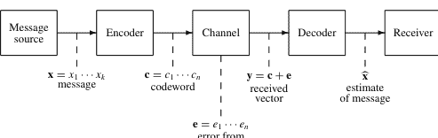

图 1.1. 通信信道。

Shannon定理的证明是概率性的且非构造性的。换句话说，证明中并未产生针对给定信道能够达到所需精度的具体代码。Shannon定理仅保证其存在性。编码理论研究的目标是产生满足Shannon定理条件的代码。在接下来的页面中，我们将介绍自Shannon工作发表以来开发的许多代码。我们将描述这些代码的属性，并偶尔将这些代码与数学的其他分支联系起来。一旦为应用选择了代码，编码通常相当直接。另一方面，高效解码可能是一项更加困难的任务；在本书的各个部分，我们将探讨解码我们构建的代码的技术。

## 1.1 三个域

在所有类型的代码中，线性码被研究得最多。由于其代数结构，它们比非线性码更容易描述、编码和解码。线性码的代码字母表是一个有限域，尽管有时其他代数结构（例如模4的整数）可以用于定义也被称为“线性”的代码。

在本章中，我们将研究字母表为包含 q 个元素的域 \(\mathbb{F}_q$（也表示为 GF(q)）的线性码。在第3章中，我们将介绍有限域的结构和属性。尽管我们将在任意域上提出一般结果，但我们经常将其特化为具有两个、三个或四个元素的域。

域是由一个集合及其上的两种运算组成的代数结构，通常称为加法（用 + 表示）和乘法（用 · 表示，但常被省略），它们满足某些公理。在线性码研究中非常常见的三个域是：具有两个元素的二元域、具有三个元素的三元域和具有四个元素的四元域。可以通过了解它们的加法和乘法表来处理这些域，我们将在接下来的三个示例中展示这些表。

### 示例 1.1.1 具有两个元素 $\{0, 1\}$ 的二元域 $\mathbb{F}_2$ 具有以下加法和乘法表：

| + | 0 | 1 |
|---|---|---|
| 0 | 0 | 1 |
| 1 | 1 | 0 |

| . | 0 | 1 |
|---|---|---|
| 0 | 0 | 0 |
| 1 | 0 | 1 |

这也是模2的整数环。

### 示例 1.1.2 具有三个元素 $\{0, 1, 2\}$ 的三元域 $\mathbb{F}_3$ 的加法和乘法表由模3的加法和乘法给出：

| + | 0 | 1 | 2 |
|---|---|---|---|
| 0 | 0 | 1 | 2 |
| 1 | 1 | 2 | 0 |
| 2 | 2 | 0 | 1 |

| . | 0 | 1 | 2 |
|---|---|---|---|
| 0 | 0 | 0 | 0 |
| 1 | 0 | 1 | 2 |
| 2 | 0 | 2 | 1 |

### 示例 1.1.3 具有四个元素 $\{0, 1, \omega, \overline{\omega}\}$ 的四元域 $\mathbb{F}_4$ 更为复杂。它具有以下加法和乘法表；$\mathbb{F}_4$ 不是模4的整数环：

| + | 0 | 1 | $\omega$ | $\overline{\omega}$ |
|---|---|---|---|---|
| 0 | 0 | 1 | $\omega$ | $\overline{\omega}$ |
| 1 | 1 | 0 | $\overline{\omega}$ | $\omega$ |
| $\omega$ | $\omega$ | $\overline{\omega}$ | 0 | 1 |
| $\overline{\omega}$ | $\overline{\omega}$ | $\omega$ | 1 | 0 |

| . | 0 | 1 | $\omega$ | $\overline{\omega}$ |
|---|---|---|---|---|
| 0 | 0 | 0 | 0 | 0 |
| 1 | 0 | 1 | $\omega$ | $\overline{\omega}$ |
| $\omega$ | 0 | $\omega$ | $\overline{\omega}$ | 1 |
| $\overline{\omega}$ | 0 | $\overline{\omega}$ | 1 | $\omega$ |

在这些表中观察到一些基本方程。例如，人们注意到对于所有 $x \in \mathbb{F}_4$，都有 $x + x = 0$。此外，$\overline{\omega} = \omega^2 = 1 + \omega$ 且 $\omega^3 = \overline{\omega}^3 = 1$。

## 1.2 线性码、生成矩阵和奇偶校验矩阵

令 $\mathbb{F}_q^n$ 表示有限域 $\mathbb{F}_q$ 上所有 $n$ 元组的向量空间。$\mathbb{F}_q$ 上的一个 $(n, M)$ 代码 $\mathcal{C}$ 是 $\mathbb{F}_q^n$ 的大小为 $M$ 的子集。我们通常将 $\mathbb{F}_q^n$ 中的向量 $(a_1, a_2, \dots, a_n)$ 写成 $a_1 a_2 \dots a_n$ 的形式，并称 $\mathcal{C}$ 中的向量为代码字。代码字有时也以其他方式指定。经典示例是循环码中代码字的多项式表示；这将在第4章中描述。示例1.1.1中的域 $\mathbb{F}_2$ 在编码理论历史上占有非常特殊的地位，而 $\mathbb{F}_2$ 上的代码称为二进制代码。同样，$\mathbb{F}_3$ 上的代码称为三元代码，而 $\mathbb{F}_4$ 上的代码称为四元代码。“四元”一词也用于指代模4整数环 $\mathbb{Z}_4$ 上的代码；参见第12章。


对码施加更多结构之前，其有用性有些有限。最有用的附加结构是线性。为此，如果 C 是 $\mathbb{F}_q^n$ 的 k 维子空间，则 C 将被称为 $\mathbb{F}_q$ 上的 $[n, k]$ 线性码。线性码 C 有 $q^k$ 个码字。展示线性码的两种最常见方式是使用生成矩阵或奇偶校验矩阵。$[n, k]$ 码 C 的生成矩阵是任意 $k \times n$ 矩阵 G，其行构成 C 的一组基。一般来说，一个码有许多生成矩阵。对于生成矩阵 G 的任意 k 个独立列，对应的坐标集构成 C 的一个信息集。剩余的 $r = n - k$ 个坐标被称为冗余集，r 称为 C 的冗余度。如果前 k 个坐标构成一个信息集，则该码有一个形式为 $[I_k \mid A]$ 的唯一生成矩阵，其中 $I_k$ 是 $k \times k$ 单位矩阵。这样的生成矩阵处于标准形式。因为线性码是向量空间的子空间，所以它是某个线性变换的核。特别地，存在一个 $(n-k) \times n$ 矩阵 H，称为 $[n, k]$ 码 C 的奇偶校验矩阵，定义为

$$\mathcal{C} = \{ \mathbf{x} \in \mathbb{F}_q^n \mid H\mathbf{x}^T = \mathbf{0} \}.$$ (1.1)

注意 H 的行也将是独立的。一般来说，C 也有几个可能的奇偶校验矩阵。下一个定理给出了当 C 具有标准形式生成矩阵时的其中一个。在此定理中，$A^T$ 是 A 的转置。

### 定理 1.2.1
如果 $G = [I_k \mid A]$ 是标准形式下 $[n, k]$ 码 C 的生成矩阵，则 $H = [-A^T \mid I_{n-k}]$ 是 C 的奇偶校验矩阵。

**证明：** 显然有 $HG^T = -A^T + A^T = O$。因此 C 包含在线性变换 $\mathbf{x} \mapsto H\mathbf{x}^T$ 的核中。由于 H 的秩为 n - k，该线性变换的核的维度为 k，这也是 C 的维度。结果得证。

### 练习 1
在定理 1.2.1 的陈述之前，已经指出满足 (1.1) 的 $(n-k) \times n$ 奇偶校验矩阵 H 的行是独立的。为什么是这样？提示：映射 $\mathbf{x} \mapsto H\mathbf{x}^T$ 是从 $\mathbb{F}_q^n$ 到 $\mathbb{F}_q^{n-k}$ 的线性变换，其核为 C。根据线性代数，H 的秩是多少？

### 示例 1.2.2
在噪声存在的情况下恢复信息的最简单方法是将每个消息符号重复固定次数。假设我们的信息是二进制的，符号来自域 $\mathbb{F}_2$，并且我们将每个符号重复 n 次。例如，如果 n = 7，那么每当我们想发送 0 时，我们发送 0000000，每当我们想发送 1 时，我们发送 1111111。如果传输中最多出现三个错误，并且我们通过“多数表决”进行解码，那么我们可以正确确定信息符号，0 或 1。一般来说，我们的码 C 是由两个码字 $\mathbf{0} = 00 \cdots 0$ 和 $\mathbf{1} = 11 \cdots 1$ 组成的 [n, 1] 二进制线性码，被称为长度 n 的二进制重复码。该码最多可纠正 $e = \lfloor (n-1)/2 \rfloor$ 个错误：如果接收向量中最多出现 e 个错误，则大多数坐标将是正确的，因此原始发送的码字可以被恢复。如果出现超过 e 个错误，这些错误无法纠正。然而，该码可以检测 $n-1$ 个错误，因为带有 1 到 $n-1$ 个错误的接收向量肯定不是码字。重复码的一个生成矩阵是

$G = [1 | 1 \cdots 1]$，

这当然处于标准形式。来自定理 1.2.1 的相应奇偶校验矩阵是

$H = \begin{bmatrix} 1 & 1 & 0 & \cdots & 0 \\ 1 & 0 & 1 & \cdots & 0 \\ \vdots & \vdots & \vdots & \ddots & \vdots \\ 1 & 0 & 0 & \cdots & 1 \end{bmatrix}$

第一个坐标是一个信息集，最后 \(n-1\) 个坐标构成一个冗余集。

### 练习 2
示例 1.2.2 中的 \([n, 1]\) 重复码有多少个信息集？

### 示例 1.2.3
矩阵 \(G = [I_4 | A]\)，其中

\(G = \begin{bmatrix} 1 & 0 & 0 & 0 & 0 & 1 & 1 \\ 0 & 1 & 0 & 0 & 1 & 0 & 1 \\ 0 & 0 & 1 & 0 & 1 & 1 & 0 \\ 0 & 0 & 0 & 1 & 1 & 1 & 1 \end{bmatrix}\)

是我们记为 \(\mathcal{H}_3\) 的 \([7,4]\) 二进制码的标准形式生成矩阵。根据定理 1.2.1，\(\mathcal{H}_3\) 的一个奇偶校验矩阵是

\(H = [A^T | I_3] = \begin{bmatrix} 0 & 1 & 1 & 1 & 1 & 0 & 0 \\ 1 & 0 & 1 & 1 & 0 & 1 & 0 \\ 1 & 1 & 0 & 1 & 0 & 0 & 1 \end{bmatrix}\)

该码称为 \((7, 4)\) _汉明码_。

### 练习 3
在示例 1.2.3 的 \((7, 4)\) 码 \(\mathcal{H}_3\) 中找出至少四个信息集。找出至少一组不构成信息集的四个坐标。

在本文中，我们经常会提到码 \(\mathcal{C}\) 的一个 _子码_。如果 \(\mathcal{C}\) 不是线性的（或未知是否线性），则 \(\mathcal{C}\) 的一个子码是 \(\mathcal{C}\) 的任何子集。如果 \(\mathcal{C}\) 是线性的，则子码将是 \(\mathcal{C}\) 的一个子集，且也必须是线性的；在这种情况下，\(\mathcal{C}\) 的一个子码是 \(\mathcal{C}\) 的一个子空间。

## 1.3 对偶码

\([n, k]\) 码 \(\mathcal{C}\) 的生成矩阵 \(G\) 只是一个行独立且张成该码的矩阵。奇偶校验矩阵 \(H\) 的行是独立的；因此 \(H\) 是某个码的生成矩阵，称为 \(\mathcal{C}\) 的 _对偶_ 或 _正交_ 码，并记为 \(\mathcal{C}^\perp\)。注意 \(\mathcal{C}^\perp\) 是一个 \([n, n-k]\) 码。定义对偶码的另一种方法是使用内积。

回顾 \(\mathbb{F}_q^n\) 中向量 \(\mathbf{x} = x_1 \cdots x_n, \mathbf{y} = y_1 \cdots y_n\) 的普通内积是

\[
\mathbf{x} \cdot \mathbf{y} = \sum_{i=1}^n x_i y_i.
\]

因此，从 (1.1) 我们可以看到 \(\mathcal{C}^\perp\) 也可以定义为

\[
\mathcal{C}^\perp = \{ \mathbf{x} \in \mathbb{F}_q^n \mid \mathbf{x} \cdot \mathbf{c} = 0 \text{ for all } \mathbf{c} \in \mathcal{C} \}. \tag{1.2}
\]

这是一个简单的练习，用于证明如果 \(G\) 和 \(H\) 分别是 \(\mathcal{C}\) 的生成矩阵和奇偶校验矩阵，则 \(H\) 和 \(G\) 分别是 \(\mathcal{C}^\perp\) 的生成矩阵和奇偶校验矩阵。

### 练习 4
证明如果 \(G\) 和 \(H\) 分别是 \(\mathcal{C}\) 的生成矩阵和奇偶校验矩阵，则 \(H\) 和 \(G\) 分别是 \(\mathcal{C}^\perp\) 的生成矩阵和奇偶校验矩阵。

### 示例 1.3.1
\([n, 1]\) 重复码 \(\mathcal{C}\) 的生成矩阵和奇偶校验矩阵在示例 1.2.2 中给出。对偶码 \(\mathcal{C}^\perp\) 是带有生成矩阵 \(H\) 的 \((n, n-1)\) 码，因此由所有二进制 \(n\)-元组 \(a_1 a_2 \cdots a_{n-1} b\) 组成，其中 \(b = a_1 + a_2 + \cdots + a_{n-1}\)（在 \(\mathbb{F}_2\) 中加法）。第 \(n\) 个坐标 \(b\) 是所选前 \(n-1\) 个坐标的总体奇偶校验，因此，使得所有坐标之和等于 0。这使得很容易看出 \(G\) 确实是 \(\mathcal{C}^\perp\) 的奇偶校验矩阵。码 \(\mathcal{C}^\perp\) 具有这样的性质：可以检测单个传输错误（因为坐标之和不会为 0），但不能纠正（因为更改任何一个接收坐标都会得到一个坐标之和为 0 的向量）。\(\blacksquare\)

如果 \(\mathcal{C} \subseteq \mathcal{C}^\perp\)，则码 \(\mathcal{C}\) 是自正交的；如果 \(\mathcal{C} = \mathcal{C}^\perp\)，则是自对偶的。自对偶码的长度 \(n\) 是偶数，维度是 \(n/2\)。

### 练习 5
证明自对偶码具有偶数长度 \(n\) 和维度 \(n/2\)。

### 示例 1.3.2
\([7, 4]\) 汉明码 \(\mathcal{H}_3\) 的一个生成矩阵在示例 1.2.3 中给出。令 \(\widehat{\mathcal{H}}_3\) 为通过向 \(G\) 的每个向量（因此也向 \(\mathcal{H}_3\) 的每个码字）添加一个总体奇偶校验坐标而从 \(\mathcal{H}_3\) 得到的长度 8、维度 4 的码。然后

\[
\widehat{G} = \begin{bmatrix} 1 & 0 & 0 & 0 & 0 & 1 & 1 & 1 \\ 0 & 1 & 0 & 0 & 1 & 0 & 1 & 1 \\ 0 & 0 & 1 & 0 & 1 & 1 & 0 & 1 \\ 0 & 0 & 0 & 1 & 1 & 1 & 1 & 0 \end{bmatrix}
\]

是 \(\widehat{\mathcal{H}}_3\) 的生成矩阵。很容易验证 \(\widehat{\mathcal{H}}_3\) 是一个自对偶码。\(\blacksquare\)

### 示例 1.3.3
\([4, 2]\) 三元码 \(\mathcal{H}_{3,2}\)，通常称为 *tetracode*，具有标准形式的生成矩阵 \(G\)，给定为

\[
G = \begin{bmatrix} 1 & 0 & 1 & 1 \\ 0 & 1 & 1 & -1 \end{bmatrix}.
\]

该码也是自对偶的。\(\blacksquare\)


练习 6 证明来自示例 1.3.2 的 \(\widehat{\mathcal{H}}_3\) 和来自示例 1.3.3 的 \(\mathcal{H}_{3,3}\) 是自偶代码。

练习 7 找出示例 1.3.3 中给出的四元码的所有信息集。

在研究域 \(\mathbb{F}_4\) 上的四元码（示例 1.1.3）时，考虑另一种内积通常很有用，称为厄米内积，由

\((\mathbf{x}, \mathbf{y}) = \mathbf{x} \cdot \overline{\mathbf{y}} = \sum_{i=1}^n x_i \overline{y_i},\)

给出，其中 \(\overline{-}\)，称为共轭，由 \(\overline{0} = 0, \overline{1} = 1\)，和 \(\overline{\omega} = \omega^2\) 给出。使用这个内积，我们可以定义四元码 \(\mathcal{C}\) 的厄米对偶为，类似于 (1.2)，

\(\mathcal{C}^{\perp_H} = \{ \mathbf{x} \in \mathbb{F}_q^n \mid (\mathbf{x}, \mathbf{c}) = 0 \text{ for all } \mathbf{c} \in \mathcal{C} \}.\)

定义 \(\mathcal{C}\) 的共轭为

\(\overline{\mathcal{C}} = \{ \overline{\mathbf{c}} \mid \mathbf{c} \in \mathcal{C} \},\)

其中 \(\overline{\mathbf{c}} = \overline{c_1} \overline{c_2} \cdots \overline{c_n}\) 当 \(\mathbf{c} = c_1 c_2 \cdots c_n\) 时。注意 \(\mathcal{C}^{\perp_H} = \overline{\mathcal{C}^\perp}\)。我们也有厄米自正交和厄米自偶：即，\(\mathcal{C}\) 是厄米自正交的如果 \(\mathcal{C} \subseteq \mathcal{C}^{\perp_H}\)，且 \(\mathcal{C}\) 是厄米自偶的如果 \(\mathcal{C} = \mathcal{C}^{\perp_H}\)。

练习 8 证明如果 \(\mathcal{C}\) 是 \(\mathbb{F}_4\) 上的码，则 \(\mathcal{C}^{\perp_H} = \overline{\mathcal{C}^\perp}.\)

示例 1.3.4 \([6, 3]\) 四元码 \(\mathcal{G}_6\) 在标准形式下的生成矩阵 \(G_6\) 由

\(G_6 = \begin{bmatrix} 1 & 0 & 0 & 1 & \omega & \omega \\ 0 & 1 & 0 & \omega & 1 & \omega \\ 0 & 0 & 1 & \omega & \omega & 1 \end{bmatrix}.\)

给出。该码通常称为六元码。它是厄米自偶的。

练习 9 验证 \(\mathbb{F}_4^n\) 上厄米内积的以下性质：

- (a) \((\mathbf{x}, \mathbf{x}) \in \{0, 1\}\) 对所有 \(\mathbf{x} \in \mathbb{F}_4^n\) 成立。
- (b) \((\mathbf{x}, \mathbf{y} + \mathbf{z}) = (\mathbf{x}, \mathbf{y}) + (\mathbf{x}, \mathbf{z})\) 对所有 \(\mathbf{x}, \mathbf{y}, \mathbf{z} \in \mathbb{F}_4^n\) 成立。
- (c) \((\mathbf{x} + \mathbf{y}, \mathbf{z}) = (\mathbf{x}, \mathbf{z}) + (\mathbf{y}, \mathbf{z})\) 对所有 \(\mathbf{x}, \mathbf{y}, \mathbf{z} \in \mathbb{F}_4^n\) 成立。
- (d) \(\overline{(\mathbf{x}, \mathbf{y})} = (\mathbf{y}, \mathbf{x})\) 对所有 \(\mathbf{x}, \mathbf{y} \in \mathbb{F}_4^n\) 成立。
- (e) \((\alpha \mathbf{x}, \mathbf{y}) = \alpha (\mathbf{x}, \mathbf{y})\) 对所有 \(\mathbf{x}, \mathbf{y} \in \mathbb{F}_4^n\) 成立。
- (f) \((\mathbf{x}, \alpha \mathbf{y}) = \overline{\alpha} (\mathbf{x}, \mathbf{y})\) 对所有 \(\mathbf{x}, \mathbf{y} \in \mathbb{F}_4^n\) 成立。

练习 10 证明示例 1.3.4 中的六元码 \(\mathcal{G}_6\) 是厄米自偶的。

## 1.4 权重和距离

码的一个重要不变量是码字之间的最小距离。两个向量 \(\mathbf{x}, \mathbf{y} \in \mathbb{F}_q^n\) 之间的（汉明）距离 \(d(\mathbf{x}, \mathbf{y})\) 定义为 x 和 y 不同的坐标数量。距离的以下性质的证明留作练习。

### 定理 1.4.1 距离函数 d(x, y) 满足以下四个性质：

- (i) (非负性) d(x, y) >= 0 对所有 x, y in F_q^n 成立。
- (ii) d(x, y) = 0 当且仅当 x = y。
- (iii) (对称性) d(x, y) = d(y, x) 对所有 x, y in F_q^n 成立。
- (iv) (三角不等式) d(x, z) <= d(x, y) + d(y, z) 对所有 x, y, z in F_q^n 成立。

这使得距离函数成为向量空间 F_q^n 上的一个度量。

### 练习 11 证明定理 1.4.1。

码 C 的（最小）距离是不同码字之间的最小距离，对于确定 C 的纠错能力很重要；如我们稍后将看到，最小距离越高，码能纠正的错误越多。向量 x in F_q^n 的（汉明）权重 wt(x) 是 x 中非零坐标的数量。距离和权重之间的以下关系的证明也留作练习。

### 定理 1.4.2 如果 x, y in F_q^n，则 d(x, y) = wt(x - y)。如果 C 是线性码，则最小距离 d 与 C 的非零码字的最小权重相同。

作为该定理的结果，对于线性码，最小距离也称为码的最小权重。如果已知 [n, k] 码的最小权重 d，则我们将该码称为 [n, k, d] 码。

### 练习 12 证明定理 1.4.2。

在处理 F_2, F_3 或 F_4 上的码时，关于码字权重有一些初等结果被证明是有用的。我们将它们收集在此，并将证明留给读者。

### 定理 1.4.3 以下成立：

- (i) 如果 x, y in F_2^n，则 wt(x + y) = wt(x) + wt(y) - 2wt(x AND y)，其中 x AND y 是 F_2^n 中的向量，恰好在 x 和 y 都有 1 的位置上有 1。
- (ii) 如果 x, y in F_2^n，则 wt(x AND y) = x . y (mod 2)。
- (iii) 如果 x in F_2^n，则 wt(x) = x . x (mod 2)。
- (iv) 如果 x in F_3^n，则 wt(x) = x . x (mod 3)。
- (v) 如果 x in F_4^n，则 wt(x) = (x, x) (mod 2)。

### 练习 13 证明定理 1.4.3。

设 A_i，也记作 A_i(C)，为 C 中权重为 i 的码字数量。0 <= i <= n 的列表 A_i 称为 C 的权重分布或权重谱。大量研究致力于计算特定码或码族的权重分布。

### 示例 1.4.4 设 C 为具有生成矩阵的二进制码

$$
G = \begin{bmatrix} 1 & 1 & 0 & 0 & 0 & 0 \\ 0 & 0 & 1 & 1 & 0 & 0 \\ 0 & 0 & 0 & 0 & 1 & 1 \end{bmatrix}.
$$

C 的权重分布为 A_0 = A_6 = 1 和 A_2 = A_4 = 3。注意通常只列出非零的 A_i。

### 练习 14 找出具有生成矩阵的三元码的权重分布

$$
G = \begin{bmatrix} 1 & 1 & 0 & 0 & 0 & 0 \\ 0 & 0 & 1 & 1 & 0 & 0 \\ 0 & 0 & 0 & 0 & 1 & 1 \end{bmatrix}.
$$

将你的结果与示例 1.4.4 进行比较。

关于权重分布的某些初等事实收集在以下定理中。关于码的权重分布的更深入结果将在第 7 章中介绍。

### 定理 1.4.5 设 \(\mathcal{C}\) 为 \(\mathbb{F}_q\) 上的 [n, k, d] 码。则：

- (i) \(A_0(\mathcal{C}) + A_1(\mathcal{C}) + \cdots + A_n(\mathcal{C}) = q^k\)。
- (ii) \(A_0(\mathcal{C}) = 1\) 且 \(A_1(\mathcal{C}) = A_2(\mathcal{C}) = \cdots = A_{d-1}(\mathcal{C}) = 0\)。
- (iii) 如果 \(\mathcal{C}\) 是包含码字 \(\mathbf{1} = 11\cdots 1\) 的二进制码，则 \(A_i(\mathcal{C}) = A_{n-i}(\mathcal{C})\) 对 \(0 \le i \le n\) 成立。
- (iv) 如果 \(\mathcal{C}\) 是二进制自正交码，则每个码字具有偶权重，且 \(\mathcal{C}^\perp\) 包含码字 \(\mathbf{1} = 11\cdots 1\)。
- (v) 如果 \(\mathcal{C}\) 是三元自正交码，则每个码字的权重可被三整除。
- (vi) 如果 \(\mathcal{C}\) 是四元厄米自正交码，则每个码字的权重是偶数。

### 练习 15 证明定理 1.4.5。

定理 1.4.5(iv) 指出二进制自正交码 \(\mathcal{C}\) 中的所有码字都有偶权重。如果我们查看 \(\mathcal{C}\) 中权重可被四整除的码字子集，我们会惊讶地发现它是 \(\mathcal{C}\) 的一个子码；即，权重可被四整除的码字子集构成 \(\mathcal{C}\) 的一个子空间。对于非自正交码，情况不一定如此。

### 定理 1.4.6 设 \(\mathcal{C}\) 为 [n, k] 二进制自正交码。设 \(\mathcal{C}_0\) 为 \(\mathcal{C}\) 中权重可被四整除的码字集合。则以下之一成立：

- (i) \(\mathcal{C} = \mathcal{C}_0\)，或
- (ii) \(\mathcal{C}_0\) 是 \(\mathcal{C}\) 的 [n, k-1] 子码，且 \(\mathcal{C} = \mathcal{C}_0 \cup \mathcal{C}_1\)，其中 \(\mathcal{C}_1 = \mathbf{x} + \mathcal{C}_0\) 对于任何权重为偶数但不可被四整除的码字 \(\mathbf{x}\)。此外，\(\mathcal{C}_1\) 由 \(\mathcal{C}\) 中所有权重不可被四整除的码字组成。


证明：根据定理1.4.5(iv)，所有码字的权重均为偶数。因此要么(i)成立，要么存在一个权重为偶数但不是四的倍数的码字**x**。假设后者成立。设**y**为另一个权重为偶数但不是四的倍数的码字。那么根据定理1.4.3(i)，wt(**x** + **y**) = wt(**x**) + wt(**y**) − 2wt(**x** ∩ **y**) ≡ 2 + 2 − 2wt(**x** ∩ **y**) (mod 4)。但根据定理1.4.3(ii)，wt(**x** ∩ **y**) = **x** · **y** (mod 2)。因此wt(**x** + **y**)可被四整除。故**x** + **y** ∈ C₀。这表明**y** ∈ x + C₀且 C = C₀ ∪ (**x** + C₀)。C₀是C的子码，且C₁ = **x** + C₀包含C中所有权重不可被四整除的码字，这一点可通过类似论证得出。

与定理1.4.6存在类似结果，其中考虑二进制码中权重为偶数的码字子集。在这种情况下，自正交性要求是不必要的；其证明留作练习。

## 定理 1.4.7 设C为一个[n, k]二进制码。设Cₑ为C中权重为偶数的码字集合。那么：

- (i) C = Cₑ，或
- (ii) Cₑ是C的一个[n, k − 1]子码，且 C = Cₑ ∪ Cₒ，其中对于任意权重为奇数的码字**x**，Cₒ = **x** + Cₑ。此外，Cₒ包含C中所有权重为奇数的码字。

## 练习 16 证明定理1.4.7。

## 练习 17 设C为生成矩阵为[6, 3]的二进制码

```
G = 
[ 1 1 0 0 0 0 ]
[ 0 1 1 0 0 0 ]
[ 1 1 1 1 1 1 ].
```

- (a) 证明C不是自正交的。
- (b) 求C的权重分布。
- (c) 证明权重可被四整除的码字不构成C的子码。

下一个结果给出了判断定理1.4.6(i)何时成立的方法。

## 定理 1.4.8 设C为二进制线性码。

- (i) 如果C是自正交的，并且具有一个生成矩阵，其每一行的权重都可被四整除，那么C的每个码字的权重都可被四整除。
- (ii) 如果C的每个码字的权重都可被四整除，那么C是自正交的。

证明：对于(i)，设**x**和**y**为生成矩阵的行。根据定理1.4.3(i)，wt(**x** + **y**) = wt(**x**) + wt(**y**) − 2wt(**x** ∩ **y**) ≡ 0 + 0 − 2wt(**x** ∩ **y**) ≡ 0 (mod 4)。现在通过归纳法进行，因为每个码字都是生成矩阵行的和。对于(ii)，设**x**, **y** ∈ C。根据定理1.4.3(i)和(ii)，2(**x** · **y**) ≡ 2wt(**x** ∩ **y**) ≡ 2wt(**x** − **y**) − wt(**x**) − wt(**y**) ≡ −wt(**x** + **y**) ≡ 0 (mod 4)。因此**x** · **y** ≡ 0 (mod 2)。

自然会问定理1.4.8(ii)是否可以推广到码字权重可被四以外的数整除的码。我们说，一个码C（在任意域上）是可整除的，如果所有码字的权重都可被一个整数\(\Delta > 1\)整除。该码被称为可被\(\Delta\)整除；\(\Delta\)称为C的一个除数，而最大的这样的除数称为C的除数。因此，定理1.4.8(ii)表明，可被\(\Delta = 4\)整除的二进制码是自正交的。在考虑可被\(\Delta = 2\)整除的二进制码时，情况并非如此，如下一个示例所示。可被\(\Delta = 2\)整除的二进制码称为偶码。

## 示例 1.4.9

示例1.2.2中[n, 1]二进制重复码C的对偶码由所有长度为n的偶权重向量组成。（另见示例1.3.1。）如果n > 2，该码不是自正交的。

在考虑F_3和F_4上的码时，分别具有除数三和二的可整除码是自正交的，如下一个定理所示。该定理包含了定理1.4.5(v)和(vi)的逆命题。部分(ii)见文献[217]。

## 定理 1.4.10

- (i) 当q = 3时，C的每个码字的权重可被三整除，当且仅当C是自正交的。
- (ii) 当q = 4时，C的每个码字的权重可被二整除，当且仅当C是厄米自正交的。

## 证明：

在(i)中，如果C是自正交的，则根据定理1.4.5(v)，码字的权重可被三整除。对于逆命题，设x, y ∈ C。我们需要证明x · y = 0。我们可以将码字x和y视为具有以下参数：

| | a | b | c | d | e |
|---|---|---|---|---|---|
| x | ≠0 | 0 | ≠0 | ≠0 | 0 |
| y | 0 | ≠0 | ≠0 | ≠0 | 0 |

其中，a个坐标处x非零且y为零，b个坐标处y非零且x为零，c个坐标处两者相同且非零，d个坐标处两者不同且非零，e个坐标处两者均为零。因此wt(x + y) = a + b + c，wt(x - y) = a + b + d。但x + y ∈ C，故a + b + c = a + b + d = 0 (mod 3)。特别是c = d (mod 3)。因此x · y = c + 2d = 0 (mod 3)，证明了(i)。

在(ii)中，如果C是厄米自正交的，则根据定理1.4.5(v)，码字具有偶权重。对于逆命题，设x ∈ C。如果x有a个0，b个1，c个ω，和d个ω̄，那么b + c + d是偶数，因为wt(x) = b + c + d。然而，(x, x)也等于b + c + d（作为F_4的一个元素）。因此，对于C中所有x，(x, x) = 0。现在设x, y ∈ C。那么x + y ∈ C。利用练习9，我们有0 = (x + y, x + y) = (x, x) + (x, y) + (y, x) + (y, y) = (x, x) + (x, y) + (x, y) + (y, y) = (x, x) + (x, y) + \overline{(x, y)} + (y, y) = \overline{(y, x)} + (y, x) + \overline{(y, x)} + (y, x) = \overline{(y, x)} + (y, x)。综合这些，(x, y)必须为0，证明了(ii)。

定理1.4.5(iv)的逆命题通常不成立。在这种情况下，最好能说的是包含在以下定理中，其证明留作练习。

## 定理 1.4.11

设C为一个二进制码，其生成矩阵的每一行都有偶权重。那么C的每个码字都有偶权重。

## 练习 18 证明定理1.4.11。

所有码字权重都可被四整除的二进制码称为**双偶码**。根据定理1.4.8，双偶码是自正交的。根据定理1.4.5(iv)，自正交码必须是偶码；那些不是双偶码的称为**单偶码**。

## 练习 19 求示例1.2.3中的码$\mathcal{H}_3$、示例1.3.2中的$\mathcal{H}_3^\perp$、示例1.3.3中的四元码（tetracode）以及示例1.3.4中的六元码（hexacode）的最小权重和权重分布。列出的二进制码中哪些是自正交的？哪些是双偶码？哪些是单偶码？

将偶权重和奇权重二进制向量的概念推广到任意域上的向量，这在研究多种类型的码时很有用。一个向量$\mathbf{x} = x_1 x_2 \cdots x_n$在$\mathbb{F}_q^n$中被称为**类偶**，如果

$$ \sum_{i=1}^n x_i = 0 $$

否则称为**类奇**。一个二进制向量是类偶的，当且仅当它具有偶权重；因此，类偶向量的概念确实是偶权重二进制向量的推广。码中的类偶向量构成一个子码，就像二进制码中的偶权重向量一样。除二进制情况外，类偶向量不必具有偶权重。$\mathbb{F}_3^3$中的向量$(1, 1, 1)$和$\mathbb{F}_4^3$中的向量$(1, \omega, \bar{\omega})$就是例子。我们说，一个码是**类偶**的，如果它只有类偶码字；如果一个码不是类偶的，则称其为类奇。

## 定理 1.4.12 设$C$为$\mathbb{F}_q$上的一个$[n, k]$码。设$C_e$为$C$中类偶码字的集合。那么：
(i) $C = C_e$，或
(ii) $C_e$是$C$的一个$[n, k - 1]$子码。

## 练习 20 证明定理1.4.12。

码字权重与线性码的校验矩阵之间存在基本关系。以下定理给出了这种关系，其证明留作练习。

## 定理 1.4.13 设$C$为具有校验矩阵$H$的线性码。如果$\mathbf{c} \in C$，则与$\mathbf{c}$的非零坐标对应的$H$的列线性相关。反之，如果$H$的$w$列中存在带有非零系数的线性相关关系，那么$C$中存在一个权重为$w$的码字，其非零坐标对应这些列。

求线性码最小权重$d$的一种方法是检查所有非零码字。以下推论展示了如何使用校验矩阵来求$d$。


### Corollary 1.4.14

线性码的最小权重为 \(d\) 当且仅当其奇偶校验矩阵包含一组 \(d\) 个线性相关的列，但不包含一组 \(d-1\) 个线性相关的列。

**练习 21** 证明定理 1.4.13 和推论 1.4.14。

最小权重也由以下定理刻画。

### Theorem 1.4.15

如果 \(C\) 是一个 \([n, k, d]\) 码，那么每一组 \(n-d+1\) 个坐标位置都包含一个信息集。此外，\(d\) 是具有此性质的最大数。

**证明：** 设 \(G\) 为 \(C\) 的生成矩阵，并考虑任意一组 \(s\) 个坐标位置 \(X\)。为了简化论证，我们假设 \(X\) 是最后 \(s\) 个位置的集合。（在我们发展等价码的概念后，读者将看到这个论证实际上是一般性的。）假设 \(X\) 不包含一个信息集。设 \(G = [A \mid B]\)，其中 \(A\) 是 \(k \times (n-s)\)，\(B\) 是 \(k \times s\)。那么 \(B\) 的列秩，因此 \(B\) 的行秩，小于 \(k\)。因此存在 \(B\) 的行的一个非平凡线性组合等于 \(0\)，从而存在一个码字 \(c\)，它在最后 \(s\) 个位置为 \(0\)。由于 \(G\) 的行是线性无关的，\(c \neq 0\)，因此 \(d \le n-s\)，等价地，\(s \le n-d\)。定理现在得证。

**练习 22** 找出 Example 1.2.3 中给出的 \([7, 4]\) 海明码 \(\mathcal{H}_3\) 的信息集数量。对 Example 1.3.2 中的扩展海明码 \(\widehat{\mathcal{H}}_3\) 做同样的处理。

## 1.5 从旧码构造新码

在本书中，我们将看到许多有趣且重要的码是通过修改或组合现有码产生的。我们将讨论五种方法。

### 1.5.1 删短码

设 \(C\) 是 \(\mathbb{F}_q\) 上的一个 \([n, k, d]\) 码。我们可以通过在每个码字中删除相同的坐标 \(i\) 来对 \(C\) 进行删短。得到的码仍然是线性的，这一点留作练习；其长度为 \(n-1\)，我们通常用 \(C^*\) 表示删短码。如果 \(G\) 是 \(C\) 的生成矩阵，那么 \(C^*\) 的生成矩阵是通过从 \(G\) 中删除第 \(i\) 列（并省略可能出现的零行或重复行）得到的。\(C^*\) 的维数和最小权重是多少？因为 \(C\) 包含 \(q^k\) 个码字，\(C^*\) 只能包含更少码字的情况是如果 \(C\) 的两个码字在所有坐标 \(i\) 上都相同。在这种情况下，\(C\) 的最小距离为 \(d=1\)，并且有一个权重为 1 的码字，其非零项位于坐标 \(i\)。只有当 \(C\) 的一个最小权重码字在第 \(i\) 个坐标上有非零值时，最小距离才会减少 1。总结一下，我们有以下定理。

### Theorem 1.5.1

设 \(C\) 是 \(\mathbb{F}_q\) 上的一个 \([n, k, d]\) 码，设 \(C^*\) 是在 \(i\) 个坐标上对 \(C\) 进行删短得到的码。

- (i) 如果 \(d>1\)，\(C^*\) 是一个 \([n-1, k, d^*]\) 码，其中如果 \(C\) 有一个在第 \(i\) 个坐标上有非零值的最小权重码字，则 \(d^*=d-1\)，否则 \(d^*=d\)。
- (ii) 当 \(d=1\) 时，如果 \(C\) 没有一个非零项位于坐标 \(i\) 的权重为 1 的码字，则 \(C^*\) 是一个 \([n-1, k, 1]\) 码；否则，如果 \(k>1\)，\(C^*\) 是一个 \([n-1, k-1, d^*]\) 码，其中 \(d^*\ge 1\)。

**练习 23** 直接从定义出发证明删短线性码是线性的。

### Example 1.5.2

设 \(\mathcal{C}\) 为生成矩阵为

\[
G = \begin{bmatrix}
1 & 1 & 0 & 0 & 0 \\
0 & 0 & 1 & 1 & 1
\end{bmatrix}.
\]

的 \([5, 2, 2]\) 二进制码。

设 \(\mathcal{C}_1^*\) 和 \(\mathcal{C}_2^*\) 分别为在坐标 1 和 5 上对 \(\mathcal{C}\) 进行删短得到的码。它们的生成矩阵为

\[
G_1^* = \begin{bmatrix}
1 & 0 & 0 & 0 \\
0 & 1 & 1 & 0
\end{bmatrix}
\quad \text{and} \quad
G_2^* = \begin{bmatrix}
1 & 0 & 0 & 0 \\
0 & 0 & 1 & 1
\end{bmatrix}.
\]

所以 \(\mathcal{C}_1^*\) 是一个 \([4, 2, 1]\) 码，而 \(\mathcal{C}_2^*\) 是一个 \([4, 2, 2]\) 码。

### Example 1.5.3

设 \(\mathcal{D}\) 为生成矩阵为

\[
G = \begin{bmatrix}
1 & 0 & 0 & 0 \\
0 & 1 & 1 & 1
\end{bmatrix}.
\]

的 \([4, 2, 1]\) 二进制码。

设 \(\mathcal{D}_1^*\) 和 \(\mathcal{D}_2^*\) 分别为在坐标 1 和 4 上对 \(\mathcal{D}\) 进行删短得到的码。它们的生成矩阵为

\[
\mathcal{D}_1^* = [1 \quad 1 \quad 1]
\quad \text{and} \quad
\mathcal{D}_2^* = \begin{bmatrix}
1 & 0 & 0 \\
0 & 1 & 1
\end{bmatrix}.
\]

所以 \(\mathcal{D}_1^*\) 是一个 \([3, 1, 3]\) 码，而 \(\mathcal{D}_2^*\) 是一个 \([3, 2, 1]\) 码。

注意，Example 1.5.3 中的码 \(\mathcal{D}\) 就是 Example 1.5.2 中的码 \(\mathcal{C}_1^*\)。显然，\(\mathcal{D}_1^*\) 可以直接通过对 \(\mathcal{C}\) 在坐标集合 \(\{1, 5\}\) 上进行删短得到。一般来说，一个码 \(\mathcal{C}\) 可以通过在所有码字中删除由集合 \(T\) 索引的分量来在坐标集合 \(T\) 上进行删短。如果 \(T\) 的大小为 \(t\)，则得到的码（我们通常将其表示为 \(\mathcal{C}'\)）是一个 \([n-t, k^*, d^*]\) 码，其中 \(k^*\ge k-t\) 且 \(d^*\ge d-t\)，这由定理 1.5.1 和归纳法得出。

### 1.5.2 扩展码

我们可以通过添加一个坐标来创建更长的码。扩展码有多种可能的方法，但最常见的是选择扩展方式，使得新码仅包含偶型向量（如第 1.4 节所定义）。如果 \(\mathcal{C}\) 是 \(\mathbb{F}_q\) 上的一个 \([n, k, d]\) 码，则定义 *扩展码* \(\widetilde{\mathcal{C}}\) 为

\[
\widetilde{\mathcal{C}} = \{x_1 x_2 \cdots x_{n+1} \in \mathbb{F}_q^{n+1} \mid x_1 x_2 \cdots x_n \in \mathcal{C} \text{ with } x_1 + x_2 + \cdots + x_{n+1} = 0\}.
\]

我们留作练习来证明 \(\widehat{C}\) 是线性的。事实上，\(\widehat{C}\) 是一个 \([n+1, k, \widehat{d}]\) 码，其中 \(\widehat{d}=d\) 或 \(d+1\)。设 \(G\) 和 \(H\) 分别为 \(C\) 的生成矩阵和奇偶校验矩阵。那么 \(\widehat{C}\) 的生成矩阵 \(\widehat{G}\) 可以通过在 \(G\) 中添加一列额外的列得到，使得 \(\widehat{G}\) 的每一行的坐标和为 0。\(\widehat{C}\) 的一个奇偶校验矩阵是矩阵

\[
\widehat{H} = \begin{bmatrix}
1 & \cdots & 1 & 1 \\
 &  &  & 0 \\
 & H &  & \vdots \\
 &  &  & 0
\end{bmatrix}.
\] (1.3)

这种构造也称为 *添加总校验位*。Example 1.3.2 中通过对 \([7, 4, 3]\) 海明码 \(\mathcal{H}_3\) 添加总校验位得到的 \([8, 4, 4]\) 二进制码 \(\widehat{\mathcal{H}}_3\) 称为 *扩展海明码*。

**练习 24** 直接从定义出发证明扩展线性码是线性的 \(\blacklozenge\)

**练习 25** 假设我们将域 \(\mathbb{F}_q\) 上的 \([n, k]\) 线性码 \(C\) 扩展到码 \(\widetilde{C}\)，其中 \(\widetilde{C} = \{x_1 x_2 \cdots x_{n+1} \in \mathbb{F}_q^{n+1} \mid x_1 x_2 \cdots x_n \in C \text{ with } x_1^2 + x_2^2 + \cdots + x_{n+1}^2 = 0\}.\) 在什么条件下 \(\widetilde{C}\) 是线性的？ \(\blacklozenge\)

**练习 26** 证明 (1.3) 中的 \(\widehat{H}\) 是扩展码 \(\widetilde{C}\) 的奇偶校验矩阵，其中 \(C\) 的奇偶校验矩阵为 \(H\)。 \(\blacklozenge\)

如果 \(C\) 是一个 \([n, k, d]\) 二进制码，那么扩展码 \(\widehat{C}\) 仅包含偶权重向量，并且是一个 \([n+1, k, \widehat{d}]\) 码，其中如果 \(d\) 是偶数则 \(\widehat{d}\) 等于 \(d\)，如果 \(d\) 是奇数则 \(\widehat{d}\) 等于 \(d+1\)。这与通过扩展 \(\mathcal{H}_3\) 得到的结果一致。然而，在非二进制情况下，\(\widehat{d}\) 是 \(d\) 还是 \(d+1\) 并不那么直接。对于 \(\mathbb{F}_q\) 上的一个 \([n, k, d]\) 码 \(C\)，将偶型码字的最小权重，以及奇型码字的最小权重，分别称为码的 *最小偶型权重* 和 *最小奇型权重*。用 \(d_e\) 表示最小偶型权重，用 \(d_o\) 表示最小奇型权重。所以 \(d = \min(d_e, d_o)\)。如果 \(d_e \le d_o\)，那么 \(\widehat{C}\) 的最小权重为 \(\widehat{d} = d_e\)。如果 \(d_o < d_e\)，那么 \(\widehat{d} = d_o + 1\)。

### Example 1.5.4

回顾，Example 1.3.3 中的四元码 \(\mathcal{H}_{3,2}\) 是 \(\mathbb{F}_3\) 上的一个 \([4, 2, 3]\) 码，其生成矩阵 \(G\) 和奇偶校验矩阵 \(H\) 分别为

\[
G = \begin{bmatrix}
1 & 0 & 1 & 1 \\
0 & 1 & 1 & -1
\end{bmatrix}
\quad \text{and} \quad
H = \begin{bmatrix}
-1 & -1 & 1 & 0 \\
1 & -1 & 0 & 1
\end{bmatrix}.
\]

码字 \((1, 0, 1, 1)\) 扩展为 \((1, 0, 1, 1, 0)\)，码字 \((0, 1, 1, -1)\) 扩展为 \((0, 1, 1, -1, -1)\)。因此 \(d = d_e = d_o = 3\) 且 \(\widehat{d} = 3\)。生成矩阵和奇偶校验


\(\widehat{\mathcal{H}}_{3,2}\) 的矩阵为

\[
\widehat{G} = \left[ \begin{array}{ccccc} 1 & 0 & 1 & 1 & 0 \\ 0 & 1 & 1 & -1 & -1 \end{array} \right]
\]
和
\[
\widehat{H} = \left[ \begin{array}{ccccc} 1 & 1 & 1 & 1 & 1 \\ -1 & -1 & 1 & 0 & 0 \\ -1 & 1 & 0 & 1 & 0 \end{array} \right] .
\]

如果先对一个码进行扩展，然后对新坐标进行删短，则得到原始码。但是，如果以相反顺序执行这些操作，通常会得到一个不同的码。

### 示例 1.5.5
如果对具有生成矩阵
\[
G = \left[ \begin{array}{ccccc} 1 & 1 & 0 & 0 & 1 \\ 0 & 0 & 1 & 1 & 0 \end{array} \right]
\]
的二进制码 \(\mathcal{C}\) 在其最后一个坐标上进行删短，然后（在右侧）扩展，则所得码的生成矩阵为
\[
G = \left[ \begin{array}{ccccc} 1 & 1 & 0 & 0 & 0 \\ 0 & 0 & 1 & 1 & 0 \end{array} \right] .
\]

在此示例中，我们的最后一步是扩展一个仅包含偶权重向量的二进制码。扩展坐标始终为 0。一般来说，当你扩展一个仅具有类偶码字的码时，情况正好如此。

### 练习 27
做以下各题。

- (a) 设 \(\mathcal{C} = \mathcal{H}_{3,2}\) 为示例 1.3.3 中定义的 \(\mathbb{F}_3\) 上的 \([4, 2, 3]\) 四元码，其生成矩阵为
\[
G = \left[ \begin{array}{cccc} 1 & 0 & 1 & 1 \\ 0 & 1 & 1 & -1 \end{array} \right] .
\]
给出通过从 \(\mathcal{C}\) 在最右侧坐标上进行删短然后在右侧扩展所得码的生成矩阵。同时确定所得码的最小权重。

- (b) 设 \(\mathcal{C}\) 为 \(\mathbb{F}_q\) 上的一个码。设 \(\mathcal{C}_r\) 为通过从 \(\mathcal{C}\) 在最右侧坐标上进行删短，然后对该删短码在右侧扩展所得的码。证明 \(\mathcal{C} = \mathcal{C}_r\) 当且仅当 \(\mathcal{C}\) 是一个类偶码。

- (c) 与 (b) 中定义的 \(\mathcal{C}_1\) 相同，证明如果 \(\mathcal{C}\) 是自正交的且包含全一码字 \(\mathbf{1}\)，则 \(\mathcal{C} = \mathcal{C}_1\)。

- (d) 与 (b) 中定义的 \(\mathcal{C}_1\) 相同，证明 \(\mathcal{C} = \mathcal{C}_1\) 当且仅当全一向量 \(\mathbf{1}\) 属于 \(\mathcal{C}^{\perp}\)。

## 1.5.3 缩短码

设 \(\mathcal{C}\) 为 \(\mathbb{F}_q\) 上的一个 \([n, k, d]\) 码，设 \(T\) 为任意 \(t\) 个坐标的集合。考虑在 \(T\) 上为 \(\mathbf{0}\) 的码字集合 \(\mathcal{C}(T)\)；该集合是 \(\mathcal{C}\) 的一个子码。在 \(T\) 上对 \(\mathcal{C}(T)\) 进行删短，得到一个长度为 \(n - t\) 的 \(\mathbb{F}_q\) 上的码，称为在 \(T\) 上 _缩短_ 的码，并记作 \(\mathcal{C}_T\)。

### 示例 1.5.6
设 $C$ 为具有生成矩阵的 \([6, 3, 2]\) 二进制码
\[
G = \begin{bmatrix} 1 & 0 & 0 & 1 & 1 & 1 \\ 0 & 1 & 0 & 1 & 1 & 1 \\ 0 & 0 & 1 & 1 & 1 & 1 \end{bmatrix}
\]
$C^\perp$ 也是一个具有生成矩阵的 \([6, 3, 2]\) 码
\[
G^\perp = \begin{bmatrix} 1 & 1 & 1 & 1 & 0 & 0 \\ 1 & 1 & 1 & 0 & 1 & 0 \\ 1 & 1 & 0 & 0 & 0 & 1 \end{bmatrix}
\]

如果坐标标记为 $1, 2, \dots, 6$，令 $T = \{5, 6\}$。缩短码 $C_T$ 和删短码 $C^T$ 的生成矩阵为
\[
G_T = \begin{bmatrix} 1 & 0 & 1 & 0 \\ 0 & 1 & 1 & 0 \\ 0 & 1 & 1 & 0 \end{bmatrix} \text{ 和 } G^T = \begin{bmatrix} 1 & 0 & 0 & 1 \\ 0 & 1 & 0 & 1 \\ 0 & 0 & 1 & 1 \end{bmatrix}
\]

对偶码进行缩短和删短得到码 $(C^\perp)_T$ 和 $(C^\perp)^T$，它们的生成矩阵为
\[
(G^\perp)_T = [1 \ 1 \ 1 \ 1] \text{ 和 } (G^\perp)^T = \begin{bmatrix} 1 & 1 & 1 & 1 \\ 1 & 1 & 1 & 0 \end{bmatrix}
\]

从生成矩阵 $G_T$ 和 $G^T$ 可知，$C_T$ 和 $C^T$ 的偶码具有生成矩阵
\[
(G_T)^\perp = \begin{bmatrix} 1 & 1 & 1 & 0 \\ 0 & 0 & 0 & 1 \end{bmatrix} \text{ 和 } (G^T)^\perp = [1 \ 1 \ 1 \ 1]
\]

注意，这些矩阵表明 $(C^\perp)_T = (C^T)^\perp$ 且 $(C^\perp)^T = (C_T)^\perp$。

前一示例中观察到的结论普遍成立。

### 定理 1.5.7
设 $C$ 为 \(\mathbb{F}_q\) 上的一个 \([n, k, d]\) 码，设 \(T\) 为 \(t\) 个坐标的集合。则：
(i) $(C^\perp)_T = (C^T)^\perp$ 且 $(C^\perp)^T = (C_T)^\perp$；
(ii) 如果 $t < d$，则 $C_T$ 和 $(C^\perp)^T$ 的维数分别为 $k$ 和 $n - t - k$；
(iii) 如果 $t = d$ 且 \(T\) 是某个最小权重码字非零的坐标集合，则 \(C^T\) 和 \((C^\perp)_T\) 的维数分别为 \(k - 1\) 和 \(n - d - k + 1\)。

**证明.** 设 \(c\) 是在 \(T\) 上为 \(\mathbf{0}\) 的 \(C^\perp\) 的一个码字，\(c^*\) 为删除 \(T\) 中坐标后的码字。因此 \(c^* \in (C^\perp)_T\)。如果 \(\mathbf{x} \in C\)，则 \(\mathbf{0} = \mathbf{x} \cdot \mathbf{c} = \mathbf{x}^* \cdot \mathbf{c}^*\)，其中 \(\mathbf{x}^*\) 是在 \(T\) 上对 \(\mathbf{x}\) 进行删短后的码字。因此 \((C^\perp)_T \subseteq (C^T)^\perp\)。任何向量 \(\mathbf{c} \in (C^T)^\perp\) 都可以通过在 \(T\) 的位置插入 0 扩展为一个向量 \(\tilde{\mathbf{c}}\)。如果 \(\mathbf{x} \in C\)，在 \(T\) 上对 \(\mathbf{x}\) 进行删短以得到 \(\mathbf{x}^*\)。由于 \(\mathbf{0} = \mathbf{x}^* \cdot \mathbf{c} = \mathbf{x} \cdot \tilde{\mathbf{c}}\)，则 \(\tilde{\mathbf{c}} \in (C^\perp)_T\)。因此 \((C^T)^\perp = (C^\perp)_T\)。将 \(C\) 替换为 \(C^\perp\) 得到 \((C^\perp)^T = (C_T)^\perp\)，从而完成 (i) 的证明。

假设 \(t < d\)。则 \(n - d + 1 \le n - t\)，这意味着根据定理 1.4.15，\(C\) 的任何 \(n - t\) 个坐标都包含一个信息集。因此 \(C^T\) 必须是 \(k\) 维的，进而根据 (i)，\((C^\perp)_T = (C^T)^\perp\) 的维数为 \(n - t - k\)；这证明了 (ii)。

与 (ii) 类似，若要完成 (iii)，只需证明 \(C^T\) 的维数为 \(k-1\)。如果 \(S \subset T\) 且 \(|S| = d-1\)，则根据部分 (ii)，\(C^S\) 的维数为 \(k\)。显然 \(C^S\) 的最小距离为 1，而 \(C^T\) 是通过在 \(C^S\) 中一个权重为 1 的码字的非零坐标上对 \(C^S\) 进行删短得到的。根据定理 1.5 (ii)，\(C^T\) 的维数为 \(k-1\)。

### 练习 28
设 \(\mathcal{C}\) 为示例 1.2.2 中描述的长度为 \(n\) 的二进制重复码。对任意 \(T\)，描述 \((\mathcal{C}^\perp)_T\) 和 \((\mathcal{C}_T)^\perp\)。

### 练习 29
设 \(\mathcal{C}\) 为示例 1.4.4 中长度为 6 的码。当 \(T = \{1, 2\}\) 和 \(T = \{1, 3\}\) 时，给出 \((\mathcal{C}^\perp)_T\) 和 \((\mathcal{C}_T)^\perp\) 的生成矩阵。

## 1.5.4 直和

对于 \(i \in \{1, 2\}\)，设 \(\mathcal{C}_i\) 为在同一有限域 \(\mathbb{F}_q\) 上的一个 \([n_i, k_i, d_i]\) 码。则它们的 *直和* 是 \([n_1 + n_2, k_1 + k_2, \min\{d_1, d_2\}]\) 码
\[
\mathcal{C}_1 \oplus \mathcal{C}_2 = \{(\mathbf{c}_1, \mathbf{c}_2) | \mathbf{c}_1 \in C_1, \mathbf{c}_2 \in C_2\}.
\]

如果 \(\mathcal{C}_i\) 的生成矩阵为 \(G_i\) 且奇偶校验矩阵为 \(H_i\)，则
\[
G_1 \oplus G_2 = \begin{bmatrix} G_1 & O \\ O & G_2 \end{bmatrix} \text{ 和 } H_1 \oplus H_2 = \begin{bmatrix} H_1 & O \\ O & H_2 \end{bmatrix} \quad (1.4)
\]
分别是 \(\mathcal{C}_1 \oplus \mathcal{C}_2\) 的生成矩阵和奇偶校验矩阵。

### 练习 30
设 \(\mathcal{C}_i\) 对于 \(i \in \{1, 2\}\) 具有生成矩阵 \(G_i\) 和奇偶校验矩阵 \(H_i\)。证明 \(\mathcal{C}_1 \oplus \mathcal{C}_2\) 的生成矩阵和奇偶校验矩阵如 (1.4) 所示。

### 练习 31
设 \(\mathcal{C}\) 为具有生成矩阵的二进制码

| 1 | 1 | 0 | 0 | 1 | 1 | 0 |
|---|---|---|---|---|---|---|
| 1 | 0 | 0 | 1 | 0 | 1 | 1 |
| 1 | 0 | 0 | 1 | 1 | 1 | 0 |
| 1 | 0 | 1 | 0 | 1 | 1 | 0 |
| 1 | 0 | 0 | 1 | 0 | 1 | 1 |

给出 \(\mathcal{C}\) 的另一个生成矩阵，以表明 \(\mathcal{C}\) 是两个二进制码的直和。

### 示例 1.5.8
示例 1.4.4 中的 [6, 3, 2] 二进制码 \(\mathcal{C}\) 是 [2, 1, 2] 码 \(\mathcal{D} = (00, 11)\) 的直和 \(\mathcal{D} \oplus \mathcal{D} \oplus \mathcal{D}\)。

由于两个码的直和的最小距离不超过任一码的最小距离，两个码的直和在应用中通常用处不大，主要具有理论意义。

## 1.5.5 [u | u + v] 构造

相同长度的两个码可以以类似于直和构造的方式组合形成一个长度加倍的第三个码。设 \(\mathcal{C}_i\) 为 \(i \in \{1, 2\}\) 的一个 \([n, k_i, d_i]\) 码，


都在同一个有限域 $\mathbb{F}_q$ 上。$(\mathbf{u} \mid \mathbf{u} + \mathbf{v})$ 构造产生 $[2n, k_1 + k_2, \min\{2d_1, d_2\}]$ 代码

```
$\mathcal{C} = \{(\mathbf{u}, \mathbf{u} + \mathbf{v}) \mid \mathbf{u} \in C_1, \mathbf{v} \in C_2\}.$
```

如果 $C_i$ 具有生成矩阵 $G_i$ 和奇偶校验矩阵 $H_i$，那么 $\mathcal{C}$ 的生成矩阵和奇偶校验矩阵为

```
\(\begin{bmatrix} G_1 & G_1 \\ O & G_2 \end{bmatrix} \text{ and } \begin{bmatrix} H_1 & O \\ -H_2 & H_2 \end{bmatrix} . \quad (1.5)\)
```

### 练习 32 证明由代码 $C_i$ 通过 $(\mathbf{u} \mid \mathbf{u} + \mathbf{v})$ 构造得到的代码的生成矩阵和奇偶校验矩阵如 (1.5) 所示。$\diamond$

### 示例 1.5.9 考虑带有生成矩阵的 $[8, 4, 4]$ 二进制代码 $\mathcal{C}$ 与生成矩阵

```
\(G = \begin{bmatrix} 1 & 1 & 0 & 1 & 0 & 1 & 0 & 1 \\ 0 & 0 & 1 & 0 & 1 & 0 & 1 & 0 \\ 0 & 0 & 1 & 1 & 0 & 0 & 1 & 1 \\ 0 & 0 & 0 & 0 & 1 & 1 & 1 & 1 \end{bmatrix} .\)
```

然后 $\mathcal{C}$ 可以由 $[4, 3, 2]$ 代码 $C_1$ 和 $[4, 1, 4]$ 代码 $C_2$ 的生成矩阵产生

```
\(G_1 = \begin{bmatrix} 1 & 0 & 1 & 0 \\ 0 & 1 & 0 & 1 \\ 0 & 0 & 1 & 1 \end{bmatrix} \text{ and } G_2 = [1 \quad 1 \quad 1 \quad 1],\)
```

分别，使用 $(\mathbf{u} \mid \mathbf{u} + \mathbf{v})$ 构造。注意代码 $C_1$ 也是使用 $(\mathbf{u} \mid \mathbf{u} + \mathbf{v})$ 构造从 $[2, 2, 1]$ 代码 $C_3$ 和 $[2, 1, 2]$ 代码 $C_4$ 的生成矩阵构造的

```
\(G_3 = \begin{bmatrix} 1 & 0 \\ 0 & 1 \end{bmatrix} \text{ and } G_4 = [1 \quad 1],\)
```

分别。$\blacksquare$

与前一节的直和构造不同，$(\mathbf{u} \mid \mathbf{u} + \mathbf{v})$ 构造可以产生出于非理论原因而重要的代码。例如，里德-穆勒代码族可以以这种方式构造，如我们在第 1.10 节中所见。前一示例中的代码就是这些代码之一。

### 练习 33 证明使用 $[n, k_i, d_i]$ 代码 $C_i$ 的 $(\mathbf{u} \mid \mathbf{u} + \mathbf{v})$ 构造产生维数为 $k = k_1 + k_2$ 且最小权重为 $d = \min\{2d_1, d_2\}$ 的代码。$\diamond$

## 1.6 置换等价代码

在本节和下一节中，我们探讨何时两个代码是“本质相同”的。我们将这一概念称为“等价”。我们常关心代码的性质，如权重分布，这些性质在从一个代码转到另一个本质相同的代码时保持不变。在这里，我们关注最简单的等价形式，称为置换等价，并在下一节中推广这一概念。

将代码视为“本质相同”的一种方式是，如果它们作为向量空间同构，则将其视为“相同”。然而，在这种情况下，权重的概念（我们将看到它对代码的研究和使用至关重要）就丢失了：同构可能将一个权重的代码字发送到不同权重的代码字。MacWilliams [212] 的一个定理（我们将在第 7.9 节中考察）指出，保持代码字权重的两个长度为 \(n\) 的二进制代码之间的向量空间同构（即，将一个权重的代码字发送到相同权重的代码字）可以扩展为 \(\mathbb{F}_2^n\) 的一个同构，该同构是坐标的置换。显然，任何将一个代码发送到另一个代码的坐标置换都保持代码字的权重，与所在的域无关。这引出了置换等价代码的以下自然定义。

两个线性代码 \(C_1$ 和 \(C_2$ 是置换等价的，前提是存在一个将 \(C_1$ 发送到 \(C_2$ 的坐标置换。这个置换可以用置换矩阵来描述，置换矩阵是一个方阵，每行每列恰好有一个 1，其余处为 0。因此，\(C_1$ 和 \(C_2$ 是置换等价的，前提是存在一个置换矩阵 \(P$，使得 \(G_1$ 是 \(C_1$ 的生成矩阵当且仅当 \(G_1 P$ 是 \(C_2$ 的生成矩阵。将 \(P$ 应用于生成矩阵的效果是重新排列生成矩阵的列。如果 \(P$ 是将 \(C_1$ 发送到 \(C_2$ 的置换，我们将写作 \(C_1 P = C_2$，其中 \(C_1 P = \{ \mathbf{y} \mid \mathbf{y} = \mathbf{x} P \text{ for } \mathbf{x} \in C_1 \}\)。

### 练习 34 证明如果 \(G_1$ 和 \(G_2$ 是长度为 \(n$ 的代码 \(C$ 的生成矩阵，且 \(P$ 是一个 \(n \times n$ 置换矩阵，那么 \(G_1 P$ 和 \(G_2 P$ 是 \(C P$ 的生成矩阵。

### 练习 35 假设 \(C_1$ 和 \(C_2$ 是置换等价代码，其中对于某个置换矩阵 \(P$ 有 \(C_1 P = C_2$。证明：

- (a) \(C_1^T P = C_2^T$，且
- (b) 如果 \(C_1$ 是自偶的，那么 \(C_2$ 也是。

### 示例 1.6.1 设 \(C_1$、\(C_2$ 和 \(C_3$ 为带有生成矩阵的二进制代码

```
\(G_1 = \begin{bmatrix} 1 & 1 & 0 & 0 & 0 & 0 \\ 0 & 0 & 1 & 1 & 0 & 0 \\ 0 & 0 & 0 & 0 & 1 & 1 \end{bmatrix}, \quad G_2 = \begin{bmatrix} 1 & 0 & 0 & 0 & 0 & 1 \\ 0 & 0 & 1 & 0 & 0 & 0 \\ 0 & 1 & 0 & 0 & 1 & 0 \end{bmatrix}, \quad \text{and}\)
```

```
\(G_3 = \begin{bmatrix} 1 & 1 & 0 & 0 & 0 & 0 \\ 1 & 0 & 1 & 0 & 0 & 0 \\ 1 & 1 & 1 & 1 & 1 & 1 \end{bmatrix}.\)
```

分别。所有三个代码的权重分布均为 \(A_0 = A_6 = 1$ 和 \(A_2 = A_4 = 3$。（参见示例 1.4.4 和练习 17。）交换第 2 列和第 6 列的置换将 \(G_1$ 发送到 \(G_2$，表明 \(C_1$ 和 \(C_2$ 是置换等价的。\(C_1$ 和 \(C_2$ 都是自偶的，与练习 35 的 (a) 一致。\(C_3$ 不是自偶的。因此，根据练习 35 的 (b)，\(C_1$ 和 \(C_3$ 不是置换等价的。

下一节定理表明，任何代码都置换等价于具备标准形式生成矩阵的代码。

### 定理 1.6.2 设 C 为线性代码。

- (i) C 置换等价于具备标准形式生成矩阵的代码。
- (ii) 如果 I 和 R 分别是 C 的信息位置和冗余位置，那么 R 和 I 分别是对偶代码 \(C^\perp$ 的信息位置和冗余位置。

证明：对于 (i)，对 C 的任意生成矩阵应用初等行变换。这将产生 C 的一个新生成矩阵，其列与 \(I_k$ 中的列相同，但顺序可能不同。现在选择新生成矩阵列的一个置换，使这些列被移动到产生 \([I_k \mid A]$ 的顺序。由 \([I_k \mid A]$ 生成的代码与 C 等价。

如果 I 是 C 的信息集，那么通过对 C 的生成矩阵进行行约简，我们在信息位置处得到的列是 \(I_k$ 的列的某种顺序。如上所述，选择一个置换矩阵 P 来移动列，使得 C P 具有生成矩阵 \([I_k \mid A]$；P 已将 I 移动到前 k 个坐标位置。根据练习 1.2.1，\((C P)^\perp$ 的最后 \(n-k$ 个坐标作为信息位置。根据练习 35，\((C P)^\perp = C^\perp P$，这意味着 R 是 \(C^\perp$ 的一组信息位置，从而证明 (ii)。

使用置换（循环形式）而非置换矩阵来表达等价通常更方便。设 \(\mathrm{Sym}_n$ 为 n 个坐标的所有置换的集合。如果 \(\sigma \in \mathrm{Sym}_n$ 且 \(x = x_1 x_2 \cdots x_n$，定义

```
x\sigma = y_1 y_2 ... y_n, where y_j = x_{j\sigma^{-1}} for 1 \le j \le n.
```

所以 \(x\sigma = xP$，其中 \(P = [p_{i,j}]$ 是由以下给出的置换矩阵

```
p_{i,j} = \begin{cases} 1 & \text{if } j = i\sigma, \\ 0 & \text{otherwise.} \end{cases} (1.6)
```

这在下一个示例中说明。

### 示例 1.6.3 设 \(n=3\)，\(x = x_1 x_2 x_3\)，且 \(\sigma = (1, 2, 3)\)。则 \(1\sigma^{-1} = 3\)，\(2\sigma^{-1} = 1\)，\(3\sigma^{-1} = 2\)。所以 \(x\sigma = x_3 x_1 x_2\)。设

```
P = \begin{bmatrix} 0 & 1 & 0 \\ 0 & 0 & 1 \\ 1 & 0 & 0 \end{bmatrix}.
```

那么 \(xP$ 也等于 \(x_3 x_1 x_2$。

### 练习 36 如果 \(\sigma, \tau \in \mathrm{Sym}_n$，证明 \(x(\sigma\tau) = (x\sigma)\tau$。

### 练习 37 设 \(S$ 为长度为 \(n$ 且在 \(\mathbb{F}_q$ 上的所有代码的集合。设 \(C_1, C_2 \in S$。\(C_1 \sim C_2$ 表示存在一个 \(n \times n$ 置换矩阵 \(P$ 使得 \(C_1 P = C_2$。证明 \(\sim$ 是 \(S$ 上的一个等价关系。回顾 \(\sim$ 是集合上的一个等价关系，其中


若集合 $\mathcal{S}$ 满足以下三个条件：
- (i) (自反性) 对所有 $\mathcal{C} \in \mathcal{S}$，$\mathcal{C} \sim \mathcal{C}$。
- (ii) (对称性) 若 $\mathcal{C}_1 \sim \mathcal{C}_2$，则 $\mathcal{C}_2 \sim \mathcal{C}_1$，且
- (iii) (传递性) 若 $\mathcal{C}_1 \sim \mathcal{C}_2$ 且 $\mathcal{C}_2 \sim \mathcal{C}_3$，则 $\mathcal{C}_1 \sim \mathcal{C}_3$。

将码 $\mathcal{C}$ 映射到其自身的坐标置换集合构成一个 *群*，即一个具有结合性二元运算、包含单位元且所有元素都有逆元的集合，称为 $\mathcal{C}$ 的 *置换自同构群*。该群记作 PAut($\mathcal{C}$)。因此，若 $\mathcal{C}$ 是长度为 $n$ 的码，则 PAut($\mathcal{C}$) 是 *对称群* Sym$_n$ 的子群。

### 练习 38 证明：若 $\mathcal{C}$ 为示例 1.2.2 中的 [$n$, 1] 二元重复码，则 PAut($\mathcal{C}$) = Sym$_n$。

### 练习 39 证明：(1, 2)(5, 6)、(1, 2, 3)(5, 6, 7) 和 (1, 2, 4, 5, 7, 3, 6) 是示例 1.2.3 中给出的 [7, 4] 二元码 $\mathcal{H}_3$ 的自同构。这三个置换生成一个阶为 168 的群，称为 *射影特殊线性群* PSL(2, 7)。事实上，这正是 $\mathcal{H}_3$ 的置换自同构群。

了解码的置换自同构群可以提供关于该码的重要理论和实际信息。虽然某些码的这些群已被确定，但一般来说它们难以找到。以下结果展示了码的置换自同构群与其对偶码之间的关系；它还建立了置换等价码的自同构群之间的联系。其证明留给读者。

### 定理 1.6.4 设 $\mathcal{C}$、$\mathcal{C}_1$ 和 $\mathcal{C}_2$ 为 $\mathbb{F}_q$ 上的码。*则：*
- (i) PAut($\mathcal{C}$) = PAut($\mathcal{C}^\perp$),
- (ii) 若 $q = 4$，PAut($\mathcal{C}$) = PAut($\mathcal{C}^{1-\mu}$)，且
- (iii) 若对于置换矩阵 $P$ 有 $\mathcal{C}_1 P = \mathcal{C}_2$，则 $P^{-1}$PAut($\mathcal{C}_1)P$ = PAut($\mathcal{C}_2$)。

### 练习 40 证明定理 1.6.4。

可以证明，若两个码是置换等价的，则它们的扩展码也是置换等价的；参见练习 41。对于缩短码，情况不一定如此。

### 练习 41 证明：若 $\mathcal{C}_1$ 和 $\mathcal{C}_2$ 是置换等价码，则 $\widehat{\mathcal{C}_1}$ 和 $\widehat{\mathcal{C}_2}$ 也是置换等价的。

### 示例 1.6.5 设 $\mathcal{C}$ 为具有生成矩阵的二元码
$$
G = \begin{bmatrix} 1 & 1 & 0 & 0 & 0 \\ 0 & 1 & 0 & 1 & 0 \\ 0 & 0 & 1 & 1 & 1 \end{bmatrix}.
$$

设 $\mathcal{C}_1^*$ 和 $\mathcal{C}_2^*$ 分别为 $\mathcal{C}$ 在坐标 1 和 5 上的缩短码。则 $\mathcal{C}_2^*$ 仅含有偶权重向量，而 $\mathcal{C}_1^*$ 含有奇权重码字。因此，尽管 $\mathcal{C}$ 肯定与其自身置换等价，但 $\mathcal{C}_1^*$ 和 $\mathcal{C}_2^*$ 不是置换等价的。

在某些情况下，群 PAut(C) 作为置换群是传递的；因此，对于每个有序坐标对 $(i, j)$，PAut(C) 中存在一个将坐标 $i$ 映射到坐标 $j$ 的置换。当 PAut(C) 是传递的时，我们可以了解其缩短码的结构信息。当 PAut(C) 是传递的时，我们可以了解 C 的最小权重信息。

### 定理 1.6.6 设 C 为一个 $[n, k, d]$ 码。
- (i) 假设 PAut(C) 是传递的。则通过在某个坐标上对 C 进行缩短而得到的 $n$ 个码是置换等价的。
- (ii) 假设 PAut(C) 是传递的。则 C 的最小权重 $d$ 为其最小奇型权重 $d_o$。此外，C 的每个最小权重码字都是奇型的。

证明：断言 (i) 的证明留给读者，见练习 42。现在假设 PAut(C) 是传递的。将 (i) 应用于 $\widetilde{C}$，我们得出结论：在任意坐标上对 $\widetilde{C}$ 进行缩短得到的码与 C 置换等价。设 $e$ 为 C 的最小权重向量，并假设 $e$ 是偶型的。则 $wt(\widetilde{C}) = d$，其中 $\widetilde{c} \in \widetilde{C}$ 为扩展向量。在 $e$ 非零的某个坐标上对 $\widetilde{C}$ 进行缩短，得到一个与 C 置换等价的码中权重为 $d-1$ 的向量，这产生了矛盾。

### 练习 42 证明定理 1.6.6(i)。

### 练习 43 设 C 为示例 1.4.4 中的码。
- (a) PAut(C) 是否传递？
- (b) 求所有在一点上缩短的六个码的生成矩阵。这些缩短码中哪些是等价的？
- (c) 求所有在两点上缩短的 15 个码的生成矩阵。这些缩短码中哪些是等价的？

### 练习 44 设 $C = C_1 \oplus C_2$，其中 $C_1$ 和 $C_2$ 的长度分别为 $n_1$ 和 $n_2$。证明 $PAut(C_1) \oplus PAut(C_2) \subseteq PAut(C)$，其中 $PAut(C_1) \oplus PAut(C_2)$ 是群 $PAut(C_1)$（作用于 C 的前 $n_1$ 个坐标）和 $PAut(C_2)$（作用于 C 的最后 $n_2$ 个坐标）的直积。

对于二元码，置换等价是最一般的等价形式。然而，对于其他域上的码，还存在其他形式的等价。

这些映射包括重新缩放坐标的映射以及由域自同构诱导的映射（这是我们在第 3 章中更广泛研究的一个主题）。我们将逐一讨论这些映射。

首先，回顾一下，*单项矩阵*是一个方阵，每行和每列恰好有一个非零元素。单项矩阵 $M$ 可以写成 $DP$ 形式或 $PD_1$ 形式，其中 $D$ 和 $D_1$ 为对角矩阵，$P$ 为置换矩阵。

### 示例 1.7.1 单项矩阵
$$
M = \begin{bmatrix} 0 & a & 0 \\ 0 & 0 & b \\ c & 0 & 0 \end{bmatrix}
$$
等于
$$
DP = \begin{bmatrix} a & 0 & 0 \\ 0 & b & 0 \\ 0 & 0 & c \end{bmatrix} \begin{bmatrix} 0 & 1 & 0 \\ 0 & 0 & 1 \\ 1 & 0 & 0 \end{bmatrix} = PD_1 = \begin{bmatrix} 0 & 1 & 0 \\ 0 & 0 & 1 \\ 1 & 0 & 0 \end{bmatrix} \begin{bmatrix} c & 0 & 0 \\ 0 & a & 0 \\ 0 & 0 & b \end{bmatrix}
$$

我们通常选择 $M = DP$ 形式来表示单项矩阵；$D$ 称为 $M$ 的 *对角部分*，$P$ 是 *置换部分*。这种记法允许使用 (1.6) 形成更紧凑的形式，如下例所示。

### 示例 1.7.2 示例 1.7.1 中的单项矩阵 $M = DP$ 可以写成

diag$(a, b, c)(1, 2, 3)$，

其中 diag$(a, b, c)$ 是对角矩阵 $D$，$(1, 2, 3)$ 是以循环形式写出的置换矩阵 $P$。

我们将像下一个示例所示，将单项映射 $M = DP$ 作用于行向量 $\mathbf{x}$ 的右侧。

### 示例 1.7.3 设 $M = \text{diag}(a, b, c)(1, 2, 3)$ 为示例 1.7.2 中的单项映射，且 $\mathbf{x} = x_1 x_2 x_3 = (x_1, x_2, x_3)$。则

$\mathbf{x}M = \mathbf{x}DP = (ax_1, bx_2, cx_3)P = (cx_3, ax_1, bx_2)$。

此示例说明了将 $M = DP$ 应用于向量 $\mathbf{x}$ 的更一般原则，其中 $\sigma$ 是与 $P$ 关联的置换（循环形式）。对于所有 $i$：
- 首先，将 $\mathbf{x}$ 的第 $i$ 个分量乘以 $D$ 的第 $i$ 个对角元素，并且
- 其次，将此乘积移动到坐标位置 $i\sigma$。

有了单项映射的概念，我们现在准备定义单项等价。设 $\mathcal{C}_1$ 和 $\mathcal{C}_2$ 为域 $\mathbb{F}_q$ 上长度相同的码，并设 $G_1$ 为 $\mathcal{C}_1$ 的生成矩阵。若存在单项矩阵 $M$ 使得 $G_1 M$ 是 $\mathcal{C}_2$ 的生成矩阵，则称 $\mathcal{C}_1$ 和 $\mathcal{C}_2$ 是 *单项等价* 的。更简单地说，若存在单项映射 $M$ 使得 $\mathcal{C}_2 = \mathcal{C}_1 M$，则 $\mathcal{C}_1$ 和 $\mathcal{C}_2$ 是单项等价的。对于二元码，单项等价和置换等价完全相同。


## 1.7 码的更一般等价

### 练习 45
设 $\mathcal{S}$ 为长度为 $n$ 且在 $\mathbb{F}_q$ 上的所有码的集合。设 $C_1, C_2 \in \mathcal{S}$。定义 $C_1 \sim C_2$ 表示存在一个 $n \times n$ 单项矩阵 $M$ 使得 $C_1 M = C_2$。证明 $\sim$ 是 $\mathcal{S}$ 上的一个等价关系。（“等价关系”的定义在练习 37 中给出。）

还有一种需要考虑的映射：源自域 $\mathbb{F}_q$ 自同构的映射，称为伽罗瓦自同构。我们将与单项映射结合使用。（由于我们将矩阵作用于向量的右侧，因此将域自同构作用于域元素的右侧。）如果 $\gamma$ 是 $\mathbb{F}_q$ 的一个域自同构，且 $M = DP$ 是一个带有 $\mathbb{F}_q$ 中元素的单项映射，那么将映射 $M\gamma$ 应用于向量 $\mathbf{x}$ 的过程如下，其中 $\sigma$ 又是与矩阵 $P$ 关联的置换。对所有 $i$：

- 首先，将 $\mathbf{x}$ 的第 $i$ 个分量乘以 $D$ 的第 $i$ 个对角元素，
- 其次，将此乘积移动到坐标位置 $i\sigma$，并且
- 第三，对该分量应用 $\gamma$。

### 示例 1.7.4
域 $\mathbb{F}_4$ 具有由 $x\gamma = x^2$ 给出的自同构 $\gamma$。如果 $M = DP = \text{diag}(a, b, c)(1, 2, 3)$ 是示例 1.7.2 中的单项映射，且 $\mathbf{x} = x_1 x_2 x_3 = (x_1, x_2, x_3) \in \mathbb{F}_4^3$，那么

$xM\gamma = (ax_1, bx_2, cx_3)P\gamma = (cx_3, ax_1, bx_2)\gamma = ((cx_3)^2, (ax_1)^2, (bx_2)^2).$

例如，$(1, \omega, 0)\text{diag}(\omega, \overline{\omega}, 1)(1, 2, 3)\gamma = (0, \overline{\omega}, 1).$

我们说，在 $\mathbb{F}_q$ 上长度相同的两个码 $C_1$ 和 $C_2$ 是 _等效_ 的，前提是存在一个单项矩阵 $M$ 和域的一个自同构 $\gamma$ 使得 $C_2 = C_1 M\gamma$。这是我们将考虑的最一般的等价概念。因此，我们有三种关于码何时为“相同”的概念：置换等价、单项等价和等价。如果码是二进制的，则三者相同；如果考虑的域具有素数个元素，则单项等价和等价相同。这些是等价性应考虑的适当映射，这一事实是 MacWilliams [212] 关于在第 7.9 节讨论的保持权重的映射的定理的结果。

两个等价码具有相同的权重分布。然而，如示例 1.6.1 所示，两个具有相同权重分布的码不一定等价。练习 35 表明，如果 $C_1$ 和 $C_2$ 是置换等价码，那么在相同映射下它们的对偶码也是如此。然而，如果 $C_1 M = C_2$，则不一定有 $C_1^\perp M = C_2^\perp$。

### 示例 1.7.5
设 $C_1$ 和 $C_2$ 是 $\mathbb{F}_4$ 上的 $[2, 1, 2]$ 码，其生成矩阵分别为 $[1 \quad 1]$ 和 $[1 \quad \omega]$。那么在普通内积下，它们的对偶码 $C_1^\perp$ 和 $C_2^\perp$ 的生成矩阵分别为 $[1 \quad 1]$ 和 $[1 \quad \overline{\omega}]$。注意，$C_1 \text{diag}(1, \omega) = C_2$，但 $C_1^\perp \text{diag}(1, \omega) \neq C_2^\perp$。

在上述示例中，$C_1$ 是自对偶的，但 $C_2$ 不是。因此等价性可能不保持自对偶性。然而，以下定理是成立的，其证明留作练习。

### 定理 1.7.6
设 $C$ 是 $\mathbb{F}_q$ 上的码。以下成立：
(i) 如果 $M$ 是一个仅来自 $\{0, -1, 1\}$ 的单项矩阵，那么 $C$ 是自对偶的当且仅当 $CM$ 是自对偶的。
(ii) 如果 $q = 3$ 且 $C$ 与 $C_1$ 等价，那么 $C$ 是自对偶的当且仅当 $C_1$ 是自对偶的。
(iii) 如果 $q = 4$ 且 $C$ 与 $C_1$ 等价，那么 $C$ 是厄米自对偶的当且仅当 $C_1$ 是厄米自对偶的。

由于有三种等价版本，因此有三种可能的自同构群。设 $C$ 是 $\mathbb{F}_q$ 上的码。我们在上一节中定义了 $C$ 的置换自同构群 PAut($C$)。将 $C$ 映射到自身的单项矩阵集合构成了称为 $C$ 的单项自同构群的群 MAut($C$)。最后，形式为 $M\gamma$ 的映射集合，其中 $M$ 是单项矩阵且 $\gamma$ 是域自同构，且将 $C$ 映射到自身，构成了称为 $C$ 的自同构群的群 $\Gamma$ Aut($C$)。3 MAut($C$) 和 $\Gamma$ Aut($C$) 是群这一事实留作练习。在二进制情况下，三个群都相同。如果 $q$ 是素数，则 MAut($C$) = $\Gamma$ Aut($C$)。一般来说，PAut($C$) $\subseteq$ MAut($C$) $\subseteq$ $\Gamma$ Aut($C$)。

### 练习 46
对于 $1 \le i \le 3$，设 $D_i$ 为对角矩阵，$P_i$ 为置换矩阵，$\gamma_i$ 为 $\mathbb{F}_q$ 的自同构。
- (a) 你可以将 $(D_1 P_1 \gamma_1)(D_2 P_2 \gamma_2)$ 写成 $D_3 P_3 \gamma_3$ 的形式。用 $D_1$、$D_2$、$P_1$、$P_2$、$\gamma_1$ 和 $\gamma_2$ 表示 $D_3$、$P_3$ 和 $\gamma_3$。
- (b) 你可以将 $(D_1 P_1 \gamma_1)^{-1}$ 写成 $D_2 P_2 \gamma_2$ 的形式。用 $D_1$、$P_1$ 和 $\gamma_1$ 表示 $D_2$、$P_2$ 和 $\gamma_2$。

### 练习 47
设 $S$ 为长度为 $n$ 且在 $\mathbb{F}_q$ 上的所有码的集合。设 $C_1, C_2 \in S$。定义 $C_1 \sim C_2$ 表示存在一个 $n \times n$ 单项矩阵 $M$ 和 $\mathbb{F}_q$ 的一个自同构 $\gamma$ 使得 $C_1 M \gamma = C_2$。证明 $\sim$ 是 $S$ 上的一个等价关系。（“等价关系”的定义在练习 37 中给出。）你可能会发现练习 46 有所帮助。

### 练习 48
证明 MAut($C$) 和 $\Gamma$ Aut($C$) 是群。（提示：使用练习 46。）

### 示例 1.7.7
设 $C$ 为四元码，其生成矩阵如示例 1.3.3 所示。将坐标标记为 $\{1, 2, 3, 4\}$，PAut($C$) 是由置换 $(1, 3, 4)$ 生成的阶 3 的群。MAut($C$) = $\Gamma$ Aut($C$) 是由 diag$(1, 1, 1, -1)(1, 2, 3, 4)$ 和 diag$(1, 1, 1, -1)(1, 2)$ 生成的阶 4 的群。

### 练习 49
设 $C$ 为示例 1.3.3 和 1.7.7 中的四元码。
- (a) 验证示例 1.7.7 中列出的映射确实是四元码的自同构。
- (b) 将 PAut($C$) 的生成元 $(1, 3, 4)$ 写为示例 1.7.7 中给出的 MAut($C$) 的两个生成元的乘积。
- (c) （难）证明 PAut($C$) 和 $\Gamma$ Aut($C$) 的群如示例 1.7.7 所述。

3 自同构群的符号在文献中并不统一。例如，$G(C)$ 或 Aut($C$) 有时用于 $C$ 的一个自同构群。因此，我们将同时使用这两种符号。

### 示例 1.7.8

设 \( G'_6 \) 为在 \(\mathbb{F}_4\) 上的 [6, 3] 码 \(\mathcal{G}'_6\) 的生成矩阵，其中

```
\( G'_6 = \begin{bmatrix} 1 & \omega & 1 & 0 & 0 & \omega \\ 0 & 1 & \omega & 1 & 0 & \omega \\ 0 & 0 & 1 & \omega & 1 & \omega \end{bmatrix} . \)
```

将列标记为 \(\{1, 2, 3, 4, 5, 6\}\)。如果对该生成矩阵进行行约简，我们得到矩阵

```
\(\begin{bmatrix} 1 & 0 & 0 & 1 & \omega & \omega \\ 0 & 1 & 0 & \omega & \omega & 1 \\ 0 & 0 & 1 & \omega & 1 & \omega \end{bmatrix} . \)
```

交换第 5 列和第 6 列给出生成矩阵 \(\mathcal{G}_6\)，即示例 1.3.4 中的矩阵；因此 \(\mathcal{G}'_6(5, 6) = \mathcal{G}_6\)。（这些列是等价的，两者都被称为六元码。）使用群论证据，可以验证关于 \(\mathcal{G}'_6\) 的三个自同构群的以下信息；然而，也可以使用 Magma 或 Gap 等代数系统来进行此验证。PAut(\(\mathcal{G}'_6\)) 是一个阶 60 的群，由置换 \((1, 2)\)、\((3\ 5)(4, 5)\) 和 \((1, 2, 3, 4, 5)\) 生成。MAut(\(\mathcal{G}'_6\)) 是一个阶 \(3 \cdot 360\) 的群，由单项映射 \(\text{diag}(\omega, 1, 1, \omega, \overline{\omega}, \overline{\omega})(1, 2, 6)\) 和置换 \((1, 2, 3, 4, 5)^4\) 生成。最后，\(\Gamma\text{Aut}(\mathcal{G}'_6)\) 是一个比 MAut(\(\mathcal{G}'_6\)) 大两倍的群，由 MAut(\(\mathcal{G}'_6\)) 和 \(\text{diag}(1, \overline{\omega}, \omega, \omega, \overline{\omega}, 1)(1, 6)\gamma\) 生成，其中 \(\gamma\) 是由 \(x\gamma = x^2\) 给出的 \(\mathbb{F}_4\) 的自同构。

### 练习 50
设 \(\mathcal{G}'_6\) 为示例 1.7.8 中的六元码。
- (a) 验证 \((1, 2)\)、\((3, 5, 4)\) 和 \((1, 2, 3, 4, 5)\) 是 PAut(\(\mathcal{G}'_6\)) 的元素。
- (b) 验证 \(\text{diag}(\omega, 1, 1, \overline{\omega}, \overline{\omega}, 1)(1, 2, 6)\) 是 MAut(\(\mathcal{G}'_6\)) 的元素。
- (c) 验证 \(\text{diag}(1, \overline{\omega}, \omega, \omega, \overline{\omega}, 1)(1, 6)\gamma\) 是 \(\Gamma\text{Aut}(\mathcal{G}'_6)\) 的元素。

回顾，根据定理 1.6.4，PAut(\(C^{\perp}\)) = PAut(C)。可以从 MAut(C) 和 \(\Gamma\text{Aut}(C)\) 找到 MAut(\(C^{\perp}\)) 和 \(\Gamma\text{Aut}(C^{\perp})\)，尽管该陈述并不那么简单。

### 定理 1.7.9
设 C 是 \(\mathbb{F}_4\) 上的码。那么：
(i) MAut(\(C^{\perp}\)) = \(\{D^{-1}P \mid DP \in \text{MAut}(C)\}\)，并且
(ii) \(\Gamma\text{Aut}(C^{\perp}) = \{D^{-1}P\gamma \mid DP\gamma \in \Gamma\text{Aut}(C)\}\)。

在 \(\mathbb{F}_4\) 上的码的情况下，根据定理 1.6.4，PAut(\(C^{\perp}\)) = PAut(C)；以下以最佳方式对此进行了扩展。

### 定理 1.7.10
设 C 是 \(\mathbb{F}_4\) 上的码。那么：
(i) MAut(\(C^{\perp}\)) = MAut(C)，并且
(ii) \(\Gamma\text{Aut}(C^{\perp}) = \Gamma\text{Aut}(C)\)。

定理 1.6.4 的第三部分推广如下。

4 该群与循环群阶 3 由六点交错群的非分裂中心扩展同构。


定理 1.7.11 设 $C_1$ 和 $C_2$ 是 $\mathbb{F}_q$ 上的码。设 $P$ 是一个置换矩阵，$M$ 是一个单体矩阵，$\gamma$ 是 $\mathbb{F}_q$ 的一个自同构。 (i) 若 $C_1 = C_2$，则 $P^{-1}\text{PAut}(C_1)P = \text{PAut}(C_2)$。 (ii) 若 $C_1 M = C_2$，则 $M^{-1}\text{MAut}(C_1)M = \text{MAut}(C_2)$。 (iii) 若 $C_1 M \gamma = C_2$，则 $(M\gamma)^{-1}\Gamma\text{Aut}(C_1)M\gamma = \Gamma\text{Aut}(C_2)$。

- **练习 51** 证明定理 1.7.9、1.7.10 和 1.7.11。

- **练习 52** 利用定理 1.6.4 和 1.7.11，根据示例 1.7.8 中给出的信息，给出 PAut($\mathcal{G}_e$)、MAut($\mathcal{G}_e$) 和 $\Gamma$Aut($\mathcal{G}_e$) 的生成元。

与 PAut(C) 类似，我们可以讨论自同构群 MAut(C) 或 $\Gamma$Aut(C) 的传递性。为此，我们只考虑这些群中映射的置换部分。具体地，定义 MAut$_P$(C) 为集合 {P | DP in MAut(C)}，$\Gamma$Aut$_P$(C) 为 {P | DP $\gamma$ in $\Gamma$Aut(C)}。（下标 P 表示投影。群 MAut(C) 和 $\Gamma$Aut(C) 是半直积；群 MAut$_P$(C) 和 $\Gamma$Aut$_P$(C) 是通过将 MAut(C) 和 $\Gamma$Aut(C) 投影到半直积的置换部分而得到的。）例如，在示例 1.7.7 中，MAut$_P$(C) = $\Gamma$Aut$_P$(C) = Sym$_4$；在示例 1.7.8 中，MAut$_P$(C) 是六点上的交错群，$\Gamma$Aut$_P$(C) = Sym$_6$。我们将以下定理的证明留作练习。

**定理 1.7.12** 设 C 是 $\mathbb{F}_q$ 上的线性码。则：(i) MAut$_P$(C) 和 $\Gamma$Aut$_P$(C) 是对称群 Sym$_n$ 的子群，且 (ii) PAut(C) $\subseteq$ MAut$_P$(C) $\subseteq$ $\Gamma$Aut$_P$(C)。

- **练习 53** 证明定理 1.7.12。（提示：使用练习 46。）

我们现在说，若 MAut$_P$(C)（$\Gamma$Aut$_P$(C)，分别）是传递的，则 MAut(C)（$\Gamma$Aut(C)，分别）作为置换群是传递的。以下是定理 1.6.6 的推广。

**定理 1.7.13** 设 C 是一个 [n, k, d] 码。 (i) 假设 MAut(C) 是传递的。则通过在 C 上对一个坐标进行删短得到的 n 个码是单体等价的。 (ii) 假设 $\Gamma$Aut(C) 是传递的。则通过在 C 上对一个坐标进行删短得到的 n 个码是等价的。 (iii) 假设 MAut(C) 或 $\Gamma$Aut(C) 中至少一个是传递的。则 C 的最小权重 d 是其最小奇型权重 d$_o$。此外，C 的每个最小权重码字都是奇型的。

- **练习 54** 证明定理 1.7.13。

## 1.8 海明码

我们现在推广示例 1.2.3 中的二进制码 H3。该示例中得到的校验矩阵为

\( H = [A^\top | I_3] = \begin{bmatrix} 0 & 1 & 1 & 1 & 1 & 0 & 0 \\ 1 & 0 & 1 & 1 & 0 & 1 & 0 \\ 1 & 1 & 0 & 1 & 0 & 0 & 1 \end{bmatrix} . \)

注意，该校验矩阵的列是所有不同的非零长度为 3 的二进制列。因此 H3 等价于具有以下校验矩阵的码

\( H' = \begin{bmatrix} 0 & 0 & 0 & 1 & 1 & 1 & 1 \\ 0 & 1 & 1 & 0 & 0 & 1 & 1 \\ 1 & 0 & 1 & 0 & 1 & 0 & 1 \end{bmatrix} \)

其列是按自然顺序写成的二进制数字 1 到 7（必要时加前导 0 以形成三元组）。

这种形式很容易推广。设 n = 2^r - 1，其中 r >= 2。那么 r x (2^r - 1) 矩阵 Hr，其列按顺序是写成二进制数字的 1, 2, ... , 2^r - 1，是一个 [n = 2^r - 1, k = n - r] 二进制码的校验矩阵。对 Hr 的列进行任何重排都会得到一个等价码，因此这些等价码中的任何一个都将被称为长度 n = 2^r - 1 的 **二进制海明码**，并记作 Hr 或 H_{n,r}。在命名码（如海明码、四元码或六元码）时，习惯上将等价码视为相同。我们将对这些及其他码遵循这一惯例。

由于 Hr 的列互不相同且非零，根据推论 1.4.14，最小距离至少为 3。由于对应于数字 1、2 和 3 的列线性相关，根据同一推论，最小距离等于 3。因此 Hr 是一个二进制 [2^r - 1, 2^r - 1 - r, 3] 码。在以下意义上，这些码是唯一的。

**定理 1.8.1** 任何 [2^r - 1, 2^r - 1 - r, 3] 二进制码都等价于二进制海明码 Hr。

- **练习 55** 证明定理 1.8.1。

- **练习 56** 证明每个 [8, 4, 4] 二进制码都等价于扩展海明码 $\tilde{H}_3$。（因此，我们说 [8, 4, 4] 二进制码是唯一的。）

类似地，海明码 H_{q,r} 可以定义在任意有限域 F_q 上。对于 r >= 2，H_{q,r} 的校验矩阵 H_{q,r} 定义为：其列从 F_q^r 的每个 1 维子空间中选取一个非零向量。（或者，这些列是射影几何 PG(r - 1, q) 的点。共有 (q^r - 1)/(q - 1) 个 1 维子空间。因此 H_{q,r} 的长度为 n = (q^r - 1)/(q - 1)，维数为 n - r，冗余度为 r。由于没有两列互为倍数，H_{q,r} 的最小权重至少为 3。将两个不同 1 维子空间中的两个非零向量相加，得到第三个 1 维空间中的一个非零向量；因此 $\mathcal{H}_{q,r}$ 的最小权重为 3。当 $q=2$ 时，$\mathcal{H}_{2,r}$ 正是码 $\mathcal{H}_r$。

假设你从 1 维子空间的一个特定顺序和这些子空间的一个特定代表元选择开始，以形成 $\mathcal{H}_{q,r}$ 的校验矩阵 $H_{q,r}$。如果你通过为子空间列表选择不同的顺序并从这些子空间中选择不同的代表元来选择不同的校验矩阵 $H'_{q,r}$，则 $H'_{q,r}$ 可以通过对 $H_{q,r}$ 的列进行重缩放和重新排序来获得——这正是通过右乘某个单体矩阵所实现的。因此，以上述方式得到的任何码都与以相同方式得到的任何其他码单体等价。因此，$\mathcal{H}_{q,r}$ 将再次指代等价类中的任何码。与二进制情况一样，这些码在等价意义下是唯一的。

**定理 1.8.2** 任何 $\mathbb{F}_q$ 上的 $[(q^r - 1)/(q - 1), (q^r - 1)/(q - 1) - r, 3]$ 码都与海明码 $\mathcal{H}_{q,r}$ 单体等价。

- **练习 57** 证明定理 1.8.2。

- **练习 58** 证明示例 1.3.3 中的四元码在该示例中被适当地记作 $\mathcal{H}_{3,2}$。换句话说，证明四元码确实是一个海明码。

海明码的对偶码称为 *单纯码*。它们是 $[(q^r - 1)/(q - 1), r]$ 码，其码字权重具有一个相当有趣的性质。单纯码 $\mathcal{H}^*_r$ 只有权重为 4 的非零码字（参见示例 1.2.3）。四元码作为自对偶海明码，是一个单纯码；其非零码字的权重均为 3。一般来说，我们有以下结论，将作为定理 2.7.5 的一部分来证明。

**定理 1.8.3** $\mathbb{F}_q$ 上的 $[(q^r - 1)/(q - 1), r]$ *单纯码* 的非零码字的权重均为 $q^{r-1}$。

我们现在给出二进制单纯码的构造，并在此情况下证明定理 1.8.3。这些码是通过对第 1.5.5 节的 $(\mathbf{u} \mid \mathbf{u} + \mathbf{v})$ 构造进行修改而得到的。

设 $G_2$ 为矩阵

\[
G_2 = \left[ \begin{array}{ccc} 0 & 1 & 1 \\ 1 & 0 & 1 \\ 1 & 1 & 0 \end{array} \right].
\]

对于 $r \ge 3$，通过归纳定义 $G_r$ 为

\[
G_r = \left[ \begin{array}{c|c|c} 0 \cdots 0 & 1 & 1 \cdots 1 \\ \hline 0 & \vdots & \\ G_{r-1} & 0 & \\ \hline & 0 & G_{r-1} \end{array} \right].
\]

我们声称由 $G_r$ 生成的码 $S_r$ 是 $\mathcal{H}_r$ 的对偶码。显然，$G_r$ 比 $G_{r-1}$ 多一行，且由于 $G_2$ 有 2 行，$G_r$ 有 $r$ 行。设 $G_r$ 有 $n_r$ 列。则 $n_2 = 2^2 - 1$ 且 $n_r = 2n_{r-1} + 1$，通过归纳，$n_r = 2^r - 1$。$G_2$ 的列非零且互不相同；显然，通过构造，$G_r$ 的列非零且互不相同，如果...的列


of \( G_{r-1} \) are also nonzero and distinct. So by induction \( G_r \) has \( 2^r - 1 \) distinct nonzero columns of length \( r \). But there are only \( 2^r - 1 \) possible distinct nonzero \( r \)-tuples; these are the binary expansions of \( 1, 2, \dots, 2^r - 1 \). (In fact, the columns are in this order.) So \( S_r = \mathcal{H}_r^c \).

The nonzero codewords of \( S_2 \) have weight 2. Assume the nonzero codewords of \( S_{r-1} \) have weight \( 2^{r-2} \). Then the nonzero codewords of the subcode generated by the last \( r-1 \) rows of \( G_r \) have the form \( (\mathbf{a}, \mathbf{0}, \mathbf{b}) \), where \( \mathbf{a}, \mathbf{b} \in S_{r-1} \). So these codewords have weight \( 2 \cdot 2^{r-2} = 2^{r-1} \). Also the top row of \( G_r \) has weight \( 1 + 2^{r-1} - 1 = 2^{r-1} \). The remaining nonzero codewords of \( S_r \) have the form \( (\mathbf{a}, \mathbf{1}, \mathbf{b} + \mathbf{1}) \), where \( \mathbf{a}, \mathbf{b} \in S_{r-1} \). As \( \text{wt}(\mathbf{b} + \mathbf{1}) = 2^{r-2} - 1 \), \( \text{wt}(\mathbf{a}, \mathbf{1}, \mathbf{b} + \mathbf{1}) = 2^{r-2} + 1 + 2^{r-2} - 1 = 2^{r-1} \). Thus by induction \( S_r \) has all nonzero codewords of weight \( 2^{r-1} \).

## 1.9 Golay 码

在本节中，我们定义了四个称为 Golay 码的码。前两个是二进制码，后两个是三进制码。在二进制情况下，较短的码是通过对较长的码进行删短得到的，较长的码是通过对较短的码进行扩展得到的。在三进制情况下，如果生成矩阵采用合适的形式，则同样适用。（参见练习 61。）尽管示例 1.3.4 中的六元码 \( \mathcal{G}_6 \) 和删短码 \( \mathcal{G}_6^c \) 从技术上讲不是 Golay 码，但它们具有与二进制和三进制 Golay 码非常相似的许多性质，因此常被称为 \( \mathbb{F}_4 \) 上的 Golay 码。这些码在编码理论史上占据着特殊的地位。长度为 23 的二进制码和长度为 11 的三进制码最早由 M. J. E. Golay 在 1949 年描述 [102]。

### 1.9.1 二进制 Golay 码

We let \( \mathcal{G}_{24} \) be the \([24, 12]\) code with generator matrix \( G_{24} = [I_{12} \mid A] \) in standard form, where

| | 0 | 1 | 1 | 1 | 1 | 1 | 1 | 1 | 1 | 1 | 1 | 1 |
|---|---|---|---|---|---|---|---|---|---|---|---|---|
| 1 | 1 | 1 | 0 | 1 | 1 | 1 | 0 | 0 | 0 | 1 | 0 |
| 1 | 1 | 0 | 1 | 1 | 1 | 0 | 0 | 0 | 1 | 0 | 1 |
| 1 | 0 | 1 | 1 | 1 | 0 | 0 | 0 | 1 | 0 | 1 | 1 |
| 1 | 1 | 1 | 1 | 0 | 0 | 0 | 1 | 0 | 1 | 1 | 0 |
| 1 | 1 | 1 | 0 | 0 | 0 | 0 | 1 | 0 | 1 | 0 | 1 |
| 1 | 1 | 0 | 0 | 0 | 1 | 0 | 1 | 1 | 0 | 1 | 1 |
| 1 | 0 | 0 | 0 | 1 | 0 | 1 | 0 | 1 | 0 | 1 | 1 |
| 1 | 0 | 0 | 1 | 0 | 1 | 1 | 0 | 1 | 1 | 1 | 0 |
| 1 | 0 | 1 | 0 | 1 | 1 | 0 | 1 | 1 | 1 | 0 | 0 |
| 1 | 1 | 0 | 1 | 0 | 1 | 0 | 1 | 1 | 0 | 0 | 1 |
| 1 | 0 | 1 | 0 | 1 | 1 | 1 | 0 | 0 | 0 | 1 | 0 |

Notice how \( A \) is constructed. The matrix \( A \) is an example of a bordered reverse circulant matrix. Label the columns of \( A \) by \( \infty, 0, 1, 2, \dots, 10 \). The first row contains \( 0 \) in column \( \infty \) and 1 elsewhere. To obtain the second row, a 1 is placed in column \( \infty \) and a 1 is placed in columns 0, 1, 3, 4, 5, and 9; these numbers are precisely the squares of the integers modulo 11. That is \( 0^2 = 0, 1^2 \equiv 10^2 \equiv 1 \pmod{11}, 2^2 \equiv 9^2 \equiv 4 \pmod{11} \), etc. The third row of \( A \) is obtained by putting a 1 in column \( \infty \) and then shifting the components in the second row one place to the left and wrapping the entry in column 0 around to column 10. The fourth row is obtained from the third in the same manner, as are the remaining rows.

We give some elementary properties of \( \mathcal{G}_{24} \). For ease of notation, let \( A_1 \) be the \( 11 \times 11 \) reverse circulant matrix obtained from \( A \) by deleting row one and column \( \infty \). Note first that the rows of \( \mathcal{G}_{24} \) have weights 8 and 12. In particular the inner product of any row of \( \mathcal{G}_{24} \) with itself is 0. The inner product of row one with any other row is also 0 as each row of \( A_1 \) has weight 6. To find the inner product of any row below the first with any other row below the first, by the circulant nature of \( A_1 \), we can shift both rows so that one of them is row two. (For example, the inner product of row four with weight seven is the same as the inner product of row two with row five.) The inner product of row two with any row below it is 0 by direct inspection. Therefore \( \mathcal{G}_{24} \) is self-dual with all rows in the generator matrix of weight divisible by four. By Theorem 1.4.8(i), all codewords of \( \mathcal{G}_{24} \) have weights divisible by four.

Thus \( \mathcal{G}_{24} \) is a \([24, 12, d]\) self-dual code, with \( d = 4 \) or 8. Suppose \( d = 4 \). Notice that \( A^\top = A \). As \( \mathcal{G}_{24} \) is self-dual, by Theorem 1.2.1, \([A^\top \mid I_{12}] = [A \mid I_{12}]\) is also a generator matrix. Hence if \( (a, b) \) is a codeword of \( \mathcal{G}_{24} \), where \( a, b \in \mathbb{F}_2^{12} \), so is \( (b, a) \). Then if \( \mathbf{c} = (a, b) \) is a codeword of \( \mathcal{G}_{24} \) of weight 4, we may assume \( \text{wt}(a) \le \text{wt}(b) \). If \( \text{wt}(a) = 0 \), \( \mathbf{a} = \mathbf{0} \) and as \( \mathcal{G}_{24} \) is in standard form, \( \mathbf{b} = \mathbf{0} \), which is a contradiction. If \( \text{wt}(a) = 1 \), then \( \mathbf{c} \) is one of the rows of \( \mathcal{G}_{24} \), which is also a contradiction. Finally, if \( \text{wt}(a) = 2 \), then \( \mathbf{c} \) is the sum of two rows of \( \mathcal{G}_{24} \). The same shifting argument as earlier shows that the weight of \( \mathbf{c} \) is the same as the weight of a codeword that is the sum of row two of \( \mathcal{G}_{24} \) and another row. By inspection, none of these sums contributes exactly two to the weight of the right 12 components. So \( d = 8 \).

If we puncture in any of the coordinates, we obtain a \([23, 12, 7]\) binary code \( \mathcal{G}_{23} \). It turns out, as we will see later, that all these punctured codes are equivalent. By Exercise 59, adding an overall parity check to one of these punctured codes (in the same position which had been punctured) gives exactly the same \( \mathcal{G}_{24} \) back. In the future, any code equivalent to \( \mathcal{G}_{23} \) will be called the *binary Golay code* and any code equivalent to \( \mathcal{G}_{24} \) will be called the *extended binary Golay code*. The codes \( \mathcal{G}_{23} \) and \( \mathcal{G}_{24} \) have amazing properties and a variety of constructions, as we will see throughout this book.

### Exercise 59

Prove that if \( \mathcal{G}_{24} \) is punctured in any coordinate and the resulting code is extended in the same position, exactly the same code \( \mathcal{G}_{24} \) is obtained. Hint: See Exercise 27.

### 1.9.2 三进制 Golay 码

The ternary code \( \mathcal{G}_{12} \) is the \([12, 6]\) code over \( \mathbb{F}_3 \) with generator matrix \( G_{12} = [I_6 \mid A] \) in standard form, where

| 0 | 1 | 1 | 1 | 1 | 1 |
|---|---|---|---|---|---|
| 1 | 0 | 1 | -1 | -1 | 1 |
| 1 | 1 | 0 | 1 | -1 | -1 |
| 1 | -1 | 1 | 0 | 1 | -1 |
| 1 | -1 | -1 | 1 | 0 | 1 |
| 1 | 1 | -1 | -1 | 1 | 0 |

In a fashion analogous to that of Section 1.9.1, we can show that \( \mathcal{G}_{12} \) is a [12, 6, 6] self-dual code. The code \( \mathcal{G}_{11} \) is a [11, 6, 5] code obtained from \( \mathcal{G}_{12} \) by puncturing. Again, equivalent codes are obtained regardless of the coordinate. However, adding an overall parity check to \( \mathcal{G}_{11} \) in the same coordinate may not give the same \( \mathcal{G}_{12} \) back; it will give either a [12, 6, 6] code or a [12, 6, 5] code depending upon the coordinate; see Exercise 61.

### Exercise 60

Prove that \( \mathcal{G}_{12} \) is a [12, 6, 6] self-dual ternary code.

### Exercise 61

Number the columns of the matrix \( A \) used to generate \( \mathcal{G}_{12} \) by \( \infty, 0, 1, 2, 3, 4 \). Let \( \mathcal{G}'_{12} \) be obtained from \( \mathcal{G}_{12} \) by scaling column \( \infty \) by \( -1 \).

- (a) Show how to give the entries in row two of \( A \) using squares and non-squares of integers modulo 5.
- (b) Why is \( \mathcal{G}'_{12} \) a [12, 6, 6] self-dual code? Hint: Use Exercise 60.
- (c) Show that puncturing \( \mathcal{G}'_{12} \) in any coordinate and adding back an overall parity check in that same position gives the same code \( \mathcal{G}'_{12} \).
- (d) Show that if \( \mathcal{G}_{12} \) is punctured in coordinate \( \infty \) and this code is then extended in the same position, the resulting code is \( \mathcal{G}'_{12} \).
- (e) Show that if \( \mathcal{G}_{12} \) is punctured in any coordinate other than \( \infty \) and this code is then extended in the same position, the resulting code is a [12, 6, 5] code.

In Exercise 61, we scaled the first column of \( A \) by \( -1 \) to obtain a [12, 6, 6] self-dual code \( \mathcal{G}'_{12} \) equivalent to \( \mathcal{G}_{12} \). By that exercise, if we puncture \( \mathcal{G}'_{12} \) in any coordinate and then extend in the same coordinate, we get \( \mathcal{G}'_{12} \) back. In Chapter 10 we will see that these punctured codes are all equivalent to each other and to \( \mathcal{G}_{11} \). As a result any [11, 6, 5] code equivalent to one obtained by puncturing \( \mathcal{G}'_{12} \) in any coordinate will be called the *ternary Golay code*; any [12, 6, 6] code equivalent to \( \mathcal{G}'_{12} \) (or \( \mathcal{G}_{12} \)) will be called the *extended ternary Golay code*.

## 1.10 Reed–Muller 码

In this section, we introduce the binary Reed-Muller codes. Nonbinary generalized Reed-Muller codes will be examined in Section 13.2.3. The binary codes were first constructed and explored by Muller [241] in 1954, and a majority logic decoding algorithm for them was described by Reed [293] also in 1954. Although their minimum distance is relatively small, they are of practical importance because of the ease with which they can be implemented and decoded. They are of mathematical interest because of their connection with finite affine


和射影几何；参见 [4, 5]。这些代码可以定义为几种不同的方式。这里我们选择基于 (u | u + v) 构造的递归定义。

令 m 为正整数，r 为非负整数且 r < m。我们构造的二进制代码长度为 2^m。对于每种长度，将有 m + 1 个线性代数，记作 R(r, m)，称为长度为 2^m 的 r 阶 Reed-Muller 码，或 RM 码。代码 R(0, m) 和 R(m, m) 是平凡代码：0 阶 RM 码 R(0, m) 是长度为 2^m 的二进制重复码，基为 {1}，而 m 阶 RM 码 R(m, m) 是整个空间 F_2^{2^m}。对于 1 <= r < m，定义

\(\mathcal{R}(r, m) = \{(\mathbf{u}, \mathbf{u} + \mathbf{v}) \mid \mathbf{u} \in \mathcal{R}(r, m-1), \mathbf{v} \in \mathcal{R}(r-1, m-1)\}.\) (1.7)

令 G(0, m) = [11...1] 且 G(m, m) = I_{2^m}。根据上述描述，这些分别是 R(0, m) 和 R(m, m) 的生成矩阵。对于 1 <= r < m，使用 (1.5)，R(r, m) 的一个生成矩阵 G(r, m) 为

\(G(r, m) = \begin{bmatrix} G(r, m-1) & G(r, m-1) \\ O & G(r-1, m-1) \end{bmatrix}.\)

我们通过生成 1 <= r < m <= 3 的 R(r, m) 的生成矩阵来说明这一构造：

\(G(1, 2) = \begin{bmatrix} 1 & 0 & 1 & 0 \\ 0 & 1 & 0 & 1 \\ 0 & 0 & 1 & 1 \end{bmatrix}, \quad G(1, 3) = \begin{bmatrix} 1 & 0 & 1 & 0 & 1 & 0 & 1 & 0 \\ 0 & 1 & 0 & 1 & 0 & 1 & 0 & 1 \\ 0 & 0 & 1 & 1 & 0 & 0 & 1 & 1 \\ 0 & 0 & 0 & 0 & 1 & 1 & 1 & 1 \end{bmatrix}, \quad \text{and}\)

\(G(2, 3) = \begin{bmatrix} 1 & 0 & 0 & 0 & 1 & 0 & 0 & 0 \\ 0 & 1 & 0 & 0 & 0 & 1 & 0 & 0 \\ 0 & 0 & 1 & 0 & 0 & 0 & 1 & 0 \\ 0 & 0 & 0 & 1 & 0 & 0 & 0 & 1 \\ 0 & 0 & 0 & 0 & 1 & 0 & 1 & 0 \\ 0 & 0 & 0 & 0 & 0 & 1 & 0 & 1 \\ 0 & 0 & 0 & 0 & 0 & 0 & 1 & 1 \end{bmatrix}.\)

从这些矩阵中，注意 R(1, 2) 和 R(2, 3) 分别是 \(\mathbb{F}_2^4\) 和 \(\mathbb{F}_2^8\) 中所有偶权重向量的集合。还要注意 R(1, 3) 是一个 [8, 4, 4] 自偶码，根据练习 56，它必须是 \(\widehat{\mathcal{H}}_3\)。

二进制 Reed-Muller 码的维数、最小权重和对偶码可以直接从其定义中计算得出。

**定理 1.10.1** 令 r 为满足 0 <= r <= m 的整数。则以下结论成立：
(i) 如果 \(0 \le i \le j \le m\)，则 \(\mathcal{R}(i, m) \subseteq \mathcal{R}(j, m)\)。
(ii) \(\mathcal{R}(r, m)\) 的维数等于 \(\binom{m}{0} + \binom{m}{1} + \dots + \binom{m}{r}\)。
(iii) \(\mathcal{R}(r, m)\) 的最小权重等于 \(2^{m-r}\)。
(iv) \(\mathcal{R}(m, m)^\perp = \{\mathbf{0}\}\)，并且如果 \(0 \le r < m\)，则 \(\mathcal{R}(r, m)^\perp = \mathcal{R}(m - r - 1, m)\)。

证明：部分 (i) 当 $m=1$ 时通过直接计算显然成立，当 $j=m$ 时也成立，因为 $\mathcal{R}(m, m)$ 是整个空间 $\mathbb{F}_2^{2^m}$。假设通过归纳法，对于所有 $0 \le k \le \ell < m$，都有 $\mathcal{R}(k, m-1) \subseteq \mathcal{R}(\ell, m-1)$。令 $k < m$。则：

$$\mathcal{R}(i, m) = \{ (\mathbf{u}, \mathbf{u} + \mathbf{v}) \mid \mathbf{u} \in \mathcal{R}(i, m-1), \mathbf{v} \in \mathcal{R}(i-1, m-1) \} \subseteq \{ (\mathbf{u}, \mathbf{u} + \mathbf{v}) \mid \mathbf{u} \in \mathcal{R}(j, m-1), \mathbf{v} \in \mathcal{R}(j-1, m-1) \} = \mathcal{R}(j, m).$$

因此，如果 $0 < i$，(i) 通过归纳法得证。如果 $i = 0$，我们只需证明长度为 $2^m$ 的全一向量对于 $j < m$ 属于 $\mathcal{R}(j, m)$。归纳假设长度为 $2^{m-1}$ 的全一向量属于 $\mathcal{R}(j, m-1)$。然后根据定义 (1.7)，长度为 $2^m$ 的全一向量属于 $\mathcal{R}(j, m)$，因为 $\mathbf{u}$ 的一个选择是 $\mathbf{1}$，$\mathbf{v}$ 的一个选择是 $\mathbf{0}$。对于 (ii)，当 $r = m$ 时结果成立，因为 $\mathcal{R}(m, m) = \mathbb{F}_2^{2^m}$ 且

$$\binom{m}{0} + \binom{m}{1} + \dots + \binom{m}{m} = 2^m.$$

对于 $m = 1$，通过观察也可知结果成立。现在假设 $\mathcal{R}(i, m-1)$ 的维数为 $$\binom{m-1}{0} + \binom{m-1}{1} + \dots + \binom{m-1}{i} \quad \text{for all } 0 \le i < m.$$

根据第 1.5.5 节的讨论（以及练习 33），$\mathcal{R}(r, m)$ 的维数等于 $\mathcal{R}(r, m-1)$ 和 $\mathcal{R}(r-1, m-1)$ 维数之和，即，$$\binom{m-1}{0} + \binom{m-1}{1} + \dots + \binom{m-1}{r} + \binom{m-1}{0} + \binom{m-1}{1} + \dots + \binom{m-1}{r-1}.$$

该结果由二项式系数的基本性质得出：$$\binom{m-1}{0} = \binom{m}{0} \quad \text{and} \quad \binom{m-1}{i} + \binom{m-1}{i-1} = \binom{m}{i}.$$

部分 (iii) 对于 $m = 1$ 通过观察同样成立，对 $r = 0$ 和 $r = m$ 也成立，因为 $\mathcal{R}(0, m)$ 是长度为 $2^m$ 的二进制重复码，且 $\mathcal{R}(m, m) = \mathbb{F}_2^{2^m}$。假设 $\mathcal{R}(i, m-1)$ 的最小权重为 $2^{m-1-i}$，对所有 $0 \le i < m$ 成立。如果 $0 < r < m$，则根据定义 (1.7) 和第 1.5.5 节的讨论（以及练习 33），$\mathcal{R}(r, m)$ 的最小权重为 $\min(2 \cdot 2^{m-1-r}, 2^{m-1-(r-1)}) = 2^{m-r}$。要证明 (iv)，我们首先注意到 $\mathcal{R}(m, m)^\perp$ 是 $\{\mathbf{0}\}$，因为 $\mathcal{R}(m, m) = \mathbb{F}_2^{2^m}$。因此，如果我们定义 $\mathcal{R}(-1, m) = \{\mathbf{0}\}$，则对于所有 $m > 0$，都有 $\mathcal{R}(-1, m)^\perp = \mathcal{R}(m - (-1), m)$。通过直接计算，对于所有满足 $-1 \le r \le m - 1$ 的 $r$，都有 $\mathcal{R}(r, m)^\perp = \mathcal{R}(m - r - 1, m)$。假设通过归纳法，如果 $-1 \le i \le m - 1$，则 $\mathcal{R}(i, m-1)^\perp = \mathcal{R}((m-1) - i - 1, m-1)$。令 $0 \le r < m$。要证明 $\mathcal{R}(r, m)^\perp = \mathcal{R}(m - r - 1, m)$，只需证明 $\mathcal{R}(m - r - 1, m) \subseteq \mathcal{R}(r, m)^\perp$，因为根据 (ii)，$\dim \mathcal{R}(r, m) + \dim \mathcal{R}(m - r - 1, m) = 2^m$。注意，有了 $\mathcal{R}(-1, m)$ 的定义，(1.7) 扩展到 $r = 0$ 的情况。令 $\mathbf{x} = (\mathbf{a}, \mathbf{a} + \mathbf{b}) \in \mathcal{R}(r - 1, m)$，其中 $\mathbf{a} \in \mathcal{R}(r - 1, m - 1)$ 且 $\mathbf{b} \in \mathcal{R}(r - m - 2, m - 1)$，并令 $\mathbf{y} = (\mathbf{u}, \mathbf{u} + \mathbf{v}) \in \mathcal{R}(r, m)$，其中 $\mathbf{u} \in \mathcal{R}(r, m - 1)$ 且 $\mathbf{v} \in \mathcal{R}(r - 1, m - 1)$。则 $\mathbf{x} \cdot \mathbf{y} = 2\mathbf{a} \cdot \mathbf{u} + \mathbf{a} \cdot \mathbf{v} + \mathbf{b} \cdot \mathbf{u} + \mathbf{b} \cdot \mathbf{v} = \mathbf{a} \cdot \mathbf{v} + \mathbf{b} \cdot \mathbf{u} + \mathbf{b} \cdot \mathbf{v}$。每一项均为 0，如下所示。由于 $\mathbf{x} \in \mathcal{R}(r - 1, m - 1)$，$\mathbf{b} \cdot \mathbf{u} = \mathcal{R}(r - 1, m - 1)^\perp \cdot \mathbf{a} \cdot \mathbf{v} = 0$。由于 $\mathbf{b} \in \mathcal{R}(m - r - 2, m - 1) = \mathcal{R}(r, m - 1)^\perp$，$\mathbf{b} \cdot \mathbf{u} = 0$ 且 $\mathbf{b} \cdot \mathbf{v} = 0$，使用 (i) 中的 $\mathcal{R}(r - 1, m - 1) \subseteq \mathcal{R}(r, m - 1)$。我们得出结论 $\mathcal{R}(m - r - 1, m) \subseteq \mathcal{R}(r, m)^\perp$，从而完成 (iv) 的证明。

基于此定理，我们做一些观察。首先，由于 R(0, m) 是长度为 2^m 的重复码，R(m - 1, m) = R(0, m)^⊥ 是 F_2^{2^m} 中所有偶权重向量的代码。我们之前已经观察到这一点关于 R(1, 2) 和 R(2, 3)。其次，如果 m 为奇数且 r = (m - 1)/2，则从部分 (iii) 和 (iv) 可以看出 R((m-1)/2, m) 是自偶码，最小权重为 2^{(m-1)/2}。我们同样之前关于 R(1, 3) 观察到这一点。在练习中，你还将验证一般结果：对 R(1, m) 进行删短，然后取偶权重向量的子码，将产生长度为 2^m - 1 的单纯码 S_m。

### 练习 62

在本练习中，我们为 R(1, m) 生成另一个生成矩阵 G'(1, m)。定义

\(G'(1, 1) = \begin{bmatrix} 1 & 1 \\ 0 & 1 \end{bmatrix}.\)

对于 m >= 2，递归定义

\(G'(1, m) = \begin{bmatrix} G'(1, m-1) & G'(1, m-1) \\ 00 \cdots 0 & 11 \cdots 1 \end{bmatrix}.\)

并定义 G''(1, m) 为从 G'(1, m) 中移除底行并将其放置为矩阵的第二行，将下方的行向下移动后得到的矩阵。

- (a) 证明 G'(1, 1) 是 R(1, 1) 的生成矩阵。
- (b) 求出矩阵 G'(1, 2)、G''(1, 2)、G'(1, 3) 和 G''(1, 3)。
- (c) 你注意到从 G''(1, 2) 和 G''(1, 3) 中删除第一行和第一列后得到的矩阵的列有什么特点？
- (d) 使用归纳法、部分 (a) 和定义 (1.7) 证明 G'(1, m) 是 R(1, m) 的生成矩阵。
- (e) 制定部分 (c) 的一个推广，适用于从 G''(1, m) 中删除第一行和第一列后得到的矩阵。证明你的推广是正确的。
- (f) 证明由从 G''(1, m) 中删除第一行和第一列后得到的矩阵生成的代码是单纯码 S_m。
- (g) 证明代码 R(m - 2, m) 是扩展二进制海明码 \hat{\mathcal{H}}_m。

注意，本题表明扩展二进制海明码及其对偶码都是 Reed-Muller 码。

## 1.11 编码、解码与香农定理

自编码理论诞生以来，代码已以多种多样的方式被使用；除了在通信信道和计算机中提供可靠性之外，它们还在光盘录音中提供高保真度，并且还使来自外太空的图像传输变得成功。新的用途不断出现。由于代码的主要应用是存储或传输数据，我们介绍对消息进行编码和解码的过程。


### 1.8.1 编码

设 C 为域 F_q 上的 [n, k] 线性码，生成矩阵为 G。该码有 q^k 个码字，它们与 q^k 个消息一一对应。查看这些消息的最简单方式是将其视为 F_q^k 中的 k 元组 x。对消息 x 进行编码最常见的方式是将其作为码字 c = xG。如果 G 为标准形式，则码字 c 的前 k 个坐标为信息符号 x；其余 n - k 个符号为奇偶校验符号，即添加到 x 中的冗余，以便在发生错误时帮助恢复 x。生成矩阵 G 可能不是标准形式。然而，如果存在列索引 i_1, i_2, ..., i_k，使得由 G 的这 k 列组成的 k x k 矩阵为 k x k 单位矩阵，则消息位于码字的 k 个坐标 i_1, i_2, ..., i_k 中，只是顺序打乱，其余不变；也就是说，消息符号 x_j 是码字的第 i_j 个分量。如果发生这种情况，我们称编码器为系统编码器。如果 G 被另一个生成矩阵替换，编码 x 当然会不同。通过行变换，总可以选择一个生成矩阵，使得编码器为系统编码器。此外，如果我们愿意将码替换为一个排列等价的码，根据定理 1.6.2，我们可以选择一个生成矩阵为标准形式的码，因此码字的前 k 位构成消息。

刚才描述的方法展示了如何使用码 C 的生成矩阵对消息 x 进行编码。还有一种使用奇偶校验矩阵 H 进行编码的方法。当 G 为标准形式 [I_k | A] 时，这最容易实现。在这种情况下，根据定理 1.2.1，H = [-A^T | I_{n-k}]。假设 x = x_1 ... x_k 要编码为码字 c = c_1 ... c_n。由于 G 为标准形式，c_1 ... c_k = x_1 ... x_k。因此，我们需要确定 n - k 个奇偶校验符号（冗余符号）c_{k+1} ... c_n。由于 Hc^T = [-A^T | I_{n-k}] c，A^T x^T = [c_{k+1} ... c_n]^T。当 G 为系统编码器时，可以推广此方法。

### 示例 1.1.1.1 设 C 为具有生成矩阵和奇偶校验矩阵的 (6, 3, 3) 二进制码

```
G = \left[ \begin{array}{cccccc} 1 & 0 & 0 & 1 & 0 & 1 \\ 0 & 1 & 0 & 1 & 1 & 0 \\ 0 & 0 & 1 & 0 & 1 & 1 \end{array} \right] \text{ and } H = \left[ \begin{array}{cccccc} 1 & 1 & 0 & 1 & 0 & 0 \\ 0 & 1 & 1 & 0 & 1 & 0 \\ 1 & 0 & 0 & 1 & 0 & 1 \end{array} \right] .
```

分别。假设我们希望对消息 x = x_1 x_2 x_3 进行编码以得到码字 c = c_1 c_2 ... c_6。使用 G 进行编码得到

```
c = xG = (x_1, x_2, x_3, x_1 + x_2, x_2 + x_3, x_1 + x_3). \quad (1.8)
```

使用 H 进行编码，0 = Hc^T 导致方程组

- 0 = c_1 + c_2 + c_4,
- 0 = c_2 + c_3 + c_5,
- 0 = c_1 + c_3 + c_6.

由于 G 为标准形式，c_1 c_2 c_3 = x_1 x_2 x_3，求解该方程组显然得到与 (1.8) 中相同的码字。

练习 63 设 $\mathcal{C}$ 为示例 1.2.3 中的海明码 $\mathcal{H}_3$，其奇偶校验矩阵为
$$H = \begin{bmatrix} 0 & 1 & 1 & 1 & 1 & 0 & 0 \\ 1 & 0 & 1 & 1 & 0 & 1 & 0 \\ 1 & 1 & 0 & 1 & 0 & 0 & 1 \end{bmatrix}.$$

- (a) 为 $\mathcal{C}$ 构造生成矩阵，并使用它对消息 0110 进行编码。
- (b) 使用你的生成矩阵对 $x_1 x_2 x_3 x_4$ 进行编码。
- (c) 使用 $H$ 对消息 $0110$ 和 $x_1 x_2 x_3 x_4$ 进行编码。

由于消息和码字之间存在一一对应关系，人们通常只在发送端和接收端处理编码后的消息（即码字）。在这种情况下，如图 1.1 的解码端所示，我们对解码器从 $\mathbf{y}$ 得到的估计 $\hat{\mathbf{c}}$ 感到满足，希望这就是传输的码字 $\mathbf{c}$。然而，如果我们关心实际消息，就会出现如何从码字恢复消息的问题。如果码字 $\mathbf{c} = \mathbf{x}G$，且 $G$ 为标准形式，则消息是 $\mathbf{c}$ 的前 $k$ 个分量；如果编码是系统编码，则通过查看包含单位矩阵的 $G$ 的坐标，可以轻松恢复消息。否则该怎么办？因为 $H$ 有线性无关的行，所以存在一个 $n \times k$ 矩阵 $K$ 使得 $GK = I_k$；$K$ 称为 $G$ 的右逆，且不一定唯一。由于 $\mathbf{c} = \mathbf{x}G$，$\mathbf{c}K = \mathbf{x}GK = \mathbf{x}$。

练习 64 设 $G$ 为二进制码 $\mathcal{C}$ 的一个 $k \times n$ 生成矩阵。

- (a) 假设 $G = [I_k \ A]$。证明
  $$
  \begin{bmatrix} I_k \\ O \end{bmatrix}.
  $$
  是 $G$ 的右逆，其中 $O$ 是 $(n-k) \times k$ 零矩阵。

- (b) 找出 $G$ 的一个 $7 \times 3$ 右逆 $K$，其中
  $$
  G = \begin{bmatrix} 1 & 0 & 1 & 1 & 0 & 1 & 1 \\ 1 & 1 & 0 & 1 & 0 & 1 & 0 \\ 0 & 0 & 1 & 1 & 1 & 1 & 0 \end{bmatrix}.
  $$

提示：找到 $K$ 的一种方法是使用四个零行和 $I_3$ 的三行。

- (c) 找出 $G$ 的一个 $7 \times 4$ 右逆 $K$，其中
  $$
  G = \begin{bmatrix} 1 & 1 & 0 & 1 & 0 & 0 & 0 \\ 0 & 0 & 1 & 0 & 1 & 0 & 0 \\ 0 & 0 & 1 & 1 & 0 & 1 & 0 \\ 0 & 0 & 0 & 1 & 1 & 0 & 1 \end{bmatrix}.
  $$

备注：在第 4 章中，我们将看到 $G$ 生成一个循环码，$G$ 的结构是此类码生成矩阵结构的典型。

- (d) 如果 $\mathbf{x}G = 1000110$，消息 $\mathbf{x}$ 是多少？其中 $G$ 如部分 (c) 所给。

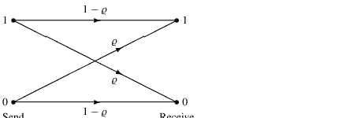

图 1.2 二进制对称信道。

### 1.8.2 解码与香农定理

解码过程，即确定在接收到向量 y 时发送的是哪个码字（因此也是哪个消息 x），更为复杂。寻找高效（快速）的解码算法是编码理论的主要研究领域，因为它们具有实际应用。一般来说，如果码的大小适中，编码容易而解码困难。

为了为解码做铺垫，我们从传输二进制数据的信道的一个可能数学模型开始。该模型称为具有交叉概率 \(\varrho\) 的二进制对称信道（或 BSC），如图 1.2 所示。如果发送 0 或 1，则其无错误接收的概率为 \(1 - \varrho\)；如果发送 0（分别 1），则接收到 1（分别 0）的概率为 \(\varrho\)。在大多数实际情况下，\(\varrho\) 非常小。这是 *无记忆离散信道*（或 *DMC*）的一个示例，即输入和输出为离散且一个比特出错的概率与前面的比特无关的信道。我们将假设比特被正确接收的可能性大于出错的可能性；因此 \(\varrho < 1/2\)。

如果 \(E_1\) 和 \(E_2\) 是事件，令 \(\text{prob}(E_1)\) 表示 \(E_1\) 发生的概率，\(\text{prob}(E_1 \mid E_2)\) 表示在 \(E_2\) 发生的条件下 \(E_1\) 发生的概率。假设 \(\mathbf{c} \in \mathbb{F}_2^n\) 被发送，\(\mathbf{y} \in \mathbb{F}_2^n\) 被接收并记为 \(\widehat{\mathbf{c}} \in \mathbb{F}_2^n\)。因此，\(\text{prob}(\mathbf{c} \mid \mathbf{y})\) 是在接收到 \(\mathbf{y}\) 的条件下发送码字 \(\mathbf{c}\) 的概率，\(\text{prob}(\mathbf{y} \mid \mathbf{c})\) 是在发送码字 \(\mathbf{c}\) 的条件下接收到 \(\mathbf{y}\) 的概率。这些概率可以从信道相关的统计信息中计算得出。这些概率由贝叶斯规则关联

\(\text{prob}(\mathbf{c} \mid \mathbf{y}) = \frac{\text{prob}(\mathbf{y} \mid \mathbf{c}) \text{prob}(\mathbf{c})}{\text{prob}(\mathbf{y})},\)

其中 \(\text{prob}(\mathbf{c})\) 是发送 \(\mathbf{c}\) 的概率，\(\text{prob}(\mathbf{y})\) 是接收到 \(\mathbf{y}\) 的概率。解码器可以根据这两个概率做出选择的两种自然方式。首先，解码器可以选择 \(\widehat{\mathbf{c}} = \mathbf{c}\) 作为 \(\text{prob}(\mathbf{c} \mid \mathbf{y})\) 最大的码字 \(\mathbf{c}\)；这样的解码器称为 *最大后验概率*（或 *MAP*）解码器。

5 虽然 \(\varrho\) 通常非常小，但如果 \(\varrho > 1/2\)，则比特出错接收的概率高于正确接收的概率。因此，一种策略是在接收端立即交换 0 和 1。这将交叉概率为 \(\varrho\) 的 BSC 转换为交叉概率为 \(1 - \varrho < 1/2\) 的 BSC。当然，如果 \(\varrho = 1/2\)，这没有帮助，在这种情况下通信是不可能的 - 参见练习 77。


符号上，MAP 解码器做出如下决策

$\widehat{\mathbf{c}} = \arg \max_{\mathbf{c} \in \mathcal{C}} \text{prob}(\mathbf{c} \mid \mathbf{y})$.

这里 $\arg \max_{\mathbf{c} \in \mathcal{C}} \text{prob}(\mathbf{c} \mid \mathbf{y})$ 是使概率函数 $\text{prob}(\mathbf{c} \mid \mathbf{y})$ 达到最大值的参数 $\mathbf{c}$。或者，解码器可以选择 $\widehat{\mathbf{c}} = \mathbf{c}$ 作为使 $\text{prob}(\mathbf{y} \mid \mathbf{c})$ 达到最大值的码字 $\mathbf{c}$；这样的解码器称为 *最大似然*（或 *ML*）解码器。符号上，ML 解码器做出如下决策

$\widehat{\mathbf{c}} = \arg \max_{\mathbf{c} \in \mathcal{C}} \text{prob}(\mathbf{y} \mid \mathbf{c})$. (1.9)

考虑在 BSC 上进行 ML 解码。如果 $\mathbf{y} = y_1 \cdots y_n$ 和 $\mathbf{c} = c_1 \cdots c_n$，

$\text{prob}(\mathbf{y} \mid \mathbf{c}) = \prod_{i=1}^n \text{prob}(y_i \mid c_i)$.

因为我们假设比特错误是独立的。根据图 1.2，若 $y_i \neq c_i$ 则 $\text{prob}(y_i \mid c_i) = \varrho$，若 $y_i = c_i$ 则 $\text{prob}(y_i \mid c_i) = 1 - \varrho$。因此

$\text{prob}(\mathbf{y} \mid \mathbf{c}) = \varrho^{d(\mathbf{c}, \mathbf{y})} (1 - \varrho)^{n - d(\mathbf{c}, \mathbf{y})} = (1 - \varrho)^n \left( \frac{\varrho}{1 - \varrho} \right)^{d(\mathbf{c}, \mathbf{y})}$. (1.10)

由于 $0 < \varrho < 1/2$，$0 < \varrho / (1 - \varrho) < 1$。因此最大化 $\text{prob}(\mathbf{y} \mid \mathbf{c})$ 等价于最小化 $d(\mathbf{y}, \mathbf{c})$，即在汉明距离意义下找到最接近接收向量 $\mathbf{y}$ 的码字 $\mathbf{c}$；这称为 *最近邻解码*。因此在 BSC 上，最大似然解码和最近邻解码是相同的。

令 $\mathbf{e} = \mathbf{y} - \mathbf{c}$，则 $\mathbf{y} = \mathbf{c} + \mathbf{e}$。通信信道中噪声的效果是在码字 $\mathbf{c}$ 上添加一个 *误差向量* $\mathbf{e}$。通信信道中噪声的效果是确定 $\mathbf{e}$。最近邻解码等价于找到一个权重最小的向量 $\mathbf{e}$，使得 $\mathbf{y} - \mathbf{e}$ 属于该码。这个误差向量不一定唯一，因为可能存在多个最接近 $\mathbf{y}$ 的码字；换句话说，(1.9) 可能没有唯一解。当我们拥有一个能够找到所有最接近接收向量 $\mathbf{y}$ 的码字的解码器时，我们就拥有一个 *完整解码器*。

为了考察最接近给定码字的向量，关于码字的球体概念证明很有用。以向量 $\mathbf{u}$ 为中心、在 $\mathbb{F}_q^n$ 中半径为 $r$ 的 *球体* 定义为集合

$S_r(\mathbf{u}) = \left\{ \mathbf{v} \in \mathbb{F}_q^n \mid d(\mathbf{u}, \mathbf{v}) \le r \right\}$

即所有与 $\mathbf{u}$ 的距离小于或等于 $r$ 的向量的集合。$S_r(\mathbf{u})$ 中向量的数量等于

$\sum_{i=0}^r \binom{n}{i} (q - 1)^i$. (1.11)

只要半径选得足够小，这些球体两两不相交。

### 定理 1.8.12

如果 $d$ 是码 $\mathcal{C}$（线性或非线性）的最小距离，且 $t = \lfloor (d - 1) / 2 \rfloor$，那么以不同码字为中心、半径为 $t$ 的球体两两不相交。

证明：如果 $z \in S_t(c_1) \cap S_t(c_2)$，其中 $c_1$ 和 $c_2$ 是码字，则根据三角不等式（定理 1.4.1(iv)），
$d(c_1, c_2) \le d(c_1, z) + d(z, c_2) \le 2t < d$，
这意味着 $c_1 = c_2$。

### 推论 1.8.3

沿用前一定理的记号，如果发送了码字 $\mathbf{c}$ 并接收到 $\mathbf{y}$，且发生的错误不超过 $t$ 个，那么 $\mathbf{c}$ 是最接近 $\mathbf{y}$ 的唯一码字。特别是，最近邻解码能够唯一且正确地解码任何传输过程中至多发生 $t$ 个错误的接收向量。

### 练习 65

证明 $S_t(\mathbf{u})$ 中向量的数量由 (1.11) 给出。

为了尽可能多地解码错误，这个推论意味着对于给定的 $n$ 和 $k$，我们希望找到一个最小权重 $d$ 尽可能高的码。或者，给定 $n$ 和 $d$，人们希望发送尽可能多的消息；因此我们希望找到一个码字数量最多的码，或者在线性情况下，维度最高的码。如果我们能找到一个具有高效解码算法的码，可以适当放宽这些要求。

由于 $C$ 的最小距离为 $d$，存在两个不同的码字，使得以它们为中心、半径为 $t + 1$ 的球体不相交。因此，如果发生的错误超过 $t$ 个，最近邻解码可能会产生多个最近码字。因此 $C$ 是一个 $t$ 纠错码，但不是 $(t + 1)$ 纠错码。码的包装半径是以码字为中心、使球体两两不相交的最大半径。本讨论表明关于包装半径的以下两个事实。

### 定理 1.8.4

设 $C$ 是 $\mathbb{F}_q$ 上的 $[n, k, d]$ 码。以下成立：
(i) $C$ 的包装半径等于 $t = \lfloor (d-1)/2 \rfloor$。
(ii) $C$ 的包装半径 $t$ 由以下性质表征：最近邻解码总能正确解码至多发生 $t$ 个错误的接收向量，但不会总能正确解码发生 $t + 1$ 个错误的接收向量。

解码问题现在变成了寻找一个能够纠正最多 $t$ 个错误的高效算法。最明显的解码算法之一是检查所有码字，直到找到一个与接收向量距离不超过 $t$ 的码字。但显然，这只有在码字数量较少的码中才是一个现实的解码算法。另一个明显的算法是制作一个表格，包含 $\mathbb{F}_q^n$ 中每个 $q^n$ 向量的一个最近码字，然后在表格中查找接收向量以进行解码。如果 $q^n$ 非常大，这在实践中是不可行的。

然而，对于 $\mathbb{F}_q$ 上的 $[n, k, d]$ 线性码 $C$，我们可以设计一个使用 $q^{n-k}$ 而非 $q^n$ 个条目的表格算法，通过查找这些 $q^{n-k}$ 个条目之一即可找到最近码字。这种针对线性码的通用解码算法称为综合征解码。由于我们的码 $C$ 是 $\mathbb{F}_q^n$ 加法群的初等阿贝尔子群，其不同的陪集 $\mathbf{x} + C$ 将 $\mathbb{F}_q^n$ 划分为 $q^{n-k}$ 个大小为 $q^k$ 的集合。两个向量 $\mathbf{x}$ 和 $\mathbf{y}$ 属于同一个陪集当且仅当 $\mathbf{y} - \mathbf{x} \in C$。陪集的权重称为陪集中向量的权重，陪集中任何这种最小权重的向量称为陪集领头向量。零向量是码 $\mathcal{C}$ 的唯一陪集领头向量。更一般地，每个权重不超过 $t = \lfloor(d - 1)/2\rfloor$ 的陪集都有一个唯一的陪集领头向量。

### 练习 66

- 执行以下操作：
  - (a) 证明如果 $\mathcal{C}$ 是 $\mathbb{F}_q$ 上的 $[n, k, d]$ 码，那么每个权重不超过 $t = \lfloor(d - 1)/2\rfloor$ 的陪集都有一个唯一的陪集领头向量。
  - (b) 找到一个长度为 4 且最小权重为 $d$ 的非零二进制码，使得所有陪集都有唯一的陪集领头向量，且某个陪集的权重大于 $t = \lfloor(d - 1)/2\rfloor$。

为 $\mathcal{C}$ 选择一个奇偶校验矩阵 $H$。向量 $\mathbf{x}$ 在 $\mathbb{F}_q^n$ 中相对于奇偶校验矩阵 $H$ 的综合征定义为 $\mathbb{F}_q^{n-k}$ 中的向量

$syn(\mathbf{x}) = H\mathbf{x}^T.$

码 $\mathcal{C}$ 由所有综合征等于 $\mathbf{0}$ 的向量组成。由于 $H$ 的秩为 $n - k$，$\mathbb{F}_q^{n-k}$ 中的每个向量都是一个综合征。如果 $\mathbf{x}_1, \mathbf{x}_2 \in \mathbb{F}_q^n$ 属于 $\mathcal{C}$ 的同一个陪集，那么 $\mathbf{x}_1 - \mathbf{x}_2 = \mathbf{e} \in \mathcal{C}$。因此 $syn(\mathbf{x}_1) = H(\mathbf{x}_1 + \mathbf{e})^T = H\mathbf{x}_1^T + H\mathbf{e}^T = H\mathbf{x}_1^T = syn(\mathbf{x}_1)$。因此 $\mathbf{x}_1$ 和 $\mathbf{x}_2$ 具有相同的综合征。另一方面，如果 $syn(\mathbf{x}_1) = syn(\mathbf{x}_2)$，那么 $H(\mathbf{x}_1 - \mathbf{x}_2)^T = \mathbf{0}$，从而 $\mathbf{x}_2 - \mathbf{x}_1 \in \mathcal{C}$。因此我们有以下定理。

### 定理 1.8.5

两个向量属于同一个陪集当且仅当它们具有相同的综合征。

因此，$\mathcal{C}$ 的陪集与综合征之间存在一一对应关系。我们用 $\mathcal{C}_s$ 表示由 $\mathbb{F}_q^n$ 中所有综合征为 $s$ 的向量组成的 $\mathcal{C}$ 的陪集。

假设通过通信信道发送的码字被接收为向量 $\mathbf{y}$。由于在最近邻解码中，我们寻找一个权重最小的向量 $\mathbf{e}$，使得 $\mathbf{y} - \mathbf{e} \in \mathcal{C}$，最近邻解码等价于在包含 $\mathbf{y}$ 的陪集中找到一个权重最小的向量 $\mathbf{e}$，即包含 $\mathbf{y}$ 的陪集的陪集领头向量。综合征解码算法是最近邻解码的以下实现。我们从一个固定的奇偶校验矩阵 $H$ 开始。

- I. 对于每个综合征 $s \in \mathbb{F}_q^{n-k}$，选择陪集 $\mathcal{C}_s$ 的一个陪集领头向量 $\mathbf{e}_s$。创建一个将综合征与陪集领头向量配对的表格。

这个过程可能有些复杂，但这是在分析接收向量之前执行的一次性预处理任务。计算此表格的一种方法将在稍后描述。生成表格后，即可对接收向量进行解码。

- II. 接收到向量 $\mathbf{y}$ 后，使用奇偶校验矩阵 $H$ 计算其综合征 $s$。

- III. 然后将 $\mathbf{y}$ 解码为码字 $\mathbf{y} - \mathbf{e}_s$。

综合征解码只需要一个具有 $q^{n-k}$ 个条目的表格，这可能比显示每个向量最近码字的 $q^n$ 向量表格有巨大的改进。然而，缩短表格是有代价的：在查看综合征表格之前，必须执行矩阵-向量乘法以确定接收向量的综合征。然后使用表格查找综合征并找到陪集领头向量。

如何构建步骤 II 中描述的综合征表格？我们简要讨论二进制码的情况；可以很容易地将其扩展到非二进制码。给定长度为 $n$、奇偶校验矩阵为 $H$ 的 $t$ 纠错码 $\mathcal{C}$，我们可以按以下方式构建综合征。权重为 0 的陪集的陪集领头向量为 $\mathbf{0}$。考虑 $n$ 个权重为 1 的陪集。


选择一个在位置 $i$ 为 1、其余为 0 的 $n$ 元组；该陪类领元为该 $n$ 元组，关联综合征为 $H$ 的第 $i$ 列。对于 $\binom{n}{2}$ 个权重为 2 的陪类，选择一个在位置 $i$ 和 $j$（其中 $i < j$）为 1、其余为 0 的 $n$ 元组；该陪类领元为该 $n$ 元组，关联综合征为 $H$ 的第 $i$ 列和第 $j$ 列之和。按此方式继续处理权重为 $t$ 的陪类。我们可以选择在此停止。如果这样做，我们可以解码任何包含 $t$ 个或更少错误的接收向量，但如果接收向量包含超过 $t$ 个错误，则它要么会被错误解码（如果接收向量的综合征在表中），要么根本不会被解码（如果接收向量的综合征不在表中）。如果我们决定继续并计算权重 $w$ 大于 $t$ 的综合征，我们以同样的方式继续，并增加一个特征：必须检查综合征的可能重复。如果权重为 $w$ 的 $n$ 元组不是陪类领元，或者它是与另一个权重为 $w$ 的领元具有相同综合征的陪类领元，则会发生这种重复，在这种情况下我们转到下一个 $n$ 元组。我们继续直到拥有 $2^{n-k}$ 个综合征。生成的表将允许我们执行最近邻解码。

对于参数为 $[n = 2^r - 1, 2^r - 1 - r, 3]$ 的二进制 Hamming 码 $\mathcal{H}_r$，综合征解码尤其简单。我们不必为综合征和对应的陪类领元创建表。这是因为陪类领元是唯一的，并且是权重最多为 1 的 $2^r$ 个向量。设 $H_r$ 为奇偶校验矩阵，其列为数字 $1, 2, \dots, 2^r - 1$ 的二进制表示。由于权重为 1 且唯一的 1 在位置 $i$ 的二进制 $n$ 元组的综合征是表示数字 $i$ 的二进制数的 $r$ 元组，综合征立即给出陪类领元，综合征解码不需要表。因此，二进制 Hamming 码的综合征解码采用以下形式：

- I. 接收向量 $\mathbf{y}$ 后，使用奇偶校验矩阵 $H_r$ 计算其综合征 $\mathbf{s}$。
- II. 如果 $\mathbf{s} = \mathbf{0}$，则 $\mathbf{y}$ 在码中，$\mathbf{y}$ 被解码为 $\mathbf{y}$；否则，$\mathbf{s}$ 是某个正整数 $i$ 的二进制表示，$\mathbf{y}$ 被解码为从 $\mathbf{y}$ 通过将其第 $i$ 位加 1 得到的码字。

上述过程易于修改以适用于其他域上的 Hamming 码。这将在练习中探讨。

## 练习 67

构造长度为 15 的二进制 Hamming 码 $\mathcal{H}_4$ 的奇偶校验矩阵，其中列按顺序为二进制数 $1, 2, \dots, 15$。使用此奇偶校验矩阵解码以下向量，然后检查解码后的向量是否确实是码字。

- (a) 001000011001000，
- (b) 101001110101100，
- (c) 000100100011000。

## 练习 68

使用示例 1.3.3 的生成矩阵构造奇偶校验矩阵，构造三元四元码所有综合征的表。为每个综合征找到一个陪类领元。使用你的奇偶校验矩阵解码以下向量，然后检查解码后的向量是否确实是码字。

- (a) $(1, 1, 1, 1)$，
- (b) $(1, -1, 0, 0, -1)$，
- (c) $(0, 1, 0, 1)$。

## 练习 69

设 C 为生成矩阵 G 和奇偶校验矩阵 H 如下给出的 [6, 3, 3] 二进制码

```
G = [ 1 1 0 0 1 1 
      0 0 1 0 0 1 
      0 0 1 1 1 0 ]   and   H = [ 0 1 1 1 0 0 
                                    1 0 1 0 1 0 
                                    1 0 1 1 0 1 
                                    1 1 0 0 0 1 ]
```

- (a) 为 C 的八个陪类构造陪类领元和关联综合征的表。
- (b) 部分 (a) 中的一个陪类具有权重 2。该陪类有三个陪类领元。它是哪个陪类，其陪类领元是什么？
- (c) 使用部分 (a)，解码以下接收向量：
  - (i) 110110，
  - (ii) 110111，
  - (iii) 110001。
- (d) 对于部分 (c) 中的一个接收向量，存在关于它应被解码为哪个码字的歧义。列出该接收向量可能的其他最近邻。

## 练习 70

设 \(\widehat{\mathcal{H}}_3\) 为具有以下奇偶校验矩阵的扩展 Hamming 码

```
\(\widehat{H}_3 = [ 1 1 1 1 1 1 1 1 \\
                     0 0 0 0 1 1 1 1 \\
                     0 0 1 1 0 0 1 1 \\
                     0 1 0 1 0 1 0 1 ]\)
```

将坐标编号为 0, 1, ..., 7。注意，如果删除 \(\widehat{H}_3$ 的第一行，则得到坐标的二进制表示。我们可以使用以下算法在不需要综合征和陪类领元表的情况下解码 \(\widehat{\mathcal{H}}_3$。如果接收 y，则使用奇偶校验矩阵 \(\widehat{H}_3$ 计算 syn(y)。如果 syn(y) = (0, 0, 0, 0)^t，则 y 没有错误。如果 syn(y) = (1, a, b, c)^t，则坐标位置 abc（以二进制表示）存在单个错误。如果 syn(y) = (0, a, b, c)^t 且 (a, b, c) != (0, 0, 0)，则坐标位置 0 和坐标位置 abc（以二进制表示）存在两个错误。

- (a) 使用此算法解码以下向量：
  - (i) 10110101，
  - (ii) 11010010，
  - (iii) 10011100。
- (b) 验证此过程为 \(\widehat{\mathcal{H}}_3$ 提供最近邻解码算法。为此，必须验证以下内容。所有权重 0 和权重 1 的错误都可以纠正，占 16 个综合征中的九个。所有权重 2 的错误不一定都可以纠正，但所有权重 2 的错误都会导致剩余七个综合征中的一个。

接收向量可能同时包含错误（传输符号被读作不同符号）和擦除（传输符号不可读）。两者根本不同，因为错误的位置未知，而擦除的位置已知。假设 C 中的 c 被发送，接收向量 y 包含 v 个错误和 e 个擦除。如果 e >= d，当然不能保证 y 可以被纠正，因为可能存在比 c 更接近 y 的其他码字。因此假设 e < d。在 \(\mathbf{y}$ 中发生擦除的 \(\epsilon$ 个位置上对 C 进行短缩，以获得一个 \([n - \epsilon, k^*, d^*]$ 码 \(C^*$。根据定理 1.5.7(ii)，\(k^* = k$，且 \(d^* \ge d - \epsilon$。类似地对 C 和 \(\mathbf{y}$ 进行短缩以获得 \(C^*$ 和 \(\mathbf{y}^*$；这些可以被视为使用码 \(C^*$ 发送和接收的向量，其中 \(\mathbf{y}^*$ 包含 v 个错误但没有擦除。如果 \(2v < d - \epsilon \le d^*$，则可以根据推论 1.11.3 从 \(\mathbf{y}^*$ 恢复 \(\mathbf{c}^*$。存在唯一的码字 \(\mathbf{c} \in C$，当对其进行短缩时产生 \(\mathbf{c}^*$；否则，如果对 \(\mathbf{c}$ 和 \(\mathbf{c}'$ 都进行短缩得到 \(\mathbf{c}^*$，则 \(wt(\mathbf{c} - \mathbf{c}') \le \epsilon$，除非 \(\mathbf{c} = \mathbf{c}'$，否则这是矛盾。以下定理总结了此讨论并扩展了推论 1.11.3。

## 定理 1.8.6

设 \(C\) 为一个 \([n, k, d]$ 码。如果发送码字 \(\mathbf{c}$ 并接收到 \(\mathbf{y}$，其中发生了 v 个错误和 \(\epsilon$ 个擦除，则只要 \(2v + \epsilon < d$，\(\mathbf{c}$ 就是 C 中最接近 \(\mathbf{y}$ 的唯一码字。

## 练习 71

设 \(\widehat{\mathcal{H}}_3$ 为具有以下奇偶校验矩阵的扩展 Hamming 码

```
\(\widehat{H}_3 = \begin{bmatrix} 1 & 1 & 1 & 1 & 1 & 1 & 1 & 1 \\ 0 & 0 & 0 & 0 & 1 & 1 & 1 & 1 \\ 0 & 0 & 1 & 1 & 0 & 0 & 1 & 1 \\ 0 & 1 & 0 & 1 & 0 & 1 & 0 & 1 \end{bmatrix}\)
```

纠正接收向量 \(101 \star 0111$，其中 \(\star$ 是一个擦除。

在练习 70 和 71 中，我们探讨了 \([8, 4, 4]$ 扩展 Hamming 码 \(\widehat{\mathcal{H}}_3$ 的解码。在练习 70 中，我们要求读者验证存在八个权重为 1 的陪类和七个权重为 2 的陪类。每个这样的陪类都是一个非线性码，因此讨论这些陪类的权重分布并表格化结果是合适的。一般来说，线性码的 *完整陪类权重分布* 是码中每个陪类的权重分布。下一个示例给出了 \(\widehat{\mathcal{H}}_3$ 的完整陪类权重分布。由于每个 \([8, 4, 4]$ 码都等价于 \(\widehat{\mathcal{H}}_3$，根据练习 56，这是任何 \([8, 4]$ 二进制码的完整陪类权重分布。

## 示例 1.8.7

\([8, 4, 4]$ 扩展二进制 Hamming 码 \(\widehat{\mathcal{H}}_3$ 的完整陪类权重分布如下表所示：

| 陪类权重 | 给定权重的向量数 | 陪类数 |
| :--- | :--- | :--- |
| | 0 1 2 3 4 5 6 7 8 | |
| 0 | 1 0 0 0 14 0 0 0 1 | 1 |
| 1 | 0 1 0 7 10 7 0 1 0 | 8 |
| 2 | 0 0 4 0 8 0 4 0 0 | 7 |

请注意，第一行是 \(\widehat{\mathcal{H}}_3$ 的权重分布。第二行是每个权重为 1 的陪类的权重分布。该码具有特殊性质：给定权重的所有陪类都具有相同的权重分布。一般码的情况并非如此。在练习 73 中，我们要求读者验证表中的一些信息。请注意，该码具有全一向量 \(\mathbf{1}$，因此表关于中间权重对称。还请注意，偶数权重陪类仅包含偶数权重向量，奇数权重陪类仅包含奇数权重向量。这些观察普遍成立；参见练习 72。表中的信息有助于解释 \(\widehat{\mathcal{H}}_3$ 的解码。我们看到，所有的陪类


重量为 2 的陪类有四个陪类领导元。这意味着当我们解码一个发生了两个错误的接收向量时，实际上有四个等可能的代码字可能是被发送的。

## 练习 72 设 $\mathcal{C}$ 为长度为 $n$ 的二进制码。证明如下结论。

- (a) 若 $\mathcal{C}$ 为偶码，则 $\mathcal{C}$ 的偶重量陪类仅含偶重量向量，而奇重量陪类仅含奇重量向量。

- (b) 若 $\mathcal{C}$ 包含全一向量 $\mathbf{1}$，则在固定陪类中，重量为 $i$ 的向量个数与重量为 $n-i$ 的向量个数相同，其中 $0 \le i \le n$。

## 练习 73 考虑示例 1.1.17 中给出的 $\widehat{\mathcal{H}}_3$ 的完整陪类重量分布。练习 72 的结果将有所帮助。

- (a) 证明重量为 1 的陪类的重量分布与所声称的一致。

- (b) （*较难*）证明重量为 2 的陪类的重量分布与所声称的一致。

我们以对已开发的解码框架内香农定理的讨论来结束本节。假设通信信道为交叉概率为 $\varrho$ 的 BSC，且采用综合解码。对于该信道和解码方案，*字错误率* $P_{err}$ 是解码器出错的概率，对 $\mathcal{C}$ 的所有代码字取平均；为简化起见，我们假设 $\mathcal{C}$ 的每个代码字被发送的可能性相等。当接收到 $\mathbf{y}$ 时，若 $\hat{\mathbf{c}} = \arg \max_{\mathbf{c} \in \mathcal{C}} \text{prob}(\mathbf{y} \mid \mathbf{c})$ 不是原始传输的字 $\mathbf{c}$，则发生解码器错误。若 $\mathbf{y} - \mathbf{c}$ 是所选陪类领导元，则综合解码器做出正确判决。由 (1.110)，该概率为 $\varrho^{\text{wt}(\mathbf{y}-\mathbf{c})}(1-\varrho)^{n-\text{wt}(\mathbf{y}-\mathbf{c})}$。因此，综合解码器做出正确判决的概率为 $\sum_{i=0}^n \alpha_i \varrho^i (1-\varrho)^{n-i}$，其中 $\alpha_i$ 为重量为 $i$ 的陪类个数。故

$P_{err} = 1 - \sum_{i=0}^n \alpha_i \varrho^i (1-\varrho)^{n-i}$。

## 示例 1.8.18 假设长度为 $k$ 的二进制消息在交叉概率为 $\varrho$ 的 BSC 上未编码发送。这实际上等同于使用 $[k, k]$ 码 $\mathbb{F}_2^k$。该码只有一个陪类，即码本身，其领导元是重量为 0 的零代码字。因此 (1.12) 表明解码器错误概率为

$P_{err} = 1 - \varrho^0(1-\varrho)^k = 1 - (1-\varrho)^k$。

这正是我们所期望的，因为无解码错误的概率是 $(1-\varrho)^k$，即我们接收到的 $k$ 位无误的概率。

## 示例 1.8.19 我们比较发送 $2^4 = 16$ 个二进制消息的未编码方式与使用 $[7, 4]$ 二进制海明码 $\mathcal{H}_3$ 进行编码的方式。假设通信信道的交叉概率为 $\varrho$。由示例 1.1.8，未编码数据的 $P_{err} = 1 - (1-\varrho)^4$。$\mathcal{H}_3$ 有一个重量为 0 的陪类和七个重量为 1 的陪类。因此由 (1.12) 得 $P_{err} = 1 - (1-\varrho)^7 - 7\varrho(1-\varrho)^6$。例如，若 $\varrho = 0.01$，则未编码时的 $P_{err}$ 为 $0.03940399$。使用 $\mathcal{H}_3$ 时，其值为 $0.00023104 \dots$

## 练习 74 假设通信信道的交叉概率为 $\varrho$。 (a) 使用示例 1.1.7，计算扩展海明码 $\widehat{\mathcal{H}}_3$ 的 $P_{err}$。 (b) 证明示例 1.1.9 中求得的 $\widehat{\mathcal{H}}_3$ 和 $\mathcal{H}_3$ 的 $P_{err}$ 值相等。 (c) 在 BSC 上通信时，使用哪种码 $\widehat{\mathcal{H}}_3$ 或 $\mathcal{H}_3$ 更好？为什么？

## 练习 75 假设使用 [23, 12, 7] 二进制 Golay 码 $\mathcal{G}_{23}$ 在交叉概率为 $\varrho$ 的 BSC 上通信。 (a) 在练习 78 和 80 中你将看到，对于 $\mathcal{G}_{23}$，当 $0 \le i \le 3$ 时有 $\binom{23}{i}$ 个重量为 $i$ 的陪类，且无其他陪类。计算该码的 $P_{err}$。 (b) 当 $\varrho = 0.01$ 时，比较发送 $2^{12}$ 个二进制消息的未编码方式与使用 $\mathcal{G}_{23}$ 编码的 $P_{err}$。

## 练习 76 假设使用 [24, 12, 8] 扩展二进制 Golay 码 $\mathcal{G}_{24}$ 在交叉概率为 $\varrho$ 的 BSC 上通信。 (a) 在示例 8.3.2 中你将看到，对于 $\mathcal{G}_{24}$，重量分别为 0, 1, 2, 3, 4 的陪类个数分别为 1, 24, 276, 2024, 1771。计算该码的 $P_{err}$。 (b) 证明练习 75 中求得的 $\mathcal{G}_{23}$ 和 $\mathcal{G}_{24}$ 的 $P_{err}$ 值相等。 (c) 在 BSC 上通信时，使用哪种码 $\mathcal{G}_{23}$ 或 $\mathcal{G}_{24}$ 更好？为什么？

对于交叉概率为 $\varrho$ 的 BSC，信道容量为

$C(\varrho) = 1 + \varrho \log_2 \varrho + (1 - \varrho) \log_2(1 - \varrho)$。

容量 $C(\varrho) = 1 - H_2(\varrho)$，其中 $H_2(\varrho)$ 是我们在第 2.10.3 节中定义的希尔伯特熵函数。对于二进制对称信道，香农定理如下。$^6$

## 定理 1.8.11（香农）设 $\delta > 0$ 且 $R < C(\varrho)$。则对于足够大的 $n$，存在一个 $[n, k]$ 二进制线性码 $\mathcal{C}$，其中 $k/n \ge R$，使得当 $\mathcal{C}$ 用于在交叉概率为 $\varrho$ 的 BSC 上通信时，$P_{err} < \delta$。此外，若 $R > C(\varrho)$，则不存在这样的码。

香农定理对于非二进制码和其他信道依然有效，前提是信道容量定义得当。分数 $k/n$ 称为 $[n, k]$ 码的速率或信息速率，用于衡量传输的信息量；我们将在第 2.10 节中更详细地讨论此问题。

## 练习 77 做如下题目。 (a) 绘制 $0 < \varrho < 1$ 时信道容量关于 $\varrho$ 的函数图像。 (b) 在你的图像中，根据香农定理，可以发生任意可靠通信的区域是什么？ (c) 当 $\varrho = 1/2$ 时，信道容量是多少？香农定理对 $\varrho = 1/2$ 时的通信有何说明？（参见本节前面的脚注 5。）

## 1.12 球堆积界、覆盖半径和完美码

最小距离 $d$ 是衡量码优劣的一个简单指标。对于给定的长度和代码字个数，编码理论中的一个基本问题是构造具有最大可能 $d$ 的码。或者，给定 $n$ 和 $d$，确定在 $\mathbb{F}_q$ 上长度为 $n$ 且最小距离至少为 $d$ 的码中的代码字最大个数 $A_q(n, d)$。$A_2(n, d)$ 也记作 $A(n, d)$。对于线性码也可以提出同样的问题。即，在 $\mathbb{F}_q$ 上长度为 $n$ 且最小重量至少为 $d$ 的线性码中的代码字最大个数 $B_q(n, d)$（二进制情况下记作 $B(n, d)$）是多少？显然，$B_q(n, d) \le A_q(n, d)$。对于适中的 $n$ 和 $d$ 值，$A(n, d)$ 和 $B(n, d)$ 已被确定并列表；参见第 2 章。

以代码字为中心、半径为 $t$ 的球两两不相交这一事实立即蕴含以下初等不等式，通常称为*球堆积界*或*海明界*。

## 定理 1.12.1（球堆积界）

$B_q(n, d) \le A_q(n, d) \le \frac{q^n}{\sum_{i=0}^t \binom{n}{i} (q-1)^i}$，

其中 $t = \lfloor (d-1)/2 \rfloor$。

**证明：** 设 $\mathcal{C}$ 为 $\mathbb{F}_q$ 上长度为 $n$ 且最小距离为 $d$ 的（可能是非线性的）码。假设 $\mathcal{C}$ 包含 $M$ 个代码字。由定理 1.11.2，不同代码字为中心半径为 $t$ 的球两两不相交。由于由 (1.11) 可知这些球中每一个包含 $\alpha = \sum_{i=0}^t \binom{n}{i} (q-1)^i$ 个向量，且球两两不相交，因此 $M\alpha$ 不能超过 $\mathbb{F}_q^n$ 中向量的总数 $q^n$。结果随即得证。

从球堆积界的证明中我们看到，当取等号时，我们实际上用半径为 $t$ 的不相交球填满了空间 $\mathbb{F}_q^n$。换句话说，$\mathbb{F}_q^n$ 中的每个向量都恰好包含在以某个代码字为中心的半径为 $t$ 的一个球中。当一个码满足此性质时，该码称为*完美码*。

## 示例 1.12.2 回顾，$\mathbb{F}_q$ 上的海明码 $\mathcal{H}_{q,r}$ 是一个 $[n, k, 3]$ 码，其中 $n = (q^r - 1)/(q - 1)$ 且 $k = n - r$。此时 $t = 1$ 且

$\frac{q^n}{\sum_{i=0}^t \binom{n}{i} (q-1)^i} = \frac{q^n}{1 + n(q - 1)} = \frac{q^n}{q^r} = q^k$。

因此 $\mathcal{H}_{q,r}$ 是完美码。

## 练习 78 证明 (23, 12, 7) 二进制 Golay 码和 (11, 6, 5) 三进制 Golay 码是完美码。


## 练习 79

证明下列代码是完美的：
- (a) 代码 \(\mathcal{C} = \mathbb{F}_q^n\)，
- (b) 仅包含一个码字的代码（在线性代码中为零向量），
- (c) 奇长的二进制重复代码，以及
- (d) 奇长的二进制代码，由向量 \(\mathbf{c}\) 和互补向量 \(\overline{\mathbf{c}}\)（0 和 1 互换）组成。

这些代码被称为平凡完美代码。

## 练习 80

证明长度为 \(n\) 的完美 \(t\)-纠错线性代码对 \(0 \le i \le t\) 精确有 \(\binom{n}{i}\) 个重量为 \(i\) 的陪集，且没有其他陪集。提示：\(\mathbb{F}_q^n\) 中有多少个重量为 \(i\) 的向量？重量分别为 \(i\) 和 \(j\)（其中 \(i \le t\) 且 \(j \le t\)）的不同向量可能属于同一个陪集吗？使用球堆积界中的等式。

因此，海明码是完美的，高莱码中的两个也是如此，如练习 78 所示。此外，定理 1.8.2 表明，所有与海明码具有相同长度、维数和最小重量的线性代码都是等价的。这些代码中的任何一个都可以称为海明码。还有一些平凡完美代码，如练习 79 所述。因此，我们有了下列定理证明的一部分。

## 定理 1.12.3

- (i) 存在非线性的 \(\mathbb{F}_q\) 上的完美单纠错代码，所有此类代码的参数均对应于海明码的参数，即长度 \(n = (q^r - 1)/(q - 1)\)，包含 \(q^{n-r}\) 个码字，最小距离为 3。\(\mathbb{F}_q\) 上唯一的单纠错线性代码是海明码。
- (ii) 唯一的非平凡完美多纠错代码具有与 [23, 12, 7] 二进制高莱码或 [11, 6, 5] 三进制高莱码相同的长度、码字数量和最小距离。
- (iii) 任何二进制（或三进制）可能为非线性的、包含 \(\mathbf{0}\) 向量、长度为 23（或 11）、最小距离为 7（或 5）且具有 \(2^{12}\)（或 \(3^6\)）个向量的代码，等价于 [23, 12, 7] 二进制（或 [11, 6, 5] 三进制）高莱码。

本定理总结的完美代码分类是一项重要且困难的数学成果，多位作者对此有所贡献。我们将在第 10 章证明部分 (iii)。证明的其余部分可见 [137, Section 5]。部分 (ii) 的一部分在练习 81 中证明。

## 练习 81

本练习旨在证明定理 1.12.3(ii) 的一部分。设 \(\mathcal{C}\) 为一个 \([n, k, 7]\) 完美二进制代码。

- (a) 使用球堆积界中的等式，证明
  \((n+1)[(n+1)^2 - 3(n+1) + 8] = 3 \cdot 2^{n-k+1}\)。
- (b) 证明 \(n + 1\) 要么是 \(2^b\)，要么是 \(3 \cdot 2^b\)，且在这两种情况下，\(b \le n - k + 1\)。
- (c) 证明 \(b < 4\)。
- (d) 证明 \(n = 23\) 或 \(n = 7\)。
- (e) 说出两个完美的 \([n, k, 7]\) 代码，一个长度 \(n = 7\)，另一个长度 \(n = 23\)。

通过取线性完美代码的一个陪集可以得到非线性完美代码；参见练习 82。定理 1.12.3 表明，所有多纠错非线性代码都是长度 23 的二进制高莱码或长度 11 的三进制高莱码的陪集。另一方面，存在不是海明码陪集的非线性单纠错代码；这些代码最初由 Vasil'ev [338] 构造。

## 练习 82

证明线性完美代码的一个陪集也是完美代码。

设 \(C\) 为 \(\mathbb{F}_q\) 上的一个 \([n, k, d]\) 代码，并令 \(t = \lfloor (d - 1)/2 \rfloor\)。当没有完美代码时，为了用以码字为中心的球填充空间 \(\mathbb{F}_q^n\)，球的半径必须大于 \(t\)。当然，当增大球的大小时，并非所有球都两两不相交。我们定义覆盖半径 \(\rho(C)\) 为最小整数 \(s，使得 \(\mathbb{F}_q^n\) 是以 \(C\) 的码字为中心、半径为 \(s\) 的球的并集。等价地，

\[
\rho(C) = \max_{\mathbf{x} \in \mathbb{F}_q^n} \min_{\mathbf{c} \in C} d(\mathbf{x}, \mathbf{c}).
\]

显然，\(t \le \rho(C)\)，且 \(t = \rho(C)\) 当且仅当 \(C\) 是完美代码。根据定理 1.1.14，代码的堆积半径是以码字为中心且使球两两不相交的最大半径。因此，代码是完美的当且仅当其覆盖半径等于其堆积半径。如果代码不是完美的，其覆盖半径大于其堆积半径。对于非线性代码 \(C\)，覆盖半径 \(\rho(C)\) 的定义方式相同，即

\[
\rho(C) = \max_{\mathbf{x} \in \mathbb{F}_q^n} \min_{\mathbf{c} \in C} d(\mathbf{x}, \mathbf{c}).
\]

再次，若 \(d\) 是 \(C\) 的最小距离且 \(t = \lfloor (d - 1)/2 \rfloor\)，则 \(t \le \rho(C)\)，且 \(t = \rho(C)\) 当且仅当 \(C\) 是完美代码。本节后面证明的定理仅适用于线性代码。

如果 \(C\) 是堆积半径为 \(t\) 且覆盖半径为 \(t + 1\) 的代码，则 \(C\) 称为准完美代码。已知有许多线性和非线性准完美代码（例如某些双纠错 BCH 码和一些短化 Preparata 码）。然而，与完美代码不同，没有一般性的分类。

## 示例 1.12.4

根据练习 56，二进制 \([8, 4, 4]\) 代码被证明是唯一的，意义在于所有此类代码都等价于 \(\tilde{\mathcal{H}}_8\)。在示例 1.1.17 中，我们给出了该代码的完整陪集重量分布。由于没有重量大于 2 的陪集，覆盖半径 \(\rho(\tilde{\mathcal{H}}_8)\) 为 2。由于堆积半径为 \(t = \lfloor (4 - 1)/2 \rfloor = 1\)，该代码是准完美的。未扩展海明码 \(\tilde{\mathcal{H}}_7\) 的覆盖半径和堆积半径均等于 1。这说明了扩展二进制代码不会增加其堆积半径（纠错能力）但会增加其覆盖半径的事实。参见下面的定理 1.12.6(v)。

回顾，代码 \(C\) 的一个陪集的重量是陪集中向量的最小重量。覆盖半径的定义蕴含了线性代码覆盖半径的以下表征，即用陪集重量和综合征来表示。

## 定理 1.12.5

设 \(C\) 为具有奇偶校验矩阵 \(H\) 的线性代码。则：

- (i) \(\rho(C)\) 是重量最大的陪集的重量；
- (ii) \(\rho(C)\) 是最小的数 \(s，使得每个非零综合征都是 \(H\) 的 \(s\) 列或更少列的组合，且某些综合征需要 \(s\) 列。

## 练习 83

证明定理 1.12.5。\(\blacklozenge\)

本章最后收集了一些关于代码覆盖半径和陪集领头的基本事实，特别是涉及第 1.5 节中出现的代码。关于覆盖半径的更多内容可见第 11 章。

## 定理 1.12.6

设 \(C\) 为 \(\mathbb{F}_q\) 上的一个 \([n, k]\) 代码。设 \(\widehat{C}\) 为 \(C\) 的扩展码，\(C^*\) 为通过对某个坐标进行短化从 \(C\) 得到的代码。则以下结论成立：

- (i) 若 \(C = C_1 \oplus C_2\)，则 \(\rho(C) = \rho(C_1) + \rho(C_2)\)。
- (ii) \(\rho(C^*) = \rho(C)\) 或 \(\rho(C^*) = \rho(C) - 1\)。
- (iii) \(\rho(\widehat{C}) = \rho(C)\) 或 \(\rho(\widehat{C}) = \rho(C) + 1\)。
- (iv) 若 \(q = 2\)，则 \(\rho(\widehat{C}) = \rho(C) + 1\)。
- (v) 假设 \(x\) 是 \(C\) 的一个陪集领头。若 \(x^* \in \mathbb{F}_q^n\) 的所有非零分量都与 \(x\) 的相同分量一致，则 \(x^*\) 也是 \(C\) 的一个陪集领头。特别是，若存在重量为 \(s\) 的陪集，则也存在任何小于 \(s\) 重量的陪集。

证明。前三个断言的证明留作练习。对于 (iv)，设 \(x = x_1 \cdots x_n\) 是 \(C\) 的一个陪集领头。令 \(x^* = x_1 \cdots x_n\)。根据部分 (iii)，只需证明 \(x^*\) 是 \(\widehat{C}\) 的一个陪集领头。设 \(c = c_1 \cdots c_n \in C\)，并令 \(\widehat{c} = c_1 \cdots c_n c_{n+1}\) 为其扩展。若 \(c\) 具有偶重量，则 \(\mathrm{wt}(\widehat{c} + x^*) = \mathrm{wt}(c + x) + 1 \ge \mathrm{wt}(x) + 1\)。假设 \(c\) 具有奇重量。则 \(\mathrm{wt}(\widehat{c} + x^*) = \mathrm{wt}(c + x)\)。若 \(x\) 具有偶（奇）重量，则根据定理 1.4.3，\(c + x\) 具有奇（偶）重量，因此由于 \(x\) 是陪集领头，\(\mathrm{wt}(c + x) > \mathrm{wt}(x)\)。故在所有情况下，\(\mathrm{wt}(\widehat{c} + x^*) \ge \mathrm{wt}(x) + 1 = \mathrm{wt}(x^*)\)，从而 \(x^*\) 是 \(\widehat{C}\) 的一个陪集领头。

要证明 (v)，通过归纳，只需验证当 \(x = x_1 \cdots x_n\) 是陪集领头且 \(x^* = x^*_1 \cdots x^*_n\) 时的结果，其中对所有 \(j \ne i\) 有 \(x_j = x^*_j\) 且 \(x_i \ne x^*_i\)。注意 \(\mathrm{wt}(x^*) = \mathrm{wt}(x) + 1\)。假设 \(x^*\) 不是陪集领头。则存在码字 \(c \in C\)，使得 \(x^* + c\) 是陪集领头，因此

\[
\mathrm{wt}(x + c) \le \mathrm{wt}(x^*) - 1 = \mathrm{wt}(x) - 2. \tag{1.13}
\]

但由于 \(x\) 和 \(x^*\) 仅在一个坐标上不同，\(\mathrm{wt}(x + c) \le \mathrm{wt}(x^* + c) + 1\)。利用 (1.13)，这意味着 \(\mathrm{wt}(x + c) \le \mathrm{wt}(x) - 1\)，与 \(x\) 是陪集领头矛盾。\(\square\)

## 练习 84

证明定理 1.12.6 的部分 (i)、(ii) 和 (iii)。\(\blacklozenge\)

下一个示例说明，扩展或短化代码可以保持覆盖半径不变。请将此与定理 1.12.6(ii) 和 (iii) 进行比较。


示例 1.12.7 设 $\mathcal{C}$ 为生成矩阵 $[1 \ 1 \ -1]$ 的三元码。计算覆盖半径，我们看到 $\rho(\mathcal{C}) = \rho(\bar{\mathcal{C}}) = 2$。如果 $\mathcal{D} = \bar{\mathcal{C}}$ 且我们在最后一个坐标上对 $\mathcal{D}$ 进行短缩以获得 $\mathcal{D}^* = \mathcal{C}$，则有 $\rho(\mathcal{D}) = \rho(\mathcal{D}^*)$。

在二进制情况下，根据定理 1.12.6(iv)，每当我们扩展一个码时，覆盖半径就会增加 1。但是，当我们对二进制码进行短缩时，可能不会减小覆盖半径。

示例 1.12.8 设 $\mathcal{C}$ 为生成矩阵为

```
[ 1 0 1 1 ]
[ 0 1 1 1 ]
```

的二进制码，并让 $\mathcal{C}^*$ 通过对 $\mathcal{C}$ 在最后一个坐标上进行短缩得到。很容易看出 $\rho(\mathcal{C}) = \rho(\mathcal{C}^*) = 1$。另外，如果 $\mathcal{D}$ 是 $\mathcal{C}^*$ 的扩展，则 $\rho(\mathcal{D}) = 2$，与定理 1.12.6 一致。

# 2 码的大小界

在本章中，我们给出了线性或非线性码在给定长度 n 和最小距离 d 的情况下码字数量的若干界。在第 1.12 节中，我们证明了球堆积界（或汉明界），它给出了码大小的上界。本章致力于发展另外几个上界以及两个下界。所呈现的下界较少，下界通常与特定的码构造相关。例如，如果给定长度 n 和最小距离 d 的码被构造出来，其大小就成为码大小的一个下界。在本章中，我们将讨论满足给定界的码。如果界是关于码的长度和最小距离的码大小下界，则当码 C 的大小至少为下界给出的大小时，码 C 满足下界。如果界是关于码的长度和最小距离的码大小上界，则当码 C 的大小等于上界给出的大小时，C 满足上界。在我们更仔细地审视先前开发的概念后，我们将首先介绍上界。

## 2.1 $A_q(n, d)$ 和 $B_q(n, d)$

在本节中，我们将同时考虑线性码和非线性码。在 $\mathbb{F}_q$ 上的一个 $(n, M, d)$ 码 C 是长度为 n、具有 M 个码字且最小距离为 d 的码。码 C 可以是线性的也可以是非线性的；如果它是线性的，则它是一个 $[n, k, d]$ 码，其中 $k = \log_q M$ 且 d 是 C 的最小重量；参见定理 1.4.2。

我们使用记号 $B_q(n, d)$ 和 $A_q(n, d)$ 陈述了球堆积界，其中 $B_q(n, d)$（分别 $A_q(n, d)$）是在 $\mathbb{F}_q$ 上长度为 n 且最小距离至少为 d 的线性码（分别任意线性或非线性码）中码字的最大数量。在 $\mathbb{F}_q$ 上长度为 n 且最小距离至少为 d 的码如果具有 $A_q(n, d)$ 个码字（或者在 C 为线性码的情况下具有 $B_q(n, d)$ 个码字），则称为最优码。对码进行优化还有其他视角。例如，给定 n 和 M，可以要求找到最大的 d，使得存在长度为 n、具有 M 个码字且最小距离为 d 的 $\mathbb{F}_q$ 上的码。或者，给定 M 和 d，找到最小的 n，使得存在长度为 n、具有 M 个码字且最小距离为 d 的 $\mathbb{F}_q$ 上的码。我们在此选择专注于 $A_q(n, d)$ 和 $B_q(n, d)$。

我们从 $A_q(n, d)$ 和 $B_q(n, d)$ 的一些相当简单的性质开始。首先，我们有以下显而易见的事实：

表 2.1 $6 \le n \le 24$ 时 $A_2(n, d)$ 的上界和下界

| n | d = 4 | d = 6 | d = 8 | d = 10 |
|---|---|---|---|---|
| 6 | 4 | 2 | 1 | 1 |
| 7 | 8 | 2 | 1 | 1 |
| 8 | 16 | 2 | 2 | 1 |
| 9 | 20 | 4 | 2 | 1 |
| 10 | 40 | 6 | 2 | 2 |
| 11 | 72 | 12 | 2 | 2 |
| 12 | 144 | 24 | 4 | 2 |
| 13 | 256 | 32 | 4 | 2 |
| 14 | 512 | 64 | 8 | 2 |
| 15 | 1024 | 128 | 16 | 4 |
| 16 | 2048 | 256 | 32 | 4 |
| 17 | 2720–3276 | 256–340 | 36–37 | 6 |
| 18 | 5312–6552 | 512–680 | 64–72 | 10 |
| 19 | 10496–13104 | 1024–1288 | 128–144 | 20 |
| 20 | 20480–26208 | 2048–2372 | 256–279 | 40 |
| 21 | 36864–43689 | 2560–4096 | 512 | 42–48 |
| 22 | 73728–87378 | 4096–6941 | 1024 | 50–88 |
| 23 | 147456–173491 | 8192–13774 | 2048 | 76–150 |
| 24 | 294912–344308 | 16384–24106 | 4096 | 128–280 |

定理 2.1.1 $B_q(n, d) \le A_q(n, d)$ 且 $B_q(n, d)$ 是 $q$ 的非负整数幂。因此，$B_q(n, d)$ 是 $A_q(n, d)$ 的下界，$A_q(n, d)$ 是 $B_q(n, d)$ 的上界。球堆积界是 $A_q(n, d)$ 的上界，因此也是 $B_q(n, d)$ 的上界。已计算并定期更新了关于 $A_q(n, d)$ 或 $B_q(n, d)$ 值的信息表。这些表适用于 $q$ 的小值和 $n$ 的中等到大值。最全面的表由 A. E. Brouwer [32] 编制，它给出了 $\mathbb{F}_q$ 上 $[n, k]$ 线性码的最小距离 $d$ 的上界和下界。S. Litsyn [205] 维护了一个给出 $A_2(n, d)$ 界限的不太详尽的表。

为举例说明，我们复制了一个由多位作者编写、最近由 Agrell, Vardy, Zeger 和 Litsyn 在 [2, 205] 中更新的表。表 2.1 中的大多数上界是从本章介绍的界限结合球堆积界得到的；在某些情况下，临时方法产生了其余值。注意，表 2.1 仅包含 $d$ 的偶数值，这是以下结果的后果。

定理 2.1.2 设 $d > 1$。则：
- (i) $A_q(n, d) \le A_q(n-1, d-1)$ 且 $B_q(n, d) \le B_q(n-1, d-1)$，以及
- (ii) 如果 $d$ 是偶数，$A_2(n, d) = A_2(n-1, d-1)$ 且 $B_2(n, d) = B_2(n-1, d-1)$。
此外：
- (iii) 如果 $d$ 是偶数且 $M = A_2(n, d)$，则存在一个二进制 $(n, M, d)$ 码，使得所有码字具有偶重量，且所有码字对之间的距离也是偶数。

证明：设 $\mathcal{C}$ 为具有 $M$ 个码字和最小距离 $d$ 的码（线性或非线性）。对任何坐标进行短缩得到一个码 $\mathcal{C}'$，它也具有 $M$ 个码字；否则，如果 $\mathcal{C}''$ 的码字更少，则 $\mathcal{C}$ 中将存在两个仅在一个位置不同的码字，这意味着 $d=1$。这证明了 (i)；为了完成 (ii)，我们只需要在 $\mathcal{C}$ 为线性码时证明 $A_2(n, d) \ge A_2(n-1, d-1)$（或 $B_2(n, d) \ge B_2(n-1, d-1)$）。为此，设 $\mathcal{C}$ 为具有 $M$ 个码字、长度 $n-1$ 和最小距离 $d-1$ 的二进制码。由于 $d-1$ 是奇数，通过添加总奇偶校验位扩展 $\mathcal{C}$ 以获得长度为 n 且最小距离为 d 的码 $\bar{\mathcal{C}}$。因为 $\bar{\mathcal{C}}$ 具有 $M$ 个码字，$A_2(n, d) \ge A_2(n-1, d-1)$（或 $B_2(n, d) \ge B_2(n-1, d-1)$）。对于 (iii)，如果 $\mathcal{C}$ 是具有 $M$ 个码字且 d 为偶数的二进制 $(n, M, d)$ 码，如前所述，短缩码 $\mathcal{C}'$ 是一个 $(n-1, M, d-1)$ 码。由于 $d-1$ 是奇数，扩展 $\mathcal{C}^*$ 产生一个 $(n, M, d)$ 码 $\bar{\mathcal{C}}'$；此外，该码仅具有偶重量码字。由于 $\mathbf{d}(\mathbf{x}, \mathbf{y}) = \text{wt}(\mathbf{x} + \mathbf{y}) = \text{wt}(\mathbf{x}) + \text{wt}(\mathbf{y}) - 2\text{wt}(\mathbf{x} \cap \mathbf{y})$，码字之间的距离是偶数。

练习 85 在定理 2.1.2 的证明中，我们声称，如果 $\mathcal{C}$ 是长度为 $n-1$ 且最小重量为 $d-1$ 的二进制码，其中 $d-1$ 为奇数，则长度为 $n$ 的扩展码 $\bar{\mathcal{C}}$ 具有最小距离 $d$。在第 1.5.2 节中，我们指出，如果 $\mathcal{C}$ 是线性码，则这是成立的，因为最小距离即为最小重量，这很明显。证明当 $\mathcal{C}$ 是非线性码时，这也成立。

定理 2.1.2(ii) 表明，$A_2(n, d)$ 或 $B_2(n, d)$ 的任何值表只需针对 $d$ 始终为奇数或 $d$ 始终为偶数的情况进行编制。尽管当 $d$ 为偶数时 $A_2(n, d) = A_2(n-1, d-1)$，但我们想强调，$A_2(n, d)$ 的给定界可能与 $A_2(n-1, d-1)$ 的界不同。因此，由于这些值相等，我们可以始终选择较小的上界（分别较大的下界）作为 $A_2(n, d)$ 和 $A_2(n-1, d-1)$ 的共同上界（分别下界）。

示例 2.1.3 通过在球堆积界中使用 $n=7$ 和 $d=4$（即 $t=1$），我们得到 $A_2(7, 4) \le 16$。另一方面，使用 $n=6$ 和 $d=3$（同样，$t=1$）球堆积界给出 $64/7$，这意味着 $A_2(6, 3) \le 9$。因此，根据定理 2.1.2(ii)，$A_2(7, 4)$ 和 $A_2(6, 3)$ 的上界均为 9。

练习 86 设 $\mathcal{C}$ 为 $\mathbb{F}_q$ 上的一个码（可能是非线性的），最小距离为 $d$。固定 $\mathcal{C}$ 中的一个码字 $\mathbf{c}$。令 $\mathcal{C}_1 = \{\mathbf{x} - \mathbf{c} \mid \mathbf{x} \in \mathcal{C}\}$。证明 $\mathcal{C}_1$ 包含零向量 $\mathbf{0}$，与 $\mathcal{C}$ 具有相同数量的码字，并且也具有最小距离 $d$。还要证明，如果 $\mathcal{C}$ 是线性码，则 $\mathcal{C} = \mathcal{C}_1$。

练习 87 根据示例 2.1.3，$A_2(7, 4) \le 9$。
- (a) 证明 $B_2(7, 4) \le 8$。
- (b) 找到一个二进制 [7, 3, 4] 码，从而验证 $B_2(7, 4) = 2^3 = 8$。按照我们的术语，这个码是最优的。
- (c) 证明 $A_2(7, 4)$ 要么是 8 要么是 9。（表 2.1 显示它实际上是 8，我们将在下一节中验证这一事实。）

练习 88 根据表 2.1，$A_2(13, 10) = 2$。
- (a) 通过使用 $(n, d) = (13, 10)$ 和 $(12, 9)$ 计算球堆积界，找到 $A_2(13, 10)$ 的最佳球堆积上界。


- (b) 使用部分 (a)，给出 $B_2(13, 10)$ 的上界。

- (c) 通过执行以下步骤，证明 $B_2(13, 10) = A_2(13, 10)$ 正好等于 2。

- (i) 构造一个 [13, 1, 10] 线性码。

- (ii) 证明不存在包含三个代码字的、长度为 13 且最小距离为 10 或更大的二进制码。（提示：根据练习 86，你可以假设这样的码包含向量 $\mathbf{0}$。）$\blacklozenge$

### 练习 89 本练习验证表 2.1 中 $n=16$ 和 $d=4$ 的条目。

- (a) 使用球堆积界（Sphere Packing Bound）得到 $A_2(15, 3)$ 的上界。哪种（线性）码达到此界？该码是完美码吗？

- (b) 使用两组数对 $(n, d)$ 和球堆积界（Sphere Packing Bound）得到 $A_2(16, 4)$ 的上界。哪种（线性）码达到此界？该码是完美码吗？

- (c) 证明表 2.1 中给出的 $A_2(16, 4)$ 的值是正确的。$\blacklozenge$

在考察表 2.1 时，请注意未考虑 $d=2$。对于所有 $n$，$A_2(n, 2)$ 和 $B_2(n, 2)$ 的值都可以确定。

### 定理 2.1.4 $A_2(n, 2) = B_2(n, 2) = 2^{n-1}$。

**证明：** 根据定理 2.1.2(ii)，$A_2(n, 2) = A_2(n-1, 1)$。但显然 $A_2(n-1, 1) \le 2^{n-1}$，且整个空间 $\mathbb{F}_2^{n-1}$ 是长度为 $n-1$、最小距离为 1 的码，因此 $A_2(n-1, 1) = 2^{n-1}$。根据定理 2.1.1，由于 $\mathbb{F}_2^{n-1}$ 是线性的，$2^{n-1} = B_2(n-1, 1) = B_2(n, 2)$。$\square$

根据下一个定理，还可以轻松找到另一组表值。

### 定理 2.1.5 $A_q(n, n) = B_q(n, n) = q$。

**证明：** 由长度为 $n$ 的全一向量的所有倍数组成的大小为 $q$ 的线性码（即 $\mathbb{F}_q$ 上的重复码）的最小距离为 $n$。因此，根据定理 2.1.1，$A_q(n, n) \ge B_q(n, n) \ge q$。如果 $A_q(n, n) > q$，则存在一个包含超过 $q$ 个代码字且最小距离为 $n$ 的码。因此，至少有两个代码字在某个坐标上相同；但这样这两个代码字的距离就小于 $n$，产生矛盾。所以 $A_q(n, n) = B_q(n, n) = q$。$\square$

在表 2.1 这样的表中，通常情况下，当针对特定的 $n$ 和 $d$ 找到一个界时，可以利用该界来找到“接近” $n$ 和 $d$ 的界。例如，一旦你有了 $A_q(n-1, d)$ 或 $B_q(n-1, d)$ 的上界，就存在 $A_q(n, d)$ 或 $B_q(n, d)$ 的上界。

### 定理 2.1.6 $A_q(n, d) \le q A_q(n-1, d)$ 且 $B_q(n, d) \le q B_q(n-1, d)$。

**证明：** 设 $\mathcal{C}$ 为 $\mathbb{F}_q$ 上长度为 $n$、最小距离至少为 $d$ 的（可能是非线性）码，包含 $M = A_q(n, d)$ 个代码字。设 $\mathcal{C}(\alpha)$ 为 $\mathcal{C}$ 的子码，其中每个代码字在第 $n$ 个坐标处都有 $\alpha$。那么，对于某个 $\alpha$，$\mathcal{C}(\alpha)$ 包含至少 $M/q$ 个代码字。对该码在第 $n$ 个坐标进行删短（puncturing），得到一个长度为 $n-1$、最小距离为 $d$ 的码。因此 $M/q \le A_q(n-1, d)$，从而得到 $A_q(n, d) \le q A_q(n-1, d)$。第二个不等式留作练习。$\square$

### 练习 90 设 $\mathcal{C}$ 为 $\mathbb{F}_q$ 上的一个 $[n, k, d]$ 线性码。

- (a) 证明：如果 $i$ 是一个固定坐标，那么要么 $\mathcal{C}$ 的所有代码字在该坐标位置上都为 0，要么由所有在第 $i$ 个坐标位置上为 0 的代码字组成的子集是 $\mathcal{C}$ 的一个 $[n, k-1, d]$ 线性子码。

- (b) 证明 $B_q(n, d) \le q B_q(n-1, d)$。

### 练习 91 验证以下 $A_2(n, d)$ 的值。

- (a) 通过直接计算证明 $A_2(8, 6) = 2$。（即，证明存在一个包含两个相距 6 的长度为 8 的二进制代码字的码；然后证明不存在包含三个这样的代码字的码。使用练习 86。）

- (b) 使用部分 (a) 和定理 2.1.6 证明 $A_2(9, 6) \le 4$。构造一个达到此界的码。

- (c) $B_2(8, 6)$ 和 $B_2(9, 6)$ 是多少？为什么？

### 练习 92 假设 $A_2(13, 6) = 32$，如表 2.1 所示。

- (a) 证明 $A_2(14, 6) \le 64$、$A_2(15, 6) \le 128$ 且 $A_2(16, 6) \le 256$。

- (b) 证明如果你能验证 $A_2(16, 6) = 256$，那么 (a) 中的其他界都取等号。

另请参见练习 108。

### 练习 93 通过假设存在一个 $[13, 6, 6]$ 二进制码来证明 $B_2(13, 6) \le 32$。通过尝试构造该码的标准形式生成矩阵来得出矛盾。

### 练习 94 验证 $A_2(24, 8) = 4096$，这与表 2.1 一致。

在继续讨论其他界之前，我们观察到，包含 $A_q(n, d)$ 个代码字的码 $\mathcal{C}$ 的覆盖半径最多为 $d-1$。因为，如果包含 $A_q(n, d)$ 个代码字的码 $\mathcal{C}$ 的覆盖半径为 $d$ 或更大，则存在 $\mathbb{F}_q^n$ 中的一个向量 $\mathbf{x}$，其到 $\mathcal{C}$ 中每个代码字的距离为 $d$ 或更多；因此 $\mathcal{C} \cup \{\mathbf{x}\}$ 多了一个代码字且最小距离至少为 $d$。同样的观察也适用于包含 $B_q(n, d)$ 个代码字的线性码；这样的码的覆盖半径为 $d-1$ 或更小，这一事实留作练习。为便于今后参考，我们在下一个定理中陈述这些内容。

### 定理 2.1.7 设 $\mathcal{C}$ 为 $\mathbb{F}_q$ 上包含 $A_q(n, d)$ 个代码字的码，或为 $\mathbb{F}_q$ 上包含 $B_q(n, d)$ 个代码字的线性码。那么 $\mathcal{C}$ 的覆盖半径为 $d-1$ 或更小。

### 练习 95 证明：如果 $\mathcal{C}$ 是 $\mathbb{F}_q$ 上包含 $B_q(n, d)$ 个代码字的线性码，那么 $\mathcal{C}$ 的覆盖半径最多为 $d-1$。

本章考虑了两类界。在 2.10 节之前，本章考虑的界对任意 $n$ 和 $d$ 的值都有效。其中大多数都有渐近版本，适用于长度趋于无穷的码族。这些渐近界将在 2.10 节中讨论。

在我们考察的许多上界证明中，有一种常用技巧。将选择一个码，并将其代码字作为矩阵的行。会有一个与所寻求的界相关的表达式，其本身也必须被界定。我们通常会查看某个特定条目在某个特定列中出现的次数。

## 2.2 Plotkin 上界

拥有多个上界的目的是，对于给定的 $n$ 和 $d$，其中一个可能比另一个更小。一般来说，人们希望上界尽可能紧（小），以期望满足此界的码实际存在。Plotkin Bound [285] 是一个上界，它通常优于 $A_q(n, d)$ 的 Sphere Packing Bound；然而，它仅在 $d$ 与 $n$ 足够接近时有效。

### 定理 2.2.1（Plotkin Bound）设 $C$ 为 $\mathbb{F}_q$ 上的一个 $(n, M, d)$ 码，且满足 $rn < d$，其中 $r = 1 - q^{-1}$。则
$$ M \le \left\lfloor \frac{d}{d - rn} \right\rfloor . $$

特别地，
$$ A_q(n, d) \le \left\lfloor \frac{d}{d - rn} \right\rfloor , \tag{2.1} $$ 前提是 $rn < d$。在二进制情况下，
$$ A_2(n, d) \le 2 \left\lfloor \frac{d}{2d - n} \right\rfloor \tag{2.2} $$ 当 $n < 2d$ 时成立。

**证明：** 设
$$ S = \sum_{\mathbf{x} \in \mathcal{C}} \sum_{\mathbf{y} \in \mathcal{C}} d(\mathbf{x}, \mathbf{y}). $$

如果 $\mathbf{x} \neq \mathbf{y}$ 对于 $\mathbf{x}, \mathbf{y} \in \mathcal{C}$，则 $d \le d(\mathbf{x}, \mathbf{y})$，这意味着
$$ M(M - 1)d \le S. \tag{2.3} $$

设 $\mathcal{M}$ 为 $M \times n$ 矩阵，其行是 $\mathcal{C}$ 的代码字。对于 $1 \le i \le n$，设 $n_{i, \alpha}$ 为 $\alpha \in \mathbb{F}_q$ 在 $\mathcal{M}$ 第 $i$ 列中出现的次数。由于对于 $1 \le i \le n$ 有 $\sum_{\alpha \in \mathbb{F}_q} n_{i, \alpha} = M$，因此
$$ S = \sum_{i=1}^n \sum_{\alpha \in \mathbb{F}_q} n_{i, \alpha} (M - n_{i, \alpha}) = nM^2 - \sum_{i=1}^n \sum_{\alpha \in \mathbb{F}_q} n_{i, \alpha}^2. \tag{2.4} $$

根据柯西–施瓦茨不等式（Cauchy–Schwartz inequality），
$$ \left( \sum_{\alpha \in \mathbb{F}_q} n_{i, \alpha} \right)^2 \le q \sum_{\alpha \in \mathbb{F}_q} n_{i, \alpha}^2. $$

利用此式，我们得到
\( S \le nM^2 - \sum_{i=1}^n q^{-1} \left( \sum_{a \in \mathbb{F}_q} n_{i,a} \right)^2 = nrM^2. \) (2.5)

结合 (2.3) 和 (2.5)，由于 $M$ 是整数，我们得到 \( M \le \lfloor d/(d-rn) \rfloor \)，这给出了界 (2.1)。

在二进制情况下，这可以稍微改进。我们仍然有
\( M \le \frac{d}{d - n/2} = \frac{2d}{2d - n}, \)

使用 (2.3) 和 (2.5)。如果 $M$ 是偶数，我们可以将表达式 $2d/(2d - n)$ 向下取整到最近的偶数，这给出了 (2.2)。当 $M$ 是奇数时，我们不使用柯西–施瓦茨不等式。相反，从 (2.4) 我们观察到
\( S = \sum_{i=1}^n [n_{i,0}(M - n_{i,0}) + n_{i,1}(M - n_{i,1})] = \sum_{i=1}^n 2n_{i,0}n_{i,1} \) (2.6)

因为 \( n_{i,0} + n_{i,1} = M \)。但是 (2.6) 的右边在 \( (n_{i,0}, n_{i,1}) = ((M-1)/2, (M+1)/2) \) 时取得最大值；因此使用 (2.3)
\( M(M-1)d \le n \frac{1}{2}(M-1)(M+1). \)

化简得，
\( M \le \frac{n}{2d - n} = \frac{2d}{2d - n} - 1, \)

这证明了当 $M$ 为奇数时的 (2.2)。

Plotkin Bound 的适用范围相当有限，因为它仅在二进制情况下 $n < 2d$ 时有效。然而，我们可以考察“附近”值的情况，即 $n = 2d$ 和 $n = 2d + 1$。

### 推论 2.2.2 以下界成立：

- (i) 如果 $d$ 是偶数，$A_2(2d, d) \le 4d$。

- (ii) 如果 $d$ 是奇数，$A_2(2d, d) \le 2d + 2$。

- (iii) 如果 $d$ 是奇数，$A_2(2d+1, d) \le 4d + 4$。

证明：根据定理 2.1.6，$A_2(2d, d) \le 2A_2(2d-1, d)$。但根据 Plotkin Bound，$A_2(2d-1, d) \le 2d$，从而得到 (i)，无论 $d$ 的奇偶性如何。如果 $d$ 是奇数，我们可以得到一个更好的界。根据定理 2.1.2(ii)，如果 $d$ 是奇数，$A_2(2d, d) = A_2(2d+1, d+1)$。应用 Plotkin Bound，$A_2(2d+1, d+1) \le 2d+2$，从而得到界 (ii)。最后，如果 $d$ 是奇数，根据定理 2.1.2(ii)，$A_2(2d+1, d) = A_2(2d+2, d+1)$。由于根据 (i) 有 $A_2(2d+2, d+1) \le 4(d+1)$，所以得到 (iii)。

### 示例 2.2.3 $A_2(17, 9)$ 的 Sphere Packing Bound 为 $65536/1607$，从而 $A_2(18, 10) = A_2(17, 9) \le 40$。然而，根据 Plotkin Bound，$A_2(18, 10) \le 10$。表 2.1 指出存在一个满足此界的码。


**示例 2.2.4** $A_2(14, 7)$ 的球堆积界为 8192/235，得出 $A_2(15, 8) = A_2(14, 7) \le 34$。然而，根据推论 2.2.2(ii)，$A_2(14, 7) \le 16$。该界再次通过表 2.1 所示达到。

**练习 96** (a) 对于以下 $(n, d)$ 的取值，通过选择 $A_2(n, d)$ 和 $A_2(n-1, d-1)$ 的球堆积界中的较小者，找出 $A_2(n, d)$ 的最佳球堆积界。（注意每种情况下 $d$ 都是偶数，因此 $A_2(n, d) = A_2(n-1, d-1)$。）(b) 从 Plotkin 界和推论 2.2.2 出发（在适用的情况下），计算最佳界。(c) 对每个 $(n, d)$，哪个界（(a) 或 (b)）是更好的界？(d) 根据表 2.1，$A_2(n, d)$ 的真实值是多少？

- (i) $(n, d) = (7, 4)$（与示例 2.1.3 比较），(8, 4)。
- (ii) $(n, d) = (9, 6)$（与练习 91 比较），(10, 6)，(11, 6)。
- (iii) $(n, d) = (14, 8), (15, 8), (16, 8)$。
- (iv) $(n, d) = (16, 10), (17, 10), (18, 10), (19, 10), (20, 10)$。

## 2.3 约翰逊上界

在本节中，我们介绍了一系列由 Johnson [159] 提出的界。与这些界相关，我们引入了恒重码的概念。这些恒重码的界将在第 2.3.3 节中用于对 $A_q(n, d)$ 产生上界。在 $\mathbb{F}_q$ 上的一个（非线性）$(n, M, d)$ 码 $C$ 是一个 *恒重码*，前提是每个码字都具有相同的重量 $w$。例如，线性码中固定重量的码字构成一个恒重码。如果 $\mathbf{x}$ 和 $\mathbf{y}$ 是重量为 $w$ 的不同码字，则 $d(\mathbf{x}, \mathbf{y}) \le 2w$。因此我们有以下简单的观察。

**定理 2.3.1** 如果 $C$ 是一个具有重量为 $w$ 的码字的恒重 $(n, M, d)$ 码，且 $M > 1$，则 $d \le 2w$。

定义 $A_q(n, d, w)$ 为在 $\mathbb{F}_q$ 上长度为 $n$、最小距离至少为 $d$ 且码字重量为 $w$ 的恒重 $(n, M, d)$ 码中码字的最大数量。显然 $A_q(n, d, w) \le A_q(n, d)$。

**示例 2.3.2** 结果表明，在 [24, 12, 8] 扩展二进制 Golay 码中有 759 个重量为 8 的码字。这些码字构成一个具有重量为 8 的码字的 (24, 759, 8) 恒重码；因此 $759 \le A_2(24, 8, 8)$。

我们有以下关于 $A_q(n, d, w)$ 的界。

**定理 2.3.3**
- (i) 如果 $d > 2w$，则 $A_q(n, d, w) = 1$。
- (ii) $A_q(n, 2w, w) \le \lfloor n(q-1)/w \rfloor$。
- (iii) $A_2(n, 2w, w) = \lfloor n/w \rfloor$。
- (iv) $A_2(n, 2e-1, w) = A_2(n, 2e, w)$。

证明：部分 (i) 是定理 2.3.1 的重述。在 $\mathbb{F}_q$ 上的一个具有重量为 $w$ 的码字的 $(n, M, 2w)$ 恒重码 $\mathcal{C}$ 中，没有两个码字可以在相同坐标处具有相同的非零项。因此，如果 $\mathcal{M}$ 是以 $\mathcal{C}$ 的码字为行的 $M \times n$ 矩阵，则 $\mathcal{M}$ 的每一列最多可以有 $q-1$ 个非零项。所以 $\mathcal{M}$ 最多有 $n(q-1)$ 个非零项。然而，$\mathcal{M}$ 的每一行都有 $w$ 个非零项，因此 $Mw \le n(q-1)$。这给出了 (ii)。对于 (iii)，令 $\mathcal{C} = \{e_1, \dots, e_M\}$，其中 $M = \lfloor n/w \rfloor$，$e_i$ 是长度为 $n$ 的向量，由 $(i-1)$ 个 0、接着 $w$ 个 1、接着 $n-iw$ 个 0 组成，注意 $n-Mw \ge 0$。显然 $\mathcal{C}$ 是一个恒重二进制 $(n, \lfloor n/w \rfloor, 2w)$ 码。该码的存在性以及当 $q=2$ 时的部分 (ii) 给出了 (iii)。部分 (iv) 留作练习 97。

**练习 97** 证明两个相同重量的二进制码字之间的距离必须是偶数。然后利用这一点证明 $A_2(n, 2e-1, w) = A_2(n, 2e, w)$。

### 2.3.1 受限约翰逊界

我们考虑 $A_q(n, d, w)$ 的两个界，第一个我们称之为受限约翰逊界。

**定理 2.3.4** ($A_q(n, d, w)$ 的受限约翰逊界)

$A_q(n, d, w) \le \left\lfloor \frac{nd(q-1)}{qw^2 - 2(q-1)nw + nd(q-1)} \right\rfloor$

前提是 $qw^2 - 2(q-1)nw + nd(q-1) > 0$，并且

$A_2(n, d, w) \le \left\lfloor \frac{nd}{2w^2 - 2nw + nd} \right\rfloor$

前提是 $2w^2 - 2nw + nd > 0$。

证明：第二个界是第一个界的特例。第一个界的证明使用了与 Plotkin 界证明中相同的思想。令 $\mathcal{C}$ 为一个具有重量为 $w$ 的码字的 $(n, M, d)$ 恒重码。令 $\mathcal{M}$ 为以 $\mathcal{C}$ 的码字为行的 $M \times n$ 矩阵。令

$S = \sum_{\mathbf{x} \in \mathcal{C}} \sum_{\mathbf{y} \in \mathcal{C}} d(\mathbf{x}, \mathbf{y}).$

如果 $\mathbf{x} \neq \mathbf{y}$ 对于 $\mathbf{x}, \mathbf{y} \in \mathcal{C}$，则 $d \le d(\mathbf{x}, \mathbf{y})$，这意味着

$M(M-1)d \le S.$ (2.7)

对于 $1 \le i \le n$，令 $n_{i,\alpha}$ 为 $\alpha \in \mathbb{F}_q$ 在 $\mathcal{M}$ 的第 $i$ 列中出现的次数。所以

$S = \sum_{i=1}^n \sum_{\alpha \in \mathbb{F}_q} n_{i,\alpha}(M - n_{i,\alpha}) = \sum_{i=1}^n (Mn_{i,0} - n_{i,0}^2) = \sum_{i=1}^n \sum_{\alpha \in \mathbb{F}_q} (Mn_{i,\alpha} - n_{i,\alpha}^2).$ (2.8)

其中 $\mathbb{F}_q^*$ 表示 $\mathbb{F}_q$ 的非零元素。我们分别分析最后两项。首先，

$$\sum_{i=1}^n n_{i,0} = (n-w)M$$

因为左边计算了矩阵 $\mathcal{M}$ 中 0 的数量，而 $\mathcal{M}$ 的每 $M$ 行都有 $n-w$ 个 0。其次，根据柯西–施瓦茨不等式，

$$\left(\sum_{i=1}^n n_{i,0}\right)^2 \le n \sum_{i=1}^n n_{i,0}^2.$$

结合这些，我们看到 (2.8) 右边的第一个求和满足

$$\sum_{i=1}^n \left(M n_{i,0} - n_{i,0}^2\right) \le (n-w)M^2 - \frac{1}{n} \left( \sum_{i=1}^n n_{i,0} \right)^2 = (n-w)M^2 - \frac{(n-w)^2 M^2}{n}.$$ (2.9)

类似的论证用于 (2.8) 右边的第二个求和。这次

$$\sum_{i=1}^n \sum_{a \in \mathbb{F}_q^*} n_{i,a} = wM$$

因为左边计算了矩阵 $\mathcal{M}$ 中非零元素的数量，而 $\mathcal{M}$ 的每 $M$ 行都有 $w$ 个非零分量。根据柯西–施瓦茨不等式，

$$\left(\sum_{i=1}^n \sum_{a \in \mathbb{F}_q^*} n_{i,a}\right)^2 \le (n(q-1)) \sum_{i=1}^n \sum_{a \in \mathbb{F}_q^*} n_{i,a}^2.$$

这得出

$$\sum_{i=1}^n \sum_{a \in \mathbb{F}_q^*} \left(M n_{i,a} - n_{i,a}^2\right) \le wM^2 - \frac{1}{n(q-1)} \left( \sum_{i=1}^n \sum_{a \in \mathbb{F}_q^*} n_{i,a} \right)^2 = wM^2 - \frac{1}{n(q-1)} (wM)^2.$$ (2.10)

结合 (2.7)、(2.8)、(2.9) 和 (2.10)，我们得到：

$$M(M-1)d \le (n-w)M^2 - \frac{(n-w)^2 M^2}{n} + wM^2 - \frac{1}{n(q-1)} (wM)^2,$$

这简化为

$$(M-1)d \le M \left[ \frac{2(q-1)nw - qw^2}{n(q-1)} \right].$$

求解关于 \( M \) 的不等式，我们得到

\( M \le \frac{nd(q-1)}{qw^2 - 2(q-1)nw + nd(q-1)},\)

前提是分母为正。这给出了我们的界。

**示例 2.3.5** 根据受限约翰逊界，$A_2(7, 4, 4) \le 7$。$\mathcal{H}_3$ 的由偶重码字组成的子码 $\mathcal{C}$ 是一个具有恰好七个重量为 4 的码字的 $[7, 3, 4]$ 码。因此，这七个向量构成一个具有重量为 4 的码字的 $(7, 7, 4)$ 恒重码。因此 $A_2(7, 4, 4) = 7$。

**练习 98** 验证示例 2.3.5 中的所有声明。

**练习 99** 使用受限约翰逊界，证明 $A_2(10, 6, 4) \le 5$。另外，构造一个具有重量为 4 的码字的 (10, 5, 6) 恒重二进制码。

### 2.3.2 不受限约翰逊界

前一小节中的界是“受限”的，因为 $qw^2 - 2(q-1)nw + nd(q-1) > 0 是必要的。关于 $A_q(n, d, w)$ 还有另一个由 Johnson 提出的界，它没有这样的限制。

**定理 2.3.6** ($A_q(n, d, w)$ 的不受限约翰逊界)

- (i) 如果 $2w < d$，则 $A_q(n, d, w) = 1$。
- (ii) 如果 $2w \ge d$ 且 $d \in \{2e-1, 2e\}$，则，令 $q^* = q - 1$，
  
  \( A_q(n, d, w) \le \left\lfloor \frac{nq^*}{w} \left\lfloor \frac{(n-1)q^*}{w-1} \left\lfloor \dots \left\lfloor \frac{(n-w+e)q^*}{e} \right\rfloor \dots \right\rfloor \right\rfloor \right\rfloor.\)
- (iii) 如果 $w < e$，则 $A_2(n, 2e-1, w) = A_2(n, 2e, w) = 1$。
- (iv) 如果 $w \ge e$，则
  
  \( A_2(n, 2e-1, w) = A_2(n, 2e, w) \le \left\lfloor \frac{n}{w} \left\lfloor \frac{n-1}{w-1} \left\lfloor \dots \left\lfloor \frac{n-w+e}{e} \right\rfloor \dots \right\rfloor \right\rfloor \right\rfloor.\)

**证明：** 部分 (i) 从定理 2.3.1 中很明显。对于部分 (ii)，令 $\mathcal{C}$ 为在 $\mathbb{F}_q$ 上具有重量为 $w$ 的码字的 $(n, M, d)$ 恒重码，其中 $M = A_q(n, d, w)$。令 $\mathcal{M}$ 为 $\mathcal{C}$ 的码字的 $M \times n$ 矩阵。令 $\mathbb{F}_q^*$ 为 $\mathbb{F}_q$ 的非零元素。对于 $1 \le i \le n$ 和 $\alpha \in \mathbb{F}_q^*$，令 $\mathcal{C}_i(\alpha)$ 为在 $\mathcal{C}$ 中在第 $i$ 列具有 $\alpha$ 的码字。假设 $\mathcal{C}_i(\alpha)$ 有 $m_{i,\alpha}$ 个码字。表达式 $\sum_{i=1}^n m_{i,\alpha}$ 计算了 $\alpha$ 在矩阵 $\mathcal{M}$ 中出现的次数。因此 $\sum_{\alpha \in \mathbb{F}_q^*} \sum_{i=1}^n m_{i,\alpha}$ 计算了 $\mathcal{M}$ 中非零项的数量。由于 $\mathcal{C}$ 是一个恒重码，

\( \sum_{\alpha \in \mathbb{F}_q^*} \sum_{i=1}^n m_{i,\alpha} = wM. \)


但是如果在坐标 $i$ 上对 $C_i(\alpha)$ 进行删短，你将得到一个 $(n-1, m_{i,\alpha}, d)$ 码，其码字权重为 $w-1$。因此 $m_{i,\alpha} \le A_q(n-1, d, w-1)$，从而

$$
wM = \sum_{\alpha \in \mathbb{F}_q^*} \sum_{i=1}^n m_{i,\alpha} \le q^* n A_q(n-1, d, w-1).
$$

因此，

$$
A_q(n, d, w) \le \left\lfloor \frac{nq^*}{w} A_q(n-1, d, w-1) \right\rfloor. \tag{2.11}
$$

通过归纳，反复使用 (2.11)，

$$
A_q(n, d, w) \le \left\lfloor \frac{nq^*}{w} \left\lfloor \frac{(n-1)q^*}{w-1} \left\lfloor \dots \left\lfloor \frac{(n-i+1)q^*}{w-i+1} A_q(n-i, d, w-i) \right\rfloor \dots \right\rfloor \right\rfloor \right\rfloor
$$

对任意 $i$ 成立。若 $d = 2e - 1$，令 $i = w - e + 1$；则根据定理 2.3.3(i)，$A_q(n-i, d, w-i) = A_q(n-w+e-1, 2e-1, e-1) = 1$，且此情形下部分 (ii) 成立。令 $i = w - e$，则 $A_q(n-i, d, w-i) = A_q(n-w+e, 2e, e) \le \frac{(n-w+e)q^*}{e}$，根据定理 2.3.3(ii)，此情形下部分 (ii) 同样成立。

部分 (iii) 和 (iv) 由 (i) 和 (ii) 在 $d = 2e - 1$ 时借助定理 2.3.3(iv) 得出。

例 2.3.7 在例 2.3.2 中我们证明了 $A_2(24, 8, 8) \ge 759$。受限约翰逊界不能用于对 $A_2(24, 8, 8)$ 求上界，但不受限约翰逊界可以。根据该界，

$$
A_2(24, 8, 8) \le \left\lfloor \frac{24}{8} \left\lfloor \frac{23}{7} \left\lfloor \frac{22}{6} \left\lfloor \frac{21}{5} \left\lfloor \frac{20}{4} \right\rfloor \right\rfloor \right\rfloor \right\rfloor \right\rfloor = 759.
$$

因此 $A_2(24, 8, 8) = 759$。

## 练习 100 执行以下操作：

- (a) 证明 $A_2(n, d, w) = A_2(n, d, n-w)$。提示：若 $\mathcal{C}$ 是长度为 $n$ 且所有码字权重均为 $w$ 的二进制恒重码，那么码 $\mathbf{1} + \mathcal{C}$ 是什么？

证明

$$
A_2(n, d, w) \le \left\lfloor \frac{n}{n-w} A_2(n-1, d, w) \right\rfloor.
$$

提示：使用 (a) 和 (2.11)。

- (c) 直接证明 $A_2(7, 4, 6) = 1$。

- (d) 利用部分 (b) 和 (c) 证明 $A_2(8, 4, 6) \le 4$。构造一个长度为 8、具有四个权重为 6 的码字且任意两码字间距离至少为 4 的二进制恒重码，从而证明 $A_2(8, 4, 6) = 4$。

- (e) 利用部分 (b) 和 (d) 证明 $A_2(9, 4, 6) \le 12$。

- (f) 使用不受限约翰逊界，对 $A_2(9, 4, 6)$ 和 $A_2(9, 4, 3)$ 的界是什么？注意根据部分 (a)，$A_2(9, 4, 6) = A_2(9, 4, 3)$。

- (g) 证明 $A_2(9, 4, 6) = 12$。提示：根据部分 (a)，$A_2(9, 4, 6) = A_2(9, 4, 3)$。存在一个二进制 $(9, 12, 4)$ 码，其所有码字权重均为 3，且对于每个坐标，恰好有四个码字在该坐标上为 1。

## 练习 101 执行以下操作：

- (a) 使用练习 100 中给出的技术证明 \( A_2(8, 4, 5) \le 8 \)。

- (b) 证明 \( A_2(8, 4, 5) = 8 \)。提示：根据练习 100，\( A_2(8, 4, 5) = A_2(8, 4, 3) \)。存在一个二进制 \( (8, 4, 4) \) 码，其所有码字权重均为 3，且对于每个坐标，恰好有三个码字在该坐标上为 1。

## 2.3.3 针对 \( A_q(n, d) \) 的约翰逊界

\( A_q(n, d, w) \) 的界也可用于由 Johnson [159] 给出 \( A_q(n, d) \) 的上界。从证明可以看出，这些界加强了球包界。证明的思路是不仅计算距离所有码字在 \( t = \lfloor (d-1)/2 \rfloor \) 以内的 \( \mathbb{F}_q^n \) 中的向量（即以码字为中心、半径为 $t$ 的不相交球面），还计算不在这些球面内且距离码字为 $t+1$ 的向量。为实现此目标，我们需要以下记号。若 \( \mathcal{C} \) 是 \( \mathbb{F}_q \) 上长度为 $n$ 的码，且 \( \mathbf{x} \in \mathbb{F}_q^n \)，令 \( d(\mathcal{C}, \mathbf{x}) \) 表示 \( \mathbf{x} \) 到 \( \mathcal{C} \) 的距离。即 \( d(\mathcal{C}, \mathbf{x}) = \min\{d(\mathbf{c}, \mathbf{x}) \mid \mathbf{c} \in \mathcal{C}\} \)。

## 定理 2.3.8（针对 \( A_q(n, d) \) 的约翰逊界）令 \( t = \lfloor (d-1)/2 \rfloor \)。

- (i) 若 \( d$ 为奇数，则
  $$
  A_q(n, d) \le \frac{q^n}{\sum_{i=0}^t \binom{n}{i}(q-1)^i + \frac{\binom{n}{t+1}(q-1)^{t+1}}{\binom{t+1}{t} - \left(\frac{d}{t}\right)} A_q(n, d, d)}.
  $$

- (ii) 若 \( d$ 为偶数，则
  $$
  A_q(n, d) \le \frac{q^n}{\sum_{i=0}^t \binom{n}{i}(q-1)^i + \frac{\binom{n}{t+1}(q-1)^{t+1}}{A_q(n, d, t+1)}}.
  $$

- (iii) 若 \( d$ 为奇数，则
  $$
  A_2(n, d) \le \frac{2^n}{\sum_{i=0}^t \binom{n}{i} + \frac{\binom{n}{t+1} - \binom{d}{t} A_2(n, d, d)}{\lfloor \frac{n}{t+1} \rfloor}}.
  $$

- (iv) 若 \( d$ 为偶数，则
  $$
  A_2(n, d) \le \frac{2^n}{\sum_{i=0}^t \binom{n}{i} + \left\lfloor \frac{n}{t+1} \right\rfloor}.
  $$ (2.12)

- (v) 若 \( d$ 为奇数，则
  $$
  A_2(n, d) \le \frac{2^n}{\sum_{i=0}^t \binom{n}{i} + \frac{\binom{n}{t} \left( \frac{n-t}{t+1} - \frac{n-t}{t+1} \right)}{\left\lfloor \frac{n}{t+1} \right\rfloor}}.
  $$ (2.13)

**证明：** 令 $\mathcal{C}$ 为 $\mathbb{F}_q$ 上的一个 $(n, M, d)$ 码。注意 $t$ 是 $\mathcal{C}$ 的包络半径；若 $d$ 为奇数则 $d = 2t + 1$，若 $d$ 为偶数则 $d = 2t + 2$。因此以码字为中心、半径为 $t$ 的球面不相交。这些球面中的向量恰好是距离 $\mathcal{C}$ 不超过 $t$ 的 $\mathbb{F}_q^n$ 中的向量。我们将把这些向量与距离 $\mathcal{C}$ 为 $t+1$ 的向量一起计数，并利用该计数得出我们的界。为此，令 $\mathcal{N}$ 为距离 $\mathcal{C}$ 为 $t+1$ 的向量集合；即 $\mathcal{N} = \{ \mathbf{x} \in \mathbb{F}_q^n \mid d(\mathcal{C}, \mathbf{x}) = t + 1 \}$。令 $|\mathcal{N}|$ 表示 $\mathcal{N}$ 的大小。因此，

$$
M \sum_{i=0}^t \binom{n}{i} (q-1)^i + |\mathcal{N}| \le q^n. \tag{2.14}
$$

因为左边的求和计算了以码字为中心、半径为 $t$ 的球面中的向量；参见 (1.11)。在我们对 $|\mathcal{N}|$ 得到下界后，我们的界将随之得出。

令 $\mathcal{X} = \{ (\mathbf{c}, \mathbf{x}) \in \mathcal{C} \times \mathcal{N} \mid d(\mathbf{c}, \mathbf{x}) = t + 1 \}$。为了得到 $|\mathcal{N}|$ 的下界，我们对 $|\mathcal{X}|$ 求出下界和上界估计。

我们首先对 $|\mathcal{X}|$ 求下界估计。令 $\mathcal{X}_c = \{ \mathbf{x} \in \mathcal{N} \mid (\mathbf{c}, \mathbf{x}) \in \mathcal{X} \}$。则

$$
|\mathcal{X}| = \sum_{\mathbf{c} \in \mathcal{C}} |\mathcal{X}_c|. \tag{2.15}
$$

固定 $\mathbf{c} \in \mathcal{C}$。令 $\mathbf{x} \in \mathbb{F}_q^n$ 为距离 $\mathbf{c}$ 为 $t+1$ 的向量，使得 $wt(\mathbf{c} - \mathbf{x}) = t + 1$。这样的向量 $\mathbf{x}$ 恰有

$$
\binom{n}{t+1}(q-1)^{t+1}
$$

这样的向量 $\mathbf{x}$ 是通过自由改变 $\mathbf{c}$ 的任意 $t+1$ 个坐标得到的。其中一些在 $\mathcal{X}_c$ 中，另一些不在。因为 $wt(\mathbf{c} - \mathbf{x}) = t + 1$，所以 $d(\mathcal{C}, \mathbf{x}) \le t + 1$。令 $\mathbf{c}' \in \mathcal{C}$ 且 $\mathbf{c}' \neq \mathbf{c}$。根据定理 1.4.1 的三角不等式，$d(\mathbf{c}', \mathbf{c}) = wt(\mathbf{c}' - \mathbf{x} + \mathbf{x} - \mathbf{c}) \le wt(\mathbf{c}' - \mathbf{x}) + wt(\mathbf{c} - \mathbf{x}) = wt(\mathbf{c}' - \mathbf{x}) + t + 1$，这意味着

$$
d - t - 1 \le wt(\mathbf{c}' - \mathbf{x}). \tag{2.16}
$$

若 $d = 2t + 2$，则 $wt(\mathbf{c}' - \mathbf{x}) \ge t + 1$，从而 $d(\mathcal{C}, \mathbf{x}) = t + 1$，因为 $\mathbf{c}' \in \mathcal{C}$ 是任意的，且我们之前已知 $d(\mathcal{C}, \mathbf{x}) \le t + 1$。因此所有这样的 $\mathbf{x}$ 都在 $\mathcal{X}_c$ 中，给出

$$
|\mathcal{X}_c| = \binom{n}{t+1}(q-1)^{t+1},
$$

因此

$$
|\mathcal{X}| = M \binom{n}{t+1}(q-1)^{t+1} \quad \text{if } d = 2t + 2. \tag{2.17}
$$

## 2.3 约翰逊上界

若 $d = 2t + 1$，则由 (2.16) 得 $wt(\mathbf{c}' - \mathbf{x}) \ge t$，从而 $t \le d(\mathcal{C}, \mathbf{x}) \le t + 1$。由于我们只想计算 $d(\mathcal{C}, \mathbf{x}) = t + 1$ 的 $\mathbf{x}$，因此将舍弃那些 $d(\mathcal{C}, \mathbf{x}) = t$ 的 $\mathbf{x}$。这样的 $\mathbf{x}$ 必须同时距离 $\mathcal{C}$ 中某个码字 $\mathbf{c}'$ 为 $t$ 且距离 $\mathbf{c}$ 为 $t+1$。根据三角不等式，$\mathbf{c}'$ 到 $\mathbf{c}$ 的距离最多为 $2t + 1 = d$；同时该距离至少也为 $d$，因为这是 $\mathcal{C}$ 的最小距离。因此我们有 $wt(\mathbf{c}' - \mathbf{c}) = 2t + 1$。可能的 $\mathbf{c}'$ 有多少个？由于集合 $\{ \mathbf{c}' - \mathbf{c} \mid \mathbf{c}' \in \mathcal{C} \}$ 构成一个长度为 $n$、最小距离为 $d$ 且码字权重均为 $d$ 的恒重码，因此这样的 $\mathbf{c}'$ 最多有 $A_q(n, d, d)$ 个。对于每个 $\mathbf{c}'$，有多少个 $\mathbf{x}$ 满足 $wt(\mathbf{x} - \mathbf{c}) = t + 1$ 且 $t = wt(\mathbf{c}' - \mathbf{x}) = wt((\mathbf{c}' - \mathbf{c}) - (\mathbf{x} - \mathbf{c}))$？由于 $wt(\mathbf{c}' - \mathbf{c}) = 2t + 1$，$\mathbf{x} - \mathbf{c}$ 是通过从 $\mathbf{c}' - \mathbf{c}$ 的 $2t + 1$ 个非零分量中任意选择 $t$ 个并将其置零得到的。这可以通过 $\binom{n}{t}$ 种方式完成。因此

$$
\binom{n}{t}(q-1)^{t+1} - \binom{d}{t} A_q(n, d, d) \le |\mathcal{X}_c|
$$

由 (2.15) 可得

$$
M \left[ \binom{n}{t+1} (q-1)^{t+1} - \binom{d}{t} A_q(n, d, d) \right] \le |\mathcal{X}| \quad \text{if } d = 2t + 1. \tag{2.18}
$$

我们现在准备好对 \( |\mathcal{X}|$ 求上界估计了。固定 $\mathcal{N}$ 中的 $\mathbf{x}$。$\mathcal{C}$ 中有多少个 $\mathbf{c}$ 满足 $d(\mathbf{c}, \mathbf{x}) = t + 1$？集合 $\{ \mathbf{c} - \mathbf{x} \mid \mathbf{c} \in \mathcal{C} \text{ 且 } d(\mathbf{c}, \mathbf{x}) = t + 1 \}$ 是一个长度为 $n$、码字权重为 $t+1$ 且最小距离为 $d$ 的恒重码，因为 $\mathbf{c}' - \mathbf{x} = (\mathbf{c} - \mathbf{x}) - (\mathbf{c}' - \mathbf{c}) = \mathbf{c}' - \mathbf{c}$。因此对于 $\mathcal{N}$ 中的每个 $\mathbf{x}$，最多有 $A_q(n, d, t + 1)$ 个 $\mathbf{c}$ 的选择使得 $d(\mathbf{c}, \mathbf{x}) = t + 1$。故 $|\mathcal{X}| \le |\mathcal{N}| A_q(n, d, t + 1)$，即

$$
\frac{|\mathcal{X}|}{A_q(n, d, t + 1)} \le |\mathcal{N}|. \tag{2.19}
$$

我们通过结合 (2.14)、(2.18) 和 (2.19) 得到界 (i)，并通过结合 (2.14)、(2.17) 和 (2.19) 得到界 (ii)。界 (iii) 和 (iv) 由 (i) 和 (ii) 得出，因为根据定理 2.3.3，$A_q(n, 2t + 1, t + 1) = A_q(n, 2t + 2, t + 1) = (n / (t + 1))$。最后，界 (v) 由 (iii) 以及以下观察得出（详情留作练习 102）：

$$
\binom{d}{t} A_q(n, d, d) = \binom{d}{t} A_2(n, 2t + 1, 2t + 1) = \binom{d}{t} A_2(n, 2t + 2, 2t + 1) \le \binom{n}{t} \left\lfloor \frac{n-t}{t+1} \right\rfloor
$$

根据定理 2.3.3(iv) 和不受限约翰逊界。

## 练习 102 使用不受限约翰逊界证明 \(\binom{d}{t} A_2(n, 2t + 2, 2t + 1) \le \binom{n}{t} \left\lfloor \frac{n-t}{t+1} \right\rfloor.\)

## 例 2.3.9 使用 (2.12) 我们计算出 $A_2(16, 6)$ 的上界为 263。回顾 $A_2(16, 6) = A_2(15, 5)$。使用 (2.13)，我们发现 $A_2(15, 5)$，因此也就 $A_2(16, 6)$，


被 256 上界约束。在下一小节中，我们给出一个达到此界的码。

### 练习 103
使用 Johnson Bound 计算 \( A_2(9, 4) = A_2(8, 3) \) 和 \( A_2(13, 6) = A_2(12, 5) \) 的最佳可能上界。将这些值与表 2.1 中的值进行比较。

## 2.3.4 Nordström-Robinson 码

Nordström-Robinson 码的存在表明，示例 2.3.9 中发现的 \( A_2(16, 6) \) 上界被达到，因此 \( A_2(16, 6) = 256 \)。

Nordström-Robinson 码由 Nordström 和 Robinson [247] 发现，后来由 Semakov 和 Zin'cev [303] 独立发现。该码可以有多种定义方式；以下是最简单的一种，归功于 Goethals [100] 和 Semakov 和 Zin'cev [304]。

令 \(\mathcal{C}\) 为包含权重为 8 的码字 \(\mathbf{c} = 11\cdots 100\cdots 0\) 的 \((24, 12, 8)\) 扩展二进制 Golay 码。令 \(T\) 为由前八个坐标组成的集合。令 \(\mathcal{C}(T)\) 为在 \(T\) 上为零的 \(\mathcal{C}\) 的子码，并令 \(\mathcal{C}_T\) 为在 \(T\) 上缩短的 \(\mathcal{C}\)。令 \(\mathcal{C}^T\) 为在 \(T = \{9, 10, \dots, 24\}\) 的位置上删短的 \(\mathcal{C}\)。根据 Corollary 1.4.14，由于 \(\mathcal{C}\) 是自偶码，\(\mathcal{C}\) 的前七个坐标位置线性无关。因此，由于 \(\mathbf{c} \in \mathcal{C}\) 且 \(\mathcal{C}\) 是自偶码，\(\mathcal{C}^T\) 是由所有长度为 8 的偶权重向量组成的 \([8, 7, 2]\) 二进制码。练习 104 表明 \(\mathcal{C}_T\) 的维数为 5。因此，\(\mathcal{C}_T\) 是一个 \([16, 5, 8]\) 码。（实际上，如练习 121 所示，\(\mathcal{C}_T\) 与 \(\mathcal{R}(1, 4)\) 等价。）对于 \(1 \le i \le 7\)，令 \(\mathbf{c}_i \in \mathcal{C}\) 为 \(\mathcal{C}\) 中的一个码字，其前八个坐标中除了坐标 \(i\) 和坐标 8 外均为 0；这样的码字存在于 \(\mathcal{C}\) 中，因为 \(\mathcal{C}^T\) 是所有长度为 8 的偶权重向量。令 \(\mathbf{c}_0 = \mathbf{0}\)。对于 \(0 \le i \le 7\)，令 \(C_i\) 为扩展 Golay 码 \(\mathcal{C}\) 中 \(\mathcal{C}(T)\) 的陪集 \(\mathbf{c}_i + \mathcal{C}(T)\)。这些陪集互不相同，如练习 105 所示可验证。令 \(\mathcal{N}\) 为八个陪集 \(C_0, \dots, C_7\) 的并集。*Nordström-Robinson 码* \(\mathcal{N}_{16}\) 是通过在 \(T\) 上对 \(\mathcal{N}\) 删短得到的码。因此，\(\mathcal{N}_{16}\) 是 \(C_0, \dots, C_7\) 的并集，其中 \(C_i^*\) 是在 \(T\) 上删短的 \(\mathcal{C}_i\)。图 2.1 给出了该构造的图示。显然，\(\mathcal{N}_{16}\) 是一个 \((16, 256)\) 码，如练习 106 所示。令 \(\mathbf{a}, \mathbf{b} \in \mathcal{N}\) 互不相同。则 \(d(\mathbf{a}, \mathbf{b}) \ge 8\)，因为 \(\mathcal{C}\) 的最小距离为 8。由于 \(\mathbf{a}\) 和 \(\mathbf{b}\) 在前八个坐标中最多有两个不同，通过在 \(T\) 上对 \(\mathbf{a}\) 和 \(\mathbf{b}\) 删短得到的 \(\mathcal{N}_{16}\) 的码字之间的距离至少为 6。因此，\(\mathcal{N}_{16}\) 的最小距离至少为 6，表明 \(A_2(16, 6) = 256\)。特别是，\(\mathcal{N}_{16}\) 是最优的。

| | T | \(\mathcal{N}_{16}\) |
|---|---|---|
| \(C_0\) | 0 0 0 0 0 0 0 0 | \(C_0^*\) 的 32 个码字 |
| \(C_1\) | 1 0 0 0 0 0 0 1 | \(C_1^*\) 的 32 个码字 |
| \(C_2\) | 0 1 0 0 0 0 0 1 | \(C_2^*\) 的 32 个码字 |
| \(\vdots\) | \(\vdots\) | \(\vdots\) |
| \(C_7\) | 0 0 0 0 0 0 1 1 | \(C_7^*\) 的 32 个码字 |

**图 2.1** 扩展 Golay 码内的 Nordström-Robinson 码。

### 练习 104
证明 \(\mathcal{C}_T\) 的维数为 5。提示：\(\mathcal{C} = \mathcal{C}^\perp\)；应用 Theorem 1.5.7(iii)。\(\diamond\)

### 练习 105
证明 \(0 \le j \le 7\) 的陪集 \(\mathcal{C}_j\) 互不相同。\(\diamond\)

### 练习 106
证明 \(\mathcal{N}_{16}\) 如所称拥有 256 个码字。\(\diamond\)

我们计算 \(\mathcal{N}_{16}\) 的权重分布 \(A_i(\mathcal{N}_{16})\)。显然

\[
\sum_{j=0}^7 A_i(C_j^*) = A_i(\mathcal{N}_{16}). \tag{2.20}
\]

根据 Theorem 1.4.5(iv)，\(\mathcal{C}\) 包含全一码字 \(\mathbf{1}\)。因此，由于 \(\mathbf{c} + \mathbf{1}\) 在前八个坐标为 0，在最后 16 个坐标为 1，\(C_0^*\) 包含长度为 16 的全一向量。根据练习 107，\(0 \le i \le 16\) 和 \(0 \le j \le 7\) 时 \(A_{16-i}(C_j^*) = A_i(C_j^*)\)。由于 \(C_j^*\) 是通过从 \(\mathcal{C}\) 中删除码字权重为偶数的八个坐标得到的，如果 \(i\) 为奇数，则 \(A_i(C_j^*) = 0\)。按构造，\(\mathcal{N}_{16}\) 包含 \(\mathbf{0}\)。由于 \(\mathcal{N}_{16}\) 的最小距离为 6，我们推断出 \(1 \le i \le 5\) 时 \(A_i(\mathcal{N}_{16}) = 0\)，因此 \(1 \le i \le 5\) 和 \(11 \le i \le 15\) 时 \(A_i(C_j^*) = 0\)。由于 \(C_0^* = C_7\) 且 \(C(T)\) 中码字的权重是 4 的倍数，\(C_0^*\) 中向量的权重也是 4 的倍数。由于 \(C_0^*\) 有 32 个码字，\(A_0(C_0^*) = A_{16}(C_0^*) = 1\) 且 \(A_8(C_0^*) = 30\)，其余 \(A_i(C_0^*)\) 为 0。对于 \(1 \le j \le 7\)，\(C_j\) 中码字的权重是 4 的倍数；由于每个码字在前八个坐标中有两个 1，\(C_j^*\) 中向量的权重模 4 同余于 2。因此，\(C_j\) 中向量的可能权重只有 6 和 10，并且由于 \(A_6(C_j^*) = A_{10}(C_j^*)\)，这两者都必须为 16。因此根据 (2.20)，\(A_0(\mathcal{N}_{16}) = A_{16}(\mathcal{N}_{16}) = 1\)，\(A_6(\mathcal{N}_{16}) = A_{10}(\mathcal{N}_{16}) = 7 \cdot 16 = 112\)，且 \(A_8(\mathcal{N}_{16}) = 30\)，其余 \(A_i(\mathcal{N}_{16})\) 为 0。

### 练习 107
证明 \(0 \le i \le 16\) 和 \(0 \le j \le 7\) 时 \(A_{16-i}(C_j^*) = A_i(C_j^*)\)。\(\diamond\)

事实证明，\(\mathcal{N}_{16}\) 在以下意义上是唯一的 [317]。如果 \(\mathcal{C}\) 是任意二进制 \((16, 256, 6)\) 码，且 \(\mathbf{c}\) 是 \(\mathcal{C}\) 的一个码字，则码 \(\mathbf{c} + \mathcal{C} = \{ \mathbf{c} + \mathbf{x} \mid \mathbf{x} \in \mathcal{C} \}\) 也是一个包含零向量的 \((16, 256, 6)\) 码（参见练习 86），并且这与 \(\mathcal{N}_{16}\) 等价。

### 练习 108
从 \(\mathcal{N}_{16}\) 构造 \((15, 128, 6)\)、\((14, 64, 6)\) 和 \((13, 32, 6)\) 码。注意这些码是最优的；参见表 2.1 和练习 92。\(\diamond\)

## 2.3.5 几乎完美二进制码

我们探讨满足界 (2.13) 的情况。该界加强了 Sphere Packing Bound，并且两个界在 \((t+1)\mid(n-t)\) 时恰好相等。回顾，满足 Sphere Packing Bound 的码称为完美码。一个 \((n, M, 2t+1)\) 二进制码，其中 \(M = A_2(n, 2t+1)\) 且达到 Johnson Bound (2.13)，称为 _几乎完美_。

一个自然的问题是对几乎完美码进行分类。正如刚才所观察到的，完美 Johnson Bound 加强了 Sphere Packing Bound，因此完美码是几乎完美的（且 \((t+1)|(n-r)\)）；参见练习 109。几乎完美码最初由 Semakov, Zinov'ev, 和 Zaitsev [305] 以及独立地由 Goethals 和 Snover [101] 研究。接下来的两个例子出自 [305, Theorem 1]，给出了其他几乎完美码的参数。

### 练习 109
如文中所述，由于 Johnson Bound 加强了 Sphere Packing Bound，完美码是几乎完美的。填写细节以说明为什么这是正确的。\(\blacklozenge\)

**示例 2.3.10** 设 \(\mathcal{C}\) 为一个 \((n, M, 3)\) 几乎完美码。所以 \(t=1\)。如果 \(n\) 为奇数，则 \((t+1)|(n-r)\)，因此 Sphere Packing Bound 和 (2.13) 相等。于是 \(\mathcal{C}\) 是一个完美的单纠错码，并且根据 Theorem 1.123 必须具有 \(\mathcal{H}_{2,r}\) 的参数。（我们实际上不需要 Theorem 1.123，因为 Sphere Packing Bound 给出 \(M = 2^n/(1+n)\)；因此对于某些 \(r\)，\(n = 2^r - 1\) 且 \(M = 2^{2^{r-1}-r}\)。）如果 \(n\) 为偶数，(2.13) 中的等式产生

\[
M = \frac{2^n}{n+2}.
\]

因此，\(M\) 是整数当且仅当对于某个整数 \(r\)，\(n = 2^r - 2\)。所以，不是完美码的几乎完美 \((n, M, 3)\) 码的唯一可能参数集为 \(r \ge 3\) 时的 \((n, M, 3) = (2^r - 2, 2^{2^{r-1}-r}, 3)\)。例如，通过在 \(\mathcal{H}_{2,r}\) 中对偶权重码字的子码进行删短得到的码是一个具有这些参数的线性码。（参见练习 110）。\(\blacksquare\)

### 练习 110
证明通过在 \(\mathcal{H}_{2,r}\) 中对偶权重码字的子码进行删短得到的码是一个具有参数 \((n, M, 3) = (2^r - 2, 2^{2^{r-1}-r}, 3)\) 的线性码。\(\blacklozenge\)

**示例 2.3.11** 设 \(\mathcal{C}\) 为一个 \((n, M, 5)\) 几乎完美码。所以 \(t=2\)。如果 \(n \equiv 2 \pmod 3\)，则 \((t+1)|(n-r)\)，并且 Sphere Packing Bound 和 (2.13) 又一次相等。因此 \(\mathcal{C}\) 是一个完美的双纠错码，但根据 Theorem 1.123 该码不存在。如果 \(n \equiv 1 \pmod 3\)，(2.13) 中的等式给出

\[
M = \frac{2^{n+1}}{(n+2)(n+1)}.
\]

因此，要使 \(M\) 为整数，\(n+1\) 和 \(n+2\) 必须都是 2 的幂，对于 \(n \ge 1\) 这是不可能的。最后，考虑 \(n \equiv 0 \pmod 3\) 的情况。(2.13) 中的等式给出

\[
M = \frac{2^{n+1}}{(n+1)^2}.
\]

因此，对于某些 \(m\)，\(n = 2^m - 1\)，并且由于 \(3|n\)，\(m\) 必须是偶数。于是 \(\mathcal{C}\) 是一个 \((2^m - 1, 2^{2^m-2m}, 5)\) 码，该码具有与删短的 Preparata 码 \(\mathcal{P}(m)^*\) 相同的参数，我们将在第 12 章中描述该码。\(\blacksquare\)

这两个例子为几乎完美码的分类提供了初步步骤，这项工作由 Semakov, Zinov'ev, 和 Zaitsev [305] 开始，由 Lindström [199, 200] 完成；也可以定义非二进制几乎完美码。这些作者表明，所有二进制几乎完美码要么是完美码，要么具有以下码的参数之一：

在示例 2.3.10 中或是示例 2.3.11 中的删节 Preparata 码，并且所有近乎完美的非二元码都必须是完美码。

## 2.4 单顿上界和 MDS 码

对于 \(A_q(n, d)\) 和 \(B_q(n, d)\) 的下一个上界，称为单顿上界，其证明比之前的上界简单得多。它通常是一个相当弱的上界，但确实引出了被称为 MDS 码的码类；该类包含了非常重要的里德-所罗门码族，这些码在许多应用中通常非常有用。它们纠正突发错误，并在 CD 播放器中提供高保真。

### 定理 2.4.1（单顿上界 [312]）
当 \(d \le n\) 时，\(A_q(n, d) \le q^{n-d+1}\)。此外，如果存在关于 \(\mathbb{F}_q\) 上的 \([n, k, d]\) 线性码，则 \(k \le n - d + 1\)。

**证明：** 第二个结论由第一个结论通过定理 2.1.1 得出。回顾，根据定理 2.1.5，\(A_q(n, n) = q\)，从而在 \(d = n\) 时得出该上界。现在假设 \(d < n\)。根据定理 2.1.6，\(A_q(n, d) \le q A_q(n - 1, d)\)。通过归纳法，我们有 \(A_q(n, d) \le q^{n-d} A_q(d, d)\)。由于 \(A_q(d, d) = q\)，因此 \(A_q(n, d) \le q^{n-d+1}\)。

### 示例 2.4.2
示例 1.3.4 中的六码是关于 \(\mathbb{F}_4\) 的一个 \((6, 3, 4)\) 线性码。在此码中，\(k = 3 = 6 - 4 + 1 = n - d + 1\)，且满足单顿上界。因此 \(A_4(6, 4) = 4^3\)。

### 练习 111
使用 \([n, k, d]\) 线性码的校验矩阵或生成矩阵的标准形式，证明 \(d \le n - k + 1\)，从而直接验证单顿上界的线性版本。

在单顿上界中取等号的码称为 *最大距离可分码*，缩写为 *MDS*。长度为 \(n\) 且最小距离为 \(d\) 的码的码字数量不会超过参数为 \(n\) 和 \(d\) 的 MDS 码；等价地说，长度为 \(n\) 且有 \(M\) 个码字的码的最小距离不会大于参数为 \(n\) 和 \(M\) 的 MDS 码。我们简要讨论一些关于线性 MDS 码的结果。

### 定理 2.4.3
设 \(\mathcal{C}\) 是关于 \(\mathbb{F}_q\) 上的一个 \([n, k]\) 码，且 \(k \ge 1\)。则以下命题等价：(i) \(\mathcal{C}\) 是 MDS 码。(ii) 每个 \(k\) 个坐标的集合都是 \(\mathcal{C}\) 的一个信息集。(iii) \(\mathcal{C}^\perp\) 是 MDS 码。(iv) 每个 \(n - k\) 个坐标的集合都是 \(\mathcal{C}^\perp\) 的一个信息集。

**证明：** 前两个命题根据定理 1.4.15 等价，因为一个 \([n, k]\) 码当且仅当 \(k = n - d + 1\) 时是 MDS 码。同样，后两个命题也等价。最后，(ii) 和 (iv) 根据定理 1.6.2 等价。

我们说 C 是关于 \(\mathbb{F}_q\) 上的平凡 MDS 码，当且仅当 \(C = \mathbb{F}_q^n\) 或 C 与由 1 或其对偶码生成的码单式等价。通过检查标准形式的生成矩阵，可以简单地验证关于二元码的以下结果。

### 定理 2.4.4
设 C 是一个 \([n, k, d]\) 二元码。

- (i) 如果 C 是 MDS 码，则 C 是平凡码。
- (ii) 如果 \(3 \le d\) 且 \(5 \le k\)，则 \(k \le n - d - 1\)。

### 练习 112
证明定理 2.4.4。

我们将在 7.4 节讨论 MDS 码的其他方面。平凡 MDS 码可以任意大。非平凡 MDS 码的例子是关于 \(\mathbb{F}_q\)、长度为 \(n = q - 1\) 的里德-所罗门码，以及这些码的长度为 \(q\) 和 \(q + 1\) 的扩展码。里德-所罗门码及其推广将在第 5 章中考察。关于 \(\mathbb{F}_q\) 上的 MDS 码的权重分布由其参数 \(n\)、\(k\) 和 \(q\) 确定（参见定理 7.4.1）。如果 MDS 码是非平凡的，则其长度作为 \(q\) 和 \(k\) 的函数有界（参见推论 7.4.4）。

## 2.5 埃利亚斯上界

Plotkin 上界证明的思想可以用来找到适用于更大范围最小距离的上界。这一扩展于 1960 年由 Elias 发现，但他未发表。不幸的是，埃利亚斯上界有时相当弱；参见练习 114 和 115。然而，埃利亚斯上界很重要，因为本章后面推导的该上界的渐近形式，优于我们讨论的所有渐近上界，除了 MRRW 上界。在陈述埃利亚斯上界之前，我们需要两个引理。

### 引理 2.5.1
设 C 是关于 \(\mathbb{F}_q\) 上的一个 \((n, K, d)\) 码，使得所有码字的权重至多为 \(w\)，其中 \(w \le rn\) 且 \(r = 1 - q^{-1}\)。则

\[ d \le \frac{Kw}{K-1} \left( 2 - \frac{w}{rn} \right). \]

**证明：** 与 Plotkin 上界的证明类似，设 M 为 \(K \times n\) 矩阵，其行是 C 的码字。对于 \(1 \le i \le n\)，设 \(n_{i,a}\) 为 \(a \in \mathbb{F}_q\) 在 M 的第 \(i\) 列中出现的次数。显然，

\[ \sum_{a \in \mathbb{F}_q} n_{i,a} = K \quad \text{for } 1 \le i \le n. \]

另外，如果 \(T = \sum_{i=1}^n n_{i,0}\)，则

\[ T = \sum_{i=1}^n n_{i,0} \ge K(n-w) \]

因为 M 的每一行至少有 \(n - w\) 个零。根据柯西-施瓦茨不等式和 (2.21)

\[ \sum_{a \in \mathbb{F}_q^*} n_{i,a}^2 \ge \frac{1}{q-1} \left( \sum_{a \in \mathbb{F}_q^*} n_{i,a} \right)^2 = \frac{1}{q-1} (K - n_{i,0})^2 \quad \text{and} \]

\[ \sum_{i=1}^n n_{i,0}^2 \ge \frac{1}{n} \left( \sum_{i=1}^n n_{i,0} \right)^2 = \frac{1}{n} T^2. \]

同样，与 Plotkin 上界的证明完全一样，使用 (2.3) 和 (2.4),

\[ K(K-1)d \le \sum_{\mathbf{x} \in \mathcal{C}} \sum_{\mathbf{y} \in \mathcal{C}} d(\mathbf{x}, \mathbf{y}) = \sum_{i=1}^n \sum_{a \in \mathbb{F}_q} n_{i,a} (K - n_{i,a}). \]

首先使用 (2.21)，然后使用 (2.23)，最后使用 (2.24),

\[
\begin{aligned}
\sum_{i=1}^n \sum_{a \in \mathbb{F}_q} n_{i,a} (K - n_{i,a}) &= nK^2 - \sum_{i=1}^n \left( n_{i,0}^2 + \sum_{a \in \mathbb{F}_q^*} n_{i,a}^2 \right) \\
&\le nK^2 - \frac{1}{q-1} \sum_{i=1}^n (qn_{i,0}^2 + K^2 - 2Kn_{i,0}) \\
&\le nK^2 - \frac{1}{q-1} \left( \frac{q}{n} T^2 + nK^2 - 2KT \right).
\end{aligned}
\]

由于 \(w \le rn\)，\(qw \le (q-1)n\) 意味着 \(n \le qn - qw\)，因此

\[ K \le \frac{q}{n} K(n-w). \]

同样，由于 \(w \le rn\)，根据 (2.22)

\[ K \le \frac{q}{n} T. \]

将 (2.27) 和 (2.28) 相加得到 \(2K \le \frac{q}{n}(T + K(n-w))\)。将两边乘以 \(T - K(n-w)\)（根据 (2.22) 该量非负），得到

\[ 2K [T - K(n-w)] \le \frac{q}{n} [T^2 - K^2(n-w)^2] \]

因此

\[ \frac{q}{n} K^2(n-w)^2 - 2K^2(n-w) \le \frac{q}{n} T^2 - 2KT. \]

将其代入 (2.26) 并使用 (2.25) 得到

\[ K(K-1)d \le nK^2 - \frac{1}{q-1} \left[ \frac{q}{n} K^2(n-w)^2 + nK^2 - 2K^2(n-w) \right]. \]

化简右边得到

\[ K(K-1)d \le K^2 w \left( 2 - \frac{q}{n-1} \frac{w}{n} \right) = K^2 w \left( 2 - \frac{w}{rn} \right). \]

解出 d 验证了该引理。

根据 (1.11)，\(\mathbb{F}_q^n\) 中以某个向量为中心、半径为 \(a\) 的球内的向量数，记为 \(V_q(n, a)\)，为

\[ V_q(n, a) = \sum_{i=0}^a \binom{n}{i} (q-1)^i. \] (2.29)

### 引理 2.5.2
假设 C 是关于 \(\mathbb{F}_q\) 上的一个 \((n, M, d)\) 码。那么存在关于 \(\mathbb{F}_q\) 上的一个 \((n, M, d)\) 码 \(C'\)，其包含一个 \((n, K, d)\) 子码 \(\mathcal{A}\)，其中仅含权重至多为 \(w\) 的码字，且 \(K \ge M V_q(n, w)/q^n\)。

**证明：** 设 \(S_w(\mathbf{0})\) 为 \(\mathbb{F}_q^n\) 中以 \(\mathbf{0}\) 为中心、半径为 \(w\) 的球。选择 \(\mathbf{x} \in \mathbb{F}_q^n\) 使得 \(|S_w(\mathbf{0}) \cap (\mathbf{x} + C)|\) 最大。则

\[
\begin{aligned}
|S_w(\mathbf{0}) \cap (\mathbf{x} + C)| &\ge \frac{1}{q^n} \sum_{\mathbf{y} \in \mathbb{F}_q^n} |S_w(\mathbf{0}) \cap (\mathbf{y} + C)| \\
&= \frac{1}{q^n} \sum_{\mathbf{y} \in \mathbb{F}_q^n} \sum_{\mathbf{b} \in S_w(\mathbf{0})} \sum_{\mathbf{c} \in C} |\{\mathbf{b}\} \cap \{\mathbf{y} + \mathbf{c}\}| \\
&= \frac{1}{q^n} \sum_{\mathbf{b} \in S_w(\mathbf{0})} \sum_{\mathbf{c} \in C} 1 = \frac{1}{q^n} |S_w(\mathbf{0})||C| = \frac{1}{q^n} V_q(n, w)M.
\end{aligned}
\]

通过令 \(C' = \mathbf{x} + C\) 和 \(\mathcal{A} = S_w(\mathbf{0}) \cap C'\)，结果得证。

### 定理 2.5.3（埃利亚斯上界）
设 \(r = 1 - q^{-1}\)。假设 \(w \le rn\) 且 \(w^2 - 2rnw + rnd > 0\)。则

\[ A_q(n, d) \le \frac{rnd}{w^2 - 2rnw + rnd} \cdot \frac{q^n}{V_q(n, w)}. \]

**证明：** 设 \(M = A_q(n, d)\)。根据引理 2.5.2，存在关于 \(\mathbb{F}_q\) 上的一个 \((n, K, d)\) 码，仅含权重至多为 \(w\) 的码字，使得

\[ M V_q(n, w)/q^n \le K. \] (2.30)

由于 \(w \le rn\)，引理 2.5.1 蕴含 \(d \le K w(2 - w/(rn))(K - 1)\)。解出 \(K\) 并使用 \(w^2 - 2rnw + rnd > 0\) 得到

\[ K \le \frac{rnd}{w^2 - 2rnw + rnd}. \] (2.31)

将 (2.30) 和 (2.31) 结合即得该上界。

### 示例 2.5.4
根据定理 2.1.2，\(A_2(13, 5) = A_2(14, 6)\)。根据球堆积上界，\(A_2(13, 5) \le 2048/23\)，蕴含 \(A_2(13, 5) \le 89\)；且 \(A_2(14, 6) \le 8192/53\)，蕴含 \(A_2(14, 6) \le 154\)。约翰逊上界给出 \(A_2(13, 5) \le 8192/105\)，显示 \(A_2(13, 5) \le 78\)；且 \(A_2(14, 6) \le 16\,384/197\)，显示 \(A_2(14, 6) \le 83\)。下表给出了使用埃利亚斯上界对 \(A_2(13, 5)\) 和 \(A_2(14, 6)\) 的上界。注意每个 \(w \le n/2\)


使得 \( w^2 - rnw + (nd/2) > 0 \) 对于 \( (n, d) = (13, 5) \) 和 \( (n, d) = (14, 6) \) 必须被尝试。

| w | A_2(13, 5) | A_2(14, 6) |
|---|---|---|
| 0 | 8192 | 16 384 |
| 1 | 927 | 1581 |
| 2 | 275 | 360 |
| 3 | 281 | 162 |
| 4 | 233 | |

因此，对于 \( A_2(13, 5) = A_2(14, 6) \)，埃利亚斯界给出的最佳上界是 162，而球堆积界和约翰逊界给出的最佳上界是 78。根据表 2.1，\( A_2(13, 5) = A_2(14, 6) = 64 \)；另见练习 92 和 108。

### 练习 113
验证示例 2.5.4 中表格的条目是否正确，并且所有可能的 \( w \) 值均已被检查。

### 练习 114
根据定理 2.1.2，\( A_2(9, 5) = A_2(10, 6) \)。
- (a) 使用球堆积界、普洛特金界和埃利亚斯界分别计算 \( A_2(9, 5) \) 和 \( A_2(10, 6) \) 的上界。在计算埃利亚斯界时，请确保已检查所有可能的 \( w \) 值。
- (b) \( A_2(9, 5) = A_2(10, 6) \) 的最佳上界是多少？
- (c) 找到一个长度为 10、最小距离为 6 且满足 (b) 部分界限的二进制码。提示：这可以使用零向量构造，其余码字的权重为 6。（注：这验证了表 2.1 中的条目。）

### 练习 115
证明当 \( w = rn \) 时，条件 \( w^2 - 2rnw + rnd > 0 \) 变为 \( rn < d \)，且在此情况下埃利亚斯界比普洛特金界弱。

## 2.6 线性规划上界

我们接下来介绍的上界是线性规划界，它使用了 Delsart [61, 62, 63] 的结果。总的来说，这是我们迄今介绍的最强大的上界，但正如其名称所示，确实需要使用线性规划。为了介绍这个上界，我们引入两个概念。首先，我们推广码的权重分布概念。长度为 \( n \) 的码 \( \mathcal{C} \) 的汉明距离分布或内部分布是 \( 0 \le i \le n \) 的列表 \( B_i = B_i(\mathcal{C}) \)，其中

\( B_i(\mathcal{C}) = \frac{1}{|\mathcal{C}|} \sum_{c \in \mathcal{C}} |\{ \mathbf{v} \in \mathcal{C} \mid d(\mathbf{v}, \mathbf{c}) = i \}| \)。

根据练习 117，线性码的距离分布和权重分布是相同的。特别是，如果 \( \mathcal{C} \) 是线性码，则距离分布是非负整数列表；如果 \( \mathcal{C} \) 是非线性码，则 \( B_i \) 是非负的但不一定是整数。我们将在第 12 章再次看到距离分布。其次，我们定义次数为 $k$ 的克拉夫丘克多项式 \( K_k^{n,q}(x) \) 为

$$K_k^{n,q}(x) = \sum_{j=0}^k (-1)^j (q-1)^{k-j} \binom{x}{j} \binom{n-x}{k-j} \quad \text{for } 0 \le k \le n.$$

1957 年，Lloyd [206] 在其关于完美码的工作中，第一次将克拉夫丘克多项式应用于编码理论。我们将在第 7 章和第 12 章中看到克拉夫丘克多项式的相关应用。

### 练习 116
令 $q=2$。则 $K_k^{n,2}(x) = \sum_{j=0}^k (-1)^j \binom{x}{j} \binom{n-x}{k-j}$。
- (a) 证明如果 $w$ 是满足 $0 \le w \le n$ 的整数，则
  
  $$K_k^{n,2}(w) = \sum_{j=0}^n (-1)^j \binom{w}{j} \binom{n-w}{k-j} = \sum_{j=0}^w (-1)^j \binom{w}{j} \binom{n-w}{k-j}.$$
  
  提示：观察某些二项式系数为 0 的情况。
- (b) 证明 $K_k^{n,2}(w) = (-1)^k K_{n-k}^{n,2}(w)$。提示：根据 (a) 部分，
  
  $$K_k^{n,2}(w) = \sum_{j=0}^w (-1)^j \binom{w}{j} \binom{n-w}{k-j} \quad \text{and hence}$$
  
  $$K_{n-k}^{n,2}(w) = \sum_{j=0}^w (-1)^j \binom{w}{j} \binom{n-w}{n-k-j}.$$
  
  在其中一个求和中将 $j$ 替换为 $w-j$ 并使用 $\binom{n}{k} = \binom{n}{n-k}$。

### 练习 117
令 $B_i, 0 \le i \le n$，为 $\mathbb{F}_q$ 上的 $(n, M)$ 码 $\mathcal{C}$ 的距离分布。
- (a) 证明 $\sum_{i=0}^n B_i = M$。
- (b) 证明 $B_0 = 1$。
- (c) 证明如果 $q=2$，则 $B_n \le 1$。
- (d) 证明如果 $\mathcal{C}$ 是线性码，则 $\mathcal{C}$ 的距离分布和权重分布相同。

与迄今介绍的其他上界一样，线性规划界适用于可能是非线性的码。事实上，定义码的字母表不需要是有限域；线性规划界仅取决于码的参数，包括字母表大小，而不取决于具体的字母表。这是一个优势，因为推导该上界所需的初步引理如果使用 $\mathbb{Z}_q$（模 $q$ 的整数）作为字母表，则最容易证明。为了便于此，定义 $\alpha: \mathbb{F}_q \to \mathbb{Z}_q$ 为从 $\mathbb{F}_q$ 到长度为 $n$ 的 $\mathbb{Z}_q$ 的任意双射。当然，如果 $q$ 是素数，我们可以选择 $\alpha$ 为恒等映射。如果 $\mathbf{c} = (c_1, c_2, \dots, c_n) \in \mathbb{F}_q^n$，定义 $\alpha(\mathbf{c}) = (\alpha(c_1), \alpha(c_2), \dots, \alpha(c_n)) \in \mathbb{Z}_q^n$。如果 $\mathcal{C}$ 是长度为 $n$ 的 $\mathbb{F}_q$ 上的 $(n, M)$ 码，定义 $\alpha(\mathcal{C}) = \{\alpha(\mathbf{c}) \mid \mathbf{c} \in \mathcal{C}\}$。由于 $\alpha(0) = 0$，$\mathbf{c}$ 和 $\mathbf{v}$ 在 $\mathbb{F}_q^n$ 中，则 $\text{wt}(\mathbf{c}) = \text{wt}(\alpha(\mathbf{c}))$ 且 $\text{d}(\mathbf{c}, \mathbf{v}) = \text{d}(\alpha(\mathbf{c}), \alpha(\mathbf{v}))$，这意味着 $\mathcal{C}$ 的权重分布和距离分布分别与 $\alpha(\mathcal{C})$ 的权重分布和距离分布相同。特别是，当用任何具有 $q$ 个元素的字母表替换 $\mathbb{Z}_q$ 时，此讨论表明以下结论。

### 定理 2.6.1
$\mathbb{F}_q$ 上存在一个 $(n, M)$ 码 $C$，当且仅当存在一个具有 $q$ 个元素的任意字母表上的 $(n, M)$ 码，其与 $C$ 具有相同的距离分布。

该定理表明，我们对 $\mathbb{F}_q$ 上（可能）非线性码大小推导的任何上界都适用于具有 $q$ 个元素的任何字母表上的码。正如我们将在第 12 章中看到的，$\mathbb{Z}_q$ 上的码已被广泛研究。

在 $\mathbb{Z}_q^n$ 中定义普通内积，如同在域上一样，即 $\mathbf{u} \cdot \mathbf{v} = u_1 v_1 + \cdots + u_n v_n$。与域一样，令 $\mathbb{Z}_q^* = \mathbb{Z}_q \setminus \{0\}$。

### 引理 2.6.2
令 $\xi = e^{2\pi i / q}$ 在复数 $\mathbb{C}$ 中，其中 $i = \sqrt{-1}$。令 $\mathbf{u} \in \mathbb{Z}_q^n$ 且 $\text{wt}(\mathbf{u}) = w$。则

\(\sum_{v \in \mathbb{Z}_q^n, w(v)=w} \xi^{\mathbf{u} \cdot v} = K_k^{n,q}(w).\)

**证明：** 重新排列坐标，使得 $\mathbf{u} = u_1 u_2 \cdots u_m 0 \cdots 0$，其中 $1 \le m \le w$ 时 $u_m \neq 0$。令 $\mathcal{A} = \{a_1, a_2, \dots, a_k\}$ 为满足以下条件的 $k$ 个坐标集合

\(1 \le a_1 < a_2 < \cdots < a_j \le w < a_{j+1} < \cdots < a_k.\)

令 $\mathcal{S} = \{ \mathbf{v} \in \mathbb{Z}_q^n \mid \text{wt}(\mathbf{v}) = k \text{ 且非零坐标恰好在 } \mathcal{A} \text{ 中} \}$。则

\(\sum_{v \in \mathbb{Z}_q^n, w(v)=w} \xi^{\mathbf{u} \cdot v} = \sum_{j=0}^k \sum_{\mathcal{A} \in \mathcal{S}} \sum_{\mathbf{v} \in \mathcal{S}} \xi^{\mathbf{u} \cdot v}.\) (2.32)

如果我们证明内层求和 $\sum_{\mathbf{v} \in \mathcal{S}} \xi^{\mathbf{u} \cdot v}$ 始终等于 $(-1)^j(q-1)^{k-j}$，则引理成立，因为 $\mathcal{A}$ 有 $\binom{n}{j} \binom{n-j}{k-j}$ 种选择。

在此之前，请注意

\(\sum_{u=1}^{q-1} \xi^{hu} = -1 \quad \text{if } u \in \mathbb{Z}_q \text{ with } u \neq 0.\) (2.33)

这是因为 $\sum_{u=0}^{q-1} \xi^{hu} = ((\xi^h)^q - 1)/(\xi^h - 1) = 0$，因为 $\xi^h \neq 1$。检查 (2.32) 中所需的内层求和，我们得到

\(\sum_{\mathbf{v} \in \mathcal{S}} \xi^{\mathbf{u} \cdot v} = \sum_{v_{a_1} \in \mathbb{Z}_q^*} \sum_{v_{a_2} \in \mathbb{Z}_q^*} \cdots \sum_{v_{a_k} \in \mathbb{Z}_q^*} \xi^{u_{a_1} v_{a_1} + u_{a_2} v_{a_2} + \cdots + u_{a_k} v_{a_k}}\)
\(= (q-1)^{k-j} \sum_{v_{a_1} \in \mathbb{Z}_q^*} \sum_{v_{a_2} \in \mathbb{Z}_q^*} \cdots \sum_{v_{a_j} \in \mathbb{Z}_q^*} \xi^{u_{a_1} v_{a_1}} \xi^{u_{a_2} v_{a_2}} \cdots \xi^{u_{a_j} v_{a_j}}.\) (2.34)

最后一个等式成立是因为 $u_{a_{j+1}} = u_{a_{j+2}} = \cdots = u_{a_k} = 0$。但是使用 (2.33),

\(\sum_{v_{a_1} \in \mathbb{Z}_q^*} \sum_{v_{a_2} \in \mathbb{Z}_q^*} \cdots \sum_{v_{a_j} \in \mathbb{Z}_q^*} \xi^{u_{a_1} v_{a_1}} \xi^{u_{a_2} v_{a_2}} \cdots \xi^{u_{a_j} v_{a_j}} = \prod_{m=1}^j \sum_{v=0}^{q-1} \xi^{u_{a_m} v} = (-1)^j.\)

将此与 (2.34) 结合，我们得到 $\sum_{\mathbf{v} \in \mathcal{S}} \xi^{\mathbf{u} \cdot v} = (-1)^j(q-1)^{k-j}$，如所要求。$\square$


在定理 7.2.3 中我们将证明，如果 C 是 F_q 上长度为 n 的线性码，权重分布为 A_w（0 <= w <= n），则 A_k^\perp = 1/|C| \sum_{w=0}^n A_w K_k^{n,q}(w)（0 <= k <= n）是 C^\perp 的权重分布。由于 C 是线性码，根据练习 117，A_w = B_w。特别是对于线性码，\sum_{w=0}^n B_w K_k^{n,q}(w) >= 0。下一个引理是线性规划界的基础，表明当 B_w 是（可能）非线性码的距离分布时，该不等式成立。

### Lemma 2.6.3

设 B_w（0 <= w <= n）为 F_q 上某码的距离分布。则

```
\sum_{w=0}^n B_w K_k^{n,q}(w) \ge 0
```

其中 0 <= k <= n。

Proof: 根据定理 2.6.1，我们只需验证 F_q 上 (n, M) 码 C 的这些不等式。根据距离分布的定义和引理 2.6.2，

```
M \sum_{w=0}^n B_w K_k^{n,q}(w) = \sum_{w=0}^n \sum_{x \in C, wt(x)=w} K_k^{n,q}(w) = \sum_{w=0}^n \sum_{x \in C, wt(x)=w} \sum_{y \in C, wt(y)=k} \xi^{(x-y) \cdot v}
= \sum_{(x,y) \in C^2} \sum_{v \in F_q^n, wt(v)=k} \xi^{x \cdot v} \xi^{-y \cdot v} = \sum_{v \in F_q^n, wt(v)=k} \sum_{x \in C} \xi^{x \cdot v} \sum_{y \in C} \xi^{-y \cdot v}
= \sum_{v \in F_q^n, wt(v)=k} \sum_{x \in C} \xi^{x \cdot v} \overline{\xi^{x \cdot v}} = \sum_{v \in F_q^n, wt(v)=k} \left| \sum_{x \in C} \xi^{x \cdot v} \right|^2 \ge 0,
```

从而证明了该结果。

如果 C 是 F_q 上的 (n, M, d) 码，距离分布为 B_w（0 <= w <= n），则根据练习 117，M = \sum_{w=0}^n B_w 且 B_0 = 1。此外，B_1 = B_2 = ... = B_{d-1} = 0。根据引理 2.6.3，当 k = 0 时，由于 K_0^{n,q}(w) = 1，我们也有 \sum_{w=0}^n w B_w >= 0，这显然已经成立。如果 q = 2，同样根据练习 117，B_w <= 1，并且如果 d 是偶数，根据定理 2.1.2，我们还可以假设当 w 为奇数时 B_w = 0。根据练习 116，当 w 为偶数时，K_k^{n,q}(w) = K_{n-k}^{n,q}(w)。因此，(2.35) 中的第 k 个不等式与第 (n - k) 个不等式相同，因为唯一可能非零的 B_w 出现在 w 为偶数时。上述讨论得出了我们的界。

### 定理 2.6.4（线性规划界）

以下结论成立：

- (i) 当 q >= 2 时，\( A_q(n, d) \le \max(\sum_{w=0}^n B_w) \)，其中最大值在所有满足以下条件的 \( B_w \) 上取得：
  - (a) \( B_0 = 1 \) 且当 \( 1 \le w \le d - 1 \) 时 \( B_w = 0 \)，
  - (b) 当 \( d \le w \le n \) 时 \( B_w \ge 0 \)，且
  - (c) 当 \( 1 \le k \le n \) 时 \( \sum_{w=0}^n B_w K_k^{n,q}(w) \ge 0 \)。

- (ii) 当 d 为偶数且 q = 2 时，\( A_2(n, d) \le \max(\sum_{w=0}^n B_w) \)，其中最大值在所有满足以下条件的 \( B_w \) 上取得：
  - (a) \( B_0 = 1 \) 且当 \( 1 \le w \le d - 1 \) 以及所有奇数 w 时 \( B_w = 0 \)，
  - (b) 当 \( d \le w \le n \) 时 \( B_w \ge 0 \) 且 \( B_n \le 1 \)，以及
  - (c) 当 \( 0 \le k \le \lfloor n/2 \rfloor \) 时 \( \sum_{w=0}^n B_w K_k^{n,q}(w) \ge 0 \)。

求解本定理的不等式通过线性规划实现，因此得名。有时可以向列表中添加其他不等式，从而为线性规划增加更多约束并减小 \( \sum_{w=0}^n B_w \) 的值。在特定情况下，可以对线性规划界进行其他变体处理，以获得更小的上界。表 2.1 中的许多上界源自线性规划界及其变体。

### 示例 2.6.5

我们应用线性规划界来对 \( A_2(8, 3) \) 求取上界。根据定理 2.1.2，\( A_2(8, 3) = A_2(9, 4) \)。因此，我们应用线性规划界 (ii)，其中 \( q = 2 \)，\( n = 9 \)，\( d = 4 \)。因此，我们试图求解 \( \max\{1 + B_4 + B_6 + B_8\} \) 的解，其中

- \( 9 + B_4 - 3B_6 - 7B_8 \ge 0 \)
- \( 36 - 4B_4 + 20B_6 \ge 0 \)
- \( 84 - 4B_4 + 8B_6 - 28B_8 \ge 0 \)
- \( 126 + 6B_4 - 6B_6 + 14B_8 \ge 0 \)

其中 \( B_4 \ge 0 \)，\( B_6 \ge 0 \)，且 \( B_8 \ge 0 \)。该线性规划的唯一解为 \( B_4 = 18 \)，\( B_6 = 24/5 \)，且 \( B_8 = 9/5 \)。因此 \( \max\{1 + B_4 + B_6 + B_8\} = 1 + (123/5) \)，蕴含 \( A_2(9, 4) \le 25 \)。

我们可以向 (2.36) 添加两个不等式。设 \( \mathcal{C} \) 为一个 \( (9, M, 4) \) 码，且 \( \mathbf{x} \in \mathcal{C} \)。定义 \( \mathcal{C}_x = \mathbf{x} + \mathcal{C} \)；注意 \( \mathcal{C}_x \) 也是一个 \( (9, M, 4) \) 码。\( \mathcal{C} \) 中与 \( \mathbf{x} \) 距离为 8 的码字数量等于 \( \mathcal{C}_x \) 中权重为 8 的向量数量。由于在 \( (9, M, 4) \) 码中显然最多只有一个权重为 8 的向量，我们有

\( B_8 \le 1 \)。

此外，与 \( \mathbf{x} \) 距离为 6 的码字数量等于 \( \mathcal{C}_x \) 中权重为 6 的向量数量；该数量最多为 \( A_2(9, 4, 6) \)，根据练习 100，其值为 12。此外，如果 \( \mathcal{C}_x \) 中存在权重为 8 的码字，则 \( \mathcal{C}_x \) 中每个权重为 6 的向量在权重为 8 的向量为 0 的坐标处都有 1。这意味着 \( \mathcal{C}_x \) 中权重为 6 的向量数量等于通过在该坐标上对 \( \mathcal{C}_x \) 进行删短后得到的码中权重为 5 的向量数量。该数量最多为 \( A_2(8, 4, 5) \)，根据练习 101，其值为 8。将这些结合起来表明

\( B_4 + 4B_8 \le 12 \)。

将不等式 (2.37) 和 (2.38) 与 (2.36) 结合，得到一个线性规划，求解后得到唯一解 \( B_4 = 14 \)，\( B_6 = 16/3 \)，且 \( B_8 = 1 \)，蕴含 \( \max\{1 + B_4 + B_6 + B_8\} = 64/3 \)。因此 \( A_2(9, 4) \le 21 \)。通过进一步修改线性规划（参见 [218, 第 17 章]），可以证明 \( A_2(9, 4) \le 20 \)。事实上，\( A_2(9, 4) = 20；参见表 2.1。另参见练习 103。

### 练习 118

按以下方法求 \( A_2(9, 3) = A_2(10, 4) \) 的上界。（使用能够执行线性规划的计算机代数程序可能会有所帮助。）

- (a) 给出 \( A_2(9, 3) \) 和 \( A_2(10, 4) \) 的球堆积界、Johnson 界和 Elias 界。
- (b) 应用线性规划界 (ii)，其中 \( n=10 \)，\( q=2 \)，\( d=4 \)。
- (c) 证明 \( B_k + 5B_{10} \le 5 \)。
- (d) 将线性规划界 (ii) 的不等式与 (c) 中的不等式结合，以求 \( A_2(10, 4) \) 的上界。它是否比 (b) 中找到的界有所改进？
- (e) 从 (a)、(b) 和 (d) 部分得到的 \( A_2(9, 3) = A_2(10, 4) \) 的最佳界是什么？它与表 2.1 中的值相比如何？
- (f) 假设表 2.1 中 \( A_2(9, 4) \) 的值正确，根据定理 2.1.6，你对 \( A_2(9, 3) = A_2(10, 4) \) 得到什么界？

### 练习 119

按以下步骤求 \( A_2(13, 5) = A_2(14, 6) \) 的界。（使用能够执行线性规划的计算机代数程序可能会有所帮助。）

- (a) 给出 \( A_2(13, 5) \) 和 \( A_2(14, 6) \) 的球堆积界、Johnson 界和 Elias 界。
- (b) 应用线性规划界 (ii)，其中 \( n=14 \)，\( q=2 \)，\( d=6 \)，以求 \( A_2(14, 6) \) 的上界。
- (c) 从 (a) 和 (b) 部分得到的 \( A_2(13, 5) = A_2(14, 6) \) 的最佳界是什么？它与表 2.1 中的值相比如何？
- (d) 假设表 2.1 中 \( A_2(13, 6) \) 的值正确，根据定理 2.1.6，你对 \( A_2(13, 5) = A_2(14, 6) \) 得到什么界？

## 2.7 Griesmer 上界

我们讨论的最后一个上界是 Singleton Bound 的推广，称为 Griesmer Bound。我们将其放在最后，因为与其他上界不同，该界仅适用于线性码。

为了证明该界，我们首先讨论 H. J. Helgert 和 R. D. Stinaff [120] 提出的残余码这一普遍有用的概念。设 \( \mathcal{C} \) 为一个 \([n, k]\) 码，且 \( \mathbf{c} \) 为权重为 \( w \) 的码字。设 \( \mathbf{c} \) 非零的坐标集合为 \( \mathcal{T} \)。那么 \( \mathcal{C} \) 相对于 \( \mathbf{c} \) 的 *残余码*，记作 \( \text{Res}(\mathcal{C}, \mathbf{c}) \)，是在 \( \mathcal{T} \) 的所有坐标上进行删短后长度为 \( n-w \) 的码。下一个结果给出了残余码最小距离的下界 [131]。

### 定理 2.7.1

设 \( \mathcal{C} \) 为 \( \mathbb{F}_q \) 上的 \([n, k, d]\) 码，且 \( \mathbf{c} \) 为权重 \( w < (q/(q-1))d \) 的码字。那么 \( \text{Res}(\mathcal{C}, \mathbf{c}) \) 是一个 \([n-w, k-1, d']\) 码，其中 \( d' \ge d - w + \lceil w/q \rceil \)。

Proof: 通过将 \( \mathcal{C} \) 替换为单式等价码，我们可以假设 \( \mathbf{c} = 11 \cdots 100 \cdots 0 \)。由于在 \( \mathbf{c} \) 的非零坐标上进行删短得到零向量，\( \text{Res}(\mathcal{C}, \mathbf{c}) \) 的维度小于 \( k \)。假设维度严格小于 \( k-1 \)。那么存在一个非零码字 \( \mathbf{x} = x_1 \cdots x_n \in \mathcal{C} \)，它不是 \( \mathbf{c} \) 的倍数，且 \( x_{w+1} \cdots x_n = \mathbf{0} \)。存在 \( \alpha \in \mathbb{F}_q \) 使得 \( x_1 \cdots x_w \) 中至少有 \( w/q \) 个坐标等于 \( \alpha \)。因此

$$
d \le \text{wt}(\mathbf{x} - \alpha \mathbf{c}) \le w - \frac{w}{q} = \frac{w(q-1)}{q},
$$

这与我们对 \( w \) 的假设矛盾。因此 \( \text{Res}(\mathcal{C}, \mathbf{c}) \) 的维度为 \( k-1 \)。


我们现在建立 \(d'\) 的下界。设 \(x_{w+1} \cdots x_n\) 为 Res(\(\mathcal{C}, c\)) 中的任意非零代码字，并设 \(\mathbf{x} = x_1 \cdots x_w x_{w+1} \cdots x_n\) 为 \(\mathcal{C}\) 中的对应代码字。存在 \(\alpha \in \mathbb{F}_q\) 使得 \(x_1 \cdots x_w\) 中至少 \(w/q\) 个坐标等于 \(\alpha\)。所以

\(d \le wt(x - \alpha c) = w - \frac{w}{q} + wt(x_{w+1} \cdots x_n).\)

因此 Res(\(\mathcal{C}, c\)) 中的每个非零代码字的权重至少为 \(d - w + \lfloor w/q \rfloor\)。

将定理 2.7.1 应用于最小权重代码字，我们得到以下结论。

## **Corollary 2.7.2** 如果 \(\mathcal{C}\) 是 \(\mathbb{F}_q\) 上的 \([n, k, d]\) 码，且 \(\mathbf{c} \in \mathcal{C}\) 的权重为 \(d\)，则 Res(\(\mathcal{C}, c\)) 是一个 \([n - d, k - 1, d']\) 码，其中 \(d' \ge \lfloor d/q \rfloor\)。

回顾在第 2.3.4 节中定义的 Nordstrom-Robinson 码是一个长度为 16、最小距离为 6 的非线性二进制码，包含 \(256 = 2^8\) 个代码字，并且，正如我们所述，它的存在与 Johnson Bound（参见示例 2.3.9）共同蕴含 \(A_2(16, 6) = 2^8\)。自然会问 \(B_2(16, 6)\) 是否也等于 \(2^8\)。在下一个示例中，我们说明如何使用残余码来证明不存在 \([16, 8, 6]\) 二进制线性码，从而蕴含 \(B_2(16, 6) \le 2^7\)。

## **Example 2.7.3** 设 \(\mathcal{C}\) 为一个 \([16, 8, 6]\) 二进制线性码。设 \(\mathcal{C}_1\) 为相对于权重为 6 的向量的 \(\mathcal{C}\) 的残余码。根据推论 2.7.2，\(\mathcal{C}_1\) 是一个 \([10, 7, d']\) 码，且 \(3 \le d'\)；根据 Singleton Bound，\(d' \le 4\)。如果 \(d' = 4\)，则 \(\mathcal{C}_1\) 是一个非平凡的二进制 MDS 码，这由定理 2.4.4 可知是不可能的。所以 \(d' = 3\)。请注意，我们现在已将问题归约为证明不存在 \([10, 7, 3]\) 码。但该码的不存在性由 Sphere Packing Bound 得出，因为

\(2^t > \binom{2^{10}}{10} + \binom{10}{1}.\)

## **Exercise 120** 在练习 93 中，我们证明了 \(B_2(13, 6) \le 2^5\)。使用残余码证明 \(B_2(13, 6) \le 2^4\)。另外，构造一个达到该界的码。\(\blacklozenge\)

## **Exercise 121** 执行以下操作：
- (a) 使用残余码证明一个 \([16, 5, 8]\) 二进制码包含全一代码字。
- (b) 证明一个 \([16, 5, 8]\) 二进制码的权重分布为 \(A_0 = A_{16} = 1\) 且 \(A_8 = 30\)。
- (c) 证明所有 \([16, 5, 8]\) 二进制码都等价。
- (d) 证明 \(\mathcal{R}(1, 4)\) 是一个 \([16, 5, 8]\) 二进制码。\(\blacklozenge\)

## **Theorem 2.7.4（格里斯默界）[112]** 设 \(\mathcal{C}\) 为 \(\mathbb{F}_q\) 上的一个 \([n, k, d]\) 码，且 \(k \ge 1\)。则

\(n \ge \sum_{i=0}^{k-1} \lceil \frac{d}{q^i} \rceil.\)

证明：证明关于 k 进行归纳。如果 k = 1，结论显然成立。现在假设 k > 1，并设 c ∈ C 为权重为 d 的代码字。根据推论 2.7.2，Res(\(\mathcal{C}, c\)) 是一个 [n - d, k - 1, d'] 码，其中 d' = ⌈d/q⌉。将归纳假设应用于 Res(\(\mathcal{C}, c\))，我们有 n - d ≥ ∑_{i=0}^{k-2} ⌈d/q^{i+1}⌉，结果随之得出。

由于 ⌈d/q^0⌉ = d 且对于 i = 1, ..., k - 1 有 ⌈d/q^i⌉ ≥ 1，格里斯默界蕴含了辛格尔顿界的线性情况。

格里斯默界给出了在 F_q 上具有规定维数 k 和最小距离 d 的码的长度的下界。格里斯默界确实对 B_q(n, d) 提供了一个上界，因为给定 n 和 d，存在一个使格里斯默界成立的最大 k。那么 B_q(n, d) ≤ q^k。

给定 k、d 和 q，并不一定存在满足格里斯默界的 F_q 上的 [n, k, d] 码；也就是说，可能不存在格里斯默界取等号的码。例如，根据格里斯默界，维数 k = 12 且最小距离 d = 7 的二进制码的长度 n ≥ 22。因此，[23, 12, 7] 二进制 Golay 码不满足格里斯默界。但 [22, 12, 7] 二进制码不存在，因为约翰逊界 (2.13) 给出 A_2(22, 7) ≤ ⌊2^22/2025⌋ = 2071，蕴含 B_2(22, 7) ≤ 2^11。

尝试构造满足格里斯默界的码是很自然的。我们看到 [23, 12, 7] 二进制 Golay 码不满足格里斯默界。[24, 12, 8] 扩展二进制 Golay 码也不满足，但 [12, 6, 6] 和 [11, 6, 5] 三进制 Golay 码都满足。（参见练习 122。）在下一个定理中，我们表明 \([\frac{q^r - 1}{q - 1}, r]\) 单纯码满足格里斯默界，我们还表明其所有非零代码字的权重均为 q^{r-1}，这一事实在 q = 2 时在第 1.8 节中已得到验证。

## Theorem 2.7.5 F_q 上 r 维单纯码的每个非零代码字的权重均为 q^{r-1}。单纯码满足格里斯默界。

证明：设 G 为 F_q 上 r 维单纯码 C 的生成矩阵。矩阵 G 通过为其列从 F_q^r 的每个 1 维子空间中选择一个非零向量来构造。因为 C = {xG | x ∈ F_q^r, x ≠ 0}，所以 wt(xG) = n - s，其中 s 是 G 中满足 x · y^T = 0 的列 y 的数量。F_q^r 中与 x 正交的向量集合是 F_q^r 的一个 (r - 1) 维子空间，因此恰好有 (q^{r-1} - 1)/(q - 1) 个 G 的列 y 满足 x · y^T = 0。因此 wt(xG) = (q^r - 1)/(q - 1) - (q^{r-1} - 1)/(q - 1) = q^{r-1}，这证明了每个非零代码字的权重均为 q^{r-1}。

特别是，最小距离为 q^{r-1}。由于

\[
\sum_{i=0}^{r-1} \lceil \frac{q^{r-1}}{q^i} \rceil = \sum_{i=0}^{r-1} q^i = \frac{q^r - 1}{q - 1}.
\]

单纯码满足格里斯默界。

## Exercise 122 证明 [11, 6, 5] 和 [12, 6, 6] 三进制 Golay 码满足格里斯默界，但 [24, 8, 5] 扩展二进制 Golay 码不满足。

Solomon 和 Stiffler [319] 以及 Belov [15] 各自构造了包含单纯码且满足格里斯默界的一族码。Helleseth [122] 已表明在许多情况下不存在其他满足该界的二进制码。对于非二进制域，情况要复杂得多。射影几何也被用于构造满足格里斯默界的码（参见 [114]）。

一般来说，一个 [n, k, d] 码可能没有最小权重向量的基。然而，在二进制情况下，如果码满足格里斯默界，则它具有这样的生成矩阵，正如 van Tilborg [328] 的以下结果所示。

## **Theorem 2.7.6** 设 C 为满足格里斯默界的 [n, k, d] 二进制码。那么 C 具有一个最小权重代码字的基。

**证明：** 我们对 k 进行归纳。如果 k = 1，结果显然成立。假设 c 是权重为 d 的代码字。通过置换坐标，我们可以假设 C 具有一个生成矩阵

\( G = \begin{bmatrix} 1 \cdots 1 & 0 \cdots 0 \\ G_0 & G_1 \end{bmatrix} \)。

其中第一行是 c，且 G<sub>1</sub> 是 [n - d, k - 1, d'] 残余码 C<sub>1</sub> = Res(\(\mathcal{C}, c\)) 的生成矩阵。根据推论 2.7.2，d' \(\ge\) d<sub>1</sub> = \(\lceil d/2 \rceil\)。由于 C 满足格里斯默界，

\( n - d = \sum_{i=1}^{k-1} \lceil \frac{d'}{2^i} \rceil = \sum_{i=0}^{k-2} \lceil \frac{d_1}{2^i} \rceil. \quad (2.39) \)

根据练习 123。假设 d' > d<sub>1</sub>。那么根据 (2.39)，n - d < \(\sum_{i=0}^{k-2} \lceil d'/2^i \rceil\)，且 C<sub>1</sub> 违反了格里斯默界。因此 d' = d<sub>1</sub>，且 C<sub>1</sub> 是一个满足格里斯默界的 [n - d, k - 1, d<sub>1</sub>] 码。通过归纳，我们可以假设 G<sub>1</sub> 的行的权重均为 d<sub>1</sub>。对于 i \(\ge\) 2，设 r<sub>i</sub> = (s<sub>i-1</sub>, t<sub>i-1</sub>) 为 G 的第 i 行，其中 s<sub>i-1</sub> 是 G<sub>0</sub> 的第 i - 1 行，t<sub>i-1</sub> 是 G<sub>1</sub> 的第 i - 1 行。根据练习 124，r<sub>i</sub> 或 c + r<sub>i</sub> 中有一个的权重为 d。因此 C 具有一个权重为 d 的代码字的基。

## **Exercise 123** 证明对于 i \(\ge\) 1，

\(\lceil \frac{d'}{2^i} \rceil = \lceil \frac{d_1}{2^{i-1}} \rceil\),

其中 d<sub>1</sub> = \(\lceil d/2 \rceil\)。

## **Exercise 124** 在定理 2.7.6 证明的记号中，证明 r<sub>i</sub> 或 c + r<sub>i</sub> 中有一个的权重为 d。

## **Exercise 125** 证明如果 d 是偶数，则满足格里斯默界的二进制码只有偶数权重的代码字。不要使用定理 2.7.9。

该结果已由 Dodunekov 和 Manev [70] 推广。设

\( g(k, d) = \sum_{i=0}^{k-1} \lceil \frac{d}{2^i} \rceil \quad (2.40) \)

为二进制格里斯默界中的求和。格里斯默界表明，要使 [n, k, d] 二进制码存在，必须有 n \(\ge\) g(k, d)。因此 n - g(k, d) 是衡量


码长是满足Griesmer Bound的码长。它同时也是一个度量，用于衡量你的基向量的权重可能需要比最小权重大多少。

### 定理 2.7.7
设 \(\mathcal{C}\) 为一个 \([n, k, d]\) 二进制码，其中 \(h = n - g(k, d)\)。则 \(\mathcal{C}\) 具有一组权重至多为 \(d + h\) 的代码字基。

**证明：** 我们对 \(h\) 进行归纳。\(h = 0\) 的情况由定理 2.7.6 涵盖。对于固定的 \(h\)，对 \(k\) 进行归纳。当 \(k = 1\) 时，显然存在一个由一个权重为 \(d\) 的代码字组成的基。当 \(k > 1\) 时，假设 \(\mathbf{c}\) 是一个权重为 \(d\) 的代码字。通过置换坐标，我们可以假设 \(\mathcal{C}\) 具有一个生成矩阵

```
\(\displaystyle G = \left[ \begin{array}{c|c} \begin{array}{ccc} 1 & \cdots & 1 \\ \vdots & & \vdots \\ G_0 & & G_1 \end{array} & \begin{array}{c} 0 \\ \vdots \\ 0 \end{array} \end{array} \right]\)
```

其中第一行是 \(\mathbf{c}\)，且 \(G_1\) 是 \([n - d, k - 1, d']\) 剩余码 \(\mathcal{C}_1 = \text{Res}(\mathcal{C}, \mathbf{c})\) 的生成矩阵，根据推论 2.7.2，\(d' \ge d_1 = \lceil d/2 \rceil\)。令 \(d' = d_1 + \epsilon\)。使用练习 126，

```
\(\displaystyle \begin{aligned} g(k - 1, d') &= \sum_{i=0}^{k-2} \left\lceil \frac{d'}{2^i} \right\rceil = \sum_{i=0}^{k-2} \left\lceil \frac{d_1 + \epsilon}{2^i} \right\rceil \\ \ge \sum_{i=0}^{k-2} \left\lceil \frac{d_1}{2^i} \right\rceil + \sum_{i=0}^{k-2} \left\lceil \frac{\epsilon}{2^i} \right\rceil &= g(k - 1, d_1) + \sum_{i=0}^{k-2} \left\lceil \frac{\epsilon}{2^i} \right\rceil . \end{aligned}\)
```

作为定理 2.7.6 证明的一部分，我们实际上已经表明 \(g(k - 1, d_1) = g(k - 1, \lceil d/2 \rceil) = g(k, d) - d\)（参见练习 127）。由于 \(h = n - g(k, d)\)，

```
\(\displaystyle g(k - 1, d') \ge g(k - 1, d_1) + \sum_{i=0}^{k-2} \left\lceil \frac{\epsilon}{2^i} \right\rceil = n - d + \left( \sum_{i=0}^{k-2} \left\lceil \frac{\epsilon}{2^i} \right\rceil - h \right). \quad (2.41)\)
```

因此，由于 \(\mathcal{C}_1\) 存在，\(n - d \ge g(k - 1, d')\)。令 \(n - d - g(k - 1, d') = h_1 \ge 0\)。根据 (2.41)，\(h_1 \le h - \sum_{i=0}^{k-2} \lceil \epsilon/2^i \rceil\)。根据归纳假设，我们可以假设 \(G_1\) 的行的权重至多为 \(d' + h_1\)。对于 \(j \ge 2\)，令 \(\mathbf{r}_j = (s_{j-1}, \mathbf{t}_{j-1})\) 为 \(G\) 的一行，其中 \(s_{j-1}\) 是 \(G_0\) 的第 \(j - 1\) 行，\(\mathbf{t}_{j-1}\) 是 \(G_1\) 的第 \(j - 1\) 行。所以

```
\(\displaystyle \text{wt}(\mathbf{t}_{j-1}) \le d' + h_1 \le d_1 + \epsilon + h - \sum_{i=0}^{k-2} \left\lceil \frac{\epsilon}{2^i} \right\rceil \le d_1 + h = \left\lceil \frac{d}{2} \right\rceil + h.\)
```

因为 \(\epsilon \le \sum_{i=0}^{k-2} \lceil \epsilon/2^i \rceil\)。根据练习 128，\(\mathbf{r}_j\) 或 \(\mathbf{c} + \mathbf{r}_j\) 中有一个的权重介于 \(d\) 和 \(d + h\) 之间。因此，\(\mathcal{C}\) 具有一组权重至多为 \(d + h\) 的代码字基。

### 练习 126
设 \(x\) 和 \(y\) 为非负实数。证明 \(\lceil x + y \rceil \ge \lceil x \rceil + \lfloor y \rfloor\)。

### 练习 127
证明 \(g(k - 1, \lceil d/2 \rceil) = g(k, d) - d\)。

### 练习 128
在定理 2.7.7 证明的记法下，证明 \(\mathbf{r}_j\) 或 \(\mathbf{c} + \mathbf{r}_j\) 中有一个的权重介于 \(d\) 和 \(d + h\) 之间。

### 练习 129

- (a) 根据 (2.40) 计算 \( g(5, 4) \)。
- (b) 定理 2.7.7 保证可以用于 \([10, 5, 4]\) 二进制码基的最小权重是多少？
- (c) 证明一个仅具有偶权重代码字的 \([10, 5, 4]\) 二进制码具有一组权重为 4 的代码字基。
- (d) 构造一个仅具有偶权重代码字的 \([10, 5, 4]\) 二进制码。

定理 2.7.6 和 2.7.7 都可以以显而易见的方式推广到 \(\mathbb{F}_q\) 上的码；参见 [68]。特别是，满足 Griesmer Bound 的 \(\mathbb{F}_q\) 上的码具有一组最小权重代码字的基。这对一般码不成立，但对至少一个具有相同参数的码成立，如 Simonis [308] 的以下定理所示。此结果在证明给定参数 \([n, k, d]\) 的线性码不存在时可能有用。

### 定理 2.7.8

假设存在一个 \(\mathbb{F}_q\) 上的 \([n, k, d]\) 码 \(C\)。则存在一个 \([n, k, d]\) 码 \(C'\)，其具有一组权重为 \(d\) 的代码字基。

**证明：** 设 \(s\) 为 \(C\) 中权重为 \(d\) 的独立代码字 \(\{c_1, \dots, c_s\}\) 的最大个数。注意 \(s \ge 1\)，因为 \(C\) 的最小权重为 \(d\)。若 \(s = k\)，则证毕。因此假设 \(s < k\)。若能从 \(C\) 构造出一个 \([n, k, d]\) 码 \(C_1\)，使其至少包含 \(s + 1\) 个权重为 \(d\) 的独立代码字，则定理即由归纳法得证。令 \(S = \text{span}\{c_1, \dots, c_s\}\)。根据 \(s\) 的极大性，\(C \setminus S\) 中的每个向量的权重均大于 \(d\)。令 \(e_1\) 为 \(C \setminus S\) 中权最小的向量，且 \(\text{wt}(e_1) = d_1 > d\)。将 \(\{e_1, \dots, c_{e_1}\}\) 扩展为 \(C\) 的一个基 \(\{c_1, \dots, c_r, e_1, e_2, \dots, e_{k-r}\}\)。选取 \(e_1\) 的 \(d_1 - d\) 个非零坐标，构造 \(e'_1\) 与 \(e_1\) 相同，但在这些 \(d_1 - d\) 个坐标上取 0。故 \(\text{wt}(e'_1) = d\)。令 \(C_1 = \text{span}\{c_1, \dots, c_r, e'_1, e_2, \dots, e_{k-r}\}\)。我们证明 \(C_1\) 的最小权重为 \(d\) 且维数为 \(k\)。\(C_1\) 中的向量分为两个不相交的集合：\(S = \text{span}\{c_1, \dots, c_r\}\) 和 \(C_1 \setminus S\)。由于 \(S \subset C\)，\(S\) 中的非零代码字的权重为 \(d\) 或更大。\(C_1 \setminus S\) 中的代码字是通过修改 \(C \setminus S\) 中代码字的 \(d_1 - d\) 个坐标得到的；因此，由于 \(C \setminus S\) 的最小权重为 \(d_1\)，\(C_1 \setminus S\) 的最小权重至少为 \(d\)。故 \(C_1\) 的最小权重为 \(d\)。假设 \(C_1\) 的维数小于 \(k\)。则根据我们的构造，\(e'_1\) 必须在 \(\text{span}\{c_1, \dots, c_r, e_2, \dots, e_{k-r}\} \subset C\) 中。根据 \(s\) 的极大性，\(e'_1\) 实际上必须在 \(S\) 中。由于 \(e_1 \notin S\)，故 \(e_1 - e'_1 \in C \setminus S\)。根据构造，\(\text{wt}(e_1 - e'_1) = d_1 - d\)；另一方面，由于 \(e_1 - e'_1 \in C \setminus S\)，\(\text{wt}(e_1 - e'_1) \ge d_1\)，因为 \(d_1\) 是 \(C \setminus S\) 的最小权重。这一矛盾表明，\(C_1\) 是一个 \([n, k, d]\) 码，且至少包含 \(s + 1\) 个权重为 \(d\) 的独立代码字。

### 练习 130

设 \(C\) 为具有如下生成矩阵的二进制 \([9, 4]\) 码

| 1 | 0 | 0 | 0 | 1 | 1 | 1 | 0 | 0 |
|---|---|---|---|---|---|---|---|---|
| 0 | 1 | 0 | 0 | 1 | 1 | 0 | 1 | 0 |
| 0 | 0 | 1 | 0 | 1 | 0 | 1 | 1 | 1 |
| 0 | 0 | 0 | 1 | 0 | 1 | 1 | 1 | 1 |

- (a) 求 \(\mathcal{C}\) 的权重分布，并证明 \(\mathcal{C}\) 的最小权重为 4。
- (b) 应用定理 2.7.8 的技术构造一个具有权重 4 向量基的 [9, 4, 4] 码。
- (c) 在 \(\mathcal{C}\) 中任选三个独立的权重 4 向量和 \(\mathcal{C}\) 中任意一个权重 5 向量。将后一向量的一个 1 改为 0 进行修改。证明这四个权重 4 向量总是生成一个 [9, 4, 4] 码。

练习 125 表明，若 \(d\) 为偶数，则满足 Griesmer Bound 的二进制码仅具有偶权重代码字。下一定理将此结果推广。二进制情况由 Dodunekov 和 Manev [69] 给出，非二进制情况由 Ward [346] 给出。

### 定理 2.7.9
设 \(\mathcal{C}\) 为满足 Griesmer Bound 的 \(\mathbb{F}_p\) 上的线性码，其中 \(p\) 为素数。假设 \(p^i \nmid d\)。则 \(p^i\) 整除 \(\mathcal{C}\) 中所有代码字的权重；即，\(p^i\) 是 \(\mathcal{C}\) 的一个约数。

## 2.8 吉尔伯特下界

我们现在转向 \(A_q(n, d)\) 和 \(B_q(n, d)\) 的下界。Gilbert Bound 是 \(B_q(n, d)\) 的一个下界，因此也是 \(A_q(n, d)\) 的一个下界。

### 定理 2.8.1（吉尔伯特界 [98]）

\(B_q(n, d) \ge \frac{q^n}{\sum_{i=0}^{d-1} \binom{n}{i} (q-1)^i}\)。

**证明：** 设 \(\mathcal{C}\) 为具有 \(B_q(n, d)\) 个代码字的 \(\mathbb{F}_q\) 上的线性码。根据定理 2.1.7，\(\mathcal{C}\) 的覆盖半径至多为 \(d-1\)。因此，以代码字为中心、半径为 \(d-1\) 的球体覆盖了 \(\mathbb{F}_q^n\)。根据 (2.29)，以一个代码字为中心、半径为 \(d-1\) 的球体包含 \(\alpha = \sum_{i=0}^{d-1} \binom{n}{i} (q-1)^i\) 个向量。由于以代码字为中心的 \(B_q(n, d)\) 个球体必须填满空间 \(\mathbb{F}_q^n\)，故 \(B_q(n, d) \alpha \ge q^n\)，从而得到该下界。

吉尔伯特界也可以表示为

\(B_q(n, d) \ge q^{n - \log_q \sum_{i=0}^{d-1} \binom{n}{i} (q-1)^i}\)。

我们提出这种表述，以便与下一节给出的 Varshamov Bound 进行比较。

定理 2.8.1 的证明暗示了一种非构造性的“贪心”算法，用于生成一个满足吉尔伯特界且最小距离至少为 \(d\) 的线性码：

- (a) 从任意一个权重至少为 \(d\) 的非零向量 \(\mathbf{e}_1\) 开始。
- (b) 当由 \(\{\mathbf{e}_1, \dots, \mathbf{e}_i\}\) 生成的线性码 \(C_i\) 的覆盖半径至少为 \(d\) 时，在 \(C_i\) 的一个权重至少为 \(d\) 的陪集中任选一个向量 \(\mathbf{e}_{i+1}\)。

无论该算法如何执行，所得到的线性码至少具有

\(q^{n - \log_q \sum_{i=0}^{d-1} \binom{n}{i} (q-1)^i}\)

个代码字。


对于（可能）非线性码，贪心算法更加简单。

- (a) 从 $\mathbb{F}_q^n$ 中任选一个向量作为起点。
- (b) 只要还存在这样的向量，就继续选择一个与之前所有已选向量的距离至少为 $d$ 的向量。

结果同样是一个最小距离至少为 $d$（且覆盖半径至多为 $d-1$）且达到 Gilbert 界的码。

### 练习 131 证明在 Gilbert 界证明之后描述的两种贪心构造确实能产生至少包含以下数量代码字的码：

$$
q^{n - \log_q \sum_{i=0}^{d-1} \binom{n-1}{i} (q-1)^i}
$$

个代码字。

### 练习 132 证明任何覆盖半径不超过 $d-1$ 的 $(n, M, d)$ 码都满足 Gilbert 界。

## 2.9 Varshamov 下界

Varshamov 下界与 Gilbert 界相似，并且从渐近意义上讲两者是相同的。Varshamov 下界的证明使用了一个引理，该引理表明：如果码的参数满足某个不等式，那么通过使用另一种贪心算法，我们可以向校验矩阵添加另一个约束，从而在不降低最小距离的前提下增加长度（进而增加维度）。

### 引理 2.9.1 设 $n, k$ 和 $d$ 为整数，满足 $2 \le d \le n$ 且 $1 \le k \le n$，并设 $q$ 为素幂。如果

$$
\sum_{i=0}^{d-2} \binom{n-1}{i} (q-1)^i < q^{n-k}, \tag{2.42}
$$

则存在一个 $\mathbb{F}_q$ 上的 $(n-k) \times n$ 矩阵 $H$，使得 $H$ 的每组 $d-1$ 列线性无关。

**证明：** 我们定义一个贪心算法来寻找 $H$ 的列 $\mathbf{h}_1, \dots, \mathbf{h}_n$。从 $\mathbb{F}_q$ 上所有长度为 $n-k$ 的 $q^{n-k}$ 个列向量中，选择：

- (1) $\mathbf{h}_1$ 为任意非零向量；
- (2) $\mathbf{h}_2$ 为任何不是 $\mathbf{h}_1$ 的倍数的向量；
- \(\vdots\)
- (j) $\mathbf{h}_j$ 为任何不是向量 $\mathbf{h}_1, \dots, \mathbf{h}_{j-1}$ 中 $d-2$ 个（或更少）向量的线性组合的向量；
- \(\vdots\)
- (n) $\mathbf{h}_n$ 为任何不是向量 $\mathbf{h}_1, \dots, \mathbf{h}_{n-1}$ 中 $d-2$ 个（或更少）向量的线性组合的向量。

如果我们能将该算法执行完毕，则 $\mathbf{h}_1, \dots, \mathbf{h}_n$ 即为一个 $(n-k) \times n$ 矩阵的列，且该矩阵中任意 $d-1$ 列均线性无关。根据推论 1.4.14，该矩阵是最小权重至少为 $d$ 的线性码的校验矩阵。我们证明该构造确实可以完成。设 $j$ 为满足 $1 \le j \le n-1$ 的整数，并假设已找到向量 $\mathbf{h}_1, \dots, \mathbf{h}_j$。由于 $j \le n-1$，$\mathbf{h}_1, \dots, \mathbf{h}_j$ 中 $d-2$ 个（或更少）向量的不同线性组合的数量为：

$$
\sum_{i=0}^{d-2} \binom{j}{i} (q-1)^i \le \sum_{i=0}^{d-2} \binom{n-1}{i} (q-1)^i
$$

因此，如果 (2.42) 成立，则存在某个向量 $\mathbf{h}_{j+1}$，它不是 $\mathbf{h}_1, \dots, \mathbf{h}_j$ 中 $d-2$ 个（或更少）向量的线性组合。因此，$\mathbf{h}_1, \mathbf{h}_2, \dots, \mathbf{h}_n$ 可以被选择这一事实通过对 $j$ 进行归纳得证。

引理 2.9.1 中的矩阵 $H$ 是一个长度为 $n$、维度至少为 $k$ 且最小距离至少为 $d$ 的 $\mathbb{F}_q$ 上码的校验矩阵。由于码的子码的最小距离至少为该码的最小距离，我们有以下推论。

### 推论 2.9.2 设 $n, k$ 和 $d$ 为整数，满足 $2 \le d \le n$ 且 $1 \le k \le n$。如果

$$
1 + \sum_{i=0}^{d-2} \binom{n-1}{i} (q-1)^i \le q^{n-k}.
$$

则存在一个 $\mathbb{F}_q$ 上的 $[n, k]$ 线性码，其最小距离至少为 $d$。

### 定理 2.9.3（Varshamov 下界 [337]）

$$
B_q(n, d) \ge q^{n - \lceil \log_q(\sum_{i=0}^{d-1} \binom{n-1}{i} (q-1)^i) \rceil}.
$$

证明：设 $L$ 为 (2.43) 的左端。根据推论 2.9.2，如果 $\log_q(L) \le n - k$，或等价地 $k \le n - \log_q(L)$，则存在一个 $\mathbb{F}_q$ 上的 $[n, k]$ 码，其最小权重至少为 $d$。满足该不等式的最大整数 $k$ 为 $n - \lfloor \log_q(L) \rfloor$。因此 $B_q(n, d) \ge q^{n - \lfloor \log_q(L) \rfloor}$。

## 2.10 渐近界

在本节中，我们将研究当码长趋于无穷时前几节中的一些界。由此得到的界称为渐近界。在开始此探索之前，我们需要定义两个术语。对于 $\mathbb{F}_q$ 上包含 $M$ 个代码字的（可能）非线性码，码的信息速率（或简称速率）定义为 $n^{-1} \log_q M$。注意，如果该码实际上是一个 $[n, k]$ 线性码，则它包含 $M = q^k$ 个代码字且 $n^{-1} \log_q M = k/n$；因此，对于 $[n, k, d]$ 线性码，比率 $k/n$ 是与第 1.11.2 节中“速率”定义一致的码的速率。在线性情况下，码的速率是信息坐标数相对于总坐标数的度量。速率越高，代码字中实际包含信息而非冗余的坐标比例就越高。如果长度为 $n$ 的线性或非线性码的最小距离为 $d$，则比率 $d/n$ 称为码的相对距离；相对距离是码相对于其长度的纠错能力的度量。我们的渐近界将是 $\mathbb{F}_q$ 上一族（可能）非线性码（其长度趋于无穷且相对距离趋近于 $\delta$）的最大可能速率的上界或下界。决定该速率的函数为

$$
\alpha_q(\delta) = \limsup_{n \to \infty} n^{-1} \log_q A_q(n, \delta n).
$$

$\alpha_q(\delta)$ 的精确值未知，因此我们希望对此函数求上界和下界。$\alpha_q(\delta)$ 的上界表明，所有相对距离趋近于 $\delta$ 的码族在极限情况下的速率至多为该上界。$\alpha_q(\delta)$ 的下界表明，存在一族长度趋于无穷且相对距离趋近于 $\delta$ 的码，其速率至少为该下界。存在许多上界和下界；我们将研究六个上界和一个下界，它们源自本章及第 1.12 节中已给出的非渐近界，首先从上界开始。

### 2.10.1 渐近 Singleton 界

我们对 \(\alpha_q(\delta)\) 的第一个渐近上界是 Singleton 界的简单推论；其证明留作练习。

### 定理 2.10.1（渐近 Singleton 界）如果 \(0 \le \delta \le 1\)，则 \(\alpha_q(\delta) \le 1 - \delta\)。

### 练习 133 证明定理 2.10.1。

### 2.10.2 渐近 Plotkin 界

Plotkin 界可用于给出比渐近 Singleton 界更优（更小）的 \(\alpha_q(\delta)\) 上界。

### 定理 2.10.2（渐近 Plotkin 界）设 \(r = 1 - q^{-1}\)。则

$$
\alpha_q(\delta) = 0 \quad \text{当 } r \le \delta \le 1 \text{ 时，且}
$$

$$
\alpha_q(\delta) \le 1 - \delta/r \quad \text{当 } 0 \le \delta \le r \text{ 时。}
$$

**证明：** 注意当 \(\delta = r\) 时两个公式一致。首先，假设 \(r < \delta \le 1\)。根据 Plotkin 界 (2.1)，由于 \(rn < \delta n\)，\(A_q(n, \delta n) \le \delta n / (\delta n - rn)\)，这意味着 \(0 \le A_q(n, \delta n) \le \delta / (\delta - r)\)，与 \(n\) 无关。因此 \(\alpha_q(\delta) = 0\) 立即得证。

现在假设 \(0 \le \delta \le r\)。假设 \(\mathcal{C}\) 是一个 \((M, n, \delta n)\) 码，且 \(M = A_q(n, \delta n)\)。我们可以按照第 1.5.3 节给出的类似方式对 \(\mathcal{C}\) 进行缩短，具体如下。设 \(n' = (\delta n - 1)/r\)；由于 \(\delta \le r\)，有 \(n' < n\)。固定 \(\mathbb{F}_q\) 中的一个 \((n - n')\)-元组。对于这个 \((n - n')\)-元组的至少一种选择，\(\mathcal{C}\) 中存在一个子集，包含至少 \(M/q^{n-n'}\) 个代码字，其最右侧的 \(n - n'\) 个坐标等于这个 \((n - n')\)-元组。对于 \(\mathcal{C}\) 的这个子集，删除最右侧的 \(n - n'\) 个坐标以形成长度为 \(n'$、包含 \(M' \ge M/q^{n-n'}\) 个代码字的码 \(C'$，注意 \(C\) 中不同的代码字在 \(C'\) 中仍然不同；根据我们的构造，\(C'\) 的最小距离至少为 \(C\) 的最小距离。这个 \((n', M', \delta n)\) 码根据我们对 \(n'\) 的选择满足 \(rn' < \delta n\)。将 Plotkin 界应用于 \(C'\) 得到

$$
\frac{M}{q^{n-n'}} \le M' \le \frac{\delta n}{\delta n - rn'} \le \delta n,
$$

由于 \(\delta n - rn' \ge 1\)。因此 \(A_q(n, \delta n) = M \le q^{n-n'} \delta n\)，所以

$$
\alpha_q(\delta) \le \limsup_{n \to \infty} n^{-1} \log_q A_q(q^{n-n'} \delta n)
$$

$$
= \limsup_{n \to \infty} \left( 1 - \frac{n'}{n} + \frac{\log_q \delta}{n} + \frac{\log_q n}{n} \right)
$$

$$
= \lim_{n \to \infty} \frac{n'}{n} = 1 - \frac{\delta}{r}.
$$

证明完成。

### 练习 134 当 \(q = 2\) 时，绘制渐近 Singleton 界和渐近 Plotkin 界所给不等式的图像，其中横轴为相对距离 \(\delta\)，纵轴为速率 \(R = \alpha_q(\delta)\)。为什么渐近 Plotkin 界比渐近 Singleton 界更强？对 \(q = 3\) 和 \(q = 4\) 的情况重复此过程。

### 2.10.3 渐近 Hamming 界

根据渐近 Plotkin 界，在对 \(\alpha_q(\delta)\) 求界时，我们可以假设 \(0 \le \delta \le r = 1 - q^{-1}\)，否则 \(\alpha_q(\delta) = 0\)。有一个由 Hamming 界（球包装界）推导出的渐近界，在 \(\delta\) 的一个区间内优于渐近 Plotkin 界。为了推导这个界，我们在 \(0 \le x \le r\) 上定义 *Hilbert 熵函数* 为

$$
H_\delta(x) = \begin{cases} 0 & \text{if } x = 0, \\ x \log_q(q-1) - x \log_q x - (1-x) \log_q(1-x) & \text{if } 0 < x \le r. \end{cases}
$$

我们需要估算阶乘，这可以使用 Stirling 公式 [115, Chapter 9] 来完成，其一个版本为

$$
n^{n+1/2} e^{-n+7/8} \le n! \le n^{n+1/2} e^{-n+1}.
$$

还需要练习 135 和 136 的结果。

### 练习 135 设 \(0 \le \delta \le 1 - q^{-1}\)。
(a) 证明当 \(\delta n > 2\) 时，
\( n \log_q n - \lfloor \delta n \rfloor \log_q \lfloor \delta n \rfloor - (n - \lfloor \delta n \rfloor) \log_q (n - \lfloor \delta n \rfloor) \le -(\delta n - 1) \times \log_q (\delta - \frac{1}{n}) + \log_q n - n(1 - \delta) \log_q (1 - \delta) \)。
提示：\((\delta - (1/n))n = \delta n - 1 \le \lfloor \delta n \rfloor \le \delta n\)。
(b) 证明当 \(\delta n \ge 1\) 时，
\( n \log_q n - \lfloor \delta n \rfloor \log_q \lfloor \delta n \rfloor - (n - \lfloor \delta n \rfloor) \log_q (n - \lfloor \delta n \rfloor) \ge -\log_q n - \delta n \log_q (\delta - \delta n + 1) \log_q (1 - \delta + 1/(n)) \)。
提示：\(n - \lfloor \delta n \rfloor \le n - (\delta - (1/n))n\) 且 \(\lfloor \delta n \rfloor \le \delta n\)。


- (c) 证明 $\lim_{n \to \infty} -n^{-1} (n \log_q n - \lfloor \delta n \rfloor \log_q \lfloor \delta n \rfloor - (n - \lfloor \delta n \rfloor) \log_q (n - \lfloor \delta n \rfloor)) = -\delta \log_q \delta - (1 - \delta) \log_q (1 - \delta)$. $\unknown$

**练习 136** 设 $0 < 1 < \delta n$，其中 $0 < \delta \le 1 - q^{-1}$ 且 $q \ge 2$。证明 $\binom{n}{1} \times (q - 1)^{-1} < \binom{q-1}{q-1}$。$\unknown$

回顾，$\mathbb{F}_q^n$ 中以某个向量为中心、半径为 $a$ 的球包含

$V_q(n, a) = \sum_{i=0}^a \binom{n}{i} (q - 1)^i$ (2.44)

个向量。以下引理给出了 $V_q(n, a)$ 与熵函数之间的关系。

**引理 2.10.3** 设 $0 < \delta \le 1 - q^{-1}$，其中 $q \ge 2$。则

$\lim_{n \to \infty} n^{-1} \log_q V_q(n, \lfloor \delta n \rfloor) = H_q(\delta).$

**证明：** 在 (2.44) 中，令 $a = \lfloor \delta n \rfloor$，根据练习 136，在 $1 + \lfloor \delta n \rfloor$ 项中，最大的一项是 $i = \lfloor \delta n \rfloor$ 时的那一项。因此

$\binom{n}{\lfloor \delta n \rfloor} (q - 1)^{\lfloor \delta n \rfloor} \le V_q(n, \lfloor \delta n \rfloor) \le (1 + \lfloor \delta n \rfloor) \binom{n}{\lfloor \delta n \rfloor} (q - 1)^{\lfloor \delta n \rfloor}.$

对两边取对数并除以 $n$ 得到

$A + n^{-1} \lfloor \delta n \rfloor \log_q (q - 1) \le n^{-1} \log_q V_q(n, \lfloor \delta n \rfloor) \le A + n^{-1} \lfloor \delta n \rfloor \log_q (q - 1) + n^{-1} \log_q (1 + \lfloor \delta n \rfloor)$

其中 $A = n^{-1} \log_q \binom{n}{\lfloor \delta n \rfloor}$。因此，

$\lim_{n \to \infty} n^{-1} \log_q V_q(n, \lfloor \delta n \rfloor) = \lim_{n \to \infty} A + \delta \log_q (q - 1)$ (2.45)

因为 $\lim_{n \to \infty} n^{-1} \log_q (1 + \lfloor \delta n \rfloor) = 0$.

由于 $\binom{n}{\lfloor \delta n \rfloor} = n! / (\lfloor \delta n \rfloor! (n - \lfloor \delta n \rfloor)!)$，根据斯特林公式，

$\frac{n^{n+1/2} e^{-n+7/8}}{\lfloor \delta n \rfloor^{\lfloor \delta n \rfloor + 1/2} e^{-\lfloor \delta n \rfloor} (n - \lfloor \delta n \rfloor)^{n - \lfloor \delta n \rfloor + 1/2} e^{-(n - \lfloor \delta n \rfloor + 1/2)}} \le \binom{n}{\lfloor \delta n \rfloor}$

且

$\binom{n}{\lfloor \delta n \rfloor} \le \frac{n^{n+1/2} e^{-n+1}}{\lfloor \delta n \rfloor^{\lfloor \delta n \rfloor + 1/2} e^{-\lfloor \delta n \rfloor + 7/8} (n - \lfloor \delta n \rfloor)^{n - \lfloor \delta n \rfloor + 1/2} e^{-(n - \lfloor \delta n \rfloor + 1/8}}};$

因此

$B e^{-9/8} \le \binom{n}{\lfloor \delta n \rfloor} \le B e^{-3/4},$

其中

$B = \frac{n^{n+1/2}}{\lfloor \delta n \rfloor^{\lfloor \delta n \rfloor + 1/2} (n - \lfloor \delta n \rfloor)^{n - \lfloor \delta n \rfloor + 1/2}}.$

由于

$$
\lim_{n \to \infty} n^{-1} \log_q (B^k e) = \lim_{n \to \infty} n^{-1} (\log_q B + k \log_q e) = \lim_{n \to \infty} n^{-1} \log_q B,
$$

我们得出

$$
\begin{aligned}
\lim_{n \to \infty} A &= \lim_{n \to \infty} n^{-1} \log_q B \\
&= \lim_{n \to \infty} n^{-1} [n \log_q n - \lfloor \delta n \rfloor \log_q \lfloor \delta n \rfloor - (n - \lfloor \delta n \rfloor) \log_q (n - \lfloor \delta n \rfloor)] \\
&\quad + \lim_{n \to \infty} n^{-1} (1/2) [\log_q n - \log_q \lfloor \delta n \rfloor - \log_q (n - \lfloor \delta n \rfloor)] \\
&= -\delta \log_q \delta - (1 - \delta) \log_q (1 - \delta) + 0
\end{aligned}
$$

根据练习 135。代入 (2.45)，得到

$$
\lim_{n \to \infty} n^{-1} \log_q V_q(n, \lfloor \delta n \rfloor) = -\delta \log_q \delta - (1 - \delta) \log_q (1 - \delta) + \delta \log_q(q - 1),
$$

即 $H_q(\delta)$，从而证明了结果。$\square$

## 定理 2.10.4（渐近汉明界）设 $0 < \delta \le 1 - q^{-1}$，其中 $q \ge 2$。则 $\alpha_q(\delta) \le 1 - H_q(\delta)/2$.

**证明：** 首先注意，根据球堆积界，$A_q(n, \delta n) = A_q(n, \lfloor \delta n \rfloor) \le q^n / V_q(n, (\lfloor \delta n \rfloor - 1)/2)$。若 $n \ge N$，则 $(\lfloor \delta n \rfloor - 1)/2 \ge \lceil \delta n / 2 \rceil - 1 \ge (\lfloor \delta - (2/N)n \rfloor / 2)$。因此 $A_q(n, \delta n) \le q^n / V_q(n, (\lfloor \delta - (2/N)n \rfloor / 2)n)$，这意味着

$$
\begin{aligned}
\alpha_q(\delta) &= \limsup_{n \to \infty} n^{-1} \log_q A_q(n, \delta n) \\
&\le \limsup_{n \to \infty} 1 - n^{-1} \log_q V_q \left( n, \left\lfloor \frac{1}{2} \left( \delta - \frac{2}{N} \right) n \right\rfloor \right) \\
&= 1 - H_q \left( \frac{1}{2} \left( \delta - \frac{2}{N} \right) \right)
\end{aligned}
$$

根据引理 2.10.3。但当 $n$ 趋于无穷时，我们可以令 $N$ 任意大，从而表明 $\alpha_q(\delta) = 1 - H_q(\delta)/2$，因为 $H_q$ 是连续的。$\square$

**练习 137** 继续练习 134，在为 $q = 2$、$q = 3$ 和 $q = 4$ 绘制的图中加入渐近汉明界不等式的图。（计算机绘图工具可能会有所帮助。）在每种情况下，对于哪些 $\delta$ 的值，渐近汉明界比渐近辛格界和渐近普洛特金界更强？$\unknown$

## 2.10.4 渐近埃利亚斯界

渐近埃利亚斯界优于渐近辛格界、普洛特金界和汉明界。已知当 $1 - q^{-1} = r \le \delta \le 1$ 时 $\alpha_q(\delta) = 0$，因此我们只考察 $0 < \delta < r$ 的情况。

## 定理 2.10.5（渐近埃利亚斯界）设 \( 0 < \delta < r = 1 - q^{-1} \)，其中 \( q \ge 2 \)。则 \( \alpha_q(\delta) \le 1 - H_q(r - \sqrt{r(r-\delta)}) \).

**证明：** 选取 $x$ 使得 \( 0 < x < r - \sqrt{r(r-\delta)} \)。则 \( x^2 - 2rx + r\delta > 0 \)。令 \( w = \lfloor xn \rfloor \) 和 \( d = \lceil \delta n \rceil \)。根据练习 138，当 $n$ 足够大时，\( w^2 - 2rnw + rnd > 0 \)。由于 $x < r$，有 $w < rn$。因此根据埃利亚斯界，当 $n$ 足够大时，

$$
A_q(n, \delta n) = A_q(n, d) \le \frac{rnd}{w^2 - 2rnw + rnd} \cdot \frac{q^n}{V_q(n, w)}.
$$

所以

$$
\begin{aligned}
n^{-1} \log_q A_q(n, \delta n) &\le n^{-1} \log_q \left( \frac{rnd}{w^2 - 2rnw + rnd} \cdot \frac{q^n}{V_q(n, w)} \right) \\
&= n^{-1} \log_q \left( \left(\frac{w}{n}\right)^{-2} \frac{d}{n} \frac{w}{r} \frac{d}{r} \right) + 1 - n^{-1} \log_q V_q(n, \lfloor xn \rfloor).
\end{aligned}
$$

观察到 \(\lim_{n \to \infty} d/n = \delta\) 和 \(\lim_{n \to \infty} w/n = x\)，对上述取极限并使用引理 2.10.3，

$$
\alpha_q(\delta) \le 1 - H_q(x).
$$

由于这对所有满足 \( 0 < x < r - \sqrt{r(r-\delta)} \) 的 $x$ 都成立，且 \( H_q(x) \) 是连续的，故 \( \alpha_q(\delta) \le 1 - H_q(r - \sqrt{r(r-\delta)}) \).

**练习 138** 假设 \( x^2 - 2rx + r\delta > 0 \)，\( w = \lfloor xn \rfloor \)，且 \( d = \lceil \delta n \rceil$，其中 \(\delta, x, \text{和 } n\) 为正数。证明当 $n$ 足够大时，\( w^2 - 2rnw + rnd > 0 \)。提示：利用 \( xn - 1 < w \le xn \) 和 \( \delta n - 1 < d \) 对 \( (w^2 - 2rnw + rnd)/n^2 \) 求下界。\(\unknown\)

**练习 139** 继续练习 137，在为 \( q = 2, q = 3, \text{和 } q = 4 \) 绘制的图中加入渐近埃利亚斯界不等式的图。（计算机绘图工具可能会有所帮助。）在每种情况下，对于哪些 \( \delta \) 的值，渐近埃利亚斯界比渐近辛格界、渐近普洛特金界和渐近汉明界更强？\(\unknown\)

## 2.10.5 MRRW 界

线性规划界有两个渐近版本，它们通常是 \( \alpha_q(\delta) \) 的最佳上界。这些界由 McEliece, Rodemich, Rumsey, and Welch [236] 发现。因此它们被称为 MRRW 界。其中第一个最初是为二进制码开发的，但已推广到任意域上的码；参见 Levenshtein [194, Theorem 6.19]。第二个仅适用于二进制码。第一个 MRRW 界，当仅考虑二进制码时，是第二个 MRRW 界的推论，如练习 141 所示。除练习 141 中展示的内容外，这些界的证明超出了本文的范围。同样，当 \( 1 - q^{-1} = r \le \delta \le 1 \) 时，\( \alpha_q(\delta) = 0 \)；MRRW 界仅适用于 \( 0 < \delta < r \).


### 定理 2.10.5.1（第一个 MRRW 界）设 $0 < \delta < 1 - q^{-1}$。则

\(\alpha_q(\delta) \le H_q \left( \frac{1}{q}(q-1-(q-2)\delta - 2\sqrt{(q-1)\delta(1-\delta)}) \right).\)

特别地，如果 $q=2$，则当 $0 < \delta < 1/2$ 时，

\(\alpha_2(\delta) \le H_2 \left( \frac{1}{2} - \sqrt{\delta(1-\delta)} \right).\)

### 定理 2.10.5.2（第二个 MRRW 界）设 $0 < \delta < 1/2$。则

\(\alpha_2(\delta) \le \min_{0 \le u \le 1-2\delta} (1 + g(u^2) - g(u^2 + 2\delta u + 2\delta))\)

其中 \(g(x) = H_2((1 - \sqrt{1-x})/2)\)。

第二个 MRRW 界在 $q=2$ 且 $\delta < 0.272$ 时优于第一个 MRRW 界。令人惊讶的是，如果 $q=2$，则当 $0.273 \le \delta \le 0.5$ 时，两个界相等。练习 142 表明，当 $q=2$ 时，第二个 MRRW 界严格小于渐近 Elias 界。

### 练习 140 承接练习 139，为 $q=2, q=3$ 和 $q=4$ 绘制的图表添加来自第一个 MRRW 界的不等式图。（计算机绘图工具可能有帮助。）在每种情况下，对于 $\delta$ 的哪些值，第一个 MRRW 界比渐近 Singleton 界、渐近 Plotkin 界、渐近 Hamming 界和渐近 Elias 界更强？

### 练习 141 根据第二个 MRRW 界，\(\alpha_2(\delta) \le 1 + g((1-2\delta)^2) - g((1-2\delta)^2 + 2\delta(1-2\delta) + 2\delta)\)。验证当 $q=2$ 时，这是第一个 MRRW 界。

### 练习 142 本练习表明，当 $q=2$ 时，第二个 MRRW 界严格小于渐近 Elias 界。

- (a) 根据第二个 MRRW 界，\(\alpha_2(\delta) \le 1 + g(0) - g(2\delta)\)。验证当 $q=2$ 时，这是渐近 Elias 界。
- (b) 验证 $1 + g(u^2) - g(u^2 + 2\delta u + 2\delta)$ 的导数在 $u=0$ 处为负。
- (c) 部分 (a) 和 (b) 如何表明当 $q=2$ 时，第二个 MRRW 界严格小于渐近 Elias 界？

## 2.10.6 渐近 Gilbert-Varshamov 界

我们现在转向将要介绍的唯一渐近下界。这个界既是 Gilbert 界也是 Varshamov 界的渐近版本。我们将使用 Gilbert 界给出这个渐近界，并将验证渐近 Varshamov 界给出相同结果留作练习。

### 定理 2.10.6（渐近 Gilbert–Varshamov 界）如果 $0 < \delta \le 1 - q^{-1}$ 且 $q \ge 2$，则 \(\alpha_q(\delta) \ge 1 - H_q(\delta)\)。

证明：根据 Gilbert 界 \( A_q(n, \delta n) = A_q(n, \lceil \delta n \rceil) \ge q^n / V_q(n, \lceil \delta n \rceil - 1) \)。由于 \( \lceil \delta n \rceil - 1 \le \lfloor \delta n \rfloor \)，\( A_q(n, \delta n) \ge q^n / V_q(n, \lfloor \delta n \rfloor) \)。因此
\[ \alpha_q(\delta) = \limsup_{n \to \infty} n^{-1} \log_q A_q(n, \delta n) \]
\[ \ge \limsup_{n \to \infty} 1 - n^{-1} \log_q V_q(n, \lfloor \delta n \rfloor - 1) = 1 - H_q(\delta) \]
根据引理 2.10.3。

### 练习 143 验证，对于 \( q \ge 2 \)，Varshamov 界的渐近版本在 \( 0 < \delta \le 1 - q^{-1} \) 时产生下界 \(\alpha_q(\delta) \ge 1 - H_q(\delta)\)。

渐近 Gilbert-Varshamov 界发现于 1952 年。这个界（理论上）保证存在一族码，其长度递增，相对距离趋近于 \(\delta\)，而码率趋近于 \(1 - H_q(\delta)\)。在下一节和第 13 章中，我们将构造具体的码族，即 lexicodes 和 Goppa 码，它们满足这个界。30 年来，没有人能构造出超过这个界的码族，许多人认为渐近 Gilbert-Varshamov 界实际上给出了 \(\alpha_q(\delta)\) 的真实值。然而，在 1982 年，Tsfasman, Vlăduţ 和 Zink [333] 展示了一族长度递增的码超过渐近 Gilbert-Varshamov 界。这族码来自一组称为代数几何码的码，在第 13 章中描述，它们推广了 Goppa 码。然而，这个构造适用的 \(\mathbb{F}_q\) 存在限制：\( q \) 必须是平方数且 \( q \ge 49 \)。特别是，目前尚无已知的二进制码族超过渐近 Gilbert-Varshamov 界。在图 2.2 中，我们给出了本节和第 1.12 节讨论的 \( q=2 \) 时 \(\alpha_q(\delta)\) 的五个上界和一个下界；参见练习 140。在此图中，虚线右侧 \(\alpha_q(\delta)\) 的实际值为 0。满足或超过渐近 Gilbert-Varshamov 界的二进制码族位于图中的点线区域。

### 练习 144 承接练习 140，为 \( q = 3 \) 和 \( q = 4 \) 绘制的图表添加来自渐近 Gilbert-Varshamov 界的不等式图，如图 2.2 中对 \( q = 2 \) 所做的那样。

## 2.11 Lexicodes

有趣的是，存在一类二进制线性码，其构造是第 2.8 节中描述的非线性码的贪心构造，只是向量选择的顺序是预先确定的。这些码称为 lexicodes [39, 57, 192]，我们将展示它们确实是线性的。构造表明 lexicodes 满足 Gilbert 界，这一事实留作练习。这意味着我们可以选择一族长度递增的 lexicodes，它们满足渐近 Gilbert-Varshamov 界。

构造长度 \( n \) 和最小距离 \( d \) 的 lexicodes 的算法如下。

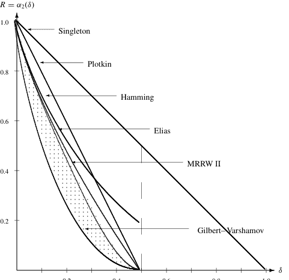

### 图 2.2 当 q = 2 时的渐近界。

### I. 将所有 n 元组按字典序排序：

- 0...000
- 0...001
- 0...010
- 0...011
- 0...100
- :

### II. 按如下方式构造长度 n 的向量类 L：

- (a) 将零向量 0 放入 L。
- (b) 在字典序中查找 L 中权重为 d 的第一个向量 x。将 x 放入 L。
- (c) 在字典序中查找下一个向量，其与 L 中每个向量的距离为 d 或更多，并将其加入 L。
- (d) 重复 (c)，直到字典列表中没有更多向量可查看为止。

集合 L 实际上是一个线性码，称为长度 n 和最小距离 d 的 lexicode。事实上，如果我们在恰当的位置提前停止该过程，我们就得到 L 的线性子码。为了证明这一点，我们需要一个由 Levenshtein [192] 提出的初步结果。如果 u 和 v 是长度 n 的二进制向量，我们说 u < v，前提是 u 在字典序中排在 v 之前。

### 引理 2.11.11 如果 u, v 和 w 是长度 n 的二进制向量，且 u < v + w 且 v < u + w，则 u + v < w。

证明：如果 u < v + w，则 u 和 v + w 具有相同的前导项，之后 u 有一个 0，而 v + w 有一个 1。我们可以这样表示：

```
u = a0 ...,
v = a1 ...
```

类似地，由于 v < u + w，我们有

```
v = b0 ...,
u + w = b1 ...
```

然而，我们不知道 a 的长度 i 和 b 的长度 j 是否相同。假设它们不同，且按对称性，i < j。那么我们有

```
v = b' x ...,
u + w = b' x ...
```

其中 b' 是 b 的前 i 个项。以两种方式计算 w，我们得到

```
w = u + (u + w) = (a + b')x ...,
w = v + (v + w) = (a + b')(1 + x) ...
```

这是一个矛盾。因此 a 和 b 具有相同的长度，给出

```
u + v = (a + b)0 ...,
w = (a + b)1 ...
```

表明 u < v + w。

### 定理 2.11.12 按生成顺序标记 lexicode 中的向量，使 c1 是零向量：

- (i) L 是一个线性码，向量 c2 是 L 的基。
- (ii) 在选择 c2 之后，接下来生成的 2^i - 1 个向量是 c1 + c2, c2 + c2, ..., c2^i-1 + c2。
- (iii) 设 Li = {c0, c1, ..., c2^i-1}。那么 Li 是一个 [n, i, d] 线性码。

证明：如果我们证明 (ii)，则得到 (i) 和 (iii)。(ii) 的证明关于 i 进行归纳。显然当 i = 1 时成立。假设前 2^i 个生成的向量如所声称。那么 Li 是线性的，基为 {c1, c2, ..., c2^i-1}。我们展示 Li+1 是线性的，接下来生成的 2^i 个向量在


通过将 $c_2$ 加到 $\mathcal{L}_r$ 中之前选定的每个向量来排序。如果不存在，则存在一个 $r < 2^l$ 使得 $c_{2+r} \neq c_2 + c_r$。选择 $r$ 为满足条件的最小值。由于 $d(c_2 + c_2, c_2 + c_r) = d(c_r, c_2) \ge d$ 对 $j < r$ 成立，$c_2 + c_r$ 是一个可能被选中的向量。由于它未被选中，它在字典序中必然出现得太晚；因此

$c_{2+r} < c_2 + c_r$. (2.46)

由于 $\mathcal{L}_r$ 的线性性质，$d(c_2 + c_{2+r}, c_r) = d(c_{2+r}, c_r + c_2) \ge d$ 对 $j < 2^l$ 成立，$c_2 + c_{2+r}$ 本可以被选入码中而代替 $c_2$（它不能等于 $c_2$）。因此必须满足

$c_2 < c_r + c_{2+r}$. (2.47)

若 $j < r$，则根据对 $r$ 的假设，$c_{2+j} = c_2 + c_j$。因此 $d(c_{2+r} + c_{2j}, c_r) = d(c_{2+r}, c_r + c_{2j}) \ge d$ 对 $j < r$ 成立。于是 $c_{2+r} + c_{2j}$ 本可以被选为代码字而代替 $c_r$。由于它未被选中，这意味着

$c_r < c_{2+r} + c_{2j}$. (2.48)

但此时，(2.47) 和 (2.48) 结合引理 2.11.1 蕴含 $c_{2j} < c_r < c_{2+r}$，这与 (2.46) 矛盾。

码 $\mathcal{L}_r$ 满足包含关系 $\mathcal{L}_1 \subset \mathcal{L}_2 \subset \cdots \subset \mathcal{L}_k = \mathcal{L}$，其中 $k$ 是 $\mathcal{L}$ 的维数。通常在构造之前不知道这个维数。若 $i < k$，最左侧的坐标始终为 0（具体有多少个也未知）。如果我们在这些零坐标上对 $\mathcal{L}_i$ 进行短缩，实际上会得到一个长度更小的字典码。

**练习 145** 执行以下操作：
- (a) 构造长度为 5 且最小距离为 2 的码 $\mathcal{L}_r$。
- (b) 验证这些码是线性的，且向量是按照定理 2.11.2 所述的顺序生成的。
- (c) 对长度为 5 且最小距离为 3 的情况重复 (a) 和 (b)。\(\blacklozenge\)

**练习 146** 找到 $\mathbb{F}_2^5$ 的一个顺序，使得贪心算法不产生线性码。\(\blacklozenge\)

**练习 147** 证明 $\mathcal{L}$ 的覆盖半径不超过 $d-1$。还要证明字典码满足 Gilbert 界。提示：参见练习 132。\(\blacklozenge\)

字典码 $\mathcal{L}$ 是定理 2.11.2 中构造的 $\mathcal{L}_i$ 中最大的一个。只要 $d \ge 3$，我们就可以给出 $\mathcal{L}$ 的奇偶校验矩阵，这让人想起 Varshamov 界证明中构造的奇偶校验矩阵。若 $C$ 是长度为 $n$ 且 $d \ge 3$ 的字典码，按以下方式构造其奇偶校验矩阵 $H = [\mathbf{h}_n \cdots \mathbf{h}_1]$（其中 $\mathbf{h}_1$ 是列向量）。将列 $\mathbf{h}_i$ 视为二进制数，其中 $1 \leftrightarrow (\cdots 001)^T$，$2 \leftrightarrow (\cdots 010)^T$，等等。令 $\mathbf{h}_1$ 为对应于 1 的列，$\mathbf{h}_2$ 为对应于 2 的列。一旦 $\mathbf{h}_1, \dots, \mathbf{h}_{i-1}$ 被选定，就选择 $\mathbf{h}_i$ 为对应于最小数的列，该数不是 $\mathbf{h}_1, \dots, \mathbf{h}_{i-1}$ 中 $d-2$ 或更少向量的线性组合。请注意，列的长度不必事先确定。每当 $\mathbf{h}_i$ 对应于 2 的幂时，列的长度就会增加，并且在 $j < i$ 的列 $\mathbf{h}_j$ 顶部填充零。

示例 2.11.3 若 n = 7 且 d = 3，字典码 C 的奇偶校验矩阵为

| 1 | 1 | 1 | 1 | 0 | 0 | 0 |
|---|---|---|---|---|---|---|
| 1 | 1 | 0 | 0 | 1 | 1 | 0 |
| 1 | 0 | 1 | 0 | 1 | 0 | 1 |

因此我们将这个字典码识别为 [7, 4, 3] 海明码。

正如本例所示，海明码 $H_3$ 是一个字典码。事实上，所有二进制海明码和 Golay 码都是字典码 [39]。

**练习 148** 计算长度为 5 且最小距离为 3 的字典码的奇偶校验矩阵。检查它是否产生练习 145(c) 中得到的码。

**练习 149** 计算长度为 6 且最小距离为 2、3、4 和 5 的字典码的生成矩阵和奇偶校验矩阵。

# 3 有限域

为了对线性码进行更深入的分析和构造，我们需要使用有限域的基本理论。本章将回顾该理论。我们将省略许多证明；对于对证明和有限域的其他性质感兴趣的读者，我们参考 [18, 196, 233]。

## 3.1 引言

域是一个集合 $\mathbb{F}$ 及其两个运算：$+$，称为加法，和 $\cdot$，称为乘法，它们满足以下公理：集合 $\mathbb{F}$ 在 $+$ 下是一个阿贝尔群，其加法单位元称为 *零* 并记作 $0$；$\mathbb{F}$ 的所有非零元素的集合 $\mathbb{F}^*$ 在乘法下也是一个阿贝尔群，其乘法单位元称为 *一* 并记作 $1$；且乘法对加法分配。我们通常会省略乘法符号，并写 $ab$ 表示乘积 $a \cdot b$。若 $\mathbb{F}$ 拥有有限个元素，则该域为 *有限域*；$\mathbb{F}$ 中元素的个数称为 $\mathbb{F}$ 的 *阶*。在 1.1 节中，我们给出了三个分别记为 $\mathbb{F}_2$、$\mathbb{F}_3$ 和 $\mathbb{F}_4$ 的域，阶分别为 2、3 和 4。通常，我们将用 $\mathbb{F}_q$ 表示一个有 $q$ 个元素的域；另一种常见的记法是 GF($q$)，读作“含 $q$ 个元素的伽罗瓦场”。

若 $p$ 是素数，则模 $p$ 的整数构成一个域，记为 $\mathbb{F}_p$。若 $p$ 不是素数，则不成立。这些是有限域的最简单示例。如我们稍后将看到，每个有限域都包含某个 $\mathbb{F}_p$ 作为子域。

**练习 150** 证明若 $n$ 不是素数，则模 $n$ 的整数不构成域。$\blacklozenge$

$\mathbb{F}_q$ 的有限性蕴含存在一个最小的正整数 $p$，使得 $1 + \cdots + 1$（$p$ 个 1）等于 $0$。整数 $p$ 是一个素数（如练习 151 所验证），并被称为 $\mathbb{F}_q$ 的 *特征*。若 $a$ 是正整数，我们将在域中表示 $a$ 个 1 的和为 $a$。同样，若我们希望写出 $a$ 个 $\alpha$ 的和，其中 $\alpha$ 在域中，我们将其写为 $a\alpha$ 或 $a \cdot \alpha$。注意对于所有 $\alpha \in \mathbb{F}_q$，都有 $p\alpha = 0$。$\mathbb{F}_q$ 中的 $p$ 个不同元素 $\{0, 1, 2, \dots, (p-1)\}$ 与模 $p$ 的整数域 $\mathbb{F}_p$ 同构。由于一个与 $\mathbb{F}_p$ 同构的域包含在 $\mathbb{F}_q$ 中，我们将简化术语并说 $\mathbb{F}_p$ 是 $\mathbb{F}_q$ 的子域；这个子域 $\mathbb{F}_p$ 被称为 $\mathbb{F}_q$ 的 *素子域*。$\mathbb{F}_p$ 是 $\mathbb{F}_q$ 的子域这一事实为我们提供了关于 $q$ 的关键信息；具体来说，根据练习 151，域 $\mathbb{F}_q$ 也是 $\mathbb{F}_p$ 上的一个有限维向量空间，设其维数为 $m$。因此 $q = p^m$，因为这是 $\mathbb{F}_p$ 上维数为 $m$ 的向量空间中的向量个数。

虽然这并不明显，但所有具有相同元素个数的有限域都是同构的。因此记法 $\mathbb{F}_q$ 不会产生歧义：$\mathbb{F}_q$ 将是含 $q$ 个元素的域的任意表示。如我们对素域 $\mathbb{F}_q$ 所做的那样，如果说 $\mathbb{F}_r$ 是 $\mathbb{F}_q$ 的子域，我们实际上是指 $\mathbb{F}_q$ 包含一个有 $r$ 个元素的子域。若 $\mathbb{F}_q$ 有一个有 $r$ 个元素的子域，则该子域是唯一的。因此，当我们说 $\mathbb{F}_r$ 是 $\mathbb{F}_q$ 的子域时，没有歧义。需要注意的是，尽管所有阶为 $q$ 的有限域都是同构的，但一个域可能有多种不同的表示。我们对域所采用的确切形式在其应用于编码理论中可能至关重要。我们将刚才给出的结果总结在一个定理中；除最后一部分外，其余均在练习 151 中证明。

**定理 3.11** 设 $\mathbb{F}_q$ 是一个有 $q$ 个元素的有限域。则：

- (i) $q = p^m$，其中 $p$ 为某个素数，
- (ii) $\mathbb{F}_q$ 包含子域 $\mathbb{F}_p$，
- (iii) $\mathbb{F}_q$ 是 $\mathbb{F}_p$ 上维数为 $m$ 的向量空间，
- (iv) 对所有 $a \in \mathbb{F}_q$，都有 $pa = 0$，且
- (v) $\mathbb{F}_q$ 至同构唯一。

**练习 151** 证明以下内容：

- (a) 若 $a$ 和 $b$ 在域 $\mathbb{F}$ 中且 $ab = 0$，则 $a = 0$ 或 $b = 0$。
- (b) 若 $\mathbb{F}$ 是有限域，则 $\mathbb{F}$ 的特征是一个素数 $p$ 且 $\{0, 1, 2, \ldots, (p - 1)\}$ 是 $\mathbb{F}$ 的子域。
- (c) 若 $\mathbb{F}$ 是特征为 $p$ 的域，则对所有 $\alpha \in \mathbb{F}$，都有 $p\alpha = 0$。
- (d) 特征为 $p$ 的有限域 $\mathbb{F}$ 是其素子域上的有限维向量空间，并包含 $p^m$ 个元素，其中 $m$ 是该向量空间的维数。♦

**练习 152** 设 $\mathbb{F}_q$ 的特征为 $p$。证明对所有 $\alpha, \beta \in \mathbb{F}_q$，都有 $(\alpha + \beta)^p = \alpha^p + \beta^p$。♦

在本章中，我们将令 $p$ 表示一个素数，$q = p^m$，其中 $m$ 是正整数。

### 3.2 多项式与欧几里得算法

设 $x$ 为不定元。系数在 $\mathbb{F}_q$ 中的 $x$ 的多项式集合记为 $\mathbb{F}_q[x]$。该集合在普通多项式加法和乘法下构成一个带单位元的交换环。一个 *带单位元的交换环* 满足与域相同的公理，只是非零元不一定有乘法逆元。事实上，$\mathbb{F}_q[x]$ 也是一个整环；回顾一下，*整环* 是一个带单位元的交换环，使得环中任何两个非零元素的乘积也非零。环 $\mathbb{F}_q[x]$ 不仅在有限域的构造中起关键作用，而且在某些码族的构造中也起关键作用。因此，$\mathbb{F}_q[x]$ 中的一个典型多项式为 $f(x) = \sum_{i=0}^n a_i x^i$。通常，$a_i$ 是次数为 $i$ 的项 $a_i x^i$ 的系数。多项式 $f(x)$ 的 *次数* 是具有非零系数的项中的最高次数，记为 $\deg f(x)$；零多项式没有次数。最高次项的系数称为 *首项系数*


系数。我们通常将多项式按递增或递减次序排列项书写，例如 \(a_0 + a_1x + a_2x^2 + \cdots + a_nx^n\) 或 \(a_nx^n + a_{n-1}x^{n-1} + \cdots + a_1x + a_0\)。

### 练习 153 证明 \(\mathbb{F}_q[x]\) 是一个带单位元的交换环，同时也是一个整环。\(\diamond\)

### 练习 154 在环 \(\mathbb{F}_2[x]\) 中计算 \((x^3 + x^2 + 1)(x^3 + x + 1)(x + 1)\) 的乘积。在 \(\mathbb{F}_3[x]\) 中做同样的乘法。\(\diamond\)

### 练习 155 证明两个多项式乘积的次数等于这两个多项式次数之和。\(\diamond\)

若多项式的首项系数为 1，则称其为首一多项式。设 \(f(x)\) 和 \(g(x)\) 是 \(\mathbb{F}_q[x]\) 中的多项式。若存在多项式 \(h(x) \in \mathbb{F}_q[x]\) 使得 \(g(x) = f(x)h(x)\)，则称 \(f(x)\) 整除 \(g(x)\)，记作 \(f(x) | g(x)\)。多项式 \(f(x)\) 称为 \(g(x)\) 的除式或因式。\(f(x)\) 和 \(g(x)\)（至少有一个非零）的最大公约数是 \(\mathbb{F}_q[x]\) 中次数最高且同时整除 \(f(x)\) 和 \(g(x)\) 的首一多项式。两个多项式的最大公约数是唯一确定的，记作 \(\gcd(f(x), g(x))\)。若 \(\gcd(f(x), g(x)) = 1\)，则称多项式 \(f(x)\) 和 \(g(x)\) 互素。环 \(\mathbb{F}_q[x]\) 的许多性质与整数的性质类似。我们可以对两个多项式进行除法并得到商和余数，就像对整数所做的那样。在下一个定理的第 (i) 部分中，我们陈述这一事实，这通常称为除法算法。

### 定理 3.2.1 设 \(f(x)\) 和 \(g(x)\) 属于 \(\mathbb{F}_q[x]\)，且 \(g(x)\) 非零。

- (i) (除法算法) 存在唯一的多项式 \(h(x), r(x) \in \mathbb{F}_q[x]\)，使得 \(f(x) = g(x)h(x) + r(x)\)，其中 \(\deg r(x) < \deg g(x)\) 或 \(r(x) = 0\)。

- (ii) 若 \(f(x) = g(x)h(x) + r(x)\)，则 \(\gcd(f(x), g(x)) = \gcd(g(x), r(x))\)。

我们可以结合前一个定理的第 (ii) 部分，递归地使用除法算法来求两个多项式的最大公约数。这一过程称为欧几里得算法。多项式的欧几里得算法与整数的欧几里得算法类似。我们在下一个定理中陈述它，并通过一个示例进行说明。

### 定理 3.2.2（欧几里得算法）设 \(f(x)\) 和 \(g(x)\) 是 \(\mathbb{F}_q[x]\) 中的多项式，且 \(g(x)\) 非零。

- (i) 执行以下步骤序列，直到某个 \(n\) 使得 \(r_n(x) = 0\)：

\(f(x) = g(x)h_1(x) + r_1(x), \quad \text{其中 } \deg r_1(x) < \deg g(x),\)
\(g(x) = r_1(x)h_2(x) + r_2(x), \quad \text{其中 } \deg r_2(x) < \deg r_1(x),\)
\(r_1(x) = r_2(x)h_3(x) + r_3(x), \quad \text{其中 } \deg r_3(x) < \deg r_2(x),\)
\(\vdots\)
\(r_{n-3}(x) = r_{n-2}(x)h_{n-1}(x) + r_{n-1}(x), \quad \text{其中 } \deg r_{n-1}(x) < \deg r_{n-2}(x),\)
\(r_{n-2}(x) = r_{n-1}(x)h_n(x) + r_n(x), \quad \text{其中 } r_n(x) = 0.\)

则 \(\gcd(f(x), g(x)) = c r_{n-1}(x)\)，其中 \(c \in \mathbb{F}_q\) 被选取使得 \(c r_{n-1}(x)\) 为首一多项式。

- (ii) 存在多项式 \(a(x), b(x) \in \mathbb{F}_q[x]\)，使得

```
a(x)f(x) + b(x)g(x) = gcd(f(x), g(x)).
```

(i) 中的步骤序列最终会终止，因为在每一阶段余数的次数至少减少 1。通过反复应用定理 3.2.1(ii)，我们有 \(c r_{n-1}(x) = \gcd(r_{n-2}(x), r_{n-1}(x)) = \gcd(r_{n-3}(x), r_{n-4}(x)) = \dots = \gcd(f(x), g(x))\)。这解释了为什么 (i) 产生所需的最大公约数。

严格来说，欧几里得算法仅指本定理的 (i)。然而，(ii) 是 (i) 的自然结果，并且在文献中似乎没有自己的名称。由于我们经常使用 (ii)，因此我们将两者都包含在“欧几里得算法”这一术语中。第 (ii) 部分是通过从 (i) 的序列中以倒数第二个方程 \(r_{n-1}(x) = r_{n-3}(x)q_{n-1}(x) + r_{n-2}(x)\) 开始，并求解 \(r_{n-1}(x)\) 表示为 \(r_{n-2}(x)\) 和 \(r_{n-3}(x)\) 的式子得到的。利用前一个方程，求解 \(r_{n-2}(x)\) 并代入 \(r_{n-1}(x)\) 的方程，以得到 \(r_{n-1}(x)\) 表示为 \(r_{n-3}(x)\) 和 \(r_{n-4}(x)\) 的组合。沿着序列继续向上，直到我们得到 \(r_{n-1}(x)\) 表示为 \(f(x)\) 和 \(g(x)\) 的组合。我们在下一个示例中说明所有这些内容。

### 示例 3.2.3 我们使用欧几里得算法在环 \(\mathbb{F}_2[x]\) 中计算 \(\gcd(x^5 + x^4 + x^2 + 1, x^3 + x^2 + x)\)。算法的第 (i) 部分产生以下序列。

```
x^5 + x^4 + x^2 + 1 = (x^3 + x^2 + x)(x^2 + 1) + x + 1
x^3 + x^2 + x = (x + 1)(x^2 + 1) + 1
x + 1 = 1(x + 1) + 0.
```

因此 \(1 = \gcd(x + 1, 1) = \gcd(x^3 + x^2 + x, x + 1) = \gcd(x^5 + x^4 + x^2 + 1, x^3 + x^2 + x)\)。现在我们通过逆转上述步骤来找到 \(a(x)\) 和 \(b(x)\)，使得 \(a(x)(x^5 + x^4 + x^2 + 1) + b(x)(x^3 + x^2 + x) = 1\)。我们从序列中最后一个有非零余数的方程开始，首先对其求解。这得到

```
1 = (x^3 + x^2 + x) - (x + 1)(x^2 + 1). (3.1)
```

现在 \(x + 1\) 是我们序列中第一个方程的余数；对其求解 \(x + 1\) 并代入 (3.1) 产生

```
1 = (x^3 + x^2 + x) - [(x^5 + x^4 + x^2 + 1) - (x^3 + x^2 + x)(x^2 + 1)](x^2 + 1)
= (x^2 + 1)(x^5 + x^4 + x^2 + 1) + x^4(x^3 + x^2 + x).
```

所以 \(a(x) = x^2 + 1\) 且 \(b(x) = x^4\)。

### 练习 156 在 \(\mathbb{F}_2[x]\) 中求 \(\gcd(x^9 + x^7 + x^4 + x^3 + x + 1, x^5 + x^3 + x^2 + x)\)。求 \(a(x)\) 和 \(b(x)\)，使得 \(\gcd(x^9 + x^7 + x^4 + x^3 + x + 1, x^5 + x^3 + x^2 + x) = a(x)(x^9 + x^7 + x^4 + x^3 + x + 1) + b(x)(x^5 + x^3 + x^2 + x)\)。

### 练习 157 在 \(\mathbb{F}_3[x]\) 中求 \(\gcd(x^5 - x^4 + x + 1, x^3 + x)\)。求 \(a(x)\) 和 \(b(x)\)，使得 \(\gcd(x^5 - x^4 + x + 1, x^3 + x) = a(x)(x^5 - x^4 + x + 1) + b(x)(x^3 + x)\)。

### 练习 158 设 \(f(x)\) 和 \(g(x)\) 是 \(\mathbb{F}_q[x]\) 中的多项式。

- (a) 若 \(k(x)\) 是 \(f(x)\) 和 \(g(x)\) 的除式，证明对于任意 \(a(x), b(x) \in \mathbb{F}_q[x]\)，\(k(x)\) 是 \(a(x)f(x) + b(x)g(x)\) 的除式。

- (b) 若 \(k(x)\) 是 \(f(x)\) 和 \(g(x)\) 的除式，证明 \(k(x)\) 是 \(\gcd(f(x), g(x))\) 的除式。

### 练习 159 设 \(f(x)\) 是 \(\mathbb{F}_q\) 上的次数为 \(n\) 的多项式。

- (a) 证明若 \(a \in \mathbb{F}_q\) 是 \(f(x)\) 的一个根，则 \(x - a\) 是 \(f(x)\) 的一个因式。

- (b) 证明 \(f(x)\) 在任何包含 \(\mathbb{F}_q\) 的域中最多有 \(n\) 个根。

## 3.3 原根元

在处理有限域时，需要尽可能简单地进行加法和乘法。在定理 3.1.1(ii) 中，我们指出 \(\mathbb{F}_q\) 是 \(\mathbb{F}_p\) 上的维为 \(m\) 的向量空间。因此，加法域元素的一种简单方法是将它们写成 \(\mathbb{F}_p\) 上的 \(m\)-元组，并使用普通向量加法，如我们将在 3.4 节中看到。不幸的是，乘这样的 \(m\)-元组远非简单。我们需要另一种写域元素的方式，使得乘法容易；然后我们需要一种方法将这种域元素形式与 \(m\)-元组形式联系起来。下一个定理将帮助我们做到这一点。回顾 \(\mathbb{F}_q\) 中非零元素的集合 \(\mathbb{F}_q^*\) 是一个群。

### 定理 3.3.1 我们有以下结论：

- (i) 群 \(\mathbb{F}_q^*\) 在 \(\mathbb{F}_q\) 的乘法下是阶为 \(q - 1\) 的循环群。

- (ii) 若 \(\gamma\) 是这个循环群的生成元，则
\(\mathbb{F}_q = \{0, 1, \gamma, \gamma^2, ..., \gamma^{q-2}\}\)，
且 \(\gamma^i = 1\) 当且仅当 \((q - 1) | i\)。

证明：根据有限阿贝尔群基本定理 [130]，\(\mathbb{F}_q^*\) 是阶为 \(m_1, m_2, ..., m_r\) 的循环群的直积，其中 \(1 \le i < r\) 时 \(m_i | m_{i+1}\) 且 \(m_1 m_2 \cdots m_r = q - 1\)。特别是，对于所有 \(a \in \mathbb{F}_q^*\)，有 \(a^{m_r} = 1\)。因此多项式 \(x^{m_r} - 1\) 至少有 \(q - 1\) 个根，这与练习 159 矛盾，除非 \(r = 1\) 且 \(m_r = q - 1\)。因此 \(\mathbb{F}_q^*\) 是循环群，从而得到 (i)。(ii) 由循环群的性质得出。

\(\mathbb{F}_q^*\) 的每个生成元 \(\gamma\) 都称为 \(\mathbb{F}_q\) 的一个原根元。当有限域的非零元素表示为 \(\gamma\) 的幂时，域中的乘法可以根据规则 \(\gamma^u \gamma^v = \gamma^{u+v} = \gamma^t\) 容易地进行，其中 \(0 \le t \le q - 2\) 且 \(u + v \equiv t \pmod{q - 1}\)。

### 练习 160 找出示例 1.1.1、1.1.2 和 1.1.3 中的域 \(\mathbb{F}_2, \mathbb{F}_3\) 和 \(\mathbb{F}_4\) 的所有原根元。选取 \(\mathbb{F}_4\) 的一个原根元 \(\gamma\)，并使用元素 \(\{0, 1 = \gamma^0, \gamma, \gamma^2\}\) 重写 \(\mathbb{F}_4\) 的加法和乘法表。

设 \(\gamma\) 是 \(\mathbb{F}_q\) 的一个原根元。按定义，\(\gamma^{q-1} = 1\)。因此，对于 \(0 \le i \le q - 2\)，有 \((\gamma^i)^{q-1} = 1\)，这表明 \(\mathbb{F}_q^*\) 的元素是 \(x^{q-1} - 1 \in \mathbb{F}_p[x]\) 以及因此也是 \(x^q - x\) 的根。由于 0 是 \(x^q - x\) 的根，根据练习 159，我们现在看到 \(\mathbb{F}_q\) 的元素恰好是 \(x^q - x\) 的根，从而得到这个重要定理。


**定理 3.3.2** $\mathbb{F}_q$ 的元素恰好是 $x^q - x$ 的根。

在定理 3.1.1(v) 中我们声称，含有 $q = p^m$ 个元素的域是唯一的。定理 3.3.2 表明，含有 $q$ 个元素的域是包含 $\mathbb{F}_p$ 和 $x^q - x$ 的所有根的最小域。这样的域被称为多项式 $x^q - x$ 在 $\mathbb{F}_p$ 上的分裂域，即，包含该多项式所有根的 $\mathbb{F}_p$ 的最小扩展域。一般来说，给定域上固定多项式的分裂域是同构的；通过仔细定义一个域中多项式的根与另一个域中根之间的映射，可以证明该映射是分裂域之间的同构。

**练习 161** 使用示例 1.1.3 中 $\mathbb{F}_4$ 的表，验证 $\mathbb{F}_4$ 的所有元素都是 $x^4 - x = 0$ 的根。

在分析域结构时，了解 $\mathbb{F}_q$ 中原根的数量以及一旦找到一个原根后如何找到所有原根将很有用。由于 $\mathbb{F}_q^*$ 是循环群，我们回顾关于有限循环群的一些事实。在任何阶为 $n$ 且生成元为 $g$ 的有限循环群 $\mathcal{G}$ 中，$\mathcal{G}$ 的生成元恰好是满足 $\text{gcd}(i, n) = 1$ 的元素 $g^i$。我们令 $\phi(n)$ 为满足 $1 \le i \le n$ 且 $\text{gcd}(i, n) = 1$ 的整数 $i$ 的个数；$\phi$ 称为 *欧拉函数* 或 *欧拉* $\phi$-*函数*。因此 $\mathcal{G}$ 有 $\phi(n)$ 个生成元。元素 $\alpha \in \mathcal{G}$ 的阶是满足 $\alpha^i = 1$ 的最小正整数 $i$。$\mathcal{G}$ 的一个元素的阶为 $d$ 当且仅当 $d \mid n$。此外，$g^i$ 的阶为 $d = n/\text{gcd}(i, n)$，且阶为 $d$ 的元素有 $\phi(d)$ 个。在讨论域元素 $\alpha \in \mathbb{F}_q^*$ 时，$\alpha$ 的阶是其在乘法群 $\mathbb{F}_q^*$ 中的阶。特别是，$\mathbb{F}_q$ 的原根是阶为 $q - 1$ 的元素。下一个定理源于此讨论。

**定理 3.3.3** 设 $\gamma$ 为 $\mathbb{F}_q$ 的一个原根。

- (i) $\mathbb{F}_q$ 中有 $\phi(q-1)$ 个原根；这些元素是满足 $\text{gcd}(i, q-1) = 1$ 的 $\gamma^i$。
- (ii) 对于任何满足 $d \mid (q-1)$ 的 $d$，$\mathbb{F}_q$ 中有 $\phi(d)$ 个阶为 $d$ 的元素；这些元素是满足 $\text{gcd}(i, d) = 1$ 的 $\gamma^{(q-1)i/d}$。

元素 $\xi \in \mathbb{F}_q$ 称为 $n$ 次单位根，当 $\xi^n = 1$ 时；并且如果此外对 $0 < k < n$ 有 $\xi^k \neq 1$，则称为 *原始 $n$ 次单位根*。因此，$\mathbb{F}_q$ 的一个原根 $\gamma$ 是原始 $(q-1)$ 次单位根。根据定理 3.3.1，域 $\mathbb{F}_q$ 包含原始 $n$ 次单位根当且仅当 $n \mid (q-1)$，在这种情况下，$\gamma^{(q-1)/n}$ 是原始 $n$ 次单位根。

**练习 162** (a) 在下面给出的域 $\mathbb{F}_q$ 中找一个原根 $\gamma$。(b) 然后将 $\mathbb{F}_q$ 中的每个非零元素写成 $\gamma$ 的幂。(c) 每个元素的阶是多少，哪些是原根？(d) 验证对于每个 $d \mid (q-1)$，恰好有 $\phi(d)$ 个阶为 $d$ 的元素。

- (i) $\mathbb{F}_5$。
- (ii) $\mathbb{F}_7$。
- (iii) $\mathbb{F}_{13}$。

- Exercise 163 设 \(\gamma\) 为 \(\mathbb{F}_q\) 的一个原根，其中 \(q\) 为奇数。
- (a) 证明方程 \(x^2 = 1\) 只有两个解，1 和 \(-1\)。
- (b) 证明 \(\gamma^{(q-1)/2} = -1$。

Exercise 164 如果 \(q \neq 2$，证明 \(\sum_{a \in \mathbb{F}_q} a = 0$。

- Exercise 165 特征为 2 且包含以下元素的最小域是什么：
- (a) 原始第 9 次单位根？
- (b) 原始第 11 次单位根？
- 特征为 3 且包含以下元素的最小域是什么：
- (c) 原始第 7 次单位根？
- (d) 原始第 11 次单位根？

## 3.4 构造有限域

我们现在准备好将由向量空间解释产生的有限域的加法结构与由原根幂产生的乘法结构联系起来，并实际构造有限域。

一个非常数多项式 \(f(x) \in \mathbb{F}_q[x]\) 称为在 \(\mathbb{F}_q\) 上不可约，如果它不能分解为 \(\mathbb{F}_q[x]\) 中两个次数更小的多项式的乘积。\(\mathbb{F}_q[x]\) 中的不可约多项式就像整数环中的素数。例如，每个大于 1 的整数都是正素数的唯一乘积。同样的结果也适用于 \(\mathbb{F}_q[x]\)，使得 \(\mathbb{F}_q[x]\) 成为唯一分解域。

**定理 3.4.1** 设 \(f(x)\) 为一个非常数多项式。则
\(f(x) = p_1(x)^{n_1} p_2(x)^{n_2} \cdots p_t(x)^{n_t}\)，
其中每个 \(p_i(x)\) 都是不可约的，\(p_i(x)\) 们在标量乘法意义下是唯一的，且 \(n_i\) 们是唯一的。

\(\mathbb{F}_q[x]\) 不仅是唯一分解域，也是主理想域。交换环 \(\mathcal{R}\) 中的一个理想 \(\mathcal{I}\) 是环的非空子集，关于减法封闭，使得 \(\mathcal{I}\) 中的一个元素与 \(\mathcal{R}\) 中的一个元素的乘积始终在 \(\mathcal{I}\) 中。如果存在 \(a \in \mathcal{R}\) 使得 \(\mathcal{I} = \{ra \mid r \in \mathcal{R}\}\)，则理想 \(\mathcal{I}\) 是主理想；该理想将表示为 \(\langle a \rangle\)。主理想域是每个理想都是主理想的整环。练习 153 和 166 表明 \(\mathbb{F}_q[x]\) 是主理想域。（\(\mathbb{F}_q[x]\) 是唯一分解域这一事实实际上源于它是主理想域这一事实。）

**练习 166** 使用除法算法证明 \(\mathbb{F}_q[x]\) 的每个理想都是主理想。

要构造特征为 $p$ 的域，我们从一个在 \(\mathbb{F}_p\) 上不可约的多项式 $f(x) \in \mathbb{F}_p[x]$ 开始。假设 $f(x)$ 的次数为 $m$。通过使用欧几里得算法可以证明，*剩余类环* $\mathbb{F}_p[x]/(f(x))$ 实际上是一个域，因此是一个有 $q = p^m$ 个元素的有限域 $\mathbb{F}_q$；参见练习 167。剩余类环中的每个元素都是一个陪集 $g(x) + (f(x))$，其中 $g(x)$ 是唯一确定的且次数至多为 $m - 1$。我们可以通过将陪集写成 $\mathbb{F}_p^m$ 中的向量来压缩记法，其对应关系为

$g_{m-1}x^{m-1} + g_{m-2}x^{m-2} + \cdots + g_1x + g_0 + (f(x)) \leftrightarrow g_{m-1}g_{m-2}\cdots g_1g_0.$ (3.2)

这种向量记法允许你在域中使用普通向量加法进行加法。

**练习 167** 设 $f(x)$ 为 \(\mathbb{F}_p[x]$ 中次数为 $m$ 的不可约多项式。证明 $\mathbb{F}_p[x]/(f(x))$ 是一个有 $p^m$ 个元素的有限域。$\blacklozenge$

**示例 3.4.2** 多项式 $f(x) = x^3 + x + 1$ 在 \(\mathbb{F}_2\) 上不可约；如果它可约，它将有一个次数为 1 的因子，因此在 \(\mathbb{F}_2\) 中有一个根，但它没有。所以 $\mathbb{F}_8 = \mathbb{F}_2[x]/(f(x))$，并且使用对应关系 (3.2)，$\mathbb{F}_8$ 的元素由下表给出

| 陪集 | 向量 |
|---|---|
| $0 + (f(x))$ | 000 |
| $1 + (f(x))$ | 001 |
| $x + (f(x))$ | 010 |
| $x + 1 + (f(x))$ | 011 |
| $x^2 + (f(x))$ | 100 |
| $x^2 + 1 + (f(x))$ | 101 |
| $x^2 + x + (f(x))$ | 110 |
| $x^2 + x + 1 + (f(x))$ | 111 |

作为加法的示例，将 $x + (f(x))$ 加到 $x^2 + x + 1 + (f(x))$ 得到 $x^2 + 1 + (f(x))$，这对应于在 $\mathbb{F}_2^3$ 中将 010 加到 111 并得到 101。$\blacksquare$

如何相乘？要将 $g_1(x) + (f(x))$ 乘以 $g_2(x) + (f(x))$，首先使用除法算法写出

$g_1(x)g_2(x) = f(x)h(x) + r(x),$ (3.3)

其中 $\deg(r) \le m - 1$ 或 $r(x) = 0$。然后 $(g_1(x) + (f(x)))(g_2(x) + (f(x))) = r(x) + (f(x))$。这种记法相当繁琐，如果我们将 $x$ 替换为 $\alpha$ 并令 $f(\alpha) = 0$，则可以简化；我们稍后将对此进行证明。根据 (3.3)，$g_1(\alpha)g_2(\alpha) = r(\alpha)$，我们将对应关系 (3.2) 扩展为

$g_{m-1}\alpha^{m-1} + \cdots g_1\alpha + g_0 \leftrightarrow g_{m-1}\alpha^{m-1} + g_{m-2}\alpha^{m-2} + \cdots + g_1\alpha + g_0.$ (3.4)


要在 \(\mathbb{F}_q\) 中进行乘法，我们只需以普通方式对 \(\alpha\) 中的多项式进行乘法，并利用方程 \(f(\alpha) = 0\) 将高于 \(m-1\) 次的 \(\alpha\) 的幂降为次数小于 \(m\) 的 \(\alpha\) 多项式。注意子集 \(\{a_0 \alpha^{m-1} + a_0 \alpha^{m-2} + \dots + a_0 + a_0 \mid a_0 \in \mathbb{F}_p\} = \{a_0 \mid a_0 \in \mathbb{F}_p\}\) 是 \(\mathbb{F}_q\) 的素子域。

我们继续讨论 \(\mathbb{F}_8\) 的示例，添加这一新的对应关系。注意群 \(\mathbb{F}_8^*\) 是阶为 7 的循环群，因此 \(\mathbb{F}_8^*\) 中所有非单位元都是原根。特别是 \(\alpha\) 是原根，我们在下表中包含 \(\alpha\) 的幂。

## 示例 3.4.3 继续示例 3.4.2，利用对应关系 (3.4)，我们得到

| 向量 | \(\alpha\) 中的多项式 | \(\alpha\) 的幂 |
|---|---|---|
| 000 | 0 | 0 |
| 001 | 1 | \(1 = \alpha^0\) |
| 010 | \(\alpha\) | \(\alpha\) |
| 011 | \(\alpha + 1\) | \(\alpha^3\) |
| 100 | \(\alpha^2\) | \(\alpha^2\) |
| 101 | \(\alpha^2 + 1\) | \(\alpha^6\) |
| 110 | \(\alpha^2 + \alpha\) | \(\alpha^4\) |
| 111 | \(\alpha^2 + \alpha + 1\) | \(\alpha^5\) |

“\(\alpha\) 的幂”这一列是通过使用 \(f(\alpha) = \alpha^3 + \alpha + 1 = 0\) 得到的，这意味着 \(\alpha^3 = \alpha + 1\)。因此 \(\alpha^4 = \alpha \alpha^3 = \alpha(\alpha + 1) = \alpha^2 + \alpha\)，\(\alpha^5 = \alpha \alpha^4 = \alpha(\alpha^2 + \alpha) = \alpha^3 + \alpha^2 = \alpha^2 + \alpha + 1\)，等等。

- **练习 168** 在示例 3.4.3 给出的域 \(\mathbb{F}_q\) 中，化简

\((\alpha^2 + \alpha^6 - \alpha + 1)(\alpha^3 + \alpha)/(\alpha^4 + \alpha)\)。

提示：使用元素的向量形式进行加法和减法，并使用 \(\alpha\) 的幂进行乘法和除法。

我们通过如下说法来描述这一构造：\(\mathbb{F}_q\) 是由将 \(f(x)\) 的一个根 \(\alpha\) “添加”到 \(\mathbb{F}_p\) 而从 \(\mathbb{F}_p\) 得到的。这个根 \(\alpha\) 正式地由剩余类环 \(\mathbb{F}_p[x]/(f(x))\) 中的 \(\alpha = x + (f(x))\) 给出；因此 \(g(x) + (f(x)) = g(\alpha)\) 且 \(f(\alpha) = f(x + (f(x))) = f(x) + (f(x)) = 0 = f(x)\)。

在示例 3.4.3 中，我们很幸运 \(\alpha\) 是 \(\mathbb{F}_8^*\) 的一个原根。一般来说，情况并非如此。我们称，次数为 \(m\) 的 \(\mathbb{F}_p\) 上的不可约多项式是 *原根* 的，前提是它有一个根是 \(\mathbb{F}_q = \mathbb{F}_{p^m}\) 的原根。理想情况下，我们希望从原根多项式开始来构造我们的域，但这不是要求（参见练习 174）。值得注意的是，我们开始使用的不可约多项式可以乘以一个常数使其成为一元多项式，因为这对多项式生成的理想或剩余类环没有影响。

这并不明显，但无论是通过分裂域理论还是通过计算有限域上不可约多项式的数量，都可以证明任何次数都存在不可约多项式。特别是，我们有以下结果。

### 定理 3.4.4
对于任何素数 $p$ 和任何正整数 $m$，存在一个有限域，至同构唯一，包含 $q = p^m$ 个元素。

由于构造有限域需要不可约多项式，我们指出，关于 \(\mathbb{F}_2\) 上不可约多项式和原根多项式的表格可以在 [256] 中找到。

**注：** 在通过将不可约多项式 \(f(x)\) 的一个根添加到 \(\mathbb{F}_p\) 来构造 \(\mathbb{F}_q\) 时，字段 \(\mathbb{F}_p\) 可以替换为任何有限域 \(\mathbb{F}_r\)，其中 \(r\) 是 \(p\) 的幂，而 \(f(x)\) 替换为 \(\mathbb{F}_r[x]\) 中某个正整数 \(m\) 的次数为 \(m\) 的不可约多项式。构造的字段包含 \(\mathbb{F}_r\) 作为子域，且阶为 \(r^m\)。

- **练习 169**
  - (a) 找出 \(\mathbb{F}_2\) 上次数为 1、2、3 和 4 的所有不可约多项式。
  - (b) 计算 \(\mathbb{F}_2[x]\) 中所有次数为 1 和 2 的不可约多项式的乘积。
  - (c) 计算 \(\mathbb{F}_2[x]\) 中所有次数为 1 和 3 的不可约多项式的乘积。
  - (d) 计算 \(\mathbb{F}_2[x]\) 中所有次数为 1、2 和 4 的不可约多项式的乘积。
  - (e) 根据 (b)、(c) 和 (d) 的结果提出一个猜想。
  - (f) 在部分 (a) 中，你找到了两个次数为 3 的不可约多项式。这些多项式的根位于 \(\mathbb{F}_8\) 中。使用示例 3.4.3 中的表格，找出这两个多项式的根，表示为 \(\alpha\) 的幂。\(\clubsuit\)

- **练习 170** 找出 \(\mathbb{F}_3\) 上次数为 1 和 2 的所有一元不可约多项式。然后计算它们在 \(\mathbb{F}_3[x]\) 中的乘积。这个结果是否证实了你在练习 169(e) 中的猜想？如果不是，修改你的猜想。\(\clubsuit\)

- **练习 171** 找出 \(\mathbb{F}_4\) 上次数为 1 和 2 的所有一元不可约多项式。然后计算它们在 \(\mathbb{F}_4[x]\) 中的乘积。这个结果是否证实了你在练习 169(e) 中的猜想或你在练习 170 中的修改后的猜想？如果不是，再次修改你的猜想。\(\clubsuit\)

- **练习 172** 在练习 169 中，你找到了一个与示例 3.4.2 和 3.4.3 中用于构造 \(\mathbb{F}_8\) 的多项式不同的次数为 3 的不可约多项式。设 \(\beta\) 为这个第二个多项式的根，通过将 \(\beta\) 添加到 \(\mathbb{F}_2\) 来构造字段 \(\mathbb{F}_8\)，并给出一个表格，将 \(\mathbb{F}_2^3\) 中的每个向量与 0 和 \(\beta\) 的幂关联起来。\(\clubsuit\)

- **练习 173** 根据练习 169，多项式 \(f(x) = x^4 + x + 1 \in \mathbb{F}_2[x]\) 在 \(\mathbb{F}_2\) 上是不可约的。设 \(\alpha\) 为 \(f(x)\) 的一个根。
  - (a) 通过将 \(\alpha\) 添加到 \(\mathbb{F}_2\) 来构造字段 \(\mathbb{F}_{16}\)，并给出一个表格，将 \(\mathbb{F}_2^4\) 中的每个向量与 0 和 \(\alpha\) 的幂关联起来。
  - (b) \(\alpha\) 的哪些幂是 \(\mathbb{F}_{16}\) 的原根？
  - (c) 找出练习 169(a) 中次数为 1、2 和 4 的不可约多项式的根。\(\clubsuit\)

- **练习 174** 设 \(f(x) = x^2 + x + 1 \in \mathbb{F}_5[x]\)。
  - (a) 证明 \(f(x)\) 在 \(\mathbb{F}_5\) 上是不可约的。
  - (b) 根据部分 (a)，\(\mathbb{F}_{25} = \mathbb{F}_5[x]/(f(x))\)。设 \(\alpha\) 为 \(f(x)\) 的一个根。证明 \(\alpha\) 不是原根。
  - (c) 在 \(\mathbb{F}_{25}\) 中找到形式为 \(a\alpha + b\) 的原根，其中 \(a, b \in \mathbb{F}_5\)。\(\clubsuit\)

- **练习 175** 根据练习 169，$x^2 + x + 1$、$x^3 + x + 1$ 和 $x^4 + x + 1$ 在 \(\mathbb{F}_2\) 上是不可约的。那么 $x^5 + x + 1$ 在 \(\mathbb{F}_2\) 上是否不可约？

- **练习 176** 定义函数 \(\tau : \mathbb{F}_q \to \mathbb{F}_q\)，其中 \(\tau(0) = 0\) 且对于 \(\alpha \in \mathbb{F}_q^*\) 有 \(\tau(\alpha) = \alpha^{-1}\)。
  - (a) 证明对于所有 \(a, b \in \mathbb{F}_q\)，\(\tau(ab) = \tau(a)\tau(b)\)。
  - (b) 证明如果 \(q = 2, 3, \text{或 } 4\)，则 \(\tau(a + b) = \tau(a) + \tau(b)\)。
  - (c) 证明如果对于所有 \(a, b \in \mathbb{F}_q\) 有 \(\tau(a + b) = \tau(a) + \tau(b)\)，则 \(q = 2, 3, \text{或 } 4\)。提示：设 \(\alpha \in \mathbb{F}_q\) 且 \(\alpha + \alpha^2 \neq 0\)。然后令 \(a = \alpha\) 和 \(b = \alpha^2\)。

## 3.5 子域

为了理解有限域 \(\mathbb{F}_q\) 的结构，我们必须找出包含在 \(\mathbb{F}_q\) 中的子域。

回顾，\(\mathbb{F}_q\) 有一个阶为 \(q - 1 = p^m - 1\) 的原根。如果 \(\mathbb{F}_s\) 是 \(\mathbb{F}_q\) 的子域，则 \(\mathbb{F}_s\) 有一个阶为 \(s - 1\) 的原根，其中 \((s - 1) | (q - 1)\)。因为单位元 1 对 \(\mathbb{F}_q\) 和 \(\mathbb{F}_s\) 都是相同的，\(\mathbb{F}_s\) 的特征为 \(p\)，这意味着 \(s = p^r\)。因此必须有 \((p^r - 1) | (p^m - 1)\)。以下引理说明了这种情况何时发生。

### 引理 3.5.1
设 $a > 1$ 为整数。则 $(a^r - 1) | (a^m - 1)$ 当且仅当 $r | m$。

证明：如果 $r | m$，则 $m = rh$ 且 $a^m - 1 = (a^r - 1) \sum_{i=0}^{h-1} a^{ir}$。反之，根据除法算法，设 $m = rh + u$，其中 $0 \le u < r$。则 $\frac{a^m - 1}{a^r - 1} = \frac{a^r a^{rh} - 1}{a^r - 1} = \frac{a^u - 1}{a^r - 1}$。由于 $r | rh$，根据上文，$(a^r - 1) | (a^h - 1)$ 是整数；同时 $(a^u - 1)/(a^r - 1)$ 严格小于 1。因此，要使 $(a^m - 1)/(a^r - 1)$ 为整数，$(a^u - 1)/(a^r - 1)$ 必须为 0，从而 $u = 0$，得出 $r | m$。

引理 3.5.1 证明中使用的相同论证表明，$(x^{r-1} - 1) | (x^{q-1} - 1)$ 当且仅当 $(s - 1) | (q - 1)$。因此，$(x^s - x) | (x^q - x)$ 当且仅当 $(s - 1) | (q - 1)$。所以，如果 $s = p^r$，则 $(x^s - x) | (x^q - x)$ 当且仅当根据引理 3.5.1 有 $r | m$。因此我们有以下引理。

### 引理 3.5.2
设 $s = p^r$ 且 $q = p^m$。则 $(x^s - x) | (x^q - x)$ 当且仅当 $r | m$。

特别是，如果 $r | m$，则 $x^p - x$ 的所有根都在 \(\mathbb{F}_q\) 中。练习 177 表明，\(\mathbb{F}_q\) 中 $x^p - x$ 的根构成 \(\mathbb{F}_q$ 的一个子域。由于任何阶为 $p^r$ 的子域都必须由 \(\mathbb{F}_q$ 中 $x^p - x$ 的根组成，因此这个子域必须是唯一的。以下定理总结了这一讨论，并完全刻画了 \(\mathbb{F}_q$ 的子域结构。

### 定理 3.5.3 当 $q = p^m$ 时。
- (i) \(\mathbb{F}_q$ 有一个阶为 $s = p^r$ 的子域，当且仅当 $r | m$，
- (ii) 子域 \(\mathbb{F}_s$ 的元素恰好是 \(\mathbb{F}_q$ 中 $x^s - x$ 的根，且
- (iii) 对于每个 $r | m$，\(\mathbb{F}_q$ 中只有一个子域 \(\mathbb{F}_{p^r}\)。


**推论 3.5.4** 如果 $\gamma$ 是 $\mathbb{F}_q$ 的本原元，且 $\mathbb{F}_r$ 是 $\mathbb{F}_q$ 的子域，则 $\mathbb{F}_r$ 的元素为 $\{0, 1, \alpha, \dots, \alpha^{r-2}\}$，其中 $\alpha = \gamma^{(q-1)/(r-1)}$。

**练习 177** 如果 $q = p^m$ 且 $r \mid m$，证明 $\mathbb{F}_q$ 中 $x^{p^r} - x$ 的根构成 $\mathbb{F}_q$ 的一个子域。提示：参见练习 152。

我们可以利用格（lattice）非常直观地描绘子域结构，正如下一个示例所示。

**示例 3.5.5** $\mathbb{F}_{2^{24}}$ 的子域格如下：

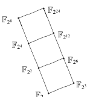

如果 $\mathbb{F}$ 是 $\mathbb{E}$ 的子域，我们也说 $\mathbb{E}$ 是 $\mathbb{F}$ 的*扩展域*。在示例 3.5.5 的格中，如果 $\mathbb{F} \subset \mathbb{E}$ 且两者之间没有真子域，则连接两个域 $\mathbb{F}$ 和 $\mathbb{E}$；扩展域 $\mathbb{E}$ 放置在 $\mathbb{F}$ 之上。从这个格中可以找到两个子域的交集，以及包含另外两个子域的最小子域。

**练习 178** 绘制 $\mathbb{F}_{2^{10}}$ 的子域格。

**推论 3.5.6** $\mathbb{F}_q$ 的素子域由 $\mathbb{F}_q$ 中满足方程 $x^p = x$ 的元素 $\alpha$ 组成。

**练习 179** 证明推论 3.5.6。

## 3.6 域自同构

$\mathbb{F}_q$ 的域自同构在函数复合下构成一个群。我们可以完全描述这个群。

回顾，$\mathbb{F}_q$ 的一个自同构 $\sigma$ 是一个双射 $\sigma : \mathbb{F}_q \rightarrow \mathbb{F}_q$，使得对所有 $\alpha, \beta \in \mathbb{F}_q$ 都有 $\sigma(\alpha + \beta) = \sigma(\alpha) + \sigma(\beta)$ 且 $\sigma(\alpha\beta) = \sigma(\alpha)\sigma(\beta)$。定义 $\sigma_p : \mathbb{F}_q \rightarrow \mathbb{F}_q$，使得对所有 $\alpha \in \mathbb{F}_q$ 都有 $\sigma_p(\alpha) = \alpha^p$。

1 在第 1.7 节中，我们利用域自同构来定义等价关系，此时域自同构 $\sigma$ 作用于右侧 $x \mapsto (x)\sigma$，因为名义映射在右侧作用最为自然。在此，我们让 $\sigma$ 作用于左侧 $x \mapsto \sigma(x)$，因为这对读者来说可能更自然。它们可以互换，因为根据定理 3.6.1，两个域自同构 $\sigma$ 和 $\tau$ 可交换，这意味着右作用 $((x)\sigma)\tau = ((x)\tau)\sigma$ 与左作用 $(\sigma(\tau(x))) = (\tau(\sigma(x)))$ 一致。

显然 \(\sigma_p(\alpha\beta) = \sigma_p(\alpha)\sigma_p(\beta)$，且 \(\sigma_p(\alpha + \beta) = \sigma_p(\alpha) + \sigma_p(\beta)$ 由练习 152 得出。由于 \(\sigma_p$ 的核为 \(\{0\}$，\(\sigma_p$ 是 $\mathbb{F}_q$ 的一个自同构，称为*弗罗本尼乌斯自同构*。类似地，定义 \(\sigma_{q^n}(\alpha) = \alpha^{q^n}$。

$\mathbb{F}_{q^n}$ 的自同构群，记作 $\text{Gal}(\mathbb{F}_q)$，称为 $\mathbb{F}_q$ 的*伽罗瓦群*。我们有如下刻画该群的定理。该定理的第 (ii) 部分由推论 3.5.6 得出。

### 定理 3.6.1

- (i) \(\text{Gal}(\mathbb{F}_q)$ 是阶为 \(m$ 的循环群，由弗罗本尼乌斯自同构 \(\sigma_p$ 生成。
- (ii) \(\mathbb{F}_q$ 的*素子域*恰好是 \(\mathbb{F}_q$ 中满足 \(\sigma_p(\alpha) = \alpha$ 的元素集合。
- (iii) \(\mathbb{F}_{q^n}$ 的子域 \(\mathbb{F}_q$ 恰好是 \(\mathbb{F}_{q^n}$ 中满足 \(\sigma_q(\alpha) = \alpha$ 的元素集合。

我们用 \(\sigma_p$ 表示特征为 \(p$ 的任意域的弗罗本尼乌斯自同构。如果 \(\mathbb{E}$ 和 \(\mathbb{F}$ 是特征为 \(p$ 的域，且 \(\mathbb{E}$ 是 \(\mathbb{F}$ 的扩展域，则 \(\mathbb{E}$ 的弗罗本尼乌斯自同构限制到 \(\mathbb{F}$ 后即为 \(\mathbb{F}$ 的弗罗本尼乌斯自同构。如果 \(\sigma(\alpha) = \alpha$，则称元素 \(\alpha \in \mathbb{F}$ 被 \(\mathbb{F}$ 的一个自同构 \(\sigma$ 固定。令 \(r \mid m$。则 \(\sigma_p^r$ 生成 \(\text{Gal}(\mathbb{F}_q)$ 的一个阶为 \(m/r$ 的循环子群。根据练习 180 和 181，被该子群固定的 \(\mathbb{F}_q$ 元素恰好是子域 \(\mathbb{F}_{p^r}$ 的元素。我们用 \(\text{Gal}(\mathbb{F}_q : \mathbb{F}_{p^r})$ 表示固定 \(\mathbb{F}_{p^r}$ 的 \(\mathbb{F}_q$ 的自同构。我们的讨论表明 \(\sigma_p^r \in \text{Gal}(\mathbb{F}_q : \mathbb{F}_{p^r})$。下一个定理加强了这一结论。

### 定理 3.6.2 \(\text{Gal}(\mathbb{F}_q : \mathbb{F}_{p^r})$ 是由 \(\sigma_p^r$ 生成的循环群。

### 练习 180 设 \(\sigma$ 是域 \(\mathbb{F}$ 的一个自同构。证明被 \(\sigma$ 固定的 \(\mathbb{F}$ 元素构成 \(\mathbb{F}$ 的一个子域。

### 练习 181 证明如果 \(r \mid m$，则被 \(\sigma_p^r$ 固定的 \(\mathbb{F}_q$ 中的元素恰好是子域 \(\mathbb{F}_{p^r}$ 的元素。

### 练习 182 证明定理 3.6.2。

## 3.7 循环类与最小多项式

设 \(\mathbb{E}$ 是 \(\mathbb{F}_{q^t}$ 的一个有限扩展域。则 \(\mathbb{E}$ 是 \(\mathbb{F}_q$ 上的一个向量空间，因此对于某个正整数 \(t$，有 \(\mathbb{E} = \mathbb{F}_{q^t}$。根据定理 3.3.2，\(\mathbb{E}$ 中的每个元素 \(\alpha$ 都是多项式 \(x^{q^t} - x$ 的一个根。因此，存在一个在 \(\mathbb{F}_q[x]$ 中次数最小的首一多项式 \(M_\alpha(x)$，其根为 \(\alpha$；该多项式称为 \(\alpha$ 在 \(\mathbb{F}_q$ 上的*最小多项式*。在下一个定理中，我们收集了一些关于最小多项式的基本事实。

### 定理 3.7.1 设 \(\mathbb{F}_{q^t}$ 是 \(\mathbb{F}_q$ 的一个扩展域，\(\alpha$ 是 \(\mathbb{F}_{q^t}$ 的一个元素，其在 \(\mathbb{F}_q[x]$ 中的最小多项式为 \(M_\alpha(x)$。则以下结论成立：

- (i) \(M_\alpha(x)$ 在 \(\mathbb{F}_q$ 上不可约。
- (ii) 如果 \(g(x)$ 是 \(\mathbb{F}_q[x]$ 中任意满足 \(g(\alpha) = 0$ 的多项式，则 \(M_\alpha(x) \mid g(x)$。
- (iii) \(M_\alpha(x)$ 是唯一的；也就是说，在 \(\mathbb{F}_q[x]$ 中只有一个次数最小且以 \(\alpha$ 为根的首一多项式。

### 练习 183 证明定理 3.7.1。

如果我们从 \(\mathbb{F}_q$ 上一个次数为 \(r$ 的不可约多项式 \(f(x)$ 出发，可以将 \(f(x)$ 的一个根加附到 \(\mathbb{F}_q$ 并得到域 \(\mathbb{F}_{q^r}$。令人惊讶的是，\(f(x)$ 的所有根都位于 \(\mathbb{F}_{q^r}$ 中。

### 定理 3.7.2 设 \(f(x)$ 是 \(\mathbb{F}_q$ 上一个次数为 \(r$ 的首一不可约多项式。则：

- (i) \(f(x)$ 的所有根都位于 \(\mathbb{F}_{q^r}$ 中，以及任何包含 \(\mathbb{F}_q$ 和 \(f(x)$ 的一个根的域中。
- (ii) \(f(x) = \prod_{i=1}^r (x - \alpha_i)$，其中 \(1 \le i \le r$ 时 \(\alpha_i \in \mathbb{F}_{q^r}$，且
- (iii) \(f(x) \mid x^{q^r} - x$。

证明：设 \(\alpha$ 是 \(f(x)$ 的一个根，我们将其加附到 \(\mathbb{F}_q$ 以形成一个含 \(q^r$ 个元素的域 \(\mathbb{E}_q$。如果 \(\beta$ 是 \(f(x)$ 的另一个根，且不在 \(\mathbb{E}_q$ 中，则它是 \(f(x)$ 在 \(\mathbb{E}_q$ 上的某个不可约因式的根。将 \(\beta$ 加附到 \(\mathbb{E}_q$ 形成 \(\mathbb{E}_q$ 的一个扩展域 \(\mathbb{E}$。然而，在 \(\mathbb{E}$ 内部，有一个通过将 \(\beta$ 加附到 \(\mathbb{F}_q$ 得到的子域 \(\mathbb{E}_\beta$。由于 \(f(x)$ 在 \(\mathbb{F}_q$ 上是次数为 \(r$ 的不可约多项式，\(\mathbb{E}_\beta$ 必须有 \(q^r$ 个元素。由于 \(\mathbb{E}_q$ 和 \(\mathbb{E}_\beta$ 是 \(\mathbb{E}$ 中大小相同的子域，根据定理 3.5.3(iii)，\(\mathbb{E}_q = \mathbb{E}_\beta$，这证明了 \(f(x)$ 的所有根都位于 \(\mathbb{F}_{q^r}$ 中。由于任何包含 \(\mathbb{F}_q$ 和 \(f(x)$ 的一个根的域都包含 \(\mathbb{F}_{q^r}$，故 (i) 成立。(ii) 现在由练习 159 得出。(iii) 由 (ii) 以及定理 3.3.2 中 \(x^{q^r} - x = \prod_{\alpha \in \mathbb{F}_{q^r}} (x - \alpha)$ 这一事实得出。

特别是，该定理适用于 \(\mathbb{F}_q$ 上的最小多项式 \(M_\alpha(x)$，因为此类多项式是首一不可约的。

### 定理 3.7.3 设 \(\mathbb{F}_{q^t}$ 是 \(\mathbb{F}_q$ 的一个扩展域，\(\alpha$ 是 \(\mathbb{F}_{q^t}$ 的一个元素，其在 \(\mathbb{F}_q[x]$ 中的最小多项式为 \(M_\alpha(x)$。则以下结论成立：

- (i) \(M_\alpha(x) \mid x^{q^t} - x$。
- (ii) \(M_\alpha(x)$ 有互异的根，且所有根都位于 \(\mathbb{F}_{q^t}$ 中。
- (iii) \(M_\alpha(x)$ 的次数整除 \(t$。
- (iv) \(x^{q^t} - x = \prod_\alpha M_\alpha(x)$，其中 \(\alpha$ 遍历 \(\mathbb{F}_{q^t}$ 的某个子集，该子集恰好一次枚举 \(\mathbb{F}_{q^t}$ 中所有元素的最小多项式。
- (v) \(x^{q^t} - x = \prod_f f(x)$，其中 \(f$ 遍历所有次数整除 \(t$ 的 \(\mathbb{F}_q$ 上的首一不可约多项式。

证明：(i) 由定理 3.7.1(ii) 得出，因为根据定理 3.3.2，\(\alpha^{q^t} = \alpha$。由于 \(x^{q^t} - x$ 的根正是 \(\mathbb{F}_{q^t}$ 的 \(q^t$ 个元素，\(x^{q^t} - x$ 有互异根，因此 (i) 和定理 3.7.2(i) 蕴含 (ii)。根据定理 3.4.1，\(x^{q^t} - x = \prod_{i=1}^r p_i(x)$，其中 \(p_i(x)$ 在 \(\mathbb{F}_q$ 上不可约。由于 \(x^{q^t} - x$ 有互异根，因式 \(p_i(x)$ 互不相同。通过缩放，我们可以假设每个都是首一的，因为 \(x^{q^t} - x$ 是首一的。因此，对于任何满足 \(p_i(\alpha) = 0$ 的 \(\alpha \in \mathbb{F}_{q^t}$，都有 \(p_i(x) = M_\alpha(x)$。故 (iv) 成立。但如果 \(M_\alpha(x)$ 的次数为 \(r$，则将 \(\alpha$ 加附到 \(\mathbb{F}_q$ 得到 \(\mathbb{F}_{q^t} = \mathbb{F}_{q^r}[\alpha]$ 的子域 \(\mathbb{F}_{q^r} = \mathbb{F}_q[\alpha]$，根据定理 3.5.3 蕴含 \(mr \mid mt$，从而得到 (iii)。如果我们能证明每个次数整除 \(t$ 的 \(\mathbb{F}_q$ 上的首一不可约多项式都是 \(x^{q^t} - x$ 的因式，则 (v) 由 (iv) 得出。但根据定理 3.7.2(iii)，\(f(x) \mid (x^{q^r} - x)$。由于 \(mr \mid mt$，根据引理 3.5.2，\((x^{q^r} - x) \mid (x^{q^t} - x)$。


在 $\mathbb{F}_q[x]$ 中具有相同极小多项式的 $\mathbb{F}_{q^r}$ 的两个元素称为关于 $\mathbb{F}_q$ 共轭。找出 $\alpha \in \mathbb{F}_{q^r}$ 的所有共轭元素（即 $M_d(x)$ 的所有根）将非常重要。根据定理 3.7.3(ii)，我们知道 $M_d(x)$ 的根互不相同且位于 $\mathbb{F}_{q^r}$ 中。我们可以借助以下定理找到这些根。

### 定理 3.7.4 设 $f(x)$ 为 $\mathbb{F}_q[x]$ 中的一个多项式，设 $\alpha$ 为某个扩域 $\mathbb{F}_{q^r}$ 中 $f(x)$ 的一个根。则：

- (i) $f(\alpha^q) = f(\alpha)^q$，且
- (ii) $\alpha^q$ 也是 $\mathbb{F}_q$ 中 $f(x)$ 的一个根。

**证明：** 设 $f(x) = \sum_{i=0}^m a_i x^i$。由于 $q = p^m$，其中 $p$ 是 $\mathbb{F}_q$ 的特征，通过反复应用练习 152，得 $f(x)^q = \sum_{i=0}^m a_i^q x^{iq}$。然而，$a_i^q = a_i$，因为 $a_i \in \mathbb{F}_q$ 且根据定理 3.3.2，$\mathbb{F}_q$ 的元素是 $x^q - x$ 的根。因此 (i) 成立。特别是，$f(\alpha^q) = f(\alpha)^q = 0$，蕴含 (ii)。

反复应用此定理可知，$\alpha, \alpha^q, \alpha^{q^2}, \dots$ 均为 $M_d(x)$ 的根。这个序列在何处终止？它将在 $r$ 项后停止，此时 $\alpha^{q^r} = \alpha$。现在假设 $\gamma$ 是 $\mathbb{F}_{q^r}$ 的一个原根。则对于某个 $s$，有 $\alpha = \gamma^s$。因此，$\alpha^{q^r} = \alpha$ 当且仅当 $s q^r \equiv s \pmod{q^r - 1}$。根据定理 3.3.1(ii)，$sq^r \equiv s \pmod{q^r - 1}$。基于此，我们定义 $s$ 模 $q^r - 1$ 的 $q$-循环类为集合

$C_s = \{s, sq, \dots, sq^{r-1}\} \pmod{q^r - 1}$，

其中 $r$ 是使得 $sq^r \equiv s \pmod{q^r - 1}$ 成立的最小正整数。集合 $C_s$ 将整数集合 $\{0, 1, 2, \dots, q^r - 2\}$ 划分为不相交的子集。在列出循环类时，通常只列出一次 $C_s$，其中 $s$ 是该类的最小元素。

### 示例 3.7.5 模 15 的 2-循环类为 $C_0 = \{0\}, C_1 = \{1, 2, 4, 8\}, C_3 = \{3, 6, 12, 9\}, C_5 = \{5, 10\}, \text{和 } C_7 = \{7, 14, 13, 11\}$。

### 练习 184 计算模以下数的 2-循环类：

- (a) 7，
- (b) 31，
- (c) 63。

### 练习 185 计算模以下数的 3-循环类：

- (a) 8，
- (b) 26。

### 练习 186 计算模以下数的 4-循环类：

- (a) 15，
- (b) 63。

将你的答案与示例 3.7.5 和练习 184 的答案进行比较。

我们现在知道 $M_\alpha(x)$ 的根包括 $\{y^i \mid i \in C_s\}$。事实上，这些就是所有根。因此，如果我们知道 $C_s$ 的大小，就知道 $M_\alpha(x)$ 的次数，因为两者相同。

### 定理 3.7.6 如果 \(\gamma\) 是 \(\mathbb{F}_{q^l}\) 的一个原根，则 $\gamma^j$ 在 $\mathbb{F}_q$ 上的极小多项式为
\(M_{\gamma^j}(x) = \prod_{i \in C_j} (x - \gamma^i).\)

**证明：** 此定理声称，展开后，$f(x) = \prod_{i \in C_j} (x - \gamma^i) = \sum_j f_j x^j$ 是 $\mathbb{F}_q[x]$ 中的一个多项式，而不仅仅是 $\mathbb{F}_{q^l}[x]$ 中的多项式。设 $g(x) = f(x^q)$。根据练习 152，$g(x) = \prod_{i \in C_j} (x^q - \gamma^i)$。由于 $C_j$ 是一个 $q$-循环类，当 $i$ 遍历 $C_j$ 时，$qi$ 也遍历 $C_j$。因此 $g(x) = f(x^q) = \sum_j f_j x^{qj}$。但根据练习 152，$g(x) = (\sum_j f_j x^j)^q = \sum_j f_j^q x^{qj}$。比较系数，得 $f_j^q = f_j$，进而根据定理 3.6.1(iii)，$f(x) \in \mathbb{F}_q[x]$。

### 练习 187 证明模 $q^l - 1$ 的一个 $q$-循环类的大小 $r$ 满足 $r \mid l$。

### 示例 3.7.7 域 $\mathbb{F}_8$ 在示例 3.4.2 和 3.4.3 中构造。下表给出了 $\mathbb{F}_8$ 中每个元素在 $\mathbb{F}_2$ 上的极小多项式及其相关的模 7 的 2-循环类。

| 根 | 极小多项式 | 2-循环类 |
| :--- | :--- | :--- |
| 0 | \(x\) | |
| 1 | \(x + 1\) | |
| \(\alpha, \alpha^2, \alpha^4\) | \(x^3 + x + 1\) | \(\{1, 2, 4\}\) |
| \(\alpha^3, \alpha^5, \alpha^6\) | \(x^3 + x^2 + 1\) | \(\{3, 5, 6\}\) |

注意，$x^8 - x = x(x+1)(x^3+x+1)(x^3+x^2+1)$ 是 $x^8 - x$ 在 $\mathbb{F}_2[x]$ 中分解为不可约多项式的结果，与定理 3.7.3(iv) 一致。多项式 $x^3+x+1$ 和 $x^3+x^2+1$ 是次数为 3 的原始多项式。

### 示例 3.7.8 在练习 173 中，你被要求使用 $\mathbb{F}_2$ 上的不可约多项式 $x^4 + x + 1$ 构造 $\mathbb{F}_{16}$。以该多项式的根 $\alpha$ 为基础，下表给出了 $\mathbb{F}_{16}$ 中每个元素在 $\mathbb{F}_2$ 上的极小多项式及其相关的模 15 的 2-循环类。

| 根 | 极小多项式 | 2-循环类 |
| :--- | :--- | :--- |
| 0 | \(x\) | |
| 1 | \(x + 1\) | |
| \(\alpha, \alpha^2, \alpha^4, \alpha^8\) | \(x^4 + x + 1\) | \(\{1, 2, 4, 8\}\) |
| \(\alpha^3, \alpha^6, \alpha^9, \alpha^{12}\) | \(x^4 + x^3 + x^2 + x + 1\) | \(\{3, 6, 9, 12\}\) |
| \(\alpha^5, \alpha^{10}\) | \(x^2 + x + 1\) | \(\{5, 10\}\) |
| \(\alpha^7, \alpha^{11}, \alpha^{13}, \alpha^{14}\) | \(x^4 + x^3 + 1\) | \(\{7, 11, 13, 14\}\) |

$x^{15} - 1$ 在 $\mathbb{F}_2[x]$ 中分解为不可约多项式为
\((x+1)(x^4+x+1)(x^4+x^3+x^2+x+1)(x^2+x+1)(x^4+x^3+1),\)
同样与定理 3.7.3(iv) 一致。

### 练习 188 参照示例 3.7.8：

- (a) 验证表格是否正确，
- (b) 找出构成子域 $\mathbb{F}_2$ 和 $\mathbb{F}_4$ 的 $\mathbb{F}_{16}$ 元素，且
- (c) 找出哪些次数为 4 的不可约多项式是原始多项式。

### 练习 189 $\mathbb{F}_3$ 上次数为 2 的不可约多项式已在练习 170 中找到。

- (a) 哪些次数为 2 的不可约多项式是原始多项式？
- (b) 设 $\alpha$ 为这些原始多项式之一的根。通过将 $\alpha$ 加于 $\mathbb{F}_3$ 构造域 $\mathbb{F}_9$，并给出一个表格，将 $\mathbb{F}_3$ 中的每个向量分配给 0 和 $\alpha$ 的幂。
- (c) 如示例 3.7.7 和 3.7.8 中的表格一样，给出 $\mathbb{F}_9$ 中每个元素在 $\mathbb{F}_3$ 上的极小多项式及其相关的模 8 的 3-循环类。
- (d) 验证表格中所有元素的乘积为 $x^9 - x$。

### 练习 190 不分解 $x^{63} - 1$，它在 $\mathbb{F}_2$ 上有多少个不可约因式，次数分别是多少？对 $x^{63} - 1$ 在 $\mathbb{F}_4$ 上回答同样的问题。参见练习 184 和 186。

### 练习 191 不分解 $x^{26} - 1$，它在 $\mathbb{F}_3$ 上有多少个不可约因式，次数分别是多少？参见练习 185。

### 练习 192 设 $f(x) = f_0 + f_1 x + \dots + f_a x^a$ 为 $\mathbb{F}_q[x]$ 中次数为 $a$ 的多项式。$f(x)$ 的倒多项式为
$f^*(x) = x^a f(x^{-1}) = f_a + f_{a-1}x + \dots + f_0 x^a$。
（我们将在第 4 章进一步研究倒多项式。）

- (a) 给出示例 3.7.7 表格中每个多项式的倒多项式。
- (b) 给出示例 3.7.8 表格中每个多项式的倒多项式。
- (c) 你对在 (a) 和 (b) 部分中找到的倒多项式的根和不可约性有什么观察？
- (d) 你如何利用在 (a)、(b) 和 (c) 部分中关于倒多项式所学到的知识，帮助找到 $x^q - x$ 在 $\mathbb{F}_p$ 上的不可约因式，其中 $q = p^m$ 且 $p$ 为素数？

## 3.8 迹和子域子码

假设我们有一个在域 $\mathbb{F}_{q^r}$ 上的码 $\mathcal{C}$。某些码字的所有分量都可能位于子域 $\mathbb{F}_q$ 中。关于由这样的码字组成的码，能说出多少呢？使用迹函数，可以说出惊人多的内容。

设 $\mathcal{C}$ 为 $\mathbb{F}_{q^r}$ 上的一个 $[n, k]$ 码。$\mathcal{C}$ 关于 $\mathbb{F}_q$ 的子域子码 $\mathcal{C}|_{\mathbb{F}_q}$ 是 $\mathcal{C}$ 中所有分量均位于 $\mathbb{F}_q$ 的码字的集合。由于 $\mathcal{C}$ 在 $\mathbb{F}_{q^r}$ 上是线性的，$\mathcal{C}|_{\mathbb{F}_q}$ 是 $\mathbb{F}_q$ 上的一个线性码。

我们首先描述如何为 $\mathcal{C}|_{\mathbb{F}_q}$ 找到一张校验矩阵，从 $\mathcal{C}$ 的一张校验矩阵 $H$ 开始。由于 $\mathbb{F}_{q^r}$ 是 $\mathbb{F}_q$ 上维为 $r$ 的向量空间，我们可以选择 $\mathbb{F}_{q^r}$ 在 $\mathbb{F}_q$ 上的一组基 $\{b_1, b_2, \dots, b_r\} \subset \mathbb{F}_{q^r}$。每个元素 $z \in \mathbb{F}_{q^r}$ 都可以唯一地表示为


令 \( z = z_1 b_1 + \cdots + z_t b_t \)，其中 \( z_i \in \mathbb{F}_q \) 对 \( 1 \le i \le t \) 成立。将 \( z \) 关联到 \( t \times 1 \) 列向量 \( \widetilde{z} = [z_1 \cdots z_t]^t \)。通过将 \( H \) 中的每个元素 \( h \) 替换为 \( \widetilde{h} \) 来创建 \( \widetilde{H} \)。因为 \( H \) 是一个元素在 \( \mathbb{F}_q \) 中的 \( (n-k) \times n \) 矩阵，所以 \( \widetilde{H} \) 是 \( \mathbb{F}_q \) 上的 \( t(n-k) \times n \) 矩阵。\( \widetilde{H} \) 的行可能线性相关。因此，\( C|_{\mathbb{F}_q} \) 的一个奇偶校验矩阵是通过从 \( \widetilde{H} \) 中删除线性相关的行得到的；其细节留作练习。将此奇偶校验矩阵记为 \( H|_{\mathbb{F}_q} \)。

## 练习 193 证明通过从 \( \widetilde{H} \) 中删除线性相关的行，可得到 \( C|_{\mathbb{F}_q} \) 的一个奇偶校验矩阵。\(\unknown\)

## 示例 3.8.1 在示例 1.3.4 中给出的 \(\mathbb{F}_4\) 上的 \([6, 3, 4]\) 六码 \(\mathcal{G}_6\) 的一个奇偶校验矩阵是

\( H = \begin{bmatrix} 1 & \omega & \omega & 1 & 0 & 0 \\ \omega & 1 & \omega & 0 & 1 & 0 \\ \omega & \omega & 1 & 0 & 0 & 1 \end{bmatrix} \).

集合 \(\{1, \omega\}\) 是 \(\mathbb{F}_4\) 相对于 \(\mathbb{F}_2\) 的一组基。因此

\( \widetilde{0} = \begin{bmatrix} 0 \\ 0 \end{bmatrix}, \widetilde{1} = \begin{bmatrix} 1 \\ 0 \end{bmatrix}, \widetilde{\omega} = \begin{bmatrix} 0 \\ 1 \end{bmatrix}, \text{ and } \widetilde{\overline{\omega}} = \begin{bmatrix} 1 \\ 1 \end{bmatrix} \).

因此

\( \widetilde{H} = \begin{bmatrix} 1 & 0 & 0 & 1 & 0 & 0 \\ 0 & 1 & 1 & 0 & 0 & 0 \\ 0 & 1 & 0 & 0 & 1 & 0 \\ 1 & 1 & 0 & 0 & 0 & 0 \\ 0 & 0 & 1 & 0 & 0 & 1 \\ 0 & 1 & 0 & 0 & 0 & 1 \\ 1 & 1 & 0 & 0 & 0 & 0 \end{bmatrix} \text{ and } H|_{\mathbb{F}_2} = \begin{bmatrix} 1 & 0 & 0 & 1 & 0 & 0 \\ 0 & 1 & 1 & 0 & 0 & 0 \\ 0 & 1 & 0 & 0 & 1 & 0 \\ 1 & 0 & 1 & 0 & 0 & 0 \\ 0 & 0 & 1 & 0 & 0 & 1 \\ 0 & 1 & 0 & 0 & 0 & 1 \\ 0 & 0 & 1 & 0 & 0 & 1 \end{bmatrix} \).

由此可见，\(\mathcal{G}_6|_{\mathbb{F}_2}\) 是 \([6, 1, 6]\) 二进制重复码。\(\blacksquare\)

## 练习 194 生成矩阵 \( G \) 由下式给出的 \(\mathbb{F}_4\) 上的 \([6, 3, 4]\) 码 \(\mathcal{C}\)

\( G = \begin{bmatrix} 1 & 0 & 0 & 1 & 1 & 1 \\ 0 & 1 & 0 & 1 & \omega & \overline{\omega} \\ 0 & 0 & 1 & 1 & \overline{\omega} & \omega \end{bmatrix} \)

是六码（与示例 3.8.1 中的码等价但不相等）。使用 \(\mathbb{F}_4\) 相对于 \(\mathbb{F}_2\) 的基 \(\{1, \omega\}\)，找出 \(\mathcal{C}|_{\mathbb{F}_2}\) 的一个奇偶校验矩阵。\(\unknown\)

## 示例 3.8.2 在示例 3.4.2 和 3.4.3 中，我们通过将原元 \(\alpha\) 添加到 \(\mathbb{F}_2\) 构造了 \(\mathbb{F}_8\)，其中 \(\alpha^3 = \alpha + 1\)。考虑以下奇偶校验矩阵分别给出的 \(\mathbb{F}_8\) 上长度为 7 的三个码 \(\mathcal{C}_1\)、\(\mathcal{C}_2\) 和 \(\mathcal{C}_3\)：

\( H_1 = \left[ 1 \ \ \alpha \ \ \alpha^2 \ \ \alpha^3 \ \ \alpha^4 \ \ \alpha^5 \ \ \alpha^6 \right] . \)
\( H_2 = \left[ \begin{array}{ c c c c c c c } 1 & \alpha & \alpha^2 & \alpha^3 & \alpha^4 & \alpha^5 & \alpha^6 \\ 1 & \alpha^2 & \alpha^4 & \alpha^6 & \alpha & \alpha^3 & \alpha^5 \end{array} \right] , \text{ and} \)
\( H_3 = \left[ \begin{array}{ c c c c c c c } 1 & \alpha & \alpha^2 & \alpha^3 & \alpha^4 & \alpha^5 & \alpha^6 \\ 1 & \alpha^3 & \alpha^6 & \alpha^2 & \alpha^5 & \alpha^4 & \alpha^4 \end{array} \right] . \)

码 \(\mathcal{C}_1\) 是一个 [7, 6, 2] MDS 码，而 \(\mathcal{C}_2\) 和 \(\mathcal{C}_3\) 是 [7, 5, 3] MDS 码。选择 \((1, \alpha, \alpha^2)\) 作为 \(\mathbb{F}_8\) 相对于 \(\mathbb{F}_2\) 的一组基，我们得到 \(\mathcal{C}_1|_{\mathbb{F}_2}\)、\(\mathcal{C}_2|_{\mathbb{F}_2}\) 和 \(\mathcal{C}_3|_{\mathbb{F}_2}\) 的以下奇偶校验矩阵：

\( H_1|_{\mathbb{F}_2} = H_2|_{\mathbb{F}_2} = \left[ \begin{array}{ c c c c c c c } 1 & 0 & 0 & 1 & 0 & 1 & 1 \\ 0 & 1 & 0 & 0 & 1 & 1 & 0 \\ 0 & 0 & 1 & 0 & 1 & 1 & 1 \end{array} \right] \text{ and} \)
\( H_3|_{\mathbb{F}_2} = \left[ \begin{array}{ c c c c c c c } 1 & 0 & 0 & 1 & 0 & 1 & 1 \\ 0 & 1 & 0 & 1 & 1 & 1 & 0 \\ 0 & 0 & 1 & 0 & 1 & 1 & 1 \\ 1 & 1 & 1 & 0 & 1 & 0 & 0 \\ 0 & 1 & 0 & 0 & 1 & 1 & 1 \\ 0 & 0 & 1 & 1 & 0 & 1 & 1 \end{array} \right] . \)

因此，\(\mathcal{C}_1|_{\mathbb{F}_2} = \mathcal{C}_2|_{\mathbb{F}_2}\) 都是 [7, 4, 3] 二进制海明码 \(\mathcal{H}_3\) 的两种表示，而 \(\mathcal{C}_3|_{\mathbb{F}_2}\) 是 [7, 1, 7] 二进制重复码。

## 练习 195 验证示例 3.8.2 中的所有声明。

本示例说明，码的维数与其子场子码的维数之间没有基本关系。以下定理确实给出了子场子码维数的一个下界；其证明留作练习。

## 定理 3.8.3 设 \(\mathcal{C}\) 为 \(\mathbb{F}_q\) 上的一个 \([n, k]\) 码。则：

- (i) \(\mathcal{C}|_{\mathbb{F}_r}\) 是 \(\mathbb{F}_r\) 上的一个 \([n, k_r]\) 码，其中 \(k_q \ge n - r(n-k)\)，且
- (ii) 如果单项矩阵 \(M \in \Gamma \text{Aut}(\mathcal{C})\) 的元素属于 \(\mathbb{F}_q\)，则 \(M \in \Gamma \text{Aut}(\mathcal{C}|_{\mathbb{F}_r})\)。

## 练习 196 证明定理 3.8.3。

以下定理给出了子场子码维数的一个上界。

## 定理 3.8.4 设 \(\mathcal{C}\) 为 \(\mathbb{F}_q\) 上的一个 \([n, k]\) 码。则 \(\mathcal{C}|_{\mathbb{F}_r}\) 是 \(\mathbb{F}_q\) 上的一个 \([n, k_q]\) 码，其中 \(k_q \le k\)。如果 \(\mathcal{C}\) 在 \(\mathbb{F}_q^n\) 中具有一组由代码字组成的基，那么这也是 \(\mathcal{C}|_{\mathbb{F}_r}\) 的一组基，且 \(\mathcal{C}|_{\mathbb{F}_r}\) 是 \(k\) 维的。

证明：设 \(G\) 为 \(\mathcal{C}|_{\mathbb{F}_r}\) 的生成矩阵。那么 \(G\) 有 \(k_q\) 行线性无关；因此，当 \(G\) 被视为元素在 \(\mathbb{F}_q\) 或 \(\mathbb{F}_{q^r}\) 中的矩阵时，其秩为 \(k_q\)。因此，\(G\) 的行在 \(\mathbb{F}_{q^r}^n\) 中保持线性无关，这意味着定理的所有部分。

从 \(\mathbb{F}_{q'}\) 上的码构造 \(\mathbb{F}_q\) 上的码的另一种自然方法是使用由以下定义的*迹函数* \(\text{Tr} : \mathbb{F}_{q'} \to \mathbb{F}_q\)：

$$\text{Tr}(\alpha) = \sum_{i=0}^{r-1} \alpha^{q^i} = \sum_{i=0}^{r-1} \sigma_q^i(\alpha), \quad \text{for all } \alpha \in \mathbb{F}_{q'},$$

其中 \(\alpha = \sigma_q^m\) 且 \(\sigma_q(\alpha) = \alpha^{q^i}\)。此外，\(\sigma_q^i(\alpha) = \alpha^{q^i} = \alpha\)，因为根据定理 3.3.2，\(\mathbb{F}_{q'}\) 的每个元素都是 \(x^q - x\) 的根。因此 \(\sigma_q^r\) 是恒等映射，故 \(\sigma_q(\text{Tr}(\alpha)) = \text{Tr}(\alpha)\)。因此 \(\text{Tr}(\alpha)\) 是 \(x^q - x\) 的根，因而属于 \(\mathbb{F}_q\)，正如迹的定义所要求的那样。

## 练习 197 填补显示 \(\sigma_q(\text{Tr}(\alpha)) = \text{Tr}(\alpha)\) 的缺失步骤。$\unknown$

## 练习 198 使用示例 3.4.2 和 3.4.3 的记号，为所有 \(\beta \in \mathbb{F}_8\) 制作 \(\text{Tr}_3(\beta)\) 的值表，其中 \(\text{Tr}_3 : \mathbb{F}_8 \to \mathbb{F}_2\)。$\unknown$

如以下引理所示，迹函数是向量空间 \(\mathbb{F}_{q'}\) 相对于 \(\mathbb{F}_q\) 上的一个非平凡线性泛函。

**引理 3.8.5** _对于_ \(\text{Tr} : \mathbb{F}_{q'} \to \mathbb{F}_q\) _具有以下性质：_
(i) Tr 不是恒等于零，
(ii) \(\text{Tr}(\alpha + \beta) = \text{Tr}(\alpha) + \text{Tr}(\beta)\)，对所有 \(\alpha, \beta \in \mathbb{F}_{q'}\) 成立，_且_
(iii) \(\text{Tr}(a\alpha) = a\text{Tr}(\alpha)\)，对所有 \(\alpha \in \mathbb{F}_{q'}\) 和所有 \(a \in \mathbb{F}_q\) 成立。

**证明：** 部分 (i) 很明显，因为 \(\text{Tr}(x)\) 是 \(x\) 的一个次数为 \(q^{r-1}\) 的多项式，因此根据练习 159，它在 \(\mathbb{F}_{q'}\) 中最多有 \(q^{r-1}\) 个根。部分 (ii) 和 (iii) 由以下事实得出：\(\sigma_q(\alpha + \beta) = \sigma_q(\alpha) + \sigma_q(\beta)\) 和 \(\sigma_q(a\alpha) = a\sigma_q(\alpha)\) 对所有 \(\alpha, \beta \in \mathbb{F}_{q'}\) 和所有 \(a \in \mathbb{F}_q\) 成立，因为 \(\sigma_q\) 是一个固定 \(\mathbb{F}_q\) 的域自同构。\(\square\)

向量 \(\mathbf{c} = (c_1, c_2, \dots, c_n) \in \mathbb{F}_{q'}^n\) 的*迹*定义为 \(\text{Tr}(\mathbf{c}) = (\text{Tr}(c_1), \text{Tr}(c_2), \dots, \text{Tr}(c_n))\)。\(\mathbb{F}_{q'}\) 上长度为 \(n\) 的线性码 \(\mathcal{C}\) 的*迹*定义为 \(\text{Tr}(\mathcal{C}) = \{ \text{Tr}(\mathbf{c}) \mid \mathbf{c} \in \mathcal{C} \}\)。

\(\mathcal{C}\) 的迹是 \(\mathbb{F}_q\) 上长度为 \(n\) 的线性码。Delsarte [64] 的以下定理展示了子场子码与迹码之间的对偶关系。

**定理 3.8.6 (Delsarte)** _设_ \(\mathcal{C}\) _为_ \(\mathbb{F}_{q'}\) _上长度为_ \(n\) _的线性码。则_
$$(\mathcal{C}|_{\mathbb{F}_q})^\perp = \text{Tr}(\mathcal{C}^\perp).$$

**证明：** 我们首先证明 \((\mathcal{C}|_{\mathbb{F}_q})^\perp \supseteq \text{Tr}(\mathcal{C}^\perp)\)。设 \(\mathbf{c} = (c_1, c_2, \dots, c_n)\) 属于 \(\mathcal{C}^\perp\)，且 \(\mathbf{b} = (b_1, \dots, b_n)\) 属于 \(\mathcal{C}|_{\mathbb{F}_q}\)。那么根据引理 3.8.5(ii) 和 (iii)，
$$\text{Tr}(\mathbf{c}) \cdot \mathbf{b} = \sum_{i=1}^n \text{Tr}(c_i)b_i = \text{Tr}\left( \sum_{i=1}^n c_i b_i \right) = \text{Tr}(\mathbf{0}) = 0$$

因为 \(\mathbf{c} \in \mathcal{C}^\perp\) 且 \(\mathbf{b} \in \mathcal{C}|_{\mathbb{F}_q} \subseteq \mathcal{C}\)。因此 \(\text{Tr}(\mathbf{c}) \in (\mathcal{C}|_{\mathbb{F}_q})^\perp\)。

我们现在通过证明 \((\text{Tr}(\mathcal{C}^\perp))^\perp \subseteq \mathcal{C}|_{\mathbb{F}_q}\) 来表明 \((\mathcal{C}|_{\mathbb{F}_q})^\perp \subseteq \text{Tr}(\mathcal{C}^\perp)\)。设 \(\mathbf{a} = (a_1, \dots, a_n) \in (\text{Tr}(\mathcal{C}^\perp))^\perp\)。由于 \(1 \le i \le n\) 时 \(a_i \in \mathbb{F}_q\)，我们只需证明 \(\mathbf{a} \in \mathcal{C}\),


为此，只需证明对于所有 \(\mathbf{b} \in C^\perp\) 均有 \(\mathbf{a} \cdot \mathbf{b} = 0\)。设 \(\mathbf{b} = (b_1, \dots, b_n)\) 为 \(C^\perp\) 中的一个向量。则对于所有 \(\beta \in \mathbb{F}_{q^r}\)，\(\beta \mathbf{b} \in C^\perp\)，且

\(0 = \mathbf{a} \cdot \text{Tr}(\beta \mathbf{b}) = \sum_{i=1}^n a_i \text{Tr}(\beta b_i) = \text{Tr}\left(\beta \sum_{i=1}^n a_i b_i\right) = \text{Tr}(\beta x),\)

其中 \(x = \mathbf{a} \cdot \mathbf{b}\) 由引理 3.8.5(ii) 和 (iii)。若 \(x \neq 0\)，则与引理 3.8.5(i) 矛盾。故 \(x = 0\)，定理得证。

# **示例 3.8.7** 德尔萨特定理可用于计算示例 3.8.2 中码的子域子码。例如，\(C_4^\perp\) 的生成矩阵为

\(H_I = [1 \quad \alpha \quad \alpha^2 \quad \alpha^3 \quad \alpha^4 \quad \alpha^5 \quad \alpha^6]\).

\(C_4^\perp\) 的七个非零向量为 \(0 \le i \le 6\) 时的 \(\alpha^i(1, \alpha, \alpha^2, \dots, \alpha^6)\)。利用练习 198，对于 \(i \in \{0, 3, 5, 6\}\) 有 \(\text{Tr}_3(\alpha^i) = 1\)，对于 \(i \in \{1, 2, 4\}\) 有 \(\text{Tr}_3(\alpha^i) = 0\)。因此，\((C_4|_{\mathbb{F}_2})^\perp = \text{Tr}_3(C_4^\perp)\) 的非零向量是 \(1001011\) 的七个循环移位，即 \(1001011\)、\(1100101\)、\(1110010\)、\(0111001\)、\(1011100\)、\(0101110\) 和 \(0010111\)。\((C_4|_{\mathbb{F}_2})^\perp\) 的一个生成矩阵可通过选取 \(1001011\) 的三个线性无关的循环移位得到。这样的矩阵即为示例 3.8.2 中给出的 \(C_4|_{\mathbb{F}_2}\) 的奇偶校验矩阵。■

# **练习 199** 验证示例 3.8.7 中提出的所有主张。♦

# **练习 200** 以类似于示例 3.8.7 给出的方式，利用德尔萨特定理求出示例 3.8.2 中 \(C_2\) 和 \(C_3\) 的子域子码。♦

若 \(C\) 是 \(\mathbb{F}_{q^r}\) 上长度为 \(n\) 且在 \(\mathbb{F}_q^n\) 中有一组基向量的码，则正如我们即将看到的，\(C\) 和 \(C|_{\mathbb{F}_q}\) 中的最小重量向量至标量乘法意义下相同。特别是，这两个码中的最小重量向量具有相同的支持集，其中向量 \(\mathbf{c}\) 的 *支持*，记作 \(\text{supp}(\mathbf{c})\)，是 \(\mathbf{c}\) 非零的坐标集合。

# **定理 3.8.8** 设 \(C\) 是 \(\mathbb{F}_{q^r}\) 上的一个 \([n, k, d]\) 码。假设 \(C\) 在 \(\mathbb{F}_q^n\) 中有一组代码字基。则 \(C\) 中每个重量为 \(d\) 的向量都是 \(C|_{\mathbb{F}_q}\) 中某个重量为 \(d\) 的向量的倍数。

**证明：** 设 \(\{\mathbf{b}_1, \dots, \mathbf{b}_k\}\) 是 \(C\) 的一组基，其中 \(1 \le i \le k\) 时 \(\mathbf{b}_i \in \mathbb{F}_q^n\)。则由定理 3.8.4，\(\{\mathbf{b}_1, \dots, \mathbf{b}_k\}\) 也是 \(C|_{\mathbb{F}_q}\) 的一组基。设 \(\mathbf{c} = c_1 \cdots c_n = \sum_{i=1}^k \alpha_i \mathbf{b}_i\)，其中 \(\alpha_i \in \mathbb{F}_{q^r}\)。故 \(\mathbf{c} \in C\)，且由引理 3.8.5，\(\text{Tr}(\mathbf{c}) = \sum_{i=1}^k \text{Tr}(\alpha_i \mathbf{b}_i) \in C|_{\mathbb{F}_q} \subseteq C\)。又因为 \(\text{Tr}(0) = 0\)，所以 \(\text{wt}(\text{Tr}(\mathbf{c})) \le \text{wt}(\mathbf{c})\)。现假设 \(\mathbf{c}\) 的重量为 \(d\)。则要么 \(\text{Tr}(\mathbf{c}) = \mathbf{0}\)，要么 \(\text{Tr}(\mathbf{c})\) 的重量为 \(d\) 且 \(\text{supp}(\mathbf{c}) = \text{supp}(\text{Tr}(\mathbf{c}))\)。通过将 \(\mathbf{c}\) 替换为某些 \(\alpha \in \mathbb{F}_{q^r}\) 的 \(\alpha \mathbf{c}\)，我们可以利用引理 3.8.5(i) 假设 \(\text{Tr}(\mathbf{c}) \neq \mathbf{0}\)。选取 \(i\) 使得 \(c_i \neq 0\)。由于 \(\text{supp}(\mathbf{c}) = \text{supp}(\text{Tr}(\mathbf{c}))\)，有 \(\text{Tr}(c_i) \neq 0\) 且 \(\text{wt}(c_i \text{Tr}(\mathbf{c}) - \text{Tr}(c_i) \mathbf{c}) < d\)。因此 \(c_i \text{Tr}(\mathbf{c}) - \text{Tr}(c_i) \mathbf{c} = \mathbf{0}\)，且 \(\mathbf{c}\) 是 \(\text{Tr}(\mathbf{c})\) 的倍数。■

# 4 循环码

我们现在转向研究一类称为循环码的极其重要的码类。包括高尔雷码、二进制海明码以及与里德-穆勒码等价的码在内的许多码族要么是循环码，要么是扩展循环码。循环码的研究始于 E. Prange 的两份 1957 年和 1959 年的 AFCRL 报告。W. W. Peterson 于 1961 年出版的书籍 [255] 汇编了关于循环码的大量结果，并为当今的大部分理论奠定了框架；它也推动了随后关于循环码的大量研究。1972 年，该书由 Peterson 和 E. J. Weldon 共同扩充并出版 [256]。

在研究长度为 \(n\) 的循环码时，将坐标位置标记为 \(0, 1, \dots, n-1\) 并将其视为模 \(n\) 的整数会很方便。\(\mathbb{F}_q\) 上长度为 \(n\) 的线性码 \(\mathcal{C}\) 称为循环码，只要对于 \(\mathcal{C}\) 中的每个向量 \(\mathbf{c} = c_0 \cdots c_{n-2}c_{n-1}\)，由 \(\mathbf{c}\) 通过坐标的 *循环移位* \(i \mapsto i+1 \pmod n\) 得到的向量 \(c_{n-1}c_0 \cdots c_{n-2}\) 也属于 \(\mathcal{C}\)。因此，循环码包含任何代码字的所有 \(n\) 个循环移位。因此，将坐标位置循环地看待会很方便，即一旦到达 \(n-1\)，就再次从坐标 0 开始。当我们谈论连续坐标时，始终指在这种循环意义下的连续。

在考察 \(\mathbb{F}_q\) 上的循环码时，我们通常将代码字以多项式形式表示。\(\mathbb{F}_q^n\) 中的向量 \(\mathbf{c} = c_0c_1 \cdots c_{n-1}\) 与 \(\mathbb{F}_q[x]\) 中次数至多为 \(n-1\) 的多项式 \(c(x) = c_0 + c_1x + \cdots + c_{n-1}x^{n-1}\) 之间存在双射对应关系。我们将多项式的项按从小到大的次数排序。我们允许自己交替使用向量记号 \(\mathbf{c}\) 和多项式记号 \(c(x)\)。注意，若 \(c(x) = c_0 + c_1x + \cdots + c_{n-1}x^{n-1}\)，则 \(xc(x) = c_{n-1}x^n + c_0x + c_1x^2 + \cdots + c_{n-2}x^{n-1}\)，若令 \(x^n = 1\)，这将表示将代码字 \(\mathbf{c}\) 向右循环移位一位。更正式地说，循环码 \(\mathcal{C}\) 在循环移位下不变这一事实意味着，若 \(c(x) \in \mathcal{C}\)，则 \(xc(x)\) 也在 \(\mathcal{C}\) 中，前提是我们对 \(x^n - 1\) 取模进行乘法运算。这表明，研究循环码的适当背景是剩余类环

$$\mathcal{R}_n = \mathbb{F}_q[x]/(x^n - 1).$$

在上述向量与多项式的对应关系下，循环码是 \(\mathcal{R}_n\) 的理想，而 \(\mathcal{R}_n\) 的理想是循环码。*因此，在* \(\mathbb{F}_q^n\) *中研究循环码等同于在* \(\mathcal{R}_n\) *中研究理想。* 在 \(\mathcal{R}_n\) 中研究理想取决于对 \(x^n - 1\) 进行因式分解，这是我们现在要探讨的主题。

## 4.1 对 \(x^n - 1\) 进行因式分解

我们有兴趣找出 \(x^n - 1\) 在 \(\mathbb{F}_q\) 上的不可约因式。存在两种可能：要么 \(x^n - 1\) 有重复的不可约因式，要么没有。循环码的研究主要集中在后一种情况。根据练习 201，\(x^n - 1\) 没有重复因式当且仅当 \(q\) 和 \(n\) 互质，这是我们在本章中始终做出的假设。

# **练习 201** 对于 \(f(x) = a_0 + a_1 x + \cdots + a_n x^n \in \mathbb{F}_q[x]\)，定义 \(f(x)\) 的形式导数为多项式 \(f'(x) = a_1 + 2a_2 x + 3a_3 x^2 + \cdots + n a_n x^{n-1} \in \mathbb{F}_q[x]\)。从该定义出发，证明以下规则成立：

- (a) \((f+g)'(x) = f'(x) + g'(x)\)。
- (b) \((fg)'(x) = f(x)g'(x) + f'(x)g(x)\)。
- (c) 对于所有正整数 \(m\)，\((f(x)^m)' = m f(x)^{m-1} f'(x)\)。
- (d) 若 \(f(x) = f_1(x)^{a_1} f_2(x)^{a_2} \cdots f_t(x)^{a_t}\)，其中 \(a_1, \dots, a_t\) 为正整数且 \(f_1(x), \dots, f_t(x)\) 在 \(\mathbb{F}_q\) 上互异且不可约，则
  $$ \frac{f(x)}{\gcd(f(x), f'(x))} = f_1(x) \cdots f_t(x). $$
- (e) 证明 \(f(x)\) 没有重复的不可约因式当且仅当 \(f(x)\) 与 \(f'(x)\) 互质。
- (f) 证明 \(x^n - 1\) 没有重复的不可约因式当且仅当 \(q\) 与 \(n\) 互质。

为了帮助在 \(\mathbb{F}_q\) 上对 \(x^n - 1\) 进行因式分解，寻找一个包含其所有根的 \(\mathbb{F}_q\) 的扩展域 \(\mathbb{F}_{q^t}\) 是有用的。换言之，\(\mathbb{F}_{q^t}\) 必须包含一个原始 \(n\) 次单位根，根据定理 3.3.3，这恰好发生在 \(n \mid (q^t - 1)\) 时。定义 \(q\) 模 \(n\) 的阶 \(\text{ord}_n(q)\) 为满足 \(q^s \equiv 1 (\text{mod } n)\) 的最小正整数 \(s\)。注意，若 \(t = \text{ord}_n(q)\)，则 \(\mathbb{F}_{q^t}\) 包含一个原始 \(n\) 次单位根 \(\alpha\)，但 \(\mathbb{F}_q\) 的任何更小扩展域都不包含这样的原始根。由于 \(\alpha^i\) 对 \(0 \le i < n\) 互异且 \((\alpha^i)^n = 1\)，\(\mathbb{F}_{q^t}\) 包含 \(x^n - 1\) 的所有根。因此，\(\mathbb{F}_{q^t}\) 称为 \(x^n - 1\) 在 \(\mathbb{F}_q\) 上的分裂域。所以，\(x^n - 1\) 在 \(\mathbb{F}_q\) 上的不可约因式必须是 \(\mathbb{F}_{q^t}\) 中 \(n\) 次单位根的不同最小多项式的乘积。假设 \(\gamma\) 是 \(\mathbb{F}_q\) 的一个原始元。则 \(\alpha = \gamma^d\) 是一个原始 \(n\) 次单位根，其中 \(d = (q^t - 1)/n\)。\(M_\alpha(x)\) 的根为 \(\{\gamma^d, \gamma^{dq}, \gamma^{dq^2}, \dots, \gamma^{dq^{r-1}}\} = \{\alpha^1, \alpha^q, \alpha^{q^2}, \dots, \alpha^{q^{r-1}}\}\)，其中 \(r\) 是根据定理 3.7.6 使得 \(dsq^r \equiv ds (\text{mod } q^t - 1)\) 的最小正整数。但 \(dsq^r \equiv ds (\text{mod } q^t - 1)\) 当且仅当 \(sq^r \equiv s (\text{mod } n)\)。

这引导我们扩展在第 3.7 节中首次提出的 \(q\)-循环类的概念。设 \(s\) 是满足 \(0 \le s < n\) 的整数。\(s\) 模 \(n\) 的 \(q\)-循环类是集合

$C_s = \{s, sq, \dots, sq^{r-1}\} (\text{mod } n)$.

其中 \(r\) 是使得 \(sq^r \equiv s (\text{mod } n)\) 的最小正整数。由此可见，\(C_s\) 是包含 \(s\) 的置换 \(i \mapsto iq (\text{mod } n)\) 的轨道。不同的 \(q\)-循环类


模 $n$ 对整数集合 $\{0, 1, 2, \dots, n-1\}$ 进行划分。与之前一样，我们通常通过选择 $s$ 为循环类中包含的最小整数来表示该划分中的一个循环类。在 3.7 节中，我们研究了更受限的情况 $n = q' - 1$。注意，$\text{ord}_n(q)$ 是模 $n$ 的 $q$-循环类 $C_1$ 的大小。本讨论给出了以下定理。

### 定理 4.1.1 设 $n$ 为与 $q$ 互质的正整数。设 $t = \text{ord}_n(q)$。设 $\alpha$ 为 $\mathbb{F}_q$ 中的原始 $n$ 次单位根。

- (i) 对于每个满足 $0 \le s < n$ 的整数 $s$，$\alpha^s$ 在 $\mathbb{F}_q$ 上的最小多项式为 $M_{\alpha^s}(x) = \prod_{i \in C_s} (x - \alpha^i)$，

其中 $C_s$ 是模 $n$ 的 $s$ 的 $q$-循环类。

- (ii) $\alpha^s$ 的共轭元素是 $i \in C_s$ 的元素 $\alpha^i$。

- (iii) 此外，
\[x^n - 1 = \prod_s M_{\alpha^s}(x)\]

是 $x^n - 1$ 在 $\mathbb{F}_q$ 上分解为不可约因式的形式，其中 $s$ 遍历模 $n$ 的 $q$-循环类的一组代表元。

### 示例 4.1.2 模 9 的 2-循环类为 $C_0 = \{0\}$、$C_1 = \{1, 2, 4, 8, 7, 5\}$ 和 $C_3 = \{3, 6\}$。因此 $\text{ord}_9(2) = 6$，原始九次单位根位于 $\mathbb{F}_{64}$ 中，但不在 $\mathbb{F}_2$ 的任何更小扩展域中。$x^9 - 1$ 在 $\mathbb{F}_2$ 上的不可约因式的次数为 1、6 和 2。这些多项式为 $M_1(x) = x + 1$、$M_\alpha(x)$ 和 $M_{\alpha^3}(x)$，其中 $\alpha$ 为 $\mathbb{F}_{64}$ 中的原始九次单位根。$\mathbb{F}_2$ 上唯一的二次不可约多项式是 $x^2 + x + 1$，因此它必定是 $M_{\alpha^3}(x)$。（还要注意，$\alpha^3$ 是原始三次单位根，必定位于 $\mathbb{F}_{64}$ 的子域 $\mathbb{F}_4$ 中。）因此 $x^9 - 1$ 的分解为 $x^9 - 1 = (x + 1)(x^2 + x + 1)(x^6 + x^3 + 1)$，且 $M_\alpha(x) = x^6 + x^3 + 1$。

### 示例 4.1.3 模 13 的 3-循环类为 $C_0 = \{0\}$、$C_1 = \{1, 3, 9\}$、$C_2 = \{2, 6, 5\}$、$C_4 = \{4, 12, 10\}$ 和 $C_7 = \{7, 8, 11\}$。因此 $\text{ord}_{13}(3) = 3$，原始 13 次单位根位于 $\mathbb{F}_{27}$ 中，但不在 $\mathbb{F}_3$ 的任何更小扩展域中。$x^{13} - 1$ 在 $\mathbb{F}_3$ 上的不可约因式的次数为 1、3、3、3 和 3。这些多项式为 $M_1(x) = x - 1$、$M_\alpha(x)$、$M_{\alpha^2}(x)$、$M_{\alpha^4}(x)$ 和 $M_{\alpha^7}(x)$，其中 $\alpha$ 为 $\mathbb{F}_{27}$ 中的原始 13 次单位根。

在这些示例中，我们注意到每个 $q$-循环类的大小都是 $\text{ord}_n(q)$ 的约数。这一结论普遍成立。

### 定理 4.1.4 每个 $q$-循环类的大小都是 $\text{ord}_n(q)$ 的约数。此外，$C_1$ 的大小为 $\text{ord}_n(q)$。

**证明：** 设 $t = \text{ord}_n(q)$，并设 $m$ 为 $C_s$ 的大小。则 $M_{\alpha^s}(x)$ 的次数为 $m$，其中 $\alpha$ 为原始 $n$ 次单位根。根据定理 3.7.3，可得 $m \mid t$。$C_1$ 的大小为 $\text{ord}_n(q)$ 这一事实直接由 $q$-循环类和 $\text{ord}_n(q)$ 的定义得出，如定理 4.1.1 之前所述。

### 练习 202 设 $q = 2$。

- (a) 求模 $n$ 的 $q$-循环类，其中 $n$ 为：
  - (i) 23，
  - (ii) 45。
- (b) 求 (a) 部分给出的两个 $n$ 值的 $\text{ord}_n(q)$。
- (c) 对于 (a) 部分给出的两个 $n$ 值，$x^n - 1$ 在 $\mathbb{F}_q$ 上的不可约因式的次数分别是多少？

### 练习 203 用 $q = 3$、$n = 28$ 和 $n = 41$ 重复练习 202。

### 练习 204 在 $\mathbb{F}_3$ 上分解 $x^{13} - 1$。

本节结束时指出，在有限域上对多项式进行因式分解存在高效的计算机算法，其中包括 Berlekamp、MacWilliams 和 Sloane [18] 的算法。许多代数运算软件包可以对适当大小的整数 $n$ 在有限域上分解 $x^n - 1$。此外，[256] 中还有详尽的表格，列出了 $n \le 34$ 时 $\mathbb{F}_2$ 上的所有不可约多项式。

## 4.2 循环码基本理论

前面我们指出，$\mathbb{F}_q$ 上的循环码恰好是 $\mathcal{R}_n = \mathbb{F}_q[x]/(x^n - 1)$ 的理想。

练习 153 和 166 表明 $\mathbb{F}_q[x]$ 是主理想环。由此可直接推出 $\mathcal{R}_n$ 的理想也是主理想，因此循环码是 $\mathcal{R}_n$ 的主理想。当将循环码的一个码字写为 $c(x)$ 时，严格来说是指 $\mathcal{R}_n$ 中的陪集 $c(x) + (x^n - 1)$。然而，这种记法过于繁琐，即使在 $\mathcal{R}_n$ 中工作时，我们也将写作 $c(x)$。因此，我们将 $\mathcal{R}_n$ 的元素视为次数小于 $n$ 的 $\mathbb{F}_q[x]$ 中的多项式，乘法在模 $x^n - 1$ 下进行。因此，在 $\mathcal{R}_n$ 中工作时，要将两个多项式相乘，我们按在 $\mathbb{F}_q[x]$ 中的方式相乘，然后将任何形式为 $ax^{n+j}$（其中 $0 \le j < n$）的项替换为 $ax^j$。我们立即看到，当将一个多项式既作为 $\mathbb{F}_q[x]$ 的元素又作为 $\mathcal{R}_n$ 的元素来书写时，很容易产生混淆。读者应当意识到正在考虑哪个环。

如前所述，在研究循环码时，我们做出基本假设：$\mathbb{F}_q$ 的特征 $p$ 不整除所考虑的循环码长度 $n$，或等价地，$\text{gcd}(n, q) = 1$。做出此假设的主要原因是，根据练习 201，$x^n - 1$ 在 $\mathbb{F}_q$ 的扩展域中有不同的根，这使我们能够用模 $n$ 的 $q$-循环类来描述其根（以及，正如我们将看到的，循环码）。假设 $p$ 不整除 $n$ 还意味着 $\mathcal{R}_n$ 是半单环，因此 Wedderburn 结构定理适用；我们将不引用这些结构定理，而是倾向于为 $\mathcal{R}_n$ 的特殊情况推导所需的结论。$\text{gcd}(n, q) \neq 1$ 的循环码理论在 [49, 201] 中有所讨论，但迄今为止，这些“重根”循环码似乎并不引起太多兴趣。

为了区分 $\mathbb{F}_q[x]$ 的主理想 \(\langle g(x) \rangle\) 与 $\mathcal{R}_n$ 中的该理想，我们使用记法 \(\langle g(x) \rangle\) 表示由 \(g(x)\) 生成的 $\mathcal{R}_n$ 的主理想。我们现在表明，$\mathcal{R}_n$ 中的循环码与 $x^n - 1$ 的首一多项式因子之间存在双射对应关系。

### 定理 4.2.1 设 \(\mathcal{C}\) 为 $\mathcal{R}_n$ 中的非零循环码。存在一个多项式 \(g(x) \in \mathcal{C}\)，具有以下性质：

- (i) \(g(x)\) 是 \(\mathcal{C}\) 中次数最小的唯一首一多项式，
- (ii) \(\mathcal{C} = \langle g(x) \rangle\)，且
- (iii) \(g(x) \mid (x^n - 1)\)。
- 设 \(k = n - \deg g(x)\)，并设 \(g(x) = \sum_{i=0}^{n-k} g_i x^i\)，其中 \(g_{n-k} = 1\)。则：
- (iv) \(\mathcal{C}\) 的维数为 \(k\)，且 \(\{g(x), xg(x), \dots, x^{k-1}g(x)\}\) 是 \(\mathcal{C}\) 的一组基，
- (v) \(\mathcal{C}\) 的每个元素都可唯一地表示为乘积 \(g(x)f(x)\)，其中 \(f(x) = 0\) 或 \(\deg f(x) < k\)，
- (vi)
\[
G = \left[ \begin{array}{ccccccc} g_0 & g_1 & g_2 & \cdots & g_{n-k} & & 0 \\ 0 & g_0 & g_1 & \cdots & g_{n-k-1} & g_{n-k} & \\ & \ddots & \ddots & & \ddots & & \ddots \\ 0 & & g_0 & \cdots & & & g_{n-k} \\ \end{array} \right]
\]
\(\leftrightarrow \left[ \begin{array}{c} g(x) \\ xg(x) \\ \cdots \\ x^{k-1}g(x) \end{array} \right]\)

是 \(\mathcal{C}\) 的生成矩阵，且
- (vii) 如果 \(\alpha\) 是 $\mathbb{F}_q$ 某个扩展域中的原始 $n$ 次单位根，则
\[g(x) = \prod_j M_{\alpha^j}(x),\]

其中乘积遍历模 $n$ 的 $q$-循环类的一组代表元的子集。

**证明：** 设 \(g(x)\) 为 \(\mathcal{C}\) 中次数最小的首一多项式。由于 \(\mathcal{C}\) 非零，这样的多项式存在。若 \(c(x) \in \mathcal{C}\)，则根据 \(\mathbb{F}_q[x]\) 中的除法算法，\(c(x) = g(x)h(x) + r(x)\)，其中要么 \(r(x) = 0\)，要么 \(\deg r(x) < \deg g(x)\)。由于 \(\mathcal{C}\) 是 \(\mathcal{R}_n\) 中的理想，\(r(x) \in \mathcal{C}\)，且 \(g(x)\) 次数的最小性蕴含 \(r(x) = 0\)。这给出了 (i) 和 (ii)。根据除法算法，\(x^n - 1 = g(x)h(x) + r(x)\)，同样在 \(\mathbb{F}_q[x]\) 中要么 \(r(x) = 0\)，要么 \(\deg r(x) < \deg g(x)\)。由于 \(x^n - 1\) 对应于 \(\mathcal{C}\) 中的零码字且 \(\mathcal{C}\) 是 \(\mathcal{R}_n\) 中的理想，\(r(x) \in \mathcal{C}\)，除非 \(r(x) = 0\)，否则会产生矛盾，从而证明了 (iii)。

假设 \(\deg g(x) = n - k\)。根据 (ii) 和 (iii) 部分，若 \(c(x) \in \mathcal{C}\) 且 \(c(x) = 0\) 或 \(\deg c(x) < n\)，则在 \(\mathbb{F}_q[x]\) 中 \(c(x) = g(x)f(x)\)。若 \(c(x) \neq 0\)，根据练习 155，\(\deg c(x) < n\) 蕴含 \(\deg f(x) < k\)。因此

\(\mathcal{C} = \{g(x)f(x) \mid f(x) = 0 \text{ or } \deg f(x) < k\}.\)


因此 C 的维数至多为 k，且

```
{g(x), xg(x), ..., x^{k-1}g(x)}
```

张成 C。由于这 k 个多项式次数不同，它们在 F_q[x] 中线性无关。由于它们次数至多为 n - 1，它们在 R_n 中仍然线性无关，从而得出 (iv) 和 (v)。该基下的码字写成 n 元组，给出了部分 (vi) 中的 G。部分 (vii) 由定理 4.1.1 得出。

我们指出，部分 (ii) 表明 R_n 是主理想环。此外，即使 gcd(n, q) ≠ 1，定理 4.2.1 的部分 (i) 至 (vi) 仍然成立。然而，部分 (vii) 要求 gcd(n, q) = 1。循环码的奇偶校验矩阵将在定理 4.2.7 中给出。

## 推论 4.2.2 设 C 为 R_n 中的非零循环码。以下命题等价：

- (i) g(x) 是 C 中次数最小的首一多项式。
- (ii) C = <g(x)>, g(x) 是首一多项式，且 g(x) | (x^n - 1)。

证明：(i) 蕴含 (ii) 在定理 4.2.1 的证明中已经表明。假设 (ii)。设 g_1(x) 为 C 中次数最小的首一多项式。根据定理 4.2.1(i) 和 (ii) 的证明，在 F_q[x] 中 g_1(x) | g(x)，且 C = <g_1(x)>。由于 g_1(x) 在 C = <g(x)> 中，g_1(x) = g(x)a(x) (mod x^n - 1)，这意味着在 F_q[x] 中 g(x) = g(x)(a(x) + (x^n - 1)b(x))。由于 g(x) ≠ (x^n - 1)，g(x) | g(x)a(x) + (x^n - 1)b(x) 或 g(x) | g_1(x)。由于 g_1(x) 和 g(x) 都是首一多项式，且在 F_q[x] 中互相整除，因此它们相等。

定理 4.2.1 表明存在一个首一多项式 g(x)，它整除 x^n - 1 并生成 C。推论 4.2.2 表明，整除 x^n - 1 并生成 C 的首一多项式是唯一的。该多项式称为循环码 C 的生成多项式。根据推论，该多项式既是 C 中次数最小的首一多项式，也是整除 x^n - 1 并生成 C 的首一多项式。因此，非零循环码与 x^n - 1 的约数（不等于 x^n - 1 本身）之间存在一一对应关系。为了使 R_n 中所有循环码与 x^n - 1 的所有首一约数之间存在双射对应关系，我们将零循环码 {0} 的生成多项式定义为 x^n - 1。（注意 x^n - 1 在 R_n 中等于 0。）这种双射对应关系导出了以下推论。

## 推论 4.2.3 R_n 中循环码的数量等于 2^m，其中 m 是模 n 的 q-循环类的数量。此外，R_n 中循环码的维数是模 n 的 q-循环类大小的所有可能和。

## 示例 4.2.4 在示例 4.1.2 中，我们表明在 F_2 上，x^9 - 1 = (1 + x)(1 + x + x^2)(1 + x^3 + x^6)，因此存在八个长度为 9 的二进制循环码 C_i，其生成多项式 g_i(x) 如下表所示。

| i | 维数 | g_i(x) |
|---|---|---|
| 0 | 0 | $1+x^9$ |
| 1 | 1 | $(1+x+x^2)(1+x^3+x^6) = 1+x+x^2+\cdots+x^8$ |
| 2 | 2 | $(1+x)(1+x^3+x^6) = 1+x+x^3+x^4+x^6+x^7$ |
| 3 | 3 | $1+x^3+x^6$ |
| 4 | 6 | $(1+x)(1+x+x^2) = 1+x^3$ |
| 5 | 7 | $1+x+x^2$ |
| 6 | 8 | $1+x$ |
| 7 | 9 | $1$ |

定理 4.2.1 的以下推论表明，当一个循环码是另一个的子码时，两个循环码生成多项式之间的关系。其证明留作练习。

## 推论 4.2.5 设 \(C_1\) 和 \(C_2\) 为 \(\mathbb{F}_q\) 上的循环码，其生成多项式分别为 \(g_1(x)\) 和 \(g_2(x)\)。则 \(C_1 \subseteq C_2\) 当且仅当 \(g_2(x) \mid g_1(x)\)。

## 练习 205 证明推论 4.2.5。

## 练习 206 找出示例 4.2.4 中所有满足 \(C_i \subseteq C_j\) 的代码对 \(C_i\) 和 \(C_j\)。

## 练习 207 在 \(\mathbb{F}_2\) 上，\((1+x)|(x^n-1)\)。设 \(C\) 为长度为 \(n\) 的二进制循环码 \(\langle 1+x \rangle\)。设 \(C_1\) 为任意长度为 \(n\) 的二进制循环码，其生成多项式为 \(g_1(x)\)。
- (a) \(C\) 的维数是多少？
- (b) 证明 \(C\) 是 \(\mathbb{F}_2^n\) 中所有偶权向量的集合。
- (c) 如果 \(C_1\) 只有偶权码字，那么 \(1+x\) 与 \(g_1(x)\) 之间是什么关系？
- (d) 如果 \(C_1\) 有一些奇权码字，那么 \(1+x\) 与 \(g_1(x)\) 之间是什么关系？

毫不奇怪，循环码的对偶码也是循环码，这一事实的证明我们同样留作练习。

## 定理 4.2.6 循环码的对偶码是循环码。

在第 4.4 节中，我们将开发工具来证明关于循环码对偶码的生成多项式和生成矩阵的以下定理；参见定理 4.4.9。对偶码的生成矩阵当然也是原循环码的奇偶校验矩阵。

## 定理 4.2.7 设 \(C\) 为带有生成多项式 \(g(x)\) 的 \([n, k]\) 循环码。设 \(h(x) = (x^n - 1)/g(x) = \sum_{i=0}^{n-k} h_i x^i\)。则 \(C^\perp\) 的生成多项式为 \(g^*(x) = x^k h(x^{-1})/h(0)\)。此外，\(C^\perp\) 的生成矩阵，因而也是 \(C\) 的奇偶校验矩阵，为，

```
\(\begin{bmatrix} h_k & h_{k-1} & h_{k-2} & \cdots & h_0 & 0 \\ 0 & h_k & h_{k-1} & \cdots & h_1 & h_0 \\ \vdots & \ddots & \ddots & \ddots & \vdots & \vdots \\ 0 & \cdots & \cdots & h_k & \cdots & h_0 \end{bmatrix}.\)
(4.1)
```

## 示例 4.2.8 循环码 \(\mathbb{F}_q^n\) 和 \(\{\mathbf{0}\}\) 互为对偶码。在 \(\mathbb{F}_q\) 上长度为 \(n\) 的重复码是一个循环码，其对偶码是 \(\mathbb{F}_q^n\) 中的偶类向量循环码。\(\blacksquare\)

## 练习 208 证明定理 4.2.6。\(\diamond\)

## 练习 209 仅根据维数，对于 \(0 \le i \le 7\)，求示例 4.2.4 中循环码 \(\mathcal{C}_i\) 的 \(\mathcal{C}_i^\perp\)。\(\diamond\)

循环码的子域子码也是循环码，这也不奇怪。

## 定理 4.2.9 设 \(\mathcal{C}\) 为 \(\mathbb{F}_q\) 上的循环码。则 \(\mathcal{C}|_{\mathbb{F}_r}\) 也是循环码。

## 练习 210 证明定理 4.2.9。\(\diamond\)

## 练习 211 验证示例 3.8.2 中在 \(\mathbb{F}_8\) 上长度为 7 的三个码 \(\mathcal{C}_1\)、\(\mathcal{C}_2\) 和 \(\mathcal{C}_3\) 都是循环码。验证 \(\mathcal{C}_i|_{\mathbb{F}_2}\) 也都是循环码。\(\diamond\)

由于具有额外的结构，循环码比其他码更容易解码。

我们将在第 4.6 节考察一般循环码的解码算法，在第 5.4 节考察特定家族。我们现在考察三种编码循环码的方法。设 \(\mathcal{C}\) 为 \(\mathbb{F}_q\) 上长度为 \(n\)、生成多项式 \(g(x)\) 次数为 \(n-k\) 的循环码；因此 \(\mathcal{C}\) 的维数为 \(k\)。

第一种编码基于第 1.11 节描述的自然编码过程。设 \(G\) 为由定理 4.2.1 中 \(g(x)\) 的移位得到的生成矩阵。我们将消息 \(\mathbf{m} \in \mathbb{F}_q^k\) 编码为码字 \(\mathbf{c} = \mathbf{m}G\)。我们将此作为练习 212 留待证明：如果 \(m(x)\) 和 \(c(x)\) 是分别与 \(\mathbf{m}\) 和 \(\mathbf{c}\) 关联的 \(\mathbb{F}_q[x]\) 中的多项式，则 \(c(x) = m(x)g(x)\)。然而，这种编码不是系统编码。

## 练习 212 设 \(\mathcal{C}\) 为 \(\mathbb{F}_q\) 上长度为 \(n\)、生成多项式 \(g(x)\) 的循环码。设 \(G\) 为由定理 4.2.1 中 \(g(x)\) 的移位得到的生成矩阵。证明将消息 \(\mathbf{m} \in \mathbb{F}_q^k\) 编码为码字 \(\mathbf{c} = \mathbf{m}G\) 与在 \(\mathbb{F}_q[x]\) 中形成乘积 \(c(x) = m(x)g(x)\) 是相同的，其中 \(m(x)\) 和 \(c(x)\) 是分别与 \(\mathbf{m}\) 和 \(\mathbf{c}\) 关联的 \(\mathbb{F}_q[x]\) 中的多项式。\(\diamond\)

第二种编码过程是系统编码。与消息 \(\mathbf{m}\) 关联的多项式 \(m(x)\) 次数至多为 \(k-1\)（或为零多项式）。多项式 \(x^{n-k}m(x)\) 次数至多为 \(n-1\)，且其前 \(n-k\) 个系数等于 0；因此消息包含在 \(x^{n-k}, x^{n-k+1}, \dots, x^{n-1}\) 的系数中。根据除法算法，

```
\(x^{n-k}m(x) = g(x)a(x) + r(x), \quad \text{where } \deg r(x) < n-k \text{ or } r(x) = 0.\)
```


令 c(x) = x^(n-k)m(x) - r(x)；由于 c(x) 是 g(x) 的倍数，c(x) ∈ C。另外，c(x) 与 x^(n-k)m(x) 在 1, x, ..., x^(n-k-1) 的系数上不同，因为 deg r(x) < n - k。因此，c(x) 在次数至少为 n - k 的项的系数中包含消息 m。

第三种编码过程（也是系统编码）对于 C = ⟨g(x)⟩ 使用对偶码 C⊥ 的生成多项式 g^⊥(x)，如定理 4.27 所示。由于 C 是一个 [n, k] 码，如果 c = (c0, c1, ..., cn-1) ∈ C，一旦已知 c0, c1, ..., ck-1，则剩余分量 ck, ..., cn-1 由 Hc^T = 0 确定，其中 H 是奇偶校验矩阵 (4.1)。我们可以对 H 的行进行缩放，使其行成为首一多项式 g^⊥(x) = h_0' + h_1'x + ... + h'_{k-1}x^(k-1) + x^k 的移位。要编码 C，选择 k 个信息位 c0, c1, ..., ck-1，然后

```
c_i = - \sum_{j=0}^{k-1} h'_j c_{i-k+j}, \quad (4.2)
```

其中 c_i 的计算按 i = k, k + 1, ..., n - 1 的顺序进行。

练习 213 设 C 为长度为 15 的二进制循环码，生成多项式 g(x) = (1 + x + x^4)(1 + x + x^2 + x^3 + x^4)。(a) 使用本节描述的第一种编码过程（非系统编码）对消息 m(x) = 1 + x^2 + x^5 进行编码。(b) 使用本节描述的第二种编码过程（第一种系统编码）对消息 m(x) = 1 + x^4 + x^7 进行编码。(c) 使用本节描述的第三种编码过程（第二种系统编码）对消息 m(x) = 1 + x^2 + x^7 进行编码。

练习 214 证明在任何维数为 k 的循环码中，任意 k 个连续坐标构成一个信息集。

每种编码方案都可以使用线性移位寄存器实现。我们以二进制码为例，用最后一种方案说明线性反馈移位寄存器。关于其他编码方案的实现细节，我们请读者参阅 [18, 21, 233, 256]。线性反馈移位寄存器的主要组件是延迟元件（也称为触发器）和二进制加法器，如图 4.1 所示。移位寄存器由外部时钟驱动，该时钟每隔 t0 秒生成一个时序信号（或时钟周期），t0 可以非常小。通常，延迟元件存储一位（0 或 1）一个时钟周期，之后该位被推出并由另一位替换。线性移位寄存器是一系列延迟元件；一位从移位寄存器的一端进入，并在每个新时钟周期移动到下一个延迟元件。线性反馈移位寄存器是一种线性移位寄存器，其输出作为输入的一部分反馈回移位寄存器。

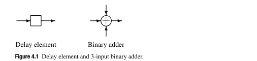

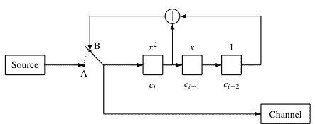

图 4.2 C 的编码器，其中 C^⊥ = (1 + x^2 + x^3)。

加法器接收所有输入信号并以二进制方式相加；此过程被认为是瞬时发生的。

### 示例 4.2.10
在图 4.2 中，我们构建一个线性反馈移位寄存器，用于编码生成多项式 g(x) = 1 + x + x^2 + x^4 的 [7, 3] 二进制循环码 C。此时 g^⊥(x) = 1 + x^2 + x^3，因此来自 (4.2) 的奇偶校验方程为：
c_0 + c_2 = c_3,
c_1 + c_3 = c_4,
c_2 + c_4 = c_5,
c_3 + c_5 = c_6.

移位寄存器有三个触发器。假设我们将 c_0 = 1、c_1 = 0 和 c_2 = 0 输入到移位寄存器中。最初，在第一个时钟周期之前，移位寄存器中有三个未知量，我们可以用 *** 表示。开关在 A 位置保持三个时钟周期，在此期间，源中的数字 1、0、0 从左到右移入移位寄存器，如表 4.1 所示。这三个比特也移动到传输信道。在时钟周期 3 和 4 之间，开关设置为 B 位置，这使反馈得以进行。开关保持在此位置 4 个时钟周期；在此期间，源中不再有输入到达。在第 3 个周期中，寄存器读取为 001，对应于 c_0c_1c_2 = 100。然后在第 4 个周期中，移位寄存器中的 c_0 = 1 和 c_2 = 0 通过二进制加法器并相加得到 c_3 = 1；结果既传送到信道，也从左侧反馈回移位寄存器。请注意，移位寄存器仅执行了上述奇偶校验方程中的第一个。移位寄存器现在包含 100，对应于 c_1c_2c_3 = 001。在时钟周期 5，移位寄存器执行二进制加法 c_1 + c_3 = 0 + 1 = 1 = c_4，这满足了第二个奇偶校验方程。时钟周期 6 和 7 按表所示产生 c_5 和 c_6；这些满足最后两个奇偶校验方程。移位寄存器已将 c_0c_1 ⋯ c_6 = 1001110 发送到信道。（另请注意，代码字是表 4.1 中“寄存器”列的第一个条目。）然后开关重置为 A 位置，移位寄存器准备好接收下一个代码字的输入。

| 时钟周期 | 开关 | 源 | 信道 | 寄存器 |
|---|---|---|---|---|
| 1 | A | 1 | 1 | 1** |
| 2 | A | 0 | 0 | 01* |
| 3 | A | 0 | 0 | 001 |
| 4 | B | | 1 | 100 |
| 5 | B | | 1 | 110 |
| 6 | B | | 1 | 111 |
| 7 | B | | 0 | 011 |

### 练习 215
以类似于表 4.1 的表格形式给出图 4.2 中移位寄存器的内容，针对以下输入序列。同时给出生成的代码字。

- (a) c_0c_1c_2 = 011。
- (b) c_0c_1c_2 = 101。

请注意，我们在图 4.2 中将三个延迟元件标记为 x^2、x 和 1。进入二进制加法器的垂直线出现在延迟元件 x^2 和 1 之后。这些是 g^*(x) 中次数小于 3 的非零项。一般来说，如果 deg g^*(x) = k，则 k 个延迟元件从左到右标记为 x^(k-1)、x^(k-2)、…、1。连接到二进制加法器的延迟元件正是那些标签位于 g^*(x) 中次数小于 k 的非零项之后的元素。检查 (4.2) 说明了为什么这样可行。

### 练习 216
执行以下操作：

- (a) 设 C 为生成多项式 g(x) = 1 + x + x^3 的 [7, 4] 二进制循环码。求 g^*(x)。
- (b) 绘制一个线性反馈移位寄存器以编码 C。
- (c) 以类似于表 4.1 的表格形式给出 (b) 部分中移位寄存器的内容，针对输入序列 c_0c_1c_2c_3 = 1001。同时给出生成的代码字。

### 练习 217
执行以下操作：

- (a) 设 C 为示例 4.2.4 中所示的生成多项式 g(x) = 1 + x + x^2 的 [9, 7] 二进制循环码。求 g^*(x)。
- (b) 绘制一个线性反馈移位寄存器以编码 C。
- (c) 以类似于表 4.1 的表格形式给出 (b) 部分中移位寄存器的内容，针对输入序列 c_0c_1 ⋯ c_6 = 1011011。同时给出生成的代码字。

循环码的概念已以如下方式推广。如果码 C 具有这样的性质：存在一个整数 s，使得将代码字移位 s 位后仍是一个代码字，则 C 被称为准循环码。循环码是 s = 1 的准循环码。s = 2 的准循环码有时与双环码单式等价；双环码的生成矩阵为 [I A]，其中 A 是一个环矩阵。我们注意到，当生成矩阵具有其他“类循环”结构时，“双环码”这一术语有时也被使用，例如

\(\begin{bmatrix} I & 0 & 1 & \cdots & 1 \\ & I & \vdots & & \vdots \\ & & B & & \\ & & 1 & & \end{bmatrix}\) 。

其中 B 是一个环矩阵；这样的码可能被称为“带边双环码”。参见第 9.8 节，我们将更广泛地研究使用环矩阵构建码的方法。

## 4.3 幂等元与乘数

除了生成多项式之外，还有许多多项式可用于生成循环码。关于哪些多项式生成给定循环码的一般结果将在定理 4.4.4 中介绍。还有一种非常特定的多项式，称为幂等元生成元，可用于生成循环码。

环中满足 e^2 = e 的元素 e 称为幂等元。如前所述（未作证明），当 gcd(n, q) = 1 时，环 R_n 是半单环。因此，根据韦德伯恩结构定理，R_n 中的每个循环码包含一个生成理想的唯一幂等元。这个幂等元称为循环码的生成幂等元。在下一个定理中，我们直接证明这一事实，并在过程中展示如何确定循环码的生成幂等元。回顾一下，环中的单位元是环中的（非零）乘法单位元，可能存在也可能不存在；但是，如果存在，它是唯一的。

### 示例 4.3.1
零循环码 {0} 的生成幂等元是 0，而循环码 R_n 的生成幂等元是 1。

### 定理 4.3.2
设 C 为 R_n 中的一个循环码。则：

- (i) 存在 C 中的一个唯一幂等元 e(x)，使得 C = ⟨e(x)⟩；且
- (ii) 如果 e(x) 是 C 中的非零幂等元，则 C = ⟨e(x)⟩ 当且仅当 e(x) 是 C 的单位元。

**证明：** 如果 C 是零码，则幂等元是零多项式，(i) 显然成立，(ii) 不适用。

因此，我们假设 C 非零。我们先证明 (ii)。假设 e(x) 是 C 中的一个单位元。由于 C 是一个理想，e(x)C ⊂ C。如果 c(x) ∈ C，则 c(x)e(x) = e(x)c(x) ∈ C，这意味着 e(x) = c(x)。反之，假设 e(x) 是一个非零幂等元，且 C = ⟨e(x)⟩。那么 C 中的每个元素 c(x) 都可以写成 c(x) = f(x)e(x) 的形式。但是 c(x)e(x) = f(x)e(x)e(x) = f(x)e(x)^2 = f(x)e(x) = c(x)，这意味着 e(x) 是 C 的一个单位元。


由于 C 非零，根据 (ii)，如果 e1(x) 和 e2(x) 是生成幂等元，那么它们都是单位元且 e1(x) = e2(x)e1(x) = e2(x)。因此我们只需证明存在一个生成幂等元。如果 g(x) 是 C 的生成多项式，则根据定理 4.2.1，g(x) | (xn − 1)。令 h(x) = (xn − 1)/g(x)。由于 xn − 1 有不同的根，在 Fq[x] 中 gcd(g(x), h(x)) = 1。根据欧几里得算法，存在多项式 a(x), b(x) ∈ Fq[x]，使得 a(x)g(x) + b(x)h(x) = 1。令 e(x) ≡ a(x)g(x) (mod xn − 1)；也就是说，e(x) 是 Rn 中 a(x)g(x) + (xn − 1) 的陪集代表元。那么在 Rn 中，e(x)^2 = (a(x)g(x))(1 − b(x)h(x)) ≡ a(x)g(x) ≡ e(x) (mod xn − 1)，因为 g(x)h(x) = xn − 1，所以 g(x)h(x) ≡ 0 (mod xn − 1)。另外，如果 c(x) ∈ C，c(x) = f(x)g(x)，则 c(x)e(x) ≡ f(x)g(x)(1 − b(x)h(x)) ≡ f(x)g(x) ≡ c(x) (mod xn − 1)；所以 e(x) 是 C 中的单位元，(i) 从 (ii) 得到。

证明表明，从循环码 C 的生成多项式 g(x) 找出生成幂等元 e(x) 的一种方法是：使用欧几里得算法求解 1 = a(x)g(x) + b(x)h(x) 关于 a(x) 的解，其中 h(x) = (xn − 1)/g(x)。然后将 a(x)g(x) 模 xn − 1 化简即可得到 e(x)。如下一个定理所示，如果我们知道 e(x)，也可以求出 g(x)。

## 定理 4.3.3
设 C 为 Fq 上的循环码，其生成幂等元为 e(x)。则 C 的生成多项式为 g(x) = gcd(e(x), xn − 1)，在 Fq[x] 中计算。

**证明：** 设 d(x) = gcd(e(x), xn − 1) 在 Fq[x] 中，并令 g(x) 为 C 的生成多项式。由于 d(x) | e(x)，即 d(x) = d(x)c(x)，这意味着 C = ⟨e(x)⟩ 的每个元素也是 d(x) 的倍数，因此 C ⊆ ⟨d(x)⟩。根据定理 4.2.1，在 Fq[x] 中，g(x) | (xn − 1) 且 g(x) | e(x)（因为 e(x) ∈ C）。所以根据练习 158，g(x) | d(x)，这意味着 d(x) ∈ C。因此 ⟨d(x)⟩ ⊆ C，从而 C = ⟨d(x)⟩。由于 d(x) 是生成 C 的 xn − 1 的首一因式，根据推论 4.2.2，d(x) = g(x)。

## 示例 4.3.4
下表给出了 F2 上长度为 7 的所有循环码 Ci，以及它们的生成多项式 gi(x) 和生成幂等元 ei(x)。

| i | dim | g(x) | e(x) |
|---|---|---|---|
| 0 | 0 | 1+x7 | 0 |
| 1 | 1 | 1+x+x2+⋯+x6 | 1+x+x2+⋯+x6 |
| 2 | 3 | 1+x2+x3+x4 | 1+x3+x5+x6 |
| 3 | 3 | 1+x+x2+x4 | 1+x+x4+x5 |
| 4 | 4 | 1+x+x3 | x+x2+x4 |
| 5 | 4 | 1+x2+x3 | x3+x5+x6 |
| 6 | 6 | 1+x | x+x2+⋯+x6 |
| 7 | 7 | 1 | 1 |

维度为 4 的两个码是 [7, 4, 3] 海明码。

## 示例 4.3.5
下表给出了 $\mathbb{F}_3$ 上长度为 11 的所有循环码 $\mathcal{C}_i$，以及它们的生成多项式 $g_i(x)$ 和生成幂等元 $e_i(x)$。

| i | dim | g(x) | e_i(x) |
|---|---|---|---|
| 0 | 0 | 1 | 0 |
| 1 | 1 | $x^{11} - 1$ | $-1 - x - x^2 - \cdots - x^{10}$ |
| 2 | 5 | $1 + x + x^2 + \cdots + x^{10}$ | $1 + x^2 + x^6 + x^7 + x^8 + x^{10}$ |
| 3 | 5 | $1 - x - x^3 - x^4 + x^5 + x^6$ | $1 + x^2 + x^6 + x^7 + x^8 + x^{10}$ |
| 4 | 6 | $-1 + x^2 - x^3 + x^4 + x^5$ | $-x^2 - x^6 - x^7 - x^8 - x^{10}$ |
| 5 | 6 | $-1 - x + x^2 - x^3 + x^5$ | $-x - x^3 - x^4 - x^8 - x^9$ |
| 6 | 10 | $-1 + x$ | $-1 + x + x^2 + \cdots + x^{10}$ |
| 7 | 11 | 1 | 1 |

维度为 6 的两个码是 [11, 6, 5] 三进制 Golay 码。

注意，定理 1.8.1 表明唯一的 [7, 4, 3] 二进制码是海明码。在第 10.4.1 节中，我们将展示唯一的 [11, 6, 5] 三进制码是 Golay 码。根据示例 4.3.4 和 4.3.5，这两个码都有循环表示。

- 练习 218 验证示例 4.3.4 表中的条目。
- 练习 219 验证示例 4.3.5 表中的条目。
- 练习 220 找出 $\mathbb{F}_3$ 上长度为 8 且维度为 3 和 5 的所有循环码的生成多项式和生成幂等元。
- 练习 221 设在 $\mathcal{R}_n$ 中 $f(x) = 1 + x + x^2 + \cdots + x^{n-1}$，且 $\bar{f}(x) = (1/n)f(x)$。
  - (a) 证明在 $\mathcal{R}_n$ 中 $f(x) = nj(x)$。
  - (b) 证明 $\bar{f}(x)$ 是 $\mathcal{R}_n$ 中的一个幂等元。
  - (c) 证明 $\bar{f}(x)$ 是 $\mathbb{F}_q$ 上长度为 $n$ 的重复码的生成幂等元。
  - (d) 证明如果 $c(x)$ 在 $\mathcal{R}_n$ 中，则在 $\mathcal{R}_n$ 中 $c(x)\bar{f}(x) = c(1)f(x)$。
  - (e) 证明如果 $c(x)$ 在 $\mathcal{R}_n$ 中，则当 $c(x)$ 对应于 $\mathbb{F}_q^n$ 中的一个偶向量时，在 $\mathcal{R}_n$ 中 $c(x)\bar{f}(x) = 0$；且当 $c(x)$ 对应于 $\mathbb{F}_q^n$ 中的一个奇向量时，在 $\mathcal{R}_n$ 中 $c(x)\bar{f}(x)$ 是 $\bar{f}(x)$ 的一个非零倍数。

下一个定理表明，就像生成多项式一样，生成幂等元及其前 $k-1$ 个循环移位构成一个循环码的基。

## 定理 4.3.6
设 $\mathcal{C}$ 为一个带有生成幂等元 $e(x) = \sum_{i=0}^{n-1} e_i x^i$ 的 $[n, k]$ 循环码。那么 $k \times n$ 矩阵

\[
\begin{bmatrix}
e_0 & e_1 & e_2 & \cdots & e_{n-2} & e_{n-1} \\
e_{n-1} & e_0 & e_1 & \cdots & e_{n-3} & e_{n-2} \\
\vdots & \vdots & \vdots & \ddots & \vdots & \vdots \\
e_{n-k+1} & e_{n-k+2} & e_{n-k+3} & \cdots & e_{n-k} & e_{n-k}
\end{bmatrix}
\]

是 $\mathcal{C}$ 的一个生成矩阵。

## 定理 4.3.7
设 $\mathcal{C}_i$ 为 $\mathbb{F}_q$ 上长度为 $n$ 的循环码，其生成多项式为 $g_i(x)$，生成幂等元为 $e_i(x)$，其中 $i = 1, 2$。则：(i) $\mathcal{C}_1 \cap \mathcal{C}_2$ 的生成多项式为 $\text{lcm}(g_1(x), g_2(x))$，生成幂等元为 $e_1(x)e_2(x)$；(ii) $\mathcal{C}_1 + \mathcal{C}_2$ 的生成多项式为 $\text{gcd}(g_1(x), g_2(x))$，生成幂等元为 $e_1(x) + e_2(x) - e_1(x)e_2(x)$。

**证明：** 我们证明 (ii)，并将 (i) 的证明留作练习。我们还将证明两个循环码的和是循环码留作练习。令 $g(x) = \text{gcd}(g_1(x), g_2(x))$。根据欧几里得算法，存在 $\mathbb{F}_q[x]$ 中的某些 $a(x)$ 和 $b(x)$，使得 $g(x) = g_1(x)a(x) + g_2(x)b(x)$。所以 $g(x) \in C_1 + C_2$。由于 $C_1 + C_2$ 是循环码，$(g(x)) \subseteq C_1 + C_2$。另一方面，$g(x) | g_i(x)$，根据推论 4.2.5 这表明 $C_i \subseteq (g(x))$，同样 $C_2 \subseteq (g(x))$，从而 $C_1 + C_2 \subseteq (g(x))$。所以 $C_1 + C_2 = (g(x))$。由于 $g(x) | (x^n - 1)$（因为 $g(x) | g_1(x)$ 且 $g(x)$ 是首一多项式），根据推论 4.2.2，$g(x)$ 是 $C_1 + C_2$ 的生成多项式。如果 $c(x) = c_1(x) + c_2(x)$，其中 $c_i(x) \in C_i$，$i = 1, 2$，则 $c(x)e_1(x) = c_1(x)e_1(x) + c_2(x)e_1(x) = c_1(x)(e_1(x) + e_2(x) - e_1(x)e_2(x)) + c_2(x)(e_1(x) + e_2(x) - e_1(x)e_2(x)) = c(x)$。因此，由于 $e_1(x) + e_2(x) - e_1(x)e_2(x) \in C_1 + C_2$，根据定理 4.3.2，(ii) 得证。

- 练习 222 证明定理 4.3.7 的部分 (i)。还要证明，如果 $e_1(x)$ 和 $e_2(x)$ 是幂等元，那么 $e_1(x)e_2(x)$、$e_1(x) + e_2(x) - e_1(x)e_2(x)$ 和 $1 - e_1(x)$ 也是幂等元。
- 练习 223 证明两个循环码的和是循环码，如定理 4.3.7 所声称的。
- 练习 224 设 $\mathcal{C}_i$ 为 $\mathbb{F}_q$ 上长度为 $n$ 的循环码，其中 $i = 1, 2$。设 $\alpha$ 为 $\mathbb{F}_q$ 的某个扩张域中的原始 $n$ 次单位根。假设 $\mathcal{C}_i$ 的生成多项式为 $g_i(x)$，其中
$$
g_i(x) = \prod_{k \in K_i} M_{\alpha^k}(x)
$$
是 $g_i(x)$ 在 $\mathbb{F}_q$ 上分解为最小多项式的乘积，且 $K_i$ 是模 $n$ 的 $q$-循环共轭类代表元的一个子集。假设共轭类的代表元是共轭类中的最小元素。哪些 $q$-循环共轭类代表元的子集将产生码 $C_1 + C_2$ 和 $C_1 \cap C_2$ 的生成多项式？


### 练习 225 找出示例 4.3.4 中以下代码的生成多项式和生成幂等元：$\mathcal{C}_1 + \mathcal{C}_6, \mathcal{C}_2 + \mathcal{C}_3, \mathcal{C}_2 + \mathcal{C}_4, \mathcal{C}_2 + \mathcal{C}_5, \mathcal{C}_3 + \mathcal{C}_4, \mathcal{C}_3 + \mathcal{C}_5, \mathcal{C}_1 \cap \mathcal{C}_6, \mathcal{C}_2 \cap \mathcal{C}_3, \mathcal{C}_2 \cap \mathcal{C}_4, \mathcal{C}_3 \cap \mathcal{C}_4, \text{和 } \mathcal{C}_3 \cap \mathcal{C}_5$。

### 练习 226 练习 220 中哪些代码对之和为代码 $\mathbb{F}_q^8$？该示例中哪些代码对的交集为 $\{0\}$？

### 练习 227 如果 $\mathcal{C}_i$ 是生成多项式为 $g_i(x)$、生成幂等元为 $e_i(x)$ 的循环代码（$1 \le i \le 3$），那么 $\mathcal{C}_1 + \mathcal{C}_2 + \mathcal{C}_3$ 的生成多项式和生成幂等元是什么？

我们现在准备描述一组特殊的幂等元，称为原始幂等元，一旦已知，它们将产生 $\mathcal{R}_n$ 中的所有幂等元，因此也产生所有循环代码。令 $x^n - 1 = f_1(x) \cdots f_s(x)$，其中 $f_i(x)$ 在 $\mathbb{F}_q$ 上不可约（$1 \le i \le s$）。由于 $x^n - 1$ 有不同的根，因此 $f_i(x)$ 互不相同。令 $\widehat{f}_i(x) = (x^n - 1)/f_i(x)$。在下一个定理中，我们表明 $\mathcal{R}_n$ 的理想 $\langle \widehat{f}_i(x) \rangle$ 是 $\mathcal{R}_n$ 的最小理想。回顾一下，环 $\mathcal{R}$ 中的理想 $\mathcal{I}$ 是一个 *最小理想*，前提是 $\{0\}$ 和 $\mathcal{I}$ 之间没有真理想。我们用 $\widehat{e}_i(x)$ 表示 $\langle \widehat{f}_i(x) \rangle$ 的生成幂等元。幂等元 $\widehat{e}_1(x), \dots, \widehat{e}_s(x)$ 被称为 $\mathcal{R}_n$ 的原始幂等元。

## 定理 4.3.8

在 $\mathcal{R}_n$ 中，以下结论成立。

- (i) 对于 $1 \le i \le s$，理想 $\langle \widehat{f}_i(x) \rangle$ 都是 $\mathcal{R}_n$ 的所有最小理想。
- (ii) $\mathcal{R}_n$ 是 $\langle \widehat{f}_i(x) \rangle$（$1 \le i \le s$）的向量空间直和。
- (iii) 如果 $i \neq j$，则在 $\mathcal{R}_n$ 中 $\widehat{e}_i(x)\widehat{e}_j(x) = 0$。
- (iv) 在 $\mathcal{R}_n$ 中 $\sum_{i=1}^s \widehat{e}_i(x) = 1$。
- (v) $\langle \widehat{f}_i(x) \rangle$ 中唯一的幂等元是 $0$ 和 $\widehat{e}_i(x)$。
- (vi) 如果 $e(x)$ 是 $\mathcal{R}_n$ 中的非零幂等元，那么存在 $\{1, 2, \dots, s\}$ 的一个子集 $T$，使得 $e(x) = \sum_{i \in T} \widehat{e}_i(x)$ 且 $\langle e(x) \rangle = \sum_{i \in T} \langle \widehat{f}_i(x) \rangle$。

**证明：** 假设 $\langle \widehat{f}_i(x) \rangle$ 不是 $\mathcal{R}_n$ 的最小理想。根据推论 4.2.5，将存在一个非零理想的生成多项式 $g(x)$，该理想真包含于 $\langle \widehat{f}_i(x) \rangle$ 中，且满足 $\widehat{f}_i(x) \mid g(x)$ 与 $g(x) \neq \widehat{f}_i(x)$。由于 $f_i(x)$ 是不可约的且 $g(x) \mid (x^n - 1)$，这是不可能的。因此 $\langle \widehat{f}_i(x) \rangle$ 是 $\mathcal{R}_n$ 的最小理想，这完成了 (i) 的部分证明。由于 $\langle \widehat{f}_i(x) \rangle \mid 1 \le i \le s$ 没有 $x^n - 1$ 的公共不可约因子，且集合中的每个多项式都整除 $x^n - 1$，因此 $\gcd(\widehat{f}_1(x), \dots, \widehat{f}_s(x)) = 1$。归纳应用欧几里得算法，

```
1 = \sum_{i=1}^s a_i(x) \widehat{f}_i(x) \tag{4.3}
```

其中 $a_i(x) \in \mathbb{F}_q[x]$。所以 1 在理想 $\langle \widehat{f}_i(x) \rangle$ 的和中，而该和本身也是 $\mathcal{R}_n$ 的一个理想。在任何环中，唯一包含环单位元的理想就是环本身。这证明了 $\mathcal{R}_n$ 是理想 $\langle \widehat{f}_i(x) \rangle$ 的向量空间和。要证明它是直和，我们必须表明对于 $1 \le i \le s$，$\langle \widehat{f}_i(x) \rangle \cap \sum_{j \neq i} \langle \widehat{f}_j(x) \rangle = \{0\}$。由于当 $j \neq i$ 时 $f_i(x) \mid \widehat{f}_j(x)$，且 $f_i(x) \nmid \widehat{f}_i(x)$，并且 $x^n - 1$ 的不可约因子互不相同，我们得出 $f_i(x) = \gcd(\widehat{f}_j(x) \mid 1 \le j \le s, j \neq i)$。将归纳法应用于定理 4.3.7(ii) 的结果表明 $\langle f(x) \rangle = \sum_{j \neq i} \langle \widehat{f}_j(x) \rangle$。因此，根据定理 4.3.7，$\langle \widehat{f}_i(x) \rangle \cap \sum_{j \neq i} \langle \widehat{f}_j(x) \rangle = \langle \widehat{f}_i(x) \rangle \cap \langle f(x) \rangle = \langle \text{lcm}(\widehat{f}_i(x), f(x)) \rangle = \langle x^n - 1 \rangle = \{0\}$，这完成了 (ii) 的证明。

令 $\mathcal{M} = \langle m(x) \rangle$ 为 $\mathcal{R}_n$ 的任意最小理想。根据 (4.3)，

$0 \neq m(x) = m(x) \cdot 1 = \sum_{i=1}^s m(x)a(x)\widehat{f}_i(x)$

存在一个 $i$ 使得 $m(x)a(x)\widehat{f}_i(x) \neq 0$。因此 $\mathcal{M} \cap \langle \widehat{f}_i(x) \rangle \neq \{0\}$，因为 $m(x)a(x)\widehat{f}_i(x) \in \mathcal{M} \cap \langle \widehat{f}_i(x) \rangle$，进而根据 $\mathcal{M}$ 和 $\langle \widehat{f}_i(x) \rangle$ 的极小性，$\mathcal{M} = \langle \widehat{f}_i(x) \rangle$。这完成了 (i) 的证明。

如果 $i \neq j$，根据 (ii)，$\widehat{e}_i(x)\widehat{e}_j(x) \in (\widehat{f}_i(x)) \cap (\widehat{f}_j(x)) = \{0\}$，从而得到 (iii)。利用 (iii) 并将归纳法应用于定理 4.3.7(ii)，根据部分 (ii)，$\sum_{i=1}^s \widehat{e}_i(x)$ 是 $\sum_{i=1}^s \langle \widehat{f}_i(x) \rangle = \mathcal{R}_n$ 的生成幂等元。$\mathcal{R}_n$ 的生成幂等元是 1，这验证了 (iv)。

如果 $e(x)$ 是 $\langle \widehat{f}_i(x) \rangle$ 中的非零幂等元，那么 $e(x)$ 是包含于 $\langle \widehat{f}_i(x) \rangle$ 中的一个理想。由于 $e(x)$ 非零，根据极小性，$\langle \widehat{f}_i(x) \rangle = \langle e(x) \rangle$，根据定理 4.3.2 推出 $e(x) = \widehat{e}_i(x)$，因为两者都是 $\langle \widehat{f}_i(x) \rangle$ 的唯一单位元。因此 (v) 成立。

对于 (vi)，注意 $e(x)\widehat{e}_i(x)$ 是 $\langle \widehat{f}_i(x) \rangle$ 中的一个幂等元。因此根据 (v)，$e(x)\widehat{e}_i(x)$ 要么是 0，要么是 $\widehat{e}_i(x)$。令 $T = \{i \mid e(x)\widehat{e}_i(x) \neq 0\}$。然后根据 (iv)，$e(x) = e(x) \cdot 1 = e(x)\sum_{i=1}^s \widehat{e}_i(x) = \sum_{i=1}^s e(x)\widehat{e}_i(x) = \sum_{i \in T} e(x)\widehat{e}_i(x)$。此外，根据定理 4.3.7(ii) 和归纳法，$\langle e(x) \rangle = \langle \sum_{i \in T} \widehat{e}_i(x) \rangle$。

我们注意到，本定理中的最小理想是 $\mathbb{F}_q$ 的扩展域。定理 4.4.19 还将使用迹映射来刻画这些最小理想。

## 定理 4.3.9

令 $\mathcal{M}$ 为 $\mathcal{R}_n$ 的一个最小理想。那么 $\mathcal{M}$ 是 $\mathbb{F}_q$ 的一个扩展域。

证明：我们只需表明 $\mathcal{M}$ 中的每个非零元素在 $\mathcal{M}$ 中都有乘法逆元。令 $a(x) \in \mathcal{M}$ 为非零元素。那么 $a(x)$ 是 $\mathcal{R}_n$ 中包含于 $\mathcal{M}$ 的一个非零理想，因此 $\langle a(x) \rangle = \mathcal{M}$。所以，如果 $e(x)$ 是 $\mathcal{M}$ 的单位元，那么存在 $\mathcal{R}_n$ 中的一个元素 $b(x)$ 使得 $a(x)b(x) = e(x)$。现在 $c(x) = b(x)e(x) \in \mathcal{M}$，因为 $e(x) \in \mathcal{M}$。因此 $a(x)c(x) = e(x)^2 = e(x)$。$\square$

### 练习 228 在 $\mathbb{F}_2$ 上，$\mathcal{R}_7$ 和 $\mathcal{R}_{15}$ 的最小理想是什么域？$\blacklozenge$

定理 4.3.8 表明，每个幂等元都是原始幂等元的和，且循环代码是最小循环代码的和。这一对循环代码刻画的一个有趣后果（见文献 [280]）是，循环代码之和的维数满足与容斥原理相同的公式，而这一事实在一般情况下并不成立。

## 定理 4.3.10

令 $C_i$ 为 $\mathbb{F}_q$ 上长度为 $n$ 的循环代码（$1 \le i \le a$）。那么：

$\dim(C_1 + C_2 + \cdots + C_a) = \sum_i \dim(C_i) - \sum_{i<j} \dim(C_i \cap C_j)$
$+ \sum_{i<j<k} \dim(C_i \cap C_j \cap C_k) - \cdots$
$+ (-1)^{a-1} \dim(C_1 \cap C_2 \cap \cdots \cap C_a).$

证明：令 $\{\widehat{e}_i(x) \mid 1 \le i \le s\}$ 为 $\mathcal{R}_n$ 的原始幂等元。根据定理 4.3.8，$\mathcal{R}_n$ 的最小理想是 $\langle \widehat{e}_i(x) \rangle$。固定 $\langle \widehat{e}_i(x) \rangle$ 的一组基 $B_i$（$1 \le i \le s$）。还根据


定理 4.3.8 中，每个 $C_i$ 都是 $\{(\vec{e}_j(x)) \mid j \in S_i\}$ 的直和，其中 $S_i$ 是 $\{1, 2, \dots, s\}$ 的某个子集。因此 $C_i + \cdots + C_s$ 的一组基是 $B_i \cup \cdots \cup B_s$，且该基包含 $|B_i \cup \cdots \cup B_s| = \dim(C_i + \cdots + C_s)$ 个元素，其中 $|B|$ 是 $B$ 中（不同）元素的个数。$C_i \cap \cdots \cap C_s$ 的一组基是 $B_i \cap \cdots \cap B_s$，且该基包含 $|B_i \cap \cdots \cap B_s| = \dim(C_i \cap \cdots \cap C_s)$ 个元素。由于 $\dim(C_1 + C_2 + \cdots + C_s) = |B_1 \cup B_2 \cup \cdots \cup B_s|$，我们可以应用容斥原理得到结果。

## 示例 4.3.11 定理 4.3.10 一般不适用于非循环码。例如，对于 $1 \le i \le 3$，令 $C_i$ 为生成矩阵 $G_i$ 的长度为 2 的二进制码，其中

$G_1 = [1 \quad 0], \quad G_2 = [0 \quad 1], \quad \text{且} \quad G_3 = [1 \quad 1].$

则对于 $1 \le i \le 3$，有 $\dim(C_i) = 1$；对于 $i \ne j$，有 $\dim(C_i \cap C_j) = 0$；且 $\dim(C_1 \cap C_2 \cap C_3) = 0$。但 $\dim(C_1 + C_2 + C_3) = 2$，这不等于 $1 + 1 + 1 - 0 - 0 - 0 + 0 = 0$。

## 练习 229 证明：若 $C_1$ 和 $C_2$ 是 $\mathbb{F}_q$ 上长度为 $n$ 的线性码，则 $\dim(C_1 + C_2) = \dim(C_1) + \dim(C_2) - \dim(C_1 \cap C_2)$。

我们现在转向一个特定的置换，它将 $\mathcal{R}_n$ 的幂等元映射到 $\mathcal{R}_n$ 的幂等元。令 $a$ 为满足 $\gcd(a, n) = 1$ 的整数。在 $\{0, 1, \dots, n-1\}$ 上由 $i\mu_a \equiv ia \pmod n$ 定义的函数 $\mu_a$ 是长度为 $n$ 的循环码的坐标位置 $\{0, 1, \dots, n-1\}$ 的一个置换，并称为*乘数*。由于长度为 $n$ 的循环码表示为 $\mathcal{R}_n$ 中的理想，对于 $a > 0$，将 $\mu_a$ 视为通过

$f(x)\mu_a \equiv f(x^a) \pmod{x^n - 1}.$ (4.4)

作用于 $\mathcal{R}_n$ 是方便的。该方程与 $\mu_a$ 的原始定义一致，因为在 $\mathcal{R}_n$ 中，对于满足 $0 \le ia + jn < n$ 的整数 $j$，有 $x^i\mu_a = x^{ia} = x^{ia+jn}$（因为在 $\mathcal{R}_n$ 中 $x^n = 1$）。换句话说，$x^i\mu_a = x^{ia \pmod n}$。如果 $a < 0$，我们可以通过定义 $x^i\mu_a = x^{ia \pmod n}$ 来为 $f(x^a)$ 在 $\mathcal{R}_n$ 中赋予意义，其中当然 $0 \le ia \pmod n < n$。有了这种解释，当 $a < 0$ 时，(4.4) 与 $\mu_a$ 的原始定义一致。我们将以下内容的证明留作练习。

## 定理 4.3.12 设 $f(x)$ 和 $g(x)$ 是 $\mathcal{R}_n$ 的元素。假设 $e(x)$ 是 $\mathcal{R}_n$ 的一个幂等元。令 $a$ 与 $n$ 互素。则：

- (i) 若 $b \equiv a \pmod n$，则 $\mu_b = \mu_a$，
- (ii) $(f(x) + g(x))\mu_a = f(x)\mu_a + g(x)\mu_a$，
- (iii) $(f(x)g(x))\mu_a = (f(x)\mu_a)(g(x)\mu_a)$，
- (iv) $\mu_a$ 是 $\mathcal{R}_n$ 的一个自同构，
- (v) $e(x)\mu_a$ 是 $\mathcal{R}_n$ 的一个幂等元，且
- (vi) $\mu_q$ 保持模 $n$ 的每个 $q$-循环 coset 不变，且其阶等于 $\text{ord}_n(q)$。

## 练习 230 证明：若 $\gcd(a, n) = 1$，则映射 $\mu_a$ 确实是文中所述的 $\{0, 1, \dots, n-1\}$ 的一个置换。若 $\gcd(a, n) \ne 1$ 会发生什么情况？

## 练习 231 证明定理 4.3.12。

## 定理 4.3.13 设 $\mathcal{C}$ 为 $\mathbb{F}_q$ 上长度为 $n$、生成幂等元为 $e(x)$ 的循环码。令 $a$ 为满足 $\gcd(a, n) = 1$ 的整数。则：(i) $\mathcal{C}_{\mu_a} = \{e(x)\mu_a\}$ 且 $e(x)\mu_a$ 是循环码 $\mathcal{C}_{\mu_a}$ 的生成幂等元，且 (ii) $e(x)\mu_a = e(x)$ 且 $\mu_a \in \text{PAut}(\mathcal{C})$。

证明：利用定理 4.3.12(iii)，$\mathcal{C}_{\mu_a} = \{(e(x)f(x))\mu_a \mid f(x) \in \mathcal{R}_n\} = \{e(x)\mu_a \times f(x)\mu_a \mid f(x)\mu_a \in \mathcal{R}_n\} = \{e(x)\mu_a h(x) \mid h(x) \in \mathcal{R}_n\} = (e(x)\mu_a)$，因为根据定理 4.3.12(iv)，$\mu_a$ 是 $\mathcal{R}_n$ 的一个自同构。因此，根据定理 4.3.12(v)，$\mathcal{C}_{\mu_a}$ 是循环码且具有生成幂等元 $e(x)\mu_a$，从而证明了 (i)。若能证明 $e(x)\mu_{\bar{q}} = e(x)$，则根据部分 (i)，$\mathcal{C}_{\mu_{\bar{q}}} = \mathcal{C}$，故 $\mu_{\bar{q}} \in \text{PAut}(\mathcal{C})$。根据定理 4.3.8(v)，对于某个集合 $T$，有 $e(x) = \sum_{i \in T} \bar{e}_i(x)$。根据定理 4.3.12(ii)，若对所有 $i$ 均有 $\bar{e}_i(x)\mu_q = \bar{e}_i(x)$，则 $e(x)\mu_q = e(x)$。但根据定理 3.7.4，$\bar{e}_i(x)\mu_q = \bar{e}_i(x^q) = \bar{e}_i(x)^q$，后者当然是 $\bar{\mathbb{F}}_q(x)$ 的一个非零元素。但根据定理 4.3.12(v)，$\bar{e}_i(x)\mu_q$ 也是 $\bar{\mathbb{F}}_q(x)$ 的一个幂等元。因此，根据定理 4.3.8(v)，$\bar{e}_i(x)\mu_q = \bar{e}_i(x)$。

## 练习 232 考虑示例 4.3.5 中给出的 $\mathbb{F}_3$ 上长度为 11 的循环码。

- (a) 求每个生成幂等元在 $\mu_2$ 下的像，进而求每个循环码的像。
- (b) 验证 $\mu_3$ 固定每个幂等元。
- (c) 将每个生成多项式在 $\mu_3$ 下的像写为 $\mathcal{R}_{11}$ 的一个元素。生成多项式会被映射为生成多项式吗？

## 练习 233 证明示例 4.3.4 和 4.3.5 中任何两个相同维数的码是置换等价的。

注意，任意置换一般不将幂等元映射为幂等元，甚至也不将循环码映射为循环码。

## 推论 4.3.14 设 $\mathcal{C}$ 为 $\mathbb{F}_q$ 上长度为 $n$ 的循环码。设 $\mathcal{A}$ 为由循环移位 $i \to i + 1 \pmod n$ 生成的阶为 $n$ 的群。设 $\mathcal{B}$ 为由乘数 $\mu_q$ 生成的阶为 $\text{ord}_n(q)$ 的群。则由 $\mathcal{A}$ 和 $\mathcal{B}$ 生成的阶为 $n \cdot \text{ord}_n(q)$ 的群 $\mathcal{G}$ 是 $\text{PAut}(\mathcal{C})$ 的子群。

证明：该推论源自对称群 $\text{Sym}_n$ 中 $\mathcal{A}$ 的正规化子的结构以及定理 4.3.13(ii)。事实上，$\mathcal{G}$ 是 $\mathcal{A}$ 由 $\mathcal{B}$ 扩展的半直积。

## 练习 234 在推论 4.3.14 的记法中，对于以下 $n$ 和 $q$ 的取值，$\text{PAut}(\mathcal{C})$ 的子群 $\mathcal{G}$ 的阶是多少？

- (a) $n = 15, q = 2$。
- (b) $n = 17, q = 2$。
- (c) $n = 23, q = 2$。
- (d) $n = 15, q = 4$。
- (e) $n = 25, q = 3$。

## 推论 4.3.15 设 $\mathcal{C}$ 为 $\mathbb{F}_q$ 上长度为 $n$、生成幂等元为 $e(x) = \sum_{i=0}^{n-1} e_i x^i$ 的循环码。则：

- (i) 若 $i$ 和 $j$ 在模 $n$ 的同一个 $q$-循环 coset 中，则 $e_i = e_j$，
- (ii) 若 $q=2$，则 $e(x) = \sum_{j \in J} \sum_{i \in C_j} x^i$，
  其中 $J$ 是模 $n$ 的 2-循环 coset 的某个代表元子集，且
- (iii) 若 $q=2$，则 $\mathcal{R}_n$ 中形式为 $\sum_{j \in J} \sum_{i \in C_j} x^i$ 的每个元素，
  其中 $J$ 是模 $n$ 的 2-循环 coset 的某个代表元子集，是 $\mathcal{R}_n$ 的一个幂等元。

证明：根据定理 4.3.13(ii)，$e(x)\mu_q = e(x)$。因此 $e(x)\mu_q = \sum_{i=0}^{n-1} e_i x^{qi} \equiv \sum_{i=0}^{n-1} e_i x^i \equiv \sum_{i=0}^{n-1} e_{iq} x^{iq} (\text{mod } x^n - 1)$，其中下标模 $n$ 读取。故 (i) 成立，(ii) 是 (i) 的特例。部分 (iii) 根据练习 152 以及 $2C_j \equiv C_j (\text{mod } n)$ 这一事实得出，因为 $e(x)^2 = \sum_{j \in J} \sum_{i \in C_j} x^{2i} = \sum_{j \in J} \sum_{i \in C_j} x^i = e(x)$。

由于任何幂等元都是某个码的生成幂等元，上述推论表明 $\mathcal{R}_n$ 中的每个幂等元都有形式
\( e(x) = \sum_j a_j \sum_{i \in C_j} x^i. \) (4.5)

其中外部求和遍历模 $n$ 的 $q$-循环 coset 的一个代表元系，且每个 $a_j \in \mathbb{F}_q$。对于 $q=2$，但对于任意 $q$ 则不然，所有此类表达式都是幂等元。（比较示例 4.3.4 和 4.3.5）

我们也可以给出 $\mathcal{R}_n$ 上 $\mathbb{F}_4$ 中幂等元的一般公式。我们可以按如下方式构造模 $n$ 的所有不同 4-循环 coset 的代表元集合 $S$。令 $S = K \cup L_1 \cup L_2$，其中 $K, L_1$ 和 $L_2$ 两两不交。$K$ 由不同的代表元 $k$ 组成，其中 $C_k = C_{2k}$。$L_1$ 和 $L_2$ 的选取方式使得若 $k \in L_1 \cup L_2$，则 $C_k \neq C_{2k}$；此外，$L_2 = \{2k \mid k \in L_1\}$。对 (4.5) 中的 $e(x)$ 平方，得到
\( e(x)^2 = \sum_{j \in S} a_j^2 \sum_{i \in C_j} x^{2i}. \)

因为 $\mathcal{R}_n$ 的特征为 2。但若 $j \in K$，则 $\sum_{i \in C_j} x^{2i} = \sum_{i \in C_j} x^i$；若 $j \in L_1$，则 $\sum_{i \in C_j} x^{2i} = \sum_{i \in C_{2j}} x^i$ 且 $2j \in L_2$；若 $j \in L_2$，则 $\sum_{i \in C_j} x^{2i} = \sum_{i \in C_j} x^i$ 且 $j \in L_1$，因为 $i$ 和 $4i$ 在同一个 4-循环 coset 中。因此，$e(x)$ 是幂等元当且仅当对所有 $j \in K$ 有 $a_j^2 = a_j$ 且对所有 $j \in L_1$ 有 $a_{2j} = a_j^2$。特别地，$e(x)$ 是 $\mathcal{R}_n$ 中的幂等元当且仅当

\( e(x) = \sum_{j \in K} a_j \sum_{i \in C_j} x^i + \sum_{j \in L_1} \left( a_j \sum_{i \in C_j} x^i + a_j^2 \sum_{i \in C_j} x^{2i} \right). \) (4.6)

其中若 $j \in K$ 则 $a_j \in \{0, 1\}$。回顾在 $\mathbb{F}_4$ 中，$-$ 称为共轭，由 $\bar{0} = 0, \bar{1} = 1$ 和 $\bar{\omega} = \omega^2$ 给出；或者，$\bar{a} = a^2$。若 $e(x)$ 是 $\mathcal{C}$ 的生成幂等元，


然后我们将其作为练习，留给读者证明 \(\overline{C}\) 是具有生成幂等元 \(\overline{e(x)} = \sum_j \overline{a_j} \sum_{i \in C_j} x^i\) 的循环码。此外，通过考察 (4.6)，我们看到 \(\overline{e(x)} = e(x)\mu_2\)。根据定理 4.3.13，\(\overline{C} = \langle \mu_2 \rangle\)。我们总结这些结果。

### **定理 4.3.16** 设 \(C\) 是 \(\mathbb{F}_4\) 上的循环码，其生成幂等元为 \(e(x)\)。则 \(e(x)\) 具有 (4.6) 给出的形式。此外，\(\overline{C} = C\mu_2\) 是循环码，其生成幂等元为 \(e(x)\mu_2\)。

### **练习 235** 证明如果 \(e(x)\) 是 \(\mathbb{F}_4\) 上循环码 \(\mathcal{C}\) 的生成幂等元，则 \(\overline{C}\) 是具有生成幂等元 \(\overline{e(x)} = \sum_j \overline{a_j} \sum_{i \in C_j} x^i\) 的循环码。还要证明 \(e(\overline{C}) = e(x)\mu_2\)。

### **练习 236** 执行以下操作：

- (a) 列出模 21 的 4-循环共轭类。
- (b) 构造一个由模 21 的不同 4-循环共轭类代表元组成的集合 \(S = K \cup L_1 \cup L_2\)，该集合可用于在 \(\mathbb{F}_4\) 上的 \(\mathcal{R}_{21}\) 中构造幂等元，如定理 4.3.16 之前的讨论所示。
- (c) 给出此类幂等元的一般形式。
- (d) 这些幂等元有多少个？
- (e) 写出其中四个幂等元。

定理 4.3.13 表明，\(\mu_a\) 将循环码映射到循环码，且生成幂等元映射到生成幂等元；然而，生成多项式可能不会映射到像码的生成多项式。事实上，自同构 \(\mu_a\) 将生成多项式映射到其 \(qh\) 次幂。参见练习 232。

乘数将循环码映射到等价循环码。以下定理是 Pálfy 定理（参见 [150]）的一个特例，它表明，在某些情况下，两个循环码是置换等价的当且仅当有一个乘数将一个映射到另一个。当适用时，这是一个非常强大的结果。

### **定理 4.3.17** 设 \(C_1\) 和 \(C_2\) 是 \(\mathbb{F}_q\) 上长度为 \(n\) 的循环码。假设 \(\gcd(n, \phi(n)) = 1\)，其中 \(\phi\) 是欧拉 \(\phi\)-函数。则 \(C_1\) 和 \(C_2\) 是置换等价的当且仅当存在一个将 \(C_1\) 映射到 \(C_2\) 的乘数。

由于乘数将生成幂等元发送到生成幂等元，我们有以下推论。

### **推论 4.3.18** 设 \(C_1\) 和 \(C_2\) 是 \(\mathbb{F}_q\) 上长度为 \(n\) 的循环码。假设 \(\gcd(n, \phi(n)) = 1\)，其中 \(\phi\) 是欧拉 \(\phi\)-函数。则 \(C_1\) 和 \(C_2\) 是置换等价的当且仅当存在一个将 \(C_1\) 的幂等元映射到 \(C_2\) 的幂等元的乘数。

## 4.4 循环码的零点

回顾第 4.1 节，特别是定理 4.1.1，如果 \(t = \text{ord}_n(q)\)，则 \(\mathbb{F}_q\) 是 \(x^n - 1\) 的分裂域；因此 \(\mathbb{F}_q\) 包含一个原始 \(n\) 次单位根 \(\alpha\)，且 \(x^n - 1 = \prod_{i=0}^{n-1} (x - \alpha^i)\) 是 \(x^n - 1\) 在 \(\mathbb{F}_q\) 上分解为一次因式的分解。此外，\(x^n - 1 = \prod_i M_{\alpha^i}(x)\) 是 \(x^n - 1\) 在 \(\mathbb{F}_q\) 上分解为不可约因式的分解，其中 \(s\) 遍历模 \(n\) 的 \(q\)-循环共轭类的一个代表元集合。

设 \(\mathcal{C}\) 是 \(\mathcal{R}_n\) 中的循环码，其生成多项式为 \(g(x)\)。根据定理 4.1.1(i) 和 4.2.1(vii)，\(g(x) = \prod_i M_{\alpha^i}(x) = \prod_i \prod_{c \in C_i} (x - \alpha^c)\)，其中 \(s\) 遍历模 \(n\) 的 \(q\)-循环共轭类 \(\mathcal{C}_i\) 的某个代表元子集。令 \(T = \bigcup_i C_i\) 为这些 \(q\)-循环共轭类的并集。单位根 \(\mathcal{Z} = \{\alpha^i \mid i \in T\}\) 称为循环码 \(\mathcal{C}\) 的零点，而 \(\{\alpha^i \mid i \notin T\}\) 称为 \(\mathcal{C}\) 的非零点。集合 \(T\) 称为 \(\mathcal{C}\) 的 *定义集*。（注意，如果我们改变原始 \(n\) 次单位根，则 \(T\) 也会改变；因此 \(T\) 是相对于固定原始根计算的。这将在第 4.5 节中进一步讨论。）根据定理 4.2.1，\(c(x)\) 属于 \(\mathcal{C}\) 当且仅当对每个 \(i \in T\) 都有 \(c(\alpha^i) = 0\)。注意，\(T\)，因此无论是零点集还是非零点集，都完全确定了生成多项式 \(g(x)\)。根据定理 4.2.1，\(\mathcal{C}\) 的维度为 \(n - |T|\)，因为 \(|T|\) 是 \(g(x)\) 的次数。

### **示例 4.4.1** 在示例 4.3.4 中给出了一个表格，列出了 \(\mathbb{F}_2\) 上所有长度为 7 的循环码 \(\mathcal{C}_i\) 的维度、生成多项式 \(g_i(x)\) 和生成幂等元 \(e_i(x)\)。我们在该表中添加了每个码相对于示例 3.4.3 中给出的原始根 \(\alpha\) 的定义集。

| i | dim | g(x) | e(x) | 定义集 |
|---|---|---|---|---|
| 0 | 0 | \(1+x^7\) | 0 | \(\{0, 1, 2, 3, 4, 5, 6\}\) |
| 1 | 1 | \(1+x+x^2+\cdots+x^6\) | \(1+x+x^2+\cdots+x^6\) | \(\{1, 2, 3, 4, 5, 6\}\) |
| 2 | 3 | \(1+x^2+x^3+x^4\) | \(1+x^3+x^5+x^6\) | \(\{0, 1, 2, 4\}\) |
| 3 | 3 | \(1+x+x^2+x^4\) | \(1+x+x^2+x^4\) | \(\{0, 3, 5, 6\}\) |
| 4 | 4 | \(1+x+x^3\) | \(x+x^2+x^4\) | \(\{1, 2, 4\}\) |
| 5 | 4 | \(1+x^2+x^3\) | \(x^3+x^5+x^6\) | \(\{3, 5, 6\}\) |
| 6 | 6 | \(1+x\) | \(x+x^2+\cdots+x^6\) | \(\{0\}\) |
| 7 | 7 | 1 | 1 | \(\emptyset\) |

### **练习 237** 如果使用原始根 \(\beta = \alpha^3\) 而不是 \(\alpha\) 来确定定义集，那么示例 4.4.1 中每个码的定义集将是什么？

### **定理 4.4.2** 设 \(\alpha\) 是 \(\mathbb{F}_q\) 某个扩域中的原始 \(n\) 次单位根。设 \(\mathcal{C}\) 是 \(\mathbb{F}_q\) 上长度为 \(n\) 的循环码，其定义集为 \(T\)，生成多项式为 \(g(x)\)。以下结论成立。(i) \(T\) 是模 \(n\) 的 \(q\)-循环共轭类的并集。(ii) \(g(x) = \prod_{i \in T} (x - \alpha^i)\)。(iii) \(c(x) \in \mathcal{C}\) 当且仅当对所有 \(i \in T\) 都有 \(c(\alpha^i) = 0\)。(iv) \(\mathcal{C}\) 的维度为 \(n - |T|\)。

### **练习 238** 设 \(\mathcal{C}\) 是 \(\mathbb{F}_q\) 上的循环码，其定义集为 \(T\)，生成多项式为 \(g(x)\)。设 \(\mathcal{C}_\alpha\) 是 \(\mathcal{C}\) 中所有偶权向量构成的子码。

- (a) 证明 \(\mathcal{C}_\alpha\) 是循环码，且其定义集为 \(T \cup \{0\}\)。
- (b) 证明 \(\mathcal{C} = \mathcal{C}_\alpha\) 当且仅当 \(0 \in T\)，当且仅当 \(g(1) = 0\)。
- (c) 证明如果 \(C \neq C_w\)，则 \(C_w\) 的生成多项式为 \((x-1)g(x)\)。
- (d) 证明如果 \(C\) 是二进制码，则 \(C\) 包含全一向量当且仅当 \(0 \notin T\)。

### **练习 239** 设 \(C_i\) 是 \(\mathbb{F}_q\) 上长度为 \(n\) 的循环码，其定义集为 \(T_i\)，\(i=1, 2\)。

- (a) 证明 \(C_1 \cap C_2\) 的定义集为 \(T_1 \cup T_2\)。
- (b) 证明 \(C_1 + C_2\) 的定义集为 \(T_1 \cap T_2\)。
- (c) 证明 \(C_1 \subseteq C_2\) 当且仅当 \(T_2 \subseteq T_1\)。

注意：本练习表明，\(\mathbb{F}_q\) 上长度为 \(n\) 的循环码构成的格（其中两个码的连接是码的和，两个码的交会是它们的交）与 \(\mathcal{N} = \{0, 1, \dots, n-1\}\) 的子集中是模 \(n\) 的 \(q\)-循环共轭类并集的那些子集构成的格的“倒置”版本同构，其中两个此类子集的连接是子集的并，两个子集的交会是子集的交。

循环码的零点可用于获得奇偶校验矩阵（可能有相关行），如下一节定理所述。本定理中提出的构造与第 3.8 节中的子域子码构造类似。

### **定理 4.4.3** 设 \(C\) 是 \(\mathbb{F}_q\) 上的 \([n, k]\) 循环码，其零点 \(Z\) 在 \(\mathbb{F}_q\) 上 \(x^n - 1\) 的分裂域 \(\mathbb{F}_{q^t}\) 中。设 \(\alpha \in \mathbb{F}_{q^t}\) 是 \(\mathbb{F}_{q^t}\) 中的原始 \(n\) 次单位根，并令 \(Z = \{\alpha^j \mid j \in C_{i_1} \cup \cdots \cup C_{i_w}\}\)，其中 \(C_{i_1}, \dots, C_{i_w}\) 是模 \(n\) 的不同 \(q\)-循环共轭类。令 \(L\) 为 \(\mathbb{F}_q\) 上的 \(w \times n\) 矩阵，定义为

\[
L = \left[ \begin{array}{ccccc}
1 & \alpha^{i_1} & \alpha^{2i_1} & \cdots & \alpha^{(n-1)i_1} \\
1 & \alpha^{i_2} & \alpha^{2i_2} & \cdots & \alpha^{(n-1)i_2} \\
\vdots & \vdots & \vdots & \ddots & \vdots \\
1 & \alpha^{i_w} & \alpha^{2i_w} & \cdots & \alpha^{(n-1)i_w}
\end{array} \right].
\]

则 \(c\) 属于 \(C\) 当且仅当 \(Lc^T = 0\)。选择 \(\mathbb{F}_{q^t}\) 相对于 \(\mathbb{F}_q\) 的一组基，我们可以将 \(\mathbb{F}_{q^t}\) 中的每个元素表示为 \(\mathbb{F}_q\) 上的 \(t \times 1\) 列向量。将 \(L\) 的每个元素替换为其对应的列向量，我们得到 \(\mathbb{F}_q\) 上的 \(tw \times n\) 矩阵 \(H\)，它具有 \(c \in C\) 当且仅当 \(Hc^T = 0\) 的性质。特别是，\(k \ge n - tw\)。

**证明：** 我们有 \(c(x) \in C\) 当且仅当对所有 \(j \in C_{i_1} \cup \cdots \cup C_{i_w}\) 都有 \(c(\alpha^j) = 0\)，根据定理 3.7.4 这等价于对 \(1 \le j \le w\) 有 \(c(\alpha^{j'}) = 0\)。显然，这等价于 \(Lc^T = 0\)，这是一个系数为 \(\alpha\) 的幂的齐次线性方程组。将所选基下 \(\mathbb{F}_{q^t}\) 相对于 \(\mathbb{F}_q\) 中的这些 \(\alpha\) 的幂展开，得到等价系统 \(Hc^T = 0\)。由于 \(H\) 的行可能相关，故 \(k \ge n - tw\)。

如果 \(C'\) 是本定理中具有奇偶校验矩阵 \(L\) 的 \(\mathbb{F}_{q^t}\) 上的码，那么码 \(C\) 实际上是子域子码 \(C'|_{\mathbb{F}_q}\)。

### **练习 240** 证明定理 4.4.3 中的矩阵 \(L\) 的秩为 \(w\)。注意：矩阵 \(L\) 与范德蒙矩阵有关。参见引理 4.5.1。

对于 \(\mathcal{R}_n\) 中的循环码 \(C\)，通常有许多 \(\mathcal{R}_n\) 中的多项式 \(v(x)\) 使得 \(C = \langle v(x) \rangle\)。然而，根据定理 4.2.1 及其推论，存在恰好一个这样的


多项式，即 \(\mathcal{C}\) 中次数最小的首一多项式，它也整除 \(x^n - 1\)，我们称其为 \(\mathcal{C}\) 的生成多项式。在下一个定理中，我们刻画所有生成 \(\mathcal{C}\) 的多项式 \(v(x)\)。

## 定理 4.4.4
设 \(\mathcal{C}\) 为 \(\mathbb{F}_q\) 上长度为 \(n\) 的循环码，生成多项式为 \(g(x)\)。

- 设 \(v(x)\) 为 \(\mathcal{R}_n\) 中的一个多项式。
- (i) \(\mathcal{C} = \langle v(x) \rangle\) 当且仅当 \(\gcd(v(x), x^n - 1) = g(x)\)。
- (ii) \(v(x)\) 生成 \(\mathcal{C}\) 当且仅当 \(v(x)\) 的零点中是 \(n\) 次单位根的那些恰好是 \(\mathcal{C}\) 的零点。

### 证明

首先：首先假设 \(\gcd(v(x), x^n - 1) = g(x)\)。由于 \(g(x) \mid v(x)\)，\(v(x)\) 的倍数在 \(\mathcal{R}_n\) 中是 \(g(x)\) 的倍数，因此 \(\langle v(x) \rangle \subseteq \mathcal{C}\)。根据欧几里得算法，存在 \(\mathbb{F}_q[x]\) 中的多项式 \(a(x)\) 和 \(b(x)\)，使得 \(g(x) = a(x)v(x) + b(x)(x^n - 1)\)。因此在 \(\mathcal{R}_n\) 中 \(g(x) = a(x)v(x)\)，所以 \(g(x)\) 的倍数在 \(\mathcal{R}_n\) 中是 \(v(x)\) 的倍数，从而 \(\langle v(x) \rangle \supseteq \mathcal{C}\)。故 \(\mathcal{C} = \langle v(x) \rangle\)。

反之，假设 \(\mathcal{C} = \langle v(x) \rangle\)。设 \(d(x) = \gcd(v(x), x^n - 1)\)。根据定理 4.2.1，\(g(x) \mid v(x)\) 且 \(g(x) \mid (x^n - 1)\)，根据练习 158，\(g(x) \mid d(x)\)。由于 \(g(x) \in \mathcal{C} = \langle v(x) \rangle\)，存在多项式 \(a(x)\) 使得在 \(\mathcal{R}_n\) 中 \(g(x) = a(x)v(x)\)。因此存在多项式 \(b(x)\) 使得在 \(\mathbb{F}_q[x]\) 中 \(g(x) = a(x)v(x) + b(x)(x^n - 1)\)。根据练习 158，\(d(x) \mid g(x)\)。因此，由于 \(d(x)\) 和 \(g(x)\) 都是首一多项式且互相整除，\(d(x) = g(x)\)，且 (i) 成立。

由于 \(g(x)\) 和 \(x^n - 1\) 的唯一根都是 \(n\) 次单位根，\(g(x) = \gcd(d(x), x^n - 1)\) 当且仅当 \(v(x)\) 的零点中是 \(n\) 次单位根的那些恰好是 \(g(x)\) 的零点；后者是 \(\mathcal{C}\) 的零点。

## 推论 4.4.5
设 \(\mathcal{C}\) 为 \(\mathbb{F}_q\) 上长度为 \(n\) 的循环码，其零点为 \(\{\alpha^i \mid i \in T\}\)，其中 \(\alpha\) 为某个原始 \(n\) 次单位根，\(T\) 为 \(\mathcal{C}\) 的定义集。设 \(a\) 为满足 \(\gcd(a, n) = 1\) 的整数，并设 \(a^{-1}\) 为 \(a\) 在模 \(n\) 整数中的乘法逆元。那么 \(\{\alpha^{-ai^{-1}} \mid i \in T\}\) 是循环码 \(\mathcal{C}_{\mu_a}\) 的零点，且 \(a^{-1}T \mod n\) 是 \(\mathcal{C}_{\mu_a}\) 的定义集。

### 证明

设 \(e(x)\) 为 \(\mathcal{C}\) 的生成幂等多项式。根据定理 4.3.13，循环码 \(\mathcal{C}_{\mu_a}\) 的生成幂等多项式为 \(e(x)_{\mu_a}\)。根据定理 4.4.4，\(\mathcal{C}\) 和 \(\mathcal{C}_{\mu_a}\) 的零点分别是也是 \(e(x)\) 根的 \(n\) 次单位根。由于 \(e(x) = e(x)_{\mu_a} \equiv e(x^a) \pmod{x^n - 1}\)，在 \(\mathbb{F}_q[x]\) 中 \(e(x) = e(x^a) + b(x)(x^n - 1)\)。推论现在从以下事实得出：\(n\) 次单位根 \(\alpha^i\) 是 \(e(x)\) 的根当且仅当 \(\alpha^{ai}\) 是 \(e(x)\) 的根。

定理 4.3.13 意味着，循环码中一个特殊向量（即生成幂等多项式）在乘数作用下的像确定了像码。如推论 4.4.5 所述，乘数将循环码的定义集（进而其零点）映射到像码的定义集（进而其零点）。对于一般置换，这样的断言不成立。

## 练习 241

码的等价类是彼此等价的所有码的集合。给出长度为 15 的二进制循环码每个等价类的一个代表元的定义集。例 3.7.8、定理 4.3.17 和推论 4.4.5 将很有用。

## 练习 242

继续练习 241，完成以下任务：

- (a) 列出模 31 的 2-循环副类。
- (b) 列出所有 [31, 26] 二进制循环码的定义集。给出 [31, 26] 二进制循环码每个等价类的一个代表元的定义集。提示：使用定理 4.3.17 和推论 4.4.5。
- (c) 对 [31, 5] 二进制循环码重复部分 (b)。（利用部分 (b) 的工作。）
- (d) 列出所有 [31, 21] 二进制循环码的 15 个定义集，并给出这些码每个等价类的一个代表元的定义集。
- (e) 列出所有 [31, 16] 二进制循环码的 20 个定义集，并给出这些码每个等价类的一个代表元的定义集。♦

设 C 为 Fq 上长度为 n 的码，则 C 的一个补码 C^c 是满足 C + C^c = Fq^n 且 C ∩ C^c = {0} 的码。一般来说，补码不是唯一的。然而，练习 243 表明，如果 C 是循环码，则存在 C 的一个唯一且也是循环的补码。我们称这个码为 C 的循环补码。在下一个定理中，我们给出循环补码的生成多项式和生成幂等多项式。

## 练习 243

证明一个循环码有一个唯一的且也是循环的补码。♦

## 定理 4.4.6
设 C 为 Fq 上长度为 n 的循环码，生成多项式为 g(x)，生成幂等多项式为 e(x)，定义集为 T。设 C^c 为 C 的循环补码。以下结论成立。

- (i) h(x) = (x^n - 1)/g(x) 是 C^c 的生成多项式，1 - e(x) 是其生成幂等多项式。
- (ii) C^c 是 R_n 中不包含在 C 中的最小理想之和。
- (iii) 如果 N = {0, 1, ..., n-1}，则 N \ T 是 C^c 的定义集。♦

## 练习 244

证明定理 4.4.6。♦

定理 4.2.6 表明，循环码 C 的对偶码 C^⊥ 也是循环码。C^⊥ 的生成多项式和生成幂等多项式可以从 C 的生成多项式和生成幂等多项式得到。为了找到这些，我们重新引入练习 192 中遇到的倒多项式概念。设 f(x) = f0 + f1 x + ... + fa x^a 为 Fq[x] 中次数为 a 的多项式。f(x) 的倒多项式是多项式 f*(x) = x^a f(x^-1) = x^a (f(x))(x^-1) = fa + fa-1 x + ... + f0 x^a。因此 f*(x) 的系数是 f(x) 系数的逆序。此外，如果 f(x) = f*(x)，则称 f(x) 是可逆的。

## 练习 245

证明首一不可约可逆多项式不能是原始多项式，除了 F2 上的多项式 1 + x + x^2。♦

我们有以下关于倒多项式的基本性质。它们的证明留作练习。

## 引理 4.4.7
设 \( f(x) \in \mathbb{F}_q[x] \)。

- (i) 如果 \( \beta_1, \dots, \beta_l \) 是 \( f \) 在 \( \mathbb{F}_q \) 的某个扩展域中的非零根，则 \( \beta_1^{-1}, \dots, \beta_l^{-1} \) 是该扩展域中 \( f^* \) 的非零根。
- (ii) 如果 \( f(x) \) 在 \( \mathbb{F}_q \) 上不可约，则 \( f^*(x) \) 也是不可约的。
- (iii) 如果 \( f(x) \) 是原始多项式，则 \( f^*(x) \) 也是原始多项式。

## 练习 246

证明引理 4.4.7。

## 练习 247

在例 3.7.8 中，已找到 \( x^{15} - 1 \) 在 \( \mathbb{F}_2 \) 上分解为不可约多项式的乘积。求这些不可约多项式中每一个的倒多项式。这如何验证引理 4.4.7？

## 练习 248

证明如果 \( f_1(x) \) 和 \( f_2(x) \) 是 \( \mathbb{F}_q[x] \) 中的可逆多项式，则 \( f_1(x)f_2(x) \) 也是可逆多项式。\( f_1(x) + f_2(x) \) 呢？

以下引理清楚地说明了对偶码与倒多项式之间的联系。

## 引理 4.4.8
设 \( \mathbf{a} = a_0 a_1 \cdots a_{n-1} \) 和 \( \mathbf{b} = b_0 b_1 \cdots b_{n-1} \) 为 \( \mathbb{F}_q^n \) 中的向量，关联多项式分别为 \( a(x) \) 和 \( b(x) \)。那么 \( \mathbf{a} \) 与 \( \mathbf{b} \) 及其所有移位正交，当且仅当在 \( \mathcal{R}_n \) 中 \( a(x)b^*(x) = 0 \)。

### 证明

设 \( \mathbf{b}^{(h)} = b_h b_{h+1} \cdots b_{n+h-1} \) 为 \( \mathbf{b} \) 的第 \( h \) 次循环移位，其中下标模 \( n \) 读取。则

```
\( \mathbf{a} \cdot (\mathbf{b}^h)^i = 0 \) 当且仅当 \( \sum_{j=0}^{n-1} a_j b_{j+h} = 0 \)。(4.7)
```

但在 \( \mathcal{R}_n \) 中 \( a(x)b^*(x) = 0 \) 当且仅当在 \( \mathcal{R}_n \) 中 \( a(x)(x^{n-1-\deg b(x)}b^*(x)) = 0 \)。但 \( a(x)(x^{n-1-\deg b(x)}b^*(x)) = \sum_{i=0}^{n-1} (\sum_{j=0}^{n-1} a_j b_{j+h}) x^{n-1-i} \)。因此在 \( \mathcal{R}_n \) 中 \( a(x)b^*(x) = 0 \) 当且仅当对 \( 0 \le i \le n-1 \) 式 (4.7) 成立。

我们现在给出循环码对偶码的生成多项式和生成幂等多项式。证明留作练习。

## 定理 4.4.9
设 \( C \) 为 \( \mathbb{F}_q \) 上的一个 \([n, k]\) 循环码，生成多项式为 \( g(x) \)，生成幂等多项式为 \( e(x) \)，定义集为 \( T \)。设 \( h(x) = (x^n - 1)/g(x) \)。以下结论成立。

- (i) \( C^\perp \) 是一个循环码，且 \( C^\perp = C^p_{\mu-1} \)。
- (ii) \( C^\perp \) 的生成幂等多项式为 \( 1 - e(x)_{\mu-1} \)，生成多项式为 \( \frac{x^k}{h(0)} h(x^{-1}) \)。
- (iii) 如果 \( \beta_1, \dots, \beta_l \) 是 \( C \) 的零点，则 \( \beta_1^{-1}, \dots, \beta_l^{-1} \) 是 \( C^\perp \) 的非零点。
- (iv) 如果 \( \mathcal{N} = \{0, 1, \dots, n-1\} \)，则 \( \mathcal{N} \setminus (-1)T \text{ mod } n \) 是 \( C^\perp \) 的定义集。
- (v) \( C \) 和 \( C^\perp \) 中恰好一个是奇型码，另一个是偶型码。

本定理中的多项式 \( h(x) = (x^n - 1)/g(x) \) 称为 \( C \) 的校验多项式。定理第 (ii) 部分中 \( C^\perp \) 的生成多项式是 \( h(x) \) 的倒多项式，经重缩后为首一多项式。


### Exercise 249
Prove Theorem 4.4.9. $\diamond$

### Exercise 250
Let $\mathcal{C}$ be a cyclic code with cyclic complement $\mathcal{C}^c$. Prove that if $\mathcal{C}$ is MDS so is $\mathcal{C}^c$. $\diamond$

The following corollary determines, from the generator polynomial, when a cyclic code is self-orthogonal.

### Corollary 4.4.10
Let $\mathcal{C}$ be a cyclic code over $\mathbb{F}_q$ of length $n$ with generator polynomial $g(x)$ and check polynomial $h(x) = (x^n - 1)/g(x)$. Then $\mathcal{C}$ is self-orthogonal if and only if $h^*(x) | g(x)$.

### Exercise 251
Prove Corollary 4.4.10. $\diamond$

### Exercise 252
Using Corollary 4.4.10 and Examples 3.7.8, 4.2.4, and 4.3.4 give the generator polynomials of the self-orthogonal binary cyclic codes of lengths 7, 9, and 15. $\diamond$

In the next theorem we show how to decide when a cyclic code is self-orthogonal. In particular, this characterization shows that all self-orthogonal cyclic codes are even-like. In this theorem we use the observation that if $C$ is a $q$-cyclotomic coset modulo $n$, either $C_{\mu^{-1}} = C$ or $C_{\mu^{-1}} = C'$ for some different $q$-cyclotomic coset $C'$, in which case $C'_{\mu^{-1}} = C$ as $\mu_{-1}^2$ is the identity.

### Theorem 4.4.11
Let $\mathcal{C}$ be a self-orthogonal cyclic code over $\mathbb{F}_q$ of length $n$ with defining set $T$. Let $C_1, \dots, C_k, D_1, \dots, D_\ell, E_1, \dots, E_\ell$ be all the distinct $q$-cyclotomic cosets modulo $n$ partitioned so that $C_i = C_{i\mu^{-1}}$ for $1 \le i \le k$ and $D_i = E_{i\mu^{-1}}$ for $1 \le i \le \ell$. The following hold.

- (i) $C_i \subseteq T$ for $1 \le i \le k$ and at least one of $D_i$ or $E_i$ is contained in $T$ for $1 \le i \le \ell$.
- (ii) $\mathcal{C}$ is even-like.
- (iii) $\mathcal{C} \cap \mathcal{C}_{\mu^{-1}} = \{\mathbf{0}\}$.

**Conversely:** if $\mathcal{C}$ is a cyclic code with defining set $T$ that satisfies (i), then $\mathcal{C}$ is self-orthogonal.

**Proof:** Let $N = \{0, 1, \dots, n-1\}$. Let $T^\perp$ be the defining set of $\mathcal{C}^\perp$. By Theorem 4.4.9, $T^\perp = N \setminus (-1)T \mod n$. As $\mathcal{C} \subseteq \mathcal{C}^\perp$, $N \setminus (-1)T \mod n \subseteq T$ by Exercise 239. If $C_i \nsubseteq T$, then $C_i \subseteq (-1)T \mod n$ because $C_i = C_{i\mu^{-1}}$ implying that $C_i \subseteq N \setminus (-1)T \mod n \subseteq T$, a contradiction. If $D_i \nsubseteq T$, then $E_i \subseteq (-1)T \mod n$ because $E_i = D_{i\mu^{-1}}$ implying that $E_i \subseteq N \setminus (-1)T \mod n \subseteq T$, proving (i). Part (ii) follows from part (i) and Exercise 238 as $C_i = \{0\}$ for some $i$. By Corollary 4.4.5, $C_{\mu^{-1}}$ has defining set $(-1)T \mod n$. By (i) $T \cup (-1)T \mod n = N$ yielding (iii) using Exercise 239.

For the converse, assume $T$ satisfies (i). We only need to show that $T^\perp \subseteq T$, where $T^\perp = N \setminus (-1)T \mod n$ by Exercise 239. As $C_i \subseteq T$ for $1 \le i \le k$, $C_i \subseteq (-1)T \mod n$ implying $C_i \subseteq T^\perp$. Hence $T^\perp$ is a union of some $D_i$'s and $E_i$'s. If $D_i \subseteq N \setminus (-1)T \mod n$, then $D_i \nsubseteq (-1)T \mod n$ and so $E_i \subseteq T$. By (i) $D_i \subseteq T$. Similarly if $E_i \subseteq N \setminus (-1)T \mod n$, then $E_i \subseteq T$. Hence $T^\perp \subseteq T$ implying $\mathcal{C}$ is self-orthogonal. $\square$

### Exercise 253
Continuing with Exercise 242, do the following: (a) Show that all [31, 5] binary cyclic codes are self-orthogonal. (b) Show that there are two inequivalent [31, 15] self-orthogonal binary cyclic codes, and give defining sets for a code in each equivalence class. $\diamond$

### Corollary 4.4.12
Let $\mathcal{D} = \mathcal{C} + \langle \mathbf{1} \rangle$ be a cyclic code of length $n$ over $\mathbb{F}_q$, where $\mathcal{C}$ is self-orthogonal. Then $\mathcal{D} \cap \mathcal{D}^{\perp_{-1}} = \langle \mathbf{1} \rangle$.

### Exercise 254
Prove Corollary 4.4.12. $\diamond$

### Corollary 4.4.13
Let $p_1(x), \dots, p_\ell(x), q_1(x), \dots, q_\ell(x), r_1(x), \dots, r_\ell(x)$ be the monic irreducible factors of $x^n - 1$ over $\mathbb{F}_q[x]$ arranged as follows. For $1 \le i \le \ell$, $p_i^*(x) = a_i p_i(x)$ for some $a_i \in \mathbb{F}_q$, and for $1 \le i \le \ell$, $r_i^*(x) = b_i q_i(x)$ for some $b_i \in \mathbb{F}_q$. Let $\mathcal{C}$ be a cyclic code of length $n$ over $\mathbb{F}_q$ with generator polynomial $g(x)$. Then $\mathcal{C}$ is self-orthogonal if and only if $g(x)$ has factors $p_1(x) \cdots p_\ell(x)$ and at least one of $q_i(x)$ or $r_i(x)$ for $1 \le i \le \ell$.

### Exercise 255
Prove Corollary 4.4.13. $\diamond$

### Exercise 256
Using Corollary 4.4.13 and Examples 3.7.8, 4.2.4, and 4.3.4 give the generator polynomials of the self-orthogonal binary cyclic codes of lengths 7, 9, and 15. Compare your answers to those of Exercise 252. $\diamond$

### Exercise 257
Let $j(x) = 1 + x + x^2 + \cdots + x^{n-1}$ in $\mathcal{R}_n$, and $\overline{j(x)} = (1/n)j(x)$. In Exercise 221 we gave properties of $j(x)$ and $\overline{j(x)}$. Let $\mathcal{C}$ be a cyclic code over $\mathbb{F}_q$ with generating idempotent $i(x)$. Let $\mathcal{C}_e$ be the subcode of all even-like vectors in $\mathcal{C}$. In Exercise 238 we found the generator polynomial of $\mathcal{C}_e$. (a) Prove that $1 - \overline{j(x)}$ is the generating idempotent of the $[n, n-1]$ cyclic code over $\mathbb{F}_q$ consisting of all even-like vectors in $\mathcal{R}_q$. (b) Prove that $i(1) = 0$ if $\mathcal{C} = \mathcal{C}_e$ and $i(1) = 1$ if $\mathcal{C} \neq \mathcal{C}_e$. (c) Prove that if $\mathcal{C} \neq \mathcal{C}_e$, then $i(x) - \overline{j(x)}$ is the generating idempotent of $\mathcal{C}_e$. $\diamond$

We illustrate Theorems 4.3.13, 4.3.17, 4.4.6, and 4.4.9 by returning to Examples 4.3.4 and 4.3.5.

### Example 4.4.14
In Examples 4.3.4 and 4.3.5, the following codes are cyclic complementary pairs: $\mathcal{C}_1$ and $\mathcal{C}_6$, $\mathcal{C}_2$ and $\mathcal{C}_5$, and $\mathcal{C}_3$ and $\mathcal{C}_4$. In both examples, the following are dual pairs: $\mathcal{C}_1$ and $\mathcal{C}_6$, $\mathcal{C}_2$ and $\mathcal{C}_4$, and $\mathcal{C}_3$ and $\mathcal{C}_5$. In Example 4.3.4, $\mathcal{C}_2$ and $\mathcal{C}_3$ are equivalent under $\mu_3$, as are $\mathcal{C}_4$ and $\mathcal{C}_5$. In Example 4.3.5, the same pairs are equivalent under $\mu_2$. In both examples, the permutation automorphism group for each of $\mathcal{C}_1$, $\mathcal{C}_6$, and $\mathcal{C}_7$ is the full symmetric group. (In general, the permutation automorphism group of the repetition code of length $n$, and hence its dual, is the symmetric group on $n$ letters.) In Example 4.3.4, the group of order 3 generated by $\mu_2$ is a subgroup of the automorphism group of the remaining four codes; in Example 4.3.5, the group of order 5 generated by $\mu_3$ is a subgroup of the automorphism group of the remaining four codes. $\blacksquare$

### Exercise 258
Verify all the claims in Example 4.4.14. $\diamond$

### Exercise 259
Let $\mathcal{C}$ be a cyclic code of length $n$ over $\mathbb{F}_q$ with generator polynomial $g(x)$. What conditions on $g(x)$ must be satisfied for the dual of $\mathcal{C}$ to equal the cyclic complement of $\mathcal{C}$? $\diamond$

### Exercise 260
Identify all binary cyclic codes of lengths 7, 9, and 15 whose duals equal their cyclic complements. (Examples 3.7.8, 4.2.4, and 4.3.4 will be useful.) $\diamond$

In Theorem 4.4.9 we found the generating idempotent of the dual of any code. The multiplier $\mu_{-1}$ was key in that theorem. We can also find the generating idempotent of the Hermitian dual of a cyclic code over $\mathbb{F}_4$. Here $\mu_{-2}$ will play the role of $\mu_{-1}$. Recall from Exercise 8 that if $\mathcal{C}$ is a code over $\mathbb{F}_4$, then $C^{\perp_h} = \overline{C^\perp}$.

### Theorem 4.4.15
Let $\mathcal{C}$ be a cyclic code of length $n$ over $\mathbb{F}_4$ with generating idempotent $e(x)$ and defining set $T$. The following hold:
- (i) $C^{\perp_h}$ is a cyclic code and $C^{\perp_h} = \mathcal{C}^c \mu_{-2}$, where $\mathcal{C}^c$ is the cyclic complement of $\mathcal{C}$.
- (ii) $C^{\perp_h}$ has generating idempotent $1 - e(x)\mu_{-2}$.
- (iii) If $N = \{0, 1, \dots, n-1\}$, then $N \setminus (-2)T \text{ mod } n$ is the defining set of $C^{\perp_h}$.
- (iv) Precisely one of $\mathcal{C}$ and $C^{\perp_h}$ is odd-like and the other is even-like.

**Proof:** We leave the fact that $C^{\perp_h}$ is a cyclic code as Exercise 8. Exercise 8 shows that $C^{\perp_h} = \overline{C^\perp}$. By Theorem 4.4.9 $\overline{C^\perp} = \mathcal{C}^c \mu_{-1}$. Theorem 4.3.16 shows that $\overline{\mathcal{C}^c} = \overline{\mathcal{C}}^c = \mathcal{C}^c \mu_2$, and (i) follows since $\mu_2 \mu_{-1} = \mu_{-2}$. By Theorem 4.4.6 $C^{\perp_h} = \overline{C^\perp} \mu_{-2}$ has generating idempotent $(1 - e(x))\mu_{-2} = 1 - e(x)\mu_{-2}$, giving (ii). $\mathcal{C} \mu_{-2}$ has defining set $(-2)^{-1}T \text{ mod } n$ by Corollary 4.4.5. However, $(-2)^{-1}T = (-2)T$ modulo $n$ because $\mu_{-2}^2 = \mu_4$ and $\mu_4$ fixes all 4-cyclotomic cosets. By Theorem 4.4.6(ii) and Corollary 4.4.5, $C^{\perp_h} = \mathcal{C}^c \mu_{-2}$ has defining set $(-2)^{-1}(N \setminus T) = N \setminus (-2)T \text{ mod } n$, giving (iii). Part (iv) follows from (iii) and Exercise 238 as precisely one of $N$ and $N \setminus (-2)T \text{ mod } n$ contains 0. $\square$

### Exercise 261
Prove that if $\mathcal{C}$ be a cyclic code over $\mathbb{F}_4$, then $C^{\perp_h}$ is also a cyclic code. $\diamond$

### Exercise 262
Using Theorem 4.3.16 find generating idempotents of all the cyclic codes $\mathcal{C}$ of length 9 over $\mathbb{F}_4$, their ordinary duals $C^\perp$, and their Hermitian duals $C^{\perp_h}$. $\diamond$

We can obtain a result analogous to Theorem 4.4.11 for Hermitian self-orthogonal cyclic codes over $\mathbb{F}_4$. Again we simply replace $\mu_{-1}$ by $\mu_{-2}$ and apply Theorem 4.4.15. Notice that if $\mathcal{C}$ is a 4-cyclotomic coset modulo $n$, then either $C\mu_{-2} = \mathcal{C}$ or $C\mu_{-2} = \mathcal{C}'$ for a different 4-cyclotomic coset $\mathcal{C}'$, in which case $C'\mu_{-2} = \mathcal{C}$ as $\mu_{-2}^2 = \mu_4$ and $\mu_4$ fixes all 4-cyclotomic cosets.

### Theorem 4.4.16
Let $\mathcal{C}$ be a Hermitian self-orthogonal cyclic code over $\mathbb{F}_4$ of length $n$ with defining set $T$. Let $C_1, \dots, C_k, D_1, \dots, D_\ell, E_1, \dots, E_\ell$ be all the distinct 4-cyclotomic cosets modulo $n$ partitioned so that $C_i = C_i \mu_{-2}$ for $1 \le i \le k$ and $D_j = E_j \mu_{-2}$ for $1 \le j \le \ell$. The following hold:
- (i) $C_i \subseteq T$ for $1 \le i \le k$ and at least one of $D_j$ or $E_j$ is contained in $T$ for $1 \le j \le \ell$.
- (ii) $\mathcal{C}$ is even-like.
- (iii) $\mathcal{C} \cap \mathcal{C}\mu_{-2} = \{0\}$.


相反，如果 $\mathcal{C}$ 是具有满足 $(i)$ 的定义集 $T$ 的循环码，则 $\mathcal{C}$ 是 Hermitian 自正交。

**练习 263** 证明定理 4.4.16。

**推论 4.4.17** 设 $\mathcal{D} = \mathcal{C} + \langle \mathbf{1} \rangle$ 是 $\mathbb{F}_4$ 上长度为 $n$ 的循环码，且 $\mathcal{C}$ 是 Hermitian 自正交。则 $\mathcal{D} \cap \mathcal{D}_{\mu-2} = \langle \mathbf{1} \rangle$。

**练习 264** 证明推论 4.4.17。

下一个定理显示了一个相当显著的事实：二进制自正交循环码必须是双偶码。

**定理 4.4.18** 二进制自正交循环码是双偶码。

**证明：** 设 $\mathcal{C}$ 是具有定义集 $T$ 的 $[n, k]$ 二进制自正交循环码。根据定理 1.4.5(i)，$\mathcal{C}$ 只有偶权码字，因此根据练习 238，$0 \in T$。假设 $\mathcal{C}$ 不是双偶码。那么，$\mathcal{C}$ 的子码 $\mathcal{C}_0$（由权可被 4 整除的码字组成）根据定理 1.4.6 具有维数 $k-1$。显然，$\mathcal{C}_0$ 是循环码，因为向量的循环移位是具有相同权的向量。根据定理 4.4.2 和推论 4.2.5（或练习 239），$\mathcal{C}_0$ 的定义集为 $T \cup \{a\}$，其中 $a \notin T$。但此时 $\{a\}$ 必须是模 $n$ 的 2-徙动类，这意味着 $2a \equiv a \pmod n$。由于 $n$ 为奇数，故 $a = 0$，但这不可能，因为 $0 \in T$。

在定理 4.3.8 中，$\mathcal{R}_n$ 中的最小循环码被证明是具有生成多项式 $g(x)$ 的码，其中 $(x^n - 1)/g(x)$ 在 $\mathbb{F}_q$ 上不可约。因此，最小循环码有时被称为 *不可约循环码*。这些最小循环码可以使用迹函数来描述。

**定理 4.4.19** 设 $g(x)$ 是 $\mathbb{F}_q$ 上 $x^q - 1$ 的一个不可约因式。假设 $g(x)$ 的次数为 $s$，并令 $\gamma \in \mathbb{F}_{q^s}$ 为 $g(x)$ 的一个根。设 $\text{Tr}_i : \mathbb{F}_{q^s} \to \mathbb{F}_q$ 为从 $\mathbb{F}_{q^s}$ 到 $\mathbb{F}_q$ 的迹映射。则

```
$C_{\gamma'} = \left\{ \sum_{i=0}^{n-1} \text{Tr}_i(\xi \gamma'^i) x^i \mid \xi \in \mathbb{F}_{q^s} \right\}$
```

是具有非零根 $\{\gamma^{-q^i} \mid 0 \le i < s\}$ 的 $[n, s]$ 不可约循环码。

**证明：** 根据引理 3.8.5，$C_{\gamma'}$ 是 $\mathbb{F}_q$ 上的非零线性码。如果 $c_i(x) = \sum_{i=0}^{n-1} \text{Tr}_i(\xi \gamma'^i) x^i$，则在 $\mathcal{R}_n$ 中 $c_{\gamma'}(x) = c_i(x)$，这意味着 $C_{\gamma'}$ 是循环码。设 $g(x) = \sum_{i=0}^{n-1} g_i x^i$。根据引理 3.8.5，由于 $g_i \in \mathbb{F}_q$ 且 $g(\gamma) = 0$，

```
$\sum_{i=0}^{n-1} g_i \text{Tr}_i(\xi \gamma'^i) = \text{Tr}_i \left( \xi \sum_{i=0}^{n-1} g_i \gamma'^i \right) = \text{Tr}_i(0) = 0.$
```

故 $\langle g(x) \rangle \subseteq C_{\gamma'}^+$。根据定理 4.4.9，$C_{\gamma'}^+$ 是一个不等于 $\mathcal{R}_n$ 的循环码，因为 $C_{\gamma'} \neq \langle \mathbf{0} \rangle$。由于 $g(x)$ 在 $\mathbb{F}_q$ 上不可约，$\langle g(x) \rangle$ 和 $\mathcal{R}_n$ 之间不存在真循环码。因此 $\langle g(x) \rangle = C_{\gamma'}^+$。结果由定理 4.4.9(iii) 得出。

## 4.5 循环码的最小距离

对于任何码，确定最小距离以确定其纠错能力非常重要。因此，对最小距离（尤其是下界）有界限是有帮助的。循环码最小距离有若干已知的下界。其中最古老的是 Bose-Ray-Chaudhuri-Hocquenghem 界 [28, 132]，通常称为 BCH 界，它是第 5 章中介绍的 BCH 码定义的基础。Hartmann 和 Tzeng [117] 以及后来的 van Lint 和 Wilson [203] 对该界进行了改进。这里介绍了 BCH 界、Hartmann-Tzeng 界以及 van Lint 和 Wilson 的一种界定技术。BCH 界和 Hartmann-Tzeng 界取决于码的零点，尤其是寻找“连续”零点串的能力。

在介绍 BCH 界之前，我们陈述一个引理，该引理用于 BCH 界的证明，在其他地方也很有用，关于 Vandermonde 矩阵的行列式。设 \(\alpha_1, ..., \alpha_s\) 是域 \(\mathbb{F}\) 中的元素。\(s \times s\) 矩阵 \(V = [v_{i,j}]\)，其中 \(v_{i,j} = \alpha_j^{i-1}\)，称为 Vandermonde 矩阵。注意，该矩阵的转置也称为 Vandermonde 矩阵。

**引理 4.5.1** det \(V = \prod_{1 \le i < j \le s} (\alpha_j - \alpha_i)\)。特别是，如果元素 \(\alpha_1, ..., \alpha_s\) 互不相同，则 \(V\) 是非奇异的。

在本节中，我们将假设 $\mathcal{C}$ 是 $\mathbb{F}_q$ 上长度为 $n$ 的循环码，且 $\omega$ 是 $\mathbb{F}_{q^t}$ 中的原始 $n$ 次单位根，其中 $t = \text{ord}_n(q)$。回顾，如果 $\mathcal{C}$ 的零点为 $\{\alpha^i \mid i \in T\}$，则 $T$ 是 $\mathcal{C}$ 的一个定义集。因此，$T$ 必须是模 $n$ 的 $q$-徙动类的并集。我们说 $T$ 包含一组 $s$ 个连续元素 $S$，前提是存在一组 $s$ 个连续整数 $\{b, b + 1, ..., b + s - 1\}$，使得

\(\{b, b + 1, ..., b + s - 1\} \text{ mod } n \subseteq S \subseteq T.\)

**例 4.5.2** 考虑定义集为 $T = \{0, 3, 6, 5\}$ 的长度为 7 的二进制循环码 $\mathcal{C}$。那么 $T$ 包含一组三个连续元素 $S = \{5, 6, 0\}$。

**定理 4.5.3（BCH 界）** 设 $\mathcal{C}$ 是 $\mathbb{F}_q$ 上具有定义集 $T$ 的长度为 $n$ 的循环码。假设 $\mathcal{C}$ 的最小权为 $d$。假设 $T$ 对于某个整数 $\delta$ 包含 $\delta - 1$ 个连续元素。则 $d \ge \delta$。

**证明：** 根据假设，$\mathcal{C}$ 的零点包括 $\alpha^b, \alpha^{b+1}, ..., \alpha^{b+\delta-2}$。设 $c(x)$ 是 $\mathcal{C}$ 中权为 $w$ 的非零码字，并令

\(c(x) = \sum_{j=1}^{w} c_{i_j} x^{i_j}.\)

反向假设 $w < \delta$。由于对于 $b \le i \le b + \delta - 2$ 有 $c(\alpha^i) = 0$，故 $M \mathbf{u}^t = \mathbf{0}$，

其中

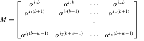

且 $\mathbf{u} = c_{i_1} c_{i_2} \cdots c_{i_w}$。由于 $\mathbf{u} \neq \mathbf{0}$，$M$ 是奇异矩阵，因此 $\det M = 0$。但 $\det M = \alpha^{(i_1+i_2+\cdots+i_w)b} \det V$，其中 $V$ 是 Vandermonde 矩阵

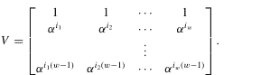

由于 $\alpha^i$ 互不相同，根据引理 4.5.1，$\det V \neq 0$，这与 $\det M = 0$ 矛盾。

**练习 265** 找出一个三重纠错 [15, 5] 二进制循环码的生成多项式和生成矩阵。

BCH 界断言，你希望在定义集中找到最长的一组连续元素。然而，定义集取决于所选的原始元素。设 $\beta = \alpha^a$，其中 $\gcd(a, n) = 1$；因此 $\beta$ 也是原始 $n$ 次单位根。所以，如果 $a^{-1}$ 是 $a$ 模 $n$ 的乘法逆元，则最小多项式 $M_{\beta^a}(x)$ 和 $M_{\beta^{a-1}}(x)$ 相等。因此，相对于原始元素 $\alpha$ 具有定义集 $T$ 的码，与相对于原始元素 $\beta$ 具有定义集 $a^{-1}T \mod n$ 的码相同。因此，在应用 BCH 界或任何其他下界时，如果对定义集应用乘数，可能会得到更高的下界。或者，两个码 $\mathcal{C}$ 和 $\mathcal{C}_{\mu_a}$ 是等价的，并且相对于同一原始元素 $\alpha$ 具有定义集 $T$ 和 $a^{-1}T$（根据推论 4.4.5）；因此它们具有相同的最小权，所以可以使用任一组定义集来产生最佳界。

**例 4.5.4** 设 $\mathcal{C}$ 是具有定义集 $T = \{0, 3, 6, 12, 24, 17\}$ 的 [31, 25, d] 二进制循环码。对 $\mathcal{C}$ 应用 BCH 界，我们看到 $d \ge 2$，因为 $T$ 中最长的连续集大小为 1。然而，将 $T$ 乘以 $3^{-1} \equiv 21 \pmod{31}$，我们得到 $3^{-1}T \mod 31 = \{0, 1, 2, 4, 8, 16\}$。将 $\alpha$ 替换为 $\alpha^3$ 或将 $\mathcal{C}$ 替换为 $\mathcal{C}_{\mu_3}$ 并应用 BCH 界，我们得到 $d \ge 4$。实际上，$\mathcal{C}$ 是 Hamming 码 $\mathcal{H}_5$ 的偶权子码，且 $d = 4$。

**例 4.5.5** 设 $\mathcal{C}$ 是具有定义集 $T = \{1, 2, 3, 4, 6, 8, 9, 12, 13, 16, 18\}$ 的 [23, 12, d] 二进制循环码。BCH 界蕴含 $d \ge 5$，因为 $T$ 有四个连续元素。注意，$T = C_1$，即模 23 包含 1 的 2-徙动类。模 23 下，只有另外两个 2-徙动类：$C_0 = \{0\}$ 和 $C_5 = \{5, 7, 10, 11, 14, 15, 17, 19, 20, 21, 22\}$。设 $\mathcal{C}_e$ 为 $\mathcal{C}$ 的偶权子码


代码字；$\mathcal{C}_s$ 是循环码，其定义集为 $C_0 \cup C_1$（见习题 238）。根据定理 4.4.11，$\mathcal{C}_s$ 是自正交的。因此，根据定理 4.4.18，$\mathcal{C}_s$ 是双均码。故其最小权重至少为 8；根据球包界，它必须恰好为 8。所以 $\mathcal{C}_s$ 仅含有权重为 8、12、16 和 20 的非零代码字。由于 $\mathcal{C}$ 包含全一代码字（见习题 238），$\mathcal{C}_s$ 不能含有权重为 20 的代码字，因为将这样的代码字与 $\mathbf{1}$ 相加会产生一个权重为 3 的代码字，这与 $d \ge 5$ 矛盾。因此 $\mathcal{C}_s$ 仅含有权重为 8、12 和 16 的非零代码字。由于 $\mathcal{C} = \mathcal{C}_1 \cup \mathcal{C}_s$，$\mathcal{C}$ 仅含有权重为 7、8、11、12、15、16 和 23 的非零代码字。特别地，$d = 7$。根据定理 1.12.3，该码必须是 [23, 12, 7] 二进制 Golay 码。

Hartmann 和 Tzeng [117] 表明，如果定义集中存在若干间隔合适的 $\delta-1$ 个元素的连续集合，则 BCH Bound 可以改进。为了陈述我们不予证明的 Hartmann–Tzeng Bound，我们引入以下记法。如果 $A$ 和 $B$ 是模 $n$ 的整数的子集，则 $A + B = \{a + b \mod n \mid a \in A, b \in B\}$。

### 定理 4.5.6 (Hartmann–Tzeng Bound)
设 $\mathcal{C}$ 为在 $\mathbb{F}_q$ 上长度为 $n$、定义集为 $T$ 的循环码。设 $B$ 为 $T$ 中 $\delta-1$ 个连续元素的集合，且 $B = \{jb \mod n \mid 0 \le j \le s\}$，其中 $\gcd(b, n) < \delta$。如果 $A + B \subseteq T$，则 $\mathcal{C}$ 的最小权重 $d$ 满足 $d \ge \delta + s$。

显然，BCH Bound 是 $s=0$ 时的 Hartmann–Tzeng Bound。

### 示例 4.5.7
设 $\mathcal{C}$ 为定义集 $T = \{1, 2, 4, 8, 9, 13, 15, 16\}$ 的长度 17 二进制循环码。$T$ 中有两个连续元素，因此 BCH Bound 给出 $d \ge 3$。Hartmann–Tzeng Bound 对此进行了改进。设 $A = \{1, 2\}$ 和 $B = \{0, 7, 14\}$。所以 $\delta = 3$，$b = 7$，且 $s = 2$；同时 $\gcd(7, 17) = 1 < \delta$。因此 $\mathcal{C}$ 的最小权重 $d \ge 5$。注意，$\mathcal{C}$ 是一个 [17, 9] 码。根据 Griesmer Bound，不存在 [17, 9, 7] 码。故 $d = 5$ 或 6。实际上，$d = 5$；参见 [203]。

### 示例 4.5.8
设 $\mathcal{C}$ 为定义集 $T = \{1, 2, 4, 5, 8, 9, 10, 16, 18, 20\}$ 且最小权重为 $d$ 的长度 31 二进制循环码。由于连续元素 $\{8, 9, 10\}$ 在 $T$ 中，BCH Bound 表明 $d \ge 4$。如果 $d = 4$，则最小权重向量位于 $\mathcal{C}$ 中所有类均码字构成的子码 $\mathcal{C}_s$ 中。根据习题 238，$\mathcal{C}_s$ 是定义集 $T_s = \{0, 1, 2, 4, 5, 8, 9, 10, 16, 18, 20\}$ 的循环码。使用 $A = \{0, 1, 2\}$ 和 $B = \{0, 8\}$ 应用 Hartmann–Tzeng Bound（因为 $\gcd(8, 31) = 1 < \delta = 4$），$\mathcal{C}_s$ 的最小权重至少为 5。因此 $\mathcal{C}$ 的最小权重至少为 5，根据 [203]，这实际上是真实的最小权重。

### 示例 4.5.9
设 $\mathcal{C}$ 为定义集 $T = \{1, 2, 3, 4, 5, 6, 8, 9, 10, 11, 12, 13, 16, 17, 18, 20, 21, 22, 24, 26\}$ 且最小权重为 $d$ 的长度 31 二进制循环码。使用 $A = \{1, 2, 3, 4, 5, 6\}$ 和 $B = \{0, 7\}$ 应用 Hartmann–Tzeng Bound（因为 $\gcd(7, 31) = 1 < \delta = 7$），我们得到 $d \ge 8$。假设 $d = 8$。那么，根据习题 238，$\mathcal{C}$ 中类均码字构成的循环子码 $\mathcal{C}_s$ 的定义集为 $T_s = T \cup \{0\}$。但 $17T_s$ 包含九个连续元素 $\{29, 30, 0, 1, 2, 3, 4, 5, 6\}$。因此，根据 BCH Bound，定义集为 $17T_s$ 的码的最小权重至少为 10，这意味着 $d = 8$ 不可能。故 $d \ge 9$。我们将在示例 4.5.14 中重新考虑该码，在那里我们排除了 $d = 9$ 和 $d = 10$；$d$ 的实际值为 11。

### 习题 266
设 $\mathcal{C}$ 为示例 4.5.9 中的码。通过证明定理 4.4.18 适用于 $\mathcal{C}_r$，排除 $d = 10$ 的可能性。

### 习题 267
设 $C_i$ 为模 $n$ 包含 $i$ 的 2-循环共轭类。对给定长度和定义集 $T$ 的循环码应用 BCH Bound 和 Hartmann–Tzeng Bound。如果将定义集乘以 $a$（其中 $\gcd(a, n) = 1$），对于以下哪些码，其中一个界得到了改进？
- (a) $n = 15$ 且 $T = C_1 \cup C_7$，
- (b) $n = 15$ 且 $T = C_2 \cup C_5$，
- (c) $n = 39$ 且 $T = C_1 \cup C_{13}$，
- (d) $n = 45$ 且 $T = C_1 \cup C_3 \cup C_9 \cup C_5 \cup C_{15}$，
- (e) $n = 51$ 且 $T = C_1 \cup C_9$。

### 习题 268
求示例 4.5.8 和 4.5.9 中码的维数。对于每个码，还要给出由 Griesmer Bound 得出的最小距离上界。

Roos 发现的 Hartmann–Tzeng Bound 的推广见 [296, 297]。

在 [203] 中，van Lint 和 Wilson 给出了可用于产生循环码最小权重下界的技术；我们介绍其中一种，将其称为 van Lint–Wilson Bounding Technique。van Lint–Wilson Bounding Technique 可用于证明 BCH Bound 和 Hartmann–Tzeng Bound。为了使用 van Lint–Wilson Bounding Technique，必须构造与码的定义集相关的模 $n$ 整数子集序列。设 $\mathcal{N} = \{0, 1, \dots n - 1\}$。设 $S \subseteq \mathcal{N}$。$\mathcal{N}$ 的子集序列 $I_0, I_1, I_2 \dots$ 称为关于 $S$ 的独立序列，条件是
- $I_0 = \emptyset$，且
- 如果 $i > 0$，则要么存在某个 $0 \le j < i$ 使得 $I_i = I_j \cup \{a\}$，其中 $I_j \subseteq S$ 且 $a \in \mathcal{N} \setminus S$，要么存在某个 $0 \le j < i$ 和 $b \neq 0$ 使得 $I_i = \{b\} + I_j$。
$\mathcal{N}$ 的子集 $I$ 称为关于 $S$ 的独立集，条件是 $I$ 是关于 $S$ 的独立序列中的一个集合。回顾，$\alpha$ 是 $\mathbb{F}_q$ 中的原始 $n$ 次单位根，其中 $t = \text{ord}_n(q)$。

### 定理 4.5.10 (van Lint–Wilson Bounding Technique)
假设 $f(x) \in \mathbb{F}_q[x]$ 且次数至多为 $n$。设 $I$ 为 $\mathcal{N}$ 的任意子集，且关于 $S = \{i \in \mathcal{N} \mid f(\alpha^i) = 0\}$ 独立。则 $f(x)$ 的权重至少为 $I$ 的大小。

**证明：** 设 $f(x) = c_1 x^{i_1} + c_2 x^{i_2} + \dots + c_w x^{i_w}$，其中 $1 \le j \le w$ 时 $c_j \neq 0$，并设 $I$ 为关于 $S$ 的任意独立集。设 $I_0, I_1, I_2 \dots$ 为关于 $S$ 的独立序列，使得某个 $i \ge 0$ 时 $I = I_i$。如果 $J \subseteq \mathcal{N}$，设 $V(J)$ 为 $\mathbb{F}_{q^n}^n$ 中由以下定义的向量集：

$V(J) = \{(\alpha^{kl_1}, \alpha^{kl_2}, \dots, \alpha^{kl_n}) \mid k \in J\}.$

如果我们证明 $V(I)$ 在 $\mathbb{F}_{q^n}^n$ 中线性无关，则 $w \ge |V(I)| = |I|$。因此，只需对所有 $i \ge 0$ 证明 $V(I)$ 线性无关，我们通过对 $i$ 进行归纳来证明。由于 $I_0 = \emptyset$，$V(I_0)$ 是空集，因此是线性无关的。假设对所有 $0 \le j < i$，$V(I_j)$ 线性无关。$I_i$ 有两种形成方式。首先假设存在某个 $0 \le j < i$ 使得 $I_i = I_j \cup \{a\}$，其中 $I_j \subseteq S$ 且 $a \in \mathcal{N} \setminus S$。根据归纳假设，$V(I_j)$ 线性无关。由于对于 $k \in I_j$，$0 = f(\alpha^a) = c_1 \alpha^{kl_1} + c_2 \alpha^{kl_2} + \dots + c_n \alpha^{kl_n}$，向量 $\mathbf{c} = (c_1, c_2, \dots, c_n)$ 与 $V(I_j)$ 正交。如果 $V(I_i)$ 线性相关，则 $(\alpha^{kl_1}, \alpha^{kl_2}, \dots, \alpha^{kl_n})$ 在 $V(I_j)$ 的张成中，因此与 $(c_1, c_2, \dots, c_n)$ 正交。所以 $0 = c_1 \alpha^{kl_1} + c_2 \alpha^{kl_2} + \dots + c_n \alpha^{kl_n} = f(\alpha^a)$，这与 $a \notin S$ 矛盾。现在假设存在某个 $0 \le j < i$ 和 $b \neq 0$ 使得 $I_i = \{b+I_j\}$。则 $V(I_i) = \{(\alpha^{(b+k)l_1}, \alpha^{(b+k)l_2}, \dots, \alpha^{(b+k)l_n}) \mid k \in I_j\} = V(I_j)D$，其中 $D$ 是非奇异对角矩阵 $\text{diag}(\alpha^{bl_1}, \dots, \alpha^{bl_n})$。由于 $V(I_j)$ 独立，故 $V(I_i)$ 也独立。

BCH Bound 是 van Lint–Wilson Bounding Technique 的推论。

### 推论 4.5.11
设 $\mathcal{C}$ 为在 $\mathbb{F}_q$ 上长度为 $n$ 的循环码。假设 $f(x)$ 是一个非零代码字，使得 $f(\alpha^b) = f(\alpha^{b+1}) = \dots = f(\alpha^{(b+w-1)}) = 0$ 但 $f(\alpha^{b+w}) \neq 0$。则 $\text{wt}(f(x)) \ge w+1$。

**证明：** 设 $S = \{i \in \mathcal{N} \mid f(\alpha^i) = 0\}$。那么 $\{b, b+1, \dots, b+w-1\} \subseteq S$ 但 $b+w \notin S$。归纳定义序列 $I_0, I_1, \dots, I_{2w+1}$ 如下：令 $I_0 = \emptyset$。对于 $0 \le i \le w$，令 $I_{2i+1} = I_{2i} \cup \{b+w\}$；对于 $1 \le i \le w$，令 $I_{2i} = \{1\} + I_{2i-1}$。归纳可得，对于 $0 \le i \le w$，$I_{2i} = \{b+w-i, i, b+w-i+1, \dots, b+w-1\} \subseteq S$。因此，$I_0, I_1, \dots, I_{2w+1}$ 是关于 $S$ 的独立序列。由于 $I_{2w+1} = \{b, b+1, \dots, b+w\}$，van Lint–Wilson Bounding Technique 蕴含 $\text{wt}(f(x)) \ge |I_{2w+1}| = w+1$。

### 习题 269
为什么推论 4.5.11 证明了 BCH Bound 成立？$\blacklozenge$

### 示例 4.5.12
设 $\mathcal{C}$ 为定义集 $T = \{1, 2, 4, 8, 9, 13, 15, 16\}$ 的 [17, 9, d] 二进制循环码。在示例 4.5.7 中，我们看到 BCH Bound 蕴含 $d \ge 3$，而 Hartmann–Tzeng Bound 使用 $A = \{1, 2\}$ 和 $B = \{0, 7, 14\}$ 将其改进为 $d \ge 5$。van Lint–Wilson Bounding Technique 使用以下论证给出相同的界。设 $f(x) \in \mathcal{C}$ 为权重小于 5 的非零代码字。$T$ 是 2-循环共轭类 $C_1$。如果对某个 $i \in C_3$ 有 $f(\alpha^i) = 0$，则 $f(x)$ 是定义集为 $C_1 \cup C_3$ 的循环码中的非零代码字，该码是重复码，因此 $\text{wt}(f(x)) = 17$，这与假设矛盾。令 $S = \{i \in \mathcal{N} \mid f(\alpha^i) = 0\}$，我们假设 $S$ 没有 $C_3 = \{3, 5, 6, 7, 10, 11, 12, 14\}$ 的元素。那么，$\mathcal{N}$ 的以下子集序列关于 $S$ 独立：


$I_0 = \emptyset,$
$I_1 = I_0 \cup \{6\} = \{6\},$
$I_2 = \{-7\} + I_1 = \{16\} \subseteq S,$
$I_3 = I_2 \cup \{6\} = \{6, 16\},$
$I_4 = \{-7\} + I_3 = \{9, 16\} \subseteq S,$
$I_5 = I_4 \cup \{6\} = \{6, 9, 16\},$
$I_6 = \{-7\} + I_5 = \{2, 9, 16\} \subseteq S,$
$I_7 = I_6 \cup \{3\} = \{2, 3, 9, 16\},$
$I_8 = \{-1\} + I_7 = \{1, 2, 8, 15\} \subseteq S,$
$I_9 = I_8 \cup \{3\} = \{1, 2, 3, 8, 15\}.$

由于 wt(f(x)) >= |I_0| = 5，van Lint–Wilson 界定技术表明 d >= 5。事实上，根据 [23]，d = 5。

本例展示了应用 van Lint–Wilson 界定技术的困难。在本例中，Hartmann–Tzeng 界和 van Lint–Wilson 界定技术给出了相同的界。在本例中，为了应用 van Lint–Wilson 界定技术，我们构造了一个独立序列，其集合与 Hartmann–Tzeng 界中使用的集合 A 和 B 关系非常密切。这种构造模仿了推论 4.5.11 证明中使用的构造，在该证明中我们表明 BCH 界源于 van Lint–Wilson 界定技术。如果你推广本例中的构造，可以表明 Hartmann–Tzeng 界也源于 van Lint–Wilson 界定技术。

**练习 270** 证明 Hartmann–Tzeng 界源于 van Lint–Wilson 界定技术。提示：参见示例 4.5.12。

**练习 271** 设 C 为定义集 T = {3, 6, 7, 9, 12, 14, 15, 18} 的 [21, 13, d] 二元循环码。使用 BCH 界、Hartmann–Tzeng 界和 van Lint–Wilson 界定技术，求 C 最小权重的下界。另外，使用 van Lint–Wilson 界定技术，表明奇权重码字的权重至少为 7。提示：对于后者，注意 α^0 不是奇权重码字的根。

**练习 272** 设 C 为定义集 T = {3, 6, 7, 11, 12, 13, 14, 15, 17, 19, 22, 24, 26, 27, 28, 29, 30, 34, 35, 38} 的 [41, 21, d] 二元循环码。
- (a) 求模 41 的 2-循环共轭类。
- (b) 设 f(x) 为非零码字，令 S = {i ∈ N | f(α^i) = 0}。证明若 1 ∈ S，则 f(x) 为 0 或 1 + x + · · · + x^40。
- (c) 假设 1 ∉ S。证明 S = T 或 S = T ∪ {0}。
- (d) 现在假设 f(x) 的权重不超过 8。通过应用构造独立序列的规则，证明下列集合是关于 S 的独立序列的一部分：{28}、{12, 17}、{19, 22, 27}、{3, 6, 11, 30}、{11, 12, 14, 19, 38}、{6, 12, 26, 27, 29, 34}、{6, 7, 13, 27, 28, 30, 35} 和 {1, 6, 7, 13, 27, 28, 30, 35}。
- (e) 由部分 (d)，证明 wt(f(x)) ≥ 8。
- (f) 若 wt(f(x)) = 8，证明 {0, 14, 15, 17, 22, 29, 34, 35} 和 {0, 1, 14, 15, 17, 22, 29, 34, 35} 关于 S 是独立的。
- (g) 证明 d ≥ 9。（事实上，根据 [203]，d = 9。）

本节以 McEliece [231] 结果的二元版本结尾，该结果表明 2 的哪些幂是二元循环码的除数；我们仅给出部分证明，因为完整证明非常困难。回顾，若码中每个码字的权重均为 Δ 的倍数，则称 Δ 为码的一个除数。

### 定理 4.5.13 (McEliece)
设 C 为定义集 T 的二元循环码。设 a ≥ 2 为 N \ T 中元素个数的最小值（允许重复），使得这些元素之和为 0。则 2^(a-1) 是 C 的一个除数，但 2^a 不是。

**证明：** 我们仅证明 a = 2 的情况和 a = 3 情况的一部分。若 a = 2，则 0 ∈ T；否则 a = 1。因此，根据练习 238，C 仅含有偶权重向量，这证明 2^(a-1) = 2 是 C 的一个除数。根据 a 的定义，存在 b ∈ N \ T 使得 -b mod n ∈ N \ T。因此 b ∈ N \ (-1)T mod n；由于 0 ∈ T，故 b ≠ 0。根据定理 4.4.9，N \ (-1)T mod n 是 C^⊥ 的定义集。若 2^a = 4 是 C 的一个除数，则根据定理 1.4.8，C 是自正交的。故 C ⊆ C^⊥，且根据推论 4.2.5（或练习 239），N \ (-1)T mod n ⊆ T。这与 b ∈ N \ (-1)T mod n 且 b ∈ N \ T 矛盾。
若 a = 3，我们仅证明 2^(a-1) = 4 是 C 的一个除数。我们证明 N \ (-1)T mod n ⊆ T。假设不然。则存在 b ∈ N \ (-1)T mod n 使得 b ∉ T。因此 -b mod n ∈ N \ T 且 b ∈ N \ T。由于 b + (-b) = 0，故 a ≠ 3，这与假设矛盾。所以 N \ (-1)T mod n ⊆ T。因此，根据定理 4.4.9 和推论 4.2.5（或练习 239），C ⊆ C^⊥。故 C 是一个自正交二元循环码，根据定理 4.4.18，它必须是双偶的。

### 示例 4.5.14
设 C 为示例 4.5.9 中考虑的定义集 T = {1, 2, 3, 4, 5, 6, 8, 9, 10, 11, 12, 13, 16, 17, 18, 20, 21, 22, 24, 26} 的 [31, 11, d] 二元循环码。在那里我们表明 d ≥ 9。C 中偶权重向量构成的子码 C_e 是一个循环码，其定义集为 T_e = {0} ∪ T（根据练习 238）。注意 N \ T_e = {7, 14, 15, 19, 23, 25, 27, 28, 29, 30}，且该集合中任意两元素之和模 31 不为 0，但 7 + 25 + 30 ≡ 0 (mod 31)。因此，对 C_e 应用 McEliece 定理时 a = 3。故 C_e 中所有向量，进而 C 中所有偶权重向量的权重均为 4 的倍数。特别是，C 中不存在权重为 10 的码字。此外，由于 0 ∉ T，1 + x + ... + x^30 = (x^31 - 1)/(x - 1) ∈ C。因此，若 C 中有一个权重为 w 的向量，则其中有一个权重为 31 - w 的向量。具体而言，若 C 中有一个权重为 9 的码字，则其中有一个权重为 22 的码字，这产生矛盾。故 d ≥ 11。Griesmer 界给出 d ≤ 11。根据 (203)，d = 11。

**练习 273** 设 C 为定义集 T = {0, 1, 3, 4, 6, 7, 8, 11, 12, 14, 16} 的 [21, 9, d] 二元循环码。证明 d ≥ 8。

## 4.6 循环码的 Meggitt 译码

本节介绍了一种称为 Meggitt 译码 [238, 239] 的循环码译码技术。Meggitt 译码有多种变体；我们将介绍其中两种。Meggitt 译码是置换译码的一个特例，将在 10.2 节中进一步探讨。置换译码本身是误差捕获的一个特例。

设 C 为 F_q 上的一个 [n, k, d] 循环码，生成多项式 g(x) 的次数为 n - k；C 可纠正 t = [(d - 1)/2] 个错误。假设 c(x) ∈ C 被发送，y(x) = c(x) + e(x) 被接收，其中 e(x) = e_0 + e_1 x + ... + e_{n-1} x^{n-1} 是误差向量，且 wt(e(x)) <= t。Meggitt 译码器存储坐标 n - 1 出错的误差模式的综合征。我们介绍的 Meggitt 译码算法的两个版本可简要描述如下。在第一个版本中，通过最多移位 y(x) n 次，译码器从列表中找到误差向量 e(x) 并纠正错误。在第二个版本中，通过移位 y(x) 直到坐标 n - 1 出现错误，译码器找到该坐标中的错误，仅纠正该错误，然后通过进一步移位按 n - 2, n - 3, ..., 1, 0 的顺序纠正其他坐标中的错误。可以看出，Meggitt 译码利用了码的循环特性。

对于 F_q[x] 中的任意向量 v(x)，令 R_{g(x)}(v(x)) 为根据除法算法 v(x) 除以 g(x) 得到的唯一余数；即 R_{g(x)}(v(x)) = r(x)，其中 v(x) = g(x) f(x) + r(x)，且 r(x) = 0 或 deg r(x) < n - k。函数 R_{g(x)} 满足以下性质；证明留作练习。

### 定理 4.6.1
采用上述记号，以下结论成立：
- (i) 对于 F_q[x] 中的所有 v(x), v'(x) 以及 F_q 中的所有 a, b，R_{g(x)}(a v(x) + b v'(x)) = a R_{g(x)}(v(x)) + b R_{g(x)}(v'(x))。
- (ii) R_{g(x)}(v(x) + a(x)(x^n - 1)) = R_{g(x)}(v(x))。
- (iii) R_{g(x)}(v(x)) = 0 当且仅当 v(x) mod (x^n - 1) ∈ C。
- (iv) 若 c(x) ∈ C，则 R_{g(x)}(c(x) + e(x)) = R_{g(x)}(e(x))。
- (v) 若 R_{g(x)}(e(x)) = R_{g(x)}(e'(x))，其中 e(x) 和 e'(x) 的权重均不超过 t，则 e(x) = e'(x)。
- (vi) 若 deg v(x) < n - k，则 R_{g(x)}(v(x)) = v(x)。

**练习 274** 证明定理 4.6.1。

该定理的部分 (ii) 表明，我们可以无歧义地将 R_{g(x)} 应用于 R_n 或 F_q[x] 中的元素。我们现在需要一个由 Meggitt 提出的定理，以简化与 R_{g(x)} 的计算。

### 定理 4.6.2
设 g(x) 为次数为 n - k 的 x^n - 1 的一个首一因式。若 R_{g(x)}(v(x)) = s(x)，则
R_{g(x)}(x v(x) mod (x^n - 1)) = R_{g(x)}(x s(x)) = x s(x) - g(x) s_{n-k-1},
其中 s_{n-k-1} 为 s(x) 中 x^{n-k-1} 的系数。


证明：根据定义 \(v(x) = g(x)f(x) + s(x)\)，其中 \(s(x) = \sum_{i=0}^{n-k-1} s_i x^i\)。所以 \(xv(x) = xg(x)f(x) + xs(x) = xg(x)f(x) + g(x)f_1(x) + s'(x)\)，其中 \(s'(x) = R_{g(x)}(xs(x))\)。另外 \(xv(x) \mod (x^n - 1) = xv(x) - (x^n - 1)u_{n-1}\)。因此 \(xv(x) \mod (x^n - 1) = xg(x)f(x) + g(x)f_1(x) + s'(x) - (x^n - 1)u_{n-1} = g(x)(xf(x) + f_1(x) - h(x)u_{n-1}) + s'(x)\)，其中 \(g(x)h(x) = x^n - 1\)。因此 \(R_{g(x)}(xv(x) \mod (x^n - 1)) = s'(x) = R_{g(x)}(xs(x))\)，因为 \(\deg s'(x) < n - k\)。由于 \(g(x)\) 是次数为 \(n - k\) 的首一多项式，且 \(s(x) = \sum_{i=0}^{n-k-1} s_i x^{i+1}\)，\(x s(x)\) 除以 \(g(x)\) 的余数是 \(xs(x) - g(x)x s_{n-k-1}\)。

我们现在描述Meggitt解码算法的第一个版本，并用示例说明每个步骤。定义任意 \(v(x)\) 的综合多项式 \(S(v(x))\) 为 \(S(v(x)) = R_{g(x)}(x^{n-k}v(x))\)。

根据定理4.6.1(iii)，如果 \(v(x) \in R_n\)，则 \(S(v(x)) = 0\) 当且仅当 \(v(x) \in C\)。

- 步骤 I：这是一次性预计算。找出所有误差模式 \(e(x) = \sum_{i=0}^{n-1} e_i x^i\) 的综合多项式 \(S(e(x))\)，使得 \(wt(e(x)) \le t\) 且 \(e_{n-1} \neq 0\)。

## 示例 4.6.3

令 \(C\) 为定义集 \(T = \{1, 2, 3, 4, 6, 8, 9, 12\}\) 的 [15, 7, 5] 二进制循环码。令 \(\alpha\) 为 \(F_{16}\) 中的15次单位根。那么 \(g(x) = 1 + x^4 + x^6 + x^7 + x^8\) 是 \(C\) 的生成多项式，\(e(x)\) 的综合多项式为 \(S(e(x)) = R_{g(x)}(x^8 e(x))\)。步骤 I 产生以下综合多项式：

| e(x) | S(e(x)) | e(x) | S(e(x)) |
|------|---------|------|---------|
| \(x^{14}\) | \(x^7\) | \(x^6 + x^{14}\) | \(x^3 + x^5 + x^6\) |
| \(x^{13} + x^{14}\) | \(x^5 + x^7\) | \(x^5 + x^{14}\) | \(x^2 + x^4 + x^6 + x^7\) |
| \(x^{12} + x^{14}\) | \(x^4 + x^7\) | \(x^4 + x^{14}\) | \(x + x^3 + x^4 + x^5 + x^7\) |
| \(x^{11} + x^{14}\) | \(x^2 + x^7\) | \(x^3 + x^{14}\) | \(1 + x^2 + x^3 + x^4 + x^7\) |
| \(x^{10} + x^{14}\) | \(x^4 + x^7\) | \(x^2 + x^{14}\) | \(x + x^2 + x^3 + x^6\) |
| \(x^9 + x^{14}\) | \(x^2 + x^7\) | \(x + x^{14}\) | \(1 + x + x^4 + x^5 + x^6 + x^7\) |
| \(x^8 + x^{14}\) | \(x + x^7\) | \(1 + x^{14}\) | \(1 + x^4 + x^6\) |
| \(x^7 + x^{14}\) | \(1 + x^7\) | | |

这些综合多项式的计算借助了定理4.6.1和4.6.2。例如，在计算 \(x^{12} + x^{14}\) 的综合多项式时，有 \(S(x^{12} + x^{14}) = R_{g(x)}(x^8(x^{12} + x^{14})) = R_{g(x)}(x^3 + x^7) = x^3 + x^7\)，使用了定理4.6.1(i)。在计算 \(1 + x^{14}\) 的综合多项式时，首先观察到 \(R_{g(x)}(x^8) = 1 + x^4 + x^6 + x^7\)，然后 \(S(1 + x^{14}) = R_{g(x)}(x^8 + x^{14}) = R_{g(x)}(x^8) + R_{g(x)}(x^{12} + x^{14}) = x^3 + x^7\)。根据定理4.6.2可知 \(R_{g(x)}(x^{12}) = R_{g(x)}(x^{27}) = R_{g(x)}(x(1 + x^4 + x^6 + x^7)) = R_{g(x)}(x + x^5 + x^7) + R_{g(x)}(x^8) = x + x^4 + x^6 + x^7 + 1 + x + x^4 + x^6 + x^7 = x^5\)。因此在计算 \(x + x^{14}\) 的综合多项式时，有 \(S(x + x^{14}) = R_{g(x)}(x^9(x^8 + x^{14})) = R_{g(x)}(x^9 + x^{13}) = R_{g(x)}(x^9) + R_{g(x)}(x^{13}) = 1 + x + x^4 + x^5 + x^6 + x^7\)。其余情况类似。

## 练习 275

验证示例4.6.3中找到的综合多项式。

- 步骤 II：假设 \(y(x)\) 是接收向量。计算综合多项式 \(S(y(x)) = R_{g(x)}(x^{n-k}y(x))\)。根据定理4.6.1(iv)，\(S(y(x)) = S(e(x))\)，其中 \(y(x) = c(x) + e(x)\) 且 \(c(x) \in C\)。

## 示例 4.6.4

继续示例4.6.3，假设接收到 \(y(x) = 1 + x^4 + x^7 + x^9 + x^{10} + x^{12}\)。则 \(S(y(x)) = x + x^2 + x^6 + x^7\)。

## 练习 276

验证示例4.6.4中 \(S(y(x)) = x + x^2 + x^6 + x^7\)。

- 步骤 III：如果 \(S(y(x))\) 在步骤 I 计算的列表中，则你知道误差多项式 \(e(x)\)，并可以从 \(y(x)\) 中减去它以得到代码字 \(c(x)\)。如果 \(S(y(x))\) 不在列表中，则继续步骤 IV。

## 示例 4.6.5

示例4.6.4中的 \(S(y(x))\) 不在示例4.6.3给出的综合多项式列表中。

- 步骤 IV：依次计算 \(xy(x)\)、\(x^2y(x)\) 等的综合多项式，直到综合多项式出现在步骤 I 的列表中。如果 \(S(y^k(x))\) 在此列表中，并与误差多项式 \(e'(x)\) 关联，则接收向量被解码为 \(y(x) - x^{k-1}e'(x)\)。

步骤 IV 的计算最容易使用定理4.6.2来执行。由于 \(R_{g(x)}(x^{n-k}y(x)) = S(y(x)) = \sum_{i=0}^{n-k-1} s_i x^i\)。

```
S(xy(x)) = R_{g(x)}(x^{n-k}xy(x)) = R_{g(x)}(x(x^{n-k}y(x))) = R_{g(x)}(xS(y(x)))
= xS(y(x)) - s_{n-k-1}g(x). \tag{4.8}
```

我们以同样的方式从 \(xy(x)\) 的综合式得到 \(x^2y(x)\) 的综合式。

## 示例 4.6.6

继续示例4.6.4，使用(4.8)和 \(S(y(x)) = x + x^2 + x^6 + x^7\)，可得 \(S(xy(x)) = (x + x^2 + x^6 + x^7) - 1 \cdot g(x) = 1 + x^4 + x^7 + x^8 + x^9\)，这不在示例4.6.3的列表中。使用(4.8)，\(S(x^2y(x)) = x(1 + x^4 + x^7 + x^8 + x^9 + x^6) - g(x) = x + x^5 + x^8 + x^9 + x^{10} + x^7\)，这对应于误差 \(x^4 + x^{14}\)，意味着 \(y(x)\) 被解码为 \(y(x) - (x^2 + x^{12}) = 1 + x^2 + x^4 + x^7 + x^9 + x^{10}\)。请注意，这是代码字 \((1 + x^3)g(x)\)。

Meggitt解码器可以用移位寄存器电路实现，Meggitt解码算法的第二个版本常被采用以简化该电路。在这个第二种实现中，电路只纠正移位寄存器中向量的第 \(n - 1\) 个坐标。移位寄存器中的向量最初为接收向量 \(y(x)\)；如果在位置 \(n - 1\) 处有误差，则将其纠正。然后将移位 \(xy(x)\) 移入移位寄存器。如果在第 \(n - 1\) 个坐标处有误差，则将其纠正；这实际上纠正了 \(y(x)\) 的第 \(n - 2\) 个坐标。此过程持续进行，直到 \(y(x)\) 及其 \(n - 1\) 个移位都被移入移位寄存器并被检查。在每个阶段，只纠正移位寄存器末端的误差。这个过程纠正了原始接收向量 \(y(x)\)，因为 \(x^i y(x)\) 的第 \(n - 1\) 个坐标的纠正会产生 \(y(x)\) 的第 \(n - 1 - i\) 个坐标的纠正。Meggitt解码的这个版本允许使用内部阶段不需要直接访问和修改的移位寄存器，并允许电路中使用更少的导线。对于对电路设计感兴趣的读者，请参阅 [21]。我们通过继续示例4.6.6在二进制情况下说明这一点。

## 示例 4.6.7

计算 \(y(x)\)、\(xy(x)\) 和 \(x^2y(x)\) 的综合多项式后，我们得出 \(x^2y(x)\) 的第14个坐标存在误差，即 \(y(x)\) 的第12个坐标存在误差。因此我们在第14个坐标处修改 \(x^7y(x)\) 以得到 \(x^7y'(x) = x^2 + x^4 + x^9 + x^{11} + x^{12}\)（其中 \(y'(x) = 1 + x^4 + x^7 + x^9 + x^{10}\) 是在第12个坐标处纠正后的 \(y(x)\)）。这也改变了综合式。幸运的是，这种变化简单如下处理。\(S(x^7y'(x)) = R_{g(x)}(x^7y'(x)) = R_{g(x)}(x^7y(x)) - R_{g(x)}(x^{14}) = S(x^7y(x)) - R_{g(x)}(x^{14})\)，因为 \(x^7y'(x) = x^7y(x) - x^{14}\)，因为我们只改变了 \(x^7y(x)\) 的第14个坐标。但是，根据示例4.6.6，\(S(x^7y(x)) - R_{g(x)}(x^{14}) = x + x^7 + x^4 + x^7 - x^7 = x^7 + x^4 + x^3\)，因为 \(R_{g(x)}(x^{22}) = R_{g(x)}(x^7) = x^7\)。因此，为了得到 \(x^7y'(x)\) 的新综合式，我们取 \(S(x^7y(x))\) 并减去 \(x^7\)。这普遍成立：也就是说，在纠正误差后得到新的综合多项式，取旧的综合式并减去 \(x^7\)。综合多项式中的这个简单修改正是定义综合式 \(S(u(x))\) 为 \(R_{g(x)}(x^{k-1}u(x))\) 的原因；如果我们使用更自然的 \(R_{g(x)}(u(x))\) 作为 \(u(x)\) 的综合多项式的定义，我们在此阶段就会有一个更复杂的综合式修改。因此我们计算并得到以下表格：

| 多项式 | 综合式 | 多项式 | 综合式 |
|------------|----------|-------------|----------|
| \(x^3y'(x)\) | \(x^2+x^4+x^5+x^6\) | \(x^8y'(x)\) | \(x^3\) |
| \(x^4y'(x)\) | \(x^3+x^5+x^6+x^7\) | \(x^9y'(x)\) | \(x^4\) |
| \(x^5y'(x)\) | \(1\) | \(x^{10}y'(x)\) | \(x^5\) |
| \(x^6y'(x)\) | \(x\) | \(x^{11}y'(x)\) | \(x^6\) |
| \(x^7y'(x)\) | \(x^2\) | \(x^{12}y'(x)\) | \(x^7\) |

我们看到，我们的综合式中没有一个出现在步骤 I 的列表中，直到 \(x^{12}y'(x)\) 的综合式。因此我们改变 \(x^{12}y'(x) = x + x^4 + x^7 + x^{11} + x^{12}\) 的第14个坐标，以得到 \(x^{12}y''(x) = x + x^4 + x^9 + x^7 + x^{12} + x^{14}\)（其中 \(y''(x) = 1 + x^2 + x^4 + x^7 + x^9 + x^{10}\) 是在第2个坐标处更改后的 \(y(x)\)）。如上所述，\(x^{12}y''(x)\) 的综合式为 \(x^7 - x^7 = 0\)。如果我们的电路设计为检查零综合多项式，我们可以在此停止。否则，我们计算 \(x^{13}y'(x)\) 和 \(x^{14}y'(x)\) 的综合式，它们都是0且不在列表中，表明程序应停止，因为我们已经考虑了接收向量的所有循环移位。因此正确的向量是 \(y''(x)\)，并且事实上它正是此版本Meggitt解码中使用的移位寄存器电路输出的向量。

## 练习 277

验证示例4.6.7中的结果。

在二进制情况下，我们一次只纠正高阶误差，无需存储每个综合式对应的误差多项式。显然，我们解码算法的速度取决于列表的大小和模式匹配的速度。


电路的识别。Meggitt 解码还有进一步的变体，我们再次请读者参考 [21]。

**练习 278** 与示例 4.6.3 中相同的代码，如果发生了两个或更少的错误，并且接收到 $y(x) = 1 + x + x^6 + x^9 + x^{11} + x^{12} + x^{13}$，求发送的代码字。请以两种方式完成：
- (a) 执行步骤 I-IV（即，Meggitt 解码算法的第一个版本）。
- (b) 通过仅纠正高阶位并像示例 4.6.7 中那样移位来执行 Meggitt 解码（即，Meggitt 解码算法的第二个版本）。

## 4.7 仿射不变码

在本节中，我们将探讨某些循环码的扩展，并研究一类称为仿射不变码的重要码。Reed-Muller 码和第 7 章定义的某些 BCH 码都是仿射不变码。

我们将为“原始”循环码提供一个新的背景，这将帮助我们描述仿射不变码。在 $\mathbb{F}_q$ 上的原始循环码是长度为 $n = q^l - 1$ 的循环码，其中 $l$ 为某个整数。为继续，我们需要一些符号。

令 $\mathcal{I}$ 表示阶为 $q^l$ 的域，它是 $\mathbb{F}_q$ 的扩展域。集合 $\mathcal{I}$ 将是我们长度为 $q^l$ 的扩展循环码的索引集。令 $\mathcal{I}^*$ 为 $\mathcal{I}$ 的非零元素，并假设 $\alpha$ 是 $\mathcal{I}$ 中的原始 $n$ 次单位根（因此也是 $\mathcal{I}$ 的原始元素）。集合 $\mathcal{I}^*$ 将是我们长度为 $n = q^l - 1$ 的原始循环码的索引集。令 $X$ 为不定式，令

$$\mathbb{F}_q[\mathcal{I}] = \left\{ a = \sum_{g \in \mathcal{I}} a_g X^g \mid a_g \in \mathbb{F}_q \text{ for all } g \in \mathcal{I} \right\}.$$

集合 $\mathbb{F}_q[\mathcal{I}]$ 实际上是在以下运算下的一个代数

$$c \sum_{g \in \mathcal{I}} a_g X^g + d \sum_{g \in \mathcal{I}} b_g X^g = \sum_{g \in \mathcal{I}} (c a_g + d b_g) X^g$$

其中 $c, d \in \mathbb{F}_q$，以及

$$\sum_{g \in \mathcal{I}} a_g X^g \sum_{g \in \mathcal{I}} b_g X^g = \sum_{g \in \mathcal{I}} \left( \sum_{h \in \mathcal{I}} a_h b_{g-h} \right) X^g.$$

$\mathbb{F}_q[\mathcal{I}]$ 的零元和单位元分别为 $\sum_{g \in \mathcal{I}} 0 X^g$ 和 $X^0$。这是 $\mathcal{I}$ 的加群在 $\mathbb{F}_q$ 上的群代数。令

$$\mathbb{F}_q[\mathcal{I}^*] = \left\{ a = \sum_{g \in \mathcal{I}^*} a_g X^g \mid a_g \in \mathbb{F}_q \text{ for all } g \in \mathcal{I}^* \right\}.$$

1 长度为 $n = q^l - 1$ 且在 $\mathbb{F}_q$ 的扩展域上的循环码也称为原始码，但我们将只研究更受限的情况。

$\mathbb{F}_q[\mathcal{I}^*]$ 是 $\mathbb{F}_q[\mathcal{I}]$ 的子空间，但不是子代数。因此 $\mathbb{F}_q[\mathcal{I}^*]$ 的元素形式为

$\sum_{i=0}^{n-1} a_{a^i} X^{a^i}.$

而 $\mathbb{F}_q[\mathcal{I}]$ 的元素形式为

$a_0 X^0 + \sum_{i=0}^{n-1} d_{a^i} X^{a^i}.$

向量空间 $\mathbb{F}_q[\mathcal{I}^*]$ 将是原始循环码的新背景，而代数 $\mathbb{F}_q[\mathcal{I}]$ 将是扩展循环码的背景。因此，两种码实际上都包含在 $\mathbb{F}_q[\mathcal{I}]$ 中，这使得仿射不变码的讨论更加可行。

假设 $\mathcal{C}$ 是在 $\mathbb{F}_q$ 上长度为 $n = q^l - 1$ 的循环码。$\mathcal{C}$ 的坐标已表示为 $\{0, 1, \dots, n-1\}$。在 $\mathcal{R}_n$ 中，代码字 $\mathbf{c} = c_0 c_1 \cdots c_{n-1}$ 的第 $i$ 个分量 $c_i$（关联多项式为 $c(x)$）是 $c(x)$ 中项 $c_i x^i$ 的系数；分量 $c_i$ 保留在位置 $x^i$。现在我们将 $\mathbf{c}$ 与元素 $C(X) \in \mathbb{F}_q[\mathcal{I}^*]$ 关联如下：

$\mathbf{c} \leftrightarrow C(X) = \sum_{i=0}^{n-1} C_{a^i} X^{a^i} = \sum_{g \in \mathcal{I}^*} C_g X^g, \quad (4.9)$

其中 $C_{a^i} = c_i$。因此 $\mathbf{c}$ 的第 $i$ 个分量是 $C(X)$ 中项 $C_{a^i} X^{a^i}$ 的系数；分量 $c_i$ 保留在位置 $X^{a^i}$。

**示例 4.7.1** 考虑在 $\mathbb{F}_2$ 上 $\mathcal{R}_7$ 中的元素 $c(x) = 1 + x + x^3$。所以 $n = 7 = 2^3 - 1$。令 $\alpha$ 为 $\mathbb{F}_8$ 的原始元素。则 $c_0 = C_{a^0} = 1, c_1 = C_{a^1} = 1$，且 $c_3 = C_{a^3} = 1$，其余 $c_i = C_{a^i} = 0$。所以

$c(x) = 1 + x + x^3 \leftrightarrow C(X) = X + X^a + X^{a^3}.$

我们现在需要根据对应关系 (4.9) 考察循环移位 $xc(x)$。我们有

$xc(x) = c_{n-1} + \sum_{i=1}^{n-1} c_{i-1} x^i \leftrightarrow \sum_{i=0}^{n-1} C_{a^{i-1}} X^{a^i} = \sum_{i=0}^{n-1} C_{a^i} X^{a \cdot a^i}.$

**示例 4.7.2** 我们继续示例 4.7.1。即，

$xc(x) = x + x^2 + x^4 \leftrightarrow X^a + X^{a^2} + X^{a^4}.$

在我们的新记法中，在 $\mathbb{F}_q$ 上长度为 $n = q^l - 1$ 的原始循环码是 $\mathbb{F}_q[\mathcal{I}^*]$ 的任何子集 $\mathcal{C}$，使得

$\sum_{i=0}^{n-1} C_{a^i} X^{a \cdot a^i} = \sum_{g \in \mathcal{I}^*} C_g X^{ag} \in \mathcal{C} \quad \text{if and only if}$

$\sum_{i=0}^{n-1} C_{a^i} X^{a \cdot a^i} = \sum_{g \in \mathcal{I}^*} C_g X^{ag} \in \mathcal{C}. \quad (4.10)$

我们的循环码的坐标由 $\mathcal{I}^*$ 索引。我们现在准备扩展我们的循环码。我们使用元素 $0 \in \mathcal{I}$ 来索引扩展坐标。$C(X) = \sum_{g \in \mathcal{I}} C_g X^g$ 的扩展代码字为 $\bar{C}(X) = \sum_{g \in \mathcal{I}} C_g X^g$，使得 $\sum_{g \in \mathcal{I}} C_g = 0$。

**示例 4.7.3** 我们继续示例 4.7.1 和 4.7.2。如果 $C(X) = X + X^a + X^b$，则 $\bar{C}(X) = X^0 + X + X^a + X^b = 1 + X + X^a + X^b$。

根据 (4.10)，并结合观察 $X^{a \cdot 0} = X^0 = 1$，在此术语中，扩展循环码是 $\mathbb{F}_q[\mathcal{I}]$ 的一个子空间 $\bar{C}$，使得

$$
\sum_{g \in \mathcal{I}} C_g X^g \in \bar{C} \quad \text{if and only if} \quad \sum_{g \in \mathcal{I}} C_g X^{ag} \in \bar{C} \quad \text{and} \quad \sum_{g \in \mathcal{I}} C_g = 0.
$$

使用这个新记法，我们想看看零点和定义集的概念在哪里体现。这可以借助函数 $\phi_t$ 来完成。令 $\bar{\mathcal{N}} = \{s \mid 0 \le s \le n\}$。对于 $s \in \bar{\mathcal{N}}$，定义 $\phi_s : \mathbb{F}_q[\mathcal{I}] \to \mathcal{I}$ 为

$$
\phi_s \left( \sum_{g \in \mathcal{I}} C_g X^g \right) = \sum_{g \in \mathcal{I}} C_g g^s.
$$

按惯例，在 $\mathcal{I}$ 中 $0^0 = 1$。因此 $\phi_0(\bar{C}(X)) = \sum_{g \in \mathcal{I}} C_g$，这意味着 $\bar{C}(X)$ 是 $C(X)$ 的扩展代码字，当且仅当 $\phi_0(\bar{C}(X)) = 0$。特别是，如果 $\bar{C}$ 是扩展循环码，则对所有 $\bar{C}(X) \in \bar{C}$ 都有 $\phi_0(\bar{C}(X)) = 0$。当 $1 \le s \le n - 1$ 时，$\phi_s(\bar{C}(X))$ 是什么？由于在 $\mathcal{I}$ 中 $0^s = 0$，

$$
\phi_s(\bar{C}(X)) = \sum_{i=0}^{n-1} C_{a^i}(a^i)^s = \sum_{i=0}^{n-1} C_{a^i}(a^s)^i = c(a^s), \quad (4.11)
$$

其中 $c(x)$ 是 $\mathbb{F}_q[\mathcal{I}^*]$ 中与 $C(X)$ 关联的 $\mathcal{R}_n$ 中的多项式。假设我们在 $\mathcal{R}_n$ 中定义的原始码 $\mathcal{C}$ 相对于 $n$ 次单位根 $\alpha$ 具有定义集 $T$。那么 (4.11) 表明，如果 $1 \le s \le n - 1$，则 $s \in \bar{T}$ 当且仅当对所有 $\bar{C}(X) \in \bar{C}$ 都有 $\phi_s(\bar{C}(X)) = 0$。最后，$\phi_0(\bar{C}(X))$ 是什么？示例 (4.11) 在这种情况下也适用，这意味着 $a^0 = 1$ 是 $\mathcal{C}$ 的零点，当且仅当对所有 $\bar{C}(X) \in \bar{C}$ 都有 $\phi_0(\bar{C}(X)) = 0$。但 $a^0 = a^n = 1$。因此，根据练习 238，我们有 $0 \in \bar{T}$ 当且仅当对所有 $\bar{C}(X) \in \bar{C}$ 都有 $\phi_0(\bar{C}(X)) = 0$。我们现在可以用定义集来描述扩展循环码如下：长度为 $q^l$ 的码 $\bar{C}$ 是具有定义集 $\bar{T}$ 的扩展循环码，前提是 $\bar{T} \subseteq \bar{\mathcal{N}}$ 是模 $n = q^l - 1$ 的 $q$-循环类的并集，且 $0 \in \bar{T}$，并且

$$
\bar{C} = \{ \bar{C}(X) \in \mathbb{F}_q[\mathcal{I}] \mid \phi_s(\bar{C}(X)) = 0 \text{ for all } s \in \bar{T} \}. \quad (4.12)
$$

我们提出几点说明。

- $0$ 和 $n$ 在 $\bar{T}$ 中，且各自是自身的 $q$-循环类。
- $0 \in \bar{T}$ 是因为我们需要 $\bar{C}$ 中所有代码字都是偶权型的。
- 如果 $n \in \bar{T}$，则 $\phi_n(\bar{C}(X)) = \sum_{g \in \mathcal{I}} C_g = 0$。由于扩展代码字是偶权型的（因为 $0 \in \bar{T}$），$\sum_{g \in \mathcal{I}} C_g = 0$。因此扩展坐标始终为 0，这一条件使得扩展变得平凡。
- $\bar{C}$ 的定义集 $\bar{T}$ 与定义集 $T$ 密切相关：$\bar{T}$ 通过取 $T$，如果 $0 \in T$ 则将 0 改为 $n$，并添加 0 来得到。


- \( s \in \widehat{T} \) 且 \( 1 \le s \le n \) 当且仅当 \( \alpha^s \) 是 \( \widehat{C} \) 的一个零点。
- 通过在 \( \mathcal{I} \) 上采用自然序 \( 0, \alpha^s, \alpha^{2s}, \dots, \alpha^{s-1} \)，我们可以使这些代码的扩展循环性质显而易见。标记为 0 的坐标是奇偶检查坐标，在该坐标上对代码 \( \widehat{C} \) 进行短缩得到代码 \( C \)，该代码将标准循环移位 \( \sigma \to \alpha \sigma \) 作为自同构。
- 要检查 \( \mathcal{R}_n \) 中的代码 \( C \) 是否具有定义集 \( T \) 的循环代码，只需验证对于所有 \( s \in T \)，\( c(x) \in C \) 当且仅当 \( c(\alpha^s) = 0 \)。与此类似，要检查 \( \mathbb{F}_q[\mathcal{I}] \) 中的代码 \( \widehat{C} \) 是否具有定义集 \( \widehat{T} \) 的扩展循环代码，只需验证对于所有 \( s \in \widehat{T} \)，\( \widehat{C}(X) \in \widehat{C} \) 当且仅当 \( \phi_s(\widehat{C}(X)) = 0 \)。

### 示例 4.7.4
设 \( C \) 为具有定义集 \( T = \{1, 2, 4\} \) 和生成多项式 \( g(X) = \prod_{i \in T} (X - \alpha^i) = 1 + x + x^3 \) 的 \( (7, 4) \) 二进制循环代码，其中 \( \alpha \) 是满足 \( \alpha^3 = 1 + \alpha \) 的 \( \mathbb{F}_8 \) 的原根。参见示例 3.4.3 和 4.3.4。扩展生成多项式为 \( 1 + X + X^4 + X^6 \)。则 \( \widehat{C} \) 的一个生成矩阵为

| 1 | X | X^{\alpha} | X^{\alpha^2} | X^{\alpha^3} | X^{\alpha^4} | X^{\alpha^5} | X^{\alpha^6} |
|---|---|---|---|---|---|---|---|---|
| 1 | 1 | 1 | 0 | 1 | 0 | 0 | 0 |
| 1 | 0 | 1 | 1 | 0 | 1 | 0 | 0 |
| 1 | 0 | 0 | 1 | 1 | 0 | 1 | 0 |
| 1 | 0 | 0 | 0 | 1 | 1 | 0 | 1 |

注意这是扩展海明码 \( \widehat{\mathcal{H}}_3 \)。它具有定义集 \( \widehat{T} = \{0, 1, 2, 4\} \)。

在第 1.6 节中，我们描述了置换自同构如何作用于代码。根据该节的讨论，\( \mathcal{I} \) 上的一个置换 \( \sigma \) 对 \( \widehat{C} \) 的作用如下：

$$
\left( \sum_{g \in \mathcal{E}} C_g X^g \right)^\sigma = \sum_{g \in \mathcal{E}} C_g X^{g\sigma}.
$$

我们定义仿射群 \( \text{GA}_l(\mathcal{I}) \) 为 \( \text{GA}_l(\mathcal{I}) = \{\sigma_{a,b} \mid a \in \mathcal{I}^*, b \in \mathcal{I} \} \)，其中 \( g\sigma_{a,b} = ag + b \)。注意，映射 \( \sigma_{a,0} \) 仅仅是坐标 \( \{a^i, a^{i+1}, \dots, a^{n-1} \} \) 上的循环移位，每个都固定坐标 0。群 \( \text{GA}_l(\mathcal{I}) \) 的阶为 \( (n+1)n = q^t(q^t - 1) \)。仿射不变代码是在 \( \mathbb{F}_q \) 上的扩展循环代码 \( \widehat{C} \)，使得 \( \text{GA}_l(\mathcal{I}) \subseteq \text{PAut}(\widehat{C}) \)。令人惊讶的是，我们可以通过检查它们的定义集来轻松决定哪些扩展循环代码是仿射不变的。为此，我们在 \( \widehat{N} \) 上引入一个偏序 \( \preceq \)。假设 \( q = p^m \)，其中 \( p \) 是素数。则 \( \widehat{N} = \{0, 1, \dots, n \} \)，其中 \( n = q^t - 1 = p^{mt} - 1 \)。因此，每个元素 \( s \in \widehat{N} \) 都可以写成其 \( p \)-进展开式

$$
s = \sum_{i=0}^{mt-1} s_i p^i, \quad \text{where } 0 \le s_i < p \text{ for } 0 \le i < mt.
$$

我们说 \( r \le s \) 当且仅当对于所有 \( 0 \le i < mt \) 都有 \( r_i \le s_i \)，其中 \( r = \sum_{i=0}^{mt-1} r_i p^i \) 是 \( r \) 的 \( p \)-进展开式。注意，如果 \( r \preceq s \)，则特别地 \( r \le s \)。我们还需要一个称为卢卡斯定理（Lucas' Theorem）[209]的结果，其证明可见 [18]。

### 定理 4.7.5（卢卡斯）
设 $r = \sum_{i=0}^{mt-1} r_i p^i$ 和 $s = \sum_{i=0}^{mt-1} s_i p^i$ 为 $r$ 和 $s$ 的 $p$-进展开式。则

$$
\binom{s}{r} \equiv \prod_{i=0}^{mt-1} \binom{s_i}{r_i} \pmod p.
$$

我们现在准备好从定义集确定仿射不变代码，这是 Kasami、Lin 和 Peterson [162] 的结果。

### 定理 4.7.6
设 $\widehat{C}$ 为长度为 $q^t$ 且具有定义集 $\widehat{T}$ 的扩展循环代码。代码 $\widehat{C}$ 是仿射不变的，当且仅当每当 $s \in \widehat{T}$ 时，对于所有满足 $r \preceq s$ 的 $r \in \widehat{\mathcal{N}}$，都有 $r \in \widehat{T}$。

**证明：** 假设 $\widehat{C}(X) = \sum_{k \in \widehat{T}} C_k X^k \in \widehat{C}$。取 $s \in \widehat{N}$ 和 $a, b \in \mathcal{I}$，其中 $a \neq 0$。则 $(\widehat{C}(X))\sigma_{a,b} = \sum_{k \in \widehat{T}} C_k X^{ak+b}$。因此，

$$
\phi_s((\widehat{C}(X))\sigma_{a,b}) = \sum_{k \in \widehat{T}} C_k(ag + b)^s = \sum_{g \in \mathcal{I}} C_g \sum_{r=0}^s \binom{s}{r} (ag)^r b^{s-r}.
$$

根据卢卡斯定理，$\binom{s}{r}$ 模 $p$ 不为零，当且仅当对于所有 $0 \le i < mt$ 都有 $r_i \le s_i$，其中 $r = \sum_{i=0}^{mt-1} r_i p^i$ 和 $s = \sum_{i=0}^{mt-1} s_i p^i$ 是 $r$ 和 $s$ 的 $p$-进展开式。故

$$
\phi_s((\widehat{C}(X))\sigma_{a,b}) = \sum_{g \in \mathcal{I}} C_g \sum_{r \preceq s} \binom{s}{r} (ag)^r b^{s-r} = \sum_{r \preceq s} \binom{s}{r} a^r b^{s-r} \sum_{g \in \mathcal{I}} C_g g^r.
$$

因此，

$$
\phi_s((\widehat{C}(X))\sigma_{a,b}) = \sum_{r \preceq s} \binom{s}{r} a^r b^{s-r} \phi_r(\widehat{C}(X)). \quad (4.13)
$$

令 $s$ 为 $\widehat{T}$ 的任意元素，并假设若 $r \preceq s$ 则 $r \in \widehat{T}$。根据 (4.12)，对于 $r \in \widehat{T}$ 有 $\phi_r(\widehat{C}(X)) = 0$，因此根据 (4.13)，$\phi_s((\widehat{C}(X))\sigma_{a,b}) = 0$。由于 $s$ 是 $\widehat{T}$ 的任意元素，根据 (4.12)，$\widehat{C}$ 是仿射不变的。

反之，假设 $\widehat{C}$ 是仿射不变的。假设 $s \in \widehat{T}$ 且 $r \preceq s$。我们需要证明 $r \in \widehat{T}$，即根据 (4.12) 有 $\phi_r(\widehat{C}(X)) = 0$。由于 $\widehat{C}$ 是仿射不变的，对于所有 $a \in \mathcal{I}^*$ 和 $b \in \mathcal{I}$，都有 $\phi_s((\widehat{C}(X))\sigma_{a,b}) = 0$。特别地，当 $a = 1$ 时成立；在 (4.13) 中令 $a = 1$ 得到

$$
0 = \sum_{r \preceq s} \binom{s}{r} \phi_r(\widehat{C}(X))b^{s-r}
$$

对于所有 $b \in \mathcal{I}$。但该等式右边是关于 $b$ 的次数至多为 $s < q^t$ 的多项式，且所有 $q^t$ 个可能的 $b \in \mathcal{I}$ 都是其根。因此，这必须是零多项式。所以对于所有 $r \preceq s$，在 $\mathcal{I}$ 中有 $\binom{s}{r} \phi_r(\widehat{C}(X)) = 0$。然而，再次根据卢卡斯定理，$\binom{s}{r} \not\equiv 0 \pmod p$，因此这些二项式系数在 $\mathcal{I}$ 中非零。故 $\phi_r(\widehat{C}(X)) = 0$，从而 $r \in \widehat{T}$。

### 示例 4.7.7
假设 $\widehat{C}$ 是具有定义集 $\widehat{T}$ 的仿射不变代码，且 $n \in \widehat{T}$。根据练习 279，对于所有 $r \in \widehat{\mathcal{N}}$，都有 $r \preceq n$。因此 $\widehat{T} = \widehat{\mathcal{N}}$ 且 $\widehat{C}$ 是零代码。这是合理的，因为如果 $n \in \widehat{T}$，则任何代码字的扩展分量始终为 0。由于代码是仿射不变的且群 \(GA_l(\mathcal{I})\) 是传递的（实际上是二重传递的），任何代码字的每个分量都必须为零。因此 \(\widehat{C}\) 是零代码。

### 练习 279
证明对于所有 $r \in \widehat{\mathcal{N}}$，都有 $r \le n$。

### 示例 4.7.8
下表给出了长度为 8 的二进制扩展循环代码的定义集。仿射不变的代码已标记。

| 定义集 | 仿射不变 |
|---|---|
| {0} | 是 |
| {0, 1, 2, 4} | 是 |
| {0, 1, 2, 3, 4, 5, 6} | 是 |
| {0, 1, 2, 4, 7} | 否 |
| {0, 1, 2, 3, 4, 5, 6, 7} | 是 |
| {0, 3, 5, 6} | 否 |
| {0, 3, 5, 6, 7} | 否 |
| {0, 7} | 否 |

请注意一个相当有趣的现象：定义集为 {0, 1, 2, 4} 和 {0, 3, 5, 6} 的扩展循环代码是等价的，然而一个代码是仿射不变的，而另一个不是。这些代码的等价性源于练习 41，以及长度为 7 的短缩代码分别具有定义集 {1, 2, 4} 和 {3, 5, 6} 且在乘数 \(\mu_3\) 下等价的事实。这两个扩展代码具有同构的自同构群。仿射不变的那个代码的自同构群包含 \(GA_l(\mathbb{F}_8)\)，而另一个包含一个与 \(GA_l(\mathbb{F}_8)\) 同构但不相等的子群。定义集为 {0} 的代码是由 \(\mathbb{F}_2^8\) 中偶权重向量组成的 [8, 7, 2] 代码。定义集为 {0, 1, 2, 3, 4, 5, 6} 的代码是重复代码，定义集为 {0, 1, 2, 3, 4, 5, 6, 7} 的代码是零代码。最后，定义集为 {0, 1, 2, 4} 的代码是扩展海明码 \(\widehat{\mathcal{H}}_3\) 的一种特定形式。

### 练习 280
验证示例 4.7.8 中的所有声明。

### 练习 281
给出长度为 16 的所有二进制仿射不变代码的定义集。

### 练习 282
给出在 \(\mathbb{F}_4\) 上长度为 16 的所有仿射不变代码的定义集。

### 练习 283
给出在 \(\mathbb{F}_9\) 上长度为 9 的所有仿射不变代码的定义集。

### 推论 4.7.9
如果 \(\mathcal{C}\) 是一个原始循环代码，使得 \(\widehat{\mathcal{C}}\) 是一个非零仿射不变代码，则 \(\mathcal{C}\) 的最小权重是其最小奇型权重。特别是，扩展为仿射不变的二进制原始循环代码的最小权重是奇数。

**证明：** 由于 \(GA_l(\mathcal{I})\) 是传递的，该结果由定理 1.6.6 得出。


# 5 BCH 和 Reed–Solomon 码

在本章中，我们将考察许多重要的循环码族之一，即称为 BCH 码的码族，以及这些码的一个子族，称为 Reed–Solomon 码。

二进制 BCH 码大约在 1960 年由 Hocquenghem [132] 发现，并由 Bose 和 Ray-Chaudhuri [28, 29] 独立发现，随后由 Gorenstein 和 Zierler [109] 推广到所有有限域。与 BCH 码出现在文献中大致相同的时间，Reed 和 Solomon [294] 发表了关于现在以他们名字命名的码的工作。这些码可以描述为特殊的 BCH 码，实际上最早由 Bush [42] 在 1952 年在正交阵列的背景下构建。由于具有突发错误纠正能力，Reed–Solomon 码被用于提高紧凑光盘、数字音频磁带和其他数据存储系统的可靠性。

## 5.1 BCH 码

BCH 码是为利用 BCH Bound 而设计的循环码。我们希望构造一个在 F_q 上长度为 n、同时具有高最小权重和高维度的循环码 C。根据 BCH Bound，要获得高最小权重，可以为 C 选择一个包含大量连续元素的定义集 T。由于根据定理 4.4.2，C 的维度为 n - |T|，我们希望 |T| 尽可能小。因此，如果我们希望 C 的最小距离至少为 δ，可以选择一个尽可能小的定义集，该定义集是包含 δ - 1 个连续元素的 q-循环类的并集。

令 δ 为满足 2 ≤ δ ≤ n 的整数。在 F_q 上长度为 n、设计距离为 δ 的 BCH 码 C 是具有如下定义集的循环码：

```
T = C_b \cup C_{b+1} \cup \cdots \cup C_{b+\delta-2}, \qquad (5.1)
```

其中 C_i 是模 n 包含 i 的 q-循环类。根据 BCH Bound，该码的最小距离至少为 δ。

### **定理 5.1.1** 设计距离为 δ 的 BCH 码的最小权重至少为 δ。

**证明：** 定义集 (5.1) 包含 δ - 1 个连续元素。结果由 BCH Bound 得出。□

改变 b 的值会产生各种可能具有不同最小距离和维度的码。当 b = 1 时，C 称为窄义 BCH 码。与任何循环码一样，如果 n = q^l - 1，则 C 称为原始 BCH 码。

BCH 码在以下意义上是嵌套的。

### **定理 5.1.2** 对于 \(i = 1\) 和 \(2\)，设 \(C_i\) 为在 \(\mathbb{F}_q\) 上具有定义集 \(T_i = C_b \cup C_{b+1} \cup \cdots \cup C_{b+\delta_i-2}\) 的 BCH 码，其中 \(\delta_1 < \delta_2\)。则 \(C_2 \subseteq C_1\)。

### **练习 284** 证明定理 5.1.2。\(\blacksquare\)

### **例 5.13** 我们在 \(\mathbb{F}_3\) 上构造若干长度为 13 的 BCH 码。模 13 的 3-循环类为

- \(C_0 = \{0\}, C_1 = \{1, 3, 9\}, C_2 = \{2, 5, 6\}, C_4 = \{4, 10, 12\}, C_7 = \{7, 8, 11\}\).

由于 \(\text{ord}_{13}(3) = 3\)，\(x^{13} - 1\) 的根在 \(\mathbb{F}_{3^3}\) 中。在 \(\mathbb{F}_{3^3}\) 中存在一个原始元素 \(\alpha\)，满足 \(\alpha^3 + 2\alpha + 1 = 0\)。那么 \(\beta = \alpha^2\) 是 \(\mathbb{F}_{3^3}\) 中的原始 13 次单位根。利用 \(\beta\)，设计距离为 2 的窄义 BCH 码 \(C_1\) 具有定义集 \(C_1\) 和生成多项式 \(g_1(x) = 2 + x + x^2 + x^3\)。根据定理 5.1.1，最小距离至少为 2。然而，与 \(C_1\) 等价的 \(C_{1,\mu_2}\) 是定义集为 \(2^{-1}C_1 = C_2\) 的（非窄义）BCH 码。根据推论 4.4.5，该码的设计距离为 3，生成多项式为 \(g_7(x) = 2 + 2x + x^3\)。因此 \(C_1\) 是一个 (13, 10, 3) BCH 码。\(C_1\) 的偶子码 \(C_{1,e}\) 是定义集为 \(C_0 \cup C_1\) 的 BCH 码。\(C_{1,e}\) 的设计距离为 3，最小距离为 3，因为 \((x - 1)g_1(x) = 1 + x + x^4\) 是权重为 3 的偶多项式。注意，\(C_{1,\mu_2}\) 的偶子码与 \(C_{1,e}\) 等价但不是 BCH 码。设计距离为 3 的窄义 BCH 码 \(C_2\) 具有定义集 \(C_1 \cup C_2\)。由于该定义集也等于 \(C_1 \cup C_2 \cup C_3\)，\(C_2\) 也具有设计距离 4。其生成多项式为 \(g_{1,2}(x) = 1 + 2x + x^2 + 2x^3 + 2x^4 + 2x^6 + x^8\)，且 \((1 + x)g_{1,2}(x) = 1 + x^4 + x^9 + x^{13}\) 的权重为 4。因此 \(C_2\) 是一个 (13, 7, 4) BCH 码。最后，设计距离为 5 的窄义 BCH 码 \(C_3\) 具有定义集 \(C_1 \cup C_2 \cup C_3 \cup C_4\)；该码也是设计距离为 7 的窄义 BCH 码。\(C_3\) 的生成多项式为 \(2 + 2x^2 + 2x^3 + 2x^4 + 2x^7 + x^8 + x^9\)，其权重为 7；因此 \(C_3\) 是一个 (13, 4, 7) BCH 码。注意，根据定理 5.1.2 的嵌套性质，\(C_3 \subset C_2 \subset C_1\)。\(\blacksquare\)

### **练习 285** 本练习延续例 5.13。\(\beta\)、\(\beta^4\) 和 \(\beta^8\) 的最小多项式分别为 \(g_1(x) = 2 + x + x^2 + x^3\)、\(g_2(x) = 2 + x^2 + x^3\)、\(g_4(x) = 2 + 2x + 2x^2 + x^3\) 和 \(g_7(x) = 2 + 2x + x^3\)。求在 \(\mathbb{F}_3\) 上所有长度为 13 的 BCH 码的生成多项式、设计距离和最小距离。注意，如果使用乘数来寻找 BCH 码之间的一些等价关系，计算量将会减少。\(\blacksquare\)

下一个定理表明，许多海明码是窄义 BCH 码。

### **定理 5.1.4** 设 \(n = (q^r - 1)/(q - 1)\)，其中 \(\gcd(r, q - 1) = 1\)。设 \(C\) 为定义集 \(T = C_1\) 的窄义 BCH 码。则 \(C\) 是海明码 \(\mathcal{H}_{q,r}\)。

**证明：** 设 \(\gamma\) 是 \(\mathbb{F}_{q^r}\) 的一个原始元素。码 \(C\) 由 \(M_\alpha(x)\) 生成，其中 \(\alpha = \gamma^{q-1}\) 是原始 \(n\) 次单位根。一个简单的计算表明 \(n = (q - 1)\sum_{i=0}^{r-1} q^{r-1-i} + r\)。所以 \(\gcd(n, q - 1) = \gcd(r, q - 1) = 1\)。根据定理 3.5.3，\(\mathbb{F}_{q^r}\) 中 \(\mathbb{F}_q\) 的非零元素是 \(\gamma\) 的幂，其指数是 \(n = (q^r - 1)/(q - 1)\) 的除数。由于 \(\gcd(n, q - 1) = 1\)，\(\mathbb{F}_q\) 中是 \(\alpha\) 幂的唯一元素是单位元。因此，如果我们将 \(\mathbb{F}_q\) 的元素写成在 \(\mathbb{F}_{q^r}^*\) 中的 \(r\)-元组，那么对应于 \(a^0, a^1, \dots, a^{q-1}\) 的 \(r\)-元组之间仅使用 \(\mathbb{F}_q\) 的元素互不构成倍数关系。这意味着这些元素是 \(\text{PG}(r-1, q)\) 的不同点。\(r \times n\) 矩阵 \(H\)，其列为对应于 \(a^0, a^1, \dots, a^{q-1}\) 的 \(r\)-元组，是第 1.8 节中给出的 \(H_{q,r}\) 的奇偶校验矩阵 \(H_{q,r}\)。

### 推论 5.1.5 每个二进制海明码都是原始窄义 BCH 码。

### 练习 286 验证定理 5.1.4 证明中提出的主张：$n = (q-1) \times \sum_{i=1}^{r-1} iq^{r-1-i} + r$，其中 $n = (q^r - 1)/(q-1)$。

### 练习 287 证明推论 5.1.5。

但并非每个海明码都等价于 BCH 码。事实上，正如下一个例子所示，有些海明码不等价于任何循环码。

### **例 5.1.6** 在例 1.3.3 中，给出了 \(\{4, 2, 3\}\) 三元海明码 \(C = \mathcal{H}_{3,2}\)（也称为四元码）的生成矩阵。在例 1.7.7 中，给出了其单态自同构群；即 \(\text{MAut}(C) = \Gamma\text{Aut}(C)\) 是一个由 \(\text{diag}(1, 1, 1, -1)(1, 2, 3, 4)\) 和 \(\text{diag}(1, 1, 1, -1)(1, 2)\) 生成的 48 阶群，其中 \(\text{MAut}_{\mathbb{F}_q}(C) = \text{Sym}_n\)。利用这一事实，一个直接的论证（留作练习 288）表明，不存在使 \(CM\) 成为循环码的单态映射 \(M\)。

### 练习 288 验证在例 5.1.6 中，不存在使 \(CM\) 成为循环码的单态映射 \(M\)。

定理 5.1.4 的海明码的设计距离为 \(\delta = 2\)，但其实际最小距离为 3。在二进制情况下，可以这样解释。这些海明码是定义集 \(T = C_1\) 的设计距离 \(\delta = 2\) 的窄义 BCH 码。但在二进制情况下，\(C_1 = C_2\)，因此 \(T\) 也是设计距离 \(\delta = 3\) 的窄义 BCH 码的定义集。同样的论证可以应用于每个窄义二进制 BCH 码，即设计距离总可以假设为奇数。在下一个定理中，我们给出了 BCH 码维度的下界，用 \(\delta\) 和 \(\text{ord}_n(q)\) 表示。当然，确切的维度由定义集的大小决定。

### 定理 5.1.7 设 $C$ 为在 \(\mathbb{F}_q\) 上设计距离为 \(\delta\) 的 \([n, k]\) BCH 码。以下结论成立：

- (i) $k \ge n - \text{ord}_n(q)(\delta - 1)$。

- (ii) 如果 $q = 2$ 且 $C$ 是窄义 BCH 码，则可以假设 \(\delta\) 为奇数；此外，如果 \(\delta = 2w + 1$，则 $k \ge n - \text{ord}_n(q)w$。

**证明：** 根据定理 4.1.4，每个 $q$-循环类的大小是 \(\text{ord}_n(q)\) 的除数。设计距离为 \(\delta\) 的 BCH 码的定义集是最多 \(\delta - 1$ 个 $q$-循环类的并集，每个类的大小最多为 \(\text{ord}_n(q)$。因此，该码的维度至少为 $n - \text{ord}_n(q)(\delta - 1)$，从而得到 (i)。如果该码是窄义且二进制的，则 \(\{1, 2, \dots, \delta - 1\} \subseteq T$。假设 \(\delta\) 是偶数。那么 \(\delta \in C_{\delta/2} \subseteq T$，这意味着 \(T\) 包含 \(\delta$ 个连续元素的集合 \(\{1, 2, \dots, \delta\}$。因此，每当设计距离为


被假设为偶数。因此我们可以假设\(\delta\)为奇数。如果\(\delta = 2w + 1\)，则

\(T = C_1 \cup C_2 \cup \cdots \cup C_{2w} = C_1 \cup C_3 \cup \cdots \cup C_{2w-1},\)

as \(C_{2l} = C_l\). Hence \(T\) is the union of at most \(w\) \(q\)-cyclotomic cosets of size at most \(\text{ord}_q(q)\), yielding \(k \ge n - \text{ord}_q(q)w\).

As we see in the proof of Theorem 5.1.7, it is possible for more than one value of \(\delta\) to be used to construct the same BCH code. The binary Golay code provides a further example.

**示例 5.1.8** 在示例 4.5.5 中，我们看到 {23, 12, 7} 二进制 Golay 码是定义集为 \(T = C_1\) 的循环码。因此它是设计距离 \(\delta = 2\) 的窄义 BCH 码。由于 \(C_1 = C_2 = C_3 = C_4\)，它也是设计距离为 3、4 或 5 的任意一个的 BCH 码。

由于存在此类示例，我们称定义 BCH 码 \(\mathcal{C}\) 的最大设计距离 \(\delta'\) 为 \(\mathcal{C}\) 的 *Bose 距离*。因此我们有 \(d \ge \delta' \ge \delta\)，其中 \(d\) 是根据定理 5.1.1 的 \(\mathcal{C}\) 的实际最小距离。对于示例 5.1.8 中的 Golay 码，Bose 距离为 5：请注意，真实最小距离是 7，仍然大于 Bose 距离。如我们在第 4 章中所见，存在用于产生最小距离下界的技术，当应用于 BCH 码时，可能产生高于 Bose 距离的下界。

确定特定 BCH 码的实际最小距离是一个重要但困难的问题。[50] 的第 3 节广泛讨论了这一问题。已经产生了非常长码的最小距离表。例如，[50] 的表 2 包含一系列最小距离为 Bose 距离的原始窄义二进制 BCH 码。作为涉及码长的示例，长度为 \(n = 2^{4199} - 1\) 且设计距离为 49 的原始窄义二进制 BCH 码实际上具有最小距离 49，长度为 \(n = 2^{41998} - 1\) 的每个此类码也是如此。

对于窄义 BCH 码，BCH 界总体上一直非常好。事实上，许多高维 BCH 码的最小权重正是通过这种方式确定的：找到码中权重等于 Bose 设计距离的向量。已经投入了大量努力来找到固定长度的所有原始窄义二进制 BCH 码的真实最小距离。对于长度 3、7、31、63、127 和 255，这已完全完成；对于长度不超过 127 的码，请参见 [218] 的图 9.1 和 [50] 的表 2，对于长度 255 的码，请参见 [10]。[10] 和 [46] 中找到了长度 511 的除六个码外的所有码的真实最小距离；另请参见 [50]。在已知最小距离的 51 个长度为 511 的码中，46 个的最小距离等于其 Bose 距离，四个的最小距离等于其 Bose 距离加 2，一个的最小距离等于其 Bose 距离加 4（设计距离为 123 的 [511, 103, 127] 码）。Charpin 提出了以下猜想。

**猜想** 每个 Bose 设计距离为 \(\delta\) 的二进制原始窄义 BCH 码的最小距离不超过 \(\delta + 4\)。

如果码不是原始码，则有些码不满足此猜想。例如，长度为 33 且设计距离为 5 的二进制窄义 BCH 码的最小距离为 10（参见 [203]）。

如我们所见，为特定码或码族（如 BCH 码）寻找最小距离一直是重要的研究领域。就此而言，拥有改进的算法来完成此任务将非常有用。人们还对确定特定码或码族的权重分布或自同构群尽可能多感兴趣。例如，在定理 5.1.9 中，我们将展示扩展窄义原始 BCH 码是仿射不变的；这些码的完整自同构群是已知的 [16]。

根据定理 4.2.6 和练习 238 及 243，循环码 C 的对偶码、偶类子码和循环补码均为循环码。如果 C 是 BCH 码，其对偶码、偶类子码和循环补码是否也是 BCH 码？一般来说，对每个问题的回答都是否定的，尽管在某些情况下其中一些是 BCH 码。例如，假设 C 是长度为 n 且设计距离为 \(\delta\) 的窄义 BCH 码。由于 \(1 + \delta - 2 \le n - 1\)，它不在 C 的定义集 T 中，因此根据练习 238，C 是奇类码。因此 \(T = C_1 \cup C_2 \cup \cdots \cup C_{\delta-1}\)，而偶类子码 \(C_e\) 的定义集为 \(T \cup \{0\} = C_0 \cup C_1 \cup \cdots \cup C_{\delta-1}\)；因此 \(C_e\) 是设计距离为 \(\delta + 1\) 的 BCH 码。

- **练习 289** 设 \(2 \le \delta \le 15\)。
  - (a) 给出所有设计距离为 \(\delta\) 且长度为 15 的二进制 BCH 码的定义集。
  - (b) 部分 (a) 中每个码的 Bose 距离是多少？
  - (c) 部分 (a) 中每个码的对偶码的定义集是什么？这些对偶码中哪些是 BCH 码？
  - (d) 部分 (a) 中每个码的偶类子码的定义集是什么？这些偶类子码中哪些是 BCH 码？
  - (e) 部分 (a) 中每个码的循环补码的定义集是什么？这些循环补码中哪些是 BCH 码？
  - (f) 找出所有不是 BCH 码的长度为 15 的二进制循环码的定义集。
  - (g) 找出长度为 15 的 BCH 码的最小权重。◆

设 C 是 \(\mathbb{F}_q\) 上长度为 \(n = q^l - 1\) 且设计距离为 \(\delta\) 的原始窄义 BCH 码。定义集 T 为 \(C_1 \cup C_2 \cup \cdots \cup C_{\delta-1}\)。扩展 BCH 码 \(\bar{C}\) 的定义集为 \(\bar{T} = \{0\} \cup T\)。读者被要求在练习 290 中证明，如果 \(s \in \bar{T}\) 且 \(r \le s\)，则 \(r \in \bar{T}\)，其中 \(\le\) 是第 4.7 节中 \(\bar{N} = \{0, 1, \dots, n\}\) 上的偏序。根据定理 4.7.6，\(\bar{C}\) 是仿射不变的，根据推论 4.7.9，C 的最小权重是其最小奇类权重。因此我们有以下定理。

### 定理 5.1.9
设 C 是 \(\mathbb{F}_q\) 上长度为 \(n = q^l - 1\) 且设计距离为 \(\delta\) 的原始窄义 BCH 码。那么 \(\bar{C}\) 是仿射不变的，且 C 的最小权重是其最小奇类权重。

- **练习 290** 设 \(\bar{C}\) 是 \(\mathbb{F}_q\) 上长度为 \(q^l\) 且定义集为 \(\bar{T} = \{0\} \cup C_1 \cup C_2 \cup \cdots \cup C_{\delta-1}\) 的扩展 BCH 码。设 \(q = p^m\)，其中 p 是素数，并设 \(n = q^l - 1 = p^m - 1\)。通过执行以下步骤，证明如果 \(s \in \bar{T}\) 且 \(r \le s\)，则 \(r \in \bar{T}\)。
  - (a) 证明如果 \(r \le s\)，则 \(r' \le s'\)，其中 \(r' \equiv rq \pmod n\) 且 \(s' \equiv sq \pmod n\)。
  - (b) 证明如果存在 \(s \in \bar{T}\) 和 \(r \le s\) 但 \(r \notin \bar{T}\)，则存在 \(s'' \in \bar{T}\) 且 \(s'' \le \delta - 1\) 以及 \(r'' \le s''\) 使得 \(r'' \notin \bar{T}\)。
  - (c) 证明部分 (b) 中的 \(r''\) 和 \(s''\) 不存在。◆

在考察一个码族时，自然会问这个码族在以下意义上是渐进“好”还是渐进“坏”。我们说一个码族是 *渐进好* 的，前提是该码族中存在一个无限的 \([n, k, d]\) 码子集，使得 \(\lim_{i \to \infty} n_i = \infty\) 且 \(\liminf_{i \to \infty} k_i / n_i > 0\) 和 \(\liminf_{i \to \infty} d_i / n_i > 0\) 均成立。例如，满足渐进 Gilbert–Varshamov 界的码是渐进好的。如果不存在渐进好的子码族，则该码族是 *渐进坏* 的。回顾第 2.10 节，对于 \([n, k, d]\) 码，比率 \(k/n\) 称为码率，比率 \(d/n\) 称为相对距离。前者测量相对于总坐标数的信息坐标数，后者测量码的纠错能力。理想情况下，我们希望码率和相对距离都高，以便在纠错大量错误的同时发送大量消息。但这些是相互冲突的目标。因此，在一个好的码族中，我们希望有一个无限子码族，其中码率和相对距离都远离 0；因此在这个子码族中，码率和相对距离都不低。一般来说，任何码类的码率和相对距离难以确定或无法确定。不幸的是，原始 BCH 码已知是坏的 [198]。

### 定理 5.1.10
\(\mathbb{F}_q\) 上的原始 BCH 码族是渐进坏的。

请注意，这一负面结果并不意味着单个码（特别是长度适中的码）不是优秀的码。BCH 码或由它们构造的码，通常是已知的最接近最优的码 [32]。

作为定理 5.1.10 的推论，我们看到原始窄义 BCH 码是渐进坏的。这些码的扩展根据定理 5.1.9 也是仿射不变的。原始窄义 BCH 码是渐进坏的这一事实也是 Kasami [161] 的以下结果的推论。

### 定理 5.1.11
任何其扩展是仿射不变的循环码族都是渐进坏的。

自然会问是否存在任何渐进好的码族。答案是肯定的，正如渐进 Gilbert–Varshamov 界所暗示的。如我们所见，该界的证明是非构造性的；它表明存在好的码族，但没有给出这样的码族的构造。在第 2.11 节中，我们看到词典码满足渐进 Gilbert–Varshamov 界，因此是渐进好的。我们将在第 13 章中考察另一个满足渐进 Gilbert–Varshamov 界的码族。

## 5.2 Reed-Solomon 码

在本节中，我们将 Reed–Solomon 码定义为 BCH 码的一个子码族。我们还将给出窄义 Reed–Solomon 码的另一个等价定义，这将使我们能够推广这些重要的码。

一个 *Reed–Solomon 码*，缩写为 \(RS\) 码，\(C\) 在 \(\mathbb{F}_q\) 上是长度为 \(n = q - 1\) 的 BCH 码。因此 \(\text{ord}_n(q) = 1\) 意味着 \(x^n - 1\) 的所有不可约因式都是 1 次的，且所有


模 $n$ 的 $q$-cyclotomic cosets 大小为 1。事实上，$x^n - 1$ 的根恰好是 $\mathbb{F}_q$ 的非零元素，而原始 $n$ 次单位根是 $\mathbb{F}_q$ 的原始元素。所以如果 $\mathcal{C}$ 的设计距离为 $\delta$，则 $\mathcal{C}$ 的定义集大小为 $\delta - 1$，且为某个整数 $b$ 的 $T = \{b, b+1, \dots, b+\delta-2\}$。根据定理 5.1.1 和 Singleton Bound，$\mathcal{C}$ 的维数 $k$ 和最小距离 $d$ 满足 $k = n - \delta + 1 \ge n - d + 1 \ge k$。因此两个不等式都是等式，蕴含 $d = \delta$ 和 $k = n - d + 1$。特别是，$\mathcal{C}$ 是 MDS。我们在下面的定理中总结了这些信息。

## 定理 5.2.1 设 $\mathcal{C}$ 为 $\mathbb{F}_q$ 上长度 $n=q-1$ 且设计距离为 $\delta$ 的 RS 码。则：

- (i) $\mathcal{C}$ 的定义集为某个整数 $b$ 的 $T = \{b, b+1, \dots, b+\delta-2\}$，
- (ii) $\mathcal{C}$ 的最小距离为 $d=\delta$ 且维数为 $k=n-d+1$，且
- (iii) $\mathcal{C}$ 是 MDS 码。

回顾，一般来说，BCH 码的对偶码和循环补码都不是 BCH 码；RS 码则不是这种情况。假设 $T$ 是长度 $n$ 且设计距离为 $\delta$ 的 RS 码 $\mathcal{C}$ 的定义集。那么 $T$ 是来自 $\mathcal{N} = \{0, 1, \dots, n-1\}$ 的 $\delta - 1$ 个连续元素的集合。根据定理 4.4.6，$\mathcal{C}$ 的循环补码 $\mathcal{C}^\perp$ 的定义集是 $\mathcal{N} \setminus T$，它是 $n - \delta + 1$ 个连续元素的集合，蕴含 $\mathcal{C}^\perp$ 是 RS 码。类似地，由于 $(-1)T \mod n$ 也是来自 $\mathcal{N}$ 的 $\delta - 1$ 个连续元素的集合，根据定理 4.4.9，$\mathcal{C}^\perp$ 的定义集 $\mathcal{N} \setminus (-1)T \mod n$ 也是 $n - \delta + 1$ 个元素的连续集合。因此 $\mathcal{C}^\perp$ 是一个 RS 码。

### 示例 5.2.2 $\mathbb{F}_{13}$ 的一个原始元素是 2。设 $\mathcal{C}$ 为 $\mathbb{F}_{13}$ 上设计距离为 5 的窄义里德-所罗门码。它是长度为 12、定义集为 $\{1, 2, 3, 4\}$ 且生成多项式为 $(x-2)(x-2^2)(x-2^3)(x-2^4) = 10 + 2x + 7x^2 + 9x^3 + x^4$ 的码。根据定理 5.2.1，$\mathcal{C}$ 的最小距离为 5，且 $\mathcal{C}$ 是一个 $[12, 8, 5]$ MDS 码。$\mathcal{C}^\perp$ 是定义集为 $\{0, 1, 2, 3, 4, 5, 6, 7\}$ 且生成多项式为 $(x-2^0)(x-2^1)\cdots(x-2^7) = 3 + 12x + x^2 + 5x^3 + 11x^4 + 4x^5 + 10x^6 + 5x^7 + x^8$ 的 $[12, 4, 9]$ 里德-所罗门码。$\mathcal{C}$ 的循环补码是定义集为 $\{5, 6, 7, 8, 9, 10, 11, 0\}$ 且生成多项式为 $(x-2^5)(x-2^6)\cdots(x-2^{11}) = 9 + 6x + 12x^2 + 10x^3 + 8x^4 + 6x^5 + 9x^6 + 4x^7 + x^8$ 的 $[12, 4, 9]$ 里德-所罗门码。

我们现在介绍窄义里德-所罗门码的另一种表述，这是里德和所罗门的原始表述。窄义 RS 码的这种另一种表述尤其重要，因为它是广义里德-所罗门码、Goppa 码和代数几何码定义的基础，如第 13 章所示。对于 $k \ge 0$，令 $\mathcal{P}_k$ 表示 $\mathbb{F}_q[x]$ 中次数小于 $k$ 的多项式集合（包括零多项式）。注意 $\mathcal{P}_0$ 正是零多项式。

## 定理 5.2.3 设 $\alpha$ 为 $\mathbb{F}_q$ 的原始元素，设 $k$ 为满足 $0 \le k \le n = q - 1$ 的整数。则

$\mathcal{C} = \{(f(1), f(\alpha), f(\alpha^2), \dots, f(\alpha^{q-2})) \mid f \in \mathcal{P}_k\}$ 是 $\mathbb{F}_q$ 上的窄义 $[n, k, n-k+1]$ RS 码。

证明：显然 $\mathcal{C}$ 是 $\mathbb{F}_q$ 上的线性码，因为 $\mathcal{P}_k$ 是 $\mathbb{F}_q[x]$ 上 $\mathbb{F}_q$ 的线性子空间。由于 $\mathcal{P}_k$ 是 $k$ 维的，如果我们能证明 $\mathcal{P}_k$ 中不同元素 $f$ 和 $f_1$ 在 $\mathcal{C}$ 中对应的元素也不同，那么 $\mathcal{C}$ 也将是 $k$ 维的。如果后者相等，则它们的差为 $\{0\}$，这意味着 $f - f_1$（一个次数至多为 $k-1$ 的非零多项式）有 $n \ge k$ 个根，这与练习 159 矛盾。因此 $\mathcal{C}$ 是 $k$ 维的。

设 $\mathcal{D}$ 为 $\mathbb{F}_q$ 上的窄义 $[n, n - k + 1]$ RS 码。那么 $\mathcal{D}$ 的定义集为 $T = \{1, 2, \dots, n - k\}$。我们证明 $\mathcal{C} = \mathcal{D}$；由于两个码都是 $k$ 维的，只需证明 $\mathcal{C} \subseteq \mathcal{D}$。设 $c(x) = \sum_{j=0}^{n-1} c_j x^j \in \mathcal{C}$。那么存在某个 $f(x) = \sum_{m=0}^{k-1} f_m x^m \in \mathcal{P}_k$，使得对 $0 \le j < n$ 有 $c_j = f(\alpha^j)$。为了证明 $c(x) \in \mathcal{D}$，我们需要根据定理 4.4.2 证明对 $i \in T$ 有 $c(\alpha^i) = 0$。如果 $i \in T$，则

\(c(\alpha^i) = \sum_{j=0}^{n-1} c_j \alpha^{ij} = \sum_{j=0}^{n-1} \left( \sum_{m=0}^{k-1} f_m \alpha^{jm} \right) \alpha^{ij}\)
\(= \sum_{m=0}^{k-1} f_m \sum_{j=0}^{k-1} \alpha^{(i+m)j} = \sum_{m=0}^{k-1} f_m \frac{\alpha^{(i+m)n} - 1}{\alpha^{i+m} - 1}.\)

但 $\alpha^{(i+m)n} = 1$ 且 $\alpha^i \neq 1$，因为 $1 \le i \le m \le n - 1 = q - 2$ 且 $\alpha$ 是原始 $n$ 次单位根。因此对 $i \in T$ 有 $c(\alpha^i) = 0$，蕴含 $\mathcal{C} \subseteq \mathcal{D}$。故 $\mathcal{C} = \mathcal{D}$。

### 练习 291 设 \(\text{ev} : \mathcal{P}_k \to \mathbb{F}_q^n\) 由

\(\text{ev}(f) = (f(1), f(\alpha), f(\alpha^2), \dots, f(\alpha^{q-2})),\)

给出，其中 $\alpha$ 是 $\mathbb{F}_q$ 的原始元素且 $n = q - 1$。证明求值映射 ev 是一个非奇异线性变换。

注意，以这种替代意义定义的 $k=0$ 的窄义 RS 码正是零码。

窄义 RS 码的这种替代表述也给出了一种替代编码方案。假设 $f_0, f_1, \dots, f_{k-1}$ 是 $k$ 个信息符号且 $f(x) = f_0 + f_1 x + \dots + f_{k-1} x^{k-1}$，则

\((f_0, f_1, \dots, f_{k-1}) \xrightarrow{\text{encode}} (f(1), f(\alpha), \dots, f(\alpha^{q-2})).\) (5.2)

注意，这种编码方案不是系统式的。RS 码有一种解码方案，其不同之处在于它直接找出信息符号，前提是它们已使用 (5.2) 进行编码。它不是综合解码，而是基于多数逻辑的解码方案的一个实例，是里德和所罗门最初开发的解码方案 [294]。目前其他方案用于解码，出于这个原因，我们在这里不介绍原始解码。

## 5.3 广义里德-所罗门码

定理 5.2.3 中窄义 RS 码的构造可以推广到（可能是非循环）码。设 $n$ 为任意满足 $1 \le n \le q$ 的整数。选择 \(\gamma = (\gamma_0, \dots, \gamma_{n-1})\) 为 $\mathbb{F}_q$ 的 $n$ 个不同元素组成的 $n$ 元组，并选择 $\mathbf{v} = (v_0, \dots, v_{n-1})$ 为 $\mathbb{F}_q$ 的 $n$ 个非零（但不一定不同）元素组成的 $n$ 元组。设 $k$ 为满足 $1 \le k \le n$ 的整数。则码

$GRS_k(\gamma, \mathbf{v}) = \{ (v_0 f(\gamma_0), v_1 f(\gamma_1), \dots, v_{n-1} f(\gamma_{n-1})) \mid f \in \mathcal{P}_k \}$

称为广义里德-所罗门码或 GRS 码。由于没有 $v_i$ 为 0，通过重复定理 5.2.3 的证明，我们看到 $GRS_k(\gamma, \mathbf{v})$ 是 $k$ 维的。由于非零多项式 $f \in \mathcal{P}_k$ 最多有 $k-1$ 个零点，$GRS_k(\gamma, \mathbf{v})$ 的最小距离至少为 $n-(k-1) = n-k+1$。根据 Singleton Bound，其最小距离至多为 $n-k+1$；因此，$GRS_k(\gamma, \mathbf{v})$ 的最小距离恰好为 $n-k+1$。因此 GRS 码也是 MDS 码，RS 码也是。显然，如果 $\mathbf{v}$ 是 $\mathbb{F}_q$ 的另一个非零元素组成的 $n$ 元组，那么 $GRS_k(\gamma, \mathbf{v})$ 与 $GRS_k(\gamma, \mathbf{w})$ 单式等价。窄义 RS 码是具有 $n=q-1, \gamma_i = \alpha^i$（其中 $\alpha$ 是原始 $n$ 次单位根）且对 $0 \le i \le n-1$ 有 $v_i=1$ 的 GRS 码。我们在下面的定理中总结了这些信息。

### 定理 5.3.1 采用上述记号：

- (i) $GRS_k(\gamma, \mathbf{v})$ 是一个 $[n, k, n-k+1]$ MDS 码，
- (ii) $GRS_k(\gamma, \mathbf{v})$ 与 $GRS_k(\gamma, \mathbf{w})$ 单式等价，且
- (iii) 窄义 RS 码是具有 $n=q-1, \gamma_i = \alpha^i$ 且对 $0 \le i \le n-1$ 有 $v_i=1$ 的 GRS 码。

$\mathbb{F}_q$ 上的窄义 $[q-1, k, q-k]$ 里德-所罗门码可以按如下方式扩展为 MDS 码。设 $C = \{ (f(1), f(\alpha), f(\alpha^2), \dots, f(\alpha^{q-2})) \mid f \in \mathcal{P}_k \}$ 为这样的码。练习 292 表明，如果 $f \in \mathcal{P}_k$ 且 $k < q$，则 $\sum_{\beta \in \mathbb{F}_q} f(\beta) = 0$。所以

$\widehat{C} = \{ ((f(1), f(\alpha), f(\alpha^2), \dots, f(\alpha^{q-2}), f(0)) \mid f \in \mathcal{P}_k \}$

是 $C$ 的扩展。注意，这也是一个 GRS 码，其中 $n=q$，对 $0 \le i \le n-2$ 有 $\gamma_i = \alpha^i$，$\gamma_{n-1} = 0$，且对 $0 \le i \le n-1$ 有 $v_i = 1$。因此 $\widehat{C}$ 是一个 $[q, k, q-k+1]$ MDS 码。换句话说，通过添加总校验位来扩展窄义 RS 码时，最小权重会增加，这一断言对于任意域上的码一般只能在最小权重向量全为奇型时才能保证。这导致了以下定理。

### 定理 5.3.2 $\mathbb{F}_q$ 上的 $[q, k, q-k+1]$ 扩展窄义里德-所罗门码是广义里德-所罗门码且是 MDS 码。

### 练习 292 证明如果 $f \in \mathcal{P}_k$ 且 $k < q$，则 $\sum_{\beta \in \mathbb{F}_q} f(\beta) = 0$。参见练习 164。

我们现在证明 GRS 码的对偶码也是 GRS 码。

### 定理 5.3.3 设 $\gamma = (\gamma_0, \dots, \gamma_{n-1})$ 为 $\mathbb{F}_q$ 的 $n$ 个不同元素组成的 $n$ 元组，并设 $\mathbf{v} = (v_0, \dots, v_{n-1})$ 为 $\mathbb{F}_q$ 的 $n$ 个非零元素组成的 $n$ 元组。则存在 $\mathbb{F}_q$ 的 $n$ 个非零元素组成的 $n$ 元组 $\mathbf{w} = (w_0, \dots, w_{n-1})$，使得对所有满足 $0 \le k \le n-1$ 的 $k$ 都有 $GRS_k(\gamma, \mathbf{v})^\perp = GRS_{n-k}(\gamma, \mathbf{w})$。此外，向量 $\mathbf{w}$ 是任何非零代码字，在...


1-维码 \(GRS_{n-1}(\gamma, \mathbf{v})^\perp\) 且满足

```
\sum_{i=0}^{n-1} w_i v_i h(\gamma_i) = 0 \qquad (5.3)
```

对于任意多项式 \(h \in \mathcal{P}_{n-1}\)。

证明：令 \(\mathcal{C} = GRS_k(\gamma, \mathbf{v})\)。我们首先考虑 \(k = n - 1\) 的情况。由于根据定理 2.4.3，MDS 码的对偶码也是 MDS 码，\(\mathcal{C}^\perp\) 是一个 \([n, 1, n]\) 码，其基向量 \(\mathbf{w} = (w_0, w_1, \dots, w_{n-1})\) 没有零分量。但码 \(GRS_k(\gamma, \mathbf{v})\) 正是 \(\mathbf{w}\) 的所有倍数，这意味着 \(\mathcal{C}^\perp = GRS(\gamma, \mathbf{w})\)，从而验证了 \(k = n - 1\) 时的结果。这也表明，如果 \(h\) 是 \(\mathcal{P}_{n-1}\) 中的任意多项式，那么 (5.3) 成立，因为 \((v_0 h(\gamma_0), \dots, v_{n-1} h(\gamma_{n-1})) \in GRS_{n-1}(\gamma, \mathbf{v}) = GRS(\gamma, \mathbf{w})^\perp\)。现在令 \(0 \le k \le n - 1\)。当 \(f \in \mathcal{P}_k\) 且 \(g \in \mathcal{P}_{n-k-1}\) 时，\(h = fg \in \mathcal{P}_{n-1}\)。因此，根据 (5.3)，\(\sum_{i=0}^{n-1} w_i g(\gamma_i) v_i f(\gamma_i) = \sum_{i=0}^{n-1} v_i w_i h(\gamma_i) = 0\)。因此 \(GRS_k(\gamma, \mathbf{v})^\perp \subseteq GRS_{n-k}(\gamma, \mathbf{w})\)。由于 \(GRS_k(\gamma, \mathbf{v})^\perp\) 的维度为 \(n - k\)，定理得证。\(\square\)

\(GRS_k(\gamma, \mathbf{v})\) 的生成矩阵为

```
G = \begin{bmatrix} v_0 & v_1 & \cdots & v_{n-1} \\ v_0\gamma_0 & v_1\gamma_1 & \cdots & v_{n-1}\gamma_{n-1} \\ v_0\gamma_0^2 & v_1\gamma_1^2 & \cdots & v_{n-1}\gamma_{n-1}^2 \\ \vdots & \vdots & & \vdots \\ v_0\gamma_0^{k-1} & v_1\gamma_1^{k-1} & \cdots & v_{n-1}\gamma_{n-1}^{k-1} \end{bmatrix} \qquad (5.4)
```

根据定理 5.3.3，\(GRS_k(\gamma, \mathbf{v})\) 的一个校验矩阵是 \(GRS_{n-k}(\gamma, \mathbf{w})\) 的生成矩阵，其中 \(\mathbf{w}\) 在定理 5.3.3 中给出。因此 \(GRS_k(\gamma, \mathbf{v})\) 的一个校验矩阵为

```
H = \begin{bmatrix} w_0 & w_1 & \cdots & w_{n-1} \\ w_0\gamma_0 & w_1\gamma_1 & \cdots & w_{n-1}\gamma_{n-1} \\ w_0\gamma_0^2 & w_1\gamma_1^2 & \cdots & w_{n-1}\gamma_{n-1}^2 \\ \vdots & \vdots & & \vdots \\ w_0\gamma_0^{n-k-1} & w_1\gamma_1^{n-k-1} & \cdots & w_{n-1}\gamma_{n-1}^{n-k-1} \end{bmatrix}
```

### 练习 293

证明 (5.4) 中给出的矩阵是 \(GRS_k(\gamma, \mathbf{v})\) 的生成矩阵。\(\square\)

我们知道根据定理 5.3.1，\(\mathcal{C} = GRS_k(\gamma, \mathbf{v})\) 是 MDS 码。我们想要描述 \(\mathcal{C}\) 的一个扩展，记为 \(\hat{\mathcal{C}}\)，它也是 MDS 码。令 \(v\) 为 \(\mathbb{F}_q\) 中的非零元素。\(\hat{\mathcal{C}}\) 的生成矩阵是 \(\hat{G} = [G \ \mathbf{u}^t]\)，其中 \(\mathbf{u} = (0, 0, \dots, 0, v)\)。这个扩展码通常不是偶码。选择 \(w \in \mathbb{F}_q\) 使得

```
\sum_{i=0}^{n-1} v_i w_i \gamma_i^{n-1} + vw = 0.
```

这样的元素 \(w\) 存在，因为 \(v \neq 0\)。我们将验证 \(\hat{H}\) 是 \(\hat{\mathcal{C}}\) 的校验矩阵的工作留给读者作为练习 294：

```
\(\hat{H} = \left[ \begin{array}{ccccc} w_0 & w_1 & \cdots & w_{n-1} & 0 \\ w_0 \gamma_0 & w_1 \gamma_1 & \cdots & w_{n-1} \gamma_{n-1} & 0 \\ w_0 \gamma_0^2 & w_1 \gamma_1^2 & \cdots & w_{n-1} \gamma_{n-1}^2 & 0 \\ \vdots & \vdots & & \vdots & \vdots \\ w_0 \gamma_0^{n-k} & w_1 \gamma_1^{n-k} & \cdots & w_{n-1} \gamma_{n-1}^{n-k} & w \end{array} \right].
```

注意，如果 \(w = 0\)，则对所有 \(h \in \mathcal{P}_n\) 都有 \(\sum_{i=0}^{n-1} w_i h(\gamma_i) = 0\)，这意味着 \(v\) 是 \(\mathbb{F}_q^n\) 中一个与 \(\mathbb{F}_q^n\) 所有向量正交的非零向量，这产生了矛盾。因此 \(w \neq 0\)。

### 练习 294

验证 \(\hat{H}\) 是 \(\hat{\mathcal{C}}\) 的校验矩阵。\(\square\)

我们现在验证 \(\hat{H}\) 是 MDS。考虑 \(\hat{H}\) 的 \((n - k + 1) \times (n - k + 1)\) 子矩阵 \(M\)，由 \(\hat{H}\) 的任意 \(n - k + 1\) 列组成。如果 \(\hat{H}\) 的最右列不在所选的 \(n - k + 1\) 列中，则 \(M = V D\)，其中 \(V\) 是 Vandermonde 矩阵，\(D\) 是对角矩阵。\(V\) 的项是 \(n - k + 1\) 个（互异的）\(\gamma\) 的幂；\(D\) 的对角项全部选自 \([w_0, \dots, w_{n-1}]\)。由于 \(\gamma\) 互异且 \(w\) 非零，根据引理 4.5.1，\(V\) 和 \(D\) 的行列式都非零。因此在这种情况下 \(M\) 是非奇异的。假设 \(\hat{H}\) 的最右列在所选的 \(n - k + 1\) 列中。根据定理 2.4.3，\(H\) 的任意 \(n - k\) 列是线性无关的（因此 \(\hat{H}\) 的对应 \(n - k\) 列也是线性无关的，因为 \(C\) 是 MDS）。这意味着 \(\hat{H}\) 的最右列必须与 \(\hat{H}\) 的任何其他 \(n - k\) 列线性无关。因此我们所选的所有列都是线性无关的。根据推论 1.4.14，\(\hat{C}\) 的最小权重至少为 \(n - k + 2\)。根据 Singleton 界，最小权重至多为 \(n - k + 2\)，这意味着 \(\hat{C}\) 是 MDS。

总而言之，本讨论和定理 5.3.1(i) 证明了以下定理。

## 定理 5.3.4

对于 \(1 \le k \le n \le q\)，GRS 码 \(\text{GRS}_k(\gamma, v)\) 是一个 MDS 码，并且可以扩展为长度为 \(n + 1\) 的 MDS 码。

回顾一下，在 \(\mathbb{F}_q\) 上的 \([q - 1, k, q - k]\) 窄义 RS 码可以通过添加总校验位进行扩展，得到的 \([q, k, q - k + 1]\) 码是一个 GRS 码，根据定理 5.3.2 它是 MDS 码。该码本身可以根据定理 5.3.4 扩展为 MDS 码。因此，长度为 \(q - 1\) 的窄义 RS 码可以扩展两次得到长度为 \(q + 1\) 的 MDS 码。

因此，一般来说，GRS 码 \(\mathcal{C}\) 及其扩展 \(\hat{\mathcal{C}}\) 都是 MDS 码。存在与这些码不等价的 MDS 码。然而，目前尚未知晓除了 GRS 码或其扩展所产生的参数之外的其他参数的 MDS 码 [298]。

## 5.4 BCH 码译码

本节介绍三种用于 BCH 码最近邻译码的算法。第一种方法称为 Peterson-Gorenstein-Zierler 译码。它最初由 Peterson [254] 在 1960 年为二进制 BCH 码开发，随后不久由 Gorenstein 和 Zierler 推广到非二进制 BCH 码 [109]。我们将把这种译码方法描述为一个四步过程。该过程的第二步是最复杂且最耗时的。第二种方法称为 Berlekamp–Massey 译码，它提供了一种更高效的替代方法来执行 Peterson–Gorenstein–Zierler 算法的第二步。这种译码方法由 Berlekamp 在 1967 年开发 [18]，Massey [224] 意识到 Berlekamp 的方法提供了一种构造能够生成指定数字序列的最短线性反馈移位寄存器的方法。第三种反馈算法由 Sugiyama、Kasahara、Hirasawa 和 Namekawa 在 1975 年发现 [324]，它也是执行 Peterson–Gorenstein–Zierler 算法第二步的一种替代方法。该方法称为 Sugiyama 算法，是多项式欧几里得算法的一种简单而强大的应用。

本节还介绍了一种列表译码算法的主要思想，该算法可应用于广义 Reed–Solomon 码的译码。该算法称为 Sudan–Guruswami 算法，它可以实现超越包装半径的译码，即从码的最小距离得到的界。根据定理 1.11.4，在超越包装半径进行译码时，必须预期会有多个与接收向量最近的码字。Sudan–Guruswami 算法生成一个与接收向量在一定距离内的所有码字的完整列表。虽然我们将该算法应用于广义 Reed–Solomon 码，但经过一些修改，它也可用于译码 BCH 码、Goppa 码和代数几何码。

### 5.4.1 Peterson–Gorenstein–Zierler 译码算法

令 \(C\) 为在 \(\mathbb{F}_q\) 上长度为 \(n\) 且设计距离为 \(\delta\) 的 BCH 码。由于 \(C\) 的最小距离至少为 \(\delta\)，\(C\) 至少可以纠正 \(t = (\delta - 1)/2\) 个错误。Peterson–Gorenstein–Zierler 译码算法最多可纠正 \(t\) 个错误。虽然该算法适用于任何 BCH 码，但如果假设 \(C\) 是窄义的，证明会简化。因此，假设 \(C\) 的定义集 \(T\) 包含 \(\{1, 2, \dots, \delta - 1\}\)，其中 \(\alpha\) 是扩展域 \(\mathbb{F}_q^m\) 中 \(\mathbb{F}_q\) 的原始 \(n\) 次单位根，\(m = \text{ord}_n(q)\)，用于确定这个定义集。该算法需要四个步骤，我们按顺序描述并稍后总结。

假设接收到 \(y(x)\)，且假设 \(y(x) = c(x) + e(x)\)，其中 \(c(x) \in C\)，\(e(x)\) 是权重 \(v \le t\) 的误差向量。假设错误发生在未知坐标 \(k_1, k_2, \dots, k_t\) 上。因此

```
e(x) = e_{k_1}x^{k_1} + e_{k_2}x^{k_2} + \dots + e_{k_t}x^{k_t}. (5.5)
```

一旦确定 \(e(x)\)，即找到误差位置 \(k_j\) 和误差幅值 \(e_{k_j}\)，我们就可以将接收向量译码为 \(c(x) = y(x) - e(x)\)。回顾根据定理 4.4.2，\(c(x) \in C\) 当且仅当对所有 \(i \in T\) 都有 \(c(\alpha^i) = 0\)。特别是，对于所有 \(1 \le i \le 2t\)，由于 \(2t \le \delta - 1\)，有 \(y(\alpha^i) = c(\alpha^i) + e(\alpha^i) = e(\alpha^i)\)。对于 \(1 \le i \le 2t\)，我们定义 \(y(x)\) 的综合症 \(S_i\) 为 \(\mathbb{F}_q^m\) 中的元素 \(S_i = y(\alpha^i)\)。（练习 295 将探讨这种综合症概念与第 1.11 节中发展的概念之间的联系。）


算法的第一步是从接收向量中计算 $1 \le i \le 2t$ 的综合症 $S_i = y(\alpha^i)$。此过程由练习 296 中证明的以下定理辅助。在该定理中，即使 $i > 2t$，我们也允许将 $S_i$ 定义为 $y(\alpha^i)$；在这些情况下，这些可能不是合法的综合症，因为 $c(\alpha^i)$ 可能不为 0。

## 定理 5.4.1 对所有 $i \ge 1$，$S_i^q = S_{iq}$。

## 练习 295 设 $H$ 为 $t \times n$ 矩阵

$$ H = \begin{bmatrix} 1 & \alpha & \alpha^2 & \cdots & \alpha^{n-1} \\ 1 & \alpha^2 & \alpha^4 & \cdots & \alpha^{(n-1)2} \\ \vdots & & & & \vdots \\ 1 & \alpha^t & \alpha^{2t} & \cdots & \alpha^{(n-1)t} \end{bmatrix} $$

若 $y(x) = y_0 + y_1 x + \cdots + y_{n-1} x^{n-1}$，令 $\mathbf{y} = (y_0, y_1, \dots, y_{n-1})$。最后，令 $\mathbf{S} = (S_1, S_2, \dots, S_t)$，其中 $S_i = y(\alpha^i)$。

- (a) 证明 $H\mathbf{y}^T = \mathbf{S}^T$。
- (b) 利用练习 4.4.3 和部分 (a)，解释本节中给出的综合症概念与第 1.11 节中给出的综合症概念之间的联系。

## 练习 296 证明定理 5.4.1。

综合症导致一个涉及未知错误位置和未知错误幅值的方程组。注意，由 (5.5) 可知综合症满足

$$ S_i = y(\alpha^i) = \sum_{j=1}^v e_{k_j} (\alpha^{k_j})^i = \sum_{j=1}^v e_{k_j} (\alpha^i)^{k_j}. $$

对于 $1 \le i \le 2t$。为简化记号，对于 $1 \le j \le v$，令 $E_j = e_{k_j}$ 表示坐标 $k_j$ 处的错误幅值，并令 $X_j = \alpha^{k_j}$ 表示与错误位置 $k_j$ 对应的错误位置数。由定理 3.3.1，若 $0$ 到 $n-1$ 之间的 $i$ 和 $k$ 满足 $\alpha^i = \alpha^k$，则 $i = k$。因此，知道 $X_j$ 就唯一确定了错误位置 $k_j$。采用此记法，(5.6) 变为

$$ S_i = \sum_{j=1}^v E_j X_j^i, \quad \text{for } 1 \le i \le 2t, $$

这进而导致以下方程组：

$$ \begin{aligned} S_1 &= E_1 X_1 + E_2 X_2 + \cdots + E_v X_v, \\ S_2 &= E_1 X_1^2 + E_2 X_2^2 + \cdots + E_v X_v^2, \\ S_3 &= E_1 X_1^3 + E_2 X_2^3 + \cdots + E_v X_v^3, \\ &\vdots \\ S_{2t} &= E_1 X_1^{2t} + E_2 X_2^{2t} + \cdots + E_v X_v^{2t}. \end{aligned} $$

该方程组关于 $X_j$ 是非线性的，且系数 $E_j$ 未知。策略是利用 (5.7) 建立一个涉及新变量 $\sigma_1, \sigma_2, \dots, \sigma_v$ 的线性系统，该系统将直接导出错误位置数。一旦这些已知，我们就回到系统 (5.8)，此时它是关于 $E_j$ 的线性系统，从而求解错误幅值。

为此，定义*错误定位多项式*为

$$ \sigma(x) = (1 - x X_1)(1 - x X_2) \cdots (1 - x X_v) = 1 + \sum_{i=1}^v \sigma_i x^i. $$

$\sigma(x)$ 的根是错误位置数的倒数，因此

$$ \sigma(X_j^{-1}) = 1 + \sigma_1 X_j^{-1} + \sigma_2 X_j^{-2} + \cdots + \sigma_v X_j^{-v} = 0 $$

对于 $1 \le j \le v$。两边乘以 $E_j X_j^{t+v}$ 得到

$$ E_j X_j^{t+v} + \sigma_1 E_j X_j^{t+v-1} + \cdots + \sigma_v E_j X_j^t = 0 $$

对于 $1 \le j \le v$。对 $j$ 从 $1$ 到 $v$ 求和得到

$$ \sum_{j=1}^v E_j X_j^{t+v} + \sigma_1 \sum_{j=1}^v E_j X_j^{t+v-1} + \cdots + \sigma_v \sum_{j=1}^v E_j X_j^t = 0. \quad (5.9) $$

只要 $1 \le i$ 且 $i + v \le 2t$，这些求和就是 (5.7) 中得到的综合症。因为 $v \le t$，(5.9) 变为

$$ S_{t+v} + \sigma_1 S_{t+v-1} + \sigma_2 S_{t+v-2} + \cdots + \sigma_v S_t = 0 $$

或

$$ \sigma_1 S_{t+v-1} + \sigma_2 S_{t+v-2} + \cdots + \sigma_v S_t = -S_{t+v} \quad (5.10) $$

对 $1 \le i \le v$ 有效。因此，若我们求解矩阵方程

$$ \begin{bmatrix} S_1 & S_2 & S_3 & \cdots & S_{v-1} & S_v \\ S_2 & S_3 & S_4 & \cdots & S_v & S_{v+1} \\ S_3 & S_4 & S_5 & \cdots & S_{v+1} & S_{v+2} \\ \vdots & & \vdots & & & \vdots \\ S_v & S_{v+1} & S_{v+2} & \cdots & S_{2v-2} & S_{2v-1} \end{bmatrix} \begin{bmatrix} \sigma_v \\ \sigma_{v-1} \\ \vdots \\ \vdots \\ \sigma_1 \end{bmatrix} = \begin{bmatrix} -S_{v+1} \\ -S_{v+2} \\ -S_{v+3} \\ \vdots \\ -S_{2v} \end{bmatrix} \quad (5.11) $$

该方程源自 (5.10)。我们算法的第二步是求解 (5.11) 以得到 $\sigma_1, \dots, \sigma_v$。

完成此第二步后，$\sigma(x)$ 已确定。然而，确定 $v(x)$ 受到我们不知道 $v$ 的事实所复杂化，因此我们不知道所涉系统的大小。我们正在寻找 $v$ 取最小值的解，这由以下辅助定理辅助。

## 辅助定理 5.4.2 设 $\mu \le t$ 且

$$ M_\mu = \begin{bmatrix} S_1 & S_2 & \cdots & S_\mu \\ S_2 & S_3 & \cdots & S_{\mu+1} \\ \vdots & & & \vdots \\ S_\mu & S_{\mu+1} & \cdots & S_{2\mu-1} \end{bmatrix}. $$

若 $\mu = v$，则 $M_\mu$ 非奇异；若 $\mu > v$，则 $M_\mu$ 奇异；其中 $v$ 为已发生错误的数量。

证明：若 $\mu > v$，令 $X_{v+1} = X_{v+2} = \cdots = X_\mu = 0$ 且 $E_{v+1} = E_{v+2} = \cdots = E_\mu = 0$。练习 297 表明，若 $A_\mu$ 和 $B_\mu$ 由以下给出

$$ A_\mu = \begin{bmatrix} 1 & 1 & \cdots & 1 \\ X_1 & X_2 & \cdots & X_\mu \\ \vdots & \vdots & & \vdots \\ X_1^{\mu-1} & X_2^{\mu-1} & \cdots & X_\mu^{\mu-1} \end{bmatrix} \text{ and } B_\mu = \begin{bmatrix} E_1 X_1 & 0 & \cdots & 0 \\ 0 & E_2 X_2 & \cdots & 0 \\ \vdots & \vdots & & \vdots \\ 0 & 0 & \cdots & E_\mu X_\mu \end{bmatrix}, $$

则 $M_\mu = A_\mu B_\mu A_\mu^T$。因此 $\det M_\mu = \det A_\mu \det B_\mu \det A_\mu = 0$，因为 $B_\mu$ 是对角线上为 0 的对角矩阵。若 $\mu = v$，则 $\det B_\mu \neq 0$，因为 $B_\mu$ 是对角线上仅有非零项的对角矩阵。此外，由辅助定理 4.5.1，$\det A_\mu \neq 0$，因为 $A_\mu$ 是具有互异 $X_1, \dots, X_\mu$ 的范德蒙矩阵。因此，若 $\mu = v$，则 $M_\mu$ 非奇异。

## 练习 297

以下记号由辅助定理 5.4.2 给出：(a) 证明若 $\mu > v$，则对 $1 \le i \le 2t$ 有 $S_i = \sum_{j=1}^\mu E_j X_j^i$。 (b) 证明 $M_\mu = A_\mu B_\mu A_\mu^T$。$\blacklozenge$

为执行算法的第二步，我们尝试猜测错误数量 $v$。将我们的猜测记为 $\mu$，并从 $\mu = t$ 开始，这是 $v$ 可能取的最大值。我们试图求解的线性系统 (5.11) 的系数矩阵是辅助定理 5.4.2 中的 $M_\mu$。若 $M_\mu$ 奇异，我们将猜测 $\mu$ 减小到 $\mu = t - 1$，并判断 $M_\mu = M_{t-1}$ 是否奇异。只要得到奇异矩阵，我们就继续将错误数量的猜测 $\mu$ 减小 1，直到某个 $M_\mu$ 非奇异。令 $v = \mu$，求解 (5.11) 从而确定 $\sigma(x)$。

第三步是求 $\sigma(x)$ 的根并将其倒置以确定错误位置数。这通常通过穷举搜索完成，检查 $0 \le i < n$ 的 $\sigma(\alpha^i)$。第四步是将这些数字代入 (5.8) 并求解该线性系统以得到错误幅值 $E_j$。事实上，我们只需考虑 (5.8) 中的前 $v$ 个方程，理由如下。前 $v$ 个方程的系数矩阵的行列式为

$$ \det \begin{bmatrix} X_1 & X_2 & \cdots & X_v \\ X_1^2 & X_2^2 & \cdots & X_v^2 \\ \vdots & \vdots & & \vdots \\ X_1^v & X_2^v & \cdots & X_v^v \end{bmatrix} = X_1 X_2 \cdots X_v \det \begin{bmatrix} 1 & 1 & \cdots & 1 \\ X_1 & X_2 & \cdots & X_v \\ \vdots & \vdots & & \vdots \\ X_1^{v-1} & X_2^{v-1} & \cdots & X_v^{v-1} \end{bmatrix} . $$

右侧行列式是一个范德蒙矩阵的行列式；后者非零，因为 $X_j$ 互异。

因此，BCH 码的 Peterson-Gorenstein-Zierler 解码算法如下：

- I. 计算 $1 \le i \le 2t$ 的综合症 $S_i = y(\alpha^i)$。
- II. 按顺序 $\mu = t, \mu = t - 1, \dots$ 判断 $M_\mu$ 是否奇异，在 $M_\mu$ 首次非奇异的 $\mu$ 值处停止。设 $v = \mu$ 并求解 (5.11) 以确定 $\sigma(x)$。
- III. 通过计算 $0 \le i < n$ 的 $\sigma(\alpha^i)$ 求 $\sigma(x)$ 的根。将根倒置以得到错误位置数 $X_j$。
- IV. 求解 (5.8) 的前 $v$ 个方程以得到错误幅值 $E_j$。


我们现在讨论该算法为何确实有效。我们假设已传输一个代码字，并接收到一个与传输代码字在 \(v \le t\) 个坐标上不同的向量。因此，只有一组正确的误位置数和一组正确的误幅值。这些导致唯一的误位置多项式。步骤 II 必须正确确定 \(v\) 的值，因为根据引理 5.4.2，\(v\) 是小于或等于 \(t\) 的最大值，使得 \(M_v\) 非奇异。一旦我们知道误差数量，我们就求解 (5.11) 以获取误位置多项式未知系数的一个可能解。由于所用线性系统的矩阵非奇异，且误位置多项式的正确系数集也必须是一个解，因此它们必须一致。这样，步骤 II 正确确定误位置多项式，进而步骤 III 正确确定误位置数。一旦这些被计算出来，(5.8) 中的前 \(v\) 个方程对于误幅值有唯一解，由步骤 IV 计算。由于正确的误幅值集也是一个解，它必须就是计算出的那个。

如果接收到的向量与每个代码字的距离都超过 \(t\)，会发生什么？在这种情况下，几乎任何事情都可能发生。例如，步骤 II 中找到的所谓误位置多项式 \(\sigma(x)\) 可能在步骤 III 中无法拥有 \(\deg(\sigma(x))\) 个互不相同的且都是 \(n\) 次单位根的根。例如，根可能是重根，或者它们可能位于 \(\mathbb{F}_q\) 的扩展域中但不是 \(n\) 次单位根。如果在步骤 III 中发生这种情况，解码器应声明已发生超过 \(t\) 个错误。步骤 IV 中也可能出现另一个问题。假设已找到一个误位置多项式，其根都是互不相同的 \(n\) 次单位根，且这些根的数量与误位置多项式的次数一致。如果误幅值不位于 \(\mathbb{F}_q\)，步骤 IV 将失败。这当然是可能的，因为 (5.8) 中系数矩阵的元素和校验和通常位于 \(\mathbb{F}_q\) 的扩展域中。同样，如果发生这种情况，解码器应声明已发生超过 \(t\) 个错误。

在介绍一些示例之前，我们对该算法提出几点说明。

- 在找到错误并纠正接收到的向量后，应检查得到的向量以确保它在码中。（例如，可以通过将纠正后的向量 \(c(x)\) 除以生成多项式来验证生成多项式是纠正后向量的因子，或者通过计算 \(c(\alpha^i)\) 并验证这些值对于定义集中的所有 \(i\) 都为 0 来实现。）如果不是，所有这些步骤都已正确执行，则发生了超过 \(t\) 个错误。

- 如果 BCH 码是二进制码，所有误幅值必须为 1。因此，只要像刚才所述那样验证纠正后的向量在码中，就可以跳过步骤 IV。

- 如果步骤 I 中所有校验和都为零，则接收到的向量实际上是一个代码字，应将接收到的向量视为传输的向量。

- 与所有最近邻解码器一样，如果接收到的向量与传输代码字的距离超过 \(t\)，但与某个其他代码字的距离小于或等于 \(t\)，解码器会发生解码错误。解码器会将后者代码字作为最近的一个，这正是其设计所要做的。

- 如果 BCH 码不是窄义码，该算法仍按所示方式工作。

- 除了误差数量之外，\(v\) 也是能够生成序列 \(S_1, S_2, \dots\) 的最短线性反馈移位寄存器的长度；参见 (5.10)。

| Binary | Power | Binary | Power | Binary | Power | Binary | Power |
|---|---|---|---|---|---|---|---|
| 0000 | 0 | 1000 | \(\alpha^3\) | 1011 | \(\alpha^7\) | 1110 | \(\alpha^{11}\) |
| 0001 | 1 | 0011 | \(\alpha^4\) | 0101 | \(\alpha^8\) | 1111 | \(\alpha^{12}\) |
| 0010 | \(\alpha\) | 0110 | \(\alpha^5\) | 1010 | \(\alpha^9\) | 1101 | \(\alpha^{13}\) |
| 0100 | \(\alpha^2\) | 1100 | \(\alpha^6\) | 0111 | \(\alpha^{10}\) | 1001 | \(\alpha^{14}\) |

### 示例 5.4.3
设 C 为设计距离 \(\delta = 5\) 的 [15, 7] 窄义二进制 BCH 码，其定义集为 \(T = \{1, 2, 3, 4, 6, 8, 9, 12\}\)。使用表 5.1 中的原始 15 次单位根 \(\alpha\)，C 的生成多项式为 \(g(x) = 1 + x^4 + x^6 + x^7 + x^8\)。

假设 C 用于传输一个代码字，并接收到 \(y(x) = 1 + x + x^5 + x^6 + x^9 + x^{10}\)。使用表 5.1 和定理 5.4.1，步骤 I 得出 \(S_1 = 1 + \alpha + \alpha^5 + \alpha^6 + \alpha^9 + \alpha^{10} = \alpha^2\)，\(S_2 = S_1^2 = \alpha^4\)，\(S_3 = 1 + \alpha^3 + \alpha^{15} + \alpha^{18} + \alpha^{27} + \alpha^{30} = \alpha^{10}\)，\(S_4 = S_2^2 = \alpha^8\)。

对于步骤 II，我们注意到 \(M_2 = \begin{bmatrix} S_1 & S_2 \\ S_2 & S_3 \end{bmatrix} = \begin{bmatrix} \alpha^2 & \alpha^4 \\ \alpha^4 & \alpha^{11} \end{bmatrix}\) 是非奇异的，其逆为 \(M_2^{-1} = \begin{bmatrix} \alpha^8 & \alpha \\ \alpha & \alpha^{14} \end{bmatrix}\)。

因此已发生 \(v = 2\) 个错误，我们必须求解 \(\begin{bmatrix} S_1 & S_2 \\ S_2 & S_3 \end{bmatrix} \begin{bmatrix} \sigma_2 \\ \sigma_1 \end{bmatrix} = \begin{bmatrix} -S_3 \\ -S_4 \end{bmatrix}\) 或 \(\begin{bmatrix} \alpha^2 & \alpha^4 \\ \alpha^4 & \alpha^{11} \end{bmatrix} \begin{bmatrix} \sigma_2 \\ \sigma_1 \end{bmatrix} = \begin{bmatrix} \alpha^{11} \\ \alpha^{11} \end{bmatrix}\)。

解为 \([\sigma_2 \quad \sigma_1]^T = M_2^{-1} [\alpha^{11} \quad \alpha^{11}]^T = [\alpha^{14} \quad \alpha^2]^T\)。因此步骤 II 得出误位置多项式 \(\sigma(x) = 1 + \alpha^2 x + \alpha^{14} x^2\)。步骤 III 得出 \(\sigma(x)\) 的根 \(\alpha^{11}\) 和 \(\alpha^5\)，进而得到误位置数 \(X_1 = \alpha^4\) 和 \(X_2 = \alpha^{10}\)。由于该码是二进制码，我们跳过步骤 IV。所以误差向量为 \(e(x) = x^4 + x^{10}\)，传输的代码字为 \(c(x) = 1 + x + x^4 + x^5 + x^6 + x^9\)，即 \((1+x)g(x)\)。

### 示例 5.4.4
设 C 为示例 5.4.3 中的码。假设接收到 \(y(x) = 1 + x^2 + x^8\)。则步骤 I 得出 \(S_1 = S_2 = S_3 = S_4 = 0\) 和 \(S_5 = \alpha^{10}\)。在步骤 II 中，矩阵 \(M_2 = \begin{bmatrix} S_1 & S_2 \\ S_2 & S_3 \end{bmatrix} = \begin{bmatrix} 0 & 0 \\ 0 & \alpha^{10} \end{bmatrix}\) 是奇异的，\(M_1 = [S_1] = [0]\) 也是奇异的。由于校验和不全为 0 且我们无法完成算法，必须得出结论：发生了超过两个错误。

### 示例 5.4.5
设 $\mathcal{C}$ 为设计距离 $\delta = 7$ 的二进制 $[15, 5]$ 窄义 BCH 码，其定义集为 $T = \{1, 2, 3, 4, 5, 6, 8, 9, 10, 12\}$。使用表 5.1 中的原始 15 次单位根 $\alpha$，$\mathcal{C}$ 的生成多项式为
\(g(x) = 1 + x + x^2 + x^4 + x^5 + x^8 + x^{10}.\)

假设使用 $\mathcal{C}$ 接收到 \(y(x) = x + x^3 + x^5 + x^7 + x^9 + x^{12}\)。步骤 I 得出 \(S_1 = \alpha^4, S_2 = \alpha^{13}, S_3 = \alpha^{14}, S_4 = \alpha^{11}, S_5 = 1\)，以及 \(S_6 = \alpha^{13}\)。矩阵 $M_2$ 是非奇异的，我们有

\(M_2 = \begin{bmatrix} S_1 & S_2 \\ S_2 & S_3 \end{bmatrix} = \begin{bmatrix} \alpha^{14} & \alpha^{13} \\ \alpha^{13} & \alpha^{14} \end{bmatrix} \text{ 且 } M_2^{-1} = \begin{bmatrix} \alpha^{10} & \alpha^9 \\ \alpha^9 & \alpha^{10} \end{bmatrix}.\)

然后 \([\sigma_1 \ \sigma_2]^T = M_2^{-1} [\alpha^{11} \ \alpha^{11}]^T = [\alpha^6 \ \alpha^{11}]^T\)。因此步骤 II 得出误位置多项式 \(\sigma(x) = 1 + \alpha^6 x + \alpha^9 x^2\)。步骤 III 得出 \(\sigma(x)\) 的根 $\alpha^2$ 和 $\alpha^4$，进而得到误位置数 $X_1 = \alpha^{10}$ 和 $X_2 = \alpha^{11}$。跳过步骤 IV，误差向量为 \(e(x) = x^{10} + x^{11}\)，传输的代码字为 \(c(x) = x + x^4 + x^5 + x^7 + x^9 + x^{10} + x^{11} + x^{12}\)，即 $(x + x^2)g(x)$。

### 示例 5.4.6
设 $\mathcal{C}$ 为 $\mathbb{F}_{16}$ 上设计距离 $\delta = 7$ 的 $[15, 9]$ 窄义 RS 码，其定义集为 $T = \{1, 2, 3, 4, 5, 6\}$。使用表 5.1 中的原始 15 次单位根 $\alpha$，$\mathcal{C}$ 的生成多项式为
\(g(x) = (\alpha + x)(\alpha^2 + x) \cdots (\alpha^6 + x) = \alpha^6 + \alpha^8 x + \alpha^5 x^2 + \alpha^4 x^3 + \alpha^4 x^4 + \alpha^{10} x^5 + x^6.\)

假设 $\mathcal{C}$ 的一个代码字被接收为 \(y(x) = \alpha^7 + \alpha^{10} x^2 + x^3 + \alpha^4 x^4 + \alpha^5 x^5 + \alpha^6 x^6 + \alpha^4 x^7 + \alpha^7 x^{11}\)。

步骤 I 得出 \(S_1 = \alpha^5, S_2 = \alpha^7, S_3 = \alpha^{10}, S_4 = \alpha^2, S_5 = \alpha^7\)，以及 \(S_6 = \alpha^2\)。矩阵 $M_3$ 是非奇异的，我们需要求解

\(\begin{bmatrix} S_1 & S_2 & S_3 \\ S_2 & S_3 & S_4 \\ S_3 & S_4 & S_5 \end{bmatrix} \begin{bmatrix} \sigma_3 \\ \sigma_2 \\ \sigma_1 \end{bmatrix} = \begin{bmatrix} -S_4 \\ -S_5 \\ -S_6 \end{bmatrix} \text{ 或 } \begin{bmatrix} \alpha^5 & \alpha^7 & \alpha^{10} \\ \alpha^7 & \alpha^{10} & \alpha^2 \\ \alpha^{10} & \alpha^2 & \alpha^7 \end{bmatrix} \begin{bmatrix} \sigma_3 \\ \sigma_2 \\ \sigma_1 \end{bmatrix} = \begin{bmatrix} \alpha^7 \\ \alpha^2 \\ \alpha^3 \end{bmatrix}.\)

解为 \(\sigma_1 = \alpha^5, \sigma_2 = \alpha^6\)，以及 \(\sigma_3 = \alpha^4\)。因此步骤 II 得出误位置多项式 \(\sigma(x) = 1 + \alpha^5 x + \alpha^6 x^2 + \alpha^4 x^3\)。步骤 III 得出 \(\sigma(x)\) 的根 $\alpha^{13}, \alpha^9$ 和 $\alpha^4$，进而得到误位置数 $X_1 = \alpha^2, X_2 = \alpha^6$ 和 $X_3 = \alpha^{11}$。对于步骤 IV，求解 (5.8) 的前三个方程或

\(\alpha^5 = E_1 \alpha^2 + E_2 \alpha^6 + E_3 \alpha^{11},\)
\(\alpha^7 = E_1 \alpha^4 + E_2 \alpha^{12} + E_3 \alpha^7,\)
\(\alpha^{10} = E_1 \alpha^6 + E_2 \alpha^2 + E_3 \alpha^3.\)

解为 $E_1 = 1, E_2 = \alpha^4$，以及 $E_3 = \alpha^7$。因此误差向量为 \(e(x) = x^2 + \alpha^3 x^6 + \alpha^7 x^{11}\)，传输的代码字为 \(c(x) = \alpha^7 + \alpha^3 x^2 + x^3 + \alpha^2 x^4 + \alpha^4 x^5 + \alpha^7 x^6 + \alpha^4 x^7\)，即 $(\alpha + \alpha^4 x)g(x)$。


### 练习 298 验证示例 5.4.3、5.4.4、5.4.5 和 5.4.6 中的计算。

### 练习 299 以下向量是使用示例 5.4.3 的 BCH 码 C 接收到的。纠正这些接收向量：

- (a) y(x) = 1 + x + x^4 + x^5 + x^6 + x^7 + x^10 + x^11 + x^13,
- (b) y(x) = x + x^4 + x^7 + x^8 + x^11 + x^12 + x^13,
- (c) y(x) = 1 + x + x^7.

### 练习 300 以下向量是使用示例 5.4.5 的 BCH 码 C 接收到的。纠正这些接收向量：

- (a) y(x) = 1 + x^5 + x^6 + x^9 + x^12 + x^13,
- (b) y(x) = 1 + x + x^2 + x^4 + x^7 + x^8 + x^9 + x^13,
- (c) y(x) = 1 + x + x^2 + x^6 + x^9 + x^10 + x^12 + x^14.

### 练习 301 以下向量是使用示例 5.4.6 的 RS 码 C 接收到的。纠正这些接收向量：

- (a) y(x) = \alpha^3 x^3 + \alpha^9 x^4 + \alpha^{14} x^5 + \alpha^{13} x^6 + \alpha^6 x^7 + \alpha^{14} x^8 + \alpha^4 x^9 + \alpha^{12} x^{10} + \alpha^2 x^{11},
- (b) y(x) = \alpha^6 + \alpha^7 x + \alpha^5 x^3 + \alpha^4 x^4 + \alpha^5 x^6 + \alpha^9 x^7 + \alpha^5 x^8 + \alpha^9 x^9 + \alpha^{14} x^{10} + \alpha^4 x^{11}

该算法如何改进？如所述，当码的纠错能力较小时，该算法相当高效。即使是手工在有限域上处理 3 x 3 矩阵也并非不合理。借助计算机代数软件包，可以处理更大尺寸的矩阵。但当这些矩阵的尺寸变得相当大时（即当码的纠错能力非常大时），步骤 II 会变得非常耗时。下一小节介绍的 Berlekamp-Massey 算法在 t 较大时采用迭代方法以更高效的方式计算误差定位多项式。Sugiyama、Kasahara、Hirasawa 和 Namekawa [324] 提出的另一种方法使用欧几里得算法来寻找误差定位多项式；该算法在效率上与 Berlekamp-Massey 算法相当可比，并在第 5.4.3 节中描述。如果码较长，步骤 III 也可能非常耗时。似乎鲜有人改进这一步骤，尽管有一种常用的基于 Chien 搜索的电路设计；有关描述请参见 [18]。步骤 IV 可以使用 Forney [86] 的技术来完成；参见 [21]。

## 5.4.2 Berlekamp-Massey 解码算法

Berlekamp-Massey 解码算法是对 Peterson-Gorenstein-Zierler 解码第二步的修改。验证其正确性相当技术化，此处省略；有兴趣的读者请参阅 [18, 21, 22]。虽然该算法适用于 BCH 码，但如果码是二进制的，它会被简化，我们将只介绍该情况。

我们将采用与前一小节相同的记号。在 Peterson-Gorenstein-Zierler 算法的步骤 II 中，误差定位多项式是通过求解 v 个未知数的 v 个线性方程组来计算的，其中 v 是发生的错误数量。如果 v 很大，此步骤很耗时。对于二进制码，Berlekamp-Massey 算法通过要求其系数满足一组称为 Newton 恒等式的方程（而不是 (5.10)）来构建误差定位多项式。这些恒等式在一般域上成立，前提是所有误差幅值均为 1，这正是域为 $\mathbb{F}_2$ 时的情况。方程 (5.10) 有时称为广义 Newton 恒等式。Newton 恒等式如下：

```
S_1 + \sigma_1 = 0,
S_2 + \sigma_1 S_1 + 2\sigma_2 = 0,
S_3 + \sigma_1 S_2 + \sigma_2 S_1 + 3\sigma_3 = 0,
\vdots
S_v + \sigma_1 S_{v-1} + \dots + \sigma_{v-1} S_1 + v\sigma_v = 0,
and for j > v:
S_j + \sigma_1 S_{j-1} + \dots + \sigma_j S_{j-v} = 0.
```

这些恒等式成立的证明见 [210] 或 [50, Theorem 3.3]。结果表明，我们只需要查看其中的第一个、第三个、第五个……恒等式。为方便起见，我们对这些 Newton 恒等式进行编号（注意当 t 为奇数时 \(t\sigma_t = \sigma_t$）：

- (1) S_1 + \sigma_1 = 0,
- (2) S_3 + \sigma_1 S_2 + \sigma_2 S_1 + \sigma_3 = 0,
- (3) S_5 + \sigma_1 S_4 + \sigma_2 S_3 + \sigma_3 S_2 + \sigma_4 S_1 + \sigma_5 = 0,
- \vdots
- (\mu) S_{2\mu-1} + \sigma_1 S_{2\mu-2} + \sigma_2 S_{2\mu-3} + \dots + \sigma_{2\mu-2} S_1 + \sigma_{2\mu-1} = 0,
- \vdots

定义一组由 \(\mu$ 索引的次数为 \(d_\mu$ 的多项式序列 \(\sigma^{(\mu)}(x)$，如下：

```
\sigma^{(\mu)}(x) = 1 + \sigma_1^{(\mu)} x + \sigma_2^{(\mu)} x^2 + \dots + \sigma_{d_\mu}^{(\mu)} x^{d_\mu}.
```

多项式 \(\sigma^{(\mu)}(x)$ 被计算为次数最低的多项式，其系数 \(\sigma_1^{(\mu)}, \sigma_2^{(\mu)}, \sigma_3^{(\mu)}, \dots$ 满足前 \(\mu$ 个编号的 Newton 恒等式。每个多项式关联一个差异 \(\Delta_\mu$，它衡量 \(\sigma^{(\mu)}(x)$ 距离满足第 \(\mu + 1$ 个恒等式有多远：

```
\Delta_\mu = S_{2\mu+1} + \sigma_1^{(\mu)} S_{2\mu} + \sigma_2^{(\mu)} S_{2\mu-1} + \dots + \sigma_{2\mu}^{(\mu)} S_1 + \sigma_{2\mu+1}^{(\mu)}.
```

我们从两个初始多项式开始，\(\sigma^{(-1/2)}(x) = 1$ 和 \(\sigma^{(0)}(x) = 1$，然后以依赖于差异的方式归纳生成 \(\sigma^{(\mu)}(x)$。按照惯例，差异 \(\Delta_{-1/2} = 1$；其余差异通过计算得出。将 \(\sigma^{(0)}(x)$ 的系数代入恒等式 (1)，我们得到 \(S_1$（因为 \(\sigma_1^{(0)} = 0$），因此 \(\sigma^{(0)}(x)$ 的差异为 \(\Delta_0 = S_1$。

我们继续介绍前几个多项式，以粗略说明所涉及的思想。注意到差异 \(\Delta_0 = S_1$，如果 \(\sigma^{(0)}(x)$ 有一个额外项 \(S_1 x$，则该多项式 \(\sigma^{(0)}(x) + S_1 x = 1 + S_1 x$ 的系数将满足恒等式 (1)，因为 \(S_1 + S_1 = 0$。因此 \(\sigma^{(1)}(x) = 1 + S_1 x$。将 \(\sigma^{(1)}(x)$ 的系数代入 (2)，我们得到 \(\Delta_1 = S_3 + \sigma_1^{(1)} S_2 = S_3 + S_1 S_2$。如果 \(\Delta_1 = 0$，则 \(\sigma^{(1)}(x)$ 也满足 (2)。另外，如果 \(\Delta_1 \neq 0$ 且 \(S_1 \neq 0$，则设置 \(\sigma^{(2)}(x) = \sigma^{(1)}(x) + (S_3 + S_1 S_2) S_1^{-1} x^2 = \sigma^{(1)}(x) + \Delta_1 \Delta_{-1}^{-1} x^2$，可以看出该多项式满足 (1) 和 (2)。如果 \(\Delta_1 \neq 0$ 但 \(S_1 = 0$，则 \(\sigma^{(1)}(x) = 1, \Delta_1 = S_3$，满足 (1) 和 (2) 的最低次数多项式是 \(\sigma^{(2)}(x) = \sigma^{(1)}(x) + S_3 x^3 = \sigma^{(1)}(x) + \Delta_1 x^3$。随着过程的继续，选择会变得更加复杂，但值得注意的是，Berlekamp-Massey 算法将每个阶段归约为两种选择之一。

用于计算二进制 BCH 码误差定位多项式的 Berlekamp-Massey 算法是以下迭代算法，从 \(\mu = 0$ 开始，并在计算出 \(\sigma^{(\mu)}(x)$ 时终止：

- I. 如果 \(\Delta_\mu = 0$，则 \(\sigma^{(\mu+1)}(x) = \sigma^{(\mu)}(x)$。

- II. 如果 \(\Delta_\mu \neq 0$，则找到一个值 \(-(1/2) \le \rho < \mu$，使得 \(\Delta_\rho \neq 0$ 且 \(2\rho - d_\mu$ 尽可能大。然后 \(\sigma^{(\mu+1)}(x) = \sigma^{(\mu)}(x) + \Delta_\mu \Delta_\rho^{-1} x^{2(\mu-\rho)} \sigma^{(\rho)}(x)$。

误差定位多项式为 \(\sigma(x) = \sigma^{(t)}(x)$；如果该多项式的次数大于 \(t$，则发生了超过 \(t$ 个错误，解码器应声明接收向量不可纠正。一旦确定误差定位多项式，当然会按照 Peterson-Gorenstein-Zierler 算法继续进行以完成解码。我们现在使用 Berlekamp-Massey 算法重新审视示例 5.4.3、5.4.4 和 5.4.5。填写以下表格有助于跟踪计算过程。

| \(\mu\) | \(\sigma^{(\mu)}(x)\) | \(\Delta_\mu\) | \(d_\mu\) | \(2\mu - d_\mu\) |
|---|---|---|---|---|
| \(-1/2\) | \(1\) | \(1\) | \(0\) | \(-1\) |
| \(0\) | \(1\) | \(S_1\) | \(0\) | \(0\) |
| \(1\) | | | | |
| \(\vdots\) | | | | |
| \(t\) | | | | |

示例 5.4.7 我们使用表 5.1 重新计算示例 5.4.3 中的 \(\sigma(x)$。在该示例中，\(t = 2$，综合分量为 \(S_1 = \alpha^2, S_2 = \alpha^4, S_3 = \alpha^{11}$，和 \(S_4 = \alpha^9$。我们得到以下表格

| \(\mu\) | \(\sigma^{(\mu)}(x)\) | \(\Delta_\mu\) | \(d_\mu\) | \(2\mu - d_\mu\) |
|---|---|---|---|---|
| \(-1/2\) | \(1\) | \(1\) | \(0\) | \(-1\) |
| \(0\) | \(1\) | \(\alpha^2\) | \(0\) | \(0\) |
| \(1\) | \(1 + \alpha^2 x\) | \(\alpha\) | \(1\) | \(1\) |
| \(2\) | \(1 + \alpha^2 x + \alpha^{14} x^2\) | | | |

我们解释该表是如何得到的。观察到 \(\Delta_0 = S_1 = \alpha^2$，因此在计算 \(\sigma^{(1)}(x)$ 时使用 II。我们必须选择 \(\rho < 0$，唯一的选择是 \(\rho = -1/2$。因此 \(\sigma^{(1)}(x) = \sigma^{(0)}(x) + \Delta_0 \Delta_{-1/2}^{-1} x^{2(0+1/2)} \sigma^{(-1/2)}(x) = 1 + \alpha^2 x$。

在计算 \(\Delta_1 = S_3 + \sigma_1^{(1)} S_2 + \sigma_2^{(1)} S_1 + \sigma_3^{(1)} = \alpha^{11} + \alpha^2 \alpha^4 = \alpha$ 后，我们再次使用 II 来找到 \(\sigma^{(2)}(x)$。我们必须找到 \(\rho < 1$，使得 \(\Delta_\rho \neq 0$ 且 \(2\rho - d_\rho$ 尽可能大。


因此 \(\rho = 0\) 且
\(\sigma^{(2)}(x) = \sigma^{(1)}(x) + \Delta_1 \Delta_0^{-1} x^{2(1-0)} \sigma^{(0)}(x) = 1 + \alpha^2 x + \alpha^{14} x^2\)。

由于 \(t = 2\)，\(\sigma(x) = \sigma^{(2)}(x) = 1 + \alpha^2 x + \alpha^{14} x^2\)，这与示例 5.4.3 的结果一致。

## 示例 5.4.8 我们从示例 5.4.4 中重新计算 \(\sigma(x)\)，其中 \(t = 2\)，\(S_1 = S_2 = S_4 = 0\)，且 \(S_3 = \alpha^{10}\)。我们得到表格

| \(\mu\) | \(\sigma^{(\mu)}(x)\) | \(\Delta_\mu\) | \(d_\mu\) | \(2\mu - d_\mu\) |
|---|---|---|---|---|
| -1/2 | 1 | 1 | 0 | -1 |
| 0 | 1 | 0 | 0 | 0 |
| 1 | 1 | \(\alpha^{10}\) | 0 | 2 |
| 2 | \(1 + \alpha^{10} x^3\) | | | |

由于 \(\Delta_0 = S_1 = 0\)，使用步骤 I 来计算 \(\sigma^{(1)}(x)\)，得到 \(\sigma^{(1)}(x) = \sigma^{(0)}(x) = 1\)。然后 \(\Delta_1 = S_3 + \sigma_1^{(0)} S_2 + \sigma_2^{(0)} S_1 + \sigma_3^{(0)} = \alpha^{10}\)。因此我们使用步骤 II 来求 \(\sigma^{(2)}(x)\)。我们必须找到 \(\rho < 1\)，使得 \(\Delta_\rho \neq 0\) 且 \(2\rho - d_\rho\) 尽可能大。因此 \(\rho = -1/2\) 且
\(\sigma^{(2)}(x) = \sigma^{(1)}(x) + \Delta_1 \Delta_{-1/2}^{-1} x^{2(1+1/2)} \sigma^{(-1/2)}(x) = 1 + \alpha^{10} x^3\)。

所以 \(\sigma(x) = \sigma^{(2)}(x) = 1 + \alpha^{10} x^3\)，其次数大于 \(t = 2\)；因此接收向量不可纠错，这与示例 5.4.4 一致。

## 示例 5.4.9 我们从示例 5.4.5 中重新计算 \(\sigma(x)\)，其中 \(t = 3\) 且综合征为 \(S_1 = \alpha^{14}\)、\(S_2 = \alpha^{13}\)、\(S_3 = \alpha^{14}\)、\(S_4 = \alpha^{11}\)、\(S_5 = \alpha^{21}\) 和 \(S_6 = \alpha^{13}\)。我们得到表格

| \(\mu\) | \(\sigma^{(\mu)}(x)\) | \(\Delta_\mu\) | \(d_\mu\) | \(2\mu - d_\mu\) |
|---|---|---|---|---|
| -1/2 | 1 | 1 | 0 | -1 |
| 0 | 1 | 1 | 0 | 0 |
| 1 | \(1 + \alpha^4 x\) | \(\alpha^{14}\) | 0 | 1 |
| 2 | \(1 + \alpha^{14} x + \alpha^6 x^2\) | \(\alpha^5\) | 1 | 1 |
| 2 | \(1 + \alpha^{14} x + \alpha^6 x^2\) | 0 | 2 | 2 |
| 3 | \(1 + \alpha^{14} x + \alpha^6 x^2\) | | | |

由于 \(\Delta_0 = S_1 = \alpha^{14}\)，使用步骤 II 来计算 \(\sigma^{(1)}(x)\)。由于 \(\rho < 0\)，\(\rho = -1/2\) 得到
\(\sigma^{(1)}(x) = \sigma^{(0)}(x) + \Delta_0 \Delta_{-1/2}^{-1} x^{2(0+1/2)} \sigma^{(-1/2)}(x) = 1 + \alpha^{14} x\)。

由于 \(\Delta_1 = S_3 + \sigma_1^{(1)} S_2 + \sigma_2^{(1)} S_1 + \sigma_3^{(1)} = \alpha^{14} + \alpha^{14} \alpha^{13} = \alpha^5\)，我们再次使用步骤 II 来求 \(\sigma^{(2)}(x)\)。我们选择 \(\rho < 1\)，使得 \(\Delta_\rho \neq 0\) 且 \(2\rho - d_\rho\) 尽可能大。因此 \(\rho = 0\) 且
\(\sigma^{(2)}(x) = \sigma^{(1)}(x) + \Delta_1 \Delta_0^{-1} x^{2(1-0)} \sigma^{(0)}(x) = 1 + \alpha^{14} x + \alpha^6 x^2\)。

现在 \(\Delta_2 = S_5 + \sigma_1^{(2)} S_4 + \sigma_2^{(2)} S_3 + \sigma_3^{(2)} S_2 + \sigma_4^{(2)} S_1 + \sigma_5^{(2)} = 1 + \alpha^{14} \alpha^{11} + \alpha^6 \alpha^{14} = 0\)。因此为了计算 \(\sigma^{(3)}(x)\)，使用步骤 I 得到 \(\sigma^{(3)}(x) = \sigma^{(2)}(x)\)，从而 \(\sigma(x) = 1 + \alpha^{14} x + \alpha^6 x^2\)，与示例 5.4.5 一致。

## 练习 302 使用伯莱坎普-梅西算法重新计算练习 299 中的误差定位多项式。

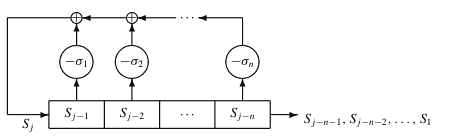

## 练习 303 使用伯莱坎普-梅西算法重新计算练习 300 中的误差定位多项式。$\diamond$

如前所述，针对任意域上 BCH 码的这种解码算法最初由 Berlekamp 在 [18] 的第一版中开发。不久之后，Massey [224] 表明这种解码算法实际上给出了生成（有限或无限）序列 $S_1, S_2, \dots$ 的最短长度递推关系，无论该序列是否来自综合征。这与生成整个序列的线性反馈移位寄存器的最小长度 $n$ 相同，即当 $S_1, \dots, S_v$ 是移位寄存器的初始内容时。在此背景下，该算法产生一系列与移位寄存器相关的多项式 \(\sigma^{(i)}(x)\)，该移位寄存器生成 \(S_1, \dots, S_i\)。\(\sigma^{(i)}(x)\) 的差异 \(\Delta_i\) 衡量移位寄存器生成 \(S_{i+1}\) 的接近程度。如果差异为 0，则移位寄存器也生成 \(S_{i+1}\)。否则，必须用一个新的更长的相关移位寄存器来增加多项式的次数。最终，该算法产生一个多项式 \(\sigma(x) = 1 + \sum_{i=1}^v \sigma_i x^i\)，称为连接多项式，导致图 5.1 的移位寄存器。

## 5.4.3 杉山解码算法

杉山算法是另一种寻找误差定位多项式的方法，因此为完成 Peterson-Gorenstein-Zierler 算法的步骤 II 提供了另一种替代方案。该算法在 [324] 中开发，适用于一类称为戈帕码的码，其中包括 BCH 码作为子类。该算法是欧几里得算法的一个相对简单但巧妙的应用。我们将只研究该算法在 BCH 码上的应用。

回顾误差定位多项式 \(\sigma(x)\) 定义为 \(\prod_{j=1}^v (1 - x X_j)\)。误差求值多项式 \(\omega(x)\) 定义为

$$
\omega(x) = \sum_{j=1}^v E_j X_j \prod_{i=1 \atop (i \neq j)}^v (1 - x X_i) = \sum_{j=1}^v E_j X_j \frac{\sigma(x)}{1 - x X_j}. \tag{5.12}
$$

注意 \(\deg(\sigma(x)) = v\) 且 \(\deg(\omega(x)) \le v - 1\)。我们定义次数至多为 \(2t - 1\) 的多项式 \(S(x)\) 为

$$
S(x) = \sum_{i=0}^{2t-1} S_{i+1} x^i.
$$

其中 \(S_i\) 对于 \(1 \le i \le 2t\) 是接收向量的综合征。

将 (5.12) 右侧展开为正式幂级数，并结合 (5.7) 以及 \(S(x)\) 的定义，我们得到

$$
\begin{aligned}
\omega(x) &= \sigma(x) \sum_{j=1}^\nu E_j X_j \frac{1}{1-x X_j} = \sigma(x) \sum_{j=1}^\nu E_j X_j \sum_{i=0}^\infty (x X_j)^i \\
&= \sigma(x) \sum_{i=0}^\nu \left( \sum_{j=1}^\nu E_j X_j^{i+1} \right) x^i \equiv \sigma(x) \sum_{i=0}^{2t-1} \left( \sum_{j=1}^\nu E_j X_j^{i+1} \right) x^i \pmod{x^{2t}} \\
&\equiv \sigma(x) S(x) \pmod{x^{2t}}.
\end{aligned}
$$

因此我们有所谓的 *关键方程*

$$
\omega(x) \equiv \sigma(x)S(x) \pmod{x^{2t}}.
$$

## 练习 304 你可能会问，使用幂级数推导关键方程是否合理。给出一个非幂级数推导。提示：
\(\sigma(x) \frac{1}{1-x X_j} = \sigma(x) \frac{1-x^{2^q} X_j^{2^q}}{1-x X_j} + x^{2^q} \prod_{i \neq j} (1-x X_i).\)

关于 \(\sigma(x)\) 和 \(\omega(x)\) 的以下观察后来将很重要。

## 引理 5.4.10 多项式 \(\sigma(x)\) 和 \(\omega(x)\) 互素。

**证明：** \(\sigma(x)\) 的根恰好是 \(1 \le j \le \nu\) 的 \(X_j^{-1}\)。但是
\(\omega(X_j^{-1}) = E_j X_j \prod_{i \neq j} (1 - X_j^{-1} X_i) \neq 0,\)
从而证明了引理。

杉山算法使用欧几里得算法来求解关键方程。*杉山算法*如下。

- I. 假设 \(f(x) = x^{2t}\) 且 \(s(x) = S(x)\)。设置 \(r_{-1}(x) = f(x)\)，\(r_0(x) = s(x)\)，\(b_{-1}(x) = 0\)，和 \(b_0(x) = 1\)。
- II. 重复以下两个计算，归纳地找到 \(h_i(x)\)、\(r_i(x)\) 和 \(b_i(x)\)，对于 \(i = 1, 2, \dots, l\)，直到 \(l\) 满足 \(\deg r_{l-1}(x) \ge t\) 且 \(\deg r_l(x) < t\)：
  - \(r_{i-2}(x) = r_{i-1}(x)h_i(x) + r_i(x), \quad \text{where } \deg r_i(x) < \deg r_{i-1}(x),\)
  - \(b_i(x) = b_{i-2}(x) - h_i(x)b_{i-1}(x).\)
- III. \(\sigma(x)\) 是 \(b_l(x)\) 的某个非零标量倍数。

注意，步骤 II 中的 I 是定义明确的，因为 \(\deg r_i(x)\) 是一个严格递减序列，且 \(\deg r_{-1}(x) > t\)。为了证明杉山算法有效，我们需要以下引理。

## 引理 5.4.11 使用杉山算法的记号，设 \(a_{-1}(x) = 1\)，\(a_0(x) = 0\)，并且对于 \(i \ge 1\)，\(a_i(x) = a_{i-2}(x) - h_i(x)a_{i-1}(x)\)。以下结论成立。

- (i) \( a_i(x)f(x) + b_i(x)s(x) = r_i(x) \) 对于 \( i \ge -1 \)。
- (ii) \( b_i(x)r_{i-1}(x) - b_{i-1}(x)r_i(x) = (-1)^i f(x) \) 对于 \( i \ge 0 \)。
- (iii) \( a_i(x)b_{i-1}(x) - a_{i-1}(x)b_i(x) = (-1)^{i+1} \) 对于 \( i \ge 0 \)。
- (iv) \( \deg b_i(x) + \deg r_{i-1}(x) = \deg f(x) \) 对于 \( i \ge 0 \)。

证明：所有这些都通过归纳法证明。对于 (i)，情况 \(i = -1\) 和 \(i = 0\) 直接来自杉山算法步骤 I 中设置的初始值以及 \(a_{-1}(x) = 1\) 和 \(a_0(x) = 0\) 的值。假设 (i) 在将 \(i\) 替换为 \(i-1\) 和 \(i-2\) 时成立，则有

$$
\begin{align*}
a_i(x)f(x) + b_i(x)s(x) &= [a_{i-2}(x) - h_i(x)a_{i-1}(x)]f(x) \\
&+ [b_{i-2}(x) - h_i(x)b_{i-1}(x)]s(x) \\
&= a_{i-2}(x)f(x) + b_{i-2}(x)s(x) \\
&- h_i(x)[a_{i-1}(x)f(x) + b_{i-1}(x)s(x)] \\
&= r_{i-2}(x) - h_i(x)r_{i-1}(x) = r_i(x),
\end{align*}
$$

从而完成 (i)。

同样当 \(i = 0\) 时，(ii) 来自杉山算法的步骤 I。假设 (ii) 在将 \(i\) 替换为 \(i-1\) 时成立。则

$$
\begin{align*}
b_i(x)r_{i-1}(x) - b_{i-1}(x)r_i(x) &= [b_{i-2}(x) - h_i(x)b_{i-1}(x)]r_{i-1}(x) - b_{i-1}(x)r_i(x) \\
&= b_{i-2}(x)r_{i-1}(x) - b_{i-1}(x)[h_i(x)r_{i-1}(x) + r_i(x)] \\
&= b_{i-2}(x)r_{i-1}(x) - b_{i-1}(x)r_{i-2}(x) \\
&= -(-1)^{i-1} f(x) = (-1)^i f(x),
\end{align*}
$$

验证了 (ii)。

当 \(i = 0\) 时，(iii) 来自杉山算法的步骤 I，\(a_{-1}(x) = 1\)，以及 \(a_0(x) = 0\)。假设 (iii) 在将 \(i\) 替换为 \(i-1\) 时成立。则

$$
\begin{align*}
a_i(x)b_{i-1}(x) - a_{i-1}(x)b_i(x) &= [a_{i-2}(x) - h_i(x)a_{i-1}(x)]b_{i-1}(x) \\
&- a_{i-1}(x)[b_{i-2}(x) - h_i(x)b_{i-1}(x)] \\
&= -[a_{i-1}(x)b_{i-2}(x) - a_{i-2}(x)b_{i-1}(x)] \\
&= -(-1)^i = (-1)^{i+1},
\end{align*}
$$

证明了 (iii)。

当 \(i = 0\) 时，(iv) 同样来自杉山算法的步骤 I。假设 (iv) 在将 \(i\) 替换为 \(i-1\) 时成立，即 \(\deg b_{i-1}(x) + \deg r_{i-2}(x) = \deg f(x)\)。在杉山算法的步骤 II 中，我们有 \(\deg r_i(x) < \deg r_{i-2}(x)\)。因此 \(\deg b_{i-1}(x)r_i(x) = \deg b_{i-1}(x) + \deg r_i(x) < \deg f(x)\)，利用部分 (ii) 这意味着情况 \(i\) 的 (iv) 成立。

我们现在验证杉山算法有效。根据引理 5.4.11(i)，我们有
\( a_i(x)x^{2t} + b_i(x)S(x) = r_i(x). \) (5.13)

根据关键方程，我们还知道
\( a(x)x^{2t} + \sigma(x)S(x) = \omega(x) \) (5.14)


对于某个多项式 \(a(x)\)。将 (5.13) 乘以 \(\sigma(x)\)，将 (5.14) 乘以 \(b_I(x)\)，得到

\(a_I(x)\sigma(x)^{2^l} + b_I(x)\sigma(x)S(x) = r_I(x)\sigma(x)\) and
\(a(x)b_I(x)^{2^l} + \sigma(x)b_I(x)S(x) = \omega(x)b_I(x).\) (5.15) (5.16)

模 \(x^{2^l}\) 下，这些蕴含

\(r_I(x)\sigma(x) \equiv \omega(x)b_I(x) \pmod{x^{2^l}}.\) (5.17)

由于 \(\deg \sigma(x) \le t\)，根据 \(I\) 的选取，\(\deg(r_I(x)\sigma(x)) = \deg r_I(x) + \deg \sigma(x) < t + t = 2t\)。根据引理 5.4.11(iv)、\(I\) 的选取，以及 \(\deg \omega(x) < t\) 这一事实，\(\deg(\omega(x) \times b_I(x)) = \deg \omega(x) + \deg b_I(x) < t + \deg b_I(x) = t + (\deg x^{2^l} - \deg r_{I-1}(x)) \le 3t - t = 2t\)。因此 (5.17) 蕴含 \(r_I(x)\sigma(x) = \omega(x)b_I(x)\)。这，连同 (5.15) 和 (5.16)，表明

\(a_I(x)\sigma(x) = a(x)b_I(x).\) (5.18)

然而，引理 5.4.11(iii) 蕴含 \(a_I(x)\) 和 \(b_I(x)\) 互素，因此由 (5.18) 得 \(a(x) = \lambda(x)a_I(x)\)。将此代入 (5.18) 得到

\(\sigma(x) = \lambda(x)b_I(x).\) (5.19)

将这些代入 (5.14) 得到 \(\lambda(x)a_I(x)x^{2^l} + \lambda(x)b_I(x)S(x) = \omega(x)\)。因此 (5.13) 蕴含

\(\omega(x) = \lambda(x)r_I(x).\) (5.20)

根据引理 5.4.10、(5.19) 和 (5.20)，\(\lambda(x)\) 必须是一个非零常数，从而验证了 Sugiyama 算法的步骤 III。

由于我们只关心 \(\sigma(x)\) 的根，因此只需找出步骤 II 中产生的 \(b_I(x)\) 的根；这将给出所需的错误位置数。

**Example 5.4.12** 使用 Sugiyama 算法和表 5.1，我们从示例 5.4.3 中得到 \(\sigma(x)\) 的一个标量倍数。在该示例中，\(t = 2\)，校验和为 \(S_1 = \alpha^2\)、\(S_2 = \alpha^4\)、\(S_3 = \alpha^{11}\) 和 \(S_4 = \alpha^8\)。下表总结了结果。

| i | r_I(x) | h_I(x) | b_I(x) |
|---|---|---|---|
| -1 | x^4 | | 0 |
| 0 | \alpha^8x^3 + \alpha^{11}x^2 + \alpha^4x + \alpha^2 | | 1 |
| 1 | \alpha x^2 + \alpha^4x + \alpha^{12} | \alpha^7x + \alpha^{10} | \alpha^7x + \alpha^{10} |
| 2 | \alpha^2 | \alpha^7x | \alpha^{14}x^2 + \alpha^2x + 1 |

满足 \(\deg r_I(x) < t = 2\) 的第一个索引 \(I\) 是 \(I = 2\)。因此 \(\sigma(x)\) 是 \(b_2(x) = \alpha^{14}x^2 + \alpha^2x + 1\) 的倍数；事实上，根据示例 5.4.3，\(b_2(x) = \sigma(x)\)。

**Example 5.4.13** 使用 Sugiyama 算法，我们考察示例 5.4.4，其中 \(t = 2\)，\(S_1 = S_2 = S_4 = 0\)，且 \(S_5 = \alpha^{10}\)。下表总结了计算结果。

| i | r_i(x) | h_i(x) | b_i(x) |
|---|---|---|---|
| -1 | x^4 | | 0 |
| 0 | \alpha^{10} x^2 | | 1 |
| 1 | 0 | \alpha^5 x^2 | \alpha^5 x^2 |

满足 \(\deg r_I(x) < t = 2\) 的第一个索引 \(I\) 是 \(I = 1\)。但在此例中，\(b_1(x) = \alpha^5 x^2\)，其根为 0，表明发生了超过两个错误，这与示例 5.4.4 一致。还要注意，\(r_1(x) = 0\) 由 (5.20) 蕴含 \(\omega(x) = 0\)，这显然是不可能的，因为根据引理 5.4.10，\(\sigma(x)\) 和 \(\omega(x)\) 应该是互素的。

**Example 5.4.14** 使用 Sugiyama 算法，我们从示例 5.4.5 中得到 \(\sigma(x)\) 的一个标量倍数。这里 \(t = 3\)，且 \(S_1 = \alpha^{14}\)、\(S_2 = \alpha^{13}\)、\(S_3 = \alpha^{14}\)、\(S_4 = \alpha^{11}\)、\(S_5 = 1\) 和 \(S_6 = \alpha^{13}\)。下表总结了结果。

| i | r_i(x) | h_i(x) | b_i(x) |
|---|---|---|---|
| -1 | x^5 | | 0 |
| 0 | \alpha^{13} x^5 + x^4 + \alpha^{11} x^3 + \alpha^4 x^2 + \alpha^{13} x + \alpha^4 | | 1 |
| 1 | \alpha^{11} x^4 + \alpha^4 x^3 + \alpha^{14} x^2 + \alpha x + \alpha^3 | \alpha^2 x + \alpha^4 | \alpha^2 x + \alpha^4 |
| 2 | \alpha^{12} | \alpha^2 x + \alpha^2 | \alpha^4 x^2 + \alpha^{12} x + \alpha^{13} |

满足 \(\deg r_I(x) < t = 3\) 的第一个索引 \(I\) 是 \(I = 2\)。因此 \(\sigma(x)\) 是 \(b_2(x) = \alpha^4 x^2 + \alpha^{12} x + \alpha^{13}\) 的倍数。根据示例 5.4.5，\(\sigma(x) = \alpha^2 b_2(x)\)。

- Exercise 305 验证示例 5.4.12、5.4.13 和 5.4.14 中的计算。

- Exercise 306 使用 Sugiyama 算法，找出示例 5.4.6 中错误定位多项式的一个标量倍数。

- Exercise 307 使用 Sugiyama 算法，找出练习 299 中错误定位多项式的标量倍数。

- Exercise 308 使用 Sugiyama 算法，找出练习 300 中错误定位多项式的标量倍数。

- Exercise 309 使用 Sugiyama 算法，找出练习 301 中错误定位多项式的标量倍数。

我们指出，Sugiyama 算法适用于 \(f(x)\) 和 \(s(x)\) 的其他选择，只需对算法在步骤 II 中停止的条件做适当修改。这种修改适用于 Goppa 码的解码；参见 [232]。

值得注意的是，Peterson–Gorenstein–Zierler 算法、Berlekamp–Massey 算法或 Sugiyama 算法可用于解码任何循环码，直至 BCH 界。设 \(C\) 为定义集为 \(T\) 的循环码，并假设 \(T\) 包含 \(\delta\) 个连续元素 \(\{b, b+1, \dots, b+\delta-2\}\)。设 \(B\) 为定义集为 \(C_b \cup C_{b+1} \cup \dots \cup C_{b+\delta-2}\) 的 BCH 码，它是 \(T\) 的子集。根据练习 239，\(C \subseteq B\)。设 \(t = \lfloor (\delta-1)/2 \rfloor\)。假设发送了一个代码字 \(c(x) \in \mathcal{C}\)，接收到 \(y(x)\)，其中发生了 \(t\) 个或更少的错误。那么 \(c(x) \in \mathcal{B}\)，且任何应用于 \(\mathcal{B}\) 的解码算法都将纠正 \(y(x)\) 并产生 \(c(x)\)。因此，这些算法将纠正任何循环码中的接收字，前提是如果发生错误，\(2t + 1\) 不超过该码的 BCH 界。当然，这个错误数可能少于 \(\mathcal{C}\) 实际能够纠正的错误数。

## 5.4.4 Sudan–Guruswami 解码算法

在 1997 年的一篇论文中，Madhu Sudan [323] 开发了一种用于解码 \([n, k, d]\) Reed–Solomon 码的过程，该过程能够纠正某些 \(e\) 个错误，其中 \(e > (d - 1)/2\)。Guruswami 和 Sudan [113] 扩展了该方法，以消除原始 Sudan 算法中的某些限制。为了能够纠正 \(e\) 个错误（其中 \(e > (d - 1)/2\)），该算法生成一个所有可能代码字的列表，这些代码字与任何接收向量的 Hamming 距离在 \(e\) 以内；这样的算法称为 *list-decoding algorithm*。Sudan–Guruswami 算法适用于广义 Reed–Solomon 码以及某些 BCH 码和代数几何码。在本节中，我们针对广义 Reed–Solomon 码介绍该算法，并将感兴趣的读者引向 [113] 以了解其他码。Sudan–Guruswami 算法本身已由 Kötter 和 Vardy [179] 推广，以应用于软判决解码。

为准备该算法，我们需要一些涉及两个变量多项式的初步记号。假设 \(x\) 和 \(y\) 是独立不定式，且 \(p(x, y) = \sum \sum p_{i,j} x^i y^j\) 是 \(\mathbb{F}_q[x, y]\) 中的一个多项式，即两个变量 \(x\) 和 \(y\) 的所有多项式组成的环。设 \(w_x\) 和 \(w_y\) 为非负实数。\(p(x, y)\) 的 \((w_x, w_y)\)-加权次数定义为

\(\max\{w_x i + w_y j \mid p_{i,j} \neq 0\}.\)

注意，\(p(x, y)\) 的 \((1, 1)\)-加权次数仅仅是 \(p(x, y)\) 的次数。对于正整数 \(s\) 和 \(\delta\)，设 \(N_s(\delta)\) 表示 \((1, s)\)-加权次数小于或等于 \(s\) 的单项式 \(x^i y^j\) 的数量。我们说点 \((\alpha, \beta) \in \mathbb{F}_q^2\) *位于* 或 *是* \(p(x, y)\) 的一个根，前提是 \(p(\alpha, \beta) = 0\)。我们将需要这个根的重数。为了说明重数的定义，回顾一下，如果 \(f(x) \in \mathbb{F}_q[x]\) 且 \(\alpha\) 是 \(f(x)\) 的一个根，那么它作为 \(f(x)\) 根的重数是数 \(m\)，其中 \(f(x) = (x - \alpha)^m g(x)\) 对于某些 \(g(x) \in \mathbb{F}_q[x]\) 且 \(g(\alpha) \neq 0\)。在处理两个变量时，我们不能直接推广此记号。然而，请注意 \(f(x + \alpha) = x^m h(x)\)，其中 \(h(x) = g(x + \alpha)\)；此外 \(h(0) \neq 0\)。特别是，\(f(x + \alpha)\) 包含一个次数为 \(m\) 的单项式，但不包含更小次数的单项式。这个概念可以推广。多项式 \(p(x, y)\) 的根 \((\alpha, \beta)\) 具有重数 \(m\)，前提是移位多项式 \(p(x + \alpha, y + \beta)\) 包含一个次数为 \(m\) 的单项式，但不包含较低次数的单项式。

**Exercise 310** 设 \(p(x, y) = 1 + x + y - x^2 - y^2 - 2x^2y + xy^2 - y^3 + x^4 - 2x^3y - x^2y^2 + 2xy^3 \in \mathbb{F}_5[x]\)。证明 \((1, 2) \in \mathbb{F}_5^2\) 是 \(p(x, y)\) 的一个重数为 3 的根。


回顾一个在 $\mathbb{F}_q$ 上的 $[n, k]$ 广义Reed-Solomon码定义为

$$GRS_k(\gamma, v) = \{(v_0 f(\gamma_0), v_1 f(\gamma_1), \dots, v_{n-1} f(\gamma_{n-1})) \mid f \in \mathcal{P}_k\},$$

其中 $\gamma = (\gamma_0, \gamma_1, \dots, \gamma_{n-1})$ 是 $\mathbb{F}_q$ 中 $n$ 个不同元素的 $n$ 元组，$v = (v_0, v_1, \dots, v_{n-1})$ 是 $\mathbb{F}_q$ 中 $n$ 个非零元素的 $n$ 元组，且 $\mathcal{P}_k$ 是 $\mathbb{F}_q[x]$ 中次数不超过 $k-1$（包括零多项式）的多项式集合。假设 $c = c_0 c_1 \dots c_{n-1} \in GRS_k(\gamma, v)$ 被发送，且 $y' = y'_0 y'_1 \dots y'_{n-1} = c + e$ 被接收。那么存在唯一的 $f \in \mathcal{P}_k$，使得对 $0 \le i \le n-1$ 有 $c_i = v_i f(\gamma_i)$。如果我们能确定多项式 $f$，就可以找到 $e$。令 $\mathcal{A} = \{(\gamma_0, y_0), (\gamma_1, y_1), \dots, (\gamma_{n-1}, y_{n-1})\}$，其中 $y_i = y'_i / v_i$。暂时假设在 $c$ 的传输中没有发生错误。那么对于 $0 \le i \le n-1$ 有 $y_i = c_i / v_i = f(\gamma_i)$。特别是，$\mathcal{A}$ 的所有点都位于多项式 $p(x, y) = y - f(x)$ 上。现在假设发生错误。稍微改变我们之前的术语，定义一个 *错误定位多项式* $\Lambda(x, y)$ 为 $\mathbb{F}_q[x, y]$ 中的任意多项式，使得对所有满足 $y_i \neq c_i / v_i$ 的 $i$ 有 $\Lambda(\gamma_i, y_i) = 0$。由于如果 $y_i = c_i / v_i$ 则 $y_i - f(\gamma_i) = 0$，$\mathcal{A}$ 的所有点都位于多项式 $p(x, y) = \Lambda(x, y)(y - f(x))$ 上。Sudan-Guruswami 算法的基本思想是找到一个多项式 $p(x, y) \in \mathbb{F}_q[x, y]$，其中 $\mathcal{A}$ 的每个元素都是具有特定重数的根，然后找到该多项式形式为 $y - f(x)$ 的因式。对 $p(x, y)$ 施加进一步限制，以保证算法的纠错能力。

### 针对 $[n, k, n-k+1]$ 码 $GRS_k(\gamma, v)$ 的 Sudan-Guruswami 解码算法

- I. 固定一个正整数 $m$。选取 $\delta$ 为满足下式的最小正整数
  
  $$\frac{nm(m+1)}{2} < N_{k-1}(\delta). \tag{5.21}$$

  回顾 $N_{k-1}(\delta)$ 是 $(1, k-1)$-加权次数不超过 $\delta$ 的一项式 $x^i y^j$ 的数量。令

  $$t = \left\lfloor \frac{\delta}{m} \right\rfloor + 1.$$

- II. 构造一个非零多项式 $p(x, y) \in \mathbb{F}_q[x, y]$，使得 $\mathcal{A}$ 的每个元素都是 $p(x, y)$ 重数至少为 $m$ 的根，且 $p(x, y)$ 的 $(1, k-1)$-加权次数至多为 $\delta$。

- III. 找出 $p(x, y)$ 所有形式为 $y - f(x)$ 的因式，其中 $f(x) \in \mathcal{P}_k$ 且对于至少 $t$ 个 $i$ 值满足 $f(\gamma_i) = y_i$。对于每个这样的 $f$，在 $GRS_k(\gamma, v)$ 中生成对应的码字。

我们必须验证该算法可行，并给出其可纠正的错误数量上界。需要以下三个引理。

### 引理 5.4.15
设 $(\alpha, \beta) \in \mathbb{F}_q^2$ 是 $p(x, y) \in \mathbb{F}_q[x, y]$ 的一个重数至少为 $m$ 的根。如果 $f(x)$ 是 $\mathbb{F}_q[x]$ 中的一个多项式，使得 $f(\alpha) = \beta$，那么 $g(x) = p(x, f(x)) \in \mathbb{F}_q[x]$ 可被 $(x - \alpha)^m$ 整除。

**证明：** 设 $f_1(x) = f(x + \alpha) - \beta$。根据假设，$f_1(0) = 0$，因此 $f_1(x) = x f_2(x)$ 对某个多项式 $f_2(x) \in \mathbb{F}_q[x]$ 成立。定义 $g_1(x) = p(x + \alpha, f_1(x) + \beta)$。由于 $(\alpha, \beta)$ 是 $p(x, y)$ 重数至少为 $m$ 的根，$p(x + \alpha, y + \beta)$ 没有次数小于 $m$ 的一项式。在 $p(x + \alpha, y + \beta)$ 中令 $y = f_1(x) = x f_2(x)$ 表明 $g_1(x)$ 可被 $x^m$ 整除，这意味着 $g_1(x - \alpha)$ 可被 $(x - \alpha)^m$ 整除。然而，$g_1(x - \alpha) = p(x, f_1(x - \alpha) + \beta) = p(x, f(x)) = g(x)$，表明 $g(x)$ 可被 $(x - \alpha)^m$ 整除。

### 引理 5.4.16
固定正整数 $m, t, \text{and } \delta$，使得 $mt > \delta$。设 $p(x, y) \in \mathbb{F}_q[x, y]$ 为一个多项式，使得 $(\gamma_i, y_i)$ 是 $p(x, y)$ 重数至少为 $m$ 的根，对 $i \le n - 1$ 成立。此外，假设 $p(x, y)$ 的 $(1, k - 1)$-加权次数至多为 $\delta$。设 $f(x) \in \mathcal{P}_k$，其中对于 $0 \le i \le n - 1$ 中至少 $t$ 个 $i$ 值满足 $y_i = f(\gamma_i)$。那么 $y - f(x)$ 整除 $p(x, y)$。

**证明：** 设 $g(x) = p(x, f(x))$。由于 $p(x, y)$ 的 $(1, k - 1)$-加权次数至多为 $\delta$，$g(x)$ 要么是零多项式，要么是次数至多为 $\delta$ 的非零多项式。假设 $g(x)$ 非零。令 $S = \{i \mid 0 \le i \le n - 1, f(\gamma_i) = y_i\}$。根据引理 5.4.15，对于 $i \in S$，$(x - \gamma_i)^m$ 整除 $g(x)$。由于 $\gamma_i$ 互不相同，$h(x) = \prod_{i \in S} (x - \gamma_i)^m$ 整除 $g(x)$。由于 $h(x)$ 的次数至少为 $mt > \delta$，而 $\delta$ 是 $g(x)$ 的最大次数，如果 $g(x)$ 非零则会产生矛盾。因此 $g(x)$ 是零多项式，这意味着 $y = f(x)$ 是将 $p(x, y)$ 视为 $x$ 的有理函数域上的 $y$ 多项式时的一个根。根据除法算法，$y - f(x)$ 是该多项式的一个因式。

### 引理 5.4.17
设 $p(x, y) = \sum_j \sum_t p_{j,t} x^j y^t \in \mathbb{F}_q[x, y]$。假设 $(\alpha, \beta) \in \mathbb{F}_q^2$ 且 $p'(x, y) = \sum_a \sum_b p'_{a,b} x^a y^b = p(x + \alpha, y + \beta)$。那么

$$p'_{a,b} = \sum_{j \ge a} \sum_{t \ge b} \binom{j}{a} \binom{t}{b} \alpha^{j-a} \beta^{t-b} p_{j,t}.$$

**证明：** 我们有

$$p'(x, y) = \sum_j \sum_t p_{j,t} (x + \alpha)^j (y + \beta)^t$$

$$= \sum_j \sum_t p_{j,t} \sum_{a=0}^j \binom{j}{a} x^a \alpha^{j-a} \sum_{b=0}^t \binom{t}{b} y^b \beta^{t-b}.$$

显然，$x^a y^b$ 的系数 $p'_{a,b}$ 正如所声称的那样。

现在我们有立场验证 Sudan-Guruswami 算法，并给出算法有效的误差界限。

### 定理 5.4.18
将 Sudan-Guruswami 解码算法应用于 $[n, k, n - k + 1]$ 码 $GRS_k(\gamma, v)$ 将生成所有与接收向量汉明距离不超过 $e$ 的码字，其中 $e = n - \lfloor \delta/m \rfloor - 1$。

**证明：** 我们首先必须验证步骤 II 中的多项式 $p(x, y)$ 确实存在。为了使 $p(x, y)$ 存在，$p(x + \gamma_i, y + y_i)$ 必须对 $0 \le i \le n - 1$ 没有次数小于 $m$ 的项。根据引理 5.4.17，如果对于每个 $0 \le i \le n - 1$，

$$\sum_{j \ge a} \sum_{t \ge b} \binom{j}{a} \binom{t}{b} \gamma_i^{j-a} y_i^{t-b} p_{j,t} = 0 \quad \text{for all } a \ge 0, b \ge 0 \text{ with } a + b < m. \quad (5.22)$$

则可实现这一点。对于每个 $i$，(5.22) 中有 $(m(m + 1))/2$ 个方程，因为集合 $\{(a, b) \in \mathbb{Z}^2 \mid a \ge 0, b \ge 0, a + b < m\}$ 的大小为 $(m(m + 1))/2$；因此在未知系数 $p_{j,t}$ 中总共有 $(nm(m + 1))/2$ 齐次线性方程。由于我们希望生成一个 $(1, k - 1)$-加权次数至多为 $\delta$ 的非平凡多项式，在这个 $(nm(m + 1))/2$ 齐次线性方程组中总共有 $N_{k-1}(\delta)$ 个未知系数 $p_{j,t}$。根据 (5.21)，方程数少于未知数，因此存在非平凡解，步骤 II 可以完成。根据步骤 I 中对 $t$ 的选择，$mt > \delta$。如果 $f(x) \in \mathcal{P}_k$ 是一个多项式，对于至少 $t$ 个 $i$ 值满足 $f(\gamma_i) = y_i$，根据引理 5.4.16，$y - f(x)$ 是 $p(x, y)$ 的一个因式。因此，算法的步骤 III 将生成所有与接收向量距离不超过 $e = n - t = n - \lfloor \delta/m \rfloor - 1$ 的码字。

由于步骤 I 需要计算 $N_{k-1}(\delta)$，下一个引理很有用。

### 引理 5.4.19
设 $s$ 和 $\delta$ 为正整数。那么 $N_s(\delta) = \left( \delta + 1 - \frac{s}{2} \left\lfloor \frac{\delta}{s} \right\rfloor \right) \left( \left\lfloor \frac{\delta}{s} \right\rfloor + 1 \right) \ge \frac{\delta(\delta + 2)}{2s}$。

**证明：** 按定义，$N_s(\delta) = \sum_{i=0}^{\lfloor \delta/s \rfloor} (\delta + 1 - is) = (\delta + 1) \left( \left\lfloor \frac{\delta}{s} \right\rfloor + 1 \right) - \frac{s}{2} \left\lfloor \frac{\delta}{s} \right\rfloor \left( \left\lfloor \frac{\delta}{s} \right\rfloor + 1 \right) \ge \left( \left\lfloor \frac{\delta}{s} \right\rfloor + 1 \right) \left( \delta + 1 - \frac{\delta}{2} \right) \ge \frac{\delta}{s} \cdot \frac{\delta + 2}{2}$。

结果得证。

### 示例 5.4.20
设 $\mathcal{C}$ 为在 $\mathbb{F}_{16}$ 上的 $[15, 6, 10]$ Reed-Solomon码。Peterson-Gorenstein-Zierler 解码算法最多可纠正四个错误。如果在 Sudan-Guruswami 解码算法中选择 $m = 2$，则 $(nm(m + 1))/2 = 45$，且使 $45 < N_s(\delta)$ 成立的最小 $\delta$ 值为 $\delta = 18$，在这种情况下，根据引理 5.4.19，$N_s(18) = 46$。那么 $t = \lfloor \delta/m \rfloor + 1 = 10$，根据定理 5.4.18，Sudan-Guruswami 算法可以纠正 $15 - 10 = 5$ 个错误。

### 练习 311
设 $\mathcal{C}$ 为示例 5.4.20 中的码。在 Sudan-Guruswami 算法中选择 $m = 6$。证明使 $(nm(m + 1))/2 = 315 < N_s(\delta)$ 成立的最小 $\delta$ 值为 $\delta = 53$。验证使用这些参数时 Sudan-Guruswami 算法可以纠正六个错误。

### 练习 312
设 $\mathcal{C}$ 为在 $\mathbb{F}_{32}$ 上的 $[31, 8, 24]$ Reed-Solomon码。Peterson-Gorenstein-Zierler 算法最多可纠正 11 个错误。(a) 在 Sudan-Guruswami 算法中选择 $m = 1$。找出使 $(nm(m + 1))/2 = 31 < N_s(\delta)$ 成立的最小 $\delta$ 值。使用 $m = 1$，Sudan-Guruswami 算法可以纠正多少个错误？


- (b) 在 Sudan–Guruswami 算法中选择 m = 2。找到使 $nm(m + 1)/2 = 3 < N_\delta(\delta)$ 成立的最小 $\delta$ 值。使用 $m = 2$，Sudan–Guruswami 算法可以纠正多少个错误？

- (c) 在 Sudan–Guruswami 算法中选择 m = 3。找到使 $nm(m + 1)/2 = 186 < N_\delta(\delta)$ 成立的最小 $\delta$ 值。使用 $m = 3$，Sudan–Guruswami 算法可以纠正多少个错误？

可以在示例 5.4.20 和练习 311 及 312 中看到，如果增加 m，Sudan–Guruswami 解码算法的纠错能力可以提高。获得更高纠错能力的代价是 p(x, y) 的 (1, k - 1)-加权次数增加，这当然会增加算法的复杂度。以下推论说明了纠错能力如何随 m 变化。

### 推论 5.4.21
将 Sudan–Guruswami 解码算法应用于 [n, k, n - k + 1] 码 GRS_k(\gamma, v) 将产生所有与接收向量汉明距离为 e 或更小的代码字，其中 e >= n - 1 - n \sqrt{R(m + 1)/m}，且 R = k/n。

**证明：** 由于 $\delta$ 被选为使 (5.21) 成立的最小正整数，故 $N_{k-1}(\delta - 1) \le nm(m + 1)/2$。根据引理 5.4.19，$N_{k-1}(\delta - 1) \ge (\delta - 1)(\delta + 1)/(2(k - 1))$。因此 $\frac{\delta^2 - 1}{2(k - 1)} \le \frac{nm(m + 1)}{2}$。若 $\delta^2 < k$，则 $\delta^2/(2k) < 1/2 \le nm(m + 1)/2$。若 $\delta^2 \ge k$，则根据练习 313，$\delta^2/(2k) \le (\delta^2 - 1)/(2(k - 1))$。无论哪种情况，$\delta^2/2k \le nm(m + 1)/2$，这意味着 $\frac{\delta}{m} \le n \sqrt{\frac{k}{n} \frac{m + 1}{m}}$，从而根据定理 5.4.18 得出所需结果。

### 练习 313
做以下题目：(a) 证明若 $\delta^2 \ge k$，则 $\delta^2/(2k) \le (\delta^2 - 1)/(2(k - 1))$。(b) 证明若 $\delta^2/(2k) \le nm(m + 1)/2$，则 $\delta/m \le n \sqrt{\frac{k}{n} \frac{m+1}{m}}$。

在此推论中，R = k/n 是信息率。如果 m 很大，我们看到 Sudan–Guruswami 解码算法能够纠正的错误比例 e/n 约为 1 - \sqrt{R}。Peterson–Gorenstein–Zierler 解码算法能够纠正的错误比例约为 (1 - R)/2。练习 314 探讨了这两个函数之间的关系。

### 练习 314
做以下题目：

- (a) 验证 Peterson–Gorenstein–Zierler 解码算法在 GRS 码中能够纠正的错误比例约为 $(1 - R)/2$。

- (b) 在同一张图上绘制两个函数 $y = 1 - \sqrt{R}$ 和 $y = (1 - R)/2$ 的图像，其中 $0 \le R \le 1$。这些图像显示了 Peterson–Gorenstein–Zierler 解码算法与 Sudan–Guruswami 解码算法的相对纠错能力方面的什么内容？

要执行 Sudan–Guruswami 解码算法，我们必须有一种方法来计算步骤 II 中的多项式 $p(x, y)$，然后在步骤 III 中找到形式为 $y - f(x)$ 的 $p(x, y)$ 的因式。（求解 $p(x, y)$ 当然可以通过求解 (5.22) 中的 $nm(m + 1)/2$ 个方程来完成，但如练习 312 中的值所示，方程和未知数的数量会相当迅速地变得很大。）已经引入了各种方法来执行步骤 II 和 III。我们这里不会考察这些方法，但感兴趣的读者可以查阅 [11, 178, 245, 248, 300, 354]。

## 5.5 突发错误、串联码和交织

里德-所罗门码以串联形式使用时，在纠正突发错误方面非常有用。正如术语所暗示的，当代码字的几个连续分量可能出错时，就会发生 *突发错误*；这种突发通常跨越几个按顺序接收的连续代码字。

在给出实际细节之前，我们先说明该过程。假设 $\mathcal{C}$ 是一个用于传输信息的 $[n, k]$ 二进制码。来自 $\mathbb{F}_2^k$ 的每条消息使用 $\mathcal{C}$ 编码为 $\mathbb{F}_2^n$ 中的一个代码字。然后消息作为 $n$ 个二进制数字的序列进行传输。实际上，几个代码字一个接一个地发送，在接收端则显示为一串很长的二进制数字。在传输过程中，这些数字可能被更改。一个随机的单个符号可能被扭曲到无法将其识别为 0 或 1，在这种情况下，接收到的符号被视为擦除。或者一个随机符号可能被更改为另一个符号，接收到的符号则出错。如我们在第 1.11 节中讨论的，可纠正的擦除比错误更多，因为错误位置未知，而擦除位置已知。有时，几个连续符号（即一个突发）可能被擦除或出错。接收端随后将字符串分解为长度为 $n$ 的代码字，并（如果可能）解码每个字符串。然而，突发错误的存在会使解码变得棘手，因为我们开发的代码旨在纠正随机错误。然而，我们可以修改代码以同时处理突发错误：编码使用产生重大影响的一个例子是紧凑光盘录制；光盘上的划痕可以破坏几个连续的信息位。纠正突发错误的能力改变了整个音频行业。我们将在下一节中讨论此问题。

突发错误通常使用串联码来处理，串联码有时随后会进行交织。串联码由 Forney 在 [87] 中提出。我们给出串联码的一个简单版本；更一般的理论可以例如在 [75] 中找到。

设 $\mathcal{A}$ 为 $\mathbb{F}_q$ 上的一个 $[n, k, d]$ 码。令 $Q = q^k$ 并定义 $\psi : \mathbb{F}_Q \to \mathcal{A}$ 为一个一对一的 $\mathbb{F}_q$-线性映射；即对于 $\mathbb{F}_Q$ 中的所有 $x$ 和 $y$，有 $\psi(x + y) = \psi(x) + \psi(y)$，且对于所有 $x \in \mathbb{F}_Q$ 和 $\alpha \in \mathbb{F}_q$，有 $\psi(\alpha x) = \alpha \psi(x)$，需注意 $\mathbb{F}_Q$ 是 $\mathbb{F}_q$ 的扩展域。设 $\mathcal{B}$ 为 $\mathbb{F}_Q$ 上的一个 $[N, K, D]$ 码。$\mathcal{A}$ 和 $\mathcal{B}$ 的串联是码

$\mathcal{C} = \{\psi(b_1, b_2, ..., b_N) \mid (b_1, b_2, ..., b_N) \in \mathcal{B}\},$

其中 $\psi(b_1, b_2, ..., b_N) = (\psi(b_1), \psi(b_2), ..., \psi(b_N))$。$\mathcal{C}$ 称为具有 *内码* $\mathcal{A}$ 和 *外码* $\mathcal{B}$ 的 *串联码*。实际上，$\mathcal{C}$ 中的一个代码字是通过取 $\mathcal{B}$ 中的一个代码字并用由 $\psi$ 下该分量的像所确定的 $\mathcal{A}$ 的代码字替换每个分量而得到的。码 $\mathcal{C}$ 然后是 $\mathbb{F}_q$ 上长度为 $nN$ 的码。以下定理提供了关于 $\mathcal{C}$ 的进一步信息。

### 定理 5.5.1
设 $\mathcal{A}$、$\mathcal{B}$ 和 $\mathcal{C}$ 如上所述。那么 $\mathcal{C}$ 是 $\mathbb{F}_q$ 上的一个线性 $[nN, kK]$ 码，其最小距离至少为 $dD$。

### 练习 315
证明定理 5.5.1。$\diamond$

### 示例 5.5.2
设 $\mathcal{B}$ 为具有生成矩阵的 $\mathbb{F}_4$ 上的 $[6, 3, 4]$ 六码

$G = $

| 1 | 0 | 0 | 1 | ω | ω |
|---|---|---|---|---|---|
| 0 | 1 | 0 | ω | 1 | ω |
| 0 | 0 | 1 | ω | ω | 1 |

设 $\mathcal{A}$ 为二进制码 $\mathbb{F}_2^2$ $[2, 1]$，并按以下定义 $\psi : \mathbb{F}_4 \to \mathcal{A}$：

$\psi(00) = 00, \quad \psi(1) = 10, \quad \psi(\omega) = 01, \quad \psi(\bar{\omega}) = 11.$

这很容易验证为 $\mathbb{F}_2$-线性。具有内码 $\mathcal{A}$ 和外码 $\mathcal{B}$ 的串联码 $\mathcal{C}$ 具有生成矩阵

| 1 | 0 | 0 | 0 | 0 | 0 | 1 | 0 | 0 | 1 | 0 | 1 |
|---|---|---|---|---|---|---|---|---|---|---|---|
| 0 | 1 | 0 | 0 | 0 | 0 | 0 | 1 | 1 | 1 | 1 | 1 |
| 0 | 0 | 1 | 0 | 0 | 0 | 0 | 1 | 1 | 1 | 0 | 1 |
| 0 | 0 | 0 | 1 | 0 | 0 | 1 | 1 | 0 | 1 | 1 | 1 |
| 0 | 0 | 0 | 0 | 1 | 0 | 0 | 1 | 0 | 1 | 1 | 0 |
| 0 | 0 | 0 | 0 | 0 | 1 | 1 | 1 | 1 | 0 | 1 | 0 |

该矩阵的第 2、4、6 行是在将 $G$ 的行乘以 $\omega$ 之后得到的。$\mathcal{C}$ 是一个 $[12, 6, 4]$ 码。$\blacksquare$

### 练习 316
设 $\mathcal{B}$ 为示例 5.5.2 中给出的六码，并设 $\mathcal{A}$ 为 $[3, 2, 2]$ 偶二进制码。按以下定义 $\psi : \mathbb{F}_4 \to \mathcal{A}$：

$\psi(000) = 000, \quad \psi(1) = 101, \quad \psi(\omega) = 011, \quad \psi(\bar{\omega}) = 110.$

- (a) 验证 $\psi$ 是 $\mathbb{F}_2$-线性的。

- (b) 给出具有内码 $\mathcal{A}$ 和外码 $\mathcal{B}$ 的串联码 $\mathcal{C}$ 的一个生成矩阵。

- (c) 证明 $\mathcal{C}$ 是一个 $[18, 6, 8]$ 码。$\diamond$


我们现在简要讨论如何使用诸如里德-所罗门码之类的码来纠正突发错误。设 C 是 $F_q$ 上的一个 [n, k] 码。一个 b-突发是 $F_q^n$ 中的一个向量，其非零坐标限制在 b 个连续位置内，且第一个和最后一个位置非零。码 C 是 b-突发错误纠正码，当且仅当不存在不同的码字 $c_1$ 和 $c_2$，以及一个 $b'$-突发 $u_1$ 和一个 $b''$-突发 $u_2$，其中 $b' \le b$ 且 $b'' \le b$，使得 $c_1 + u_1 = c_2 + u_2$。如果 C 是一个线性的 b-突发错误纠正码，那么对于任何满足 $1 \le b' \le 2b$ 的 $b'$，没有 $b'$-突发是码字。

现在令 Q = 2^m，并设 B 是 $F_q$ 上的一个 [N, K, D] 码。（B 的一个好选择是里德-所罗门码或缩短的里德-所罗门码，因为这样的码是 MDS 码，因此在给定 N 和 K 的情况下最大化 D。参见习题 317。）设 A 是二进制码 $F_2^m$ 上的 [m, m, 1] 码。选择 $F_q = F_2^m$ 在 $F_2$ 上的一组基 e1, e2, ..., em，我们定义 $\psi : F_q \to A$ 为 $\psi(a_1 + \dots + a_m e_m) = a_1 \dots a_m$。映射 $\psi$ 是一对一且 $F_2$-线性的；参见习题 319。如果我们将 $F_q$ 的元素称为字节，将 $F_2$ 的元素称为比特，那么 B 中码字的每个分量字节都被替换为来自 $F_2^m$ 的 m 比特相关联的向量，以形成 C 中相应的码字。内码为 A、外码为 B 的串联码 C 是一个 [n, k, d] 二进制码，其中 n = mN，k = mK，且 d >= D。该过程由示例 5.5.2 中构造的串联码说明。在那里，$F_4$ 的基为 e1 = 1 和 e2 = omega，字节（$F_4$ 的元素）每个都由映射 $\psi$ 确定的两个比特对应。

**习题 317** 设 C 是 $F_q$ 上的一个 [n, k, n - k + 1] MDS 码。设 C1 是通过对某个坐标进行缩短从 C 得到的码。证明 C1 是一个 [n - 1, k - 1, n - k + 1] 码；也就是说，证明 C1 也是 MDS 码。

**习题 318** 在紧凑光盘录制中，使用了两个 $F_{256}$ 上的缩短里德-所罗门码。从长度为 255 的里德-所罗门码开始，说明如何获得 [32, 28, 5] 和 [28, 24, 5] 缩短里德-所罗门码。

**习题 319** 设 A 是二进制码 $F_2^m$ 上的 [m, m, 1] 码。设 e1, e2, ..., em 是 $F_2^m$ 在 $F_2$ 上的一组基。定义 $\psi : F_2^m \to A$ 为 $\psi(a_1 e_1 + \dots + a_m e_m) = a_1 \dots a_m$。证明 $\psi$ 是一对一且 $F_2$-线性的。

设 C 为如上所述的二进制串联 [mN, mk] 码，内码为 A，外码为 B。设 c = $\psi(b)$ 为 C 中的一个码字，其中 b 是 B 中的一个码字。设 u 是 $F_2^{mN}$ 中的一个 b-突发。我们可以将突发分解为 N 个每个 m 比特的字符串，并使用 $\psi^{-1}$ 将输入映射为 N 个字节的向量。更正式地，设 u = $u_1 \dots u_N$，其中 $1 \le i \le N$ 时 $u_i \in F_2^m$。将 u 映射为 $F_q^N$ 中的向量 u' = $\psi^{-1}(u_1) \dots \psi^{-1}(u_N)$。由于 u 是一个 b-突发，那么 u' 中非零字节的数目，粗略地说，最多为 b/m。例如，如果 u 是一个 (3m + 1)-突发，那么 u' 中最多有四个字节可以非零；参见习题 320。因此，突发错误纠正按以下方式完成。将接收到的码字分解为 N 个长度为 m 的比特字符串，对每个比特字符串应用 $\psi^{-1}$ 以产生 $F_q^N$ 中的一个向量，并使用 B 纠正该向量。更多内容留作习题 320。

**习题 320** 设 A = $F_2^m$ 为长度为 m 的 [m, m, 1] 二进制码，并设 B 是 $F_q$ 上的一个 [N, K, D] 码。设 $\psi$ 是从 $F_2^m$ 到 $F_2^m$ 的一对一 $F_2$-线性映射。设 C 为内码为 A、外码为 B 的串联码。

(a) 设 u 是与 u'（一个在 $\mathbb{F}_q^N$ 中的向量，其中 $Q = 2^m$）相关联的在 $\mathbb{F}_q^{2m}$ 中的长度为 m 的 b-突发。设 $b \le am + 1$。证明 wt(u') $\ge a + 1$。

(b) 证明 C 纠正长度为 $b \le am + 1$ 的突发，其中 $a = [(D - 1)/2] - 1$。

(c) 设 m = 5，并设 B 是 $\mathbb{F}_{32}$ 上的一个 [31, 7, 25] 里德-所罗门码。二进制串联码 [156, 35] C 可以纠正的最大突发长度是多少？

还有另一种技术，称为交织，它将提高码的突发错误纠正能力。设 C 是 $\mathbb{F}_q$ 上的一个 [n, k] 码，能够纠正长度为 b 的突发。定义 $I(C, t)$ 为按以下方式构造的 $\mathbb{F}_q^{nt}$ 中的一组向量。对于来自 C 的任意 t 个码字 $\mathbf{c}_1, \dots, \mathbf{c}_t$，其中 $\mathbf{c}_i = c_{i1}c_{i2}\cdots c_{in}$，形成矩阵

\[ M = \begin{bmatrix} c_{11} & c_{12} & \cdots & c_{1n} \\ c_{21} & c_{22} & \cdots & c_{2n} \\ \vdots & \vdots & & \vdots \\ c_{t1} & c_{t2} & \cdots & c_{tn} \end{bmatrix} \]

其行是码字 $\mathbf{c}_1, \dots, \mathbf{c}_t$。$I(C, t)$ 的码字是通过从 M 按连续列向下读取得到的长度为 nt 的向量 $c_{11}c_{21}\cdots c_{t1}c_{12}c_{22}\cdots c_{t2}\cdots c_{1n}c_{2n}\cdots c_{tn}$。码 $I(C, t)$ 是 C 以深度 t 进行交织的码。

**定理 5.5.3** 如果 C 是 $\mathbb{F}_q$ 上的一个 [n, k] 码，能够纠正任意长度为 b 的突发，那么 $I(C, t)$ 是 $\mathbb{F}_q$ 上的一个 [nt, kt] 码，能够纠正任意长度为 bt 的突发。

**习题 321** 证明定理 5.5.3。

**示例 5.5.4** [7, 4, 3] 二进制海明码 $H_3$ 只能纠正长度为 1 的突发。然而，将 $H_3$ 以深度 4 进行交织会产生一个 [28, 16] 二进制码 $I(H_3, 4)$，它可以纠正长度为 4 的突发。然而，请注意，$I(H_3, 4)$ 的最小距离为 3，因此该码可以纠正单错误，但不能纠正所有双错误。只要错误局限于四个连续分量内，它最多可以纠正四个错误。参见习题 322。

**习题 322** 证明 $I(H_3, 4)$ 的最小距离为 3。

## 5.6 紧凑光盘的编码

在本节中，我们概述了紧凑光盘（CD）录音机中使用的编码和解码。目前使用的紧凑光盘数字音频系统标准是由荷兰 N. V. Philips 公司和日本 Sony 公司在 1979 年签署的协议中开发的。有兴趣了解 CD 编码更多信息的读者应查阅 [47, 99, 119, 134, 154, 202, 253, 265, 335, 341]。

紧凑光盘是一个直径 120 mm 的铝化光盘，表面涂有透明塑料涂层。每个光盘上有一条螺旋轨道，长度约 5 km（参见习题 324），由 AlGaAs 激光器光学扫描，波长约 0.8 $\mu$m，以约 1.25 m/s 的恒定速度运行。光盘的旋转速度从轨道内侧约 8 rev/s 变化到外侧约 3.5 rev/s。沿轨道有凹陷，称为 _pits_，以及凹坑之间的平坦段，称为 _lands_。轨道宽度为 0.6 $\mu$m，凹坑深度为 0.12 $\mu$m。由于干涉，激光在凹坑和平坦段之间反射强度不同。这些凹坑和平坦段承载的数据容易因光盘上的杂质颗粒或嵌入光盘的颗粒、塑料涂层中的气泡、指纹或划痕等问题而出错。这些错误往往是突发错误；幸运的是，存在一种非常高效的编码和解码系统，涉及缩短的 Reed–Solomon 码和交织。

### 5.6.1 编码

我们首先描述如何对音频数据进行编码并将其放置在 CD 上。首先使用采样将声波从模拟转换为数字。波形的幅度在给定时间点进行采样，并被分配一个长度为 16 的二进制字符串。与之前一样，我们将 $\mathbb{F}_2$ 中的二进制数字 0 或 1 称为比特。由于声音需要立体声再现，实际上会同时采集两个样本，一个用于左声道，一个用于右声道。波形采样以每秒 44 100 对样本（44.1 kHz）的速率进行。（选择 44.1 kHz 的采样率是为了与已存在的视频录制标准兼容。）因此，每个样本产生来自 $\mathbb{F}_2^{16}$ 的两个二进制向量，每个声道一个。来自 $\mathbb{F}_2^{16}$ 的每个向量被对半切开，并用于表示域 $\mathbb{F}_{2^8}$ 中的一个元素，与之前一样，我们称其为字节。每个样本然后产生四个字节的数据。对于每秒的声音录音，会生成 $44\,100 \cdot 32 = 1\,411\,200$ 比特或 $44\,100 \cdot 4 = 176\,400$ 字节。我们现在准备对字节进行编码。这需要使用两个缩短的 Reed-Solomon 码，$C_1$ 和 $C_2$，以及两种形式的交织。这种组合称为 _cross-interleaved Reed–Solomon code_ 或 _CIRC_。交叉交织（交织的一种变体）的目的是打破长突发错误。

#### 步骤 1：使用 $C_1$ 和交织进行编码

字节按以下方式编码。将每个包含四个字节的六个样本分组在一起，形成一个由 24 个字节组成的 _frame_。我们可以将一个帧视为 $L_1 R_1 L_2 R_2 \cdots L_6 R_6$，其中 $L_i$ 是帧中第 $i$ 个样本的左声道两个字节，$R_i$ 是帧中第 $i$ 个样本的右声道两个字节。在进行任何编码之前，字节以两种方式进行置换。首先，奇数编号的样本 $L_1 R_1$、$L_3 R_3$ 和 $L_5 R_5$ 与两个帧后取出的偶数编号样本 $\tilde{L}_2 \tilde{R}_2$、$\tilde{L}_4 \tilde{R}_4$ 和 $\tilde{L}_6 \tilde{R}_6$ 分组。因此，我们现在看到一个由 24 个字节组成的新帧：

```
$L_1 R_1 \tilde{L}_2 R_2 L_3 R_3 \tilde{L}_4 R_4 L_5 R_5 \tilde{L}_6 R_6$
```

因此，原本在时间上连续的样本现在相隔两个帧。其次，这些新帧在内部被重新排列为 24 个字节，方法是将奇数编号的样本与偶数编号的样本分开，以形成

```
$L_1 L_3 L_5 R_1 R_3 R_5 \tilde{L}_2 \tilde{L}_4 \tilde{L}_6 \tilde{R}_2 \tilde{R}_4 \tilde{R}_6$。
```


| c_{1,1} | c_{2,1} | c_{3,1} | c_{4,1} | c_{5,1} | c_{6,1} | c_{7,1} | c_{8,1} | c_{9,1} | c_{10,1} | c_{11,1} | c_{12,1} | c_{13,1} | ... |
|---|---|---|---|---|---|---|---|---|---|---|---|---|---|
| 0 | 0 | 0 | 0 | c_{1,2} | c_{2,2} | c_{3,2} | c_{4,2} | c_{5,2} | c_{6,2} | c_{7,2} | c_{8,2} | c_{9,2} | ... |
| 0 | 0 | 0 | 0 | 0 | 0 | 0 | 0 | c_{1,3} | c_{2,3} | c_{3,3} | c_{4,3} | c_{5,3} | ... |
| 0 | 0 | 0 | 0 | 0 | 0 | 0 | 0 | 0 | 0 | 0 | c_{1,4} | ... |
| ... | ... | ... | ... | ... | ... | ... | ... | ... | ... | ... | ... | ... | ... |

图 5.2 4帧延迟交织。

这将新帧内的样本尽可能分开。这些字节的排列允许稍后讨论的误差隐藏。这个由 \(\mathbb{F}_{256}^{24}\) 中的向量组成的 24 字节消息，使用针对 [28, 24, 5] 缩短 Reed-Solomon 码的系统编码器进行编码，我们将其记为 \(C_1\)。该码产生四个字节的冗余，即两对 \(P_1\) 和 \(P_2\)，每对包含两个字节的校验位，然后将它们放在上述所有内容的中间以形成

\(L_1 L_3 L_5 R_1 R_3 R_5 P_1 P_2 \tilde{L}_2 \tilde{L}_4 \tilde{L}_6 \tilde{R}_2 \tilde{R}_4 \tilde{R}_6 \tilde{R}_8\)。

从而进一步将奇数编号样本与偶数编号样本分开。

因此，从 \(C_1\) 我们生成一串 28 字节的码字，我们使用 4 帧延迟交织将其交织深度为 28，如下所述。从 \(C_1\) 中按生成顺序取出码字 \(\mathbf{c}_1, \mathbf{c}_2, \dots\)。按以下方式形成一个具有 28 行和大量列的数组。第 1 行由第 1 列中的 \(\mathbf{c}_1\) 的第一个字节、第 2 列中的 \(\mathbf{c}_2\) 的第一个字节、第 3 列中的 \(\mathbf{c}_3\) 的第一个字节等组成。第 2 行以四个等于 0 的字节开头，接着是第 5 列中的 \(\mathbf{c}_1\) 的第二个字节、第 6 列中的 \(\mathbf{c}_2\) 的第二个字节、第 7 列中的 \(\mathbf{c}_3\) 的第二个字节等。第 3 行以八个等于 0 的字节开头，接着是第 9 列中的 \(\mathbf{c}_1\) 的第三个字节、第 10 列中的 \(\mathbf{c}_2\) 的第三个字节、第 11 列中的 \(\mathbf{c}_3\) 的第三个字节等。继续以这种方式填充所有 28 行。如果 \(\mathbf{c}_i = c_{i,1} c_{i,2} \cdots c_{i,28}\)，则生成的数组如图 5.2 所示开头，因此原始码字是沿着该数组斜率为 -1/4 的对角线向下找到的。该数组将尽可能长，以容纳所有编码的数据帧。除第 28 行外，所有行都需要用零填充，使数组成为矩形；参见练习 323。

### 练习 323 假设一张 CD 用于录制 72 分钟的声音。这代表多少帧数据？使用 4 帧延迟交织将对应于所有这些帧的 \(C_1\) 中的码字以深度 28 交织得到的数组有多长？

## 步骤 II：使用 \(C_2\) 进行编码和交织

数组的每一列都是 \(\mathbb{F}_{256}^{28}\) 中的向量，然后使用 [32, 28, 5] 缩短 Reed-Solomon 码 \(C_2\) 进行编码。因此，我们现在有一个码字列表，这些码字按列的顺序生成，每个由 32 个字节组成。码字被重新分组，一个码字的奇数编号符号与下一个码字的偶数编号符号分组。这种重新分组是另一种交织形式，它进一步打断了 4 帧延迟交织后可能仍然存在的短突发。重新分组后的字节被连续写入一个长流中。我们现在将这个长字符串重新分成 32 字节的段，由于上述重新分组，每段包含一个 C2 码字的 16 个字节和另一个 C2 码字的 16 个字节。在每个段的末尾添加一个第 33 个字节，其中包含控制和显示信息。因此，每帧六个样本最终导致 33 字节的数据。使用 C1 和 C2 进行编码的示意图可以在 [154] 中找到。

## 步骤 III：印制和 EFM

现在必须将每个字节的数据印制到光盘上。首先，使用稍后描述的 EFM 将字节转换为比特字符串。每个比特在沿轨道印制时长度为 0.3 μm。每个从平地到坑或从坑到平地的转换都印制为一个 1，而沿坑或平地的轨道则印制为一串 0，其数量对应坑或平地的长度。例如，长度为 2.1 μm 的坑后跟长度为 1.2 μm 的平地，对应字符串 100000001000。出于技术原因，每个平地或坑的长度必须在 0.9 到 3.3 μm 之间。因此，每对 1 之间至少由两个 0 分隔，最多由十个 0 分隔。因此，256 个可能的字节必须以满足此标准的方式转换为比特字符串。若不是出于此条件，可以将字节转换为 \(\mathbb{F}_2^8\) 的元素，结果表明，满足每个 1 之间至少由两个 0 但不超过十个 0 分隔的不同字符串至少有 256 个的最小字符串长度为 14。事实上，有 267 个长度为 14 的二进制字符串满足此条件；其中 11 个未使用。这种从字节到长度为 14 的字符串的转换称为 EFM 或八到十四调制。但是请注意，字节必须依次编码，因此两个连续的 14 比特字符串可能无法满足我们关于 1 之间 0 的最小和最大数量的条件。例如，10010000000100 和 0000000010001 都是允许的字符串，但如果它们一个接一个出现，我们将得到

```
1001000000010000000000010001,
```

其中包含 11 个连续的 0。为解决此问题，在每个 14 比特字符串末尾添加三个称为合并比特的附加比特。在我们的示例中，如果在第一个字符串末尾添加 001，我们得到

```
100100000001000010000000010001,
```

这满足我们的标准。因此，我们的六个样本帧导致 33 个比特，每个比特转换为 17 个比特。最后，在这些 33 · 17 个比特的末尾添加 24 个同步比特和三个合并比特；因此，每帧六个样本导致 588 个比特。

### 练习 324 执行以下操作；参见相关练习 323：

- (a) 一张录制 72 分钟声音的 CD 的轨道上有多少个比特？
- (b) 如果每个比特长 0.3 μm，轨道必须有多长？

1 控制和显示字节包括供听众使用的信息，如播放时间、作曲家和曲目名称，以及 CD 播放机所需的技术信息。

## 5.6.2 解码

我们现在准备好看看 CD 播放机如何执行解码和纠错。² 该过程是编码的逆过程。

步骤 1：使用 C2 解码 首先，删除同步比特、控制和显示比特以及合并比特。然后，使用查找表将剩余的二进制字符串从 EFM 形式转换为字节形式，这一过程称为解调；我们现在将数据作为字节流。接下来，撤销编码过程中进行的扰码。将流分成 32 字节的段。每个 32 字节段包含一个码字的奇数编号字节（当然可能有错误）和下一个码字的偶数编号字节。段中的字节被重新分组以按顺序恢复位置，并传递给 C2 的解码器。请注意，如果光盘上发生了短突发错误，重新分组可能会将突发错误分割成更短的突发错误。由于 C2 是 \(\mathbb{F}_{256}\) 上的 [32, 28, 5] 码，它可以纠正两个错误。但是，它仅用于纠正单个错误或检测多个错误的存在，包括所有大小为两个或三个的错误以及某些更大的错误。以某个码字 \(c_1\) 为中心的半径为 1 的球不包含与另一个码字 \(c_2\) 在最多三个位置上不同的向量，因为 \(c_1\) 和 \(c_2\) 之间的距离至少为五。因此，如果发生了单个错误，C2 可以纠正该错误；如果发生了两个或三个错误，C2 可以检测这些错误的存在（但不会用于纠正它们）。

当我们使用 C2 仅纠正单个错误时，C2 未能检测四个或更多错误的概率是多少？如果在一个码字中发生错误，使得结果向量位于另一个码字周围半径为 1 的球内，就会出现这种情况。假设所有向量等可能发生，这种情况发生的概率大约等于以码字为中心的半径为 1 的球内向量总数与 \(\mathbb{F}_{256}^{32}\) 中向量总数之比。该比率为

\frac{256^{28}(1 + 32(256 - 1))}{256^{32}} = \frac{8161}{256^4} \approx 1.9 \times 10^{-6}.

根据练习 325，如果 C2 被用于其全部纠错能力，即纠正所有双错误，那么三个或更多错误未被检测到的概率约为 \(7.5 \times 10^{-3}\)。这些概率的差异表明，为什么不使用 C2 的全部纠错能力，因为使用全部纠错能力时，三个或更多错误未被检测到（或被误纠正）的可能性要高得多。

### 练习 325 验证以下内容：

- (a) 以 \(\mathbb{F}_{256}\) 上的 [32, 28] 码的一个码字为中心的半径为 2 的球包含

1 + 32(256 - 1) + \binom{32}{2}(256 - 1)^2

个 \(\mathbb{F}_{256}^{32}\) 中的向量。

2 数字视频光盘（DVD）的编码涉及以类似于 CD 的方式使用 Reed-Solomon 码。Tom Høholdt 在以下网站创建了 DVD 解码模拟：http://www.mat.dtu.dk/persons/hoeholdt/Tom/。


(b) 使用 [32, 28, 5] 码在 $\mathbb{F}_{256}$ 上的双重纠错能力，三个或更多错误未被检测到的概率约为 $7.5 \times 10^{-3}$。

## 步骤 II：使用 C1 进行解码

如果 C2 的解码器确定在 32 字节字符串中未发现任何错误，则提取 28 字节消息并传递到下一阶段。如果 C2 的解码器检测到单个错误，则纠正该错误并传递 28 字节消息。如果解码器检测到超过两个错误，则传递一个所有组件都标记为擦除的 28 字节字符串。这些 28 字节字符串对应于图 5.2 中数组的列，可能带有擦除。斜率为 -1/4 的对角线作为 28 字节接收向量传递给 C1 的解码器。C1 可以以不同方式使用。在一种方案中，它仅用于纠正擦除。根据定理 1.11.6，C1 可以纠正四个擦除。由于 4 帧延迟交织以及 C1 纠正四个错误的能力，光盘上覆盖 16 个连续 588 比特字符串的突发错误可以被纠正。这样的突发沿轨道长度约为 2.8 毫米！在另一种方案中，再次应用定理 1.11.6，C1 用于纠正一个错误（可能逃过了 C2 执行的解码）和两个擦除。两种方案的比较可见 [253]。

## 步骤 III：仍然存在的错误

可能存在无法通过 C2 和 C1 纠正但被检测为错误并因此保持擦除状态的样本。所使用的一种技术是“隐藏”错误。回顾一下，在进行任何编码之前，连续样本之间相隔两个帧。当最终解码完成且这些样本被恢复到正确顺序时，邻近样本很可能是正确的或已被纠正。如果是这种情况，则擦除样本将被替换为使用错误样本两侧两个可靠样本通过线性插值获得的近似值。听力测试表明，此过程基本不可检测。如果邻居不可靠，且突发仍然存在，因此无法进行插值，则使用“静音”。从突发前 32 个样本开始，可靠样本逐渐减弱直到突发发生，突发被零值样本替换，随后的 32 个可靠样本逐渐增强。由于此静音过程发生在几毫秒内，基本不可闻。线性插值和静音都会掩盖可能出现的“咔哒声”。关于插值和静音的更多细节可见 [154, 253]。

# 6 二元码

在第 5 章中，我们描述了称为 BCH 码的循环码族及其子族 RS 码。在本章中，我们定义并研究了另一类称为二元码的循环码。它们是二次剩余码的推广，我们将在第 6.6 节中讨论。二进制二元码最初在 [190] 中定义，后来在 [266, 270, 301, 315] 中推广到任意有限域。

## 6.1 定义与基本性质

我们将以两种不同的方式定义二元码，并证明这些定义是等价的。在开始之前，我们需要一些初步的符号和结果。在本章中，$\mathbb{Z}_n$ 将表示模 $n$ 的整数环。我们还令 $\mathcal{E}_n$ 表示 $\mathcal{R}_n = \mathbb{F}_q[x]/(x^n - 1)$ 中偶向量的子码。代码 $\mathcal{E}_n$ 是一个 $[n, n-1]$ 循环码，其对偶码 $\mathcal{E}_n^\perp$ 是长度为 $n$ 的重复码。根据练习 221，重复码的生成幂等多项式为

$$
\overline{j}(x) = \frac{1}{n}(1+x+x^2+\cdots+x^{n-1}).
$$

因此，根据定理 4.4.9，$\mathcal{E}_n$ 的生成幂等多项式为 $1-\overline{j}(x)\mu_{-1} = 1-\overline{j}(x)$。我们将这些信息总结在以下引理中。

引理 6.1.1. 代码 $\mathcal{E}_n$ 具有以下性质：

- (i) $\mathcal{E}_n$ 是一个 $(n, n-1)$ 循环码。
- (ii) $\overline{\mathcal{E}}_n$ 是生成幂等多项式为 $\overline{j}(x) = (1/n)(1+x+x^2+\cdots+x^{n-1})$ 的重复码。
- (iii) $\mathcal{E}_n$ 的生成幂等多项式为 $1-\overline{j}(x)$。

在定义二元码时，我们将得到两对码；一对是两个类偶码，因此是 $\mathcal{E}_n$ 的子码，另一对是类奇码。能够判断 $\mathcal{R}_n$ 中的向量或循环码是类偶还是类奇将非常重要。

引理 6.1.2. 设 $a(x) = \sum_{i=0}^{n-1} a_i x^i \in \mathcal{R}_n$。还设 $\mathcal{C}$ 为 $\mathcal{R}_n$ 中生成多项式为 $g(x)$ 的循环码。则：

- (i) $a(x)$ 是类偶的，当且仅当 $a(1) = 0$，当且仅当 $a(x)\overline{j}(x) = 0$，
- (ii) $a(x)$ 是类奇的，当且仅当 $a(1) \neq 0$，当且仅当存在某个非零 $\alpha \in \mathbb{F}_q$ 使得 $a(x)\overline{j}(x) = \alpha \overline{j}(x)$。
- (iii) $\mathcal{C}$ 是类偶的，当且仅当 $g(1) = 0$，当且仅当 $\bar{f}(x) \notin \mathcal{C}$，且
- (iv) $\mathcal{C}$ 是类奇的，当且仅当 $g(1) \neq 0$，当且仅当 $\bar{f}(x) \in \mathcal{C}$。

证明：部分 (ii) 和 (iv) 分别由 (i) 和 (ii) 得出。根据定义，$a(x)$ 是类偶的，当且仅当 $\sum_{i=0}^{n-1} a_i = 0$。这与 $a(1) = 0$ 相同。这等价于 $a(x)\bar{j}(x) = 0$ 由练习 221 得出。这验证了 (i)。在部分 (iii) 中，$\mathcal{C}$ 是类偶的，当且仅当 $g(1) = 0$，由练习 238 得出。注意在 $\mathbb{F}_q[x]$ 中 $(x - 1)\bar{j}(x) = x^n - 1$。由于 $g(x) \mid (x^n - 1)$ 且 $x^n - 1$ 有不同的根，$g(x) \mid \bar{j}(x)$ 当且仅当 $g(1) \neq 0$。因为 $\bar{j}(x) \in \mathcal{C}$ 当且仅当 $g(x) \mid \bar{j}(x)$，部分 (iii) 得证。

我们首先通过幂等多项式定义二元码。二元码成对出现，一对是类偶码，通常记为 $\mathcal{C}_1$ 和 $\mathcal{C}_2$，另一对是类奇码，通常记为 $\mathcal{D}_1$ 和 $\mathcal{D}_2$。设 $e_1(x)$ 和 $e_2(x)$ 为两个类偶幂等多项式，且 $\mathcal{C}_1 = \langle e_1(x) \rangle$ 与 $\mathcal{C}_2 = \langle e_2(x) \rangle$。如果满足以下两个条件，则码 $\mathcal{C}_1$ 和 $\mathcal{C}_2$ 构成一对类偶二元码：

- I. 幂等多项式满足

$$
e_1(x) + e_2(x) = 1 - \bar{j}(x), \quad \text{且} \qquad (6.1)
$$

- II. 存在乘数 $\mu_a$ 使得

$$
\mathcal{C}_1 \mu_a = \mathcal{C}_2 \quad \text{且} \quad \mathcal{C}_2 \mu_a = \mathcal{C}_1, \qquad (6.2)
$$

如果 $c(x) \in \mathcal{C}_1$，则 $c(x)e(x) = c(x)$，由引理 6.1.2(i) 推出 $c(1) = c(1)e(1) = 0$；因此 $\mathcal{C}_1$ 和 $\mathcal{C}_2$ 确实都是类偶码。我们指出，根据定理 4.3.13(i)，$e_1(x)\mu_a = e_2(x)$ 且 $e_2(x)\mu_a = e_1(x)$ 当且仅当 $\mathcal{C}_1 \mu_a = \mathcal{C}_2$ 且 $\mathcal{C}_2 \mu_a = \mathcal{C}_1$；因此我们可以用以下公式替换部分 II 中的 (6.2)：

$$
e_1(x)\mu_a = e_2(x) \quad \text{且} \quad e_2(x)\mu_a = e_1(x). \qquad (6.3)
$$

与 $\mathcal{C}_1$ 和 $\mathcal{C}_2$ 相关的类奇二元码对为

$$
\mathcal{D}_1 = (1 - e_2(x)) \quad \text{且} \quad \mathcal{D}_2 = (1 - e_1(x)). \qquad (6.4)
$$

由于 $1 - e_1(1) = 1$，由引理 6.1.2(ii)，$\mathcal{D}_1$ 和 $\mathcal{D}_2$ 是类奇码。我们说 $\mu_a$ 为类偶二元码 $\mathcal{C}_1$ 和 $\mathcal{C}_2$ 或类奇二元码 $\mathcal{D}_1$ 和 $\mathcal{D}_2$ 给出了分割。

### 练习 326

证明：如果 $\mathcal{C}_1$ 和 $\mathcal{C}_2$ 构成一对类偶二元码，且 $\mathcal{C}_1$ 和 $\mathcal{C}_2$ 也是一对类偶二元码，则 $\mathcal{C}_2 = \mathcal{C}_2^*$。（此练习表明，如果我们从一个作为类偶二元码对中一个码的码 $\mathcal{C}_1$ 开始，则它与哪个码配对没有歧义。）

以下定理给出了这四个码的基本事实。

### 定理 6.1.3

设 $\mathcal{C}_1 = \langle e_1(x) \rangle$ 和 $\mathcal{C}_2 = \langle e_2(x) \rangle$ 为 $\mathbb{F}_q$ 上长度为 $n$ 的一对类偶二元码。假设 $\mu_a$ 为 $\mathcal{C}_1$ 和 $\mathcal{C}_2$ 给出分割。设 $\mathcal{D}_1$ 和 $\mathcal{D}_2$ 为相关的类奇二元码。则：

- (i) $e_1(x)e_2(x) = 0$，
- (ii) $\mathcal{C}_1 \cap \mathcal{C}_2 = \{0\}$ 且 $\mathcal{C}_1 + \mathcal{C}_2 = \mathcal{E}_n$，
- (iii) $n$ 为奇数，且 $\mathcal{C}_1$ 和 $\mathcal{C}_2$ 各自的维数为 $(n - 1)/2$，
- (iv) $\mathcal{D}_1$ 是 $\mathcal{C}_2$ 的循环补码，$\mathcal{D}_2$ 是 $\mathcal{C}_1$ 的循环补码，
- (v) $\mathcal{D}_1$ 和 $\mathcal{D}_2$ 各自的维数为 $(n+1)/2$，
- (vi) 对 $i=1, 2$，$\mathcal{C}_i$ 是 $\mathcal{D}_i$ 的类偶子码，
- (vii) $\mathcal{D}_1\mu_a = \mathcal{D}_2$ 且 $\mathcal{D}_2\mu_a = \mathcal{D}_1$，
- (viii) $\mathcal{D}_1 \cap \mathcal{D}_2 = (\overline{j}(x))$ 且 $\mathcal{D}_1 + \mathcal{D}_2 = \mathcal{R}_n$，且
- (ix) 对 $i=1, 2$，$\mathcal{D}_i = \mathcal{C}_i + \langle \overline{j}(x) \rangle = (\overline{j}(x) + e_i(x))$。

**证明：** 将 (6.1) 乘以 $e_1(x)$ 得到 $e_1(x)e_2(x) = 0$，由引理 6.1.2(i)。因此 (i) 成立。根据定理 4.3.7，$\mathcal{C}_1 \cap \mathcal{C}_2$ 和 $\mathcal{C}_1 + \mathcal{C}_2$ 的生成幂等多项式分别为 $e_1(x)e_2(x) = 0$ 和 $e_1(x) + e_2(x) - e_1(x)e_2(x) = e_1(x) + e_2(x) = 1 - \overline{j}(x)$。因此，由引理 6.1.1(iii)，部分 (ii) 成立。由 (6.2)，$\mathcal{C}_1$ 和 $\mathcal{C}_2$ 等价，因此具有相同的维数。由 (ii) 和引理 6.1.1(i)，该维数为 $(n-1)/2$，因此 $n$ 为奇数，得出 (iii)。根据定理 4.4.6(i)，$\mathcal{C}_i$ 的循环补码的生成幂等多项式为 $1 - e_i(x)$；因此部分 (iv) 直接由 $\mathcal{D}_i$ 的定义得出。部分 (v) 由循环补码的定义以及部分 (iii) 和 (iv) 得出。由于 $\mathcal{D}_1$ 是生成幂等多项式为 $1 - e_2(x)$ 的类奇码，根据练习 257，$\mathcal{D}_1$ 的类偶子码的生成幂等多项式为 $1 - e_2(x) - \overline{j}(x) = e_1(x)$。因此 $\mathcal{C}_1$ 是 $\mathcal{D}_1$ 的类偶子码；类似地，$\mathcal{C}_2$ 是 $\mathcal{D}_2$ 的类偶子码，得出 (vi)。根据定理 4.3.13(i) 和 (6.3)，$\mathcal{D}_1\mu_a$ 的生成幂等多项式为 $(1 - e_2(x))\mu_a = 1 - e_2(x)\mu_a = 1 - e_1(x)$。因此 $\mathcal{D}_1\mu_a = \mathcal{D}_2$；类似地，$\mathcal{D}_2\mu_a = \mathcal{D}_1$，得出 (vii)。根据定理 4.3.7，由于 $e_1(x)e_2(x) = 0$，$\mathcal{D}_1 \cap \mathcal{D}_2$ 和 $\mathcal{D}_1 + \mathcal{D}_2$ 的生成幂等多项式分别为 $(1 - e_2(x))(1 - e_1(x)) = 1 - e_1(x) - e_2(x) = \overline{j}(x)$ 和 $(1 - e_2(x)) + (1 - e_1(x)) - (1 - e_2(x))(1 - e_1(x)) = 1$。因此，由于 $\mathcal{R}_n$ 的生成幂等多项式为 $1$，部分 (viii) 成立。最后，由 (iii)、(v) 和 (vi)，$\mathcal{C}_i$ 是 $\mathcal{D}_i$ 的共维为 1 的子空间；由于 $\overline{j}(x) \in \mathcal{D}_i \setminus \mathcal{C}_i$，$\mathcal{D}_i = \mathcal{C}_i + \langle \overline{j}(x) \rangle$。此外，由 (6.1) 和 (6.4)，$\mathcal{D}_i = \langle \overline{j}(x) + e_i(x) \rangle$。

### 示例 6.1.4

我们通过构造长度为 7 的二进制二元码的生成幂等多项式来说明二元码的定义。模 7 的 2-循环类为 $C_0 = \{0\}$、$C_1 = \{1, 2, 4\}$ 和 $C_3 = \{3, 6, 5\}$。回顾根据推论 4.3.15，$\mathcal{R}_n$ 中每个二进制幂等多项式的形式为 $e(x) = \sum_{i \in I_C} \sum_{c \in C_i} x^c$，且所有此类多项式都是幂等多项式。因此共有 $2^3 = 8$ 个幂等多项式，其中四个是类偶的。它们是 $e_0(x) = 0$、$e_1(x) = 1 + x + x^2 + x^4$、$e_3(x) = 1 + x^3 + x^5 + x^6$ 和 $e_7(x) = 1 + x + x^2 + x^3 + x^4 + x^5 + x^6$。但 $e_0(x)$ 生成 $\{0\}$，$e_7(x)$ 生成 $\mathcal{E}_7$；参见练习 327。因此，类偶二元码唯一可能的生成幂等多项式是 $e_1(x)$ 和 $e_2(x)$。注意 $e_1(x) + e_2(x) = 1 - \overline{j}(x)$ 给出 (6.1)；此外，$e_1(x)\mu_3 = e_2(x)$ 和 $e_2(x)\mu_3 = e_1(x)$ 给出 (6.3)。因此，存在一对长度为 7 的类偶二元码，其关联的一对类奇码的生成幂等多项式为 $1 - e_2(x) = x^3 + x^5 + x^6$ 和 $1 - e_1(x) = x + x^2 + x^4$；后者是海明码。

### 练习 327

证明：$x + x^2 + \cdots + x^{n-1}$ 是 $\mathbb{F}_2$ 上长度为 $n$ 的类偶码 $\mathcal{E}_n$ 的幂等多项式。

### 练习 328

找出长度为 $n = 17$ 和 $n = 23$ 的所有二进制类偶和类奇二元码的幂等生成元。长度为 23 的类奇二元码是戈雷码。


练习 329 我们本可以从奇型双元码的生成幂等元开始来定义双元码。设 $D_1$ 和 $D_2$ 为在 $\mathbb{F}_q$ 上长度为 $n$ 的奇型循环码，其生成幂等元分别为 $d_1(x)$ 和 $d_2(x)$。证明 $D_1$ 和 $D_2$ 是奇型双元码当且仅当：I'. 幂等元满足 $d_1(x) + d_2(x) = 1 + j(x)$，且 II'. 存在乘数 $\mu_a$ 使得 $D_1\mu_a = D_2$ 且 $D_2\mu_a = D_1$。

双元码也可以通过其定义集来定义（因此最终由其生成多项式确定）。设 $C_1$ 和 $C_2$ 为由上述 I 和 II 定义的一对偶型双元码。由于它们是循环码，相对于某个原始 $n$ 次单位根，$C_1$ 和 $C_2$ 的定义集分别为 $T_1 = \{0\} \cup S_1$ 和 $T_2 = \{0\} \cup S_2$。集合 $S_1$ 和 $S_2$ 各自都是非零 $q$-循环类的并集。根据定理 6.1.3(iii)，$C_1$ 和 $C_2$ 各自的维度为 $(n - 1)/2$；根据定理 4.4.2，$S_1$ 和 $S_2$ 各自的大小为 $(n - 1)/2$。$C_1 \cap C_2 = \{0\}$ 的定义集为 $T_1 \cap T_2$，根据练习 329，它必须为 $\{0, \dots, n - 1\}$。因此 $S_1 \cup S_2 = \{1, 2, \dots, n - 1\}$；由于每个 $S_i$ 的大小为 $(n - 1)/2$，故 $S_1 \cap S_2 = \emptyset$。根据 (6.2) 和推论 4.4.5，$T_1\mu_{a^{-1}} = T_2$ 且 $T_2\mu_{a^{-1}} = T_1$。因此 $S_1\mu_{a^{-1}} = S_2$ 且 $S_2\mu_{a^{-1}} = S_1$。这引出了下列定理的一半。

## 定理 6.1.5 设 $C_1$ 和 $C_2$ 为在 $\mathbb{F}_q$ 上的循环码，其定义集分别为 $T_1 = \{0\} \cup S_1$ 和 $T_2 = \{0\} \cup S_2$，其中 $0 \notin S_1$ 且 $0 \notin S_2$。则 $C_1$ 和 $C_2$ 是一对偶型双元码当且仅当：I'. $S_1$ 和 $S_2$ 满足

$S_1 \cup S_2 = \{1, 2, \dots, n-1\} \text{ 且 } S_1 \cap S_2 = \emptyset. \text{ 且}$ (6.5)

II'. 存在乘数 $\mu_b$ 使得

$S_1\mu_b = S_2 \text{ 且 } S_2\mu_b = S_1.$ (6.6)

证明。前面的讨论证明了如果 $C_1$ 和 $C_2$ 是一对偶型双元码，则 I' 和 II' 成立。假设 I' 和 II' 成立。由于 $0 \in T_1$，根据练习 238，$C_2$ 是偶型的，对 $i = 1$ 和 $2$ 均成立。设 $e_i(x)$ 为 $C_i$ 的生成幂等元。由于根据练习 329 和 (6.5)，$C_1 \cap C_2$ 的定义集为 $T_1 \cup T_2 = \{0, 1, \dots, n - 1\}$，故 $C_1 \cap C_2 = \{0\}$。根据定理 4.3.7，$C_1 \cap C_2$ 的生成幂等元为 $e_1(x)e_2(x)$，因此必须为 $0$。由于根据练习 239 和 (6.5)，$C_1 + C_2$ 的定义集为 $T_1 \cap T_2 = \{0\}$，故 $C_1 + C_2 = \mathcal{E}_n$。根据定理 4.3.7，$C_1 + C_2$ 的生成幂等元为 $e_1(x) + e_2(x) - e_1(x)e_2(x) = e_1(x) + e_2(x)$，根据引理 6.1.1(iii)，因此必须为 $1 - j(x)$。故 (6.1) 成立。根据推论 4.4.5，对 $i = 1$ 和 $2$，$S_1\mu_{b^{-1}}$ 的定义集为 $T_1\mu_b$。但根据 (6.6)，$T_1\mu_b = T_2$ 且 $T_2\mu_b = T_1$。因此 $C_1\mu_{b^{-1}} = C_2$ 且 $C_2\mu_{b^{-1}} = C_1$，令 $a = b^{-1}$ 得到 (6.2)。因此 $C_1$ 和 $C_2$ 是一对偶型双元码。

我们可以使用基于幂等元定义的双元码的原始定义 I 和 II，也可以使用定理 6.1.5 中的 I' 和 II'。我们给条件 I' 和 II' 命名：我们称一对集合 $S_1$ 和 $S_2$（每个都是非零 $q$-循环类的并集）在 $\mathbb{F}_q$ 上由 $\mu_a$ 给出 $n$ 的一个分割，前提是定理 6.1.5 中的条件 I' 和 II' 成立。请注意，定理 6.1.5 的证明表明 (6.2) 中的 $\mu_a$ 和 (6.6) 中的 $\mu_b$ 通过 $a = b^{-1}$ 相关。换句话说，如果 $\mu_a$ 为双元码给出一个分割，则 $\mu_a^{-1}$ 给出 $n$ 的相关分割。然而，$S_1 \mu_{a^{-1}} = S_2$ 意味着 $S_1 = S_2(\mu_{a^{-1}})^{-1} = S_2 \mu_a$。类似地，$S_2 = S_1 \mu_a$，并且我们实际上可以在任一定义的分割中使用相同的乘数。

该定理有一个直接的推论。

## 推论 6.1.6 在 $\mathbb{F}_q$ 上长度为 $n$ 的双元码存在当且仅当存在一个给出 $n$ 分割的乘数。

## 示例 6.1.7 我们构造在 $\mathbb{F}_3$ 上长度为 11 的双元码的生成幂等元。我们首先使用 $\mathbb{F}_3$ 上 11 的分割来表明只有一对偶型双元码。模 11 的 3-循环类为 $C_0 = \{0\}$、$C_1 = \{1, 3, 9, 5, 4\}$ 和 $C_2 = \{2, 6, 7, 10, 8\}$。11 唯一可能的分割是 $S_1 = C_1$ 和 $S_2 = C_2$，因为 $S_1$ 和 $S_2$ 必须各包含五个元素。因此只有一对偶型双元码。我们现在构造它们的幂等元。设 $i_0(x) = 1$、$i_1(x) = x + x^3 + x^9 + x^5 + x^4$ 和 $i_2(x) = x^2 + x^6 + x^7 + x^{10} + x^8$。根据推论 4.3.15，所有幂等元均为 $a_0 i_0(x) + a_1 i_1(x) + a_2 i_2(x)$ 的形式，其中 $a_0, a_1, a_2 \in \mathbb{F}_3$。根据练习 330，$i_1(x)^2 = -i_1(x)$。因此 $(1 + i_1(x))^2 = 1 + 2i_1(x) - i_1(x) = 1 + i_1(x)$，且 $1 + i_1(x)$ 是一个偶型幂等元。由于 $i_1(x)\mu_2 = i_2(x)$，则 $i_2(x)^2 = -i_2(x)$，且 $1 + i_2(x)$ 是另一个偶型幂等元。令 $e_1(x) = 1 + i_1(x)$ 和 $e_2(x) = 1 + i_2(x)$，我们看到 $e_1(x) + e_2(x) = 1 - \overline{j}(x)$，其中 $\overline{j}(x) = 2(1 + x + x^2 + \cdots + x^{10})$，从而得到 (6.1)。另外，$e_1(x)\mu_2 = e_2(x)$ 和 $e_2(x)\mu_2 = e_1(x)$ 得到 (6.3)。因此 $e_1(x)$ 和 $e_2(x)$ 是唯一一对偶型双元码的幂等元生成元。奇型双元码对应的生成幂等元为 $1 - e_2(x) = -i_2(x)$ 和 $1 - e_1(x) = -i_1(x)$。这些奇型码是三元 Golay 码。

## 练习 330 在 $\mathbb{F}_3$ 上的 $R_{11}$ 中证明 $(x + x^3 + x^4 + x^5 + x^9)^2 = -(x + x^3 + x^4 + x^5 + x^9)$。

## 练习 331 求在 $\mathbb{F}_3$ 上长度 $n = 23$ 的双元码的生成幂等元。

## 练习 332 求在 $\mathbb{F}_3$ 上 $n = 13$ 的分割以确定偶型双元码对的数量。利用这些分割，使用定理 4.3.17 和推论 4.4.5 找出置换等价的码。

## 示例 6.1.8 我们构造在 $\mathbb{F}_4$ 上长度为 5 的双元码的生成幂等元。模 5 的 4-循环类为 $C_0 = \{0\}$、$C_1 = \{1, 4\}$ 和 $C_2 = \{2, 3\}$。在 $\mathbb{F}_4$ 上 5 唯一可能的分割是 $S_1 = C_1$ 和 $S_2 = C_2$，因为 $S_1$ 和 $S_2$ 必须各包含两个元素。因此只有一对偶型双元码。设 $e_1(x)$ 和 $e_2(x)$ 为它们的幂等元；设 $i_0(x) = 1$、$i_1(x) = x + x^4$ 和 $i_2(x) = x^2 + x^3$。根据推论 4.3.15，所有幂等元均为 $e(x) = a_0 i_0(x) + a_1 i_1(x) + a_2 i_2(x)$ 的形式，其中 $a_0, a_1, a_2 \in \mathbb{F}_4$。由于 $e(x)^2 = a_0^2 i_0(x) + a_1^2 i_1(x) + a_2^2 i_2(x) = e(x)$，必须有 $a_0^2 = a_0$ 且 $a_2 = a_1^2$；因此 $a_0 = 0$ 或 $1$。根据定理 4.3.13，$\mu_4$ 修正 $\mathbb{F}_4$ 上的循环码，可能交换两个循环码的唯一乘数是 $\mu_2$ 或 $\mu_5$。由于 $\mu_3 = \mu_4 \mu_2$，我们可以假设 $\mu_2$ 交换两个偶型双元码。假设 $e_1(x) = a_0 i_0(x) + a_1 i_1(x) + a_2^2 i_2(x)$。则 $e_2(x) = e_1(x)\mu_2 = a_0 i_0(x) + a_1^2 i_1(x) + a_1 i_2(x)$ 且 $e_1(x) + e_2(x) = 1 - \overline{j}(x) = i_1(x) + i_2(x)$；因此 $a_1 + a_1^2 = 1$，意味着 $a_1 = \omega$ 或 $\overline{\omega}$。为了使 $e_i(x)$ 为偶型，$a_0 = 0$。因此我们可以取 $\mathcal{C}_1$ 和 $\mathcal{C}_2$ 的幂等元为 $e_1(x) = \alpha (x + x^4) + \overline{\alpha}(x^2 + x^3)$ 和 $e_2(x) = \overline{\alpha}(x + x^4) + \alpha(x^2 + x^3)$。相关的奇型双元码具有幂等元 $1 + \overline{\omega}(x + x^4) + \alpha(x^2 + x^3)$ 和 $1 + \alpha(x + x^4) + \overline{\alpha}(x^2 + x^3)$；这些码各自为截短的六元码（参见练习 363）。

## 示例 6.1.9 为与前一示例进行比较，我们构造在 $\mathbb{F}_4$ 上长度为 7 的双元码的生成幂等元。本示例中的码都证明是二次剩余码。模 7 的 4-循环类为 $C_0 = \{0\}$、$C_1 = \{1, 4, 2\}$ 和 $C_3 = \{3, 5, 6\}$。同样，在 $\mathbb{F}_4$ 上 7 唯一可能的分割是 $S_1 = C_1$ 和 $S_2 = C_3$，且只有一对偶型双元码，其幂等元为 $e_1(x)$ 和 $e_2(x)$。设 $i_0(x) = 1$、$i_1(x) = x + x^2 + x^4$ 和 $i_2(x) = x^3 + x^5 + x^6$。与前一示例一样，所有幂等元均为 $e(x) = a_0 i_0(x) + a_1 i_1(x) + a_2 i_2(x)$ 的形式，其中 $a_0, a_1, a_2 \in \mathbb{F}_4$。然而，现在 $e(x)^2 = \overline{a_0} i_0(x) + \overline{a_1^2} i_1(x) + \overline{a_2^2} i_2(x)$，必须有 $0 \le j \le 2$ 时 $a_j^2 = a_j$，因此 $a_j = 0$ 或 $1$。类似于示例 6.18，我们可以假设 $\mu_3$ 交换两个偶型双元码；另见练习 333。如果 $e_1(x) = a_0 i_0(x) + a_1 i_1(x) + a_2 i_2(x)$，则 $e_2(x) = e_1(x) \mu_3 = a_0 i_0(x) + a_2 i_1(x) + a_1 i_2(x)$ 且 $e_1(x) + e_2(x) = 1 - \overline{j}(x) = i_1(x) + i_2(x)$。因此 $a_1 + a_2 = 1$，意味着 $\{a_1, a_2\} = \{0, 1\}$。为了使 $e_1(x)$ 为偶型，$a_0 = 1$。因此 $\mathcal{C}_1$ 和 $\mathcal{C}_2$ 的幂等元为 $1 + x + x^2 + x^4$ 和 $1 + x^3 + x^5 + x^6$。相关的奇型双元码具有幂等元 $x^4 + x^5 + x^6$ 和 $x + x^2 + x^4$。这些都是二进制幂等元；子域子码 $\mathcal{C}_1|_{\mathbb{F}_2}$ 和 $\mathcal{D}_1|_{\mathbb{F}_2}$ 正是示例 6.14 中的码。这说明了定理 6.6.4，该定理适用于二次剩余码。

基于生成幂等元的双元码定义具有如下优点：这些幂等元可以利用从 $\mathbb{F}_p$ 和 $\mathbb{F}_q$ 上 $n$ 的分割中获得的知识来构造，而无需像前面示例中那样对 $x^n - 1$ 进行因式分解。虽然更困难，但生成幂等元有时也可以在 $\mathbb{F}_3$ 上而不必对 $x^n - 1$ 进行因式分解来构造。

## 练习 333 在本练习中，我们考察需要检查哪些乘数，要么交换双元码（如双元码定义中的 II），要么产生一个分割（如定理 6.1.5 中的 I'）。假设我们的码是在 $\mathbb{F}_q$ 上长度为 $n$ 的码，其中 $n$ 和 $q$ 显然互质。需要考虑的乘数 $\mu_a$ 由（乘法群）$\mathbb{Z}_n^* = \{a \in \mathbb{Z}_n \mid \gcd(a, n) = 1\}$ 的元素索引。设 $Q$ 为 $\mathbb{Z}_n^*$ 中由 $q$ 生成的子群。证明以下结论：

- (a) 如果 $\mathcal{C}_1 \mu_a = C_2$ 且 $\mathcal{C}_2 \mu_a = C_1$（来自双元码定义中的 II），则对于所有 $c \in Q$，$\mathcal{C}_1 \mu_{-a} = C_2$ 且 $\mathcal{C}_2 \mu_{-a} = C_1$。
- (b) 如果 $S_1 \mu_a = S_2$ 且 $S_2 \mu_a = S_1$（来自定理 6.1.5 中的 II'），则对于所有 $c \in Q$，$S_1 \mu_{-a} = S_2$ 且 $S_2 \mu_{-a} = S_1$。
- (c) 证明在检查双元码定义中的 II 或定理 6.1.5 中的 II' 时，只需检查由 $\mathbb{Z}_n^*$ 中 $Q$ 的每个陪集的一个代表元索引的乘数，实际上，$Q$ 本身的代表元无需检查。
- (d) 在 $\mathbb{F}_3$ 上构造长度为 $n$ 的双元码时，仅需要考虑哪些乘数，其中：


- (i) \( n = 5, q = 4 \),
- (ii) \( n = 7, q = 4 \),
- (iii) \( n = 15, q = 4 \),
- (iv) \( n = 13, q = 3 \)，和
- (v) \( n = 23, q = 2 \)?

### Exercise 334
Find the generating idempotents of the duadic codes of length \( n \) over \( \mathbb{F}_4 \) where:

- (a) \( n = 3 \),
- (b) \( n = 9 \),
- (c) \( n = 11 \),
- (d) \( n = 13 \), 和
- (e) \( n = 23 \).

若 \( n \) 是我们二元码的长度，则 \( n \) 的一个分割直接导出偶型和奇型二元码的定义集，进而导出生成多项式，一旦原始 \( n \) 次单位根已固定。从此，可以构造生成幂等元，例如，使用欧几里得算法和定理 4.3.2 证明中的技术。在二进制情况下，通过考察这四个幂等元中两个的指数，可得到 \( n \) 的另一个分割，如下一节定理所示。这提供了一种方法，利用 \( n \) 的分割直接在二进制情况下得到二元码的生成幂等元。需要注意的是，用于构造定义集和生成多项式的 \( n \) 的分割，不一定与由幂等元的指数产生的分割相同；然而，用于给出这些分割的乘数是相同的。在定理 6.3.3 中，我们将看到二进制二元码仅当 \( n \equiv \pm 1 \pmod 8 \) 时才存在。

### Theorem 6.1.10
Let \( n \equiv \pm 1 \pmod 8 \) and let \( e_1(x) \) and \( e_2(x) \) be generating idempotents of even-like binary duadic codes of length \( n \) given by the multiplier \( \mu_a \). The following hold:
(i) If \( n \equiv 1 \pmod 8 \), then \( e_i(x) = \sum_{j \in S_i} x^j \), where \( S_1 \) and \( S_2 \) form a splitting of \( n \) given by \( \mu_a \).
(ii) If \( n \equiv -1 \pmod 8 \), then \( 1 + e_i(x) = \sum_{j \in S_i} x^j \), where \( S_1 \) and \( S_2 \) form a splitting of \( n \) given by \( \mu_a \).

### Proof
Since \( \mu_a \) is the multiplier giving the splitting of (6.2), from (6.3) \( e_1(x)\mu_a = e_2(x) \) and \( e_2(x)\mu_a = e_1(x) \). Then by (6.1),

\( e_1(x) + e_2(x) = \sum_{j=1}^{n-1} x^j. \) (6.7)

By Corollary 4.3.15

\( e_i(x) = \epsilon_i + \sum_{j \in S_i} x^j. \) (6.8)

where \(\epsilon_i\) is 0 or 1 and \(S_i\) is a union of nonzero 2-cyclotomic cosets modulo \(n\). Combining (6.7) and (6.8), we have

\[\epsilon_1 + \epsilon_2 + \sum_{j \in S_1} x^j + \sum_{j \in S_2} x^j = \sum_{j=1}^{n-1} x^j.\]

which implies that if \(\epsilon_1 = \epsilon_2, S_1 \cap S_2 = \emptyset, \text{and } S_1 \cup S_2 = \{1, 2, \dots, n-1\}\). Furthermore as \(\epsilon(x)\mu_a = \epsilon_2(x)\), \((\epsilon_1 + \sum_{j \in S_1} x^j)\mu_a = \epsilon_1 + \sum_{j \in S_1} x^j \mu_a = \epsilon_2 + \sum_{j \in S_2} x^j\) implying that \(S_1 \mu_a = S_2\). Analogously, \(S_2 \mu_a = S_1\) using \(\epsilon_2(x)\mu_a = \epsilon_1(x)\). Thus \(S_1\) and \(S_2\) is a splitting of \(n\) given by \(\mu_a\). Now \(\epsilon_1(x)\) is even-like; which in the binary case, means that \(\epsilon_1(x)\) has even weight. The weight of \(\epsilon_1(x)\) is the size of \(S_1\), if \(\epsilon_1 = 0\), and is one plus the size of \(S_1\), if \(\epsilon_1 = 1\). The size of \(S_1\) is \((n-1)/2\), which is even if \(n \equiv 1 \pmod 8\) and odd if \(n \equiv -1 \pmod 8\). So \(\epsilon_1 = 0\) if \(n \equiv 1 \pmod 8\) and \(\epsilon_1 = 1\) if \(n \equiv -1 \pmod 8\), leading to (i) and (ii).

The converse also holds.

### Theorem 6.1.11
Let \(n \equiv \pm 1 \pmod 8\) and let \(S_1, S_2\) be a splitting of \(n\) over \(\mathbb{F}_2\) given by \(\mu_a\). The following hold:
(i) If \(n \equiv 1 \pmod 8\), then \(\epsilon_i(x) = \sum_{j \in S_i} x^j\) with \(i=1\) and \(2\) are generating idempotents of an even-like pair of binary duadic codes with splitting given by \(\mu_a\).
(ii) If \(n \equiv -1 \pmod 8\), then \(\epsilon_i(x) = 1 + \sum_{j \in S_i} x^j\) with \(i=1\) and \(2\) are generating idempotents of an even-like pair of binary duadic codes with splitting given by \(\mu_a\).

### Proof
Define \(\epsilon_i(x) = \epsilon + \sum_{j \in S_i} x^j\) for \(i=1\) and \(2\), where \(\epsilon = 0\) if \(n \equiv 1 \pmod 8\) and \(\epsilon = 1\) if \(n \equiv -1 \pmod 8\). Then as \(S_i\) has size \((n-1)/2\), \(\epsilon_i(x)\) has even weight and hence is even-like. Furthermore, \(\epsilon_i(x)\) is an idempotent if \(0 \notin S_i\) is a union of 2-cyclotomic cosets, by Corollary 4.3.15. As \(S_1 \mu_a = S_2\) and \(S_2 \mu_a = S_1\), \(\epsilon_1(x)\epsilon_2(x) = \epsilon_2(x)\mu_a\) and \(\epsilon_1(x)\) showing (6.3), which is equivalent to (6.2). Because \(S_1 \cup S_2 = \{1, 2, \dots, n-1\}\) and \(S_1 \cap S_2 = \emptyset\), \(\epsilon_1(x) + \epsilon_2(x) = 2\epsilon + \sum_{j=1}^{n-1} x^j = \sum_{j=1}^{n-1} x^j\) giving (6.1).

### Exercise 335
Use Theorems 6.1.10 and 6.1.11 to find all the idempotents of the even-like binary duadic codes of length 73 where \(\mu_a = \mu_{-1}\).

The proof of the following theorem is straightforward and is left as an exercise.

### Theorem 6.1.12
Let \(\mu_k\) be any multiplier. The pairs \(C_1, C_2\), and \(D_1, D_2\) are associated pairs of even-like and odd-like duadic codes with splitting \(S_1, S_2\) if and only if \(C_1 \mu_k, C_2 \mu_k\), and \(D_1 \mu_k, D_2 \mu_k\) are associated pairs of even-like and odd-like duadic codes with splitting \(S_1 \mu_{-k}, S_2 \mu_{-k}\).

### Exercise 336
Prove Theorem 6.1.12.

As we will see in Section 6.6, quadratic residue codes are duadic codes of prime length \(n = p\) for which \(S_1\) is the set of nonzero quadratic residues (that is, squares) in \(\mathbb{F}_p\), \(S_2\) is the set of nonresidues (that is, nonsquares), and the multiplier interchanging the codes is \(\mu_a\), where \(a\) is any nonresidue. Quadratic residue codes exist only for prime lengths, but there are duadic codes of composite length. At prime lengths there may be duadic codes that are not quadratic residue codes. Duadic codes possess many of the properties of quadratic residue codes. For example, all the duadic codes of Examples 6.1.4, 6.1.7, 6.1.8, and 6.1.9 and Exercises 328 and 331 are quadratic residue codes. In Exercises 332 and 334, some of the codes are quadratic residue codes and some are not.

## 6.2 A bit of number theory

In this section we digress to present some results in number theory that we will need in the remainder of this chapter. We begin with a general result that will be used in this section and the next. Its proof can be found in [195, Theorem 4–11]. In a ring with unity, a unit is an element with a multiplicative inverse. The units in a ring with unity form a group.

### Lemma 6.2.1
Let \( n > 1 \) be an integer and let \( U_n \) be the group of units in \( Z_n \). Then: (i) \( U_n \) has order \( \varphi(n) \), where \( \varphi \) is the Euler totient first described in Section 3.3. (ii) \( U_n \) is cyclic if and only if \( n = 2, 4, p^r, \) or \( 2p^r \), where \( p \) is an odd prime.

Note that the units in \( U_n \) are often called reduced residues modulo \( n \), and if \( U_n \) is cyclic, its generator is called a primitive root. We will need to know when certain numbers are squares modulo an odd prime \( p \).

### Lemma 6.2.2
Let \( p \) be an odd prime and let \( a \) be in \( Z_p \) with \( a \neq 0 \pmod p \). The following are equivalent: (i) \( a \) is a square. (ii) The (multiplicative) order of \( a \) is a divisor of \( (p - 1)/2 \). (iii) \( a^{(p-1)/2} \equiv 1 \pmod p \). Furthermore, if \( a \) is not a square, then \( a^{(p-1)/2} \equiv -1 \pmod p \).

### Proof
Since \( Z_p \) is the field \( F_p \), the group \( Z_p^* \) of nonzero elements of \( Z_p \) is a cyclic group by Theorem 3.3.1 (or Lemma 6.2.1); let \( \alpha \) be a generator of this cyclic group. The nonzero squares in \( Z_p \) form a multiplicative group \( Q \) with generator \( \alpha^2 \), an element of order \( (p - 1)/2 \). Thus the nonzero squares have orders a divisor of \( (p - 1)/2 \) showing that (i) implies (ii). Suppose that \( a \) has order \( d \) a divisor of \( (p - 1)/2 \). So \( a^d \equiv 1 \pmod p \) and if \( m = (p - 1)/2 \), then \( 1 \equiv (a^m)^{n/d} \equiv a^{(p-1)/2} \pmod p \); hence (ii) implies (iii). If (iii) holds, then \( a \) has order a divisor \( d \) of \( (p - 1)/2 \). Therefore as there is a unique subgroup of order \( d \) in any cyclic group and \( Q \) contains such a subgroup, \( \alpha \in Q \). Thus (iii) implies (i). Since \( x^2 \equiv 1 \pmod p \) has only two solutions \( \pm 1 \) in a field of odd characteristic and \( (a^{(p-1)/2})^2 \equiv 1 \pmod p \), if \( a \) is not a square, then \( a^{(p-1)/2} \equiv -1 \pmod p \) by (iii).

By this lemma, to check if \( a \) is a square modulo \( p \), one only checks whether or not \( a^{(p-1)/2} \) is 1 or \( -1 \). We now show that if \( a \) is a square modulo an odd prime \( p \), then it is a square modulo any prime power \( p^t \), where \( t > 0 \).

### Lemma 6.2.3
Let \( p \) be an odd prime and \( t \) a positive integer. Then \( a \) is a square modulo \( p \) if and only if \( a \) is a square modulo \( p^t \).


证明：如果 \( a \equiv b^2 \pmod{p'} \)，则 \( a \equiv b^2 \pmod p \)。反之，假设 \( a \) 是模 \( p \) 的平方。根据引理 6.2.2，\( a^{(p-1)/2} \equiv 1 \pmod p \)。根据练习 337，\( a^{(p-1)/2-1/2} \equiv [a^{(p-1)/2}]^{p-1} \equiv 1 \pmod{p'} \)。(6.9)

设 \( U \) 为 \( \mathbb{Z}_{p'} \) 中的单位群。根据引理 6.2.1，该群是循环群，阶为 \( \phi(p') = (p-1)p^{t-1} \)。特别是，由于 \( p \) 是奇数，\( U \) 的阶为偶数。设 \( b \) 为 \( U \) 的生成元。\( U \) 中的平方集合是由 \( b^2 \) 生成的阶为 \( \phi(p')/2 \) 的子群 \( R \)。这是包含所有阶整除 \( \phi(p')/2 \) 的元素的唯一子群。因此根据 (6.9)，\( a \in R \)，证明完成。\(\square\)

### 练习 337 证明如果 \( p \) 是素数，\( x \) 是整数，且 \( t \) 是正整数，则存在整数 \( y \) 使得 \( (1+xp)^{p^{t-1}} = 1 + yp^t \)。\(\clubsuit\)

我们将关注那些使得 \(-1, 2,\) 和 \(3\) 成为模 \( p \) 平方的奇素数。

### 引理 6.2.4 设 \( p \) 为奇素数。则 \(-1\) 是模 \( p \) 的平方当且仅当 \( p \equiv 1 \pmod 4 \)。

**证明：** 由于 \( p \) 是奇数，\( p \equiv \pm 1 \pmod 4 \)。假设 \( p = 4r + 1 \)，其中 \( r \) 为整数。则 \( (-1)^{(p-1)/2} = (-1)^{2r} = 1 \)；根据引理 6.2.2，\(-1\) 是模 \( p \) 的平方。现在假设 \( p = 4r - 1 \)，其中 \( r \) 为整数。则 \( (-1)^{(p-1)/2} = (-1)^{2r-1} = -1 \)；根据引理 6.2.2，\(-1\) 不是模 \( p \) 的平方。\(\square\)

### 引理 6.2.5 设 \( p \) 为奇素数。则 2 是模 \( p \) 的平方当且仅当 \( p \equiv \pm 1 \pmod 8 \)。

**证明：** 我们仅证明 \( p = 8r + 1 \) 的情况（其中 \( r \) 为整数），并将 \( p = 8r - 1 \) 和 \( p = 8r \pm 3 \) 的情况留作练习。设 \( b = 2 \cdot 4 \cdot 6 \cdots 8r = 2^{4r}(4r)! \)。则 \( b = 2 \cdot 4 \cdot 6 \cdots 4r \cdot [p - (4r - 1)][p - (4r - 3)] \cdots (p - 1) \)。考虑模 \( p \) 下的 \( b \)，我们得到 \( 2^{4r}(4r)! \equiv b \equiv (-1)^{2r}(4r)! \pmod p \)。因此 \( 2^{(p-1)/2} \equiv 2^{4r} \equiv (-1)^{2r} \equiv 1 \pmod p \)。根据引理 6.2.2，2 是模 \( p \) 的平方。\(\square\)

### 练习 338 通过考察 \( p = 8r - 1 \) 和 \( p = 8r \pm 3 \)（其中 \( r \) 为整数）的情况，完成引理 6.2.5 的证明。\(\clubsuit\)

后续工作中我们需要知道关于 \(\text{ord}_p(2)\) 的信息。利用引理 6.2.5，我们得到以下结果。

### 引理 6.2.6 设 \( p \) 为奇素数。则以下结论成立：(i) 如果 \( p \equiv -1 \pmod 8 \)，则 \(\text{ord}_p(2)\) 为奇数。(ii) 如果 \( p \equiv 3 \pmod 8 \)，则 \( 2 \mid \text{ord}_p(2) \) 但 \( 4 \nmid \text{ord}_p(2) \)。(iii) 如果 \( p \equiv -3 \pmod 8 \)，则 \( 4 \mid \text{ord}_p(2) \) 但 \( 8 \nmid \text{ord}_p(2) \)。

**证明：** 对于 (i)，设 \( p = 8r - 1 \)，其中 \( r \) 为整数。根据引理 6.2.2 和 6.2.5，\( 2^{(p-1)/2} = 2^{4r-1} \equiv 1 \pmod p \)。因此 \(\text{ord}_p(2)\) 是 \( 4r - 1 \) 的约数，而 \( 4r - 1 \) 是奇数。部分 (i) 得证。对于 (ii)，设 \( p = 8r + 3 \)，其中 \( r \) 为整数。根据引理 6.2.2 和 6.2.5，\( 2^{(p-1)/2} = 2^{4r+1} \equiv -1 \pmod p \)。由于 \(\text{ord}_p(2)\) 始终是 \( p - 1 = 8r + 2 = 2(4r + 1) \) 的约数，但不是 \( 4r + 1 \) 的约数，故 \( 2 \mid \text{ord}_p(2) \)；又因为 \( 4 \nmid (p - 1) \)，所以 \( 4 \nmid \text{ord}_p(2) \)，从而得到部分 (ii)。最后对于 (iii)，设 \( p = 8r - 3 \)，其中 \( r \) 为整数。根据引理 6.2.2 和 6.2.5，\( 2^{(p-1)/2} \equiv 2^{4r-2} \equiv -1 \pmod p \)。由于 \(\text{ord}_p(2)\) 始终是 \( p - 1 = 8r - 4 = 4(2r - 1) \) 的约数，但不是 \( 4r - 2 = 2(2r - 1) \) 的约数，故 \( 4 \mid \text{ord}_p(2) \)；又因为 \( 8 \nmid (p - 1) \)，所以 \( 8 \nmid \text{ord}_p(2) \)，表明 (iii) 成立。

请注意，引理 6.2.6 未涉及 \( p \equiv 1 \pmod 8 \) 的情况，因为 \(\text{ord}_p(2)\) 可以根据 \( p \) 具有各种 2 的幂作为因子。

### 推论 6.2.7 设 \( p \) 为奇素数。则以下结论成立：

- (i) 如果 \( p \equiv -1 \pmod 8 \)，则 \( \text{ord}_p(4) = \text{ord}_p(2) \)，因此为奇数。
- (ii) 如果 \( p \equiv 3 \pmod 8 \)，则 \( \text{ord}_p(4) \) 为奇数。
- (iii) 如果 \( p \equiv -3 \pmod 8 \)，则 \( 2 \mid \text{ord}_p(4) \) 但 \( 4 \nmid \text{ord}_p(4) \)。

### 练习 339 证明推论 6.2.7。

### 练习 340 当 \( 3 \le p < 100 \) 且 \( p \) 为素数时，计算 \( \text{ord}_p(2) \) 和 \( \text{ord}_p(4) \)。将结果与引理 6.2.6 和推论 6.2.7 所暗示的结果进行比较。

为了发现 3 何时是模 \( p \) 的平方，最简单的方法是使用二次互反律。

为此，我们定义 Legendre 符号

\(\left( \frac{a}{p} \right) = \begin{cases} 1 & \text{如果 } a \text{ 是模 } p \text{ 的非零平方} \\ -1 & \text{如果 } a \text{ 是模 } p \text{ 的非平方} \end{cases}\)

根据引理 6.2.2，\( \left( \frac{a}{p} \right) \equiv a^{(p-1)/2} \pmod p \)。二次互反律（其证明可见 [195]）允许人们通过判断 \( p \) 是否是模 \( q \) 的平方来决定 \( q \) 是否是模 \( p \) 的平方，前提是 \( p \) 和 \( q \) 是不同的奇素数。

### 定理 6.2.8（二次互反律）设 \( p \) 和 \( q \) 是不同的奇素数。则

\(\left( \frac{q}{p} \right) \left( \frac{p}{q} \right) = (-1)^{\frac{p-1}{2} \cdot \frac{q-1}{2}}.\)

### 引理 6.2.9 设 \( p \neq 3 \) 为奇素数。则 3 是模 \( p \) 的平方当且仅当 \( p \equiv \pm 1 \pmod{12} \)。

证明：我们希望求出 \( \left( \frac{3}{p} \right) \)。由于 \( p \) 是奇素数，\( p = 12r \pm 1 \) 或 \( p = 12r \pm 5 \)，其中 \( r \) 为整数。假设 \( p = 12r + 1 \)。则 \( p \equiv 1 \equiv 1^2 \pmod{3} \)，因此 \( \left( \frac{p}{3} \right) = 1 \)。另外，\( (-1)^{\frac{p-1}{2} \cdot \frac{3-1}{2}} = (-1)^{6r} = 1 \)。

根据二次互反律，\( \left( \frac{3}{p} \right) = 1 \)。其他情况留作练习。

### 练习 341 通过考察 \( p = 12r - 1 \) 和 \( p = 12r \pm 5 \)（其中 \( r \) 为整数）的情况，完成引理 6.2.9 的证明。

### 练习 342 制作一个表格，指示 \(-1\)、2 和 3 何时是模 \( p \) 的平方，其中 \( p \) 是满足 \( 3 < p < 100 \) 的素数。

### 练习 343 证明如果 \( p \) 是奇素数，则

\(\left(\frac{2}{p}\right) = (-1)^{\frac{p^2-1}{8}}.\)

## 6.3 二元码的存在性

给定长度 \(n\) 的二元码的存在性取决于 \(n\) 的分割的存在性（根据推论 6.1.6）。在本节中，我们将对每个 \(q\)，确定存在分割的整数 \(n\)。以下引理将问题归约为 \(n\) 是素数幂的情况，我们勾勒证明，将细节留给练习 344。

### 引理 6.3.1 设 \(n = n_1 n_2\)，其中 \(\gcd(n_1, n_2) = 1\)。存在由 \(\mu_a\) 给出的 \(n\) 的分割，当且仅当存在由 \(\mu_{a \pmod{n_1}}\) 和 \(\mu_{a \pmod{n_2}}\) 分别给出的 \(n_1\) 和 \(n_2\) 的分割。此外，\(q\) 是模 \(n\) 的平方当且仅当 \(q\) 是模 \(n_1\) 的平方且是模 \(n_2\) 的平方。

**证明：** 由于 \(\gcd(n_1, n_2) = 1\)，根据中国剩余定理 [195]，\(z\theta = (z \pmod{n_1}, z \pmod{n_2})\) 定义了一个从 \(\mathbb{Z}_n\) 到 \(\mathbb{Z}_{n_1} \times \mathbb{Z}_{n_2}\) 的环同构 \(\theta\)。第二个断言由此观察得出。

为了证明第一个断言，设 \(Z_1 = \{(z, 0) \mid z \in \mathbb{Z}_{n_1}\}\) 和 \(Z_2 = \{(0, z) \mid z \in \mathbb{Z}_{n_2}\}\)。对于 \(i = 1\) 和 \(2\)，投影 \(\pi_i : Z_i \mapsto Z_{n_i}\) 是环同构。如果 \(C\) 是模 \(n\) 的 \(q\)-循环类，且 \(C\theta \cap Z_i \neq \emptyset\)，则 \((C\theta \cap Z_i)\pi_i\) 是模 \(n_i\) 的 \(q\)-循环类。设 \(S_1\) 和 \(S_2\) 构成由 \(\mu_b\) 给出的 \(n\) 的分割。则 \((S_1\theta \cap Z_i)\pi_i\) 和 \((S_2\theta \cap Z_i)\pi_i\) 构成由 \(\mu_b\) 给出的 \(n_i\) 的分割，其中 \(b_i \equiv b \pmod{n_i}\)。

反之，设 \(S_{i,1}\) 和 \(S_{i,2}\) 构成由 \(\mu_{b_i}\) 给出的 \(n_i\) 的分割，其中 \(i = 1\) 和 \(2\)。则 \(((S_{1,1} \times \mathbb{Z}_{n_2}) \cup ((0) \times S_{1,2}))\theta^{-1}\) 和 \(((S_{2,1} \times \mathbb{Z}_{n_2}) \cup ((0) \times S_{2,2}))\theta^{-1}\) 构成由 \(\mu_b\) 给出的 \(n\) 的分割，其中 \(b = (b_1, b_2)\theta^{-1}\)。

### 练习 344 在本练习中，通过以下方式填补引理 6.3.1 的部分细节（其中 \(n_1\) 和 \(n_2\) 互质，且 \(n = n_1 n_2\)）：

- (a) 证明 \(z\theta = (z \pmod{n_1}, z \pmod{n_2})\) 定义了一个从 \(\mathbb{Z}_n\) 到 \(\mathbb{Z}_{n_1} \times \mathbb{Z}_{n_2}\) 的环同构 \(\theta\)。
- (b) 证明如果 \(C\) 是模 \(n\) 的 \(q\)-循环类且 \(C\theta \cap Z_i \neq \emptyset\)，则 \((C\theta \cap Z_i)\pi_i\) 是模 \(n_i\) 的 \(q\)-循环类。
- (c) 证明如果 \(S_1\) 和 \(S_2\) 构成由 \(\mu_b\) 给出的 \(n\) 的分割，则 \((S_i\theta \cap Z_i)\pi_i\) 和 \((S_i\theta \cap Z_i)\pi_i\) 构成由 \(\mu_b\) 给出的 \(n_i\) 的分割，其中 \(b_i \equiv b \pmod{n_i}\)。
- (d) 设 \(S_{1,1}\) 和 \(S_{1,2}\) 构成由 \(\mu_{b_i}\) 给出的 \(n_i\) 的分割，其中 \(i = 1\) 和 \(2\)。证明 \(((S_{1,1} \times \mathbb{Z}_{n_2}) \cup ((0) \times S_{1,2}))\theta^{-1}\) 和 \(((S_{2,1} \times \mathbb{Z}_{n_2}) \cup ((0) \times S_{2,2}))\theta^{-1}\) 构成由 \(\mu_b\) 给出的 \(n\) 的分割，其中 \(b = (b_1, b_2)\theta^{-1}\)。

我们现在准备给出在 \(\mathbb{F}_q\) 上长度为 \(n\) 的二元码存在性的准则。

### 定理 6.3.2 在 \(\mathbb{F}_q\) 上长度为 \(n\) 的二元码存在，当且仅当 \(q\) 是模 \(n\) 的平方。


证明：根据引理 6.3.1，我们可以假设 \( n = p^m \)，其中 \( p \) 是奇素数。我们首先证明，如果存在 \( n = p^m \) 的分割，则 \( q \) 是模 \( n \) 的平方。令 \( U \) 为 \( \mathbb{Z}_n \) 中的单位群。根据引理 6.2.1，该群是循环群，阶为 \( \phi(p^m) = (p - 1)p^{m-1} \)，由于 \( p \) 是奇数，该阶为偶数。因为 \( q \) 与 \( n \) 互素，所以 \( q \in U \)。令 \( R \) 为 \( U \) 中由 \( U \) 的平方组成的子群。我们只需证明 \( q \in R \)。如果 \( q \) 生成 \( U \)，则 \( u^2 \) 生成 \( R \)。由于 \( U \) 的阶为偶数，\( R \) 在 \( U \) 中的指数为 2。因为 \( q \in U \)，我们定义 \( Q \) 为由 \( q \) 生成的 \( U \) 的子群。注意，如果 \( a \in U \)，则 \( aq \in U \)，因此 \( U \) 是模 \( n \) 的 \( q \)-循环类的并集；事实上，包含在 \( U \) 中的 \( q \)-循环类正是 \( U \) 中 \( Q \) 的陪集。\( U \) 中 \( q \)-循环类的数量即为 \( Q \) 在 \( U \) 中的指数 \( [U : Q] \)。令 \( S_1 \) 和 \( S_2 \) 构成由 \( \mu_q \) 给出的 \( n \) 的分割。\( U \) 的每个 \( q \)-循环类恰好位于某个 \( S_i \) 中，因为 \( U \subseteq S_1 \cup S_2 \) 且 \( S_1 \cap S_2 = \emptyset \)。由于 \( b \) 与 \( n \) 互素，\( b \in U \)，因此 \( U \mu_q = U \)，这意味着 \( (U \cup S_1)\mu_q = U \cup S_2 \)。特别是，这说明 \( U \) 有偶数个 \( q \)-循环类。因此 \( [U : Q] \) 为偶数；由于 \( [U : R] = 2 \) 且 \( U \) 是循环群，\( Q \subseteq R \)。因此 \( q \in R \)，如所期望。

现在假设 \( q \) 是模 \( n \) 的平方。我们展示如何构造 \( n \) 的分割。对于 \( 1 \leq t \leq m \)，令 \( U_t \) 为 \( \mathbb{Z}_{p^t} \) 中的单位群。令 \( R_t \) 为 \( U_t \) 中由 \( U_t \) 元素的平方组成的子群，并令 \( Q_t \) 为由 \( q \) 生成的 \( U_t \) 的子群。如同前一段所述，\( U_t \) 是偶阶循环群，且 \( R_t \) 在 \( U_t \) 中的指数为 2。由于 \( q \) 是模 \( p^m \) 的平方，则 \( q \) 是模 \( p^t \) 的平方，这意味着 \( Q_t \subseteq R_t \)。最后，\( U_t \) 是模 \( p^t \) 的 \( q \)-循环类的并集，这些正好是 \( U_t \) 中 \( Q_t \) 的陪集。\( \mathbb{Z}_n \) 的非零元素是集合

\[
\bigcup_{t=1}^m p^{m-t} U_t. \quad (6.10)
\]

我们现在准备构造 \( n \) 的分割。由于 \( U_t \) 是循环群且 \( Q_t \subseteq R_t \subseteq U_t \)，其中 \( |U_t : R_t| = 2 \)，存在 \( U_t \) 的唯一子群 \( K_t \) 包含 \( Q_t \) 使得 \( [K_t : Q_t] = 2 \)。注意，\( U_t, R_t, Q_t \) 和 \( K_t \) 可以通过将 \( U_m, Q_m \) 和 \( K_m \) 模 \( p^t \) 约减得到。令 \( b \in K_m \setminus Q_m \)。则 \( K_m = Q_m \cup bQ_m \)，因此，通过模 \( p^t \) 约减，\( K_t = Q_t \cup bQ_t \)，对于 \( 1 \leq t \leq m \)。此外，模 \( p^t \) 有 \( b^2 \in Q_t \)。令 \( g_1^{(t)}, g_2^{(t)}, \dots, g_{|S_t|}^{(t)} \) 为 \( K_t \) 在 \( U_t \) 中的不同陪集代表元。那么 \( U_t \) 中模 \( p^t \) 的 \( q \)-循环类正好是陪集 \( g_1^{(t)} Q_t, g_2^{(t)} Q_t, \dots, g_{|S_t|}^{(t)} Q_t, b g_1^{(t)} Q_t, \dots, b g_{|S_t|}^{(t)} Q_t \)。令 \( S_{1,t} = g_1^{(t)} Q_t \cup g_2^{(t)} Q_t \cup \dots \cup g_{|S_t|}^{(t)} Q_t \) 和 \( S_{2,t} = b g_1^{(t)} Q_t \cup b g_2^{(t)} Q_t \cup \dots \cup b g_{|S_t|}^{(t)} Q_t \)。则 \( S_{1,t} \mu_q = S_{2,t} \)，\( S_{1,t} \cup S_{2,t} = U_t \)，\( S_{1,t} \cap S_{2,t} = \emptyset \)。注意，\( p^{m-t} g_i^{(t)} \) 和 \( p^{m-t} b g_i^{(t)} Q_t \) 是模 \( p^m \) 的 \( q \)-循环类。因此根据 (6.10)。

### 练习 345
证明 2 是模 49 的平方。使用证明中的技巧构造 \( \mathbb{F}_2 \) 上 49 的分割。

我们现在可以给出长度 \( n \) 的必要且充分条件，以使二元、三元和四元双元码存在。回顾定理 6.13(iii)，\( n \) 必须是奇数。

### 定理 6.3.3
设 \( n = p_1^{\alpha_1} p_2^{\alpha_2} \dots p_r^{\alpha_r} \)，其中 \( p_1, p_2, \dots, p_r \) 是不同的奇素数。以下断言成立：

- (i) 长度 \( n \) 的 \( \mathbb{F}_2 \) 上的双元码存在当且仅当对于 \( 1 \le i \le r \)，\( p_i \equiv \pm 1 \pmod 8 \)。
- (ii) 长度 \( n \) 的 \( \mathbb{F}_3 \) 上的双元码存在当且仅当对于 \( 1 \le i \le r \)，\( p_i \equiv \pm 1 \pmod{12} \)。
- (iii) 长度 \( n \) 的 \( \mathbb{F}_4 \) 上的双元码对于所有（奇）\( n \) 存在。

**证明：** 根据定理 6.3.2，\( \mathbb{F}_q \) 上长度 \( n \) 的双元码存在当且仅当 \( q \) 是模 \( n \) 的平方。根据引理 6.3.1，\( q \) 是模 \( n \) 的平方当且仅当对于 \( 1 \le i \le r \)，\( q \) 是模 \( p_i^{r_i} \) 的平方。根据引理 6.2.3，\( q \) 是模 \( p_i^{r_i} \) 的平方当且仅当 \( q \) 是模 \( p_i \) 的平方。部分 (i) 现在从引理 6.2.5 得出，部分 (ii) 从引理 6.2.9 得出。最后，部分 (iii) 从简单事实 \( 4 = 2^2 \) 始终是模 \( n \) 的平方得出。

### 练习 346
找出整数 \( n \)，其中 \( 3 < n < 200 \)，使得二元和三元双元码存在。

在二元情况下，有计算素数长度 \( n=p \) 的双元码数量的结果。根据定理 6.3.3，\( p \equiv \pm 1 \pmod 8 \)。令 \( e = (p-1)/\operatorname{ord}_p(2) \)。可以证明 [67]，长度 \( p \) 的双元码数量仅取决于 \( e \)。此外，不等价双元码的数量也仅取决于 \( e \)。如果 \( e \) 是奇数，则奇型（或偶型）二元双元码对的数量为 \( 2^{e-1} \)。当 \( e \) 是偶数时，该数量有一个更复杂的界。例如，如果 \( p=31 \)，则 \( \operatorname{ord}_p(2)=5 \)，因此 \( e=3 \)。有四对奇型（或偶型）双元码。一对是二次剩余码的一对；另外三对由六个等价码组成（参见示例 6.4.8）。这些事实对任何长度 \( p \equiv \pm 1 \pmod 8 \) 且 \( e=3 \) 成立，例如 \( p=223, 433, 439, 457, \text{和 } 727 \)。

## 6.4 双元码的正交性

乘数 \( \mu_{-1} \) 在确定双元码的对偶码中起着特殊的作用，就像它对一般循环码的对偶码所起的作用一样；参见定理 4.4.9。我们首先考虑自正交码。

### 定理 6.4.1
设 \( \mathcal{C} \) 为 \( \mathbb{F}_q \) 上任意的 \( [n, (n-1)/2] \) 循环码。那么 \( \mathcal{C} \) 是自正交的当且仅当 \( \mathcal{C} \) 是偶型双元码，其分割由 \( \mu_{-1} \) 给出。

**证明：** 假设 \( \mathcal{C}_1 = \mathcal{C} \) 是自正交的，幂等生成元为 \( e_1(x) \)。令 \( \mathcal{C}_2 = (e_2(x)) \)，其中 \( e_2(x) = e_1(x)\mu_{-1} \)。由于 \( \mathcal{C}_1 \) 是自正交的且 \( \overline{J(x)} \) 与自身不正交，\( \overline{J(x)} \notin C_1 \)。因此根据引理 6.1.2(iii)，\( \mathcal{C} \) 是偶型的，这意味着 \( \overline{J(x)} \in C_1^\perp \)。根据定理 4.4.9，\( \overline{J(x)} \in C_1^\perp = (1 - e_1(x)\mu_{-1}) \)。由于 \( C_1^\perp \) 的维数为 \( (n+1)/2 \) 且 \( C_1 \subset C_1^\perp \)，我们有 \( C_1^\perp = C_1 + \overline{J(x)} \)。由于根据引理 6.1.2(d)，\( e_1(\overline{J(x)}) = 0 \)，根据定理 4.3.7，\( C_1^\perp \) 有生成幂等元 \( e_1(x) + \overline{J(x)} = 1 - e_1(x)\mu_{-1} = 1 - e_2(x) \)，给出 (6.1)。由于 \( e_2(x) = e_1(x)\mu_{-1} \)，\( e_1(x) = e_2(x)\mu_{-1}^{-1} \)，得出 (6.3)。因此 \( C_1 \) 和 \( C_2 \) 是分割由 \( \mu_{-1} \) 给出的偶型双元码。反之，设 \( \mathcal{C} = C_1 = \langle e_1(x) \rangle \) 是分割由 \( \mu_{-1} \) 给出的偶型双元码。则 \( C_2 = \langle e_1(x)\mu_{-1} \rangle \)，且根据定理 6.1.3(vi) 和 4.4.9 以及 (6.4)，\( C_1 \subset \mathcal{D}_1 = (1 - e_1(x)\mu_{-1}) = C_1^\perp \)。


根据定理 6.1.3(iii) 和 (v)，偶型双元码 $C_1$ 和 $\mathcal{D}_1$ 以及奇型双元码的维数表明，$C_1$ 的对偶码可能是 $\mathcal{D}_1$ 或 $\mathcal{D}_2$（虽然并非必然）。接下来的两个定理描述了这两种可能性何时发生。

## 定理 6.4.2
如果 $C_1$ 和 $C_2$ 是 $\mathbb{F}_q$ 上的一对偶型双元码，$\mathcal{D}_1$ 和 $\mathcal{D}_2$ 是相关的奇型双元码对，则以下命题等价：

- (i) $C_1^\perp = \mathcal{D}_1$.
- (ii) $C_2^\perp = \mathcal{D}_2$.
- (iii) $C_{\mu_{-1}} = C_2$.
- (iv) $\mathcal{D}_{\mu_{-1}} = \mathcal{D}_1$.

### 证明：
由于 $C_{1\mu a} = C_2$，$C_{2\mu a} = C_1$，$\mathcal{D}_{1\mu a} = \mathcal{D}_2$，且 $\mathcal{D}_{2\mu a} = \mathcal{D}_1$ 对某个 $a$ 成立（根据偶型双元码的定义和定理 6.1.3(vii)），(i) 与 (ii) 等价（由练习 35）。部分 (iii) 和 (iv) 等价，因为 $\mu_{-1} = \mu_{-1}^{-1}$。如果 (i) 成立，则根据定理 6.1.3(vi)，$C_1$ 是自正交的，这意味着根据定理 6.4.1，(iii) 成立。反之，如果 (iii) 成立，设 $e_i(x)$ 为 $C_i$ 的生成幂等元，则根据定理 4.3.13，有 $e_1(x)\mu_{-1} = e_2(x)$。根据定理 4.4.9，$C_1^\perp = (1 - e_1(x)\mu_{-1}) = (1 - e_2(x)) = \mathcal{D}_1$，从而得到 (i)。

## 定理 6.4.3
如果 $C_1$ 和 $C_2$ 是 $\mathbb{F}_q$ 上的一对偶型双元码，$\mathcal{D}_1$ 和 $\mathcal{D}_2$ 是相关的奇型双元码对，则以下命题等价：

- (i) $C_1^\perp = \mathcal{D}_2$.
- (ii) $C_2^\perp = \mathcal{D}_1$.
- (iii) $C_{\mu_{-1}} = C_1$.
- (iv) $\mathcal{D}_{\mu_{-1}} = \mathcal{D}_2$.

### 证明：
由于 $C_{1\mu a} = C_2$，$C_{2\mu a} = C_1$，$\mathcal{D}_{1\mu a} = \mathcal{D}_2$，且 $\mathcal{D}_{2\mu a} = \mathcal{D}_1$ 对某个 $a$ 成立（根据偶型双元码的定义和定理 6.1.3(vii)），(i) 与 (ii) 等价（由练习 35）。设 $e_i(x)$ 为 $C_i$ 的生成幂等元。根据定理 4.4.9，$C_1^\perp = \mathcal{D}_2$ 当且仅当 $1 - e_1(x)\mu_{-1} = 1 - e_1(x)$ 当且仅当 $e_1(x)\mu_{-1} = e_1(x)$。因此，$C_1^\perp = \mathcal{D}_2$ 当且仅当 $\mu_{-1} C_1 = C_1$（由定理 6.1.3）。因此 (i) 和 (ii) 等价，类似地 (iii) 和 (iv) 等价。定理得证。

## 练习 347
识别练习 328、331、332 和 335 以及示例 6.1.7 中的双元码及其对偶码。

最后三个定理的类似结果对 $\mathbb{F}_4$ 上的码也成立，只需将 $\mu_{-1}$ 替换为 $\mu_{-2}$，其中正交性是相对于第 1.3 节定义的 Hermitian 内积。这些码值得关注，因为如果 $\mathbb{F}_4$ 上的码只有偶权码字，则根据定理 1.4.10，它必须是 Hermitian 自正交的。类比的关键是定理 4.4.15 的结果：如果 $C$ 是 $\mathbb{F}_4$ 上的循环码，其生成幂等元为 $e(x)$，则 $C^{\perp_H}$ 的生成幂等元为 $1 - e(x)\mu_{-2}$。我们将证明留作练习。

## 定理 6.4.4
设 $C$ 为 $\mathbb{F}_4$ 上任意的 $[n, (n-1)/2]$ 循环码。则 $C$ 是 Hermitian 自正交的当且仅当 $C$ 是一个偶型双元码，其分割由 $\mu_{-2}$ 给出。

## 定理 6.4.5
如果 $C_1$ 和 $C_2$ 是 $\mathbb{F}_4$ 上的一对偶型双元码，$\mathcal{D}_1$ 和 $\mathcal{D}_2$ 是相关的奇型双元码对，则以下命题等价：

- (i) $C_1^\perp = \mathcal{D}_1$.
- (ii) $C_2^\perp = \mathcal{D}_2$.
- (iii) $C_1^{\mu_{-2}} = C_2$.
- (iv) $C_2^{\mu_{-2}} = C_1$.

## 定理 6.4.6
如果 $C_1$ 和 $C_2$ 是 $\mathbb{F}_4$ 上的一对偶型双元码，$\mathcal{D}_1$ 和 $\mathcal{D}_2$ 是相关的奇型双元码对，则以下命题等价：

- (i) $C_1^\perp = \mathcal{D}_2$.
- (ii) $C_2^\perp = \mathcal{D}_1$.
- (iii) $C_1^{\mu_{-2}} = C_1$.
- (iv) $C_2^{\mu_{-2}} = C_2$.

## 练习 348
识别示例 6.1.8 和 6.1.9 以及练习 334 中 $\mathbb{F}_4$ 上的双元码及其普通对偶码和 Hermitian 对偶码。

## 练习 349
证明定理 6.4.4、6.4.5 和 6.4.6。

在二元情况下，$\mu_{-1}$ 给出素长 $p \equiv -1 \pmod 8$ 的双元码的每个分割，如下列结果所示。

## 定理 6.4.7
如果 $p$ 是满足 $p \equiv -1 \pmod 8$ 的素数，那么 $p$ 在 $\mathbb{F}_2$ 上的每个分割都由 $\mu_{-1}$ 给出。此外，长度为 $p \equiv -1 \pmod 8$ 的每个二元偶型双元码都是自正交的。

### 证明：
定理的第二部分由第一部分和定理 6.4.1 得出。对于第一部分，假设 $\mu_a$ 给出 $p$ 的一个分割 $S_1$ 和 $S_2$。由于 $\mu_a$ 交换 $S_1$ 和 $S_2$，$\mu_a$ 进而 $a$ 不能具有奇（乘法）阶。假设 $a$ 的阶为 $2w$。那么 $a^w$ 是 $\mathbb{Z}_p = \mathbb{F}_p$ 中 $x^2 = 1$ 的一个解，该方程只有解 $1$ 和 $-1$。由于在 $\mathbb{Z}_p$ 中 $a^w \neq 1$，故 $a^w = -1 \pmod p$。如果 $w = 2v$，则 $-1$ 是 $\mathbb{Z}_p$ 中 $a^v$ 的平方，这与引理 6.2.4 矛盾。所以 $w$ 是奇数。由于 $\mu_a$ 交换 $S_1$ 和 $S_2$，应用奇数次 $\mu_a$ 也会交换它们。因此 $(\mu_a)^w = \mu_{a^w} = \mu_{-1}$ 给出与 $\mu_a$ 相同的分割。

我们利用此结果找出 31 在 $\mathbb{F}_2$ 上的所有分割，从而得到长度为 31 的所有二元双元码。

## 示例 6.4.8
模 31 下有七个 2-循环类，即：$C_0 = \{0\}$，$C_1 = \{1, 2, 4, 8, 16\}$，$C_3 = \{3, 6, 12, 17, 24\}$，$C_5 = \{5, 9, 10, 18, 20\}$，$C_7 = \{7, 14, 19, 25, 28\}$，$C_{11} = \{11, 13, 21, 22, 26\}$，$C_{15} = \{15, 23, 27, 29, 30\}$。根据定理 6.4.7，所有分割 $S_1$ 和 $S_2$ 都可以使用 $\mu_{-1}$ 得到，因为 $31 \equiv -1 \pmod 8$。由于 $C_1 \mu_{-1} = C_{15}$，$C_1$ 和 $C_{15}$ 中有一个在 $S_1$ 中，另一个在 $S_2$ 中。如有必要，通过重新编号 $S_1$ 和 $S_2$，我们可以假设 $C_{15}$ 在 $S_1$ 中。同样，由于 $C_3 \mu_{-1} = C_7$ 且 $C_5 \mu_{-1} = C_{11}$，$C_3$ 或 $C_7$ 中恰好有一个以及 $C_5$ 和 $C_{11}$ 中恰好有一个在 $S_1$ 中。因此有四种可能的分割，进而有四种可能的偶型双元码对（以及四种奇型双元码对）。我们在下表中给出这些分割。

| 分割 | $S_1$ | $S_2$ |
|---|---|---|
| 1 | $C_1 \cup C_5 \cup C_7$ | $C_3 \cup C_{11} \cup C_{15}$ |
| 2 | $C_1 \cup C_5 \cup C_3$ | $C_7 \cup C_{11} \cup C_{15}$ |
| 3 | $C_1 \cup C_{11} \cup C_7$ | $C_3 \cup C_5 \cup C_{15}$ |
| 4 | $C_1 \cup C_{11} \cup C_3$ | $C_7 \cup C_5 \cup C_{15}$ |

根据定理 6.1.10 和 6.1.11，我们可以使用这些分割直接确定生成幂等元。偶型双元码的生成幂等元为 $e(x) = 1 + \sum_{j \in S_i} x^j$；奇型双元码的生成幂等元为 $e(x) = \sum_{j \in S_i} x^j$。乘数 $\mu_3$ 将分割 2 映射到分割 3；它还将分割 3 映射到分割 4。因此，相应的生成幂等元也以相同方式由 $\mu_3$ 映射，表明由这些分割产生的六个偶型双元码（以及六个奇型双元码）根据定理 4.3.13 是等价的。这些码恰好是短缩 Reed-Muller 码 $\mathcal{R}(2, 5)^*$；参见第 1.10 节。所有乘数都将分割 1 映射到其自身（尽管乘数可能会颠倒 $S_1$ 和 $S_2$）。根据定理 4.3.17，由于 31 是素数，由分割 1 产生的双元码不等价于由分割 2、3 或 4 产生的任何双元码。由第一个分割产生的双元码是二次剩余码。参见第 6.6 节。

定理 6.4.7 表明，当奇素数 $p$ 在 $\mathbb{F}_2$ 上的所有分割都由 $\mu_{-1}$ 给出时的情况。对于奇素数 $p$ 在 $\mathbb{F}_4$ 上的分割，下列结果是类似的；证明见 [266]。

## 定理 6.4.9
如果 $p$ 是奇素数，那么 $p$ 在 $\mathbb{F}_4$ 上的每个分割都由以下给出：

- (i) 当 $p \equiv -1 \pmod 8$ 时，$\mu_{-1}$ 和 $\mu_{-2}$ 都给出；
- (ii) 当 $p \equiv 3 \pmod 8$ 时，$\mu_{-1}$ 和 $\mu_2$ 都给出；以及
- (iii) 当 $p \equiv -3 \pmod 8$ 时，$\mu_{-2}$ 和 $\mu_2$ 都给出。

定理 6.4.7 和 6.4.9 不考察 $p \equiv 1 \pmod 8$ 的情况。下一个结果表明那里发生了什么；参见引理 6.4.16 和 [266]。该结果的一部分在练习 351 中有所解释。

## 定理 6.4.10
设 $p \equiv 1 \pmod 8$ 为素数。则以下结论成立：

- (i) 如果 $\text{ord}_p(2)$ 是奇数，那么 $p$ 在 $\mathbb{F}_2$ 上的一些（但不是所有）分割可以由 $\mu_{-1}$ 给出；由 $\mu_{-1}$ 给出的分割恰好是由 $\mu_{-2}$ 给出的那些分割。
- (ii) 如果 $\text{ord}_p(2)$ 是奇数，那么 $p$ 在 $\mathbb{F}_4$ 上的一些（但不是所有）分割可以由 $\mu_{-1}$ 给出；由 $\mu_{-1}$ 给出的分割恰好是由 $\mu_{-2}$ 给出的那些分割。
- (iii) 如果 $2 \mid \text{ord}_p(2)$ 但 $4 \nmid \text{ord}_p(2)$，那么 $p$ 在 $\mathbb{F}_4$ 上的一些（但不是所有）分割可以由 $\mu_{-1}$ 给出；由 $\mu_{-1}$ 给出的分割恰好是由 $\mu_2$ 给出的那些分割。
- (iv) 如果 $4 \mid \text{ord}_p(2)$，那么 $p$ 在 $\mathbb{F}_4$ 上的一些（但不是所有）分割可以由 $\mu_{-2}$ 给出；由 $\mu_{-2}$ 给出的分割恰好是由 $\mu_2$ 给出的那些分割。

## 示例 6.4.11
根据定理 6.4.10，我们考察各种满足 $p \equiv 1 \pmod 8$ 的素数。如果 $p = 17$，$\text{ord}_p(2) = 8$，定理表明 $\mathbb{F}_4$ 上的一些（但不是所有）分割由 $\mu_{-2}$ 和 $\mu_2$ 共同给出。如果 $p = 41$，$\text{ord}_p(2) = 20$，且 41 在 $\mathbb{F}_4$ 上存在由 $\mu_{-2}$ 和 $\mu_2$ 共同给出的某个分割。如果 $p = 57$，$\text{ord}_p(2) = 18$ 且 57 在 $\mathbb{F}_4$ 上存在由


$\mathbb{F}_4$ 由 $\mu_{-1}$ 和 $\mu_{-2}$ 共同给出。最后，如果 $p = 73$，$\text{ord}_p(2) = 9$ 且 73 在 $\mathbb{F}_2$ 上有一个由 $\mu_{-1}$ 和 $\mu_{-2}$ 共同给出的分裂；73 在 $\mathbb{F}_4$ 上也有一个由 $\mu_{-1}$ 和 $\mu_{-2}$ 共同给出的分裂。

## 练习 350 找出示例 6.4.11 中提及的分裂。还有哪些其他分裂，以及哪些乘数给出它们？

## 练习 351 本练习解释了定理 6.4.10 的一部分。在第 6.6 节中，我们将讨论 $\mathbb{F}_q$ 上的二次剩余码，它们仅仅是长度为奇素数 $p$ 的双码，其在 $\mathbb{F}_q$ 上的分裂由 $S_1 = \mathcal{Q}_p$ 和 $S_2 = \mathcal{N}_p$ 给出，其中 $\mathcal{Q}_p$ 是 $\mathbb{F}_p$ 中的非零平方数，$\mathcal{N}_p$ 是 $\mathbb{F}_p$ 中的非平方数。如果 $p \equiv \pm 1 \pmod 8$，则存在二进制二次剩余码；$\mathbb{F}_4$ 上的二次剩余码对任何奇素数 $p$ 都存在。请做以下事情：

- (a) 证明在 $\mathbb{F}_p$ 中，两个平方数或两个非平方数的乘积是一个平方数。
- (b) 证明在 $\mathbb{F}_p$ 中，一个平方数和一个非平方数的乘积是一个非平方数。
- (c) 证明如果 $p \equiv 1 \pmod 8$，则 $-1, 2, \text{和 } -2$ 都是 $\mathbb{F}_p$ 中的平方数。
- (d) 证明如果 $p \equiv 1 \pmod 8$，在 $\mathbb{F}_p$ 上的分裂 $S_1 = \mathcal{Q}_p$ 和 $S_2 = \mathcal{N}_p$ 不能由 $\mu_{-1}$ 或 $\mu_{-2}$ 给出。

我们现在考虑 $\mathbb{F}_q$ 上的奇型双码。回顾，如果 $\mathcal{D}$ 是长度为 $n$ 的奇型码，则 $\mathcal{D}$ 的普通扩展 $\widehat{\mathcal{D}}$ 定义为 $\widehat{\mathcal{D}} = \{ \widehat{\mathbf{c}} \mid \mathbf{c} \in \mathcal{D} \}$，其中 $\widehat{\mathbf{c}} = \mathbf{c} c_0 c_1 \cdots c_{n-1} c_\infty$ 且

$c_\infty = - \sum_{j=0}^{n-1} c_j$.

由于奇型双码由定理 6.1.3(v) 为 $[n, (n+1)/2]$ 码，扩展码将是 $[n+1, (n+1)/2]$ 码。因此这些码可能是自双的。如果 $\mathcal{D}$ 是一个奇型双码，则 $\mathcal{D}$ 是通过将 $\bar{j}(x)$ 添加到其偶型子码 $\mathcal{C}$ 的基中得到的。但 $\bar{j}(x)$ 仅仅是全一向量 $\mathbf{1}$ 的一个倍数，因此如果我们想以一种方式扩展 $\mathcal{D}$，使其扩展要么是自双的，要么是另一个扩展型双码的双码，那么我们必须以一种方式扩展 $\mathbf{1}$，使其与自身正交。普通扩展并不总能产生这种结果。然而，下一个结果表明，我们可以修改 $\mathcal{D}_1$ 和 $\mathcal{D}_2$ 的扩展方法，在 $\mu_{-1}$ 给出分裂且方程

$1 + \gamma^2 n = 0$

在 $\mathbb{F}_q$ 中有解的情况下。设 $\mathcal{D}$ 为一个奇型双码，并假设 (6.11) 有解。如果 $\mathbf{c} = c_0 c_1 \cdots c_{n-1} \in \mathcal{D}$，令 $\bar{\mathbf{c}} = c_0 c_1 \cdots c_{n-1} c_\infty$，其中

$c_\infty = -\gamma \sum_{i=0}^{n-1} c_i$。

$\mathcal{D}$ 的新扩展定义为 $\tilde{\mathcal{D}} = \{ \tilde{\mathbf{c}} \mid \mathbf{c} \in \mathcal{D} \}$。注意，码 $\widehat{\mathcal{D}}$ 和 $\tilde{\mathcal{D}}$ 是单式等价的，因为 $\tilde{\mathcal{D}} = \widehat{\mathcal{D}}D$，其中 $D$ 是 $(n+1) \times (n+1)$ 对角矩阵 $D = \text{diag}(1, 1, \dots, 1, \gamma)$。

## 定理 6.4.12 设 $\mathcal{D}_1$ 和 $\mathcal{D}_2$ 为 $\mathbb{F}_q$ 上长度为 $n$ 的一对奇型双码。假设 (6.11) 有一个解 $\gamma \in \mathbb{F}_q$。以下成立：(i) 如果 $\mu_{-1}$ 为 $\mathcal{D}_1$ 和 $\mathcal{D}_2$ 给出分裂，则 $\widetilde{\mathcal{D}}_1$ 和 $\widetilde{\mathcal{D}}_2$ 是自双的。(ii) 如果 $\mathcal{D}_1\mu_{-1} = \mathcal{D}_1$，则 $\widetilde{\mathcal{D}}_1$ 和 $\widetilde{\mathcal{D}}_2$ 是彼此的双码。

证明：设 $\mathcal{C}_1$ 和 $\mathcal{C}_2$ 为与 $\mathcal{D}_1$ 和 $\mathcal{D}_2$ 关联的一对偶型双码。我们有以下两个观察：(a) $\widetilde{j(x)}$ 与自身正交。(b) $\widetilde{j(x)}$ 与 $\widetilde{\mathcal{C}}$ 正交。

第一个成立，因为作为向量，$\widetilde{j(x)}$ 是 $(1/n, 1/n \dots, 1/n, -\gamma) \in \mathbb{F}_q^{n+1}$。由于 $\gamma$ 的选择，$\widetilde{j(x)}$ 与自身正交。第二个成立，因为 $\mathcal{C}_i$ 是偶型的，且 $\widetilde{\mathcal{C}}_i$ 中的扩展坐标始终为 0。

假设 $\mu_{-1}$ 给出 $\mathcal{D}_1$ 和 $\mathcal{D}_2$ 的分裂。则 $\mathcal{C}_1\mu_{-1} = \mathcal{C}_2$。由定理 6.4.2，$\mathcal{C}_1 = \mathcal{D}_1^+$；此外，$\mathcal{C}_i$ 由定理 6.4.1 是自正交的。由于 $\mathcal{C}_1$ 的扩展是平凡的，$\widetilde{\mathcal{C}}_1$ 是自正交的。由 (a) 和 (b)，由 $\widetilde{\mathcal{C}}_1$ 和 $\widetilde{j(x)}$ 生成的码是自正交的。由定理 6.1.3(v) 和 (ix)，这个自正交码是 $\widetilde{\mathcal{D}}_1$，因此是自双的。类似地，$\widetilde{\mathcal{D}}_2$ 是自双的，从而证明 (i)。

现在假设 $\mathcal{D}_1\mu_{-1} = \mathcal{D}_1$。则 $\mathcal{C}_1\mu_{-1} = \mathcal{C}_1$。由定理 6.4.3，$\mathcal{C}_2 = \mathcal{D}_1^\perp$，因此由定理 6.1.3(vi)，$\widetilde{\mathcal{C}}_2$ 和 $\widetilde{\mathcal{C}}_1$ 互相正交。由 (a) 和 (b)，由 $\widetilde{\mathcal{C}}_1$ 和 $\widetilde{\mathcal{C}}_2$ 生成的码以及由 $\widetilde{\mathcal{C}}_1$ 和 $\widetilde{j(x)}$ 生成的码互相正交。由定理 6.1.3(v) 和 (ix)，这些码是维为 $(n+1)/2$ 的 $\widetilde{\mathcal{D}}_1$ 和 $\widetilde{\mathcal{D}}_2$；因此它们是彼此的双码。

在继续之前，我们做几点说明。

- - $\widetilde{\mathcal{D}}_i$ 的一个生成矩阵可通过取 $\mathcal{C}_i$ 的任意生成矩阵，添加一列零并添加表示 $n\widetilde{j(x)}$ 的行 $1, \dots, 1, 1, -\gamma n$ 得到。
- - 一般来说，满足 (6.11) 的 $\gamma$ 在 $\mathbb{F}_q$ 中存在，当且仅当 $n$ 和 $-1$ 在 $\mathbb{F}_q$ 中都是平方数或都是非平方数。
- - 如果 $q$ 是平方数，则 $\mathbb{F}_q$ 包含使 (6.11) 成立的 $\gamma$，正如我们现在所见。如果 $q = \gamma^{2r}$，其中 $r$ 是素数，则系数在 $\mathbb{F}_r$ 中的每个二次多项式在 $\mathbb{F}_r$ 中都有根，根据定理 3.5.3，$\mathbb{F}_r$ 是 $\mathbb{F}_q$ 的子域。由于 $\gamma$ 是二次式 $nx^2 + 1$ 的根，$\mathbb{F}_r \subseteq \mathbb{F}_q$ 包含 $\gamma$。
- - 在 (6.11) 中，如果 $\mathbb{F}_q$ 的特征为 $r$ 且 $n \equiv -1 (\text{mod } r)$，则 $\gamma = 1$。对于这种情况，$\widehat{\mathcal{D}}_i = \widetilde{\mathcal{D}}_i$。特别是，如果 $\mathbb{F}_q$ 的特征为 2，则是这种情况。更具体地说，如果 $\widehat{\mathcal{D}}_i = \widetilde{\mathcal{D}}_i$，则码要么在 $\mathbb{F}_2$ 上，要么在 $\mathbb{F}_4$ 上。
- - 存在 $n$ 和 $q$ 的值，使得双码存在但 $\gamma$ 不存在。例如，如果 $q = 3$，则根据定理 6.3.3，双码仅在 $n \equiv \pm 1 (\text{mod } 12)$ 时存在。假设 $n \equiv 1 (\text{mod } 12)$。如果 $\gamma \in \mathbb{F}_3$ 满足 (6.11)，则在 $\mathbb{F}_3$ 中 $1 + \gamma^2 = 0$，这是不可能的。如果 $n \equiv -1 (\text{mod } 12)$ 且 $\gamma \in \mathbb{F}_3$ 满足 (6.11)，则在 $\mathbb{F}_3$ 中 $1 - \gamma^2 = 0$，其解为 $\gamma = \pm 1$。因此，如果 $n \equiv -1 (\text{mod } 12)$，我们可以选择 $\gamma = 1$，此时 $\widetilde{\mathcal{D}}_i$ 是普通扩展 $\widehat{\mathcal{D}}_i$。

## 示例 6.4.13 模 11 的 5-循环类为 $C_0 = \{0\}$、$C_1 = \{1, 3, 4, 5, 9\}$ 和 $C_2 = \{2, 6, 7, 8, 10\}$。11 在 $\mathbb{F}_5$ 上有一个分裂 $S_1 = C_1$ 和 $S_2 = C_2$；它由 \(\mu_{-1}\) 给出。设 \(i_1(x) = x + x^3 + x^4 + x^5 + x^9\) 和 \(i_2(x) = x^2 + x^6 + x^7 + x^8 + x^{10}\)。\(\mathcal{E}_{11}\) 在 \(\mathbb{F}_4\) 上的生成幂等元为 \(-i_1(x) - i_2(x)\)。长度为 11 的偶型双码 \(\mathcal{C}_1\) 和 \(\mathcal{C}_2\) 在 \(\mathbb{F}_3\) 上具有生成幂等元 \(e_1(x) = i_1(x) - 2i_2(x)\) 和 \(e_2(x) = -2i_1(x) + i_2(x)\)。奇型双码 \(\mathcal{D}_1\) 和 \(\mathcal{D}_2\) 具有生成幂等元 \(1 + 2i_1(x) - i_2(x)\) 和 \(1 - i_1(x) + 2i_2(x)\)。(6.11) 的解为 \(\gamma = \pm 2\)。因此 \(\widehat{\mathcal{D}}_i \neq \widetilde{\mathcal{D}}_i\)；然而，\(\widetilde{\mathcal{D}}_i\) 根据定理 6.4.12(i) 是自双的。

## 练习 352 验证示例 6.4.13 中提出的主张。

如果在 \(\mathbb{F}_q\) 中 (6.11) 无解，只要我们愿意对 \(\mathcal{D}_1\) 和 \(\mathcal{D}_2\) 的最后一个坐标进行不同的重新缩放，如果 \(\mathcal{D}_1\mu_{-1} = \mathcal{D}_1$，则可以得到双码。作为练习留待证明：如果 \(\mathcal{D}_1\mu_{-1} = \mathcal{D}_1$，则 \(\widehat{\mathcal{D}}_1\) 和 \(\widehat{\mathcal{D}}_2\) 是双码，其中 \(D' = \text{diag}(1, 1, \dots, 1, -1/n)\)。

## 练习 353 设 \(\mathcal{D}_1\) 和 \(\mathcal{D}_2\) 为 $\mathbb{F}_q$ 上长度为 $n$ 的两个奇型双码，且 \(\mathcal{D}_1\mu_{-1} = \mathcal{D}_1\)。证明 \(\widehat{\mathcal{D}}_1\) 和 \(\widehat{\mathcal{D}}_2\) 是双码，其中 \(D' = \text{diag}(1, 1, \dots, 1, -1/n)\)。

以类似于定理 6.4.12 的方式，以下定理解释了在 Hermitian 内积下 $\mathbb{F}_4$ 上扩展奇型双码的双重性。回顾，在这种情况下，$\gamma = 1$ 是 (6.11) 的解，且 $\widehat{\mathcal{D}}_i = \widetilde{\mathcal{D}}_i$。

## 定理 6.4.14 设 $\mathcal{D}_1$ 和 $\mathcal{D}_2$ 为 $\mathbb{F}_4$ 上长度为 $n$ 的一对奇型双码。以下成立：(i) 如果 $\mu_{-2}$ 为 $\mathcal{D}_1$ 和 $\mathcal{D}_2$ 给出分裂，则 $\widehat{\mathcal{D}}_1$ 和 $\widehat{\mathcal{D}}_2$ 是 Hermitian 自双的。(ii) 如果 $\mathcal{D}_1\mu_{-2} = \mathcal{D}_1$，则 $\widehat{\mathcal{D}}_1$ 和 $\widehat{\mathcal{D}}_2$ 是彼此的 Hermitian 双码。

## 练习 354 证明定理 6.4.14。

我们可以表征存在自双扩展循环二进制码的长度。为此，我们需要以下两个引理。

## 引理 6.4.15 对于奇素数 $p$ 和正整数 $b$，$-1$ 是模 $p^b$ 的 2 的幂，当且仅当 $\text{ord}_p(2)$ 是偶数。

证明：假设 $\text{ord}_p(2)$ 是偶数。设 $w = \text{ord}_p(2)$，由于 $2^w \equiv 1 (\text{mod } p^b)$ 蕴含 $2^w \equiv 1 (\text{mod } p)$，$w$ 不能是奇数。因此 $w = 2r$ 且 $(2^r)^2 \equiv 1 (\text{mod } p^b)$。于是 $2^r \not\equiv 1 (\text{mod } p^b)$ 是 $x^2 \equiv 1 (\text{mod } p^b)$ 的一个解。根据练习 355，$2^r \equiv -1 (\text{mod } p^b)$，且 $-1$ 是模 $p^b$ 的 2 的幂。反之，假设 $-1$ 是模 $p^b$ 的 2 的幂。那么 $-1$ 是模 $p$ 的 2 的幂，因此 $\text{ord}_p(-1) = 2$，$\text{ord}_p(2)$ 是偶数。

## 练习 355 设 $p$ 为奇素数，$b$ 为正整数。证明 $x^2 \equiv 1 (\text{mod } p^b)$ 的唯一解是 $x \equiv \pm 1 (\text{mod } p^b)$。

## 引理 6.4.16 设 $p$ 为奇素数，$a$ 为正整数。由乘数 $\mu_{-1}$ 给出的 $p^a$ 在 $\mathbb{F}_2$ 上的分裂存在，当且仅当 $\text{ord}_p(2)$ 是奇数。

证明：设 $C_i$ 为模 $p^a$ 包含 $i$ 的 2-循环类。假设由 $\mu_{-1}$ 给出的 $p^a$ 在 $\mathbb{F}_2$ 上的分裂 $S_1$ 和 $S_2$ 存在。那么 $C_1$ 和 $C_{\mu-1}$ 不在


同 \( S_i \)。因此 \( -1 \notin C_1 \)，所以 \( -1 \) 不是 2 的幂。根据引理 6.4.15，ord\(_p\)(2) 为奇数。

反之，假设 ord\(_p\)(2) 为奇数。假设对于某些 \( i \not\equiv 0 \pmod{p^a} \)，有 \( C_i \mu_{i-1} = C_i \)。那么对于某些 \( j \)，有 \( 2^j \equiv -i \pmod{p^a} \)。因此，对于某些 \( 1 \le b \le a \)，有 \( 2^j \equiv -1 \pmod{p^b} \)。但这与引理 6.4.15 矛盾。因此，对于 \( i \not\equiv 0 \pmod{p^a} \)，有 \( C_i \mu_{i-1} \neq C_i \)。\( p^a \) 的一种划分是将 \( C_i \) 或 \( C_i \mu_{i-1} \) 中恰好一个放入 \( S_1 \)，另一个放入 \( S_2 \)。这是可能的，因为如果 \( i \not\equiv 0 \pmod{p^a} \)，则 \( C_i \) 和 \( C_i \mu_{i-1} \) 不同。

**练习 356** 找出由 \( \mu_{-1} \) 给出的在 \( \mathbb{F}_2 \) 上 \( p = 89 \) 的所有划分。找出一个不由 \( \mu_{-1} \) 给出的划分。

在继续之前，我们指出定理 6.4.10(i) 是引理 6.4.16 的一个特例。

**定理 6.4.17** 长度为 \( n+1 \) 的自双扩展循环二元码存在当且仅当 \( n = p_1^{a_1} p_2^{a_2} \cdots p_r^{a_r} \)，其中 \( p_1, \dots, p_r \) 是互不相同的素数，使得对每个 \( i \) 要么：(i) \( p_i \equiv -1 \pmod 8 \)，要么 (ii) \( p_i \equiv 1 \pmod 8 \) 且 ord\(_p\)(2) 为奇数。

**证明：** 我们首先证明 \( n \) 有一个由 \( \mu_{-1} \) 给出的划分当且仅当 (i) 或 (ii) 成立。根据引理 6.3.1，这等价于证明 \( p_i^{a_i} \) 有一个由 \( \mu_{-1} \) 给出的划分当且仅当 \( p_i \) 满足 (i) 或 (ii)。根据定理 6.3.3 和推论 6.1.6，在 \( p_i^{a_i} \) 的任何划分中可能出现的素数满足 \( p_i \equiv \pm 1 \pmod 8 \)。如果 \( p_i \equiv -1 \pmod 8 \)，则根据引理 6.2.6，ord\(_p\)(2) 为奇数。因此，根据引理 6.4.16，\( n \) 在 \( \mathbb{F}_2 \) 上有一个由 \( \mu_{-1} \) 给出的划分当且仅当 (i) 或 (ii) 成立。假设 \( n \) 在 \( \mathbb{F}_2 \) 上有一个由 \( \mu_{-1} \) 给出的划分。设 \( \mathcal{D}_1 \) 和 \( \mathcal{D}_2 \) 为由此划分给出的奇型双元码。由于在二元情况下 \( \widehat{\mathcal{D}}_1 = \widehat{\mathcal{D}}_1 \)，根据定理 6.4.12，\( \widehat{\mathcal{D}}_1 \) 是自双的。反之，假设存在长度为 \( n+1 \) 的自双扩展循环码 \( \widehat{\mathcal{C}} \)，其中 \( \widehat{\mathcal{C}} \) 是一个 \( [n, (n+1)/2] \) 循环码。设 \( \mathcal{C} \) 为 \( \widehat{\mathcal{C}} \) 的 \( [n, (n-1)/2] \) 偶型子码，由于 \( \widehat{\mathcal{D}} \) 是自双的，\( \mathcal{C} \) 是自正交的。那么，根据定理 6.4.1，\( \mu_{-1} \) 给出了 \( n \) 在 \( \mathbb{F}_2 \) 上的一个划分。

**练习 357** 找出所有满足 \( 2 < n < 200 \) 且存在长度为 \( n+1 \) 的自双扩展循环二元码的长度 \( n \)。

## 6.5 双元码中的权重

在本节中，我们将介绍关于双元码中可能的码字权重的两个结果。第一个结果涉及当划分由 \( \mu_{-1} \) 给出时二元双元码中码字的权重。第二个结果涉及任意域上双元码中的最小权重码字。我们以长度不超过 241 的二元双元码的数据结束本节，包括这些码的最小权重。

**定理 6.5.1** 设 \( \mathcal{D}_1 \) 和 \( \mathcal{D}_2 \) 为长度为 \( n \) 且划分由 \( \mu_{-1} \) 给出的奇型二元双元码。那么对于 \( i = 1 \) 和 2，(i) \( \mathcal{D}_i \) 中每个偶权重码字的权重为 0 mod 4，\( \mathcal{D}_i \) 中每个奇权重码字的权重为 \( n \) mod 4，并且 (ii) 如果 \( n \equiv -1 \pmod 8 \)，则 \(\widehat{\mathcal{D}}_1\) 是自双四重偶码；如果 \( n \equiv 1 \pmod 8 \)，则 \(\widehat{\mathcal{D}}_1\) 是自双二重偶码。

**证明：** 设 \(C_1\) 和 \(C_2\) 为相关的偶型双元码。根据定理 6.4.2 和定理 6.1.3(vi)，\(C_i\) 是自正交的，并且是 \(\widehat{\mathcal{D}}_i\) 的偶型子码。根据定理 4.4.18，\(C_i\) 是四重偶的，因此 \(\widehat{\mathcal{D}}_i\) 中每个偶权重码字的权重都与 0 mod 4 同余。根据定理 6.1.3(ix)，\(\widehat{\mathcal{D}}_i\) 的奇权重码字恰好是 \(\widehat{j}(x) + c(x)\)，其中 \(c(x) \in C_i\)。由于 \(\widehat{j}(x)\) 是全-1 码字，\(wt(\widehat{j}(x) + c(x)) \equiv n - wt(c(x)) \equiv n \pmod 4\)。因此 (i) 成立。根据定理 6.3.3，\(n \equiv \pm 1 \pmod 8\)。由于 \(\mu_{-1}\) 给出划分，定理 6.4.12(i) 表明 \(\widehat{\mathcal{D}}_i = \widehat{\mathcal{D}}_i\) 是自双的。根据部分 (i)，\(\widehat{\mathcal{D}}_i\) 中是偶权重码字扩展的码字的权重与 0 mod 4 同余；是奇权重码字扩展的码字的权重与 \((n + 1) \pmod 4\) 同余。部分 (ii) 现得证。

在下一个定理中，我们将介绍奇型双元码中最小奇型权重的一个下界，称为平方根界。如果这个界实际上被达到且划分由 \(\mu_{-1}\) 给出，则会出现一个涉及最小权重码字支持的精妙组合结构。这是第 8 章内容的前奏，在该章中，我们将研究其他情况，其中固定权重码字的支持集合形成有趣的组合结构。回顾在第 3 章中，我们定义了向量 \(v\) 的支持为 \(v\) 非零的坐标集合。在我们的下一个结果中，出现的组合结构称为射影平面。射影平面由点集 \(\mathcal{P}\) 和直线集 \(\mathcal{L}\) 组成，并满足以下条件。直线 \(\ell \in \mathcal{L}\) 是点的一个子集。对于任何两个不同的点，恰好有一条直线包含这两个点（即，两个不同的点确定一条通过这两个点的唯一直线）。任何两条不同的直线恰好有一个公共点。最后，为了防止退化，我们还必须至少有四个点，且其中没有三个点在同一条直线上。从这个定义可以证明（见定理 8.6.2），如果 \(\mathcal{P}\) 是有限的，那么每条直线都有相同数量 \(\mu + 1\) 的点，每个点都位于 \(\mu + 1\) 条直线上，并且有 \(\mu^2 + \mu + 1\) 个点和 \(\mu^2 + \mu + 1\) 条直线。数 \(\mu\) 称为射影平面的阶。将点映射到直线的任何点的排列都是射影平面的自同构。如果射影平面具有一个是 \((\mu^2 + \mu + 1)\)-循环的自同构，则该射影平面是循环的。我们将得到的射影平面源自长度为 \(n\) 的奇型双元码，具体如下。射影平面中的点集是码的坐标集合。平面中的直线集是所有最小权重码字的支持集合。因此，由于我们的码是循环的，得到的支持将形成一个也是循环的射影平面。练习 358 说明了这一结果。

**练习 358** 在示例 6.1.4 中，我们构造了长度为 7 的（唯一）一对奇型二元双元码。选取其中一个，并写出权重为 3 的码字的支持。证明这些支持构成一个阶为 2 的循环射影平面。

**定理 6.5.2（平方根界）** 设 \(\mathcal{D}_1\) 和 \(\mathcal{D}_2\) 为在 \(\mathbb{F}_q\) 上长度为 \(n\) 的一对奇型双元码。设 \(d_o\) 为它们的（共同）最小奇型权重。则以下结论成立：

- (i) \( d_o^2 \ge n \)。
- (ii) 如果定义双元码的划分由 \( \mu_{-1} \) 给出，则 \( d_o^2 - d_o + 1 \ge n \)。
- (iii) 假设 \( d_o^2 - d_o + 1 = n \)，其中 \( d_o > 2 \)，并且假设划分由 \( \mu_{-1} \) 给出。那么对于 \( i = 1 \) 和 2：
  - (a) \( d_o \) 是 \( \mathcal{D}_i \) 的最小权重，
  - (b) \( \mathcal{D}_i \) 的最小权重码字的支持构成一个阶为 \( d_o - 1 \) 的循环射影平面，
  - (c) \( \mathcal{D}_i \) 的最小权重码字是二元向量的倍数，以及
  - (d) \( \mathcal{D}_i \) 中恰好有 \( n(q-1) \) 个最小权重码字。

证明：假设定义双元码的划分由 \( \mu_a \) 给出。设 \( c(x) \in \mathcal{D}_1 \) 为权重为 \( d_o \) 的奇型向量。那么 \( c'(x) = c(x)\mu_a \in \mathcal{D}_2 \) 也是奇型的，且 \( c(x)(x) \in \mathcal{D}_1 \cap \mathcal{D}_2 \)，因为 \( \mathcal{D}_1 \) 和 \( \mathcal{D}_2 \) 是 \( R_n \) 中的理想。但根据定理 6.1.3(xviii)，\( \mathcal{D}_1 \cap \mathcal{D}_2 = \langle \bar{j}(x) \rangle \)。根据引理 6.1.2(ii)，\( c(x)(x) \) 是奇型的，特别是非零的。因此 \( c(x)(x') \) 是 \( \bar{j}(x) \) 的非零倍数，所以 \( \text{wt}(c(x)(x')) = n \)。乘积 \( c(x)(x')(x) \) 中的项数最多为 \( d_o^2 \)，这蕴含 (i)。如果 \( \mu_a = \mu_{-1} \)，则 \( c(x)(x')(x) \) 中的项数最多为 \( d_o^2 - d_o + 1 \)，因为如果 \( c(x) = \sum_{j=0}^{n-1} c_j x^j \)，则 \( c(x)(x')(x) \) 中 \( x^0 \) 的系数为 \( \sum c_j^2 \)，求和对所有满足 \( c_j \neq 0 \) 的下标 \( j \) 进行。这产生了 (ii)。

我们对 \( i = 1 \) 证明 (iii)。假设划分由 \( \mu_{-1} \) 给出且 \( n = d_o^2 - d_o + 1 \)。设 \( c(x) = c_0 + c_1 x + \cdots + c_{n-1} x^{n-1} \in \mathcal{D}_1 \) 为权重为 \( d_o \) 的奇型向量，并设 \( c'(x) = c(x)\mu_{-1} \)。与部分 (i) 的证明类似，\( c(x)(x') \in \mathcal{D}_1 \cap \mathcal{D}_2 = \langle \bar{j}(x) \rangle \)，这意味着对于某些 \( \delta \neq 0 \)，有 \( c(x)(x') = \delta \bar{j}(x) \)。设 \( c_{j_1}, \dots, c_{j_{d_o}} \) 为 \( c(x) \) 的非零系数。设 \( \mathcal{M} \) 为 \( d_o \times n \) 矩阵，其第 \( j \) 行对应于 \( c_{j_i} x^{-j_i} c(x) \)，这是通过将 \( c(x) \) 乘以 \( c'(x) = c(x^{-1}) \) 的第 \( j \) 个非零项得到的。将 \( \mathcal{M} \) 的行相加得到与 \( c(x)(x') = \delta \bar{j}(x) \) 对应的向量。那么 \( \mathcal{M} \) 有 \( d_o^2 \) 个非零项。我们用 \( x^0, x^1, x^2, \dots, x^{n-1} \) 标记 \( \mathcal{M} \) 的列。\( \mathcal{M} \) 的第 \( x^0 \) 列有 \( d_o \) 个非零项。这留下 \( d_o^2 - d_o = n - 1 \) 个非零项给剩下的 \( n - 1 \) 列。由于标记为 \( x^i \) 的列中的项之和是 \( \delta \bar{j}(x) \) 中 \( x^i \) 的系数，而该系数非零，因此最后 \( n - 1 \) 列中的每一列都恰好包含一个非零项。因此，\( \mathcal{M} \) 中任何两行的支持仅在 \( x^0 \) 坐标处重叠。

假设 \( m(x) = m_0 + m_1 x + \cdots + m_{n-1} x^{n-1} \in \mathcal{D}_1 \) 是权重为 \( w \) 的非零偶型向量。我们证明 \( w \ge d_o + 1 \)。通过移位 \( m(x) \)，我们可以假设 \( m_0 \neq 0 \)。\( m(x) \) 与 \( \mathcal{M} \) 中每一行的支持在坐标 \( x^0 \) 处重叠。如果 \( C_1 \) 和 \( C_2 \) 分别是与 \( \mathcal{D}_1 \) 和 \( \mathcal{D}_2 \) 对应的偶型双元码，那么根据定理 6.4.2，\( C_1 \) 是自正交的且 \( C_1^\perp = \mathcal{D}_1 \)。由于根据定理 6.1.3(vi) \( m(x) \in C_1 \) 且 \( C_1^\perp = \mathcal{D}_1 \)，\( m(x) \) 与 \( \mathcal{M} \) 的每一行正交。因此，\( m(x) \) 的支持与 \( \mathcal{M} \) 中每一行的支持至少在另一个坐标处重叠。由于 \( \mathcal{M} \) 的列 \( x^1, \dots, x^{n-1} \) 中每一列都恰好有一个非零项，故 \( \text{wt}(m(x)) = w \ge d_o + 1 \)。这证明了 (iii)(a)，并表明 \( \mathcal{D}_1 \) 中权重为 \( d_o \) 的码字必须是奇型的。

设 \( \mathcal{P} = \{x^0, x^1, \dots, x^{n-1}\} \) 称为点；设 \( \mathcal{L} \)（我们将称之为直线）为 \( \mathcal{D}_1 \) 中所有权重为 \( d_o \) 的码字的不同支持，将支持视为 \( \mathcal{P} \) 的子集。设 \( \ell_o \) 和 \( \ell_e \) 分别是与 \( c(x), m(x) \in \mathcal{D}_1 \) 关联的不同直线。由于 \( c(x) \) 和 \( m(x) \) 的权重为 \( d_o \)，它们是奇型的。因此，根据定理 6.1.3(x)，\( c(x) = \alpha \bar{j}(x) + a(x) \) 和 \( m(x) = \beta \bar{j}(x) + b(x) \)，其中 \( a(x), b(x) \in C_1 \) 且 \( \alpha, \beta \) 是 \( \mathbb{F}_q \) 的非零元素。由于


$\mathcal{C}_1^\perp = \mathcal{D}_1$，$c(x)$ 和 $m(x)$ 的内积是 $j(x)$ 与其自身内积的非零倍数，而后者非零。因此 $\mathcal{L}$ 中任意两条直线至少在一点相交。交集 $\ell_\epsilon \cap \ell_m$ 的大小不变，但前提是 $\ell_\epsilon$ 和 $\ell_m$ 以相同量移位。因此，通过将 $c(x)$ 和 $m(x)$ 以某个 $i$ 的 $x^i$ 移位，我们可以假设 $x^i \equiv \ell_\epsilon$ 且 $x^j \not\equiv \ell_\epsilon$（因为 $\ell_\epsilon \neq \ell_m$）。我们如上所述从 $c(x)$ 构造 $d_0 \times n$ 矩阵 $\mathcal{M}$。若 $\ell$ 为 $\mathcal{M}$ 任意一行的支撑集，则 $\ell \cap \ell_\epsilon$ 的大小至少为一，因为我们刚刚表明 $\mathcal{L}$ 的直线至少在一点相交。回顾 $\mathcal{M}$ 中除第一列外的每一列恰有一个非零项。由于 $\ell_m$ 与 $\mathcal{M}$ 的每一行至少在一个坐标处相交，且该坐标不能是第一个坐标，故 $\ell \cap \ell_m$ 的大小必须恰好为一，因为 $wt(m(x)) = d_2$ 且 $\mathcal{M}$ 有 $d_0$ 行。$\mathcal{M}$ 的某一行的支撑集为 $\ell_\epsilon$，这意味着对于所有不同的直线，$\ell_\epsilon \cap \ell_m$ 的大小为一。特别是，两点至多确定一条直线，且任意两条直线恰在一点相交。为完成 (iii)(b)，我们只需证明两点至少确定一条直线。集合 $\mathcal{L}$ 在循环移移下不变（因为 $\mathcal{D}_1$ 是循环的），因此我们只需证明 $x^0$ 和 $x^i$（其中 $i > 0$）至少确定一条直线。但这很明显，因为对应于 $\mathcal{M}$ 行的所有直线在坐标 $x^0$ 处都有一个非零项，且某行在坐标 $x^i$ 处有一个非零项。由此可知，$\mathcal{L}$ 是一阶为 $d_0 - 1$ 的循环射影平面，从而得到 (iii)(b)。

设 $c(x) = c_0 + c_1 x + \cdots + c_{n-1} x^{n-1} \in \mathcal{D}_1$ 的权为 $d_0$。如上定义 $\mathcal{M}$，若 $r > s$ 且 $c_r, c_s$ 非零，则 $\mathcal{M}$ 中列 $x^{r-s}$ 的唯一非零项为 $c_r c_s$。$\mathcal{M}$ 的各行之和为一个向量，对应于 $c(x)c(x^{-1}) = \delta(\vec{j})x$，其中 $\delta \neq 0$。因此 $\mathcal{M}$ 的每一列之和均为 $(1/n)\delta$。所以若 $i < j < k$ 且 $c_i, c_j, c_k$ 非零（由于 $d_0 > 2$，存在三个这样的值），则 $c_i c_j = c_i c_k = c_j c_k = (1/n)\delta$，这意味着 $c_i = c_j = c_k$。故 (iii)(c) 成立。$\mathcal{L}$ 中有 \(\binom{n}{2} / \binom{d_2}{2} = n\) 条直线，因为每个最小权码字都是对应于某条直线的二进制向量的倍数。(iii)(d) 随之得出。

在前一定理的第 (iii) 部分中，限制 $d_0 > 2$ 并不重要，因为若 $d_0 \le 2$ 且 $n = d_2^2 - d_0 + 1$，则 $n \le 3$。

## 练习 359

在本练习中，你将构造长度为 13 的某些 $\mathbb{F}_3$ 上的二对偶码。模 13 的 3-循环类为：$C_0 = \{0\}, C_1 = \{1, 3, 9\}, C_2 = \{2, 5, 6\}, C_4 = \{4, 10, 12\}, C_7 = \{7, 8, 11\}$。

令 $c_i(x) = \sum_{j \in C_i} x^j$。

- (a) 证明 $c_1(x)^2 = c_2(x) - c_4(x)$。然后利用 $\mu_2$ 计算 $c_2(x)^2, c_4(x)^2$ 和 $c_7(x)^2$。
- (b) 证明 $c_1(x)c_2(x) = c_1(x) + c_2(x) + c_7(x)$ 且 $c_1(x)c_4(x) = c_2(x) + c_7(x)$。然后利用 $\mu_2$ 计算 $i < j$ 且 $i, j \in \{1, 2, 4, 7\}$ 时的 $c_i(x)c_j(x)$。
- (c) 构造长度为 13 的两对 $\mathbb{F}_3$ 上偶型二对偶码的生成幂等项，其分割由 $\mu_{-1}$ 给出。提示：生成幂等项的权均为 9。若 $e(x)$ 为这样的幂等项，则 $e(x) + e(x)\mu_{-1} = 1 - \vec{j}(x)$。
- (d) 构造长度为 13 的两对 $\mathbb{F}_3$ 上奇型二对偶码的生成幂等项，其分割由 $\mu_{-1}$ 给出。

### 表 6.1 长度 n ≤ 119 的二进制二对偶码

| n | 幂等项 | d | d_b | a | 码数 |
|---|---|---|---|---|---|
| 7 | 1* | 3 | 3 | -1‡ | 2 |
| 17 | 0, 1* | 5 | 5 | 3‡ | 2 |
| 23 | 1* | 7 | 7 | -1‡ | 2 |
| 31 | 1, 5, 7* | 7 | 7 | -1‡ | 2 |
| 31 | 1, 3, 5 | 7 | 7 | -1‡ | 6 |
| 41 | 0, 1* | 9 | 9 | 3‡ | 2 |
| 47 | 1* | 11 | 11 | -1‡ | 2 |
| 49 | 0, 1, 7 | 4 | 9 | -1‡ | 4 |
| 71 | 1* | 11 | 11 | -1‡ | 2 |
| 73 | 0, 1, 3, 5, 11 | 9 | 9 | -1‡ | 8 |
| 73 | 0, 1, 3, 5, 13 | 9 | 9 | -1‡ | 8 |
| 73 | 0, 1, 5, 9, 17 | 12 | 13 | 3‡ | 4 |
| 73 | 0, 1, 3, 9, 25* | 13 | 13 | 5‡ | 2 |
| 79 | 1* | 15 | 15 | -1‡ | 2 |
| 89 | 0, 1, 3, 5, 13 | 12 | 17 | -1‡ | 8 |
| 89 | 0, 1, 3, 5, 19 | 12 | 17 | -1‡ | 8 |
| 89 | 0, 1, 3, 11, 33 | 15 | 15 | 5‡ | 4 |
| 89 | 0, 1, 5, 9, 11* | 17 | 17 | 3‡ | 2 |
| 97 | 0, 1* | 15 | 15 | 5‡ | 2 |
| 103 | 1* | 19 | 19 | -1‡ | 2 |
| 113 | 0, 1, 9* | 15 | 15 | 3‡ | 2 |
| 113 | 0, 1, 3 | 18 | 19 | 9‡ | 4 |
| 119 | 0, 1, 13, 17, 21 | 4 | 15 | 3 | 4 |
| 119 | 0, 1, 7, 11, 51 | 6 | 15 | 3 | 4 |
| 119 | 0, 1, 7, 13, 17 | 8 | 15 | 3 | 4 |
| 119 | 0, 1, 7, 11, 17 | 12 | 15 | 3 | 4 |

- (e) 证明对于 $i \in \{1, 2, 4, 7\}$，$1 + c_i(x)$ 均属于部分 (d) 中的某个码。提示：先对 $i = 1$ 进行验证，然后利用 $\mu_2$。
- (f) 写出 $1 + c_1(x)$ 的全部 13 个循环移移。得到的结构是什么？

表 6.1 给出了长度 $n \le 119$ 的奇型二进制二对偶码 $\mathcal{D}$ 的信息。本表中给出的分割以与示例 6.4.8 类似的方式获得。$\mathcal{D}$ 的幂等项形式为 $\sum_{i \in \mathcal{I}} \sum_{c \in C} x^c$。“幂等项”列给出了每个奇型二对偶码等价类的索引集 $\mathcal{I}$；该列中的 * 表示该码为二次剩余码。“d” 和 “d_b” 列分别表示最小权和最小奇权。“a” 列指示给出分割的乘数 $\mu_a$。“a” 列中的 $\propto$ 表示两个扩展的奇型二对偶码互为对偶码（即，根据定理 6.4.12，$\mu_{-1}$ 使每个码不变）。若分割由 $\mu_{-1}$ 给出，则根据定理 6.5.1，当 $n \equiv -1 \pmod 8$ 时扩展码为自对偶双偶码，当 $n \equiv 1 \pmod 8$ 时扩展码为自对偶单偶码。我们在 “a” 列中用 † 表示扩展码为自对偶单偶码的码，用 ‡ 表示扩展码为自对偶双偶码的码。最后，“码数”列是根据给定分割构造的二对偶码等价类中偶型或奇型二对偶码的数量。（例如，“码数”列中的 6 表示由给定分割表示的码类中存在六个等价偶型码和六个等价奇型码。）定理 4.3.17 表明等价性由乘数决定，除了 n = 49 的情况，不过在该情况下，使用乘数足以表明只有一个类。该表来源于 [277]。（表中 [113, 57, 18] 码的 d_b 和 d 值在 [277] 中以概率方式计算，在 [315] 中以精确方式计算。）该码的最小权高于相同长度的二次剩余码。）[7, 4, 3] 和 [73, 37, 9] 码中的最小权码字分别支持阶为 2 和 8 的射影平面；参见练习 358。长度为 73 且包含阶 8 射影平面的二对偶码有 16 个；虽然这些码分为两个等价类，每个类包含八个码，但射影平面均等价。长度为 31 且不是二次剩余码的码是删除 Reed-Muller 码；参见示例 6.4.8。

关于长度 $127 \le n \le 241$ 的二进制二对偶奇型码的信息已在 [277] 中计算。我们在表 6.2 中总结了其中一些信息。在本表中，我们在标记为 “d” 的列中列出出现的最小权。此处报告的最小权是以概率方式计算的。其中一些在 [315] 中被精确计算；无论在哪里找到了精确最小权，它们都与 [277] 中计算的结果一致。参见 [189, 277]。每个长度可能有多个码。例如，若 n = 217，则有 1024 个二对偶码，根据定理 4.3.17 它们分为 88 个等价类。关于幂等项和分割的更多信息可在 [277] 中找到。在 “评论” 列中，我们用 † 表示扩展码为自对偶单偶码，用 ‡ 表示扩展码为自对偶双偶码，或用 ∞ 表示扩展码互为对偶码。通过考察表 6.1 和 6.2，可以看出平方根界对相对较短长度的二对偶码非常有用，但随着长度增加而变弱。

表 6.3 摘自 [266]，部分数值由 Philippe Gaborit 提供，给出了长度为 3 至 41 的奇长 $\mathbb{F}_4$ 上奇型二对偶码的信息。未列出素数长度 p = −1 (mod 8)，因为这些二对偶码与表 6.1 中给出的具有相同的生成幂等项；由于这些码具有二进制生成矩阵，根据定理 3.8.8，其最小权与相应二进制码的最小权相同。出于同样的原因，我们不列出素数长度 p ≡ 1 (mod 8) 且具有二进制幂等项（也在表 6.1 中描述）的码。长度为 p ≡ −1 (mod 8) 的码的扩展码在普通内积和 Hermitian 内积下均为自对偶；参见定理 6.4.9 和 6.4.12 以及练习 360。在表 6.3 中，标记为 “n” 的列给出长度，“d” 给出最小权，另一 “d” 列给出扩展码的最小权。表的每一行代表一个等价的奇型二对偶码族，它们是置换等价的。“码数”列是等价类中奇型（或偶型）二对偶码的数量。在 “评论” 列中，符号 ♦ 表示分割由 μ_{-1} 给出，因此扩展码在普通内积下自对偶。符号 ♡ 表示分割由 μ_{-2} 给出，因此扩展码在


### 表 6.2 长度 119 < n <= 241 的二元双偶码

| n | d | 注释 |
|---|---|---|
| 127 | 15 | ‡ 包含删短 Reed-Muller 码 |
| 127 | 16 | ‡ |
| 127 | 19 | ‡ 包含二次剩余码 |
| 137 | 21 | ⊗ 仅二次剩余码 |
| 151 | 19 | ‡ 包含二次剩余码 |
| 151 | 23 | ‡ |
| 161 | 4 | ‡ |
| 161 | 8 | † |
| 161 | 16 | ‡ |
| 167 | 23 | ‡ 仅二次剩余码 |
| 191 | 27 | ‡ 仅二次剩余码 |
| 193 | 27 | ⊗ 仅二次剩余码 |
| 199 | 31 | ‡ 仅二次剩余码 |
| 217 | 4 | ‡ |
| 217 | 8 | † |
| 217 | 12 | ‡ |
| 217 | 16 | † |
| 217 | 20 | ‡ |
| 217 | 24 | † |
| 223 | 31 | ‡ 包含二次剩余码 |
| 233 | 25 | ⊗ 仅二次剩余码 |
| 233 | 29 | † |
| 233 | 32 | ⊗ |
| 239 | 31 | ‡ 仅二次剩余码 |
| 241 | 25 | ⊗ |
| 241 | 30 | ⊗ |
| 241 | 31 | ⊗ 仅二次剩余码 |

赫米特内积；参见定理 6.4.14。在长度 21 时，\(\mu_{-1}\) 给出的一种分割产生奇型双偶码，其权重为 5 的码字支撑一个阶 4 的射影平面。

**练习 360** 证明，如果 \(C\) 是由二元向量组成的生成矩阵的 \(\mathbb{F}_4\) 上的 \([n, n/2]\) 码，在普通内积下自偶，则 \(C\) 在赫米特内积下也自偶。\(\unknown\)

寻找比平方根界更好的界限长期以来一直是一个未解决的问题，因为这似乎是一个非常弱的界限。此外，尚不清楚 \(\mathbb{F}_q\) 上的双偶码族是渐近好还是渐近坏。（有关渐近好的定义，参见第 5.1 节。）此外，目前尚未知晓双偶码的高效解码方案。找到这样的方案将极大地提高其实用性。我们将这些问题作为研究问题提出。

### 表 6.3 长度 $n \le 41$ 的 $\mathbb{F}_4$ 上的双偶码（不包括具有二元生成幂等元的那些）

| n | d | \widehat{d} | 码数 | 注释 |
|---|---|---|---|---|
| 3 | 2 | 3 | 2 | ♦ 二次剩余 |
| 5 | 3 | 4 | 2 | ♦ 二次剩余 |
| 9 | 3 | 3 | 4 | ♥ |
| 11 | 5 | 6 | 2 | ♦ 二次剩余 |
| 13 | 5 | 6 | 2 | ♥ 二次剩余 |
| 15 | 6 | 7 | 4 | |
| 15 | 6 | 6 | 4 | |
| 15 | 4 | 4 | 4 | |
| 15 | 3 | 3 | 4 | |
| 17 | 7 | 8 | 4 | ♥ |
| 19 | 7 | 8 | 2 | ♦ 二次剩余 |
| 21 | 4 | 4 | 4 | ♦ |
| 21 | 5 | 6 | 4 | ♦ 射影平面 |
| 21 | 6 | 6 | 4 | ♦ |
| 21 | 3 | 3 | 4 | ♦ |
| 25 | 3 | 4 | 4 | ♥ |
| 27 | 3 | 3 | 4 | ♦ |
| 27 | 3 | 3 | 4 | ♦ |
| 29 | 11 | 12 | 2 | ♥ 二次剩余 |
| 33 | 3 | 3 | 4 | ♥ |
| 33 | 10 | 10 | 4 | ♦ |
| 33 | 6 | 6 | 4 | ♦ |
| 33 | 8 | 8 | 8 | ♥ |
| 35 | 7 | 8 | 4 | ♥ |
| 35 | 4 | 4 | 4 | ♥ |
| 37 | 11 | 12 | 2 | ♥ 二次剩余 |
| 39 | 6 | 6 | 4 | |
| 39 | 3 | 3 | 4 | |
| 39 | 3 | 3 | 4 | |
| 39 | 10 | 11 | 4 | |
| 41 | 11 | 12 | 4 | ♥ |

**研究问题 6.5.3** 改进整个双偶码族或其子族二次剩余码的平方根界。

**研究问题 6.5.4** 判定双偶码族是渐近好还是渐近坏。

**研究问题 6.5.5** 为整个双偶码族或其子族二次剩余码找到高效解码方案。

## 6.6 二次剩余码

在本节中，我们将更深入地研究二次剩余码族，如前面所见，它们是双偶码的特例。这些码或其扩展包括 Golay 码和六元码。二次剩余码是长度为奇素数 $n=p$ 的 $\mathbb{F}_p$ 上的双偶码；根据定理 6.3.2，$q$ 必须是模 $n$ 的平方。在本节中，我们令 $n=p$ 为不整除 $q$ 的奇素数；我们假设 $q$ 是模 $p$ 的平方的素数幂。令 $\mathcal{Q}_p$ 表示模 $p$ 的非零平方集合，令 $\mathcal{N}_p$ 表示模 $p$ 的非平方集合。集合 $\mathcal{Q}_p$ 和 $\mathcal{N}_p$ 分别称为模 $p$ 的非零二次剩余和二次非剩余。我们从以下初等引理开始。

### **引理 6.6.1** 设 $p$ 为奇素数。以下结论成立：
(i) $|\mathcal{Q}_p| = |\mathcal{N}_p| = (p - 1)/2$。
(ii) 模 $p$，当 $a \in \mathcal{Q}_p$ 且 $b \in \mathcal{N}_p$ 时，有 $\mathcal{Q}_p a = \mathcal{Q}_p$，$\mathcal{N}_p a = \mathcal{Q}_p$，$\mathcal{Q}_p b = \mathcal{N}_p$，以及 $\mathcal{N}_p b = \mathcal{Q}_p$。

**证明：** 域 $\mathbb{F}_p^*$ 的非零元素构成一个由生成元 $\alpha$ 生成的阶为偶数 $p-1$ 的循环群 $\mathbb{F}_p^*$。$\mathcal{Q}_p$ 是偶阶元素的集合，即 $\mathcal{Q}_p = \{\alpha^{2i} \mid 0 \le i < (p - 1)/2\}$；该集合在 $\mathbb{F}_p^*$ 中构成一个指数为 2 的子群。此外，$\mathcal{N}_p$ 是陪集 $\mathcal{Q}_p \alpha$。结果现在很容易得出。

该引理表明，两个剩余或两个非剩余的乘积是一个剩余，而一个剩余和一个非剩余的乘积是一个非剩余；这些是我们在本节中使用的事实（另见练习 351）。根据该引理和练习 361，对于任何 $b \in \mathcal{N}_p$，对子集 $\mathcal{Q}_p$ 和 $\mathcal{N}_p$ 由乘数 $\mu_b$ 给出的 $p$ 的分割。该分割确定了长度为 $p$ 的 $\mathbb{F}_q$ 上的一对偶型双偶码和一对奇型双偶码（称为二次剩余码或 QR 码）的定义集。奇型 QR 码的定义集为 $\mathcal{Q}_p$ 和 $\mathcal{N}_p$，维度为 $(p+1)/2$，而偶型 QR 码的定义集为 $\mathcal{Q}_p \cup \{0\}$ 和 $\mathcal{N}_p \cup \{0\}$，维度为 $(p-1)/2$。上述讨论证明了以下定理。

### **定理 6.6.2** 长度为奇素数 $p$ 的二次剩余码存在于 $\mathbb{F}_q$ 上，当且仅当 $q \in \mathcal{Q}_p$。

### **练习 361** 证明，如果 $p$ 是奇素数，则 $\mathcal{Q}_p$ 和 $\mathcal{N}_p$ 各自是 $q$-循环类的并集，当且仅当 $q \in \mathcal{Q}_p$。

在接下来的两个小节中，我们将按照 [274] 的描述，给出特征为 2 和 3 的域上 QR 码的生成幂等元。以下两个定理将帮助我们进行此分类。第一个定理（among other things）给出了幂等元若作为二次剩余码的生成幂等元必须具有的形式。在该定理中，我们需要区分 QR 码和平凡码。长度为 $p$ 的 $\mathbb{F}_q$ 上的平凡码为：$\mathbf{0}$、$\mathbb{F}_q^p$、$\mathbb{F}_q^p$ 的偶型子码 $\mathcal{E}_p$，以及由全一码字生成的码 (1)。第二个定理将给出从其中一个偶型生成元出发的四个 QR 码的生成幂等元，并描述某个域上 QR 码的生成幂等元与扩展域上 QR 码的生成幂等元之间的关系。

### **定理 6.6.3** 设 $\mathcal{C}$ 为 $\mathbb{F}_q$ 上长度为奇素数 $p$ 的循环码，其中 $q$ 是模 $p$ 的平方。设 $e(x)$ 为 $\mathcal{C}$ 的生成幂等元。以下结论成立：
(i) $\mathcal{C}$ 是二次剩余码或平凡码之一，当且仅当对所有 $c \in \mathcal{Q}_p$ 都有 $e(x)\mu_c = e(x)$。
(ii) 如果 $\mathcal{C}$ 是具有生成幂等元 $e(x)$ 的二次剩余码，则存在 $\mathbb{F}_q$ 中的某些 $a_0, a_1, a_2$，使得 $e(x) = a_0 + a_1 \sum_{i \in \mathcal{Q}_p} x^i + a_2 \sum_{i \in \mathcal{N}_p} x^i$。
(iii) 如果 $c \in \mathcal{Q}_p$ 且 $\mathcal{C}$ 是二次剩余码，则 $\mu_c \in \text{PAut}(\mathcal{C})$。

**证明：** 平凡码 $\mathbf{0}, \mathbb{F}_q^p, \mathcal{E}_p, \mathcal{N}_p$ 和 (1) 的定义集分别为 $\{0\} \cup \mathcal{Q}_p \cup \mathcal{N}_p$、$\emptyset$、$\{0\}$ 和 $\mathcal{Q}_p \cup \mathcal{N}_p$。设 $T$ 为 $\mathcal{C}$ 的定义集。根据定理 4.3.13 和推论 4.4.5，码 $\mathcal{C}_{\mu_c}$ 是循环码，其生成幂等元为 $e(x)\mu_c$，定义集为 $c^{-1}T \mod p$。因此，$e(x)\mu_c = e(x)$ 当且仅当 $cT = T (\mod p)$。利用引理 6.6.1，对所有 $c \in \mathcal{Q}_p$ 都有 $e(x)\mu_c = e(x)$ 当且仅当 $T$ 是 $\{0\}$、$\mathcal{Q}_p$ 或 $\mathcal{N}_p$ 中若干集合的并集。因此，部分 (i) 得证。部分 (ii) 由 (i) 和引理 6.6.1 得证，因为对所有 $c \in \mathcal{Q}_p$ 都有 $e(x)^c = e(x)$。部分 (iii) 也由部分 (i) 得证，因为当 $c \in \mathcal{Q}_p$ 时，$\mathcal{C}$ 和 $\mathcal{C}_{\mu_c}$ 具有相同的定义集，因此相等，这意味着 $\mu_c \in \text{PAut}(\mathcal{C})$。

### **定理 6.6.4** 设 $\mathcal{C}$ 为 $\mathbb{F}_q$ 上长度为素数 $p$ 的偶型二次剩余码，幂等元为 $e(x)$。以下结论成立：
(i) 对于任何 $b \in \mathcal{N}_p$，$\mathbb{F}_q$ 或其任何扩展域上的四个二次剩余码的生成幂等元分别为 $e(x)$、$e(x)\mu_b$、$e(x) + \overline{j}(x)$ 和 $e(x)\mu_b + \overline{j}(x)$。
(ii) 对于 $b \in \mathcal{N}_p$，有 $e(x) + e(x)\mu_b = 1 - \overline{j}(x)$。
(iii) $\mathbb{F}_q$ 上的四个二次剩余码具有相同的最小权重和相同的最小权重码字（直到标量乘法），与它们在 $\mathbb{F}_q$ 的扩展域上的情况相同。

**证明：** 根据 (6.3) 和定理 6.1.3，$\mathbb{F}_q$ 上四个 QR 码的生成幂等元如 (i) 所述。由于这四个幂等元在 $\mathbb{F}_q$ 的任何扩展域上仍然是幂等元，并且与 $p$ 到剩余和非剩余的相同分割相关联，因此它们在 $\mathbb{F}_q$ 的任何扩展域上仍然是 QR 码的生成幂等元，从而完成 (i)。部分 (ii) 由 (6.1) 得证，而 (iii) 由定理 3.8.8 得证。

该定理的部分 (i) 已在示例 6.1.9 中说明。

## 6.6.1 特征为 2 的域上的 QR 码

在本小节中，我们将找出特征为 2 的任何域上所有 QR 码的生成幂等元。我们将看到，我们只需考察 $\mathbb{F}_2$ 和 $\mathbb{F}_4$ 上 QR 码的生成幂等元。


### 定理 6.6.5 设 $p$ 为奇素数。以下结论成立：

- (i) 长度为 $p$ 的二进制二次剩余码存在当且仅当 $p \equiv \pm 1 (\text{mod } 8)$。

- (ii) 偶型二进制二次剩余码的生成幂等元为
  \(\delta + \sum_{j \in Q_p} x^j \text{ 和 } \delta + \sum_{j \in N_p} x^j\)。
  其中 \(\delta = 1\) 当 \(p \equiv -1 (\text{mod } 8)\)，\(\delta = 0\) 当 \(p \equiv 1 (\text{mod } 8)\)。

- (iii) 奇型二进制二次剩余码的生成幂等元为
  \(\epsilon + \sum_{j \in Q_p} x^j \text{ 和 } \epsilon + \sum_{j \in N_p} x^j\)。
  其中 \(\epsilon = 0\) 当 \(p \equiv -1 (\text{mod } 8)\)，\(\epsilon = 1\) 当 \(p \equiv 1 (\text{mod } 8)\)。

证明：根据定理 6.6.2，长度为 $p$ 的二进制 QR 码存在当且仅当 $2 \in Q_p$，而根据引理 6.2.5 这等价于 $p \equiv \pm 1 (\text{mod } 8)$，从而得到 (i)。设 $e(x)$ 为某个 QR 码的生成幂等元。根据定理 6.6.3，

\(e(x) = \sum_{j \in S} x^j\),

其中 $S$ 是 $\{0\}$、$Q_p$ 和 $\mathcal{N}_p$ 中若干集合的并集。由于根据练习 362，情况 $S = \{0\}$、$Q_p \cup \mathcal{N}_p$ 和 $\{0\} \cup Q_p \cup \mathcal{N}_p$ 给出平凡码，因此对于 QR 码，$S$ 等于 $\{0\} \cup Q_p$、$\{0\} \cup \mathcal{N}_p$、$Q_p$ 或 $\mathcal{N}_p$。这些分别给出 (ii) 和 (iii) 中的幂等元；只需检查它们的权重是否按要求为偶或奇即可。

### 练习 362 证明：如果 $C$ 为长度为 $p$ 的二进制循环码，其生成幂等元为 $e(x) = \sum_{i \in S} x^i$，其中 $S = \{0\}$、$Q_p \cup \mathcal{N}_p$ 或 $\{0\} \cup Q_p \cup \mathcal{N}_p$，则 $C$ 是码 $\mathbb{F}_2^p$、偶子码 $\mathcal{E}_p^2$ 或由全一向量生成的子码。

因为 $4 = 2^2$ 显然是任何奇素数 $p$ 模下的平方，根据定理 6.6.2，对于任何奇素数长度，$\mathbb{F}_4$ 上的 QR 码都存在。根据定理 6.6.4，长度为 $p \equiv \pm 1 (\text{mod } 8)$ 的 $\mathbb{F}_4$ 上的 QR 码的幂等元与定理 6.6.5 给出的二进制幂等元相同。我们现在求长度为 $p$（其中 $p \equiv \pm 3 (\text{mod } 8)$）的 $\mathbb{F}_4$ 上的 QR 码的生成幂等元。（回顾 $\mathbb{F}_4 = \{0, 1, \omega, \overline{\omega}\}$，其中 $\overline{\omega} = 1 + \omega = \omega^2$。）

### 定理 6.6.6 设 $p$ 为奇素数。以下结论成立：

- (i) 如果 $p \equiv \pm 1 (\text{mod } 8)$，则 $\mathbb{F}_4$ 上的二次剩余码的生成幂等元与定理 6.6.5 中给出的 $\mathbb{F}_2$ 上的相同。

- (ii) $\mathbb{F}_4$ 上的偶型二次剩余码的生成幂等元为
  \(\delta + \omega \sum_{j \in Q_p} x^j + \overline{\omega} \sum_{j \in N_p} x^j \text{ 和 } \delta + \overline{\omega} \sum_{j \in Q_p} x^j + \omega \sum_{j \in N_p} x^j\)。
  其中 \(\delta = 0\) 当 \(p \equiv -3 (\text{mod } 8)\)，\(\delta = 1\) 当 \(p \equiv 3 (\text{mod } 8)\)。

- (iii) $\mathbb{F}_4$ 上的奇型二次剩余码的生成幂等元为
  \(\epsilon + \omega \sum_{j \in Q_p} x^j + \overline{\omega} \sum_{j \in N_p} x^j \text{ 和 } \epsilon + \overline{\omega} \sum_{j \in Q_p} x^j + \omega \sum_{j \in N_p} x^j\)。
  其中 \(\epsilon = 1\) 当 \(p \equiv -3 (\text{mod } 8)\)，\(\epsilon = 0\) 当 \(p \equiv 3 (\text{mod } 8)\)。

证明：部分 (i) 由定理 6.6.4 得出。设 $e(x)$ 为 $\mathbb{F}_4$ 上偶型 QR 码 $C_1$ 的生成幂等元，其中 $p \equiv \pm 3 \pmod 8$。根据定理 6.6.3，$e(x) = a_0 + a_1 Q(x) + a_2 N(x)$，其中 $Q(x) = \sum_{j \in Q_p} x^j$ 且 $N(x) = \sum_{j \in N_p} x^j$。根据引理 6.2.5，$2 \in N_p$。这意味着

$Q(x)^2 = Q(x^2) = N(x) \text{ 且 } N(x)^2 = N(x^2) = Q(x)$

（根据引理 6.6.1）。因此，由于 $e(x)^2 = a_0^2 + a_1^2 Q(x)^2 + a_2^2 N(x)^2 = a_0^2 + a_1^2 N(x) + a_2^2 Q(x) = e(x)$，可得 $a_0 \in \{0, 1\}$ 且 $a_2 = a_1^2$。与 $C_1$ 配对的另一个偶型 QR 码 $C_2$ 根据定理 6.6.4（因为 $2 \in N_p$）具有生成幂等元 $e(x)\mu_2$。再次根据引理 6.2.5，

$Q(x)\mu_2 = Q(x^2) = N(x) \text{ 且 } N(x)\mu_2 = N(x^2) = Q(x)$

（因为 $2 \in N_p$）。因此 $e(x)\mu_2 = a_0 + a_1^2 Q(x) + a_1 N(x)$。根据定理 6.6.4(ii)

$e(x) = e(x) + e(x)\mu_2 = x + x^2 + \cdots + x^{p-1}$

这意味着 $a_1 + a_1^2 = 1$。唯一的可能是 $a_1 \in \{\omega, \overline{\omega}\}$。注意，对于 $a_1$ 的任意选择，若 $p \equiv 3 \pmod 8$ 则 $a_1 Q(x) + a_1^2 N(x)$ 为奇型，若 $p \equiv -3 \pmod 8$ 则为偶型，因为 $Q(x)$ 和 $N(x)$ 各有 $(p-1)/2$ 项。因此部分 (ii) 和 (iii) 得证。

### 示例 6.6.7 我们考虑长度为 23 的二进制 QR 码。在此情况下，

$\mathcal{Q}_{23} = \{1, 2, 3, 4, 6, 8, 9, 12, 13, 16, 18\} \text{ 和 } \mathcal{N}_{23} = \{5, 7, 10, 11, 14, 15, 17, 19, 20, 21, 22\}$。

奇型 QR 码的生成幂等元为

$\sum_{j \in \mathcal{Q}_{23}} x^j \text{ 和 } \sum_{j \in \mathcal{N}_{23}} x^j$，

偶型 QR 码的生成幂等元为

$1 + \sum_{j \in \mathcal{Q}_{23}} x^j \text{ 和 } 1 + \sum_{j \in \mathcal{N}_{23}} x^j$。

注意，模 23 的 2-循环共轭类为 $\{0\}, \mathcal{Q}_{23}, \text{和 } \mathcal{N}_{23}$，这意味着这些实际上是长度为 23 的唯二进制双码。奇型码是 $\{23, 12, 7\}$ 二进制戈雷码。

### 示例 6.6.8 现在考虑 $\mathbb{F}_4$ 上长度为 5 的 QR 码；注意

$\mathcal{Q}_5 = \{1, 4\} \text{ 和 } \mathcal{N}_5 = \{2, 3\}$。

奇型 QR 码的生成幂等元为

$1 + \omega(x + x^4) + \overline{\omega}(x^2 + x^3) \text{ 和 } 1 + \overline{\omega}(x + x^4) + \omega(x^2 + x^3)$，

偶型 QR 码的生成幂等元为

$\omega(x + x^4) + \overline{\omega}(x^2 + x^3) \text{ 和 } \overline{\omega}(x + x^4) + \omega(x^2 + x^3)$。

模 5 的 2-循环共轭类为 $\{0\}, \mathcal{Q}_5, \text{和 } \mathcal{N}_5$，这表明 QR 码是 $\mathbb{F}_4$ 上长度为 5 的唯一双码。奇型码与删短六码等价；参见练习 363。另见示例 6.1.8。

### 练习 363 证明：示例 6.6.8 中给出的 $\mathbb{F}_4$ 上长度为 5 的奇型 QR 码与删短六码等价，使用在示例 1.3.4 中找到的六码生成矩阵。

定理 6.6.5 和 6.6.6 中出现的幂等元是特征 2 的任意域上 QR 码的生成幂等元，正如下一个结果所示。

### 定理 6.6.9 设 $p$ 为奇素数。以下结论成立：
- (i) 当 $t$ 为奇数时，$\mathbb{F}_2$ 上长度为 $p$ 的二次剩余码存在当且仅当 $p \equiv \pm 1 \pmod 8$，且生成幂等元为定理 6.6.5 所给。
- (ii) 当 $t$ 为偶数时，$\mathbb{F}_2$ 上长度为 $p$ 的二次剩余码对所有 $p$ 都存在，且生成幂等元为定理 6.6.5 和 6.6.6 所给。

**证明：** 根据定理 6.6.4，只要证明当 $t$ 为奇数且 $p \equiv \pm 3 \pmod 8$ 时不存在二次剩余码，结果即成立。根据定理 6.6.5，当 $t=1$ 时这些码不存在。如果存在 $t = 2s + 1$（某个整数 $s \ge 1$）的 QR 码，则根据定理 6.6.2，$2^s$ 是模 $p$ 的平方。如果 $2^s$ 是模 $p$ 的平方，则 $2^s$ 也是模 $p$ 的平方，因为 $2^s = 2 \cdot (2^t)^2$，这与引理 6.2.5 矛盾。

### 练习 364 给出 $\mathbb{F}_2$ 上所有素数长度 $p \le 29$ 的二次剩余码的生成幂等元。区分生成偶型码和生成奇型码的幂等元。同时区分 $t$ 为偶数和 $t$ 为奇数时出现的幂等元。

### 练习 365 设 $\mathcal{D}_1$ 和 $\mathcal{D}_2$ 为 $\mathbb{F}_2$ 上素数长度 $p$ 的奇型二次剩余码，其偶型子码分别为 $\mathcal{C}_1$ 和 $\mathcal{C}_2$。证明以下结论：
- (a) 如果 $p \equiv -1 \pmod 8$，则 $\mathcal{C}_1$ 和 $\mathcal{C}_2$ 在普通内积下自正交。
- (b) 如果 $p \equiv 1 \pmod 8$，则 $\mathcal{C}_1^\perp = \mathcal{D}_2$ 且 $\mathcal{C}_2^\perp = \mathcal{D}_1$。
- (c) 如果 $p \equiv 3 \pmod 8$ 且 $t$ 为偶数，则 $\mathcal{C}_1$ 和 $\mathcal{C}_2$ 在普通内积下自正交。
- (d) 如果 $p \equiv -3 \pmod 8$ 且 $t$ 为偶数，则 $\mathcal{C}_1^\perp = \mathcal{D}_2$ 且 $\mathcal{C}_2^\perp = \mathcal{D}_1$。
- (e) 如果 $t = 2$ 且 $p \equiv -3 \pmod 8$ 或 $p \equiv -1 \pmod 8$，则 $\mathcal{C}_1$ 和 $\mathcal{C}_2$ 在埃尔米特内积下自正交。
- (f) 如果 $t = 2$ 且 $p \equiv 1 \pmod 8$ 或 $p \equiv 3 \pmod 8$，则 $\mathcal{C}_1^{\perp_H} = \mathcal{D}_2$ 且 $\mathcal{C}_2^{\perp_H} = \mathcal{D}_1$。

## 6.6.2 特征 3 的域上的 QR 码

类似的结果适用于特征 3 的域。与上一节一样，我们令 $Q(x) = \sum_{j \in C_0} x^j$ 和 $N(x) = \sum_{j \in N_0} x^j$。我们假设 QR 码的长度 $p$ 为不等于 3 的奇素数。我们首先考察 $\mathbb{F}_3$ 上的二次剩余码。

### 定理 6.6.10 设 $p > 3$ 为素数。以下结论成立：
- (i) $\mathbb{F}_3$ 上长度为 $p$ 的二次剩余码存在当且仅当 $p \equiv \pm 1 \pmod{12}$。


- (ii) 在 $\mathbb{F}_3$ 上的偶型二次剩余码具有生成幂等元

```
$- \sum_{j \in Q_p} x^j \quad \text{and} \quad - \sum_{j \in N_p} x^j,$
```

当 $p \equiv 1 (\text{mod } 12)$ 时，以及

```
$1 + \sum_{j \in Q_p} x^j \quad \text{and} \quad 1 + \sum_{j \in N_p} x^j,$
```

当 $p \equiv -1 (\text{mod } 12)$ 时。

- (iii) 在 $\mathbb{F}_3$ 上的奇型二次剩余码具有生成幂等元

```
$1 + \sum_{j \in Q_p} x^j \quad \text{and} \quad 1 + \sum_{j \in N_p} x^j,$
```

当 $p \equiv 1 (\text{mod } 12)$ 时，以及

```
$- \sum_{j \in Q_p} x^j \quad \text{and} \quad - \sum_{j \in N_p} x^j,$
```

当 $p \equiv -1 (\text{mod } 12)$ 时。

证明：部分 (i) 由定理 6.6.2 和引理 6.2.9 得出。令 $p \equiv \pm 1 (\text{mod } 12)$。若 $e(x)$ 是在 $\mathbb{F}_3$ 上偶型二次剩余码 $C_1$ 的生成幂等元，则由定理 6.6.3 可知，$e(x) = a_0 + a_1 Q(x) + a_2 N(x)$，其中 $0 \le i \le 2$ 时 $a_i \in \mathbb{F}_3$。与 $C_1$ 配对的另一个偶型二次剩余码 $C_2$ 的生成幂等元为 $e(x)\mu_b$，其中由定理 6.6.4 可知 $b \in N_p$。引理 6.6.1 蕴含

```
$Q(x)\mu_b = Q(x^p) = N(x) \text{ and } N(x)\mu_b = N(x^p) = Q(x).$
```

因此 $e(x)\mu_b = a_0 + a_2 Q(x) + a_1 N(x)$。

我们先考虑 $p \equiv 1 (\text{mod } 12)$ 的情况。由定理 6.6.4(ii)，

```
$e(x) + e(x)\mu_b = -x - x^2 - \cdots - x^{p-1},$
```

这意味着 $2a_0 = 0$ 且 $a_1 + a_2 = -1$。因此 $a_0 = 0$，且要么 $a_1 = a_2 = 1$，要么 $(a_1, a_2) = (0, -1)$。若 $a_1 = a_2 = 1$，则 $e(x) = Q(x) + N(x)$，但 $Q(x) + N(x) = -(1 - J(x))$，这是偶型码 $E_p$ 的幂等元生成元的负值。因此 $a_1 = a_2 = 1$ 不可能。所以 $\{a_1, a_2\}$ 剩下的两种可能性必须导致我们已知必须存在的两个偶型二次剩余码的生成幂等元。奇型码的生成幂等元由定理 6.6.4 得出。

我们现在考虑 $p \equiv -1 (\text{mod } 12)$ 的情况。由定理 6.6.4(ii)，

```
$e(x) + e(x)\mu_b = -1 + x + x^2 + \cdots + x^{p-1},$
```

这意味着 $2a_0 = -1$ 且 $a_1 + a_2 = 1$。因此 $a_0 = 1$，且要么 $a_1 = a_2 = -1$，要么 $\{a_1, a_2\} = \{0, 1\}$。同样，$1 - Q(x) - N(x) = -(-1 - J(x))$ 生成 $E_p$，因此 $a_1 = a_2 = -1$ 不可能。偶型和奇型码的生成幂等元如上所述。

| \(\rho^i\) | \(a+b\rho\) | \(\rho^i\) | \(a+b\rho\) | \(\rho^i\) | \(a+b\rho\) |
|---|---|---|---|---|---|
| 0 | 0 | \(\rho^2\) | \(1+\rho\) | \(\rho^5\) | \(-\rho\) |
| 1 | 1 | \(\rho^3\) | \(1-\rho\) | \(\rho^6\) | \(-1-\rho\) |
| \(\rho\) | \(\rho\) | \(\rho^4\) | \(-1\) | \(\rho^7\) | \(-1+\rho\) |

### 示例 6.6.11 我们求长度为 11 的在 $\mathbb{F}_3$ 上的二次剩余码的生成幂等元。

这里 $\mathcal{Q}_{11} = \{1, 3, 4, 5, 9\}$ 且 $\mathcal{N}_{11} = \{2, 6, 7, 8, 10\}$。

奇型二次剩余码的生成幂等元为

\(-(x+x^3+x^4+x^5+x^9)\) 和 \(-(x^2+x^6+x^7+x^8+x^{10})\)，

和偶型二次剩余码的生成幂等元为

\(1+x+x^3+x^4+x^5+x^9\) 和 \(1+x^2+x^6+x^7+x^8+x^{10}\)。

模 11 的 3-循环类为 $\{0\}$、$\mathcal{Q}_{11}$ 和 $\mathcal{N}_{11}$，这意味着二次剩余码是在 $\mathbb{F}_3$ 上长度为 11 的唯二元码。奇型码是 $[11, 6, 5]$ 三元 Golay 码。请将本示例与示例 6.1.7 进行比较。

我们现在转向在 $\mathbb{F}_9$ 上的二次剩余码。因为 $9=3^2$ 是任何奇素数 $p$ 模下的平方，由定理 6.6.2，在 $\mathbb{F}_9$ 上的二次剩余码对于任何大于 3 的奇素数长度都存在。长度为 $p \equiv \pm 1 (\text{mod } 12)$ 的在 $\mathbb{F}_9$ 上的二次剩余码的幂等元与定理 6.6.10 给出的幂等元相同，由定理 6.6.4 得出。我们现在只需要考虑 $p \equiv \pm 5 (\text{mod } 12)$ 的长度 $p$。域 $\mathbb{F}_9$ 可以通过在 $\mathbb{F}_3$ 上添加一个元素 $\rho$ 构造，其中 $\rho^2 = 1+\rho$。所以 $\mathbb{F}_9 = \{a+b\rho \mid a, b \in \mathbb{F}_3\}$。$\mathbb{F}_9$ 中的乘法在表 6.4 中描述；注意 $\rho$ 是原始 8 次单位根。

### 定理 6.6.12 设 $p$ 为奇素数。以下结论成立：

- (i) 若 $p \equiv \pm 1 (\text{mod } 12)$，则在 $\mathbb{F}_9$ 上的二次剩余码的生成幂等元与定理 6.6.10 中给出的在 $\mathbb{F}_3$ 上的相同。

- (ii) 在 $\mathbb{F}_9$ 上的偶型二次剩余码具有生成幂等元 $1+\rho \sum_{j \in \mathcal{Q}_p} x^j + \rho^3 \sum_{j \in \mathcal{N}_p} x^j$ 和 $1+\rho^3 \sum_{j \in \mathcal{Q}_p} x^j + \rho \sum_{j \in \mathcal{N}_p} x^j$，若 $p \equiv 5 (\text{mod } 12)$；以及 $-\rho \sum_{j \in \mathcal{Q}_p} x^j - \rho^3 \sum_{j \in \mathcal{N}_p} x^j$ 和 $-\rho^3 \sum_{j \in \mathcal{Q}_p} x^j - \rho \sum_{j \in \mathcal{N}_p} x^j$，若 $p \equiv -5 (\text{mod } 12)$。

- (iii) 在 $\mathbb{F}_9$ 上的奇型二次剩余码具有生成幂等元 $-\rho \sum_{j \in \mathcal{Q}_p} x^j - \rho^3 \sum_{j \in \mathcal{N}_p} x^j$ 和 $-\rho^3 \sum_{j \in \mathcal{Q}_p} x^j - \rho \sum_{j \in \mathcal{N}_p} x^j$，若 $p \equiv 5 (\text{mod } 12)$；以及 $1 + \rho \sum_{j \in \mathcal{Q}_p} x^j + \rho^3 \sum_{j \in \mathcal{N}_p} x^j$ 和 $1 + \rho^3 \sum_{j \in \mathcal{Q}_p} x^j + \rho \sum_{j \in \mathcal{N}_p} x^j$，若 $p \equiv -5 (\text{mod } 12)$。

证明：部分 (i) 由定理 6.6.4 得出。设 $e(x)$ 为长度为 $p$ 且 $p \equiv \pm 5 (\text{mod } 12)$ 的在 $\mathbb{F}_q$ 上的偶型二次剩余码 $C_1$ 的生成幂等元。则由定理 6.6.3，$e(x) = a_0 + a_1 Q(x) + a_2 N(x)$，其中 $0 \le i \le 2$ 时 $a_i \in \mathbb{F}_q$。利用引理 6.6.1，注意到 $Q(x)^3 = Q(x^3) = N(x)$ 且 $N(x)^3 = N(x^3) = Q(x)$，因为由引理 6.2.9 可知 $3 \in N_p$。由于 $e(x)^3 = e(x)$，我们必有 $e(x)^3 = e(x)$。因此 $e(x)^3 = a_0^3 + a_1^3 N(x) + a_2^3 Q(x) + a_2^3 Q(x) = e(x)$，这意味着 $a_0^3 = a_0$ 且 $a_2 = a_1^3$。与 $C_1$ 配对的另一个偶型二次剩余码 $C_2$ 的生成幂等元为 $e(x)\mu_b$，其中由定理 6.6.4 可知 $b \in N_p$。再次由引理 6.6.1，$Q(x)\mu_b = Q(x^b) = N(x)$ 且 $N(x)\mu_b = N(x^b) = Q(x)$。因此，$e(x) = a_0 + a_1 Q(x) + a_1^3 N(x)$ 且 $e(x)\mu_b = a_0 + a_1^3 Q(x) + a_1 N(x)$。

我们先考虑 $p \equiv 5 (\text{mod } 12)$ 的情况。由定理 6.6.6(ii)，

$e(x) + e(x)\mu_b = -1 + x + x^2 + \cdots + x^{p-1}.$

这意味着 $2a_0 = -1$ 且 $a_1 = 1$。因此 $a_0 = 1$；通过考察表 6.4，要么 $a_1 = -1$，要么 $a_1 \in \{\rho, \rho^3\}$。由于 $1 - Q(x) - N(x) = -(-J(x))$ 生成 $E_p$，$a_1 = -1$ 不可能。所以 $a_1$ 剩下的两种可能性必须导致我们已知存在的两个偶型二次剩余码的生成幂等元。奇型码的生成幂等元由定理 6.6.4 得出。

我们将 $p \equiv -5 (\text{mod } 12)$ 的情况留作练习。□

### 练习 366 证明在 $p \equiv -5 (\text{mod } 12)$ 情况下定理 6.6.12 成立。◆

以下定理与定理 6.6.9 类似，且以同样的方式证明。

### 定理 6.6.13 设 $p$ 为奇素数且 $p \neq 3$。以下结论成立：

- (i) 在 $\mathbb{F}_3$ 上长度为 $p$ 且 $t$ 为奇数的二次剩余码存在当且仅当 $p \equiv \pm 1 (\text{mod } 12)$，且生成幂等元为定理 6.6.10 所给出的。

- (ii) 在 $\mathbb{F}_7$ 上长度为 $p$ 且 $t$ 为偶数的二次剩余码对于所有 $p$ 都存在，且生成幂等元为定理 6.6.10 和 6.6.12 所给出的。

### 练习 367 给出在 $\mathbb{F}_7$ 上所有素数长度 $p \le 29$ 的二次剩余码的生成幂等元。区分生成偶型码和生成奇型码的幂等元。同时区分 $t$ 为偶数和 $t$ 为奇数时出现的幂等元。◆

- 练习 368 设 $D_1$ 和 $D_2$ 为在 $\mathbb{F}_q$ 上素数长度 $p \neq 3$ 的奇型二次剩余码，具有偶型子码 $C_1$ 和 $C_2$。证明以下结论：
- (a) 若 $p \equiv -1 (\text{mod } 12)$，则 $C_1$ 和 $C_2$ 自正交。
- (b) 若 $p \equiv 1 (\text{mod } 12)$，则 $C_1^\perp = D_2$ 且 $C_2^\perp = D_1$。
- (c) 若 $p \equiv -5 (\text{mod } 12)$ 且 $t$ 为偶数，则 $C_1$ 和 $C_2$ 自正交。
- (d) 若 $p \equiv 5 (\text{mod } 12)$ 且 $t$ 为偶数，则 $C_1^\perp = D_2$ 且 $C_2^\perp = D_1$。◆

## 6.6.3 扩展二次剩余码

与任何二元码一样，我们可以考虑以这样的方式扩展奇型二次剩余码，使得扩展码是自双码或彼此双码。这些扩展可能不是通过添加总奇偶校验位得到的普通扩展，但所有扩展都等价于通过添加总奇偶校验位得到的扩展。在考察一般情况之前，我们先看看在 $\mathbb{F}_2$、$\mathbb{F}_3$ 和 $\mathbb{F}_4$ 上的二次剩余码。在这些情况下，使用普通扩展就足够了。

### 定理 6.6.14 设 $D_1$ 和 $D_2$ 为在 $\mathbb{F}_q$ 上奇素数长度 $p$ 的奇型二次剩余码。

- (i) 当 $q = 2$ 时，以下结论成立：
- (a) 当 $p \equiv 1 (\text{mod } 8)$ 时，$D_1$ 和 $D_2$ 彼此双码。
- (b) 当 $p \equiv -1 (\text{mod } 8)$ 时，$i = 1$ 和 $2$ 时 $D_1$ 是自双码且双偶码。

- (ii) 当 $q = 3$ 时，以下结论成立：
- (a) 当 $p \equiv -1 (\text{mod } 12)$ 时，$i = 1$ 和 $2$ 时 $D_1$ 是自双码。
- (b) 若 $p \equiv 1 (\text{mod } 12)$，则 $D_1$ 和 $D_2$ 彼此双码，其中 $D$ 为对角根基 diag$(1, \ldots, 1, -1)$。

- (iii) 当 $q = 4$ 时，以下结论成立：
- (a) 当 $p \equiv 1 (\text{mod } 8)$ 时，在普通内积或厄米内积下，$D_1$ 和 $D_2$ 彼此双码。
- (b) 当 $p \equiv 3 (\text{mod } 8)$ 时，在厄米内积下 $D_1$ 和 $D_2$ 彼此双码；此外，$i = 1$ 和 $2$ 时在普通内积下 $D_1$ 是自双码。
- (c) 当 $p \equiv -3 (\text{mod } 8)$ 时，在普通内积下 $D_1$ 和 $D_2$ 彼此双码；此外，$i = 1$ 和 $2$ 时在厄米内积下 $D_1$ 是自双码。
- (d) 当 $p \equiv -1 (\text{mod } 8)$ 时，$i = 1$ 和 $2$ 时在普通内积或厄米内积下 $D_1$ 是自双码。

### 证明：设 $C_i$ 为 $D_i$ 的偶型子码。

我们先考虑 $q = 2$ 或 $q = 4$ 的情况。在这两种情况下，$J(x)$ 是全一向量，其扩展是长度为 $p+1$ 的全一向量；这个扩展的全一向量在普通内积或厄米内积下与自身正交。首先假设 $p \equiv 1 (\text{mod } 8)$。由引理 6.2.4 和 6.2.5，$-1$ 和 $-2$ 都在 $Q_p$ 中。因此，对于 $i = 1$ 和 $2$，有 $C_i \mu_{-1}, C_i \mu_{-2} = C_i$。应用定理 6.4.3 和 6.4.6，我们得到 (i)(a) 和 (iii)(a)。接下来考虑 $p \equiv -1 (\text{mod } 8)$ 的情况。这次由引理 6.2.4 和 6.2.5，$-1$ 和 $-2$ 都在 $N_p$ 中。因此 $C_i \mu_{-1} = C_i \mu_{-2} = C_i$。由引理 6.4.2 和 6.4.5，我们得到 (i)(b) 的一部分和 (iii)(d) 的全部。为了完成 (i)(b)，我们注意到由定理 6.6.5，$D_i$ 的生成幂等元权重为 $(p-1)/2$，因此由定理 4.3.6，$D_i$ 有一个由该幂等元的移位组成的生成矩阵。因此 $D_i$ 有一个由权重为 $((p-1)/2) + 1 = 0 (\text{mod } 4)$ 的向量组成的生成矩阵。因此 $D_i$ 是双偶码。$p \equiv \pm 3 (\text{mod } 8)$ 的情况仅在 $q = 4$ 时出现。使用相同的论证，若 $p \equiv 3 (\text{mod } 8)$，则 $-1$ 在 $N_p$ 中且 $-2$ 在 $Q_p$ 中，由定理 6.4.2 和 6.4.6 得出 (iii)(b)。若 $p \equiv -3 (\text{mod } 8)$，则 $-1$ 在 $Q_p$ 中且 $-2$ 在 $N_p$ 中，由定理 6.4.3 和 6.4.5 得出 (iii)(c)。


现在令 q = 3。首先考虑 p ≡ -1 (mod 12) 的情况。这里全一向量扩展为长度 p + 1 的全一向量，并且它与自身正交。根据引理 6.2.4，-1 ∈ Np，且 (ii)(a) 由定理 6.4.2 得出。现在假设 p ≡ 1 (mod 12)。根据引理 6.2.4，-1 ∈ Qp，并且根据定理 6.4.3，C⊥1 = D2。在这种情况下，D1 中的全一向量扩展为 D̃1 中的 Ĩ = 1_{p+1} · (-1)。该向量与自身不正交，但与 ĨD = 1_{p+1} 正交，其中 1_{p+1} 是长度 p + 1 的全一向量，D 是对角矩阵 diag(1, 1, ..., 1, -1)。这证明了 (ii)(b)。

**示例 6.6.15** 我们描述在示例 6.6.7、6.6.8 和 6.6.11 中讨论的 QR 码的扩展。我们给出了奇型码生成幂等元的扩展；从此可以通过以相同方式扩展的生成幂等元的移位来构成扩展码的一组基（参见定理 4.3.6）。

- 长度为 23 的奇型二元 QR 码任一生成幂等元的扩展坐标为 1。这些扩展码各自都是自双码且二重偶码，根据定理 6.6.14。它们是扩展二元 Golay 码。
- 在 F3 上长度为 11 的奇型 QR 码任一生成幂等元的扩展坐标为 -1。这些扩展码各自都是自双码，根据定理 6.6.14，并且是扩展三元 Golay 码。
- 在 F7 上长度为 5 的奇型 QR 码任一生成幂等元的扩展坐标为 1。这些扩展码各自都是厄米自双码；根据定理 6.6.14，在普通内积下它们也彼此双码。它们等价于六码。

我们现在准备好概括地描述在 Fq 上长度为 p 的奇型 QR 码 D1 和 D2 的扩展。我们希望在可能的情况下以相同的方式扩展它们两者。回顾，我们使用 (6.11) 的一个解 γ 定义了任意长度 n 的奇型双码 D 的 D̃。由于奇型 QR 码是通过将其偶型子码与全一向量 1 相邻得到的，为了使 D̃1 或自双或与 D̃2 双码，扩展向量 Ĩ（即由某个 γ ∈ Fq 扩展的 1）必须与自身正交。这意味着 p + γ²p² = 0 或

1 + γ²p = 0, (6.12)

即 n = p 时的 (6.11)。假设 C1 是 D1 的偶型子码。我们知道 -1 ∈ Np 或 -1 ∈ Qp，分别意味着 C1μ+1 = C2 或 C1μ-1 = C1。根据定理 6.4.2 或 6.4.3，这些分别产生 C̃⊥1 = D̃1 或 C̃1 = D̃2。因此，每当 (6.12) 成立时，如果 -1 ∈ Np，则对于 i = 1 和 2，D̃i 是自双码；如果 -1 ∈ Qp，则 D̃1 和 D̃2 是彼此的双码。这证明了以下结论，使用引理 6.2.4。

**定理 6.6.16** 设 D1 和 D2 为 Fq 上长度为 p 的奇型 QR 码，其中 p 为奇素数。假设 (6.12) 成立。那么如果 p ≡ -1 (mod 4)，则对于 i = 1 和 2，D̃i 是自双码；如果 p ≡ 1 (mod 4)，则 D̃1 和 D̃2 是彼此的双码。

因此，我们关心 (6.12) 在 Fq 中有解 γ 的情况。以下给出了回答。我们只需要 q 是模 p 的平方剩余的情况，因为我们假设在 Fq 上存在长度为 p 的 QR 码。

**引理 6.6.17** 设 $r$ 为素数，使得 $q = r^t$，其中 $t$ 为某个正整数。设 $p$ 为奇素数且 $p \neq r$，并假设 $q$ 是模 $p$ 的平方剩余。除了 $t$ 为奇数、$p \equiv 1 \pmod 4$ 且 $r \equiv -1 \pmod 4$ 的情况外，(6.12) 在 $\mathbb{F}_q$ 中有解 $\gamma$。在这种情况下，$-1 + \gamma_1^2 p = 0$ 在 $\mathbb{F}_q$ 中有解 $\gamma_1$。

**证明：** 如果 $r$ 是偶数，那么系数在 $\mathbb{F}_r$ 中的每个二次方程（例如 (6.12)）在 $\mathbb{F}_r \le \mathbb{F}_q$ 中都有解。假设 $t$ 为奇数。那么 $q$ 是模 $p$ 的平方剩余当且仅当 $r$ 是模 $p$ 的平方剩余，因为 $q = (r^{(t-1)/2})^2 r$。所以 $\left(\frac{r}{p}\right) = 1$。求解 (6.12) 等价于在 $\mathbb{F}_r$ 中求解 $x^2 = -p$。由于 $r$ 为奇数，在 $\mathbb{F}_q$ 中有解当且仅当解在 $\mathbb{F}_r$ 中。如果 $r = 2$，该方程简化为 $x^2 = 1$，这显然有解 $x = 1$。假设 $r$ 为奇数。因此，在 $\mathbb{F}_r$ 中存在 $x^2 = -p$ 的解当且仅当 $\left(\frac{-p}{r}\right) = \left(\frac{-1}{r}\right)\left(\frac{p}{r}\right) = 1$。根据二次互反律，

\(\left(\frac{r}{p}\right)\left(\frac{p}{r}\right) = (-1)^{\frac{r-1}{2} \frac{p-1}{2}}.\)

因此，由于 \(\left(\frac{p}{r}\right) = 1$，

\(\left(\frac{-1}{p}\right)\left(\frac{p}{r}\right) = (-1)^{\frac{p-1}{2}} (-1)^{\frac{r-1}{2} \frac{p-1}{2}}\)

使用引理 6.2.2。该方程右边不等于 1 的唯一情况是 $p \equiv 1 \pmod 4$ 且 $r \equiv -1 \pmod 4$。在这种情况下，

\(\left(\frac{p}{r}\right) = (-1)^{\frac{r-1}{2} \frac{p-1}{2}} = 1,\)

表明 $x^2 = p$ 在 $\mathbb{F}_q$ 中有解；因此 $-1 + \gamma_1^2 p = 0$ 在 $\mathbb{F}_q$ 中有解 $\gamma_1$。

结合定理 6.6.16 和引理 6.6.17，我们得到以下结论。

**定理 6.6.18** 设 $r$ 为素数，使得 $q = r^t$，其中 $t$ 为某个正整数。设 $p$ 为奇素数且 $p \neq r$，并假设 $q$ 是模 $p$ 的平方剩余。假设如果 $t$ 为奇数，则 $p \not\equiv 1 \pmod 4$ 或 $r \not\equiv -1 \pmod 4$。设 $\mathcal{D}_1$ 和 $\mathcal{D}_2$ 为 $\mathbb{F}_q$ 上长度为 $p$ 的两个奇型 QR 码。

- (i) 如果 $p \equiv -1 \pmod 4$，则对于 $i = 1$ 和 2，$\widehat{\mathcal{D}}_i$ 是自双码。
- (ii) 如果 $p \equiv 1 \pmod 4$，则 $\widehat{\mathcal{D}}_1$ 和 $\widehat{\mathcal{D}}_2$ 是彼此的双码。

该定理给出了扩展，除了 $q = r^t$ 且 $t$ 为奇数、$p \equiv 1 \pmod 4$ 以及 $r \equiv -1 \pmod 4$ 的情况。但是在这种情况下，根据引理 6.6.17，$-1 + \gamma_1^2 p = 0$ 在 $\mathbb{F}_q$ 中有解 $\gamma_1$。如果 $\mathcal{D}$ 是长度为 $p$ 的奇型 QR 码，定义 $\widehat{\mathcal{D}} = \{ \tilde{\mathbf{c}} \mid \mathbf{c} \in \mathcal{D} \}$，其中 $\tilde{\mathbf{c}} = c_\infty = c_0 \cdots c_{p-1}$ 且

\(c_\infty = -\gamma_1 \sum_{j=0}^{p-1} c_j.\)

**定理 6.6.19** 设 $r$ 为素数，使得 $q = r^t$，其中 $t$ 为某个奇正整数且 $r \equiv -1 \pmod 4$。假设 $p \equiv 1 \pmod 4$ 是素数，使得 $q$ 是模 $p$ 的平方剩余。设 $\mathcal{D}_1$ 和 $\mathcal{D}_2$ 为 $\mathbb{F}_q$ 上长度为 $p$ 的两个奇型 QR 码。那么 $\mathcal{D}_1$ 和 $\mathcal{D}_2$ 是彼此的双码，其中 $D$ 是对角矩阵 $\text{diag}(1, 1, \dots, 1, -1)$。

证明：根据我们的假设和引理 6.6.17，$-1 + \gamma_1^2 p = 0$ 在 $\mathbb{F}_q$ 中有解 $\gamma_1$。由于 \(p \equiv 1 \pmod 4\)，\(-1 \in Q_p$。设 \(C_t\) 为 \(\mathcal{D}_t$ 的偶型子码。那么 \(C_{t,\mu-1} = C_t$，并且根据定理 6.4.3，\(C_t^\perp = D_t$ 和 \(C_t^\perp = D_1$。结果成立，因为 \(\mathbf{1}^I$ 与 \(\mathbf{1}^D$ 正交，因为 $-1 + \gamma_1^2 p = 0$。

注意，如果 \(r \neq 2$，则 \(1 + \gamma^2 p = 0$ 在 \(\mathbb{F}_q$ 上有两个解 \(\gamma\)，一个是另一个的负值。同样，\(-1 + \gamma_1^2 p = 0$ 有两个解。我们可以使用任一解来定义扩展。当 \(r = 2$ 时，我们总可以选择 \(\gamma = 1$，因此对于特征为 2 的域上的码，\(\widehat{\mathcal{D}} = \widehat{\mathcal{D}}$。我们看到，当 \(p \equiv -1 \pmod{12}$ 时，(6.12) 在 \(\mathbb{F}_q$ 中的解为 \(\gamma = 1$，因此这里也有 \(\widehat{\mathcal{D}} = \widehat{\mathcal{D}}$。当 \(p \equiv 1 \pmod{12}$ 时，(6.12) 在 \(\mathbb{F}_q$ 中无解，但 \(-1 + \gamma_1^2 p = 0$ 在 \(\mathbb{F}_q$ 中的一个解为 \(\gamma_1 = 1\)；因此在这种情况下 \(\widehat{\mathcal{D}} = \widehat{\mathcal{D}}$。我们现在来看特征为 2 和 3 的域上的扩展码。

## 推论 6.6.20 设 \(\mathcal{D}_1$ 和 \(\mathcal{D}_2$ 为 \(\mathbb{F}_q$ 上长度为 \(p$ 的奇型 QR 码。

- (i) 假设 \(r = 2$。以下成立：
  - (a) 当 \(p \equiv -1 \pmod 8$ 或当 \(p \equiv 3 \pmod 8$ 且 \(t$ 为偶数时，对于 \(i = 1$ 和 \(2$，\(\widehat{\mathcal{D}}_i$ 是自双码。
  - (b) 当 \(p \equiv 1 \pmod 8$ 或当 \(p \equiv -3 \pmod 8$ 且 \(t$ 为偶数时，\(\widehat{\mathcal{D}}_1$ 和 \(\widehat{\mathcal{D}}_2$ 是彼此的双码。
- (ii) 假设 \(r = 3$。以下成立：
  - (a) 当 \(p \equiv -1 \pmod{12}$ 时，对于 \(i = 1$ 和 \(2$，\(\widehat{\mathcal{D}}_i$ 是自双码。
  - (b) 如果 \(p \equiv 1 \pmod{12}$，则 \(\widehat{\mathcal{D}}_1$ 和 \(\widehat{\mathcal{D}}_2$ 是彼此的双码，其中 \(D$ 是对角矩阵 \(\text{diag}(1, 1, \dots, 1, -1)$。
  - (c) 如果 \(p \equiv -5 \pmod{12}$ 且 \(t$ 为偶数，则对于 \(i = 1$ 和 \(2$，\(\widehat{\mathcal{D}}_i$ 是自双码，其中 \(\gamma = \rho^2$ 来自表 6.4。
  - (d) 如果 \(p \equiv 5 \pmod{12}$ 且 \(t$ 为偶数，则 \(\widehat{\mathcal{D}}_1$ 和 \(\widehat{\mathcal{D}}_2$ 是彼此的双码。

## 练习 369 显式地求出 \(1 + \gamma^2 p = 0$ 和 \(-1 + \gamma_1^2 p = 0$ 在 \(\mathbb{F}_q$ 和 \(\mathbb{F}_q$ 上的解。然后利用该信息证明推论 6.6.20。

## 练习 370 做以下事情：

- (a) 给出在 \(\mathbb{F}_q$ 上所有素数长度 \(p \le 29$ 的奇型二次剩余码的适当扩展生成幂等元。区分 \(t$ 为偶数和 \(t$ 为奇数时产生的情况。还要给出扩展码之间的双码关系。参见练习 364。
- (b) 给出在 \(\mathbb{F}_q$ 上所有素数长度 \(p \le 29$ 的奇型二次剩余码的适当扩展生成幂等元。区分 \(t$ 为偶数和 \(t$ 为奇数时产生的情况。还要给出扩展码之间的双码关系。参见练习 367。

## 6.6.4 扩展 QR 码的自同构

在本节中，我们简要介绍关于扩展 QR 码自同构群的信息。那些有兴趣了解扩展 QR 码（及扩展广义 QR 码）自同构群完整描述的人应查阅 [147]


或 [149]。令 $\mathcal{D}^{\text{ext}}$ 为奇异型二次剩余码 $\mathcal{D}$ 的扩展 $\widehat{\mathcal{D}}$、$\widetilde{\mathcal{D}}$ 或 $\breve{\mathcal{D}}$ 之一，视情况而定。$\mathcal{D}^{\text{ext}}$ 的坐标标记为 $\{0, 1, \dots, p-1, \infty\} = \mathbb{F}_p \cup \{\infty\}$。显然，对于 $g \in \mathbb{F}_p$，由 $T_g \equiv i + g \pmod p$（对所有 $i \in \mathbb{F}_p$）和 $\infty T_g = \infty$ 给出的映射 $T_g$ 属于 $\text{PAut}(\mathcal{D}^{\text{ext}})$，因为它们在 $\{0, 1, \dots, p-1\}$ 上作循环移位并固定 $\infty$。另外，若 $a \in \mathcal{Q}_p$，乘数 $\mu_a$ 可通过令 $\infty \mu_a = \infty$ 来扩展；根据定理 6.6.3，这也属于 $\text{PAut}(\mathcal{D}^{\text{ext}})$。到目前为止，我们尚未发现任何移动坐标 $\infty$ 的自同构；然而，Gleason-Prange 定理给出了这样的映射。我们不证明此结果。

### 定理 6.6.21（Gleason-Prange 定理）
令 $\mathcal{D}^{\text{ext}}$ 为 $\widehat{\mathcal{D}}$、$\widetilde{\mathcal{D}}$ 或 $\breve{\mathcal{D}}$，其中 $\mathcal{D}$ 是 $\mathbb{F}_q$ 上长度为 $p$ 的 *奇异型二次剩余码*。令 $P$ 为由置换给出的置换矩阵，该置换将 $\infty$ 与 $0$ 互换，并对 $g \in \mathbb{F}_p$、$g \neq 0$ 将 $g$ 与 $-1/g$ 互换。那么存在一个对角矩阵 $D$，其所有对角元均为 $\pm 1$，使得 $DP \in \text{MAut}(\mathcal{D}^{\text{ext}})$。

我们对对角矩阵 $D$ 的精确形式留得比较模糊，因为它取决于未扩展码所使用的具体生成幂等项。不过请注意，如果域 $\mathbb{F}_q$ 的特征为 2，则 $D$ 为单位矩阵。由 $g \in \mathbb{F}_p$ 的 $T_g$、$a \in \mathcal{Q}_p$ 的 $\mu_a$ 以及 $P$ 给出的置换矩阵生成一个记为 $\text{PSL}_2(p)$ 的群，称为 *射影特殊线性群*。除三种情况外，全自同构群 $\text{PAut}(\mathcal{D}^{\text{ext}})$ 仅略大一些（我们可以添加与 $\mathbb{F}_q$ 的域自同构相关的自同构）。三种例外情况发生在 $p=23$ 且 $q=2$ 时（此时 $\mathcal{D}^{\text{ext}}$ 与扩展二进制 Golay 码具有相同的基）、$p=11$ 且 $q=3$ 时（此时 $\mathcal{D}^{\text{ext}}$ 与扩展三元 Golay 码具有相同的基），以及 $p=5$ 且 $q=4$ 时（此时 $\mathcal{D}^{\text{ext}}$ 与六码具有相同的基）。

### 练习 371
求当 $p=5$、$p=11$ 和 $p=23$ 时，Gleason-Prange 定理中置换矩阵 $P$ 对应的循环形式置换。注意，这些 $p$ 值出现在示例 6.6.15 中。

Gleason-Prange 定理中的自同构，连同 $g \in \mathbb{F}_p$ 的 $T_g$ 和 $a \in \mathcal{Q}_p$ 的 $\mu_a$，表明 $\text{MAut}(\mathcal{D}^{\text{ext}})$ 是传递的。根据定理 1.7.13，这意味着 $\mathcal{D}$ 的最小权重等于其最小奇异型权重。由于二次剩余码是二元码，平方根界适用。我们将此总结如下。

### 定理 6.6.22
令 $\mathcal{D}$ 为 $\mathbb{F}_q$ 上长度为 $p$ 的 *奇异型二次剩余码*。$\mathcal{D}$ 的最小权重是其最小 *奇异型权重* $d_o$。此外，$d_o^2 \ge p$。如果 $p \equiv -1 \pmod 4$，则 $d_o^2 - d_o + 1 \ge p$。而且，每个最小权重代码字都是奇异型的。如果 $\mathcal{D}$ 是二进制码，其最小权重 $d=d_o$ 为奇数，并且如果此外 $p \equiv -1 \pmod 8$，则 $d \equiv 3 \pmod 4$。

**证明：** 除最后一项外，所有陈述均源自平方根界和定理 1.7.13，并结合以下观察：$\mu_{-1}$ 在 $-1 \in N_q$ 时（即由引理 6.2.4 知 $p \equiv -1 \pmod 4$）恰好给出二次剩余码的分割。如果 $\mathcal{D}$ 是二进制码，其最小权重 $d$ 为奇数，因为奇异型二进制向量具有奇权重。根据定理 6.6.14，如果 $p \equiv -1 \pmod 8$，则 $\widehat{\mathcal{D}}$ 是双偶码；由于 $\widehat{\mathcal{D}}$ 的最小权重为 $d+1$，故 $d \equiv 3 \pmod 4$。$\square$

### 示例 6.6.23
利用定理 6.6.22，我们可以轻松确定长度分别为 $p=23$ 和 $47$、维数为 12 和 24 的二进制奇异型二次剩余码的最小权重。令 $\mathcal{D}$ 为这样的码。由于 $p \equiv -1 \pmod 4$，每个码都满足 $d_o^2 - d_o + 1 \ge p$ 且 $d_o$ 为奇数。当 $p=23$ 时，该界意味着 $d_o \ge 6$，因此由于 $d_o$ 为奇数，故 $d_o \ge 7$。球型堆积界排除了更高的 $d_o$ 值。根据定理 6.6.14，$\widehat{\mathcal{D}}$ 是一个 [24, 12, 8] 自偶双偶码（扩展二进制 Golay 码）。当 $p=47$ 时，由界得 $d_o \ge 8$，由定理 6.6.22 得 $d_o \equiv 3 \pmod 4$。特别是，$d_o \ge 11$。球型堆积界表明 $d_o < 15$，且由于 $d_o \equiv 3 \pmod 4$，故 $d_o = 11$。因此 $\mathcal{D}$ 是一个 [47, 24, 11] 码。利用定理 6.6.14，$\widehat{\mathcal{D}}$ 是一个 [48, 24, 12] 自偶双偶码。截至目前，尚无其他已知的具有 $d \ge 12$ 的 [48, 24, $d$] 二进制码。

### 练习 372
求长度为 31 的奇异型二进制二次剩余码的最小距离。♦

### 示例 6.6.24
令 $\mathcal{D}$ 为 $\mathbb{F}_3$ 上长度为 $p=11$、维数为 6 的奇异型二次剩余码。设 $\mathcal{D}$ 的最小权重为 $d$，$\widehat{\mathcal{D}}$ 的最小权重为 $\widehat{d}$。根据定理 6.6.14，由于 $p \equiv -1 \pmod{12}$，$\widehat{\mathcal{D}}$ 是自偶码。因此，$3 \mid \widehat{d}$。根据 Singleton 界，$\widehat{d} \le 7$，这意味着 $\widehat{d}=3$ 或 $\widehat{d}=6$。根据定理 6.6.22，$d \ge 4$。由于 $d \le \widehat{d}$，故 $\widehat{d}=6$。由于 $d \ge \widehat{d}-1$，故 $d \ge 5$。根据定理 6.6.10，$\mathcal{D}$ 的生成幂等项权重为 5。因此 $\mathcal{D}$ 是一个 [11, 6, 5] 码，$\widehat{\mathcal{D}}$ 是一个 [12, 6, 6] 自偶码（扩展三元 Golay 码）。

### 示例 6.6.25
令 $\mathcal{D}$ 为 $\mathbb{F}_4$ 上长度为 $p=5$、维数为 3 的奇异型二次剩余码。假设 $\mathcal{D}$ 和 $\widehat{\mathcal{D}}$ 的最小权重分别为 $d$ 和 $\widehat{d}$。根据定理 6.6.14，$\widehat{\mathcal{D}}$ 是 Hermitian 自偶码，这意味着 $2 \mid \widehat{d}$。根据 Singleton 界，$d \le 3$ 且 $\widehat{d} \le 4$。根据定理 6.6.22，$d \ge 3$。因此 $d=3$ 且 $\widehat{d}=4$。所以 $\mathcal{D}$ 是一个 [5, 3, 3] 码，$\widehat{\mathcal{D}}$ 是一个 [6, 3, 4] Hermitian 自偶码（六码）。

### 示例 6.6.26
考虑 $\mathbb{F}_4$ 上长度为 $n=17$ 的二元码。模 17 的 4-循环类为

$C_0 = \{0\}, C_1 = \{1, 4, 16, 13\}, C_2 = \{2, 8, 15, 9\}, C_3 = \{3, 12, 14, 5\},$ 以及 $C_6 = \{6, 7, 11, 10\},$

奇异型二次剩余码 $\mathcal{D}_1$ 和 $\mathcal{D}_2$ 的定义集分别为 $Q_{17} = C_1 \cup C_2$ 和 $N_{17} = C_3 \cup C_6$；根据定理 6.6.14，扩展码 $\widehat{\mathcal{D}}_1$ 和 $\widehat{\mathcal{D}}_2$ 在普通内积或 Hermitian 内积下互为对偶码。根据定理 6.6.2，$\mathcal{D}_1$ 和 $\mathcal{D}_2$ 均具有二进制幂等项。根据定理 6.6.22，$\mathcal{D}_1$ 和 $\mathcal{D}_2$ 的最小权重至少为 5；由于所有最小权重代码字都是奇异型的，$\mathcal{D}_1$ 和 $\mathcal{D}_2$ 的最小权重至少为 6。事实上，两者均为 [18, 9, 6] 码。此信息包含在表 6.1 中。还有另外两个分割，分别由 $S_1 = C_1 \cup C_3$ 配合 $S_2 = C_2 \cup C_6$，以及 $S'_1 = C_1 \cup C_6$ 配合 $S'_2 = C_2 \cup C_3$ 给出。这些分割由 $\eta_{46}$ 互换，从而得到等价码对。具有定义集 $S_1$ 和 $S_2$ 的奇异型码 $\mathcal{D}'_1$ 和 $\mathcal{D}'_2$ 具有一个由 $\mu_{-2}$ 给出的分割。根据定理 6.4.14，$\mathcal{D}'_1$ 和 $\mathcal{D}'_2$ 是 Hermitian 自偶码。结果表明，两者均为 [18, 9, 8] 码；这些扩展二元码的最小权重高于扩展二次剩余码的最小权重。这些是表 6.3 中总结的码。文献 [148] 表明，$\mathbb{F}_4$ 上的 Hermitian 自偶 [18, 9, 8] 码是唯一的。后来，文献 [249] 表明，$\mathbb{F}_4$ 上的 [18, 9, 8] 码是唯一的。

本节通过介绍二进制扩展奇异型二次剩余码的自同构群来结束。证明请参见 [149]；我们在示例 9.6.2 中讨论 (i)，在第 10.1.2 节中讨论 (ii)。

### 定理 6.6.27
设 $p$ 为满足 $p \equiv \pm 1 \pmod 8$ 的素数。令 $\mathcal{D}$ 为长度为 $p$ 的二进制奇异型二次剩余码，其扩展码 $\widehat{\mathcal{D}}$ 的长度为 $p+1$。以下结论成立：

- (i) 当 $p=7$ 时，$\Gamma\text{Aut}(\widehat{\mathcal{D}}) = \text{PAut}(\widehat{\mathcal{D}})$ 与阶为 1344 的仿射群 $\text{GA}_2(2)$ 同构。
- (ii) 当 $p=23$ 时，$\Gamma\text{Aut}(\widehat{\mathcal{D}}) = \text{PAut}(\widehat{\mathcal{D}})$ 与阶为 244 823 040 的 Mathieu 群 $\mathcal{M}_{23}$ 同构。
- (iii) 如果 $p \notin \{7, 23\}$，则 $\Gamma\text{Aut}(\widehat{\mathcal{D}}) = \text{PAut}(\widehat{\mathcal{D}})$ 与阶为 $p(p^2 - 1)/2$ 的群 $\text{PSL}_2(p)$ 同构。


# 7 权重分布

在第 1 章中，我们遇到了代码权重分布的概念。在本章中，我们将大大扩展这一概念。长度为 n 的代码的权重分布（或权重谱）指定了每个可能权重 0, 1, ..., n 的代码字数量。我们通常用 $A_0(C), A_1(C), \dots, A_n(C)$ 表示代码 C 的权重分布，或者，如果代码已理解，则用 $A_0, A_1, \dots, A_n$ 表示，其中 $A_i = A_i(C)$ 是权重为 i 的代码字数量。由于代码通常有许多 $A_i(C) = 0$ 的值，这些值通常从列表中省略。虽然权重分布通常不能唯一确定一个代码，但它确实提供了具有实际和理论意义的重要信息。然而，即使在计算机上，计算大代码的权重分布也可能是一个艰巨的问题。

## 7.1 MacWilliams 方程

线性代码 C 是由其对偶码 $C^\perp$ 唯一确定的。关于权重分布最基本的结果是 C 与 $C^\perp$ 的权重分布之间的一组线性关系，这特别意味着 C 的权重分布由 $C^\perp$ 的权重分布唯一确定，反之亦然。换句话说，如果我们知道 C 的权重分布，我们就可以在不知道 $C^\perp$ 的具体代码字或其结构的任何其他信息的情况下，确定 $C^\perp$ 的权重分布。这些线性关系一直是研究和计算权重分布最重要的可用工具。它们最初由 MacWilliams 在 [213] 中开发，因此被称为 MacWilliams 方程或 MacWilliams 恒等式。此后出现了变体，最著名的是 Pless 力矩，我们也将对其进行考察。

设 C 为 $\mathbb{F}_q$ 上的 $[n, k, d]$ 代码，其权重分布为 $0 \le i \le n$ 的 $A_i = A_i(C)$，并设 $C^\perp$ 的权重分布为 $0 \le i \le n$ 的 $A^\perp_i = A^\perp_i(C^\perp)$。开发 MacWilliams 方程的关键是检查 $q^k \times n$ 矩阵 M，其行是按某种顺序列出的 C 的代码字。为了说明 M 如何使用，请考虑以下内容。M 的行数（即 C 的代码字数量）等于 $q^k$，但也等于 $\sum_{i=0}^n A_i$。利用 $A^\perp_0 = 1$ 这一事实，我们得到线性方程

```
sum_{j=0}^n A_j = q^k A^\perp_0. (7.1)
```

接下来，我们以两种不同的方式计算 $\mathcal{M}$ 中零的总数。首先按行计数，我们看到 $\mathcal{M}$ 中有

$$\sum_{j=0}^{n-1} (n-j) A_j$$

个零。根据练习 373，$\mathcal{M}$ 的一列要么完全由零组成，要么包含 $\mathbb{F}_q$ 的每个元素相同次数，并且 $\mathcal{M}$ 还有 $A^\perp_1/(q-1)$ 个零列。因此，按列计算 $\mathcal{M}$ 的零的数量，我们看到 $\mathcal{M}$ 中的零的数量也等于

$$q^k \frac{A^\perp_1}{q-1} + q^{k-1} \left( n - \frac{A^\perp_1}{q-1} \right) = q^{k-1} (n A^\perp_0 + A^\perp_1),$$

再次使用 $A^\perp_0 = 1$。将这两个计数相等，我们得到

$$\sum_{j=0}^{n-1} (n-j) A_j = q^{k-1} (n A^\perp_0 + A^\perp_1). \quad (7.2)$$

方程 (7.1) 和 (7.2) 是关联 $\mathcal{C}$ 和 $\mathcal{C}^\perp$ 的权重分布的 $n+1$ 个 MacWilliams 方程列表中的前两个方程：

$$\sum_{j=0}^{n-v} \binom{n-j}{v} A_j = q^{k-v} \sum_{j=0}^{n-v} \binom{n-j}{n-v} A^\perp_j \quad \text{for } 0 \le v \le n. \quad (7.3)$$

### 练习 373

设 $\mathcal{M}$ 为 $q^k \times n$ 矩阵，其行是 $\mathbb{F}_q$ 上 $[n, k]$ 代码 $\mathcal{C}$ 的代码字。设 $A^\perp_1$ 为 $\mathcal{C}^\perp$ 中权重为 1 的代码字数量。证明：

- (a) $\mathcal{M}$ 的一列要么完全由零组成，要么包含 $\mathbb{F}_q$ 的每个元素相同次数，且
- (b) $\mathcal{M}$ 有 $A^\perp_1/(q-1)$ 个零列。

我们现在表明，所有 MacWilliams 方程都源于对矩阵 $\mathcal{M}$ 的更深入检查。此证明遵循 [40]。在介绍主要结果之前，我们需要两个引理。设代码 $\mathcal{C}$ 的坐标表示为 $\{1, 2, \dots, n\}$。如果 $I \subset \{1, 2, \dots, n\}$，则 $T$ 将表示补集 $\{1, 2, \dots, n\} \setminus I$。回顾在第 1.5 节中，我们引入了删短码 $\mathcal{C}^I_T$ 和缩短码 $\mathcal{C}_T$，每个长度为 $n - |\bar{I}|$，其中 $|\bar{I}|$ 是集合 $\bar{I}$ 的大小。如果 $\mathbf{x} \in \mathcal{C}$，$\mathbf{x}^T$ 表示通过在 $T$ 上删短从 $\mathbf{x}$ 得到的 $\mathcal{C}^I$ 中的代码字。最后，设 $A^\perp_j(I)$，对于 $0 \le j \le |I|$，为 $(\mathcal{C}^I)^\perp$ 的权重分布。

### 引理 7.1.1

如果 $0 \le j \le v \le n$，则

$$\sum_{|I|=v} A^\perp_j(I) = \binom{n-j}{n-v} A^\perp_j.$$

**证明：** 设

$$\mathcal{X} = \{(\mathbf{x}, I) \mid \mathbf{x} \in \mathcal{C}^\perp, \text{wt}(\mathbf{x}) = j, |I| = v, \text{supp}(\mathbf{x}) \subseteq I\}.$$

其中 $\text{supp}(\mathbf{x})$ 表示 $\mathbf{x}$ 的支撑集。我们以两种不同的方式计算 $\mathcal{X}$ 中元素的数量。如果 $\text{wt}(\mathbf{x}) = j$ 且 $\mathbf{x} \in \mathcal{C}^\perp$，则存在 $\binom{n-j}{v-j}$ 个大小为 $v \ge j$ 的集合 $I$ 包含 $\text{supp}(\mathbf{x})$。因此 $|\mathcal{X}| = \sum_{|I|=v} A^\perp_j(I)$，通过将两个计数相等，结果得证。

在第二个引理中，我们再次考虑 $q^k \times n$ 矩阵 $\mathcal{M}$，其行是 $\mathcal{C}$ 的代码字，并设 $\mathcal{M}(I)$ 表示 $\mathcal{M}$ 的 $q^k \times |I|$ 子矩阵，由 $\mathcal{M}$ 中由 $I$ 索引的列组成。注意，$\mathcal{M}(I)$ 的每一行都是 $\mathcal{C}^I$ 的一个代码字；但是，$\mathcal{C}^I$ 的每个代码字可能会重复多次。

### 引理 7.1.2

$\mathcal{C}^\perp$ 的每个代码字恰好出现 $q^{k-k_I}$ 次作为 $\mathcal{M}(I)$ 的一行，其中 $k_I$ 是 $\mathcal{C}^I$ 的维度。

**证明：** 映射 $f : \mathcal{C} \to \mathcal{C}^T$ 由 $f(\mathbf{x}) = \mathbf{x}^T$ 给出（即删短映射）是线性且满射的。因此其核的维度为 $k - k_I$，结果随之得出。

### 练习 374

证明引理 7.1.2 证明中使用的 $f : \mathcal{C} \to \mathcal{C}^T$ 由 $f(\mathbf{x}) = \mathbf{x}^T$ 给出确实是线性且满射的。

通过以两种不同的方式计算 $\mathcal{M}$ 的行中每个 $0 \le v \le n$ 的 $v$ 元组零，完成了 (7.3) 的 $n+1$ 个方程的验证。

### 定理 7.1.13

(7.3) 的方程被 $\mathbb{F}_q$ 上 $[n, k]$ 代码 $\mathcal{C}$ 及其对偶码的权重分布所满足。

**证明：** 设 $N_v$ 为 $\mathcal{M}$ 的行中每个 $0 \le v \le n$ 的 $v$ 元组零的数量（不一定是连续的）。显然，$\mathcal{M}$ 的权重为 $j$ 的一行有 $\binom{n-j}{v}$ 个 $v$ 元组零。因此

$$N_v = \sum_{j=0}^{n-v} \binom{n-j}{v} A_j,$$

这是 (7.3) 的左边。根据引理 7.1.1，(7.3) 的右边是

$$q^{k-v} \sum_{j=0}^{v} \binom{n-j}{n-v} A^\perp_j = q^{k-v} \sum_{j=0}^{v} \sum_{|I|=v} A^\perp_j(I) = q^{k-v} \sum_{|I|=v} \sum_{j=0}^{v} A^\perp_j(I).$$

但是 $\sum_{j=0}^{v} A^\perp_j(I) = q^{k-k_I}$，因为 $(\mathcal{C}^\perp)^T$ 是一个 $[v, v-k_I]$ 代码。因此

$$q^{k-v} \sum_{j=0}^{v} \binom{n-j}{n-v} A^\perp_j = q^{k-v} \sum_{|I|=v} q^{v-k_I} = \sum_{|I|=v} q^{k-k_I}.$$

根据引理 7.1.2，$q^{k-k_I}$ 是 $\mathcal{M}(I)$ 的零行数，即 $\mathcal{M}$ 中坐标位置 $I$ 中 $|I|$ 元组零的数量。因此 $\sum_{|I|=v} q^{k-k_I} = N_v$。将 $N_v$ 的两个计数相等，证明完成。

### 推论 7.1.14

$\mathcal{C}$ 的权重分布唯一确定 $\mathcal{C}^\perp$ 的权重分布。

**证明：** (7.3) 右边 $A^\perp_j$ 的 $(n+1) \times (n+1)$ 系数矩阵是三角形的，对角线上的元素非零。因此 $A^\perp_j$ 由 $A_j$ 唯一确定。

### 7.2 等价表述

有几组等价方程可以代替 MacWilliams 方程 (7.3) 使用。在引入一些额外符号后，我们将陈述其中五组。这些等价表述中，最容易通过考虑代码权重分布的生成多项式来表达。该多项式有两种形式之一：要么是次数最多为 $n$（即代码长度）的单变量多项式，要么是次数为 $n$ 的两个变量的齐次多项式。两者都称为代码 $\mathcal{C}$ 的 *权重枚举多项式*，并记为 $W_{\mathcal{C}}(x)$ 或 $W_{\mathcal{C}}(x, y)$。$\mathcal{C}$ 的单变量权重枚举多项式为

$$W_{\mathcal{C}}(x) = \sum_{i=0}^n A_i(\mathcal{C})x^i.$$

通过将 $x$ 替换为 $x/y$ 然后乘以 $y^n$，$W_{\mathcal{C}}(x)$ 可以转换为两个变量的权重枚举多项式

$$W_{\mathcal{C}}(x, y) = \sum_{i=0}^n A_i(\mathcal{C})x^i y^{n-i}.$$

### 示例 7.2.1

考虑示例 1.4.4 和练习 17 中的两个二进制代码 $\mathcal{C}_1$ 和 $\mathcal{C}_2$，其生成矩阵分别为 $G_1$ 和 $G_2$，其中

$$G_1 = \begin{bmatrix} 1 & 1 & 0 & 0 & 0 & 0 \\ 0 & 0 & 1 & 1 & 0 & 0 \\ 0 & 0 & 0 & 0 & 1 & 1 \end{bmatrix} \text{ and } G_2 = \begin{bmatrix} 1 & 1 & 0 & 0 & 0 & 0 \\ 0 & 1 & 1 & 0 & 0 & 0 \\ 1 & 1 & 1 & 1 & 1 & 1 \end{bmatrix}.$$

两个代码都有权重分布 $A_0 = 1, A_2 = 3, A_4 = 3, \text{ 和 } A_6 = 1$。因此

$$W_{\mathcal{C}_1}(x, y) = W_{\mathcal{C}_2}(x, y) = y^6 + 3x^2y^4 + 3x^4y^2 + x^6 = (y^2 + x^2)^3.$$

注意 $\mathcal{C}_1 = \mathcal{C} \oplus \mathcal{C} \oplus \mathcal{C}$，其中 $\mathcal{C}$ 是 $[2, 1, 2]$ 二进制重复代码，且 $W_{\mathcal{C}}(x, y) = y^2 + x^2$。

前一个示例中 $\mathcal{C}_1$ 的权重枚举多项式形式说明了关于两个代码直和的权重枚举多项式的一般事实。

### 定理 7.2.2

直和 $\mathcal{C}_1 \oplus \mathcal{C}_2$ 的权重枚举多项式为

$$W_{\mathcal{C}_1 \oplus \mathcal{C}_2}(x, y) = W_{\mathcal{C}_1}(x, y)W_{\mathcal{C}_2}(x, y).$$

### 练习 375

证明定理 7.2.2。

直和的权重枚举多项式形式的简单性展示了这种记号的强大之处。


我们将很快列出 MacWilliams 方程的六种等价形式，其中 (7.3) 记为 $(M_1)$。这种形式以及下一种形式（记为 $(M_2)$）仅涉及权重分布和二项式系数。$(M_1)$ 和 $(M_2)$ 都由一组 $n+1$ 个方程组成。第三种形式（记为 $(M_3)$）是一个涉及码及其对偶码的权重枚举子的单一恒等式。虽然我们最初将 $(M_3)$ 称为 MacWilliams 方程，但实际上，这三种形式中的任何一种通常都被称为 MacWilliams 方程。第四种形式是用原始码的权重分布表示的双码权重分布的 MacWilliams 方程的实际解；根据推论 7.1.4，该解是唯一的。为了以紧凑的形式给出解，我们回顾 Krawtchouk 多项式的定义

```
$K_k^{r,q}(x) = \sum_{j=0}^k (-1)^j(q-1)^{k-j}\binom{x}{j}\binom{n-x}{k-j} \quad \text{for } 0 \le k \le n$
```

这是第 2 章中给出的关于 $x$ 的 $k$ 次多项式。由此产生的 $n+1$ 个方程将记为 $(K)$。与 (7.3) 等价的最后两组方程（有时计算时更方便）涉及 *斯特林数* $S(r, v)$ *第二类*。对于非负整数 $r, v$，它们由以下方程定义

```
$S(r, v) = \frac{1}{v!} \sum_{i=0}^v (-1)^{v-i} \binom{v}{i} i^r;$
```

此外，它们满足递推关系

```
$S(r, v) = vS(r-1, v) + S(r-1, v-1) \quad \text{for } 1 \le v < r.$
```

数 $v!S(r, v)$ 等于将 $r$ 个不同对象分配到 $v$ 个不同盒子中且不留空盒子的方法数；特别是，

```
$S(r, v) = 0 \quad \text{if } r < v$
```

以及

```
$S(r, r) = 1$
```

以下是第二类斯特林数的一个基本恒等式（参见 [204]）：

```
$j^r = \sum_{v=0}^r v! \binom{j}{v} S(r, v).$
```

此处出现的两种方程形式涉及权重分布、二项式系数和斯特林数。它们将被称为 *Pless 力矩* 并记为 $(P_1)$ 和 $(P_2)$；它们由 Pless [258] 提出。$(P_1)$ 和 $(P_2)$ 中的每一个都是一个无限方程组。

## 练习 376 计算 $1 \le v \le r \le 6$ 时第二类斯特林数 $S(r, v)$ 的表格。

我们现在给出六组方程，它们关联 $\mathbb{F}_q$ 上 $[n, k]$ 码 $C$ 的权重分布与其对偶码 $C^\perp$ 的权重分布。接下来的定理断言它们的等价性。

```
\sum_{j=0}^{n-v} \binom{n-j}{v} A_j = q^{k-v} \sum_{j=0}^{v} \binom{n-j}{n-v} A_j^+ \quad \text{for } 0 \le v \le n. \quad (M_1)
```

```
\sum_{j=0}^{v} \binom{j}{v} A_j = q^{k-v} \sum_{j=0}^{v} (-1)^{n-j} \binom{n-j}{n-v} (q-1)^{v-j} A_j^+ \quad \text{for } 0 \le v \le n. \quad (M_2)
```

```
W_{\mathcal{C}}(x, y) = \frac{1}{|\mathcal{C}|} W_{\mathcal{C}}(y - x, x + (q - 1)x). \quad (M_3)
```

```
A_j^+ = \frac{1}{|\mathcal{C}|} \sum_{i=0}^n K_i A_j^{q^i}(i) \quad \text{for } 0 \le j \le n. \quad (K)
```

```
\sum_{j=0}^n j^r A_j = \sum_{j=0}^r (-1)^j A_j^+ \left[ \sum_{v=j}^r v! S(r, v) q^{k-v} (q-1)^{v-j} \binom{n-j}{n-v} \right] \quad \text{for } 0 \le r. \quad (P_1)
```

```
\sum_{j=0}^n (n-j)^r A_j = \sum_{j=0}^r A_j^+ \left[ \sum_{v=j}^r v! S(r, v) q^{k-v} \binom{n-j}{n-v} \right] \quad \text{for } 0 \le r. \quad (P_2)
```

在证明这六组方程的等价性时，我们将许多细节留作练习。

## 定理 7.2.3 方程组 $(M_1)$、$(M_2)$、$(M_3)$、$(K)$、$(P_1)$ 和 $(P_2)$ 是等价的。

**证明：** 练习 377 表明，通过展开 $(M_3)$ 的右侧并对系数等价，得到方程组 $(K)$；逆转步骤可从 $(K)$ 得到 $(M_3)$。在 $(M_3)$ 中将 $y$ 替换为 $x + z$，展开并对系数等价，得到 $(M_1)$，如练习 378 所示；同样，步骤可以逆转，使 $(M_1)$ 产生 $(M_3)$。练习 379 表明，通过在 $(M_3)$ 中将 $C$ 替换为 $C^\perp$（并将 $C^\perp$ 替换为 $C$）并将 $x$ 替换为 $y + z$，展开并对系数等价，得到 $(M_2)$；同样，步骤是可逆的，因此 $(M_2)$ 将产生 $(M_3)$，其中 $C$ 和 $C^\perp$ 互换。因此，前四组方程是等价的。

接下来，我们证明 $(M_2)$ 和 $(P_1)$ 是等价的。注意，在 $(M_2)$ 中，左侧的求和可以从 $j=0$ 开始，因为如果 $j < v$，则 \(\binom{j}{v}=0\)。使用 $(M_2)$ 和 (7.6)，我们计算得

```
\sum_{j=0}^n j^r A_j = \sum_{j=0}^n \sum_{v=0}^r v! \binom{j}{v} S(r, v) A_j
= \sum_{v=0}^r v! S(r, v) \left[ \sum_{j=0}^n \binom{j}{v} A_j \right]
= \sum_{v=0}^r v! S(r, v) \left[ q^{k-v} \sum_{j=0}^v (-1)^j (q-1)^{v-j} \binom{n-j}{n-v} A_j^+ \right]
= \sum_{j=0}^n (-1)^j A_j^+ \left[ \sum_{v=j}^r v! S(r, v) q^{k-v} (q-1)^{v-j} \binom{n-j}{n-v} \right].
```

最后一个表达式是 $(P_1)$ 的右侧，前提是注意到如果 $n-j < n-v$（或等价地 $v < j$），则 \(\binom{n-j}{n-v}=0\)。这使我们可以将内层求和从 $v=j$ 开始，而不是从 $v=0$ 开始。由于 $v \le r$，如果 $r < j$，则有 $v < j$，这使我们可以将外层求和停止在 $\min\{n, r\}$。因此，$(M_2)$ 成立意味着 $(P_1)$ 成立。逆命题由前面的方程得出，前提是我们知道以下 $n+1$ 个方程

```
\sum_{v=0}^r v! S(r, v) x_v = 0 \quad \text{for } 0 \le r \le n
```

只有解 $x_0 = x_1 = \dots = x_n = 0$。这一点很明显，因为 $(n+1) \times (n+1)$ 矩阵 $[a_{r,v}] = [v! S(r, v)]$ 根据 (7.4) 是下三角矩阵，且根据 (7.5) 其对角线元素非零。因此，$(M_2)$ 和 $(P_1)$ 是等价的。

一个类似的论证（要求你在练习 380 中给出，使用 (7.6) 并将 $j$ 替换为 $n - j$）给出了 $(M_1)$ 和 $(P_2)$ 的等价性。因此，所有六组方程都是等价的。

## 练习 377 证明，通过展开 $(M_3)$ 的右侧并对系数等价，得到方程组 $(K)$。请以这种方式进行，以便容易看出逆转步骤可从 $(K)$ 得到 $(M_2)$。

## 练习 378 证明，通过在 $(M_3)$ 中将 $y$ 替换为 $x + z$，展开并对系数等价，得到 $(M_1)$。请以这种方式进行，以便步骤可逆，从而 $(M_1)$ 可产生 $(M_3)$。

## 练习 379 证明，通过在 $(M_3)$ 中互换 $\mathcal{C}$ 和 $\mathcal{C}^\perp$ 的角色，然后将 $x$ 替换为 $y + z$，展开并对系数等价，得到 $(M_2)$。请以这种方式进行，以便步骤可逆，从而 $(M_2)$ 可产生 $(M_3)$，其中 $\mathcal{C}$ 和 $\mathcal{C}^\perp$ 互换。

## 练习 380 使用 (7.6) 并将 $j$ 替换为 $n - j$，从 $(M_1)$ 开始可以得到 $(P_2)$。证明，从 $(P_2)$ 开始，可以以与定理 7.2.3 证明中类似的方式推导出 $(M_1)$。

在定理 7.2.3 的证明中，我们在 $(M_3)$ 中互换了 $\mathcal{C}$ 和 $\mathcal{C}^\perp$ 的角色，从而互换了 $A_s$ 和 $A_s^\perp$ 的角色。显然，只要将 $\mathcal{C}$ 的维数 $k$ 替换为 $\mathcal{C}^\perp$ 的维数 $n - k$，就可以在任何其他等价形式中互换 $A_s$ 和 $A_s^\perp$。练习 381 要求你正是这样做。

## 练习 381 写出 $(M_1)$、$(M_2)$、$(K)$、$(P_1)$ 和 $(P_2)$ 对应的五组方程，其中 $\mathcal{C}$ 和 $\mathcal{C}^\perp$ 的角色互换。

## 练习 382 设 $\mathcal{C}$ 为由以下生成的 [5, 2] 二进制码

```
G = \begin{bmatrix} 1 & 1 & 0 & 0 & 0 \\ 0 & 1 & 1 & 1 & 1 \end{bmatrix}.
```

- (a) 求 $\mathcal{C}$ 的权重分布。
- (b) 使用 $(M_1)$、$(M_2)$、$(M_3)$、$(K)$、$(P_1)$ 或 $(P_2)$ 之一求 $\mathcal{C}^\perp$ 的权重分布。
- (c) 通过列出 $\mathcal{C}^\perp$ 中的向量来验证 (b) 中的结果。

## 练习 383 设 $\mathcal{C}$ 为 $\mathbb{F}_q$ 上的一个 $[n, k]$ 码。(a) 证明 $\mathcal{C}^\perp$ 中权重为 $n$ 的向量数为 $\sum_{i=0}^n A_i 3^{n-i} (-1)^i$。提示：使用 $(M_3)$。(b) 证明，如果 $\mathcal{C}$ 只有偶权重码字，则 $\mathcal{C}^\perp$ 包含一个权重为 $n$ 的向量。

## 7.3 唯一性结果

Pless 力矩在证明上一节中任何一组恒等式的某些解的唯一性方面特别有用。下一个结果对此进行了说明，这对于证明第 8 章中区组设计的存在性很重要。

## 定理 7.3.1 设 $S \subseteq \{1, 2, ..., n\}$ 且 $|S| = s$。那么 $\mathcal{C}$ 和 $\mathcal{C}^\perp$ 的权重分布由 $A_1^\perp, A_2^\perp, ..., A_{s-1}^\perp$ 以及 $i \notin S$ 时的 $A_i$ 唯一确定。这些值可以从 $(P_1)$ 的前 $s$ 个方程中求得。

**证明：** 假设 $A_1^\perp, A_2^\perp, ..., A_{s-1}^\perp$ 以及 $i \notin S$ 时的 $A_i$ 已知。$(P_1)$ 中 $0 \le r < s$ 的前 $s$ 个方程的右侧仅依赖于 $A_0^\perp = 1, A_1^\perp, ..., A_{s-1}^\perp$。如果将左侧中 $j \notin S$ 时的项 $j^r A_j$ 移到右侧，则剩下 $s$ 个关于未知数 $A_j$（其中 $j \in S$）的线性方程。这些方程的系数矩阵是一个 $s \times s$ 范德蒙矩阵

\(\begin{bmatrix} 1 & 1 & 1 & \cdots & 1 \\ j_1 & j_2 & j_3 & \cdots & j_s \\ j_1^2 & j_2^2 & j_3^2 & \cdots & j_s^2 \\ \vdots & \vdots & \vdots & & \vdots \\ j_1^{s-1} & j_2^{s-1} & j_3^{s-1} & \cdots & j_s^{s-1} \end{bmatrix}\)

其中 $S = \{j_1, ..., j_s\}$。根据引理 4.5.1，该矩阵非奇异，因此 $i \in S$ 时的 $A_i$ 被确定。这样，所有 $A_i$ 都已知，这意味着剩余的 $A_i^\perp$ 现在由 (K) 唯一确定。

当 $s$ 是 $\mathcal{C}^\perp$ 的最小权重且 $S = \{1, 2, ..., s\}$ 时，通常应用定理 7.3.1，这样 $A_1^\perp = A_2^\perp = \cdots = A_{s-1}^\perp = 0$。为便于使用，我们从 $(P_1)$ 计算前五个力矩：

\(\sum_{j=0}^n A_j = q^k,\)
\(\sum_{j=0}^n j A_j = q^{k-1} (qn - n - A_1^\perp),\)
\(\sum_{j=0}^n j^2 A_j = q^{k-2} [(q-1)n(qn - n + 1) - (2qn - q - 2n + 2)A_1^\perp + 2A_2^\perp].\)


\[
\sum_{j=0}^n j^3 A_j = q^{k-3}[(q-1)n(q^2n^2 - 2qn^3 + 3qn - q + n^2 - 3n + 2) - (3q^2n - 3q^2n - 6qn^2 + 12qn + q^2 - 6q + 3n^2 - 9n + 6)A_1^+ + 6(qn - q - n + 2)A_2^+ - 6A_4^+],\quad (7.7)
\]

\[
\sum_{j=0}^n j^4 A_j = q^{k-4}[(q-1)n(n^3 - 3q^2n^3 + 6q^2n - q^4n + q^2 + 3qn^3 - 12qn^2 + 15qn - 6q - n^3 + 6n^2 - 11n + 6) + (4q^3n^3 - 6q^2n^2 + 4q^3n - q^3 - 12q^2n^2 + 36q^2n^2 - 38q^2n + 14q^2 + 12qn^2 - 54qn^2 + 78qn - 36q - 4n^3 + 24n^2 - 44n + 24)A_1^+ + (12q^2n^3 - 24q^2n + 14q^2 - 24qn^2 + 84qn - 72q + 12n^2 - 60n + 72)A_2^+ - (24qn - 36q - 24n + 72)A_3^+ + 24A_4^+].
\]

在二元情况下，这些变为：

\[
\sum_{j=0}^n A_j = 2^k,
\]

\[
\sum_{j=0}^n j A_j = 2^{k-1}(n - A_1^+),
\]

\[
\sum_{j=0}^n j^2 A_j = 2^{k-2}[n(n+1) - 2nA_1^+ + 2A_2^+],\quad (7.8)
\]

\[
\sum_{j=0}^n j^3 A_j = 2^{k-3}[n^2(n+3) - (3n^2 + 3n - 2)A_1^+ + 6nA_2^+ - 6A_4^+],
\]

\[
\sum_{j=0}^n j^4 A_j = 2^{k-4}[n(n+1)(n^2 + 5n - 2) - 4n(n^2 + 3n - 2)A_1^+ + 4(3n^2 + 3n - 4)A_2^+ - 24nA_3^+ + 24A_4^+].
\]

### 示例 7.3.2
设 $C$ 为任意自偶 $(12, 6, 6)$ 三元码。如我们将在第 10.4.1 节中看到，唯一这样的码证明是第 1.9.2 节中的扩展三元Golay码 $G_{12}$。由于根据定理 1.4.5，每个码字的重量是3的倍数，因此对于 $i \neq 0, 6, 9, 12$，有 $A_i = 0$。由于自偶性，对所有 $i$ 都有 $A_i = A_i^+$。由于 $A_0 = 1$，只有 $A_6, A_9$ 和 $A_{12}$ 是未知的。使用定理 7.3.1，取 $s = 3$ 和 $S = \{6, 9, 12\}$，由于 $A_1^+ = A_2^+ = 0$，我们可以从 (7.7) 的前三个方程中求出这些值：

\[
A_6 + A_9 + A_{12} = 728,
\]

\[
6A_6 + 9A_9 + 12A_{12} = 5832,
\]

\[
36A_6 + 81A_9 + 144A_{12} = 48600.
\]

唯一解是 $A_6 = 264, A_9 = 440$ 和 $A_{12} = 24$。因此，$C$（即扩展三元Golay码）的重量枚举多项式为

\[
W_C(x, y) = y^{12} + 264x^6y^6 + 440x^3y^9 + 24x^{12}.
\]

### 练习 384
设 $\mathcal{C}$ 为任意自偶双偶二元 $[24, 12, 8]$ 码。（我们将在第 10.1.1 节中看到，唯一这样的码是第 1.9.1 节中的扩展二元Golay码 $\mathcal{G}_{24}$。）
- (a) 证明 $A_0 = A_{24} = 1$，且唯一的未知数是 $A_8, A_{12}$ 和 $A_{16}$。
- (b) 使用 (7.8)，证明 $W_{\mathcal{C}}(x, y) = y^{24} + 759x^8y^{16} + 2576x^{12}y^{12} + 759x^{16}y^8 + x^{24}$。
- (c) 根据定理 1.4.5(iii)，$A_8 = A_{16}$。证明如果我们只使用 $(P_1)$ 的前两个方程并结合 $A_8 = A_{16}$，则无法得到唯一解。因此，添加条件 $A_8 = A_{16}$ 并不会减少求解重量分布所需的幂矩方程数量。另见练习 385。

### 练习 385
设 $\mathcal{C}$ 为长度为 $n$ 的二元码，其中对所有 $0 \le i \le n/2$ 都有 $A_i = A_{n-i}$。
- (a) 证明在条件 $A_i = A_{n-i}$ 下，$(P_1)$ 的前两个方程是等价的。
- (b) 在条件 $A_i = A_{n-i}$ 下，关于 $(P_1)$ 的第三和第四个方程可以得出什么结论？

### 示例 7.3.3
设 $\mathcal{C}$ 为一个 $[16, 8, 4]$ 自偶双偶二元码。根据定理 1.4.5(iv)，$A_0 = A_{16} = 1$。因此，在重量分布中，只有 $A_4, A_8$ 和 $A_{12}$ 是未知的，因为除非 $4 \mid i$，否则 $A_i = 0$。在练习 386 中，你将被要求通过求解 (7.8) 的前三个方程来找到这些值。我们提出一种替代解法。取 $s = 3$ 和 $S = \{4, 8, 12\}$，根据定理 7.3.1，由于 $A^+_i = A^-_i = 0$，存在唯一解。因此，如果我们能找到一个 $[16, 8, 4]$ 自偶双偶二元码，其重量枚举多项式将给出这个唯一解。设 $\mathcal{C}_1 = \widetilde{\mathcal{H}}_3$，它是唯一的 $[8, 4, 4]$ 码（参见练习 56），其重量枚举多项式为 $W_{\mathcal{C}_1}(x, y) = y^8 + 14x^4y^4 + x^8$（参见练习 19 和示例 1.11.7）。根据第 1.5.4 节，$\mathcal{C}_1 \oplus \mathcal{C}_1$ 是一个 $[16, 8, 4]$ 码。根据定理 7.2.2，
\[
W_{\mathcal{C}_1 \oplus \mathcal{C}_1}(x, y) = (y^8 + 14x^4y^4 + x^8)^2 = y^{16} + 28x^4y^{12} + 198x^8y^8 + 28x^{12}y^4 + x^{16}.
\]
由于 $\mathcal{C}_1 \oplus \mathcal{C}_1$ 中所有重量都可被4整除，根据定理 1.4.8，该码是自偶双偶码；因此我们已经得出了 $\mathcal{C}$ 的重量枚举多项式。我们将在本章后面更广泛地探讨这个示例。

### 练习 386
通过求解 (7.8) 的前三个方程，求一个 $[16, 8, 4]$ 自偶双偶码的重量枚举多项式。

### 示例 7.3.4
设 $\mathcal{C}$ 为 $\mathbb{F}_q$ 上的 $[n, k]$ 单纯码，其中 $n = (q^k - 1)/(q - 1)$。这些码在第 1.8 节中被开发；其对偶码 $\mathcal{C}^\perp$ 是 $[n, n - k, 3]$ Hamming码 $\mathcal{H}_{q,k}$。根据定理 2.7.5，$\mathcal{C}$ 的重量分布为 $A_0 = 1, A_{q^{k-1}} = q^k - 1$，且对所有其他 $j$ 有 $A_j = 0$。因此，可以确定 $\mathcal{H}_{q,k}$ 的重量分布 $A^+_0, A^+_1, \dots, A^+_n$。例如，使用 (K) 我们得到
\[
A^+_j = q^{-k} [ K^q_j(0) + (q^k - 1) K^q_j(q^{k-1}) ]
= q^{-k} [ (q-1)^j \binom{n}{j} + (q^k - 1) K^q_j(q^{k-1}) ]
\]
for $0 \le j \le n$。

### 练习 387
求 [15, 11, 3] 二元Hamming码的重量枚举多项式。

为结束本节，我们使用 (7.7) 得出关于三元码的一个有趣结果，该结果归功于 Kennedy [164]。

### 定理 7.5
设 $C$ 为一个 $k \ge 3$ 的 $[n, k]$ 三元码，重量分布为 $A_0, A_1, \dots, A_n$。对于 $0 \le i \le 2$，令

\[
N_i = \sum_{j \equiv i \pmod{3}} A_j.
\]

则 $N_0 = N_1 = N_2 = 0 \pmod{3}$。

证明：因为 $k \ge 3$，当 $q = 3$ 时，(7.7) 的前三个方程给出

\[
N_0 + N_1 + N_2 \equiv \sum_{i=0}^n A_i \equiv 0 \pmod{3},
\]

\[
N_1 - N_2 \equiv \sum_{i=0}^n i A_i \equiv 0 \pmod{3},
\]

\[
N_1 + N_2 \equiv \sum_{i=0}^n i^2 A_i \equiv 0 \pmod{3}.
\]

因为 $i = 0, 1$ 或 $-1$，且模3下 $i^2 = 0$ 或 $1$。模3下唯一解是 $N_0 = N_1 = N_2 = 0 \pmod{3}$。

### 练习 388
证明以下三元码的重量分布不可能出现：

- (a) $A_0 = 1, A_5 = 112, A_6 = 152, A_8 = 330, A_9 = 110, A_{11} = 24$。
- (b) $A_0 = 1, A_3 = 22, A_4 = 42, A_5 = 67, A_6 = 55, A_7 = 32, A_8 = 24$。

## 7.4 MDS码

在本节中，我们将证明，$\mathbb{F}_q$ 上 $[n, k]$ MDS码的重量分布由参数 $n, k$ 和 $q$ 确定。一种证明使用MacWilliams方程；参见 [275]。我们在此提出一种使用容斥原理的证明。

### 定理 7.4.1
设 $C$ 为 $\mathbb{F}_q$ 上的 $[n, k, d]$ MDS码。$C$ 的重量分布由 $A_0 = 1$，对 $1 \le i < d$ 有 $A_i = 0$，以及

\[
A_i = \binom{n}{i} \sum_{j=0}^{i-d} (-1)^j \binom{i}{j} (q^{i-j+1-d} - 1)
\]

对 $d \le i \le n$，其中 $d = n - k + 1$。

证明：显然，$A_0 = 1$ 且对 $1 \le i < d$ 有 $A_i = 0$。设 $C_T$ 为通过在 $T$ 上缩短从 $C$ 得到的长度为 $n - |T|$ 的码。通过反复应用练习 317，若 $|T| < k$，则 $C_T$ 是一个 $[n - |T|, k - |T|]$ MDS码；若 $|T| \ge k$，则 $C_T$ 是零码。设 $C(T)$ 为在 $T$ 上为零的 $C$ 的子码。则 $C_T$ 是在 $T$ 上删短后的 $C(T)$。特别是

\[
|C(T)| = \left\{ \begin{array}{ll } q^{k-t} & \text{if } t=|T| < k, \\ 1 & \text{if } t=|T| \ge k. \end{array} \right.
\]

且 $C(T)$ 是 $C$ 中支持集与 $T$ 不相交的码字集合。对于 $0 \le t \le n$，定义

\[
N_t = \sum_{|T|=t} |C(T)|.
\]

根据 (7.9),

\[
N_t = \left\{ \begin{array}{ll } \binom{n}{t} q^{k-t} & \text{if } t=|T| < k, \\ \binom{n}{t} & \text{if } t=|T| \ge k. \end{array} \right.
\]

注意，$N_t$ 统计了 $C$ 中重量不超过 $n-t$ 的码字数量，一个码字会被重复计数，每次它出现在某个 $C(T)$ 中都计一次。根据容斥原理 [204]，对于 $d \le i \le n$，

\[
A_i = \sum_{j=0}^{i} (-1)^j \binom{n-i+j}{j} N_{n-i+j}.
\]

根据 (7.10),

\[
\begin{array}{ r c l }
A_i & = & \sum_{j=0}^{k+i-n-1} (-1)^j \binom{n-i+j}{j} \binom{n}{n-i+j} q^{k-(n-i+j)} \\
& + & \sum_{j=k+i-n}^{i} (-1)^j \binom{n-i+j}{j} \binom{n}{n-i+j} \\
& = & \binom{n}{i} \left[ \sum_{j=0}^{i-d} (-1)^j \binom{i}{j} q^{i+1-d-j} + \sum_{j=i-d+1}^{i} (-1)^j \binom{i}{j} \right],
\end{array}
\]

因为 $d = n-k+1$ 且 $\binom{n-i+j}{n-i} = \binom{n-i+j}{j}$。由于

\[
-\sum_{j=0}^{i-d} (-1)^j \binom{i}{j} = \sum_{j=i-d+1}^{i} (-1)^j \binom{i}{j}.
\]

结果得证。

### 练习 389
在定理 7.4.1证明的记号下，证明

\[
N_t = A_{n-t} + \binom{t+1}{1} A_{n-t-1} + \binom{t+2}{2} A_{n-t-2} + \cdots + \binom{n}{t} A_0.
\]

### 练习 390
验证 (7.11)。提示：$0 = (1-1)^t$。

### 练习 391
求 $\mathbb{F}_4$ 上 [6, 3, 4] 六元码的重量枚举多项式。


## 练习 392

（困难）请完成以下任务：

- (a) 证明

$$ \sum_{j=0}^m (-1)^j \binom{i}{j} = (-1)^m \binom{i-1}{m} $$

- (b) 在 $\mathbb{F}_q$ 上的 $[n, k]$ MDS 码的权重分布可表示为

$$ A_i = \binom{n}{i} (q-1) \sum_{j=0}^{i-d} (-1)^j \binom{i-1}{j} q^{i-d-j} $$

其中 $d \le i \le n$，且 $d = n - k + 1$。验证此形式与定理 7.4.1 中给出形式的等价性。提示：从定理中提取 $A_i$ 表达式中的 $q-1$ 因子以构建双重求和。交换求和顺序并使用 (a)。$\blacklozenge$

## 推论 7.4.2

若 $C$ 为 $\mathbb{F}_q$ 上的 $[n, k, d]$ MDS 码，则 $A_d = (q-1)\binom{n}{d}$。$\blacklozenge$

## 练习 393

证明推论 7.4.2 并给出结果的组合解释。$\blacklozenge$

## 推论 7.4.3

假设存在 $\mathbb{F}_q$ 上的 $[n, k, d]$ MDS 码 $\mathcal{C}$。

- (i) 若 $2 \le k$，则 $d = n - k + 1 \le q$。
- (ii) 若 $k \le n - 2$，则 $k + 1 \le q$。

证明：根据定理 7.4.1，若 $d < n$，则 $A_{d+1} = \binom{n}{d+1}((q^d - 1) - (d+1)(q-1)) = \binom{n}{d+1}(q-1)(q-d)$。由于 $0 \le A_{d+1}$，(i) 成立。因为根据定理 2.4.3，$C^\perp$ 是一个 $[n, n-k, k+1]$ MDS 码，将 (i) 应用于 $C^\perp$ 表明若 $2 \le n-k$，则 $k+1 \le q$，即 (ii)。$\square$

上述推论给出了 $\mathbb{F}_q$ 上 $[n, k]$ MDS 码的长度和维数的界。若 $k = 1$，则存在任意长的 MDS 码，且这些码都与重复码单式等价；若 $k = n - 1$，则同样存在任意长的 MDS 码，它们是维数为 1 的 MDS 码的对偶码。这些 $[n, 1]$ 和 $[n, n-1]$ MDS 码属于我们在第 2.4 节中称为平凡 MDS 码的码。显然，零码和整个空间 $\mathbb{F}_q^n$ 都是 MDS 码，且也可以任意长。根据推论 7.4.3(ii)，若 $k \le n - 2$，则 $k \le q - 1$。因此，非平凡 $[n, k]$ MDS 码仅在 $2 \le k \le \min(n-2, q-1)$ 时才可能存在。根据推论 7.4.3(i)，$n \le q + k - 1$，这意味着 $\mathbb{F}_q$ 上的非平凡 MDS 码不能任意长；特别是，由于 $k \le \min(n-2, q-1) \le q-1$，故 $n \le 2q - 2$。综上所述，有如下结论。

## 推论 7.4.4

假设存在 $\mathbb{F}_q$ 上的 $[n, k, d]$ MDS 码。

- (i) 若该码为平凡码，则它可以任意长。
- (ii) 若该码为非平凡码，则 $2 \le k \le \min(n-2, q-1)$ 且 $n \le q + k - 1 \le 2q - 2$。

回顾，根据定理 5.3.4，长度 $n \le q + 1$ 的 $\mathbb{F}_q$ 上的广义 Reed-Solomon 码和扩展广义 Reed-Solomon 码均为 MDS 码。当 $q$ 为偶数时，存在与 GRS 码相关的 $[q+2, 3]$ 和 $[q+2, q-1]$ MDS 码。这些是已知最长的 MDS 码，从而引出如下结论：

## MDS 猜想

若 $\mathbb{F}_q$ 上存在非平凡 $[n, k]$ MDS 码，则 $n \le q + 1$，除非 $q$ 为偶数且 $k = 3$ 或 $k = q - 1$，在这种情况下 $n \le q + 2$。

根据推论 7.4.4(ii)，MDS 猜想在 $k = 2$ 时成立。该猜想在某些其他情况下已被证明，以下为其中一例。

## 定理 7.4.5

设 $C$ 为 $\mathbb{F}_q$ 上的 $[n, k]$ MDS 码。

- (i) [299] 若 $q$ 为奇数且 $2 \le k < (\sqrt{q} + 13)/4$，则 $n \le q + 1$。
- (ii) [321] 若 $q$ 为偶数且 $5 \le k < (2\sqrt{q} + 15)/4$，则 $n \le q + 1$。

## 7.5 陪集权重分布

本节将考虑码的陪集的权重分布。我们将发现，某些陪集具有唯一确定的分布。在进入主要结果之前，我们先给出一个多次使用的引理。

## 引理 7.5.1

设 $C$ 为 $\mathbb{F}_q$ 上的 $[n, k]$ 码。设 $v$ 为 $\mathbb{F}_q^n$ 中但不在 $C$ 中的向量，并设 $D$ 为由 $C$ 和 $v$ 生成的 $[n, k + 1]$ 码。则有：

- (i) 当 $\alpha \neq 0$ 时，$v + C$ 和 $\alpha v + C$ 的权重分布相同。
- (ii) 对 $0 \le i \le n$，有 $A_i(v + C) = A_i(D \setminus C) / (q - 1)$。

证明：(i) 由以下两个观察结果得出：$\mathrm{wt}(\alpha(v + c)) = \mathrm{wt}(v + c)$ 且 $\alpha v + C = \alpha(v + C)$。(ii) 由 (i) 以及 $D$ 是 $\alpha \in \mathbb{F}_q$ 的陪集 $\alpha v + C$ 的不交并集这一事实得出。

以下定理是定理 7.3.1 的应用。部分 (i) 是 Delsarte [62] 关于码 $C$ 的覆盖半径 $\rho(C)$ 的更一般结果的线性情况。定理的其余部分归功于 Assmus 和 Press [9]。回顾，码的陪集的权重是陪集中任意向量的最小权重；陪集领头元是具有该最小权重的陪集中的向量。

## 定理 7.5.2

设 $C$ 为 $\mathbb{F}_q$ 上的 $[n, k]$ 码。令 $S = \{i > 0 \mid A_i(C^\perp) \neq 0\}$ 且 $s = |S|$。则：

- (i) $\rho(C) \le s$，
- (ii) 每个权重为 $s$ 的 $C$ 的陪集具有相同的权重分布，
- (iii) 任何权重小于 $s$ 的陪集的权重分布在已知陪集中权重为 $1, 2, \dots, s - 1$ 的向量数量后即可确定，且
- (iv) 若 $C$ 为偶二进制码，则每个权重为 $s - 1$ 的陪集具有相同的权重分布。

证明：设 $v$ 为 $C$ 的某个陪集的陪集领头元，且 $\mathrm{wt}(v) = w$。设 $D$ 为由 $C$ 和 $v$ 生成的 $(k+1)$ 维码。由于 $D^\perp \subset C^\perp$，若 $i \neq 0$ 且 $i \in S$，则 $A_i(D^\perp) = 0$。由于 $v$ 是陪集领头元，根据引理 7.5.1(ii)，对所有 $x \in D \setminus C$ 有 $\mathrm{wt}(x) \ge w$。特别是，对 $0 \le i < w$ 有 $A_i(D) = A_i(C)$，且 $w$ 是 $D \setminus C$ 中所有向量的最小权重。此外，若已知 $C$ 的权重分布，则根据引理 7.5.1(ii)，知道 $D$ 的权重分布等价于知道 $v + C$ 的权重分布。

首先假设 $w \ge s$。因此 $A_1(D), A_2(D), \dots, A_{s-1}(D)$ 是已知的，因为它们等于 $A_1(C), A_2(C), \dots, A_{s-1}(C)$。另外，对 $i \le s$，$A_i(D^\perp)$ 是已知的。注意，这些数字都不依赖于 $v$，仅依赖于 $w \ge s$。根据定理 7.3.1，$D$ 和 $D^\perp$ 的权重分布被唯一确定；因此该分布与 $v$ 的选择无关。但随后 $D \setminus C$ 的权重分布被唯一确定，因此作为 $D \setminus C$ 中向量最小权重的陪集领头元具有唯一确定的权重。由于我们知道存在某个权重为 $\rho(C)$ 的陪集领头元 $v$，并且根据定理 1.12.6(v) 存在所有更小权重的陪集，因此这个唯一确定的权重必定是 $\rho(C)$。故 $s$ 不可能小于 $\rho(C)$，从而证明 (i)。当 $\mathrm{wt}(v) = s$ 时，$D \setminus C$ 的权重分布被唯一确定，因此根据引理 7.5.1(ii)，$v + C$ 的权重分布也被唯一确定，从而证明 (ii)。若 $w < s$，定理 7.3.1 表明，只要 $A_1(D), A_2(D), \dots, A_{s-1}(D)$ 已知，$D$ 和 $D^\perp$ 的权重分布即可确定；但这等价于知道 $v + C$ 中权重为 $1, 2, \dots, s - 1$ 的向量数量，从而得出 (iii)。

现在假设 $C$ 是仅包含偶权重向量的二进制码。设 $v$ 为 $C$ 的某个陪集的陪集领头元，且 $\mathrm{wt}(v) = s - 1$。若 $s - 1$ 为偶数，则 $D$ 仅包含偶权重向量，此时 $A_n(D^\perp) = 1$；若 $s - 1$ 为奇数，则 $D$ 包含奇权重向量，因此 $A_n(D^\perp) = 0$。因此，除了 $S \setminus \{n\}$ 中的值外，$A_i(D^\perp)$ 均已知，该集合的大小为 $s - 1$（因为 $A_n(C^\perp) = 1$）。由于对 $0 \le i \le s - 2$ 有 $A_i(D) = A_i(C)$，根据定理 7.3.1，$D$ 的权重分布，进而 $D \setminus C = v + C$ 的权重分布被唯一确定。

## 示例 7.5.3

$[8, 4, 4]$ 扩展二进制海明码 $C = \tilde{H}_3$ 的完整陪集权重分布已在示例 1.11.7 中给出。我们根据前一个定理重新处理此示例。该码是自对偶码，且 $A_0(C) = 1$、$A_4(C) = 14$、$A_8(C) = 1$。因此在定理 7.5.2 中，$S = \{4, 8\}$，故 $s = 2$。根据该定理的 (ii) 和 (iv) 部分，权重为 1 和 2 的陪集的分布各自被唯一确定，且根据 (i) 部分不存在其他陪集权重。回顾练习 72，由于 $C$ 仅包含偶权重向量，奇权重陪集仅包含奇权重向量，偶权重陪集仅包含偶权重向量。特别是，$\mathbb{F}_2^8$ 中所有奇权重向量都位于权重为 1 的陪集中。若某个权重为 1 的陪集中存在两个权重为 1 的向量，则它们的差是码中一个权重为 2 的向量，这产生矛盾。因此，恰好存在 8 个权重为 1 的陪集。若 $v + C$ 的权重为 1，则对奇数 $i$ 有 $A_i(v + C) = \frac{1}{8}\binom{8}{i}$，这与示例 1.11.7 的结果一致。剩余 $2^4 - 9 = 7$ 个陪集；它们都必须具有权重 2。因此，若 $v + C$ 的权重为 2，则对偶数 $i$ 有 $A_i(v + C) = \frac{\binom{8}{i} - A_i(C)}{7}$，同样与示例 1.11.7 的结果一致。

## 练习 394

求 $[7, 4, 3]$ 二进制海明码 $\mathcal{H}_3$ 的陪集的权重分布。

在下一个示例中，我们将使用定理 7.5.2 证明中的技术来求解 $[16, 8, 4]$ 自对偶双偶二进制码中权重为 4 的陪集的权重分布。在练习中，将以同样的方式确定权重为 1 和 3 的陪集的权重分布。确定权重为 2 的陪集的权重分布更为复杂，需要对码有一些特定的知识；这也将在练习和示例 7.5.6 中予以考虑。


### Example 7.5.4
设 $\mathcal{C}$ 为一个 $[16, 8, 4]$ 自偶双偶二进制码。由 Example 7.3.3，其权重分布由 $A_0(\mathcal{C}) = A_{16}(\mathcal{C}) = 1$，$A_4(\mathcal{C}) = A_{12}(\mathcal{C}) = 28$，以及 $A_8(\mathcal{C}) = 198$ 给出。按 Theorem 7.5.2 的记号，$S = \{4, 8, 12, 16\}$ 且 $s = 4$。因此 $\mathcal{C}$ 的覆盖半径至多为 4。假设 $\mathbf{v}$ 是 $\mathcal{C}$ 的一个权重为 4 的陪集的陪集领元。（注意我们不知道这样的陪集领元是否存在。）设 $\mathcal{D}$ 为由 $\mathcal{C}$ 和 $\mathbf{v}$ 生成的 $[16, 9, 4]$ 线性码；因此 $\mathcal{D} = \mathcal{C} \cup (\mathbf{v} + \mathcal{C})$。$\mathcal{D}$ 是一个偶码，且 $\mathcal{D}^\perp \subset \mathcal{C}$。设 $A_i = A_i(\mathcal{D}^\perp)$ 和 $A_i^\perp = A_i(\mathcal{D})$。由于 $\mathcal{D}$ 是偶码，$\mathcal{D}^\perp$ 包含全一向量。因此我们知道 $A_0 = A_{16} = 1$ 且对于除 $i = 4, 8,$ 或 $12$ 以外的所有其他 $i$，$A_i = 0$（因为 $\mathcal{D}^\perp \subset \mathcal{C}$）。因此利用 (7.8) 的前三个方程，我们得到

```
1 + A_4 + A_8 + A_{12} + 1 = 2^7.
4A_4 + 8A_8 + 12A_{12} + 16 = 2^6 \cdot 16.
16A_4 + 64A_8 + 144A_{12} + 256 = 2^5 \cdot 16 \cdot 17.
```

求解得 $A_4 = A_{12} = 12$ 且 $A_8 = 102$。由于 $\mathcal{D}$ 包含全一向量，$A_i^\perp = A_{16-i}^\perp$。由于 $\mathcal{D}$ 是具有最小权重 4 的偶码，对于奇数 $i$，$A_1^\perp = 0$，因此我们只需要 $A_4^\perp$、$A_8^\perp$ 和 $A_{12}^\perp$ 即可完全确定 $\mathcal{D}$ 的权重分布。利用 $(M_3)$、$(K)$ 或 $(P_1)$，我们发现 $A_4^\perp = 44$，$A_8^\perp = 64$，且 $A_{12}^\perp = 294$。陪集 $\mathbf{v} + \mathcal{C}$ 的权重分布为 $A_i(\mathbf{v} + \mathcal{C}) = A_i(\mathcal{D}) - A_i(\mathcal{C})$。因此，权重为 4 的陪集的权重分布被唯一确定为：

| 权重 | 4 | 6 | 8 | 10 | 12 |
|---|---|---|---|---|---|
| 向量数量 | 16 | 64 | 64 | 96 | 16 |

注意我们仍然不知道这样的陪集是否存在。

### Exercise 395
设 $\mathcal{C}$ 为一个 $[16, 8, 4]$ 自偶双偶二进制码。类比于 Example 7.5.4，设 $\mathbf{v}$ 为 $\mathcal{C}$ 的一个权重为 3 的陪集的陪集领元，并设 $\mathcal{D}$ 为 $[16, 9, 3]$ 码 $\mathcal{D} = \mathcal{C} \cup (\mathbf{v} + \mathcal{C})$。设 $A_i = A_i(\mathcal{D}^\perp)$ 和 $A_i^\perp = A_i(\mathcal{D})$。（与权重为 4 的陪集一样，我们不知道这样的陪集是否存在：）
- (a) 证明 $A_{16} = 0$ 且唯一未知的 $A_i$ 是 $A_4$、$A_8$ 和 $A_{12}$。
- (b) 证明 $A_4^\perp = A_{16-4}^\perp$ 且 $A_1^\perp = 0$。
- (c) 利用 (7.8) 的前三个方程计算 $A_4$、$A_8$ 和 $A_{12}$。
- (d) 由 Exercise 72，$\mathbf{v} + \mathcal{C}$ 仅含有奇权重向量。证明 $\mathcal{D}$ 中所有奇权重向量都在 $\mathbf{v} + \mathcal{C}$ 中。
- (e) 利用 $(M_3)$、$(K)$ 或 $(P_1)$ 求 $\mathbf{v} + \mathcal{C}$ 的权重分布。

### Exercise 396
设 $\mathcal{C}$ 为一个 $[16, 8, 4]$ 自偶双偶二进制码。类比于 Exercise 395，设 $\mathbf{v}$ 为 $\mathcal{C}$ 的一个权重为 1 的陪集的陪集领元，并设 $\mathcal{D}$ 为 $[16, 9, 1]$ 码 $\mathcal{D} = \mathcal{C} \cup (\mathbf{v} + \mathcal{C})$。设 $A_i = A_i(\mathcal{D}^\perp)$ 和 $A_i^\perp = A_i(\mathcal{D})$。
- (a) 为什么我们知道权重为 1 的陪集必须存在？
- (b) 证明 $A_{16} = 0$ 且唯一未知的 $A_i$ 是 $A_4$、$A_8$ 和 $A_{12}$。
- (c) 证明 $A_4^\perp = A_{16-4}^\perp$ 且 $A_1^\perp = 0$。
- (d) 利用 (7.8) 的前三个方程计算 $A_4$、$A_8$ 和 $A_{12}$。
- (e) 由 Exercise 72，$\mathbf{v} + \mathcal{C}$ 仅含有奇权重向量。证明 $\mathcal{D}$ 中所有奇权重向量都在 $\mathbf{v} + \mathcal{C}$ 中。
- (f) 利用 $(M_3)$、$(K)$ 或 $(P_1)$ 求 $\mathbf{v} + \mathcal{C}$ 的权重分布。

### Exercise 397
设 $\mathcal{C}$ 为一个 $[16, 8, 4]$ 自偶双偶二进制码。在完成 Exercises 395 和 396 后，做如下事情：(a) 证明 $\mathbb{F}_2^{16}$ 中所有奇权重向量都在 $\mathcal{C}$ 的一个权重为 1 或权重为 3 的陪集中。（b) 证明 $\mathcal{C}$ 恰好有 16 个权重为 1 的陪集和恰好 112 个权重为 3 的陪集。

注意，这个练习表明权重为 3 的陪集确实存在。

在计算 $[16, 8, 4]$ 码中权重为 2 的陪集的权重分布之前，我们先给出以下有用结果。

### Theorem 7.5.5
设 $\mathcal{C}$ 为 $\mathbb{F}_q$ 上长度为 $n$ 的码，且 $A \in \Gamma \operatorname{Aut}(\mathcal{C})$。设 $\mathbf{v} \in \mathbb{F}_q^n$。那么陪集 $\mathbf{v} + \mathcal{C}$ 的权重分布与陪集 $\mathbf{v}A + \mathcal{C}$ 的权重分布相同。

### Proof
若 $\mathbf{x} \in \mathbb{F}_q^n$，则对 $\mathbf{x}$ 应用 $A$ 会用非零标量重新缩放分量、置换分量，并通过一个域自同态将它们映射到其他域元素。因此 $w(\mathbf{x}) = w(\mathbf{x}A)$。由于 $A \in \Gamma \operatorname{Aut}(\mathcal{C})$，$\mathbf{v}A + \mathcal{C} = \{\mathbf{v}A + \mathbf{c} \mid \mathbf{c} \in \mathcal{C}\} = \{(\mathbf{v} + \mathbf{c})A \mid \mathbf{c} \in \mathcal{C}\}$，这意味着 $\mathbf{v}A + \mathcal{C}$ 和 $\mathbf{v} + \mathcal{C}$ 具有相同的权重分布。

### Example 7.5.6
设 $\mathcal{C}$ 为一个 $[16, 8, 4]$ 自偶双偶二进制码。由 [262]，直到等价性，存在两个这样的码。每个码的权重为 2 的陪集具有不同的权重分布。这两个码，分别记为 $\mathcal{C}_1$ 和 $\mathcal{C}_2$，具有生成矩阵 $G_1$ 和 $G_2$，其中

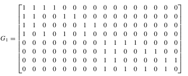

和

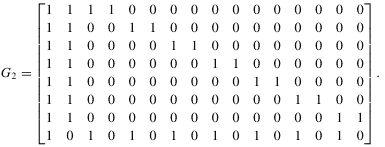

在本例中，我们计算 $\mathcal{C}_1$ 的权重为 2 的陪集的权重分布。注意 $\mathcal{C}_1$ 是一个 $[8, 4, 4]$ 码与自身的直和，唯一这样的码是由 Exercise 56 给出的 $\widehat{\mathcal{H}}_3$。设 $\mathbf{v}$ 为一个权重为 2 且是 $\mathcal{C}_1$ 的一个陪集的陪集领元的向量。由于我们想求 $\mathbf{v} + \mathcal{C}_1$ 的权重分布，由 Theorem 7.5.5，我们可以将 $\mathbf{v}$ 替换为 $\mathbf{v}A$，其中 $A$ 是 Exercise 398 中给出的 $\mathcal{C}_1$ 的自同构的乘积。我们使用该练习的记号。设 $\operatorname{supp}(\mathbf{v}) = \{a, b\}$；当我们将 $\mathbf{v}$ 替换为 $\mathbf{v}A$ 时，我们仍将此新向量的支持记为 $\{a, b\}$，其中 $a$ 和 $b$ 将具有不同的值。如果 $a$ 和 $b$ 都至少为 9，则对 $\mathbf{v}$ 应用 P3。因此我们可以假设 $1 \leq a < b \leq 8$ 或 $1 \leq a \leq 8 < b$。在第一种情况下，如果 $a \neq 1$，则应用 P3 的幂次后跟 P1，这样我们可以假设 $a = 1$；现在再次应用 P3 的幂次，这样我们可以假设 $b = 2$。在第二种情况下，如果 $a \neq 1$，则应用 P3 的幂次后跟 P1，这样我们可以假设 $a = 1$；如果 $b \neq 9$，则应用 P1 的幂次后跟 P2，这样我们可以假设 $b = 9$。因此，我们只需要考虑两个可能的陪集领元：

- (a) $\mathbf{v}_1 = 11000000000000000$，以及
- (b) $\mathbf{v}_2 = 10000000100000000$。

我们首先考虑 $\mathbf{v} = \mathbf{v}_1$。设 $\mathcal{D}$ 为 $[16, 9, 2]$ 码 $\mathcal{D} = \mathcal{C}_1 \cup (\mathbf{v}_1 + \mathcal{C}_1)$。设 $A_i = A_i(\mathcal{D}^\perp)$ 和 $A_i^\perp = A_i(\mathcal{D})$。$\mathcal{D}$ 是一个偶码，因此 $\mathcal{D}^\perp$ 包含全一向量。因此我们知道 $A_0 = A_{16} = 1$ 且对于除 $i = 4, 8,$ 或 $12$ 以外的所有其他 $i$，$A_i = 0$（由 $\mathcal{D}^\perp \subset \mathcal{C}_1$）。我们还知道 $A_1^\perp = 0$ 并且需要确定 $A_4^\perp$。在 $\mathbf{v}_1 + \mathcal{C}_1$ 中，除了 $\mathbf{v}_1$ 之外，唯一的权重为 2 的向量是 $\mathbf{v}_1 + \mathbf{c}$，其中 $\mathbf{c}$ 是支持包含 $\{1, 2\}$ 的权重为 4 的向量。通过检查 $G_1$，很明显这样的 $\mathbf{c}$ 的唯一选择是 $G_1$ 的前三行。因此 $A_2^\perp = 4$。因此利用 (7.8) 的前三个方程，我们得到

```
1 + A_4 + A_8 + A_{12} + 1 = 2^7,
4A_4 + 8A_8 + 12A_{12} + 16 = 2^6 \cdot 16,
16A_4 + 64A_8 + 144A_{12} + 256 = 2^5(16 \cdot 17 + 8).
```

求解得 $A_4 = A_{12} = 20$ 且 $A_8 = 86$。由于 $\mathcal{D}$ 包含全一向量，$A_i^\perp = A_{16-i}^\perp$。利用 $(M_3)$、$(K)$ 或 $(P_1)$，我们有 $A_4^\perp = 36$，$A_6^\perp = 60$，且 $A_8^\perp = 310$。由于 $A_i(\mathbf{v}_1 + \mathcal{C}_1) = A_i(\mathcal{D}) - A_i(\mathcal{C}_1)$，陪集 $\mathbf{v}_1 + \mathcal{C}_1$ 的权重分布为：

| 权重 | 2 | 4 | 6 | 8 | 10 | 12 | 14 |
|---|---|---|---|---|---|---|---|
| 向量数量 | 4 | 8 | 60 | 112 | 60 | 8 | 4 |

现在考虑 $\mathbf{v} = \mathbf{v}_2$。设 $\mathcal{D}$ 为 $[16, 9, 2]$ 码 $\mathcal{D} = \mathcal{C}_1 \cup (\mathbf{v}_2 + \mathcal{C}_1)$，它仍然是偶码。与 $\mathbf{v} = \mathbf{v}_1$ 的情况一样，$A_0 = A_{16} = 1$ 且只有 $A_4, A_8,$ 和 $A_{12}$ 需要确定，因为其他 $A_i$ 为 0。另外 $A_1^\perp = 0$，但 $A_2^\perp = 1$，因为显然没有支持包含 $\{1, 9\}$ 的权重为 4 的向量在 $\mathcal{C}_1$ 中。因此利用 (7.8) 的前三个方程，我们得到

```
1 + A_4 + A_8 + A_{12} + 1 = 2^7,
4A_4 + 8A_8 + 12A_{12} + 16 = 2^6 \cdot 16,
16A_4 + 64A_8 + 144A_{12} + 256 = 2^5(16 \cdot 17 + 2).
```

以与 $\mathbf{v} = \mathbf{v}_1$ 相同的方式，我们得到 $A_4 = A_{12} = 14$，$A_8 = 98$，$A_4^\perp = 42$，$A_6^\perp = 63$，且 $A_8^\perp = 298$。陪集 $\mathbf{v}_2 + \mathcal{C}_1$ 的权重分布为：

| 权重 | 2 | 4 | 6 | 8 | 10 | 12 | 14 |
|---|---|---|---|---|---|---|---|
| 向量数量 | 1 | 14 | 63 | 100 | 63 | 14 | 1 |


请注意，代码 \(\mathcal{C}_1\) 及其权重为 1 的陪集不包含权重为 2 的向量。因此，\(\mathbb{F}_2^{16}\) 中所有权重为 2 的向量都是权重为 2 的陪集的陪集领导元。我们想要统计权重分布为我们所产生的两种可能性之一的权重为 2 的陪集的数量。其陪集领导元的支持完全包含在 \(\{1, \dots, 8\}\) 或 \(\{9, \dots, 16\}\) 中的陪集，其分布与 \(\mathbf{v}_1 + C_1\) 的分布相同。这样的陪集领导元有 \(2\binom{8}{2} = 56\) 个。但每个陪集包含四个陪集领导元，因此这样的陪集有 \(56/4 = 14\) 个。其陪集领导元在坐标 \(\{1, \dots, 8\}\) 中有一个 1 且在坐标 \(\{9, \dots, 16\}\) 中有一个 1 的陪集，其分布与 \(\mathbf{v}_2 + C_1\) 的分布相同。这里，这样的陪集领导元有 \(8^2 = 64\) 个，因此有 64 个这样的陪集，因为每个陪集都有一个唯一的陪集领导元。

### 练习 398 证明下列置换是例 7.5.6 中定义的代码 \(\mathcal{C}_1\) 的自同构，其中坐标标记为 \(1, 2, \dots, 16\)：

- (a) \(P_1 = (1, 2)(3, 4)\),
- (b) \(P_2 = (9, 10)(11, 12)\),
- (c) \(P_3 = (2, 3, 5, 4, 7, 8, 6)\),
- (d) \(P_4 = (10, 11, 13, 12, 15, 16, 14)\)，以及
- (e) \(P_5 = (1, 9)(2, 10)(3, 11)(4, 12)(5, 13)(6, 14)(7, 15)(8, 16)\)。

### 练习 399 结合例 7.5.4、例 7.5.6 和练习 397，我们得到例 7.5.6 中定义的代码 \(\mathcal{C}_1\) 的陪集权重分布的以下表格。

| 陪集权重 | 0 | 1 | 2 | 3 | 4 | 5 | 6 | 7 | 8 | 9 | 10 | 11 | 12 | 13 | 14 | 15 | 16 | 陪集数量 |
|---|---|---|---|---|---|---|---|---|---|---|---|---|---|---|---|---|---|---|
| 0 | 1 | 0 | 0 | 0 | 28 | 0 | 0 | 0 | 198 | 0 | 0 | 0 | 28 | 0 | 0 | 0 | 1 | 1 |
| 1 | | | | | | | | | | | | | | | | | | 16 |
| 2 | 0 | 0 | 4 | 0 | 8 | 0 | 60 | 0 | 112 | 0 | 60 | 0 | 8 | 0 | 4 | 0 | 0 | 14 |
| 2 | 0 | 0 | 1 | 0 | 14 | 0 | 63 | 0 | 100 | 0 | 63 | 0 | 14 | 0 | 1 | 0 | 0 | 64 |
| 3 | | | | | | | | | | | | | | | | | | |
| 4 | 0 | 0 | 0 | 0 | 16 | 0 | 64 | 0 | 96 | 0 | 64 | 0 | 16 | 0 | 0 | 0 | 0 | |

使用练习 395 和 396 的结果填写缺失的条目。然后完成权重为 3 和 4 的陪集的最右侧列。

### 练习 400 在本练习中，你需要找出例 7.5.6 中定义的代码 \(\mathcal{C}_2\) 的陪集权重分布。权重为 1、3 和 4 的陪集已在例 7.5.4 和练习 395 及 396 中讨论过。

- (a) 证明下列置换是 \(\mathcal{C}_2\) 的自同构：
- (i) \(P_1 = (1, 2)(3, 4)\),
- (ii) \(P_2 = (1, 3, 5, 7, 9, 11, 13, 15)(2, 4, 6, 8, 10, 12, 14, 16)\)，以及
- (iii) \(P_3 = (3, 5, 7, 9, 11, 13, 15)(4, 6, 8, 10, 12, 14, 16)\)。
- (b) 证明需要考虑的只有两个权重为 2 的陪集领导元：
- (i) \(\mathbf{v}_1 = 1100000000000000\)，以及
- (ii) \(\mathbf{v}_2 = 1010000000000000\)。
- (c) 完成与例 7.5.6 类似的论证，以找出权重为 2 的陪集的权重分布。
- (d) 对于此代码，完成与练习 399 中类似的表格。

### 练习 401 设 C 为一个 [24, 12, 8] 自偶双偶二进制代码。在第 10.1.1 节中，我们将看到唯一这样的代码是第 1.9.1 节中的扩展二进制 Golay 代码 G24。其权重枚举子在练习 384 中给出。（a）证明 C 的覆盖半径最多为 4。（事实证明覆盖半径恰好为 4；参见定理 11.1.7。）（b）找出权重为 4 的陪集和权重为 3 的陪集的权重分布。\(\blacksquare\)

## 7.6 删短和缩短代码的权重分布

一般来说，代码的权重分布并不决定通过删短或缩短从中得到的代码的权重分布，但当某些一致性条件成立时，删短或缩短代码的权重分布可以从原始代码中确定。设 C 为 \(\mathbb{F}_q\) 上的一个 \([n, k]\) 代码。设 M 为其行是 C 中所有码字的 \(q^k \times n\) 矩阵，并设 Mi 为由 M 中权重为 i 的码字组成的子矩阵。如果对于 \(0 \le i \le n\)，Mi 的每一列都具有相同的权重，则称代码为齐次。回顾第 1.7 节，\(\text{Aut}(C)\) 是传递的，即 \(\text{Aut}(C)\) 是一个传递置换群。如练习 402 所示，如果 C 具有一个传递自同构群，则 C 是齐次。这几乎是判断代码是否齐次的唯一简单方法。

### 练习 402 证明如果 C 具有一个传递自同构群，则 C 是齐次。\(\blacksquare\)

### 定理 7.6.1 (Prange) 设 C 为 \(\mathbb{F}_q\) 上的一个具有 \(d > 1\) 的齐次 \([n, k, d]\) 代码。设 C* 为通过对某个坐标进行删短从 C 得到的代码，并设 Cs 为通过对某个坐标进行缩短从 C 得到的代码。那么对于 \(0 \le i \le n - 1\)，我们有：

- (i) \(A_i(C^*) = \frac{n-i}{n} A_i(C) + \frac{i+1}{n} A_{i+1}(C)\)，以及
- (ii) \(A_i(C_s) = \frac{n-i}{n} A_i(C)\)。
- 假设进一步 C 是一个偶二进制代码。那么对于 \(1 \le j \le \lfloor n/2 \rfloor\)，我们有：
- (iii) \(A_{2j}(C) = A_{2j}(C^*) + A_{2j-1}(C^*)\)。
- (iv) \(A_{2j-1}(C^*) = \frac{2j}{n} A_{2j}(C)\)（以及 \(A_{2j}(C^*) = \frac{n-2j}{n} A_{2j}(C)\)），以及
- (v) \(2j A_{2j}(C^*) = (n-2j) A_{2j-1}(C^*)\)。

证明：Mi 中非零项的数量为 \(i A_i(C) = nw\)，其中 w 是 Mi 中一列的权重，由于 C 是齐次的，该权重与列无关。因此 \(w = \frac{i}{n} A_i(C)\)，因此 Mi 中的每一列都有 \(\frac{n-i}{n} A_i(C)\) 个零。C* 中权重为 i 的向量要么来自 C 中在被删短坐标处为零的权重为 i 的向量，要么来自 C 中在被删短坐标处有非零分量的权重为 i + 1 的向量；由于 \(d > 1\)，C* 中的向量不能同时以这两种方式产生。因此 (i) 成立。C* 中权重为 i 的向量来自 C 中在缩短坐标处为零的权重为 i 的向量，从而得到 (ii)。

现在假设 C 是一个偶二进制代码。C 中权重为 \(2j\) 的向量产生 C* 中权重为 \(2j\) 或 \(2j-1\) 的向量。C* 中所有权重为 \(2j\) 或 \(2j-1\) 的向量都必须来自 C 中权重为 \(2j\) 的码字。因此 (iii) 成立。由于 \(A_{2j-1}(C) = A_{2j+1}(C) = 0\)，将 \(i = 2j - 1\) 和 \(i = 2j\) 代入 (i) 得到 (iv) 中的两个方程。部分 (v) 通过求解 (iv) 中每个方程关于 \(A_{2j}(C)\) 得到。

### 例 7.6.2 设 C 为 [12, 6, 6] 扩展三元 Golay 代码。正如我们将在第 10.4.2 节中所示，Aut(C) 是传递的。根据练习 402，C 是齐次的。设 C* 为 C 对任意坐标进行删短得到的代码。在例 7.3.2 中，给出了 C 的权重分布。使用 Prange 定理，

\(W_C(x, y) = y^{11} + 132x^5y^6 + 132x^6y^5 + 330x^8y^3 + 110x^9y^2 + 24x^{11}\)。

代码 C* 是 [11, 6, 5] 三元 Golay 代码。

### 练习 403 设 C 为 [24, 12, 8] 扩展二进制 Golay 代码，其权重分布在练习 384 中给出。正如我们将在第 10.1.2 节中所示，Aut(C) 是传递的；因此，根据练习 402，C 是齐次的。使用 Prange 定理证明

\(W_{C^*}(x, y) = y^{23} + 253x^7y^{16} + 506x^8y^{15} + 1288x^{11}y^{12} + 1288x^{12}y^{11} + 506x^{15}y^8 + 253x^{16}y^7 + x^{23}\)。

代码 C* 是 [23, 12, 7] 二进制 Golay 代码。

### 练习 404 设 C 为 [24, 12, 8] 扩展二进制 Golay 代码。设 C^{(i)} 为通过对 i 个点进行删短从 C 得到的代码，其中 \(1 \le i \le 4\)。这些是 [24-i, 12, 8-i] 代码，根据第 10.1.2 节的结果，每个代码都具有一个传递自同构群。C^{(i)} 的权重枚举子在练习 403 中给出。找出 \(2 \le i \le 4\) 时 C^{(i)} 的权重枚举子。

### 练习 405 设 C 为 [24, 12, 8] 扩展二进制 Golay 代码。设 C_{(i)} 为通过对 i 个点进行缩短从 C 得到的代码，其中 \(1 \le i \le 4\)。这些是 [24-i, 12-i, 8] 代码，根据第 10.1.2 节的结果，每个代码都具有一个传递自同构群。找出 \(1 \le i \le 4\) 时 C_{(i)} 的权重枚举子。

### 练习 406 设 C 为例 7.5.6 中给出生成矩阵的两个 [16, 8, 4] 自偶双偶二进制代码之一。根据练习 398 和 400，Aut(C) 是传递的，因此 C 是齐次的。使用 Prange 定理找出 C* 的权重分布。

Prange 定理也适用于最小距离 \(d > 1\) 的齐次非线性代码，因为证明的任何部分都不需要使用线性性。例如，[8, 4, 4] 扩展二进制 Hamming 代码 \(\hat{\mathcal{H}}_3\) 的一个权重为 2 的陪集是齐次的。对该陪集进行删短得到 \(\mathcal{H}_3\) 中的一个权重为 1 的陪集，Prange 定理的 (i) 从 \(\hat{\mathcal{H}}_3\) 的原始权重为 2 的陪集的陪集分布给出了其分布；参见练习 407。\(\hat{\mathcal{H}}_3\) 的一个权重为 1 的陪集不是齐次的，尽管 \(\text{Aut}(\hat{\mathcal{H}}_3)\) 是三重传递的。验证陪集的齐次性通常相当困难。可以证明 [24, 12, 8] 扩展二进制 Golay 代码的一个权重为 4 的陪集是齐次的，从而得到 [23, 12, 7] 二进制 Golay 代码的一个权重为 3 的陪集的分布；参见练习 408。


练习 407 执行以下操作：(a) 为 $\widehat{\mathcal{H}}_3$ 选择一个生成矩阵，并在 $\mathbb{F}_2^6$ 中选择任意方便的权重 2 向量 $\mathbf{v}$。证明非线性码 $\mathcal{C} = \mathbf{v} + \widehat{\mathcal{H}}_3$ 是齐次的。(b) 应用 Prange 定理的第 (i) 部分来求 $C^*$ 的权重分布，并将你的答案与在练习 394 中找到的 $\mathcal{H}_3$ 的权重 1 副类的权重分布进行比较。(c) 证明 $\widehat{\mathcal{H}}_3$ 的权重为 1 的副类不是齐次的。

练习 408 假设 [24, 12, 8] 扩展二进制 Golay 码的一个权重 4 副类是齐次的，使用 Prange 定理和练习 401 的结果，求 [23, 12, 7] 二进制 Golay 码的一个权重 3 副类的权重分布。

## 7.7 其他权重枚举子

码存在其他包含更多关于码字详细信息的权重枚举子。如果 $\mathbf{c} \in \mathbb{F}_q^n$ 且 $\alpha \in \mathbb{F}_q$，令 $s_\alpha(\mathbf{c})$ 为 $\mathbf{c}$ 中等于 $\alpha$ 的分量个数。令 $\mathbb{F}_q = \{\alpha_0, \alpha_1, \dots, \alpha_{q-1}\}$。多项式

$W_C(x_{\alpha_0}, x_{\alpha_1}, \dots, x_{\alpha_{q-1}}) = \sum_{\mathbf{c} \in C} \prod_{\alpha \in \mathbb{F}_q} x_\alpha^{s_\alpha(\mathbf{c})}$

称为 $C$ 的 *完全权重枚举子*。注意，如果 $P$ 是置换矩阵，则 $CP$ 和 $C$ 具有相同的完全权重枚举子；但是，通常如果 $M$ 是单项矩阵，则 $CM$ 和 $C$ 不具有相同的完全权重枚举子。如果 $q=2$，则 $W_C(x_0, x_1)$ 是普通权重枚举子 $W_C(x_1, x_0)$。MacWilliams [213] 还证明了 $C$ 的完全权重枚举子与 $C^\perp$ 的完全权重枚举子之间存在一个恒等式。如果 $q=2$，该恒等式与 $(M_3)$ 相同。如果 $q=3$，且 $\mathbb{F}_3 = \{0, 1, 2\}$，则该恒等式为

$W_{C'}(x_0, x_1, x_2) = \frac{1}{|C|} W_C(x_0 + x_1 + x_2, x_0 + \xi x_1 + \xi^2 x_2, x_0 + \xi^2 x_1 + \xi x_2), \quad (7.12)$

其中 $\xi = e^{2\pi i / 3}$ 是单位的原始复数立方根。如果 $q=4$，且 $\mathbb{F}_4 = \{0, 1, \omega, \overline{\omega}\}$ 如第 1.1 节所示，则存在两个 MacWilliams 恒等式，取决于考虑的是厄米对偶还是普通对偶；参见 [291]。对于普通对偶，有

$W_{C'}(x_0, x_1, x_\omega, x_{\overline{\omega}}) = \frac{1}{|C|} W_C(x_0 + x_1 + x_\omega + x_{\overline{\omega}}, x_0 + x_1 - x_\omega - x_{\overline{\omega}}, x_0 - x_1 - x_\omega + x_{\overline{\omega}}, x_0 - x_1 + x_\omega - x_{\overline{\omega}}). \quad (7.13)$

而对于厄米对偶，MacWilliams 恒等式为

$W_{C', H}(x_0, x_1, x_\omega, x_{\overline{\omega}}) = \frac{1}{|C|} W_C(x_0 + x_1 + x_\omega + x_{\overline{\omega}}, x_0 + x_1 - x_\omega - x_{\overline{\omega}}, x_0 - x_1 - x_\omega + x_{\overline{\omega}}, x_0 - x_1 + x_\omega - x_{\overline{\omega}}). \quad (7.14)$

练习 409 回顾在示例 1.3.3 中引入的 [4, 2] 三元四元码 $\mathcal{H}_{3,2}$，其生成矩阵为

$G = \begin{bmatrix} 1 & 0 & 1 & 1 \\ 0 & 1 & 1 & 2 \end{bmatrix}$。

求 $\mathcal{H}_{3,2}$ 的完全权重枚举子，并证明 MacWilliams 恒等式 (7.12) 成立；使用计算机代数系统将最有帮助。$\diamond$

练习 410 设 $\mathcal{C}$ 为 $\mathbb{F}_4$ 上的 [4, 2, 3] 扩展 Reed-Solomon 码，其生成矩阵为

$G = \begin{bmatrix} 1 & 1 & 1 & 1 \\ 1 & \omega & \overline{\omega} & 0 \end{bmatrix}$。

- (a) 证明 $\mathcal{C}$ 在普通内积下是自对偶的。
- (b) 求 $\mathcal{C}$ 的完全权重枚举子，并证明 MacWilliams 恒等式 (7.13) 成立；使用计算机代数系统将最有帮助。$\diamond$

练习 411 设 $\mathcal{C}$ 为 $\mathbb{F}_4$ 上的 [6, 3, 4] 六元码，其生成矩阵如示例 1.3.4 所示：

$G = \begin{bmatrix} 1 & 0 & 0 & 1 & \omega & \omega \\ 0 & 1 & 0 & \omega & 1 & \omega \\ 0 & 0 & 1 & \omega & \omega & 1 \end{bmatrix}$。

它是厄米自对偶的。求 $\mathcal{C}$ 的完全权重枚举子，并证明 MacWilliams 恒等式 (7.14) 成立；使用计算机代数系统将最有帮助。$\diamond$

练习 412 回顾 $-$ 表示如第 1.3 节所述在 $\mathbb{F}_4$ 中的共轭。执行以下操作：

- (a) 证明 $W_C^2(x_0, x_1, x_\omega, x_{\overline{\omega}}) = W_C^2(x_0, x_1, x_{\overline{\omega}}, x_\omega)$。
- (b) 证明 (7.13) 成立当且仅当 (7.14) 成立。$\diamond$

练习 413 证明对于 $\mathbb{F}_4$ 上的码，$W_C(x, y) = W_C^L(y, x, x, x)$。$\diamond$

李权重枚举子有时用于特征为 $p \neq 2$ 的域上的码。对于这样的域，令 $\mathbb{F}_q = \{a_0 = 0, a_1, \dots, a_{r-1}, -a_1, \dots, -a_r\}$，其中 $r = (q-1)/2$。$\mathcal{C}$ 的李权重枚举子是多项式

$W_C^L(x_0, x_1, \dots, x_{q-1}) = \sum_{c \in C} x_0^{k(c)} \prod_{i=1}^r x_{a_i}^{(c)_i + (-c)_i}$。

李权重枚举子基本上将完全权重枚举子中的变量数量减半。如果 $q > 3$，则 $W_C(x_0, x_0) = W_C^L(x_0, x_1)$。$\mathcal{C}$ 的李权重枚举子与 $C^\perp$ 的李权重枚举子之间也存在一种关系，该关系通过在完全权重枚举子的 MacWilliams 恒等式中令 $x_a$ 等于 $x_{-a}$ 来获得。

[291] 中还为其他码族和其他类型的权重枚举子建立了 MacWilliams 恒等式。

## 7.8 权重约束

在本节中，我们将介绍偶二进制码中码字权重的约束，回顾如果二进制码的所有码字都具有偶权重，则该码称为偶码。下面来自定理 1.4.3 的恒等式对于两个向量 x, y \in F_2^n 将很有用：

wt(x + y) = wt(x) + wt(y) - 2wt(x \cap y), (7.15)

其中 x \cap y 是 F_2^n 中的向量，其在 x 和 y 都为 1 的位置上恰好有 1。当两个向量 x 和 y 之间的普通内积为 0 时，我们说这些向量正交，并用 x \perp y 表示。

以下是 (7.15) 的一个简单推论。

### 引理 7.8.1 设 x 和 y 为 F_2^n 中的两个向量。

- (i) 假设 wt(x) \equiv 0 (mod 4)。则 wt(x + y) \equiv wt(y) (mod 4) 当且仅当 x \perp y，且 wt(x + y) \equiv wt(y) + 2 (mod 4) 当且仅当 x \not\perp y。
- (ii) 假设 wt(x) \equiv 2 (mod 4)。则 wt(x + y) \equiv wt(y) (mod 4) 当且仅当 x \not\perp y，且 wt(x + y) \equiv wt(y) + 2 (mod 4) 当且仅当 x \perp y。

练习 414 证明引理 7.8.1。

我们称一个二进制向量为四重偶向量，如果其权重可被 4 整除。一个二进制向量称为二重偶向量，如果其权重是偶数但不可被 4 整除。回顾定理 1.4.8，如果一个二进制码仅包含四重偶向量，则该码是自正交的。我们将主要关注并非所有码字都是四重偶向量的码。我们将介绍偶二进制码的一种分解，分解为称为码的核、H-平面和 A-平面的部分。H-平面或 A-平面是由 x 和 y 展开的 2 维空间，该空间记为 span{x, y}。核、H-平面和 A-平面定义如下：

- 码 C 的核是子码 H = C \cap C^{\perp}。
- 如果 x 和 y 是四重偶向量但不正交，则我们称 span{x, y} 为 H-平面。注意，如果 span{x, y} 是 H-平面，则根据引理 7.8.1(i)，wt(x + y) \equiv 2 (mod 4)，因此 H-平面包含两个非零四重偶向量和一个二重偶向量。
- 如果 x 和 y 是二重偶向量但不正交，则我们称 span{x, y} 为 A-平面。如果 span{x, y} 是 A-平面，则根据引理 7.8.1(ii)，wt(x + y) \equiv 2 (mod 4) 仍然成立；因此 A-平面包含三个二重偶向量。

练习 415 证明如果 C 是一个 [n, k] 偶二进制码，那么要么 C 是自正交的，要么其核的维数最多为 k - 2。

练习 416 设 C 是一个不是自正交的 2 维偶二进制码。证明以下内容：

- (a) C 的核是 {0}。
- (b) 要么 C 包含三个二重偶向量，在这种情况下它是一个 A-平面，要么 C 包含恰好两个非零四重偶向量，在这种情况下它是一个 H-平面。


在进行分解之前，我们需要一些初步结果。

### Lemma 7.8.2
设 \(\mathcal{C}\) 为维度 \(k \ge 2\) 的偶二元码，其 hull 为 \(\{\mathbf{0}\}\)。则以下结论成立：
- (i) 若 \(\mathcal{C}\) 包含非零双偶向量，则它包含一个 \(H\)-平面。
- (ii) 若 \(\mathcal{C}\) 不包含非零双偶向量，则它是二维的，且是一个 \(A\)-平面。

**证明：** 假设 \(\mathcal{C}\) 包含非零双偶向量 \(\mathbf{x}\)。由于 \(\mathbf{x} \notin \mathcal{C}^\perp\)，存在码字 \(\mathbf{y} \in \mathcal{C}\) 使得 \(\mathbf{x} \cdot \mathbf{y} = 1\)。若 \(\mathbf{y}\) 是双偶的，则 \(\text{span}\{\mathbf{x}, \mathbf{y}\}\) 是一个 \(H\)-平面。若 \(\mathbf{y}\) 是单偶的，则由 Lemma 7.8.1 可知 \(\mathbf{x} + \mathbf{y}\) 是双偶的，且 \(\text{span}\{\mathbf{x}, \mathbf{x} + \mathbf{y}\} = \text{span}\{\mathbf{x}, \mathbf{y}\}\) 仍是一个 \(H\)-平面。这证明了 (i)。部分 (ii) 由 Exercise 417 得出。

### Exercise 417
设 \(\mathcal{C}\) 为维度 \(k \ge 2\) 的偶二元码，其 hull 为 \(\{\mathbf{0}\}\)。证明：若 \(\mathcal{C}\) 没有非零双偶向量，则 \(k = 2\) 且 \(\mathcal{C}\) 是一个 \(A\)-平面。

为了描述我们的分解，我们还需要一种记号。假设 \(\mathcal{C}\) 包含两个子码 \(\mathcal{A}\) 和 \(\mathcal{B}\)，使得 \(\mathcal{C} = \mathcal{A} + \mathcal{B} = \{\mathbf{a} + \mathbf{b} \mid \mathbf{a} \in \mathcal{A} \text{ 且 } \mathbf{b} \in \mathcal{B}\}\)，其中 \(\mathcal{A} \cap \mathcal{B} = \{\mathbf{0}\}\) 且对所有 \(\mathbf{a} \in \mathcal{A}\) 和 \(\mathbf{b} \in \mathcal{B}\) 有 \(\mathbf{a} \cdot \mathbf{b} = 0\)。此时我们称 \(\mathcal{C}\) 为 \(\mathcal{A}\) 和 \(\mathcal{B}\) 的 *正交和*，并记作 \(\mathcal{C} = \mathcal{A} \perp \mathcal{B}\)。（在向量空间术语中，\(\mathcal{C}\) 是 \(\mathcal{A}\) 和 \(\mathcal{B}\) 的正交直和。）

### Exercise 418
设 \(\mathcal{C} = \mathcal{A}_1 \perp \mathcal{A}_2\)，其中 \(\mathcal{A}_1\) 和 \(\mathcal{A}_2\) 是 \(A\)-平面。证明 \(\mathcal{C} = \mathcal{H}_1 \perp \mathcal{H}_2\)，其中 \(\mathcal{H}_1\) 和 \(\mathcal{H}_2\) 是 \(H\)-平面。

### Lemma 7.8.3
设 \(\mathcal{C}\) 为 hull 为 \(\{\mathbf{0}\}\) 的偶二元码。则 \(\mathcal{C}\) 的维度为偶数 \(2m\)，且以下情况之一发生：
- (i) \(\mathcal{C} = \mathcal{H}_1 \perp \mathcal{H}_2 \perp \cdots \perp \mathcal{H}_m\)，其中 \(\mathcal{H}_1, \mathcal{H}_2, \dots, \mathcal{H}_m\) 是 \(H\)-平面。
- (ii) \(\mathcal{C} = \mathcal{H}_1 \perp \mathcal{H}_2 \perp \cdots \perp \mathcal{H}_{m-1} \perp \mathcal{A}\)，其中 \(\mathcal{H}_1, \mathcal{H}_2, \dots, \mathcal{H}_{m-1}\) 是 \(H\)-平面，\(\mathcal{A}\) 是一个 \(A\)-平面。

**证明：** 该结论通过对 \(\mathcal{C}\) 的维度进行归纳证明。\(\mathcal{C}\) 不能是一维的，否则其非零向量（作为偶向量）与自身正交，因而属于 hull。因此 \(\mathcal{C}\) 的维度至少为 2。若 \(\mathcal{C}\) 的维度为 2，则由 Exercise 416 可知它要么是 \(H\)-平面，要么是 \(A\)-平面。故我们可以假设 \(\mathcal{C}\) 的维度至少为 3。由 Lemma 7.8.2，\(\mathcal{C}\) 包含一个 \(H\)-平面 \(\mathcal{H}_1\)。若能证明 \(\mathcal{C} = \mathcal{H}_1 \perp \mathcal{C}_1\)，其中 \(\mathcal{C}_1\) 的 hull 为 \(\{\mathbf{0}\}\)，则通过归纳法证明即告完成。设 \(\mathcal{H}_1 = \text{span}\{\mathbf{x}, \mathbf{y}\}\)，其中 \(\mathbf{x}\) 和 \(\mathbf{y}\) 是满足 \(\mathbf{x} \cdot \mathbf{y} = 1\) 的非零双偶向量。定义 \(f : \mathcal{C} \to \mathbb{F}_2^2\)，其中 \(f(\mathbf{c}) = (\mathbf{c} \cdot \mathbf{x}, \mathbf{c} \cdot \mathbf{y})\)。由 Exercise 419，\(f\) 是一个满射线性变换。设 \(\mathcal{C}_1\) 为其核；\(\mathcal{C}_1\) 的维度为 \(k - 2\)。由于 \(\mathbf{x} \cdot \mathbf{y} = 1\) 且 \(\mathbf{x} \cdot (\mathbf{x} + \mathbf{y})\)，\(\mathbf{x}\)、\(\mathbf{y}\) 和 \(\mathbf{x} + \mathbf{y}\) 均不在 \(\mathcal{C}_1\) 中。因此 \(\mathcal{H}_1 \cap \mathcal{C}_1 = \{\mathbf{0}\}\)。由 \(f\) 的定义可知，\(\mathcal{H}_1\) 与 \(\mathcal{C}_1\) 正交。故 \(\mathcal{C} = \mathcal{H}_1 \perp \mathcal{C}_1\)。若 \(\mathbf{z} \neq \mathbf{0}\) 属于 \(\mathcal{C}_1\) 的 hull，则它与 \(\mathcal{C}_1\) 和 \(\mathcal{H}_1\) 正交；因此 \(\mathbf{z}\) 属于 \(\mathcal{C}\) 的 hull，这产生了矛盾。

### Exercise 419
设 \(\mathcal{C}\) 为一个包含两个非零偶向量 \(\mathbf{x}\) 和 \(\mathbf{y}\) 的二元码，其中 \(\mathbf{x} \cdot \mathbf{y} = 1\)。定义 \(f : \mathcal{C} \to \mathbb{F}_2^2\)，其中 \(f(\mathbf{c}) = (\mathbf{c} \cdot \mathbf{x}, \mathbf{c} \cdot \mathbf{y})\)。证明 \(f\) 是一个满射线性变换。

以下是 Lemma 7.8.3 的逆命题；我们在第 9 章中将用到此结果。

### Lemma 7.8.4
若 \(\mathcal{C} = \mathcal{P}_1 \perp \dots \perp \mathcal{P}_k\) 是一个正交和，其中每个 \(\mathcal{P}_i\) 要么是 \(H\)-平面，要么是 \(A\)-平面，则 \(\mathcal{C}\) 的 hull 为 \(\{\mathbf{0}\}\)。

**证明：** 若 \(\mathbf{x} \in \mathcal{C} \cap \mathcal{C}^\perp\)，其中 \(\mathbf{x} = \mathbf{x}_1 + \dots + \mathbf{x}_k\) 且 \(\mathbf{x}_i \in \mathcal{P}_i\)（\(1 \le i \le k\)），则对所有 \(\mathbf{y} \in \mathcal{C}\) 有 \(\mathbf{x} \cdot \mathbf{y} = 0\)。由于 \(\mathcal{P}_i \cap \mathcal{P}_i^\perp = \{\mathbf{0}\}\)，若 \(\mathbf{x}_i \neq \mathbf{0}\)，则存在 \(\mathbf{y}_i \in \mathcal{P}_i\) 使得 \(\mathbf{x}_i \cdot \mathbf{y}_i \neq 0\)。于是 \(0 = \mathbf{x} \cdot \mathbf{y}_i\)；但 \(\mathbf{x} \cdot \mathbf{y}_i = \mathbf{x}_i \cdot \mathbf{y}_i \neq 0\)（因为当 \(j \neq i\) 时 \(\mathbf{x}_j \cdot \mathbf{y}_i = 0\)）。这一矛盾表明 \(\mathbf{x}_i = \mathbf{0}\)。故 \(\mathcal{C} \cap \mathcal{C}^\perp = \{\mathbf{0}\}\)。

我们现在给出主要的分解结果，该结果见 [3]。

### Theorem 7.8.5
设 \(\mathcal{C}\) 为一个 \([n, k]\) 偶二元码，其 hull \(\mathcal{H}\) 的维度为 \(r\)。则存在非负整数 \(m\) 使得 \(k = 2m + r\)，且 \(\mathcal{C}\) 具有以下形式之一：
- (H) \(\mathcal{C} = \mathcal{H} \perp \mathcal{H}_1 \perp \mathcal{H}_2 \perp \dots \perp \mathcal{H}_m\)，其中 \(\mathcal{H}_1, \mathcal{H}_2, \dots, \mathcal{H}_m\) 是 \(H\)-平面，\(\mathcal{H}\) 是双偶的。
- (O) \(\mathcal{C} = \mathcal{H} \perp \mathcal{H}_1 \perp \mathcal{H}_2 \perp \dots \perp \mathcal{H}_m\)，其中 \(\mathcal{H}_1, \mathcal{H}_2, \dots, \mathcal{H}_m\) 是 \(H\)-平面，\(\mathcal{H}\) 是单偶的。
- (A) \(\mathcal{C} = \mathcal{H} \perp \mathcal{H}_1 \perp \mathcal{H}_2 \perp \dots \perp \mathcal{H}_{m-1} \perp \mathcal{A}\)，其中 \(\mathcal{H}_1, \mathcal{H}_2, \dots, \mathcal{H}_{m-1}\) 是 \(H\)-平面，\(\mathcal{A}\) 是一个 \(A\)-平面，且 \(\mathcal{H}\) 是双偶的。

**证明：** 若 \(\mathcal{C} = \mathcal{C}^\perp\)，则 \(m=0\) 时具有形式 (H) 或形式 (O)。假设 \(\mathcal{C} \neq \mathcal{C}^\perp\)。设 \(\mathbf{x}_1, \mathbf{x}_2, \dots, \mathbf{x}_r\) 为 \(\mathcal{H}\) 的一组基；将其扩展为 \(\mathcal{C}\) 的一组基 \(\mathbf{x}_1, \mathbf{x}_2, \dots, \mathbf{x}_n\)。设 \(\mathcal{C}_1 = \text{span}\{\mathbf{x}_{r+1}, \mathbf{x}_{r+2}, \dots, \mathbf{x}_n\}\)。显然，\(\mathcal{C} = \mathcal{H} \perp \mathcal{C}_1\)，因为 \(\mathcal{H}\) 中的每个向量都与 \(\mathcal{C}_1\) 中的每个向量正交。若 \(\mathbf{z}\) 属于 \(\mathcal{C}_1\) 的 hull，则它与 \(\mathcal{C}_1\) 和 \(\mathcal{H}\) 中的所有向量正交，因而与 \(\mathcal{C}\) 中的所有向量正交。因此 \(\mathbf{z}\) 也属于 \(\mathcal{H}\)，这意味着 \(\mathbf{z} = \mathbf{0}\)。所以 \(\mathcal{C}_1\) 的 hull 为 \(\{\mathbf{0}\}\)。由 Lemma 7.8.3，一旦我们证明 (A) 中 \(\mathcal{H}\) 为单偶时的分解归约为 (O)，结果即得。在此情况下，设 \(\mathcal{A} = \text{span}\{\mathbf{x}, \mathbf{y}\}\)，并设 \(\mathbf{z}\) 为 \(\mathcal{H}\) 中的一个单偶向量。由 Lemma 7.8.1，\(\mathbf{x}_1 = \mathbf{z} + \mathbf{x}\) 和 \(\mathbf{y}_1 = \mathbf{z} + \mathbf{y}\) 均为双偶向量。由于 \(\mathbf{x} \perp \mathbf{y}\)，则 \(\mathbf{x}_1 \perp \mathbf{y}_1\)；故 \(\mathcal{H}_m = \text{span}\{\mathbf{x}_1, \mathbf{y}_1\}\) 是一个 \(H\)-平面。显然，\(\mathcal{H} \perp \mathcal{H}_1 \perp \dots \perp \mathcal{H}_{m-1} \perp \mathcal{A} = \mathcal{H} \perp \mathcal{H}_1 \perp \dots \perp \mathcal{H}_m\)，于是我们得到形式 (O)。

### Exercise 420
若 \(\mathcal{C}\) 是一个单偶自正交二元码，则在 Theorem 7.8.5 中它的形式是什么？

作为该定理的推论，我们可以得到偶二元码中单偶和双偶码字数量的约束；参见 [31, 164, 271]。

### Theorem 7.8.6
设 \(\mathcal{C}\) 为一个 \([n, k]\) 偶二元码，其 hull 的维度为 \(r\)。则 \(k = 2m + r\)。设 \(a\) 为 \(\mathcal{C}\) 中双偶向量的数量，\(b\) 为 \(\mathcal{C}\) 中单偶向量的数量。
- (i) 若 \(\mathcal{C}\) 具有形式 (H)，则 \(a = 2^r(2^{2m-1} + 2^{m-1})\) 且 \(b = 2^r(2^{2m-1} - 2^{m-1})\)。
- (ii) 若 \(\mathcal{C}\) 具有形式 (O)，则 \(a = b = 2^{k-1}\)。
- (iii) 若 \(\mathcal{C}\) 具有形式 (A)，则 \(a = 2^r(2^{2m-1} - 2^{m-1})\) 且 \(b = 2^r(2^{2m-1} + 2^{m-1})\)。

**证明：** (i) 和 (ii) 的证明留作练习。假设 \(\mathcal{C}\) 具有形式 (A)。设 \(\mathcal{C}_1 = \mathcal{H}_1 \perp \mathcal{H}_2 \perp \dots \perp \mathcal{H}_{m-1} \perp \mathcal{A}\)。由于 \(\mathcal{H}\) 是双偶的，由 Lemma 7.8.1 可知，\(a\)（分别 \(b\)）是 \(\mathcal{C}_1\) 中双偶（分别单偶）向量数量的 \(2^r\) 倍。因此我们只需考察 \(\mathcal{C}_1\)，并通过对 \(m\) 进行归纳来证明结果。当 \(m = 1\) 时，


$\mathcal{C}_1 = \mathcal{A}$ 且结果成立，因为 $\mathcal{A}$ 包含三个单偶向量和一个双偶向量。假设对于某些 \(i \ge 1\)，$\mathcal{H}_1 \perp \mathcal{H}_2 \perp \cdots \perp \mathcal{H}_{l-1} \perp \mathcal{A}$ 中双偶向量的数量为 \(2^{2i-1} - 2^{i-1}\)，单偶向量的数量为 \(2^{2i} + 2^{i-1}\)。由于 $\mathcal{H}_l$ 有一个单偶向量和三个双偶向量，根据引理 7.8.1，$\mathcal{H}_1 \perp \mathcal{H}_2 \perp \cdots \perp \mathcal{H}_l \perp \mathcal{A}$ 中双偶向量的数量为 \(2^{2i-1} - 2^{i-1} + 3(2^{2i-1} - 2^{i-1}) = 2^{2i+1} - 2^i\)。类似地，$\mathcal{H}_1 \perp \mathcal{H}_2 \perp \cdots \perp \mathcal{H}_l \perp \mathcal{A}$ 中单偶向量的数量为 \(3(2^{2i-1} + 2^{i-1}) + 2^{2i-1} - 2^{i-1} = 2^{2i+1} + 2^i\)。\(\square\)

### 练习 421
证明 \(a\) 和 \(b\) 如定理 7.8.6 的形式 (H) 和 (O) 所声称的那样。\(\diamond\)

### 练习 422
从定理 7.8.5 中找出形式 (H)、(O) 或 (A)，以及来自定理 7.8.5 和 7.8.6 的相应参数 \(a, b, r,\) 和 \(m\)，并找出以下生成矩阵的每个 [8, 4] 偶二进制码的 hull：

- (a) \(G_1 = \left[ \begin{array}{cccccccc} 1 & 0 & 0 & 0 & 1 & 0 & 0 & 0 \\ 0 & 1 & 0 & 0 & 0 & 1 & 0 & 0 \\ 0 & 0 & 1 & 0 & 1 & 1 & 0 & 1 \\ 0 & 0 & 0 & 1 & 1 & 1 & 1 & 0 \end{array} \right] \).
- (b) \(G_2 = \left[ \begin{array}{cccccccc} 1 & 0 & 0 & 0 & 1 & 0 & 1 & 1 \\ 0 & 1 & 0 & 0 & 0 & 1 & 0 & 0 \\ 0 & 0 & 1 & 1 & 0 & 1 & 0 & 0 \\ 0 & 0 & 0 & 1 & 1 & 0 & 0 & 0 \end{array} \right] \).
- (c) \(G_3 = \left[ \begin{array}{cccccccc} 1 & 0 & 0 & 0 & 0 & 1 & 1 & 1 \\ 0 & 1 & 0 & 0 & 1 & 0 & 0 & 0 \\ 0 & 0 & 1 & 0 & 1 & 0 & 0 & 0 \\ 0 & 0 & 0 & 1 & 1 & 0 & 0 & 0 \end{array} \right] \). \(\diamond\)

### 示例 7.8.7
MacWilliams 方程或其等价形式可用于确定一组非负整数是否可能作为码的权重分布出现。如果一组整数要作为码的权重分布，则双码的分布可以从 MacWilliams 方程的一种形式中计算出来。得到的双分布显然必须是一组非负整数；否则，原始整数组不可能是码的权重分布。定理 7.8.6 不能用于消除 MacWilliams 方程无法消除的权重分布。例如，假设 \(\mathcal{C}\) 是一个 [8, 4] 二进制码，其权重分布为 \(A_0 = A_2 = A_6 = A_8 = 1\) 且 \(A_4 = 12\)。计算 \(A_i^\perp\)，人们发现 \(A_i^\perp = A_i\)，因此 MacWilliams 方程并未消除这种可能性。然而，通过使用定理 7.8.6，如练习 423 所示，这种可能性被消除了。\(\blacksquare\)

### 练习 423
参考示例 7.8.7，证明不存在权重分布为 \(A_0 = A_2 = A_6 = A_8 = 1\) 且 \(A_4 = 12\) 的 [8, 4] 二进制码。\(\diamond\)

### 推论 7.8.8
如果 \(\mathcal{C}\) 是一个具有 \(2^{k-1}\) 个双偶码字和 \(2^{k-1}\) 个单偶码字的 \([n, k]\) 偶二进制码，则 \(\mathcal{C}\) 的 hull 是单偶的。

### 练习 424
证明推论 7.8.8。\(\diamond\)

如果 $\mathcal{C}$ 是一个具有奇权重向量的二进制码，则任何与模 4 的固定数等价的权重的向量数量都有约束；参见 [272]。

## 7.9 保持权重的变换

由于码是向量空间，研究将一个码映射到另一个码的线性变换是自然而然的。任意线性变换可能将一个权重的码字发送到不同权重的码字。如本书全文所见，码字的权重在码的研究及其纠错能力中起着重要作用。因此，如果我们要将两个码视为“相同”，我们希望找到两个码之间保持权重的线性变换；这样的映射称为 *保持权重的线性变换*。在本节中，我们将证明这样的线性变换必须是单项映射。这一结果最初由 MacWilliams 在其博士论文 [212] 中证明，是我们在第 1 章中定义等价码的基础。我们提出的证明见 [24]；使用阿贝尔群字符的证明可见 [347]。

设 $\mathcal{C}$ 为 $\mathbb{F}_q$ 上的一个 $[n, k]$ 码。定义

\(\mu(k) = \frac{q^k - 1}{q - 1} .\)

根据练习 425，向量空间 $\mathbb{F}_q^k$ 有 $\mu(k)$ 个一维子空间。设 $V_1, V_2, \dots, V_{\mu(k)}$ 为这些子空间，并设 $\mathbf{v}_i$ 为 $V_i$ 中的一个非零向量；因此 $\{\mathbf{v}_i\}$ 是 $V_i$ 的一组基。$\mathcal{C}$ 的生成矩阵的非零列是某些 $\mathbf{v}_j$ 的标量倍数（当然，视为列向量）。回顾第 7.8 节，$V_i$ 与 $V_j$ 正交，记作 $V_i \perp V_j$，前提是 $V_i$ 和 $V_j$ 在普通内积下正交；这显然等价于 $\mathbf{v}_i \cdot \mathbf{v}_j = 0$。现在定义一个 $\mu(k) \times \mu(k)$ 矩阵 $A = [a_{i,j}]$，用于描述一维空间之间的正交关系：

\(a_{i,j} = \begin{cases} 0 & \text{if } V_i \perp V_j, \\ 1 & \text{if } V_i \not\perp V_j. \end{cases}\)

### 练习 425
证明 $\mathbb{F}_q^k$ 有 $(q^k - 1)/(q - 1)$ 个一维子空间。$\diamond$

我们将首先证明 $A$ 在有理数 $\mathbb{Q}$ 上可逆。为此，我们需要以下引理。

### 引理 7.9.1
设 $A$ 为上述矩阵。(i) $A$ 的行之和为向量 $\mathbf{x} = x_1 \cdots x_{\mu(k)}$，其中所有 $i$ 的 $x_i = \mu(k) - \mu(k-1)$。(ii) 对于 $1 \le j \le \mu(k)$，设 $\mathbf{y}^{(j)} = y_1^{(j)} \cdots y_{\mu(k)}^{(j)}$ 为 $A$ 中在第 $j$ 列有 0 的所有行之和。则 $y_j^{(j)} = 0$，且对于所有 $i \ne j$，$y_i^{(j)} = \mu(k) - 1 - \mu(k-2)$。

**证明：** 要证明 (i)，只需证明 $A$ 的每一列都有 $\mu(k) - \mu(k-1)$ 个等于 1 的元素；这等价于证明，对于 $1 \le i \le \mu(k)$，有 $\mu(k) - 1$ 个子空间 $V_j$ 与 $\mathbf{v}_i$ 正交。设 $f_i : \mathbb{F}_q^k \to \mathbb{F}_q$，其中 $f_i(\mathbf{u}) = \mathbf{v}_i \cdot \mathbf{u}$。根据练习 426(a)，$f_i$ 是一个满射线性变换。因此 $f_i$ 的核的维度为 $k - 1$。根据练习 425，恰好有 $\mu(k-1)$ 个 $V_j$ 在 $f_i$ 的核中，证明了有 $\mu(k-1)$ 个子空间 $V_j$ 与 $V_i$ 正交。根据 (i)，$A$ 中有 $\mu(k-1)$ 行在第 $j$ 列有 0。对于部分 (ii)，因此只需证明，对于每个 $i \neq j$，有 $\mu(k-2)$ 个一维子空间 $V_m$，满足 $V_m \perp V_i$ 和 $V_m \perp V_j$。设 $f_j : \mathbb{F}_q^k \to \mathbb{F}_q^2$，其中 $f_j(\mathbf{u}) = (\mathbf{v}_i \cdot \mathbf{u}, \mathbf{v}_j \cdot \mathbf{u})$。根据练习 426(b)，$f_j$ 是一个核维度为 $k-2$ 的满射线性变换。根据练习 425，恰好有 $\mu(k-2)$ 个 $V_m$ 在 $f_j$ 的核中，如所要求。

### 练习 426
设 $\mathbf{v}$ 和 $\mathbf{w}$ 为 $\mathbb{F}_q^k$ 中的（非零）线性无关向量。(a) 设 $f : \mathbb{F}_q^k \to \mathbb{F}_q^2$，其中 $f(\mathbf{u}) = (\mathbf{v} \cdot \mathbf{u}, \mathbf{w} \cdot \mathbf{u})$。证明 $f$ 是一个满射线性变换。(b) 设 $g : \mathbb{F}_q^k \to \mathbb{F}_q^2$，其中 $g(\mathbf{u}) = (\mathbf{v} \cdot \mathbf{u}, \mathbf{w} \cdot \mathbf{u})$。证明 $g$ 是一个满射线性变换。（参见练习 419 以获取类似结果。）

### 定理 7.9.2
矩阵 $A$ 在 $\mathbb{Q}$ 上可逆。

证明：只需证明 $A$ 在 $\mathbb{Q}$ 上的秩为 $\mu(k)$。如果我们能证明通过取 $A$ 的某些行的线性组合可以得到所有标准基向量 $\mathbf{e}^{(j)}$，其中 $\mathbf{e}^{(j)}$ 在位置 $j$ 处为 1，其余处为 0，则此目标达成。但在引理 7.9.1 的记号中，

$\mathbf{e}^{(j)} = \frac{1}{\mu(k) - \mu(k-1)}\mathbf{x} - \frac{1}{\mu(k-1) - \mu(k-2)}\mathbf{y}^{(j)}$.

固定 $\mathcal{C}$ 的一个生成矩阵 $G$。用 col($G$) 表示 $G$ 的列。定义线性变换 $f : \mathbb{F}_q^k \to \mathcal{C}$ 为 $f(\mathbf{u}) = \mathbf{u}G$。（这是使用 $G$ 对消息 $\mathbf{u}$ 进行编码的标准方法，如第 1.11 节所述。）我们定义一个具有整数项的向量 $\mathbf{w} = w_1 \cdots w_{\mu(k)}$：

$w_j = |\{\mathbf{c} \in \text{col}(G) \mid \mathbf{c} \neq \mathbf{0}, \mathbf{c}^T \in V_j\}|$.

因此 $w_j$ 告诉 $G$ 中有多少非零列在 $V_j$ 中，即 $G$ 中有多少列是 $\mathbf{v}_j$ 的非零标量倍数。因此 $G$ 中有 $n - \sum_{j=1}^{\mu(k)} w_j$ 个零列。通过知道 $\mathbf{w}$，我们可以复现 $G$，仅相差列的置换和缩放。注意，由于向量 $\mathbf{v}_1, \dots, \mathbf{v}_{\mu(k)}$ 包含 $\mathbb{F}_q^k$ 的所有一维子空间的所有基向量，则 $f(\mathbf{v}_1), \dots, f(\mathbf{v}_{\mu(k)})$ 包含 $\mathcal{C}$ 的所有一维子空间的所有基向量，因为 $G$ 的秩为 $k$ 且 $\mathcal{C}$ 是 $k$ 维的。这些码字 $f(\mathbf{v}_i)$ 的权重由 $A\mathbf{w}^T$ 决定。

### 定理 7.9.3
对于 $1 \le i \le \mu(k)$，$(A\mathbf{w}^T)_i = \text{wt}(f(\mathbf{v}_i))$。

证明：我们有

$(A\mathbf{w}^T)_i = \sum_{j=1}^{\mu(k)} a_{i,j} w_j = \sum_{j \in S_i} w_j$.


其中 \( S_i = \{j \mid V_j \perp V_i\} \)。按 \( w_j \) 的定义，
\( (A\mathbf{w}^T)_i = \sum_{j \in S_i} |\{ \mathbf{c} \in \text{col}(G) \mid \mathbf{c} \neq \mathbf{0}, \mathbf{c}^T \in V_j \}| \)
\( = \sum_{j=1}^{\mu(k)} |\{ \mathbf{c} \in \text{col}(G) \mid \mathbf{c}^T \in V_j \text{ and } \mathbf{v}_i \cdot \mathbf{c}^T \neq 0 \}| ,\)
因为 \( \mathbf{c}^T \in V_j \) 且 \( \mathbf{v}_i \cdot \mathbf{c}^T \neq 0 \) 当且仅当 \( \mathbf{c} \neq \mathbf{0}, \mathbf{c}^T \in V_j \)，且 \( V_i \not\perp V_j \)。但是
\( \text{wt}(f(\mathbf{v}_i)) = \text{wt}(f(\mathbf{v}, G)) = |\{ \mathbf{c} \in \text{col}(G) \mid \mathbf{v}_i \cdot \mathbf{c}^T \neq 0 \}| \)
\( = \sum_{j=1}^{\mu(k)} |\{ \mathbf{c} \in \text{col}(G) \mid \mathbf{c}^T \in V_j \text{ and } \mathbf{v}_i \cdot \mathbf{c}^T \neq 0 \}|\)
因为 \( G \) 的每一列的转置都在某个 \( V_j \) 中。结果得证。

此结果表明，每个非零码字的权重（以标量乘法为准）都列为 \( A\mathbf{w}^T \) 的某个分量。现在设 \( C' \) 为 \( \mathbb{F}_q \) 上的另一个 \( [n, k] \) 码，使得存在一个保持权重的满射线性变换 \( \phi : C \to C' \)，即对于所有 \( \mathbf{c} \in C \) 都有 \( \text{wt}(\phi(\mathbf{c})) = \text{wt}(\mathbf{c}) \)。设 \( g : \mathbb{F}_q^n \to C' \) 为复合映射 \( \phi \circ f \)，使得对所有 \( \mathbf{u} \in \mathbb{F}_q^k \) 都有 \( g(\mathbf{u}) = \phi(\mathbf{u}G) \)。由于 \( \phi \) 和 \( f \) 都是线性的，\( g \) 也是线性的。若令 \( G' \) 为相对于 \( \mathbb{F}_q^k \) 和 \( \mathbb{F}_q^n \) 标准基的 \( g \) 的生成矩阵，则有 \( g(\mathbf{u}) = \mathbf{u}G' \)，且 \( G' \) 是 \( C' \) 的生成矩阵；同时 \( g \) 是使用 \( G' \) 对消息 \( \mathbf{u} \) 进行标准编码的函数。现在我们可以证明主要结果。

## 定理 7.9.4 \( \mathbb{F}_q \) 上的 \( [n, k] \) 码 \( C \) 和 \( C' \) 之间存在保持权重的线性变换，当且仅当 \( C \) 和 \( C' \) 是单式等价的。而且，该线性变换在 \( C \) 的每个码字上都与相关的单式变换一致。

证明：若 \( C \) 和 \( C' \) 是单式等价的，则由单式映射确定的线性变换保持权重。对于逆命题，我们使用迄今为止发展的符号。首先注意，对于 \( 1 \le i \le \mu(k) \)，

\( \text{wt}(g(\mathbf{v}_i)) = \text{wt}(\phi(f(\mathbf{v}_i))) = \text{wt}(f(\mathbf{v}_i)) \quad (7.16) \)

因为 \( \phi \) 保持权重。令 \( \mathbf{w}' = w'_1 \cdots w'_{\mu(k)} \) 与 \( \mathbf{w} \) 类似地定义为
\( w'_i = |\{ \mathbf{c} \in \text{col}(G') \mid \mathbf{c} \neq \mathbf{0}, \mathbf{c}^T \in V_i \}|.\)

根据定理 7.9.3（使用两次）和 (7.16)，
\( (A\mathbf{w}^T)_i = \text{wt}(f(\mathbf{v}_i)) = \text{wt}(g(\mathbf{v}_i)) = (A\mathbf{w}'^T)_i.\)

因此 \( A\mathbf{w}^T = A\mathbf{w}'^T \)，进而根据定理 7.9.2 得到 \( \mathbf{w} = \mathbf{w}' \)。由于 \( \mathbf{w} \) 和 \( \mathbf{w}' \) 分别列出了 \( G \) 和 \( G' \) 中位于每个 \( V_i \) 内的非零列的数量，\( G' \) 的列只是 \( G \) 的列在可能的重新缩放后的重新排列。因此存在单式矩阵 \( M \) 使得 \( G' = GM \)，从而 \( C \) 和 \( C' \) 是单式等价的。\( C \) 的每个码字都可以写为某些消息 \( \mathbf{u} \in \mathbb{F}_q^k \) 的 \( \mathbf{u}G \)。但是 \( \phi(\mathbf{u}G) = \mathbf{u}G' \)。由于 \( G' = GM \)，我们有 \( \phi(\mathbf{u}G) = \mathbf{u}GM \)，因此线性变换 \( \phi \) 和单式映射 \( M \) 在 \( C \) 的每个码字上一致。

定理 7.9.4 证明的一个推论是 Bonisoli [25] 关于恒定权重码的以下结果；此证明的思路来自 Ward [347]。若线性码的所有非零码字具有相同的权重，则称其为恒定权重码。此类码的例子包括根据定理 2.7.5 在 \( \mathbb{F}_q \) 上的单纯形码。

## 定理 7.9.5 设 \( \mathcal{C} \) 为 \( \mathbb{F}_q \) 上的一个 \([n, k]\) 线性码，其所有非零码字具有相同的权重。假设 \( \mathcal{C} \) 非零，且生成矩阵的任何列都不是全零列。则 \( \mathcal{C} \) 等价于单纯形码的 \( r \) 倍复制。

证明：我们使用本节的符号。设 \( G \) 为 \( \mathcal{C} \) 的生成矩阵。选择 \( G \) 的一列 \( \mathbf{c}^T \)，使得该列或该列的任何标量倍数作为 \( G \) 的列出现的最大次数为 \( r \)。设 \( \mathbf{x} \) 为 \( \mathbb{F}_q^n \) 的任意非零元素。则存在非奇异矩阵 \( B \) 使得 \( B\mathbf{c}^T = \mathbf{x}^T \)。因此 \( BG \) 是一个 \( k \times n \) 矩阵，其中包含列 \( \mathbf{x}^T \) 或该列的标量倍数至少 \( r \) 次。注意 \( BG = G' \) 是 \( \mathcal{C} \) 的另一个生成矩阵，因此 \( B \) 诱导 \( \mathcal{C} \) 的一个非奇异线性变换。由于 \( \mathcal{C} \) 的所有非零码字具有相同的权重，该线性变换保持权重。根据定理 7.9.4 的证明，存在单式矩阵 \( M \) 使得 \( G' = GM \)。由于 \( G' \) 包含列 \( \mathbf{x}^T \) 或该列的非零标量倍数至少 \( r \) 次，且 \( G'M = GM \) 仅仅是 \( G \) 经过列重新排列和重新缩放后的同一矩阵，\( G \) 有 \( r \) 个或更多列是 \( \mathbf{x}^T \) 的非零标量倍数。根据 \( r \) 的最大性以及 \( \mathbf{x} \) 任意这一事实，\( \mathbb{F}_q^k \) 中的每个非零向量连同其非零标量倍数作为 \( G \) 的列恰好出现 \( r \) 次。但这意味着 \( \mathcal{C} \) 是单纯形码的 \( r \) 倍复制。

## 示例 7.9.6 设 \( \mathcal{C} \) 为具有生成矩阵的恒定权重二进制码

```
G = \begin{bmatrix} 0 & 0 & 0 & 1 & 1 & 1 & 1 \\ 0 & 1 & 1 & 0 & 0 & 1 & 1 \\ 1 & 0 & 1 & 0 & 1 & 0 & 1 \end{bmatrix}
```

这是第 1.8 节的单纯形码 \( \mathcal{S}_3 \)。上述矩阵中由第二和第三个向量生成的子码也是恒定权重。对其零坐标进行删短，我们得到具有生成矩阵的恒定权重码 \( \mathcal{C}_1 \)

```
G_1 = \begin{bmatrix} 0 & 1 & 1 & 0 & 1 & 0 & 1 \\ 1 & 0 & 1 & 1 & 0 & 0 & 1 \end{bmatrix}
```

这显然是单纯形码 \( \mathcal{S}_2 \) 的 2 倍复制，其生成矩阵为

```
G_2 = \begin{bmatrix} 0 & 1 & 1 \\ 1 & 0 & 1 \end{bmatrix}
```

## 7.10 广义汉明权重

与码相关的一个称为广义汉明权重的正整数递增序列，在许多方面既类似于码的最小权重，也类似于权重分布。该序列（包含码的最小权重）同时满足广义 Singleton 界和广义 Griesmer 界。与权重分布一样，对偶码的广义汉明权重可以从原始码的广义汉明权重确定；此外，广义汉明权重满足 MacWilliams 类型方程。

设 \( C \) 为 \( \mathbb{F}_q \) 上的一个 \([n, k, d]\) 码。若 \( D \) 是 \( C \) 的子码，则 \( D \) 的支撑集 \( \text{supp}(D) \) 是 \( D \) 中并非所有码字都为零的坐标集合。因此 \( |\text{supp}(D)| \) 是 \( D \) 的生成矩阵中非零列的数量。对于 \( 1 \le r \le k \)，\( C \) 的第 \( r \) 个广义汉明权重（也称为第 \( r \) 个最小支撑权重）为

\( d_r(C) = d_r = \min\{|\text{supp}(D)| \mid D \text{ is an } [n, r] \text{ subcode of } C\}. \)

集合 \( (d_1(C), d_2(C), \ldots, d_k(C)) \) 称为 \( C \) 的权重层次。广义汉明权重由 Helleseth, Kløve 和 Mykkeltveit [125] 于 1977 年提出。Victor Wei [348] 在与 II 型窃听信道的联系中研究了它们；参见 [329] 的第 5 节。它们在码的栅格结构研究中也很重要，如 [336] 的第 5 节所述。

以下定理包含关于广义汉明权重的基本信息。

## 定理 7.10.1 设 \( C \) 为 \( \mathbb{F}_q \) 上的一个 \([n, k, d]\) 码。则以下结论成立：

- (i) \( d = d_1(C) < d_2(C) < \cdots < d_k(C) \le n \)。

- (ii) 若 \( M \) 为 \( n \times n \) 单式映射且 \( y \) 为 \( \mathbb{F}_q \) 的自同构，则 \( C \) 的权重层次与 \( CMy \) 的权重层次相同。

证明：假设 \( D \) 是 \( C \) 的一个 \([n, r]\) 子码，且 \( d_r(C) = |\text{supp}(D)| \)。选择 \( D \) 的生成矩阵 \( G_r \) 的 \( d_r(C) \) 个非零列中的一列，对 \( G_r \) 进行行变换，得到 \( D \) 的一个新生成矩阵 \( G'_r \)，使得该列在第一行只有一个非零项。由 \( G'_r \) 的第 2 至 \( r \) 行生成的 \( D \) 的子码是一个 \([n, r-1]\) 码，其支撑集大小严格小于 \( d_r(C) \)。因此 \( d_{r-1}(C) < d_r(C) \)。通过选择 \( C \) 中最小权重 \( d \) 的向量来生成 \( C \) 的一个 \([n, 1]\) 子码，我们看到 \( d = d_1(C) \)；因此 (i) 成立。

在 (ii) 中，由于应用 \( My \) 会重新缩放列、置换坐标并按 \( \gamma \) 分量作用，\( |\text{supp}(D)| = |\text{supp}(D My \gamma)| \)。因此 (ii) 成立。

## 示例 7.10.2 \([15, 4, 8]\) 二进制单纯形码 \( C \) 具有生成矩阵

G =

| 0 | 0 | 0 | 0 | 0 | 0 | 1 | 1 | 1 | 1 | 1 | 1 | 1 | 1 | 1 |
|---|---|---|---|---|---|---|---|---|---|---|---|---|---|---|
| 0 | 0 | 0 | 1 | 1 | 1 | 1 | 0 | 0 | 0 | 0 | 1 | 1 | 1 | 1 |
| 0 | 1 | 1 | 0 | 0 | 1 | 1 | 0 | 0 | 1 | 1 | 0 | 0 | 1 | 1 |
| 1 | 0 | 1 | 0 | 1 | 0 | 1 | 0 | 1 | 0 | 1 | 0 | 1 | 0 | 1 |

根据定理 2.7.5，所有非零码字的权重均为 8。广义汉明权重为 \( d_1 = d = 8 \)、\( d_2 = 12 \)、\( d_3 = 14 \) 和 \( d_4 = 15 \)。要计算这些值，首先观察到，由于两个不同的权重 8 码字之和的权重为 8，两个权重 8 码字在相同位置恰好有四个 1。因此，2 维子码的支撑集大小至少为 12，且 \( G \) 的前两行生成一个支撑集大小为 12 的 2 维码。由于 \( G \) 没有零列，\( d_4 = 15 \)，因此根据定理 7.10.1，\( d_4 = 13 \) 或 14。假设 \( D \) 是支撑集大小为 13 的 3 维子码。设 \( M \) 为其行是 \( D \) 的码字的矩阵。在任何给定的非零列中，根据练习 373，恰好


$\mathcal{M}$ 有一半的行在该列中有 1。所以 $\mathcal{M}$ 包含 $13 \cdot 4 = 52$ 个 1；但 $\mathcal{M}$ 有七行权重为 8，这意味着 $\mathcal{M}$ 有 56 个 1，产生矛盾。所以 $d_3 = 14$。

由于 Wei [348]，$\mathcal{C}$ 的权重层次与 $\mathcal{C}^\perp$ 的权重层次之间存在关系。首先我们证明一个引理。

### 引理 7.10.3
设 $\mathcal{C}$ 为 $\mathbb{F}_q$ 上的一个 $[n, k]$ 码。对于正整数 $s < n$，设 $r$ 为最大整数，使得 $\mathcal{C}$ 具有如下形式的生成矩阵 $G$：

$G = \begin{bmatrix} G_1 & O \\ G_2 & G_3 \end{bmatrix}$.

其中 $G_1$ 是秩为 $r$ 的 $r \times s$ 矩阵，$G_3$ 是 $(k-r) \times (n-s)$ 矩阵。那么 $\mathcal{C}$ 具有如下形式的校验矩阵：

$H = \begin{bmatrix} H_1 & H_2 \\ O & H_3 \end{bmatrix}$.

其中 $H_1$ 是秩为 $s-r$ 的 $(s-r) \times s$ 矩阵，$H_3$ 是秩为 $n-k-s+r$ 的 $(n-k-s+r) \times (n-s)$ 矩阵。此外，$n-k-s+r$ 是 $\mathcal{C}^\perp$ 的子空间中支持包含在最后 $n-s$ 个坐标中的最大维数。

证明：设 $H = [A \ B]$，其中 $A$ 是 $(n-k) \times s$ 矩阵，$B$ 是 $(n-k) \times (n-s)$ 矩阵。由于 $H$ 的行与 $G$ 的行正交，$A$ 的行与 $G_1$ 的行正交。因此 $A$ 的秩至多为 $s-r$。假设 $A$ 的秩小于 $s-r$。那么存在一个长度为 $s$ 的向量，它不在 $G_1$ 生成的码中，但与 $A$ 的行正交。将 $n-s$ 个 0 附加到该向量的末尾，我们得到一个与 $H$ 的行正交的向量，因此该向量在 $\mathcal{C}$ 中，但不在 $[G_1 \ O]$ 生成的码中，这与 $r$ 的极大性矛盾。因此 $A$ 的秩等于 $s-r$，从而 $\mathcal{C}$ 具有满足引理结论的校验矩阵 $H$。

### 定理 7.10.4
设 $\mathcal{C}$ 为 $\mathbb{F}_q$ 上的一个 $[n, k]$ 码。则

$\{d_r(\mathcal{C}) \mid 1 \le r \le k\} = \{1, 2, ..., n\} \setminus \{n+1-d_r(\mathcal{C}^\perp) \mid 1 \le r \le n-k\}.$

证明：令 $s = d_r(\mathcal{C}^\perp)$，其中 $1 \le r \le n-k$。只需证明不存在 $1 \le r \le k$ 使得 $d_r(\mathcal{C}) = n+1-s$。由于 $s = d_r(\mathcal{C}^\perp)$，存在一组 $s$ 个坐标，它们支持 $\mathcal{C}^\perp$ 的一个 $r$ 维子码。重新排列列，使这些成为前 $s$ 个坐标。因此 $\mathcal{C}^\perp$ 具有如下形式的 $(n-k) \times n$ 生成矩阵：

$H = \begin{bmatrix} H_1 & O \\ H_2 & H_3 \end{bmatrix}$.

其中 $H_1$ 是秩为 $r$ 的 $r \times s$ 矩阵。根据定理 7.10.1，$d_r(\mathcal{C}^\perp) < d_{r+1}(\mathcal{C}^\perp)$，因此没有更大的子码在这些 $s$ 个坐标上有支持。将引理 7.10.3 应用于 $\mathcal{C}^\perp$（代替 $\mathcal{C}$）和 $n-k$（代替 $k$），存在 $\mathcal{C}$ 的一个 $(k-s+r)$ 维子码，它在前 $s$ 个坐标位置上为零。因此

$d_{k-s+r}(\mathcal{C}) \le n-s$. (7.17)

反证假设存在 $t$ 使得 $d_t(\mathcal{C}) = n + 1 - s$。由 (7.17) 可得

$t > k - s + r. \quad (7.18)$

如有必要，将 $\mathcal{C}$ 替换为排列等价码，$\mathcal{C}$ 具有 $k \times n$ 生成矩阵

$G = \begin{bmatrix} G_1 & O \\ G_2 & G_3 \end{bmatrix}.$

其中 $G_1$ 是秩为 $t$ 的 $t \times (n + 1 - s)$ 矩阵。再次，由于 $d_t(\mathcal{C}) < d_{t+1}(\mathcal{C})$，引理 7.10.3 适用，其中 $t$ 代替 $r$，$n + 1 - s$ 代替 $s$。因此存在 $\mathcal{C}^\perp$ 的一个 $(s - 1 - k + t)$ 维子码，它在前 $n + 1 - s$ 个位置上为零。由于 $s = d_r(\mathcal{C}^\perp)$，我们有 $s - 1 - k + t < r$，这与 (7.18) 矛盾。

我们现在说明如何使用定理 7.10.4 来计算自双码的权重层次。

### 示例 7.10.5
设 $\mathcal{C}$ 为一个 $[24, 12, 8]$ 自双二进制码。（这必定是扩展二进制 Golay 码。）我们利用 $\mathcal{C}$ 的自双性和定理 7.10.4 计算 $\{d_r(C) \mid 1 \le r \le 12\}$。由于 $d_1(C) = 8$，根据定理 7.10.1，我们有 $1, 2, \dots, 7 \notin \{d_r(C) \mid 1 \le r \le 12\}$，因此 $24, 23, \dots, 18 \in \{d_r(C^\perp) \mid 1 \le r \le 12\}$ 且 $17 \notin \{d_r(C^\perp) \mid 1 \le r \le 12\}$。很容易看出，长度小于 12 的最小权重为 8 的 2 维自正交二进制码不存在。因此 $d_2(C) \ge 12$ 且 $9, 10, 11 \notin \{d_r(C) \mid 1 \le r \le 12\}$。于是 $16, 15, 14 \in \{d_r(C^\perp) \mid 1 \le r \le 12\}$。由于 $\mathcal{C} = C^\perp$，我们现在得出 $\{8, 14, 15, 16, 18, 19, 20, 21, 22, 23, 24\}$ 包含于 $\{d_r(C) \mid 1 \le r \le 12\}$ 且 $12 \le d_2(C) \le 13$。一个简单的论证表明，一个 $[13, 2, 8]$ 自正交二进制码的生成矩阵中必须有一列全为零。因此 $d_2(C) = 12$。所以我们有：

| r | 1 | 2 | 3 | 4 | 5 | 6 | 7 | 8 | 9 | 10 | 11 | 12 |
|---|---|---|---|---|---|---|---|---|---|---|---|---|
| $d_r(C)$ | 8 | 12 | 14 | 15 | 16 | 18 | 19 | 20 | 21 | 22 | 23 | 24 |

### 练习 427
做以下题目：
- (a) 证明长度小于 12 的最小权重为 8 的 2 维自正交二进制码不存在。
- (b) 证明一个 $[13, 2, 8]$ 自正交二进制码的生成矩阵中必须有一列全为零。

### 练习 428
求示例 7.5.6 中生成矩阵 $G_1$ 的 $[16, 8, 4]$ 自双双偶二进制码的权重层次。

### 练习 429
求示例 7.5.6 中生成矩阵 $G_2$ 的 $[16, 8, 4]$ 自双双偶二进制码的权重层次。

### 练习 430
$[7, 3, 4]$ 二进制单纯码和 $[7, 4, 3]$ 二进制海明码的权重层次分别是什么？

Wei [348] 观察到最小支持权重推广了 Singleton 界。

### 定理 7.10.6 (广义 Singleton 界)
对于 $\mathbb{F}_q$ 上的一个 $[n, k, d]$ 线性码，当 $1 \le r \le k$ 时，$d_r \le n - k + r$。

证明：该证明对 $k - r$ 进行归纳。当 $k - r = 0$ 时，根据定理 7.10.1，$d_r = d_k \le n = n - k + r$。假设对某个 $r \le k$ 有 $d_r \le n - k + r$，则根据同一定理，$d_{r-1} \le d_r - 1 \le n - k + (r - 1)$，从而得出结果。

Singleton Bound 是广义 Singleton 界中 $r = 1$ 的情况。从广义 Singleton 界的证明可知，如果一个码达到 Singleton Bound，则当 $1 \le r \le k$ 时 $d_{r-1} = d_r - 1$ 且 $d_k = n$。按定义，达到 Singleton Bound 的码是 MDS 码；因此 MDS 码也满足广义 Singleton 界，从而其广义 Hamming 权重被确定。

### 定理 7.10.7
设 $C$ 为 $\mathbb{F}_q$ 上的一个 MDS 码。则：(i) 对于所有 $1 \le r \le k$，$C$ 满足广义 Singleton 界；(ii) 当 $1 \le r \le k$ 时，$d_r = d + r - 1$。

我们现在研究最小支持权重满足的 Griesmer Bound [124, 128] 的一个推广。设 $G$ 为码 $C$ 的生成矩阵。设 col($G$) 为 $G$ 的不同列的集合。如果 $\mathbf{x} \in \text{col}(G)$，定义 $m(\mathbf{x})$ 为 $\mathbf{x}$ 在 $G$ 中的重数，如果 $U \subseteq \text{col}(G)$，定义

$m(U) = \sum_{\mathbf{x} \in U} m(\mathbf{x}).$

对于 $U \subseteq \text{col}(G)$，设 span($U$) 为由 $U$ 张成的 $\mathbb{F}_q^k$ 的子空间。最后，对于 $1 \le r \le k$，设 $\mathcal{F}_{r,r}$ 为由 $G$ 的列张成的 $\mathbb{F}_q^k$ 的所有 $r$ 维子空间的集合。在陈述广义 Griesmer Bound 之前，我们需要两个引理。第一个引理给出了用函数 $m(U)$ 表示的 $d_r(C)$ 的公式。

### 引理 7.10.8
设 $C$ 为具有生成矩阵 $G$ 的 $[n, k]$ 码。对于 $1 \le r \le k$，$d_r(C) = n - \max\{m(U) \mid U \subseteq \text{col}(G) \text{ 且 } \text{span}(U) \in \mathcal{F}_{k-k+r}\}$。

证明：设 $\mathcal{D}$ 为 $C$ 的一个 $[n, r]$ 子码。那么存在一个秩为 $r$ 的 $r \times k$ 矩阵 $A$，使得 $AG$ 是 $\mathcal{D}$ 的生成矩阵。而且，对于每个这样的矩阵 $A$，$AG$ 都是 $C$ 的一个 $[n, r]$ 子码的生成矩阵。按定义，$|\text{supp}(\mathcal{D})| = n - m$，其中 $m$ 是 $AG$ 的零列数。因此 $|\text{supp}(\mathcal{D})| = n - m(U)$，其中 $U = \{\mathbf{y} \in \text{col}(G) \mid A\mathbf{y} = \mathbf{0}\}$。

由于 $A$ 的秩为 $r$ 且 $G$ 的秩为 $k$，span($U$) 在 $\mathcal{F}_{k-k+r}$ 中。反之，如果 $U \subseteq \text{col}(G)$ 且 span($U$) 在 $\mathcal{F}_{k-k+r}$ 中，则存在一个秩为 $r$ 的 $r \times k$ 矩阵 $A$，使得 $A\mathbf{y} = \mathbf{0}$ 当且仅当 $\mathbf{y} \in \text{span}(U)$。但 $AG$ 是 $C$ 的一个 $[n, r]$ 子码 $\mathcal{D}$ 的生成矩阵。因此，由于 $d_r(C)$ 是任何这样的 $\mathcal{D}$ 的最小支持大小，结果得证。

利用这个引理及其证明，我们可以关联 $d_r(C)$ 和 $d_{r-1}(C)$。

### 引理 7.10.9
设 $C$ 为 $\mathbb{F}_q$ 上的一个 $[n, k]$ 码。则对于 $1 < r \le k$，$(q^r - 1)d_{r-1}(C) \le (q^r - q)d_r(C)$。


证明：设 \( G \) 为 \( \mathcal{C} \) 的生成矩阵。根据引理 7.10.8 及其证明，存在一个秩为 \( r \) 的 \( r \times k \) 矩阵 \( A \)，使得 \( U = \{ \mathbf{y} \in \text{col}(G) \mid A\mathbf{y} = \mathbf{0} \} \)，其中 \( \text{span}(U) \in \mathcal{F}_{k, k-r} \) 且 \( d_r(C) = n - m(U) \)。此外，\( AG \) 生成 \( \mathcal{C} \) 的一个 \( r \) 维子码 \( \mathcal{D} \)。根据习题 431，\( \mathcal{D} \) 有 \( t = (q^r - 1)/(q - 1) \) 个 \( (r-1) \) 维子码 \( V_1, V_2, \dots, V_t \)。每个 \( V_i \) 对应一个秩为 \( r-1 \) 的 \( (r-1) \times k \) 矩阵 \( A_i \)，使得 \( A_i G \) 是 \( V_i \) 的生成矩阵。令 \( U_i = \{ \mathbf{y} \in \text{col}(G) \mid A_i \mathbf{y} = \mathbf{0} \} \)，我们看到 \( \text{span}(U_i) \in \mathcal{F}_{k, k-r+1} \)，如引理 7.10.8 的证明所示。此外 \( U \subset U_i \)，因为 \( AG \) 的某一列为 \( \mathbf{0} \) 意味着 \( A_i G \) 的同一列也是 \( \mathbf{0} \)，原因是 \( V_i \) 是 \( \mathcal{D} \) 的子码。反之，如果 \( U' \subset \text{col}(G) \) 且 \( U \subseteq U' \) 以及 \( \text{span}(U') \in \mathcal{F}_{k, k-r+1} \)，则存在一个秩为 \( r-1 \) 的 \( (r-1) \times k \) 矩阵 \( A' \)，使得 \( U' = \{ \mathbf{y} \in \text{col}(G) \mid A' \mathbf{y} = \mathbf{0} \} \)。由于 \( U \subseteq U' \)，\( \mathcal{D} = \text{span}(U) \subseteq \text{span}(U') \)。因此 \( A'G \) 生成 \( \mathcal{D} \) 的一个 \( (r-1) \) 维子空间，记为 \( V_i \)，故 \( U' = U_i \)。

\( d_{r-1}(C) \le n - m(U_i) \quad \text{对 } 1 \le i \le t \text{ 成立。} \)

因而

\( d_r(C) - d_{r-1}(C) \ge n - m(U) - [n - m(U_i)] = m(U_i \setminus U) \quad \text{对 } 1 \le i \le t \text{ 成立。} \)

\( G \) 中不在 \( U \) 中的每一列恰好属于某一个 \( U_i \)，因为根据上一段，\( U \) 加上这一列，再加上可能的其他列，张成 \( \mathcal{F}_{k, k-r+1} \) 的一个子空间。因此

\( t(d_r(C) - d_{r-1}(C)) \ge \sum_{i=1}^t m(U_i \setminus U) = n - m(U) = d_r(C). \)

引理得证。

## 习题 431

证明：在 \( \mathbb{F}_q \) 上的一个 \( r \) 维码中存在 \( t = (q^r - 1)/(q - 1) \) 个 \( (r-1) \) 维子码。

## 定理 7.10.10（广义格里斯默界）

设 \( \mathcal{C} \) 是 \( \mathbb{F}_q \) 上的一个 \( [n, k] \) 码。则对 \( 1 \le r \le k \)，

\( n \ge d_r(C) + \sum_{i=1}^{k-r} \left\lceil \frac{q-1}{q^i(q^r-1)} d_r(C) \right\rceil. \)

**证明：** 若 \( r = k \)，不等式退化为显然的断言 \( n \ge d_k(C) \)；参见定理 7.10.1。现假设 \( r < k \)。不失一般性，根据定理 7.10.1(ii)，我们可以假设 \( \mathcal{C} \) 有一个如下形式的生成矩阵 \( G \)：

\( G = \begin{bmatrix} G_1 & O \\ G_2 & G_3 \end{bmatrix}. \)

其中 \( G_1 \) 是秩为 \( r \) 的 \( r \times d_r(C) \) 矩阵，\( G_3 \) 是一个 \( (k-r) \times (n-d_r(C)) \) 矩阵。矩阵 \( [G_2 \ G_3] \) 的秩为 \( k-r \)。若 \( G_3 \) 的秩小于 \( k-r \)，则由 \( [G_2 \ G_3] \) 生成的码中存在一个非零码字 \( \mathbf{x} \)，其在最后 \( n-d_r(C) \) 个坐标上为零，这与定理 7.10.1 中的 \( d_r(C) < d_{r+1}(C) \) 矛盾。因此 \( G_3 \) 的秩为 \( k-r \) 且生成一个 \( [n-d_r(C), k-r] \) 码 \( C_3 \)。

设 \( \mathbf{c} = c_1 \cdots c_n \in C \)，其中 \( w((c_{d_r(C)+1} \cdots c_n)) = a > 0 \)。由 \( \mathbf{c} \) 和 \( G \) 的前 \( r \) 行生成的 \( \mathcal{C} \) 的子码是一个支持大小为 \( a + d_r(C) \) 的 \( (r+1) \) 维子码。故 \( a \ge d_{r+1}(C) - d_r(C) \)，这意味着 \( C_3 \) 的最小重量至少为 \( d_{r+1}(C) - d_r(C) \)，通过选择上述 \( c \) 使得 \( wt((c_{d_r(C)+1} \cdots c_n)) \) 在 \( C_3 \) 中具有最小重量。对 \( C_3 \) 应用格里斯默界，

\( n - d_r(C) \ge \sum_{i=0}^{k-r-1} \left\lceil \frac{d_{r+1}(C) - d_r(C)}{q^i} \right\rceil = \sum_{i=1}^{k-r} \left\lceil \frac{d_{r+1}(C) - d_r(C)}{q^{i-1}} \right\rceil. \)

根据引理 7.10.9，\( (q^{k-1} - 1)d_r(C) \le (q^{k-1} - q)d_{r+1}(C) \)。利用此式，

\( d_{r+1}(C) - d_r(C) \ge \left( 1 - \frac{q^{k-1} - q}{q^{k-1} - 1} \right) d_{r+1}(C) = \frac{q-1}{q^{k-1} - 1} d_{r+1}(C). \)

因此，

\( n - d_r(C) \ge \sum_{i=1}^{k-r} \left\lceil \frac{q-1}{q^{i-1}(q^{k-1} - 1)} d_{r+1}(C) \right\rceil. \)

但再次利用引理 7.10.9，

\( n - d_r(C) \ge \sum_{i=1}^{k-r} \left\lceil \frac{q-1}{q^{i-1}(q^{k-1} - q)} d_r(C) \right\rceil = \sum_{i=1}^{k-r} \left\lceil \frac{q-1}{q^i(q^r - 1)} d_r(C) \right\rceil. \) \(\square\)

格里斯默界是广义格里斯默界在 \( r = 1 \) 时的情形。我们现在证明，若一个码达到格里斯默界，则它对所有 \( r \) 也达到广义格里斯默界，且其重量层次是唯一确定的；该结果的二元情形见文献 [128]。为简化记号，令

\( b_r = d_r(C) + \sum_{i=1}^{k-r} \left\lceil \frac{q-1}{q^i(q^r - 1)} d_r(C) \right\rceil \text{ 对 } 1 \le r \le k \text{ 成立。} \)

广义格里斯默界则断言 \( n \ge b_r \)，对 \( 1 \le r \le k \)。我们首先证明 \( b_{r+1} \ge b_r \)，并确定 \( b_{r+1} = b_r \) 成立的条件。

## 引理 7.10.11

设 \( 1 \le r < k \)。则 \( b_{r+1} \ge b_r \)。此外，\( b_{r+1} = b_r \) 当且仅当以下两点均成立：

- (i) \( d_{r+1}(C) = \lceil (q^{k-1} - 1)d_r(C) / (q^{k-1} - q) \rceil \)，且
- (ii) \( \lceil (q - 1)d_{r+1}(C) / (q^i(q^{r+1} - 1)) \rceil = \lceil (q - 1)d_r(C) / (q^{i+1}(q^r - 1)) \rceil \) 对 \( 1 \le i \le k - r - 1 \) 成立。

**证明：** 引理 7.10.9 蕴含

\( d_{r+1}(C) \ge \left\lceil \frac{q^{k-1} - 1}{q^{k-1} - q} d_r(C) \right\rceil \) (7.19)

以及

\( \left\lceil \frac{q-1}{q^i(q^{r+1} - 1)} d_{r+1}(C) \right\rceil \ge \left\lceil \frac{q-1}{q^i(q^{r+1} - q)} d_r(C) \right\rceil = \left\lceil \frac{q-1}{q^{i+1}(q^r - 1)} d_r(C) \right\rceil \) (7.20)

根据 (7.19) 和 (7.20)，

```
\begin{aligned}
b_{r+1} &= d_{r+1}(C) + \sum_{i=1}^{k-r-1} \left\lceil \frac{q-1}{q^i(q^{r+1}-1)} d_{r+1}(C) \right\rceil \\
&\ge \left\lceil \frac{q^{k-1}-1}{q^{k-1}-q} d_r(C) \right\rceil + \sum_{i=1}^{k-r-1} \left\lceil \frac{q-1}{q^i(q^{r+1}-q)} d_r(C) \right\rceil \\
&= \left\lceil d_r(C) + \frac{q-1}{q(q^r-1)} d_r(C) \right\rceil + \sum_{i=2}^{k-r} \left\lceil \frac{q-1}{q^i(q^r-1)} d_r(C) \right\rceil \\
&= d_r(C) + \sum_{i=1}^{k-r} \left\lceil \frac{q-1}{q^i(q^r-1)} d_r(C) \right\rceil = b_r.
\end{aligned}
```

显然，\( b_{r+1} = b_r \) 当且仅当 (7.19) 以及当 \( 1 \le i \le k-r-1 \) 时的 (7.20) 中均取等号。

## 定理 7.10.12

设 \(\mathcal{C}\) 是 \( \mathbb{F}_q \) 上的一个达到格里斯默界的 \( [n, k, d] \) 码。则：

- (i) \(\mathcal{C}\) 对所有 \( 1 \le r \le k \) 的 \( r \) 达到广义格里斯默界，且
- (ii) \( d_r(\mathcal{C}) = \sum_{i=0}^{r-1} \lceil d/q^i \rceil \) 对 \( 1 \le r \le k \) 成立。

**证明：** 根据广义格里斯默界 \( n \ge b_k \)；利用引理 7.10.11，

\( n \ge b_k \ge b_{k-1} \ge \cdots \ge b_1 \)。

由于 \(\mathcal{C}\) 达到格里斯默界，\( b_1 = n \)。因此对 \( 1 \le r \le k \) 有 \( b_r = n \)，从而得到 (i)。

注意当 \( r=1 \) 时 (ii) 成立，因为 \( d_1(\mathcal{C}) = d \)。假设 \( 1 < r \le k \)。根据引理 7.10.11，

\( \left\lceil \frac{q-1}{q^r(q^r-1)} d_r(\mathcal{C}) \right\rceil = \left\lceil \frac{q-1}{q^{r+1}(q^{r-1}-1)} d_{r-1}(\mathcal{C}) \right\rceil, \)

对 \( 1 < s < k \) 和 \( 1 \le i \le k-s \) 成立。对 \( s = r, r-1, \dots, 2 \) 归纳应用此式，得

\( \left\lceil \frac{q-1}{q^r(q^r-1)} d_r(\mathcal{C}) \right\rceil = \left\lceil \frac{q-1}{q(q-1)} d_1(\mathcal{C}) \right\rceil = \left\lceil \frac{d}{q^{r+1}} \right\rceil, \)

对 \( 1 \le i \le k-r \) 成立，因为根据定理 7.10.1，\( d(\mathcal{C}) = d \)。由于 \(\mathcal{C}\) 达到格里斯默界，故 \( b_r = n \)，我们有

\( \sum_{i=1}^{k-r} \left\lceil \frac{d}{q^i} \right\rceil = n = d_r(\mathcal{C}) + \sum_{i=1}^{k-r} \left\lceil \frac{q-1}{q^i(q^r-1)} d_r(\mathcal{C}) \right\rceil = d_r(\mathcal{C}) + \sum_{i=1}^{k-r} \left\lceil \frac{d}{q^{i+r-1}} \right\rceil. \)

所以

\( d_r(\mathcal{C}) = \sum_{i=0}^{k-1} \left\lceil \frac{d}{q^i} \right\rceil - \sum_{i=r}^{k-1} \left\lceil \frac{d}{q^{i+r-1}} \right\rceil = \sum_{i=0}^{r-1} \left\lceil \frac{d}{q^i} \right\rceil, \)

从而 (ii) 成立。


**示例 7.10.13** 根据定理 2.7.5，在 $\mathbb{F}_q$ 上的 $[(q^k - 1)/(q - 1), k, q^{k-1}]$ 单纯码 $\mathcal{C}$ 满足格里斯默界。所以根据定理 7.10.12，$\mathcal{C}$ 的重量层次为

$$d_r(C) = \sum_{i=0}^{r-1} \left\lceil \frac{q^k - 1}{q^i} \right\rceil = \sum_{i=0}^{r-1} q^{k-i-1} = q^{k-r} \frac{q^r - 1}{q - 1}.$$

**练习 432** 根据示例 7.10.13，下列代码的重量层次是什么：
- (a) [15, 4, 8] 二进制单纯码（另见示例 7.10.2），以及
- (b) [121, 5, 81] 三进制单纯码？

**练习 433** 利用练习 432 和定理 7.10.4 的结果，求下列代码的重量层次：
- (a) [15, 11, 3] 二进制海明码，以及
- (b) [121, 116, 3] 三进制海明码。

**练习 434** 利用示例 7.10.13 和定理 7.10.4 的结果，求在 $\mathbb{F}_q$ 上的 $[(q^k - 1)/(q - 1), (q^k - 1)/(q - 1) - k, 3]$ 海明码 $\mathcal{H}_{q,k}$ 的重量层次。

如前所述，广义海明权重的广义 MacWilliams 方程已由 Barg [14]、Kløve [175] 和 Simonis [310] 建立。有兴趣的读者可参阅上述论文了解详情。

其他代码的广义海明权重也已计算。Wei [348] 计算了所有阶的二进制 Reed-Muller 码和海明码的重量层次；参见练习 434 和 [329] 的第 5 节。（注意，尽管二进制 Reed-Muller 码的重量层次已知，但阶数大于 2 时这些码的权重分布尚未知晓。）根据定理 7.10.12，满足格里斯默界的码的重量层次已知；对于长度比格里斯默界多 1 的码，其重量层次也已知 [127]。¹

**研究问题 7.10.14** 对于 $BCH$、二次剩余、二元或词典码等码族，求出某些或全部广义海明权重的精确或渐近的更多信息。

# 8 设计

本章讨论组合设计的一些基本性质及其与代码的关系。在第 6.5 节中，我们展示了二元码如何导向射影平面。射影平面是 $t$-设计（也称为块设计）的特例，也是本章的主要关注点。与二元码和射影平面一样，我们研究的大多数设计都源于给定代码中给定权重的代码字的支持集。

## 8.1 $r$-设计

一个 $t-(v, k, \lambda)$ 设计，或简称为 $t$-设计，是一对 $(\mathcal{P}, \mathcal{B})$，其中 $\mathcal{P}$ 是一个包含 $v$ 个元素的集合，称为 *点*，$\mathcal{B}$ 是 $\mathcal{P}$ 的大小为 $k$ 的不同子集的集合，称为 *块*，使得每个大小为 $t$ 的点子集恰好包含在 $\lambda$ 个块中。（有时人们会考虑块的集合是多重集的 $t$-设计，即块可以重复。在这种情况下，没有重复块的 $t$-设计称为 *简单*。我们通常只考虑简单 $t$-设计，因此除非另有说明，“$t$-设计”将指“简单 $t$-设计”。）$\mathcal{B}$ 中块的数量记为 $b$，如我们稍后将看到，由参数 $t, v, k$ 和 $\lambda$ 确定。$t$-设计有几种具有专门术语的特例：

- 如果 $\lambda = 1$，则 $t$-设计称为 Steiner $S(t, k, v)$ 系统或 Steiner $t$-设计。
- 如果 $b = v$，则 $t$-设计是对称的，$k - \lambda$ 称为其阶。非平凡的对称 $t$-设计仅存在于 $t \ge 2$ 时。
- 对称 $2-(v, k, 1)$ 设计（或在替代记法中，对称 $S(2, k, v)$ 设计）证明是阶为 $k - 1$ 的射影平面。这从第 6.5 节中射影平面的定义并不明显。事实上，我们在定理 8.6.1 中证明，点和线的集合构成射影平面当且仅当点和线的集合构成对称 $2-(v, k, 1)$ 设计。

描述 $t$-设计时，给出一个指示每个块包含哪些点的矩阵通常很方便。$t$-设计 $(\mathcal{P}, \mathcal{B})$ 的关联矩阵是一个元素为 0 或 1 的矩阵，其行由 $\mathcal{B}$ 的块索引，列由 $\mathcal{P}$ 的点索引，其中 $(i, j)$-元素为 1 当且仅当第 $i$ 个块包含第 $j$ 个点。此处定义的关联矩阵是某些其他作者定义的关联矩阵的转置。采用此定义是因为，在某些应用中，关联矩阵的行将表示代码中代码字的支持集，如我们下面所示。

**示例 8.1.1** 二进制 [7, 4, 3] 海明码 $\mathcal{H}_3$ 是一个循环码，其生成多项式为 $g(x) = 1 + x + x^3$。下表列出了 $\mathcal{H}_3$ 中权重为 3 的代码字：

| 1 | 1 | 0 | 1 | 0 | 0 | 0 |
|---|---|---|---|---|---|---|
| 0 | 1 | 1 | 0 | 1 | 0 | 0 |
| 0 | 0 | 1 | 1 | 0 | 1 | 0 |
| 0 | 0 | 0 | 1 | 1 | 0 | 1 |
| 1 | 0 | 0 | 0 | 1 | 1 | 0 |
| 0 | 1 | 0 | 0 | 0 | 1 | 1 |
| 1 | 0 | 1 | 0 | 0 | 0 | 1 |

如果我们将坐标标记为 $\mathcal{P} = \{0, 1, 2, 3, 4, 5, 6\}$，则这七个代码字的支持集为：

$\mathcal{B} = \{\{0, 1, 3\}, \{1, 2, 4\}, \{2, 3, 5\}, \{3, 4, 6\}, \{4, 5, 0\}, \{5, 6, 1\}, \{6, 0, 2\}\}.$

很容易验证 $(\mathcal{P}, \mathcal{B})$ 是一个 2-(7, 3, 1) 设计（或 S(2, 3, 7) Steiner 系统）。由于点的数量等于块的数量，该设计是对称的，因此该设计是阶为 3 - 1 = 2 的射影平面。矩阵 $A$ 是该设计的关联矩阵。将此示例与练习 358 进行比较。

**示例 8.1.2** 扩展前一个示例中的海明码，其中我们将扩展坐标记为 $\infty$，以得到 [8, 4, 4] 码 $\widehat{\mathcal{H}}_3$。令 $\mathcal{P}$ 为坐标 $\{0, 1, 2, 3, 4, 5, 6, \infty\}$。$\widehat{\mathcal{H}}_3$ 中有 14 个权重为 4 的代码字，它们的支持集为

$\mathcal{B} = \{\{0, 1, 3, \infty\}, \{2, 4, 5, 6\}, \{1, 2, 4, \infty\}, \{0, 3, 5, 6\}, \{2, 3, 5, \infty\}, \{0, 1, 4, 6\}, \{3, 4, 6, \infty\}, \{0, 1, 2, 5\}, \{4, 5, 0, \infty\}, \{1, 2, 3, 6\}, \{5, 6, 1, \infty\}, \{0, 2, 3, 4\}, \{6, 0, 2, \infty\}, \{1, 3, 4, 5\}\}.$

注意包含 $\infty$ 的支持集如何与 $\mathcal{H}_3$ 中权重为 3 的代码字的支持集相关，以及包含 $\infty$ 的支持集如何与不包含 $\infty$ 的支持集相关。很容易验证每个三个坐标的集合恰好包含在一个块中。因此 $(\mathcal{P}, \mathcal{B})$ 是一个 3-(8, 4, 1) 设计或 S(3, 4, 8) Steiner 系统。该设计不是对称的。

**练习 435** 验证示例 8.1.1 和 8.1.2 中关于 $(\mathcal{P}, \mathcal{B})$ 是块设计的说法。

与代码一样，设计也有等价性的概念。两个设计 $(\mathcal{P}_1, \mathcal{B}_1)$ 和 $(\mathcal{P}_2, \mathcal{B}_2)$ 是等价的，前提是存在一个从 $\mathcal{P}_1$ 到 $\mathcal{P}_2$ 的双射，它诱导出从 $\mathcal{B}_1$ 到 $\mathcal{B}_2$ 的双射。$\mathcal{P}$ 的一个排列是 $(\mathcal{P}, \mathcal{B})$ 的自同构，前提是该排列诱导出 $\mathcal{B}$ 上的双射。$(\mathcal{P}, \mathcal{B})$ 的自同构群，记为 Aut$(\mathcal{P}, \mathcal{B})$，是 $(\mathcal{P}, \mathcal{B})$ 的所有自同构构成的群。

**练习 436** 考虑示例 8.1.1 和 8.1.2 中给出的 2-(7, 3, 1) 和 3-(8, 4, 1) 设计。证明排列 (0, 1, 2, 3, 4, 5, 6) 是每个设计的自同构。

如果，如示例 8.1.1 和 8.1.2 中所示，一个代码中固定权重的代码字的支持集是某个 $t$-设计的块，则我们说该代码 *持有一个设计*。$^1$ 反之，某个域上 $t$-$(v, k, \lambda)$ 设计的关联矩阵的行空间定义了一个代码。一般来说，不能期望块恰好是所有权重为 $k$ 的代码字的支持集，但在合适的条件下情况确实如此。

noteworthy 地，如果 $(\mathcal{P}, \mathcal{B})$ 是一个 $t$-$(v, k, \lambda)$ 设计，那么对于 $i < t$，它也是一个 $i$-$(v, k, \lambda_i)$ 设计，其中 $\lambda_i$ 由下一个定理给出。

**定理 8.1.3** 设 $(\mathcal{P}, \mathcal{B})$ 是一个 $t$-$(v, k, \lambda)$ 设计。令 $0 \le i \le t$。那么 $(\mathcal{P}, \mathcal{B})$ 是一个 $i$-$(v, k, \lambda_i)$ 设计，其中

\(\lambda_i = \lambda \frac{\binom{v-i}{t-i}}{\binom{k-i}{t-i}} = \lambda \frac{(v-i)(v-i-1)\cdots(v-t+1)}{(k-i)(k-i-1)\cdots(k-t+1)}.\)

**证明：** 令 $I \subseteq \mathcal{P}$，其中 $|I| = i$。令 $N$ 为包含 $I$ 的块的数量。定义 \(\mathcal{X} = \{(T, B) \mid I \subseteq T \subseteq B \text{ 且 } |T| = t \text{ 且 } B \in \mathcal{B}\}\)。我们以两种方式确定 $|\mathcal{X}|$。$\mathcal{P} \setminus I$ 中有 $\binom{v-i}{t-i}$ 个大小为 $t-i$ 的子集；当将 $I$ 加到每个这样的子集时，我们得到一个 $t$ 元素集 $T$。由于 $(\mathcal{P}, \mathcal{B})$ 是一个 $t$-$(v, k, \lambda)$ 设计，每个包含 $I$ 的这样的集 $T$ 都在 $\lambda$ 个块中。因此，\(|\mathcal{X}| = \binom{v-i}{t-i} \lambda\)。包含 $I$ 的块有 $N$ 个。对于每个包含 $I$ 的块 $B$，我们可以从 $B \setminus I$ 中以 $\binom{k-i}{t-i}$ 种方式选择 $t-i$ 个元素，使得加到 $I$ 后形成一个包含在 $B$ 中且包含 $I$ 的 $t$ 元素集 $T$。所以，\(|\mathcal{X}| = N \binom{k-i}{t-i}\)。将这两个关于 $|\mathcal{X}|$ 的计数相等，我们看到 $N$ 仅取决于 $I$ 的大小，通过求解 $N$ 得到结果。

**示例 8.1.4** 设 $(\mathcal{P}, \mathcal{B})$ 为示例 8.1.1 中的 $2\text{-}(7, 3, 1)$ 对称设计。在定理 8.1.3 的记法中，$\lambda_0 = 7, \lambda_1 = 3$，和 $\lambda_2 = 1$。这些数字的解释如下：空集在所有七个块中，每个点在三个块中（$(\mathcal{P}, \mathcal{B})$ 是一个 $1\text{-}(7, 3, 3)$ 设计），每对点在一个块中（$(\mathcal{P}, \mathcal{B})$ 是一个 $2\text{-}(7, 3, 1)$ 设计）。这些都可以通过直接验证示例中列出的块来确认。

**示例 8.1.5** 设 $(\mathcal{P}, \mathcal{B})$ 为示例 8.1.2 中的 $3\text{-}(8, 4, 1)$ 设计。在定理 8.1.3 的记法中，$\lambda_0 = 14, \lambda_1 = 7, \lambda_2 = 3$，和 $\lambda_3 = 1$。这些数字的解释如下，每个都可以通过查看块直接验证：空集在所有 14 个块中，每个点在七个块中（$(\mathcal{P}, \mathcal{B})$ 是一个 $1\text{-}(8, 4, 7)$ 设计），


每对点都在三个块中（(P, B) 是一个 2-(8, 4, 3) 设计），每三个点都在一个块中（(P, B) 是一个 3-(8, 4, 1) 设计）。

在前面的示例中，我们看到 \(\lambda_0\) 是设计中的块的数量；在练习 437 中，要求你证明这一点。根据定理，\(\lambda_1\) 是包含任何给定点的块的数量。因此，我们有以下定理。

### 定理 8.1.6 在一个 \(t-(v, k, \lambda)\) 设计中，块的数量是

$$
b = \lambda_0 = \frac{\binom{v}{t}}{\binom{k}{t}},
$$

且每个点恰好在

$$
\lambda_1 = \frac{\lambda_0 k}{v} = \frac{bk}{v}
$$

个块中。

### 练习 437 设 \((\mathcal{P}, \mathcal{B})\) 为一个 \(t-(v, k, \lambda)\) 设计。

- (a) 直接证明设计中有

$$
b = \lambda_0 = \frac{\binom{v}{t}}{\binom{k}{t}}
$$

个块。

- (b) 验证 \(\lambda_1 = \lambda_0 k / v = bk / v\)。

包含给定点的块的数量 \(\lambda_1\) 称为 *复制数*，有时记作 \(r\)。一个 \(2-(v, k, \lambda)\) 设计有时称为 *平衡不完全区组设计* 或 \((b, v, r, k, \lambda)\) 设计。\(b\) 和 \(r\) 的值可通过定理 8.1.6（取 \(t=2\)）从 \(v, k\) 和 \(\lambda\) 中确定。

每个 \(\lambda_1\) 都是整数这一事实意味着，为了使 \(t-(v, k, \lambda)\) 设计存在，参数 \(t, v, k\) 和 \(\lambda\) 必须满足某些约束。设计研究中的一个主要问题是确定，对于使所有 \(\lambda_i\) 都是整数的数 \(t, v, k\) 和 \(\lambda\)，它们是否确实是某个 \(t-(v, k, \lambda)\) 设计的参数。一个次要问题是，当这样的设计存在时，将具有给定参数的所有设计按等价关系进行分类。

### 练习 438 证明具有以下参数的设计不能存在：

- (a) \(t = 2, v = 90, k = 5\)，且 \(\lambda = 2\)。

- (b) \(t = 4, v = 10, k = 5\)，且 \(\lambda = 5\)。

## 8.2 交点数

与 \(t\)-设计 \((\mathcal{P}, \mathcal{B})\) 相关的还有其他整数，用于描述设计的某些交集性质。设 \(I\) 和 \(J\) 是 \(\mathcal{P}\) 的子集，且 \(I \cap J = \emptyset\)。假设 \(|I| = i\) 且 \(|J| = j\)。用 \(\lambda_j^i\) 表示 \(\mathcal{B}\) 中包含 \(I\) 且与 \(J\) 不相交的块的数量。下一个定理表明，只要 \(i + j \le t\)，\(\lambda_j^i\) 就与 \(I\) 和 \(J\) 的选择无关。我们还将在此定理中看到，这些数满足一个类似于二项式系数所满足的递推关系。这些数称为设计的 *交点数*。某些交点数具有特定含义：

- \(\lambda_0^j\) 是块的数量 \(b\)，

- \(\lambda^0 = \lambda_i\)，且

- \(\lambda_j^t\) 是不与给定大小为 \(j\) 的点集相交的块的数量。

### 定理 8.2.1

设 \((\mathcal{P}, \mathcal{B})\) 为一个 \(t-(v, k, \lambda)\) 设计。设 \(I\) 和 \(J\) 是 \(\mathcal{P}\) 的大小分别为 \(i\) 和 \(j\) 的不相交子集。若 \(i + j \le t\)，则 \(\lambda_j^i\) 与 \(I\) 和 \(J\) 无关，且对于 \(j \ge 1\)，

\(\lambda_j^i = \lambda_j^{i-1} - \lambda_{j+1}^{i-1}\). (8.1)

并且

\(\lambda_j^t = \lambda \frac{\binom{v-i-j}{k-i}}{\binom{v-t}{k-t}}\). (8.2)

### 证明：

我们给出证明的提示，并要求读者在练习 440 中给出正式证明。参考图 8.1，右侧“边”给出了项 \(\lambda_0^i\)，根据定义它们即为 \(\lambda_i\)。根据定理 8.1.3，对于所有 \(i \le t\)，\(\lambda_i\) 与 \(I\) 无关，因此图的右侧“边”被唯一确定。

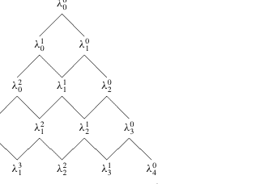

图 8.1 \(t-(v, k, \lambda)\) 设计的帕斯卡三角形。

设 \(I = \{p_1\}\)。所有 \(\lambda_0^0\) 个块要么包含 \(p_1\)，要么不包含。包含 \(p_1\) 的数量是 \(\lambda_1^0\)；因此不包含 \(p_1\) 的数量是 \(\lambda_0^0 - \lambda_1^0\)。故 \(\lambda_1^0 = \lambda_0^0 - \lambda_1^0\) 与 \(I\) 无关。因此图 8.1 中三角形的第二行被唯一确定。现在考虑第三行。设 \(I = \{p_1\}\) 和 \(J = \{q_1\}\)，且 \(p_1 \neq q_1\)。交点数 \(\lambda_1^0\) 是包含 \(p_1\) 的块的数量。这些块分为两类：包含 \(q_1\) 的和不包含 \(q_1\) 的。包含 \(q_1\) 的数量是 \(\lambda_2^0\)，因此不包含 \(q_1\) 的数量是 \(\lambda_1^0 - \lambda_2^0\)。故项 \(\lambda_1^1\) 为 \(\lambda_0^0 - \lambda_2^0\)，因此它与 \(I\) 和 \(J\) 都无关。现在设 \(J = \{q_1, q_2\}\)。有 \(\lambda_1^0\) 个块不包含 \(q_2\)；由于该项在第 2 行，它与 \(q_2\) 无关。同样，这些块要么包含 \(q_1\)，要么不包含。有 \(\lambda_1^1\) 个块包含 \(q_1\)，与 \(q_1\) 无关，且 \(\lambda_0^0\) 必须为 \(\lambda_0^0 - \lambda_1^1\)，与 \(J\) 无关。因此图 8.1 的三行被唯一确定并具有所声称的值。(8.1) 的正式证明通过类似的归纳法得出。

使用递推关系 (8.1)，我们可以从 \(0 \le i \le t\) 的 \(\lambda_i^0\) 确定所有满足 \(i + j \le t\) 的 \(\lambda_i^t\)。例如，

\(\lambda_2^0 = \lambda_1^0 - \lambda_1^1 = \lambda_0^0 - \lambda_1^0 - (\lambda_0^0 - \lambda_2^0) = \lambda_0^0 - 2\lambda_1^0 + \lambda_2^0 = \lambda_0 - 2\lambda_1 + \lambda_2.\)

由于 (8.2) 中给出的 \(\lambda_0^0\) 值与定理 8.1.3 中给出的 \(\lambda_i = \lambda_i^0\) 值一致，并且 (8.2) 中给出的 \(\lambda_i^t\) 值满足递推关系 (8.1)（如练习 439 所示），该定理得证。

### 练习 439 证明 (8.2) 中给出的 \(\lambda_i^t\) 值满足递推关系 (8.1)。

### 练习 440 给出定理 8.2.1 的正式证明。

如前所述，(8.1) 让人联想到定义二项式系数帕斯卡三角形的递推关系：我们称交点数的家族 \( \{\lambda_i^t \mid i + j \le t\} \) 为 \((\mathcal{P}, \mathcal{B})\) 的 *帕斯卡三角形*。图 8.1 给出了该三角形的可视化表示。请注意，该三角形完全由任一“边”确定，即由 \(0 \le i \le t\) 的值 \(\lambda_0^t = \lambda_i\) 或由 \(0 \le j \le t\) 的值 \(\lambda_0^t\) 确定。通过迭代 (8.1)，我们从“右边”沿线的值得到三角形中项的显式公式。

### 推论 8.2.2 若 \(0 \le i + j \le t\)，

\(\lambda_i^t = \sum_{m=i}^{t+j} (-1)^{m-i} \binom{j}{m-i} \lambda_m.\)

### 练习 441 证明推论 8.2.2。提示：证明如果

\(\lambda_i^t = \sum_{m=i}^{t+j} (-1)^{m-i} \binom{j}{m-i} \lambda_m.\)

则 \(\lambda_0^t = \lambda_i\) 且 \(\lambda_N^t\) 满足 (8.1) 的递推关系。

### 练习 442 找出与推论 8.2.2 类似的公式，涉及帕斯卡三角形的“左边” \(\lambda_0^t\)。证明你的公式是正确的。

### 练习 443 存在一个 5-(18, 8, 6) 设计，其块是 $\mathbb{F}_4$ 上 [18, 9, 8] 厄米自偶码中最小权重向量的支持。(a) 构造该设计的帕斯卡三角形。(b) 该码中有多少个最小权重向量？$\unknown$

如果设计是 Steiner 设计（即 \(\lambda = 1\)），则可以在帕斯卡三角形中添加 \(k - t\) 行新行，前提是我们限制了在 \(\lambda_i^j\) 的定义中的子集 \(I\) 和 \(J\)。设 \((\mathcal{P}, \mathcal{B})\) 为一个 \(t-(v, k, 1)\) 设计，并假设 \(B \in \mathcal{B}\)。设 \(I\) 和 \(J\) 是 \(\mathcal{P}\) 的子集，其中 \(|I| = i\)，\(|J| = j\)，且 \(I \cap J = \emptyset\)，并假设存在一个块 \(B\) 使得 \(I \cup J \subseteq B\)。若 \(t < i + j \le k\)，我们定义 \(\lambda_i^j\) 为 \(\mathcal{B}\) 中包含 \(I\) 且与 \(J\) 不相交的块的数量。

### 定理 8.2.3 设 \((\mathcal{P}, \mathcal{B})\) 为一个 \(t-(v, k, 1)\) 设计。设 \(I\) 和 \(J\) 是 \(\mathcal{P}\) 的子集，其中 \(|I| = i\)，\(|J| = j\)，且 \(I \cap J = \emptyset\)，并假设 \(I \cup J\) 是 \(\mathcal{B}\) 中某个块的子集。若 \(t < i + j \le k\)，则 \(\lambda_i^j\) 与 \(I\) 和 \(J\) 无关。并且 \(\lambda_i^j = \lambda_i^{j-1} - \lambda_{i+1}^{j-1}\)。

### 证明：由于 \(\lambda = 1\)，对于 \(t < i \le k\)，\(\lambda_i^0 = 1\)。因此 \(\lambda_0^0\) 与 \(I\) 无关。其余论证同定理 8.2.1 的证明。$\square$

请注意，如果 \(t < i + j \le k\) 成立，则 \(\lambda_i^j\) 不满足 (8.2)，而 \(\lambda_i^0\) 对于 \(t < i \le k\) 也不满足该方程。但是，如练习 441 所示，只要 \(i + j \le k\)，推论 8.2.2 就成立。若 \(\lambda = 1\)，由 \(\{\lambda_i^j \mid 0 \le i + j \le k\}\) 形成的三角形称为 \((\mathcal{P}, \mathcal{B})\) 的 *扩展帕斯卡三角形*。图 8.2 和 8.3 分别给出了 3-(8, 4, 1) 设计和 5-(24, 8, 1) 设计的扩展帕斯卡三角形。对于 \(t \le i + j \le k\) 的值 \(\lambda_i^t\)，用双线连接以指示三角形的扩展部分。

示例 8.1.2 中给出了一个 3-(8, 4, 1) 设计；该设计源自 $\mathcal{H}_3$ 中权重为 4 的向量的支持集。根据练习 56，该码是唯一的 [8, 4, 4] 二进制码，但这并不意味着该设计是唯一的。在下一个示例中，我们表明，实际上任何 3-(8, 4, 1) 设计都是一个 [8, 4, 4] 二进制码中权重为 4 的代码字的支持集，因此是唯一的。

### 练习 444 验证图 8.2 和 8.3 中的项，已知 3-(8, 4, 1) 设计有 14 个块，5-(24, 8, 1) 设计有 759 个块。$\unknown$

### 示例 8.2.4 我们表明 3-(8, 4, 1) 设计在等价意义下是唯一的。从图 8.2 的扩展帕斯卡三角形的底行可以看出，任何两个块在偶数个点上相交。因此，如果我们将设计的每个块与一个向量关联起来，该向量位于

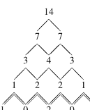

图 8.2 3-(8, 4, 1) 设计的扩展帕斯卡三角形。


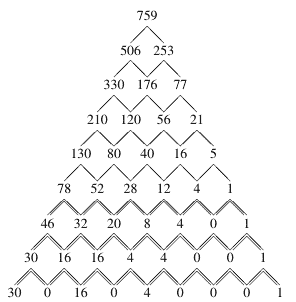

图 8.3 5-(24, 8, 1) 设计的扩展帕斯卡三角形。

$F_2^8$ 且其支撑集为该块，这些向量根据定理 1.4.8(i) 生成一个长度为 8 的自正交二重偶二进制码 C~。由自正交性可知，C~ 的维数至多为 4；由于有 14 个块，维数为 4。因此 C~ 必须是 [8, 4, 4] 扩展海明码 H~_4 的等价形式之一。因此 3-(8, 4, 1) 设计与示例 8.1.2 中的设计等价。

## 8.3 补设计、派生设计和剩余设计

如果我们从一个 $t$-$(v, k, \lambda)$ 设计 $(\mathcal{P}, \mathcal{B})$ 开始，则会由此设计产生另外三个自然设计：

- $(\mathcal{P}, \mathcal{B})$ 的补设计是设计 $(\mathcal{P}, \mathcal{B}')$，其中 $\mathcal{B}'$ 由 $\mathcal{B}$ 中各块的补集组成。定理 8.2.1 表明，$(\mathcal{P}, \mathcal{B}')$ 实际上是一个 $t$-$(v, v-k, \lambda'_t)$ 设计，其帕斯卡三角形是 $(\mathcal{P}, \mathcal{B})$ 的帕斯卡三角形关于穿过顶点的垂直线的反射。如果每个块的补集已经在设计中，则该设计称为自补设计；在这种情况下，当然 $k$ 必须等于 $v/2$。如果 $\lambda = 1$ 且 $k \le v/2$，则 $(\mathcal{P}, \mathcal{B})$ 的补设计的帕斯卡三角形也可以通过反射 $(\mathcal{P}, \mathcal{B})$ 的扩展帕斯卡三角形来扩展 $k-t$ 行，前提是扩展项被正确解释；如果 $t < i + j \le k$，则补设计中的 $\lambda_i^j$ 表示包含 $I$ 且与 $J$ 不相交的块的数量，其中 $|I| = i$，$|J| = j$，且 $I \cup J$ 与补设计中的某个块不相交。

- 令 $x \in \mathcal{P}$ 固定。$(\mathcal{P}, \mathcal{B})$ 关于 $x$ 的派生设计是点集为 $\mathcal{P} \setminus \{x\}$ 且块为 $\{B \setminus \{x\} \mid x \in B \in \mathcal{B}\}$ 的设计。定理 8.2.1 表明，派生设计是一个 $(t-1)$-$(v-1, k-1, \lambda)$ 设计，其帕斯卡三角形是 $(\mathcal{P}, \mathcal{B})$ 的子三角形，由 $\lambda_0^0$ 及其下方的节点组成。如果 $\lambda = 1$，则派生设计的扩展帕斯卡三角形是 $(\mathcal{P}, \mathcal{B})$ 的扩展三角形的子三角形，由 $\lambda_0^1$ 及其下方的节点组成。

- 再次令 $x \in \mathcal{P}$ 固定。$(\mathcal{P}, \mathcal{B})$ 关于 $x$ 的剩余设计是点集为 $\mathcal{P} \setminus \{x\}$ 且块为不包含 $x$ 的 $B \in \mathcal{B}$ 的设计。再次由定理 8.2.1 可知，剩余设计是一个 $(t-1)$-$(v-1, k, \lambda_{t-1}-\lambda)$ 设计，其帕斯卡三角形是 $(\mathcal{P}, \mathcal{B})$ 的子三角形，由 $\lambda_0^1$ 及其下方的节点组成。

### 练习 445 验证与补设计、派生设计和剩余设计定义相关的所有声明。

### 练习 446 设 $\mathcal{D} = (\mathcal{P}, \mathcal{B})$ 为一个 $t$-设计，其中 $t > 1$，并选取 $x \in \mathcal{P}$。令 $\mathcal{D}_c$ 为 $\mathcal{D}$ 的补设计，$\mathcal{D}_d$ 为 $\mathcal{D}$ 关于 $x$ 的派生设计，$\mathcal{D}_r$ 为 $\mathcal{D}$ 关于 $x$ 的剩余设计。

- (a) 令 $\mathcal{D}_1$ 为 $\mathcal{D}_r$ 的补设计，$\mathcal{D}_2$ 为 $\mathcal{D}_c$ 关于 $x$ 的派生设计。证明 $\mathcal{D}_1 = \mathcal{D}_2$。
- (b) 令 $\mathcal{D}_3$ 为 $\mathcal{D}_d$ 的补设计，$\mathcal{D}_4$ 为 $\mathcal{D}_c$ 关于 $x$ 的剩余设计。证明 $\mathcal{D}_3 = \mathcal{D}_4$。

### 示例 8.3.1 在示例 8.2.4 中，我们表明 3-(8, 4, 1) 设计 $(\mathcal{P}, \mathcal{B})$ 与由 $\widehat{\mathcal{H}}_3$（即 [8, 4, 4] 扩展二进制海明码）的重量 4 向量得到的设计等价。我们描述从 $(\mathcal{P}, \mathcal{B})$ 得到的补设计、派生设计和剩余设计：

- 由于 $(\mathcal{P}, \mathcal{B})$ 中每个块的补集已经在 $(\mathcal{P}, \mathcal{B})$ 中，该设计是自补设计。请注意，这与 $\widehat{\mathcal{H}}_3$ 包含全一代码字且各块大小为码长的一半这一事实有关。
- $(\mathcal{P}, \mathcal{B})$ 中有 $\lambda_0^1 = 7$ 个块包含任意给定点 $x$。通过从这七个块中删除 $x$ 得到的 2-(7, 3, 1) 派生设计，给出了在由 $x$ 表示的坐标上删短的码中重量 3 向量的支撑集。该设计是阶 2 的投影平面，并与示例 8.1.1 中得到的设计等价。
- $(\mathcal{P}, \mathcal{B})$ 中有 $\lambda_0^1 = 7$ 个块不包含任意给定点 $x$。关于 $x$ 的 2-(7, 4, 2) 剩余设计由在由 $x$ 表示的坐标上删短的码中重量 4 向量的支撑集组成。

### 练习 447 求从练习 443 的 5-(18, 8, 6) 设计得到的补设计、剩余设计和派生设计的参数。还要给出每个设计的帕斯卡三角形。

### 示例 8.3.2 在本示例中，我们表明任何 5-(24, 8, 1) 设计都由一个 [24, 12, 8] 自对偶二进制码中的重量 8 代码字支撑。然而，我们不知道该设计是否存在。我们将在示例 8.4.3 中表明该设计确实不存在。在第 10.1 节中，我们将表明该设计和该码至等价性都是唯一的；该码是扩展二进制 Golay 码。

令 $(\mathcal{P}, \mathcal{B})$ 为这样一个 5-(24, 8, 1) 设计。大小为 4 的 $\mathcal{P}$ 的子集将被称为 _四元组_。如果 $T$ 是一个四元组且 $p_1$ 是不在 $T$ 中的点，则存在唯一的块 $B \in \mathcal{B}$ 包含 $T \cup \{p_1\}$，因为 $(\mathcal{P}, \mathcal{B})$ 是一个 Steiner 5-设计。令 $T_1 = B \setminus T$。因此，$T_1$ 是包含 $p_1$ 且与 $T$ 不相交的唯一四元组，使得 $T \cup T_1 \in \mathcal{B}$。令 $p_2$ 为不在 $T \cup T_1$ 中的点，我们可以同样地找到包含 $p_2$ 的唯一四元组 $T_2$，使得 $T \cap T_2 = \emptyset$ 且 $T \cup T_2 \in \mathcal{B}$。由于 $(\mathcal{P}, \mathcal{B})$ 是一个 Steiner 5-设计，如果 $T \cup T_1$ 和 $T \cup T_2$ 有五个公共点，则它们必须相等，这意味着 $T_1 = T_2$，这与 $p_2 \in T_2$（而 $p_2 \notin T \cup T_1$）矛盾；因此 $T_1 \cap T_2 = \emptyset$。以此类推，我们构造四元组 $T_3, T_4$ 和 $T_5$，使得 $T_1, \dots, T_5$ 两两不相交，且对 $1 \le i \le 5$ 有 $T \cup T_i \in \mathcal{B}$；四元组 $T, T_1, \dots, T_5$ 称为由 $T$ 确定的六元组。

令 $\mathcal{C}$ 为由支撑集为 $\mathcal{B}$ 中各块的向量张成的长度为 24 的二进制线性码。通过检查图 8.3 的最后一行，我们看到两个不同的块相交于 0、2 或 4 个点，因为 $\lambda_i^{k-1}$ 仅在 $i = 0, 2, 4$ 或 8 时非零；$\lambda_2^8 = 1$ 简单地说明只有一个大小为 8 的块包含该块的八个点。特别是，根据定理 1.4.8(i)，$\mathcal{C}$ 是自正交的，因此是二重偶的。我们证明 $\mathcal{C}$ 的最小重量为 8。如果不是，则其最小重量为 4。假设 $\mathbf{c} \in \mathcal{C}$ 具有重量 4 和支撑集 $S$。令 $T$ 为与 $S$ 在恰好三个位置相交的四元组。构造由 $T$ 确定的六元组，我们得到支撑集为 $T \cup T_i$ 的代码字 $\mathbf{c}_i$，其中 $1 \le i \le 5$。由于 $|S| = 4$ 且四元组两两不相交，存在某个 $i$ 使得 $S \cap T_i = \emptyset$；因此 $\text{wt}(\mathbf{c} + \mathbf{c}_i) = 6$，这与 $\mathcal{C}$ 是二重偶矛盾。因此，$\mathcal{C}$ 是一个最小重量 $d = 8$ 的自正交码。

$\mathcal{C}$ 中任何重量为 8 的代码字的支撑集称为八元组。接下来我们表明八元组恰好就是各块。显然，$\mathcal{B}$ 的块是八元组。令 $\mathbf{c}$ 为 $\mathcal{C}$ 中支撑集为 $S$ 的重量 8 代码字。我们证明 $S$ 是 $\mathcal{B}$ 的一个块。固定 $S$ 中的五个点。存在唯一的块 $B \in \mathcal{B}$ 包含这五个点；由于块是八元组，存在支撑集为 $B$ 的代码字 $\mathbf{b} \in \mathcal{C}$。由于 $\text{wt}(\mathbf{c} + \mathbf{b}) \le 6$，且 $\mathbf{c} + \mathbf{b} \in \mathcal{C}$ 而 $\mathcal{C}$ 的最小重量为 8，故 $\mathbf{c} + \mathbf{b} = \mathbf{0}$。因此 $S = B$，从而每个八元组都是 $\mathcal{B}$ 的一个块。

由于 $\mathcal{C}$ 是自正交的，其维数至多为 12。我们证明其维数恰好为 12。我们通过计数 $\mathcal{C}$ 在 $\mathbb{F}_2^{24}$ 中的陪集数量来实现这一点。根据练习 66，重量为 $i$（$0 \le i \le \lfloor (d-1)/2 \rfloor = 3$）的陪集中存在唯一的陪集领元。因此，对于 $0 \le i \le 3$，存在 $\binom{24}{i}$ 个重量为 $i$ 的陪集，共计 2325 个陪集。令 $\mathbf{v}$ 为重量为 4 的陪集中的一个陪集领元；假设其支撑集为四元组 $T$。如果 $\mathbf{w}$ 是该陪集的另一个陪集领元，则 $\mathbf{v} + \mathbf{w}$ 必须是一个代码字，因此必须具有重量 8。因此，一旦我们找到所有支撑集包含 $T$ 的重量 8 代码字，其他陪集领元就被确定了。考虑由 $T$ 确定的六元组。如果 $\mathbf{c}_i \in \mathcal{C}$ 具有支撑集 $T \cup T_i$，则支撑集包含 $T$ 的唯一重量 8 代码字是 $\mathbf{c}_1, \dots, \mathbf{c}_5$，因为所有八元组都是块且由 $T$ 确定的六元组是唯一的。因此，该陪集中恰好有六个陪集领元，即 $\mathbf{v}, \mathbf{v} + \mathbf{c}_1, \dots, \mathbf{v} + \mathbf{c}_5$。因此，存在 $\binom{24}{4} = 1711$ 个重量为 4 的陪集，因而存在 $2^{12}$ 个重量为 4 或更小的陪集。不存在重量为 5 的陪集，因为如果 $\mathbf{v}$ 具有重量 5，则存在重量为 8 的代码字 $\mathbf{c}$ 使得 $\text{wt}(\mathbf{v} + \mathbf{c}) = 3$（因为 $(\mathcal{P}, \mathcal{B})$ 是一个 5-设计），这与假设矛盾。根据定理 1.12.6(v)，$\mathcal{C}$ 的覆盖半径为 4。因此，$\mathcal{C}$ 是一个 [24, 12, 8] 自对偶码，其重量为 8 的代码字支撑块 $\mathcal{B}$。

### 示例 8.3.3 令 $\mathcal{C}$ 为 [24, 12, 8] 扩展二进制 Golay 码，令 $\mathcal{D} = (\mathcal{P}, \mathcal{B})$ 为由 $\mathcal{C}$ 的重量 8 代码字支撑的 5-(24, 8, 1) 设计。（参见示例 8.4.3，其中我们表明 $\mathcal{C}$ 的重量 8 代码字确实支撑一个 5-设计。）我们产生许多与 $\mathcal{D}$ 相关的设计。


- $\mathcal{D}$ 的补设计 $\mathcal{D}_0$ 是一个 $5-(24, 16, 78)$ 设计，因为 $\lambda_0^b = 78$。由于全一向量在 $\mathcal{C}$ 中，该设计必须由 $\mathcal{C}$ 的权重 16 码字保持。$\mathcal{D}_0$ 的扩展帕斯卡三角形（对扩展节点进行适当解释）是 $\mathcal{D}$ 的扩展帕斯卡三角形关于穿过顶点的垂直线的反射。

- 对任意坐标 $p_1$ 对 $\mathcal{C}$ 进行短缩得到二进制高尔麦码 $\mathcal{C}_1$，即 $[23, 12, 7]$ 二进制高尔麦码。$\mathcal{C}_1$ 的权重 7 码字必须来自支持中包含 $p_1$ 的 $\mathcal{C}$ 的权重 8 码字。因此，$\mathcal{C}_1$ 的权重 7 码字保持由 $\mathcal{D}$ 关于 $p_1$ 派生的 $4-(23, 7, 1)$ 设计 $\mathcal{D}_1$。$\mathcal{D}_1$ 的扩展帕斯卡三角形是从图 8.3 得到的以 $\lambda_1^b = 253$（$\mathcal{D}_1$ 的块数）为顶点的子三角形。注意，根据练习 403，$\mathcal{C}_1$ 确实有 253 个权重 7 码字。

- $\mathcal{C}_1$ 的权重 8 码字必须来自支持中不包含 $p_1$ 的 $\mathcal{C}$ 的权重 8 码字。因此，$\mathcal{C}_1$ 的权重 8 码字保持关于 $p_1$ 的 $\mathcal{D}$ 的剩余设计 $\mathcal{D}_2$，即 $4-(23, 8, 4)$ 设计。$\mathcal{D}_2$ 的帕斯卡三角形是从图 8.3 得到的以 $\lambda_2^b = 506$（$\mathcal{D}_2$ 的块数）为顶点的（非扩展）子三角形。再次注意，根据练习 403，$\mathcal{C}_1$ 确实有 506 个权重 8 码字。

- $\mathcal{D}_1$ 的补设计是由 $\mathcal{C}_1$ 的权重 16 码字保持的 $4-(23, 16, 52)$ 设计 $\mathcal{D}_3$，这再次是因为 $\mathcal{C}_1$ 包含全一码字。

- $\mathcal{D}_2$ 的补设计是由 $\mathcal{C}_1$ 的权重 15 码字保持的 $4-(23, 15, 78)$ 设计 $\mathcal{D}_4$。设计 $\mathcal{D}_4$ 也是关于 $p_1$ 的 $\mathcal{D}_0$ 的派生设计；参见练习 446。

- 对任意坐标 $p_2$ 对 $\mathcal{C}_1$ 进行短缩得到码 $\mathcal{C}_2$，即 $[22, 12, 6]$ 码。$\mathcal{C}_2$ 的权重 6 码字保持关于 $p_2$ 从 $\mathcal{D}_1$ 派生的 $3-(22, 6, 1)$ 设计 $\mathcal{D}_5$；$\mathcal{D}_5$ 的扩展帕斯卡三角形是从图 8.3 得到的以 $\lambda_5^b = 77$ 为顶点的子三角形。

- $\mathcal{C}_2$ 的权重 16 码字保持 $3-(22, 16, 28)$ 设计 $\mathcal{D}_6$，它既是 $\mathcal{D}_5$ 的补设计，也是关于 $p_2$ 的 $\mathcal{D}_3$ 的剩余设计；再次参见练习 446。

- $\mathcal{C}_2$ 的权重 8 码字保持 $3-(22, 8, 12)$ 设计 $\mathcal{D}_7$，它是关于 $p_2$ 的 $\mathcal{D}_2$ 的剩余设计，其帕斯卡三角形是从图 8.3 得到的以 $\lambda_7^b = 330$ 为顶点的（非扩展）子三角形。

- $\mathcal{C}_2$ 的权重 14 码字保持 $3-(22, 14, 78)$ 设计 $\mathcal{D}_8$，它是 $\mathcal{D}_7$ 的补设计，也是关于 $p_2$ 的 $\mathcal{D}_4$ 的派生设计。

- $\mathcal{C}_2$ 的权重 7 码字的支持是两个不同 3-设计的块的并集。$\mathcal{C}_2$ 的权重 7 码字源自 $\mathcal{C}$ 中支持恰好包含 $p_1$ 或 $p_2$ 之一的权重 8 码字。因此，$\mathcal{C}_2$ 的权重 7 码字的支持要么是关于 $p_2$ 从 $\mathcal{D}_1$ 得到的 $3-(22, 7, 4)$ 剩余设计的块，要么是关于 $p_2$ 从 $\mathcal{D}_2$ 派生的 $3-(22, 7, 4)$ 设计的块。因此，$\mathcal{C}_2$ 中有 352 个权重 7 码字，它们保持 $3-(22, 7, 8)$ 设计 $\mathcal{D}_9$，其帕斯卡三角形是从图 8.3 得到的以 $\lambda_9^b = 176$ 为顶点的（非扩展）子三角形，所有条目加倍。

接下来的两个示例展示了如何利用设计来求解由 $[24, 12, 8]$ 扩展二进制高尔麦码得到的示例 8.3.3 中的短缩码 $\mathcal{C}_1$ 和 $\mathcal{C}_2$ 的权重分布。

### 示例 8.3.4
在练习 403 中，我们使用 Prange 定理求出了 $\mathcal{C}_1$ 的权重分布。作为一种替代方法，通过检查此处出现的设计的帕斯卡三角形，可以得到 $\mathcal{C}_1$ 的权重分布。我们知道 $A_i(\mathcal{C}_1) = A_{23-i}(\mathcal{C}_1)$，因为 $\mathcal{C}_1$ 包含全一码字。显然，$A_0(\mathcal{C}_1) = A_{23}(\mathcal{C}_1) = 1$。$\mathcal{C}_1$ 中权重 7 码字的数量是 $\mathcal{D}_1$ 中块的数量，即其帕斯卡三角形的顶点（也是图 8.3 中的条目 $\lambda_0^1$）；因此 $A_7(\mathcal{C}_1) = A_{16}(\mathcal{C}_1) = 253$。权重 8 码字的数量是 $\mathcal{D}_2$ 中块的数量，即其帕斯卡三角形的顶点（也是图 8.3 中的条目 $\lambda_0^1$；因此 $A_8(\mathcal{C}_1) = A_{15}(\mathcal{C}_1) = 506$。我们通过注意到 $A_{11}(\mathcal{C}_1) = A_{12}(\mathcal{C}_1) = 2^{11} - 506 - 253 - 1 = 1288$ 来完成权重分布。

### 示例 8.3.5
可以进行类似的计算来求解 $\mathcal{C}_2$ 的权重分布。同样，由于 $\mathcal{C}_2$ 包含全一码字，$A_i(\mathcal{C}_2) = A_{22-i}(\mathcal{C}_2)$ 且 $A_0(\mathcal{C}_2) = A_{22}(\mathcal{C}_2) = 1$。$\mathcal{C}_2$ 中权重 6 码字的数量是 $\mathcal{D}_4$ 中块的数量，即图 8.3 中的条目 $\lambda_3^2$，这意味着 $A_6(\mathcal{C}_2) = A_{16}(\mathcal{C}_2) = 77$。权重 7 码字的数量是 $\mathcal{D}_9$ 中块的数量，即图 8.3 中条目 $\lambda_1^2$ 的两倍；因此 $A_7(\mathcal{C}_2) = A_{16}(\mathcal{C}_2) = 352$。权重 8 码字的数量是 $\mathcal{D}_7$ 中块的数量，即图 8.3 中的条目 $\lambda_0^2$；因此 $A_8(\mathcal{C}_2) = A_{14}(\mathcal{C}_2) = 330$。我们稍后将看到，$\mathcal{C}$ 的权重 12 码字保持一个 5-设计。该设计的帕斯卡三角形给出于图 8.4。$\mathcal{C}_2$ 中权重 10 码字的数量必须是该图中的 $\lambda_0^2$。所以 $A_{10}(\mathcal{C}_2) = A_{12}(\mathcal{C}_2) = 616$。最后，$A_{11}(\mathcal{C}_2) = 2^{12} - 2 \times (1 + 77 + 352 + 330 + 616) = 1344$。

### 练习 448
为示例 8.3.3 中描述的设计 $\mathcal{D}_0, \mathcal{D}_1, \dots, \mathcal{D}_9$ 求出帕斯卡三角形或扩展帕斯卡三角形，视情况而定。

示例 8.3.1 和 8.3.3 说明了以下结果，其证明留作练习。

### 定理 8.3.6
设 $\mathcal{C}$ 为长度为 $n$ 的二进制线性码，使得权重为 $w$ 的向量保持一个 $t$-设计 $\mathcal{D} = (P, B)$。设 $x \in P$，并令 $\mathcal{C}^*$ 为对坐标 $x$ 进行短缩后的 $\mathcal{C}$。 (i) 如果全一向量在 $\mathcal{C}$ 中，那么权重为 $n - w$ 的向量保持一个 $t$-设计，且该设计是 $\mathcal{D}$ 的补设计。 (ii) 如果 $\mathcal{C}$ 没有权重为 $w + 1$ 的向量，那么 $\mathcal{D}$ 关于 $x$ 的剩余 $(t - 1)$ 设计是码 $\mathcal{C}^*$ 中权重为 $w$ 的向量所保持的设计。 (iii) 如果 $\mathcal{C}$ 没有权重为 $w - 1$ 的向量，那么从 $\mathcal{D}$ 关于 $x$ 派生的 $(t - 1)$ 设计是码 $\mathcal{C}^*$ 中权重为 $w - 1$ 的向量所保持的设计。

### 练习 449
证明定理 8.3.6。

目前尚无已知的一般结果来表征所有其给定权重（如最小权重）的码字保持一个 $t$-设计的码。然而，有结果表明，满足某些条件的码具有这样的权重：该权重的码字保持一个设计。其中最著名的是下一节介绍的 Assmus–Mattson 定理。正是这个结果实际上保证了（而无需直接证明码字的支持满足 $t$-设计定义中要求的条件）$[8, 4, 4]$ 扩展二进制海明码的权重 4 码字保持一个 $3-(8, 4, 1)$ 设计，且 $[24, 12, 8]$ 扩展二进制高尔麦码的权重 8 码字保持一个 $5-(24, 8, 1)$ 设计。

## 8.4 Assmus–Mattson 定理

如果一个码及其对偶码的权重分布具有特定形式，Assmus 和 Mattson [6] 的一个强有力结果保证了该码及其对偶码中的码字保持 $t$-设计。事实上，Assmus–Mattson 定理一直是在码中发现设计的主要工具。

为方便起见，我们首先对二进制码陈述 Assmus–Mattson 定理。我们证明一般结果，因为二进制码的证明并不比任意域上码的证明简单得多。

### 定理 8.4.1 (Assmus–Mattson)
设 $\mathcal{C}$ 为一个二进制 $[n, k, d]$ 码。假设 $\mathcal{C}^\perp$ 的最小权重为 $d^\perp$。假设 $A_i = A_i(\mathcal{C})$ 和 $A_i^+ = A_i(\mathcal{C}^\perp)$，对 $0 \le i \le n$，分别是 $\mathcal{C}$ 和 $\mathcal{C}^\perp$ 的权重分布。固定一个正整数 $t$ 使得 $t < d$，并令 $s$ 为 $0 < i \le n - t$ 且 $A_i^+ \neq 0$ 的 $i$ 的个数。那么： (i) $\mathcal{C}$ 中权重为 $i$ 的向量保持一个 $t$-设计，前提是 $A_i \neq 0$ 且 $d \le i \le n$； (ii) $\mathcal{C}^\perp$ 中权重为 $i$ 的向量保持一个 $t$-设计，前提是 $A_i^+ \neq 0$ 且 $d^\perp \le i \le n - t$。

### 定理 8.4.2 (Assmus–Mattson)
设 $\mathcal{C}$ 为 $\mathbb{F}_q$ 上的一个 $[n, k, d]$ 码。假设 $\mathcal{C}^\perp$ 的最小权重为 $d^\perp$。令 $w$ 为满足 $w = \left\lfloor \frac{w+q-2}{q-1} \right\rfloor < d$ 的不大于 $n$ 的最大整数。

（当 $q = 2$ 时，$w = n$。）利用 $d^\perp$ 类似地定义 $w^\perp$。假设 $A_i = A_i(\mathcal{C})$ 和 $A_i^+ = A_i(\mathcal{C}^\perp)$，对 $0 \le i \le n$，分别是 $\mathcal{C}$ 和 $\mathcal{C}^\perp$ 的权重分布。固定一个正整数 $t$ 使得 $t < d$，并令 $s$ 为 $0 < i \le n - t$ 且 $A_i^+ \neq 0$ 的 $i$ 的个数。假设 $s \le d - t$。那么： (i) $\mathcal{C}$ 中权重为 $i$ 的向量保持一个 $t$-设计，前提是 $A_i \neq 0$ 且 $d \le i \le w$； (ii) $\mathcal{C}^\perp$ 中权重为 $i$ 的向量保持一个 $t$-设计，前提是 $A_i^+ \neq 0$ 且 $d^\perp \le i \le \min(n - t, w^\perp)$。

**证明：** 设 $T$ 为任意一组 $t$ 个坐标位置，并令 $\mathcal{C}^T$ 为通过对 $T$ 进行短缩从 $\mathcal{C}$ 得到的长度为 $n - t$ 的码。令 $\mathcal{C}^\perp(T)$ 为在 $T$ 上为零的 $\mathcal{C}^\perp$ 的子码，并令 $(\mathcal{C}^\perp)^T$ 为对 $T$ 进行缩短后的 $\mathcal{C}^\perp$ 码。由于 $t < d$，根据定理 1.5.7，$\mathcal{C}^\perp$ 是一个具有 $d' \ge d - t$ 的 $[n - t, k, d']$ 码，且 $(\mathcal{C}^\perp)^T = (\mathcal{C}^\perp)^T$。令 $A_i^+ = A_i(\mathcal{C}^T)$ 和 $A_i^{\perp+} = A_i((\mathcal{C}^\perp)^T)$，对 $0 \le i \le n - t$，分别为 $\mathcal{C}^T$ 和 $(\mathcal{C}^\perp)^T$ 的权重分布。由于 $s \le d - t \le d'$，对 $1 \le i \le s - 1$ 有 $A_i^+ = 0$。若 $S = \{i \mid A_i^+ \neq 0, 0 < i \le n - t\}$，则由于 $A_i^{\perp} \le A_i^+$ 且 $|S| = s$，$A_i^{\perp}$ 仅对 $i \in S$ 未知。关于 $A_i^+$ 和 $A_i^{\perp+}$ 的这些事实与 $T$ 的选择无关。根据定理 7.3.1，所有 $A_i^+$ 和 $A_i^{\perp+}$ 存在唯一解，因此对于每个大小为 $t$ 的集合 $T$ 都必须相同。$\mathcal{C}^T$ 的权重分布与 $(\mathcal{C}^\perp)^T$ 的权重分布相同；因此，对于所有大小为 $t$ 的 $T$，$\mathcal{C}^\perp(T)$ 的权重分布都相同。在任意域上的码中，根据练习 451，具有相同支持的两个最小权重码字必须互为标量倍数。令 $\mathcal{B}$ 为 $\mathcal{C}$ 中权重为 $d$ 的向量的支持集合。令 $T$ 为大小为 $t$ 的集合。$\mathcal{C}$ 中权重为 $d$ 的码字，其支持


包含 T 的块与 C^T 中权为 d - t 的向量一一对应。C^T 中有 A'_{d-t} 这样的向量，因此 B 中包含 T 的块有 A'_{d-t}/(q-1) 个。因此，C 中权为 d 的码字构成一个 t-设计。

我们用归纳法证明 (i) 的其余部分。假设，对于某个整数 z，C 中所有满足 A_x != 0 且 d <= x <= z - 1 < w 的权为 x 的码字构成 t-设计。假设这些设计的交点数为 \lambda^t_i(x)。如果 d <= x <= z - 1 < w 但 A_x = 0，则令 \lambda^t_i(x) = 0。根据练习 451，w 的值已被选为最大可能的权重，使得 C 中权为 w 或更小的码字由其支持集唯一确定（直到标量乘法）。如果 A_z != 0，我们证明 C 中权为 z 的码字构成一个 t-设计。假设 C 中有 N(T) 个权为 z 且支持集包含 T 的码字。C 中每个支持集包含 T 的权为 z 的向量都与 C^T 中一个权为 z - t 的向量相关联。然而，C^T 中每个权为 z - t 的向量都与 C 中一个权为 z - \ell 的向量相关联，该向量的支持集与 T 的交集大小为 t - \ell，其中 0 <= \ell <= z - d。练习 452 中的一个计算表明：

\(A'_{z-\ell} = N(T) + (q-1) \sum_{i=1}^{z-d} \binom{z-i}{t} \lambda^t_{z-i}(z-i)\)。

因此，N(T) 与 T 无关，故 C 中权为 z 的码字构成一个 t-设计。由此，(i) 由归纳法成立。

设 d' <= i <= min(n-t, w')。根据练习 451，C^\perp 中权为 w' 或更小的码字由其支持集唯一确定（直到标量乘法）。设 B 为 C^\perp 中所有权为 i 的码字的支持集构成的集合，设 B' 为它们的补集。设 B'_T 为 B' 中包含 T 的块构成的集合。这些块与在 T 上为零的权为 i 的码字的支持集一一对应，即 C^\perp(T) 中权为 i 的码字。B'_T 中块的数量与 T 无关，因为 C^\perp(T) 的权分布与 T 无关。因此 B'_T 与 T 无关，且 B' 是一个 t-设计的块集合。故 B 是一个 t-设计的块集合。这证明了 (ii)。

### 练习 450 证明在 [12, 6, 6] 扩展三元 Golay 码中，两个权均为 6 或均为 9 且具有相同支持集的码字必须互为标量倍数。

### 练习 451 设 C 为 \mathbb{F}_q 上最小权为 d 的码。

- (a) 设 c 和 c' 为两个权为 d 且 supp(c) = supp(c') 的码字。证明存在 \mathbb{F}_q 中的某个非零 \alpha，使得 c = \alpha c'。
- (b) 设 w 为满足 w <= n 的最大整数，且满足
  
  \(w - \left\lfloor \frac{w+q-2}{q-1} \right\rfloor < d\)。

  证明如果 c 和 c' 为两个权为 i（d <= i <= w）且 supp(c) = supp(c') 的码字，则存在 \mathbb{F}_q 中的某个非零 \alpha，使得 c = \alpha c'。
- (c) 设 w 如第 (b) 部分所定义。你需要证明 w 是最大整数，使得 \mathbb{F}_q 上的 [n, k, d] 码中权为 w 或更小的码字由其支持集唯一确定（直到标量乘法）。方法是找到 \mathbb{F}_q^{w+1} 中两个权为 w + 1 的向量，它们生成 \mathbb{F}_q 上的 [w + 1, 2, d] 码。

### 练习 452 证明在 Assmus-Mattson 定理证明的记号中，\(A'_{z-1} = N(T) + (q-1) \sum_{\ell=1}^{z-d} \binom{t}{\ell} \lambda_{z-\ell}^t (z-\ell).\) \(\blacklozenge\)

### 示例 8.4.3 设 \(\mathcal{C}\) 为 \([24, 12, 8]\) 自对偶扩展二元 Golay 码。\(\mathcal{C}\) 仅具有权为 \(0, 8, 12, 16\) 和 \(24\) 的码字。在 Assmus-Mattson 定理的记号中，\(n = 24\) 且 \(d = 8\)。由于 \(\mathcal{C}\) 是自对偶的，\(A_i = A_i^\perp\)。\(s\) 和 \(t\) 的值必须满足 \(t < 8\) 且 \(s \le 8 - t\)，其中 \(s = |\{i \mid 0 < i \le 24 - t \text{ 且 } A_i^\perp \neq 0\}|\)；满足这些条件的 \(t\) 的最大值为 \(t = 5\)，此时 \(s = 3\)。因此，\(\mathcal{C}^\perp = \mathcal{C}\) 中权为 \(i\) 的向量对 \(i = 8, 12\) 和 \(16\) 构成 5-设计。根据练习 384 中给出的 Golay 码权分布，我们知道 \(A_{12} = 2576\)。因此，权为 12 的码字所持 5-设计的 \(\lambda\) 值为 \(\lambda = 2576 \binom{6}{5} / \binom{24}{5} = 48\)。在图 8.4 中，我们给出了 \(\mathcal{C}\) 中权为 12 的向量所持 5-(24, 12, 48) 设计的帕斯卡三角形。\(\blacksquare\)

### 练习 453 利用 5-(24, 12, 48) 设计中有 2576 个块这一事实，验证图 8.4 中的条目。\(\blacklozenge\)

### 示例 8.4.4 设 \(\mathcal{C}\) 为第 1.9.2 节中介绍的 \([12, 6, 6]\) 自对偶扩展三元 Golay 码；其权枚举多项式在示例 7.3.2 中给出。\(\mathcal{C}\) 仅具有权为 \(0, 6, 9\) 和 \(12\) 的码字。在 Assmus-Mattson 定理的记号中，\(w = 11\)，满足假设的 \(t\) 的最大值为 \(t = 5\)；因此 \(s = 1\)。故 \(\mathcal{C}\) 中权为 6 和 9 的码字构成 5-设计。这些设计的参数分别为 5-(12, 6, 1) 和 5-(12, 9, 35)。\(\blacksquare\)

### 练习 454 验证 \([12, 6, 6]\) 扩展三元 Golay 码中权为 6 和权为 9 的码字所持 5-设计的参数分别为 5-(12, 6, 1) 和 5-(12, 9, 35)。\(\blacklozenge\)

### 练习 455 求参数为以下设计的帕斯卡三角形：(a) 5-(12, 6, 1)，(b) 5-(12, 9, 35)。\(\blacklozenge\)

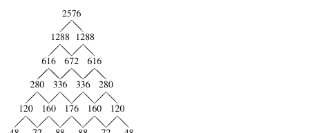

**图 8.4** 5-(24, 12, 48) 设计的帕斯卡三角形。

### 练习 456

在第 1.10 节中，我们介绍了 $[2^m, m+1]$ Reed-Muller 码 $\mathcal{R}(1, m)$。在练习 62 中，你表明 $\mathcal{R}(1, m)$ 的生成矩阵可以通过将 $[2^m - 1, m]$ simplex 码 $S_m$ 的生成矩阵加上一列 0，然后向矩阵添加全一行来得到。根据定理 2.7.5，$S_m$ 的权分布为 $A_0(S_m) = 1$ 和 $A_{2^{m-1}}(S_m) = 2^m - 1$。因此，$\mathcal{R}(1, m)$ 的权分布为 $A_0(\mathcal{R}(1, m)) = 1$，$A_{2^{m-1}}(\mathcal{R}(1, m)) = 2^{m+1} - 2$，且 $A_{2^m}(\mathcal{R}(1, m)) = 1$。此外，根据定理 1.10.1 和练习 62，$\mathcal{R}(1, m)^\perp = \mathcal{R}(m-2, m) = \widehat{\mathcal{H}}_m$，这是一个 $[2^m, 2^m - m - 1, 4]$ 码。

- (a) 证明 $\mathcal{R}(1, m)$ 中权为 $2^{m-1}$ 的码字构成一个 $3-(2^m, 2^{m-1}, \lambda)$ 设计。
- (b) 证明在第 (a) 部分的 3-设计中 $\lambda = 2^{m-2} - 1$。提示：使用定理 8.1.6。
- (c) 证明如果 $A_i(\widehat{\mathcal{H}}_m) \neq 0$，则 $\widehat{\mathcal{H}}_m$ 中权为 $i$（$4 \le i \le 2^m - 4$）的码字构成 3-设计。
- (d) 求 $\widehat{\mathcal{H}}_3$ 中权为 4 的码字所持 3-$(8, 4, \lambda)$ 设计的参数 $\lambda$。
- (e) 求 $[16, 11, 4]$ 码 $\widehat{\mathcal{H}}_4$ 的权分布。提示：参见练习 387。
- (f) 求 $\widehat{\mathcal{H}}_4$ 中固定权码字所持所有 3-设计的参数（块大小、块数和 $\lambda$）。

在示例 8.3.4 和 8.3.5 中，我们了解了如何利用设计来计算码的权分布。接下来，我们将利用设计来计算陪集权分布。

### 示例 8.4.5

在示例 1.11.7 中，我们给出了 $[8, 4, 4]$ 自对偶双偶二元码 $\widehat{\mathcal{H}}_3$ 的完整陪集分布。该分布可通过使用图 8.2 中给出的 3-(8, 4, 1) 设计的交点数轻松得到。例如，在权为 1 的陪集中，权为 3 的向量数量等于 3-(8, 4, 1) 设计中包含特定点的块的数量；该值为 $\lambda_1^3 = 7$。注意，由于 $\widehat{\mathcal{H}}_3$ 包含全一向量，权为 3 和权为 5 的向量数量必定相等。权为 1 的陪集中剩下的两个向量当然必须是一个权为 1 的向量和一个权为 7 的向量。现在考虑一个权为 2 的陪集。该陪集中的权为 2 向量来自将陪集领元加到 0，或将陪集领元加到 $\widehat{\mathcal{H}}_3$ 中支持集包含陪集领元支持集的权为 4 向量。因此，一个权为 2 的陪集有 $1 + \lambda_2^4 = 4$ 个权为 2 的向量。该陪集中的权为 6 向量来自将陪集领元加到全一码字，或将陪集领元加到 $\widehat{\mathcal{H}}_3$ 中支持集与陪集领元支持集不相交的权为 4 向量。因此，一个权为 2 的陪集有 $1 + \lambda_2^4 = 4$ 个权为 6 的向量。这留下了陪集中八个权为 4 的向量。这些权为 4 向量来自支持集恰好包含陪集领元支持集中一个坐标的权为 4 码字。由于该坐标有两种选择，权为 2 的陪集中权为 4 的向量数量为 $2|\lambda_1^4| = 8$，正如所声称的那样。

### 示例 8.4.6

在本示例中，我们计算 $[24, 12, 8]$ 扩展二元 Golay 码中权为 2 的陪集的权分布。设 $\mathcal{S}$ 为一个权为 2 的陪集。该陪集仅具有偶权向量。由于码中包含全一码字，我们知道 $A_i(\mathcal{S}) = A_{24-i}(\mathcal{S})$；因此我们只计算 $i \le 12$ 时的 $A_i(\mathcal{S})$。我们使用图 8.3 和 8.4 进行此计算。设 $\lambda_i^r(8)$ 和 $\lambda_i^r(12)$ 表示 5-(24, 8, 1) 的交点数。


| Coset weight | 0 | 1 | 2 | 3 | 4 | 5 | 6 | 7 | 8 | 9 | 10 | 11 | 12 | Number of cosets |
| :--- | :--- | :--- | :--- | :--- | :--- | :--- | :--- | :--- | :--- | :--- | :--- | :--- | :--- | :--- |
| 0 | 1 | 0 | 0 | 0 | 0 | 0 | 0 | 759 | 0 | 0 | 0 | 0 | 2576 | 1 |
| 1 | 0 | 1 | 0 | 0 | 0 | 0 | 0 | 253 | 0 | 506 | 0 | 1288 | 0 | 24 |
| 2 | 0 | 0 | 1 | 0 | 0 | 0 | 77 | 0 | 352 | 0 | 946 | 0 | 1344 | 276 |
| 3 | 0 | 0 | 0 | 1 | 0 | 21 | 0 | 168 | 0 | 640 | 0 | 1218 | 0 | 2024 |
| 4 | 0 | 0 | 0 | 0 | 6 | 0 | 64 | 0 | 360 | 0 | 960 | 0 | 1316 | 1771 |

design and the 5-(24, 12, 48) design, respectively. A weight 2 codeword in S is obtained only by adding the coset leader to 0. So A2(S) = 1. There can be no weight 4 vectors in the coset. The weight 6 vectors come from the weight 8 codewords whose supports contain the support of the coset leader; thus A6(S) = A6(8) = 77. The weight 8 vectors come from the weight 8 codewords whose supports contain exactly one of the two coordinates of the support of the coset leader; thus A8(S) = 2A1(8) = 352. The weight 10 vectors come from the weight 8 codewords whose supports are disjoint from the support of the coset leader and the weight 12 codewords whose supports contain the support of the coset leader; thus A10(S) = A8(8) + A8(12) = 946. Finally, A12(S) = $2^{12}$ - 2(1 + 77 + 352 + 946) = 1344. The weight distributions of the cosets of weights 1, 3, and 4 are calculated in Exercise 457 with the final results given in Table 8.1. The number of cosets of each weight was determined in Example 8.3.2.

**Exercise 457** Verify that the weight distributions of the weight 1, 3, and 4 cosets of the [24, 12, 8] extended binary Golay code are as presented in Table 8.1.

The Assmus-Mattson Theorem applied to C is most useful when C^\perp has only a few nonzero weights. This occurs for certain self-dual codes over F_2, F_3, and F_4, as we will examine in more depth in Chapter 9. These are the cases to which the Assmus-Mattson Theorem has been most often applied. Curiously, the highest value of t for which t-designs have been produced from this theorem is t = 5 even though t-designs for higher values of t exist. A great many 5-designs have, in fact, been discovered as a consequence of this theorem. Designs held by codes may be stronger than predicted by the Assmus-Mattson Theorem. For example, there is a [22, 12, 8] Hermitian self-dual code over F_4 whose weight 8 vectors hold a 2-design when the Assmus-Mattson Theorem says that the weight 8 vectors hold a 1-design [145].

Table 6.1 of Chapter 6 lists the binary odd-like duadic codes of length n <= 119. The extended codes have the property that they have the same weight distribution as their duals; such codes are called formally self-dual. From the table, the number of nonzero weights in the extended codes can be evaluated. Using this information with the Assmus-Mattson Theorem all codewords of any weight (except 0) in the extended code hold t-designs for the following cases: n + 1 = 18 and t = 2; n + 1 = 8, 32, 80, or 104 and t = 3; n + 1 = 24 or 48 and t = 5.

We conclude this section with a result that shows that $t$-designs are held by codewords of a code $\mathcal{C}$ of a fixed weight if the automorphism group $\Gamma \text{Aut}(\mathcal{C})$ is $t$-transitive. Recall that $\Gamma \text{Aut}(\mathcal{C})$ is $t$-transitive if for every pair of $t$-element ordered sets of coordinates, there is an element of the permutation group $\Gamma \text{Aut}_t(\mathcal{C})$ that sends the first set to the second set.

**Theorem 8.4.7** Let $\mathcal{C}$ be a code of length $n$ over $\mathbb{F}_q$ where $\Gamma \text{Aut}(\mathcal{C})$ is $t$-transitive. Then the codewords of any weight $i \ge t$ of $\mathcal{C}$ hold a $t$-design.

**Proof:** Let $\mathcal{P}$ be the set of coordinates of the code and $\mathcal{B}$ the set of supports of the codewords of weight $i$. Of all the $t$-element subsets of $\mathcal{P}$, let $T_1 = \{i_1, \dots, i_t\} \subseteq \mathcal{P}$ be one that is contained in the maximum number $\lambda$ of blocks. Suppose these distinct blocks are $B_1, \dots, B_\lambda$ whose supports are codewords $c_1, \dots, c_\lambda$, respectively. Let $T_2$ be any other $t$-element subset of $\mathcal{P}$. Then there exists an automorphism $g$ of $\mathcal{C}$ whose permutation part maps $T_1$ to $T_2$. The codewords $c_1g, \dots, c_\lambda g$ have distinct supports; these are blocks of $\mathcal{B}$. The maximality of $\lambda$ shows that $T_2$ is in no more than $\lambda$ blocks. Hence $(\mathcal{P}, \mathcal{B})$ is a $t\text{-}(n, i, \lambda)$ design.

## 8.5 Codes from symmetric 2-designs

In the previous sections we focused on constructing designs from codes. In this section we reverse the concept: we investigate what can be said about a code over $\mathbb{F}_q$ that is generated by the rows of an incidence matrix of a design. We will be primarily interested in the minimum weight and dimension of the code. This is one situation where it is often more difficult to find the dimension of the code than the minimum distance. As an example of what can be said about the dimension of a code generated by the rows of the incidence matrix of a design, if the design is a Steiner $t$-design and the last row of its extended Pascal triangle indicates that the binary code generated is self-orthogonal, then the code has dimension at most half the length. For example, the last row of the extended Pascal triangle of the 5-(24, 8, 1) design in Figure 8.3 indicates that the blocks overlap in an even number of points and hence that the binary code generated by the incidence matrix of the design, which is the [24, 12, 8] extended binary Golay code, is self-orthogonal, a fact that we of course already knew. In the most important cases, the minimum weight is the block size and the minimum weight codewords have supports that are precisely the blocks.

In this section we will examine the dimension of codes arising from designs and also look at codewords whose weights are equal to the block size. If $A$ is the incidence matrix of a $t$-design $(\mathcal{P}, \mathcal{B})$, let $C_q(A)$ be the linear code over $\mathbb{F}_q$ spanned by the rows of $A$. $C_q(A)$ is called the code over $\mathbb{F}_q$ of the design $(\mathcal{P}, \mathcal{B})$. We will focus on $t$-designs that are symmetric, and thus the number of blocks $b$ equals the number of points $v$. In all other cases of nontrivial designs, $b > v$, a fact known as Fisher’s inequality; see [204]. By [4], a nontrivial symmetric $t$-design does not exist for $t > 2$. So we will only consider symmetric 2-designs. A great deal can be said about the dimension of $C_q(A)$ in this case, information that has played a significant role in the study of projective planes as we will see in Section 8.6. In that section we will also consider the question of the minimum weight of $C_q(A)$ and what codewords have that minimum weight.

Before proceeding with our results, a few special properties of 2-(v, k, λ) designs are required. Let J_v be the v × v matrix all of whose entries are 1 and I_v the v × v identity matrix.

### Lemma 8.5
Let A be the incidence matrix of a 2-(v, k, λ) design. The following hold:

- (i) A^T A = (λ_1 - λ)I_v + λJ_v, and λ(v - 1) = k(k - 1).
- (ii) If the design is symmetric, then:
  - (a) λ_1 = k and λ(v - 1) = k(k - 1),
  - (b) A^T A = AA^T = (k - λ)I_v + λJ_v,
  - (c) every pair of blocks intersect in exactly λ points,
  - (d) det(A) = ±k(k - λ)^((v-1)/2), and,
  - (e) if v is even, k - λ is a perfect square.

Proof. The ith diagonal entry of A^T A counts the number of blocks containing the ith point; this is λ_i. The entry in row i and column j ≠ i of A^T A is the number of blocks containing both the ith and jth points; this is λ, proving the first equation in (i). The second equation follows from Theorem 8.1.3 with r = 2.

Now assume the design is symmetric so that b = v. Theorem 8.1.6 and part (i) yield (a) with t = 2 in Theorem 8.1.3,

λ = λ_2 = λ_1 = (k-1)/(v-1).

By Exercise 458,

det(A^T A) = (k - λ)^(v-1)(vλ + k - λ).

In particular, A^T A is nonsingular as λ < k = λ_1 by (8.3). Since A is a square matrix, it must then be nonsingular. As each row of A has k 1s, AJ_v = kJ_v. As each column of A has λ_1 1s, J_v A = λ_1 J_v. Since λ_1 = k, AJ_v = J_v A. Hence A commutes with J_v. This implies that AA^T = AA^T A A^{-1} = A((k - λ)I_v + λJ_v)A^{-1} = ((k - λ)I_v + λJ_v)AA^{-1} and so AA^T = A^T A giving (b). The entry in row i and column j ≠ i of AA^T is λ; this indicates that distinct blocks intersect in exactly λ points, which is (c). By (a), (8.3), and (8.4), det(A^T A) = (k - λ)^(v-1)k^2.

This yields (d), which implies (e) as A is an integer matrix.

### Exercise 458
Prove that

det((k - λ)I_v + λJ_v) = (k - λ)^(v-1)(vλ + k - λ).

We are now ready to prove the two main theorems of this section that give the dimension of C_q(A) over F_q when A is the incidence matrix of a symmetric 2-design. We shall find it helpful to consider another code D_q(A) over F_q defined to be the code spanned by the rows of A^⊥, where A^⊥ is the matrix whose rows are the differences of all pairs of rows of A. Recall that k - λ is the order of the design. If p is the characteristic of F_q, the dimension can be bounded above or found exactly depending upon the divisibility of both k - λ and k by p.

### Theorem 8.5.2
Let A be the incidence matrix of the symmetric 2-(v, k, λ) design (P, B). If p is the characteristic of F_q, then the following hold:


- (i) \(\mathcal{D}_q(A)\) 是 \(\mathcal{C}_q(A)\) 的子码，在 \(\mathcal{C}_q(A)\) 中的共维至多为 1。
- (ii) 如果 \(p \mid (k - \lambda)\)，则 \(\mathcal{C}_q(A) \subseteq \mathcal{D}_q(A)^\perp\)，且 \(\mathcal{D}_q(A)\) 是自正交的，维数至多为 \(v/2\)。
- (iii) 如果 \(p \mid (k - \lambda)\) 且 \(p \nmid k\)，则 \(\mathcal{C}_q(A)\) 是自正交的，维数至多为 \(v/2\)。
- (iv) 如果 \(p \mid (k - \lambda)\) 且 \(p \nmid k\)，则 \(\mathcal{D}_q(A)\) 在 \(\mathcal{C}_q(A)\) 中的共维为 1，且 \(\mathcal{D}_q(A)\) 的维数小于 \(v/2\)。
- (v) 如果 \(p \nmid (k - \lambda)\) 且 \(p \mid k\)，则 \(\mathcal{C}_q(A)\) 的维数为 \(v - 1\)。
- (vi) 如果 \(p \nmid (k - \lambda)\) 且 \(p \nmid k\)，则 \(\mathcal{C}_q(A)\) 的维数为 \(v\)。

**证明：** 设 \(\mathbf{r}_1, \dots, \mathbf{r}_v\) 为与 \(\mathcal{B}\) 的块 \(B_1, \dots, B_v\) 关联的 \(A\) 的行。\(A^\lambda\) 的行的支持是 \(\mathcal{B}\) 中所有块对的对称差。显然，\(\mathcal{C}_q(A) = \text{span}\{\mathbf{r}_i\} + \mathcal{D}_q(A)\)，且 \(\mathcal{D}_q(A)\) 在 \(\mathcal{C}_q(A)\) 中的共维至多为 1，从而得到 (i)。

我们首先考虑 \(p \mid (k - \lambda)\) 的情况。有 \(\mathbf{r}_i \cdot \mathbf{r}_i \equiv k \equiv \lambda \pmod p\)，且对于 \(i \neq j\)，根据 Lemma 8.5.1(ii)(c)，\(\mathbf{r}_i \cdot \mathbf{r}_j \equiv \lambda \pmod p\)。因此，对所有 \(i\) 和 \(j\)，\(\mathbf{r}_i \cdot \mathbf{r}_j \equiv \lambda \pmod p\)。所以，对所有 \(i, j\) 和 \(m\)，\((\mathbf{r}_i - \mathbf{r}_j) \cdot \mathbf{r}_m \equiv 0 \pmod p\)。因此，\(\mathcal{D}_q(A)\) 是自正交的，维数至多为 \(v/2\)，且 \(\mathcal{C}_q(A) \subseteq \mathcal{D}_q(A)^\perp\)，从而证明 (ii)。若此外 \(p \nmid k\)，则 \(p \mid \lambda\) 且 \(\mathcal{C}_q(A)\) 是自正交的，从而得到 (iii)，因为 \(\mathbf{r}_i \cdot \mathbf{r}_i \equiv \lambda \equiv 0 \pmod p\)。若 \(p \nmid k\)，则 \(p \mid \lambda\) 且 \(\mathbf{r}_1 \cdot \mathbf{r}_1 \neq 0 \pmod p\)，这意味着 \(\mathcal{D}_q(A)\) 在 \(\mathcal{C}_q(A)\) 中的共维为 1。由于根据 (ii) \(\mathcal{D}_q(A)\) 真包含于其对偶码中，\(\mathcal{D}_q(A)\) 的维数不能为 \(v/2\)，从而得到 (iv)。

现在假设 \(p \nmid (k - \lambda)\)。若 \(p \mid k\)，则 \(\mathbf{r}_i \cdot \mathbf{1} \equiv k \equiv 0 \pmod p\)。因此 \(\mathcal{C}_q(A)\) 的维数至多为 \(v - 1\)。将 \(A\) 的第 \(i\) 列与点 \(p_i \in \mathcal{P}\) 关联。设 \(p_i, p_j \in \mathcal{P}\) 且 \(i \neq j\)。\(\mathcal{B}\) 中有 \(\lambda\) 个块包含 \(p_i\) 但不包含 \(p_j\)。因此，与不包含 \(p_j\) 的块关联的 \(A\) 的所有行之和 \(s_{ij}\) 在第 \(j\) 列为 0，在所有其他列为 \(\lambda_j\)。根据 Corollary 8.2.2，\(\lambda_1 = \lambda_2 = k - \lambda \not\equiv 0 \pmod p\)。由于 \(\text{span}\{s_i \mid 1 \le i \le v\}\) 至少是 \((v - 1)\) 维的，\(\mathcal{C}_q(A)\) 的维数为 \(v - 1\)，从而得到 (v)。若 \(p \nmid k\)，根据 Lemma 8.5.1，\(\det(A) \neq 0 \pmod p\)，从而得到 (vi)。

从编码理论的角度来看，如果 \(p \mid (k - \lambda)\)，则码 \(\mathcal{C}_q(A)\) 没有研究价值。当 \(p \nmid (k - \lambda)\) 时，该码可能值得研究。若此外 \(p^2 \nmid (k - \lambda)\)，则 \(\mathcal{C}_q(A)\) 的维数可以精确确定。

## 定理 8.5.3 设 \(A\) 是对称 \(2\text{-}(v, k, \lambda)\) 设计 \((\mathcal{P}, \mathcal{B})\) 的关联矩阵。设 \(p\) 是 \(\mathbb{F}_q\) 的特征，并假设 \(p \mid (k - \lambda)\)，但 \(p^2 \nmid (k - \lambda)\)。则 \(v\) 为奇数，且以下结论成立：

- (i) 若 \(p \mid k\)，则 \(\mathcal{C}_q(A)\) 是自正交的且维数为 \((v - 1)/2\)。
- (ii) 若 \(p \nmid k\)，则 \(\mathcal{D}_q(A) = \mathcal{C}_q(A)^\perp = \mathcal{D}_q(A)^\perp\)。此外，\(\mathcal{C}_q(A)\) 的维数为 \((v + 1)/2\)，且 \(\mathcal{D}_q(A)\) 是自正交的。

**证明：** 根据 Lemma 8.5.1(ii)(c)，若 \(v\) 为偶数，则 \(k - \lambda\) 必须是完全平方数，这与 \(p \mid (k - \lambda)\) 但 \(p^2 \nmid (k - \lambda)\) 矛盾。所以 \(v\) 为奇数。

将 \(A\) 视为整数矩阵。将 \(A\) 的第 \(1, 2, \dots, v-1\) 列加到第 \(v\) 列，得到一个矩阵 \(A_1\)，其第 \(v\) 列全为 \(k\)，因为 \(A\) 的每一行都有 \(k\) 个 1。将 \(A_1\) 的第 \(v\) 行从之前的每一行中减去，得到一个矩阵 \(A_2\)，其为

\[
A_2 = \left[ \begin{array}{ccc} & & 0 \\ & H & \vdots \\ & & 0 \\ a_1 & \cdots & a_{v-1} & k \end{array} \right]
\]

其中 \(H\) 是一个 \((v-1) \times (v-1)\) 整数矩阵，每个 \(a_i\) 都是整数。此外，将矩阵的一行或一列加到另一行或另一列上，不会影响行列式。因此 \(\det(A) = k \det(H)\)。根据整数矩阵不变因子理论（例如，参见 [187, Appendix C]），存在行列式为 \(\pm 1\) 的 \((v-1) \times (v-1)\) 整数矩阵 \(U\) 和 \(V\)，使得 \(UHV = \text{diag}(h_1, \dots, h_{v-1})\)，其中 \(h_1, \dots, h_{v-1}\) 是满足 \(1 \le i < v-1\) 时 \(h_i \mid h_{i+1}\) 的整数。因此，

\[
\det(A) = k \det(H) = k h_1 h_2 \cdots h_{v-1} = \pm (k - \lambda)^{(v-1)/2}.
\]

此外，\(A\) 在 \(\mathbb{F}_p\) 上的秩 \(r\)，即 \(\mathcal{C}_q(A)\) 的维数，是 \((k, h_1, \dots, h_{v-1})\) 中不模 \(p\) 为 0 的值的个数。由于 \(p \mid (k - \lambda)\) 但 \(p^2 \nmid (k - \lambda)\)，至多 \((v-1)/2\) 个 \(h_i\) 模 \(p\) 为 0。因此，若 \(p \mid k\)，\(\mathcal{C}_q(A)\) 的维数至少为 \((v-1)/2\)；若 \(p \nmid k\)，则至少为 \((v-1)/2 + 1 = (v+1)/2\)。因此，若 \(p \mid k\)，根据定理 8.5.2(iii)，由于 \(v\) 为奇数，\(\mathcal{C}_q(A)\) 的维数为 \((v-1)/2\)，从而得到 (i)。若 \(p \nmid k\)，根据定理 8.5.2(iv)，\(\mathcal{D}_q(A)\) 在 \(\mathcal{C}_q(A)\) 中的共维为 1 且维数小于 \(v/2\)，这意味着 \(\mathcal{C}_q(A)\) 的维数必须为 \((v+1)/2\)。这给出了部分 (ii)，其余结论现从定理 8.5.2 得出。

条件 \(p \mid (k - \lambda)\) 但 \(p^2 \nmid (k - \lambda)\) 对该定理至关重要，如证明所示。当 \(p^2 \mid (k - \lambda)\) 时，码 \(\mathcal{C}_q(A)\) 的维数可能更小，我们将在下一节中发现这一点。

### 练习 459 本练习提供了定理 8.5.3(ii) 的另一种证明，不依赖于不变因子。\(\mathcal{C}_q(A)\) 的维数 \(r\) 是 \(A\) 在 \(\mathbb{F}_q\) 上的秩，也是 \(A\) 在 \(\mathbb{F}_p\) 上的秩，因为 \(A\) 有整数项。因此 \(r\) 也是 \(\mathcal{C}_p(A)\) 的维数。假设 \(\mathcal{P}\) 的点已按顺序排列，使得最右侧的 \(r\) 个坐标为 \(\mathcal{C}_p(A)\) 的一个信息集。

- (a) 解释为什么存在一个项在 \(\mathbb{F}_p\) 中的 \((v-r) \times r\) 矩阵 \(B\)，使得 \([I_{v-r} \quad B]\) 是 \(\mathcal{C}_p(A)\) 的一份校验矩阵。

- (b) 设 \(M\) 为 \(v \times v\) 矩阵 \(M = \left[ \begin{array}{cc} I_{v-r} & B \\ 0 & I_r \end{array} \right]\)，视为整数矩阵。解释为什么整数矩阵 \(A_1 = M A^T\) 满足 \(\det(A_1) = \det(A)\)，以及为什么 \(A_1\) 前 \(v-r\) 行中的每一项都是 \(p\) 的倍数。

- (c) 证明 \(p^{v-r} \mid \det(A)\)。

- (d) 证明由于 \(p \mid (k - \lambda)\)、\(p^2 \nmid (k - \lambda)\) 和 \(p \nmid k\)，则 \(v - r \le (v-1)/2\) 且 \(\mathcal{C}_q(A)\) 的维数为 \((v+1)/2\)。

我们知道，\(\mathcal{C}_q(A)\) 中支持为块的代码字具有重量 \(k\)。一个自然的问题是：是否存在支持不是块的重量 \(k\) 的代码字；当 \(k\) 是码的最小重量时，这会更加有趣。我们从 [187] 中的一个引理开始对这个问题进行调查。

## 引理 8.5.4 设 \((\mathcal{P}, \mathcal{B})\) 为一个对称 \(2-(v, k, \lambda)\) 设计。设 \(S \subset \mathcal{P}\) 且 \(|S| = k\)。假设 \(S\) 与 \(\mathcal{B}\) 的所有块至少在 \(\lambda\) 个点上相交。则 \(S\) 是一个块。

**证明：** 对所有 \(B \in \mathcal{B}\)，设 \(n_B = |S \cap B| - \lambda\)；根据假设，\(n_B\) 是非负整数。此外，

\[
\sum_{B \in \mathcal{B}} n_B = \sum_{B \in \mathcal{B}} |S \cap B| - v\lambda. \tag{8.5}
\]

设 \(\mathcal{X} = \{(x, B) \mid B \in \mathcal{B}, x \in S \cap B\}\)。若 \(x \in S\)，根据 Lemma 8.5.1，\(x\) 属于 \(k\) 个块 \(B\)。因此 \(|\mathcal{X}| = k^2\)。但对于每个块 \(B \in \mathcal{B}\)，存在 \(|S \cap B|\) 个点 \(x \in S \cap B\)。所以 \(|\mathcal{X}| = \sum_{B \in \mathcal{B}} |S \cap B| = k^2\)。因此 \(\sum_{B \in \mathcal{B}} |S \cap B| = k^2\)，结合 (8.5) 和 Lemma 8.5.1 得出

\[
\sum_{B \in \mathcal{B}} n_B = k - \lambda. \tag{8.6}
\]

设 \(\mathcal{Y}' = \{(x, y, B) \mid B \in \mathcal{B}, x, y \in S \cap B, x \neq y\}\)。\(S\) 中有 \(k(k-1)\) 个有序元素对，每对恰好在 \(\lambda\) 个块中。因此 \(|\mathcal{Y}'| = k(k-1)\lambda\)。但对于每个块 \(B \in \mathcal{B}\)，\(S \cap B\) 中有 \(|S \cap B|(|S \cap B| - 1) = (n_B + \lambda)(n_B + \lambda - 1)\) 个点对。因此

\[
\sum_{B \in \mathcal{B}} (n_B + \lambda)(n_B + \lambda - 1) = k(k-1)\lambda.
\]

展开左边并使用 (8.6)，我们得到（参见练习 460）

\[
\sum_{B \in \mathcal{B}} n_B^2 = (k - \lambda)^2. \tag{8.7}
\]

由于 \(n_B\) 为非负整数，根据 (8.6) 和 (8.7)，唯一的可能性是除一个 \(B\) 外所有 \(B\) 的 \(n_B = 0\)，而对于这一个 \(B\)，\(n_B = k - \lambda\)，但此时 \(|S \cap B| = k\)，意味着 \(S = B\)。

### 练习 460 在引理 8.5.4 的证明中，验证 (8.7)。\(\blacklozenge\)

我们现在表明，在码 \(\mathcal{C}_q(A)\) 中，某些重量为 \(k\) 的代码字（其中 \(A\) 是对称 \(2-(v, k, \lambda)\) 设计 \((\mathcal{P}, \mathcal{B})\) 的关联矩阵）的支持是设计的块。若 \(S \subset \mathcal{P}\)，设 \(e_S\) 表示 \(\mathbb{F}_q^v\) 中非零分量全为 1 且支持为 \(S\) 的向量。

## 定理 8.5.5 设 \((\mathcal{P}, \mathcal{B})\) 为关联矩阵 \(A\) 的对称 \(2-(v, k, \lambda)\) 设计。设 \(p > k\) 是整除 \(k - \lambda\) 的素数。假设 \(\mathbb{F}_q\) 的特征为 \(p\)。最后，设 \(S \subset \mathcal{P}\) 的大小为 \(k\)。若 \(c_S \in \mathcal{C}_q(A)\)，则 \(S\) 是 \(\mathcal{B}\) 中的一个块。

**证明：** 由于 \(c_S \in \mathcal{C}_q(A)\) 且 \(\mathcal{C}_q(A)\) 由 \(\{c_B \mid B \in \mathcal{B}\}\) 生成，\(c_S = \sum_{B \in \mathcal{B}} a_B c_B\)，其中 \(a_B \in \mathbb{F}_q\)。设 \(B'\) 为 \(\mathcal{B}\) 中的一个块。则

\[
c_S \cdot c_{B'} = \sum_{B \in \mathcal{B}} a_B c_B \cdot c_{B'}. \tag{8.8}
\]


对于 \( B \in \mathcal{B} \)，由于 \( \mathbf{c}_B \) 和 \( \mathbf{c}_{B'} \) 中的唯一条目是 0 和 1，\( \mathbf{c}_B \cdot \mathbf{c}_{B'} \) 实际上在 \( \mathbb{F}_p \subseteq \mathbb{F}_q \) 中，并且显然模 \( p \) 等于 \( |B \cap B'| \)。如果 \( B \neq B' \)，则由 Lemma 8.5.1 可知 \( |B \cap B'| = \lambda \)；如果 \( B = B' \)，则 \( |B \cap B'| = k \)。由于 \( p \mid (k - \lambda) \)，\( k \equiv \lambda \pmod p \)。因此，对所有 \( B \in \mathcal{B} \)，\( |B \cap B'| \equiv k \pmod p \)，且 (8.8) 的右边变为

$$
\sum_{B \in \mathcal{B}} a_B \mathbf{c}_B \cdot \mathbf{c}_B = \sum_{B \in \mathcal{B}} k a_B,
$$

这意味着

$$
\mathbf{c}_S \cdot \mathbf{c}_{B'} = \sum_{B \in \mathcal{B}} k a_B, \quad (8.9)
$$

代码字 \( \mathbf{c}_S \) 是通过将 \( A \) 中对应于 \( B \) 的每一行乘以 \( a_B \) 从而创建矩阵 \( A' \)，并在 \( \mathbb{F}_q \) 中将 \( A' \) 的行相加得到的。\( A' \) 中所有条目的和为 \( \sum_{B \in \mathcal{B}} k a_B \)，因为对应于 \( B \) 的行是 \( a_B \) 取 \( k \) 次之和。这必须是 \( \mathbf{c}_S \) 在 \( \mathbb{F}_p \) 中的条目之和。但 \( \mathbf{c}_S \) 中条目的和是在 \( \mathbb{F}_q \) 中 \( k \) 个 1 之和。如上所述，\( \mathbf{c}_S \cdot \mathbf{c}_{B'} \) 同样在 \( \mathbb{F}_p \subseteq \mathbb{F}_q \) 中，且模 \( p \) 等于 \( |S \cap B'| \)。因此 (8.9) 变为

$$
|S \cap B'| \equiv k \equiv \lambda \pmod p.
$$

由于 \( p > \lambda \)，对所有 \( B' \in \mathcal{B} \)，必有 \( |S \cap B'| \ge \lambda \)。结果由 Lemma 8.5.4 得出。

该定理表明，如果 \( p > \lambda \)，则 \( \mathcal{C}_q(A) \) 中权重为 \( k \) 且为二进制向量倍数的代码字必须具有为块的支持。存在设计的示例表明，既不能舍弃条件 \( p > \lambda \)，也不能舍弃权重为 \( k \) 的代码字在其支持上必须为常数的条件。

### Example 8.5.6

存在三个非等价的对称 2-(16, 6, 2) 设计。如果 \( A \) 是其中一个设计的关联矩阵，则 \( \mathcal{C}_2(A) \) 的维为 6、7 或 8。如果令 \( A_i \) 为使 \( \mathcal{C}_i = \mathcal{C}_2(A_i) \) 的维为 \( i \) 的关联矩阵，则权重枚举多项式给出于 [302]:

$$
W_{C_1}(x, y) = y^{16} + 16x^6y^{10} + 30x^8y^8 + 16x^{10}y^6 + x^{16},
$$
$$
W_{C_2}(x, y) = y^{16} + 4x^4y^{12} + 32x^6y^{10} + 54x^8y^8 + 32x^{10}y^6 + 4x^{12}y^4 + x^{16},
$$
$$
W_{C_3}(x, y) = y^{16} + 12x^4y^{12} + 64x^6y^{10} + 102x^8y^8 + 64x^{10}y^6 + 12x^{12}y^4 + x^{16}.
$$

注意，前 16 个块恰好仅在第一个代码中是权重 6 代码字的支持。在其他情况下，存在支持不是块的权重 6 代码字。因此，定理 8.5.5 中的条件 \( p > \lambda \) 是必要的。注意，在最后两种情况下，最小权重小于块大小。

### Example 8.5.7

在练习 471 中，要求构造一个 (11, 5, 2) 循环差分集，它将产生一个对称 2-(11, 5, 2) 设计 \( \mathcal{D} \)。令 \( A \) 为其关联矩阵。由定理 8.5.3(ii)，\( \mathcal{C}_3(A) \) 是一个 [11, 6] 代码。结果表明，该代码的最小权重为 5，且存在支持不是原始设计块的权重 5 代码字；这些代码字的非零分量是 1 和 2 的混合。因此，定理 8.5.5 中权重为 \( k \) 的代码字在其支持上必须为常数的条件也是必要的。

存在与对称 2-设计相关且与代码有强联系的其他设计。例如，*准对称设计* 是一种 2-设计，其中每对不同的块相交于 \( \alpha \) 或 \( \beta \) 个点。直到 1995 年，是否存在不同块相交于 1 或 3 个点的准对称 2-(49, 9, 6) 设计一直是一个未解决的问题。如果存在这样的设计，则由定理 8.1.6 可知它有 196 个块。其存在性的证明如下。二进制自对偶 [50, 25, 10] 代码 \( C \) 的一个可能的权重枚举多项式为 \( W_C(x, y) = y^{50} + 196x^4y^{46} + 11368x^{12}y^{38} + \cdots \)。如果存在具有此权重枚举多项式的代码，则令人惊讶的是，所有 196 个最小权重代码字的支持必须有一个共同坐标。从这些支持中删除这个共同坐标，将产生一个不同块相交于 1 或 3 个点的准对称 2-(49, 9, 6) 设计。在 [151] 中，给出了四种此类非等价代码，从而确立了至少存在四个准对称设计。关于准对称设计以及代码与设计之间其他联系的进一步讨论可见 [332]。我们以 [13] 中的一个结果结束本节，该结果适用于持有可能不是对称的 2-设计的代码。我们在此包含它，因为其证明让人联想到本节中的其他证明。

### Theorem 8.5.8

令 \( \mathcal{C} \) 为 \( \mathbb{F}_q \) 上的自正交 \([n, k, d]\) 代码，其中 \( d \ge 2 \)。假设 \( \mathcal{C} \) 的最小权重代码字持有一个 2-设计。则

$$
d \ge 1 + \sqrt{n - 1}.
$$

**Proof:** 令 \( \mathcal{B} \) 为 \( \mathcal{C} \) 的最小权重代码字所持有的 2-\((n, d, \lambda)\) 设计 \( (\mathcal{P}, \mathcal{B}) \) 中的一个块。假设 \( \mathcal{B} \) 有 \( b \) 个块。令 \( n_i \) 为 \( \mathcal{B} \) 中（不包括 \( \mathcal{B} \) 本身）与 \( \mathcal{B} \) 在 \( i \) 个点处相交的块的数量。构造一个 \( (b-1) \times d \) 矩阵 \( M \)，其列由 \( B \) 的 \( d \) 个点索引，行由 \( \mathcal{B} \) 中不包括 \( B \) 的 \( b-1 \) 个块索引。第 \( j \) 行第 \( k \) 列的条目为 1，前提是 \( B \) 的第 \( k \) 个点位于对应于 \( M \) 第 \( j \) 行的块中。\( M \) 的所有其他条目均为 0。

我们验证以下两个方程：

$$
\sum_{i=0}^{d-1} i n_i = d(\lambda_1 - 1) \quad \text{and} \tag{8.10}
$$

$$
\sum_{i=0}^{d-1} i(i-1)n_i = d(d-1)(\lambda - 1). \tag{8.11}
$$

在 \( M \) 中，有 \( n_i \) 行包含 \( i \) 个 1。因此 \( M \) 中 1 的总数为 \( \sum_{i=0}^{d-1} i n_i \)。由于设计中的每个点位于 \( \lambda_1 \) 个块中，\( M \) 的每一列中有 \( \lambda_1 - 1 \) 个 1，因此 \( M \) 中共有 \( d(\lambda_1 - 1) \) 个 1。将这两个计数相等得到 (8.10)。在 \( M \) 的一行中，若包含 \( i \) 个 1，则有 \( \binom{i}{2} \) 对 1。因此 \( M \) 的行中共有 \( \sum_{i=0}^{d-1} \binom{i}{2} n_i \) 对 1。由于每对点位于 \( \lambda \) 个块中，固定 \( M \) 的任意两列，有 \( \lambda - 1 \) 行在这两列中都包含 1。因此 \( M \) 的行中共有 \( \binom{d}{2}(\lambda - 1) \) 对 1。将这两个计数相等并将结果加倍得到 (8.11)。由于 \( \mathcal{C} \) 是自正交的，\( \mathcal{B} \) 的任何两个块不能恰好在一个点处相交。因此 \( n_1 = 0 \)。于是对所有 \( i \)，\( i(i-1)n_i \ge i n_i \)。结合 (8.10) 和 (8.11) 得到

\( (d - 1)(\lambda - 1) \ge (\lambda_1 - 1) \)。由定理 8.5.1(i)，\( \lambda_1(d - 1) = (n - 1)\lambda \)，

\( (d - 1)^2(\lambda - 1) \ge (\lambda_1 - 1)(d - 1) = (n - 1)\lambda - (d - 1) \)。

所以 \( (d^2 - 2d + 2 - n)\lambda \ge (d - 1)(d - 2) \ge 0 \)，这意味着 \( d^2 - 2d + 2 - n \ge 0 \)。求解此不等式得出结果。

### Example 8.5.9

我们利用此结果来求某些代码最小权重的下界。

- 令 \( G_{24} \) 为扩展二进制 Golay 代码。该代码是自对偶且双均匀的。在第 10.1.2 节中，我们将看到 \( \text{PAut}(G_{24}) \) 是 5-传递的。特别是，\( \text{PAut}(G_{24}) \) 是 2-传递的，并且由定理 8.4.7，\( G_{24} \) 的最小权重代码字持有一个 2-设计。定理 8.5.8 表明最小权重至少为 \( 1 + \sqrt{23} \)，即至少为 6。由于 \( G_{24} \) 是双均匀的，最小权重至少为 8。

- 令 \( G_{12} \) 为扩展三元双重 Golay 代码。在第 10.4.2 节中，我们表明 \( \text{MAut}(G_{12}) \) 是 5-传递的，因此也是 2-传递的。由定理 8.4.7，\( G_{12} \) 的最小权重代码字持有一个 2-设计，并且定理 8.5.8 表明最小权重至少为 \( 1 + \sqrt{11} \)。因此最小权重至少为 5。由于三元自对偶代码的所有代码字权重均为 3 的倍数，最小权重至少为 6。

- 令 \( C \) 为长度为 \( q^m \) 的自正交扩展原始 BCH 代码，其中 \( q \) 是素数幂。由定理 5.1.9，\( C \) 是仿射不变的，因此 \( \text{PAut}(C) \) 包含 \( \text{GA}(q^m) \)，它是 2-传递的。因此定理 8.4.7 表明最小权重代码字持有一个 2-设计，并且定理 8.5.8 表明最小权重至少为 \( 1 + \sqrt{q^m - 1} \)。

## 8.6 Projective planes

我们现在将前一节的结果应用于射影平面的特定情况。

在第 8.1 节中，我们指出，对称 2-(v, k, 1) 设计正是第 6.5 节定义的射影平面：平面的直线是设计的块。对称 2-(v, k, 1) 设计的阶 \( \mu \) 为 k - 1。（在许多书中，平面的阶用 n 表示；然而，由于我们经常用 n 表示代码的长度，我们选择符号 \( \mu \) 来表示平面的阶。）由定理 8.1.6，\( v = \mu^2 + \mu + 1 \)。因此，射影平面是一个对称 2-(\( \mu^2 + \mu + 1 \), \( \mu + 1 \), 1) 设计。然而，2-(\( \mu^2 + \mu + 1 \), \( \mu + 1 \), 1) 设计自动是对称的，因为定理 8.1.6 表明这样的设计有 \( \mu^2 + \mu + 1 \) 个块。我们现在证明这一基本等价性。

### Theorem 8.6.1

点和直线的集合是有限射影平面，当且仅当它是具有 \( v \ge 4 \) 的对称 2-(v, k, 1) 设计。

**Proof:** 令 P 和 L 分别表示有限射影平面的点和直线。我们证明 (P, B) 是一个对称 2-(v, k, 1) 设计，其中 B = L，v 为点 P 的数量。我们首先必须证明每条直线具有相同数量的点。令 \( \ell \) 为具有 k 个点的直线，其中 k 尽可能大。令 m 为任何其他直线。选取不在 \( \ell \) 上的任意点 P


或 m；这样的点存在，因为平面包含至少四个点，且其中没有三点共线。过 P 和 \(\ell\) 上的 k 个点各有 k 条不同的直线。这些 k 条直线中的每一条都在不同的点上与 m 相交，因为两点确定一条唯一的直线。因此 m 至少包含 k 个点。由 k 的极大性，m 恰好有 k 个点。所以所有直线都有 k 个点。由于每对不同的点确定一条唯一的直线，(P, B) 是一个 2-(v, k, 1) 设计。我们需要证明它是对称的。设 b 为直线的数量，并令

\(\mathcal{X} = \{(P, \ell) \mid P \in P, \ell \in \mathcal{L}, P \in \ell\}.\)

由于每条直线包含 k 个点，\(|\mathcal{X}| = bk\)。若 P 是一个点，则过 P 有 k 条直线，如下所示。设 m 为一条不包含 P 的直线。它的 k 个点中的每一个都确定一条过 P 的唯一直线，因此过 P 至少有 k 条直线。任何过 P 的直线都必须在唯一点与 m 相交，不同的直线在不同的点相交，因此过 P 最多有 k 条直线。故过 P 有 k 条直线。故 \(|\mathcal{X}| = vk\)；对 \(|\mathcal{X}|\) 的两种计数相等得 b = v。因此该设计是对称的；由于射影平面至少有四个点，\(v \ge 4\)。

现在假设 (P, B) 是一个对称的 2-(v, k, 1) 设计。则每对点位于一个唯一的块中，且由引理 8.5.1，两个不同的块在唯一点相交。由于 b = v \(\ge\) 4，至少有四个点，且没有三点在同一个块中。因此 (P, B) 是一个射影平面。

由此证明，我们现在拥有射影平面的一些基本性质。

### 定理 8.6.2
阶 \(\mu\) 的射影平面满足以下性质：
- (i) 该平面有 \(\mu^2 + \mu + 1\) 个点和 \(\mu^2 + \mu + 1\) 条直线。
- (ii) 不同的点确定一条唯一的直线，不同的直线在唯一点相交。
- (iii) 每条直线恰好包含 \(\mu + 1\) 个点，每个点恰好位于 \(\mu + 1\) 条直线上。

当 A 是阶 \(\mu\) 的射影平面的关联矩阵时，我们可以确定最小距离，找出最小权重码字，并要么给出 \(C_2(A)\) 维数的界，要么精确求出其维数。

### 定理 8.6.3
设 A 为由对称 2-(v, k, 1) 设计 (P, B) 得出的阶 \(\mu\) 的射影平面的关联矩阵。
- (i) 若 \(\mu = k - 1\) 为奇数，则 \(C_2(A)\) 是由 \(\mathbb{F}_2^v\) 中所有偶权重码字组成的 [v, v - 1, 2] 码。
- (ii) 若 \(\mu = k - 1\) 为偶数，则 \(C_2(A)\) 的扩展码 \(\widehat{C_2(A)}\) 是自正交的，维数最多为 (v + 1)/2。\(C_2(A)\) 的最小权重为 \(\mu + 1\)，且 (P, B) 的直线恰好是该权重向量的支撑集。

证明：假设 \(\mu = k - 1\) 为奇数。则 \(2 \mid k\)。由定理 8.5.2，\(C_2(A)\) 的维数为 v - 1。由于所有块都有偶数 k 个点，\(C_2(A)\) 必须是偶码。因此 (i) 成立。

现在假设 \(\mu = k - 1\) 为偶数。由于块具有奇权重且不同的块在一点相交，扩展码 \(\widehat{C_2(A)}\) 由一组偶权重码字生成，它们的支撑集在两个坐标上一致，其中一个是扩展坐标。因此 \(\widehat{C_2(A)}\) 是自正交的，故维数最多为 (v + 1)/2。另外，\(\widehat{C_2(A)}\) 是自正交的。\(C_2(A)\) 中两个偶权重向量在偶数个坐标上相交，而 \(C_2(A)\) 中两个奇权重向量在奇数个坐标上相交。我们只需要找出 \(C_2(A)\) 的最小权重码字。

假设 x 是 \(C_2(A)\) 中一个非零的偶权重向量，且 supp(x) 包含点 P。设 \(\ell\) 为过 P 的 \(\mu + 1\) 条直线中的任意一条。由于 x 有偶权重，supp(x) 必须在偶数个点上与 \(\ell\) 相交。因此 \(\ell\) 在 P 和另一点 Q\(\ell\) 处与 supp(x) 相交。由于两点确定一条唯一的直线，\(\mu + 1\) 条直线 \(\ell\) 确定 \(\mu + 1\) 个不同的点 Q\(\ell\)，这表明 wt(x) \(\ge \mu + 2\)。

现在假设 x 是 \(C_2(A)\) 中一个奇权重向量。若 wt(x) = 1，则存在一个码字 e，其支撑集是一条包含 supp(x) 的直线，因此 x + e 是一个偶权重 \(\mu\) 的码字，这与上述结论矛盾。所以假设 supp(x) 包含点 P 和 Q。现在 supp(x) 必须在奇数个点上与每条直线相交。假设 supp(x) 不是包含 P 和 Q 的唯一直线 \(\ell\)。则 supp(x) 必须在至少一个额外点 R 处与 \(\ell\) 相交。若 \(\ell \subseteq \text{supp}(x)\)，则 wt(x) \(\ge (\mu + 1) + 2\)，因为 \(\mu + 1\) 和 wt(x) 都是奇数。若 \(\ell \not\subseteq \text{supp}(x)\)，则 \(\ell\) 上有一个点 S 不在 supp(x) 中。过 S 的 \(\mu\) 条直线（不包括 \(\ell\)）在至少 \(\mu\) 个不同的点上与 supp(x) 相交，这些点都不是 P、Q 或 R。因此若 supp(x) \(\neq \ell\)，则 wt(x) \(\ge \mu + 3\)，从而完成部分 (ii) 的证明。

我们指出，本定理部分 (ii) 与定理 8.5.5 一致；由于 p = 2 > \(\lambda\) = 1，\(C_2(A)\) 中权重为 k 的码字恰好是那些支撑集为块的码字。定理 8.6.3 表明，最有趣的码出现在 \(\mu\) 为偶数的情况。若 2 | \(\mu\) 但 4 \(\nmid \mu\)，我们可以给出关于码 \(C_2(A)\) 的更多信息。

### 定理 8.6.4
设 (P, B) 为阶 \(\mu \equiv 2 \pmod 4\) 的射影平面，关联矩阵为 A。则以下结论成立：
- (i) \(C_2(A)\) 是一个 [v, (v + 1)/2, \(\mu + 1\)] 码，其中 v = \(\mu^2 + \mu + 1\)。此外，\(C_2(A)\) 包含全一向量。
- (ii) 码 \(D_2(A)\) 是 \(C_2(A)\) 的子码，由其所有偶权重向量组成，\(D_2(A) = C_2(A)^\perp\)，\(D_2(A)\) 是双偶码，且 \(C_2(A)\) 由 \(D_2(A)\) 和全一向量生成。
- (iii) \(C_2(A)\) 的扩展码 \(\widetilde{C}_2(A)\) 是一个自对偶双偶 [v + 1, (v + 1)/2, \(\mu + 2\)] 码，且 \(C_2(A)\) 中所有码字的权重模 4 同余于 0 或 3。

证明：由定理 8.6.2(i)，v = \(\mu^2 + \mu + 1\)。由于 \(2 \mid \mu\)，由定理 8.5.3(ii)，\(C_2(A)\) 的维数为 (v + 1)/2。最小权重由定理 8.6.3 为 \(\mu + 1\)。A 的所有行之和是全一向量，因为每个点位于 \(\mu + 1\) 条直线上（由定理 8.6.2(iii)），从而完成 (i) 的证明。

码 \(D_2(A)\) 由 A 的行差向量生成，这些向量的权重为 2(\(\mu + 1\)) - 2 \(\equiv 0 \pmod 4\)，因为不同的直线有 \(\mu + 1\) 个点且恰好有一个公共点。由定理 8.5.3(ii)，\(D_2(A) = C_2(A)^\perp \subset C_2(A) = D_2(A)^\perp\)，因此 \(D_2(A)\) 是自正交的，故为双偶码。码 \(D_2(A)\) 包含在 \(C_2(A)\) 的偶权重子码中。但由定理 8.5.2(iv) 及 A 的行具有奇权重 \(\mu + 1\) 这一事实，\(D_2(A)\) 和 \(C_2(A)\) 的偶权重子码在 \(C_2(A)\) 中都有共维数 1。这验证了 (ii)。

部分 (iii) 由部分 (i) 和 (ii) 得出，观察到 \(C_2(A)\) 中的全一向量扩展为长度 \(\mu^2 + \mu + 2 \equiv 0 \pmod 4\) 的全一向量，且 \(C_2(A)\) 中最小权重的码字扩展为 \(\widetilde{C}_2(A)\) 中权重 \(\mu + 2 \equiv 0 \pmod 4\) 的码字。

当 \(4 \mid \mu\) 时，由定理 8.6.3，码 \(\widetilde{C}_2(A)\) 仍然是自正交的，最小权重为 \(\mu + 2\)；然而，它可能不是自对偶的。我们稍后考虑这种情况。

我们现在考察射影平面中没有三点共线的点集。若 \(\mathcal{O}\) 是这样的点集，固定 \(\mathcal{O}\) 上的一个点 P。则 P 与 \(\mathcal{O}\) 中的每个其他点共同确定过 P 的不同直线。因此 \(\mathcal{O}\) 最多有 \(\mu + 2\) 个点，因为定理 8.6.2 表明每个点有 \(\mu + 1\) 条直线过它。现在假设 \(\mathcal{O}\) 恰好有 \(\mu + 2\) 个点。则每条过 P 的直线必须在恰好一个其他点处与 \(\mathcal{O}\) 相交。任何与 \(\mathcal{O}\) 相交的直线都在某点 P 处与其相交，因此在另一点处与 \(\mathcal{O}\) 相交。故每条直线要么在零个点处与 \(\mathcal{O}\) 相交，要么在两个点处与其相交。现在选择一个不在 \(\mathcal{O}\) 上的点 Q。则任何通过 Q 且与 \(\mathcal{O}\) 相交的直线在另一点处与其相交。所有通过 Q 且与 \(\mathcal{O}\) 相交的直线将 \(\mathcal{O}\) 划分为点对，这些点对确定这些直线，从而蕴含 \(\mu\) 为偶数。所以若 \(\mathcal{O}\) 有 \(\mu + 2\) 个点，则 \(\mu\) 为偶数。

阶 \(\mu\) 的射影平面的椭圆是：若 \(\mu\) 为偶数，则为 \(\mu + 2\) 个点的集合；若 \(\mu\) 为奇数，则为 \(\mu + 1\) 个点的集合，且不包含三点共线。因此，椭圆是射影平面中不含三点共线的最大可能点集。不能保证椭圆存在。对我们而言，有趣的情况是 \(\mu\) 为偶数。我们的上述讨论证明了以下结论。

### 定理 8.6.5
任何直线与偶阶射影平面中的椭圆要么在零个点处相交，要么在两个点处相交。

若阶 \(\mu \equiv 2 \pmod 4\) 的射影平面中存在椭圆，则椭圆在 \(C_2(A)\) 中起特殊作用。

### 定理 8.6.6
设 \((\mathcal{P}, \mathcal{B})\) 为偶阶 \(\mu\) 的射影平面，关联矩阵为 A。则 \((\mathcal{P}, \mathcal{B})\) 的椭圆恰好是 \(C_2(A)^\perp\) 中权重为 \(\mu + 2\) 的码字的支撑集。此外，\(C_2(A)^\perp\) 的最小权重至少为 \(\mu + 2\)。

证明：首先假设 \(\mathbf{x} \in C_2(A)^\perp\) 具有权重 \(\mu + 2\)。则每条直线要么与 \(\text{supp}(\mathbf{x})\) 不相交，要么在偶数个点处与其相交，因为每条直线都是 \(C_2(A)\) 中某个码字的支撑集。假设 P 是 \(\text{supp}(\mathbf{x})\) 中的一个点。过 P 的每一条 \(\mu + 1\) 条直线必须在至少一个其他点处与 \(\text{supp}(\mathbf{x})\) 相交；P 和这些 \(\mu + 1\) 个点构成了 \(\text{supp}(\mathbf{x})\) 的所有点。因此没有直线在超过两个点处与 \(\text{supp}(\mathbf{x})\) 相交，故 \(\text{supp}(\mathbf{x})\) 是一个椭圆。

反之，假设 x 是 \((\mathcal{P}, \mathcal{B})\) 中的一个椭圆。设 \(\mathbf{x}\) 为满足 \(\text{supp}(\mathbf{x}) = x\) 的二进制向量。由定理 8.6.5，x 与任何直线在偶数个点处相交，因此 \(\mathbf{x}\) 与任何支撑集为直线的码字正交。由于这样的码字生成 \(C_2(A)\)，故 \(\mathbf{x} \in C_2(A)^\perp\)。

\(C_2(A)^\perp\) 的最小权重至少为 \(\mu + 2\) 这一事实留作练习 461。

### 练习 461
设 \((\mathcal{P}, \mathcal{B})\) 为偶阶 \(\mu\) 的射影平面，关联矩阵为 A。证明 \(C_2(A)^\perp\) 的最小权重至少为 \(\mu + 2\)。\(\blacklozenge\)


## 推论 8.6.7
设 $(\mathcal{P}, \mathcal{B})$ 为阶 $\mu \equiv 2 \pmod 4$ 且关联矩阵为 $A$ 的射影平面。则 $(\mathcal{P}, \mathcal{B})$ 的椭圆恰好是 $C_2(A)$ 中重量为 $\mu + 2$ 的代码字的支持。

**证明。** 根据定理 8.6.4，$C_2(A)^\perp$ 是 $C_2(A)$ 中偶重量向量的子码。该结果由定理 8.6.6 得出。

我们已解决了阶为 $\mu$ 的射影平面上 $C_2(A)$ 的维数问题，但 $4 \mid \mu$ 时除外。若 $4 \mid \mu$，则 $C_2(A)$ 是自正交的，且由定理 8.6.3 可知 $C_2(A)$ 的最小重量为 $\mu + 1$；然而，我们不知道 $C_2(A)$ 的维数。K. J. C. Smith [316] 曾研究过这种情况的一个特例，他考察了由某些射影几何产生的设计。下一个定理（我们不给出证明）给出了 Smith 结果的一部分。记作 PG(2, $2^r$) 的射影平面是指其点为 $\mathbb{F}_q^3$ 的 1 维子空间、直线为 $\mathbb{F}_q^3$ 的 2 维子空间的平面，其中 $q = 2^r$。

## 定理 8.6.8
若 $(\mathcal{P}, \mathcal{B})$ 为射影平面 PG(2, $2^r$)，则 $C_2(A)$ 的维数为 $3^r + 1$。

若 $\mu$ 为任意素数的幂，则 PG(2, $\mu$) 以与上述 PG(2, $2^r$) 相同的方式产生一个射影平面。下一个定理给出了 F. J. MacWilliams 和 H. B. Mann [216] 结果的一个特例，该结果给出了当 $p$ 为奇素数时某些 $C_p(A)$ 的维数。

## 定理 8.6.9
若 $(\mathcal{P}, \mathcal{B})$ 为射影平面 PG(2, $p^r$) 且 $p$ 为奇素数，则 $C_p(A)$ 的维数为

\(\binom{p+1}{2} + 1\)。

组合数学家长期以来一直对寻找存在该阶射影平面的 $\mu$ 值或证明不存在这样的平面的问题着迷。由于当 $\mu$ 为素数幂时 PG(2, $\mu$) 是阶 $\mu$ 的射影平面，因此所有素数幂阶都存在射影平面。存在三个阶 9 的射影平面，它们彼此不等价且不等价于 PG(2, 9)；参见 [182]。然而，截至目前，除了素数幂阶之外，尚未知晓任何阶的射影平面。事实上，人们猜测非素数幂阶的射影平面不存在。

## 研究问题 8.6.10
寻找一个非素数幂阶的射影平面，或证明不存在这样的平面。

最有用的结果之一是 Bruck-Ryser-Chowla 定理，它允许人们证明对称 2-($v$, $k$, $\lambda$) 设计不存在。

## 定理 8.6.11 (Bruck-Ryser-Chowla)
若存在对称 2-($v$, $k$, $\lambda$) 设计且 $\mu = k - \lambda$，则：
- (i) $v$ 为偶数且 $\mu$ 为平方数；或
- (ii) $v$ 为奇数且 $z^2 = \mu x^2 + (-1)^{(v-1)/2} \lambda y^2$ 存在整数解，且 $x$、$y$、$z$ 不全为 0。

## 表 8.2 由射影平面产生的二元代码参数

| \(\mu\) | \(\widetilde{C}_2(A)\) | \(\mu\) | \(\widetilde{C}_2(A)\) |
|---|---|---|---|
| 2 | [8, 4, 4] | 16\(^*\) | [274, 82, 18] |
| 4 | [22, 10, 6] | 18\(^*\) | [344, 172, 20] |
| 8 | [74, 28, 10] | 20\(^\dagger\) | [422, \(\le\) 211, 22] |
| 12\(^\dagger\) | [158, \(\le\) 79, 14] | 24\(^\dagger\) | [602, \(\le\) 301, 26] |

请注意，Bruck-Ryser-Chowla 定理的 (i) 是引理 8.5.1(ii)(e)。以下是 Bruck–Ryser–Chowla 定理 [187] 的一个推论。该定理中的记号如下。若 \(i\) 为正整数，令 \(i^*\) 为 \(i\) 的无平方因子部分；即 \(i = i^*j$，其中 \(j$ 是完全平方数，且 \(i^*$ 为 1 或不同素数的乘积。

## 定理 8.6.12
假设存在阶 \(\mu = k - \lambda$ 的对称 \(2-(v, k, \lambda)$ 设计。令 \(p \mid \mu$，其中 \(p$ 为奇素数。

- (i) 若 \(p \mid \mu^*\) 且 \(p \mid \lambda^*$，则 \(\mu$ 是模 \(p$ 的平方剩余。
- (ii) 若 \(p \mid \mu^*\) 且 \(p \nmid \lambda^*$，则 \((-1)^{(v-1)/2}2^\lambda$ 是模 \(p$ 的平方剩余。
- (iii) 若 \(p \mid \mu^*\) 且 \(p \nmid \lambda^*$，则 \((-1)^{(v+1)/2}(2^\lambda/p)(\mu^*/p)$ 是模 \(p$ 的平方剩余。

作为推论，我们可以证明关于射影平面存在性的以下结果。

## 推论 8.6.13
假设存在阶 $\mu$ 的射影平面，其中 $\mu \equiv 1 (\text{mod } 4)$ 或 $\mu \equiv 2 (\text{mod } 4)$。若 $p$ 为奇素数且 $p \mid \mu^*$，则 $p \equiv 1 (\text{mod } 4)$。

证明：该平面的点数 $v$ 为 $v = \mu^2 + \mu + 1$。因此，当 $\mu$ 如所述时，$(v-1)/2$ 为奇数。故由定理 8.6.12(ii)，$-1$ 是模 $p$ 的平方剩余。由引理 6.2.4，$p \equiv 1 (\text{mod } 4)$。

## 练习 462
完成以下任务：

- (a) 证明阶 6 的射影平面不存在。
- (b) 证明阶 14 的射影平面不存在。
- (c) 证明推论 8.6.13 未解决阶 10 射影平面存在性的问题。
- (d) 对于 $\mu < 100$ 的哪些 $\mu$ 值，推论 8.6.13 表明阶 $\mu$ 的射影平面不存在？

表 8.2 给出了 \(\widetilde{C}_2(A)$ 的长度、维数和最小距离，其中 \(A$ 为阶 \(\mu \le 24$ 的偶阶射影平面的关联矩阵。若 \(\mu$ 为奇数，则由定理 8.6.3 可知 \(C_2(A)$ 是所有偶重量向量组成的 \([\mu^2 + \mu + 1, \mu^2 + \mu, 2]$ 代码。如前所述，素数幂阶的平面存在。阶 6、14 和 22 的平面不存在，这由 Bruck-Ryser-Chowla 定理可知（参见练习 462）。推论 8.6.13 未解决的最小阶为 10。人们曾为构造阶 10 的平面做出巨大努力，最终证明不存在这样的平面；我们将在第 8.8 节中讨论此问题。阶 12、18、20 和 24 的平面可能存在也可能不存在；表中这些条目标有 *。我们注意到，阶 8 或更小的射影平面至等价性唯一 [4]，且存在四个两两不等价的阶 9 射影平面 [182]。对于表中给定的 \(\mu$，\(\bar{C}_2(A)$ 的最小距离为 \(\mu + 2$，且由定理 8.6.3(ii) 可知其维数最多为 \((\mu^2 + \mu + 2)/2$。当 \(\mu = 2$ 或 18 时，由定理 8.6.4(iii) 可知维数等于 \((\mu^2 + \mu + 2)/2$。对于 \(\mu = 4$ 或 8，唯一的射影平面是 PG(2, \(\mu$)，且 \(C_2(A)$ 的维数由定理 8.6.8 给出。若 \(\mu = 16$，表中仅包含的平面是 PG(2, 16)，因此 \(\mu = 16$ 标有 *；相关代码的维数再次由定理 8.6.8 给出。

## 8.7 循环射影平面

在本节中，我们将讨论循环射影平面，并探讨差集与循环平面之间的关系。我们将使用双元码理论来证明某些循环射影平面不存在。

回顾一下，\(v$ 个点的射影平面是循环的，当其自同构群中存在一个 \(v$-循环时。例如，阶 \(q = \mu$ 且 \(q$ 为素数幂的射影平面 PG(2, \(q$) 具有一个自同构，它是一个 \(v$-循环，其中 \(v = \mu^2 + \mu + 1$；这称为辛格循环（参见 [4]）。一般来说，循环设计是指其自同构群中存在一个 \(v$-循环的设计。通过重命名点，我们可以假设点是模 \(v$ 加法下的循环群 \(\mathbb{Z}_v$，且循环自同构是映射 \(i \mapsto i + 1 \pmod v$。每当我们谈论循环设计时，都做此假设。我们从一个将循环设计与双元码联系起来的定理开始，该定理在研究循环射影平面时将非常有用。

**定理 8.7.1** 设 \(A$ 为循环对称 2-\((v, k, \lambda)$ 设计 \((\mathcal{P}, \mathcal{B})$ 的关联矩阵。设 \(p$ 为 \(\mathbb{F}_q$ 的特征，并假设 \(p \nmid (k - \lambda)$ 但 \(p^2 \nmid (k - \lambda)$。则以下结论成立：(i) 若 \(p \nmid k$，则 \(C_q(A)$ 是维数为 \((v - 1)/2$ 的自正交偶类双元码，其分割由 \(\mu_{-1}$ 给出。(ii) 若 \(p \nmid k$，则 \(\mathcal{D}_q(A)$ 是维数为 \((v - 1)/2$ 的自正交偶类双元码，其分割由 \(\mu_{-1}$ 给出。此外，\(\mathcal{D}_q(A)^\perp = C_q(A)$。

**证明。** 由于 \(A$ 的行由映射 \(i \mapsto i + 1 \pmod v$ 置换，\(C_q(A)$ 必须是一个循环码。由于 \(A$ 的行差也由该映射置换，\(\mathcal{D}_q(A)$ 也是一个循环码。由定理 8.5.3，(i) 中 \(C_q(A)$ 和 (ii) 中 \(\mathcal{D}_q(A)$ 的维数及自正交性如所声称。结果的其余部分由定理 6.4.1 和 8.5.3 得出。

在本节中，我们需要以下定理，它比较了设计自同构对块和点的作用。

**定理 8.7.2** 对称 2-设计的一个自同构固定的块数与其固定的点数相同。

**证明。** 设 \(A$ 为对称 2-设计 \(\mathcal{D} = (\mathcal{P}, \mathcal{B})$ 的关联矩阵，并设 \(\tau \in \text{Aut}(\mathcal{D})$。则存在置换矩阵 \(P$ 和 \(Q$，使得 \(PAQ = A$，其中 \(P$ 给出


$\tau$ 对块 $\mathcal{B}_i$ 和 $\mathcal{Q}$ 的作用给出了 $\tau$ 对点 $\mathcal{P}$ 的作用。根据引理 8.5.1，$A$ 在有理数上是非奇异的。因此 $AQA^{-1} = P^{-1} = P^t$，且 $Q$ 和 $P$ 有相同的迹。由于置换矩阵的不动点数等于矩阵的迹，结果得证。

## **推论 8.7.3** 对称 2-设计的自同构在块上的循环结构与其在点上的循环结构相同。

**证明：** 如果 $\alpha$ 和 $\tau$ 分别表示作用于块和点的同一个自同构，那么 $\alpha^t$ 和 $\tau^t$ 也是如此。设 $n_i$（分别 $n'_i$）为 $\sigma$（分别 $\tau$）的 $i$-循环的个数。如果 $i$ 是素数 $p$，则 $\sigma^t$（分别 $\tau^t$）的不动点个数为 $p \cdot n_p + n_1$（分别 $p \cdot n'_p + n'_1$）。由于根据定理 8.7.2 对 $\sigma$ 和 $\tau$ 得到 $n_1 = n'_1$，并且根据同一定理对 $\sigma^t$ 和 $\tau^t$ 得到 $p \cdot n_p + n_1 = p \cdot n'_p + n'_1$，故 $n_p = n'_p$。我们可以根据 $i$ 的素因子个数继续进行归纳。

## **练习 463** 补全推论 8.7.3 证明的细节。

我们现在准备引入差集的概念；这将与循环设计密切相关。设 $\mathcal{G}$ 为阶为 $v$ 的阿贝尔群。$\mathcal{G}$ 中的一个 $(v, k, \lambda)$ *差集* 是 $\mathcal{G}$ 中 $k$ 个不同元素的集合 $D$，使得多重集 $\{x - y \mid x \in D, y \in D, x \neq y\}$ 包含 $\mathcal{G}$ 中每个非零元素恰好 $\lambda$ 次。$D$ 中不同元素之间有 $k(k-1)$ 个差，这些差恰好 $\lambda$ 次构成 $\mathcal{G}$ 中所有非零元素。因此

$$k(k-1) = (v-1)\lambda. \tag{8.12}$$

我们将最感兴趣的是 $\mathcal{G}$ 为循环群 $\mathbb{Z}_v$ 的情况，在这种情况下差集是一个 *循环差集*。在定理 8.7.5 中，我们将看到差集与对称设计之间的联系。

## **例 8.7.4** 在 $\mathbb{Z}_7$ 中，集合 $D = \{1, 2, 4\}$ 是一个 $(7, 3, 1)$ 循环差集，这可以通过直接计算看出（练习 464）。通过将 $\mathbb{Z}_7$ 中的每个元素 $i$ 加到集合 $D$ 上，我们得到集合 $D_i = \{i+1, i+2, i+4\}$。这些构成了阶 2 的射影平面 $\mathcal{D}$ 的块。映射 $i \mapsto i+1 \pmod 7$ 是 Aut($\mathcal{D}$) 中的一个 7-循环。

## **练习 464** 证明在例 8.7.4 中：
- (a) $D = \{1, 2, 4\}$ 是一个 $(7, 3, 1)$ 循环差集，
- (b) 集合 $D_i = \{i+1, i+2, i+4\}$ 是阶 2 的射影平面 $\mathcal{D}$ 的块，且
- (c) 映射 $i \mapsto i+1 \pmod 7$ 是 Aut($\mathcal{D}$) 中的一个 7-循环。

## **练习 465** 证明：
- (a) $\{1, 3, 4, 5, 9\}$ 和 $\{2, 6, 7, 8, 10\}$ 是 $(11, 5, 2)$ 循环差集，且
- (b) $\{1, 5, 6, 8\}$ 和 $\{0, 1, 3, 9\}$ 是 $(13, 4, 1)$ 循环差集。

对于 $i \in \mathcal{G}$，定义移位 $g_i : \mathcal{G} \to \mathcal{G}$ 为 $zg_i = i + z$。可以很容易地看出，将 $g_i$ 应用于 $\mathcal{G}$ 中的一个差集会得到具有相同参数的差集。$\mathcal{G}$ 中一个 $(v, k, \lambda)$ 差集的移位构成了一个对称 $2-(v, k, \lambda)$ 设计，其自同构群中包含 $\mathcal{G}$。

## **定理 8.7.5** 设 $\mathbb{G}$ 为阶为 $v$ 的阿贝尔群，并设 $\mathcal{G} = \{g_i \mid i \in \mathbb{G}\}$。以下结论成立：
- (i) 设 $D$ 为 $\mathbb{G}$ 中的一个 $(v, k, \lambda)$ 差集。设 $D_i = \{i + \delta \mid \delta \in D\}$ 和 $\mathcal{B} = \{D_i \mid i \in \mathbb{G}\}$。那么 $\mathcal{D} = (\mathbb{G}, \mathcal{B})$ 是一个具有 $\mathcal{G} \le \text{Aut}(\mathcal{D})$ 的对称 $2-(v, k, \lambda)$ 设计。
- (ii) 如果 $\mathcal{D} = (\mathbb{G}, \mathcal{B})$ 是一个具有 $\mathcal{G} \le \text{Aut}(\mathcal{D})$ 的对称 $2-(v, k, \lambda)$ 设计，那么 $\mathcal{D}$ 的任意块 $D$ 都是 $\mathbb{G}$ 中的一个 $(v, k, \lambda)$ 差集，且 $\mathcal{B}$ 的块为 $D_i = \{i + \delta \mid \delta \in D\}$。

**证明：** 设 $D$ 为 $\mathbb{G}$ 中的一个 $(v, k, \lambda)$ 差集，$\mathcal{D} = (\mathbb{G}, \mathcal{B})$ 如所述。设 $i$ 和 $j$ 为 $\mathbb{G}$ 中的不同元素。根据定义，$i - j = x - y$ 对于 $D \times D$ 中不同元素的 $\lambda$ 对 $(x, y)$ 成立。那么 $i - x = j - y$；由于 $i \in i - x \in D_{i-x}$，且 $j = j - y + y = i - x + y \in D_{i-x}$，每对点至少在 $\lambda$ 个块中。根据 (8.12),

$$v \binom{k}{2} = \binom{v}{2} \lambda.$$

左边计算所有 $D_i$ 中不同元素对的个数，右边计算 $\mathbb{G}$ 中不同元素对的个数，每个重复 $\lambda$ 次。因此，在所有 $D_i$ 中没有一对出现超过 $\lambda$ 次。于是 $\mathcal{D}$ 是一个 $2-(v, k, \lambda)$ 设计；由于 $\mathbb{G}$ 有阶 $v$，$\mathcal{D}$ 有 $v$ 个块，因此是对称的。由于 $(D_i)g_i = D_{i+j}$，故 $\mathcal{G} \le \text{Aut}(\mathcal{D})$，从而证明 (i)。

对于逆命题，设 $D$ 为 $\mathcal{B}$ 中的任意块。那么 $D_i = \{i + \delta \mid \delta \in D\}$ 是 $D$ 在 $g_i$ 下的像，因此也在 $\mathcal{B}$ 中。首先假设对于某些 $i \neq j$ 有 $D_i = D_j$。那么 $D = D_m$，其中 $m = i - j \neq 0$，这意味着 $g_m$ 固定块 $D$。根据定理 8.7.2，$g_m$ 必须固定一个点。因此对于某些 $\ell \in \mathbb{G}$ 有 $m + \ell = \ell$，这与 $m \neq 0$ 矛盾。因此 $D_i$ 互不相同，并且由于 $\mathcal{G}$ 有阶 $v$，它们必定是全部 $v$ 个块。

设 $w$ 为 $\mathbb{G}$ 中的非零元素。那么 $0$ 和 $w$ 是不同的点，因此必须在 $\lambda$ 个块 $D_i$ 中。于是对于 $D$ 中的某些 $x$ 和 $y$，有 $0 = \ell + x$ 和 $w = \ell + y$。但 $y - x = w$，因此 $\mathbb{G}$ 中每个非零元素至少作为 $D$ 中元素的差出现 $\lambda$ 次。$D$ 中不同元素的差共有 $k(k - 1)$ 个。但是，根据定理 8.1.3，

$$b = v = \lambda \frac{v(v-1)}{k(k-1)},$$

因此 $k(k - 1) = \lambda(v - 1)$，故每个差恰好出现 $\lambda$ 次，从而证明 (ii)。

该定理表明，$\mathbb{G}$ 中的差集与具有块 $\mathbb{G}$ 且拥有同构于 $\mathbb{G}$ 且在点和块上自然作用的自同构群的对称设计之间存在一一对应关系。由差集 $D$ 如定理 8.7.5 所述得到的设计 $\mathcal{D}$ 称为 $D$ 的展开。

我们可以使用二次剩余来构造差集。

## **定理 8.7.6** ([204]) 设 $q = 4m - 1 = p^r$，其中 $p$ 为素数。集合 $D = \{x^2 \mid x \in \mathbb{F}_q, x \neq 0\}$ 是 $\mathbb{F}_q$ 加法群中的一个 $(4m-1, 2m-1, m-1)$ 差集。

**证明：** 由于 $q = 4m - 1 = p^r$，有 $p \equiv -1 \pmod 4$ 且 $r$ 为奇数。根据引理 6.2.4，$-1$ 不是 $\mathbb{F}_q$ 中的平方。因此 $-1$ 是 $\mathbb{F}_q$ 中 $x^2 + 1$ 的一个根，但不是 $\mathbb{F}_p$ 中的根。由于 $\mathbb{F}_p \not\subseteq \mathbb{F}_q$，$-1$ 不是 $\mathbb{F}_q$ 中的平方。由于 $\mathbb{F}_q$ 的非零元素构成一个以 $\alpha$ 为生成元的循环群 $\mathbb{F}_q^*$，$D$ 由 $2m-1$ 个元素 $\{\alpha^{2i} \mid 1 \le i \le 2m-1\}$ 组成，而 $(-1)D$ 构成 $\mathbb{F}_q$ 的其余非零元素（非平方）。设 $M$ 为多重集 $\{x-y \mid x \in D, y \in D, x \ne y\}$。如果 $x-y$ 是 $M$ 中一个固定的差，那么对于 $1 \le i \le 2m-1$，$\alpha^i(x-y) = (\alpha^i y)^{-1}x - (\alpha^i y)x$ 和 $-\alpha^{2i}(x-y) = (\alpha^i y)^{-1}y - (\alpha^i y)x$ 各自都在 $M$ 中，并构成 $\mathbb{F}_q$ 的全部 $4m-2$ 个非零元素。因此，$\mathbb{F}_q$ 中每个非零元素恰好出现 $\lambda$ 次（对某个 $\lambda$），从而构成 $\mathbb{F}_q$ 加法群中的一个 $(4m-1, 2m-1, \lambda)$ 差集。根据 (8.12)，$\lambda = m-1$。

将定理 8.7.6 应用于 $q = p = 4m-1$ 且 $p$ 为素数的情况，我们在 $\mathbb{Z}_p$ 中得到一个循环差集。

## **练习 466** 使用定理 8.7.6 在 $\mathbb{Z}_7, \mathbb{Z}_{11}, \mathbb{Z}_{19}, \mathbb{Z}_{23}$ 和 $\mathbb{Z}_{31}$ 中得到 $(v, k, \lambda)$ 循环差集。它们的参数 $v, k$ 和 $\lambda$ 是多少？

当 $\lambda = 1$ 且 $\mathbb{G} = \mathbb{Z}_v$ 时，对称设计是循环射影平面。由于证明不符合 Bruck-Ryser-Chowla 定理所涵盖参数的射影平面不存在非常困难，因此考虑具有额外条件的平面是合理的。一种自然的可能性是考察循环射影平面不存在的准则。我们接下来的两个定理表明，如果一个循环射影平面的阶 $\mu$ 满足 $\mu \equiv 2 \pmod 4$ 或 $\mu \equiv \pm 3 \pmod 9$，则 $\mu = 2$ 或 $\mu = 3$。这些结果在 [353] 中以更一般的阶 $\mu^2+\mu+1$ 的阿贝尔群中的 $(\mu^2+\mu+1, \mu+1, 1)$ 差集的框架下被证明。使用双重码，我们可以相当容易地证明这两个定理。第一个定理的证明见 [267]。

## **定理 8.7.7** 设 $\mathcal{D}$ 为阶 $\mu \equiv 2 \pmod 4$ 的循环射影平面。则 $\mu = 2$。

**证明：** 设 $A$ 为 $\mathcal{D}$ 的关联矩阵。根据定理 8.7.1(ii)，$\mathcal{D}_2(A)$ 是一个具有分割 $\mu_{-1}$ 的 $[v, (v-1)/2]$ 自正交偶型双重码。根据定理 8.5.3 和 6.4.2，$C_2(A)$ 是一个奇型双重码。根据定理 8.6.3，$C_2(A)$ 的最小权为 $\mu+1$，最小权码字是那些支持为直线的码字。根据定理 4.3.13，$\mu_2 \in \text{PAut}(C_2(A))$，因此 $\mu_2$ 置换最小权码字。故 $\mu_2 \in \text{Aut}(\mathcal{D})$。由于 $\mu_2$ 固定坐标 $0$，根据定理 8.7.2，$\mu_2$ 固定一条直线 $\ell$，因此 $\mu_2$ 固定 $C_2(A)$ 的一个最小权码字 $\mathbf{c}$。但是，任何被 $\mu_2$ 固定的非零二进制码字必须是幂等元。根据定理 8.7.5，$\mathcal{D}$ 的直线可以通过 $\ell$ 的循环移位得到；由于 $C_2(A)$ 中支持为直线的码字，$\mathbf{c}$ 必须是生成幂等元。但是，根据方程 (6.1) 和 (6.3)，长度为 $v$ 的二进制双重码的生成幂等元的权为 $(v-1)/2$ 或 $(v+1)/2$。因此 $\mu+1 = (v \pm 1)/2 = (\mu^2+\mu+1 \pm 1)/2$，这意味着 $\mu = 2$。

涉及三元双重码的类似论证得出以下结果。

## **定理 8.7.8** 设 $\mathcal{D}$ 为阶 $\mu$ 的循环射影平面，其中 $3 \mid \mu$ 但 $9 \nmid \mu$。则 $\mu = 3$。

**证明：** 设 $A$ 为阶 $\mu = k-1$ 的 $2\text{-}(v, k, 1)$ 设计 $\mathcal{D}$ 的关联矩阵。根据定理 8.5.3，由于 $3 \mid (\mu+1)$，$\mathcal{D}_3(A)$ 的维为 $(v-1)/2$，且 $\mathcal{D}_3(A) = C_3(A)^\perp \subset C_3(A) = C_3(A)^\perp$。因此，根据定理 6.4.1，$\mathcal{D}_3(A)$ 是一个由 $\mu_{-1}$ 给出分割的偶型双重码。根据定理 6.4.2，$C_3(A)$ 是一个奇型双重码。根据定理 4.3.13,


\(\mu_3 \in PAut(C_3(A))\) 因此 \(\mu_3\) 置换最小权重码字；这些码字正是由定理 6.5.2 给出的具有平面直线为支撑的那些码字，并且是这些支撑对应的二进制向量的倍数。因此 \(\mu_3 \in Aut(D)\)。由于 \(\mu_3\) 按定理 8.7.2 修正坐标 0，\(\mu_3\) 修正一条直线 \(\ell\)，因此 \(\mu_3\) 修正 \(C_3(A)\) 的一个最小权重码字 \(e\)，其中 supp(e) = \(\ell\)。将码字 \(e\) 写为 \(\mathcal{R}_v = \mathbb{F}_2[x]/(x^v - 1)\) 中的多项式 \(c(x)\)，我们有 \(c(x) = c(x)\mu_3 = c(x)^3 = c(x)^3\)，因为 \(\mathcal{R}_v\) 的特征为 3。因此 \(c(x)^3 = c(x)^3\) 意味着 \(e(x) = c(x)^2\) 是一个幂等元。令 \(C'\) 为由 \(e(x)\) 及其所有循环移位生成的循环码。由于 \(c(x)v(x) = c(x) = c(x)^3\)，\(C'\) 包含 \(c(x)\)、其所有循环移位及其标量倍数。但这些由定理 6.5.2 给出的都是 \(C_3(A)\) 的所有最小权重码字，因此 \(C' = C_3(A)\)，意味着 \(e(x)\) 是 \(C_3(A)\) 的生成幂等元。

As \(e(x)\) and \(e(x)\mu_{-1}\) are the generating idempotents of an odd-like pair of duadic codes, by Exercise 329 \(e(x) + e(x)\mu_{-1} = 1 + \overline{J(x)}\). Since \(v \equiv 1 \pmod 3\) as \(3 \mid \mu\), \(\overline{J(x)} = 1 + x + x^2 + \cdots + x^{v-1}\) and so

\(e(x) + e(x^{-1}) = 2 + x + x^2 + \cdots + x^{v-1}.\) (8.13)

We examine how each of the terms in \(e(x) = c(x)^2 = \sum_{m=1}^{v-1} e_m x^m\) can arise in the expansion of \(c(x)^2\). The term \(e_m x^m\) is the sum of terms of the form \(x^i x^j\) where \(i\) and \(j\) are elements of \(\ell\). Suppose that \(x^i x^j = x^{i'} x^{j'}\) with \(i \neq j'\). Then \(i - i' \equiv j' - j \pmod v\) can be obtained only once because \(\ell\) is a \((v, k, 1)\) difference set by Theorem 8.7.5. Therefore \(e(x)\) has exactly \(\mu + 1\) terms \(x^{2i}\) coming from the product \(x^i x^i\) and \((\frac{\mu + 1}{2})\) terms \(2x^{i+j}\) coming from \(x^i x^j + x^j x^i\), where \(i \neq j\). Thus \(e(x)\) has exactly \(\mu + 1\) terms with coefficient 1 and \((\frac{\mu + 1}{2})\) terms with coefficient 2. The same holds for \(e(x)\mu_{-1}\). In order for (8.13) to hold, since the coefficient of \(x^0\) in both \(e(x)\) and \(e(x)\mu_{-1}\) must agree, the coefficient of \(x^0\) in both \(e(x)\) and \(e(x)\mu_{-1}\) must be 1. Furthermore, \(e(x)\) and \(e(x)\mu_{-1}\) must have exactly the same set of terms \(x^k\) with coefficients equal to 2; these terms when added in \(e(x) + e(x)\mu_{-1}\) have coefficient equal to 1. Finally, whenever the coefficient of \(x^k\) with \(k \neq 0\) in \(e(x)\) (or \(e(x)\mu_{-1}\)) is 1, then the coefficient of \(x^k\) in \(e(x)\mu_{-1}\) (respectively, \(e(x)\)) is 0. This accounts for all terms of \(e(x) + e(x)\mu_{-1}\), and so there is a total of \((\frac{\mu + 1}{2}) + 2(\mu + 1) - 1\) terms, which must therefore equal \(v = \mu^2 + \mu + 1\). Solving gives \(\mu^2 - 3\mu = 0\); thus \(\mu = 3\).

Another result, found in [266], eliminates certain orders for the existence of cyclic projective planes. To prove it, we need the following two lemmas.

**Lemma 8.7.9** Let \(v\) be an odd positive integer relatively prime to the integer \(b\). Suppose \(v\) has the prime factorization \(v = \prod p_i^{r_i}\), where \(p_i\) are distinct odd primes. We have \(b^e \equiv -1 \pmod v\) for some odd positive integer \(e\) if and only if, for all \(i\), \(b^{e_i} \equiv -1 \pmod{p_i}\) for some odd positive integer \(e_i\).

**Proof:** If \(b^e \equiv -1 \pmod v\) for some odd positive integer \(e\), then clearly we may choose \(e_i = e\).

The converse requires more work. By Exercise 467, as \(b^{e_i} \equiv -1 \pmod{p_i}\), there is an odd positive integer \(f_i\) such that \(b^{f_i} \equiv -1 \pmod{p_i^{r_i}}\). Therefore the converse is proved if we show that whenever \(n_1\) and \(n_2\) are relatively prime odd integers such that, for \(i = 1\) and 2, \( b^k \equiv -1 \pmod{n_1} \) where \( g_i \) is odd, then \( b^{k/2} \equiv -1 \pmod{n_1 n_2} \). As \( g_i \) is odd, \( b^{k/2} \equiv (-1)^{g_i} \equiv -1 \pmod{n_1} \) and \( b^{k/2} \equiv (-1)^{g_i} \equiv -1 \pmod{n_2} \) implying \( n_i | (b^{k/2} + 1) \) and hence \( n_1 n_2 | (b^{k/2} + 1) \) because \( n_1 \) and \( n_2 \) are relatively prime.

**Exercise 467** Let \( p \) be an odd prime and \( r \) a positive integer.
- (a) Prove that if \( x \) is an integer, then \( (-1 + xp)^{p-1} = -1 + yp^r \) for some integer \( y \). (Compare this to Exercise 337.)
- (b) Prove that if \( b^e = -1 \pmod{p^r} \) for some odd integer \( e \), there is an odd integer \( f \) such that \( b^f = -1 \pmod{p^r} \).

**Lemma 8.7.10** Let \( p \) be an odd prime.
- (i) If \( p \equiv 3 \pmod 8 \), then \( 2^e \equiv -1 \pmod p \) for some odd positive integer \( e \).
- (ii) If \( p \equiv 1 \pmod 8 \) and \( \text{ord}_p(2) = 2e \) for some odd positive integer \( e \), then \( 2^e \equiv -1 \pmod p \).
- (iii) If \( p \equiv -3 \pmod 8 \), then \( 4^e \equiv -1 \pmod p \) for some odd positive integer \( e \).
- (iv) If \( p \equiv 1 \pmod 8 \) and \( \text{ord}_p(2) = 4e \) for some odd positive integer \( e \), then \( 4^e \equiv -1 \pmod p \).

**Proof:** If \( p \equiv 3 \pmod 8 \), then by Lemma 6.2.6, \( \text{ord}_p(2) = 2e \) for some odd positive integer \( e \). So under the conditions of (i) or ii), \( 2^e \) is a solution of \( x^2 - 1 \pmod p \); as this polynomial has only two solutions \( \pm 1 \) and \( 2^e \not\equiv 1 \pmod p \), we must have \( 2^e \equiv -1 \pmod p \) yielding (i) and (ii). Parts (iii) and (iv) follow analogously since if \( p \equiv -3 \pmod 8 \), then \( \text{ord}_p(2) = 4e \) for some odd positive integer \( e \) by Lemma 6.2.6 implying \( \text{ord}_p(4) = 2e \).

Let \( p \) be an odd prime. We say that \( p \) is of type A if either \( p \equiv 3 \pmod 8 \) or \( 1 \pmod 8 \) together with \( \text{ord}_p(2) \equiv 2 \pmod 4 \). We say that \( p \) is of type B if either \( p \equiv -3 \pmod 8 \) or \( p \equiv 1 \pmod 8 \) together with \( \text{ord}_p(2) \equiv 4 \pmod 8 \).

**Theorem 8.7.11** Suppose that \( \mu \) is even and \( v = \mu^2 + \mu + 1 = \prod p_i^{a_i} \), where the \( p_i \) are either all of type A or all of type B. Then there is no cyclic projective plane of order \( \mu \).

**Proof:** The proof is by contradiction. Suppose that there is a cyclic projective plane of order \( \mu \). Let A be the incidence matrix of the plane. By Theorem 8.5.2, the code \( D_2(A) \) is self-orthogonal under the ordinary inner product and has dimension at most \( (v - 1)/2 \). The code \( C_4(A) \) is odd-like as the blocks have odd size and, by Theorem 8.5.2(i), \( D_4(A) \) must have codimension 1 in \( C_4(A) \). The code \( C_4(A) \) is cyclic as the plane is cyclic. As the sum of the entries in a column of A is \( \mu + 1 \), adding the rows of A in \( F_2 \) gives the all-one vector \( \mathbf{1} \). Thus \( C_4(A) = D_4(A) + \langle \mathbf{1} \rangle \). By Corollary 4.4.12,

\( C_4(A) \cap C_4(A)\mu_{-1} = \langle \mathbf{1} \rangle. \quad (8.14) \)

First, assume that all the primes \( p_i \) are of type A. By Lemmas 8.7.9 and 8.7.10, there is an odd positive integer \( e \) such that \( 2^e \equiv -1 \pmod v \). So \( 4^{(e-1)/2} \equiv -1 \pmod v \), implying that if C is a 4-cyclotomic coset modulo \( v \), then \( C\mu_{-1} = C\mu_2 \) as multiplying a 4-cyclotomic coset by 4 fixes the coset. Therefore \( C_4(A)\mu_{-1} = C_4(A)\mu_2 \) as both must have the same defining set. As \( C_2(A) \) and \( C_2(A)\mu_2 \) have the same defining set, since \( \mu_2 \) fixes 2-cyclotomic cosets, \( C_2(A) = C_2(A)\mu_2 \). Thus we obtain

$$C_2(A) = C_2(A) \cap C_2(A)\mu_2 \subseteq C_4(A) \cap C_4(A)\mu_2 = \langle \mathbf{1} \rangle$$

by (8.14), an obvious contradiction as \( C_2(A) \) contains binary vectors whose supports are the lines of the plane.

Now assume that all the primes \( p_i \) are of type B. As \( \mathcal{D}_4(A) \) has a generating matrix consisting of binary vectors, it is self-orthogonal under the Hermitian inner product as well as the ordinary inner product (see the related Exercise 360). As \( C_4(A) = \mathcal{D}_4(A) + \langle \mathbf{1} \rangle \), by Corollary 4.4.17,

$$C_4(A) \cap C_4(A)\mu_{-2} = \langle \mathbf{1} \rangle. \tag{8.15}$$

By Lemmas 8.7.9 and 8.7.10, \(4^e \equiv -1 \pmod v\) for some odd positive integer \(e\). So \(4^{2e} \equiv -2 \pmod v\) implying that if \(C\) is a 4-cyclotomic coset modulo \(v\), then \(C\mu_{-2} = C\mu_2\). Hence \(C_4(A)\mu_{-2} = C_4(A)\mu_2\). Again we obtain

$$C_2(A) = C_2(A) \cap C_2(A)\mu_2 \subseteq C_4(A) \cap C_4(A)\mu_2 = \langle \mathbf{1} \rangle$$

by (8.15), which is a contradiction.

**Exercise 8.468:** Using Corollary 8.6.13 of the Bruck-Ryser-Chowla Theorem and Theorems 8.7.7, 8.7.8, and 8.7.11, prove that there do not exist cyclic projective planes of non-prime power order \(\mu \le 50\) except possibly for \(\mu = 28, 35, 36, 44,\) or \(45\).

We conclude this section with a brief discussion of multipliers for difference sets. A multiplier of a difference set \(D\) in an abelian group \(\mathbb{G}\) is an automorphism \(\tau\) of \(\mathbb{G}\) such that \(D\tau = \{i + \delta \mid \delta \in D\}\) for some \(i \in \mathbb{G}\). Notice that a multiplier of a difference set is an automorphism of the development of the difference set. In the case where \(\mathbb{G} = \mathbb{Z}_v\), the automorphisms of \(\mathbb{Z}_v\) are the maps \(\mu_a : \mathbb{Z}_v \to \mathbb{Z}_v\), given by \(i\mu_a = ia\) for all \(i \in \mathbb{Z}_v\); here \(a\) is relatively prime to \(v\). These are precisely the maps we called multipliers in our study of cyclic codes in Section 4.3. We can prove a multiplier theorem for cyclic difference sets by appealing to the theory of cyclic codes.

**Theorem 8.7.12** [287] Let \(D\) be a \((v, k, \lambda)\) cyclic difference set. Suppose that \(p\) is a prime with \(p \mid v\) and \(p \mid \mu = k - \lambda\). Assume that \(p > \lambda\). Then \(\mu_p\) is a multiplier of \(D\).

**Proof:** Let \(\mathcal{D}\) be the development of \(D\). Then \(\mathcal{D}\) is a \(2-(v, k, \lambda)\) symmetric design by Theorem 8.7.15. If \(\mathcal{D}\) has incidence matrix \(A\), then \(C_p(A)\) is a cyclic code. By Theorem 4.3.13, \(\mu_p\) is an automorphism of \(C_p(A)\). Let \(c_D\), respectively \(c_{D\mu_p}\), be the vector in \(\mathbb{F}_p^v\) whose nonzero components are all 1 and whose support is \(D\), respectively \(D\mu_p\). By construction \(c_D \in C_p(A)\). As \(\mu_p\) is a permutation automorphism of \(C_p(A)\), \(c_{D\mu_p} = c_D\mu_p \in C_p(A)\). By Theorem 8.5.5, as \(p > \lambda\), \(D\mu_p\) is a block of \(\mathcal{D}\); by Theorem 8.7.5, \(D\mu_p = \{i + \delta \mid \delta \in D\}\) for some \(i\), and \(\mu_p\) therefore is a multiplier of \(D\).

In the proof of this theorem, we specifically needed \(p > \lambda\) in order to invoke Theorem 8.5.5. However, for every known difference set and every prime divisor \(p\) of \(k - \lambda\) relatively prime to \(v\), \(\mu_p\) is a multiplier of the difference set even if \(p \le \lambda\). A corollary of this theorem, presented shortly, will illustrate its significance. To state the corollary, we


need a preliminary definition and lemma. A subset of an abelian group G is normalized provided its entries sum to 0.

Lemma 8.7.13 Let $D$ be a $(v, k, \lambda)$ difference set in an abelian group $G$ with $\gcd(v, k) = 1$. Then the development $\mathcal{D}$ of $D$ contains a unique normalized block.

Proof: Suppose that the elements of $D$ sum to $d$. Let $D_t = \{i + \delta \mid \delta \in D\}$ be an arbitrary block of $D$. Then the entries in $D_t$ sum to $d + ki$. As $\gcd(v, k) = 1$, there is a unique solution $i \in G$ of $d + ki = 0$.

Corollary 8.7.14 ([204]) Let $\mathcal{D} = (\mathbb{Z}_v, \mathcal{B})$ be a cyclic symmetric $2-(v, k, \lambda)$ design of order $\mu = k - \lambda$ with $\gcd(v, k) = 1$. Then the normalized block in $\mathcal{B}$ is a union of $p$-cyclotomic cosets modulo $v$ for any prime $p \mid \mu$ with $p > \lambda$ and $p \nmid v$.

Proof: If $D$ is any block in $\mathcal{B}$, it is a cyclic difference set in $\mathbb{Z}_v$, and $\mathcal{D}$ is the development of $D$ by Theorem 8.7.5. By Lemma 8.7.13, we may assume $D$ is normalized. By Theorem 8.7.12, $D\mu_p$ is a block in $\mathcal{B}$ for any prime $p \mid \mu$ with $p > \lambda$ and $p \nmid v$. Clearly, $D\mu_p$ is normalized; by uniqueness in Lemma 8.7.13, $D\mu_p = D$. Thus if $i$ is in $D$, then $ip$ modulo $v$ is also in $D$ implying that $D$ is the union of $p$-cyclotomic cosets modulo $v$.

Example 8.7.15 Let $\mathcal{D} = (\mathbb{Z}_{13}, \mathcal{B})$ be a cyclic projective plane of order $\mu = 3$. Then $\mathcal{D}$ is a symmetric $2-(13, 4, 1)$ design, and its normalized block $D$ is a union of $3$-cyclotomic cosets modulo $13$. These cosets are $C_0 = \{0\}$, $C_1 = \{1, 3, 9\}$, $C_2 = \{2, 5, 6\}$, $C_4 = \{4, 10, 12\}$, and $C_7 = \{7, 8, 11\}$. As blocks have size $4$, $D$ must be equal to one of $C_0 \cup C_i$ for some $i \in \{1, 2, 4, 7\}$. Note that each of $C_0 \cup C_i$ is indeed a cyclic difference set; this same fact is explored in Exercise 359 via cyclic codes. By Exercise 469, $D\mu_a$ for $a$ relatively prime to $v$ is also a $(13, 4, 1)$ difference set and $\mathcal{D}\mu_a$ is the development of $D\mu_a$. Hence as $C_1 \mu_2 = C_2$, $C_1 \mu_4 = C_4$, and $C_1 \mu_7 = C_7$, the four possibilities for $D$ all produce equivalent cyclic designs. Thus to equivalence there is only one cyclic projective plane of order $3$.

Exercise 469 Let $a$ be relatively prime to $v$. Let $D$ be a $(v, k, \lambda)$ cyclic difference set in $\mathbb{Z}_v$.

- (a) Prove that $D\mu_a$ is also a cyclic difference set in $\mathbb{Z}_v$.
- (b) Prove that if $D$ is the development of $D$, then $D\mu_a$ is the development of $D\mu_a$.

Exercise 470 Prove that up to equivalence there is a unique cyclic projective plane of order $4$. Also give a $(21, 5, 1)$ difference set for this plane.

Exercise 471 Prove that up to equivalence there is a unique cyclic symmetric $2-(11, 5, 2)$ design. Give an $(11, 5, 2)$ difference set for this design.

Exercise 472 Prove that up to equivalence there is a unique cyclic projective plane of order $5$. Also give a $(31, 6, 1)$ difference set for this plane.

Example 8.7.16 Using Corollary 8.7.14 we can show that there is no $(\mu^2 + \mu + 1, \mu + 1, 1)$ cyclic difference set and hence no cyclic projective plane of order $\mu$ with $10 \mid \mu$. Suppose $D$ is such a difference set. By Corollary 8.7.14, we may assume that $D$ is normalized with multipliers $\mu_2$ and $\mu_5$, since $\lambda = 1$ and neither $2$ nor $5$ divide $\mu^2 + \mu + 1$. Let $x \in D$ with $x \neq 0$. As $\mu_2$ and $\mu_5$ are multipliers of $D$, $2x$, $4x$, and $5x$ are elements of $D$. If $4x \neq x$, then the difference $x = 2x - x = 5x - 4x$ occurs twice as a difference of distinct elements of $D$, contradicting $\lambda = 1$. There is an $x \in D$ with $4x \neq x$ as follows. If $4x = x$, then $3x = 0$. This has at most three solutions modulo $\mu^2 + \mu + 1$; since $D$ has $\mu + 1 \ge 11$ elements, at least eight of them satisfy $4x \neq x$.

Exercise 473 Show that there does not exist a cyclic projective plane of order $\mu$ whenever $\mu$ is divisible by any of 6, 14, 15, 21, 22, 26, 33, 34, 35, 38, 46, 51, 57, 62, 87, and 91.

Exercise 474 Show that there does not exist a cyclic projective plane of order $\mu$ where $\mu$ is divisible by 55. Hint: You may encounter the equation $120x = 0$ in $\mathbb{Z}_{\mu^2+\mu+1}$. If so, show that it has at most 24 solutions.

Exercise 475 As stated at the beginning of this section, if $\mu$ is a power of a prime, then PG(2, \( \mu \)) is a cyclic projective plane of order \( \mu \). In this problem we eliminate nonprime power orders \( \mu \) up to 100.

- (a) What nonprime power orders \( \mu \) with \( 2 \le \mu \le 100 \) are not eliminated as orders of cyclic projective planes based on Example 8.7.16 and Exercises 473 and 474?
- (b) Which orders from part (a) cannot be eliminated by Theorems 8.7.7 and 8.7.8?
- (c) Of those nonprime power orders left in (b), which cannot be eliminated by either the Bruck-Ryser-Chowla Theorem or Theorem 8.7.11?

With the techniques of this chapter and others, it has been shown that there is no cyclic projective plane of order \( \mu \le 3600 \) unless \( \mu \) is a prime power.

Exercise 476 Do the following:

- (a) Find all normalized (19, 9, 4) difference sets.
- (b) Find all normalized (37, 9, 2) difference sets.
- (c) Show that there does not exist a cyclic symmetric 2-(31, 10, 3) design (even though (8.12) holds).

## 8.8 The nonexistence of a projective plane of order 10

We now discuss the search for the projective plane of order 10 and give an indication of how coding theory played a major role in showing the nonexistence of this plane. (See [181] for a survey of this problem.)

Suppose that \( \mathcal{D} \) is a projective plane of order 10 with incidence matrix \( A \). By Theorem 8.6.4, \( C_2(A) \) is a \( [111, 56, 11] \) code where all codewords have weights congruent to either 0 or 3 modulo 4. Furthermore, all the codewords in \( C_2(A) \) of weight 11 have supports that are precisely the lines of the plane by Theorem 8.6.3. In addition \( C_2(A) \) contains the all-one codeword, and \( C_2^\perp(A) \) is self-dual and doubly-even. From this we deduce that if \( A_i = A_i(C_2(A)) \), then \( A_0 = A_{111} = 1 \) and \( A_{11} = A_{100} = 110 \). Also, \( A_i = 0 \) if \( 1 \le i \le 10 \) and \( 101 \le i \le 110 \). Furthermore, \( A_i = 0 \) unless \( i \equiv 0 \pmod 4 \) or \( i \equiv 3 \pmod 4 \). If three further \( A_i \) are known, then by Theorem 7.3.1, the weight distribution \( C_2(A) \) would be uniquely determined. A succession of authors [220, 48, 184, 185] showed that \(A_{15} = A_{12} = A_{16} = 0\). In each case when a vector of weight 15, 12, or 16 was assumed to be in \(C_2(A)\), a contradiction was reached for a projective plane could be constructed (by exhaustive computer search). Once these values for \(A_i\) were determined to be 0, the unique weight distribution of \(C_2(A)\) was computed and all the entries, many of astronomical size, turned out to be nonnegative integers. It also turned out that \(A_{19}\) was nonzero. Then C. W. H. Lam tried to construct \(\mathcal{D}\) where \(C_2(A)\) contained a codeword of weight 19 or show that \(A_{19} = 0\). When he got the latter result, he concluded that there is no plane of order 10 [186].

We give a very short description of what was involved in showing that \(C_2(A)\) would not contain any vectors of weights 15, 12, or 16. In the first paper on this topic, MacWilliams, Sloane, and Thompson [220] assume that \(C_2(A)\) contains a vector \(\mathbf{x}\) of weight 15. As \(\widehat{C_2^\perp}(A)\) is doubly-even, each line must meet \(\text{supp}(\mathbf{x})\) in an odd number of points \(s\). The minimum value of \(C_2(A)\) excludes values of \(s\) higher than 7. The value 7 can be eliminated since a vector \(\mathbf{y} \in C_2(A)\) of weight 11 that meets \(\text{supp}(\mathbf{x})\) in seven points when added to \(\mathbf{x}\) gives a vector of weight 12 (hence the support of an oval by Corollary 8.6.7) that meets a line in four points, something that cannot happen by Theorem 8.6.5. Let \(b_i\) denote the number of lines that meet \(\text{supp}(\mathbf{x})\) in \(i\) points for \(i = 1, 3, \text{and } 5\). Then we have:

- \(b_1 + b_3 + b_5 = 111,\)
- \(b_1 + 3b_3 + 5b_5 = 165,\)
- \(3b_3 + 10b_5 = 105.\)

The first equation counts the 111 lines in \(C_2(A)\). Each of the 15 points of \(\text{supp}(\mathbf{x})\) lies on 11 lines, and the second equation counts the incidences of points of \(\text{supp}(\mathbf{x})\) on lines. Each of the 105 pairs of points on \(\text{supp}(\mathbf{x})\) determines a line and the last equation counts these. The solution to this system is \(b_1 = 90, b_3 = 15, \text{and } b_5 = 6\). It is a short step [220] to show that the six lines that meet \(\text{supp}(\mathbf{x})\) in five points are uniquely determined (where "uniquely" means up to permutation of coordinates). A bit more analysis after this gives (uniquely) the 15 lines that meet \(\text{supp}(\mathbf{x})\) in three points. It requires much more analysis and the use of a computer to show that the remaining 90 lines cannot be constructed.

The analysis of how the lines must meet a vector of a presumed weight, the number of cases to be considered, and the amount of computer time needed increases as one assumes that \(C_2(A)\) contains a codeword of weight 12 [48, 184], weight 16 [185], and the final case, weight 19 [186]. The last calculation used the equivalent of 800 days on a VAX-11/780 and 3000 hours on a Cray-1S. This unusual amount of computing prompted the authors [186] to analyze where possible errors could occur and the checks used. Solution of the following problem would be very interesting.

Research Problem 8.8.1 Find a proof of the nonexistence of the projective plane of order 10 without a computer or with an easily reproducible computer program.

## 8.9 Hadamard matrices and designs

There are many combinatorial configurations that are related to designs. One of these, Hadamard matrices, appears in codes in various ways. An \(n \times n\) matrix \(H\) all of whose


条目为 $\pm 1$ 且满足

$H H^T = n I_n, \quad (8.16)$

其中 $I_n$ 是 $n \times n$ 单位矩阵，称为 *$n$ 阶 Hadamard 矩阵*。

**练习 477** 证明 $n > 1$ 阶 Hadamard 矩阵的任意两行互相正交；这种正交性可以在包括实数在内的任何域上考虑。

**练习 478** 证明 $n$ 阶 Hadamard 矩阵 $H$ 满足 $H^T H = n I_n$。

注意，这表明 Hadamard 矩阵的转置也是一个 Hadamard 矩阵。

**练习 479** 证明 $n > 1$ 阶 Hadamard 矩阵的任意两列互相正交；同样，这种正交性可以在包括实数在内的任何域上考虑。

**示例 8.9.1** 矩阵 $H_1 = [1]$ 是 1 阶 Hadamard 矩阵。矩阵

$H_2 = \begin{bmatrix} 1 & 1 \\ 1 & -1 \end{bmatrix}$

是 2 阶 Hadamard 矩阵。

两个 Hadamard 矩阵称为 *等价*，如果可以通过行置换、列置换、将某些行乘以 $-1$ 以及将某些列乘以 $-1$ 的组合从一个得到另一个。

**练习 480** 证明如果 $H$ 和 $H'$ 是 $n$ 阶 Hadamard 矩阵，则当且仅当存在 $n \times n$ 置换矩阵 $P$ 和 $Q$ 以及对角元为 $\pm 1$ 的 $n \times n$ 对角矩阵 $D_1$ 和 $D_2$，使得 $H' = D_1 P H Q D_2$ 时，它们才等价。

**练习 481** 证明，以等价为准，示例 8.9.1 中给出的 $H_1$ 和 $H_2$ 分别是 1 阶和 2 阶唯一的 Hadamard 矩阵。

注意，任何 Hadamard 矩阵都等价于至少一个第一行和第一列全为 1 的 Hadamard 矩阵；这样的 Hadamard 矩阵称为 *标准化*。如下文所示，Hadamard 矩阵的阶 $n$ 除 $n=1$ 或 $n=2$ 外，都可被 4 整除。

**定理 8.9.2** 如果 $H$ 是 $n$ 阶 Hadamard 矩阵，则 $n=1$、$n=2$ 或 $n \equiv 0 \pmod 4$。

**证明：** 假设 $n \ge 3$ 并取 $H$ 为标准化。由 (8.16)，$H$ 的其他每一行必须有相同数量的 1 和 $-1$。特别是，$n$ 必须是偶数。通过置换 $H$ 的列，我们可以假设 $H$ 的前三行是

| | | | |
|---|---|---|---|
| 11...1 | 1 1...1 | 1 1...1 | 1 1...1 |
| 11...1 | 1 1...1 | -1-1...-1 | -1-1...-1 |
| 11...1 | -1-1...-1 | 1 1...1 | -1-1...-1 |
| underbrace a | underbrace b | underbrace c | underbrace d |

因此

$a + b = c + d = n/2, \quad a + c = b + d = n/2, \text{ 且 } a + d = b + c = n/2.$

求解得 $a = b = c = d = n/4$，证明完成。

尽管对于许多 $n \equiv 0 \pmod 4$ 的值（包括一些无穷族）已知 Hadamard 矩阵，但对任意 $n$ 的 Hadamard 矩阵的存在性仍是一个未解问题。Hadamard 矩阵对于较小的阶已被分类。对于阶 4、8 和 12，它们以等价为准是唯一的；以等价为准，阶 16 有五个 Hadamard 矩阵，阶 20 有三个，阶 24 有 60 个，阶 28 有 487 个；参见 [155, 169, 170, 171, 330]。

**练习 482** 证明，以等价为准，存在唯一的 4 阶 Hadamard 矩阵。$\diamond$

构造 Hadamard 矩阵的一种方法是使用张量积。设 $A = [a_{i,j}]$ 是一个 $n \times n$ 矩阵，$B$ 是一个 $m \times m$ 矩阵。则 $A$ 和 $B$ 的张量积是 $nm \times nm$ 矩阵

$$
A \otimes B = \left[ \begin{array}{cccc} a_{1,1}B & a_{1,2}B & \cdots & a_{1,n}B \\ a_{2,1}B & a_{2,2}B & \cdots & a_{2,n}B \\ \vdots & \vdots & & \vdots \\ a_{n,1}B & a_{n,2}B & \cdots & a_{n,n}B \end{array} \right].
$$

**示例 8.9.3** 设 $H_4 = H_2 \otimes H_2$，其中 $H_2$ 如示例 8.9.1 所给。则

$$
H_4 = \left[ \begin{array}{cccc} 1 & 1 & 1 & 1 \\ 1 & -1 & 1 & -1 \\ 1 & 1 & -1 & -1 \\ 1 & -1 & -1 & 1 \end{array} \right]
$$

容易看出是一个 Hadamard 矩阵。注意，由练习 482 可知，这是唯一的 4 阶 Hadamard 矩阵。$\blacksquare$

此示例说明了以下一般结果。

**定理 8.9.4** 如果 $L$ 和 $M$ 分别是 $\ell$ 阶和 $m$ 阶 Hadamard 矩阵，则 $L \otimes M$ 是 $\ell m$ 阶 Hadamard 矩阵。

**练习 483** 证明定理 8.9.4。$\diamond$

设 $H_2$ 为示例 8.9.1 中的 Hadamard 矩阵。对于 $m \ge 2$，通过 $H_{2^m} = H_2 \otimes H_{2^{m-1}}$ 归纳定义 $H_{2^m}$。

由定理 8.9.4，\( H_{2^m} \) 是 $2^m$ 阶 Hadamard 矩阵。特别是，我们有以下推论。

**推论 8.9.5** 对于所有 $m \ge 1$，存在 $n = 2^m$ 阶的 Hadamard 矩阵。

Hadamard 矩阵 \( H_{2^m} \) 可用于生成一阶 Reed-Muller 码。在 \( H_2 \) 中，将每个等于 1 的项替换为 0，将每个等于 -1 的项替换为 1。然后我们得到矩阵

| 0 | 0 |
|---|---|
| 0 | 1 |

该矩阵的行可以视为二进制向量。二进制向量 \(\mathbf{c}\) 的 *补* 是二进制向量 \(\mathbf{c} + \mathbf{1}\)，其中 \(\mathbf{1}\) 是全一向量；因此 \(\mathbf{c}\) 的补是通过将 \(\mathbf{c}\) 中的 1 替换为 0、0 替换为 1 得到的向量。矩阵 (8.17) 的两行及其补构成了 \(\mathbb{F}_2^2\) 中的所有向量。对示例 8.9.3 中的 \( H_4 \) 应用相同过程。然后得到的四行加上它们的补给出了 \(\mathbb{F}_2^4\) 中所有偶权重向量。练习 484 显示当此过程应用于 \( H_8 \) 时会发生什么。

**练习 484**

证明通过将 \( H_8 \) 中的 1 替换为 0、-1 替换为 1 得到的长度为 8 的二进制向量及其补构成 Reed-Muller 码 \(\mathcal{R}(1, 3)\) 的码字。注意，\(\mathcal{R}(1, 3)\) 也是 [8, 4, 4] Hamming 码 \(\mathcal{H}_3\)。

**定理 8.9.6** 通过将 \( H_{2^m} \) 中的 1 替换为 0、-1 替换为 1 得到的长度为 \( 2^m \) 的二进制向量及其补构成 \(\mathcal{R}(1, m)\) 的码字。

**证明：**

在第 1.10 节中，\(\mathcal{R}(1, m)\) 使用涉及 \(\mathcal{R}(1, m-1)\) 和 \(\mathcal{R}(0, m-1)\) 的 \(\{\mathbf{u} \mid \mathbf{u} + \mathbf{v}\}\) 构造定义。由于 \(\mathcal{R}(0, m-1)\) 由长度为 \( 2^{m-1} \) 的零码字和全一码字组成，由 (1.7) 得

\(\mathcal{R}(1, m) = \{(\mathbf{u}, \mathbf{u}) \mid \mathbf{u} \in \mathcal{R}(1, m-1)\} \cup \{(\mathbf{u}, \mathbf{u} + \mathbf{1}) \mid \mathbf{u} \in \mathcal{R}(1, m-1)\}.\)

我们对 \( m \) 进行归纳证明，其中 \( m=1 \) 和 \( m=2 \) 的情况如前所述，\( m=3 \) 的情况在练习 484 中得到验证。按定义，\( H_{2^m} = H_2 \otimes H_{2^{m-1}} \)，因此通过将 \( H_{2^m} \) 中的 1 替换为 0、-1 替换为 1 得到的二进制向量及其补恰好是向量 \((\mathbf{u}, \mathbf{u})\) 和 \((\mathbf{u}, \mathbf{u} + \mathbf{1})\)，其中 \(\mathbf{u}\) 是通过将 \( H_{2^{m-1}} \) 中的 1 替换为 0、-1 替换为 1 得到的向量及其补。由 (8.18) 及我们对 \(\mathcal{R}(1, m-1)\) 的归纳假设，结果对 \(\mathcal{R}(1, m)\) 成立。

通常情况下，将阶 $n$ 的 Hadamard 矩阵的行（如前所述）改为二进制向量及其补并不会产生二进制线性码。然而，这显然会产生一个可能是非线性的二进制码，包含 $2n$ 个长度为 $n$ 的向量，使得不同码字之间的距离至少为 $n/2$。利用这一点，Levenshtein [193] 表明，如果某些阶的 Hadamard 矩阵存在，那么从它们得到的二进制码满足 Plotkin 界。

**练习 485** 假设 $H$ 是 $n = 4s$ 阶的 Hadamard 矩阵。

- (a) 通过考察定理 8.9.2 的证明，我们看到包括全一行在内的三行在恰好 $s$ 列中有公共的 1。证明如果取 $H$ 的任意三行，则有恰好 $s$ 列使得这些行中的所有条目都相同（有些列有三个 1，有些列有三个 $-1$）。提示：重新缩放列，使其中一行是全一行。
- (b) 证明如果取 $H$ 的任意三列，则有恰好 $s$ 行使得这些列中的所有条目都相同（有些行有三个 1，有些行有三个 $-1$）。
- (c) 证明如果 $H$ 是标准化的且取 $H$ 的任意三列，则除第一行外有恰好 $s - 1$ 行使得这些列中的所有条目都相同（有些行有三个 1，有些行有三个 $-1$）。$\blacklozenge$

现在设 $H$ 是 $n = 4s$ 阶的标准化 Hadamard 矩阵。删除第一行。剩下的每个 $4s - 1$ 行都有 $2s$ 个 1 和 $2s - 1$ 个 -1。将 $4s$ 个坐标视为点。对剩下的每行关联两个大小为 $2s$ 的块：一个块是行值为 1 的点集，另一个块是行值为 -1 的点集。将这个点集和块集记为 $\mathcal{D}(H)$。共有 $8s - 2$ 个块，它们构成一个 $3\text{--}(4s, 2s, s - 1)$ 设计，称为 *Hadamard 3-设计*，如定理 8.9.7 所证明。

**练习 486** 证明在点-块结构 $\mathcal{D}(H_w)$ 中，块恰好是 $\mathcal{R}(1, m)$ 的最小权重码字的支撑集。然后使用练习 456，证明 $\mathcal{D}(H_w)$ 确实是一个 3-设计。注意，此练习表明从 $H_w$ 得到的 Hadamard 结构是一个 3-设计，而无需引用定理 8.9.7。$\blacklozenge$

**定理 8.9.7** 如果 $H$ 是 $n = 4s$ 阶的标准化 Hadamard 矩阵，则 $\mathcal{D}(H)$ 是一个 $3\text{--}(4s, 2s, s - 1)$ 设计。

**证明：** 证明由练习 485(c) 得出。$\square$

**练习 487** 求 $3\text{--}(4s, 2s, s - 1)$ 设计的 Pascal 三角形。$\blacklozenge$

**练习 488** 证明任何 $3\text{--}(4s, 2s, s - 1)$ 设计相对于任意点的导出设计是一个对称 $2\text{--}(4s - 1, 2s - 1, s - 1)$ 设计。$\blacklozenge$

**练习 489** 证明，以等价为准，8 阶 Hadamard 矩阵是唯一的。提示：使用示例 8.2.4。$\blacklozenge$

定理 8.9.7 的逆命题也成立。

**定理 8.9.8** 设 $\mathcal{D} = (\mathcal{P}, \mathcal{B})$ 是一个 $3\text{--}(4s, 2s, s - 1)$ 设计。则存在一个标准化 Hadamard 矩阵 $H$，使得 $\mathcal{D} = \mathcal{D}(H)$。

**证明：** 假设 $B$ 和 $B'$ 是 $\mathcal{B}$ 中在点 $x$ 处相交的不同块。由练习 488，$\mathcal{D}$ 相对于 $x$ 的导出设计 $\mathcal{D}_x$ 是一个对称 $2\text{--}(4s - 1, 2s - 1, s - 1)$ 设计。由引理 8.5.1，$\mathcal{D}_x$ 中的任何两个块在 $s - 1$ 个点处相交。


这意味着 $\mathcal{B}$ 中的任意两个块要么不相交，要么在 $s$ 个点处相交。由于 $\mathcal{D}_x$ 有 $4s - 1$ 个块，每个点都在 $\mathcal{D}$ 的 $4s - 1$ 个块中。固定 $\mathcal{B}$ 中的一个块 $B$ 并定义

$$
\mathcal{X} = \{(x, B') \mid x \in B, x \in B' \in \mathcal{B}, \text{and } B \neq B'\}.
$$

我们以两种不同的方式计算 $\mathcal{X}$ 的大小。$B$ 中有 $2s$ 个点 $x$。对于每个这样的 $x$，有 $4s - 1$ 个块（包括 $B$）包含 $x$。因此 $|\mathcal{X}| = 2s(4s - 2)$。令 $N$ 为满足 $B' \neq B$ 且 $B' \cap B$ 非空的块 $B'$ 的数量。由于 $B' \cap B$ 包含 $s$ 个点，$|\mathcal{X}| = sN$。将两种计数相等可得 $N = 8s - 4$。因此，包括 $B$ 在内，有 $8s - 3$ 个块与 $B$ 有公共点。因此，$\mathcal{B}$ 中恰好有一个块与 $B$ 不相交；由于每个块包含一半的点，这个不相交的块必然是补集。所以 $\mathcal{B}$ 的块成对出现为互补对。

固定一个点 $x$，并考虑包含 $x$ 的 $4s - 1$ 个块的集合 $\mathcal{S}$。剩余的块是 $\mathcal{S}$ 中块的补集。将点按 $x$ 排在第一位的顺序排列；这些点标记一个 $4s \times 4s$ 矩阵 $H$ 的列，确定方法如下。将全一向量放在第一行；后续行以某种顺序与 $\mathcal{S}$ 的块相关联，每行通过在列中放置 1（如果标记该列的点在块中）或放置 $-1$（如果该点不在块中）来得到。显然，若能证明 $H$ 是归一化的 Hadamard 矩阵，则 $\mathcal{D} = \mathcal{D}(H)$，因为一行中的 $-1$ 项决定了与 $\mathcal{S}$ 中某个块互补的块之一。由于 $H$ 第一行和第一列的所有项都是 1，我们只需证明 $H$ 是 Hadamard 矩阵。由于每行每个项都是 $\pm 1$，一行与自身的内积为 $4s$。由于每个块有 $2s$ 个点（因此相应的乘积有 $2s$ 个 1 和 $2s$ 个 $-1$），且 $\mathcal{S}$ 中不同的块在 $s$ 个点处相交，不同行的内积必须为 0。因此 $HH^T = 4sI_s$，这意味着 $H$ 是 Hadamard 矩阵。

Hadamard 矩阵的无穷族的另一种构造由有限域 $\mathbb{F}_q$ 中的二次剩余给出，其中 $q \equiv \pm 1 \pmod 4$。定义 $\chi : \mathbb{F}_q \to \{0, -1, 1\}$ 如下

$$
\chi(a) = \begin{cases} 
0 & \text{if } a = 0, \\ 
1 & \text{if } a = b^2 \text{ for some } b \in \mathbb{F}_q \text{ with } b \neq 0, \\ 
-1 & \text{otherwise.} 
\end{cases}
$$

注意 $\chi(ab) = \chi(a)\chi(b)$。还要注意，如果 $q = p$，其中 $p$ 是素数，且 $a \neq 0$，则 $\chi(a) = (\frac{a}{p})$，即第 6.6 节中定义的 Legendre 符号。令 $a_0 = 0, a_1 = 1, a_2, \dots, a_{q-1}$ 为 $\mathbb{F}_q$ 元素的一个排序。如果 $q$ 是素数，则令 $a_i = i$。令 $S_q$ 为带有下标 $\infty, a_0, \dots, a_{q-1}$ 的 $(q+1) \times (q+1)$ 矩阵 $[s_{i,j}]$，其中 $s_{i,j}$ 定义为

$$
s_{i,j} = \begin{cases} 
0 & \text{if } i = \infty \text{ or } j = \infty, \\ 
1 & \text{if } i \neq \infty \text{ or } j \neq \infty, \\ 
\chi(-1) & \text{if } i \neq \infty \text{ or } j = \infty, \\ 
\chi(a_i - a_j) & \text{if } i \neq \infty \text{ or } j \neq \infty. 
\end{cases} \quad (8.19)
$$

## 示例 8.9.9 当 $q = 5$ 时，矩阵 $S_5$ 为

| | ∞ | 0 | 1 | 2 | 3 | 4 |
|---|---|---|---|---|---|---|
| ∞ | 0 | 1 | 1 | 1 | 1 | 1 |
| 0 | 1 | 0 | 1 | -1 | -1 | 1 |
| 1 | 1 | 1 | 0 | 1 | -1 | -1 |
| 2 | 1 | -1 | 1 | 0 | 1 | -1 |
| 3 | 1 | -1 | -1 | 1 | 0 | 1 |
| 4 | 1 | 1 | -1 | -1 | 1 | 0 |

当 $q$ 是素数时，$S_q$ 是带边框的循环矩阵。为了进一步分析 $S_q$，我们需要以下扩展了引理 6.2.4 的结果。

## 引理 8.9.10 如果 $q \equiv \pm 1 \pmod 4$，则当 $q \equiv 1 \pmod 4$ 时 $\chi(-1) = 1$，当 $q \equiv -1 \pmod 4$ 时 $\chi(-1) = -1$。

证明：令 $p$ 为 $\mathbb{F}_q$ 的特征，并令 $q = p^r$。如果 $p \equiv 1 \pmod 4$，则由引理 6.2.4 可知 $-1$ 是 $\mathbb{F}_p \subseteq \mathbb{F}_q$ 中的平方，且 $q \equiv 1 \pmod 4$。假设 $p \equiv -1 \pmod 4$。如果 $r$ 是偶数，则 $x^2 + 1$ 在 $\mathbb{F}_{p^r} \subseteq \mathbb{F}_q$ 中有一个根，同样 $q \equiv 1 \pmod 4$。如果 $r$ 是奇数，则由引理 6.2.4 可知 $x^2 + 1$ 在 $\mathbb{F}_{p^r}$ 中有一个根但不在 $\mathbb{F}_p$ 中。由于 $\mathbb{F}_{p^r}$ 不包含在 $\mathbb{F}_q$ 中，$-1$ 不是 $\mathbb{F}_q$ 中的平方，在这种情况下 $q \equiv -1 \pmod 4$。

## 定理 8.9.11 当 $q$ 为奇素幂时，以下结论成立：

- (i) 如果 $q \equiv 1 \pmod 4$，则 $S_q = S_q^T$。
- (ii) 如果 $q \equiv -1 \pmod 4$，则 $S_q = -S_q^T$。
- (iii) $S_q S_q^T = qI_{q+1}$。

证明：要证明 (i) 和 (ii)，仅需由引理 8.9.10 证明 $s_{ij} = \chi(-1)s_{ji}$。如果 $i$ 或 $j$ 中有一个或两个是 $\infty$，这很明显，因为根据引理 8.9.10，当 $q \equiv 1 \pmod 4$ 时 $\chi(-1) = 1$，当 $q \equiv -1 \pmod 4$ 时 $\chi(-1) = -1$。由于 $s_{ij} = \chi(a_i - a_j) = \chi(-1)\chi(a_j - a_i) = \chi(-1)s_{ji}$，(i) 和 (ii) 成立。

要证明 (iii)，我们必须计算 $S_q$ 两行的内积（在整数上），并证明如果两行相同，则内积为 $q$；如果两行不同，则内积为 $0$。前者很明显，因为每行有 $q$ 个 $\pm 1$ 项和一个 0 项。由于 $\mathbb{F}_q$ 具有奇特征，$\mathbb{F}_q$ 的非零元素（记为 $\mathbb{F}_q^*$）构成一个偶阶循环群，这意味着这些元素中一半是平方，一半是非平方（引理 6.6.1 的推广）。特别是，这意味着

$$
\sum_{a \in \mathbb{F}_q^*} \chi(a) = 0, \quad (8.20)
$$

这表明标记为 $\infty$ 的行与任何其他行的内积为 0。行 $i$ 与行 $j$（其中 $i \neq j$ 且都不等于 $\infty$）的内积为

$$
1 + \sum_{k=0}^{q-1} \chi(a_i - a_k)\chi(a_j - a_k).
$$

然而，这等于

$$
1 + \sum_{b \in \mathbb{F}_q^*} \chi(b)\chi(c+b) = 1 + \sum_{b \in \mathbb{F}_q^*} \chi(b)\chi(c+b).
$$

其中 $b = a_i - a_k$ 随 $a_k$ 遍历 $\mathbb{F}_q$，且 $c = a_j - a_i \in \mathbb{F}_q^*$。由于当 $b \neq 0$ 时 $\chi(c+b) = \chi(b)\chi(cb^{-1}+1)$，内积变为

$$
1 + \sum_{b \in \mathbb{F}_q^*} \chi(b^2)\chi(cb^{-1}+1) = 1 + \sum_{b \in \mathbb{F}_q^*} \chi(cb^{-1}+1).
$$

当 $b$ 遍历 $\mathbb{F}_q^*$ 的所有元素时，$cb^{-1} + 1$ 遍历 $\mathbb{F}_q$ 中除 $1$ 以外的所有元素，由 (8.20) 可知内积为 0。

## 推论 8.9.12 我们有以下 Hadamard 矩阵：

- (i) 如果 $q \equiv -1 \pmod 4$，则 $I_{q+1} + S_q$ 是阶 $q+1$ 的 Hadamard 矩阵。

- (ii) 如果 $q \equiv 1 \pmod 4$，则

| $I_{q+1} + S_q$ | $I_{q+1} - S_q$ |
|---|---|
| $-I_{q+1} + S_q$ | $I_{q+1} + S_q$ |

是阶 $2q+2$ 的 Hadamard 矩阵。

- (iii) 如果 $q \equiv -1 \pmod 4$，则

| $I_{q+1} + S_q$ | $I_{q+1} + S_q$ |
|---|---|
| $I_{q+1} + S_q$ | $-I_{q+1} - S_q$ |

和

| $I_{q+1} + S_q$ | $I_{q+1} + S_q$ |
|---|---|
| $I_{q+1} - S_q$ | $-I_{q+1} + S_q$ |

是阶 $2q+2$ 的 Hadamard 矩阵。

**练习 490** 证明推论 8.9.12。\(\unknown\)

**练习 491** 证明对于所有 $n \le 100$ 且 $n \equiv 0 \pmod 4$ 的阶 $n$ 的 Hadamard 矩阵都存在，但 $n = 92$ 除外。（注：阶 92 的 Hadamard 矩阵存在，但我们未介绍其构造。）\(\unknown\)

# 9 自偶码

本章我们将研究自偶码族。主要关注这些码的最小权重上界、可能的权重枚举多项式，以及小到中等长度的枚举和分类。我们将对自偶码的研究限制在三个最小域 $\mathbb{F}_2$、$\mathbb{F}_3$ 和 $\mathbb{F}_4$ 上。对于 $\mathbb{F}_4$ 上的码，码将在 Hermitian 内积下自偶。我们强调这三个域上的自偶码，不仅因为它们是最小的域，还因为这些域上的自偶码是可分的，这意味着它们的权重分布中存在规律的间隔。这与较大域上的情况不同，这一结果称为 Gleason–Pierce–Ward 定理，我们将从该定理开始。

自偶码具有明显的性质，即其权重分布与其对偶码的权重分布相同。一些针对自偶码证明的结果仅需要这种权重分布的相等性。这导致了一个更广泛的码类，称为正式自偶码，其中包含自偶码。回顾第 8.4 节，如果码 $C$ 和 $C^\perp$ 具有相同的权重分布，则称 $C$ 为正式自偶码。这当然意味着 $C$ 是一个 $[n, n/2]$ 码，因此 $n$ 是偶数。尽管本章主要讨论自偶码，但我们将指出本章结果适用于正式自偶码的情况，并用一个章节专门讨论这些码。

## 9.1 Gleason–Pierce–Ward 定理

Gleason–Pierce–Ward 定理为研究 $\mathbb{F}_2$、$\mathbb{F}_3$ 和 $\mathbb{F}_4$ 上的自偶码提供了主要动机。这些码具有可分性。回顾，如果码 $C$ 的所有码字权重都可被整数 $\Delta$ 整除，则称 $C$ 可被 $\Delta$ 整除，其中 $\Delta$ 称为 $C$ 的一个除数；如果码有一个除数 $\Delta > 1$，则称该码为可分码。

当 $C$ 是一个 $[n, n/2]$ 码时，定理 1.4.5、1.4.8 和 1.4.10 蕴含：

- 如果 $C$ 是 $\mathbb{F}_2$ 上的自偶码，则 $C$ 可被 $\Delta = 2$ 整除。如果 $C$ 是 $\mathbb{F}_2$ 上的可分码且除数为 $\Delta = 4$，则 $C$ 是自偶码。
- $C$ 是 $\mathbb{F}_3$ 上的自偶码，当且仅当 $C$ 可被 $\Delta = 3$ 整除。
- $C$ 是 $\mathbb{F}_4$ 上的 Hermitian 自偶码，当且仅当 $C$ 可被 $\Delta = 2$ 整除。

Gleason–Pierce–Ward 定理指出，可分的 $[n, n/2]$ 码仅在上述给定的 $q$ 和 $\Delta$ 值下存在（一种平凡情况除外），并且这些码总是自偶的，除非可能在 $q = \Delta = 2$ 时。


**定理 9.1.1 (Gleason-Pierce-Ward)** 设 $\mathcal{C}$ 为在 $\mathbb{F}_q$ 上的一个 $[n, n/2]$ 可除码，除数为 $\Delta > 1$。则以下之一（或多个）成立：

- (i) $q = 2$ 且 $\Delta = 2$，或
- (ii) $q = 2, \Delta = 4$，且 $\mathcal{C}$ 是自偶码，或
- (iii) $q = 3, \Delta = 3$，且 $\mathcal{C}$ 是自偶码，或
- (iv) $q = 4, \Delta = 2$，且 $\mathcal{C}$ 是厄米自偶码，或
- (v) $\Delta = 2$ 且 $\mathcal{C}$ 等价于在 $\mathbb{F}_q$ 上生成矩阵为 $[I_{n/2} \ I_{n/2}]$ 的码。

格利森-皮尔斯-沃德定理推广了格利森-皮尔斯定理，其证明可见 [8, 314]。在原始格利森-皮尔斯定理中，有一个更强的假设；即，要求 $\mathcal{C}$ 是正式自偶码。在原始定理中，结论 (i)—(iv) 相同，但结论 (v) 陈述 $\Delta = 2$ 且 $\mathcal{C}$ 是权重枚举式为 $(y^2 + (q - 1)x^2)^{n/2}$ 的码。该推广由 Ward 在 [345, 347] 中证明。我们在第 9.11 节中给出格利森-皮尔斯-沃德定理的证明。

注意，在情况 (ii) 至 (v) 中出现的码是自偶码（当 $q = 4$ 时为厄米自偶码）；然而，(i) 中的码仅是偶码，不一定是正式自偶码。

本定理结论中出现的码已被赋予特定名称。双偶自偶二进制码称为 Type II 码；这些是格利森-皮尔斯-沃德定理第 (ii) 部分中出现的码。来自第 (iii) 部分的自偶三元码称为 Type III 码；在 $\mathbb{F}_4$ 上的厄米自偶码称为 Type IV。第 (ii) 部分中的码也满足第 (i) 部分的条件。不是双偶（或 Type II）的自偶二进制码称为 Type I。换句话说，Type I 码是单偶自偶二进制码。$^1$

$^1$ 不幸的是，在文献中对 Type I 这一术语存在混淆，一些作者仅将自偶二进制码称为 Type I 码，从而允许 Type II 码是 Type I 码的子集。更令人困惑的是，Type I 和 Type II 也被用于指代某些其他非二进制码。

**例 9.1.2** 格利森-皮尔斯-沃德定理的（部分）内容暗示，可能存在长度一半维度的二进制码，它们可被 $\Delta = 2$ 整除但不是自偶码。情况确实如此；例如，生成矩阵为

$$
G = \begin{bmatrix}
1 & 0 & 0 & 1 & 1 & 1 \\
0 & 1 & 0 & 1 & 1 & 1 \\
0 & 0 & 1 & 1 & 1 & 1
\end{bmatrix}
$$

是可被 $\Delta = 2$ 整除但不是自偶码的正式自偶码。作为更多示例，根据定理 6.6.14，扩展后的二进制奇型二次剩余码全都是可被 $\Delta = 2$ 整除的正式自偶码；其中长度为 $p + 1$（其中 $p \equiv 1 \pmod 8$）的码不是自偶码。

**练习 492** 设 $\mathcal{C}$ 为生成矩阵为

$$
\begin{bmatrix}
1 & 1 & 0 & 0 & 0 & 0 \\
1 & 0 & 1 & 0 & 0 & 0 \\
0 & 0 & 0 & 1 & 1 & 0
\end{bmatrix}
$$

的二进制码。

证明 $\mathcal{C}$ 可被 $\Delta = 2$ 整除且不是正式自偶码。

我们以一个定理结束本节，该定理明确规定了长度 n 的条件，该条件保证存在该长度的自偶码；其证明见 [260]。在推论 9.2.2 中，我们给出了在 F2 和 F3 上存在自偶码的长度的必要且充分条件，这些条件与以下定理一致；该推论还将给出本定理未涵盖的 Type II 码存在的长度的必要且充分条件。

**定理 9.1.3** 在 Fq 上存在长度为偶数 n 的自偶码，当且仅当 $(-1)^{n/2}$ 是 Fq 中的平方。此外，如果 n 为偶数且 $(-1)^{n/2}$ 不是 Fq 中的平方，则长度为 n 的最大自正交码的维度为 $(n/2) - 1$。如果 n 为奇数，则长度为 n 的最大自正交码的维度为 $(n - 1)/2$。

**例 9.1.4** 定理 9.1.3 表明，在 F3 上存在长度为 n 的自偶码，当且仅当 4 | n。这样的码的一个例子是 m = n/4 个在例 1.3.3 中引入的 [4, 2, 3] 自偶四元码的直和。如果 n = 2 (mod 4)，则在 F3 上不存在长度为 n 的自偶码；然而，维度为 $(n/2) - 1$ 的最大自正交码确实存在。一个例子是 m = (n - 2)/4 个四元码的直和加上一个长度为 2 的零码的一份副本。该定理还保证，在 F5 上存在长度为 n 的自偶码，当且仅当 n 为偶数。一个例子是 m = n/2 个带有生成矩阵 $[1\ \rho^2]$ 的 [2, 1, 2] 自偶码的直和，其中 $\rho$ 是表 6.4 中给出的 F9 的原元。注意，当字段为 F3 和 F9 时，我们构造的码表明了定理 9.1.3 的一个方向。

**练习 493** 使用例 9.1.4 中构造的码来证明，如果 4 | n，则存在长度为 n 的 F3 上的自偶码，并且如果 n 是偶数，则存在长度为 n 的 F7 上的自偶码当 n 是偶数时。

**练习 494** 证明当 q 为 2 的幂时的定理 9.1.3。

## 9.2 格利森多项式

在 F2、F3 和 F4 上的自偶码（最后一种在厄米内积下）的权重枚举式均可表示为特殊多项式的组合，这些多项式是小长度特定码的权重枚举式。这些被称为格利森多项式的多项式，为研究 F2、F3 和 F4 上的所有自偶码提供了强大工具。

在陈述格利森定理之前，我们讨论正式自偶二进制码的情况。设

$$
g(x, y) = y^2 + x^2 \quad \text{and} \quad h(x, y) = y^8 + 14x^4y^4 + x^8.
$$

注意，$g(x, y)$ 是长度为 2 的二进制重复码的权重枚举式，$h(x, y)$ 是 [8, 4, 4] 扩展二进制海明码 $H_8$ 的权重枚举式。格利森定理指出，如果 $C$ 是任何可被 $\Delta = 2$ 整除的二进制正式自偶码，则 $W_C(x, y) = P(g, h)$，其中 $P$ 是变量 $g$ 和 $h$ 上的有理系数多项式。因为 $W_C(x, y)$ 是次数为 $n$ 的齐次多项式，

$$
P(g, h) = \sum_{i=0}^{\lfloor \frac{n}{2} \rfloor} a_i g(x, y)^{\frac{n}{2}-i} h(x, y)^i,
$$

其中 $a_i$ 为有理数。也因为 $A_0(C) = 1$，$\sum_{i=0}^{\lfloor \frac{n}{2} \rfloor} a_i = 1$。例如，如果 $n = 6$，则 $W_C(x, y) = g(x, y)^3 = (y^2 + x^2)^3$；根据定理 7.2.2，由三个 [2, 1, 2] 重复码的副本组成的直和码 $C$ 具有此权重枚举式。

**定理 9.2.1 (格利森)** 设 $C$ 为在 $\mathbb{F}_q$ 上的 $[n, n/2]$ 码，其中 $q = 2, 3,$ 或 $4$。设

- $g_1(x, y) = y^2 + x^2,$
- $g_2(x, y) = y^8 + 14x^4y^4 + x^8,$
- $g_3(x, y) = y^{24} + 759x^8y^{16} + 2576x^{12}y^{12} + 759x^{16}y^8 + x^{24},$
- $g_4(x, y) = y^4 + 8xy^3,$
- $g_5(x, y) = y^{12} + 264x^6y^6 + 440x^9y^3 + 24x^{12},$
- $g_6(x, y) = y^2 + 3x^2,$ 和
- $g_7(x, y) = y^6 + 45x^4y^2 + 18x^6.$

则：

- (i) 如果 $q = 2$ 且 $C$ 是正式自偶且为偶码，
  
  $$W_C(x, y) = \sum_{i=0}^{\lfloor \frac{n}{2} \rfloor} a_i g_1(x, y)^{\frac{n}{4}-\frac{i}{2}} g_2(x, y)^i,$$

- (ii) 如果 $q = 2$ 且 $C$ 是自偶且为双偶码，
  
  $$W_C(x, y) = \sum_{i=0}^{\lfloor \frac{n}{2} \rfloor} a_i g_2(x, y)^{\frac{n}{8}-3i} g_3(x, y)^i,$$

- (iii) 如果 $q = 3$ 且 $C$ 是自偶，
  
  $$W_C(x, y) = \sum_{i=0}^{\lfloor \frac{n}{2} \rfloor} a_i g_4(x, y)^{\frac{n}{4}-3i} g_5(x, y)^i, \text{ 和}$$

- (iv) 如果 $q = 4$ 且 $C$ 是厄米自偶，
  
  $$W_C(x, y) = \sum_{i=0}^{\lfloor \frac{n}{2} \rfloor} a_i g_6(x, y)^{\frac{n}{2}-3i} g_7(x, y)^i.$$

在所有情况下，所有 $a_i$ 都是有理数且 $\sum a_i = 1$。

**证明。** 我们将证明格利森定理的第 (i) 部分，并将第 (ii)、(iii) 和 (iv) 部分留作练习。假设 $C$ 是长度为 $n$ 且所有权重均为偶数的二进制正式自偶码。如果 $A_i = A_i(C)$ 和 $A_i^+ = A_i(C^\perp)$ 分别是 $C$ 和 $C^\perp$ 的权重分布，则对于 $0 \le i \le n$ 有 $A_i^+ = A_i$。由于 $C$ 是偶码，$C^\perp$ 必须包含全一向量 $\mathbf{I}$，这意味着 $1 = A_n^+ = A_n$，因此 $\mathbf{I} \in C$。因此，如果 $i$ 为奇数则 $A_i = 0$，且对所有 $i$ 有 $A_{n-i} = A_i$。对于我们稍后选择的整数 $j$，令 $S = \{2j, 2j + 2, \dots, n - 2j\}$；则 $|S| = s = (n - 4j)/2 + 1$。如果 $A_1, A_2, \dots, A_{2j-1}$ 已知，则唯一的未知数


为 \( A_i \)，其中 \( i \in S \)。根据定理 7.3.1，如果 \( 2j - 1 \ge s - 1 \)（即 \( j \ge (n+2)/8 \)），则 \( i \in S \) 的 \( A_i \) 由 Pless 力矩唯一确定。令 \( j = \lceil (n+2)/8 \rceil \)。由于 \( i \) 为奇数时 \( A_i = 0 \)，一旦已知 \( j-1 \) 个值 \( A_2, A_4, \dots, A_{2j-2} \)，则所有 \( A_i \) 均唯一确定。

第 7.2 节的力矩（\( P_1 \)），在 \( A_i = A_i^\perp \) 时，可以通过将等式右边移到左边，视为一个齐次线性方程组。我们还有额外的齐次线性方程 \( A_i - A_{n-i} = 0 \) 对所有 \( i \) 成立，以及 \( i \) 为奇数时 \( A_i = 0 \)。考虑该组合系统在有理数域 \( \mathbb{Q} \) 上的所有解。该组合系统的解构成 \( \mathbb{Q}^{n+1} \) 的一个子空间，根据上述论证，该子空间的维数为 \( j = \lceil (n+2)/8 \rceil \)（我们不假设 \( A_0 = 1 \)，而是允许 \( A_0 \) 为任意有理数）。根据练习 495，\( j = \lceil n/8 \rceil + 1 \)。我们给出该系统的另一组完整解。根据定理 7.2.2，对于 \( 0 \le i \le \lfloor n/8 \rfloor \)，\( g_1(x, y)^{n/2 - 4i} g_2(x, y)^i \) 是 \( (n/2 - 4i) \) 份 \([2, 1, 2]\) 二元重复码和 \( i \) 份 \( \widehat{\mathcal{H}}_4 \) 的直和的权重枚举子；该直和是长度为 \( n \) 的自双码。因此，这些多项式中的每一个都导出我们齐次系统的一个解。因此，多项式集合 \( \sum_{i=0}^{\lfloor n/8 \rfloor} a_i g_1(x, y)^{n/2 - 4i} g_2(x, y)^i \)（其中 \( a_i \in \mathbb{Q} \)）也导出该系统的解。根据练习 496，\( \{g_1(x, y)^{n/2 - 4i} g_2(x, y)^i \mid 0 \le i \le \lfloor n/8 \rfloor \} \) 是一组 \( j = \lceil n/8 \rceil + 1 \) 个线性无关的解，因此我们齐次系统的所有解都可以由此集合的有理组合导出，从而证明了部分 (i)。注意，\( \sum_i a_i = 1 \) 源于 \( A_0 = 1 \) 的要求。

### 练习 495
证明如果 \( n \) 是偶正整数，则
\(\lceil \frac{n+2}{8} \rceil - 1 = \lfloor \frac{n}{8} \rfloor.\)

### 练习 496
使用 Gleason 定理的符号，完成以下任务：

- (a) 证明如果令 \( g_2^*(x, y) = x^7 y^2 (x^2 - y^2)^2 \)，则可以通过给定 \( a_i \in \mathbb{Q} \)（或 \( b_i \in \mathbb{Q} \)），存在 \( b_i \in \mathbb{Q} \)（或 \( a_i \in \mathbb{Q} \)）使得
\(\sum_{i=0}^{\lfloor n/8 \rfloor} a_i g_1(x, y)^{n/2 - 4i} g_2(x, y)^i = \sum_{i=0}^{\lfloor n/8 \rfloor} b_i g_1(x, y)^{n/2 - 4i} g_2^*(x, y)^i.\)
来用 \( g_2^*(x, y) \) 替代 \( g_2(x, y) \)。

- (b) 证明 \(\{g_1(x, y)^{n/2 - 4i} g_2^*(x, y)^i \mid 0 \le i \le \lfloor n/8 \rfloor \}\) 在 \( \mathbb{Q} \) 上线性无关。

Gleason 定理中给出的多项式 \( g_1, \dots, g_7 \) 均为某些自双码的权重枚举子，称为 Gleason 多项式。多项式 \( g_1 \) 和 \( g_2 \) 已在前文讨论过。扩展二元和三元 Golay 码的权重枚举子分别为 \( g_3 \) 和 \( g_5 \)，分别见练习 384 和练习 7.3.2。示例 1.3.3 中的四元码的权重枚举子为 \( g_4 \)，见练习 19。在 \( \mathbb{F}_4 \) 上长度为 2 的重复码的权重枚举子为 \( g_6 \)，而示例 1.3.4 中给出的六元码的权重枚举子为 \( g_7 \)，见练习 19 和 391。

### 练习 497
证明 Gleason 定理的部分 (ii)、(iii) 和 (iv)。注意，在部分 (ii) 和 (iv) 中，你不能假设 \( A_i = A_{n-i} \)。在部分 (ii) 中，如同练习 496 那样，将 \( g_3(x, y) \) 替换为 \( g'_3(x, y) = x^4y^4(x^4 - y^4)^4 \) 可能会有所帮助；在部分 (iii) 中，你可以将 \( g_3(x, y) \) 替换为 \( g'_3(x, y) = x^3(x^3 - y^3)^3 \)；在部分 (iv) 中，你可以将 \( g_7(x, y) \) 替换为 \( g'_7(x, y) = x^7(x^2 - y^2)^7 \)。

Gleason 定理部分 (i)、(ii) 和 (iii) 的证明见 [19]。有多种证明。其中最优美的一种涉及不变量理论的应用。使用不变量理论证明部分 (iv) 见 [215, 217]。这种方法已应用于许多其他类型的权重枚举子，例如完整权重枚举子，以及其他码族的权重枚举子。在证明中，可以表明所考虑码的权重枚举子在一个有限矩阵群下不变，具体群取决于码族。该群包括与第 7.2 节的 MacWilliams 方程（\( M_2 \)）直接相关的矩阵。一旦该群已知，不变量理论就允许写出由该群确定的多项式环相关的幂级数。计算出该幂级数后，可以寻找该幂级数指示次数的多项式，用于 Gleason 类型定理。不幸的是，为此所需的不变量理论发展过于庞大，超出了本书的范围。对这种方法感兴趣的读者应查阅 [215, 218, 291, 313]。

### 练习 498
证明长度 \( n = 8 \) 的偶正式自双二元码的可能权重分布为：

| \(A_0 = A_8\) | 1 | 1 | 1 | 1 | 1 | 1 | 1 | 1 |
|---|---|---|---|---|---|---|---|---|
| \(A_2 = A_6\) | 0 | 1 | 2 | 3 | 4 | 5 | 6 | 7 |
| \(A_4\) | 14 | 12 | 10 | 8 | 6 | 4 | 2 | 0 |

### 练习 499
证明练习 498 中的权重分布只有两个实际上是长度 8 的自双二元码的权重分布。

### 练习 500
制作一个如练习 498 所示的表格，列出长度 \( n = 10 \) 的偶正式自双二元码的可能权重分布。

### 练习 501
完成以下任务：

- (a) 使用练习 500 的表格，给出一个 [10, 5, 4] 偶正式自双二元码的权重分布。
- (b) 找出一个 [10, 5, 4] 偶正式自双二元码。（根据示例 9.4.2，该码不会是自双码。）

练习 498 和 500 说明了如何使用 Gleason 定理来找出偶正式自双二元码的可能权重分布。这些练习连同练习 499 和 501 表明，由 Gleason 定理得出的可能权重分布可能实际上并不作为任何码的权重分布出现，或者它可能作为偶正式自双码的权重分布出现，但不是作为自双码的权重分布。以下是 Gleason 定理的直接推论。

### 推论 9.2.2
长度为 \( n \) 的自双双偶二元码存在当且仅当 \( 8 \mid n \)；长度为 \( n \) 的自双三元码存在当且仅当 \( 4 \mid n \)；以及在 \( \mathbb{F}_4 \) 上长度为 \( n \) 的酉自双码存在当且仅当 \( n \) 为偶数。

### 练习 9.50
证明推论 9.2.2。

注意，定理 9.1.3 也表明，在 \( \mathbb{F}_3 \) 上长度为 \( n \) 的自双码存在当且仅当 \( 4 \mid n \)；见示例 9.1.4。根据定理 1.4.10，在 \( \mathbb{F}_4 \) 上长度为 \( n \) 的酉自双码仅包含偶权码字；因此，根据练习 383，这些码作为自双码，包含权重为 \( n \) 的码字，因此 \( n \) 必须为偶数，这对推论 9.2.2 的部分内容提供了另一种验证。这一论证还表明，每个在 \( \mathbb{F}_4 \) 上的酉自双码都等价于包含全一码字的码。

## 9.3 上界

我们可以使用 Gleason 定理来确定该定理中出现的码的最小距离的上界。本节将介绍其中一些界，并在可能的情况下给出改进。

为例，考虑 Gleason 定理部分 (i) 中出现的长度 \( n = 12 \) 的偶正式自双二元码。这样的码 \( C \) 的权重枚举子必须具有形式 \( W_C(x, y) = a_1 g_1(x, y)^6 + (1 - a_1) g_1(x, y)^3 g_2(x, y) \)。通过检查 \( x^{12}y^0 \) 的系数，我们有

$$
W_C(x, y) = \left( \frac{1}{4} A_2 - \frac{1}{2} \right) g_1(x, y)^6 + \left( -\frac{1}{4} A_2 + \frac{3}{2} \right) g_1(x, y)^3 g_2(x, y), \quad (9.1)
$$

因此，当 \( A_2 \) 已知时，\( W_C(x, y) \) 完全确定。如果 \( A_2 = 0 \)，则

$$
W_C(x, y) = y^{12} + 15x^4y^8 + 32x^6y^6 + 15x^8y^4 + x^{12}. \quad (9.2)
$$

这一论证表明，一个 [12, 6] 自双二元码的最小距离至多为 4。该论证的推广给出了 Gleason 定理中码的最小距离的一个界。

### 练习 9.53
验证 (9.1) 和 (9.2)。

### 定理 9.3.1
设 \( C \) 是在 \( \mathbb{F}_q \) 上的一个 \([n, n/2, d]\) 码，其中 \( q = 2, 3 \) 或 \( 4 \)。

- (i) 如果 \( q = 2 \) 且 \( C \) 是正式自双且偶，则 \( d \le 2[n/8] + 2 \)。
- (ii) 如果 \( q = 2 \) 且 \( C \) 是自双双偶，则 \( d \le 4[n/24] + 4 \)。
- (iii) 如果 \( q = 3 \) 且 \( C \) 是自双，则 \( d \le 3[n/12] + 3 \)。
- (iv) 如果 \( q = 4 \) 且 \( C \) 是酉自双，则 \( d \le 2[n/6] + 2 \)。
- (v) 如果 \( q = 4 \) 且 \( C \) 是酉自双，则 \( d \le 2[n/6] + 2 \)。

在所有情况下，如果界取等号，则 \( C \) 的权重枚举子是唯一的。

这些界在 [217, 223] 中已被证明，我们省略证明。然而，我们给出证明中使用的主要思想。考虑一个 Type II 码 \( C \)，并假设 \( 1 \le i < 4[n/24] + 4 \) 时 \( A_i = 0 \)。在我们对 Gleason 定理的证明中（它是练习 497 中要求你证明的 Type II 情况的一个模型），已表明 \( C \) 的权重枚举子 \( W_C(x, y) \) 是唯一确定的。在这个多项式中，\( A_{[n/24]+4} \) 的值可以是


确定为显式值；该值为正，因此不存在最小权重更高的 Type II 码。类似的论证在其他情况下也适用。

我们现在转向探讨这些界何时可以达到的问题。这个问题长期以来一直引起研究人员的兴趣。首先假设 C 是一个满足定理 9.3.1(i) 或 (iv) 中相应界的最小权重的 Type II 或 Type IV 码。权重枚举子是唯一的。如果长度 n 足够大，该权重枚举子会有一个负系数，这显然是不可能的。在搜索负系数时，一个自然需要考察的系数是 $A_d$ 之后的第一个非零系数，其中 d 是最小权重。确切情况由在 [291] 中找到的以下定理描述。

## 定理 9.3.2
设 \(W_C(x, y)\) 为长度为 n 的 Type II 或 Type IV 自偶码 C 的权重枚举子，分别满足界 (ii) 或 (iv)。假设 n 分别可被 8 或 2 整除。以下结论成立，其中 \(A_m\) 是 \(W_C(x, y)\) 中 \(x^{n-m}y^m\) 的系数：
- Type II：如果 n = 24i 且 i >= 154，n = 24i + 8 且 i >= 159，或 n = 24i + 16 且 i >= 164，则当 m = 4 \(\lfloor n/24 \rfloor + 8\) 时 \(A_m < 0\)。特别是，当 n > 3928 时，C 不能存在。
- Type IV：如果 n = 6i 且 i >= 17，n = 6i + 2 且 i >= 20，或 n = 6i + 4 且 i >= 22，则当 m = 2 \(\lfloor n/6 \rfloor + 4\) 时 \(A_m < 0\)。特别是，当 n > 130 时，C 不能存在。

该定理仅显示 \(W_C(x, y)\) 中某个特定系数为负的位置。当然，除了上述 \(A_m\) 之外的其他系数也可能为负，从而排除那些 n 的值。关于 Type III 情况，已知如下；参见 [291]。

## 定理 9.3.3
设 C 为长度为 n 且最小距离 d = 3 \(\lfloor n/12 \rfloor + 3\) 的 Type III 码。那么当 n = 72, 96, 120 以及所有 n >= 144 时，C 不存在。

该结果的证明涉及证明满足定理 9.3.1(iii) 界的 Type III 码的权重枚举子具有一个负系数。J. N. Pierce 是第一个利用权重枚举子论证来证明码不存在的人，他表明满足定理 9.3.1(ii) 界的 Type III [72, 36, 21] 码不存在。

我们现在转向定理 9.3.1(i) 的界。在 [223] 中发现，满足定理 9.3.1(i) 界的长度为 n 的偶式自偶二进制码的权重枚举子在 n = 32, 40, 42, 48, 50, 52 以及 n >= 56 时具有一个负系数。这些信息使 Ward 在 [344] 中表明，满足该界的自偶码存在的 n 的唯一值为 n = 2, 4, 6, 8, 14, 22 和 24。还有长度为 n = 10, 18, 20, 28 和 30 的偶式自偶码满足该界，但没有更高的 n 值；参见 [82, 83, 156, 165, 309]。（我们注意到，对于 32 <= n <= 54 的偶数 n，根据 [32]，不存在 [n, n/2, 2 \(\lfloor n/8 \rfloor + 2\)] 二进制码，无论是否自偶。）我们在以下定理中总结这一点。

## 定理 9.3.4
存在满足定理 9.3.1(i) 界的长度为 n 的自偶二进制码，当且仅当 n = 2, 4, 6, 8, 12, 14, 22 和 24。存在满足定理 9.3.1(i) 界的长度为 n 的偶式自偶二进制码，当且仅当 n 是偶数且 n <= 30 且 n != 16。对于所有这些码，权重枚举子由长度唯一确定。

定理 9.3.1(i) 的界对于自偶码可以显著改进。以下定理由 Rains [290] 提出，表明 Type II 码的界几乎也是 Type I 码的界；其证明使用了下一节中引入的 shadow。

## 定理 9.3.5
设 $C$ 为一个 $[n, n/2, d]$ 自偶二进制码。如果 $n \not\equiv 22 \pmod{24}$，则 $d \le 4 \lfloor n/24 \rfloor + 4$；如果 $n \equiv 22 \pmod{24}$，则 $d \le 4 \lfloor n/24 \rfloor + 6$。如果 $24 \mid n$ 且 $d = 4 \lfloor n/24 \rfloor + 4$，则 $C$ 是 Type II。

在定理 9.4.14 中，我们将看到，如果 $n \equiv 22 \pmod{24}$ 且 $d = 4 \lfloor n/24 \rfloor + 6$，则 $C$ 可以以非常特定的方式从 Type II $[n + 2, (n/2) + 1, d + 2]$ 码获得。

分别满足定理 9.3.1(i)、(iii) 或 (iv) 界的 Type II、III 或 IV 码称为极值 Type II、III 或 IV 码。满足定理 9.3.5 界的 Type I 码称为极值 Type I 码$^2$。请注意，长度为 24 的倍数的极值 Type I 码的最小距离比 Type II 界少 2；即，$d = (n/6) + 2$ 是长度 $n$ 为 24 的倍数的极值 Type I 码的最小权重。定理 9.3.4 中的式自偶码也称为极值码。Type II、III 和 IV 的极值码都具有唯一的权重枚举子，并且仅存在于有限多个长度，如上所述。长度超过 24 的 Type I 极值码不一定具有唯一的权重枚举子；尚未证明这些码仅存在于有限多个长度，但情况很可能如此。

我们在表 9.1 中总结了长度 $n$（$2 \le n \le 72$）的 Type I 和 Type II 码的已知情况。在表中，"d+" 是已知存在的 Type I 码的最大最小权重，而 "d_{II}" 是已知存在的 Type II 码的最大最小权重。上标 "E" 表示该码是极值码；上标 "O" 表示该码不是极值码但为最优码——即，不存在给定类型且具有更大最小权重的码。给定最小权重的不等价 Type I 和 II 码的数量分别列在 "num/" 和 "num_{II}/" 下。当该列中的数字是精确的（没有 $\ge$）时，这些码的分类是完整的；一些出现的码将在第 9.7 节中讨论。列 "d+" 或 "d_{II}" 中的条目，例如 "10 (12$^E$)"，后面跟着下一列中的问号，表示已知存在较小最小权重的码，但不存在较高最小权重的已知码。本表取自 [291, Table X]，其中也提供了参考文献，并根据 [30, 168] 进行了更新。

## 表 9.1 长度 2 <= n <= 72 的 Type I 和 II 码

| n | d_I | num_I | d_II | num_II | n | d_I | num_I | d_II | num_II |
|---|---|---|---|---|---|---|---|---|---|
| 2 | 2^0 | 1 | | | 38 | 8^E | >=368 | | |
| 4 | 2^0 | 1 | | | 40 | 8^E | >=22 | 8^E | >=1000 |
| 6 | 2^0 | 1 | | | 42 | 8^E | >=30 | | |
| 8 | 2^0 | 1 | 4^E | 1 | 44 | 8^E | >=108 | | |
| 10 | 2^0 | 2 | | | 46 | 10^E | >=1 | | |
| 12 | 4^E | 1 | | | 48 | 10^E | >=7 | 12^E | >=1 |
| 14 | 4^E | 1 | | | 50 | 10^O | >=6 | | |
| 16 | 4^E | 1 | 4^E | 2 | 52 | 10^O | >=499 | | |
| 18 | 4^E | 2 | | | 54 | 10^O | >=54 | | |
| 20 | 4^E | 7 | | | 56 | 10(12^E) | ? | 12^E | >=166 |
| 22 | 6^E | 1 | | | 58 | 10^O | >=101 | | |
| 24 | 6^E | 1 | 8^E | 1 | 60 | 12^E | >=5 | | |
| 26 | 6^O | 1 | | | 62 | 12^E | >=1 | | |
| 28 | 6^O | 3 | | | 64 | 12^E | >=5 | 12^E | >=3270 |
| 30 | 6^O | 13 | | | 66 | 12^E | >=3 | | |
| 32 | 8^E | 3 | 8^E | 5 | 68 | 12^E | >=65 | | |
| 34 | 6^O | >=200 | | | 70 | 12(14^E) | ? | | |
| 36 | 8^E | >=14 | | | 72 | 12(14^E) | ? | 12(16^E) | ? |

一个 [70, 35, 14] 和一个 [72, 36, 14] Type I 码；对一个 [72, 36, 16] 和一个 [96, 48, 20] Type II 码做同样的事。

具有某些素数阶自同构的自偶码要么已被分类，要么已被证明不存在。例如，[54, 152, 265, 284] 表明不存在具有素数阶 p > 7 自同构的 [72, 36, 16] Type II 码。类似地，已知（参见 [142]）唯一具有奇数阶自同构的 [48, 24, 12] Type II 码是扩展二次剩余码。通过长时间的计算机搜索 [140, 141]，表明不存在其他长度为 48 的 Type II 码。这导出了以下问题。

## 研究问题 9.3.7
证明在不进行长时间计算机搜索的情况下，[48, 24, 12] Type II 码是唯一的。

根据定理 9.3.3，长度为 n 的极值 Type III 码在 n = 72, 96, 120 以及所有 n >= 144 时不能存在。极值 Type III 码存在性未决的最小长度是 n = 52。已知对于所有满足 4 <= n <= 64 且 n ≡ 0 (mod 4) 但 n != 52 的 n，长度为 n 的极值 Type III 码存在；除了 72, 96 和 120 之外，所有不超过 140 的其他长度仍然未决。表 9.2 总结了这些信息。在表中，码的长度为 "n"；"d_known" 是已知存在的 Type III 码的最大最小权重。上标 "E" 和 "O" 以及问号前的记法 "12 (15^E)" 与表 9.1 中的相同。给定最小权重的不等价 Type III 码的数量列在 "num" 下；同样，给定精确值表示分类是完整的。本表取自 [291, Table XII]，其中提供了参考文献。


| n | d_known | num | n | d_known | num | n | d_known | num |
|---|---|---|---|---|---|---|---|---|
| 4 | 3^e | 1 | 28 | 9^e | ≥32 | 52 | 12 (15^e) | ? |
| 8 | 3^e | 1 | 32 | 9^e | ≥239 | 56 | 15^e | ≥1 |
| 12 | 6^e | 1 | 36 | 12^e | ≥1 | 60 | 18^e | ≥2 |
| 16 | 6^e | 1 | 40 | 12^e | ≥20 | 64 | 18^e | ≥1 |
| 20 | 6^e | 6 | 44 | 12^e | ≥8 | 68 | 15 (18^e) | ? |
| 24 | 9^e | 2 | 48 | 15^e | ≥2 | 72 | 18^o | ≥1 |

| n | d_known | num | n | d_known | num | n | d_known | num |
|---|---|---|---|---|---|---|---|---|
| 2 | 2^e | 1 | 12 | 4^o | 5 | 22 | 8^e | ≥46 |
| 4 | 2^e | 1 | 14 | 6^e | 1 | 24 | 8^e | ≥17 |
| 6 | 4^e | 1 | 16 | 6^e | 4 | 26 | 8 (10^e) | ? |
| 8 | 4^e | 1 | 18 | 8^e | 1 | 28 | 10^e | ≥3 |
| 10 | 4^e | 2 | 20 | 8^e | 2 | 30 | 12^e | ≥1 |

The [4, 2, 3] tetracode is the unique Type III code of length 4, while the [12, 6, 6] extended ternary Golay code is the unique Type III code of length 12. The two extremal Type III codes of length 24 are an extended quadratic residue code and a symmetry code, described in Section 10.5. The only known extremal Type III code of length 36 is a symmetry code, the only two known of lengths 48 and 60 are extended quadratic residue and symmetry codes, and the only one known of length 72 is an extended quadratic residue code.

### Research Problem 9.3.8

Either construct or establish the nonexistence of any of the extremal Type III codes of lengths n = 52, 68, or 76 ≤ n ≤ 140 (except 96 and 120), where 4 | n.

By Theorem 9.3.2, extremal Type IV codes of even length n cannot exist if n > 130; they are also known not to exist for lengths 124, 102, 108, 116, 140, 122, 102, 126, 128, and 130. They are known to exist for lengths 2, 4, 6, 8, 10, 14, 16, 18, 20, 22, 28, and 30. Existence is undecided for all other lengths, the smallest being length 26. It is known [144, 145] that no [26, 13, 10] Type IV code exists with a nontrivial automorphism of odd order. Table 9.3 summarizes some of this information. Again, this table is taken from [291, Table XXIII], where references are also provided, with updates from [167]; the notation is as in Table 9.2.

In Table 9.3, the unique [6, 3, 4] Type IV code is the hexacode, the unique [14, 7, 6] code is an extended quadratic residue code, and the unique [18, 9, 8] code is an extended duadic (nonquadratic residue) code. The only known extremal Type IV code of length 30 is an extended quadratic residue code.

### Research Problem 9.3.9

Either construct or establish the nonexistence of any of the extremal Type IV codes of even lengths n = 26 or 32 ≤ n ≤ 124 (except 102, 108, 114, 120, and 122).

## The extremal codes of Types II, III, and IV $t$-designs as a consequence of the Assmus-Mattson Theorem.

## Theorem 9.3.10

The following results on $t$-designs hold in extremal codes of Types II, III, and IV.

- (i) Let $C$ be a $[24m + 8\mu, 12m + 4\mu, 4m + 4]$ extremal Type II code for $\mu = 0, 1, \text{ or } 2$. Then codewords of any fixed weight except $0$ hold $t$-designs for the following parameters: (a) $t = 5$ if $\mu = 0$ and $m \ge 1$, (b) $t = 3$ if $\mu = 1$ and $m \ge 0$, and (c) $t = 1$ if $\mu = 2$ and $m \ge 0$.

- (ii) Let $C$ be a $[12m + 4\mu, 6m + 2\mu, 3m + 3]$ extremal Type III code for $\mu = 0, 1, \text{ or } 2$. Then codewords of any fixed weight $i$ with $3m + 3 \le i \le 6m + 3$ hold $t$-designs for the following parameters: (a) $t = 5$ if $\mu = 0$ and $m \ge 1$, (b) $t = 3$ if $\mu = 1$ and $m \ge 0$, and (c) $t = 1$ if $\mu = 2$ and $m \ge 0$.

- (iii) Let $C$ be a $[6m + 2\mu, 3m + \mu, 2m + 2]$ extremal Type IV code for $\mu = 0, 1, \text{ or } 2$. Then codewords of any fixed weight $i$ with $2m + 2 \le i \le 3m + 2$ hold $t$-designs for the following parameters: (a) $t = 5$ if $\mu = 0$ and $m \ge 2$, (b) $t = 3$ if $\mu = 1$ and $m \ge 1$, and (c) $t = 1$ if $\mu = 2$ and $m \ge 0$.

Proof. We prove (i)(a) and (ii)(a), leaving the remainder as an exercise. Suppose $\mathcal{C}$ is a $[24m, 12m, 4m + 4]$ Type II code with weight distribution $A_i = A_i(\mathcal{C})$. As $A_{24m-i} = A_i$ and $A_i = 0$ if $4 \mid i$, then $(i \mid 0 < i < 24m, A_i \neq 0)$ has size at most $s = 4m - 1$. As $5 < 4m + 4$ and $s \le (4m + 4) - 5$, (i)(a) follows from the Assmus-Mattson Theorem.

Suppose now that $\mathcal{C}$ is a $[12m, 6m, 3m + 3]$ Type III code. The largest integer $w$ satisfying \( w - \lfloor \frac{w+1}{2} \rfloor < 3m + 3 \) is $w = 6m + 5$. As $A_i = 0$ if $3 \mid i$, then $(i \mid 0 < i < 12m - 5, A_i \neq 0)$ has size at most $s = 3m - 2$. As $5 < 3m + 3$ and $s \le (3m + 3) - 5$, (ii)(a) follows from the Assmus-Mattson Theorem.

### Exercise 504

Complete the remaining parts in the proof of Theorem 9.3.10.

Janusz has generalized Theorem 9.3.10(i) in [157].

## Theorem 9.3.11

Let $C$ be a $[24m + 8\mu, 12m + 4\mu, 4m + 4]$ extremal Type II code for $\mu = 0, 1, \text{ or } 2$, where $m \ge 1$ if $\mu = 0$. Then either:

- (i) the codewords of any fixed weight $i \neq 0$ hold $t$-designs for $t = 7 - 2\mu$, or (ii) the codewords of any fixed weight $i \neq 0$ hold $t$-designs for $t = 5 - 2\mu$ and there is no $i$ with $0 < i < 24m + 8\mu$ such that codewords of weight $i$ hold a $(6 - 2\mu)$-design.

Currently there are no known extremal Type II codes where Theorem 9.3.11(ii) is false. Applying this result to extremal Type II codes of length n = 24m, we see that codewords of any fixed weight \(t \neq 0\) hold 5-designs, and if the codewords of some fixed weight \(i\) with \(0 < i < n\) hold a 6-design, then the codewords of any fixed weight \(i \neq 0\) hold 7-designs. We comment further about this at the end of the section.

In Example 8.4.6 we found the coset weight distribution of the [24, 12, 8] extended binary Golay code with the assistance of the designs. The same technique can be used for any extremal Type II code to compute the coset weight distribution of any coset of weight \(t\) or less, where \(t\) is given in Theorem 9.3.10. By Theorem 7.5.2, the weight distribution of a coset is often uniquely determined once a few weights are known. The values of the intersection numbers \(\lambda_i^t\) for the \(t\)-designs will enable one to do the calculations as in Example 8.4.6.

### Exercise 505

We will see later that there are five inequivalent Type II [32, 16, 8] codes. Let C be such a code. The weight enumerator of C is

```
\(W_C(x, y) = y^{32} + 620x^8y^{24} + 13888x^{12}y^{20} + 36518x^{16}y^{16} + 13888x^{20}y^{12} + 620x^{24}y^8 + x^{32}.\)
```

By Theorem 9.3.10(i)(b), the codewords of fixed nonzero weight hold 3-designs.

- (a) Find the Pascal triangle for the 3-designs held by codewords of C of weights 8, 12, 16, 20, and 24. Note that the designs held by the weight 24 and weight 20 codewords are the complements of the designs held by the weight 8 and weight 12 codewords, respectively.

- (b) Compute the coset weight distributions for the cosets of C of weights 1, 2, and 3.

- (c) How many cosets of weights 1, 2, and 3 are there?

In [176] the following result is presented; it is due to Venkov. It shows that there is surprising additional design structure in extremal Type II codes.

## Theorem 9.3.12

Let C be an extreme Type II code of length n = 24m + 8\mu, with \mu = 0, 1, or 2. Let M be the set of codewords of minimum weight 4m + 4 in C. For an arbitrary vector \(\mathbf{a} \in \mathbb{F}_2^n\) and any j, define

```
\(u_i(\mathbf{a}) = |\{x \in M \mid \text{supp}(\mathbf{a}) \cap \text{supp}(\mathbf{x}) = j\}|.\)
```

Also define \(k_3 = \binom{m-1}{m-1}, k_2 = \binom{m}{m}, \text{and } k_1 = \binom{3(m+2)}{m}\). Let \(t = 5 - 2\mu\). If wt(a) = t + 2, then \(u_{t+1}(\mathbf{a}) + (t - 4)u_{t+2}(\mathbf{a}) = k_t\), independent of the choice of \(\mathbf{a}\).

## Example 9.3.13

Let C be the [24, 12, 8] extended binary Golay code. Then in Theorem 9.3.12, m = 1, \mu = 0, t = 5, and k_3 = 1. The theorem states that any vector \(\mathbf{a} \in \mathbb{F}_2^{24}\) of weight 7 satisfies precisely one of the following: there is exactly one minimum weight codeword c whose support contains the support of a or meets it in six coordinates. By Theorem 9.3.10, the codewords of weight 8 hold a 5-design; this was a design we discussed in Chapter 8, and its intersection numbers are given in Figure 8.3. While this design is not a 7-design (or even a 6-design), it does have additional design-like properties. Theorem 9.3.12


意味着该设计中任何大小为7的点集要么恰好包含在一个区块中，要么恰好在六个点上与一个区块相交，但不能两者兼具。

极端自偶码已提供了许多重要的设计，特别是5-设计。正如定理9.3.12所确立的，这些设计具有额外结构，几乎将t-设计转变为(t + 2)-设计。定理9.3.11表明，如果你找到一个(t + 1)-设计，你就找到了(t + 2)-设计。然而，在码中尚未有人发现非平凡的6-设计，长期以来曾猜测不存在6-设计。该猜想已被证伪，且对于所有t都存在非平凡的t-设计 [326]。

### 练习 506
设C为一个[48, 24, 12]二进制扩展二次剩余码；参见示例6.6.23。根据定理9.3.10，固定权重k的所有码字都构成5-(48, k, λ)设计。C的权分布为A0 = A48 = 1，A12 = A36 = 17296，A16 = A32 = 535095，A20 = A28 = 3 995 376，且A24 = 7681 680。

- (a) 给出C中码字所持有的5-(48, k, λ)设计的参数λ，其中k = 12, 16, 20, 24, 28, 32, 和36。
- (b) 证明(a)中的设计都不可能是6-设计。
- (c) 定理9.3.12关于大小为7的点集与(a)中5-(48, 12, λ)设计的区块的交集有何含义？

## 9.4 平衡原理与影子

由于极端码对其类型的码具有可能的最高最小权重，且II型、III型和IV型码持有设计，因此人们投入了大量精力来构造这些码或证明它们不存在。已使用了各种论证，包括涉及平衡原理和影子码的论证。我们从平衡原理开始，它在将自正交码粘合在一起时也很有用，如我们将在第9.7节中看到。

定理9.4.1 ([177, 273]) 设C为一个自偶[n, n/2]码。选择大小为$n_1$的坐标位置集合$P_{n_1}$，并令$P_{n_2}$为大小为$n_2 = n - n_1$的互补坐标位置集合。令$C_1$为C的所有码字支持集在$P_{n_1}$中的子码。以下成立：

- (i) (平衡原理) $\dim C_1 - n_1/2 = \dim C_2 - n_2/2$.
- (ii) 如果我们重新排序坐标，使得$P_{n_1}$是最左侧的$n_1$个坐标且$P_{n_2}$是最右侧的$n_2$个坐标，则C具有一个如下形式的生成矩阵

```
G = \begin{bmatrix} A & O \\ O & B \\ D & E \end{bmatrix} . (9.3)
```

其中[A O]是C1的生成矩阵，[O B]是C2的生成矩阵，O为适当大小的零矩阵。我们还有：

- (a) 如果$k_i = \dim C_i$，则D和E的秩均为$(n/2) - k_1 - k_2$.
- (b) 令$\mathcal{A}$为由$A$的行生成的长度为$n_1$的码，$\mathcal{A}_D$为由$A$和$D$的行生成的长度为$n_1$的码，$\mathcal{B}$为由$B$的行生成的长度为$n_2$的码，$\mathcal{B}_E$为由$B$和$E$的行生成的长度为$n_2$的码。则$\mathcal{A}^\perp = \mathcal{A}_D$且$\mathcal{B}^\perp = \mathcal{B}_E$.

**证明：** 我们首先证明(ii)。根据$C_i$的定义，可以找到C的如上形式的生成矩阵，其中A和B分别有$k_1$和$k_2$行。此外，由于$C_i$是所有码字支持集在$P_{n_i}$中的最大尺寸码，且G的行是线性无关的。(ii)(a)必须成立；否则，$C_1$或$C_2$的尺寸可以增加。A和D的$(n/2) - k_2$行必须是线性无关的，否则我们可以再次增加$C_2$的尺寸。因此$\dim A_D = (n/2) - k_2$。此外，由于C是自偶的，$A \subseteq A_D^\perp$，这意味着

```
$k_1 + (\frac{n}{2} - k_2) \le n_1$.
```

类似地，$\dim B_E = (n/2) - k_1$，$B \subseteq B_E^\perp$，且

```
$k_2 + (\frac{n}{2} - k_1) \le n_2$.
```

将(9.4)和(9.5)相加，我们得到$n \le n_1 + n_2$。由于这里取等号，我们必须在(9.4)和(9.5)中都取等号，这意味着(ii)(b)。部分(i)仅仅是说明在(9.4)中取等号。

### 示例 9.4.2
在本示例中，我们证明不存在[10, 5, 4]自偶二进制码；这样的码将满足定理9.3.1(i)的界。假设C是这样一个码，我们以形式(9.3)写出C的生成矩阵，其中前$n_1$个坐标是一个权重4码字的支持集。那么A有一行，根据平衡原理，B有两行。由于C包含长度为10的全一码字，矩阵B生成一个包含长度为6的全一向量的[6, 2, 4]自正交码。这显然是不可能的，因此C不存在。

### 练习 507
设C为一个[18, 9] I型码。

- (a) 证明定理9.3.1(i)中C的最小权重的界为$d \le 6$.
- (b) 证明不存在[18, 9, 6] I型码。

### 示例 9.4.3
在研究问题9.3.7中，我们提出了在不进行冗长计算机搜索的情况下找到所有[48, 24, 12] II型码C的问题。通过置换坐标，我们可以假设C具有形式(9.3)的生成矩阵G，其中$n_1 = n_2 = 24$且前$n_1$个坐标是一个权重24码字的支持集。Koch在[176]中证明了$1 \le k_1 \le 4$。可以证明，每个权重12码字的支持集与另一个权重12码字的支持集不相交，并且，使用这些码字之和作为我们的权重24码字，我们可以假设$2 \le k_1 \le 4$。在[140]中，一次冗长的计算机搜索表明，如果$k_1 = 4$，则C是扩展二次剩余码。$k_1 = 2$和$k_1 = 3$的值通过[141]中的另一次长时间计算机搜索被排除。

设C为一个[n, n/2] I型码；C有一个唯一的[n, (n/2) - 1]子码C0，由C中所有权重为4的倍数的码字组成；也就是说，C0是C的双偶子码。因此，C0的权分布完全由C的权分布确定。因此，\( C_0^\perp \)的权分布由MacWilliams方程确定。即使C的权分布没有负系数或分数系数，后者也可能具有负系数或分数系数，这意味着C不存在。这种情况既出现在[10, 5, 4]和[18, 9, 6] I型码中，也出现在其他I型码中 [58]。

我们考虑[n, n/2]自偶二进制码C的一般情况；选择一个固定的[n, (n/2) - 1]子码C0，它不一定是双偶子码。因此，代码\( C_0^\perp \)同时包含C0和C，因为C是自偶的，且其维度为(n/2) + 1，这意味着在\( C_0^\perp \)中有四个C0的陪集。令\( C_0^\perp = C_0 \cup C_1 \cup C_2 \cup C_3 \)，其中Ci是\( C_0^\perp \)中C0的这些陪集。其中两个陪集（包括C0）必须是C中C0的两个陪集。我们对陪集进行编号，使得C = C0 ∪ C2，因此C1 ∪ C3是\( C_0^\perp \)中C的一个陪集。如果C是I型码且C0是C的双偶子码，则Ci ∪ Cj被称为C的*影子* [58]。以下引理将为我们提供关于陪集Ci的大量信息。

### 引理 9.4.4
设C为一个[n, n/2]自偶二进制码，且C0为一个[n, (n/2) - 1]子码。以下成立：

- (i) 如果{i, j, k} = {1, 2, 3}，则Ci中的一个向量加上Cj中的一个向量是Ck中的一个向量。
- (ii) 对于i, j ∈ {0, 1, 2, 3}，要么Ci中的每个向量都与Cj中的每个向量正交，要么Ci中的任何向量都不与Cj中的任何向量正交。

证明留作练习。我们为引理9.4.4(ii)中的两种可能性给出符号。如果Ci中的每个向量都与Cj中的每个向量正交，我们用\( C_i \perp C_j \)表示；如果Ci中的任何向量都不与Cj中的任何向量正交，我们用\( C_i / C_j \)表示。请注意，根据定义，对于所有i都有\( C_0 \perp C_i \)。

### 练习 508
证明引理9.4.4。\(\unknown\)

### 示例 9.4.5
设C为具有生成矩阵的(6, 3, 2)自偶二进制码

```
G = \left[ \begin{array}{cccccc} 1 & 1 & 0 & 0 & 0 & 0 \\ 0 & 0 & 1 & 1 & 0 & 0 \\ 0 & 0 & 0 & 0 & 1 & 1 \\ 0 & 0 & 0 & 1 & 1 & 1 \end{array} \right] .
```

令C0为C的双偶子码。那么\( C_0^\perp \)的一个生成矩阵是

```
G_0^\perp = \left[ \begin{array}{ccccccc} 1 & 1 & 1 & 1 & 1 & 0 & 0 \\ 0 & 0 & 1 & 1 & 1 & 1 & 1 \\ 1 & 1 & 0 & 0 & 0 & 0 & 0 \\ 1 & 0 & 1 & 0 & 1 & 0 & 1 \end{array} \right] .
```

其中前两行生成C0。令c1 = 101010，c2 = 110000，且c3 = c1 + c2 = 011010。那么\( C_0^\perp \)中C0的陪集Ci（1 ≤ i ≤ 3）为Ci = ci + C0。请注意，影子C1 ∪ C3是\( C_0^\perp \)中C的陪集c1 + C；它由\( C_0^\perp \)中所有奇权重向量组成。此外，1 ⟂ C2。\(\blacksquare\)

### 练习 509
与示例9.4.5中的C和Ci一样，对于所有i和j（包括i = j），判断是\( C_i \perp C_j \)还是\( C_i / C_j \)。\(\unknown\)


## 表 9.4 自偶码偶权陪集的正交性

| | \( C_0 \) | \( C_2 \) | \( C_1 \) | \( C_3 \) |
|---|---|---|---|---|
| \( C_0 \) | \( \perp \) | \( \perp \) | \( \perp \) | \( \perp \) |
| \( C_2 \) | \( \perp \) | \( \perp \) | / | / |
| \( C_1 \) | \( \perp \) | / | \( \perp \) | / |
| \( C_3 \) | \( \perp \) | / | / | \( \perp \) |

### 练习 510
设 \(\mathcal{C}\) 为 \(\mathbb{F}_q\) 上的一个 \([n, k]\) 自正交码。设 \(\mathbf{v} \in \mathbb{F}_q^n\)，且 \(\mathbf{v} \notin \mathcal{C}^\perp\)。证明 \(\mathcal{C}_0 = \{ \mathbf{c} \in \mathcal{C} \mid \mathbf{c} \cdot \mathbf{c}_1 = 0 \text{ 对所有 } \mathbf{c}_1 \in \mathbf{v} + \mathcal{C} \}\) 是 \(\mathcal{C}\) 的一个维为 \(k - 1\) 的子码。\(\blacklozenge\)

### 练习 511
设 \(\mathcal{C}\) 为长度为 \(n\) 的自偶二进制码。证明 \(\mathcal{C}\) 的维为 \((n/2) - 1\) 的子码与 \(\mathcal{C}\) 的陪集之间存在一一对应关系。提示：参见练习 510。\(\blacklozenge\)

通常，我们可以将 \(C_0\) 选为 \(\mathcal{C}\) 的任意 \([n, (n/2) - 1]\) 子码，并得到 \(C_0\) 在 \(C_0^\perp\) 中的四个陪集 \(C_i\)。或者，我们可以选择 \(\mathcal{C}\) 的一个陪集 \(\mathcal{C}'\) 并令 \(C_0 = (\mathcal{C} \cup \mathcal{C}')^\perp\)。那么 \(C_0^\perp = C_0 \cup C_1 \cup C_2 \cup C_3\)，其中 \(\mathcal{C} = C_0 \cup C_2\) 且 \(\mathcal{C}' = C_1 \cup C_3\)。

陪集 \(C_i\) 的权重有两种可能性，取决于 \(\mathbf{1}\) 是否属于 \(C_0\)。回顾练习 72，\(\mathcal{C}\) 的一个陪集（如 \(C_1 \cup C_3\)）要么全是偶权重向量，要么全是奇权重向量。若 \(\mathbf{1} \in C_0\)，则 \(C_0^\perp\) 中的所有代码字必须是偶权重，这意味着 \(C_1 \cup C_3\) 仅包含偶权重向量，或者说，\(C_1 \cup C_3\) 是 \(\mathcal{C}\) 的一个偶权陪集。注意，在这种情况下，\(C_0 \cup C_1\) 和 \(C_0 \cup C_3\) 都是自偶码。若 \(\mathbf{1} \notin C_0\)，则 \(C_0^\perp\) 不是偶码，且 \(\mathcal{C}\) 必须是 \(C_0^\perp\) 的偶子码。因此 \(C_1 \cup C_3\) 仅包含奇权重向量，或者说，\(C_1 \cup C_3\) 是 \(\mathcal{C}\) 的一个奇权陪集。我们将此总结为以下引理。

### 引理 9.4.6
设 \(\mathcal{C}\) 为一个 \([n, n/2]\) 自偶二进制码，且 \(C_0\) 为一个 \([n, (n/2) - 1]\) 子码。可能的情况只有以下两种：
- (i) 若 \(\mathbf{1} \in C_0\)，则 \(C_1 \cup C_3\) 是 \(\mathcal{C}\) 的一个偶权陪集且仅包含偶权重向量。此外，\(C_0 \cup C_1\) 和 \(C_0 \cup C_3\) 都是自偶码。
- (ii) 若 \(\mathbf{1} \notin C_0\)，则 \(\mathbf{1} \in C_2\)。此外，\(C_1 \cup C_3\) 是 \(\mathcal{C}\) 的一个奇权陪集且仅包含奇权重向量。

我们将探讨引理 9.4.6 中出现的两种可能性。在每种情况下，我们都会得到一个正交性表，显示 \(C_i\) 是否与 \(C_j\) 正交。我们还将获得关于 \(C_1\) 和 \(C_3\) 中向量权重的额外信息。

假设 \(C_1 \cup C_3\) 是 \(\mathcal{C}\) 的一个偶权陪集。则表 9.4 给出了陪集之间的正交关系 [38]；这些关系源自引理 9.4.4，验证留作练习。

### 练习 512
验证表 9.4 中的条目。\(\blacklozenge\)

我们给出表 9.4 中出现的陪集的额外信息。

### 定理 9.4.7
设 \(\mathcal{C}\) 为一个 \([n, n/2]\) 自偶二进制码，且 \(\mathcal{C}_0\) 为一个 \([n, (n/2) - 1]\) 子码。假设 \(1 \in \mathcal{C}_0\)。则以下结论成立：
- (i) 若 \(\mathcal{C}\) 为 II 型码，则可以对 \(C_1\) 和 \(C_3\) 编号，使得 \(C_1\) 中所有向量的权重模 4 余 0，且 \(C_3\) 中所有向量的权重模 4 余 2。
- (ii) 若 \(\mathcal{C}\) 和 \(C_0\) 均为单偶码，则对于 \(i = 1\) 和 3，\(C_i\) 中一半向量为单偶权重，另一半为双偶权重。
- (iii)（影子情况）若 \(\mathcal{C}\) 为单偶码且 \(C_0\) 为 \(\mathcal{C}\) 的双偶子码，且 \(c \in C_1 \cup C_3\)，则 \(wt(c) \equiv n/2 \pmod 4\)。此外，\(n \equiv 0 \pmod 8\) 或 \(n \equiv 4 \pmod 8\)。

**证明：** 我们将 (i) 和 (ii) 的证明留作练习。假设 \(\mathcal{C}\) 为单偶码且 \(C_0\) 为 \(\mathcal{C}\) 的双偶子码。设 \(c_i \in C_i\)。根据引理 9.4.4，\(c_1 + c_3 \in C_2\)，这意味着 \(wt(c_1 + c_3) \equiv 2 \pmod 4\)。但 \(wt(c_1 + c_3) = wt(c_1) + wt(c_3) - 2wt(c_1 \cap c_3) \equiv wt(c_1) + wt(c_3) - 2 \pmod 4\)，因为 \(wt(c_1 \cap c_3)\) 为奇数。由于 \(wt(c_1)\) 和 \(wt(c_3)\) 均为偶数，故 \(wt(c_1) \equiv wt(c_3) \pmod 4\)。
若 \(n \not\equiv 0 \pmod 8\)，则 \(C_1\) 和 \(C_3\) 中的所有权重必须模 4 余 2，否则 \(C_0 \cup C_1\) 或 \(C_0 \cup C_3\) 将是一个 II 型码，这与假设矛盾。因为 \(1 \in C_0\)，故 \(n \equiv 4 \pmod 8\)，且 (iii) 在这种情况下成立。若 \(n \equiv 0 \pmod 8\)，则每个包含 \(1\) 的 \((n, n/2 - 1)\) 双偶码（如 \(C_0\)）都包含在一个 I 型码和两个 II 型码中；参见练习 526。这三个码必须位于 \(C_0^{\perp}\) 中；由于 \(C = C_0 \cup C_2\) 为 I 型码，\(C_0 \cup C_1\) 和 \(C_0 \cup C_3\) 必须是 II 型码。因此 \(wt(c) \equiv 0 \equiv n/2 \pmod 4\)。

### 练习 513
证明定理 9.4.7 中的 (i) 和 (ii)。

### 示例 9.4.8
已知 [262]，存在唯一的 [12, 6, 4] I 型码 \(\mathcal{C}\)（等价意义下）。设 \(C_0\) 为 \(\mathcal{C}\) 的双偶子码，并设 \(C_1 \cup C_3\) 为 \(\mathcal{C}\) 的影子。因此 \(C_0^{\perp} = C_0 \cup C_1 \cup C_2 \cup C_3\)，其中 \(C = C_0 \cup C_2\)。从 \(C_0\) 的生成矩阵可以看出，\(C\) 的影子 \(C_1 \cup C_3\) 是 \(C\) 的一个权重 2 陪集，陪集中包含六个权重 2 的向量。利用表 9.4 和定理 9.4.7，\(C_1\) 的权重分布为

| | 0 | 2 | 4 | 6 | 8 | 10 | 12 |
|---|---|---|---|---|---|---|---|
| $C_0$ | 1 | 15 | | 15 | | 1 | |
| $C_2$ | | | 32 | | | | |
| $C_1$ | | 6 | | 20 | | 6 | |
| $C_3$ | | | 32 | | | | |

其中我们假设 \(C_1\) 包含一个权重 2 向量。\(C_0 \cup C_1\) 是一个带有权重 6 陪集的 [12, 6, 2] 自偶码，而 \(C_0 \cup C_3\) 是一个带有权重 2 陪集的 [12, 6, 4] 自偶码。

### 练习 514
验证示例 9.4.8 中给出的每个 \(C_i\) 的权重分布是否正确。注意，你必须证明如果 \(C_1\) 包含一个权重 2 向量，则它包含 \(C_1 \cup C_3\) 中所有六个权重 2 向量。

### 示例 9.4.9
承接示例 9.4.8，设 \(C\) 为一个 [12, 6, 4] I 型码。结果表明，\(C\) 的权重 2 陪集有两种类型。示例 9.4.8 中描述了一个唯一的权重 2 陪集。还有另外 30 个权重 2 陪集，每个陪集包含两个权重 2 向量。设 \(C'\) 为其中之一。令 \(C_0 = (C \cup C')^{\perp}\)。码 \(C_0\) 为单偶码且包含 1。再次利用表 9.4 和定理 9.4.7，\(C_i\) 的权重分布如下

| | C_0 | C_2 | C_1 | C_3 |
|---|---|---|---|---|
| C_0 | | | | |
| C_2 | | | / | / |
| C_1 | | / | | |
| C_3 | | / | | / |

| | 0 | 2 | 4 | 6 | 8 | 10 | 12 |
|---|---|---|---|---|---|---|---|
| $C_0$ | 1 | 7 | 16 | 7 | | | 1 |
| $C_2$ | | 8 | 16 | 8 | | | |
| $C_1$ | 2 | 8 | 12 | 8 | | 2 | |
| $C_3$ | | | 8 | 16 | 8 | |

其中我们假设 \(C_1\) 包含一个权重 2 向量。\(C_0 \cup C_1\) 是一个带有权重 4 陪集的 [12, 6, 2] 自偶码，而 \(C_0 \cup C_3\) 是一个带有权重 2 陪集的 [12, 6, 4] 自偶码。

### 练习 515
验证示例 9.4.9 中给出的每个 \(C_i\) 的权重分布是否正确。如同练习 514，你必须证明如果 \(C_1\) 包含一个权重 2 向量，则它包含 \(C_1 \cup C_3\) 中两个权重 2 向量。

我们现在转向引理 9.4.6(ii) 给出的第二种可能性。当 \(C_1 \cup C_3\) 仅包含奇权重向量时，表 9.5 给出了陪集之间的正交关系 [38]。

### 练习 516
验证表 9.5 中的条目。\(\blacklozenge\)

### 定理 9.4.10
设 \(C\) 为一个 \([n, n/2]\) 自偶二进制码，且 \(C_0\) 为一个 \([n, (n/2) - 1]\) 子码。假设 \(1 \notin C_0\)。则以下结论成立：
- (i) 若 \(C\) 为 II 型码，则可以对 \(C_1\) 和 \(C_3\) 编号，使得 \(C_1\) 中所有向量的权重模 4 余 1，且 \(C_3\) 中所有向量的权重模 4 余 3。
- (ii) 若 \(C_0\) 为单偶码，则对于 \(i = 1\) 和 3，\(C_i\) 中一半向量的权重模 4 余 1，另一半向量的权重模 4 余 3。
- (iii)（影子情况）若 \(C\) 为单偶码且 \(C_0\) 为 \(C\) 的双偶子码，且 \(c \in C_1 \cup C_3\)，则 \(wt(c) \equiv n/2 \pmod 4\)。此外，\(n \equiv 2 \pmod 8\) 或 \(n \equiv 6 \pmod 8\)。

**证明：** 我们将 (i) 和 (ii) 的证明留作练习。假设 \(C\) 为单偶码且 \(C_0\) 为 \(C\) 的双偶子码。我们注意到，由于 \(1 \notin C_0\)，故 \(1 \in C_2\)。由于 \(C_2\) 只能包含单偶向量，因此 \(n \equiv 2 \pmod 8\) 或 \(n \equiv 6 \pmod 8\)。


## 9.4 平衡原理与影子

我们通过向 \( C_0 \) 添加两个分量构造一个长度为 \( n+2 \) 的新码 \( C'' \)，其中

\( C'' = \{c00 \mid c \in C_0\} \cup \{c11 \mid c \in C_2\} \cup \{c10 \mid c \in C_1\} \cup \{c01 \mid c \in C_3\} \). (9.6)

显然，\( C'' \) 是一个 \( (n+2, (n/2)+1) \) 码。根据练习 517，\( C'' \) 是自偶码。

首先考虑 \( n \equiv 2 \pmod 8 \) 的情况。设 \( c_1 \in C_1 \)。根据练习 9.4.4，\( c_1 + c_3 \in C_2 \)，这意味着 \( \text{wt}(c_1 + c_3) \equiv 2 \pmod 4 \)。但 \( \text{wt}(c_1 + c_3) = \text{wt}(c_1) + \text{wt}(c_3) - 2\text{wt}(c_1 \cap c_3) \equiv \text{wt}(c_1) + \text{wt}(c_3) \pmod 4 \)，因为 \( c_1 \perp c_3 \)。由于 \( \text{wt}(c_1) \) 和 \( \text{wt}(c_3) \) 都是奇数，\( \text{wt}(c_1) \equiv \text{wt}(c_3) \pmod 4 \)。由于 \( n+2 \equiv 4 \pmod 8 \)，\( C'' \) 不能是类 II 码，因此 \( \text{wt}(c_1) = \text{wt}(c_3) \equiv 1 \pmod 4 \)，在此情况下证明了 (iii)。

现在假设 \( n \equiv 6 \pmod 8 \)。设 \( D = \{c00 \mid c \in C_0\} \cup \{c11 \mid c \in C_2\} \)，它是双偶码。显然，如果 \( D' = D \cup (D + d) \)，其中 \( d = 00 \cdots 011 \)，则 \( D' \) 是一个类 I 码。此外，由于长度为 \( n \) 的全一向量在 \( C_2 \) 中，长度为 \( n+2 \) 的全一向量在 \( D \) 中。根据练习 526，\( D \) 仅包含在一个长度为 \( n+2 \) 的类 I 码和两个类 II 码中，这意味着 \( C'' \) 必须是类 II 码。因此，如果 \( c \in C_1 \cup C_3 \)，则 \( \text{wt}(c) \equiv 3 \equiv n/2 \pmod 4 \)，这也证明了此情况下的 (iii)。

### 练习 517 证明 (9.6) 中构造的码是自偶码。

### 练习 518 证明定理 9.4.10 的 (i) 和 (ii)。

### 示例 9.4.11 设 \( C \) 为一个带有双偶子码 \( C_0 \) 的 \([6, 3, 2]\) 类 I 码。参见示例 9.4.5。由于 \( 1 \in C_3 \)，我们可以应用定理 9.4.10 并使用表 9.5 来获得 \( C_i \) 的权重分布：

| | 0 | 1 | 2 | 3 | 4 | 5 | 6 |
|---|---|---|---|---|---|---|---|
| \( C_0 \) | 1 | | | 3 | | | |
| \( C_2 \) | | | 3 | | | | 1 |
| \( C_1 \) | | | | | 4 | | |
| \( C_3 \) | | | | | 4 | | |

### 练习 519 验证示例 9.4.11 中给出的每个 \( C_i \) 的权重分布是否正确。请用两种方法进行。第一种，使用定理 9.4.10 结合表 9.5；第二种，使用示例 9.4.5 中提出的构造。

定理 9.3.1(i) 中给出的类 I 码最小距离的上界首先在 [58] 中得到改进；此后该上界进一步改进为定理 9.3.5 中给出的当前界；在证明中间界时，考虑了影子的权重枚举子。如果影子的权重枚举子具有负系数或分数系数，则原码不可能存在。利用这一思想，Conway 和 Sloane 在 [58] 中给出了长度不超过 64 且具有最高可能最小重量的类 I 码的可能权重枚举子。许多研究人员已找到具有 [58] 中给出的可能性的权重枚举子的类 I 码。

如果 \( C \) 是一个具有 \( d > 2 \) 的 \([n, n/2, d]\) 自偶码，则选取两个坐标位置，并考虑 \( C \) 的 \( (n/2 - 1)\)-维子码 \( C' \)，这些位置中要么全是 0 要么全是 1。（要求 \( d > 2 \) 保证 \( C' \) 是 \( (n/2) - 1\) 维。）如果在这些位置上对 \( C' \) 进行短化，我们将得到一个长度为 \( n-2 \) 的自偶码 \( C'' \)，\( C'' \) 被称为 \( \mathcal{C} \) 的子码（child），而 \( \mathcal{C} \) 被称为 \( C'' \) 的父码（parent\(^3\)）。此过程逆转了 (9.6) 的构造。

### 示例 9.4.12 存在一个 [22, 11, 6] 类 I 码，其影子权重为 7，且 (9.6) 中的扩展给出了 [24, 12, 8] 扩展二进制 Golay 码。长度 22 的码是 Golay 码的子码，有时称为奇 Golay 码。

如果 \( n \equiv 6 \pmod 8 \) 且 \( \mathcal{C} \) 是一个带有双偶子码 \( C_0 \) 的类 I 码，则 \( 1 \notin C_0 \)。因此，当 \( n \equiv 6 \pmod 8 \) 时，我们对定理 9.4.10 的证明表明，任何长度为 \( n \) 的类 I 码都可以扩展为一个长度为 \( n+2 \) 的类 II 码，在证明中记为 \( C'' \)。示例 9.4.12 说明了这一点。

如果 \( n \equiv 0 \pmod 8 \) 且 \( \mathcal{C} \) 是一个长度为 \( n \) 的类 II 码，也可以定义长度为 \( n-4 \) 和 \( n-6 \) 的 \( \mathcal{C} \) 的子码，这些子码是类 I 码。可以证明 [53, 264]，任何长度为 \( n \not\equiv 0 \pmod 8 \) 的类 I 码都是下一个更大且模 8 等价于 0 的长度的类 II 码的子码。一旦所有长度为 32 的类 II 码都被分类，这种方法就被用来分类所有长度为 26、28 和 30 的自偶码。参见 [53, 56, 264]。

我们可以从子码的权重枚举子确定父码的权重枚举子。

### 定理 9.4.13 设 \( \mathcal{C} \) 为一个长度为 \( n \equiv 6 \pmod 8 \) 的类 I 码，其双偶子码为 \( C_0 \)。假设 \( W(x, y) \) 是 \( C_0 \) 的权重枚举子。那么 (9.6) 中父码 \( C'' \) 的权重枚举子为

\[
W_{C''}(x, y) = y^2 W_0(x, y) + x^2 y W_2(x, y) + xy [W_1(x, y) + W_3(x, y)].
\]

### 练习 520 证明定理 9.4.13。

### 练习 521 执行以下操作：

- (a) 使用定理 9.4.13 和示例 9.4.11 的表，找出一个 [6, 3, 2] 类 I 码的父码的权重分布。
- (b) 找出一个 [6, 3, 2] 类 I 码的生成矩阵，其前两行生成其双偶子码。使用 (9.6) 所述的方法，找出 [8, 4, 4] 父码的生成矩阵。

借助父码和子码的概念，我们可以更多地论述满足定理 9.3.5 界的长度为 \( n \equiv 22 \pmod{24} \) 的类 I 码。此结果归功于 Rains [290]。

### 定理 9.4.14 设 \( \mathcal{C} \) 为一个 \([n, n/2, d]\) 类 I 码，其中 \( n \equiv 22 \pmod{24} \) 且 \( d = 4 \lfloor n/24 \rfloor + 6 \)。那么 \( \mathcal{C} \) 是一个类 II \([n+2, (n/2)+1, d+2]\) 码的子码。

在证明定理 9.4.14 时，我们注意到，如果 \( C_0 \) 是 \( \mathcal{C} \) 的双偶子码，则 \( 1 \notin C_0 \)。因此，影子具有奇数重量。证明的难点在于表明影子是 \( \mathcal{C} \) 的一个重量为 \( d+1 \) 的陪集。一旦我们知道这一点，\( \mathcal{C} \) 的父码的最小重量为 \( d+2 \)。示例 9.4.12 是此结果的一个例证。

## 9.5 自正交码的计数

正如我们将在第 9.7 节中看到的，在 \(\mathbb{F}_2, \mathbb{F}_3\) 或 \(\mathbb{F}_4\) 上固定长度 \( n \) 的自偶码的分类取决于对该类码数量的了解。我们从二进制情况开始，将计算自偶码的数量和类 II 码的数量。我们首先确定自偶码的总数。

### 定理 9.5.1 ([259, 260]) 长度为 \( n \) 的自偶二进制码的数量为
\(\prod_{r=1}^{k-1} (2^r + 1).\)

**证明：** 自偶二进制码必须包含全一向量 \(\mathbf{1}\)。设 \(\sigma_{n,k}\) 表示包含 \(\mathbf{1}\) 的 \([n, k]\) 自正交二进制码的数量。我们首先注意到 \(\sigma_{n,1} = 1\)。我们现在为 \(\sigma_{n,k}\) 求一个递推关系。我们通过计算 \(\sigma_{n,2}\) 来说明这个递推过程。有 \(2^{n-1} - 2\) 个既不是 \(\mathbf{0}\) 也不是 \(\mathbf{1}\) 的偶权重向量。这些向量中的每一个都位于一个包含 \(\mathbf{1}\) 的唯一 \([n, 2]\) 自正交码中；每个这样的码包含其中两个向量。因此 \(\sigma_{n,2} = 2^{n-2} - 1\)。

每个包含 \(\mathbf{1}\) 的 \([n, k+1]\) 自正交码都包含一个也包含 \(\mathbf{1}\) 的 \([n, k]\) 自正交码。从一个包含 \(\mathbf{1}\) 的 \([n, k]\) 自正交码 \(\mathcal{C}\) 开始，找到一个包含 \(\mathcal{C}\) 的 \([n, k+1]\) 自正交码 \(\mathcal{C}'\) 的唯一方法是在 \(\mathcal{C}^\perp\) 中 \(\mathcal{C}\) 的 \(2^{n-k} - 1\) 个不等于 \(\mathcal{C}\) 的陪集中添加一个向量 \(\mathbf{c}'\)。因此，\(\mathcal{C}\) 可以扩展为 \(2^{n-k} - 1\) 个不同的 \([n, k+1]\) 自正交码 \(\mathcal{C}'\)。然而，根据练习 522(a)，每个这样的 \(\mathcal{C}'\) 都有 \(2^k - 1\) 个包含 \(\mathbf{1}\) 的维度为 \(k\) 的子码。这表明 \(\sigma_{n,k+1} = \frac{2^{n-2k} - 1}{2^k - 1} \sigma_{n,k}\)。

请注意，使用这个递推关系，我们像之前一样得到 \(\sigma_{n,2} = 2^{n-2} - 1\)。使用这个递推关系，长度为 \(n\) 的自偶二进制码的数量为
\(\sigma_{n,n/2} = \frac{2^2-1}{2^1-1} \cdot \frac{2^4-1}{2^2-1} \cdot \frac{2^6-1}{2^3-1} \cdots \frac{2^n-1}{2^{n/2}-1} \cdot \sigma_{n,1}\)
\(= \frac{2^2-1}{2^1-1} \frac{2^4-1}{2^2-1} \frac{2^6-1}{2^3-1} \cdots \frac{2^{n-2}-1}{2^{n/2-1}-1}\)
\(= (2^1+1)(2^2+1)(2^3+1) \cdots (2^{n/2-1}+1),\)
这是所期望的结果。

### 练习 522 在练习 431 中，你被要求证明存在
\(t = (q^r - 1)/(q - 1)\)
个 \((r - 1)\)-维子码的一个 \(r\)-维码 over \(\mathbb{F}_q\)。执行以下操作：

- (a) 证明一个包含全一向量 \(\mathbf{1}\) 的维度为 \(k+1\) 的二进制码具有 \(2^k - 1\) 个也包含 \(\mathbf{1}\) 的维度为 \(k\) 的子码。
- (b) 证明一个包含 \([n, m]\) 子码 \(\mathcal{C}\) 的维度为 \(k+1\) 的二进制码具有 \(2^{k+1-m} - 1\) 个也包含 \(\mathcal{C}\) 的维度为 \(k\) 的子码。


### Example 9.5.2
定理 9.5.1 说明存在 $(2^1 + 1) = 3$ 个 [4, 2] 自对偶二进制码。它们的生成矩阵为

\(\begin{bmatrix} 1 & 1 & 0 & 0 \\ 1 & 1 & 1 & 1 \end{bmatrix}, \begin{bmatrix} 1 & 0 & 1 & 0 \\ 1 & 1 & 0 & 1 \end{bmatrix}, \text{ and } \begin{bmatrix} 1 & 0 & 0 & 1 \\ 1 & 1 & 1 & 1 \end{bmatrix}.\)

注意这些码都是等价的，因此在等价意义下只有一个 [4, 2] 自对偶二进制码。

### Exercise 523
通过构造所有 [6, 3] 自对偶二进制码的生成矩阵，直接验证定理 9.5.1 在 n = 6 时成立。

当码长为奇数时，我们也可以统计最大维度的自正交二进制码的数量。该结果的证明见 [259]，其中也给出了 k <= (n - 1)/2 的 [n, k] 自正交码的数量。

### Theorem 9.5.3
若 n 为奇数，则 [n, (n - 1)/2] 自正交二进制码的数量为 \(\prod_{i=1}^{(n-1)/2} (2^i + 1).\)

下一个定理扩展了定理 9.5.1。

### Theorem 9.5.4
若 C 是包含 1 的 [n, m] 自正交二进制码，则 C 包含于 \(\prod_{i=1}^{\frac{n}{2}-m} (2^i + 1)\) 个自对偶码中。

**证明：** 对 k >= m，设 $\tau_{n,k}$ 为包含 C 的 [n, k] 自正交码的数量。注意 $\tau_{n,m} = 1$。从包含 C 的 [n, k] 自正交码 $C_1$ 出发，添加 $C_1$ 在 $C_1^\perp$ 中的一个陪集的元素（前提是该元素不在 $C_1$ 中），我们得到 $2^{n-2k} - 1$ 个包含 $C_1$ 的 [n, k + 1] 自正交码 $C_2$。根据练习 522(b)，$C_2$ 中有 $2^{k+1-m} - 1$ 个维度为 k 且包含 C 的子码。因此

\(\tau_{n,k+1} = \frac{2^{n-2k} - 1}{2^{k+1-m} - 1} \tau_{n,k}.\)

利用这个递推关系，长度为 n 且包含 C 的自对偶二进制码的数量为

\(\tau_{n,n/2} = \frac{2^2 - 1}{2^{n/2-m} - 1} \cdot \frac{2^4 - 1}{2^{n/2-m-1} - 1} \cdots \frac{2^{n-2m} - 1}{2^1 - 1} \cdot \tau_{n,m} = \frac{2^2 - 1}{2^1 - 1} \cdot \frac{2^4 - 1}{2^2 - 1} \cdots \frac{2^{n-2m} - 1}{2^{n/2-m} - 1} = (2^1 + 1)(2^2 + 1)(2^3 + 1) \cdots (2^{n/2-m} + 1),\)

这正是所需的结果。

### Exercise 524
将定理 9.5.1 证明为定理 9.5.4 的推论。

现在我们想统计 II型码 的数量，这比统计自对偶码的数量更复杂。我们在此陈述结果，并将大部分证明留到 9.12 节。我们有如下统计 II型码 数量的定理。

### Theorem 9.5.5
令 n = 0 (mod 8)。

- (i) 则长度为 n 的 II型码 数量为
$$
\prod_{i=0}^{\frac{n}{2}-2} (2^i + 1)
$$

- (ii) 设 C 是包含 1 的 [n, k] 双偶码。则 C 包含于长度为 n 的
$$
\prod_{i=0}^{\frac{n}{2}-k-1} (2^i + 1)
$$
个 II型码 中。

例 9.5.6 将定理 9.5.5 应用于 n = 8，我们看到存在 2(2 + 1)(2^2 + 1) = 30 个 [8, 4, 4] II型码。根据练习 56，所有这些码都是等价的。

### Exercise 525
矩阵

| 1 | 1 | 1 | 1 | 0 | 0 | 0 | 0 |
| 1 | 1 | 0 | 0 | 1 | 1 | 0 | 0 |
| 1 | 1 | 1 | 1 | 1 | 1 | 1 | 1 |

是 [8, 3, 4] 双偶二进制码 C 的生成矩阵。有多少个 II型码 包含 C？

### Exercise 526
证明：若 n = 0 (mod 8)，则每个包含 1 的 [n, (n/2) - 1] 双偶码都包含于一个 I型码 和两个 II型码 中。

当 n 是 8 的倍数时，k <= n/2 的 [n, k] 双偶二进制码的数量已被统计；例如，参见练习 567 了解包含 1 的此类码的数量。

当 8 | n 时，我们也可以统计长度为 n 的最大双偶二进制码的数量。

### Theorem 9.5.7
[n, (n/2) - 1] 双偶二进制码的数量为：

- (i)
$$
\prod_{i=1}^{\frac{n}{2}-1} (2^i + 1)
$$
若 n = 4 (mod 8)，以及

- (ii)
$$
\prod_{i=1}^{\frac{n}{2}-1} (2^i + 1)
$$
若 n = 2 (mod 4)。

定理 9.5.7(i) 的证明留到 9.12 节，但 (ii) 的证明一旦我们注意到 (ii) 中的计数与定理 9.5.1 中的计数一致，就非常简单。由于该证明具有启发性，我们在此给出。设 C 是长度为 n 的自对偶码，其中 n = 2 (mod 4)。那么，C 是单偶码，因为 C 包含 1。根据定理 1.4.6，存在一个唯一的 [n, (n/2) - 1] 双偶子码 $\mathcal{C}_0$。反之，如果 $\mathcal{C}_0$ 是一个 $[n, (n/2) - 1]$ 双偶码，则它不包含 $\mathbf{1}$，因为 $n \equiv 2 \pmod 4$。因此，唯一包含 $\mathcal{C}_0$ 的自对偶码必须通过添加 $\mathbf{1}$ 得到。因此，双偶 $[n, (n/2) - 1]$ 二进制码的数量等于自对偶码的数量；(ii) 现在由定理 9.5.1 得出。

### Example 9.5.8
带有生成矩阵的 [6, 2] 双偶码 $\mathcal{C}_0$

```
[ 1 1 1 1 0 0 ]
[ 0 0 1 1 1 1 ]
```

包含于生成矩阵为以下任一者的自对偶码 $\mathcal{C}$ 中

```
[ 1 1 1 1 0 0 0 ]   [ 1 1 0 0 0 0 0 ]
[ 0 0 1 1 1 1 1 ]   [ 0 0 1 1 0 0 0 ]
[ 1 1 1 1 1 1 1 ]   [ 0 0 0 0 1 1 1 ]
```

例 9.5.9 注意，如果 $n = 4$，定理 9.5.7(i) 中的乘积为空，因此等于 1。唯一的双偶 $[4, 1]$ 码是 $\mathcal{C} = \langle \mathbf{0}, \mathbf{1} \rangle$。例 9.5.2 中给出的所有三个自对偶码都包含 $\mathcal{C}$。

### Exercise 527
做如下题：

- (a) 证明：若 $n \equiv 4 \pmod 8$，则长度为 n 的自对偶二进制码的数量是双偶 $[n, (n/2) - 1]$ 二进制码数量的三倍。

- (b) 证明：若 $n \equiv 4 \pmod 8$ 且 $\mathcal{C}$ 是一个双偶 $[n, (n/2) - 1]$ 二进制码，则 $\mathcal{C}$ 包含于恰好三个自对偶 $[n, n/2]$ 码中。提示：考虑 $\mathcal{C}$ 在 $[n, (n/2) + 1]$ 码 $\mathcal{C}^\perp$ 中的四个陪集。

奇长 n 且维度 k < n/2 的双偶二进制码的数量也已在 [92] 中计算。

III型 和 IV型 码的数量存在类似公式。我们在此陈述它们。

### Theorem 9.5.10
以下成立：

- (i) [259, 260] 长度为 $n \equiv 0 \pmod 4$ 的 $\mathbb{F}_3$ 上的 III型码 数量为

$$
2 \prod_{i=1}^{\frac{n}{4}-1} (3^i + 1).
$$

- (ii) [217] 长度为 $n \equiv 0 \pmod 2$ 的 $\mathbb{F}_4$ 上的 IV型码 数量为

$$
\prod_{i=0}^{\frac{n}{2}-1} (2^{2i+1} + 1).
$$

长度为 n 且 $4 \nmid n$ 的自正交三元码的数量也已知；参见 [260]。我们陈述最大码的数量。

### Theorem 9.5.11
以下成立：

- (i) 若 n 为奇数，则 [n, (n - 1)/2] 自正交三元码的数量为

$$
\prod_{i=1}^{(n-1)/2} (3^i + 1).
$$

- (ii) 若 n = 2 (mod 4)，则 [n, (n - 2)/2] 自正交三元码的数量为

$$
\prod_{i=1}^{n/2} (3^i + 1).
$$

### Exercise 528
$\mathbb{F}_4^n$ 中的一个向量在厄米内积下自正交。设 $v_n$ 为 $\mathbb{F}_4^n$ 中偶权重向量的数量。

- (a) 证明 $v_n$ 满足递推关系 $v_n = v_{n-1} + 3(4^{n-1} - v_{n-1})$，且 $v_1 = 1$。

- (b) 求解部分 (a) 中的递推关系，以证明 $v_n = 2 \cdot 4^{n-1} - (-2)^{n-1}$。

- (c) 证明 [n, 1] 厄米自正交码的数量为

$$
\frac{2 \cdot 4^{n-1} - (-2)^{n-1} - 1}{3}.
$$

我们以一个在 [219] 中找到的界结束本节，该界类似于第 2 章中的 Gilbert 和 Varshamov 界。

### Theorem 9.5.12
令 n = 0 (mod 8)。设 r 为使得

$$
\binom{n}{4} + \binom{n}{8} + \binom{n}{12} + \cdots + \binom{n}{4(r-1)} < 2^{\frac{n}{2}-2} + 1. (9.7)
$$

的最大整数。

则存在长度为 n 且最小权重至少为 4r 的 II型码。

证明：首先，设 v 为 $\mathbb{F}_2^n$ 中权重为 4i 的向量，其中 0 < 4i < 4r。根据定理 9.5.5(ii)，包含子码 $(0, \mathbf{1}, v, \mathbf{1} + v)$ 的 II型码 数量为 $\prod_{i=0}^{n/2-1} (2^i + 1)$。因此，最小权重小于 4r 的 II型码 最多有

$$
\left\{ \binom{n}{4} + \binom{n}{8} + \binom{n}{12} + \cdots + \binom{n}{4(r-1)} \right\} \prod_{i=0}^{n/2-3} (2^i + 1)
$$

个。如果这个总数少于 II型码 的总数（根据定理 9.5.5(i)，该总数为 $\prod_{i=0}^{n/2-2} (2^i + 1)$），则至少存在一个最小权重至少为 4r 的 II型码。后述语句等价于 (9.7)。

在表 9.6 中，我们说明了定理 9.5.12 的界，并将其与第 2 章中的 Varshamov 界进行比较。表中的长度记为 "n"。Varshamov 界中存在任何 [n, n/2, d] 码的 d 的最高值在表中 "d_var" 列给出。（注意，从 Gilbert 界得到的 d 值不大于从 Varshamov 界得到的值。）定理 9.5.12 的界中 d 的最大值为


| n | d_var | d_sdII | d_known | n | d_var | d_sdII | d_known |
|---|---|---|---|---|---|---|---|
| 8 | 3 | 4 | 4^E | 56 | 9 | 8 | 12^E |
| 16 | 4 | 4 | 4^E | 64 | 9 | 8 | 12^E |
| 24 | 5 | 4 | 8^E | 72 | 10 | 12 | 12 |
| 32 | 6 | 4 | 8^E | 80 | 11 | 12 | 16^E |
| 40 | 7 | 8 | 8^E | 88 | 12 | 12 | 16^E |
| 48 | 8 | 8 | 12^E | 96 | 13 | 12 | 16 |

表示为 "d_sdII"。长度为 n 的已知存在的 Type II 码的最大最小权重表示为 "d_known"；该条目上的 "E" 表示该码是极码。后者码的构造（含参考文献），适用于 $8 \le n \le 88$，在 [291] 中有描述；[96, 48, 16] Type II 码最初由 Feit [80] 构造。Varshamov 界指出满足该界的码是存在的；在哪里搜索它们并不明显。从表中可以看出，要寻找维度为长度一半的好码，当长度是 8 的倍数时可以查看表 9.6 中的码，并获得接近满足 Varshamov 界的码。将表 9.6（其中我们考察的码的最小权重与下界进行比较）与表 9.1（其中我们处理的码的最小权重与上界进行比较）进行对比是很有启发性的。

### Exercise 529
验证表 9.6 中 d_var 和 d_sdII 列的条目。

There is a result analogous to that of Theorem 9.5.12 for self-dual codes over F_q found in [278]. Example 9.5.13 illustrates this for q = 2.

在 [278] 中，对于 F_q 上的自双码，存在与定理 9.5.12 类似的结果。例 9.5.13 在 q = 2 时对此进行了说明。

### Example 9.5.13
Let n be even. Let r be the largest integer such that

\[
\binom{n}{2} + \binom{n}{4} + \binom{n}{6} + \cdots + \binom{n}{2(r-1)} < 2^{r-1} + 1. \tag{9.8}
\]

### 例 9.5.13
设 n 为偶数。设 r 为满足下式的最大整数：

\[
\binom{n}{2} + \binom{n}{4} + \binom{n}{6} + \cdots + \binom{n}{2(r-1)} < 2^{r-1} + 1. \tag{9.8}
\]

In Exercise 530, you are asked to prove that there exists a self-dual binary code of length n and minimum weight at least 2r. Table 9.7 is analogous to Table 9.6 for self-dual binary codes of even length n with $4 \le n \le 50$ using the bound (9.8). The column "d_var" has the same meaning as it does with Table 9.6. The largest d from bound (9.8) is denoted "d_sd". The largest minimum weight for a self-dual binary code (Type I or Type II) of length n known to exist is denoted "d_known". In all cases, it has been proved by various means that there is no self-dual binary code of length $n \le 50$ and minimum weight higher than that given in the table under "d_known". For length $n \le 32$ there are no codes with higher minimum weight by the classifications discussed in Section 9.7. For $34 < n < 50$, there is no self-dual code with higher minimum weight by Theorem 9.3.5. There are no [34, 17, 8] or [50, 25, 12] self-dual codes by [58]; if either code exists, its shadow code would have a weight enumerator with noninteger coefficients. Furthermore, if $n \equiv 0 \pmod{8}$, the codes of highest minimum weight are all attained by Type II codes (and possibly Type I codes as well). Again it is worth comparing this table to Table 9.1.

在练习 530 中，要求证明存在长度为 n 且最小权重至少为 2r 的自双二进制码。表 9.7 类似于表 9.6，适用于使用界 (9.8) 的长度为偶数 n（$4 \le n \le 50$）的自双二进制码。列 "d_var" 与表 9.6 中的含义相同。界 (9.8) 中的最大 d 表示为 "d_sd"。长度为 n 的已知存在的自双二进制码（Type I 或 Type II）的最大最小权重表示为 "d_known"。在所有情况下，已通过各种方法证明，不存在长度 $n \le 50$ 且最小权重高于表中 "d_known" 所给数值的自双二进制码。对于长度 $n \le 32$，根据第 9.7 节讨论的分类，不存在具有更高最小权重的码。对于 $34 < n < 50$，根据定理 9.3.5，不存在具有更高最小权重的自双码。根据 [58]，不存在 [34, 17, 8] 或 [50, 25, 12] 自双码；如果其中任何一个码存在，其影子码的权重枚举子将具有非整数系数。此外，如果 $n \equiv 0 \pmod{8}$，则最高最小权重的码均由 Type II 码（可能也包括 Type I 码）实现。再次将此表与表 9.1 进行比较是有价值的。

| n | d_var | d_sd | d_known | n | d_var | d_sd | d_known |
|---|---|---|---|---|---|---|---|
| 4 | 2 | 2 | 2 | 28 | 5 | 4 | 6 |
| 6 | 3 | 2 | 2 | 30 | 6 | 4 | 6 |
| 8 | 3 | 2 | 4 | 32 | 6 | 4 | 8 |
| 10 | 3 | 2 | 2 | 34 | 6 | 6 | 6 |
| 12 | 3 | 2 | 4 | 36 | 6 | 6 | 8 |
| 14 | 4 | 2 | 4 | 38 | 7 | 6 | 8 |
| 16 | 4 | 4 | 4 | 40 | 7 | 6 | 8 |
| 18 | 4 | 4 | 4 | 42 | 7 | 6 | 8 |
| 20 | 4 | 4 | 4 | 44 | 7 | 6 | 8 |
| 22 | 5 | 4 | 6 | 46 | 7 | 6 | 10 |
| 24 | 5 | 4 | 8 | 48 | 8 | 6 | 12 |
| 26 | 5 | 4 | 6 | 50 | 8 | 8 | 10 |

### Exercise 530
Prove that there exists a self-dual binary code of length $n$ and minimum weight at least $2r$ provided $r$ is the largest integer satisfying (9.8).

### 练习 530
证明存在长度为 $n$ 且最小权重至少为 $2r$ 的自双二进制码，前提是 $r$ 是满足 (9.8) 的最大整数。

### Exercise 531
Verify the entries in the columns $d_{\text{var}}$ and $d_{\text{sd}}$ of Table 9.7.

### 练习 531
验证表 9.7 中 $d_{\text{var}}$ 和 $d_{\text{sd}}$ 列的条目。

## 9.6 Mass formulas

We now know, from Theorem 9.5.1, that the total number of self-dual binary codes of length $n$ is $\prod_{i=1}^{(n-1)/2} (2^i + 1)$. Ultimately we would like to find a representative from each equivalence class of these codes; this is called a *classification problem*. It would be of great help to know the number of inequivalent codes. At this point there does not seem to be a direct formula for this. However, we can create a formula that can be used to tell us when we have a representative from every class of inequivalent self-dual codes. This formula is called a *mass formula*.

## 9.6 质量公式

我们现在知道，根据定理 9.5.1，长度为 $n$ 的自双二进制码的总数为 $\prod_{i=1}^{(n-1)/2} (2^i + 1)。最终，我们希望从这些码的每个等价类中找到一个代表；这被称为*分类问题*。知道不等价码的数量将非常有帮助。目前似乎没有直接的公式来实现这一点。然而，我们可以创建一个公式，用于判断我们是否拥有每个不等价自双码类的代表。这个公式称为*质量公式*。

Let $C_1, \dots, C_k$ be representatives from every equivalence class of self-dual binary codes of length $n$. The number of codes equivalent to $C_j$ is

\[
\frac{|\text{Sym}_n|}{|\text{PAut}(C_j)|} = \frac{n!}{|\text{PAut}(C_j)|}.
\]

Therefore, summing over $j$, we must obtain the total number of self-dual codes, which yields the following mass formula for self-dual binary codes:

\[
\sum_{j=1}^k \frac{n!}{|\text{PAut}(C_j)|} = \prod_{i=1}^{\frac{n-1}{2}} (2^i + 1). \tag{9.9}
\]

设 $C_1, \dots, C_k$ 为长度为 $n$ 的自双二进制码每个等价类的代表。与 $C_j$ 等价的码的数量为

\[
\frac{|\text{Sym}_n|}{|\text{PAut}(C_j)|} = \frac{n!}{|\text{PAut}(C_j)|}.
\]

因此，对 $j$ 求和，我们必须得到自双码的总数，从而得到自双二进制码的以下质量公式：

\[
\sum_{j=1}^k \frac{n!}{|\text{PAut}(C_j)|} = \prod_{i=1}^{\frac{n-1}{2}} (2^i + 1). \tag{9.9}
\]

We can find mass formulas for Type II, III, and IV codes also, in the same fashion, using the results of Theorems 9.5.5(i) and 9.5.10. For Type III, we use the group of all monomial transformations, which has size $2^n n!$, in place of $\text{Sym}_n$. For Type IV, we use the group of all monomial transformations followed possibly by the Frobenius map, which has size \( 2 \cdot 3^n n! \), in place of \(\text{Sym}_n\). This gives the following theorem.

同样地，我们也可以使用定理 9.5.5(i) 和 9.5.10 的结果，以同样的方式找到 Type II、III 和 IV 码的质量公式。对于 Type III，我们使用所有单项变换组（大小为 $2^n n!$）来代替 $\text{Sym}_n$。对于 Type IV，我们使用所有单项变换后可能接着 Frobenius 映射的组（大小为 \( 2 \cdot 3^n n! \)）来代替 \(\text{Sym}_n\)。这给出了以下定理。

### Theorem 9.6.1
We have the following mass formulas:

- (i) For self-dual binary codes of length \( n \),
  \[
  \sum_j \frac{n!}{|\text{PAut}(C_j)|} = \prod_{i=0}^{\frac{n}{2}-1} (2^i + 1).
  \]

- (ii) For Type II codes of length \( n \),
  \[
  \sum_j \frac{n!}{|\text{PAut}(C_j)|} = \prod_{i=0}^{\frac{n}{2}-2} (2^i + 1).
  \]

- (iii) For Type III codes of length \( n \),
  \[
  \sum_j \frac{2^n n!}{|\text{MAut}(C_j)|} = 2 \prod_{i=1}^{\frac{n}{4}-1} (3^i + 1).
  \]

- (iv) For Type IV codes of length \( n \),
  \[
  \sum_j \frac{2 \cdot 3^n n!}{|\Gamma\text{Aut}(C_j)|} = \prod_{i=0}^{\frac{n}{4}-1} (2^{2i+1} + 1).
  \]

In each case, the summation is over all \( j \), where \(\{C_j\}\) is a complete set of representatives of inequivalent codes of the given type.

### 定理 9.6.1
我们有以下质量公式：

- (i) 对于长度为 \( n \) 的自双二进制码，
  \[
  \sum_j \frac{n!}{|\text{PAut}(C_j)|} = \prod_{i=0}^{\frac{n}{2}-1} (2^i + 1).
  \]

- (ii) 对于长度为 \( n \) 的 Type II 码，
  \[
  \sum_j \frac{n!}{|\text{PAut}(C_j)|} = \prod_{i=0}^{\frac{n}{2}-2} (2^i + 1).
  \]

- (iii) 对于长度为 \( n \) 的 Type III 码，
  \[
  \sum_j \frac{2^n n!}{|\text{MAut}(C_j)|} = 2 \prod_{i=1}^{\frac{n}{4}-1} (3^i + 1).
  \]

- (iv) 对于长度为 \( n \) 的 Type IV 码，
  \[
  \sum_j \frac{2 \cdot 3^n n!}{|\Gamma\text{Aut}(C_j)|} = \prod_{i=0}^{\frac{n}{4}-1} (2^{2i+1} + 1).
  \]

在每种情况下，求和是对所有 \( j\) 进行，其中 \(\{C_j\}\) 是给定类型不等价码的完整代表集。

### Example 9.6.2
We continue with Example 9.5.6 and illustrate the mass formula for Type II codes in Theorem 9.6.1(ii) for \( n=8 \). Any Type II code of length 8 must be an \([8, 4, 4]\) code. Such a code \( C \) is unique and the left-hand side of the mass formula is \( 8!/|\text{PAut}(C)|\); the right-hand side is 30. Therefore, \(|\text{PAut}(C)| = 1344\); it is known that \(\text{PAut}(C)\) is isomorphic to the 3-dimensional general affine group over \(\mathbb{F}_2\), which indeed has order 1344.

### 例 9.6.2
我们继续沿用例 9.5.6，并说明定理 9.6.1(ii) 中针对 \( n=8 \) 的 Type II 码的质量公式。任何长度为 8 的 Type II 码必须是一个 \([8, 4, 4]\) 码。这样的码 \( C \) 是唯一的，质量公式的左边为 \( 8!/|\text{PAut}(C)|\)；右边为 30。因此，\(|\text{PAut}(C)| = 1344\)；已知 \(\text{PAut}(C)\) 与 \(\mathbb{F}_2\) 上的 3 维一般仿射群同构，该群的阶确实为 1344。

## 9.7 Classification

Once we have the mass formula for a class of codes, we can attempt to classify them. Suppose we want to classify the self-dual codes of length \( n \). The strategy is to classify these codes for the smallest lengths first. Once that is accomplished, we proceed to larger lengths using the results obtained for smaller lengths. We discuss the overall strategy for classification focusing primarily on self-dual binary codes.

## 9.7 分类

一旦我们有了某类码的质量公式，就可以尝试对它们进行分类。假设我们想要对长度为 \( n \) 的自双码进行分类。策略是先对最小长度的码进行分类。一旦完成，我们就使用较小长度获得的结果来处理更大的长度。我们主要讨论自双二进制码的分类总体策略。

### 9.7.1 The Classification Algorithm

There is a general procedure that has been used in most of the classifications attempted. The Classification Algorithm, which we state for self-dual binary codes, is as follows:

- I. Find a self-dual binary code $\mathcal{C}_1$ of length $n$.
- II. Compute the size of the automorphism group $\text{PAut}(\mathcal{C}_1)$ of the code found in Step I and calculate the contribution of $n/|\text{PAut}(\mathcal{C}_1)|$ to the left-hand side of (9.9).
- III. Find a self-dual binary code $\mathcal{C}_j$ not equivalent to any previously found. Compute the size of the automorphism group $\text{PAut}(\mathcal{C}_j)$ and calculate $n/|\text{PAut}(\mathcal{C}_j)|$; add this to the contributions to the left-hand side of (9.9) from the inequivalent codes previously found.
- IV. Repeat Step III until the total computed on the left-hand side of (9.9) gives the amount on the right-hand side.

The classification for Type II, III, and IV codes is analogous where we use the appropriate mass formula from Theorem 9.6.1.

### 9.7.1 分类算法

在大多数尝试的分类中都使用了一种通用程序。针对自双二进制码，我们给出的分类算法如下：

- I. 找到一个长度为 $n$ 的自双二进制码 $\mathcal{C}_1$。
- II. 计算步骤 I 中找到的码的自同构群 $\text{PAut}(\mathcal{C}_1)$ 的大小，并计算 $n/|\text{PAut}(\mathcal{C}_1)|$ 对 (9.9) 左边的贡献。
- III. 找到一个与之前找到的任何码都不等价的自双二进制码 $\mathcal{C}_j$。计算自同构群 $\text{PAut}(\mathcal{C}_j)$ 的大小并计算 $n/|\text{PAut}(\mathcal{C}_j)|$；将其加到之前找到的不等价码对 (9.9) 左边的贡献中。
- IV. 重复步骤 III，直到 (9.9) 左边计算出的总和等于右边的数值。

Type II、III 和 IV 码的分类是类似的，使用定理 9.6.1 中相应的质量公式。

### Example 9.7.1

We classify all the self-dual binary codes of length $n=8$. The right-hand side of the mass formula is $(2+1)(2^2+1)(2^3+1) = 135$. From Example 9.6.2, the unique $[8, 4, 4]$ code $\mathcal{C}_1$ has automorphism group of size 1344. It contributes 30 to the left-hand side of the mass formula. There is also the self-dual code $\mathcal{C}_2 = \mathcal{C} \oplus \mathcal{C} \oplus \mathcal{C} \oplus \mathcal{C}$, where $\mathcal{C}$ is the $[2, 1, 2]$ binary repetition code. Any of the two permutations on the two coordinates of any direct summand is an automorphism; this gives a subgroup of $\text{PAut}(\mathcal{C}_2)$ of order $2^4$. Furthermore, any of the four summands can be permuted in $4!$ ways. All the automorphisms can be generated from these; the group has order $2^4 4!$ and $\mathcal{C}_2$ contributes 105 to the left-hand side of the mass formula. The total contribution is 135, which equals the right-hand side. Hence there are only two inequivalent self-dual binary codes of length 8.

### 例 9.7.1

我们对长度为 $n=8$ 的所有自双二进制码进行分类。质量公式的右边为 $(2+1)(2^2+1)(2^3+1) = 135$。根据例 9.6.2，唯一的 $[8, 4, 4]$ 码 $\mathcal{C}_1$ 的自同构群大小为 1344。它对质量公式左边贡献 30。还存在自双码 $\mathcal{C}_2 = \mathcal{C} \oplus \mathcal{C} \oplus \mathcal{C} \oplus \mathcal{C}$，其中 $\mathcal{C}$ 是 $[2, 1, 2]$ 二进制重复码。对任何直和分量的两个坐标进行的任何两个排列都是自同构；这给出了 $\text{PAut}(\mathcal{C}_2)$ 的一个阶为 $2^4$ 的子群。此外，四个分量中的任何一个都可以以 $4!$ 种方式进行排列。所有自同构都可以由此生成；该群的阶为 $2^4 4!$，$\mathcal{C}_2$ 对质量公式左边贡献 105。总贡献为 135，等于右边。因此，长度为 8 的不等价自双二进制码只有两个。

### Exercise 532

Find a complete list of all inequivalent self-dual binary codes of lengths:

- (a) $n=2$,
- (b) $n=4$,
- (c) $n=6$, and
- (d) $n=10$.

As the lengths grow, the classification becomes more difficult. There are methods to simplify this search. When many of the original classifications were done, computing the automorphism groups was also problematic; now, with computer programs that include packages for codes, finding the automorphism groups is simplified.

### 练习 532

找出以下长度的所有不等价自双二进制码的完整列表：

- (a) $n=2$，
- (b) $n=4$，
- (c) $n=6$，以及
- (d) $n=10$。

随着长度的增加，分类变得更加困难。有方法可以简化这种搜索。在最初的许多分类完成时，计算自同构群也是一个问题；现在，带有码包的计算机程序使得查找自同构群变得简单。

We now go into more detail regarding classification of binary codes and the specifics of carrying out the Classification Algorithm. There are several self-orthogonal codes that will arise frequently. They are denoted $i_2, e_7, e_8, \text{and } d_{2m}$, with $m \ge 2$. The subscript on these codes indicates their length. The codes $i_2, e_7, \text{and } e_8$ have generator matrices

\[
i_2: [1\ 1], \quad
e_7: \begin{bmatrix}
1 & 1 & 1 & 1 & 0 & 0 & 0 \\
0 & 0 & 1 & 1 & 1 & 0 & 0 \\
1 & 0 & 1 & 0 & 1 & 0 & 1 \\
1 & 0 & 1 & 0 & 0 & 1 & 1
\end{bmatrix}, \quad
e_8: \begin{bmatrix}
1 & 1 & 1 & 1 & 0 & 0 & 0 & 0 \\
0 & 0 & 1 & 1 & 1 & 0 & 0 & 0 \\
0 & 0 & 0 & 0 & 1 & 1 & 0 & 0 \\
1 & 0 & 1 & 0 & 1 & 0 & 1 & 0 \\
1 & 0 & 0 & 1 & 0 & 1 & 0 & 1 \\
1 & 0 & 1 & 0 & 0 & 1 & 0 & 1 \\
1 & 0 & 0 & 1 & 0 & 0 & 1 & 0
\end{bmatrix}.
\]

我们现在将详细介绍二进制码的分类以及执行分类算法的具体细节。有几个自正交码将频繁出现。它们表示为 $i_2, e_7, e_8, \text{和 } d_{2m}$，其中 $m \ge 2$。这些码的下标表示它们的长度。码 $i_2, e_7, \text{和 } e_8$ 的生成矩阵为

\[
i_2: [1\ 1], \quad
e_7: \begin{bmatrix}
1 & 1 & 1 & 1 & 0 & 0 & 0 \\
0 & 0 & 1 & 1 & 1 & 0 & 0 \\
1 & 0 & 1 & 0 & 1 & 0 & 1 \\
1 & 0 & 1 & 0 & 0 & 1 & 1
\end{bmatrix}, \quad
e_8: \begin{bmatrix}
1 & 1 & 1 & 1 & 0 & 0 & 0 & 0 \\
0 & 0 & 1 & 1 & 1 & 0 & 0 & 0 \\
0 & 0 & 0 & 0 & 1 & 1 & 0 & 0 \\
1 & 0 & 1 & 0 & 1 & 0 & 1 & 0 \\
1 & 0 & 0 & 1 & 0 & 1 & 0 & 1 \\
1 & 0 & 1 & 0 & 0 & 1 & 0 & 1 \\
1 & 0 & 0 & 1 & 0 & 0 & 1 & 0
\end{bmatrix}.


$[2m, m - 1, 4]$ 码 $d_{2m}$ 的生成矩阵为

```
d_{2m}: [ 1 1 1 1 0 0 0 0 ... 0 0 0 0 0 0 ]
    [ 0 0 1 1 1 1 0 0 ... 0 0 0 0 0 0 ]
    [ 0 0 0 0 1 1 1 1 ... 0 0 0 0 0 0 ]
    [ ... ]
    [ 0 0 0 0 0 0 0 0 ... 1 1 1 1 0 0 ]
    [ 0 0 0 0 0 0 0 0 ... 0 0 1 1 1 1 ]
```

这些码的记号与用于格的记号类似；参见 [246]。

注意，$e_8$ 仅仅是 $[8, 4, 4]$ 扩展海明码 $\hat{\mathcal{H}}_3$，而 $e_7$ 是 $[7, 3, 4]$ 单纯码。如我们在示例 9.6.2 中提到的，$e_8$ 的自同构群与 $\mathbb{F}_2^3$ 上的三维一般仿射群同构，通常记作 $GA_3(2)$，阶为 1344。该群是八个点上的三重传递置换群。稳定一个点的子群是阶为 168 的群，记作 $PSL_2(7)$ 或 $PSL(3,2)$；这是 $e_7$ 的自同构群。码 $i_2$ 和 $d_4$ 的自同构群分别为 $\text{Sym}_8$ 和 $\text{Sym}_4$，阶分别为 40320 和 24。当 $m > 2$ 时，$d_{2m}$ 的生成矩阵对 $1 \le i \le m$ 具有相同的列 $(2i - 1, 2i)$。任何交换列 $2i - 1$ 和 $2i$ 的置换都是 $d_{2m}$ 的自同构；任何将所有对 $(2i - 1, 2i)$ 映射为对的置换也是自同构。这些生成所有自同构，且当 $m > 2$ 时，$\text{PAut}(d_{2m})$ 的阶为 $2^m m!$。

我们需要一些额外的术语和记号。如果码 $\mathcal{C}_1$ 等价于 $\mathcal{C}_2$，则我们用 $\mathcal{C}_1 \simeq \mathcal{C}_2$ 表示。码 $\mathcal{C}$ 是 *可分解的* 如果 $\mathcal{C} \simeq \mathcal{C}_1 \oplus \mathcal{C}_2$，其中 $\mathcal{C}_1$ 和 $\mathcal{C}_2$ 是非零码。如果 $\mathcal{C}$ 不等价于两个非零码的直和，则它是 *不可分解的*。码 $i_2$、$e_7$、$e_8$ 和 $d_{2m}$ 是不可分解的。符号 $m\mathcal{C}$ 表示 $m$ 份码 $\mathcal{C}$ 的直和；其长度显然是 $\mathcal{C}$ 长度的 $m$ 倍。最后，当我们说 $\mathcal{C}'$（例如，$i_2$、$e_7$、$e_8$ 或 $d_{2m}$）是 $\mathcal{C}$ 的 "子码"，其中 $\mathcal{C}$ 的长度 $n$ 比 $\mathcal{C}'$ 的长度 $n'$ 长时，我们意味着在 $\mathcal{C}'$ 中追加 $n - n'$ 个额外的零坐标以使其长度为 $n$。

以下基本定理在分类自双二进制码时非常有用。

### 定理 9.7.2 设 $\mathcal{C}$ 为长度为 $n$ 且最小权重为 $d$ 的自正交二进制码。

以下结论成立：

- (i) 如果 $d=2$，则对于某个整数 $m \ge 1$，有 $\mathcal{C} \simeq m i_2 \oplus \mathcal{C}_1$，其中 $\mathcal{C}_1$ 是长度为 $n-2m$ 且最小权重为 4 或更大的自正交码。
- (ii) 如果 $e_8$ 是 $\mathcal{C}$ 的子码，则对于某个长度为 $n-8$ 的自双码 $\mathcal{C}_1$，有 $\mathcal{C} \simeq e_8 \oplus \mathcal{C}_1$。
- (iii) 如果 $d=4$，则 $\mathcal{C}$ 中由权重为 4 的码字张成的子码是 $d_{2m}$、$e_7$ 和 $e_8$ 副本的直和。

证明：我们将 (i) 和 (ii) 的证明留作练习 533，并概述 (iii) 的证明。

设 $\mathcal{C}'$ 为由权重为 4 的向量张成的 $\mathcal{C}$ 的自正交子码。我们通过对 $\text{supp}(\mathcal{C}')$ 的大小进行归纳来证明 (iii)。如果 $\mathcal{C}'$ 可分解，则它是两个各自由权重为 4 的向量张成的自正交码的直和。通过归纳，其中每个都是 $d_{2m}$、$e_7$ 和 $e_8$ 副本的直和。因此，只需证明任何由权重为 4 的向量张成的不可分解自正交码（我们仍将其记作 $\mathcal{C}'$）要么是 \(d_{2m}\)，要么是 \(e_7\)，要么是 \(e_8\)。在本证明的其余部分，任何记为 \(\mathbf{c}_i\) 的向量都将是 \(C'\) 中的权重为 4 的向量。对于每一对向量 \(\mathbf{c}_1 \neq \mathbf{c}_2\)，由于 \(C'\) 是自正交的，\(\text{supp}(\mathbf{c}_1)\) 和 \(\text{supp}(\mathbf{c}_2)\) 要么不相交，要么在两个坐标处相交。同样，由于 $C'$ 是不可分解的，对于每个向量 \(\mathbf{c}_1\)，都存在一个向量 \(\mathbf{c}_2\)，使得它们的支持在恰好两个坐标处重叠。假设 \(\mathbf{c}_1\) 和 \(\mathbf{c}_2\) 的支持在两个坐标处重叠。通过置换坐标，我们可以假设

\(\mathbf{c}_1 = 1111000000 \cdots \quad \text{and} \quad \mathbf{c}_2 = 0011110000 \cdots . \quad (9.10)\)

根据练习 534，如果 \(\mathbf{c}_3\) 的支持既不包含在前六个坐标中，也不与前六个坐标不相交，通过重新排序坐标，我们可以假设以下之一成立：

- (a) \(\mathbf{c}_3 = 0000111100 \cdots\) 或
- (b) \(\mathbf{c}_3 = 1010101000 \cdots\)

假设 (b) 成立。如果 $C'$ 的所有权重为 4 的向量都在 \(\text{span}\{\mathbf{c}_1, \mathbf{c}_2, \mathbf{c}_3\}\) 中，则 \(C' = e_7\)。否则，由于 $C'$ 是自正交且不可分解的，存在一个向量 \(\mathbf{c}_4\)，其支持与前七个坐标重叠但不包含于其中。根据练习 535，\(\text{span}\{\mathbf{c}_1, \mathbf{c}_2, \mathbf{c}_3, \mathbf{c}_4\}\) 是 $e_8$，可能添加了零坐标。根据部分 (ii)，由于 $C'$ 是不可分解的，$C' = e_8$。因此我们可以假设 (a) 成立。

根据上述讨论，我们可以从 (9.10) 中的 \(\mathbf{c}_1\) 开始。如果 \(C'\) 的长度为 4，则 \(C' = d_4\)。否则，我们可以假设 \(\mathbf{c}_2\) 如 (9.10) 所示存在，且这两个向量张成一个 $d_6$，可能添加了零坐标。如果这不是 $C'$ 的全部，那么我们可以假设存在一个像 (a) 中那样的向量 \(\mathbf{c}_3\)。这三个向量张成一个 $d_8$，可能都添加了零坐标。如果这不是 $C'$ 的全部，我们可以添加另一个向量 \(\mathbf{c}_4\)，它必须具有类似 (a) 但不是上述 (b) 的形式，从而我们创建一个 $d_{10}$，可能追加了零坐标。如果继续以这种方式，我们最终会形成一个 $d_{2m}$，其中 $C'$ 的长度为 $2m$ 且 $m \ge 5$。如果这不是 $C'$ 的全部，那么 $C'$ 包含于 $d_{2m}$ 中，$d_{2m}$ 由 $d_{2m}$ 中的向量连同 \(\mathbf{a} = 101010101 \cdots\) 和 \(\mathbf{b} = 1100000000 \cdots\) 张成。由于 $m \ge 5$，$C'$ 中的所有权重为 4 的向量实际上必须在 $d_{2m}$ 中，因为向 $\mathbf{a}$ 和 $\mathbf{b}$ 添加到 $d_{2m}$ 不会产生任何新的权重为 4 的向量。因此 \(C' = d_{2m}\)。

### 练习 533 证明定理 9.7.2(i) 和 (ii)。

### 练习 534 采用定理 9.7.2 证明中的记号，证明如果 \(\mathbf{c}_1 = 1111000000 \cdots\) 和 \(\mathbf{c}_2 = 0011110000 \cdots\)，且 \(\mathbf{c}_3\) 的支持既不包含在前六个坐标中也不与前六个坐标不相交，通过重新排序坐标我们可以假设以下之一成立：(a) \(\mathbf{c}_3 = 0000111100 \cdots\) 或 (b) \(\mathbf{c}_3 = 1010101000 \cdots\)

### 练习 535 采用定理 9.7.2 证明中的记号，证明如果 \(\mathbf{c}_1 = 1111000000 \cdots\)、\(\mathbf{c}_2 = 0011110000 \cdots\) 和 \(\mathbf{c}_3 = 1010101000 \cdots\)，且 \(\mathbf{c}_4\) 的支持与前七个坐标重叠但不包含于其中，那么 \(\text{span}\{\mathbf{c}_1, \mathbf{c}_2, \mathbf{c}_3, \mathbf{c}_4\}\) 是 $e_8$，可能追加了零坐标。

如果我们想分类所有长度为 \(n\) 的自双码，我们首先分类所有长度小于 \(n\) 的自双码。要开始分类算法的步骤 1，选择某个

| 组件 | 胶元 | 符号 | \|G_0\| | \|G_1\| |
|---|---|---|---|---|---|
| d_4 | 0000 | 0 | 4 | 6 |
| | 1100 | x | | |
| | 1010 | y | | |
| | 1001 | z | | |
| d_{2m} (m > 2) | 00000000...0000 | 0 | 2^{m-1}m! | 2 |
| | 01010101...0101 | a | | |
| | 11000000...0000 | b | | |
| | 10010101...0101 | c | | |
| e_7 | 0000000 | 0 | 168 | 1 |
| | 0101010 | d | | |

可分解码（例如，(n/2)i_2）。对于步骤 II，如果码是 (n/2)i_2，则计算其自同构群阶（例如，2^{n/2}(n/2)!）及其对质量公式的贡献（例如，n!/(2^{n/2}(n/2)!））。通过寻找剩余的可分解码来重复步骤 III；这是可能的，因为较短长度的自双码分类已经完成。现在任务变得更加困难，因为我们必须找到不可分解码。所使用的方法有时相当临时性的；然而，称为“胶合”的过程可能非常有用。

## 9.7.2 胶合理论

胶合是一种从较短的自正交码系统地构造长度为 n 的自双码 C 的方法。我们通过从自正交码的直和 C_1 C_2 ... C_r 开始来构建 C，它们构成 C 的一个子码。如果 C 可分解，则 C 就是这个直和。否则，我们添加称为胶向量的额外向量，以便我们最终从 C_1 C_2 ... C_r 的生成矩阵和胶向量获得 C 的生成矩阵。码 C_i 被称为 C 的组件。选择组件码，使得 C 的任何自同构要么将一个组件码映射到其自身，要么可能在组件之间进行置换。这种技术有几个额外的优点；即，它可以用于计算码的自同构群的阶，这在分类算法中至关重要，并且它还允许我们有效地描述这些码。胶合在构造最小权重为 4 的自双码方面最为有效。在这种情况下，组件码的直和将包含结果码中所有权重为 4 的向量；如果这不能产生整个码，我们添加胶向量，注意不要引入任何新的权重为 4 的向量。这些组件码在定理 9.7.2 中被确定为 d_{2m}、e_7 和 e_8。然而，如果 e_8 是一个组件，定理 9.7.2(ii) 表明 C 是可分解的；在这种情况下，我们不需要使用胶合。

d_{2m} 和 e_7 的胶向量由较短长度的胶元组成，这些胶元并置形成胶向量。胶元仅仅是 C_i 在 C_i^\perp 中的陪集的元素。由于我们可以从陪集领元和组件中的元素形成任何胶元，我们可以从陪集领元中选择可能的胶元。在表 9.8 中，我们给出了胶


对于代码 \(d_{2m}\) 和 \(e_7\) 的元素；我们使用第 9.7.1 节中给出的代码基。代码 \(d_{2m}^*\) 是一个 \([2m, m-1]\) 代码，因此 \(d_{2m}^{*\perp}\) 是一个 \([2m, m+1]\) 代码；因此在 \(d_{2m}^{*\perp}\) 中有 \(d_{2m}^*\) 的四个陪集，因而 \(d_{2m}\) 有四个粘合元素。同样，\(e_7\) 有两个粘合元素。回顾陪集领导元在其陪集中具有最小权重。

### 练习 536

验证表 9.8 中列出的 \(d_4\) 的粘合元素确实是 \(d_4\) 在 \(d_4^\perp\) 中不同陪集的陪集领导元。对表中每个其他代码也做同样的操作。\(\blacksquare\)

### 示例 9.7.3

我们使用粘合构造一个 \([14, 7, 4]\) 自偶代码。我们选择分量 \(2e_7\)；该子码是 6 维的，且最小权重为 4。我们需要一个粘合向量。由于粘合向量的权重必须至少为 6，我们从表 9.8 中选择 \(\mathbf{dd}\) 作为粘合向量。注意，由于 \(\mathbf{d} + e_7\) 是权重为 3 的 \(e_7\) 的一个陪集，\(\mathbf{dd} + 2e_7\) 是权重为 6 的 \(2e_7\) 的一个陪集。如果 \(\mathcal{C}\) 是得到的代码，\(\mathcal{C}\) 确实是一个 \([14, 7, 4]\) 代码。由于 \(e_7\) 是自正交的，\(2e_7\) 也是。由于 \(\mathbf{d}\) 在 \(e_7^\perp\) 中且 \(\mathbf{dd}\) 与自身正交，陪集 \(\mathbf{dd} + 2e_7\) 是自正交的且与 \(2e_7\) 正交；因此 \(\mathcal{C}\) 确实是自偶的。这是唯一的不可分解自偶 \([14, 7, 4]\) 代码。我们将此代码标记为 \(2e_7\) 以指示分量。如我们所见，这足以确定粘合。从这个标记，很容易构造生成矩阵。\(\blacksquare\)

在示例 9.7.3 中，我们看到分量决定粘合。这是典型情况。在文献中，由分量产生的标记通常用于标识代码。存在标记不能唯一确定代码（直到等价）的情况；在这种情况下，粘合附加到标记上。如果粘合特别难以确定，粘合也会附加到标记上。

### 示例 9.7.4

我们构造两个 \([16, 8, 4]\) 自偶代码。第一个代码 \(\mathcal{C}\) 有分量 \(2e_8\)；由于这已经是自偶的，我们不需要添加粘合。我们将简单地将此代码标记为 \(2e_8\)；此代码是 II 型。第二个代码只有一个分量，\(d_{16}\)，它是一个 \([16, 7, 4]\) 自正交代码；我们需要添加一个粘合向量。由于我们希望得到的代码具有最小权重 4，我们可以使用 \(\mathbf{a}\) 或 \(\mathbf{c}\)，但不能使用表 9.8 中的 \(\mathbf{b}\)。但是，使用 \(\mathbf{c}\) 作为粘合的代码与使用 \(\mathbf{a}\) 作为粘合的代码是等价的，只需交换前两个坐标，这是 \(d_{16}\) 的一个自同构。令粘合为 \(\mathbf{a}\)，它在 \(d_{16}^\perp\) 中且与自身正交，得到的代码，我们将其标记为 \(d_{16}\)，是一个 \([16, 8, 4]\) I 型代码。\(\blacksquare\)

### 练习 537

为具有以下标记的自偶二进制代码构造生成矩阵：

- (a) 长度为 14 的 \(2e_7\)，
- (b) 长度为 16 的 \(2e_8\)，以及
- (c) 长度为 16 的 \(d_{16}\)。\(\blacksquare\)

我们现在描述如何确定通过粘合得到的代码的自同构群的阶。为简化记号，设 \(\mathcal{G}(\mathcal{C})\) 为 \(\mathcal{C}\) 的自同构群 \(\text{Aut}(\mathcal{C}) = \text{PAut}(\mathcal{C})\)。假设 \(\mathcal{C}\) 是通过粘合得到的自偶代码。那么 \(\mathcal{G}(\mathcal{C})\) 的任何元素都置换分量代码。因此 \(\mathcal{G}(\mathcal{C})\) 有一个正规子群 \(\mathcal{G}'(\mathcal{C})\)，由固定所有分量的自同构组成。因此商群 \(\mathcal{G}_2(\mathcal{C}) = \mathcal{G}(\mathcal{C}) / \mathcal{G}'(\mathcal{C})\) 在分量上作为置换群作用。因此 \(|\mathcal{G}(\mathcal{C})|\)，即我们希望计算的，是 \(|\mathcal{G}_2(\mathcal{C})||\mathcal{G}'(\mathcal{C})|\)。设 \(\mathcal{G}_0(\mathcal{C})\) 为 \(\mathcal{G}'(\mathcal{C})\) 的正规子群，它模其分量固定每个粘合元素。那么 \(\mathcal{G}_1(\mathcal{C}) = \mathcal{G}'(\mathcal{C}) / \mathcal{G}_0(\mathcal{C})\) 置换粘合。

\(|\mathcal{G}(\mathcal{C})| = |\mathcal{G}_0(\mathcal{C})||\mathcal{G}_1(\mathcal{C})||\mathcal{G}_2(\mathcal{C})|\)。

如果 \(\mathcal{C}\) 的分量是 \(\mathcal{C}_i\)，则 \([\mathcal{G}_0(\mathcal{C})]\) 是所有 \([\mathcal{G}_0(\mathcal{C}_i)]\) 的乘积。由于 \(e_7\) 是 \([7, 4, 3]\) 二次剩余代码 \(Q\) 的偶子码，且 \(d + e_7\) 是 \(Q\) 中所有奇权重向量，\(Q\) 的所有自同构都固定 \(e_7\) 和 \(d + e_7\)。由于 \(Q\) 的自同构群同构于 \(\text{PSL}_2(7)\)，如第 9.7.1 节所述，\(|\mathcal{G}_0(e_7)| = 168\)。考虑 \(m > 2\) 的 \(d_{2m}\)。在第 9.7.1 节中，我们指出 \([\mathcal{G}(d_{2m})] = 2^m m!\)。\(\mathcal{G}(d_{2m})\) 中一半的自同构互换陪集 \(a + d_{2m}\) 和 \(c + d_{2m}\)，且所有自同构都固定 \(b + d_{2m}\)。因此 \([\mathcal{G}_0(d_{2m})] = 2^{m-1}m!\) 且 \([\mathcal{G}_1(d_{2m})] = 2\)。如果 \(m = 2\)，情况略有不同。恰好有四个置换（恒等）、(1, 2)(3, 4)、(1, 3)(2, 4) 和 (1, 4)(2, 3) 固定 \(d_4\)、\(x + d_4\)、\(y + d_4\) 和 \(z + d_4\)；因此 \([\mathcal{G}_0(d_4)] = 4\)。由于 \(\mathcal{G}(d_4) = \text{Sym}_4\)，\(|\mathcal{G}_1(d_4)| = 6\)。

如果 \(\mathcal{C}\) 具有最小权重为 4 的分量代码，通常 \(|\mathcal{G}_1(\mathcal{C})| = 1\)，但并非总是如此，如下一个示例所示。群 \(\mathcal{G}_1(\mathcal{C})\) 投影到每个分量 \(\mathcal{C}_i\) 上，作为 \(\mathcal{G}_1(\mathcal{C}_i)\) 的子群。从技术术语来说，\(\mathcal{G}_1(\mathcal{C})\) 是 \(\mathcal{G}_1(\mathcal{C}_i)\) 的乘积的子直积；也就是说，\(\mathcal{G}_1(\mathcal{C}_i)\) 的片段附加到 \(\mathcal{G}_1(\mathcal{C}_j)\) 的片段，再附加到 \(\mathcal{G}_1(\mathcal{C}_k)\) 的片段，等等。特别是，\([\mathcal{G}_1(\mathcal{C})]\) 整除 \([\mathcal{G}_1(\mathcal{C}_i)]\) 的乘积。\(i = 0\) 和 \(1\) 时的 \([\mathcal{G}(d_{2m})]\) 和 \([\mathcal{G}(e_7)]\) 的值总结在表 9.8 中。

### 示例 9.7.5

我们构造一个标记为 \(6d_4\) 的 \([24, 12, 4]\) II 型代码 \(\mathcal{C}\)。此代码需要六个粘合向量。生成矩阵为

```
G = [ d4 0 0 0 0 0
      0 d4 0 0 0 0
      0 0 d4 0 0 0
      0 0 0 d4 0 0
      0 0 0 0 d4 0
      0 0 0 0 0 d4
      x 0 y x y 0
      x 0 0 y x y
      x y 0 0 y x
      x x y 0 0 y
      x y x y 0 0
      y 0 z y z 0 ]
```

其中 \(d_4\) 表示 \(d_4\) 的基向量 1，且 \(x\)、\(y\) 和 \(z\) 来自表 9.8。前六行生成分量代码 \(6d_4\)。注意，所有权重为 4 的代码字恰好是 \(G\) 前六行中的六个代码字。由于 \([\mathcal{G}_0(d_4)] = 4\)，\([\mathcal{G}_0(\mathcal{C})] = 4^6\)。根据练习 538，\([\mathcal{G}_1(\mathcal{C})] = 3\)。由于 \(\text{Sym}_6\) 中的任何置换都置换六个分量，\(|\mathcal{G}_2(\mathcal{C})| = 720\)。因此 \(|\mathcal{G}(\mathcal{C})| = |\mathcal{G}_0(\mathcal{C})||\mathcal{G}_1(\mathcal{C})||\mathcal{G}_2(\mathcal{C})| = 4^6 \cdot 3 \cdot 720\)。\(\blacksquare\)

### 表 9.9 不可分解自偶代码的标记

| 长度 | 分量 |
| :--- | :--- |
| 8 | \(e_8\) |
| 12 | \(d_{12}\) |
| 14 | \(2e_7\) |
| 16 | \(d_{16}, 2d_4\) |
| 18 | \(d_{10} \oplus e_7 \oplus f_1, 3d_6\) |
| 20 | \(d_{20}, d_{12} \oplus d_8, 2d_4 \oplus d_4, 2e_7 \oplus d_4, 3d_4 \oplus f_2, 5d_4\) |

### 练习 538

在示例 9.7.5 的记号下，执行以下操作：

- (a) 验证 \(\mathcal{G}_1(C)\) 包含对每个分量作用的置换 (1, 2, 3)（如果我们用 {1, 2, 3, 4} 标记每个 \(d_4\) 的坐标）。
- (b) 证明 \(|\mathcal{G}_1(C)| = 3\)。\(\blacklozenge\)

### 示例 9.7.6

构造标记为 \(d_{10} \oplus 2e_7\) 的 \([24, 12, 4]\) II 型代码 \(\mathcal{C}\) 更容易，因为我们只需添加两个粘合向量，因为 \(d_{10} \oplus 2e_7\) 的维数为 10。我们可以使用生成矩阵来做到这一点

```
$$ G = \left[ \begin{matrix} d_{10} & O & O \\ O & e_7 & O \\ O & O & e_7 \\ \mathbf{a} & \mathbf{d} & \mathbf{0} \\ \mathbf{c} & \mathbf{0} & \mathbf{d} \end{matrix} \right]. $$
```

其中 \(d_{10}\) 和 \(e_7\) 表示这些代码的基，\(O\) 是适当大小的零矩阵，\(\mathbf{a}\)、\(\mathbf{c}\) 和 \(\mathbf{d}\) 在表 9.8 中找到。很容易验证这两个粘合向量具有权重 8，彼此正交，且它们的和也具有权重 8。\(\mathcal{G}(C)\) 的阶为 \(|\mathcal{G}(C)| = |\mathcal{G}_0(C)||\mathcal{G}_1(C)||\mathcal{G}_2(C)| = [(2^4 5!)168^2] \cdot 1 \cdot 2 = 2^{14} \cdot 3^3 \cdot 5 \cdot 7^2\)。\(\blacksquare\)

### 练习 539

求以下自偶二进制代码的自同构群的大小：

- (a) 长度为 14 的 \(2e_7\)，
- (b) 长度为 16 的 \(2e_8\)，以及
- (c) 长度为 16 的 \(d_{16}\)。\(\blacklozenge\)

并非每个可设想的分量代码都会导致自偶代码。例如，不存在具有分量代码 \(d_4\) 或 \(2d_4\) 的 \([24, 12, 4]\) II 型代码，尽管存在长度为 32 且具有这些分量代码的 II 型代码。还要注意，有可能存在具有相同标记的不等价代码；在这种情况下，指定粘合很重要。

在构造分量代码时，可能会出现某些位置没有代码字的情况；此时，这些位置被视为包含自由代码，记为 \(f_n\)，其唯一代码字是长度为 \(n\) 的零向量。此时 \(|\mathcal{G}_0(f_n)| = 1\)。在表 9.9 中，我们给出了长度 \(n \le 20\) 的不可分解自偶代码的标记；注意，长度为 10 的自偶代码均可分解。


表 9.10 不等价自双二元码的数量

| 长度 | 2 | 4 | 6 | 8 | 10 | 12 | 14 | 16 |
|---|---|---|---|---|---|---|---|---|
| 自双码数量 | 1 | 1 | 1 | 2 | 2 | 3 | 4 | 7 |
| 长度 | 18 | 20 | 22 | 24 | 26 | 28 | 30 | |
| 自双码数量 | 9 | 16 | 25 | 55 | 103 | 261 | 731 | |
| 长度 | | 8 | 16 | 24 | 32 | | | |
| Type II码数量 | 1 | 2 | 9 | 85 | | | | |

**练习 540** 求长度为 18、标记为 \(d_{10} \oplus e_7 \oplus f_1\) 的自双码的粘合向量和自同构群的阶。\(\unknown\)

**示例 9.7.7** 存在七个不可分解的长度为 24 的 Type II 码。它们的标记为 \(d_{24}\)、\(2d_{12}\)、\(d_{10} \oplus 2e_7\)、\(3d_8\)、\(4d_6\)、\(6d_4\) 和 \(g_{24}\)，其中 \(g_{24}\) 是 [24, 12, 8] 扩展二元 Golay 码。\(\blacksquare\)

**练习 541** 求带有以下标记的 [24, 12, 4] 自双码的粘合向量和自同构群的阶：
- (a) \(2d_{12}\)，以及
- (b) \(3d_8\)。\(\unknown\)

自双二元码的分类始于 [262, 281] 中长度 \(2 \le n \le 24\) 的分类。随后，[53] 对长度为 32 的 Type II 码进行了分类，最后，[53, 56, 264] 发现了长度为 26、28 和 30 的自双码。表 9.10 给出了长度不超过 30 的不等价自双码的数量以及长度不超过 32 的不等价 Type II 码的数量。

**练习 542** 在表 9.9 中，我们给出了两个长度为 16 的不可分解自双码的组件标记。根据表 9.10，存在七个长度为 16 的自双码。给出长度为 16 的可分解自双码的标记。\(\unknown\)

回顾定理 9.7.2，如果长度为 \(n\) 的自双码 \(\mathcal{C}\) 具有最小权重 2，则它是可分解的，且等价于 \(m_2 \oplus \mathcal{C}_1\)，其中 \(\mathcal{C}_1\) 是长度为 \(n-2m\) 且最小权重至少为 4 的自双码。因此，在对长度为 \(n\) 的码进行分类时，假设长度小于 \(n\) 的码已被分类，我们可以轻松找到那些最小权重为 2 的码。同样根据定理 9.7.2，如果 \(e_8\) 是 \(\mathcal{C}\) 的子码，则 \(\mathcal{C}\) 是可分解的且可以被找到。在对最小权重至少为 4 的长度不超过 24 的不可分解自双码进行分类时，除 [24, 12, 8] 扩展二元 Golay 码外，所有码的组件均选自 \(d_{2m}\) 和 \(e_7\)。然而，在对长度为 32 的 Type II 码进行分类时，也需要具有最小权重 8 的组件。这类组件有若干个，它们都与二元 Golay 码以某种方式相关 [53, 56, 291]。其中之一，记为 \(g_{16}\)，与 [16, 5, 8] 第一阶 Reed-Muller 码同构。令 \(g_{24}\) 为 [24, 12, 8] 扩展二元 Golay 码。如果 \(e\) 是 \(g_{24}\) 中支持集为 \(P_1\) 的任意权重为 8 的码字，根据平衡原理，支持集在互补位置到 \(P_1\) 的子码必须是一个 [16, 5, 8] 码，它是唯一的，因此等价于 g16。重新排序坐标使 \(P_1\) 为前八位，并以形式 (9.3) 为 \(g_{24}\) 写出生成矩阵，则最后六行可以被视为将 \(e\) 粘合到 \(g_{16}\) 的粘合。请注意，我们在 2.3.4 节中获得 Nordstrom–Robinson 码时已经使用了此构造的部分内容。

| 长度 | 4 | 8 | 12 | 16 | 20 |
|---|---|---|---|---|---|
| Type III码数量 | 1 | 1 | 3 | 7 | 24 |

| 长度 | 2 | 4 | 6 | 8 | 10 | 12 | 14 | 16 |
|---|---|---|---|---|---|---|---|---|
| Type IV码数量 | 1 | 1 | 2 | 3 | 5 | 10 | 21 | 55 |

在对长度为 32 的 Type II 码进行分类时，发现了五个不等价的极值 [32, 16, 8] 码。其中一个是扩展二次剩余码，另一个是第二阶 Reed–Muller 码。由于这五个都是极值码，它们具有相同的权重分布；它们的生成矩阵可在 [53, 56, 291] 中找到。情况过于复杂，无法仅使用定理 9.5.5(i) 的量公式来检查分类进展，就像对较低长度所做的那样。在这种情况下，开发了子公式来计算包含特定码（例如 \(d_8\)）的码的数量。最后，使用原始量公式来检查分类是否完整。一旦观察到长度为 26、28 和 30 的 Type I 码都是长度为 32 的 Type II 码的子码，就可以找到它们 [53, 56, 264]。理解长度为 32 的 Type II 码的结构有助于确定其众多子码的等价或不等价。

根据定理 9.5.5(i)，在长度 40 时，有 N = (1 + 1) · (2 + 1) · 2^2 · ... · (2^18 + 1) 个 Type II 码。由于 N/40 >= 17000，试图对长度为 40 或更大的 Type II 码进行分类没有意义；参见练习 543。

**练习 543** 更详细地解释，为什么存在至少 17000 个不等价的长度为 40 的 Type II 码。♦

由于极值码最有趣，因此只对这些码进行分类才有意义。然而，这些码数量的公式尚不为人知。有时，已使用不同的方法成功地对极值码进行了分类。任何长度大于 32 的不等价极值二元码的数量，至今仍未知。

三元自双码已被分类至长度 n = 20。在三元情况下，已知由权重为 3 的向量生成的任何自正交码都是 {3, 1, 3} 码 \(e_3\)（其生成矩阵为 [1 1 1]）和 {4, 2, 3} 四元码 \(e_4\) 的直和。在这些分类中，还需要最小权重为 6 的组件；其中许多源自 [12, 6, 6] 扩展三元 Golay 码。表 9.11 给出了不等价 Type III [55, 222, 260, 282] 和 Type IV [55] 码的数量。极值 [24, 12, 9] Type III 码已在 [191] 中使用 24 × 24 Hadamard 矩阵的分类进行了分类。d = 3 或 6 的 [24, 12, d] Type III 码尚未分类，且兴趣不大，因为极值码已知。

虽然自双码具有许多吸引人的特性，但目前尚无针对此类码的高效解码算法。在第 10 章中，我们给出了两种解码 [24, 12, 8] 扩展二元 Golay 码的算法；这些算法可以推广，但仅在相当有限的方式下。

**研究问题 9.7.8** 找出一种可用于所有自双码或此类码的大家族的高效解码算法。

## 9.8 环形构造

我们研究过或将要研究的许多码都有一种使用环形矩阵的特定构造。一个 \( m \times m \) 矩阵 \( A \) 是环形的，前提是

\( A = \begin{bmatrix} a_1 & a_2 & a_3 & \cdots & a_m \\ a_m & a_1 & a_2 & \cdots & a_{m-1} \\ a_{m-1} & a_m & a_1 & \cdots & a_{m-2} \\ \vdots & \vdots & \vdots & & \vdots \\ a_2 & a_3 & a_4 & \cdots & a_1 \end{bmatrix} . \)

一个 \( (m + 1) \times (m + 1) \) 矩阵 \( B \) 是带边环形的，如果

\( B = \left[ \begin{array}{cccc} \alpha & \beta & \cdots & \beta \\ \gamma & & & \\ \gamma & & A & \\ \vdots & & & \\ \gamma & & & \end{array} \right] , \quad (9.11) \)

其中 \( A \) 是环形的。请注意，单位矩阵 \( I_n \) 既是环形矩阵也是带边环形矩阵。

我们说，如果一个码具有形式为

\( [I_m \ A] \quad \text{或} \quad [I_{m+1} \ B] , \quad (9.12) \)

的生成矩阵，则它具有*双环形生成矩阵*或*带边双环形生成矩阵*。

其中 \( A \) 是一个 \( m \times m \) 环形矩阵，\( B \) 是一个 \( (m + 1) \times (m + 1) \) 带边环形矩阵。如果一个码具有双环形或带边双环形生成矩阵，则我们说它具有*双环形构造*或*带边双环形构造*。

**示例 9.8.1** 使用 1.9.2 节中给出的 [12, 6, 6] 扩展三元 Golay 码的生成矩阵，我们可以看到该码具有带边双环形构造。


在相关概念中，一个 \( m \times m \) 矩阵 \( R \) 称为 *逆循环矩阵*，前提是

\[
R = \left[ \begin{array} { c c c c c } { r _ { 1 } } & { r _ { 2 } } & { r _ { 3 } } & { \cdots } & { r _ { m } } \\ { r _ { 2 } } & { r _ { 3 } } & { r _ { 4 } } & { \cdots } & { r _ { 1 } } \\ { r _ { 3 } } & { r _ { 4 } } & { r _ { 5 } } & { \cdots } & { r _ { 2 } } \\ { \vdots } & { \vdots } & { \vdots } & { } & { \vdots } \\ { r _ { m } } & { r _ { 1 } } & { r _ { 2 } } & { \cdots } & { r _ { m - 1 } } \\ \end{array} \right] .
\]

一个 \( (m+1) \times (m+1) \) 矩阵 \( B \) 是 *带边逆循环矩阵*，如果它具有形式 (9.11)，其中 \( A \) 是逆循环矩阵。同样，一个码具有 *逆循环生成矩阵* 或 *带边逆循环生成矩阵*，前提是它具有形式 (9.12) 的生成矩阵，其中 \( A \) 是一个 \( m \times m \) 逆循环矩阵，或 \( B \) 是一个 \( (m+1) \times (m+1) \) 带边逆循环矩阵，分别。注意，我们舍弃了术语 "double"，因为单位矩阵不是逆循环矩阵。一个码具有 *逆循环构造* 或 *带边逆循环构造*，前提是它具有逆循环或带边逆循环生成矩阵，分别。

### 示例 9.8.2
第 1.9.1 节中 \([24, 12, 8]\) 扩展二进制 Golay 码的构造是一种带边逆循环构造。

### 练习 544
证明如果 \( R \) 是逆循环矩阵，则 \( R = R^T \)。

### 示例 9.8.3
设 \( A \) 是一个 \( 5 \times 5 \) 循环矩阵，其行向量为 \( \mathbf{a}_1, \dots, \mathbf{a}_5 \)。构造一个矩阵 \( R \)，其行向量为 \( \mathbf{a}_1, \mathbf{a}_5, \mathbf{a}_4, \mathbf{a}_3, \mathbf{a}_2 \)。现在对双循环矩阵 \( [I_5 \quad A] \) 做同样的处理。于是我们得到

\[
[I_5 \quad A] = \left[ \begin{array} { c c c c c } { 1 } & { 0 } & { 0 } & { 0 } & { 0 } \\ { 0 } & { 1 } & { 0 } & { 0 } & { 0 } \\ { 0 } & { 0 } & { 1 } & { 0 } & { 0 } \\ { 0 } & { 0 } & { 0 } & { 1 } & { 0 } \\ { 0 } & { 0 } & { 0 } & { 0 } & { 1 } \\ \end{array} \right| \left| \begin{array} { c c c c c } { a _ { 1 } } & { a _ { 2 } } & { a _ { 3 } } & { a _ { 4 } } & { a _ { 5 } } \\ { a _ { 5 } } & { a _ { 1 } } & { a _ { 2 } } & { a _ { 3 } } & { a _ { 4 } } \\ { a _ { 4 } } & { a _ { 5 } } & { a _ { 1 } } & { a _ { 2 } } & { a _ { 3 } } \\ { a _ { 3 } } & { a _ { 4 } } & { a _ { 5 } } & { a _ { 1 } } & { a _ { 2 } } \\ { a _ { 2 } } & { a _ { 3 } } & { a _ { 4 } } & { a _ { 5 } } & { a _ { 1 } } \\ \end{array} \right]
\]

\[
\rightarrow \left[ \begin{array} { c c c c c } { 1 } & { 0 } & { 0 } & { 0 } & { 0 } \\ { 0 } & { 0 } & { 0 } & { 0 } & { 1 } \\ { 0 } & { 0 } & { 0 } & { 1 } & { 0 } \\ { 0 } & { 0 } & { 1 } & { 0 } & { 0 } \\ { 0 } & { 1 } & { 0 } & { 0 } & { 0 } \\ \end{array} \right| \left| \begin{array} { c c c c c } { a _ { 1 } } & { a _ { 2 } } & { a _ { 3 } } & { a _ { 4 } } & { a _ { 5 } } \\ { a _ { 2 } } & { a _ { 3 } } & { a _ { 4 } } & { a _ { 5 } } & { a _ { 1 } } \\ { a _ { 3 } } & { a _ { 4 } } & { a _ { 5 } } & { a _ { 1 } } & { a _ { 2 } } \\ { a _ { 4 } } & { a _ { 5 } } & { a _ { 1 } } & { a _ { 2 } } & { a _ { 3 } } \\ { a _ { 5 } } & { a _ { 1 } } & { a _ { 2 } } & { a _ { 3 } } & { a _ { 4 } } \\ \end{array} \right] = [P_5 \quad R].
\]

其中 \( P_5 \) 是通过置换 \( I_5 \) 的列得到的矩阵。注意 \( R \) 是逆循环矩阵，并且通过置换 \( P_5 \) 的列可以得到 \( I_5 \)。因此，由双循环生成矩阵 \( [I_5 \quad A] \) 生成的码等于由矩阵 \( [P_5 \quad R] \) 生成的码，而这等价于由逆循环生成矩阵 \( [I_5 \quad R] \) 生成的码。你需要在练习 545 中将此推广。

### 练习 545
证明以下命题：

- (a) 一个码具有双循环构造，当且仅当它等价于具有逆循环构造的码。
- (b) 一个码具有带边双循环构造，当且仅当它等价于具有带边逆循环构造的码。

形式自对偶码的一个子家族是等自对偶码类。如果一个码等价于其对偶码，则称其为等自对偶码。显然，任何等自对偶码都是形式自对偶码；然而，形式自对偶码不一定是等自对偶码，如文献 [84] 所示。练习 546 展示了如何构造等自对偶码，从而构造形式自对偶码。

### 练习 546
证明以下命题：

- (a) 长度为偶数 n 的码，其生成矩阵为 [I_{n/2} A]，其中 A = A^T，是等自对偶码。
- (b) 具有双循环或逆循环构造的码是等自对偶码。提示：参见练习 544 和 545。
- (c) 具有带边双循环或带边逆循环构造的码是等自对偶码，前提是构造中使用的带边矩阵 (9.11) 满足 \beta = \gamma = 0 或 \beta 和 \gamma 都非零。

## 9.9 形式自对偶码

在本节中，我们考察形式自对偶码的一般性质，并描述其分类的现状。回顾，如果一个码及其对偶码具有相同的权重枚举子，则称该码为形式自对偶码。在考虑域 F_2、F_3 和 F_4 上的码时，唯一既不是自对偶码且其权重枚举子是 Gleason 多项式组合的形式自对偶码，是偶数形式自对偶二进制码。因此在本节中，我们将只考虑偶数形式自对偶二进制码；关于非二进制域上的形式自对偶码的研究相对较少。

我们首先总结关于自对偶二进制码的结果，这些结果要么适用于形式自对偶二进制码，要么不适用。

- 尽管自对偶码仅包含偶权重码字，但形式自对偶码也可能包含奇权重码字。参见练习 547。
- 形式自对偶二进制码 C 是偶数码，当且仅当 \(\mathbf{1} \in C\)；参见练习 548。
- 如果 C 是长度为 n 的偶数形式自对偶二进制码，其权重分布为 \(A_i(C)\)，则 \(A_i(C) = A_{n-i}(C)\)；同样参见练习 548。
- Gleason 定理随后适用于偶数形式自对偶二进制码。如果 C 是长度为 n 的这样的码，则

\[
W_C(x, y) = \sum_{i=0}^{\lfloor n/2 \rfloor} a_i g_1(x, y)^{n-4i} g_2(x, y)^i.
\]

其中 \( g_1(x, y) = y^2 + x^2 \) 和 \( g_2(x, y) = y^8 + 14x^4y^4 + x^8 \)。

- 在定理 9.3.4 中，给出了偶数形式自对偶二进制码最小权重的一个界。如果 \(\mathcal{C}\) 是一个 \([n, n/2, d]\) 偶数形式自对偶二进制码，则

\[
d \le \begin{cases} 2 \left\lfloor \frac{n}{8} \right\rfloor + 2 & \text{if } n \le 30, \\ 2 \left\lfloor \frac{n}{8} \right\rfloor & \text{if } n \ge 32. \end{cases} \quad (9.13)
\]

此外，满足此界且 \(n \le 30\) 的偶数形式自对偶二进制码具有唯一的权重枚举子。对于 \(n \le 30\)，根据定理 9.3.4，该界恰好在 \(n \equiv 16\) 且 \(n \not\equiv 26\) 时成立。自然会问这个界是否可以改进。例如，如果 \(n = 72\)，则界为 \(d \le 18\)；然而，根据 [32]，不存在任何类型的 [72, 36, 18] 码。定理 9.3.5 中的界，如果不对其可能成立的 \(n\) 值进行某些修改，肯定不会成立。例如，当 \(n = 42\) 时，定理 9.3.5 中的界为 \(d \le 8\)；然而，存在一个 [42, 21, 10] 偶数形式自对偶码。

### 研究问题 9.9.1
改进偶数形式自对偶二进制码的界 (9.13)。

### 练习 547
设 \(\mathcal{C}\) 为具有生成矩阵的二进制码

\[
\begin{bmatrix} 1 & 0 & 0 & 0 & 1 & 1 \\ 0 & 1 & 0 & 1 & 0 & 1 \\ 0 & 0 & 1 & 1 & 1 & 0 \end{bmatrix}
\]

证明 \(\mathcal{C}\) 是具有奇权重码字的形式自对偶码，并给出其权重枚举子。\(\unknown\)

### 练习 548
设 \(\mathcal{C}\) 为长度为 \(n\) 的形式自对偶二进制码，其权重分布为 \(A_i(\mathcal{C})\)。

- (a) 证明 \(\mathcal{C}\) 是偶数码，当且仅当 \(\mathbf{1} \in \mathcal{C}\)。
- (b) 证明如果 \(\mathcal{C}\) 是偶数码，则 \(A_i(\mathcal{C}) = A_{n-i}(\mathcal{C})\)。\(\unknown\)

平衡原理可以扩展到形式自对偶码。事实上，它扩展到任何维度为码长一半的码。我们以这种一般形式陈述它，但将应用于偶数形式自对偶二进制码。

### 定理 9.9.2 ([83])
设 \(\mathcal{C}\) 为域 \(\mathbb{F}_q\) 上的一个 \([n, n/2]\) 码。选择一组大小为 \(n_1\) 的坐标位置 \(\mathcal{P}_n\)，并令 \(\mathcal{P}_{n_1}\) 为大小为 \(n_2 = n - n_1\) 的互补坐标位置集合。令 \(\mathcal{C}_1\) 为 \(\mathcal{C}\) 的子码，其中所有码字的支撑集在 \(\mathcal{P}_n\) 内，并令 \(\mathcal{Z}_1\) 为 \(\mathcal{C}^\perp\) 的子码，其中所有码字的支撑集在 \(\mathcal{P}_{n_2}\) 内。以下结论成立：

- (i) (平衡原理) \(\dim \mathcal{C}_1 - \frac{n_1}{2} = \dim \mathcal{Z}_2 - \frac{n_2}{2} \quad \text{and} \quad \dim \mathcal{Z}_1 - \frac{n_1}{2} = \dim \mathcal{C}_2 - \frac{n_2}{2}.\)


(ii) 如果我们重新排序坐标，使得 $\mathcal{P}_{n_1}$ 是最左边的 $n_1$ 个坐标且 $\mathcal{P}_{n_2}$ 是最右边的 $n_2$ 个坐标，那么 $C$ 和 $C^\perp$ 具有如下形式的生成矩阵

$gen(C) = \begin{bmatrix} A & O \\ O & B \\ D & E \end{bmatrix} \text{ and } gen(C^\perp) = \begin{bmatrix} F & O \\ O & J \\ L & M \end{bmatrix},$

其中 $[A \ O]$ 是 $C_1$ 的生成矩阵，$[O \ B]$ 是 $C_2$ 的生成矩阵，$[F \ O]$ 是 $\mathcal{Z}_1$ 的生成矩阵，$[O \ J]$ 是 $\mathcal{Z}_2$ 的生成矩阵，且 $O$ 是适当大小的零矩阵。我们还有以下内容：

- (a) rank(D) = rank(E) = rank(L) = rank(M).

- (b) 设 $A$ 为由 $A$ 生成的长度为 $n_1$ 的码，$A_D$ 为由 $A$ 和 $D$ 的行生成的长度为 $n_1$ 的码，$B$ 为由 $B$ 生成的长度为 $n_2$ 的码，$B_E$ 为由 $B$ 和 $E$ 的行生成的长度为 $n_2$ 的码。类似地定义 $\mathcal{F}$、$\mathcal{F}_L$、$\mathcal{J}$ 和 $\mathcal{J}_M$。则 $A^\perp = \mathcal{F}_L$，$B^\perp = \mathcal{J}_M$，$\mathcal{F}^\perp = A_D$，且 $\mathcal{J}^\perp = B_E$。

证明留作练习。

### 练习 549
证明定理 9.9.2。

### 示例 9.9.3
在示例 9.4.2 中，我们表明不存在 $[10, 5, 4]$ 自双二元码。在本示例中，我们表明，除等价外，存在唯一的 $[10, 5, 4]$ 偶式形式自双二元码 $C$，该码我们最初在练习 501 中遇到。我们使用定理 9.9.2 的记号。重新排序坐标，使得 $C$ 中重量为 4 的码字的支撑集位于前四个坐标位置，并令 $\mathcal{P}_{n_1}$ 为这四个坐标。因此码 $C_1$ 的维数为 1，且 $A = [1 \ 1 \ 1 \ 1]$。由于 $C$ 是偶码，$\mathbf{1} \in C$，所以长度为 6 的全一向量在 $B$ 中。由于不存在包含全一向量的 $[6, 2, 4]$ 二元码，$\dim C_2 = \dim B = 1$。因此 $B = [1 \ 1 \ 1 \ 1 \ 1 \ 1]$。根据平衡原理，$\dim \mathcal{Z}_1 + 1 = \dim C_2 = 1$，这意味着 $\dim \mathcal{Z}_1 = 0$，因此 $\mathcal{F}$ 是零码。由于 $\mathcal{F}^\perp = A_D$，我们可以假设

$D = \begin{bmatrix} 1 & 0 & 0 & 0 \\ 0 & 1 & 0 & 0 \\ 0 & 0 & 1 & 0 \end{bmatrix}.$

根据练习 550，除等价外，我们可以选择 $E$ 的前两行分别为 111000 和 110100。然后，根据同一练习，再次除等价外，我们可以选择 $E$ 的第三行是 110010、101100 或 101010 之一；但只有最后一个会导致 $[10, 5, 4]$ 码。因此我们有生成矩阵

$gen(C) = \begin{bmatrix} 1 & 1 & 1 & 1 & 0 & 0 & 0 & 0 & 0 & 0 \\ 0 & 0 & 0 & 0 & 1 & 1 & 1 & 1 & 1 & 1 \\ 1 & 0 & 0 & 0 & 1 & 1 & 1 & 0 & 0 & 0 \\ 0 & 1 & 0 & 0 & 1 & 1 & 0 & 1 & 0 & 0 \\ 0 & 0 & 1 & 0 & 1 & 0 & 1 & 0 & 1 & 0 \end{bmatrix}.$ (9.14)

根据练习 551，由该矩阵生成的码是形式自双码。

### 练习 550
在示例 9.9.3 的记号下，证明一旦 $A$、$B$ 和 $D$ 如该示例中确定，除等价外，我们可以选择 $E$ 的前两行为 111000 和 110100。然后证明第三行除等价外要么是 110010，要么是 101100，要么是 101010。此外，证明第三行的前两个选择都会导致 $C$ 中重量为 2 的码字。

### 练习 551
证明由 (9.14) 中的矩阵生成的二元码是形式自双码。

### 练习 552
证明除等价外存在两个 [6, 3, 2] 偶式形式自双码，并给出这些码的生成矩阵。

最高可能最小重量的偶式形式自双二元码已通过长度 28 完全分类，长度 16、22 和 26 除外。我们在表 9.12 中给出了不等价码的数量，该表取自 [82]。在本表中，长度表示为 “n”。列 “d” 表示 (9.13) 中给出的最高可能最小距离，但 n = 16 和 n = 26 时除外，因为根据 [32] 不存在任何类型达到该界的码；在这两种情况下，表中的 d 值减少 2（并标记为“*”）。列 “# s.d.” 给出不等价的 [n, n/2, d] 自双码的数量；列 “# e.f.s.d. (not s.d.)” 给出不等价的 [n, n/2, d] 偶式形式自双码（非自双）的数量。正如我们在示例 9.4.2 和 9.9.3 中所见，恰好存在一个 [10, 5, 4] 偶式形式自双码，且该码不是自双码；其原始证明（不同于本示例中给出的证明）见 [165]。长度 12、14 和 20 的情况分别在 [12]、[83] 和 [84] 中给出。此外，在 [84] 中表明存在超过 1000 个不等价的长度 22 码。二元码 [18, 9, 6] 和 [28, 14, 8]（不一定是形式自双）分别在 [309] 和 [156] 中被证明除等价外是唯一的；在每种情况下，这些码实际上都被证明是偶式形式自双。根据 [58]，不存在长度为 34 且最小距离为 8 的自双码（这将满足定理 9.3.5 的界）。长度 18 和 20 的自双码的完全分类 [262] 表明不存在最小距离为 6 的此类码。

### 表 9.12 偶式形式自双二元码

| n | d | # 自双码 | # 偶式形式自双码（非自双） | n | d | # 自双码 | # 偶式形式自双码（非自双） |
|---|---|---|---|---|---|---|---|
| 2 | 2 | 1 | 0 | 26 | 6* | 1 | ≥30 |
| 4 | 2 | 1 | 0 | 28 | 8 | 0 | 1 |
| 6 | 2 | 1 | 1 | 30 | 8 | 0 | ≥6 |
| 8 | 4 | 1 | 0 | 32 | 8 | 8 | ≥10 |
| 10 | 4 | 0 | 1 | 34 | 8 | 0 | ≥7 |
| 12 | 4 | 1 | 2 | 36 | 8 | ≥4 | ≥23 |
| 14 | 4 | 1 | 9 | 38 | 8 | ≥7 | ≥24 |
| 16 | 4* | 2 | ≥6 | 40 | 10 | 0 | ? |
| 18 | 6 | 0 | 1 | 42 | 10 | 0 | ≥6 |
| 20 | 6 | 0 | 7 | 44 | 10 | 0 | ≥12 |
| 22 | 6 | 1 | ≥1000 | 46 | 10 | ≥1 | ≥41 |
| 24 | 8 | 1 | 0 | 48 | 12 | ≥1 | ? |

类似地，长度 28 和 30 的自双码的完全分类 [53, 56, 264] 表明不存在最小距离为 8 的此类码。在长度 40、42 和 44 处，根据定理 9.3.5，自双码的最小距离界为 8。表 9.12 中计数的许多偶式形式自双码具有双循环构造。长度不超过 12 的所有此类码都具有双循环构造。可以证明，[14, 7, 4] 自双码不具有双循环构造，但长度 14 的九个非自双偶式形式自双码中恰好有两个具有此类构造。还可以证明，长度 18 的码也具有此类构造，长度 20 的七个偶式形式自双码中有两个也具有此类构造。长度不超过 20 的所有码（可能长度 16 的除外）都是等对偶。对于表中给出的最小重量，长度 22 是已知存在非等对偶偶式形式自双码的最小长度。

在表 9.12 中，我们看到在 n = 10, 18, 20, 28, 30, 34, 2 和 44 的长度处，存在最小重量高于自双码的偶式形式自双码。关于长度大于 48 的偶式形式自双码，所知甚少。

### 研究问题 9.9.4
(9.13) 中关于长度 n = 40 的偶式形式自双二元码的最小距离界为 d ≤ 10，而该长度的自双码的界为 d ≤ 8（根据定理 9.3.5）。目前尚未知晓任何 [40, 20, 10] 偶式形式自双二元码（该码必然是非自双码）。找出一个或证明其不存在。

根据定理 9.3.5，如果 C 是一个 [n, n/2, d] 自双二元码且 n ≡ 0 (mod 24)，则 d ≤ 4 [n/24] + 4，并且当此界被达到时，C 是 II 型。当 n ≡ 0 (mod 24) 时，目前尚未知晓存在 d = 4 [n/24] + 4 且非自双的偶式形式自双码。请注意，这个 d 值可能不是最高可能值；根据 [32]，对于 n = 24, 48 和 72，它是最高值。

### 研究问题 9.9.5
找出一个非自双的 [24m, 12m, 4m + 4] 偶式形式自双二元码，或证明其不存在。

当码是极值 II 型时，码字支撑设计（由定理 9.3.10）。下面的定理（见 [165]）说明了某些偶式形式自双码中设计的存在。

### 定理 9.9.6
设 C 为一个 [n, n/2, d] 偶式形式自双二元码，其中 d = 2 [n/8] + 2 且 n > 2。令 Sw 为 C 中重量为 w 的向量与 C⊥ 中重量为 w 的向量的集合；C ∩ C⊥ 中的向量在 Sw 中被计入两次。那么 Sw 中的向量构成一个 3-设计（当 n ≡ 2 (mod 8) 时）和一个 1-设计（当 n ≡ 6 (mod 8) 时）。

我们注意到，此结果仅适用于 (9.13) 和表 9.12 中长度为 6, 10, 14, 18, 22 和 30 的码。

### 练习 553
设 C 为示例 9.9.3 中的 [10, 5, 4] 偶式形式自双码 C。

- (a) 证明 C ∩ C⊥ = {0, 1}。
- (b) 根据 (a) 和定理 9.9.6，C ∪ C⊥ 中重量为 4 的码字构成一个 3-(10, 4, λ) 设计。求 λ。
- (c) 证明 C 中重量为 4 的码字不支撑一个 3-设计。


## 9.10 关于 $\mathbb{F}_4$ 上的加法码

我们现在将注意力转向一类因其与量子纠错和量子计算的联系而引人关注的码 [44]。这些 $\mathbb{F}_4$ 上的码可能不是 $\mathbb{F}_4$ 上的线性码，但是是 $\mathbb{F}_2$ 上的线性码。给出适当的内积定义后，量子纠错中使用的码是自正交的。本章中已经介绍的许多思想都可以推广到这一族码中。

长度为 $n$ 的 $\mathbb{F}_4$ 上的加法码 $\mathcal{C}$ 是 $\mathbb{F}_4^n$ 的一个对向量加法封闭的子集。因此，$\mathcal{C}$ 是 $\mathbb{F}_4^n$ 的一个加法子群。因为对于 $\mathbf{x} \in \mathcal{C}$ 有 $\mathbf{x} + \mathbf{x} = \mathbf{0}$，所以 $\mathcal{C}$ 是一个二元向量空间。因此，对于某个满足 $0 \le k \le 2n$ 的 $k$，$\mathcal{C}$ 有 $2^k$ 个码字；如果已知最小权重 $d$，则 $\mathcal{C}$ 将被称为一个 $(n, 2^k)$ 码或一个 $(n, 2^k, d)$ 码。注意，$\mathbb{F}_4$ 上的加法码与 $\mathbb{F}_4$ 上的线性码不同，因为它可能不对标量乘法封闭，因此可能在 $\mathbb{F}_4$ 上是非线性的。一个 $(n, 2^k)$ 加法码 $\mathcal{C}$ 具有由 $k$ 个码字组成的二元基。$\mathcal{C}$ 的生成矩阵是任何 $k \times n$ 矩阵，其行构成 $\mathcal{C}$ 的一个二元基。

### 示例 9.10.1

作为 $\mathbb{F}_4$ 上的线性码，[6, 3, 4] 六码的生成矩阵为

```
[1 0 0 1 \omega \omega; 0 1 0 \omega 1 \omega; 0 0 1 \omega \omega 1]
```

然而，将六码视为一个加法 $(6, 2^6, 4)$ 码，它的生成矩阵为

```
[1 0 0 1 \omega \omega; \omega 0 0 \omega \overline{\omega} \overline{\omega}; 0 1 0 \omega 1 \omega; 0 \omega 0 \overline{\omega} \omega \overline{\omega}; 0 0 1 \omega \omega 1; 0 0 \omega \overline{\omega} \overline{\omega} \omega]
```

后一个矩阵的第二、第四和第六行是通过将前一个矩阵的三行乘以 $\omega$ 得到的。

在量子码与 $\mathbb{F}_4$ 上的加法码之间的联系 [44] 中，加法码出现了一个称为迹内积的自然内积。回顾第 3.8 节，迹 $\text{Tr}_2 : \mathbb{F}_4 \to \mathbb{F}_2$ 定义为 $\text{Tr}_2(\alpha) = \alpha + \alpha^2$。或者，由于 $\mathbb{F}_4$ 中的共轭 $-$ 由 $\overline{\alpha} = \alpha^2$ 给出，$\text{Tr}_2(\alpha) = \alpha + \overline{\alpha}$。因此 $\text{Tr}_2(0) = \text{Tr}_2(1) = 0$ 且 $\text{Tr}_2(\omega) = \text{Tr}_2(\overline{\omega}) = 1$。根据引理 3.8.5，$\text{Tr}_2(\alpha + \beta) = \text{Tr}_2(\alpha) + \text{Tr}_2(\beta)$，这表明 $\text{Tr}_2$ 是 $\mathbb{F}_2$-线性的。$\mathbb{F}_4^n$ 上的迹内积 $\langle \cdot, \cdot \rangle_T$ 定义如下。对于 $\mathbb{F}_4^n$ 中的 $\mathbf{x} = x_1 x_2 \cdots x_n$ 和 $\mathbf{y} = y_1 y_2 \cdots y_n$，令

$$
\langle \mathbf{x}, \mathbf{y} \rangle_T = \text{Tr}_2(\mathbf{x}, \mathbf{y}) = \sum_{i=1}^n (x_i \overline{y_i} + \overline{x_i} y_i),
$$

其中 $\langle \cdot, \cdot \rangle$ 是厄米内积。最右侧的等式由 $\text{Tr}_2$ 的 $\mathbb{F}_2$-线性以及 $\overline{\overline{\alpha}} = \alpha$ 这一事实得出。在处理迹内积时，有用的观察是：如果 $\alpha = 0$ 或 $\beta = 0$，则 $\text{Tr}_2(\alpha\overline{\beta}) = 0$；否则 $\text{Tr}_2(\alpha\overline{\beta}) = 1$。迹内积的以下基本性质的证明留作练习。

### 引理 9.10.2

如果 $\mathbf{x}, \mathbf{y},$ 和 $\mathbf{z}$ 在 $\mathbb{F}_4^n$ 中，则：

- (a) $\langle \mathbf{x}, \mathbf{y} \rangle_T = 0$，
- (b) $\langle \mathbf{x}, \mathbf{y} \rangle_T = \langle \mathbf{y}, \mathbf{x} \rangle_T$，
- (c) $\langle \mathbf{x} + \mathbf{y}, \mathbf{z} \rangle_T = \langle \mathbf{x}, \mathbf{z} \rangle_T + \langle \mathbf{y}, \mathbf{z} \rangle_T$，且
- (d) 如果 $\text{wt}(\mathbf{x})$ 是偶数，则 $\langle \mathbf{x}, \omega \mathbf{x} \rangle_T = 0$；如果 $\text{wt}(\mathbf{x})$ 是奇数，则 $\langle \mathbf{x}, \omega \mathbf{x} \rangle_T = 1$。

### 练习 554

计算 $\langle 1\omega 1\bar{\omega}\bar{\omega}1, 1\bar{\omega}\omega\bar{\omega}\omega 1\omega \rangle_T$。

### 练习 555

证明引理 9.10.2。

像往常一样，定义加法码 $\mathcal{C}$ 的迹对偶 $\mathcal{C}^{L^\perp}$ 为 $\mathcal{C}^{L^\perp} = \{ \mathbf{y} \in \mathbb{F}_4^n \mid \langle \mathbf{u}, \mathbf{y} \rangle_T = 0 \text{ 对所有 } \mathbf{u} \in \mathcal{C} \}$。

练习 556 表明，如果 $\mathcal{C}$ 是一个加法 $(n, 2^k)$ 码，那么 $\mathcal{C}^{L^\perp}$ 是一个加法 $(n, 2^{2n-k})$ 码。如果 $\mathcal{C} \subseteq \mathcal{C}^{L^\perp}$，则加法码 $\mathcal{C}$ 是迹自正交的；如果 $\mathcal{C} = \mathcal{C}^{L^\perp}$，则是迹自双的。因此，一个迹自双加法码是一个 $(n, 2^n)$ 码。Höhn [134] 证明，适用于 $\mathbb{F}_4$ 上线性码的相同 MacWilliams 方程也适用于 $\mathbb{F}_4$ 上的加法码；即（参见 (M$_3$)）

\[
W_{\mathcal{C}^{L^\perp}}(x, y) = \frac{1}{|\mathcal{C}|} W_{\mathcal{C}}(y - x, y + 3x).
\]

### 练习 556

证明如果 $\mathcal{C}$ 是一个加法 $(n, 2^k)$ 码，那么 $\mathcal{C}^{L^\perp}$ 是一个加法 $(n, 2^{2n-k})$ 码。

要从加法码 $\mathcal{C}_1$ 得到一个等价加法码 $\mathcal{C}_2$，与 $\mathbb{F}_4$ 上的线性码一样，我们可以对 $\mathcal{C}_1$ 的坐标进行置换和缩放。对于线性码，随后允许对得到的向量进行共轭；对于加法码，我们实际上可以更一般地进行共轭，如下所示。两个加法码 $\mathcal{C}_1$ 和 $\mathcal{C}_2$ 是等价的，前提是存在一个将 $\mathcal{C}_1$ 的码字映射到 $\mathcal{C}_2$ 的码字的映射，该映射由坐标置换、随后是坐标缩放（$\mathbb{F}_4$ 的元素），随后是对某些坐标进行共轭组成。就生成矩阵而言，如果 $G_1$ 是 $\mathcal{C}_1$ 的生成矩阵，那么可以通过对 $G_1$ 进行列置换、列缩放，然后对某些得到的列进行共轭，得到 $\mathcal{C}_2$ 的一个生成矩阵。按照自然的方式，我们现在定义加法码 $\mathcal{C}$ 的自同构群，记作 $\text{Aut}(\mathcal{C)}$，由所有将 $\mathcal{C}$ 的码字发送到 $\mathcal{C}$ 的码字的坐标置换、坐标缩放和坐标共轭映射组成。根据练习 557，自正交（或迹自双）码不改变迹自正交性（或迹自双性）。然而，练习 558 表明，如果 $\mathcal{C}_1$ 在 $\mathbb{F}_4$ 上是线性的，并且 $\mathcal{C}_2$ 是通过仅对 $\mathcal{C}_1$ 的某些坐标进行共轭得到的，那么 $\mathcal{C}_2$ 可能不是线性的！

### 练习 557

验证如果 $\mathbf{x}'$ 和 $\mathbf{y}'$ 是通过对 $\mathbb{F}_4^n$ 中的向量 $\mathbf{x}$ 和 $\mathbf{y}$ 进行坐标置换、坐标缩放和对某些坐标进行共轭得到的，那么 $\langle \mathbf{x}', \mathbf{y}' \rangle_T = \langle \mathbf{x}, \mathbf{y} \rangle_T$。

### 练习 558

找出一个在 $\mathbb{F}_4$ 上是线性的码 $\mathcal{C}$ 的示例，使得当仅对第一个坐标进行共轭时，得到的码不再在 $\mathbb{F}_4$ 上是线性的。

我们现在专注于迹自双加法码。对于 $\mathbb{F}_4$ 上的线性码，厄米自双码和迹自双码之间没有区别。

### 定理 9.10.3

设 $\mathcal{C}$ 为 $\mathbb{F}_4$ 上的线性码。那么 $\mathcal{C}$ 是厄米自双码当且仅当 $\mathcal{C}$ 是迹自双码。

**证明：** 首先假设 $\mathcal{C}$ 是一个 $[n, n/2]$ 厄米自双码。那么对于 $\mathcal{C}$ 中的所有 $\mathbf{x}$ 和 $\mathbf{y}$，有 $\langle \mathbf{x}, \mathbf{y} \rangle = 0$。因此 $\langle \mathbf{x}, \mathbf{y} \rangle_T = \text{Tr}_2(\langle \mathbf{x}, \mathbf{y} \rangle) = 0$，这意味着 $\mathcal{C} \subseteq \mathcal{C}^{L_T}$。作为一个加法码，$\mathcal{C}$ 是一个 $(n, 2^n)$ 码，因此根据练习 556，$\mathcal{C}^{L_T}$ 也是一个 $(n, 2^n)$ 码。因此 $\mathcal{C} = \mathcal{C}^{L_T}$，$\mathcal{C}$ 是迹自双码。

现在假设 $\mathcal{C}$ 是一个 $(n, 2^n)$ 迹自双码。因为 $\mathcal{C}$ 是 $\mathbb{F}_4$ 上的线性码，如果 $\mathbf{x} \in \mathcal{C}$，那么 $\alpha \mathbf{x} \in \mathcal{C}$，因此 $\langle \mathbf{x}, \alpha \mathbf{x} \rangle_T = 0$。根据引理 9.10.2(d)，对于所有 $\mathbf{x} \in \mathcal{C}$，$\text{wt}(\alpha \mathbf{x})$ 是偶数。根据定理 1.4.10，$\mathcal{C} \subseteq \mathcal{C}^{L_H}$。因为 $\mathcal{C}$ 作为 $\mathbb{F}_4$ 上的线性码的维数为 $n/2$，所以 $\mathcal{C}^{L_H}$ 的维数也是 $n/2$，这意味着 $\mathcal{C}$ 是厄米自双码。

与仅包含偶权重码字的厄米自双码不同，迹自双加法码可能包含奇权重码字；根据定理 9.10.3，这样的码不能在 $\mathbb{F}_4$ 上是线性的。这导致了以下定义：如果加法码 $\mathcal{C}$ 是迹自双的且所有码字都有偶权重，则 $\mathcal{C}$ 是 Type II 码。练习 383 适用于 $\mathbb{F}_4$ 上的加法码，因为 MacWilliams 方程 (M$_a$) 成立。特别是，如果 $\mathcal{C}$ 是长度为 $n$ 的 Type II 码，那么 $\mathcal{C}^{L_T} = \mathcal{C}$ 包含一个权重为 $n$ 的码字，这意味着 $n$ 是偶数。根据推论 9.2.2，$\mathbb{F}_4$-线性厄米自双码存在当且仅当 $n$ 是偶数。因此，Type II 加法码存在当且仅当 $n$ 是偶数。如果 $\mathcal{C}$ 是迹自双的但某个码字有奇权重（在这种情况下，码不能是 $\mathbb{F}_4$-线性的），则该码是 Type I 码。$n \times n$ 单位矩阵生成一个 $(n, 2^n)$ Type I 加法码，这意味着 Type I 码对于所有 $n$ 都存在。

Type II 加法码有一个类似于 Gleason 定理的类比，它与厄米自双线性码的 Gleason 定理相同；参见 [291, 第 7.7 节]。

### 定理 9.10.4

如果 $\mathcal{C}$ 是一个 Type II 加法码，那么

$$
W_{\mathcal{C}}(x, y) = \sum_{i=0}^{\lfloor \frac{n}{2} \rfloor} a_i g_6(x, y)^{2i} g_7(x, y)^{n-3i} g_1(x, y)^i.
$$

其中 $g_6(x, y) = y^2 + 3x^2$ 且 $g_7(x, y) = y^6 + 45x^4y^2 + 18x^6$。所有 $a_i$ 都是有理数且 $\sum a_i = 1$。

迹自双加法码的最小距离也有一个界 [291, 定理 33]。如果 $d_{\text{I}}$ 和 $d_{\text{II}}$ 分别是 Type I 和 Type II 加法码的最小距离，


| 长度 | 1 | 2 | 3 | 4 | 5 | 6 | 7 | 8 |
|---|---|---|---|---|---|---|---|---|
| 类型 I 数量 | 1 | 1 | 3 | 4 | 11 | 20 | 59 | ? |
| 类型 II 数量 | 0 | 1 | 0 | 2 | 0 | 6 | 0 | 21 |

respectively, of length $n > 1$, then

$$ d_I \le \begin{cases} 2 \lfloor \frac{n}{6} \rfloor + 1 & \text{if } n \equiv 0 (\text{mod } 6), \\ 2 \lfloor \frac{n}{6} \rfloor + 3 & \text{if } n \equiv 5 (\text{mod } 6), \\ 2 \lfloor \frac{n}{6} \rfloor + 2 & \text{otherwise,} \end{cases} $$
$$ d_{II} \le 2 \lfloor \frac{n}{6} \rfloor + 2. $$

A code that meets the appropriate bound is called extremal. Extremal Type II codes have a unique weight enumerator. This property is not true for extremal Type I codes.

As with our other self-dual codes, there is a mass formula [134] for counting the number of trace self-dual additive codes of a given length.

### Theorem 9.10.5 We have the following mass formulas:

- (i) For trace self-dual additive codes of length $n$,
  $$ \sum_j \frac{6^n n!}{|\Gamma \text{Aut}(C_j)|} = \prod_{i=1}^n (2^i + 1). $$

- (ii) For Type II additive codes of even length $n$,
  $$ \sum_j \frac{6^n n!}{|\Gamma \text{Aut}(C_j)|} = \prod_{i=0}^{n-1} (2^i + 1). $$

In both cases, the summation is over all $j$ where $\{C_j\}$ is a complete set of representatives of inequivalent codes of the given type.

With the assistance of this mass formula, Hohn [134] has classified all Type I additive codes of lengths $n \le 7$ and all Type II additive codes of lengths $n \le 8$. Table 9.13 gives the number of inequivalent codes for these lengths.

The Balance Principle and the rest of Theorem 9.4.1 also hold for trace self-dual additive codes with minor modifications. Exercises 560, 561, and 562 use this theorem to find all inequivalent trace self-dual additive codes of lengths 2 and 3 and all inequivalent extremal ones of length 4.

### Theorem 9.10.6 ([93]) Let $\mathcal{C}$ be an $(n, 2^n)$ trace self-dual additive code. Choose a set of coordinate positions $\mathcal{P}_{n_1}$ of size $n_1$, and let $\mathcal{P}_{n_2}$ be the complementary set of coordinate positions of size $n_2 = n - n_1$. Let $\mathcal{C}_i$ be the $(n, 2^{k_i})$ subcode of $\mathcal{C}$ all of whose codewords have support in $\mathcal{P}_{n_i}$. The following hold:

- (i) (Balance Principle) $k_1 - n_1 = k_2 - n_2$.
- (ii) If we reorder coordinates so that $\mathcal{P}_{n_1}$ is the left-most $n_1$ coordinates and $\mathcal{P}_{n_2}$ is the right-most $n_2$ coordinates, then $\mathcal{C}$ has a generator matrix of the form
  $$G = \left[ \begin{array}{ c c } A & O \\ O & B \\ D & E \end{array} \right].$$
  where $[A \ O]$ is a generator matrix of $\mathcal{C}_1$ and $[O \ B]$ is a generator matrix of $\mathcal{C}_2$, $O$ being the appropriate size zero matrix. We also have the following:
  - (a) $D$ and $E$ each have $n - k_1 - k_2$ independent rows over $\mathbb{F}_3$.
  - (b) Let $A$ be the code of length $n_1$, generated by $A$. $A^\perp$ the code of length $n_1$ generated by the rows of $A$ and $D$, $B$ the code of length $n_2$ generated by $B$, and $B^\perp_E$ the code of length $n_2$ generated by the rows of $B$ and $E$. Then $A^{\perp} = A_D$ and $B^{\perp} = B_E$.

### Exercise 559 Prove Theorem 9.10.6.

Table 9.14, from [93], summarizes what is known about the number of inequivalent extremal Type I and Type II additive codes through length 16. In the table, codes have length "$n$"; "$d_I$" is the largest minimum weight for which a Type I code is known to exist, while "$d_{II}$" is the largest minimum weight for which a Type II code is known to exist. The superscript "E" indicates that the code is extremal; the superscript "O" indicates the code is not extremal, but no code of the given type can exist with a larger minimum weight, and so the code is optimal. The number of inequivalent Type I and II codes of the given minimum weight is listed under "num_I" and "num_II", respectively; when the number in the column is exact (without $\ge$), the classification of those codes is complete. There exist extremal

Table 9.14 Extremal Type I and II additive codes of length $2 \le n \le 16$

| n | d_I | num_I | d_II | num_II | n | d_I | num_I | d_II | num_II |
|---|---|---|---|---|---|---|---|---|---|
| 2 | 1^O | 1 | 2^E | 1 | 10 | 4^E | $\ge$ 51 | 4^E | $\ge$ 5 |
| 3 | 2^E | 1 | - | - | 11 | 5^E | 1 | - | - |
| 4 | 2^E | 1 | 2^E | 2 | 12 | 5^E | $\ge$ 7 | 6^E | 1 |
| 5 | 3^E | 1 | - | - | 13 | 5^O | $\ge$ 5 | - | - |
| 6 | 3^E | 1 | 4^E | 1 | 14 | 6^E | ? | 6^E | $\ge$ 490 |
| 7 | 3^O | 3 | - | - | 15 | 6^E | $\ge$ 2 | - | - |
| 8 | 4^E | 2 | 4^E | 3 | 16 | 6^E | $\ge$ 3 | 6^E | $\ge$ 4 |
| 9 | 4^E | 8 | - | - | | | | | |

Type II additive codes for all even lengths from 2 to 22 inclusive. In this range, except for length 12, extremal Hermitian self-dual linear codes provide examples of extremal Type II additive codes; see Table 9.3 and Example 9.10.8. An extremal Type II additive code of length 24 has minimum weight 10; no such $\mathbb{F}_4$-linear Hermitian self-dual code exists [183]. The existence of a $(24, 2^{24}, 10)$ Type II code is still an open question, however.

### Research Problem 9.10.7 Either construct or establish the nonexistence of a $(24, 2^{24}, 10)$ Type II additive code.

### Example 9.10.8 By Table 9.3 there is no $[12, 6, 6]$ Hermitian self-dual code. However, Table 9.14 indicates that there is a unique $(12, 2^{12}, 6)$ Type II additive code. This code $\mathcal{C}$ is called the dodecacode and has generator matrix

| 0 | 0 | 0 | 0 | 0 | 0 | 1 | 1 | 1 | 1 | 1 | 1 |
|---|---|---|---|---|---|---|---|---|---|---|---|
| 0 | 0 | 0 | 0 | 0 | 0 | $\omega$ | $\omega$ | $\omega$ | $\omega$ | $\omega$ | $\omega$ |
| 1 | 1 | 1 | 1 | 1 | 1 | 0 | 0 | 0 | 0 | 0 | 0 |
| $\omega$ | $\omega$ | $\omega$ | $\omega$ | $\omega$ | $\omega$ | 0 | 0 | 0 | 0 | 0 | 0 |
| 0 | 0 | 0 | 1 | $\omega$ | $\omega$ | 0 | 0 | 0 | 1 | $\omega$ | $\omega$ |
| 0 | 0 | 0 | $\omega$ | $\bar{\omega}$ | 1 | 0 | 0 | 0 | $\omega$ | $\bar{\omega}$ | 1 |
| 1 | $\bar{\omega}$ | $\omega$ | 0 | 0 | 0 | 1 | $\bar{\omega}$ | $\omega$ | 0 | 0 | 0 |
| $\omega$ | 1 | $\bar{\omega}$ | 0 | 0 | 0 | $\omega$ | 1 | $\bar{\omega}$ | 0 | 0 | 0 |
| 0 | 0 | 0 | 1 | $\bar{\omega}$ | $\omega$ | $\bar{\omega}$ | 1 | 0 | 0 | 0 | 0 |
| 0 | 0 | 0 | $\omega$ | 1 | $\bar{\omega}$ | $\omega$ | $\bar{\omega}$ | 0 | 0 | 0 | 0 |
| 1 | $\bar{\omega}$ | $\omega$ | 0 | 0 | 0 | 0 | 0 | 0 | $\bar{\omega}$ | $\omega$ | 1 |
| $\omega$ | 1 | $\bar{\omega}$ | 0 | 0 | 0 | 0 | 0 | 0 | 1 | $\bar{\omega}$ | $\omega$ |

The dodecacode has weight enumerator

```
$W_C(x, y) = y^{12} + 396x^6y^6 + 1485x^8y^4 + 1980x^{10}y^2 + 234x^{12}$;
```

The existence of the dodecacode, despite the nonexistence of a $[12, 6, 6]$ Hermitian self-dual code, leads one to hope that the code considered in Research Problem 9.10.7 exists.

### Exercise 560 Use the generator matrix given in Theorem 9.10.6 to construct generator matrices for the inequivalent trace self-dual additive codes of length $n = 2$. (Hint: Let $n_1$ be the minimum weight and place a minimum weight codeword in the first row of the generator matrix.) In the process of this construction verify that there are only two inequivalent codes, consistent with Table 9.13. Also give the weight distribution of each and identify which is Type I and which is Type II. Which are extremal?

### Exercise 561 Repeat Exercise 560 with $n = 3$. This time there will be three inequivalent codes, verifying the entry in Table 9.13.

### Exercise 562 Use the generator matrix given in Theorem 9.10.6 to construct generator matrices for all the inequivalent extremal trace self-dual additive codes of length $n = 4$. (Hint: Let $n_1 = 2$ and place a minimum weight codeword in the first row of the generator matrix.) In the process of this construction verify that there are only three inequivalent extremal codes, consistent with Table 9.14. Also give the weight distribution of each and identify which is Type I and which is Type II.

## 9.11 Proof of the Gleason-Pierce-Ward Theorem

In this section we prove the Gleason-Pierce-Ward Theorem stated at the beginning of the chapter. Our proof comes from [347].

We begin with some notation. Let $C$ be a linear code of length $n$ over $\mathbb{F}_q$, where $q = p^m$ with $p$ a prime. As usual $\mathbb{F}_q^*$ denotes the nonzero elements of $\mathbb{F}_q$. Define the map $\tau : \mathbb{F}_q \to \mathbb{F}_q$ by $\tau(0) = 0$ and $\tau(\alpha) = \alpha^r$ for all $\alpha \in \mathbb{F}_q^*$. This map will be crucial to the proof of the Gleason-Pierce-Ward Theorem; its connection with the theorem is hinted at in the following lemma.

### Lemma 9.11.1 We have the following:

- (i) $\tau(\alpha\beta) = \tau(\alpha)\tau(\beta)$ for all $q$ and all $\alpha, \beta \in \mathbb{F}_q$.
- (ii) When $q = 2$ or $3$, $\tau$ is the identity map, and when $q = 4$, $\tau$ is the map $\tau(\alpha) = \alpha^2$.
- (iii) $\tau$ is also additive (that is, $\tau$ is a field automorphism) if and only if $q = 2, 3,$ or $4$.

Proof: Part (i) was proved in Exercise 176(a), while part (ii) is a straightforward exercise. One direction of part (iii) is proved in Exercise 176(c). We give another proof different from the one suggested in the hint in that exercise. Assume that $\tau$ is a field automorphism of $\mathbb{F}_q$. Then $\tau(\alpha) = \alpha^r$ for some $r$ with $0 \le r < m$ and all $\alpha \in \mathbb{F}_q$ by Theorem 3.6.1. So if $\alpha \in \mathbb{F}_q^*$, then $\alpha^r = \alpha^{r-1}$ and hence $\alpha^{r+1} = 1$. This holds when $\alpha$ is primitive, yielding $(q - 1) \mid (p^r + 1)$ implying $p^m - 1 = p^r + 1$ if $q > 2$ by the restriction $0 \le r < m$. The only solutions of $p^m - 1 = p^r + 1$ with $q > 2$ are $p = 3$ with $m = 1$ and $r = 0$ and $p = 2$ with $m = 2$ and $r = 1$. So $q = 2, 3,$ or $4$. For the converse we assume $q = 2, 3,$ or $4$, in which case $\tau$ is given in (ii). The identity map is always an automorphism and the map $\tau(\alpha) = \alpha^2$ is the case $q = 4$ is the Frobenius automorphism.

### Exercise 563 Verify part (ii) of Lemma 9.11.1.

We now introduce notation that allows us to compare components of two different vectors. Let $u = u_1 \dots u_n$ and $v = v_1 \dots v_n$ be vectors in $\mathbb{F}_q^n$. For $\alpha \in \mathbb{F}_q$ define

$$\alpha_{u,v} = |\{i \mid u_i \neq 0 \text{ and } v_i = \alpha u_i\}|, \text{ and }$$
$$\infty_{u,v} = |\{i \mid u_i \neq 0 \text{ and } v_i \neq 0\}|.$$

We have the following elementary properties of $\alpha_{u,v}$ and $\infty_{u,v}$.

### Lemma 9.11.2 Let $C$ be a divisible linear code over $\mathbb{F}_q$ with divisor $\Delta$. Let $u$ and $v$ be vectors in $\mathbb{F}_q^n$ and $\alpha$ an element of $\mathbb{F}_q$. Then:

- (i) $w(u) = \sum_{\alpha \in \mathbb{F}_q} \alpha_{u,v}$,
- (ii) $w(v - \alpha u) = \infty_{u,v} + w(u) - \alpha_{u,v}$,
- (iii) $\alpha_{u,v} = \infty_{u,v} \pmod \Delta$ if $u$ and $v$ are in $C$, and
- (iv) $q \infty_{u,v} \equiv 0 \pmod \Delta$ if $u$ and $v$ are in $C$.


**证明：** 部分 (i) 显而易见，因为 wt(u) 是 u 的非零坐标的数量，并且对于所有这样的坐标 i，v_i = \alpha u_i，其中 \alpha = v_i u_i^{-1} \in F_q。要证明 (ii)，我们注意到对于每个 \alpha，坐标被分为四个不相交的集合：

- (a) 坐标 i，其中 u_i = v_i = 0，
- (b) 坐标 i，其中 u_i = 0 但 v_i \neq 0，
- (c) 坐标 i，其中 u_i \neq 0 且 v_i = \alpha u_i，以及
- (d) 坐标 i，其中 u_i \neq 0 且 v_i \neq \alpha u_i。

显然，wt(v - u) 是 (b) 和 (d) 中坐标数量之和。按定义，(b) 中有 n_{\alpha, u} 个坐标。由于 (c) 和 (d) 中总共有 wt(u) 个坐标，且 (c) 中有 \alpha u 个坐标，那么 (d) 中有 wt(u) - \alpha u 个坐标，从而证明了 (ii)。

部分 (iii) 由部分 (ii) 得出，因为 wt(v - u) \equiv wt(u) \equiv 0 (mod \Delta)，因为 C 是线性的且可被 \Delta 整除。最后，结合 (i) 和 (iii) 得到

0 \equiv wt(u) \equiv \sum_{\alpha \in F_q} \alpha u_\alpha \equiv \sum_{\alpha \in F_q} n_{\alpha, u} \equiv q n_{0, u} (\text{mod } \Delta).

从而验证了 (iv)。

接下来我们考察将导致 Gleason-Pierce-Ward 定理部分 (v) 的情况。为了陈述这一结果，我们需要长度为 n 的 F_q 上的码 C 的坐标泛函概念。对于 1 \le i \le n，定义坐标泛函 f_i : C \to F_q，使得 f(c) = c_i，其中 c = c_1 \cdots c_n。令 N 为 C 的非零坐标泛函集合。我们在 N 上定义二元关系 \sim，使得 f_i \sim f_j 当且仅当存在 \alpha \in F_q^* 这样的元素，对所有 c \in C 满足 f_i(c) = \alpha f_j(c)。我们做出两个简单的观察，要求你在练习 564 中证明。首先，f_i 是一个线性函数，因此其值完全由其在生成矩阵中的码字上的值确定。其次，\sim 是 N 上的等价关系。在下一讲中，我们将看到，每当 C 有一个与域阶互素的除数时，C 就等价于一个复制码。我们说，码 C 是一个 \Delta-倍复制码，当且仅当 C 的坐标集合是大小为 \Delta 的坐标子集的不相交并集，即如果 \{j_i | 1 \le j \le \Delta\} 是这些子集之一，且 c = c_1 \cdots c_n \in C，则对 1 \le j \le \Delta 有 c_{j_i} = c_{j_1}。用坐标泛函来说，这些泛函在坐标子集上相等。Gleason-Pierce-Ward 定理 (v) 中生成矩阵为 [I_{n/2} | I_{n/2}] 的码是一个二倍复制码。

### 练习 564 证明以下内容：

- (a) 坐标泛函 f_i 是从 C 到 F_q 的线性函数，其值完全由 C 的生成矩阵中的码字上的值确定。
- (b) 非零坐标泛函集合 N 上的关系 \sim 是 N 上的等价关系。

### 引理 9.11.13 设 C 是 F_q 上的一个 [n, k] 码，具有与 p 互素的除数 \Delta。则以下结论成立：

- (i) 每个非零泛函的等价类的大小是 \Delta 的倍数。
- (ii) C 单式等价于一个 \Delta-倍复制码，可能带有一些始终为 0 的坐标。

**证明：** (i) 的证明关于 n 进行归纳。对于初始情况，我们假设所有码字的权重均为 n，此时 k = 1，且根据 Singleton Bound，C 是一个 [n, 1, n] 码。由于 C 的生成矩阵是一个每个分量均非零的码字 u，因此 n 个坐标泛函显然等价。由于 0 \equiv wt(u) \equiv n (mod \Delta)，在此情况下结果成立。

现在假设 u 是 C 的一个非零码字，权重为 w < n。根据假设，\Delta | w。通过置换坐标（这会置换坐标泛函但不改变等价类的大小），我们可以假设 u = u_1 ... u_w 0 ... 0，其中每个 u_i 都非零。如果 c = c_1 ... c_n 是 C 中的一个码字，写 c = (c' | c'')，其中 c' = c_1 ... c_w 且 c'' = c_{w+1} ... c_n。定义 C' = {c' | c = (c' | c'') \in C} 和 C'' = {c'' | c = (c' | c'') \in C}。因此 C' 和 C'' 都是长度小于 n 的码。注意，C 中 1 \le i \le w 的任何坐标泛函 f_i 都不与 w + 1 \le j \le n 的任何坐标泛函 f_j 等价。此外，C 的坐标泛函由 C' 和 C'' 的坐标泛函确定。因此，如果我们证明 C' 和 C'' 均可被 \Delta 整除，则根据归纳假设，它们的坐标泛函分解为大小为 \Delta 倍数的类，从而 C 的坐标泛函分解为大小完全相同的类。为了证明 C' 和 C'' 均可被 \Delta 整除，令 c = (c' | c'') \in C。我们需要证明 wt(c') 和 wt(c'') 均可被 \Delta 整除。显然，wt(c'') = n_{0,u}；由于 p | \Delta，根据引理 9.11.2(iv)，n_{0,u} \equiv 0 (mod \Delta)。部分 (i) 现已得证。

部分 (ii) 由部分 (i) 显然得出，因为你可以重新缩放一个等价类中的坐标泛函，使得新的泛函相同。

本引理展示了当存在一个与 p 互素的除数时会发生什么。接下来的两个引理展示了当存在一个是 p 的幂的除数时会发生什么。我们通过逐分量作用将映射 \tau 扩展到码的码字上。注意 \tau 是单射的。第一个引理给出了它的像。

### 引理 9.11.4 设 C 具有除数 \Delta，其中 \Delta 是 p 的幂。如果 \Delta > 2 或 q > 2，则 \tau(C) \subseteq C^\perp。

**证明：** 只需证明若 u, v \in C，则 \tau(u) \cdot v = 0。由于

\alpha_{u,v} = |\{i | u_i \neq 0 \text{ and } v_i = \alpha u_i\}| = |\{i | u_i \neq 0 \text{ and } \tau(u)_i v_i = \alpha\}|.

我们有

\tau(u) \cdot v = \sum_{\alpha \in F_q^*} \alpha(\alpha_{u,v}).

注意，当 u_i = 0 或 v_i = 0 时，没有分量 i 对内积有贡献。根据引理 9.11.2(ii)，\alpha_{u,v} \equiv n_{0,u} (mod \Delta)，因此由于 p | \Delta，有 \alpha_{u,v} \equiv n_{0,u} (mod p)。于是

\tau(u) \cdot v = n_{0,u} \sum_{\alpha \in F_q^*} \alpha.

若 q > 2，则 \sum_{\alpha \in F_q^*} \alpha = 0。若 q = 2，则 4 | \Delta，根据引理 9.11.2(iv) 得出 n_{0,u} \equiv 0 (mod 2)。因此在任一情况下，\tau(u) \cdot v = 0。

注意，如果引理 9.11.4 的假设成立且 C 的维度为 n/2，则 \(\tau(C) = C^\perp\)。我们考察当 \(q \in \{2, 3, 4\}\) 时可能出现的 \(\Delta\) 的取值。

### 引理 9.11.5 假设 \(\tau(C) = C^\perp\) 且 \(q \in \{2, 3, 4\}\)。则：
(i) p 是 C 的一个除数，且
(ii) 整除 C 的 p 的最高幂为：若 \(q \in \{3, 4\}\) 则为 p，若 q = 2 则为 4。

**证明：** 当 \(q \in \{2, 3\}\) 时，如同恒等式所示，C 是自偶码。若 q = 4，根据引理 9.11.(ii)，C 是厄米自偶码，因此 (i) 由定理 1.4.5 得出。为证明 (ii)，我们置换坐标，使 C 具有标准形式的生成矩阵 \(G_1 = [I_{n/2} \quad A]\)；注意这不影响引理的假设。由于 \(\tau(C) = C^\perp\)，\([I_{n/2} \quad \tau(A)]\) 是 \(C^\perp\) 的生成矩阵；因此根据定理 1.2.1，\(G_2 = [-\tau(A)^T \quad I_{n/2}]\) 是 C 的生成矩阵。令 \(\mathbf{u} = 10 \cdots 0a_1 \cdots a_{n/2}\) 为 \(G_1\) 的第一行。选择 i 使得 \(a_i \neq 0\)；这样的项存在，因为所有权重至少可被 2 整除。令 \(\mathbf{v} = b_1 \cdots b_{n/2} 0 \cdots 1 \cdots 0\) 为 \(G_2\) 的一行，其中第 i 个坐标的项为 1。\(\mathbf{u}\) 和 \(\mathbf{v}\) 均属于 C，因此 \(\mathbf{0} = \mathbf{u} \cdot \tau(\mathbf{v}) = (b_1 + a_i)\)，从而 \(b_1 = -a_i\)。当 q = 2 时，wt(u + v) = wt(u) + wt(v) - 4，因为 \(a_i = b_1 = 1\)，这表明整除 C 的 2 的最高幂为 4。当 q = 3 时，wt(u + v) = wt(u) + wt(v) - 3a，因为 \(b_1 = -1, 1\)，这表明整除 C 的 3 的最高幂为 3。当 q = 4 时，选择 \(\alpha \in F_4\) 使得 \(\alpha \neq 0\) 且 \(\alpha \neq a_i\)。那么 wt(u + \(\alpha\)v) = wt(u) + wt(v) - 2，证明整除 C 的 2 的最高幂为 2。

我们还需要一个最后的引理。

### 引理 9.11.6 设 C 是 \(F_q\) 上的一个可被 \(\Delta > 1\) 整除的 [n, k] 码，其中 \(\Delta > 2\) 或 q > 2。则：
(i) \(k \le n/2\)，且
(ii) 若 k = n/2 且 f 是整除 \(\Delta\) 的某个整数，满足 f > 1 且 p | f，则 f = 2，且 C 等价于 \(F_q\) 上生成矩阵为 \([I_{n/2} \quad I_{n/2}]\) 的码。

**证明：** 假设 f | \(\Delta\) 且 f > 1 且 p | f。根据引理 9.11.3(ii)，C 单式等价于一个 f-倍复制码，可能带有一些始终为 0 的坐标。由于 f > 1，\(k \le n/f \le n/2\)，这在本例中给出了 (i)。这也表明，若 k = n/2，则 f = 2 且不可能存在始终为 0 的坐标，从而得出 (ii)。因此，假设 \(\Delta\) 是 p 的幂；在此情况下，(i) 由引理 9.11.4 得出，因为 \(\tau(C) \subseteq C^\perp\)。

我们现在完成 Gleason-Pierce-Ward 定理的证明。如果 \(\Delta\) 有一个大于 1 且与 p 互素的因子，则根据引理 9.11.6 我们有 (v)。因此，我们可以假设 \(\Delta\) 是 p 的幂。我们还可以假设 \(\Delta > 2\) 或 q > 2，否则我们就有 (i)。我们需要证明我们有 (ii)、(iii)、(iv) 或 (v) 中的一个（或多个）。由于 C 的维度为 n/2，根据引理 9.11.4，\(\tau(C) = C^\perp\)。如前所述置换列后，我们可以假设 \(G_1 = [I_{n/2} \quad A]\) 是 C 的生成矩阵，且 \(G_2 = [I_{n/2} \quad \tau(A)]\) 是 \(C^\perp\) 的生成矩阵。A 的每一行至少有一个非零项，因为 C 至少可被 2 整除。如果 A 的每一行和每一列恰好有一个非零项，则 C 满足 (v)。因此，再次置换列后，我们可以假设 G1 的前两行是

```
\mathbf{u} = (1, 0, 0, \dots, 0, a, \dots) \quad \text{and}
\mathbf{v} = (0, 1, 0, \dots, 0, b, \dots)
```


其中 \(a\) 和 \(b\) 为非零元，且位于坐标 \((n/2) + 1\)。令 \(\alpha\) 和 \(\beta\) 为 \(\mathbb{F}_q\) 的任意元素。则：
\(\alpha \mathbf{u} + \beta \mathbf{v} = (\alpha, \beta, 0, \dots, 0, \alpha a + \beta b, \dots)\) 且
\(\tau(\alpha \mathbf{u} + \beta \mathbf{v}) = \tau(\alpha, \beta, 0, \dots, 0, \tau(\alpha a + \beta b), \dots)\)。

由于 \((\alpha \mathbf{u} + \beta \mathbf{v}) \in \mathcal{C} = \mathcal{C}^\perp\)，通过考察生成矩阵 \(G_2\)，唯一的可能性是 \(\tau(\alpha \mathbf{u} + \beta \mathbf{v}) = \tau(\alpha)(\mathbf{u}) + \tau(\beta)(\tau \mathbf{v})\)，这蕴含 \(\tau(\alpha a + \beta b) = \tau(\alpha) \tau(a) + \tau(\beta) \tau(b) = \tau(\alpha a) + \tau(\beta b)\)（根据引理 9.11.1(i)）。因此，由于 \(a\) 和 \(b\) 为非零元，\(\tau\) 是可加的。根据引理 9.11.1(iii)，\(q\) 为 2、3 或 4。引理 9.11.5 完成了证明。

## 9.12 某些计数公式的证明

在本节中，我们将介绍第 9.5 节中给出的长度为 n 的双重偶码数量的计数公式的证明。证明的基础在于第 7.8 节中给出的偶二进制码的正交分解。回顾定理 7.8.5，偶二进制码 \(\mathcal{C}\) 可以分解为其维度为 \(r\) 的核与 \(m\) 个 H-平面或 \(m-1\) 个 H-平面和一个 A-平面的正交和；\(\mathcal{C}\) 的维度为 \(2m + r\)。该分解部分确定了 \(\mathcal{C}\) 的形式（H、O 或 A）：如果一个平面是 A-平面，则该码具有形式 A；如果存在 \(m\) 个 H-平面，则当 \(\mathcal{C}\) 的核是双重偶时 \(\mathcal{C}\) 具有形式 H，当 \(\mathcal{C}\) 的核是单重偶时具有形式 O。

令 \(\mathcal{E}_n\) 为长度为 \(n\)（\(n\) 为偶数）的所有偶权重向量组成的 \([n, n - 1]\) 二进制码。我们可以仅通过知道 \(n\) 的值来确定 \(\mathcal{E}_n\) 的形式。为了说明这一点，我们需要以下引理。

### 引理 9.12.1 如果 \(\mathcal{C}\) 是不包含全一向量 \(\mathbf{1}\) 的维度为 \(m\) 的双重偶二进制码，则 \(\mathcal{C}\) 包含在 \(m\) 个 H-平面的正交和中。此外，\(\mathbf{1}\) 与此正交和正交且不相交。

证明：令 \(\{\mathbf{x}_1, \mathbf{x}_2, \dots, \mathbf{x}_m\}\) 为 \(\mathcal{C}\) 的一组基。为了证明该结果，我们将构造 \(\{\mathbf{y}_1, \mathbf{y}_2, \dots, \mathbf{y}_m\}\)，使得对于 \(1 \le i \le m\)，\(\mathcal{H}_i = \text{span}\{\mathbf{x}_i, \mathbf{y}_i\}\) 是一个 H-平面，且 \(\text{span}\{\mathbf{x}_1, \dots, \mathbf{x}_m, \mathbf{y}_1, \dots, \mathbf{y}_m\}\) 是正交和 \(\mathcal{H}_1 \perp \mathcal{H}_2 \perp \dots \perp \mathcal{H}_m\)。

要构造 \(\mathbf{y}_1\)，首先注意 \(\mathbf{x}_1 \neq \text{span}\{\mathbf{x}_2, \dots, \mathbf{x}_m, \mathbf{1}\}\)，因为 \(\mathbf{1} \notin \mathcal{C}\)。因此 \(\text{span}\{\mathbf{x}_2, \dots, \mathbf{x}_m, \mathbf{1}\}^\perp \setminus \text{span}\{\mathbf{x}_1\}^\perp\) 非空。令 \(\mathbf{y}_1\) 属于此集合。由于 \(\mathbf{y}_1 \perp \mathbf{1}\)，\(\mathbf{y}_1\) 具有偶权重。由于 \(\mathbf{y}_1 \not\perp \mathbf{x}_1\) 且 \(\mathbf{x}_1\) 是双重偶，根据练习 416，\(\mathcal{H}_1 = \text{span}\{\mathbf{x}_1, \mathbf{y}_1\}\) 是一个 H-平面。显然，\(\mathbf{x}_1 \notin \text{span}\{\mathbf{x}_2, \dots, \mathbf{x}_m\}\)。\(\mathbf{y}_1\) 和 \(\mathbf{x}_1 + \mathbf{y}_1\) 都不在 \(\text{span}\{\mathbf{x}_2, \dots, \mathbf{x}_m\}\) 中，否则 \(\mathbf{y}_1 \in \mathcal{C}\)，这与假设矛盾。因此，\(\mathcal{H}_1 \cap \text{span}\{\mathbf{x}_2, \dots, \mathbf{x}_m\} = \{\mathbf{0}\}\)。显然，\(\mathbf{x}_1\) 和 \(\mathbf{y}_1\) 与 \(\text{span}\{\mathbf{x}_2, \dots, \mathbf{x}_m\}\) 正交。因此，\(\text{span}\{\mathbf{x}_1, \mathbf{x}_2, \dots, \mathbf{x}_m, \mathbf{y}_1\} = \mathcal{H}_1 \perp \text{span}\{\mathbf{x}_2, \dots, \mathbf{x}_m\}\)。

我们现在希望选择 \(\mathbf{y}_2 \in \text{span}\{\mathbf{x}_1, \mathbf{x}_3, \dots, \mathbf{x}_m, \mathbf{y}_1, \mathbf{1}\}^\perp\) 且 \(\mathbf{y}_2 \notin \text{span}\{\mathbf{x}_1, \dots, \mathbf{x}_m\}^\perp\)。如果不存在这样的 \(\mathbf{y}_2\)，则 \(\mathbf{x}_2 \in \text{span}\{\mathbf{x}_1, \dots, \mathbf{x}_m, \mathbf{y}_1, \mathbf{1}\}\)，这意味着 \(\mathbf{x}_2 = \sum_{i \neq 2} \alpha_i \mathbf{x}_i + \beta \mathbf{y}_1 + \gamma \mathbf{1}\)。由于 \(\mathbf{x}_1 \cdot \mathbf{x}_2 = 0\)，我们得到 \(\beta = 0\)，从而 \(\mathbf{x}_2 \in \text{span}\{\mathbf{x}_1, \mathbf{x}_3, \dots, \mathbf{x}_m, \mathbf{1}\}\)，这与假设矛盾。因此 \(\mathbf{y}_2\) 存在；与 \(\mathbf{y}_1\) 类似，它具有偶权重，且 \(\mathcal{H}_2 = \text{span}\{\mathbf{x}_2, \mathbf{y}_2\}\) 是一个 H-平面。根据我们的选择，\(\mathcal{H}_2\) 与 \(\mathcal{H}_1\) 和 \(\text{span}\{\mathbf{x}_3, \dots, \mathbf{x}_m\}\) 都正交。如果 \(\{\mathbf{x}_1, \mathbf{x}_2, \dots, \mathbf{x}_m, \mathbf{y}_1, \mathbf{y}_2\}\) 不是线性无关的，则 \(\mathbf{y}_2 \in \text{span}\{\mathbf{x}_1, \mathbf{x}_2, \dots, \mathbf{x}_m, \mathbf{y}_1\}\)；这与假设矛盾，因为 \(\mathbf{x}_2\) 与 \(\text{span}\{\mathbf{x}_1, \mathbf{x}_2, \dots, \mathbf{x}_m, \mathbf{y}_1\}\) 正交，但与 \(\mathbf{y}_2\) 不正交。因此，\(\text{span}\{\mathbf{x}_1, \mathbf{x}_2, \dots, \mathbf{x}_m, \mathbf{y}_1, \mathbf{y}_2\} = \mathcal{H}_1 \perp \mathcal{H}_2 \perp \text{span}\{\mathbf{x}_1, \dots, \mathbf{x}_m\}\)。

证明的其余部分通过归纳法得出，练习 566 证明了最后的陈述。

### **练习 565** 在引理 9.12.1 的证明中，展示如何构造向量 \(\mathbf{y}_3\) 和 H-平面 \(\mathcal{H}_3\) 作为归纳过程的下一步，并证明 \(\text{span}\{\mathbf{x}_1, \mathbf{x}_2, \dots, \mathbf{x}_m, \mathbf{y}_1, \mathbf{y}_2, \mathbf{y}_3\} = \mathcal{H}_1 \perp \mathcal{H}_2 \perp \mathcal{H}_3 \perp \text{span}\{\mathbf{x}_1, \dots, \mathbf{x}_m\}\)。

### **练习 566** 证明引理 9.12.1 中的最后陈述。提示：假设 \(\mathbf{1} \in \mathcal{H}_1 \perp \dots \perp \mathcal{H}_m\)。写出 \(\mathbf{1} = \sum_{i=1}^m a_i \mathbf{x}_i + \sum_{j=1}^m b_j \mathbf{y}_j\)。然后对每个 \(i\) 检查 \(\mathbf{x}_j \cdot \mathbf{1}\)。

### **定理 9.12.2** ([270]) 以下结论成立：

- (i) 如果 \(n \equiv 0 \pmod 8\)，则 \(\mathcal{E}_n\) 具有形式 H。
- (ii) 如果 \(n \equiv 4 \pmod 8\)，则 \(\mathcal{E}_n\) 具有形式 A。
- (iii) 如果 \(n \equiv 2 \pmod 4\)，则 \(\mathcal{E}_n\) 具有形式 O。

**证明：** 根据定理 7.8.5，将 \(\mathcal{E}_n\) 分解为其核与 \(m\) 个 H-平面或 \(m-1\) 个 H-平面和一个 A-平面的正交和。\(\mathcal{E}_n\) 的核是 \(\mathcal{H} = \mathcal{E}_n \cap \mathcal{E}_n^\perp = \langle \mathbf{0}, \mathbf{1} \rangle\)。因此，\(\mathcal{E}_n\) 的维度为 \(n - 1 = 2m + 1\)，因为 \(r = 1\) 是 \(\mathcal{H}_t\) 的维度；特别是 \(m = (n - 2)/2\)。如果 \(n \equiv 2 \pmod 4\)，则 \(\mathcal{E}_n\) 的核是单重偶，根据定理 7.8.5，\(\mathcal{E}_n\) 具有形式 O，从而得到 (iii)。

假设 \(n \equiv 4 \pmod 8\)。由于 \(\mathcal{H}_t\) 是双重偶，\(\mathcal{E}_n\) 具有形式 H 或 A。如果它具有形式 H，则 \(\mathcal{E}_n = \text{span}\{\mathbf{1}\} \perp \mathcal{H}_1 \perp \dots \perp \mathcal{H}_m\)。令 \(\mathbf{x}_1\) 为 \(\mathcal{H}_t\) 中的一个双重偶向量，则集合 \(\{\mathbf{1}, \mathbf{x}_1, \dots, \mathbf{x}_m\}\) 生成一个维度为 \(m + 1 = n/2\) 的双重偶自偶码；这样的子码是 Type II，这与推论 9.7.2.2 矛盾，从而证明 (ii)。

最后，假设 \(n \equiv 0 \pmod 8\)。那么 \(\mathcal{E}_n\) 包含一个 Type II 子码，它等于 \(n/8\) 个 (8, 4, 4) 扩展海明码 \(\tilde{\mathcal{H}}_8\) 的副本的直和。因此，\(\mathcal{E}_n\) 包含一个维度为 \(n/2\) 的双重偶子码 \(\mathcal{C}'\)。令 \(\mathcal{C}\) 为 \(\mathcal{C}'\) 中 \(\mathbf{1}\) 的任意 \([n, n/2 - 1]\) 向量空间补空间。根据引理 9.12.1，\(\mathcal{C}\) 包含在 \(n/2 - 1\) 个 H-平面的正交和 \(\mathcal{H}_{t1} \perp \dots \perp \mathcal{H}_{t(n/2 - 1)}\) 中。该正交和与 \(\mathcal{E}_n\) 的核 \(\mathcal{H} = \text{span}\{\mathbf{1}\}\) 正交且不相交。因此，\(\text{span}\{\mathbf{1}\} \perp \mathcal{H}_{t1} \perp \dots \perp \mathcal{H}_{t(n/2 - 1)} \subseteq \mathcal{E}_n\)，由于两个码的维度均为 \(n - 1\)，它们相等，从而证明 (i)。

一旦我们知道 \(\mathcal{E}_n\) 的形式，我们就可以计算 \(\mathbb{F}_2^n\) 中单重偶和双重偶向量的数量。

### **推论 9.12.3** 令 \(n\) 为偶数。令 \(a\) 为 \(\mathbb{F}_2^n\) 中双重偶向量的数量，令 \(b\) 为 \(\mathbb{F}_2^n\) 中单重偶向量的数量。\(a\) 和 \(b\) 的值如下：

- (i) 如果 \(n \equiv 0 \pmod 8\)，则 \(a = 2^{n-2} + 2^{n/2 - 1}\) 且 \(b = 2^{n-2} - 2^{n/2 - 1}\)。
- (ii) 如果 \(n \equiv 4 \pmod 8\)，则 \(a = 2^{n-2} - 2^{n/2 - 1}\) 且 \(b = 2^{n-2} + 2^{n/2 - 1}\)。
- (iii) 如果 \(n \equiv 2 \pmod 4\)，则 \(a = b = 2^{n-2}\)。

**证明：** 这直接从定理 7.8.6 和 9.12.2 得出。

在证明长度为 \(n\)（其中 \(n \equiv 0 \pmod 8\)）的 Type II 码数量的计数公式之前，我们还需要一个结果。


**引理 9.12.4** 对于 \(i = 1\) 和 \(2\)，设 \(C_i\) 为一个 \([n, k_i]\) 偶二元码，满足 \(C_i \cap C_i^\perp = \{0\}\) 且 \(k_1 + 2 \le k_2\)。假设 \(C_1 \subset C_2\)。则存在一个 \(H\)-平面或 \(A\)-平面 \(\mathcal{P}\) 在 \(C_2\) 中，与 \(C_1\) 正交且 \(C_1 \cap \mathcal{P} = \{0\}\)。

**证明：** 设 \(\{x_1, \dots, x_k\}\) 为 \(C_1\) 的一组基。定义线性函数 \(f : C_2 \to \mathbb{F}_2^k\)，其中 \(f(x) = (x \cdot x_1, \dots, x \cdot x_k)\)。若 \(f|_{C_1}\) 为 \(f\) 限制于 \(C_1\)，则 \(f|_{C_1}\) 的核为 \(C_1 \cap C_1^\perp = \{0\}\)。因此 \(f|_{C_1}\)，进而 \(f\) 是满射。\(f\) 的核 \(\mathcal{K}\) 是一个与 \(C_1\) 正交的 \([n, k_2 - k_1]\) 码。由于 \(C_1 \cap C_1^\perp = \{0\}\)，故 \(K \cap C_1 = \{0\}\)，从而 \(k_2 = k_1 + \dim \mathcal{K}\)。若 \(x \in K \cap K^\perp\)，则 \(x \in C_2 \cap C_2^\perp\)；故 \(K \cap K^\perp = \{0\}\)。该结果通过对 \(K\) 应用引理 7.8.2 得到。

我们现在证明定理 9.5.5(i) 给出的计数公式。虽然该结果见 [219]，但证明不同。

**定理 9.12.5** 若 \(n \equiv 0 \pmod 8\)，则长度为 \(n\) 的 Type II 码的数量为

\(\prod_{i=0}^{k-2} (2^i + 1)\)

个。

**证明：** 设 \(\mu_{n,k}\) 为包含 \(1\) 的 \([n, k]\) 双偶码的数量。显然，\(\mu_{n,1} = 1\)。如同在定理 9.5.1 的证明中，我们为 \(\mu_{n,k}\) 求得一个递推关系。我们通过计算 \(\mu_{n,2}\) 来说明递推过程。根据推论 9.12.3，既不是 \(0\) 也不是 \(1\) 的双偶向量共有 \(2^{n-2} + 2^{n/2-1} - 2\) 个。这些向量中的每一个都位于一个包含 \(1\) 的唯一双偶 \([n, 2]\) 码中；每个这样的码包含其中两个向量。故 \(\mu_{n,2} = 2^{n-3} + 2^{n/2-2} - 1\)。设 \(C\) 为任意包含 \(1\) 的 \([n, k]\) 双偶码。由于 \(C\) 是自正交的，若 \(C'\) 是 \(C\) 中 \(\text{span}\{1\}\) 的任意向量空间补空间，则 \(C = \text{span}\{1\} \perp C'\)。根据引理 9.12.1，对 \([n, k-1]\) 码 \(C'\) 应用，得 \(C' \subseteq \mathcal{H}_1 \perp \cdots \perp \mathcal{H}_{k-1}\)，其中 \(\mathcal{H}_i\) 为 H-平面。设 \(E\) 为 \(\mathcal{E}_n\) 中包含 \(1\) 的任意向量空间补空间，且包含 \(\mathcal{H}_1 \perp \cdots \perp \mathcal{H}_{k-1}\)。显然，\(E_n = \text{span}\{1\} \perp E\) 且 \(E \cap E^\perp = \{0\}\)。注意 \(E\) 的维为偶数 \(n-2\)。现在归纳应用引理 7.8.4 和 9.12.4，初始取 \(C_1 = \mathcal{H}_1 \perp \cdots \perp \mathcal{H}_{k-1}\)，并在归纳的每一步中始终取 \(C_2 = E\)。则存在 \(\mathcal{H}_k, \dots, \mathcal{H}_{n/2-1}\)，它们要么是 H-平面要么是 A-平面，使得 \(E = \mathcal{H}_1 \perp \cdots \perp \mathcal{H}_{n/2-1}\)。故 \(E_n = \text{span}\{1\} \perp \mathcal{H}_1 \perp \cdots \perp \mathcal{H}_{n/2-1}\)。根据练习 418，我们可以假设至多有一个 \(\mathcal{H}_i\) 是 A-平面。但若有一个是 A-平面，则 \(E_n\) 为 A 型，这与定理 9.12.2 矛盾。若我们要将 \(C\) 扩展为一个 \([n, k+1]\) 双偶码 \(C'\)，则必须从 \(D = \mathcal{H}_k \perp \cdots \perp \mathcal{H}_{n/2-1}\) 中加入一个非零双偶向量 \(c'\)。根据引理 7.8.4，\(D \cap D^\perp = \{0\}\)。根据定理 7.8.6，\(D\) 中有 \(2^{2n-1} + 2^{n/2-1}\) 个双偶向量，这意味着 \(c''\) 有 \(2^{n-2k-1} + 2^{n/2-k-1} - 1\) 种选择。然而，根据练习 522(a)，每个这样的 \(C''\) 都有 \(2^k - 1\) 个包含 \(1\) 的维为 \(k\) 的双偶子码。这表明

\(\mu_{n,k+1} = \frac{2^{n-2k} + 2^{n/2-k} - 1}{2^k - 1} \mu_{n,k}.\)

当 \(k = 1\) 时，我们得到 \(\mu_{n,2} = 2^{n-3} + 2^{n/2-2} - 1\)，与我们之前得到的值一致。使用这个递推关系，长度为 \(n\) 的 Type II 码的数量为

```
\mu_{n,n/2} = \frac{2^1 + 2^0 - 1}{2^{n/2-1} - 1} \frac{2^2 + 2^1 - 1}{2^{n/2-2} - 1} \frac{2^5 + 2^2 - 1}{2^{n/2-3} - 1} \cdots \frac{2^{n-3} + 2^{n/2-2} - 1}{2^1 - 1} \cdot \mu_{n,1}
= \frac{2^1 + 2^0 - 1}{2^1 + 2^0 - 1} \frac{2^2 + 2^1 - 1}{2^2 + 2^1 - 1} \frac{2^5 + 2^2 - 1}{2^3 + 2^1 - 1} \cdots \frac{2^{n-3} + 2^{n/2-2} - 1}{2^{n/2-1} - 1}
= 2(2^1 + 1)(2^2 + 1) \cdots (2^{n/2-2} + 1),
```

这即为所求结果。

**练习 567** 证明若 \(n \equiv 0 \pmod 8\)，则对于任意 \(k \le n/2\)，存在

```
\prod_{i=1}^{k-1} \frac{2^{n-2i-1} + 2^{n/2-i-1} - 1}{2^i - 1}
```

个包含 **1** 的 [_n_, _k_] 双偶二元码。

在定理 9.5.5(ii) 中，还有一个计算包含给定双偶码的 Type II 码数量的计数公式。我们的证明遵循定理 9.12.5 证明的思路，留作练习 568。

**练习 568** 证明定理 9.5.5(ii)。

当 \(n \equiv 4 \pmod 8\) 时，[_n_, (_n/_2) - 1] 双偶码数量的计数公式（见定理 9.5.7(i)）的证明与定理 9.12.5 的证明类似。（当 \(n \equiv 2 \pmod 4\) 时，[_n_, (_n/_2) - 1] 双偶码数量的计数公式见定理 9.5.7(ii)，并在第 9.5 节中证明。）关于 Type III 和 Type IV 码数量的计数公式的证明，我们请读者参阅 [217, 259, 260]。

**练习 569** 证明定理 9.5.7(i)。

# 10 某些喜爱的自双码

## 10.1 二元 Golay 码

在本节中，我们将更详细地考察长度为 23 和 24 的二元 Golay 码。我们已在第 1.9.1 节中建立了 [23, 12, 7] 和 [24, 12, 8] 二元码的存在性。回顾一下，我们最初构造 [24, 12, 8] 扩展二元 Golay 码使用了带边的逆循环生成矩阵，而 [23, 12, 7] 码是通过删短得到的。此后，我们给出了这些码的不同构造，两者都声称是其长度、维数和最小距离的唯一码。我们首先建立了这一唯一性。

### 10.1.1 二元 Golay 码的唯一性

在本节中，设 C 为长度为 23、最小距离为 7 的（可能是非线性的）二元码，包含 \( M \ge 2^{12} \) 个码字，其中一个是 \(\mathbf{0}\)。为了证明 C 的唯一性，我们首先表明它恰好有 \( 2^{12} \) 个码字且是完美码。然后我们表明它具有唯一确定的重量分布，并且实际上是线性的。这一线性证明遵循 [244] 指示的思路。

**引理 10.1.1** C 是一个具有 \( 2^{12} \) 个码字的完美码。

**证明：** 根据球堆积界。

\[
M \left[ \binom{23}{0} + \binom{23}{1} + \binom{23}{2} + \binom{23}{3} \right] \le 2^{23} .
\]

这意味着 \( M \le 2^{12} \)。故 \( M = 2^{12} \)，且在 (10.1) 中取等号，这表明 C 是完美码。

**引理 10.1.2** 设 \( A_i = A_i(\mathcal{C}) \) 为 \(\mathcal{C}\) 的重量分布。则

\[
A_0 = A_{23} = 1, \quad A_7 = A_{16} = 253, \quad A_8 = A_{15} = 506, \quad A_{11} = A_{12} = 1288.
\]

证明：由于 \(\mathcal{C}\) 是完美码，以码字为中心半径为 3 的球互不相交并覆盖 \(\mathbb{F}_2^{23}\)。在本证明中，令 \(N(w, c)\) 表示以码字 \(c\) 为中心半径为 3 的球中 \(\mathbb{F}_2^{23}\) 的重量为 \(w\) 的向量的数量；注意 \(N(w, c)\) 与所选码字无关。还要注意，当 \(w\) 和 \(c\) 相差超过 3 时，\(N(w, c) = 0\)。由于半径为 3 的球将 \(\mathbb{F}_2^{23}\) 不相交地填充，我们有

\(\sum_{c=0}^{23} N(w, c) A_c = \binom{23}{w}.\) (10.2)

因为 \(\mathbb{F}_2^{23}\) 中每个重量为 \(w\) 的向量恰好位于一个以码字为中心半径为 3 的球中。重量分布的验证仅反复利用 (10.2)。

显然，$A_0 = 1$ 且当 \(1 \le i \le 6\) 时 \(A_i = 0\)。我们现在按顺序计算 \(A_7, A_8, \dots, A_{23}\)。计算 \(A_i\) 时的策略是统计位于以码字为中心半径为 3 的球中的 \(\mathbb{F}_2^{23}\) 的重量为 \(w = i - 3\) 的向量的数量，然后使用 (10.2)。

计算 \(A_7\)：任何 \(\mathbf{x} \in \mathbb{F}_2^{23}\) 且重量为 4 的向量必须位于某个重量为 7 的码字 \(\mathbf{c}\) 为中心的唯一球中。显然，\(\operatorname{supp}(\mathbf{x}) \subset \operatorname{supp}(\mathbf{c})\)，这表明 \(N(4, 7) = \binom{7}{4}\)。因此，(10.2) 变为 \(N(4, 7) A_7 = \binom{23}{4} = 8855\)，这意味着 \(A_7 = 253\)。

计算 \(A_8\)：任何 \(\mathbf{x} \in \mathbb{F}_2^{23}\) 且重量为 5 的向量必须位于某个重量为 7 或 8 的码字 \(\mathbf{c}\) 为中心的唯一球中。两种情况下，\(\operatorname{supp}(\mathbf{x}) \subset \operatorname{supp}(\mathbf{c})\)，这表明 \(N(5, 7) = \binom{7}{5}\) 和 \(N(5, 8) = \binom{8}{5}\)。方程 (10.2) 变为 \(N(5, 7) A_7 + N(5, 8) A_8 = \binom{7}{5} A_7 + \binom{8}{5} A_8 = \binom{23}{5}\)，从而得到 \(A_8 = 506\)。

计算 \(A_9\)：任何 \(\mathbf{x} \in \mathbb{F}_2^{23}\) 且重量为 6 的向量必须位于某个重量为 7、8 或 9 的码字 \(\mathbf{c}\) 为中心的唯一球中。若重量为 7，则 \(\operatorname{supp}(\mathbf{x}) \subset \operatorname{supp}(\mathbf{c})\) 或 \(\operatorname{supp}(\mathbf{x})\) 与 \(\operatorname{supp}(\mathbf{c})\) 在五个坐标上重叠。因此 \(N(6, 7) = \binom{7}{6} + \binom{7}{1} \binom{16}{1} = 343\)。若重量为 8 或 9，则 \(\operatorname{supp}(\mathbf{x}) \subset \operatorname{supp}(\mathbf{c})\)。故 \(N(6, 8) = \binom{8}{6} = 28\) 和 \(N(6, 9) = \binom{9}{6} = 84\)。方程 (10.2) 为 \(N(6, 7) A_7 + N(6, 8) A_8 + N(6, 9) A_9 = 343 \cdot 253 + 28 \cdot 506 + 84 A_9 = \binom{23}{6}\)。因此 \(A_9 = 0\)。

其余 \(A_i\) 的值可以以类似方式计算。我们仅给出 \(10 \le i \le 12\) 时出现的方程，并将其推导和求解留作练习。

计算 \(A_{10}\)：$(1 + \binom{10}{1} \binom{13}{1}) A_7 + (\binom{10}{2} + \binom{10}{1} \binom{13}{1}) A_8 + \binom{10}{3} A_{10} = \binom{23}{7}$。
计算 \(A_{11}\)：$(\binom{11}{1} + \binom{11}{1} \binom{12}{1}) A_7 + (1 + \binom{11}{1} \binom{12}{1}) A_8 + \binom{11}{3} A_{11} = \binom{23}{8}$。
计算 \(A_{12}\)：$(\binom{12}{1} A_7 + (\binom{12}{1} + \binom{12}{1} \binom{11}{1}) A_8 + \binom{12}{3} A_{11} + \binom{12}{4} A_{12} = \binom{23}{9}$。

欢迎读者完成证明。$\square$

我们指出，我们实际上不需要计算 \(\mathcal{C}\) 的重量分布；审视证明，我们看到每个 \(A_i\) 都是唯一的。由于我们知道 (23, 12, 7) 二元 Golay 码 \(\mathcal{G}_{23}\) 存在，\(\mathcal{C}\) 必须与 \(\mathcal{G}_{23}\) 具有相同的重量分布，该分布已在练习 403 中给出。

**练习 570** 在引理 10.1.2 的证明中，

- (a) 验证并求解 \(10 \le i \le 12\) 时 \(A_i\) 的方程，以及
- (b) 求解 \(13 \le i \le 23\) 时 \(A_i\) 的方程。


练习 571 使用 Lemma 10.1.2 证明中介绍的技术，计算完美的 [15, 11, 3] 二进制海明码 $\mathcal{H}_4$ 的权重分布。将此答案与练习 387 中找到的答案进行比较。

## Lemma 10.1.3 令 $\widetilde{\mathcal{C}}$ 为通过在 $\mathcal{C}$ 上添加总体奇偶校验得到的码。则 $\widetilde{\mathcal{C}}$ 是一个 [24, 12, 8] 线性 Type II 码，且 $\mathcal{C}$ 也是线性的。

证明：根据 Lemma 10.1.2，$\widetilde{\mathcal{C}}$ 的每个码字都是双均匀的。我们证明不同的码字正交。对于 $e \in \mathcal{C}$，令 $\widetilde{\mathcal{C}}$ 为其扩展码。假设 $c_1$ 和 $c_2$ 属于 $\mathcal{C}$。令 $w = wt(\widetilde{c_1} + \widetilde{c_2})$ 且 $c_1 = c_1 + \mathcal{A}$。由于 $\mathcal{C}$ 的最小距离为 7，$C_1$ 的最小距离也是 7。由于 $\mathbf{0} \in C_1$，Lemmas 10.1.1 和 10.1.2 可应用于 $C_1$。因此 $\widetilde{c_1} = \widetilde{c_1} + \widetilde{\mathcal{A}}$ 是双均匀的，蕴含 $4 \mid w$。所以 $\widetilde{c_1}$ 和 $\widetilde{c_2}$ 正交。令 $\mathcal{L}$ 为由 $\widetilde{\mathcal{C}}$ 的码字生成的线性码；由于 $\widetilde{\mathcal{C}}$ 的所有码字两两正交（并且与自身正交，因为每个码字都是均匀的），$\mathcal{L}$ 的维数至多为 12。但 $\widetilde{\mathcal{C}}$ 有 $2^{12}$ 个码字，蕴含 $\mathcal{L} = \widetilde{\mathcal{C}}$。因此 $\widetilde{\mathcal{C}}$ 及其删短码 $\mathcal{C}$ 都是线性的。$\widetilde{\mathcal{C}}$ 的最小权重由 Lemma 10.1.2 得出。

## Corollary 10.1.4 令 $\mathcal{A}$ 为长度为 24、最小距离为 8 且包含 $\mathbf{0}$ 的二进制（可能非线性）码。如果 $\mathcal{A}$ 有 $M$ 个码字且 $M \ge 2^{12}$，则 $\mathcal{A}$ 是一个 [24, 12, 8] 线性 Type II 码。

证明：令 $\mathcal{C}$ 为通过在某个坐标 $i$ 上对 $\mathcal{A}$ 进行删短得到的长度 23 的码。则 $\mathcal{C}$ 有 $M$ 个码字，最小距离至少为 7，且包含 $\mathbf{0}$。根据 Lemmas 10.1.1 和 10.1.3，$M = 2^{12}$ 且 $\mathcal{C}$ 是线性的。注意 $\mathcal{A}$ 可能不是 $\mathcal{C}$ 的扩展码；然而，我们可以在不同的坐标 $j$ 上对 $\mathcal{A}$ 进行删短以得到一个码 $C_j$。对 $C_j$ 应用相同的论证表明 $C_j$ 是线性的。因此根据 Exercise 572，$\mathcal{A}$ 是线性的；因此它是一个 [24, 12, 8] 码。根据 Lemma 10.1.3，如果我们能证明 $\mathcal{A} = \widetilde{\mathcal{C}}$，则 $\mathcal{A}$ 是 Type II。这等价于证明 $\mathcal{A}$ 是均匀的。假设不是。令 $\mathbf{a} \in \mathcal{A}$ 且 $wt(\mathbf{a})$ 为奇数。通过在 $\mathbf{a}$ 为 0 的坐标上对 $\mathcal{A}$ 进行删短，我们得到一个权重分布由 Lemma 10.1.2 给出的码。因此 $wt(\mathbf{a})$ 为 7、11、15 或 23。现在在 $\mathbf{a}$ 为 1 的坐标上对 $\mathcal{A}$ 进行删短。这个删短码仍然具有 Lemma 10.1.2 中的权重分布，但包含一个权重为 6、10、14 或 22 的向量，这产生了矛盾。

练习 572 令 $\mathcal{A}$ 为最小距离至少为 2 的（可能非线性）二进制码。选择两个坐标 $i$ 和 $j$，分别对 $\mathcal{A}$ 进行删短以得到两个码 $\mathcal{A}_i$ 和 $\mathcal{A}_j$。假设 $\mathcal{A}_i$ 和 $\mathcal{A}_j$ 都是线性的。证明 $\mathcal{A}$ 是线性的。

我们现在知道 $\mathcal{C}$ 和 $\widetilde{\mathcal{C}}$ 分别是 [23, 12, 7] 和 [24, 12, 8] 线性码。我们通过证明 5-(24, 8, 1) 设计的唯一性来证明 $\widetilde{\mathcal{C}}$ 的唯一性。

## Theorem 10.1.5 5-(24, 8, 1) 设计在等价意义下是唯一的。

证明：令 $\mathcal{D} = (\mathcal{P}, \mathcal{B})$ 为一个 5-(24, 8, 1) 设计。$\mathcal{D}$ 的交点数在 Figure 8.3 中给出；从这些数字我们看到，两个不同的块相交于 0、2 或 4 个点。我们将为 $1 \le i \le 12$ 构造块 $B_i$ 及其相关的码字 $\mathbf{c}$，其中

| | 1 | 2 | 3 | 4 | 5 | 6 | 7 | 8 | 9 | 10 | 11 | 12 | 13 | 14 | 15 | 16 | 17 | 18 | 19 | 20 | 21 | 22 | 23 | 24 |
|---|---|---|---|---|---|---|---|---|---|---|---|---|---|---|---|---|---|---|---|---|---|---|---|---|
| c1 | 1 | 1 | 1 | 1 | 1 | 1 | 1 | 1 | 0 | 0 | 0 | 0 | 0 | 0 | 0 | 0 | 0 | 0 | 0 | 0 | 0 | 0 | 0 |
| c2 | 1 | 1 | 1 | 1 | 0 | 0 | 0 | 0 | 1 | 1 | 1 | 1 | 0 | 0 | 0 | 0 | 0 | 0 | 0 | 0 | 0 | 0 | 0 |
| c3 | 1 | 1 | 1 | 0 | 1 | 0 | 0 | 0 | 1 | 0 | 0 | 0 | 1 | 1 | 1 | 0 | 0 | 0 | 0 | 0 | 0 | 0 | 0 |
| c4 | 1 | 1 | 0 | 1 | 1 | 0 | 0 | 0 | 1 | 0 | 0 | 0 | 0 | 0 | 0 | 1 | 1 | 1 | 0 | 0 | 0 | 0 | 0 |
| c5 | 1 | 1 | 0 | 1 | 1 | 0 | 0 | 0 | 1 | 0 | 0 | 0 | 0 | 0 | 0 | 0 | 0 | 0 | 1 | 1 | 1 | 0 | 0 |
| c6 | 0 | 1 | 1 | 1 | 1 | 0 | 0 | 0 | 1 | 0 | 0 | 0 | 0 | 0 | 0 | 0 | 0 | 0 | 0 | 0 | 0 | 1 | 1 |
| c7 | 1 | 1 | 1 | 0 | 0 | 1 | 0 | 0 | 1 | 0 | 0 | 0 | 0 | 0 | 0 | 1 | 0 | 0 | 0 | 1 | 0 | 1 | 0 |
| c8 | 1 | 1 | 0 | 1 | 0 | 1 | 0 | 0 | 1 | 0 | 0 | 0 | 1 | 0 | 0 | 0 | 0 | 0 | 0 | 1 | 0 | 0 | 1 |
| c9 | 1 | 0 | 1 | 1 | 0 | 1 | 0 | 0 | 1 | 0 | 0 | 0 | 0 | 1 | 0 | 0 | 1 | 0 | 0 | 0 | 0 | 0 | 0 |
| c10 | 1 | 1 | 0 | 0 | 1 | 1 | 0 | 0 | 1 | 1 | 0 | 0 | 0 | 0 | 0 | 0 | 0 | 0 | 0 | 0 | 1 | 0 | 0 |
| c11 | 1 | 0 | 1 | 0 | 1 | 1 | 0 | 0 | 1 | 0 | 1 | 0 | 0 | 0 | 0 | 0 | 0 | 1 | 0 | 0 | 0 | 1 | 0 |
| c12 | 1 | 1 | 1 | 0 | 0 | 0 | 0 | 1 | 1 | 0 | 0 | 0 | 0 | 0 | 0 | 0 | 1 | 0 | 0 | 0 | 1 | 0 | 1 |
| c12' | 1 | 1 | 1 | 0 | 0 | 0 | 0 | 1 | 1 | 0 | 0 | 0 | 0 | 0 | 0 | 0 | 0 | 1 | 0 | 1 | 0 | 0 | 1 |

Figure 10.1 来自 5-(24, 8, 1) 设计的码字。

supp(c_i) = B_i，如 Figure 10.1 所示。令 P = {1, 2, ..., 24}。由于我们证明 P 在等价意义下是唯一的，我们将在可能的情况下重新排序点。

通过重新排序点，我们可以假设 B1 = {1, 2, 3, 4, 5, 6, 7, 8}。我们反复使用这样一个事实：任何五个点确定一个唯一的块。通过重新排序点，我们可以假设包含 {1, 2, 3, 4, 9} 的块是 B2 = {1, 2, 3, 4, 9, 10, 11, 12}。通过类似的重新排序，包含 {1, 2, 3, 5, 9} 的块是 B3 = {1, 2, 3, 5, 9, 13, 14, 15}，包含 {1, 2, 4, 5, 9} 的块是 B4 = {1, 2, 4, 5, 9, 16, 17, 18}，包含 {1, 2, 4, 5, 9} 的块是 B5 = {1, 2, 4, 5, 9, 19, 20, 21}，最后包含 {2, 3, 4, 5, 9} 的块是 B6 = {2, 3, 4, 5, 9, 22, 23, 24}。在构造 B_i（2 <= i <= 6）时，我们反复使用了这样一个事实：我们从五个点开始，其中恰好有四个点在先前构造的块中。令 B7 为包含 {1, 2, 3, 6, 9} 的块；B7 与 B1、B2 和 B3 没有其他交点，并且与 B4、B5 和 B6 各有一个额外的交点。因此我们可以假设 B7 = {1, 2, 3, 6, 9, 16, 19, 22}。令 B8 为包含 {1, 2, 4, 6, 9} 的块；B8 与 B1、B2、B4 和 B7 没有其他交点，并且与 B3、B5 和 B6 各有一个额外的交点。因此我们可以假设 B8 = {1, 2, 4, 6, 9, 13, 20, 23}。根据 Exercise 573，我们可以假设 B9 = {1, 3, 4, 6, 9, 14, 17, 24}，B10 = {1, 2, 5, 6, 9, 10, 21, 24}，B11 = {1, 3, 5, 6, 9, 11, 18, 23}，且 B12 要么是 B12 = {1, 2, 3, 8, 9, 17, 21, 23}，要么是 B12' = {1, 2, 3, 8, 9, 18, 20, 24}。

对于 B12 或 B12' 中的任意一个，12 个权重为 8 且其支持为块的向量在 F_2^24 中生成一个 12 维码，这可以通过行约简轻易看出。将得到的码称为 C' 和 C''。根据 Example 8.3.2，设计 D 由一个 [24, 12, 8] 二进制码 C~ 中的权重 8 码字保持，该码根据 Corollary 10.1.4 是 Type II。因此，在等价意义下最多存在两个设计，分别对应码 C' 和 C''。但通过使用计算机代数软件包，可以证明 C' \cong C''。因此，该设计在等价意义下是唯一的。

练习 573 在 Theorem 10.1.5 的证明中，证明在确定 B1, ..., B6 之后，在重新排序点时：

- (a) 包含 \(\{1, 3, 4, 6, 9\}\) 的块 \( B_9 \) 是 \( B_9 = \{1, 3, 4, 6, 9, 14, 17, 24\}\)，
- (b) 包含 \(\{1, 2, 5, 6, 9\}\) 的块 \( B_{10} \) 是 \( B_{10} = \{1, 2, 5, 6, 9, 10, 21, 24\}\)，
- (c) 包含 \(\{1, 3, 5, 6, 9\}\) 的块 \( B_{11} \) 是 \( B_{11} = \{1, 3, 5, 6, 9, 11, 18, 23\}\)，且
- (d) 包含 \(\{1, 2, 3, 8, 9\}\) 的块 \( B_{12} \) 要么是 \(\{1, 2, 3, 8, 9, 17, 21, 23\}\)，要么是 \(\{1, 2, 3, 8, 9, 18, 20, 24\}\)。

## Theorem 10.1.6 包含 0 的长度 23 和长度 24 的（可能非线性）二进制码，分别具有 \(M \ge 2^{12}\) 个码字和最小距离 7 及 8，在等价意义下是唯一的。它们分别是 [23, 12, 7] 和 [24, 12, 8] 二进制 Golay 码。

**证明：** 令 \(\mathcal{A}\) 为长度 24 的码。根据 Corollary 10.1.4，\(\mathcal{A}\) 是一个 [24, 12, 8] Type II 码。根据 Theorem 9.3.10，权重为 8 的码字构成一个 5-设计。根据 Theorem 10.1.5，该设计是唯一的，并且根据证明中的论证，权重 8 的码字生成该码。因此 \(\mathcal{A}\) 是唯一的。令 \(\mathcal{C}\) 为长度 23 的码。根据 Lemma 10.1.3，\(\widehat{\mathcal{C}}\) 是一个 [24, 12, 8] 码，它是唯一的。因此 \(\mathcal{C}\) 是 \(\widehat{\mathcal{C}}\) 在某个坐标上的删短码。如果我们能证明所有删短码是等价的，则证明完成。根据 Example 6.6.23，扩展二进制二次剩余码是一个 [24, 12, 8] 码。因此它与 \(\widehat{\mathcal{C}}\) 等价。扩展二次剩余码是一个扩展循环码，根据 Gleason–Prange 定理，其自同构群必须是传递的；因此根据 Theorem 1.6.6，所有删短码都是等价的。

### 10.1.2 二进制 Golay 码的性质

当我们在 Section 1.9.1 中介绍二进制 Golay 码时，我们给出了 [24, 12, 8] 扩展二进制 Golay 码 \(\mathcal{G}_{24}\) 的标准形式生成矩阵。在 Example 6.6.23 中，我们表明通过扩展任意长度 23 的奇型二进制二次剩余码，我们得到一个 [24, 12, 8] 码，根据 Theorem 10.1.6 该码等价于 \(\mathcal{G}_{24}\)。因此，\(\mathcal{G}_{24}\) 的一种表示是作为扩展二次剩余码。在扩展坐标上进行删短，给出了 [23, 12, 7] 二进制 Golay 码 \(\mathcal{G}_{23}\) 作为长度 23 的奇型二次剩余码的一种表示。

将 \(\mathcal{G}_{23}\) 视为二次剩余码，Theorem 6.6.5 给出了两个可能的幂等元。其中一个是

```
\(e_{23}(x) = x + x^2 + x^3 + x^4 + x^6 + x^8 + x^9 + x^{12} + x^{13} + x^{16} + x^{18}.\)
```

可以检查该码的生成多项式为

```
\(g_{23}(x) = 1 + x + x^5 + x^6 + x^7 + x^9 + x^{11}.\)
```

将 \(\mathcal{G}_{23}\) 的坐标标记为 \(\{0, 1, 2, ... 22\}\)，采用循环码的常规编号。为了得到 \(\mathcal{G}_{24}\)，在标记为 \(\infty\) 的坐标上添加总体奇偶校验。在这种形式下，我们可以描述 \(\Gamma\text{Aut}(\mathcal{G}_{24}) = \text{PAut}(\mathcal{G}_{24})\)。\(\text{PAut}(\mathcal{G}_{24})\) 包含由循环移位生成的子群，由

```
\(s_{24} = (0, 1, 2, ..., 22).\)
```

生成。\(\text{PAut}(\mathcal{G}_{24})\) 还包含由 \(\mu_2\) 生成的乘数群，根据 Theorem 4.3.13；


循环形式

\(\mu_2 = (1, 2, 4, 8, 16, 9, 18, 13, 3, 6, 12)(5, 10, 20, 17, 11, 22, 21, 19, 15, 7, 14).\)

由于 \(\mathcal{G}_{24}\) 是一个扩展二次剩余码，Gleason–Prange 定理适用；由此定理产生的自同构是

\(\nu_{24} = (0, \infty)(1, 22)(2, 11)(3, 15)(4, 17)(5, 9)(6, 19)(7, 13)(8, 20)(10, 16)(12, 21)(14, 18).\)

置换 \(\nu_{24}, \mu_2\) 和 \(\nu_{24}\) 生成记作 PSL\(_2(23)\) 的射影特殊线性群。然而，这仅是整个群的一个小子群。元素

\(\eta_{24} = (1, 3, 13, 8, 6)(4, 9, 18, 12, 16)(7, 17, 10, 11, 22)(14, 19, 21, 20, 15)\)

也在 PAut\((\mathcal{G}_{24})\) 中；参见 [149, Theorem 6.7] 了解此事的一个证明。元素 \(\nu_{24}, \mu_2\) 和 \(\eta_{24}\) 生成 PAut\((\mathcal{G}_{24})\)。由此得到的群是 5 重传递马修群，常记作 \(\mathcal{M}_{24}\)，阶为 \(244823040 = 24 \cdot 23 \cdot 22 \cdot 21 \cdot 20 \cdot 48\)。\(\mathcal{M}_{24}\) 是被称为马修群的五个散在单群中最大的。\(\mathcal{M}_{24}\) 中固定点 \(\infty\) 的子群是 PAut\((\mathcal{G}_{23})\)。这是 4 重传递马修群 \(\mathcal{M}_{23}\)，是一个阶为 \(10200960 = 23 \cdot 22 \cdot 21 \cdot 20 \cdot 48\) 的单群。

**练习 574** 验证 \(g_{23}(x)\) 是带有生成幂等元 \(\nu_{23}(x)\) 的循环码的生成多项式。

**练习 575** 验证 \(\eta_{24} \in \text{PAut}(\mathcal{G}_{24})\)。做到这一点的一种方法是认识到 \(\mathcal{G}_{24}\) 是自对偶的。要证明 \(\eta_{24} \in \text{PAut}(\mathcal{G}_{24})\)，只需证明在 \(\eta_{24}\) 作用下一个基（例如，通过对 \(g_{23}(x)\) 进行循环移位并添加奇偶校验得到的基）的像给出与该基正交的向量。

我们还知道每个 Golay 码的覆盖半径。

**定理 10.1.7** [23, 12, 7] 和 [24, 12, 8] 二进制 Golay 码的覆盖半径分别为 3 和 4。

**证明：** 由于 [23, 12, 7] 码根据引理 10.1.1 是完美码，其覆盖半径为 3。[24, 12, 8] 扩展二进制 Golay 码根据示例 8.3.2 具有覆盖半径 4。

## 10.2 置换译码

置换译码是一种由 F. J. MacWilliams 在 1964 年的一篇论文 [214] 中开发的技术，它使用码的一组固定自同构来协助译码接收向量。置换译码的思想是，利用码的一个自同构，将接收向量中的所有错误移出信息位置，从而使置换向量中的信息符号正确。由于置换向量在信息位置上的分量是正确的，对现在正确的信息符号应用奇偶校验方程，从而得到一个必定是正确码字（只是置换过）的向量。最后，对这个新码字应用自同构的逆，得到最初传输的码字。这种技术已被成功用作二进制 Golay 码的译码方法。

要在 t 纠错码上使用置换译码，必须解决两个问题。首先，如何保证所有错误都被移出信息位置？其次，如何找到码的自同构群的一个子集 S，使其将每个可能的重量不超过 t 的错误向量中的非零项都移出信息位置？这样的集合称为 PD-集。第一个问题有一个简单的答案，使用综合症，如下面来自 [218] 的定理所示。第二个问题不那么容易回答。

**定理 10.2.1** 设 C 是一个 [n, k] t 纠错线性码，其奇偶校验矩阵 H 在冗余位置上具有单位矩阵 I_{n-k}。假设 y = c + e 是一个向量，其中 c ∈ C 且 wt(e) ≤ t。那么 y 中的信息符号正确当且仅当 wt(syn(y)) ≤ t，其中 syn(y) = Hy^T。

**证明：** 由于对 C 的坐标进行置换不会改变码字的权重，我们可以根据定理 1.6.2 假设 C 的生成矩阵 G 为标准形式 [I_k A]，且 H = [-A^T I_{n-k}]。因此，前 k 个坐标是一个信息集。如果 y 中的信息符号正确，则 Hy^T = He^T = e^T，因为 e 的前 k 个坐标为 0。因此 wt(syn(y)) ≤ t。反之，假设 y 中的某些信息符号不正确。如果 e = e_1 ... e_n，令 e_1 = e_1 ... e_k（非零），e_2 = e_{k+1} ... e_n。根据练习 576，wt(x + z) ≥ wt(x) - wt(z)；因此我们有
wt(Hy^T) = wt(He^T) = wt(-A^T e_1^T + e_2^T)
≥ wt(-A^T e_1^T) - wt(e_2^T) = wt(e_1 A) - wt(e_2)
= wt(e_1 I_k) + wt(e_1 A) - [wt(e_1) + wt(e_2)] = wt(e_1 G) - wt(e)。
由于 e_1 ≠ 0，e_1 G 是一个非零码字，因此其权重至少为 2t + 1。因此 wt(Hy^T) ≥ 2t + 1 - t = t + 1。

**练习 576** 证明如果 x 和 z 在 F_q^n 中，则 wt(x + z) ≥ wt(x) - wt(z)。

使用该定理，可以给出置换译码算法。从一个 [n, k] t 纠错码 C 开始，其奇偶校验矩阵 H 在冗余位置上具有 I_{n-k}；因此与 H 关联的生成矩阵 G 在 k 个信息位置上具有 I_k；对于任何长度 k 的消息 u，定义的映射 u -> uG 是 C 的系统编码器。设 S = {σ_1, ..., σ_p} 是 C 的一个 PD-集。置换译码算法通过以下算法实现：

- I. 对于接收向量 y，计算 i = 1, 2, ... 的 wt(H(yσ_i)^T)，直到找到一个 i 使得该权重不超过 t。
- II. 从 yσ_i 中提取信息符号，并对信息符号串应用奇偶校验方程以获得冗余符号。从这些信息符号和冗余符号构成一个码字 c。
- III. y 被译码为码字 cσ_i^{-1}。

我们现在转向寻找 PD-集的问题。显然，PD-集的大小越小，置换译码算法越高效。在 [107] 中给出了该大小的一个下界。我们将很快看到，对于 [24, 12, 8] 扩展二进制 Golay 码存在一个大小等于此下界的 PD-集。假设 S = {σ_1, ..., σ_P} 是一个 t 纠错 [n, k] 码的 PD-集，其冗余位置 R 的大小为 r = n - k。对于 1 ≤ i ≤ P，令 R_i 为 R 在 σ_i^{-1} 的置换部分下的像。因为 S 是一个 PD-集，每个大小为 e ≤ t 的坐标子集都包含在某个 R_i 中。特别是，集合 R_1, ..., R_P 覆盖了 n 元坐标集的所有 t 元子集。令 N(t, r, n) 为 n 元集 Ω 中覆盖 Ω 的所有 t 元子集所需的 r 元子集的最小数量。我们的讨论表明 P ≥ N(t, r, n)。如果 R_1, ..., R_N（其中 N = N(t, r, n)）是 Ω 的 r 元子集的一个集合，覆盖了 t 元子集，则构成集合

X = {(R_i, ω) | 1 ≤ i ≤ N 且 ω ∈ R_i}。

显然，由于 |R_i| = r，|X| = rN(t, r, n)。我们以另一种方式计算 |X| 的下界。如果 ω ∈ Ω，令 X_ω = {(R_i, ω) ∈ X}。注意 |X_ω| ≥ N(t - 1, r - 1, n - 1)，因为从 X_ω 中 (R_i, ω) 对应的 R_i 删除 ω 得到的集合，构成了一个 (r - 1) 元集合的集合，覆盖了 Ω \ {ω} 的所有 (t - 1) 元子集。因此 X 中至少有 nN(t - 1, r - 1, n - 1) 对，所以

N(t, r, n) ≥ n/r N(t - 1, r - 1, n - 1)。

通过反复应用此不等式，并结合观察 N(1, r, n) = ⌈n/r⌉，我们得到以下结果。

定理 10.2.2 ([107]) 一个 t 纠错 [n, k] 码的大小为 P 的 PD-集，其冗余 r = n - k，满足

P ≥ ⌈ n/r ⌈ (n-1)/(r-1) ... ⌈ (n-t+1)/(r-t+1) ⌉ ... ⌉ ⌉。

示例 10.2.3 根据定理 10.2.2，我们发现 [24, 12, 8] 扩展二进制 Golay 码的一个 PD-集大小至少为 14。下面给出的置换构成了在 [107] 中找到的 PD-集，其中码被写成扩展二次剩余码；这里，（非扩展）循环二次剩余码的生成多项式为 1 + x^2 + x^4 + x^5 + x^6 + x^10 + x^11，扩展坐标标记为 ∞。


- (1)
- (0, 14)(1, 11)(2, 19)(3, 17)(4, 16)(5, 15)(6, 12)(7, 18)(8, 20)(9, 21)(10, 13)(22, \(\infty\))
- (0, 16, 20, 13, 7, 4, 8)(1, 22, 11, 9, 18, \(\infty\), 21, 12, 6, 17, 5, 15, 14, 19)(2, 10)
- (0, 4, 15, 3, 14, 1, 9)(2, 17, 21, 6, 10, 11, 22)(5, 8, 18, 20, 7, 16, \(\infty\))
- (2, 20, 16, 21, 13, 6, 4, 12)(3, 19, 5, 8, 15, 14, 18, 9)(7)(10)(12, 22, 11, \(\infty\))
- (0, 11, 16, 6, 18, 19, 20, 9, 13, 22, 5, 17, 12, 14, 10, 8, 2, 7, 1, 21, \(\infty\), 15, 4)
- (0, 6, 20, 14, 8, 9, 13, 11, 17, 2, 19)(1, 5, 21, 12, 16, 3, 15, \(\infty\), 4, 18, 10)
- (0, 20, 4, 7, 12, 5, 6)(1, 15, 16, 17, 18, 21, 3)(2, 10, 22, \(\infty\), 13, 8, 11)
- (0, 6, 16, 1, 9, 17, 19, 11, 8, 22, 14, \(\infty\), 5, 15, 2)(4, 10, 20, 21, 12)(7, 18, 13)
- (0, 16, 4, 20, 19, 17, 18, 15, 3, 22, 11, 9)(14, 10, \(\infty\), 21, 12, 6, 7, 8, 5, 2, 13)
- (0, 5, 11, 2, 21, 3, 12)(1, 8, 10, 6, 18, 22, 9, 13, 4, 14, 15, 20, 7, \(\infty\))(16, 17)
- (0, 15, 1, 12, 20, 13, 9, 2, 10, 18, \(\infty\), 21, 17)(4, 8, 16, 6, 7, 11, 14)(13, 22)
- (0, 4, 5, 11, 15, 13, 19)(1, 7, 22, 2, 3, 8, 20)(6, 14, 18, 9, 17, 10, 21)
- (0, 13, 18, 1, 21, 7, 6, \(\infty\), 11, 16, 15, 17, 8, 4, 12, 20, 9, 3, 19, 10, 2, 14, 22)

这些置换是通过计算机利用 \(\mathcal{M}_{24}\) 在某些集合上的轨道找到的。

## 10.3 六元码

六元码最初在示例 1.3.4 中介绍，是 \(\mathbb{F}_4\) 上唯一的 [6, 3, 4] 厄米自偶码。这个 MDS 码具有与戈莱码的许多相同特性，包括是扩展完美码，并可表示为扩展二次剩余码。

### 10.3.1 六元码的唯一性

设 \(\mathcal{C}\) 为 \(\mathbb{F}_4\) 上的 [6, 3, 4] 码，其生成矩阵为 \(G\)，我们可以假设其为标准形式 \([I_3 \mid A]\)，其中 \(A\) 是一个 \(3 \times 3\) 矩阵。由于最小权为 4，\(A\) 中的每个元素均非零。通过对列进行缩放，我们可以假设 \(A\) 的第一行是 \(111\)。通过重新缩放 \(A\) 的第 2 列和第 3 列，我们还可以假设 \(A\) 第一列中的每个元素均为 1。如果 \(A\) 第二行中的两个元素等于 \(\alpha\)，则将 \(G\) 的第一行乘以 \(\alpha\) 后加到 \(G\) 的第二行，会得到一个权小于 4 的码字，这与假设矛盾。因此，第二行，类似地第三行，各自的元素互不相同。由于 \(A\) 的第二行和第三行不能相互相等，我们可以假设

```
\(A = \begin{bmatrix} 1 & 1 & 1 \\ 1 & \omega & \overline{\omega} \\ 1 & \overline{\omega} & \omega \end{bmatrix}.\)
```

可以轻易看出 \(G\) 生成一个厄米自偶码，因此与六元码等价。注意 \(G\) 是 \(\mathcal{C}\) 的带边双循环生成矩阵（也是带边逆生成矩阵）。这证明了以下结果。

> **定理 10.3.1** 设 \(\mathcal{C}\) 为 \(\mathbb{F}_4\) 上的 [6, 3, 4] 码。则 \(\mathcal{C}\) 是唯一的，并且与六元码等价。

练习 577 给出一个等价性，将示例 1.3.4 中给出的六元码生成矩阵映射到生成矩阵 $[I_3 \mid A]$，其中 \(A\) 如在 (10.3) 中给出。 \(\diamond\)

### 10.3.2 六元码的性质

长度分别为 24 和 12 的扩展二进制和三进制戈莱码均为扩展二次剩余码。根据练习 363，六元码也适用相同结果。此外，六元码是一个 MDS 码，并且根据练习 578，通过对六元码进行删短得到的 [5, 3, 3] 码是一个完美码。

练习 578 执行以下操作：
- (a) 证明 \(\mathbb{F}_4\) 上的 [5, 3, 3] 码是完美的。
- (b) 证明 \(\mathbb{F}_4$ 上的 [5, 3, 3] 码是唯一的，且其扩展是六元码。
- (c) 证明六元码是 \(\mathbb{F}_4$ 上的扩展海明码。 \(\diamond$

根据定理 6.6.6（参见示例 6.6.8 和练习 363），\(\mathbb{F}_4$ 上的一个 [5, 3, 3] 奇型二次剩余码具有生成幂等元 \(e_S(x) = 1 + \omega x + \bar{\omega}x^2 + \bar{\omega}x^3 + \omega x^4\)；相关的生成多项式是 \(g_S(x) = 1 + \omega x + x^2$。

通过扩展该码我们得到六元码 \(\mathcal{G}_6$。将坐标标记为 $0, 1, 2, 3, 4, \infty$，置换 $s_6 = (0, 1, 2, 3, 4)$ 属于 $\Gamma \text{Aut}(\mathcal{G}_6)$。此外，映射 $\eta_6 = \text{diag}(1, \bar{\omega}, \omega, \omega, \bar{\omega}, 1) \times (0, \infty) \times \sigma_2$，其中 $\sigma_2$ 是交换 $\omega$ 和 $\bar{\omega}$ 的 Frobenius 映射，也属于 $\Gamma \text{Aut}(\mathcal{G}_6)$。这两个元素生成 $\Gamma \text{Aut}(\mathcal{G}_6)$，它是一个阶为 2160 的群。群 $\Gamma \text{Aut}_p(\mathcal{G}_6) = \{P \mid DP \in \text{MAut}(\bar{\mathcal{G}}_6)\}$（定义在第 1.7 节中，\(\Gamma \text{Aut}(\mathcal{G}_6)$ 到其置换部分的投影）是对称群 $\text{Sym}_6$。

练习 579 验证 \(g_S(x)$ 是具有生成幂等元 \(e_S(x)$ 的循环码的生成多项式。 \(\diamond$

练习 580 验证 \(\eta_6$ 属于 \(\Gamma \text{Aut}(\mathcal{G}_6)$。 \(\diamond$

删短六元码的覆盖半径为 1，因为它是一个完美的 [5, 3, 3] 码。因此，根据定理 1.12.6，六元码的覆盖半径最多为 2。事实上，我们有以下结论。

> **定理 10.3.2** 六元码的覆盖半径为 2。

练习 581 证明定理 10.3.2。 \(\diamond$

### 10.3.3 利用六元码解码戈莱码

在第 10.2 节中，我们介绍了解码 [24, 12, 8] 扩展二进制戈莱码的一种方法。为了有效使用，该解码必须由计算机完成。这里我们介绍另一种解码方法，见文献 [268]，它当然可以在计算机上编程，但也可以手工完成。我们使用一种用六元码定义的 [24, 12, 8] 扩展二进制戈莱码的版本。

我们首先建立一些记号。设 \(\mathbf{v} = v_1 v_2 \cdots v_{24} \in \mathbb{F}_2^{24}$。我们将 \(\mathbf{v}$ 重新排列为一个 \(4 \times 6$ 数组

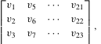

我们将其表示为 \([\mathbf{v}]$。\([\mathbf{v}]$ 中一列的奇偶性为偶或奇，当该列元素的二进制和分别为 0 或 1 时。行的奇偶性有类似定义。写成 \(4 \times 6$ 矩阵并满足两个标准的向量集合将构成 [24, 12, 8] 扩展二进制戈莱码。第二个标准涉及六元码。本节余部分使用的六元码 \(\mathcal{G}_6$ 版本具有生成矩阵

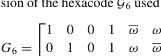

它是通过交换 \([I_3 \ A]$ 的第一列和第三列从生成矩阵 \([I_3 \ A]$（其中 \(A$ 如在 (10.3) 中给出）得到的。使用这种形式是因为可以轻松识别六元码中的 64 个码字。要使用六元码，我们将 \(\mathbb{F}_4^{24}$ 中的一个元素映射到 \(\mathbb{F}_4^6$ 中的一个元素，定义 \(\mathbf{v}$ 到 \(\mathbb{F}_4^6$ 的投影 \(\text{Pr}(\mathbf{v})$ 为矩阵乘积

```
\(\text{Pr}(\mathbf{v}) = [0 \ 1 \ \omega \ \bar{\omega}][\mathbf{v}]\)
```

示例 10.3.3 假设 \(\mathbf{v} = 111111000000001101010110$。投影操作可以通过书写来可视化

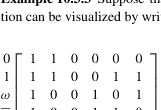

其中投影通过将 \([\mathbf{v}]$ 的第一行乘以 0，第二行乘以 1，第三行乘以 \(\omega$，第四行乘以 \(\bar{\omega}$，然后相加来完成。

回顾二进制向量 \(\mathbf{v}$ 的补码是二进制向量 \(\mathbf{v} + \mathbf{1}$，通过将 \(\mathbf{v}$ 中的 0 替换为 1，1 替换为 0 得到。我们将反复使用以下引理而不加引用；其证明留作练习。

引理 10.3.4 对于 (10.4) 的列，以下成立：
- (i) 给定 \( a \in \mathbb{F}_4$，投影到 \( a$ 的列恰好有四种可能的选择。恰好两种选择具有偶校验，两种具有奇校验。偶校验的两者互为补码，奇校验的两者亦然。
- (ii) 投影到 \( 0 \in \mathbb{F}_4$ 的列为 \([0000]^T$，\([1111]^T$，\([1000]^T$，和 \([0111]^T$。

练习 582 证明引理 10.3.4。

引理 10.3.5 设 C 为由所有向量 c 组成的二进制码，使得：
- (i) [c] 的所有列具有相同的奇偶性，且该奇偶性等于 [c] 第一行的奇偶性，并且
- (ii) 向量 \(\text{Pr}(c) \in G_6$。
码 C 是 [24, 12, 8] 扩展二进制戈莱码。

证明：如果我们任意填充矩阵 (10.4) 的前三行，那么若要满足 (i)，最后一行将被唯一确定。满足 (i) 的向量集合显然是一个线性空间。因此，满足 (i) 的向量集合 \(C_1$ 是一个 [24, 18] 码。类似地，如果我们任意填充矩阵 (10.4) 的前三列，那么这些列将投影到 \(\mathbb{F}_4$ 的三个任意元素。由于六元码的前三个坐标是三个信息位，若要满足 (ii)，投影的最后三个坐标将被唯一确定。但是，若要使某列投影到 \(\mathbb{F}_4$ 的某个固定元素，该列恰好有四种选择。因此，满足 (ii) 的向量集合大小为 \(2^{14} = 2^{18}$。该集合 \(C_2$ 显然是一个线性空间，因为 Pr 是线性映射且 \(G_6$ 在加法下封闭。因此 \(C_2$ 也是一个 [24, 18] 码。故 \(C = C_1 \cap C_2$ 的维数至少为 12。

根据定理 10.1.6，若要完成证明，只需证明 C 的最小距离为 8。向量 111111100...0 满足 (i) 并投影到零向量。因此 C 的最小距离最多为 8。假设 \(c \in C$ 是一个非零码字。有两种情况：[c] 的顶行具有偶校验或 [c] 的顶行具有奇校验。

假设 [c] 的顶行具有偶校验。如果 \(\text{Pr}(c) \neq 0$，由于 \(G_6$ 的最小权为 4，[c] 中至少有四个非零列，每列都有（非零的）偶数个 1。因此 \(\text{wt}(c) \geq 8$。现在假设 \(\text{Pr}(c) = 0$。投影到 \(0 \in \mathbb{F}_4$ 的偶数列向量只有全零列和全一列。由于 [c] 的顶行具有偶校验，[c] 必须包含偶数个全一列。由于 \(c \neq 0$，我们再次得到 \(\text{wt}(c) \geq 8$。

现在假设 [c] 的顶行具有奇校验。因此 [c] 的每一列都有奇数个 1，所以 [c] 中至少有六个 1；如果某一列有三个 1，则证明完成。因此假设 [c] 的每一列恰好有一个 1。特别是，[c] 的顶行在某一列中有 1 当且仅当该列投影到 \(0 \in \mathbb{F}_4$。因此顶行中 1 的数量为 \(6 - \text{wt}(\text{Pr}(c))$。然而，\(G_6$ 的码字具有偶权，因此 [c] 的顶行具有偶校验，这与假设矛盾。

在本节余部分中，引理 10.3.5 中的码 C 将记为 \(G_{24}$。为了手工解码 \(G_{24}$，我们需要能够识别 \(G_6$ 中的码字。如果我们将坐标标记为 1, 2, 3, 4, 5, 6，则坐标分为三对 (1, 2), (3, 4) 和 (5, 6)。存在置换自同构，可以以任何方式置换这三对，并交换任意两对内部的顺序；参见练习 583。我们列出码字


| 组号 | 六进制码字 | 组内数量 |
| :--- | :--- | :--- |
| I | 01 01 \(\bar{\omega}\bar{\omega}\) | \(3 \times 12 = 36\) |
| II | \(\bar{\omega}\bar{\omega}\) \(\bar{\omega}\bar{\omega}\) \(\bar{\omega}\bar{\omega}\) | \(3 \times 4 = 12\) |
| III | 00 11 11 | \(3 \times 3 = 9\) |
| IV | 11 \(\omega\bar{\omega}\) \(\omega\bar{\omega}\) | \(3 \times 2 = 6\) |

在表 10.1 中的 \(\mathcal{G}_6\) 分组，说明每组有多少个。表中每个码字都分成了对。组内的其他码字可通过乘以 \(\omega\) 或 \(\bar{\omega}\)、以任意顺序排列对、交换任意两对的顺序，以及这些操作的任意组合得到。在表中，“组内数量”列说明可通过这些操作得到多少个码字。例如，包含 00 11 11 的组还包含 11 00 11 和 11 11 00，以及所有 \(\omega\) 和 \(\bar{\omega}\) 的倍数。

## **练习 583** 执行以下操作：
- (a) 证明排列 \(p_1 = (1, 3)(2, 4)\)、\(p_2 = (1, 3, 5)(2, 4, 6)\) 和 \(p_3 = (1, 2)(3, 4)\) 属于 \(\text{PAut}(\mathcal{G}_6)\)。
- (b) 找出 \(p_1\)、\(p_2\) 和 \(p_3\) 的一个乘积，使其：
  - (i) 交换对 (3, 4) 和 (5, 6)，
  - (ii) 将 (3, 4) 映射到 (4, 3) 并同时将 (5, 6) 映射到 (6, 5)。\(\blacklozenge\)

## **练习 584** 证明表 10.1 中每组的码字数量是正确的。\(\blacklozenge\)

## **练习 585** 判断以下向量是否属于六进制码 \(\mathcal{G}_6\)：
- (a) \(10\bar{\omega}01\)，
- (b) \(\bar{\omega}\omega 0011\)，
- (c) \(0\bar{\omega}\bar{\omega}\bar{\omega}01\)，
- (d) \(1\omega 10\omega 1\)。\(\blacklozenge\)

我们现在演示如何解码接收到的向量 \(\mathbf{y} = \mathbf{c} + \mathbf{e}\)，其中 \(\mathbf{c} \in \mathcal{G}_{24}\) 且 \(\text{wt}(\mathbf{e}) \le 3\)。解码自然分为四种情况，取决于 \([\mathbf{y}]\) 的列的奇偶性。接收向量唯一确定我们处于哪种情况。特别是，如果接收向量的权重为奇数，则发生了一次或三次错误，我们处于下面的情况 1 或情况 3。（注意，情况编号**不是**错误的数量。）如果接收向量的权重为偶数，则发生了零次或两次错误，我们处于情况 2 或情况 4。如果通过适当情况中的程序无法纠正接收向量，则发生了超过三次错误。由于 \(\mathcal{G}_{24}\) 的覆盖半径为 4，如果发生超过三次错误，最近邻不是正确码字，程序将无法生成 \(\mathbf{c}\)。如果发生了四次错误，则会出现情况 2 或情况 4；通过更多工作，我们可以使用与情况 2 或情况 4 中相同的技术找到距离接收向量 4 以内的六个码字。我们不会描述处理四次错误的程序；感兴趣的读者可查阅 [268]。请记住，我们假设最多发生了三次错误。

## 情况 1：[y] 的三列具有偶校验，三列具有奇校验

在这种情况下，我们知道必须发生了三次错误，并且每个奇校验列中有一个错误，或者每个偶校验列中有一个错误。我们分别考虑每种可能性。对于每种选择，我们知道 Pr(y) 的三个分量是正确的，因此只有一种方法来填充出错的坐标以获得 \(\mathcal{G}_6\) 中的一个码字。

### 示例 10.3.6 假设 y = 101000011100001000011001。那么我们得到

```
Pr(y) =
0 [1 0 1 0 0 1]
1 0 0 1 0 0 0
ω 1 0 0 1 1 0 0
ω̄ 0 1 0 0 0 1
  ω ω̄ 1 ω ω̄ ω̄
```

注意，列 1、3 和 6 具有偶校验，列 2、4 和 5 具有奇校验。假设奇校验列是正确的。那么 Pr(c) = *0*ω0*ω*，我们需要填充 *'s。Pr(c) 的唯一可能性来自表 10.1 中的组 I 或 II。如果它在组 I 中，则必须是 0ω0ω0ω0，这无法完成。所以 Pr(c) = ω0ω0ω0ω0。由于我们在列 1、3 和 6 中各只做一次更改，我们得到

```
0 [0 0 1 0 0 1]
1 0 0 1 0 0 1
ω 1 0 1 1 0 0
ω̄ 0 1 0 0 1 1
  ω ω̄ ω̄ ω ω ω
```

然而，列具有奇校验而第一行具有偶校验，这是一个矛盾。所以偶校验列是正确的，且 Pr(c) = *1***ω*。Pr(c) 的唯一可能性来自组 IV；因此 Pr(c) = ω011ω0。由于我们在列 2、4 和 5 中各只做一次更改，我们得到：

```
0 [1 0 1 0 1 1]
1 0 1 1 0 0 0
ω 1 0 0 1 0 0
ω̄ 0 1 0 1 1 1
  ω 1 1 1 ω ω
```

由于所有列和第一行都具有偶校验，这就是该码字。

## 情况 2：[y] 中恰好四列具有相同的奇偶性

由于我们假设最多发生了三次错误，我们知道具有相同奇偶性的四列是正确的，而另外两列各包含恰好一个错误。

### 示例 10.3.7 假设 y = 10001110100000000101000。那么：

```
0 [ 0 1 1 0 0 0 1 ]
1   0 1 1 0 0 0 0
ω   0 0 1 0 0 1 0
ω̄   0 1 0 0 0 0 0
   0 0 1 0 ω ω 0
```

因此列 1、3、5 和 6 具有奇校验，列 2 和 4 具有偶校验。所以 Pr(c) = 0*1*ω0。这必须在组 I 中；因此 Pr(c) = 0ω1ω̄00。我们必须在列 2 和 4 中各做一次更改，使得顶行具有奇校验。这给出

```
0 [ 1 1 0 0 0 1 ]
1   0 1 1 0 0 0
ω   0 0 0 0 1 0 0
ω̄   0 1 0 1 0 0 0
   0 ω 1 ω ω 0
```

由于列和第一行都具有奇校验，这就是该码字。

## 情况 3：[y] 中恰好五列具有相同的奇偶性

由于最多发生了三次错误，要么具有相同奇偶性的五列是正确的，而另一列有 1 次或 3 次错误，要么五列中的四列是正确的，第五列有 2 次错误，剩余列有 1 次错误。使用表 10.1 很容易确定所有五列相同奇偶性是否正确，然后纠正剩余列。如果五列中的四列是正确的，则需要稍多一些的分析。

### 示例 10.3.8 假设 y = 110010001001000010010110。那么：

```
0 [ 1 1 0 0 1 0 ]
1   1 0 0 0 0 1
ω   0 0 0 0 0 1
ω̄   0 0 1 0 1 0
   1 0 ω 0 ω ω
```

列 2 是唯一的奇校验列，因此该列中发生了 1 次或 3 次错误。如果 Pr(y) 中除列 2 以外的所有内容都是正确的，很容易看出列 2 中的任何更改都无法从表 10.1 中得到一个六进制码字。所以列 1、3、4、5 和 6 中有四列是正确的。如果列 5 和 6 都正确，则 Pr(c) 必须在组 III 或 IV 中，在这种情况下列 1、3 和 4 中有两列必须出错；这是不可能的。特别是，列 1、3 和 4 是正确的，且 Pr(c) = 1*ω̄*ω*，这必须在组 I 中。唯一的可能性是 Pr(c) = 1ω0ω0ω0。因此正确码字必须是：

```
0 [ 1 1 1 0 1 0 ]
1 [ 1 0 0 0 0 0 ]
ω [ 0 1 0 0 0 0 ]
ω̄ [ 0 0 1 0 1 0 ]
[ 1 ω ω̄ 0 ω̄ 0 ]
```

注意，列和第一行都具有偶校验。

## 情况 4：[y] 的所有六列都具有相同的奇偶性

这是最容易求解的情况。如果顶行与列具有相同的奇偶性且 Pr(y) 在 \(\mathcal{G}_6\) 中，则未发生错误。否则，由于我们假设最多发生了三次错误，并且六列的奇偶性是正确的，任何不正确的列必须有两个错误。因此最多有一列不正确。正确向量 Pr(c) 容易找到，因此不正确的列（如果有的话）也就很明显了。

### 示例 10.3.9 假设 y = 011100101011000111011101。那么：

```
Pr(y) =
0 [ 0 0 1 0 0 1 1 ]
1 [ 1 0 0 0 0 1 1 ]
ω [ 1 1 1 0 0 0 0 ]
ω̄ [ 1 0 1 1 1 1 1 ]
[ 0 ω 1 ω̄ ω ω ]
```

显然，所有列不可能都正确，且列 5 和 6 不可能都正确。因此，由于列 1、2、3 和 4 必须正确，唯一的可能性是 Pr(c) 在组 I 中且 Pr(c) = 0ω1ω0ω0。因此必须更改列 6 中的两个条目，正确码字是

```
0 [ 0 0 1 0 1 1 ]
1 [ 1 0 0 0 1 0 ]
ω [ 1 1 0 0 0 0 ]
ω̄ [ 1 1 1 0 1 0 ]
[ 0 ω 1 ω̄ ω 0 ]
```

## **练习 586** 当使用 \(\mathcal{G}_{24}\) 进行传输时，解码以下接收向量，或证明发生了超过三次错误：

- (a) 00111001101110101000011，
- (b) 11001101011011101001100，
- (c) 00010100101111010111001，
- (d) 10101011110010010010101，
- (e) 10111011110010000100110。

四面体码可以用类似的方式来解码 [12, 6, 6] 扩展三元 Golay 码；参见 [268]。该技术已在 [143] 中推广。


## 10.4 三元 Golay 码

我们现在更详细地考察在 1.9.2 节中首次构造的 [11, 6, 5] 和 [12, 6, 6] 三元 Golay 码。我们对 [12, 6, 6] 码的原始构造使用了带边双循环生成矩阵。与二进制情况一样，这些码是唯一的，并具有相对较大的自同构群。

### 10.4.1 三元 Golay 码的唯一性

三元 Golay 码的唯一性在 [65, 260, 269] 中得到证明；我们的证明部分遵循这些文献，并与二进制情况类似。我们首先通过一系列练习证明扩展三元 Golay 码的唯一性。

**练习 587** 设 $\mathcal{C}$ 为长度为 11、最小距离为 5 的（可能为非线性）三元码，包含 $M \ge 3^6$ 个码字。证明 $\mathcal{C}$ 恰好有 $3^6$ 个码字且是完美码。提示：使用球包界。

**练习 588** 设 $\mathcal{C}$ 为长度为 11、最小距离为 5 的（可能为非线性）三元码，包含 $M \ge 3^6$ 个码字（包括 $\mathbf{0}$ 码字）。根据练习 587，$\mathcal{C}$ 包含 $3^6$ 个码字且是完美码。证明 $\mathcal{C}$ 的权重枚举子为 $W_{\mathcal{C}}(x, y) = y^{11} + 132x^5y^6 + 132x^6y^5 + 330x^8y^3 + 110x^9y^2 + 24x^{11}$。

提示：模仿引理 10.1.2 的证明。令 $N(w, c)$ 表示以权重为 $c$ 的码字为中心、半径为 2 的球中权重为 $w$ 的 $\mathbb{F}_3^{11}$ 向量的个数。与 (10.2) 类似的方程为

$$
\sum_{c=0}^{11} N(w, c)A_c = \binom{11}{w} 2^w.
$$

$N(w, c)$ 的计算比引理 10.1.2 证明中的更为复杂。

**练习 589** 设 $\mathcal{C}'$ 为长度为 12、最小距离为 6 的（可能为非线性）三元码，包含 $M \ge 3^6$ 个码字（包括 $\mathbf{0}$ 码字）。证明 $\mathcal{C}'$ 恰好有 $3^6$ 个码字，且权重枚举子为 $W_{\mathcal{C}'}(x, y) = y^{12} + 264x^6y^6 + 440x^9y^3 + 24x^{12}$。

提示：在任意坐标上对 $\mathcal{C}'$ 进行删短，得到练习 587 和 588 中描述的码。

**练习 590** 证明如果 $\mathbf{c}$ 和 $\mathbf{c}'$ 是 $\mathbb{F}_3^5$ 中的向量，且 $\text{wt}(\mathbf{c})$、$\text{wt}(\mathbf{c}')$ 和 $\text{wt}(\mathbf{c} - \mathbf{c}')$ 均为 3 的倍数，则 $\mathbf{c}$ 与 $\mathbf{c}'$ 正交。提示：你可以假设 $\mathbf{c}$ 的非零项全都等于 1，因为重新缩放坐标不影响权重或正交性。

**练习 591** 设 \(\mathcal{D}\) 为长度为 12、最小距离为 6 的（可能为非线性）三元码，包含 \(M \ge 3^6\) 个码字（包括 \(\mathbf{0}\) 码字）。证明 \(\mathcal{D}\) 是一个 \([12, 6, 6]\) 自正交线性码。提示：如果 \(\mathbf{c} \in \mathcal{D}\)，则 \(\mathcal{D}\) 和 \(\mathbf{c} - \mathcal{D}\) 满足练习 589 中给出的 \(\mathcal{C}'\) 的条件。使用练习 590。\(\diamond\)

**练习 592** 设 \(\mathcal{C}\) 为一个 \([12, 6, 6]\) 三元码。你将证明，直到等价性，\(\mathcal{C}\) 具有一个唯一的生成矩阵。回顾，给定 \(\mathcal{C}\) 的生成矩阵 \(G\)，通过对 \(G\) 的列进行置换和/或将列乘以 \(\pm 1\) 得到的生成矩阵产生一个等价码。你也可以重新排列或重新缩放行并得到相同的码。不失一般性，我们可以假设 \(G$ 采用标准形式

\(G = [I_6 \quad A]\)

其中 \(A\) 是一个 \(6 \times 6\) 矩阵，其第 \(i$ 行记为 \(\mathbf{a}_i$。我们将 \(G$ 的列标记为 \(1, 2, \dots, 12$。

- (a) 证明对于 \(1 \le i \le 6$，\(\mathbf{a}_i$ 最多有一个分量等于 0。
- (b) 证明 \(A$ 的两个不同行 \(\mathbf{a}_i$ 和 \(\mathbf{a}_j$ 不可能在三个或更多坐标位置上的分量相同。
- (c) 证明 \(A$ 的两个不同行 \(\mathbf{a}_i$ 和 \(\mathbf{a}_j$ 不可能在三个或更多坐标位置上的分量互为相反数。
- (d) 证明 \(A$ 的每一行权重均为 5。
- (e) 证明 \(A$ 的任意两行不会在相同的坐标位置上都有 0。

- (f) 证明我们可以假设

A =

| 0 | 1 | 1 | 1 | 1 | 1 |
|---|---|---|---|---|---|
| 1 | | | | | |
| 1 | | | | | |
| 1 | | | | | |
| 1 | | | | | |
| 1 | | | | | |

其中每行的空白项应填入一个 0、两个 1 和两个 -1。提示：你可能需要重新缩放 \(G$ 的列 \(2, \dots, 6$ 和行 \(2, \dots, 6$ 以获得所需的 \(G$ 第 7 列。

- (g) 证明我们可以假设

A =

| 0 | 1 | 1 | 1 | 1 | 1 |
|---|---|---|---|---|---|
| 1 | 0 | 1 | -1 | -1 | 1 |
| 1 | 1 | 0 | | | |
| 1 | | | 0 | | |
| 1 | | | | 0 | |
| 1 | | | | | 0 |

其中每行的空白项应填入两个 1 和两个 -1。

- (h) 证明，直到等价性，\(\mathbf{a}_3 = (1, 1, 0, 1, -1, -1)\)。

- (i) 证明 \(\mathbf{a}_4, \mathbf{a}_5, \text{和 } \mathbf{a}_6$ 唯一确定，且

A =

| 0 | 1 | 1 | 1 | 1 | 1 |
|---|---|---|---|---|---|
| 1 | 0 | 1 | -1 | -1 | 1 |
| 1 | 1 | 0 | 1 | -1 | -1 |
| 1 | -1 | 1 | 0 | 1 | -1 |
| 1 | -1 | -1 | 1 | 0 | 1 |
| 1 | 1 | -1 | -1 | 1 | 0 |

。

以上产生的生成矩阵正是 1.9.2 节中给出的扩展三元 Golay 码的生成矩阵，我们在该节中证明它确实是一个 [12, 6, 6] 码。\(\diamond\)

练习 587-592 表明，包含 \(\mathbf{0}$、至少有 \(3^6$ 个码字且最小距离为 6 的长度为 12 的（可能为非线性）三元码，直到等价性，即为 [12, 6, 6] 扩展三元 Golay 码。

我们现在转向长度为 11 的三元码。设 \(\mathcal{C}\) 为长度为 11、最小距离为 5 的（可能为非线性）三元码，包含 \(M \ge 3^6$ 个码字（包括 \(\mathbf{0}$ 码字）。我们将证明该码是一个直到等价性唯一的 [11, 6, 5] 线性码。根据练习 587 和 588，\(\mathcal{C}\) 是一个具有 \(3^6$ 个码字（包括权重为 11 的码字）的完美码。通过删短坐标，我们可以假设 \(\mathcal{C}\) 包含全一码字 \(\mathbf{1}\)。

注意，如果 \(\mathbf{c} \in \mathcal{C}\)，则 \(\mathbf{c} - \mathcal{C}$ 是长度为 11、最小距离为 5、包含 \(3^6$ 个码字（包括 \(\mathbf{0}$ 码字）的码。因此其权重分布如练习 588 所示，蕴含

$d(\mathbf{c}, \mathbf{c}') \in \{5, 6, 8, 9, 11\}$ (10.5)

对于 \(\mathcal{C}$ 中不同的码字 \(\mathbf{c}$ 和 \(\mathbf{c}'$。

我们希望证明 \(-\mathbf{1}$ 属于 \(\mathcal{C}$。为此，我们建立一些记号。\(\mathbb{F}_3^{11}$ 中的一个向量若有 \(a$ 个 \(-1$、\(b$ 个 \(1$ 和 \(c$ 个 \(0$ 作为分量，则称其“类型”为 \((-1)^a 1^b 0^c$。假设 \(\mathbf{x} \notin \mathcal{C}$。由于 \(\mathcal{C}$ 是完美码，存在一个距离 \(\mathbf{x}$ 不超过 2 的唯一码字 \(\mathbf{c}$；我们说 \(\mathbf{c}$ “覆盖” \(\mathbf{x}$。假设 \(-\mathbf{1} \notin \mathcal{C}$。令 \(\mathbf{x}_i$ 为 \(\mathbb{F}_3^{11}$ 中在第 \(i$ 个坐标为 1、其余十个坐标为 -1 的向量。如果某个 \(\mathbf{x}_i$ 在 \(\mathcal{C}$ 中，则 \(\mathbf{x}_i$ 与 \(\mathbf{1}$ 之间的距离为 10，这与 (10.5) 矛盾。令 \(\mathbf{c}_i$ 覆盖 \(\mathbf{x}_i$。特别是，\(w(\mathbf{c}_i)$ 为 9 或 11。

首先假设某个 \(i$ 的 \(w(\mathbf{c}_i) = 11$。没有码字可以恰好有一个 1，因为其到 \(\mathbf{1}$ 的距离为 10，这与 (10.5) 矛盾。因此 \(\mathbf{c}_i$ 必须至少有两个 1。为了覆盖 \(\mathbf{x}_i$，\(\mathbf{c}_i$ 的唯一选择是类型 \((-1)^a 1^b$ 或 \((-1)^b 1^a$。无论哪种情况，\(\mathbf{c}_i$ 在坐标 \(i$ 处都有 1。现在假设某个 \(i$ 的 \(w(\mathbf{c}_i) = 9$。则 \(\mathbf{c}_i$ 必须具有类型 \((-1)^a 1^b$，且在坐标 \(i$ 处为 0。考虑 \(\mathbf{c}_i$、\(\mathbf{1}$ 和 \(\mathbf{e}_i$ 的可能性。如果它们互不相同，则它们之间的距离必须至少为 5。这意味着它们不可能都具有类型 \((-1)^a 1^b$ 和 \((-1)^b 1^a$，其中 \(a$ 和 \(b$ 都不为 -1。此外，它们也不可能都具有类型 \((-1)^a 1^b$ 且在某个共同坐标处都有 1。特别是，所有 \(\mathbf{c}_i$ 都不可能具有类型 \((-1)^a 1^b$，因为 11 不是 3 的倍数。练习 593 表明，通过重新排列坐标，\(\mathbf{c}_i$ 如图 10.2 所示。

**练习 593** 填写细节以验证 \(\mathbf{c}_1, \dots, \mathbf{c}_{11}$ 如图 10.2 所示。\(\diamond\)


| | 1 | 2 | 3 | 4 | 5 | 6 | 7 | 8 | 9 | 10 | 11 |
|---|---|---|---|---|---|---|---|---|---|---|---|
| c1 = c2 | a | a | -1 | -1 | -1 | -1 | -1 | -1 | -1 | -1 | -1 |
| c3 = c4 = c5 | -1 | -1 | 1 | 1 | -1 | -1 | -1 | -1 | -1 | -1 | -1 |
| c6 = c7 = c8 | -1 | -1 | -1 | -1 | 1 | 1 | 1 | 1 | -1 | -1 | -1 |
| c9 = c10 = c11 | -1 | -1 | -1 | -1 | -1 | -1 | -1 | -1 | 1 | 1 | 1 |

图 10.2 c1, ..., c11 的配置，其中 a = 0 或 a = 1。

现在令 x 具有类型 (-1)^9 1^2，且坐标 1 和 3 处为 1。由于 d(x, c1) ≤ 3，故 x ∉ C。假设 c 覆盖 x。同样，c 的权重为 9 或 11。如果 wt(c) = 9，则其类型为 (-1)^9 0^2，且坐标 1 和 3 处为 0。那么 d(c, c1) ≤ 3，这产生矛盾。所以 wt(c) = 11。如果 c 的类型为 (-1)^{11-b}1^b，由于 c 覆盖 x，故 b ≤ 4。如果 b = 1 或 b = 4，则 d(c, 1) 为 10 或 7，产生矛盾。如果 b = 2，则 d(c, c1) ≤ 4，产生矛盾。所以 b = 3，且 c 在坐标 1 和 3 处都必须为 1。同样 d(c, c1) ≤ 4，产生矛盾。因此 -1 ∈ C。
所以 C 包含码字 0、1 和 -1。此外，如果 c ∈ C 且 wt(c) = 11，则 -c ∈ C，如下所示。选择一个对角矩阵 D，使得 cD = 1。那么 CD 的最小距离为 5，且包含码字 0 和 1 = cD。根据前面的论证，-1 ∈ CD，这意味着 -cD ∈ CD。所以 -c ∈ C。

总之，我们知道以下几点。C 是一个包含 0 和 1、最小距离为 5 的完美 (11, 3^5) 码。此外，C 中每个权重为 11 的码字的负数也在 C 中。接下来我们证明，所有权重为 9 的码字也适用同样的情况。练习 594 给出了 C 中码字的可能类型。

### 练习 594 证明给定权重的码字仅具有列出的类型：

- (a) 权重 5: 1^10^0^, (-1)^1^0^, (-1)^2^1^0^, (-1)^3^2^0^,
- (b) 权重 6: (-1)^3^1^0^, (-1)^4^0^, 1^6^0^,
- (c) 权重 8: (-1)^4^1^0^, (-1)^5^1^0^, (-1)^6^1^0^, (-1)^7^1^0^, (-1)^8^1^0^,
- (d) 权重 9: (-1)^1^0^, (-1)^2^1^0^, (-1)^3^1^0^,
- (e) 权重 11: (-1)^11^, 1^11^, (-1)^5^1^6^, (-1)^6^1^5^.

提示：考虑给定权重的每种可能类型，并计算其到 1 和 -1 的距离。使用 (10.5)。◆

为了证明权重为 9 的码字 c 的负数也是码字，如有必要，将所有 11 个坐标按 -1 重新缩放，根据练习 594，我们可以假设 c 的类型为 (-1)^3^1^0^。通过重排坐标

```
c = (1, 1, 1, 1, 1, 1, -1, -1, -1, 0, 0).
```

假设 -e ∉ C。考虑权重为 11 的向量

```
x1 = (-1, -1, -1, -1, -1, -1, 1, 1, 1, 1, 1).
```

如果 x1 ∈ C，则 -x1 ∈ C 且 d(-x1, c) = 2，这与 (10.5) 矛盾。假设 c1 覆盖 x1。那么 wt(c1) 为 9 或 11。通过重排坐标并使用练习 594，c1 的唯一可能性为

(-1, -1, -1, -1, -1, 1, -1, 1, 1, 1, 1),
(-1, -1, -1, -1, -1, 1, 1, 1, 1, 1, 1),
(-1, -1, -1, -1, -1, 1, 1, 1, 1, 1, -1),
(-1, -1, -1, -1, -1, 1, 1, 1, 0, 1, 0), 或
(-1, -1, -1, -1, -1, -1, 1, 0, 0, 1, 1).

在第一种情况下，d(-e1, c) = 4，而在接下来三种情况下，d(e1, c) = 10，这与 (10.5) 矛盾。只有最后一种是可能的。令

x2 = (-1, -1, -1, -1, -1, 1, -1, 1, 1, 1, -1),

根据练习 594，它不在 C 中。假设 c2 覆盖 x2。通过像上面一样测试可能性并在重排坐标后，我们可以假设

c2 = (-1, -1, -1, -1, -1, 0, 0, 1, 1, 1, -1).

最后，令

x3 = (-1, -1, -1, -1, -1, -1, -1, 1, 1, 1, -1, 1),

根据练习 594，它同样不在 C 中。在假设 e1 和 e2 在 C 中的情况下，无法构造覆盖 x3 的码字 c3。这证明了权重为 9 的码字 c 的负数也是码字。

### 练习 595. 填补细节，证明 c2 如所声称且 c3 不存在。$\blacklozenge$

令 D 为由 C 中所有权重为 9 的 110 个码字组成的子码。令 x \in C 且 y \in D。我们证明 x 和 y 正交。根据练习 596，由于 wt(y) \equiv 0 (mod 3),

wt(x) + x \cdot y \equiv d(x, y) (mod 3) 且 (10.6)

wt(x) - x \cdot y \equiv d(x, -y) (mod 3). (10.7)

由于 y \in D 且 -y \in D，d(x, y) 和 d(x, -y) 模 3 只能是 0 或 2。如果 wt(x) \equiv 0 (mod 3) 且 d(x, y) 或 d(x, -y) 模 3 为 0，则分别根据 (10.6) 或 (10.7)，x \cdot y \equiv 0 (mod 3)。如果 d(x, y) = d(x, -y) \equiv 2 (mod 3)，则根据 (10.6) x \cdot y \equiv 2 (mod 3)，而根据 (10.7) x \cdot y \equiv 1 (mod 3)，产生冲突。如果 wt(x) \equiv 2 (mod 3) 且 d(x, y) 或 d(x, -y) 模 3 为 2，则分别根据 (10.6) 或 (10.7)，x \cdot y \equiv 0 (mod 3)。如果 d(x, y) = d(x, -y) \equiv 0 (mod 3)，则根据 (10.6) x \cdot y \equiv 1 (mod 3)，而根据 (10.7) x \cdot y \equiv 2 (mod 3)，产生冲突。在所有情况下，x 与 y 正交。

因此，由 D 的码字生成的线性码 D1 与由 C 的码字生成的线性码 C1 正交。由于 D 有 110 个码字且 110 > 3^4，D1 的维度至少为 5。由于 C 有 3^6 个码字，C1 的维度至少为 6。由于 D1 和 C1 的维度之和最多为 11，C1 和 D1 的维度分别恰好为 6 和 5。因此 C1 = C，这意味着 C 是线性的。如果我们扩展 C，则得到一个 [12, 6] 线性码 C。根据练习 594，C 中权重为 5 的码字扩展为权重 6，这意味着 C 是一个 [12, 6, 6] 线性码。根据练习 592，C 是扩展三元 Golay 码。在下一小节中，我们将看到 C 具有一个传递自同构群；根据定理 1.7.13，通过在 C 的任何坐标上进行删短得到的所有 12 个码都是等价的。因此 C 是唯一的。

### 练习 596 证明如果 x 和 y 在 \(\mathbb{F}_3^n\) 中，则

```
d(x, y) \equiv wt(x) + wt(y) - x \cdot y \pmod 3.
```

提示：通过重新缩放（这不改变模 3 下的距离或内积），你可以假设 x 的所有非零分量都等于 1。

此讨论及随附练习已证明了以下定理。

### 定理 10.4.1 长度为 11 和 12、可能为非线性、包含 0 且分别具有 \(M \ge 3^6\) 个码字和最小距离 5 与 6 的三元码，至等价性都是唯一的。它们分别是 [11, 6, 5] 和 [12, 6, 6] 三元 Golay 码。

## 10.4.2 三元 Golay 码的性质

在示例 6.6.11 中，我们给出了长度为 11 的奇型三元二次剩余码的生成幂等元。这样的一个码具有生成幂等元

```
$e_{11}(x) = -(x^2 + x^6 + x^7 + x^8 + x^{10})$
```

和生成多项式

```
$g_{11}(x) = -1 + x^2 - x^3 + x^4 + x^5$.
```

根据定理 6.6.22，该码的最小距离 \(d_0 \ge 4\)。根据定理 6.6.14，扩展码是一个 [12, 6] 自偶码，其最小距离是 3 的倍数。因此 \(d_0 \ge 5\)，根据定理 10.4.1，这是 [11, 6, 5] 三元 Golay 码 \(\mathcal{G}_{11}\) 的一种表示。扩展这种奇型二次剩余码给出了 [12, 6, 6] 扩展三元 Golay 码 \(\mathcal{G}_{12}\) 的一种表示。

### 练习 597 验证 \(g_{11}(x)\) 是具有生成幂等元 \(e_{11}(x)\) 的循环码的生成多项式。

### 练习 598 为扩展生成多项式 \(g_{11}(x)\) 的循环码而得到的扩展二次剩余码创建生成矩阵，在行上添加奇偶检查坐标。化简该生成矩阵，并证明列确实可以重排和缩放以得到练习 592(i) 中的生成矩阵。

如同在第 10.1.2 节中，以下置换是 \(\mathcal{G}_{12}\) 的自同构，\(\mathcal{G}_{12}\) 被视为通过扩展具有生成幂等元 \(e_{11}(x)\) 的循环码而得到的扩展二次剩余码，其中坐标标记为 \(0, 1, \dots, 10, \infty\)：

```
$s_{12} = (0, 1, 2, 3, 4, 5, 6, 7, 8, 9, 10), \text{ and } \mu_3 = (1, 3, 9, 5, 4)(2, 6, 7, 10, 8).$
```

来自 Gleason-Prange 定理的元素是

```
$v_{12} = \text{diag}(1, -1, -1, 1, 1, -1, -1, -1, 1, -1, -1) \times (0, \infty)(1, 10)(2, 5)(3, 7)(4, 8)(6, 9).$
```

这三个元素连同

\(\eta_{12} = (1, 9)(4, 5)(6, 8)(7, 10)\)

生成 \(\Gamma \text{Aut}(\mathcal{G}_{12}) = \text{MAut}(\mathcal{G}_{12})\)。该群的阶为 95040 \(\cdot\) 2，且同构于有时表示为 \(\mathcal{M}_{12}\) 的群。该群有一个阶为 2 的中心，模去该中心后，商群是阶为 95040 = \(12 \cdot 11 \cdot 10 \cdot 9 \cdot 8\) 的 5-传递 Mathieu 群 \(\mathcal{M}_{12}\)。这个商群可以通过丢弃 \(\text{MAut}(\mathcal{G}_{12})\) 中所有元素的对角部分得到；这是在第 1.7 节中定义的群 \(\text{MAut}_0(\mathcal{G}_{12})\)，即集合 \(\{P \mid DP \in \text{MAut}(\mathcal{G}_{12})\}\)。

- **练习 599** 验证 \(v_{12}\) 和 \(\eta_{12}\) 在 \(\Gamma \text{Aut}(\mathcal{G}_{12})\) 中。参见练习 575。\(\unknown\)

我们再次可以找到每个三元 Golay 码的覆盖半径。

### 定理 10.4.2 [11, 6, 5] 和 [12, 6, 6] 三元 Golay 码的覆盖半径分别为 2 和 3。

- **练习 600** 证明定理 10.4.2。\(\unknown\)

下一个示例说明了从阶 3 的射影平面构造扩展三元 Golay 码的方法；该方法源于 Drapal [73]。

### 示例 10.4.3 射影平面 PG(2, 3) 有 13 个点和 13 条直线，每条直线有 4 个点，每个点有 4 条直线经过；参见定理 8.6.2。将点标记为 \(0, 1, 2, \dots, 12\)。将经过 0 的四条直线记为 \(\ell_1, \dots, \ell_4\)，其余直线记为 \(\ell_5, \dots, \ell_{13}\)。在 \(\mathbb{F}_3^{13}\) 中构造权重为 4 的向量 \(\mathbf{v}_i\)，使得 \(\text{supp}(\mathbf{v}_i) = \ell_i\)，且当 \(1 \le i \le 4\) 时其非零分量全为 1，当 \(5 \le i \le 13\) 时全为 2。对于 \(1 \le i < j \le 13\)，令 \(\mathbf{v}_{i,j} = \mathbf{v}_i - \mathbf{v}_j\)，并令 \(\mathbf{v}_{i,j}^*\) 为在坐标 0 上删短后的 \(\mathbf{v}_{i,j}\)。令 \(\mathcal{C}\) 为由 \(1 \le i < j \le 13\) 的 \(\mathbf{v}_{i,j}^*\) 生成的长度为 12 的三元码。那么 \(\mathcal{C}\) 是 [12, 6, 6] 扩展三元 Golay 码，如练习 601 所示。\(\blacksquare\)

- **练习 601** 使用示例 10.4.3 的记号。(a) 证明 \(\text{wt}(\mathbf{v}_{i,j}^*) = 6\)。(b) 证明对于 \(1 \le i < j \le 13\) 和 \(1 \le m < n \le 13\)，\(\mathbf{v}_{i,j}^*\) 与 \(\mathbf{v}_{m,n}^*\) 正交。提示：考虑 \(\mathbf{v}_{i,j}^*\) 与 \(\mathbf{v}_{m,n}^*\) 的内积，其中这些向量是在坐标 0 上删短后的 \(\mathbf{v}_a\) 和 \(\mathbf{v}_b\)。分别考察 \(1 \le a \le 4\)、\(1 \le b \le 4\)、\(5 \le a \le 13\) 和 \(5 \le b \le 13\) 的情况会有所帮助。(c) 证明通过适当标记坐标和直线，我们可以假设 \(\ell_1 = (0, 1, 2, 3), \ell_2 = (0, 4, 5, 6), \ell_3 = (0, 7, 8, 9), \ell_4 = (0, 10, 11, 12), \ell_5 = (1, 4, 7, 10), \ell_6 = (1, 5, 8, 11), \ell_7 = (1, 6, 9, 12)\)，以及 \(\ell_8 = (2, 4, 8, 12)\)。(d) 利用部分 (c) 中的直线，证明 \(\{\mathbf{v}_{1,j}^* \mid 2 \le j \le 6, j = 8\}\) 是 \(\mathcal{C}\) 中的六个线性无关向量。(e) 证明 \(\mathcal{C}\) 是一个 [12, 6] 自偶码。(f) 证明 \(\mathcal{C}\) 的最小权重为 6。提示：假设 \(\mathcal{C}\) 的最小权重 \(d < 6\)。根据定理 1.4.10(i)，\(d = 3\)。根据部分 (e)，\(\mathcal{C}\) 是自偶的。证明在 \(\mathbb{F}_3^{12}\) 中不存在与部分 (d) 中所有向量都正交的权重为 3 的向量。\(\blacksquare\)

\(^1\mathcal{M}_{12}^*\) 从技术上讲是 \(\mathcal{M}_{12}\) 的二重覆盖，或者是 \(\mathcal{M}_{12}\) 由一个阶为 2 的中心进行的非分裂中心扩展。


## 10.5 对称码

在第 1.9.2 节和练习 592 中，我们给出了使用双循环生成矩阵构造 [12, 6, 6] 扩展三元 Golay 码的方法。Pless 在 [263] 中将此构造推广。由此得到的码称为 Pless 对称码。

对称码是长度为 2q + 2 的自偶三元码，其中 q 是奇素数的幂且 q ≡ 2 (mod 3)；这些码将记作 S(q)。S(q) 的一个生成矩阵为 [I_{q+1} S_q]，其中 S_q 是由 (8.19) 定义的 (q + 1) × (q + 1) 矩阵，与我们在第 8.9 节中构造 Hadamard 矩阵有关。当 q 为素数时，S_q 是循环矩阵，[I_{q+1} S_q] 是 S(q) 的双循环生成矩阵。示例 8.9.9 给出了 S_5。这与练习 592 中的矩阵 A 相同，[I_6 S_5] 是第 1.9.2 节中给出的 [12, 6, 6] 扩展三元 Golay 码的生成矩阵 G_{12}。利用定理 8.9.11 中发展的 S_q 的性质，我们可以证明 S(q) 是 Type III 码。

### 定理 10.5.1
设 q 为奇素数的幂且 q ≡ 2 (mod 3)。那么，模 3 意义下，以下矩阵等式成立：
- 如果 q ≡ 1 (mod 4)，则 $S_q = S_q^T$。
- 如果 q ≡ -1 (mod 4)，则 $S_q = -S_q^T$。
- $S_q S_q^T = -I_{q+1}$。
此外，S(q) 是 Type III 码。

证明：部分 (i) 和 (ii) 与定理 8.9.11 的部分 (i) 和 (ii) 相同。由于 q ≡ 2 (mod 3)，部分 (iii) 由定理 8.9.11(iii) 在模 3 意义下得出。
由 (iii)，S_q 的一行与其自身的内积为 -1。因此，[I_{q+1} S_q] 的一行与其自身的内积为 0。由 (iii)，S_q 的一行与不同行的内积为 0。因此，[I_{q+1} S_q] 的一行与不同行的内积为 0。于是 [I_{q+1} S_q] 生成一个自正交码；由于其维数显然为 q + 1，该码为 Type III 码。

S(q) 还有另一个生成矩阵，当与原始生成矩阵结合使用时，可以减少计算最小权重所需的计算量。证明留作练习。

### 推论 10.5.2
设 q 为奇素数的幂且 q ≡ 2 (mod 3)。
- 如果 q ≡ 1 (mod 4)，则 $[-S_q \mid I_{q+1}]$ 是 S(q) 的生成矩阵。
- 如果 q ≡ -1 (mod 4)，则 $[S_q \mid I_{q+1}]$ 是 S(q) 的生成矩阵。

### 练习 602
证明推论 10.5.2。

### 示例 10.5.3
我们给出 S(5) 最小权重为 6 的快速证明。根据定理 10.5.1，S(5) 是自偶码，根据推论 10.5.2，$[I_6 \ S_5]$ 和 $[-S_5 \ I_6]$ 均生成 S(5)。如果 S(5) 的最小权重为 3，则最小权重码字在坐标的左半部分或右半部分上的权重为 0 或 1。但由于左边六个和右边六个坐标均为信息位，左半部分或右半部分全为零的唯一码字是零码字。左半部分或右半部分权重为 1 的唯一码字是 $[I_6 \ S_5]$ 和 $[-S_5 \ I_6]$ 行的标量倍数，它们的权重均为 6。因此，由于其最小权重是 3 的倍数，$\mathcal{S}(5)$ 的最小权重为 6。以类似但更复杂的方式，你可以证明 $\mathcal{S}(11)$ 的最小权重为 9；如果不是，则最小权重码字必须是 $[I_{12} \ S_{11}]$ 或 $[S_{11} \ I_{12}]$ 中最多三行的组合。这只需要知道 $S_{11}$ 中最多三行组合的权重。

推论 10.5.2 直接导出 $\mathcal{S}(q)$ 的一个自同构，它交换左半部分坐标与右半部分坐标。证明再次留作练习。

### 推论 10.5.4
设 $q$ 为奇素数的幂且 $q \equiv 2 \pmod 3$，并令 $O_{q+1}$ 为 $(q + 1) \times (q + 1)$ 零矩阵。
- 如果 $q \equiv 1 \pmod 4$，则
$$\begin{bmatrix} O_{q+1} & I_{q+1} \\ -I_{q+1} & O_{q+1} \end{bmatrix}$$ (10.8)
是 $\mathcal{S}(q)$ 的单式自同构。
- 如果 $q \equiv -1 \pmod 4$，则
$$\begin{bmatrix} O_{q+1} & I_{q+1} \\ I_{q+1} & O_{q+1} \end{bmatrix}$$ (10.9)
是 $\mathcal{S}(q)$ 的置换自同构。

### 练习 603
证明推论 10.5.4。

$q = 5, 11, 17, 23, \text{ 和 } 29$ 的码 $\mathcal{S}(q)$ 均为极限码，如 [261, 263] 所示，采用理论和计算机技术。在每种情况下，$2q + 2$ 是 12 的倍数，因此根据定理 9.3.10，权重为 $k$ 且 $(q + 1)/2 + 3 \le k \le q + 4$ 的码字构成 $5-(2q + 2, k, \lambda)$ 设计。表 10.2 给出了这些设计的参数，其中 "$\lambda$" 表示块的数量。注意，$\mathcal{S}(q)$ 中权重为 $k$ 的码字数量是设计中块数量的两倍，因为权重为 $k$ 的码字的支撑集确定了码字，乘以 $\pm 1$ 除外；参见练习 451。

对称码 $\mathcal{S}(5)$ 是 $[12, 6, 6]$ 扩展三元 Golay 码，后者是唯一的。可以证明，通过扩展长度为 23 的三元二次剩余码，得到一个 [24, 12, 9] 极限 Type III 码。该码与 [24, 12, 9] 对称码 $\mathcal{S}(11)$ 不等价。（证明两码不等价的一种方法是注意到扩展二次剩余码的自同构群阶为 12144，而对称群的自同构群有一个阶为 5280 的子群，5280 不是 12144 的除数。）在 [191] 中，证明了这两码是长度为 24 的唯二极限 Type III 码。已知的长度为 36 的唯一极限 Type III 码是对称码 $\mathcal{S}(17)$；[146] 中证明，这是具有阶为 5 或更大素数的自同构的唯一极限 Type III 码。这提示了以下问题。

### 研究问题 10.5.5
找出所有 [36, 18, 12] Type III 码。

### 表 10.2. 来自 S(q) 的 5-(v, k, λ) 设计的参数

| q | v | k | λ | b |
|---|---|---|---|---|
| 5 | 12 | 6 | 1 | 132 |
| 5 | 12 | 9 | 35 | 220 |
| 11 | 24 | 9 | 6 | 2024 |
| 11 | 24 | 12 | 576 | 30912 |
| 11 | 24 | 15 | 8 580 | 121 440 |
| 17 | 36 | 12 | 45 | 21 420 |
| 17 | 36 | 15 | 5 577 | 700 128 |
| 17 | 36 | 18 | 209 685 | 9 226 140 |
| 17 | 36 | 21 | 2 438 973 | 45 185 184 |
| 23 | 48 | 15 | 364 | 207 552 |
| 23 | 48 | 18 | 50 456 | 10 083 568 |
| 23 | 48 | 21 | 2 957 388 | 248 854 848 |
| 23 | 48 | 24 | 71 307 600 | 2 872 677 600 |
| 23 | 48 | 27 | 749 999 640 | 15 907 684 672 |
| 29 | 60 | 18 | 3 060 | 1 950 540 |
| 29 | 60 | 21 | 449 820 | 120 728 160 |
| 29 | 60 | 24 | 34 337 160 | 4 412 121 480 |
| 29 | 60 | 27 | 1 271 766 600 | 86 037 019 040 |
| 29 | 60 | 30 | 24 140 500 956 | 925 179 540 912 |
| 29 | 60 | 33 | 239 329 029 060 | 5 507 375 047 020 |

在 [263] 中，已找到 $\Gamma \operatorname{Aut}(S(q)) = M \operatorname{Aut}(S(q))$ 的一个子群。有证据表明，对于 q > 5，至少当 q 为素数时，该子群可能是 S(q) 的整个自同构群。单式自同构群包含 $Z = \langle I_{2q+2}, -I_{2q+2} \rangle$。群 Z 是 $M \operatorname{Aut}(S(q))$ 的中心。如果 $q \equiv 1 \pmod 4$，自同构 (10.8) 生成一个包含 Z 的 $M \operatorname{Aut}(S(q))$ 阶为 4 的子群 $J_4$。如果 $q \equiv -1 \pmod 4$，自同构 (10.9) 生成一个 $M \operatorname{Aut}(S(q))$ 阶为 2 的子群 $J_2$，该子群与 Z 仅在单位元 $I_{2q+2}$ 处相交。最后，$M \operatorname{Aut}(S(q))$ 包含一个子群 P，使得 P/Z 与射影一般线性群 $PGL_2(q)$ 同构，后者是阶为 $q(q^2 - 1)$ 的群。如果 $q \equiv 1 \pmod 4$，$M \operatorname{Aut}(S(q))$ 包含由 P 和 $J_4$ 生成的阶为 $4q(q^2 - 1)$ 的子群；如果 $q \equiv -1 \pmod 4$，$M \operatorname{Aut}(S(q))$ 包含由 P 和 $J_2$ 生成的同样阶为 $4q(q^2 - 1)$ 的子群。

### 研究问题 10.5.6
找出 S(q) 的完整自同构群。

## 10.6 格与自偶码

本节简要介绍实数上的格及其与码（特别是自偶码）的联系。我们将看到 Golay 码导出重要的格。我们将在第 12.5.3 节再次遇到格。有兴趣进一步了解码、格、球堆积、量化和群之间联系的读者应参考 [60] 或 [76]。


我们首先在 \(\mathbb{R}^n\) 中定义一个格。设 \(\mathbf{v}_1, \dots, \mathbf{v}_n\) 为 \(\mathbb{R}^n\) 中的 \(n\) 个线性无关向量，其中 \(\mathbf{v}_i = (v_{i,1}, v_{i,2}, \ldots, v_{i,n})\)。以基 \(\{\mathbf{v}_1, \dots, \mathbf{v}_n\}\) 的格 \(\Lambda\) 是 \(\mathbf{v}_1, \dots, \mathbf{v}_n\) 的所有整数组成的集合；这些基向量的整数组合是格上的 *点*。因此

\(\Lambda = \{z_1 \mathbf{v}_1 + z_2 \mathbf{v}_2 + \cdots + z_n \mathbf{v}_n \mid z_i \in \mathbb{Z}, 1 \le i \le n\}.\)

矩阵

\(M = \begin{bmatrix} v_{1,1} & v_{1,2} & \cdots & v_{1,n} \\ v_{2,1} & v_{2,2} & \cdots & v_{2,n} \\ \vdots & & & \\ v_{n,1} & v_{n,2} & \cdots & v_{n,n} \end{bmatrix}\)

被称为 \(\Lambda\) 的 *生成矩阵*；因此 \(\Lambda = \{\mathbf{z} M \mid \mathbf{z} \in \mathbb{Z}^n\}\)。\(n \times n\) 矩阵

\(A = M M^T\)

被称为 \(\Lambda\) 的 *格拉姆矩阵*；其 \((i, j)\)-项是 \(\mathbf{v}_i\) 和 \(\mathbf{v}_j\) 的（普通）内积（在实数域上）。格 \(\Lambda\) 的 *行列式* 或 *判别式* 是

\(\det \Lambda = \det A = (\det M)^2.\)

该行列式具有自然的几何意义：\(\det \Lambda\) 是 \(\Lambda\) 的 *基本平行多面体* 的体积，即区域

\(\{a_1 \mathbf{v}_1 + \cdots + a_n \mathbf{v}_n \mid 0 \le a_i < 1, a_i \in \mathbb{R} \text{ 对所有 } 1 \le i \le n\}.\)

### **示例 10.6.1**
以基 \(\mathbf{v}_1 = (1, 0)\) 和 \(\mathbf{v}_2 = (0, 1)\) 的格 \(\mathbb{Z}^2\) 的生成矩阵和格拉姆矩阵均等于单位矩阵 \(I_2\)。此外，\(\det \mathbb{Z}^2 = 1\)。该格显然是平面上所有整数坐标点的集合。

### **示例 10.6.2**
设 \(\mathbf{v}_1 = (\sqrt{2}, 0)\) 和 \(\mathbf{v}_2 = (\sqrt{2}/2, \sqrt{6}/2)\)。如图 10.3 所示，以基 \(\{\mathbf{v}_1, \mathbf{v}_2\}\) 的格 \(\Lambda_2\) 的生成矩阵和格拉姆矩阵为

\(M_2 = \begin{bmatrix} \sqrt{2} & 0 \\ \sqrt{2}/2 & \sqrt{6}/2 \end{bmatrix} \text{ 和 } A_2 = \begin{bmatrix} 2 & 1 \\ 1 & 2 \end{bmatrix}.\)

该格常被称为 *平面六角格*；其行列式为 3。

### **练习 604**
设 \(\Lambda_2\) 为示例 10.6.2 中的格。完成以下任务：(a) 在图 10.3 中绘制 \(\Lambda_2\) 的基本区域。(b) 从几何上验证基本区域的面积为 3。

如果一个格的格拉姆矩阵具有整数项，则任何两个格点之间的内积始终为整数值，且该格称为 *整格*。

示例 10.6.1 和 10.6.2 中定义的 \(\mathbb{Z}^2\) 和平面六角格均为整格。

请注意，在任何格中，我们都可以用同一标量重新缩放所有基向量；这不会改变格的“几何”，即 \(\mathbb{R}^n\) 中格点的相对位置，但可能会改变其他属性，例如格的整性或基本区域的大小（\(\det \Lambda\)）。

如果将 \(\Lambda\) 的每个基向量乘以标量 \(c\)，则得到的

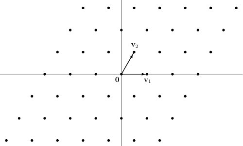

图 10.3 \(\mathbb{R}^2\) 中的平面六角格。

格记为 \(c\Lambda\)。\(c\Lambda\) 的生成矩阵为 \(cM\)，格拉姆矩阵为 \(c^2A\)。如果我们旋转或反射 \(\Lambda\)，也本质上得到相同的格。这引出了等价概念：生成矩阵为 \(M\) 的格 \(\Lambda\) 与格 \(\Lambda'\) *等价*，当且仅当存在标量 \(c\)、具有整数项且 \(\det U = \pm 1\) 的矩阵 \(U\)，以及具有实数项且 \(BB^T = I_n\) 的矩阵 \(B\)，使得 \(cUMB\) 是 \(\Lambda'\) 的生成矩阵。（矩阵 \(B\) 作为一系列旋转，矩阵 \(U\) 作为一系列反射。）通常，在格的等价类中选择代表格时，人们试图选择一个整格且行列式尽可能小的代表格。

使用 \(\mathbb{R}^n\) 中的普通内积，我们可以定义 \(\Lambda\) 的 *对偶格* \(\Lambda^*\) 为 \(\mathbb{R}^n\) 中所有与 \(\Lambda\) 中每个格点的内积为整数的向量集合；即，

\[
\Lambda^* = \{ \mathbf{y} \in \mathbb{R}^n \mid \mathbf{x} \cdot \mathbf{y} \in \mathbb{Z} \text{ 对所有 } \mathbf{x} \in \Lambda \}.
\]

如果 \(\Lambda = \Lambda^*\)，则整格 \(\Lambda\) 称为 *一模格* 或 *自对偶*。

### **定理 10.6.3**
设 \(\Lambda\) 为 \(\mathbb{R}^n\) 中的格，具有基 \(\mathbf{v}_1, \dots, \mathbf{v}_n\)、生成矩阵 \(M\) 和格拉姆矩阵 \(A\)。以下结论成立：

- (i) \(\Lambda^* = \{ \mathbf{y} \in \mathbb{R}^n \mid \mathbf{v}_i \cdot \mathbf{y} \in \mathbb{Z} \text{ 对所有 } 1 \le i \le n \} = \{ \mathbf{y} \in \mathbb{R}^n \mid \mathbf{y} M^T \in \mathbb{Z}^n \}\)。
- (ii) \(\Lambda^*\) 的生成矩阵是 \((M^{-1})^T\)。
- (iii) \(\Lambda^*\) 的格拉姆矩阵是 \(A^{-1}\)。
- (iv) \(\det \Lambda^* = 1/\det \Lambda\)。
- (v) \(\Lambda\) 是整格当且仅当 \(\Lambda \subseteq \Lambda^*\)。
- (vi) 如果 \(\Lambda\) 是整格，则
  \[
  \Lambda \subseteq \Lambda^* \subseteq \frac{1}{\det \Lambda} \Lambda = (\det \Lambda^*)\Lambda.
  \]
- (vii) 如果 \(\Lambda\) 是整格，则 \(\Lambda\) 是一模格当且仅当 \(\det \Lambda = \pm 1\)。

证明：我们将 (i) 和 (v) 的证明留作练习 605。对于 (ii)，设 \(\mathbf{w}_1, \dots, \mathbf{w}_n\) 为 \((M^{-1})^T\) 的行。那么 \((\mathbf{w}_1, \dots, \mathbf{w}_n)\) 是 \(\mathbb{R}^n\) 的一组基，且由于 \((M^{-1})^T M^T = (MM^{-1})^T = I_n\),

\[
\mathbf{w}_i \cdot \mathbf{v}_j = \begin{cases} 1 & \text{如果 } i = j, \\ 0 & \text{如果 } i \neq j. \end{cases}
\] (10.10)

特别是，由 (i) 可知 \(\{\mathbf{w}_1, \dots, \mathbf{w}_n\} \subseteq \Lambda^*\)。设 \(\mathbf{w} \in \Lambda^*\)。由于 \(\{\mathbf{w}_1, \dots, \mathbf{w}_n\}\) 是 \(\mathbb{R}^n\) 的一组基，故 \(\mathbf{w} = a_1 \mathbf{w}_1 + \cdots + a_n \mathbf{w}_n\)。因为 \(\mathbf{w} \in \Lambda^*\)，所以 \(\mathbf{w} \cdot \mathbf{v}_j \in \mathbb{Z}\)。但由 (10.10) 可知，对于 \(1 \le j \le n\)，\(\mathbf{w} \cdot \mathbf{v}_j = a_j\)。因此 \(a_j \in \mathbb{Z}\)，且 (ii) 成立。\(\Lambda^*\) 的格拉姆矩阵是 \((M^{-1})^T M^{-1} = (MM^T)^{-1} = A^{-1}\)，从而得到 (iii)。因此

\[
\det \Lambda^* = \det(A^{-1}) = \frac{1}{\det A} = \frac{1}{\det \Lambda}.
\]

从而得到 (iv)。

对于 (vi)，我们只需根据 (iv) 和 (v) 证明第二个包含关系。设 \(\mathbf{y} \in \Lambda^*\)。由 (i) 可知 \(\mathbf{y} M^T \in \mathbb{Z}^n\)，因此存在 \(\mathbf{z} \in \mathbb{Z}^n\) 使得 \(\mathbf{y} = \mathbf{z}(M^T)^{-1} = \mathbf{z} A^{-1} M\)。但 \(A^{-1} = (\det \Lambda)^{-1} \text{adj}(A)\)，其中 \(\text{adj}(A)\) 是 \(A\) 的伴随矩阵。因此

\[
\mathbf{y} = \mathbf{z}(\det \Lambda)^{-1} \text{adj}(A) M = \mathbf{z}'(\det \Lambda)^{-1} M,
\]

其中 \(\mathbf{z}' = \mathbf{z} \text{adj}(A) \in \mathbb{Z}^n\)，因为 \(\text{adj}(A)\) 具有整数项（由 \(\Lambda\) 是整格可知）。因此 \(\mathbf{y} \in (\det \Lambda)^{-1} \Lambda\)，验证了 (vi)。

最后，由 (vi) 可知，如果 \(\Lambda\) 是一模格，则 \(\det \Lambda = \det \Lambda^* = 1/(\det \Lambda)\)，从而 \(\det \Lambda = \pm 1\)。反之，如果 \(\det \Lambda = \pm 1\) 且 \(\Lambda\) 是整格，则 (vi) 表明 \(\Lambda \subseteq \Lambda^* \subseteq \pm \Lambda\)，且显然 \(\Lambda = \pm \Lambda\)，故 \(\Lambda = \Lambda^*\)。

### **练习 605**
证明定理 10.6.3 的 (i) 和 (v)。$\blacklozenge$

### **练习 606**
证明如果 \(\Lambda\) 是一个格，则 \(\Lambda = c\Lambda\) 当且仅当 \(c = \pm 1\)。$\blacklozenge$

在整格 \(\Lambda\) 中，对于所有 \(\mathbf{x} \in \Lambda\)，\(\mathbf{x} \cdot \mathbf{x}\) 都是整数。如果对于所有 \(\mathbf{x} \in \Lambda\)，\(\mathbf{x} \cdot \mathbf{x}\) 都是偶整数，则整格称为 *偶格*。特别是，格拉姆矩阵在其主对角线上具有偶数项。不是偶格的整格称为 *奇格*。如果一个格是偶一模格，则称为 *II型*；如果是奇一模格，则称为 *I型*。对于任意维度 \(n\) 都存在 I型格；然而，II型格存在当且仅当 \(n \equiv 0 (\text{mod } 8)\)。一模格已按等价关系分类至维度 25；请注意，I型码已分类至长度 30，II型码已分类至长度 32。

### **练习 607**
证明示例 10.6.1 中的格 \(\mathbb{Z}^2\) 是 I型格，而示例 10.6.2 中的 \(\Lambda_2\) 不是一模格。$\blacklozenge$

类似于测量码字之间的汉明距离，我们测量


square of the Euclidean distance, or norm, between lattice points. The norm of a vector $\mathbf{v} = v_1 \cdots v_n$ in $\mathbb{R}^n$ is

\[
N(\mathbf{v}) = \mathbf{v} \cdot \mathbf{v} = \sum_{i=1}^n v_i^2.
\]

The minimum squared distance, or minimum norm, between two points in a lattice $\Lambda$, denoted $\mu$, is

\[
\mu = \min\{N(\mathbf{x} - \mathbf{y}) \mid \mathbf{x}, \mathbf{y} \in \Lambda, \mathbf{x} \neq \mathbf{y}\} = \min\{N(\mathbf{x}) \mid \mathbf{x} \in \Lambda, \mathbf{x} \neq \mathbf{0}\}.
\]

The minimum norm is analogous to the minimum distance of a code. With lattices there is a power series, called the theta series, that corresponds to the weight enumerator of a code. The theta series $\Theta_\Lambda(q)$ of a lattice $\Lambda$ is

\[
\Theta_\Lambda(q) = \sum_{\mathbf{x} \in \Lambda} q^{\mathbf{x} \cdot \mathbf{x}}.
\]

If $\Lambda$ is integral and $N_m$ is the number of lattice points of norm $m$, then

\[
\Theta_\Lambda(q) = \sum_{m=0}^\infty N_m q^m.
\]

For both Type I and Type II lattices, there is a result known as Hecke's Theorem, corresponding to Gleason's Theorem for self-dual codes, that states that the theta series of such a lattice is a complex power series in two specific power series which depend on whether the lattice is Type I or Type II. As with self-dual codes, Hecke's Theorem can also be used to produce an upper bound on the minimum norm of a Type I or II lattice: for Type I the bound is $\mu \le \lfloor n/8 \rfloor + 1$, and for Type II the bound is $\mu \le 2 \lfloor n/24 \rfloor + 2$. As Gleason's Theorem implies that Type II codes exist only for lengths a multiple of 8, Hecke's Theorem implies that Type II lattices exist in $\mathbb{R}^n$ only when $n \equiv 0 \pmod 8$.

## Exercise 608 Let $\Lambda_2$ be the lattice of Example 10.6.2. Do the following:

- (a) Verify that the minimum norm of the lattice is 2.
- (b) Show that the norm of any lattice point of $\Lambda_2$ is an even integer.
- (c) In Figure 10.3, find all lattice points whose norm is:
  - (i) 2,
  - (ii) 4,
  - (iii) 6,
  and write these points as integer combinations of $\{\mathbf{v}_1, \mathbf{v}_2\}$.

We can tie the concept of minimum norm of a lattice to the notion of a lattice packing. If $\Lambda$ is a lattice with norm $\mu$, then the $n$-dimensional spheres of radius $\rho = \sqrt{\mu}/2$ centered at lattice points form *lattice packing* in $\mathbb{R}^n$. These spheres do not overlap except at their boundary. The number of spheres touching the sphere centered at $\mathbf{0}$ is the number of lattice points of minimum norm $\mu$; this number is called the *kissing number*. So the kissing number in lattices corresponds to the number of minimum weight codewords in a code. For a variety of reasons it is of interest to find lattices with large kissing numbers.

## Exercise 609 Show that in a lattice packing, the number of spheres touching any sphere is the kissing number.

## Exercise 610 Do the following:

- (a) What is the radius of the spheres in a lattice packing using the lattices $\mathbb{Z}^2$ and $\Lambda_2$ from Examples 10.6.1 and 10.6.2?
- (b) What is the kissing number of each of these lattices?

We now present a general construction, known as Construction A, of lattices directly from binary codes. Let $C$ be an $[n, k, d]$ binary code. The lattice $\Lambda(C)$ is the set of all $\mathbf{x}$ in $\mathbb{R}^n$ obtained from a codeword in $C$ by viewing the codeword as an integer vector with 0s and 1s, adding even integers to any components, and dividing the resulting vector by $\sqrt{2}$. In short

\[
\Lambda(C) = \{ \mathbf{x} \in \mathbb{R}^n \mid \sqrt{2}\mathbf{x} \pmod{2} \in C \}.
\]

The following can be found in [60, Chapter 7].

## Theorem 10.6.4 Let $C$ be an $[n, k, d]$ binary code. The following hold:

- (i) If $d \le 4$, the minimum norm $\mu$ of $\Lambda(C)$ is $\mu = d/2$; if $d > 4$, $\mu = 2$.
- (ii) $\det \Lambda(C) = 2^{n-2k}$.
- (iii) $\Lambda(C)^\perp = \Lambda(C^*)$.
- (iv) $\Lambda(C)$ is integral if and only if $C$ is self-orthogonal.
- (v) $\Lambda(C)$ is Type I if and only if $C$ is Type I.
- (vi) $\Lambda(C)$ is Type II if and only if $C$ is Type II.

### Proof: We leave the proofs of (i) and (vi) as an exercise. Without loss of generality, we may assume that $G = [I_k \quad B]$ is a generator matrix for $C$. Then, clearly,

\[
M = \frac{1}{\sqrt{2}} \begin{bmatrix} I_k & B \\ O & 2I_{n-k} \end{bmatrix} \text{ and } A = \frac{1}{2} \begin{bmatrix} I_k + BB^T & 2B \\ 2B^T & 4I_{n-k} \end{bmatrix}
\]

are the generator and Gram matrices for $\Lambda(C)$, respectively. Hence

\[
\det A = \frac{1}{2^n} \det \begin{bmatrix} I_k + BB^T & 2B \\ 2B^T & 4I_{n-k} \end{bmatrix} = \frac{1}{2^{n-2k}} \det \begin{bmatrix} I_k + BB^T & 2B \\ B^T & 2B \\ B^T & 2I_{n-k} \end{bmatrix} = 2^{k-2n-k}.
\]

yielding (ii).

As $G^\perp = [B^T \quad I_{n-k}]$ is the generator matrix of $C^\perp$, $\Lambda(C^\perp)$ has generator matrix

\[
M^\perp = \frac{1}{\sqrt{2}} \begin{bmatrix} B^T & I_{n-k} \\ 2I_k & O \end{bmatrix}.
\]

The (binary) inner product of a row of $G$ with a row of $G^\perp$ is 0; hence we see that the (real) inner product of a row of $M$ and a row of $M^\perp$ is an integer. This proves that $M^\perp M^T$ is an integer matrix and $\Lambda(C^\perp) \subseteq \Lambda(C)^*$. To complete (iii) we must show $\Lambda(C)^* \subseteq \Lambda(C^\perp)$. Let $\mathbf{y} \in \Lambda(C)^*$. Then $\mathbf{y} M^T \in \mathbb{Z}^n$ by Theorem 10.6.3(i). So there exists $\mathbf{z} \in \mathbb{Z}^n$ with

\[
y = z(M^t)^{-1} = z(M^t)^{-1}(M^t)^{-1}M^t = z(M^{-1}M^t)^{-1}M^\perp.
\]

As $M^tM^t$ is an integer matrix and \(\det(M^tM^t) = \det(M^t)\det(M^t) = (\pm 2^{-n/2} \cdot 2)^2 \cdot (2^{(n-2k)/2})^2 = \pm 1\), $(M^tM^t)^{-1} = \frac{1}{\det(M^tM^t)} \text{adj}(M^tM^t)$

is an integer matrix. Thus $y = z'M^\perp$ for some $z' \in \mathbb{Z}^n$. Hence $y \in \Lambda(C^\perp)$, completing (iii).

The (real) inner product of two rows of $M$ is always an integer if and only if the (binary) inner product of two rows of $G$ is 0, proving (iv).

Suppose \(\Lambda(C)\) is Type I; then \(\det \Lambda(C) = \pm 1\), implying \(k = n/2\) by (ii). As \(\Lambda(C)\) is integral, \(C \subseteq C^\perp\) by (iv). Hence \(C\) is self-dual. The (real) inner product of some lattice point with itself is an odd integer, the corresponding codeword must be singly-even implying that \(C\) is Type I. Conversely, suppose \(C\) is Type I. By (iv) \(\Lambda(C)\) is integral and by (iii) \(\Lambda(C) = \Lambda(C^\perp) = \Lambda(C)^*\). Hence \(\Lambda(C)\) is unimodular. In addition, a singly-even codeword corresponds to a lattice point with odd integer norm. This proves (v).

## Exercise 611 Prove Theorem 10.6.4(i) and (vi).

## Example 10.6.5 Let \(C\) be the [8, 4, 4] extended Hamming code (denoted \(e_8\) in Section 9.7). By Theorem 10.6.4, \(\Lambda(C)\) is a Type II lattice with minimum norm 2. We ask you to verify this directly in Exercise 612. Up to equivalence, this lattice, which is usually denoted \(E_8\), is known to be the unique Type II lattice in \(\mathbb{R}^8\). We can determine precisely the lattice points of minimum norm 2. One can add \(\pm 2\) to any coordinate of the zero vector yielding 16 lattice points of norm 2 with "shape" \((1/\sqrt{2})(\pm 2, 0^7)\), indicating any vector with seven 0s and one \(\pm 2/\sqrt{2}\). Beginning with any of the 14 weight 4 codewords, one can add \(-2\) to any of the four nonzero coordinates obtaining \(14 \cdot 16 = 224\) lattice points of norm 2 with shape \((1/\sqrt{2})(\pm(1^4), 0^4)\). These are all of the 240 lattice points of norm 2. Hence, \(E_8\) has kissing number 240. It is known that no other 8-dimensional lattice can have a higher kissing number. The theta series for \(E_8\) is

\[
\Theta_{E_8}(q) = 1 + 240q^2 + 2160q^4 + 6720q^6 + 17520q^8 + 30240q^{10} + \cdots
= 1 + 240 \sum_{m=1}^\infty \sigma_3(m)q^{2m}
\]

where \(\sigma_2(m) = \sum_{d|m} d^2\). It is also known that the lattice \(E_8\) yields the densest possible lattice packing, with spheres of radius \(1/\sqrt{2}\), where the density is the fraction of the space covered by the spheres; the density of \(E_8\) is \(\pi^4/384 \approx 0.253\,669\,51\). It seems that T. Gosset [110], in 1900, was the first to study \(E_8\), along with 6- and 7-dimensional lattices denoted \(E_6\) and \(E_7\), hence these are sometimes called Gosset lattices.

## Exercise 612 Let \(e_8\) be the [8, 4, 4] extended binary Hamming code.

- (a) Give a generator matrix for \(e_8\) in the form \([I_4 \mid B]\).
- (b) Give the generator and Gram matrices for \(\Lambda(e_8)\).
- (c) Show directly, without quoting Theorem 10.6.4, that \(\Lambda(e_8)\) is integral with determinant 1.
- (d) Show directly, without quoting Theorem 10.6.4, that \(\Lambda(e_8)\) is Type II with minimum norm 2.

## Exercise 613 Find the shapes of each of the 2160 lattice points in \(E_8\) of norm 4.


构造 A 的缺点在于，所得格的最小范数最大为 2。从码构造格的其他构造可以产生极具兴趣的格。为结束本节，我们介绍 J. H. Conway [60, Chapter 10] 的一种构造，即利用 [24, 12, 8] 扩展二进制 Golay 码构造 24 维 Leech 格 \(\Lambda_{24}\)。该格由 J. Leech [188] 于 1965 年发现。已知格 \(\Lambda_{24}\) 具有任何 24 维格中最高的亲吻数（196 560）。此外，\(\Lambda_{24}\) 是维数为 24 且最小范数为 4 的唯一 Type II 格，4 是 \(\mathbb{R}^{24}\) 中 Type II 格可能的最高范数。

我们需要一些记号。将坐标标记为 \(\Omega = \{1, 2, \dots, 24\}\)，并令 \(\{e_1, e_2, \dots, e_{24}\}\) 为 \(\mathbb{R}^{24}\) 中坐标向量的标准正交基。若 \(S \subseteq \Omega\)，令 \(e_S = \sum_{i \in S} e_i\)。固定 [24, 12, 8] 扩展二进制 Golay 码 \(\mathcal{G}_{24}\) 的某个表示。若 \(\Omega\) 的子集 \(S\) 是 \(\mathcal{G}_{24}\) 中某个码字的支持集，则称 \(S\) 为 \(\mathcal{G}_{24}\)-集。回顾示例 8.3.2，\(\Omega\) 中大小为 4 的子集称为四元组，且每个四元组 \(T\) 唯一确定另外五个四元组，这六个四元组两两不相交，因此任意两个四元组的并集是一个大小为 8 的 \(\mathcal{G}_{24}\)-集；这六个四元组称为由 \(T\) 确定的六元组。我们令 \(\mathcal{T}\) 表示所有四元组的集合，\(\mathcal{O}\) 表示 759 个八元组的集合，即所有大小为 8 的 \(\mathcal{G}_{24}\)-集的集合。回顾示例 8.3.2 或第 10.1 节中 \(\mathcal{G}_{24}\) 唯一性证明可知，\(\mathcal{G}_{24}\) 中重量为 8 的码字张成 \(\mathcal{G}_{24}\)。

我们先构造一个中间格 \(\Gamma_0\)，再添加一个张成向量形成格 \(\Gamma_1\)，最后重缩放以得到 \(\Lambda_{24}\)。定义 \(\Gamma_0\) 为由 \(\{2e_S \mid S \in \mathcal{O}\}\) 张成的 24 维格。

### Lemma 10.6.6 在格 \(\Gamma_0\) 中有如下性质：

- (i) 每个格点的分量均为偶整数。
- (ii) \(\Gamma_0\) 包含所有向量 \(4e_T\)，其中 \(T \in \mathcal{T}\)。
- (iii) \(\Gamma_0\) 包含所有 \(i, j \in \Omega\) 的 \(4e_i - 4e_j\)。
- (iv) \(\mathbb{R}^{24}\) 中一个所有分量均为偶整数的向量在 \(\Gamma_0\) 中，当且仅当其分量之和是 16 的倍数，且向量中分量不能被 4 整除的坐标集合构成一个 \(\mathcal{G}_{24}\)-集。

证明：(i) 立即成立，因为 \(S \in \mathcal{O}\) 时 \(2e_S\) 的所有分量均为偶整数。令 \(T = T_0, T_1, \dots, T_5\) 为由四元组 \(T\) 确定的六元组。由于 \(4e_T = 2e_{T \cup T_1} + 2e_{T \cup T_2} - 2e_{T \cup T_3}\)，故 (ii) 成立。现在令 \(T = \{t, x, y, z\} \in \mathcal{T}\) 且 \(T' = \{j, x, y, z\} \in \mathcal{T}\)。则 \(4e_T - 4e_{T'} = 4e_t - 4e_j\)，从而 (iii) 成立。

令 \(\mathbf{v} \in \Gamma_0\)。由于 \(S \in \mathcal{O}\) 的张成向量 \(2e_S\) 的分量和等于 16，\(\mathbf{v}\) 的分量和是 16 的倍数。若取 \(\mathbf{v}\)，将其分量除以 2 并对 2 取模，则得到一些 \(S \in \mathcal{O}\) 的 \(e_S\) 的二进制组合，这些可视作 \(\mathcal{G}_{24}\) 中的码字，因而必须对某个 \(\mathcal{G}_{24}\)-集 \(C\) 求和为 \(e_C\)；但 \(C\) 正是 \(\mathbf{v}\) 中分量不能被 4 整除的坐标集合。反之，令 \(\mathbf{v}\) 为 \(\mathbb{R}^{24}\) 中一个所有分量均为偶整数的向量，使其分量和是 16 的倍数，且 \(\mathbf{v}\) 中分量不能被 4 整除的坐标集合构成一个 \(\mathcal{G}_{24}\)-集 \(C\)。令 \(\mathbf{c} \in \mathcal{G}_{24}\) 的支持集为 \(C\)；则 \(\mathbf{c} = e_{c_1} + \dots + e_{c_r}\)，其中每个 \(c_i\) 都是 \(\mathcal{G}_{24}\) 的重量为 8 的码字（因为重量为 8 的码字张成 \(\mathcal{G}_{24}\)）。令 \(S_i = \text{supp}(\mathbf{c}_i)\)。定义 \(\mathbf{x} = \sum_{i=1}^r 2e_{S_i} \in \Gamma_0\)。显然，\(\mathbf{x}\) 中模 4 余 2 的坐标恰为 \(C\) 的坐标，其余均模 4 余 0。因此向量 \(v - x\) 的分量和是 16 的倍数，且所有分量均可被 4 整除。根据练习 614 及 (ii)、(iii) 部分，\(v - x \in \Gamma_0\)，故 \(v \in \Gamma_0\)。

### Exercise 614

证明：\(\mathbb{R}^{24}\) 中分量均为 4 的倍数且分量和为 16 的倍数的向量集合，恰为由 \(T \in \mathcal{T}\) 的 \(4e_T\) 以及 \(i, j \in \Omega\) 的 \(4e_i - 4e_j\) 张成的格中的向量。

格 \(\Gamma_1\) 定义为由 \(\Gamma_0\) 和向量 \(s = (-3, 1, 1, \dots, 1)\) 张成的格。注意，将 \(4e_i - 4e_j\) 加到 \(s\) 上，可得到在第 \(i\) 个坐标为 -3、其余坐标为 1 的向量。

### Lemma 10.6.7

向量 \(v = v_1 v_2 \cdots v_{24}\) 在 \(\Gamma_1\) 中，当且仅当以下三个条件全部成立：

- (i) 分量 \(v_i\) 均模 2 同余于同一值 \(m\)。
- (ii) 使分量 \(v_i\) 模 4 同余于同一值的下标 \(i\) 的集合构成一个 \(\mathcal{G}_{24}\)-集。
- (iii) \(\sum_{i=1}^{24} v_i \equiv 4m \pmod 8\)，其中 \(m\) 由 (i) 定义。

此外，若 \(x, y \in \Gamma_1\)，则 \(x - y\) 是 8 的倍数，且 \(x \cdot x\) 是 16 的倍数。

证明：(i)、(ii)、(iii) 对张成 \(\Gamma_1\) 的向量成立，因而对 \(\Gamma_1\) 中任意向量成立。最后一句对 \(\Gamma_1\) 中向量也成立，因为它对张成 \(\Gamma_1\) 的向量成立；注意若 \(x = \sum x_i e_i\)，则 \(x \cdot x = \sum x_i^2 + 2 \sum_{i<j} x_i x_j\)。

假设 \(v\) 满足 (i)、(ii) 和 (iii)。则可从 \(v\) 中减去 \(\alpha s\)，其中 \(\alpha\) 为 0、1、2 或 3 之一，使得 \(v - \alpha s\) 仅有偶数坐标且其分量和是 16 的倍数。根据 (ii)，\(v - \alpha s\) 中分量不能被 4 整除的坐标集合构成一个 \(\mathcal{G}_{24}\)-集。因此根据 Lemma 10.6.6，\(v - \alpha s \in \Gamma_0\)，证明完成。

格 \(\Gamma_1\) 不是自对偶的。我们将 \(\Gamma_1\) 中所有向量乘以 \(1/\sqrt{8}\) 以得到 \(\Lambda_{24}\)。即

\[
\Lambda_{24} = \frac{1}{\sqrt{8}} \Gamma_1.
\]

根据 Lemma 10.6.7，\(\Lambda_{24}\) 中任意两个向量的内积为整数，因此 \(\Lambda_{24}\) 是整格。根据同一引理，\(\Lambda_{24}\) 中向量的范数为偶整数。可证 \(\det \Lambda_{24} = \pm 1\)，这意味着 \(\Lambda_{24}\) 是 Type II 格。根据练习 615，其最小范数为 4，亲吻数为 196 560。

### Exercise 615

将 \(\Gamma_1\) 中向量乘以 \(1/\sqrt{8}\) 进行缩放时，向量的范数缩小为原来的八分之一。本练习中，你将证明 \(\Lambda_{24}\) 中不存在范数为 2 的向量，并找出 \(\Lambda_{24}\) 中范数为 4 的向量。这等价于证明 \(\Gamma_1\) 中不存在范数为 16 的向量，并找出 \(\Gamma_1\) 中范数为 32 的向量。

- (a) 利用 Lemma 10.6.7 对 \(\Gamma_1\) 的刻画，证明 \(\Gamma_1\) 中不存在范数为 16 的向量。
- (b) 证明形状为 \(((\pm 2)^8, 0^{16})\)、负号个数为偶数且 \(\pm 2\) 所在坐标构成一个八元组的向量在 \(\Gamma_1\) 中。
- (c) 证明部分 (b) 中描述的向量共有 \(2^7 \cdot 759\) 个。
- (d) 证明形状为 \(((\mp 3), (\pm 1)^{23})\)、且负号位于一个 \(\mathcal{G}_{24}\)-集中的向量在 \(\Gamma_1\) 中。
- (e) 证明部分 (d) 中描述的向量共有 \(2^{12} \cdot 24\) 个。
- (f) 证明形状为 \(((\pm 4)^2, 0^{22})\)、且正负号任意分配的向量在 \(\Gamma_1\) 中。
- (g) 证明部分 (f) 中描述的向量共有 \(2 \cdot 24 \cdot 23\) 个。
- (h) 证明 \(\Gamma_1\) 中范数为 32 的向量是部分 (b)、(d) 或 (f) 中找到的向量之一。
- (i) 证明 \(\Lambda_{24}\) 的最小范数为 4，且亲吻数为 196 560。\(\blacklozenge\)

\(\Lambda_{24}\) 还有许多其他构造，包括来自 \(\mathbb{F}_3\) 上 [24, 12, 9] 对称码的一种构造；参见 [60] 中第 5 章第 5.7 节。也可定义复数域上的格；[12, 6, 6] 扩展三元 Golay 码可用于构造 Leech 格的 12 维复数版本；参见 [60] 中第 7 章第 8 节。


# 11 覆盖半径与陪集

本章我们更详细地考察在 1.12 节中首次引入的覆盖半径概念。在码的研究中，我们一直关注具有高最小距离的码，以便具有良好的纠错能力。一个在 $\mathbb{F}_q$ 上的 $[n, k, d]$ 码 $C$ 可以纠正 $t = \lfloor (d-1)/2 \rfloor$ 个错误。因此，以码字为中心、在 $\mathbb{F}_q^n$ 中半径为 $t$ 的球体是两两不相交的，这一事实对于更大半径的球体不成立：$t$ 称为 $C$ 的填充半径。探索相反情况是很自然的，即找到以码字为中心、能够完全覆盖空间 $\mathbb{F}_q^n$ 的最小半径 $\rho(C)$，称为覆盖半径；也就是说，$\mathbb{F}_q^n$ 中的每个向量至少位于这些球体中的一个。另外，给定一个半径，在数学上也很有趣，即找到覆盖空间所需的该半径球体的最少数量的中心。在解码 $C$ 时，如果错误数不超过 $t$，则接收向量可以被唯一解码。如果错误数多于 $t$ 但不超过覆盖半径，有时这些错误仍然可以被唯一纠正。码产生的覆盖已出现许多应用，范围从数据压缩到足球彩票。一般来说，给定一个码，找到其覆盖半径是困难的，其复杂性已被研究；参见 [51]。

本章我们将考察覆盖半径的基本理论和性质的一部分。我们还将讨论关于特定码或码族的覆盖半径的已知结果。该领域的大部分工作都是针对二进制码（无论是线性还是非线性）进行的。有兴趣更深入地探索覆盖半径的读者应查阅 [34, 51]。

## 11.1 基础

我们从一些符号开始，并回顾 1.12 节中的一些基本事实。我们还介绍一些后续章节需要用到的新结果。

设 $C$ 是在 $\mathbb{F}_q$ 上长度为 $n$ 的码，可能是非线性的。我们说 $\mathbb{F}_q^n$ 中的一个向量被 $C$ $\rho$-覆盖，如果它到 $C$ 中至少一个码字的距离不超过 $\rho$。按此术语，$C$ 的覆盖半径 $\rho = \rho(C)$ 是最小的整数 $\rho$，使得 $\mathbb{F}_q^n$ 中的每个向量都被 $C$ $\rho$-覆盖。等价地，

\(\rho(C) = \max_{\mathbf{x} \in \mathbb{F}_q^n} \min_{\mathbf{c} \in C} d(\mathbf{x}, \mathbf{c}).\) (11.1)

**练习 616** 证明由 (11.1) 给出的 $C$ 的覆盖半径的定义等价于以下定义：$\rho = \rho(C)$ 是最小的整数 $\rho$，使得 $\mathbb{F}_q^n$ 中的每个向量都被 $C$ $\rho$-覆盖。

**练习 617** 求在 $\mathbb{F}_q$ 上的 $[n, 1, n]$ 重复码的覆盖半径和填充半径。

**练习 618** 证明如果 $\mathcal{C}_1 \subseteq \mathcal{C}_2$，则 $\rho(\mathcal{C}_2) \le \rho(\mathcal{C}_1)$。

覆盖半径和填充半径的定义直接导致两者之间的关系，正如我们在 1.12 节中所指出的。

**定理 11.1.1** 设 $\mathcal{C}$ 是最小距离为 $d$ 的码。则

$$\rho(\mathcal{C}) \ge \left\lfloor \frac{d-1}{2} \right\rfloor.$$

而且，当且仅当 $\mathcal{C}$ 是完美码时，等号成立。

覆盖半径的另一个等价表述在定理 1.12.5 中给出；我们重述此结果，但将第一部分稍作推广，以适用于非线性码和线性码。为了简化术语，即使 $\mathcal{C}$ 是非线性的，我们也将集合 $\mathbf{v} + \mathcal{C}$ 称为 $\mathcal{C}$ 的一个陪集，其陪集代表为 $\mathbf{v}$。在非线性码中使用陪集时必须小心；例如，不同的陪集不一定不相交，如练习 619 所示。

**定理 11.1.2** 设 $\mathcal{C}$ 是一个码。以下结论成立：

- (i) $\rho(\mathcal{C})$ 是 $\mathcal{C}$ 的所有陪集的最小权重的最大值。
- (ii) 如果 $\mathcal{C}$ 是在 $\mathbb{F}_q$ 上的 $[n, k]$ 线性码，其校验矩阵为 $H$，则 $\rho(\mathcal{C})$ 是最小的数 $s$，使得 $\mathbb{F}_q^{n-k}$ 中的每个非零向量都是 $H$ 的 $s$ 个或更少列的线性组合。

**练习 619** 找到一个非线性码及其两个陪集，使得这两个陪集既不相等也不相交。

**练习 620** 设 $\mathcal{C}$ 是在 $\mathbb{F}_q$ 上的 $[n, k, d]$ 线性码，其覆盖半径 $\rho(\mathcal{C}) \ge d$。解释为什么存在一个比 $\mathcal{C}$ 具有更多码字但具有相同纠错能力的线性码。

定理 11.1.2 第 (ii) 部分的一个显而易见的推论是线性码覆盖半径的以下上界，称为冗余界。

**推论 11.1.3（冗余界）** 设 $\mathcal{C}$ 是一个 $[n, k]$ 码。则 $\rho(\mathcal{C}) \le n - k$。

**练习 621** 证明推论 11.1.3。

回顾 (1.11)，$\mathbb{F}_q^n$ 中半径为 $r$ 的球包含

$$\sum_{i=0}^r \binom{n}{i} (q-1)^i$$

个向量。以下是覆盖半径的一个下界，称为球覆盖界；其证明留作练习。

**定理 11.1.4（球覆盖界）** 如果 $C$ 是在 $\mathbb{F}_q$ 上长度为 $n$ 的码，则

\(\rho(C) \ge \min \left\{ r \mid \sum_{i=0}^{r} \binom{n}{i} (q-1)^i \ge q^{n-k} \right\}.\)

**练习 622** 证明定理 11.1.4。

**练习 623** 设 $C$ 是一个 [7, 3, 4] 二进制码。给出该码由冗余界和球覆盖界得到的上界和下界。

另一个下界可以从以下引理中得到，称为超码引理。

**引理 11.1.5（超码引理）** 如果 $C$ 和 $C'$ 是线性码且 $C \subseteq C'$，则 \(\rho(C) \ge \min\{wt(x) \mid x \in C' \setminus C\}\)。

证明：设 $x$ 是 $C' \setminus C$ 中权最小的向量。由于 $C \subseteq C'$，这样的向量必须是 $C$ 的一个陪集领头元素；因此 \(\rho(C) \ge wt(x)\)，结果得证。

定理 11.12.6 将被反复使用，我们在此重述以方便参考。

**定理 11.12.6** 设 $C$ 是在 $\mathbb{F}_q$ 上的 [n, k] 码。设 $\widehat{C}$ 是 $C$ 的扩展码，设 $C^*$ 是通过对某个坐标进行删短从 $C$ 得到的码。以下结论成立：

- (i) 如果 $C = C_1 \oplus C_2$，则 \(\rho(C) = \rho(C_1) + \rho(C_2)\)。
- (ii) \(\rho(C^*) = \rho(C)\) 或 \(\rho(C^*) = \rho(C) + 1\)。
- (iii) \(\rho(\widehat{C}) = \rho(C)\) 或 \(\rho(\widehat{C}) = \rho(C) + 1\)。
- (iv) 如果 $q = 2$，则 \(\rho(\widehat{C}) = \rho(C) + 1\)。
- (v) 假设 $x$ 是 $C$ 的一个陪集领头元素。如果 $x'$ 在 $\mathbb{F}_q^n$ 中，其所有非零分量与 $x$ 的相同分量一致，则 $x'$ 也是 $C$ 的一个陪集领头元素。特别是，如果存在权为 $s$ 的陪集，则也存在任何小于 $s$ 权的陪集。

**练习 624** 本练习旨在求解 [7, 3, 4] 二进制码 $C$ 的覆盖半径。

- (a) 证明 [7, 3, 4] 二进制码在等价意义下是唯一的。
- (b) 应用超码引理，利用 $C'$ 等于 [7, 4, 3] 海明码来得到 \(\rho(C)\) 的一个下界；请务必证明 $C$ 确实是 $C'$ 的子码。
- (c) 证明不存在 [7, 4, 4] 二进制码。
- (d) 求 \(\rho(C)\) 并证明你的答案。

**练习 625** 设 $C$ 是一个偶二进制码。证明如果 $C^*$ 是通过对 $C$ 的一个坐标进行删短得到的，则 \(\rho(C^*) = \rho(C) - 1\)。

回顾定理 11.1.1，码的覆盖半径等于其填充半径当且仅当该码是完美码。我们有以下关于扩展完美码及其覆盖半径比填充半径大 1 的码的结果。

**定理 11.1.7** 如果 $C$ 是一个 [n, k, d] 扩展完美码，则 \(\rho(C) = d/2\)。而且，如果 $C$ 是一个 [n, k, d] 二进制码，则 $C$ 是扩展完美码当且仅当 \(\rho(C) = d/2\)。

**练习 626** 证明定理 11.1.7。

**练习 627** 设 $C$ 是一个 [n, k] 二进制码。定义

\(\mathcal{C}_1 = \{(c_1 + c_2 + \cdots + c_n, c_2, \dots, c_n) \mid (c_1, c_2, \dots, c_n) \in \mathcal{C}\}.\)

- (a) 证明 $\widetilde{\mathcal{C}}$ 和 $\widetilde{\mathcal{C}}_1$ 是等价的。
- (b) 证明 $\mathcal{C}_1$ 是 k 维的。
- (c) 证明 $\rho(\mathcal{C}) = \rho(\mathcal{C}_1)$。

### 11.2 挪威界与 Reed-Muller 码

下一节定理中给出的另一对上界称为挪威界；它们仅适用于二进制码。挪威界之所以得名，是因为它们由挪威人 Helleseth, Kløve 和 Mykkeltveit [126] 发现。它们将用于帮助确定某些 Reed-Muller 码的覆盖半径。在继续之前，我们需要一些额外的术语。

设 $C$ 是一个 $(n, M)$ 二进制码。设 $M$ 是一个 $M \times n$ 矩阵，其行是 $C$ 的码字（按某种顺序排列）。我们说 $C$ 具有强度 $s$，其中 $1 \le s \le n$，条件是 $M$ 的每组 $s$ 列中，每个二进制 $s$ 元组都出现相同次数 $M/2^s$。练习 628 给出了与二进制码强度相关的一些结果。码 $C$ 是自补码，条件是对于 $C$ 中的每个码字 $c$，其补码向量 $1 + c$（通过将 $c$ 中的 1 替换为 0、0 替换为 1 得到）也在 $C$ 中。练习 629 给出了关于自补码的一些结果。

**练习 628** 设 $C$ 是一个 $(n, M)$ 二进制码，其码字是 $M \times n$ 矩阵 $M$ 的行。证明以下结论：

- (a) 如果 $C$ 具有强度 $s \ge 2$，则 $C$ 也具有强度 $s - 1$。
- (b) 如果 $C$ 具有强度 $s$，则每个陪集 $v + C$ 也具有强度 $s$。
- (c) 如果 $C$ 是线性码，则 $C$ 具有强度 $s$ 当且仅当 $C$ 的生成矩阵的每 $s$ 列线性无关，当且仅当 $C^\perp$ 的最小权重至少为 $s + 1$。
- 提示：参见推论 1.4.14。

**练习 629** 设 $C$ 是一个自补二进制码。证明以下结论：

- (a) 每个陪集 $v + C$ 是自补的。
- (b) 如果 $C$ 也是线性码，则 $C^\perp$ 是一个偶码。

我们现在给出挪威界。

**定理 11.2.1（挪威界）** 设 $C$ 是一个 $(n, M)$ 二进制码。

- (i) 如果 $C$ 具有强度 1，则 \(\rho(\mathcal{C}) \le \lfloor n/2 \rfloor\)。
- (ii) 如果 $C$ 具有强度 2 且 $C$ 是自补码，则 \(\rho(\mathcal{C}) \le \lfloor (n - \sqrt{n})/2 \rfloor\)。

证明：设 $M$ 是一个 $n \times n$ 矩阵，其行是 $C$ 的码字。首先假设 $C$ 具有强度 1。对于 $\mathbb{F}_2^n$ 中的 $v$，设 $M_v$ 是一个 $M \times n$ 矩阵，其行是 $v + C$ 的码字。根据练习 628(b)，$v + C$ 也具有强度 1。因此 $M_v$ 的每一列都有


其条目恰好一半等于 0，一半等于 1，这意味着

$$\sum_{u \in v+C} wt(u) = \frac{nM}{2}$$

或者等价地，

$$\sum_{i=0}^n i A_i(v) = \frac{nM}{2}.$$ (11.2)

其中 $\{A_i(v) \mid 0 \le i \le n\}$ 是 $\mathbf{v} + \mathcal{C}$ 的重量分布。方程 (11.2) 意味着 $\mathbf{v}$ 与 $\mathcal{C}$ 的码字之间的平均距离是 $n/2$。因此，$\mathbf{v}$ 与某个码字 $c \in \mathcal{C}$ 之间的距离至多为 $n/2$。根据定理 11.1.2(i)，我们得到部分 (i)。

现在假设 $\mathcal{C}$，因此也 $\mathbf{v} + \mathcal{C}$，具有强度 2。在 $M_t$ 中对应于向量 $\mathbf{u} \in \mathbf{v} + \mathcal{C}$ 的每一行中，都有 $\binom{n}{2}$ 个有序比特对。$M_t$ 中每个包含 $\binom{n}{2}$ 对不同列的块都恰好 $M/4$ 次包含二进制二元组 $(1, 1)$。因此

$$\sum_{u \in v+C} \binom{wt(u)}{2} = \sum_{u \in v+C} \frac{wt(u)(wt(u)-1)}{2} = \binom{n}{2} \frac{M}{4} = \frac{n}{2} \frac{n-1}{2} \frac{M}{4}.$$

使用 (11.2) 我们得到

$$\sum_{i=0}^n i^2 A_i(v) = \frac{n(n+1)M}{4}.$$ (11.3)

结合 (11.2) 和 (11.3) 得到

$$\sum_{i=0}^n (2i-n)^2 A_i(v) = nM.$$ (11.4)

这意味着存在一个使得 $A_i(v) \neq 0$ 的 $i$，满足 $(2i-n)^2 \ge n$。对不等式两边开平方表明，要么 $i \le \frac{n-\sqrt{n}}{2}$，要么 $i \ge \frac{n+\sqrt{n}}{2}$。

现在假设 $\mathcal{C}$ 是自补码。根据练习 629，$\mathbf{v} + \mathcal{C}$ 也是自补码。那么存在一个满足上述两个不等式中第一个且 $A_i(v) \neq 0$ 的 $i$。因此存在一个向量 $\mathbf{u} \in \mathbf{v} + \mathcal{C}$，使得 $wt(u) \le (n-\sqrt{n})/2$。故 (ii) 成立。

在二进制线性码的情况下，Norre 界可以重述如下。

### 推论 11.2.2 设 $\mathcal{C}$ 为长度为 $n$ 的二进制线性码。

- (i) 如果 $C^\perp$ 的最小距离至少为 2，则 $\rho(C) \le \lfloor n/2 \rfloor$。
- (ii) 如果 $C^\perp$ 的最小距离至少为 4 且全一向量 $\mathbf{1}$ 在 $C$ 中，则 $\rho(C) \le \lfloor (n-\sqrt{n})/2 \rfloor$。

### 练习 630 证明推论 11.2.2。

### 练习 631 设 $\mathcal{C}$ 为强度为 2 且 $\rho(C) = (n-\sqrt{n})/2$ 的自补二进制码，并设 $\mathbf{v} + \mathcal{C}$ 具有最小重量 $\rho(C)$。证明 $\mathbf{v} + \mathcal{C}$ 中一半向量的重量为 $(n - \sqrt{n})/2$，另一半向量的重量为 $(n + \sqrt{n})/2$。提示：检查 (11.4)。

我们现在准备考察在 1.10 节中首次定义的 Reed–Muller 码 $\mathcal{R}(r, m)$ 的覆盖半径。令 $\rho_{RM}(r, m)$ 表示 $\mathcal{R}(r, m)$ 的覆盖半径。根据练习 617，$\rho_{RM}(0, m) = 2^{m-1}$，因为 $\mathcal{R}(0, m)$ 是二进制重复码。同样，$\rho_{RM}(m, m) = 0$，因为 $\mathcal{R}(m, m) = \mathbb{F}_2^n$。我们考虑 $1 \le r < m$ 的情况。根据定理 1.10.1，$\mathcal{R}(r, m)^\perp = \mathcal{R}(m - r - 1, m)$ 具有最小重量 $2^{r+1} \ge 4$，因此根据练习 628，$\mathcal{R}(r, m)$ 具有强度 2。此外，根据定理 1.10.1，$\mathbf{1} \in \mathcal{R}(0, m) \subset \mathcal{R}(r, m)$，因此 $\mathcal{R}(r, m)$ 是自补码。因此，根据 Norre 界 (ii)，我们有以下定理。

### 定理 11.2.3 设 $1 \le r < m$。则 $\rho_{RM}(r, m) \le 2^{m-1} - 2^{m-r/2-1}$。特别是，$\rho_{RM}(1, m) \le 2^{m-1} - 2^{m/2-1/2}$。

请注意，根据练习 618 和 Reed–Muller 码的嵌套性质，对 $\rho_{RM}(1, m)$ 的任何上界自动也是 $1 < r$ 时 $\rho_{RM}(r, m)$ 的上界。

我们现在要找一阶 Reed–Muller 码覆盖半径的递推关系，结合定理 11.2.3，这将使我们在 $m$ 为偶数时能够得到 $\rho_{RM}(1, m)$ 的精确值。

### 引理 11.2.4 对于 $m \ge 2$，

\(\rho_{RM}(1, m) \ge 2\rho_{RM}(1, m - 2) + 2^{m-2}\)。

**证明：** 对于向量 $\mathbf{x} \in \mathbb{F}_2^n$，令 $\bar{\mathbf{x}} = \mathbf{1} + \mathbf{x}$ 表示 $\mathbf{x}$ 的补码。根据练习 632，$\mathcal{R}(1, m)$ 中的每个码字都有以下形式之一：

- (a) \((\mathbf{x}|\mathbf{x}|\mathbf{x}|\mathbf{x})\),
- (b) \((\mathbf{x}|\bar{\mathbf{x}}|\mathbf{x}|\bar{\mathbf{x}})\),
- (c) \((\mathbf{x}|\bar{\mathbf{x}}|\bar{\mathbf{x}}|\mathbf{x})\), or
- (d) \((\mathbf{x}|\mathbf{x}|\bar{\mathbf{x}}|\bar{\mathbf{x}})$，

其中 $\mathbf{x} \in \mathcal{R}(1, m - 2)$。选择向量 $\mathbf{v} \in \mathbb{F}_2^{2^{m-2}}$，使得陪集 $\mathbf{v} + \mathcal{R}(1, m - 2)$ 的重量等于 $\rho_{RM}(1, m - 2)$。因此，

\(\text{d}(\mathbf{v}, \mathbf{x}) \ge \rho_{RM}(1, m - 2)\) (11.5)

对所有 $\mathbf{x} \in \mathcal{R}(1, m - 2)$ 成立。请注意，

\(\text{d}(\mathbf{v}, \bar{\mathbf{x}}) = \text{d}(\bar{\mathbf{v}}, \mathbf{x}) = 2^{m-2} - \text{d}(\mathbf{v}, \mathbf{x}) = 2^{m-2} - \text{d}(\bar{\mathbf{v}}, \bar{\mathbf{x}})\) (11.6)

如果我们在 $\mathbb{F}_2^{2^{m-2}}$ 中找到一个向量 $\mathbf{y}$，使其与所有码字 $\mathbf{c} \in \mathcal{R}(1, m)$ 的距离至少为 $2\rho_{RM}(1, m - 2) + 2^{m-2}$，则该引理得证。令 $\mathbf{y} = (\mathbf{v}|\mathbf{v}|\bar{\mathbf{v}}|\bar{\mathbf{v}})$。我们来检查上面 $\mathbf{c}$ 的每种可能性 (a) 到 (d)。对于相应的情况，使用 (11.5)、(11.6) 以及若 $\mathbf{x} \in \mathcal{R}(1, m - 2)$ 则 $\bar{\mathbf{x}} \in \mathcal{R}(1, m - 2)$ 这一事实，我们有：

- (a) \(\text{d}(\mathbf{y}, \mathbf{c}) = 3\text{d}(\mathbf{v}, \mathbf{x}) + \text{d}(\bar{\mathbf{v}}, \mathbf{x}) = 2^{m-2} + 2\text{d}(\mathbf{v}, \mathbf{x}) \ge 2^{m-2} + 2\rho_{RM}(1, m - 2)\),
- (b) \(\text{d}(\mathbf{y}, \mathbf{c}) = \text{d}(\mathbf{v}, \mathbf{x}) + 2\text{d}(\bar{\mathbf{v}}, \mathbf{x}) + \text{d}(\bar{\mathbf{v}}, \bar{\mathbf{x}}) = \text{d}(\mathbf{v}, \mathbf{x}) + 3\text{d}(\bar{\mathbf{v}}, \bar{\mathbf{x}}) = 2^{m-2} + 2\text{d}(\bar{\mathbf{v}}, \bar{\mathbf{x}}) \ge 2^{m-2} + 2\rho_{RM}(1, m - 2)\),
- (c) \(\text{d}(\mathbf{y}, \mathbf{c}) = 2\rho_{RM}(1, m - 2) + 2^{m-2}$, and
- (d) \(\text{d}(\mathbf{y}, \mathbf{c}) = 2\text{d}(\mathbf{v}, \mathbf{x}) + 2^{m-2} \ge 2\rho_{RM}(1,m-2) + 2^{m-2}$。

结果随之得出。

### 练习 632 证明 $\mathcal{R}(1, m)$ 中的每个码字都有以下形式之一：

- (a) \((\mathbf{x}|\mathbf{x}|\mathbf{x}|\mathbf{x})\),
- (b) \((\mathbf{x}|\bar{\mathbf{x}}|\mathbf{x}|\bar{\mathbf{x}})\),
- (c) \((\mathbf{x}|\bar{\mathbf{x}}|\bar{\mathbf{x}}|\mathbf{x})\), or
- (d) \((\mathbf{x}|\mathbf{x}|\bar{\mathbf{x}}|\bar{\mathbf{x}})$，

其中 $\mathbf{x} \in \mathcal{R}(1, m-2)$。提示：参见 1.10 节。

### 练习 633 完成以下任务：

- (a) 证明 $\rho_{RM}(1, 1) = 0$。
- (b) 证明如果 $m$ 为奇数，则 $\rho_{RM}(1, m) \ge 2^{m-1} - 2^{(m-1)/2}$。提示：使用 (a) 和引理 11.2.4。
- (c) 证明 $\rho_{RM}(1, 2) = 1$。
- (d) 证明如果 $m$ 为偶数，则 $\rho_{RM}(1, m) \ge 2^{m-1} - 2^{(m-2)/2}$。提示：使用 (c) 和引理 11.2.4。

结合定理 11.2.3 和练习 633(d)，当 $m$ 为偶数时，得到了 $\rho_{RM}(1, m)$ 的精确值。

### 定理 11.2.5 对于偶数 $m$，$\rho_{RM}(1, m) = 2^{m-1} - 2^{(m-2)/2}$。

当 $m$ 为奇数时，练习 633(b) 中的不等式对 $m$ 的前四个值取等号。根据练习 633(a)，$\rho_{RM}(1, 1) = 0$。由于 $\mathcal{R}(1, 3)$ 是 $[8, 4, 4]$ 扩展海明码，根据定理 11.1.7，$\rho_{RM}(1, 3) = 2$。证明 $\rho_{RM}(1, 5) = 12$ 并不困难；一个理论证明是作为引理 9.4 在 [34] 中的一个结果给出的，或者计算覆盖半径的计算机软件包也可以验证这一点。Mykkeltveit [242] 表明 $\rho_{RM}(1, 7) = 56$。从这四个案例中，人们会推测 $m$ 为奇数时练习 633(b) 中的下界取等号。然而，这是错误的；当 $m = 15$ 时，$\mathcal{R}(1, 15)$ 的覆盖半径至少为 $16276 = 2^{14} - 2^7 + 20$ [250, 251]。

对于 $1 < r$，存在对 $\rho_{RM}(r, m)$ 的界，但给出 $\rho_{RM}(r, m)$ 精确值的结果相对较少。其中一个结果见 [237]。

### 定理 11.2.6

\[
\rho_{RM}(m-3, m) = \begin{cases} m+2 & \text{当 } m \text{ 为偶数时} \\ m+1 & \text{当 } m \text{ 为奇数时} \end{cases}
\]

表 11.1（见 [34]）给出了 $1 \le r \le m \le 9$ 时 $\rho_{RM}(r, m)$ 的精确值和界。条目的参考文献可见 [34]。

### 练习 634 计算机代数软件包对此问题将很有用。证明球覆盖界给出了表 11.1 中 $\rho_{RM}(r, m)$ 的下界，适用于：

- (a) $(r, m) = (3, 8)$ 以及
- (b) 当 $2 \le r \le 5$ 时 $(r, m) = (r, 9)$。


| r \ m | 1 | 2 | 3 | 4 | 5 | 6 | 7 | 8 | 9 |
| :--- | :--- | :--- | :--- | :--- | :--- | :--- | :--- | :--- | :--- |
| 1 | 0 | 1 | 2 | 6 | 12 | 28 | 56 | 120 | 240-244 |
| 2 | 0 | 1 | 2 | 6 | 18 | 40-44 | 84-100 | 171-220 | |
| 3 | | | 0 | 1 | 2 | 8 | 20-23 | 43-67 | 111-167 |
| 4 | | | | 0 | 1 | 2 | 8 | 22-31 | 58-98 |
| 5 | | | | | 0 | 1 | 2 | 8 | 10 |
| 6 | | | | | | 0 | 1 | 2 | 10 |
| 7 | | | | | | | 0 | 1 | 2 |
| 8 | | | | | | | | 0 | 1 |
| 9 | | | | | | | | | 0 |

对一阶 Reed–Muller 码进行缩短可得到二进制单纯码；参见练习 62。虽然我们没有所有一阶 Reed–Muller 码的覆盖半径的精确值，但我们拥有所有二进制单纯码的覆盖半径的精确值。

### 定理 11.2.7 二进制单纯码 \(S_m\) \([2^m - 1, m, 2^{m-1}]\) 的覆盖半径 \(\rho\) 为 \(2^{m-1} - 1\)。

证明：由于 \(S_m\) 没有恒为 0 的坐标，根据练习 628(c)，\(S_m\) 的强度为 1。因此，根据 Norse Bound，\(\rho \le 2^{m-1} - 1\)。根据定理 2.7.5，\(S_m\) 的所有非零代码字的权重均为 \(2^{m-1}\)。因此，包含全一向量的 \(S_m\) 副类的权重为 \(2^{m-1} - 1\)。故 \(2^{m-1} - 1 \le \rho\)。

## 11.3 BCH 码的覆盖半径

与 Reed–Muller 码类似，某些 BCH 码子族的覆盖半径已被计算。具体而言，设 \(\mathcal{B}(t, m)\) 为长度 \(n = 2^m - 1\) 和设计距离 \(d = 2t + 1\) 的原始窄义二进制 BCH 码。练习 635 给出了当 \(t \le 2^{\lceil m/2 \rceil - 1}\) 时这些码的维数。

### 练习 635 设 \(C_i\) 为模 \(n = 2^m - 1\) 含 \(i\) 的 2-循环类。

- (a) 对于 \(0 \le i \le n\)，设 \(i = i_0 + i_1 2 + \cdots + i_{m-2} 2^{m-2} + i_{m-1} 2^{m-1}\)（其中 \(i_j \in \{0, 1\}\)）为 \(i\) 的二进制展开式。因此，我们可以将 \(i\) 与长度为 \(m\) 的二进制串 \(i \mapsto i_0 i_1 \cdots i_{m-1}\) (11.7) 关联起来。证明 \(C_i\) 精确包含那些关联二进制串为 (11.7) 循环移位的整数 \(j\)。
- (b) 证明如果 \(j\) 是满足 \(j \le 2^{\lceil m/2 \rceil - 1}\) 的奇数整数，则 \(C_1, C_3, \dots, C_j\) 是互不相同的 2-循环类，每个包含 \(m\) 个元素。
- (c) 证明如果 \(1 \le t \le 2^{\lceil m/2 \rceil - 1}\)，则 \(\mathcal{B}(t, m)\) 的维数为 \(2^m - 1 - tm\)。
- (d) 通过证明当 \(m = 5\) 时，\(C_9\) 等于某个 \(1 \le i \le 7\) 且 \(i\) 为奇数的 \(C_i\)，来表明部分 (b) 中给出的 \(j\) 上限不能提高。

**表 11.2** \(\mathcal{B}(2, m)\) **的权重分布**。

| i | \(A_i\) |
|---|---|
| m 为奇数：| |
| 0 | 1 |
| \(2^{m-1} - 2^{m/2-1}\) | \((2^m - 1)(2^{m-1} + 2^{m-3/2})\) |
| \(2^{m-1}\) | \((2^m - 1)(2^{m-1} + 1)\) |
| \(2^{m-1} + 2^{m/2-1}\) | \((2^m - 1)(2^{m-1} - 2^{m-3/2})\) |
| m 为偶数：| |
| 0 | 1 |
| \(2^{m-1} - 2^{m/2}\) | \(\frac{1}{2}(2^{m/2-2} - 1)(2^m - 1)(2^{m/2-2} + 1)\) |
| \(2^{m-1} - 2^{m/2-1}\) | \(\frac{1}{2}(2^{m/2-1} - 1)(2^m - 1)(2^{m/2-1} + 1)\) |
| \(2^{m-1}\) | \((2^m - 1)(2^{m-1} + 1)\) |
| \(2^{m-1} + 2^{m/2-1}\) | \(\frac{1}{2}(2^{m/2-2} - 1)(2^m - 1)(2^{m/2-2} - 1)\) |
| \(2^{m-1} + 2^{m/2}\) | \(\frac{1}{2}(2^{m/2-2} - 1)(2^m - 1)(2^{m/2-2} - 1)\) |

设 \(\rho_{\text{BCH}}(t, m)\) 表示 \(\mathcal{B}(t, m)\) 的覆盖半径 \(\rho(\mathcal{B}(t, m))\)。当 \(t \le 2^{\lceil m/2 \rceil - 1}\) 时，我们可以使用 Supercode Lemma 来获得 \(\rho_{\text{BCH}}(t, m)\) 的下界。

### 定理 11.3.1 如果 \(t \le 2^{\lceil m/2 \rceil - 1}\)，则 \(\rho_{\text{BCH}}(t, m) \ge 2t - 1\)。

**证明：** 根据练习 635，\(\mathcal{B}(t-1, m)\) 和 \(\mathcal{B}(t, m)\) 的维数分别为 \(2^m - 1 - (t-1)m\) 和 \(2^m - 1 - tm\)。因此，根据 BCH 码的嵌套性质（定理 5.1.2），\(\mathcal{B}(t, m)\) 是 \(\mathcal{B}(t-1, m)\) 的真子码。\(\mathcal{B}(t-1, m) \setminus \mathcal{B}(t, m)\) 中的每个向量 \(\mathbf{x}\) 的权重至少为 \(\mathcal{B}(t-1, m)\) 的最小权重，而根据 BCH Bound，该最小权重至少为 \(2t-1\)。结果现在由 Supercode Lemma 得出。

单纠错码的情况相当容易处理。

### 定理 11.3.2 对于 \(m \ge 2\)，\(\rho_{\text{BCH}}(1, m) = 1\)。

**证明：** 码 \(\mathcal{B}(1, m)\) 是完美的单纠错海明码 \(\mathcal{H}_m\)。由于它是完美的，\(\rho_{\text{BCH}}(1, m) = 1\)。

我们现在将注意力转向更为困难的双纠错码情况。当 \(m\) 为奇数时，我们可以使用定理 11.3.1 中的下界和 Delsarte 给出的上界，两者一致。由于 Delsarte Bound（我们已在定理 7.5.2 的部分 (i) 中证明）将在本节和下一节中使用，我们在此重述它。

### 定理 11.3.3（Delsarte Bound）设 \(\mathcal{C}\) 为 \(\mathbb{F}_q\) 上的一个 \([n, k]\) 码。设 \(S = \{i > 0 \mid A_i(\mathcal{C}^\perp) \neq 0\}\) 且 \(s = |S|\)。则 \(\rho(\mathcal{C}) \le s\)。

我们指出，Delsarte 实际上在 [62] 中也对非线性码证明了这一点，需对 \(s\) 作适当解释。

我们将证明 \(\rho_{\text{BCH}}(2, m) = 3\)，这是 Gorenstein、Peterson 和 Zierler [108] 的结果。定理 11.3.1 对覆盖半径提供了 3 的下界。\(\mathcal{B}(2, m)^\perp\) 的权重分布是已知的。我们在表 11.2 中不加证明地列出它；有兴趣了解证明的读者请参阅 [218, 第 15 章]。使用 Delsarte Bound，我们从表中看到，当 \(m\) 为奇数时覆盖半径的上界为 3，当 \(m\) 为偶数时上界为 5。因此，当 \(m\) 为奇数时，由于上下界一致，\(\rho_{BCH}(2, m) = 3\)；但如果 \(m\) 为偶数，此证明将不适用。\(m\) 为偶数的情况将需要一个涉及从 \(\mathbb{F}_{2^m}\) 到 \(\mathbb{F}_2\) 的迹函数 \(\text{Tr}_m\) 的附加引理。回顾

\(\text{Tr}_m(\alpha) = \sum_{i=0}^{m-1} \alpha^{2^i} \quad \text{对所有 } \alpha \in \mathbb{F}_{2^m} \text{ 成立}.\)

### **引理 11.3.4** 若 \(\text{Tr}_m(\beta) = 0\)，则方程 $x^2 + x + \beta = 0$ 在 \(\mathbb{F}_{2^m}\) 中有解；若 \(\text{Tr}_m(\beta) = 1\)，则无解。

**证明：** 根据正规基定理 [196, 定理 2.35]，存在一组基

\(\{\alpha, \alpha^2, \dots, \alpha^{2^{m-1}}\}.\)

称为 \(\mathbb{F}_{2^m}\) 作为 \(\mathbb{F}_2\) 上向量空间的正规基。根据练习 637，对所有 \(i\)，\(\text{Tr}_m(\alpha) = \text{Tr}_m(\alpha^{2^i})\)。由于迹函数不恒等于 0（由引理 3.8.5 可知），这意味着，利用引理 3.8.5 中描述的迹函数的 \(\mathbb{F}_2\)-线性性质，可得

\(\text{Tr}_m(\alpha^{2^i}) = 1 \quad \text{对所有 } i \text{ 成立}.\)

设

\(x = x_0 \alpha + x_1 \alpha^2 + x_2 \alpha^{2^2} + \cdots + x_{m-1} \alpha^{2^{m-1}} \quad \text{其中 } x_i \in \mathbb{F}_2，\text{ 且}\)
\(\beta = b_0 \alpha + b_1 \alpha^2 + b_2 \alpha^{2^2} + \cdots + b_{m-1} \alpha^{2^{m-1}} \quad \text{其中 } b_i \in \mathbb{F}_2.\)

则

\(x^2 = x_{m-1} \alpha + x_0 \alpha^2 + x_1 \alpha^{2^2} + \cdots + x_{m-2} \alpha^{2^{m-1}}.\)

若 $x$ 是 $x^2 + x + \beta = 0$ 的解，则必须有

\(x_0 + x_{m-1} = b_0, \quad x_1 + x_0 = b_1, \dots, \quad x_{m-1} + x_{m-2} = b_{m-1}.\)

所有这些方程左边的和为 0，从而得到 \(\sum_{i=0}^{m-1} b_i = 0\)。然而，根据 (11.8)，\(\text{Tr}_m(\beta) = \sum_{i=0}^{m-1} b_i\)，这证明了 \(\text{Tr}_m(\beta) = 0\) 是 $x^2 + x + \beta = 0$ 存在解 \(x \in \mathbb{F}_{2^m}\) 的必要条件。

要求你在练习 638 中证明其逆命题。

### **练习 636** 使用示例 3.43，求 \(\mathbb{F}_8\) 关于 \(\mathbb{F}_2\) 的一个正规基。

### **练习 637** 若 \(\gamma \in \mathbb{F}_{2^m}\)，证明 \(\text{Tr}_m(\gamma) = \text{Tr}_m(\gamma^2)\)。

### **练习 638** 采用引理 11.3.4 中的记号，证明若 \(\text{Tr}_m(\beta) = 0\)，则 $x^2 + x + \beta = 0$ 有两个解 $x \in \mathbb{F}_{2^m}$，其中我们可以取 $x_0$ 等于 0 或 1，且对 \(1 \le i \le m-1\) 有 $x_i = x_0 + \sum_{j=1}^i b_j$。

我们现在准备证明 \(\rho_{BCH}(2, m) = 3\)。\(m\) 为偶数的情况使用了我们在第 5.4 节中为解码 BCH 码而开发的一些技术。

### **定理 11.3.5** 如果 \(m \ge 3\)，则 \(\rho_{BCH}(2, m) = 3\)。


证明：$m$ 为奇数的情况已在上面证明。现在假设 $m$ 为偶数。根据定理 11.3.1，我们有 $\rho_{BCH}(2, m) \ge 3$。如果我们能证明 $\mathcal{B}(2, m)$ 的每个陪集都包含一个权重最多为 3 的向量，则证毕。

令 $\alpha$ 为 $\mathbb{F}_{2^m}$ 的原始元。根据定理 4.4.3，我们可以将

$$H = \begin{bmatrix} 1 & \alpha & \alpha^2 & \cdots & \alpha^{n-1} \\ 1 & \alpha^3 & \alpha^6 & \cdots & \alpha^{3(n-1)} \\ 1 & \alpha^5 & \alpha^{10} & \cdots & \alpha^{5(n-1)} \end{bmatrix}$$

视为 $\mathcal{B}(2, m)$ 的校验矩阵。令 $y(x)$ 为 $\mathbb{F}_2[x]/(x^{2^{m-1}}-1)$ 中的一个多项式。在第 5.4.1 节中，我们定义了 $y(x)$ 的综合症 $S_i$ 为 $y(\alpha^i)$。根据练习 295，我们有

$$H \mathbf{y}^T = \begin{bmatrix} S_1 \\ S_3 \\ S_5 \end{bmatrix}, \quad (11.9)$$

其中 $\mathbf{y}$ 是与 $y(x)$ 关联的 $\mathbb{F}_2^{2^{m-1}}$ 中的向量。根据定理 1.11.5 和练习 295(b)，综合症与陪集之间存在一一对应关系。因此，只需证明对于任意一对综合症 $S_1$ 和 $S_3$，存在一个权重 $\text{wt}(\mathbf{y}) \le 3$ 的向量 $\mathbf{y}$，使其满足 (11.9)。令 $X_i$ 为 $\mathbf{y}$ 的位置数；参见第 5.4 节。因此，根据 (5.8)，我们只需证明对于 $\mathbb{F}_{2^m}$ 中的任意 $S_1$ 和 $S_3$，存在 $\mathbb{F}_{2^m}$ 中的 $X_1, X_2$ 和 $X_3$，使得

$$S_1 = X_1 + X_2 + X_3, \quad S_3 = X_1^3 + X_2^3 + X_3^3. \quad (11.10)$$

如果我们令 $z_i = X_i + S_1$，则根据练习 639，我们得到等价系统

$$0 = z_1 + z_2 + z_3, \quad s = z_1^3 + z_2^3 + z_3^3, \quad (11.11)$$

其中 $s = S_1^3 + S_3$。如果 $s = 0$，则 $z_1 = z_2 = z_3 = 0$ 是 (11.11) 的一个解。因此，假设 $s \neq 0$。将 (11.11) 的第一个方程中的 $z_3 = z_1 + z_2$ 代入第二个方程，得到

$$z_1^2 z_2 + z_1 z_2^2 = s.$$

我们将寻找一个 $z_2 \neq 0$ 的解，在这种情况下，如果我们令 $z = z_1/z_2$，则必须求解

$$z^2 + z + \frac{s}{z_2^3} = 0, \quad (11.12)$$

这与引理 11.3.4 中考察的形式相同。因此，根据该引理，我们必须找到一个 $z_2$，使得 $\text{Tr}_m(s/z_2^3) = 0$。

由于 $s \neq 0$，我们可以假设 $s = \alpha^{3k+j}$，其中 $0 \le j \le 2$。有两种情况：

- 假设 $j = 0$。令 $z_2 = \alpha^r$。则 $\text{Tr}_m(s/z_2^3) = \text{Tr}_m(1) = 1 + 1 + \cdots + 1$（共 $m$ 次）。由于 $m$ 是偶数，$\text{Tr}_m(1) = 0$，因此我们有满足 $\text{Tr}_m(s/z_2^3) = 0$ 的 $z_2$。

- 假设 $j = 1$ 或 2。回顾 $\text{Tr}_m$ 是 $\mathbb{F}_{2^m}$ 到 $\mathbb{F}_2$ 的满射 $\mathbb{F}_2$-线性变换，$\mathbb{F}_{2^m}$ 中恰有 $2^{m-1}$ 个元素的迹为 0。由于 $m$ 是偶数，$3 \mid (2^m - 1)$；因此，根据练习 640，$\mathbb{F}_{2^m}$ 中恰有 $(2^m - 1)/3$ 个元素是非零立方体。因此，这些计数表明，$\mathbb{F}_{2^m}$ 中必存在某个非立方体但迹为 0 的非零元素；令 $\theta = \alpha^{3k+r}$ 为这样的元素，其中 $r$ 则

表 11.3 二进制 [n = 2^m - 1, k, d] 码 B(t, m) 的覆盖半径

| m | n | k | t | d | ρ_BCH(t, m) |
|---|---|---|---|---|---|
| 3 | 7 | 4 | 1 | 3 | 1 |
| 4 | 15 | 11 | 1 | 3 | 1 |
| 4 | 15 | 7 | 2 | 5 | 3 |
| 4 | 15 | 5 | 3 | 7 | 5 |
| 5 | 31 | 26 | 1 | 3 | 1 |
| 5 | 31 | 21 | 2 | 5 | 3 |
| 5 | 31 | 16 | 3 | 7 | 5 |
| 5 | 31 | 11 | 4 | 11 | 7 |
| 5 | 31 | 6 | 6 | 15 | 11 |
| 6 | 63 | 57 | 1 | 3 | 1 |
| 6 | 63 | 51 | 2 | 5 | 3 |
| 6 | 63 | 45 | 3 | 7 | 5 |
| 6 | 63 | 39 | 4 | 9 | 7 |
| 6 | 63 | 36 | 5 | 11 | 9 |

必须为 1 或 2。注意 $0 = \text{Tr}_m(\theta) = \text{Tr}(\theta^2)$；因此，如果需要，我们可以将 $\theta$ 替换为 $\theta^2$，从而假设 $j = r$。现在令 $z_2 = \alpha^{-4}$。则 $z + z_2^2 = \theta$，其迹为 0，如所需。因此，我们又得到了一个 $z$，使得 $\text{Tr}_m(z/z_2^3) = 0$。因此，在每种情况下，我们都在 $\mathbb{F}_{2^m}$ 中产生了一个非零的 $z_2$，使得 (11.12) 存在解 $z$。然后 $z_1 = z_2 z$ 和 $z_3 = z_1 + z_2$ 给出了 (11.11) 所需的解。

### 练习 639
证明 (11.10) 和 (11.11) 是等价系统。提示：回顾 $S_2 = S_1^2 = X_1^2 + X_2^2 + X_3^2$。

### 练习 640
证明如果 $m$ 是偶数，则 $3 \mid (2^m - 1)$ 且 $\mathbb{F}_{2^m}$ 中恰有 $(2^m - 1)/3$ 个元素是非零立方体。提示：$\mathbb{F}_{2^m} = \mathbb{F}_{2^m} \setminus \{0\}$ 是一个阶可被 3 整除的循环群。

人们希望尝试类似的方法用于三重纠错 BCH 码。Assmus 和 Mattson [7] 表明，当 $m$ 为奇数时，$B(3, m)^+$ 包含五个非零权重。因此，Delsarte Bound 和定理 11.3.1 结合表明，当 $m$ 为奇数时 $\rho_{BCH}(3, m) = 5$。当 $m$ 为偶数时，$B(3, m)^+$ 包含七个非零权重。$m$ 为偶数的情况由 van der Horst 和 Berger [138] 以及 Helleseth [121] 完成，得出以下定理。

### 定理 11.3.6
如果 $m \ge 4$，则 $\rho_{BCH}(3, m) = 5$。

[71, 72] 中进行了一项计算机计算，得出了长度最多为 63 的原始窄意义二进制 BCH 码的覆盖半径。结果汇总于表 11.3，并见 [34]。注意，表中的每个覆盖半径都满足 $\rho_{BCH}(t, m) = 2t - 1$，这是定理 11.3.1 得到的下界。由 Vlăduţ 和 Skorobogatov [340] 证明的以下定理表明，对于非常长的 BCH 码，$B(t, m)$ 的覆盖半径也等于下界 $2t - 1$。

### 定理 11.3.7
存在一个常数 $M$，使得对于所有 $m \ge M$，$\rho_{\text{BCH}}(t, m) = 2t - 1$。

## 11.4 自双码的覆盖半径

在第 9 章和第 10 章中，我们考察了一些适中长度的著名二进制自双码。在本节中，我们想计算其中一些码的覆盖半径。

我们首先考虑极值 Type II 二进制码。在示例 1.11.7 中，我们给出了唯一的 [8, 4, 4] Type II 二进制码的每个陪集的权重分布，并得出其覆盖半径为 2 的结论。这一相同结果来自定理 11.1.7。在第 7.5 节的一系列示例和练习中，我们给出了两个 [16, 8, 4] Type II 二进制码中每个码的完整陪集权重分布，并得出每个码的覆盖半径为 4 的结论。练习 641 给出了另一种证明，无需依赖于生成矩阵的具体知识。

### 练习 641
设 $C$ 为一个 [16, 8, 4] Type II 二进制码。

- (a) 使用 Delsarte Bound 证明 $\rho(C) \le 4$。

- (b) 使用定理 11.1.1 和 11.1.7 证明 $3 \le \rho(C)$。

- (c) 假设 $C$ 的覆盖半径为 3。根据练习 625，如果 $C^*$ 是通过从 $C$ 中删除一个坐标得到的，则 $\rho(C^*) = 2$。证明这违反了 Sphere Covering Bound。

根据定理 10.1.7（或示例 8.3.2），我们知道唯一的 [24, 12, 8] Type II 二进制码的覆盖半径为 4。由于该码是扩展完全码，定理 11.1.7 也表明了这一点。我们现在转向 [32, 16, 8] Type II 二进制码。在第 9.7 节中，我们指出正好存在五个这样的码。在不知道这些码中任何一个的具体结构（除了权重 8 向量的数量）的情况下，我们可以找到它们的覆盖半径，这一结果见 [9]。

### 定理 11.4.1
设 $C$ 为一个 [32, 16, 8] Type II 码。则 $\rho(C) = 6$。

证明：我们指出，$C$ 的权重分布是唯一确定的；参见定理 9.3.1。结果发现，$A_6(C) = 620$，且 $C = C^\perp$ 包含权重为 8、12、16、20、24、32 和 32 的码字。因此，根据 Delsarte Bound，$\rho(C) \le 6$。根据定理 11.1.1 和 11.1.7，$5 \le \rho(C)$，因为 $C$ 不是扩展完全码（练习 642）。假设 $\rho(C) = 5$。这意味着 $\mathbb{F}_2^{32}$ 中的每个权重 6 向量都位于权重小于 6 的偶数陪集中。唯一的权重 0 陪集是码本身，它不包含权重 6 的码字。设 $x$ 为一个权重 6 的向量。那么必须存在一个码字 $c$，使得 $\text{wt}(x + c) = 2$ 或 $4$。唯一的可能性是 $\text{wt}(c) = 8$。因此，每个权重 6 向量的支撑集与 $C$ 中 620 个权重 8 码字之一的支撑集在五个或六个坐标上相交。以这种方式与权重 8 向量的支撑集相交的权重 6 向量的数量为 $\binom{8}{4}\binom{8}{2} + \binom{8}{5} = 1372$。因此，$\mathbb{F}_2^{32}$ 中最多有 $620 \cdot 1372 = 850640$ 个权重 6 向量。但是，由于 $\mathbb{F}_2^{32}$ 中有 $\binom{32}{6} = 906192$ 个权重 6 向量，我们得到了一个矛盾。

### 练习 642
使用 Sphere Packing Bound 证明一个 [32, 16, 8] 偶码不是扩展完全码。备注：如果我们使用唯一的完全


| 陪集权重 | 0 | 1 | 2 | 3 | 4 | 5 | 6 | 7 | 8 | 9 | 10 | 11 | 12 | 13 | 14 | 15 | 16 | 陪集数量 |
|---|---|---|---|---|---|---|---|---|---|---|---|---|---|---|---|---|---|---|
| 0 | 1 | | | | | | | | 620 | | | | 13888 | | | | 36518 | 1 |
| 1 | | 1 | | | | | | 153 | | 467 | | 5208 | | 72288 | 6860 | | 18251 | 18848 | 496 |
| 2 | | | 1 | | | | 35 | | 240 | | 467 | | 193 | 3949 | | 10507 | 14155 | 17328 | 18488 | 4960 |
| 3 | | | | 1 | 28 | | 84 | | 322 | | 892 | 1964 | 3949 | | 6895 | 10507 | 14392 | 17328 | 18322 | 11160 |
| 4 | | | | | 2 | 24 | | 324 | | 1976 | | | | 6878 | | 14384 | | 18360 | 6200 |
| 4 | | | | | 3 | 20 | | 326 | | 1988 | | | | 6861 | | 14376 | | 18388 | 2480 |
| 4 | | | | | 4 | 16 | | 328 | | 2000 | | | | 6844 | | 14368 | | 18416 | 990 |
| 4 | | | | | 5 | 6 | | 338 | | 2012 | | | | 6847 | | 14368 | | 18416 | 240 |
| 5 | | | | | | 106 | | 3850 | | 2012 | | 9352 | | 10270 | | 14360 | 17252 | 18444 | 2748 |
| 6 | | | | | | 32 | | 320 | | 1952 | | 9352 | | 6912 | | 10260 | 14400 | 17252 | 18304 | 11253 |

多重纠错码是定理 1.12.3 中的 Golay 码，但我们不需要使用这个强有力的定理来验证一个 [32, 16, 8] 偶码不是扩展完美码。◆

### 练习 643 在本练习中，你将找到 [32, 16, 8] Type II 码 C 的陪集的部分陪集权重分布。

- (a) C 的权重分布为 A0 = A32 = 1，A8 = A24 = 620，A12 = A20 = 13888，且 A16 = 36518。通过求解前五个 Pless 力矩 (P_i) 来验证此结果；另见 (7.8)。
- (b) 根据定理 9.3.10，权重为 8、12 和 16 的码字构成 3-设计。为每个这样的 3-设计找出帕斯卡三角形。
- (c) 在表 11.4 中，我们给出了 [32, 16, 8] Type II 码 R(2, 5) 的完整陪集权重分布，其中空白项为 0。对于权重为 1、2 和 3 的陪集，验证任何 [32, 16, 8] Type II 码都具有与 R(2, 5) 相同的陪集权重分布和陪集数量。提示：参见示例 8.4.6。
- (d) 对权重为 5 的陪集重复部分 (c)。
- (e) 对于权重为 6 的陪集，验证任何 [32, 16, 8] Type II 码都具有与 R(2, 5) 相同的陪集权重分布。请注意，权重为 6 的陪集数量取决于码。

通过本练习，一旦已知权重为 4 的陪集的数量和分布，五个 [32, 16, 8] Type II 码中每个码的完整陪集权重分布即可得出，并由此可计算出权重为 6 的陪集数量。这些已在 [45] 中计算得出，且对每个码都不同。◆

我们在表 11.5 中总结了关于长度 n ≤ 64 的极值 Type II 二进制码的覆盖半径的已知结果 [9]。与定理 11.4.1 证明中类似的论证给出了 n = 40、56 和 64 的上界和下界。我们指出，存在长度为 40 且覆盖半径为 7 的极值 Type II 码，以及另一个覆盖半径为 8 的码；参见 [34]。长度为 48 的极值 Type II 码的覆盖半径的精确值为 8；该结果见 [9]，它利用了这样的事实：根据定理 9.3.10，该类码的权重为 12 的码字构成一个 5-设计。唯一的 [48, 24, 12] Type II 码是

### 表 11.5 长度 \(n \le 64\) 的极值 Type II 二进制码的覆盖半径 \(\rho\)

| n | 8 | 16 | 24 | 32 | 40 | 48 | 56 | 64 |
|---|---|---|---|---|---|---|---|---|
| k | 4 | 8 | 12 | 16 | 20 | 24 | 28 | 32 |
| d | 4 | 4 | 8 | 8 | 8 | 12 | 12 | 12 |
| \(\rho\) | 2 | 4 | 4 | 6 | 6-8 | 8 | 8-10 | 8-12 |

扩展二次剩余码；参见研究问题 9.3.7。扩展二次剩余码的部分陪集权重分布见 [62]；由此可以计算出完整的陪集分布。

练习 643 中讨论的长度 32 的 Type II 码的陪集分布与长度 48 的码之间存在许多相似之处。例如，长度 48 码中权重为 1 到 5 及 7 的陪集具有唯一确定的陪集分布和唯一确定的陪集数量。权重为 8 的陪集也具有唯一确定的分布，但权重为 8 的陪集数量不是唯一确定的。

### 练习 644 验证表 11.5 中给出的 \(n = 40, 56,\) 和 \(64\) 的界。当 \(n = 40\) 时，极值 Type II 码中权重为 8 的码字数量为 285。当 \(n = 56\) 时，极值 Type II 码中权重为 12 的码字数量为 8190。当 \(n = 64\) 时，极值 Type II 码中权重为 12 的码字数量为 2976。

在第 9.4 节末尾，我们定义了自双码的子码。回顾，如果 \(\mathcal{C}\) 是一个 \(d \ge 3\) 的 \([n, n/2, d]\) 自双二进制码，那么 \(\mathcal{C}\) 的一个子码 \(\mathcal{C}''\) 是通过固定两个坐标，取在这两个坐标上为 00 或 11 的子码 \(\mathcal{C}'\)，然后在这些固定坐标上对 \(\mathcal{C}'\) 进行删短得到的。这产生了一个 \(d^* \ge d-2\) 的 \([n-2, (n-2)/2, d^*]\) 自双码。如下列结果所示，自双码的子码可以比其父码具有更大的覆盖半径。

### 定理 11.4.2 设 \(\mathcal{C}\) 为一个 \(d \ge 3\) 的 \([n, n/2, d]\) 自双码。假设 \(\mathcal{C}''\) 是 \(\mathcal{C}\) 的一个子码。则 \(\rho(\mathcal{C}'') \ge d - 1\)。

**证明：** 假设用于产生 \(\mathcal{C}''\) 的两个固定坐标是最左侧的两个坐标。令 \(\mathcal{C}'\) 如上所述。在 \(\mathcal{C}\) 的所有在前两个坐标上为 10 或 01 的码字中，选择 \(\mathbf{x} \in \mathcal{C}\) 使其具有最小非零权重。因此 \(\mathbf{x} = 10\mathbf{y}\) 或 \(01\mathbf{y}\)。由于将 \(\mathcal{C}'\) 的一个码字 \(\mathbf{c}'\) 加到 \(\mathbf{x}\) 上会产生 \(\mathcal{C}\) 的一个码字 \(\mathbf{c} = \mathbf{c}' + \mathbf{x}\)，其前两个坐标为 01 或 10，因此根据 \(\mathbf{x}\) 的选择，wt(\(\mathbf{y}\)) 由 \(\mathbf{x}\) 的选择确定。这意味着 \(\mathbf{y}\) 必须是陪集 \(\mathbf{y} + \mathcal{C}''\) 的陪集领导元。由于 wt(\(\mathbf{y}\)) \(\ge d - 1\)，结果得证。

\([24, 12, 8]\) 扩展二进制 Golay 码的一个子码是示例 9.4.12 中讨论的 \([22, 11, 6]\) 极值 Type I 码。如练习 645 所示，其覆盖半径比其父码大 3。

### 练习 645 设 \(\mathcal{C}\) 为 \([24, 12, 8]\) 扩展二进制 Golay 码，\(\mathcal{C}''\) 为其子码。证明 \(\rho(\mathcal{C}'') = 7\)。

## 11.5 长度函数

在本节中，我们考察 \(1 \le r \le m\) 的长度函数 \(\ell_q(m, r)\)，其中 \(\ell_q(m, r)\) 是在 \(\mathbb{F}_q\) 上冗余度为 \(m\) 且覆盖半径为 \(r\) 的任何线性码的最小长度。与长度函数密切相关的是函数 \(t_q(n, k)\)，定义为在 \(\mathbb{F}_q\) 上任何 \([n, k]\) 码的最小覆盖半径。当 \(q=2\) 时，我们将分别用 \(\ell(m, r)\) 和 \(t(n, k)\) 表示这些函数。正如我们稍后将看到的，知道一个函数就能得到另一个函数。求解这些函数的值以及实现这些值的码，是寻找具有良好覆盖性质的码的基础。我们首先给出关于这两个函数的一些基本事实。

### 定理 11.5.1 以下结论成立：

- (i) \(t_q(n+1, k+1) \le t_q(n, k)\).
- (ii) \(\ell_q(m, r+1) \le \ell_q(m, r)\).
- (iii) \(\ell_q(m, r) \le \ell_q(m+1, r) - 1\).
- (iv) \(\ell_q(m+1, r+1) \le \ell_q(m, r) + 1\).
- (v) 如果 \(\ell_q(m, r) \le n\)，则 \(t_q(n, n-m) \le r\).
- (vi) 如果 \(t_q(n, k) \le r\)，则 \(\ell_q(n-k, r) \le n\).
- (vii) \(\ell_q(m, r)\) 等于使 \(t_q(n, n-m) \le r\) 成立的最小整数 \(n\).
- (viii) \(t_q(n, k)\) 等于使 \(\ell_q(n-k, r) \le n\) 成立的最小整数 \(r\).

证明：我们将 (i)、(vi) 和 (vii) 的证明留作练习。对于 (ii)，令 \(n = \ell_q(m, r)\)。那么存在一个覆盖半径为 \(r\) 的 \([n, n-m]\) 码，其奇偶校验矩阵为 \(H = [I_m \ A]\)。在所有这样的覆盖半径为 \(r\) 的 \([n, n-m]\) 码的奇偶校验矩阵中，选择 \(A\) 使其包含某个长度最小的列 \(\mathbf{w}^t\)。该列不能是零列，否则根据定理 11.1.2(ii)，我们可以删短该列并得到一个冗余度为 \(m\) 且覆盖半径为 \(r\) 的更短码。将 \(\mathbf{w}^t\) 中的某个非零项替换为 0 以形成矩阵 \(A_1\)，用 \(\mathbf{w}_1^t\) 替换 \(\mathbf{w}^t\)；因此 \(\mathbf{w} = \mathbf{w}_1 + \alpha_i \mathbf{u}_i\)，其中 \(\mathbf{u}_i^t\) 是 \(I_m\) 的某一列。那么 \(H_1 = [I_m \ A_1]\) 是一个 \([n, n-m]\) 码 \(C_1\) 的奇偶校验矩阵，根据 \(A\) 的选择，\(\rho(C_1) \neq r\)。任何综合征 \(\mathbf{s}^t\) 都可以表示为 \(H\) 的 \(r\) 个或更少列的线性组合。如果 \(\mathbf{w}^t\) 参与了这些线性组合之一，我们可以用 \(\mathbf{w}_1^t - \alpha_i \mathbf{u}_i^t\) 替换 \(\mathbf{w}^t\)。这使我们能够将 \(\mathbf{s}^t\) 写成 \(H_1\) 的 \(r+1\) 个或更少列的线性组合。因此 \(\rho(C_1) \le r+1\)。由于 \(\rho(C_1) \neq r\)，\(\rho(C_1) \le r-1\) 或 \(\rho(C_1) = r+1\)。我们假设 \(\rho(C_1) \le r-1\) 并将得到矛盾。如果 \(\mathbf{w}_1 = 0\)，那么 \(H_1\) 的列的每个线性组合实际上都是 \(H\) 的列的线性组合，根据定理 11.1.2(ii) 意味着 \(\rho(C) \le \rho(C_1) \le r-1\)，这与假设矛盾。因此，将 \(\mathbf{w}_1^t\) 中的某个非零项替换为 0 以形成矩阵 \(A_2\)，用 \(\mathbf{w}_2^t\) 替换 \(\mathbf{w}_1^t\)，其中 \(\mathbf{w}_1 = \mathbf{w}_2 + \alpha_2 \mathbf{u}_2\) 且 \(\mathbf{u}_2^t\) 是 \(I_m\) 的某一列。那么 \(H_2 = [I_m \ A_2]\) 是一个 \([n, n-m]\) 码 \(C_2\) 的奇偶校验矩阵。同样如上所述，\(\rho(C_2)\) 最多比 \(\rho(C_1)\) 大 1，意味着 \(\rho(C_2) \le r\)。根据 \(A\) 的选择，\(\rho(C_2) \neq r\)，因此 \(\rho(C_2) \le r-1\)。我们可以继续归纳构造一系列码 \(C_i\)，其奇偶校验矩阵为 \(H_i = [I_m \ A_i]\)，其中 \(A_i\) 是通过将 \(\mathbf{w}_{i-1}\) 中的某个非零项替换为 0 从 \(A_{i-1}\) 得到以形成 \(\mathbf{w}_i\)。每个码都满足 \(\rho(C_i) \le r-1\)。此过程继续


直到步骤 \( i = s \)，其中 wt(w_i) = 1。因此 H_i 的这一列 w_s 是 I_m 某一列的倍数。但随后，根据定理 11.1.2(ii)，H_i 列的每个线性组合都是 H 列的线性组合，且 \(\rho(C) \le \rho(C_i) \le r - 1$，这产生了矛盾。因此 \(\rho(C_i) = r + 1\)，从而 \(\ell_q(m, r + 1) \le n = \ell_q(m, r)\)，证明了 (ii)。

对于部分 (iii)，设 H' 为长度 \( n = \ell_q(m + 1, r) \)、冗余度 \( m + 1 \) 和覆盖半径 r 的码的校验矩阵。通过行变换，我们可以假设 \([1 \ 0 \ \dots \ 0]^T\) 是 H 的第一列。设 H' 为从 H 中删除第一行和第一列得到的 \( m \times (n - 1) \) 矩阵。具有校验矩阵 H' 的码 C' 的长度为 \( n - 1 \)，冗余度为 m。在 H 的列的线性组合中使用 H 的第一列仅影响顶部条目；因此 \(\rho(C') = r' \le r\)。故 \(\ell_q(m, r') \le n - 1\)。但根据对 (ii) 的归纳，\(\ell_q(m, r) \le \ell_q(m, r')\)。部分 (iii) 得证。

为验证 (iv)，设 C 为长度 \( n = \ell_q(m, r) \)、冗余度 m 和覆盖半径 r 的码。设 Z 为长度为 1 的零码，其覆盖半径为 1。则 \( C_1 = C \oplus Z \) 是长度 \( n + 1 \)、冗余度 \( m + 1 \) 和覆盖半径 \( r + 1 \) 的码（根据定理 11.1.6(i)）。因此 \(\ell_q(m + 1, r + 1) \le n + 1 = \ell_q(m, r) + 1\)，且 (iv) 成立。

对于部分 (v)，假设 \(\ell_q(m, r) = n' \le n\)。则存在覆盖半径为 r 的 \([n', n' - m]\) 码。所以 \( t_q(n', n' - m) \le r \)。反复应用 (i)，得到 \( t_q(n, n - m) \le t_q(n', n' - m) \)，从而完成 (v) 的证明。假设 \( t_q(n, k) = r \)。则存在覆盖半径为 r 的 \([n, k]\) 码，这意味着 \(\ell_q(n - k, r) \le n\)。设 \( r' \) 为使 \(\ell_q(n - k, \rho) \le n\) 成立的最小 \(\rho\) 值。则 \( r' \le r \)，且存在长度 \( n' \le n \) 且覆盖半径为 \( r' \) 的 \([n', n' - n + k]\) 码。因此 \( t_q(n', n' - n + k) \le r' \)。反复使用 (i)，\( t_q(n, k) \le t_q(n', n' - n + k) \le r' \)，这意味着 \( r \le r' \)。故 \( r = r' \)，验证了 (viii)。

## 练习 646 通过以下方式证明定理 11.5.1 的其余部分：

- (a) 证明定理 11.5.1(i)。提示：假设 \( t_q(n, k) = r \)。因此存在一个在 \(\mathbb{F}_q\) 上覆盖半径为 r 的 \([n, k]\) 码 C。设 H 为 C 的校验矩阵。选择任意一列附加到 H。具有这个新校验矩阵的码的覆盖半径会发生什么变化？
- (b) 证明定理 11.5.1(vi)。提示：参见定理 11.5.1(v) 的证明。
- (c) 证明定理 11.5.1(vii)。提示：这直接从定义得出。

## 练习 647 假设 C 是长度为 \(\ell(m, r)\) 的线性二进制码，其中 \( 1 \le r \)，且 C 的冗余度为 m，覆盖半径为 r。证明 C 的最小距离至少为 3，除非 \( m = r = 1 \)。

我们现在来看 \(\ell_q(m, r)\) 的上界和下界。

## 定理 11.5.2 设 \( r \le m \)。则 \( m \le \ell_q(m, r) \le (q^{m-r+1} - 1)/(q - 1) + r - 1 \)。此外：(i) \( m = \ell_q(m, r) \) 当且仅当 \( r = m \)，且满足此条件的唯一码是零码；(ii) \( \ell_q(m, 1) = (q^m - 1)/(q - 1) \)，且满足此条件的唯一码是海明码 \(\mathcal{H}_{q,m}\)。

证明：由于码的长度必须等于或超过其冗余度，\( m \le \ell_q(m, r) \)，这给出了 \(\ell_q(m, r)\) 的下界。码的长度等于其冗余度当且仅当该码是零码。但长度为 m 的零码具有覆盖半径 m。根据冗余度界，任何长度为 m 且覆盖半径为 m 的码必须具有冗余度 m。这完成了 (i) 的证明。

接下来我们证明 \(\ell_q(m, r)\) 的上界。设 \(\mathcal{C}\) 为海明码 \(\mathcal{H}_{q, m-r+1}\)（长度为 \( (q^{m-r+1} - 1)/(q - 1) \)，覆盖半径为 1）与长度为 \( r-1 \)（覆盖半径为 \( r-1 \)）的零码的直和。根据定理 11.1.6(i)，\(\rho(\mathcal{C}) = r\)，从而验证了上界。

这个上界表明 \(\ell_q(m, 1) \le (q^m - 1)/(q - 1)\)。由于覆盖半径为 1，达到该界的码必须在其校验矩阵中包含每个非零综合征的非零标量倍数。由于长度为 \( (q^m - 1)/(q - 1) \)，校验矩阵不能有两列互为标量倍数，从而得出 (ii)。

请注意，在证明中，\(\ell_q(m, r)\) 的上界是通过构造一个冗余度为 m 且覆盖半径为 r 的码得到的。这与在第 2 章中为 \( A_q(n, d) \) 和 \( B_q(n, d) \) 得到上界的方式类似。

现在假设我们知道所有 \(\ell_q(n, k)\) 的值。从此我们可以按如下方式确定所有 \(\ell_q(m, r)\) 的值。选择 \( r \le m \)。根据定理 11.5.1(vi)，我们需要找到最小的 n 使得 \(\ell_q(n, n-m) \le r\)。根据定理 11.5.2，\(\ell_q(m, r)\) 有一个上界 \( n' \)；此外，根据定理 11.5.1(i)，\(\ell_q(n, n-m) \le \ell_q(n-1, (n-1)-m)\)，这意味着随着 n 的减小，\(\ell_q(n, n-m)\) 增大。因此，从 \( n = n' \) 开始，将 n 每次减小 1，找到第一个使得 \(\ell_q(n, n-m) > r\) 的 n 值；此时 \(\ell_q(m, r) = n+1\)。

## 练习 648 执行以下操作（其中 \( q = 2 \)）：

- (a) 使用定理 11.5.2，当 \( 1 \le r \le 5 \) 时，给出 \(\ell(5, r)\) 的上界。
- (b) \(\ell(5, 1)\) 和 \(\ell(5, 2)\) 是多少？
- (c) 已知以下 \(\ell(n, n-5)\) 的值：\(\ell(15, 10) = \ell(14, 9) = \cdots = \ell(9, 4) = 2\)，\(\ell(8, 3) = \ell(7, 2) = \ell(6, 1) = 3\)，以及 \(\ell(5, 0) = 5\)。使用这些值计算 \( 2 \le r \le 4 \) 时的 \(\ell(5, r)\)。你可以在表 11.6 中核对你的答案。
- (d) 对于 \( 2 \le r \le 4 \)，找出长度为 \(\ell(5, r)\)、冗余度为 5 且覆盖半径为 r 的码的校验矩阵。

反之，固定 m，并假设我们知道 \( 1 \le r \le m \) 时的 \(\ell_q(m, r)\)，根据定理 11.5.1(ii)，这是一个随 r 增大而递减的序列。那么，使 \(\ell_q(m, r) \le m+j\) 成立的最小整数 r 就是根据定理 11.5.1(viii) 得到的 \(\ell_q(m+j, j)\) 的值，其中 \( 1 \le j \)。

## 练习 649 已知以下 \(\ell(7, r)\) 的值：

| r | 1 | 2 | 3 | 4 | 5 | 6 | 7 |
|---|---|---|---|---|---|---|---|
| \(\ell(7, r)\) | 127 | 19 | 11 | 8 | 8 | 8 | 7 |

利用这些信息，计算 \( 1 \le j \le 20 \) 时的 \(\ell(7+j, j)\)。

我们现在将重点转向二进制码的长度函数。我们积累了一些关于 \(\ell(m, r) = \ell_2(m, r)\) 的结果，其中大部分我们不予证明。

## 表 11.6 \(\ell(m, r)\) 的界

| m\\r | 2 | 3 | 4 | 5 | 6 | 7 | 8 | 9 | 10 |
|---|---|---|---|---|---|---|---|---|---|
| 2 | 2 | | | | | | | | |
| 3 | 4 | 3 | | | | | | | |
| 4 | 5 | 5 | 4 | | | | | | |
| 5 | 6 | 6 | 6 | 5 | | | | | |
| 6 | 13 | 7 | 7 | 7 | 6 | | | | |
| 7 | 19 | 11 | 8 | 8 | 8 | 7 | | | |
| 8 | 25-26 | 14 | 9 | 9 | 9 | 9 | 8 | | |
| 9 | 34-39 | 17-18 | 13 | 10 | 10 | 10 | 10 | 9 | |
| 10 | 47-53 | 21-22 | 16 | 11 | 11 | 11 | 11 | 11 | 10 |
| 11 | 65-79 | 23 | 17-20 | 15 | 12 | 12 | 12 | 12 | 12 |
| 12 | 92-107 | 31-37 | 19-23 | 18 | 13 | 13 | 13 | 13 | 13 |
| 13 | 129-159 | 38-53 | 23-25 | 19 | 17 | 14 | 14 | 14 | 14 |
| 14 | 182-215 | 47-63 | 27-29 | 21-24 | 20 | 15 | 15 | 15 | 15 |
| 15 | 257-319 | 60-75 | 32-37 | 23-27 | 21 | 19 | 16 | 16 | 16 |
| 16 | 363-431 | 75-95 | 37-49 | 27-31 | 22-25 | 22 | 17 | 17 | 17 |
| 17 | 513-639 | 93-126 | 44-62 | 30-35 | 24-29 | 23 | 21 | 18 | 18 |
| 18 | 725-863 | 117-153 | 53-77 | 34-41 | 27-33 | 24-27 | 24 | 19 | 19 |
| 19 | 1025-1279 | 148-205 | 62-84 | 39-47 | 30-36 | 25-30 | 25 | 23 | 20 |
| 20 | 1449-1727 | 187-255 | 73-93 | 44-59 | 33-40 | 28-31 | 26-29 | 26 | 21 |
| 21 | 2049-2559 | 235-308 | 86-125 | 51-75 | 37-44 | 30-38 | 27-32 | 27 | 25 |
| 22 | 2897-3455 | 295-383 | 103-150 | 57-88 | 41-45 | 33-41 | 29-33 | 28-31 | 28 |
| 23 | 4097-5119 | 371-511 | 122-174 | 65-98 | 46-59 | 37-45 | 31-37 | 29-34 | 29 |
| 24 | 5794-6911 | 467-618 | 144-190 | 76-107 | 51-73 | 40-47 | 34-41 | 30-35 | 30-33 |

## 定理 11.5.3 以下结论成立：

- (i) 如果 \(\lceil m/2 \rceil \le r < m\)，则 \(\ell(m, r) = m + 1\)。
- (ii) 如果 \(s \ge 1\)，则 \(\ell(2s + 1, s) = 2s + 5\)。
- (iii) 如果 \(s \ge 4\)，则 \(\ell(2s, s - 1) = 2s + 6\)。
- (iv) 如果 \(s \ge 6\)，则 \(\ell(2s + 1, s - 1) = 2s + 7\)。
- (v) 如果 \(s \ge 3\)，则 \(\ell(2s - 1, 2) \ge 2^s + 1\)。

证明。我们只证明 (i)。部分 (ii)、(iii) 和 (iv) 在 [34] 中证明；它们最初在 [35, 41] 中证明。部分 (v) 见 [322]。

根据练习 617，长度为 \(m + 1\) 的二进制重复码的覆盖半径为 \(\lceil m/2 \rceil\)。由于其冗余度为 m，\(\ell(m, \lceil m/2 \rceil) \le m + 1\)。如果 \(\lceil m/2 \rceil \le r < m\)，则根据定理 11.5.1(ii)，\(\ell(m, r) \le \ell(m, \lceil m/2 \rceil)\)。根据定理 11.5.2，\(m + 1 \le \ell(m, r)\)。结合这些不等式得出 (i)。\(\square\)

表 11.6（见 [207]）给出了 \(2 \le r \le m\)、\(m \le 24\) 时 \(\ell(m, r)\) 的上界和下界。根据定理 11.5.2，\(\ell(m, 1) = 2^m - 1\)，这些值未包含在表中。界的参考文献可见 [207]。上界是通过构造具有给定覆盖半径和冗余度的码得到的；下界是通过各种结果得到的，包括本节的结果。


## 练习 650
使用本节的定理，验证表 11.6 中 $m \le 8$ 的条目，但 $\ell(6, 2)$、$\ell(7, 2)$ 和 $\ell(8, 2)$ 除外。

## 练习 651
当 $m \ge 11$ 且 $m$ 为奇数时，验证表 11.6 中 $\ell(m, 2)$ 的下界。

## 练习 652
执行以下操作：
- (a) 使用球覆盖界（Sphere Covering Bound）来证明 $\min_{r \le i} \left\{ \sum_{t=0}^i \binom{n}{t} \right\} \ge 2^m \le \ell(m, r)$。
- (b) 使用部分 (a) 来证明 $23 \le \ell(11, 3)$。
- (c) 什么代码的存在性保证了 $\ell(11, 3) = 23$？

我们现在给出一种称为 ADS 构造的二进制代码构造，它有助于给出表 11.6 中的许多上界；关于其他构造，参见 [34]。

在给出构造之前，我们必须讨论正规码和可接受坐标的概念。回顾一下，如果 $S \subseteq \mathbb{F}_2^n$ 且 $\mathbf{x} \in \mathbb{F}_2^n$，那么 $d(\mathbf{x}, S)$ 是 $\mathbf{x}$ 到 S 中任意向量的最小距离；如果 S 为空，则设置 $d(\mathbf{x}, \emptyset) = n$。设 C 为长度为 N 的二进制线性码。对于 $a \in \mathbb{F}_2^N$ 和 $1 \le i \le n$，令 $C^{(i,a)}$ 表示 C 的子集，由 C 中第 i 个坐标等于 a 的代码字组成。注意，$C^{(i,0)}$ 要么等于 C，在这种情况下 $C^{(i,1)} = \emptyset$，要么 $C^{(i,a)}$ 在 C 中的共维为 1，在这种情况下 $C^{(i,1)}$ 是陪集 $C \setminus C^{(i,0)}$。对于 $1 \le i \le n$，C 相对于坐标 i 的范数定义为 $N^{(i)}(C) = \max_{\mathbf{x} \in \mathbb{F}_2^N} \{ d(\mathbf{x}, C^{(i,0)}) + d(\mathbf{x}, C^{(i,1)}) \}$。

C 上的范数定义为 $N(C) = \min_{1 \le i \le n} \{ N^{(i)}(C) \}$。

如果 $N^{(i)}(C) = N(C)$，则称坐标 i 为可接受的。范数与码的覆盖半径之间的一种关系由以下引理给出。

## 引理 11.5.4
设 C 为二进制线性码。则 $\rho(C) \le \lfloor \frac{N(C)}{2} \rfloor$。

**证明：** 假设 C 的长度为 N。对于 $\mathbf{x} \in \mathbb{F}_2^n$ 和 $1 \le i \le n$，$d(\mathbf{x}, C) = \min \{ d(\mathbf{x}, C^{(i,0)}), d(\mathbf{x}, C^{(i,1)}) \} \le \frac{1}{2} [ d(\mathbf{x}, C^{(i,0)}) + d(\mathbf{x}, C^{(i,1)}) ]$。因此 $\rho(C) = \max_{\mathbf{x} \in \mathbb{F}_2^n} d(\mathbf{x}, C) \le \max_{\mathbf{x} \in \mathbb{F}_2^n} \{ \frac{1}{2} [ d(\mathbf{x}, C^{(i,0)}) + d(\mathbf{x}, C^{(i,1)}) ] \} = \frac{N^{(i)}(C)}{2}$。对于某个 i，后者等于 $(N(C))/2$。结果得证。

因此，\(2\rho(\mathcal{C}) \le N(\mathcal{C})\)。我们给范数尽可能接近此下界的码起一个特定的名称。如果 \(N(\mathcal{C}) \le 2\rho(\mathcal{C}) + 1\)，则称码 \(\mathcal{C}\) 为 *正规*。因此，对于正规码，\(N(\mathcal{C}) = 2\rho(\mathcal{C})\) 或 \(N(\mathcal{C}) = 2\rho(\mathcal{C}) + 1$。有趣的是，到目前为止，还没有人找到非正规的二进制线性码。（存在非正规的二进制非线性码 [136]。）

我们现在准备介绍二进制码的 ADS 构造。作为动机，回顾一下，根据定理 11.1.6(6)，两个二进制码的直和产生一个码，其覆盖半径为两个分量码覆盖半径之和。在某些情况下，从这些分量码中，我们可以构造一个长度比直和少 1 但覆盖半径为两个码覆盖半径之和的码。因此我们“节省”了一个坐标。设 \(\mathcal{C}_1\) 和 \(\mathcal{C}_2\) 分别为二进制 \([n_1, k_1]$ 和 \([n_2, k_2]$ 码。\(\mathcal{C}_1$ 和 \(\mathcal{C}_2$ 的 *合并直和*，或 *ADS*（相对于 \(\mathcal{C}_1$ 的最后一个坐标和 \(\mathcal{C}_2$ 的第一个坐标）是长度为 \(n_1 + n_2 - 1$ 的码 \(\mathcal{C}$，其中

\(\mathcal{C} = \{ (\mathbf{a}, \mathbf{0}, \mathbf{b}) \mid (\mathbf{a}, \mathbf{0}) \in \mathcal{C}_1^{(0,n_1)}, (\mathbf{0}, \mathbf{b}) \in \mathcal{C}_2^{(0,1)} \} \cup \{ (\mathbf{a}, \mathbf{1}, \mathbf{b}) \mid (\mathbf{a}, \mathbf{1}) \in \mathcal{C}_1^{(1,n_1)}, (\mathbf{1}, \mathbf{b}) \in \mathcal{C}_2^{(1,1)} \}.\)

只要 \(\mathcal{C}_1$ 在坐标 \(n_1$ 上不是恒零或 \(\mathcal{C}_2$ 在坐标 1 上不是恒零，\(\mathcal{C}$ 就是一个 \([n_1 + n_2 - 1, k_1 + k_2 - 1]$ 码。

## 练习 653

- (a) 设 \(\mathcal{C}_1$ 和 \(\mathcal{C}_2$ 分别为二进制 \([n_1, k_1]$ 和 \([n_2, k_2]$ 码，其奇偶校验矩阵分别为 \(H_1 = [H'_1 \mid \mathbf{h}']$ 和 \(H_2 = [\mathbf{h}'' \mid H''_2]$，其中 \(\mathbf{h}'$ 和 \(\mathbf{h}''$ 为列向量。设 \(\mathcal{C}$ 为 \(\mathcal{C}_1$ 和 \(\mathcal{C}_2$ 的 ADS，并假设 \(\mathcal{C}_1$ 在坐标 \(n_1$ 上不是恒零或 \(\mathcal{C}_2$ 在坐标 1 上不是恒零。证明 \(\mathcal{C}$ 的奇偶校验矩阵为

\(\begin{bmatrix} H'_1 & \mathbf{h}' & O \\ O & \mathbf{h}'' & H''_2 \end{bmatrix}.\)

- (b) 当 \(\mathcal{C}_1$ 在坐标 \(n_1$ 上恒零且 \(\mathcal{C}_2$ 在坐标 1 上恒零时，\(\mathcal{C}_1$ 和 \(\mathcal{C}_2$ 的 ADS 中会发生什么情况？\(\blacklozenge\)

我们现在表明，ADS 构造产生一个码，其覆盖半径最多为分量码覆盖半径之和，前提是这些码是正规的。注意，\(\mathcal{C}_1$ 和 \(\mathcal{C}_2$ 的 ADS 的冗余度与 \(\mathcal{C}_1 \oplus \mathcal{C}_2$ 的冗余度相同。如果它们具有相同的覆盖半径，那么我们就创建了一个具有相同冗余度和覆盖半径的更短码，这正是长度函数所考虑的。该结果见 [52, 111]。

## 定理 11.5.5

假设 \(\mathcal{C}_1$ 和 \(\mathcal{C}_2$ 分别为长度为 \(n_1$ 和 \(n_2$ 的正规码，且 \(\mathcal{C}_1$ 的最后一个坐标和 \(\mathcal{C}_2$ 的第一个坐标均为可接受的。此外，假设集合 \(\mathcal{C}_1^{(0,n_1)}$、\(\mathcal{C}_1^{(1,n_1)}$、\(\mathcal{C}_2^{(0,1)}$ 和 \(\mathcal{C}_2^{(1,1)}$ 均非空。设 \(\mathcal{C}$ 为 \(\mathcal{C}_1$ 和 \(\mathcal{C}_2$ 相对于 \(\mathcal{C}_1$ 的最后一个坐标和 \(\mathcal{C}_2$ 的第一个坐标的 ADS。则 \(\rho(\mathcal{C}) \le \rho(\mathcal{C}_1) + \rho(\mathcal{C}_2)$。

**证明：** 设 \(\mathbf{z} = (\mathbf{x}, \mathbf{0}, \mathbf{y}) \in \mathbb{F}_2^{m_1+n_2-1}$。显然，

\(d(\mathbf{z}, C^{(0,n_1)}) = d((\mathbf{x}, \mathbf{0}), C_1^{(0,n_1)}) + d((\mathbf{0}, \mathbf{y}), C_2^{(0,1)}), \text{ 且 } d(\mathbf{z}, C^{(1,n_1)}) = d((\mathbf{x}, \mathbf{0}), C_1^{(1,n_1)}) + d((\mathbf{0}, \mathbf{y}), C_2^{(1,1)}) - 1.\)

因此，将这两个方程相加并使用定义，

\(d(\mathbf{z}, C^{(0,n_1)}) + d(\mathbf{z}, C^{(1,n_1)}) \le N^{(n_1)}(C_1) + N^{(1)}(C_2) - 1.\) (11.13)

这对于 \(\mathbf{z} = (\mathbf{x}, \mathbf{1}, \mathbf{y}) \in \mathbb{F}_2^{m_1+n_2-1}$ 也成立。由于 (11.13) 对所有 \(\mathbf{z} \in \mathbb{F}_2^{m_1+n_2-1}$ 成立，\(N^{(n_1)}(C) \le N^{(n_1)}(C_1) + N^{(1)}(C_2) - 1$。

使用引理 11.5.4 和 \(C_1$ 和 \(C_2$ 的正规性假设，我们看到

\(2\rho(C) \le N(C) \le N(C_1) + N(C_2) - 1 \le 2\rho(C_1) + 2\rho(C_2) + 1,\)

从而证明了定理。

## 练习 654
设 \(C$ 为长度为 \(n$ 的二进制码。证明以下内容：

- (a) 如果 \(\text{PAut}(C)$ 是传递的，则对于 \(1 \le i < j \le n$， \(N^{(i)}(C) = N^{(j)}(C)$。此外，所有坐标都是可接受的。

- (b) 如果 \(c \in C$ 和 \(\mathbf{x} \in \mathbb{F}_2^n$，则 \(d(\mathbf{x} + c, C^{(0,l)}) + d(\mathbf{x} + c, C^{(1,l)}) = d(\mathbf{x}, C^{(0,l)}) + d(\mathbf{x}, C^{(1,l)})$。

- (c) [7, 4, 3] 二进制海明码 \(\mathcal{H}_3$ 是正规的，且每个坐标都是可接受的。提示：根据部分 (a)，由于 \(\mathcal{H}_3$ 是循环码，你只需计算 \(N^{(l)}(\mathcal{H}_3)$。根据部分 (b)，在计算 \(d(\mathbf{x}, \mathcal{H}_3^{(0,l)}) + d(\mathbf{x}, \mathcal{H}_3^{(1,l)})$ 时，你只需检查 \(\mathcal{H}_3$ 在 \(\mathbb{F}_2^7$ 中的陪集代表元 \(\mathbf{x}$。

- (d) [3, 1, 3] 二进制重复码是正规的，且每个坐标都是可接受的。\(\unknown\)

## 示例 11.5.6
设 \(C_1 = C_2 = \mathcal{H}_3$，并设 \(C$ 为 \(C_1$ 和 \(C_2$ 的 ADS。\(C$ 是一个 [13, 7] 码。由于 \(\mathcal{H}_3$ 是完美码，\(\rho(\mathcal{H}_3) = 1$。根据练习 654，\(\mathcal{H}_3$ 是正规的。因此，根据定理 11.5.5，\(\rho(C) \le 2$。如果 \(\rho(C) = 1$，则 \(\mathbb{F}_2^6$ 中的每个综合征都必须是 \(C$ 的奇偶校验矩阵的一列的组合，这显然是不可能的。因此，\(\rho(C) = 2$，这意味着 \(\ell(6, 2) \le 13$。应用练习 652(a) 表明 \(11 \le \ell(6, 2)$。如果存在覆盖半径为 2 的 [11, 5] 二进制码，那么通过将 [11, 5] 码与长度为 1 的重复码取直和，可以得到一个覆盖半径也为 2 的 [12, 6] 二进制码。可以证明不存在覆盖半径为 2 的 [12, 6] 二进制码；参见 [34, 定理 8.8]。这就验证了 \(\ell(6, 2) = 13$。

我们以一个在 [41] 中找到的结果结束本节，该结果可用于计算某些 \(\ell(m, 2)$ 的值；该结果对于证明不存在覆盖半径为 2 的 [12, 6] 二进制码（如前一示例中讨论的）非常重要。

## 定理 11.5.7
如果 \(C$ 是覆盖半径为 2 的 \([n, n-m]$ 二进制码，且 \(w$ 是 \(C^\perp$ 中非零向量的权重，则 \(w(n+1-w) \ge 2^{m-1}$。


Proof: 设 \(\mathbf{x} \in \mathcal{C}^\perp\) 且 \(w(\mathbf{x}) = w\)。通过置换坐标，我们可以假设 \(\mathcal{C}\) 具有以下校验矩阵，其中 \(\mathbf{x}\) 为第一行：
\(H = \begin{bmatrix} 1 & \cdots & 1 & 0 & \cdots & 0 \\ H_1 & H_2 \end{bmatrix}.\)
考虑一个顶部条目为 1 的综合征 \(\mathbf{s}^T\)。这样的综合征有 \(2^{m-1}\) 个。要么 \(\mathbf{s}^T\) 是 \(H\) 的前 \(w\) 列之一，要么它是 \(H\) 的前 \(w\) 列之一与 \(H\) 的最后 \(n-w\) 列之一的和（因为 \(\rho(\mathcal{C}) = 2\)）。因此 \(w + w(n-w) = w(n+1-w) \ge 2^{m-1}\).

- 练习 655 在本练习中，你将以与练习 648 不同的方式验证表 11.6 中所示的 \(\ell(5, 2) = 9\)。
  - (a) 通过证明 \([7, 4, 3]\) 海明码和 \([3, 1, 3]\) 重复码的 ADS 是一个覆盖半径为 2 的 \([9, 4]\) 码，来证明 \(\ell(5, 2) \le 9\)。提示：参见练习 654 和示例 11.5.6。
  - (b) 使用练习 652(a) 证明 \(8 \le \ell(5, 2)\)。
  - (c) 设 \(\mathcal{C}\) 为覆盖半径为 2 的 \([8, 3]\) 二进制码。
    - (i) 证明 \(\mathcal{C}^\perp\) 是一个最小距离 \(d \ge 3\) 的 \([8, 5, d]\) 码。提示：使用定理 11.5.7。
    - (ii) 证明不存在最小距离 \(d \ge 3\) 的 \([8, 5, d]\) 二进制码。注意，这表明 \(\ell(5, 2) = 9\)。

## 11.6 子码的覆盖半径

一个码的覆盖半径与其子码的覆盖半径之间的关系可能相当复杂。回顾练习 618，如果 \(\mathcal{C}_0 \subseteq \mathcal{C}\)，则 \(\rho(\mathcal{C}) \le \rho(\mathcal{C}_0)\)。然而，\(\rho(\mathcal{C}_0)\) 的覆盖半径与 \(\rho(\mathcal{C})\) 相比能有多大尚不清楚。接下来的两个例子给出了这些可能性的极端情况。

示例 11.6.1 在本例中，我们展示子码 \(\mathcal{C}_0\) 的覆盖半径可以与原始码的覆盖半径一样小。设 \(H_1\) 为覆盖半径为 \(\rho\) 的二进制码的校验矩阵，并设 \(\mathcal{C}\) 为校验矩阵由 \(H = [ H_1 \ H_1 ]\) 给出的码。显然，\(\rho(\mathcal{C}) = \rho\)，因为 \(H\) 的列表与 \(H_1\) 的列表相同。设 \(\mathcal{C}_0\) 为 \(\mathcal{C}\) 中共维为 1 的子码，其校验矩阵为
\(\begin{bmatrix} H_1 & H_1 \\ 0 & \cdots & 0 & 1 & \cdots & 1 \end{bmatrix}.\)
我们也有 \(\rho(\mathcal{C}_0) = \rho\)，如练习 656 所示。

- 练习 656 证明校验矩阵为 \([ H_1 \ H_1 ]\) 和
\(\begin{bmatrix} 0 & \cdots & 0 & 1 & \cdots & 1 \end{bmatrix}\)
的码具有相同的覆盖半径。

示例 11.6.2 在本例中，我们找到一个码 \(\mathcal{C}\) 的共维为 1 的子码 \(\mathcal{C}_0\)，其中 \(\rho(\mathcal{C}_0) = 2\rho(\mathcal{C}) + 1\)。在下一个定理中，我们将看到这是尽可能大的。设 \(m \ge 2\) 为整数，并设 \(H_m\) 为 \([2^m - 1, 2^m - 1 - m, 3]\) 二进制海明码 \(\mathcal{H}_m\) 的 \(m \times (2^m - 1)\) 校验矩阵。设 \(H'_m\) 为从 \(H_m\) 中删除其全 1 列后得到的 \(m \times (2^m - 2)\) 矩阵。设 \(r\) 为正整数。那么 \(rm \times (r(2^m - 2) + 1)\) 矩阵

| 1 | \(H'_m\) | \(O\) | \(\cdots\) | \(O\) |
|---|---|---|---|---|
| 1 | \(O\) | \(H'_m\) | \(\cdots\) | \(O\) |
| \(\vdots\) | \(\vdots\) | \(\vdots\) | \(\ddots\) | \(\vdots\) |
| 1 | \(O\) | \(O\) | \(\cdots\) | \(H'_m\) |

是码 \(\mathcal{C}\)（实际上是 \(r\) 个海明码的 ADS）的校验矩阵，长度为 \(r(2^m - 2) + 1\)，且根据练习 657，\(\rho(\mathcal{C}) = r\)。矩阵

| \(H\) |
|---|
| \(1 \ 0 \ \cdots \ 0\) |

是 \(\mathcal{C}\) 中共维为 1 的子码 \(\mathcal{C}_0\) 的校验矩阵，其覆盖半径为 \(2r + 1\)，同样根据练习 657。

- **练习 657** 使用示例 11.6.2 的记号，做以下事情：
  - (a) 证明 \(\rho(\mathcal{C}) = r\)。
  - (b) 证明最后一位为 1 的重量为 1 的综合征不是 \(H_0\) 的 \(2r\) 列或更少列的和。
  - (c) 证明 \(\rho(\mathcal{C}_0) = 2r + 1\)。

在这最后两个例子中，我们得到了码 \(\mathcal{C}\) 及其共维为 1 的子码 \(\mathcal{C}_0\)，其中 \(\rho(\mathcal{C}_0)\) 尽可能小（即 \(\rho(\mathcal{C})\)）且也尽可能大（即 \(2\rho(\mathcal{C}) + 1\)），正如以下在 [1] 中找到的定理所示。

### 定理 11.6.3（Adams 界）设 \(\mathcal{C}_0\) 为二进制线性码 \(\mathcal{C}\) 中共维为 1 的子码。则

\(\rho(\mathcal{C}_0) \le 2\rho(\mathcal{C}) + 1.\) (11.14)

**证明：** 假设 \(\mathcal{C}\) 是一个 \([n, n-m]\) 码。设 \(H\) 为 \(\mathcal{C}\) 的一个 \(m \times n\) 校验矩阵。我们可以向 \(H\) 添加一行 \(\mathbf{v} = v_1 \cdots v_n\) 以形成一个 \((m+1) \times n\) 校验矩阵

\(H_0 = \begin{bmatrix} H \\ \mathbf{v} \end{bmatrix}\) (11.15)

对于 \(\mathcal{C}_0\)，对于 \(j = 1, 2, \dots, n\)，设 \(H_0\) 和 \(H\) 的列分别记为 \(h_0^j\) 和 \(h^j\)。设 \(\rho = \rho(\mathcal{C})\) 且 \(\rho_0 = \rho(\mathcal{C}_0)\)。假设 (11.14) 不成立；即 \(\rho_0 \ge 2\rho + 2\)。存在 \(\mathcal{C}_0\) 的一个综合征 \(s_0 \in \mathbb{F}_2^{m+1}\)，它是 \(H_0\) 的 \(\rho_0\) 列之和，但不能是更少列的和。重新排列 \(H_0\) 的列，使得

\(s_0^T = \sum_{j=1}^{\rho_0} h_0^j.\) (11.16)

将 \(\{1, 2, \dots, \rho_0\}\) 划分为两个不相交的集合 \(J_1\) 和 \(J_2\)，其基数至少为 \(\rho + 1\)；由于 \(\rho_0 \ge 2\rho + 2\)，这是可行的。因此 (11.16) 变为

$$s_0^T = \sum_{j \in J_1} h_0^j + \sum_{j \in J_2} h_0^j.$$ (11.17)

由于 \(\sum_{j \in J_1} h^j\) 和 \(\sum_{j \in J_2} h^j\) 是 \(\mathcal{C}\) 的综合征且 \(\rho(\mathcal{C}) = \rho\)，存在基数至多为 \(\rho\) 的集合 \(I_1\) 和 \(I_2\)，使得

$$\sum_{j \in J_1} h^j = \sum_{j \in I_1} h^j \quad \text{and} \quad \sum_{j \in J_2} h^j = \sum_{j \in I_2} h^j.$$ (11.18)

假设 \(\sum_{j \in J_1} v_j = \sum_{j \in J_1} v'_j\)；则 \(\sum_{j \in J_1} h_0^j = \sum_{j \in J_1} h'_0^j\)，我们可以用 \(\sum_{j \in J_1} h'_0^j\) 替换 (11.17) 中的 \(\sum_{j \in J_1} h_0^j\)。因此，我们已将 \(s_0^T\) 表示为 \(H_0\) 少于 \(\rho_0\) 列的线性组合，这是一个矛盾。如果 \(\sum_{j \in J_2} v_j = \sum_{j \in J_2} v'_j\)，也会出现类似的矛盾。剩余的可能性是 \(\sum_{j \in J_1} v_j \ne \sum_{j \in J_1} v'_j\) 且 \(\sum_{j \in J_2} v_j \ne \sum_{j \in J_2} v'_j\)。然而，此时 \(\sum_{j \in J_1} v_j + \sum_{j \in J_2} v_j = \sum_{j \in J_1} v'_j + \sum_{j \in J_2} v'_j\)；因此根据 (11.18)，\(\sum_{j \in J_1} h_0^j + \sum_{j \in J_2} h_0^j = \sum_{j \in J_1} h'_0^j + \sum_{j \in J_2} h'_0^j\)，我们再次将 \(s_0^T\) 表示为 \(H_0\) 少于 \(\rho_0\) 列的线性组合，这是一个矛盾。

- 练习 658 设 \(\mathcal{C}\) 为二进制海明码 \(\mathcal{H}_3\) 的 [7, 4, 3] 码。设 \(\mathcal{C}_0\) 为 \(\mathcal{C}\) 的偶权码字组成的 [7, 3, 4] 子码。
  - (a) 给出 \(\mathcal{C}_0\) 的校验矩阵，如 (11.15) 所示。
  - (b) 使用校验矩阵和定理 11.6.3，求 \(\mathcal{C}_0\) 的覆盖半径。

该结果在 [37, 311] 中得到推广；证明类似但更技术性。

### 定理 11.6.4 设 \(\mathcal{C}_0\) 为二进制线性码 \(\mathcal{C}\) 中共维为 \(i\) 的子码。则 \(\rho(\mathcal{C}_0) \le (i + 1)\rho(\mathcal{C}) + 1\)。

此外，如果 \(\mathcal{C}\) 是偶码，则 \(\rho(\mathcal{C}_0) \le (i + 1)\rho(\mathcal{C})\)。

基于原始码覆盖半径的子码覆盖半径的另一个上界，由 Calderbank [43] 提出，有时是定理 11.6.4 的改进。在陈述此结果之前，我们需要一些额外的术语。

图 \(G\) 是由一个称为顶点的集合 \(V\) 和一个称为边的无序顶点对集合 \(E\) 组成的对。用颜色集合 \(C\) 对 \(G\) 进行着色是一个映射 \(f : V \to C\)，使得当 \(\{x, y\}\) 是边时 \(f(x) \ne f(y)\)；也就是说，同一条边上的两个顶点没有相同的颜色，其中顶点 \(x\) 的 *颜色* 是 \(f(x)\)。\(G\) 的 *色数* 是最小整数 \(\chi(G)\)，使得 \(G\) 有一个使用包含 \(\chi(G)\) 种颜色的集合 \(C\) 的着色。我们感兴趣的一个特定图称为 *Kneser 图* \(K(n, r + 1)\)。\(K(n, r + 1)\) 的顶点集合是 \(\{v \in \mathbb{F}_2^n \mid \text{wt}(v) = r + 1\}\)，顶点 \(u\) 和 \(v\) 构成一条边当且仅当它们的支撑集不相交。\(K(n, r + 1)\) 的色数已由 Lovász [208] 确定：

$$\chi(K(n, r + 1)) = n - 2r \quad \text{if } n \ge 2r + 2.\) (11.19)

Calderbank 界如下。


### 定理 11.6.5 (Calderbank Bound)
设 $C_0$ 是长度为 $n$ 的二元线性码 $C$ 中的一个子码，其余维数为 $i \ge 1$。则

\(\rho(C_0) \le 2\rho(C) + 2^i - 1\)。

**Proof:** 设 $H$ 为 $C$ 的一份校验矩阵。我们可以向 $H$ 添加 $i$ 行，构成一份校验矩阵

\(H_0 = \begin{bmatrix} H \ H_1 \end{bmatrix}\)

用于 $C_0$。设 $H_0$ 的第 $j$ 列为 $h_0^j$，其中 $1 \le j \le n$。

设 \(\rho = \rho(C)\) 且 \(\rho_0 = \rho(C_0)\)。若 \(\rho_0 \le 2\rho + 1$，则 (11.20) 显然成立。因此假设 \(\rho_0 \ge 2\rho + 2$。必存在 $C_0$ 的某个综合症 $s_0^T$，它是 $H_0$ 的 $\rho_0$ 列之和，但不能更少。通过重排 $H_0$ 的列，我们可以假设

\(s_0^T = \sum_{j=1}^{\rho_0} h_0^j\)。

构建 Kneser 图 $K(\rho_0, \rho+1)$。该图的顶点集 $V$ 为 $\mathbb{F}_2^n$ 中权重为 $\rho+1$ 的向量集合。我们将每个向量 $\mathbf{v} \in \mathbb{F}_2^n$ 写作 $(\mathbf{v}', \mathbf{v}'')$，其中 $\mathbf{v}' \in \mathbb{F}_2^{\rho_0}$。我们希望建立 $K(\rho_0, \rho+1)$ 顶点的一个着色 $f$。对于每个 $\mathbf{v}' \in V$，存在一个 $\mathbf{x}_v \in C$，其与 $(\mathbf{v}', \mathbf{0})$ 的距离至多为 $\rho$，因为 $\rho(C) = \rho$。对于每个 $\mathbf{v}' \in V$，选取这样一个 $\mathbf{x}_v \in C$ 并定义

\(f(\mathbf{v}') = H_1 \mathbf{x}_{\mathbf{v}'}^T\)。

注意 $f(\mathbf{v}') \in \mathbb{F}_2^i$。我们首先证明 $H_1 \mathbf{x}_{\mathbf{v}'}^T \neq 0$。假设 $H_1 \mathbf{x}_{\mathbf{v}}^T = 0$。由于 $\mathbf{x}_v \in C$，故 $H \mathbf{x}_{\mathbf{v}}^T = \mathbf{0}$，因此 $H_0 \mathbf{x}_{\mathbf{v}}^T = \mathbf{0}$。于是，

\(H_0(\mathbf{v}', \mathbf{0})^T = H_0((\mathbf{v}', \mathbf{0}) - \mathbf{x}_v)^T\)。

因为 $wt(\mathbf{v}) = \rho+1$，(11.22) 的左边是 $H_0$ 中前 $\rho_0$ 列中的 $\rho+1$ 列的组合，而 (11.22) 的右边至多是 $H_0$ 的 $\rho$ 列的组合（因为 $wt((\mathbf{v}', \mathbf{0}) - \mathbf{x}_v) \le \rho$）。因此，在 (11.21) 的右边，我们可以用至多 $\rho$ 列的 $H_0$ 替换 $\rho+1$ 列的 $H_0$，这表明 $\mathbf{s}_0^T$ 是 $H_0$ 中至多 $\rho_0 - 1$ 列的线性组合，这产生了矛盾。这表明 $f(\mathbf{v}')$ 是 $\mathbb{F}_2^i$ 中 $2^i - 1$ 个非零元素之一。

我们现在证明 $f$ 确实是 $K(\rho_0, \rho+1)$ 的一个着色。设 $\{\mathbf{v}', \mathbf{w}'\}$ 为 $K(\rho_0, \rho+1)$ 的一条边。我们必须证明 $H_1 \mathbf{x}_{\mathbf{v}'}^T \neq H_1 \mathbf{x}_{\mathbf{w}'}^T$。假设 $H_1 \mathbf{x}_{\mathbf{v}'}^T = H_1 \mathbf{x}_{\mathbf{w}'}^T$。由于 $\mathbf{v}'$ 和 $\mathbf{w}'$ 属于 $V$，且 $\text{supp}(\mathbf{v}')$ 与 $\text{supp}(\mathbf{w}')$ 不相交，故 $wt(\mathbf{v}' + \mathbf{w}') = 2\rho + 2$。此外，$(\mathbf{v}' + \mathbf{w}', \mathbf{0})$ 与 $\mathbf{x}_v + \mathbf{x}_w$ 之间的距离至多为 $2\rho$。由于 $\mathbf{x}_v + \mathbf{x}_w \in C$，故 $H_1(\mathbf{x}_v + \mathbf{x}_w)^T = \mathbf{0}$ 且 $H(\mathbf{x}_v + \mathbf{x}_w)^T = \mathbf{0}$，因此 $H_0(\mathbf{x}_v + \mathbf{x}_w)^T = \mathbf{0}$。如同 (11.22) 中，

\(H_0(\mathbf{v}' + \mathbf{w}', \mathbf{0})^T = H_0((\mathbf{v}' + \mathbf{w}', \mathbf{0}) - (\mathbf{x}_v + \mathbf{x}_w))^T\)。

因为 \(wt(\mathbf{v}' + \mathbf{w}') = 2\rho + 2$，(11.23) 的左边是 $H_0$ 中前 $\rho_0$ 列中的 \(2\rho + 2$ 列的组合，而 (11.23) 的右边至多是 $H_0$ 的 \(2\rho$ 列的组合（因为 \(wt((\mathbf{v}' + \mathbf{w}', \mathbf{0}) - (\mathbf{x}_v + \mathbf{x}_w)) \le 2\rho$）。如同之前，在 (11.21) 的右边，我们可以用至多 \(2\rho$ 列的 $H_0$ 替换 \(2\rho + 2$ 列的 $H_0$，这表明 \(\mathbf{s}_0^T$ 是 $H_0$ 中至多 \(\rho_0 - 2$ 列的线性组合，这产生了矛盾。

因此，$f$ 是 $K(\rho_0, \rho + 1)$ 的一个至多有 \(2^i - 1$ 种颜色的着色。由于 \(\rho_0 \ge 2\rho + 2$，(11.19) 蕴含
\(\rho_0 - 2\rho = \chi(K(\rho_0, \rho + 1)) \le 2^i - 1\)。

注意，当 \(i = 1$ 时，Calderbank Bound 即为定理 11.6.3 的界。

**Exercise 659** 设 \(C\) 为一个满足 \(\rho(C) = 2$ 的二元码，且 \(C_i$ 为余维数为 \(i$ 的子码。对于哪些 \(i$ 的值，定理 11.6.4 中对 \(\rho(C_i)$ 的上界优于 Calderbank Bound？

**Exercise 660** 设 \(C\) 为一个满足 \(\rho(C) = 10$ 的二元码，且 \(C_i$ 为余维数为 \(i$ 的子码。对于哪些 \(i$ 的值，定理 11.6.4 中对 \(\rho(C_i)$ 的上界优于 Calderbank Bound？

There is another upper bound on \(\rho(C)\) due to Hou [139] that in some cases improves the bound of Theorem 11.6.4 and the Calderbank Bound. Its proof relies on knowledge of the graph \(G(n, s)\). The graph \(G(n, s)\) has vertex set \(\mathbb{F}_2^n\); two vertices \(v\) and \(w\) form an edge whenever \(d(v, w) > s\).

The following theorem of Kleitman [172] gives a lower bound on the chromatic number of \(G(n, 2r)\).

### 定理 11.6.6
设 \(n$ 和 \(r$ 为正整数，且 \(n \ge 2r + 1$。则

\(\chi(G(n, 2r)) \ge \frac{2^n}{\binom{n}{0} + \binom{n}{1} + \cdots + \binom{n}{r}}\)。

We now state the bound on \(\rho(C)\) due to Hou; we leave the details of the proof as an exercise.

### 定理 11.6.7 (Hou Bound)
设 \(C_0$ 为二元线性码 \(C$ 的一个余维数为 \(i \ge 1$ 的子码。设 \(\rho = \rho(C)$ 且 \(\rho_0 = \rho(C_0)$。则

\(\frac{2\rho}{\binom{\rho_0}{0} + \binom{\rho_0}{1} + \cdots + \binom{\rho_0}{\rho}} \le 2^i.\) (11.24)

**Proof:** 若 \(\rho_0 \le 2\rho$，则由练习 661 可知 (11.24) 成立。假设 \(\rho_0 \ge 2\rho + 1$。设 \(H_0$ 为 \(C_0$ 的校验矩阵，如同定理 11.6.5 证明中所述。类似地，定义从 \(G(\rho_0, 2\rho)$（而非 \(K(\rho_0, \rho + 1)$）的顶点到 \(\mathbb{F}_2^i$ 的同一映射 \(f$。如前所述，可知 \(f$ 是 \(G(\rho_0, 2\rho)$ 的一个 \(2^i$ 色着色，结果由定理 11.6.6 得出。

Exercise 661 Show that if \(\rho_0 \le 2\rho\), then (11.24) is true. \(\diamond\)

Exercise 662 Fill in the details of the proof of Theorem 11.6.7. \(\diamond\)

Exercise 663 Let \(\mathcal{C}\) be a binary code with \(\rho(\mathcal{C})=1\) and \(\mathcal{C}_i\) a subcode of codimension \(i\). For each \(i \ge 1\), which upper bound on \(\rho(\mathcal{C}_i)\) is better: the bound in Theorem 11.6.4, the Calderbank Bound, or the Hou Bound? \(\diamond\)

## 11.7 Ancestors, descendants, and orphans

In this concluding section of the chapter we examine relationships among coset leaders of a code \(\mathcal{C}\). There is a natural relationship among cosets, and we will discover that all cosets of \(\mathcal{C}\) of maximum weight (that is, those of weight \(\rho(\mathcal{C})\)) have a special place in this relationship. We will also introduce the concept of the Newton radius of a code and investigate it in light of this relationship among cosets.

There is a natural partial ordering \(\le\) on the vectors in \(\mathbb{F}_2^n\) as follows. For \(\mathbf{x}\) and \(\mathbf{y}\) in \(\mathbb{F}_2^n\), define \(\mathbf{x} \le \mathbf{y}\) provided that \(\text{supp}(\mathbf{x}) \subseteq \text{supp}(\mathbf{y})\). If \(\mathbf{x} \le \mathbf{y}\), we will also say that \(\mathbf{y}\) *covers* \(\mathbf{x}\). We now use this partial order on \(\mathbb{F}_2^n\) to define a partial order, also denoted \(\le\), on the set of cosets of a binary linear code \(\mathcal{C}\) of length \(n\). If \(\mathcal{C}_1\) and \(\mathcal{C}_2\) are two cosets of \(\mathcal{C}\), then \(\mathcal{C}_1 \le \mathcal{C}_2\) provided there are coset leaders \(\mathbf{x}_1\) of \(\mathcal{C}_1\) and \(\mathbf{x}_2\) of \(\mathcal{C}_2\) such that \(\mathbf{x}_1 \le \mathbf{x}_2\). As usual, \(\mathcal{C}_1 < \mathcal{C}_2\) means that \(\mathcal{C}_1 \le \mathcal{C}_2\) but \(\mathcal{C}_1 \neq \mathcal{C}_2\). Under this partial ordering the set of cosets of \(\mathcal{C}\) has a unique minimal element, the code \(\mathcal{C}\) itself.

### Example 11.7.1
Let \(\mathcal{C}\) be the \([5, 2, 3]\) binary code with generator matrix

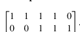

Then the cosets of \(\mathcal{C}\) with coset leaders are:

- \(\mathcal{C}_0 = 00000 + \mathcal{C}, \quad \mathcal{C}_4 = 00010 + \mathcal{C},\)
- \(\mathcal{C}_1 = 10000 + \mathcal{C}, \quad \mathcal{C}_5 = 00001 + \mathcal{C},\)
- \(\mathcal{C}_2 = 01000 + \mathcal{C}, \quad \mathcal{C}_6 = 10100 + \mathcal{C} = 01010 + \mathcal{C},\)
- \(\mathcal{C}_3 = 00100 + \mathcal{C}, \quad \mathcal{C}_7 = 10010 + \mathcal{C} = 01100 + \mathcal{C}.\)

The partial ordering of the cosets is depicted as

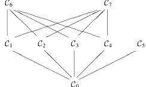


在这个图中请注意，随着你沿着从最底部权重 0 开始的链向上走，陪集权重以 1 为步长递增。

## 练习 664 列出下面给定生成矩阵的码 C 的陪集。还要按示例 11.7.1 的方式，给出这些陪集上偏序关系的图形表示。

```
(a) [ 1 1 1 1 0 0 ]
    [ 0 0 1 1 1 1 ]
    [ 1 0 0 0 1 1 ]
```

```
(b) [ 0 1 0 0 1 0 ]
    [ 0 0 1 1 1 0 ]
    [ 0 0 1 1 1 0 ]
```

如果 C1 和 C2 是码 C 的陪集，且 C1 < C2，则 C1 称为 C2 的子代，C2 称为 C1 的父代。如果 C1 是 C2 的子代，则显然 wt(C1) <= wt(C2) - 1；如果 C1 < C2 且 wt(C1) = wt(C2) - 1，则 C1 称为 C2 的子，C2 称为 C1 的父。根据定理 11.1.6(v)，如果 C1 < C2 且 wt(C1) < wt(C2) - 1，则存在一个陪集 C3，使得 C1 < C3 < C2。码 C 的一个陪集如果没有父，则称为孤儿，也就是说，它是 C 的所有陪集偏序中的极大元。码 C 中每个权重为 rho(C) 的陪集显然都是孤儿，但反之一般不成立。存在权重小于 rho(C) 的孤儿会增加计算码的覆盖半径的难度。

## 示例 11.7.2 在示例 11.7.1 中，rho(C) = 2。码 C 是所有其他陪集的子代，并且是 1 <= i <= 5 时 C_i 的子。C_6 和 C_7 是 1 <= i <= 4 时 C_i 的父。C_5、C_6 和 C_7 是孤儿；然而，C_5 的权重不是 rho(C)。

## 练习 665 给出练习 664 中码的偏序集中父和子的例子。哪些陪集的父最多？哪些陪集的子最多？哪些陪集是孤儿？哪些孤儿的权重等于 rho(C)？

我们现在介绍两个关于陪集间基本子代/父代关系的结果。第一个涉及子代的权重，说明偏序中一种“平衡”类型。

## 定理 11.7.3 设 C 为二元线性码，C' 为 C 的权重为 w 的陪集。设 a 为满足 0 < a < w 的整数。那么 C' 的权重为 a 的子代数量等于 C' 的权重为 w - a 的子代数量。

### 证明：根据定理 11.1.6(v)，C' 的权重为 a（分别，w - a）的子代的陪集领导元是被 C' 的某个权重为 w 的向量覆盖的权重为 a（分别，w - a）的向量，因为后者正是 C' 的陪集领导元。设 x 为 C' 的某个子代的权重为 a 的陪集领导元。那么存在 C' 的一个陪集领导元 x'，使得 x <= x'；由于 x' 覆盖 x，x' - x 是 C' 的某个子代的权重为 w - a 的陪集领导元。此外，C' 的每个子代的权重为 w - a 的陪集领导元都以这种方式产生，如通过互换上述中 a 和 w - a 的角色所见。因此，C' 的子代的权重为 a 的陪集领导元与权重为 w - a 的陪集领导元之间存在一一对应关系。

假设 \(\mathbf{x}\) 和 \(\mathbf{y}\) 是 C' 的同一子代的权重为 \(a\) 的陪集领导元。设 \(\mathbf{x}'\) 和 \(\mathbf{y}'\) 为分别覆盖 \(\mathbf{x}\) 和 \(\mathbf{y}\) 的 C' 中的权重为 \(w\) 的向量。那么 \(\mathbf{y} - \mathbf{x} \in C\)，并且由于 \(\mathbf{x}' - \mathbf{y}'\) 也在 \(C\) 中，所以

```
\((\mathbf{x}' - \mathbf{x}) - (\mathbf{y}' - \mathbf{y}) = (\mathbf{x}' - \mathbf{y}') + (\mathbf{y} - \mathbf{x}).\)
```

也是 \(C\) 中的元素。因此 \(\mathbf{x}' - \mathbf{x}\) 和 \(\mathbf{y}' - \mathbf{y}\) 是同一陪集的陪集领导元。因此，C' 的权重为 \(a\) 的子代数量至少等于权重为 \(w - a\) 的子代数量。同样，通过互换 \(a\) 和 \(w - a\) 的角色，C' 的权重为 \(w - a\) 的子代数量至少等于权重为 \(a\) 的子代数量。

## 示例 11.7.4 我们在示例 8.3.2 中表明，[24, 12, 8] 扩展二元 Golay 码的覆盖半径为 4。此外，每个权重为 4 的陪集恰好包含六个陪集领导元；成对地，它们的支撑集不相交。这些陪集领导元中的每一个恰好覆盖四个权重为 1 的陪集的陪集领导元。由于权重为 1 的陪集具有唯一的陪集领导元，因此存在 24 个权重为 1 的陪集是某个权重为 4 的陪集的子代。根据定理 11.7.3，存在 24 个权重为 3 的陪集是给定权重为 4 的陪集的子。

## 练习 666 描述在 [24, 12, 8] 扩展二元 Golay 码中，如示例 11.7.4 所述，某个固定权重为 4 的陪集的 24 个权重为 3 的子代陪集的陪集领导元的形式。

如果 \(C_1\) 和 \(C_2\) 是 \(\mathcal{C}\) 的两个陪集，且 \(C_1 < C_2\)，则以下定理展示了如何从 \(C_1\) 的一个陪集领导元和 \(C_2\) 的所有陪集领导元得到 \(C_1\) 的所有陪集领导元 [36]。

## 定理 11.7.5 设 \(C_1\) 和 \(C_2\) 为二元线性码 \(C\) 的两个陪集，并假设 \(C_1 < C_2\)。设 \(\mathbf{x}_1\) 和 \(\mathbf{x}_2\) 分别为 \(C_1\) 和 \(C_2\) 的陪集领导元，满足 \(\mathbf{x}_1 < \mathbf{x}_2\)。设 \(\mathbf{u} = \mathbf{x}_2 - \mathbf{x}_1\)。那么向量 \(\mathbf{x}\) 是 \(C_1\) 的陪集领导元，当且仅当存在 \(C_2\) 的一个陪集领导元 \(\mathbf{y}\)，使得 \(\mathbf{u} \le \mathbf{y}\) 且 \(\mathbf{x} = \mathbf{y} - \mathbf{u}\)。

### 证明：首先假设 \(\mathbf{y}\) 是 \(C_2\) 的一个陪集领导元，且 \(\mathbf{u} \le \mathbf{y}\)。那么
\((\mathbf{y} - \mathbf{u}) - \mathbf{x}_1 = \mathbf{y} - (\mathbf{u} + \mathbf{x}_1) = \mathbf{y} - \mathbf{x}_2 \in C\)，
因此 \(\mathbf{y} - \mathbf{u}\) 在 \(C_1\) 中。由于
\(\text{wt}(\mathbf{y} - \mathbf{u}) = \text{wt}(\mathbf{y}) - \text{wt}(\mathbf{u}) = \text{wt}(\mathbf{x}_2) - \text{wt}(\mathbf{u}) = \text{wt}(\mathbf{x}_1)\)，
\(\mathbf{y} - \mathbf{u}\) 是 \(C_1\) 的陪集领导元。
反之，假设 \(\mathbf{x}\) 是 \(C_1\) 的陪集领导元。那么
\((\mathbf{x} + \mathbf{u}) - \mathbf{x}_2 = (\mathbf{x} + \mathbf{x}_2 - \mathbf{x}_1) - \mathbf{x}_2 = \mathbf{x} - \mathbf{x}_1 \in C\)，
因此 \(\mathbf{x} + \mathbf{u}\) 在 \(C_2\) 中。由于
\(\text{wt}(\mathbf{x} + \mathbf{u}) \le \text{wt}(\mathbf{x}) + \text{wt}(\mathbf{u}) = \text{wt}(\mathbf{x}_1) + \text{wt}(\mathbf{u}) = \text{wt}(\mathbf{x}_2)\)，
\(\mathbf{x} + \mathbf{u}\) 是 \(C_2\) 的陪集领导元。

## 练习 667 如果 $\mathbf{u} \le \mathbf{y}$ 且 $\mathbf{x} = \mathbf{y} - \mathbf{u}$，证明 $\mathbf{x} \le \mathbf{x} + \mathbf{u}$ 且 $\mathbf{u} \le \mathbf{x} + \mathbf{u}$。

## 示例 11.7.6 设 $\mathcal{C}$ 为 [24, 12, 8] 扩展二元 Golay 码。设 $\mathcal{C}_2 = \mathbf{x}_2 + \mathcal{C}$ 为一个权重为 4 的陪集。任选一个权重为 3 且满足 $\mathbf{x}_1 \le \mathbf{x}_2$ 的向量 $\mathbf{x}_1$。设 $\mathcal{C}_1 = \mathbf{x}_1 + \mathcal{C}$。那么，在定理 11.7.5 的记法中，$\mathbf{u}$ 是一个权重为 1 且满足 $\text{supp}(\mathbf{u}) \subset \text{supp}(\mathbf{x}_2)$ 的向量。由于 $\mathcal{C}_1$ 的所有其他陪集领导元的支撑集与 $\text{supp}(\mathbf{x}_1)$ 不相交，根据定理 11.7.5，$\mathbf{x}_1$ 是 $\mathcal{C}_1$ 的唯一陪集领导元，这一点我们早已知道，因为所有权重不超过 $t = \lfloor(d-1)/2\rfloor = 3$ 的陪集都具有唯一的陪集领导元。

以下推论是定理 11.7.5 的直接结果。

## 推论 11.7.7 设 $\mathcal{C}$ 为二元码，$\mathcal{C}'$ 为 $\mathcal{C}$ 的一个陪集，其陪集领导元为 $\mathbf{x}$。设 $i \in \text{supp}(\mathbf{x})$，并设 $\mathbf{u}$ 为在第 \(i\) 个坐标处为 1、其余处为 0 的向量。那么 \(\mathbf{x} - \mathbf{u}\) 是 \(\mathcal{C}'\) 的一个子的陪集领导元，且 \((\mathbf{x} - \mathbf{u}) + \mathcal{C}\) 的任何陪集领导元的支撑集中都不包含 \(i\)。

### 证明：根据定理 11.1.6(v)，\(\mathbf{x} - \mathbf{u}\) 是 \(\mathcal{C}'\) 的一个子的陪集领导元。根据定理 11.7.5，该子的每个陪集领导元都形如 \(\mathbf{y} - \mathbf{u}\)，其中 \(\mathbf{u} \le \mathbf{y}\)；特别是，该子的任何陪集领导元的支撑集中都不包含 \(i\)。

## 推论 11.7.8 ([129]) 设 \(\mathcal{C}_1\) 和 \(\mathcal{C}_2\) 为二元线性码 \(\mathcal{C}\) 的两个陪集，并假设 \(\mathcal{C}_1 < \mathcal{C}_2\)。那么对于 \(\mathcal{C}_1\) 的每个陪集领导元 \(\mathbf{x}\)，都存在 \(\mathcal{C}_2\) 的一个陪集领导元 \(\mathbf{y}\)，使得 \(\mathbf{x} < \mathbf{y}\)。

## 练习 668 证明推论 11.7.8。

## 示例 11.7.9 根据推论 11.7.8，要确定陪集 \(\mathcal{C}'\) 的所有父代，只需知道 \(\mathcal{C}'\) 的一个领导元即可。从该陪集领导元 \(\mathbf{x}\) 出发，一个父代的每个陪集领导元的支撑集都包含 \(\text{supp}(\mathbf{x})\)。然而，要确定 \(\mathcal{C}'\) 的所有子代，通常仅知道 \(\mathcal{C}'\) 的一个陪集领导元 \(\mathbf{x}\) 是不够的，因为 \(\mathcal{C}'\) 的一个子代的陪集领导元的支撑集可能不包含在 \(\text{supp}(\mathbf{x})\) 中。在示例 11.7.1 中，\(\mathcal{C}_1\) 的一个陪集领导元的支撑集包含在 \(\mathcal{C}_1\) 的父代 \(\mathcal{C}_6\) 的两个陪集领导元中的一个的支撑集内。然而，\(\mathcal{C}_6\) 的陪集领导元 \(01010\) 的支撑集不包含 \(\mathcal{C}_1\) 的子代 \(\mathcal{C}_1\) 的唯一陪集领导元的支撑集。

以下定理包含孤儿的一个刻画 [33, 36]。

## 定理 11.7.10 设 \(\mathcal{C}\) 为一个 \([n, k, d]\) 二元码。设 \(\mathcal{C}'\) 为 \(\mathcal{C}\) 的一个权重为 \(w\) 的陪集。以下结论成立：
- (i) \(\mathcal{C}'\) 是孤儿，当且仅当每个坐标位置都被 \(\mathcal{C}'\) 中某个权重为 \(w\) 或 \(w + 1\) 的向量覆盖。
- (ii) 如果 \(d > 2\)，则 \(\mathcal{C}'\) 的子与 \(\mathcal{C}'\) 的陪集领导元覆盖的坐标位置之间存在一一对应关系。
- (iii) 如果 \(d > 2\) 且 \(\mathcal{C}\) 是偶码，则 \(\mathcal{C}'\) 的父与 \(\mathcal{C}'\) 的陪集领导元未覆盖的坐标位置之间存在一一对应关系。特别是，\(\mathcal{C}'\) 是孤儿，当且仅当每个坐标位置都被 \(\mathcal{C}'\) 的一个陪集领导元覆盖。

### 证明：对于 \(1 \le i \le n\)，设 \(\mathbf{e}_i \in \mathbb{F}_2^n\) 表示在第 \(i\) 个坐标处为 1 的权重为 1 的向量。根据推论 11.7.8，\(\mathcal{C}'\) 的每个父都等于某个 \(i\) 的 \(\mathcal{C}' + \mathbf{e}_i\)。为了使 \(\mathcal{C}'\) 成为一个


| 余类重量 | 0 | 1 | 2 | 3 | 4 | 5 | 6 | 7 | 8 | 9 | 10 | 11 | 12 | 13 | 14 | 15 | 16 | 余类数量 |
| :--- | :--- | :--- | :--- | :--- | :--- | :--- | :--- | :--- | :--- | :--- | :--- | :--- | :--- | :--- | :--- | :--- | :--- | :--- |
| 0 | 1 | | | | | | | 30 | | | | | | | 1 | | 1 |
| 1 | | 1 | | | | 15 | | | 15 | | | | | | 1 | | 16 |
| 2 | | 1 | | | 7 | | 16 | | 7 | | | | 1 | | | | 120 |
| 3 | | | 1 | 3 | | 12 | | 12 | | 3 | | 1 | | | | | 560 |
| 4 | | | 2 | 8 | | | 12 | | 8 | | | 2 | | | | | 840 |
| 4 | | | | 4 | | | 24 | | | | | | 4 | | | | 35 |
| 5 | | | | | 6 | | 10 | | 10 | | 6 | | | | | | 448 |
| 6 | | | | | | | 16 | | | 16 | | | | | | | 28 |

孤儿，\(\mathcal{C}' + \mathbf{e}_i\) 对所有 \(i\) 必须包含重量为 \(w\) 或更小的向量。只有当对于每个 \(i\)，\(\mathcal{C}'\) 中存在重量为 \(w\) 或 \(w + 1\) 且在第 \(i\) 个坐标处为 1 的向量时，这才可能。这证明了 (i)。

现在假设 \(d > 2\)。则对于 \(i \neq j\)，余类 \(\mathcal{C}' + \mathbf{e}_i\) 和 \(\mathcal{C}' + \mathbf{e}_j\) 不同。根据定义，\(\mathcal{C}'\) 的每个子代都等于某个 \(i\) 的 \(\mathcal{C}' + \mathbf{e}_i\)。这样的余类是子代，当且仅当 \(\mathcal{C}'\) 的某个余类领头元在第 \(i\) 个坐标处有 1。这证明了 (ii)。

现在假设 \(\mathcal{C}'\) 是偶码且 \(d > 2\)。如同 (i) 的证明中一样，\(\mathcal{C}'\) 的每个父代都等于某个 \(i\) 的 \(\mathcal{C}' + \mathbf{e}_i\)。为了使 \(\mathcal{C}' + \mathbf{e}_i\) 成为 \(\mathcal{C}'\) 的父代，\(\mathcal{C}'\) 中每个重量为 \(w\) 或 \(w + 1\) 的向量都不能在第 \(i\) 个坐标处有 1。由于 \(\mathcal{C}'\) 是偶码，一个余类要么只包含偶重量向量，要么只包含奇重量向量；因此 \(\mathcal{C}'\) 没有重量为 \(w + 1\) 的向量。现在 (iii) 的第一部分得出，注意如果 \(i \neq j\)，则 \(\mathcal{C}' \neq \mathbf{e}_i \neq \mathcal{C}' + \mathbf{e}_j\)。(iii) 的第二部分直接从第一部分得出。

我们将以下推论的证明留作练习。

### 推论 11.7.11
设 \(\mathcal{C}\) 为一个 \([n, k, d]\) 偶二进制码，且 \(d > 2\)。以下结论成立：
- (i) \(\mathcal{C}\) 的一个孤儿具有 \(n\) 个重量为 1 的后代和 \(n\) 个子代。
- (ii) 重量为 \(w\) 且恰有 \(i\) 个余类领头元的余类（其中 \(tw < n\)）不是孤儿。

### 练习 669
证明推论 11.7.11。\(\unknown\)

### 示例 11.7.12
表 11.7 给出了 \([16, 5, 8]\) Reed-Muller 码 \(\mathcal{R}(1, 4)\) 的余类重量分布。在一系列练习中，你将被要求验证表中的条目。根据定理 11.2.5，\(\rho(\mathcal{R}(1, 4)) = 6\)。\(\mathcal{R}(1, 4)\) 存在重量为 4 和 6 的孤儿；参见练习 676。这些孤儿的存在及其重量分布是 [36] 中更一般结果的一部分。\(\blacksquare\)

### 练习 670
根据定理 1.10.1，\(\mathcal{R}(1, 4)^\perp\) 是 \([16, 11, 4]\) Reed-Muller 码 \(\mathcal{R}(2, 4)\)。
- (a) 根据定理 1.10.1，\(\mathcal{R}(1, 4)\) 是一个包含全一向量的 \([16, 5, 8]\) 码。证明 \(\mathcal{R}(1, 4)\) 的重量分布为 \(A_0 = A_{16} = 1\) 且 \(A_8 = 30\)，从而验证表 11.7 第一行的条目。
- (b) 证明 \(\mathcal{R}(1, 4)^\perp\) 中非零代码字的可能重量仅为 4、6、8、10、12 和 16。
- (c) 使用 Assmus-Mattson 定理，证明 \(\mathcal{R}(1, 4)\) 的 30 个重量 8 代码字构成一个 3-(16, 8, 3) 设计，并绘制其 Pascal 三角形。
- (d) 验证表 11.7 中重量为 1、2 和 3 的余类的重量分布。同时验证此类余类的数量与表中所示一致。提示：参见示例 8.4.6。

### 练习 671
通过练习 670，我们已验证表 11.7 中 \(\mathcal{R}(1, 4)\) 重量为 1 和 3 的余类条目正确。在本练习中，你将验证关于重量 5 余类的信息是否正确。根据练习 670(b) 和定理 7.5.2(iv)，重量 5 余类的重量分布是唯一确定的。
- (a) 如果一个重量 5 余类中有 x 个重量 5 向量，证明该余类中有 16 - x 个重量 7 向量。
- (b) \(\mathbb{F}_2^8\) 中有多少个重量为 5 和 7 的向量？
- (c) 设 n 为重量 5 余类的数量。由于 \(\rho(\mathcal{R}(1, 4)) = 6\)，\(\mathbb{F}_2^8\) 中每个重量 5 和重量 7 向量都位于重量 1、3 或 5 的余类中。通过统计重量 5 和重量 7 向量的总数，找出关于 x 和 n 的两个方程。求解这些方程以验证表 11.7 中关于重量 5 余类的信息。

### 练习 672
使用练习 631 验证 \(\mathcal{R}(1, 4)\) 重量 6 余类的重量分布与表 11.7 一致。

### 练习 673
在本练习中，我们将证明 \(\mathcal{R}(1, 4)\) 中任何重量 4 的余类要么有两个余类领头元，要么有四个。
- (a) 证明 \(\mathcal{R}(1, 4)\) 同一重量 4 余类中的两个不同余类领头元具有不相交的支撑集。
- (b) 证明 \(\mathcal{R}(1, 4)\) 重量 4 余类中余类领头元的最大数量为 4。
- (c) 证明如果 \(\mathcal{R}(1, 4)\) 的一个重量 4 余类至少有三个余类领头元，则它实际上有四个余类领头元。
- (d) 设 \(v + \mathcal{R}(1, 4)\) 为 \(\mathcal{R}(1, 4)\) 的一个重量 4 余类，其唯一余类领头元为 \(v\)。假设 \(\text{supp}(v) = \{i_1, i_2, i_3, i_4\}\)。
  - (i) 证明 \(\text{supp}(v)\) 不包含在 \(\mathcal{R}(1, 4)\) 任何重量 8 代码字的支撑集中。
  - (ii) 使用练习 670(c)，证明存在三个 \(\mathcal{R}(1, 4)\) 的重量 8 代码字，其支撑集包含 \(\{i_2, i_3, i_4\}\)。
  - (iii) 根据 (i)，(ii) 中三个代码字的支撑集不能包含 \(i_1\)。证明这是不可能的。

### 练习 674
根据练习 670(b) 和定理 7.5.2(iii)，一旦我们知道 \(\mathcal{R}(1, 4)\) 重量 4 余类的余类领头元数量，该余类的分布就是唯一的。根据练习 673，重量 4 余类中要么有两个余类领头元，要么有四个。验证表 11.7 中给出的重量 4 余类的重量分布。提示：参见示例 7.5.4。如果 \(D = C \cup (v + C)\)，其中 \(v\) 是重量 4 的余类领头元，则 \(D^\perp \subseteq C^\perp = \mathcal{R}(2, 4)\)，其最小重量为 4。

### 练习 675
在本练习中，你将验证 \(\mathcal{R}(1, 4)\) 中有 35 个具有四个余类领头元的重量 4 余类。由此，你可以计算出具有两个余类领头元的重量 4 余类的数量以及重量 6 余类的数量。
- (a) 设 \(x_0 + \mathcal{R}(1, 4)\) 为一个重量 4 余类，其余类领头元为 \(x_0, x_1, x_2\) 和 \(x_3\)。证明 \(e_1 = x_0 + x_1\) 和 \(e_2 = x_0 + x_2\) 是 \(\mathcal{R}(1, 4)\) 中的重量 8 代码字，其支撑集的交集为 \(\text{supp}(x_0)\)，并且以自然方式确定 \(x_1, x_2\) 和 \(x_3\) 的支撑集。
- (b) 反之，通过考虑两个 \(\mathcal{R}(1, 4)\) 重量 8 代码字（其支撑集不相交）的支撑集交集，展示如何获得重量 4 余类的四个余类领头元。
- (c) \(\mathcal{R}(1, 4)\) 中存在 15 对重量 8 代码字，每对中的重量 8 代码字具有不相交的支撑集。选择两个不同的对。展示这些对如何确定 \(\mathcal{R}(1, 4)\) 重量 4 余类的四个余类领头元，并同时确定第三对重量 8 代码字。
- (d) 证明 \(\mathcal{R}(1, 4)\) 中存在 35 个具有四个余类领头元的重量 4 余类。
- (e) 证明 \(\mathcal{R}(1, 4)\) 中存在 840 个具有两个余类领头元的重量 4 余类。
- (f) 证明 \(\mathcal{R}(1, 4)\) 中存在 28 个重量 6 余类。

### 练习 676
执行以下操作：
- (a) 证明 \(\mathcal{R}(1, 4)\) 的每个重量 6 余类恰有 16 个子代，且每个重量 5 余类恰有一个父代。
- (b) 证明 \(\mathcal{R}(1, 4)\) 中每个具有四个余类领头元的重量 4 余类是孤儿，但具有两个余类领头元的不是孤儿。
- (c) 证明 \(\mathcal{R}(1, 4)\) 中每个具有四个余类领头元的重量 4 余类恰有 16 个子代，且每个重量 3 余类恰有一个是孤儿的父代和 12 个不是孤儿的父代。

我们以对 [123] 中首次定义的 Newton 半径的简要介绍来结束本章。二进制码 \(C\) 的 Newton 半径 \(v(C)\) 是最大值 \(v\)，使得存在仅有一个余类领头元的重量 \(v\) 的余类。特别是，\(v(C)\) 是可以被唯一纠正的任何错误的最大重量。以下引理中的第一个陈述来自 [123]。

### 引理 11.7.13
设 \(C\) 为一个 \([n, k, d]\) 二进制码。以下结论成立：
- (i) \(\lfloor (d-1)/2 \rfloor \le v(C) \le \rho(C)\)。
- (ii) 如果 \(C\) 是完美码，则 \((d-1)/2 = v(C) = \rho(C)\)。
- (iii) 如果 \(C\) 是偶码且 \(d > 2\)，则 \(v(C) < \rho(C)\)。

证明：(i) 和 (ii) 的证明留作练习。定理 11.7.10(iii) 意味着偶码中的孤儿具有多个余类领头元。特别是，重量为 \(\rho(C)\) 的余类不能具有唯一的余类领头元。

### 练习 677
证明引理 11.7.13 的 (i) 和 (ii) 部分。

### 示例 11.7.14
设 \(C\) 为 \([15, 4, 8]\) simplex 码。根据定理 11.2.7，\(\rho(C) = 7\)。可以证明 [123] \(v(C) = 4\)。因此，在本示例中，引理 11.7.13(i) 中存在严格不等式。


我们可以使用本节已开发的二进制向量的顺序，来简化来自 [123] 的以下结果的证明。

### 定理 11.7.15 如果 C 是一个 [n, k] 二进制码，那么

0 \le \rho(C) - \nu(C) \le k.

证明。由引理 11.7.13 可知 0 \le \rho(C) - \nu(C)。令 e_i 为长度 n 且权重为 1、在第 i 个坐标上为 1 的二进制向量。令 x_1 为 C 的陪集 C_1 的一个权重 \rho = \rho(C) 的陪集领导元。通过重新排列坐标，我们可以假设 supp(x_1) = {1, 2, ..., \rho}。那么要么 v(C) = \rho，在这种情况下我们已完成，要么由引理 11.7.13 得 v(C) \le \rho - 1。假设后者发生。那么存在 C_1 的另一个陪集领导元 x_2。因此 x_1 + x_2 = e_i \in C。通过重新排列坐标，我们可以假设 1 \in supp(x_1)，因为 x_1 和 x_2 必须在某个坐标上不同。由推论 11.7.7，存在 C_1 的一个子码 C_2，其所有陪集领导元的第一个坐标均为 0，其中之一是 x_3 = x_1 + e_1。如果 v(C) \le \rho - 2，则存在 C_2 的一个陪集领导元 x_4，它必须在 supp(x_3) = {2, 3, ..., \rho} 的某个坐标上与 x_3 不同；通过重新排列，我们可以假设 e_2 = x_3 + x_4 \in C 在第二个坐标上为 1。由于 C_2 的所有陪集领导元在第一个坐标上均为 0，e_2 也是如此。由于 e_1 以 1 \cdot \cdot \cdot 开头，e_2 以 01 \cdot \cdot \cdot 开头，它们线性无关。由推论 11.7.7，存在 C_2 的一个子码 C_3，其所有陪集领导元的第二个坐标均为 0，其中之一是 x_5 = e_2 + x_1。如果 C_3 有一个在第一个坐标上为 1 的陪集领导元，那么由推论 11.7.8，C_2 必须有一个在该坐标上为 1 的陪集领导元，这与假设矛盾。因此 C_3 的所有陪集领导元在第一个和第二个坐标上均为 0。如果 v(C) \le \rho - 3，则存在 C_3 的一个陪集领导元 x_6，它必须在 supp(x_5) = {3, 4, ..., \rho} 的某个坐标上与 x_5 不同；通过重新排列，我们可以假设 e_3 = x_5 + x_6 \in C 在第三个坐标上为 1。由于 e_1 以 1 \cdot \cdot \cdot 开头，e_2 以 01 \cdot \cdot \cdot 开头，e_3 以 001 \cdot \cdot \cdot 开头，它们线性无关。我们可以继续归纳，只要 v(C) \le \rho - s，就能找到 s 个线性无关的码字。由于 s 可能的最大值为 k，故 v(C) \ge \rho - k.

### 练习 678 在定理 11.7.15 的证明中，再进行一步归纳。

# 12 Z4 上的码

对环 Z4 上的码的研究在 20 世纪 90 年代初通过 Calderbank、Hammons、Kumar、Sloane 和 Solé 的工作引起了广泛关注，这促成了论文 [116] 的发表，该论文表明几个著名的非线性二进制码族与 Z4 上的线性码有着内在联系。特别是，对于 m ≥ 4 的偶整数，存在一个由 Kerdock [166] 最初发现的 K(m) (2^m, 2^{2m-1} - 2^{m-2}/2) 非线性二进制码族，以及一个由 Preparata [288] 提出的 P(m) (2^m, 2^{2m-2}, 6) 非线性二进制码族，它们具有若干显著性质。首先，码 K(4) 和 P(4) 彼此相同，也与第 2.3.4 节中描述的 Nordstrom-Robinson 码相同。其次，Preparata 码与扩展双错更正 BCH 码具有相同的长度，但码字数量是其两倍。第三，也许最引人入胜的是，K(m) 和 P(m) 表现得像是彼此的对偶码，因为 P(m) 的权重枚举子是 K(m) 的权重枚举子的 MacWilliams 变换；换句话说，如果 C = K(m)，那么 P(m) 的权重枚举子是 1/|C| W_C(y-x, y+x)（参见第 7.2 节的 (M3））。许多研究人员曾试图解释权重枚举子之间这种奇特的关系但均未成功，直到在 [116] 中建立了与 Z4 上的码的联系。

在本章中，我们将介绍 Z4 上的基本理论，包括通过 Gray 映射这些码与二进制码之间的联系。我们还将研究 Z4 上的循环码、自对偶码和二次剩余码。Kerdock 和 Preparata 的码将被描述为 Z4 上某些扩展循环码的 Gray 像。为了介绍这些码，我们需要考察伽罗瓦环 GR(4^m)，它在 Z4 上循环码的研究中所起的作用，与 F_{2^m}（也记作 GF(2^m)）在 F_2 上循环码的研究中所起的作用相同。

## 12.1 Z4-线性码的基本理论

长度 n 的 Z4-线性码 C 是 Z4^n 的一个加法子群。这样的子群是一个 Z4-模，可能是自由的，也可能不是。（如果存在 M 的一个子集 B，称为基，使得 M 中的每个元素都可以唯一地表示为 B 中元素的 Z4-线性组合，则称 Z4-模 M 是自由的。）尽管 $Z_4^n$ 不是向量空间，我们仍将 Z4^n 的元素称为“向量”。注意，如果向量 v 的所有分量都是 0 或 2，则 2v = 0，这意味着这样的向量不能是 $Z_4^n$ 自由子模的基元，因为 $2 \neq 0$。在描述 $Z_4$ 上的码时，我们将 $Z_4$ 的元素表示为自然形式 {0, 1, 2, 3} 或 {0, 1, 2, -1} 之一，以最方便者为准。

1 在文献中，Z4 上的码有时被称为四进制码。不幸的是，F4 上的码也被称为四进制码，这是我们在第 1 章中使用的术语。在本书中，我们保留“四进制”一词来指代 F2 上的码。

### 示例 12.1.1 设 C 为长度 4 的 $Z_4$-线性码，具有以下 16 个码字：

```
0000, 1113, 2222, 3333, 0202, 1313, 2020, 3133,
0022, 1131, 2200, 3313, 0220, 1331, 2002, 3111.
```

正如练习 679 所示，这确实是 $Z_4^4$ 的一个加法子群。如果这是一个自由 $Z_4$-模，它将有一个由两个向量 b1 和 b2 组成的基，使得每个码字都是 b1 和 b2 的唯一 $Z_4$-线性组合。如上所述，b1 和 b2 都至少有一个分量等于 1 或 3。但是，如果 b1 和 b2 是八个具有一个分量为 1 或 3 的码字中的两个，则 2b1 = 2222 = 2b2。因此 {b1, b2} 不能是 C 的基，这意味着 C 不是自由的。然而，我们仍然可以生成一个非常好的生成矩阵，其行在各方面都可作为码的“基”。

### 练习 679 设 C 为示例 12.1.1 中的 $Z_4$ 码。

- (a) 证明 C 的每个码字都可以唯一地写成 xc1 + yc2 + zc3 的形式，其中 c1 = 1113，c2 = 0202，c3 = 0022，x ∈ Z4，y 和 z ∈ {0, 1}。

- (b) 利用部分 (a) 证明 C 是一个 $Z_4$-线性码。

### 示例 12.1.2 设 C 为示例 12.1.1 中的 $Z_4$ 码。根据练习 679(a)，我们可以考虑

```
G = [ 1 1 1 3
      0 2 0 2
      0 0 2 2 ]
```

作为 C 的生成矩阵，其含义如下：C 的每个码字都是 (xyz)G，其中 x ∈ Z4，y 和 z ∈ Z2。

正如练习 679 所示，每个 $Z_4$-线性码 C 包含一组 k1 + k2 个码字 c1, ..., ck1, ck1+1, ..., ck1+k2，使得 C 中的每个码字都可以唯一地表示为以下形式

\sum_{i=1}^{k_1} a_i c_i + \sum_{i=k_1+1}^{k_1+k_2} a_i c_i,

其中对于 1 ≤ i ≤ k1，ai ∈ Z4；对于 k1 + 1 ≤ i ≤ k1 + k2，ai ∈ Z2。此外，对于 1 ≤ i ≤ k1，每个 ci 至少有一个分量等于 1 或 3；对于 k1 + 1 ≤ i ≤ k1 + k2，每个 ci 的所有分量都等于 0 或 2。如果 k2 = 0，则码 C 是一个自由 Z4-模。行为 ci（1 ≤ i ≤ k1 + k2）的矩阵称为 C 的生成矩阵。码 C 有 4^{k1} 2^{k2} 个码字，被称为类型 4^{t} 2^{s}。示例 12.1.1 中的码的类型为 4^1 2^2。

与域上的码一样，我们可以描述 Z4-线性码的等价性。设 C1 和 C2 为两个长度 n 的 Z4-线性码。如果存在一个 n×n 置换矩阵 P 使得 C2 = C1 P，则称 C1 和 C2 置换等价。我们还可以对码的分量进行缩放以得到等价码，前提是标量是 $\mathbb{Z}_4$ 的可逆元。为此，我们说 $\mathcal{C}_1$ 和 $\mathcal{C}_2$ 是 *单式等价* 的，前提是存在一个 \(n \times n\) 单式矩阵 \(M\)，其所有非零项等于 1 或 3，使得 \(\mathcal{C}_2 = \mathcal{C}_1 M\)。\(\mathcal{C}\) 的置换自同构群 PAut(\(\mathcal{C}\)) 是所有使得 \(\mathcal{C} P = \mathcal{C}\) 的置换矩阵 \(P\) 的集合，而 \(\mathcal{C}\) 的单式自同构群 MAut(\(\mathcal{C}\)) 是所有使得 \(\mathcal{C} M = \mathcal{C}\) 的单式矩阵 \(M\)（非零项为 1 和 3）的集合。

### 练习 680 证明具有生成矩阵的 $\mathbb{Z}_4$-线性码

\(G_1 = \begin{bmatrix} 1 & 1 & 1 & 3 \\ 0 & 2 & 0 & 2 \\ 0 & 0 & 2 & 2 \end{bmatrix} \quad \text{and} \quad G_2 = \begin{bmatrix} 1 & 1 & 1 & 1 \\ 2 & 0 & 0 & 2 \\ 0 & 2 & 0 & 2 \end{bmatrix}\)

是单式等价的。

### 练习 681 求 PAut(\(\mathcal{C}\)) 和 MAut(\(\mathcal{C}\))，其中 \(\mathcal{C}\) 是示例 12.1.1 中的码。

根据定理 1.6.2，每个 \(\mathbb{F}_q\) 上的 \([n, k]\) 线性码都置换等价于具有标准形式 \([I_k | A]\) 生成矩阵的码。类似地，$\mathbb{Z}_4$-线性码的生成矩阵也有标准形式。一个 $\mathbb{Z}_4$-线性码 \(\mathcal{C}\) 的生成矩阵 \(G\) 如果满足以下条件，则称为 *标准形式*：

\(G = \begin{bmatrix} I_{k_1} & A & B_1 + 2B_2 \\ O & 2I_{k_2} & 2C \end{bmatrix} . \quad (12.1)\)

其中 \(A, B_1, B_2\) 和 \(C\) 是元素来自 \(\mathbb{Z}_2\) 的矩阵，\(O\) 是 \(k_2 \times k_1\) 零矩阵。码 \(\mathcal{C}\) 的类型为 \(4^{k_1}2^{k_2}\)。请注意，示例 12.1.1 中码的生成矩阵是标准形式。虽然相当繁琐，但以下结果的证明是直接的。

### 定理 12.1.3 每个 $\mathbb{Z}_4$-线性码都置换等价于具有标准形式生成矩阵的码。

### 练习 682 证明定理 12.1.3。

在 $\mathbb{Z}_4^n$ 上有一个自然内积，即模 4 的普通点积，定义为 \(\mathbf{x} \cdot \mathbf{y} = x_1y_1 + x_2y_2 + \cdots + x_ny_n \pmod 4\)，其中 \(\mathbf{x} = x_1 \cdots x_n\) 和 \(\mathbf{y} = y_1 \cdots y_n\)。与有限域上的线性码一样，我们可以定义长度 \(n\) 的 $\mathbb{Z}_4$-线性码 \(\mathcal{C}\) 的 *对偶码* \(\mathcal{C}^\perp\) 为 \(\mathcal{C}^\perp = \{ \mathbf{x} \in \mathbb{Z}_4^n \mid \mathbf{x} \cdot \mathbf{c} = 0 \text{ for all } \mathbf{c} \in \mathcal{C} \}\)。根据练习 683，\(\mathcal{C}^\perp\) 确实是一个 $\mathbb{Z}_4$-线性码。当 \(\mathcal{C} \subseteq \mathcal{C}^\perp\) 时，$\mathbb{Z}_4$-线性码称为 *自正交*；如果 \(\mathcal{C} = \mathcal{C}^\perp\)，则称为 *自对偶*。

### 练习 683 证明 $\mathbb{Z}_4$-线性码的对偶码是一个 $\mathbb{Z}_4$-线性码。

### 练习 684 证明示例 12.1.1 中的码是自对偶的。

### 示例 12.1.4 与有限域上的码不同，存在奇数长度的自对偶 $\mathbb{Z}_4$-线性码。例如，生成矩阵为 \(2I_n\) 的长度 \(n\)、类型 \(2^n\) 的码是自对偶的。


### 练习 685
找出所有长度 \(n \le 4\) 的自双码的标准型生成矩阵，以单式等价为准。给出每个码的类型。

如果 C 的标准型生成矩阵为 (12.1)，则 \(C^\perp\) 的生成矩阵为

\(\displaystyle G^\perp = \begin{bmatrix} -(B_1 + 2B_2)^T - C^T A^T & C^T \\ 2A^T & I_{k_1-k_2} \\ O & O \end{bmatrix}.\) (12.2)

其中 \(O\) 是 \(k_2 \times (n - k_1 - k_2)\) 的零矩阵。特别是，\(C^\perp\) 的类型为

\(4^{n-k_1-k_2}2^{k_2}.\) (12.3)

### 练习 686
给出示例 12.1.1 中码 \(\mathcal{C}\) 的 \(C^\perp\) 的生成矩阵 (12.2)。

### 练习 687
证明 \(G^\perp G^T\) 是零矩阵，其中 \(G\) 如 (12.1) 所给，\(G^\perp\) 如 (12.2) 所给。

与 \(\mathbb{F}_2\) 上的码不同，\(\mathbb{Z}_4^n\) 中向量的权重概念可能有多种含义。事实上，在处理 \(\mathbb{Z}_4\) 上的码时，使用了三种不同的权重，因此也有三种不同的距离。设 \(\mathbf{x} \in \mathbb{Z}_4^n\)。假设 \(n_i(\mathbf{x})\) 表示 \(\mathbf{x}\) 中等于 \(i\) 的分量数，对所有 \(i \in \mathbb{Z}_4\) 成立。\(\mathbf{x}\) 的 **汉明权重** 为 \(w_H(\mathbf{x}) = n_1(\mathbf{x}) + n_2(\mathbf{x}) + n_3(\mathbf{x})\)，\(\mathbf{x}\) 的 **李权重** 为 \(w_L(\mathbf{x}) = n_1(\mathbf{x}) + 2n_2(\mathbf{x}) + n_3(\mathbf{x})\)，\(\mathbf{x}\) 的 **欧几里得权重** 为 \(w_E(\mathbf{x}) = n_1(\mathbf{x}) + 4n_2(\mathbf{x}) + n_3(\mathbf{x})\)。因此，等于 1 或 3 的分量对每种权重贡献 1，而 2 对李权重贡献 2，对欧几里得权重贡献 4。\(\mathbf{x}\) 和 \(\mathbf{y}\) 之间的 **汉明、李和欧几里得距离** 分别为 \(d_H(\mathbf{x}, \mathbf{y}) = w_H(\mathbf{x} - \mathbf{y})\)、\(d_L(\mathbf{x}, \mathbf{y}) = w_L(\mathbf{x} - \mathbf{y})\) 和 \(d_E(\mathbf{x}, \mathbf{y}) = w_E(\mathbf{x} - \mathbf{y})\)。

### 练习 688
做以下题目：
- (a) 向量 \(120\,203\,303\) 的汉明、李和欧几里得权重分别是多少？
- (b) 向量 \(30\,012\,221\) 和 \(20\,202\,213\) 之间的汉明、李和欧几里得距离分别是多少？

### 练习 689
求示例 12.1.1 中码 \(\mathcal{C}\) 的汉明、李和欧几里得权重分布。

### 练习 690
设 \(\mathcal{C}\) 为一个包含仅由 1 和 3 组成的代码字的 \(\mathbb{Z}_4\)-线性码。证明 \(C^\perp\) 中所有代码字的李权重均为偶数。

以下定理是定理 1.4.5(iv) 的 \(\mathbb{Z}_4\) 类比。

### 定理 12.1.5
设 \(\mathcal{C}\) 为一个自正交 \(\mathbb{Z}_4\)-线性码，且 \(\mathbf{c} \in C\)。则：
- (i) \(w_L(\mathbf{c}) \equiv 0 \pmod 2\)，
- (ii) \(w_E(\mathbf{c}) \equiv 0 \pmod 4\)。

### 练习 691
证明定理 12.1.5。

对于长度为 \(n\) 的 \(\mathbb{Z}_4\)-线性码 \(\mathcal{C}\)，也存在类似于 MacWilliams 方程的类比。

设

\(\displaystyle \text{Ham}_C(x, y) = \sum_{\mathbf{c} \in C} x^{w_H(\mathbf{c})} y^{n - w_H(\mathbf{c})}\)

为 C 的汉明权重枚举子。设

$$Lee_C(x, y) = \sum_{c \in C} x^{wt_L(c)} y^{2n - wt_L(c)}$$

为 C 的李权重枚举子；注意 y 指数中存在 2n，这是因为可能存在李权重高达 2n 的代码字。第 7.2 节中的 (M_3) 的类比为 [59, 116, 173, 174]:

$$Ham_{C^\perp}(x, y) = \frac{1}{|C|} Ham_C(y - x, y + 3x), \text{ 且 }$$

$$Lee_{C^\perp}(x, y) = \frac{1}{|C|} Lee_C(y - x, y + x).$$

### 练习 692
给出示例 12.1.1 中自双码 C 的汉明和李权重枚举子。然后对该码验证 (12.5) 和 (12.6)。

与 \(\mathbb{Z}_4\)-线性码相关的还有另外两个感兴趣的权重枚举子。与之前定义的 \(n_t(v)\) 一样，设

$$cwec(a, b, c, d) = \sum_{v \in C} a^{n(v)} b^{f_0(v)} c^{e_2(v)} d^{f_1(v)}$$

表示 C 的完整权重枚举子，并设

$$swec(a, b, c) = \sum_{v \in C} a^{n(v)} b^{f_0(v) + n_2(v)} c^{f_1(v)}$$

表示 C 的对称化权重枚举子。注意，等价码具有相同的对称化权重枚举子（因此这个更有用），而等价码可能不具有相同的完整权重枚举子。相应的 MacWilliams 方程为：

$$cwec_{C^\perp}(a, b, c, d) = \frac{1}{|C|} cwec(a + b + c + d, a + ib - c - id, a - b + c - d, a - ib - c + id), \text{ 且 }$$

$$swec_{C^\perp}(a, b, c) = \frac{1}{|C|} swec(a + 2b + c, a - c, a - 2b + c),$$

其中 \(i = \sqrt{-1}\)。

### 练习 693
给出示例 12.1.1 中自双码 C 的完整和对称化权重枚举子。然后对该码验证 (12.8) 和 (12.9)。

### 练习 694
做以下题目：
- (a) 证明 \(swec(a, b, c) = cwec(a, b, c, b)\)。
- (b) 在假设 (12.8) 有效的情况下，验证 (12.9)。
- (c) 证明 \(Ham_C(x, y) = swec(x, y, x)\)。
- (d) 在假设 (12.9) 有效的情况下，验证 (12.5)。

## 12.2 从 \(\mathbb{Z}_4\)-线性码得到的二进制码

从 \(\mathbb{Z}_4\)-线性码得到二进制码的载体是 Gray 映射 \(\mathfrak{G} : \mathbb{Z}_4 \to \mathbb{F}_2^2\)，定义为

\(\mathfrak{G}(0) = 00, \mathfrak{G}(1) = 01, \mathfrak{G}(2) = 11, \text{且 } \mathfrak{G}(3) = 10.\)

然后将此映射分量扩展为从 \(\mathbb{Z}_4^n\) 到 \(\mathbb{F}_2^{2n}\) 的映射，也记为 \(\mathfrak{G}\)。如果 \(\mathcal{C}\) 是一个 \(\mathbb{Z}_4\)-线性码，则其 Gray 图像将是二进制码 \(\mathfrak{G}(\mathcal{C})\)。注意 \(\mathcal{C}\) 和 \(\mathfrak{G}(\mathcal{C})\) 具有相同的大小。然而，一般来说，\(\mathfrak{G}(\mathcal{C})\) 将是非线性的。

### 练习 699
找出 \(\mathbb{Z}_4\) 中所有元素对 \(a\) 和 \(b\)，使得 \(\mathfrak{G}(a + b) \neq \mathfrak{G}(a) + \mathfrak{G}(b)\)。

### 练习 696
设 \(\mathcal{C}\) 为示例 12.1.1 中的 \(\mathbb{Z}_4\)-线性码。
- (a) 列出 \(\mathfrak{G}(\mathcal{C})\) 的 16 个代码字。
- (b) 证明 \(\mathfrak{G}(\mathcal{C})\) 是线性的。
- (c) 得到的二进制码是什么？

### 练习 697
设 \(\mathcal{C}\) 为长度为 3 的 \(\mathbb{Z}_4\)-线性码，其生成矩阵为
\(G = \begin{bmatrix} 1 & 0 & 1 \\ 0 & 1 & 3 \end{bmatrix}.\)
- (a) 列出 \(\mathcal{C}\) 中的 16 个代码字。
- (b) 列出 \(\mathfrak{G}(\mathcal{C})\) 中的 16 个代码字。
- (c) 证明 \(\mathfrak{G}(\mathcal{C})\) 是非线性的。

在做练习 696 和 697 时，你会注意到 \(\mathbf{v} \in \mathbb{Z}_4^n\) 的李权重是其 Gray 图像 \(\mathfrak{G}(\mathbf{v})\) 的普通汉明权重。这导致了 \(\mathbb{Z}_4\)-线性码的 Gray 图像的一个重要性质。一个码 \(\mathcal{C}\)（在 \(\mathbb{Z}_4\) 或 \(\mathbb{F}_q\) 上）被称为距离不变，如果对所有 \(\mathbf{c} \in \mathcal{C}\)，\(\mathbf{c} + \mathcal{C}\) 的汉明权重分布都相同。注意，所有线性码（在 \(\mathbb{Z}_4\) 或 \(\mathbb{F}_q\) 上）都必须是距离不变的，仅仅因为对所有 \(\mathbf{c} \in \mathcal{C}\) 都有 \(\mathbf{c} + \mathcal{C} = \mathcal{C}\)。

### 示例 12.2.1
在处理非线性二进制码时，码的距离分布比权重分布更重要，因为前者提供了关于码的纠错能力的信息。回顾第 2 章，长度为 \(n\) 的码 \(\mathcal{C}\) 的汉明距离分布是集合 \(\{B_i(\mathcal{C}) | 0 \le i \le n\}\)，其中

\(B_i(\mathcal{C}) = \frac{1}{|\mathcal{C}|} \sum_{\mathbf{c} \in \mathcal{C}} |\{\mathbf{v} \in \mathcal{C} | d(\mathbf{v}, \mathbf{c}) = i\}|\)

并且 \(d(\mathbf{v}, \mathbf{c})\) 是 \(\mathbf{c}\) 和 \(\mathbf{v}\) 之间的汉明距离；对于 \(\mathbb{Z}_4\) 上的码，使用相同的定义，用 \(d_H\) 代替 d。因此 \(\{B_i(\mathcal{C}) | 0 \le i \le n\}\) 是所有 \(\mathbf{c} \in \mathcal{C}\) 的 \(\mathbf{c} + \mathcal{C}\) 的权重分布的平均值。如果码是距离不变的，则距离分布与任何集合 \(\mathbf{c} + \mathcal{C}\) 的权重分布相同；如果此外码包含零代码字，则距离分布与 \(\mathcal{C}\) 的权重分布相同。因此，距离不变性是码的一个强大性质。例如，设 \(\mathcal{C}\) 为二进制


长度为 6 的码，其码字为 \(c_1 = 111100\)、\(c_2 = 001111\) 和 \(c_3 = 101010\)。\(c_j + C\) 的权重分布为

| j\i | 0 | 1 | 2 | 3 | 4 | 5 | 6 |
|---|---|---|---|---|---|---|---|
| 1 | 1 | 0 | 0 | 1 | 1 | 0 | 0 |
| 2 | 1 | 0 | 0 | 1 | 1 | 0 | 0 |
| 3 | 1 | 0 | 0 | 2 | 0 | 0 | 0 |

因此，\(C\) 不是距不变码，其距离分布为 \(B_0(C) = 1\)、\(B_3(C) = 4/3\) 和 \(B_4(C) = 2/3\)，其余情况下 \(B_i(C) = 0\)。该码的最小权重 3 恰好等于其最小距离；但这并非普遍成立。参见练习 698。

### 练习 698
设 \(C\) 为长度为 7 的二进制码，其码字为 \(c_1 = 1111001\)、\(c_2 = 0011111\) 和 \(c_3 = 1010101\)。

- (a) 求 \(j = 1, 2,\) 和 \(3\) 时 \(c_j + C\) 的权重分布。
- (b) 求 \(C\) 的距离分布。
- (c) 求 \(C\) 的最小距离和最小权重。

在以下内容中，我们仍将二维向量 \(v\) 的汉明重量表示为 \(\mathrm{wt}(v)\)。

### 定理 12.2.2
以下结论成立：

- (i) 格雷映射 \(G\) 是从带有李距离的 \(\mathbb{Z}_4^n\) 到带有汉明距离的 \(\mathbb{F}_2^{2n}\) 的距离保持映射。
- (ii) 若 \(C\) 为 \(\mathbb{Z}_4\)-线性码，则 \(G(C)\) 是距不变的。
- (iii) 若 \(C\) 为 \(\mathbb{Z}_4\)-线性码，则 \(G(C)\) 的汉明权重分布与 \(C\) 的李权重分布相同。

### 证明：

根据练习 699，若 \(a\) 和 \(b\) 在 \(\mathbb{Z}_4\) 中，则 \(\mathrm{wt}_L(a - b) = \mathrm{wt}(G(a) - G(b))\)。由此可知，若 \(\mathbf{v} = v_1 \cdots v_n\) 和 \(\mathbf{w} = w_1 \cdots w_n\) 在 \(\mathbb{Z}_4^n\) 中，则

```
d_L(\mathbf{v}, \mathbf{w}) = \sum_{i=1}^n \mathrm{wt}_L(v_i - w_i) = \sum_{i=1}^n \mathrm{wt}(G(v_i) - G(w_i)) = d(G(\mathbf{v}), G(\mathbf{w})),
```

从而验证了 (i)。

根据练习 699，若 \(a\) 和 \(b\) 在 \(\mathbb{Z}_4\) 中，则 \(\mathrm{wt}_L(a - b) = \mathrm{wt}(G(a) + G(b))\)，这意味着若 \(\mathbf{v} = v_1 \cdots v_n\) 和 \(\mathbf{w} = w_1 \cdots w_n\) 在 \(\mathbb{Z}_4^n\) 中，则

```
\mathrm{wt}_L(\mathbf{v} - \mathbf{w}) = \sum_{i=1}^n \mathrm{wt}_L(v_i - w_i)
= \sum_{i=1}^n \mathrm{wt}(G(v_i) + G(w_i)) = \mathrm{wt}(G(\mathbf{v}) + G(\mathbf{w})).
```

因此，\(G(C) + G(C)\) 的汉明权重分布与 \(c - C = C\) 的李分布相同。故 (ii) 和 (iii) 得证。

### 练习 699
证明若 \(a\) 和 \(b\) 在 \(\mathbb{Z}_4\) 中，则 \(\mathrm{wt}_L(a - b) = \mathrm{wt}(G(a) + G(b))\)。

在练习 696 和 697 中我们看到，码的格雷像可能是线性的，也可能是非线性的。自然会问，我们是否能判断格雷像何时是线性的。一个判据如下，其中 \(\mathbf{v} * \mathbf{w}\) 是 \(\mathbb{Z}_4^n\) 中两个向量 \(\mathbf{v}\) 和 \(\mathbf{w}\) 的分量逐个相乘。

### 定理 12.2.3
设 \(\mathcal{C}\) 为 \(\mathbb{Z}_4\)-线性码。二进制码 \(\mathfrak{C}(\mathcal{C})\) 是线性的，当且仅当每当 \(\mathbf{v}\) 和 \(\mathbf{w}\) 在 \(\mathcal{C}\) 中时，\(2(\mathbf{v} * \mathbf{w})\) 也在 \(\mathcal{C}\) 中。

**证明：** 根据练习 700，若 \(\mathbf{a}\) 和 \(\mathbf{b}\) 在 \(\mathbb{Z}_4\) 中，则 \(\mathfrak{S}(\mathbf{a}) + \mathfrak{S}(\mathbf{b}) = \mathfrak{S}(\mathbf{a} + \mathbf{b} + 2\mathbf{ab})\)。因此，若 \(\mathbf{v}\) 和 \(\mathbf{w}\) 在 \(\mathbb{Z}_4^n\) 中，则 \(\mathfrak{S}(\mathbf{v}) + \mathfrak{S}(\mathbf{w}) = \mathfrak{S}(\mathbf{v} + \mathbf{w} + 2(\mathbf{v} * \mathbf{w}))\)。特别地，这表明若 \(\mathbf{v}\) 和 \(\mathbf{w}\) 在 \(\mathcal{C}\) 中，则 \(\mathfrak{S}(\mathbf{v}) + \mathfrak{S}(\mathbf{w})\) 在 \(\mathfrak{S}(\mathcal{C})\) 中，当且仅当 \(\mathbf{v} + \mathbf{w} + 2(\mathbf{v} * \mathbf{w}) \in \mathcal{C}\)，当且仅当 \(2(\mathbf{v} * \mathbf{w}) \in \mathcal{C}\)，因为 \(\mathbf{v} + \mathbf{w} \in \mathcal{C}\)。结果随即得证。

### 练习 700
证明若 \(\mathbf{a}\) 和 \(\mathbf{b}\) 在 \(\mathbb{Z}_4\) 中，则 \(\mathfrak{S}(\mathbf{a}) + \mathfrak{S}(\mathbf{b}) = \mathfrak{S}(\mathbf{a} + \mathbf{b} + 2\mathbf{ab})\)。

参见相关练习 695。

### 练习 701
验证例 12.1.1（及练习 696）中的码 \(\mathcal{C}\) 满足定理 12.2.3 的判据，而练习 697 中的码 \(\mathcal{C}\) 不满足。

我们将频繁使用以下定理；请将其与定理 1.4.3 和 1.4.8 进行比较。

### 定理 12.2.4
以下结论成立：

- (i) 设 \(\mathbf{u}\) 和 \(\mathbf{v}\) 在 \(\mathbb{Z}_4^n\) 中。则 \(\mathrm{wt}_E(\mathbf{u} + \mathbf{v}) \equiv \mathrm{wt}_E(\mathbf{v}) + 2(\mathbf{u} * \mathbf{v}) \pmod 8\)。
- (ii) 设 \(\mathcal{C}\) 为自正交 \(\mathbb{Z}_4\)-线性码，且具有生成矩阵 \(G\)，使得 \(G\) 的所有行 \(\mathbf{r}\) 满足 \(\mathrm{wt}_E(\mathbf{r}) \equiv 0 \pmod 8\)。则对所有 \(\mathbf{c} \in \mathcal{C}\)，有 \(\mathrm{wt}_E(\mathbf{c}) \equiv 0 \pmod 8\)。
- (iii) 设 \(\mathcal{C}\) 为 \(\mathbb{Z}_4\)-线性码，使得对所有 \(\mathbf{c} \in \mathcal{C}\) 有 \(\mathrm{wt}_E(\mathbf{c}) \equiv 0 \pmod 8\)。则 \(\mathcal{C}\) 是自正交的。

### 练习 702
证明定理 12.2.4。

我们现在应用此定理，展示如何将 Nordstrom–Robinson 码构造为一个 \(\mathbb{Z}_4\)-线性码的格雷像。

### 例 12.2.5
设 \(o_8\) 为称为八元码（octacode）的 \(\mathbb{Z}_4\)-线性码，其生成矩阵为

```
G = \left[ \begin{array}{cccccccc} 1 & 0 & 0 & 0 & 3 & 1 & 2 & 1 \\ 0 & 1 & 0 & 0 & 1 & 2 & 3 & 1 \\ 0 & 0 & 1 & 0 & 3 & 3 & 3 & 2 \\ 0 & 0 & 0 & 1 & 2 & 3 & 1 & 1 \end{array} \right] .
```

\(G\) 的行两两正交且彼此正交。因此 \(o_8\) 是自正交的，并且由于其类型为 \(4^4\)，\(o_8\) 是自偶的。\(G\) 每一行的欧几里得权重等于 8。因此，根据定理 12.2.4，\(o_8\) 的每个码字的欧几里得权重都是 8 的倍数。最小欧几里得权重因此为 8，因为 \(G\) 的每一行都有该欧几里得权重。根据练习 703，\(o_8\) 的最小李权重为 6。因此，格雷像 \(\mathfrak{S}(o_8)\) 是

一个 (16, 256, 6) 二进制码，根据定理 12.2.2。根据 [317]，\(\mathfrak{S}(o_8)\) 是 Nordstrom–Robinson 码；参见第 2.3.4 节末尾的讨论。在研究第 12.7 节的 Kerdock 码时，我们将更仔细地研究该码。特别是，练习 755 将表明八元码与 Kerdock 码 \(K(4)\) 相关，练习 759 将给出其李权重分布

### 练习 703

在本练习中，你将证明八元码 \(o_8\) 的最小李权重为 6。根据定理 12.1.5，\(o_8\) 的所有码字都具有偶李权重；生成矩阵的每一行的李权重为 6。

- (a) 证明不存在李权重为 2 且欧几里得权重为 8 的 \(\mathbb{Z}_4^8\) 中的向量。
- (b) 证明 \(\mathbb{Z}_4^8\) 中李权重为 4 且欧几里得权重为 8 的唯一向量恰好有两个分量等于 2，其余分量等于 0。
- (c) 通过考虑例 12.2.5 中 \(o_8\) 的生成矩阵 \(G\)，证明 \(o_8\) 没有李权重为 4 的码字。

### 练习 704

使用定理 12.2.3 证明 \(\mathfrak{S}(o_8)\) 是非线性的。

## 12.3  \(\mathbb{Z}_4\) 上的循环码

与域上的循环码一样，\(\mathbb{Z}_4\) 上的循环码构成了 \(\mathbb{Z}_4\)-线性码的一个重要家族。已经发展出一套理论来处理这些码，与域上循环码的理论有明显的类似之处。

与通常的 \(\mathbb{F}_q\) 上的循环码一样，我们将长度为 \(n\) 的循环 \(\mathbb{Z}_4\)-线性码中的码字 \(\mathbf{c} = c_0 c_1 \cdots c_{n-1}\) 视为多项式 \(c(x) = c_0 + c_1 x + \cdots + c_{n-1} x^{n-1} \in \mathbb{Z}_4[x]\)。如果我们将多项式视为商环

\(\mathfrak{R}_n = \mathbb{Z}_4[x]/(x^n - 1)\)

中的元素，那么模 \(x^n - 1\) 的 \(x c(x)\) 表示 \(\mathbf{c}\) 的循环移位。在研究 \(\mathbb{F}_q\) 上的循环码时，我们找到了这些码的生成多项式和生成幂等元。自然会问，在 \(\mathbb{Z}_4\) 世界中是否存在这样的多项式。为此，我们必须研究 \(x^n - 1\) 在 \(\mathbb{Z}_4\) 上的因式分解。

### 12.3.1 在 \(\mathbb{Z}_4\) 上因式分解 \(x^n - 1\)

环 \(\mathbb{Z}_4[x]\) 和 \(\mathbb{F}_q[x]\) 之间存在显著差异。例如，\(\mathbb{Z}_4[x]\) 和 \(\mathbb{F}_q[x]\) 之间一个重要的明显差异是，\(\mathbb{Z}_4[x]\) 中两个多项式乘积的次数可能小于这两个多项式次数之和。这意味着，\(\mathbb{Z}_4[x]\) 中的非恒多项式可能是可逆的，即是一个单位。参见练习 705。

### 练习 705

对任意 \(s(x) \in \mathbb{Z}_4[x]\)，计算 \((1 + 2s(x))^2\)。说明这如何体现 \(\mathbb{Z}_4[x]\) 中两个多项式乘积的次数可能小于多项式因式次数之和这一事实。此计算表明 \(1 + 2s(x)\) 在 \(\mathbb{Z}_4[x]\) 中有一个乘法逆元；它的逆元是什么？


我们仍然说，一个多项式 \( f(x) \in \mathbb{Z}_4[x] \) 是不可约的，如果每当 \( f(x) = g(x)h(x) \) 对于 \( \mathbb{Z}_4[x] \) 中的两个多项式 \( g(x) \) 和 \( h(x) \)，\( g(x) \) 或 \( h(x) \) 中的一个是单位。由于单位不必是常数多项式，且 \( f(x) \) 的次数可能小于 \( g(x) \) 和 \( h(x) \) 次数之和，因此检查一个多项式是否不可约更加困难。回顾，在 \( \mathbb{F}_p[x] \) 中，非常数多项式可以分解为不可约多项式的乘积，这些不可约多项式在标量乘法下是唯一的；参见定理 3.4.1。对于 \( \mathbb{Z}_4[x] \) 中的多项式，情况并非如此，即使是我们最感兴趣的形式的多项式也是如此，如下一个示例所示。

### 示例 12.3.1 以下是 \( x^4 - 1 \) 在 \( \mathbb{Z}_4[x] \) 中分解为不可约多项式的两种方式：

```
\( x^4 - 1 = (x - 1)(x + 1)(x^2 + 1) = (x + 1)^2(x^2 + 2x - 1). \)
```

验证这些多项式确实是不可约的虽然繁琐但直接。（例如，如果你假设 \( x^2 + 2x - 1 = g(x)h(x) \)，要证明不可约性，则必须证明 \( g(x) \) 或 \( h(x) \) 中的一个是单位。由于乘积的次数不一定是次数之和，例如不能假设 \( g(x) \) 和 \( h(x) \) 都是次数为 1。）

讨论 \( \mathbb{Z}_4[x] \) 中因式分解的适当背景不是将多项式分解为不可约多项式的乘积，而是分解为称为基本不可约多项式的多项式的乘积。为了讨论这个概念，我们需要一些符号和术语。定义 \( \mu : \mathbb{Z}_4[x] \to \mathbb{F}_2[x] \) 为 \( \mu(f(x)) = f(x) \pmod 2 \)；也就是说，\( \mu \) 由 \( \mu(0) = \mu(2) = 0 \)、\( \mu(1) = \mu(3) = 1 \) 和 \( \mu(x) = x \) 确定。根据练习 706，\( \mu \) 是一个满射环同态，其核为 \( \langle 2 \rangle = \{2s(x) \mid s(x) \in \mathbb{Z}_4[x]\} \)。特别是，这意味着如果 \( f(x) \in \mathbb{F}_2[x] \)，则存在 \( g(x) \in \mathbb{Z}_4[x] \) 使得 \( \mu(g(x)) = f(x) \)，且两个这样的 \( g(x) \) 相差一个元素 \( 2s(x) \)，其中 \( s(x) \in \mathbb{Z}_4[x] \)。映射 \( \mu \) 被称为 *归约同态*。我们在后续内容中不加说明地使用这些事实。

### 练习 706 证明 \( \mu \) 是一个满射环同态，其核为 \( \langle 2 \rangle = \{2s(x) \mid s(x) \in \mathbb{Z}_4[x]\} \)。

一个多项式 \( f(x) \in \mathbb{Z}_4[x] \) 称为 *基本不可约* 如果 \( \mu(f(x)) \) 在 \( \mathbb{F}_2[x] \) 中是不可约的；如果其首项系数为 1，则称为首一式。环 \( \mathcal{R} \) 的一个理想 \( \mathcal{I} \) 称为 *初等理想*，如果 \( ab \in \mathcal{I} \) 意味着要么 \( a \in \mathcal{I} \)，要么存在某个正整数 \( r \) 使得 \( b^r \in \mathcal{I} \)。一个多项式 \( f(x) \in \mathbb{Z}_4[x] \) 称为 *初等* 如果主理想 \( \langle f(x) \rangle = \{f(x)g(x) \mid g(x) \in \mathbb{Z}_4[x]\} \) 是一个初等理想。

### 练习 707 考察示例 12.3.1 中 \( x^4 - 1 \) 的两种因式分解。哪些因式是基本不可约多项式，哪些不是？

### 引理 12.3.2 如果 \( f(x) \in \mathbb{Z}_4[x] \) 是一个基本不可约多项式，那么 \( f(x) \) 是一个初等多项式。

**证明：** 假设 \( g(x)h(x) \in \langle f(x) \rangle \)。由于 \( \mu(f(x)) \) 是不可约的，\( d = \gcd(\mu(g(x)), \mu(f(x))) \) 要么是 1，要么是 \( \mu(f(x)) \)。如果 \( d = 1 \)，则根据欧几里得算法，存在 \( \mathbb{Z}_4[x] \) 中的多项式 \( a(x) \) 和 \( b(x) \)，使得 \( \mu(a(x))\mu(g(x)) + \mu(b(x))\mu(f(x)) = 1 \)。因此

## 12.3 关于 $\mathbb{Z}_4$ 上的循环码

\( a(x)g(x) + b(x)f(x) = 1 + 2s(x) \)，其中 \( s(x) \in \mathbb{Z}_4[x] \)。因此 \( a(x)g(x)h(x)(1 + 2s(x)) + b(x)f(x)h(x)(1 + 2s(x)) = h(x)(1 + 2s(x))^2 = h(x)》，这意味着 \( h(x) \in \langle f(x) \rangle \)。现在假设 \( d = \mu(f(x)) \)。那么存在 \( a(x) \in \mathbb{Z}_4[x] \) 使得 \( \mu(g(x)) = \mu(f(x))\mu(a(x)) \)，这意味着对于某些 \( s(x) \in \mathbb{Z}_4[x] \)，\( g(x) = f(x)a(x) + 2s(x) \)。因此 \( g(x)^2 = (f(x)a(x))^2 \in \langle f(x) \rangle \)。于是 \( f(x) \) 是一个初等多项式。

如果 \( \mathcal{R} = \mathbb{Z}_4[x] \) 或 \( \mathbb{F}_2[x] \)，则 \( \mathcal{R} \) 中的两个多项式 \( f(x) \) 和 \( g(x) \) 称为互素，前提是 \( \mathcal{R} = \langle f(x) \rangle + \langle g(x) \rangle \)。

### 练习 708 设 \( \mathcal{R} = \mathbb{Z}_4[x] \) 或 \( \mathbb{F}_2[x] \)，并假设 \( f(x) \) 和 \( g(x) \) 是 \( \mathcal{R} \) 中的多项式。证明 \( f(x) \) 和 \( g(x) \) 互素当且仅当存在 \( \mathcal{R} \) 中的 \( a(x) \) 和 \( b(x) \)，使得 \( a(x)f(x) + b(x)g(x) = 1 \)。

### 练习 709 设 \( \mathcal{R} = \mathbb{Z}_4[x] \) 或 \( \mathbb{F}_2[x] \)。设 \( k \ge 2 \)。证明如果 \( f_i(x) \) 是 \( \mathcal{R} \) 中两两互素的多项式，对 \( 1 \le i \le k \)，那么 \( f_1(x) \) 和 \( f_2(x)f_3(x) \cdots f_k(x) \) 互素。

### 引理 12.3.3 设 \( f(x) \) 和 \( g(x) \) 是 \( \mathbb{Z}_4[x] \) 中的多项式。那么 \( f(x) \) 和 \( g(x) \) 互素当且仅当 \( \mu(f(x)) \) 和 \( \mu(g(x)) \) 是 \( \mathbb{F}_2[x] \) 中互素的多项式。

**证明：** 假设 \( f(x) \) 和 \( g(x) \) 互素。根据练习 708，存在 \( \mathbb{Z}_4[x] \) 中的 \( a(x) \) 和 \( b(x) \)，使得 \( a(x)f(x) + b(x)g(x) = 1 \)。那么 \( \mu(a(x))\mu(f(x)) + \mu(b(x))\mu(g(x)) = \mu(1) = 1 \)，这意味着 \( \mu(f(x)) \) 和 \( \mu(g(x)) \) 互素。反之，假设 \( \mu(f(x)) \) 和 \( \mu(g(x)) \) 互素。那么存在 \( \mathbb{Z}_4[x] \) 中的 \( a(x) \) 和 \( b(x) \)，使得 \( \mu(a(x))\mu(f(x)) + \mu(b(x))\mu(g(x)) = 1 \)。因此，对于某些 \( s(x) \in \mathbb{Z}_4[x] \)，\( a(x)f(x) + b(x)g(x) = 1 + 2s(x) \)。但接着 \( a(x)(1 + 2s(x))f(x) + b(x)(1 + 2s(x))g(x) = (1 + 2s(x))^2 = 1 \)，这表明根据练习 708，\( f(x) \) 和 \( g(x) \) 互素。

下面的内容是称为 Hensel 引理的结果的一个特例，它展示了如何从 \( \mu(f(x)) \) 的因式分解得到 \( f(x) \) 的因式分解。

### 定理 12.3.4（Hensel 引理）设 \( f(x) \in \mathbb{Z}_4[x] \)。假设 \( \mu(f(x)) = h_1(x)h_2(x) \cdots h_t(x) \)，其中 \( h_1(x), h_2(x), \dots, h_t(x) \) 是 \( \mathbb{F}_2[x] \) 中两两互素的多项式。那么存在 \( \mathbb{Z}_4[x] \) 中的 \( g_1(x), g_2(x), \dots, g_t(x) \)，使得：(i) 对 \( 1 \le i \le t \)，\( \mu(g_i(x)) = h_i(x) \)，(ii) \( g_1(x), g_2(x), \dots, g_t(x) \) 两两互素，且 (iii) \( f(x) = g_1(x)g_2(x) \cdots g_t(x) \)。

**证明：** 证明通过对 k 进行归纳。假设 k = 2。在 \( \mathbb{Z}_4[x] \) 中选择 \( g'_1(x) \) 和 \( g'_2(x) \)，使得 \( \mu(g'_1(x)) = h_1(x) \) 和 \( \mu(g'_2(x)) = h_2(x) \)。那么对于某些 \( s(x) \in \mathbb{Z}_4[x] \)，\( f(x) = g'_1(x)g'_2(x) + 2s(x) \)。由于 \( h_1(x) \) 和 \( h_2(x) \) 互素，根据引理 12.3.3，\( g'_1(x) \) 和 \( g'_2(x) \) 也互素。因此根据练习 708，存在 \( \mathbb{Z}_4[x] \) 中的多项式 \( a_i(x) \)，使得 \( a_1(x)g'_1(x) + a_2(x)g'_2(x) = 1 \)。令 \( g_1(x) = g'_1(x) + 2a_2(x)s(x) \) 和 \( g_2(x) = g'_2(x) + 2a_1(x)s(x) \)。那么 (i) 和 (ii) 成立，因为 \( \mu(g_i(x)) = \mu(g'_i(x)) = h_i(x) \)。此外，\( g_1(x)g_2(x) = g'_1(x)g'_2(x) + 2a_1(x)g'_1(x)s(x) + 2a_2(x)g'_2(x)s(x) = g'_1(x)g'_2(x) + 2s(x) = f(x) \)。现在假设 k = 3。根据练习 709，\( h_1(x) \) 和 \( h_2(x)h_3(x) \) 互素。因此使用 k = 2 的情况，存在 \( \mathbb{Z}_4[x] \) 中互素的多项式 \( g_1(x) \) 和 \( g_{23}(x) \)，使得 \( \mu(g_1(x)) = h_1(x) \)、\( \mu(g_{23}(x)) = h_2(x)h_3(x) \) 且 \( f(x) = g_1(x)g_{23}(x) \)。由于 \( h_2(x) \) 和 \( h_3(x) \) 互素，再次使用 k = 2 的情况，存在互素的多项式 \( g_2(x) \) 和 \( g_3(x) \)，使得 \( \mu(g_2(x)) = h_2(x) \)、\( \mu(g_3(x)) = h_3(x) \) 且 \( g_{23}(x) = g_2(x)g_3(x) \)。这完成了 k=3 的情况。继续归纳即可得到所有 k 的结果。

### 练习 710 设 \(a(x) \in \mathbb{Z}_4[x]\)。证明以下命题等价：(a) \(a(x)\) 在 \(\mathbb{Z}_4[x]\) 中可逆。(b) 对某些 \(s(x) \in \mathbb{Z}_4[x]\)，\(a(x) = 1 + 2s(x)\)。(c) \(\mu(a(x)) = 1\)。（注意，1 是 \(\mathbb{F}_2[x]\) 中唯一的单位。）

### 推论 12.3.5 设 \(f(x) \in \mathbb{Z}_4[x]\)。假设 \(\mu(f(x))\) 的所有根都互不相同。那么 \(f(x)\) 不可约当且仅当 \(\mu(f(x))\) 不可约。

**证明：** 如果 \(\mu(f(x))\) 可约，则由于 \(\mu(f(x))\) 有互异根，它分解为两两互素的不可约多项式。根据 Hensel 引理，\(f(x)\) 有一个非平凡的基本不可约因式分解，根据练习 710 这些因式不能是单位，这意味着 \(f(x)\) 可约。假设 \(f(x) = g(x)h(x)\)，其中 \(g(x)\) 和 \(h(x)\) 都不是单位。那么 \(\mu(f(x)) = \mu(g(x))\mu(h(x))\)，根据练习 710，\(\mu(g(x))\) 和 \(\mu(h(x))\) 都不是单位。

在不加证明地介绍最后一个结果后，我们将准备好讨论 \(x^n - 1 \in \mathbb{Z}_4[x]\) 的因式分解。这个结果是 [230, 定理 XVII.6] 的一个特例，适用于 \(\mathbb{Z}_4[x]\) 中的正则多项式。\(\mathbb{Z}_4[x]\) 中的 *正则多项式* 是任何非零且不是零除子的多项式。

### 引理 12.3.6 设 \(f(x)\) 是 \(\mathbb{Z}_4[x]\) 中的一个正则多项式。那么存在 \(\mathbb{Z}_4[x]\) 中的一个首一式多项式 \(f'(x)\) 和一个单位 \(u(x)\)，使得 \(\mu(f'(x)) = \mu(f(x))\) 且 \(f'(x) = u(x)f(x)\)。

由于 \(\mathbb{F}_2[x]\) 是一个唯一分解整环，\(\mu(x^n - 1) = x^n + 1 \in \mathbb{F}_2[x]\) 有一个分解为不可约多项式的乘积 \(h_1(x)h_2(x) \cdots h_r(x)\)。这些多项式两两互素仅当 \(n\) 为奇数。因此，假设 \(n\) 为奇数，根据 Hensel 引理，存在 \(x^n - 1 = g_1(x)g_2(x) \cdots g_r(x)\) 的因式分解，分解为两两互素的基本不可约多项式 \(g_i(x) \in \mathbb{Z}_4[x]\)，使得 \(\mu(g_i(x)) = h_i(x)\)。根据引理 12.3.2，每个 \(g_i(x)\) 都是一个初等多项式。多项式 \(x^n - 1\) 在 \(\mathbb{Z}_4[x]\) 中不是零除子，因此是正则的。使用因式分解定理 [230]，该定理适用于分解为初等多项式乘积的正则多项式，\(x^n - 1\) 这个基本不可约多项式的因式分解在单位乘法下是唯一的。此外，根据推论 12.3.5，这些基本不可约多项式实际上是不可约的。这些 \(g_i(x)\) 也是正则的。引理 12.3.6 意味着，由于 \(g_i(x)\) 是正则的，存在一个首一式多项式 \(g'_i(x) \in \mathbb{Z}_4[x]\)，使得 \(\mu(g'_i(x)) = \mu(g_i(x))\) 且对于某个单位 \(u_i(x) \in \mathbb{Z}_4[x]\)，\(g'_i(x) = u_i(x)g_i(x)\)。每个 \(g'_i(x)\) 都是不可约的。练习 711 表明 \(x^n - 1 = g'_1(x)g'_2(x) \cdots g'_r(x)\)，因此我们已经证明，当 \(n\) 为奇数时，\(x^n - 1\) 可以分解为 \(\mathbb{Z}_4[x]\) 中首一式不可约多项式的唯一乘积。示例 12.3.1 和练习 707 说明了为什么我们不能丢弃 \(n\) 为奇数的条件。这为我们讨论循环码提供了起点。

### 定理 12.3.7 设 \(n\) 为奇数。那么 \(x^n - 1 = g_1(x)g_2(x) \cdots g_r(x)\)，其中 \(g_i(x) \in \mathbb{Z}_4[x]\) 是 \(\mathbb{Z}_4[x]\) 中唯一的首一式不可约（且基本不可约）两两互素多项式。


此外，\(x^n + 1 = \mu(g_1(x))\mu(g_2(x)) \cdots \mu(g_k(x))\) 是在 \(\mathbb{F}_2[x]\) 中的不可约多项式因式分解。

## 练习 711 对于奇数 \(n\)，\(x^n - 1 = g_1(x)g_2(x) \cdots g_k(x)\)，其中 \(g_i(x)\) 是不可约的，因而也是正则的。根据引理 12.3.6，\(x^n - 1 = a(x)g'_1(x)g'_2(x) \cdots g'_k(x)\)，其中 \(g'_i(x)\) 是首一多项式，\(\mu(g'_i(x)) = \mu(g_i(x))\)，且 \(a(x)\) 是单位元。证明 \(a(x) = 1\)。提示：参见练习 710。

## 练习 712 这说明了引理 12.3.6。设 \(g(x) = 2x + 1\)。

- (a) \(\mu(g(x))\) 是什么？
- (b) 证明 \(g'(x) = 1\) 同时满足 \(\mu(g'_i(x)) = \mu(g_i(x))\) 和 \(g'_i(x) = u_i(x)g_i(x)\)，其中单位元 \(u_i(x) = 2x + 1\)。

为了在 \(\mathbb{Z}_4[x]\) 中对 \(x^n - 1\) 进行因式分解，我们先在 \(\mathbb{F}_2[x]\) 中对 \(x^n + 1\) 进行因式分解，然后使用 Hensel 引理。Hensel 引理的证明随后给出了一种在 \(\mathbb{Z}_4[x]\) 中计算 \(x^n - 1\) 因式分解的方法。然而，该方法过于繁琐。我们引入（不作证明）另一种可产生因式分解的方法；该方法源自 Graeffe [334]，但已在 [318, 第 4 节和定理 2] 中被改编为 \(\mathbb{Z}_4\)-线性码：

- I. 设 \(h(x)\) 是 \(\mathbb{F}_2[x]\) 中 \(x^n + 1\) 的一个不可约因式。写 \(h(x) = e(x) + o(x)\)，其中 \(e(x)\) 是 \(h(x)\) 中偶数次幂项的和，\(o(x)\) 是 \(h(x)\) 中奇数次幂项的和。
- II. 则 \(g(x)\) 是 \(\mathbb{Z}_4[x]\) 中 \(x^n - 1\) 的不可约因式，且 \(\mu(g(x)) = h(x)\)，其中 \(g(x^2) = \pm(e(x)^2 - o(x)^2)\)。

## 示例 12.3.8 在 \(\mathbb{F}_2[x]\) 中，\(x^7 + 1 = (x + 1)(x^3 + x + 1)(x^3 + x^2 + 1)\) 是 \(x^7 + 1\) 到不可约多项式的因式分解。我们对每个因式应用 Graeffe 方法，以得到 \(x^7 - 1\) 在 \(\mathbb{Z}_4[x]\) 中到首一不可约多项式的因式分解。

- 若 \(h(x) = x + 1\)，则 \(e(x) = 1\) 且 \(o(x) = x\)。所以 \(g(x^2) = -(1 - x^2) = x^2 - 1\)，从而 \(g(x) = x - 1\)。
- 若 \(h(x) = x^3 + x + 1\)，则 \(e(x) = 1\) 且 \(o(x) = x^3 + x\)。所以 \(g(x^2) = -(1 - (x^3 + x)^2) = x^6 + 2x^4 + x^2 - 1\)，从而 \(g(x) = x^3 + 2x^2 + x - 1\)。
- 若 \(h(x) = x^3 + x^2 + 1\)，则 \(e(x) = x^2 + 1\) 且 \(o(x) = x^3\)。所以 \(g(x^2) = -((x^2 + 1)^2 - (x^3)^2) = x^6 - x^4 + 2x^2 - 1\)，从而 \(g(x) = x^3 - x^2 + 2x - 1\)。

因此，\(x^7 - 1 = (x - 1)(x^3 + 2x^2 + x - 1)(x^3 - x^2 + 2x - 1)\) 是 \(x^7 - 1\) 在 \(\mathbb{Z}_4[x]\) 中到首一不可约多项式的因式分解。

## 练习 713 执行以下操作：

- (a) 验证 \(x^9 + 1 = (x + 1)(x^2 + x + 1)(x^6 + x^3 + 1)\) 是 \(x^9 + 1\) 在 \(\mathbb{F}_2[x]\) 中到不可约多项式的因式分解。
- (b) 应用 Graeffe 方法，求 \(x^9 - 1\) 在 \(\mathbb{Z}_4[x]\) 中到首一不可约多项式的因式分解。

## 练习 714 执行以下操作：

- (a) 验证 \(x^{15} + 1 = (x + 1)(x^2 + x + 1)(x^4 + x^3 + 1)(x^4 + x + 1)(x^4 + x^3 + x^2 + x + 1)\) 是 \(x^{15} + 1\) 在 \(\mathbb{F}_2[x]\) 中到不可约多项式的因式分解。
- (b) 应用 Graeffe 方法，求 \(x^{15} - 1\) 在 \(\mathbb{Z}_4[x]\) 中到首一不可约多项式的因式分解。

## 练习 715 执行以下操作：

(a) 假设 \(n\) 为奇数，且 \(x^n + 1\) 在 \(\mathbb{F}_3[x]\) 中到不可约多项式的因式分解为 \(x^n + 1 = (x + 1)(x^{n-1} + x^{n-2} + \cdots + x + 1)\)。证明 \(x^n - 1\) 在 \(\mathbb{Z}_4[x]\) 中到首一不可约多项式的因式分解为 \(x^n - 1 = (x - 1)(x^{n-1} + x^{n-2} + \cdots + x + 1)\)。注意，这不需要使用 Graeffe 方法。

(b) 证明当 \(n = 3, 5, 11, 13, \text{ 和 } 19\) 时，\(x^n - 1\) 在 \(\mathbb{Z}_4[x]\) 中的因式分解由 (a) 给出。

## 12.3.2 环 \(R_n = \mathbb{Z}_4[x]/(x^n - 1)\)

为了研究 \(\mathbb{F}_q\) 上的循环码，我们需要找到 \(\mathbb{F}_q[x]/(x^n - 1)\) 的理想。同样，为了研究 \(\mathbb{Z}_4\) 上的循环码，我们需要找到 \(R_n\) 的理想。我们首先需要知道 \(\mathbb{Z}_4[x]/(f(x))\) 的理想结构，其中 \(f(x)\) 是一个基本不可约多项式。

### 引理 12.3.9 如果 \(f(x) \in \mathbb{Z}_4[x]\) 是一个基本不可约多项式，那么 \(R = \mathbb{Z}_4[x]/(f(x))\) 只有三个理想：\((0)\)、\((2) = (2s(x) + (f(x)) \mid s(x) \in \mathbb{Z}_4[x])\) 和 \((1) = R\)。

证明：假设 \(I\) 是 \(R\) 中的一个非零理想。设 \(g(x) + (f(x)) \in I\) 且 \(g(x) \notin (f(x))\)。由于 \(\mu(f(x))\) 是不可约的，\(\gcd(\mu(g(x)), \mu(f(x)))\) 要么是 \(1\)，要么是 \(\mu(f(x))\)。如同在引理 12.3.2 的证明中所论证的，要么存在 \(a(x)\)、\(b(x)\) 和 \(s(x) \in \mathbb{Z}_4[x]\) 使得 \(a(x)g(x) + b(x)f(x) = 1 + 2s(x)\)，要么 \(g(x) = f(x)a(x) + 2s(x)\)。在前一种情况下，\(a(x)g(x)(1 + 2s(x)) + b(x)f(x)(1 + 2s(x)) = (1 + 2s(x))^2 = 1\)，这意味着 \(g(x) + (f(x))\) 在 \(R\) 中有一个逆元 \(a(x)(1 + 2s(x)) + f(x)\)。但这意味着 \(I\) 包含一个可逆元，因此根据练习 716，\(I = R\)。在后一种情况下，\(g(x) + (f(x)) \in (2)\)，因此我们可以假设 \(I \subseteq (2)\)。由于 \(I \neq \{0\}\)，存在 \(h(x) \in \mathbb{Z}_4[x]\) 使得 \(2h(x) + (f(x)) \in I\) 且 \(2h(x) \notin (f(x))\)。假设 \(\mu(h(x)) \in (\mu(f(x)))\)；那么对于 \(\mathbb{Z}_4[x]\) 中的某些 \(a(x)\) 和 \(s(x)\)，有 \(h(x) = f(x)s(x) + 2s(x)\)，这意味着 \(2h(x) = 2f(x)s(x) \in (f(x))\)，产生矛盾。因此，由于 \(\mu(h(x)) \notin (\mu(f(x)))\) 且 \(\mu(f(x))\) 是不可约的，\(\gcd(\mu(h(x)), \mu(f(x))) = 1\)。同样，对于 \(\mathbb{Z}_4[x]\) 中的某些 \(a(x)\)、\(b(x)\) 和 \(s(x)\)，有 \(a(x)h(x) + b(x)f(x) = 1 + 2s(x)\)。因此 \(a(x)(2h(x)) + 2b(x)f(x) = 2\)，这表明 \(2 + (f(x)) \in I\)，从而 \((2) \subseteq I\)。故 \(I = (2)\)。

### 练习 716 证明如果 \(I\) 是环 \(R\) 的一个理想且 \(I\) 包含一个可逆元，则 \(I = R\)。

我们在 \(\mathbb{Z}_4[x]\) 中没有除法算法，因此下一个结果不如 \(\mathbb{F}_q[x]\) 中对应的结果那么明显。

### 引理 12.3.10 设 \(m(x)\) 是 \(\mathbb{Z}_4[x]\) 中次数为 \(r\) 的首一多项式。那么 \(\mathbb{Z}_4[x]/(m(x))\) 有 \(4^r\) 个元素，且 \(\mathbb{Z}_4[x]/(m(x))\) 中的每个元素都可唯一地表示为 \(a(x) + (m(x))\) 的形式，其中 \(a(x)\) 是零多项式或次数小于 \(r\)。

证明：设 \(a(x) = a_r x^r + a_{r-1} x^{r-1} + \cdots + a_0 \in \mathbb{Z}_4[x]\)。如果 \(d \ge r\)，则 \(h(x) = a(x) - a_r x^{d-r} m(x)\) 的次数小于 \(d\)，且 \(a(x) + (m(x)) = h(x) + (m(x))\)。因此，\(\mathbb{Z}_4[x]/(m(x))\) 中的每个元素 \(a(x) + (m(x))\) 都有一个次数小于 \(r\) 的代表元。此外，如果 \(b_1(x) + (m(x)) = b_2(x) + (m(x))\) 且每个 \(b_i(x)\) 的次数都小于 \(r\)，则 \(b_1(x) - b_2(x)\) 是 \(m(x)\) 的倍数。根据练习 717，\(b_1(x) = b_2(x)\)。结果得证。

### 练习 717 设 \(m(x)\) 是次数为 \(r\) 的首一多项式，\(h(x)\) 是次数为 \(s\) 的非零多项式，其中 \(m(x)\) 和 \(h(x)\) 都在 \(\mathbb{Z}_4[x]\) 中。证明 \(h(x)m(x)\) 的次数为 \(r + s\)。\(\diamond\)

在再引入一个引理之后，我们就可以给出 \(\mathfrak{R}_n\) 的理想结构了。正是这些理想产生了循环码。\(\mathfrak{R}_n\) 的一个主理想由元素 \(g(x) + (x^n - 1)\) 生成；为了避免与 \(\mathbb{Z}_4[x]\) 中理想的记法混淆，我们用 \(\langle g(x) \rangle\) 表示这个主理想。注意，我们实际上应该使用 \(\langle g(x) + (x^n - 1) \rangle\)，但我们选择省略这个更繁琐的记法。同样，我们经常说多项式 \(a(x)\) 在 \(\mathfrak{R}_n\) 中，而不是更准确的表达式：陪集 \(a(x) + (x^n - 1)\) 在 \(\mathfrak{R}_n\) 中。

### 引理 12.3.11 设 \(n\) 为奇数。假设 \(m(x)\) 是 \(\mathbb{Z}_4[x]\) 中 \(x^n - 1\) 的不同不可约因式的乘积，且是次数为 \(r\) 的首一多项式。那么 \(\mathfrak{R}_n\) 的理想 \(\langle m(x) \rangle\) 有 \(4^{n-r}\) 个元素，且 \(\langle m(x) \rangle\) 中的每个元素都可唯一地表示为 \(m(x)a(x)\) 的形式，其中 \(a(x)\) 是零多项式或次数小于 \(n - r\)。

证明：根据定理 12.3.7 和练习 717，存在一个次数为 \(n - r\) 的首一多项式 \(h(x)\)，使得 \(m(x)h(x) = x^n - 1\)。\(\langle m(x) \rangle\) 中的每个元素 \(f(x)\) 都有形式 \(m(x)a(x)\)。选择 \(a(x)\) 使其次数最小，从而在 \(\mathfrak{R}_n\) 中满足 \(f(x) = m(x)a(x)\)。如果 \(a(x) = a_d x^d + a_{d-1} x^{d-1} + \cdots + a_0\) 且 \(a_d \neq 0\) 与 \(d \ge n - r\)，则 \(b(x) = a(x) - a_d x^{d-n+r} h(x)\) 的次数小于 \(d\)。因此，在 \(\mathbb{Z}_4[x]\) 中 \(m(x)b(x) = m(x)a(x) - m(x)a_d x^{d-n+r} (x^n - 1)\)，这意味着在 \(\mathfrak{R}_n\) 中 \(f(x) = m(x)a(x) = m(x)b(x)\)，这与 \(a(x)\) 的选择矛盾。因此，\(\langle m(x) \rangle\) 中的每个元素都有形式 \(m(x)a(x)\)，其中 \(a(x)\) 的次数小于 \(n - r\)。此外，如果在 \(\mathfrak{R}_n\) 中 \(m(x)a_1(x) = m(x)a_2(x)\)，且每个 \(a(x)\) 的次数都小于 \(n - r\)，则 \(m(x)(a_1(x) - a_2(x))\) 在 \(\mathbb{Z}_4[x]\) 中的次数小于 \(n\) 且是 \(x^n - 1\) 的倍数，这与练习 717 矛盾，除非 \(a_1(x) = a_2(x)\)。

### 定理 12.3.12 设 \(n\) 为奇数，且 \(x^n - 1 = g_1(x)g_2(x) \cdots g_k(x)\) 是 \(x^n - 1\) 在 \(\mathbb{Z}_4[x]\) 中到两两互素的首一不可约多项式的因式分解。设 \(\widehat{g}_i(x) = \prod_{j \neq i} g_j(x)\)。假设 \(g_i(x)\) 的次数为 \(d_i\)。则以下结论成立：

- (i) \(\mathfrak{R}_n\) 有 \(4^n\) 个元素。
- (ii) 如果 \(1 \le i \le k\)，\(\mathfrak{R}_n = \langle g_i \rangle \oplus \langle \widehat{g}_i(x) \rangle\)。
- (iii) \(\mathfrak{R}_n = \langle \widehat{g}_1(x) \rangle \oplus \langle \widehat{g}_2(x) \rangle \oplus \cdots \oplus \langle \widehat{g}_k(x) \rangle\)。
- (iv) 如果 \(1 \le i \le k\)，\(\langle \widehat{g}_i(x) \rangle = \langle \widehat{g}_i(x) \rangle\)，其中 \(\{\widehat{e}_i(x) \mid 1 \le i \le k\}\) 是 \(\mathfrak{R}_n\) 的两两正交幂等元，且 \(\sum_{i=1}^k \widehat{e}_i(x) = 1\)。
- (v) 如果 \(1 \le i \le k\)，\(\langle \widehat{g}_i(x) \rangle \simeq \mathbb{Z}_4[x]/\langle g_i(x) \rangle\) 且 \(\langle \widehat{g}_i(x) \rangle\) 有 \(4^{d_i}\) 个元素。
- (vi) \(\mathfrak{R}_n\) 的每个理想都是 \(\langle g_i(x) \rangle\) 和 \(\langle \widehat{g}_i(x) \rangle\) 的直和。

证明：部分 (i) 由引理 12.3.10 得出。根据练习 709，\(\langle g_i(x) \rangle + \langle \widehat{g}_i(x) \rangle = \mathbb{Z}_4[x]\)。因此 \(\langle g_i(x) \rangle + \langle \widehat{g}_i(x) \rangle = \mathfrak{R}_n\)。根据引理 12.3.11，\(\langle g_i(x) \rangle\) 和 \(\langle \widehat{g}_i(x) \rangle\) 的大小分别为 \(4^{n-d_i}\) 和 \(4^{d_i}\)。因此，根据 (i)，和 \(\langle g_i(x) \rangle + \langle \widehat{g}_i(x) \rangle = \mathfrak{R}_n\) 必须是直和，从而证明 (ii)。要证明 (iii)，注意对于 \(1 \le j \le k\)

\(\sum_{i \neq j} \langle \widehat{g}_i(x) \rangle \cap \langle \widehat{g}_j(x) \rangle \subseteq \langle g_i(x) \rangle \cap \langle \widehat{g}_j(x) \rangle = \{0\};\)

包含关系成立是因为每个 \(i \neq j\) 的 \(\widehat{g}_i(x)\) 都是 \(g_j(x)\) 的倍数，等式由 (ii) 得出。因此，和 \(\langle \widehat{g}_1(x) \rangle + \langle \widehat{g}_2(x) \rangle + \cdots + \langle \widehat{g}_k(x) \rangle\) 是直和。由于


($\widehat{g}(x)$) 由引理 12.3.11 有 $4^d$ 个元素，且 $d_1 + d_2 + \cdots + d_k = n$，(i) 蕴含 (iii)。由部分 (iii)

\(1 = \sum_{i=1}^k \widehat{e}_i(x) \text{ in } \mathfrak{R}_n, \quad (12.10)\)

其中 $\widehat{e}_i(x) \in \langle \widehat{g}_i(x) \rangle$。由于若 $i \neq j$ 则 $\widehat{e}_i(x)\widehat{e}_j(x) \in \langle \widehat{g}_i(x) \rangle \cap \langle \widehat{g}_j(x) \rangle = \{0\}$，将 (12.10) 乘以 $\widehat{e}_i(x)$ 表明 $\{\widehat{e}_i(x) \mid 1 \le i \le k\}$ 是 $\mathfrak{R}_n$ 的两两正交幂等元。将 (12.10) 乘以 $\widehat{g}_i(x)$ 表明 $\widehat{e}_i(x) = \widehat{g}_i(x)\widehat{e}_i(x)$，蕴含 $\langle \widehat{g}_i(x) \rangle = \langle \widehat{e}_i(x) \rangle$，从而验证 (iv)。我们将部分 (v) 留作练习 718。

设 $\mathcal{I}$ 是 $\mathfrak{R}_n$ 的一个理想。若 $a(x) \in \mathcal{I}$，将 (12.10) 乘以 $a(x)$ 表明 $a(x) = \sum_{i=1}^k a(x)\widehat{e}_i(x)$。由于 $a(x)\widehat{e}_i(x) \in \langle \widehat{g}_i(x) \rangle$，故 $\mathcal{I} = \sum_{i=1}^k \mathcal{I} \cap \langle \widehat{g}_i(x) \rangle$。由引理 12.3.9 的 (v)，部分 (iv) 得证。

**练习 718** 使用定理 12.3.12 的记号。(a) 证明 $\phi : \mathbb{Z}_4[x]/\langle g_i(x) \rangle \to \widehat{\langle g_i(x) \rangle} = \widehat{\langle e_i(x) \rangle}$，定义为 $\phi(a(x) + \langle g_i(x) \rangle) = a(x)\widehat{e}_i(x)$，是一个良定义的环同态。(b) 证明 $\phi$ 是一一且满射。提示：利用 $\langle \widehat{g}_i(x) \rangle = \langle \widehat{e}_i(x) \rangle$ 这一事实，并结合引理 12.3.10 和 12.3.11。$\blacklozenge$

## 12.3.3 $\mathbb{Z}_4$ 上循环码的生成多项式

当 $n$ 为奇数时，我们可以给出一对多项式，它们“生成” $\mathbb{Z}_4$ 上任意长度为 $n$ 的循环码。以下结果在 [279, 289] 中被证明。

**定理 12.3.13** 设 $\mathcal{C}$ 是 $\mathbb{Z}_4$ 上奇数长度 $n$ 的循环码。则存在唯一的首一多项式 $f(x)$、$g(x)$ 和 $h(x)$，使得 $x^n - 1 = f(x)g(x)h(x)$ 且 $\mathcal{C} = \langle f(x)g(x) \rangle \oplus 2\langle f(x)h(x) \rangle$。此外，$\mathcal{C}$ 的类型为 $4^{\deg h(x)} 2^{\deg g}$。

**证明：** 使用定理 12.3.12 的记号，$\mathcal{C}$ 是若干 $\langle \widehat{g}_i(x) \rangle$ 和若干 $\langle 2\widehat{g}_i(x) \rangle$ 的直和，其中 $x^n - 1 = g_1(x)g_2(x) \cdots g_r(x)$。重新排列 $g_i(x)$ 使得 $\mathcal{C} = \sum_{i=1}^k \langle \widehat{g}_i(x) \rangle \oplus \sum_{i=k+1}^r \langle 2\widehat{g}_i(x) \rangle$。令 $f(x) = \prod_{i=k+1}^r g_i(x)$，$g(x) = \prod_{i=k+1}^r g_i(x)$，$h(x) = \prod_{i=1}^k g_i(x)$。则 $x^n - 1 = f(x)g(x)h(x)$。由于对于 $1 \le i \le k$，$\widehat{g}_i(x)$ 是 $f(x)g(x)$ 的倍数，故 $\sum_{i=1}^k \langle \widehat{g}_i(x) \rangle \subseteq \langle f(x)g(x) \rangle$。由引理 12.3.11，$\langle f(x)g(x) \rangle$ 的大小为 $4^{\deg g} = 4^{\deg h}$，这也是由定理 12.3.12(iii) 和 (v) 得到的 $\sum_{i=1}^k \langle \widehat{g}_i(x) \rangle$ 的大小。故 $\sum_{i=1}^k \langle \widehat{g}_i(x) \rangle = \langle f(x)g(x) \rangle$。使用相同的论证和练习 719，$\sum_{i=k+1}^r \langle 2\widehat{g}_i(x) \rangle = \langle 2f(x)h(x) \rangle$。唯一性如下所示：$x^n - 1$ 的任何首一多项式因式都必须分解为基本不可约多项式的乘积，而这些基本不可约多项式又必须是某些 $g_i(x)$ 的乘积，这些 $g_i(x)$ 由定理 12.3.7 是唯一的。$\mathcal{C}$ 的类型源于这样一个事实：$\langle f(x)g(x) \rangle$ 的大小为 $4^{\deg h}$，而 $\langle 2f(x)h(x) \rangle$ 的大小为 $2^{\deg g}$。$\square$

**练习 719** 设 $n$ 为奇数，$m(x)$ 为 $\mathbb{Z}_4[x]$ 中 $x^n - 1$ 的不可约因式的首一乘积，次数为 $r$。证明 $\mathfrak{R}_n$ 的理想 $\langle 2m(x) \rangle$ 有 $2^{n-r}$ 个元素，且 $\langle 2m(x) \rangle$ 的每个元素都可唯一地表示为 $2m(x)a(x)$ 的形式，其中 $a(x)$ 的次数小于 $n-r$，且系数仅为 0 和 1。$\blacklozenge$

**推论 12.3.14** 采用定理 12.3.13 的记号，若 \( g(x) = 1 \)，则 \( \mathcal{C} = \langle f(x) \rangle\)，且 \( \mathcal{C} \) 的类型为 \( 4^{n-\deg f} \)。若 \( h(x) = 1 \)，则 \( \mathcal{C} = \langle 2f(x) \rangle\)，且 \( \mathcal{C} \) 的类型为 \( 2^{n-\deg f} \)。

**练习 720** 证明推论 12.3.14。

**推论 12.3.15** 设 \( n \) 为奇数。假设 \( x^n - 1 \) 是 $\mathbb{Z}_4[x]$ 中 $k$ 个不可约多项式的乘积。则 $\mathbb{Z}_4$ 上长度为 $n$ 的循环码共有 $3^k$ 个。

**证明：** 设 \( x^n - 1 = g_1(x)g_2(x) \cdots g_k(x) \) 是 \( x^n - 1 \) 分解为首一不可约多项式乘积的结果。若 \( \mathcal{C} \) 是循环码，则由定理 12.3.13，\( \mathcal{C} = \langle f(x)g(x) \rangle \oplus \langle 2f(x)h(x) \rangle \)，其中 \( x^n - 1 = f(x)g(x)h(x) \)。每个 \( g_i(x) \) 恰是 \( f(x) \)、\( g(x) \) 或 \( h(x) \) 中某一个的因式。结果随之得证。

**示例 12.3.16** 由示例 12.3.8，\( x^7 - 1 = g_1(x)g_2(x)g_3(x) \)，其中 \( g_1(x) = x - 1 \)、\( g_2(x) = x^3 + 2x^2 + x + 1 \) 和 \( g_3(x) = x^3 + x^2 + 2x - 1 \) 是 \( x^7 - 1 \) 的首一不可约因式。由推论 12.3.15，$\mathbb{Z}_4$ 上长度为 7 的循环码共有 \( 3^3 = 27 \) 个。在表 12.1 中，我们给出了定理 12.3.13 所述的长度为 7 的 25 个非平凡循环码的生成多项式。每个生成子都给定为若干 \( g_i(x) \) 的乘积。若给定单个生成子 \( a \)，则码为 \( \langle a \rangle\)；这些码来自推论 12.3.14。若给定一对生成子 \( \langle a, 2b \rangle \)，则码为 \( \langle a \rangle \oplus \langle 2b \rangle \)。关于幂等生成子和对偶性的信息将在后面讨论。

**练习 721** 验证表 12.1 中已列出所有长度为 7 的 $\mathbb{Z}_4$ 上的非平凡循环码，并证明给定生成多项式的码具有指示的类型。

若 \( \mathcal{C} = \langle f(x)g(x) \rangle \oplus \langle 2f(x)h(x) \rangle \) 如定理 12.3.13 所述，我们可以轻松写出 \( \mathcal{C} \) 的一个生成矩阵 \( G \)。\( G \) 的前 \( \deg h \) 行对应于 \( 0 \le i \le \deg h - 1 \) 的 \( x^i f(x)g(x) \)。\( G \) 的最后 \( \deg g \) 行对应于 \( 0 \le i \le \deg g - 1 \) 的 \( 2x^i f(x)h(x) \)。

**示例 12.3.17** 考虑表 12.1 中的码 22。由于 \( g_1(x)g_3(x) = 1 + x + 3x^2 + 2x^3 + x^4 \) 且 \( 2g_2(x) = 2 + 2x + 2x^3 \)，该码的一个生成矩阵为

```
[ 1 1 3 2 1 0 0 ]
[ 0 1 1 3 2 1 0 ]
[ 0 0 1 1 3 2 1 ]
[ 2 2 0 2 0 0 0 ]
[ 0 2 2 0 2 0 0 ]
[ 0 0 2 2 0 2 0 ]
[ 0 0 0 2 2 0 2 ]
```

与 $\mathbb{F}_q$ 上的循环码类似，我们可以找到对偶码的生成多项式。设 \( f(x) = a_d x^d + a_{d-1} x^{d-1} + \cdots + a_0 \in \mathbb{Z}_4[x]\) 且 \( a_d \neq 0$。定义倒多项式 \( f^*(x) \) 为 \( f^*(x) = \pm x^d f(x^{-1}) = \pm (a_0 x^d + a_1 x^{d-1} + \cdots + a_d) \)。

表 12.1 $\mathbb{Z}_4$ 上长度为 7 的循环码的生成子

| 码号 | 生成多项式 | “生成幂等元” | 类型 | 对偶码 |
|---|---|---|---|---|
| 1 | $g_2 g_3$ | $\widehat{e}_1$ | 4 | 6 |
| 2 | $g_1 g_2$ | $\widehat{e}_3$ | $4^3$ | 4 |
| 3 | $g_1 g_3$ | $\widehat{e}_2$ | $4^3$ | 5 |
| 4 | $g_2$ | $\widehat{e}_1 + \widehat{e}_3$ | $4^4$ | 2 |
| 5 | $g_3$ | $\widehat{e}_1 + \widehat{e}_2$ | $4^4$ | 3 |
| 6 | $g_1$ | $\widehat{e}_1 + \widehat{e}_3$ | $4^6$ | 1 |
| 7 | $2 g_2 g_3$ | $2 \widehat{e}_1$ | 2 | 25 |
| 8 | $2 g_1 g_2$ | $2 \widehat{e}_1$ | $2^3$ | 23 |
| 9 | $2 g_1 g_3$ | $2 \widehat{e}_2$ | $2^1$ | 24 |
| 10 | $2 g_2$ | $2 \widehat{e}_1 + 2 \widehat{e}_3$ | $2^4$ | 21 |
| 11 | $2 g_3$ | $2 \widehat{e}_1 + 2 \widehat{e}_2$ | $2^4$ | 22 |
| 12 | $2 g_1$ | $2 \widehat{e}_1 + 2 \widehat{e}_3$ | $2^6$ | 16 |
| 13 | 2 | 2 | $2^7$ | 自对偶 |
| 14 | $(g_2 g_3, 2 g_2 g_3)$ | $\widehat{e}_1 + 2 \widehat{e}_3$ | $4 \cdot 2^3$ | 19 |
| 15 | $(g_1 g_2, 2 g_1 g_3)$ | $\widehat{e}_1 + 2 \widehat{e}_3$ | $4 \cdot 2^2$ | 20 |
| 16 | $(g_2 g_3, 2 g_1)$ | $\widehat{e}_1 + 2 \widehat{e}_2 + 2 \widehat{e}_3$ | $4 \cdot 2^6$ | 12 |
| 17 | $(g_2 g_1, 2 g_2 g_3)$ | $\widehat{e}_1 + 2 \widehat{e}_1 + 2 \widehat{e}_3$ | $4 \cdot 2$ | 自对偶 |
| 18 | $(g_1 g_1, 2 g_2 g_3)$ | $\widehat{e}_2 + 2 \widehat{e}_1$ | $4^2 2$ | 自对偶 |
| 19 | $(g_1 g_2, 2 g_1 g_3)$ | $\widehat{e}_1 + 2 \widehat{e}_2$ | $4^2 2^2$ | 14 |
| 20 | $(g_1 g_3, 2 g_2 g_3)$ | $\widehat{e}_1 + 2 \widehat{e}_3$ | $4^2 2^2$ | 15 |
| 21 | $(g_1 g_2, 2 g_3)$ | $\widehat{e}_1 + 2 \widehat{e}_1 + 2 \widehat{e}_2 + 2 \widehat{e}_3$ | $4^2 2^2$ | 10 |
| 22 | $(g_1 g_3, 2 g_2)$ | $\widehat{e}_1 + 2 \widehat{e}_1 + 2 \widehat{e}_3$ | $4^2 2^2$ | 11 |
| 23 | $(g_2, 2 g_1 g_3)$ | $\widehat{e}_1 + \widehat{e}_3 + 2 \widehat{e}_2$ | $4^2 2^3$ | 8 |
| 24 | $(g_1, 2 g_1 g_2)$ | $\widehat{e}_1 + \widehat{e}_2 + 2 \widehat{e}_3$ | $4^2 2^3$ | 9 |
| 25 | $(g_1, 2 g_2 g_3)$ | $\widehat{e}_2 + \widehat{e}_3 + 2 \widehat{e}_1$ | $4^2 2$ | 7 |

我们选择 $\pm$ 符号，使得 $f^*(x)$ 的首项系数为 1 或 2。引理 4.4.8 的证明也证明了以下引理。

**引理 12.3.18** 设 $a = a_0 a_1 \cdots a_{n-1}$ 和 $b = b_0 b_1 \cdots b_{n-1}$ 是 $\mathbb{Z}_4^n$ 中的向量，关联多项式分别为 $a(x)$ 和 $b(x)$。则 $a$ 与 $b$ 及其所有移位正交，当且仅当在 $\mathfrak{R}_n$ 中 $a(x)b^*(x) = 0$。

我们观察到，若 $n$ 为奇数且 $g(x)$ 是 $\mathbb{Z}_4[x]$ 中 $x^n - 1$ 的首一不可约因式，则 $g^*(x)$ 也是 $x^n - 1$ 的首一不可约因式，因为 $g(x)$ 的常数项为 $\pm 1$。$\mathbb{F}_2[x]$ 中 $(g(x))$ 的倒多项式 $\mu(g_1^*(x))$ 是 $\mathbb{F}_2[x]$ 中 $x^n + 1$ 的一个不可约因式。因此 $g^*(x)$ 是 $x^n - 1$ 的基本不可约因式。由定理 12.3.7 中 $x^n - 1$ 的唯一分解，由于 $g^*(x)$ 是首一多项式，故存在某个 $j$ 使得 $g^*(x) = g_j(x)$。

**示例 12.3.19** 采用示例 12.3.16 的记号，$g_1^*(x) = g_1(x)$，$g_2^*(x) = g_3(x)$，且 $g_3^*(x) = g_2(x)$。


## 12.3.4 在 \(\mathbb{Z}_4\) 上循环码的幂等元生成

### 定理 12.3.20
如果 \( C = \langle f(x)g(x) \rangle \oplus \langle 2f(x)h(x) \rangle \) 是 \(\mathbb{Z}_4\) 上奇数长度 \( n \) 的循环码，且 \( f(x)g(x)h(x) = x^n - 1 \)，则 \( C^\perp = \langle h^*(x)g^*(x) \rangle \oplus \langle 2h^*(x)f^*(x) \rangle \)。此外，如果 \( g(x) = 1 \)，则 \( C = \langle f(x) \rangle \) 且 \( C^\perp = \langle h^*(x) \rangle \)；如果 \( h(x) = 1 \)，则 \( C = \langle 2f(x) \rangle \) 且 \( C^\perp = \langle g^*(x) \rangle \oplus \langle 2f^*(x) \rangle \)。

证明：令 \( s(x) = h^*(x)g^*(x) \)；则 \( s^*(x) = \pm h(x)g(x) \)，且在 \( \mathbb{Z}_4[x] \) 中 \( f(x)g(x)s^*(x) = \pm (x^n - 1) \times g(x) \)，这意味着在 \( \mathfrak{R}_n \) 中 \( f(x)g(x)s^*(x) = 0 \)。同样地，\( 2f(x)h(x)s^*(x) = 0 \)。因此，根据引理 12.3.18，\( h^*(x)g^*(x) \in C^\perp \)。同理，\( 2h^*(x)f^*(x) \) 与 \( f(x)g(x) \) 及其循环移位正交。由于在 \( \mathfrak{R}_n \) 中对所有 \( \mathbb{Z}_4[x] \) 中的 \( a(x) \) 和 \( b(x) \) 有 \( 2a(x)2b^*(x) = 0 \)，\( 2h^*(x)f^*(x) \) 与 \( 2f(x)h(x) \) 及其循环移位正交。因此 \( 2h^*(x)f^*(x) \in C^\perp \)。由于 \( x^n - 1 = f^*(x)g^*(x)h^*(x) \)，根据定理 12.3.13，\( \langle h^*(x)g^*(x) \rangle + \langle 2h^*(x)f^*(x) \rangle \) 是直和。因此
\( \langle h^*(x)g^*(x) \rangle \oplus \langle 2h^*(x)f^*(x) \rangle \subseteq C^\perp \)。(12.11)
由于 \( C \) 的类型为 \( 4^{\deg h} 2^{\deg g} 2^{\deg f} \)，根据 (12.3)，\( C^\perp \) 的类型为 \( 4^{\deg h - \deg k - \deg g} 2^{\deg g} 2^{\deg f} \)。但 \( \langle h^*(x)f^*(x) \rangle \) 的类型为 \( 4^{\deg g} 2^{\deg h} 2^{\deg f} \)。由于这些类型一致，在 (12.11) 中取等号，从而证明了第一个陈述。第二个陈述由第一个陈述通过直接计算得出，因为 \( g(x) = 1 \) 意味着 \( g^*(x) = 1 \) 且 \( h^*(x)f^*(x) = x^n - 1 \)，而 \( h(x) = 1 \) 意味着 \( h^*(x) = 1 \)。

### 示例 12.3.21
表 12.1 中的编号 14 码具有 \( f(x) = g_2(x) \)、\( g(x) = g_3(x) \) 和 \( h(x) = g_1(x) \)。因此其对偶码为 \( \langle g_1^*(x)g_3^*(x) \rangle \oplus \langle 2g_1^*(x)g_2^*(x) \rangle = \langle g_1(x)g_3(x) \rangle \oplus \langle 2g_1(x)g_2(x) \rangle \)，即编号 19 码。编号 22 码具有 \( f(x) = 1 \)、\( g(x) = g_1(x)g_2(x) \) 和 \( h(x) = g_2(x) \)。因此其对偶码为 \( \langle g_2^*(x)g_1^*(x)g_2^*(x) \rangle \oplus \langle 2g_2^*(x) \rangle = \langle 2g_2(x) \rangle \)，即编号 11 码。编号 17 码具有 \( f(x) = g_2(x) \)、\( g(x) = g_1(x) \) 和 \( h(x) = g_3(x) \)。其对偶码为 \( \langle g_3^*(x)g_1^*(x) \rangle \oplus \langle 2g_3^*(x)g_2^*(x) \rangle = \langle g_2(x)g_3(x) \rangle \oplus \langle 2g_2(x)g_3(x) \rangle \)，使得该码为自对偶码。长度为 7 的循环自对偶码有三个。

### 练习 722
验证 \(\mathbb{Z}_4\) 上长度为 7 的循环码的对偶码如表 12.1 所示。

## 12.3.4 在 \(\mathbb{Z}_4\) 上循环码的幂等元生成

设 \( C \) 是 \(\mathbb{Z}_4\) 上奇数长度 \( n \) 的非零循环码。根据定理 12.3.13，存在唯一的首一多项式 \( f(x) \)、\( g(x) \) 和 \( h(x) \)，使得 \( x^n - 1 = f(x)g(x)h(x) \) 且 \( C = \langle f(x)g(x) \rangle \oplus \langle 2f(x)h(x) \rangle \)。根据定理 12.3.12(i)，\(\{f(x)g(x)\}\) 和 \(\{2f(x)h(x)\}\) 分别可以表示为形式为 \(\langle \bar{g}_i(x) \rangle\) 和 \(\langle 2\bar{g}_i(x) \rangle\) 的理想的直和，其中 \( x^n - 1 = \bar{g}_1(x)\bar{g}_2(x) \cdots \bar{g}_t(x) \) 是 \( x^n - 1 \) 在 \(\mathbb{Z}_4[x]\) 中分解为不可约多项式的乘积，且 \(\bar{g}_i(x) = \prod_{j \in J_i} g_j(x)\)。因此，对于 \(\{1, 2, \dots, t\}\) 的某些子集 \( J \) 和 \(\mathcal{J}\)，有 \( f(x)g(x) = \sum_{i \in J} \langle \bar{g}_i(x) \rangle \) 和 \(\langle 2g(x)h(x) \rangle = \sum_{j \in J} \langle 2\bar{g}_j(x) \rangle\)。定理 12.3.12(iv) 表明 \(\langle \bar{g}_i(x) \rangle = \langle \bar{e}_i(x) \rangle\)，其中 \(\bar{e}_i(x)\) 是 \(\mathfrak{R}_n\) 的一个幂等元。根据练习 723(a) 和 (b)，\(\langle f(x)g(x) \rangle = \langle e(x) \rangle\) 和 \(\langle g(x)h(x) \rangle = \langle E(x) \rangle\)，其中 \( e(x) \) 和 \( E(x) \) 是 \(\mathfrak{R}_n\) 中的幂等元。这证明了以下定理。

### 定理 12.3.22
设 \( C = \langle f(x)g(x) \rangle \oplus \langle 2f(x)h(x) \rangle \) 是 \(\mathbb{Z}_4\) 上奇数长度 \( n \) 的非零循环码，且 \( x^n - 1 = f(x)g(x)h(x) \)。则：

- (i) 如果 \( g(x) = 1 \)，\(\mathcal{C} = \langle f(x) \rangle = \langle e(x) \rangle\)。
- (ii) 如果 \( h(x) = 1 \)，\(\mathcal{C} = \langle 2f(x) \rangle = \langle 2E(x) \rangle\)，且
- (iii) 如果 \( g(x) \neq 1 \) 且 \( h(x) \neq 1 \)，\(\mathcal{C} = \langle f(x)g(x) \rangle \oplus \langle 2f(x)h(x) \rangle = \langle e(x) \rangle \oplus \langle 2E(x) \rangle\)，
  其中 \( e(x) \) 和 \( E(x) \) 是 \(\mathfrak{R}_n\) 中的非零幂等元。

### 练习 723
设 \( I \subseteq \{1, 2, \dots, k\} \)，并令 \( I' = \{1, 2, \dots, k\} \setminus I \) 为 \( I \) 的补集。完成以下任务：

- (a) 证明 \( \sum_{i \in I} \hat{e}_i(x) \) 是 \(\mathfrak{R}_n\) 中的一个幂等元。提示：回顾 \(\{\hat{e}_i(x) \mid 1 \leq i \leq k\}\) 是两两正交的幂等元。
- (b) 证明 \( \sum_{i \in I} \hat{e}_i(x) = (\sum_{i \in I'} \hat{e}_i(x)) \)。
- (c) 证明 \( [\{ \sum_{i \in I} \hat{e}_i(x) \}] = (\sum_{i \in I} \hat{e}_i(x)) \)。提示：参见定理 12.3.13 的证明。

根据定理 12.3.22，\(\mathcal{C} = \langle e(x) \rangle \oplus \langle 2E(x) \rangle\)，其中 \( e(x) \) 和 \( E(x) \) 是幂等元。根据练习 724，\(\mathcal{C} = \langle e(x) + 2E(x) \rangle\)。我们称 \( e(x) + 2E(x) \) 为 \(\mathcal{C}\) 的“生成幂等元”。我们将使用引号，因为 \( e(x) + 2E(x) \) 并非真正的幂等元（除非 \( E(x) = 0 \)）；然而，使用这个术语是恰当的，因为 \( e(x) \) 和 \( E(x) \) 是组合生成 \(\mathcal{C}\) 的幂等元。当 \( E(x) = 0 \) 且因此 \(\mathcal{C}\) 实际上由一个幂等元生成时（定理 12.3.22 的情况 (i)），我们将使用术语生成幂等元，不加引号。

### 练习 724
设 \(\mathcal{C} = \langle e(x) \rangle \oplus \langle 2E(x) \rangle\)，其中 \( e(x) \) 和 \( E(x) \) 是幂等元。证明 \(\mathcal{C} = \langle e(x) + 2E(x) \rangle\)。

回顾，乘数 \(\mu_a\) 在 \(\{0, 1, \dots, n-1\}\) 上由 \( i\mu_a \equiv ia \pmod n \) 定义，当 \(\gcd(a, n) = 1\) 时，它是长度为 \( n \) 的循环码的坐标位置 \(\{0, 1, \dots, n-1\}\) 的一个排列。我们可以将乘数应用于 \(\mathbb{Z}_4\)-线性码。与 \(\mathbb{F}_q\) 上的循环码一样，\(\mu_a\) 对 \(\mathfrak{R}_n\) 的作用为：对于 \( f(x) \in \mathfrak{R}_n \)，\( f(x)\mu_a \equiv f(x^a) \pmod{x^n - 1} \)。参见 (4.4)。此外，对于 \(\mathfrak{R}_n\) 中的 \( f(x) \) 和 \( g(x) \)，有 \( (f(x)g(x))\mu_a = f(x)\mu_a g(x)\mu_a \)。这意味着，如果 \( e(x) \) 是 \(\mathfrak{R}_n\) 中的幂等元，那么 \( e(x)\mu_a \) 也是。在某些情况下，我们可以计算 \(\mathbb{Z}_4\) 上循环码的对偶码的生成幂等元以及两个这样的码的交和；请与定理 4.3.7 和 4.4.9 相比较。

### 引理 12.3.23
以下结论成立：

- (i) 设 \(\mathcal{C} = \langle e(x) \rangle\) 为具有生成幂等元 \( e(x) \) 的 \(\mathbb{Z}_4\)-线性循环码。则 \(\mathcal{C}^\perp\) 的生成幂等元为 \( 1 - e(x)\mu_{-1} \)。
- (ii) 对于 \( i = 1 \) 和 \( 2 \)，设 \(\mathcal{C}_i = \langle e_i(x) \rangle\) 为具有生成幂等元 \( e_i(x) \) 的 \(\mathbb{Z}_4\)-线性循环码。则 \(\mathcal{C}_1 \cap \mathcal{C}_2\) 的生成幂等元为 \( e_1(x)e_2(x) \)，\(\mathcal{C}_1 + \mathcal{C}_2\) 的生成幂等元为 \( e_1(x) + e_2(x) - e_1(x)e_2(x) \)。

**证明：** 由于在 \(\mathfrak{R}_n\) 中 \( e(x)(1 - e(x)) = 0 \)，根据引理 12.3.18，\( e(x) \) 与 \( 1 - e(x) \) 的倒多项式及其所有移位正交；但这些仅仅是 \( 1 - e(x)\mu_{-1} \) 的循环移位的标量倍数。因此 \( 1 - e(x)\mu_{-1} \in \mathcal{C}^\perp \)。在定理 12.3.13 的记号中，\(\mathcal{C}\) 的生成多项式为 \( f(x) \)，其中 \( g(x) = 1 \) 且 \( f(x)h(x) = x^n - 1 \)，因为 \(\mathcal{C}\) 具有生成幂等元（与由幂等元加上两倍幂等元生成相对）。根据定理 12.3.20，\(\mathcal{C}^\perp\) 的生成多项式为 \( h^*(x) \)，然而，\( 1 - e(x) \)


是由定理 12.3.12 给出的 $\langle h(x) \rangle$ 的生成幂等元。因此 $1 - e(x)\mu_{-1}$ 是 $\langle h^*(x) \rangle = C^\perp$ 的生成幂等元。

对于 (ii)，显然，$e_1(x)e_2(x) \in C_1 \cap C_2$。因此 $\langle e_1(x)e_2(x) \rangle \subseteq C_1 \cap C_2$。若 $c(x) \in C_1 \cap C_2$，则 $c(x) = s(x)e_1(x)$ 且 $c(x)e_2(x) = c(x)$，后者由习题 725(a) 得出；因此 $c(x) = c(x)e_2(x) = s(x)e_1(x)e_2(x) \in \langle e_1(x)e_2(x) \rangle$ 且 $C_1 \cap C_2 = \langle e_1(x)e_2(x) \rangle$。接下来，若 $c(x) = c_1(x) + c_2(x)$，其中 $i=1$ 和 $2$ 时 $c_i(x) \in C_i$，则由习题 725(a)，$c(x)e_1(x) + c_2(x) - c_1(x)e_2(x) = c_1(x) + c_1(x)e_2(x) - c_1(x)e_2(x) + c_2(x)e_1(x) + c_2(x) - c_2(x)e_1(x) = c(x)$。由于 $e_1(x) + e_2(x) - e_1(x)e_2(x)$ 显然属于 $C_1 + C_2$，由习题 725(b)，$C_1 + C_2 = \langle e_1(x) + e_2(x) - e_1(x)e_2(x) \rangle$。

### 习题 725 设 $C$ 是 $\mathbb{F}_q$ 或 $\mathbb{Z}_4$ 上的循环码。完成以下任务：

- (a) 设 $e(x)$ 是 $C$ 的生成幂等元。证明 $c(x) \in C$ 当且仅当 $c(x)e(x) = c(x)$。

- (b) 证明若 $e(x) \in C$ 且对所有 $c(x) \in C$ 有 $c(x)e(x) = c(x)$，则 $e(x)$ 是 $C$ 的生成幂等元。$\blacklozenge$

构造 $C$ 的“生成幂等元”的一种方法是从原始幂等元开始。以下结论的证明留作练习。

### 定理 12.3.24 设 $n$ 为奇数，且 $g_1(x)g_2(x) \cdots g_k(x)$ 是 $x^n - 1$ 在 $\mathbb{Z}_4[x]$ 中分解为不可约多项式的乘积。设 $\widehat{g_i}(x) = \prod_{j \neq i} g_j(x)$ 且 $(\widehat{g_i}(x)) = (\widehat{e_i}(x))$，其中 $\widehat{e_i}(x)$ 是 $\mathfrak{R}_n$ 的一个幂等元。设 $C = \langle f(x)g(x) \rangle \oplus \langle 2f(x)h(x) \rangle$，其中 $f(x)g(x)h(x) = x^n - 1$。最后，假设 $f(x)g(x) = \prod_{i \in J} e_i(x)$ 且 $f(x)h(x) = \prod_{j \notin J} g_j(x)$，其中 $I$ 和 $J$ 是 $\{1, 2, \dots, k\}$ 的子集。则：

- (i) $I' \cap J' = \emptyset$，其中 $I'$ 和 $J'$ 分别是 $I$ 和 $J$ 在 $\{1, 2, \dots, k\}$ 中的补集，且

- (ii) $C = \langle e(x) + 2E(x) \rangle$，其中 $e(x) = \sum_{i \in I'} \widehat{e_i}(x)$ 且 $E(x) = \sum_{j \in J'} \widehat{e_j}(x)$。$\blacklozenge$

### 习题 726 补全定理 12.3.24 证明的细节。$\blacklozenge$

在 [27, 289] 中给出了一种在 $\mathfrak{R}_n$ 中构造幂等元（包括原始幂等元）的方法。该方法从 $\mathcal{R}_n$ 的二进制幂等元开始；这些幂等元可通过生成多项式利用欧几里得算法得到，如定理 4.3.2 证明中所述。

### 定理 12.3.25 设 $\langle b(x) \rangle = \langle \mu(f(x)) \rangle$，其中 $f(x)g(x) = x^n - 1$ 在 $\mathbb{Z}_4[x]$ 中，$b(x)$ 是 $\mathcal{R}_n = \mathbb{F}_2[x]/(x^n + 1)$ 中的二进制幂等元，且 $n$ 为奇数。设 $e(x) = b^2(x)$，其中 $b^2(x)$ 在 $\mathbb{Z}_4[x]$ 中计算。则 $e(x)$ 是 $f(x)$ 的生成幂等元。

**证明：** 由于在 $\mathcal{R}_n$ 中 $b^2(x) = b(x)$，故 $\mu(e(x)) = \mu(b^2(x)) = b(x) + \mu(a(x))(x^n - 1)$，其中 $a(x) \in \mathbb{Z}_4[x]$，这意味着 $e(x) = b(x) + a(x)(x^n - 1) + 2s(x)$，其中 $s(x) \in \mathbb{Z}_4[x]$。平方并化简得在 $\mathbb{Z}_4[x]$ 中 $e^2(x) = b^2(x) + d(x)(x^n - 1)$，或在 $\mathfrak{R}_n$ 中 $e^2(x) = e(x)$。因此 $e(x)$ 是 $\mathfrak{R}_n$ 中的一个幂等元。

由定理 4.4.6，$1 + b(x)$ 是 $\mathcal{R}_n$ 中 $\langle \mu(g(x)) \rangle$ 的生成幂等元。因此 $1 + b(x) = r(x)g(x) + 2s(x)$，其中 $r(x)$ 和 $s(x)$ 在 $\mathbb{Z}_4[x]$ 中。故 $b(x) = 1 + r(x)g(x) + 2(1 + s(x))$；平方此式，得 $e(x) = b^2(x) = 1 + t(x)g(x)$，其中 $t(x)$ 在 $\mathbb{Z}_4[x]$ 中。因此在 $\mathbb{Z}_4[x]$ 中 $e(x)f(x) = f(x) + t(x)f(x)(x^n - 1)$，这意味着在 $\mathfrak{R}_n$ 中 $f(x) \in \langle e(x) \rangle$ 或 $\langle f(x) \rangle \subseteq \langle e(x) \rangle$。

由于 $e(x) = b^2(x)$，在 $\mathcal{R}_n$ 中 $\mu(e(x)) = \mu(b^2(x)) \in \langle \mu(f(x)) \rangle$。因此在 $\mathbb{Z}_4[x]$ 中 $e(x) = u(x)f(x) + 2v(x)$。平方得 $e^2(x) = u^2(x)f^2(x)$，这意味着在 $\mathfrak{R}_n$ 中 $e^2(x) \in \langle f(x) \rangle$。由于 $e(x)$ 是 $\mathfrak{R}_n$ 中的幂等元，$e(x) \in \langle f(x) \rangle$ 或 $\langle e(x) \rangle \subseteq \langle f(x) \rangle$。因此 $\langle e(x) \rangle = \langle f(x) \rangle$，且 $e(x) = b^2(x)$ 是 $\langle f(x) \rangle$ 的生成幂等元。

### 示例 12.3.26

在示例 12.3.8 中，我们得到 $x^7 - 1$ 在 $\mathbb{Z}_4[x]$ 上的分解为 $x^7 - 1 = g_1(x)g_2(x)g_3(x)$，其中 $g_1(x) = x - 1$，$g_2(x) = x^3 + 2x^2 + x - 1$，且 $g_3(x) = x^3 - x^2 + 2x - 1$。我们希望求出 $\mathfrak{R}_7$ 中 $\langle \widehat{g}_i(x) \rangle$ 的生成幂等元，其中 $\widehat{g}_i(x) = \prod_{j \neq i} g_j(x)$。我们沿用定理 12.3.24 的记号和定理 12.3.25 的方法。首先，$\mu(\widehat{g}_1(x)) = x^6 + x^5 + x^4 + x^3 + x^2 + x + 1$。由示例 4.4.4，$b_1(x) = x^6 + x^5 + x^4 + x^3 + x^2 + x + 1$ 是 $\mu(\widehat{g}_1(x))$ 的生成幂等元。采用类似记号，$\mu(\widehat{g}_2(x)) = x^3 + x^2 + x + 1$，$b_2(x) = x^4 + x^2 + x + 1$，$\mu(\widehat{g}_3(x)) = x^4 + x^3 + x^2 + x + 1$，且 $b_3(x) = x^6 + x^5 + x^3 + x + 1$。因此由定理 12.3.25：

- $\widehat{e}_1(x) = -x^6 - x^5 - x^4 - x^3 - x^2 - x - 1$，
- $\widehat{e}_2(x) = 2x^6 + 2x^5 - x^4 + 2x^3 - x^2 - x + 1$，
- $\widehat{e}_3(x) = -x^6 - x^5 + 2x^4 - x^3 + 2x^2 + 2x + 1$。

由定理 12.3.22 和习题 724，每个循环码都有一个“生成幂等元” $e(x) + 2E(x)$。在表 12.1 中，我们列出了长度为 7 的 $\mathbb{Z}_4$ 上 25 个非平凡循环码的“生成幂等元”。幂等元 $e(x)$ 和 $E(x)$ 各自将是 $\widehat{e}_1(x)$、$\widehat{e}_2(x)$ 和 $\widehat{e}_3(x)$ 中某些项的和。表中我们列出 $e(x) + 2E(x)$。码号 4 是 $\langle g_2(x) \rangle$；因此 $f(x)\widehat{g}(x) = g_2(x)$ 且 $f(x)h(x) = x^7 - 1$，这意味着由定理 12.3.24 得 $e(x) = \widehat{e}_1(x) + \widehat{e}_3(x)$ 且 $2E(x) = 0$。码号 12 是 $\langle 2g_1(x) \rangle$；因此 $f(x)g(x) = x^7 - 1$ 且 $f(x)h(x) = g_1(x)$，这意味着 $e(x) = 0$ 且 $2E(x) = 2\widehat{e}_2(x) + 2\widehat{e}_3(x)$。码号 20 是 $\langle g_1(x)g_3(x) + (2g_1(x)g_2(x)) \rangle$；因此 $f(x)g(x) = g_1(x)g_3(x)$ 且 $f(x)h(x) = g_1(x)g_2(x)$，这意味着 $e(x) = \widehat{e}_2(x)$ 且 $2E(x) = 2\widehat{e}_2(x)$。因此码号 20 是由 $2\widehat{e}_1(x) + 2\widehat{e}_2(x)$ 生成的理想。最后，码号 21 是 $\langle g_1(x)g_2(x) + (2g_1(x)g_3(x)) \rangle$；因此 $f(x)g(x) = g_1(x)g_2(x)$ 且 $f(x)h(x) = g_3(x)$，这意味着 $e(x) = \widehat{e}_3(x)$ 且 $2E(x) = 2\widehat{e}_1(x) + 2\widehat{e}_2(x)$。因此码号 21 是由 $\widehat{e}_3(x) + 2\widehat{e}_1(x) + 2\widehat{e}_2(x)$ 生成的理想。

### 习题 727 完成以下任务：

- (a) 验证定理 12.3.25 中描述的方法确实会得到示例 12.3.26 中给出的幂等元 $\widehat{e}_i(x)$。

- (b) 验证表 12.1 中“生成幂等元”列的条目如所给出的那样正确。

## 12.4 $\mathbb{Z}_4$ 上的二次剩余码

在第 6.6 节中，我们考察了 $F_q$ 上的二次剩余码族。在 $\mathbb{Z}_4$ 上的循环码中，有一些具有与普通二次剩余码相似性质的码，因此被称为 $\mathbb{Z}_4$-二次剩余码 [27, 279, 289]。我们将给出这些码的生成幂等元和基本性质。在此之前，我们先确立记号并给出两个初步引理。

在本节中，$p$ 将是满足 $p \equiv \pm 1 (\text{mod } 8)$ 的素数。设 $Q_p$ 表示模 $p$ 的非零二次剩余集合，设 $\mathcal{N}_p$ 为模 $p$ 的二次非剩余集合。

### 引理 12.4.1 由 $p = 8r \pm 1$ 定义 $r$。设 $k \in \mathbb{F}_p$ 且 $k \neq 0$。设 $N_{Q_p}(k)$ 为无序对 $\{(i, j)\} | i + j = k, i \neq j, i \text{ 和 } j \in Q_p \}$ 的个数。类似地定义 $N_{\mathcal{N}_p}(k)$。则若 $k \in Q_p$，$N_{Q_p}(k) = r - 1$；若 $k \in \mathcal{N}_p$，$N_{Q_p}(k) = r$；若 $k \in \mathcal{N}_p$，$N_{\mathcal{N}_p}(k) = r - 1$；若 $k \in Q_p$，$N_{\mathcal{N}_p}(k) = r$。

**证明：** 我们先计算 $N_{Q_p}(k)$。由 [66, p. 46] 和引理 6.2.4，满足

\( x^2 + y^2 = k \) (12.12)

的 $(x, y) \in \mathbb{F}_p^2$ 对的个数为 $8r$。通过设置 $\{i, j\} = \{x^2, y^2\}$，(12.12) 的解会导出 $i + j = k$ 的解，其中 $i, j \in Q_p$。存在三种情况：(a) $x = 0$ 或 $y = 0$，(b) $x \neq 0$ 且 $y \neq 0$ 且 $x = \pm y$，(c) $x \neq 0$ 且 $y \neq 0$ 且 $x \neq \pm y$。

(12.12) 的解若为形式 (a) 或 (b)，则会导出 $i + j = k$ 的解，其中 $i = 0, j = 0$ 或 $i = j$，因此不会被计入 $N_{Q_p}(k)$。当 $k \in \mathcal{N}_p$ 时，(a) 不可能发生；(b) 也不可能发生，因为 $x^2 + y^2 = k$ 且 $x = \pm y$ 意味着 $2x^2 = k$，即 $2 \in \mathcal{N}_p$，这与引理 6.2.5 矛盾。因此，若 $k \in \mathcal{N}_p$，则 (12.12) 的全部 $8r$ 个解均为形式 (c)。当 $k \in Q_p$ 时，形式 (a) 有四个解，即 $(\pm y, 0)$ 和 $(0, \pm y)$，其中 $\pm y$ 是 $z^2 = k$ 的两个解。当 $k \in Q_p$ 时，形式 (b) 有四个解，即 $(\pm y, \pm y)$，其中 $\pm y$ 是 $2z^2 = k$ 的两个解（注意由引理 6.2.5 可知 $2 \in Q_p$）。因此，若 $k \in Q_p$，则 (12.12) 有 $8r - 8$ 个解为形式 (c)。在情况 (c) 中，无论 $k \in Q_p$ 还是 $k \in \mathcal{N}_p$，任何由 $(\pm x, \pm y)$ 和 $(\pm y, \pm x)$ 组成的八个解的集合都会导出同一个由 $N_{Q_p}(k)$ 计数的 $i + j = k$ 的解。因此，若 $k \in Q_p$，则 $N_{Q_p}(k) = r - 1$；若 $k \in \mathcal{N}_p$，则 $N_{Q_p}(k) = r$。

设 $\alpha \in \mathcal{N}_p$。则 $i + j = k$ 当且仅当 $i\alpha + j\alpha = k\alpha$。故 $N_{\mathcal{N}_p}(k) = N_{Q_p}(k\alpha)$。因此，若 $k \in \mathcal{N}_p$，则 $N_{\mathcal{N}_p}(k) = r - 1$；若 $k \in Q_p$，则 $N_{\mathcal{N}_p}(k) = r$。

设 $Q(x) = \sum_{i \in Q_p} x^i$ 且 $N(x) = \sum_{i \in \mathcal{N}_p} x^i$。注意，$1$、$Q(x)$ 和 $N(x)$ 是 $\mathcal{R}_p = \mathbb{F}_p[x]/(x^p + 1)$ 中的幂等元。如 [279, 289] 所发现，这些多项式的组合将是 $\mathfrak{R}_p$ 中的幂等元，从而导出 $\mathbb{Z}_4$-二次剩余码的定义。全一向量的倍数也是幂等元；设 $\overline{j}(x) = p \sum_{i=0}^{p-1} x^i$。特别是，若 $p \equiv -1 (\text{mod } 8)$，则 $\overline{j}(x) = 3 \sum_{i=0}^{p-1} x^i$；若 $p \equiv 1 (\text{mod } 8)$，则 $\overline{j}(x) = \sum_{i=0}^{p-1} x^i$。

### 引理 12.4.2 由 $p = 8r \pm 1$ 定义 $r$。若 $r$ 为奇数，则 $Q(x) + 2N(x)$、$Q(x) + 2Q(x)$、$1 - Q(x) + 2N(x)$ 和 $1 - N(x) + 2Q(x)$ 是 $\mathfrak{R}_p$ 中的幂等元。若 $r$ 为偶数，则 $-Q(x)$、$-N(x)$、$1 + Q(x)$ 和 $1 + N(x)$ 是 $\mathfrak{R}_p$ 中的幂等元。此外，无论 $r$ 为偶数还是奇数，$\overline{j}(x)$ 都是 $\mathfrak{R}_p$ 中的幂等元。


证明：我们只证明 $r$ 为奇数的情况，并将 $r$ 为偶数的情况留作 Exercise 728。在 $\mathfrak{R}_p$ 中，根据 Lemma 12.4.1，

\[ Q(x)^2 = \left( \sum_{i \in \mathbb{Q}_p} x^i \right)^2 = \sum_{i \in \mathbb{Q}_p} x^{2i} + \sum_{i \neq j, i, j \in \mathbb{Q}_p} x^{i+j} \\
= Q(x) + 2r(1 - Q(x)) + rN(x) = Q(x) + 2N(x) \]

since $r$ is odd and $2 \in \mathbb{Q}_p$ by Lemma 6.2.5. 同样，

\[ N(x)^2 = \left( \sum_{i \in N_r} x^i \right)^2 = \sum_{i \in N_r} x^{2i} + \sum_{i \neq j, i, j \in N_r} x^{i+j} \\
= N(x) + 2r(1 - N(x)) + rQ(x) = N(x) + 2Q(x). \]

So $(Q(x) + 2N(x))^2 = Q(x)^2 = Q(x) + 2N(x)$, $(N(x) + 2Q(x))^2 = N(x)^2 = N(x) + 2Q(x)$, $(1 - Q(x) + 2N(x))^2 = 1 - Q(x)^2 = 1 - 2Q(x) + Q(x)^2 = 1 - Q(x) + 2N(x)$, and $(1 - N(x) + 2Q(x))^2 = 1 - N(x)^2 = 1 - 2N(x) + N(x)^2 = 1 - N(x) + 2Q(x)$. Finally, $j(x)^2 = p^2 \sum_{i=0}^{r-1} x^i = \sum_{j=0}^{p-1} x^j = p^r (p \sum_{i=0}^{p-1} x^i) = j(x)$ (since $p^2 \equiv 1 \pmod 8$).

### Exercise 728 证明当 $r$ 为偶数时的 Lemma 12.4.2。

我们现在使用 Lemma 12.4.2 的幂等元定义 $\mathbb{Z}_4$-二次剩余码。定义取决于 $p$ 模 8 的值。

## 12.4.1 $\mathbb{Z}_4$-二次剩余码: $p \equiv -1 \pmod 8$

我们首先考虑 $p \equiv -1 \pmod 8$ 的情况。令 $p + 1 = 8r$。如果 $r$ 为奇数，定义 $D_1 = \langle Q(x) + 2N(x) \rangle$, $D_2 = \langle N(x) + 2Q(x) \rangle$, $C_1 = \langle 1 - N(x) + 2Q(x) \rangle$, 和 $C_2 = \langle 1 - Q(x) + 2N(x) \rangle$。如果 $r$ 为偶数，定义 $D_1 = \langle -Q(x) \rangle$, $D_2 = \langle -N(x) \rangle$, $C_1 = \langle 1 + N(x) \rangle$, 和 $C_2 = \langle 1 + Q(x) \rangle$。当 $p \equiv -1 \pmod 8$ 时，这些码称为 $\mathbb{Z}_4$-二次剩余码。

下一个结果来自 [279, 289]，说明了为什么这些码被称为二次剩余码；将此结果与第 6 章中的结果进行比较。

### Theorem 12.4.3 令 $p \equiv -1 \pmod 8$。$\mathbb{Z}_4$-二次剩余码满足以下条件：

- (i) 对于 $a \in \mathbb{Q}_p$，$D_1 \mu_a = D_1$ 且 $C_1 \mu_a = C_1$；对于 $a \in N_p$，$D_1 \mu_a = D_2$ 且 $C_1 \mu_a = C_2$；特别是，$D_1$ 和 $D_2$ 等价，$C_1$ 和 $C_2$ 亦然。
- (ii) $D_1 \cap D_2 = \langle j(x) \rangle$ 且 $D_1 + D_2 = \mathfrak{R}_p$。
- (iii) $C_1 \cap C_2 = \{0\}$ 且 $C_1 + C_2 = \langle j(x) \rangle^\perp$。
- (iv) $D_1$ 和 $D_2$ 的类型为 $4^{(p+1)/2}$。$C_1$ 和 $C_2$ 的类型为 $4^{(p-1)/2}$。
- (v) 对于 $i = 1$ 和 $2$，$D_i = C_i + \langle j(x) \rangle$。
- (vi) $C_1$ 和 $C_2$ 是自正交的，且对于 $i = 1$ 和 $2$，$C_i^\perp = D_i$。

Proof: 假设 $p + 1 = 8r$。我们在 $r$ 为奇数时验证此结果，并将 $r$ 为偶数的证明留作练习。

对于 (i)，若 $a \in N_p$，则 $(Q(x) + 2N(x))\mu_a = N(x) + 2Q(x)$。定理 4.3.13(i)（其证明对 $\mathbb{Z}_4$ 上的循环码仍然有效）蕴含 $\mathcal{D}_1\mu_a = \mathcal{D}_2$。类似地，若 $a \in Q_p$，则 $(Q(x) + 2N(x))\mu_a = Q(x) + 2N(x)$ 且 $(N(x) + 2Q(x))\mu_a = N(x) + 2Q(x)$，蕴含 $\mathcal{D}_1\mu_a = \mathcal{D}_1$。(i) 中涉及 $C_i$ 的部分类似。

由于 $p \equiv -1 \pmod 8$，$\bar{j}(x) = 3 \sum_{i=0}^{p-1} x^i = 3 + 3Q(x) + 3N(x)$。因此 $(Q(x) + 2N(x))(N(x) + 2Q(x)) = (Q(x) + 2N(x))(\bar{j}(x) + 1 - (Q(x) + 2N(x))) = (Q(x) + 2N(x))(1 - Q(x) - 2N(x)) + Q(x) + 2N(x)) = (Q(x) + 2N(x))(1 - Q(x) - 2N(x)) + Q(x) + 2N(x)) = ...$ 证明部分 (ii)。

利用 $(Q(x) + 2N(x))(N(x) + 2Q(x)) = \bar{j}(x)$，对于 (iii) 我们有 $(1 - N(x) + 2Q(x)) \times (1 - Q(x) + 2N(x)) = 1 - N(x) + 2Q(x) - Q(x) + N(x)(2N(x) + N(x) + 2Q(x))(Q(x) + 2N(x)) = 1 + N(x) + Q(x) + \bar{j}(x) = 0$ 证明 $C_1 \cap C_2 = \{0\}$。由于 $(1 - N(x) + 2Q(x))(1 - Q(x) + 2N(x)) = 0$，$C_1 + C_2$ 的生成幂等元为 $1 - N(x) + 2Q(x) + 1 - Q(x) + 2N(x) = 2 + N(x) + Q(x) = 1 - \bar{j}(x) = 1 - \bar{j}(x)\mu_{-1}$，因为 $\bar{j}(x)\mu_{-1} = \bar{j}(x)$。根据 Lemma 12.3.23，$C_1 + C_2 = \langle \bar{j}(x) \rangle^\perp$，完成 (iii)。

对于 (iv)，我们观察到 $\mathcal{D}_1 = \mathcal{D}_2|_1 = |\mathcal{D}_1|/|\mathcal{D}_2| \cap \mathcal{D}_2|$。根据 (i)，$|\mathcal{D}_1| = |\mathcal{D}_2|$，根据 (ii)，$|\mathcal{D}_1| = 4^{(p+1)/2}$ 且 $|\mathcal{D}_1 \cap \mathcal{D}_2| = 4$。因此 $\mathcal{D}_1$ 和 $\mathcal{D}_2$ 的大小为 $4^{(p+1)/2}$；这也是它们的类型，因为每个都有一个幂等元生成元（与由幂等元加两个幂等元的生成元相对；参见定理 12.3.22 和 Exercise 724）。(iv) 的其余部分使用 (i) 和 (iii) 类似。

根据 (ii)，$\bar{j}(x) \in \mathcal{D}_2$ 蕴含 $(N(x) + 2Q(x))\bar{j}(x) = \bar{j}(x)$，因为 $N(x) + 2Q(x)$ 是 $\mathcal{D}_2$ 的乘法单位元。根据 Lemma 12.3.23，$C_1 + \langle \bar{j}(x) \rangle$ 的生成幂等元为 $1 - N(x) + 2Q(x) + \bar{j}(x) - (1 - N(x) + 2Q(x))\bar{j}(x) = 1 - N(x) + 2Q(x) + \bar{j}(x) - (\bar{j}(x) - \bar{j}(x)) = Q(x) + 2N(x)$，证明 $C_1 + \langle \bar{j}(x) \rangle = \mathcal{D}_1$。类似地，$C_2 + \langle \bar{j}(x) \rangle = \mathcal{D}_2$，完成 (v)。

最后，根据 Lemma 12.3.23，$C_1^\perp$ 的生成幂等元为 $1 - (1 - N(x) + 2Q(x))\mu_{-1} = N(x)\mu_{-1} + 2Q(x)\mu_{-1}$。根据 Lemma 6.2.4，当 $p \equiv -1 \pmod 8$ 时，$-1 \in N_p$。因此 $N(x)\mu_{-1} = Q(x)$ 且 $Q(x)\mu_{-1} = N(x)$。所以 $C_1^\perp$ 的生成幂等元为 $Q(x) + 2N(x)$，验证 $C_1^\perp = \mathcal{D}_2$。这也意味着 $C_2^\perp$ 是自正交的，因为根据 (v) $C_2 \subseteq \mathcal{D}_1$，完成 (vi)。

### Exercise 729 证明当 r 为偶数时的定理 12.4.3。

### Example 12.4.4 表 12.1 中给出的长度为 7 的四个循环码是二次剩余码。在此例中 $p = 7$ 且 $r = 1$。按该表的记号（参见 Example 12.3.26），$\bar{e}_1(x) = \bar{j}(x)$，$\bar{e}_2(x) = 1 - Q(x) + 2N(x)$，和 $\bar{e}_3(x) = 1 - N(x) + 2Q(x)$。因此 $\mathcal{D}_1$ 是编号 4 的码，$\mathcal{D}_2$ 是编号 5 的码，$C_1$ 是编号 2 的码，和 $C_2$ 是编号 3 的码。注意，表 12.1 中给出的这些码的对偶性和码类型与定理 12.4.3(vi)一致。

### Exercise 730 执行以下操作：

- (a) 求长度为 23 的 $\mathbb{Z}_4$-二次剩余码的生成幂等元。
- (b) 将约化同态 $\mu$ 应用于部分 (a) 中找到的幂等元。
- (c) 部分 (b) 中找到的幂等元生成什么二进制码？

## 12.4.2 $\mathbb{Z}_4$-二次剩余码: \( p \equiv 1 \pmod 8 \)

当 \( p \equiv 1 \pmod 8 \) 时，我们只是将 \( p \equiv -1 \pmod 8 \) 情况下定义的码中的 \( C_i \) 和 \( D_i \) 互换。再次令 \( p = 1 + 8r \)。如果 \( r \) 为奇数，定义 \( D_1 = \langle 1 - N(x) + 2Q(x) \rangle \), \( D_2 = \langle 1 - Q(x) + 2N(x) \rangle \), \( C_1 = \langle Q(x) + 2N(x) \rangle \), 和 \( C_2 = \langle N(x) + 2Q(x) \rangle \)。如果 \( r \) 为偶数，定义 \( D_1 = \langle 1 + N(x) \rangle \), \( D_2 = \langle 1 + Q(x) \rangle \), \( C_1 = \langle -Q(x) \rangle \), 和 \( C_2 = \langle -N(x) \rangle \)。当 \( p \equiv 1 \pmod 8 \) 时，这些码称为 \(\mathbb{Z}_4\)-二次剩余码。我们将下一个结果的证明留作练习。再次参见 [279, 289]。

### Theorem 12.4.5 令 \( p \equiv 1 \pmod 8 \)。\(\mathbb{Z}_4\)-二次剩余码满足以下条件：

- (i) \(\mathcal{D}_i\mu_a = \mathcal{D}_i\) 且 \( C_i\mu_a = C_i \) 对于 \( a \in Q_p \)；\(\mathcal{D}_i\mu_a = \mathcal{D}_2 \) 且 \( C_i\mu_a = C_2 \) 对于 \( a \in N_p \)；特别是 \(\mathcal{D}_1\) 和 \(\mathcal{D}_2\) 等价，\( C_1 \) 和 \( C_2 \) 亦然。
- (ii) \(\mathcal{D}_1 \cap \mathcal{D}_2 = \langle \vec{j}(x) \rangle\) 且 \(\mathcal{D}_1 + \mathcal{D}_2 = \mathfrak{R}_p\)。
- (iii) \( C_1 \cap C_2 = \{0\}\) 且 \( C_1 + C_2 = \langle \vec{j}(x) \rangle^\perp \)。
- (iv) \(\mathcal{D}_1\) 和 \(\mathcal{D}_2\) 的类型为 \( 4^{(p+1)/2} \)。\( C_1 \) 和 \( C_2 \) 的类型为 \( 4^{(p-1)/2} \)。
- (v) 对于 \( i = 1 \) 和 2，\(\mathcal{D}_i = C_i + \langle \vec{j}(x) \rangle\)。
- (vi) \( C_1^\perp = \mathcal{D}_2 \) 且 \( C_2^\perp = \mathcal{D}_1 \)。

### Exercise 731 证明定理 12.4.5。

### Exercise 732 执行以下操作：

- (a) 求长度为 17 的 \(\mathbb{Z}_4\)-二次剩余码的生成幂等元。
- (b) 将约化同态 \(\mu\) 应用于部分 (a) 中找到的幂等元。
- (c) 部分 (b) 中找到的幂等元生成什么二进制码？

## 12.4.3 扩展 \(\mathbb{Z}_4\)-二次剩余码

在第 6.6.3 节中，我们描述了 \( F_p \) 上二次剩余码的扩展。我们对 \(\mathbb{Z}_4\) 上的这些码做同样的处理。令 \(\mathcal{D}_1\) 和 \(\mathcal{D}_2\) 为前两个小节中描述的长度为 \( p \equiv \pm 1 \pmod 8 \) 的二次剩余码。我们将定义 \(\mathcal{D}_i\) 的两个扩展 \(\widetilde{\mathcal{D}}_i\)。我们将定义 \(\mathcal{D}_i\) 的两个扩展 \(\widetilde{\mathcal{D}}_i\)。定义 \(\widetilde{\mathcal{D}}_i = \{c_\infty c_0 \cdots c_{p-1} | c_0 \cdots c_{p-1} \in \mathcal{D}_i, c_\infty + c_0 + \cdots + c_{p-1} \equiv 0 \pmod 4\}\) 和 \(\widehat{\mathcal{D}}_i = \{c_\infty c_0 \cdots c_{p-1} | c_0 \cdots c_{p-1} \in \mathcal{D}_i, -c_\infty + c_0 + \cdots + c_{p-1} \equiv 0 \pmod 4\}\)。\(\widetilde{\mathcal{D}}_i\) 和 \(\widehat{\mathcal{D}}_i\) 是长度为 \( p+1 \) 的扩展 \(\mathbb{Z}_4\)-二次剩余码。注意 \(\widetilde{\mathcal{D}}_i\) 和 \(\widehat{\mathcal{D}}_i\) 在将扩展坐标乘以 3 的映射下是等价的。如果 \( c_i \) 是 \(\mathcal{D}_i\) 中的代码字，令 \(\widetilde{c}_i\) 和 \(\widehat{c}_i\) 分别为 \(\widetilde{\mathcal{D}}_i\) 和 \(\widehat{\mathcal{D}}_i\) 中的扩展代码字。

### Exercise 733 执行以下操作：

- (a) 令 \( C_i \) 为前两个小节中描述的长度为 \( p \equiv \pm 1 \pmod 8 \) 的二次剩余码。证明 \( C_i \) 中任何代码字的分量之和模 4 为 0。提示：首先对生成幂等元证明这一点，从而对幂等元的循环移位也成立。
- (b) 证明 \(\vec{j}(x)\) 的分量之和模 4 为 1。
- (c) 证明如果 \( p \equiv -1 \pmod 8 \)，则 \( C_i \) 的生成幂等元的欧氏权重是 8 的倍数。
- (d) 证明如果 \( p \equiv -1 \pmod 8 \)，则 \( wt_E(\widetilde{c}(x)) = wt_E(\widehat{c}(x)) \equiv 0 \pmod 8 \)。


利用练习733以及定理12.4.3(v)和12.4.5(v)，我们可以求出 $\widetilde{\mathcal{D}}_l$ 和 $\widetilde{\mathcal{D}}_l^\perp$ 的生成矩阵。

### 定理 12.4.6
设 $G_l$ 为 $\mathbb{Z}_4$-二次剩余码 $\mathcal{C}_l$ 的生成矩阵。则 $\widetilde{\mathcal{D}}_l$ 和 $\widetilde{\mathcal{D}}_l^\perp$ 的生成矩阵 $\widetilde{G}_l$ 和 $\widetilde{G}_l^\perp$ 分别为：

- (i) 若 \(p \equiv -1 \pmod 8$，则

$$\widetilde{G}_l = \begin{bmatrix} 3 & 3 & \cdots & 3 \\ 0 & & & \\ \vdots & & G_l & \\ 0 & & & \end{bmatrix} \quad \text{and} \quad \widetilde{G}_l^\perp = \begin{bmatrix} 1 & 3 & \cdots & 3 \\ 0 & & & \\ \vdots & & G_l & \\ 0 & & & \end{bmatrix} .$$

- (ii) 若 \(p \equiv 1 \pmod 8$，则

$$\widetilde{G}_l = \begin{bmatrix} 3 & 1 & \cdots & 1 \\ 0 & & & \\ \vdots & & G_l & \\ 0 & & & \end{bmatrix} \quad \text{and} \quad \widetilde{G}_l^\perp = \begin{bmatrix} 1 & 1 & \cdots & 1 \\ 0 & & & \\ \vdots & & G_l & \\ 0 & & & \end{bmatrix} .$$

### 练习 734
证明定理 12.4.6。\(\blacklozenge\)

扩展码具有以下性质：将此结果与定理 6.6.14 进行比较。

### 定理 12.4.7
设 $\mathcal{D}_l$ 为长度为 \(p\) 的 $\mathbb{Z}_4$-二次剩余码。以下结论成立：

- (i) 若 \(p \equiv -1 \pmod 8$，则 $\widetilde{\mathcal{D}}_l$ 和 $\widetilde{\mathcal{D}}_l^\perp$ 是自双码。此外，$\widetilde{\mathcal{D}}_l$ 和 $\widetilde{\mathcal{D}}_l^\perp$ 的所有码字的欧几里得权重均为 8 的倍数。

- (ii) 若 \(p \equiv 1 \pmod 8$，则 $\widetilde{\mathcal{D}}_l^\perp = \widetilde{\mathcal{D}}_2$ 且 $\widetilde{\mathcal{D}}_l^{\perp\perp} = \widetilde{\mathcal{D}}_l$。

**证明：** 设 \(p \equiv -1 \pmod 8\)。则由定理 12.4.3(vi)，$\mathcal{C}_l^{\perp\perp} = \mathcal{D}_l$。因此，由于由练习 733 可知 $\mathcal{C}_l$ 中任意向量的扩展坐标为 0，由 $\mathcal{C}_l$ 得出的扩展码字与 $\widetilde{\mathcal{D}}_l$ 或 $\widetilde{\mathcal{D}}_l^\perp$ 中的所有码字正交。由于 $\widetilde{j}(x)$ 与其自身（以及 $\widetilde{j}(x)$ 与其自身）的内积为 \(3^2(p+1) \equiv 0 \pmod 4\)（以及 \(1^2 + 3^2 p \equiv 0 \pmod 4\)），根据定理 12.4.3(v)，$\widetilde{\mathcal{D}}_l$ 和 $\widetilde{\mathcal{D}}_l^\perp$ 是自正交的。由定理 12.4.3(iv)，$\widetilde{\mathcal{D}}_l$ 和 $\widetilde{\mathcal{D}}_l^\perp$ 有 \(4^{(p+1)/2}\) 个码字，这意味着 $\widetilde{\mathcal{D}}_l$ 和 $\widetilde{\mathcal{D}}_l^\perp$ 是自双码。为验证 $\widetilde{\mathcal{D}}_l$ 和 $\widetilde{\mathcal{D}}_l^\perp$ 中码字的欧几里得权重为 8 的倍数，我们只需根据定理 12.2.4 验证 $\widetilde{\mathcal{D}}_l$ 和 $\widetilde{\mathcal{D}}_l^\perp$ 生成矩阵的行即可。$\widetilde{\mathcal{D}}_l$ 和 $\widetilde{\mathcal{D}}_l^\perp$ 生成矩阵的行是 $\widetilde{j}(x)$ 的扩展以及 $\mathcal{C}_l$ 生成幂等元的循环移位；参见定理 12.4.6。但由练习 733 可知，$\widetilde{\mathcal{D}}_l$ 和 $\widetilde{\mathcal{D}}_l^\perp$ 生成矩阵的行的欧几里得权重为 8 的倍数。

现在假设 \(p \equiv 1 \pmod 8\)。由定理 12.4.5(vi)，$\mathcal{C}_l^{\perp\perp} = \mathcal{D}_2$ 且 $\mathcal{C}_2^{\perp\perp} = \mathcal{D}_1$。因此，由于由练习 733 可知 $\mathcal{C}_l$ 中任意向量的扩展坐标为 0，由 $\mathcal{C}_l$ 得出的扩展码字与 $\widetilde{\mathcal{D}}_l$ 或 $\widetilde{\mathcal{D}}_l^\perp$ 中的所有码字正交（其中 \(j \neq i\)）。由于 $\widetilde{j}(x)$ 与 $\widetilde{j}(x)$ 的内积为 \(3 + p \equiv 0 \pmod 4$，$\widetilde{\mathcal{D}}_l^{\perp\perp} \subseteq \widetilde{\mathcal{D}}_l$（其中 \(j \neq i\)）。部分 (ii) 现由定理 12.4.5(iv) 得出。

### 示例 12.4.8
由定理 12.4.7，长度为 \(p+1=24\) 的扩展二次剩余码 $\widetilde{\mathcal{D}}_1$ 和 $\widetilde{\mathcal{D}}_2$ 是自双码，且所有码字的欧几里得权重均为 8 的倍数。若 C 为这两个码之一，则 C 的对称化权重枚举多项式 (12.7)（如文献 [27] 中计算）为：

```
swe_C(a, b, c) = a^24 + 759(a^18c^6 + a^16c^8) + 2576a^12c^12
+ 124144(a^20c^4 + a^14c^8c^2) + 170016(a^8b^8c^8 + a^12b^8c^4)
+ 765072(a^8b^16c^0 + a^4b^16c^4) + 1214400a^8b^8c^8
+ 61824(ab^12c^11 + a^11b^12c) + 1133440(a^7b^9c^8 + a^9b^7c^3)
+ 4080384(a^12b^2c^7 + a^7b^12c^5) + 24288(b^16c^6 + a^4b^16)
+ 68064(a^4b^16c^6 + a^6b^16c^2) + 1700160a^4b^4c^4 + 4096b^24.
```

由此可见，C 的最小汉明权重为 8，最小李权重为 12，最小欧几里得权重为 16。C 的格雷像 G(C) 是一个非线性 (48, 2^24, 12) 二进制码。回顾，长度为 48 的扩展二进制二次剩余码是一个 (48, 24, 12) 自双双偶码，如示例 6.6.23 所述；另见相关研究问题 9.3.7。

### 练习 735
设 C 为示例 12.4.8 中给出的长度为 24 的扩展二次剩余码之一。

- (a) 通过考察 swe_C(a, b, c)，验证 C 的最小汉明权重为 8，最小李权重为 12，最小欧几里得权重为 16。

- (b) 由 swe_C(a, b, c) 给出 G(C) 的汉明权重分布。

- (c) swe_C(a, b, c) 的各项中存在对称性；例如，C 中对 a^8b^8c^8 有贡献的码字数量与对 a^10b^6c^6 有贡献的码字数量相同。C 中存在哪种码字解释了这种对称性？

### 练习 736
完成以下任务：

- (a) 证明当 p = 7 时，D_1 的一个生成矩阵为

```
[ 3 3 3 3 3 3 3
  0 1 2 2 3 2 3 3
  0 3 1 2 2 3 2 3
  0 3 3 1 2 2 3 2 ]
```

- (b) 对 (a) 中求得的矩阵进行行化简。该矩阵与示例 12.2.5 中求得的 o_6 的生成矩阵有何关系？

长度为 $p+1$ 的扩展 $\mathbb{Z}_4$-二次剩余码的自同构群与普通二次剩余码具有一些相同的自同构。将扩展 $\mathbb{Z}_4$-二次剩余码的坐标记为 $\{\infty, \mathbb{F}_p\}$。则 $\text{MAut}(\mathcal{D}^{\text{ext}})$（其中 $\mathcal{D}^{\text{ext}}$ 为 $\overline{\mathcal{D}}$ 或 $\widetilde{\mathcal{D}}$ 之一）包含对 $g \in \mathbb{F}_p$ 的平移自同构 $T_g$，其定义为对所有 $g \in \mathbb{F}_p$ 有 $T_g : i \mapsto i + g \pmod p$；对 $a \in Q_p$ 的乘数自同构 $\mu_a$；以及满足第 6.6.4 节 Gleason–Prange 定理的一个自同构；参见 [27, 289]。特别是，$\text{MAut}(\mathcal{D}^{\text{ext}})$ 是传递的。称一个分量在 $\mathbb{Z}_4$ 中的向量为偶型（even-like），如果其分量之和模 4 为 0，否则称为奇型（odd-like）。如同定理 1.7.13，在 $\mathbb{Z}_4$-二次剩余码 $\overline{\mathcal{D}}$ 中，最小李权重码字全为奇型。

## 12.5 $\mathbb{Z}_4$ 上的自双码

我们已经注意到，如八元码（octacode）和一些扩展 $\mathbb{Z}_4$-二次剩余码等码是自双码。在本节中，我们将研究这一族码。再次，$\mathbb{Z}_4$ 上自双码的研究在很大程度上与 $\mathbb{F}_q$ 上自双码的研究相似。我们已经观察到一个重要的区别；即，$\mathbb{Z}_4$ 上存在奇长度的自双码。例如，在表 12.1 中，我们找到了三个长度为 7 的自双循环码。

由定理 12.1.5，自正交码中每个码字的欧几里得权重均为 4 的倍数。由定理 12.2.4，如果每个码字的欧几里得权重均为 8 的倍数，则该码是自正交的。这引导我们定义 $\mathbb{Z}_4$ 上的 Type I 和 Type II 码。若自双 $\mathbb{Z}_4$-线性码中每个码字的欧几里得权重均为 8 的倍数，则称其为 Type II 码。我们将稍后看到，Type II 码仅存在于长度 $n \equiv 0 \pmod 8$ 的情况。这些码还包含一个所有坐标均为 $\pm 1$ 的码字。例如，由定理 12.4.7，长度为 $p+1$ 且 $p \equiv -1 \pmod 8$ 的扩展 $\mathbb{Z}_4$-二次剩余码是 Type II。若自双 $\mathbb{Z}_4$-线性码中某个码字的欧几里得权重不是 8 的倍数，则称其为 Type I 码。

$\mathbb{Z}_4$ 上的自双码存在 Gleason 多项式，类似于第 9.2 节 Gleason 定理中给出的 $\mathbb{F}_2$、$\mathbb{F}_3$ 和 $\mathbb{F}_4$ 上自双码的多项式。这些多项式可用于汉明、对称化和完整权重枚举多项式；这些多项式参见 [291]。

$\mathbb{Z}_4$ 上 Type I 或 Type II 码的欧几里得权重也存在上界。以下结论的证明可见 [26, 292]；将此与定理 9.3.1、9.3.5 和 9.4.14 进行比较。

### 定理 12.5.1
设 $C$ 为长度为 $n$ 的 $\mathbb{Z}_4$ 上的自双码。

- (i) 若 $C$ 为 Type II，则 $C$ 的最小欧几里得权重至多为 $8 \lfloor n/24 \rfloor + 8$。
- (ii) 若 $C$ 为 Type I，则 $C$ 的最小欧几里得权重至多为 $8 \lfloor n/24 \rfloor + 8$，除非 $n \equiv 23 \pmod{24}$，此时上界为 $8 \lfloor n/24 \rfloor + 12$。若后一界取等号，则 $C$ 由长度为 $n+1$ 的 Type II 码缩短得到。

达到这些界的码称为欧几里得极限码（Euclidean-extremal）。

### 示例 12.5.2
由示例 12.4.8 和练习 735，长度为 24 的扩展 $\mathbb{Z}_4$-二次剩余码是 Type II，最小欧几里得权重为 16。这些是欧几里得极限码。

定理 12.5.1 的界显然也是自双码最小李权重的界，但非常不理想。目前尚不知晓最小李权重的良好界。

2 对给定坐标上的 $\mathbb{Z}_4$-线性码进行缩短的方法如下。若存在码字在给定坐标位置上取 $\mathbb{Z}_4$ 中的所有值，则选取在该坐标位置上仅为 0 或 2 的码字，并删除该坐标以产生缩短码的码字。若所有码字在给定坐标位置上仅为 0 或 2（且某些码字在该位置上为 2），则选取在该坐标位置上仅为 0 的码字，并删除该坐标以产生缩短码的码字。在每种情况下，缩短码是线性的，码字数量为原码的一半。此外，若原码是自双码，则缩短码也是自双码。


### 研究问题 12.5.3 给出在 $\mathbb{Z}_4$ 上自偶码的最小李权重的改进上界

### 练习 737 根据定理 12.15，自正交 $\mathbb{Z}_4$-线性码中每个码字的李权重均为偶数。自然会问：在 $\mathbb{Z}_4$ 上的码中，若所有码字的李权重均为 4 的倍数，会发生什么情况。

- (a) 给出 $\mathbb{Z}_4^n$ 中一个李权重为 4 且不与自身正交的向量示例。

- (b) 与所有欧几里得权重均为 8 的倍数的码的情况不同，部分 (a) 表明，$\mathbb{Z}_4$ 上所有码字的李权重均为 4 的倍数的码不一定是自正交的。然而，如果 $\mathcal{C}$ 是一个所有码字的李权重均为 4 的倍数的自偶 $\mathbb{Z}_4$-线性码，则 $\mathfrak{C}(\mathcal{C})$ 是线性的。证明此结论。提示：设 $\mathbf{u}, \mathbf{v} \in \mathcal{C}$。根据定理 12.2(2i)，$wt_L(\mathbf{u} - \mathbf{v}) = d_L(\mathbf{u}, \mathbf{v}) = d(\mathfrak{C}(\mathbf{u}), \mathfrak{C}(\mathbf{v})) = wt(\mathfrak{C}(\mathbf{u}) + \mathfrak{C}(\mathbf{v}))$。由于 $\mathcal{C}$ 是线性的，$\mathbf{u} - \mathbf{v} \in \mathcal{C}$。另外，$wt_L(\mathbf{u}) = wt(\mathfrak{C}(\mathbf{u}))$ 且 $wt_L(\mathbf{v}) = wt(\mathfrak{C}(\mathbf{v}))$。利用这些事实以及 $wt(\mathfrak{C}(\mathbf{u}) + \mathfrak{C}(\mathbf{v})) = wt(\mathfrak{C}(\mathbf{u})) + wt(\mathfrak{C}(\mathbf{v})) - 2wt(\mathfrak{C}(\mathbf{u}) \cap \mathfrak{C}(\mathbf{v}))$ 结合我们的假设，证明 $\mathfrak{C}(\mathbf{u})$ 和 $\mathfrak{C}(\mathbf{v})$ 正交。通过评估 $\mathfrak{C}(\mathcal{C})$ 的大小，证明由 $\mathfrak{C}(\mathcal{C})$ 生成的自正交二进制线性码的大小不能超过 $\mathfrak{C}(\mathcal{C})$。

设 $\mathcal{C}$ 为长度为 $n$ 的 $\mathbb{Z}_4$-线性码。与 $\mathcal{C}$ 关联的有两个长度为 $n$ 的二进制线性码。*剩余码* $\text{Res}(\mathcal{C})$ 是 $\mu(\mathcal{C})$。*扭率码* $\text{Tor}(\mathcal{C})$ 是 $\{\mathbf{b} \in \mathbb{F}_2^n \mid 2\mathbf{b} \in \mathcal{C}\}$。因此，$\text{Tor}(\mathcal{C})$ 中的向量是通过将 $\mathcal{C}$ 中所有分量为 0 或 2 的向量的这些分量除以 2 得到的。如果 $\mathcal{C}$ 具有标准形式 (12.1) 的生成矩阵 $G$，则 $\text{Res}(\mathcal{C})$ 和 $\text{Tor}(\mathcal{C})$ 具有生成矩阵

$$
G_{\text{Res}} = \begin{bmatrix} I_k & A & B_1 \end{bmatrix} \quad \text{and} \quad (12.13)
$$

$$
G_{\text{Tor}} = \begin{bmatrix} I_{k_1} & A & B_1 \\ O & I_{k_2} & C \end{bmatrix} \quad (12.14)
$$

因此 $\text{Res}(\mathcal{C}) \subseteq \text{Tor}(\mathcal{C})$。如果 $\mathcal{C}$ 是自偶的，则 $\text{Res}(\mathcal{C})$ 和 $\text{Tor}(\mathcal{C})$ 之间有以下额外关系。

**Theorem 12.5.4** 如果 $\mathcal{C}$ 是自偶 $\mathbb{Z}_4$-线性码，则 $\text{Res}(\mathcal{C})$ 是双偶的，且 $\text{Res}(\mathcal{C}) = \text{Tor}(\mathcal{C})^\perp$。

**Proof:** 假设 $\mathcal{C}$ 具有由 (12.1) 给出的生成矩阵 $G$。令 $G$ 的前 $k_1$ 行之一为 $\mathbf{r} = (\mathbf{i}, \mathbf{a}\mathbf{b}_1 + 2\mathbf{b}_2)$，其中 $\mathbf{i}, \mathbf{a}, \mathbf{b}_1$ 和 $\mathbf{b}_2$ 分别是 $I_k, A, B_1$ 和 $B_2$ 的行。则 $\mathbf{0} = \mathbf{r} \cdot \mathbf{r} \equiv \mathbf{i} \cdot \mathbf{i} + \mathbf{a} \cdot \mathbf{a} + \mathbf{b}_1 \cdot \mathbf{b}_1 \pmod 4$，这意味着 (12.13) 的行是双偶的，因此与自身正交。如果 $\mathbf{r}' = (\mathbf{i}', \mathbf{a}', \mathbf{b}'_1 + 2\mathbf{b}'_2)$ 是 $G$ 的前 $k_1$ 行中的另一行，则

$$
\mathbf{r} \cdot \mathbf{r}' \equiv \mathbf{i} \cdot \mathbf{i}' + \mathbf{a} \cdot \mathbf{a}' + \mathbf{b}_1 \cdot \mathbf{b}'_1 + 2(\mathbf{b}_2 \cdot \mathbf{b}'_1 + \mathbf{b}_1 \cdot \mathbf{b}'_2) \pmod 4. \quad (12.15)
$$

如果 $\mathbf{s} = (\mathbf{0}, \mathbf{2}', 2\mathbf{c})$ 是 $G$ 的底部 $k_2$ 行之一，使用类似的记法，则

$$
\mathbf{r} \cdot \mathbf{s} \equiv 2\mathbf{a}' \cdot \mathbf{b}_1 \cdot \mathbf{c} \pmod 4. \quad (12.16)
$$

由于 $\mathbf{r} \cdot \mathbf{r}' \equiv \mathbf{r} \cdot \mathbf{s} \equiv 0 \pmod 4$，(12.15) 和 (12.16) 意味着 (12.13) 的行作为二进制向量与 (12.14) 的行正交。因此 $\text{Res}(\mathcal{C}) \subseteq \text{Tor}(\mathcal{C})^\perp$；由于 $\mathcal{C}$ 是自偶的，$2k_1 + k_2 = n$，这意味着 $\text{Res}(\mathcal{C}) = \text{Tor}(\mathcal{C})^\perp$。特别是，$\text{Res}(\mathcal{C})$ 是自正交的，并且由于它具有一个双偶行的生成矩阵，$\text{Res}(\mathcal{C})$ 是双偶的。

此结果的一个后果是，II 型码必须包含所有项为 $\pm 1$ 的码字。这意味着 II 型码仅当长度为 8 的倍数时才能存在。我们给出的这一简单证明最初由 Gabidr 提出。

**Corollary 12.5.5** 设 $\mathcal{C}$ 为长度为 $n$ 的 II 型码。则 $\text{Tor}(\mathcal{C})$ 是一个偶二进制码，$\text{Res}(\mathcal{C})$ 包含全一二进制向量 $1$，$\mathcal{C}$ 包含所有项为 $\pm 1$ 的码字，且 $n \equiv 0 (\text{mod } 8)$。

**Proof:** 设 $c \in \text{Tor}(\mathcal{C})$。则 $2c \in \mathcal{C}$；由于 $\text{wt}_E(2c) \equiv 0 (\text{mod } 8)$，$c$ 是一个偶权重的二进制向量。因此 $\text{Tor}(\mathcal{C})$ 是一个偶二进制码。所以根据定理 12.5.4，$\text{Res}(\mathcal{C}) = \text{Tor}(\mathcal{C})^\perp$，$\text{Res}(\mathcal{C})$ 包含全一二进制向量 $1$。任何满足 $\mu(v) = 1$ 的向量 $v \in \mathcal{C}$ 没有项为 0 或 2；至少存在一个这样的 $v$。由于 $0 \equiv \text{wt}_E(v) \equiv n (\text{mod } 8)$，证明完成。

如果我们从任意双偶二进制码开始，能否用这个二进制码作为其剩余码来构造一个自偶 $\mathbb{Z}_4$-线性码？这确实是可能的，我们将在下一节中探讨这一事实；但为了做到这一点，我们需要生成矩阵的另一种形式。

**Corollary 12.5.6** 设 $\mathcal{C}$ 为具有标准形式生成矩阵的自偶 $\mathbb{Z}_4$-线性码。则 $\mathcal{C}$ 具有如下形式的生成矩阵

$$
G' = \begin{bmatrix} F & I_k + 2B \\ 2H & O \end{bmatrix},
$$

其中 $B$、$F$ 和 $H$ 是二进制矩阵。此外，$\text{Res}(\mathcal{C})$ 和 $\text{Tor}(\mathcal{C})$ 的生成矩阵分别为

$$
G'_{\text{Res}} = [F \quad I_k] \quad \text{and} \quad G'_{\text{Tor}} = \begin{bmatrix} F & I_k \\ H & O \end{bmatrix},
$$

**Proof:** 设 $\mathcal{C}$ 的类型为 $4^k 2^{k_2}$，其中 $k = k_1$。由于 $\mathcal{C}$ 是自偶的，$k_2 = n - 2k$。我们首先证明 $\mathcal{C}$ 具有如下形式的生成矩阵

$$
G'' = \begin{bmatrix} D & E & I_k + 2B \\ O & 2I_{n-2k} & 2C \end{bmatrix},
$$

其中 $B$、$C$、$D$ 和 $E$ 是二进制矩阵。要验证这一点，我们只需要证明可以将 (12.1) 中 $G$ 的前 $k = k_1$ 行替换为 $[D \quad E \quad I_k + 2B]$。根据定理 12.5.4 和 1.6.2，$\text{Res}(\mathcal{C})$ 的最右侧 $k$ 个坐标是信息位，而 $\text{Tor}(\mathcal{C})$ 的最左侧 $n-k$ 个坐标是信息位。因此根据 (12.13)，$B_1$ 的二进制秩为 $k$，因此具有二进制逆矩阵 $D$。因此 $G$ 的前 $k$ 行可以替换为 $[I_k \quad A_1 + 2B_2] = [D \quad E + 2E_1 \quad I_k + 2B_2]$，其中 $DA = E + 2E_1$ 且 $D(B_1 + 2B_2) = I_k + 2B_2$。在此基础上加上 $E_1(O \quad 2I_{n-2k} \quad 2C)$ 得到 $G''$。现在将 $2C[D \quad E \quad I_k + 2B]$ 加到 $G''$ 的底部 $n-2k$ 行以得到 $G'$。$\text{Res}(\mathcal{C})$ 和 $\text{Tor}(\mathcal{C})$ 具有所述生成矩阵的事实源自剩余码和扭率码的定义。

## 12.5.1 质量公式

我们可以使用推论 12.5.6 中给出的自偶 $\mathbb{Z}_4$-线性码生成矩阵的形式来计算此类码的总数。设 $\mathcal{C}$ 为类型为 $4^k 2^{(n-2k)}$ 且 $0 \le k \le \lfloor n/2 \rfloor$ 的自偶 $\mathbb{Z}_4$-线性码。根据定理 12.5.4，$\text{Res}(\mathcal{C})$ 是一个 $[n, k]$ 自正交双偶二进制码，我们可以对 $\mathcal{C}$ 应用置换矩阵 $P$，使得 $\mathcal{C}P$ 的生成矩阵 $G'$ 如推论 12.5.6 所示。反之，如果我们从一个生成矩阵为 $[F \mid I_k]$ 且生成 $\text{Res}(\mathcal{C}P)$ 的 $[n, k]$ 自正交双偶二进制码开始，我们必须能够找到二进制矩阵 $B$ 来生成 $G'$ 的前 $k$ 行。虽然 $G'$ 中的子矩阵 $H$ 不是唯一的，但其张力被唯一确定为 $\text{Res}(\mathcal{C})^\perp = \text{Tor}(\mathcal{C})$。这生成了 $\mathcal{C}P$ 的一个生成矩阵，并由此我们可以得到 $\mathcal{C}$。因此，要计算具有给定剩余码的码 $\mathcal{C}$ 的总数，我们只需计算 $B$ 的选择数量。

从生成矩阵 $[F \mid I_k]$ 开始，它生成一个 $[n, k]$ 自正交双偶二进制码 $C_1$，选择 $H$ 使得

$$
\begin{bmatrix}
F & I_k \\
H & O
\end{bmatrix}
$$

生成 $C_2 = C_1^\perp$。我们现在表明，存在 $2^{k(k+1)/2}$ 种 $B$ 的选择，它们产生具有推论 12.5.6 中给出的形式 $G'$ 的生成矩阵的自偶 $\mathbb{Z}_4$-线性码。由于分量仅为 0 和 2 的向量的模 4 内积始终为 0，$G'$ 的底部 $n-2k$ 行中任意两行的内积为 0。无论我们如何选择 $B$，$G'$ 的顶部 $k$ 行中的一行与底部 $n-2k$ 行中的一行的模 4 内积也始终为 0，因为 $C_1^\perp = C_2$。此外，$G'$ 的顶部 $k$ 行中的一行与自身的模 4 内积无论 $B$ 的选择如何均为 0，因为 $C_1$ 是双偶的。设 $B = [b_{i,j}]$，其中 $1 \le i \le k$，$1 \le j \le k$。任意选择 $B$ 在对角线上或对角线以上的元素（即 $1 \le i \le j \le k$ 的 $b_{i,j}$）；请注意，我们正在自由选择 $k(k+1)/2$ 个元素。我们只需要确保 $G'$ 的第 $i$ 行和第 $j$ 行（其中 $1 \le i < j \le k$）的内积模 4 为 0。但这个模 4 内积为

$$
f_i \cdot f_j + 2(b_{i,j} + b_{j,i}). \quad (12.17)
$$

其中 $f_i$ 和 $f_j$ 是 $F$ 的第 $i$ 行和第 $j$ 行。由于 $C_1$ 是自正交的，$f_i \cdot f_j \equiv 0 \pmod 2$，这意味着我们可以唯一地求解 (12.17) 以得到二进制值 $b_{j,i}$，从而使所需的内积模 4 为 0。这证明了以下结果，该结果最初在 [92] 中给出。

**Theorem 12.5.7** 对于 $0 \le k \le \lfloor n/2 \rfloor$，长度为 $n$ 且类型为 $4^k 2^{(n-2k)}$ 的 $\mathbb{Z}_4$ 上的自偶码共有 $v_{n,k} 2^{k(k+1)/2}$ 个，其中 $v_{n,k}$ 是 $[n, k]$ 自正交双偶二进制码的数量。长度为 $n$ 的 $\mathbb{Z}_4$ 上的自偶码总数为

$$
\sum_{k=0}^{\lfloor n/2 \rfloor} v_{n,k} 2^{k(k+1)/2}.
$$


## 练习 738

执行以下操作：

- (a) 用 0 或 2 填入每个星号 *，使得生成的生成矩阵产生一个自偶码：

  \(G' = \begin{bmatrix} 0 & 1 & 1 & 1 & 3 & 2 & 0 & 2 \\ 1 & 0 & 1 & 1 & * & 1 & 2 & 0 \\ 1 & 1 & 0 & * & * & * & 3 & 0 \\ 1 & 1 & 1 & 0 & * & * & * & 1 \end{bmatrix} \).

- (b) 用 0 或 1 的元素填入一个 \(4 \times 6\) 矩阵 \(H\)，使得

  \(\begin{bmatrix} F & I_2 + 2B \\ 2H & O \end{bmatrix}\)

  生成一个长度为 8 且类型为 \(4^2 2^4\) 的 \(\mathbb{Z}_4\) 上的自偶码，其中

  \([F \quad I_2 + 2B] = \begin{bmatrix} 1 & 1 & 1 & 0 & 0 & 0 & 3 & 2 \\ 0 & 1 & 1 & 1 & 0 & 0 & 0 & 1 \\ 1 & 0 & 1 & 0 & 0 & 0 & 0 & 1 \\ 0 & 1 & 1 & 0 & 0 & 0 & 1 & 0 \end{bmatrix} \).

一个类似的论证使我们能够计算 Type II 码的数量。注意，根据推论 12.5.5，如果 C 是长度为 n 的 Type II 码，则 \(n \equiv 0 \pmod 8\) 且 Res(C) 包含全一向量。有关以下内容的证明，请参见 [92, 276] 或练习 739。

## 定理 12.5.8

如果 \(n \equiv 0 \pmod 8\)，则存在 \(\mu_{n,k} 2^{1+k(k-1)/2}\) 个长度为 n 且类型为 \(4^k 2^{n-2k}\) 的 \(\mathbb{Z}_4\) 上的 Type II 码，其中 \(0 \le k \le n/2\)，\(\mu_{n,k}\) 是包含 1 的 [n, k] 自正交二重偶二进制码的数量。长度为 n 的 \(\mathbb{Z}_4\) 上的 Type II 码的总数为

\(\sum_{k=0}^{n/2} \mu_{n,k} 2^{1+k(k-1)/2}.\)

注意，在定理 9.12.5 的证明中，我们给出了 \(\mu_{n,k}\) 的递推关系，即

\(\mu_{n,1} = 1\) 和
\(\mu_{n,k+1} = \frac{2^{n-2k-1} + 2^{n/2-k-1} - 1}{2^k - 1} \mu_{n,k}\)

对于 \(k \ge 1\)。

## 练习 739

假设 \(F\) 是一个 \(k \times (n-k)\) 的二进制矩阵，使得由 \([F \quad I_k]\) 生成的长度为 \(n \equiv 0 \pmod 8\) 的二进制码 \(\mathcal{R}\) 是二重偶的且包含全一向量。假设 \(H\) 是一个 \((n-2k) \times (n-k)\) 的二进制矩阵，使得

\(\begin{bmatrix} F & I_k \\ H & O \end{bmatrix}\)

生成 \(\mathcal{R}\) 的二进制对偶码。通过执行以下操作，证明存在恰好 \(2^{1+k(k-1)/2} k \times k\) 个二进制矩阵 \(B = [b_{i,j}]\)，使得

\(G' = \begin{bmatrix} F & I_k + 2B \\ 2H & O \end{bmatrix}\)

生成一个 Type II \(\mathbb{Z}_4\)-线性码。这将证明定理 12.5.8 的主要部分。任意选择 \(B\) 中行 \(2 \le i \le k\) 上或主对角线上的元素。也任意选择元素 \(b_{1,i}\)。因此，已任意选择了 \(1 + k(k-1)/2\) 个元素。本练习将表明，对这些元素的固定选择将唯一地确定所有其他元素，使得 \(G'\) 生成一个 Type II \(\mathbb{Z}_4\)-线性码。

- (a) 证明 \(H\) 的每一行都有偶数个 1，且 \([2H \mid O]\) 的行的欧几里得权重是 8 的倍数。

- (b) 证明 \([2H \mid O]\) 的任何行都与 \(G'\) 的任何行正交。

- (c) 设 \(2 \le i \le k\)。证明如果 \(B\) 的第 \(i\) 行中除了 \(b_{1,i}\) 以外的所有元素都固定，则我们可以唯一地选择 \(b_{1,i}\)，使得 \(G'\) 第 \(i\) 行的欧几里得权重是 8 的倍数。提示：首先证明，如果 \(B\) 的第 \(i\) 行（包括 \(b_{1,i}\)）的所有元素都固定，则 \(G'\) 第 \(i\) 行的欧几里得权重模 8 为 0 或 4。

- (d) 元素 \(b_{1,1}\) 和 \(b_{1,j}\)（其中 \(2 \le j \le k\)）已固定，且部分 (c) 表明 \(b_{1,i}\) 对于 \(2 \le i \le k\) 已确定。证明 \(B\) 的其余元素由 \(G'\) 的行相互正交的要求唯一确定。提示：使用 (12.17)，并注意 \(\mathbf{f}_i \cdot \mathbf{f}_j = 0 \pmod 2\)。

- (e) 我们现在证明 \(G'\) 生成一个 Type II \(\mathbb{Z}_4\)-线性码。此时我们知道 \(G'\) 生成一个自偶 \(\mathbb{Z}_4\)-线性码，其中除可能第一行外的所有行的欧几里得权重都是 8 的倍数。设 \(G''\) 为与 \(G'\) 相同但第一行不同的矩阵。设 \(G''\) 的第一行为 \(G'\) 的第 \(1, 2, \dots, k\) 行之和。注意 \(G'\) 和 \(G''\) 生成相同的码，且如果我们证明 \(G''\) 的第一行的欧几里得权重是 8 的倍数，则该码为 Type II。证明这确实成立。提示：\(G''\) 的第一行模 2 必须在二进制码 \(\mathcal{R}\) 中，而 \(\mathcal{R}\) 包含全一向量。模 2 这一行是什么？证明这一行的欧几里得权重为 \(n \equiv 0 \pmod 8\)。

- (f) 设
  $$
  G' = \begin{bmatrix}
  0 & 1 & 1 & 1 & 3 & * & * & * \\
  1 & 0 & 1 & 1 & * & 1 & 2 & 0 \\
  1 & 1 & 0 & 1 & * & * & 3 & 0 \\
  1 & 1 & 1 & 0 & * & * & * & 1
  \end{bmatrix}.
  $$
  用 0 或 2 填入每个元素 *，使得 \(G'\) 生成一个 Type II 码。

在 [59, 85] 中，长度 \(n\)（\(1 \le n \le 15\)）的自偶 \(\mathbb{Z}_4\)-线性码已被完全分类；此外，长度 16 的 Type II 码在 [276] 中被分类。质量公式与码的自同构群的大小一起使用，如同在 \(\mathbb{F}_q\) 上的自偶码分类中所做的那样，以确保分类完整。

分类的核心是计算不可分解码。回顾，如果一个码等价于两个或多个非零子码（称为分量）的直和，则该码是可分解的，否则是不可分解的。如果一个自偶码是可分解的，则其每个分量码都必须是自偶的。此外，可分解 Type II 码的分量也必须是 Type II 码。回顾，根据练习 685，\(\mathbb{Z}_4\) 上长度为 1 的唯一自偶码是我们用 \(A_1\) 表示的码，其生成矩阵为 \([ 2 ]\)。在该

表 12.2 \(\mathbb{Z}_4\) 上长度 \(1 \le n \le 16\) 的不可分解自偶码

| n | Type I | Type II | n | Type I | Type II | n | Type I | Type II |
|---|---|---|---|---|---|---|---|---|
| 1 | 1 | 0 | 7 | 1 | 0 | 13 | 7 | 0 |
| 2 | 0 | 0 | 8 | 2 | 4 | 14 | 92 | 0 |
| 3 | 0 | 0 | 9 | 0 | 0 | 15 | 111 | 0 |
| 4 | 1 | 0 | 10 | 4 | 0 | 16 | ? | 123 |
| 5 | 0 | 0 | 11 | 2 | 0 | | | |
| 6 | 1 | 0 | 12 | 31 | 0 | | | |

练习中你推断出，除等价外，长度 2 和 3 的唯一自偶码分别是 \(2A_1\) 和 \(3A_1\)，其中 \(2A_1\) 是两个 \(A_1\) 副本的直和。你还发现，除等价外，长度 4 有两个不等价的自偶码：可分解码 \(4A_1\) 和不可分解码 \(D_4\)，其生成矩阵为

| 1 | 1 | 1 | 1 |
|---|---|---|---|
| 0 | 2 | 0 | 2 |
| 0 | 0 | 2 | 2 |

表 12.2 包含长度 \(n\)（\(1 \le n \le 16\)）的不等价不可分解 Type I 和 Type II 码的数量；这些数据取自 [59, 85, 276]。虽然分类的真正工作是找到不可分解码，但使用质量公式需要同时列出不可分解码和可分解码。

## 练习 740

设 \(\mathcal{C}\) 为 \(\mathbb{Z}_4\) 上长度为 \(n\) 的自正交码。假设 \(\mathcal{C}\) 包含一个码字，其中一个分量等于 2，其余分量等于 0。证明 \(\mathcal{C}\) 等价于 \(A_1\)s 的直和与长度为 \(n-1\) 的自偶码的直和。

## 练习 741

设 \(\mathcal{C}\) 等价于不可分解码 \(\mathcal{C}_1\) 和 \(\mathcal{C}_2\) 的直和 \(\mathcal{C}_1 \oplus \mathcal{C}_2\)。同时设 \(\mathcal{C}\) 等价于不可分解码 \(\mathcal{D}_1\) 和 \(\mathcal{D}_2\) 的直和 \(\mathcal{D}_1 \oplus \mathcal{D}_2\)。证明 \(\mathcal{C}_1\) 等价于 \(\mathcal{D}_1\) 或 \(\mathcal{D}_2\) 之一，而 \(\mathcal{C}_2\) 等价于另一个 \(\mathcal{D}_j\)。

## 练习 742

构造一个 \(\mathbb{Z}_4\) 上长度为 6 的不可分解自偶码。还构造一个长度为 7 的不可分解自偶码。提示：对于长度 7，请查看表 12.1。

表 12.3 展示了长度 \(n\)（\(1 \le n \le 16\)）的不等价 Type I 和 Type II 码的总数。本表中表示的 Type II 码的最小欧几里得权重均为 8，因此根据定理 12.5.1 它们都是欧几里得极值的。

## 示例 12.5.9

根据表 12.2，长度为 8 的不可分解 Type II 码有四个，不可分解 Type I 码有两个。长度为 8 的可分解自偶码为 \(8A_1\)、\(4A_1 \oplus D_4\)、\(2A_1 \oplus E_6\)、\(A_1 \oplus E_7\) 和 \(2D_4\)，其中 \(E_6\) 和 \(E_7\) 分别是在练习 742 中构造的长度为 6 和 7 的不可分解码。所有可分解的


| n | 类型 I | 类型 II | n | 类型 I | 类型 II | n | 类型 I | 类型 II |
|---|---|---|---|---|---|---|---|---|
| 1 | 1 | 0 | 7 | 4 | 0 | 13 | 66 | 0 |
| 2 | 1 | 0 | 8 | 7 | 4 | 14 | 170 | 0 |
| 3 | 1 | 0 | 9 | 11 | 0 | 15 | 290 | 0 |
| 4 | 2 | 0 | 10 | 16 | 0 | 16 | ? | 133 |
| 5 | 2 | 0 | 11 | 19 | 0 | | | |
| 6 | 3 | 0 | 12 | 58 | 0 | | | |

这些码属于类型 I。五个可分解码也彼此互不等价，这是根据练习 741 的推广得出的。这验证了表 12.3 中长度为 8 的条目。

**练习 743** 假设表 12.2 中的数字，验证表 12.3 中的数字对于长度 10、11、12 和 16 是正确的。

## 12.5.2 自双循环码

我们多次观察到，在 \(\mathbb{Z}_4\) 上存在自双循环码。定理 12.3.13 给出了循环码的一对生成多项式。下一个定理（见文献 [283]）给出了导致自双码的这些多项式的条件。

**定理 12.5.10** 设 \(C = (f(x)g(x)) \oplus (2f(x)h(x))\) 是 \(\mathbb{Z}_4\) 上奇数长度 \(n\) 的循环码，其中 \(f(x)\)、\(g(x)\) 和 \(h(x)\) 是一元多项式，且 \(x^n - 1 = f(x)g(x)h(x)\)。当且仅当 \(f(x) = h^*(x)\) 且 \(g(x) = g^*(x)\) 时，\(C\) 是自双的。

**证明：** 首先我们指出，\(x^n - 1\) 的任何不可约因式的常数项都不等于 0 或 2。特别是，按定义，\(f^*(x)\)、\(g^*(x)\) 和 \(h^*(x)\) 都是一元多项式，且 \(f^*(x)g^*(x)h^*(x) = x^n - 1\)。

假设 \(f(x) = h^*(x)\) 且 \(g(x) = g^*(x)\)。根据定理 12.3.20，\(C^\perp = (h^*(x)g^*(x)) \oplus (2h^*(x)f^*(x)) = (f(x)g(x)) \oplus (2f^*(x)h(x)) = C\)，因此 \(C\) 是自双的。

现在假设 \(C\) 是自双的。由于 \(C = (f(x)g(x)) \oplus (2f(x)h(x))\) 且 \(C^\perp = (h^*(x)g^*(x)) \oplus (2h^*(x)f^*(x))\)，并且这些分解是唯一的，我们有

```
\(f(x)g(x) = h^*(x)g^*(x), \text{ and} \quad (12.18)\)
\(f(x)h(x) = h^*(x)f^*(x). \quad (12.19)\)
```

由 (12.18) 得，\(x^n - 1 = f(x)g(x)h(x) = h^*(x)g^*(x)h(x)\)。由于 \(f^*(x)g^*(x)h^*(x) = x^n - 1\)，我们有 \(h^*(x)g^*(x)h(x) = h^*(x)g^*(x)f^*(x) = x^n - 1\)。根据 \(x^n - 1\) 分解为一元不可约多项式的唯一性，\(f^*(x) = h(x)\)。同样，利用 (12.19)，\(x^n - 1 = f(x)h(x)g(x) = h^*(x)f^*(x)g^*(x) = h^*(x)f^*(x)g^*(x)\)，这意味着 \(g(x) = g^*(x)\)。

**示例 12.5.11** 在练习 714 中，我们发现 \(x^{15} - 1\) 在 \(\mathbb{Z}_4\) 上的因式分解为

```
\(x^{15} - 1 = g_1(x)g_2(x)g_3(x)g_4(x)g_5^*(x),\)
```

其中 \( g_1(x) = x - 1 \)，\( g_2(x) = x^4 + x^3 + x^2 + x + 1 \)，\( g_3(x) = x^2 + x + 1，且 \( g_4(x) = x^4 + 2x^2 + 3x + 1 \)。设 \( \mathcal{C} = (f(x)g(x)) \oplus (2f(x)h(x)) \) 为长度为 15 的自双循环码。根据定理 12.5.10，\( f^*(x) = h(x) \) 且 \( g^*(x) = g(x) \)。这意味着，如果 \( g(x) \) 包含某个给定因式，则它也必须包含该因式的倒多项式。同样，如果 \( x^{15} - 1 \) 的一个不可约因式是其自身的倒多项式，则它必须是 \( g(x) \) 的一个因式。因此，只有以下几种可能性：(a) \( f(x) = g_4(x) \)，\( g(x) = g_1(x)g_2(x)g_3(x) \)，且 \( h(x) = g_1^2(x) \)；(b) \( f(x) = g_4^2(x) \)，\( g(x) = g_1(x)g_2(x)g_3(x) \)，且 \( h(x) = g_4(x) \)；以及 (c) \( f(x) = 1 \)，\( g(x) = x^{15} - 1 \)，且 \( h(x) = 1 \)。(a) 和 (b) 中的码属于类型 \( 4^2 2^7 \)，在乘数 \( \mu_{-1} \) 下等价。(c) 中的码是生成矩阵为 \( 2I_{15} \) 的平凡自双码。

**练习 744** 考虑长度为 15 的循环码 \( \mathcal{C} \)，其生成多项式由示例 12.5.11 中的 (a) 给出。

- (a) 写出 \( \text{Res}(\mathcal{C}) \) 的一个 \( 4 \times 15 \) 生成矩阵。注意，\( \text{Res}(\mathcal{C}) \) 是生成多项式为 \( \mu(f(x)g(x)) \) 的循环码。
- (b) 根据定理 12.5.4，部分 (a) 中的生成矩阵是 \( \text{Tor}(\mathcal{C}) \) 的奇偶校验矩阵。\( \text{Tor}(\mathcal{C}) \) 是什么著名码？\( \text{Res}(\mathcal{C}) \) 是什么著名码？

**练习 745** \( x^{21} - 1 \) 在 \(\mathbb{Z}_4\) 上的因式分解为

\( x^{21} - 1 = g_1(x)g_2(x)g_3(x)g_5^2(x)g_4(x)g_6^4(x) \),

其中 \( g_1(x) = x - 1 \)，\( g_2(x) = x^2 + x + 1 \)，\( g_3(x) = x^6 + 2x^5 + 3x^4 + 3x^2 + x + 1，且 \( g_4(x) = x^3 + 2x^2 + x + 3 \)。

- (a) 如示例 12.5.11 所示，列出所有可能的三元组 \( (f(x), g(x), h(x)) \)，它们导致在 \(\mathbb{Z}_4\) 上长度为 21 的自双循环码。注意：共有九个这样的码，包括生成矩阵为 \( 2I_{21} \) 的平凡自双码。
- (b) 给出 (a) 中每个码的类型。

## 12.5.3 来自 \(\mathbb{Z}_4\) 上自双码的格

在第 10.6 节中，我们介绍了格的概念，并描述了如何从码（特别是自双二进制码）构造格。该节中描述的从二进制码构造格的一种方法称为构造 A。存在一个称为构造 \(A_4\) 的 \(\mathbb{Z}_4\) 类比，它从长度为 \(n\) 的 \(\mathbb{Z}_4\)-线性码 \(\mathcal{C}\) 开始。构造 \(A_4\) 生成一个格 \(\Lambda_4(\mathcal{C})\)，即从 \(\mathcal{C}\) 中的一个码字出发，将码字视为由 0、1、2 和 3 组成的整数向量，对任意分量加上 4 的整数倍，然后将得到的向量除以 2，从而得到 \(\mathbb{R}^n\) 中所有 \(\mathbf{x}\) 的集合。特别是，

\( \Lambda_4(\mathcal{C}) = \{ \mathbf{x} \in \mathbb{R}^n \mid 2\mathbf{x} (\text{mod } 4) \in \mathcal{C} \} \).

如果 \(C\) 的生成矩阵 \(G\) 按标准形式 (12.1) 写出，那么 \(\Lambda_4(C)\) 的生成矩阵 \(M\) 为

\( M = \frac{1}{2} \begin{bmatrix} I_{k_1} & A & B_1 + 2B_2 \\ 0 & 2I_{k_2} & 2C \\ O & O & 4I_{n-k_1-k_2} \end{bmatrix} \). (12.20)

以下是定理 10.6.4 的类比。

**定理 12.5.12** 设 \( C \) 为长度为 \( n \) 且最小欧几里得权重为 \( d_E \) 的 \(\mathbb{Z}_4\)-线性码。以下结论成立：

- (i) 如果 \( d_E \le 16 \)，\(\Lambda_4(C)\) 的最小范数 \(\mu\) 为 \(\mu = d_E/4\)；如果 \( d_E > 16 \)，则 \(\mu = 4\)，
- (ii) \( \det \Lambda_4(C) = 4^{2n-2k_1-k_2} \)，
- (iii) \( \Lambda_4(C^\perp) = \Lambda_4(C)^* \)，
- (iv) \( \Lambda_4(C) \) 是整格当且仅当 \( C \) 是自正交码。
- (v) \( \Lambda_4(C) \) 是类型 I 当且仅当 \( C \) 是类型 I。
- (vi) \( \Lambda_4(C) \) 是类型 II 当且仅当 \( C \) 是类型 II。

**证明：** (i) 和 (vi) 的证明留作练习。

对于部分 (ii)，回顾 \( \det \Lambda_4(C) = \det A \)，其中 \( A \) 是格拉姆矩阵 \( M M^T \)。使用 (12.20) 中的 \( M \)，

\( \det \Lambda_4(C) = (\det M)^2 = \left( \frac{1}{2^{2k}} 4^{4n-k_1-k_2} \right)^2 = 4^{4n-2k_1-k_2} \,,\)

验证了 (ii)。

\( C^\perp \) 的生成矩阵 \( G^\perp \) 由 (12.2) 给出。由此可知，\(\Lambda_4(C^\perp)\) 的生成矩阵 \( M^\perp \) 为

\( M^\perp = \frac{1}{2} \begin{bmatrix} -(B_1 + 2B_2)^T - C^T A^T & C^T & I_{n-k_1-k_2} \\ 2A^T & 2I_{k_2} & O \\ 4I_{k_1} & O & O \end{bmatrix} \,.\)

(12.1) 中 \( G \) 的一行与 (12.2) 中 \( G^\perp \) 的一行在 \(\mathbb{Z}_4\) 内积为 0；因此我们看到，\( M \) 的一行与 \( M^\perp \) 的一行的（实）内积是整数。这证明了 \( M^\perp M^T \) 是整数矩阵且 \( \Lambda_4(C^\perp) \subseteq \Lambda_4(C)^* \)。为了完成 (iii)，我们必须证明 \( \Lambda_4(C)^* \subseteq \Lambda_4(C^\perp) \)。设 \( y \in \Lambda_4(C)^* \)。根据定理 10.6.3(i)，\( y M^T = z Z^T \)。因此存在 \( z \in \mathbb{Z}^n \) 使得 \( y = z(M^T)^{-1} = z(M^{-1})^T(M^{-1})M^T = z M(M^{-1}M^T)^{-1}M^T \)。由于 \( M^{-1}M^T \) 是整数矩阵且 \( \det(M^{-1}M^T) = \det(M^{-1}) \det(M^T) = (\pm 2^{-n} \cdot 4^{k_1} \cdot (2^{-n} \cdot 2^{k_2} \cdot 4^{n-k_1-k_2})) = \pm 1 \)，\( (M^\perp M^T)^{-1} = \frac{1}{\det(M^\perp M^T)} \text{adj}(M^\perp M^T) \) 是整数矩阵。因此，对于某些 \( z' \in \mathbb{Z}^n \)，有 \( y = z' M^\perp \)。故 \( y \in \Lambda_4(C^\perp) \)，从而完成 (iii) 的证明。

\( M \) 两行的（实）内积总是整数，当且仅当 \( G \) 两行在 \(\mathbb{Z}_4\) 中的内积为 0，从而证明了 (iv)。

假设 \( \Lambda_4(C) \) 是类型 I；则 \( \det \Lambda_4(C) = \pm 1 \)，由 (ii) 得出 \( n = 2k_1 + k_2 \)。由于 \( \Lambda_4(C) \) 是类型 I，它是整格，因此根据 (iv) 有 \( C \subseteq C^\perp \)。故 \( C \) 是自双码。\( M \) 两行的（实）内积


of some lattice point in $\Lambda_4(\mathcal{C})$ with itself is an odd integer; the corresponding codeword must have Euclidean weight 4 modulo 8, implying that $\mathcal{C}$ is Type I. Conversely, suppose $\mathcal{C}$ is Type I. By (iii), $\Lambda_4(\mathcal{C}) = \Lambda_4(\mathcal{C}^*) = \Lambda_4(\mathcal{C})^*$. Furthermore, $\Lambda_4(\mathcal{C})$ is integral by (iv). Thus by definition $\Lambda_4(\mathcal{C})$ is unimodular. In addition, a codeword in $\mathcal{C}$ with Euclidean weight 4 modulo 8 corresponds to a lattice point with odd integer norm. This verifies (v).

### Exercise 746
Prove Theorem 12.5.12(i) and (vi).

### Example 12.5.13
By Example 12.2.5, the octacode $\mathcal{O}_8$ is a Type II code with minimum Euclidean weight 8. By Theorem 12.5.12, $\Lambda_4(\mathcal{O}_8)$ is a Type II lattice in $\mathbb{R}^8$ with minimum norm 2. This is the Gosset lattice $E_8$ introduced in Example 10.6.5, which we recall is the unique Type II lattice in $\mathbb{R}^8$. From that example we saw that $E_8$ has precisely 240 lattice points of minimum norm 2. These can be found in $\Lambda_4(\mathcal{O}_8)$ as follows. The symmetrized weight enumerator of $\mathcal{O}_8$ is

$\text{swe}_{\mathcal{O}_8}(a, b, c) = a^8 + 16b^8 + c^8 + 14a^4c^4 + 112a^3b^5c + 112ab^5c^3.$

The codewords of $\mathcal{O}_8$ that are of Euclidean weight 8 are the 16 codewords which have all components $\pm 1$ and the 112 codewords with four components $\pm 1$ and one component equal to 2. The former yield 16 lattice points of 'shape' $1/2(\pm 1)^8$, indicating a vector with eight entries equal to $\pm 1/2$. The latter yield 112 lattice points of shape $1/2(0^4, \pm 1^4, 2)$; to each of these 112 lattice points, four can be subtracted from the component that equaled 2, yielding 112 lattice points of shape $1/2(0^4, \pm 1^4, -2)$. (Note that this is not the same version of $E_8$ described in Example 10.6.5. However, the two forms are equivalent.)

### Exercise 12.747
Let $\mathcal{C}$ be one of the extended quadratic residue codes of length 24 presented in Example 12.4.8. It is a Type II code of minimum Euclidean weight 16. By Theorem 12.5.12, $\Lambda_4(\mathcal{C})$ is a Type II lattice in $\mathbb{R}^{24}$ with minimum norm 4. This lattice is equivalent to the Leech lattice $\Lambda_{24}$ discussed in Section 10.6. Recall that $\Lambda_{24}$ has 196,560 lattice points of minimum norm 4. Using $\text{swe}_{\mathcal{C}}(a, b, c)$, describe how these minimum norm lattice points arise from the codewords in $\mathcal{C}$.

## 12.6 Galois rings

When studying cyclic codes over $\mathbb{F}_q$, we often examine extension fields of $\mathbb{F}_q$ for a variety of reasons. For example the roots of $x^n - 1$, and hence the roots of the generator polynomial of a cyclic code, are in some extension field of $\mathbb{F}_q$. The extension field is often used to present a form of the parity check matrix; see Theorem 4.4.3. The analogous role for codes over $\mathbb{Z}_4$ is played by Galois rings. We will describe properties of these rings, mostly without proof; see [116, 230].

Let $f(x)$ be a monic basic irreducible polynomial of degree $r$. By Lemmas 12.3.9 and 12.3.10, $\mathbb{Z}_4[x]/(f(x))$ is a ring with $4^r$ elements and only one nontrivial ideal. (Recall that a finite field has no nontrivial ideals.) Such a ring is called a *Galois ring*. It turns out that all Galois rings of the same order are isomorphic (just as all finite fields of the same order are isomorphic), and we denote a Galois ring of order $4^r$ by $\text{GR}(4^r)$. Just as the field $\mathbb{F}_q$ contains the subfield $\mathbb{F}_p$, where $p$ is the characteristic of $\mathbb{F}_q$. $\text{GR}(4^r)$ is a ring of characteristic 4 containing the subring $\mathbb{Z}_4$.

The nonzero elements of a finite field form a cyclic group; a generator of this group is called a primitive element. The multiplicative structure of the field is most easily expressed using powers of a fixed primitive element. This is not the case with Galois rings, but an equally useful structure is present. We will use the following theorem, which we do not prove, along with its associated notation, throughout the remainder of this chapter without reference.

### Theorem 12.6.1
The Galois ring $\mathcal{R} = \text{GR}(4^r)$ contains an element $\xi$ of order $2^r - 1$. Every element $c \in \mathcal{R}$ can be uniquely expressed in the form $c = a + 2b$, where $a$ and $b$ are elements of $T(\mathcal{R}) = \{0, 1, \xi, \xi^2, \dots, \xi^{2^r-2}\}$.

The element $\xi$ is called a primitive element; the expression $c = a + 2b$ with $a$ and $b$ in $T(\mathcal{R})$ is called the 2-adic representation of $c$. The lone nontrivial ideal $(2)$ is $2\mathcal{R} = \{2t \mid t \in T(\mathcal{R})\}$; the elements of $2\mathcal{R}$ consist of 0 together with all the divisors of zero in $\mathcal{R}$. The elements of $\mathcal{R} \setminus 2\mathcal{R}$ are precisely the invertible elements of $\mathcal{R}$.

### Exercise 748
Let $\mathcal{R} = \text{GR}(4^r)$ have primitive element $\xi$. Using the fact that every element $c$ in $\mathcal{R}$ is uniquely expressible in the form $c = a + 2b$, where $a$ and $b$ are in $T(\mathcal{R}) = \{0, 1, \xi, \xi^2, \dots, \xi^{2^r-2}\}$, prove the following:

- (a) The nontrivial ideal $2\mathcal{R} = \{2t \mid t \in T(\mathcal{R})\}$.
- (b) The elements in $2\mathcal{R}$ are precisely 0 and the divisors of zero in $\mathcal{R}$.
- (c) The invertible elements in $\mathcal{R}$ are exactly the elements in $\mathcal{R} \setminus 2\mathcal{R}$.

Since $f(x)$ is a monic basic irreducible polynomial of degree $r$ in $\mathbb{Z}_4[x]$, $\mu(f(x))$ is an irreducible polynomial of degree $r$ in $\mathbb{F}_p[x]$. The reduction homomorphism $\mu : \mathbb{Z}_4[x] \to \mathbb{F}_p[x]$ induces a homomorphism $\bar{\mu}$ from $\mathbb{Z}_4[x]/(f(x))$ onto $\mathbb{F}_p[x]/(\mu(f(x)))$ given by $\bar{\mu}(a(x) + (f(x))) = \mu(a(x)) + (\mu(f(x)))$ with kernel $(2)$. Thus if $\mathcal{R}$ is the Galois ring $\mathbb{Z}_4[x]/(f(x))$, the quotient ring $\mathcal{R}/2\mathcal{R}$ is isomorphic to the field $\mathbb{F}_q$ with the primitive element $\xi$ in $\mathcal{R}$ mapped to a primitive element of $\mathbb{F}_q$. The map $\bar{\mu}$ is examined in Exercise 749.

### Exercise 749
Prove that if $f(x)$ is a monic basic irreducible polynomial in $\mathbb{Z}_4[x]$, then $\bar{\mu} : \mathbb{Z}_4[x]/(f(x)) \to \mathbb{F}_p[x]/(\mu(f(x)))$ given by $\bar{\mu}(a(x) + (f(x))) = \mu(a(x)) + (\mu(f(x)))$ is a homomorphism onto $\mathbb{F}_p[x]/(\mu(f(x)))$ with kernel $(2)$; be sure that you verify that $\bar{\mu}$ is well-defined.

Let $p$ be a prime and $q = p^r$. Recall from Theorem 3.6.1 that the automorphism group of the finite field $\mathbb{F}_q$, called the Galois group $\text{Gal}(\mathbb{F}_q)$ of $\mathbb{F}_q$, is a cyclic group of order $r$ generated by the Frobenius automorphism $\sigma_p : \mathbb{F}_q \to \mathbb{F}_q$, where $\sigma_p(a) = a^p$. There is a similar structure for the automorphism group of $\text{GR}(4^r)$, also denoted $\text{Gal}(\text{GR}(4^r))$, and called the Galois group of $\text{GR}(4^r)$. This group is also cyclic of order $r$ generated by the Frobenius automorphism $v_2 : \text{GR}(4^r) \to \text{GR}(4^r)$, with $v_2$ defined by

$v_2(c) = a^2 + 2b^2$,

where $a + 2b$ is the 2-adic representation of $c$. The elements of $\mathbb{F}_q$ fixed by $\sigma_p$ are precisely the elements of the prime subfield $\mathbb{F}_p$. Similarly, the elements of $\text{GR}(4^r)$ fixed by $v_2$ are precisely the elements of the subring $\mathbb{Z}_4$.

### Exercise 750
Let $\mathcal{R} = \text{GR}(4^r)$ have primitive element $\xi$. The goal of this exercise is to show that $v_2$ is indeed an automorphism of $\mathcal{R}$ and that the only elements of $\mathcal{R}$ fixed by $v_2$ are the elements of $\mathbb{Z}_4$. You may use the fact that every element $c \in \mathcal{R}$ is uniquely expressible in the form $c = a + 2b$, where $a$ and $b$ are in $\mathcal{T}(\mathcal{R}) = \{0, 1, \xi, \xi^2, \dots, \xi^{2^r-2}\}$. Define $\tau(c) = c^2$ for all $c \in \mathcal{R}$.

- (a) Show that if $x$ and $y$ are elements of $\mathcal{R}$, then $(x + 2y)^2 = x^2$.
- (b) Show that if $a$ and $b$ are in $T(\mathcal{R})$, then $\tau(a + 2b) = a$. Note: Given $c$ in $\mathcal{R}$, this shows that $\tau(c)$ in $T(\mathcal{R})$ and also shows how to find $a$ in order to write $c = a + 2b$ with $a$ and $b$ in $T(\mathcal{R})$.
- (c) Show that if $x$ and $y$ are elements of $\mathcal{R}$, then $\tau(x + y) = \tau(x) + \tau(y) + 2(xy)^{2^{r-1}}$.
- (d) Let $a_1, a_2, b_1$, and $b_2$ be in $T(\mathcal{R})$. Show that $(a_1 + 2b_1) + (a_2 + 2b_2) = (a_1 + a_2 + 2(a_1a_2)^{2^{r-1}}) + 2((a_1a_2)^{2^{r-1}} + b_1 + b_2)$ and that $a_1 + a_2 + 2(a_1a_2)^{2^{r-1}}$ in $T(\mathcal{R})$. (Note that $(a_1a_2)^{2^{r-1}} + b_1 + b_2$ may not be in $T(\mathcal{R})$ but $2(a_1a_2)^{2^{r-1}} + b_1 + b_2$ is in $2T(\mathcal{R}) = 2\mathcal{R}$.)
- (e) Show that $v_2(x + y) = v_2(x) + v_2(y)$ and $v_2(xy) = v_2(x)v_2(y)$ for all $x$ and $y$ in $\mathcal{R}$.
- (f) Show that if $a_1$ and $a_2$ are elements of $T(\mathcal{R})$, then $a_1^2 = a_2^2$ implies that $a_1 = a_2$. Hint: Note that $\xi$ has odd multiplicative order $2^r - 1$.
- (g) Prove that $v_2$ is an automorphism of $\text{GR}(4^r)$.
- (h) Prove that the only elements $a + 2b$ in $\text{GR}(4^r)$ with $a$ and $b$ in $T(\mathcal{R})$ such that $v_2(a + 2b) = a + 2b$ are those elements with $a \in \{0, 1\}$ and $b \in \{0, 1\}$. (These elements are the elements of $\mathbb{Z}_4$.)

By writing elements of $\text{GR}(4^r)$ in the form $a + 2b$ where $a$ and $b$ are in $T(\mathcal{R})$, we can easily work with the multiplicative structure in $\text{GR}(4^r)$. We need to describe the additive structure in $\text{GR}(4^r)$. To make this structure easier to understand, we restrict our choice of the basic irreducible polynomial $f(x)$ used to define the Galois ring. Let $n = 2^r - 1$. There exists an irreducible polynomial $f(x)$ in $\mathbb{F}_2[x]$ of degree $r$ that has a root in $\mathbb{F}_{2^r}$ of order $n$; recall that such a polynomial is called a primitive polynomial of $\mathbb{F}_2[x]$. Using Graeffe's method we can find a monic irreducible polynomial $f(x)$ in $\mathbb{Z}_4[x]$ such that $\mu(f(x)) = f_0(x)$. $f(x)$ is called a primitive polynomial of $\mathbb{Z}_4[x]$. In the Galois ring $\text{GR}(4^r) = \mathbb{Z}_4[x]/(f(x))$, let $\xi = x + (f(x))$. Then $f(\xi) = 0$ and $\xi$ is in fact a primitive element of $\text{GR}(4^r)$. Every element of $c$ in $\text{GR}(4^r)$ can be expressed in its "multiplicative" form $c = a + 2b$ with $a$ and $b$ in $T(\mathcal{R})$ and in its additive form:

\(c = \sum_{i=0}^{r-1} c_i 2^i, \text{ where } c_i \in \mathbb{Z}_4.\) (12.21)

### Exercise 751
Recall from Example 12.3.8 that $f(x) = x^3 + 2x^2 + x - 1$ is a basic irreducible polynomial in $\mathbb{Z}_4[x]$ and an irreducible factor of $x^7 - 1$. Also, $\mu(f(x)) = x^3 + x + 1$ is a primitive polynomial in $\mathbb{F}_2[x]$. In the Galois ring $R = \text{GR}(4^3) = \mathbb{Z}_4[x]/(f(x))$, let $\xi = x + (f(x))$. So $\xi^3 + 2\xi^2 + \xi - 1 = 0$ in $\text{GR}(4^3)$. Do the following:


- (a) 验证元素 \( c \in T(\mathcal{R}) \) 和 \( c \in 2T(\mathcal{R}) \) 当写成加法形式 \( c = b_0 + b_1\xi + b_2\xi^2 \) 时，表示如下：

| 元素 | b0 | b1 | b2 | 元素 | b0 | b1 | b2 |
|---|---|---|---|---|---|---|---|
| 0 | 0 | 0 | 0 | 0 | 0 | 0 | 0 |
| 1 | 1 | 0 | 0 | 2 | 2 | 0 | 0 |
| \(\xi\) | 0 | 1 | 0 | \(2\xi\) | 0 | 2 | 0 |
| \(\xi^2\) | 0 | 0 | 1 | \(2\xi^2\) | 0 | 0 | 2 |
| \(\xi^3\) | 1 | 3 | 2 | \(2\xi^3\) | 2 | 2 | 0 |
| \(\xi^4\) | 2 | 3 | 3 | \(2\xi^4\) | 0 | 2 | 2 |
| \(\xi^5\) | 3 | 3 | 1 | \(2\xi^5\) | 2 | 2 | 2 |
| \(\xi^6\) | 1 | 2 | 1 | \(2\xi^6\) | 2 | 0 | 2 |

- (b) 计算 \(\xi^7\) 并验证它确实等于 1。

- (c) \(\xi^2 + 2\xi^6\) 的加法形式是什么？

- (d) \(3 + 2\xi + \xi^2\) 的乘法形式是什么？

- (e) 计算 \((\xi^3 + 2\xi^4)(\xi^2 + 2\xi^5)\) 并将答案写成乘法形式和加法形式。

- (f) 计算 \((\xi^2 + 2\xi^4) + (\xi^5 + 2\xi^6)\) 并将答案写成加法形式和乘法形式。\(\blacklozenge\)

在 [27] 中，长度为 \(n\) 的 \(\mathbb{Z}_4\)-二次剩余码是通过伽罗瓦环中 \(x^n - 1\) 的根开发的。然而，我们在第 12.4 节中的方法是避免使用这些环，从而避开这些环，而是专注于幂等生成元。

## 练习 752 在示例 12.3.8 中，我们在 \(\mathbb{Z}_4\) 上对 \(x^7 - 1\) 进行了因式分解。

- (a) 使用练习 751 中给出的表格，找出 \(g_2(x) = x^3 + 2x^2 + x - 1\) 和 \(g_3(x) = x^3 - x^2 + 2x - 1\) 的根。提示：这些根也是 \(x^7 - 1\) 的根，因此是单位的七次方根，意味着它们是 \(\xi\) 的幂。

- (b) 你注意到 \(g_2(x)\) 和 \(g_3(x)\) 的根的指数有什么特点？\(\blacklozenge\)

在构建 Kerdock 码时，我们将使用从 \(\text{GR}(4^r)\) 到 \(\mathbb{Z}_4\) 的相对迹函数，它类似于从 \(\mathbb{F}_{2^r}\) 到 \(\mathbb{F}_2\) 的迹函数。回顾迹函数 \(\text{Tr}_r : \mathbb{F}_{2^r} \to \mathbb{F}_2\) 由下式给出

\(\text{Tr}_r(\alpha) = \sum_{i=0}^{r-1} \alpha^{2^i} = \sum_{i=0}^{r-1} \sigma_0^i(\alpha) \quad \text{for } \alpha \in \mathbb{F}_{2^r},\)

其中 \(\sigma_0\) 是 \(\mathbb{F}_{2^r}\) 的弗罗本尼乌斯自同构。相对迹函数 \(\text{TR}_r : \text{GR}(4^r) \to \mathbb{Z}_4\) 由下式给出

\(\text{TR}_r(\alpha) = \sum_{i=0}^{r-1} \nu_2^i(\alpha) \quad \text{for } \alpha \in \text{GR}(4^r).\)

根据练习 753，\(\text{TR}_r(\alpha)\) 确实是 \(\mathbb{Z}_4\) 的一个元素。根据引理 3.8.5，\(\text{Tr}_r\) 是一个满射；类似地，\(\text{TR}_r\) 也是一个满射。

## 练习 753 设 \(\nu_2\) 为 \(\text{GR}(4^2)\) 的弗罗本尼乌斯自同构，\(\text{TR}_2\) 为相对迹映射。执行以下操作：

- (a) 证明 \(\nu_2\) 是恒等自同构。

- (b) 证明 \(\nu_2(\text{TR}_2(\alpha)) = \text{TR}_2(\alpha)\)。为什么这表明 \(\text{TR}_2(\alpha)\) 是 \(\mathbb{Z}_4\) 的一个元素？

- (c) 证明对于 \(\text{GR}(4^2)\) 中的所有 \(\alpha\) 和 \(\beta\)，\(\text{TR}_2(\alpha + \beta) = \text{TR}_2(\alpha) + \text{TR}_2(\beta)\)。

- (d) 证明对于 \(\mathbb{Z}_4\) 中的所有 \(a\) 和 \(\text{GR}(4^2)\) 中的 \(\alpha\)，\(\text{TR}_2(a\alpha) = a\text{TR}_2(\alpha)\)。

## 12.7 Kerdock 码

我们现在将长度为 \(2^{(r+1)}\) 的二进制 Kerdock 码定义为长度 \(n = 2^r - 1\) 的某个循环 \(\mathbb{Z}_4\)-线性码的扩展码的 Gray 像。设 \(H(x)\) 为次数为 \(r\) 的原始基本不可约多项式。设 \(f(x)\) 为 \((x^r - 1)/((x - 1)H(x))\) 的互逆多项式。如在第 12.3.3 节中，\(f(x)\) 是 \(x^n - 1\) 的一个因式。定义 \(K(r + 1)\) 为由 \(f(x)\) 生成的长度 \(2^r - 1\) 的 \(\mathbb{Z}_4\) 上的循环码。根据推论 12.3.14，\(K(r + 1)\) 是长度 \(n = 2^r - 1\) 和类型 \(4^{(n-k)} / 2^k = 4^{(r+1)}\) 的码。设 \(\widetilde{K}(r + 1)\) 为通过向 \(K(r + 1)\) 添加总奇偶校验位得到的扩展循环码。这是一个长度 \(2^r\) 和类型 \(4^{(r+1)}\) 的码。Kerdock 码 \(K(r + 1)\) 定义为 \(\widetilde{K}(r + 1)\) 的 Gray 像 \(\Phi(\widetilde{K}(r + 1))\)。因此，\(K(r + 1)\) 是一个长度为 \(2^{(r+1)}\) 且具有 \(4^{(r+1)}\) 个码字的码。在 [116] 中表明，坐标的简单重排直接导致 Kerdock 在 [166] 中给出的原始定义。本节的结果主要取自 [116]。更早地，Nechaev [243] 发现了 \(\mathbb{Z}_4\)-序列与在两个坐标上删短的 Kerdock 码之间的相关联系。

### 示例 12.7.1
如果 \(n = 2^3 - 1\)，我们可以令 \(H(x) = x^3 + 2x^2 + x - 1\)。在这种情况下，\(f^*(x) = (x^3 - 1)/((x - 1)H(x)) = x^3 - x^2 + 2x - 1\) 且 \(f(x) = x^3 + 2x^2 + x - 1\)。

在本节中，\(\text{GR}(4^r)\) 将表示特定的伽罗瓦环 \(\mathbb{Z}_4[x]/(f(x))\)。设 \(\xi\) 为 \(\text{GR}(4^r)\) 中 \(H(x)\) 的一个原始根。我们将在 \(K(r + 1)\) 的码字左侧添加奇偶校验位，并将校验位标记为无穷。因此，如果 \(c_\infty c_0 \ldots c_{n-1}\) 是一个码字，则相应的“扩展”多项式形式为 \((c_\infty, c(x))\)，其中 \(c(x) = c_0 + c_1 x + \ldots + c_{n-1} x^{n-1}\)。

### 引理 12.7.2
设 \(r \ge 2\)。以下结论成立：

- (i) \(\mathbb{Z}_n\) 中的一个多项式 \(c(x)\) 属于 \(K(r + 1)\) 当且仅当在 \(\mathbb{Z}_n\) 中 \((x - 1)H(x)c^*(x) = 0\)。

- (ii) \(K(r + 1)\) 和 \(\widetilde{K}(r + 1)\) 的生成矩阵 \(G_{r+1}\) 和 \(\widetilde{G}_{r+1}\) 分别为
\(G_{r+1} = [ 1\ 1\ 1\ \ldots\ 1 ; 1\ \xi\ \xi^2\ \ldots\ \xi^{n-1} ; 1\ \xi^2\ \xi^4\ \ldots\ \xi^{2(n-1)} ; \ldots ; 1\ \xi^k\ \xi^{2k}\ \ldots\ \xi^{k(n-1)} ]\)。
\(\widetilde{G}_{r+1} = [ 0\ 1\ 1\ \ldots\ 1 ; 1\ 0\ \xi\ \ldots\ \xi^{n-2} ; \ldots ; 1\ \xi^{k-1}\ \ldots ]\)。
我们可以用从 (12.21) 得到的列向量 \([b_0, b_1, \ldots, b_{r-1}]^T\) 替换每个 \(\xi^k\)，其中 \(\xi^k = \sum b_j \xi^j\)。

证明：由于根据定理 12.3.12，\(\mathbb{Z}_n = ((x - 1)H(x) \oplus (f^*(x))\)，在 \(\mathbb{Z}_n\) 中 \((x - 1)H(x)c^*(x) = 0\) 当且仅当 \(c^*(x) \in (f^*(x))\)，当且仅当存在某个 \(s(x) \in \mathbb{Z}_n\) 使得 \(c(x) = f(x)s(x)\)，从而证明了 (i)。

对于 (ii)，我们注意到，通过将 \([1\ \xi\ \xi^2\ \cdots\ \xi^{r-1}]\) 中的每个 \(\xi^i\) 替换为 (12.21) 中的系数得到的矩阵是 \(r \times r\) 单位矩阵。因此，\(\widehat{G}_{r+1}\) 的 \(r+1\) 行生成一个类型为 \(4^{r+1}\) 的码；一旦我们证明 \(\mathbf{r}_1 = [1\ 1\ 1\ \cdots\ 1]\) 的奇偶校验为 1 且 \(\mathbf{r}_2 = [1\ \xi\ \xi^2\ \cdots\ \xi^{r-1}]\) 的奇偶校验为 0，\(G_{r+1}\) 的 \(r+1\) 行也将如此。由于 \(\mathbf{r}_1\) 有 \(2^r - 1\) 个 1，且当 \(r \ge 2\) 时 \(2^r - 1 \equiv 3 \pmod 4\)，因此 \(\mathbf{r}_1\) 的奇偶校验为 1。\(\mathbf{r}_2\) 的奇偶校验为 \(-\sum_{i=0}^{n-1} \xi^i = -(\xi^q - 1)/(\xi - 1) \equiv 0\)，因为 \(\xi^q = 1\)。

为了完成 (ii) 的证明，只需显示与 \(\mathbf{r}_1\) 和 \(\mathbf{r}_2\) 关联的多项式 \(c(x)\) 属于 \(K(r+1)\)。对于 \(\mathbf{r}_1\)，令 \(c(x) = \sum_{i=0}^{n-1} x^i\)。由于在 \(\mathbb{Z}_4[x]\) 中 \((x-1)^q c(x) = (x-1) \sum_{i=0}^{q-1} x^i = x^q - 1\)，在 \(\mathfrak{R}_n\) 中 \((x-1)H(x)c^*(x) = 0\)，根据 (i) 表明 \(c(x) \in K(r+1)\)。对于 \(\mathbf{r}_2\)，我们实际上是在处理 \(r\) 个可能的码字。我们不希望单独处理它们，因此令 \(c(x) = \sum_{i=0}^{n-1} \xi^i x^i\)，从而允许 \(c(x)\) 的系数位于环 \(\text{GR}(4^r)\) 而不是 \(\mathbb{Z}_4\) 中。显然，根据 (ii)，我们只需要证明即使允许 \(c(x)\) 的系数是 \(\text{GR}(4^r)\) 的元素，\(H(x)c^*(x) = 0\) 也成立。因此 \(c^*(x) = \xi \sum_{i=0}^{q-1} \xi^{q-1-i} x^i\)（前面的 \(\xi\) 使 \(c^*(x)\) 成为首一多项式）。设 \(H(x) = \sum_{i=0}^n H_i x^i\)。根据练习 754，乘积 \(H(x)c^*(x)\) 中 \(x^k\) 的系数（\(0 \le k \le n-1\)）为

$$\xi \sum_{i+j \equiv k (\text{mod } n)} H_i \xi^{n-1-j} = \xi \sum_{i=0}^{n-1} H_i \xi^{n-1-k+i} = \xi^{n-k} \sum_{i=0}^{n-1} H_i \xi^i, \quad (12.22)$$

因为 \(\xi^q = 1\)。(12.22) 的右边是 \(\xi^{n-k} H(\xi) = 0\)，因为 \(\xi\) 是 \(H(x)\) 的根。因此 \((x-1)H(x)c^*(x) = 0\)。

我们注意到，\((x-1)H(x)\) 被称为 \(K(r+1)\) 的校验多项式，这与第 4.4 节中用于 \(\mathbb{F}_q\) 上循环码的术语类似。请注意，引理 12.7.2 中的矩阵 \(G_{r+1}\) 让人联想到二进制海明码中偶权重向量子码的奇偶校验矩阵，区别在于我们将此奇偶校验矩阵写在 \(\mathbb{F}_2\) 的扩展域上，而不是在 \(\mathbb{F}_2\) 上。

## 练习 754
设 \(\mathcal{R}\) 为一个交换环，其中 \(a(x) = \sum_{i=0}^{n-1} a_i x^i\) 和 \(b(x) = \sum_{i=0}^{n-1} b_i x^i\) 在 \(\mathcal{R}[x]/(x^n - 1)\) 中。证明在 \(\mathcal{R}[x]/(x^n - 1)\) 中 \(a(x)b(x) = p(x) = \sum_{k=0}^{n-1} p_k x^k\)，其中
$$p_k = \sum_{i+j \equiv k (\text{mod } n)} a_i b_j \quad \text{with } 0 \le i \le n-1 \text{ and } 0 \le j \le n-1.$$

### 示例 12.7.3
使用练习 751 中的基本不可约多项式，根据定理 12.7.2，\(\widehat{K}(4)\) 的生成矩阵为

\(\widehat{G}_4 =\)

| | | | | | | | |
|---|---|---|---|---|---|---|---|---|
| 1 | 1 | 1 | 1 | 1 | 1 | 1 | 1 |
| 0 | 1 | 0 | 0 | 1 | 2 | 3 | 1 |
| 0 | 0 | 1 | 0 | 1 | 2 | 3 | 2 |
| 0 | 0 | 0 | 1 | 2 | 3 | 3 | 2 |
| 0 | 0 | 0 | 1 | 2 | 3 | 1 | 1 |


### 练习 755 证明示例 12.2.5 和 12.7.3 中的生成矩阵生成相同的 $\mathbb{Z}_4$-线性码。

我们现在使用相对迹来列出 $K(r+1)$ 和 $\widehat{K}(r+1)$ 中的所有代码字。令 $\mathbf{I}_n$ 表示长度为 $n$ 的全一向量。

### 引理 12.7.4 设 $r \ge 2$ 且 $n = 2^r - 1$。则 $\mathbf{c} \in K(r+1)$ 当且仅当存在 $\lambda \in \mathcal{R} = \text{GR}(4^r)$ 和 $\epsilon \in \mathbb{Z}_4$ 使得

$$\mathbf{c} = (\text{TR}(\lambda), \text{TR}(\lambda\xi), \text{TR}(\lambda\xi^2), \dots, \text{TR}(\lambda\xi^{n-1})) + \epsilon \mathbf{I}_n.$$ (12.23)

$\mathbf{c}$ 的奇偶校验为 $\epsilon$。

**证明：** 利用练习 755，$\sum_{i=0}^{n-1} (\text{TR}_r(\lambda \xi^i) + \epsilon) = \text{TR}_r(\lambda \sum_{i=0}^{n-1} \xi^i) + (2^r - 1)\epsilon = \text{TR}_r(\lambda \frac{\xi^n - 1}{\xi - 1}) + (2^r - 1)\epsilon \equiv (\text{TR}_r(0) + (2^r - 1)\epsilon \equiv (2^r - 1)\epsilon \equiv 3\epsilon \text{ (mod 4)}$。所以 $\mathbf{c}$ 的奇偶校验为 $\epsilon$。

令 $\mathcal{C} = \{(\text{TR}(\lambda), \text{TR}(\lambda\xi), \text{TR}(\lambda\xi^2), \dots, \text{TR}(\lambda\xi^{n-1})) + \epsilon \mathbf{I}_n \mid \lambda \in \text{GR}(4^r), \epsilon \in \mathbb{Z}_4\}$。我们首先证明 $\mathcal{C}$ 有 $4^{r+1}$ 个代码字；只要证明 $\text{TR}_r(\lambda \xi^i) + \epsilon = \text{TR}_r(\lambda_1 \xi^i) + \epsilon_1$ 对 $0 \le i \le n-1$ 蕴含 $\lambda = \lambda_1$ 和 $\epsilon = \epsilon_1$，这就很明显了。但由于 $\mathbf{c}$ 的奇偶校验为 $\epsilon$，所以 $\epsilon = \epsilon_1$。因此根据练习 753，$\text{TR}_r(\xi^i) = 0$ 对 $0 \le i \le n-1$ 成立，其中 $\lambda = \lambda - \lambda_1$。我们只需证明 $\xi = 0$。由于 $\text{TR}_r(\xi^i) = 0$，$\text{TR}_r(\xi^{2i}) = 0$ 对 $0 \le i \le n-1$ 成立，其中 $\lambda = \lambda - \lambda_1$。

我们现在证明 $\epsilon$ 可以采用 (12.23) 的形式，那么 $\mathbf{c} \in K(r+1)$。由于 $\mathbf{I}_n \in K(r+1)$，我们只需证明当 $\epsilon = 0$ 时 $\mathbf{c} \in K(r+1)$。若 $\lambda = 0$，结果显然。若 $\lambda \ne 0$，则根据上述论证 $c(x) \ne 0$。现在 $c^*(x)$ 是 $p(x) = \alpha \sum_{i=0}^{n-1} \text{TR}_r(\lambda \xi^{n-1-i}) x^i$ 的某个循环移位，其中 $\alpha \in \mathbb{Z}_4$ 被选定使得首项系数为 1 或 2（由于我们不知道 $c(x)$ 的次数，$c^*(x)$ 可能不等于未移位的 $p(x)$）。根据引理 12.7.2，若 $H(\mathbf{c})p(x) = 0$ 在 $\mathfrak{A}_n$ 中，则 $\mathbf{c} \in K(r+1)$。与引理 12.7.2 证明中的相同论证，乘积 $H(\mathbf{c})p(x)$ 中 $x^k$ 的系数（对 $0 \le k \le n-1$）为

$$\alpha \sum_{i+j \equiv k \text{ (mod } n)} H_i \text{TR}_r(\lambda \xi^{n-1-j}) = \alpha \text{TR}_r \left( \lambda \sum_{i=0}^{n-1} H_i \xi^{n-1-k+i} \right) = \alpha \text{TR}_r \left( \lambda \xi^{n-1-k} \sum_{i=0}^{n-1} H_i \xi^i \right),$$

利用练习 753，因为 $H_i \in \mathbb{Z}_4$。后一个迹为 $\text{TR}_r(\lambda \xi^{n-1-k} H(\xi)) = \text{TR}_r(0) = 0$，因此 $H(\mathbf{c})p(x) = 0$ 在 $\mathfrak{A}_n$ 中。所以 $\mathbf{c} \in K(r+1)$。由于 $K(r+1)$ 和 $\mathcal{C}$ 各有 $4^{r+1}$ 个代码字且 $\mathcal{C} \subseteq K(r+1)$，故 $\mathcal{C} = K(r+1)$。

### 练习 756 设 $\mathcal{R} = \text{GR}(4^r)$ 具有原始元素 $\xi$；令 $n = 2^r - 1$。利用 $\text{TR}_r : \mathcal{R} \to \mathbb{Z}_4$ 在加法下是满射群同态的事实（练习 753），证明以下内容：

- (a) 对每个 \( a \in \mathbb{Z}_4 \)，$\mathcal{R}$ 中恰有 \( 4^{r-1} \) 个元素的相对迹等于 \( a \)。
- (b) 对每个 \( s \in \{0, 2\xi, 2\xi^2, \dots, 2\xi^{k-1}\} = 2\mathcal{R} \)，\(\text{Tr}_r(s) \in \{0, 2\}\) 且至少有一个值等于 2。
- (c) 对 $a = 0$ 或 2，$2\mathcal{R}$ 中恰有 \( 2^{r-1} \) 个元素的相对迹等于 \( a \)。

在给出 \(\widehat{\mathcal{K}}(r+1)\) 的李权重分布之前，我们还需要一个计算结果。

### 引理 12.7.5 设 \(\mathcal{R} = \text{GR}(4^r)\) 具有原始元素 \(\xi\)。令 \(n = 2^r - 1\)。假设 \(\lambda \in \mathcal{R}\) 但 \(\lambda \notin 2\mathcal{R}\)。则 \(\mathcal{S} = \mathcal{S}_1 \cup \mathcal{S}_2\) 的所有元素互不相同，其中 \(\mathcal{S}_1 = \{(\xi^j - \xi^k) \mid 0 \le j \le n-1, 0 \le k \le n-1, j \neq k\}\) 且 \(\mathcal{S}_2 = \{\pm \lambda \xi^j \mid 0 \le j \le n-1\}\)，并且它们恰好是 \(\mathcal{R} \setminus 2\mathcal{R}\) 的元素。

**证明：** 根据练习 748，\(\mathcal{R}\) 中的可逆元集合为 \(\mathcal{R} \setminus 2\mathcal{R}\)。我们只需证明 \(\mathcal{S}\) 的元素可逆且互不相同，因为 \(\mathcal{R} \setminus 2\mathcal{R}\) 有 \(4^r - 2^r\) 个元素，且若 \(\mathcal{S}\) 的元素互不相同，则 \(\mathcal{S}\) 有 \((2^r - 1)(2^r - 2) + 2(2^r - 1) = 4^r - 2^r\) 个元素。

由于 \(\lambda\) 可逆，\(\mathcal{S}_2\) 的元素可逆。显然，\(\mathcal{S}_2\) 的元素互不相同，因为 \(-\xi^j = \xi^j + 2\xi^j\) 对任何 \(j\) 和 \(k\) 都不能等于 \(\xi^k\)。

要证明 \(\mathcal{S}_1\) 的元素可逆，只需证明当 \(j \neq k\) 时 \(\xi^j - \xi^k\) 可逆。若该元素不可逆，则 \(\xi^j - \xi^k \in 2\mathcal{R}\)。回顾在练习 749 之前讨论过的模 2 约化同态 \(\overline{\pi} : \mathcal{R} \to \mathbb{F}_{2^r} = \mathcal{R}/2\mathcal{R}\)，它将 \(\mathcal{R}\) 的原始元素 \(\xi\) 映射为 \(\mathbb{F}_{2^r}\) 的原始元素 \(\theta\)。因此 \(\overline{\pi}(\xi^j) + \overline{\pi}(\xi^k) = 0\)，蕴含 \(\theta^j = \theta^k\)。但对于 \(0\) 到 \(n-1\) 之间的 \(j \neq k\)，有 \(\theta^j \neq \theta^k\)。因此 \(\mathcal{S}_1\) 的元素可逆。我们现在证明 \(\mathcal{S}_1\) 的元素互不相同。假设 \(\xi^j - \xi^k = \xi^\ell - \xi^m\) 且 \(j \neq k\)、\(\ell \neq m$，则

$$1 + \xi^a = \xi^b + \xi^c, \tag{12.24}$$

其中 \(m - j \equiv a \pmod n\)、\(\ell - j \equiv b \pmod n\) 且 \(k - j \equiv c \pmod n\)。所以 \((1 + \xi^a)^2 = v_2(1 + \xi^a) = (\xi^b + \xi^c)^2 = v_2(\xi^b + \xi^c)\)，蕴含 \(1 + \xi^{2a} + 2\xi^a - v_2(1) - v_2(\xi^a) = \xi^{2b} + \xi^{2c} + 2\xi^{b+c} - v_2(\xi^b) - v_2(\xi^c)\)，其中 \(v_2\) 是 Frobenius 自同构。因此 \(2\xi^a = 2\xi^{b+c}\)，故 \(a = b + c \pmod n\)。因此若 \(x = \xi^a\)、\(y = \xi^b\)、\(z = \xi^c\)，则 \(x = yz\)。对 (12.24) 作用 \(\overline{\pi}\)，我们也有 \(1 + x = y + z\)。故 \(0 = 1 + yz + y + z = (1 + y)(1 + z)\) 在 \(\mathbb{F}_{2^r}\) 中成立，蕴含 \(y = 1\) 或 \(z = 1\)。所以 \(b \equiv 0 \pmod n\) 或 \(c \equiv 0 \pmod n\)。故 \(\ell = j\) 或 \(k = j\)；由于后者不可能，我们有 \(\ell = j\)，这也得出 \(k = m\)。所以 \(\mathcal{S}_1\) 的元素互不相同。

最后，我们证明 \(\mathcal{S}_1 \cup \mathcal{S}_2\) 的元素互不相同。假设 \(\xi^j - \xi^k = \pm \xi^m\)。通过移项并提取 \(\xi\) 的幂次，\(1 + \xi^a = \xi^b\)。所以 \((1 + \xi^a)^2 = v_2(1 + \xi^a) = \xi^{2b} - v_2(\xi^b)\)，得出 \(1 + 2\xi^a + \xi^{2a} - (1 + \xi^{2a}) = \xi^{2b} - \xi^{2b}\)。因此 \(2\xi^a = 0\)，这与事实矛盾。

我们现在有了工具来求 \(\widehat{\mathcal{K}}(r+1)\) 的李权重分布，这也是根据定理 12.2.2 二进制克尔多克码 \(\mathcal{K}(r+1) = \Phi(\widehat{\mathcal{K}}(r+1))\) 的汉明权重分布。

### 定理 12.7.6 设 \(r \ge 3\) 且 \(r\) 为奇数。令 \(A_i\) 为 \(\widehat{K}(r+1)\) 中李权为 \(i\) 的向量个数。则

\(\begin{aligned} A_i = \left\{ \begin{array}{ll} 1 & \text{若 } i = 0, \\ 2^{r+1}(2^r - 1) & \text{若 } i = 2^r - 2^{(r-1)/2}, \\ 2^{r+2} - 2 & \text{若 } i = 2^r, \\ 2^{r+1}(2^r - 1) + 2^{(r-1)/2} & \text{若 } i = 2^r + 2^{(r-1)/2}, \\ 1 & \text{若 } i = 2^{r+1}, \\ 0 & \text{否则.} \end{array} \right. 
\end{aligned}\)

这也是克尔多克码 \(\mathcal{K}(r+1)\) 的汉明权重分布。

**证明：** 令 \(\mathcal{R} = \text{GR}(4^r)\) 且

\(\mathbf{v}_\lambda = (\text{Tr}_r(\lambda \kappa), \text{Tr}_r(\lambda \kappa^2), \dots, \text{Tr}_r(\lambda \kappa^{n-1})),\)

其中 \(n = 2^r - 1\)。根据引理 12.7.4，\(\widehat{K}(r+1)\) 中的向量形式为 \((0, \mathbf{v}_\lambda) + \epsilon \mathbf{1}_{n+1}\)，其中 \(\lambda \in \mathcal{R}\) 且 \(\epsilon \in \mathbb{Z}_4\)。我们通过考察三种情况来计算这些向量各自的李权。前两种情况给出 \(i = 0, 2^r\) 和 \(2^{r+1}\) 时的 \(A_i\)。最后一种情况给出其余的 \(A_i\)。

### 情况 I：\(\lambda = 0\)

在此情况下，\(\mathbf{v}_\lambda\) 是零向量，且 \((0, \mathbf{v}_\lambda) + \epsilon \mathbf{1}_{n+1} = \epsilon \mathbf{1}_{n+1}\) 若 \(\epsilon = 0\) 则李权为 0，若 \(\epsilon = 1\) 或 3 则李权为 \(n+1 = 2^r\)，若 \(\epsilon = 2\) 则李权为 \(2(n+1) = 2^{r+1}\)。此情形贡献一个李权为 0 的向量、两个李权为 \(2^r\) 的向量和一个李权为 \(2^{r+1}\) 的向量。

### 情况 II：\(\lambda \in 2\mathcal{R}\) 且 \(\lambda \neq 0\)

因此 \(\lambda = 2\xi^i\) 对某些 \(0 \le i \le n-1\)。故 \(\mathbf{v}_\lambda\) 的分量集合始终为 \(\{ \text{Tr}_r(2\xi^j) \mid 0 \le j \le n-1 \}\)（以某种顺序），与 \(i\) 无关。但根据练习 756(c)，其中恰有 \(2^{r-1}\) 个值为 2，其余 \(2^{r-1} - 1\) 个值为 0。因此每个向量 \((0, \mathbf{v}_\lambda) + \epsilon \mathbf{1}_{n+1}\) 要么有 \(2^{r-1}\) 个 2 和 \(2^{r-1}\) 个 0（当 \(\epsilon = 0\) 或 2 时），要么有 \(2^{r-1}\) 个 1 和 \(2^{r-1}\) 个 3（当 \(\epsilon = 1\) 或 3 时）。在所有情况下，这些向量的李权均为 \(2^r\)。此情形贡献 \(4n = 2^{r+2} - 4\) 个李权为 \(2^r\) 的向量。

### 情况 III：\(\lambda \in \mathcal{R}\) 且 \(\lambda \notin 2\mathcal{R}\)

令 \(\mathcal{R}^* = \mathcal{R} \setminus 2\mathcal{R}\)。对于 \(j \in \mathbb{Z}_4\)，令 \(n_j = n_j(\mathbf{v}_\lambda)\) 为 \(\mathbf{v}_\lambda\) 等于 \(j\) 的分量个数。我们建立一组关于 \(n_j\) 的方程，然后求解这些方程。令 \(i = \sqrt{-1}\)。定义

\( S = \sum_{j=0}^{n-1} i^{\text{Tr}_r(\lambda \kappa^j)} = n_0 - n_2 + i(n_1 - n_3). \) (12.25)


若 \(\bar{S}\) 是 \(S\) 的共轭复数，则

\(\begin{aligned} \bar{S}\bar{S} &= \sum_{j=0}^{n-1} f(\text{TR}_k(\delta^j \zeta^{-k^j})) + \sum_{j \neq k} f(\text{TR}_k(\delta^j \zeta^{-k^j})) \\ &= 2^r - 1 + \sum_{a \in R^+} f(\text{TR}_k(a)) - \sum_{j=0}^{n-1} f(\text{TR}_k(\delta^{2k} \zeta^{-k^j})) - \sum_{j=0}^{n-1} f(\text{TR}_k(-\zeta^{k^j})) \\ &= 2^r - 1 + \sum_{a \in R^+} f(\text{TR}_k(a)) - S - \bar{S} \end{aligned}\)

由引理 17.2.5 得。但 \(\sum_{a \in R^+} f(\text{TR}_k(a)) = \sum_{a \in R} f(\text{TR}_k(a)) - \sum_{a \in 2R} f(\text{TR}_k(a)) = 0 - 0 = 0\) 由练习 756 得。整理得 \((S + \bar{S})(1) = 2^r\) 因此

\((n_0 - n_2 + 1)^2 + (n_1 - n_3)^2 = 2^r\) (12.26)

由 (12.25) 得。因此我们需要方程 \(x^2 + y^2 = 2^r\) 的整数解。由练习 757，解为 \(x = \delta_1 2^{(r-1)/2}\)，和 \(y = \delta_2 2^{(r-1)/2}\)，其中 \(\delta_1\) 和 \(\delta_2\) 为 \(\pm 1\)。由 (12.26),

\(n_0 - n_2 = -1 + \delta_1 2^{(r-1)/2} \quad \text{和}\) (12.27)

\(n_1 - n_3 = \delta_2 2^{(r-1)/2}.\) (12.28)

然而，\(2\mathbf{v}_k = \mathbf{v}_{2k}\) 是情况 II 中的一个向量，这意味着

\(n_0 + n_2 = 2^{r-1} - 1 \quad \text{和}\) (12.29)

\(n_1 + n_3 = 2^{r-1}.\) (12.30)

求解 (12.27)、(12.28)、(12.29) 和 (12.30) 得

\(n_0 = 2^{r-2} + \delta_1 2^{(r-3)/2} - 1, n_1 = 2^{r-2} + \delta_2 2^{(r-3)/2},\) (12.31)

\(n_2 = 2^{r-2} - \delta_1 2^{(r-3)/2}, \quad \text{和} \quad n_3 = 2^{r-2} - \delta_2 2^{(r-3)/2}.\) (12.32)

我们可以轻易得到 \(n_j((0, \mathbf{v}_k) + \epsilon \mathbf{l}_{k+1})\) 用 \(n_j = n_j(\mathbf{v}_k)\) 表示，如下表所示：

| \(\epsilon \backslash j\) | 0 | 1 | 2 | 3 | 李权 |
|---|---|---|---|---|---|
| 0 | \(n_0 + 1\) | \(n_1\) | \(n_2\) | \(n_3\) | \(2^r - \delta_2 2^{(r-1)/2}\) |
| 1 | \(n_3\) | \(n_0 + 1\) | \(n_1\) | \(n_2\) | \(2^r + \delta_2 2^{(r-1)/2}\) |
| 2 | \(n_2\) | \(n_3\) | \(n_0 + 1\) | \(n_1\) | \(2^r + \delta_2 2^{(r-1)/2}\) |
| 3 | \(n_1\) | \(n_2\) | \(n_3\) | \(n_0 + 1\) | \(2^r - \delta_2 2^{(r-1)/2}\) |

“李权”列是通过使用 (12.31) 和 (12.32) 从方程 \(w_{tL}((0, \mathbf{v}_k) + \epsilon \mathbf{l}_{k+1}) = n_1((0, \mathbf{v}_k) + \epsilon \mathbf{l}_{k+1}) + 2n_2((0, \mathbf{v}_k) + \epsilon \mathbf{l}_{k+1}) + n_3((0, \mathbf{v}_k) + \epsilon \mathbf{l}_{k+1})\) 得到的。因此，四个代码字中有两个的李权为 \(2^r - 2^{(r-1)/2}\)，而另外两个的李权为 \(2^r + 2^{(r-1)/2}\)。因此，情况 III 贡献了 \(2(4^r - 2^r) = 2^{r+1}(2^r - 1)\) 个李权为 \(2^r - 2^{(r-1)/2}\) 的代码字和 \(2(4^r - 2^r) = 2^{r+1}(2^r - 1)\) 个李权为 \(2^r + 2^{(r-1)/2}\) 的代码字。

4 这是证明中唯一要求 \(r\) 为奇数的地方。

### 练习 757 设 \(r \ge 3\) 为奇数。设 \(x\) 和 \(y\) 是 \(x^2 + y^2 = 2^r\) 的整数解。做以下事情：

- (a) 证明 \(x\) 和 \(y\) 都是偶数。
- (b) 证明 \(x\) 和 \(y\) 是 \(x^2 + y^2 = 2^r\) 的整数解，当且仅当 \(x_1\) 和 \(y_1\) 是 \(x_1^2 + y_1^2 = 2^{r-2}\) 的整数解，其中 \(x_1 = x/2\) 且 \(y_1 = y/2\)。
- (c) 证明 \(x^2 + y^2 = 2^r\) 的唯一解是 \(x = \pm 2^{(r-1)/2}\) 和 \(y = \pm 2^{(r-1)/2}\)。

### 练习 758 验证定理 12.7.6 证明中情况 III 表格中的条目。

### 练习 759 求 \(\widehat{K}(4)\) 的李权分布，它是由练习 755 得出的示例 12.2.5 中的八元码 \(o_8\)，进而求 \(\mathcal{K}(4) = \mathfrak{G}(\widehat{K}(4))\) 的权重分布。证明这与第 2.3.4 节中描述的 Nordstrom–Robinson 码的权重分布相同。

## 12.8 准帕塔码

二进制准帕塔码最初在 [288] 中定义。它们是长度为 \(2^{r+1}\)、最小距离为 6 的距离不变非线性码。此外，它们是扩展海明码的子集。长度为 \(2^{r+1}\) 的准帕塔码的距离分布通过麦克威廉姆斯方程与长度为 \(2^{r+1}\) 的克尔多克码的距离分布相关。在 [116] 中，作者观察到 \(\mathfrak{G}(\widehat{K}(r+1)^{-})\) 与长度为 \(2^{r+1}\) 的原始准帕塔码具有相同的距离分布。然而，这个码不是扩展海明码的子集（如原始准帕塔码那样），而是一个与扩展海明码具有相同权重分布的非线性码的子集。因此，这些码是“类准帕塔码”。

对于 \(r \ge 3\) 且 \(r\) 为奇数，令 \(P(r+1) = \widehat{K}(r+1)^\perp\) 和 \(\mathcal{P}(r+1) = \mathfrak{G}(P(r+1))\)。

### 定理 12.8.1 设 \(r \ge 3\) 为奇数。则 \(P(r+1)\) 和 \(\mathcal{P}(r+1)\) 是距离不变码。\(P(r+1)\) 的李权枚举子，同时也是 \(\mathcal{P}(r+1)\) 的汉明权重枚举子，为

```
Lee_{P(r+1)}(x, y) = \frac{1}{4^{r+1}} [(y-x)^{2^{r+1}} + (y+x)^{2^{r+1}}
+ 2^{r+1}(2^r - 1)(y-x)^{2^r - 2^{(r-1)/2}}(y+x)^{2^r + 2^{(r-1)/2}}
+ 2^{r+1}(2^r - 1)(y-x)^{2^r + 2^{(r-1)/2}}(y+x)^{2^r - 2^{(r-1)/2}}
+ (2^{r+2} - 2)(y-x)^{2^r}(y+x)^{2^r}].
```

或者，如果 \(B_j(r+1)\) 是 \(P(r+1)\) 中李权为 \(j\) 的代码字数量，同时也是 \(\mathcal{P}(r+1)\) 中汉明权为 \(j\) 的代码字数量，则

```
B_j(r+1) = \frac{1}{4^{r+1}} [ K_j^{2^{r+1}}(0) + 2^{r+1}(2^r-1) K_j^{2^{r+1},2}(2^r - 2^{(r-1)/2})
+ (2^{r+2}-2) K_j^{2^{r+1},2}(2^r) + 2^{r+1}(2^r-1) K_j^{2^{r+1},2}(2^r + 2^{(r-1)/2})
+ K_j^{2^{r+1},2}(2^{r+1}) ].
```

其中 \(K_j^{2^{r+1},2}\) 是第 2 章中定义的克拉夫丘克多项式。此外，\(\mathcal{P}(r+1)\) 的最小距离为 6，且若 \(j\) 为奇数则 \(B_j(r+1) = 0\)。

证明：\(\text{Lee}_{P(r+1)}(x,y)\) 的公式由 (12.6) 和定理 12.7.6 得出。另一种形式来自第 7.2 节中的 (K)。在应用 (K) 时，我们必须决定在 \(K_j^{n,q}\) 中使用什么值的 \(q\) 和 \(n\)。我们使用 \(q=2\)，因为李权枚举子的麦克威廉姆斯变换满足 (12.6)，这与用于二进制码的形式相同（见第 7.2 节中的 \(M_3\)）。我们使用 \(n=2 \cdot 2^r = 2^{r+1}\)，因为 (12.4) 的指数中存在 \(2^n\)。理解 \(q\) 和 \(n\) 选择的另一种方法是认识到 \(P(r+1)\) 的李权分布与 \(\mathcal{P}(r+1)\) 的汉明权重分布相同，\(\mathcal{P}(r+1)\) 是长度为 \(2^{r+1}\) 的二进制码。最后的陈述由练习 760 得出。

### 练习 760 做以下事情：

- (a) 如果 \(r \ge 3\) 且 \(r\) 为奇数，证明 \(P(r+1)\) 中任何代码字的李权都是偶数。提示：参见练习 690。
- (b) 使用定理 12.8.1 中 \(B_j(r+1)\) 的公式（以及计算机代数软件包），证明 \(B_2(r+1) = B_4(r+1) = 0\) 且 \(B_6(r+1) = (-2^{r+1} + 7 \cdot 2^{2r} - 7 \cdot 2^r + 2^{r+1})/45\)。

# 13 来自代数几何的码

自 1977 年 V. D. Goppa 发现利用代数几何构造码 [105] 以来，对这些码的研究已大量开展。当 Tsfasman、Vlăduţ 和 Zink [333] 在 1982 年证明某些代数几何码超过了渐近 Gilbert-Varshamov 界时，人们认识到了它们的重要性，许多编码理论家曾认为这一壮举永远无法实现。代数几何码（现在常称为几何戈帕码）最初是利用代数几何中许多广泛而深刻的结果发展起来的。这些码是使用代数曲线定义的。它们也可以使用代数函数域定义，因为“良好”代数曲线与这些函数域之间存在一一对应关系。有兴趣了解这两种理论之间联系的读者可以查阅 [320, 附录 B]。另一种方法出现在 Høholdt、van Lint 和 Pellikaan 于 1998 年的出版物 [135] 中，其中利用阶和权函数理论来描述某一类几何戈帕码。

在本章中，我们选择介绍代数曲线理论的一小部分，足以让我们定义代数几何码并展示一些简单示例。我们将遵循 J.L. Walker [343] 对该主题非常易读的处理。她的专著将成为本章的优秀伴侣。对于那些想了解更多关于码及其解码但对代数几何理解有限的人，可以查阅《编码理论手册》[135] 中 Høholdt、van Lint 和 Pellikaan 的章节。对于那些具有坚实的代数几何背景或愿意学习它的人，C. Moreno [240] 或 H. Stichtenoth [320] 的教材将代数几何与编码联系起来。

## 13.1 仿射空间、投影空间和齐次化

代数几何码是相对于仿射空间或投影空间中的曲线定义的。在本节中，我们介绍这些概念。

设 F 为一个域，可能是无限的。我们定义 F 上的 n 维仿射空间，记作 A^n(F)，为普通的 n 维向量空间 F^n；A^n(F) 中的点为 (x_1, x_2, ..., x_n)，其中 x_i ∈ F。定义 n 维投影空间更为复杂。首先，令 V_n 为 F^{n+1} 中的非零向量。如果 x = (x_1, x_2, ..., x_{n+1}) 和 x' = (x'_1, x'_2, ..., x'_{n+1}) 在 V_n 中，我们说 x 和 x' 等价，记作 x ~ x'，如果存在非零的 λ ∈ F 使得对 1 ≤ i ≤ n + 1 有 x'_i = λx_i。关系 ~ 确实是一个等价关系，如练习 761 所示。等价类记作 (x_1 : x_2 : ... : x_{n+1})，由 (x_1, x_2, ..., x_{n+1}) 的所有非零标量倍数组成。我们


在 $F$ 上定义 $n$ 维射影空间，记作 $P^n(F)$，为所有等价类 $(x_1 : x_2 : \dots : x_{n+1})$ 的集合，称为点，其中 $x_i \in F$。注意，射影空间中排除了零向量，且 $P^n(F)$ 的点可以与 $A^{n+1}(F)$ 的 1 维子空间相对应。坐标 $x_1, x_2, \dots, x_{n+1}$ 称为 $P^n(F)$ 的齐次坐标。若 $P = (x_1 : x_2 : \dots : x_{n+1}) \in P^n(F)$ 且 $x_{n+1} = 0$，则称 $P$ 为无穷远点。$P^n(F)$ 中不在无穷远处的点称为仿射点。根据练习 761，$P^n(F)$ 中的每个仿射点可以唯一地表示为 $(x_1 : x_2 : \dots : x_n : 1)$，而每个无穷远点在其最右侧坐标中有一个零，并可以唯一地用其最右侧非零坐标中的 1 来表示。$P^1(F)$ 称为 $F$ 上的射影直线，$P^2(F)$ 称为 $F$ 上的射影平面。

### 练习 761 完成以下任务：

- (a) 证明 $\sim$ 是 $V_n$ 上的等价关系。
- (b) 证明 $P^n(F)$ 的仿射点可以由 $(x_1 : x_2 : \dots : x_n : 1)$ 唯一表示，从而与 $A^n(F)$ 的点以自然的一一对应方式对应。
- (c) 证明无穷远点在其最右侧坐标中有一个零，并可以唯一地用其最右侧非零坐标中的 1 来表示。
- (d) 证明若 $F = \mathbb{F}_q$，则每个等价类（点）$(x_1 : x_2 : \dots : x_{n+1})$ 包含 $V_n$ 中的 $q - 1$ 个向量。
- (e) 证明 $P^n(\mathbb{F}_q)$ 包含 $q^n + q^{n-1} + \dots + q + 1$ 个点。
- (f) 证明 $P^n(\mathbb{F}_q)$ 包含 $q^{n-1} + q^{n-2} + \dots + q + 1$ 个无穷远点。

### 示例 13.1.1
射影直线 $P^1(\mathbb{F}_q)$ 有一个无穷远点 $(1 : 0)$ 和 $q$ 个仿射点 $(x_1 : 1)$，其中 $x_1 \in \mathbb{F}_q$。射影平面 $P^2(\mathbb{F}_q)$ 有一个形式为 $(1 : 0 : 0)$ 的无穷远点，$q$ 个形式为 $(x_1 : 1 : 0)$ 的无穷远点（其中 $x_1 \in \mathbb{F}_q$），以及 $q^2$ 个仿射点 $(x_1 : x_2 : 1)$，其中 $x_1, x_2 \in \mathbb{F}_q$。

### 练习 762
在第 6.5 节中，我们将射影平面定义为点的集合和由点组成的直线的集合，使得任何两个不同的点确定一条通过这两个点的唯一直线，且任何两条不同的直线恰有一个公共点。在本练习中，你将证明 $P^2(F)$ 是在第 6.5 节意义上的射影平面。为此，你需要知道 $P^2(F)$ 中的直线是什么。设 $a, b, c \in F$，且至少有一个非零。齐次坐标满足 $ax_1 + bx_2 + cx_3 = 0$ 的点的集合构成一条直线。

- (a) 证明若 $ax_1 + bx_2 + cx_3 = 0$ 且 $(x_1 : x_2 : x_3) = (x'_1 : x'_2 : x'_3)$，则 $ax'_1 + bx'_2 + cx'_3 = 0$。（这表明判断点是否在给定直线上时，使用哪种点的表示无关紧要。）
- (b) 证明 $P^2(F)$ 中的两个不同点确定一条通过这两个点的唯一直线。
- (c) 证明 $P^2(F)$ 中的任何两条不同直线恰有一个公共点。
- (d) 部分 (b) 和 (c) 表明 $P^2(F)$ 是在第 6.5 节意义上的射影平面。若 $F = \mathbb{F}_q$，该平面的阶是多少？

稍后我们将处理多项式和有理函数（多项式的比值）。将限制于齐次多项式或齐次多项式的比值将很有用。特别是，我们将关注多项式的零点以及有理函数的零点和极点。

设 $x_1, \dots, x_n$ 为 $n$ 个独立不定式，并令 $F[x_1, \dots, x_n]$ 表示系数来自 $F$ 的这些不定式的所有多项式的集合。$F[x_1, \dots, x_n]$ 中的多项式 $f$ 若每一项次数均为 $d$，则称为次数为 $d$ 的齐次多项式。若次数为 $d$ 的多项式不是齐次的，我们可以通过增加一个变量并将该变量的幂次附加到 $f$ 中的每一项，使得每个修改后的项次数均为 $d$，从而“使”其齐次化。此过程称为 $f$ 的齐次化，所得多项式记作 $f^H$。更正式地，

$$
f^H(x_1, x_2, \dots, x_n, x_{n+1}) = x_{n+1}^d f\left(\frac{x_1}{x_{n+1}}, \frac{x_2}{x_{n+1}}, \dots, \frac{x_n}{x_{n+1}}\right), \tag{13.1}
$$

其中 $f$ 的次数为 $d$。

### 示例 13.1.2
多项式 $f(x_1, x_2) = x_1^3 + 4x_1^2 x_2 - 7x_1 x_2^2 + 8x_2^3$ 在实数上是次数为 3 的齐次多项式。次数为 5 的多项式 $g(x_1, x_2) = 3x_1^3 - 6x_1 x_2^2 + x_2^3$ 不是齐次的；其齐次化为 $g^H(x_1, x_2, x_3) = 3x_1^3 - 6x_1 x_2^2 x_3 + x_2^3 x_3$。

### 练习 763
给出以下实数上多项式的齐次化：

- (a) $f(x_1) = x_1^4 + 3x_1^2 - x_1 + 9$，
- (b) $g(x_1, x_2) = 5x_1^8 - x_1 x_2^2 + 4x_1^2 x_2^2 - 7x_2^4$，
- (c) $h(x_1, x_2, x_3) = x_1^2 x_2^2 x_3^2 - x_1 x_3^2 + x_2^3 x_3$。

注意 $f^H(x_1, \dots, x_n, 1) = f(x_1, \dots, x_n)$，因此我们可以很容易地从其齐次化中恢复原多项式。此外，若从次数为 $d$ 的齐次多项式 $g(x_1, \dots, x_{n+1})$ 开始，则 $f(x_1, \dots, x_n) = g(x_1, \dots, x_n, 1)$ 是次数不超过 $d$ 的多项式；进一步，若 $f$ 的次数为 $k \le d$，则 $g = x_{n+1}^{d-k} f^H$。以这种方式，我们得到 $n$ 个变量且次数不超过 $d$ 的多项式与 $n+1$ 个变量且次数为 $d$ 的齐次多项式之间的一一对应关系。这证明了以下定理的最后一项陈述；其余部分的证明留作练习。

### 定理 13.1.3
设 $g(x_1, \dots, x_{n+1})$ 为 $F$ 上次数为 $d$ 的齐次多项式，$f(x_1, \dots, x_n)$ 为 $F$ 上任意次数为 $d$ 的多项式。

- (i) 若 $a \in F$，则 $g(ax_1, \dots, ax_{n+1}) = a^d g(x_1, \dots, x_{n+1})$。
- (ii) $f(x_1, \dots, x_n) = 0$ 当且仅当 $f^H(x_1, \dots, x_n, 1) = 0$。
- (iii) 若 $(x_1 : x_2 : \dots : x_{n+1}) = (x'_1 : x'_2 : \dots : x'_{n+1})$，则 $g(x_1, \dots, x_{n+1}) = 0$ 当且仅当 $g(x'_1, \dots, x'_{n+1}) = 0$。特别地，$f^H(x_1, \dots, x_{n+1}) = 0$ 当且仅当 $f^H(x'_1, \dots, x'_{n+1}) = 0$。
- (iv) $n$ 个变量且次数不超过 $d$ 的多项式与 $n+1$ 个变量且次数为 $d$ 的齐次多项式之间存在一一对应关系。

### 练习 764
证明定理 13.1.3 的前三部分。

定理 13.1.3 的含义将证明非常重要。部分 (ii) 意味着 $f$ 在 $A^n(F)$ 中的零点精确对应于 $P^n(F)$ 中是 $f^H$ 零点的仿射点。$f^H$ 可能还有其他零点，即 $\mathbb{P}^n(\mathbb{F})$ 中的无穷远点。此外，部分 (iii) 表明 $\mathbb{P}^n(\mathbb{F})$ 中的点作为齐次多项式零点的概念是定义明确的。

### 练习 765
给出 $\mathbb{F}_2$ 上两个变量次数为 2 的齐次多项式与 $\mathbb{F}_2$ 上一个变量次数不超过 2 的多项式（不包括零多项式）之间的一一对应关系，如定理 13.1.3.(iv) 的证明所示。

## 13.2 一些经典码

在研究代数几何码之前，考察一些经典码是有帮助的，这些经典码将激励代数几何码的定义。

### 13.2.1 广义 Reed–Solomon 码再探

在第 5.2 节中，我们首次将 Reed–Solomon 码定义为 BCH 码的特例。定理 5.2.3 给出了窄义 RS 码的另一种表述，我们现在回顾一下。

对于 $k \ge 0$，$\mathcal{P}_k$ 表示 $\mathbb{F}_q[x]$ 中次数小于 $k$（包括零多项式）的多项式集合。若 $\alpha$ 是 $\mathbb{F}_q$ 中的原始 $n$ 次单位根，其中 $n = q - 1$，则码

$$
\mathcal{C} = \{ (f(1), f(\alpha), f(\alpha^2), \dots, f(\alpha^{n-2})) \mid f \in \mathcal{P}_k \}
$$

是 $\mathbb{F}_q$ 上的窄义 $[n, k, n-k+1]$ RS 码。根据第 5.3 节，我们看到 $\mathcal{C}$ 可以扩展为由以下给出的 $[n+1, k, n-k+2]$ 码

$$
\widehat{\mathcal{C}} = \{ (f(1), f(\alpha), f(\alpha^2), \dots, f(\alpha^{n-2}), f(0)) \mid f \in \mathcal{P}_k \}
$$

我们现在回顾广义 Reed–Solomon（GRS）码的定义。设 $n$ 为任意满足 $1 \le n \le q$ 的整数，$\boldsymbol{\gamma} = (\gamma_0, \dots, \gamma_{n-1})$ 为 $\mathbb{F}_q$ 中不同元素的 $n$ 元组，$\mathbf{v} = (v_0, \dots, v_{n-1})$ 为 $\mathbb{F}_q$ 中非零元素的 $n$ 元组。设 $k$ 为满足 $1 \le k \le n$ 的整数。则码

$$
\text{GRS}_k(\boldsymbol{\gamma}, \mathbf{v}) = \{ (v_0 f(\gamma_0), v_1 f(\gamma_1), \dots, v_{n-1} f(\gamma_{n-1})) \mid f \in \mathcal{P}_k \}
$$

为 GRS 码。窄义 RS 码 $\mathcal{C}$ 是具有 $n = q - 1$、$\gamma_i = \alpha^i$ 和 $v_i = 1$ 的 GRS 码；扩展码 $\widehat{\mathcal{C}}$ 是具有 $n = q$、$0 \le i \le q - 2$ 时 $\gamma_i = \alpha^i$、$\gamma_{q-1} = 0$ 且 $v_i = 1$ 的 GRS 码。根据定理 13.1.3.(iv)，$\mathbb{F}_q$ 上两个变量次数为 $k-1$ 的齐次多项式与 $\mathcal{P}_k$ 中的非零多项式之间存在一一对应关系。我们用 $\mathcal{L}_{k-1}$ 表示 $\mathbb{F}_q$ 上两个变量次数为 $k-1$ 的齐次多项式连同零多项式。若 $f(x_1) \in \mathcal{P}_k$ 且 $f$ 为非零且次数 $d \le k-1$，则 $g(x_1, x_2) = x_2^{k-1-d} f(x_1/x_2) \in \mathcal{L}_{k-1}$，且根据 (13.1) 有 $g(x_1, 1) = f^H(x_1, 1) = f(x_1)$。因此，我们可以使用齐次多项式和射影点按如下方式重新定义 GRS 码。设 $P_i = (\gamma_i, 1)$，它是射影点 $(\gamma_i : 1) \in \mathbb{P}^1(\mathbb{F}_q)$ 的一个代表元。则

$$
\text{GRS}_k(\boldsymbol{\gamma}, \mathbf{v}) = \{ (v_0 g(P_0), v_1 g(P_1), \dots, v_{n-1} g(P_{n-1})) \mid g \in \mathcal{L}_{k-1} \} \tag{13.2}
$$


如果我们希望，也可以在列表中包含一个代表元，例如 (1, 0)，作为无穷远点。练习 766 表明，如果射影点的代表元发生变化，则得到一个等价代码。

## 练习 766

令 \(P'_i = (\beta_i \gamma_i, \beta_i)\)，其中 \(\beta_i \neq 0\)。证明代码

\((\{v_0(g(P'_0)), v_1(g(P'_1)), \dots, v_{n-1}(g(P'_{n-1})) \mid g \in \mathcal{L}_{k-1})\)

与 (13.2) 中的代码等价。

## 13.2.2 经典 Goppa 代码

经典 Goppa 代码由 V. D. Goppa 于 1970 年提出 [103, 104]。这些代码是窄义 BCH 代码的推广，也是某些 GRS 代码的子域子代码。

我们首先给出在 \(\mathbb{F}_q\) 上长度为 \(n\) 的窄义 BCH 代码的另一种构造，以动机化 Goppa 代码的定义。令 \(t = \text{ord}_n(q)\)，并令 \(\beta\) 为 \(\mathbb{F}_{q^t}\) 中的原始 \(n\) 次单位根。选择 \(\delta > 1\)，并令 \(\mathcal{C}\) 为长度为 \(n\) 且设计距离为 \(\delta\) 的窄义 BCH 代码。那么 \(c(x) = c_0 + c_1 x + \cdots + c_{n-1} x^{n-1} \in \mathbb{F}_q[x]/(x^n - 1)\) 属于 \(\mathcal{C}\) 当且仅当对 \(1 \le j \le \delta - 1\) 有 \(c(\beta^j) = 0\)。我们有

\((x^t - 1) \sum_{i=0}^{n-1} \frac{c_i}{x - \beta^i} = \sum_{i=0}^{n-1} c_i \sum_{\ell=0}^{n-1} x^i (\beta^{-j})^{t-1-\ell} = \sum_{i=0}^{n-1} x^i \sum_{\ell=0}^{n-1} c_i (\beta^{\ell+1})^j.\) (13.3)

因为对 \(0 \le \ell \le \delta - 2\) 有 \(c(\beta^{\ell+1}) = 0\)，所以 (13.3) 的右边是一个多项式，其最低次项的次数至少为 \(\delta - 1\)。因此 (13.3) 的右边可以写成 \(x^{\delta-1} p(x)\)，其中 \(p(x)\) 是 \(\mathbb{F}_q[x]\) 中的多项式。因此我们可以说，\(c(x) \in \mathbb{F}_q[x]/(x^n - 1)\) 属于 \(\mathcal{C}\) 当且仅当

\(\sum_{i=0}^{n-1} \frac{c_i}{x - \beta^{-i}} = \frac{x^{\delta-1} p(x)}{x^t - 1}\)

或等价地

\(\sum_{i=0}^{n-1} \frac{c_i}{x - \beta^{-i}} \equiv 0 \pmod{x^{\delta-1}}.\)

模 \(x^{\delta-1}\) 的这种等价意味着，如果将左边写成有理函数 \(a(x)/b(x)\)，则分子 \(a(x)\) 将是 \(x^{\delta-1}\) 的倍数（注意分母 \(b(x) = x^n - 1\)）。

最后这种等价是我们定义经典 Goppa 代码的基础。要定义在 \(\mathbb{F}_q\) 上长度为 \(n\) 的 Goppa 代码，首先固定 \(\mathbb{F}_q\) 的一个扩域 \(\mathbb{F}_{q^t}\)；我们不要求 \(t = \text{ord}_n(q)\)。令 \(L = \{\gamma_0, \gamma_1, \dots, \gamma_{n-1}\}\) 为 \(\mathbb{F}_{q^t}\) 中的 \(n\) 个不同元素。令 \(G(x) \in \mathbb{F}_{q^t}[x]\)，且对 \(0 \le i \le n-1\) 有 \(G(\gamma_i) \neq 0\)。那么 *Goppa 代码* \(\Gamma(L, G)\) 是向量 \(c_0 c_1 \cdots c_{n-1} \in \mathbb{F}_q^n\) 的集合，使得

\(\sum_{i=0}^{n-1} \frac{c_i}{x - \gamma_i} \equiv 0 \pmod{G(x)}.\) (13.4)

这同样意味着，当将左边写成有理函数时，分子是 $G(x)$ 的倍数。（模 $G(x)$ 运算类似于在环 $\mathbb{F}_q[x]/(G(x))$ 中运算；要求 $G(y_i) \neq 0$ 保证 $x - y_i$ 在该环中可逆。）$G(x)$ 是 \(\Gamma(L, G)\) 的 Goppa 多项式。长度为 \(n\) 且设计距离为 \(\delta\) 的窄义 BCH 代码是 Goppa 代码 \(\Gamma(L, G)\)，其中 \(L = \{1, \beta^{-1}, \beta^{-2}, \dots, \beta^{1-n}\}\) 且 \(G(x) = x^{q-1}\)。

## 练习 767

使用 (13.4) 构造一个长度为 4 的二元 Goppa 代码，方法如下。使用示例 3.4.3 中给出的带原始元 \(\alpha\) 的域 \(\mathbb{F}_8\)。令 \(L = \{y_0, y_1, y_2, y_3\} = \{1, \alpha, \alpha^2, \alpha^4\}\) 且 \(G(x) = x - \alpha^3\)。

- (a) 当将 (13.4) 的左边写成有理函数 \(a(x)/b(x)\) 时，分子 \(a(x)\) 以 \(c_0(x - \alpha)(x - \alpha^2)(x - \alpha^4) + \cdots\) 开头。完成分子的其余部分（但不要化简）。

- (b) 部分 (a) 中找到的分子 \(a(x)\) 是 \(G(x) = x - \alpha^3\) 的倍数，在此情况下，这等价于 \(a(\alpha^3) = 0\)。化简 \(a(\alpha^3)\) 以得到 \(c_0, c_1, c_2\) 和 \(c_3\) 的 \(\mathbb{F}_8\)-线性组合。提示：首先计算 \(\alpha^3, 1, \alpha^2, \alpha - \alpha^2\) 和 \(\alpha^3 - \alpha^4\)。

- (c) 在 \(\mathbb{F}_4^2\) 中，\(c_0 \alpha_i + c_3\) 有 16 种选择。使用部分 (b) 的结果逐一测试这些选择，以找到 \(\Gamma(L, G)\) 中的代码字。

我们现在为 \(\Gamma(L, G)\) 寻找一个校验矩阵。注意

\(\frac{1}{x - y_i} \equiv -\frac{1}{G(y_i)} \frac{G(x) - G(y_i)}{x - y_i} \pmod{G(x)}\)

since, by comparing numerators, \(1 \equiv -G(y_i)^{-1}(G(x) - G(y_i)) \pmod{G(x)}\). So by (13.4) \(\mathbf{c} = c_0 c_1 \cdots c_{n-1} \in \Gamma(L, G)\) if and only if

\(\sum_{i=0}^{n-1} c_i \frac{G(x) - G(y_i)}{x - y_i} (G(y_i))^{-1} \equiv 0 \pmod{G(x)}. \quad (13.5)\)

假设 \(G(x) = \sum_{j=0}^w g_j x^j\)，其中 \(g_j \in \mathbb{F}_q\)，且 \(w = \deg(G(x))\)。那么

\(\frac{G(x) - G(y_i)}{x - y_i} (G(y_i))^{-1} = G(y_i)^{-1} \sum_{j=1}^w g_j \sum_{k=0}^{j-1} x^k y_i^{j-1-k} = G(y_i)^{-1} \sum_{k=0}^{w-1} x^k \left( \sum_{j=k+1}^w g_j y_i^{j-1-k} \right).\)

因此，根据 (13.5)，按 \(k = w-1, w-2, \dots, 0\) 的顺序将 \(x^k\) 的系数设为 0，则 \(\mathbf{c} \in \Gamma(L, G)\) 当且仅当 \(H \mathbf{c}^T = \mathbf{0}\)，其中

$H = \begin{bmatrix} h_0 g_w & h_1 g_w & \cdots & h_{n-1} g_w \\ h_0(g_{w-1} + g_w y_0) & h_1(g_{w-1} + g_w y_1) & \cdots & h_{n-1}(g_{w-1} + g_w y_{n-1}) \\ \vdots & \vdots & & \vdots \\ h_0 \sum_{j=1}^w g_j y_0^{j-1} & h_1 \sum_{j=1}^w g_j y_1^{j-1} & \cdots & h_{n-1} \sum_{j=1}^w g_j y_{n-1}^{j-1} \end{bmatrix} \quad (13.6)$

with \( h_i = G(\gamma_i)^{-1} \). By Exercise 768, H can be row reduced to the \( w \times n \) matrix \( H' \), where

\( H' = \begin{bmatrix} G(\gamma_0)^{-1} & G(\gamma_1)^{-1} & \cdots & G(\gamma_{n-1})^{-1} \\ G(\gamma_0)^{-1}\gamma_0 & G(\gamma_1)^{-1}\gamma_1 & \cdots & G(\gamma_{n-1})^{-1}\gamma_{n-1} \\ \vdots & \vdots & & \vdots \\ G(\gamma_0)^{-1}\gamma_0^{w-1} & G(\gamma_1)^{-1}\gamma_1^{w-1} & \cdots & G(\gamma_{n-1})^{-1}\gamma_{n-1}^{w-1} \end{bmatrix} \quad (13.7) \)

## 练习 768

证明 (13.6) 中的矩阵 \( H \) 可以行化简为 (13.7) 中的 \( H' \)。

根据 (5.4)，我们看到 \( H' \) 是 GRS\(_w(\gamma, \mathbf{v})\) 的生成矩阵，其中 \( \gamma = (\gamma_0, \gamma_1, \dots, \gamma_{n-1}) \) 且 \( \mathbf{v}_i = G(\gamma_i)^{-1} \)。这表明 \(\Gamma(L, G)\) 是 GRS\(_w(\gamma, \mathbf{v})\) 对偶码的子域子代码 GRS\(_w(\gamma, \mathbf{v})|_{\mathbb{F}_q}\)；参见第 3.8 节。由于 GRS\(_w(\gamma, \mathbf{v})\) 根据定理 5.3.3 也是一个 GRS 代码，因此 Goppa 代码是 GRS 代码的子域子代码。\( H' \) 的元素在 \(\mathbb{F}_{q^t}\) 中。通过选择 \(\mathbb{F}_{q^t}\) 相对于 \(\mathbb{F}_q\) 的一组基，\(\mathbb{F}_{q^t}\) 中的每个元素都可以表示为 \(\mathbb{F}_q\) 上的 \(t \times 1\) 列向量。将 \( H' \) 的每个元素替换为其对应的列向量，我们得到一个 \(\mathbb{F}_q\) 上的 \(tw \times n\) 矩阵 \( H'' \)，它具有以下性质：\(\mathbf{c} \in \mathbb{F}_q^n\) 属于 \(\Gamma(L, G)\) 当且仅当 \( H''\mathbf{c}^T = \mathbf{0}\)。将此与定理 4.4.3 进行比较。我们有关于 Goppa 代码的维数和最小距离的以下界限。

## 定理 13.2.1

在本节的记号中，\(\deg(G(x)) = w\) 的 Goppa 代码 \(\Gamma(L, G)\) 是一个 \([n, k, d]\) 代码，其中 \(k \ge n - wt\) 且 \(d \ge w + 1\)。

**证明：** \( H' \) 的行可能线性相关，因此该矩阵的秩最多为 \( wt \)。因此 \(\Gamma(L, G)\) 的维数至少为 \( n - wt \)。如果一个非零代码字 \(\mathbf{c} \in \Gamma(L, G)\) 的重量不超过 \( w \)，那么当将 (13.4) 的左边写成有理函数时，分子的次数不超过 \( w - 1\)；但该分子必须是 \( G(x) \) 的倍数，这是不可能的，因为 \(\deg(G(x)) = w\)。

## 练习 769

这是练习 767 的延续。请完成以下任务：

- (a) 为练习 767 中找到的 Goppa 代码求出 (13.7) 中的校验矩阵 \( H' \)。

- (b) 给出 (a) 中矩阵的校验方程。该方程与练习 767(b) 中找到的方程相比如何？

- (c) 通过将 \(\mathbb{F}_8\) 中的每个元素写成示例 3.4.3 中的二元 3 元组，按上述方法构造校验矩阵 \( H'' \)。

- (d) 使用部分 (c) 中的校验矩阵直接找出 \(\Gamma(L, G)\) 中的向量。

## 练习 770

从校验矩阵构造一个长度为 7 的二元 Goppa 代码，方法如下。使用示例 3.4.3 中给出的带原始元 \(\alpha\) 的域 \(\mathbb{F}_8\)。令 \( L = (0, 1, \alpha, \alpha^2, \alpha^4, \alpha^5, \alpha^6) \) 且 \( G(x) = x - \alpha^3 \)。

- (a) 为 \(\Gamma(L, G)\) 求出 (13.7) 中的校验矩阵 \( H' \)。

- (b) 按上述讨论从 \( H' \) 求出二元校验矩阵 \( H'' \)。

- (c) \(\Gamma(L, G)\) 等价于哪个其他代码？\(\Gamma(L, G)\) 的维数和最小重量是多少，它们与定理 13.2.1 的界限相比如何？

- (d) 基于部分 (c) 中的发现，关于长度为 \( 2^r - 1 \) 的二元 Goppa 代码 \(\Gamma(L, G)\)，其中 \( G(x) = x - \alpha^r \)，对某些满足 \( 0 \le r \le 2^r - 2 \) 的 \( r \)，且 \( L = \{\alpha^i \mid 0 \le i \le 2^r - 2, i \neq r\} \cup \{0\} \)（\(\alpha\) 是 \(\mathbb{F}_{2^r}\) 的原始元），陈述并证明一个定理。


Goppa 码的另一种表述可以如下给出。设 \(\mathcal{R}\) 为系数在 \(\mathbb{F}_{q^r}\) 中的所有有理函数 \(f(x) = a(x)/b(x)\) 构成的向量空间，其中 \(a(x)\) 和 \(b(x)\) 互素并满足两个要求。首先，\(a(x)\) 的零点包含 \(G(x)\) 的零点，且重数至少与在 \(G(x)\) 中相同；其次，\(b(x)\) 唯一可能的零点，即 \(f(x)\) 的极点，来自 \(\gamma_0, \dots, \gamma_{n-1}\)，每个重数至多为一。任何有理函数 \(f(x)\) 在 \(\gamma_i\) 处都有 Laurent 级数展开。\(\mathcal{R}\) 中的有理函数 \(f(x)\) 在 \(\gamma_i\) 处有 Laurent 级数展开

```
\(\sum_{j=-1}^{\infty} f(x - \gamma_i)^j\)
```

在 \(\gamma_i\) 处，其中若 \(f(x)\) 在 \(\gamma_i\) 处有极点则 \(f_{-1} \neq 0\)，否则 \(f_{-1} = 0\)。\(f(x)\) 在 \(\gamma_i\) 处的 *剩余*，记作 \(\text{Res}_{\gamma_i} f\)，是系数 \(f_{-1}\)。设

```
\(\mathcal{C} = \{ (\text{Res}_{\gamma_1} f, \text{Res}_{\gamma_2} f, \dots, \text{Res}_{\gamma_{n-1}} f) \mid f(x) \in \mathcal{R} \}.\) (13.8)
```

练习 771 表明 \(\Gamma(L, G)\) 是子域子码 \(\mathcal{C}|_{\mathbb{F}_q}\)。

- **练习 771** 证明 \(\Gamma(L, G) = \mathcal{C}|_{\mathbb{F}_q}\)，其中 \(\mathcal{C}\) 由 (13.8) 给出。

## 13.2.3 广义里德-穆勒码

在第 1.10 节中，我们介绍了二进制里德-穆勒码。我们可以利用与 GRS 码平行的构造，在其他域上构造类似的码，称为广义里德-穆勒码。Kasami、Lin 和 Peterson [163] 首先介绍了我们在此研究的原始广义里德-穆勒码；未研究的非原始码在 [349] 中给出。原始码和非原始码也在 [4, 5] 中得到广泛考察。

设 \(m\) 为正整数，设 \(P_1, P_2, \dots, P_n\) 为仿射空间 \(\mathbb{A}^m(\mathbb{F}_q)\) 中的 \(n = q^m\) 个点。对于任意整数 \(r\)，其中 \(0 \le r \le m(q-1)\)，设 \(\mathbb{F}_q[x_1, x_2, \dots, x_m]_r\) 为 \(\mathbb{F}_q[x_1, x_2, \dots, x_m]\) 中次数不超过 \(r\) 的多项式连同零多项式。定义长度为 \(n = q^m\) 的 *第 r 阶广义里德-穆勒*，或 GRM，*码* 为

```
\(\mathcal{R}_q(r, m) = \{ (f(P_1), f(P_2), \dots, f(P_n)) \mid f \in \mathbb{F}_q[x_1, x_2, \dots, x_m]_r \}.\)
```

若 \(f\) 中某一项含有因式 \(x_i^e\)，其中 \(e = q + d \ge q\)，则该因式可替换为 \(x_i^{1+d}\)，而不会改变 \(f\) 在任意点 \(P_j\) 处的值，因为对于所有 \(\beta \in \mathbb{F}_q\)，有 \(\beta^{q+d} = \beta^q \beta^d = \beta \beta^d\)（因 \(\beta^q = \beta\)）。由此可见，

```
\(\mathcal{R}_q(r, m) = \{ (f(P_1), f(P_2), \dots, f(P_n)) \mid f \in \mathbb{F}_q[x_1, x_2, \dots, x_m]^* \},\)
```

其中 \(\mathbb{F}_q[x_1, x_2, \dots, x_m]^*\) 是 \(\mathbb{F}_q[x_1, x_2, \dots, x_m]_r\) 中所有多项式，且任何变量的指数均不超过 \(q\)（即没有指数为 \(q\) 或更高的项）。显然，这是 \(\mathbb{F}_q\) 上的一个向量空间，其基为

```
\(\mathcal{B}_q(r, m) = \{ x_1^{e_1} \cdots x_m^{e_m} \mid 0 \le e_i < q, e_1 + e_2 + \cdots + e_m \le r \}.\)
```

显然，\(\{(f(P_1), f(P_2), \dots, f(P_n)) \mid f \in \mathcal{B}_q(r, m)\}\) 生成 \(\mathcal{R}_q(r, m)\)。这些码字实际上是线性无关的；此事实在二进制情况下在练习 772 中得到证明。

### 示例 13.2.2

我们为 \(\mathcal{R}_2(1, 2)\)、\(\mathcal{R}_2(2, 2)\) 和 \(\mathcal{R}_2(2, 3)\) 构造生成矩阵；从这些矩阵我们得出，这些码即为原始 RM 码 \(R(1, 2)\)、\(R(2, 2)\) 和 \(R(2, 3)\)。\(\mathbb{F}_2[x_1, x_2]_1\) 的基 \(\mathcal{B}_2(1, 2)\) 为 \(\{f_1, f_2, f_3\}\)，其中 \(f_1(x_1, x_2) = 1\)，\(f_2(x_1, x_2) = x_1\)，\(f_3(x_1, x_2) = x_2\)。设 \(P_1 = (0, 0)\)、\(P_2 = (1, 0)\)、\(P_3 = (0, 1)\) 和 \(P_4 = (1, 1)\) 为 \(\mathbb{A}^2(\mathbb{F}_2)\) 中的点。按顺序在 \(P_1, P_2, P_3, P_4\) 处求值 \(f_1, f_2, f_3\)，我们得到矩阵

```
G'(1, 2) = [ 1 1 1 1 ]
[ 0 1 0 1 ]
[ 0 0 1 1 ].
```

该矩阵显然具有线性无关的行，并生成与第 1.10 节中 \(G(1, 2)\) 所生成的相同的码 \(R(1, 2)\)。\(\mathbb{F}_2[x_1, x_2]_2\) 的基 \(\mathcal{B}_2(2, 2)\) 为 \(\{f_1, f_2, f_3, f_4\}\)，其中 \(f_4(x_1, x_2) = x_1x_2\)。使用相同的点并按顺序求值 \(f_1, f_2, f_3, f_4\)，我们得到矩阵

```
G'(2, 2) = [ 1 1 1 1 ]
[ 0 1 0 1 ]
[ 0 0 1 1 ]
[ 0 0 0 1 ].
```

该矩阵同样显然具有线性无关的行，并生成与 \(I_4\) 相同的码，即 \(R(2, 2)\)。\(\mathbb{F}_2[x_1, x_2, x_3]_2\) 的基 \(\mathcal{B}_2(2, 3)\) 为 \(\{f_1, \dots, f_7\}\)，其中 \(f_4(x_1, x_2, x_3) = x_3\)，\(f_6(x_1, x_2, x_3) = x_1x_3\)，\(f_7(x_1, x_2, x_3) = x_2x_3\)。设 \(P_1 = (0, 0, 0)\)、\(P_2 = (1, 0, 0)\)、\(P_3 = (0, 1, 0)\)、\(P_4 = (1, 1, 0)\)、\(P_5 = (0, 0, 1)\)、\(P_6 = (1, 0, 1)\)、\(P_7 = (0, 1, 1)\) 和 \(P_8 = (1, 1, 1)\) 为 \(\mathbb{A}^3(\mathbb{F}_2)\) 中的点。按顺序求值 \(f_1, \dots, f_7\)，我们得到矩阵

```
G'(2, 3) = [ 1 1 1 1 | 1 1 1 1 ]
[ 0 1 0 1 | 0 1 0 1 ]
[ 0 0 1 1 | 0 0 1 1 ]
[ 0 0 0 1 | 0 0 0 1 ]
[ 0 0 0 0 | 1 1 1 1 ]
[ 0 0 0 0 | 0 1 0 1 ]
[ 0 0 0 0 | 0 0 1 1 ]
[ 0 0 0 0 | 0 0 0 1 ].
```

注意

```
G'(2, 3) = [ G'(2, 2) G'(2, 2) ]
[ O G'(1, 2) ].
```

这表明 \(G'(2, 3)\) 根据 (1.5) 和 (1.7) 生成 \(R(2, 3)\)。

## 练习 772

正确排序 \(n = 2^m\) 的点 \(P_1, P_2, \dots, P_n\) 并适当安排 \(\mathbb{F}_2[x_1, \dots, x_m]_r\) 的基 \(\mathcal{B}_2(r, m)\)，\(\mathcal{R}_2(r, m)\) 的一个生成矩阵可分解，以表明该码可由 \([u \mid u + v]\) 构造得到。

- (a) 研究示例 13.2.2 中的构造，并说明如何归纳推广，以从 \(\mathcal{R}_2(r, m - 1)\) 和 \(\mathcal{R}_2(r - 1, m - 1)\) 的生成矩阵 \(G'(r, m - 1)\) 和 \(G'(r - 1, m - 1)\) 得到 \(\mathcal{R}_2(r, m)\) 的生成矩阵 \(G'(r, m)\)，形式为

```
G'(r, m) = [ G'(r, m - 1) G'(r, m - 1) ]
[ O G'(r - 1, m - 1) ].
```

- 提示：在示例 13.2.2 中观察到 \(f_1, \dots, f_4\) 不涉及 \(x_3\)，但 \(f_5 = f_1 x_3\)、\(f_6 = f_2 x_3\)、\(f_7 = f_3 x_3\) 涉及。
- (b) 说明为什么部分 (a) 表明 \(\mathcal{R}_2(r, m)\) 是普通二进制 RM 码 \(\mathcal{R}(r, m)\)。
- (c) 说明为什么部分 (a) 表明 \(\{(f(P_1), f(P_2), \dots, f(P_n)) \mid f \in \mathcal{B}_2(r, m)\}\) 是线性无关的。

## 13.3 代数曲线

里德-所罗门码和广义里德-穆勒码具有相似的定义，即作为 \(n\) 元组 \((f(P_1), \dots, f(P_n))\) 的集合，其中 \(P_1, \dots, P_n\) 是仿射空间中的固定点，而 \(f\) 遍历指定的函数集。我们可以对广义里德-所罗门码做同样的处理，只需对 (13.2) 作微小修改，此时点位于射影空间中。正是这些构造被 Goppa 在 [105, 106] 中推广。他构造的码现在被称为代数几何码或几何 Goppa 码。

为了描述 Goppa 的构造，我们需要研究仿射曲线和射影曲线，重点关注给定域中这些曲线上的点。我们将讨论限制在平面曲线上。这些曲线将以两种方式之一描述。一个 *仿射平面曲线* \(\mathcal{X}\) 是仿射点 \((x, y) \in \mathbb{A}^2(\mathbb{F})\) 的集合，记作 \(\mathcal{X}(\mathbb{F})\)，其中 \(f(x, y) = 0\) 且 \(f \in \mathbb{F}[x, y]\)。一个 *射影平面曲线* \(\mathcal{X}\) 是射影点 \((x : y : z) \in \mathbb{P}^2(\mathbb{F})\) 的集合，也记作 \(\mathcal{X}(\mathbb{F})\)，其中 \(f(x, y, z) = 0\) 且 \(f\) 为 \(\mathbb{F}[x, y, z]\) 中的齐次多项式。假设 \(f \in \mathbb{F}[x, y]\)。若 \(f^H\) 为 \(f\) 的齐次化，则 \(\mathcal{X}_{aff}(\mathbb{F})\) 称为 \(\mathcal{X}(\mathbb{F})\) 的 *射影闭包*。从某种意义上说，\(\mathcal{X}_f(\mathbb{F})\) 和 \(\mathcal{X}_{f^H}(\mathbb{F})\) 之间的唯一区别是，在 \(\mathcal{X}_f(\mathbb{F})\) 中添加了无穷远点以产生 \(\mathcal{X}_{f^H}(\mathbb{F})\)；这由定理 13.1.3(ii) 得出。在许多情况下，定义曲线的函数是在域 \(\mathbb{F}\) 上定义的，但我们希望曲线为 \(\mathbb{A}^2(\mathbb{F})\) 或 \(\mathbb{P}^2(\mathbb{F})\) 中的点，其中 \(\mathbb{E}\) 是 \(\mathbb{F}\) 的扩展域。在这种情况下，我们将域附加到曲线的记法上，即 \(\mathcal{X}_f(\mathbb{E})\)。在其他时候，我们将仅通过一个方程定义曲线而不指定域，从而从记法中省略域。

我们将需要类似于微积分中发展的同一概念的偏导数概念。若 \(f(x, y) = \sum a_{ij} x^i y^j \in \mathbb{F}[x, y]\)，则 \(f\) 关于 \(x\) 的 *偏导数* \(f_x\) 为 \(f_x(x, y) = \sum i a_{ij} x^{i-1} y^j\)。

关于 \(y\) 的偏导数定义类似；若 \(f(x, y, z) \in \mathbb{F}[x, y, z]\)，则关于 \(z\) 的偏导数也可以定义。仿射曲线 \(\mathcal{X}(\mathbb{F})\) 上的一点 \((x_0, y_0)\)（其中 \(f(x_0, y_0) = 0\)）若 \(f_x(x_0, y_0) = f_y(x_0, y_0) = 0\)，则称为 *奇点*。\(\mathcal{X}_f(\mathbb{F})\) 上的一点若不是奇点，则称为 *非奇点* 或 *单点*。类似的定义适用于射影曲线。没有奇点的曲线称为 *非奇的*、*正则的* 或 *光滑的*。

### 示例 13.3.1

*费马曲线* \(\mathcal{F}_m(\mathbb{F}_q)\) 是 \(\mathbb{F}_q\) 上的一个射影平面曲线，由 \(f(x, y, z) = x^m + y^m + z^m = 0\) 定义。由于 \(f_x = m x^{m-1}\)、\(f_y = m y^{m-1}\) 和 \(f_z = m z^{m-1}\) 且


由于 \((0 : 0 : 0)\) 不是射影点，\(\mathcal{F}_m(\mathbb{F}_q)\) 上的奇点仅在 \(\gcd(m, q) \neq 1\) 时才可能存在；在这种情况下，曲线上的每一点都是奇点。因此，如果 \(m\) 和 \(q\) 互素，\(\mathcal{F}_m(\mathbb{F}_q)\) 是非奇异的。

## 练习 773 费马曲线 \(\mathcal{F}_m(\mathbb{F}_q)\) 在示例 13.3.1 中定义。考虑由 \(x^3 + y^3 + z^3 = 0\) 给出的曲线 \(\mathcal{F}_3(\mathbb{F}_q)\)。

- (a) 在 \(\mathcal{F}_3(\mathbb{F}_2)\) 上找出 \(\mathbb{P}^2(\mathbb{F}_2)\) 的三个射影点 \((x : y : z)\)。
- (b) 在 \(\mathcal{F}_3(\mathbb{F}_4)\) 上找出 \(\mathbb{P}^2(\mathbb{F}_4)\) 的九个射影点 \((x : y : z)\)。
- (c) 在 \(\mathcal{F}_3(\mathbb{F}_8)\) 上找出 \(\mathbb{P}^2(\mathbb{F}_8)\) 的九个射影点 \((x : y : z)\)。域 \(\mathbb{F}_8\) 可见示例 3.4.3。

## 示例 13.3.2 设 \(q = r^2\)，其中 \(r\) 是素幂。Hermitian 曲线 \(\mathcal{H}_r(\mathbb{F}_q)\) 是 \(\mathbb{F}_q\) 上的射影平面曲线，由 \(f(x, y, z) = x^{r+1} - y^r z - y z^r = 0\) 定义。

在练习 774 中，你将证明 \(\mathcal{H}_r(\mathbb{F}_q)\) 只有一个无穷远点，即 \((0 : 1 : 0)\)。我们证明在 \(\mathcal{H}_r(\mathbb{F}_q)\) 上有 \(r^3\) 个仿射点 \((x : y : 1)\) 属于 \(\mathbb{P}^2(\mathbb{F}_q)\)。由于 \(z = 1\)，\(x^{r+1} = y^r + y\)。但 \(y^r + y = \text{Tr}_2(y)\)，其中 \(\text{Tr}_2 : \mathbb{F}_{r^2} \to \mathbb{F}_r\) 是从 \(\mathbb{F}_{r^2}\) 到 \(\mathbb{F}_r\) 的迹象映射。由于其像是 1 维空间 \(\mathbb{F}_r\) 的非零子空间，\(\text{Tr}_2\) 是满射。因此其核是 \(\mathbb{F}_{r^2}\) 的 1 维子空间，这意味着有 \(r\) 个元素 \(y \in \mathbb{F}_{r^2}\) 满足 \(\text{Tr}_2(y) = 0\)。当 \(\text{Tr}_2(y) = 0\) 时，\(x^{r+1} = 0\) 有一个解 \(x = 0\)；这在 \(\mathcal{H}_r(\mathbb{F}_q)\) 上导出 \(r\) 个仿射点。如果 \(x \in \mathbb{F}_{r^2}\)，\(x^{r+1} = x^r x = (r + 1)(x - 1) = 0\)，且 \(\mathbb{F}_{r^2}\) 中 \(x_{r+1}\) 的非零元素恰好是满足 \(\beta^{r-1} = 1\) 的那些元素。当 \(y\) 是 \(\mathbb{F}_{r^2}\) 中 \(\text{Tr}_2(y) \neq 0\) 的 \(r^2 - r\) 个元素之一时，有 \(r + 1\) 个解 \(x \in \mathbb{F}_{r^2}\) 满足 \(x^{r+1} = \text{Tr}_2(y)\)。这导出了 \((r^2 - r)(r + 1) = r^3 - r\) 个更多的仿射点。因此，\(\mathcal{H}_r(\mathbb{F}_q)\) 有 \(r^3 - r + r = r^3\) 个仿射点，总共 \(r^3 + 1\) 个射影点。

## 练习 774 设 \(q = r^2\)，其中 \(r\) 是素幂。Hermitian 曲线 \(\mathcal{H}_r(\mathbb{F}_q)\) 在示例 13.3.2 中定义。

- (a) 证明 \(\mathcal{H}_r(\mathbb{F}_q)\) 是非奇异的。提示：在 \(\mathbb{F}_q\) 中，\(r = 0\)，因为 \(r\) 是 \(\mathbb{F}_q\) 特征的倍数。
- (b) 证明 \((0 : 1 : 0)\) 是 \(\mathcal{H}_r(\mathbb{F}_q)\) 上唯一的无穷远点。
- (c) 在 \(\mathcal{H}_2(\mathbb{F}_4)\) 上找出 \(\mathbb{P}^2(\mathbb{F}_4)\) 的八个仿射点 \((x : y : 0)\)。
- (d) 在 \(\mathcal{H}_4(\mathbb{F}_{16})\) 上找出 \(\mathbb{P}^2(\mathbb{F}_{16})\) 的 64 个仿射点 \((x : y : 1)\)。表 5.1 给出了域 \(\mathbb{F}_{16}\)。

## 练习 775 Klein 四次曲线 \(\mathcal{K}_4(\mathbb{F}_q)\) 是 \(\mathbb{F}_q\) 上由四次齐次多项式方程 \(f(x, y, z) = x^3 y + y^3 z + z^3 x = 0\) 定义的射影曲线。

- (a) 找出 \(f\) 的三个偏导数。
- (b) 证明如果 \(\mathbb{F}_q\) 的特征为 3，则 \(\mathcal{K}_4(\mathbb{F}_q)\) 是非奇异的。
- (c) 如果 \((x : y : z)\) 是 \(\mathcal{K}_4(\mathbb{F}_q)\) 的奇点，利用 \(f(x, y, z) = 0\) 证明 \(x^3 = -3y^3 z\)，并利用 \(f_x(x, y, z) = 0\) 和 \(f_z(x, y, z) = 0\) 证明 \(z^3 x = 9y^3 z\)。
- (d) 如果 \((x : y : z)\) 是 \(\mathcal{K}_4(\mathbb{F}_q)\) 的奇点，利用 \(x^3 y + y^3 z + z^3 x = 0\) 和部分 (c) 证明 \(7y^3 z = 0\)。
- (e) 利用部分 (d)，证明如果 \(\mathbb{F}_q\) 的特征不是 7，则 \(\mathcal{K}_4(\mathbb{F}_q)\) 是非奇异的。
- (f) 在 \(\mathcal{K}_4(\mathbb{F}_2)\) 上找出 \(\mathbb{P}^2(\mathbb{F}_2)\) 中的三个射影点。
- (g) 在 \(\mathcal{K}_4(\mathbb{F}_4)\) 上找出 \(\mathbb{P}^2(\mathbb{F}_4)\) 中的五个射影点。
- (h) 在 \(\mathcal{K}_4(\mathbb{F}_8)\) 上找出 \(\mathbb{P}^2(\mathbb{F}_8)\) 中的 24 个射影点。域 \(\mathbb{F}_8\) 可见示例 3.4.3。

在考察曲线上的点时，我们需要知道它们的次数。点的次数 \(m\) 取决于所考虑的域。设 \(q = p^r\)，其中 \(p\) 是素数，且 \(m \ge 1\) 是整数。映射 \(\sigma_q : \mathbb{F}_{q^m} \to \mathbb{F}_{q^m}\)，由 \(\sigma_q(\alpha) = \alpha^q\) 给出，是 \(\mathbb{F}_{q^m}\) 的一个自同构，它固定 \(\mathbb{F}_q\)；\(\alpha_q\)，其中 \(\sigma_q\) 是第 3.6 节中定义的 Frobenius 映射。如果 \(P = (x, y)\) 或 \(P = (x : y : z)\) 的坐标在 \(\mathbb{F}_{q^m}\) 中，则令 \(\sigma_q(P)\) 分别表示 \((\sigma_q(x), \sigma_q(y))\) 或 \((\sigma_q(x) : \sigma_q(y) : \sigma_q(z))\)。根据练习 776，在射影情况下，对点应用 \(\sigma_q\) 时，射影点的代表元的选择无关紧要。假设 \(f\) 属于 \(\mathbb{F}_q[x, y]\) 或 \(\mathbb{F}_q[x, y, z]\)，在后一种情况下 \(f\) 是齐次的。因此 \(f\) 定义了 \(\mathbb{F}_q\) 或 \(\mathbb{F}_{q^m}\) 上的仿射曲线或射影曲线。练习 776 表明，如果 \(P\) 是 \(\mathcal{X}/(\mathbb{F}_{q^m})\) 上的点，那么 \(\sigma_q(P)\) 也是。因此 \(\{\sigma_q^i(P) \mid i \ge 0\}\) 是 \(\mathcal{X}/(\mathbb{F}_{q^m})\) 上的一组点；然而，由于 \(\sigma_q^m\) 是 \(\mathbb{F}_{q^m}\) 的恒等自同构，该集合中最多有 \(m\) 个不同的点。这使我们能够扩展点的概念。一个 _点_ \(P\) _在_ \(\mathcal{X}/(\mathbb{F}_q)\) _上在_ \(\mathbb{F}_q\) _上的次数为_ \(m\) 是 \(m\) 个不同点的集合 \(P = \{P_0, \dots, P_{m-1}\}\)，其中 \(P_i\) 在 \(\mathcal{X}/(\mathbb{F}_{q^m})\) 上，且 \(P_i = \sigma_q^i(P_0)\)；\(P\) 在 \(\mathbb{F}_q\) 上的 _次数_ 记作 deg(\(P\))。\(\mathcal{X}/(\mathbb{F}_q)\) 上次数为 1 的点称为 _有理点_ 或 \(\mathbb{F}_q\)_-有理点_。\(^2\) 该定义受到实数上多项式的众所周知情况的启发。共轭是固定实数的复数自同构。带有实系数的多项式 \(p(x) = x^2 - 4x + 5\) 没有实根，但有两个复共轭根，\(2 + i\) 和 \(2 - i\)。在我们的新术语中，\(p(x)\) 的根被归为一对 \(\{2 + i, 2 - i\}\)，它是 \(p(x) = 0\) 上在实数上次数为 2 的点（尽管每个单独的根都不是实数）。在 \(\mathbb{F}_q\) 上次数为 \(m\) 的点 \(P = \{P_0, \dots, P_{m-1}\}\) 的定义中，要求 \(P_i\) 互不相同。从 \(\mathbb{A}^2(\mathbb{F}_{q^m})\) 或 \(\mathbb{P}^2(\mathbb{F}_{q^m})\) 中的一点 \(P_0\) 开始，\(P_i = \sigma_q^i(P_0)\) 对于 \(0 \le i \le m - 1\) 可能不互不相同。在这种情况下，不同的 \(P_i\) 构成一个次数较小的点；参见练习 777(c)。

## 练习 776 做如下练习：

- (a) 设 \((x : y : z) = (x' : y' : z') \in \mathbb{P}^2(\mathbb{F}_{q^m})\)。证明 \((\sigma_q(x) : \sigma_q(y) : \sigma_q(z)) = (\sigma_q(x') : \sigma_q(y') : \sigma_q(z'))\)。
- (b) 设 \(f\) 是 \(\mathbb{F}_q[x, y]\) 中的多项式或 \(\mathbb{F}_q[x, y, z]\) 中的齐次多项式。证明如果 \(P\) 分别在 \(\mathbb{A}^2(\mathbb{F}_{q^m})\) 或 \(\mathbb{P}^2(\mathbb{F}_{q^m})\) 中，且 \(f(P) = 0\)，则 \(f(\sigma_q(P)) = 0\)。

## 示例 13.3.3 设 \(f(x, y, z) = x^3 + xz^2 + z^3 + y^2z + yz^2 \in \mathbb{F}_2[x, y, z]\)。由该方程确定的曲线是 _椭圆曲线_ 的一个例子。在 \(\mathcal{X}/(\mathbb{F})\) 上的无穷远点，其中 \(\mathbb{F}\) 是 \(\mathbb{F}_2\) 的任意扩展域，满足 \(z = 0\)；因此 \(x^3 = 0\)，这意味着 \(y\) 可以是任意非零值。因此，\(\mathcal{X}/(\mathbb{F})\) 上只有一个无穷远点，即 \(P_\infty = (0 : 1 : 0)\)。无穷远点在 \(\mathbb{F}_2\) 上的次数为 1（即它是有理的），因为其坐标在 \(\mathbb{F}_2\) 中。


在考虑仿射点时，我们可以假设 $z = 1$，因此

$x^3 + x + 1 = y^2 + y$.
(13.9)

曲线上 $\mathbb{F}_2$ 上的次数为 1 的仿射点是什么？由于 $x$ 和 $y$ 在 $\mathbb{F}_2$ 中，我们看到 $y^2 + y = 0$ 但 $x + x + 1 = 1$。所以 $\mathbb{F}_2$ 上唯一的次数为 1 的点（即唯一的有理点）是无穷远点。$\mathbb{F}_2$ 上有次数为 2 的点。这里 $x$ 和 $y$ 在 $\mathbb{F}_4$ 中。如果 $y = 0$ 或 $1$，则 $y^2 + y = 0$。由 (13.9)，$x^3 + x + 1 = 0$，在 $\mathbb{F}_4$ 中无解。如果 $y = w$ 或 $\bar{w}$，则 $y^2 + y = 1$，因此由 (13.9) 得 $x^3 + x = 0$。于是，曲线上 $\mathbb{F}_2$ 上的次数为 2 的点为 $P_1 = \{p_1, p'_1\}$，其中 $p_1 = (0 : w : 1)$ 且 $p'_1 = (0 : \bar{w} : 1)$，以及 $P_2 = \{p_2, p'_2\}$，其中 $p_2 = (1 : w : 1)$ 且 $p'_2 = (1 : \bar{w} : 1)$，注意 $\sigma_2$ 交换每对中的两个射影点。

**练习 777** 令 $f(x, y, z) = x^3 + xz^2 + z^3 + y^2z + yz^2 \in \mathbb{F}_2[x, y, z]$ 如示例 13.3.3 所示确定一个椭圆曲线。
(a) 证明对于 $\mathbb{F}_2$ 的任意扩域 $\mathbb{F}$，$X_f(\mathbb{F})$ 是非奇异的。
(b) 求曲线上 $\mathbb{F}_2$ 上的四个次数为 3 的点。域 $\mathbb{F}_8$ 可见示例 3.4.3。
(c) 求曲线上 $\mathbb{F}_2$ 上的五个次数为 4 的点。域 $\mathbb{F}_{16}$ 可见表 5.1。（在此过程中你可能会重新发现次数为 2 的点。）

**练习 778** 本练习使用练习 773 的结果。求由 $x^3 + y^3 + z^3 = 0$ 定义的费马曲线上 $\mathbb{F}_2$ 上次数为 1、2 和 3 的点。

**练习 779** 本练习使用练习 774 的结果。
(a) 在厄米特曲线 $\mathcal{H}_2(\mathbb{F}_8)$ 上，$\mathbb{P}^2(\mathbb{F}_8)$ 有八个仿射点 $(x : y : 1)$。求该曲线上 $\mathbb{F}_2$ 上次数为 1 的两个仿射点以及 $\mathbb{F}_2$ 上次数为 2 的三个仿射点。
(b) 在厄米特曲线 $\mathcal{H}_4(\mathbb{F}_{16})$ 上，$\mathbb{P}^2(\mathbb{F}_{16})$ 有 64 个仿射点 $(x : y : 1)$。求该曲线上 $\mathbb{F}_2$ 上次数为 1 的两个仿射点、$\mathbb{F}_2$ 上次数为 2 的单个仿射点以及 $\mathbb{F}_2$ 上次数为 4 的 15 个仿射点。

**练习 780** 本练习使用练习 775 的结果。求由 $x^3y + y^3z + z^3x = 0$ 定义的 Klein 四次曲线上 $\mathbb{F}_2$ 上次数为 1、2 和 3 的点。

在定义代数几何码时，我们需要能够计算两条曲线交点上的点。除了交点的次数外，我们还需要知道交点处的 *交点重数*，我们将其简称为 *重数*。我们不正式定义重数，因为定义过于技术化。如下例所示，我们可以类似于计算一元多项式零点重数的方式来计算重数。

### 示例 13.3.4

在示例 13.3.3 和练习 777 中，我们找到了由 $x^3 + xz^2 + z^3 + y^2z + yz^2 = 0$ 确定的椭圆曲线上 $\mathbb{P}^2(\mathbb{F}_q)$ 中的一些射影点，其中 $q$ 是 2 的幂。我们现在探讨这条曲线如何与其他曲线相交。

- 与 $x = 0$ 的交点。要么 $z = 0$，要么我们可以假设 $z = 1$。在前一种情况下，我们得到无穷远点 $P_\infty = (0 : 1 : 0)$；在后一种情况下，必须满足方程 $y^2 + y + 1 = 0$，从而得到 $\mathbb{P}^2(\mathbb{F}_4)$ 中的两个点 $p_1 = (0 : w : 1)$ 和 $p'_1 = (0 : \bar{w} : 1)$。

我们可以从两种方式来看待这一点。在 \(\mathbb{F}_4\) 或 \(\mathbb{F}_4\) 的扩域上，曲线 \(x^3 + xz^2 + z^3 + y^2z + yz^2 = 0\) 和 \(x = 0\) 相交于三个点 \(P_\infty\)、\(p_1\) 和 \(p'_1\)。这些点的次数均为 1，且在这些点上的交点重数均为 1。在 \(\mathbb{F}_2\) 或不包含 \(\mathbb{F}_4\) 的 \(\mathbb{F}_2\) 的扩域上，点 \(p_1\) 和 \(p'_1\) 组合形成一个次数为 2 的点，因此在这种情况下我们有两个交点：\(P_\infty\) 和 \(P_1 = \{p_1, p'_1\}\)。点 \(P_\infty\) 的次数为 1，\(P_1\) 的次数为 2。当然，在这些点上的交点重数仍然是 1。

- 与 \(x^2 = 0\) 的交点。我们可以将 \(x^2 = 0\) 视为直线 \(x = 0\) 与自身的并集。因此，椭圆曲线与 \(x^2 = 0$ 上的每个点出现的频率是它在单条直线 \(x = 0$ 上的两倍。于是，在 \(\mathbb{F}_4\) 或 \(\mathbb{F}_4\) 的扩域上，有三个交点 \(P_\infty\)、\(p_1\) 和 \(p'_1\)；每个点的次数仍为 1，但现在每个点上的交点重数为 2。同样，在 \(\mathbb{F}_2$ 或不包含 \(\mathbb{F}_4$ 的扩域上，有两个交点 \(P_\infty\) 和 \(P_1 = \{p_1, p'_1\}\)。它们的次数分别为 1 和 2，且每个点上的交点重数现在为 2。

- 与 \(z = 0$ 的交点。从示例 13.3.3 我们看到，椭圆曲线上只有 \(z = 0$ 的一点 \(P_\infty$。该点在 \(\mathbb{F}_2$ 或 \(\mathbb{F}_2$ 的任何扩域上的次数为 1。将 \(z = 0$ 代入定义我们椭圆曲线的方程，我们得到 \(x^3 = 0$。因此，\(P_\infty$ 在交点上以重数 3 出现。

- 与 \(z^2 = 0$ 的交点。与 \(x^2 = 0$ 的情况类似，我们将 \(z = 0$ 情况下得到的重数加倍。因此，在任何特征为 2 的域上，椭圆曲线与由两条各由 \(z = 0$ 给出的直线的并集在 \(P_\infty$ 处相交。该点在 \(\mathbb{F}_2$ 或 \(\mathbb{F}_2$ 的任何扩域上的次数为 1。\(P_\infty$ 处的交点重数加倍，因此为 6。

- 与 \(y = 0$ 的交点。这里 \(z = 0$ 不可能，因为那样 \(x$ 就必须为 0。所以 \(z = 1$ 且我们必须有 $x^3 + x + 1 = 0$。唯一的解出现在 $\mathbb{F}_8$ 中，并导致 $\mathbb{P}^2(\mathbb{F}_8)$ 中的点 $p_3 = (\alpha : 0 : 1)$、$p'_3 = (\alpha^2 : 0 : 1)$ 和 $p''_3 = (\alpha^4 : 0 : 1)$。（将此与你在练习 777(b) 中的答案进行比较。）因此，在 $\mathbb{F}_8$ 或 $\mathbb{F}_8$ 的扩域上，有三个交点 $p_3$、$p'_3$ 和 $p''_3$；每个点的次数均为 1。每个点上的交点重数为 1。在 $\mathbb{F}_2$ 或不包含 $\mathbb{F}_8$ 的扩域上，这三个点组合成一个单个交点 $P_3 = \{p_3, p'_3, p''_3\}$，其次数为 3。其交点重数仍为 1。

## 练习 781

如示例 13.3.4，求椭圆曲线 \(x^3 + xz^2 + z^3 + y^2z + yz^2 = 0$ 在 \(\mathbb{F}_2$ 及其扩域上与下列曲线的交点。此外，给出每个点的次数以及每个交点处的交点重数。

- (a) \(x + z = 0$。
- (b) \(x^2 + z^2 = 0$。提示：\(x^2 + z^2 = (x + z)^2$。
- (c) \(y^2 = 0$。
- (d) \(xz = 0$。提示：这是两条直线 \(x = 0$ 和 \(z = 0$ 的并集。
- (e) \(yz = 0$。
- (f) \(xy = 0$。
- (g) \(z^2 + y^2 + yz = 0$。

示例 13.3.4 说明，如果正确计数，交点数具有一定的均匀性。要“正确”计数，必须同时考虑重数和次数；即，在次数为 \(d$ 的点上重数为 \(m$ 的交点计为 \(md$ 次。交点的总数通过将所有重数和次数的乘积相加来计算。从示例 13.3.4 看，椭圆曲线与 $x = 0$ 要么相交于三个次数为 1 且每个重数为 1 的点，给出交点总数 $1 \cdot 1 + 1 \cdot 1 + 1 \cdot 1 = 3$，要么相交于一个次数为 1 且重数为 1 的点以及一个次数为 2 且重数为 1 的点，给出交点总数 $1 \cdot 1 + 1 \cdot 2 = 3$。我们还发现，椭圆曲线与 $x^2 = 0$ 要么相交于三个次数为 1 且交点重数为 2 的点，给出交点总数 $2 \cdot 1 + 2 \cdot 1 + 2 \cdot 1 = 6$，要么相交于一个次数为 1 且重数为 2 的点以及一个次数为 2 且重数也为 2 的点，给出交点总数 $2 \cdot 1 + 2 \cdot 2 = 6$。注意，这些计数 3 和 6 等于定义椭圆曲线的齐次多项式的次数 3 与定义与椭圆曲线相交的曲线的齐次多项式的次数（1 或 2）的乘积。这说明了以下由 Bézout 提出的定理。

## 定理 13.3.5 (Bézout)

令 $f(x, y, z)$ 和 $g(x, y, z)$ 为域 $\mathbb{F}$ 上次数分别为 $d_f$ 和 $d_g$ 的齐次多项式。假设 $f$ 和 $g$ 没有共同的非恒多项式因子。那么 $X_f$ 和 $X_g$ 相交于 $d_f d_g$ 个点（按重数和次数计数）。

## 练习 782

验证 Bézout 定理与练习 781 的结果一致。♦

本讨论自然引出了曲线上的除子概念。令 $X$ 为域 $\mathbb{F}$ 上的曲线。$X$ 上 $\mathbb{F}$ 的一个除子 $D$ 是一个形式和 $D = \sum n_P P$，其中 $n_P$ 是整数，$P$ 是 $X$ 上任意次数的点，且只有有限个 $n_P$ 非零。如果对所有 $P$ 均有 $n_P \geq 0$，则称除子为有效除子。除子 $D = \sum n_P P$ 的支持 $\operatorname{supp}(D)$ 是 $\{P \mid n_P \neq 0\}$。除子 $D = \sum n_P P$ 的次数为 $\deg(D) = \sum n_P \deg(P)$。

### 示例 13.3.6

在示例 13.3.3 中，我们找到了椭圆曲线 $x^3 + xz^2 + z^3 = y^2z + yz^2 = 0$ 在 $\mathbb{F}_2$ 上的次数为 1 和 2 的点。因此，该曲线在 $\mathbb{F}_2$ 上的一个除子是 $D_1 = 7P_\infty + 4P_1 - 9P_2$；这不是有效除子。除子 $D_2 = 7P_\infty + 4P_1 + 9P_2$ 是一个有效除子。$D_1$ 和 $D_2$ 的支持均为 $\{P_\infty, P_1, P_2\}$。此外，$\deg(D_1) = 7 \cdot 1 + 4 \cdot 2 - 9 \cdot 2 = -3$ 且 $\deg(D_2) = 7 \cdot 1 + 4 \cdot 2 + 9 \cdot 2 = 33$。注意，$7P_\infty + 4P_1 - 9P_2$ 不是 $\mathbb{F}_2$ 上的除子，因为 $P_1$ 和 $P_2$ 中的点不是在 $\mathbb{F}_2$ 上定义的；我们在 $\mathbb{F}_2$ 上的除子中必须列出整个对 $P_1$ 和 $P_2$。然而，$7P_\infty + 4p_1 - 9p'_2$ 是 $\mathbb{F}_4$ 上的除子，其支持为 $\{P_\infty, p_1, p'_2\}$，次数为 $7 \cdot 1 + 4 \cdot 1 - 9 \cdot 1 = 2$。■

我们可以使用除子的记号来轻松描述两条曲线的交点。如果 $X_1$ 和 $X_2$ 是射影曲线，那么 $X_1$ 和 $X_2$ 在 $\mathbb{F}$ 上的交点除子，记作 $X_1 \cap X_2$，是 $\sum n_P P$，其中求和对 $X_1$ 和 $X_2$ 上的所有 $\mathbb{F}$ 点进行，且 $n_P$ 是该点在两条曲线上的重数。如果这些曲线由没有共同非恒多项式因子的次数分别为 $d_f$ 和 $d_g$ 的齐次多项式定义，那么根据 Bézout 定理，交点除子的次数为 $d_f d_g$。


## Example 13.3.7

在示例 13.3.4 中，我们找到了由 \(x^3 + xz^2 + z^3 + y^2z + yz^2 = 0\) 确定的椭圆曲线与其他五条曲线的交点。它们的交除子为：

- 与 \(x=0\) 的交点：\(P_\infty + P_1\)。
- 与 \(x^2=0\) 的交点：\(2P_\infty + 2P_1\)。
- 与 \(z=0\) 的交点：\(3P_\infty\)。
- 与 \(z^2=0\) 的交点：\(6P_\infty\)。
- 与 \(y=0\) 的交点：\(P_3\)。

## Exercise 783

找出练习 781 中椭圆曲线与该练习中其他每条曲线的交除子。

我们以最后一个概念结束本节。在计算代数几何码的最小距离和维数时，平面射影曲线的亏格将起重要作用。*曲线的亏格*实际上与同名的拓扑概念相关。在不给出此拓扑定义的情况下，我们陈述一个定理，称为普吕克公式（见 [135]），它给出了非奇异射影平面曲线的亏格，就我们的目的而言，这可以作为亏格的定义。

## Theorem 13.3.8 (Plücker's Formula)

由次数 \(d \ge 1\) 的齐次多项式确定的非奇异射影平面曲线的亏格 \(g\) 为

\(g = \frac{(d-1)(d-2)}{2}.\)

## Exercise 784

求下列已被证明是非奇异的曲线的亏格：

- (a) 示例 13.3.1 中的费马曲线。
- (b) 示例 13.3.2 中的厄米曲线。
- (c) 练习 775 中的克莱因四次曲线。
- (d) 示例 13.3.3 中的椭圆曲线。
- 设 \(p(x) \in \mathbb{F}[x]\) 为次数为 3 且没有重根的多项式。证明下列曲线是非奇异的并计算它们的亏格。
- (e) 曲线 \(\mathcal{X}_{f^p}(\mathbb{F})\)，其中 \(f(x, y) = y^2 - p(x)\) 且 \(\mathbb{F}\) 的特征不是 2。
- (f) 曲线 \(\mathcal{X}_{f^p}(\mathbb{F})\)，其中 \(f(x, y) = y^2 + y + p(x)\) 且 \(\mathbb{F}\) 的特征是 2。

## 13.4 Algebraic geometry codes

我们即将定义由戈帕研究的、推广第 13.2 节中经典码的码。回顾，这些码是由在 \(n\) 个固定点上求值的函数组成的 \(n\) 元组，其中函数遍历某个向量空间。为了定义更一般的码，我们需要确定这 \(n\) 个点，它们将证明是曲线上的点，

4 这个公式实际上是普吕克于 1834 年开发的一系列更一般公式的特例，并由麦克斯·诺特于 1875 年和 1883 年推广。

以及函数向量空间，它实际上将是与定义曲线的函数相关的有理函数等价类的向量空间。

我们首先专注于后者函数向量空间。设 \( p(x, y, z) \) 为定义在域 \(\mathbb{F}\) 上的射影曲线 \(\mathcal{X}\) 的正次齐次多项式。

通过以下方式定义 \(\mathcal{X}\) 上的有理函数域 \(\mathbb{F}(\mathcal{X})\)：
\[\mathbb{F}(\mathcal{X}) = \left\{ \left. \begin{matrix} g \\ h \end{matrix} \right| g, h \in \mathbb{F}[x, y, z] \text{ homogeneous } \cup \{0\} \right\} / \approx_{\mathcal{X}} .\]

此符号表示 \(\mathbb{F}(\mathcal{X})\) 实际上是有理函数的等价类集合，其中分子和分母是同次齐次的。通过要求分母不是 \(p(x, y, z)\) 的倍数，\(\mathcal{X}\) 上至少有一个点不是分母的零点。为了定义等价关系，我们说当且仅当 \(gh' - g'h\) 是 \(p(x, y, z)\) 的多项式倍数时，\(g/h \approx g'/h'\)。此外，当且仅当 \(g(x, y, z)\) 是 \(p(x, y, z)\) 的多项式倍数时，我们说 \(h/g \approx h\)。根据练习 785，\(\mathbb{F}(\mathcal{X})\) 实际上是一个包含 \(\mathbb{F}\) 作为子域的域。

## Exercise 785

验证 \(\mathbb{F}(\mathcal{X})\) 是一个包含 \(\mathbb{F}\) 作为子域的域（其中 \(\mathbb{F}\) 被识别为常数多项式）。\(\blacklozenge\)

设 \( f = g/h \in \mathbb{F}(\mathcal{X}) \) 且 \( f \neq_{\mathcal{X}} 0\)。那么 *f 的除子* 为
\(\text{div}(f) = (\mathcal{X} \cap \mathcal{X}_g) - (\mathcal{X} \cap \mathcal{X}_h). \quad (13.10)\)

也就是说，交除子 \(\mathcal{X} \cap \mathcal{X}_g\) 和 \(\mathcal{X} \cap \mathcal{X}_h\) 的差。本质上，div(f) 是一种机制，用于轻松跟踪在 \(\mathcal{X}\) 上的 f 的零点和极点，以及它们各自的重数和阶；实际上，div(f) 是 "\(\mathcal{X}\) 上 f 的零点" 减去 "\(\mathcal{X}\) 上 f 的极点"。每当 \(\mathcal{X}\) 上的某个点既是零点又是极点时，(13.10) 中就会出现抵消；最终，如果 \(P\) 在 div(f) 中以正系数出现，则它是 f 的零点；如果以负系数出现，则它是 f 的极点。如果 g 和 h 的次数分别为 \(d_g\) 和 \(d_h\)，则根据贝祖定理，deg(div(f)) = \( d d_g - d d_h = 0\)，因为 \(d_g = d_h\)。由于 f 只是等价类的一个代表元，我们需要知道 div(f) 与所选代表元无关，因此定义良好。这确实是正确的；我们不证明它，但在练习 786 中加以说明。

## Exercise 786

设 \(\mathcal{X}\) 为特征为 2 的域上由 \(x^3 + xz^2 + z^3 + y^2z + yz^2 = 0\) 定义的椭圆曲线。设 \(f = g/h\) 和 \(f' = g'/h'\)，其中 \(g(x, y, z) = x^2 + z^2\)，\(h(x, y, z) = z^2\)，\(g'(x, y, z) = z^2 + y^2 + yz\)，且 \(h'(x, y, z) = xz\)。如同示例 13.3.3 中，设 \(P_\infty = (0 : 1 : 0)\) 和 \(P_2 = ((1 : \omega : 1), (1 : \overline{\omega} : 1))\)。示例 13.3.7 和练习 783 将有助于部分 (b) 和 (c)。
- (a) 证明 \(f \approx f'\)。
- (b) 使用 (13.10) 证明 div(f) = \(2P_2 - 4P_\infty\)。
- (c) 使用 (13.10) 将 f', g', 和 h' 分别代入 f, g, 和 h，证明 div(f') = \(2P_2 - 4P_\infty\)。\(\blacklozenge\)

曲线上除子的偏序关系由 \(D = \sum n_P P \ge D' = \sum n'_P P\) 给出，前提是对所有 P 都有 \(n_P \ge n'_P\)。因此，如果 \(D \ge 0\)，则 D 是有效的。我们现在定义将帮助确定代数几何码的函数空间。设 \(D\) 为在域 \(\mathbb{F}\) 上定义的射影曲线 \(\mathcal{X}\) 上的一个除子。设

\[
L(D) = \{f \in \mathbb{F}(\mathcal{X}) \mid f \not\equiv_{\mathcal{X}} 0, \text{div}(f) + D \ge 0\} \cup \{0\}.
\]

换句话说，对于 \(f \not\equiv_{\mathcal{X}} 0\)，当且仅当 \(\text{div}(f) + D\) 是有效的时，\(f \in L(D)\)。如练习 787 所示，这是 \(\mathbb{F}\) 上的一个向量空间。假设 \(D = \sum n_P P\)。如果 f 的任何极点 \(P\) 的阶不超过 \(n_P\)，且 f 的任何零点 \(P\) 的重数至少为 \(-n_P\)，则有理函数 \(f\) 属于 \(L(D)\)。

## Exercise 787

证明 \(L(D)\) 是 \(\mathbb{F}\) 上的一个向量空间。

下一个定理给出了关于 \(L(D)\) 的一些简单事实。

## Theorem 13.4.1

设 \(D\) 为射影曲线 \(\mathcal{X}\) 上的一个除子。以下成立：

- (i) 如果 \(\text{deg}(D) < 0\)，则 \(L(D) = \{0\}\)。
- (ii) 常数函数属于 \(L(D)\) 当且仅当 \(D \ge 0\)。
- (iii) 如果 \(P\) 是 \(\mathcal{X}\) 上的一个点且 \(P \notin \text{supp}(D)\)，则 \(P\) 不是任何 \(f \in L(D)\) 的极点。

证明：对于 (i)，如果 \(f \in L(D)\) 且 \(f \not\equiv_{\mathcal{X}} 0\)，则 \(\text{div}(f) + D \ge 0\)。特别是，\(\text{deg}(\text{div}(f) + D) \ge 0\)；但 \(\text{deg}(\text{div}(f) + D) = \text{deg}(\text{div}(f)) + \text{deg}(D) = \text{deg}(D)\)，这与 \(\text{deg}(D) < 0\) 矛盾。

设 \(f \not\equiv_{\mathcal{X}} 0\) 为一个常数函数。如果 \(f \in L(D)\)，则 \(\text{div}(f) + D \ge 0\)。但当 \(f\) 是常数函数时，\(\text{div}(f) = 0\)。所以 \(D \ge 0\)。反之，如果 \(D \ge 0\)，则只要 \(\text{div}(f) = 0\)，就有 \(\text{div}(f) + D \ge 0\)，而当 \(f\) 是常数函数时情况正是如此。这证明了 (ii)。

对于 (iii)，如果 \(P\) 是 \(f \in L(D)\) 的一个极点且 \(P \notin \text{supp}(D)\)，则在 \(\mathcal{X}\) 的除子 \(\text{div}(f) + D\) 中，\(P\) 的系数为负，这与 \(f \in L(D)\) 时要求 \(\text{div}(f) + D\) 是有效的相矛盾。

再引入一点符号，我们就能最终定义代数几何码了。回顾，射影平面曲线 \(\mathcal{X}'\) 由 \(p(x, y, z) = 0\) 定义，我们现在假设域 \(\mathbb{F}\) 是 \(\mathbb{F}_q\)。设 \(D\) 为 \(\mathcal{X}\) 上的一个除子；选择 \(\mathcal{X}\) 上 \(n\) 个不同的 \(\mathbb{F}_q\)-有理点的集合 \(\mathcal{P} = \{P_1, \dots, P_n\}\)，使得 \(\mathcal{P} \cap \text{supp}(D) = \emptyset\)。对 \(\mathcal{P}\) 中的点进行排序，并设 \(\text{ev}_\mathcal{P} : L(D) \to \mathbb{F}_q^n\) 为由以下定义的求值映射

\[
\text{ev}_\mathcal{P}(f) = (f(P_1), f(P_2), \dots, f(P_n)).
\]

在这个定义中，我们需要小心。我们必须确保 \(\text{ev}_\mathcal{P}\) 定义良好，因为有理函数实际上是等价类的代表元。如果 \(f \in L(D)\)，则根据定理 13.4.1(iii)，\(P_i\) 不是 f 的极点。然而，如果 f 由 \(g/h\) 表示，\(h\) 仍可能在 \(P_i\) 处有一个零点，该零点在 \(\mathcal{X}_h \cap \mathcal{X}\) 中出现一定次数。由于 \(P_i\) 不是 f 的极点，\(P_i\) 在 \(\mathcal{X}_g \cap \mathcal{X}\) 中至少出现这么多次。如果我们选择 \(g/h\) 来表示 f，则 \(f(P_i)\) 实际上是 \(0/0\)，这是我们必须避免的情况。可以证明，对于任何 \(f \in L(D)\)，我们可以选择一个代表元 \(g/h\)，其中 \(h(P_i) \neq 0\)；我们将始终做出这样的选择。假设现在 f 有两个这样的代表元 \(g/h\)，其中 \(g \approx g'/h'\) 且 \(h(P_i) \neq 0\) 和 \(h'(P_i) \neq 0\)。那么 \(gh' - g'h\) 是 \(p\) 的多项式倍数且 \(p(P_i) = 0\)，这意味着 \(g(P_i)h'(P_i) = g'(P_i)h(P_i)\)。由于 \(h(P_i)\) 和 \(h'(P_i)\) 都不为零，\(g(P_i)/h(P_i) =\)


$g'(P_i)/h'(P_i)$. 因此 $ev_\mathcal{P}$ 在 $L(D)$ 上定义良好。此外，对于任何 $f \in L(D)$，$f(P_i) \in \mathbb{F}_q$，因为有理函数的系数和 $P_i$ 的坐标都在 $\mathbb{F}_q$ 中。因此 $f$ 的像 $ev_\mathcal{P}(f)$ 确实包含在 $\mathbb{F}_q^n$ 中。

## 练习 788
证明映射 $ev_\mathcal{P}$ 是线性的。$\blacklozenge$

有了此记号，与 $\mathcal{X}$、$\mathcal{P}$ 和 $D$ 关联的代数几何码定义为

$$\mathcal{C}(\mathcal{X}, \mathcal{P}, D) = \{ev_\mathcal{P}(f) \mid f \in L(D)\}.$$

练习 788 表明 $\mathcal{C}(\mathcal{X}, \mathcal{P}, D)$ 是 $\mathbb{F}_q$ 上的线性码。根据定理 13.4.1(i)，我们只关心 $\deg(D) \ge 0$ 的码，因为否则 $L(D) = \{0\}$ 且 $\mathcal{C}(\mathcal{X}, \mathcal{P}, D)$ 是零码。我们希望了解代数几何码的维数和最小距离的一些信息。码的维数的一个上界是 $L(D)$ 的维数。在 $\mathcal{X}$ 非奇异的情况下，用于求 $L(D)$ 维数的一个主要工具是 Riemann-Roch 定理，其一个版本如下。

## 定理 13.4.2 (Riemann-Roch)
设 $D$ 是 $\mathbb{F}_q$ 上属为 $g$ 的非奇异射影平面曲线 $\mathcal{X}$ 上的一个除子。则

$$\dim(L(D)) \ge \deg(D) + 1 - g.$$

而且，如果 $\deg(D) > 2g - 2$，则

$$\dim(L(D)) = \deg(D) + 1 - g.$$

下一个定理给出了在哪些条件下我们可以确切知道代数几何码的维数，并对其最小距离给出一个下界。鼓励读者将其证明与定理 5.3.1 的证明进行比较。

## 定理 13.4.3
设 $D$ 是 $\mathbb{F}_q$ 上属为 $g$ 的非奇异射影平面曲线 $\mathcal{X}$ 上的一个除子。设 $\mathcal{P}$ 是 $\mathcal{X}$ 上 $n$ 个不同的 $\mathbb{F}_q$-有理点的集合，使得 $\mathcal{P} \cap \text{supp}(D) = \emptyset$。此外，假设 $2g - 2 < \deg(D) < n$。则 $\mathcal{C}(\mathcal{X}, \mathcal{P}, D)$ 是 $\mathbb{F}_q$ 上的一个 $[n, k, d]$ 码，其中 $k = \deg(D) + 1 - g$ 且 $d \ge n - \deg(D)$。如果 $(f_1, \dots, f_k)$ 是 $L(D)$ 的一组基，则

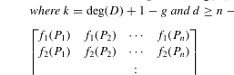

是 $\mathcal{C}(\mathcal{X}, \mathcal{P}, D)$ 的一个生成矩阵。

## 证明。
根据 Riemann-Roch 定理，$\dim(L(D)) = \deg(D) + 1 - g$，因为 $2g - 2 < \deg(D)$。因此，只要我们证明线性映射 $ev_\mathcal{P}$（参见练习 788）具有平凡核，这个值也是 $\mathcal{C}(\mathcal{X}, \mathcal{P}, D)$ 的维数 $k$。设 $\mathcal{P} = \{P_1, \dots, P_n\}$。假设 $ev_\mathcal{P}(f) = 0$。因此对所有 $i$ 都有 $f(P_i) = 0$，这意味着 $P_i$ 是 $f$ 的零点，且 $P_i$ 在 $\text{div}(f)$ 中的系数至少为 1。但 $P_i \notin \text{supp}(D)$，因此 $\text{div}(f) + D - P_1 - \cdots - P_n \ge 0$，这意味着 $f \in L(D - P_1 - \cdots - P_n)$。然而，$\deg(D) < n$，这意味着 $\deg(D - P_1 - \cdots - P_n) < 0$。根据定理 13.4.1(i)，$L(D - P_1 - \cdots - P_n) = \{0\}$，这表明 $f = 0$，因此 $ev_\mathcal{P}$ 具有平凡核。我们得出结论 $k = \deg(D) + 1 - g$。这也表明定理陈述中给出的矩阵是 $\mathcal{C}(\mathcal{X}, \mathcal{P}, D)$ 的一个生成矩阵。

## 示例 13.4.4
我们将证明窄义和扩展窄义 Reed-Solomon 码实际上是代数几何码。考虑 $\mathbb{F}_q$ 上由 $z = 0$ 给出的射影平面曲线 $\mathcal{X}$。曲线上的点为 $(x : y : 0)$，这本质上构成射影直线。设 $P_\infty = (1 : 0 : 0)$。直线上还有 $q$ 个剩余的 $\mathbb{F}_q$-有理点。设 $P_0$ 为由 $(0 : 1 : 0)$ 表示的 $\mathbb{F}_q$-有理点。设 $P_1, \dots, P_{q-1}$ 为剩余的 $\mathbb{F}_q$-有理点。对于窄义 Reed-Solomon 码，我们取 $n = q - 1$ 和 $\mathcal{P} = \{P_1, \dots, P_{q-1}\}$。对于扩展窄义 Reed-Solomon 码，我们取 $n = q$ 和 $\mathcal{P} = \{P_0, \dots, P_{q-1}\}$。固定满足 $1 \le k \le n$ 的 $k$，并设 $D = (k - 1)P_\infty$；注意当 $k = 1$ 时 $D = 0$。显然，$\mathcal{P} \cap \text{supp}(D) = \emptyset$，根据 Plücker 公式，$\mathcal{X}$ 是属为 $g = 0$ 的非奇异曲线，且 $\deg(D) = k - 1$。特别是，$\deg(D) > 2g - 2$，根据 Riemann-Roch 定理，$\dim L(D) = \deg(D) + 1 - g = k$。

我们声称

$$B = \left\{ 1, \frac{x}{y}, \frac{x^2}{y^2}, \dots, \frac{x^{k-1}}{y^{k-1}} \right\}$$

是 $L(D)$ 的一组基。首先，$\div(x^i / y^i) = j P_0 - j P_\infty$。因此 $\div(x^i / y^i) + D = j P_0 + (k - 1 - j) P_\infty$，当 $0 \le j \le k - 1$ 时它是有效的。因此，$B$ 中的每个函数都在 $L(D)$ 中。我们只需要证明 $B$ 在 $\mathbb{F}_q$ 上线性无关。假设

$$f = \sum_{j=0}^{k-1} a_j \frac{x^j}{y^j} \approx 0.$$

那么 $f = g/h$，其中 $g(x, y, z) = \sum_{j=0}^{k-1} a_j x^j y^{k-1-j}$ 且 $h(x, y, z) = y^{k-1}$。根据 $\approx$ 的定义，$g(x, y, z)$ 是 $z$ 的一个多项式倍数。显然，这个多项式倍数必须为 0，因为 $z$ 不出现在 $g(x, y, z)$ 中，这表明对 $0 \le j \le k - 1$ 有 $a_j = 0$。因此 $B$ 是 $L(D)$ 的一组基。

利用这个基，我们看到 $L(D)$ 中的每个非零多项式可以写成 $f(x, y, z) = g(x, y, z) / y^d$，其中 $g(x, y, z) = \sum_{j=0}^d c_j x^j y^{d-j}$ 且 $c_d \ne 0$ 与 $d \le k - 1$。但是 $g(x, y, z)$ 是 $m(x) = \sum_{j=0}^d c_j x^j$ 在 $\mathbb{F}_q[x, y]$ 中的齐次化。因此，关联 $f(x, y, z) \mapsto m(x)$ 在 $L(D)$ 与 $\mathbb{F}_q[x]$ 中次数不超过 $k-1$ 的多项式（连同零多项式，我们之前将其记为 $P_q$）之间建立了一一对应。此外，如果 $\beta \in \mathbb{F}_q$，则 $m(\beta) = f(\beta, 1, 0)$；另外，定理 13.1.3(i) 意味着 $f(\beta, 1, 0) = f(x_0, y_0, z_0)$，其中 $(x_0 : y_0 : z_0)$ 是 $(\beta : 1 : 0)$ 的任意表示，因为 $f$ 是两个次数均为 $d$ 的齐次多项式的比值。设 $\alpha$ 为 $\mathbb{F}_q$ 的一个原根。对点进行排序，使得对 $1 \le i \le q - 1$ 有 $P_i$ 由 $(\alpha^{i-1} : 1 : 0)$ 表示；然后如果 $n = q - 1$ 将 $\mathcal{P}$ 排序为 $P_1, \dots, P_{q-1}$，如果 $n = q$ 则排序为 $P_1, \dots, P_{q-1}, P_0$。此讨论表明

$$\{(m(1), m(\alpha), m(\alpha^2), \dots, m(\alpha^{(q-2)})) \mid m \in P_k\} = \{(f(P_1), f(P_2), f(P_3), \dots, f(P_{(q-1)})) \mid f \in L(D)\}$$

和

$$\{(m(1), m(\alpha), \dots, m(\alpha^{(q-2)}), m(0)) \mid m \in P_k\} = \{(f(P_1), f(P_2), \dots, f(P_{(q-1)}), f(P_0)) \mid f \in L(D)\}.$$

因此，根据我们在第 13.2.1 节中的介绍，窄义和扩展窄义 Reed-Solomon 码是代数几何码。

定理 13.4.3 表明，窄义和扩展窄义 Reed-Solomon 码的维数均为 $\deg(D) + 1 - g = k - 1 = 1 - 0 = k$，最小距离为 $d \ge n - \deg(D) = n - k + 1$。Singleton 界表明 $d \le n - k + 1$，因此 $d = n - k + 1$；每个码都是 MDS 码，正如我们早已知道的那样。

## 练习 778
设 $\mathcal{X}$ 为属为 0 的射影曲线。设 $D$ 为 $\mathcal{X}$ 上满足 $-2 < \deg(D) < n$ 的一个除子。证明 $\mathcal{C}(\mathcal{X}, \mathcal{P}, D)$ 是 MDS。

## 练习 779
在示例 13.4.4 中，我们表明 Reed-Solomon 码是代数几何码。在这里，你将证明广义 Reed-Solomon 码也是代数几何码，如文献 [320] 中所示。

### (a)
设 $\gamma_0, \gamma_1, \dots, \gamma_{n-1}$ 为 $\mathbb{F}_q$ 中的 $n$ 个不同元素。设 $v_0, v_1, \dots, v_{n-1}$ 为 $\mathbb{F}_q^*$ 中的 $n$ 个不一定不同的元素。证明拉格朗日插值公式，该公式指出存在一个次数不超过 $n-1$ 的多项式 $p(x) \in \mathbb{F}_q[x]$，使得 $p(\gamma_i) = v_i$，其形式为

$$p(x) = \sum_{i=0}^{n-1} v_i \prod_{j \neq i} \frac{x - \gamma_j}{\gamma_i - \gamma_j}. \quad (13.11)$$

在本题的其余部分，我们采用 (a) 部分的记号，并额外假设 $v_i$ 都不为零且 $v = (v_0, \dots, v_{n-1})$。另外，设 $\gamma = (\gamma_0, \dots, \gamma_{n-1})$。设 $\mathcal{X}$ 为 $\mathbb{F}_q$ 上由 $z = 0$ 给出的射影平面曲线。设 $h(x, y)$ 为由 (13.11) 给出的次数为 $n-1$ 的多项式 $p(x)$ 在 $\mathbb{F}_q[x, y]$ 中的齐次化；注意 $h \ne 0$，因为 $v \ne 0$。设 $u(x, y, z) = h(x, y)/y^d$，它是 $\mathbb{F}_q(\mathcal{X})$ 的一个元素。设 $\mathcal{P} = (P_1, P_2, \dots, P_n)$，其中 $P_i$ 是 $\mathbb{P}^2(\mathbb{F}_q)$ 中射影点 $(\gamma_{i-1} : 1 : 0)$ 的一个代表。设 $P_\infty = (1 : 0 : 0)$。最后，对于满足 $1 \le k \le n$ 的整数 $k$，设 $D = (k - 1)P_\infty - \div(u)$。

### (b)
证明对 $1 \le i \le n$ 有 $u(P_i) = v_{i-1}$。

5 回顾，在我们对 GRS 码的公式 (13.2) 中，确切的码取决于所选射影点的表示。这里介绍的窄义和扩展窄义 Reed-Solomon 码的公式有一个很好的特点，即确切的码与所选射影点的表示无关。


- (c) 证明 \(\mathcal{P} \cap \text{supp}(D) = \emptyset\)。

- (d) 证明 \(\text{deg}(D) = k - 1\)。提示：回顾，\(\mathbb{F}_q(\mathcal{X})\) 中任何元素的除子的次数为 0。

- (e) 证明 \(\dim(L(D)) = k\) 且
  \(\mathcal{B} = \left\{ u, u\frac{x}{y}, u\frac{x^2}{y^2}, \dots, u\frac{x^{k-1}}{y^{k-1}} \right\}\)
  是 \(L(D)\) 的一组基。

- (f) 证明 \(\text{GRS}_k(\gamma, \mathbf{v}) = \mathcal{C}(\mathcal{X}, \mathcal{P}, D)\)。

## 练习 781

令 \(\mathcal{X}\) 为由 \(x^3 + xz^2 + z^3 + y^2z + yz^2 = 0\) 定义的 \(\mathbb{F}_2\) 上的椭圆曲线。根据练习 774，\(\mathcal{X}\) 是非奇异的。\(\mathcal{X}\) 的亏格为 1。令 \(P_\infty = (0 : 1 : 0)\)，根据示例 13.3.3，它是 \(\mathcal{X}\) 上唯一的无穷远点。令 \(D = kP_\infty\)，其中 \(k\) 为某个正整数。

- (a) 证明 \(\dim(L(D)) = k\)。

- (b) 计算 \(\text{div}(x^i y^j / z^{i+1})\)，其中 \(i\) 和 \(j\) 为非负整数（包括 \(i = j = 0\) 的可能性）。提示：使用示例 13.3.7。

- (c) \(x^i y^j / z^{i+1}\) 属于 \(L(D)\) 必须满足什么条件？

- (d) 使用部分 (c) 中的函数，为 \(k \ge 1\) 找出 \(L(D)\) 的一组基。提示：先对 \(k = 1, 2, 3, 4, 5\) 进行计算，然后注意到
  \(\frac{x^3}{z^3} \approx \frac{x}{z} + 1 + \frac{y^2}{z^2} + \frac{2}{z}\)。

- (e) 令 \(\mathcal{P}\) 为 \(\mathbb{P}^2(\mathbb{F}_8)\) 上 \(\mathcal{X}\) 的四个仿射点（参见示例 13.3.3，其中这些点为 \(P_1, P_1', P_2, P_2'\)）。对于 \(\mathbb{F}_8\) 上每个 \(1 \le k \le 3\) 的码 \(\mathcal{C}(\mathcal{X}, \mathcal{P}, D)\)，应用定理 13.4.3 找出码的维数、其最小距离的下界以及生成矩阵。同时给出来自 Singleton Bound 的最小距离上界。

- (f) 令 \(\mathcal{P}\) 为 \(\mathbb{P}^2(\mathbb{F}_8)\) 上 \(\mathcal{X}\) 的 12 个仿射点（参见练习 777(b)，其中这些点是在计算曲线上 \(\mathbb{F}_2\) 上的 3 次点的过程中找到的）。对于 \(\mathbb{F}_8\) 上每个 \(1 \le k \le 11\) 的码 \(\mathcal{C}(\mathcal{X}, \mathcal{P}, D)\)，应用定理 13.4.3 找出码的维数、其最小距离的下界以及生成矩阵。同时给出来自 Singleton Bound 的最小距离上界。

练习 791 说明了所涉及字段的一些微妙概念。\(L(D)\) 的计算涉及某个基域 \(\mathbb{F}_q\)（练习中为 \(\mathbb{F}_2\)）上的除子。除子 \(D\) 以及 \(L(D)\) 中函数的除子涉及 \(\mathbb{F}_q\) 上不同次数的点，即坐标位于 \(\mathbb{F}_q\) 可能多个不同扩展域中的点集（练习中为 \(\mathbb{F}_4\)、\(\mathbb{F}_8\) 和 \(\mathbb{F}_9\)）。在构造代数几何码时，固定 \(\mathbb{F}_q\) 的一个扩展域 \(\mathbb{F}_{q^m}\)（可能是其本身），码是在域 \(\mathbb{F}_{q^m}\)（练习部分 (e) 中为 \(\mathbb{F}_8\)，部分 (f) 中为 \(\mathbb{F}_8\)）上定义的。\(\mathcal{P}\) 中的所有点必须在 \(\mathbb{F}_{q^m}\) 上是有理点。

## 练习 792

令 \(\mathcal{X}\) 为由 \(x^3 + y^2z + yz^2 = 0\) 定义的 \(\mathbb{F}_4\) 上亏格为 1 的 Hermitian 曲线 \(\mathcal{H}_3(\mathbb{F}_{q^2})\)。根据练习 774，\(\mathcal{X}\) 是非奇异的。在同一练习中找到了无穷远点 \(P_\infty = (0 : 1 : 0)\) 以及 \(\mathbb{P}^2(\mathbb{F}_4)\) 上 \(\mathcal{X}\) 的八个仿射点；其中两个仿射点为 \(P_0 = (0 : 0 : 1)\) 和 \(P_1 = (0 : 1 : 1)\)。令 \(D = k P_\infty\)，其中 \(k\) 为某个正整数。

- (a) 证明 \(\dim(L(D)) = k\)。

- (b) 证明 Hermitian 曲线与由 \(x = 0\) 定义的曲线的交除子为 \(P_\infty + P_0 + P_1\)。

- (c) 证明 Hermitian 曲线与由 \(y = 0\) 定义的曲线的交除子为 \(3P_0\)。

- (d) 找出 Hermitian 曲线与由 \(z = 0\) 定义的曲线的交除子。

- (e) 计算 \(\div(x^i y^j / z^{i+j})\)，其中 \(i\) 和 \(j\) 为非负整数（包括 \(i = j = 0\) 的可能性）。

- (f) 证明 \(x^i y^j / z^{i+j}\) 属于 \(L(D)\) 当且仅当 \(2i + 3j \le k\)。

- (g) 使用部分 (f) 中的函数，为 \(k \ge 1\) 找出 \(L(D)\) 的一组基。提示：证明可以假设 \(0 \le i \le 2\)，因为
  \[
  \frac{x^3}{z^3} \approx \frac{y^2}{z^2} + \frac{y}{z}.
  \]

- (h) 令 \(\mathcal{P}\) 为 \(\mathbb{P}^2(\mathbb{F}_4)\) 上 \(\mathcal{X}\) 的八个仿射点（参见练习 774）。对于 \(\mathbb{F}_4\) 上 \(1 \le k \le 7\) 的码 \(\mathcal{C}(\mathcal{X}, \mathcal{P}, D)\)，应用定理 13.4.3 找出码的维数、其最小距离的下界以及生成矩阵。同时给出来自 Singleton Bound 的最小距离上界。

## 练习 793

令 \(\mathcal{X}\) 为由 \(x^3 + y^3 + z^3 = 0\) 定义的 \(\mathbb{F}_{16}\) 上亏格为 6 的 Hermitian 曲线 \(\mathcal{H}_2(\mathbb{F}_{16})\)。根据练习 774，\(\mathcal{X}\) 是非奇异的。在同一练习中找到了无穷远点 \(P_\infty = (0 : 1 : 0)\) 以及 \(\mathbb{P}^2(\mathbb{F}_{16})\) 上 \(\mathcal{X}\) 的 64 个仿射点；其中两个仿射点为 \(P_0 = (0 : 0 : 1)\) 和 \(P_1 = (0 : 1 : 1)\)。令 \(D = k P_\infty\)，其中 \(k \ge 11\)。

- (a) 证明 \(\dim(L(D)) = k - 5\)。

- (b) 证明 Hermitian 曲线与由 \(x = 0\) 定义的曲线的交除子为 \(P_\infty + P_0 + 3P_1\)。

- (c) 证明 Hermitian 曲线与由 \(y = 0\) 定义的曲线的交除子为 \(3P_0\)。

- (d) 找出 Hermitian 曲线与由 \(z = 0\) 定义的曲线的交除子。

- (e) 计算 \(\div(x^i y^j / z^{i+j})\)，其中 \(i\) 和 \(j\) 为非负整数（包括 \(i = j = 0\) 的可能性）。

- (f) 证明 \(x^i y^j / z^{i+j}\) 属于 \(L(D)\) 当且仅当 \(4i + 5j \le k\)。

- (g) 使用部分 (f) 中的函数，为 \(k \ge 11\) 找出 \(L(D)\) 的一组基。提示：证明可以假设 \(0 \le i \le 4\)，因为
  \[
  \frac{x^5}{z^5} \approx \frac{y^4}{z^4} + \frac{y}{z}.
  \]

- (h) 令 \(\mathcal{P}\) 为 \(\mathbb{P}^2(\mathbb{F}_{16})\) 上 \(\mathcal{X}\) 的 64 个仿射点（参见练习 774）。对于 \(\mathbb{F}_{16}\) 上 \(11 \le k \le 63\) 的码 \(\mathcal{C}(\mathcal{X}, \mathcal{P}, D)\)，应用定理 13.4.3 找出码的维数及其最小距离的下界。同时给出来自 Singleton Bound 的最小距离上界。

## 练习 794

令 \(\mathcal{X}\) 为由 \(x^3 + y^3 + z^3 = 0\) 定义的 \(\mathbb{F}_2\) 上亏格为 1 的 Fermat 曲线。根据示例 13.3.1，\(\mathcal{X}\) 是非奇异的。在练习 773 和 778 中，找到了 \(\mathcal{X}\) 上 \(\mathbb{F}_2\) 上的 1、2 和 3 次点。令 \(P_\infty = (1:1:0)\) 和 \(P'_\infty = \{(\alpha:1:0), (\overline{\alpha}:1:0)\}\) 为 \(\mathcal{X}\) 上的无穷远点（参见练习 773）。令 \(D = k(P_\infty + P'_\infty)\)，其中 \(k\) 为某个正整数。

- (a) 证明 \(\dim(L(D)) = 3k\)。

- (b) 找出 Fermat 曲线与由 \(x = 0\) 定义的曲线的交除子。

- (c) 找出 Fermat 曲线与由 \(y = 0\) 定义的曲线的交除子。

- (d) 找出 Fermat 曲线与由 \(z = 0\) 定义的曲线的交除子。

- (e) 计算 \(\div(x^i y^j / z^{i+j})\)，其中 \(i\) 和 \(j\) 为非负整数（包括 \(i = j = 0\) 的可能性）。

- (f) \(x^i y^j / z^{i+j}\) 属于 \(L(D)\) 必须满足什么条件？

- (g) 使用部分 (f) 中的函数，为 \(k \ge 1\) 找出 \(L(D)\) 的一组基。提示：证明可以假设 \(0 \le i \le 2\)，因为
  \[
  \frac{x^3}{z^3} \approx \frac{y^3}{z^3} + 1.
  \]

- (h) 令 \(\mathcal{P}\) 为 \(\mathbb{P}^2(\mathbb{F}_4)\) 上 \(\mathcal{X}\) 的六个仿射点（参见练习 773）。对于 \(\mathbb{F}_4\) 上 \(k = 1\) 的码 \(\mathcal{C}(\mathcal{X}, \mathcal{P}, D)\)，应用定理 13.4.3 找出码的维数、其最小距离的下界以及生成矩阵。同时给出来自 Singleton Bound 的最小距离上界。

- (i) 令 \(\mathcal{P}\) 为 \(\mathbb{P}^2(\mathbb{F}_8)\) 上 \(\mathcal{X}\) 的八个仿射点（参见练习 773）。对于 \(\mathbb{F}_8\) 上 \(1 \le k \le 2\) 的两个码 \(\mathcal{C}(\mathcal{X}, \mathcal{P}, D)\)，应用定理 13.4.3 找出码的维数、其最小距离的下界以及生成矩阵。同时给出来自 Singleton Bound 的最小距离上界。

## 练习 795

令 \(\mathcal{X}\) 为由 \(x^3y + y^3z + z^3x = 0\) 定义的 \(\mathbb{F}_2\) 上亏格为 3 的 Klein 四次曲线。根据练习 775，\(\mathcal{X}\) 是非奇异的。在练习 775 和 780 中，找到了 \(\mathcal{X}\) 上 1、2 和 3 次的点。令 \(P_\infty = (0:1:0)\) 和 \(P'_\infty = (1:0:0)\) 为 \(\mathcal{X}\) 上的无穷远点，并令 \(P_0 = (0:0:1)\) 为 \(\mathcal{X}\) 上剩余的 \(\mathbb{F}_2\)-有理点（参见练习 775）。令 \(D = kP_\infty\)，其中 \(k\) 为某个 \(k \ge 5\) 的整数。

- (a) 证明 \(\dim(L(D)) = k - 2\)。

- (b) 证明 Klein 四次曲线与由 \(x = 0\) 定义的曲线的交除子为 \(3P_0 + P_\infty\)。

- (c) 证明 Klein 四次曲线与由 \(y = 0\) 定义的曲线的交除子为 \(P_0 + 3P'_\infty\)。

- (d) 找出 Klein 四次曲线与由 \(z = 0\) 定义的曲线的交除子。

- (e) 计算 \(\div(x^i y^j / z^{i+j})\)，其中 \(i\) 和 \(j\) 为非负整数（包括 \(i = j = 0\) 的可能性）。

- (f) 证明 \(x^i y^j / z^{i+j}\) 属于 \(L(D)\) 当且仅当 \(2i + 3j \le k\) 且 \(i \le 2j\)。

- (g) 使用部分 (f) 中的函数，为 \(k \ge 5\) 找出 \(L(D)\) 的一组基。提示：先对 \(k = 5, 6, \dots, 12\) 进行计算，然后证明可以假设 \(0 \le i \le 2\)，因为
  \[
  \frac{x^3 y}{z^4} \approx \frac{y^3}{z^3} + \frac{x}{z}.
  \]

- (h) 令 \(\mathcal{P}\) 为 \(\mathbb{P}^2(\mathbb{F}_8)\) 上 \(\mathcal{X}\) 的 22 个仿射点（参见练习 775）。对于每个码


在 $\mathbb{F}_8$ 上的 $C(\mathcal{X}, \mathcal{P}, D)$，其中 $5 \le k \le 21$，应用定理 13.4.3 找出该码的维数及其最小距离的下界。给出来自 Singleton Bound 的最小距离上界。最后，当 $k=21$ 时，找出该码的生成矩阵。

### 练习 796 证明如果 $D \ge 0$，则 $C(\mathcal{X}, \mathcal{P}, D)$ 包含全一码字。

回顾，根据定理 5.3.3，广义 Reed-Solomon 码的对偶码也是广义 Reed-Solomon 码。由于根据练习 790，广义 Reed-Solomon 码是代数几何码，因此自然会问代数几何码的对偶码是否也是代数几何码。答案是肯定的。可以证明（参见 [135, 定理 2.72] 或 [320, 定理 II.2.10]），$C(\mathcal{X}, \mathcal{P}, D)^\perp = C(\mathcal{X}, \mathcal{P}, E)$，其中 $E = P_1 + \cdots + P_n - D + (\eta)$ 是由 $\mathcal{P}$ 决定的某个 Weil 微分 $\eta$；该微分与第 13.2.2 节末尾及练习 771 中提到的函数的剩余有关。

## 13.5 重访 Gilbert-Varshamov 界

在第 2.10 节中，我们推导了对 $\mathbb{F}_q$ 上长度趋于无穷且相对距离趋近于 $\delta$ 的码族的最大可能速率的上界和下界
$$
\alpha_q(\delta) = \limsup_{n \to \infty} n^{-1} \log_q A_q(n, \delta n)
$$
。渐近 Gilbert–Varshamov 界是下界 $\alpha_q(\delta) \ge 1 - H_q(\delta)$，它保证存在一族码，其相对距离趋近于 $\delta$，速率趋近于或超过 $1 - H_q(\delta)$，其中 $H_q$ 是在 $0 \le x \le r = 1 - q^{-1}$ 上由以下公式定义的 Hilbert 熵函数
$$
H_q(x) = \begin{cases} 
0 & \text{if } x = 0, \\ 
x \log_q(q-1) - x \log_q x - (1-x) \log_q(1-x) & \text{if } 0 < x \le r,
\end{cases}
$$
如我们在第 2.10.3 节中首次描述的那样。在 Gilbert-Varshamov 界发表后的 30 年里，没有码族被证明超过该界，直到 1982 年才展示出存在这样一族代数几何码。在本节中，我们将讨论这一结果；但在此之前，我们将展示存在一族满足该界的 Goppa 码。

### 13.5.1 Goppa 码满足 Gilbert-Varshamov 界

定理 5.1.10 表明，$\mathbb{F}_q$ 上的原始 BCH 码是渐近劣的，这里我们回顾，长度趋于无穷的一组码若速率趋于 0 或相对距离趋于 0，则称为渐近劣。其他码族也存在此情况，例如循环码族，其扩展码是仿射不变的 [161]。通过将 $\mathbb{F}_{2^m}$ 上的 Reed-Solomon 码与由所有二进制 $m$ 元组组成的 $\{m, m, 1\}$ 二进制码进行串联得到的二进制码族也是渐近劣的 [218, 第 10 章]。回顾，长度趋于无穷的一组码若速率和相对距离都远离 0，则称为渐近好。当然，满足渐近 Gilbert–Varshamov 界的码是渐近好。对于大多数码族，例如循环码，尚不清楚该族是否渐近劣，或者是否包含渐近好码的子集。渐近好码的第一个显式构造是由 Justesen [160] 在 1972 年提出的；他的码是上述串联 Reed–Solomon 码的一种修改。虽然 Justesen 码是渐近好，但它们不满足渐近 Gilbert–Varshamov 界。然而，Goppa 码包含一组满足渐近 Gilbert–Varshamov 界的码。我们在此证明这一点。然而，读者会注意到，这一组 Goppa 码的构造不是显式的；也就是说，无法写下满足该界的特定码族。

在我们的构造中，我们需要 $\mathbb{F}_q[x]$ 中次数为 $e$ 的不可约一元多项式数量 $I_q(e)$ 的下界。在 [18] 中计算的 $I_q(e)$ 的精确值为
$$
I_q(e) = \frac{1}{e} \sum_{d|e} \mu(d)q^{e/d},
$$
其中 $\mu$ 是 Möbius 函数，当 $d=1$ 时 $\mu(d)=1$，当 $d$ 是 $r$ 个不同素数的乘积时 $\mu(d)=(-1)^r$，否则 $\mu(d)=0$。我们需要的下界是
$$
I_q(e) \ge \frac{q^e}{e} (1 - q^{-e/2+1}); \tag{13.12}
$$
其证明也可见 [18]。

### 定理 13.5.1 存在一族满足渐近 Gilbert–Varshamov 界的 $\mathbb{F}_q$ 上的 Goppa 码。

证明：设 $t$ 和 $d$ 为正整数。考虑 $\mathbb{F}_q$ 上长度为 $n=q^t$ 的 Goppa 码 $\Gamma(L, G)$，其中 $L = \{y_0, y_1, \dots, y_{n-1}\} = \mathbb{F}_{q^t}$ 且 $G \in \mathbb{F}_q[x]$。多项式 $G$ 不能在 $L$ 中有根，若我们选择 $G$ 为在 $\mathbb{F}_{q^t}$ 上次数 $e>1$ 的不可约多项式，则显然满足此要求。我们需要确定这样的 $G$ 存在的条件，以使 $\Gamma(L, G)$ 的最小距离至少为 $d$。为此，令 $\mathbf{c} = c_0 c_1 \cdots c_{n-1} \in \mathbb{F}_q^n$，其中 $0 < w(\mathbf{c}) = w$。若 $\mathbf{c} \in \Gamma(L, G)$，则 $\sum_{i=0}^{n-1} c_i / (x - \gamma_i) = a(x)/b(x)$，其中 $b(x)$ 是 $w$ 个因式 $(x - \gamma_j)$ 的乘积，且 $\deg(a(x)) \le w - 1$。此外，$a(x)$ 是 $G(x)$ 的倍数；特别是，$G(x)$ 必须是 $a(x)$ 次数为 $e$ 的不可约因式之一。这样的因式最多有 $(w-1)/e$ 个。因此，若要确保 $\mathbf{c} \notin \Gamma(L, G)$（当 $w<d$ 时我们需要此条件），则必须从 $\mathbb{F}_q[x]$ 中所有次数为 $e$ 的 $I_q(e)$ 个不可约多项式中，剔除最多 $\lfloor (w-1)/e \rfloor$ 个 $G$ 的选择。对于每个 $1 \le w < d$，有 $\binom{n}{w}(q-1)^w$ 个向量 $\mathbf{c}$ 不应属于 $\Gamma(L, G)$。因此，不能作为我们 $G$ 选择的不可约多项式最多有
$$
\sum_{w=1}^{d-1} \left\lfloor \frac{w-1}{e} \right\rfloor \binom{n}{w} (q-1)^w < \frac{d}{e} V_q(n, d)
$$
个，其中 $V_q(n, d) = \sum_{i=0}^{d} \binom{n}{i} (q-1)^i$。因此，由 (13.12)，若
$$
\frac{d}{e} V_q(n, d) < \frac{q^{te}}{e} (1 - q^{-te/2+1}), \tag{13.13}
$$
则我们可以找到一个不可约 $G$，使得 $\Gamma(L, G)$ 的最小距离至少为 $d$。若 $\delta = d/n$，取以 $q$ 为底的对数并除以 $n$，得到
$$
n^{-1}[\log_q(\delta n) + \log_q V_q(n, \delta n)] < \frac{te}{n} + n^{-1}[\log_q(1 - q^{-te/2+1})].
$$
当 $n$ 趋于无穷时取极限，由引理 2.10.3 得 $H_q(\delta) \le \lim_{n \to \infty} te/n$ 或 $1 - H_q(\delta) \ge 1 - \lim_{n \to \infty} te/n$。由于 $t = \log_q n$，我们可以选择一个增长足够快的递增 $e$ 序列，使得 (13.13) 中的不等式始终成立（从而保证存在长度递增的 $n=q^t$ 的 Goppa 码序列，其相对最小距离至少为 $\delta n$），且 $1 - H_q(\delta) = 1 - \lim_{n \to \infty} te/n$。定理 13.2.1 蕴含我们序列中的码速率至少为 $1 - te/n$；因此，该序列满足渐近 Gilbert–Varshamov 界。

### 13.5.2 代数几何码超过 Gilbert–Varshamov 界

Tsfasman、Vlăduţ 和 Zink 在 1982 年的结果 [333] 首次表明，存在一系列码，其相对距离趋近于 $\delta$，且当长度趋于无穷时，速率超过 $1 - H_q(\delta)$。由于涉及的数学超出了本书范围，我们将仅概述这一结果。

设 $\mathcal{X}$ 为 $\mathbb{F}_q$ 上亏格为 $g$ 的曲线，$\mathcal{P}$ 为 $\mathcal{X}$ 上大小为 $n$ 的 $\mathbb{F}_q$-有理点集合，$D$ 为 $\mathcal{X}$ 上的一个除子，满足 $\mathcal{P} \cap \text{supp}(D) = \emptyset$ 且 $2g - 2 < \deg(D) < n$。根据定理 13.4.3，$\mathcal{C}(\mathcal{X}, \mathcal{P}, D)$ 是 $\mathbb{F}_q$ 上的一个 $[n, k, d]$ 码，其速率为 $R = k/n = (\deg(D) + 1 - g)/n$，相对距离为 $d/n \ge (n - \deg(D))/n$。因此
$$
R + \delta \ge \frac{\deg(D) + 1 - g}{n} + \frac{n - \deg(D)}{n} = 1 + \frac{1}{n} - \frac{g}{n}.
$$
特别地，
$$
R \ge -\delta + 1 + \frac{1}{n} - \frac{g}{n}. \tag{13.14}
$$
因此，我们希望表明存在一系列由曲线定义的码，其长度 $n$ 递增，相对距离趋向于 $\delta$，且 $g/n$ 趋向于尽可能接近 0 的数。仅使用射影平面 $\mathbb{P}^2(\mathbb{F}_q)$ 中的曲线无法进行这样的构造，因为曲线上的点的数量是有限的（最多 $q^2 + q + 1$ 个），这意味着在曲线上定义的码的长度不能趋于无穷，因为长度被 $q^2 + q$ 所限制。通过允许我们考察的曲线来自更高维射影空间，这一限制得以克服。尽管单个曲线仍然只有有限个点，但该数量可随亏格的增长而增长。幸运的是，(13.14) 适用于更高维空间中的曲线，定理 13.4.3 亦然。

由于我们希望 $g/n$ 接近 0，因此希望 $n/g$ 尽可能大。为探讨该量的大小，定义 $N_q(g)$ 为 $\mathbb{P}^m(\mathbb{F}_q)$ 中亏格为 $g$ 的非奇异绝对不可约曲线 $\mathcal{X}$ 上 $\mathbb{F}_q$-有理点的最大数量，并令
$$
A(q) = \limsup_{g \to \infty} \frac{N_q(g)}{g}.
$$


构造我们所期望的码，首先构造一个适当的曲族，然后在这些曲之上定义码。根据我们的定义，存在一系列在 $\mathbb{F}_q$ 上的非奇异绝对不可约曲 $\mathcal{X}_i$，其亏格为 $g_i$，在 $\mathcal{X}_i$ 上有 $n_i + 1$ 个 $\mathbb{F}_q$-有理点，其中 $n_i$ 和 $g_i$ 趋于无穷，且 $\lim_{i \to \infty} (n_i + 1)/g_i = A(q)$。在 $\mathcal{X}_i$ 上选取一个 $\mathbb{F}_q$-有理点 $Q$，并令 $P_i$ 为 $\mathcal{X}_i$ 上剩余的 $\mathbb{F}_q$-有理点。令 $r_i$ 为满足 $2g_i - 2 < r_i < n_i$ 的整数。根据定理 13.4.3，码 $C_i = C(\mathcal{X}_i, P_i, r_i Q)$ 具有长度 $n_i$、速率 $R_i = (\deg(r_i Q) + 1 - g_i)/n_i = (r_i + 1 - g_i)/n_i$ 和相对距离 $\delta_i \ge 1 - \deg(r_i Q)/n_i = 1 - r_i/n_i$。因此，

$R_i + \delta_i \ge \frac{r_i + 1 - g_i}{n_i} + 1 - \frac{r_i}{n_i} = 1 + \frac{1}{n_i} - \frac{g_i}{n_i}.$

蕴含

$R \ge -\delta + 1 - \frac{1}{A(q)}.$

其中 $\lim_{i \to \infty} R_i = R$ 且 $\lim_{i \to \infty} \delta_i = \delta$。故，

$\alpha_q(\delta) \ge -\delta + 1 - \frac{1}{A(q)}.$ (13.15)

给出了 $\alpha_q(\delta)$ 的一个下界。我们必须确定 $A(q)$，以便看出这个界是否对渐近 Gilbert-Varshamov 界是一个改进。

$A(q)$ 的一个上界由 Drinfeld 和 Vlăduţ [74] 确定。

**定理 13.5.2** 对于任何素幂 $q$，$A(q) \le \sqrt{q} - 1$。

实际上，Tsfasman、Vlăduţ 和 Zink [333] 的结果表明，当 $q = p^2$ 或 $q = p^4$（$p$ 为素数）时，该界取等号；Ihara [153] 的结果表明，当 $q = p^{2m}$ 且 $m \ge 3$ 时，也取等号。

**定理 13.5.3** 设 $q = p^{2m}$，其中 $p$ 为素数。存在一系列在 $\mathbb{F}_q$ 上的非奇异绝对不可约曲 $\mathcal{X}_i$，其亏格为 $g_i$ 且有 $n_i + 1$ 个有理点，使得 $\lim_{i \to \infty} \frac{n_i}{g_i} = \sqrt{q} - 1$。

此结果及 (13.15) 给出了 $\alpha_q(\delta)$ 的如下界。

**定理 13.5.4** (渐近 Tsfasman–Vlăduţ–Zink 界) 如果 $q = p^{2m}$，其中 $p$ 为素数，则 $\alpha_q(\delta) \ge -\delta + 1 - \frac{1}{\sqrt{q} - 1}$。

这个下界由斜率为负的直线 $R = -\delta + 1 - 1/(\sqrt{q} - 1)$ 确定，该直线可能与也可能不与 Gilbert-Varshamov 曲线 $R = 1 - H_q(\delta)$ 相交，后者是下凸的。如果直线在两点与曲线相交，我们已表明存在一系列超过渐近 Gilbert-Varshamov 界的码。这种情况发生在 $q \ge 49$ 时。

定理 13.5.3 中的曲是模曲，不幸的是，证明没有给出显式构造。1995年，Garcia 和 Stichtenoth [96, 97] 构造了一个函数域塔，潜在地可用于构造一系列将超过渐近 Gilbert–Varshamov 界的代数几何码。2000年，确实提出了一种低复杂度算法来实现这一点 [307]。

### 习题 797
对 $q = 4$、$q = 49$ 和 $q = 64$ 中的每一个，绘制由渐近 Tsfasman–Vlăduţ–Zink 界和渐近 Gilbert–Varshamov 界给出的不等式的图像。对于 $q = 49$ 和 $q = 64$，给出 $\delta$ 的一个取值范围，使得 Tsfasman–Vlăduţ–Zink 界超过 Gilbert–Varshamov 界。

# 14 卷积码

迄今为止我们研究过的 [n, k] 码称为分组码，因为我们将 k 个信息符号的消息编码为长度为 n 的一个块。另一方面，卷积码使用一种编码方案，它不仅取决于当前正在传输的消息，还取决于若干个先前的消息。因此，“记忆”是卷积码编码器的一个重要特征。例如，如果 x(1), x(2), ... 是一系列来自 $\mathbb{F}_q^k$ 的消息，将在时间 1, 2, ... 处传输，那么具有记忆 M 的 (n, k) 卷积码将传输码字 c(1), c(2), ...，其中 c(i) $\in \mathbb{F}_q^n$ 取决于 x(i), x(i - 1), ..., x(i - M)。在我们对线性分组码的研究中，我们发现考虑长度 n 和维 k 都相当高的码并不寻常。相比之下，卷积码的研究和应用主要涉及 n 和 k 都非常小且 M 取各种值的 (n, k) 码。

卷积码由 Elias [78] 于 1955 年开发。在本章中，我们将仅介绍该主题并限制于二进制码。虽然存在多种卷积码解码算法，但主要算法归功于 Viterbi；我们将在 14.2 节中考察他的算法。这些码的早期数学理论由 Forney [88, 89, 90] 大量发展，并由 McEliece 在 [235] 中给出了现代代数处理。我们在演示中广泛使用后者，特别是在 14.3、14.4 和 14.5 节。有兴趣进行更深入处理的读者应查阅 Massey 的专著 [225]，或 Lin 和 Costello [197]、McEliece [232]、Piret [257] 和 Wicker [351] 的著作。卷积码最有前景的应用之一是构造 turbo 码，我们将在 15.7 节中介绍。卷积码与我们在前几章中开发的几种码一起，在深空探索中发挥了关键作用，这是本书最后一节的主题。

## 14.1 生成矩阵和编码

定义卷积码有多种方法。我们将介绍一个简单的定义，它让人联想到线性分组码的定义。

我们先从一些术语开始。令 D 为一个不定式；选择符号“D”是因为它将表示延迟操作。那么 $\mathbb{F}_2[D]$ 是变量 D 的所有二进制多项式的集合。这个集合是一个整环，并有一个商域，我们将其表示为 $\mathbb{F}_2(D)$。因此，$\mathbb{F}_2(D)$ 由 D 的所有有理函数组成，即 D 的所有多项式之比。一个 (n, k) 卷积码 C 是 $\mathbb{F}_2(D)^n$ 的一个 k 维子空间。注意，由于 $\mathbb{F}_2(D)$ 是一个无限域，C 包含无限数量的码字。C 的速率为 $R = k/n$；每 $k$ 比特的信息，$\mathcal{C}$ 生成 $n$ 个码字比特。$\mathcal{C}$ 的一个 *生成矩阵* $G$ 是一个 $k \times n$ 矩阵，其项在 $\mathbb{F}_2(D)$ 中，其行构成 $\mathcal{C}$ 的一组基。$G$ 乘以 $\mathbb{F}_2(D)$ 中的任何非零元素也将是 $\mathcal{C}$ 的一个生成矩阵。因此，如果我们将 $G$ 乘以 $G$ 项中出现的所有分母的最小公倍数，我们将得到 $\mathcal{C}$ 的一个生成矩阵，其所有项都是多项式。从这个讨论中我们看到，卷积码具有一个所有项都是多项式的生成矩阵；这样的矩阵称为 $\mathcal{C}$ 的一个 *多项式生成矩阵*。在 14.4 节中，我们将介绍这些多项式生成矩阵的二进制版本。

在继续之前，我们做两点观察。首先，与线性分组码一样，卷积码的生成矩阵的选择决定了编码。我们将主要考虑我们码的多项式生成矩阵。即使在这样的矩阵中，出于各种原因，有些选择也比其他选择更好。第二，直到解释编码程序和“$D$”的解释，消息和码字之间的联系才会被理解。我们在示例之后探讨这一点。

### 示例 14.1.1
令 $\mathcal{C}_1$ 为具有生成矩阵的 (2, 1) 卷积码

$G_1 = [1 + D + D^2 \quad 1 + D^2]$。

$\mathcal{C}_1$ 的第二个生成矩阵是

$G'_1 = [1 + D^3 \quad 1 + D + D^2 + D^3]$。

它是通过将 $G_1$ 乘以 $1 + D$ 得到的，回顾我们在二进制下工作。

令 $\mathcal{C}_2$ 为具有生成矩阵的 (4, 2) 卷积码

$G_2 = \begin{bmatrix} 1 & 1+D+D^2 & 1+D^2 & 1+D \\ 0 & 1+D & D & 1 \end{bmatrix}$。

根据习题 798，$\mathcal{C}_2$ 也由以下生成

$G'_2 = \begin{bmatrix} 1 & D & 1+D & 0 \\ 0 & 1+D & D & 1 \end{bmatrix}, \quad G''_2 = \begin{bmatrix} 1+D & 0 & 1 & D \\ D & 1+D+D^2 & D^2 & 1 \end{bmatrix}$。

### 习题 798
通过对示例 14.1.1 中给出的 $G_2$ 应用初等行变换，证明 $\mathcal{C}_2$ 也由 $G'_2, G''_2$ 和 $G'''_2$ 生成。

我们现在描述使用多项式生成矩阵 $G$ 对 $(n, k)$ 卷积码 $\mathcal{C}$ 进行编码的过程。为了强调 $G$ 与编码过程之间的密切联系，我们常将 $G$ 称为编码器。为了简化问题，我们首先考虑 $k = 1$ 的情况。由于 $k = 1$，在每个时间 $i = 0, 1, \dots$，一个比特（$\mathbb{F}_2$ 的一个元素）$\mathbf{x}(i)$ 输入到生成矩阵 $G$。因此，输入是一个比特流，“进入”生成矩阵，每个时间间隔一个比特。假设这个输入流有 $L$ 个比特。我们可以将这个输入流表示为多项式 $\mathbf{x} = \sum_{i=0}^{L-1} \mathbf{x}(i)D^i$。编码由 $\mathbf{x}G = \mathbf{c}$ 给出，类似于线性分组码的通常编码。码字 $\mathbf{c} = (\mathbf{c}_1, \mathbf{c}_2, \dots, \mathbf{c}_n)$ 有 $n$ 个分量 $\mathbf{c}_j$ 对于 $1 \le j \le n$，每个都是 $D$ 的一个多项式。在时间 0，the


生成矩阵已产生 n 位 c1(0), ..., cn(0)；在时刻 1，它已产生 n 位 c1(1), ..., cn(1)，等等。通常，分量 c1, ..., cn 被交织，使得输出流如下所示

c1(0), ..., cn(0), c1(1), ..., cn(1), c1(2), ..., cn(2), .... (14.1)

请注意，输入流 x(0), x(1), x(2), ... 的最左位实际上首先被输入，(14.1) 的最左位首先被输出。

## Example 14.1.2

假设在示例 14.1.1 中，G1 被用于对比特流 110101 使用 (2, 1) 码 C1 进行编码。该比特流对应于多项式 x = 1 + D + D^3 + D^5。因此，在时刻 0、1、3 和 5 输入编码器，而在时刻 2 和 4 输入 0。这被编码为 xG1 = (c1, c2)，其中 c1 = (1 + D + D^3 + D^5)(1 + D + D^2) = 1 + D^4 + D^6 + D^7 且 c2 = (1 + D + D^3 + D^5)(1 + D^2) = 1 + D + D^2 + D^3。因此 c1 = 10001011 且 c2 为 11100011。这些被交织，使得输出为 110101010001011。如果我们仔细观察生成 c1 和 c2 所做的乘法和加法，就可以看到记忆所起的作用。考虑时刻 i = 5 时码字 c1 的输出，即 c1(5)。该值是乘积 x(1 + D + D^2) 中 D^5 的系数，即 x(5) + x(4) + x(3)。因此，在时刻 5，编码器必须“记住”两个先前的输入。同样，我们看到

c1(i) = x(i) + x(i - 1) + x(i - 2), (14.2)
c2(i) = x(i) + x(i - 2). (14.3)

出于这个原因，我们说编码器的记忆为 M = 2。我们看到 D 作为延迟算子所起的作用。由于 c1 是 x(1 + D + D^2)，在时刻 i 我们有 c1(i) 是 x(i)(1 + D + D^2)。因此，如果我们将 x(i)D 解释为 x(i - 1) 并将 x(i)D^2 解释为 x(i - 2)，就能得到 c1(i) 的上述表达式。每个 D^j 的出现都会将输入延迟 j 个时间单位。

## Exercise 799

- (a) 如果对 110101 进行编码，给出得到的码字 (c1, c2)。同时给出交织输出。
- (b) 给出编码器 G1' 对应于方程 (14.2) 和 (14.3) 的 c1(i) 和 c2(i) 的方程。
- (c) 该编码器的记忆 M 是多少？

我们现在考察任意 k 的编码过程。这次输入是 k 个比特流 xj，其中 j = 1, 2, ..., k，它们构成了我们的消息 x = (x1, x2, ..., xk)。请注意，k 个比特 xj(0) 在时刻 0 进入编码器，随后是时刻 1 的 k 个比特 xj(1)，然后是时刻 2 的 xj(2)，以此类推。我们可以像以前一样将每个 xj 写成 D 的多项式。生成的码字再次是 xG = c = (c1, c2, ..., cn)，具有 n 个分量，每个分量都是 D 的多项式。这些分量随后像以前一样被交织。请注意，得到的码字是 G 的行的多项式组合，我们已将其解释为比特流输出。回想一下，码 C 是生成矩阵的行在 F2(D) 上的行张成，具有多项式分量的码字作为比特流具有意义，其中 D^i 的系数给出时刻 i 的输出。某些分量等于有理函数的码字也有解释，我们将在第 14.4 节中探讨。

## Example 14.1.3

假设在示例 14.1.1 中，G2 被用于对消息 (11010, 10111) 使用 (4, 2) 码 C2 进行编码。该消息对应于多项式对 x = (1 + D + D^3, 1 + D^2 + D^3 + D^4)。计算 xG2，我们得到码字 c = (1 + D + D^3, D + D^2 + D^4, 1 + D^2 + D^3 + D^4, D^4 + D^5)，它对应于 (1101, 01101, 10111, 0)。由于得到的分量长度不相同，问题就变成了如何进行交织？这只需通过在右侧填充 0 来完成。请注意，消息的分量每个长度为 5，因此对应于次数至多为 4 的多项式。由于 G2 中任何条目的最大次数为 2，得到的码字可能具有次数至多为 6 且因此长度为 7 的分量。因此，将每个分量用 0 填充至长度 7 是合适的。因此，我们将交织 (1101000, 0110100, 1011100, 0000000) 以获得 101101001101011010011000000000。对于该编码器，对应于 (14.2) 和 (14.3) 的方程变为

```
c1(i) = x1(i),
c2(i) = x1(i) + x1(i - 1) + x1(i - 2) + x2(i) + x2(i - 1),
c3(i) = x1(i) + x1(i - 2) + x2(i - 1),
c4(i) = x1(i) + x1(i - 1) + x2(i).
```

该编码器具有记忆 M = 2。

## Exercise 800

假设在示例 14.1.1 中，G2 被用于对消息进行编码。

- (a) 如果对 (11010, 10111) 进行编码，给出得到的码字 (c1, c2, c3, c4)。同时给出交织输出。
- (b) 给出编码器 G2' 对应于示例 14.1.3 中方程的 c1(i), ..., c4(i) 的方程。
- (c) 该编码器的记忆 M 是多少？

## Exercise 801

使用示例 14.1.1 的编码器 G2' 重复练习 800。

## Exercise 802

使用示例 14.1.1 的编码器 G2' 重复练习 800。

在使用卷积码时，人们可能有兴趣使用移位寄存器构建物理编码器。回顾第 4.2 节，我们给出了循环码的编码方案，并说明如何使用线性反馈移位寄存器物理实现其中一种方案。对于卷积码的编码，我们将使用线性前馈移位寄存器。这种移位寄存器的主要组件再次是延迟元件（也称为触发器）和图 4.1 中所示的二进制加法器。与循环码的编码器一样，卷积码的编码器由外部时钟驱动，该时钟每隔 t0 秒生成一个时序信号，即时钟周期。

## Example 14.1.4

图 14.1 给出了使用编码器 G1 为示例 14.1.1 的码 C1 设计物理编码器的方案。表 14.1 显示了使用此电路对 110101 进行编码的过程。列 "Register before cycle" 显示时钟周期 i 开始前移位寄存器的内容。请注意，移位寄存器最初包含 x(0) = 1, x(-1) = 0，

## Table 14.1 Encoding 110101 using Figure 14.1

| 周期前寄存器 | 时钟周期 i | c1(i) | c2(i) |
| :--- | :--- | :--- | :--- |
| 100 | 0 | 1 | 1 |
| 110 | 1 | 0 | 1 |
| 011 | 2 | 0 | 1 |
| 101 | 3 | 0 | 0 |
| 010 | 4 | 1 | 0 |
| 101 | 5 | 0 | 0 |
| 010 | 6 | 1 | 0 |
| 001 | 7 | 1 | 1 |
| 000 | 8 | | |

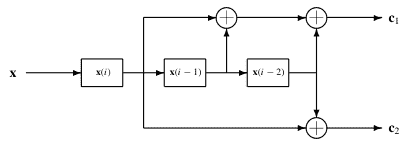

## 图 14.1 编码器 \(G_1 = [1 + D + D^2 + 1 + D^2]\) 的物理实现

and x(-2) = 0；这是时钟周期 0 之前的内容。在时钟周期 i 开始时，x(i + 1) 从左侧进入移位寄存器，将 x(i) 推入中间触发器，将 x(i - 1) 推入最右侧触发器，同时 c1(i) 和 c2(i) 由二进制加法器计算。请注意，最后一位 x(5) = 1 在时钟周期 5 开始前进入；此时移位寄存器包含 101。由于编码器具有记忆 M = 2，时钟再循环两次以完成编码。因此给出了两个输入脉冲。这些输入显然是 0，因为 1 + D + D^3 + D^5 与 1 + D + D^3 + D^5 + 0D^6 + 0D^7 相同。请注意，输出 c1 和 c2 与示例 14.1.2 中的计算一致。时钟周期 7 在左侧有新位进入移位寄存器时完成。这可能是下一条要编码的消息的第一位；两个最右侧寄存器都包含 0，为传输下一条消息做好电路准备。下一条消息的第一位在表 14.1 中用 "?" 表示。请注意，"Register before cycle" 的第一列是输入消息。

## Exercise 803

为示例 14.1.1 的编码器 \(G_1\) 绘制一个类似于图 14.1 的物理编码器。还要为使用你绘制的电路对 110101 进行编码构建一个类似于表 14.1 的表格。将你的答案与练习 799 中得到的答案进行比较。

## Exercise 804

为示例 14.1.1 的编码器 \(G_2\) 绘制一个带有两个移位寄存器的、类似于图 14.1 的物理编码器。然后为使用你绘制的电路对 (11010, 10111) 进行编码构建一个类似于表 14.1 的表格。将你的答案与示例 14.1.3 中得到的答案进行比较。

## Exercise 805

使用示例 14.1.1 的编码器 \(G'_2\) 重复练习 804。将你的答案与练习 800 中得到的答案进行比较。

## Exercise 806

使用示例 14.1.1 的生成矩阵 \(G''_2\) 重复练习 804。将你的答案与练习 801 中得到的答案进行比较。

## Exercise 807

使用示例 14.1.1 的生成矩阵 \(G'''_2\) 重复练习 804。将你的答案与练习 802 中得到的答案进行比较。

## 14.2 维特比解码

在本节中，我们介绍用于解码卷积码的维特比解码算法。该算法由 A. J. Viterbi [339] 于 1967 年提出。维特比算法也已应用于更一般的场景；参见 [234, 257, 336]。为了最容易理解该算法，我们首先描述状态图和特雷利斯图。

### 14.2.1 状态图

对于卷积码的每个多项式生成矩阵，我们可以关联一个允许进行编码的状态图。状态图与移位寄存器图密切相关，并提供了一种在任何时钟时间找到输出的可视化方法。

设 \(G\) 为卷积码 \(C\) 的一个 \((n, k)\) 多项式生成矩阵，由此产生了一个物理编码器。与以前一样，最好先对 \(k=1\) 的情况定义状态图。编码器在时刻 \(i\) 的状态本质上是时刻 \(i\) 移位寄存器的内容，即在时刻 \(i\) 之前进入移位寄存器的内容。例如，图 14.1 所给物理编码器的编码器 \(G_1\) 在时刻 \(i\) 的状态是移位寄存器两个最右侧延迟元件的内容 \(\mathbf{x}(i-1), \mathbf{x}(i-2)\)。如果我们知道状态、时刻 \(i\) 的编码器以及时刻 \(i\) 的输入 \(\mathbf{x}(i)\)，那么我们可以从此信息计算时刻 \(i\) 的输出 \((\mathbf{c}_1(i), \dots, \mathbf{c}_n(i))\)。更一般地，如果时刻 \(i\) 的移位寄存器包含 \(\mathbf{x}(i), \mathbf{x}(i-1), \dots, \mathbf{x}(i-M)\)，那么编码器 _处于状态_ \((\mathbf{x}(i-1), \mathbf{x}(i-2), \dots, \mathbf{x}(i-M))\)。在上一节中，我们看到编码方程 \(\mathbf{c} = \mathbf{x}G\) 给出了 \(n\) 个方程，用于在时刻 \(i\) 计算的 \(n\) 个 \(c_j(i)\)，用 \(\mathbf{x}(i), \mathbf{x}(i-1), \dots, \mathbf{x}(i-M)\) 表示，其中 \(M\) 是编码器的记忆。因此，从这些方程我们可以看到，如果我们有时刻 \(i\) 的状态和输入 \(\mathbf{x}(i)\)，就可以计算输出 \(\mathbf{c}(i)\)。

## Example 14.2.1

考虑表 14.1。在时钟周期 3 开始前，移位寄存器的内容是 101，因此编码器处于状态 01。由于 \(\mathbf{x}(3) = 1\)，编码器移动到状态 10，这是时钟周期 4 开始前的状态，与输入 \(\mathbf{x}(4)\) 无关。


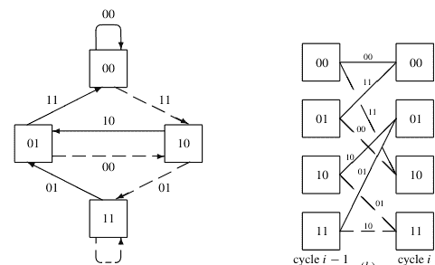

图 14.2 $G_1 = [1+D+D^2 \quad 1+D^2]$ 的状态图。

具有记忆 $M$ 的 $(n, 1)$ 卷积码编码器的状态集是所有有序二进制 $M$ 元组的集合。状态集的大小为 $2^M$，表示编码器在任意时刻可能处于的所有状态。

状态图是按以下方式确定的带标签有向图。图的顶点是状态集。有两种类型的有向边：实线和虚线。如果输入为 0，则从一个顶点到另一个顶点的有向边为实线；如果输入为 1，则为虚线；边随后标记输出。换句话说，从顶点 $(x(i-1), \dots, x(i-M))$ 到顶点 $(x(i), x(i-1), \dots, x(i-M+1))$ 的有向边在 $x(i) = 0$ 时为实线，在 $x(i) = 1$ 时为虚线，并标记为 $(c_i(i), \dots, c_n(i))$。请注意，通过查看边两端的顶点，我们可以确定时刻 $i$ 的移位寄存器内容，从而计算边标签以及边是实线还是虚线。

### 示例 14.2.2 图 14.2 显示了示例 14.1.1 中生成矩阵 $G_1$ 的状态图。给出了两个版本的状态图。可以通过始终从状态 00 开始并结束于状态 00 来遍历图 14.2(a) 中的图来对任何消息进行编码。例如，如果要编码 101，则从状态 00 开始，因为第一个输入是 1，所以遍历虚线边；该边结束于状态 10 并输出 11。接下来，因为下一个输入是 0，所以从状态 10 到状态 01 遍历实线边并输出 10。现在从状态 01 到状态 10 遍历虚线边并输出 00。输入已用完，但不在状态 00——移位寄存器尚未全为 0。因此，我们输入 0，并沿输出为 10 的实线边从状态 10 遍历到状态 01；最后，再输入一个 0，沿输出为 11 的实线边从状态 01 到达状态 00。因此，101 的编码为 1110001011。图 14.2(b) 本质上是同一图的扩展，以显示时钟时刻 $i-1$ 和 $i$ 的状态。

### 练习 808 绘制示例 14.1.1 中编码器 $G'_1$ 的两个版本的状态图，如图 14.2 所示。$\diamond$

当 $k > 1$ 时，多项式生成矩阵 $G = (g_{i,j}(D))$ 的 $(n, k)$ 卷积码也适用相同的一般思想。对于 $1 \le i \le k$，令

$$
m_i = \max_{1 \le j \le n} \deg(g_{i,j}(D)) \tag{14.4}
$$

为第 $i$ 行中条目的最大次数；$m_i$ 称为 $G$ 的 *第 $i$ 行的次数*。我们将采用零多项式次数为 $-\infty$ 的约定。设 $\mathbf{x} = (\mathbf{x}_1, \dots, \mathbf{x}_k)$ 为要编码的消息，时刻 $i$ 的第 $j$ 个输入为 $\mathbf{x}_j(i)$。设 $\mathbf{xG} = \mathbf{c} = (\dots, \mathbf{c}_i, \dots)$ 为得到的码字。对于 $1 \le j \le k$，每个 $\mathbf{c}_j(i)$ 是某些 $\mathbf{x}_j(I)$ 的组合，其中 $I = i, i-1, \dots, i-m_j$。因此，如果我们知道输入 $\mathbf{x}_j(i)$ 以及从时刻 $i-1$ 回溯到时刻 $i-m_j$ 的所有第 $j$ 个输入，则可以确定输出。因此，在时刻 $i$，我们说编码器处于 *状态* $(\mathbf{x}_1(i-1), \dots, \mathbf{x}_1(i-m_1), \mathbf{x}_2(i-1), \dots, \mathbf{x}_2(i-m_2), \dots, \mathbf{x}_k(i-1), \dots, \mathbf{x}_k(i-m_k))$。$G$ 的 *状态集* 是所有有序二进制 $(m_1 + m_2 + \cdots + m_k)$ 元组的集合。状态集的大小为 $2^{m_1+m_2+\cdots+m_k}$，表示编码器在任意时刻可能处于的所有可能性。请注意，编码器 $G$ 的记忆 $M$ 是 $m_j$ 的最大值；特别是，当 $k=1$ 时，$M=m_1$。

### 示例 14.2.3 对于示例 14.1.1 中 $(4, 2)$ 卷积码 $C_2$ 的编码器 $G_2$，$m_1 = 2$ 且 $m_2 = 1$。因此，对于 $G_2$ 有八个状态，表示 $(\mathbf{x}_1(i-1), \mathbf{x}_1(i-2), \mathbf{x}_2(i-1))$；请注意，示例 14.1.3 中给出的 $\mathbf{c}(i)$ 是由状态 $(\mathbf{x}_1(i-1), \mathbf{x}_1(i-2), \mathbf{x}_2(i-1))$ 和输入 $(\mathbf{x}_1(i), \mathbf{x}_2(i))$ 确定的。对于 $C_2$ 的生成矩阵 $G'_2$，$m_1 = m_2 = 1$，四个状态表示 $(\mathbf{x}_1(i-1), \mathbf{x}_2(i-1))$。对于 $C_2$ 的编码器 $G''_2$，$m_1 = 1, m_2 = 2$，两个状态表示 $\mathbf{x}_2(i-1)$。最后，对于 $C_2$ 的编码器 $G'''_2$，$m_1 = 1, m_2 = 2$，八个状态表示 $(\mathbf{x}_1(i-1), \mathbf{x}_2(i-1), \mathbf{x}_2(i-2))$。$\blacksquare$

对于 $k > 1$ 的状态图与 $k = 1$ 的情况类似构建。带标签有向图的顶点是状态集。然而，这次必须有 $2^k$ 种类型的边，分别表示来自每个可能输入 $(\mathbf{x}_1(i), \mathbf{x}_2(i), \dots, \mathbf{x}_k(i))$ 的 $2^k$ 个可能的二进制 $k$ 元组。同样，边标记为输出 $(\mathbf{c}_1(i), \dots, \mathbf{c}_n(i))$。

### 示例 14.2.4 考虑与示例 14.1.1 中 $(4, 2)$ 卷积码 $C_2$ 的生成矩阵 $G_2$ 的图 14.2(a) 类似的状态图。该状态图有八个顶点，总共 32 条边。边有四种类型。每个顶点离开四条边，每种类型各一条。例如，假设所有表示输入 $(\mathbf{x}_1(i), \mathbf{x}_2(i)) = (0, 0)$ 的边都是实线红边，表示 $(1, 0)$ 的是实线蓝边，表示 $(0, 1)$ 的是虚线蓝边，表示 $(1, 1)$ 的是虚线红边。然后，使用示例 14.1.3 中给出的 $\mathbf{c}(i)$ 方程，离开 $(\mathbf{x}_1(i-1), \mathbf{x}_1(i-2), \mathbf{x}_2(i-1)) = (0, 1, 1)$ 的实线红边结束于顶点 $(0, 0, 0)$ 并标记为 $(0, 0, 0, 0)$；离开 $(0, 1, 1)$ 的实线蓝边结束于顶点 $(1, 0, 0)$ 并标记为 $(1, 1, 1, 1)$；离开 $(0, 1, 1)$ 的虚线蓝边结束于顶点 $(0, 0, 1)$ 并标记为 $(0, 1, 0, 1)$；离开 $(0, 1, 1)$ 的虚线红边结束于顶点 $(1, 0, 1)$ 并标记为 $(1, 0, 1, 0)$。

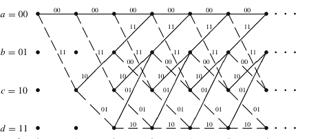

图 14.3 编码器 \( G_1 = [1 + D + D^2 \ 1 + D^2] \) 的栅格图。

### 练习 809 验证示例 14.2.4 中描述的四条边的边标签如所声称。\(\diamond\)

### 练习 810 给出示例 14.1.1 中 (4, 2) 卷积码 \( C_2 \) 的编码器 \( G'_2 \) 的状态图。以与图 14.2(b) 类似的形式绘制图表可能最为简单。\(\diamond\)

### 练习 811 使用示例 14.1.1 中的编码器 \( G''_2 \) 重复练习 810。\(\diamond\)

## 14.2.2 栅格图

卷积码编码的栅格图仅是从时刻 \( i = 0 \) 开始的状态图的扩展。我们在图 14.3 中对此进行了说明，用于示例 14.1.1 中 (2, 1) 卷积码 \( C_1 \) 的生成矩阵 \( G_1 \)。状态标记为 \( a = 00 \)、\( b = 01 \)、\( c = 10 \) 和 \( d = 11 \)。请注意，栅格图是图 14.2(b) 的重复，理解为在时刻 \( i = 0 \) 时，唯一使用的状态是零状态 \( a \)；因此，在时刻 \( i = 1 \) 时，在时刻 \( i = 1 \) 可到达的唯一状态是 \( a \) 和 \( c \)，因此只在那个时刻绘制它们。编码可以通过从状态 \( a \)（并结束于零状态 \( a \)）从左到右追踪栅格图来完成。例如，如果我们让时刻 \( i \) 的状态 \( s \in \{a, b, c, d\} \) 表示为 \( s_i \)，那么 1011 的编码通过路径 \( a_0 b_1 c_2 d_3 b_4 s_5 \) 完成，即依次遵循一条虚线、一条实线、两条虚线，最后两条实线边（因为我们必须输入两个额外的 0 才能到达状态 \( a \)）；通过写下路径边上的标签，这得到码字 111000101011。

### 练习 812 使用图 14.3 的栅格图对以下消息进行编码：
- (a) 1001，
- (b) 0011。\(\diamond\)

### 练习 813 绘制示例 14.1.1 中呈现的 (2, 1) 卷积码 \( C_1 \) 的编码器 \( G'_1 \) 的栅格图。练习 808 的结果将很有用。\(\diamond\)

### 练习 814 绘制示例 14.1.1 中呈现的 (4, 2) 卷积码 \( C_2 \) 的编码器 \( G'_2 \) 的栅格图。练习 810 的结果将很有用。\(\diamond\)


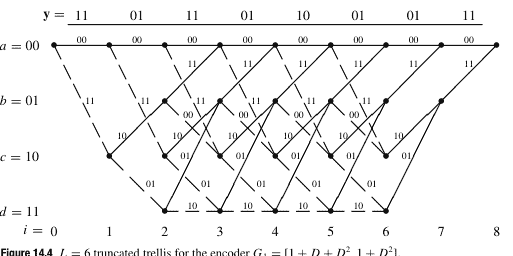

### 14.2.3 维特比算法

维特比算法使用卷积码编码器的格栅图来解码接收向量。我们描述的维特比算法版本将实现最近邻解码。假设要编码的消息在 $L$ 个时间周期内使用具有存储器 $M$ 的生成矩阵输入。该算法要求我们考虑从时间 $i = 0$ 开始并在时间 $L + M$ 结束的格栅部分；这称为 $L$ 截短格栅。我们始终从左到右遍历格栅。图 14.4 显示了示例 14.1.1 中生成矩阵 $G_1$ 的 $L = 6$ 截短格栅，我们必须检查它来解码长度为 6 的消息。

假设消息 $x(i) = (x_1(i), \dots, x_k(i))$（其中 $i = 0, 1, \dots, L - 1$）使用生成矩阵 $G$ 编码，以产生码字 $c(i) = (c_1(i), \dots, c_n(i))$（其中 $i = 0, 1, \dots, L + M - 1$）。假设接收到 $y(i) = (y_1(i), \dots, y_n(i))$（其中 $i = 0, 1, \dots, L + M - 1$）。我们定义格栅中路径的权重。首先，如果 $e$ 是连接时间 $i - 1$ 处状态 $s$ 与时间 $i$ 处状态 $s'$ 的边，则边 $e$ 的权重是边 $e$ 的边标签与时间 $i - 1$ 处接收向量部分 $y(i - 1)$ 之间的汉明距离。通过格栅的路径 $P$ 的权重是路径中各边权重之和。因此，边和路径的权重取决于接收向量。用 $a_0$ 表示时间 $0$ 处的零状态。假设 $P$ 是从 $a_0$ 开始并在时间 $i$ 处以状态 $s$ 结束的格栅路径；如果该路径 $P$ 的权重在所有从 $a_0$ 开始并在时间 $i$ 处以状态 $s$ 结束的路径中最小，则该路径 $P$ 是时间 $i$ 处的幸存路径。所有从 $a_0$ 开始并在时间 $i$ 处以状态 $s$ 结束的幸存路径的集合将表示为 $S(i)$。如果 $P$ 是从 $a_0$ 开始并在时间 $i$ 结束的格栅路径，则定义 $c_P$ 为与 $P$ 关联的码字，其中 $c_P(i)$ 是 $P$ 中从时间 $i$ 处的状态到时间 $i + 1$ 处的状态的边的标签，适用于 $0 \le i < I$。定义 $x_P$ 为与 $P$ 关联的消息，其中 $x_P(i)$ 是由 $P$ 中从时间 $i$ 处的状态到时间 $i + 1$ 处的状态的边的类型标识的输入，适用于 $0 \le i < \min\{I, L\}$。

1 格栅和维特比算法也可用于解码分组码。有关讨论，请参见 [336]。

我们现在分四个步骤描述维特比解码算法：

- I. 为 $G$ 绘制 $L$ 截短格栅，将边标签替换为边权重。用 $a$ 表示零状态。
- II. 使用步骤 I 的格栅，对所有状态 $s$ 计算 $S(s, 1)$。
- III. 使用步骤 I 的格栅，对 $i = 2, 3, \dots, L + M$ 重复以下操作。假设已对所有状态 $s$ 计算出 $S(s, i - 1)$，则对所有 $s$ 计算 $S(s, i)$，方法如下。对于每个状态 $s'$ 和每条从 $s'$ 到 $s$ 的边 $e$，构造由 $P'$ 后跟 $e$ 组成的路径 $P$，其中 $P' \in S(s', i - 1)$。如果 $P$ 在所有此类路径中权重最小，则将 $P$ 包含在 $S(s, i)$ 中。
- IV. $y$ 的任何最近邻都是任何 $P \in S(a, L + M)$ 的 $c_P$，它由消息 $x_P$ 给出。

为什么这有效？显然，$y$ 的最近邻 $c$ 是 $S(a, L + M)$ 中任何路径 $P$ 得到的 $c_P$，因为 $S(a, L + M)$ 包含所有从 $a_0$ 到 $a_{L+M}$ 且具有 $L + M$ 条边的最小权重路径，其中 $a_{L+M}$ 表示时间 $L + M$ 处的零状态。我们需要确认的唯一事项是步骤 II 和 III 产生 $S(a, L + M)$。如果我们证明这些步骤产生 $S(s, i)$，这当然成立。步骤 II 按定义对所有 $s$ 产生 $S(s, 1)$。如果 $P \in S(s, i)$，则 $P$ 由在时间 $i - 1$ 处以状态 $s'$ 结束的路径 $P'$ 后跟从 $s'$ 到 $s$ 的边 $e$ 组成。如果 $P'$ 不在 $S(s', i - 1)$ 中，则存在一条从 $a_0$ 开始并在时间 $i - 1$ 处以状态 $s'$ 结束且权重低于 $P'$ 的路径 $P''$。但是，路径 $P''$ 后跟 $e$ 在时间 $i$ 处以状态 $s$ 结束且权重低于 $P$，这产生矛盾。因此，步骤 III 正确地确定 $S(s, i)$。

### 示例 14.2.5

我们通过使用图 14.4 的格栅解码接收向量 $y = 110111011001011$ 来说明维特比算法。回顾，对于代码 $C_1$，每个时钟周期接收两个比特；$y$ 为方便列在图 14.4 的顶部。步骤 I 的格栅如图 14.5 所示。再次说明，状态为 $a = 00$、$b = 01$、$c = 10$ 和 $d = 11$；我们用 $s_i$ 表示时间 $i$ 处的状态 $s$。因此，时间 $0$ 处的零状态是 $a_0$。

对于步骤 II，$S(a, 1) = \{a_{00}\}$，$S(b, 1) = \emptyset$，$S(c, 1) = \{a_{0c1}\}$，且 $S(d, 1) = \emptyset$。由此，我们可以使用步骤 III 的规则计算 $S(s, 2)$，得到 $S(a, 2) = \{a_{0a0a2}\}$，$S(b, 2) = \{a_{0c}b_2\}$，$S(c, 2) = \{a_{0a}c_2\}$，且 $S(d, 2) = \{a_{0a}d_2\}$；请注意，$S(s, 2)$ 中列出的路径

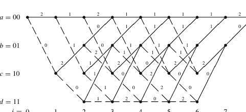

图 14.5 图 14.4 的编码器和接收向量的截短格栅中的权重。

以 $a_0$ 或 $c_1$ 开头，即 $S(s', 1)$ 中的路径。这些路径在图 14.6 中给出。考虑如何构造 $S(a, 3)$。查看每个 $S(s, 2)$ 中的路径，我们发现只有两种可能性：$a_0 a_1 a_2$ 后跟边 $a_2 a_3$ 得到路径 $a_0 a_1 a_2 a_3$，以及 $a_0 c_1 b_2$ 后跟边 $b_2 a_3$ 得到路径 $a_0 c_1 b_2 a_3$。然而，前者权重为 5，而后者权重为 2，因此 $S(a, 3) = \{a_0 c_1 b_2 a_3\}$。计算其他 $S(s, 3)$ 类似。我们继续归纳，直到计算出 $S(a, 8)$。所有路径均在图 14.6 中给出；为了便于计算，我们在路径的末顶点下方给出了路径权重。请注意，某些路径会停止（例如 $a_0 c_1 c_2$）。这是因为当向路径添加一条边时，得到的路径权重高于以同一顶点结束的其他路径。

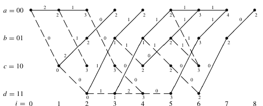

图 14.6 图 14.4 的编码器和接收向量的维特比算法。

为了完成算法的步骤 IV，我们注意到 $S(a, 8)$ 包含唯一路径 $P = a_0 c_1 d_2 b_3 c_4 b_5 d_6 b_7 a_8$，其权重为 2。通过在图 14.4 中跟踪 $P$ 得到的码字 $c_P$ 为 1101100100010111，它与接收向量在两个位置不同（即路径 $P$ 的权重）。格栅中的所有其他路径权重均为 3 或更高，因此相应的码字与 $y$ 的距离至少为 3。由于实线边来自输入 0，虚线边来自输入 1，通过在图 14.4 中跟踪 $P$ 的前六条边得到的导致 $c_P$ 的六个输入给出消息 111011。

### 练习 815

验证图 14.5 的截短格栅中给出的权重是否正确。

### 练习 816

验证示例 14.2.5 中描述的维特比算法是否已由图 14.6 正确总结。

### 练习 817

使用维特比算法解码使用示例 14.1.1 中生成矩阵 $G_1$ 的 $(2, 1)$ 卷积码 $C_1$ 发送的以下接收向量。绘制类似于图 14.6 的格栅。给出导致最近码字的路径、最近码字、传输中出现的错误数（假设你计算的码字正确）以及相关消息。(a) 1100011111111011。(b) 0110110110011001。（有两个答案。）

随着 1967 年维特比算法的发现，卷积码得到了更广泛的应用。从本节的示例和练习可以看出，$(n, k)$ 卷积码的算法复杂度在很大程度上取决于存储器 $M$ 和 $k$。因此，该算法通常仅用于 $M$ 和 $k$ 相对较小的情况。卷积码还有其他解码算法，例如顺序解码。然而，每种算法都有其自身的缺点。

## 14.3 标准生成矩阵

正如我们所见，卷积码可以有许多不同的生成矩阵，包括其项为 $D$ 的非多项式有理函数的矩阵。我们专注于多项式生成矩阵；在这些多项式生成矩阵中，首选的是标准生成矩阵。

我们先介绍一些必要的术语。设 $G = [g_{i,j}(D)]$ 为一个 $k \times n$ 多项式矩阵。回顾 (14.4)，$G$ 的第 $i$ 行的次数定义为第 $i$ 行中各项的最大次数。定义 $G$ 的外部次数，记为 $\operatorname{extdeg} G$，为 $G$ 的 $k$ 行次数之和。

### 示例 14.3.1

示例 14.1.1 中 $(2, 1)$ 卷积码 $C_1$ 的生成矩阵 $G_1$ 和 $G'_1$ 的外部次数分别为 2 和 3。同一示例中代码 $C_2$ 的生成矩阵 $G_2$ 的外部次数为 $2 + 1 = 3$。

### 练习 818

求示例 14.1.1 中代码 $C_2$ 的生成矩阵 $G'_2$、$G''_2$ 和 $G'''_2$ 的外部次数。

卷积码 $C$ 的标准生成矩阵是任何在 $C$ 的所有多项式生成矩阵中外部次数最小的多项式生成矩阵。按定义，每个卷积码都有一个标准生成矩阵。这个最小外部次数称为代码 $C$ 的次数。

### 示例 14.3.2

我们可以如下证明 $G_1$ 是示例 14.1.1 中 $(2, 1)$ 码 $C_1$ 的标准生成矩阵。在这种情况下，$C_1$ 的任何多项式生成矩阵的外部次数均为其各项的最大次数。任何其他生成矩阵 $G'_1$ 都可以通过将 $G_1$ 乘以 $p(D)/q(D)$ 从 $G_1$ 得到，其中 $p(D)$ 和 $q(D)$ 是互质多项式。由于我们只需考虑多项式生成矩阵，$q(D)$ 必须整除 $G_1$ 的两项，从而整除 $G_1$ 两项的最大公约数。由于后者为 1，$q(D) = 1$，且 $G'_1$ 是通过将 $G_1$ 的各项乘以多项式 $p(D)$ 得到的。如果 $p(D) \neq 1$，则 $G'_1$ 中每一项的次数均大于 $G_1$ 中相应项的次数。因此，$G_1$ 在 $C_1$ 的所有多项式生成矩阵中具有最小外部次数，因而为标准生成矩阵。

### 练习 819

设 $C$ 为一个 $(n, 1)$ 卷积码。证明 $C$ 的多项式生成矩阵 $G$ 是标准生成矩阵，当且仅当其各项的最大公约数为 1。提示：研究示例 14.3.2。


从练习819可以相对容易地检查一个\((n, 1)\)卷积码的生成矩阵是否是规范的。对于\(k > 1\)的\((n, k)\)码，过程不那么清晰。事实证明（见定理14.3.7），如果生成矩阵既是基本的又是约简的，那么它是规范的，这些术语需要更多的记号。

设\(G\)为一个\(k \times n\)多项式矩阵，其中\(k \le n\)。\(G\)的一个\(k \times k\)子式是由\(G\)的\(k\)列组成的矩阵的行列式，\(G\)有\(\binom{n}{k}\)个子式。\(G\)的内部次数，记作\(\text{indeg } G\)，是\(G\)的所有\(k \times k\)子式中的最大次数。卷积码的基本多项式生成矩阵是任何内部次数最小的多项式生成矩阵。

## 练习820
求示例14.1.1中每个矩阵\(G_1, G'_1, G_2, G'_2, G''_2,\)和\(G'''_2\)的内部次数。注意，内部次数始终小于或等于示例14.3.1和练习818中找到的外部次数。

一个\(k \times k\)矩阵\(U\)，其元素在\(\mathbb{F}_2[D]\)中（即\(D\)的多项式），如果其行列式为1，则是*一模幺的*。一个多项式矩阵\(G\)是*约简的*如果在所有形式为\(UG\)的多项式矩阵中，其中\(U\)是一个\(k \times k\)一模幺矩阵，\(G\)具有最小的外部次数。由于一模幺矩阵可以表示为初等矩阵的乘积，一个矩阵是约简的当且仅当其外部次数不能通过对矩阵应用一系列初等行变换来减小。

在[235]中，给出了矩阵为基本的六种等价表述，以及矩阵为约简的三种等价表述。我们在这里介绍其中一些等价语句，省略证明，并将感兴趣的读者引向[235, 附录A]。

## 定理14.3.3
设\(G\)是一个\((n, k)\)卷积码的多项式生成矩阵。矩阵\(G\)是基本的当且仅当以下任一条件成立。
- (i) \(G\)的\(k \times k\)子式的最大公约数为1。
- (ii) 存在一个带有多项式元素的\(n \times k\)矩阵\(K\)，使得\(GK = I_k\)。
- (iii) 如果\(\mathbf{c} \in \mathbb{F}_2[D]^n\)且\(\mathbf{c} = \mathbf{x}G\)，则\(\mathbf{x} \in \mathbb{F}_2[D]^k\)。

回顾，(ii)中的矩阵\(K\)是\(G\)的右逆。定理14.3.3的部分(iii)指出，如果\(G\)是一个基本编码器，那么每当输出是多项式时，输入也是多项式。在第14.5节中，我们将考察(iii)失败的情况，即存在来自非多项式输入的多项式输出。注意，(ii)蕴含(iii)的证明很简单。如果(ii)成立且\(\mathbf{c} = \mathbf{x}G\)，则\(\mathbf{x} = \mathbf{x}I_k = \mathbf{x}GK = \mathbf{c}K\)；由于\(\mathbf{c}\)和\(K\)只有多项式元素，\(\mathbf{x}\)也是如此。

向量\(\mathbf{v}(D) \in \mathbb{F}[D]^l\)的次数是其任何分量的最大次数。注意，此定义与(14.4)中给出的矩阵“次数”定义一致。

## 定理14.3.4
设\(G\)是一个\(k \times n\)多项式矩阵。设\(\mathbf{g}_i(D)\)是\(G\)的第\(i\)行。矩阵\(G\)是*约简的*当且仅当以下任一条件成立。
- (i) \(\text{indeg } G = \text{outdeg } G\)。
- (ii) 对于任何\(\mathbf{x}(D) = (x_1(D), \dots, x_k(D)) \in \mathbb{F}_2[D]^k\)，
  \[
  \deg(\mathbf{x}(D)G) = \max_{1 \le i \le k} (\deg x_i(D) + \deg \mathbf{g}_i(D)).
  \]

部分(ii)称为约简矩阵的*可预测次数性质*。

## 示例14.3.5
注意，练习819表明，\((n, 1)\)卷积码的多项式生成矩阵是规范的当且仅当它是基本的。如果\(G\)是任何\(1 \times n\)多项式矩阵，那么\(G\)的\(1 \times 1\)子式恰好是矩阵的多项式元素。因此，根据定理14.3.4，\(G\)是约简的。这表明，对于\((n, 1)\)码，多项式生成矩阵是规范的当且仅当它是基本的和约简的。

我们希望一般来说表明，任何\((n, k)\)卷积码的多项式生成矩阵是规范的当且仅当它是基本的和约简的。练习820暗示了以下内容的一部分，这对我们的结果是必要的。

## 引理14.3.6
设\(G\)是一个在\(\mathbb{F}_2[D]\)上的\(k \times n\)多项式矩阵，其中\(k \le n\)。设\(N\)是一个带有\(\mathbb{F}_2[D]\)元素的非奇异\(k \times k\)多项式矩阵。以下成立：
- (i) \(\text{indeg } NG = \text{indeg } G + \deg \det N\)。
- (ii) \(\text{indeg } G \le \text{indeg } NG\)。当且仅当\(N\)是一模幺的时，等号成立。
- (iii) \(\text{indeg } G \le \text{extdeg } G\)。

**证明：** 要证明(i)，我们观察到\(NG\)的\(k \times k\)子矩阵恰好是\(G\)的\(k \times k\)子式，每个左乘以\(N\)。因此，\(NG\)的\(k \times k\)子式恰好是\(G\)的\(k \times k\)子式，每个乘以\(\det N\)。这证明了(i)。部分(ii)从(i)得出。对于(iii)，假设\(G\)的第\(i\)行的次数是\(m_i\)。那么\(\text{extdeg } G = m_1 + m_2 + \cdots + m_k\)。\(G\)的任何\(k \times k\)子式都是\(G\)元素的乘积之和，每个乘积中每行有一个因子。因此，最高次数的乘积至多是\(m_1 + m_2 + \cdots + m_k$，这意味着这是子式的最大次数。因此，\(\text{indeg } G \le \text{extdeg } G\)。

## 定理14.3.7
一个\((n, k)\)卷积码\(\mathcal{C}\)的多项式生成矩阵是规范的当且仅当它是基本的和约简的。

**证明：** 设\(G\)是\(\mathcal{C}\)的一个规范生成矩阵。由于基本生成矩阵有共同的内部次数，设该次数为\(d_0\)。从基本生成矩阵中选择一个外部次数尽可能小的矩阵\(G_0\)。如果\(U\)是任何一模幺矩阵，那么根据引理14.3.6(ii)，\(\text{indeg } UG_0 = \text{indeg } G_0 = d_0\)。根据\(G_0\)的定义，\(\text{extdeg } UG_0 \ge \text{extdeg } G_0\)（因为\(UG_0\)生成\(\mathcal{C}\)），这意味着\(G_0\)是约简的。由于\(G_0\)具有\(\mathcal{C}\)的任何多项式生成矩阵中最小的可能内部次数，\(\text{indeg } G_0 \le \text{indeg } G\)。但是，根据引理14.3.6(iii)，\(\text{indeg } G \le \text{extdeg } G\)，并且根据定义，因为\(G\)是规范的，\(\text{extdeg } G \le \text{extdeg } G_0\)。因此

\[
\text{indeg } G_0 \le \text{indeg } G \le \text{extdeg } G \le \text{extdeg } G_0. \quad (14.5)
\]

由于\(G_0\)是约简的，根据定理14.3.4(i)，\(\text{indeg } G_0 = \text{extdeg } G_0\)。因此，(14.5)中处处取等号。于是\(\text{indeg } G = \text{indeg } G_0 = d_0\)，表明\(G\)在\(\mathcal{C}\)的所有多项式生成矩阵中具有最小内部次数，也就意味着\(G\)是基本的。由于\(\text{indeg } G = \text{extdeg } G\)，根据定理14.3.4(i)，\(G\)是约简的。

现在假设\(G\)既是\(\mathcal{C}\)的基本多项式矩阵，也是约简多项式矩阵。

设\(G_0\)是\(\mathcal{C}\)的任何其他多项式生成矩阵。根据引理14.3.6，\(\text{extdeg } G_0 \ge \text{indeg } G_0\)。由于\(G\)是基本的，\(\text{indeg } G_0 \ge \text{indeg } G\)。由于\(G\)是约简的，根据定理14.3.4(i)，\(\text{indeg } G = \text{extdeg } G\)。结合这些不等式，\(\text{extdeg } G_0 \ge \text{extdeg } G\)，这意味着\(G\)是规范的。

## 练习821
示例14.1.1中的\((4, 2)\)卷积码\(\mathcal{C}_2\)的多项式生成矩阵\(G_2, G'_2, G''_2,\)和\(G'''_2\)中，哪些是基本的？哪些是约简的？哪些是规范的？

定理14.3.7的证明表明，\((n, k)\)卷积码\(\mathcal{C}\)的任何多项式生成矩阵的最小内部次数也是\(\mathcal{C}\)的任何多项式生成矩阵的最小外部次数，即规范生成矩阵的行次数之和。令人惊讶的是，规范生成矩阵的行次数集是唯一的。要证明这一点，我们需要以下引理。

## 引理14.3.8
设\(G\)是\((n, k)\)卷积码\(\mathcal{C}\)的一个规范生成矩阵。重新排列\(G\)的行，使得行次数满足\(m_1 \le m_2 \le \cdots \le m_k\)，其中\(m_i\)是第\(i\)行的次数。设\(G'\)是\(\mathcal{C}\)的任何多项式生成矩阵。类似地重新排列其行，使得其行次数\(m'_i\)满足\(m'_1 \le m'_2 \le \cdots \le m'_k\)。那么对于\(1 \le i \le k\)，有\(m_i \le m'_i\)。

**证明。** 设\(\mathbf{g}_i(D)\)是\(G\)的第\(i\)行，且\(\deg \mathbf{g}_i(D) = m_i\)。类似地，设\(\mathbf{g}'_i(D)\)是\(G'\)的第\(i\)行，且\(\deg \mathbf{g}'_i(D) = m'_i\)。假设结果不成立。那么存在一个整数\(j\)，使得\(m_1 \le m'_1, \dots, m_j \le m'_j\)，但\(m_{j+1} > m'_{j+1}\)。设\(1 \le i \le j + 1\)。那么\(\deg \mathbf{g}_i(D) < m_{j+1}\)。由于\(\mathbf{g}_i(D)\)是一个多项式码字，即“多项式输出”，并且\(G\)是基本的，根据定理14.3.3(ii)，存在一个“多项式输入”\(\mathbf{x}_i(D) = (x_{i1}(D), \dots, x_{ik}(D))\)，使得\(\mathbf{g}'_i(D) = \mathbf{x}_i(D)G\)。由于\(G\)也是约简的，定理14.3.4(ii)的“可预测次数性质”意味着：

\[
m'_i = \deg \mathbf{g}'_i(D) = \deg(\mathbf{x}_i(D)G) = \max_{1 \le \ell \le k} (\deg x_{i\ell}(D) + \deg \mathbf{g}_\ell(D))
\]

\[
= \max_{1 \le \ell \le k} (\deg x_{i\ell}(D) + m_\ell).
\]

由于\(\deg \mathbf{g}_i(D) < m_{j+1}$，这意味着对于\(\ell \ge j + 1\)，\(\deg x_{i\ell}(D) = -\infty$。换句话说，对于\(\ell \ge j + 1\)，\(x_{i\ell}(D) = 0$。由于\(\mathbf{g}'_i(D) = \mathbf{x}_i(D)G\)，\(\mathbf{g}'_i(D)\)必须是\(G\)前\(j\)行的多项式组合，对于\(1 \le i \le j + 1\)。因此，\(G'\)的前\(j + 1\)行在\(\mathbb{F}_2(D)\)上线性相关，产生矛盾。

该引理立即得出以下结论。

## 定理14.3.9
设\(\mathcal{C}\)是一个\((n, k)\)卷积码。行次数集对于\(\mathcal{C}\)的所有规范生成矩阵都是相同的。

\(\mathcal{C}\)的一个规范生成矩阵的这一唯一行次数集称为\(\mathcal{C}\)的Forney指标集。Forney指标之和是规范生成矩阵的外部次数，即\(\mathcal{C}\)的次数。（\(\mathcal{C}\)的次数有时称为约束长度或整体约束长度。）如果\(m\)是码的次数，该码通常被称为\((n, k, m)$码。当使用规范编码器时，维特比算法需要\(2^m$个状态。如果我们从规范生成矩阵构建\(\mathcal{C}\)的一个物理编码器，编码器的记忆度是最大的Forney指标。由于该指标是唯一的，它被称为码的记忆度\(M\)。注意，根据引理14.3.8，从任何多项式生成矩阵导出的物理编码器的记忆度至少是码的记忆度。例如，示例14.1.1中\(\mathcal{C}_2$的物理编码器\(G_2, G'_2, G''_2,\)和\(G'''_2$的记忆度分别为2、1、1和2；\(\mathcal{C}_2$具有记忆度1。


示例 14.3.10 示例 14.1.1 中的 (4, 2) 码 $C_2$ 根据练习 821 具有标准生成矩阵 $G_2^*$。因此 $C_2$ 的 Forney 指数为 0 和 1。$C_2$ 的度和记忆度因此均等于 1，且 $C_2$ 是一个 (4, 2, 1) 码。

### 练习 822 设 $C_3$ 和 $C_4$ 为带有生成矩阵的 (4, 3) 卷积码

$G_3 = \begin{bmatrix} 1 & 1 & 1 & 1 \\ 1+D & 1 & 0 & 0 \\ 0 & 1+D & 1 & 0 \end{bmatrix}$ 和 $G_4 = \begin{bmatrix} 1 & 0 & 0 & 1 \\ 0 & 1 & 0 & 1 \\ 0 & 0 & 1 & 1+D^2 \end{bmatrix}$，

分别。

- (a) 验证 $G_3$ 和 $G_4$ 是标准生成矩阵。

- (b) 给出 $C_3$ 和 $C_4$ 的内部度、外部度、度、Forney 指数和记忆度。

由于每个卷积码都有一个标准生成矩阵，自然会问如何构造这样的生成矩阵。从任何多项式生成矩阵开始，这样做的方法可以在 [235, 附录 B] 中找到。人们对标准生成矩阵感兴趣的一个原因是，它们直接导致构造具有最少延迟元素的码的物理编码器，如示例 14.3.10 之前所暗示的那样。这个最少延迟元素数量等于码的度；参见 [235, 第 5 节]。

## 14.4 自由距离

在本节中，我们考察卷积码的一个参数，称为自由距离，它表明了码的纠错能力。自由距离在卷积码中起着最小距离在分组码中所起的作用，但其解释不如分组码情况那样直接。自由距离是解码器准确解码接收向量能力的度量：一般来说，自由距离越高，解码器在解码接收向量时出错的概率就越低。自由距离通常难以计算，因此对自由距离的界限变得重要。

要定义自由距离，我们首先定义 $\mathbb{F}_q(D)$ 中元素的权重。每个元素 $f(D) \in \mathbb{F}_q(D)$ 都是一个商 $p(D)/q(D)$，其中 $p(D)$ 和 $q(D)$ 在 $\mathbb{F}_q[D]$ 中。此外，$f(D) = p(D)/q(D)$ 具有一侧 Laurent 级数展开式 $f(D) = \sum_{i \ge a} f_i D^i$，其中 $a$ 是一个整数，可能为负，且对于 $i \ge a$，$f_i \in \mathbb{F}_q$。如果 $q(0) \neq 0$，Laurent 级数实际上是一个幂级数（$a = 0$）。我们定义 $f(D)$ 的 *weight* 为 $f(D)$ 的 Laurent 级数展开式中非零系数的数量。我们用 wt($f(D)$) 表示这个值，它可能是无穷大。

示例 14.4.1 为了说明这个权重，注意 wt(1 + $D$ + $D^3$) = 3，而 wt((1 + $D$)/(1 + $D^3$)) = wt(1 + $D$ + $D^3$ + $D^4$ + $D^6$ + $D^7$ + $\cdots$) = $\infty$。

$\mathbb{F}_q(D)$ 的元素何时具有有限权重？如果 $f(D) = \sum_{i \ge a} f_i D^i$ 具有有限权重，那么乘以足够高的 $D$ 的幂会产生具有相同权重的多项式。因此，$f(D)$ 必须是某个非负整数幂的 $D$ 除的多项式。

**Lemma 14.4.2** $\mathbb{F}_2(D)$ 的元素 $f(D)$ 具有有限权重，当且仅当 $f(D)$ 是一个多项式或一个多项式除以 $D$ 的正整数幂。

我们将 $\mathbb{F}_2(D)$ 中元素的权重定义扩展到 $\mathbb{F}_2(D)^n$ 的一个 $n$ 元组 $\mathbf{u}(D)$，称 $\mathbf{u}(D) = (u_1(D), \dots, u_n(D)) \in \mathbb{F}_2(D)^n$ 的权重为 $\mathbf{u}(D)$ 各分量权重之和 $\sum_{i=1}^n \text{wt}(u_i(D))$。两个元素 $\mathbf{u}(D)$ 和 $\mathbf{v}(D)$ 在 $\mathbb{F}_2(D)^n$ 之间的距离定义为 $\text{wt}(\mathbf{u}(D) - \mathbf{v}(D))$。$(n, k)$ 卷积码的自由距离 $d_{\text{free}}$ 定义为 $\mathcal{C}$ 中不同代码字之间的最小距离。由于 $\mathcal{C}$ 在 $\mathbb{F}_2(D)$ 上是线性的，$\mathcal{C}$ 的自由距离是 $\mathcal{C}$ 中任何非零代码字的最小权重。如果已知度 $m$ 和自由距离 $d$，则 $\mathcal{C}$ 表示为 $(n, k, m, d)$ 卷积码。

**示例 14.4.3** 我们可以按以下方式证明示例 14.1.1 中的码 $\mathcal{C}_1$ 具有自由距离 5。使用 $\mathcal{C}_1$ 的生成矩阵 $G_1$，我们看到 $\mathcal{C}_1$ 的每个代码字都有形式 $\mathbf{c}(D) = (f(D)(1 + D + D^2), f(D)(1 + D^2))$，其中 $f(D) = p(D)/q(D)$ 在 $\mathbb{F}_2(D)$ 中。假设 $\mathbf{c}(D)$ 的权重在 1 到 4 之间（包含 1 和 4）。由于每个分量必须具有有限权重，根据 Lemma 14.4.2，我们可以乘以某个 $D$ 的幂（这不改变权重），从而假设 $\mathbf{c}(D)$ 具有多项式分量。将 $f(D)$ 约简使得 $p(D)$ 和 $q(D)$ 互质，$q(D)$ 必须是 $1 + D + D^2$ 和 $1 + D^2$ 的公约数。因此 $q(D) = 1$。因此，如果 $\mathcal{C}_1$ 的自由距离小于 5，则存在一个权重在 1 到 4 之间的代码字 $\mathbf{c} = (f(D)(1 + D + D^2), f(D)(1 + D^2))$，其中 $f(D)$ 是一个多项式。如果 $f(D)$ 只有一项，则 $\text{wt}(\mathbf{c}(D)) = 5$。假设 $f(D)$ 至少有两项。注意 $\text{wt}(f(D)(1 + D + D^2)) \ge 2$ 和 $\text{wt}(f(D)(1 + D^2)) \ge 2$ 都成立。由于 $1 \le \text{wt}(\mathbf{c}(D)) \le 4$，有 $\text{wt}(f(D)(1 + D + D^2)) = \text{wt}(f(D)(1 + D^2)) = 2$。但是 $\text{wt}(f(D) \times (1 + D^2)) = 2$ 仅当 $f(D) = D^i \sum_{j=0}^k D^{2j}$ 对某个非负整数 $a$ 和某个正整数 $b$ 时才成立。在这种情况下，$\text{wt}(f(D)(1 + D + D^2)) > 2$，这产生了矛盾。所以 $d_{\text{free}} > 4$。由于 $\text{wt}(1 + D + D^2, 1 + D^2) = 5$，$d_{\text{free}} = 5$。因此 $\mathcal{C}_1$ 是一个 $(2, 1, 2, 5)$ 码。

**练习 823** 设 $\mathcal{C}_5$ 为生成矩阵 $G_5 = [1 \quad 1 + D]$ 的 $(2, 1)$ 卷积码。证明 $\mathcal{C}_5$ 的自由距离为 3。

**练习 824** 证明示例 14.1.1 中的码 $\mathcal{C}_2$ 的自由距离为 4。提示：使用生成矩阵 $G_2^*$。

示例 14.4.3 和练习 823、824 说明即使对于非常小的 $n$ 和 $k$，找到 $(n, k)$ 卷积码的自由距离也很困难。然而，$d_{\text{free}}$ 有一个上界，我们将在定理 14.4.10 中给出。为此，给出生成码的某一部分的另一种方法是有帮助的。

设 $G$ 为 $(n, k)$ 卷积码 $\mathcal{C}$ 的一个固定 $k \times n$ 生成矩阵，其中 $G$ 的最大行次数为 $M$。编码器 $G$ 的记忆度。存在 $M + 1$ 个 $k \times n$ 二进制矩阵 $B_0, B_1, \dots, B_M$，使得 $G = B_0 + B_1 D + B_2 D^2 + \cdots + B_M D^M$。按以下方式形成具有无限行和列的二进制矩阵 $B(G)$：

$$
B(G) = \left[ \begin{array}{cccccc} B_0 & B_1 & B_2 & \cdots & B_M \\ & B_0 & B_1 & B_2 & \cdots & B_M \\ & & B_0 & B_1 & B_2 & \cdots & B_M \\ & & & \ddots & \ddots & \ddots \end{array} \right] \quad .
$$

其中空白项全为 0。同样，对于最大次数为 $N$ 的 $k$ 元多项式，存在 $(N + 1)$ 个 $k \times 1$ 二进制矩阵 $X_0, X_1, \dots, X_N$，使得 $\mathbf{x} = X_0 + X_1 D + \cdots + X_N D^N$。设 $b(\mathbf{x})$ 为通过交织 $(X_0, X_1, \dots, X_N)$ 形成的长度为 $k(N + 1)$ 的二进制向量。交织后的代码字 $\mathbf{c} = \mathbf{x}G$ 正好是 $b(\mathbf{x})B(G)$。此外，$\mathbf{c}$ 的权重是 $b(\mathbf{x})B(G)$ 的汉明权重。

**示例 14.4.4.** 使用示例 14.1.1 中用于 (2, 1) 码 $C_1$ 的编码器 $G_1$，我们有 $B_0 = [1 \ 1]$，$B_1 = [1 \ 0]$，和 $B_2 = [1 \ 1]$。因此，

$$
B(G_1) = \left[ \begin{array}{cccccccc} 1 & 1 & 1 & 0 & 1 & 1 \\ & 1 & 1 & 1 & 0 & 1 & 1 \\ & & 1 & 1 & 1 & 0 & 1 & 1 \\ & & & 1 & 1 & 1 & 0 & 1 & 1 \\ & & & & 1 & 1 & 1 & 0 & 1 & 1 \\ & & & & & 1 & 1 & 1 & 0 & 1 & 1 \\ & & & & & & 1 & 1 & 1 & 0 & 1 & 1 \end{array} \right] \quad .
$$

设 $\mathbf{x} = 1 + D + D^3 + D^5$。将其写成二进制形式，由于 $k = 1$ 无需交织，得到 $b(\mathbf{x}) = 110101$。计算 $b(\mathbf{x})B(G_1)$ 得到权重为 8 的向量 $1101010010001011$，它对应于交织后的 $xG_1 = (1 + D^4 + D^6 + D^7, 1 + D + D^2 + D^3)$，权重为 8。这与示例 14.1.2 的结果一致。

### **练习 825**

使用示例 14.1.1 中用于 (4, 2) 码 $C_2$ 的编码器 $G_2$，执行以下操作：

- (a) 找出 $B_0, B_1$ 和 $B_2$。

- (b) 给出 $B(G_2)$ 的前十行。

- (c) 假设 $\mathbf{x} = (1 + D + D^2, 1 + D^2 + D^3 + D^4)$。$b(\mathbf{x})$ 是什么？

- (d) 计算 $b(\mathbf{x})B(G_2)$ 并用示例 14.1.3 检查你的结果。

### **练习 826**

使用练习 822 中用于 (4, 3) 码 $C_3$ 的编码器 $G_3$，执行以下操作：

- (a) 找出 $B_0$ 和 $B_1$。

- (b) 给出 $B(G_3)$ 的前九行。

- (c) 假设 $\mathbf{x} = (1 + D + D^2, 1 + D^2, D)$。$b(\mathbf{x})$ 是什么？

- (d) 计算 $b(\mathbf{x})B(G_3)$。由此找到写成多项式 4 元组的 $\mathbf{x}G_3$。

### **练习 827**

使用练习 822 中用于 (4, 3) 码 $C_4$ 的编码器 $G_4$，执行以下操作：

- (a) 找出 $B_0, B_1$ 和 $B_2$。

- (b) 给出 $B(G_4)$ 的前九行。


- (c) 假设 \( x = (1 + D^2, D + D^2, 1 + D + D^2) \)。\( b(x) \) 是什么？

- (d) 计算 \( b(x)B(G_1) \)。由此求出 \( xG_4 \)，并将其写成一个由多项式组成的4元组。

请注意，\( B(G) \) 的第一个块，即 \([B_1 B_1 \ldots B_{m-1} \ldots]\)，由 \( B(G) \) 的前 \( k \) 行组成，对应于 \( G \) 的 \( k \) 行交错后的结果。接下来的 \( k \) 行块对应于 \( G \) 的 \( k \) 行乘以 \( D \) 后交错的结果。一般来说，第 \( i \) 个 \( k \) 行块对应于 \( G \) 的 \( k \) 行乘以 \( D^{i-1} \) 后交错的结果。因此，\( B(G) \) 的行张成一个二进制码（具有无穷维度和长度），其向量对应于由多项式输入产生的 \( C \) 的码字。如果 \( G \) 是基本的，则由定理 14.3.3，所有多项式输出都源自多项式输入。这证明了以下结果。

### 定理 14.4.5
设 \( G \) 为一个 \( (n, k) \) 卷积码的基本生成矩阵。那么，每个具有多项式分量（交错形式）的码字都对应于 \( B(G) \) 行的有限线性组合。

\( C \) 的自由距离是某个有限权重码字的权重。根据引理 14.4.2，这类码字的分量形式为 \( p(D)/D^l \)，其中 \( p(D) \) 为某个多项式，\( l \) 为非负整数。将这样的码字乘以足够高的 \( D \) 的幂（这不改变其权重），得到一个具有多项式分量且权重等于自由距离的码字。根据定理 14.4.5，如果 \( G \) 是 \( C \) 的基本生成矩阵，则 \( C \) 的自由距离是 \( B(G) \) 行的某个有限线性组合的权重。这一观察引出了以下记法。设 \( L \) 为非负整数；设 \( C^{(L)} \) 为 \( (n, k) \) 卷积码 \( C \) 中分量次数不超过 \( L \) 的多项式码字集合。这个集合 \( C^{(L)} \) 实际上是一个长度为 \( n(L + 1) \) 的二进制线性码；我们稍后将确定其维数。显然，由于某个最小权重码字具有多项式分量，因此它属于某个 \( C^{(L)} \)，从而有以下结果。

### 定理 14.4.6
设 \( C \) 为自由距离为 \( d_{\text{free}} \) 的 \( (n, k) \) 卷积码。设 \( C^{(L)} \) 的最小权重为 \( d_L \)。则 \( d_{\text{free}} = \min_{L \ge 0} d_L \)。此外，某些 \( C^{(L)} \) 包含权重为 \( d_{\text{free}} \) 的码字。

\( C^{(L)} \) 的码字（交错形式）对应于 \( B(G) \) 行的线性组合，其中 \( G \) 为基本生成矩阵，且这些组合的支撑集完全位于 \( B(G) \) 的前 \( n(L + 1) \) 列中。根据定理 14.4.6，如果我们考虑由 \( B(G) \) 足够大的“左上角”生成的二进制码（其中 \( G \) 为基本），则会找到一个二进制码字，其最小权重为 \( C \) 的自由距离。如果 \( G \) 也是约简的，因而是规范的，则如下一个结果（由 Forney [88] 得出）的证明所示，我们实际上可以知道 \( B(G) \) 的多少行生成二进制码 \( C^{(L)} \)（交错形式）。设 \( k_L \) 为 \( C^{(L)} \) 作为二进制码的维数。

### 定理 14.4.7
设 \( C \) 为具有 Forney 指数 \( m_1, \ldots, m_k \) 的 \( (n, k) \) 卷积码。则 \( C^{(L)} \) 的二进制维数 \( k_L \) 满足

\[ k_L = \sum_{i=1}^k \max\{L + 1 - m_i, 0\}. \]

**证明：** 设 \( G \) 为 \( C \) 的规范多项式生成矩阵，其行分别为 \( g_1(D), \ldots, g_k(D) \)。对行进行排序，使得 \( \deg g_i(D) = m_i \)，其中 \( m_1 \le m_2 \le \cdots \le m_k \)。设 \( c(D) \) 为任意分量次数不超过 \( L \) 的多项式码字。由于 \( G \) 是基本的，根据定理 14.3.3(ii)，存在一个多项式 \( k \) 元组 \( x(D) = (x_1(D), \ldots, x_k(D)) \)，使得 \( c(D) = x(D)G \)。由于 \( G \) 是约简的，根据定理 14.3.4(ii)，\( \deg c(D) = \max_{1\le i\le k}(\deg x_i(D) + \deg g_i(D)) \)。特别是，\( \deg x_1(D) + \deg g_1(D) = \deg x_1(D) + m_1 = L \)，这意味着集合 \( B_L = \{D^j g_i(D) \mid 1 \le i \le k, j \ge 0, j + m_i \le L\} \) 张成二进制码 \( C^{(L)} \)。此外，由于 \( \{g_i(D) \mid 1 \le i \le k\} \) 在 \( F_2(D) \) 上线性无关，\( B_L \) 在 \( F_2 \) 上线性无关。因此 \( B_L \) 是 \( C^{(L)} \) 的二进制基。对于每个 \( i \)，只要 \( L - m_i \) 非负，\( j \) 就在 \( 0 \) 到 \( L - m_i \) 之间取值。结果得证。

本定理的结果表明，为了生成二进制码 \( C^{(L)} \)（交错形式），我们需要 \( B(G) \) 的多少行：证明指出实际上应取 \( B(G) \) 的哪些行。这要求 \( G \) 是规范的。

### 示例 14.4.8
考虑来自练习 823 的 \( (2, 1) \) 卷积码 \( C_5 \)，其生成矩阵为 \( G_5 = [1 + D] \)。将 \( G_5 \) 乘以 \( 1 + D \)，得到生成矩阵 \( G'_5 = [1 + D + D^2] \)，根据练习 819，它不是规范的。使用 \( G'_5 \)，我们有 \( B_0 = [1, 1] \)、\( B_1 = [1, 0] \) 和 \( B_2 = [0, 1] \)。因此

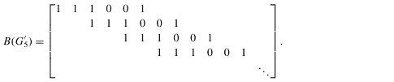

请注意，码字 \( (1/(1 + D))G'_5 = (1, 1 + D) \) 具有权重 3 且包含在 \( C_5^{(1)} \) 中。因此，我们不能使用 \( B(G'_5) \) 来找出 \( C_5^{(1)} \) 的所有码字。这是因为 \( G'_5 \) 不是规范的。还请注意，\( B(G'_5) \) 的行张成的码字中没有权重为 3 的多项式码字，因为这些行的权重均为偶数。如练习 823 所示，\( C_5 \) 的自由距离为 3。因此，我们不能使用 \( B(G'_5) \) 来发现 \( C_5 \) 的自由距离。然而，根据练习 819，编码器 \( G_5 \) 是规范的。如果我们构造 \( B(G_5) \)，则得到

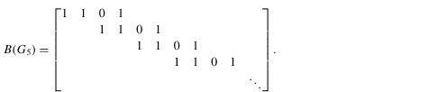

\( C_5 \) 的 Forney 指数为 \( m_1 = 1 \)。码 \( C_5^{(L)} \) 具有长度 \( 2(L + 1) \)、二进制维数 \( k_L = L + 1 - m_1 = L \)，并且对于所有 \( L \ge 1 \) 具有最小距离 3。\( C_5^{(L)} \) 的交错码字具有一个由 \( B(G_5) \) 的前 \( L \) 行组成的二进制基。

### 示例 14.4.9
生成矩阵 \( G'_2 \) 是示例 14.1.1 中 \( C_2 \) 的规范生成矩阵。Forney 指数为 \( m_1 = 0 \) 和 \( m_2 = 1 \)；此外，\( B_0 = [0\ 1\ 1\ 1] \) 和 \( B_1 = [0\ 0\ 0\ 0;\ 0\ 1\ 1\ 0] \)。

```
B(G_2^L) = \left[ \begin{array}{cccccccc}
1 & 1 & 1 & 0 & 0 & 0 & 0 \\
0 & 1 & 0 & 1 & 0 & 1 & 1 & 0 \\
& & 1 & 1 & 1 & 1 \\
& & 0 & 1 & 0 & 1 & 0 & 0 & 0 & 0 \\
& & & & 1 & 1 & 1 & 0 \\
& & & & 1 & 1 & 1 & 1 & 0 & 0 & 0 & 0 \\
& & & & 0 & 1 & 0 & 1 & 0 & 1 & 1 & 0 \\
& & & & & & & & \ddots
\end{array} \right.
```

根据定理 14.4.7，\( k_L = \max\{L + 1 - m_1, 0\} + \max\{L + 1 - m_2, 0\} = \max\{L + 1, 0\} + \max\{L, 0\} \)。因此，对于 \( L \ge 0 \)，有 \( k_L = 2L + 1 \)。因此，作为二进制码的 \( C_2^{(L)} \) 是一个 \([4(L+1), 2L+1]\) 码；我们可以看到，\( C_2^{(L)} \) 交错版本的基是 \( B(G_2^L) \) 的前 \( 2L + 1 \) 行。由于 \( B(G_2^L) \) 的行权重均为偶数，作为二进制码的 \( C_2^{(L)} \) 是一个偶码。不难看出，\( B(G_2^L) \) 前 \( 2L + 1 \) 行的张成中没有权重为 2 的向量。因此，作为二进制码，对于所有 \( L \ge 0 \)，\( C_2^{(L)} \) 是一个 \([4(L+1), 2L+1, 4]\) 码。根据定理 14.4.6，\( C_2 \) 具有自由距离 4；另见练习 824。

- **练习 828** 在示例 14.4.9 中，使用规范生成矩阵 \( G_2^L \) 为示例 14.1.1 中的码 \( C_2 \) 找到了 \( C_2^{(L)} \) 的一个基。
  - (a) 根据示例 14.4.9，\( C_2^{(L)} \) 具有维数 5，且 \( B(G_2^L) \) 的前五行构成 \( C_2^{(L)} \) 的一个二进制基。在练习 825(b) 中，找到了 \( B(G_2) \) 的前十行。使用 \( B(G_2) \) 的前八行的二进制组合，找出 \( C_2^{(2)} \) 的一个二进制基。注意使用 \( B(G_2^L) \) 找出 \( C_2^{(2)} \) 的基要简单得多。
  - (b) \( G_2 \) 的什么性质使你能够使用 \( B(G_2) \) 为 \( C_2^{(2)} \) 找到一个基？\( G_2 \) 缺少什么性质，导致基更难找到？
  - (c) 给出 \( B(G_2^L) \) 的前十行。给出作为 \( B(G_2^L) \) 行的二进制组合且属于 \( C_2^{(2)} \) 的最大线性无关向量集。\( G_2^L \) 缺少什么性质，导致它不包含 \( C_2^{(2)} \) 的一个基？\(\blacklozenge\)

- **练习 829** 证明练习 822 中码 \( C_3 \) 的自由距离为 3。\(\blacklozenge\)

- **练习 830** 证明练习 822 中码 \( C_4 \) 的自由距离为 2。\(\blacklozenge\)

如果我们令 \( \Delta(n, k) \) 为二进制 \([n, k]\) 码可能的最大最小距离，那么定理 14.4.6 的一个直接结果是以下界。

### 定理 14.4.10
设 \( \mathcal{C} \) 为具有 Forney 指数 \( m_1, \ldots, m_k \) 的 \( (n, k) \) 卷积码。设 \( k_L \) 由定理 14.4.7 定义。则
\( d_{\text{free}} \le \min_{L \ge 0} \Delta(n(L+1), k_L) \)。

我们可以使用第 2 章中的界，或 [32] 中找到的表格等表格，来给出 \( \Delta(n(L+1), k_L) \) 的值。

### 示例 14.4.11
一个 \( (4, 3, 2) \) 卷积码具有和为 \( m=2 \) 的 Forney 指数。有两种可能性：\( m_1 = 0, m_2 = m_3 = 1 \) 或 \( m_1 = m_2 = 0, m_3 = 2 \)。


首先考虑 $m_1 = 0, m_2 = m_3 = 1$ 的情况。根据定理 14.4.7，对所有 $L$ 均有 $k_L = 3L + 1$。因此定理 14.4.10 表明

```
$d_{free} \le \min\{\Delta(4, 1), \Delta(8, 4), \Delta(12, 7), \dots \}$.
```

值 $\Delta(4, 1) = \Delta(8, 4) = \Delta(12, 7) = 4$ 可在 [32] 中找到或从表 2.1 推导得出。因此 $d_{free}$ 最多为 4。事实上，可以证明对于该码 $d_{free}$ 最多为 3；参见 [235, 定理 7.10]。练习 822 中的 $C_3$ 是具有这些 Forney 指数的 $(4, 3, 2, 3)$ 码；参见练习 829。

接下来考虑 $m_1 = m_2 = 0, m_3 = 2$ 的情况。根据定理 14.4.7，$k_0 = 2$ 且对所有 $L \ge 1$ 均有 $k_L = 3L + 1$。所以，

```
$d_{free} \le \min\{\Delta(4, 2), \Delta(8, 4), \Delta(12, 7), \dots \}$.
```

由于 $\Delta(4, 2)$ 容易看出为 2，故 $d_{free} \le 2$。练习 822 中的码 $\mathcal{C}_4$ 是具有这些 Forney 指数的 $(4, 3, 2, 2)$ 码；参见练习 830。

[235] 的第 4 节包含表格，展示了 $(n, k, m)$ 码的自由距离界，使用了与定理 14.4.10 类似的稍弱界，适用于 $(n, k) = (2, 1), (3, 1), (3, 2), (4, 1)$ 和 $(4, 3)$，其中 $m$ 的值最高为 10。这些表格还给出了最接近满足这些界的码。这些界大多数情况下都能满足；当未满足时，除一种情况外，码的自由距离比界的值少 1。

### 练习 831 设 $\mathcal{C}$ 为一个 $(3, 2, 3)$ 卷积码。

- (a) 找出 $\mathcal{C}$ 的两组可能的 Forney 指数。
- (b) 找出 (a) 中找到的每组 Forney 指数对应的 $k_L$ 值。
- (c) 给出 (a) 中找到的每组 Forney 指数对应的 $\mathcal{C}$ 自由距离的上界。

## 14.5 灾难性编码器

在为卷积码选择编码器时，有一类生成矩阵必须避免——即所谓的灾难性编码器。本节将探讨使用它们时出现的问题。

在讨论灾难性编码器之前，我们先稍作偏离。设 $G$ 为域 $\mathbb{F}$ 上的一个 $k \times n$ 矩阵，其中 $k \le n$。回顾，$G$ 的右逆是一个 $n \times k$ 矩阵 $K$，其元素在 $\mathbb{F}$ 中，满足 $GK = I_k$。根据线性代数的一个结果，$G$ 有右逆当且仅当其秩为 $k$。一般来说，如果 $k < n$，则存在许多可能的右逆。现在假设 $G$ 是 $[n, k]$ 分组码或 $(n, k)$ 卷积码的生成矩阵。那么 $G$ 的秩为 $k$，因此有一个右逆 $K$。如果 $\mathbf{x}$ 是长度为 $k$ 的消息，经过编码产生码字 $\mathbf{c} = \mathbf{x}G$，则可以通过观察 $\mathbf{x} = \mathbf{x}I_k = \mathbf{x}GK = \mathbf{c}K$ 从 $\mathbf{c}$ 中恢复 $\mathbf{x}$；另见第 1.11.1 节。

### 练习 832 考虑二进制矩阵

```
$G = \begin{bmatrix} 1 & 1 & 0 & 1 & 1 \\ 1 & 0 & 1 & 1 & 0 \\ 1 & 0 & 1 & 1 & 0 \end{bmatrix}.$
```

- (a) 找出 $G$ 的 $5 \times 2$ 二进制右逆。提示：大部分条目可以选为 0。
- (b) 假设 $G$ 是 $[5, 2]$ 二进制码的生成矩阵。假设消息 $\mathbf{x} \in \mathbb{F}_2^2$ 通过 $\mathbf{x}G = \mathbf{c}$ 编码。使用 (a) 部分找到的每个右逆，找出编码产生 01101 的消息。\(\blacklozenge\)

### 练习 833 执行以下操作：

- (a) 找出示例 14.1.1 中 $(2, 1)$ 卷积码 $\mathcal{C}_1$ 的生成矩阵 $G_1$ 的一个 $2 \times 1$ 右逆，其中右逆的一个条目为 0。注意：另一个条目将是一个有理函数。
- (b) 找出 $G_1$ 的第二个右逆，其中两个条目都是 $D$ 的多项式。注意：这可以用两个次数为 1 的多项式完成。
- (c) 假设 $\mathbf{x}$ 被编码使得 $\mathbf{x}G_1 = (1 + D + D^5, 1 + D^3 + D^4 + D^5)$。使用 (a) 和 (b) 部分找到的 $G_1$ 的两个右逆来计算 $\mathbf{x}$。\(\blacklozenge\)

我们现在回到灾难性编码器的讨论。设 $\mathbf{x}$ 是要使用 $(n, k)$ 卷积码 $\mathcal{C}$ 的生成矩阵 $G$ 进行编码的消息。设 $K$ 是 $G$ 的一个右逆，其元素在 $\mathbb{F}_2(D)$ 中。要传输的结果码字是 $\mathbf{c} = \mathbf{x}G$。在传输过程中，$\mathbf{c}$ 可能会被噪声改变，从而接收到 $\mathbf{y}$。解码器找到一个接近 $\mathbf{y}$ 的码字 $\mathbf{c}'$，希望它实际上等于 $\mathbf{c}$。人们对 $\mathbf{c}$ 的兴趣较少，而对 $\mathbf{x}$ 的兴趣较多。因此可以计算 $\mathbf{x}' = \mathbf{c}'K$，希望 $\mathbf{x}'$ 实际上等于 $\mathbf{x}$；如果 $\mathbf{c}' = \mathbf{c}$ 则肯定如此，否则不然。让我们调查一下如果 $\mathbf{c}' \neq \mathbf{c}$ 可能会发生什么。设 $\mathbf{e}_c = \mathbf{c}' - \mathbf{c}$ 表示 *码字错误*，$\mathbf{e}_x = \mathbf{x}' - \mathbf{x}$ 表示 *消息错误*。注意，$\mathbf{e}_c$ 作为 $\mathcal{C}$ 中两个码字的差，必须是 $\mathcal{C}$ 的一个码字。从码字 $\mathbf{e}_c$ 得到的“消息”是 $\mathbf{e}_c K = (\mathbf{c}' - \mathbf{c})K = \mathbf{x}' - \mathbf{x} = \mathbf{e}_x$。人们期望估计值 $\mathbf{c}'$ 中错误符号的数量与 $\mathbf{x}'$ 中错误符号的数量有合理的联系。特别是，人们期望如果 $\mathbf{c}'$ 和 $\mathbf{c}$ 在有限个位置上不同，那么 $\mathbf{x}'$ 和 $\mathbf{x}$ 也应该在有限个位置上不同。换句话说，如果 $\mathbf{e}_c$ 有有限权重，那么 $\mathbf{e}_x$ 也应该。如果 $\mathbf{e}_c$ 有有限权重而 $\mathbf{e}_x$ 有无限权重，那将是“灾难性”的。回顾 $\mathbf{e}_c$ 是一个码字，我们给出以下定义。$(n, k)$ 卷积码的生成矩阵 $G$ 称为 *灾难性的*，如果存在一个无限权重消息 $\mathbf{x} \in \mathbb{F}_2(D)^k$ 使得 $\mathbf{c} = \mathbf{x}G$ 有有限权重。否则，$G$ 称为 *非灾难性的*。

### 示例 14.5.1 示例 14.1.1 中 $(2, 1)$ 码 $\mathcal{C}_1$ 的编码器 $G'_1$ 是灾难性的，我们现在来证明这一点。$G'_1$ 的一个右逆是

```
K = \begin{bmatrix} D & D \\ 1+D & 1 \end{bmatrix}.
```

码 $\mathcal{C}_1$ 包含码字 $\mathbf{c} = (1 + D + D^2, 1 + D^2)$（来自生成矩阵 $G_1$），其交织二进制形式为 110111。该码字有有限权重 5。计算 $\mathbf{c}K$ 我们得到

x = cK = (1 + D + D^3) \frac{D}{1 + D} + 1 + D^2 = \frac{1}{1 + D} = \sum_{i=0}^{\infty} D^i.

因此 x 有无限权重，而 c 有有限权重。换句话说，如果将无限长的 1 串输入编码器 G'_1，输出是权重为 5 的码字 110110000...。

### 练习 834 通过证明如果将无限长的 1 串输入练习 803 中 G'_1 的物理编码器，输出是权重为 5 的码字 110110000 ...，来验证示例 14.5.1 的结果。

让我们更仔细地考察示例 14.5.1，以了解应避免灾难性编码器的一个原因。由无限长 1 串组成的输入 x 的输出是权重为 5 的 c = 1110110000 ...。显然，由无限长 0 串组成的输入 x' 的输出 c' 是无限长的 0 串。假设发生了五个错误，且 c' 被接收为 1110110000 ... 。这将被解码为没有发生错误，发送的消息将被确定为 x，即无限长的 1 串。这与实际消息 x' 在每个位置上都不同，这当然是一个非常不希望的结果！

幸运的是，Massey 和 Sain [229] 的定理使得可以判断编码器是否是灾难性的。他们的结果给出了 $(n, k)$ 卷积码生成矩阵 G 非灾难性的两个等价性质。一个元素在 F_2(D) 中的矩阵，如果所有元素都有有限权重，则称为有限权重矩阵。回顾根据引理 14.4.2，有限权重矩阵的每个元素是一个多项式或一个多项式除以 D 的正整数幂。

### 定理 14.5.2 (Massey–Sain) 设 G 为 $(n, k)$ 卷积码 C 的多项式生成矩阵。矩阵 G 是 C 的非灾难性编码器，当且仅当以下条件之一成立：

- (i) G 的 k 阶子式的最大公约数是 D 的幂。
- (ii) G 有一个有限权重右逆。

我们省略了 Massey–Sain 定理的证明；参见 [229, 235]。注意本定理 (i) 和 (ii) 部分与定理 14.3.3 的 (i) 和 (ii) 部分之间的清晰联系。特别是，基本生成矩阵，更具体地说，规范生成矩阵（我们知道每个码都存在）是非灾难性的。

### 推论 14.5.3 每个基本生成矩阵都是卷积码的非灾难性生成矩阵。每个卷积码都有一个非灾难性生成矩阵。

### 示例 14.5.4 在示例 14.1.1 中，我们给出了 C_1 的两个生成矩阵 G_1 和 G'_1。在示例 14.5.1 中，我们使用生成矩阵 G'_1 展示了一个无限权重输入与有限权重输出。因此 G'_1 是灾难性的。我们可以通过应用 Massey–Sain 定理得到相同的结果。G'_1 的两个子式是 1 + D^2 = (1 + D)(1 + D + D^2) 和 1 + D + D^2 + D^3 = (1 + D)(1 + D^2)；这些子式的最大公约数是 1 + D，它不是 D 的幂。（注意有限权重输入与


这会导致一个无限权重码字和子式的最大公约数 \(1 + D\))。

则存在多项式 \(p(D)\) 和 \(q(D)\) 以及非负整数 \(i\) 和 \(j\)，使得 \(a(D) = p(D)/D^i\) 且 \(b(D) = q(D)/D^j\)。由于 \(G_1 K = I_1\)，则 \((1 + D^2)a(D) + (1 + D + D^2 + D^3)b(D) = 1$，即

\(D^{j}(1+D^{2})p(D) + D^{i}(1+D+D^{2}+D^{3})q(D) = D^{i+j}\).

但左边是一个可被 \(1 + D\) 整除的多项式，而右边不是。因此 \(G'_1\) 没有有限权重右逆。在示例 14.5.1 中，我们找到了 \(G'_1\) 的一个右逆，但它不是有限权重的。

转到编码器 \(G_1\)，我们看到 \(G_1\) 的两个子式是 \(1 + D + D^2\) 和 \(1 + D^2\)，它们的最大公约数为 1。因此 \(G_1\) 是非灾难性的。此外，\(G_1\) 具有有限权重右逆

\(K = \begin{bmatrix} D \\ 1+D \end{bmatrix}\).

这也证实了 \(G_1\) 是非灾难性的。

### 示例 14.5.5
在示例 14.1.1 中，我们给出了 (4, 2) 卷积码 \(C_2\) 的三个生成矩阵。所有这些编码器都是非灾难性的。我们将对 \(G'_2\) 和 \(G''_2\) 的此事实验证留作练习。从 \(G_2\) 的第一列和第二列得到的子式是 \(1 + D\)，而从 \(G_2\) 的第一列和第三列得到的子式是 \(D\)。因此 \(G_2\) 所有六个子式的最大公约数必须为 1。

### 练习 835
验证示例 14.1.1 中 (4, 2) 卷积码 \(C_2\) 的编码器 \(G'_2\) 和 \(G''_2\) 是非灾难性的，方法是证明每个编码器的子式的最大公约数为 1。

### 练习 836
找出示例 14.1.1 中 (4, 2) 卷积码 \(C_2\) 的每个编码器 \(G_2\)、\(G'_2\) 和 \(G''_2\) 的 \(4 \times 2\) 有限权重右逆。注意：许多条目可以选为 0。

### 练习 837
设 \(G''_2\) 为示例 14.1.1 中 (4, 2) 卷积码 \(C_2\) 的生成矩阵。(a) 证明 \(G''_2\) 的六个子式的最大公约数是 \(1 + D + D^2\)，因此 \(G''_2\) 是一个灾难性编码器。(b) 证明输入

\(\mathbf{x} = \begin{pmatrix} \frac{D^2}{1 + D + D^2} & \frac{1}{1 + D + D^2} \end{pmatrix}\)

到编码器 \(G''_2\) 具有无限权重，但编码码字 \(\mathbf{c} = \mathbf{x}G''_2\) 具有有限权重。同时给出 \(\mathbf{c}\)。

### 练习 838
设 \(C_3\) 为练习 823 和示例 14.4.8 中的 (2, 1) 卷积码，其生成矩阵为 \(G_3 = [1 \quad 1 + D]\) 和 \(G'_3 = [1 + D \quad 1 + D^2]\)。

- (a) 假设 \(G'_3\) 是编码器。找出 \(G'_3\) 的一个右逆，并利用它在输出为码字 \((1, 1 + D)\) 时产生输入。
- (b) 为编码器 \(G'_3\) 绘制状态图。
- (c) 为编码器 \(G'_3\) 绘制格栅图。
- (d) 应用维特比算法解码接收到的输出向量 \(1101000000 \cdots\)（无限长度）。注意这是一个交织码字 \((1, 1 + D)\)。还要注意，要对无限长度的接收向量应用维特比算法，应沿格栅中权重最小的路径进行，而不必试图结束于零状态。
- (e) 基于 (a) 或 (d) 部分，为什么 \(G'_3\) 是一个灾难性编码器？
- (f) \(G'_3\) 的 \(1 \times 1\) 子式的最大公约数是多少？
- (g) 不诉诸 Massey–Sain 定理，证明 \(G'_3\) 没有有限权重逆。
- (h) 证明 \(G_3\) 是 \(\mathcal{C}\) 的一个非灾难性生成矩阵。

# 15 软判决与迭代解码

到目前为止我们考虑的所有解码算法都是硬判决算法。硬判决解码器是指从信道接受硬值（例如，如果数据是二进制的，则为 0 或 1）并利用这些值生成希望是原始码字的解码器。因此，硬判决解码器的特征是“硬输入”和“硬输出”。相比之下，软判决解码器在生成正确符号的“硬输出”估计值时，通常会从信道接受“软输入”。正如我们稍后将看到的，“软输入”可以是基于概率的接收符号的估计值。在我们后面关于 turbo 码的讨论中，我们将看到 turbo 解码使用两个“软输入、软输出”解码器，它们以迭代方式相互传递“软”信息。经过一定数量的迭代后，turbo 解码器会生成正确传输符号的“硬估计”。

## 15.1 加性高斯白噪声

为了理解软判决解码，首先有必要更仔细地查看图 1.1 中所示的通信信道。我们的描述在很大程度上依赖于 [158, Chapter 1] 中的介绍。该图中标记为“信道”的方框更准确的描述是由三个组件组成：调制器、波形信道和解调器；参见图 15.1。为简单起见，我们限制于二进制数据。假设我们传输二进制码字 c = c1 ... cn。调制器将每个比特转换为一个波形。有许多使用的调制方案。一种常见的方案称为二进制相移键控（BPSK），其工作原理如下。每个比特被转换为持续 T 秒（即时钟周期长度）的波形。如果要从时间 t = 0 开始传输比特 1，则波形是

```
b_1(t) = \begin{cases} \sqrt{\frac{2E_s}{T}} \cos \omega t & \text{if } 0 \le t < T, \\ 0 & \text{otherwise,} \end{cases}
```

其中 \(E_s\) 是信号能量，\(\omega = 2\pi/T\) 是角频率。要传输比特 0，使用波形 \(b_0(t) = -b_1(t)\)。（注意 \(b_0(t)\) 也等于 \(\sqrt{2E_s/T} \cos(\omega t + \pi)\)，从而说明为什么“相移”包含在该方案的名称中。）从时间 \(t=0\) 开始，码字 c 因此作为以下波形传输

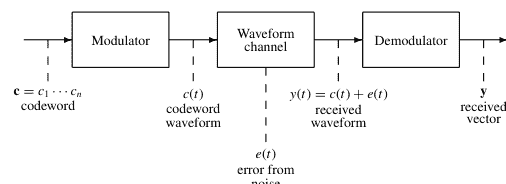

图 15.1 调制通信信道。

波形

$$c(t) = \sum_{i=1}^n b_{c_i} (t - (i-1)T).$$

### 练习 839
从时间 \(t=0\) 开始，绘制以下波形的图形：

- (a) 单个比特 1，
- (b) 单个比特 0，以及
- (c) 码字 00101。

波形 \(c(t)\) 通过波形信道传输，其中形式为另一波的噪声 \(e(t)\) 可能会扭曲 \(c(t)\)。通过使用具有冲激响应的匹配滤波器

$$h(t) = \begin{cases} \sqrt{\frac{2}{T}} \cos \omega t & \text{if } 0 \le t < T, \\ 0 & \text{otherwise,} \end{cases}$$

解调器首先将接收到的波形 \(y(t) = c(t) + e(t)\) 转换为 \(n\) 元实数组 \(\mathbf{y}' = y'_1 y'_2 \cdots y'_n\)，其中

$$y'_i = \int_{(i-1)T}^{iT} y(t)h(iT - t) \, dt. \tag{15.1}$$

如果在传输 \(c_i\) 时没有发生错误，则当 \(c_i = 1\) 时 \(y'_i = \sqrt{E_s}\)，当 \(c_i = 0\) 时 \(y'_i = -\sqrt{E_s}\)；参见练习 840。我们可以通过选择

$$y_i = \begin{cases} 1 & \text{if } y'_i > 0, \\ 0 & \text{if } y'_i \le 0. \end{cases} \tag{15.2}$$

这些二进制值 \(y_i\) 将是解调器的最终输出，如果我们的解码器是硬判决解码器。

示例 15.1.1 如果发送码字 \(\mathbf{c} = 10110\)，则传输波形为 \(c(t) = b_i(t) - b_i(t - T) + b_i(t - 2T) + b_i(t - 3T) - b_i(t - 4T)\)。假设接收到 \(y(t) = c(t) + e(t)\)。假设匹配滤波器产生 \(y'_1 = 0.7, y'_2 = -1.1, y'_3 = 0.5, y'_4 = -0.1\) 和 \(y'_5 = -0.5\)。硬判决接收向量为 \(\mathbf{y} = 10100\)，并且在第四个坐标处发生了错误。

### 练习 840
证明

$$
\int_{(i-1)T}^{iT} \sqrt{\frac{2E_i}{T}} \cos \omega (t - (i-1)T) \sqrt{\frac{2}{T}} \cos \omega (iT - t) dt = \sqrt{E_i}.
$$

并解释这如何验证以下说法：在传输单个比特 \(c_i\) 时如果没有发生错误，则 \(y'_i = \pm \sqrt{E_i}\)，其中如果 \(c_i = 1\) 则选取 +，如果 \(c_i = 0\) 则选取 -。

噪声通常可以建模为 *加性高斯白噪声（AWGN）*。该模型根据 (15.1) 给出的 \(y'_i\) 的分布来描述噪声。如果传输 \(c_i = 1\)，则 \(y'_i\) 的均值 \(\mu\) 为 \(\sqrt{E_i}\)。如果传输 \(c_i = 0\)，则均值 \(\mu\) 为 \(-\sqrt{E_i}\)。减去适当的 \(\mu\) 值后，\(y'_i - \mu\) 服从均值为 0、方差为

$$
\sigma^2 = \frac{N_0}{2}.
$$

的正态分布。

值 \(N_0/2\) 称为 *双边功率谱密度*。

使用 (15.1) 和 (15.2) 从 \(y(t)\) 生成二进制向量实际上是第 1.11.2 节中描述的二进制对称信道模型的一个实现。该信道的交叉概率 \(\rho\) 计算如下。假设，根据对称性，比特 \(c_i = 1\)，因此传输 \(b_i(t - (i-1)T)\)。如果 \(y'_i \le 0\)，则会发生错误，接收到的比特将由 (15.2) 判定为 0。由于 \(y'_i - \mu\) 服从均值为 0、方差 \(\sigma^2 = N_0/2\) 的正态分布，

$$
\rho = \text{prob}(y'_i \le 0) = \frac{1}{\sqrt{2\pi}\sigma} \int_{-\infty}^0 e^{-\frac{(y-\mu)^2}{2\sigma^2}} dy = \frac{1}{\sqrt{2\pi}} \int_{-\infty}^{-\sqrt{2E_i/N_0}} e^{-\frac{x^2}{2}} dx. \quad (15.3)
$$

### 练习 841
执行以下操作：
(a) 验证 (15.3) 中最右边的等式。
(b) 验证

$$
\frac{1}{\sqrt{2\pi}} \int_{-\infty}^{-\sqrt{2E_i/N_0}} e^{-\frac{x^2}{2}} dx = \frac{1}{2} - \frac{1}{2} \text{erf}(\sqrt{E_i/N_0}),
$$

其中

$$
\text{erf}(z) = \frac{2}{\sqrt{\pi}} \int_0^z e^{-t^2} dt.
$$

函数 \(\text{erf}(z)\) 称为 *误差函数*，该函数的表值在一些教科书和计算机软件包中可用。

另一方面，解调器的输出不必是二进制的。它可以是可供软判决解码器使用的“软”数据。请注意，硬判决值 \(y_i\) 是基于阈值 0 选择的；也就是说，\(y_i\) 是根据 \(y'_i > 0\) 还是 \(y'_i \le 0\) 来确定的。这种选择没有考虑到 \(y'_i\) 的值是否可能或不可能，具体取决于传输的比特 \(c_i\) 是 0 还是 1。从 \(y'_i\) 确定 \(y_i\) 的过程称为 *量化*。\(y_i\) 仅有两种选择这一事实意味着我们采用了 *二进制量化*。


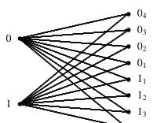

图 15.2 二进制输入、八进制输出无记忆离散信道。

我们可以有其他确定解调器输出的量化方式。一个例子，将成为我们软判定解码的基础，如下。假设我们通过选择七个阈值将实数轴划分为八个不相交区间的不交并。然后我们可以将 yi 赋为八个值之一。我们将使用 O1, O2, O3, O4, I1, I2, I3, I4 表示这八个值。例如，假设 (a, b]（其中 a = -infinity 或 b = infinity 是确定 O_i 的区间；换句话说，假设 yi 被选为 O_i 正好当 y'_i 在 (a, b] 时。那么在 c_i 被发送的条件下，y'_i 在 (a, b] 的概率是

```
prob(O_i | c_i) = prob(a < y'_i \le b | c_i) = \frac{1}{\sqrt{2\pi}\sigma} \int_a^b e^{\frac{-(y-\mu)^2}{2\sigma^2}} dy, \quad (15.4)
```

其中 mu = \sqrt{E_i} 当 c_i = 1，mu = -\sqrt{E_i} 当 c_i = 0。因此，一旦阈值电平被选定，使用类似于 (15.4) 的方程，我们可以计算 16 个概率 prob(y | c)，其中 y 遍历八个可能的值 O1, ..., I4，c = 0 或 1。这些概率在假设信道受加性高斯白噪声（AWGN）影响的情况下是信道的特征；它们是信道统计特性。这些概率可以根据信号能量 E_i 和双边功率谱密度 N_0/2 来计算，回顾 \sigma^2 = N_0/2。我们刚才描述的信道是一个二进制输入、八进制输出无记忆离散信道（DMC），如图 15.2 所示。（“二进制输入”是调制器的输入，“八进制输出”是解调器的输出。）沿着每条边我们可以写出概率 prob(y | c)，如图 1.2 的 BSC 中所示。当然，从 0 出发的边沿的八个概率之和为 1，从 1 出发的边沿的八个概率之和也为 1。我们可以推测，我们会选择记号，使得从 0 出发的四个最高概率终止于 O1, ..., O4，从 1 出发的四个最高概率终止于 I1, ..., I4。在某个稍后的时间点，四个值 O1, ..., O4 可以被赋为 0，四个值 I1, ..., I4 可以被赋为 1。

通过采用这种 8 级量化，我们考虑到了在发送 c_i 时得到值 y'_i 的可能性。这并不令人惊讶，这种“软”量化数据连同概率 prob(y | c) 可以用来创建更有效的解码器。我们实际上可以量化使用硬判定解码的编码与完全不使用编码相比所带来的“增益”有多大。此外，我们可以衡量使用软判定解码而非硬判定解码时的潜在“增益”。

## 15.1 加性高斯白噪声

在 1.11.2 节中，我们介绍了 BSC 的香农定理。对于高斯信道，如果给出适当的信道容量，也存在相应的定理。假设高斯信道受双边谱密度 \(N_0/2\) 的 AWGN 影响。进一步假设信号功率为 \(S\)，带宽为 \(W\)。然后香农表明，如果信道容量 \(C_G(W)\) 定义为

\(\displaystyle C_G(W) = W \log_2 \left( 1 + \frac{S}{N_0 W} \right).\) (15.5)

则只要信息传输速率低于容量，就可以实现任意可靠的通信；对于高于 \(C_G(W)\) 的速率，则不可能。

如果允许无限带宽，则信道容量趋近于 \(C_G^\infty\)，其中

\(\displaystyle C_G^\infty = \lim_{W \to \infty} W \log_2 \left( 1 + \frac{S}{N_0 W} \right) = \frac{S}{N_0 \ln 2} \text{ bits/s.}\) (15.6)

此前我们令 \(T\) 为传输一个比特的时间。因此，\(k\) 个信息比特可以在 \(t = nT\) 秒内传输。每比特能量，记为 \(E_b\)，则为

\(\displaystyle E_b = \frac{S \tau}{k} = \frac{S}{R_t}.\) (15.7)

其中 \(R_t = k/\tau\) 是信息传输速率。将此与 (15.6) 结合，我们看到

\(\displaystyle \frac{C_G^\infty}{R_t} = \frac{E_b}{N_0 \ln 2}.\) (15.8)

香农定理告诉我们，要在这个信道上进行通信，则必须 \(R_t < C_G^\infty\)。使用 (15.8)，这意味着

\(\displaystyle \frac{E_b}{N_0} > \ln 2 \approx -1.6 \text{ dB.}\) (15.9)

因此，要在高斯信道上实现可靠通信，信噪比 \(E_b/N_0\)（它衡量每比特能量与噪声能量的相对大小）必须超过 -1.6 dB 的值，即香农极限。只要信噪比超过香农极限，香农定理就保证存在一个通信系统（可能非常复杂），可用于该信道上的可靠通信。

### 练习 442 验证 (15.6) 中最右侧的等式。

如果要求使用硬判定解码，则信道具有不同的容量。要使用硬判定解码实现可靠通信，必须满足

\(\displaystyle \frac{E_b}{N_0} > \frac{\pi}{2} \ln 2 \approx 0.4 \text{ dB.}\)

因此，在高斯信道上如果使用软判定解码而非硬判定解码，潜在增益可能为 2 dB。稍后我们将解释这种增益将带来什么。

首先考虑在不使用编码的情况下通过信道进行通信时会发生什么。

令 \( P_b \) 为 *比特错误率*（BER），即解码中比特错误的概率。如果没有编码，则 \( E_b = E \)，因为每个信号都是一个单一的信息比特。根据 (15.3)，未编码二进制相移键控的 BER 为

\( P_b = Q(\sqrt{2E_b/N_0}). \)

其中

\( Q(z) = \frac{1}{\sqrt{2\pi}} \int_z^\infty e^{-\frac{x^2}{2}} dx. \)

在图 15.3 中，我们将未编码 BPSK 的 \( P_b \) 作为信噪比的函数进行绘制。（注意垂直坐标轴是以 10 为底的对数坐标。）我们还在图中标出了香农极限 -1.6 dB 和硬判定极限 0.4 dB。

作为图 15.3 所告诉我们的内容的一个示例，深空卫星传输的图像数据可接受的比特错误率通常在 \( 5 \times 10^{-3} \) 到 \( 1 \times 10^{-7} \) 的范围内 [352]。假设我们希望 BER 为 \( 1 \times 10^{-5} \)。我们从图 15.3 可以看到，如果使用 BPSK 且不进行任何编码进行传输，则信噪比必须至少为 9.6 dB。因此，使用硬判定解码的编码，潜在 *编码增益* 为 9.2 dB。使用软判定解码的编码，潜在编码增益为 11.2 dB。

这种改进可以用几种不同的方式来衡量。例如，如果我们检查 (15.7) 并假设 \( N_0 \)、k 和 \( \tau \) 保持不变，则 1 dB 的增益意味着信号功率 \( S \) 可以降低到约 \( 10^{-0.1}S \approx 0.794S \)。如果 BER 为 \( 1 \times 10^{-5} \) 并且我们可以通过使用一个码 \( \mathcal{C} \) 实现 9.2 dB 的编码增益，那么未编码 BPSK 所需的信号功率可以通过使用 \( \mathcal{C} \) 降低到约 \( 10^{-0.9}S \approx 0.120S \)。信号功率的这种降低非常重要。在深空卫星通信中，这可能意味着更小的电池（因此重量更轻）、航天器更长的运行时间，或更小的发射机电池。在 20 世纪 60 年代末，卫星通信中每个 dB 的编码增益被估计价值 1,000,000 美元的开发和发射成本 [227]。

当信道带宽受限时，我们可以使用信息速率 \( R \) 的码来分析潜在编码增益。假设通信使用一个 \([n, k]\) 二进制码，因此其信息速率为 \( R = k/n \)。如果我们以 *奈奎斯特速率* 每秒 \( 2W \) 个采样点进行采样，并在 \( \tau \) 秒内传输 \( k \) 个信息比特，则 \( n = 2W\tau \)。因此信息传输速率 \( R_i \) 为

\( R_i = k/\tau = 2Wk/n = 2WR. \) (15.10)

根据 (15.7) 和 (15.10),

\( \frac{S}{N_0 W} = \frac{2RE_b}{N_0}. \)

使用此方程、(15.5) 和香农定理，要实现可靠通信

\( R_i = 2WR < W \log_2 \left( 1 + \frac{2RE_b}{N_0} \right). \)


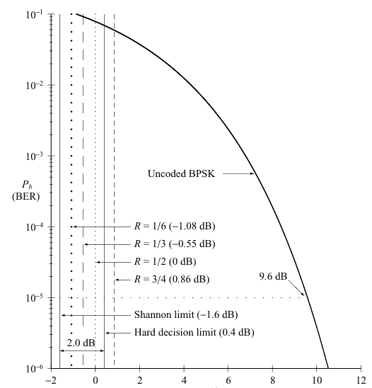

图 15.3 高斯信道中的潜在编码增益。

求解 \( E_b/N_0 \) 得到

\(\frac{E_b}{N_0} > \frac{2^{2R} - 1}{2R}.\) (15.11)

给出了信息率为 \( R \) 的编码的潜在编码增益。

请注意，如果信息传输速率 \( R_t \) 保持不变，则根据 (15.10)，当 \( W \to \infty, R \to 0 \)。在 (15.11) 中令 \( R \to 0 \)，我们得到 \( E_b/N_0 > \ln 2 \)，这与 (15.9) 在信道带宽无限的情况下一致。假设当信道带宽受限时，我们保持带宽固定。(15.11) 的右边是 \( R \) 的增函数。因此，为了接近香农极限，\( R \) 必须接近 0；根据 (15.10)，信息传输速率 \( R_t \) 也必须接近 0。下表说明了根据 (15.11) 的下限（以 dB 为单位），适用于各种 R 值的信噪比。

| R | 3/4 | 1/2 | 1/3 | 1/6 |
|---|---|---|---|---|
| \(\frac{2^{2R}-1}{2R}\) (dB) | 0.86 | 0 | -0.55 | -1.08 |

我们将这些值包含在图 15.3 中。

**练习 843** 验证 (15.12) 中的条目。

## 15.2 软判定维特比算法

在本节中，我们将探讨如何修改第 14.2 节的维特比算法（一种硬判定解码算法），以获得软判定维特比解码算法。一旦栅栏图中的边权重被适当定义，软判定维特比算法的执行方式与硬判定维特比算法完全相同，只是存活路径是具有最高路径权重的路径。硬判定维特比算法是最近邻解码，在二进制对称信道上也是最大似然解码；参见第 1.11.2 节的讨论。软判定维特比算法也将是最大似然解码。

假设输入消息 \(\mathbf{x}(i) = (x_i(0), \dots, x_i(L))\) 对于 \(i = 0, 1, \dots, L-1\) 使用 \((n, k)\) 二进制卷积码的生成矩阵 \(G\) 进行编码，以产生输出码字 \(\mathbf{c}(i) = (c_i(0), \dots, c_i(n))\) 对于 \(i = 0, 1, \dots, L+M-1\)。与以前一样，编码器在时间 \(i\) 的状态 \(s\) 表示为 \(x_i\)。零状态将是状态 \(a\)。编码器的初始状态和最终状态。我们将在消息末尾添加 \(M\) 个 \(k\) 个零的块，以便编码器在时间 \(L+M\) 终止于零状态 \(a_{L+M}\)。该码字的比特按 (14.1) 进行交织，该比特流被调制、传输，并作为波形 \(y(t)\) 接收，使用 (15.1) 进行解调。虽然可以使用任何解调方案，但为了具体起见，我们将假设使用 8 电平量化，如前一节所述。对量化数据进行解交织后，我们得到接收向量 \(\mathbf{y}(i) = (y_i(1), \dots, y_i(n))\) 对于 \(i = 0, 1, \dots, L+M-1\)，其中 \(y_i(j) \in \{0, 1, \dots, 7\}\)。

由于软判定维特比算法要执行最大似然解码，算法必须找到最大化 \(\text{prob}(\mathbf{y} | \mathbf{e})\) 的码字 \(\mathbf{e}\)。然而，由于信道是无记忆的，

\(\text{prob}(\mathbf{y} | \mathbf{e}) = \prod_{i=0}^{L+M-1} \prod_{j=1}^n \text{prob}(y_i(j) | e_i(j)).\)

最大化该概率等价于最大化其对数

\(\ln(\text{prob}(\mathbf{y} | \mathbf{c})) = \sum_{i=0}^{L+M-1} \sum_{j=1}^n \ln(\text{prob}(y_j(i) | c_j(i))),\)

它的优势在于将乘积转换为求和。（回顾，在原始维特比算法中计算路径权重是通过求和边权重完成的。）我们可以采用 Massey [226] 的一种技术，这将使我们能够将边权重转换为整数。最大化 \(\ln(\text{prob}(\mathbf{y} | \mathbf{c}))\) 等价于最大化

\(\sum_{i=0}^{L+M-1} \sum_{j=1}^n \mu(y_j(i), c_j(i)),\) (15.13)

其中

\(\mu(y_j(i), c_j(i)) = A(\ln(\text{prob}(y_j(i) | c_j(i))) - f_{i,j}(y_j(i))),\) (15.14)

其中 \(A\) 是正常数，\(f_{i,j}(\mathbf{y}(i))\) 是任意函数。值

\(\sum_{j=1}^n \mu(y_j(i), c_j(i))\) (15.15)

将是栅栏图中的边权重，取代硬判定维特比算法中使用的汉明距离。为了简化计算，首先选择

\(f_{i,j}(\mathbf{y}(i)) = \min_{c \in \{0,1\}} \{ \ln(\text{prob}(y_j(i) | c)) \}\)

然后选择 \(A\) 使得 \(\mu(y_j(i), c_j(i))\) 接近正整数。有了这些边权重，就可以确定路径权重。软判定维特比算法现在如第 14.2 节一样进行，只是节点处的存活路径是具有**最大权重**而非最小权重的路径。

### 示例 15.2.1

我们使用软判定维特比算法重复示例 14.2.5。

假设信道是受加性高斯白噪声影响的二进制输入、八进制输出无记忆信道。假设已选择阈值，使得 \(\text{prob}(y | c)\) 由以下给出

| c \ y | O₄ | O₃ | O₂ | O₁ | I₁ | I₂ | I₃ | I₄ |
|---|---|---|---|---|---|---|---|---|
| 0 | 0.368 | 0.207 | 0.169 | 0.097 | 0.065 | 0.051 | 0.028 | 0.015 |
| 1 | 0.015 | 0.028 | 0.051 | 0.065 | 0.097 | 0.169 | 0.207 | 0.368 |

对每个概率取自然对数得到

| c \ y | O₄ | O₃ | O₂ | O₁ | I₁ | I₂ | I₃ | I₄ |
|---|---|---|---|---|---|---|---|---|
| 0 | -0.9997 | -1.5750 | -1.7779 | -2.3330 | -2.7334 | -2.9759 | -3.5756 | -4.1997 |
| 1 | -4.1997 | -3.5756 | -2.9759 | -2.7334 | -2.3330 | -1.7779 | -1.5750 | -0.9997 |

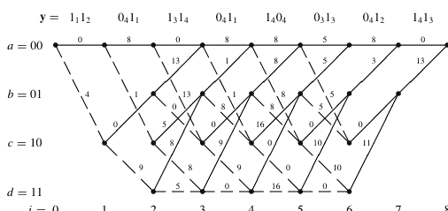

图 15.4 软判定维特比算法的边权重。

通过从下表中每一列的较小值减去该列中的每个条目，将结果乘以 A = 2.5，并四舍五入，我们得到 \(\mu(y, c)\)：

| c \ y | O₄ | O₃ | O₂ | O₁ | I₁ | I₂ | I₃ | I₄ |
| :--- | :--- | :--- | :--- | :--- | :--- | :--- | :--- | :--- |
| 0 | 8 | 5 | 3 | 1 | 0 | 0 | 0 | 0 |
| 1 | 0 | 0 | 0 | 0 | 1 | 3 | 5 | 8 |

（我们指出，上述表格中实际值与四舍五入值之间的差值从不超过 0.005。此外，A 的其他选择也是可能的，例如 A = 10000。）现在假设一个六比特消息后跟 00 已被编码，并且

\(y = I_1 I_2 O_1 I_3 I_4 O_4 I_1 I_4 O_3 O_3 O_1 O_2 I_4 I_3\)

是接收到的解调向量。请注意，当 \(O_1, \dots, O_4\) 和 \(I_1, \dots, I_4\) 分别合并到硬输出 0 和 1 时，我们得到与示例 14.2.5 中相同的接收向量。图 15.4 是图 14.4 的栅栏图，其中该图的边标签被 (15.15) 中的权重替换，类似于图 15.4 的栅栏图。作为示例，虚线边 \(a_0 c_1\) 原先标记为 11，具有权重 \(\mu(I_1, 1) + \mu(I_2, 1) = 1 + 3 = 4\)。图 15.5 显示了存活路径及其权重。当 \(i = 8\) 时，结束于状态 \(a\) 的存活路径是 \(a_0 a_1 a_2 c_3 d_4 d_5 b_6 a_7\)，产生消息 001111（后跟两个 0），编码为 0000110110010111。回顾，使用硬判定维特比解码的消息是 111011，编码为 1101100100100111。这个示例表明，硬判定和软判定解码可以产生截然不同的结果。为了比较，图 15.4 的栅栏图中，硬判定解码的消息 111011 的路径权重为 69，比消息 001111 的路径权重少 1。

**练习 844** 执行以下操作：

- (a) 从 prob(y | c) 的值开始，验证示例 15.2.1 中给出的 \(\mu(y, c)\) 的值。

- (b) 验证图 15.4 中显示的边权重。

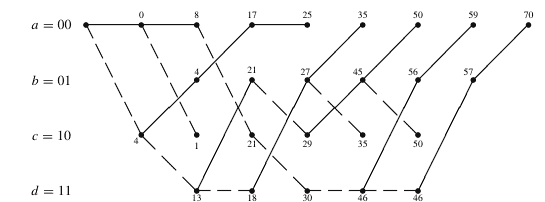

图 15.5 图 15.4 的栅栏图中的存活路径及其权重。

- (c) 验证示例 15.2.1 的软判定维特比算法的存活路径和权重与图 15.5 中所示一致。◆

**练习 854** 使用软判定维特比算法解码以下使用示例 15.2.1 中的代码发送的接收向量，并使用该示例中由 \(\mu(y, c)\) 确定的边权重。（图 14.4 的栅栏图将很有用。）绘制类似于图 15.5 的栅栏图。给出最可能的消息和码字。最后，将您的结果与练习 817 中的结果进行比较。◆

- (a) \(I_4 I_4 O_4 O_4 O_3 I_4 I_3 I_2 I_4 I_4 I_2 I_4 I_4\)
- (b) \(O_3 I_4 I_4 O_2 I_4 I_3 I_4 I_3 I_4 O_4 I_3 I_4 O_3 O_2 I_4\)

将软判定维特比算法应用于交叉概率为 \(\varrho\) 的二进制对称信道，而不是二进制输入八进制输出信道，这很有趣。在 BSC 的情况下，

\(\text{prob}(y | c) = \prod_{i=0}^{L+M-1} \prod_{j=0}^{M} \text{prob}(y_j(i) | c_j(i))\)
\(= \prod_{i=0}^{L+M-1} \prod_{j=0}^{M} \varrho^{d(y_j(i), c_j(i))} (1-\varrho)^{1-d(y_j(i), c_j(i))}.\)

因此，根据 (15.13) 和 (15.14),

\(\mu(y(i), c(i)) = A(\ln(\varrho^{d(y(i), c(i))} (1-\varrho)^{1-d(y(i), c(i))}) - f_{i,j}(y_j(i)))\)
\(= d(y(i), c(i)) \left( A \ln \frac{\varrho}{1-\varrho} \right) + A \ln(1-\varrho) - A f_{i,j}(y_j(i)).\)

选择 \(A = -(\ln(\varrho/(1-\varrho)))^{-1}\)，如果 \(\varrho < 1/2\) 则为正，并选择 \(f_{i,j}(y_j(i)) = \ln(\varrho)\)，我们得到

\(\mu(y(i), c(i)) = 1 - d(y(i), c(i)),\) (15.16)

这意味着，根据 (15.15)，栅栏图中的边权重等于

\(n - d(y(i), c(i)).\)


具有这些边权重的格网中最大权重路径，恰好与边权重由 d(y(i), e(i)) 给出的格网中最小权重路径完全相同。后者是第 14.2 节硬判定 Viterbi 算法的结果，因此硬判定和软判定 Viterbi 算法在 BSC 上的结果一致。

练习 846 验证 (15.16)。

## 15.3 通用 Viterbi 算法

Viterbi 算法可以置于一个更通用的环境中，这将使其在多种情况下的使用更加透明。McEliece 在 [234] 中提出的这种通用环境，允许格网边的标签（或权重）位于任何半环中。

*半环* 是带有两个二元运算的集合 A：加法，通常记为 +，以及乘法，通常记为 ·。这些运算必须满足某些性质。首先，+ 是结合和交换运算；此外，存在加法单位元，记为 0，使得对所有 u ∈ A 都有 u + 0 = u。其次，· 是结合运算；此外，存在乘法单位元，记为 1，使得对所有 u ∈ A 都有 1 · u = u。最后，分配律 (u + v) · w = (u · w) + (v · w) 对 A 中的所有 u、v 和 w 成立。

令 T 成为卷积码的一个截断格网；我们将使用图 14.4 作为该格网的模型。格网的顶点由不同时刻 i 的状态 s 组成，我们继续将其记为 s_i。格网中从时刻 i−1 的状态 s 开始、到时刻 i 的状态 s′ 结束的边 e 记为 e = (s|i−1, s′|i)；e 的初始顶点 s|i−1 记为 s_e，e 的最终顶点记为 t_e。边 e 上的标签为 α(e)。例如，图 14.4 中从时刻 4 的状态 d 到时刻 5 的状态 b 的边为 e = (d_4, b_5)，因此 s_e = d_4 且 t_e = b_5；同时 α(e) = 01。T 的边标签将来自带有运算 + 和 · 的半环 A。通用 Viterbi 算法本质上计算格网中的“流”。假设 e_1 e_2 ... e_m 是格网中的一条路径 P，其中 e_1, ..., e_m 是满足 1 ≤ i < m 时 e_i^* = *e_{i+1} 的边。沿 P 的流为乘积

$$v(P) = \alpha(e_1) \cdot \alpha(e_2) \cdot \dots \cdot \alpha(e_m). \tag{15.17}$$

请注意，A 中的乘法可能不满足交换律，因此 (15.17) 中的顺序很重要。现在假设 s_i 和 s_j′ 是 T 中的两个顶点，且 i < j。从 s_i 到 s_j′ 的流为

$$v(s_i, s_j′) = \sum_P v(P), \tag{15.18}$$

求和遍历所有从顶点 s_i 开始并结束于顶点 s_j′ 的路径 P。当然，求和使用半环 A 的加法 +；由于 A 中的加法满足交换律，求和的顺序无关紧要。

示例 15.3.1 令 $\mathcal{A}$ 为非负整数集合加上符号 $\infty$。$\mathcal{A}$ 可以构成一个半环。在 $\mathcal{A}$ 上定义加法运算 $+$ 如下：如果 $u$ 和 $v$ 在 $\mathcal{A}$ 中，则 $u + v = \min(u, v)$，其中对所有 $u \in \mathcal{A}$ 都有 $\min(u, \infty) = u$。在 $\mathcal{A}$ 上定义乘法运算 $\cdot$ 为普通加法，其中对所有 $u \in \mathcal{A}$ 都有 $u \cdot \infty = \infty \cdot u = \infty$。在练习 847 中，要求你验证，在这些运算下，$\mathcal{A}$ 是一个具有加法单位元 $\infty$ 和乘法单位元 0 的半环。考虑由卷积编码器和接收向量确定的截断格网，如图 14.5 所示。该格网的边标签在集合 $\mathcal{A}$ 中。使用 $\mathcal{A}$ 中的乘法和 (15.17)，沿路径的流是整数边标签的普通和；这正是我们在第 14.2.3 节中称为路径“权重”的内容。考虑从时刻 0 的初始状态 $a$ 开始的流 $v(a_0, s)$。根据 $\mathcal{A}$ 中加法的定义和 (15.18)，该流是从 $a_0$ 到 $s$ 的所有路径的最小权重。我们称给出此最小权重的路径为“幸存路径”，因此流 $v(a_0, s)$ 是幸存路径的权重。因此，图 14.5 的截断格网中的流 $v(a_0, a_8)$ 是由第 14.2.3 节中介绍的 Viterbi 算法确定的 $\mathcal{S}(a, 8)$ 中任意幸存路径的权重。

练习 847 验证示例 15.3.1 中定义运算的集合 $\mathcal{A}$ 是一个具有加法单位元 $\infty$ 和乘法单位元 0 的半环。

示例 15.3.2 非负整数集合 $\mathcal{A}$ 可以在以下运算下构成一个半环。在 $\mathcal{A}$ 上定义 $\cdot$ 为普通整数加法；如果 $u$ 和 $v$ 在 $\mathcal{A}$ 中，定义 $+$ 为 $u + v = \max(u, v)$。练习 848 表明，在这些运算下，$\mathcal{A}$ 是一个具有加法和乘法单位元且均等于 0 的半环。图 15.4 的截断格网的边标签在集合 $\mathcal{A}$ 中。与示例 15.3.1 类似，格网中沿路径的流是路径的“权重”。使用 $\mathcal{A}$ 中加法的定义和 (15.18)，流 $v(a_0, s)$ 是从 $a_0$ 到 $s$ 的所有路径的最大权重。给出此最大权重的路径是一条幸存路径。图 15.4 的截断格网中的流 $v(a_0, a_8)$ 同样是由第 15.2 节的软判定 Viterbi 算法确定的通过格网的任意幸存路径的权重。

练习 848 验证示例 15.3.2 中定义运算的集合 $\mathcal{A}$ 是一个具有加法和乘法单位元且均等于 0 的半环。

练习 849 令 $\mathcal{A}$ 为所有系数为整数的 $x$ 的多项式集合。$\mathcal{A}$ 在普通多项式加法和乘法下是一个半环。考虑一个 $(n, k)$ 二进制卷积码的截断格网，该格网由具有记忆 $M$ 的编码器确定，用于编码长度为 $L$ 的消息，随后跟随 $M$ 个由 $k$ 个零组成的块；示例见图 14.4。边的标签是一个二进制 $n$ 元组，它是由第 14.2 节描述的状态图确定的编码器输出。用 $x^w$ 重新标记格网中的一条边，其中 $w$ 是最初标记该边的二进制 $n$ 元组的权重。例如，在图 14.4 中，从 $a_0$ 到 $c_1$ 且标记为 11 的边被重新标记为 $x^2$，而从 $a_0$ 到 $a_1$ 且标记为 00 的边被重新标记为 1。因此，这个新格网的边由 $\mathcal{A}$ 的元素标记。

- (a) 在重新标记的格网中，描述沿路径的流代表什么
- (b) 在重新标记的格网中，如果时刻 0 的零状态 $a$ 为 $a_0$，且时刻 $L + M$ 的零状态为 $a_{L+M}$，描述从 $a_0$ 到 $a_{L+M}$ 的流代表什么
- (c) 计算图 14.4 中重新标记格网从 $a_0$ 到 $a_8$ 的流

## 练习 850

令 $\mathcal{B}$ 为包含空串 $\epsilon$ 在内的所有有限长度二进制串的集合。令 $\mathcal{A}$ 为包含空集 $\emptyset$ 在内的 $\mathcal{B}$ 的所有有限子集的集合。如果 $u$ 和 $v$ 在 $\mathcal{A}$ 中，定义 $u + v$ 为 $u$ 和 $v$ 的普通并集。如果 $u = \{u_1, \dots, u_p\}$ 和 $v = \{v_1, \dots, v_q\}$，其中 $u_i$ 和 $v_j$ 在 $\mathcal{B}$ 中，定义 $u \cdot v = \{u_i v_j \mid 1 \le i \le p, 1 \le j \le q\}$，其中 $u_i v_j$ 是将串 $u_i$ 与串 $v_j$ 连接（或并置）得到的串。

- (a) 如果 $u = (01, 100, 101)$ 和 $v = (001, 11)$，则 $u \cdot v$ 是什么？
- (b) 证明 $\mathcal{A}$ 是一个半环，其加法单位元为空集 $\emptyset$，乘法单位元为仅包含空串的单元素集 $\{\epsilon\}$。

现在考虑一个 $(n, k)$ 二进制卷积码的截断格网，该格网由具有记忆 $M$ 的编码器确定，用于编码长度为 $L$ 的消息，随后跟随 $M$ 个由 $k$ 个零组成的块；示例见图 14.4。边的标签是一个二进制 $n$ 元组，它是由第 14.2 节描述的状态图确定的编码器输出。将此标签视为半环 $\mathcal{A}$ 中的一个单元素集。

- (c) 在该格网中，描述沿路径的流代表什么。
- (d) 在该格网中，如果时刻 0 的零状态 $a$ 为 $a_0$，且时刻 $L + M$ 的零状态为 $a_{L+M}$，描述从 $a_0$ 到 $a_{L+M}$ 的流代表什么。
- (e) 计算图 14.4 中该格网从 $a_0$ 到 $a_8$ 的流。
- (f) 本练习第 (e) 部分的答案与练习 849 第 (c) 部分的答案之间有什么联系？

我们现在准备陈述 Viterbi 算法的推广。我们假设格网的状态在集合 $S$ 中，其中时刻 0 的零状态 $a$ 为 $a_0$，时刻 $L + M$ 的最终状态为 $a_{L+M}$。*通用 Viterbi 算法* 如下：

- I. 设置 $v(a_0, a_0) = 1$。
- II. 按顺序对 $i = 1, 2, \dots, L + M$ 重复以下操作。对每个 $s \in S$ 计算，

$$v(a_0, s_i) = \sum_e v(a_0, s) \cdot \alpha(e), \tag{15.19}$$

求和遍历格网 $T$ 中所有满足 $e^* = s_i$ 的边 $e$。

我们声称方程 (15.19) 实际上计算的是方程 (15.18) 定义的流。根据步骤 I，由于 1 是 $\mathcal{A}$ 的乘法单位元，两个方程对 $i = 1$ 显然一致。归纳假设它们对时刻 $i = I$ 一致。根据方程 (15.18),

$$v(a_0, s_{I+1}) = \sum_P v(P),$$

求和遍历所有从 $a_0$ 到 $s_{I+1}$ 且具有 $I + 1$ 条边的路径 $P$。但每条这样的路径都由构成以时刻 $I$ 某个状态 $s'$ 结束的路径 $P_r$ 的前 $I$ 条边，以及最终边 $e$ 组成，其中 $s_e = s'$ 且 $t_e = s_{I+1}$。因此

$$v(a_0, s_{I+1}) = \sum_{s' \in S} \sum_{T_r} v(P_r) \cdot \alpha(e) = \sum_r \left[ \sum_{T_r} v(P_r) \right] \cdot \alpha(e),$$

最后一个等式源自 $\mathcal{A}$ 中的分配律。根据归纳法，内层求和为 $v(a_0, s')$，因此 $v(a_0, s_{I+1})$ 确实是 (15.19) 中计算的值。因此，通用 Viterbi 算法正确计算了从 $a_0$ 到格网中任意顶点的流。特别是，流 $v(a_0, a_{L+M})$ 由该算法正确计算。


## 15.4 双向APP解码

在本节中，我们介绍了一种用于二进制卷积码的软判决解码算法，该算法在每个时刻计算消息符号为0的概率，基于对接收向量和信道概率的了解。这些信息可以以两种方式使用。首先，知道这些概率后，解码器可以决定任意时刻的消息符号是0还是1。其次，解码器可以将这些概率传递给另一个解码器使用。基于这些概率，最终对消息符号做出硬判决。在介绍称为双向后验概率（Two-way A Posteriori Probability，APP）解码的算法时，我们将使用受加性高斯白噪声（AWGN）影响的二进制输入、八进制输出离散无记忆信道（DMC）进行建模。

采用第15.2节的记号，消息 \(\mathbf{x}(i) = (\mathbf{x}_1(i), \dots, \mathbf{x}_K(i))\)（其中 \(i = 0, 1, \dots, L-1\)）从零状态 \(a_0\) 开始，使用 \((n, k)\) 二进制卷积码的生成矩阵 \(G\) 进行编码，以产生代码字 \(\mathbf{c}\)，其中 \(\mathbf{c}(i) = (\mathbf{c}_1(i), \dots, \mathbf{c}_n(i))\) 对于 \(i = 0, 1, \dots, L+M-1\)。在消息末尾添加 \(M\) 个由 \(k\) 个零组成的块，以便编码器在时间 \(L+M\) 时也终止于零状态 \(a_{L+M}\)。经过交织、调制、发送、解调和解交织后，我们得到接收向量 \(\mathbf{y}\)，其中 \(\mathbf{y}(i) = (\mathbf{y}_1(i), \dots, \mathbf{y}_n(i))\) 对于 \(i = 0, 1, \dots, L+M-1\) 且 \(\mathbf{y}_j(i) \in \{0_1, \dots, 1_4\}\)。我们假设，除了截断码格栅和接收向量之外，解码器知道信道统计特性 \(\text{prob}(y \mid c)\)，即在发送比特 \(c\) 的情况下接收到比特 \(i\) 的概率。

APP解码的目标是计算*后验概率* \(\text{prob}(\mathbf{x}_i(i) = 0 \mid \mathbf{y})\)。解码器可以将这些概率传递给另一个解码器，或者根据以下公式做出硬判决 \(\hat{\mathbf{x}}_i(i)\) 来估计消息符号 \(\mathbf{x}_i(i)\)：

\[
\hat{\mathbf{x}}_i(i) = \left\{ \begin{array}{ll} 0 & \text{if prob}(\mathbf{x}_i(i) = 0 \mid \mathbf{y}) \geq \frac{1}{2}, \\ 1 & \text{otherwise.} \end{array} \right. \quad (15.20)
\]

\(\text{prob}(\mathbf{x}_i(i) = 0 \mid \mathbf{y})\) 的计算依赖于以下方程：

\[
\text{prob}(\mathbf{x}_i(i) = 0 \mid \mathbf{y}) = \frac{\text{prob}(\mathbf{y} \text{ and } \mathbf{x}_i(i) = 0)}{\text{prob}(\mathbf{y})} \quad (15.21)
\]

使用第15.3节描述的广义维特比算法，半环 \(\mathcal{A}\) 由普通加法和乘法下的所有非负实数组成，可以确定 (15.21) 的分子和分母。这就构成了双向APP解码算法。

在描述APP解码时，我们将重新审视示例15.2.1，该示例曾在第15.2节中用于说明软维特比解码；该示例最初在示例14.2.5中研究以演示硬维特比解码。我们将需要那些示例中使用的截断格栅。该格栅同时出现在图14.4和图15.4中；我们建议读者参考这些图表，以深入了解APP解码。

为了计算 (15.21) 的分子和分母，我们将使用来自 \(\mathcal{A}\) 的标签重新标记截断格栅的每条边 \(e\)。我们仍然需要引用边上的原始标签 \(\mathbf{c}(i) = (\mathbf{c}_1(i), \dots, \mathbf{c}_n(i))\)；我们将原始标签称为边的“输出”。如果边 \(e\) 从 \(s_j\) 开始并以 \(s'_{j+1}\) 结束，则令 \(\alpha(e) = \text{prob}(\mathbf{y}(i) \text{ and } \mathbf{m}(i))\) 为边上的新标签。该标签可以使用概率公式计算：

\[
\text{prob}(\mathbf{y}(i) \text{ and } \mathbf{m}(i)) = \text{prob}(\mathbf{y}(i) \mid \mathbf{m}(i))\text{prob}(\mathbf{m}(i)). \quad (15.22)
\]

我们通过以下示例说明边标签的计算。

### 示例 15.4.1

考虑示例15.2.1中的码和消息。编码使用示例14.11.1中考虑的(2, 1)卷积码。相关格栅可见于图14.4和图15.4。状态集为 {a, b, c, d}，接收向量为

y = 1_1 0_2 1_3 1_3 0_4 1_4 1_0 1_0 1_3 0_4 1_2 1_4 1_3.

我们假设信道统计特性 prob(y | c) 仍由以下表格给出

| c \ y | 0_4 | 0_3 | 0_2 | 0_1 | 1_1 | 1_2 | 1_3 | 1_4 |
|---|---|---|---|---|---|---|---|---|
| 0 | 0.368 | 0.207 | 0.169 | 0.097 | 0.065 | 0.051 | 0.028 | 0.015 |
| 1 | 0.015 | 0.028 | 0.051 | 0.065 | 0.097 | 0.169 | 0.207 | 0.368 |

如示例15.2.1所示。消息由六个未知比特后跟两个0组成。我们还假设

\[
\text{prob}(m(i) = 0) = \begin{cases} 0.6 & \text{if } i = 0, 1, 2, 3, 4, 5, \\ 1 & \text{if } i = 6, 7. \end{cases}
\]

and

\[
\text{prob}(m(i) = 1) = \begin{cases} 0.4 & \text{if } i = 0, 1, 2, 3, 4, 5, \\ 0 & \text{if } i = 6, 7. \end{cases}
\]

其中 prob(m(i) = 0) 以及 prob(m(i) = 1) 分别是第 i 个消息比特为 0 和 1 的概率。当 i = 6 和 7 时，这些概率的值很明确，因为我们知道第七和第八个消息比特为 0。通常，我们会期望 i = 0 到 5 之间的所有概率都等于 0.5。然而，APP解码可以应用于迭代解码，其中概率 prob(m(i) = 0) 和 prob(m(i) = 1) 来自其他解码器，因此可能几乎是任意值。仅为了说明这一点，我们选择了不同于 0.5 的值。

考虑从状态 c 到状态 b、时间 i = 1 到 i = 2 之间的边 e。该边的输入比特为 0，边输出（原始标签）为 10，且 i = 1 到 i = 2 之间的接收向量部分为 0_4 1_1。因此，根据 (15.22) 和前一段中的概率，

\[
\begin{aligned}
\alpha(e) &= \text{prob}(0_4 1_1 \mid 10)\text{prob}(m(1) = 0) \\
&= \text{prob}(0_4 \mid 1)\text{prob}(1_1 \mid 0)\text{prob}(m(1) = 0) \\
&= 0.015 \times 0.065 \times 0.6 = 5.850 \times 10^{-4}.
\end{aligned}
\]

同样，如果 e 是 c_2 和 d_3 之间的边，

\[
\begin{aligned}
\alpha(e) &= \text{prob}(1_3 1_1 \mid 01)\text{prob}(m(2) = 1) \\
&= \text{prob}(1_3 \mid 0)\text{prob}(1_1 \mid 1)\text{prob}(m(2) = 1) \\
&= 0.028 \times 0.368 \times 0.4 = 4.122 \times 10^{-3}.
\end{aligned}
\]

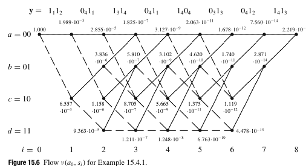

如果 e 是从 d_6 到 b_7 的边，

\[
\begin{aligned}
\alpha(e) &= \text{prob}(0_4 1_2 \mid 01)\text{prob}(m(6) = 0) \\
&= \text{prob}(0_4 \mid 0)\text{prob}(1_2 \mid 1)\text{prob}(m(6) = 0) \\
&= 0.368 \times 0.169 \times 1 = 6.219 \times 10^{-2}.
\end{aligned}
\]

新边标签的值列于表15.1中。在表中，从 s_i 到 s'_{i+1} 的边的标签表示为 \(\alpha(s_i, s'_{i+1})\)。

### 练习 851

验证表15.1中的边标签。

使用广义维特比算法，计算 (15.21) 的分子和分母出奇地简单。要开始该过程，首先将广义维特比算法应用于带有新边标签的格栅。该算法计算所有状态 s 和 0 <= i <= L + M 的流 v(a_0, s_i)。对于示例15.4.1中考虑的码和接收向量，流 v(a_0, s_i) 如图15.6所示；此处流值放置在节点 s_i 附近。接下来，反向应用广义维特比算法。即，从 i = L + M 开始向下到 i = 0，找到从 a_{L+M} 到 s_i 的流；将此流称为 v_b(a_{L+M}, s_i)。注意 v(s_i, a_{L+M}) = v_b(a_{L+M}, s_i)。对于示例15.4.1中考虑的码和接收向量，反向流 v_b(a_{L+M}, s_i) 如图15.7所示；同样，流值放置在节点 s_i 附近。

### 练习 852

使用广义维特比算法验证图15.6中 v(a_0, s_i) 的值。

### 练习 853

使用广义维特比算法的反向版本验证图15.7中 v_b(a_{L+M}, s_i) 的值。

为了计算 (15.21) 的分母，令 M 为所有可能的消息序列 m = (m_1, ..., m_K) 的集合，其中 m(i) = (m_1(i), ..., m_l(i)) 对于 0 <= i <= L - 1 是任意的，但是

## 表 15.1 示例 15.4.1 的边标签

| | l=0 | l=1 | l=2 | l=3 | l=4 | l=5 | l=6 | l=7 |
|---|---|---|---|---|---|---|---|---|
| $a(a_i, a_{i+1})$ | $1.989 \cdot 10^{-3}$ | $1.435 \cdot 10^{-2}$ | $2.520 \cdot 10^{-4}$ | $1.435 \cdot 10^{-2}$ | $3.312 \cdot 10^{-3}$ | $3.478 \cdot 10^{-3}$ | $1.877 \cdot 10^{-2}$ | $4.200 \cdot 10^{-4}$ |
| $a(a_i, c_{i+1})$ | $6.557 \cdot 10^{-3}$ | $5.820 \cdot 10^{-1}$ | $3.047 \cdot 10^{-2}$ | $5.820 \cdot 10^{-1}$ | $2.208 \cdot 10^{-3}$ | $2.318 \cdot 10^{-3}$ | | $7.618 \cdot 10^{-2}$ |
| $a(b_i, a_{i+1})$ | | | $4.571 \cdot 10^{-2}$ | $8.730 \cdot 10^{-4}$ | $3.312 \cdot 10^{-3}$ | $3.478 \cdot 10^{-3}$ | $2.535 \cdot 10^{-3}$ | |
| $a(b_i, c_{i+1})$ | | | $1.680 \cdot 10^{-4}$ | $9.568 \cdot 10^{-3}$ | $2.208 \cdot 10^{-3}$ | $2.318 \cdot 10^{-3}$ | $7.650 \cdot 10^{-4}$ | |
| $a(c_i, b_{i+1})$ | | $5.850 \cdot 10^{-4}$ | $1.865 \cdot 10^{-3}$ | $5.850 \cdot 10^{-2}$ | $8.125 \cdot 10^{-2}$ | $4.794 \cdot 10^{-2}$ | | |
| $a(c_i, d_{i+1})$ | | $1.428 \cdot 10^{-2}$ | $4.122 \cdot 10^{-3}$ | $1.428 \cdot 10^{-2}$ | $9.000 \cdot 10^{-5}$ | $1.714 \cdot 10^{-2}$ | $6.219 \cdot 10^{-2}$ | |
| $a(d_i, b_{i+1})$ | | | $6.182 \cdot 10^{-2}$ | $2.142 \cdot 10^{-2}$ | $1.530 \cdot 10^{-4}$ | $2.571 \cdot 10^{-2}$ | | |
| $a(d_i, c_{i+1})$ | | | $1.242 \cdot 10^{-3}$ | $3.900 \cdot 10^{-4}$ | $5.417 \cdot 10^{-2}$ | $3.136 \cdot 10^{-4}$ | | |


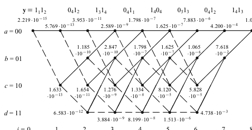

图 15.7 示例 15.4.1 的后向流 $v_i(a_{L+M}, s)$。

一个长度为 $k$ 的零块，对应 $L \le i \le L + M - 1$。因此，每条消息对应截断格栅中的一条唯一路径。注意分母满足

```
prob(y) = \sum_{m \in M} prob(y \text{ and } m)
= \sum_{m \in M} \prod_{i=0}^{L+M-1} prob(y(i) \text{ and } m(i)) .
```

后者正是由广义维特比算法使用非负实数半环 A（在普通加法和乘法下）计算的格栅中的流 $v(a_0, a_{L+M})$。

要计算 (15.21) 的分子，令 $\mathcal{M}_1(i)$ 表示 $\mathcal{M}$ 中满足 $\mathbf{m}_j(i) = 0$ 的子集。$\mathcal{M}_1(i)$ 中的每条消息对应截断格栅中的一条唯一路径，在从时刻 $i$ 到时刻 $i+1$ 的过程中，所选边必须仅对应第 $j$ 个消息比特在时刻 $i$ 为 0 时得到的边。作为示例，请参考图 14.4。由于该图中代码的 $k=1$，我们只需考虑 $\mathcal{M}_1(i)$；这组消息对应格栅中所有在时刻 $i$ 到时刻 $i+1$ 之间沿实线边的路径，因为实线边对应输入 0。(15.21) 的分子满足

```
prob(y \text{ and } x_j(i) = 0) = \sum_{m \in \mathcal{M}_1(i)} prob(y \text{ and } m)
= \sum_{m \in \mathcal{M}_1(i)} \prod_{i=0}^{L+M-1} prob(y(i) \text{ and } m(i)) .
```

令 $E(i, j)$ 为所有从时刻 $i$ 到时刻 $i+1$、对应第 $j$ 个消息比特在时刻 $i$ 为 0 时所得边的边集。则

```
prob(y \text{ and } x_j(i) = 0) = \sum_{e \in E(i, j)} v(a_0, e) \alpha(e) v(e, a_{L+M}) .
```

其中 $\alpha(e)$ 是边 $e$ 的边标签。但 \(v(e, a_{L+M}) = v_b(a_{L+M}, e)\)，因此

\(\text{prob}(\mathbf{y} \text{ and } \mathbf{x}_j(i) = 0) = \sum_{e \in E(i,j)} v(a_0, e) \alpha(e) v_b(a_{L+M}, e).\) (15.23)

我们现在正式给出双向 APP 解码算法，使用接收向量 $\mathbf{y}$ 的 $(n, k)$ 二进制卷积码：

- I. 为该代码构建截断格栅。令 $a_0$ 为零态。
- II. 使用 (15.22) 计算截断格栅的边标签。
- III. 对于 $i = 0, 1, \dots, L+M$，使用广义维特比算法递�地计算所有状态 $s$ 的流 $v(a_0, s)$。
- IV. 对于 $i = L+M, L+M-1, \dots, 0$，使用广义维特比算法的后向版本递�地计算所有状态 $s$ 的后向流 $v_b(a_{L+M}, s)$。
- V. 对于 $0 \le i \le L+M-1$ 和 $1 \le j \le k$，使用 (15.23) 计算 $\gamma_j(i) = \text{prob}(\mathbf{y} \text{ and } \mathbf{x}_j(i) = 0)$。
- VI. 对于 $0 \le i \le L+M-1$ 和 $1 \le j \le k$，计算 $\text{prob}(\mathbf{x}_j(i) = 0 \mid \mathbf{y}) = \frac{\gamma_j(i)}{v(a_0, a_{L+M})}$。
- VII. 对于 $0 \le i \le L+M-1$ 和 $1 \le j \le k$，根据 (15.20) 给出消息符号 $\mathbf{x}_j(i)$ 的估计值 $\bar{\mathbf{x}}_j(i)$。

### 示例 15.4.2

继续示例 15.4.1，双向 APP 解码算法的步骤 I-IV 已在表 15.1 和图 15.6 及 15.7 中完成。步骤 V 中计算的 $0 \le i \le 7$ 时的 $\gamma_1(i)$ 值如下。根据 (15.23),

\(\gamma_1(0) = v(a_0, a_0) \alpha(a_0, a_1) v_b(a_5, a_1) = 1.148 \times 10^{-15}\)

和

\(\gamma_1(1) = v(a_0, a_1) \alpha(a_1, a_2) v_b(a_5, a_2) + v(a_0, c_1) \alpha(c_1, b_2) v_b(a_5, b_2) = 1.583 \times 10^{-15}\)。

对于 $2 \le i \le 6$，

\(\gamma_1(i) = v(a_0, a_i) \alpha(a_i, a_{i+1}) v_b(a_5, a_{i+1}) + v(a_0, b_i) \alpha(b_i, a_{i+1}) v_b(a_5, a_{i+1}) + v(a_0, c_i) \alpha(c_i, b_{i+1}) v_b(a_5, b_{i+1}) + v(a_0, d_i) \alpha(d_i, b_{i+1}) v_b(a_5, b_{i+1}),\)

得到

\(\gamma_1(2) = 6.379 \times 10^{-16}, \quad \gamma_1(3) = 1.120 \times 10^{-15}, \quad \gamma_1(4) = 7.844 \times 10^{-17}, \quad \gamma_1(5) = 3.175 \times 10^{-17}, \quad \text{以及} \quad \gamma_1(6) = 2.219 \times 10^{-15}.\)

另外，

\(\gamma_1(7) = v(a_0, a_7) \alpha(a_7, a_8) v_b(a_5, a_8) + v(a_0, b_7) \alpha(b_7, a_8) v_b(a_5, a_8) = 2.219 \times 10^{-15}.\)

由于 $\text{prob}(\mathbf{x}(i) = 0 \mid \mathbf{y}) = \gamma_j(i) / v(a_0, a_{L+M})$，步骤 VI 得出：

概率 prob(x(0)=0 | y) = 0.5172,   概率 prob(x(1)=0 | y) = 0.7135,
概率 prob(x(2)=0 | y) = 0.2875,   概率 prob(x(3)=0 | y) = 0.5049,
概率 prob(x(4)=0 | y) = 0.0354,   概率 prob(x(5)=0 | y) = 0.0143,   以及
概率 prob(x(6)=0 | y) = 1.0000,   概率 prob(x(7)=0 | y) = 1.0000.

根据 (15.20)，APP 解码器在步骤 VII 中生成消息 00101100，因此得到码字 0000110000101100。该消息在分量 x(3) 上与使用示例 15.2.1 中软判定维特比算法得到的解码消息不一致。请注意，上述概率表明该比特 x(3)（以及 x(0)）的值高度不确定。另请注意，prob(x(0) = 0 | y) = prob(x(7) = 0 | y) = 1.0000，这与预期一致。

### 练习 854

重复示例 15.4.1 和 15.4.2，使用相同的 prob(y | c) 值，但

prob(m(i) = 0) = \begin{cases} 0.5 & \text{if } i = 0, 1, 2, 3, 4, 5, \\ 1 & \text{if } i = 6, 7, \end{cases}

和

prob(m(i) = 1) = \begin{cases} 0.5 & \text{if } i = 0, 1, 2, 3, 4, 5, \\ 0 & \text{if } i = 6, 7. \end{cases}

代替那些示例中 prob(m(i) = 0) 和 prob(m(i) = 1) 的值。

### 练习 855

使用双向 APP 解码算法解码以下由示例 15.4.1 的代码及其概率编码的接收向量。将您的结果与练习 817 和 845 中的结果进行比较。

- (a) 1_1 1_3 0_0 0_1 3_1 2_1 3_1 4_2 1_3 1_1 2_1 0_3 1_4.
- (b) 0_3 1_4 1_0 3_1 2_1 4_1 3_1 4_1 0_3 1_4 1_0 2_1.

存在适用于各种类型代码的其他 APP 解码器；参见 [158, 第 7 章]。此外，格栅与块码之间存在许多联系；[336] 提供了出色的综述。2001 年 2 月的 IEEE 信息论学报专刊致力于代码、图和算法之间的关系。该期刊中的综述文章 [180] 通过多个示例对这些联系进行了良好的介绍。

## 15.5 消息传递解码

在本节中，我们介绍消息传递解码的概念；这种解码用于多种场景，包括某些版本的 Turbo 解码。消息传递是我们的第一个迭代解码示例。在下一节中，我们将介绍应用于低密度奇偶校验码的另外两种迭代解码类型。

为了描述消息传递，从一个称为 Tanner 图^5 [325] 的二分图开始很有帮助，该图由长度为 $n$ 的二进制代码 C 的 $n \times n$ 奇偶校验矩阵 H 构建。

^5 Tanner 图实际上比我们提出的定义更一般。这些图本身已由 Wiberg、Loeliger 和 Kotter [390] 推广。

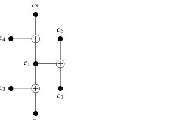

图 15.8 示例 15.5.1 中代码的 Tanner 图。

$n$。Tanner 图有两种类型的顶点，称为变量节点和检查节点。有 $n$ 个变量节点，每个对应 $H$ 的一个坐标或列。有 $r$ 个检查节点，每个对应 $H$ 的一个奇偶校验方程或行。Tanner 图仅在变量节点和检查节点之间有边；给定的检查节点恰好连接到 $H$ 对应列中有 1 的那些变量节点。

### 示例 15.5.1

令 $\mathcal{C}$ 为具有奇偶校验矩阵的 $(7, 4, 2)$ 二进制代码

```
$$H = \begin{bmatrix} 1 & 1 & 1 & 0 & 0 & 0 & 0 \\ 1 & 0 & 0 & 1 & 1 & 0 & 0 \\ 1 & 0 & 0 & 0 & 0 & 1 & 1 \end{bmatrix}.$$
```

图 15.8 给出了该代码的 Tanner 图。实心顶点是变量节点，而标记为 $\oplus$ 的顶点表示检查节点。

消息传递在离散时间点沿 Tanner 图的边从变量节点向检查节点以及从检查节点向变量节点发送信息。在我们稍后考察的情况中，传递的消息将表示概率对。最初，每个变量节点都有一个分配给它的消息；例如，某些消息可以直接来自接收向量的概率。在时刻 1，一些或所有变量节点通过图的边将分配给它们的消息发送到所有连接的检查节点。在时刻 2，一些接收到消息的检查节点处理该消息，并沿边向一些或所有连接的变量节点发送消息。这两次消息传输构成一次迭代。此过程持续多次迭代。在处理阶段，有一条必须遵守的重要规则。沿相邻边从节点发送的消息不得依赖于先前沿该边接收到的消息。

我们将使用 [91] 中描述的算法在 Tanner 图上说明消息传递。它具有第 15.2 节中介绍的软判定维特比算法的一些元素。首先，我们假设 $\mathcal{T}$ 是从一个长度为 $n$ 的二进制代码 $\mathcal{C}$ 得到的 Tanner 图，该代码由一个


码 $\mathcal{C}$ 的校验矩阵 $H$。我们进一步假设 $\mathcal{T}$ 无环。$^6$ 如第 15.2 节所述，为具体起见，我们假设用于接收向量的解调方案是 8 电平量化。因此假设 $\mathbf{c} = c_1 c_2 \cdots c_n$ 是发送的码字，$\mathbf{y} = y_1 y_2 \cdots y_n$ 是接收到的向量，其中 $y_i \in \{0, \dots, 14\}$。与软判定维特比算法一样，我们的目标是执行最大似然解码，找到最大化 prob($\mathbf{y} \mid \mathbf{c}$) 的码字 $\mathbf{c}$。我们假设信道是无记忆的，因此

```
prob(y | c) = \prod_{i=1}^n prob(y_i | c_i).
```

如第 15.2 节所述，取对数将乘积转化为和，然后重新缩放和平移概率，使得要最大化的值为

```
\sum_{i=1}^n \mu(y_i, c_i).
```

其中最大值对所有码字 $\mathbf{c} = c_1 c_2 \cdots c_n$ 取得，类似于 (15.15)。

Tanner 图 $\mathcal{T}$ 无环，因此是一棵树或森林。为简单起见，假设 $\mathcal{T}$ 是一棵树；如果 $\mathcal{T}$ 是森林，则对 $\mathcal{T}$ 中的每棵树分别执行该算法。只要 $H$ 的每一行权重都不为 1，所有叶子都是变量节点（我们也做此假设）。算法结束时，消息将沿每条边在每个方向传递一次。每条消息是一对非负整数。对中的第一个元素与比特 0 关联，第二个元素与比特 1 关联。该对合起来表示比特 0 或比特 1 出现的相对概率。*消息传递解码算法*如下：

- I. 初始化时，将对 $(\mu(y_i, 0), \mu(y_i, 1))$ 分配给第 $i$ 个变量节点。不给校验节点分配任何值。此外，对于每个叶子，该对作为消息，从该叶子节点指向附加的校验节点。

- II. 要找到离开校验节点 $h$ 的边 $e$ 沿线的消息，假设所有指向 $h$ 的消息（可能沿 $e$ 除外）都已确定。假设进入 $h$ 的消息（沿 $e$ 除外）为

```
(a_{i_1}, b_{i_1}), (a_{i_2}, b_{i_2}), \dots, (a_{i_l}, b_{i_l}).
```

考虑所有和

```
\sum_{j=1}^l x_{i_j}, \quad (15.24)
```

其中 $x_{i_j}$ 是 $a_{i_j}$ 或 $b_{i_j}$ 之一。沿 $e$ 离开 $h$ 的消息是 $(m_0, m_1)$，其中 $m_0$ 是所有此类和中包含偶数个 $b_{i_j}$ 的最大值，$m_1$ 是所有此类和中包含奇数个 $b_{i_j}$ 的最大值。

- III. 要找到离开变量节点 $v$ 的边 $e$ 沿线的消息，假设所有指向 $v$ 的消息（可能沿 $e$ 除外）都已确定。沿 $e$ 离开 $v$ 指向校验节点的消息被赋予 $v$ 处的对（来自步骤 I）加上所有进入 $e$ 的消息之和（沿 $e$ 除外）。

- IV. 一旦通过重复 II 和 III 确定了每条边上两个方向的所有消息，则为每个变量节点 $v$ 计算一个新对 $(p_0, p_1)$。该对是连接到 $v$ 的任意边上两条消息之和。

- V. 解码接收向量如下。对于第 $i$ 个变量节点，如果 $p_0 > p_1$ 则令 $c_i = 0$，如果 $p_1 > p_0$ 则令 $c_i = 1$。

II 中传递的消息的原理是，(15.24) 中的求和与比特 0（分别比特 1）关联，如果涉及偶数个（分别奇数个）$b_{i_j}$，因为这些和对应于加上偶数个（分别奇数个）与 1 关联的“概率”。我们不证明该算法的有效性；关于该算法的更多讨论见 [91] 及其中的参考文献。再次注意该算法与软判定维特比算法的密切关系。

示例 15.5.2 假设 $y = 120010110110101$ 是使用示例 15.5.1 中的 [7, 4, 2] 码 $\mathcal{C}$ 传输码字时的接收向量。虽然该码的最小距离为 2，意味着该码不能使用最近邻解码纠正任何错误，但我们仍可使用软判定解码来找到最可能的码字。我们将使用示例 15.5.1 中给出的校验矩阵 $H$ 确定的图 15.8 中 $\mathcal{C}$ 的 Tanner 图。我们还将使用示例 15.2.1 中给出的 $\mu(\gamma, c)$ 值。使用消息传递解码算法得到的消息见图 15.9。算法的步骤 1 在时间 1 执行，使用示例 15.2.1 中 $\mu(\gamma, c)$ 值的表应用于接收向量。在时间 2，我们使用 II 从三个校验节点向 $y_1$ 传递消息。例如，指向 $y_1$ 的消息 $(5, 8)$ 由从 $y_4$ 和 $y_5$ 进入校验节点的消息 $(0, 5)$ 和 $(3, 0)$ 确定，如下：

```
(5, 8) = (max{0 + 3, 5 + 0}, max{0 + 0, 5 + 3}).
```

同样，指向 $y_1$ 的消息 $(6, 5)$ 是

```
(6, 5) = (max{1 + 5, 0 + 0}, max{0 + 5, 1 + 0}).
```

时间 2 之后，每条边上都有一个沿某个方向的消息。在时间 3，使用 III 沿离开 $y_1$ 的三条边发送消息。例如，消息 $(14, 17)$ 是节点对 $(0, 3)$ 加上和 $(8, 9) + (6, 5)$。在时间 4，使用 II 向所有叶节点发送消息。例如，发送到 $y_4$ 的消息 $(17, 20)$ 使用边 $(3, 0)$ 和 $(14, 17)$ 得到

```
(17, 20) = (max{3 + 14, 0 + 17}, max{3 + 17, 0 + 14}).
```

时间 4 之后，所有边都有双向消息。通过将连接到每个变量节点的边相加，步骤 IV 给出：

| | y1 | y2 | y3 | y4 | y5 | y6 | y7 |
|---|---|---|---|---|---|---|---|
| (p0, p1) | (19, 25) | (25, 21) | (21, 25) | (17, 25) | (25, 19) | (19, 25) | (25, 16) |

注意，y1 的对是使用连接到 y1 的任意三条边之一得到的，

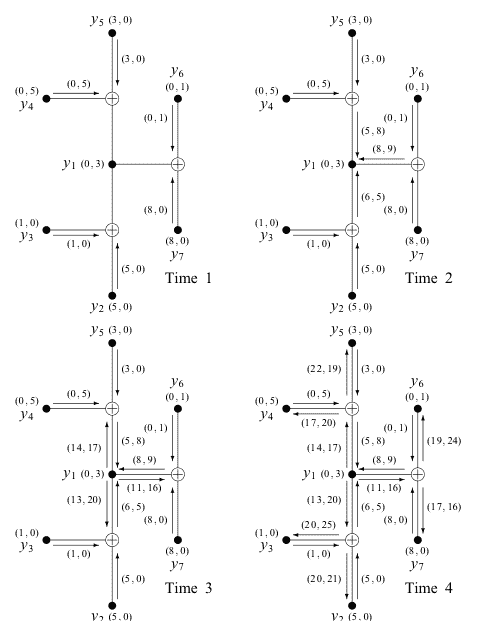

图 15.9 图 15.8 的 Tanner 图上的消息传递。

即，$(19, 25) = (14, 17) + (5, 8) = (11, 16) + (8, 9) = (13, 20) + (6, 5)$。我们根据步骤 V 将 $y$ 解码为 $c = 1011010$。注意，对于我们的接收向量 $y$ 和该码字 $c$，$\sum_{i=1}^7 \mu(y_i, c_i) = 3 + 5 + 0 + 3 + 1 + 8 = 25$，这是七个 $(p_0, p_1)$ 中每个的最大分量。

练习 856 验证示例 15.5.2 中的计算。

练习 857 设 $\mathcal{C}$ 为示例 15.5.1 中具有图 15.8 Tanner 图的码。使用消息传递解码算法解码以下接收向量；使用示例 15.2.1 中给出的 $\mu(y, c)$ 值。(a) $y = 0,1,0,1,0,0,1,0,1,13$，(b) $y = 1,0,0,0,1,0,0,4,12$。

练习 858 为具有校验矩阵的 [10, 6, 2] 二进制码构建 Tanner 图

$H = [ 1\ 1\ 1\ 0\ 1\ 0\ 0\ 0\ 0\ 0\ 1\ 0\ 0\ 0\ 1\ 1\ 0\ 0\ 0\ 0\ 0\ 0\ 0\ 0\ 1\ 0\ 1\ 1\ 0\ 0\ 0\ 0\ 1\ 0\ 0\ 0\ 0\ 0\ 1\ 1 ]$

然后使用消息传递解码算法解码 $y = 1,0,2,15,0,1,11,2,15,14,0,13,1$。

使用示例 15.2.1 中给出的 $\mu(y, c)$ 值。

## 15.6 低密度校验码

在上一节中，我们通过消息传递介绍了第一个迭代解码示例。在 20 世纪 90 年代中期，迭代解码成为涡轮码解码的重要技术。迭代解码由 Elias 于 1954 年引入 [77]。迭代解码随着 R. G. Gallager 于 1963 年在低密度校验码方面的工作而重新出现，但此后似乎在很大程度上被忽视，只有少数例外，直到研究人员意识到涡轮码的解码与 Gallager 的技术密切相关。在本节中，我们将介绍低密度校验码并考察 Gallager 的两种迭代解码版本。我们的介绍大量依赖 [94, 95, 211]。对有兴趣的读者，低密度校验码中消息传递的使用在 [295] 中有描述。

简而言之，二进制低密度校验码是具有校验矩阵的码，该矩阵中 1 相对较少，并以一定规律性分布在矩阵中。一个 [n, k] 二进制线性码 $\mathcal{C}$ 是低密度校验码 (LDPC) 码，前提是它具有一个 $m \times n$ 校验矩阵 $H$，其中每一列有固定权重 $c$，$H$ 的每一行有固定权重 $r$。? 这种类型的码将表示为 $(n, c, r)$ LDPC 码。注意，这样的矩阵可能没有独立行，因此从技术上讲不是本文所用意义上的校验矩阵。但是，$H$ 可以进行行化简并去掉零行，以形成 $\mathcal{C}$ 的具有独立行的校验矩阵。因此 $\mathcal{C}$ 的维度至少为 $n - m$。按行和列统计 $H$ 中 1 的个数，得到参数之间的关系 $nc = mr$。通常，我们希望 $r$ 和 $c$ 相对于 $n$ 都相对较小，因此 $H$ 中 1 的密度较低。

7 LDPC 码的一个自然推广是允许 $H$ 的行权重和列权重以某种受控方式变化。所得码有时被称为“不规则”LDPC 码。


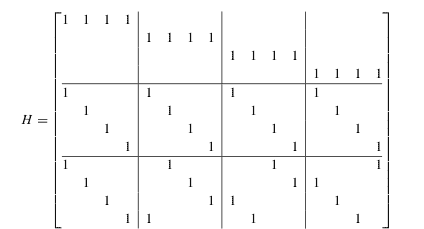

图 15.10 (16, 3, 4) LDPC 码的校验矩阵。

图 15.10 给出了一个 (16, 3, 4) 码的校验矩阵，该码是一个 [16, 6, 6] 二进制码。

### 练习 859

证明图 15.10 所给校验矩阵的二进制码 C 具有维数 6 和最小权重 6。提示：通过对 H 进行行化简得到维数。关于最小权重，证明 C 是偶码，且每个代码字在图中所示的每个四坐标块中都有偶数个 1。然后利用推论 1.4.14 证明 C 没有权重为 4 的代码字。

Gallager 开发了两种迭代解码算法，用于解码长度较长的 LDPC 码，例如几千比特。第一种迭代解码算法是一种简单的硬判决算法。假设使用 (n, c, r) 二进制 LDPC 码 C 发送代码字 c，并接收到向量 y。在计算综合征 $Hy^T$ 时，每个接收到的比特 $y_i$ 最多影响该综合征的 c 个分量，因为第 i 个比特参与 c 个校验。如果在这些 c 个校验所涉及的所有比特 S 中，只有第 i 个比特出错，那么 $Hy^T$ 的这 c 个分量将等于 1，表明校验方程不满足。即使这些比特 S 中存在其他一些错误，人们也预期 $Hy^T$ 的 c 个分量中会有几个等于 1。这就是 Gallager 硬判决解码算法的基础。

- 硬判决解码算法。
- I. 计算 $Hy^T$ 并确定不满足的校验，即 $Hy^T$ 的分量等于 1 的那些校验。
- II. 对于 n 个比特中的每一个，计算涉及该比特的不满足校验的数量。
- III. 改变 y 中涉及最多数量不满足校验的比特；将得到的向量再次称为 y。
- IV. 迭代重复 I、II 和 III，直到 $Hy^T = 0`（此时接收向量被解码为最新的 y），或直到达到一定的迭代次数（此时接收向量不被解码）。

### 示例 15.6.1

设 C 为具有图 15.10 中校验矩阵 H 的 (16, 3, 4) LDPC 码。假设

接收到 y = 0100101001000000。则 $Hy^T = 101011001001^T`。有六个不满足的校验，分别对应 H 的第 1、3、5、6、9 和 12 行。比特 1 和 10 各参与其中三个；所有其他比特参与两个或更少。因此改变 y 的比特 1 和 10，得到新的 y = 1100101001100000。

迭代后，我们看到 $Hy^T = 0`，因此将最新的 y 声明为发送的代码字；由于它与接收向量的距离为 2，我们已完成最近邻解码。

现在假设接收到 y = 1100101000000000。则 $Hy^T = 00000110100101^T`。校验 6、7、9 和 12 不满足；比特 6、10、11 和 15 处于两个不满足的校验中，其他比特更少。改变这些比特得到新的 y = 1100111001100010。

迭代后，$Hy^T = 010101101001^T`。校验 2、4、6、7、9 和 12 不满足；比特 6 和 15 处于三个不满足的校验中，其他比特处于两个或更少。改变比特 6 和 15 得到新的 y = 1100101001100000。

再次迭代得到 $Hy^T = 0`，因此将最新的 y 声明为发送的代码字，它与接收向量的距离为 2。

最后，假设接收到 y = 0100101001001000。则 $Hy^T = 101100100100^T`。有五个不满足的校验，比特 2、3、7、11、12、13 和 15 各参与其中两个；所有其他比特参与少于两个。改变这些比特得到新的 y = 0010100001110010。（15.25）

迭代后，$Hy^T` 是全一列向量，表明所有校验都不满足且所有比特都处于三个不满足的校验中。因此改变 y 的所有比特，在下一次迭代中 $Hy^T` 又是全一列向量。于是所有比特被改回，再次得到（15.25）。迭代明显陷入循环，永远不会达到一个代码字。因此原始接收向量不可解码。

### 练习 860

验证示例 15.6.1 中说明的结果。

### 练习 861

设 C 为图 15.10 中具有校验矩阵 H 的 (16, 3, 4) LDPC 码。假设接收到以下向量 y。尽可能使用 Gallager 硬判决解码算法对其进行解码。

(a) y = 1000010110100100，
(b) y = 1000010110100001，
(c) y = 0110101010100101。

### 练习 862

Gallager 硬判决解码算法以“并行”方式执行；在每次迭代中，改变处于最多数量不满足校验中的 y 的所有比特。该算法有一个“串行”版本。在此版本中，每次只改变一个比特。因此 III 被替换为：III'。在 y 中所有处于最多数量不满足校验中的比特中，仅改变下标 i 最小的比特 yi；将得到的向量再次称为 y。串行版本其余保持不变。将算法的串行版本应用于示例 15.6.1 中相同的接收向量，并将你的答案与示例中的答案进行比较：

(a) y = 0100101000100000，
(b) y = 1100101000000000，
(c) y = 0100101001001000。

Gallager 的软判决迭代解码算法可以有多种表述方式。我们描述 Mackay 的版本 [211]，他称之为乘积和解码算法。它比我们在此描述的更一般。我们仅介绍该算法，并将读者引向 Mackay 的论文以获取进一步讨论。Mackay 在以下网址有一个算法运行的可视化动画：

http://wol.ra.phy.cam.ac.uk/mackay/codes/gifs/

设 C 为具有 $m \times n$ 校验矩阵 H 的 (n, c, r) 二进制低密度校验码。可以为 C 构建一个 Tanner 图 T。将变量节点编号为 1, 2, ..., n，校验节点编号为 1, 2, ..., m。每个变量节点连接到 c 个校验节点，每个校验节点连接到 r 个变量节点。令 V(j) 表示连接到第 j 个校验节点的 r 个变量节点；集合 $V(j) \setminus s` 是 V(j) 排除变量节点 s。令 C(k) 表示连接到第 k 个变量节点的 c 个校验节点；集合 $C(k) \setminus t` 是 C(k) 排除校验节点 t。

假设发送代码字 c 并接收到 y = c + e，其中 e 是未知误差向量。给定综合征 $H y^T = H e^T = z^T`，解码器的目标是为 $1 \le k \le n` 计算 $\text{prob}(e_k = 1 \mid z)`。

由此，可以找到最可能的误差向量，进而找到最可能的代码字。该算法以迭代方式计算与 Tanner 图的每条边以及每个 $e \in \{0, 1\}$ 相关的两个概率。第一个概率 $q_{jk}^e`（其中 $j \in C(k)` 且 $e \in \{0, 1\}$）是在获得来自校验 $C(k) \setminus j` 的信息的条件下 $e_k = e` 的概率。第二个概率 $r_{jk}^e`（其中 $k \in V(j)` 且 $e \in \{0, 1\}$）是在给定 $e_k = e` 且其他比特 $e_i`（$i \in V(j) \setminus k`）的概率分布由 $\{q_{ij}^0, q_{ij}^1\}$ 给出时，第 j 个校验被满足的概率。算法中使用的初始概率 $p_k^e = \text{prob}(e_k = e)`（$1 \le k \le n` 且 $e \in \{0, 1\}$）直接来自信道统计。例如，如果通信通过具有交叉概率 $\rho` 的二进制对称信道，则 $p_k^0 = 1 - \rho` 和 $p_k^1 = \rho`。算法还需要概率 $\text{prob}(z_j \mid e_k = e), (e_j \in V(j) \setminus k)`（$k \in V(j)` 且 $e \in \{0, 1\}$）。这些概率可以使用类似于第 15.4 节的双向 APP 算法的算法高效计算。

二进制 LDPC 码的乘积和解码算法如下。

- I. 初始时，对于 $j \in C(k)` 和 $e \in \{0, 1\}$，设置 $q_{jk}^e = p_k^e`。
- II. 根据方程更新 $j \in V(j)` 和 $e \in \{0, 1\}$ 的 $r_{jk}^e` 值：

  $$r_{jk}^e = \sum_{e_i \in \{0, 1\}: (\forall i) V(j) \setminus k} \text{prob}(z_j \mid e_k = e, (e_i \mid i \in V(j) \setminus k)) \prod_{i \in V(j) \setminus k} q_{ji}^{e_i}.$$

- III. 根据方程更新 $j \in C(k)` 和 $e \in \{0, 1\}$ 的 $q_{jk}^e` 值：

  $$q_{jk}^e = a_{jk} p_k^e \prod_{i \in C(k) \setminus j} r_{ik}^e,$$

  其中 $a_{jk}` 被选取使得 $q_{jk}^0 + q_{jk}^1 = 1`。

- IV. 对于 $j \in C(k)` 和 $e \in \{0, 1\}$，计算

  $$q_k^e = p_k^e \prod_{j \in C(k)} r_{jk}^e.$$

- V. 对于 $1 \le k \le n`，若 $q_k^0 > q_k^1` 则设置 $\hat{\mathbf{e}}_k = 0`，若 $q_k^1 > q_k^0` 则设置 $\hat{\mathbf{e}}_k = 1`。令 $\hat{\mathbf{e}} = \hat{e}_1 \cdots \hat{e}_n`。如果 $H\hat{\mathbf{e}}^T = \mathbf{z}^T`，则通过设置 $\mathbf{e} = \hat{\mathbf{e}}` 进行判决。否则重复 II、III 和 IV，最多迭代一定次数。如果 $H\hat{\mathbf{e}}^T` 永远不等于 $\mathbf{z}^T`，则声明解码失败。

如果 Tanner 图 $\mathcal{T}` 无环且算法成功停止，则 (15.26) 中的概率正好是 $\alpha_k q_k^e`，其中 $\alpha_k` 被选取使得 $\alpha_k q_k^0 + \alpha_k q_k^1 = 1`。如果图中有环，这些概率是 (15.26) 的近似。归根结底，我们并不关心这些概率究竟是什么；我们只关心获得 $H\mathbf{e}^T = \mathbf{z}^T` 的解。因此，即使存在长环，该算法也可以成功使用。该算法对长度为几千的码（例如 $n = 10\,000`）非常成功，尤其是当 $c` 很小时（例如 $c = 3`）。该算法的分析可见 [211]。

## 15.7 Turbo码

Turbo码于 1993 年由 Berrou, Glavieux 和 Thitimajshima [20] 提出。一个 *turbo码* 包含一个并行串联编码器，并应用迭代解码方案。本节我们概述编码背后的思想，而在下一节我们将讨论 turbo 解码；有兴趣了解更多细节的读者可参阅 [118, 342, 352]。Turbo 编码的重要性可能尚未被完全理解。1997 年 10 月 6 日，*卡西尼* 航天器发射，前往 2004 年 6 月与土星会合；一个实验性 turbo 码包被包含在任务中。Turbo 码也将有更多地面应用。根据 Heegard 和 Wicker [118, p. 7]，“无法高估范围和/或数据”


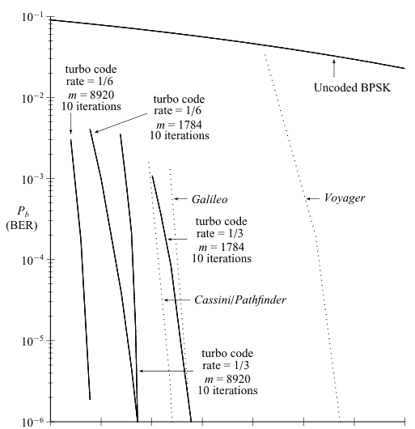

图 15.11 卫星通信中的编码增益。

rate resulting from turbo error control will have on the telecommunications industry. The effect will be particularly strong in wireless personal communications systems ...." The excitement about turbo coding is illustrated by the results shown in Figure 15.11.8 In Section 15.1, we indicated that one objective of coding is to communicate at signal-to-noise ratios close to the Shannon limit of -1.6 dB. Figure 15.11 shows the comparison between the signal-to-noise ratio Eb/N0 and the bit error rate Pb of codes used in some satellite communication packages. This figure also compares four turbo codes to these satellite packages. (The value of m is the message length; the number of iterations for the four turbo codes will be described in Section 15.8.) Figure 15.3 shows the Shannon limit and also the lowest signal-to-noise ratios that can be obtained for codes of various information rates. Comparing the two figures indicates the superiority of turbo codes; they achieve communication at low signal-to-noise ratios very close to the Shannon limit!

A parallel concatenated encoder consists of two or more component encoders which are usually either binary convolutional codes or block codes with a trellis structure that leads to efficient soft decision decoding.9 The simplest situation, which we will concentrate on, involves two component codes, C1 and C2, each with systematic encoders. (Systematic convolutional encoders are described shortly.) In fact, the encoders for the two codes can be identical. To be even more concrete, assume that a component code Ci is either a (2, 1) binary convolutional code with encoder Gi = [1 g(D)], where g(D) is a rational function or an [n, n/2] binary block code with generator matrix (encoder) Gi = [I_{n/2} A]. (The encoders are not only in systematic form but in standard form.) If the component codes of the parallel concatenated code are convolutional, the resulting code is called a parallel concatenated convolutional code or PCCC. Notice that in either case, the component code is a rate 1/2 code as every message bit generates two codeword bits. We will assume the usual encoding where the encoding of the message x is xGi. An encoder for the parallel concatenated code with component encoders G1 and G2 is formed as follows. The message x is encoded with the first code to produce (x, c1), where c1 = x(D)g1(D) if the code is convolutional or c1 = xA if the code is a block code. Next the message x is passed to a permuter, also called an interleaver.10 The permuter applies a fixed permutation to the coordinates of x producing the permuted message x̃. The permuted message is encoded with G2 to produce (x̃, c2), where c2 = x̃(D)g2(D) or c2 = x̃A. The codeword passed on to the channel is an interleaved version of the original message x and the two redundancy strings c1 and c2 that are generated by the codes C1 and C2. This process is pictured in Figure 15.12 and illustrated in Example 15.7.1. In the figure, SC1 and SC2 indicate that the encoders are in standard form. Notice that the resulting parallel concatenated code has rate 1/3.

Example 15.7.1 Let C1 and C2 each be the [8, 4, 4] extended Hamming code with generator matrix

```
G1 = G2 = [
1 0 0 0 0 1 1 1
0 1 0 0 1 0 1 1
0 0 1 0 1 1 0 1
0 0 0 1 1 1 1 0
]
```

Assume the permuter is given by the permutation (1,3)(2, 4). Suppose that x = 1011 is the message to be encoded. Then xG1 = 10110100 yielding c1 = 0100. The permuted message is x̃ = 1110, which is encoded as x̃G2 = 11100001 to produce c2 = 0001. Then

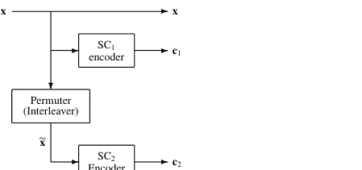

Figure 15.12 Parallel concatenated code with two standard form encoders.

(x, c1, c2) = (1011, 0100, 0001) is transmitted in interleaved form (the first bits of x, c1, c2 followed by the second bits, third bits, and fourth bits) as 100 010 100 101.

**Exercise 863** Find the interleaved form of all 16 codewords of the parallel concatenated code described in Example 15.7.1. What is the minimum distance of the resulting [12, 4] binary code?

In Chapter 14 the generator matrices for the convolutional codes that we presented were generally polynomial. However, the component convolutional codes in turbo codes use encoders that are most often nonpolynomial, because the encoders will be systematic, as the next example illustrates.

**Example 15.7.2** We illustrate nonpolynomial encoders with the code C1 from Example 14.1.1. If we take the encoder G1 and divide by 1 + D + D^2, we obtain the generator matrix

\( G_1' = \left[ 1 \quad \frac{1 + D^2}{1 + D + D^2} \right] \).

A physical encoder for \( G_1' \) is given in Figure 15.13. This is a feedback circuit. The state before clock cycle i is the two right-most delay elements which we denote by s(i) and s(i - 1). Notice these values are not x(i - 1) and x(i - 2) as they were in the feedforward circuit for the encoder G1 given in Figure 14.1. The reader should compare Figures 14.1 and 15.13.

To understand why this circuit is the physical encoder for \( G_1' \), we analyze the output c(i) at clock cycle i. Suppose x is the input message, and at time i - 1 the registers contain x(i), s(i), and s(i - 1). As the next input enters from the left at time i, the output c1(i) is clearly x(i), while the output c2(i) is x(i) + (s(i) + s(i - 1)) + s(i - 1) = x(i) + s(i). The contents of the registers are now x(i + 1), s(i + 1) = x(i) + s(i) + s(i - 1), and s(i). Thus

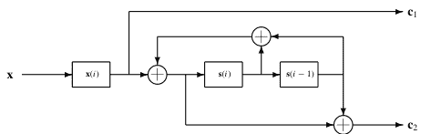

we can solve for c2(i) using s(i + 1) = x(i) + s(i) + s(i - 1) as follows:

```
c2(i) = x(i) + s(i)
= x(i) + x(i - 1) + s(i - 1) + s(i - 2)
= x(i) + x(i - 1) + x(i - 2) + s(i - 2) + s(i - 3) + s(i - 2)
= x(i) + x(i - 1) + x(i - 2) + s(i - 3)
= x(i) + x(i - 1) + x(i - 2) + x(i - 4) + s(i - 4) + s(i - 5).
```

Continuing, we see that

```
c2(i) = x(i) + x(i - 1) + x(i - 2) + x(i - 4) + x(i - 5)  (15.27)
+ x(i - 7) + x(i - 8) + x(i - 10) + x(i - 11) + ...
```

By Exercise 864, we see that the Laurent series expansion for (1 + D^2)/(1 + D + D^2) is

```
1 + D + D^2 + D^4 + D^5 + D^7 + D^8 + D^10 + D^11 + D^13 + D^14 + ...  (15.28)
```

Thus c2 = x(1 + D^2)/(1 + D + D^2) = x(1 + D + D^2 + D^4 + D^5 + D^7 + D^8 + D^10 + D^11 + ...), agreeing with (15.27). The physical encoder G'_i for C_1 has infinite memory by (15.27). (Recall that C_1 has memory 2 since G_1 is a canonical encoder for C_1 by Example 14.3.2)

**Exercise 864** Prove that the Laurent series for (1 + D^2)/(1 + D + D^2) is given by (15.28). Hint: Multiply the series by 1 + D + D^2.

**Exercise 865** Consider the physical encoder G'_i in Figure 15.13.

- (a) Suppose that x = 1000... is input to the encoder. So x(0) = 1 and x(i) = 0 for i >= 1. Compute c2 giving the contents of the shift-registers for several values of i until the pattern becomes clear. (The equations in Example 15.7.2 may prove helpful.) Check your answer by comparing it to the Laurent series for (1 + D^2)/(1 + D + D^2) given by (15.28).

- (b) Suppose that x = 1010000... is input to the encoder. Compute c2 giving the contents of the shift-registers for several values of i until the pattern becomes clear. Check your answer by comparing it to the product of 1 + D^2 and the Laurent series for (1 + D^2)/(1 + D + D^2) given by (15.28).

As with block codes, a systematic generator matrix (or systematic encoder) for an $(n, k)$ convolutional code is any generator matrix with $k$ columns which are, in some order, the $k$ columns of the identity matrix $I_k$. For example, there are two systematic encoders for the code $C_1$ of Example 15.7.2: the matrix $G_1^T$ of that example and

```
$$G_1^T = \left[ \begin{array}{c} 1+D+D^2 \ 1+D^2 \end{array} \quad 1 \right].$$
```

If the systematic encoder has form $[I_k \quad A]$, the encoder is in *standard form*. The encoder $G_1^T$ of Example 15.7.2 is in standard form. A *recursive systematic convolutional (RSC) encoder* for a convolutional code is a systematic encoder with some entry that is nonpolynomial of infinite weight. So both $G_1^T$ and $G_1^{T\prime}$ are RSC encoders for $C_1$. A physical encoder representing an RSC encoder will involve feedback circuits as in Figure 15.13.

In most cases the component codes of a PCCC are encoded by RSC encoders in order to attempt to have high minimum weights. Suppose that $G = [1 \quad f(D)/g(D)]$ is an RSC encoder for a (2, 1) convolutional code where $f(D)$ and $g(D)$ are relatively prime polynomials and $g(D)$ is not a power of $D$. By Lemma 14.4.2, wt$(f(D)/g(D)) = \infty$. Suppose that $G$ is the encoder for both component codes of a PCCC as pictured in Figure 15.12. If $x(D)$ is an input polynomial, then $x(D)G = (x(D), x(D)f(D)/g(D))$, which can have finite weight only if $x(D)$ is a multiple of $g(D)$. With convolutional codes, one wants all codewords to have high weight to make the free distance high. In particular, if a polynomial $x(D)$ is input to our PCCC, one hopes that at least one of the two outputs $c_1$ or $c_2$ is of high weight. Thus if $c_1$ has finite weight, which means $x(D)$ is a multiple of $g(D)$ (a somewhat rare occurrence), one hopes that the redundancy $c_2$ is of infinite weight. That is the purpose of the permuter; it permutes the input components of $x(D)$ so that if $x(D)$ is a multiple of $g(D)$, hopefully $\tilde{x}(D)$ is not a multiple of $g(D)$. Therefore if the permuter is designed properly, a very high percentage of outputs $(c_1, c_2)$ will have high weight even if the component codes have small free distances individually. With only a relatively few codewords generated by polynomial input having small weight, the overall PCCC generally performs as if it has high free distance. The design and analysis of permuters can be found in [118, Chapter 3] and [342, Chapter 7].

**Exercise 866** Suppose that $G_1^T$ of Example 15.7.2 is used for both encoders in Figure 15.12.

- (a) Let x = x(D) = 1 + D^3 be the input to the first encoder. By multiplying x(D) times $(1 + D^2)/(1 + D + D^2)$, compute c1, giving the resulting polynomial. What is wt(c1)?

- (b) Suppose the interleaver permutes the first two components of x to produce $\tilde{x} = D + D^3$. By multiplying $\tilde{x}$ times the Laurent series (15.28) compute c2, giving the resulting Laurent series. What is wt(c2)?

## 15.8 Turbo decoding

In this section we describe an iterative decoding algorithm that can be used to decode turbo codes. We rely heavily on the description given in [352]. Assume our


涡轮码涉及前一节介绍并在图 15.12 中总结的两个并行串联码 C1 和 C2。涡轮解码算法实际上使用两个解码器，每个分量码对应一个。假设消息 x = (x(1), x(2), ..., x(m)) 与两个校验向量 c1 = (c1(1), c1(2), ..., c1(m)) 和 c2 = (c2(1), c2(2), ..., c2(m)) 交织后发送。解交织后得到的接收向量 y = (y(1), y(2), ..., y(m))、y1 = (y1(1), y1(2), ..., y1(m)) 和 y2 = (y2(1), y2(2), ..., y2(m)) 是 x、c1 和 c2 的带噪版本。它们的分量来自解调器；例如，如果使用了 8 级量化，则三个接收向量的分量将在 {0, 1, ..., 14} 中。最终，解码器的任务是求出后验概率

prob(x(i) = x | y, y1, y2) for x in {0, 1} and 1 <= i <= m. (15.29)

求出这些值的精确结果会导致一个相当复杂的解码器。Berrou、Glavieux 和 Thitimajshima [20] 发现了一种复杂度低得多的解码器，它通过迭代运算来估计这些概率，从而实现可靠解码。迭代解码从码 C1 开始，使用关于 x 的先验概率、信道统计特性以及接收向量 y 和 y1。第一个解码器将软信息传递给 C2 的解码器，作为第二个解码器的先验概率使用。第二个解码器使用这些关于 x 的先验概率、信道统计特性以及接收向量 y 和 y2 来计算软信息，并将其传回给第一个解码器。从第一个解码器向第二个解码器传递软信息并再传回，构成涡轮解码器的一次迭代；解码器运行多次迭代。“turbo”一词指的是将解码器一部分的信息反馈到另一部分并再返回的过程，以求改进解码，这很像对内燃机进行“turbo-charging”。

我们首先考察解码过程第一次迭代的前半部分。此步骤使用第一个码 C1 和接收向量 y 和 y1，目标是计算

prob(x(i) = x | y, y1) for x in {0, 1} and 1 <= i <= m. (15.30)

从这些概率中，我们可以利用从 y 和 y1 获得的部分信息（忽略 y2 的信息）来获得最可能的消息值。但是

prob(x(i) = x | y, y1) = prob(x(i) = x, y, y1) / prob(y, y1)
= alpha * prob(x(i) = x, y, y1), (15.31)

其中 alpha = 1/prob(y, y1)。alpha 的精确值无关紧要，因为我们只关心 prob(x(i) = 0 | y, y1) 和 prob(x(i) = 1 | y, y1) 哪个更大。这种 alpha 表示法在 [252] 中有更详细的描述，它允许我们删除不影响我们所计算的概率之间相对关系的条件概率；我们在本节中随意使用它。

为了确定 (15.31) 中的概率，对于 x in {0, 1} 和 1 <= i <= m，令 pi_i^(0)(x) = prob(x(i) = x) 为第 i 个消息比特为 x 的先验概率。例如，如果 0 和 1 以相同的概率发送，则 pi_i^(0)(x) = 0.5。对于卷积码，我们看到消息末尾的某些比特始终为 0，以便将编码器送入零态；对于这些比特，pi_i^(0)(0) = 1 且 pi_i^(0)(1) = 0。我们假设信道统计特性 prob(y|c)（例如参见示例 15.2.1）是已知的。使用这些信道统计特性，令 lambda_i(x) = prob(y(i) | x(i) = x)。我们有

prob(x(i) = x, y, y1) = sum_{x(i)=x} prob(x, y, y1)
= sum_{x(i)=x} prob(y, y1 | x) prob(x)
= sum_{x(i)=x} prob(y1 | x) prob(y | x) prob(x). (15.32)

但是，

prob(y | x) prob(x) = prod_{j=1}^m prob(y(j) | x(j)) prob(x(j)) = prod_{j=1}^m lambda_j(x(j)) pi_j^(0)(x(j))

在信道无记忆的假设下。此外，prob(y1 | x) = prob(y1 | c1)，因为 c1 是通过使用 C1 编码直接从 x 确定的。将这些与 (15.30)、(15.31) 和 (15.32) 结合，我们有

prob(x(i) = x | y, y1) = alpha sum_{x(i)=x} prob(y1 | c1) prod_{j=1}^m lambda_j(x(j)) pi_j^(0)(x(j))
= alpha lambda_i(x) pi_i^(0)(x) sum_{x(i)=x} prob(y1 | c1) prod_{j != i}^m lambda_j(x(j)) pi_j^(0)(x(j)). (15.33)

不包括 alpha，(15.33) 是三个项的乘积。第一个是 lambda_i(x)，即系统项，包含从信道统计特性和接收比特 y(i) 得出的关于 x(i) 的信息。第二个是 pi_i^(0)(x)，即仅由第 i 个消息比特确定的先验项。第三个称为外部项，包含从接收校验 y1 得出的关于 x(i) 的信息；我们用以下符号表示该项：

pi_i^(1)(x) = sum_{x(i)=x} prob(y1 | c1) prod_{j != i}^m lambda_j(x(j)) pi_j^(0)(x(j))

请注意，外部信息不包括特定项 lambda_i(x(i)) pi_i^(0)(x(i))，这一现象暗示了消息传递的要求：沿 Tanner 图边传递的消息不能涉及先前沿该边接收到的信息。此外，这种外部信息的和-积形式让人联想到双向 APP 解码算法和和-积解码算法中出现的和-积形式。这种外部信息作为第二个解码器使用的先验概率传递给它。

第二个解码器使用先验概率、信道统计特性以及接收向量 y 和 y2 来执行第一次迭代的后半部分。以与前半部分类似的方式，

prob(x(i) = x | y, y2) = alpha sum_{x:x(i)=x} prob(y2 | c2) prod_{j=1}^m lambda_j(x(j)) pi_j^(1)(x(j))
= alpha lambda_i(x) pi_i^(1)(x) sum_{x:x(i)=x} prob(y2 | c2) prod_{j=1, j != i}^m lambda_j(x(j)) pi_j^(1)(x(j)).

（上述 alpha 的值可能与 (15.31) 中的不同；同样，精确值无关紧要。）来自该解码器的外部信息

pi_i^(2)(x) = sum_{x:x(i)=x} prob(y2 | c2) prod_{j=1, j != i}^m lambda_j(x(j)) pi_j^(1)(x(j))

被传回第一个解码器，作为先验概率以开始第二次迭代的前半部分。

继续以类似方式，第 I 次迭代生成以下概率：

pi_i^(2I-1)(x) = sum_{x:x(i)=x} prob(y1 | c1) prod_{j=1, j != i}^m lambda_j(x(j)) pi_j^(2I-2)(x(j)),
pi_i^(2I)(x) = sum_{x:x(i)=x} prob(y2 | c2) prod_{j=1, j != i}^m lambda_j(x(j)) pi_j^(2I-1)(x(j)).

根据 (15.33) 和类似方程，

prob(x(i) = x | y, y1) = alpha lambda_i(x) pi_i^(2I-2)(x) pi_i^(2I-1)(x),
prob(x(i) = x | y, y2) = alpha lambda_i(x) pi_i^(2I-1)(x) pi_i^(2I)(x),

分别求解 pi_i^(2I-1)(x) 和 pi_i^(2I)(x)，得到

pi_i^(n)(x) = { alpha * prob(x(i) = x | y, y1) / (lambda_i(x) pi_i^(n-1)(x)) if n = 2I - 1,
               alpha * prob(x(i) = x | y, y2) / (lambda_i(x) pi_i^(n-1)(x)) if n = 2I. } (15.34)

（注意 alpha 值与之前不同。）我们最初的目标是计算 (15.29)。事实证明，在 N 次完整迭代后，这可以近似为

alpha lambda_i(x) pi_i^(2N)(x) pi_i^(2N-1)(x).

这导出了涡轮解码算法：

- 1. 直到某个迭代次数 N，计算
  pi_i^(1)(x), pi_i^(2)(x), pi_i^(3)(x), ..., pi_i^(2N)(x)，
  对于 1 <= i <= m 和 x in {0, 1}，使用 (15.34)。

- 2. 对于 1 <= i <= m 和 x in {0, 1}，计算
  gamma_i(x) = alpha lambda_i(x) pi_i^(2N)(x) pi_i^(2N-1)(x).


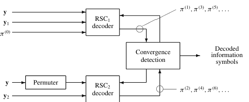

图 15.14 Turbo 解码器。

III. 解码消息符号 \(\widehat{\mathbf{x}}(i)\)，用于估计 \(\mathbf{x}(i)\)，为

\(\widehat{\mathbf{x}}(i) = \begin{cases} 0 & \text{if } \gamma_t(0) > \gamma_t(1), \\ 1 & \text{if } \gamma_t(1) > \gamma_t(0). \end{cases}\)

对于 \(1 \le i \le m\)。

\(N\) 的值可通过多种不同方式确定。例如，该值可以简单地固定，比如说，\(N=10\)（参见图 15.11）。或者可以检查概率序列 \(\pi_t^{(1)}(x), \pi_t^{(2)}(x), \pi_t^{(0)}(x), \dots\)，以查看随着迭代次数增加的变异程度。使用 (15.34) 在步骤 I 中计算 \(\pi_t^{(r)}(x)\) 涉及计算 prob(\(\hat{\mathbf{x}}(i) = x \mid \mathbf{y}, \mathbf{y}_1\)) 和 prob(\(\hat{\mathbf{x}}(i) = x \mid \mathbf{y}, \mathbf{y}_2\))。这些通常可以使用第 15.4 节所述双向 APP 解码（Two-Way APP Decoding）的版本来计算。Turbo 解码算法在图 15.14 中有示意图。

## 15.9 太空历史简史

我们以对纠错码在太空探索历史中的应用的简要总结来结束本章。更详尽的记载可见 [352]。

第一个为深空应用开发的纠错码是一种非线性 (32, 64, 16) 码，它是二进制 [32, 6, 16] Reed-Muller 码 \(\mathcal{R}(1, 5)\) 的一个陪集，能够纠正七个错误。该码分别于 1969 年 2 月 24 日和 3 月 27 日发射的 *水手 6 号* 和 7 号火星任务中使用。*水手 6 号* 于 1969 年 7 月 30 日飞越火星赤道以内 2131 英里，*水手 7 号* 于 1969 年 8 月 4 日飞越南半球以内 2130 英里。*水手* 号航天器共传回 201 张灰度照片，每个像素给定 \(2^8 = 256\) 个灰度等级之一。该码后来也用于后续 *水手* 号任务以及 *火星维京* 号着陆器。使用该码的编码增益在 BER 为 \(5 \times 10^{-3}\) 时相比未编码 BPSK 为 2.2 dB。虽然所选用的码在能够纠正七个错误的码中速率相对较低（6/32），但它具有编码器和解码器易于实现的优势。该解码器被称为 *绿色机器*，以其开发者、NASA 喷气推进实验室（JPL）的 R. R. Green 命名，它使用 Hadamard 矩阵的计算来执行解码任务。

虽然水手码是为太空应用开发的第一个码，但它实际上并不是第一个被发射的。一种基于 (2, 1, 20) 卷积码的编码系统，其生成矩阵 G = [g1(D) g2(D)]，其中

g1(D) = 1,
g2(D) = 1 + D + D^2 + D^5 + D^6 + D^8 + D^9 + D^12 + D^13 + D^14 + D^16 + D^17 + D^18 + D^19 + D^20，

于 1968 年 11 月 8 日搭乘先驱者 9 号发射，前往太阳轨道。序列解码（在 [197, 323, 351] 中描述）被用于解码接收到的数据。先驱者 9 号一直持续传输关于太阳风、行星间电子密度和磁场、宇宙尘埃以及其他正在进行的实验结果的信息，直到 1983 年。该码及其序列解码器在 BER 为 \(7.7 \times 10^{-4}\) 时提供了 3.3 dB 的编码增益。

1972 年发射前往木星的先驱者 10 号任务和一年后发射前往土星的先驱者 11 号任务搭载了一种由 Massey 和 Costello [228] 开发的 (2, 1, 31, 21) quick-look-in 卷积码，其编码器为 [g1(D) g2(D)]，其中

g1(D) = 1 + D + D^2 + D^4 + D^5 + D^7 + D^8 + D^9 + D^11 + D^13 + D^14 + D^16 + D^17 + D^18 + D^19 + D^21 + D^22 + D^23 + D^24 + D^25 + D^27 + D^28 + D^29 + D^31，

g2(D) = g1(D) + D。

quick-look-in 卷积码是一种 (2, 1) 码，其编码器为 [g1(D) g2(D)]，其中 deg g1(D) = deg g2(D)，g1(D) 和 g2(D) 的常数项均为 1，且 g1(D) + g2(D) = D。练习 867 说明了为什么这被称为 quick-look-in 码。

### 练习 867 设 C 为具有编码器 G = [g1(D) g2(D)] 的 quick-look-in (2, 1) 卷积码。

- (a) 证明 C 是基本的且非灾难性的。提示：g1(D) 和 g2(D) 的任何除数都是 g1(D) + g2(D) 的除数。

- (b) 设 x(D) 为输入到该码的信息，c(D) = (c1(D), c2(D)) = x(D)G 为输出。证明 c1(D) + c2(D) = x(D)D。

注意 (b) 表明，通过将纠正后接收向量的两个分量相加，可以很容易地从输出得到输入；它仅被延迟一个时间单位。因此，接收器可以快速查看纠正后的向量以获得输入。注意 (b) 还表明 C 是非灾难性的，因为如果输出具有有限权重，则输入也必须具有有限权重。

随着维特比算法的发展，卷积码在深空探索中的应用变得更加普遍。序列解码的缺点在于它没有固定的解码时间。虽然维特比算法没有这个缺点，但当记忆体过高时，它无法高效使用。在 1980 年代中期，空间数据系统咨询委员会（CCSDS）将一种串联编码系统作为其标准，其内编码器由 (2, 1, 6, 10) 或 (3, 1, 6, 15) 卷积码组成。(2, 1, 6, 10) 码的生成矩阵为 [g1(D) g2(D)]，其中

```
g_1(D) = 1 + D + D^3 + D^4 + D^6.
g_2(D) = 1 + D^3 + D^4 + D^5 + D^6.
```

(3, 1, 6, 15) 码的生成矩阵为 [g1(D) g2(D) g3(D)]，其中 g1(D) 和 g2(D) 如上所述，g3(D) = 1 + D^2 + D^4 + D^5 + D^6。在 BER 为 \(1 \times 10^{-5}\) 时，(2, 1, 6, 10) 码提供 5.4 dB 的编码增益，(3, 1, 6, 15) 码提供 5.7 dB 的编码增益。两种码都可以使用维特比算法高效解码，但 (2, 1, 6, 10) 码已成为首选。

旅行者 1 号和 2 号于 1977 年夏季发射，旨在探索木星、土星及其卫星。这些航天器传输了两种不同类型的数据：影像和 GSE（一般科学与工程）。影像系统所需的可靠性低于 GSE 系统，并使用 (2, 1, 6, 10) 码进行编码。GSE 数据使用串联码进行传输。外编码器是 [24, 12, 8] 扩展二进制 Golay 码。使用二进制 Golay 码进行编码后，执行了码字交织，并将结果传递给内编码器，即 (2, 1, 6, 10) 码。解码时该过程逆转。（影像数据仅绕过了编码和解码过程中的 Golay 码部分。）部分归功于编码的有效使用，NASA 工程师能够将旅行者 2 号的任务延长至包括天王星和海王星飞越。为实现此目标，GSE 数据使用串联码进行传输，其外编码器为 F256 上的 [256, 224, 33] Reed-Solomon 码，取代了 Golay 码，随后是 (2, 1, 6, 10) 内编码器。后来的 NASA 任务，包括伽利略号以及一些欧洲空间局（ESA）任务，如前往哈雷彗星的 Giotto 任务，使用了类似的纠错编码，涉及 Reed-Solomon 码和卷积码，并在使用 Reed-Solomon 码进行编码后增加了交织步骤。旅行者编码系统的编码增益如图 15.11 所示。

伽利略号研究木星及其大气层的任务从一开始就充满了问题。该任务原定于 1986 年初从航天飞机发射，但由于 1986 年 1 月 28 日挑战者号航天飞机空中爆炸，任务被推迟至 1989 年底。伽利略号搭载了两种不同的串联码发射。两种系统的外编码器均为 (256, 224, 33) Reed-Solomon 码。一种系统的内编码器为 (2, 1, 6, 10) CCSDS 标准码，而另一种系统的内编码器为具有生成矩阵 [g1(D) g2(D) g3(D) g4(D)] 的 (4, 1, 14) 卷积码，其中

```
g_1(D) = 1 + D^3 + D^4 + D^7 + D^8 + D^{10} + D^{14},
g_2(D) = 1 + D^2 + D^5 + D^7 + D^9 + D^{10} + D^{11} + D^{14},
g_3(D) = 1 + D + D^4 + D^5 + D^6 + D^7 + D^9 + D^{10} + D^{12} + D^{13} + D^{14},
g_4(D) = 1 + D + D^2 + D^6 + D^8 + D^{10} + D^{11} + D^{12} + D^{14}.
```

在每个时间增量时，(4, 1, 14) 码的维特比解码器必须检查 \(2^{14} = 16\,384\) 个状态。为完成这项艰巨的任务，JPL 完成了大型维特比解码器（Big Viterbi Decoder）在


1991年（伽利略号发射后超过两年！）。该解码器可以每秒一百万比特的速率运行。前往木星途中，高增益X带天线（设计用于以每秒100,000比特的速率传输伽利略号数据）未能展开。结果不得不由低增益天线接管数据传输。然而，低增益天线的信息传输速率仅为每秒10比特。情况更加复杂，因为(4, 1, 14)内编码器的编码已硬连线到高增益天线中。JPL科学家能够实施软件更改，以改进伽利略号的数据传输和纠错能力，这反过来又改进了CCSDS标准中的数据传输。最终，伽利略号上原有的外层Reed-Solomon编码器被另一个(2, 1)卷积编码器取代；使用的内编码器是原本已在船上的(2, 1, 6, 10)代码。

卡西尼号航天器于1997年10月6日发射，计划于2004年6月与土星会合。搭载ESA的惠更斯号探测器，该探测器将被投入土卫六的大气层。卡西尼号上搭载了用于(2, 1, 6, 10) CCSDS标准卷积代码、搭载于伽利略号上的(4, 1, 14)代码以及一个(6, 1, 14)卷积代码的硬件编码器。JPL的一个由Divsalar、Dolinar和Pollara组成的团队创建了一个作为实验包放置在卡西尼号上的turbo码。这个turbo码并行使用两个(2, 1)卷积代码。这个turbo码是图15.12中给出的代码的修改版；第一个代码使用RSC编码器[g1(D)/g2(D)]，其中g1(D) = 1 + D^2 + D^3 + D^6，g2(D) = 1 + D + D^2 + D^3 + D^6。第二个编码器是[g1(D)/g3(D)] g2(D)/g3(D)，其中g3(D) = 1 + D；这不是系统的，但是递归的。地球上，有一个与用于(6, 1, 14)卷积代码的大维特比解码器相比复杂度低得多的turbo解码器。仿真表明，如图15.11所示，turbo码优于由外层Reed-Solomon代码和内层(6, 1, 14)代码组成的串联代码。

## 参考文献

- [1] M. J. Adams, "子码与覆盖半径," IEEE Trans. Inform. Theory IT-32 (1986), 700-701.
- [2] E. Agrell, A. Vardy, and K. Zeger, "二进制码上界表," IEEE Trans. Inform. Theory IT-47 (2001), 3004-3006.
- [3] E. Artin, 《几何代数》. Interscience Tracts in Pure and Applied Mathematics No. 3. New York: Interscience, 1957.
- [4] E. F. Assmus, Jr. and J. D. Key, 《设计及其代码》. London: Cambridge University Press, 1993.
- [5] E. F. Assmus, Jr. and J. D. Key, "多项式代码与有限几何," in 《编码理论手册》, eds. V. S. Pless and W. C. Huffman. Amsterdam: Elsevier, 1998, pp. 1269-1343.
- [6] E. F. Assmus, Jr. and H. F. Mattson, Jr., "新的5-设计," J. Comb. Theory 6 (1969), 122-151.
- [7] E. F. Assmus, Jr. and H. F. Mattson, Jr., "某些3纠错BCH码的覆盖半径为5," IEEE Trans. Inform. Theory IT-22 (1976), 348-349.
- [8] E. F. Assmus, Jr., H. F. Mattson, and R. J. Turyn, "开发代数代码的研究," Report AFCRL-67-0365, Air Force Cambridge Res. Labs., Bedford, MA, June 1967.
- [9] E. F. Assmus, Jr. and V. Pless, "关于极端自偶码的覆盖半径," IEEE Trans. Inform. Theory IT-29 (1983), 359-363.
- [10] D. Augot, P. Charpin, and N. Sendrier, "研究BCH码最小重量代码字的定位多项式," IEEE Trans. Inform. Theory IT-38 (1992), 960-973.
- [11] D. Augot and L. Pecquet, "一种用于代数-几何码和Reed-Solomon码列表解码中替代因式分解的Hensel升引法," IEEE Trans. Inform. Theory IT-46 (2000), 2605-2614.
- [12] C. Bachoc, "关于二进制码谐波权重枚举子," Designs, Codes and Cryptography 18 (1999), 11-28.
- [13] C. Bachoc and P. H. Tiep, "附录：二设计与码最小值," appendix to: W. Lempken, B. Schröder, and P. H. Tiep, "对称平方、球形设计与格最小值," J. Algebra 240 (2001), 185-208; appendix pp. 205-208.
- [14] A. Barg, "线性码支撑集的垛形体," Applicable Algebra in Engineering, Communication and Computing (AECC Journal) 8 (1997), 165-172.
- [15] B. I. Below, "关于Griesmer界的猜想," in Proc. Optimization Methods and Their Applications, All Union Summer Sem., Lake Baikal (1972), 100-106.
- [16] T. P. Berger and P. Charpin, "BCH码及某些扩域上仿射不变码的自同构群," Designs, Codes and Cryptography 18 (1999), 29-53.
- [17] E. R. Berlekamp, ed., 《编码理论发展的关键论文》. New York: IEEE Press, 1974.
- [18] E. R. Berlekamp, 《代数编码理论》. Laguna Hills, CA: Aegean Park Press, 1984.
- [19] E. R. Berlekamp, F. J. MacWilliams, and N. J. A. Sloane, "关于自偶码的Gleason定理," IEEE Trans. Inform. Theory IT-18 (1972), 409-414.
- [20] C. Berrou, A. Glavieux, and P. Thitimajshima, "逼近香农极限的纠错编码与解码：turbo码," *1993年IEEE国际通信会议论文集*, Geneva, Switzerland (May 23–26, 1993), 1064–1070.
- [21] R. E. Blahut, *纠错码理论与实践*. Reading, MA: Addison-Wesley, 1983.
- [22] R. E. Blahut, "循环码与曲线码的解码," in *编码理论手册*, eds. V. S. Pless and W. C. Huffman. Amsterdam: Elsevier, 1998, pp. 1569–1633.
- [23] I. F. Blake, ed., *代数编码理论：历史与发展*. Stroudsburg, PA: Dowden, Hutchinson, & Ross, Inc., 1973.
- [24] K. Bogart, D. Goldberg, and J. Gordon, "关于码等价性的MacWilliams定理的初等证明," *信息与控制* 37 (1978), 19–22.
- [25] A. Bonisoli, "每个等距线性码都是双重海明码的序列," *组合学通报* 18 (1984), 181–186.
- [26] A. Bonnecaze, P. Solé, C. Bachoc, and B. Mourrain, "$\mathbb{Z}_4$上的II型码," *IEEE信息理论汇刊* IT–43 (1997), 969–976.
- [27] A. Bonnecaze, P. Solé, and A. R. Calderbank, "四进制二次剩余码与单模格," *IEEE信息理论汇刊* IT–41 (1995), 366–377.
- [28] R. C. Bose and D. K. Ray-Chaudhuri, "一类纠错二进制群码," *信息与控制* 3 (1960), 68–79. (另见[17]第75–78页和[23]第165–176页的重印。)
- [29] R. C. Bose and D. K. Ray-Chaudhuri, "纠错二进制群码的进一步结果," *信息与控制* 3 (1960), 279–290. (另见[17]第78–81页和[23]第177–188页的重印。)
- [30] S. Bouyuklieva, "构造具有2阶自同构的自偶码的方法," *IEEE信息理论汇刊* IT–46 (2000), 496–504.
- [31] A. E. Brouwer, "二进制线性码的线性规划界," *IEEE信息理论汇刊* IT–39 (1993), 677–688.
- [32] A. E. Brouwer, "线性码大小的界," in *编码理论手册*, eds. V. S. Pless and W. C. Huffman. Amsterdam: Elsevier, 1998, pp. 295–461.
- [33] R. A. Brualdi, N. Cai, and V. S. Pless, "一阶Reed–Muller码的孤儿结构," *离散数学* 102 (1992), 239–247.
- [34] R. A. Brualdi, S. Litsyn, and V. S. Pless, "覆盖半径," in *编码理论手册*, eds. V. S. Pless and W. C. Huffman. Amsterdam: Elsevier, 1998, pp. 755–826.
- [35] R. A. Brualdi and V. Pless, "海明码的子码," *Congr. Numer.* 70 (1990), 153–158.
- [36] R. A. Brualdi and V. S. Pless, "一阶Reed–Muller码的孤儿," *IEEE信息理论汇刊* IT–36 (1990), 399–401.
- [37] R. A. Brualdi and V. S. Pless, "关于码及其子码的覆盖半径," *离散数学* 83 (1990), 189–199.
- [38] R. A. Brualdi and V. Pless, "自偶码的权重枚举子," *IEEE信息理论汇刊* IT–37 (1991), 1222–1225.
- [39] R. A. Brualdi and V. S. Pless, "贪心码," *组合理论期刊* 64A (1993), 10–30.
- [40] R. A. Brualdi, V. Pless, and J. S. Beissinger, "关于线性码的MacWilliams恒等式," *线性代数及其应用* 107 (1988), 181–189.
- [41] R. A. Brualdi, V. Pless, and R. M. Wilson, "给定覆盖半径的短码," *IEEE信息理论汇刊* IT–35 (1989), 99–109.
- [42] K. A. Bush, "指标为一的正交阵列," *数理统计年刊* 23 (1952), 426–434.
- [43] A. R. Calderbank, "覆盖半径与Kneser图的色数," *组合理论期刊* 54A (1990), 129–131.


- [44] A. R. Calderbank, E. M. Rains, P. W. Shor, and N. J. A. Sloane, “通过 GF(4) 上的码进行量子纠错,” IEEE Trans. Inform. Theory IT-44 (1998), 1369–1387.

- [45] P. Camion, B. Courteau, and A. Montpetit, “长度为 32 的极值自双二进制码的陪集权枚举子,” in Proc. of Eurocode 92, Udine, Italy, CISM Courses and Lectures No. 339, eds. P. Camion, P. Charpin, and S. Harari. Vienna: Springer, 1993, pp. 17–29.

- [46] A. Canteaut and F. Chabaud, “在线性码中寻找最小权码字的新算法：应用于长度为 511 的原始窄意义 BCH 码,” IEEE Trans. Inform. Theory IT-44 (1998), 367–378.

- [47] M. G. Carasso, J. B. H. Peek, and P. J. Sinjou, “紧凑盘数字音频系统,” Philips Technical Review 40 No. 6 (1982), 151–155.

- [48] J. L. Carter, “关于存在阶为 10 的射影平面,” Ph.D. Thesis, University of California, Berkeley, 1974.

- [49] G. Castagnoli, J. L. Massey, P. A. Schoeller, and N. von Seemann, “关于重根循环码,” IEEE Trans. Inform. Theory IT-37 (1991), 337–342.

- [50] P. Charpin, “循环码的未解问题,” in Handbook of Coding Theory, eds. V. S. Pless and W. C. Huffman. Amsterdam: Elsevier, 1998, pp. 963–1063.

- [51] G. D. Cohen, I. S. Honkala, S. Litsyn, and A. Lobstein, 覆盖码. Amsterdam: Elsevier, 1997.

- [52] G. D. Cohen, A. C. Lobstein, and N. J. A. Sloane, “关于码的覆盖半径的进一步结果,” IEEE Trans. Inform. Theory IT-32 (1986), 680–694.

- [53] J. H. Conway and V. Pless, “关于自双码的枚举,” J. Comb. Theory 28A (1980), 26–53.

- [54] J. H. Conway and V. Pless, “关于整除双偶 (72, 36, 16) 码的群阶和四元 (24, 12, 10) 码的群的素数,” Discrete Math. 38 (1982), 143–156.

- [55] J. H. Conway, V. Pless, and N. J. A. Sloane, “长度不超过 16 的 GF(3) 和 GF(4) 上的自双码,” IEEE Trans. Inform. Theory IT-25 (1979), 312–322.

- [56] J. H. Conway, V. Pless, and N. J. A. Sloane, “长度不超过 32 的二进制自双码：修订的枚举,” J. Comb. Theory 60A (1992), 183–195.

- [57] J. H. Conway and N. J. A. Sloane, “字典码：来自博弈论的纠错码,” IEEE Trans. Inform. Theory IT-32 (1986), 337–348.

- [58] J. H. Conway and N. J. A. Sloane, “自双码最小距离的新上界,” IEEE Trans. Inform. Theory IT-36 (1990), 1319–1333.

- [59] J. H. Conway and N. J. A. Sloane, “模 4 整数上的自双码,” J. Comb. Theory 62A (1993), 30–45.

- [60] J. H. Conway and N. J. A. Sloane, 球体堆积、格与群, 第 3 版. New York: Springer-Verlag, 1999.

- [61] P. Delsarte, “通过线性规划对无限制码的界,” Philips Research Report 27 (1972), 272–289.

- [62] P. Delsarte, “码的四个基本参数及其组合意义,” Inform. and Control 23 (1973), 407–438.

- [63] P. Delsarte, “编码理论关联方案的代数方法,” Philips Research Reports Supplements No. 10 (1973).

- [64] P. Delsarte, “关于 Reed-Solomon 码的子域子码,” IEEE Trans. Inform. Theory IT-21 (1975), 575–576.

- [65] P. Delsarte and J. M. Goethals, “具有 Golay 参数的无限制码是唯一的,” Discrete Math. 12 (1975), 211–224.

- [66] L. E. Dickson, 线性群. New York: Dover, 1958.

- [67] C. Ding and V. Pless, “素数长度的循环同构与二元码,” IEEE Trans. Inform. Theory IT-45 (1999), 435–466.

- [68] S. M. Dodunekov, “关于线性码生成矩阵权结构的注释,” Probl. peredach. Inform. 26 (1990), 101–104.

- [69] S. M. Dodunekov and N. L. Manev, “某些距离下线性码的最小可能分组长度,” Problems of Inform. Trans. 20 (1984), 8–14.

- [70] S. M. Dodunekov and N. L. Manev, “某些小最小距离的格里斯默界的改进,” Discrete Applied Math. 12 (1985), 103–114.

- [71] R. Dougherty and H. Janwa, “二进制循环码的覆盖半径计算,” Mathematics of Computation 57 (1991), 415–434.

- [72] D. E. Downey and N. J. A. Sloane, “长度不超过 31 的循环码的覆盖半径,” IEEE Trans. Inform. Theory IT-31 (1985), 446–447.

- [73] A. Drápal, “三元 Golay 码的又一种方法,” Discrete Math. 256 (2002), 459–464.

- [74] V. G. Drinfeld and S. G. Vlăduţ, “代数曲线上的点的数量,” Functional Anal. 17 (1983), 53–54.

- [75] I. Dumer, “连接码及其多级推广,” in Handbook of Coding Theory, eds. V. S. Pless and W. C. Huffman, Amsterdam: Elsevier, 1998, pp. 1911–1988.

- [76] W. Ebeling, 格与码. Wiesbaden, Germany: Friedr. Vieweg & Sohn Verlagsgesellschaft, 1994.

- [77] P. Elias, “无差错编码,” IRE Trans. Inform. Theory IT-4 (1954), 29–37. (另见 [17] 第 39–47 页的再版。)

- [78] P. Elias, “嘈杂信道的编码,” 1955 IRE International Convention Record (part 4), 37–46. (另见 [17] 第 48–55 页的再版。)

- [79] T. Etzion, A. Trachtenberg, and A. Vardy, “哪些码具有无环 Tanner 图?” IEEE Trans. Inform. Theory IT-45 (1999), 2173–2181.

- [80] W. Feit, “一个自双偶 (96,48,16) 码,” IEEE Trans. Inform. Theory IT-20 (1974), 136–138.

- [81] L. Fejes Tóth, “关于一个几何定理,” Math. Zeit. 46 (1940), 79–83.

- [82] J. E. Fields, P. Gaborit, W. C. Huffman, and V. Pless, “关于形式自双码的分类,” Proc. 36th Allerton Conf. on Commun. Control and Computing (September 23–25, 1998), 566–575.

- [83] J. E. Fields, P. Gaborit, W. C. Huffman, and V. Pless, “关于极值偶数形式自双码的分类,” Designs, Codes and Crypt. 18 (1999), 125–148.

- [84] J. E. Fields, P. Gaborit, W. C. Huffman, and V. Pless, “关于长度为 20 和 22 的极值偶数形式自双码的分类,” Discrete Applied Math. 111 (2001), 75–86.

- [85] J. Fields, P. Gaborit, J. Leon, and V. Pless, “所有长度 15 或以下的自双 Z_4 码均已知,” IEEE Trans. Inform. Theory IT-44 (1998), 311–322.

- [86] G. D. Forney, Jr., “关于 BCH 码的译码,” IEEE Trans. Inform. Theory IT-11 (1965), 549–557. (另见 [17] 第 136–144 页的再版。)

- [87] G. D. Forney, Jr., 连接码. Cambridge, MA: MIT Press, 1966.

- [88] G. D. Forney, Jr., “卷积码 I：代数结构,” IEEE Trans. Inform. Theory IT-16 (1970), 720–738.

- [89] G. D. Forney, Jr., “通过双码对卷积码的结构分析,” IEEE Trans. Inform. Theory IT-19 (1973), 512–518.

- [90] G. D. Forney, Jr., “有理向量空间的最小基及其在多变量线性系统中的应用,” SIAM J. Control 13 (1975), 493–502.

- [91] G. D. Forney, Jr., “关于迭代译码和双向算法,” 预印本.

- [92] P. Gaborit, “Z_4 和 $\mathbb{F}_q + u\mathbb{F}_q$ 环上自双码的质量公式,” IEEE Trans. Inform. Theory IT-42 (1996), 1222–1228.

- [93] P. Gaborit, W. C. Huffman, J.-L. Kim, and V. Pless, “关于 GF(4) 加性码,” in Codes and Association Schemes (DIMACS Workshop, November 9–12, 1999), eds. A. Barg and S. Litsyn. Providence, RI: American Mathematical Society, 2001, pp. 135–149.

- [94] R. G. Gallager, “低密度奇偶校验码,” IRE Trans. Inform. Theory IT-8 (1962), 21–28.

- [95] R. G. Gallager, 低密度奇偶校验码. Cambridge, MA: MIT Press, 1963.

- [96] A. Garcia and H. Stichtenoth, “达到 Drinfeld–Vladut 界的函数域 Artin–Schreier 扩展塔,” Invent. Math. 121 (1995), 211–222.

- [97] A. Garcia and H. Stichtenoth, “有限域上某些函数域塔的渐近行为,” J. Number Theory 61 (1996), 248–273.

- [98] E. N. Gilbert, “信号字母表的比较,” Bell System Tech. J. 31 (1952), 504–522. (另见 [17] 第 14–19 页和 [23] 第 24–42 页的再版。)

- [99] D. Goedhart, R. J. van de Plasche, and E. F. Stikvoort, “播放紧凑盘时的数模转换,” Philips Technical Review 40 No. 6 (1982), 174–179.

- [100] J.-M. Goethals, “关于 Golay 完美二进制码,” J. Comb. Theory 11 (1971), 178–186.

- [101] J.-M. Goethals and S. L. Snover, “近乎完美码,” Discrete Math. 3 (1972), 65–88.

- [102] M. J. E. Golay, “数字编码笔记,” Proc. IRE 37 (1949), 657. (另见 [17] 第 13 页和 [23] 第 9 页的再版。)

- [103] V. D. Goppa, “一类新的线性纠错码,” Problems of Inform. Trans. 6 (1970), 207–212.

- [104] V. D. Goppa, “码的有理表示与 (L, g)-码,” Problems of Inform. Trans. 7 (1971), 223–229.

- [105] V. D. Goppa, “与除子相关的码,” Problems of Inform. Trans. 13 (1977), 22–26.

- [106] V. D. Goppa, “代数曲线上的码,” Soviet Math. Dokl. 24 (1981), 170–172.

- [107] D. M. Gordon, “二进制 Golay 码译码的最小置换集,” IEEE Trans. Inform. Theory IT-28 (1982), 541–543.

- [108] D. C. Gorenstein, W. W. Peterson, and N. Zierler, “两个纠错 Bose–Chaudhury 码是准完美的,” Inform. and Control 3 (1960), 291–294.

- [109] D. C. Gorenstein and N. Zierler, “$p^m$ 符号的一类纠错码,” J. SIAM 9 (1961), 207–214. (另见 [17] 第 87–89 页和 [23] 第 194–201 页的再版。)

- [110] T. Gosset, “n 维空间中的正则与半正则图形,” Messenger Math. 29 (1900), 43–48.

- [111] R. L. Graham and N. J. A. Sloane, “码的覆盖半径,” IEEE Trans. Inform. Theory IT-31 (1985), 385–401.

- [112] J. H. Griesmer, “纠错码的界,” IBM J. Research Develop. 4 (1960), 532–542.

- [113] V. Guruswami and M. Sudan, “Reed–Solomon 和代数几何码的改进译码,” IEEE Trans. Inform. Theory IT-45 (1999), 1757–1767.

- [114] N. Hamada, “使用有限射影几何中的极小化元对满足格里斯默界的某些 [n, k, d; q]-码的特征,” Discrete Math. 116 (1993), 229–268.

- [115] R. W. Hamming, 编码与信息理论, 第 2 版. Englewood Cliffs, NJ: Prentice-Hall, 1986.

- [116] A. R. Hammons, P. V. Kumar, A. R. Calderbank, N. J. A. Sloane, and P. Solé, “Kerdock, Preparata, Goethals 和相关码的 Z_4-线性性,” IEEE Trans. Inform. Theory IT-40 (1994), 301–319.


- [117] C. R. P. Hartmann 和 K. K. Tzeng，“BCH 界的推广，”*信息与控制* **20** (1972), 489–498.

- [118] C. Heegard 和 S. B. Wicker，*Turbo 编码*。Norwell, MA: Kluwer Academic Publishers, 1999.

- [119] J. P. J. Heemskerk 和 K. A. S. Immink，“紧凑光盘：系统方面与调制，”*飞利浦技术评论* **40** 第 6 期 (1982), 157–164.

- [120] H. J. Helgert 和 R. D. Stinaff，“二进制线性码的最小距离界，”*IEEE 信息理论学报* **IT–19** (1973), 344–356.

- [121] T. Helletsch，“长度为 $2^m - 1$ 的所有二进制 3 差错纠正 BCH 码的覆盖半径为 5，”*IEEE 信息理论学报* **IT–24** (1978), 257–258.

- [122] T. Helletsch，“达到 Griesmer 界的射影码，”*离散数学* **107** (1992), 265–271.

- [123] T. Helletsch 和 T. Kløve，“码的 Newton 半径，”*IEEE 信息理论学报* **IT–43** (1997), 1820–1831.

- [124] T. Helletsch, T. Kløve, V. I. Levenshtein, 和 O. Ytrehus，“最小支撑权重的界，”*IEEE 信息理论学报* **IT–41** (1995), 432–440.

- [125] T. Helletsch, T. Kløve, 和 J. Mykkeltveit，“分块长度为 $n((q^f - 1)/N)$ 的不可约循环码的权重分布，”*离散数学* **18** (1977), 179–211.

- [126] T. Helletsch, T. Kløve, 和 J. Mykkeltveit，“关于二进制码的覆盖半径，”*IEEE 信息理论学报* **IT–24** (1978), 627–628.

- [127] T. Helletsch, T. Kløve, 和 O. Ytrehus，“码与链条件，”*代数与组合编码理论国际研讨会论文集* (保加利亚 Voneshta Voda, 1992 年 6 月 22–28 日), 88–91.

- [128] T. Helletsch, T. Kløve, 和 O. Ytrehus，“线性码的广义 Hamming 权重，”*IEEE 信息理论学报* **IT–38** (1992), 1133–1140.

- [129] T. Helletsch 和 H. F. Mattson, Jr.，“关于单纯码的陪集，”*离散数学* **56** (1985), 169–189.

- [130] I. N. Herstein，*抽象代数*。New York: Macmillan, 1990.

- [131] R. Hill 和 D. E. Newton，“最优三元线性码，”*设计、码与密码* **2** (1992), 137–157.

- [132] A. Hocquenghem，“纠错码，”*数字* (巴黎) **2** (1959), 147–156. (另重印于 [17] 第 72–74 页和 [123] 第 155–164 页。)

- [133] H. Hoeve, J. Timmermans, 和 L. B. Vries，“紧凑光盘系统中的差错更正与隐藏，”*飞利浦技术评论* **40** 第 6 期 (1982), 166–172.

- [134] G. Höhn，“克莱因四元群上的自双码，”预印本, 1996. 另见 http://xxx.lanl.gov/math.CO/0005266.

- [135] T. Høholdt, J. H. van Lint, 和 R. Pellikaan，“代数几何码，”载于 *编码理论手册*，V. S. Pless 和 W. C. Huffman 编。Amsterdam: Elsevier, 1998, pp. 871–961.

- [136] I. S. Honkala 和 H. O. Hämäläinen，“覆盖半径为 1 的异常二进制码的界，”*IEEE 信息理论学报* **IT–37** (1991), 372–375.

- [137] I. Honkala 和 A. Tietäväinen，“码与数论，”载于 *编码理论手册*，V. S. Pless 和 W. C. Huffman 编，Amsterdam: Elsevier, 1998, pp. 1141–1194.

- [138] J. A. van der Horst 和 T. Berger，“二进制三差错纠正 BCH 码的完全译码，”*IEEE 信息理论学报* **IT–22** (1976), 138–147.

- [139] X. D. Hou，“关于码的子码的覆盖半径，”*IEEE 信息理论学报* **IT–37** (1991), 1706–1707.

- [140] S. Houghten, C. Lam, 和 L. Thiel，“(48, 24, 12) 双偶自双码的构造，”*Congr. Numer.* 103 (1994), 41–53.

- [141] S. K. Houghton, C. W. H. Lam, L. H. Thiel, 和 R. A. Parker，“扩展二次剩余码是唯一的 (48, 24, 12) 自双双偶码，”预印本。

- [142] W. C. Huffman，“码的自同构及其在长度 48 的极值双偶码中的应用，”IEEE 信息理论学报 IT-28 (1982), 511–521.

- [143] W. C. Huffman，“利用自同构分解和缩短码，”IEEE 信息理论学报 IT-32 (1986), 833–836.

- [144] W. C. Huffman，“长度 18 至 28 的极值四元自双码，I，”IEEE 信息理论学报 IT-36 (1990), 651–660.

- [145] W. C. Huffman，“长度 18 至 28 的极值四元自双码，II，”IEEE 信息理论学报 IT-37 (1991), 1206–1216.

- [146] W. C. Huffman，“长度 28 至 40 的极值三元自双码，”IEEE 信息理论学报 IT-38 (1992), 1395–1400.

- [147] W. C. Huffman，“广义二次剩余码的自同构群，”IEEE 信息理论学报 IT-41 (1995), 378–386.

- [148] W. C. Huffman，“长度 18 和 20 的四元极值码的表征，”IEEE 信息理论学报 IT-43 (1997), 1613–1616.

- [149] W. C. Huffman，“码与群，”载于 Handbook of Coding Theory, V. S. Pless 和 W. C. Huffman 编，Amsterdam: Elsevier, 1998, pp. 1345–1440.

- [150] W. C. Huffman, V. Job, 和 V. Pless，“循环码和循环对象的乘数与广义乘数，”*组合理论杂志* 62A (1993), 183–215.

- [151] W. C. Huffman 和 V. D. Tonchev，“极值自双 (50, 25, 10) 码和准对称 2-(49, 9, 6) 设计的存在，”*设计、码与密码* 6 (1995), 97–106.

- [152] W. C. Huffman 和 V. Yorgov，“(A [72, 36, 16] 双偶码没有 11 阶自同构，”IEEE 信息理论学报 IT-33 (1987), 749–752.

- [153] Y. Ihara，“关于有限域上代数曲线有理点数目的若干评论，”*东京大学理科学报 IA 数学* 28 (1981), 721–724.

- [154] K. A. S. Immink，“Reed-Solomon 码与紧凑光盘，”载于 Reed-Solomon Codes and Their Applications, S. B. Wicker 和 V. K. Bhargava 编。New York: IEEE Press, 1994, pp. 41–59.

- [155] N. Ito, J. S. Leon, 和 J. Q. Longyear，“3-(24, 12, 5) 设计和 24 维 Hadamard 矩阵的分类，”*组合理论杂志* 31A (1981), 66–93.

- [156] D. B. Jaffe，“长度 $\le$ 30 的最优二进制线性码，”*离散数学* 223 (2000), 135–155.

- [157] G. J. Janusz，“重叠与覆盖多项式及其在设计和自双码中的应用，”*SIAM 离散数学杂志* 13 (2000), 154–178.

- [158] R. Johannesson 和 K. Sh. Zigangirov, 卷积编码基础。New York: IEEE Press, 1999.

- [159] S. M. Johnson，“纠错码的一个新上界，”IEEE 信息理论学报 IT-8 (1962), 203–207.

- [160] J. Justesen，“一类构造性渐近优代数码，”IEEE 信息理论学报 IT-18 (1972), 652–656. (另重印于 [17] 第 95–99 页和 [23] 第 400–404 页。)

- [161] T. Kasami，“固定 $d/n$ 的仿射不变码中 $k/n$ 的上界，”IEEE 信息理论学报 IT-15 (1969), 174–176.

- [162] T. Kasami, S. Lin, 和 W. Peterson，“关于在仿射群下不变的循环码及其应用的一些结果，”*信息与控制* 11 (1968), 475–496.

- [163] T. Kasami, S. Lin, 和 W. Peterson，“Reed-Muller 码的新推广。I：原始码，”*IEEE 信息理论学报* IT–14 (1968), 189–199. (另重印于 [23] 第 323–333 页。)

- [164] G. T. Kennedy，“线性码的权重分布与 Gleason–Pierce 定理，”*组合理论杂志* 67A (1994), 72–88.

- [165] G. T. Kennedy 和 V. Pless，“关于设计和形式自双码，”*设计、码与密码* 4 (1994), 45–55.

- [166] A. M. Kerdock，“一类低速率非线性二进制码，”*信息与控制* 20 (1972), 182–187.

- [167] J.-L. Kim，“GF(4) 上具有已知最高最小权重的新自双码，”*IEEE 信息理论学报* IT–47 (2001), 1575–1580.

- [168] J.-L. Kim，“长度 36、38 和 58 的新极值自双码，”*IEEE 信息理论学报* IT–47 (2001), 386–393.

- [169] H. Kimura，“阶 24 的新 Hadamard 矩阵，”*图与组合* 5 (1989), 235–242.

- [170] H. Kimura，“阶 28 Hadamard 矩阵的分类，”*离散数学* 133 (1994), 171–180.

- [171] H. Kimura 和 H. Ohmori，“阶 28 Hadamard 矩阵的分类，”*图与组合* 2 (1986), 247–257.

- [172] D. J. Kleitman，“关于 Erdös 的一个组合猜想，”*组合理论杂志* 1 (1966), 209–214.

- [173] M. Klemm，“关于码的权函数的 MacWilliams 恒等式，”*数学档案* 49 (1987), 400–406.

- [174] M. Klemm，“模 4 整数环上的自双码，”*数学档案* 53 (1989), 201–207.

- [175] T. Kløve，“线性码的支撑权重分布，”*离散数学* 107 (1992), 311–316.

- [176] H. Koch，“一模格与自双码，”载于 Proc. Intern. Congress Math., Berkeley 1986, Vol. 1. Providence, RI: Amer. Math. Soc., 1987, pp. 457–465.

- [177] H. Koch，“长度 32 的自双双偶码，”*组合理论杂志* 51A (1989), 63–76.

- [178] R. Kötter，“关于代数几何码和循环码的代数译码，”博士论文，Linköping 大学, 1996.

- [179] R. Kötter 和 A. Vardy，“Reed–Solomon 码的代数软判决译码，”预印本。

- [180] F. R. Kschischang, B. J. Frey, 和 H.-A. Loeliger，“因子图与和-积算法，”*IEEE 信息理论学报* IT–47 (2001), 498–519.

- [181] C. W. H. Lam，“阶 10 有限射影平面的搜索，”*美国数学月刊* 98 (1991), 305–318.

- [182] C. W. H. Lam, G. Kolesova, 和 L. Thiel，“阶 9 有限射影平面的计算机搜索，”*离散数学* 92 (1991), 187–195.

- [183] C. W. H. Lam 和 V. Pless，“不存在 (24, 12, 10) 自双四元码，”*IEEE 信息理论学报* IT–36 (1990), 1153–1156.

- [184] C. W. H. Lam, L. Thiel, 和 S. Swiercz，“阶 10 射影平面中不存在椭圆，”*离散数学* 45 (1983), 319–321.

- [185] C. W. H. Lam, L. Thiel, 和 S. Swiercz，“阶 10 射影平面中不存在权重为 16 的码字，”*组合理论杂志* 42A (1986), 207–214.

- [186] C. W. H. Lam, L. Thiel, 和 S. Swiercz，“不存在阶 10 的有限射影平面，”*加拿大数学杂志* 41 (1989), 1117–1123.

- [187] E. Lander, 对称设计：一种代数方法。London: Cambridge University Press, 1983.

- [188] J. Leech，“球堆积笔记，”*加拿大数学杂志* 19 (1967), 251–267.


- [189] J. S. Leon, "计算大纠错码最小权重的概率算法," IEEE Trans. Inform. Theory IT-34 (1988), 1354–1359.

- [190] J. S. Leon, J. M. Masley, and V. Pless, "对偶码," IEEE Trans. Inform. Theory IT-30 (1984), 709–714.

- [191] J. S. Leon, V. Pless, and N. J. A. Sloane, "关于长度为24的三元自偶码," IEEE Trans. Inform. Theory IT-27 (1981), 176–180.

- [192] V. I. Levenshtein, "一类系统码," Soviet Math. Dokl. 1, No. 1 (1960), 368–371.

- [193] V. I. Levenshtein, "Hadamard矩阵在编码问题中的应用," 控制论问题 5 (1964), 166–184.

- [194] V. I. Levenshtein, "码和设计的通用界," in 编码理论手册, eds. V. S. Pless and W. C. Huffman, 阿姆斯特丹: Elsevier, 1998, pp. 499–648.

- [195] W. J. LeVeque, 《数论专题》. 马萨诸塞州Reading: Addison-Wesley, 1956.

- [196] R. Lidl and H. Niederreiter, 《有限域》. 马萨诸塞州Reading: Addison-Wesley, 1983.

- [197] S. Lin and D. J. Costello, 《纠错编码——基础与应用》. 新泽西州Englewood Cliffs: Prentice-Hall, 1983.

- [198] S. Lin and E. J. Weldon, Jr., "长BCH码很差," 信息与控制 11 (1967), 445–451.

- [199] K. Lindström, "不存在未知的近乎完美二进制码," 图尔库大学A系列公报 1 169 (1975), 7–28.

- [200] K. Lindström, "所有近乎完美码均已知," 信息与控制 35 (1977), 40–47.

- [201] J. H. van Lint, "重根循环码," IEEE Trans. Inform. Theory IT-37 (1991), 343–345.

- [202] J. H. van Lint, "紧凑光盘的数学," 德国数学家协会通报 4 (1998), 25–29.

- [203] J. H. van Lint and R. M. Wilson, "关于循环码的最小距离," IEEE Trans. Inform. Theory IT-32 (1986), 23–40.

- [204] J. H. van Lint and R. M. Wilson, 《组合数学教程》. 剑桥: 剑桥大学出版社, 1992.

- [205] S. Litsyn, "已知最佳二进制码的更新表," in 编码理论手册, eds. V. S. Pless and W. C. Huffman, 阿姆斯特丹: Elsevier, 1998, pp. 463–498.

- [206] S. P. Lloyd, "二进制分组编码," 贝尔系统技术期刊 36 (1957), 517–535. (另见 [17] 第 246–251 页再版)

- [207] A. C. Lobstein and V. S. Pless, "长度函数，一份修订表," in 计算机科学讲义, No. 781, 纽约: Springer-Verlag, 1994, pp. 51–55.

- [208] L. Lovász, "Kneser猜想、色数与同伦," 组合理论期刊 25A (1978), 319–324.

- [209] E. Lucas, "关于欧拉数和三角函数微分系数模素同余的论述," 法国数学学会公报 6 (1878), 49–54.

- [210] C. C. MacDuffee, 《方程论》. 纽约: Wiley & Sons, 1954.

- [211] D. J. C. MacKay, "基于非常稀疏矩阵的优秀纠错码," IEEE Trans. Inform. Theory IT-45 (1999), 399–431.

- [212] F. J. MacWilliams, "初等阿贝尔群的组合问题," 哈佛大学博士论文, 1962.

- [213] F. J. MacWilliams, "关于系统码中权重分布的定理," 贝尔系统技术期刊 42 (1963), 79–94. (另见 [17] 第 261–265 页和 [23] 第 241–257 页再版)

- [214] F. J. MacWilliams, "系统码的置换译码," 贝尔系统技术期刊 43 (1964), 485–505.

- [215] F. J. MacWilliams, C. L. Mallows, and N. J. A. Sloane, "关于自偶码权重枚举子Gleason定理的推广," IEEE Trans. Inform. Theory IT-18 (1972), 794–805.

- [216] F. J. MacWilliams and H. B. Mann, "关于差集设计矩阵的p-秩," 信息与控制 12 (1968), 474–488.

- [217] F. J. MacWilliams, A. M. Odlyzko, N. J. A. Sloane, and H. N. Ward, "GF(4)上的自偶码," 组合理论期刊 25A (1978), 288–318.

- [218] F. J. MacWilliams and N. J. A. Sloane, 《纠错码理论》. 纽约: Elsevier/North Holland, 1977.

- [219] F. J. MacWilliams, N. J. A. Sloane, and J. G. Thompson, "优秀自偶码的存在," 离散数学 3 (1972), 153–162.

- [220] F. J. MacWilliams, N. J. A. Sloane, and J. G. Thompson, "关于不存在阶10的有限射影平面," 组合理论期刊 14A (1973), 66–78.

- [221] C. L. Mallows, A. M. Odlyzko, and N. J. A. Sloane, "模形式、格和码的上界," 代数期刊 36 (1975), 68–76.

- [222] C. L. Mallows, V. Pless, and N. J. A. Sloane, "GF(3)上的自偶码," SIAM应用数学期刊 31 (1976), 649–666.

- [223] C. L. Mallows and N. J. A. Sloane, "自偶码的一个上界," 信息与控制 22 (1973), 188–200.

- [224] J. L. Massey, "移位寄存器综合与BCH译码," IEEE Trans. Inform. Theory IT-15 (1969), 122–127. (另见 [23] 第 233–238 页再版)

- [225] J. L. Massey, "树码、栅格码和卷积码的误差界及其编码与译码程序," in 编码与复杂性, ed. G. Longo, CISM课程与讲座 No. 216, 纽约: Springer, 1977.

- [226] J. L. Massey, "信道编码的如何与为什么," 1984年苏黎世国际数字通信研讨会论文集 (1984), 67–73.

- [227] J. L. Massey, "深空通信与编码：天作之合," in 卫星与深空通信高级方法, ed. J. Hagenauer, 控制与信息科学讲义 182, 柏林: Springer, 1992.

- [228] J. L. Massey and D. J. Costello, Jr., "空间应用中用于顺序译码的非系统卷积码," IEEE Trans. Commun. COM-19 (1971), 806–813.

- [229] J. L. Massey and M. K. Sain, "线性顺序电路的逆," IEEE Trans. Comput. C-17 (1968), 330–337.

- [230] B. R. McDonald, 《带单位元的有限环》. 纽约: Marcel Dekker, 1974.

- [231] R. J. McEliece, "p元循环码的权重同余," 离散数学 3 (1972), 177–192.

- [232] R. J. McEliece, 《信息与编码理论》. 马萨诸塞州Reading: Addison-Wesley, 1977.

- [233] R. J. McEliece, 《面向计算机科学家和工程师的有限域》. 波士顿: Kluwer Academic Publishers, 1987.

- [234] R. J. McEliece, "关于线性分组码的BCJR栅格," IEEE Trans. Inform. Theory IT-42 (1996), 1072–1092.

- [235] R. J. McEliece, "卷积码的代数理论," in 编码理论手册, eds. V. S. Pless and W. C. Huffman, 阿姆斯特丹: Elsevier, 1998, pp. 1065–1138.

- [236] R. J. McEliece, E. R. Rodemich, H. Rumsey, Jr., and L. Welch, "基于Delsarte–MacWilliams不等式的码率新上界," IEEE Trans. Inform. Theory IT-23 (1977), 157–166.

- [237] A. McLoughlin, "(m-3)阶Reed-Muller码的覆盖半径及(m-4)阶Reed-Muller码覆盖半径的下界," SIAM应用数学期刊 37 (1979), 419-422.

- [238] J. E. Meggitt, "用于纠错突发错误的纠错码," IBM研究与开发期刊 4 (1960), 329-334.

- [239] J. E. Meggitt, "纠错码及其实现," IRE Trans. Inform. Theory IT-6 (1960), 459-470.

- [240] C. Moreno, 《有限域上的代数曲线》. 数学丛书 97. 剑桥: 剑桥大学出版社, 1991.

- [241] D. E. Muller, "布尔代数在开关电路设计和误差检测中的应用," IEEE Trans. Computers 3 (1954), 6-12. (另见 [17] 第 20-26 页和 [23] 第 43-49 页再版)

- [242] J. Mykkeltveit, "(128, 8) Reed-Muller码的覆盖半径为56," IEEE Trans. Inform. Theory IT-26 (1980), 359-362.

- [243] A. A. Nechaev, "循环形式下的Kerdock码," 离散数学 1 (1989), 123-139. (英文译文见 Discrete Math. Appl. 1 (1991), 365-384.)

- [244] A. Neumaier, 私人通信, 1990.

- [245] R. R. Nielsen and T. Høholdt, "超越最小距离一半的Reed-Solomon码译码," in 编码理论、密码学及相关领域 (瓜纳华托, 1998), eds. J. Buchmann, T. Høholdt, H. Stichtenoth, and H. Tapia-Recillas, 柏林: Springer, 2000, pp. 221-236.

- [246] H. V. Niemeier, "24维判别式为1的定型二次型," 数论期刊 5 (1973), 142-178.

- [247] A. W. Nordstrom and J. P. Robinson, "一个最优非线性码," 信息与控制 11 (1967), 613-616. (另见 [17] 第 101 页和 [23] 第 358-361 页再版)

- [248] V. Olevskii and A. Shokrollahi, "基于位移结构的Reed-Solomon码和代数几何码高效译码方法," 第31届ACM计算理论研讨会论文集 (1999), 235-244.

- [249] J. Olsson, "关于四元[18, 9, 8]码," 编码与密码学研讨会论文集, WCC99-INRIA, 1999年1月10-14日, pp. 65-73.

- [250] N. J. Patterson and D. H. Wiedemann, "(25, 16) Reed-Muller码的覆盖半径至少为16276," IEEE Trans. Inform. Theory IT-29 (1983), 354-356.

- [251] N. J. Patterson and D. H. Wiedemann, "更正《(25, 16) Reed-Muller码的覆盖半径至少为16276》," IEEE Trans. Inform. Theory IT-36 (1990), 443.

- [252] J. Pearl, 《智能系统中的概率推理：合理推理网络》. 加利福尼亚州San Mateo: Morgan Kaufmann, 1988.

- [253] J. B. H. Peek, "紧凑光盘数字音频系统的通信方面," IEEE通信杂志 23 (1985), 7-15.

- [254] W. W. Peterson, "Bose-Chaudhuri码的编码与纠错程序," IRE Trans. Inform. Theory IT-6 (1960), 459-470. (另见 [17] 第 109-120 页和 [23] 第 221-232 页再版)

- [255] W. W. Peterson, 《纠错码》. 马萨诸塞州剑桥: MIT Press, 1961.

- [256] W. W. Peterson and E. J. Weldon, Jr., 《纠错码》第2版. 马萨诸塞州剑桥: MIT Press, 1972.

- [257] P. Pirret, 《卷积码：一种代数方法》. 马萨诸塞州剑桥: MIT Press, 1988.

- [258] I. Vless, "纠错码中权重分布的幂矩恒等式," 信息与控制 6 (1963), 147-152. (另见 [17] 第 266-267 页和 [23] 第 257-262 页再版)


- [259] V. Pless, "有限几何中各向同性子空间的数量," Rend. Cl. Scienze fisiche, matematiche e naturali, Acc. Naz. Lincei 39 (1965), 418-421.
- [260] V. Pless, "关于 Golay 码的唯一性," J. Comb. Theory 5 (1968), 215-228.
- [261] V. Pless, "p=29 时对称码的权重及其中包含的 5-设计," Annals N. Y. Acad. of Sciences 175 (1970), 310-313.
- [262] V. Pless, "GF(2) 上自正交码的分类," Discrete Math. 3 (1972), 209-246.
- [263] V. Pless, "GF(3) 上的对称码与新的 5-设计," J. Comb. Theory 12 (1972), 119-142.
- [264] V. Pless, "(32, 16) 二重偶码的子码," IEEE Trans. Inform. Theory IT-24 (1978), 738-746.
- [265] V. Pless, "23 不整除 (72, 36, 16) 二重偶码的群阶," IEEE Trans. Inform. Theory IT-28 (1982), 112-117.
- [266] V. Pless, "Q-码," J. Comb. Theory 43A (1986), 258-276.
- [267] V. Pless, "循环射影平面与二进制扩展循环自双码," J. Comb. Theory 43A (1986), 331-333.
- [268] V. Pless, "Golay 码的解码," IEEE Trans. Inform. Theory IT-32 (1986), 561-567.
- [269] V. Pless, "关于 Golay 码唯一性的进一步研究," Discrete Math. 106/107 (1992), 391-398.
- [270] V. Pless, "双元码及其推广," 载于 Eurocode 92 论文集, 意大利乌迪内, CISM 课程与讲座 第 339 号, P. Camion, P. Charpin, 和 S. Harari 编, 维也纳: Springer, 1993, 第 3-16 页.
- [271] V. Pless, "父母、子女、邻居与影子," Contemporary Math. 168 (1994), 279-290.
- [272] V. Pless, "二进制码中权重的约束," Applicable Algebra in Engineering, Communication and Computing (AAECC Journal) 8 (1997), 411-414.
- [273] V. Pless, 《纠错码理论导论》, 第 3 版. 纽约: J. Wiley & Sons, 1998.
- [274] V. Pless, "编码构造," 载于《编码理论手册》, V. S. Pless 和 W. C. Huffman 编, 阿姆斯特丹: Elsevier, 1998, 第 141-176 页.
- [275] V. S. Pless, W. C. Huffman, and R. A. Brualdi, "代数码导论," 载于《编码理论手册》, V. S. Pless 和 W. C. Huffman 编, 阿姆斯特丹: Elsevier, 1998, 第 3-139 页.
- [276] V. Pless, J. Leon, and J. Fields, "所有 II 型长度为 16 的 Z4 码均已知," J. Comb. Theory 78A (1997), 32-50.
- [277] V. Pless, J. M. Masley, and J. S. Leon, "关于双元码中的权重," J. Comb. Theory 44A (1987), 6-21.
- [278] V. Pless and J. N. Pierce, "GF(q) 上的自双码满足修正的 Varshamov-Gilbert 界," Inform. and Control 23 (1973), 35-40.
- [279] V. Pless and Z. Qian, "Z4 上的循环码与二次剩余码," IEEE Trans. Inform. Theory IT-42 (1996), 1594-1600.
- [280] V. Pless and J. R. Rushanan, "三元码," Lin. Alg. and Its Appl. 98 (1988), 415-433.
- [281] V. Pless and N. J. A. Sloane, "关于自双码的分类与枚举," J. Comb. Theory 18 (1975), 313-335.
- [282] V. Pless, N. J. A. Sloane, and H. N. Ward, "最小权为 6 的三元码与长度为 20 的自双码的分类," IEEE Trans. Inform. Theory IT-26 (1980), 305-316.
- [283] V. Pless, P. Solé, and Z. Qian, "循环自双 Z4 码," Finite Fields and Their Appl. 3 (1997), 48-69.
- [284] V. Pless and J. Thompson, "17 不整除 (72, 36, 16) 二重偶码的群阶," IEEE Trans. Inform. Theory IT-28 (1982), 537-544.
- [285] M. Plotkin, "具有指定最小距离的二进制码," IRE Trans. Inform. Theory IT-6 (1960), 445-450. (另载于 [17] 第 238-243 页.)
- [286] K. C. Pohlmann, 《数字音频原理》, 第 4 版. 纽约: McGraw-Hill, 2000.
- [287] A. Pot, "DFT 在阿贝尔差集中的应用," Arch Math. 51 (1988), 283-288.
- [288] F. P. Preparata, "一类最优非线性双错差纠正码," Inform. and Control 13 (1968), 378-400. (另载于 [23] 第 366-388 页.)
- [289] Z. Qian, "Z4 上的循环码," 博士论文, 芝加哥伊利诺伊大学, 1996.
- [290] E. M. Rains, "自双码的影子界," IEEE Trans. Inform. Theory IT-44 (1998), 134-139.
- [291] E. M. Rains and N. J. A. Sloane, "自双码," 载于《编码理论手册》, V. S. Pless 和 W. C. Huffman 编. 阿姆斯特丹: Elsevier, 1998, 第 177-294 页.
- [292] E. M. Rains and N. J. A. Sloane, "模格与准模格的影子理论," J. Number Theory 73 (1998), 359-389.
- [293] I. S. Reed, "一类多错差纠正码及其解码方案," IRE Trans. Inform. Theory IT-4 (1954), 38-49. (另载于 [17] 第 27-38 页和 [29] 第 50-61 页.)
- [294] I. S. Reed and G. Solomon, "某些有限域上的多项式码," J. SIAM 8 (1960), 300-304. (另载于 [17] 第 70-71 页和 [23] 第 189-193 页.)
- [295] T. J. Richardson and R. Urbanke, "消息传递解码下低密度奇偶校验码的容量," IEEE Trans. Inform. Theory IT-47 (2001), 599-618.
- [296] C. Roos, "循环码 BCH 界的推广, 包括 Hartmann-Tzeng 界," J. Comb. Theory 33A (1982), 229-232.
- [297] C. Roos, "循环码最小距离的新下界," IEEE Trans. Inform. Theory IT-29 (1983), 330-332.
- [298] R. M. Roth, 个人通信.
- [299] R. M. Roth and A. Lempel, "基于 Cauchy 矩阵的 MDS 码," IEEE Trans. Inform. Theory IT-35 (1989), 1314-1319.
- [300] R. M. Roth and G. Ruckenstein, "超过最小距离一半的 Reed-Solomon 码高效解码," IEEE Trans. Inform. Theory IT-46 (2000), 246-257.
- [301] J. J. Rushanan, "广义 Q-码," 博士论文, 加州理工学院, 1986.
- [302] C. J. Salwach, "平面、双平面及其码," American Math. Monthly 88 (1981), 106-125.
- [303] N. V. Semakov and V. A. Zin’ovev, "完全与准完全平衡码," Problems of Inform. Trans. 5(2) (1969), 11-13.
- [304] N. V. Semakov and V. A. Zin’ovev, "平衡码与战术配置," Problems of Inform. Trans. 5(3) (1969), 22-28.
- [305] N. V. Semakov, V. A. Zin’ovev, and G. V. Zaitsev, "均匀打包码," Problems of Inform. Trans. 7(1) (1971), 30-39.
- [306] C. Shannon, "通信的数学理论," Bell System Tech. J. 27 (1948), 379-423 和 623-656.
- [307] K. Shum, I. Aleshnikov, P. V. Kumar, and H. Stichtenoth, "构造优于 Gilbert-Varshamov 界的代数几何码的低复杂度算法," 第 38 届 Allerton 通信、控制与计算会议论文集 (2000 年 10 月 4-6 日), 1031-1037.
- [308] J. Simonis, "关于码的生成矩阵," IEEE Trans. Inform. Theory IT-38 (1992), 516.
- [309] J. Simonis, "[18, 9, 6] 码是唯一的," Discrete Math. 106/107 (1992), 439-448.
- [310] J. Simonis, "子码的有效长度," Applicable Algebra in Engineering, Communication and Computing (AECC Journal) 5 (1994), 371-377.
- [311] J. Simonis, "子码与覆盖半径: Adam 结果的推广," 未发表.
- [312] R. C. Singleton, "最大距离 q 元码," IEEE Trans. Inform. Theory IT-10 (1964), 116-118.
- [313] N. J. A. Sloane, "码的权重枚举子," 载于《组合数学》, M. Hall Jr. 和 J. H. van Lint 编, 荷兰多德雷赫特: Reidel 出版社, 1975, 115-142.
- [314] N. J. A. Sloane, "组合数学与数学其他部分的关系," Proc. Symposia Pure Math. 34 (1979), 273-308.
- [315] M. H. M. Smid, "双元码," IEEE Trans. Inform. Theory IT-33 (1987), 432-433.
- [316] K. J. C. Smith, "有限射影几何中点与超平面关联矩阵的 p-秩," J. Comb. Theory 7 (1969), 122-129.
- [317] S. L. Snover, "Nordstrom-Robinson 码与 Golay 二进制码的唯一性," 博士论文, 密歇根州立大学, 1973.
- [318] P. Solé, "一种四元循环码及一组低相关性四相序列," Lecture Notes in Computer Science 388 (1989), 193-201.
- [319] G. Solomon and J. J. Stiffler, "代数删短循环码," Inform. and Control 8 (1965), 170-179.
- [320] H. Stichtenoth, 《代数函数域与码》, 纽约: Springer-Verlag, 1993.
- [321] L. Storme and J. A. Thas, "q 为偶数时 PG(n, q) 中的 M.D.S. 码与弧: 对 Bruen, Thas 和 Blokhuis 界的改进," J. Comb. Theory 62A (1993), 139-154.
- [322] R. Struik, "覆盖半径为二和三的线性码的结构," IEEE Trans. Inform. Theory IT-40 (1994), 1406-1416.
- [323] M. Sudan, "超越纠错界的 Reed-Solomon 码解码," J. Complexity 13 (1997), 180-193.
- [324] Y. Sugiyama, M. Kasahara, S. Hirasawa, and T. Namekawa, "求解 Goppa 码解码关键方程的方法," Inform. and Control 27 (1975), 87-99.
- [325] R. M. Tanner, "低复杂度码的递归方法," IEEE Trans. Inform. Theory IT-27 (1981), 533-547.
- [326] L. Teirlinck, "对所有 t 都存在无重复块的非平凡 t-设计," Discrete Math. 65 (1987), 301-311.
- [327] A. Tue, "平面内全等圆的最密排列," Norske Vid. Selsk. Skr. No. 1 (1910), 1-9.
- [328] H. C. A. van Tilborg, "关于满足 Griesmer 界的某些码的唯一性或不存在性," Inform. and Control 44 (1980), 16-35.
- [329] H. C. A. van Tilborg, "编码理论在密码学中的应用及其逆过程," 载于《编码理论手册》, V. S. Pless 和 W. C. Huffman 编. 阿姆斯特丹: Elsevier, 1998, 第 1195-1227 页.
- [330] J. A. Todd, "一个组合问题," J. Math. Phys. 12 (1933), 321-333.
- [331] V. D. Tonchev, 《组合配置》, 纽约: Longman-Wiley, 1988.
- [332] V. D. Tonchev, "码与设计," 载于《编码理论手册》, V. S. Pless 和 W. C. Huffman 编. 阿姆斯特丹: Elsevier, 1998, 第 1229-1267 页.
- [333] M. A. Tsfasman, S. G. Vlăduţ, and T. Zink, "模曲线、Shimura 曲线与优于 Varshamov-Gilbert 界的 Goppa 码," Math. Nachrichten 109 (1982), 21-28.
- [334] J. V. Uspensky, 《方程论》, 纽约: McGraw-Hill, 1948.
- [335] S. A. Vanstone and P. C. van Oorschot, 《误差纠正码导论及其应用》, 波士顿: Kluwer Academic Publishers, 1989.
- [336] A. Vardy, "码的栅格结构," 载于《编码理论手册》, V. S. Pless 和 W. C. Huffman 编. 阿姆斯特丹: Elsevier, 1998, 第 1989-2117 页.
- [337] R. R. Varshamov, "纠错码中信号数量的估计," Dokl. Akad. Nauk SSSR 117 (1957), 739-741. ([23] 第 68-71 页有英文译文.)


- [338] J. L. Vasil'ev, "关于非群紧密堆积码," Probl. Kibernet. **8** (1962), 375–378. (英文译文见 [23] 第 351–357 页.)
- [339] A. J. Viterbi, "卷积码误差界及渐近最优解码算法," IEEE Trans. Inform. Theory **IT-13** (1967), 260–269. (另见 [17] 第 195–204 页的重印.)
- [340] S. G. Vlăduţ and A. N. Skorobogatov, "长 BCH 码的覆盖半径," Problemy Peredachi Informatsii **25**(1) (1989) 38–45. (英文译文见 Problems of Inform. Trans. **25**(1) (1989), 28–34.)
- [341] L. B. Vries 和 K. Odaka, "CIRC——紧凑盘的纠错码," 在《数字音频》（AES 首届会议论文集，纽约州赖，1982 年 6 月 3–6 日），B. A. Blesser 等编。音频工程学会公司，1983，178–186.
- [342] B. Vucetic 和 J. Yuan, 《涡轮码：原理与应用》。马萨诸塞州诺威尔：库卢韦学术出版社，2000.
- [343] J. L. Walker, 《码与曲线》。学生数学文库 第 7 卷。罗德岛州普罗维登斯：美国数学学会，2000.
- [344] H. N. Ward, "自双码权重枚举子的限制," J. Comb. Theory **21** (1976), 253–255.
- [345] H. N. Ward, "可除码," Archiv Math. (Basel) **36** (1981), 485–494.
- [346] H. N. Ward, "达到格里斯默界码的可除性," J. Comb. Theory **83A** (1998), 79–93.
- [347] H. N. Ward, "二次剩余码与可除性," 在《编码理论手册》，V. S. Pless 和 W. C. Huffman 编。阿姆斯特丹：爱思唯尔，1998，第 827–870 页.
- [348] V. K. Wei, "线性码的广义汉明权," IEEE Trans. Inform. Theory **IT-37** (1991), 1412–1418.
- [349] E. J. Weldon, Jr., "Reed–Muller 码的新推广。第二部分：非原始码," IEEE Trans. Inform. Theory **IT-14** (1968), 199–205. (另见 [23] 第 334–340 页的重印.)
- [350] N. Wiener, H.-A. Loeliger, 和 R. Kötter, "一般图上的码与迭代解码," Euro. Trans. Telecommun. **6** (1995), 513–526.
- [351] S. B. Wicker, 《数字通信与存储的误差控制系统》。新泽西州恩格尔伍德克利夫斯：Prentice-Hall，1995.
- [352] S. B. Wicker, "深空应用," 在《编码理论手册》，V. S. Pless 和 W. C. Huffman 编。阿姆斯特丹：爱思唯尔，1998，第 2119–2169 页.
- [353] H. A. Wilbrink, "平面差集简论," J. Comb. Theory **38A** (1985), 94–95.
- [354] X.-W. Wu 和 P. H. Siegel, "高效求根算法及其在代数几何码列表解码中的应用," IEEE Trans. Inform. Theory **IT-47** (2001), 2579–2587.

## 符号索引

- L, 5, 275
- L^p, 7
- <=, 165
- >=, 533
- (f), 219
- (g(x), 125
- (g(x), 125, 481
- (x, y), 383
- (x, y)^T, 383
- Q(x), 89, 541
- P^Aut(G), 26, 384
- P^Aut(G), C, 28
- \Gamma(L, G), 521
- \Delta_i, 187
- \Delta_i(k), 567
- \Theta_s(q), 426
- A_2, 423
- A_{23}, 429
- A_1, 424
- A(C), 427
- A_i(C), 503
- A_C(x, y), 196
- x_i, 293
- \lambda, 295
- \lambda_i(C), 609
- \mu_n, 138
- (Q(x)), 565
- v(P), 584
- v(x, s'), 584
- v^{(m)}(x), 608, 610
- \rho(C), 50, 432
- p_{Aut}(G, m), 440
- \rho_{PF}(r, m), 437
- \sigma, 111
- \sigma(C), 181
- \sigma^{(k)}(x), 187
- \phi, 181
- \theta, \mathbb{E}[Z] \leftarrow \mathcal{I}, 164
- v(x), 190
- A^2, 309
- A^+, 4
- A(C), 8, 252
- A(n, d), 48
- A_s(n, d), 48
- A_s(n, d, \omega), 60
- k^E(P), 517
- Aut(P, B), 292
- B(C), 75
- B(n, d), 48
- B_i(n, d), 48
- B(G), 564
- B'(t, m), 439
- C_i \in C_i, 438
- C_i, 168
- C_i / C_j, 353
- C_i, L, C_j, 353
- C^*, 13
- C|_{P_i}, 116
- C^E, 145
- C_i, 14
- C^{U_i}, 565
- C^L, 5, 469
- C^{U_i}, 384
- C_i(A_i), 308
- C_i, 114, 122
- C_i^T, 14
- C_T, 16
- C(P, X, D), 535
- d_{2M}, 367
- d_{free}, 563
- d_{free}, 333
- D_2(A), 309
- d(x, C), 65
- d(x, y), 7
- d(x, x), 470
- d_U(x, y), 470
- d_U(x, y), 470
- deg f(x), 101
- d_H, 423
- d^{(k)}, 349
- p^*, 367
- e_i, 367
- E_k, 428
- E_k, 577
- E_v, 209
- E_v, 573
- evp, 534
- extdeg G, 558
- F_2, 3
- F_3, 3
- F_4, 3
- F_9, 243
- F_{18}, 184
- F_q, 2, 100
- F_q[x]
- F[x_1, ..., x_n], 519
- F^h, 519
- f, 373
- f(x) | g(x), 102
- G_0, 7
- G_{11}, 33
- G_{22}, 32
- G_{23}, 32
- G_{24}, 31
- g_{24}, 374
- GA(Z), 165
- GA(2), 368
- Gal(F_q), 112
- Gal(F_q / F_p), 112
- G(C), 372
- g(C), 372
- g(C), 371
- G(C), 472
- gcd(f(x), g(x)), 102
- GF(q), 2, 100
- GR(4^r), 505
- GRS_q(\gamma, v), 176, 196, 520
- H
- H_1, 6
- H_2, 29
- H_{2^r}, 29
- H_{3,2}, 6
- H_{q, r}, 29
- H_d(x), 90
- H_t(x), 90
- Hamming, v(x), 470
- J
- J(r), 367
- J(C, r), 203
- J_{indeg} G, 559
- J, 309
- J(x), 209
- K(r + 1), 509
- K^{r+1}(x), 275, 256
- L(D), 534
- L_{k-1, z}, 520
- L_q(x, y), 447
- L_{q+1}(x, y), 448
- M_{12}, 419
- M_{23}, 402
- M_{24}, 402
- Maut(C), 26, 469
- Maut_G(C), 28
- mC, 368
- N_0, 575
- N_{16}, 68
- n_0(x), 470
- (n, 2^r, d), 383
- (n, c, r), 596
- (n, k, m), 561
- (n, k, m, d), 563
- (N, M, d, \lambda), 525
- N_q, 237
- N(d), 195
- N(v), 426
- ord_q(g), 122
- PAut(C), 22, 469
- (P, E), 291
- P_{2^r}, 57
- P_{2^r}, 6
- PG(2, 2^r), 319
- PG(r - 1, q), 29
- PGL(2(q), 422
- P_i, 174
- P^{U+1}, 515
- prob(E_i), 39
- prob(E_i | E_j), 39
- P(x), 470
- PSL(v, q), 238
- PSL(2, 7), 238
- Q_2, 237
- Res(C), 496
- Res(C, e), 80
- Res^f, 524
- R_{2^r}, 121, 124, 209
- R_{2^r}, 6
- R(r, m), 34
- R_{q, r}(m), 524
- R, 577
- span(x, y), 275
- S(q), 420
- S(r, v), 256
- S(a, b), 40
- S(C), 291
- supp(x), 120
- supp(D), 283
- Sym_r, 21
- t_i(r, k), 447
- Tor(C), 496
- T(R), 506
- Tr, 508
- Tr, 119
- Tr_{q^m/q}, 119
- V_q(x, e), 74
- V_q(C), 255
- W_C(x, y), 255
- wt(x), 8
- wt_C(x), 470
- wt_H(x), 470
- wt_t(x), 470
- X_1 \cap X_2, 531
- X'(E), 526
- \tilde{X}(t), 587
- x \perp y, 275
- x \cap y, 8
- x \cdot y, 6, 469
- Z_p, 76

## 主题索引

- a priori term, 609
- e notation, 608
- A-plane, 275
- acceptable coordinate, 451
- Adams Bound, 455
- additive code over F_2, 383
- automorphism group, 384
- Balance Principle, 387
- dodecacode, 388
- equivalent, 394
- generator matrix, 383
- hexacode, 383
- mass formula, 386
- trace dual, 384
- trace inner product, 383
- trace self-dual, 384
- trace self-orthogonal, 384
- Type I, 385
- Type II, 385
- extremal, 386
- Gleason's Theorem, 385
- additive white Gaussian noise (AWGN), 575
- adjoining a root, 108
- affine group, 165, 251, 366, 368
- affine plane curve, 526
- affine space, 517
- affine variety, 162, 165
- extended BCH, 172
- AG, 535
- algebraic geometry (AG) code C(X, P, D), 535
  - dimension, 535
  - dual, 541
  - exceed Asymptotic Gilbert–Varshamov Bound, 544
  - generalized Reed–Solomon code as, 537
  - generator matrix, 535
  - minimum distance, 535
  - Reed–Solomon code as, 536
- algorithm
  - Berlekamp–Massey Decoding, 186, 188
  - Classification, 366
  - Division, 102
  - Euclidian, 102
  - Gallager Hard Decision Decoding, 599
  - General Viterbi, 584, 586
  - Meggitt Decoding, 158–160
  - Message Passing Decoding, 595
  - Permutation Decoding, 402, 403
  - Peterson–Gorenstein–Zierler Decoding, 179, 182
  - Soft Decision Viterbi Decoding, 580, 581, 612
  - Sudan–Guruswami Decoding, 195, 196
  - Sugiyama Decoding, 190, 191
  - Sum-Product Decoding, 602
  - Syndrome Decoding, 42, 43
  - Turbo Decoding, 610
  - Two Weighted Posterior Probability (APP) Decoding, 587, 592
  - Viterbi Decoding, 551, 556
- amalgamated direct sum (ADS), 452
- ancestor, 460
- APP, 587
- Asmus–Matson Theorem, 303
- asymptotic bound, 88
  - Elias, 93
  - First MRRW, 94
  - Gilbert–Varshamov, 94, 541
    - exceeded by algebraic geometry codes, 544
    - met by Goppa codes, 542
  - Hamming, 92
  - Plotkin, 89
  - Second MRRW, 94
  - Singleton, 92
  - Tsfasman–Vladut–Zink, 544
- asymptotically bad code, 173, 541
- asymptotically good code, 173, 542
- automorphism group, 22, 26, 384
  - monomial, 26, 469
  - of a design, 292
  - permutation, 28, 469
  - transitive, 23, 271, 308
- automorphism group of a design, 292
- automorphism of a field, 111
  - fixed element, 112
  - Frobenius, 112
  - Galois group, 112
- AWGN, 575
- Balance Principle, 351, 379, 387
- bandwidth, 577
- basic generator matrix, 559


- 最小权重代码字的基, 83, 85
- BCH 界, 151
- BCH 代码, 168
- Berlekamp-Massey 解码算法, 186, 188
- Bose 距离, 171
- 覆盖半径, 440, 441, 443, 444
- 设计距离, 168
- 维, 170
- 最小距离, 171
- 窄义, 168, 521
- 嵌套, 169
- Peterson-Gorenstein-Zierler 解码算法, 179, 182
- 原始, 168
- 仿射不变扩展, 172
- Reed-Solomon 代码, 参见 Reed-Solomon 代码
- Sugiyama 解码算法, 190, 191

- BER, 578
- Berlekamp-Massey 解码算法, 186, 188
- Bézout 定理, 531
- 大维特比解码器, 613
- 二进制加法器, 129
- 二元域, 3
- 二进制相移键控 (BPSK), 573
- 二进制相移信道 (BSC), 39, 583
- 二进制对称概率, 39, 583
- 比特, 202
- 比特误码率 (BER), 578
- 块, 291
- 带边循环矩阵, 31, 376
- 带边逆循环矩阵, 377
- 界, 48
- A_q(n, d), 48
- A_q(n, d, w), 60
- B_q(n, d), 48
- Adams, 455
- 渐近, 参见 渐近界
- BCH, 151
- Calderbank, 457
- Delsarte, 440
- Elias, 74
- 广义 Griesmer, 287
- 广义 Singleton, 286
- Gilbert, 86
- Griesmer, 81
- Hamming, 48
- Hartmann–Tzeng, 153
- Hou, 458
- Johnson, 65, 74
- 受限, 61
- 线性规划, 78
- 交, 53
- MRRW, 94
- Norse, 435
- 关于最大距离可分代码, 264

- Plotkin, 58
- 冗余, 433
- Singleton, 71
- 球覆盖, 434
- 球堆积, 48, 59, 74
- 平方根, 230
- 超码引理, 434
- Varshamov–Gilbert 界技术, 154
- Vandermonde, 88
- BPSK, 573
- Bruck–Ryser–Chowla 定理, 319
- BSC, 39
- 突发, 202
- 字节, 202

- Calderbank 界, 457
- 标准生成矩阵, 558
- Cassini, 602, 614
- 灾难性生成矩阵, 569
- CCDS, 612
- CD, 203
- Challenger, 613
- 信道, 1, 573
- 二进制对称, 39, 583
- 容量为 1, 47, 577
- 无记忆离散, 39
- 噪声, 1
- 统计, 576, 587
- 信道容量, 1, 47, 577
- 特征, 100
- 子节点, 538, 535, 460
- CIRC, 204
- 循环矩阵, 376
- 经典算法, 366
- 分类问题, 365
- 时钟周期, 129, 549, 573
- 代码, 3
- 加性, 参见 加性 F4 上的代码
- 仿射不变, 参见 仿射不变代码
- 代数几何, 参见 代数几何 (AG) 代码
- 渐近劣, 173, 541
- 渐近优, 173, 542
- 自同构群, 26
- BCH, 参见 BCH 代码
- 二进制, 3
- 块, 546
- 带边双循环构造, 376
- 带边双循环矩阵, 376
- 带边双循环生成矩阵, 376
- 带边逆循环构造, 377
- 带边逆循环生成矩阵, 377
- 突发纠错, 202
- 补, 145
- 分量, 370
- 串联, 201
- 恒重, 60, 282

- 卷积, 参见 卷积代码
- 覆盖半径, 参见 覆盖半径
- 循环, 参见 循环代码
- 可分解, 368
- 直和, 18
- 权重枚举子, 255
- 可整除, 11
- 除法, 11, 86, 157
- 除数, 376
- 双循环构造, 376
- 双循环生成矩阵, 132, 376
- 二重偶, 12, 150, 361
- 双元, 参见 双元代码
- 对偶, 5, 469
- 等价, 25
- 偶, 11
- 类偶, 12, 210
- 扩展, 14
- 极值, 346
- 形式自对偶, 参见 形式自对偶代码
- 广义 Hamming 权重, 参见 广义 Hamming 权重
- Hamming 权重
- 生成矩阵, 4
- 标准形式, 4–21
- Golay, 二进制, 参见 Golay 代码, 二进制
- Golay, 三元, 参见 Golay 代码, 三元
- Goppa, 参见 Goppa 代码
- Hamming, 参见 Hamming 代码
- Hermitian 自对偶, 参见 Hermitian 自对偶代码
- Hermitian 自正交, 7
- 六元码, 参见 六元码
- 容纳设计, 293
- 齐次, 271
- 壳, 275
- 信息集, 368
- 信息集, 4
- 内, 201
- 交织, 203
- 等对偶, 378
- Kerdock, 参见 Kerdock 代码
- 格, 427, 503
- 字典序, 97
- 长度 2, 4
- 低密度奇偶校验, 参见 低密度奇偶校验代码
- 最大距离可分, 参见 最大距离可分代码
- 最小距离, 8
- 最小支撑权重, 参见 广义 Hamming 权重
- 最小重量, 5
- 单式自同构群, 26
- 单式等价, 24, 281
- 几乎完美, 二进制, 69
- 非线性, 53
- Nordstrom–Robinson, 参见 Nordstrom–Robinson 代码

- 正规, 452
- 类奇, 12, 210
- 最优, 53
- 正交, 5
- 正交和, 276
- 外, 201
- 堆积半径, 41
- 删短准循环卷积, 604
- 奇偶校验矩阵, 4
- 完美, 48, 49
- 置换自同构群, 22
- 置换等价, 20
- Pless 对称, 参见 Pless 对称代码
- Preparata, 参见 Preparata 代码
- 删短, 13
- 二次剩余代码, 参见 二次剩余代码
- 准循环, 131
- 准完美, 50
- 四元, 3
- 快速查看, 612
- 码率, 47
- 冗余集, 4
- Reed–Muller, 参见 Reed–Muller 代码
- Reed–Solomon, 参见 Reed–Solomon 代码
- 重复代码
- 复制, 390
- 剩余, 80
- 剩余类, 496
- 逆循环构造, 377
- 逆循环生成矩阵, 377
- 自补, 435
- 自对偶, 参见 自对偶代码
- 自正交, 6, 310, 340, 360, 363, 469
- 缩短, 16
- 单纯, 参见 单纯代码
- 单重偶, 12
- 强度, 435
- 子域子码, 参见 子域子码
- 和, 135
- Tanner 图, 593
- 三元, 3
- Torleak, 41
- 四元码, 参见 四元码
- 扭率, 496
- 痕, 参见 痕码
- Turbo, 参见 Turbo 代码
- 权重分布, 参见 权重分布
- 权重枚举子, 参见 权重枚举子
- 权重层次, 283, 284
- 权重谱, 参见 权重分布
- Z4-线性
- Z4–Z4 Z4-线性代码
- 代码字, 3
- 路径关联的代码字, 555
- 代码字错误, 569
- 编码增益, 578
- 带幺元的交换环, 101

- 紧凑光盘 (CD) 录音机, 203
- 解码, 207
- 编码, 204
- 向量的补, 333
- 完备陪集权重分布, 45
- 完备解码, 40
- 分量, 370
- 共轭, 7
- 共轭元素, 114
- 共轭, 7
- 恒重代码, 60, 282
- 约束长度, 561
- 构造 A, 427
- 构造 Aq, 503
- 空间数据系统卷积委员会, 612
- 卷积代码, 546, 612
- 基本生成矩阵, 559
- 标准生成矩阵, 558
- 灾难性生成矩阵, 569
- 约束长度, 561
- 次数, 558
- 延迟, 548
- 编码器, 547
- 递归系统, 607
- 标准形式, 607
- 状态, 551-553
- 系统, 607
- 外次数, 558
- Forney 指数, 561
- 自由距离, 563
- 通用维特比算法, 584, 586
- 生成矩阵, 547
- 系统, 547
- 内次数, 559
- 记忆, 546, 548, 553, 561
- 总约束长度, 561
- 多项式生成矩阵, 547
- 可预测次数性质, 559
- 快速查看, 612
- 码率, 546
- 约简生成矩阵, 559
- 软判定维特比解码算法, 580, 581, 612
- 状态图, 551, 552
- 栅格图, 554
- 路径关联的代码字, 555
- 路径关联的消息, 555
- 存活路径, 555
- 截断, 555
- 路径权重, 555
- 边权重, 555
- 双向后验概率 (APP) 解码算法, 587, 592
- 维特比解码算法, 551, 556
- 坐标泛函, 390

- 陪集, 41
- 完备权重分布, 45
- 分圆, 114, 122
- 首领, 参见 陪集首领
- 非线性代码的, 433
- 权重分布, 265
- 权重, 41
- 陪集首领, 42, 51, 434
- 编码器, 460
- 子节点, 460
- 后代, 460
- 孤儿, 460
- 父节点, 460
- 覆盖, 459
- 覆盖半径 $\rho(C)$, 50, 51, 57, 265, 432
- Adams 界, 455
- 估计直和 (ADS), 452
- BCH 代码, 440, 441, 443, 444
- Calderbank 界, 457
- Delsarte 界, 440
- Hamming 代码, 448
- Hou 界, 458
- 长度函数, 447
- Nova 界, 435
- Plotkin 界, 433
- Reed-Muller 代码, 437, 438
- 自对偶代码, 444
- 单纯代码, 439
- 球覆盖界, 434
- 子码, 454
- 超码引理, 434
- 交叉交织 Reed-Solomon 代码 (CIRC), 204
- 翻转概率, 39, 583
- 循环代码, 121
- BCH, 参见 BCH 代码
- BCH 界, 151
- 校验多项式, 146
- 补, 145, 211
- 定义集, 145
- 生成幂等元, 145
- 生成多项式, 145
- 循环移位, 121
- 定义集, 142, 144
- 除数, 157
- 双元, 参见 双元代码
- 对偶, 127, 146
- 定义集, 146
- 生成幂等元, 146
- 生成多项式, 146
- 垛形, 146
- 编码, 128
- 等价, 141
- 类, 144, 233, 365
- 扩展, 162, 229
- 定义集, 164


- 生成幂等元, 132, 135
- 从生成多项式计算, 133
- 生成矩阵，来自, 134
- 生成矩阵, 125
- 生成多项式, 126, 135, 144
- 从生成幂等元计算, 133
- Hartmann–Tzeng 界, 153
- Hermitian 对偶, 149
- 定义集, 149
- 生成幂等元, 149
- Hermitian 自正交, 149
- 不可约, 150
- Meggitt 解码算法, 158–160
- 最小权重, 151, 153
- 非零, 142
- 在 Z4 上, 参见 Z4 上的循环码
- 原始循环矩阵, 127, 143
- 的置换自同构群, 139
- 原始, 162
- 原始幂等元, 136
- 二次剩余, 参见二次剩余码
- 自正交, 147
- 定义集, 147
- 生成多项式, 148
- 缩短码, 128
- van Lint–Wilson 界定技术, 154
- 零点, 142
- Z4 上的循环码, 475
- 对偶, 485
- 生成幂等元, 486
- 生成多项式, 485
- 生成幂等元, 485–487
- 生成多项式, 482
- 二次剩余, 490, 492
- 扩展, 492
- 来自的 Leech 格, 505
- 自对偶, 502
- 循环共轭类, 114, 122
- q~, 114
- 置换解码算法, 402, 403
- Peterson–Gorenstein–Zierler 算法, 179, 182
- 软判决, 573
- 软判决 Viterbi 算法, 580, 581, 612
- Sudan–Guruswami 算法, 195, 196
- Sugiyama 算法, 190, 191
- 和–积算法, 602
- 综合征解码算法, 42, 43
- Turbo 算法, 610
- Turbo 码, 607
- 双向后验概率 (APP), 587, 592
- Viterbi 算法, 551, 556
- 卷积码的次数, 558
- 点的次数, 528
- 行的次数, 553, 558
- 向量的次数, 559
- 延迟, 548
- 延迟元件, 129
- Delsarte 界, 400
- Delsarte 定理, 119
- 解调, 207
- 解调器, 574
- 派生, 460
- 设计, 291
- Assmus–Mattson 定理, 303
- 的自同构群, 292
- 的自同构, 292
- 平衡不完全区组设计, 294
- 的区块, 291
- 来自的码, 308
- 补的, 298, 302
- 派生的, 298, 302
- 等价的, 292
- Hadamard 矩阵, 297
- 哈达马德, 334
- 由码持有, 293
- 由二进制 Golay 码持有, 299, 300, 305, 306, 401
- 八元组, 300
- 六元组, 300
- 四元组, 299
- 由二元码持有, 321
- 由广义码持有, 349
- 由 Hamming 码持有, 292, 293, 297, 299, 306
- 由 Pless 对称码持有, 421
- 由 Reed–Muller 码持有, 306
- 由三进制 Golay 码持有, 305
- 关联矩阵, 291
- 交集数 λj, 295
- Pascal 三角形, 296
- 的点, 291
- 投影平面, 参见投影平面
- 准对称的, 314
- 复制数, 294
- 剩余的, 299, 302
- 自补的, 298
- 简单的, 291
- 设计（续）
- Steiner 系统, 291
- 对称的, 291
- 的自同构, 321, 322
- Bruck-Ryser-Chowla 定理, 319
- 来自的码, 309, 310
- 的阶, 291
- 差集, 322
- 循环的, 322
- 的展开, 323
- 乘数, 327
- 归一化区块, 328
- 对称设计, 323
- 直和, 18
- 差异, 187
- 无记忆离散信道 (DMC), 39, 576
- 8-ary 输出, 576
- 距离, 7, 563
- 最小, 8
- 相对的, 89, 541
- 距离分布, 75, 472
- 距离不变量, 478
- 除数, 11, 338
- Gleason-Prange 定理, 339, 389
- 除法算法, 102
- 除数, 11, 86, 157, 338
- 有理函数的除数, 533
- 曲线上的除数, 531
- 的次数, 531
- 有效的, 531
- 交, 531
- 支撑集, 531
- DMC, 39
- 十二元码, 388
- 二重偶码, 12, 361
- 的数量, 361
- 二重偶向量, 275, 277
- radic 码, 209
- 码字权重, 229
- 对偶, 222
- 码类似的, 210
- 存在性, 220, 222
- 扩展的, 226
- 生成幂等元, 210, 233
- Hermitian 对偶, 223, 224
- Hermitian 自正交, 223
- 最小权重, 231, 233, 234
- 奇类似的, 210
- 二次剩余, 参见二次剩余码
- 自正交, 222, 224, 321
- 分割, 210
- 的分割, n, 212
- 平方根界, 230
- 对偶码, 5, 469
- 厄米, 7
- 八到十四调制 (EFM), 206
- Elias 界, 74
- 渐近的, 93
- 椭圆曲线, 528–533, 538
- 编码器, 1, 547
- 的标准形式, 607
- 系统的, 37, 607
- 编码
- 复杂性, 204
- 循环码, 128
- 信号的能量, 573
- 每比特能量, 577
- 熵, 90
- 等价类, 144, 233, 365, 518
- 等价码, 25, 384
- 归一化的, 24, 281, 469
- 置换, 20, 468
- 等价设计, 292
- 等价 Hadamard 矩阵, 331
- 等价格, 424
- 擦除, 44
- 错误, 400
- 突发, 200
- 错误求值多项式, 190
- 错误位置, 575
- 错误位置数, 180
- 错误定位多项式, 181, 196
- 错误幅值, 180
- 错误向量, 1, 40, 179
- 欧几里得算法, 102
- 欧几里得权重, 470
- Euler φ-函数, 105, 141, 217
- 欧拉函数, 105, 217
- 偶码, 175, 534
- 偶, 11
- 偶类似码, 12, 210
- 偶类似向量, 12, 209
- 扩展, 14
- 扩展码, 14
- Golay g_{12}, 33
- Golay g_{23}, 32
- 厄米, 15, 29
- 外次数, 558
- 外码, 346, 386
- 外在项, 609
- 费马曲线, 526, 527, 529, 539
- 域, 2, 100
- 添加一个根, 108
- 编号, 111
- 二进制, 3
- 的特征, 100
- 共轭元素, 114
- 扩域, 111
- 有限, 100
- 的阶, 100
- Frobenius 自同构, 112
- Galois 群, 112
- 正规基, 441
- 素子域, 100
- 原始元, 104
- 四进制, 3
- 分裂, 122
- 子域, 110
- 迹, 110
- 迹函数 Tr, 119
- 有理函数域, 533
- 有限权重矩阵, 570
- First MRRW 界, 94
- 固定元, 112
- 触发器, 129
- 沿路径的进度, 584
- 信息顶点, 584
- 形式 H, O, 或 A, 277, 393
- 形式自对偶码, 307, 338
- 平衡原理, 379
- 极值的, 346
- 等对偶的, 378
- 最小距离, 344, 345
- Forney, 204, 561
- 有限差分, 204
- 自由空间, 563
- 自由模, 467
- 基, 467
- Frobenius 自同构, 112, 528
- Gallager, 613
- Gallager 硬判决解码算法, 599
- Galois 域, 参见域
- Galois 群, 112, 506
- Galois 环, 505
- 2-进制表示, 506
- Frobenius 自同构, 506
- Galois 群, 506
- 原始元, 506
- 原始多项式, 507
- 广义 Viterbi 算法, 584, 586
- 广义 Plotkin 界, 287
- 广义 Hamming 权重, 289
- 广义 Hamming 权重 d(C, r), 283
- 对偶码, 284
- 扩展二进制 Golay 码, 285
- 广义 Griesmer 界, 289
- 单纯码, 283, 290
- 广义 Reed-Muller (GRM) 码 Rq(r, m), 524
- 的阶, 524
- 广义 Reed-Solomon (GRS) 码 GRS(r, y), 176, 520
- 作为代数几何码, 537
- 作为 MDS 码, 176, 178
- 对偶, 176
- 扩展, 177
- 扩展窄义 RS, 176
- 生成矩阵, 177
- 校验矩阵, 177
- Sudan-Guruswami 解码算法, 195, 196
- 广义 Singleton 界, 286
- 生成矩阵, 4
- 码的, 4
- 格的, 423
- 另见 A 的形式, 21, 469
- 系统的, 607
- 曲线的亏格, 532
- Gilbert 界, 86
- 渐近的, 94, 541
- Giotto, 613
- Gleason 定理, 341, 385
- Gleason-Pierce-Ward 定理, 339, 389
- 码, 341
- 胶水向量, 370
- 胶水向量, 370
- Golay 码，二进制 G23, G24, 32, 49, 397, 613
- 作为二元码, 211
- 作为 lexicode, 99
- 作为二次剩余码, 240, 401
- 自同构群, 251
- 的码字权重分布, 306
- 覆盖半径, 402
- 使用六元码解码, 407
- 由...持有的设计, 299, 300, 305, 306, 401
- 扩展, 32
- 的生成幂等元, 401
- 的生成多项式, 401
- 来自 G24 的 Leech 格, 429
- 奇, 300, 429
- 奇 Golay 码, 358
- 的 PD-集, 404
- 完美的, 48, 49
- 置换解码, 404
- 六元组, 300, 429
- 四元组, 299, 429
- 的唯一性, 299, 401
- 的权重枚举子, 261, 272, 302
- Golay 码，三进制 G11, G12, 33, 49, 413
- 作为二元码, 213
- 作为二次剩余码, 243, 418
- 自同构群, 419
- 覆盖半径, 419
- 由...持有的设计, 305
- 扩展, 33
- 的生成幂等元, 134, 418
- 的生成多项式, 134, 418
- 删短的, 48, 49
- 的唯一性, 49, 418
- 的权重枚举子, 260, 272
- Goppa 码 C(L, G), 521
- 满足 Asymptotic Gilbert-Varshamov 界, 542
- 校验矩阵, 522


- 格雷费方法, 479
- 格拉姆矩阵, 423, 504
- 图, 456
  - 色数, 456
  - 着色, 456
  - 边, 456
  - 克内瑟图, 595
  - 塔纳图, 509
  - 顶点, 456
- 格雷映射, 472
- 绿色机器, 611
- 格里斯默界, 81
  - 推广, 287
  - 推广汉明权重, 289
- 群, 22
  - 仿射群, 165, 251, 366, 368
  - 自同构群, 22, 126, 130, 192, 292, 384, 469
  - 加罗瓦群, 112, 506
  - 马修群, 251, 402, 419
  - 单位群, 217
  - 元素的阶, 105
  - 投影一般线性群, 422
  - 投影特殊线性群, 22, 249, 251, 402
  - 对称群, 22
  - 传递群, 23
- GRS, 176

- H平面, 275
- 哈达马德矩阵, 331, 612
  - 由其构造的设计, 334
  - 设计函数, 334
  - 等价化的, 331
  - 归一化的, 331
  - 阶, 331
  - 里德-穆勒码, 333
- 汉明界, 48
  - 渐近, 92
- 汉明码 H_r 或 H_{r,q}, 5, 29
  - 作为BCH码, 169
  - 作为对偶码, 211
  - 作为汉明码, 99
  - H_2的自同构群, 22
  - H_5的自同构群, 251
  - H_5的完备陪集权重分布, 45, 266
  - 其持有的设计, 292, 293, 299, 306
  - 对偶码, 30
  - H_3的生成幂等元, 133, 142
  - H_3的生成多项式, 133, 142
  - 由H_5构造的码, 283
  - 综合解码算法, 43
  - 权重分布, 261
  - H_3的字错误率, 46
- 汉明距离分布，参见距离分布

- 硬判定解码, 573
- 哈特曼-曾格界, 153
- 亨塞尔引理, 477
- 厄米特曲线, 527, 529, 538, 539
- 厄米特对偶, 7
- 厄米特内积, 7
- 厄米特自对偶码, 7, 26, 228, 234, 245, 338, 344
  - 分类算法, 367
  - 由其构造的设计, 349
  - 格里森定理, 341
  - 质量公式, 366
  - 最小距离, 344, 345
  - 数量, 362
  - IV型, 339, 362
  - 扩展码, 405
- 六元码 C_6, 7, 383, 405
  - 作为二元码, 214
  - 作为扩展汉明码, 406
  - 作为二次剩余码, 240
  - 自同构群, 27, 406
  - 覆盖半径, 406
  - 用于解码扩展二进制Golay码, 407
  - 最小距离, 405
- 希尔伯特熵函数 H_q(x), 90, 541
- 齐次坐标, 518
- 齐次化, 519
- 侯界, 458
- 码的壳, 275
- 休斯, 614

- 理想, 106
  - 最小理想, 136
  - 初等理想, 476
  - 主理想, 106, 125
- 幂等元, 132
  - 生成幂等元, 132, 485, 487
  - 原始幂等元, 136
- 关联矩阵, 291
- 独立序列, 154
- 信息率, 47, 88
- 信息集, 4, 13, 71
- 信息传输率, 577
- 内分布, 75
- 整环, 101
  - 主理想环, 106
- 交织深度为t, 203
- 交织器, 664
- 交织深度, 559
- 内度, 559
- 交点重数, 529
- 迭代解码, 593, 598, 599, 602, 607, 610

- 喷气推进实验室, 612
- 约翰逊界, 65, 74
- JPL, 612

- 克尔德克码 K(r + 1), 509
  - 权重分布, 513
- 关键方程, 191
- 克莱因四次曲线, 527, 540
- 克拉夫丘克多项式 K_i^(c)(x), 75, 256

- 拉格朗日插值公式, 537
- 陆地, 204
- 格, 423, 503
  - 基, 423
  - 构造A, 427
  - 构造A′, 503
  - 密度, 428
  - 行列式, 423
  - 判别式, 423
  - 对偶格, 424
  - 等价格, 424
  - 由码构造, 427, 503
  - 基本平行多面体, 423
  - 生成矩阵, 423, 427, 504
  - 戈塞特格, 428, 505
  - 格拉姆矩阵, 423, 504
  - 整格, 423
  - 偶格, 425
  - 奇格, 425
  - 自对偶格, 424
    - I型, 425, 427, 504
    - II型, 425, 427, 504
  - 一模格, 424
  - 接触数, 426
- 李奇, 429, 505
  - 范数, 425
  - 堆积, 426
  - 完美, 426
  - 点, 423
  - θ级数, 426
- 二次互反律, 219
- LDPC, 598
- 李权重, 470
- 勒让德符号, 219
- 词典码, 91
- 直线, 91
  - 二进制汉明直线, 99
- 直线, 230
- 线性码, 2
- 线性反馈移位寄存器, 129, 190
- 线性前馈移位寄存器, 549
- 线性规划界, 78
  - 渐近, 94
- 线性移位寄存器, 129
- 线性权重, 195
- 低密度奇偶校验(LDPC)码, 598
  - 加拉格硬判定解码算法, 599
  - 和乘积解码算法, 602
- 卢卡斯定理, 166

- 麦克威廉姆斯方程, 252, 253, 257, 384
- MAP, 39
- 水手号, 611
- 质量函数, 365, 386, 498, 499
- 麦西-塞恩定理, 570
- 马修群, 251, 402, 419
- 矩阵, 4
  - 有界逆循环矩阵, 377
  - 循环矩阵, 376
  - 有限权重矩阵, 570
  - 生成矩阵, 4, 547
    - 标准形式, 4, 21
  - 格拉姆矩阵, 423, 504
  - 哈达马德矩阵，参见哈达马德矩阵
  - 关联矩阵, 559
  - 单项式矩阵, 424
    - 对角部分, 24
    - 排列部分, 24
  - 奇偶校验矩阵, 4
  - 排列矩阵, 20
  - 逆循环矩阵, 32, 377
  - 右逆, 38
  - 行, 559
  - 范德蒙德矩阵, 151
- 最大后验概率(MAP)解码, 39
- 最大距离可分(MDS)码, 71
  - 界, 264
  - 扩展GRS, 177
  - 推广里德-所罗门码, 176
  - 推广单顿界, 286
  - MDS码, 265
  - 里德-所罗门码, 174
  - 平凡, 72, 264
  - 权重分布, 262
- 最大似然(ML)解码, 40, 580
- 麦克艾利斯定理, 157
- MDS, 71
- MDS码, 265
- 存储器, 53
- 麦吉特解码算法, 158-160
- 存储器, 546, 548, 553, 561
- 合并, 206
- 消息, 1
  - 路径关联的消息, 555
  - 消息错误, 569
  - 消息传递, 594
  - 消息传递解码算法, 595
- 最小距离, 8
- 最小支撑权重 d_I(C)，参见推广汉明权重
- 最小权重, 8
  - 偶型, 15
  - 奇型, 15

- 余子式, 559
- ML, 40
- 调制器, 573
- 单项式自同构群, 26, 469
- 单项式矩阵, 24
  - 对角部分, 24
  - 排列部分, 24
- 单项式等价码, 24, 281, 469
- MRRW, 92
- 点处重数, 529
- 根的重数, 195
- 乘数, 138, 210, 486
  - 差集的乘数, 327
  - 由乘数分割的a, 212
- 最近邻解码, 40
- 准完美二进制码, 69
  - 删短Preparata码, 70
- 牛顿恒等式, 187
- 牛顿半径, 465
- 噪声, 1, 40, 574
  - 加性高斯白噪声, 575
- 非线性码, 55
- 非奇异曲线, 526
  - 重数, 526
- 诺德斯通-罗宾逊码 N16, 68
  - 由八元码构造, 475
  - 最优, 69
  - 唯一性, 69
  - 权重分布, 69
- 码的范数, 451
- 向量的范数, 425
- 正规码, 452
- 标准型, 328
- 诺斯界, 435
- 奈奎斯特率, 578
- 八元组, 300, 429
- 奇型码, 12, 210
- 奇型向量, 12, 209
- 最优码, 53
- 诺德斯通-罗宾逊, 69
- 阶 ord_q(x), 122
- 群元素的阶, 105
- 孤儿, 460
- 正交, 5
- 正交和, 276
- 正交向量 x⊥y, 275
- 椭圆, 318
- 总约束长度, 561
- 总奇偶校验, 15
- 堆积半径, 41
- 并联串联卷积码(PCCC), 604
- 并联串联编码器, 604
- 父节点, 358, 460
- 奇偶校验矩阵, 4
- 偏导数, 526
- PCCC, 604
- PD集, 403
  - 二进制Golay码的PD集, 404
- 完美码, 48, 49
  - Golay码, 48
  - 汉明码, 48, 49
  - 平凡完美码, 49
- 排列自同构群, 22, 139, 469
- 排列解码算法, 402, 403
  - 二进制Golay码, 404
  - PD集, 403
- 排列等价码, 20, 468
- 排列矩阵, 20
- 排列, 604, 607
- 彼得森-戈伦斯坦-齐勒解码算法, 179, 182
- 先驱号, 612
- 坑, 204
- 普莱斯力矩, 256, 259
- 普莱斯对称码, 420
  - 自同构群, 421, 422
  - 其持有的设计, 421
  - 码字, 528
- 普洛特金界, 58
  - 渐近, 89
- 普吕克公式, 532
- 点, 29, 195, 230, 291, 423, 517, 518
  - 仿射点, 518
  - 无穷远点, 518
  - 次数, 528
  - 点处重数, 529
  - 乘法, 526
  - 有理点, 528
  - 单点, 526
  - 奇点, 526
- 多项式, 101
  - 基本不可约多项式, 476
  - 校验多项式, 146, 510
  - 系数, 101
  - 生成多项式, 477
  - 次数, 101
  - 导数, 122
  - 整除, 102
  - 除法算法, 102
  - 因式, 102
  - 误差评估多项式, 190
  - 误差定位多项式, 181, 196
  - 欧几里得算法, 102
  - 因子, 102
  - 生成多项式, 126
  - 生成矩阵, 547
  - 格里森多项式, 342
  - 戈帕多项式, 522
  - 最大公约数, 102


- 齐次, 519

- 齐次化, 519

- 不可约, 106, 476

- 克拉夫丘克, 75, 256

- 主系数, 102

- 最小, 112

- 首一, 102, 476

- 初级, 476

- 原始, 108, 507

- 倒数, 116, 145, 483

- 正则, 478

- 互素, 102, 477

- 可逆, 145

- 综合征, 159

- ...的项, 101

- ...的次数, 101

- ...的权重, 参见权重枚举子

- ...的加权次数, 195

- 普朗杰定理, 271

- 可预测次数性质, 559

- 准帕拉塔码 P(r + 1, 515
  - 作为几乎完美码, 70
  - 权重分布, 516

- 原始元素, 476

- 原始子域, 100

- 原始元素, 104

- 单位原根, 105, 122

- 主理想, 106, 125

- 主理想整环, 106

- 概率, 39
  - 后验, 587, 608
  - 先验, 608
  - 常数, 59, 583
  - 最大似然, 40

- 投影闭包, 526

- 投影一般线性群, 422

- 投影几何, 29, 319
  - ...的点, 29, 170

- 投影直线, 518

- 投影平面, 230, 291, 315, 518
  - 作为部分差集, 315
  - ...导出的码, 316
  - 循环, 230, 321
  - 不存在性, 324, 326
  - 由双码持有, 231
  - ...中的直线, 230
  - 阶十, 329
  - ...的阶, 230, 291
  - 椭圆, 315
  - 卵形, 313, 230
  - 有理平面曲线, 526
    - 属, 532

- 投影空间, 518
  - 仿射点, 518
  - 齐次坐标, 518
  - 无穷远点, 518

- 投影特殊线性群, 22, 249, 251, 402

- 穿孔, 13

- 穿孔码, 13

- 六码, 214, 240

- 准帕拉塔, 70

- 里德-穆勒, 225

- QR, 237

- 二次非剩余, 237

- 二次剩余, 237, 233, 335

- 二次剩余(QR)码, 237
  - 自同构群, 248, 251
  - 二进制戈雷码, 240, 246, 250
  - 存在性, 237, 239, 241, 243, 244
  - 扩展, 245–248
  - 生成矩阵, 238, 239, 241–244
  - 格里森–普朗杰定理, 249
  - 厄米自正交, 241
  - 六码, 246, 250
  - 最小权重, 249
  - 在Z4上, 400, 492
  - 穿孔六码, 240
  - 自双码, 241, 244
  - 三进制戈雷码, 243, 246, 250

- 量化, 575
  - 二进制, 575

- 量子纠错, 383

- 准完美码, 50

- 四元域, 3

- 快速查看卷积码, 612

- 半径, 40
  - 覆盖, 参见覆盖半径
  - 牛顿, 465
  - 填充, 41

- 码率, 47, 88, 546

- 有理点, 528

- 接收器, 1

- 递归系统卷积(RSC)编码器, 607

- 冗余生成矩阵, 559

- 约化同态, 476

- 冗余, 1, 4

- 冗余界, 433

- 冗余集, 4

- 里德–穆勒(RM)码 R(r, m), 33
  - 作为双码, 225
  - 覆盖半径, 437, 438
  - ...持有的设计, 306
  - ...的对偶, 34
  - ...的对偶, 34
  - 来自哈达马德矩阵, 333
  - 广义, 参见广义里德–穆勒码
  - ...的最小权重, 34
  - ...的阶, 34

- 里德-所罗门(RS)码, 173, 520, 613
  - 作为代数几何码, 536
  - 作为MDS码, 174
  - 突发错误纠正, 202
  - 交叉交织(CIRC), 204
  - 编码, 175
  - 扩展窄义, 176
  - 广义, 参见广义里德-所罗门码
  - 彼得森-戈伦斯坦-齐勒译码算法, 179, 182
  - 萨德伯里译码算法, 195, 196
  - 杉山译码算法, 190, 191

- 正则曲线, 526

- 相对距离, 89

- 相对迹函数 Tr, 508

- 复制码, 390

- 剩余码 C(R), 830

- 剩余类环, 121

- 函数分辨率界, 61

- 逆奇恩搜索, 32, 371

- 逆循环矩阵, 32, 371

- 黎曼-罗赫定理, 535

- 右逆, 38

- 环, 101, 475
  - 交换, 101
  - 加洛瓦, 参见加洛瓦环
  - 半, 101
  - 整环, 101
  - 剩余类, 107, 121
  - 带单位元, 101, 132

- RM, 34

- 单位根, 105

- RS, 173

- RSC, 607

- 第二个MRRW界, 94

- 自补码, 435

- 自双码, 6, 26, 227, 229, 230, 233, 234, 245-248, 317, 338, 340, 344, 359, 359, 364, 469
  - 平衡, 351
  - 界, 344, 346, 495
  - 子码, 358, 375
  - 分类算法, 366
  - 覆盖半径, 444
  - ...导出的设计, 349
  - 格里森多项式, 342
  - 格里森定理, 341
  - 厄米, 参见厄米自双码
  - 质量公式, 366
  - ...的数量, 344-346
  - ...的数量, 359, 362, 374, 375
  - 父码, 358
  - 阴影, 353, 355, 356
  - I型, 339, 427, 495
    - 极值, 346
  - II型, 339, 361, 363, 427, 495
    - 极值, 346
  - III型, 339, 362
    - 极值, 346
  - Z4极值, 495

- 自正交码, 6, 316, 360, 363, 368, 469
  - 厄米, 7
  - 广义里德-所罗门码, 360, 363

- 秘密, 300, 429

- 阴影, 353, 355, 356

- 香农, 克劳德, 1

- 香农极限, 577, 603

- 香农定理, 2, 46, 47, 577

- 缩短, 16

- 缩短码, 16
  - MDS, 202

- 缩短, 202, 204

- 信噪比, 577

- 信号功率, 577

- 单点, 526

- 单纯码, 30, 36, 82, 282
  - 覆盖半径, 439
  - 广义汉明权重, 283, 296
    - 交会, 296
  - ...的权重分布, 82

- 单例界, 71
  - 渐近, 89
  - 广义, 286

- 单偶码, 12

- 单偶向量, 275, 277

- 奇点, 526

- 软判决译码, 526

- 软判决译码, 573

- 软判决维特比译码算法, 580, 581, 612

- 源, 1

- 球, 40

- 球堆积界, 434

- 球堆积界, 48, 59, 74

- 分拆, 210

- 分拆域, 122

- n的分拆, 212

- 平方根界, 230

- 状态图, 551, 552

- 编码器的状态, 551-553

- 斯特林数 S(v, v), 256

- 斯特林公式, 90

- 子码, 45

- 子域子码 C|Fq, 116
  - ...的对偶, 119
  - 循环码的, 128
  - 奇偶校验矩阵, 117

- 苏丹-古鲁斯瓦米译码算法, 195, 196

- 杉山译码算法, 190, 191

- 和积译码算法, 602

- 超码引理, 434

- 码的支撑集 supp(P), 283

- 向量的支撑集 p(u), 120

- 幸存路径, 555

- 对称Plotkin Sessler对称码, 42, 51, 179

- 综合征译码算法, 42, 43

- 系统编码器, 37, 607

- 系统生成矩阵, 607

- 系统项, 609

- Tanner图, 593
  - 检查节点, 594
  - 消息传递译码算法, 595
  - 变量节点, 594

- r-设计, 参见设计

- 张量积, 332

- 三元域, 3

- t纠错码, 41

- 四码 T_{3/2}, 6
  - 作为汉明码, 30
  - 作为...的马修群, 26

- 四元组, 299, 429

- 定理
  - 阿斯穆森-莫兰, 303
  - 布鲁克-赖瑟-喀拉, 319
  - 贝祖, 531
  - 德尔萨特, 119
  - 格里森, 341
  - 格里森-皮尔斯-沃德, 339
  - 格里森-普朗杰, 249
  - 亨塞尔引理, 477
  - 二次互反律, 219
  - 吕卡, 166
  - 马西-塞恩, 570
  - 麦克艾莱斯, 157
  - 普吕克公式, 532
  - 普朗杰, 271
  - 里德-所罗门, 535
  - 香农, 2, 46, 47, 577
  - 超码引理, 434

- 迹码 Tr(C), 119
  - ...的对偶, 119

- 迹函数 Tr_r, 119

- 传递, 23

- 格栅图, 554
  - 路径上的流, 584
  - 信息顶点, 584
  - 截断格栅, 555

- 涡轮码, 602
  - 译码, 607
  - 编码, 604
  - 交织器, 604

- 并行串联卷积码, 604

- 并行串联编码器, 604

- 置换器, 604, 607

- 涡轮译码算法, 610

- 涡轮译码算法, 610

- 双边功率谱密度, 575

- 双向逐次概率(APP)译码算法, 580, 582, 592

- I型码, 339, 385-405
  - 极值, 346, 386

- II型码, 339, 361, 363, 385, 495
  - 极值, 346, 386

- III型码, 339, 362
  - 极值, 346

- IV型码, 339, 362
  - 极值, 346

- (u | u + v)构造, 19

- 一模矩阵, 559

- 唯一分解整环, 106

- 单位, 217

- 单位元, 132

- 无限制约翰逊界, 63

- 范林特-威尔逊界定技术, 154

- 范德蒙矩阵, 151

- 瓦沙莫夫界, 88
  - 渐近, 94, 541

- 向量, 1
  - p覆盖, 432
  - ...的补, 333
  - 码, 459
  - 双偶, 275, 277
  - 错误, 1, 40, 179
  - 偶型, 12, 209
  - 胶, 370
  - 奇型, 12, 209
  - 接收, 1, 41
  - 单偶, 275, 277
  - ...的支撑集, 120
  - 综合征, 40, 42, 179
  - ...的权重, 109

- 维京, 611

- 维特比译码算法, 551, 556

- 旅行者, 613

- 权重, 8, 470, 562
  - 副集, 41
  - 分布, 参见权重分布
  - 枚举子, 参见权重枚举子
  - 欧几里得, 470
  - 广义汉明, 参见广义汉明权重
  - 汉明, 8, 470
  - 层次, 283, 284
  - 李, 470


### 权重。（续）

- 最小值，8
- 最小偶类型，15
- 最小奇类型，15
- 最小支撑，参见广义汉明权重
- 谱，参见权重分布

### 权重分布，252

- MacWilliams 方程，252, 253
- Pless 力矩，256, 259

### 权重枚举子 W_C(x) 或 W_C(x, y)，255, 257

- 完全，273
- 李，274

### 权重层次，283, 284

### 路径权重，555

### 边权重，555

### 保权线性变换，279

### 加权次数，195

### 字误码率，46

### Z_4-线性码，467

- 完全权重枚举子，471
- 循环的，参见 Z_4 上的循环码
- 距离不变量，472
- 对偶码，469
- 欧氏距离，470
- 欧氏权重，470
- 生成矩阵，468
  - 标准形式，469
- 格雷映射，472

### 汉明距离，470

### 汉明距离分布，472

### 汉明权重，470

### 汉明权重枚举子，471

### Kerdock，参见 Kerdock 码

### 格，参见 格

### 李距离，470

### 李权重，470

### 李权重枚举子，471

### 单式自同构群，469

### 单式等价，469

### 八元码，474

- 由其导出的 Gosset 格，505
- 由其导出的 Nordstrom-Robinson 码，475

### 置换自同构群，469

### 置换等价，468

### Preparata 码

- 短缩，496
- 自对偶，469
  - 循环的，参见 Z_4 上的循环码
  - 欧氏极值的，495
  - 生成矩阵，497
  - 质量公式，498, 499
  - 数量，498, 499, 501
  - 类型 I，495, 504
  - 类型 II，495, 494
- 自对偶码，469
- 对称化权重枚举子，471
- 扭率，496
- 类型，468

