# 小波基础：理论、算法与应用

致

斯里玛蒂·萨蒂和什里·钱德拉·纳斯·戈斯瓦米

——贾伊德瓦·C·戈斯瓦米

我的主耶稣基督，我从他那里获得了智慧和知识

以及

我的妻子索菲亚，感谢她的支持和鼓励

——安德鲁·K·陈

## 第二版前言

自十多年前第一版出版以来，已引入了几种新的小波和类小波函数，以及许多有趣的应用。这些发展促使我们对本书进行了大幅修订，并推出了第二版。本书的基本结构保持不变。除了做一些小的补充和修正外，前七章沿用了早期版本的内容。在这些章中，小波理论和算法是从基本线性代数、傅里叶分析和时频分析逐步系统地发展起来的。第八章更名为“小波与算法专题”，其中引入了关于脊波、曲波、复小波和提升小波变换的四个新章节。第九章的一个新章节总结了各种边缘检测技术。第九章另一个有趣的补充是关于小波在地球物理问题（特别是油田行业）应用的全面综述。在第十章中，微分方程章节通过包含多分辨率时域方法进行了扩展。

第二版中的一些新材料源于我们与德克萨斯农工大学（学院站分校）、印度理工学院卡拉格普尔分校、乔治亚理工学院亚特兰大分校和斯伦贝谢公司的学生及同事的合作。我们谨向他们以及许多向我们指出错误和印刷错误的读者表示感谢。我们还感谢约翰·威利父子公司的乔治·特莱茨基、克里斯滕·帕里什和露西·希茨


在第二版编写期间提供的协助。

2010年7月

杰德瓦·C·戈斯瓦米 和 安德鲁·K·陈

## 第一版前言

本教材关于小波分析，源于在德克萨斯A&M大学电气工程系讲授本科和研究生课程，以及在德克萨斯A&M大学和电磁研究进展研讨会（PIERS）、IEEE天线与传播（IEEE-AP）研讨会、IEEE微波理论与技术（IEEE-MTT）会议以及计算电磁学协会（ACES）等会议上讲授多门短期课程。短期课程的参与者来自工业界和大学，背景主要在电气工程、物理和数学，对小波几乎没有或完全没有先前的了解。在准备讲座材料时，我们参考了许多关于此主题的书籍；一些迎合数学家和物理学家的需求，而另一些则是为具有信号处理背景的工程师编写的。我们感到需要一本教材，将小波的理论、算法和应用相结合，并以读者能够轻松学习该主题并能将其应用于实际问题的方式呈现。出于这一动机，我们努力在小波理论的数学严谨性和实际应用之间保持平衡。许多数学概念通过图示得到阐明。

本书组织如下。第1章概述全书。其余部分分为四个部分。在第2章和第3章中，我们回顾线性代数、傅里叶分析和离散信号分析的一些基本概念。第4章至第6章专门讨论时频分析、多分辨率分析以及各种类型小波构建的理论方面；第7章和第8章给出了计算小波变换的几种算法，并通过滤波器组方法实现它们。第8章部分内容以及第9章和第10章展示了小波在信号处理和边值问题中的许多有趣应用。

在编写本书过程中，我们得到了许多人的帮助。我们通过与崔振宁教授（Charles Chui）的交流学到了很多关于小波的知识。对此我们深表感谢。我们要感谢拉吉·米特拉教授（Raj Mitra）、琳达·凯特希教授（Linda Katehi）和凌昊教授（Hao Ling），感谢他们邀请我们在IEEE AP和MTT会议的短期课程中发言。我们还要感谢曾令行教授（L. Tsang）邀请我们在PIERS上组织短期课程。第9章和第10章的部分内容源于我们与德克萨斯A&M大学研究生的合作，其中尤为突出的是王民森（Minsen Wang）、霍华德·崔（Howard Choe）、林乃文（Nai-wen Lin）、于财发（Tsai-fa Yu）和徐志华（Zhiwha Xu）。我们感谢他们所有人的贡献。我们要向米歇尔·鲁宾（Michelle Rubin）表示深切的感谢，她录入并校对了本书的大部分内容。我们感谢张恺教授（Kai Chang）和乔治·泰莱茨基先生（George Telecki）给了我们撰写本书的机会。最后但同样重要的是，我们感谢莫苏米·戈斯瓦米（Mousumi Goswami）和索菲亚·陈（Sophia Chan）在本书编写期间的鼓励和支持。

1998年10月

## 第一章

### 这本书讲的是什么？

小波分析的概念自本世纪初以来就以一种或另一种形式存在。谐波分析中的Littlewood-Paley技术和Calderón-Zygmund理论以及信号处理中的数字滤波器组理论，可以被视为小波分析的先驱。然而，以其当前形式，小波理论在1980年代因来自不同学科的几位研究人员（如Strömberg、Morlet、Grossmann、Meyer、Battle、Lemarié、Coifman、Daubechies、Mallat和Chui等）的工作而引起关注。许多其他研究人员也做出了重要贡献。

在离散数据集的应用中，小波可以被视为由单个函数的伸缩和平移生成的基函数。类似于傅里叶分析，存在小波级数（WS）和积分小波变换（IWT）。在小波分析中，WS和IWT密切相关。实直线上有限能函数在时标域某些点处的积分小波变换（IWT）给出了其小波级数表示的系数。傅里叶级数和傅里叶变换之间不存在这样的关系，它们应用于不同类别的函数；前者应用于有限能周期函数，而后者应用于在实直线上具有有限能的函数。此外，傅里叶分析是全局的，因为函数的每个频率（时间）分量都受到函数所有时间（频率）分量的影响。另一方面，小波分析是局部分析。小波分析的这种局部性使其适合于信号的时频分析。

小波技术使我们能够将复杂函数分解为几个更简单的函数并分别研究。这一特性，加上效率可与快速傅里叶变换算法相媲美的快速小波算法，使这些技术在分析和合成方面非常有吸引力。不同类型的小波已被用作解决信号分析、图像分析、医学诊断、边值问题、地球物理信号处理、统计分析、模式识别等问题的工具。尽管小波在这些领域已获得广泛应用，但新的应用仍在不断被研究。

小波受欢迎的一个原因是它们在表示非平稳（瞬态）信号方面的有效性。由于大多数自然和人造信号本质上是瞬态的，不同的小波已被用来表示比傅里叶表示平稳信号大得多的信号类。与使用全局（非局部）正弦和余弦函数作为基的傅里叶分析不同，小波分析使用在时间和频率上局部化的基，以更有效地表示非平稳信号。因此，小波表示更加紧凑且更容易实现。使用强大的多分辨率分析，可以用不同分辨率的分量有限和来表示信号，从而使每个分量可以根据应用目标进行自适应处理。以紧凑且多级分辨率表示信号的能力是小波分析的主要优势。在用数值方法求解偏微分方程的情况下，未知解可以用不同分辨率的小波表示，从而得到多网格表示。由积分算子产生的稠密矩阵可以使用基于小波的阈值技术进行稀疏化，以达到任意程度的求解精度。

已有许多关于小波分析的研究专著以及针对某些特定应用领域的教材。然而，似乎没有一本教材能对小波主题及其广泛应用领域进行系统介绍。这就是编写本入门教材的动因。我们的目标是（1）以正式且易读的方式呈现这种数学优雅的分析，（2）向读者介绍信号处理和边值问题中许多可能的应用领域，（3）提供几种算法和计算机代码用于基本的实践操作。写作水平将适合大学高年级学生和一年级研究生。然而，将提供足够的细节，使得没有信号分析背景的执业工程师也会觉得它有用。

本书以逻辑方式组织，以发展小波的概念。内容分为四个主要部分。书本内容不是着重于严格证明定理和开发算法，而是系统地从使用基函数进行信号表示的最基本内容开始发展。小波分析通过与傅里叶分析和短时


傅里叶变换。多分辨率分析用于演示分解和重构算法。融入了滤波器组理论，以便读者可以在滤波器组算法和小波算法之间建立类比。本书包含信号处理、图像处理、电磁波散射、边值问题、地球物理数据分析、小波成像系统和干扰抑制等具体应用。本书的详细章节大纲如下。

第 2 章和第 3 章致力于回顾一些基本数学概念和技术，并为时频分析和时标分析定下基调。为了更好地理解小波理论，有必要回顾线性函数空间的基础。欧几里得向量的概念被扩展到高维空间。第 2 章讨论了向量投影、基函数、局部基和 Riesz 基、正交性和双正交性。此外，还讨论了函数的最小二乘逼近以及矩阵代数和 z 变换等数学工具。第 3 章简要回顾了傅里叶分析，为连续小波变换和离散小波级数的发展奠定基础。本章的主要目标不是重新发展傅里叶理论，而是提醒读者注意傅里叶分析中与后续发展相关的一些重要问题和关系。讨论了傅里叶级数和傅里叶变换的主要性质。本章发展了一些较少为人知的定理，包括泊松求和公式、统一分割、采样定理以及用于部分和的狄里克莱核。还简要提及了离散时间傅里叶变换和离散傅里叶变换，以便与连续和离散小波变换进行比较。介绍了傅里叶分析在信号表示方面的一些优点和缺点。

时频分析和时标分析的发展构成了本书第二大部分的核心。第 4 章专门讨论短时傅里叶变换（时频分析）和连续小波变换（时标分析）。指出了这两种变换之间的相似性和差异。此外，引入了窗宽作为时域函数及其频谱定位性的度量。本章还包含变换的主要性质，如完美重构和逆变换的唯一性。关于加博变换和维格纳-维尔分布的讨论完成了本章关于时频分析的内容。第 5 章包含多分辨率分析的介绍和讨论。通过推导两尺度关系和分解关系，发展了嵌套逼近空间与小波空间之间的关系。还讨论了空间之间以及基函数及其整数平移之间的正交性和双正交性。本章还包含关于半正交 B 样条函数以及函数映射到多分辨率空间的技术的讨论。在第 6 章中，详细发展了小波构造的方法和要求。通过示例构造正交、半正交和双正交小波，以阐明该过程。本章还讨论了双正交小波子空间及其正交性质。本章末尾介绍了用于计算和显示小波的方法中所用公式的推导。

小波分析的算法开发包含在第 7 章和第 8 章中。第 7 章提供分解和重构算法的构建与实现。本章开头讨论了这些算法的基本构建模块。推导了抽取、插值、离散卷积及其互连的公式。尽管这些算法适用于各种类型的小波，但特别关注紧支持半正交 B 样条小波。推导了样条空间与对偶样条空间之间的映射公式。本章通过 z 变换发展了数字信号处理中完美重构滤波器组的算法。讨论了算法的时域和多相域等效形式。本章末尾给出了双正交小波构造的示例。在第 8 章中，指出了离散小波算法的局限性，包括 DWT 的时变特性和数据分布的稀疏性。为规避这些困难，为半正交样条小波开发了快速积分小波变换（FIWT）算法。本章从提高时域分辨率开始，到提高尺度分辨率结束，逐步介绍了该算法的开发过程。包含了一些使用 FIWT 的应用，以说明其重要性。简要描述了小波中的特殊主题，如脊小波、曲线小波、复小波和提升算法。

本书的最后一部分是关于小波在工程问题中的应用。第 9 章包含信号和图像处理的应用，在第 10 章中，我们讨论小波在求解边值问题中的应用。在第 9 章中，首先讨论了小波包的概念，作为小波分析的扩展，以改善小波在频域中的性能。信号的小波包表示被视为对小波在频域中的进一步细化，通过将小波频谱进一步细分为子频谱来实现。这在随后关于雷达干扰抑制的讨论中被认为是有用的。本章讨论了三种幅度阈值法，并用于后续应用以展示图像压缩。故障轴承上的签名识别完成了一维小波信号处理。将第 7 章中的小波算法扩展到二维，用于图像处理。描述了几种边缘检测算法。本章包含的主要小波图像处理应用是图像压缩以及目标检测和识别。由于空间有限，未包含树型图像编码的细节。然而，对乳腺 X 线摄影中微钙化的检测、识别和聚类进行了中等详细的介绍。还包含了小波包在多载波通信系统中的应用以及小波分析在三维医学图像可视化中的应用。介绍了小波在地球物理问题中的应用。

第 10 章涉及边值问题中的小波。传统矩量法（MOM）和基于小波的矩量法被并行发展。讨论了在 MoM 中使用小波的不同技术。特别是，详细介绍了有限区间上的小波及其在求解电磁散射问题产生的积分方程中的应用。这些边界小波也适用于避免图像处理中的边缘效应。通过将小波应用于求解传输线不连续问题，说明了小波在频域中的一个应用。最后，描述了多分辨率时域方法及其在电磁问题中的应用。

大部分材料源自为德克萨斯农工大学电气工程系本科生和研究生课程准备的讲义，以及在多个会议上教授的短期课程。本书的材料可以在一个学期内完成。主题也可以有选择地扩展，以补充任何现有课程中的其他信号处理课程。部分章节包含一些作业题目，用于练习。包含了若干图表来阐释数学概念。部分章节末尾还包含关于计算机代码生成的建议。


## 第二章

## 数学预备知识

本章的目的是使读者熟悉一些有助于理解小波理论的数学符号和工具。由于小波是满足某些可接受性条件的连续函数，因此在本章讨论函数空间的一些定义和性质是审慎的。有关函数空间的更详细讨论，读者可参考实分析的标准教材。后续章节中讨论的小波算法涉及系数序列的数字处理。对数字信号处理主题（如采样、z变换、线性时不变系统和离散卷积）的基本理解对于掌握小波理论是必要的。此外，还包含了线性代数和矩阵运算的简要讨论，这对于滤波器组的离散时域分析非常有用。已经熟悉其内容的读者可以跳过本章。

### 2.1 线性空间

从最广义的意义上说，函数空间仅仅是满足某些数学结构模式的函数集合。例如，有限能量空间 \( L^2(-\infty, \infty) \) 是平方可积函数的集合；即，

(2.1) \int_{-\infty}^{\infty} |f(x)|^2 dx < \infty，

线性空间的一些要求和运算规则如下：

- 1. 空间 S 不能为空。
- 2. 如果 x \in S 且 y \in S，则 x + y = y + x。
- 3. 如果 z \in S，则 (x + y) + z = x + (y + z)。
- 4. 在 S 中存在唯一元素 0，使得 x + 0 = x。
- 5. 在 S 中存在另一个唯一元素 -x，使得 x + (-x) = 0。

除了这些简单而重要的规则之外，我们还定义标量乘法 y = cx，使得如果 x \in S，则对于每个标量 c，y \in S。对于空间 S，我们有以下附加规则：

- 1. c(x + y) = cx + cy。
- 2. (c + d)x = cx + dx，其中 c 和 d 为标量。
- 3. (cd)x = c(dx)。
- 4. 1 \cdot x = x。

满足这些附加规则的空间称为线性空间。然而，到目前为止，我们尚未定义一个度量来衡量线性空间中元素的大小。如果我们为 S 中的每个函数分配一个称为 x 的范数的数值 $||x||$，则该空间成为一个 *规范线性空间*（即带有关联度量的空间）。空间的范数也必须满足某些数学性质：

- 1. $||x|| \ge 0$ 且 $||x|| = 0 \Leftrightarrow x = 0$。
- 2. $||x + y|| \le ||x|| + ||y||$。
- 3. $||ax|| = |a| ||x||$，其中 a 为标量。

函数的范数仅仅是函数到原点（即 0）的距离的一种度量。换句话说，我们可以使用范数

(2.2) $||x - y||$

来衡量两个函数 x 和 y 之间的差异（或距离）。

可以选择多种范数作为特定线性空间的度量。例如，有限能量空间 $L^2(-\infty, \infty)$ 使用范数

(2.3) $||x|| = \left[ \int_{-\infty}^{\infty} |f(x)|^2 dx \right]^{\frac{1}{2}} < \infty$

我们将其称为 $L^2$-范数。该范数也用于衡量两个有限能量函数之间的总体差异（或误差）。该度量称为均方根误差（RMSE），定义为

RMSE = \left[ \lim_{T \to \infty} \frac{1}{T} \int_{-T/2}^{T/2} |f(x) - f_a(x)|^2 dx \right]^{\frac{1}{2}}
(2.4)

其中 \(f_a(x)\) 是 \(f(x)\) 的近似函数。(2.4) 中的表达式是在 \(L^2\) 意义下的近似误差。

### 2.2 向量与向量空间

基于前一节讨论的函数空间基本概念，我们现在介绍向量空间的一些基础知识。我们首先简要回顾几何向量分析。

三维欧几里得向量空间中的向量 \(V\) 由三个复数 \(\{v_1, v_2, v_3\}\) 定义，这些复数与三个正交单位向量 \(\{a_1, a_2, a_3\}\) 相关联。

有序集 \(\{v_j\}_{j=1}^3\) 表示向量 \(V\) 的标量分量，其中单位向量集 \(\{a_j\}_{j=1}^3\) 张成三维欧几里得向量空间。该空间中任何向量 \(U\) 都可以分解为三个向量分量 \(\{u_j a_j\}_{j=1}^3\)（图 2.1d）。

图 2.1：欧几里得空间中向量的正交分解。

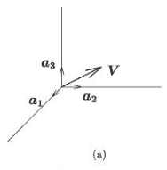

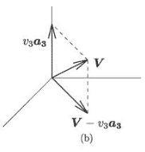

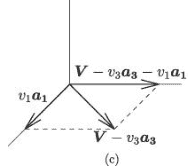

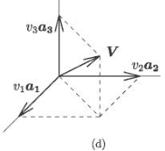

该空间中向量的加法和标量乘法定义为：

- 1. \(\boldsymbol{U} + \boldsymbol{V} = \{u_1 + v_1, u_2 + v_2, u_3 + v_3\}\)。
- 2. \(k\boldsymbol{V} = \{kv_1, kv_2, kv_3\}\)。

除了这些运算之外，三维欧几里得空间中的向量也遵守交换律和结合律：

- 1. \(\boldsymbol{U} + \boldsymbol{V} = \boldsymbol{V} + \boldsymbol{U}\)。
- 2. \((\boldsymbol{U} + \boldsymbol{V}) + \boldsymbol{W} = \boldsymbol{U} + (\boldsymbol{V} + \boldsymbol{W})\)。

我们可以用列矩阵表示向量

$$\mathbf{V} = \begin{bmatrix} v_1 \\ v_2 \\ v_3 \end{bmatrix},$$

因为上述所有数学规则都适用于列矩阵。我们定义向量的长度，类似于函数范数的定义，如下

$$|\mathbf{V}| = \sqrt{v_1^2 + v_2^2 + v_3^2}.$$

两个向量的标量积（内积）是向量代数中非常重要的运算，我们在此应予考虑。它定义为

$$\begin{aligned} \mathbf{U} \cdot \mathbf{V} &:= |\mathbf{U}||\mathbf{V}| \cos \angle \mathbf{U}, \mathbf{V} \\ &= u_1 v_1 + u_2 v_2 + u_3 v_3 \\ &= [u_1 \ u_2 \ u_3] \begin{bmatrix} v_1 \\ v_2 \\ v_3 \end{bmatrix} \\ &= \begin{bmatrix} u_1 \\ u_2 \\ u_3 \end{bmatrix}^t \begin{bmatrix} v_1 \\ v_2 \\ v_3 \end{bmatrix}, \end{aligned}$$

其中上标 \(t\) 表示矩阵转置，\(:=\) 是定义符号。已知标量积遵守交换律：\(\mathbf{U} \cdot \mathbf{V} = \mathbf{V} \cdot \mathbf{U}\)。如果 \(\mathbf{U} \cdot \mathbf{V} = 0\)，则两个向量 \(\mathbf{U}\) 和 \(\mathbf{V}\) 互相 *正交*。

我们定义向量在另一个向量上的 *投影* 为

\(\frac{\boldsymbol{U} \cdot \boldsymbol{V}}{|\boldsymbol{V}|} = \boldsymbol{U} \cdot \boldsymbol{a}_v\)
\(= \text{projection of } \boldsymbol{U} \text{ in the direction of } \boldsymbol{a}_v\)
\(= \text{a component of } \boldsymbol{U} \text{ in the direction of } \boldsymbol{a}_v.\)
(2.8)

投影是一个重要概念，将在后续讨论中频繁使用。如果需要找到向量在给定方向上的分量，只需将向量与所需方向的单位向量取标量积，即可将向量投影到该方向上。

我们现在可以将基和投影的概念从三维欧几里得空间扩展到 \(N\) 维向量空间。该空间中向量的分量形成一个 \(N \times 1\) 列矩阵，而基向量 \(\{ \boldsymbol{a}_j \}_{j=1}^N\) 形成一个正交集，使得

(2.9) \(\boldsymbol{a}_k \cdot \boldsymbol{a}_\ell = \delta_{k,\ell}, \quad \forall k, \ell \in \mathbb{Z}\)

其中 \(\delta_k\) 是克罗内克 delta，定义为

(2.10) \(\delta_{k,\ell} = \begin{cases} 1, & k = \ell \\ 0, & k \neq \ell. \end{cases}\)

并且 \(\mathbb{Z}\) 是所有整数的集合，\(\{..., -1, 0, 1, ...\}\)。

可以使用内积获得向量 \(\boldsymbol{V}\) 的特定分量 $v_j$（或 \(\boldsymbol{V}\) 在 \(\boldsymbol{a}_j\) 方向上的投影）

**(2.11)** $$v_j = \boldsymbol{V} \cdot \boldsymbol{a}_j,$$

并且向量 \(\boldsymbol{V}\) 表示为其向量分量的线性组合

**(2.12)** $$\boldsymbol{V} = \sum_{k=1}^N v_k \boldsymbol{a}_k.$$

众所周知，可以通过逐个求取分量，将向量沿基向量方向分解为初等向量。图 2.1 说明了这一过程。图 2.1a 中的向量 \(\boldsymbol{V}\) 分解为 \(\boldsymbol{V}_p = \boldsymbol{V} - v_3 \boldsymbol{a}_3\) 及其正交互补向量 \(v_3 \boldsymbol{a}_3\)。向量 \(\boldsymbol{V}_p\) 进一步分解为 \(v_1 \boldsymbol{a}_1\) 和 \(v_2 \boldsymbol{a}_2\)。图 2.1d 表示从分量重构向量 \(\boldsymbol{V}\)。

图 2.1 中所示的示例虽然基础，但与小波分解和重构算法类似。在那里，正交分量是不同分辨率的小波函数。

### 2.3 基函数、正交性与双正交性

我们将欧几里得几何向量空间的概念扩展到规范线性空间。也就是说，与其思考


与一组几何向量不同，我们考虑一组函数。与基向量相比，我们有基函数来表示该空间中的任意函数。这些基函数是该空间中函数的基本构建块。我们将使用傅里叶级数作为示例。傅里叶级数的主题将在下一章中更详细地讨论。

### 2.3.1 示例

让我们回顾一下，周期函数 $p_T(t)$ 可以展开成一个级数

$$
p_T(t) = \sum_{k=-\infty}^{\infty} c_k e^{jk\omega_0 t},
$$

其中 $T$ 是函数的周期性，$\omega_0 = 2\pi/T = 2\pi f$ 是基频，$e^{jk\omega_0 t}$ 是基频的第 $n$ 次谐波。如果建立 $p_T(t)$ 与 $V$、$c_k$ 与 $v_k$、$e^{jk\omega_0 t}$ 与 $a_k$ 之间的等价关系，则方程 (2.13) 与方程 (2.12) 相同。因此，函数集 $\{e^{jk\omega_0 t}\}_{k \in \mathbb{Z}}$ 构成了离散频率傅里叶空间的基集。系数集 $\{c_k\}_{k \in \mathbb{Z}}$ 通常称为离散频谱。众所周知，离散傅里叶基是正交基。使用函数的内积记法

$$
\langle g, h \rangle = \int_{\Omega} g(t) \overline{h(t)} dt,
$$

其中上划线表示复共轭，我们通过以下方式表达正交性

$$
\frac{1}{T} \int_{-T/2}^{T/2} e^{jk\omega_0 t} e^{-jl\omega_0 t} dt = \delta_{k,l}, \forall k, l \in \mathbb{Z}.
$$

我们可以通过用 \(\sqrt{T}\) 除以基函数来对其进行归一化（相对于单位能量）。因此，$\{e^{jk\omega_0 t}/\sqrt{T}\}_{k \in \mathbb{Z}}$ 构成了离散傅里叶空间的标准正交基。

### 2.3.2 正交性与双正交性

函数的正交展开是信号分析的重要工具。展开系数表示信号分量的幅值。在前面的示例中，傅里叶系数表示信号谐波频率的幅度。如果为了某个特定的信号处理目标，我们决定最小化（或置零）某些谐波频率（例如 60-Hz 噪声），我们只需在该频率处设计一个滤波器来拒绝噪声。因此，在处理信号之前将信号分解为分量以供观察是有意义的。

信号的正交分解很简单，系数的计算简单高效。如果函数 \(f(t) \in L^2\) 用某个标准正交集 \(\{\phi_k(t)\}_{k \in \mathbb{Z}} \in L^2\) 展开，我们可以写成

$$
f(t) = \sum_{k=-\infty}^{\infty} c_k \phi_k(t).
$$

我们通过函数与基的内积来计算系数，得到

$$
\begin{aligned}
\langle f, \phi_k \rangle &= \int_{-\infty}^{\infty} f(t) \overline{\phi_k(t)} dt \\
&= \int_{-\infty}^{\infty} \sum_{l=-\infty}^{\infty} c_l \phi_l(t) \overline{\phi_k(t)} dt \\
&= \sum_{l=-\infty}^{\infty} c_l \delta_{l,k} \\
&= c_k.
\end{aligned}
$$

计算如 (2.17) 中的内积需要知道所有 $t$ 的函数 $f(t)$，无法实时计算。

我们已经看到，标准正交基是表示信号的一种高效且简单的方法。然而，在某些应用中，标准正交基函数可能缺乏某些理想的信号处理特性，导致处理不便。双正交表示是克服正交性约束并对给定函数产生良好近似的一种可能替代方案。设 $\{\phi_k(t)\}_{k \in \mathbb{Z}} \in L^2$ 为一组双正交基函数。如果存在另一组基函数 $\{\tilde{\phi}_l(t)\}_{k \in \mathbb{Z}} \in L^2$，使得

$$
\langle \phi_k, \tilde{\phi}_l \rangle = \int_{-\infty}^{\infty} \phi_k(t) \overline{\tilde{\phi}_l(t)} dt = \delta_{k,l}.
$$

集合 \(\{\tilde{\phi}_k(t)\}_{k \in \mathbb{Z}}\) 被称为 \(\{\phi_k(t)\}_{k \in \mathbb{Z}}\) 的对偶基。

我们可以用双正交基展开函数 \(g(t)\)

$$
g(t) = \sum_{k=0}^{\infty} d_k \phi_k(t),
$$

并通过以下方式获取系数

$$
d_n = \langle g, \tilde{\phi}_n \rangle
$$

$$
= \int_{-\infty}^{\infty} g(t) \overline{\tilde{\phi}_n(t)} dt.
$$

另一方面，我们可以用对偶基展开函数 \(g(t)\)

$$
g(t) = \sum_{k=0}^{\infty} \tilde{d}_k \tilde{\phi}_k(t),
$$

并通过以下方式获取对偶系数 \(\tilde{d}_k\)

$$
\tilde{d}_i = \langle g, \phi_i \rangle
$$

$$
\tilde{d}_i = \int_{-\infty}^{\infty} g(t)\overline{\phi_i(t)}dt.
$$

我们回顾一下，在正交基中，所有基函数都属于同一空间。然而，在双正交基中，对偶基不必位于原始空间中。如果双正交基及其对偶属于同一空间，则这些基称为 *semiorthogonal*。任意阶的样条函数属于半正交类。关于样条函数的更多细节将在后续章节中讨论。

我们使用二维向量空间中的几何向量来说明双正交性。设向量

$$
\boldsymbol{b}_1 = \begin{bmatrix} 1 \\ 0 \end{bmatrix}, \boldsymbol{b}_2 = \begin{bmatrix} \frac{1}{2} \\ \frac{\sqrt{3}}{2} \end{bmatrix}
$$

在二维欧几里得空间中构成双正交基。该基的对偶基为

$$
\tilde{\boldsymbol{b}}_1 = \begin{bmatrix} 1 \\ \frac{1}{\sqrt{3}} \end{bmatrix}, \tilde{\boldsymbol{b}}_2 = \begin{bmatrix} 0 \\ \frac{2}{\sqrt{3}} \end{bmatrix}.
$$

这些基在图 2.2 中以图形方式显示。我们可以通过求解一组联立方程来简单地计算二维欧几里得空间中的对偶基。设双正交基为

$$
b_1 = \begin{bmatrix} x_1 \\ x_2 \end{bmatrix}, b_2 = \begin{bmatrix} y_1 \\ y_2 \end{bmatrix}
$$

以及对偶基为

$$
\tilde{b}_1 = \begin{bmatrix} u_1 \\ u_2 \end{bmatrix}, \tilde{b}_2 = \begin{bmatrix} v_1 \\ v_2 \end{bmatrix}.
$$

图 2.2：二维欧几里得空间中的双正交基。

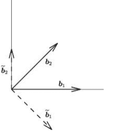

求解 $\tilde{b}_1$ 和 $\tilde{b}_2$ 的联立方程组为

$$
\langle \boldsymbol{b}_1, \tilde{\boldsymbol{b}}_1 \rangle = 1
$$

$$
\langle \boldsymbol{b}_2, \tilde{\boldsymbol{b}}_1 \rangle = 0
$$

$$
\langle \boldsymbol{b}_1, \tilde{\boldsymbol{b}}_2 \rangle = 0
$$

$$
\langle \boldsymbol{b}_2, \tilde{\boldsymbol{b}}_2 \rangle = 1
$$

该过程可以推广到有限维空间，其中基向量形成一个斜（非正交）坐标系。它需要线性矩阵变换来计算对偶基。此过程在此不作详细阐述。感兴趣的读者可参阅 [1]。

### 2.4 局部基与 Riesz 基

我们在前面的章节中讨论了 *global* 性质的正交基 [\(\phi(t) : t \in (-\infty, \infty)$]。请注意，傅里叶级数的 *sine* 和 *cosine* 基函数定义在整个实数轴 \((-\infty, \infty)$ 上，因此被称为全局基。许多存在于实数轴有限区间 [\(\phi(t) : t \in (a, b)$] 上的基满足正交性或双正交性要求。我们称这些为 *local* 基。Haar 基是局部基的最简单示例。

### 2.4.1 Haar 基

Haar 基由 \(\phi_{H,k}(t) = \chi_{[0,1)}(t-k), k \in \mathbb{Z}$ 描述，其中

$$
\chi_{[0,1)}(t) = \begin{cases} 1, & 0 \le t < 1; \\ 0 & \text{otherwise,} \end{cases}
$$

是特征函数。Haar 基显然满足正交条件

$$
\langle \phi_{H,j}(t), \phi_{H,k}(t) \rangle = \int_{-\infty}^{\infty} \chi_{[0,1)}(t-j) \overline{\chi_{[0,1)}(t-k)} dt = \delta_{j,k}.
$$

要用局部基 \(\phi(t), t \in (a, b)$ 表示全局函数 \(f(t), t \in (-\infty, \infty)$，存在于有限区间之外的函数必须由基函数沿实数轴的整数平移（延迟）来表示。全局函数的整数平移也可以形成线性空间的基。Shannon 函数 \(\phi_{SH}(t)$ 就是这样一个基的示例。

### 2.4.2 Shannon 基

Shannon 函数定义为

$$
\phi_{SH}(t) = \frac{\sin \pi t}{\pi t},
$$

基由以下方式形成

$$
\phi_{SH,k}(t) = \frac{\sin \pi (t-k)}{\pi (t-k)}, \quad k \in \mathbb{Z}
$$


是一组正交归一基且是全局的。正交性的证明最好在频域中展示。

令 \(g(t) \in L^2\) 用基函数 \(\{\phi_k(t)\}_{k \in \mathbb{Z}}\) 展开为级数：

\[
g(t) = \sum_k c_k \phi_k(t). \tag{2.29}
\]

如果基集 \(\{\phi_k(t)\}_{k \in \mathbb{Z}}\) 满足以下不等式，则称为 Riesz 基：

\[
R_1 \|c_k\|_{l^2}^2 \le \|g(t)\|^2 \le R_2 \|c_k\|_{l^2}^2 \tag{2.30}
\]

\[
R_1 \|c_k\|_{l^2}^2 \le \left\| \sum_k c_k \phi_k(t) \right\|^2 \le R_2 \|c_k\|_{l^2}^2. \tag{2.31}
\]

其中 \(0 < R_1 \le R_2 < \infty\) 称为 Riesz 界。空间 \(l^2\) 是 \(L^2\) 对离散序列的对应空间，其范数定义为

\[
\|c_k\|_{l^2} = \left( \sum_k |c_k|^2 \right)^{\frac{1}{2}} < \infty. \tag{2.32}
\]

(2.30) 在频域中的等价表达式为

\[
0 < R_1 \le \sum_k \left| \hat{\phi}(\omega + 2\pi k) \right|^2 \le R_2 < \infty. \tag{2.33}
\]

(2.33) 的推导留作练习。函数上的帽子符号表示其傅里叶变换，这是下一章将讨论的主题。

如果 \(R_1 = R_2 = 1\)，则该基是正交归一的。Shannon 基是正交归一 Riesz 基的一个例子，因为 Shannon 函数的频谱在区间 \([-\pi, \pi]\) 上为一。因此

\[
\sum_k \left| \phi_{SH}(\omega + 2\pi k) \right|^2 \equiv 1. \tag{2.34}
\]

如果基函数 \(\{\phi(t - k) : k \in \mathbb{Z}\}\) 不是正交归一的，则我们可以通过关系式得到一组正交归一基 \(\{\phi^\perp(t - k) : k \in \mathbb{Z}\}\)：

\[
\widehat{\phi^\perp}(\omega) = \frac{\hat{\phi}(\omega)}{\left\{ \sum_k \left| \hat{\phi}(\omega + 2\pi k) \right|^2 \right\}^{\frac{1}{2}}}. \tag{2.35}
\]

Riesz 基也被称为稳定基，因为如果

\[
g_1(t) = \sum_j a_j^{(1)} \phi_j(t)
\]

\[
g_2(t) = \sum_j a_j^{(2)} \phi_j(t)
\]

则函数的微小差异会导致系数的微小差异，反之亦然。换句话说，稳定性意味着

\[
\text{small } \|g_1(t) - g_2(t)\|^2 \Leftrightarrow \text{small } \|a_j^{(1)} - a_j^{(2)}\|_2^2. \tag{2.36}
\]

### 2.5 离散线性赋范空间

离散线性赋范空间是由给定范数的实数或复数离散序列元素组成的集合。对于离散赋范线性空间，第 2.1 节的运算规则同样适用。N 维线性空间中的一个元素由一个序列表示

\[
x(n) = \{x(0), x(1), ..., x(N-1)\}, \tag{2.37}
\]

我们表示两个元素的和为

\[
w(n) = x(n) + y(n) = \{x(0) + y(0), x(1) + y(1), ..., x(N-1) + y(N-1)\}. \tag{2.38}
\]

离散线性空间中的内积和范数分别定义为

\[
\langle x(n), y(n) \rangle = \sum_n x(n) \overline{y(n)} \tag{2.39}
\]

\[
\|x\| = \langle x, x \rangle^{1/2} = \sqrt{\sum_n |x(n)|^2}. \tag{2.40}
\]

如前定义的正交性和双正交性也适用于离散基。双正交离散基满足条件

\[
\langle \phi_l(n), \tilde{\phi}_j(n) \rangle = \sum_n \phi_l(n) \overline{\tilde{\phi}_j(n)} = \delta_{l,j}. \tag{2.41}
\]

对于正交归一基，空间是自对偶的；即，

\[
\phi_j = \tilde{\phi}_j. \tag{2.42}
\]

### 2.5.1 示例 1

离散 Haar 基定义为

\[
H_0(n) = \begin{cases} \frac{1}{\sqrt{2}} & \text{for } n=0, 1 \\ 0 & \text{otherwise,} \end{cases} \tag{2.43}
\]

是由 \(H_0(n)\) 的偶数平移构成的正交归一基。然而，Haar 基不是完备的。也就是说，存在某些序列无法由该基的展开表示。它需要一个补空间来使其完备。Haar 的补空间是

\[
H_1(n) = \begin{cases} \frac{1}{\sqrt{2}} & \text{for } n=0 \\ \frac{-1}{\sqrt{2}} & \text{for } n=1 \\ 0 & \text{otherwise.} \end{cases} \tag{2.44}
\]

\(H_1(n)\) 的奇数平移构成了补空间，因此任何实序列都可以由 Haar 基表示。

### 2.5.2 示例 2

序列

\[
D_2(n) = \left\{ \frac{1+\sqrt{3}}{4\sqrt{2}}, \frac{3+\sqrt{3}}{4\sqrt{2}}, \frac{3-\sqrt{3}}{4\sqrt{2}}, \frac{1-\sqrt{3}}{4\sqrt{2}} \right\} \tag{2.45}
\]

是一个具有四个成员的有限序列，其整数平移构成一组正交归一基。正交性的证明留作练习。

### 2.6 正交投影近似

假设向量 \(u(n)\) 不是由 \(\{\phi_k\}\) 张成的线性向量空间 \(V\) 的元素，我们希望找到一个近似 \(u_p \in V\)。我们使用 \(u\) 在空间 \(V\) 上的正交投影作为近似。投影定义为

\[
u_p = \sum_k \langle u, \phi_k \rangle \phi_k. \tag{2.46}
\]

此处指出，近似误差 \(u - u_p\) 与空间 \(V\) 正交：

\[
\langle u - u_p, \phi_k \rangle = 0 \quad \forall k.
\]

此外，这种近似的均方误差（MSE）最小。为了证明任何正交投影的 MSE 最小性，考虑一个函数 \(g \in L^2[a, b]\)，它由一组正交归一基函数 \(\{\phi_k : k = 0, \cdots, N-1\}\) 近似，使得

\[
g(t) = g_c(t) = \sum_{j=0}^{N-1} c_j \phi_j(t), \text{ with} \tag{2.47}
\]

\[
c_j = \langle g, \phi_j \rangle. \tag{2.48}
\]

函数 \(g(t)\) 近似中的逐点误差 \(\varepsilon_c(t)\) 为

\[
\varepsilon_c(t) = g(t) - g_c(t) = g(t) - \sum_{j=0}^{N-1} c_j \phi_j(t). \tag{2.49}
\]

我们希望证明，当系数序列 \(\{c_j\}\) 由 (2.48) 给出的正交投影获得时，MSE \(\|\varepsilon_c(t)\|^2\) 最小。为了证明这一点，让我们假设存在另一个序列 \(\{d_j : j = 0, \cdots, N-1\}\)，它是通过非正交投影的方式获得的，并且也最小化了误差。然后我们将证明 \(c_j = d_j, j = 0, \cdots, N-1$，从而完成证明。

使用序列 \(\{d_j\}\)，我们有

\[
g(t) = g_d(t) = \sum_{j=0}^{N-1} d_j \phi_j(t), \tag{2.50}
\]

和

\[
\begin{aligned}
\|e_d(t)\|^2 &= \left\| g(t) - \sum_{j=0}^{N-1} d_j \phi_j(t) \right\|^2 = \left\langle g(t) - \sum_{j=0}^{N-1} d_j \phi_j(t), g(t) - \sum_{j=0}^{N-1} d_j \phi_j(t) \right\rangle \\
&= \langle g, g \rangle - \sum_{j=0}^{N-1} d_j \langle \phi_j(t), g \rangle - \sum_{j=0}^{N-1} \overline{d_j} \langle g, \phi_j(t) \rangle + \sum_{j=0}^{N-1} |d_j|^2 \\
&= \langle g, g \rangle - \sum_{j=0}^{N-1} d_j \overline{c_j} - \sum_{j=0}^{N-1} \overline{d_j} c_j + \sum_{j=0}^{N-1} |d_j|^2. \tag{2.51}
\end{aligned}
\]

为了完成 (2.51) 中最后三项的平方，我们加上并减去 \(\sum_{j=0}^{N-1} |c_j|^2\) 以得到

\[
\|e_d(t)\|^2 = \left\| g(t) - \sum_{j=0}^{N-1} d_j \phi_j(t) \right\|^2 = \left\| g(t) - \sum_{j=0}^{N-1} c_j \phi_j(t) \right\|^2 + \sum_{j=0}^{N-1} |d_j - c_j|^2 \tag{2.52}
\]

\[
= \|\varepsilon_c(t)\|^2 + \sum_{j=0}^{N-1} |d_j - c_j|^2. \tag{2.53}
\]

很明显，为了获得最小 MSE，我们必须有 \(d_j = c_j; j = 0, \cdots, N-1$，因此证明完成。

### 2.7 矩阵代数与线性变换

我们已经使用列矩阵来表示有限维欧几里得空间中的向量。矩阵是这些空间中的算子。本节简要回顾矩阵代数，并讨论几种有助于理解小波和滤波器组时域分析的特殊矩阵类型。详情读者可参阅 [2]。

### 2.7.1 矩阵代数要素

- 1. 定义：矩阵 \(\boldsymbol{A} = [A_{ij}]\) 是元素的矩形阵列。元素可以是实数、复数或多项式。第一个整数索引 \(i\) 是行指示符，第二个整数索引 \(j\) 是列指示符。如果 \(i, j \to \infty\)，则矩阵是无限的。一个 \(m \times n\) 矩阵显示为

\[
\boldsymbol{A} = \begin{bmatrix} A_{11} & A_{12} & A_{13} & \cdots \\ A_{21} & A_{22} & & \\ A_{31} & \vdots & \ddots & \\ \vdots & & & A_{mn} \end{bmatrix}. \tag{2.54}
\]

  如果 m = n，A 是方阵。一个 N × 1 列矩阵（只有一列）表示一个 N 维向量。

- 2. 转置：A 的转置是 A'，其元素为 Aji。如果 A 的维度是 m × n，则 A' 的维度是 n × m。列（N × 1）矩阵的转置是行（1 × N）矩阵。

- 3. 矩阵和与差：如果两个矩阵具有相同的维度，则可以相加。

\[
C = A \pm B \Rightarrow C_{ij} = A_{ij} \pm B_{ij}
\]

- 4. 矩阵乘积：两个矩阵的乘法只有在它们的维度兼容时才有意义。兼容性意味着第一个矩阵的列数必须与第二个矩阵的行数相同。如果 A 和 B 的维度分别为 m × p 和 p × q，则 C = AB 的维度为 m × q。元素 Cij 由以下给出

\[
C_{ij} = \sum_{k=1}^{p} A_{ik} B_{kj}
\]

矩阵乘积不具有交换性，因为 p × q 与 m × p 不兼容。通常，AB ≠ BA。

- 5. 单位矩阵：单位矩阵是一个方阵，其主对角线元素为 1，非对角线元素为 0。


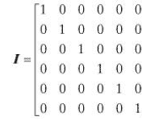

- 6. 矩阵子式：矩阵 \( A \) 的子式 \( S_{ij} \) 是通过删除 \( A \) 的第 \( i \) 行和第 \( j \) 列得到的 \( A \) 的子矩阵。若 \( A \) 的维度为 \( m \times n \)，则 \( S_{ij} \) 的维度为 \( (m-1) \times (n-1) \)。

- 7. 行列式：方阵 \( A \) 的行列式是利用子式定义逐次计算得到的值。我们通过以下方式计算方阵 \( (m \times m) \) 的行列式：

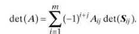

- 8. 逆矩阵：\( A^{-1} \) 是方阵 \( A \) 的逆矩阵，满足 \( A^{-1}A = I = AA^{-1} \)。我们通过以下方式计算逆矩阵：

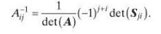

如果 \(\det(A) = 0\)，则该矩阵是 *奇异的*，且 \(A^{-1}\) 不存在。

### 2.7.2 特征矩阵

线性变换是一种映射，当向量 \(\mathbf{x} \in V\)（向量空间）被变换时，变换结果为另一个向量 \(\mathbf{y} = A\mathbf{x} \in V\)。向量 \(\mathbf{y}\) 通常是 \(\mathbf{x}\) 的缩放、旋转和平移版本。特别是，如果输出向量 \(\mathbf{y}\) 仅是输入向量的标量倍数，则我们称该标量为特征值，并将该系统称为 *特征系统*。从数学上，我们写

```
(2.55) \(\mathbf{y} = A\mathbf{x} = \mu \mathbf{x}\)
```

其中 \(A\) 是一个 \(N \times N\) 矩阵，\(\mathbf{x}\) 是一个 \(N \times 1\) 向量，\(\mu\) 是一个标量特征值。我们从特征方程的解中确定特征值：

```
(2.56) \(\det(A - \mu I) = 0\).
```

如果 \(\mathbf{x}\) 是一个 \(N \times 1\) 列矩阵，则该系统中有 \(N\) 个特征值。这些特征值可能互不相同，也可能有重复。每个特征值对应一个特征向量。特征向量和特征值的解释取决于具体问题的性质。对于每个特征值 \(\mu_j\)，我们将其代入 (2.56) 以求解特征向量 \(\mathbf{x}_j\)。我们用以下示例来说明此过程。设

```
A = \begin{bmatrix} 3 & -1 & 0 \\ -1 & 2 & -1 \\ 0 & -1 & 3 \end{bmatrix}
```

作为变换矩阵。来自 (2.56) 的特征方程为

```
\det(A - \mu I) = \det \begin{bmatrix} 3-\mu & -1 & 0 \\ -1 & 2-\mu & -1 \\ 0 & -1 & 3-\mu \end{bmatrix} = (3-\mu)[(2-\mu)(3-\mu)-1] - (3-\mu) = (3-\mu)(\mu-1)(\mu-4) = 0
```

且特征值为 \(\mu = 4, 1, \text{和 } 3\)。我们将 \(\mu = 4\) 代入 (2.55)

```
\begin{bmatrix} 3 & -1 & 0 \\ -1 & 2 & -1 \\ 0 & -1 & 3 \end{bmatrix} \begin{bmatrix} x_1 \\ x_2 \\ x_3 \end{bmatrix} = 4 \begin{bmatrix} x_1 \\ x_2 \\ x_3 \end{bmatrix}
```

并得到以下线性方程组

```
-x_1 - x_2 + 0 = 0 \\ -x_1 - 2x_2 - x_3 = 0 \\ 0 - x_2 - x_3 = 0. \\ (2.57)
```

这是一组线性相关的代数方程。我们假设 \(x_1 = \alpha\)，并得到对应于 \(\mu = 4\) 的特征向量 \(e_3\) 为

$$
\alpha \begin{bmatrix} 1 \\ -1 \\ 1 \end{bmatrix}; \alpha \neq 0.
$$

(2.58)

读者可以作为练习计算另外两个特征向量。

### 2.7.3 线性变换

使用上一节中关于特征系统的示例，我们有

$$
\mathbf{A} = \begin{bmatrix} 3 & -1 & 0 \\ -1 & 2 & -1 \\ 0 & -1 & 3 \end{bmatrix}
$$

$$
\mu_j = 1, 3, 4 \text{ for } j = 1, 2, 3,
$$

且对应于特征值的特征向量为

$$
\mathbf{e}_1 = \begin{bmatrix} 1 \\ 2 \\ 1 \end{bmatrix}, \mathbf{e}_2 = \begin{bmatrix} 1 \\ 0 \\ -1 \end{bmatrix}, \mathbf{e}_3 = \begin{bmatrix} 1 \\ -1 \\ 1 \end{bmatrix}.
$$

(2.59)

根据特征值和特征向量的定义，我们有

$$
\mathbf{A}\mathbf{e}_j = \mu_j\mathbf{e}_j, \text{ for } j = 1, 2, 3.
$$

(2.60)

我们可以将此方程重排为

(2.61) \( A[\boldsymbol{e}_1 \ \boldsymbol{e}_2 \ \boldsymbol{e}_3] = [\mu_1\boldsymbol{e}_1 \ \mu_2\boldsymbol{e}_2 \ \mu_3\boldsymbol{e}_3] \)。

为了更简洁，我们将方程 (2.61) 写成紧凑的矩阵形式，

\( AE = E \begin{bmatrix} \mu_1 & 0 & 0 \\ 0 & \mu_2 & 0 \\ 0 & 0 & \mu_3 \end{bmatrix} = E\mu \) (2.62)

其中 \(\mu\) 是对角矩阵，\(E\) 是特征矩阵。如果矩阵 \(E\) 非奇异，我们通过左乘 \(E^{-1}\) 将矩阵 \(A\) 对角化：

(2.63) \( E^{-1}AE = \mu \)。

因此，我们在线性变换中使用了特征矩阵 \(E\) 来对角化矩阵 \(A\)。

### 2.7.4 基变换

可以将前一示例中的矩阵 \(A\) 视为定义线性系统的矩阵

\(\boldsymbol{y} = \begin{bmatrix} y_1 \\ y_2 \\ y_3 \end{bmatrix} = A\boldsymbol{x} = A \begin{bmatrix} x_1 \\ x_2 \\ x_3 \end{bmatrix}.\) (2.64)。

矩阵 \(A\) 是一个将 \(\boldsymbol{x} \in \mathbb{R}^3\) 映射到 \(\boldsymbol{y} \in \mathbb{R}^3\) 的变换。\(\boldsymbol{y}\) 的分量通过 (2.64) 定义的线性变换与 \(\boldsymbol{x}\) 的分量相关。由于 e1、e2 和 e3 是线性无关向量，它们可用作 \(\mathbb{R}^3\) 的一组基。因此，我们可以在此基上展开向量 x

```
x = x_1e_1 + x_2e_2 + x_3e_3
= Ex',
```

系数向量 x' 通过以下方式计算

```
x' = E^{-1}x.
```

向量 y 相对于此新基的新坐标变为

```
y' = E^{-1}y
= E^{-1}Ax
= E^{-1}AEx'
= \mu x'.
```

方程 (2.67) 表明，我们通过基变换将线性系统 y = Ax 修改为另一个系统 y' = \mu x'，其中矩阵 \mu 是对角矩阵。我们称通过特征矩阵进行的这种线性变换为相似变换。

### 2.7.5 共轭转置矩阵、酉矩阵和正交变换

给定一个复值矩阵 $H$，我们可以通过取 $H$ 的转置的共轭来获取其共轭转置 $H^h$，即

```
(2.68) $H^h := \overline{H^T}$.
```

以下两个恒等式

```
$(H^h)^h = H$
```

```
$(GH)^h = H^h G^h$
```

显然源自定义。

设 $N$ 维向量空间的基向量为 $b_i, i = 1, \cdots, N$，其中 $b_i$ 本身是一个长度为 $N$ 的向量。正交基意味着任何两个不同基向量的内积为零：

```
(2.69) $\langle b_j, b_i \rangle = [b_j]^t [b_i] = \delta_{i,j}, \forall i, j \in \mathbb{Z}$.
```

对于复值基向量，内积表示为

```
$\langle b_j, b_i \rangle = [b_j]^h [b_i]$.
```

如果 $b_i$ 的范数为一，则此基称为 *标准正交基*。我们通过将标准正交向量按行排列来构建一个 $N \times N$ 的变换矩阵 $P$，如下

(2.70) \( P = [b_1, b_2, ... b_N] \)。

由于

(2.71) \( [b_j]^h [b_i] = \delta_{i,j} \)。

可得

(2.72) \( P^h P = I \)。

且

(2.73) \( P^h = P^{-1} \)。

除了列向量标准正交外，如果 \( P \) 还满足行向量标准正交，\( PP^h = I \)，则矩阵 \( P \) 称为 *酉* (或 *标准正交*) 矩阵。

### 2.8 数字信号

在本节中，我们提供与信号处理技术相关的一些基本符号和运算。详情请参见 [3]。

### 2.8.1 信号采样

设 \( x(t) \) 为一个能量有限的连续时间（模拟）信号。如果我们以固定间隔 \( h \) 测量信号幅度并记录结果，则得到一个离散时间信号

(2.74) \( x(n) := x(t_n), n=0, 1, ..., N-1 \)。

其中

$t_n = nh$.

为简化书写并方便计算，我们使用 x(n)，其中采样周期 h 为已知。这些离散化的采样值构成一个信号，称为数字信号。

为了从其采样值 {x(n)} 对连续带限函数 x(t) 进行良好近似，采样间隔 h 必须满足

$h \le \frac{\pi}{\Omega}$.

其中 $2\Omega$ 是函数 x(t) 的带宽，即对于所有 $|\omega| > \Omega$ 均有 $\hat{x}(\omega) = 0$。h 的选择是奈奎斯特采样率，而 Shannon 恢复公式

$x(t) = \sum_{n \in \mathbb{Z}} x(nh) \frac{\sin \pi(t - nh)}{\pi(t - nh)}$

**(2.75)**

使我们能够恢复原始模拟函数 x(t)。该定理的证明最容易通过傅里叶变换和傅里叶级数的泊松求和来进行。我们将把此证明推迟到第 3 章。

### 2.8.2 线性时不变系统


让我们考虑一个由其冲激响应 h(n) 表征的系统。如果输入 x(n) 和输出 y(n) 满足以下系统关系，则称该系统为线性时不变系统：

### 时不变性：

```
\begin{cases}
x(n) \Rightarrow y(n) \\
x(n-n') \Rightarrow y(n-n').
\end{cases}
(2.76)
```

### 线性：

```
\begin{cases}
x_1(n) \Rightarrow y_1(n) \text{ and } x_2(n) \Rightarrow y_2(n), \\
x_1(n) + m x_2(n) \Rightarrow y_1(n) + m y_2(n).
\end{cases}
(2.77)
```

一般来说，线性时不变系统可由以下式表征：

```
x_1(n - n') + m x_2(n - n') \Rightarrow y_1(n - n') + m y_2(n - n').
(2.78)
```

### 2.8.3 卷积

离散卷积，也称为移动平均，定义了线性时不变系统的输入–输出关系。线性卷积的数学定义为

```
y(n) = h(n) * x(n)
= \sum_k h(k-n) x(k)
= \sum_k x(k-n) h(k).
(2.79)
```

我们可以用矩阵表示法表示卷积和为

(2.80)
\(\begin{bmatrix} y(-1) \\ y(0) \\ y(1) \\ y(2) \\ \vdots \end{bmatrix} = \begin{bmatrix} \ddots & \ddots & \ddots & \ddots & \ddots & \ddots & \ddots \\ \cdots & h(1) & h(0) & h(-1) & h(-2) & \cdots & \cdots \\ \cdots & h(2) & h(1) & h(0) & h(-1) & h(-2) & \cdots \\ \cdots & h(2) & h(1) & h(0) & h(-1) & h(-2) & \cdots \\ \vdots & \vdots & \vdots & \vdots & \vdots & \vdots & \ddots \end{bmatrix} \begin{bmatrix} x(-1) \\ x(0) \\ x(1) \\ x(2) \\ \vdots \end{bmatrix}\)

例如，如果 h(n) = {1/4, 1/4, 1/4, 1/4} 和 x(n) = {1, 0, 1, 0, 1, 0, 1} 是因果序列，则输入-输出关系的矩阵方程为

(2.81)

⎡1/4⎤   ⎡1/4  1/4  1/4  1/4        ⎤   ⎡ x(-2)=0 ⎤
⎢1/2⎥   ⎢1/4  1/4  1/4  1/4  1/4   ⎥   ⎢ x(-1)=0 ⎥
⎢1/2⎥   ⎢     1/4  1/4  1/4  1/4  1/4⎥   ⎢ x(0) = 1⎥
⎢1/2⎥ = ⎢         1/4  1/4  1/4  1/4⎥   ⎢ x(1) = 0⎥
⎢1/2⎥   ⎢            1/4  1/4  1/4  1/4⎥   ⎢ x(2) = 1⎥
⎢1/2⎥   ⎢               1/4  1/4  1/4⎥   ⎢ x(3) = 0⎥
⎢1/2⎥   ⎢                  1/4  1/4  1/4⎥   ⎢ x(4) = 1⎥
⎢1/4⎥   ⎢                     1/4  1/4  1/4⎥   ⎢ x(5) = 0⎥
⎢1/4⎥   ⎢                        1/4  1/4  1/4⎥   ⎢ x(6) = 1⎥
⎢ 0 ⎥   ⎢                           1/4  1/4⎥   ⎢ x(7) = 0⎥
⎢ 0 ⎥   ⎢                                  1/4⎥   ⎢ x(8) = 0⎥
⎣   ⎦   ⎣                                 ⎦   ⎣       ⎦


可以看出输出信号比输入信号平滑得多。事实上，输出非常接近输入的平均值。我们称这类滤波器为平滑或平均滤波器。在信号处理术语中，它被称为低通滤波器。

另一方面，如果滤波器的冲激响应为 h(n) = {1/4, -1/4, 1/4, -1/4}，则我们有一个微分滤波器或高通滤波器。使用与之前相同的输入信号 x(n)，输出信号为

```
(2.82)
[ 1/4 ]   [ 1/4  1/4  1/4  1/4  0   0   .   .   . ]   [ x(-2)=0 ]
[ -1/2 ]  [ 0   0   -1/4 -1/4 -1/4 -1/4 0   .   . ]   [ x(-1)=0 ]
[ 1/4   ]   [ 0   0   1/4  1/4  1/4  1/4 0   0   . ]   [ x(0)=1  ]
[ -1/2  ]   [ .   0   0   1/4  -1/4 -1/4 -1/4 0   . ]   [ x(1)=0  ]
[ 1/2   ]   [ .   .   0   0   1/4  1/4  1/4  1/4 0   . ]   [ x(2)=1  ]
[ ...   ] = [ .   .   .   0   0   1/4  -1/4 -1/4 -1/4 0 ]   [ x(3)=0  ]
[ -1/2  ]   [ .   .   .   .   0   0   1/4  1/4  1/4 1/4 0 ]   [ x(4)=1  ]
[ 1/4   ]   [ .   .   .   .   .   0   0   1/4  -1/4 -1/4 -1/4 ]   [ x(5)=0  ]
[ 0     ]   [ .   .   .   .   .   .   0   0   1/4  1/4  1/4  1/4 ]   [ x(6)=1  ]
[ 0     ]   [ .   .   .   .   .   .   .   0   0   1/4  -1/4 -1/4 ]   [ x(7)=0  ]
[ ...   ]   [ .   .   .   .   .   .   .   .   0   0   1/4  1/4  ]   [ x(8)=0  ]
```

输入信号中的振荡允许通过滤波器，而平均值（直流分量）被该滤波器滤除。这一点从输出的近似零平均值显而易见，而输入的平均值为 1/2。

### 2.8.4 z-变换

z-变换是离散信号分析中非常有用的工具。我们将在小波和滤波器组算法的推导中经常使用它。它由以下无穷级数定义：

```
(2.83)
H(z) = \sum_{k \in \mathbb{Z}} h(k)z^{-k}
= ..., h(-1)z^{-1} + h(0) + h(1)z^{-1} + h(2)z^{-2} + ...
```

变量 z^{-1} 表示一个采样间隔的延迟；z^{-M} 表示 M 个单位的延迟。如果将 z 替换为 e^{j\omega}，z-变换将变为离散时间傅里叶变换，这将在下一章中更详细地讨论：

```
$$H(z)|_{z=e^{j\omega}} = H(e^{j\omega}) = \sum_{k \in \mathbb{Z}} h(k) e^{-jk\omega}.$$
(2.84)
```

在未来的讨论中，我们将交替使用这些符号。z-变换的一个重要性质是，线性离散卷积的 z-变换在 z-变换域中变为乘积

```
$$y(n) = h(n) * x(n) \Rightarrow Y(z) = H(z) X(z).$$
(2.85)
```

### 2.8.5 收敛区域

z-变换中的变量 \(z\) 是复数值。z-变换 \(X(z) = \sum_{n=-\infty}^{\infty} x(n) z^{-n}\) 对某些 \(z\) 值可能不收敛。z-变换的收敛区域（ROC）指示复平面中所有使 z-变换收敛的 \(z\) 值所在的区域。两个序列可能具有相同的 z-变换，但具有不同的收敛区域。

### 示例：

求 \(x(n) = a^n \cos(\omega_0 n) u(n)\) 的 z-变换，其中 \(u(n)\) 是单位阶跃函数，定义为

```
$$u(n) = \begin{cases} 1 & n \ge 0 \\ 0 & \text{otherwise.} \end{cases}$$
```

解：根据 z-变换的定义，我们有

```
X(z) = \sum_{n=0}^{\infty} a^n \cos(\omega_0 n) z^{-n}
= \sum_{n=0}^{\infty} a^n \left( \frac{e^{j\omega_0 n} + e^{-j\omega_0 n}}{2} \right) z^{-n}
= \frac{1}{2} \left[ \sum_{n=0}^{\infty} \left( a e^{j\omega_0} z^{-1} \right)^n + \sum_{n=0}^{\infty} \left( a e^{-j\omega_0} z^{-1} \right)^n \right]
= \frac{1}{2} \left[ \frac{1}{1 - a e^{j\omega_0} z^{-1}} + \frac{1}{1 - a e^{-j\omega_0} z^{-1}} \right]
= \frac{1 - a \cos(\omega_0) z^{-1}}{1 - 2a \cos(\omega_0) z^{-1} + a^2 z^{-2}} , \text{ROC: } |z| > |a|.
```

当 \(a = 0.9\) 且 \(\omega_0 = 10\pi\) 时的情况如图 2.3 所示。

### 图 2.3：序列和收敛区域（\(a = 0.9\)）。

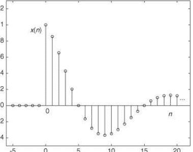

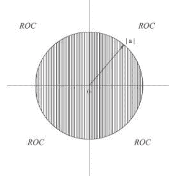

### 特殊情况：

- 1. 如果 \(a=1\) 且 \(\omega_0=0\)，则有
  
  \(U(z) = \frac{1-z^{-1}}{1-2z^{-1}+z^{-2}} = \frac{1}{1-z^{-1}}, ROC: |z| > 1.\)

- 2. 如果 \(a=1\)，则有
  
  \(X(z) = \frac{1-\cos(\omega_0)z^{-1}}{1-2\cos(\omega_0)z^{-1}+z^{-2}}, ROC: |z| > 1.\)

- 3. 如果 \(\omega_0=0\)，则有
  
  \(X(z) = \frac{1-az^{-1}}{1-2az^{-1}+a^2z^{-2}} = \frac{1}{1-az^{-1}} ROC: |z| > |a|.\)

### 2.8.6 逆 z-变换

从其 \(z\)-变换恢复原始序列的公式涉及如下形式的复积分：

```
\(x(n) = \frac{1}{2\pi j} \oint_c X(z)z^{n-1}dz\)

(2.86)
```

其中积分路径在变换的收敛区域内按逆时针方向取。就本文目的而言，我们不会使用 (2.86) 来恢复序列。由于本书感兴趣的信号和滤波器是 z 的有理函数，使用部分分式或长除法来恢复序列更方便。

### 示例：

确定以下 z-变换对应的序列 \( x(n) \)

\( X(z) = \frac{z-1}{(z-0.7)(z-1.2)} = \frac{z-1}{z^2 - 1.9z + 0.84}, \text{ROC: } |z| > 1.2 \)

解：使用长除法，我们有

\( X(z) = z^{-1} + 0.9z^{-2} + 0.87z^{-3} + \frac{0.897z^{-2} - 0.7308z^{-3}}{z^2 - 1.9z + 0.84} \)

显然，x(0) = 0, x(1) = 1, x(2) = 0.9, x(3) = 0.87，... \( x(n) \) 是一个右侧无穷序列，因为收敛区域在半径 \( r = 1.2 \) 的圆之外。

如果 ROC：\( |z| < 0.7 \)，\( x(n) \) 是一个左侧序列。我们得到

\( X(z) = \frac{-1+z}{0.84 - 1.9z + z^2} = -\frac{1}{.84} + \frac{1}{.84}(1 - \frac{1.9}{.84})z + ... \)

使用长除法。序列 {x(n)} 变为 z 的升幂序列，是一个左侧序列，其中 x(0) = -1/.84 = -1.19, x(-1) = 1/.84[1-(1.9/.84)] = -1.5, x(-2) = ....

### 2.9 练习

- 1. 设 u = (-4, -5) 和 v = (12, 20) 是 2D 空间中的两个向量。求 -5u、3u + 2v、-v 和 u + v。对于任意 a, b ∈ R，证明 |au| + |bv| ≥ |au + bv|。

- 2. 在多项式基集 {t^n} 中展开函数 f(t) = sin t；n = 0, 1, 2, ... 这是一个正交集吗？

- 3. 以下三个向量构成一个基集：e1 = (1, 2, 1); e2 = (1, 0, -2); e3 = (0, 4, 5)。这是一个标准正交基吗？如果不是，通过 ek (k = 1, 2, 3) 的线性组合构造一个标准正交基。

- 4. 设 e1 = (1, 0) 和 e2 = (0, 1) 是 2D 欧几里得空间的单位向量。设 x1 = (2, 3) 和 x2 = (-1, 2) 是非正交基的单位向量。如果点 w 相对于欧几里得空间的坐标为 (3, 1)，确定该点相对于非正交坐标基的坐标。

- 5. 设 e1 = (0.5, 0.5) 和 e2 = (0, -1) 是一个双正交基。确定该基的对偶基。


6. 证明如果对所有 \(b_1\) 和 \(b_2\) 都有 \(\begin{bmatrix} a_{11} & a_{12} \\ a_{21} & a_{22} \end{bmatrix} \begin{bmatrix} b_1 \\ b_2 \end{bmatrix} = \begin{bmatrix} c_{11} & c_{12} \\ c_{21} & c_{22} \end{bmatrix} \begin{bmatrix} b_1 \\ b_2 \end{bmatrix}\)，则 \(\mathbf{A} = \mathbf{C}\)。

\(\mathbf{A} = \begin{bmatrix} 1 & 2 \\ 2 & 4 \end{bmatrix}, \mathbf{B} = \begin{bmatrix} -2 & 1 \\ 1 & 3 \end{bmatrix}\)

构造 \((\mathbf{AB})^T\) 和 \(\mathbf{B}^T \mathbf{A}^T\)，并验证它们是否相同。还要检查 \(\mathbf{AB}\) 是否等于 \(\mathbf{BA}\)。

7. 求矩阵 \(A\) 的特征值和特征向量。

\(A = \begin{bmatrix} 3 & 1 & 0 \\ 1 & 2 & 2 \\ 0 & 2 & 3 \end{bmatrix}\)

构造变换矩阵 \(P\)，使 \(P^{-1}AP\) 成为对角矩阵。

8. 求 \(x(n)\) 与 \(D2(n)\) 的卷积，其中

\(x(n) = (1, 3, 0, 2, 4) \text{ for } n = 0, 1, 2, 3, 4\)

且 \(D2(n)\) 由公式 (2.45) 给出。将 \(x(n)\) 和 \(h(n) = x(n) * D2(n)\) 作为 \(n\) 的序列绘制出来。

9. 求下列序列的 \(z\)-变换，并确定每个序列的 \(ROC\)：

(a)

$$x(n) = \begin{cases} \cos(n\alpha), & n \ge 0 \\ 0, & n < 0. \end{cases}$$

(b)

$$x(n) = \begin{cases} n, & 1 \le n \le m \\ 2m - n, & m+1 \le n \le 2m-1 \\ 0, & \text{otherwise.} \end{cases}$$

10. 求下列离散系统系统函数的 z-变换：

(a) \(y(n) = 3x(n) - 5x(n-1) + x(n-3)\)

(b) \(y(n) = 4\delta(n) - 11\delta(n-1) + 5\delta(n-4)\)，其中

$$\delta(n) = \begin{cases} 1, & n=1; \\ 0, & \text{otherwise.} \end{cases}$$

### 2.10 参考文献

- 1. E. A. Guillemin. *电路分析数学*. New York: Wiley, 1949.
- 2. Ben Noble 和 James W. Daniel. *应用线性代数*. Upper Saddle River, NJ: Prentice Hall, 1988.
- 3. A. V. Oppenheim 和 R. W. Schafer. *离散时间信号处理*. Upper Saddle River, NJ: Prentice Hall, 1989.

## 第三章

### 傅里叶分析

自约瑟夫·傅里叶时代以来，他的分析方法已被应用于工程科学的所有分支以及社会科学的某些领域。简单来说，傅里叶方法是信号分析最强大的技术。它将信号从一个域变换到另一个域，从而揭示信号的许多特征。人们通常将这个变换域称为 *频谱* 或 *频率* 域，而原始信号的域通常是 *时间* 域或 *空间* 域。傅里叶分析包括傅里叶变换（或傅里叶积分）和傅里叶级数。傅里叶变换适用于定义在实轴上的函数，而傅里叶级数用于分析周期函数。由于小波分析在许多方面与傅里叶分析相似，本章的目的是从信号分析的角度为读者提供傅里叶分析的概述，而不深入数学细节。大多数数学恒等式和性质均不加证明地给出。

### 3.1 傅里叶级数

傅里叶级数和傅里叶变换常被数学家分别处理，因为它们涉及两类不同的函数。然而，工程师一直被教导，傅里叶变换是傅里叶级数的延伸，即允许周期函数的周期 \(T\) 趋于无穷。我们将遵循这一思路，先讨论傅里叶级数。实值周期函数 \(p(t)\)，（\(p(t) = p(t + T)\)），的傅里叶级数表示为

(3.1) \( p(t) = \sum_{k=-\infty}^{\infty} \alpha_k e^{jk\omega_0 t} \)

其中

(3.2) \( \alpha_k = \frac{1}{T} \int_{t_0}^{t_0+T} p(t) e^{-jk\omega_0 t} \)

其中 \(\alpha_k\) 为傅里叶系数，周期 \(T = 2\pi/\omega_0\)，\(\omega_0\) 为 *基频*。函数集 \(\{e_k\} = \{e^{jk\omega_0 t}\}\)，\(k \in \mathbb{Z}\) 在 \(L^2 [t_0, t_0 + T]\) 中构成一组完备正交基：

\(\int_{t_0}^{t_0+T} e_k \overline{e_l} dt = T \delta_{k,l}\)

系数 \(\alpha_k\) 写成内积形式

(3.3) \( \alpha_k = \frac{1}{T} \langle e^{jk\omega_0 t}, p(t) \rangle \)

表示函数 \(p(t)\) 在 \(k\omega_0\) 处的正交分量。因此，傅里叶级数是 \(p(t)\) 相对于基集 \(\{e_k\}\) 的正交展开。式 (3.1) 的表示是精确的。然而，如果我们将级数截断为，比如说 ±N 项（k = -N, ..., N），则会存在一些误差。如第 2.6 节所述，傅里叶系数作为正交投影，最小化了此类误差的均方。傅里叶级数可以用其他形式表示。使用正弦和余弦函数的表示由

(3.4)
$$p(t) = \frac{a_0}{2} + \sum_{k=1}^{\infty} (a_k \cos k\omega_0 t + b_k \sin k\omega_0 t),$$

其中 \(a_k\) 和 \(b_k\) 为实量。仅使用正谐波的复数表示写成

(3.5)
$$p(t) = c_0 + \sum_{k=1}^{\infty} c_k \cos(\omega_0 t + \theta_k)$$

其中

(3.6)
$$|c_k| = \sqrt{a_k^2 + b_k^2}, \quad \theta_k = \tan^{-1}\left(-\frac{b_k}{a_k}\right),$$

其中 \(c_k = |c_k| e^{i\theta_k}\) 为复数量。\(a_k\) 和 \(b_k\) 的计算公式为

(3.7)
$$a_k = \frac{2}{T} \int_0^T p(t) \cos k\omega_0 t \, dt,$$

(3.8)
$$b_k = \frac{2}{T} \int_0^T p(t) \sin k\omega_0 t \, dt.$$

### 3.2 示例

### 3.2.1 整流正弦波

考虑函数 \( p(t) = |\sin t| \)，如图 3.1 所示，周期 \( T = \pi \)，\(\omega_0 = 2\pi/T = 2 \, \text{rad/s}\)。由于函数 \( p(t) \) 关于 \( t = 0 \) 是偶函数，即 \( p(-t) = p(t) \)，对所有 \( k \) 均有 \( b_k = 0 \)。系数 \(\{a_k\}\) 计算如下

\[
a_k = \frac{2}{\pi} \int_0^\pi \sin t \cos(2kt) dt
= \frac{1}{\pi} \int_0^\pi [\sin(1-2k)t + \sin(1+2k)t] dt
= -\frac{1}{\pi} \left[ \frac{\cos(1-2k)t}{1-2k} \right]_0^\pi + \frac{1}{\pi} \left[ \frac{\cos(1+2k)t}{1+2k} \right]_0^\pi
= -\frac{4}{\pi} \frac{1}{4k^2 - 1}.
\]
(3.9)

图 3.1：整流正弦波。

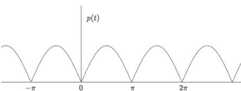

因此 \( p(t) \) 的傅里叶级数为

\( p(t) = \frac{2}{\pi} - \frac{4}{\pi} \sum_{k=1}^{\infty} \frac{1}{4k^2 - 1} \cos 2kt. \)

### 3.2.2 梳函数与傅里叶级数核 \( K_N(t) \)

在本例中，我们想求周期冲激列 [即，周期三角函数列] \(\delta(t)\) 的傅里叶级数。我们将周期为 \(T\) 的冲激列写为

\( I_T(t) = \sum_{n=-\infty}^{\infty} \delta(t - nT) = \sum_{k=-\infty}^{\infty} \alpha_k e^{jk\omega_0 t}. \)

(3.10)

傅里叶系数由以下给出

\( \alpha_k = \frac{1}{T} \int_{-T/2}^{T/2} \sum_{n=-\infty}^{\infty} \delta(t - nT) e^{-jk\omega_0 t} dt. \)

(3.11)

由于积分范围内唯一的 \( n \) 是 \( n = 0 \)，我们得到

\( \alpha_k = \frac{1}{T}, \quad k \in \mathbb{Z}. \)

因此，冲激列 \( I_T(t) \) 的傅里叶级数展开写为

(3.12)
\( I_T(t) = \frac{1}{T} \sum_{k=-\infty}^{\infty} e^{jk\omega_0 t} \).

检查 (3.12) 截断版本的行为是有益的。设 \( K_N(t) \) 为 \( I_T(t) \) 的 \((2N+1)\) 项有限傅里叶和：

(3.13)
\( K_N(t) = \frac{1}{T} \sum_{k=-N}^{N} e^{jk\omega_0 t} \).

\( K_N(t) \) 称为傅里叶级数核。对 (3.13) 中的等比数列求和可得

\( K_N(t) = \frac{1}{T} \frac{\sin(N + \frac{1}{2})\omega_0 t}{\sin \frac{\omega_0 t}{2}} \).

\( N = 4 \) 时 \( K_N(t) \) 的图像如图 3.2 所示。我们还计算了 \( N = 10 \) 和 \( N = 15 \) 时的核，但发现核的形状不变，只是随着 \( N\) 值增大，振荡频率相应增加。随着 \( N \) 值增大，图像的主瓣（主峰）变窄。\( K_N(t) \) 的振荡特性有助于稍后将讨论的吉布斯现象。这些振荡模式可以通过对 (3.12) 中系数的幅度进行加权来修改。这是天线阵列设计中的常见做法 [1]。


由于 \( K_N(t) \) 是周期性的，我们只需考虑核在区间 \( [-T/2, T/2] \) 内的行为。显然，\( t/\sin(\omega_0 t/2) \) 在区间 \( [-T/2, T/2] \) 内有界，且 \( \sin(N+1/2)\omega_0 t/t \) 当 \( N \) 趋于无穷大时趋近于 \( \delta(t) \) [2]。因此

\(\lim_{N \to \infty} K_N(t) = \delta(t), \quad |t| \le \frac{T}{2}.\)

图 3.2：傅里叶级数核 \( K_N(t) \).

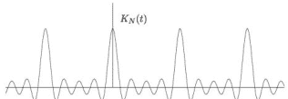

该程序应用于所有其他区间 \( [(2k+1)T/2] \)，\( k \in \mathbb{Z} \)，结果为

\(\lim_{N \to \infty} K_N(t) = I_T(t) = \sum_{k \in \mathbb{Z}} \delta(t - kT).\) (3.14)

(3.12) 的冲激列在工程文献中称为 *梳函数* [3]（参见图 3.3）。

傅里叶级数的若干重要性质，如泊松求和公式、部分和和采样定理，需要使用傅里叶变换才能高效推导。我们将在本章后面讨论这些主题。

图 3.3：梳函数。

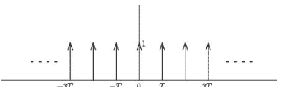

### 3.3 傅里叶变换

要将傅里叶级数扩展到傅里叶变换，让我们考虑方程 (3.1) 和 (3.2)。

(3.1) 中的时域函数 \( p(t) \) 可用 (3.2) 表示为

\( p(t) = \sum_{k=-\infty}^{\infty} \left[ \frac{1}{T} \int_{-T/2}^{T/2} p(t') e^{-jk\omega_0 t'} dt' \right] e^{jk\omega_0 t} \)
\( = \frac{1}{2\pi} \sum_{k=-\infty}^{\infty} \omega_0 \left[ \int_{-T/2}^{T/2} p(t') e^{-jk\omega_0 t'} dt' \right] e^{jk\omega_0 t} \).
(3.15)

我们将周期 \( T \) 扩展到无穷大，使得 \( \omega_0 \) 趋近于 \( d\omega \)，\( k\omega_0 \) 趋近于 \( \omega \)。(3.15) 中的求和变为积分

(3.16) \( p(t) = \frac{1}{2\pi} \int_{-\infty}^{\infty} \left[ \int_{-\infty}^{\infty} p(t') e^{-j\omega t'} dt' \right] e^{j\omega t} d\omega. \)

括号内的积分由函数 \(\hat{p}(\omega)\) 表示

(3.17) \(\hat{p}(\omega) = \int_{-\infty}^{\infty} p(t') e^{-j\omega t'} dt',\)

(3.16) 变为

(3.18) \( p(t) = \frac{1}{2\pi} \int_{-\infty}^{\infty} \hat{p}(\omega) e^{j\omega t} d\omega. \)

方程 (3.17) 和 (3.18) 称为 _傅里叶变换对_。

从现在起，我们将使用 _f_(_t_) 表示时域函数，而 _p_(_t_) 仅限于表示周期时域函数。让我们用新记法重写 (3.17)。

实变量 _t_ 的有限能函数 \( f(t) \in L^2(\mathbb{R}) \) 的傅里叶变换由积分定义

(3.19) \(\hat{f}(\omega) = \int_{-\infty}^{\infty} f(t) e^{-j\omega t} dt.\)

在第 2 章描述的内积记法中，傅里叶变换也可表示为

(3.20) \(\hat{f}(\omega) = \{f(t), e^{j\omega t}\}.\)

我们应强调，\(\hat{f}(\omega)\) 是一个复值函数，可用幅度和相位表示为

(3.21) \(\hat{f}(\omega) = |\hat{f}(\omega)| e^{j\theta(\omega)}.\)

然而，从 \(f(t)\) 的定义域到 \(\hat{f}(\omega)\) 的定义域的映射是从 \(\mathbb{R}\) 到 \(\mathbb{R}\)（即从 \(t\) 轴到 \(\omega\) 轴），尽管实值函数 \(f(t)\) 被映射到复值函数 \(\hat{f}(\omega)\)。

(3.20) 的解释非常重要。该方程指出，对于某个 \(\omega_1\)，\(\hat{f}(\omega_1)\) 表示 \(f(t)\) 在 \(\omega_1\) 处的分量。如果我们能确定 \(f(t)\) 在 \(\omega\) 轴上的所有分量，那么这些分量的叠加应能还原（重构）原始函数 \(f(t)\)：

(3.22) \(f(t) = \frac{1}{2\pi} \int_{-\infty}^{\infty} \hat{f}(\omega) e^{j\omega t} d\omega\).

因此，(3.22) 可视为从分量生成 \(f(t)\) 的叠加积分。该积分称为 \(\hat{f}(\omega)\) 的 *逆傅里叶变换*。如果变量 \(t\) 表示时间，则 \(\hat{f}(\omega)\) 称为 \(f(t)\) 的 *频谱*。如果 \(t\) 表示空间，则 \(\hat{f}(\omega)\) 称为 *空间频谱*。

傅里叶变换在小波分析的发展中非常重要，并在后续章节中经常使用。我们将以其为例，介绍 \(\delta\)-函数的一些性质。

让我们回顾一下

(3.23) \(\int_{-\infty}^{\infty} f(t)\delta(t-y)dt = f(y)\).

因此，\(\delta(t)\) 的傅里叶变换为

(3.24) \(\hat{\delta}(\omega) = \int_{-\infty}^{\infty} \delta(t)e^{-j\omega t}dt = e^{-j\omega 0} = 1\).

从 \(\hat{\delta}(\omega)\) 的逆变换中，建立了恒等式

(3.25) \(\delta(t) = \frac{1}{2\pi} \int_{-\infty}^{\infty} e^{j\omega t} d\omega\)

(3.22) 中的逆变换现在可以证明为

\(\frac{1}{2\pi} \int_{-\infty}^{\infty} \hat{f}(\omega) e^{j\omega t} d\omega = \frac{1}{2\pi} \int_{-\infty}^{\infty} e^{j\omega t} d\omega \int_{-\infty}^{\infty} f(t') e^{-j\omega t'} dt' \\ = \frac{1}{2\pi} \int_{-\infty}^{\infty} f(t') \int_{-\infty}^{\infty} e^{j\omega(t-t')} d\omega dt' \\ = \int_{-\infty}^{\infty} f(t') \delta(t-t') dt' = f(t).\)

由于傅里叶变换是唯一的，我们可以写

f(t) \Leftrightarrow \hat{f}(\omega).

这意味着对于每个函数 \(f(t)\)，都有一个与之对应的唯一傅里叶变换，反之亦然。

### 3.4 傅里叶变换的性质

由于本章的重点不是对傅里叶分析的详细阐述，因此只讨论与小波分析相关的性质。

### 3.4.1 线性

若 \(f(t) = \alpha f_1(t) + \beta f_2(t)\)，其中 \(\alpha\) 和 \(\beta\) 为某些常数，则傅里叶变换为

(3.26) \\ \(\hat{f}(\omega) = \int_{-\infty}^{\infty} f(t) e^{-j\omega t} dt = \alpha \int_{-\infty}^{\infty} f_1(t) e^{-j\omega t} dt + \beta \int_{-\infty}^{\infty} f_2(t) e^{-j\omega t} dt \\ = \alpha \hat{f}_1(\omega) + \beta \hat{f}_2(\omega).

(3.26) 扩展到函数的有限和是平凡的。

### 3.4.2 时移与时标

设函数 \(f(t)\) 平移 \(t_0\)。频谱会发生相位移。实际上，移位函数 \(f_0(t) := f(t - t_0)\) 的频谱表示为

\(\hat{f}_0(\omega) = \int_{-\infty}^{\infty} f(t-t_0)e^{-j\omega t}dt = \int_{-\infty}^{\infty} f(u)e^{-j\omega(u+t_0)}du\)
\(= e^{-j\omega t_0}\hat{f}(\omega) = |\hat{f}(\omega)|e^{j[\phi(\omega)-\omega t_0]},\)
(3.27)

其中 \(\phi(\omega)\) 是原始函数 \(f(t)\) 的相位。对于移位信号，频谱的幅度保持不变。移位被包含在频谱的相位项中。

设 \(a\) 为非零常数；\(f_a(t) := f(at)\) 的频谱由下式给出

\(\hat{f}_a(\omega) = \int_{-\infty}^{\infty} f(at)e^{-j\omega t}dt\)
(3.28)

\(= \int_{-\infty}^{\infty} f(u)e^{-j\omega\left(\frac{u}{a}\right)}d\left(\frac{u}{a}\right)\)
(3.29)

\(= \frac{1}{|a|}\hat{f}\left(\frac{\omega}{a}\right).\)
(3.30)

根据 \(a\) 大于或小于 1，频谱分别被扩展或压缩。我们将在小波分析的后续发展中频繁看到这一重要性质。

### 3.4.3 频移与频标

频移和频标的结果以类似方式得出。若 \(\hat{f}_0(\omega) := \hat{f}(\omega - \omega_0)\)，则

(3.31) \( f_0(t) = f(t)e^{j\omega_0 t},\)

若 \(\hat{f}_a(\omega) := \hat{f}(a\omega)\)，其中 \(a\) 为非零值，则

(3.32) \( f_a(t) = \frac{1}{|a|} f\left(\frac{t}{a}\right).\)

### 3.4.4 矩

函数的 \(n\) 阶矩定义为

(3.33) \( M_n := \int_{-\infty}^{\infty} t^n f(t) dt.\)

一阶矩，

\( M_1 = \int_{-\infty}^{\infty} t f(t) dt = (-j)^{-1} \frac{d}{d\omega} \int_{-\infty}^{\infty} f(t) e^{-j\omega t} dt \bigg|_{\omega=0} \\
= (-j)^{-1} \frac{d\hat{f}(\omega)}{d\omega} \bigg|_{\omega=0} \\
(3.34) \)

将此公式扩展到 \(n\) 阶矩，得到

\( M_n = (-j)^{-n} \frac{d^n \hat{f}(\omega)}{d\omega^n} \bigg|_{\omega=0} \\
(3.35) \)

### 3.4.5 卷积

两个函数 \( f_1(t) \) 和 \( f_2(t) \) 的卷积定义为

\( f(t) = \int_{-\infty}^{\infty} f_1(y) f_2(t-y) dy \\
(3.36) \)

我们用符号表示 (3.36) 为

\( f(t) = f_1(t) * f_2(t) \\
(3.37) \)

注意，如果 \( f_2(t) \) 是 \( \delta(t) \)，则卷积积分恢复函数 \( f_1(t) \)。众所周知，由图 3.4 的框图符号表示的线性系统具有以下输入输出关系：

\( O(t) = h(t) * i(t) \\
(3.38) \)


其中 $h(t)$ 是系统响应函数。因此，如果 $i(t)$ 是 delta 函数，则输出函数 $O(t)$ 与 $h(t)$ 相同。对于任意输入函数 $f(t)$，卷积积分

(3.39)
\[ O(t) = \int_{-\infty}^{\infty} h(t) i(t - \tau) \, d\tau \]

表示由一系列输入 delta 函数产生的输出的叠加，这些 delta 函数的幅度由输入信号调制。可以很容易地证明，(3.36) 的卷积积分在频域中的表示为

\[ \hat{f}(\omega) = \hat{f}_1(\omega) \hat{f}_2(\omega) \]

**图 3.4：线性系统。**

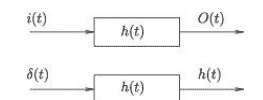

### 3.4.6 Parseval 定理

帕塞瓦尔定理指出

(3.40)
\[ \int_{-\infty}^{\infty} |f(t)|^2 dt = \frac{1}{2\pi} \int_{-\infty}^{\infty} \left| \hat{f}(\omega) \right|^2 d\omega \]

两个函数 f(t) 和 g(t) 通过傅里叶变换的 Parseval 恒等式与它们的傅里叶变换 \(\hat{f}(\omega)\) 和 \(\hat{g}(\omega)\) 相关，给定为

(3.41) \(\langle f(t), g(t) \rangle = \frac{1}{2\pi} \langle \hat{f}(\omega), \hat{g}(\omega) \rangle.\)

这可以从以下推导得出

\(\langle f(t), g(t) \rangle = \int_{-\infty}^{\infty} f(t) \overline{g(t)} dt\)
\(= \frac{1}{2\pi} \int_{-\infty}^{\infty} \left( \int_{-\infty}^{\infty} \hat{f}(\omega) e^{j\omega t} d\omega \right) \overline{g(t)} dt\)
\(= \frac{1}{2\pi} \int_{-\infty}^{\infty} \hat{f}(\omega) \left( \int_{-\infty}^{\infty} g(t) e^{-j\omega t} dt \right) d\omega\)
\(= \frac{1}{2\pi} \int_{-\infty}^{\infty} \hat{f}(\omega) \overline{\hat{g}(\omega)} d\omega\)
\(= \frac{1}{2\pi} \langle \hat{f}(\omega), \hat{g}(\omega) \rangle.\)
(3.42)

特别是，当 g(t) = f(t) 时，我们得到所谓的帕塞瓦尔定理，如 (3.40) 所示。方程 (3.40) 是关于信号能量含量的陈述。它指出，时域中计算的总能量 \(\left[ \int_{-\infty}^{\infty} |f(t)|^2 dt \right]\) 等于频域中计算的总能量 \(\left[ \frac{1}{2\pi} \int_{-\infty}^{\infty} |\hat{f}(\omega)|^2 d\omega \right]\)。帕塞瓦尔定理允许将信号的能量在频域或时域中考虑，并可在两个域之间互换以方便计算。

### 3.5 傅里叶变换示例

我们将计算几个在各种应用中经常出现的函数的傅里叶变换。为此，我们可以直接使用第 3.4 节给出的定义，或使用傅里叶变换的性质。

### 3.5.1 矩形脉冲

矩形脉冲（图 3.5）r(t) 定义为

(3.43)
\[ r(t) = u(t+T) - u(t-T) \]

(3.44)
\[ = \begin{cases} 1 & |t| < T \\ 0 & \text{否则} \end{cases} \]

**图 3.5：矩形脉冲及其傅里叶变换。**

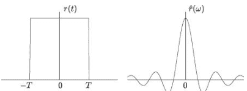

我们得到

(3.45)
\[ \hat{r}(\omega) = \int_{-\infty}^{\infty} r(t) e^{-i\omega t} dt = \int_{-T}^{T} e^{-i\omega t} dt = \frac{2T \sin \omega T}{\omega T}. \]

函数 \(\sin \omega T / \omega T\)，称为 sinc 函数，是矩形脉冲的傅里叶变换。这里我们指出，对于 \(T = 1/2\)，函数 \(r(t - 1/2) = z_{(0,1)}(t)\) 被称为特征函数或一阶 B 样条。这是一个需要记住的重要函数，将在小波理论的发展中稍后回顾。

### 3.5.2 三角脉冲

通过两个矩形脉冲的卷积，我们得到一个三角脉冲（图 3.6），其表达式为

(3.46) \(T_r(t) = r(t) * r(t)\)

(3.47)
\[ = \begin{cases} 2T(1 + \frac{t}{2T}) & -2T \le t \le 0 \\ 2T(1 - \frac{t}{2T}) & 0 \le t \le 2T \\ 0 & \text{否则} \end{cases} \]

**图 3.6：三角函数及其傅里叶变换。**

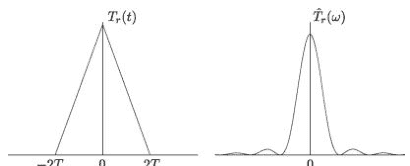

根据卷积定理，我们有

(3.48)
\[ \hat{T}_r(\omega) = \left[ \frac{2T \sin \omega T}{\omega T} \right]^2 \]

(3.49)
\[ = 4T^2 \frac{\sin^2(\omega T)}{(\omega T)^2} \]

如果 \(T = 1/2\)，

(3.50)
\[ T_r(t) = \left\{ \begin{array}{ll} 1+t & -1 \le t \le 0 \\ 1-t & 0 \le t \le 1 \\ 0 & \text{否则,} \end{array} \right. \]

和 \(\hat{T}_r(\omega) = \left( \frac{\sin(\omega/2)}{(\omega/2)} \right)^2\)。当 \(T=1/2\) 时的三角函数称为二阶 B 样条，作为样条小波的缩放函数发挥着重要作用。

### 3.5.3 高斯函数

高斯函数是概率论和随机信号分析中最重要的函数之一。它在稍后将要发展的 Gabor 变换中起着核心作用。单位幅值的高斯函数表示为

(3.51)
\[ g(t) = e^{-\alpha t^2} \]

其傅里叶变换 \(\hat{g}(\omega)\) 可以很容易地计算为

\[ \begin{aligned} \hat{g}(\omega) &= \int_{-\infty}^{\infty} e^{-\alpha t^2} e^{-j\omega t} dt \\ &= \int_{-\infty}^{\infty} e^{-\alpha \left( t^2 + j \frac{\omega}{\alpha} t + \frac{\omega^2}{4\alpha} \right)} \frac{\omega^2}{4\alpha} dt \\ &= e^{-\frac{\omega^2}{4\alpha}} \int_{-\infty}^{\infty} e^{-\alpha \left( t + j \frac{\omega}{2\alpha} \right)^2} dt \\ &= \sqrt{\frac{\pi}{\alpha}} e^{-\frac{\omega^2}{4\alpha}}. \end{aligned} \]
(3.52)

值得注意的是，高斯函数的傅里叶变换也是一个高斯函数。波形及其变换如图 3.7 所示。

**图 3.7：高斯函数及其傅里叶变换。**

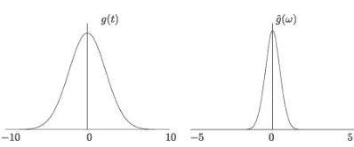

参数 \(\alpha\) 可用于控制高斯脉冲的宽度。从 (3.51) 和 (3.52) 可以明显看出，较大的 \(\alpha\) 值会产生窄脉冲，但其频谱在 \(\omega\) 轴上会展宽。

### 3.6 Poisson 求和与一元划分

我们现在回到傅里叶级数，讨论 Poisson 求和，其推导通过使用傅里叶变换的一些性质变得简单得多。在许多应用中，为了分析目的，有必要从具有有限能量的非周期函数形成周期函数。

Poisson 求和公式有助于将此类函数的时域信息与其频谱联系起来。设 \(f(t) \in L^2(\mathbb{R})\)。\(f(t)\) 的周期版本，称为 \(f_p(t)\)，通过以下方式得到

\[ f_p(t) := \sum_{n=-\infty}^{\infty} f(t + 2\pi n), \]
(3.53)

这里我们假设 $T = 2\pi$ 是 $f_p(t)$ 的周期。因此，$\omega_0 = 2\pi/T = 1$，$f_p(t)$ 的傅里叶级数表示为

(3.54)
\[ f_p(t) = \sum_{k=-\infty}^{\infty} c_k e^{jkt} \]

系数 $c_k$ 由以下给出

(3.55)
\[ \begin{aligned} c_k &= \frac{1}{2\pi} \int_0^{2\pi} f_p(t) e^{-jkt} dt \\ &= \frac{1}{2\pi} \int_0^{2\pi} \sum_{n \in \mathbb{Z}} f(t+2\pi n) e^{-jkt} dt \\ &= \frac{1}{2\pi} \sum_{n \in \mathbb{Z}} \int_0^{2\pi} f(t+2\pi n) e^{-jkt} dt \\ &= \frac{1}{2\pi} \sum_{n \in \mathbb{Z}} \int_{2\pi n}^{2\pi(n+1)} f(\xi) e^{-jk(\xi-2\pi n)} d\xi, \end{aligned} \]

这里使用了变量代换 $\xi = t + 2\pi n$。由于求和和积分限有效地将积分扩展到整个实数轴 $\mathbb{R}$，我们可以写成

(3.56)
\[ \begin{aligned} c_k &= \frac{1}{2\pi} \int_{-\infty}^{\infty} f(\xi) e^{-jk\xi} d\xi \\ &= \frac{1}{2\pi} \hat{f}(k), \end{aligned} \]

这里使用了逆傅里叶变换的定义。结合 (3.53)、(3.54) 和 (3.56)，我们得到所谓的 Poisson 求和公式

(3.57)
\[ \sum_{n=-\infty}^{\infty} f(t+2\pi n) = \frac{1}{2\pi} \sum_{k=-\infty}^{\infty} \hat{f}(k)e^{jkt}. \]

对于任意周期 \(T\)，该公式推广为

(3.58)
\[ \sum_{n=-\infty}^{\infty} f(t+nT) = \frac{1}{T} \sum_{k=-\infty}^{\infty} \hat{f}(k\omega_0)e^{jk\omega_0 t}. \]

如果 \(g(t)\) 是 \(f(t)$ 的缩放版本：

(3.59)
\[ g(t) = f(at), a > 0, \]

我们有

(3.60)
\[ \hat{g}(\omega) = \frac{1}{a}\hat{f}\left(\frac{\omega}{a}\right). \]

\(f(at)$ 的 Poisson 求和公式为

(3.61)
\[ \sum_{n=-\infty}^{\infty} f(at+2\pi an) = \frac{1}{2\pi a} \sum_{k=-\infty}^{\infty} \hat{f}\left(\frac{k}{a}\right)e^{jkt}. \]

如果将 \(at$ 重命名为 \(t\)，我们有


(3.62) \(\sum_{n=-\infty}^{\infty} f(t+2\pi an) = \frac{1}{2\pi a} \sum_{k=-\infty}^{\infty} \hat{f}\left(\frac{k}{a}\right) e^{\frac{jkt}{a}}.\)

泊松求和公式的另外两种形式将在后续章节的推导中用到。它们在此不加证明地给出。证明留作练习。

(3.63) \(\sum_{k \in \mathbb{Z}} \hat{f}(\omega + 2\pi k) = \sum_{k \in \mathbb{Z}} f(k) e^{-jk\omega}\)

(3.64) \(\frac{1}{a} \sum_{k \in \mathbb{Z}} \hat{f}\left(\frac{\omega + 2\pi k}{a}\right) = \sum_{k \in \mathbb{Z}} f(ak) e^{-jk\omega}\)

### 3.6.1 统一划分

泊松求和公式的一个直接结果是，可以找到一组基，使得统一量可表示为该基的线性组合。我们称此性质为 *统一划分*。令 (3.62) 中的 \(a\) 为 \(1/2\pi\)。泊松求和公式变为

(3.65) \(\sum_{n=-\infty}^{\infty} f(t+n) = \sum_{k=-\infty}^{\infty} \hat{f}(2\pi k) e^{j2\pi kt}.\)

如果函数 \(f(t) \in L^2(\mathbb{R})\) 的频谱满足

(3.66) \(\hat{f}(2\pi k) = \delta_{0,k} \text{ for } k \in \mathbb{Z},\)

即，

\(\hat{f}(0) = 1,\)

并且

\(\hat{f}(2\pi k) = 0, \quad k \in \mathbb{Z} \setminus \{0\},\)

则由 (3.65) 可得

(3.67) \(\sum_{n \in \mathbb{Z}} f(t+n) \equiv 1.\)

一阶和二阶 B 样条是满足该性质的函数的良好示例。

### 一阶 B 样条

\(N_1(t) := \chi_{[0,1)}(t)\)

\(\hat{N}_1(\omega) = \int_0^1 e^{-j\omega t} dt = \frac{1 - e^{-j\omega}}{j\omega}\)

\(\hat{N}_1(0) = \lim_{\omega \to 0} \frac{1 - e^{-j\omega}}{j\omega} = 1\)

\(\hat{N}_1(2\pi k) = 0, \quad k \in \mathbb{Z} \setminus \{0\}.\)

因此

(3.68) \(\sum_{k \in \mathbb{Z}} N_1(t+k) \equiv 1.\)

### 二阶 B 样条

(3.69) \(N_2(t) = N_1(t) * N_1(t)\)

(3.70) \(= \begin{cases} t & t \in [0, 1] \\ 2-t & t \in [1, 2] \\ 0 & \text{otherwise.} \end{cases}\)

根据卷积性质，有

(3.71) \(\hat{N}_2(\omega) = \left( \hat{N}_1(\omega) \right)^2\)

(3.72) \(\hat{N}_2(\omega) = \left( \frac{1 - e^{-j\omega}}{j\omega} \right)^2.\)

(3.73) \(\hat{N}_2(0) = 1;\)

(3.74) \(\hat{N}_2(2\pi k) = 0; \quad k \in \mathbb{Z} \setminus \{0\}.\)

因此，\(N_2(t)\) 也满足统一划分的条件。事实上，根据 B 样条的递推关系

(3.75) \(N_m(t) = N_{m-1}(t) * N_1(t)\)

(3.76) \(= \int_0^1 N_{m-1}(t-\tau) d\tau,\)

则有 \(\hat{N}_m(\omega) = [(1 - e^{-j\omega}) / j\omega]^m\)，满足统一划分的要求。因此，任意阶 B 样条都具有该性质。统一划分的图示见图 3.8。

### 图 3.8：统一划分。

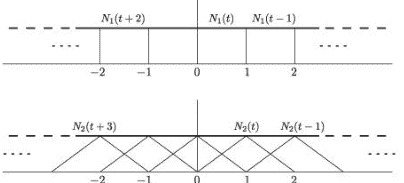

### 3.7 采样定理

采样定理对数字信号分析至关重要。它指出，如果信号 f(t) 是带限的，带宽为 2\Omega，则信号 f(t) 可以从等距网格点上的采样值中精确重构。相邻采样点之间的距离（称为采样周期 h）不应小于 $\pi/\Omega$。函数 $f(t)$ 可通过以下公式恢复

(3.77) \(f(t) = h \sum_{k \in \mathbb{Z}} f(kh) \frac{\sin[\Omega(t-kh)]}{[\pi(t-kh)]}, \quad k \in \mathbb{Z}.\)

如果 $h = \pi/\Omega$，采样频率 $f_s = 1/h = \Omega/\pi$ 称为奈奎斯特率。理论上，如果 $h < \pi/\Omega$，则 $f(t)$ 总能从采样中完美恢复。然而，在实践中，由于 sinc 函数的无限性质，我们无法无误地恢复 $f(t)$。

令 \(\hat{f}(\omega)\) 为 \(f(t)\) 的傅里叶变换

\(\hat{f}(\omega) = \int_{-\infty}^{\infty} f(t) e^{-i\omega t} \, dt.\)

该积分可用辛普森法则近似为

(3.78) \(\hat{f}(\omega) \doteq \hat{F}(\omega) = h \sum_{k \in \mathbb{Z}} f(kh) e^{-j\omega kh}.\)

利用 (3.64) 中的泊松求和公式，可以将 \(\hat{F}(\omega)\) 改写为

(3.79) \(\hat{F}(\omega) = h \sum_{k \in \mathbb{Z}} f(kh) e^{-j k \omega h} = \sum_{k \in \mathbb{Z}} \hat{f}\left(\frac{\omega h + 2\pi k}{h}\right) = \hat{f}(\omega) + \sum_{k \in \mathbb{Z} \setminus \{0\}} \hat{f}\left(\omega + \frac{2\pi k}{h}\right)\)

因此，\(\hat{F}(\omega)\) 包含 \(\hat{f}(\omega)\) 以及沿 \(\omega\) 轴移动的 \(\hat{f}(\omega)\) 的无数个副本。为了使 \(\hat{f}(\omega)\) 与其副本不重叠，移动量 \(2\pi/h\) 必须至少为 \(2 \Omega\)（见图 3.9）：

(3.80) \(\frac{2\pi}{h} \ge 2\Omega, \quad h \le \frac{\pi}{\Omega}.\)

### 图 3.9：(a) 欠采样 \((S = 2\pi/h < 2\Omega)\)。(b) 过采样 \((S = 2\pi/h > 2\Omega)\)。

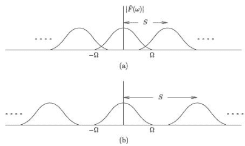

为了恢复原始函数，我们使用一个频谱窗

(3.81) \(\hat{W}(\omega) = \begin{cases} 1 & |\omega| \le \Omega \\ 0 & \text{otherwise} \end{cases}\)

并通过以下方式恢复 \(\hat{f}(\omega)\)

(3.82) \(\hat{f}(\omega) = \hat{F}(\omega)\hat{W}(\omega).\)

根据卷积定理，得到 \(f(t)\)：

(3.83) \(f(t) = F(t) * W(t).\)

由于 \(W(t) = \sin \Omega t / \pi t\) 是众所周知的，我们从逆傅里叶变换计算 \(F(t)\)

\(F(t) = \frac{h}{2\pi} \int_{-\infty}^{\infty} \sum_{k \in \mathbb{Z}} f(kh) e^{-j\omega kh} e^{j\omega t} d\omega = \frac{h}{2\pi} \sum_{k \in \mathbb{Z}} f(kh) \int_{-\infty}^{\infty} e^{j\omega(t-kh)} d\omega = h \sum_{k \in \mathbb{Z}} f(kh) \delta(t - kh),\)

这里使用了 (3.25)。函数 \(f(t)\) 通过卷积公式恢复

\(f(t) = h \sum_{k \in \mathbb{Z}} f(kh) \int_{-\infty}^{\infty} \delta(\tau - kh) W(t - \tau) d\tau = h \sum_{k \in \mathbb{Z}} f(kh) W(t - kh) = h \sum_{k \in \mathbb{Z}} f(kh) \frac{\sin[\Omega(t - kh)]}{\pi(t - kh)} = \sum_{k \in \mathbb{Z}} f(kh) \frac{\sin(\Omega t - k\pi)}{(\Omega t - k\pi)}.\)

这里使用了 \(\Omega h = \pi\)。此处指出，(3.85) 表示一个插值公式。由于 \(\sin[\Omega(t - kh)] / [\Omega(t - kh)]\) 在 \(t = kh\) 处为 1，在所有其他采样点处为 0，因此 \(kh\) 处的函数值不受其他采样值的影响。

\(f(kh) = \sum_{k \in \mathbb{Z}} f(kh) \frac{\sin(0)}{0} = f(kh).\)

因此，函数 $f(t)$ 通过以 sinc 函数为插值核对其采样值进行插值而重构。

### 3.8 部分和与吉布斯现象

傅里叶级数的部分和是对原始周期函数的最小二乘近似。令 \(p_M(t)\) 为周期函数 \(p(t)\)（周期为 \(T\)）的傅里叶级数的 \((2M + 1)\) 项部分和

\(p_M(t) = \sum_{k=-M}^{M} \alpha_k e^{jk\omega_0 t}, \quad \text{(3.87)}\)

傅里叶系数由以下给出

\(\alpha_k = \frac{1}{T} \int_{-T/2}^{T/2} p(t) e^{-jk\omega_0 t} dt. \quad \text{(3.88)}\)

将 \(\alpha_k\) 代回 (3.87)，得到部分和

\(p_M(t) = \sum_{k=-M}^{M} \frac{1}{T} \int_{-T/2}^{T/2} p(\tau) e^{-jk\omega_0 \tau} e^{jk\omega_0 t} d\tau. \quad \text{(3.89)}\)

交换求和与积分的顺序，得到

\(p_M(t) = \frac{1}{T} \int_{-T/2}^{T/2} p(\tau) \sum_{k=-M}^{M} e^{jk\omega_0(t-\tau)} d\tau = \frac{1}{T} \int_{-T/2}^{T/2} p(\tau) \left[ \frac{\sin \left( M + \frac{1}{2} \right) (t-\tau) \omega_0}{\sin \frac{1}{2} (t-\tau) \omega_0} \right] d\tau, \quad \text{(3.90)}\)

这是原始周期函数与第 3.2.2 节讨论的傅里叶级数核之间的卷积。我们可以轻松看出，振荡特性 \( K_N \) 被带入部分和中。如果 \( p(t) \) 是矩形脉冲列或具有跳跃不连续点的周期函数，则部分傅里叶级数将在不连续点附近表现出振荡。这被称为 *吉布斯现象*。无论近似所取的项数多少，超调百分比保持不变。当 \( M \rightarrow \infty \) 时，和在不连续点处收敛到中点 [4]。

### 3.9 离散时间信号的傅里叶分析

由于傅里叶系数和傅里叶变换的计算需要积分，因此函数必须能用正弦和余弦函数、指数函数以及幂级数项等初等函数解析描述。一般来说，我们在现实生活中遇到的大多数信号都不能用初等函数表示。我们必须使用数值算法来计算频谱。如果信号是采样信号，则离散傅里叶级数和离散时间傅里叶变换


可直接计算。它们产生原始模拟信号的近似频谱。

### 3.9.1 离散傅立叶基与离散傅立叶级数

对于给定的周期性为 $N$ 的周期序列，有

(3.91) $f_p(n+mN) = f_p(n), \quad m \in \mathbb{Z}$.

该周期序列的傅立叶基仅有 $N$ 个基函数，即，

(3.92) $\mathbf{e}_k(n) = e^{\frac{j2\pi}{N}kn}, \quad k=0, 1, \dots, N-1$.

我们可以轻易展示基集的周期性

$$
\begin{aligned}
\mathbf{e}_{k+N} &= e^{\frac{j2\pi}{N}(k+N)n} \\
&= e_k \cdot e^{j2\pi n} \\
&= e_k
\end{aligned}
$$

因为对于整数 $n$，有 $e^{j2\pi n} = 1$。因此，$f_p(n)$ 的展开形式为

(3.94) $f_p(n) = \sum_{k=0}^{N-1} \alpha_k \mathbf{e}_k(n)$

$= \sum_{k=0}^{N-1} \alpha_k e^{\frac{j2\pi}{N}kn}$,

(3.95)

然后我们可以通过以下方式计算系数

(3.96) $\alpha_k = \left\langle f_p(n), e^{\frac{j2\pi}{N}kn} \right\rangle = \frac{1}{N} \sum_{n=0}^{N-1} f_p(n) e^{-\frac{j2\pi}{N}kn}$.

方程 (3.94) 和 (3.96) 构成离散周期序列及其离散频谱的变换对。从 (3.96) 很容易看出，傅立叶系数 $\{\alpha_k\}$ 也具有周期性 $N$。

$\alpha_k = \alpha_{k+mN}, m \in \mathbb{Z}$.

### 示例 1.

求序列的傅立叶级数系数

$f(n) = \cos(\sqrt{5}\pi n)$.

解：给定的序列不是周期序列，因为我们找不到整数 $N$ 使得 $f(n + N) = f(n)$。因此，$f(n)$ 没有离散傅立叶级数表示。

### 示例 2. 求下列序列的傅立叶级数表示

- (a) $f(n) = \cos \frac{n\pi}{5}$，以及
- (b) $f(n) = \{1, 1, 0, 0\}$。

解：(a) 我们不直接使用 (3.96) 计算系数，而是可以将余弦函数表示为其指数形式

(3.97) $f(n) = \frac{1}{2} \left\{ e^{j\frac{2\pi n}{10}} + e^{-j\frac{2\pi n}{10}} \right\}$.

该序列的周期性可见为 $N = 10$。由于 (3.97) 已经是如 (3.95) 形式的指数级数，我们得出

(3.98) $\alpha_k = \begin{cases} \frac{1}{2} & k=1, \\ \frac{1}{2} & k=9, \\ 0, & \text{otherwise.} \end{cases}$

(b) 我们使用 (3.96) 计算傅立叶系数以获得

$\alpha_k = \frac{1}{4} \left( 1 + e^{-j\frac{2\pi k}{4}} \right), \quad k=0, 1, 2, 3$.

我们有

$$
\alpha_k = 
\begin{cases}
\frac{1}{2} & k=0, \\
\frac{1}{4}(1-j) & k=1, \\
0 & k=2, \\
\frac{1}{4}(1+j) & k=3,
\end{cases}
$$

(3.99)

该序列及其幅度频谱如图 3.10 所示。

**图 3.10:** (a) 序列 $f(n)$ 和 (b) 其幅度频谱 $|\alpha_k|$.

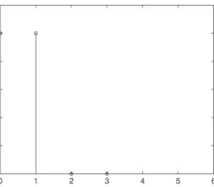

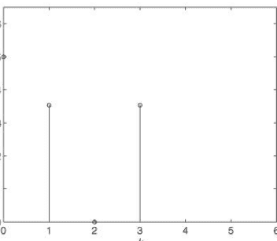

### 3.9.2 离散时间傅立叶变换 (DTFT)

如果离散信号是非周期的，我们可以将其视为周期为 $N = \infty$ 的周期信号。在这种情况下，我们将离散傅立叶级数分析扩展到 DTFT，类似于模拟域中的扩展。在 DTFT 中，时间变量 $(n)$ 是离散的，而频率变量 $(\omega)$ 是连续的，因为

$\Delta\omega = \lim_{N \to \infty} \frac{2\pi}{N} \to \omega$.

DTFT 变换对明确给出为

(3.100) $\hat{f}(\omega) = \sum_{n=-\infty}^{\infty} f(n)e^{-jn\omega}$,

(3.101) $f(n) = \frac{1}{2\pi} \int_{-\pi}^{\pi} \hat{f}(\omega)e^{jn\omega} d\omega$.

示例。

确定指数序列的频谱

$f(n) = a^n, \quad \forall n \in \mathbb{Z}^+ := \{0, 1, \cdots\}, \quad |a| < 1$.

解：使用 (3.100)，

(3.102)
$$
\begin{aligned}
\hat{f}(\omega) &= \sum_{n=0}^{\infty} a^n e^{-jn\omega} \\
&= \sum_{n=0}^{\infty} (ae^{-j\omega})^n \\
&= \frac{1}{1 - ae^{-j\omega}}.
\end{aligned}
$$

我们在第 2 章中指出，DTFT 可以通过将变量 $z$ 替换为 $e^{j\omega}$ 从 z-变换得到。对于本例，z-变换为

$$
\begin{aligned}
F(z) &= \sum_{n=0}^{\infty} a^n z^{-n} \\
&= \sum_{n=0}^{\infty} (az^{-1})^n \\
&= \frac{1}{1 - az^{-1}}.
\end{aligned}
$$

因此，将变量 $z$ 替换为 $e^{j\omega}$ 得到

$F(z)|_{z=e^{j\omega}} = \frac{1}{1 - ae^{-j\omega}} = \hat{f}(\omega)$.

在未来的推导和小波构建讨论中，z-变换 $F(z)$ 和 DTFT $[\hat{f}(\omega) = F(z)|_{z=e^{j\omega}}]$ 将互换使用。

### 3.10 离散傅立叶变换 (DFT)

必须计算第 3.9 节讨论的逆 DTFT 中的积分，以恢复原始离散时间信号。与其计算积分，不如通过对频率 ($\omega$) 轴进行离散化来获得良好的近似。

由于函数 $f(t)$ 是带限的（如果不是，我们通过将其通过足够宽的低通滤波器来使其成为带限），我们只需要离散化区间 $[-\Omega, \Omega]$，即，

(3.103) $\omega_n = \frac{2\pi n}{Nh} \quad n = -\frac{N}{2}, \dots, \frac{N}{2}$.

方程 (3.17) 中的积分现在可以近似为级数和，即

(3.104) $\hat{f}(\omega_n) = h \sum_{k=0}^{N-1} f(k) e^{-j\omega_n k} = h \hat{f}(n)$

其中

(3.105) $\hat{f}(n) = \sum_{k=0}^{N-1} f(k) e^{-\frac{j2\pi kn}{N}}$.

我们可以轻易验证，使用 (3.105) 计算离散傅立叶变换是一个 $O(N^2)$ 过程。我们可以使用著名的 *快速傅立叶变换* (FFT) 算法，以 $O(N \log_2 N)$ 的运算量计算离散傅立叶变换。常用的 FFT 算法之一是 Danielson 和 Lanczos 的算法，根据该算法，假设 $N$ 可以连续被 2 整除，长度为 $N$ 的 DFT 可以写成两个长度为 $N/2$ 的离散傅立叶变换之和。此过程可以递归使用，直到我们得到仅包含两个数据点的 DFT。这被称为基数-2 FFT 算法。不深入算法的许多细节（感兴趣的读者可以从许多关于这些主题的优秀书籍中获得），我们简单地提到，通过适当安排长度为 $N$（$N$ 为 2 的整数幂，称为时域抽取和频域抽取安排）的数据，我们可以以 $O(N \log_2 N)$ 的运算量计算离散傅立叶变换。如果 $N$ 不是 2 的整数幂，我们可以通过在数据序列中填充零来始终使其成为 2 的整数幂。

### 3.11 练习

- 1. 验证对函数 $f \in L^2(-\infty, \infty)$ 取共轭和傅立叶变换的顺序可以按如下方式颠倒：

$\hat{\bar{F}}(\eta) = \bar{\hat{F}}(-\eta)$

对于任何 $\eta \in \mathbb{R}$。

- 2. 检查条件

$\frac{d^j}{d\omega^j} \hat{\psi}(\omega) \bigg|_{\omega=0} = 0$

等价于矩条件

$\int_{-\infty}^{\infty} t^j \psi(t) dt = 0$

对于任何正整数 $j$。

- 3. 证明狄利克雷核

$D_n(u) = \frac{1}{\pi} \left[ \frac{1}{2} + \sum_{k=1}^n \cos ku \right] = \frac{\sin(n + \frac{1}{2})u}{2\pi \sin(\frac{u}{2})}$.

绘制 $n = 6$ 时的核。

- 4. 求 $f(t) = e^{j\pi t}, -\pi < t < \pi$ 的傅立叶级数。

- 5. 确定高斯函数 $g_a(t) = Ae^{-at^2}$ 的能量归一化常数 $A$ 并推导傅立叶变换的表达式。

- 6. 将泊松求和公式扩展到任意周期 $T$。

- 7. 在频域中推导以下泊松求和公式 ($a > 0$)：

$$
\sum_k \hat{f}(\omega + 2\pi k) = \sum_k f(k) e^{-jk\omega}
$$

$$
\frac{1}{a} \sum_k \hat{f}\left(\frac{\omega + 2\pi k}{a}\right) = \sum_k f(ak) e^{-jk\omega}
$$

注释

1 这不是经典意义上的函数。它被称为广义函数或分布。然而，在本书中，我们将其称为冲激函数。

### 3.12 参考文献

- 1. R. S. Elliott. 《天线阵列理论》. 微波扫描天线第 2 卷，R. C. Hansen 编. San Diego, CA: Academic Press, 1966.
- 2. A. Papoulis. 《傅立叶积分及其应用》. New York: McGraw-Hill, 1962.
- 3. K. Iizuka. 《工程光学》. 第 2 版. New York: Springer Verlag, 1986.
- 4. W. W. Harman and D. W. Lytle. 《电气和机械网络：分析导论》. New York: McGraw-Hill, 1962.


## 第四章

### 时频分析

我们在上一章中简要地总结了傅里叶分析，以唤醒读者的记忆，并指出分析中几个在讨论时频分析时有用的重要概念。我们从傅里叶变换的定义（3.19）观察到，在整个实数直线（-∞, ∞）上的完整波形已知之前，无法进行积分。这是因为函数 e^(jωt) 或 cos ωt 和 sin ωt 是全局函数。由此我们意味着，t轴上任意一点的函数微小扰动会影响ω轴上的每一点，反之亦然。如果我们将信号 f(t) 想象为 e^(jωt) 的调制函数，那么t轴上任意一点的扰动将传播到整个ω轴。我们对傅里叶变换的另一项观察是，积分一次只能在一个频率上计算。从信号处理的角度来看，这非常不方便。尽管有快速算法来数字计算变换，但它无法实时进行。在计算离散或快速傅里叶变换之前，所有必要数据都必须存储在内存中。

尽管无疑是最通用的方法，但当人们关心信号的局部频率含量时，傅里叶分析就变得不足。换句话说，傅里叶频谱不提供关于信号的任何时域信息。为了说明这一点，让我们检查图 4.1a 所示的函数，它表示时域中频率为 4 Hz 的截断正弦波，在 t = 0.7 s 和 t = 1.3 s 附近有扰动。我们在前一章中看到，时域中的正弦波将在频率域中表现为冲激函数，反之亦然。观察图 4.1b 中 4 Hz 附近的频率展宽是由于正弦波的截断。我们从图 4.1b 所示的傅里叶频谱得出结论，4 Hz 附近的尖脉冲主要来自 4 Hz 的正弦波，而贯穿频率轴出现的小涟漪主要是由于时域中的某些冲激函数（尖锐变化）引起的。然而，通过观察图 4.1b 的频谱，我们无法指出这些冲激函数在时间轴上的位置。这可以简单地由冲激函数的傅里叶表示（3.25）来解释。冲激函数需要无限数量的正弦函数，它们在 t = 0 处建设性地结合，同时相互破坏性干扰，以在所有 t \neq 0 处产生零。这表明使用全局函数 e^{j\omega t} 来表示局部函数极其笨拙且无效。为了纠正这一缺陷，需要进行局部分析，以结合时域和频域分析来实现时频分析，从而我们可以提取信号的局部频率含量。这非常重要，因为在实践中，我们可能只对频谱的某个特定部分感兴趣，因此，我们可能想知道时域信号的哪个部分主要导致频谱中的给定特性。

**图 4.1：** (A) 在 t = 0.7 和 t = 1.3 处有扰动的正弦信号。(b) 其幅度频谱。

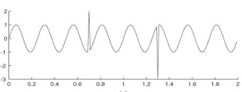

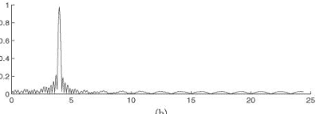

常识告诉我们，要了解信号的局部频率含量，应首先从给定信号中移除所需部分，然后对移除的部分进行傅里叶变换。这种时频分析方法称为短时傅里叶变换（STFT）。在讨论 STFT 之前，让我们讨论窗函数的概念，通过它可以移除给定信号的所需部分。

### 4.1 窗函数

可以通过将原始信号与在所需区间外为零的另一个函数相乘，从主信号中移除信号的所需部分。设 \(\phi(t) \in L^2(\mathbb{R})\) 为实值窗函数。则乘积 \(f(t)\phi(t - b) =: f_b(t)\) 将包含 \(f(t)\) 在 \(t = b\) 附近的信息。特别是，如果 \(\phi(t) = \chi_{[-\tau, \tau]}(t)，如图 4.2 所示，则

$$
f_b(t) = \begin{cases} f(t); & t \in [b-\tau, b+\tau] \\ 0 & \text{otherwise.} \end{cases}
$$

**(4.1)**

**图 4.2：** 特征函数。

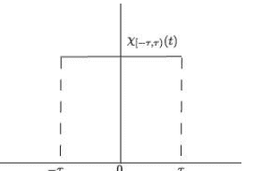

通过改变参数 \(b\)，我们可以沿时间轴滑动窗函数，以分析函数 \(f(t)\) 在不同区间中的局部行为。

窗函数的两个最重要参数是其中心和宽度；后者通常是半径的两倍。很明显，图 4.2 中窗函数的中心和标准宽度分别为 0 和 \(2\tau\)。对于一般窗函数 \(\phi(t)\)，我们定义其中心 \(t^*\) 为

$$
t^* := \frac{1}{\|\phi\|^2} \int_{-\infty}^{\infty} t |\phi(t)|^2 \, dt
$$

**(4.2)**

以及均方根（r.m.s.）半径 $\Delta_\phi$ 为

$$
\Delta_\phi := \frac{1}{\|\phi\|} \left[ \int_{-\infty}^{\infty} (t - t^*)^2 |\phi(t)|^2 \, dt \right]^{1/2} .
$$

对于图 4.2 中的特定窗口，很容易验证 $t^* = 0$ 和 $\Delta_\phi = \tau/\sqrt{3}$。因此，均方根宽度比标准宽度小 $1/\sqrt{3}$。

上述具有有限 $\Delta_\phi$ 的函数 $\phi(t)$ 称为 *时间窗*。同样，我们可以有一个频率窗 \(\hat{\phi}(\omega)\)，其中心为 \(\omega^*\)，均方根半径 \(\Delta_{\hat{\phi}}\) 定义类似于（4.2）和（4.3）为

$$
\omega^* := \frac{1}{\|\hat{\phi}\|^2} \int_{-\infty}^{\infty} \omega |\hat{\phi}(\omega)|^2 \, d\omega,
$$

$$
\Delta_{\hat{\phi}} := \frac{1}{\|\hat{\phi}\|} \left[ \int_{-\infty}^{\infty} (\omega - \omega^*)^2 |\hat{\phi}(\omega)|^2 \, d\omega \right]^{1/2} .
$$

众所周知，理论上一个函数不能同时在时域和频域上被限制。然而，我们可以有 \(\phi(t)\) 使得 \(\Delta_\phi\) 和 \(\Delta_{\hat{\phi}}\) 都是有限的；在这种情况下，函数 \(\phi(t)\) 称为 *时频窗*。很容易验证，对于图 4.2 中的窗口，\(\omega^* = 0\) 和 \(\Delta_{\hat{\phi}} = \infty\)。这个窗口是最佳（理想）时间窗，但也是最差（不可接受）频率窗。

时频窗的一个优度指标是其时频宽度乘积 \(\Delta_\phi \Delta_{\hat{\phi}}\)，其下界由不确定性原理给出，并由

$$
\Delta_\phi \Delta_{\hat{\phi}} \ge \frac{1}{2}
$$

**(4.6)**

给出，等号仅在 \(\phi\) 为高斯类型时成立（参见第 3.5.3 节）。

### 4.2 短时傅里叶变换

在本章开头，我们指出，可以通过首先使用适当的窗函数 \(\phi(t)\) 对函数进行窗口化以产生窗函数 \(f_b(t) = f(t)\phi(t - b)\)，然后对 \(f_b(t)\) 进行傅里叶变换，来获得信号 \(f(t)\) 在某个所需时间位置（例如 \(t = b\)）附近的近似频率含量。这就是短时傅里叶变换（STFT）。形式上，我们可以定义函数 \(f(t)\) 相对于窗函数 \(\phi(t)\) 在时频平面上的位置 \((b, \zeta)\) 处的 STFT 为

$$
G_\phi f(b, \zeta) := \int_{-\infty}^{\infty} f(t) \overline{\phi_{b,\zeta}} dt
$$

**(4.7)**

$$
\phi_{b,\zeta}(t) := \phi(t - b) e^{i \zeta t}
$$

**(4.8)**

(4.7) 中的窗函数 \(\phi(t)\) 允许是复数，并满足条件

\(\hat{\phi}(0)=\int_{-\infty}^{\infty} \phi(t)dt \neq 0.\)

换句话说，\(\hat{\phi}(\omega)\) 表现为低通滤波器。也就是说，在 \(\omega = 0\) 处频谱非零。由于 STFT 的窗口化特性，此变换也称为 _窗口傅里叶变换_ 或 _滑动窗口傅里叶变换_。

与傅里叶变换的情况不同，在傅里叶变换中，必须在整个时间轴上已知函数 \(f(t)\)，才能计算其任何单频率的谱分量，而 STFT 只需在 \(\phi(t-b)\) 非零的区间内知道 \(f(t)\)。换句话说，\(G_\phi f(b, \xi)\) 给出了 \(f\) 在 \(t=b\) 附近的近似频谱。

如果将 (4.7) 中的窗函数 \(\phi(t-b)\) 视为正弦波 \(e^{-j\xi t}\) 的调制函数，则 STFT 可以写成

$$
G_\phi f(b, \xi)=\langle f(t), \phi(t-b)e^{j\xi t} \rangle.
$$

**(4.9)**

函数 \(\phi_{b,\xi}(t)=\phi(t-b)e^{j\xi t}\) 表现得像一个 _波包_，其中正弦波在包络函数 \(\phi(t)\) 内振荡。此外，（4.8）表明这些波包中的每一个都表现得像一个基函数，因此 STFT 可以解释为


在时频平面上，相对于该基底的函数 \( f(t) \) 的分量。

### 4.2.1 反演公式

可通过对 \( G_\phi f(b, \xi) \) 进行逆傅里叶变换来恢复时域函数 \( f_b(t) \)

```
\( f_b(t) = \phi(t-b)f(t) = \frac{1}{2\pi} \int_{-\infty}^{\infty} G_\phi f(b, \xi) e^{i\xi b} d\xi. \)
```

原始函数 \( f(t) \) 可通过将 (4.10) 与 \( \overline{\phi(t-b)} \) 相乘并对 \( b \) 进行积分得到。最终恢复公式为

```
\( f(t) = \frac{1}{2\pi \|\phi(t)\|^2} \int_{-\infty}^{\infty} d\xi e^{i\xi b} \int_{-\infty}^{\infty} G_\phi f(b, \xi) \overline{\phi(t-b)} db. \)
```

可以观察到方程 (4.7) 与 (4.11) 之间存在类似的对称性质，这与 (3.19) 和 (3.22) 中的傅里叶变换的对称性质相似。

### 4.2.2 加博变换

加博变换由 D. Gabor [1] 开发，他使用了高斯函数

```
\( g_\alpha(t) = \frac{1}{2\pi \alpha} e^{-\frac{t^2}{4\alpha}}; \quad \alpha > 0 \)
```

作为窗函数。(4.12) 的傅里叶变换为

(4.13) \(\hat{g}_\alpha(\omega) = e^{-\alpha\omega^2}; \quad \alpha > 0.\)

利用第 4.1 节中的公式可以计算 \(g_\alpha(t)\) 的窗属性，得到 \(t^* = \omega^* = 0\)、\(\Delta g_\alpha = \sqrt{\alpha}\) 和 \(\Delta \hat{g}_\alpha = 1/(2\sqrt{\alpha})\)。可以观察到 \(\Delta g_\alpha \Delta \hat{g}_\alpha = 0.5\) 达到了不确定性原理的下界。

### 4.2.3 时频窗

让我们考虑 (4.7) 中的窗函数 \(\phi(t)\)。如果 \(t^*\) 是中心，\(\Delta_\phi\) 是窗函数的半径，那么 (4.7) 给出了函数 \(f(t)\) 在时间窗中的信息。

(4.14) \([t^* + b - \Delta_\phi, t^* + b + \Delta_\phi]\).

为了推导频域中的相应窗，将帕塞瓦尔恒等式 (3.41) 应用于 (4.7)。我们有

(4.15) \(\begin{aligned} G_\phi f(b, \xi) &= \int_{-\infty}^\infty f(t) \overline{\phi(t-b)} e^{-i\xi t} dt \\ &= \frac{1}{2\pi} e^{-i\xi b} \int_{-\infty}^\infty \hat{f}(\omega) \overline{\hat{\phi}(\omega - \xi)} e^{ib\omega} d\omega \end{aligned}\)

(4.16) \(= e^{-i\xi t^*} [\hat{f}(\omega) \overline{\hat{\phi}(\omega - \xi)}]^\vee (b),\)

其中符号 \(\vee\) 表示逆傅里叶变换。可以观察到 (4.15) 与 (4.7) 形式相似。

如果 \(\omega^*\) 是中心，\(\Delta_{\hat{\phi}}\) 是窗函数 \(\hat{\phi}(\omega)\) 的半径，那么 (4.15) 给出了函数 \(\hat{f}(\omega)\) 在区间中的信息

(4.17) \([\omega^* + \xi - \Delta_{\hat{\phi}}, \omega^* + \xi + \Delta_{\hat{\phi}}]\).

由于 (4.7) 和 (4.15) 的表示相似，STFT 给出了函数 \(f(t)\) 在时频窗中的信息：

(4.18) \([t^* + b - \Delta_\phi, t^* + b + \Delta_\phi] \times [\omega^* + \xi - \Delta_{\hat{\phi}}, \omega^* + \xi + \Delta_{\hat{\phi}}]\).

图 4.3 表示由 (4.18) 给出的时频窗概念。这里我们假设 \(t^* = \omega^* = 0\)。

图 4.3：短时傅里叶变换的时频窗（\(t^* = \omega^* = 0\)）。

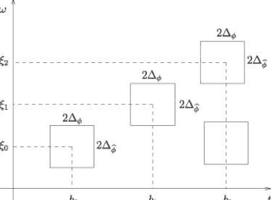

### 4.2.4 STFT 的性质

### 线性：

令 \( f(t) = \alpha f_1(t) + \beta f_2(t) \) 为两个函数 \( f_1(t) \) 和 \( f_2(t) \) 的线性组合，权重 \( \alpha \) 和 \( \beta \) 与 \( t \) 无关。那么 \( f(t) \) 的 STFT 为

(4.19) \( G_\phi f(b, \tilde{\xi}) = \alpha G_\phi f_1(b, \tilde{\xi}) + \beta G_\phi f_2(b, \tilde{\xi}) \),
它是各个函数 STFT 的线性和。因此 STFT 是一种线性变换。

### 时移：

令 \( f_0(t) = f(t - t_0) \)，则

```
$$G_\phi f_0(b, \xi) = \int_{-\infty}^{\infty} f(t-t_0)\phi(t-b)e^{-i\xi t} dt$$
$$
= \int_{-\infty}^{\infty} f(t)\phi(t-(b-t_0))e^{-i\xi t}e^{-i\xi t_0} dt$$
$$
= e^{-i\xi t_0} G_\phi f(b-t_0, \xi).$$
(4.20)
```

方程 (4.20) 简单地意味着，如果原始函数 \(f(t)\) 在时间轴上平移了 \(t_0\)，则 STFT 在时频域中的位置将在时间上平移相同的量，而频率位置保持不变。除了位置的变化外，STFT 的相位也会发生变化，该变化与时间平移成正比。

### 频移：

令 \(f(t)\) 为载波信号 \(e^{j\omega_0 t}\) 的调制函数，使得

```
\(f_0(t) = f(t)e^{j\omega_0 t},\)
(4.21)
```

那么 \(f_0(t)\) 的 STFT 由以下给出

```
$$G_\phi f_0(b, \xi) = \int_{-\infty}^{\infty} f(t)e^{j\omega_0 t}\phi(t-b)e^{-i\xi t} dt$$
$$
= G_\phi f(b, \xi - \omega_0).$$
(4.22)
```

方程 (4.22) 意味着 \(f_0(t)\) 的 STFT 的幅度和相位与 \(f(t)\) 的相同，只是在 \(t - \omega\) 域中的新位置沿频率轴由载波频率 \(\omega_0\) 移动。

### 4.3 离散短时傅里叶变换

与第 3.10 节的讨论类似，我们可以通过对函数 \( f(t) \) 和窗函数 \( \phi(t) \) 进行适当采样，将 (4.7) 的积分高效地计算为级数和。在其离散形式中，短时傅里叶变换可表示为

(4.23) \( G_{\phi} f(b_n, \xi_n) = h \sum_{k=0}^{N-1} f(t_k) \phi(t_k - b_n) e^{-j \xi_n t_k}, \)

其中

(4.24) \( t_k = bk = kh; \quad k = 0, ..., N-1 \)

以及

(4.25) \( \xi_n = \frac{2\pi n}{Nh}; \quad n = -\frac{N}{2}, ..., \frac{N}{2}. \)

特别是，当 \( h=1 \) 时，我们有

(4.26) \( G_{\phi} f(n, \xi_n) = \sum_{k=0}^{N-1} f(k) \phi(k-n) e^{-j \frac{2\pi kn}{N}}. \)

我们使用与 [2] 中类似的示例来展示 STFT 的计算以及窗宽对分辨率的影响。该信号

(4.27)
\( f(t) = \sin(2\pi\nu_1 t) + \sin(2\pi\nu_2 t) + K[\delta(t - t_1) + \delta(t - t_2)] \)

它由两个正弦波组成，频率分别为 \(\nu_1 = 500\) Hz 和 \(\nu_2 = 1000\) Hz，以及两个发生在 \(t_1 = 0.192\) ms 和 \(t_2 = 0.196\) ms 的三角函数。我们任意选择 \(K = 3\)。我们对该函数应用矩形窗，并计算四种不同窗大小的 STFT。信号和窗均以 8 kHz 采样。窗大小从 16 ms 变化到 2 ms，窗中对应的样本数分别为 128、64、32 和 16。由于三角函数相隔 32 个样本，窗大小等于或大于 32 个样本的窗不足以分辨三角函数。

为了计算 STFT，我们对信号和窗函数的乘积应用 FFT 算法。每当窗向右移动一个样本时，我们计算一次 128 点 FFT。图 4.4 显示了函数 \(f(t)\)，这些 STFT 的结果在图 4.5 中给出。

图 4.4：图 4.5 中所示 STFT 的信号。

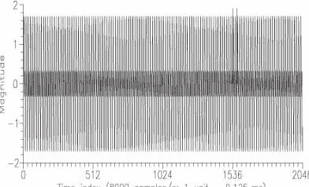

图 4.5：图 4.4 中所示信号的 STFT，采用不同的窗宽（2\(\Delta g\)）。横轴为时间（s），纵轴为频率（Hz）。

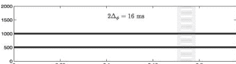

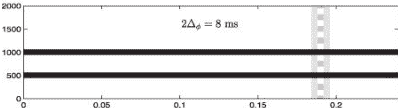

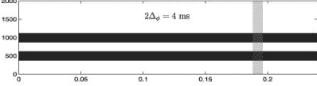

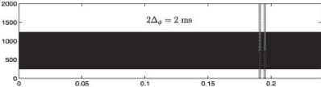

最初，当时间窗较宽时，三角函数完全无法分辨。然而，窗在频域中的高分辨率能够很好地区分两个频率。随着窗大小减小，我们开始看到两个三角函数，而频率分辨率逐渐恶化。在窗大小为 16 个样本时，我们可以很容易地区分三角函数，但无法准确分辨两个频率。为了分辨频率轴和时间轴上的事件，每次更改窗大小时都必须计算 STFT。计算负载是使用 STFT 进行信号处理时的一个严重问题。

### 4.4 离散加博表示

正式写出第 4.2.2 节给出的加博变换，我们得到

```
G_{g_a} f(b, \zeta) := \int_{-\infty}^{\infty} f(t) \overline{g_a(t-b)} e^{-j\zeta t} dt
= \frac{1}{2a\pi} \int_{-\infty}^{\infty} f(t) e^{-(t-b)^2 / 4a} e^{-j\zeta t} dt
```

对于 \(-\infty \le b, \zeta \le \infty\)。加博变换在 \(t - \omega\) 平面上是稠密的。(4.28) 中加博变换的计算负载相当大。我们可以不计算 (4.28)，而是计算 (4.28) 的离散版本。也就是说，我们仅在 \(t - \omega\) 平面上的一组点处计算 (4.28)。

```
G_{g_a} f(b_n, \zeta_k) = \int_{-\infty}^{\infty} f(t) \overline{g_a(t-b_n)} e^{-j\zeta_k t} dt
= \langle f(t), g_a(t-b_n) e^{j\zeta_k t} \rangle
= \langle f(t), \phi_{n,k}(t) \rangle.
```

(4.29) 的最后一个表达式是函数与函数 \(\phi_{n,k}(t) = g_a(t-b_n) e^{j\zeta_k t}\) 的内积。在受限条件下 [3]，函数 \(f(t)\) 可以被恢复：


(4.30) $$f(t) = \sum_n \sum_k G_{g_\alpha} f(b_n, \xi_k) g_\alpha(t - b_n) e^{i \xi_k t}.$$

方程(4.30)称为加博展开，其中$G_{g_\alpha} f(b_n, \xi_k)$在恢复公式中充当系数的角色

(4.31) $$f(t) = \sum_n \sum_k G_{g_\alpha} f(b_n, \xi_k) \phi_{n,k}(t).$$

函数$\phi_{n,k}(t)$是高斯调制正弦波。该函数的展宽由$a$控制，而振荡频率由$\xi_k$控制。$t-\omega$平面上的这些"子弹"构成了加博展开的基。由于高斯函数具有时频窗口的最小尺寸，因此它在$t-\omega$平面上具有最高的能量集中度。加博基$\phi_{n,k}(t)$似乎是信号表示的有用基。然而，它缺乏正交性、完备性和独立性等基本属性，无法实现简单的表示和高效的计算。

### 4.5 连续小波变换

第4.4节讨论的STFT是生成信号时频分析的许多方法之一。另一种提供此类分析的线性变换是积分（或连续）小波变换。全书将交替使用连续小波变换（CWT）和积分小波变换（IWT）这两个术语。STFT的固定时频分辨率在许多应用中构成严重限制。此外，离散小波变换（DWT）和小波级数（WS）的发展使得小波方法比STFT更适合信号和图像处理。为了阐明我们的观点，请注意，STFT窗函数的半径\(\Delta_\phi\)和\(\Delta_{\hat{\phi}}\)不依赖于$t-\omega$平面上的位置。例如，如果我们选择$\phi(t) = g_\alpha(t)$，如加博变换（4.28）中所示，一旦$\alpha$固定，那么$\Delta_{g_\alpha}$和$\Delta_{\hat{g}_\alpha}$也固定，与窗口在$t-\omega$平面上的位置无关。图4.3显示了一个典型的STFT时频窗。一旦选择了窗函数，时频分辨率在整个处理过程中都是固定的。为了理解这种固定分辨率的含义，让我们考虑图4.6中所示的啁啾信号，其中信号频率随时间增加。

图 4.6：频率随时间线性变化的啁啾信号。

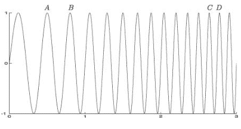

如果我们选择窗函数$\phi(t)$的参数（在$g_\alpha(t)$的情况下为$\alpha$），使得$\Delta_\phi$大约等于$AB$，那么使用（4.7）计算的STFT将能更好地解析信号的低频部分，而对高频部分的分辨率则较差。另一方面，如果$\Delta_\phi$大约等于$CD$，则低频无法得到适当解析。

请注意，如果$\Delta_\phi$非常小，那么$\Delta_{\hat{\phi}}$将成比例地很大，因此低频部分会变得模糊。

我们的目标是设计一种方法，能够在$t-\omega$平面上的任意位置提供良好的时频分辨率。换句话说，我们必须有一个窗函数，其半径在解析低频内容时随时间增加（频率降低），在解析信号的高频内容时随时间减少（频率增加）。这一目标促使我们开发小波函数$\psi(t)$。

相对于某个分析小波$\psi$，函数$f(t) \in L^2$的积分小波变换定义为

\(W_\psi f(b,a) := \int_{-\infty}^{\infty} f(t) \overline{\psi_{b,a}(t)} dt,\)
(4.32)

其中

\(\psi_{b,a}(t) = \frac{1}{\sqrt{a}} \psi\left(\frac{t-b}{a}\right); \quad a > 0.\)
(4.33)

参数$b$和$a$分别称为平移参数和尺度参数。归一化因子$a^{-1/2}$被包含进来，使得$\|\psi_{b,a}\| = \|\psi\|$。

为了使$\psi$成为窗函数并能从其IWT中恢复$f(t)$，$\psi(t)$必须满足以下条件

(4.34)
\(\hat{\psi}(0) = \int_{-\infty}^{\infty} \psi(t) dt = 0.\)

除了满足（4.34）之外，小波的构造使其具有更高阶的消失矩。如果满足以下条件，则称小波具有阶数为$m$的消失矩

(4.35)
\(\int_{-\infty}^{\infty} t^p \psi(t) dt = 0; \quad p=0, ..., m-1.\)

严格来说，积分小波变换提供的是时标分析，而非时频分析。然而，通过适当的标尺到频率的变换（稍后讨论），可以得到非常接近时频分析的结果。请注意，在（4.33）中，通过减小$a$，$\psi_{b,a}$的时域支持集减小，从而覆盖更大的频率范围，反之亦然。因此，$1/a$是频率的一种度量。另一方面，参数$b$指示小波窗沿时间轴的位置。因此，通过改变$(b, a)$，$W_\psi f(b,a)$可以在整个时频平面上计算。此外，由于条件（4.34），我们得出结论：所有小波都必须振荡，这赋予了它们小波的性质，因此得名小波。请回顾，STFT的窗函数不需要这种振荡。与（4.7）中STFT的定义相比，小波$\psi_{b,a}(t)$取代了$\phi_{b,\xi}$。因此，小波也表现得像窗函数。小波窗的行为和度量将在4.5.2节中更详细地讨论。

### 4.5.1 逆小波变换

由于逆变换的目的是从积分小波变换中重建原始函数，因此它涉及对尺度参数$a > 0$和平移参数$b$进行二维积分。逆小波变换的表达式为

\( f(t) = \frac{1}{C_\psi} \int_{-\infty}^{\infty} db \int_0^{\infty} \frac{1}{a^2} [W_\psi f(b,a)] \psi_{b,a}(t) da, \)
(4.36)

其中$C_\psi$是一个常数，取决于小波的选择，并由以下公式给出

\( C_\psi = \int_{-\infty}^{\infty} \frac{|\hat{\psi}(\omega)|^2}{|\omega|} d\omega < \infty, \)
(4.37)

条件（4.37）称为*可容性条件*，它限制了可以作为小波的函数类。特别是，它意味着所有小波都必须有$\hat{\psi}(0) = 0$[参见（4.34）]，以使（4.37）的左边是一个有限数。关于（4.36）的证明，读者可参阅[2, 第2章]。

方程（4.36）本质上是一个叠加积分。对$a$的积分对位置$b$处的小波分量的所有贡献求和，而对$b$的积分则包括$b$轴沿线的所有位置。由于逆小波变换的计算相当繁琐，且逆小波变换仅用于合成原始信号，因此它在信号分析中的使用频率不如积分小波变换高。在随后介绍离散小波变换（DWT）的章节中，DWT的逆变换在数据通信和信号处理中非常有用。

### 4.5.2 时频窗

第4.1节讨论的频域中心和半径的定义不适用于小波窗，因为与STFT窗（其中\(\hat{\phi}(0) = 1\)）不同，这里小波窗\(\hat{\psi}(0) = 0\)。换句话说，\(\hat{\psi}(\omega)\)表现出带通滤波器特征。因此，对于\(\hat{\psi}(\omega)\)我们有两个中心和两个半径。我们只关心正频率。因此，让我们在正频率轴上定义中心\(\omega_+^*\)和半径\(\Delta\hat{\psi}_+\)，如下

\(\omega_+^* := \frac{\int_0^\infty \omega |\hat{\psi}(\omega)|^2 d\omega}{\int_0^\infty |\hat{\psi}(\omega)|^2 d\omega}\)
(4.38)


$$\Delta_{\psi}^+ := \left\{ \frac{\int_0^\infty \left(\omega - \omega_\psi^*\right)^2 \left|\hat{\psi}(\omega)\right|^2 d\omega}{\int_0^\infty \left|\hat{\psi}(\omega)\right|^2 d\omega} \right\}^{\frac{1}{2}}.$$

**(4.39)**

\(t^*\) 和 \(\Delta_\psi\) 的定义与第 4.1 节中的相同，只是将 \(\phi(t)\) 替换为 \(\psi(t)\)。对于小波，不确定性原理给出

$$\Delta_\psi \Delta_\psi^+ > \frac{1}{2}.$$

**(4.40)**

如果 \(t^*\) 是中心且 \(\Delta_\psi\) 是 \(\psi(t)\) 的半径，则 \(W_\psi f(b, a)\) 包含 \(f(t)\) 在以下时间窗中的信息：

$$[at^* + b - a\Delta_\psi, at^* + b + a\Delta_\psi].$$

**(4.41)**

让我们将帕塞瓦尔恒等式应用于 (4.32)，以了解频率窗：

$$W_\psi f(b, a) = \frac{1}{\sqrt{a}} \int_{-\infty}^\infty f(t) \overline{\psi\left(\frac{t-b}{a}\right)} dt$$

**(4.42)**

$$= \frac{\sqrt{a}}{2\pi} \int_{-\infty}^\infty \hat{f}(\omega) \overline{\hat{\psi}(a\omega)} e^{ib\omega} d\omega.$$

**(4.43)**

从 (4.43) 可以清楚地看出，频率窗为

$$\left[ \frac{1}{a}(\omega^* - \Delta_\psi^-), \frac{1}{a}(\omega^* + \Delta_\psi^+) \right].$$

**(4.44)**

时频窗乘积 \( = 2a\Delta_\psi \times (2/a)\Delta_\psi^- = 4\Delta_\psi \Delta_\psi^+ = \text{常数.} \)

图 4.7 展示了小波变换的时频窗概念。将图 4.7 与 STFT 对应的图 4.3 进行比较，观察小波变换中窗口的灵活性。

对于较高频率 \( (1/a_2) \)，时间窗较小；而对于较低频率 \( (1/a_0) \)，时间窗较大。对于固定频率级别 \( (1/a_0) \) 而言，时间窗和频率窗均固定。回顾在 STFT 中，时频窗无论频率级别如何均固定不变。

**图 4.7：** 连续小波变换的时频窗。

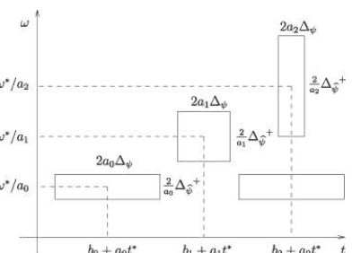

示例：

我们对用于计算 STFT 的同一函数执行连续小波变换。我们选择由以下给出的复 Morlet 小波

$$\psi(t) = e^{\frac{-t^2}{2}} e^{j5.336t}$$

**(4.45)**

来计算 CWT

$$W_\psi f(b,a) = \int_{-\infty}^{\infty} f(t) \overline{\psi\left(\frac{t-b}{a}\right)} dt.$$

结果如图 4.8 所示。该图表明在时间轴和频率轴上对事件具有良好的分辨率。如果为 \(a\) 选择适当的范围，则只需计算一次变换即可捕获时间域和频率域中发生的大部分（如果不是全部）事件。

**图 4.8：** 使用 Morlet 小波对图 4.4 中所示信号进行的连续小波变换。

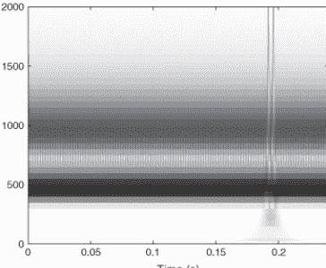

### 4.6 离散小波变换

类似于离散傅里叶变换和离散短时傅里叶变换，我们有离散小波变换（DWT）。然而，与傅里叶分析中之前所示的离散时间和频率轴不同，这里我们以不同的方式取尺度参数 \(a\) 和平移参数 \(b\) 的离散值。这里的目的是介绍 DWT 并展示 DWT 与 IWT 之间的关系。DWT 的详细讨论将在第 7 章中呈现。这里我们只提到，我们将取 \(a\) 为 \(2^{-s}\) 形式，\(b\) 为 \(k2^{-s}\) 形式，其中 \(k, s \in \mathbb{Z}\)。使用这些 \(a\) 和 \(b\) 的值，(4.32) 的积分变为

$$W_\psi f(k2^{-s}, 2^{-s}) = 2^{\frac{s}{2}} \int_{-\infty}^{\infty} f(t) \psi(2^s t - k) dt.$$

**(4.46)**

让我们现在对函数 \(f(t)\) 进行离散化。为简单起见，假设采样率为 1。在这种情况下，(4.46) 的积分可以写成

$$W_\psi f(k2^{-s}, 2^{-s}) = 2^{\frac{s}{2}} \sum_n f(n) \psi(2^s n - k).$$

**(4.47)**

要计算函数在时-尺度平面上某点的小波变换，我们不需要知道整个时间轴上的函数值。我们只需要知道小波非零的那些时间点上的函数值。因此，小波变换的计算几乎可以实时完成。我们将在后续章节中讨论计算小波变换的算法。

关于 (4.47) 的一个重要观察是其时变性质。时移函数的 DWT 与原始函数的 DWT 截然不同。为进一步说明，令

$$f_m(t) = f(t - t_m).$$

**(4.48)**

这给出

$$W_\psi f_m(k 2^{-s}, 2^{-s}) = 2^{\frac{s}{2}} \int_{-\infty}^{\infty} f_m(t) \psi(2^s t - k) dt = 2^{\frac{s}{2}} \sum_n f(n-m) \psi(2^s n - k) = 2^{\frac{s}{2}} \sum_n f(n) \psi(2^s n - (k - m 2^s)) = W_\psi f((k - m 2^s) 2^{-s}, 2^{-s}).$$

因此，我们看到对于 DWT，函数的时移以一种相当复杂的方式表现出来。回顾在 STFT 的情况下，函数的时移表现为时间位置的精确偏移，并伴有额外的相位移。在傅里叶变换中，偏移仅表现为频域中的相位变化。

### 4.7 小波级数

类似于傅里叶级数，我们有小波级数。回顾傅里叶级数仅存在于周期函数。这里对于任何函数 \(f(t) \in L^2\)，我们有其小波级数表示，给出为

$$f(t) = \sum_s \sum_k w_{k,s} \psi_{k,s}(t),$$

其中

$$\psi_{k,s}(t) = 2^{\frac{s}{2}} \psi(2^s t - k).$$

(4.50) 中的双重求和是由于小波具有两个参数：平移参数和尺度参数。对于周期函数 \(p(t)\)，其傅里叶级数由以下给出

$$p(t) = \sum_k c_k e^{jkt} .$$

**(4.52)**

由于 \( \{e^{jkt} : k \in \mathbb{Z} \} \) 是 \( L^2(0, 2\pi) \) 的正交基，我们可以得到 \( c_k \) 为

$$c_k = \frac{1}{2\pi} \langle p(t), e^{jkt} \rangle .$$

**(4.53)**

类似地，如果 \( \{\psi_{k,s}(t) : k, s \in \mathbb{Z} \} \) 构成 \( L^2(\mathbb{R}) \) 的标准正交基，则我们可以得到

$$w_{k,s} = \langle f(t), \psi_{k,s}(t) \rangle$$

**(4.54)**

$$= W_\psi f \left( \frac{k}{2^s}, \frac{1}{2^s} \right) .$$

**(4.55)**

因此，函数小波级数展开中的系数 \( \{w_{k,s}\} \) 只不过是该函数在某些二元点 \( (k/2^s, 1/2^s) \) 处计算的积分小波变换。傅里叶级数和傅里叶变换之间不存在这样的关系，它们适用于不同类别的函数；傅里叶级数适用于在 \( [0, 2\pi] \) 上可平方积分的函数，而傅里叶变换适用于在 \( L^2(\mathbb{R}) \) 中的函数。另一方面，小波级数和小波变换均适用于 \( L^2(\mathbb{R}) \) 中的函数。

如果 \(\{\psi_{k,s}(t)\}\) 不是标准正交基，则我们可以使用对偶小波 \(\{\tilde{\psi}_{k,s}(t)\}\) 来获得 \(w_{k,s}\)，即 \(w_{k,s} = \langle f(t), \tilde{\psi}_{k,s}(t) \rangle\)。对偶小波的概念将在后续章节中出现。

### 4.8 时频图的解释

让我们简要讨论时频平面上曲面的意义。通常，曲面上一点的高度代表 STFT 或 IWT 的幅值。假设给定函数的频率不随时间变化；那么我们应期望在时频图中看到一条与时间轴平行的水平线，对应于函数的频率。然而，由于窗函数的有限支撑和正弦波的截断，我们将看到频率附近的一个带状区域（加宽的线），而不是一条线。为更清晰地理解，让我们考虑频率为 \(\omega_0\) 的截断正弦波。出于在此解释时频图的目的，我们假设尽管正弦波被截断，其傅里叶变换表示为 \(\hat{\delta}(\omega - \omega_0)\)。

通过分别在 (4.7) 和 (4.32) 中替换 \(\hat{f}(\omega) = \hat{\delta}(\omega - \omega_0)\)，我们得到


(4.56) \(|G_\phi f(b, \xi)| = \frac{1}{2\pi} |\hat{\phi}(\omega_0 - \xi)|\)

(4.57) \(|W_\psi f(b, a)| = \frac{\sqrt{a}}{2\pi} |\hat{\psi}(a\omega_0)|.\)

从(4.56)和(4.57)可以清楚地看出，\(|G_\phi f(b, \xi)|\)和\(|W_\psi f(b, \xi)|\)不依赖于\(b\)。在频率轴上，由于\(|\hat{\phi}(0)| = 1\)，并假设\(|\hat{\phi}(\omega)| \le 1, \omega \neq 0\)，我们将在\(\xi = \omega_0\)处得到STFT的最大幅值。然后在\(\xi = \omega_0\)附近会有一个带，其宽度将取决于\(\Delta \hat{\phi}\)，即\(\hat{\phi}(\omega)\)的半径。

(4.57)的解释稍微复杂一些，因为与STFT不同，小波变换不会直接给出时频图。让我们考虑频率轴上的一个点\(\omega'，使得

(4.58) \(|\hat{\psi}(\omega')| = \max \{|\hat{\psi}(\omega)|; \omega \in (0, \infty)\}.\)

就所有实际目的而言，我们可以取\(\omega' = \omega^*\)。

现在如果我们考虑一个变量\(\xi = \omega^*/a\)并用新变量\(\xi\)重写(4.57)，我们有

(4.59) \(\left| W_\psi f \left( b, \frac{\omega^*}{\xi} \right) \right| = \frac{1}{2\pi} \sqrt{\frac{\omega^*}{\xi}} \left| \hat{\psi} \left( \frac{\omega^*}{\xi} \omega_0 \right) \right|.\)

因此，小波变换(4.57)的最大值将出现在\(\xi = \omega_0\)处，在\(\xi = \omega_0\)附近有一个带，其宽度取决于小波\(\tilde{\psi}(\omega)\)的半径\(\Delta_{\psi}^{\frac{1}{2}}\)。

作为下一个例子，令\(f(t) = \delta(t - t_0)\)。由于该函数包含所有频率分量，我们应当期望在时频平面上，在\(t = t_0\)处得到一条垂直线。将\(f(t) = \delta(t - t_0)\)代入(4.7)和(4.32)，我们得到

\(|G_{\phi}f(b, \xi)| = |\phi(t_0 - b)|.\) (4.60)

\(|W_{\psi}f(b, a)| = \frac{1}{\sqrt{a}} \left|\psi(\frac{t_0 - b}{a})\right|.\) (4.61)

STFT的解释很简单。如预期，它不依赖于\(\xi\)。我们得到一条近\(b = t_0\)处的、与频率轴平行的垂直线，其时域展宽由\(\Delta_{\phi}\)决定。对于小波变换，我们观察到它依赖于尺度参数\(a\)。用新变量\(\xi\)重写(4.61)，我们有

\(\left|W_{\psi}f\left(b, \frac{\omega^*_{\psi}}{\xi}\right)\right| = \sqrt{\frac{\xi}{\omega^*_{\psi}}} \left|\psi\left(\frac{\xi}{\omega^*_{\psi}}(t_0 - b)\right)\right|.\) (4.62)

虽然(4.62)表明了时域中三角函数的所有频率内容，但很明显，随着\(\xi\)的减小，时域展宽会增加。此外，最大值的位置将取决于\(\psi(t)\)的形状。读者可参考[4]以获取关于时频图解释的更多信息。

### 4.9 维格纳-维尔分布

在前面的章节中，我们已经考虑了信号的线性时频表示。STFT和CWT是线性变换，因为它们满足线性叠加定理：

(4.63) \( T[\alpha_1 f_1 + \alpha_2 f_2] = \alpha_1 T[f_1] + \alpha_2 T[f_2], \)

其中\(T\)可以表示STFT或CWT，\(f_1(t), f_2(t)\)是同一类中的两个不同信号，系数分别为\(\alpha_1\)和\(\alpha_2\)。这些变换很重要，因为它们提供了信号在时间\(t\)附近的*局部频谱*的解释。此外，其算法实现简便且计算效率高，增加了它们的优势。另一方面，这些线性变换无法提供信号在特定时刻的瞬时能量信息。直觉上，我们希望考虑如下类型的变换

\[
\int_{-\infty}^{\infty} |f(\tau - t)|^2 e^{-j\sigma\tau} d\tau = \int_{-\infty}^{\infty} f(t - \tau) \overline{f(t + \tau)} e^{-j\sigma\tau} d\tau.
\]

由于在给定时间确定信号的能量并不容易，因此考虑以时间位置\(t\)为中心的区间\((t - \tau/2, t + \tau/2)\)内的能量更有意义。为此，维格纳-维尔分布(WVD)定义为

\[
\mathbf{W}_f(t, \omega) = \frac{1}{2\pi} \int_{-\infty}^{\infty} f\left(t + \frac{\tau}{2}\right) \overline{f\left(t - \frac{\tau}{2}\right)} e^{-j\omega\tau} d\tau. \tag{4.64}
\]

常数\(1/2\pi\)是为了计算简便的归一化因子。我们应该注意，方程(4.64)不再满足线性性质。维格纳-维尔分布是一种非线性（或双线性）时频变换，因为信号在积分中出现了多次。人们还可以观察到，在给定时间\(t\)处，维格纳-维尔分布在距离\(\tau/2\)处对称地观察信号的左右两侧。计算\(\mathbf{W}_f(t, \omega)\)需要\(t \pm \tau/2\)处的信号信息，无法实时进行。

### 4.9.1 高斯调制啁啾

让我们考虑一个由高斯包络调制的啁啾信号

\[
f(t) = \left(\frac{a}{\pi}\right)^{\frac{1}{4}} \exp\left(\frac{-at^2}{2} + j\frac{bt^2}{2} + j\omega_0 t\right) \tag{4.65}
\]

其中\(\exp(-at^2/2)\)是高斯项，\(\exp(-jbt^2/2)\)是啁啾信号，\(e^{j\omega_0 t}\)是频移项。根据(4.64)，维格纳-维尔分布给出

(4.66)
\(\mathbf{W}_f(t,\omega) = \frac{1}{2\pi} \left(\frac{a}{\pi}\right)^{\frac{1}{2}} \int_{-\infty}^{\infty} \exp \left[ \frac{-a \left(t + \frac{\tau}{2}\right)^2}{2} + j \frac{b \left(t + \frac{\tau}{2}\right)^2}{2} + j\omega_0 \left(t + \frac{\tau}{2}\right) \right] \times \exp \left[ \frac{-a \left(t - \frac{\tau}{2}\right)^2}{2} - j \frac{b \left(t - \frac{\tau}{2}\right)^2}{2} - j\omega_0 \left(t - \frac{\tau}{2}\right) - j\omega \tau \right] d\tau = \frac{1}{2\pi} \left(\frac{a}{\pi}\right)^{\frac{1}{2}} e^{-a^2} \int_{-\infty}^{\infty} \exp \left( \frac{-a\tau^2}{4} + jbt\tau + j\omega_0\tau - j\omega \tau \right) d\tau.\)

使用第3章中给出的高斯函数的傅里叶变换，高斯调制啁啾的WVD为

(4.67)
\(\mathbf{W}_f(t,\omega) = \frac{1}{\pi} \exp \left( -\frac{a t^2}{2} - \frac{(\omega - \omega_0 - bt)^2}{a} \right).\)

该函数及其WVD如图4.9所示。

**图4.9：** 高斯调制啁啾信号的维格纳-维尔分布。

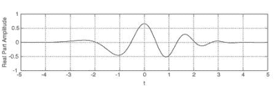

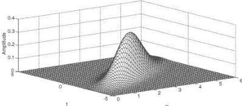

### 4.9.2 正弦调制啁啾

正弦调制啁啾信号由以下给出

\[
f(t) = \exp\left(j \frac{bt^2}{2} + j\omega_0 t\right). \tag{4.68}
\]

我们直接计算WVD以得到

(4.69)
\(\mathbf{W}_f(t,\omega)=\frac{1}{2\pi}\int_{-\infty}^{\infty} \exp \left( j \frac{b \left( t+\frac{\tau}{2} \right)^2}{2} + j \omega_0 \left( t+\frac{\tau}{2} \right) \right)\)
\(\times \exp \left( -j \frac{b \left( t-\frac{\tau}{2} \right)^2}{2} - j \omega_0 \left( t-\frac{\tau}{2} \right) - j \omega \tau \right) d\tau\)
\(= \frac{1}{2\pi} \int_{-\infty}^{\infty} \exp(jbt\tau + j\omega_0 \tau - j\omega \tau) d\tau\)
\(= \delta(\omega - \omega_0 - bt).\)

### 4.9.3 正弦信号

我们通过将啁啾参数\(b\)设为零，计算纯正弦信号\(e^{j\omega_0 t}\)的WVD。因此，

(4.70) \(e^{j\omega_0 t} \Longleftrightarrow \delta(\omega - \omega_0).\)

方程(4.67)和(4.69)的WVD在时频平面上分别是一条斜率为\(b\)的直线和一条与时间轴平行的直线。它们分别给于图4.10和图4.11。图4.12显示了高斯调制正弦函数的WVD。

图4.10：啁啾信号的维格纳-维尔分布。

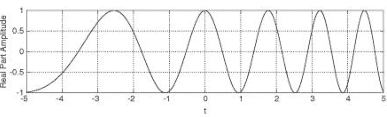

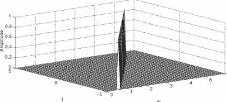

图4.11：正弦函数的维格纳-维尔分布。

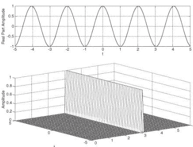

**图4.12：** 高斯调制正弦波的维格纳-维尔分布。


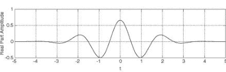

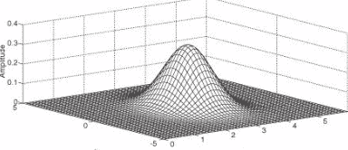

### 4.10 WIGNER-VILLE 分布的性质

WVD 具有若干对信号处理中信号表示至关重要的一般性质。本节将讨论其中一些性质。文献 [5] 已表明，Wigner-Ville 分布在时频平面上具有最高的信号能量集中度。任何比 WVD 具有更高能量集中度的分布都将违反不确定性原理。此外，它无法满足本节所讨论的所谓边缘性质。

### 4.10.1 实量

Wigner-Ville 分布始终是实数，无论信号是实信号还是复信号。通过考虑 Wigner-Ville 分布的共轭复数可以看出这一点：

$$
\begin{aligned}
\overline{\mathbf{W}_s(t, \omega)} &= \frac{1}{2\pi} \int_{-\infty}^{\infty} s\left(t - \frac{\tau}{2}\right) \overline{s\left(t + \frac{\tau}{2}\right)} e^{j\omega\tau} d\tau \\
&= \frac{1}{2\pi} \int_{-\infty}^{\infty} s\left(t + \frac{\tau}{2}\right) \overline{s\left(t - \frac{\tau}{2}\right)} e^{-j\omega\tau} d\tau \\
&= \mathbf{W}_s(t, \omega).
\end{aligned}
$$

(4.71)

Wigner-Ville 分布始终是实数，但并非始终为正。图 4.13 显示了一个在中心附近变为负值的函数的 WVD。因此，WVD 可能不适用于作为能量密度或概率密度的度量。

**图 4.13:** 指示 Wigner-Ville 分布可能为负的图。

### 4.10.2 边缘性质

信号处理中尤其关注能量守恒。这由分布的边缘性质来表达

(4.72)
\(\int_{-\infty}^{\infty} \mathbf{W}_f(t, \omega) d\omega = |f(t)|^2\)

(4.73)
\(\int_{-\infty}^{\infty} \mathbf{W}_f(t, \omega) dt = |\hat{f}(\omega)|^2\)

边缘（密度）仅用两个变量中的一个来表示能量密度。如果我们希望用 t 表示能量密度，只需对分布关于 \(\omega\) 进行积分（求和），反之亦然。信号的总能量可以通过对整个时频平面上的 Wigner-Ville 分布进行二维积分来计算。

$$
E = \int_{-\infty}^{\infty} |f(t)|^2 dt = \int_{-\infty}^{\infty} |\hat{f}(\omega)|^2 d\omega = \int_{-\infty}^{\infty} \int_{-\infty}^{\infty} W_f(t, \omega) d\omega dt = 1.
$$

### 4.10.3 相关函数

我们可以轻松地从边缘性质中计算时域或频域的相关函数：

(4.74) \(\gamma_f(\tau') = \int_{-\infty}^{\infty} f(\tau) \overline{f(\tau + \tau')} d\tau = W_f(\tau', 0)\)

(4.75) \(\gamma_\omega(\omega') = \int_{-\infty}^{\infty} f(\omega) \overline{f(\omega + \omega')} d\omega = W_f(0, \omega').\)

### 4.11 二次叠加原理

我们回顾一下，WVD 是一个非线性分布，线性叠加原理不适用。例如，设一个多分量信号为

(4.76) \(f(t) = \sum_{k=1}^m f_k(t).\)

该信号的 Wigner-Ville 分布为

$$
\mathbf{W}_f(t, \omega) = \sum_{k=1}^m \mathbf{W}_{f_k}(t, \omega) + \sum_{k=1}^m \sum_{l=1, l \neq k}^m \mathbf{W}_{f_k, f_l}(t, \omega),
$$

(4.77)

其中 \(\mathbf{W}_{f_k}(t, \omega)\) 称为 WVD 的自项，而 \(\mathbf{W}_{f_k, f_l}(t, \omega)\) 是由以下定义的交叉项：

$$
\mathbf{W}_{f_k, f_l}(t, \omega) = \frac{1}{2\pi} \int_{-\infty}^{\infty} f_k \left(t + \frac{\tau}{2}\right) \overline{f_l \left(t - \frac{\tau}{2}\right)} e^{-j\omega\tau} d\tau.
$$

(4.78)

WVD 的这些交叉项也称为干扰项，代表多分量信号两个分量之间的能量交叉耦合。这些干扰项在大多数信号处理应用中是不希望的，许多研究工作都致力于减少这些项的贡献。我们必须记住，这些交叉项 [6, 7] 对于信号的完美重构是必要的。在信号检测和识别应用中，我们只关注发现具有显著能量的信号分量。由于不需要重构信号，交叉项变得不重要。

在雷达信号处理和雷达成像中，待处理信号具有类似线性啁啾或二次啁啾的时变频谱。使用 STFT 或 WT 表示啁啾信号会损失时频平面上的分辨率。然而，这些信号的 WVD 在时频平面上产生明确定义的能量集中，如图 4.10 所示。对于多分量信号，如果各分量的带宽重叠不太多，WVD 的能量集中在时频平面上会相距很远（见图 4.14）。然而，如果情况并非如此，则必须应用某种交叉干扰抑制技术，这会导致分辨率降低。

**图 4.14:** 多分量信号的 Wigner-Ville 分布。

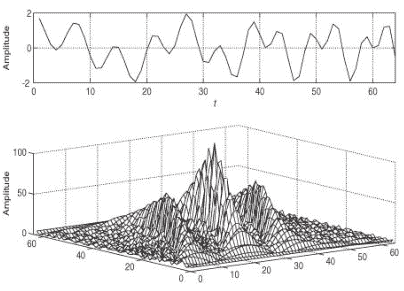

### 4.12 模糊函数

模糊函数（AF）是 Wigner-Ville 分布的特征函数，在数学上定义为

$$
\mathbf{A}_f(u,v) = \int_{-\infty}^{\infty} \int_{-\infty}^{\infty} e^{jut+jv\omega} W_f(t,\omega) dt d\omega.
$$

(4.79)

虽然 Wigner-Ville 分布是测量时频平面上信号能量密度的时频函数，但模糊函数是测量频移（多普勒）和时延平面上能量分布的分布。这是雷达信号处理中非常重要的函数，特别是在波形设计领域。本书末尾将介绍该函数的一些应用。

除了一个复常数外，我们可以用信号来表示 AF 为

(4.80) \(\mathbf{A}_f(\tau, \zeta) = K \int_{-\infty}^{\infty} f\left(t - \frac{\tau}{2}\right) \overline{f\left(t + \frac{\tau}{2}\right)} e^{-j\zeta t} dt,\)

其中 \(K\) 是一个复常数。该关系的证明可见文献 [8]。有关模糊函数的更多信息，读者可参阅 [9]。图 4.15 显示了啁啾信号的 AF。这种时频表示将在第 9 章中重新讨论，其中 *小波包* 与 Wigner-Ville 分布的组合应用于雷达信号检测。

**图 4.15:** 啁啾信号的模糊函数。

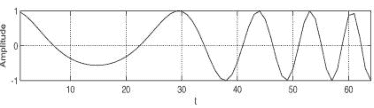

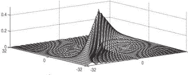

### 4.13 练习

- 1. 验证对于任何函数 \(\psi \in L^2(-\infty, \infty)\)，归一化函数 \(\psi_{k,s}(t) = 2^{s/2}\psi(2^s t - k)\)（其中 \(k, s \in \mathbb{Z}, t \in \mathbb{R}\)）与 \(\psi\) 具有相同的 \(L^2\) 范数：

\(\int_{-\infty}^{\infty} |\psi(t)|^2 dt = \int_{-\infty}^{\infty} |\psi_{k,s}(t)|^2 dt, \quad k, s \in \mathbb{Z}.\)

- 2. 考虑窗函数 \(g_a(t) = e^{-at^2}, a > 0\)。计算时域和频域中的窗宽并验证不确定性原理。

- 3. 帽函数 \(N_2\) 定义为

$$N_2(t) = \begin{cases} t & \text{for } 0 \le t < 1 \\ 2-t & \text{for } 1 \le t < 2 \\ 0 & \text{otherwise.} \end{cases}$$

计算 N2(t) 的时频窗。

- 4. 证明 \(\|f(t)\|^2 = \frac{1}{2\pi} \iint |G_\phi f(b, \xi)|^2 db \, d\xi\).

- 5. 已知 \(f(t) = \sin(\pi t^2)\)，并使用升余弦作为窗函数

$$\phi(t) = \begin{cases} 1 + \cos(\pi t), & |t| \le 1 \\ 0, & \text{otherwise,} \end{cases}$$

绘制窗移时域函数 \(f_3(t) = \overline{\phi(t-3)}f(t)\) 和 \(f_7(t)\) 及其频谱。

考虑时频原子或核

$$\begin{cases} \text{Re} \left[ \phi(t-4)e^{j4\pi t} + \phi(t-6)e^{j8\pi t} \right] \\ \text{Re} \left[ \phi(t-4)e^{j4\pi t} + \phi(t-6)e^{j6\pi t} \right] \end{cases}$$

绘制两个时频原子的频谱能量密度。评论两个原子的时频分辨率。

- 6. 在 CWT 中，证明归一化常数 \(1/\sqrt{a}\) 是使 \(\|\psi(t)\| = \|\psi_{b,a}(t)\|\) 所必需的。


- 7. 证明CWT中的能量守恒原理意味着

\(\int_{-\infty}^{\infty} f(t)\overline{g(t)}dt = \frac{1}{C_\psi} \int_{-\infty}^{\infty} \int_{-\infty}^{\infty} W_\psi f(b,a) \overline{W_\psi g(b,a)} db \frac{da}{a^2}.\)

- 8. 证明小波 \(\psi\) 的频率窗口宽度为
\(\left[ (1/a)(\alpha_*^* - \Delta\Psi), (1/a)(\alpha_*^* + \Delta\Psi) \right].\)

- 9. 找出在程序 wvd.m 中将频率轴除以 2 的原因。

### 4.14 计算机程序

### 4.14.1 短时傅里叶变换

```
%
% PROGRAM stft.m
%
% Short-time Fourier Transform using Rectangular window [0,1]
% generates Figure 4.5
%
% Signal
v1 = 500; % frequency
v2 = 1000;
r = 8000; %sampling rate
t1 = 0.192; % location of the delta function
t2 = 0.196;
k = 1:2048;
t = (k-1)/r;
f = sin(2*pi*v1*t) + sin(2*pi*v2*t);
k = t1 * r;
f(k) = f(k) + 3;
k = t2 * r;
f(k) = f(k) + 3;
plot(t,f)
axis([0 0.24 -2 2])
figure(2)

% STFT computation
N = 16 % rectangular window width
bot = 0.1;
hi = 0.175;
for kk = 1:4
Nb2 = N / 2;
for b = 1:2048:N+1
fb = f(b:b+N-1);
fftfb = abs(fft(fb));
STFT(b,:) = fftfb(1:Nb2);
end

% Plot
NColor = 256;
colormap(gray(NColor));
STFT_min = min(min(STFT));
STFT_max = max(max(STFT));
STFT = (STFT - STFT_max) * NColor / (STFT_min - STFT_max);
time=(0:2048-N)/r;
freq = (0:Nb2-1) * r / N;
axes('position',[0.1 bot 0.8 hi])
image(time,freq,STFT')
axis([0 0.24 0 2000])
YTickmark = [0 500 1000 1500 2000];
set(gca,'YDir','normal','ytick',YTickmark)
hold on;
N = N * 2
bot = bot + 0.225;
clear STFT; clear time; clear freq;
end
set(gcf,'paperposition',[0 0.5 7.5 10])
```

### 4.14.2 维格纳-维尔分布

```
%
% PROGRAM wvd.m
%
% Computes Wigner-Ville Distribution
%
% Signal
r = 4000; % sampling rate
t = (0:255) / r;
omega1 = 2.0 * pi * 500.0;
f = exp(*omega1 * t );
% WVD Computation
N=length(f);
if (mod(N,2) == 1) ;
f = [f 0];
N = N + 1;
end
N2m1 = 2 * N - 1;
Nb2 = N / 2;
for m = 1:N
s = zeros(1,N2m1);
s(N-(m-1):N2m1-(m-1)) = f;
s = conj(flip(s)).*s;
s = s(Nb2:N2m1-Nb2);
shat = abs(fft(s));
%
% Normalize with the number of overlapping terms
if m <= Nb2
shat = shat / (2 * m - 1);
else
shat = shat / (2 * N - 2 * m + 1);
end
wvd(m,:)=shat(1:Nb2);
end

% Plot
time = (0:N-1) / r;
freq = (0:Nb2-1) * r / N / 2;
NColor = 256;
colormap(gray(NColor));
wvd_min = min(min(wvd));
wvd_max = max(max(wvd));
wvd = (wvd - wvd_max) * NColor / (wvd_min - wvd_max);
image(time,freq,wvd');

% Because of the finite support of the signal, there will
% end effects

xlabel('Time (seconds)');
ylabel('Frequency (Hz)');
set(gca,'YDir','normal')
```

### 4.15 参考文献

- 1. D. Gabor. “通信理论.” J. IEEE (伦敦) 93 (1946), 429–457.
- 2. I. Daubechies. 小波十讲. CBMS-NSF 应用数学丛书, 61. 费城: SIAM, 1992.
- 3. J. B. Allan 和 L. R. Rabiner. “STFT 分析与综合的统一方法.” 《电气与电子工程师学会学报》论文集 65 (1977 年 11 月), 1558–1564.
- 4. A. Grossmann, R. Kronland-Martinet, 和 J. Morlet. “阅读与理解连续小波变换.” 载于《小波、时频方法与相空间》. J. M. Combes, A. Grossmann, 和 P. Tchamitchian (编). Berlin: Springer-Verlag, 1989, 2–20.
- 5. T. A. C. M. Claasen 和 W. F. G. Mecklenbrauker. “维格纳-维尔分布——时频信号分析的工具. 第一部分: 连续时间信号.” 《菲利普斯研究杂志》35 (1980), 217–250.
- 6. A. Moghaddar 和 E. K. Walton. “波导腔散射的时频分布分析.” 《IEEE 天线与传播学报》41 (1993 年 5 月), 677–680.
- 7. L. Cohen. “时频分布——综述.” 《电气与电子工程师学会学报》论文集 77 (1989), 941–981.
- 8. B. Boashash. “时频信号分析.” 载于《频谱估计与阵列处理进展》, 第 I 卷. S. Haykin (编). Upper Saddle River, NJ: Prentice-Hall, 1991, 第 9 章.
- 9. C. E. Cook 和 M. Bernfield. 雷达信号. 波士顿: Academic Press, 1967.

## 多分辨率分析

多分辨率分析（MRA）是构建标度函数和小波（第 6 章）以及开发算法（第 7 和 8 章）最重要的基础。顾名思义，在多分辨率分析中，函数在不同的近似级别或分辨率下被观察。该思想由 Meyer [1] 和 Mallat [2, 3] 提出。通过应用 MRA，我们可以将复杂的函数分为若干个更简单的函数并分别研究。为了理解 MRA 的概念，让我们考虑一种情况：函数由缓慢变化和快速变化的片段组成，如图 5.1 所示。如果我们想在单一近似级别下表示该函数，就必须使用由快速变化片段确定的步长（h）对其进行离散化。这会导致大量数据点。通过使用多个离散步长（分辨率）来表示函数，可以显著减少准确表示所需的数据点数量。函数的最粗近似加上每个层次的细节完全表示了原始函数。请注意，随着每个层次（尺度）的增加，步长加倍。这对应于音频信号处理中常见的“八度级”表示。除了这个特定示例外，在信号处理和计算电磁学中还有许多情况，多分辨率分析非常有用。

图 5.1: 函数的多层表示。

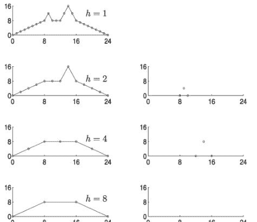

在本章中，我们首先了解 MRA 的要求。将解释两尺度关系和分解关系。在第 5.5 节中讨论的基数 B 样条生成一个 MRA，并构成本书及其他地方讨论的大多数小波的基础。最后，在第 5.6 节中，我们将讨论如何在开始 MRA 之前将给定函数映射到适当的子空间。

### 5.1 多分辨率空间

让我们回到图 5.1。每次通过加倍步长下降一个层次时，我们就会移除函数的某些部分，如右侧图所示。然后是将被进一步分解的“剩余”部分。在图 5.1 中，我们将把左侧的所有函数分配给 \(\mathbf{A}_s\)，右侧的函数分配给 \(\mathbf{W}_s\)，其中 \(s\) 表示各个尺度。令 \(\mathbf{A}_s\) 由基 \(\{\phi_{k,s} : 2^{s/2}\phi(2^st - k) ; k \in \mathbb{Z}\}\) 生成，\(\mathbf{W}_s\) 由 \(\{\psi_{k,s} : 2^{s/2}\psi(2^st - k) ; k \in \mathbb{Z}\}\) 生成。换句话说，任何函数 \(x_s(t)\) 和 \(y_s(t)\) 分别可以表示为 \(\phi_{k,s}(t)\) 和 \(\psi_{k,s}(t)\) 的线性组合。

请注意，函数 \(x_{s-1}(t) \in \mathbf{A}_{s-1}\) 和 \(y_{s-1}(t) \in \mathbf{W}_{s-1}(t)\) 均源自 \(x_s \in \mathbf{A}_s\)。因此，我们应该期望 \(\mathbf{A}_{s-1}\) 的基 \(\phi_{k,s-1}\) 和 \(\mathbf{W}_{s-1}\) 的基 \(\psi_{k,s-1}\) 以某种方式与 \(\mathbf{A}_s\) 的基 \(\phi_{k,s}\) 相关。这种关系将有助于制定一种算法，以更高效地从 \(x_s\) 获得函数 \(x_{s-1}\) 和 \(y_{s-1}\)。

为了实现如图 5.1 所示的函数多分辨率分析，我们必须有一个有限能量函数 \(\phi(t) \in L^2(\mathbb{R})\)，称为标度函数，它生成一个嵌套序列 \(\{A_j\}\)，即

\(\{0\} \leftarrow \cdots \subset \mathbf{A}_{-1} \subset \mathbf{A}_0 \subset \mathbf{A}_1 \subset \cdots \rightarrow L^2,\)

并满足一个扩展（细化）方程

\(\phi(t) = \sum_k g_0[k] \phi(at - k)\)

对于某些 \( a > 0 \) 和系数 \(\{g_0[k]\} \in \ell^2\)。我们将考虑 \( a = 2 \)，这对应于八度尺度。请注意，函数 \(\phi(t)\) 表示为其自身的缩放和平移版本的叠加，因此称为*标度函数*。更准确地说，\( A_0 \) 由 \(\{\phi(\cdot - k) : k \in \mathbb{Z}\}\) 生成，一般来说，\( A_s \) 由 \(\{\phi_{ks} : k, s \in \mathbb{Z}\}\) 生成。因此，我们有以下两个显而易见的结果:

(5.1) \( x(t) \in A_s \Leftrightarrow x(2t) \in A_{s+1} \)

(5.2) \( x(t) \in A_s \Leftrightarrow x(t + 2^{-s}) \in A_s \).

对于每个 \( s \)，由于 \( A_s \) 是 \( A_{s+1} \) 的真子空间，\( A_{s+1} \) 中还有一些剩余空间，称为 \( W_s \)，它与 \( A_s \) 结合给出 \( A_{s+1} \)。这个空间 \(\{W_s\}\) 称为*小波子空间*，是 \( A_{s+1} \) 中与 \( A_s \) 互补的，意味着

(5.3) \( A_s \cap W_s = \{0\}, s \in \mathbb{Z}, \text{ and } \)

(5.4) \( A_s \oplus W_s = A_{s+1} \).

在条件 (5.3) 下，(5.4) 中的求和被称为直和，(5.4) 中的分解称为*直和分解*。

子空间 \(\{W_s\}\) 由 \(\psi(t) \in L^2\) 生成，称为小波，方式与 \(\{A_s\}\) 由 \(\phi(t)\) 生成相同。换句话说，任何 \( x_s(t) \in A_s \) 都可以写成


$$x_s(t) = \sum_k a_{k,s} \phi(2^s t - k),$$ (5.5)

且任何函数 $y_s(t) \in W_s$ 可表示为

$$y_s(t) = \sum_k w_{k,s} \psi(2^s t - k),$$ (5.6)

其中系数 $\{a_{k,s}\}_{k \in \mathbb{Z}}, \{w_{k,s}\}_{k \in \mathbb{Z}} \in \mathbb{R}$。

由于

$$
\begin{aligned}
A_{s+1} &= W_s \oplus A_s \\
&= W_s \oplus W_{s-1} \oplus A_{s-1} \\
&= W_s \oplus W_{s-1} \oplus W_{s-2} \oplus \cdots
\end{aligned}
$$ (5.7)

我们有

$$A_s = \oplus_{\ell = -\infty}^{s-1} W_\ell.$$

观察到 $\{A_s\}$ 是嵌套的，而 $\{W_s\}$ 是两两正交的。因此，我们有

$$
\begin{cases}
A_\ell \cap A_m = A_\ell; m \ge \ell \\
W_\ell \cap W_m = \{0\}; \ell \ne m \\
A_\ell \cap W_m = \{0\}; \ell \le m.
\end{cases}
$$

$A_s$ 和 $W_s$ 的层次结构示意图如图 5.2 所示。

### 图 5.2：MRA 子空间的分割。

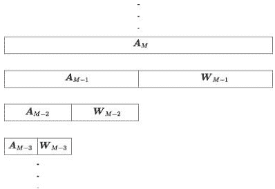

### 5.2 正交、双正交和半正交分解

在第 5.1 节中，我们对小波子空间 \(\boldsymbol{W}_s\) 的唯一要求是它是 \(\boldsymbol{A}_{s+1}\) 中 \(\boldsymbol{A}_s\) 的补空间。除此之外，如果还要求 \(\boldsymbol{W}_s \perp \boldsymbol{A}_s$，则这种分解称为 *正交分解*。让我们进一步解释 \(\boldsymbol{A}_s\) 和 \(\boldsymbol{W}_s\) 的正交性。为简单起见，令 \(s = 0\)。在这种情况下，\(\{\phi(t - k) : k \in \mathbb{Z}\}\) 张成 \(\boldsymbol{A}_0\)；同样，\(\{\psi(t - k) : k \in \mathbb{Z}\}\) 张成 \(\boldsymbol{W}_0\)。那么 \(\boldsymbol{A}_0 \perp \boldsymbol{W}_0\) 意味着

(5.8) \(\int_{-\infty}^{\infty} \phi(t)\psi(t - \ell)dt = 0 \quad \text{for all } \ell \in \mathbb{Z}.\)

一般来说，\(\{\phi(t-k) : k \in \mathbb{Z}\}\) 和 \(\{\psi(t-k) : k \in \mathbb{Z}\}\) 本身不一定正交；即，

(5.9) \(\int_{-\infty}^{\infty} \phi(t)\phi(t-\ell) dt \neq 0\)

(5.10) \(\int_{-\infty}^{\infty} \psi(t)\psi(t-\ell) dt \neq 0.\)

让我们放宽 \(\boldsymbol{A}_s\) 和 \(\boldsymbol{W}_s\) 彼此正交的条件，并假设小波 \(\psi_{k,s} \in \boldsymbol{W}_s\) 有一个对偶 \(\tilde{\psi}_{k,s} \in \tilde{\boldsymbol{W}}_s\)。对偶性意味着双正交条件得到满足；即

(5.11) \(\langle \psi_{k,j}, \tilde{\psi}_{m,\ell} \rangle = \delta_{k,m} \cdot \delta_{j,\ell}, \quad j, k, \ell, m \in \mathbb{Z}.\)

虽然我们不要求 \(\boldsymbol{W}_s \perp \boldsymbol{A}_s\)，但我们确实需要 \(\tilde{\boldsymbol{W}}_s \perp \boldsymbol{A}_s\)，其重要性将在后面变得清晰。

与双小波 \(\tilde{\psi}_{k,s}\) 类似，我们还考虑一个双标度函数 \(\tilde{\phi}_{k,s}\)，它生成 \(L^2\) 的另一个 MRA \(\{\tilde{\boldsymbol{A}}_s\}\)。换句话说，\(\phi_{k,s}\) 和 \(\psi_{k,s}\) 与 MRA \(\{\boldsymbol{A}_s\}\) 相关联，而 \(\tilde{\phi}_{k,s}\) 和 \(\tilde{\psi}_{k,s}\) 与 MRA \(\{\tilde{\boldsymbol{A}}_s\}\) 相关联。

在解释其重要性之前，让我们先总结迄今为止的结果。

### MRA \(\{\boldsymbol{A}_s\}\)

$$
\left\{\begin{array}{ll} A_{s+1} & = A_s + W_s; \\ A_r \cap A_m & = A_r; m \ge \ell \\ W_r \cap W_m & = \{0\}; \ell \neq m \\ A_r \cap W_m & = \{0\}; \ell \le m. \end{array}\right.
$$

### MRA \(\{\tilde{A}_s\}\)

$$
\left\{\begin{array}{ll} \tilde{A}_{s+1} & = \tilde{A}_s + \tilde{W}_s; \\ \tilde{A}_r \cap \tilde{A}_m & = \tilde{A}_r; m \ge \ell \\ \tilde{W}_r \cap \tilde{W}_m & = \{0\}; \ell \neq m \\ \tilde{A}_r \cap \tilde{W}_m & = \{0\}; \ell \le m. \end{array}\right.
$$

$$
\left\{\begin{array}{l} W_s \perp \tilde{A}_s \Rightarrow \tilde{A}_r \cap W_m = \{0\} \text{ for } \ell \le m \\ \tilde{W}_s \perp A_s \Rightarrow A_r \cap \tilde{W}_m = \{0\} \text{ for } \ell \le m. \end{array}\right.
$$

迄今讨论的分解过程称为双正交分解。为了理解其重要性，让我们简要说明将函数分解为各个尺度的过程，如图 5.1 所示。详细内容留待第 7 章。

给定一个函数 \(x(t) \in L^2\)，分解为各个尺度首先将函数映射到足够高分辨率的子空间 \(A_M\)，即，

(5.12) \(L^2 \ni x(t) \mapsto x_M = \sum_k a_{k,M} \phi(2^M t - k) \in A_M.\)

现在由于

$$
\begin{aligned}
A_M &= W_{M-1} + A_{M-1} \\
&= W_{M-1} + W_{M-2} + A_{M-2} \\
&= \sum_{n=1}^N W_{M-n} + A_{M-N},
\end{aligned}
$$

(5.13)

我们可以写成

\( x_M(t) = \sum_{n=1}^N y_{M-n}(t) + x_{M-N}(t) \)

(5.14)

其中 \( x_{M-N}(t) \) 是 \( x_M(t) \) 的最粗糙近似，且

\( x_s(t) = \sum_k a_{k,s} \phi(2^s t - k) \in A_s \)

(5.15)

\( y_s(t) = \sum_k w_{k,s} \psi(2^s t - k) \in W_s \)

(5.16)

现在双小波的重要性变得清晰了。通过使用双正交条件 (5.11)，我们可以得到系数 \(\{w_{k,s}\}\) 为

\( w_{k,s} = 2^s \int_{-\infty}^{\infty} y_s(t) \tilde{\psi}(2^s t - k) dt. \)

(5.17)

回顾 \(\tilde{\psi}(2^s t - k) \in \tilde{W}_s\) 且当 \(t \le s\) 时 \(A_t \perp \tilde{W}_s\)。因此，通过对 (5.14) 与 \(\tilde{\psi}_{k,s}(t)\) 取内积并使用条件 (5.11)，我们有

$$
\begin{aligned}
w_{k,s} &= 2^s \int_{-\infty}^{\infty} x_M(t) \tilde{\psi}(2^s t - k) dt \\
&= 2^{s/2} W_{\psi} x_M \left( \frac{k}{2^s}, \frac{1}{2^s} \right).
\end{aligned}
$$

(5.18)

双小波 \(\tilde{\psi}\) 可用于通过在所需时间-尺度位置计算函数 \(x_M\) 的积分小波变换来分析该函数，而 \(\psi\) 可用于在任何尺度下获得其函数表示。因此，我们称 \(\tilde{\psi}\) 为分析小波，而 \(\psi\) 称为合成小波。

当然，如果我们有正交分解 \(A_s \perp W_s\) 且正交正规基 \(\{\phi, \psi\}\)，则分析小波和合成小波相同。请注意，当我们说正交正规 (o.n.) 小波时，这意味着小波不仅在尺度上正交，而且在给定尺度上关于平移也正交。但正交正规标度函数意味着标度函数仅在给定尺度上关于平移正交正规；由于 MRA 的嵌套性质，不在尺度上正交正规。

出现的一个问题是，为什么我们需要双正交 (b.o.) 小波？与正交情况中由单个函数承担分析和合成职责相比，在双正交情况下将分析和合成职责委托给两个不同函数的一个吸引人的特点是，在前者中，我们可以具有紧支持的对称分析和合成小波及标度函数，这是连续 o.n. 基无法实现的。此外，o.n. 标度函数和小波的时间-尺度定位性较差。

在后续章节中将讨论的一些应用中，我们需要交换分析和合成对 \(\{\phi, \psi\}\)、\(\{\tilde{\phi}, \tilde{\psi}\}\) 的角色。在 b.o. 分解中，我们无法轻易做到这一点，因为 \(\phi\) 和 \(\tilde{\phi}\) 分别生成两个不同的 MRA，\(A\) 和 \(\tilde{A}\)。为了进行这种交换，我们需要将给定函数 \(x \mapsto \tilde{x}_M \in \tilde{A}_M\) 映射，然后我们可以使用 \(\psi\) 作为分析小波和 \(\tilde{\psi}\) 作为合成小波。

除了 b.o. 和 o.n. 分解之外，还有一类称为 *半正交分解* 的分解，其中 \(A_s \perp W_s\)。由于在这个系统中，标度函数和小波是非正交的，我们仍然需要它们的对偶 \(\tilde{\phi}\) 和 \(\tilde{\psi}\)。但是，与 b.o. 情况不同，没有双空间。即，对于某个适当的尺度 \(s\)，\(\phi, \tilde{\phi} \in A_s\) 且 \(\psi, \tilde{\psi} \in W_s\)。在这个系统中，交换 \(\phi, \psi\) 与 \(\tilde{\phi}, \tilde{\psi}\) 的角色非常容易。

对于半正交标度函数和小波，我们有


(5.19) \(\langle \phi(t-k), \tilde{\phi}(t-\ell)\rangle = \delta_{k,\ell}, \quad k, \ell \in \mathbb{Z}, \quad \text{和}\)

(5.20) \(\langle \psi_{j,k}, \tilde{\psi}_{\ell,m}\rangle = 0 \quad \text{当 } j \neq \ell, \quad \text{和} \quad j, k, \ell, m \in \mathbb{Z}.\)

小波 \(\{\phi, \psi\}\) 与 \(\{\tilde{\phi}, \tilde{\psi}\}\) 的关系如下

(5.21) \(\hat{\tilde{\phi}}(\omega) = \frac{\hat{\phi}(\omega)}{E_\phi(e^{j\omega})}\)

和

(5.22) \(\hat{\tilde{\psi}}(\omega) = \frac{\hat{\psi}(\omega)}{E_\psi(e^{j\omega})}\)

其中

(5.23) \(E_x(e^{j\omega}) := \sum_{k=-\infty}^{\infty} |\hat{x}(\omega + 2\pi k)|^2 = \sum_{k=-\infty}^{\infty} A_x(k) e^{jk\omega},\)

其中 \(A_x(t)\) 是 \(x(t)\) 的自相关函数。关于 (5.23) 的证明，参见第 7.6.1 节。请注意，上述关系与正交归一化关系 (2.35) 略有不同，因为此处分母中没有平方根。在第 6 章中，我们将讨论迄今所讨论的所有标度函数和小波的构造。

### 5.3 双尺度关系

双尺度关系将给定尺度上的标度函数和小波与下一更高尺度上的标度函数联系起来。由于

(5.24) \(\phi(t) \in A_0 \subset A_1, \text{ 和}\)

(5.25) \(\psi(t) \in W_0 \subset A_1,\)

我们应该能够用生成 \(A_1\) 的基来表示 \(\phi(t)\) 和 \(\psi(t)\)。换句话说，存在两个序列 \(\{g_0[k]\}\)、\(\{g_1[k]\} \in l^2\)，使得

(5.26) \(\phi(t) = \sum_k g_0[k] \phi(2t - k),\)

(5.27) \(\psi(t) = \sum_k g_1[k] \phi(2t - k).\)

方程 (5.26) 和 (5.27) 被称为 *双尺度关系*。一般来说，对于任何 \(j \in \mathbb{Z}\)，\(A_j, W_j\) 与 \(A_{j+1}\) 之间的关系由以下公式控制

\(\phi(2^j t) = \sum_k g_0[k] \phi(2^{j+1} t - k),\)
\(\psi(2^j t) = \sum_k g_1[k] \phi(2^{j+1} t - k).\)

通过对双尺度关系进行傅里叶变换，我们得到

(5.28) \(\hat{\phi}(\omega) = G_0(z) \hat{\phi}\left(\frac{\omega}{2}\right)\)

(5.29) \(\hat{\psi}(\omega) = G_1(z) \hat{\phi}\left(\frac{\omega}{2}\right)\)

其中

(5.30) \(G_0(z) := \frac{1}{2} \sum_k g_0[k] z^k\)

(5.31) \(G_1(z) := \frac{1}{2} \sum_k g_1[k] z^k\)

其中 \(z = e^{-j\omega/2}\)。请注意，(5.30) 和 (5.31) 中的定义与第 2 章中用于 Z 变换的定义略有不同。Haar 情况（\(H\)）的双尺度关系示例见图 5.3。递归使用 (5.28) 和 (5.29)，我们得到

(5.32) \(\hat{\phi}(\omega) = \prod_{\ell=1}^{\infty} G_0\left(\exp\left[-j\frac{\omega}{2^\ell}\right]\right)\)

(5.33) \(\hat{\psi}(\omega) = G_1\left(\exp\left[-j\frac{\omega}{2}\right]\right) \prod_{\ell=2}^{\infty} G_0\left(\exp\left[-j\frac{\omega}{2^\ell}\right]\right)\)

### 图 5.3：Haar 情况的双尺度关系（\(g_0[0] = g_0[1] = 1; g_1[0] = -g_1[1] = 1; g_0[k] = g_1[k] = 0\) 对所有其他 \(k\) 成立）。

\(\phi(t) \in A_0 = \phi(2t) \in A_1 + \phi(2t-1) \in A_1\)
\(\psi(t) \in W_0 = \phi(2t) \in A_1 - \phi(2t-1) \in A_1\)

由于标度函数表现出低通滤波器特性 \([\hat{\phi}(0) = 1]\)，所有系数 \(\{g_0[k]\}\) 的和为 2，而由于小波的带通滤波器特性 \([\hat{\psi}(0) = 0]\)，系数 \(\{g_1[k]\}\) 的和为 0。

### 5.4 分解关系

分解关系用下一较低尺度上的标度函数和小波来表示任何尺度上的标度函数。由于 \(A_1 = A_0 + W_0\) 且 \(\phi(2t), \phi(2t-1) \in A_1\)，存在两个序列 (\(\{h_0[k]\}, \{h_1[k]\}\)) 在 \(\ell^2\) 中，使得

\(\phi(2t) = \sum_k \{h_0[2k]\phi(t-k) + h_1[2k]\psi(t-k)\};\)

\(\phi(2t-1) = \sum_k \{h_0[2k-1]\phi(t-k) + h_1[2k-1]\psi(t-k)\}.\)

结合这两个关系，我们得到：

**(5.34)** \(\phi(2t-\ell) = \sum_k \{h_0[2k-\ell]\phi(t-k) + h_1[2k-\ell]\psi(t-k)\}\)

对所有 \(\ell, k \in \mathbb{Z}\) 成立。一般来说，我们有

**(5.35)** \(\phi(2^{j+1}t - \ell) = \sum_k \{h_0[2k-\ell]\phi(2^j t - k) + h_1[2k-\ell]\psi(2^j t - k)\}.\)

图 5.4 显示了 Haar 情况（\(H\)）的分解关系示例。

### 图 5.4：Haar 情况的分解关系（\(h_0[0] = h_0[-1] = 1/2; h_1[0] = -h_1[-1] = 1/2; h_0[k] = h_1[k] = 0\) 对所有其他 \(k\) 成立）。

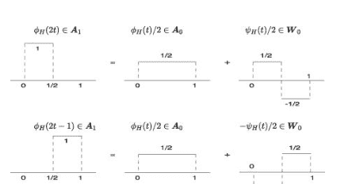

### 5.5 样条函数及其性质

小波构造中最基本的构建块之一涉及基数 B 样条。对样条理论的完整覆盖超出了本书的范围。在本节中，我们简要描述理解本书主题所需的样条函数及其性质。更多细节可参见许多优秀的书籍（例如，[4–8]）。

样条函数由分段多项式（见图 5.5）组成，并在断点（节点：\(t_0, t_1, \dots\)）处平滑连接，平滑程度取决于样条的阶次。对于基数 B 样条，这些断点是等距分布的。与多项式不同，这些形成局部基，并具有许多可应用于函数逼近的有用性质。

### 图 5.5：分段多项式函数。

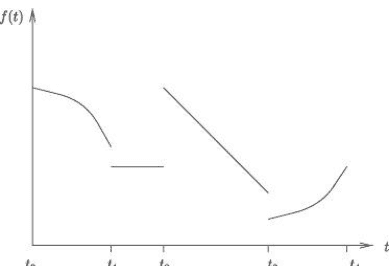

第 \(m\) 阶基数 B 样条 \(N_m(t)\) 具有节点序列 \(\{..., -1, 0, 1, \dots\}\)，并在节点之间由阶次为 \(m\)（次数为 \(m-1\)）的多项式组成。令 \(N_1(t) = \chi_{[0,1)}(t)\) 为 \([0, 1)\) 的特征函数。然后，对于每个整数 \(m \ge 2\)，第 \(m\) 阶基数 B 样条通过归纳定义为

(5.36) $$
N_m(t) := (N_{m-1} * N_1)(t)
$$
$$
:= \int_{-\infty}^{\infty} N_{m-1}(t-x) N_1(x) dx
$$

(5.37) $$
= \int_{0}^{1} N_{m-1}(t-x) dx.
$$

对于 \(m \ge 2\)，\(N_m(t)\) 的快速计算可以通过使用以下公式 [7, p. 131] 实现。

\(N_m(t)=\frac{t}{m-1} N_{m-1}(t)+\frac{m-t}{m-1} N_{m-1}(t-1)\)

递归进行，直到我们得到一阶 B 样条 \(N_1\)（见图 5.6）。阶次 2 到 6 的样条及其幅度谱如图 5.7 所示。最常用的样条是线性（\(m=2\)）和三次（\(m=4\)）样条。它们的显式表达式如下：

(5.38) $$
N_2(t) = \begin{cases} t & t \in [0,1] \\ 2-t & t \in [1,2] \\ 0 & \text{其他处} \end{cases}
$$

(5.39) $$
N_4(t) = \begin{cases} t^3 & t \in [0,1] \\ 4-12t+12t^2-3t^3 & t \in [1,2] \\ -44+60t-24t^2+3t^3 & t \in [2,3] \\ 64-48t+12t^2-t^3 & t \in [3,4] \\ 0 & \text{其他处.} \end{cases}
$$

### 图 5.6：\(N_1\)，阶次为 1 的样条。

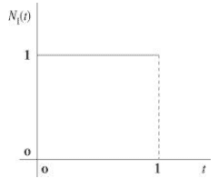

### 图 5.7：样条函数及其幅度谱。

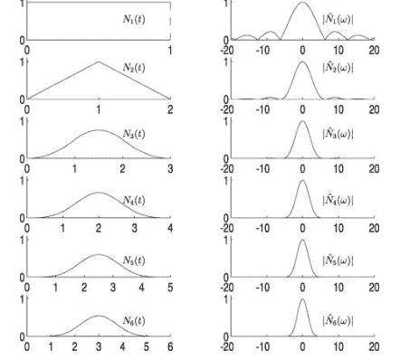

在许多应用中，我们需要在整数点处计算样条。表 5.1 给出了整数位置处的样条值。对称性质可用于获取其他点处的值。

### 表 5.1：整数点处的基数 B 样条

| k | (m-1)!N_m(k) | k | (m-1)!N_m(k) | k | (m-1)!N_m(k) |
|---|---|---|---|---|---|
| 1 | m=3 1 | 1 | m=8 1 | 1 | m=11 1 |
| | m=4 4 | 2 | 120 | 2 | 1,013 |
| 1 | m=1 1 | 3 | 1,191 | 3 | 47,840 |
| 2 | m=4 4 | 4 | 2,416 | 4 | 455,192 |
| | m=5 5 | | m=4 4 | 5 | 1,303,384 |
| 1 | m=1 1 | 1 | m=1 1 | | m=12 12 |
| 2 | m=11 11 | 2 | 247 | 1 | m=1 1 |
| | m=6 6 | 3 | 4,293 | 2 | 2,036 |
| 1 | m=26 26 | 4 | 15,619 | 3 | 52,047 |
| 2 | m=66 66 | | m=10 10 | 4 | 2,023,488 |
| 3 | m=7 7 | 2 | 502 | 5 | 9,738,114 |
| 1 | m=1 1 | 3 | 14,668 | 6 | 15,724,248 |
| 2 | m=57 57 | 4 | 88,234 | | |
| 3 | m=302 302 | 5 | 156,190 | | |

要获得 \(N_m(t)\) 的傅里叶变换，请注意 (5.36) 可以写成

$$
N_m(t) = (\underbrace{N_1 * \dots * N_1}_m)(t).
$$
(5.40)

因此，

$$
\hat{N}_m(\omega) = \left( \frac{1 - e^{-j\omega}}{j\omega} \right)^m,
$$
(5.41)

因为


(5.42) \(\hat{N}_1(\omega) = \int_0^1 e^{-j\omega t} dt = \frac{1 - e^{-j\omega}}{j\omega}\)

就我们的目的而言，样条的重要特性在于它们是缩函数。也就是说，存在一个序列 \(\{g_0[m, k]\} \in \mathbb{Z}^2\)，使得

(5.43) \(N_m(t) = \sum_k g_0[m, k] N_m(2t - k)\)

在第6章中，我们将推导 \(g_0[m, k]\) 的表达式。

### 5.5.1 样条的性质

本节讨论了与本书所讨论主题相关的一些重要样条性质，但不给出任何证明。某些性质的证明留作练习。

- 1. 支持集 \(N_m = [0, m]\)，且 \(N_m(0) = N_m(m) = 0\)

- 2. \(N_m(t) \in C^{m-2}\)；\(C^k\) 是 \(k\) 次连续可微函数的空间。

- 3. \(N_m|_{[k-1, k]} \in \pi_{m-1}\)；\(k \in \mathbb{Z}\)，\(\pi_k\) 是次数为 \(k\)（阶为 \(k+1\)）的多项式空间。

- 4. \(\int_{-\infty}^{\infty} N_m(t) dt = 1\)

- 5. \(N'_m(t) = N_{m-1}(t) - N_{m-1}(t - 1)\)

- 6. \(N_m(t)\) 关于中心 \(t^* = m/2\) 对称：

\(N_m\left(\frac{m}{2} + t\right) = N_m\left(\frac{m}{2} - t\right) ; \quad t \in \mathbb{R}\)

(5.44)

- 7. \(N_m(t)\) 表现为低通滤波器 [\(\hat{N}_m(0) = 1\)；参见图 5.7]。

- 8. \(N_m(t)\) 具有 \(m\) 阶逼近阶，即 \(\hat{N}_m(\omega)\) 满足 Strang-Fix 条件

(5.45)

\(\begin{cases} \hat{N}_m(0) = 1, \text{ and} \\ D^j \hat{N}_m(2\pi k) = 0, \quad k \in \mathbb{Z} \setminus \{0\} \quad \text{and} \quad j = 1, ..., m-1, \end{cases}\)

其中 \(D^j\) 表示 \(j\) 阶导数。因此，\(N_m(t)\) 局部再现所有 \(m\) 阶多项式 [8, pp. 114–121]。

- 9. \(N_m(t - k) \equiv 1\)；对所有 \(t\) 成立。该性质称为 *一致分割* 性质。

- 10. *全正性*：\(N_m(t) \ge 0\)，对 \(t \in [0, m]\)。得益于 \(B\)-样条的全正性 [6, p. 7] 属性，\(B\)-样条级数的系数遵循数据的形状。例如，若 \(g(t) = \sum_j \alpha_j N_m(t - j)\)，则

\(\alpha_j \ge 0 \quad \forall j \Rightarrow g(t) \ge 0\)

\(\alpha_j \uparrow (\text{increasing}) \Rightarrow g(t) \uparrow, \text{and}\)

\(\alpha_j (\text{convex}) \Rightarrow g(t) \text{ convex.}\)

此外，\(g(t)\) 的符号变化次数不超过系数序列 \(\{\alpha_j\}\) 的符号变化次数。后一属性可用于识别信号的零交叉点。

- 11. 随阶数 \(m\) 增加，\(N_m(t)\) 趋近于高斯函数（\(\Delta N_m / \Delta_n \to 0.5\)）。例如，对于三次样条（\(m=4\)），时频窗乘积的均方根为 0.501。

### 5.6 将函数映射到 MRA 空间

如第 5.2 节所述，在对信号 \(x(t)\) 进行分解之前，必须将其映射到某个适当尺度 \(M\) 的 MRA 子空间 \(A_M\) 中，即，

(5.46) \(x(t) \mapsto x_M(t) = \sum_k a_{k,M} \phi(2^M t - k).\)

一旦我们知道 \(\{a_{k,M}\}\)，就可以使用快速算法计算 \(s < M\) 时的 \(\{a_{k,s}\}\)。快速算法将在后续章节中讨论。这里我们关注系数 \(\{a_{k,M}\}\) 的求解。

如果在每个 \(t\) 处都已知 \(x(t)\)，则可以通过信号的正交投影（\(L^2\) 投影）得到 \(\{a_{k,M}\}\)：

$$a_{k,M} = 2^M \int_{-\infty}^{\infty} x(t) \bar{\phi}(2^M t - k) dt.$$

然而，在实际中，信号 \(x(t)\) 仅在某些离散点处已知。给定的时间步长决定了函数可以被映射到的尺度 \(M\)。对于如 (5.46) 这样的表示，我们希望它满足两个重要条件：（1）插值性和（2）多项式再现性。所谓 *插值表示*，是指级数至少在给定函数的点处应是精确的，即 \(x(k/2^M) = x_M(k/2^M)\)。如前所述，*多项式再现性* 是指，如果基函数 \(\phi(t)\) 具有 \(m\) 阶逼近阶，则该表示对于 \(m\) 阶多项式在每个点处都是精确的。换句话说，对于 \(x(t) \in \pi_{m-1}\)，有 \(x(t) \equiv x_M(t)\)。基数 \(B\)-样条具有 \(m\) 阶逼近阶。此外，由于它们是局部基，表示 (5.46) 也是局部的。所谓 *局部*，是指为了求得某个 \(k\) 的系数 \(a_{kM}\)，我们不需要所有函数值；仅需少数几个值，由样条的支撑集决定即可。当 \(\phi(t) = N_2(t)\) 和 \(\phi(t) = N_4(t)\) 时，系数如下推导。

### 5.6.1 一次样条（m = 2）

假设函数 \(x(t)\) 在 \(t = k 2^{-M}, k \in \mathbb{Z}\) 处已知。为了求得表示

$$x(t) \mapsto x_M(t) = \sum_k a_{k,M} N_2(2^M t - k).$$

的样条系数 \(\{a_{k,M}\}\)，我们应用插值条件，即

(5.49)
\( x \left( \frac{\ell}{2^M} \right) = x_M \left( \frac{\ell}{2^M} \right). \)

使用方程 (5.49)，并结合以下事实

(5.50)
\( N_2(1) = 1, \text{ and } N_2(k) = 0, k \in \mathbb{Z} \setminus \{0\}, \)

可得

(5.51)
\( a_{k,M} = x \left( \frac{k+1}{2^M} \right). \)

表示 (5.48) 保留所有次数不超过 1 的多项式。

### 5.6.2 三次样条（\(m = 4\)）

在此情形下

(5.52)
\( x(t) \mapsto x_M(t) = \sum_k a_{k,M} N_4(2^M t - k) \)

其中 [4, p. 117]

\( a_{k,M} = \sum_{n=k-2}^{k+6} v_{k+2-2n} x \left( \frac{n}{2^{M-1}} \right), \)

和

| \(n\) | \(V_n\) |
|-------|---------|
| 0 | \(\frac{29}{24}\) |
| \(\pm 1\) | \(\frac{7}{12}\) |
| \(\pm 2\) | \(-\frac{1}{8}\) |
| \(\pm 3\) | \(-\frac{1}{12}\) |
| \(\pm 4\) | \(\frac{1}{48}\) |
| 其他 | 0 |

表示 (5.52) 保留所有次数不超过 3 的多项式。

### 5.7 习题

- 1. 对于给定的 \(j \in \mathbb{Z}\)，任何给定函数 \(f(t) \in L^2(-\infty, \infty)\) 到“帽函数空间”

\(V_j = \left\{ \sum_{k=-\infty}^{\infty} c_k N_2(2^j t - k) : \{c_k\}_{k \in Z} \in \ell_2 \right\}\)

的投影 \(P_{2j}f(t)\) 可由插值条件 \(P_{2j}f(k/2^j) = f(k/2^j)\) 对所有 \(k \in Z\) 确定。若 \(P_{2j}f\) 写为

\(P_{2j}f(t) = \sum_{n=-\infty}^{\infty} a_n N_2(2^j t - n).\)

求系数 \(\{a_n\}\) 的公式。

- 2. 对于 Haar 小波

\(\psi_H(t) := \begin{cases} 1 & \text{for } t \in [0, \frac{1}{2}) \\ -1 & \text{for } t \in [\frac{1}{2}, 1) \\ 0 & \text{otherwise.} \end{cases}\)

定义

\(\psi_{H, k, s}(t) = 2^{\frac{s}{2}} \psi_H(2^s t - k), \quad k, s \in \mathbb{Z}\)

证明正交关系

\(\int_{-\infty}^{\infty} \psi_{H, k, s}(t) \psi_{H, m, p}(t) dt = \delta_{m,k} \delta_{s,p} \quad m, k, p, s \in \mathbb{Z}.\)

由于这些关系，我们称集合 \(\{\psi_{H, k, s}\}_{k, s \in Z}\) 在 \(L^2(-\infty, \infty)\) 中构成一组正交归一族。

- 3. 证明高斯函数 \(\phi(t) = e^{-t^2}\) 不能作为多分辨率分析的缩函数。（提示：假设 \(e^{-t^2}\) 可以写成 \(e^{-t^2} = \sum_{k=-\infty}^{\infty} a_k e^{-(2t-k)^2}\) 的形式，其中序列 \(\{a_k\}_{k \in \mathbb{Z}} \in l_2\)，若 \(e^{-t^2} \in V_0 \subset V_1\) 则此假设必须成立。接着，对等式两边进行傅里叶变换并比较结果，证明这会导致矛盾。）

- 4. 证明 \(m\) 阶 \(B\)-样条 \(N_m(t)\) 及其整数平移构成一致分割：

\(\sum_{k=-\infty}^{\infty} N_m(t-k) = 1 \quad \text{for all } t \in \mathbb{R}.\)

（提示：使用泊松求和公式。）

- 5. 证明 \(N_m(t)\) 的以下对称性质：

\(N_m\left(\frac{m}{2} + t\right) = N_m\left(\frac{m}{2} - t\right), \quad t \in \mathbb{R}.\)

- 6. 利用习题 5 证明

\(\int_{-\infty}^{\infty} N_m(t+k) N_m(t) dt = N_{2m}(m+k)\)

对任意 \(k \in \mathbb{Z}\) 成立。

- 7. 证明帽函数

$$N_2(t) = \begin{cases} t & t \in [0, 1] \\ 2-t & t \in [1, 2] \\ 0, & \text{otherwise} \end{cases}$$
(5.53)

与函数 \(N_1(t)\) 通过卷积相关：\(N_2(t) = N_1(t) * N_1(t)\)。求下列函数的定义方程（多项式表达式）：

\(N_3(t) := N_2(t) * N_1(t)\)

\(N_4(t) := N_3(t) * N_1(t)\).

### 5.8 计算机程序

### 5.8.1 B-样条

```
%
% PROGRAM Bspline.m
%
% Computes uniform Bsplines
function y = Bspline(m,x)
y = 0;
% Characteristic function
if m == 1
if x >= 0.0 & x < 1.0
y = 1.0;
else
```


```matlab
y = 0.0;
end
end
% Higher order
a = zeros(1,500);
if m >= 2 & m < 100
for k = 1:m-1
a(k) = 0.0;
x1 = x - k + 1;
if x1 >= 0.0 & x1 < 1.0
a(k) = x1;
end
if x1 >= 1.0 & x1 < 2.0
a(k) = 2 - x1;
end
end
for p=1:m-2
for q=1:m-1-p
a(q) = ((x-q+1) * a(q) + ((p+2)+q-1-x) * a(q+1)) / (p+1);
end
end
y = a(1);
end
```

### 5.9 参考文献

1. Y. Meyer. *小波：算法与应用*. 费城：SIAM, 1993.

2. S. Mallat. “多分辨率信号分解理论：小波表示”. *IEEE Trans. Pattern Anal. Machine Intell.* 11 (1989), 674–693.

3. S. Mallat. “多分辨率表示与小波”. 博士论文，宾夕法尼亚大学，费城，1988.

4. C. K. Chui. *小波导论*. 波士顿：Academic Press, 1992.

5. I. J. Schoenberg. *基样条插值*. CBMS 系列 12. 费城：SIAM, 1973.

6. L. L. Schumaker. *样条函数：基本理论*. 纽约：Wiley-Interscience, 1981.

7. C. de Boor. *样条实用指南*. 纽约：Springer-Verlag, 1978.

8. C. K. Chui. *多元样条*. CBMS-NSF 应用数学丛书 54. 费城：SIAM, 1988.

## 第六章

### 小波的构造

本章主要讨论正交、半正交和双正交小波的构造。构造问题等同于寻找第 5 章中介绍的合适的两尺度和分解序列。结果表明，正交小波的这些系数可以轻松地从半正交小波的系数中推导出来。因此，我们首先讨论半正交小波，然后是正交和双正交小波。

回顾，对于半正交小波，\(\phi(t)\) 和 \(\tilde{\phi}(t)\) 均属于 \(A_0\)，而 \(\psi(t)\) 和 \(\tilde{\psi}(t)\) 均属于 \(W_0\)。因此，我们可以用 \(\tilde{\phi}(t)\) 表示 \(\phi(t)\)；\(\psi(t)\) 亦然。这里给出的 (5.21) 和 (5.22) 关系如下。

```
\(\hat{\tilde{\phi}}(\omega) = \frac{\hat{\phi}(\omega)}{E_\phi(e^{j\omega})}, \text{ and}\)
(6.1)

\(\hat{\tilde{\psi}}(\omega) = \frac{\hat{\psi}(\omega)}{E_\psi(e^{j\omega})},\)
(6.2)
```

其中欧勒-弗罗本尼乌斯-劳伦特（E-F-L）多项式 \(E_j(e^{j\omega})\) 由下式给出

\( E_f(e^{j\omega}) := \sum_{k=-\infty}^{\infty} \left| \hat{f}(\omega + 2\pi k) \right|^2 = \sum_{k=-\infty}^{\infty} A_f(e^{j\omega k}). \) (6.3)

因此，我们将仅专注于 \(\phi\) 和 \(\psi\) 的构造。

作为构造小波的第一步，我们将 \(\{h_0[k]\}\)、\(\{h_1[k]\}\) 和 \(\{g_1[k]\}\) 用 \(\{g_0[k]\}\) 表示，这样只需构造 \(\{g_0[k]\}\) 及其对应的尺度函数即可。在半正交情况下，这些序列的长度通常各不相同。稍后我们将表明，对于正交（o.n）情况，所有这些序列长度相同，并且它们之间存在一个非常简单的关系，该关系可作为半正交情况关系的特例轻松推导出来。半正交小波的构造之后，是若干常用正交小波的构造：Shannon、Meyer、Battle-Lemarié 和 Daubechies 小波。最后，我们构造一个双正交小波。其他小波，如脊小波、曲线小波、复小波和提升小波，在第 8 章中讨论。

### 6.1 小波构造所需的必要条件

如前所述，为了构造小波，我们需要获得系数序列 \(\{g_0[k]\}\) 和 \(\{g_1[k]\}\)。本节的目标是找出各序列之间的关系。这将有助于简化我们的任务。这里我们考虑多分辨率空间的半正交分解情况。

### 6.1.1 两尺度序列之间的关系

回顾第 5 章，由于多分辨率性质，某一尺度（较粗）的尺度函数和小波与下一较高尺度（较细）的尺度函数通过所谓的两尺度关系相关：

```
(6.4)
\(\phi(t) = \sum_k g_0[k] \phi(2t - k),\)
```

```
(6.5)
\(\psi(t) = \sum_k g_1[k] \phi(2t - k).\)
```

对上述关系进行傅里叶变换，得到

```
(6.6)
\(\hat{\phi}(\omega) = G_0(z) \hat{\phi}\left(\frac{\omega}{2}\right),\)
```

```
(6.7)
\(\hat{\psi}(\omega) = G_1(z) \hat{\phi}\left(\frac{\omega}{2}\right),\)
```

其中 \(z = e^{-j\omega/2}\) 且

```
(6.8)
\(G_0(z) := \frac{1}{2} \sum_k g_0[k] z^k,\)
```

(6.9) $$G_1(z) := \frac{1}{2} \sum_k g_1[k] z^k.$$

观察到 \(\phi(t) \in A_0\)，\(\phi(2t) \in A_1\)，且 \(\psi(t) \in W_0\)。根据 MRA 的嵌套性质，我们知道 \(A_0 \subset A_1\) 且 \(A_0 \perp W_0\)，因此 \(A_0 \oplus W_0 = A_1\)。子空间 \(A_0\) 和 \(W_0\) 的正交性意味着，对于任意 \(\ell \in \mathbb{Z}\)，

(6.10) $$\langle \phi(t - \ell), \psi(t) \rangle = 0.$$

利用 Parseval 恒等式，式 (6.10) 可改写为

$$\begin{aligned} 0 &= \frac{1}{2\pi} \int_{-\infty}^{\infty} \hat{\phi}(\omega) e^{-j\ell\omega} \overline{\hat{\psi}(\omega)} d\omega \\ &= \frac{1}{2\pi} \int_{-\infty}^{\infty} G_0(z) \overline{G_1(z)} \left| \hat{\phi} \left( \frac{\omega}{2} \right) \right|^2 e^{-j\ell\omega} d\omega \\ &= \frac{1}{2\pi} \sum_k \int_{4\pi k}^{4\pi(k+1)} G_0(z) \overline{G_1(z)} \left| \hat{\phi} \left( \frac{\omega}{2} \right) \right|^2 e^{-j\ell\omega} d\omega \\ &= \frac{1}{2\pi} \sum_k \int_{0}^{4\pi} G_0(z) \overline{G_1(z)} \left| \hat{\phi} \left( \frac{\omega}{2} + 2\pi k \right) \right|^2 e^{-j\ell\omega} d\omega \\ &= \frac{1}{2\pi} \int_{0}^{4\pi} G_0(z) \overline{G_1(z)} E_\phi(z) e^{-j\omega} d\omega \end{aligned}$$ (6.11)

其中 \(z = e^{-j\omega/2}\)。通过将积分限 \([0, 4\pi]\) 划分为 \([0, 2\pi]\) 和 \([2\pi, 4\pi]\)，并作简单变量代换，可以轻松验证式 (6.11) 等同于

(6.12)
\(\frac{1}{2\pi} \int_0^{2\pi} [G_0(z)\overline{G_1(z)} E_\phi(z) + G_0(-z)\overline{G_1(-z)} E_\phi(-z)] e^{-j\ell\omega} d\omega = 0.\)

式 (6.12) 对所有 \(\ell \in \mathbb{Z}\) 成立。这意味着什么？为了理解这一点，让我们回顾一下，可积的 \(2\pi\) 周期函数 \(f(t)\) 具有傅里叶级数表示

(6.13)
\(f(\omega) = \sum_\ell c_\ell e^{j\ell\omega}, \text{ where}\)

(6.14)
\(c_\ell = \frac{1}{2\pi} \int_0^{2\pi} f(\omega) e^{-j\ell\omega} d\omega.\)

从上述内容可以清楚地看出，(6.12) 左边的量表示周期函数 \(G_0(z)\overline{G_1(z)} E_\phi(z) + G_0(-z)\overline{G_1(-z)} E_\phi(-z)\) 的第 \(\ell\) 个傅里叶系数。由于所有这些系数均为零，这意味着

(6.15)
\(G_0(z)\overline{G_1(z)} E_\phi(z) + G_0(-z)\overline{G_1(-z)} E_\phi(-z) \equiv 0\)

当 \(|z| = 1\) 时。式 (6.15) 的解给出了 \(G_1(z)\) 与 \(G_0(z)\) 之间的关系。通过直接代入，我们可以验证

(6.16)
\(G_1(z) = -c z^{2m+1} \overline{G_0(-z)} E_\phi(-z)\)

对于任意整数 \(m\)，常数 \(c > 0\) 是 (6.15) 的一个解。不失一般性，我们可以令 \(c = 1\)。\(m\) 的作用是移序列 \(\{g_1[k]\}\) 的索引。通常选择 \(m\) 使得索引从 0 开始。

### 6.1.2 重构与分解序列之间的关系

回顾第 5 章，某一尺度（较细）的尺度函数可以由下一较低尺度（较粗）的尺度函数和小波得到。从数学上讲，这意味着存在有限能量序列 \(\{h_0[k]\}\)、\(\{h_1[k]\}\)，使得

```
(6.17)
\(\phi(2t - \ell) = \sum_k \{h_0[2k - \ell]\phi(t - k) + h_1[2k - \ell]\psi(t - k)\};\)
```

其中，如第 5 章所讨论，\(\{h_0[k]\}\)、\(\{h_1[k]\}\) 是分解序列。对分解关系进行傅里叶变换，得到

```
\(\frac{1}{2} \hat{\phi}\left(\frac{\omega}{2}\right) e^{-j\omega \ell/2} = \sum_k h_0[2k - \ell] e^{-jk\omega} \hat{\phi}(\omega) + \sum_k h_1[2k - \ell] e^{-jk\omega} \hat{\psi}(\omega)\)
\(= \left( G_0(z) \sum_k h_0[2k - \ell] e^{-jk\omega} + G_1(z) \sum_k h_1[2k - \ell] e^{-jk\omega} \right) \hat{\phi}\left(\frac{\omega}{2}\right).\)
```

该方程简化为


(6.18)
$$
\left( \sum_k h_0[2k-\ell] e^{-j(2k-\ell)\omega/2} \right) G_0(z) \\
+ \left( \sum_k h_1[2k-\ell] e^{-j(2k-\ell)\omega/2} \right) G_1(z) \stackrel{.}{=} \frac{1}{2}, \forall \ell \in \mathbb{Z}.
$$

结合分解和两尺度关系的傅里叶变换，我们得到

(6.19)
$$
[H_0(z) + H_0(-z)]G_0(z) + [H_1(z) + H_1(-z)]G_1(z) = \frac{1}{2} \quad \text{对于偶数 } \ell;
$$

(6.20)
$$
[H_0(z) - H_0(-z)]G_0(z) + [H_1(z) - H_1(-z)]G_1(z) = \frac{1}{2} \quad \text{对于奇数 } \ell.
$$

其中 \(z = e^{-j\omega/2}\) 且

$$
H_0(z) := \frac{1}{2} \sum_k h_0[k] z^k,
$$

$$
H_1(z) := \frac{1}{2} \sum_k h_1[k] z^k.
$$

这些方程导致

$$
H_0(z)G_0(z) + H_1(z)G_1(z) = \frac{1}{2}
$$

$$
H_0(-z)G_0(z) + H_1(-z)G_1(z) = 0.
$$

最后一个方程也可以写成

(6.21) \(H_0(z)G_0(-z) + H_1(z)G_1(-z) = 0.\)

在矩阵形式中，我们有

(6.22)
$$
\begin{bmatrix} G_0(z) & G_1(z) \\ G_0(-z) & G_1(-z) \end{bmatrix} \begin{bmatrix} H_0(z) \\ H_1(z) \end{bmatrix} = \begin{bmatrix} \frac{1}{2} \\ 0 \end{bmatrix},
$$

其解给出

(6.23) \(H_0(z) = \frac{1}{2} \times \frac{G_1(-z)}{\Delta_{G_0 G_1}(z)}\)

(6.24) \(H_1(z) = -\frac{1}{2} \times \frac{G_0(-z)}{\Delta_{G_0 G_1}(z)}\)

与 \(\Delta_{G_0 G_1}(z) = G_0(z)G_1(-z) - G_0(-z)G_1(z)\)。

可以证明

(6.26) \(\Delta_{G_0 G_1}(z) = c z^n E_\phi(z^2),\)

其中 \(c > 0\) 且 \(n\) 为整数。由于 \(\phi\) 生成一个 Riesz 基或稳定基，\(E_\phi(z)\) 因而 \(\Delta_{G_0 G_1}(z) \neq 0\)。

### 6.2 半正交样条小波的构造

第6.1节所得结果的意义在于，我们只需构造标度函数——也就是说，我们只需找到序列 \(\{g_0[k]\}\)。在本节中，我们将得到 Chui-Wang [1] 引入的半正交样条小波的这些序列。这里，基数 B-样条 \(N_m\) 被选为标度函数。我们将证明存在一个有限能量序列 \(\{g_0[m, k]\}\)，使得标度关系

$$
N_m(t) = \sum_k g_0[m, k] N_m(2t - k)
$$

得到满足，因此 \(N_m(t)\) 是一个标度函数。对于 \(m=1\)，\(\{N_1(t - k) : k \in \mathbb{Z}\}\) 构成 \(\mathcal{A}_0\) 的一组标准正交基。对于这种情况，我们已经看到 \(g_0[0] = g_0[1] = 1\)（参见图 5.3）。在本节中，我们将考虑 \(m \ge 2\) 的情况。

对于 \(m \ge 2\)，标度函数 \(\{N_m(t - k) : k \in \mathbb{Z}\}\) 不再正交：

$$
\int_{-\infty}^{\infty} N_m(t) N_m(t - \ell) \, dt \neq \delta_{0, \ell}
$$

对于所有 \(\ell \in \mathbb{Z}\)。\(N_2(t)\) 的非正交性示例如图 6.1 所示。\(\int_{-\infty}^{\infty} N_2(t) N_2(t - \ell) \, dt\) 由阴影区域表示，其值不为零。

图 6.1: 阴影区域所示的线性样条的非正交性。

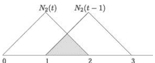

### 6.2.1 \(\{g_0[k]\}\) 的表达式

回顾，根据第5章中 \(N_m(t)\) 的定义，

$$
N_m(t) = (\underbrace{N_1 * \cdots * N_1}_m)(t)
$$

以及

$$
\hat{N}_m(\omega) = \left( \frac{1 - e^{-j\omega}}{j\omega} \right)^m. \tag{6.29}
$$

从两尺度关系的傅里叶变换，我们有

$$
G_0(z) = \frac{1}{2} \sum_k g_0[m, k] z^k = \frac{\hat{N}_m(\omega)}{\hat{N}_m(\omega/2)}
= \left( \frac{1 + e^{-j\omega/2}}{2} \right)^m
= 2^{-m}(1+z)^m, \quad z = e^{-j\omega/2},
$$

$$
= 2^{-m} \sum_{k=0}^m \binom{m}{k} z^k.
$$

通过比较 \(z\) 的幂次系数，我们得到

$$
g_0[k] := g_0[m, k] = \begin{cases} 2^{-m+1} \binom{m}{k}, & 0 \le k \le m \\ 0 & \text{否则。} \end{cases}
$$

一旦我们有了 \(\{g_0[k]\}\)，其余的序列 \(\{g_1[k]\}\)、\(\{h_0[k]\}\) 和 \(\{h_1[k]\}\) 可以通过使用第6.1节推导的关系来找到。\(\{g_1[k]\}\) 的表达式将在下一部分推导。

对于 \(N_m(t)\)，E-F-L 多项式 \(E_{N_m}(z)\) 采用如下形式

$$
E_{N_m}(z) = \sum_{k=-\infty}^{\infty} \left| \hat{N}_m \left( \frac{\omega}{2} + 2\pi k \right) \right|^2
= \sum_{k=-\infty}^{\infty} A_{N_m}(k) z^k
= \sum_{k=m+1}^{m-1} N_{2m}(m+k) z^k ,
\tag{6.33}
$$

其中 \(z := e^{-j\omega/2}\) 以及自相关函数

$$
A_{N_m}(k) = \int_{-\infty}^{\infty} N_m(x) N_m(k+m) \, dx = N_{2m}(m+k) .
\tag{6.34}
$$

最后，通过使用关系 (6.16)，我们有

$$
g_1[k] := g_1[m,k] = (-1)^k 2^{-m+1} \sum_{\ell=0}^{m} \binom{m}{\ell} N_{2m}(k+1-\ell), \quad 0 \le k \le 3m-2 .
\tag{6.35}
$$

### 6.2.2 备注

回顾一下，在用 \(G_0(z)\) 和 \(G_1(z)\) 表示的 \(H_0(z)\) 和 \(H_1(z)\) 的表达式中，分母中有一项 \(\Delta_{G_0 G_1}(z) = z^m E_{N_m}(z)\)。因此，序列 \(\{h_0[k]\}\) 和 \(\{h_1[k]\}\) 是无限长的，尽管其幅度呈指数衰减。这些是将在第7章和第8章中用于开发分解和重建算法的序列。很明显，虽然 \(G_0\) 和 \(G_1\) 构成有限脉冲响应（FIR）滤波器，但 \(H_0\) 和 \(H_1\) 始终是无限脉冲响应（IIR）。然而，我们将在第7章中证明，我们可以同时使用 \(G_0\) 和 \(G_1\) 进行重建和分解。这是我们在第5章中简要提到的对偶性原理的结果。

常用的三次样条及其对应的半正交小波及其对偶和幅度谱如图 6.2 和 6.3 所示。常用半正交标度函数和小波的表达式见第10章。表 6.1 给出了 \(m=2\) 到 6 的系数 \(\{g_1[m, k]\}\)。

表 6.1: 半正交小波的系数 \(u_{m,k} := 2^{m-1} (2m - 1)! g_1[m, k]\) (\(g_1[m, k] = (-1)^m g_1[m, 3m - 2 - k]\))

| k | \(u_{m,k}\) | k | \(u_{m,k}\) | k | \(u_{m,k}\) |
|---|---|---|---|---|---|
| \(m=2\) | | \(m=5\) | | \(m=6\) | |
| 0 | 1 | 0 | 1 | 0 | 1 |
| 1 | -6 | 1 | -507 | 1 | -2,042 |
| 2 | 10 | 2 | 17,128 | 2 | 164,868 |
| 3 | -39 | 3 | -166,304 | 3 | -5,314,970 |
| 4 | -147 | 4 | 748,465 | 4 | 72,108,334 |
| 5 | -303 | 5 | -1,900,113 | 5 | -410,288,436 |
| | | 6 | 2,973,560 | 6 | 296,526,880 |
| \(m=3\) | | | | 7 | -525,228,384 |
| 0 | 1 | | | 8 | 633,375,552 |
| 1 | -29 | | | | |
| 2 | 147 | | | | |
| 3 | -303 | | | | |
| 4 | -1 | | | | |
| 5 | 4 | | | | |
| \(m=4\) | | | | | |
| 0 | 1 | | | | |
| 1 | -124 | | | | |
| 2 | 1,677 | | | | |
| 3 | -7,904 | | | | |
| 4 | 18,482 | | | | |
| 5 | -24,264 | | | | |

图 6.2: 线性样条、对偶线性样条、相应的小波及其幅度谱。


图 6.3: 三次样条、对偶三次样条、相应的小波及其幅度谱。


### 6.3 标准正交小波的构造

回顾第2章，标准正交基的 Riesz 界为1。因此，对于标准正交标度函数 \(\phi\) 和相应的小波 \(\varphi\)，我们有

$$
E_\phi(e^{i\nu}) = \sum_K |\hat{\phi}(\omega + 2\pi k)|^2 \equiv 1,
$$

$$
E_\psi(e^{j\nu}) = \sum_k |\hat{\psi}(\omega + 2\pi k)|^2 \equiv 1,
$$

对于几乎所有 \(\omega\)。因此，

$$
\tilde{\phi}(t) = \phi(t), \quad \text{且} \quad \tilde{\psi}(t) = \psi(t);
$$

也就是说，它们是自对偶的。请记住我们在第5章中的讨论，由于 MRA 子空间的嵌套性质，标度函数在尺度上不正交。标准正交标度函数意味着它们在给定尺度上的平移是正交的。另一方面，标准正交小波在尺度和平移上都是标准正交的。从

$$
\langle \phi(t - \ell), \phi(t) \rangle = \delta_{0,\ell}
\tag{6.36}
$$

并遵循 (6.12) 的推导，我们得到以下结果：

$$
|G_0(z)|^2 + |G_0(-z)|^2 \equiv 1, \quad |z| = 1.
\tag{6.37}
$$

对于标准正交标度函数和小波，各序列 \(\{g_0[k]\}\)、\(\{g_1[k]\}\)、\(\{h_0[k]\}\) 和 \(\{h_1[k]\}\) 之间的关系可以通过将 \(m=0\) 代入第6.1节的结果得到。这些结果如下总结。


$G_1(z) = -z \overline{G_0(-z)}$
(6.38) $\Rightarrow g_1[k] = (-1)^k g_0[1-k];$

(6.39) $\Delta_{G_0 G_1}(z) = G_0(z)G_1(-z) - G_0(-z)G_1(z) = z$

$H_0(z) = \frac{1}{2} \times \frac{G_1(-z)}{z} = \frac{1}{2} \times \overline{G_0(z)}$
(6.40) $\Rightarrow h_0[k] = \frac{1}{2} g_0[-k];$

$H_1(z) = -\frac{1}{2} \times \frac{G_0(-z)}{z} = \frac{1}{2} \times \overline{G_1(z)}$
(6.41) $\Rightarrow h_1[k] = \frac{1}{2} (-1)^k g_0[k+1].$

例如，对于哈尔标度函数和小波（图 5.3 和 5.4），

$g_0[0] = g_0[1] = 1;$

$g_1[0] = 1, g_1[1] = -1;$

$h_0[0] = h_0[-1] = \frac{1}{2};$

$h_1[0] = \frac{1}{2}, \quad h_1[-1] = -\frac{1}{2};$

$g_0[k] = g_1[k] = h_0[k] = h_1[k] = 0 \quad \text{for all other } k.$

**备注：** 正交基的最重要特征之一是所有分解和重构滤波器都是 FIR 且长度相同。这对第 7 章讨论的分解和重构算法大有帮助。正交小波的一个缺点是它们通常没有闭式表达式，而且紧支持正交小波也没有线性相位（无对称性）。线性相位在信号重构中的重要性将在第 7 章讨论。还已证明 [2]，高阶正交标度函数和小波的时频定位性较差。

### 6.4 正交标度函数

在本节中，我们将讨论常用的香农、梅耶、巴特勒-勒马里和达贝奇斯正交小波。我们将仅推导序列 $\{g_0[k]\}$ 的表达式，因为其他序列可以根据第 6.1 节的关系得到。

### 6.4.1 香农标度函数

香农采样函数

$$
\phi_{SH}(t) := \frac{\sin \pi t}{\pi t}
\tag{6.42}
$$

是一个正交标度函数，其中 $\hat{\phi}_{SH}(\omega) = \chi_{[-\pi, \pi)}(\omega)$。通过关系式

(6.43) $\langle \phi_{SH}(t-\ell), \phi_{SH}(t) \rangle = \delta_{0, \ell}$

在时域证明 (6.42) 的正交性很繁琐。这里很容易表明 Riesz 界为 1；即，

(6.44) $\sum_k \left| \hat{\phi}_{SH}(\omega + 2\pi k) \right|^2 = 1.$

序列 $\{g_0[k]\}$ 可以从两尺度关系得到

(6.45) $\frac{1}{2} \sum_k g_0[k] e^{-jk\omega/2} = \frac{\hat{\phi}_{SH}(\omega)}{\hat{\phi}_{SH}(\omega/2)}.$

由于表达式左边是一个 $4\pi$ 周期函数，我们需要对右边进行 $4\pi$ 周期延拓。换句话说，$G_0(z)$ 只不过是 $\hat{\phi}_{SH}(\omega)$ 的 $4\pi$ 周期延拓（参见图 6.4）

(6.46) $G_0(z) = \frac{1}{2} \sum_\ell g_0[\ell] \exp\left(-j \frac{\omega \ell}{2}\right) = \sum_\ell \hat{\phi}_{SH}(\omega + 4\pi \ell).$

**图 6.4：** $\hat{\phi}_{SH}(\omega)$ 的 $4\pi$ 周期延拓。


由 (6.46) 可得系数 $\{g_0[k]\}$ 的表达式

$$
\begin{aligned}
g_0[k] &= \frac{1}{2\pi} \int_0^{4\pi} \sum_{\ell=-\infty}^{\infty} \hat{\phi}_{SH}(\omega + 4\pi\ell) \exp\left(j \frac{\omega k}{2}\right) d\omega \\
&= \frac{1}{2\pi} \sum_{\ell=-\infty}^{\infty} \int_{4\pi\ell}^{4\pi(\ell+1)} \hat{\phi}_{SH}(\omega) \exp\left(j \frac{\omega k}{2}\right) d\omega \\
&= \frac{1}{2\pi} \int_{-\infty}^{\infty} \hat{\phi}_{SH}(\omega) \exp\left(j \frac{\omega k}{2}\right) d\omega \\
&= \hat{\phi}_{SH}\left(\frac{k}{2}\right).
\end{aligned}
\tag{6.47}
$$

使用 (6.42)，可得

$$
g_0[k] = \left\{ \begin{array}{ll} 1 & \text{当 } k = 0 \\ (-1)^{(k-1)/2} \frac{2}{k\pi} & \text{当 } k \text{ 为奇数} \\ 0 & \text{当 } k \text{ 为非零偶数}. \end{array} \right.
$$

图 6.5 显示了香农标度函数及其小波。

**图 6.5：** 香农标度函数、相应的小波及其幅度谱。


### 6.4.2 梅耶标度函数

香农标度函数 $\phi_{SH}(t)$ 的时域定位性较差（$\Delta \phi_{SH} = \infty$）。原因在于在频域中，$\hat{\phi}_{SH}(\omega)$ 在 $-\pi$ 和 $\pi$ 处不连续。因此，在时域中，如 (6.42) 所示，该函数按 $1/t$ 衰减，因此其均方根时间窗宽度 (4.3) 为 $\infty$。为改进这一点，梅耶 [3, 4] 通过在 $\hat{\phi}_{SH}(\omega)$ 的不连续点附近应用平滑函数，得到了标度函数 $\hat{\phi}_{M,m}(\omega)，使得正交性条件

(6.48) $\sum_k \left|\hat{\phi}_{M,m}(\omega + 2\pi k)\right|^2 = 1$

得到满足。在 (6.48) 中，索引 $m$ 表示平滑度——即，$m$ 阶角平滑函数 $S_m(\omega)$ 是 $m$ 次连续可微的。为满足正交性要求 (6.48)，这些角平滑函数应具有以下性质：

$$
\begin{cases} 
S_m(y)+S_m(1-y)=1, & 0 \le y \le 1; \\ 
S_m(y)=0, & y < 0; \\ 
S_m(y)=1, & y > 1. 
\end{cases}
$$

角平滑函数示例如下。

$$
S_0(y) = \begin{cases} 
0, & y < 0; \\ 
y, & 0 \le y \le 1; \\ 
1, & y > 1. 
\end{cases}
$$

$$
S_1(y) = \begin{cases} 
0, & y < 0; \\ 
2y^2, & 0 \le y < 0.5; \\ 
-2y^2 + 4y - 1, & 0.5 \le y \le 1; \\ 
1, & y > 1. 
\end{cases}
$$

设 $S_m(y)$ 为所需的角平滑函数。则

$$
\hat{\phi}_{M,m}(\omega) = \begin{cases} 
\cos\left(\frac{\pi}{2} S_m\left(\frac{3}{2\pi}|\omega|-1\right)\right), & \frac{2\pi}{3} \le |\omega| \le \frac{4\pi}{3}; \\ 
0, & |\omega| \ge \frac{4\pi}{3}; \\ 
1, & |\omega| \le \frac{2\pi}{3}. 
\end{cases}
$$

时域中的标度函数则变为

(6.49) $\phi_{M,m}(t) = \frac{2}{3} \frac{\sin \frac{2\pi t}{3}}{\frac{2\pi t}{3}} + \frac{2}{3} \int_0^1 \left[ \cos\left[ \frac{\pi}{2} S_m(\xi) \right] \cos\left[ \frac{2\pi}{3} (1+\xi) t \right] \right] d\xi$

对于线性平滑函数 $m = 0$，上述积分可以轻松计算。结果是

(6.50) $\phi_{M,0} = \frac{2}{3} \frac{\sin \frac{2\pi t}{3}}{\frac{2\pi t}{3}} + 4 \frac{4t \sin \frac{2\pi t}{3} + \cos \frac{4\pi t}{3}}{\pi \frac{9-16t^2}{3}}$

对于较高的 $m$ 值，(6.49) 中的积分需要数值计算。图 6.6 显示了 $m = 0$ 和 1 时的梅耶标度函数和小波。

与之前一样，两尺度系数 $\{g_0[k]\}$ 可以通过 $\hat{\phi}_{M,m}(\omega)$ 的 $4\pi$ 周期延拓得到。这种延拓的示例见图 6.7。

$$
\frac{1}{2} \sum_k g_0[k] e^{-jk\omega/2} = \frac{\hat{\phi}_{M,m}(\omega)}{\hat{\phi}_{M,m}(\frac{\omega}{2})} = \sum_k \hat{\phi}_{M,m}(\omega + 4\pi k).
$$

**图 6.6：** 梅耶标度函数、相应的小波及其幅度谱。


**图 6.7：** $\hat{\phi}_{M,m}(\omega)$ 的 $4\pi$ 周期延拓。


与香农标度函数的情况类似，这里也有

(6.51) $g_0[k] = \phi_{M,m} \left( \frac{k}{2} \right).$

因此，对于 m = 0，我们可以通过在 (6.50) 中将 t 替换为 k/2 来简单地得到 g_0[k]。表 6.2 给出了 m = 1 的两尺度系数。

梅耶小波可以通过两尺度关系得到。由于标度函数在频域中具有紧支持，梅耶小波与标度函数以更直接的方式相关，如下所示。

$$
\begin{aligned}
\hat{\psi}_{M,m}(\omega) &= G_1(z) \hat{\phi}_{M,m} \left( \frac{\omega}{2} \right) ; \quad z = \exp(-j\omega/2) \\
&= -z \overline{G_0(-z)} \hat{\phi}_{M,m} \left( \frac{\omega}{2} \right) \\
&= -z \left[ \sum_{k=-\infty}^{\infty} \hat{\phi}_{M,m}(\omega + 2\pi + 4\pi k) \right] \hat{\phi}_{M,m} \left( \frac{\omega}{2} \right) \\
&= -z \left[ \hat{\phi}_{M,m}(\omega + 2\pi) + \hat{\phi}_{M,m}(\omega - 2\pi) \right] \hat{\phi}_{M,m} \left( \frac{\omega}{2} \right).
\end{aligned}
\tag{6.52}
$$


表 6.2: 一阶 Meyer 调度函数的两尺度序列 \(\phi_{M;1}\)

| n | g0[n] = g0[-n] | n | g0[n] = g0[-n] | n | g0[n] = g0[-n] |
|---|---|---|---|---|---|
| 0 | 1.063513307325022 | 13 | 0.0018225696961070 | 26 | 0.0000781583234904 |
| 1 | 0.6237929148520031 | 14 | -0.0001225788430400 | 27 | -0.0000281868403039 |
| 2 | -0.0954391217681172 | 15 | -0.0019003177368828 | 28 | -0.0000686017777485 |
| 3 | -0.1762971983704155 | 16 | -0.0000631513505005 | 29 | 0.00003520515347881 |
| 4 | 0.0484777578307502 | 17 | 0.0018514320187282 | 30 | -0.0000059176067635 |
| 5 | 0.0751184831722090 | 18 | 0.0004730929715153 | 31 | -0.0000243116067058 |
| 6 | -0.0099344443938033 | 19 | -0.0010395429751381 | 32 | 0.0000143515571684 |
| 7 | -0.0311015336438103 | 20 | 0.0007208498373768 | 33 | 0.0000150739706291 |
| 8 | 0.0197659340813598 | 21 | 0.0006265174104084 | 34 | -0.0000171599560112 |
| 9 | 0.0110966323385240 | 22 | -0.0005163028169833 | 35 | -0.00000530482980227 |
| 10 | -0.0089152072379117 | 23 | -0.0002172396357580 | 36 | 0.00000628695514764 |
| 11 | -0.0052590831208475 | 24 | 0.0001468858466855 | 37 | 0.00004435267271494 |
| 12 | 0.0025960713118583 | 25 | 0.0001627978141523 | 38 | 0.0000053188445527 |

### 6.4.3 Battle-Lemarié 调度函数

Battle-Lemarié [5, 6] 调度函数是通过对 \(m \ge 2\) 的 \(m\) 阶基数 B-样条 \(N_m(t)\) 进行正交归一化构造的。如前所述，基函数集 \(\{N_m(t-k): k \in \mathbb{Z}\}\) 对于 \(m \ge 2\) 不是正交的。相应的正交归一调度函数 \(N_m^\perp(t)\) 可表示为

\(\hat{N}_m^\perp(\omega) = \frac{\hat{N}_m(\omega)}{[E_{N_m}(e^{-j\omega})]^{1/2}}.\)

**(6.53)**

那么，Battle-Lemarié (B-L) 调度函数 \(\phi_{BL,m}(t)\) 为

\(\phi_{BL,m}(t) = N_m^\perp(t),\)

系数 {g0[k]} 可由以下式子求得

(6.54)
\(\frac{1}{2} \sum_k g_0[k] z^k = G_0(e^{-j\omega/2}) = \frac{\hat{N}'_m(\omega)}{\hat{N}_m(\omega/2)}\)

其中 \(z = e^{-j\omega/2}\)。联立 (6.53) 和 (6.54)，得

(6.55)
\(G_0(z) = \left( \frac{1+z}{2} \right)^m \left[ \frac{\sum_{k=-m+1}^{m-1} N_{2m}(m+k) z^k}{\sum_{k=-m+1}^{m-1} N_{2m}(m+k) z^{2k}} \right]^{\frac{1}{2}}\)

以线性 B-L 调度函数为例，其中 \(m = 2\)。在此情况下，有

(6.56)
\(\frac{1}{2} \sum_k g_0[k] z^k = G_0(z) = \frac{(1+z)^2}{4} \times \frac{z^2 + 4z + 1}{z^4 + 4z^2 + 1}\)

系数 {g0[k]} 可通过将右侧表达式展开为 z 的多项式，然后比较相同幂次的 z 的系数来求得。这些系数也可通过计算右侧表达式的傅里叶系数来求得。可观察到 G0(1) = 1 已满足，因此所有 {g0[k]} 的和为 2。在表 (6.3) 和 (6.4) 中，我们提供了线性和三次 B-L 调度函数的系数。线性和三次 Battle-Lemarié 调度函数及相应的小波如图 6.8 所示。

表 6.3: 线性 Battle-Lemarié 调度函数 \(\phi_{BL;2}\) 的两尺度序列

| n | \(g_l[n] = g_l[2-n]\) | n | \(g_l[n] = g_l[2-n]\) | n | \(g_l[n] = g_l[2-n]\) |
|---|---|---|---|---|---|
| 1 | 1.1536266304457929 | 14 | -0.0000024422257478 | 27 | -0.0000000053986543 |
| 2 | 0.5618629285876487 | 15 | -0.0000195427343909 | 28 | -0.0000000028565276 |
| 3 | -0.0977235484799832 | 16 | -0.0000105279065482 | 29 | 0.0000000013958989 |
| 4 | -0.0734618133554703 | 17 | 0.0000049211790530 | 30 | 0.0000000007374693 |
| 5 | 0.0240068439163234 | 18 | 0.0000026387010627 | 31 | -0.0000000003617852 |
| 6 | 0.0144189917255644 | 19 | -0.0000124777019294 | 32 | -0.0000000001904191 |
| 7 | -0.0041976153812384 | 20 | -0.0000004709572222 | 33 | 0.0000000000939609 |
| 8 | -0.0031140290154640 | 21 | 0.0000031807558564 | 34 | 0.0000000000495170 |
| 9 | 0.0013058436261069 | 22 | 0.0000001693792269 | 35 | -0.0000000000244478 |
| 10 | 0.0007255625100098 | 23 | -0.0000008145195990 | 36 | -0.0000000000128703 |
| 11 | -0.0003172028555467 | 24 | -0.0000000432545262 | 37 | 0.0000000000063579 |
| 12 | -0.0001725806359701 | 25 | 0.0000004286363757 | 38 | 0.0000000000033584 |
| 13 | 0.0000782586448683 | 26 | 0.0000000110972572 | 39 | -0.0000000000016567 |

表 6.4: 三次 Battle-Lemarié 调度函数 \(\phi_{BL;4}\) 的两尺度序列

| n | \(g_l[n] = g_l[4-n]\) | n | \(g_l[n] = g_l[4-n]\) | n | \(g_l[n] = g_l[4-n]\) |
|---|---|---|---|---|---|
| 2 | 1.084275125686560 | 15 | 0.0026617387556783 | 28 | -0.0000025171646500 |
| 3 | 0.6136592734426418 | 16 | -0.0015669238233188 | 29 | -0.0000022283943141 |
| 4 | -0.070995959848591 | 17 | -0.0013112570210398 | 30 | 0.00001460735867894 |
| 5 | -0.1556158437675466 | 18 | 0.0007918699951128 | 31 | 0.0000114467590896 |
| 6 | 0.0453692402954247 | 19 | 0.0006535296221413 | 32 | -0.0000075774407788 |
| 7 | 0.0594936331541212 | 20 | -0.0004039935254263 | 33 | -0.0000059109049366 |
| 8 | -0.0242907783203567 | 21 | -0.0003258860945923 | 34 | 0.0000039378865616 |
| 9 | -0.0295036005200569 | 22 | 0.0001966348024232 | 35 | 0.0000030357806066 |
| 10 | 0.0122825617178522 | 23 | 0.0001663505502899 | 36 | -0.0000020497919302 |
| 11 | 0.0115986402962103 | 24 | -0.0001066037892378 | 37 | -0.0000015870262674 |
| 12 | -0.0061572588095633 | 25 | -0.0000846821755363 | 38 | 0.0000010685382577 |
| 13 | -0.0054905784658009 | 26 | 0.0000546341264354 | 39 | 0.0000008247217560 |
| 14 | 0.003024782908629 | 27 | 0.0000434039957782 | 40 | -0.0000005577533664 |

图 6.8: Battle-Lemarié 调度函数、相应的小波及其幅度谱。


### 6.4.4 Daubechies 调度函数

Battle-Lemarié 通过对 \(m \ge 2\) 的 \(m\) 阶基数 B-样条 \(N_m(t)\) 进行正交归一化，得到了正交归一调度函数。然而，由于正交归一化过程分母中存在 \(\hat{E}_{N_m}(z)\)，序列 \(\{g_0[k]\}\) 变得无限长。

为了在保持（Laurent）多项式有限次数的同时获得正交性，Daubechies [7, 8] 考虑了调度函数 \(\phi_{D,m}\) 的两尺度符号：

$G_0(z) = \left(\frac{1+z}{2}\right)^m S(z),$ (6.57)

其中 \(S(z) \in \pi_{m-1}\)。因此，我们的目标是求出 \(S(z)\)。首先，由于 \(G_0(1) = 1\)，必须有 \(S(1) = 1\)。此外，我们还希望 \(S(-1) \neq 0\)，因为如果 \(S(-1) = 0\)，则 \(z+1\) 是 \(S(z)\) 的因式，因而可以提取出来。现在，由 (6.57) 给出的 \(G_0(z)\) 必须满足正交条件，即

$|G_0(z)|^2 + |G_0(-z)|^2 = 1, \quad z = e^{-j\omega/2}$ (6.58)
$$\Rightarrow \cos^{2m}(\frac{\omega}{4})|S(z)|^2 + \sin^{2m}(\frac{\omega}{4})|S(-z)|^2 = 1.$$ (6.59)

通过定义

$x := \sin^2\left(\frac{\omega}{4}\right), \text{ 且 }$

$f(x) := |S(z)|^2,$

方程 (6.59) 可改写为

$$(1-x)^m f(x) + x^m f(1-x) = 1$$
$$\Rightarrow f(x) = (1-x)^m \{1 - x^m f(1-x)\}$$
$$= \sum_{k=0}^{m-1} \binom{m+k-1}{k} x^k + R_m(x),$$ (6.60)

其中余项 \( R_m(x) \) 为

(6.61)
\( R_m(x) := \sum_{k=m}^{\infty} \binom{m+k-1}{k} x^k + (-x)^m f(1-x) \sum_{k=0}^{\infty} \binom{m+k-1}{k} x^k. \)

由于 \( f(x) \) 是次数为 \( m \) 的多项式，\( R_m(x) \equiv 0 \)。因此，有

(6.62)
\( |S(z)|^2 = \sum_{k=0}^{m-1} \binom{m+k-1}{k} \sin^{2k}\left(\frac{\omega}{4}\right), \quad z = e^{-j\omega/2}. \)

上述多项式可转换为

(6.63)
\( |S(z)|^2 = \frac{a_0}{2} + \sum_{k=1}^{m-1} a_k \cos\left(\frac{k\omega}{2}\right), \)

其中 [9]

(6.64)
\( a_k = (-1)^k \sum_{n=0}^{m-k-1} \frac{1}{2^{2(k+n)-1}} \binom{2(k+n)}{n} \binom{m+k+n-1}{k+n}. \)

我们的下一项任务是从 \( |S(z)|^2 \) 中恢复 \( S(z) \)。根据 Riesz 引理 [10]，对于一个余弦级数

(6.65)
\(\hat{f}(\omega) = \frac{a_0}{2} + \sum_{k=1}^N a_k \cos(k\omega)\)

其中 \(a_0, \cdots, a_N \in \mathbb{R}\) 且 \(a_N \neq 0\)，存在一个多项式

(6.66)
\(g(z) = \sum_{k=0}^N b_k z^k\)

其中 \(b_0, \cdots, b_N \in \mathbb{R}\)，使得

(6.67)
\(|g(z)|^2 = \hat{f}(\omega), \quad z = e^{-j\omega}.\)

将 Riesz 引理应用于 (6.63)，易验证 [9] \(S(z)\) 具有如下形式

(6.68)
\(S(z) = C \prod_{k=1}^K (z-r_k) \prod_{l=1}^L (z-z_\ell)(z-\overline{z_\ell}), \quad K+2L=m-1,\)

其中 \(\{r_k\}\) 是 \(z^{m-1}|S(z)|^2\) 在单位圆内的非零实根，\(\{z\}\) 是其复根，\(C\) 是满足 \(S(1) = 1\) 的常数。一旦得到 \(S(z)\)，即可将其代入 (6.57)，通过比较 \(z\) 的幂次系数来得到序列 \(\{g_k\}\)。我们将通过一个示例展示求取这些序列的步骤。考虑 \(m = 2\)。在此情况下，有 \(a_0 = 4\) 和 \(a_1 = -1$，从而得到


\(|S(z)|^2 = 2 - \cos\left(\frac{\omega}{2}\right)\)
\(= 2 - \frac{1}{2}(z + z^{-1})\)
\(\Rightarrow z|S(z)|^2 = \frac{1}{2}(-1 + 4z - z^2) = -\frac{1}{2}(z - \eta_1)\left(z - \frac{1}{\eta_1}\right)\)
(6.69)

where \(\eta_1 = 2 - \sqrt{3}\)。根据 (6.68)，我们有

\(S(z) = \frac{1}{1-\eta_1}(z - \eta_1) = \frac{1}{-1+\sqrt{3}}(z - 2 + \sqrt{3}).\)
(6.70)

因此，对于 \(m = 2\)，我们得到

\(G_0(z) = \frac{1}{2}\{g_0 + g_1z + g_2z^2 + g_3z^3\}\)
\(= \left(\frac{1+z}{2}\right)^2 \times \frac{1}{2}\{(1+\sqrt{3})z + (1-\sqrt{3})\}\)
\(= \frac{1}{2}\left\{\frac{1-\sqrt{3}}{4} + \frac{3-\sqrt{3}}{4}z + \frac{3+\sqrt{3}}{4}z^2 + \frac{1+\sqrt{3}}{4}z^3\right\}.\)
(6.71)

由于 \(S(z)\) 是阶次为 \(m\) 的多项式，\(\phi_{D:m}\) 的两尺度序列长度为 \(2m\)。

对于 \(m = 2\) 和 7，缩函数和小波及其幅度谱如图 6.9 所示。某些 Daubechies 缩函数的两尺度序列列于表 6.5。读者应牢记，在某些书籍（例如 [8]）中，两尺度序列包含一个 \(\sqrt{2}\) 的因子。

### 表 6.5：Daubechies 缩函数的两尺度序列

| n | p[n] 或 q[n] = p[-n] | n | p[n] 或 q[n] = p[-n] | n | p[n] 或 q[n] = p[-n] |
|---|---|---|---|---|---|
| 0 | 0.6830127021919 | 0 | 0.2310... | 0 | 0.1115... |
| 1 | 1.1830127021919 | 1 | 0.79465333925834 | 1 | 0.4946238655460 |
| 2 | 0.31698729780819 | 2 | 0.60394633925834 | 2 | 0.5697677354540 |
| 3 | -0.14287872978082 | 3 | -0.19594633925834 | 3 | -0.06656322937578 |
| 4 | -0.0740740740740741 | 4 | -0.08544633925834 | 4 | -0.087203302293758 |
| 5 | 0.0174074074074074 | 5 | 0.02544633925834 | 5 | 0.019796697706242 |
| 6 | 0.0174074074074074 | 6 | 0.02544633925834 | 6 | 0.019796697706242 |
| 7 | -0.00690690690690691 | 7 | -0.00864633925834 | 7 | -0.005656199344639 |
| 8 | -0.00690690690690691 | 8 | -0.00864633925834 | 8 | -0.005656199344639 |
| 9 | 0.00276276276276276 | 9 | 0.00288211308611 | 9 | 0.001885399781546 |
| | | | | 10 | -0.0004713499453865 |
| | | | | 11 | -0.0004713499453865 |

### 图 6.9：Daubechies 缩函数、相应的小波及其幅度谱。


### 6.5 双正交小波的构造

在前面的章节中，我们讨论了半正交和标准正交小波。我们通过使用半正交小波的特例来开发正交小波，即

\(\tilde{\phi} = \phi\)
\(\tilde{\psi} = \psi.\)
(6.72)

紧支持标准正交小波的主要困难之一是它们缺乏空间对称性。这意味着处理滤波器是非对称的，不具有线性相位特性。缺乏线性相位特性会导致信号处理中严重的不希望的相位失真。本主题将在第 7 章中更详细地讨论。另一方面，半正交小波是对称的，但存在其对偶不具有紧支持的缺点。这也是不希望的，因为实时处理需要截断滤波器系数。双正交小波可能同时具有对称性和紧支持。

Cohen、Daubechies 和 Feauveau [11] 通过修改近似空间结构，将标准正交小波理论的框架扩展到了双正交小波的情况。让我们回顾一下，在半正交和标准正交两种情况下，都只存在一组嵌套的近似子空间，

\(\{0\} \leftarrow \cdots \subset A_{-2} \subset A_{-1} \subset A_0 \subset A_1 \subset A_2 \subset \cdots \rightarrow L^2.\)
(6.73)

小波子空间 \(W_s\) 是 \(A_{s+1}\) 内相对于 \(A_s\) 的正交补，使得

\(A_s \cap W_s = \{0\}, s \in \mathbb{Z}, \text{ and}\)
\(A_s + W_s = A_{s+1}.\)
(6.74)

该框架意味着在任何给定尺度 \(s\) 下，近似空间与小波空间正交，且小波空间在不同尺度之间正交：

\(W_s \perp W_p \quad \text{for } s \neq p.\)
(6.75)

在标准正交情况下，在任何给定尺度 \(s\) 下，缩函数和小波与其平移正交

\(\langle \phi_{k,s}(t), \phi_{m,s}(t) \rangle = \delta_{k,m}\)
\(\langle \psi_{k,s}(t), \psi_{m,s}(t) \rangle = \delta_{k,m}.\)
(6.76)

在半正交情况下，方程 (6.76) 对 \(\phi\) 和 \(\psi\) 不再成立。相反，它们与其各自的对偶正交

\(\langle \phi_{k,s}(t), \tilde{\phi}_{m,s}(t) \rangle = \delta_{k,m}\)
\(\langle \psi_{k,s}(t), \tilde{\psi}_{m,s}(t) \rangle = \delta_{k,m}.\)
(6.77)

并且对偶跨越对偶空间，其含义为 \(\widetilde{A}_s := span\{\tilde{\phi}(2^t - m), s, m, \in \mathbb{Z}\}\) 和 \(\widetilde{W}_s := span\{\tilde{\psi}(2^t - m), s, m, \in \mathbb{Z}\}\)。如第 5 章所述，半正交性意味着 \(\widetilde{A}_s = A_s\) 和 \(\widetilde{W}_s = W_s\)。

在双正交系统中，还存在一个额外的双重嵌套空间：

\(\{0\} \leftarrow \cdots \subset \tilde{A}_{-2} \subset \tilde{A}_{-1} \subset \tilde{A}_0 \subset \tilde{A}_1 \subset \tilde{A}_2 \subset \cdots \rightarrow L^2.\)
(6.78)

与此嵌套空间序列相关的是一组双重小波子空间（非嵌套）\(\tilde{W}_s, s \in \mathbb{Z}\)，它补充了嵌套子空间 \(A_s, s \in \mathbb{Z}\)。更具体地说，这些子空间的关系为

\(A_s + \tilde{W}_s = A_{s+1}\)
(6.79)

\(\tilde{A}_s + W_s = \tilde{A}_{s+1}.\)
(6.80)

正交条件则变为

\(A_s \perp \tilde{W}_s\)
(6.81)

\(\tilde{A}_s \perp W_s.\)
(6.82)

这给出了

\(\langle \phi_{k,s}(t), \tilde{\psi}_{m,s}(t) \rangle = 0\)
(6.83)

\(\langle \tilde{\phi}_{k,s}(t), \psi_{m,s}(t) \rangle = 0,\)
(6.84)

此外，(6.77) 中缩函数与小波之间的双正交性仍然成立。这些基的两尺度关系为

\(\phi(t) = \sum_k g_0[k] \phi(t-k)\)
(6.85)

\(\tilde{\phi}(t) = \sum_k \tilde{h}_0[k] \tilde{\phi}(t-k)\)
(6.86)

\(\psi(t) = \sum_k g_1[k] \phi(t-k)\)
(6.87)

\(\tilde{\psi}(t) = \sum_k \tilde{h}_1[k] \tilde{\phi}(t-k)\)
(6.88)

这些基之间的正交性和双正交性给出了滤波序列的以下四个条件：

\(\langle g_0[k-2m], \tilde{h}_1[k-2n] \rangle = 0\)
(6.89)

\(\langle g_1[k-2m], \tilde{h}_0[k-2n] \rangle = 0\)
(6.90)

\(\langle g_0[k-2m], \tilde{h}_0[k] \rangle = \delta_{m,0}\)
(6.91)

\(\langle g_1[k-2m], \tilde{h}_1[k] \rangle = \delta_{m,0}\)
(6.92)

双正交小波设计包括寻找满足 (6.89) 至 (6.92) 的滤波序列。由于设计双正交小波有相当大的自由度，设计程序没有固定的方式。例如，可以从 \(g_0[k]\) 作为 B 样条的两尺度序列开始，然后确定其余序列。另一种方法是设计双正交滤波器组，然后对序列进行迭代以获得缩函数和小波（在 6.6 节中讨论）。与标准正交小波不同，标准正交小波的分析滤波器只是合成滤波器的简单时间反转版本，必须同时对合成滤波器和分析滤波器进行迭代，以获得两个小波和两个缩函数。我们将遵循这种方法，并将双正交小波设计的示例讨论推迟到第 7 章末尾。

### 6.6 小波的图形显示

许多小波是可能无法解析描述的数学函数。例如，紧支持的 Daubechies 小波是用两尺度序列给出的，而样条小波是用无穷多项式描述的。用户难以根据参数和间接表达式来可视化缩函数和小波。这里我们描述了三种方法来显示缩函数和小波的图形。

### 6.6.1 迭代方法

迭代方法在实现中最简单。本书附带一个 Matlab 程序供练习。让我们写

\(\phi_{m+1}(t) = \sum g_0[k] \phi_m(2t-k), \quad m=0,1,2,3,...\)
(6.93)

并计算所有 \(t\) 的值。在实践中，我们可以通过取来初始化程序


(6.94) \(\phi_0(t) = \delta(t).

并设置 \(\phi_0(n) = \delta(n) = 1\)，在2倍上采样后，该序列与 \(g_0[k]\) 序列卷积得到 \(\phi_1(n)\)。该序列再次上采样并与 \(g_0[k]\) 卷积得到 \(\phi_2(n)\)，以此类推。在大多数情况下，该过程通常在10次迭代内收敛。对于双正交小波，收敛时间可能更长。一旦获得了标度函数，相关小波可以使用小波的两尺度关系来计算和显示

\[
\psi(t) = \sum g_1[k] \phi(2t - k).
\]

给出了指示迭代过程的图示，如图6.10所示。图中指示了每次迭代中的点数。为了得到时间轴上的对应位置，每次迭代 \(m\) 的横坐标需要除以 \(2^m\)。

**FIGURE 6.10:** 获取标度函数的迭代过程。横坐标需要除以 \(2^m\) 以得到时间上的正确位置。


### 6.6.2 谱方法

在此方法中，标度函数的两尺度关系在频域中表示为

\[
\hat{\phi}(\omega) = G_0\left(e^{\frac{j\omega}{2}}\right) \hat{\phi}\left(\frac{\omega}{2}\right), \quad z = e^{\frac{j\omega}{2}},
\]
\[
= G_0\left(e^{\frac{j\omega}{2}}\right) G_0\left(e^{\frac{j\omega}{4}}\right) \hat{\phi}\left(\frac{\omega}{4}\right)
\]
\[
\vdots
\]
\[
= \prod_{k=1}^N G_0\left(e^{\frac{j\omega}{2^k}}\right) \hat{\phi}\left(\frac{\omega}{2^N}\right)
\]
(6.95)

\[
= \prod_{k=1}^{N \to \infty} G_0\left(e^{\frac{j\omega}{2^k}}\right) \hat{\phi}(0).
\]
(6.96)

由于 \(\hat{\phi}(0) = 1\)，我们可以对(6.96)进行逆傅里叶变换以得到

\[
\phi(t) = \frac{1}{2\pi} \int_{-\infty}^{\infty} \left[ \prod_{k=1}^{N \to \infty} G_0\left(e^{\frac{j\omega}{2^k}}\right) \right] e^{j\omega t} d\omega.
\]
(6.97)

要计算(6.97)，用户需要评估截断的无穷乘积，然后进行FFT。

### 6.6.3 特征值方法

特征值方法将两尺度关系转换为特征方程。让我们考虑通过设置 \(x = n\) 来得到以下矩阵方程的两尺度关系：

\[
\phi(n) = \sum_k g_0[k] \phi(2n-k)
\]
\[
= \sum_m g_0[2n-m] \phi(m)
\]
\[
= [g_0(n, m)] \phi(m)
\]
(6.98)

其中矩阵元素 \(g_0(n, m) = g_0(2n - m)\)。以矩阵形式，我们将(6.98)写为

\[
\begin{bmatrix} \ddots & \vdots & \vdots & \vdots & & \ddots \\ \dots & g_0[0] & g_0[-1] & g_0[-2] & \dots & \dots \\ \dots & g_0[2] & g_0[1] & g_0[0] & \dots & \dots \\ \dots & g_0[4] & g_0[3] & g_0[2] & \dots & \dots \\ & \vdots & \vdots & \vdots & & \ddots \end{bmatrix} \begin{bmatrix} \vdots \\ \phi(0) \\ \phi(1) \\ \phi(2) \\ \vdots \end{bmatrix} = \begin{bmatrix} \vdots \\ \phi(0) \\ \phi(1) \\ \phi(2) \\ \vdots \end{bmatrix}
\]

该特征向量的特征值为1，因此我们可以计算所有整数 \(n\) 的 \(\phi(n)\)。该过程可以重复以实现两倍的分辨率提升。令 \(x = n/2\)，两尺度关系变为

\[
\phi\left(\frac{n}{2}\right) = \sum_k g_0[k] \phi(n-k).
\]
(6.99)

通过对 \(x = n/4, n/8, \cdots\) 重复此过程，我们可以计算到任意精细分辨率的离散化 \(\phi(t)\)。

### 6.7 练习

- 1. 证明半正交小波 \(\psi_m(t) = [0, 2m - 1]\) 的支撑集。

- 2. 证明Shannon小波 \(\psi_s(t - k)\) 的整数平移构成一组标准正交基。

- 3. 找到满足条件 \(S_4(0) = S'_4(0) = 0, S_4(1) = S'_4(1) = 0\) 且 \(S_4(x) + S_4(1 - x) \equiv 1\) 的三次样条多项式 \(S_4\)。将此多项式用作Meyer标度函数的平滑函数，并计算两尺度系数。

- 4. 证明如果 \(\{\phi(t - k), k \in \mathbb{Z}\}\) 是 \(V_0 = \{\phi(t - k) : k \in \mathbb{Z}\}\) 的Riesz基，则对于固定的 \(s \in \mathbb{Z}\)，\(\{\phi_{k,s}\}_{k \in \mathbb{Z}}\) 是 \(V_s = \{\phi_{k,s}(t), k \in \mathbb{Z}\}\) 的Riesz基。即

\[
A \sum_{k=-\infty}^{\infty} |a_k|^2 \le \left\| \sum_{k=-\infty}^{\infty} a_k \phi(t-k) \right\|_2^2 \le B \sum_{k=-\infty}^{\infty} |a_k|^2
\]

蕴含

\[
A \sum_{k=-\infty}^{\infty} |a_k|^2 \le \left\| \sum_{k=-\infty}^{\infty} a_k \phi_{k,s}(t) \right\|_2^2 \le B \sum_{k=-\infty}^{\infty} |a_k|^2
\]

其中常数 \(A, B\) 相同。

- 5. 证明以下陈述是等价的：(a) \(\{\phi(\cdot - k) : k \in \mathbb{Z}\}\) 是一组标准正交族，且 (b) \(\sum_{k=-\infty}^{\infty} |\hat{\phi}(\omega + 2k\pi)|^2 = 1\) 几乎处处成立。

- 6. 利用此定理证明 \(\{N_1(\cdot - k) : k \in \mathbb{Z}\}\) 是一组标准正交族，即证明
\(\sum_{k=-\infty}^{\infty} |\hat{N}_1(\omega + 2k\pi)|^2 = 1\)。

- 7. 得到与欧勒-弗罗本尼乌斯-劳伦特多项式 \(E_{N_4}(z)\) 对应的代数多项式，并找到其根 \(\lambda_1 > \cdots > \lambda_6\)。检查这些零点是否为单实根、负数，并成倒数对出现：
\(\lambda_1\lambda_6 = \lambda_2\lambda_5 = \lambda_3\lambda_4 = 1\)。

- 8. 给定函数 \(f \in L^2(-\infty, \infty)\) 的自相关函数 \(F\) 定义为
\(F(x) = \int_{-\infty}^{\infty} f(t+x)\overline{f(t)}dt, \quad x \in \mathbb{R}.\)
计算帽函数 \(N_2\) 的自相关函数，并将其与练习7中引入的函数 \(N_4\) 进行比较。

- 9. 构造一个线性Battle-Lemarié标度函数，以证明对于帽函数 \(N_2(t)\)，有（令 \(z = e^{-j\frac{\omega}{2}}\)）

\[
\sum_{k=-\infty}^{\infty} \left| \hat{N}_2(\omega + 2k\pi) \right|^2 = \frac{1}{6}(z^{-2} + 4 + z^2)
\]

且

\[
\hat{N}_2(\omega) = \frac{-1}{\omega^2}(1-z^2)^2.
\]

标准正交化标度函数 \(N_2^\downarrow(t)\) 的傅里叶变换由

\[
\hat{N}_2^\downarrow(\omega) = \frac{-1}{\omega^2}(1-z^2)^2 \left/ \left[ \frac{1}{6}(z^{-2} + 4 + z^2) \right]^{1/2} \right.
\]

给出。我们已经证明符号

\[
G_0(z) = \frac{\hat{N}_2^\downarrow(\omega)}{\hat{N}_2^\downarrow\left(\frac{\omega}{2}\right)}.
\]

计算比值以显示结果为

\[
\left(\frac{1+z}{2}\right)^2 (1+\eta)^{\frac{1}{2}},
\]

其中

\[
\eta = \frac{z^{-1}+z+z^{-2}+z^2}{4} \frac{4}{1+z^{-2}+\frac{z^4}{4}}.
\]

使用幂级数展开

\[
(1+\eta)^{\frac{1}{2}} = 1 + \frac{1}{2}\eta + \sum_{n=2}^{\infty} (-1)^{n+1} \frac{1}{2^n} \frac{1}{n!} 1 \cdot 3 \cdots (2n-3) \eta^n
\]

和

\[
(1+x)^{-n} = \sum_{j=0}^{\infty} (-1)^j \binom{n-1+j}{j} x^j
\]

以及二项式定理，将表达式 \([(1+z)/2]^2 (1+\eta)^{1/2}\) 展开为 \(z\) 的幂级数，并通过比较 \(G_0(z)\) 与 \([(1+z)/2]^2 (1+\eta)^{1/2}\) 中 \(z^{-5}, \dots, z^5\) 的对应系数来确定系数 \(g_0[k]\)，其中 \(k = -5, \dots, 5\)。对于这些计算，您应使用类似于 *Mathematica* 或 *Maple* 的符号计算软件包。

- 10. 线性B样条小波的构造：给定帽函数的两尺度关系

\[
N_2(t) = \sum_{k=0}^2 \frac{1}{2} \binom{2}{k} N_2(2t-k),
\]

我们希望确定具有最小支撑的线性小波的两尺度关系

\[
\psi_2(t) = \sum_k g_1[k] N_2(2t-k),
\]

使用相应的E-F-L多项式 \(E(z) = z^{-1} + 4 + z\)。已证明对于相应的符号

\[
G_0(z) = \frac{1}{2} \sum_k g_0[k] z^k, \text{ and } G_1(z) = \frac{1}{2} \sum_k g_1[k] z^k, \text{ where } z = e^{-\frac{i\omega}{2}},
\]

正交性条件等价于

\[
G_0(z)\overline{G_1(z)}E(z) + G_0(-z)\overline{G_1(-z)}E(-z) = 0, \text{ with } |z| = 1.
\]

我们需要从上述方程中确定多项式 \(G_1(z)\)。该方程的解不是唯一的。

  - a. 证明 \(G_1(z) = (-1/3) z^3 G_0(-z) E(-z)\) 是上述方程的一个解。

  - b. 证明 \( G_0(z) = [(1+z)/2]^2 \)。

  - c. 将 \( G_1(z) = (-1/3)z^3 G_0(-z) E(-z) \) 展开为 \( z \) 的幂级数，并通过在

\[
G_1(z) = \frac{1}{2} \sum_k g_1[k] z^{k-\frac{-1}{3}} z^3 G_0(-z) E(-z).
\]

中比较系数来确定函数 \( \Psi_{N_2} \) 的两尺度关系。

  - d. 绘制 \( \psi_2 \) 的图像。

- 11. 完成第6.4.4节中达贝奇斯小波推导的缺失步骤。注意 \( |S(z)|^2 \) 是 \(\cos(\omega/2)\) 的一个多项式。

- 12. 在程序 `iterate.m` 中使用序列 \(\{-0.102859456942, 0.477859456942, 1.205718193884, 0.544281086116, -0.102859456942, -0.022140543057\}\) 作为两尺度序列 \(\{g_0[n]\}\) 并查看结果。所得标度函数是科伊曼小波系统或 _coiflets_ [8] 的成员。该系统的主要特征是，在此情况下标度函数也具有消失矩特性。对于 \(m\) 阶 coiflets

\[
\int_{-\infty}^{\infty} t^p \psi(t) dt = 0, \quad p = 0, ..., m-1;
\]

\[
\int_{-\infty}^{\infty} t^p \phi(t) dt = 0, \quad p = 1, ..., m-1;
\]


\(\int_{-\infty}^{\infty} \phi(t) dt = 1.\)

## 13. 从线性样条的两尺度序列 {g0[n]} 开始构建双正交小波

### 6.8 COMPUTER PROGRAMS

### 6.8.1 Daubechies Wavelet

```
%
% PROGRAM wavelet.m
%
% Generates Daubechies scaling functions and wavelets
g0 = [0.68301; 1.18301; 0.31699; -0.18301];
k = [0: 1: 2: 3];
g1 = flipud(g0).*(-1).^k;
ng1 = length(g1);
% Compute scaling function first
NIter = 10; % iteration time
phi_new = 1; % initialization
for i = 1:NIter
unit = 2^(i-1);
phi = conv(g0,phi_new);
n = length(phi);
phi_new(1:2:2*n) = phi;
length(phi_new);
if(i == (NIter-1))
phi2 = phi;
end
end
%
dt = 1.0 / ( 2 * unit);
t = [1:length(phi)] * dt;
subplot(2,1,1), plot(t,phi)
title('Scaling Function ')
% Compute wavelet using 2-scale relation
for i = 1:ng1
a = (i-1) * unit + 1;
b = a + length(phi2) - 1;
psi2s(i,a:b) = phi2 * g0(i); psi2s(i,n) = 0;
end
psi = sum(psi2s);
t = [0:length(phi)-1] * dt - (ng1 - 2) / 2;
subplot(2,1,2), plot(t,psi)
title('Wavelet')
```

### 6.8.2 Iteration Method

```
% PROGRAM iterate.m
%
% Iterative procedure to get scaling function
% generates Figure 6.10
%
g0 = [0.68301 1.18301 0.31699 -0.18301];
NIter = 10; % number of iteration
phi_new = 1; % initialization
for i = 1:NIter
unit = 2^(i-1);
phi = conv(g0,phi_new);
n = length(phi);
phi_new(1:2:2*n) = phi;
subplot(5,2,i), plot(phi); hold on;
heading = sprintf('Iteration = %4g',i)
title(heading);
end
%
```

### 6.9 REFERENCES

- 1. C. K. Chui 和 J. Z. Wang. “紧支撑样条小波与对偶原理.” Trans. Amer. Math. Soc. 330 (1992), 903–915.
- 2. C. K. Chui 和 J. Z. Wang. “高阶正交标度函数与小波的时频定位较差.” Fourier Anal. and Appl. 2 (1996), 415–426.
- 3. Y. Meyer. “不确定性原理、希尔伯特基与运算子代数.” Séminaire Bourbaki 662 (1985–1986).
- 4. Y. Meyer. 小波：算法与应用。费城：SIAM，1993。
- 5. G. Battle. “小波的分块样条构造。第一部分：勒马雷函数.” Comm. Math. Phys. 110 (1987), 601–615.
- 6. P. G. Lemarié. “L²(ℝ) 上的一种新小波基.” J. de Math. Pures et Appl. 67 (1988), 227–236.
- 7. I. Daubechies. “紧支撑小波的正交基.” Comm. Pure and Appl. Math. 41 (1988), 909–996.
- 8. I. Daubechies. 小波十讲。CBMS-NSF 应用数学丛书 61。费城：SIAM，1992。
- 9. C. K. Chui. 小波：信号分析的数学工具。费城：SIAM，1997。
- 10. C. K. Chui. 小波导论。波士顿：Academic Press，1992。
- 11. A Cohen, I. Daubechies, 和 J. C. Feauveau. “紧支撑小波的双正交基.” Comm. Pure and Appl. Math. 45 (1992), 485–500.

### 第七章 DWT 和滤波器组算法

第 5 章中关于多分辨率分析的讨论为读者理解小波构建以及连续小波变换（CWT）快速计算算法做好了准备。两尺度关系和分解关系对于开发快速算法至关重要。这些算法的需求显而易见，因为对 (4.32) 中积分的直接求值在问题求解中会带来沉重的计算负担。CWT 在时频平面上包含冗余信息。为了克服这些缺陷，CWT 被离散化，并开发了等效于双通道滤波器组的算法，用于信号表示和处理。这些算法的开发受到完美重构（PR）约束的约束。在本章中，我们详细开发这些算法。由于半正交样条函数和紧支撑样条小波需要在对偶空间中具有它们的对偶函数，因此该情况下的信号表示和 PR 条件是随基变换算法一起开发的。在开发这些算法的代数之前，我们首先讨论通过抽取和插值进行采样率变化的基本概念。

## 7.1 抽取和插值

在信号处理中，我们经常会遇到频谱随时间变化的信号。线性 chirp 信号是一个很好的例子。为了避免混叠，该 chirp 信号的采样频率必须至少为其最高频率的两倍。对于带宽宽的 chirp 信号，此奈奎斯特频率对于 chirp 的低频部分来说可能过高。因此，如果对整个 chirp 使用固定采样率，将会携带大量冗余信息。多速率信号处理正是处理使用多个采样率进行信号表示的领域。改变采样率的机制是抽取和插值。我们在此讨论它们在时域和频域中的基本特性。

### 7.1.1 抽取

M 点抽取仅保留给定信号中每第 M 个样本。在时域中，输入序列 {x(n)} 的 M 点抽取由以下公式给出

```
(7.1) y(n) = x(nM), for n \in \mathbb{Z}.
```

图 7.1 描绘了 M 点抽取器的系统图。抽取器的输出可以表示为 x(n) 与相隔 M 个样本的单位脉冲序列 \sum_{k \in \mathbb{Z}} \delta(n - kM) 的乘积。令

```
(7.2) u(n) = \sum_{k \in \mathbb{Z}} x(n) \delta(n - kM), \text{for } k \in \mathbb{Z}
```

图 7.1：M 点抽取器。


图 7.2：抽取因子为 2 时的频谱特性。


该式仅选取 x(n) 的第 kM 个样本。M 点周期脉冲序列 (7.2) 的傅里叶级数表示为

```
$$\sum_{k \in \mathbb{Z}} \delta(n - kM) = \frac{1}{M} \sum_{k=0}^{M-1} e^{-j2\pi kn/M}.$$
```

基于等比求和

```
$$\sum_{k=0}^{M-1} e^{-j2\pi kn/M} = \begin{cases} M, & \text{for } k = \ell M, \ell \in \mathbb{Z}, \\ 0, & \text{otherwise,} \end{cases}$$
```

由此证明了 (7.3) 中的恒等式。令 y(n) = u(nM)，y(n) 的 z 变换具有以下形式

```
$$Y(z) = \frac{1}{M} \sum_{k=0}^{M-1} X \left( z^{\frac{1}{M}} e^{-j2\pi k/M} \right)$$

$$= \frac{1}{M} \sum_{k=0}^{M-1} X \left( z^{\frac{1}{M}} W_M^k \right)$$

(7.4)
```

此处使用了 M 点指数基函数 \(W_M^k := e^{-j2\pi k/M}\)。在频域中，通过令 \(z = e^{j\omega}\) 即可得到 \(y(n)\) 的 DFT，结果为

```
$$\hat{y}(e^{j\omega}) = \frac{1}{M} \sum_{k=0}^{M-1} \hat{x} \left( e^{\frac{j\omega - 2\pi k}{M}} \right).$$

(7.5)
```

抽取器输出的频谱包含输入频谱的 \(M\) 个副本。副本的幅度缩小 \(1/M\) 倍。此外，副本的带宽扩展 \(M\) 倍。因此，如果输入信号的频谱带宽大于 \(\pi/M\)（即 \(|\omega| > \pi/M\)），\(M\) 点抽取器将在其输出信号中引入混叠。我们将在后面看到，混叠确实会出现在小波分解树或双通道滤波器组分解算法中。然而，通过精心设计重构算法来消除混叠并恢复原始信号，可以抵消混叠。

对于 \(M=2\)，我们通过每隔一个数据点抽取一个序列。由 (7.4) 得

(7.6) 
\[ Y(z) = \frac{1}{2} \sum_{k=0}^{1} X \left( z^{\frac{1}{2}} W_2^k \right) \\
= \frac{1}{2} \left[ X \left( z^{\frac{1}{2}} \right) + X \left( -z^{\frac{1}{2}} \right) \right] \]

和

(7.7) 
\[ \hat{y}(e^{j\omega}) = \frac{1}{2} \left[ \hat{x} \left( e^{j \frac{\omega}{2}} \right) + \hat{x} \left( -e^{j \frac{\omega}{2}} \right) \right] \]

\(\hat{y}(e^{j\omega})\) 的频谱如图 7.3 所示。

图 7.3：M 点插值器。


为了在使用矩阵形式时简化问题，我们仅考虑 \(M=2\) 的情况。我们在下标中使用 \(\downarrow 2\) 表示 2 倍抽取。我们写

(7.8) 
\[ [y] = [x]_{\downarrow 2} \]

即


\(\begin{bmatrix} \vdots \\ y(-2) \\ y(-1) \\ y(0) \\ y(1) \\ y(2) \\ y(3) \\ \vdots \\ \vdots \end{bmatrix} = \begin{bmatrix} \vdots \\ x(-4) \\ x(-2) \\ x(0) \\ x(2) \\ x(4) \\ x(6) \\ x(8) \\ \vdots \\ \vdots \end{bmatrix} \quad (7.9)\)

从矩阵算子的角度，我们将 (7.9) 写为

\(\begin{bmatrix} \vdots \\ y(-2) \\ y(-1) \\ y(0) \\ y(1) \\ y(2) \\ y(3) \\ \vdots \\ \vdots \end{bmatrix} = \begin{bmatrix} \ddots & & & & \\ & 1 & 0 & 0 & \\ & 0 & 0 & 1 & \\ & 0 & 0 & 0 & \\ & & & & \ddots \end{bmatrix} \begin{bmatrix} \vdots \\ x(-2) \\ x(-1) \\ x(0) \\ x(1) \\ x(2) \\ x(3) \\ x(4) \\ \vdots \\ \vdots \end{bmatrix} \quad (7.10)\)

or

\([y] = [DEC_{1/2}][x]\)

The shift-variant property of the decimator is evident when we shift the input column either up or down by a given number of positions. In addition, the decimation matrix is an orthogonal matrix since

\([DEC_{1/2}]^{-1} = [DEC_{1/2}]^t.\)

Consequently, decimation is an orthogonal transformation.

### 7.1.2 插值

数据插值是指在序列中插入额外的数据点以提高采样率。设 y(n) 为插值器的输入。如果我们希望将样本数增加 M 倍，则在任意两个相邻样本之间插入 M - 1 个零，使得插值器输出为

\(x'(n) = \begin{cases} y(\frac{n}{M}), & \text{for } n = kM, k \in \mathbb{Z} \\ 0, & \text{otherwise.} \end{cases} \quad (7.11)\)

M 点插值器的系统图如图 7.3 所示。我们也可以将插值表达式写成卷积和的标准形式

\(x'(n) = \sum_k y(k)\delta(n-kM). \quad (7.12)\)

插值器输出的频谱由下式给出

\(\hat{X}(e^{j\omega}) = \sum_n \sum_k y(k)\delta(n-kM)e^{-jn\omega}\)
\(= \sum_k y(k)e^{-jkM\omega}\)
\(= \hat{Y}(e^{jM\omega}) \quad (7.13)\)

插值器输出的 z 变换为

\(X'(z) = Y(z^M). \quad (7.14)\)

插值通过在样本之间填充零来提高采样率。输出序列的点数是输入序列的 M 倍，且输出频谱在 $\omega$ 轴上被压缩 M 倍。与降采样器不同，插值器不会产生混叠危险，因为输出频谱的带宽比输入频谱窄。两倍插值器的频谱如图 7.4 所示。

图 7.4：2 倍插值的频谱特性。


以 M=2 为例，我们写出

\(x'(n) = y(n)_{\uparrow 2}\)
\(= \begin{cases} y(n/2), & \text{for } n \text{ even} \\ 0, & \text{otherwise.} \end{cases} \quad (7.15)\)

以矩阵形式，我们有

\(\begin{bmatrix} \vdots \\ x'(-2) \\ x'(-1) \\ x'(0) \\ x'(1) \\ x'(2) \\ x'(3) \\ x'(4) \\ \vdots \end{bmatrix} = \begin{bmatrix} \vdots \\ y(-1) \\ 0 \\ y(0) \\ 0 \\ y(1) \\ 0 \\ y(2) \\ \vdots \end{bmatrix} \quad (7.16)\)

与之前一样，我们用线性矩阵算子表示插值器。结果发现，插值矩阵是降采样矩阵的转置

\(\begin{bmatrix} \vdots \\ x'(-2) \\ x'(-1) \\ x'(0) \\ x'(1) \\ x'(2) \\ x'(3) \\ x'(4) \\ \vdots \end{bmatrix} = \begin{bmatrix} \ddots & & & & \\ & \ddots & & & \\ & & 1 & 0 & \\ & & 0 & 0 & \\ & & 0 & 1 & 0 \\ & & 0 & 0 & 0 \\ & & & & \ddots \end{bmatrix} \begin{bmatrix} \vdots \\ y(-2) \\ y(-1) \\ y(0) \\ y(1) \\ y(2) \\ y(3) \\ y(4) \\ \vdots \end{bmatrix} \quad (7.17)\)

或者我们可以写出

\([x'] = [INT_{1/2}][y]. \quad (7.18)\)

卷积后跟降采样以及插值后跟卷积的操作是算法中两个最重要的构建模块。它们将用于构建小波、小波包、二维和三维信号处理的树算法。在以下各节中，我们仅展示它们的时域恒等式。

### 7.1.3 卷积后跟降采样

在数学上，我们用以下方式表示该操作

\(y(n) = \{h(n) * x(n)\}_{\downarrow 2} \quad (7.19)\)

处理框图如图 7.5 所示。如果我们将中间输出标记为 u(n)，则它是 x(n) 和 h(n) 的卷积，由下式给出

\(u(n) = \sum_k x(k)h(n-k).\)

图 7.5：卷积后跟降采样。


两点降采样给出

\(y(n) = u(2n) = \sum_k x(k)h(2n-k). \quad (7.20)\)

### 7.1.4 插值后跟卷积

该操作的时域表达式由下式给出

\(y(n) = \{g(n) * [x(n)]_{\downarrow 2}\}. \quad (7.21)\)

使用 v(n) 作为中间输出，我们有

\(y(n) = \sum_k v(k) g(n-k).\)

由于当 k 为偶数时 $v(k) = x(k/2)$，我们有

\(y(n) = \sum_{k=even} x\left(\frac{k}{2}\right) g(n-k)\)
\(= \sum_{\ell} x(\ell) g(n-2\ell). \quad (7.22)\)

该过程如图 7.6 所示。

图 7.6：插值后跟卷积。


### 7.2 近似子空间中的信号表示

我们在第 5 章中已经表明，近似子空间 $A_n$ 是嵌套的，使得子空间 $A_\infty = L^2, A_{-\infty} = \{0\}$ 且对于任何 $n \in \mathbb{Z}$ 都有 $A_n \subset A_{n+1}$。对于任意有限能量信号 $x(t)$，不能保证该信号位于这些近似子空间中的任何一个。也就是说，我们可能无法找到系数 $a_{k,s}$ 使得

$x(t) = \sum_{k \in \mathbb{Z}} a_{k,s} \Psi(2^s t - k) \text{ for some } s. \quad (7.23)$

为了利用两尺度关系进行处理，信号必须位于这些嵌套近似子空间中的一个。满足此要求的一种方法是将信号投影到某个 $s$ 的 $A_s$ 中。如果只知道信号在某个较大 $s$ 值处的采样值 $x(t=k/2^s, k \in \mathbb{Z})$，这一点尤其重要。

假设信号 $x(t)$ 不在近似空间 $A_s$ 中，我们希望找到 $x_s(t) \in A_s$ 使得

\(x(t) \equiv x_s(t) = \sum_k a_{k,s} \phi_{k,s}(t) = \sum_k a_{k,s} \phi(2^s t - k) \quad (7.24)\)

其中 $a_{k,s}$ 是从信号样本计算得到的标度函数系数。我们将展示如何通过将 $x(t)$ 正交投影到 $A_s$ 空间来从样本数据 $x(t=k/2^s)$ 确定 $a_{k,s}$。

由于 $A_s$ 是 $L^2$ 的子空间且 $x(t) \in L^2$，我们将 $x_s(t)$ 视为 $x(t)$ 在 $A_s$ 子空间上的正交投影。那么，$x(t) - x_s(t)$ 与 $A_s$ 正交，因此也与基函数 $\phi$ 正交。

\(\langle (x(t) - x_s(t)), \phi_{l,s} \rangle = 0, \forall l \in \mathbb{Z}. \quad (7.25)\)

因此，系数由以下方程确定

\(\langle x_s(t), \phi_{l,s} \rangle = \langle x(t), \phi_{l,s} \rangle = \left\langle \sum_k a_{k,s} \phi_{k,s}(t), \phi_{l,s}(t) \right\rangle . \quad (7.26)\)

展开最后一个等式得到

\(2^{s/2} \int_{-\infty}^{\infty} x(t) \overline{\phi(2^s t - l)} dt = 2^s \sum_k a_{k,s} \left[ \int_{-\infty}^{\infty} \phi(2^s t - k) \overline{\phi(2^s t - l)} dt \right]\)
\(= \sum_m a_{m,s} \left[ \int_{-\infty}^{\infty} \phi(t) \overline{\phi(t-m)} dt \right] \quad (7.27)\)

其中我们进行了索引变换 \(m = l - k\)。(7.27) 的矩阵形式为

\(\begin{bmatrix} \ddots & \vdots & \vdots & \vdots & \ddots \\ \ddots & \alpha_1 & \alpha_0 & \alpha_1 & \ddots \\ \ddots & \ddots & \alpha_0 & \alpha_1 & \ddots \\ \ddots & \ddots & \ddots & \alpha_0 & \ddots \\ \ddots & \ddots & \ddots & \ddots & \ddots \end{bmatrix} \begin{bmatrix} \vdots \\ \vdots \\ a_{m,s} \\ \vdots \\ \vdots \end{bmatrix} = \begin{bmatrix} \vdots \\ \vdots \\ \langle x(t), \phi_{m,s} \rangle \\ \vdots \\ \vdots \end{bmatrix} \quad (7.28)\)

其中

\(\alpha_m = \int_{-\infty}^{\infty} \phi(t) \overline{\phi(t-m)} dt = \overline{\alpha_{-m}}\)

是标度函数 \(\phi(t)\) 的自相关。如果标度函数是紧支持的，则


自相关矩阵是带有有限尺寸对角带的带矩阵。如果缩函数及其平移构成正交归一基，则

$$\alpha_{m_l} = \delta_{m_l, 0}$$

假设正交归一基，自相关矩阵为单位矩阵，系数通过计算内积获得

$$(7.29) \quad a_{m,s} = \langle x(t), \phi_{m,s} \rangle$$

如果仅给定信号 \(x(t)\) 在 \(x(t=k/2^s)\) 处的采样值，我们可以用求和来近似积分。即，

$$a_{m,s} = 2^{\frac{s}{2}} \int_{-\infty}^{\infty} x(t) \overline{\phi(2^s t - m)} dt$$

$$\cong 2^{\frac{s}{2}} \sum_k x\left(\frac{k}{2^s}\right) \overline{\phi(k-m)}.$$

**(7.30)**

该方程展示了缩函数系数与信号采样值之间的区别。前者是模拟信号的展开系数，而后者是离散时间信号的采样值。对于用2阶和4阶样条级数表示给定离散信号，我们在第5.6节中给出了公式。

### 7.3 小波分解算法

让我们重写信号 \(x(t)\) 的连续小波变换（CWT）表达式

\( (W_\psi x)(b, a) = \frac{1}{\sqrt{a}} \int_{-\infty}^{\infty} x(t) \overline{\psi\left(\frac{t-b}{a}\right)} dt. \)

**(7.31)**

令尺度 \(a = 1/2^s\) 和平移 \(b = k/2^s\)，其中 \(s\) 和 \(k\) 属于整数集 \(\mathbb{Z}\)，\(x(t)\) 的CWT在时标平面上的点 \((k/2^s, 1/2^s)\) 处是一个数值。它表示在该时标点上 \(x(t)\) 与 \(\overline{\Psi}(t)\) 之间的相关性。我们称之为离散小波变换（DWT），它在时标平面上生成一组稀疏的值。我们使用

\( w_{k,s} = (W_\psi x)\left(\frac{k}{2^s}, \frac{1}{2^s}\right) = \int_{-\infty}^{\infty} x(t) \overline{\psi\left(\frac{t - \frac{k}{2^s}}{\frac{1}{2^s}}\right)} dt \)

**(7.32)**

用于表示在 \((b = k/2^s, a = 1/2^s)\) 处的小波系数。表示信号 \(x(t)\) 的离散时标图可能如图7.7所示。

**图7.7：** 使用分解算法的典型时标网格。


已知CWT在时标平面上产生关于信号的冗余信息。通过选择 $(b=k/2^j, a=1/2^j)$，使用DWT处理信号效率更高。已证明DWT保留了足够的信号信息，以便能够从小波系数完美重构信号。事实上，完美重构所需的系数数量与数据样本数量相同。这被称为临界采样，可将冗余信息最小化。

分解（分析）算法在小波信号处理中最常用。它既用于信号压缩，也用于信号识别，尽管在后一种情况下，并不总是需要重构原始信号。该算法将信号分解为对应于连续八度频率的各种尺度上的分量。每个分量可以由不同的算法单独处理。例如，在回声消除中，每个分量都使用不同滤波器长度的自适应滤波器进行处理，以提高收敛性。该算法的重要问题是保留所有相关信息，以便用户在需要时可以恢复原始信号。该算法基于第5章讨论的MRA中的分解关系。我们在此重写其中几个关系，以便于参考。

令

```
x_{s+1}(t) \in A_{s+1}, \Rightarrow x_{s+1}(t) = \sum_k a_{k,s+1} \phi_{k,s+1}(t)
x_s(t) \in A_s, \Rightarrow x_s(t) = \sum_k a_{k,s} \phi_{k,s}(t)
y_s(t) \in W_s, \Rightarrow y_s(t) = \sum_k w_{k,s} \psi_{k,s}(t).
```

由于MRA要求

```
A_{s+1} = A_s + W_s,
```

我们有

```
x_{s+1}(t) = x_s(t) + y_s(t)
\sum_k a_{k,s+1} \phi_{k,s+1}(t) = \sum_k a_{k,s} \phi_{k,s}(t) + \sum_k w_{k,s} \psi_{k,s}(t).
```

我们将分解关系

(7.35)

\(\phi(2^{s+1}t - \ell) = \sum_k \{h_0[2k - \ell]\phi(2^s t - k) + h_1[2k - \ell]\psi(2^s t - k)\}\)

代入(7.34)，得到一个所有基都在分辨率 \(s\) 上的方程。在交换求和顺序并比较方程两边 \(\phi_{k,s}(t)\) 和 \(\psi_{k,s}(t)\) 的系数后，我们得到

\(a_{k,s} = \sum_{\ell} h_0[2k - \ell] a_{\ell, s+1}\)

\(w_{k,s} = \sum_{\ell} h_1[2k - \ell] a_{\ell, s+1}\).

其中等式右边对应于卷积后的2倍抽样（参见第7.1.3节）。这些公式将任何尺度上的缩函数和小波系数与下一较高尺度上的系数联系起来。通过重复此算法，可以获得各种频率八度上的信号分量。该算法如图7.8所示，其中我们使用了向量表示法

(7.36)

\(a_s = \{a_{k,s}\}, \quad w_s = \{w_{k,s}\}, \quad h_0 = \{h_0[k]\}, \quad \text{and} \quad h_1 := \{h_1[k]\}\)

其中 \(k \in \mathbb{Z}\)。该分解块可以重复应用于较低分辨率下的缩函数系数，以构建如图7.9所示的小波分解树。

**图7.8：** 单级小波分解过程。


**图7.9：** 小波分解树。


读者应注意，小波分解树不是对称的，因为只有缩函数系数被进一步分解以获得较低分辨率上的信号分量。通过也分解小波系数，可以构建对称树。这就是将在第9章讨论的小波包树。

### 7.4 重构算法

任何变换都应具有唯一逆变换，以便能够完美恢复原始数据。对于随机信号，某些变换在理论上具有唯一逆变换，但无法在现实中实现。存在唯一的逆离散小波变换（或合成变换），使得原始函数可以从其在不同尺度上的分量中完美恢复。重构算法基于缩函数和小波的两尺度关系。我们考虑在第 \(s\) 分辨率下的这些分量之和

```
(7.37)
x_s(t) + y_s(t) = \sum_k a_{k,s}\phi_{k,s}(t) + \sum_k w_{k,s}\psi_{k,s}(t) = x_{s+1}(t).
```

通过将两尺度关系代入(7.37)，可得

```
(7.38)
\sum_k a_{k,s} \sum_\ell g_0[\ell]\phi[2^{s+1}t - 2k - \ell] + \sum_k w_{k,s} \sum_\ell g_1[\ell]\phi[2^{s+1}t - 2k - \ell]
= \sum_\ell a_{\ell,s+1}\phi[2^{s+1}t - \ell].
```

比较(7.38)两边 \(\phi(2^{s+1} t - \cdot)\) 的系数，得到

\(a_{\ell, s+1} = \sum_k \{ g_0[\ell - 2k] a_{k, s} + g_1[\ell - 2k] w_{k, s} \}\)

(7.39)

其中等式右边对应于先插值后卷积，如第7.1.14节所讨论。(7.39)的重构算法如图7.10所示。

**图7.10：** 从缩函数和小波系数重构信号。


我们在此强调，尽管计算机制以数字信号处理方式进行，但分解和重构算法实际上处理的是模拟信号。基本思想是用模拟信号在不同尺度上的分量来表示它，以便进行高效处理。

### 7.5 基变换

前一节讨论的算法适用于所有类型的缩函数和小波，包括正交归一、半正交和双正交系统。我们在第6章中看到，对于紧支持正交归一小波，处理序列 {g0[k], g1[k]} 和 {h0[k], h1[k]} 是有限且等长的序列。对于半正交小波（例如紧支持B样条小波），处理序列 {h0[k], h1[k]} 是无限长的。为了高效处理，需要对序列进行截断。为了避免使用无限序列，最好将输入函数映射到双样条空间，并使用具有有限长度的 g0[k] 和 g1[k] 处理双样条系数。本节及接下来两节专门通过基变换来修改算法。

我们在第6章中已经表明，m阶样条 \(\phi_m = N_m\) 及其对应的紧支持样条小波 \(\psi_m\) 是半正交基。为了计算样条级数或样条小波级数的展开系数，有必要使用双样条 \(\tilde{\phi}_m\) 或双样条小波 \(\tilde{\psi}_m\)。在半正交空间中，所有这些基都张成相同的样条空间 \(S_m\)。对于小波信号处理中的某些实时应用，使用有限长度的分解序列以提高效率和准确性更可取。因此，在分解过程之前，有必要用相同阶的双样条来表示输入信号。


让我们回顾多分辨率分析的表述，其中近似子空间被表示为小波子空间的正交和

(7.40)
\[
\mathbf{A}_M = \oplus_{s=-M+1}^{M'} \mathbf{W}_s + \mathbf{A}_{-M'}
= \mathbf{W}_{M-1} \oplus \mathbf{W}_{M-2} \oplus \dots \oplus \mathbf{W}_{-M'+1} \oplus \mathbf{A}_{-M'}
\]

对于任意正整数 \( M' \)。因此，给定函数 \( x \in L^2 \) 的任何良好逼近 \( x_M \in \mathcal{A}_M \)（当 \( M \) 足够大时）都有一个唯一的（正交）分解

(7.41)
\[
x_M = \sum_{n=1}^{M'} y_{M-n} + x_{-M+M'},
\]

其中 \( x_s \in \mathcal{A}_s \) 且 \( y_s \in \mathcal{W}_s \)。由于 \( \phi_m \) 和 \( \tilde{\phi}_m \) 生成相同的 MRA，而 \( \psi_m \) 和 \( \tilde{\psi}_m \) 生成相同的小波子空间（这是非正交正交归一标度函数和小波所不具备的性质），我们写

(7.42)
\[
\begin{cases}
x_s(t) = \sum_k a_{k,s} \phi(2^s t - k) = \sum_k \tilde{a}_{k,s} \tilde{\phi}(2^s t - k); \\
y_s(t) = \sum_k w_{k,s} \psi(2^s t - k) = \sum_k \tilde{w}_{k,s} \tilde{\psi}(2^s t - k),
\end{cases}
\]

对每个 \( s \in \mathbb{Z} \)。为了简化实现，我们未包含归一化因子 \( 2^{s/2} \)。

如果我们将分解公式 (7.36) 应用于标度函数系数，则有

(7.43)
\[
\begin{cases} a_{k,s} = \sum_{\ell} h_0[2k-\ell] a_{\ell, s+1}; \\ w_{s,k} = \sum_{\ell} h_1[2k-\ell] a_{\ell, s+1}, \end{cases}
\]

由于在半正交设置中序列 \(\{h_0[k]\}\) 和 \(\{h_1[k]\}\) 无限长，因此使用序列 \(\{g_0[k]\}\) 和 \(\{g_1[k]\}\) 会更高效。这种序列替换基于对偶原理，该原理指出 \(\{g_0[k], g_1[k]\}\) 和 \(\{h_0[k], h_1[k]\}\) 可以互换，其含义是

(7.44)
\[
\begin{cases} \frac{1}{2} g_0[k] \leftrightarrow h_0[-k]; \\ \frac{1}{2} g_1[k] \leftrightarrow h_1[-k], \end{cases}
\]

当 \( \phi_m \) 和 \( \psi_m \) 被 \( \tilde{\phi}_m \) 和 \( \tilde{\psi}_m \) 替换时。应用对偶原理后，我们有

(7.45)
\[
\begin{cases} \tilde{a}_{k,s} = \sum_{\ell} g_0[\ell-2k] \tilde{a}_{\ell, s+1}; \\ \tilde{w}_{k,s} = \sum_{\ell} g_1[\ell-2k] \tilde{a}_{\ell, s+1}. \end{cases}
\]

然而，为了利用对偶原理，我们需要将系数 \(\{a_{k,s}\}\) 转换为 \(\{\tilde{a}_{k,s}\}\)。我们回顾，\( \phi \) 和 \( \tilde{\phi} \) 都生成相同的 \( A_s \) 空间，因此 \( \phi \) 可以表示为 \( \tilde{\phi} \) 的级数

(7.46)
\[
\phi(t) = \sum_k r_k \tilde{\phi}(t-k)
\]

对于某个序列 \(\{r_k\}\)。我们注意到，如果标度函数具有紧支撑，则这种变换基序列是有限序列。确实，根据对偶的定义，我们有

(7.47)
\[
r_k = \int_{-\infty}^{\infty} \phi(t) \phi(t-k) dt.
\]

因此，在原始近似尺度上，当 \( s = M \) 时，应用 (7.46) 得到

(7.48)
\[
\tilde{a}_{k,M} = \sum_l r_{k-l} a_{l,M}.
\]

这是一种 FIR 操作。请注意，如果我们将样条作为标度函数——即 \( \phi(t) = N_m(t) \)，则 \( r_k = N_{2m}(m - k); k = 0, \pm 1, ..., \pm m - 1 \) [1]。如前面讨论所见，分解算法中的序列 \(\{g_0[k]\}\) 和 \(\{g_1[k]\}\) 是有限序列。

我们可以如图 7.11 所示总结我们的计算方案。使用 \( a_M \) 作为输入序列计算 \( \tilde{w}'_{k,s}, s = M - 1, ..., M - M' \) 需要 \( 2M' \) 个 FIR 滤波器。

系数 \( \tilde{w}_{k,s} \) 的重要性在于，它们在某些二进制点上构成了 \( x_M \) 相对于分析小波 \( \psi_m \) 的连续小波变换（CWT）——即

(7.49)
\[
\tilde{w}_{k,s} = 2^{\frac{s}{2}}(W_{\psi} x_M)(\frac{k}{2^s}, \frac{1}{2^s}), \quad M - M' \le s < M, \quad k \in \mathbb{Z}.
\]

图 7.11：基于变换基实现的标准小波分解过程。


### 7.6 半正交子空间中的信号重构

第 7.4 节描述的算法涉及原始数据的恢复。在这种情况下，原始数据是在最高分辨率下的标度函数系数集合 \(\{a_M\}\)。由于原始输入信号是模拟函数 \( x(t) = x_M(t) = \sum a_{M,\ell} \phi(2^M t - \ell) \)，因此需要通过求和来恢复信号。回顾第 7.5 节讨论的分解算法在对偶空间中产生样条和小波系数——即 (\(\{\tilde{a}_{k,s}\}, \{\tilde{w}_{k,s}\}\))。为了使用有限长度两尺度序列进行重构，我们必须将对偶空间中的系数表示为样条和小波空间中的 (\(\{a_{k,s}\}, \{w_{k,s}\}\))。此外，如果用户需要查看分解中任何中间步骤的信号分量，则必须使用对偶样条和对偶小波级数。在这两种情况下，可以通过将对偶序列映射回原始空间的变换基来简化问题 [2]。由于序列不依赖于尺度，系数的第二个下标可以是任意的。此类序列适用于任意两个不同尺度之间的映射。

### 7.6.1 样条函数的变换基

我们的目标是写出

(7.50)
\[
s(t) = \sum_k \tilde{a}_k \tilde{N}_m(t-k) = \sum_k \bar{a}_k N_m(t-k)
\]

对 (7.50) 进行傅里叶变换，我们得到

(7.51)
\[
\bar{A}(e^{j\omega}) \hat{\tilde{N}}_m(\omega) = A(e^{j\omega}) \hat{N}_m(\omega)
\]

通常，函数上的帽符号表示其傅里叶变换，而 \( \bar{A}(e^{j\omega}) \) 分别是 \( \{a_k\} \) 和 \( \{\tilde{a}_k\} \) 的符号，定义为

(7.52)
\[
\tilde{A}(e^{j\omega}) := \sum_k \tilde{a}_k e^{jk\omega}, \quad A(e^{j\omega}) := \sum_k a_k e^{jk\omega}.
\]

对偶标度函数 \( \tilde{N}_m \) 由以下给出

(7.53)
\[
\hat{N}_m(\omega) = \frac{\hat{\tilde{N}}_m(\omega)}{E_{N_m}(z^2)}, \quad z = e^{j\omega/2}
\]

由于 \( \{N_m(\cdot - k)\} \) 是 \( A_0 \) 的稳定或 Riesz 基，对几乎所有 \( \omega \) 都有 \( E_{N_m}(z^2) = |\hat{\tilde{N}}_m(\omega + 2\pi k)|^2 \neq 0 \)。如第 6 章所讨论，\( E_{N_m}(\omega) \) 是欧勒-弗罗本尼乌斯劳伦级数，由以下给出

(7.54)
\[
E_{N_m}(z^2) = |\hat{\tilde{N}}_m(\omega + 2\pi k)|^2 = \sum_{k=-m+1}^{m-1} N_{2m}(m+k) z^{2k}.
\]

显然，将 (7.54) 乘以 \( z^{m-1} \)，可以得到关于 \( z \) 的 \( 2m-1 \) 次多项式。(7.54) 中的最后一个等式是以下关系的结果

(7.55)
\[
\sum_{k=-\infty}^{\infty} |\hat{f}(\omega + 2\pi k)|^2 = \sum_{k=-\infty}^{\infty} \left\{ \int_{-\infty}^{\infty} f(t+k) \overline{f(t)} dt \right\} e^{jk\omega}.
\]

(7.55) 的证明。

使用 Parseval 恒等式，我们有

\[
F(t) := \int_{-\infty}^{\infty} f(\tau+t)\overline{f(\tau)}d\tau
= \frac{1}{2\pi} \int_{-\infty}^{\infty} |\hat{f}(\omega)|^2 e^{-j\omega t} d\omega
= \frac{1}{2\pi} \sum_{k=-\infty}^{\infty} \int_{2k\pi}^{2\pi(k+1)} |\hat{f}(\omega)|^2 e^{-j\omega t} d\omega
= \frac{1}{2\pi} \int_{0}^{2\pi} \sum_{k=-\infty}^{\infty} |\hat{f}(\omega + 2k\pi)|^2 e^{-j\omega t} d\omega.
\]
(7.56)

显然，\( F(\cdot) \) 是 \( 2\pi \) 周期函数 \( \sum_{k=-\infty}^{\infty} |\hat{f}(\omega + 2k\pi)|^2 \) 的傅里叶系数。根据此关系，(7.55) 直接得出。很容易证明

(7.57)
\[
\int_{-\infty}^{\infty} N_m(t+k)\overline{N_m(t)}dt = N_{2m}(m+k)
\]

其中 \( \text{supp } N_{2m}(t) = [0, 2m] \)。

结合 (7.51)、(7.53) 和 (7.54) 并进行逆傅里叶变换，我们得到

(7.58)
\[
a_k = (\{\tilde{a}_n\} * p[n])(k)
\]

其中

(7.59)
\[
\frac{1}{E_{N_m}(z)} = \sum_k p[k] z^{-k}, \quad |z| = 1.
\]

可以证明

(7.60)
\[
p[k] = u_m \sum_{i=1}^{p_m} \Lambda_i \lambda_i^{k+p_m}, \quad k \ge 0;
\]

其中

(7.61)
\[
\Lambda_i = \frac{1}{\lambda_i \prod_{j=1, j \neq i}^{2p_m} (\lambda_i - \lambda_j)}
\]

和 \( \lambda_i : i = 1, \dots, 2p_m \) 是 (7.54) 的根，满足 \( |\lambda_i| < 1\) 且对 \( i = 1, \dots, p_m \) 有 \( \hat{\lambda}_i \hat{\lambda}_{2p_m+1-i} = 1 \)。这里 \( u_m = (2m-1)! \) 且 \( p_m = m-1 \)。从 (7.54) 和 (7.59) 可以看出

(7.62)
\[
\sum_k p[k] = \frac{1}{E_{N_m}(1)} = \sum_{k=-m+1}^{m-1} \frac{1}{N_{2m}(m+k)} = 1,
\]

其中最后一个等式是第 5 章所述基数 B 样条的统一分割性质的结果。

线性和三次样条的根 \( \lambda_i \) 如下所示。系数 \( \{p[k]\} \) 列于表 7.1 和 7.2 中。该


系数 $p[k]$ 的衰减优于 $\{h_0[k]\}$（图 7.12）。

表 7.1: 线性样条情况的系数 {p[k]} (p[k] = p[-k])

| k | p[k] | k | p[k] |
|---|---|---|---|
| 0 | 1.7320510 | 8 | 0.46023608 x 10^-4 |
| 1 | -0.46410170 | 9 | -0.12331990 x 10^-4 |
| 2 | 0.12435570 | 10 | 0.33043470 x 10^-5 |
| 3 | -0.04329008 x 10^-1 | 11 | -0.09047941 x 10^-5 |
| 4 | 0.89213381 x 10^-2 | 12 | 0.23724151 x 10^-6 |
| 5 | -0.23923414 x 10^-2 | 13 | -0.63568670 x 10^-7 |
| 6 | 0.64102601 x 10^-3 | 14 | 0.17033177 x 10^-7 |
| 7 | -0.17176243 x 10^-3 | 15 | -0.45640265 x 10^-8 |

表 7.2: 三次样条情况的系数 {p[k]} (p[k] = p[-k])

| k | p[k] | k | p[k] |
|---|---|---|---|
| 0 | 0.49647341 | 15 | -0.51056378 x 10^-3 |
| 1 | -0.30910430 | 16 | 0.27329483 x 10^-3 |
| 2 | 0.17079600 | 17 | -0.14628941 x 10^-3 |
| 3 | -0.092078239 | 18 | 0.78305879 x 10^-4 |
| 4 | 0.054976999 | 19 | -0.41976420 x 10^-4 |
| 5 | -0.26435509 | 20 | 0.22345609 x 10^-4 |
| 6 | 0.14151619 | 21 | -0.12009880 x 10^-4 |
| 7 | -0.75752318 x 10^-1 | 22 | 0.64286551 x 10^-5 |
| 8 | 0.40548921 x 10^-1 | 23 | -0.34411337 x 10^-5 |
| 9 | -0.21705071 x 10^-1 | 24 | 0.18419720 x 10^-5 |
| 10 | 0.11670507 x 10^-1 | 25 | -0.98817744 x 10^-6 |
| 11 | -0.62190532 x 10^-2 | 26 | 0.52777142 x 10^-6 |
| 12 | 0.33289378 x 10^-2 | 27 | -0.28250579 x 10^-6 |
| 13 | -0.17819155 x 10^-2 | 28 | 0.15121984 x 10^-6 |
| 14 | 0.95382473 x 10^-3 | 29 | -0.80945043 x 10^-7 |

图 7.12: (a) 线性和 (b) 三次样条情况下 h_0[k]、h_1[k]、p[k] 和 q[k] 随 k 的变化图。


### 线性样条 (m = 2)

(7.63)
\[
\lambda_1 = -2 + \sqrt{3} = \frac{1}{\lambda_2}.
\]

(7.64)
\[
p[k] = (-1)^{|k|} \sqrt{3} (2 - \sqrt{3})^{|k|}.
\]

### 三次样条 (m = 4)

(7.65)
\[
\left\{\begin{array}{l} \lambda_1 = -9.1486946 \times 10^{-3} = 1/\lambda_6 \\ \lambda_2 = -0.1225546 = 1/\lambda_5 \\ \lambda_3 = -0.5352805 = 1/\lambda_4. \end{array}\right.
\]

### 7.6.2 样条小波的基变换

这里我们的目标是写出

(7.66)
\[
r(t) = \sum_k \tilde{w}_k \tilde{\psi}_m(t-k) = \sum_k w_k \psi_m(t-k).
\]

在 (7.53) 中用 $\psi_m$ 替换 $N_m$，我们得到 $\psi_m$ 与 $\bar{\psi}_m$ 之间的关系。按之前同样的方式进行，我们得到

(7.67)
\[
w_k = (\{\bar{w}_{n_1}\} * q[n])(k)
\]

其中

(7.68)
\[
\sum_k \frac{1}{|\hat{\psi}_m(\omega + 2\pi k)|^2} = \sum_k q[k] e^{-j\omega k}.
\]

此外，我们有

(7.69)
\[
\sum_k |\hat{\psi}_m(\omega + 2\pi k)|^2 = E_{N_m}(z^2) E_{N_m}(z) E_{N_m}(-z), |z| = 1.
\]

(7.69) 的证明。

借助两尺度关系，我们可以写出

(7.70)
\[
\sum_k |\hat{\psi}_m(\omega + 2\pi k)|^2 = \sum_k |G_1(\exp(j\frac{\omega+2\pi k}{2})) \hat{N}_m(\frac{\omega+2\pi k}{2})|^2
\]

其中

(7.71)
\[
G_1(e^{j\omega/2}) = \frac{1}{2} \sum_k g_1[k] e^{jk\omega/2}.
\]

现在将 (7.70) 右侧分为偶 \( k \) 和奇 \( k \) 两部分，并利用关系 (7.54)，我们可以写出

(7.72)
\[
\sum_k |\tilde{\psi}_m(\omega+2\pi k)|^2 = |G_1(z)|^2 E_{N_m}(z) + |G_1(-z)|^2 E_{N_m}(-z).
\]

从关系 $G_1(z) = G_0(-z) E_{N_m}(-z)$ 出发，其中 $G_0(z)$ 的定义方式与 (7.71) 类似，只是将 $g_1[k]$ 替换为 $g_0[k]$，我们可以写出

(7.73)
\[
\sum_k |\tilde{\psi}_m(\omega+2\pi k)|^2 = [|G_0(-z)|^2 E_{N_m}(-z) + |G_0(z)|^2 E_{N_m}(z)] E_{N_m}(z) E_{N_m}(-z).
\]

沿用得到 (7.72) 的步骤，可以证明

(7.74)
\[
|G_0(-z)|^2 E_{N_m}(-z) + |G_0(z)|^2 E_{N_m}(z) = E_{N_m}(z^2).
\]

这，结合 (7.72)，给出了所需的关系 (7.69)。

\(q[k]\) 的表达式与 \(p[k]\) 形式相同，其中 \(u_m = -(2m-1)!^3\)、\(p_m = 2m-2\)，且 \(\lambda_i\) 为 (7.69) 的根。从 (7.68) 和 (7.69) 可以观察到

(7.75)
\[
\sum_k q[k] = \frac{1}{E_{N_m}(-1)}
\]

因为 \( E_{N_m}(1)=1 \)。线性和三次样条的根 \( \lambda_i \) 及 \( \sum_k q[k] \) 如下所示。系数列于表 7.3 和表 7.4 中。系数 \( q[k] \) 的衰减优于图 7.12 中的 \( \{h_1[k]\} \)。

表 7.3: 线性样条情况的系数 \(\{q[k]\}\) (\( q[k] = q[-k] \)).

| k | q[k] | k | q[k] |
|---|---|---|---|
| 0 | 4.3301268 | 8 | 0.92047740 x 10^-4 |
| 1 | -0.86602539 | 9 | -0.24663908 x 10^-4 |
| 2 | 0.25317550 | 10 | 0.66686895 x 10^-5 |
| 3 | -0.66321477 x 10^-1 | 11 | -0.17707921 x 10^-5 |
| 4 | 0.17469308 x 10^-1 | 12 | 0.47154792 x 10^-6 |
| 5 | -0.47830273 x 10^-2 | 13 | -0.12713716 x 10^-6 |
| 6 | 0.12821698 x 10^-2 | 14 | 0.34066300 x 10^-7 |
| 7 | -0.34351606 x 10^-3 | 15 | -0.91280379 x 10^-8 |

表 7.4: 三次样条情况的系数 \(\{q[k]\}\) (\( q[k] = p[-k] \)).

| k | q[k] | k | q[k] |
|---|---|---|---|
| 0 | 33.829595 | 18 | 0.39035085 x 10^-3 |
| 1 | -13.938340 | 19 | -0.20894629 x 10^-3 |
| 2 | 9.0746698 | 20 | 0.11184511 x 10^-3 |
| 3 | -4.44465132 | 21 | -0.59868424 x 10^-4 |
| 4 | 2.5041881 | 22 | 0.32046413 x 10^-4 |
| 5 | -1.3611400 | 23 | -0.17189412 x 10^-4 |
| 6 | 0.70895731 | 24 | 0.91821012 x 10^-5 |
| 7 | -0.37662071 | 25 | -0.49149990 x 10^-5 |
| 8 | 0.20242150 | 26 | 0.26309024 x 10^-5 |
| 9 | -0.10811640 | 27 | -0.14082705 x 10^-5 |
| 10 | 0.57904895 x 10^-1 | 28 | 0.75381962 x 10^-6 |
| 11 | -0.31014879 x 10^-1 | 29 | -0.40414296 x 10^-6 |
| 12 | 0.16596500 x 10^-1 | 30 | 0.21598825 x 10^-6 |
| 13 | -0.88829110 x 10^-2 | 31 | -0.11561428 x 10^-6 |
| 14 | 0.47549186 x 10^-2 | 32 | 0.61886055 x 10^-7 |
| 15 | -0.25450843 x 10^-2 | 33 | -0.33126394 x 10^-7 |
| 16 | 0.13623710 x 10^-2 | 34 | 0.17731910 x 10^-7 |
| 17 | -0.72925984 x 10^-3 | 35 | -0.94915444 x 10^-8 |

### 线性样条 (m = 2)

\(\lambda_1 = 7.1796767 \times 10^{-2} = 1/\lambda_4\)
\(\lambda_2 = -0.2679492 = 1/\lambda_3\)

(7.76)
\[
\sum_k q[k] = 3.0.
\]

(7.77)

### 三次样条 (m = 4)

\(\lambda_1 = 8.3698615 \times 10^{-5} = 1/\lambda_{12}\)
\(\lambda_2 = -9.1486955 \times 10^{-3} = 1/\lambda_{11}\)
\(\lambda_3 = 1.5019634 \times 10^{-2} = 1/\lambda_{10}\)
\(\lambda_4 = -0.1225546 = 1/\lambda_9\)
\(\lambda_5 = 0.2865251 = 1/\lambda_8\)
\(\lambda_6 = -0.5352804 = 1/\lambda_7\)

(7.78)
\[
\sum_k q[k] = 18.5294121.
\]

### 7.7 示例

图 7.13 显示了带有某些加性噪声的音乐信号分解。此处音乐数据被视为整数点。中间近似函数 \(s_j\) 和细节函数 \(r_j\) 已通过利用本章推导的系数 \(p[k]\) 和 \(q[k]\) 将双样条和小波系数映射到原始空间后绘制出来。为了分别说明样条和小波的低通和带通特性，我们在图 7.14 中展示了不同尺度下分解信号的幅度谱。重建过程在图 7.15 中显示，使用与分解时相同的序列 (\(\{g_0[k]\}, \{g_1[k]\}\))。原始信号 \(s(t)\) 也与重建信号 \(s_0(t)\) 一起绘制，以便比较。

图 7.13: 带噪声的音乐信号分解。


图 7.14: 分解音乐信号的幅度谱，分别表明尺度函数和小波的低通及带通滤波器特性。


图 7.15: 去噪后的音乐信号重建。


为了进一步阐明借助小波技术将复杂函数分离为若干简单函数的过程，我们考虑一个由不同频率的三个正弦波组成的函数。这些频率的选择使其对应于八度尺度。如图 7.16 和 7.17 所示，标准小波分解能够相当好地分离频率成分。


**图 7.16:** 由三个对应八度音阶的不同频率正弦波组成的信号分解。


**图 7.17:** 具有三个频率分量的信号分解（续自图 7.16）。


### 7.8 双通道完美重构滤波器组

数字信号处理中的许多应用需要多个带通滤波器，将信号分解为其频谱占据频率轴不同部分的分量。这些应用的示例包括雷达信号处理中的多普勒频率滤波器组和音乐信号处理中的音调均衡器。图 7.18 演示了多带滤波的概念。在这种多带滤波模式下，对应信号分量的频谱带可以使用不同的算法进行处理，以对信号产生所需效果。在多普勒处理和音调均衡器的情况下，无需从处理后的分量重构原始信号。然而，还有一种滤波形式要求从其分量中恢复原始信号：即子带滤波器组。子带滤波的主要应用是信号压缩，其中子带分量被编码用于存档或传输目的。原始信号可以从编码后的分量中以各种保真度恢复。

**图 7.18:** 多带滤波器组。


我们使用基本的双通道完美重构滤波器组来说明该算法的主要特点。可以使用这个基本的双通道滤波器组构建滤波器组树结构。双通道滤波器组由分析部分和合成部分组成，每个部分包含两个滤波器。分析部分包括互补的高通滤波器和低通滤波器，以便输入信号中的信息由两个滤波器中的一个进行处理。双通道完美重构滤波器组的框图如图 7.19 所示。

**图 7.19:** 双通道完美重构滤波器组。


完美重构条件是滤波器组理论中的一个重要条件。它建立了分析部分低通滤波器和高通滤波器之间的唯一关系。消除由抽取引起的混叠定义了分析滤波器和合成滤波器之间的关系。我们将在下文更详细地阐述这些条件。

双通道完美重构滤波器组中的滤波器经过特殊设计，以便分量信号可以在不丢失信息的情况下被完美重构。滤波器组的输出只是输入信号的延迟版本。对于双通道滤波器组，滤波操作与小波算法完全相同。由于完美重构条件以及需要消除输出中的混叠分量，只需设计四个滤波器中的一个。有关滤波器组及其与小波理论关系的更多细节，读者请参阅文献 3–7。

### 7.8.1 双通道完美重构滤波器组的频域分析

设离散信号 X(z) 为图 7.19 所示双通道完美重构滤波器组的输入（采用 Z 变换，包含中间输出信号）。滤波器组的分析部分由低通滤波器 H0(z) 和高通滤波器 H1(z) 组成。低通滤波器 H0(z) 的卷积输出随后经过两点抽取 ↓2 为

(7.79)
$$
U(z) = \frac{1}{2} \left[ X \left( z^{\frac{1}{2}} \right) H_0 \left( z^{\frac{1}{2}} \right) + X \left( -z^{\frac{1}{2}} \right) H_0 \left( -z^{\frac{1}{2}} \right) \right]
$$

而高通滤波器 H1(z) 经过抽取得到

(7.80)
$$
V(z) = \frac{1}{2} \left[ X \left( z^{\frac{1}{2}} \right) H_1 \left( z^{\frac{1}{2}} \right) + X \left( -z^{\frac{1}{2}} \right) H_1 \left( -z^{\frac{1}{2}} \right) \right]
$$

出于分析目的，我们假设分析滤波器组的输出未经处理，因此标记为 U(z) 和 V(z) 的处理器的输出为

U'(z) = U(z)

V'(z) = V(z).

在插值器 ↑2 和合成滤波器组 G0(z) 及 G1(z) 之后，滤波器的输出为

(7.81)
$$
U''(z) = \frac{1}{2}[X(z)H_0(z)G_0(z) + X(-z)H_0(-z)G_0(z)]
$$

和

(7.82)
$$
V''(z) = \frac{1}{2}[X(z)H_1(z)G_1(z) + X(-z)H_1(-z)G_1(z)].
$$

这些输出同步组合，因此处理后的输出 X*(z) 为

X*(z) = U''(z) + V''(z)
= \frac{1}{2} X(z)[H_0(z)G_0(z) + H_1(z)G_1(z)]
+ \frac{1}{2} X(-z)[H_0(-z)G_0(z) + H_1(-z)G_1(z)].
(7.83)

表达式的第二项包含输入信号的混叠版本（即包含 X(-z) 的版本）。为了实现完美重构，我们可以选择滤波器 G0(z) 和 G1(z) 来消除混叠分量。我们得到滤波器组的无混叠条件

G0(z) = \pm H_1(-z).
(7.84) G1(z) = \mp H_0(-z).

一旦设计好分析滤波器，合成滤波器将自动确定。选择 (7.84) 中的上符号，滤波器组的输出变为

(7.85)
$$
X^*(z) = \frac{1}{2} X(z)[H_0(z)H_1(-z) - H_1(z)H_0(-z)]
$$

完美重构条件要求 X*(z) 只能是输入 X(z) 的延迟版本（即，对于某个整数 m，X*(z) = X(z)z^{-m}）。我们得到以下关系：

(7.86)
$$
H_0(z)G_0(z) + H_1(z)G_1(z) = H_0(z)H_1(-z) - H_1(z)H_0(-z)
$$

(7.87)
$$
= H_0(z)G_0(z) - H_0(-z)G_0(-z)
$$

(7.88)
$$
= 2z^{-m}
$$

我们定义滤波器组的传递函数

$$
T(z) = \frac{X^*(z)}{X(z)} = \frac{1}{2}[H_0(z)G_0(z) + H_1(z)G_1(z)] = z^{-m}
$$

为了简化分析，我们还定义复合滤波器 C0(z) 和 C1(z) 作为两个滤波路径的乘积滤波器，分别为

C0(z) = H0(z)G0(z) = -H0(z)H1(-z)
C1(z) = H1(z)G1(z) = H1(z)H0(-z)
= -H0(-z)G0(-z)
= -C0(-z)

(7.89)

这里我们利用了无混叠条件。用复合滤波器表示，完美重构条件变为

(7.90)
$$
C_0(z)-C_0(-z)=2z^{-m}
$$

和

(7.91)
$$
T(z)=\frac{1}{2}[C_0(z)-C_0(-z)]
$$.

如果我们设计满足 (7.90) 条件的复合滤波器 C0(z)，则可以通过谱分解得到分析滤波器 H0(z) 和 G0(z)。我们将在后续章节中提供数值示例来演示此过程。

我们注意到传递函数 T(z) 是奇函数，因为

T(-z)=\frac{1}{2}[C_0(-z)-C_0(z)]
= -T(z).

(7.92)

(7.90) 中的整数 m 必须是奇数，这意味着 C0(z) 只能包含偶数索引的系数，除了 c_m = 1（其中 m 为奇数）。寻找满足完美重构要求的 H0(z) 和 H1(z) [或 H0(z) 和 G0(z)] 是滤波器组设计的主题。在完美重构滤波器组理论的早期发展中，出现了两种基本方法：(1) 正交镜像滤波器（QMF）方法和 (2) 半带滤波器（HBF）方法。在本节中，我们讨论这两种方法的基本思想。

### 7.8.1.1 正交镜像滤波器（QMF）方法。

让我们选择 H1(z) = H0(-z)。在频域中，我们有

H1(e^{j\omega}) = H0(-e^{j\omega})
= H0(e^{j(\omega + \pi)}). (7.93)

高通滤波器 H1(e^{j\omega}) 的频谱是低通滤波器频谱的镜像，频谱交叉点位于 \omega = \pi/2，如图 7.20 所示。传递函数变为

T(z) = \frac{1}{2}[H_0^2(z) - H_1^2(z)] = \frac{1}{2}[H_0^2(z) - H_0^2(-z)] = z^{-m}. (7.94)

**图 7.20:** 正交镜像滤波器的频谱特性。


假设 H0(z) 是阶数为 N 的线性相位 FIR 滤波器，使得

H0(e^{j\omega}) = e^{-j\frac{\omega}{2}(N-1)} |H0(e^{j\omega})|
H1(e^{j\omega}) = e^{-j\frac{\omega+\pi}{2}(N-1)} |H0(e^{j(\omega+\pi)})|.

传递函数的频率响应变为

(7.95)
$$
T(e^{j\omega}) = \frac{1}{2} e^{-j\frac{\omega}{2}(N-1)} \left[ |H_0(e^{j\omega})|^2 - (-1)^{N-1} |H_1(e^{j\omega})|^2 \right]
$$.

如果 (N-1) 为偶数，则在交叉点 \omega = \pi/2 处 T(e^{j\omega}) = 0！传递函数在此点产生严重的幅度失真，这违反了完美重构要求。因此，N 必须为偶数。如果我们希望消除偶数 N 下的所有幅度失真，则必须使 H0(z) 和 H1(z) 的频谱幅度满足


(7.96) \(\left|H_0(e^{j\omega})\right|^2 + \left|H_1(e^{j\omega})\right|^2 = 2.\)

请注意，条件(7.96)与归一化形式在右侧有一个因子2的差异。之所以会这样，是因为之前我们在z变换和分解序列的定义中使用了归一化因子。

(7.96)的平凡解是\(H_0(e^{j\omega})\)和\(H_1(e^{j\omega})\)的正弦和余弦函数，这与我们最初假设的FIR滤波器相矛盾。任何非平凡线性相位FIR滤波器\(H_0\)都会引起幅度失真。如果(7.96)的右侧归一化为1，则满足此归一化的滤波器类型称为功率互补滤波器。它们是可用于IIR-PR滤波器组的IIR滤波器。

回到(7.94)，如果我们将滤波器限制为FIR，\(H_0(z)\)最多可以有两个系数，使得\(H_0^2(z)\)只有一个\(z^{-1}\)的奇次幂项。很容易看出这个解导致了Haar滤波器。我们将在正交滤波器组中进一步讨论这些滤波器。

### 7.8.1.2 半带滤波器方法。

从(7.89)可以看出，如果我们只允许分析滤波器组使用因果FIR滤波器，则复合滤波器\(C_0\)也是只有一个奇数索引系数的因果FIR滤波器。为了克服这一限制，我们可以设计反因果或非因果滤波器，然后添加延迟使其变为因果。我们首先通过向复合滤波器添加前置并利用下面定义的半带滤波器的特性来简化分析。复合滤波器C0前移m个抽头，使得

(7.97) \(S(z) = z^{-m}C_0(z)\)

其中\(S(z)\)是相对于原点对称的非因果滤波器。PR条件变为

(7.98) \(S(z) + S(-z) = 2\)

因为对于奇数m，\(S(-z) = (-z)^{-m}C_0(-z) = -z^{-m}C_0(-z)\)。\(S(z)\)中所有偶数索引系数均为零，除了\(s(0) = 1\)。\(S(z)\)是满足以下条件的半带滤波器：

- 1. 对于所有偶数n（n = 0除外），\(s(n) = 0\)。
- 2. \(s(0) = \text{常数}.\)
- 3. \(s(n) = s(-n).\)
- 4. \(S(e^{j\omega}) + S(-e^{-j\omega}) = \text{常数}.\)

该半带滤波器可以谱分解为两个滤波器的乘积。我们将结合示例讨论HBF。

为了求解(7.98)，令\(H_1(z) = z^{-m}H_0(-z^{-1})\)，传递函数变为

(7.99)
\(T(z) = \frac{1}{2}[H_0(z)H_0(-z) - H_1(z)H_0(-z)]\)
\(= \frac{1}{2}z^{-m}[-H_0(z)H_0(z^{-1})(-1)^{-m} + H_0(-z)H_0(-z^{-1})]\)

鉴于(7.90)，m必须为奇数。我们有表达式

(7.100)
\(T(z) = \frac{1}{2}z^{-m}[H_0(z)H_0(z^{-1}) + H_0(-z)H_0(-z^{-1})]\)

一旦半带滤波器设计完成，滤波器组即已设计。所得滤波器列表如下

(7.101)
\[
\left\{\begin{aligned}
S(z) &= H_0(z)H_0(z^{-1}) \\
C_0(z) &= H_0(z)H_0(z^{-1})z^{-m} \\
C_1(z) &= -H_0(z)H_0(z^{-1})z^{-m} \\
H_1(z) &= -z^{-m}H_0(-z^{-1}) \\
G_0(z) &= H_1(-z) \\
G_1(z) &= -H_0(-z) \\
T(z) &= \frac{1}{2}[S(z) + S(-z)].
\end{aligned}\right.
\]

低通滤波器\(H_0(z)\)来自\(S(z)\)的谱分解。

### 7.8.1.2.1 示例。

我们以Daubechies [5]标度函数系数的推导为例。让我们回顾半带滤波器的条件

\(S(z) + S(-z) = 2\)

除了Haar滤波器外，\(S(z)\)的最简单形式为

(7.102) \(S(z) = (1+z)^2 (1+z^{-1})^2 R(z).\)

\(S(z)\)的所有偶数系数必须为零，除了0处的\(s(0) = 1\)。令

\(R(z) = az + b + az^{-1}\)

作为一个非因果对称滤波器，使得\(S(z)\)保持对称。通过对(7.102)进行代数运算并使用\(S(z)\)的条件，我们得到

- \(\begin{cases} S(0)=1 & \Rightarrow 8a+6b=1 \\ S(2)=S(-2)=0 & \Rightarrow 4a+b=0 \end{cases}\)

得到\(a = -1/16\)和\(b = 1/4\)。对称滤波器\(R(z)\)变为

\(R(z) = -\frac{1}{16}z + \frac{1}{4} - \frac{1}{16}z^{-1} = \left(\frac{1}{4\sqrt{2}}\right)^2 [1+\sqrt{3} + (1-\sqrt{3})z^{-1}][1+\sqrt{3} + (1-\sqrt{3})z]\)

将此表达式代入(7.102)，以便将\(S(z)\)分解为两个滤波器\(H_0(z)\)和\(H_0(z^{-1})\)的乘积。此谱分解的结果给出一个因果滤波器

$$
\begin{aligned}
H_0(z) &= \left( \frac{1}{4\sqrt{2}} \right) [1+z^{-1}]^2 [1+\sqrt{3}+(1-\sqrt{3})z^{-1}] \\
&= \left( \frac{1}{4\sqrt{2}} \right) [(1+\sqrt{3})+(3+\sqrt{3})z^{-1}+(3-\sqrt{3})z^{-2}+(1-\sqrt{3})z^{-3}] \\
&= 0.4929 + 0.8365z^{-1} + 0.2241z^{-2} - 0.1294z^{-3}
\end{aligned}
$$

注意，这些系数需要乘以\(\sqrt{2}\)才能得到第6章中给出的值。

### 7.8.1.3 双正交滤波器组。

线性相位FIR滤波器组是可取的，因为它可以最小化信号处理中的相位失真。另一方面，正交FIR滤波器组也是可取的，因为它简单。只需设计一个滤波器——即\(H_0(z)\)，整个滤波器组中的所有其他滤波器均已指定。双正交滤波器组旨在满足线性相位要求。

让我们回顾合成和分析滤波器上的PR条件和抗混叠条件。它们是

\[
\begin{aligned}
H_0(z)G_0(z) + H_1(z)G_1(z) &= 2z^{-m} \\
G_0(z)H_0(-z) + G_1(z)H_1(-z) &= 0
\end{aligned}
\]

我们可以用分析滤波器\(H_0(z)\)和\(H_1(z)\)来求解合成滤波器\(G_0(z)\)和\(G_1(z)\)。结果是

\(\begin{bmatrix} G_0(z) \\ G_1(z) \end{bmatrix} = \frac{2z^{-m}}{\det[Tr]} \begin{bmatrix} H_1(-z) \\ -H_0(-z) \end{bmatrix}\) (7.103)

其中传递矩阵是

\([Tr] = \begin{bmatrix} H_0(z) & H_1(z) \\ H_0(-z) & H_1(-z) \end{bmatrix}.\)

如果我们允许对称滤波器

\(H_0(z) = H_0(z^{-1}) \Leftrightarrow h_0(n) = h_0(-n)\)

并且暂时不考虑因果性，我们可以安全地忽略延迟\(z^{-m}\)。这相当于设计所有滤波器关于原点对称或反对称。我们还回顾复合滤波器的定义

\(C_0(z) = H_0(z)G_0(z)\)

\(C_1(z) = H_1(z)G_1(z).\)

使用(7.103)的结果，我们写出

\(C_0(z) = H_0(z)G_0(z) = 2H_0(z)H_1(-z)/\det[Tr]\)

\(C_1(z) = H_1(z)G_1(z) = -2H_1(z)H_0(-z)/\det[Tr].\) (7.104)

如果在第二个方程中将\(-z\)替换为\(z\)，并注意到

\(\det[Tr(-z)] = -\det[Tr(z)],\)

我们有

(7.105) \(C_1(z) = C_0(-z).\)

最终结果是

(7.106) \(C_0(z) + C_0(-z) = 2.\)

我们现在有了\(C_0(z)\)的半带滤波器，可以利用谱分解来获得\(H_0(z)\)和\(G_0(z)\)。谱分解有多种选择，所得滤波器也相应不同。它们在合成和分析滤波器组中可能具有不同的滤波器长度。所得滤波器具有线性相位。用户可以明智地选择设计分析滤波器组或合成滤波器组，以满足手头问题的要求。我们使用参考文献3中的示例来展示不同的谱分解方法，以获得\(H_0(z)\)和\(G_0(z)\)。

令乘积滤波器

(7.107) \(C_0(z) = H_0(z)G_0(z) = (1+z^{-1})^4 Q(z) = \frac{1}{16}(-1 + 9z^{-2} + 16z^{-3} + 9z^{-4} - z^{-6}).\)

由于二项式\((1 + z^{-1})^n\)是对称的，\(Q(z)\)必须是对称的，以使\(C_0(z)\)对称。\(z^3\)的前置使\(S(z)\)成为半带滤波器。谱分解的选择包括

- 1. \( H_0(z)=(1+z^{-1})^0 \quad G_0(z)=(1+z^{-1})^4 Q(z) \)
- 2. \( H_0(z)=(1+z^{-1})^1 \quad G_0(z)=(1+z^{-1})^3 Q(z) \)
- 3. \( H_0(z)=(1+z^{-1})^2 \quad G_0(z)=(1+z^{-1})^2 Q(z) \)
   或 \( (1+z^{-1})(2-\sqrt{3}-z^{-1}) \quad \text{或} \quad (1+z^{-1})^3(2+\sqrt{3}-z^{-1}) \)
- 4. \( H_0(z)=(1+z^{-1})^3 \quad G_0(z)=(1+z^{-1})Q(z) \)
- 5. \( H_0(z)=(1+z^{-1})^2(2-\sqrt{3}-z^{-1}) \quad G_0(z)=(1+z^{-1})^2(2+\sqrt{3}-z^{-1}) \)

最后一种选择对应于Daubechies的正交滤波器，它们不具有线性相位。(3)上一行中的3/5滤波器给出线性相位滤波器，而下一行则不给出。

### 7.8.2 时域分析

滤波器组理论的发展主要基于谱分析，我们讨论该理论的时域等价，以增强对算法的理解和数字实现。因此，足以用时域变量来说明术语、滤波器要求和滤波器系统的含义。

### 7.8.2.1 因果性。

FIR滤波器是因果的，如果脉冲响应


h(n) = 0 \quad \forall \ n < 0.

h(n) 的 z-变换是 $z^{-1}$ 的右侧多项式

$$H(z) = h(0) + h(1)z^{-1} + h(2)z^{-2} + \cdots + h(m)z^{-m}.$$

如果 $H(z)$ 是因果滤波器，那么 $H(z^{-1})$ 是反因果的，因为

$$H(z^{-1}) = h(0) + h(1)z + h(2)z^{2} + \cdots + h(m)z^{m}.$$

这是 $z$ 的左侧多项式。因此，$H(z^{-1})$ 也是反因果的，因为该多项式与 $H(z^{-1})$ 的多项式相同，只是奇数系数的符号已更改

$$H(-z^{-1}) = h(0) - h(1)z + h(2)z^{2} - \cdots - h(m)z^{m}.$$

如果假设 $m$ 为奇数，则最后一项带有负号。为了实现反因果 FIR 滤波器，我们必须按滤波器长度延迟滤波器以使其成为因果滤波器。因此

$$-z^{-m}H(-z^{-1}) = h(m) - h(m-1)z^{-1} + \cdots + h(1)z^{-m+1} - h(0)z^{-m}$$

是因果滤波器。如果我们选择

$$H_0(z) = H(z)$$

$$H_1(z) = -z^{-m}H_0(-z^{-1})$$

$$G_0(z) = H_1(-z)$$

$$G_1(z) = -H_0(-z),$$

我们得到一个由因果滤波器组成的滤波器组。

### 7.8.2.2 完美重构要求.

完美重构要求

$$S(z) + S(-z) = 2.$$

用低通滤波器 $H_0(z)$ 表示，该方程变为

(7.109) $$H_0(z)H_0(z^{-1}) + H_0(-z)H_0(-z^{-1}) = 2.$$

让我们考虑 (7.109) 中的完美重构条件。在时域中，我们有

(7.110) 
$$
\begin{aligned}
S(z) + S(-z) &= \sum_m h_0(n)z^{-n} \sum_m h_0(m)z^{-m} + \sum_n h_0(n)z^{-n} \sum_m (-1)^{(n+m)} h_0(m)z^{-m} \\
&= \sum_{n,m} h_0(n)h_0(m)z^{-n+m} + \sum_{n,m} (-1)^{(n+m)} h_0(n)h_0(m)z^{-n-m} \\
&= 2.
\end{aligned}
$$

满足 (7.110) 要求 $(m + n)$ 为偶数，我们有

(7.111) $$\sum_{n,m} h_0(n)h_0(m)z^{-n}z^m = 1.$$

(7.111) 左边是序列 $h_0(n)$ 自相关函数的 z-变换。为了表明此关系，我们令

(7.112) $$\kappa(n) = \sum_k h_0(k)h_0(k+n) = \kappa(-n)$$

作为自相关函数。其 z-变换写为

(7.113) 
$$
\begin{aligned}
K(z) &= \sum_n \sum_k h_0(k)h_0(k+n)z^{-n} \\
&= \sum_k h_0(k) \sum_n h_0(k+n)z^{-n} \\
&= \sum_k h_0(k) \sum_m h_0(m)z^{-(m-k)}
\end{aligned}
$$

这意味着

(7.114) $$\kappa(n) = h_0(n) * h_0(-n).$$

比较 (7.113) 和 (7.110) 并进行替换

$$K(z) \to S(z)$$

$$\kappa(n) \to s(n),$$

我们有

$$S(z) = \sum_n \sum_k h_0(k) h_0(k+n) z^{-n}.$$

根据 (7.98) 以及对于所有整数 $n$ 都有 $s(2n) = 0$ 这一事实，我们得到完美重构所需的标准正交条件

$$\sum_k h_0(k) h_0(k+2n) = \delta_{n,0} \tag{7.115}$$

这意味着滤波器在其所有偶数平移上的正交性。我们对高通滤波器 $h_1(n)$ 应用相同的分析，并得到 $h_1(n)$ 的相同条件

$$\sum_k h_1(k) h_1(k+2n) = \delta_{n,0} \tag{7.116}$$

$$\sum_k h_0(k) h_1(k+2n) = 0. \tag{7.117}$$

用小波和逼近函数基表示，上述标准正交条件表示为内积

$$\langle h_0(k), h_0(k+2n) \rangle = \delta_{n,0} \quad \langle h_1(k), h_1(k+2n) \rangle = \delta_{n,0} \quad \langle h_0(k), h_1(k+2n) \rangle = 0 \tag{7.118}$$

其中，逼近基 $h_0(k)$ 和小波基 $h_1(k)$ 与其偶数平移标准正交。它们也相互正交。如果我们使用 FIR 序列 $h_0(n)$ 构造一个无限矩阵 $[H_0]$，使得

(7.119) 
$$[H_0] = \begin{bmatrix} h_0[0] & h_0[1] & h_0[2] & h_0[3] & 0 & 0 & 0 \\ 0 & 0 & h_0[0] & h_0[1] & h_0[2] & h_0[3] & 0 \\ 0 & 0 & 0 & h_0[0] & h_0[1] & h_0[2] & h_0[3] \\ & & & 0 & 0 & 0 & 0 \\ & & & & 0 & 0 & 0 \\ & & & & & 0 & 0 \\ & & & & & & 0 \end{bmatrix},$$

显然

(7.120) $$[H_0][H_0]^t = I$$

使用 (7.118) 中的标准正交条件。因此，$[H_0]$ 是一个正交矩阵。我们以类似的方式使用 $h_1(n)$ 的 FIR 序列定义 $[H_1]$，并表明

(7.121) $$[H_1][H_1]^t = I.$$

此外，读者也可以表明

(7.122) $$[H_1][H_0]^t = [H_0][H_1]^t = [0].$$

(7.118) 中的方程构成了施加于 FIR 滤波器的正交条件。这种类型的滤波器组称为 _正交滤波器组_。Haar 标度函数和 Haar 小波的处理序列是最简单的线性相位正交滤波器组。确实，如果我们表示

$$h_0^H(n) = \left\{ \frac{1}{\sqrt{2}}, \frac{1}{\sqrt{2}} \right\}$$

和

$$h_1^H(n) = \left\{ \frac{1}{\sqrt{2}}, -\frac{1}{\sqrt{2}} \right\},$$

这两个序列满足 (7.118) 中的正交条件。我们回顾一下，线性相位 FIR 滤波器必须是对称或反对称的，而正交滤波器通常不满足此条件。这一组 Haar 滤波器是唯一具有线性相位的正交集。

### 7.8.2.3 时域中的双通道双正交滤波器组.

我们在上一节中表明，分析和合成滤波器上的双正交条件是

$$C_0(z) + C_0(-z) = H_0(z)G_0(z) + H_0(-z)G_0(-z) = 2.$$

将此方程写在时域中并使用卷积公式，得到时域双正交条件

(7.123) 
$$\sum_k h_0(k)g_0(\ell-k) + (-1)^\ell \sum_k h_0(k)g_0(\ell-k) = 2\delta_{\ell,0}.$$

等式仅在 $\ell$ 为偶数时成立。这导致分析和合成滤波器之间的双正交关系

(7.124) 
$$\sum_k h_0(k)g_0(2n-k) = \langle h_0(k), g_0(2n-k) \rangle = \delta_{n,0}.$$

双正交条件也可以用 $H_1(z)$ 表示，以得到

(7.125) 
$$\sum_k h_1(k)g_1(2n-k) = \langle h_1(k), g_1(2n-k) \rangle = \delta_{n,0}.$$

附加双正交关系为

(7.126) 
$$\langle h_1(k), g_0(2n-k) \rangle = 0, \qquad \langle h_0(k), g_1(2n-k) \rangle = 0.$$

如果我们将滤波器视为离散基，则有

(7.127) 
$$\tilde{g}_m(k) = g_m(-k).$$

双正交关系变为

(7.128) 
$$
\begin{aligned}
\langle h_0(k), \tilde{g}_0(k-2n) \rangle &= \delta_{n,0} \\
\langle h_1(k), \tilde{g}_1(k-2n) \rangle &= \delta_{n,0} \\
\langle h_1(k), \tilde{g}_0(k-2n) \rangle &= 0 \\
\langle h_0(k), \tilde{g}_1(k-2n) \rangle &= 0
\end{aligned}
$$

### 7.9 滤波器组的多相表示

信号的多相表示是一种除频域和时域之外的离散信号表示的替代方法。它是一种用于计算的高效表示。考虑卷积和按 2 抽取的过程，我们计算所有生成的系数，然后丢弃其中一半。多相方法先对输入信号进行抽取，然后仅用一半的滤波器系数进行卷积。这种方法通过减少冗余来提高计算效率。

### 7.9.1 多相域中的信号表示

设一个离散因果信号分为 $M$ 点的段，其 z-变换写为

(7.129) 
$$
\begin{aligned}
X(z) = {} & x(0) + x(1)z^{-1} + x(2)z^{-2} + x(3)z^{-3} + \cdots + x(M-1)z^{-M+1} \\
& + x(M)z^{-M} + x(M+1)z^{-(M+1)} + x(M+2)z^{-(M+2)} + \cdots \\
& + x(2M)z^{-2M} + x(2M+1)z^{-(2M+1)} + x(2M+2)z^{-(2M+2)} + \cdots \\
& + x(3M)z^{-3M} + x(3M+1)z^{-(3M+1)} + \cdots
\end{aligned}
$$

$$\sum_{i=0}^{M-1} z^{-i} X^i(z^M), \tag{7.130}$$

其中，$X(z^M)$ 是 $x(n)$ 按 $M$ 抽取 ($\downarrow M$) 后的 z-变换。索引 $i$ 表示采样移位的数量。对于 $M=2$ 的情况，我们有

$$X(z) = X_0(z^2) + z^{-1}X_1(z^2). \tag{7.131}$$

### 7.9.2 多相域中的滤波器组

对于双通道设置中的滤波器 $H(z)$，多相表示与 (7.131) 完全相同

$$H(z) = H_e(z^2) + z^{-1}H_o(z^2) \tag{7.132}$$

其中，$H_e(z^2)$ 由 $h(n)$ 的偶数采样组成，$H_o(z^2)$ 包含所有奇数采样。滤波器的奇数和偶数部分分别用于处理信号的奇数和偶数系数。为了在多相域中制定双通道滤波器组，我们需要两个恒等式的帮助：

- 1. $(\downarrow M)G(z) = G(z^M)(\downarrow M)$
- 2. $(\uparrow M)G(z^M) = G(z)(\uparrow M).$
- (7.133)

一个滤波器 $G(z^2)$ 后跟一个两点抽取器，等同于一个两点抽取器后跟 $G(z)$。第二个恒等式对合成滤波器组很有用。


首先考虑分析滤波器低通分支的时域表述。假设输入序列和滤波器均为因果的，输出 y(n) = x(n) * f(n) 用矩阵形式表示为

```
(7.134)
\left[ \begin{array}{c} y(0) \\ y(1) \\ y(2) \\ y(3) \\ y(4) \\ y(5) \\ y(6) \end{array} \right] = \left[ \begin{array}{ccccccc} f(0) & 0 & 0 & 0 & 0 & 0 & 0 \\ f(1) & f(0) & 0 & 0 & 0 & 0 & 0 \\ f(2) & f(1) & f(0) & 0 & 0 & 0 & 0 \\ f(3) & f(2) & f(1) & f(0) & 0 & 0 & 0 \\ f(4) & f(3) & f(2) & f(1) & f(0) & 0 & 0 \\ f(5) & f(4) & f(3) & f(2) & f(1) & 0 & 0 \\ f(6) & f(5) & f(4) & f(3) & f(2) & f(1) & f(0) \end{array} \right] \left[ \begin{array}{c} x(0) \\ x(1) \\ x(2) \\ x(3) \\ x(4) \\ x(5) \\ x(6) \end{array} \right] .
```

输出系数分别由奇数部分和偶数部分表示为

```
[y(n)] = [y_e(n)] + (delay)[y_o(n)]
```

其中

```
[y(n)]_e = [y_e(n)] = \left[ \begin{array}{c} y(0) \\ y(2) \\ y(4) \\ y(6) \end{array} \right] .
(7.135)
```

y(n) 的偶数部分由 f_e(n) 与 x_e(n) 的乘积以及 f_o(n) 与 x_o(n) 的乘积加上一个延迟组成。信号 x(n) 被分为偶数部分和奇数部分，并分别由滤波器的偶数部分和奇数部分进行处理。同样，分析部分的高通分支也可以如我们上面所示来理解。在多相域中，分析滤波器的中间输出由以下给出

```
\(\begin{bmatrix} U_0(z) \\ U_1(z) \end{bmatrix} = \begin{bmatrix} H_{00}(z) & H_{01}(z) \\ H_{10}(z) & H_{11}(z) \end{bmatrix} \begin{bmatrix} X_0(z) \\ z^{-1}X_1(z) \end{bmatrix} = [H] \begin{bmatrix} X_0(z) \\ z^{-1}X_1(z) \end{bmatrix}\)

(7.136)
```

其中 [H] 是多相域中的分析滤波器。以同样的方式，我们从合成滤波器组中得到重构序列 X'(z) 如下

```
\(X'(z) = [1 \quad z^{-1}] \begin{bmatrix} G_{00}(z^2) & G_{01}(z^2) \\ G_{10}(z^2) & G_{11}(z^2) \end{bmatrix} \begin{bmatrix} U_0(z^2) \\ U_1(z^2) \end{bmatrix} = [1 \quad z^{-1}] [G] \begin{bmatrix} U_0(z^2) \\ U_1(z^2) \end{bmatrix}\)

(7.137)
```

多相处理矩阵的 PR 条件为 [H][G] = I。

### 7.10 关于 DWT 和 PR 滤波器组的评论

我们已经展示了 DWT 算法与双通道滤波器组算法之间的类比。从数值计算角度看，两个学科的算法完全相同。我们想指出两个学科之间的几个基本区别。

- 1. 处理域。让我们用一组正交小波级数来表示一个模拟信号 \(f(t) \in L^2\)

```
\(f(t) = \sum_k \sum_s w_{k,s} \Psi_{k,s}(t).\)
```

系数 \(w_{k,s}\) 通过内积计算

```
\(w_{k,s} = \langle f(t), \Psi_{k,s}(t) \rangle.\)
```

小波级数系数，与傅里叶级数系数类似，是时域（或模拟域）实体。从这个角度看，我们可以看到 DWT 是一种在时标平面上稀疏点集上计算 CWT 的快速算法，很像 FFT 是计算离散傅里叶变换的快速算法。DWT 是一种用于模拟信号处理的时域变换。另一方面，滤波器组算法是从频域考虑（即高通和低通设计）设计的，用于处理信号样本（而不是系数）。

- 2. 处理目标。我们已经表明，小波级数系数本质上是信号在小波 \(\psi\) 方向上的分量（来自投影），在标度 \(a = 2^{-3}\) 和时间点 \(b = k2^{-3}\) 处。这个分量概念与傅里叶分量相似。小波级数系数的幅值表示信号与小波在该特定标度和时间点上的相关强度。滤波器组的处理目标是分离信号的高频和低频分量，以便它们可以由不同的 DSP 算法进行处理或细化。尽管 DWT 算法固有地具有相同的功能，但 DWT 的重点在于在给定标度下寻找信号与小波之间的相似性。

- 3. 设计起源。小波主要通过两尺度关系设计以满足 MRA 要求。一旦找到两尺度序列，DWT 处理序列就已确定。可以构造小波，并可计算其时间和标度窗口宽度。一般来说，滤波器组通过谱分解在频域设计以获得处理滤波器。这些序列可能也可能不作为近似函数和小波的两尺度序列。这些滤波器的时标或时频特性可能不可测量。

- 4. 应用领域。大多数信号和图像处理应用都可以使用 DWT 或滤波器组算法来完成。在某些应用领域，例如非傅里叶磁共振成像（所需处理脉冲在模拟域中），小波更适合这项工作，因为数据集是直接通过投影获得的。

- 5. 灵活性。由于滤波器组可以通过谱分解在频域设计，给定的半带滤波器可能产生几组滤波器，每组相对于给定信号都有其自身的优点。在这方面，滤波器组比小波更能适应处理需求。

小波还是滤波器组？用户必须根据手头的问题以及使用其中任何一种的效率和准确性自行决定！

### 7.11 习题

- 1. 对于正整数 \( M \ge 2 \)，令 \( w_M^k = \exp[j(2\pi k/M)] \)，其中 \( k = 1, \dots, M \)。证明

```
\frac{1}{M} \sum_{k=1}^M w_M^{k\ell} = \begin{cases} 0 & \text{if } M \nmid \ell \\ 1 & \text{if } M \mid \ell \end{cases} \tag{7.140}
```

利用此关系，证明

```
Y(e^{-j\omega}) = \frac{1}{M} \sum_{k=1}^M X\left(w_M^k \exp\left(-j\frac{\omega}{M}\right)\right), \tag{7.141}
```

其中 \( X(z) = \sum_k x[k]z^k \) 和 \( Y(z) = \sum_k y[k]z^k \) 分别是序列 \(\{x[k]\}\) 和 \(\{y[k]\}\) 的 Z 变换。

- 2. 如果序列 \(\{y[k]\}\) 通过对 \(\{x[k]\}\) 进行 \( M \) 倍上采样生成：

```
y[k] = \left\{ \begin{array}{ll} x \left[ \frac{k}{M} \right] & \text{if } k \in M\mathbb{Z} \\ 0 & \text{otherwise,} \end{array} \right. (7.142)
```

证明

```
Y(e^{-j\omega}) = X(e^{-jM\omega}) (7.143)
```

对于相应的 Z 变换。

- 3. 在 PR 条件的 QMF 解中，发现唯一能满足该条件的解是 Haar 滤波器。为什么其他任何 FIR 滤波器都不满足 PR 条件？

- 4. 使用抗混叠条件和 PR 条件，如果 g0(n) 是本章示例中给出的 D2 序列，求滤波器序列 h0(n)、h1(n)、g1(n)。

- 5. 证明第 7.9.2 节给出的恒等式的有效性。

### 7.12 计算机程序

### 7.12.1 分解与重构算法

```
%
% PROGRAM algorithm.m
%
% Decomposes and reconstructs a function using Daubechies'
% wavelet (m = 2). The initial coefficients are taken as
% the function values themselves.
%
% Signal
v1 = 100; % frequency
v2 = 200;
v3 = 400;
r = 1000; %sampling rate
k = 1:100;
t = (k-1) / r;
s = (sin(2*pi*v1*t) + sin(2*pi*v2*t) + sin(2*pi*v3*t));
% Decomposition and reconstruction filters
g0 = [0.68301; 1.18301; 0.31699; -0.18301];
k = [0; 1; 2; 3];
g1 = flipit(g0) .* (-1).^k;
h0 = flipit(g0) / 2;
h1 = flipit(g1) / 2;
% Decomposition process
% First level decomposition
x = conv(s,h0);
a0 = x(1:2:length(x)); %downsampling
x = conv(s,h1);
w0 = x(1:2:length(x)); %downsampling
% Second level decomposition
x = conv(a0,h0);
a1 = x(1:2:length(x));
x = conv(a0,h1);
w1 = x(1:2:length(x));
% Plot
subplot(3,2,1), plot(s)
ylabel('Signal')
subplot(3,2,3), plot(a0)
ylabel('a_0')
subplot(3,2,4), plot(w0)
ylabel('w_0')
subplot(3,2,5), plot(a1)
ylabel('a_1')
subplot(3,2,6), plot(w1)
ylabel('w_1')
set(gcf,'paperposition',[0.5 0.5 7.5 10])
% Reconstruction process
% Second level reconstruction
x = zeros(2*length(a1),1);
x(1:2:2*length(a1)) = a1(1:length(a1));
y = zeros(2*length(w1),1);
y(1:2:2*length(w1)) = w1(1:length(w1));
```


```
x = conv(x,g0) + conv(y,g1);
a0_rec = x(4:length(x)-4);
% First level reconstruction
y = zeros(2*length(w0), 1);
y(1:2:2*length(w0)) = w0(1:length(w0));
x = zeros(2*length(a0_rec), 1);
x(1:2:2*length(a0_rec)) = a0_rec;
x = conv(x,g0);
y = conv(y,g1);
y = x(1:length(y))+y;
s_rec = y(4:length(y)-4);
```

```
% Plot
figure(2)
subplot(3,2,1), plot(a1)
ylabel('a_ {-1}')
subplot(3,2,2), plot(w1)
ylabel('w_ {-1}')
subplot(3,2,3), plot(a0_rec)
ylabel('Reconstructed a_0')
subplot(3,2,4), plot(w0)
ylabel('w_ 0')
subplot(3,2,5), plot(s_rec)
ylabel('Reconstructed Signal')
```

### 注记

- 一个函数 \(f \in L^2(\mathbb{R})\) 具有线性相位，如果
```
\tilde{f}(\omega) = \pm |\hat{f}(\omega)| e^{-j a \omega}
```
其中 \(a\) 是某个实常数。函数 \(f\) 具有广义线性相位，如果
```
\tilde{f}(\omega) = \tilde{g}(\omega)e^{-j a \omega + b}
```
其中 \(\tilde{g}(\omega)\) 是实值函数，常数 \(a\) 和 \(b\) 也是实值。为了避免信号重建中的失真，滤波器必须具有线性或广义线性相位。

### 7.13 参考文献

- 1. C. K. Chui, J. C. Goswami, and A. K. Chan. “时-尺度域稠密集上的快速积分小波变换.” Numer. Math. (1995), 283–302.
- 2. J. C. Goswami, A. K. Chan, and C. K. Chui. “基于样条的快速积分小波变换算法.” In 超宽带短脉冲电磁学 2, ed. L. Carin and L. B. Felsen. New York: Plenum Press, 1995, 455–463.
- 3. G. Strang and T. Nguyen. 小波与滤波组. Wellesley: Wellesley-Cambridge Press, 1996.
- 4. P. P. Vaidyanathan. *多速率系统与滤波组*. Upper Saddle River, NJ: Prentice Hall, 1993.
- 5. M. Vetterli and J. Kovacevic. *小波与子带编码*. NJ: Prentice Hall, 1995.
- 6. A. N. Akansu and R. A. Haddad. *多分辨率信号分解*. Boston: Academic Press, 1992.
- 7. A. N. Akansu and M. J. Smith, (eds.) *子带与小波变换*. Boston: Kluwer Academic Press, 1995.

## 第八章

### 小波与算法专题

在第 7 章中，我们讨论了标准小波分解与重建算法。通过应用第 5.6 节所述的最优阶局部样条插值方案，我们得到了所需 B-样条级数表示的系数序列 $a^M$。然后，根据线性或三次样条插值的选择，我们应用变基序列（第 7.5 节）以获得双级数表示的系数序列 $\tilde{a}^M$，用于 FIR 小波分解。

按照第 7 章所述实现方案得到的典型时-尺度网格如图 7.7 所示。换言之，通过遵循此方案，可以（实时）获得给定信号在图 7.7 所示时-尺度位置上的 IWT 值。然而，在许多信号分析应用中，例如一些雷达和声纳应用中使用的宽带相关处理 [1]，关于 $f$ 在如此稀疏的二元点集合（如图 7.7 所示）上的 IWT 信息，对于信号所需的时频分析来说是不够的。因此，有必要在非二元点上也计算 IWT。通过在所有二元尺度上保持相同的时间分辨率，可以规避与标准小波分解算法相关的混叠和时变困难。此外，如本章将所示，仅在二元尺度上计算可能不适合分离函数的所有频率内容。

Rioul 和 Duhamel [2] 以及 Shensa [3] 引入并研究了一种用于以更精细时间分辨率计算 IWT 的算法。此外，在以更精细频率分辨率快速计算 IWT 方面也取得了一些进展，例如每八度多声道（mvpo）方案，该方案最初在参考文献 [4] 中提出（另见 [5]），后来由 Rioul 和 Duhamel [2] 借助 FFT 进行了改进。然而，mvpo 方案（无论是否使用 FFT）的计算复杂度会随尺度参数 $a$ 的取值数量而增加。例如，在基于 FFT 的计算方案中，信号和分析小波都必须以相同的采样率进行采样，采样率由信号的最高频率含量（或最小尺度参数）决定，并且对于任何固定的信号离散化，该采样率在随后的较大尺度值上无法更改。此外，即使在最高频率级别上，小波在时域中的宽度最窄，小波所需的采样数据数量也将显著大于金字塔算法中的分解系数数量。

本章将讨论快速积分小波变换（FIWT）。其他小波和算法，如脊小波、曲线小波、复小波和提升算法，将被简要描述。

## 8.1 快速积分小波变换

如前所述，在许多应用中，在时-尺度域的稠密点集上计算小波变换非常重要。本文介绍了一种快速算法 [6-8]。

### 8.1.1 更精细的时间分辨率

在本节中，我们将关注通过在每个尺度的时间轴上填充“空洞”来保持每个尺度上的相同时间分辨率——也就是说，我们希望计算 \((W_\psi x_M)(n/2^M, 1/2^s), n \in \mathbb{Z}, s < M\)。回顾第 7 章中讨论的标准算法仅在二元点 \(\{n/2^s, 1/2^s; n \in \mathbb{Z}, s < M\}\) 处给出 IWT 值。为了获得更精细的时间分辨率，我们首先观察到，对于每个固定的 \(n\)，通过引入符号

```
x_{M,n}(t) := x_M\left(t + \frac{n}{2^M}\right),
(8.1)
```

我们有

```
(W_\psi x_M)\left(\frac{n}{2^M}, \frac{1}{2^s}\right) = 2^{s/2} \int_{-\infty}^\infty x_M(t) \overline{\psi\left(2^s\left(t - \frac{n}{2^M}\right)\right)} dt
= 2^{s/2} \int_{-\infty}^\infty x_M\left(t + \frac{n}{2^M}\right) \overline{\psi\left(2^s t\right)} dt
= (W_\psi x_{M,n})\left(0, \frac{1}{2^s}\right).
(8.2)
```

现在，由于

```
x_M(t) = \sum_k \tilde{a}_{k,M} \tilde{\phi}(2^M t - k),
(8.3)
```

我们有

```
x_{M,n}(t) = \sum_k \tilde{a}_{k,M} \tilde{\phi}(2^M t + n - k)
= \sum_k \tilde{a}_{n+k,M} \tilde{\phi}(2^M t - k).
(8.4)
```

因此，我们从 (8.2) 观察到，$x_M$ 在 $(n/2^M, 1/2^s)$ 处的 IWT 与 $x_{M,n}$ 在 $(0, 1/2^s)$ 处的 IWT 相同。一般而言，对于每个 $k \in \mathbb{Z}$，我们甚至有

```
(W_\psi x_{M,n})(\frac{k}{2^s}, \frac{1}{2^s}) = 2^{s/2} \int_{-\infty}^{\infty} x_{M,n}(t) \overline{\psi(2^s t - k)} dt
= 2^{s/2} \int_{-\infty}^{\infty} x_M(t + \frac{n}{2^M}) \overline{\psi(2^s t - k)} dt
= 2^{s/2} \int_{-\infty}^{\infty} x_M(t) \overline{\psi(2^s t - k - \frac{n2^s}{2^M})} dt
= (W_\psi x_M)(\frac{k2^{M-s} + n}{2^M}, \frac{1}{2^s}),
(8.5)
```

其中 $s < M$。因此，对于任何固定的 $s$ 和 $M$（$s < M$），由于每个整数 $\ell$ 都可以表示为 $k2^{M-s} + n$，其中 $n = 0, ..., 2^{M-s} - 1$ 且 $k \in \mathbb{Z}$，我们通过将第 7 章的标准小波分解算法应用于函数 $x_{M,p}$，获得了 $x_M$ 在 $(2^M, 1/2^s)$ 处的所有 IWT 值 $(W_\psi f_M)(\frac{\ell}{2^M}, \frac{1}{2^s}) =: 2^{-s/2} \tilde{w}_{2^{1-M}s}$ (8.6)，其中 $s \in \mathbb{Z}$ 且 $s < M$。$s = M-1, M-2$ 和 $M-3$（但仅限 $r = 0, ..., 3$）的时-尺度网格如图 8.1 所示。

**图 8.1：** 沿时间轴填充空洞。


为了实现，我们需要符号

(8.7) $w_s = \{ \tilde{w}_{k 2^{1-M}s} \}_{k \in \mathbb{Z}}$ 和 $a_s = \{ \tilde{a}_{k 2^{1-M}s} \}_{k \in \mathbb{Z}}$，使得 $a_M = \tilde{a}_M$，

以及上采样操作的符号

(8.8)
\[
\sigma^p = \begin{cases} \text{恒等算子} & \text{对于 } p=0 \\ \sigma^{p-1}\sigma & \text{对于 } p \ge 1, \end{cases}
\]

其中

(8.9)
\[
\sigma \{x_n\} = \{y_n\}, \text{ 其中 } y_n = \begin{cases} x_{n/2} & \text{对于偶数 } n; \\ 0 & \text{对于奇数 } n. \end{cases}
\]

作为 (8.2) 和 (7.45) 的结果，对于 \(s = M - 1\)，我们有

(8.10)
\[
\begin{aligned} (\tilde{g}_1 * \tilde{a}_M)_n &:= \sum_k \tilde{g}_1[k] \tilde{a}_{n-k, M} \\ &= \sum_k \tilde{g}_1[-k] \bar{a}_{n+k}^M \\ &= 2^{(M-1)/2} (W_\psi x_{M,n}) \left(0, \frac{1}{2^{M-1}}\right) \\ &= \bar{a}_{n/2, M-1}. \end{aligned}
\]

以类似的方式可以证明

(8.11)
\[
\tilde{a}_{n/2, M-1} = (\tilde{g}_0 * \tilde{a}_M)_n.
\]

也就是说，根据 (8.7) 和 (8.8) 中的符号，我们有


\[
\begin{cases} 
\boldsymbol{a}_{M-1} = (\boldsymbol{\sigma}^0 \tilde{\boldsymbol{g}}_0) * \boldsymbol{a}_M, \\ 
\boldsymbol{w}_{M-1} = (\boldsymbol{\sigma}^0 \tilde{\boldsymbol{g}}_1) * \boldsymbol{a}_M. 
\end{cases}
\]

要将此扩展到其他较低层级，我们依赖[3]中给出的方法，从而得到算法

\[
\begin{cases} 
\boldsymbol{a}_{s-1} = (\boldsymbol{\sigma}^{M-s} \tilde{\boldsymbol{g}}_0) * \boldsymbol{a}_s, \\ 
\boldsymbol{w}_{s-1} = (\boldsymbol{\sigma}^{M-s} \tilde{\boldsymbol{g}}_1) * \boldsymbol{w}_s, \\ 
\text{with } s = M, M-1, \dots, M-M'+1. 
\end{cases}
\]

实现该算法的示意图如图8.2所示。


FIGURE 8.2: 具有更精细时间分辨率的小波分解过程。

### 8.1.2 更精细的尺度分辨率

为了在某些倍频程间尺度上计算IWT，我们定义一个倍频程间参数

\[
\alpha_n = \alpha_{n,N} := \frac{2^N}{n + 2^N}, \quad N > 0 \text{ and } n = 1, \cdots, 2^N - 1,
\]

这在任意两个相邻倍频程级别之间提供了$2^N - 1$个额外级别，如下所示。

对于每个$k \in \mathbb{Z}, s < M$，为了在$(s-1)^{th}$和$s$th倍频程之间添加$2^N - 1$个级别，我们引入如下记号

\[
\begin{cases} 
\phi_{k,s}^n(t) = (2^s \alpha_n)^{\frac{1}{2}} \phi(2^s \alpha_n t - k); \\ 
\psi_{k,s}^n(t) = (2^s \alpha_n)^{\frac{1}{2}} \psi(2^s \alpha_n t - k). 
\end{cases}
\]

观察到，由于$1/2 < \alpha_n < 1$，我们有

\[
\begin{cases} 
\operatorname{supp} \phi_{k,s} \subset \operatorname{supp} \phi_{k,s}^n \subset \operatorname{supp} \phi_{k,s-1}^n; \\ 
\operatorname{supp} \psi_{k,s} \subset \operatorname{supp} \psi_{k,s}^n \subset \operatorname{supp} \psi_{k,s-1}^n. 
\end{cases}
\]

作为(8.16)的结果，$\hat{\phi}_{0,0}^n$和$\hat{\psi}_{0,0}^n$的RMS带宽分别比$\hat{\phi}$和$\hat{\psi}$的更窄，比$\hat{\phi}(2\cdot)$和$\hat{\psi}(2\cdot)$的更宽。

倍频程间尺度由以下子空间描述

\[
V_s^n = \operatorname{clos}_{L^2} \{ \phi_{k,s}^n : k \in \mathbb{Z} \}.
\]

显然，对于每个$n$，这些子空间也构成$L^2$的一个MRA。事实上，两尺度关系与原始缩函数$\phi$的相同，两尺度序列$\{g_0[k]\}$——即

\[
\phi_{0,s}^n(t) = \sum_k g_0[k] \phi_{0,s}^n\left(2t - \frac{k}{\alpha_n}\right).
\]

也很容易看出$\psi_{k,s}^n$与$V_s^n$正交。确实，

\[
\langle \phi_{\ell,s}^n, \psi_{k,s}^n \rangle = \langle \phi_{\ell,s}, \psi_{k,s} \rangle = 0, \quad \ell, k \in \mathbb{Z},
\]

对于任何$s \in \mathbb{Z}$。因此，空间

\[
W_s^n = \operatorname{clos}_{L^2} \langle \psi_{k,s}^n : k \in \mathbb{Z} \rangle
\]

是MRA空间$V_{s,n}$的正交补子空间。此外，类似于(8.18)，$\psi_{0,s}^n$和$\phi_{0,s}^n$的两尺度关系与$\psi$和$\phi$的相同——即

\[
\psi_{0,s}^n(t) = \sum_k g_1[k] \phi_{0,s}^n\left(2t - \frac{k}{\alpha_n}\right),
\]

由于$(\{g_0[k]\}, \{g_1[k]\})$对于任何倍频程间尺度都保持不变，我们可以使用相同的实现方案，如图7.11所示，来计算$(k/2^s \alpha_n, 1/2^s \alpha_n)$处的IWT值。然而，仍有两个问题。首先，我们需要将$x_M$映射到$V_{M,n}$；其次，我们需要计算$(k/2^M \alpha_n, 1/2^s \alpha_n)$处的IWT值，而不是较粗网格$(k/2^s \alpha_n, 1/2^s \alpha_n)$。

让我们先考虑第二个问题。即，假设$x_M^n \in V_M^n$已经确定。那么我们可以写成

\[
x_M^n = \sum_k a_{k,M}^n \phi(2^M \alpha_n t - k) = \sum_k \tilde{a}_{k,M}^n \tilde{\phi}(2^M \alpha_n t - k)
\]

对于某些序列$\{a_{k,M}^n\}$和$\{\tilde{a}_{k,M}^n\} \in \ell^2$。然后，图7.11描述的分解算法得出

\[
\begin{aligned}
\tilde{w}_{k,s}^n &= (2^s \alpha_n)^{\frac{1}{2}} \langle x_M^n, \psi_{k,s}^n \rangle \\
&= 2^s \alpha_n \int_{-\infty}^{\infty} x_M^n(t) \overline{\psi(2^s \alpha_n t - k)} \, dt \\
&= (2^s \alpha_n)^{\frac{1}{2}} \left( W_M x_M^n \right) \left( \frac{k}{2^s \alpha_n}, \frac{1}{2^s \alpha_n} \right).
\end{aligned}
\]

现在，通过遵循(8.13)中的算法，我们也可以在任何固定$n$的每个倍频程间尺度上沿时间轴保持相同的时间分辨率。更准确地说，通过引入如下记号

\[
\boldsymbol{w}_s^n = \left\{ \tilde{w}_{k 2^{n-M} s}^n \right\}_{k \in \mathbb{Z}} \quad \text{and} \quad \boldsymbol{a}_s^n = \left\{ \tilde{a}_{k 2^{n-M} s}^n \right\}_{k \in \mathbb{Z}}, \quad \text{so that } \boldsymbol{a}_M^n = \tilde{\boldsymbol{a}}_M^n,
\]

我们有在倍频程间尺度级别上计算IWT的算法，如下所示

\[
\begin{cases} 
\boldsymbol{a}_{s-1}^n = (\boldsymbol{\sigma}^{M-s} \tilde{\boldsymbol{g}}_0) * \boldsymbol{a}_s^n, \\ 
\boldsymbol{w}_{s-1}^n = (\boldsymbol{\sigma}^{M-s} \tilde{\boldsymbol{g}}_1) * \boldsymbol{a}_s^n, \\ 
\text{with } s = M, M-1, \dots, M-M'+1. 
\end{cases}
\]

然而，从(8.23)可以清楚地看出，每个固定$n$的时间分辨率为$1/2^M \alpha_n$，这小于原始倍频程尺度的时间分辨率，后者为$1/2^M$。如第7章所讨论，标准（金字塔）分解算法可达到的最高时间分辨率为$1/2^{M-1}$。应当指出，倍频程间尺度上沿时间轴的位置与原始倍频程级别不同——也就是说，我们无法得到矩形时间-尺度网格（见图8.4）。(8.25)的图示如图8.3所示。如果将(8.14)中的索引$n$从0开始，则$n=0$对应原始倍频程级别。图8.4表示在$N=2$和$n=0, \dots, 3$时，$s=M-1, M-2$和$M-3$的典型时间-尺度网格。

FIGURE 8.3: 具有更精细时间-尺度分辨率的小波分解过程。


FIGURE 8.4: 使用图8.3中描述的方案的时间-尺度网格。


### 8.1.3 将函数映射到倍频程间近似子空间

现在回到将\(x_M\)映射到\(x_M^n\)的第一个问题，我们观察到，由于\(V_M \neq V_M^n\)，我们一般不能期望有\(x_M^n = x_M\)。然而，如果MRA空间\(\{V_s\}\)在局部上包含所有次数不超过\(m\)的多项式，即对于每个$s$，$0 \le s \le m - 1$，

\[
t^j = \sum_k a_{j,k} \phi(t - k),
\]

逐点成立，对于某个序列$\{a_k\} k \in \mathbb{Z}$，那么显然$\{V_s^n\}$也具有相同的性质。因此，倍频程间尺度小波$\psi_{0,s}^n$的消失矩特性与原始$\psi$相同。

因此，在构建\(x_M\)到\(x_M^n\)的映射时，我们必须确保该变换保留所有次数不超过\(m\)的多项式。

对于线性样条的情况，可以根据函数的线性样条表示中的系数是在适当位置处的函数值这一事实，轻松地获得这样的映射。

从\(N_2(2^M t)$和\(N_2(2^M a_{nt})$的对称点，我们得到中心的移位量\(\xi$（图8.5）

\[
\xi = \frac{1}{2^M} \left( \frac{1}{\alpha_n} - 1 \right) = \frac{n}{2^{M+N}},
\]

因此，$a_{0,M}^{0\prime}$为

\[
a_{0,M}^{0\prime} = \left(1 - 2^{-M}\xi\right)a_{0,M} + 2^M\xi a_{1,M}.
\]

FIGURE 8.5: 将\(\{a_k, M'\}\)映射到\(\{a_{k,M}^{n\prime}\}$。


然而，如果\(a_M$的最低索引不为零，那么\(a_M^{n\prime}$将不会以与\(a_M$相同的索引开始。为了说明这种情况，假设\(x(t)$已从\(t = 4.25$开始以\(0.25$为步长离散化（映射到\(V_2$）。那么我们有

\[
x_2(t) = \sum_k a_{k,2} N_2(2^2 t - k) = \sum_k a_{k,2}^1 N_2\left(\frac{16}{5}t - k\right),
\]

其中\(n = 1\)，\(N = 2\)，\(\alpha_n = 4/5$。如图8.6所示，$a_2^1$的索引不以与\(a_2$相同的索引开始。还应当观察到，某些系数


$a_{k,2}^n$ 将与 $c_{-2}$ 重合。下一个索引 $c_{k+1,2}^n$ 将位于 $c_{k+1,2}$ 和 $c_{k+2,2}$ 之间。

**图 8.6:** 当 $\{a_{k,M}\}$ 从 $k \neq 0$ 开始时，$\{a_{k,M}^n\}$ 的第一项。


考虑所有这些要点后，我们可以通过以下步骤从 $a_M$ 得到 $a_M^n$：

- 1. 基于给定的离散化函数数据，确定 $a_M^n$ 的起始索引。令其为 $a_{l,M}^n$。
- 2. 令 $a_{l,M}^n$ 位于 $a_{s,M}$ 和 $a_{s+1,M}$ 之间。
- 3. 令 $a_{l,M}^n$ 在时间上从 $a_{s,M}$ 向右平移 $\zeta$。然后从 $r=0$ 开始，计算

```
(8.30) $a_{l,M}^n = (1 - 2^M \xi) \tilde{a}_{s+r,M} + 2^M \xi \tilde{a}_{s+1+r,M}$.
```

- 4. 将 $i, s$ 各加 1，$\xi$ 加 $n/2^{M+N}$。
- 5. 继续执行 (3)、(4)，直到 $1 - 2^M \xi < 0$。当 $1 - 2^M \xi < 0$ 时，将 $r$ 加 1 并将 $\xi$ 重置为 $n/2^{M+N}$。将 $i, s$ 各加 1。
- 6. 重复步骤 (3)-(5)，直到 $a_{s+1+r,M}$ 取到 $\boldsymbol{a}_M$ 的最后一个索引。

对于一般情况，可按照第 5.6 节和第 7.2 节所述方法，得到 $x_M$ 到 $x_M^n$ 的映射。例如，要应用线性样条插值算法或三次样条插值算法，我们需要计算 $x_M \lfloor k/(2^M \alpha_n) \rfloor$ 或 $x_M \lfloor k/(2^{M-1} \alpha_n) \rfloor$ 的函数值，其中 $k \in \mathbb{Z}$。这些值可以通过任何样条求值方案轻松确定。更准确地说，我们有如下内容：

- (i) 对于 $m=2$（线性样条），显然有

```
\begin{cases}
x_M^n(t) = \sum_k \alpha_{k,M}^n N_2(2^M \alpha_n t - k) \\
\text{with } \alpha_{k,M}^n = x_M \left( \frac{k+1}{2^M \alpha_n} \right).
\end{cases}
(8.31)
```

- (ii) 对于 $m=4$（三次样条），我们有

```
x_M^n(t) = \sum_k \alpha_{k,M}^n N_4(2^M \alpha_n t - k).
(8.32)
```

其中

```
$$a_{k,M}^n = \sum_{n=k-2}^{k+6} v_{k+2-2n} x_M \left( \frac{n}{2^{M-1}\alpha_n} \right),$$
```

其中权重序列 \(\{v_n\}\) 在第 5.6 节中给出。

最后，为了从 $\{a_{k,M}^n\}$ 获得八度间尺度算法 (8.19) 的输入系数序列 $\{\tilde{a}_{k,M}^n\}$，我们使用与 (7.47) 中相同的变基序列 $r$。

### 8.1.4 示例

在本节中，我们举几个例子来说明本章讨论的 FIWT 算法。所示图表是相对于样条小波 \(\psi_m$ 定义的中心积分小波变换 (CIWT)，定义如下

```
$$(W_{\psi_m} f)(b, a) := a^{\frac{1}{2}} \int_{-\infty}^{\infty} f(t) \overline{\psi_m \left( \frac{t-b}{a} + t^* \right)} dt,$$
```

其中

```
$$t^* = \frac{2m-1}{2}.$$
```

请注意，由 (4.32) 定义的 IWT 未能正确指示函数不连续点的位置，因为样条小波相对于原点不对称。CIWT 通过将 IWT 在时间轴上的位置向右移动 \(at^*$ 来绕过此问题。

函数的积分小波变换提供局部时间-尺度信息。要获得时间-频率信息，我们需要将尺度参数映射到频率。没有通用的方法可以做到这一点。然而，作为第一近似，我们可以考虑以下映射，

```
(8.36) \(a \mapsto f := \frac{c}{a},\)
```

其中 $c > 0$ 是校准常数。在本书中，常数 $c$ 是根据小波 $\hat{\psi}(\omega)$ 的单侧中心 ($\omega_+^*$) 和单侧半径 ($\Delta\hat{\Psi}_+$) 确定的，它们在第 4 章中定义。

对于三次样条小波，我们得到 $\omega_+^* = 5.164$ 和 $\Delta\hat{\Psi}_+ = 0.931$。线性样条小波的相应数值分别为 5.332 和 2.360。基于这些参数，我们为三次样条情况选择 $c = 1.1$，为线性样条情况选择 $c = 1.5$。需要指出的是，这些 $c$ 值可能不适用于所有情况。在这方面还需要进一步研究。我们通过取 $\hat{\psi}(\omega)$ 的低截止频率来选择 $c$。

### 8.1.4.1 线性函数的 IWT

为了将本章所提方法得到的结果与通过计算 (8.34) 的积分得到的结果进行比较，我们首先取一个线性函数，其斜率变化如图 8.7 所示。该函数以 0.25 为步长进行采样。因此，对于线性样条，这意味着该函数被映射到 $l_2$，而对于三次样条，该函数被映射到 $l_3$。我们选择 $N = 1$，这在两个连续八度之间提供了一个额外的尺度。从图 8.8 和 8.9 可以清楚地看出，FIWT 算法和直接积分在八度层级上给出相同的小波系数结果，但在八度间层级的结果中存在如前面讨论的错误。

**图 8.7:** 其小波变换在图 8.8-8.10 中显示的线性函数。


**图 8.8:** 使用线性样条小波对图 8.7 所示函数进行的 IWT，其中 \(a = 0.50$ 和 \(a = 0.75$。直接积分使用 \(f_2(t)\) 进行。


**图 8.9:** 使用三次样条小波对图 8.7 所示函数进行的 IWT，其中 \(a = 0.50$ 和 \(a = 0.75$。直接积分使用 \(\hat{f}_3(t)\) 进行。


从图 8.8 和 8.9 可以清楚地看出矩性质的重要性。在线性和三次两种情况下，当小波完全位于函数的平滑区域内时，小波系数接近于零，因为函数是线性的。无论函数在哪里改变斜率，小波系数都具有较大的幅值。我们还观察到在 \(t = 0$ 和 \(t = 50$ 附近存在边缘效应。通过在边界附近使用特殊小波可以避免边缘效应。这种边界小波将在第 10 章中讨论。如果我们使用 IWT 而不是 CIWT，则整个图表将向左移动，并且对于较低层级，移动将继续变大。对于图 8.8 和 8.9，(8.34) 的直接计算分别使用 \(f_2(t)\) 和 \(f_3(t)\) 进行。在图 8.10 中，直接积分使用 \(f_{3,1}(t)$ 进行，这表明对于八度间层级也一样，如果与相应的近似函数进行比较，FIWT 算法给出相同的结果。

**图 8.10:** 使用三次样条小波对图 8.7 所示函数进行的 IWT，其中 \(a = 0.75$。直接积分使用 \(f_{3,1}(t)$ 进行；图 8.7 函数的近似为 \(s = 3$，\(n = N = 1$。


对于图 8.9，已计算了 440 个小波系数。直接积分所需的 CPU 时间大约是 FIWT 算法的 300 倍。我们希望强调，300 : 1 的比率是最小的，因为随着尺度参数 \(a$ 的增加，直接积分方法的复杂度呈指数增长，而对于 FIWT 则保持近乎不变。此外，在基于 FFT 的算法中，复杂度也随 \(a$ 增加。

### 8.1.4.2 裂纹检测

作为进一步的示例，以突出 IWT 在识别函数行为变化中的重要性，我们考虑以下函数：

对于 \(y := 2t - 1$

$$
f(t) := \begin{cases} 
-\frac{3}{117}y(4y^2+16y+13) \quad t \in [0, 1/2] \\ 
-\frac{1}{6}y(y-1)(y-2) \quad t \in (1/2, 1]. 
\end{cases} \quad \text{(8.37)}
$$

图 8.11 显示了线性样条和三次样条情况下的函数及其小波系数。未显示边缘效应。再次，我们观察到，对于三次样条情况，小波系数在函数的平滑区域接近于零；然而，对于线性样条情况，小波系数在此区域不为零，因为函数在两个区间内均为三次。这个例子表明，即使是物理上不可察觉的不连续点也可以使用小波变换来检测。

**图 8.11:** 由 (8.37) 给出的函数及其使用线性和三次样条小波进行的 IWT，其中 \(\alpha = 1/128$。


### 8.1.4.3 非八度频率成分信号的分解。

为进一步强调 FIWT 算法的重要性，我们考虑一个与第 7 章中使用的类似复合函数，但使用略有不同的频率，这些频率不对应于八度音阶。图 8.12 和 8.13 指出，第 7 章的标准分解算法无法分离那些不对应于八度音阶的频率。另一方面，图 8.14 和 8.15 表明，通过适当选择 n 和 N 的值，我们可以分离任何所需的频率带。

**图 8.12:** 使用第 6 章的标准算法，对由三个不同频率（对应非八度音阶）的正弦波组成的信号进行分解。


**图 8.13:** 具有三个频率成分的信号的分解（续自图 8.12）。


**图 8.14:** 使用 FIWT 算法（n = 1，N = 2），对由三个不同频率（对应非八度音阶）的正弦波组成的信号进行分解。


**图 8.15:** 具有三个频率成分的信号的分解（续自图 8.14）。


### 8.1.4.4 受扰正弦信号。

图 8.16 给出了一个由两个正弦波和两个三角函数组成的函数的时频表示，这些三角函数表现为某些数据值中的尖锐变化。观察可知，两个正弦波表现为与时间轴平行的两个带，而三角函数则由与频率轴平行的两个垂直带表示。如第 4 章所讨论，频率展宽是由于小波的有限窗宽造成的。

**图 8.16:** 带有受扰数据的复合信号的 CIWT（三次样条）。


### 8.1.4.5 chirp 信号。

图 8.17 和 8.18 分别展示了相对于线性和三次样条小波的 chirp 信号的 CIWT。在图 8.19 中，我们通过应用标准小波分解算法展示了 chirped 信号的 CIWT。在此，八度音阶之间的尺度已用前一八度音阶的值填充。同样，在时间轴上，“空洞”已用前一位置的值填充。

**图 8.17:** chirp 信号的 CIWT（线性样条）。


**图 8.18:** chirp 信号的 CIWT（三次样条）。


**图 8.19:** 使用标准小波分解算法的 chirp 信号的 CIWT（三次样条）。


### 8.1.4.6 带噪声的音乐信号。

图 8.20 展示了使用三次样条小波作为分析小波的带加性噪声的音乐信号片段的 CIWT。此处假设音乐数据位于整数点。

**图 8.20:** 带加性噪声的音乐信号的 CIWT（三次样条）。


### 8.1.4.7 波导模式的色散特性。

作为最后一个示例，我们对 X 波段矩形波导的传输系数实验数据进行了小波变换。波导通过插入波导宽边中心的同轴线探头激发。使用 HP-8510 网络分析仪，通过将输入频率从 2 GHz 扫频至 17 GHz 来测量波导的散射参数 S21。时域波形通过对频域数据进行逆傅里叶变换得到。图 8.21 显示了时域响应（至一个常数乘数）和频率响应的幅值（单位：dB）。此处应指出，负时间轴上出现了若干低幅冲激，但在进行小波分解时未将其考虑在内，因为它们代表某些不需要的信号，并可通过适当阈值处理从图中移除。此外，由于小波分析的局部性，这种省略不会对图 8.21 的 WC 图产生任何显著影响。

**图 8.21:** X 波段矩形波导传输系数实验数据的 CIWT（三次样条）。


从其时频图中可以清楚地观察到主导 TE10 模的截止频率和色散特性。由于波导尺寸和激发方式，下一阶更高阶的退化模为 TE11 和 TM11，其截止频率为 16.156 GHz。这在图中未出现。图表明在低于下限工作频率下存在某些传输。在 t = 0 处有一个短脉冲，包含所有频率成分且几乎不色散。这些可归因于系统噪声。未作进一步尝试来隔离实验中使用的各种过渡的影响。图 8.21 的阈值处理是相对于每个频率的局部最大值和全局最大值的相对幅值（单位：dB）进行的。最后，小波系数的幅值已映射为八位灰度级。读者可参阅 [参考文献 9 和 10] 以了解连续小波变换在电磁散射数据中的更多应用。

### 8.2 脊变换

一维小波变换在检测点不连续性（图 8.11）方面非常出色，因为不连续点附近的小波系数显著高于平滑区域的系数。对于二维函数——例如图像——不连续性由边缘表示。我们可以通过简单地取张量积来构建二维小波（有关边缘和二维小波的更多内容见后续章节），并计算小波系数。然而，这些边缘在分隔平滑区域的同时，本身也是平滑曲线。因此，直接应用 2D 小波无法像 1D 小波变换那样将系数定位在边缘附近。

为克服小波在高维中有效定位边缘方面的困难，已开发出脊变换和曲线变换 [11–14]。脊变换本质上将线不连续性投影为点不连续性，然后对其进行小波变换。对于二维平滑函数 f(x, y)，连续脊变换 C_f(b, a, θ) 定义为

```
(8.38) $$C_f(b, a, \theta) := \int_{-\infty}^{\infty} \int_{-\infty}^{\infty} f(x, y) \psi_{b,a,\theta}(x, y) dx dy$$
```

其中，脊函数 \(\psi_{b,a,\theta}(x, y)\) 通过小波函数定义为

```
(8.39) $$\psi_{b,a,\theta}(x, y) := \frac{1}{\sqrt{a}} \psi \left( \frac{x \cos \theta + y \sin \theta - b}{a} \right).$$
```

图 8.22 展示了一个脊函数示例。式 (8.38) 可被视为 Radon 变换与一维小波变换的组合。Radon 变换是一种积分变换，它给出沿所需角度直线的二维函数投影。它在断层扫描中广泛应用，并已扩展到高维空间。函数 f(x, y) 的 Radon 变换由以下公式给出

```
(8.40)
\( R_f(t, \theta) = \int_{-\infty}^{\infty} \int_{-\infty}^{\infty} f(x, y) \delta(x \cos \theta + y \sin \theta - t) dx dy. \)
```

**图 8.22:** 使用 Daubechies 小波的脊函数示例。


通过结合 (8.38) 和 (8.40)，可以轻松验证

```
(8.41)
\( C_f(b, a, \theta) = \int_{-\infty}^{\infty} R_f(t, \theta) \overline{\psi_{b,a}(t)} dt, \)
```

此处与之前一样，\(\psi_{b,a}(t) = a^{-1/2}\psi((t-b)/a)\)。因此，脊变换是通过对二维函数的切片或投影应用一维小波变换得到的。


通过Radon变换获得。我们注意到，脊小波沿满足下式的直线保持不变

(8.42) \( x \cos \theta + y \sin \theta = const, \)

而与直线正交的方向包含一个1D小波 \(\psi\)。脊小波变换是在与直线正交的方向上应用的小波变换。通过设置角度 \(\theta = 0\)，脊小波变换简化为小波变换

(8.43) \( C_f(b, a, \theta = 0) = W_\psi f(b, a) = \frac{1}{\sqrt{a}} \int_{-\infty}^{\infty} f(x, y_0) \overline{\psi\left(\frac{x-b}{a}\right)} dx, \)

因此，通过改变角度 \(\theta\) 和参数 \(b\) 并在2D平面上应用脊小波变换，较高的脊小波系数指示函数 \(f(x,y)\) 的线性奇异性位置。

2D函数 \(f(x,y)\) 可通过涉及三重积分的逆变换唯一恢复

(8.44) \( f(x, y) = \frac{1}{4\pi a^3} \int_{-\infty}^{\infty} \int_0^{\infty} \int_0^{2\pi} C_f(b, a, \theta) \times \psi\left(\frac{x \cos \theta + y \sin \theta - b}{a}\right) d\theta da db. \)

积分脊小波变换的计算非常繁琐且低效。类似于离散小波变换（DWT），我们有离散脊小波变换（DRT）以使用离散样本高效实现连续脊小波变换。已提出几种方法，其效率和精度各不相同，具体取决于将2D图像离散化为DRT的极坐标网格。我们简要介绍一种基于投影、变换和FFT的方法。

- 1. 使用2D FFT将图像转换到频域。
- 2. 使用矩形到极坐标转换将网格点位置更改为极坐标。
- 3. 使用插值方案确定不同角度沿径向线上的等距网格点。角度方向的数量决定投影的数量；沿径向方向的点数对应小波变换中的平移数量。
- 4. 沿径向方向计算1D逆FFT；这给出了图像沿该径向方向的Radon变换。
- 5. 采用1D DWT以获得脊小波变换。

可对该算法的步骤进行改进，例如选择矩形网格点以简化插值，并选择带限小波，以便脊小波变换可以直接在傅里叶空间而非Radon空间中计算。

### 8.3 曲线小波变换

由于图像中的边缘通常不是直线，因此难以直接将脊小波应用于具有曲线物体的图像并期望获得良好的检测结果。然而，曲线边缘可以细分为可由直线边缘近似的较小片段。第一代曲线小波变换算法从过完备小波变换（即不进行下采样）开始，该变换生成J+1个大小为n×n的子图像，由以下公式给出

\( f(j, k) = a_J(j, k) + \sum_{m=1}^{J} w_m(j, k), \)

其中 \(a_J(j, k)\) 是经过 \(J\) 次低通滤波后的粗图像，\(w_n(j, k)\) 是第 \(n\) 个小波（高通）滤波图像。即

\( a_t(j, k) - a_{t-1}(j, k) = w_{t-1}(j, k). \)

这些子图像集合中的每一个都被分割成小块图像，在其中应用离散脊小波变换（DRT）来定位“近似直线”边缘。然后将结果组合以获得图像的曲线小波变换。由Starck、Candes和Donoho [13]构建的典型曲线小波如图8.23所示。

**图 8.23：** 不同尺度、方向和位置的曲线小波示例。

（经[13]许可转载，版权所有 © 2002 IEEE。）


第一代曲线小波基于原始图像子带图像块中脊小波变换的扩展。它需要复杂的组合和重叠块来提取原始图像中的脊。因此，它在图像分析中的应用有限。最近开发了第二代曲线小波以简化应用程序。类似于2D标度函数，其支持大约是极坐标网格上的曲线矩形。

根据Fadili和Starck [14]，第二代曲线小波是三重索引基函数——即，在分辨率 \(j\)、角度旋转 \(\theta_j\) 和位置下为 \(\Psi_{j,l,k}(\mathbf{x})=\Psi_j[R_{\theta_j}(\mathbf{x}-\mathbf{x}_k^{j,l})]\)

\(\mathbf{x}_k^{j,l} = R_{\theta_j}^{-1} (2^{-j} k_1, 2^{-j/2} k_2).\)

其中 \( R_{\theta_l} \) 对应于按 \(\theta\) 弧度旋转，而 \(\theta_l = 2\pi l / 2^{-j/2}\) 是等间距角度序列。索引 \(\boldsymbol{k} = (k_1, k_2)\) 是平移索引。曲线小波 \(\psi_j\) 由其傅里叶变换定义

(8.45)
\[
\hat{\psi}_j(\boldsymbol{r}, \theta) = 2^{-3/4} W(2^{-j}\boldsymbol{r}) V\left( \frac{2^{|j/2|}\theta}{2\pi} \right), \quad (\boldsymbol{r}, \theta) \in \boldsymbol{R}^2
\]

其中 \((r, \theta)\) 是极坐标。可以看出，函数 \(\hat{\psi}_j\) 的支持是2D极平面上的楔形，由 \(W(2^{-j}\cdot) = [2^{-1}, 2^{1}]\) 的支持和 \(V(2^{|j/2|}\cdot) = [-2^{-|j/2|}, 2^{-|j/2|}]\) 的支持定义。变换 \(W\) 和 \(V\) 还必须满足统一分割条件。

在连续空间域中，曲线小波系数通过内积获得，可以从频谱域计算

(8.46)
\[
c_{j; \boldsymbol{k}} = \langle f, \psi_{j; \boldsymbol{k}}(\boldsymbol{x}) \rangle = \int \hat{f}(\boldsymbol{\omega}) \hat{\psi}_j(R_{\theta_l} \boldsymbol{\omega}) \exp\left[ j \boldsymbol{x}^T \boldsymbol{k} \right] d\boldsymbol{\omega}.
\]

### 8.4 复小波

如第6章所述，连续实值紧支持正交小波不具有线性相位——即，它们不具有任何对称性或反对称性。此外，迄今讨论的所有小波和小波算法都存在四个主要缺点：(1) 平移方差——因此平移信号的小波系数与原始信号相比存在显著差异（在傅里叶变换中，此类平移在变换域中仅表现为相位移）；(2) 由于上采样和下采样导致的混叠；(3) 用于图像处理的张量积2D小波的方向性不灵活，尤其是在检测边缘和脊时；以及(4) 小波的振荡特性使奇异性检测复杂化。复小波似乎能有效解决这些问题。关于复小波的详细讨论超出了本书的范围。在本节中，我们简要介绍该主题；读者可参阅 [15–18] 以获取更多详细信息。

类似于傅里叶变换核 ($e^{j\omega t} = \cos \omega t + j \sin \omega t$)，考虑具有实部和虚部的复小波，如下所示

(8.47) $\psi_c(t) = \psi_r(t) + j\psi_i(t)$,

其中 \(\psi_r\) 是 \(t\) 的偶函数，\(\psi_i\) 是 \(t\) 的奇函数。复标度函数以类似方式定义。

让我们回顾DWT，信号 \(x(t)\) 可以使用标度函数 \(\phi(t)\) 及其关联小波 \(\psi(t)\) 分解为各个分量，如下所示

(8.48) \(x(t) = \sum_{k=-\infty}^{\infty} a(k)\phi(t-k) + 2^{j/2} \sum_{s=0}^{\infty} \sum_{n=-\infty}^{\infty} w(n,s)\psi(2^s t - n),\)

其中 \(a(k)\) 和 \(w(n, s)\) 分别是标度函数系数和小波系数。在复小波分析中，系数

\(w(n, s) = w_r(n, s) + jw_i(n, s)\)
\(= 2^{s/2} \int_{-\infty}^{\infty} x(t)[w_r(2^s t - n) + jw_i(2^s t - n)] dt,\)

是具有幅度和相位的复数，类似于傅里叶变换。为了模仿傅里叶变换，复小波必须是解析信号，使得虚部是实部的希尔伯特变换。希尔伯特变换将实值信号转换为复信号，使其不含负频率分量。

信号 \(s(t)\) 的希尔伯特变换产生一个与 \(s(t)\) 正交的信号 \(s_H(t)\)。设 \(\hat{\tilde{s}}(\omega)\) 表示实值信号 \(s(t)\) 的傅里叶变换。图8.24显示了 \(s(t)\) 的典型幅度谱。我们可以通过将其谱 \(\hat{\tilde{s}}(\omega)\) 与单位阶跃函数相乘来构造仅包含 \(s(t)\) 正频率的信号 \(s_+(t)\)，如下所示

(8.49) \(\hat{\tilde{s}}_+(\omega) = \hat{\tilde{s}}(\omega)\hat{u}(\omega),\)

其中 \(\hat{u}(\omega)\) 是单位阶跃函数，通常定义为

(8.50) \(\hat{u}(\omega) = \begin{cases} 1 & \omega \ge 0 \\ 0 & \text{otherwise.} \end{cases}\)


## 图 8.24 信号的典型幅度谱。


由 (8.49) 可得

(8.51)
\(2\hat{s}_+(\omega) = \hat{s}(\omega)[1 + \text{sgn}(\omega)] = \hat{s}(\omega) + j[-j \text{sgn}(\omega)\hat{s}(\omega)]\)

其中 \(\text{sgn}(\omega)\) 是符号函数，定义为

(8.52)
\(\text{sgn}(\omega) = \begin{cases} 1 & \omega > 0 \\ 0 & \omega = 0 \\ -1 & \omega < 0. \end{cases}\)

在 (8.51) 中，\(s_h(t)\) 是 \(s(t)\) 的希尔伯特变换，定义为

(8.53)
\(s_h(t) = \mathcal{F}^{-1}\{-j \text{sgn}(\omega)\hat{s}(\omega)\} = \frac{1}{\pi} \int_{-\infty}^{\infty} \frac{s(\tau)}{t - \tau} d\tau\)

其中 \(\mathcal{F}^{-1}\) 表示逆傅里叶变换。容易验证 \(\langle s(t), s_h(t) \rangle = 0 \Rightarrow s_h(t) \perp s(t)\)。

实现离散复小波主要有两种方法。第一种中，\(\psi_c\) 构成正交或双正交基 [15–16]。然而，这种正交性约束阻止了复小波变换克服前面概述的 DWT 的缺点。在另一种方法中，\(\psi_r\) 和 \(\psi_i\) 分别构成正交或双正交基。后一种方法导致了冗余的双树复小波，它基于两个滤波器组树，因此有两个基 [17–18]。本质上，双树复小波使用两个实 DWT 来产生变换的实部和虚部。图 8.25 说明了使用双树复小波进行分解和重建（将其与图 7.19 进行比较）。由于有两个 DWT 类型的处理，我们有两对低通 \(\{g_0, h_0\}\) 和带通 \(\{g_1, h_1\}\) 滤波器及其对偶。

## 图 8.25 使用复小波对信号进行分解和重建；\(\hat{x}(n)\) 理想上应与 \(x(n)\) 完全相同。


可以证明，紧支持小波（时限函数）只能具有近似希尔伯特变换。因此，复小波不能完全消除前面提到的实值小波的缺点；它们只能减少这些缺点。双树小波设计的关键挑战是共同设计其两个滤波器组，以产生一组尽可能接近解析的复小波和标度函数。

滤波器组 {h0(n), h1(n)} 和 {g0(n), g1(n)} 分别满足完美重构（PR）条件。它们分别是小波 \(\psi(t)\) 和 \(\psi_g(t)\) 的处理滤波器。这些滤波器被共同设计，使得复小波 (8.54) \(\psi_c(t) = \psi_h(t) + j\psi_g(t)\) 近似为解析的——也就是说，\(\psi_g(t)\) 近似为 \(\psi_h(t)\) 的希尔伯特变换。双树方法非常接近于镜像傅里叶变换的特性。

所有滤波器均为实值，因此在复小波变换的实现中没有复数处理。复杂度正好是一维实值 DWT 的两倍。

已证明 [17]，滤波器组至少应近似满足以下条件：

- 1. 低通滤波器 \(h_0\) 和 \(g_0\) 应彼此近似为半个采样点的移位。即

  (8.55) \(g_0(n) = h_0(n - 0.5)\)

  这意味着 \(\psi_g(t)\) 近似为 \(\psi_h(t)\) 的希尔伯特变换。在频域中，条件 (8.55) 等价于要求

  (8.56) \(|G_0(z)| = |H_0(z)|; z = e^{j\omega}\)
  \(\angle G_0(z) = \angle H_0(z) - 0.5\omega\)

- 2. 滤波器组必须满足 PR 条件。

- 3. 有限脉冲响应滤波器必须具有近似相同的长度。

- 4. 必须具有良好的阻带特性。

设计这些滤波器组有三种方法 [17]。

### 8.4.1 线性相位双正交方法

滤波器 $h_0$ 和 $g_0$ 是对称 FIR，长度分别为奇数和偶数

$h_0(n) = h_0(N-1-n)$,

$g_0(n) = g_0(N-1)$,

其中 $N$ 是奇数，以满足半延迟条件。这满足了 (8.56) 的相位条件；然而，滤波器应设计得使频谱幅度近似相同。

### 8.4.2 四分之一移位方法

在四分之一移位（q-shift）方法中，$h_0(n)$ 的滤波器长度 $N$ 选为偶数，且 $g_0(n)$ 设置为

(8.57) $g_0(n) = h_0(N-1-n)$.

这种选择明显满足了 (8.56) 的幅度条件；然而，滤波器应设计得使两者都具有近似相同的相位特性。

图 8.26 显示了使用 q-shift 方法设计的复小波（N = 14）。

### 图 8.26 使用 q-shift 方法的复小波（N = 14）。

（经 [17] 许可转载，版权 © 2005 由 IEEE 拥有。）


### 8.4.3 公因子方法

通过选择一个公因子并将其引入低通滤波器

$h_0(n) = F(n) * A(n)$

$g_0(n) = F(n) * A(L - n)$

满足了 (8.56) 的幅度要求。如果 A(n) 的相位被选择为分数延迟全通滤波器，则相位要求可以近似满足。图 8.27 显示了全部使用公因子方法设计的复小波。

### 图 8.27 使用公因子方法的复小波。

（经 [17] 许可转载，版权 © 2005 由 IEEE 拥有。）


### 8.5 提升小波变换

提升方案 [19] 是构建小波和计算小波变换的一种替代方法。与前面章节中严重依赖傅里叶变换的经典小波构建方法不同，离散小波变换和小波构建的提升过程完全在时域中进行。提升过程不使用滤波器组来对信号进行分解和重建，而是使用三个步骤——即分割 [S]、预测 [P] 和更新 [U]——将信号分解为近似系数和小波系数 $a_{k,S}$ 和 $w_{k,S}$。它消除了在小波分析中执行卷积后抽取或插值后卷积的需要。与第 6 章所示使用合成滤波器 $g_0[k]$ 和 $g_1[k]$ 来推导分析滤波器 $h_0[k]$ 和 $h_1[k]$ 不同，提升算法可以用于从提升过程产生的系数构建小波。

提升过程的优点是系数可以原地计算以最大限度地减少存储需求，重建阶段可以通过逆向运行分解过程来完成。该过程消除了像经典信号处理方法中那样对傅里叶变换的需求，并且新的小波是从提升过程中构建出来的。

在本节中，我们使用 Haar 小波来说明信号的分解。它以简单的步骤进行，每个步骤向更低一级的分辨率移动。它计算相邻信号值的平均值和差值。设 $\{x(k)\}$ 为具有 $2^n$ 个点的信号。在某个分辨率 $j + 1$ 下，使用 Haar 小波的一个分解步骤计算相邻信号值的平均值和差值。

$a_{k, \ell} = \frac{a_{2k, \ell+1} + a_{2k+1, \ell+1}}{2}$,

$w_{k, \ell} = a_{2k+1, \ell+1} - a_{2k, \ell+1}$.

重复此步骤，它会生成下一较低分辨率的近似系数（平均值）和小波系数（差值）。

很容易看出，如果我们希望将信号从级别 \(\ell\) 重建到 \((\ell + 1)\)，只需使用上述方程求解 \(a_{2k, \ell+1}\) 和 \(a_{2k+1, \ell+1}\) 的值，以得到

(8.58) \(a_{2k+1, \ell+1} = a_{k, \ell} + \frac{w_{k, \ell}}{2},\)

(8.59) \(a_{2k, \ell+1} = a_{k, \ell} - \frac{w_{k, \ell}}{2}.\)

重写 (8.59)，

(8.60) \(a_{k, \ell} = a_{2k, \ell+1} + \frac{w_{k, \ell}}{2},\)

我们观察到，较低分辨率的近似系数可以从较高分辨率的相应近似系数计算得出——即偶数系数加上其相邻系数之差的一半。而不是同时计算平均值和差值，我们


先计算差值（奇-偶），再计算平均值：

```
\begin{cases} w_{k,\ell} = a_{2k+1,l+1} - a_{2k,l+1} \\ a_{k,\ell} = a_{2k,l+1} + \frac{w_{k,\ell}}{2} \end{cases}
```

这是一维信号哈尔小波变换的提升方法。该过程可概括为三个简单步骤：

- 1. S步将信号拆分（或解压缩）为偶数和奇数样本路径。

```
x(k) = a_{m,n} \rightarrow \begin{cases} Even path \rightarrow a_{2k,n} \\ Odd path \rightarrow a_{2k+1,n} \end{cases}
```

请注意，每条路径仅承载原始信号总样本数的一半。

- 2. P步基于偶数样本预测奇数样本。在哈尔小波分析的某个 $(l+1)^{th}$ 分辨率下，提升方案假设预测的奇数值与其前一个偶数值相同。

```
\tilde{a}_{2k+1,l+1} = a_{2k,l+1}.
```

此时，下一较低分辨率的小波系数（差值）按以下方式计算：

```
w_{k,l} = a_{2k+1,l+1} - \tilde{a}_{2k+1,l+1} = a_{2k+1,l+1} - a_{2k,l+1}.
```

- 3. U步基于P步获得的差值更新偶数值，以计算下一较低分辨率的近似系数。
$a_{k,l} = a_{2k,l+1} + w_{k,l} / 2.$

此后，下一级信号分解从 $a_{k,l}$ 开始，并使用相同的预测器和更新器重复预测和更新过程。需要注意的是，预测器和更新器的设计必须保持信号电平的平均值相同，以保持零阶矩：

(8.62)
$$ \frac{1}{2} \sum_{k=0}^{2^n-1} a_{k,l} = \sum_{k=0}^{2^{n-1}-1} a_{k,n-1} $$

该条件证明如下：

(8.63)
$$ \sum_{k=0}^{2^{n-1}-1} a_{k,n-1} = \sum_{k=0}^{2^{n-1}-1} [a_{2k,n} + w_{k,n-1}/2] = \sum_{k=0}^{2^{n-1}-1} (a_{2k,n} + a_{2k+1,n})/2 = \frac{1}{2} \sum_{k=0}^{2^{n-1}-1} a_{k,n} $$

DWT的重构阶段只需逆向运行分解算法即可完成！也就是说，我们反向应用(8.61)：

(8.64)
$a_{2k,l+1} = a_{k,l} - w_{k,l} / 2,$

(8.65)
$a_{2k+1,l+1} = w_{k,l} + a_{2k,l}.$

系数被合并（压缩）在一起，形成下一更高分辨率的信号。

```
a_{2k, l+1}
a_{2k+1, l+1} \xrightarrow{merge} a_{k, l+1}
```

此过程对每个分辨率级别重复，直到每个级别的所有小波系数都用于重构过程，最终样本序列将是原始信号 x(k)。信号分解和重构的一般提升阶段如图 8.28 所示。

### 图 8.28: 提升小波算法。


提升方案的优点如下：(1) 不需要傅里叶技术，(2) 变换可以在没有 P 和 U 算子固定形式的情况下进行，(3) 逆变换的计算很简单，(4) P 和 U 算子有许多变体，可生成各种小波。

### 8.5.1 线性样条小波

当我们对信号的奇数样本使用线性预测时，提升方案的复杂度会略微增加。预测器 (P) 使用两个相邻偶数样本的平均值来预测中间的奇数样本：

```
(8.66)
\(\tilde{a}_{2k+1,\ell+1} = \frac{1}{2}(a_{2k,\ell+1} + a_{2k+2,\ell+1}).\)
```

预测误差（差值）构成小波系数：

```
(8.67)
\(w_{k,\ell} = a_{2k+1,\ell+1} - \tilde{a}_{2k+1,\ell+1} = \frac{1}{2}(2a_{2k+1,\ell+1} - a_{2k,\ell+1} - a_{2k+2,\ell+1}).\)
```

为了保持所有分辨率下的零阶和一阶矩，我们有：

```
(8.68)
\(\sum_{k=0}^{2^{n-1}-1} a_{k,n-1} = \frac{1}{2} \sum_{k=0}^{2^{n-1}} a_{k,n}.\)
```

(8.69)
\(\sum_{k=0}^{2^{n-1}-1} k a_{k,n-1} = \frac{1}{2} \sum_{k=0}^{2^{n-1}-1} k a_{k,n}.\)

更新器 (U) 发现为：

(8.70)
\(a_{k,\ell} = a_{2k,\ell+1} + \frac{1}{4}(w_{k-1,\ell} + w_{k,\ell}).\)

逆变换按反向方式计算：

(8.71)
\(a_{2k,\ell+1} = a_{k,\ell} - \frac{1}{4}(w_{k-1,\ell} + w_{k,\ell})\)

(8.72)
\(a_{2k+1,\ell+1} = w_{k,\ell} + \frac{1}{2}(a_{2k,\ell+1} + a_{2k+2,\ell+1}).\)

这些系数由合并器重新压缩在一起，形成下一更高分辨率的信号。

### 8.5.2 从提升方案构建标度函数和小波

迄今为止，我们已将提升算法描述为从给定数据集获取平均值和差值的一种方法。从 DWT 的角度来看，这些数据流对应于下一较低分辨率级别的近似系数和小波系数。然而，预测和更新方案是用户设计的，因此，与这些方案相关的标度函数和小波基尚未知晓。必须根据方案构建它们。与广泛使用傅里叶分析的经典小波构建不同，在提升方案中，文献中常使用细分算法。这些是计算机辅助曲面和曲线设计中的重要技术。关于该主题的详细阐述超出了本节的范围。我们将仅使用基础方法来演示从提升方案构建小波的过程。

### 8.5.3 线性插值细分

细分是一种精炼一组原始数据的方法（即，通过在两个原始数据点之间适当插入数据来增加数据点的数量）。插值细分意味着运行算法不会更改原始数据点。细分数据的一种简单方法是使用相邻值的平均值作为新（插入）数据值。设 $\{a_{k,0}\}$ 为原始数据集。我们按以下方式计算扩展集：

```
(8.73) \(a_{2k, j+1} = a_{k, j}\)
```

```
(8.74) \(a_{2k+1, j+1} = \frac{1}{2}(a_{k, j} + a_{k+1, j}).\)
```

新数据点插入在两个相邻旧数据点的中间位置。其值是两个相邻旧值的线性插值。如果原始数据值来自线性函数的采样，则该线性细分算法将复现线性函数。

对于插值细分，有更复杂的算法可用。可以使用目标数据点位置附近的更多已知值（原始数据值）来计算其值。如果使用四点值 ($a_{k-1,j}, a_{k,j}, a_{k+1,j}, a_{k+2,j}$) 并使用三次插值来计算 $a_{2k+1,j+1}$ 的值，则结果值是 4 个原始值的加权：

```
(8.75)

a_{2k+1,j+1} = \frac{-1}{16}a_{k-1,j} + \frac{9}{16}a_{k,j} + \frac{9}{16}a_{k+1,j} + \frac{-1}{16}a_{k+2,j}.
```

这在计算机图形学中被称为四点方案。

插值细分是一种非常简单却强大的算法，用于精炼一组数据。给定位置的新样本值是通过使用附近样本值构建的插值多项式计算得出的。如果样本是等距的，则多项式的权重只需计算一次。由于等距样本不是细分的要求，因此它可用于在不规则网格点上定义近似基和小波基。

细分的另一种方案是插值平均算法。更高分辨率下新值的最简单算法是：

```
$a_{2k,j+1} = a_{k,j}$
$a_{2k+1,j+1} = a_{k,j}$
```

稍微复杂一些的方法是使用二次多项式。我们需要定义一个二次多项式 q(x)，使得：

\begin{cases} a_{k-1,j} = \int_{2l(k-1)}^{2l(k)} q(x) dx \\ a_{k,j} = \int_{2l(k)}^{2l(k+1)} q(x) dx \\ a_{k+1,j} = \int_{2l(k+1)}^{2l(k+2)} q(x) dx \end{cases} (8.76)

得到的二次多项式将用于计算 2^{j+1} 级别的未知值，使得：

\begin{cases} a_{2k,j+1} = 2 \int_{2l(k)}^{2l(k+1/2)} q(x) dx \\ a_{2k+1,j+1} = 2 \int_{2l(k+1/2)}^{2l(k+1)} q(x) dx \end{cases} (8.77)

对于两区间平均，系数为 {1/2, 1/2}，而二次多项式得到 {-1/8, 1/8, 1, 1/8, -1/8}。这两个标度函数的图如图 8.29 所示。

### 图 8.29: 提升标度函数。


对于小波基函数的构造，我们需要回顾小波空间 \(W_{j-1}\) 是 \(V_j\) 中 \(V_{j-1}\) 的补子空间。如果函数 \(f_j(t)\) 表示为

(8.78) \(f_j(x) = \sum a_{k,j} \phi_{k,j}(x)\)

则可以对 \(f_{j-1}(x)\) 得到类似表达式。由于多分辨率空间要求 \(f_{j-1}(x) + g_{j-1}(x) = f_j(x)\)，其中 \(g_{j-1}(x)\) 表示来自小波子空间的贡献。因此，如果从 \((j-1)\) 级到 \(j\) 级的重构过程中仅使用一个细节系数 \(d_{0,0} = 1\) 而其余 \(d\) 系数设为零，我们将得到连接标度函数和小波的系数 \(q_k\)

\(\psi_{0,0}(x) = \sum q_k \phi_{k,1}(x)\)

来自插值细分和平均细分的小波如图 8.30 所示。

### 图 8.30：升降小波。


升降方案为构造许多新小波开辟了新途径。构造的关键在于预测器和更新器的设计以及细分算法的选择。数学文献中已对预测器的各种设计方法进行了深入研究。细分算法已发现许多有趣且有用的小波。

### 8.6 参考文献

- 1. L. G. Weiss. “小波与宽带相关处理,” IEEE Trans. Signal Processing 11 (1994年1月), 13–32.
- 2. O. Rioul 和 P. Duhamel. “离散和连续小波变换的快速算法.” IEEE Trans. Inform. Theory 38 (1992年3月), 569–586.
- 3. M. J. Shensa. “离散小波变换：À Trous 算法与 Mallat 算法的结合.” IEEE Trans. Signal Processing 40 (1992年10月), 2464–2482.
- 4. A. Grossmann, R. Kronland-Martinet, 和 J. Morlet. “阅读和理解连续小波变换.” 载于 J. M. Combes, A. Grossmann, 和 P. Tchamitchian (编), Wavelets, Time-Frequency Methods and Phase Space. Berlin: Springer-Verlag, 1989, 2–20.
- 5. I. Daubechies. 小波十讲. CBMS-NSF 应用数学丛书 61. Philadelphia: SIAM, 1992.
- 6. C. K. Chui, J. C. Goswami, 和 A. K. Chan. “时-尺度域稠集上的快速积分小波变换.” Numer. Math. 70 (1995), 283–302.
- 7. J. C. Goswami, A. K. Chan, 和 C. K. Chui. “基于样条的快速积分小波变换算法.” 载于 H. L. Bertoni, L. Carin, L. B. Felsen, 和 S. U. Pillai (编), Ultra-Wideband Short Pulse Electromagnetics 2. New York: Plenum Press, 1995, 455–463.
- 8. J. C. Goswami, A. K. Chan, 和 C. K. Chui. “快速积分小波变换在波导模式识别中的应用.” IEEE Trans. Microwave Theory Tech. 43 (1995年3月), 655–663.
- 9. H. Kim 和 H. Ling. “有限尺寸目标雷达回波的小波分析.” IEEE Trans. Antennas Propagat. 41 (1993年2月), 200–207.
- 10. L. Carin 和 L. B. Felsen. “非均匀截断阵列频域和时域散射的波导向数据处理.” IEEE Trans. Antennas Propagat. Mag. 36 (1994年6月), 29–43.
- 11. E. J. Candès. “脊小波：理论与应用.” 博士论文. Stanford University Department of Statistics, 1998.
- 12. M. N. Do 和 M. Vetterli. “用于图像表示的有限脊小波变换.” IEEE Trans. Image Processing 12 (2003), 16–28.
- 13. J. L. Starck, E. J. Candès, 和 D. L. Donoho. “用于图像去噪的曲线小波变换.” IEEE Trans. Image Processing 11 (2002), 670–684.
- 14. M. J. Fadili, J.-L. Starck. “曲线小波和脊小波.” 载于 R.A. Meyers (编), Encyclopedia of Complexity and System Science, vol. **14**. New York: Springer, 2009.
- 15. B. Belzer, J. M. Lina, 和 J. Villasenor. “用于高效图像编码的复数线性相位滤波器.” IEEE Trans. Signal Processing 43 (1995年10月), 2425–2427.
- 16. J. M. Lina 和 M. Mayrand. “复数 Daubechies 小波.” Appl. Comput. Harmon. Anal. 2 (1995), 219–229.
- 17. I. W. Selesnick, R. G. Baraniuk, 和 N. G. Kingsbury. “双树复小波变换.” IEEE Signal Processing Mag. 22 (2005年11月), 123–151.
- 18. N. G. Kingsbury. “用于信号移位不变分析和滤波的复小波.” Appl. Comput. Harmon. Anal. 10 (2001年5月), 234–253.
- 19. W. Sweldens. “升降方案：第二代小波的构造.” SIAM J. Math. Anal. 29 (1998年3月), 511–546.

## 第九章

### 数字信号处理应用

将小波引入信号和图像处理，为工程师提供了一种非常灵活的工具，以创造解决各种工程问题的创新技术。对小波信号处理近期文献的调查表明，重点在于使用小波算法处理一维 (1D) 和二维 (2D) 信号。声学、语音、音乐和电气瞬态信号在一维小波信号处理中很常见。二维小波信号处理主要涉及图像压缩和目标识别。问题领域包括噪声抑制、签名识别、目标检测、信号和图像压缩以及干扰抑制。我们不试图详细阐述这些领域的技术；我们也不试图向读者提供研究级别的处理技术。本章给出了几个示例，以展示在信号和图像处理中使用小波的优势和灵活性。

在这些示例中，小波算法与其他处理技术协同工作，以产生问题的满意解决方案。小波分解在应用其他 DSP 技术之前起着将信号分离为分量的至关重要的作用。算法包括小波树、小波包树分解、二维小波或小波包树分解，以及金字塔或方向分解。在签名识别和目标检测中，不需要相应的重构算法，因为信号分量在处理后要么被破坏，要么变得无用。在最后两个示例中，小波包之间的正交性被应用于多载波通信系统，小波算法被扩展到第三维度用于三维医学图像可视化。在讨论各种应用示例之前，我们先讨论小波算法向小波包算法及其二维版本的扩展。

### 9.1 小波包

由于两尺度关系和尺度参数 $a = 2^j$ 的选择，层次小波分解产生的信号分量的频谱形成连续的八度频带。图 9.1 以图形方式描绘了这一概念。在某些应用中，小波分解可能无法生成足够精细的频谱分辨率以满足问题要求。一种方法是使用 CWT，通过以更小的增量改变尺度参数 $a$ 来获得必要的更精细分辨率。这种方法会使计算量增加几个数量级。第 8 章讨论了另一种方法。使用小波包也有助于避免这一问题。小波包是小波的一种推广，即通过反复使用两尺度关系，将小波频谱中的每个八度频带进一步细分为更精细的频带。换句话说，小波包的发展是在频域上对小波的细化，并基于 Daubechies [1] 证明的数学定理（分割技巧）。定理陈述如下：

### 图 9.1：不同分辨率下小波的恒 Q 频谱。


如果 \( f(\cdot - k)_{k \in \mathbb{Z}} \) 构成一组正交归一基，且

\( F_1(x) = \sum_k g_0[k] f(x - k) \) (9.1)

\( F_2(x) = \sum_k g_1[k] f(x - k), \) (9.2)

则 \(\{F_1(\cdot - 2k), F_2(\cdot - 2k); k \in \mathbb{Z}\}\) 是 \( E = \text{span}\{f(\cdot - n); n \in \mathbb{Z}\} \) 的正交归一基。


当 \( f \) 为标度函数 \( \phi \) 时，该定理显然成立，因为 \( \phi \) 和小波 \( \psi \) 的两尺度关系给出

```
\( A_j \ni \phi(2^j t) = \sum_k g_0[k] \phi(2^{j+1}t - k) \)

\( W_j \ni \psi(2^j t) = \sum_k g_1[k] \phi(2^{j+1}t - k) \).
```

如果将此定理应用于 \( W_j \) 空间，则生成小波包子空间。小波包生成的一般递归公式为

```
\( \mu_{2j}(t) = \sum_k g_0[k] \mu_j(2t - k) \)

**(9.3)**

\( \mu_{2j+1}(t) = \sum_k g_1[k] \mu_j(2t - k) k \in \mathbb{Z}, \)

**(9.4)**
```

其中 \( \mu_0 = \phi \) 和 \( \mu_1 = \psi \) 分别为标度函数和小波。对于 \( j = 1 \)，我们有由小波 \( \mu_1 = \psi \) 生成的小波包 \( \mu_2 \) 和 \( \mu_3 \)。重复此过程，可从两尺度关系生成许多小波包。Haar 函数和 \( \phi_{D3} \)（也称为 \( D_3 \)）的前八个小波包及其谱如图 9.2–9.5 所示。这些小波包的平移各自构成正交基，且在由正交标度函数生成的同一家族中，小波包彼此正交。我们可以将信号分解为许多小波包分量。此处指出，信号可以由选定的小波包集合表示，而无需为给定分辨率级别使用每个小波包。工程从业人员可以构建算法来选择小波包，以优化某些度量（如能量、熵和方差）。最佳基和最佳级别是信号表示的两种流行算法。读者可在参考文献 2 中找到这些算法。

图 9.2: Haar 标度函数的小波包。


图 9.3: Haar 小波包的幅度谱。


图 9.4: Daubechies 3 标度函数的小波包。

Daubechies 3 -0


Daubechies 3 - -1


Daubechies 3 - -2


Daubechies 3 - -3


Daubechies 3 - -4


Daubechies 3 - -5


Daubechies 3 - -6


Daubechies 3 - -7


图 9.5: Daubechies 3 小波包的幅度谱。


### 9.2 小波包算法

小波包的分解树使用与小波算法相同的分解块，即两个并行滤波通道后跟两倍抽样（↓2）。树中的任何系数集都可由该块处理。在小波分解树中，仅对不同分辨率 \( j \) 处理图 7.9 中的近似系数集 {a}，而小波系数集 {w} 是算法的输出。在小波包分解中，小波系数集 {w} 也由相同的构建块处理，以产生小波包系数集 {w}。从图 9.6 可以看出，对于每组 \( N \) 个系数，经过分解块处理后得到两个长度为 \( N/2 \) 的系数集。如果原始系数集经过 \( m \) 个分辨率处理，则系数集的数量为 \( 2^m \)。图 9.6 演示了 \( m = 3 \) 时的小波包树。

图 9.6: 小波包分解和重构算法的框图。


在分解算法中，跟踪小波包系数的索引很重要。为了实现完美重构，如果一个系数集已由 \( h0[n] \) 和 \( (\downarrow2) \) 处理，则结果应由 \( g0[n] \) 和 \( (\uparrow2) \) 处理。相同顺序适用于 \( h1[n] \) 和 \( g1[n] \)。例如，如果我们先用 \( h0[n] \) 和 \( (\downarrow2) \) 处理一组数据，再用 \( h1[n] \) 和 \( (\downarrow2) \) 处理，则得到的信号必须先由 \( (\uparrow2) \) 和 \( g1[n] \) 处理，再由 \( (\uparrow2) \) 和 \( g0[n] \) 处理，以实现完美重构。因此，使用小波包进行信号处理需要对不同顺序的数字滤波和采样率变化进行精确记录。

### 9.3 阈值处理

阈值处理是小波信号处理中最常用的处理工具之一。它广泛用于噪声消除、信号和图像压缩，有时也用于信号识别。此处我们考虑三种简单的阈值处理方法 [3]：(1) 硬阈值处理，(2) 软阈值处理，和 (3) 百分比阈值处理。阈值处理方法的选择取决于应用。此处我们简要讨论每种类型。

### 9.3.1 硬阈值处理

硬阈值处理有时称为 _门控_。如果信号（或系数）值低于预设值，则将其设为零：

```
y = \begin{cases} x, & \text{for } |x| \ge \sigma \\ 0 & \text{for } |x| < \sigma, \end{cases}
(9.5)
```

其中 \(\sigma\) 是阈值或门控值。硬阈值的表示如图 9.7 所示。请注意，图像在 \(x = \sigma\) 处是非线性且不连续的。

**图 9.7:** 硬阈值处理。


### 9.3.2 软阈值处理

软阈值处理定义为

```
y = sgn(x)f(|x| - \sigma), \quad \text{for } |x| \ge \sigma
= 0, \quad \text{for } |x| < \sigma.
(9.6)
```

函数 \( f(x) \) 通常是线性函数（斜率可选的直线；图 9.8）。但是，三阶或四阶样条曲线可用于有效加权大于 \( \sigma \) 的值。在某些信号压缩应用中，使用 \( m > 2 \) 阶的二次样条曲线可能会以少量影响压缩比。

图 9.8: 软阈值处理。


### 9.3.3 百分比阈值处理

在某些应用（如图像压缩）中，已为压缩文件分配了比特配额，将一定百分比的小波系数设为零以满足配额要求更有利。在此情况下，阈值 \(\sigma\) 的设置基于系数集的直方图和系数总数。一旦确定了阈值 \(\sigma\)，阈值规则与硬阈值处理相同。

### 9.3.4 实现

硬、软和百分比阈值处理方法的实现非常简单。只需从每个系数的幅度中减去阈值。如果差值为负，则将系数设为零。如果差值为正，则不对系数进行任何更改。要使用单位斜率的线性函数实现软阈值处理，阈值规则为

```
y = \begin{cases} sgn(x)(|x|-\sigma), & \text{if } |x|-\sigma \ge 0, \\ 0 & \text{if } |x|-\sigma < 0. \end{cases} (9.7)
```

### 9.4 干扰抑制

Wigner-Ville 分布和其他非线性时频分布常用于雷达信号处理。虽然它们不是线性变换，但具有一个优势：线性 chirp 信号在时频平面上表现为一条直线（参见第 4 章）。然而，多分量信号的非线性分布会产生可能具有高幅度以掩盖信号的干扰。本示例结合 Wigner-Ville 分布分解和小波包来抑制干扰 [4]。我们对带干扰的信号进行最佳基选择 [2] 以最优地分解为频带。然后对每个小波包信号应用 WVD 分解。在重构前，分布中的交叉项被删除。这种方法既保持了 WVD 的高分辨率，又将交叉项干扰降至最低。

从时频分析的角度来看，正交（o.n.）小波 \(\psi\) 生成 \(L^2(R)\) 的一个正交基 \(\{\psi_{j,k}\}\)，\(j, k \in \mathbb{Z}\)，使得对于每个 \(j \in \mathbb{Z}\)，子家族 \(\{\psi_{j,k} : k \in \mathbb{Z}\}\) 不仅是 \(W_j\) 的一个正交基，也是提取 \(j\) 倍频带内局部信息的时频窗


$H_j := \left( 2^{j+1} \Delta^\dagger_{\hat{\psi}} 2^{j+2} \Delta^\dagger_{\hat{\psi}} \right)$，其中 $\Delta^\dagger_{\hat{\psi}}$ 是小波的 RMS 带宽。与那些频带宽度 $H_S$ 随频率范围增加的小波不同，小波包能够划分高频八度，从而获得更好的频率分辨率。

这里，如第 4 章所讨论，$\Delta^\dagger_{\hat{\Psi}}$ 是 $\hat{\Psi}$ 相对于正频率范围 $(0, \infty)$ 的标准差。设 $\{\mu_n\}$ 为对应于某个标准正交（o.n.）缩放函数 $\mu_0 = \phi$ 的小波包族，如第 8.1 节所定义。那么由 $\{\mu_n\}$ 生成的子空间族 $U^n_0 = \langle \mu_n(-k) : k \in \mathbb{Z} \rangle, n \in \mathbb{Z}^+$，可表示为

(9.8) $W_j = U^0_{2^j} \oplus U^0_{2^{j+1}} \oplus \dots \oplus U^0_{2^{j+1}-1}$。

此外，对于每个 $m = 0, \dots, 2^j - 1$ 和 $j = 1, 2, \dots$，族

(9.9) $\{ \mu_{2^j \cdot m} (-k) : k \in \mathbb{Z} \}$

是 $U^0_{2^j + m}$ 的标准正交基。因此，$j$ 第频带 $H_j$ 被划分为 $2^j$ 个子频带：

(9.10) $H^m_j; m = 0, \dots, 2^j - 1$。

当然，$U_0^{2^{j+m}}$ 中的（3）的标准正交基在子频带 \( H_j^m \) 内提供时域定位。任何函数 \( s(x) \in L^2(\mathbb{R}) \) 都有如下表示

```
\( s(t) = \sum_{j=1}^{\infty} \sum_{m=0}^{2^j-1} \sum_{n=-\infty}^{\infty} d_n^{j,m} \mathcal{U}_{2^j+m}(t-n) = \sum_{j,m} s_{j,m}(t), \)
```

其中 \( d_n^{j,m} = \langle s(t), \mathcal{U}_{2^j+m}(t-n) \rangle \)，而分量

```
\( s_{j,m}(t) = \sum_n d_n^{j,m} \mathcal{U}_{2^j+m}(t-n) \)
```

表示 \( s(t) \) 在第 \( j \) 频带的第 \( m \) 个子频带内的信号内容。

让我们重写多分量信号的 WVD，

```
\( WVD_s(t, f) = \sum_{j,m} WVD_{s_{j,m}}(t, f) \quad + 2 \sum_{j,m,k,n: m \neq n; j \neq k} WVD_{s_{j,m}, s_{k,n}}(t, f). \)
```

方程 (9.13) 将传统的 WVD 划分为两个子集。(9.13) 中的第一个求和表示自项，而第二个求和表示每个子频带内分量之间的交叉项，这些交叉项被视为干扰。通过去除这种干扰，

我们得到基于小波包的交叉项删除表示（WPCDR），给出为

$$WPCDR_k(t, f) = \sum_{j,m} WVD_{s_{j,m}}(t, f).$$
(9.14)

我们在此指出，WPCDR 实际上给出了每个子频带内信号分量的自 WVD；因此，它非常有效，或许是分析多分量信号的最佳选择。此外，WPCDR 在计算上具有优势，因为分解和表示都可以高效实现。

### 9.4.1 最佳基选择

方程 (9.8) 实际上是下式的特例

$$W_j = U_{j-k}^{2^k} \oplus U_{j-k}^{2^k+1} \oplus \dots \oplus U_{j-k}^{2^{k+1}-1}$$
(9.15)

当 \( k = j \) 时。方程 (9.15) 表示第 \( j \) 个频带 \( H_j\) 可以划分为 \( 2^k, k=0, 1, \dots, j \) 个子频带

$$H_j^{k,m}, m=0, \dots, 2^k-1.$$
(9.16)

频率轴的均匀划分和小波的对数划分只是两种极端情况，分别对应 (9.16) 中 \( k \) 取值为 \( j \) 和 0。事实上，\( k\) 允许在 \( H_j, j=1, 2, \dots\) 中变化，以便子频带适应（或匹配）信号的局部频谱，从而获得信号的最佳

表示或最佳基。最佳基可以通过最小化全局代价函数或熵来获得。具体来说，[2] 中使用了以下算法来寻找自适应频率子频带或等效的最佳基

```
(9.17)
\(\tilde{H}_j^{k,m} = \begin{cases} H_j^{k,m} & \text{if } E(H_j^{k,m}) < E(H_j^{k+1,2m}) + E(H_j^{k+1,2m+1}) \\ \tilde{H}_j^{k+1,2m} \cup \tilde{H}_j^{k+1,2m+1} & \text{otherwise,} \end{cases}\)
```

其中 \(\tilde{H}_j^{k,m}\) 表示自适应频率子频带，\(E(H_j^{k,m})\) 表示限制在 \(H_j^{k,m}\) 上的信号局部频谱的熵。

虽然基于最小熵的最佳基在语音处理分割应用中很有用，但在我们的情况中并不有效，因为生成的分布会产生干扰。我们修改了算法以产生

```
\(\tilde{H}_j^{k,m} = \begin{cases} H_j^{k,m} & \text{if } Var(H_j^{k,m}) < \sigma \\ \tilde{H}_j^{k+1,2m} \cup \tilde{H}_j^{k+1,2m+1} & \text{otherwise,} \end{cases}\)
```

其中 \(Var(H_j^{k,m})\) 表示局部频谱的方差，\(\sigma\) 是预设阈值。该算法的思想是，当局部频谱高度集中或获得较小方差时，应使用窄分析带；而当局部频谱分散或方差较大时，应使用宽带。顺便提一下，最佳基通常在第三层和第四层之间获得，因为更深层可能由于其频谱旁瓣幅度增加而产生一些不利影响。

一旦选择了最佳基，信号即可表示为

```
s(t) = \sum_{j=1}^{\infty} \sum_{m=0}^{2^k-1} \sum_{n=-\infty}^{\infty} d_n^{j,k,m} \mu_{2^k+m}(2^{j-k}t-n)
= \sum_{j,m} s'_{j,m}(t),
(9.18)
```

其中

```
d_n^{j,m} = \langle s(t), \mu_{2^k+m}(2^{j-k}t-n) \text{ and }
s'_{j,m}(t) = \sum_n d_n^{j,k,m} \mu_{2^k+m}(2^{j-k}t-n).
(9.19)
```

带有最佳基选择的 WPCDR 由以下给出

```
WPCDR_s(t, f) = \sum_{j,m} WVD_{s'_{j,m}}(t, f).
(9.20)
```

我们将该算法应用于由正弦波和线性啁啾信号组成的双分量信号。与 WVD（见图 9.9）相比，同一信号的 WPCDR 如图 9.10 所示，干扰被

抑制。图 9.11 显示，带有最佳基选择的 WPCDR 在时频平面上产生最高分辨率。

### 图 9.9: 双分量信号的 WVD

(经 Ref. 4 授权转载；版权 © 1998 由 Wiley 所有。)


### 图 9.10: 双分量信号的 WPCDR

(经 Ref. 4 授权转载；版权 © 1998 由 Wiley 所有。)


### 图 9.11: 双分量信号的最佳基 WPCDR

(经 Ref. 4 授权转载；版权 © 1998 由 Wiley 所有。)


### 9.5 故障轴承签名识别

### 9.5.1 声信号模式识别

声信号识别近年来备受关注。它适用于从声呐签名识别船舶、从心音进行心肺诊断、工厂中的安全警告和噪声抑制，以及铁路车辆车轮中不同类型轴承故障的识别。声信号识别的基本目标是从声学统计库中识别声信号模式。几乎所有声学签名模式都是统计性质的，而且它们也高度非平稳。使用小波

提取用于识别的特征信号具有巨大的成功潜力。

为了可靠地识别声模式，有必要为每个模式拥有一组形成特征向量的独特特征。不同模式的这些特征向量是通过将属于特定事件的许多数据集应用于训练识别算法（如人工神经网络（ANN））来获得的。在通过训练获得特征向量后，它们被存储在库中，并用于与未知事件的特征向量进行比较。

在本例 [5] 中，我们应用小波技术和 ANN 来识别铁路车辆车轮轴承中几种不同类型的故障。出于信息目的，我们展示了具有已知轴承缺陷的数据集的声信号及其频谱（图 9.12）。

### 图 9.12: (a) 来自故障轴承的声信号和 (b) 其频谱。


(a)


(b)

美国铁路协会（AAR）为我们提供了两类尺寸（E 类和 F 类）中 18 种不同类型轴承故障的声学信号。每个数据集约为 0.5 兆字节，采样率高于 260 KHz。每个轴承在两种不同负载条件下进行了测试，车轮以相当于 30-80 英里/小时的列车速度旋转。在每种情况下，仅使用每个数据集的 25% 来训练特征向量。识别算法如图 9.13 所示。

FIGURE 9.13: 故障轴承检测算法的框图。


### 9.5.2 小波、小波包和 FFT 特征

每个训练数据中的样本数为 2^12。各种技术的特征向量构建方法如下：

### 小波特征提取

- 1. 对信号进行离散小波分解（DWT），分解至第 12 层分辨率。

- 2. 从每个分辨率的 12 个小波系数和近似系数中，计算各分辨率下系数的平均能量含量。总共有 13 个子带（12 个小波子带和一个近似子带）用于提取特征。特征向量的第 i 个元素由以下公式给出

```
$v_i^{dwt} = \frac{1}{n_i} \sum_{j=1}^{n_i} w_{i,j}^2, \quad i=1,2,\dots, 13,$
(9.21)
```

其中 $n_1 = 2^{11}, n_2 = 2^{10}, n_3 = 2^9, \dots, n_{12} = 2^0, n_{13} = 2^0$；$v_i^{dwt}$ 是 DWT 特征向量中的第 i 个特征元素；$n_i$ 是各子带中的样本数；$w_{i,j}^2$ 是第 i 个子带的第 j 个系数。因此，DWT 特征向量按以下方式形成

```
$\Psi^{dwt} = \{v_1^{dwt}, v_2^{dwt}, \dots, v_{13}^{dwt} \}^t.$
(9.22)
```

### 小波包特征提取

- 1. 对小波包多分辨率分析进行至第五层分辨率，以获得 32 个子带。

每个子带总共包含 128 个小波包系数。

- 2. 从第五层分辨率的每个子带中，计算小波包系数的平均能量含量，使得

(9.23) \(v_i^{wp} = \frac{1}{n_i} \sum_{j=1}^{n_i} p_{i,j}^2, \quad i = 1, 2, ..., 32, \text{and } n_i = 128, \quad \forall i,\)

其中 \(v_i^{wp}\) 是小波包特征向量中的第 i 个特征；\(n_i\) 是每个子带中的样本数；\(p_{i,j}\) 是第 i 个子带中的第 j 个小波包系数。WP 特征向量表示如下：

(9.24) \(v^{wp} = \{v_1^{wp}, v_2^{wp}, ..., v_{32}^{wp}\}^t\)

### 频谱特征提取

我们也使用传统的 FFT 方法来解决这个问题，以便进行比较。FFT 特征向量遵循相同的模式构建。

- 1. 从 \(2^{12}\) 个数据点中，我们计算 FFT 并仅取由 \(2^{12}\) 个谱系数表示的正频率信息。

- 2. 我们将频谱划分为 32 个等宽的非重叠带。从每个带中，我们计算系数中包含的平均能量。特征元素变为

(9.25) \( v_i^{(ff)} = \frac{1}{n_i} \sum_{j=1}^{n_i} s_{i,j}^2, \quad i = 1, 2, \dots, 32, \text{ and } n_i = 128, \quad \forall i, \)

其中 \( s_{i,j}^2 \) 是第 i 个子带中的第 j 个 FFT 系数。因此特征向量变为

(9.26) \( \mathbf{v}^{(ff)} = \{ v_1^{(ff)} \, v_2^{(ff)} \, \dots \, v_{32}^{(ff)} \}^t \).

在获得特征向量后，我们应用特征向量归一化来使向量彼此更远离，以提高识别性能。这些向量用于训练一个 ANN。该 ANN 中有三个隐藏神经元。ANN 的构建和训练细节超出了本文的范围，我们将感兴趣的读者引用至 Ref. 6。

### 结果：

使用小波技术结合 ANN 获得的识别结果令人惊叹。每个类别中的每个故障都使用每个数据集中未使用（未用于训练）的部分进行了识别。事实上，包含多个故障的两个神秘（未知）轴承也全部被识别。尽管传统的 FFT 方法产生的结果与小波方法大致相同，但它通过遗漏两个故障中的一个而未能识别未知轴承。我们得出结论，使用 DWT 和 WP 的新特征提取方法与 FFT 方法相比，如果不更优，也是可比的。FFT 缺乏时域信息，因此会遗漏一些更局部的故障。

特征向量归一化和调节在神经网络训练的收敛中起着关键作用。如果没有归一化，网络将不会收敛到所需的网络误差。网络的收敛产生了测试真实数据所需的偏置和权重。使用三个隐藏层来提高收敛性。结果集体给出于表 9.1。

TABLE 9.1: F、E 类以及 F 和 E 类轴承的网络总体性能

| 数值 (%) | FFT | CWT | DWT | WP |
|---|---|---|---|---|
| F 类轴承 | | | | |
| 正确决策 | 96.06 | 95.70 | 92.37 | 92.87 |
| 错误分类 | 1.67 | 1.69 | 4.56 | 2.49 |
| 漏检 | 2.26 | 2.61 | 3.07 | 4.64 |
| E 类轴承 | | | | |
| 正确决策 | 95.96 | 94.16 | 87.50 | 95.76 |
| 错误分类 | 1.28 | 2.55 | 7.05 | 2.50 |
| 漏检 | 2.76 | 3.50 | 5.45 | 3.74 |
| F 和 E 类轴承 | | | | |
| 正确决策 | 95.18 | 94.22 | 87.61 | 92.41 |
| 错误分类 | 0.93 | 2.35 | 8.88 | 3.19 |
| 漏检 | 3.89 | 3.42 | 3.51 | 4.40 |

### 9.6 二维小波和小波包

### 9.6.1 二维小波

当输入信号为 2D 时，有必要使用二维小波和二维近似函数来表示信号分量。对于任何缩函数 \(\phi\) 及其对应的小波 \(\psi\)，我们使用张量积方法构建三个不同的 2D 小波和一个 2D 近似函数。我们将 2D 小波写为

```
(9.27) \(\Psi_{i,j}^{[1]}(x, y) = \phi(x - i)\psi(y - j),\)
```

```
(9.28) \(\Psi_{i,j}^{[2]}(x, y) = \psi(x - i)\phi(y - j),\)
```

```
(9.29) \(\Psi_{i,j}^{[3]}(x, y) = \psi(x - i)\psi(y - j),\)
```

以及 2D 缩函数为

```
(9.30) \(\Phi_{i,j}(x, y) = \phi(x - i)\phi(y - j).\)
```

\(\Psi_{i,j}^{[1]}(x, y), \Psi_{i,j}^{[2]}(x, y) \text{ 和 } \Psi_{i,j}^{[3]}(x, y) \text{ 都是小波，因为它们满足}\)

```
\(\int_{-\infty}^{\infty} \int_{-\infty}^{\infty} \Psi_{i,j}^{[j]}(x, y) dx dy = 0, \text{ for } j = 1, 2, 3.\)
```

紧支持 \(\phi_{D_2}\) 的 2D 近似函数和小波如图 9.14 所示。在频谱域中，每个小波和缩函数占据 2D 频谱平面的不同部分。每个四个 2D 函数的频谱分布如图 9.15 所示。标记为低-高（LH）、高-低（HL）和高-高（HH）的频谱带对应于小波 \(\psi_{i,j}^{[M]}(x, y)\)，\(M = 1, 2, 3\) 的频谱。低-低（LL）带对应于 2D 近似函数。低和高一词是指处理滤波器是低通还是高通。2D 信号的分解导致众所周知的层级金字塔。由于下采样操作，每个图像被分解为四个子图像。每个子图像的大小仅为原始图像的四分之一。灰度图像的层级分解示例如图 9.16 所示。

**图 9.14:** 二维缩函数及其对应的小波。

二维缩函数


二维小波 1


二维小波 2


二维小波 3


图 9.15: 2D 缩函数和小波占据的 2D 频谱平面区域。


| \(\psi(\omega_x)\psi(\omega_y)\) | \(\phi(\omega_x)\psi(\omega_y)\) | \(\psi(\omega_x)\psi(\omega_y)\) |
|---|---|---|
| \(\psi(\omega_x)\phi(\omega_y)\) | \(\phi(\omega_x)\phi(\omega_y)\) | \(\psi(\omega_x)\phi(\omega_y)\) |
| \(\psi(\omega_x)\psi(\omega_y)\) | \(\phi(\omega_x)\psi(\omega_y)\) | \(\psi(\omega_x)\psi(\omega_y)\) |

**FIGURE 9.16:** 图像的二维小波分解。


### 9.6.2 二维小波包

二维小波包是二维小波的细化，与一维情况类似。使用符号 \(\mu_k(x)\) 表示属于近似函数 \(\mu_0(x) = \phi(x)\) 的第 \(k\) 个小波包，任意两个小波包的张量积生成一个二维小波包：

(9.31) \(\mu_{k,l}(x, y) = \mu_k(x)\mu_l(y)\).

因此，有许多二维小波包可供选择，以在 \(L^2\) 中形成信号表示的基。例如，在一维情况下，我们使用三级的两尺度关系，得到 $2^3 = 8$ 个小波包，包括近似函数的 LLL 分量。对任意两个包取张量积，我们得到 64 个不同的二维小波包，包括二维近似函数

(9.32) \(\mu_{0,0}(x, y) = \mu_0(x)\mu_0(y)\).

二维小波包太多，无法逐一展示。图 9.17 展示了两个二维小波包的示例。


### 9.6.3 二维小波算法

我们在前面的节中已经讨论过，二维小波是一维尺度函数和小波的张量积。与一维中的尺度函数 \(\phi\) 和小波 \(\psi\) 对应的是，在每个分辨率级别上有三个二维小波和一个二维尺度函数。因此，小波算法的二维扩展是将一维算法应用于二维信号的 x 和 y 两个方向。让我们将二维信号视为一个信号值的矩形矩阵。在二维信号为图像的情况下，我们将这些信号值称为 PIXEL 值，对应光学反射的强度。将输入信号 c(m, n) 视为一个 N x N 的方阵。我们可以先沿 x 方向处理信号。也就是说，我们对每一行使用一维分解算法按行分解信号。由于下采样操作，得到的两个矩阵是大小为 N x (N/2) 的矩形矩阵。然后对这些矩阵进行转置，并再次按行处理，以得到四个 (N/2)x(N/2) 方阵——即，c^{j-1}(m, n)、d_1^{j-1}(m, n)、d_2^{j-1}(m, n) 和 d_3^{j-1}(m, n)。d 矩阵的下标对应三个不同的小波。二维分解算法如图 9.18 所示。该过程可以对 c(m, n) 矩阵（或 LL 分量）重复任意次，分解后的系数总数始终等于初始输入系数 N^2。分解示例如图 9.19 所示。

**FIGURE 9.18:** 二维小波分解算法的框图。


**FIGURE 9.19:** 图像的二维层次分解。


如果不对系数进行处理，可以通过重建算法精确恢复原始数据。该过程只是分解的逆过程，只不过序列为 {g0[k], g1[k]} 而非 {h0[k], h1[k]}。需要注意的是，在与输入序列进行卷积之前要记住上采样。完美重建的图像与图 9.20 中的原始图像相同。

**FIGURE 9.20:** 从图 9.19 所示分量中完美重建。


### 9.6.4 小波包算法

二维小波包算法模仿一维情况。它只是先沿 x 方向再沿 y 方向重复该算法。不仅对 LL 分量（近似函数分量）进行分解以获取图像的更多细节，还对其他小波分量（LH、HL、HH）进行进一步分解。例如，从大小为 256 × 256 的原始图像开始，对该图像进行二维小波分解将得到四个大小为 128 × 128 的子图像。继续分解，可得到 16 个大小为 64 × 64 的二维小波包子图像。二维小波包的计算算法并不比二维小波的算法更困难。它需要有条不紊地记录处理所使用的方向（x 或 y）和滤波器。必须逆转顺序才能从小波包分量重建图像。图像的二维小波包分解及其重建示例见图 9.21–9.22。

**FIGURE 9.21:** 图像的二维小波包分解。


**FIGURE 9.22:** 从图 9.21 所示小波包分量中完美重建。


### 9.7 边缘检测

边缘定义为位于两个相对均匀强度区域之间边界上的连接像素集合。边缘检测是数字图像分析中一门极其重要的学科。它定位对象边界，这些边界对图像分割、图像配准和对象/形状识别很有用。图像中检测到的边缘通常勾勒出场景/对象的框架。它通过滤除不必要的信息，显著降低了数据存储需求。

数字图像中有许多边缘检测算法 [7–10]。然而，它们大致可分为两类：梯度（信号的一阶导数）方法和拉普拉斯（信号的二阶导数）方法。我们将考虑这两类中的一些代表性算法，以及基于小波和曲线let的方法。

理想边缘应类似于阶跃函数，但在实际中，边缘是模糊的，并常被建模为斜坡函数（图 9.23）。模糊边缘可在 x = 0 处由误差函数在数学上建模，如下所示

(9.33) \( f(x) = \frac{I_{x>0} - I_{x<0}}{2} \left[ \text{erf}\left( \frac{x}{\sqrt{2}\sigma} \right) + 1 \right] + I_{x<0} \)

其中误差函数 \(\text{erf}(y) = (2/\pi) \int_0^y e^{-u^2} du\) 在变量 \(y \to \pm \infty\) 时被 \(\pm 1\) 界定。边缘的另一个模型是

(9.34) \( f(x) = 1 + \tanh(\beta x) \)

**FIGURE 9.23:** 理想（左）和模糊（右）边缘。


其行为与误差函数模型相似。边缘的陡峭程度由参数 \(\beta\) 控制。

不难看出，这些模型在 x = 0 处的一阶导数达到最大值，使得这些建模函数的二阶导数在 x = 0 处为 0，即边缘的中心。

### 9.7.1 Sobel 边缘检测器

对于梯度方法，这些方法通常计算并搜索图像在两个方向上一阶导数的最大值。梯度的强度

\(|\nabla f| = \sqrt{(\frac{\partial f}{\partial x})^2 + (\frac{\partial f}{\partial y})^2}\)
(9.35)

表示边缘的锐度。它可以通过计算来近似

(9.36) \(|\nabla f| = \left| \frac{\partial f}{\partial x} \right| + \left| \frac{\partial f}{\partial y} \right|.\)

Sobel 边缘检测器通过创建一对 3 x 3 图像滤波器与图像进行卷积来近似此方程：

\(G_x \rightarrow \begin{bmatrix} -1 & 0 & 1 \\ -2 & 0 & 2 \\ -1 & 0 & 1 \end{bmatrix}; \quad G_y \rightarrow \begin{bmatrix} 1 & 2 & 1 \\ 0 & 0 & 0 \\ -1 & -2 & -1 \end{bmatrix}\)

### 9.7.2 高斯拉普拉斯边缘检测器

高斯拉普拉斯（LoG）方法——如 Marr-Hildreth 方法——在对整个图像进行拉普拉斯运算之前，使用高斯滤波器进行平滑处理。边缘位置由以下方程的零点指示：

(9.37) \(\nabla^2 [G * f(x, y)] = 0,\)

其中 G 是二维高斯函数

(9.38) \(\boldsymbol{G}(x, y) = \frac{1}{2\pi\sigma^2} \exp \left( - \frac{x^2 + y^2}{2\sigma^2} \right).\)

下面显示了一个 LoG 算子的 5 x 5 掩模


\(\begin{bmatrix}
0 & 0 & -1 & 0 & 0 \\
0 & -1 & -2 & -1 & 0 \\
-1 & -2 & 16 & -2 & -1 \\
0 & -1 & -2 & -1 & 0 \\
0 & 0 & -1 & 0 & 0
\end{bmatrix}.\)

(9.39)

### 9.7.3 Canny 边缘检测器

Canny 探测器是 Marr-Hildreth 探测器的一种优化形式，通过查找边缘方向及其梯度来实现。Canny 探测器沿边缘方向使用图像的二阶导数 [7],

(9.40)
\[
D_{ \frac{\nabla f}{||\nabla f||} } f = \frac{1}{||\nabla f||^2} \left[ \left( \frac{\partial f}{\partial x} \right)^2 \frac{\partial^2 f}{\partial x^2} + 2 \left( \frac{\partial f}{\partial x} \right) \left( \frac{\partial f}{\partial y} \right)^2 + \left( \frac{\partial f}{\partial y} \right)^2 \frac{\partial^2 f}{\partial y^2} \right],
\]

以及梯度的

(9.41)
\[
D_{ \frac{\nabla f}{||\nabla f||} } f = \frac{1}{||\nabla f||^2} \left[ \left( \frac{\partial f}{\partial x} \right)^2 \frac{\partial^2 f}{\partial x^2} - 2 \left( \frac{\partial f}{\partial x} \right) \left( \frac{\partial f}{\partial y} \right) + \left( \frac{\partial f}{\partial y} \right)^2 \frac{\partial^2 f}{\partial y^2} \right],
\]

定位边缘点的步骤如下：

- 1. 使用高斯函数平滑图像。
- 2. 计算步骤 1 结果的梯度。
- 3. 如果梯度不为零，计算函数
  \[
  D \frac{\nabla(G*f)}{\|\nabla(G*f)\|^2}
  \]
- 4. 通过步骤 3 中符号变化的位置搜索边缘点。

### 9.7.4 小波边缘检测器

如前几章所述，小波在某种意义上充当微分算子（带通滤波器）。最简单的例子是 Haar 小波，它给出函数的一阶差分。

小波边缘检测基于图像的二维小波变换。回顾第 9.6 节，在任何分辨率级别，二维小波变换提供图像的四个分量——LL，即沿 x 和 y 两个方向与缩放函数（低通）卷积所得；LH（沿 x 方向缩放函数，沿 y 方向小波）；HL（沿 x 方向小波，沿 y 方向缩放函数）；以及 HH（沿两个方向均为小波）。分量 LL 表示较低分辨率的图像，而其他三个分量合并则给出边缘。

如第 6 章所述，小波在检测点不连续性方面非常出色。另一方面，边缘表示沿线的不连续性。因此，对于边缘检测，脊小波变换更合适。然而，脊小波变换的评估耗时大得多。图 9.24 显示了使用小波和脊小波变换检测到的边缘。脊小波数据取自 [10]。

### 图 9.24：原始图像（顶部）和使用小波（中部）及脊小波变换（底部）检测到的边缘。


### 9.8 图像压缩

### 9.8.1 数据压缩基础

音乐、语音、图形、图像和电影等信号要么存储以供日后使用，要么通过网络传输给最终用户。在数字时代之前，磁带、照片和胶片是信号存储的常用手段。电话和电视是语音和图像的常用传输媒介。自 20 世纪 80 年代以来，数字革命已经改变了信号存储和传输的模式和手段。一部 2 小时长的电影可以轻松存储在一张 DVD 中，其占用的物理空间仅为两到三卷胶片底片物理空间的约 1/5000。

如今，大多数信号，如计算机断层扫描（CT）、磁共振成像（MRI）、照片、音乐和语音，已经以数字格式生成。来自陈旧文档、照片和留声机的模拟信号可以通过强大的数字化器、量化器和扫描仪转换为数字格式。其中一些信号的尺寸可能相当大，以保持信号的保真度。挑战在于在数字域中处理文件，以减小尺寸，便于方便存储和/或高效传输。已开发出许多 1D、2D 和 3D 信号压缩方案。我们将简要介绍这些方案的分类和方法。

压缩比和失真或保真度（原始信号与重建信号之间的差异）是评估压缩算法的两个主要指标。通常，此类算法要么是无损的，意味着完美重建，要么是有损的，在重建过程中会丢失一些信息。根据香农的信息论方法，我们知道可实现的最高无损压缩是以平均比特数等于信源熵* 的方式对信源输出进行编码。因此，目标是设计一种方案，以降低熵并提高压缩比。由英文字母串组成的消息可以使用摩斯码、哈夫曼码、游程编码、位平面编码、预测编码、算术编码以及字典技术（如 LZ77 和 LZW）等无损编码方案无损恢复。通过无损算法实现的压缩比通常较小（通常为 10 或更小）。

在本章中，我们讨论有损压缩，如前所述，信号无法精确恢复。变换编码、子带（多分辨率）编码、标量量化和矢量量化是有损压缩方案的示例。

有几种适用于语音和音乐的 1D 信号压缩方案。它们是脉冲编码调制（PCM）、差分脉冲编码调制（DPCM）、自适应 DPCM（ADPCM）、音频 CODEC 编解码器管理器（ACM）、波形数据（WAV）和 MP3。MP3 代表 MPEG-1 音频第 3 层，是一种有损数据压缩形式。目前，它是音频存储最流行的格式。数字语音录音机和便携式音乐播放器也使用此格式。通过减少/移除大多数人无法感知的某些信号样本的压缩方案称为感知编码。它采用声学心理方法，以高效的方式丢弃不可感知的信息并保留有用信息。对于静态图像，JPEG 格式被广泛使用。

### 9.8.1.1 变换编码。

在变换编码中，输入序列被转换为其他序列，其中大部分信息包含在少数元素中。考虑图 9.25 中给出的输入序列 {x0; x1}，并使用旋转变换将其转换为序列 {y0; y1}：

\[
\begin{bmatrix} y_0 \\ y_1 \end{bmatrix} = \begin{bmatrix} \cos \theta & \sin \theta \\ -\sin \theta & \cos \theta \end{bmatrix} \begin{bmatrix} x_0 \\ x_1 \end{bmatrix}; \quad \theta = 60^\circ.
\] (9.42)

### 图 9.25：变换编码示例。

原始序列 (x)

| x0 | 50 | 75 | 100 | 80 | 60 | 40 | 70 | 60 | 100 | 85 |
|---|---|---|---|---|---|---|---|---|---|---|
| x1 | 90 | 130 | 170 | 140 | 100 | 70 | 120 | 100 | 160 | 150 |

变换后的序列 y = Ax

| y0 | 102.9 | 150.1 | 197.2 | 161.2 | 116.6 | 80.6 | 138.9 | 116.8 | 198.6 | 172.4 |
|---|---|---|---|---|---|---|---|---|---|---|
| y1 | 1.7 | 0 | -1.6 | 0.7 | -2 | 0.4 | -0.6 | -2 | -6.6 | 1.4 |

设置 y1 = 0 后的重建序列

| x'0 | 51.5 | 75.1 | 98.6 | 80.6 | 58.3 | 40.3 | 69.45 | 58.3 | 94.3 | 86.2 |
|---|---|---|---|---|---|---|---|---|---|---|
| x'1 | 89.1 | 130 | 170.8 | 139.6 | 101 | 69.8 | 120.3 | 101 | 163.3 | 149.3 |

如我们在变换域中所见，大部分信息包含在 y0 中。我们可以移除一半数据——即设置 y1 = 0——并且仍然能够以很小的失真恢复原始序列。变换编码步骤可总结如下。

- 1. 将输入序列 {xi} 分为大小为 N 的块，并将其转换为序列 {yi}。
- 2. 对变换后的序列 {yi} 进行量化。
- 3. 对量化数据进行编码。

使用的一些变换技术包括 [11] Karhunen-Loève 变换 (KLT)、离散余弦变换 (DCT)、离散 Walsh-Hadamard 变换


(DWHT)，和小波变换。回顾在小波变换中，由于消失矩属性，“平滑”区域的小波系数接近于零。

子带编码与变换编码类似，只是变换在不同尺度上应用。一系列低通和带通滤波器（类似于标度和小波）用于减少量化误差，并实现比通常通过无损压缩所能达到的更高压缩比。

### 9.8.1.2 差分脉冲编码调制 (DPCM)

差分脉冲编码调制算法基于这样的理解：对于大多数图像，相邻像素的值高度相关。该方法不直接对可能很大的像素值进行编码，而是需要一个用于预测每个像素值的预测器，以及一个用于实际值与预测值之间差值的编码。用户可以通过某种形式的线性预测来选择预测器。一个好的预测器会导致更小的误差，从而提高压缩性能。编码值的直方图可用于衡量压缩性能。Lena图像（图9.28）上DPCM的编码值直方图在±25之间变化，而原始图像的编码值在0到240之间。

### 9.8.1.3 矢量量化 (VQ)

矢量量化是图像压缩的一种流行方案。该过程可以在图像平面上或变换后进行。该过程可分为几个连续步骤：

- 1. 将图像划分为许多n维向量。这可以通过选择一个m x l = n的矩形块来完成，向量是按行读取像素值形成的。
- 2. 事先准备一个大小为N的码本，包含码字\(\widetilde{X}_i, i = 1, 2, ..., N\)。码字的大小也是n。
- 3. 图像块中的每个向量X与码字进行比较，使用MSE作为度量来确定哪个码字与块向量X的距离最小。

\( MSE = \frac{1}{n} \sum_{i=1}^{k} (x_i - \widetilde{x}_i)^2 \)

(9.43)

- 4. 从MSE计算中选择码字k后，索引k将传输到接收器。
- 5. 接收器接收到索引k后，使用表查找方法从副本码本中找到码字\(\widetilde{X}_k\)。

生成VQ码本有不同的算法。这些讨论超出了本节的范围。有关更多详细信息，读者可参阅参考文献12中的优秀教程。VQ可以应用于图像的变换。余弦变换和小波/小波包变换等变换是此方案的良好候选。VQ还可以与其他方案（如DPCM）结合以压缩图像。图9.26显示了一种用于图像压缩的复合DWT-DPCM-VQ方案。

### 图9.26: 用于图像压缩的复合DWT-DPCM-VQ算法。


### 9.8.2 小波树编码器

一般来说，树编码器[13]使用树结构，利用三个空间方向（HL、LH和HH）中离散小波系数（DWC）之间的相关性，如图9.27所示。这意味着，如果较高分解级别的DWC小于指定阈值，那么其所有子节点和孙节点很可能也小于该阈值。因此，所有这些不重要的DWC可以用一个符号编码。重要DWC的编码可能需要更多位。已经开发了许多树结构来提高编码相关DWC位置的效率，例如EZW、SOT和GST。

### 图9.27: 不同分辨率下小波系数之间的空间相关性和父子关系。


这里简要介绍一种通用树编码器：

- DWCs按递减阈值分组选择，以便较大的DWC先被编码。
- 第一个阈值选择为整数 \( T_0 = 2^j \)，其中 \( j \) 是 \( \le \log_2 max|DWC| \) 的最近整数，第 \( k \) 个阈值是 \( T_k = T_0 2^{-k} \)——即均匀量化。
- 选择阈值 \( T_k \)，该组DWC的所有位置 \( C_{i,j} \)（满足 \( T_k \le |C_{i,j}| < T_{k-1} \)）使用树结构编码，这些已编码DWC的符号也会附加。此过程称为*主导遍*。
- 先前在较高阈值下编码的那些 \( C_{ij} \) 通过附加对应于 \( T_k \) 的位来细化到更好的精度。此过程称为*从属遍*。
- 随着阈值递减，已编码DWC的前导零位被保存以实现压缩。
- 树编码器的编码比特流中的位数可以进一步使用无损熵编码器（例如算术编码器[12]）来减少。

### 9.8.3 EZW编码

由Shapiro [14]发起，零树结构与比特平面编码相结合是离散小波变换的一种高效压缩方案。*嵌入式零树小波*（EZW）编码方案在静态图像编码方面已被证明在图像质量和计算简单性方面具有高效性和灵活性。此外，EZW图像编码算法生成一个嵌入式比特流，其中信息按其重要性顺序发送到解码器；重要性由信息减少重建图像失真的程度来判断。这种嵌入式技术有两个重要优势。首先，比特率控制允许在任何点停止编码过程。其次，图像可以从编码比特流中断的点重建，即使质量降低。作为一种熵编码器，零树编码器利用交错子带中DWC之间的相关性。零树中使用四个符号：$ZTR$、$POS$、$NEG$ 和 $IZ$。$ZTR`，即零树根，如果DWC及其所有后代都不重要，则表示该DWC及其所有后代，并且它是获得大部分压缩的符号。POS或NEG符号分别表示带有正号或负号的重要DWC。IZ表示至少有一个重要后代的不重要DWC。正是这个符号降低了压缩，因为编码其后代需要更多符号。根据这些定义，每个符号平均需要每个符号两位。如果没有针对这些符号的良好后续熵编码器，零树无法获得良好的压缩结果。此外，所有编码符号都必须重新排序，以便熵编码器可以对它们实现压缩。这两个过程都会增加计算开销。

### 9.8.4 EZW示例

我们使用一个设计良好的示例，类似于Shapiro原始论文[14]中出现的示例，以演示该过程。EZW是一种逐次逼近算法。它递�使用主导遍和从属遍来实现逼近。本示例的系数图如下所示：

| 58 | 41 | -44 | -17 | -8 | 13 | 5 | 8 |
| :--- | :--- | :--- | :--- | :--- | :--- | :--- | :--- |
| 29 | -47 | 42 | -13 | 3 | 4 | -1 | 10 |
| 22 | -14 | 25 | -9 | 35 | -11 | 6 | 7 |
| -9 | -11 | -16 | 12 | -3 | 6 | 14 | -1 |
| -13 | 2 | 0 | -11 | 0 | -30 | 15 | 7 |
| 10 | -5 | 9 | 4 | -7 | -1 | -9 | 0 |
| -22 | 4 | -13 | 3 | 6 | -8 | 11 | 5 |
| 9 | -1 | 9 | -12 | 2 | 5 | 9 | -3 |

按照第9.8.3节概述的步骤，我们发现要编码的最大值是 $M = 58$。最接近的2的幂整数 $2^l \ge 58/2 = 29$ 是 $2^5 = 32$。我们设置初始阈值 $T_0 = 32 = 2^5$。然后我们使用此阈值并在主导遍中与所有系数进行比较（将在下面描述）。

在小波树编码中，不仅需要对系数值进行编码，解码器还必须知道系数的位置。EZW利用相邻系数图中系数之间的父子关系来记录给定系数的位置。这种关系嵌入在EZW代码中以减少编码开销。这种关系在图9.27中显示得最清楚。编码过程列于以下。

- 1. 对于第一个主导遍，阈值设置为32，代码分配结果在以下表格中给出。我们为码本中的每个值分配一个符号：


| 数值 | 符号 | 重构值 | 数值 | 符号 | 重构值 |
| :--- | :--- | :--- | :--- | :--- | :--- |
| 58 | P | 48 | -16 | ZTR | 0 |
| 41 | P | 48 | 12 | ZTR | 0 |
| 29 | ZTR | 0 | -8 | Z | 0 |
| -47 | N | -48 | 13 | Z | 0 |
| -44 | N | -48 | 3 | Z | 0 |
| 17 | ZTR | 0 | 4 | Z | 0 |
| 42 | P | 48 | 35 | P | 48 |
| -13 | ZTR | 0 | -11 | Z | 0 |
| 25 | ZTR | 0 | -3 | Z | 0 |
| -9 | ZTR | 0 | 6 | Z | 0 |

- 2. 在第一个主导遍完成后，第一个从属遍对编码值进行细化。仅在这一遍中对那些显著值（P 和 N）进行编码。第一个从属遍中的符号 P 表示该值位于区间 (64, 32] 内，而符号 N 表示位于区间 (-64, -32] 内。从属遍通过将区间从 (64, 32] 缩小到 (64, 48] 和 (48, 32] 来细化这些值。如果值位于上区间，则从属遍在代码后追加 1；如果值位于下区间，则追加 0。现在，这六个显著值具有以下代码文件：

| 系数幅值 | 符号 | 重构幅值 | 二进制表示 |
| :--- | :--- | :--- | :--- |
| 58 | 1 | 56 | 111010 |
| 41 | 0 | 40 | 101001 |
| 47 | 0 | 40 | 101111 |
| 44 | 0 | 40 | 101100 |
| 42 | 0 | 40 | 101010 |
| 35 | 0 | 40 | 100011 |

这完成了两个遍的第一次迭代。用户必须记住，在从属遍中，如果向代码追加 1，则需要从超过该遍阈值的值中减去细化量——在此例中为 16。例如，系数 58 还有 58 – 32 – 16 = 10 需要在下一次迭代中细化。此外，还应记住，编码后的值现在在系数映射中被替换为零，并且不会在后续迭代中编码。

- 3. 我们使用阈值 T₁ = 16 对第二个主导遍重复步骤 1。我们从此遍中得到以下代码。

| 系数值 | 符号 | 重构值 | 系数值 | 符号 | 重构值 |
|---|---|---|---|---|---|
| 29 | P | 24 | -11 | Z | 0 |
| -17 | N | -24 | -3 | Z | 0 |
| -13 | ZTR | 0 | 6 | Z | 0 |
| 22 | P | 24 | -13 | Z | 0 |
| -14 | ZTR | 0 | 2 | Z | 0 |
| -9 | IZ | 0 | 10 | Z | 0 |
| -11 | ZTR | 0 | -5 | Z | 0 |
| 25 | P | 24 | -22 | N | -24 |
| -9 | ZTR | 0 | 4 | Z | 0 |
| -16 | N | -24 | 9 | Z | 0 |
| 12 | ZTR | 0 | -1 | Z | 0 |
| -8 | Z | 0 | 0 | Z | 0 |
| 13 | Z | 0 | -30 | N | -24 |
| 3 | Z | 0 | -7 | Z | 0 |
| 4 | Z | 0 | -1 | Z | 0 |
| 5 | Z | 0 | 6 | Z | 0 |
| 8 | Z | 0 | -8 | Z | 0 |
| -1 | Z | 0 | 2 | Z | 0 |
| 10 | Z | 0 | 5 | Z | 0 |

- 4. 第二个从属遍将通过将所有区间在其中点处划分来更精细地分隔区间。因此，我们有区间 (64,56)、(56,48)、(40,32)、(32,24) 和 (24,16)。此遍还会更新所有先前的代码文件。此遍中用于比较的值为 8。更新后的代码文件如下：

| 系数幅值 | 符号 | 重构幅值 | 二进制表示 |
| :--- | :--- | :--- | :--- |
| 58 | 1 | 60 | 111010 |
| 41 | 1 | 44 | 101001 |
| 47 | 1 | 44 | 101111 |
| 44 | 1 | 44 | 101110 |
| 42 | 1 | 44 | 100010 |
| 35 | 0 | 36 | 0100011 |
| 29 | 1 | 28 | 011101 |
| 17 | 0 | 20 | 010001 |
| 22 | 0 | 20 | 010110 |
| 25 | 1 | 28 | 011001 |
| 16 | 0 | 20 | 010000 |
| 22 | 0 | 20 | 010001 |
| 30 | 1 | 28 | 011110 |

遍通过每次将阈值减半来重复。如果所有系数都已编码，则我们得到无损代码。以这种方式实现的压缩比是有限的。用户可以随时停止编码，或在比特预算耗尽时停止。我们有一种有损压缩方案，用户可以控制比特预算，但无法控制压缩比。原始图像和 EZW 编码的恢复图像分别显示在图 9.28 和 9.29 中。

图 9.28：EZW 图像编码的原始图像。


图 9.29：压缩比为 30:1 的解码图像。


### 9.8.5 空间定向树 (SOT)

Said 和 Pearlman [15, 16] 发现了集合划分原理，可将性能较零树方法提高高达 1.3 dB。他们观察到子带之间存在空间自相似性，并且如果沿着金字塔向下并遵循相同的空间定向，离散小波系数 (DWCs) 预期会具有更好的幅值排序。基于这一观察，一种称为空间定向树 (SOT) 的树结构被用于定义层次结构中 DWCs 的空间关系。Said 和 Pearlman 提出了三个主要概念，以将 SOT 适应图像编码以获得更好的性能：(1) 按幅值对变换图像进行部分排序，并通过子集划分算法传输坐标，(2) 细化位的有序位平面传输，(3) 利用不同尺度间 DWCs 的自相似性。

对于 SOT [15–17]，仅使用两个符号零和一，并且每个符号在树的不同部分具有不同的含义。符号 1 可能表示 (1) 显著 DWC，(2) 显著 DWC 的负号，(3) 四个子节点中有任何一个显著的情况，或 (4) 孙节点中有任何一个显著的情况。符号 0 可能表示 (1) 不显著 DWC，(2) 显著 DWC 的正号，(3) 四个子节点均不显著的情况，或 (4) 所有孙节点均不显著的情况。为了在不同尺度上维护 DWCs 的 SOT，使用以下三个列表：

- 1. 无意义集列表 (LIS) 是用于进一步追踪的树根列表，树根的类型 A 和 B 互换使用以获得更好的适应性。
- 2. 无意义像素列表 (LIP) 是当前不是树根但是放入 LSP 候选项的 DWCs 列表。
- 3. 显著像素列表 (LSP) 是已编码并待进一步细化的 DWCs 列表。

### 9.8.6 广义自相似树 (GST)

基于 SOT，已经构建了一种广义自相似树 (GST) 编码算法，可处理任何尺寸和任何灰度级的图像 [18]。在 GST 中，使用带有边界反射技术的小波分解/重建算法，以便实现完美重建。对 GST 编码器的分析表明，对于二元尺寸的图像，其结果与原始 SOT 编码器相当，并且对于非二元尺寸的图像，它甚至优于 SOT。

### 9.9 微钙化簇检测

大多数早期乳腺癌都由乳腺 X 线摄影中存在一个或多个微钙化簇来指示。尽管乳腺癌可能致命，但如果肿瘤能在早期被检测并切除，女性在癌症类型中拥有最高的生存机会之一。因此，以极低的假阳性率检测微钙化对于筛查乳腺 X 线摄影至关重要。微钙化是乳腺组织中直径范围从 0.05 到 1.0 毫米的小磷酸羟基钙沉积物，在照相负片 X 射线胶片上表现为亮斑 [19]。由于它们大小和形状各异，并且嵌入在密度不等的实质组织结构中，因此难以检测 [20]。

筛查乳腺 X 线摄影一直是美国医疗保健计划的主要重点之一。但是，即使部分遵守 ACR 制定的规则，也会产生大量需要有限数量放射科医生阅读的数据。因此，人为错误可能导致假阴性（漏掉真实目标）的百分比高达 20% [21]。如果设计和构建计算机辅助诊断 (CAD) 算法，它可以作为第二意见来帮助放射科医生，指出乳腺 X 线摄影中需要更详细诊断筛查的可疑区域。本应用示例试图展示，一种与其他图像处理技术协同工作的 2D 小波金字塔算法如何识别乳腺 X 线摄影中的微钙化并定位可疑区域。

### 9.9.1 CAD 算法结构

签名识别的成功很大程度上取决于可以从签名中提取的特征。特征越独特，进行正面识别的成功率就越高。微钙化检测和识别中最重要的目标是去除背景噪声并增强待识别对象。我们使用几种传统图像处理技术配合小波分解算法来实现这一目标。这些算法中的一些决策规则是面向目标的，因此取决于具体问题。参数选择通常取决于要分析的数据。用于在高度纹理和杂乱背景中检测微钙化簇的 CAD 算法如图 9.30 所示。此 CAD 算法中使用的图像处理技术包括非线性图像增强、小波金字塔和方向图像分解与重建、小波系数域操作、暗像素移除，


constant false alarm rate (C-FAR) type adaptive thresholding, adaptive resonance theory clustering, and false cluster discrimination.

FIGURE 9.30: Block diagram of the microcalcification cluster detection algorithm.


### 9.9.2 Partitioning of Image and Nonlinear Contrast Enhancement

We partition the mammogram to be analyzed by simply dividing the image into a number of equal-size subimages. In this case, the size of the mammogram is 1024 × 1024, and we divide it up into 64 subimages of size 128 × 128. Each partitioned subimage is separately processed to bring out locally significant details of the input image with image contrast enhancement. This step provides better localization for detection of the targets. Since wavelet processing is known to handle the image boundary better than DCT, we are ensured that information is not lost in the partitioning. We use a cubic mapping to suppress pixels with low gray scale values and enhance pixels with large gray scale values.

### 9.9.3 Wavelet Decomposition of the Subimages

We decompose each subimage using the wavelet decomposition algorithm so that the high frequency components of the subimage are singled out. There are many choices of wavelets in this application. We chose the Haar wavelet after examining all of Daubechies’ orthogonal and biorthogonal wavelets and the Coiflets, because the spatial domain window of the Haar wavelet is very small for better spatial localization. Higher-order wavelets tend to average and blur the high-frequency information to produce a low-amplitude wavelet coefficient.

Two types of wavelet MRA tree decompositions are applied simultaneously to the same subimage—namely, the pyramidal and directional decompositions. The pyramidal MRA decomposes only the subband image obtained through the LL-subband in the column and row direction at each level of resolution (LOR). The directional MRA, on the other hand, decomposes images in only one direction. The decomposition wavelet coefficient maps of these two MRA trees are shown in Figures 9.31 and 9.32.

FIGURE 9.31: Hierarchical wavelet decomposition of a segmented mammogram.


FIGURE 9.32: Directional wavelet decomposition of a segmented mammogram.


### 9.9.4 Wavelet Coefficient Domain Processing

Once we have the wavelet coefficients computed as shown in preceding section, the goal of processing these coefficients is to retain only the significant wavelet coefficients that pertain to microcalcifications and other high-frequency information. Processing these coefficients includes removal, thresholding, and amplification. These are operations without user interface; we must generate rules and parameters to guide these operations.

To retain high-frequency information that contains microcalcifications and other high-frequency noise, the wavelet coefficients in the lower-resolution subbands are removed. For each partitioned subimage, we compute the global (all wavelet coefficients in the subimage) standard deviation to mean ratio (GSMR) and local (wavelet coefficients in one subband of the subimage) standard deviation to mean ratio (LSMR) for the removal of coefficients containing low-frequency or insignificant high-frequency information. Let us denote \(\gamma_{g,k}\) and \(\gamma_{j,k}\) as the GSMR and LSMR computed from the wavelet coefficients of the \(k\)th subimage. The wavelet coefficients \(w_{j,k}(\cdot)\) are set to zero according to the following rules:

```
(9.44)
\(\begin{cases} w_{j,k}(\cdot) = 0 \quad \text{for coefficients in subband j, if } \gamma_{g,k} > \gamma_{j,k}: \\ \text{retain in subband j for further processing, if } \gamma_{g,k} \le \gamma_{j,k}. \end{cases}\)
```

We use the mean and standard deviation, \(\mu_{j,k}\) and \(\sigma_{j,k}\), from each subband to set the thresholding and amplification criterion. The rule is stated as follows:

```
(9.45)
\(\begin{cases} w_{j,k}(\cdot) = 0, \quad \text{if } w_{j,k}(\cdot) \le \mu_{j,k} + 2.5 \times \sigma_{j,k}: \\ w_{j,k}(\cdot) = abs \left[ \frac{\sigma_{j,k}}{\mu_{j,k}} \right] \times w_{j,k}(\cdot), \text{ otherwise.} \end{cases}\)
```

After the operations in the wavelet coefficient maps have been completed, we reconstruct the image using the remaining subband coefficients. The reconstructed images have a dark background with white spots representing the microcalcifications and high-frequency speckle noise. To differentiate the microcalcifications and noise, we use histogram thresholding and dark pixel removal.

### 9.9.5 Histogram Thresholding and Dark Pixel Removal

Since the reconstructed images also contain information that is not relevant to the microcalcifications, we need to filter out this erroneous information. The histogram threshold requires the peak value of the histogram of a given gray scale \( g_{peak} \). We formulate the following thresholding rule:

```
(9.46)
\(\begin{cases} v_r(x, y) = 0, \text{if } v_r(x, y) \le (g_{peak} + 1) + 0.5 \times \sigma_{nz}^r, \\ v_r(x, y) \text{ remain unchanged for further processing.} \end{cases}\)
```

where \( \sigma_{nz}^r \) and \( \mu_{nz}^r \) are the standard deviation and mean obtained from all nonzero (nz) pixels in the reconstructed images; and \( v_r(x,y) \) is the value of the \( (x,y) \)th pixel in the reconstructed image. After this step, the CAD algorithm adds the two images together in a spatially coherent fashion to form a composite image in which all microcalcification information is contained.

We now refer back to the original image. Since the pixel intensity from the microcalcification is greater than 137 in an 8-bit (256 levels) linear gray scale, we make use of this information to formulate a dark pixel removal threshold as follows:

```
(9.47)
\(\begin{cases} v_r(x, y) = 0, \text{if } v_r(x, y) = 0; \\ v_r(x, y) = 0, \text{if } v_r(x, y) \neq 0, \text{and } u(x, y) \le \mu_{org} + 0.5 \times \sigma_{org} \\ v_r(x_{nz}, y_{nz}) = v_r(x, y), \text{if } v_r(x, y) \neq 0, \text{and } u(x, y) > \mu_{org} + 0.5 \times \sigma_{org} \end{cases}\)
```

where \(\mu_{org}, \sigma_{org}\) are the mean and standard deviations obtained using nonzero pixels in the original input mammogram. \(u(x,y)\) is the pixel value of the \((x,y)\)th pixel in the original image.

After the dark pixels are set to zero, potential microcalcification regions (PMR) are identified in the enhanced image. The nonzero pixel locations indicate potential sites of microcalcifications. These sites are then made the centers of \(5 \times 5\) pixel PMRs. Each of these PMRs must go through a CFARE-like detector to reduce the number of PMRs to a manageable level. The CFARE acts like a probabilistic discriminator. The PMRs with high probabilities are retained for further analysis. Hence the \(5 \times 5\) pixel region acts like a window through which an adaptive rule is set up to determine its probability as a microcalcification. To evaluate the CFARE threshold, one needs the mean and standard deviation from the PMR, an a priori probability distribution, and a desired false alarm rate. The detailed theory of CFARE is beyond the scope of this text, the interested reader may refer to [22].

### 9.9.6 Parametric ART2 Clustering

The suspicious regions are formed by using adaptive resonance theory (ART) [5] with a vigilance factor, \(\rho_v\), or 25 pixels. In this example application, we choose the search region to be an area corresponding to \(1 \times 1\) cm, which has approximately \(50 \times 50\) pixels of the image. Once an initial clustering is completed, each cluster must be tested for false alarm discrimination. Each cluster must have at least three microcalcifications whose individual size must not exceed \(5 \times 5\) pixels. If an initial cluster does not meet this criterion, it is declared a false positive (FP) cluster and removed from the list of suspicious regions.

### 9.9.7 Results

We have applied this CAD algorithm to 322 mammograms obtained from the MIAS MiniMammographic Database of England. We found 150 truly suspicious regions and 1834 false alarms with 37 undeterminable regions. When we compare the results from the algorithm with the biopsy results (came with the data set), all 31 true positives (TP) were correctly recognized with one false negative (FN). There were 119 FPs. In terms of sensitivity, the CAD achieved between 87% and 97% accuracy. In terms of the number of FPs, it attains 0.35 to 5 per image, with .04 to .26 FNs per image. These results compare favorably with respect to results from other CAD algorithms as well as statistics from the radiological community. An original mammogram and the algorithm output of the same mammogram are shown in Figures 9.33 and 9.34.

FIGURE 9.33: Detected clusters in a segmented mammogram.


**图 9.34: 检测到的簇与真阳性的比较**


### 9.10 载波通信系统（MCCS）

载波调制是通过将数据流分成若干并行比特流来传输数据的原理，每个比特流的比特率都低得多。这些子流中的每一个都调制一个单独的载波。图 9.33 显示了载波通信系统发射机的框图。串行到并行缓冲区将信息序列分成 \(N_f\) 比特的帧。每帧中的 \(N_f\) 比特被解析为 \(M\) 组，其中第 \(i\) 组被分配 \(n_i\) 比特，使得

$$
\sum_{i=0}^{M-1} n_i = N_f.
$$
(9.48)

将载波调制视为具有 \( M \) 个独立信道是很方便的，每个信道以相同的符号速率 \( 1/T \) 运行。每个信道中的数据由不同的子载波调制。我们用 \( S_i, i = 0, \dots, M-1 \) 表示输入到子信道的信号。为了调制 \( M \) 个子载波，我们使用正交基 \( \Phi = \{\phi_i^k\}_{k=0}^{M-1} \)，使得

\(\langle \phi_m, \phi_l \rangle = \epsilon \delta_{m,l}\)

### 9.10.1 OFDM 载波通信系统

正交频分复用（OFDM）是 MCCS 的一种特殊形式，具有间隔密集的子载波和重叠的频谱。它放弃了使用陡峭的带通滤波器来完全分离各个子载波的频谱。相反，选择 OFDM 时域波形，以确保相互正交性，即使子载波频谱可能重叠。由于其符号时间较长，OFDM 对时域脉冲干扰更具鲁棒性，这倾向于平均消除影响。如果信道中出现高频误差，OFDM 子载波可能会失去相互正交性。如图 9.35 所示，工作原理很简单。数据在若干子载波上传输。子载波的频谱可能重叠，但相互正交性得到保证。这些子载波被相加并通过信道传输。在信道的接收端，接收到的信号被并行发送到每个子信道的匹配滤波器。在对信号做出决策之前，对匹配滤波器的输出进行采样。通常，每个子信道使用二进制相移键控（BPSK）方案 [23] 来表示信号。

**图 9.35: 载波通信系统：(a) 发射机，(b) 接收机。**


当信道表现良好且不引入频色散时，比特误差率（\(P_e\)）非常小。不完美可能是由于信道中的噪声引起的。另一方面，当由于信道参数的时间变化而存在频色散时，\(P_e\) 增加。相位抖动和接收机频率偏移引入信道间干扰，从而降低 \(P_e\)。

### 9.10.2 基于小波包的 MCCS

与 OFDM 中使用的正弦或余弦函数不同，基于小波包的 MCCS 使用不同的小波包作为时域波形。如果近似函数 \(\phi\) 在 \(L^2\) 空间中生成一组标准正交集，则相应的小波包保证是正交的。现在子载波是小波包，接收机中的匹配滤波器相应地设计（图 9.36）。由于有大量小波包可供子载波选择，我们的实验选择了频谱与 OFDM 非常接近的小波包。在此条件下，我们可以对这两个系统的结果进行公平比较。

**图 9.36:** 基于小波包的载波通信系统：(a) 发射机，(b) 接收机。


图 9.37 中的曲线表示 \( P_e \) 与符号/秒的关系。在没有任何频率偏移的情况下，所有系统性能都非常接近。当频率偏移为 10% 时，小波包系统的性能略好于 OFDM。当我们通过允许 25% 偏移来对系统施加压力时，WP 系统的性能远优于 OFDM。特别是，Daubechies \( D_3 \) 正交 WP 系统似乎是最好的。比较两个系统中子载波的频谱，它们非常相似。然而，似乎存在一组最优的小波包，通过该组小波包，系统在高度受压的情况下能产生最佳性能。

**图 9.37: 不同频率偏移下 3D 小波包载波通信系统的误差概率与信噪比关系。**


### 9.11 三维医学图像可视化

医学图像可视化在治疗和手术规划中越来越流行。各种仪器捕获的医学图像是二维灰度信号。从 2D 切片重建的 3D 图像提供了关于 3D 空间中物体表面和定位的更多信息。医学界越来越多地利用通信和信号处理技术的最新进展，以提高诊断准确性和治疗规划。通过远程放射学，外科医生现在可以为居住在偏远地区的患者进行诊断和制定治疗方案。这是通过传输患者感染区域的 2D 图像，并在一群专家可以对疾病做出准确诊断的地方重建 3D 图像来实现的。阻碍这项工作进展的问题包括

- 1. 存储需求大。3D 数据集占用巨大的内存空间，为便于检索而存储它们是一个重要问题。
- 2. 传输速率低。电话线或 ISDN 线路的信道带宽较小，从而减慢了传输速度。
- 3. 图像重建速度低。渲染算法复杂，处理这些巨大的数据集需要时间。

我们使用 3D 小波分解和重建算法来压缩 3D 数据集。对于感兴趣区域（ROI）体积压缩，使用小波的优势是

- 1. 从高度相关的 3D 图像数据的频谱-空间定位表示中重建时，即使在高压缩率下，也能产生更自然且无伪影的 3D 可视化。
- 2. 变换在空间和频率域中的定位特性允许 ROI 数据传输。

### 9.11.1 三维小波和算法

与 2D 小波类似，3D 小波分解可以通过滤波操作对离散体数据进行，如图 9.38 所示。

**图 9.38: 三维分层小波分解算法的框图。**


经过单级 3D 小波变换后，体数据将被分解为八个块，如图 9.39 所示。3D 体可以通过以下方式近似

$$
a^{j+1}(x, y, z) = \sum_{n,m,l} a^j_{n,m,l} \phi(2^j x - n, 2^j y - m, 2^j z - l)
$$

其中 \(\phi(x, y, z) = \phi(x)\phi(y)\phi(z)\)，\(a^j_{n,m,l}\) 是标度函数系数。我们可以通过在分辨率 \(2^j\) 下添加 3D 小波函数来添加 _细节_，例如

$$
\sum_{n,m,l} \left[ (w_1^j)_{n,m,l} \psi^j(2^j x - n, 2^j y - m, 2^j z - l) + \right. \\
\left. (w_2^j)_{n,m,l} \psi^j(2^j x - n, 2^j y - m, 2^j z - l) + \right. \\
\left. (w_3^j)_{n,m,l} \psi^j(2^j x - n, 2^j y - m, 2^j z - l) + \right. \\
\left. (w_4^j)_{n,m,l} \psi^j(2^j x - n, 2^j y - m, 2^j z - l) + \right. \\
\left. (w_5^j)_{n,m,l} \psi^j(2^j x - n, 2^j y - m, 2^j z - l) + \right. \\
\left. (w_6^j)_{n,m,l} \psi^j(2^j x - n, 2^j y - m, 2^j z - l) + \right. \\
\left. (w_7^j)_{n,m,l} \psi^j(2^j x - n, 2^j y - m, 2^j z - l) \right], \\
(9.49)
$$

其中 \(w_1^j\) 到 \(w_7^j\) 是小波系数。我们可以通过添加上述列出的一些 *细节* 来将原始 3D 函数体重建到任何精细程度。

**图 9.39: 在八个不同八分体中标记小波系数集。**


### 9.11.2 渲染技术

渲染是使用计算机生成图像的过程。在数据可视化中，我们的目标是将数值数据转换为图形数据，或图形原语，以进行渲染。

传统技术假设，在渲染对象时，查看的是表面及其与光的相互作用。然而，云和雾等常见物体是半透明的，并会散射穿过它们的光。因此，为了正确渲染，我们需要考虑对象内部变化的属性。

当我们使用表面渲染技术渲染对象时，我们用点、线、三角形、多边形或表面样条等表面描述来对对象进行数学建模。对象的内部未被描述，或仅由表面表示隐式表示。

标量数据体积可视化的关键发展之一是 Lorensen 和 Cline [24] 的 marching cubes 算法。此技术及其高维对应物的基本假设是，等值线只能以有限数量的方式通过单元。构建一个案例表，枚举给定单元点处标量值组合时单元的所有可能拓扑状态。拓扑状态的数量取决于单元顶点的数量，以及顶点相对于等值线值可以具有的内/外关系数量。如果顶点的标量值大于等值线的标量值，则该顶点被认为位于等值线内部。标量值小于等值线值的顶点被认为位于等值线外部。例如，如果一个单元有四个顶点，每个顶点可以位于等值线内部或外部，则等值线通过单元的可能方式有 2^4 = 16 种。方形单元有 16 种组合，但可以通过对称性将其减少为四种情况（图 9.40）。选择适当的情况后，可以使用插值计算等值线-单元边交点的位置。该算法处理一个单元，然后移动或 marching 到下一个单元。访问所有单元后，等值线将完成。（注：图 9.40 中的虚线表示等值线歧义。）

**图 9.40：** 方形顶点数值高于或低于设定阈值时的内/外关系。


○ = 小于感兴趣的等值
● = 大于感兴趣的等值

总之，marching 算法按以下步骤进行：

- 1. 选择一个单元。
- 2. 计算单元每个顶点的内/外状态。
- 3. 通过将每个顶点的二进制状态存储在单独的位中来创建索引。
- 4. 使用索引在案例表中查找单元的拓扑状态。
- 5. 计算案例表中每条边的等值线位置。

### 9.11.3 感兴趣区域

由于小波在频域和空间域具有局部化特性，可以通过仅在所需区域添加细节来实现感兴趣区域（ROI）细化。图 9.41 显示了两级分解中原始图像和小波域中的 ROI。因此，小波可作为压缩的有用工具，因为图像可以通过首先重建低通系数来近似，而细节仅通过传输 ROI 中的适当高通系数来恢复到 ROI。使用 3D 小波算法进行的此体积渲染结果显示于图 9.42-9.44。

**图 9.41：** 感兴趣区域（ROI）（a）在原始图像中，（b）在子图像中。


**图 9.42：** 使用带 marching cubes 算法的等值曲面对 93 个 64 x 64、8 位图像切片进行多分辨率渲染。


**图 9.43：** 除感兴趣区域（头部鼻子部分）外的低分辨率渲染。


**图 9.44：** 除感兴趣区域（头部左侧耳朵部分）外的低分辨率渲染。


### 9.11.4 总结

3D 小波分解和重建算法对 3D 图像可视化很有用。它通过使用感兴趣区域方法提高了渲染算法的速度并实现了数据压缩。

### 9.12 地球物理应用

地球物理应用包括地下地质结构表征；地下物体的定位和识别；以及材料属性的估计、映射和监测。全面的讨论超出了本书的范围。相反，我们将集中于几个与石油和天然气勘探及生产相关的应用。

油田勘探的主要目标是识别、量化、生产和监测石油和天然气（通常称为碳氢化合物）储量。碳氢化合物存在于天然多孔的岩石中。地层可以被视为分层介质，每层都有其自身的属性。这些属性中的一些是电导率、介电常数、密度、弹性、孔隙率†和渗透率‡。

两种主要的数据采集技术是地震法和测井。地震源产生声波或弹性波，这些波在地层中传播。来自各层的反射波由接收器记录（陆地地震用地震仪，海洋地震用水听机）。需要处理的数据量巨大。地震图基本上是声阻抗图。这些图像可以提供关于油田储量的宝贵信息。另一方面，测井提供更高空间分辨率的数据。在典型的勘探环境中，会钻探一个直径为 15 至 30 厘米的井眼，深度可延伸至几千米。使用一组沿井眼轨迹移动的传感器（电磁、核、声学、光学等）来测量地层属性。作为深度函数的材料属性称为“测井曲线”（“log”）。

小波分析已广泛应用于地震数据分析、流体识别、测井数据处理与解释、升尺度、去噪、异常检测、非平稳压力瞬态信号处理、长期下孔信号处理以及许多其他领域 [25–50]。事实上，正是 Morlet 等人 [25, 26] 在 20 世纪 80 年代对与地震信号相关问题的研究重新激发了对小波的兴趣。小波的几个应用将在下一节中简要描述。

### 9.12.1 边值问题与反演

小波的大多数应用都在地球物理数据分析和解释中。然而，将小波应用于地球物理中的边值问题和反演的工作有限。例如，Moridis 等人 [27] 已将小波应用于求解由一维两相流产生的 Buckley-Leverett 非线性偏微分方程（PDE）。该方程可表示为

```
R(x, t) = \frac{\partial S}{\partial t} + u \frac{\partial f(S)}{\partial x} = 0,
(9.50)
```

其中 \( S \) 是水饱和度，\( (x, t) \) 分别是空间和时间变量，\( u \) 是与孔隙率、横截面积和注入速率相关的参数。项 \( f(S) \) 是一个非线性函数，取决于油和水的流动性以及相应的残余饱和度。

Moridis 等人 [27] 的论文中报告了两类小波基（Daubechies 和 Chui-Wang）以及两种方法（Galerkin 和配点法）。（有关边值问题中小波的详细信息，参见第 10 章。）该论文得出结论，Chui-Wang 小波和配点法为该问题提供了最优的小波解。

对于许多反问题，考虑模型不确定性是一个重要问题，贝叶斯模型平均通常用于此类目的。然而，这需要选择许多模型参数化，并从头开始计算每个模型的后验分布。对于一维地震问题以及一般来说的线性反问题，Bennett 和 Malinverno [38] 展示了小波如何提供一组多分辨率模型参数化，并进一步给出了一种快速算法，用于在更改局部分辨率时将一个模型的后验分布转换为另一个模型。Gholami 和 Siahkoohi [50] 已将小波应用于求解线性和非线性反问题，通过约束解在两个合适的变换域中同时具有稀疏表示。他们通过将该方法应用于合成示例以及地震走时的野外数据来验证了该方法的有效性。Lu 和 Horne [33] 也已将小波和反演


问题理论在与油藏建模和模拟相关的许多问题中得到应用，例如系统参数化、分辨率与不确定性的权衡以及地质结构的保存。

### 9.12.2 井筒测井分析

小波应用于分析单个井筒测井或其组合的例子有很多。这些应用包括特征提取、流体识别、数据压缩和图像分析。

沉积相的定义和解释通常涉及检查井筒测井以评估数值、趋势、周期和突变。沉积地层中周期性的检测可能指示控制沉积沉降的因素。岩层序列中的周期可能指示不同复杂程度和起源的沉积过程。这些特征可能在广泛的尺度上变化，无法使用传统方法从测井中轻易识别。

近期关于井筒测井小波分析的发展为信号的可视化解释和地层分析提供了良好支持。小波使沉积地层序列中周期性、过渡、不整合和其他突变的检测变得容易。连续小波变换对信号进行空间-尺度分析。Revera 等人 [39] 使用 CWT 评估了爱尔兰海 Sherwood 砂岩组的井筒测井和岩心数据。从多个测井中提取的小波特征经过处理并组合形成特征向量。因此，可以自动识别分离盐沼、沙丘和河流间隔的边界。每个间隔内的周期性行为（代表不同的沉积事件）也可以被识别。神经网络和遗传算法已与小波分析结合用于区域检测和分类 [35]。Yue 等人 [43] 证明，通过对井筒测井数据进行适当的深度-尺度（类似于时间-频率）分析，可以识别具有不同流体类型的各个区域（图 9.45）。此处应注意，图 9.45 的垂直轴是相对深度，而非绝对深度（可能以千英尺计）。

FIGURE 9.45: 基于小波的深度-尺度分析电测井以识别流体类型 [43]。


FIGURE 9.46: 高度偏斜井中测井数据的分层小波分解。水平轴为测量深度（英尺）；垂直轴为电阻率（$\Omega \cdot m$）。

> （经 [48] 许可转载，版权 © 2008 由 SPWLA, Petrophysics 所有。）

原始测井


小波在数据压缩领域也取得了成效。在测井钻井（MWD）应用中，测量数据存储在测量仪器本身中。由于钻井环境，没有与地面的电气连接用于数据传输。低比特率遥测系统严重限制了地面的实时数据处理、解释和操作决策。为了减少待传输的数据量，同时保持良好的保真度，数据压缩变得必要。Bernasconi 等人 [30] 研究了一种基于小波变换的有损数据压缩算法，适用于井下实现，并可能成功应用于在线和离线解决方案。

为了说明数据压缩的有效性，图 9.46 [48] 显示了偏斜井电阻率测井的分层分解。在每个分解级别，数据点数量大约减半。例如，图 9.46 顶部显示的原始测井具有 2991 个数据点。a1、a2、a3 和 a4 的长度分别为 1497、750、377、190。高通分量 w1、w2、w3 和 w4 表示各级别的差异。信号 a4 尽管尺寸小得多，但保留了原始信号的基本元素。

### 9.12.3 油藏数据分析

油藏属性由许多传感器以不同分辨率测量，产生大量需要分析的数据。此类分析对于更好的油藏表征、管理、风险评估和关键业务决策非常重要。基于傅里叶的传统方法，如谱方法和地统计方法，已被证明无效，因为它们缺乏定位油藏岩石中孤立不连续性（如断层、裂缝、高渗透性条带和地质相变化）的特性。由于小波变换在空间和空间频率域提供定位，它们非常适合分析非平稳数据。离散数据集可以转换为不同分辨率和频带的数据集族。它们提供不同尺度的结构信息，并显示数据中剧烈变化的位置。

如前所述，岩石属性由不同传感器和分辨率测量。油藏模型中经常遇到的一个问题是从细尺度地质数据估算岩石属性。油藏本质上是含多相流体的非均质介质。小波方法为在各种地质和流动条件下生成等效岩石和流体属性提供了一种计算高效且准确的方法 [29]。Panda 等人 [32] 解决了油藏表征中数据参数估算和尺度变化的问题。他们使用离散小波变换和小波包变换考虑了 1D 和 2D 数据以比较结果。小波变换应用于渗透率数据，以演示渗透率尺度化、噪声去除和边缘检测。

在油藏描述中，历史拟合可能导致非唯一且地质上不现实的属性分布。Shani 和 Horne [41] 提出了一种基于小波的算法，该算法整合来自各种来源的信息以改进油藏描述。

### 9.12.4 井下压力计数据分析

压力和温度井下计器常用于油气井，以了解油田的动态行为并监测油藏状况和性能。永久计器的长期数据与短期压力瞬态数据在多个方面有所不同。长期数据提供了油藏在生产过程中的行为变化洞察。它提供了对油藏信息的四维视角，而非瞬间一瞥。这些长期数据需要特殊的处理和解释。许多论文 [31, 34, 36, 45, 47, 49] 涉及小波在井下压力数据中的应用。这些方法中的大多数涉及以下主要步骤：

- 1. 异常值去除。长期数据中的异常值可以使用去噪技术检测并有效去除。异常值检测框架可以应用于任何类型的数据，例如地统计数据。
- 2. 去噪。小波阈值方法对数据去噪很有用。在识别瞬态之前，数据应先进行去噪。使用去噪数据的结果似乎更可靠和稳健。
- 3. 瞬态识别。瞬态识别算法可以有效定位新瞬态的开始。该方法是识别中间分辨率，在该分辨率下噪声奇异性已消失而信号奇异性仍然存在。
- 4. 数据缩减。由于记录时间长，永久压力计数据通常非常庞大。压力数据可能长时间不变。数据缩减算法仅选择超过预定阈值的数据。
- 5. 流量历史重建。使用非线性回归模型，通过假设未知模型参数并匹配受已知流量和生产数据约束的压力响应，成功重建了流量历史。
- 6. 行为滤波。行为滤波过程旨在从数据中消除异常瞬态。它在减少非线性回归中的不确定性方面可能非常有效。滤波可以通过将异常瞬态的方差与整体数据的平均方差进行比较来执行。
- 7. 数据解释：由于监测长期内油藏属性的变化，固定的分析数据窗口可能不适合所获取的数据。移动窗口分析可以考虑油藏参数的渐变。否则，该数据区域的模型参数估计可能不准确。移动窗口分析提供参数分布，捕获一些可能在后续分析和预测中评估不确定性时有用的不确定性。它也可用于油藏表征。


### 9.13 计算机程序

### 9.13.1 二维小波算法

```
%
% PROGRAM algorithm2D .m
%
% Decomposes and reconstructs a 256x256 image using Daubechies'
% wavelet (m = 2). The initial coefficients are taken as the
% function values themselves.
% test image
picture = 256 * ones(256);
for i = 1:256
picture(i,i) = 0;
picture(i,257-i) = 0;
end
image(picture)
title('Original Image')
% Composition and reconstruction filters
g0 = [0.68301; 1.18301; 0.31699; -0.18301];
k = [0:1:3];
g1 = flipud(g0).*(-1).^k;
h0 = flipud(g0) / 2;
h1 = flipud(g1) / 2;

% Decomposition process
% First level decomposition
for k=1:256
s=[0; 0; picture(:,k); 0; 0];
x=conv(s,h0);
a=x(1:2:length(x)); %downsampling
x=conv(s,h1);
w=x(1:2:length(x)); %downsampling
C(:,k)=[a; w];
end

for k=1:256+8
s=rot90([0 0 C(k,:) 0 0],3);
x=conv(s,h0);
a=x(1:2:length(x)); %downsampling
x=conv(s,h1);
w=x(1:2:length(x)); %downsampling
CC(k,:)=rot90([a; w]);
end

LL=CC(1:132,1:132);
HL=CC(133:264,1:132);
LH=CC(1:132,133:264);
HH=CC(133:264,133:264);
figure(2)

%colormap(gray(256))
axes('position',[0.1 0.5 0.3 0.3])
image(LL)
title('LL')
axes('position',[0.5 0.5 0.3 0.3])
image(LH)
title('LH')
axes('position',[0.1 0.1 0.3 0.3])
image(HL)
title('HL')
axes('position',[0.5 0.1 0.3 0.3])
image(HH)
title('HH')
clear C
clear CC

% Second level decomposition
for k=1:132
s=LL(:,k);
x=conv(s,h0);
a=x(1:2:length(x)); %downsampling
x=conv(s,h1);
w=x(1:2:length(x)); %downsampling
C(:,k)=[a; w];
end
for k=1:128+8
s=rot90(C(:,k),3);
x=conv(s,h0);
a=x(1:2:length(x)); %downsampling
x=conv(s,h1);
w=x(1:2:length(x)); %downsampling
CC(:,k)=rot90([a; w]);
end;

LL_LL=CC(1:68,1:68);
HL_LL=CC(69:136,1:68);
LH_LL=CC(1:68,69:136);
HH_LL=CC(69:136,69:136);
clear C
clear CC

% Reconstruction Process
% Second level reconstruction

s=[LL_LL LH_LL; HL_LL HH_LL];
for k=1:136
x=zeros(136,1);
x(1:2:136)=rot90(s(k,1:68),3);
y=zeros(136,1);
y(1:2:136)=rot90(s(k,69:136),3);
x=conv(x,g0)+conv(y,g1);
C(k,:)=rot90(x(4:length(x)-4));
end
s=C;
clear C
for k=1:132
x=zeros(136,1);
x(1:2:136)=s(1:68,k);
y=zeros(136,1);
y(1:2:136)=s(69:136,k);
x=conv(x,g0)+conv(y,g1);
C(:,k)=x(4:length(x)-4);
end
LL_rec=C;
clear C
% First level reconstruction
s=[LL_rec LH; HL HH];
for k=1:264
x=zeros(264,1);
x(1:2:264)=rot90(s(k,1:132),3);
y=zeros(264,1);
y(1:2:264)=rot90(s(k,133:264),3);
x=conv(x,g0)+conv(y,g1);
C(k,:)=rot90(x(4:length(x)-4));
end
s=C;
clear C
for k=1:260
x=zeros(264,1);
x(1:2:264)=s(1:132,k);
y=zeros(264,1);
y(1:2:264)=s(133:264,k);
x=conv(x,g0)+conv(y,g1);
C(:,k)=x(4:length(x)-4);
end
picture_rec=C(3:258,3:258);
figure(3)
image(picture_rec)
title('Reconstructed Image')
```

### 9.13.2 小波包算法

```
%
% PROGRAM waveletpacket.m
%
% Wavelet packet decomposition and reconstruction of a function
% using Daubechies' wavelet (m = 2). The initial coefficients
% are taken as the function values themselves.
%
% Signal
v1 = 100; % frequency
v2 = 200;
v3 = 400;
r = 1000; %sampling rate
k = 1:100;
t = (k-1) / r;
s = sin(2*pi*v1*t) + sin(2*pi*v2*t) + sin(2*pi*v3*t);

% Decomposition and reconstruction filters
g0 = [0.68301; 1.18301; 0.31699; -0.18301];
k = [0:1:3];
g1 = flipud(g0).*(-1).^k;
h0 = flipud(g0) / 2;
h1 = flipud(g1) / 2;

% Decomposition process
% First level decomposition
x=conv(s,h0);
a=x(1:2:length(x)); %downsampling
x=conv(s,h1);
w=x(1:2:length(x)); %downsampling
%second level decomposition
x=conv(a,h0);
aa=x(1:2:length(x));
x=conv(a,h1);
aw=x(1:2:length(x));
x=conv(w, g0);
wa=x(1:2:length(x));
x=conv(w, g1);
ww=x(1:2:length(x));
% Reconstruction process
% Second level reconstruction
x=zeros(2*length(aa),1);
x(1:2:2*length(aa))=aa(1:length(aa));
y=zeros(2*length(aw),1);
y(1:2:2*length(aw))=aw(1:length(aw));
x=conv(x,g0)+conv(y,g1);
a_rec=x(4:length(x)-4);
x=zeros(2*length(wa),1);
x(1:2:2*length(wa))=wa(1:length(wa));
y=zeros(2*length(ww),1);
y(1:2:2*length(ww))=ww(1:length(ww));
x=conv(x, h0)+conv(y,h1);
w_rec=x(4:length(x)-4);
% First level reconstruction
y=zeros(2*length(w_rec), 1);
y(1:2:2*length(w_rec))=w_rec(1:length(w_rec));
x=zeros(2*length(a_rec), 1);
x(1:2:2*length(a_rec))=a_rec;
x=conv(x,g0);
y=conv(y,g1);
y=x(1:length(y))+y;
s_rec=y(4:length(y)-4);
```

### 注释

- * 独立事件系统 {xi} 的熵 = -Σ P(xi) ln P(xi)，其中 P(xi) 是事件 xi 发生的概率。

- † 孔隙度表示岩石的储存容量。它是孔隙空间与岩石总体积的比率。

- ‡ 渗透率，不可与磁导率 μ 混淆，是岩石中孔隙连通性的度量。它表示孔隙空间中的流体在压力梯度作用下流动的能力。

### 9.14 参考文献

- 1. I. Daubechies. 小波十讲. 费城: SIAM, 1992.

- 2. R. R. Coifman 和 M. V. Wickerhauser. “基于熵的最佳基选择算法.” IEEE 信息论汇刊 38 (1992), 713–718.

- 3. B. Vidaković 和 P. Müller. “给孩子们的小波.” 北卡罗来纳州达勒姆; 杜克大学统计与决策科学研究所, 1991, 27708–0251.

- 4. M. Wang 和 A. K. Chan. “基于小波包的时频分布及其在雷达成像中的应用,” Int. J. Numerical Model. Electronic Networks, Devices, Fields. 11 (1998), 21–40.

- 5. H. C. Choe. “信号和图像处理中利用小波进行信号检测、识别和分类”. 博士论文. 学院站: 得克萨斯农工大学. 1997.

- 6. D. K. Kil 和 F. B. Shin. 信号特征分析中的模式识别与预测及其应用. 伍德伯里, 纽约: 美国物理学会出版社, 1996.

- 7. T. Bose. 数字信号和图像处理. 纽约: J Wiley, 2004.

- 8. W. Zhang 和 F. Bergholm. 场景分析中的多尺度模糊估计和边缘类型分类. Int. J. Computer Vision 24 (1997), 219–250.

- 9. T. Lindeberg. “带自动尺度选择的边缘检测和脊检测”. Int. J. Computer Vision 30 (1998), 117–154.

- 10. B. B. Prusty. “不同边缘检测技术的研究与实现.” B.Tech. 论文. 卡拉格普尔: 印度理工学院, 2006.

- 11. K. Sayood. 数据压缩导论. 旧金山: Morgan Kaufmann, 2000.

- 12. M. Rabbani 和 P. W. Jones. 数字图像压缩技术. 第 TT7 卷. 贝灵汉姆, 华盛顿州: SPIE Press, 1991.

- 13. T. F. Yu. “面向远程医疗的基于小波的软件系统设计”. 博士论文. 学院站: 得克萨斯农工大学, 1997.

- 14. J. M. Shapiro. “使用小波系数零树的嵌入式图像编码.” IEEE 信号处理汇刊 41 (1993), 3445–3462.

- 15. A. Said 和 W. A. Pearlman. “使用空间定向树的图像压缩.” IEEE ISCS 论文集 6 (1993), 279–282.

- 16. A. Said 和 W. A. Pearlman. “基于层次树集划分的新型快速高效图像编码器.” IEEE 电路与系统视频技术汇刊 6 (1996), 243–250.

- 17. A. Said. “用于无损和有损压缩的图像多分辨率表示.” IEEE 图像处理汇刊 5 (1996), 1303–1310.

- 18. N. W. Lin, D. K. Shin, T. F. Yu, J. S. Liu, 和 A. K. Chan. “广义自相似树编码器.” 小波研究实验室技术报告. 得克萨斯农工大学, 1996.

- 19. M. E. Peters, D. R. Voegeli, 和 K. A. Scanlan. “乳腺X线摄影.” 收录于《乳腺成像》, R. L. Eisenberg 编. Churchill Livingstone, 1989.

- 20. R. N. Strickland 和 H. I. Hahn. “用于乳腺X线摄影中微钙化检测的小波变换.” IEEE 医学成像汇刊 15 (1996), 218–229.

- 21. D. A. McCandless, S. K. Rogers, J. W. Hoffmeister, D. W. Ruck, R. A. Raines, 和 B. W. Suter. “聚集微钙化的小波检测.” SPIE 小波应用论文集 2762 (1996), 388–399.

- 22. P. P. Gandhi 和 S. A. Kassam. “非均匀背景中 CFAR 处理器的分析.” IEEE 航空航天电子系统汇刊 24 (1988), 427–445.

- 23. J. G. Proakis 和 M. Salehi. 通信系统工程. 上萨德尔河, 新泽西州: Prentice Hall, 1994.

- 24. W. E. Lorenson 和 H. E. Cline. “行进立方体: 一种高分辨率 3-D 表面构造算法.” Comput. Graphics 21 (1987), 163–169.

- 25. J. Morlet, G. Arens, E. Fourgeau, 和 D. Girad. “小波传播与采样理论. 第一部分, 多层介质中的复杂信号与散射.” Geophysics 47 (1982), 203–221.


- 26. J. Morlet, G. Arens, E. Fourgeau, and D. Girard. “小波传播与采样理论。第二部分，采样理论与复波。” Geophysics 47 (1982), 222–236.

- 27. G. J. Moridis, M. Nikolaou, and Y. You. “小波变换在两相流问题求解中的应用。” SPE J. (1996), 169–177.

- 28. P. Kumar and E. Foufoula-Georgiou. “地球物理应用中的小波分析。” AGU Rev. Geophys. 35(4) (1997年11月), 385–412.

- 29. L. Chu, R. A. Schatzinger, and M. K. Tham. “小波分析在岩石性质放大中的应用。” SPE Reservoir Eval. Eng. (1998年2月), 75–81.

- 30. G. Bernasconi, V. Rampa, F. Abramo, and L. Bertelli. “井下数据压缩。” SPE/IADC 52806, 1999.

- 31. F. González-Tamez, R. Camacho-Velázquez, and B. Escalante-Ramirez. “瞬态压力测试中的截断去噪。” SPE #56422, 1999.

- 32. M. N. Panda, C. C. Mosher, and A. K. Chopra. “小波变换在储层数据分析与标度中的应用。” SPE J. (2000年3月), 92–101.

- 33. P. Lu, and R. N. Horne. “基于小波分析的储层参数估计多分辨率方法。” SPE 62985, 2000年10月.

- 34. M. Y. Soliman, J. Ansah, S. Stephenson, and B. Mandal. “小波变换在压力瞬态数据分析中的应用。” SPE J. (71571) 2001.

- 35. S. Ray and A. K. Chan. “利用遗传算法从小波系数中自动提取特征。” 论文发表于IEEE信号处理学会研讨会，马萨诸塞州法尔茅斯，2001年9月.

- 36. S. Athichanagorn, R. N. Horne, and J. Kikani. “永久压力计获取的长期数据处理与解释。” SPE Reservoir Eval. Eng. (2002年10月), 384–391.

- 37. A. Grinsted, J. C. Moore, and S. Jevrejeva. “交叉小波变换和小波相干性在地球物理时间序列中的应用。” Nonlinear Proc. Geophys (2004), 561–566.

- 38. N. Bennett and A. Malinverno. “利用小波进行快速模型更新。” SIAM J. Multiscale Modeling Simulation 3 (2004), 106–130.

- 39. N. A. Rivera, S. Ray, J. L. Jensen, A. K. Chan, and W. B. Ayers. “利用小波检测循环模式：爱尔兰海奥姆斯柯克砂岩的一个示例研究。” Math. Geol. 36 (2004年7月), 529–543.

- 40. L. Guan, Y. Du, and L. Li. “石油工业中的小波：过去、现在与未来，” SPE 89952, 2004年10月.

- 41. I. Sahni and R. N. Horne. “用于改进储层描述的多分辨率小波分析。” SPE Reservoir Eval. Eng. 3 (2005年2月), 53–69.

- 42. G. Hennefent and F. J. Herrmann. “非均匀采样曲线包的地震去噪，IEEE Comput. Sci. and Eng. (2006年5月/6月), 16–25.

- 43. W. Yue, G. Tao, and Z. Liu. “通过井测小波变换识别储层流体。” SPE Reservoir Eval. Eng. (2006年10月), 574–581.

- 44. P. P. Moghadam, F. Herrmann, and C. Stolk. “利用曲线包进行迁移振幅恢复。” CSPG CSEG Convention (2007), 409–413.

- 45. D. Viberti, F. Verga, and P. Delbosco. “用于捕获信息的长期压力数据改进处理。” SPE Reservoir Eval. and Eng. (2007年8月), 359–366.

- 46. V. Kumar and F. Herrmann. “曲线包正则化地震反卷积。” CSPG CSEG CWLS Convention (2008), 311–314.

- 47. P. M. Ribeiro, A. P. Pires, E. A. P. Oliveira, and J. G. Ferroni. “压力数据处理中小波变换的应用。” SPE Prod. Operation (2008年2月), 24–31.

- 48. J. C. Goswami, D. Heliot, J. Tabanou, and D. Allen. “高角度井井测数据中的区域倾角和地层性质确定。” Petrophysics 49 (2008年6月), 295–300.

- 49. C. E. P. Ortiz, R. B. Aguiar, and A. P. Pires. “永久性井下计量数据的小波滤波。” SPE 123028, 2009.

- 50. A. Gholami and H. R. Siahkoohi. “具有联合稀疏约束的线性和非线性地球物理不适定问题正则化。” Geophys. J. Int. 180 (2010年2月), 871–882.

## 第十章

### 边值问题中的小波

迄今讨论的所有应用都涉及在时域、频域和时频域中处理给定函数（信号、图像等）。我们已经看到，基于小波的函数时标分析可以提供时域或频域分析均无法获得的附加信息。我们经常遇到的另一类问题涉及求解边值问题（BVPs）。在BVPs中，函数并未显式给出；其某些属性以及感兴趣域内某组特定点上的函数值是已知的。本章讨论了小波在求解此类问题中的应用。

电气工程中研究的许多现象可以用二阶偏微分方程（PDEs）在数学上描述。PDEs的例子包括拉普拉斯方程、泊松方程、亥姆霍兹方程和薛定谔方程。这些方程中的每一个都可以对某些感兴趣的情况进行解析求解，但并非所有情况都可行。这些PDEs通常可以转换为积分方程。积分方程的一个吸引人的特点是边界条件是内置的，因此不需要外部施加[1]。解的存在性和唯一性等数学问题可以用积分形式更容易地处理。

无论是用微分方程还是积分方程来表示物理现象，都可以看作是一个算子作用于未知函数以产生已知函数。本章讨论线性算子。线性算子方程借助一组完备基转换为线性方程组，然后求解未知系数。用于求解PDEs的有限元和有限差分技术会产生稀疏和带状矩阵，而积分方程几乎总是导致稠密矩阵。例外情况是，当用于表示未知函数的基函数恰好是算子的特征函数时。

小波相对于边值问题的两个主要特性是其层级性质和消失矩特性。由于其层级（多分辨率）性质，不同分辨率的小波之间相互关联，这一特性使它们成为求解PDEs时多网格类方法的合适候选者。另一方面，消失矩特性——即小波与某阶函数积分时积分为零——在将积分方程生成的稠密矩阵稀疏化方面具有吸引力。

将小波应用于积分和微分方程的完整阐述超出了本章的范围。我们的目标是向读者提供关于小波在边值问题中应用的一些初步理论和结果，并给出可查找更多细节的参考文献。由于在电气工程问题中我们最常遇到积分方程，我们强调使用小波求解它们。我们给出了一些常见积分方程的示例。求解积分方程的第一步也是最重要的一步是将其转换为一组线性方程。讨论了生成矩阵方程的常规方法和基于小波的方法。这两种方法都属于矩法（MoM）的一般类别。我们将使用常规基（脉冲、三角、分段正弦等）的方法称为常规MoM，而使用小波基的方法将被称为小波MoM。提出了一些数值结果以说明基于小波技术的优势。我们还讨论了有限区间上的小波。应用于求解积分方程的一些技术对微分方程也有用。在本章末尾，我们简要描述了小波在PDEs中的应用，特别是多分辨率时域（MRTD）方法，并提供读者可以查找更多信息的参考文献。

### 10.1 积分方程

考虑下述第一类积分方程

```
\int_{a}^{b} f(x') K(x, x') dx' = g(x), \quad (10.1)
```

其中f是未知函数，核K和函数g是已知的。该方程根据核和积分限的不同，有不同的名称，例如Fredholm、Volterra、卷积、Laplace、Fourier、Hankel、Mellin和Wiener-Hopf。


积分方程。此类积分方程在实践中经常出现 [2]；例如，在逆问题中，目标是从以 $g$ 的函数形式表示的一组已知数据重建函数 $f$，就会遇到第一类积分方程。在接下来讨论的一些电磁散射问题中，金属表面上的电流分布以类型 (10.1) 的积分方程形式与入射场相关联，其中 Green 函数作为核。请注意，求解 $f$ 等价于求解关于核 $K$ 的 $g$ 的逆变换；特别是，如果 $K(x, x') = e^{-jKxx'}$，那么 $f$ 只不过是 $g$ 的逆傅里叶变换。我们假设 (10.1) 有唯一解。虽然我们只讨论第一类积分方程的解，但该方法可以扩展到第二类 [3, 4] 和高维积分方程 [5]，只需少量额外工作。

作为 (10.1) 的一个示例，考虑一个无限长金属圆柱被 TM（横向磁）平面波照射，如图 10.1 所示。通过强制执行边界条件可以制定一个关联表面电流分布和入射场的积分方程

```
(10.2) \(\hat{n} \times \mathbf{E}(\boldsymbol{\rho}) = \hat{n} \times [\mathbf{E}_i(\boldsymbol{\rho}) + \mathbf{E}_s(\boldsymbol{\rho})] = 0; \quad \boldsymbol{\rho} \in \mathbf{S},\)
```

其中 \(\mathbf{E}\)、\(\mathbf{E}_i\) 和 \(\mathbf{E}_s\) 分别是总电场、入射电场和散射电场。圆柱的表面由 \(\mathbf{S}\) 表示。对于 TM 平面波入射场，

```
(10.3) \(\mathbf{E}_i = \hat{z} E_z^i, \quad \mathbf{H}_i = \hat{\ell} H_\ell^i, \quad \text{and} \quad \mathbf{J} = \hat{z} J_z,\)
```

其中，惯例上，\( H_i \) 是入射磁场，\( J \) 是圆柱表面上的感应电流。该电流通过一个积分方程与入射场和 Green 函数相关联

```
(10.4) \( j\omega\mu_0 \int_C J_{sz}(\ell') G(\ell, \ell') d\ell' = E_z^i(\ell), \)
```

其中

```
(10.5) \( G(\ell, \ell') = \frac{1}{4j} H_0^{(2)}(k_0 |\rho(\ell) - \rho(\ell')|), \)
```

图 10.1：被 TM 平面波照射的无限长金属圆柱的横截面。


其中 \( k_0 = 2\pi/\lambda_0\)，且 \(\lambda_0\) 表示波长。\( E_z^i \) 是入射电场的 z 分量，\( H_0^{(2)} \) 是 0 阶第二类汉克尔函数。在此，积分轮廓已按弦长参数化。场分量 \( E_z^i \) 可表示为

```
(10.6) \( E_z^i(\ell) = E_0 \exp[j k_0 (x(\ell) \cos \phi_i + y(\ell) \sin \phi_i)] \),
```

其中 \( \phi_i \) 是入射角。

很明显，(10.4) 符合方程 (10.1) 的形式。我们的目标是求解 (10.4) 以得到未知电流分布 \( J_{sz} \) 并计算雷达散射截面（RCS）；后者由以下给出

```
(10.7) \( \frac{\text{RCS}}{\lambda_0} = k_0 \rho \frac{|E_z^s|^2}{|E_z^i|^2} = \frac{\eta_0^2 k_0^2}{8\pi} |F_\phi|^2, \)
```

其中 \( \eta_0 = \sqrt{\mu_0/\epsilon_0} \) 是已知常数，且

```
(10.8) \( F_\phi = \int_C \exp[j k_0 (x(\ell') \cos \phi + y(\ell') \sin \phi)] J_{sz}(\ell') d\ell'. \)
```

来自薄完全导体条的散射，如图 10.2a 所示，会产生与 (10.4) 类似的方程。对于这种情况，我们有

```
(10.9) \( \int_{-h}^{h} J_{sy}(z') G(z, z') dz' = E_z^i(z) \)
```

其中 \( G(z, z') \) 由 (10.5) 给出

图 10.2：（a）被 TM 波照射的长度为半波长的薄金属条。（b）长度为 \(\lambda/2\)、厚度为 \(\lambda/1000\) 的薄导线被平面波照射。


作为最后一个示例，考虑图 10.2b 中所示薄导线的散射。在此，导线上的电流与入射场之间的关系如下

```
(10.10) \(\int_{-\ell}^{\ell} I(z') K_w(z, z') dz' = -E^i(z)\)
```

其中核 \(K_w\) 由以下给出

```
(10.11) \(K_w(z, z') = \frac{1}{4\pi j \omega \epsilon_0} \frac{\exp(-jk_0 R)}{R^3}\)
\(\times [(1 + jk_0 R) \times (2R^2 - 3a^2) + k_0^2 a^2 R^2]\)
```

```
(10.12) \(E^i(z) = E_0 \sin \theta \exp(jk_0 z \cos \theta).\)
```

该核通过在 Pocklington 方程的积分微分形式中交换积分和微分，并使用约简核距离 \(R = [a^2 + (z - z')^2]^{1/2}\) 得到，其中 \(a\) 是导线的半径 [6]。

求解任何积分或微分方程的第一步是将其转换为矩阵方程，然后求解未知系数。让我们将 (10.1) 改写为 \(L_K f = g\)，其中

```
(10.13) \(L_K f = \int_a^b f(x') K(x, x') dx'.\)
```

目标是将方程 (10.1) 转换为矩阵方程

```
(10.14) \(Ac = b\)
```

其中 $A$ 是一个二维矩阵，有时称为阻抗矩阵，$c$ 是未知系数的列向量，$b$ 是与 $g$ 相关的另一个列向量。计算时间很大程度上取决于我们获取和求解 (10.14) 的方式。在以下部分中，我们将描述用于表示未知函数的常规基函数和小波基函数。

### 10.2 矩量法

矩量法 [7] 可能是求解电磁学中积分方程最广泛使用的技术。在常规 MoM 中，积分边界通过将其离散化为许多段来近似。然后，未知函数用具有未知系数的已知基函数展开。这些基函数可以是“全局”（整个域），延伸整个长度 [$a, b$]，也可以是“局部”（子域），仅覆盖区间的一小段，或两者的组合。最后，用相同的或不同的函数对所得方程进行检验，从而得到一组线性方程，其解给出未知系数。

未知函数 $f(x)$ 可写为

```
$f(x) = \sum_n c_n \Lambda_n(x)$
(10.15)
```

其中 {\(\Lambda_n\)} 构成一组完整的基函数。为了对 $f(x)$ 进行精确表示，上述级数可能需要无限多项。然而，在实践中，有限项数足以满足给定的可接受误差。将 f(x) 的级数表示代入原始方程 (10.1)，我们得到

```
(10.16) 
\(\sum_{n=1}^N c_n L_K \Lambda_n = g.\)
```

在本讨论中，我们将假设 N 足够大，使上述表示精确。现在，通过对 (10.16) 与一组加权函数或检验函数 {\(\xi_m : m = 1, ..., M\)} 取内积，我们得到一组线性方程

```
(10.17) 
\(\sum_{n=1}^N c_n \langle \xi_m, L_K \Lambda_n \rangle = \langle \xi_m, g \rangle ; m = 1, ..., M\)
```

该方程可写成矩阵形式

```
(10.18) 
\([A_{mn}][c_n] = [b_m]\)
```

其中

\(A_{mn} = \langle \xi_m, L_K \Lambda_n \rangle ; m = 1, ..., M; n = 1, ..., N\)

\(b_m = \langle \xi_m, g \rangle ; m = 1, ... , M.\)

求解矩阵方程可得到系数 {\(c_n\)}，从而得到积分方程的解。检验函数的两种主要选择是 (1) \(\xi_m(x) = \delta(x - x_m)\)，其中 $x_m$ 是域中的离散点，以及 (2) \(\check{z}_m(x) = \Lambda_m(x)\)。在前一种情况下，该方法称为 *点匹配*，而在后一种方法中，称为 *加勒金方法*。请注意，前几段中的算子 $L_K$ 可以是任何线性算子——微分算子或积分算子。

### 10.3 小波技术

常规基函数（局部或全局）直接应用于积分方程时，通常会导致稠密（完全填充）矩阵 $A。结果，此类线性方程组的求逆和最终求解非常耗时。在后续部分中，将清楚为什么常规基函数会产生稠密矩阵，而小波基函数会产生稀疏矩阵。请注意，常规 MoM 是对未知函数的单层近似，因为函数的域（例如 [$a, b$]）仅被离散化一次，即使我们使用域的非均匀离散化。另一方面，我们将讨论的 Wavelet-MoM 本质上是多层的。

Beylkin 等人 [8] 首先提出使用小波来稀疏化积分方程。Alpert 等人 [3] 使用类小波基函数求解第二类积分方程。在电气工程中，小波已被用于求解源自电磁散射和传输线问题的积分方程 [5, 9–28]。在以下部分中，我们将简要描述小波在求解积分方程中应用的四种方式。


### 10.3.1 使用快速小波算法

在快速小波算法方法中，阻抗矩阵 $A$ 通过使用三角函数等基函数的常规矩阵法得到，然后使用小波将此矩阵转换为稀疏矩阵 [9, 10]。考虑由小波形成的矩阵 $W$。将原始 MoM 阻抗矩阵转换为新的小波基的结果为

(10.19) $$WAW^T \cdot (W^T)^{-1} c = Wb,$$

可以写成

(10.20) $$A_w \cdot c_w = b_w,$$

其中 $W^T$ 表示矩阵 $W$ 的转置。新的小波变换线性方程组为

(10.21) $$A_w = WAW^T$$
$$c_w = (W^T)^{-1} c$$
$$b_w = Wb.$$

解向量 $c$ 然后由以下给出

$$c = W^T(WAW^T)^{-1}Wb.$$

### 10.3.2 小波的直接应用

在将小波应用于积分方程的另一种方法中，小波被直接应用——即，首先将未知函数表示为若干层级（尺度）上的小波叠加，并加上最低层级上的标度函数，然后再使用前面描述的 Galerkin 方法。

让我们将 (10.1) 中的未知函数 \( f \) 用标度函数和小波展开为

(10.22) $$f(x) = \sum_{s=s_0}^{s_L} \sum_{k=K_1}^{K_2} w_{k,s} \psi_{k,s}(x) + \sum_{k=K_1}^{K_2} a_{k,s_0} \phi_{k,s_0}(x).$$

此处应指出，小波 \( \{\psi_{k,s}\} \) 本身构成一个完备集；因此，未知函数可以完全用小波展开。然而，为了在展开中仅保留有限个项，必须包含 (10.22) 的标度函数部分。换句话说，\( \{\psi_{k,s}\} \) 由于其带通滤波器特性，随着尺度参数 \( s \) 的减小，依次提取未知函数越来越低的频率分量，而 \(\phi_{k,s_0}\) 由于其低通滤波器特性，保留最低频率分量或原始函数的最粗近似。

在方程 (10.22) 中，\(s_0\) 的选择受小波阶数限制，而 \(s_M\) 的选择由问题的物理特性决定。在涉及电磁散射的应用中，经验法则是，最高尺度 \(s_M\) 应选择为使 \(1/2^{s_M+1}\) 不超过 \(0.1\lambda_0\)。

将 (10.22) 给出的 \(f\) 的展开代入 (10.1)，并用同一组展开函数对所得方程进行检验。这给出了一组线性方程，如

(10.23) $$\left[\begin{array}{cc} [A_{\phi\phi}] & [A_{\phi\psi}] \\ [A_{\psi\phi}] & [A_{\psi\psi}] \end{array}\right] \left[\begin{array}{c} [(a_{k,s_0})_k] \\ [(w_{n,s})_{n,s}] \end{array}\right] = \left[\begin{array}{c} <E_{z'}^i \phi_{k,s_0}>_{k'} \\ <E_{z'}^i \psi_{n',s'}>_{n',s'} \end{array}\right],$$

其中

(10.24) $$[A_{\phi\phi}] := <\phi_{k,s_0}, (L_K \phi_{k,s_0})>_{k,k'}$$

(10.25) $$[A_{\phi\psi}] := <\phi_{k,s_0}, (L_K \psi_{n,s})>_{k,n,s}$$

(10.26) $$[A_{\psi\phi}] := <\psi_{n',s'}, (L_K \phi_{k,s_0})>_{k,n',s'}$$

(10.27) $$[A_{\psi\psi}] := <\psi_{n',s'}, (L_K \psi_{n,s})>_{n,s,n',s'}$$

(10.28) $$\langle f, g \rangle := \int_a^b f(x) g(x) dx,$$

(10.29) $$(L_K f)(x) := \int_a^b f(x') K(x, x') dx'.$$

在 (10.23) 中，\([w_{n,s}]_{n,s}\) 是一个一维向量，不应与二维矩阵混淆。这里，对于固定的 \(s\) 值，索引 \(n\) 首先变化。

我们可以通过回顾以下事实来解释常规 MoM 的稠密性和小波 MoM 的稀疏性：与小波不同，本书讨论的标度函数不具有消失矩特性。因此，对于两个脉冲或三角函数 \(\phi_1\) 和 \(\phi_2\)（常规 MoM 的常用基函数和标度函数的合适候选函数），即使对于非重叠支撑集 \(\langle \phi_1, \phi_2 \rangle = 0\)，\(\langle \phi_1, L_K \phi_2 \rangle\) 也并不很小，因为 \(L_K \phi_2\) 并不很小。另一方面，从消失矩特性可以清楚地看出——即

(10.30) $$\int_{-\infty}^{\infty} t^p \psi_m(t) dt = 0; \quad p = 0, ..., m - 1$$

该积分消失，如果与小波进行积分的函数在局部表现为某个阶数的多项式。在奇异点之外，核通常具有局部多项式行为。因此，对于非重叠支撑集，诸如 \((L_K \psi_{n,s})\) 之类的积分以及涉及小波的内积都非常小。

由于其全正性特性，标度函数对与其积分的函数具有平滑或变化减小效应。平滑效应可以这样理解：如果我们将两个脉冲函数卷积，这两个函数都不连续但全正，则结果函数是连续的线性 B 样条。同样，如果我们将两个线性 B 样条卷积，则得到两次连续可微的三次 B 样条。类似地，函数 ${}_L K_{\phi, s_0}$ 比核 $K$ 本身更平滑。此外，由于 MRA 特性给出

(10.31) \(\langle \phi_{k,s}, \psi_{k',s'} \rangle = 0, \quad s \le s',\)

积分 \(\langle \phi_{k',s_0}, (L_K \psi_{n,s}) \rangle\) 和 \(\langle \psi_{n',s'}, (L_K \phi_{k,s}) \rangle\) 都非常小。

虽然对角占优，但矩阵的 \([A_{\phi \phi}]\) 部分通常没有与对角元素相比非常小的元素。在常规 MoM 的情况下，矩阵的所有元素均为 \(\langle \phi_{k',s}, (L_K \phi_{k,s}) \rangle\) 形式。因此，我们不能对这种矩阵进行阈值处理以使其稀疏化。在小波 MoM 的情况下，\([A_{\phi \phi}]\) 的元素仅占矩阵的一小部分（线性情况下为 \(5 \times 5\)，三次样条情况下为 \(11 \times 11\)），其余部分包含与最大元素相比幅值非常小的元素，因此可以将大量元素设置为零而不会显著影响解。

### 10.3.3 频域中的小波

在前面的章节中，我们已在时域（空间域）中使用了小波。在前面的章节中，利用小波基的局部支撑和消失矩特性，得到了积分方程的稀疏矩阵表示。在某些应用中，特别是在电磁问题的频域方法中，频域小波可能非常有用。每当我们面临这样的问题：未知函数用时域基函数展开，而数值计算在频域中进行时，我们应该查看时频窗口乘积，以确定使用特定基函数的效率。由于三次样条及其相应半正交小波具有近乎最优的时域（空间-频率波数）窗口乘积，传输线不连续问题中出现的双重积分可以高效计算。在本节中，我们考虑一个传输线不连续示例，以说明频域小波的有用性。

传输线配置如图 10.3 所示。这些配置的积分方程制定不是本节的目的。读者可参考 [5, 29, 30] 了解此类制定的详细信息。得到的积分方程为

(10.32) $$\int \Lambda(k_x, k_y) \hat{f}_1(k_y) \hat{\phi}_k(-k_y) dk_x dk_y = 0$$

**图 10.3：** (a) 开放耦合微带线和 (b) 带单轴基底的短路耦合槽线。


with

(10.33)
\(\Lambda(k_x, k_y) = \hat{G}_{yy}(k_x, k_y) M_0^2(k_x d) \left\{ \begin{array}{c} \cos^2(k_x p) \\ \sin^2(k_x p) \end{array} \right\}\)

其中 \(G_{yy}\) 是合适的 Green 函数，\(\cos^2(k_x p)\) 和 \(\sin^2(k_x p)\) 分别对应偶模和奇模。函数 \(\hat{f}_y(k_y), \hat{\phi}_k(k_y)\) 是表示磁电流 \(y\) 依赖性的基函数的傅里叶变换。为了求取任意无限传输线的传播常数 \(k_{ye}\)，我们假设所有场和电流分布的 \(y\) 依赖性为 \(e^{-jk_{ye}y}\)。对于这种情况，很容易得到

(10.34)
\(\int_{-\infty}^{\infty} \Lambda^{HM}(k_x, k_{ye}) dk_x = 0.\)

由于槽（条带）的横向尺寸远小于波长，我们假设在距离不连续点足够远的地方，电流分布仅由基模决定。在不连续点附近，除了由基模产生的全域基函数外，还使用子域基函数来展开未知电流（磁电流或电流），以解释由不连续点产生的高阶模式所引起的偏差。我们使用三组不同的子域基函数——(1) 分段正弦（PWS），(2) 三次 \(B\)-样条，以及 (3) 三次 \(B\)-样条与相应 s.o. 小波的组合。

对于情况 (1) 和 (2)，电流的纵向变化由以下给出

(10.35)
$$f_y(y) = s_l(y) \pm \Gamma s_r(y) + \sum_{k=0}^{K} a_k \phi_k(y),$$

其中 \(K > 0\)，加号和减号分别适用于带有条带（图 10.3a）和带有槽（图 10.3b）的传输线配置。理想情况下，反射系数 \(\Gamma\) 的幅值应为 1；然而，我们将看到 \(|\Gamma| < 1\)，表明此类终端具有伪性质，如图 10.3 所示。表示入射波和反射波的全域函数 \(s_l\) 和 \(s_r\) 分别如下给出

(10.36)
$$s_l(y) := \cos(k_{ye} y) U\left(-y - \frac{\pi}{2k_{ye}}\right) - j \sin(k_{ye} y) U(-y),$$

(10.37)
$$\hat{s}_l(k_y) = \left\{ \exp\left(-j \frac{\pi k_y}{2 k_{ye}}\right) - j \right\} \times \left[ \frac{k_{ye}}{k_y^2 - k_{ye}^2} + j \frac{\pi}{2} [\delta(k_y - k_{ye}) - \delta(k_y + k_{ye})] \right]$$

(10.38)
$$s_r(y) := \cos(k_{ye} y) U\left(-y - \frac{\pi}{2k_{ye}}\right) + j \sin(k_{ye} y) U(-y),$$

(10.39)
\(\hat{S}_r(k_y) = \left\{ \exp \left( -j \frac{\pi k_y}{2 k_{ye}} \right) + j \right\} \times \left[ \frac{k_{ye}}{k_y^2 - k_{ye}^2} + j \frac{\pi}{2} [\delta(k_y - k_{ye}) - \delta(k_y + k_{ye})] \right],\)

其中 \(k_{ye}\) 是基模的传播常数，\(U(y)\) 是阶跃函数，通常定义为

(10.40)
\(U(y) = \begin{cases} 1 & y \ge 0; \\ 0 & y < 0. \end{cases}\)

分段正弦情况下的子域基函数 \(\phi_k\) 为

(10.41)
\(\phi_k(y) := \Gamma(y + \tau(k+1))\)

(10.42)
\(\Gamma(y) := \begin{cases} \frac{\sin(k_{ye}(\tau - |y|))}{\sin(k_{ye}\tau)}, & |y| \le \tau, \\ 0 & \text{elsewhere}; \end{cases}\)

(10.43)
\(\hat{\phi}_k(k_y) = e^{-j\tau(k+1)k_y} \frac{2k_{ye}}{k_y^2 - k_{ye}^2} \times \frac{\cos(k_{ye}\tau) - \cos(k_y\tau)}{\sin(k_{ye}\tau)},\)

其中 \(0 < \tau < \pi/2k_{ye}\)。对于三次 \(B\)-样条情况，

(10.44)
\(\phi_k(y) := N_4 \left( \frac{y}{\tau} + k + 4 \right)\)

(10.45)
\(\hat{\phi}(k_y) = \tau e^{-j(k+2)k_y \tau_f} \left( \frac{\sin(k_y \tau / 2)}{k_y \tau / 2} \right)^4\)

对于第三种基函数选择，我们有 \(f_j(y)\) 的以下表示

(10.46)
\(f_j(y) = s_j(y) \pm \Gamma s_r(y) + \sum_{s=3j}^{0} \sum_{n=0}^{N(s)} w_{n,s} \psi_{n,s}(y) + \sum_{K=0}^{K(s_0)} a_k \phi_{k,s_0}(y)\)

其中 \(N(s), K(s_0) \ge 0, s_0 \le 0\)，且

(10.47)
\(\phi_{k,s} := N_4 \left( \frac{2^s}{\tau} y + k + 4 \right)\)

(10.48)
\(\psi_{k,s} := \psi_4 \left( \frac{2^s}{\tau} y + k + 7 \right)\)

(10.49)
\(\tilde{\psi}_{k,s}(k_y) = \frac{\tau}{2^s} \exp \left( -j \frac{(2k+7)k_y \tau}{2^{s+1}} \right) Q \left( \frac{k_y \tau}{2^s} \right) \left( \frac{\sin(k_y \tau / 2^{s+2})}{k_y \tau / 2^{s+2}} \right)^4\)

(10.50)
\( Q(k_y) := \frac{1}{2520}[\cos(3k_y/2) - 120\cos(k_y) + 1191\cos(k_y/2) - 1208] \times \sin^4(k_y/4). \)

请注意，\(\phi_{k,s}\) 和 \(\psi_{k,s}\) 的定义与前几章中使用的略有不同。PWS、三次样条和三次样条小波的时频窗乘积分别为 0.545、0.501 和 0.505。请注意，线性样条的乘积为 0.548；因此，如前面讨论的双重积分在两种情况下计算所需时间大致相同。

使用先前描述的基函数应用 Galerkin 方法会得到一组线性方程，其解给出所需的反射系数 \(\Gamma\) 值。对于前两种情况，我们有

(10.51)
\( [[A_{p,1}] \quad [A_{p,d}]] \begin{bmatrix} \Gamma \\ [c_k] \end{bmatrix} = [B_p]. \)

其中，在三次样条的情况下，矩阵元素采用以下形式

(10.52)
\( A_{p,1} = 2\tau k_{yc} \int_0^\infty \int_0^\infty \Lambda^{HM}(k_y, k_y) \left( \frac{\sin(k_y \tau/2)}{k_y \tau/2} \right)^4 \times - \frac{\cos \left[ p+1 - \frac{\pi}{2} \frac{k_y \tau}{k_{yc}} \right] k_y \tau - j \cos [(p+1) k_y \tau]}{k_y^2 - k_{yc}^2} dk_y dk_y, \)

(10.53)
$$A_{p,q} = 2\tau^2 \int_0^\infty \int_0^\infty \Lambda^{HM}(k_x, k_y) \left( \frac{\sin(k_y \tau / 2)}{k_y \tau / 2} \right)^8 \times \cos[(p-q+1)k_y \tau] dk_x dk_y, $$

其中 \(p = 1, ..., M + 2\) 且 \(q = 2, ..., M + 2\)。PWS 的矩阵元素可以以类似方式写出。在两种情况下，我们观察到

(10.54) \(A_{p,q} = A_{q-1,p+1}; \quad p = 1, ..., M + 1,\)

(10.55)
\(A_{p,q} = A_{p-1,q-1}; \quad p = 2, ..., M + 2; \quad q = 3, ..., M + 2,\)

这表明矩阵主要部分具有对称性和 Toeplitz 特性。

对于不连续问题，我们发现第三种表示（10.46）相对于第二种并没有带来多大优势。与散射问题不同，在散射问题中未知函数的定义域可能长达数个波长，而对于大多数不连续问题，未知量的定义域约为一个波长，因为不连续对电流分布的影响是局部的。与散射问题相比，不连续问题的矩阵尺寸通常较小。因此，实现矩阵稀疏性可能不是主要关注点。另一方面，不连续问题中与每个矩阵元素相关的谱积分通常需要相当大的 CPU 时间。使用三次样条可以更快地计算这些积分，因为其衰减特性优于 PWS [参见 (10.43)、(10.45)]。关于反射系数数值结果的更多细节，读者请参阅 [5, 29, 30]。

### 10.3.4 小波包

最近，离散小波包（DWP）相似变换已被用于获得比使用标准小波可实现的更高程度的矩阵稀疏化 [21]。还表明，DWP 方法的矩阵-向量乘法比某些快速多极点方法更快。

在标准小波分解过程中，首先将给定函数映射到足够高分辨率的子空间（V_M）并获得近似系数 {a_k M}（参见第 7 章）。近似系数 {a_k M-1} 和小波系数 {w_k M-1} 从 {a_k M} 计算得出。此过程继续——即，下一较低级别 M - 2 的系数从 {a_k M-1} 得到，依此类推。请注意，在此方案中，任何尺度 s 上仅处理近似系数 {a_k s}；小波系数仅是输出且保持不变。在小波包中，小波系数也被处理，从启发学角度看，这应该会导致更高程度的稀疏性，因为在此方案中，频带比标准分解方案进一步划分。

### 10.4 有界区间上的小波


在前面的章节中，我们描述了定义在实直线上的小波和标度函数。如果直接使用这些函数来展开积分方程的未知函数，那么一些标度函数和小波将不得不放置在积分域之外，从而需要显式强制执行边界条件。在信号处理中，使用这些小波会导致边界附近出现不希望的跳跃（参见图 8.8-8.10）。我们可以通过如下方式对标度函数进行周期化来避免这一困难 [31]

\(\phi_{k,s}^p := \sum_{\ell} \phi_{k,s}(x + \ell),\) (10.56)

其中上标 \(p\) 表示周期情况。周期小波可类似地获得。很容易证明，如果 \(\hat{\phi}(2\pi k) = \delta_{k,0}\)（这对标度函数通常成立），则 \(\sum_k \phi(x-k) = 1\)。如果将最后一个关系（如在第 5 章中讨论过，也称为一元性划分）应用于 (10.56)，则可以证明 \(\{\phi_{0,0}^p\} \cup \{ \psi_{k,s}^p, s \in Z^+ := \{0, 1, 2, ...\}, k = 0, ..., 2^s - 1 \}\) 生成 \(L^2([0, 1])\)。

周期小波的思想已被使用 [18-20]。然而，如 [31] 中所述，除非被周期化标度函数和小波逼近的函数本身已经是周期的，否则我们在边界处仍然存在边缘问题。因此，我们采用不同的方法来考虑边界效应。我们应用紧支持 s.o. 样条小波 [23, 32, 33]，这些小波专门为有界区间 [0, 1] 构造。获得区间小波的其他方法在 [34, 35] 中有描述。

如在第 5 章中讨论过，对于给定的简单节点序列，可以通过在节点之间取分段多项式并在节点处将它们连接起来来构造样条，以获得一定阶的整体光滑度。例如，考虑节点序列 {0, 1, 2, 3, 4}。利用该序列，我们可以通过在节点之间取 4 阶多项式（如 [0, 1)、[1, 2)、...）并在 1、2 和 3 处将它们连接起来来构造三次样条（m = 4），使得结果函数（三次样条）属于 C^2——即其二阶导数在 [0, 4] 上连续。一般来说，m 阶基数 B 样条属于 C^{m-2}。然而，如果存在多重节点，例如 {0, 0, 1, 2, 3}，则多重节点处的光滑度会降低。很容易验证，在具有 r 重节点的点处，光滑度会降低 r - 1。请注意，在边界点 0 和 1 处，节点合并形成多重节点。但在区间内部，节点是简单的，因此光滑度不受影响。

对于 \( s \in \mathbb{Z}^+ \)，令 \( \{t_k^s\}_{k=-m+1}^{s+m-1} \) 为在 0 和 1 处具有 m 重节点、且在单位区间内部具有简单节点的节点序列：

(10.57)
\(\begin{cases} t_{-m+1}^s = t_{-m+2}^s = \cdots = t_0^s = 0, \\ t_k^s = k2^{-s}, k = 1, \dots, 2^s - 1, \\ t_{2^s}^s = t_{2^s+1}^s = \cdots = t_{2^s+m-1}^s = 1. \end{cases}\)

对于节点序列 (10.57)，我们定义 B 样条（\(m \ge 2\)）如下 [36]

(10.58)
\(B_{m,k,s}(x) := (t_{k+m}^s - t_k^s) \times [t_k^s, t_{k+1}^s, \dots, t_{k+m}^s] (t-x)_+^{m-1},\)

其中 \([t_k^s, \dots, t_{k+m}^s]_t\) 是关于 \(t\) 的 \((t-x)_+^{m-1}\) 的 m 阶差商，且 \((x)_+ := \max(0, x)\)。小波可以从相应的样条标度函数获得。为了不深入探讨有界区间上标度函数和小波的构造细节，我们在第 10.9 节中提供了它们的显式公式。感兴趣的读者可在 [23, 32, 33] 中找到详细信息。

内部（无多重节点）B 样条的支撑占据 m 个段，而相应的 s.o. 小波的支撑占据 2m - 1 个段。在任意尺度 s 上，离散步长为 \(1/2^s\)，对于 \(s > 0\)，这在 [0, 1] 中给出了 \(2^s\) 个段的数量。因此，为了至少有一个内部小波，必须满足以下条件：

(10.59)
\(2^s \ge 2m - 1.\)

令 \(s_0\) 为满足条件 (10.59) 的尺度。然后对于每个 \(s \ge s_0\)，让我们定义 m 阶标度函数 \(\phi_{m,k,s}\) 如下

(10.60)

$$ \phi_{m,k,s}(x) := \begin{cases} B_{m,k,0}(2^s x), & k = -m+1, ..., -1; \\ B_{m,2^s-m-k,0}(1-2^s x), & k = 2^s-m+1, ..., 2^s-1; \\ B_{m,k,0}(2^s x - x - 2^s k), & k = 0, ..., 2^s-m, \end{cases} $$

以及小波 \(\psi_{m,k,s}\) 如下

(10.61)

$$ \psi_{m,k,s}(x) := \begin{cases} \psi_{m,k,0}(2^s x), & k = -m+1, ..., -1; \\ \psi_{m,2^s-2m+1-k,0}(1-2^s x), & k = 2^s-2m+2, ..., 2^s-m; \\ \psi_{m,k,0}(2^s x - x - 2^s k), & k = 0, ..., 2^s-2m+1, \end{cases} $$

请注意，内部标度函数（\(k=0, ..., 2^s - m\)）和小波（\(k=0, ..., 2^s - 2m + 1\)）与非边界情况相同。在 0 和 1 处有 \(m-1\) 个边界标度函数和小波，以及 \(2^s - m + 1\) 个内部标度函数和 \(2^s - 2m + 2\) 个内部小波。图 10.4 显示了尺度 \(s=2\) 时 \(m=2\) 的所有标度函数和小波。\(m=4\) 和 \(s=3\) 的所有标度函数如图 10.5a 所示，而图 10.5b 仅给出了 \(x=0\) 附近的相应边界小波和一个内部小波。其余内部小波可以通过简单平移第一个小波获得，而 \(x=1\) 附近的边界小波则是 \(x=0\) 附近小波的镜像。

图 10.4：(a) [0, 1] 上的线性样条（\(m=2\)）标度函数，(b) [0, 1] 上的线性样条小波。下标分别指示样条阶（\(m\)）、尺度（\(s\)）和位置（\(k\)）。

经 [23] 许可转载；版权 © 1995 由 IEEE 所有。


图 10.5：(a) [0, 1] 上的三次样条（\(m = 4\)）标度函数，(b) [0, 1] 上的三次样条小波。下标分别指示样条阶（\(m\)）、尺度（\(s\)）和位置（\(k\)）。

经 [23] 许可转载；版权 © 1995 由 IEEE 所有。


### 10.5 稀疏性与误差考量

本小节的目的是研究对矩阵元素进行阈值处理对解的稀疏性和误差的影响。所谓*阈值处理*，是指将矩阵中那些模小于某个正数 \(\delta(0 \le \delta < 1)\)（称为*阈值参数*）乘以矩阵最大元素的元素置为零。

令 \(A_{max}\) 和 \(A_{min}\) 分别为 (10.23) 中矩阵的最大元素和最小元素。对于阈值参数 \(\delta\) 的固定值，定义百分相对误差（\(\varepsilon_\delta\)）为
\(\varepsilon_\delta := \frac{\|f_0 - f_\delta\|_2}{\|f_0\|_2} \times 100,\)
(10.62)

以及百分稀疏性（\(S_\delta\)）为
\(S_\delta := \frac{N_0 - N_\delta}{N_0} \times 100.\)
(10.63)

在上述内容中，\(f_\delta\) 表示当将模小于 \(\delta A_{max}\) 的元素置为零后从 (10.23) 得到的解。同样，\(N_\delta\) 是阈值处理后剩余元素的总数。显然，\(f_0(x) = f(x)\) 且 \(N_0 = N^2\)，其中 \(N\) 是未知数的数量。如果在求解 (10.1) 时使用第 10.4 节的区间小波，那么有趣的是，(10.23) 中的未知数数量（\(N\)）不依赖于 \(s_0\)。这个数量 \(N\) 为

(10.64) \( N = 2^{s_0+1} + m - 1. \)

表 10.1 直观地说明了常规 MoM 和小波 MoM 中矩阵最大元素和最小元素的相对大小。正如预期，由于具有更高的消失矩属性，三次样条小波给出了更高的比值 \( A_{max}/A_{min} \)。

表 10.1：常规 MoM 和小波 MoM 中矩阵最大元素和最小元素的相对大小。\( a = 0.1\lambda_0 \)

| | 常规 MoM | 小波 MoM (\( m = 2 \)) | 小波 MoM (\( m = 4 \)) |
|---|---|---|---|
| Amax | 5.377 | 0.750 | 0.216 |
| Amin | 1.682 | 7.684 x 10^-8 | 8.585 x 10^-13 |
| Ratio | 3.400 | 9.761 x 10^6 | 2.516 x 10^11 |

来源：经 [23] 许可转载；版权 © 1995 由 IEEE 所有。

在假设矩阵的 \([4\phi\phi]\) 部分不受阈值操作影响（这是一个相当合理的假设）的前提下，可以证明

\( S_\delta \le \left[ 1 - \frac{1}{N} \frac{(2^{s_0} + m - 1)(2^{s_0} + m - 2)}{N^2} \right] \times 100, \) (10.65)

其中 \( N \) 由 (10.64) 给出。

如前所述 [参见 (10.64)]，未知数的总数不依赖于 \(s_0\)，即最低离散级别。然而，从 (10.65) 可以清楚地看出，that the


$S\delta$ 的上限随 $s_0$ 值的减小而增加。因此，最好选择 $s_0 = \lceil \log_2(2m - 1) \rceil$，其中 $\lceil x \rceil$ 表示大于或等于 $x$ 的最小整数。

### 10.6 数值示例

本节介绍了第 10.1 节所述散射问题的一些数值示例。条带和导线问题的数值结果可见 [14]。关于小波在电磁问题中的更多应用，读者可参阅 [22]。

圆柱形圆柱面的矩阵方程 (10.23) 已求解 [23]。图 10.6 和 10.7 分别使用线性样条和三次样条，展示了不同尺寸圆柱的表面电流分布。小波 MoM 结果与常规 MoM 结果进行了比较。为获得常规 MoM 结果，我们在扩展未知电流分布和测试所得方程时均使用了三角函数。常规 MoM 结果已与级数解 [37] 进行了验证。图 10.8 给出了线性和三次样条情况下的雷达截面。常规 MoM 和小波 MoM 的结果吻合良好。

图 10.6: 使用线性样条小波 MoM 和常规 MoM 的金属圆柱表面电流分布的幅度和相位。

转载自 [23]，经许可；版权 © 1995 年 IEEE。


图 10.7: 使用三次样条小波 MoM 和常规 MoM 的金属圆柱表面电流分布的幅度和相位。


图 10.8: 使用线性 ($m=2$) 和三次 ($m=4$) 样条小波 MoM 及常规 MoM 计算的金属圆柱雷达截面。


图 10.9 显示了 $\delta$ 对解误差和矩阵稀疏度的影响。线性样条情况下的误差幅度迅速增加。图 10.10 显示了应用常规 MoM 得到的典型矩阵。元素颜色越深，表示幅度越大。线性样条情况下 $\delta = 0.0002$ 的矩阵元素如图 10.11 所示。在图 10.12 中，我们展示了三次样条情况下的阈值矩阵 ($\delta = 0.0025$)。矩阵的 $[A_{\psi\psi}]$ 部分几乎对角化。图 10.13 直观地展示了线性和三次样条情况下解的逐点误差。

图 10.9: 表面电流分布解的误差作为阈值参数 $\delta$ 的函数。

转载自 [23]，经许可；版权 © 1995 年 IEEE。


图 10.10: 使用常规 MoM 得到的矩阵元素的典型灰度图。颜色越深表示幅度越大。


图 10.11: 使用线性小波 MoM 得到的矩阵元素的典型灰度图。颜色越深表示幅度越大。

转载自 [23]，经许可；版权 © 1995 年 IEEE。


图 10.12: 使用三次小波 MoM 得到的矩阵元素的典型灰度图。颜色越深表示幅度越大。

转载自 [23]，经许可；版权 © 1995 年 IEEE。


图 10.13: 使用线性 ($m = 2$) 和三次 ($m = 4$) 样条小波 MoM 计算的不同阈值参数 $\delta$ 下的表面电流分布幅度。

转载自 [23]，经许可；版权 © 1995 年 IEEE。

δ = 0.0000
δ = 0.0001
δ = 0.0002
δ = 0.0005
m = 2
a = 0.1λ₀
|V_sc| / E₀²
φ

δ = 0.0000
δ = 0.0004
δ = 0.0010
δ = 0.0025
m = 4
a = 0.1λ₀
|V_sc| / E₀²
φ

此处值得指出的是，无论矩阵大小如何，只有线性样条情况下的 5 × 5 和三次样条情况下的 11 × 11（见图 10.11 和 10.12 的左上角）不受阈值处理影响；其余大量元素可以设置为零，而不会在解中引起太大误差。

### 10.7 半正交小波与正交小波

半正交和正交小波均已用于求解积分方程。关于它们优缺点的比较研究已在 [14] 中报道。由于正交小波变换具有幺正相似性质，因此保留了原始阻抗矩阵 A 的条件数 (κ)；半正交小波则不保留。因此，变换后的矩阵方程可能需要更多迭代才能收敛到所需解。表 10.2 [17] 给出了不同情况下矩阵条件数的比较结果。

表 10.2: 使用半正交和正交小波进行小波变换对阻抗矩阵条件数的影响ᵃ

| 基函数与变换 | 未知数个数 | 八度级数 | \(\delta\) | \(S_\xi\) | \(\epsilon_\xi\) | 阈值处理前的条件数 \(\kappa\) | 阈值处理后的条件数 \(\kappa\) |
| :--- | :--- | :--- | :--- | :--- | :--- | :--- | :--- |
| 脉冲和无 | 64 | N/A | N/A | 0.0 | \(2.6 \times 10^{-5}\) | 14.7 | --- |
| 脉冲和脉冲 | 64 | 1 | \(7.2 \times 10^{-2}\) | 46.8 | 0.70 | 16.7 | 16.4 |
| 脉冲和正交 | 64 | 1 | \(7.5 \times 10^{-3}\) | 59.7 | 0.87 | 14.7 | 14.5 |

\(^a\)原始阻抗矩阵使用脉冲基函数生成。

在直接应用小波求解积分方程时，半正交小波最具吸引力的特点之一是这类小波可用闭式表达式。大多数连续正交小波无法写成闭式形式。需要注意的是，与通常处理离散信号及分解和重构序列的信号处理应用不同，在边值问题中，我们通常需要计算任意给定点处的小波和标度函数值。对于条带和细导线情况，计算时间和稀疏度的比较汇总于表 10.3 和 10.4 [14]。

表 10.3: 样条、半正交和正交基函数每个矩阵元素的 CPU 时间比较

| | 导线 | 平板 |
| :--- | :--- | :--- |
| 样条 | 0.12 s | \(0.25 \times 10^{-3}\) s |
| 半正交小波 | 0.49 s | 0.19 s |
| 正交小波 | 4.79 s | 4.19 s |

来源：转载自 [14]，经许可；版权 © 1997 年 IEEE。

表 10.4: 半正交和正交小波阻抗矩阵的百分比稀疏度 ($S_\delta$) 和百分比相对误差 ($\epsilon_\delta$) 随阈值参数 ($\delta$) 的变化比较

| 散射体 八度级数 | 未知数个数 半正交 | 正交 | 阈值 \(\delta\) | 稀疏度 \(S_\delta\) 半正交 | 正交 | 相对误差 \(\epsilon_\delta\) 半正交 | 正交 |
| :--- | :--- | :--- | :--- | :--- | :--- | :--- | :--- |
| 导线/j = 4 | 29 | 33 | \(1 \times 10^{-6}\) | 34.5 | 24.4 | \(3.4 \times 10^{-3}\) | \(4.3 \times 10^{-3}\) |
| | | | \(5 \times 10^{-6}\) | 48.1 | 34.3 | \(3.9 \times 10^{-3}\) | \(1.3 \times 10^{-3}\) |
| | | | \(1 \times 10^{-5}\) | 51.1 | 36.5 | 16.5 | \(5.5 \times 10^{-2}\) |
| 平板/ j = 2, 3, 4 | 33 | 33 | \(1 \times 10^{-4}\) | 51.6 | 28.1 | \(1 \times 10^{-4}\) | 0.7 |
| | | | \(5 \times 10^{-4}\) | 69.7 | 45.9 | 4.7 | 5.2 |
| | | | \(1 \times 10^{-3}\) | 82.4 | 50.9 | 5.8 | 10.0 |

来源：转载自 [14]，经许可；版权 © 1997 年 IEEE。

如前几章所述，半正交小波是对称的，因此具有广义线性相位，这是函数重构的一个重要因素。众所周知 [31]，对称或反对称、实值、连续且紧支持的正交标度函数和小波不存在。最后，如前所述，在使用小波求解频域问题时，我们需要考虑基函数的时频窗口乘积。半正交小波非常快地趋近于时频乘积的最优值 0.5。例如，立体样条小波的该值为 0.505。它


已经证明 [38]，该产品随着标准正交（o.n.）小波平滑度的增加而趋近于 \(\infty\)。

### 10.8 微分方程

普通微分方程（ODE）可以表示为

```
(10.66) \( Lf(x) = g(x); \ x \in [0,1] \)
```

其中

```
(10.67) \( L = \sum_{j=0}^{m} a_j(x) \frac{d^j}{dx^j} \)
```

以及一些适当的边界条件。如果系数 \(\{a_j\}\) 与 x 无关，则解可以通过傅里叶方法获得。然而，在具有非恒系数的 ODE 情况下，以及在 PDE 中，我们通常使用有限元或有限差分类型方法。在本节中，我们描述基于小波的方法来求解微分方程，并给出一些说明此类应用的示例。

### 10.8.1 多网格方法

在传统的有限元法（FEM）中，使用局部基函数来表示未知函数，解是通过加勒金法获得的，这与前几节中描述的方法类似。对于微分算子，我们得到稀疏和带状刚度矩阵，这些矩阵通常使用迭代技术求解，例如雅可比法。

常规 FEM 的一个缺点是，刚度矩阵的条件数（κ）随 O(h⁻²）增长，其中 h 是离散化步长。结果，迭代技术的收敛速度变慢，解对矩阵元素的小扰动变得敏感。如果我们研究在迭代技术（例如雅可比法）中误差如何随迭代而减小，我们会发现误差在最初几次迭代中迅速减小。之后，误差减小的速率会减慢 [39]。此类方法也被称为高频方法，因为这些迭代过程对误差的高频部分具有“平滑”效应。一旦误差的高频部分被消除，收敛速度就会变得相当慢。在最初几次迭代之后，如果我们能够使用较粗网格重新离散化域，从而转到较低频率，则收敛速率将加快。这引导我们采用多网格类型方法。

已经提出了多网格或分层方法来克服常规方法相关的困难 [39–55]。在这种技术中，先进行几次平滑方法（雅可比类型）的迭代，然后将中间解和算子投影到粗网格上。然后在粗网格上求解问题，并通过插值回到更细的网格。通过在更细和更粗网格之间来回切换，可以加速收敛。已经证明，对于椭圆 PDE，基于小波的多级方法的条件数与离散化步长无关，即 \(\kappa = O(1)\) [50]。多网格方法过于复杂，无法在本书中讨论。鼓励读者查看本章末尾提供的参考文献。

小波的多分辨率特性也已应用于演化方程 [54–69]。在演化问题中，空间和时间离散化相互关联以获得稳定的数值方案。时间步长必须由最小的空间离散化确定。这使得计算相当复杂。在 [55] 中引入了一种时空自适应方法，其中小波已被用于局部调整时空离散化步长。本节其余部分的讨论和结果主要源自 [69]。

### 10.8.2 多分辨率时域（MRTD）方法

无线通信（3G 蜂窝系统、802.11 WLAN）的爆炸式增长为高性能器件的电子封装研究带来了大量研究。此外，器件加工技术的进步使得创建越来越紧凑的微波电路成为可能。这些电路通过将许多微波组件紧密组合在一起，集成了高度的功能性。这些先进器件通常使用具有高长宽比、小特征尺寸和运动部件的几何形状。模拟这些复杂器件需要使用极小的单元或网格，这可能会使许多仿真工具超负荷运转。这导致了采用多种方法的组合，例如全波仿真和微波电路仿真，或者，如果需要更高的数值效率和精度，则在专用硬件上使用并行全波仿真器。时域全波技术展现出诸多优势，因为它们健壮且易于编程。此外，它们可以使用宽带激励，允许一次仿真覆盖整个感兴趣的频率带，并且可以在相对廉价的硬件上轻松并行化，从而使大型结构的仿真成为可能。

有限差时域（FDTD）[70, 71] 方法是最成熟、最通用的时域数值技术之一，已被用于各种结构。使用可变网格结合有效的并行化方法，允许对大型结构的精细细节进行建模。曲线和对角元素可以使用阶梯法进行建模。多分辨率时域技术 [54, 57] 是基于多分辨率分析原理的 FDTD 技术的自适应推广。它利用小波来减轻 FDTD 对复杂或大型结构（例如多层封装或微机电系统（MEMS））的计算负担，在这些结构中，边界位置随时间变化，且膜厚度远小于横向方向中的任何其他细节。MRTD 技术允许单元分辨率随时间和位置而变化。小波可用于表示更高级别的细节以及更高频率的内容。当场穿过结构时，可以改变分辨率以适应快速变化的场。

多分辨率时域技术使用麦克斯韦方程组的小波离散化来提供一种时空自适应电磁建模方案。该方法的优势在于它可以使用比类似方法（例如 FDTD）[56] 更大的单元。每个单元中使用的基函数数量可以作为空间和时间的函数而变化 [60]。通过这种方式，复杂结构的网格可以在场变化大的区域使用高分辨率单元，在其他区域使用低分辨率单元。

在该方法的应用中，电场和磁场被展开为标度函数和小波函数，然后代入麦克斯韦方程组。然后将矩法应用于这些方程。这导致了一种类似于 FDTD 技术的时步推进方案。与其他方法相比，该技术的优势在于小波可以在仿真过程中在网格的任何点上添加或减去。通过这种方式，网格可以对场穿过网格时的复杂几何形状和场的快速变化做出反应。小波基函数的选择决定了 MRTD 方案的特性。Battle-Lemarié、Daubechies 和其他小波基（例如，双正交小波 [61]）已被成功应用，并与 FDTD 技术相比，分别在内存和执行时间要求方面实现了一个和两个数量级的显著节约 [62–66]。已对不同模板大小的全域（例如 Battle-Lemarié）MRTD 方案的稳定性和色散性能进行了研究 [67]。已导出最大稳定时间步长的解析表达式。更大的模板会减少数值相位误差，使其在低和中等离散化下显著低于 FDTD。模板大小大于 10 时，即使在接近 50 单元/波长的离散化下，也能提供比 FDTD 更小的相位误差。小波的增强进一步


改善了靠近奈奎斯特极限（23 个单元/波长）的离散化的色散性能，使其可与更密集的网格（10–15 个单元/波长）相媲美，尽管它降低了保证方案稳定性的最大时间步长值。

有限域 Haar 基函数由于具有紧支撑性且与 FDTD 脉冲基相似，为从 FDTD 向 MRTD 的过渡提供了便捷工具，从而为本节提供了有效的演示工具。Haar 小波族在许多方面是最简单的之一；然而，它具有许多使其应用于实际结构有利的特性 [56]。最重要的是，它具有有限域，并且重构后会产生恒定场值的有限区域（等效网格点 [58]）。利用这一特性，当使用任意级别的 Haar 小波时，可以在 MRTD 网格中应用点向效应。为了清晰地展示 MRTD 方法，本文给出了 2D Haar-MRTD 的简要推导。扩展到 3D 和其他基函数是直接的。

### 10.8.3 Haar-MRTD 推导

Haar 标度函数和小波基于空间中的脉冲。如前几章所述，在这种情况下，任何小波与任意分辨率级别的任何其他小波，或与标度函数的内积均为 0。我们假设最高分辨率级别为 rmax。电磁场展开为标度函数和小波的线性组合。小波的重构产生了一些有趣的特性。当将展开系数相加以确定场值时，该函数表现为脉冲列。脉冲的域为最高分辨率小波的一半。此外，这些脉冲与最高分辨率小波的恒定值段重叠。小波/标度函数的线性组合具有与所用系数数量相同的自由度。每个级别使用 $2^{r_{max}+1}$ 个函数，任何有限实数值都可以在 $r_{max}$ 级小波的每一半的中心表示。

当可变网格用于表示电磁场时，其效果可以轻易看出。如果场值可以近似为最高分辨率小波半域上的常数，则无需提高分辨率。如果场变化更快，每次提高分辨率都会使单元的有效分辨率加倍。高分辨率单元可用于表示快速场变化（如感应电流和不连续效应），而低分辨率单元可用于其他位置。

### 方程

$$
\frac{dE_x}{dt} = \frac{1}{\epsilon} \frac{dH_z}{dy}
$$ (10.68)

$$
\frac{dE_y}{dt} = -\frac{1}{\epsilon} \frac{dH_z}{dx}
$$ (10.69)

$$
\frac{dH_z}{dt} = \frac{1}{\mu} \left[ \frac{dE_x}{dy} - \frac{dE_y}{dx} \right]
$$ (10.70)

表示无源、无损、各向同性介质中麦克斯韦方程组的 2D TEz 模式。(10.68) 中 \(E_x\) 场用 Haar 标度和小波函数展开为

$$
E_x(x, y) = \sum_{n_{i,j,l}} h_{n_{l(i)}} \left[ n E_{i,j}^{X,\phi\phi} \phi_i(x) \phi_j(y) \right. \\
\left. + \sum_{r=0}^{r_{max}} \sum_{p=0}^{2^r-1} n E_{i,j,r,p}^{X,\psi\psi} \Psi_{i,p}^{r,f}(x) \phi_j(y) \right. \\
\left. + \sum_{r=0}^{r_{max}} \sum_{p=0}^{2^r-1} n E_{i,j,r,p}^{X,\phi\psi} \phi_i(x) \Psi_{j,p}^{r,f}(y) \right. \\
\left. + \sum_{r=0}^{r_{max}} \sum_{p=0}^{2^r-1} \sum_{s=0}^{2^s-1} \sum_{q=0}^{2^q-1} n E_{i,j,r,p}^{X,\psi\psi} \Psi_{i,p}^{r,f}(x) \Psi_{j,q}^{r,f}(y) \right]
$$ (10.71)

其中 \(n E_{i,j}^{X,\phi\phi}\) 是对应于 x 和 y 方向标度函数的系数，表示时间步 \(n\) 时 \(i, j\) 单元中的电场；\(\Psi_{i,p}^{r,f}\) 表示 \(j\) 单元中分辨率 \(r\) 在 \(p\) 位置 \([(p - 0.5)/2^r]\) 处的小波。其他系数有类似定义。假设每个时间步的时间依赖性使用脉冲 $h_n(t)$ 为常数，尽管已有研究表明小波也可用于时域 [64]。

在 2D 展开中，小波和标度函数同时用于 x 和 y 方向。(10.71) 中的项表示两个方向基函数的乘积。每个乘积产生一个系数。四组系数分别表示标度-x/标度-y、小波-x/标度-y、标度-x/小波-y 和小波-x/小波-y 系数。

对于最大分辨率 $r_{max}$，共有 $2^{2(r_{max}+1)}$ 个小波。对于最大分辨率级别 $r_{max} = 0$，2D 中的四个系数（(10.71) 中每个乘积项对应一个）如图 10.14 所示。

**图 10.14：** $r_{max} = 0$ 的二维 Haar 系数。


当将 E 和 H 场展开代入 (10.68)-(10.70) 时，可以应用矩量法来确定每个小波/标度系数的更新方程 [57]。研究表明 [57, 58]，该展开中 E 和 H 场之间的偏移可产生最佳色散特性，并将等效网格点定位在与 FDTD-Yee 单元相同的模式中 [70]。在 2D 情况下，与之前介绍的 1D 情况类似，等效网格点位于最高分辨率小波恒定值段的中心。在图 10.14 中，这些位置是 \(\psi_x \psi_y\) 函数中的 + 和 - 处。

此情况的更新方程为

$$
^n E^x_{i,j} = ^{n-1}E^x_{i,j} + \frac{\Delta t}{\epsilon \Delta y} (U_{E_{x1} n-1} H^z_{i,j} + U_{E_{x2} n-1} H^z_{i,j-1})
$$ (10.72)

$$
^n E^y_{i,j} = ^{n-1}E^y_{i,j} + \frac{\Delta t}{\epsilon \Delta x} (U_{E_{y1} n-1} H^z_{i,j} + U_{E_{y2} n-1} H^z_{i-1,j})
$$ (10.73)

$$
^n H^z_{i,j} = ^{n-1}H^z_{i,j} + \frac{\Delta t}{\mu} \left[ \frac{1}{\Delta y} (U_{H_{Ex1} n-1} E^x_{i,j} + U_{H_{Ex2} n-1} E^x_{i,j+1}) - \frac{1}{\Delta x} (U_{H_{Ey1} n-1} E^y_{i,j} + U_{H_{Ey2} n-1} E^y_{i+1,j}) \right]
$$ (10.74)

这些方程以类似于 [57] 的矩阵形式编写，例如，每个 \(^n E^x_{i,j}\) 都是表示时间步 n 时 i, j 单元中电场的标度和小波系数向量。U 矩阵是矩量法内积的结果。方程 (10.72)-(10.74) 构成一组显式方程，可用于类似于 FDTD 方法 [70] 的时间步进方案。分辨率可以按单元单元的基础变化，也可以随时间变化 [56]。该方法的时间步长为

$$
\Delta t = \frac{1}{c \sqrt{ \left( \frac{2^{r_{max}+1}}{\Delta x} \right)^2 + \left( \frac{2^{r_{max}+1}}{\Delta y} \right)^2 }}
$$ (10.75)

当单元间距等于等效网格点间距时，这与 FDTD 相同 [56, 57]。

### 10.8.4 MRTD 中的亚单元建模

前一节介绍的方法允许使用时间和空间可变网格来建模麦克斯韦方程组。也可以通过单元连续变化介电常数 [59,66]。使用此方法，可以高效地建模仅由介电组成的任意结构。然而，添加 PEC 结构会增加难度。已引入一种新技术，允许使用 MRTD 网格对多个 PEC 进行单元内建模 [68]。

PEC 边界条件要求与 PEC 相切的电场设置为零。(10.72)-(10.74) 中给出了更新方程，允许根据前一时间步周围场的小波/标度系数确定未来时间步的小波/标度系数。如果 PEC 结构的大小等于 MRTD 单元，则可以将所有标度/小波系数置零以应用边界条件。但是，如果 PEC 结构小于单元，则必须修改标度/小波系数，使得非 PEC 位置的场值保持不变，而 PEC 位置的场值置零。

确定使选定场置零而保持其他场不变的标度/小波系数的一种方法是使用重构矩阵。例如，${}_n E^x_{i,j}$


(10.72)-(10.74) 中的矩阵可以通过乘以一个表示在适当等效网格点处场求和的矩阵来转换为场值。在此情况下，

(10.76) \(\boldsymbol{E_R} = R \boldsymbol{E_W}\)

其中 \(\boldsymbol{E_R}\) 是重构场，\(\boldsymbol{E_W}\) 是小波系数，\(\boldsymbol{R}\) 是重构矩阵。此前已指出，在 \(\boldsymbol{E_R}\) 中可以重构的独立点数与 \(\boldsymbol{E_W}\) 中的系数数量相同。因此 \(\boldsymbol{R}\) 是方阵。对于 \(r_{max} = 0\) 的情况，(10.76) 可以展开为

(10.77) \(\begin{bmatrix} \boldsymbol{E}_{1,1} \\ \boldsymbol{E}_{1,2} \\ \boldsymbol{E}_{2,1} \\ \boldsymbol{E}_{2,2} \end{bmatrix} = \begin{bmatrix} 1 & 1 & 1 & 1 \\ 1 & 1 & -1 & -1 \\ 1 & -1 & 1 & -1 \\ 1 & -1 & -1 & 1 \end{bmatrix} \begin{bmatrix} n E_{i,j}^{x,\phi\phi} \\ n E_{i,j}^{x,\psi\psi} \\ n E_{i,j}^{x,\phi\psi} \\ n E_{i,j}^{x,\psi\phi} \end{bmatrix}\)

如果重构场的坐标如图 10.15 所示。

### FIGURE 10.15: 重构场的坐标。

(经 [69] 许可转载，版权 © 2005 由 Wiley 所有。)


就像 R 可以用于从缩放/小波值重构场系数一样，R⁻¹ 可以用于将场值分解为缩放/小波系数。因此，将 PEC 边界条件应用于单个等效网格点可以通过重构场、将与 PEC 切向的场置零，然后再分解回缩放/小波系数来完成。然而，当重构/分解矩阵直接应用于 MRTD 更新方程时，会得到一种更高效的方法。

通过直接在 (10.72)–(10.74) 上使用重构/分解矩阵，得到一个点向更新方程。例如，将 (10.72) 乘以 R，使用 Hᵢⱼⁿ = R⁻¹RHᵢⱼⁿ，并定义 U = RUR⁻¹，得到

(10.78) \( R_n E_{i,j}^n = R_{n-1} E_{i,j}^n + \frac{\Delta t}{\epsilon \Delta y} (U'_{E i_1} R_{n-1} H_{i,j}^n + U'_{E i_2} R_{n-1} H_{i,j-1}^n) \)

这给出了用磁场点表示的电场点更新。

使用此方程，可以通过乘以一个矩阵 \( I_p \) 将与 PEC 切向的场点置零，\( I_p \) 是单位矩阵，在对应 PEC 位置的行中为零。由于 (10.78) 是一个更新方程且所有场的初始值均为 0，因此在 (10.78) 中将电场向量与 \( I_p \) 相乘是多余的。

将 PEC 位置置零的新更新方程为

(10.79) \( R_n E_{i,j}^x = R_{n-1} E_{i,j}^x + \frac{\Delta t}{\epsilon \Delta y} (I_p U'_{\hat{x}_{i+1}} R_{n-1} H_{i,j}^z + I_p U'_{\hat{x}_{i+2}} R_{n-1} H_{i,j-1}^z) \)

通过将 (10.79) 乘以 \( R^{-1} \) 并定义 \( U^p = R^{-1} I_p U' R \)，PEC MRTD 更新方程变为

(10.80) \( _n E_{i,j}^x = _{n-1} E_{i,j}^x + \frac{\Delta t}{\epsilon \Delta y} (U_{i+1}^p H_{i,j}^z + U_{i+2}^p H_{i,j-1}^p) \)

该方程与 (10.72) 相同，只是使用了 \( U_p \) 矩阵。因此，可以通过简单地更改内积矩阵在 MRTD 中实现亚单元 PEC 建模。此方法不会增加计算开销；它只需要额外的内存来存储 U 矩阵。

### 10.8.5 示例

### 10.8.5.1 同平面波导-微带过渡。

同平面波导（CPW）-微带过渡如图 10.16 所示。该过渡的损耗可以在宽频率范围内通过使用 FDTD 进行优化，并可为各种封装规格推导设计曲线。图 10.17 中的图显示了该过渡在中心直段长度从 10 到 20 GHz 的各种长度下的 S21。这些数据是通过在过渡的输入（V1）和输出（V2）处使用时域电压探针获得的，通过离散傅里叶变换将其转换为频域，并通过使用由模拟直通 CPW 线 [69] 得出的参考输入电压（Vref）来识别反射电压。此外，使用全波 FDTD（它提供几何中所有电磁分量的值）可以对电路提供更直观的可视化。例如，在过渡区域，电场必须从同平面波导模式平滑变化为微带模式，以最大限度地减少局部反射。因此，在设计过程中，有必要识别此过渡发生的位置并优化锥形过渡。图 10.16 是过渡横截面的总电场图。可以看出，在该横截面的位置，场主要处于 CPW 模式，尽管在信号线下方和边缘处微带模式已经开始发展。E 场的相对幅度可以为 CPW 地面和信号线之间的间距提供直观的设计准则，以免抑制微带模式。

### FIGURE 10.16: 同平面波导-微带过渡；E 场分布。

(经 [69] 许可转载，版权 © 2005 由 Wiley 所有。)


### FIGURE 10.17: 各种中心线宽的 S21。

(经 [69] 许可转载，版权 © 2005 由 Wiley 所有。)


### 10.8.5.2 微带线耦合。

嵌入式传输线通常用于多层封装中，其中使用不连续接地可能会导致串扰效应增加。FDTD 技术用于估计有限地微带线到图 10.18 [69] 的耦合。[69] 中针对不同线间距和接地连接通孔（优化设计）所呈现的结果是通过结合两种模拟（偶模和奇模激励）获得的。此外，为了减少不需要的串扰，还计算了电场和磁场分布。结果表明，大部分耦合是通过磁场线进行的，从而得出设计结论：尝试减少耦合应集中于磁屏蔽。

### FIGURE 10.18: 嵌入式有限地微带线。

(经 [69] 许可转载，版权 © 2005 由 Wiley 所有。)


### 10.8.5.3 MEMS 电容开关。

受益于 MRTD 模拟的 MEMS 结构的一个示例是图 10.19 所示的 MEMS 电容开关。开关中板间间隙为衬底厚度的 1/175。由于需要使用大量单元来准确表示非常小的间隙和衬底，因此该器件在 FDTD 中的模拟既繁琐又缓慢。

### FIGURE 10.19: MEMS 开关馈电电容性存根。

(经 [69] 许可转载，版权 © 2005 由 Wiley 所有。)


在 MRTD 中，可以通过使用该方法的内置自适应网格功能来减少单元数量。此外，在包含此结构的大型模拟中，当单元附近的电场变化较低时，允许使用更少的单元，从而可以获得进一步的效率。

这些示例展示了 MRTD 在散射参数计算以及封装效应和相邻几何之间寄生串扰估计方面的优势。此外，其固有的全球电磁场计算能力以及 MRTD 的多 PEC 单元允许识别高场集中的“热点”，并为提高整体系统级封装效率推导物理驱动的解决方案。MRTD 的时空自适应网格允许其用于建模精细的详细结构。包含小特征的网格区域可以使用更高分辨率，


而均匀区域可以使用低分辨率。需要注意的是，此技术可用于对每个单元中具有多个 PEC 和介电区域的结构进行建模。

### 10.9 样条和小波的表达式

我们提供了缩函数 \(B_{m,0,k}(x)\) 和小波 \(\psi_{m,k,0}(x)\) 的公式，其中 \(k = -m + 1, ..., 0\) 且 \(m = 2, 4\)。在尺度 \(s_0\) 处的公式可通过将 \(x\) 替换为 \(2^{s_0} x\) 并相应地缩放间隔来获得。

```
(10.81)
\(B_{m,-m+1,0}(x) = \begin{cases} (1-x)^{m-1}, & x \in [0,1) \\ 0, & \text{otherwise.} \end{cases}\)
```

```
(10.82)
\(B_{2,0,0}(x) = \begin{cases} x, & x \in [0,1) \\ 2-x & x \in [1,2) \\ 0 & \text{otherwise.} \end{cases}\)
```

立方样条缩函数（\(B_{4,-3,0}\) 除外）的公式见表 10.5。\(B_{2,-1,0}\) 和 \(B_{4,-3,0}\) 的公式可从 (10.81) 得到。表 10.6-10.8 包含小波的公式。函数在表格给出的间隔之外为零。空条目表示函数在该间隔内为零。

### 表 10.5 不同 k 值的立方样条缩函数 B4,k,0

| 区间 | k = -2 | k = -1 | k = 0 |
|---|---|---|---|
| [0, 1) | 0, 18, -27, 21/2 | 0, 0, 9, -11/2 | 0, 0, 0, 1 |
| [1, 2) | 12, -18, 9, -3/2 | -9, -27, -18, 7/2 | 4, -12, 12, -3 |
| [2, 3) | | 27, -27, 9, -1 | -44, 60, -24, 3 |
| [3, 4) | | | 64, -48, 12, -1 |

$^a$注：$6 \times B_{4,k,0}(x) = \sum_{i=0}^3 a_i x^i$。以下为不同区间的 $a_0, a_1, a_2, a_3$。

来源：经许可转载自 [23]；版权所有 © 1995 IEEE。

### 表 10.6 不同 k 值的线性样条小波 $\psi_{2,k,0}$

| 区间 | k = -1 | k = 0 |
|---|---|---|
| [0.0, 0.5) | -6, 23 | 0, 1 |
| [0.5, 1.0) | 14, -17 | 4, -7 |
| [1.0, 1.5) | -10, 7 | -19, 16 |
| [1.5, 2.0) | 2, -1 | 29, -16 |
| [2.0, 2.5) | | -17, 7 |
| [2.5, 3.0) | | 3, -1 |

$^a$注：$6 \times \psi_{2,k,0}(x) = a_0 + a_1 x$。以下为不同区间的 $a_0, a_1$。

来源：经许可转载自 [23]；版权所有 © 1995 IEEE。

### 表 10.7 k = -3, -2 的立方样条小波 $\psi_{4,k,0}$，$5040 \times \psi_{4,k,0}(x) = \sum_{l=0}^3 a_l x^l$

| 区间 | k = -3 | k = -2 |
|---|---|---|
| [0.0, 0.5) | -5097.9058, 75122.08345, -230324.8918, 191927.6771 | 1529.24008, -17404.65853, 39663.39526, -24328.27397 |
| [0.5, 1.0) | 25795.06384, -110235.7345, 140390.7438, -55216.07994 | 963035852, -8807.039551, 22468.15735, -12864.78201 |
| [1.0, 1.5) | -53062.53609, 126337.0492, -96182.03978, 23641.5146 | -37655.11514, 104447.2167, -90786.09884, 24886.63674 |
| [1.5, 2.0) | 56268.26703, -92324.54624, 49592.35723, -8752.795836 | 132907.7898, -236678.5931, 136631.0708, -25650.52030 |
| [2.0, 2.5) | -31922.33501, 39961.3568, -16550.59433, 2271.029421 | -212369.3156, 281237.0648, -122326.7213, 17509.11789 |
| [2.5, 3.0) | 8912.77397, -9040.773971, 3050.25799, -342.4175544 | 184514.4305, -195023.4306, 68177.47685, -7891.4411873 |
| [3.0, 3.5) | -904, 776, -222, 127/6 | -88440.5, 77931.5, -22807.5, 2218 |
| [3.5, 4.0) | 32/3, -8, 2, -1/6 | 21319.5, -16148.5, 4072.5, -342 |
| [4.0, 4.5) | | -11539/6, 1283.5, -285.5, 127/6 |
| [4.5, 5.0) | | 125/6, -12.5, 2.5, -1/6 |

$^a$以下为不同区间的 $a_0, a_1, a_2, a_3$。

来源：经许可转载自 [23]；版权所有 © 1995 IEEE。

### 表 10.8 k = -1, 0 的立方样条小波 $\psi_{4,k,0}$，$5040 \times \psi_{4,k,0}(x) = \sum_{i=-8}^3 a_i x^i 4^{-a}$

| 区间 | k = -1 | k = 0 |
|---|---|---|
| [0.0, 0.5) | -11.2618185, 68.79311672, -242.2663844, 499.28435 | 0, 0, 0, 1/6 |
| [0.5, 1.0) | 330.8868107, -1984.098658, 3863.517164, -2237.904686 | 8/3, -16, 32, -127/6 |
| [1.0, 1.5) | -9802.0957252, 28414.84895, -26535.43044, 7895.077856 | -360.5, 1073.5, -1057.5, 342 |
| [1.5, 2.0) | 75963.58449, -143116.51144, 87818.80985, -17516.97555 | 8279.5, -16206.5, 10462.5, -2218 |
| [2.0, 2.5) | -270337.7867, 376335.5451, -171907.2184, 25770.69585 | -72596.5, 105107.5, -50194.5, 7891.5 |
| [2.5, 3.0) | 534996.0062, -5900065.0062, 214653.0021, -25770.66691 | 324403.5, -371292.5, 140365.5, -17516.5 |
| [3.0, 3.5) | -633757.5, 578688.5, -174931.5, 17516.5 | -844350, 797461, -249219, 773123 |
| [3.5, 4.0) | 455610.5, -355055.5, 91852.5, -7891.5 | 40964543, 773123, -291965, -773123 |
| [4.0, 4.5) | -191397.5, 130200.5, -29461.5, 2218 | -140489.4, 981101, -227481, 17516.5 |
| [4.5, 5.0) | 41882.5, -25319.5, 5098.5, -342 | 910410, -562435, 115527, -7891.5 |
| [5.0, 5.5) | -10540/3, 1918, -349, 127/6 | -353277.5, 195777.5, -36115.5, 2218 |
| [5.5, 6.0) | 36, -18, 3, -1/6 | 72642.5, -36542.5, 6124.5, -342 |
| [6.0, 6.5) | | -5801.5, 2679.5, -412.5, 127/6 |
| [6.5, 7.0) | | 343/6, -24.5, 3.5, -1/6 |

a 以下为不同区间的 $a_0, a_1, a_2, a_3$。

来源：经许可转载自 [23]；版权所有 © 1995 IEEE。

应当指出，本书中描述的缩函数和小波也可以从其 Bernstein 多项式表示 [72] 和 [73] 中计算得出；然而，此处提供的公式是直接且易于实现的。

### 10.10 参考文献

- 1. G. B. Arfken 和 H. J. Weber. 物理数学方法. San Diego: Academic Press, 1995.
- 2. G. M. Wing. 第一类积分方程入门. Philadelphia: SIAM, 1991.
- 3. B. K. Alpert, G. Beylkin, R. Coifman, 和 V. Rokhlin. “用于快速求解第二类积分方程的小波类基.” SIAM J. Sci. Comp. 14 (1993), 159–184.
- 4. J. Mandel. “关于第二类积分方程及相关问题的多级迭代方法.” Numer. Math. 46 (1985), 147–157.
- 5. J. C. Goswami. “小波基在传输线不连续点频域分析中的应用.” Int. J. Num. Modeling 11 (1998), 41–54.
- 6. J. H. Richmond. “散射问题严格方程的数值解.” Proc. IEEE 53 (1965年8月), 796–804.
- 7. R. F. Harrington. 矩量法场计算. New York: IEEE Press, 1992.
- 8. G. Beylkin, R. Coifman, 和 V. Rokhlin. “快速小波变换与数值算法 I.” Comm. Pure Appl. Math. 44 (1991), 141–183.
- 9. R. L. Wagner, P. Otto, 和 W. C. Chew. “使用小波类基函数的快速波导模式计算,” IEEE Microwave Guided Wave Lett. 3 (1993), 208–210.
- 10. H. Kim 和 H. Ling. “快速小波变换在电磁散射问题积分方程中的应用.” Microwave Opt. Technol. Lett. 6 (1993年3月), 168–173.
- 11. B. Z. Steinberg 和 Y. Leviatan. “矩量法中小波展开的应用.” IEEE Trans. Antennas Propagat. 41 (1993), 610–619.
- 12. K. Sabetfakhri 和 L. P. B. Katehi. “使用正交小波展开对集成毫米波和亚毫米波波导进行分析.” IEEE Trans. Microwave Theory Tech. 42 (1994), 2412–2422.
- 13. B. Z. Steinberg. “散射和衍射的多分辨率理论.” Wave Motion 19 (1994), 213–232.
- 14. R. D. Nevels, J. C. Goswami, 和 H. Tehrani. “用于求解积分方程的半正交与正交小波基集.” IEEE Trans. Antennas Propagat. 45 (1997), 1332–1339.
- 15. Z. Xiang 和 Y. Lu. “一种有效的小波矩阵变换方法，用于高效求解电磁积分方程.” IEEE Trans. Antennas Propagat. 45 (1997), 1332–1339.
- 16. Z. Baharav 和 Y. Leviatan. “使用迭代选定的小波基进行阻抗矩阵压缩 (IMC).” IEEE Trans. Antennas Propagat. 46 (1997), 226–233.
- 17. J. C. Goswami, R. E. Miller, 和 R. D. Nevels. “求解积分和微分方程的小波方法.” 载于 J. H. Webster (编), 电气与电子工程百科全书. New York: Wiley, 1999.
- 18. B. Z. Steinberg 和 Y. Leviatan. “用于金属圆柱散射分析的周期性小波展开.” IEEE Antennas Propagat. Soc. Sym. (1994年6月), 20–23.
- 19. G. W. Pan 和 X. Zhu. “快速自适应小波展开法在多损耗传输线参数矩阵计算中的应用.” IEEE Antennas Propagat. Soc. Sym. (1994年6月), 29–32.
- 20. G. Wang, G. W. Pan, 和 B. K. Gilbert. “多层介质中多导体传输线的混合小波展开与边界元分析.” IEEE Trans. Microwave Theory Tech. 43 (1995年3月), 664–675.
- 21. W. L. Golik. “电磁积分方程快速求解的小波包.” IEEE Trans. Antennas Propagat. 46 (1998), 618–624.
- 22. 特刊. “电磁学中的小波.” Int. J. Numerical Modeling 11 (1998).


- 23. J. C. Goswami, A. K. Chan, and C. K. Chui. “在有限区间上使用小波求解第一类积分方程.” IEEE Trans. Antennas Propagat. 43 (1995), 614–622.

- 24. G. Ala, M. L. Di Silvestro, E. Francomano, and A. Tortorici. “使用半正交紧支撑样条小波求解细线积分方程的先进数值模型.” IEEE Trans. Electromagn. Compatibility 45 (2003年5月), 218–228.

- 25. H. Deng and H. Ling. “用于三维电磁积分方程迭代求解的高效小波预条件子.” IEEE Trans. Antennas Propagat. 51 (2003年3月), 654–660.

- 26. A. Geranmayeh, R. Moini, S. H. H. Sadeghi, and A. Deihimi. “基于小波的求解细线 EFIE 的快速矩量法.” IEEE Trans. Magnetics. 42 (2006年4月), 575–578.

- 27. Y. Shifman and Y. Levitan. “基于小波隐式 TDIE 公式分析电磁脉冲与介质中的空气层的瞬态相互作用.” IEEE Trans. Microwave Theory Technol. 50 (2002年8月), 2018–2022.

- 28. F. Vipiana, P. Pirinoli, and G. Vecchi. “三角网格的多分辨率矩量法.” IEEE Trans. Antennas Propagat. 53 (2005年7月), 2247–2258.

- 29. J. C. Goswami, A. K. Chan, and C. K. Chui. “各向异性基板上单个和耦合微带开口不连续点的频域分析.” IEEE Trans. Microwave Theory Technol. 44 (1996), 1174–1178.

- 30. J. C. Goswami and R. Mittra. “FDTD 在研究各向异性基板槽线和共平面波导端部效应中的应用.” IEEE Trans. Microwave Theory Technol. 45 (1997), 1653–1657.

- 31. I. Daubechies. 《小波十讲》. CBMS-NSF 应用数学丛书 61. 费城: SIAM, 1992.

- 32. C. K. Chui and E. Quak. “有限区间上的小波.” 载于《近似理论数值方法》第 9 卷，D. Braess 和 L. L. Schumaker 编. 巴塞尔: Birkhäuser Verlag, 1992, 53–75.

- 33. E. Quak and N. Weyrich. “有限区间上样条小波的分解与重构算法.” Appl. Comput. Harmonic Anal. 1 (1994年6月), 217–231.

- 34. A. Cohen, I. Daubechies, and P. Vial. “区间上的小波与快速小波变换.” Appl. Comput. Harmonic Anal. 1 (1993年12月), 54–81.

- 35. P. Auscher. “区间上具有边界条件的小波.” 载于《小波：理论与应用教程》，C. K. Chui 编. 波士顿: Academic Press, 1992, 217–236.

- 36. Carl de Boor. 《样条实用指南》. 纽约: Springer-Verlag, 1978.

- 37. R. F. Harrington. 《时谐电磁场》. 纽约: McGraw Hill, 1961.

- 38. C. K. Chui and J. Z. Wang, “高阶正交标度函数和小波具有较差的时频定位性.” Fourier Anal. Appl. 2 (1996), 415–426.

- 39. W. Hackbusch. 《多网格方法及其应用》. 纽约: Springer-Verlag, 1985.

- 40. A. Brandt. “边值问题的多级自适应解法.” Math. Comput. 31 (1977), 330–390.

- 41. W. L. Briggs. 《多网格教程》. 费城: SIAM, 1987.

- 42. S. Dahlke and I. Weinreich. “小波-Galerkin 方法：一种自适应双正交小波基.” Constr. Approx. 9 (1993), 237–262.

- 43. W. Dahmen, A. J. Kurdila, and P. Oswald, 编. 《偏微分方程多尺度小波方法》. 圣地亚哥: Academic Press, 1997.

- 44. H. Yserentant. “关于有限元空间的多级分割.” Numer. Math. 49 (1986), 379–412.

- 45. J. Liandrat and P. Tchamitchian. “使用空间小波逼近求解一维正则化 Burgers 方程.” NASA 报告 ICASE, 90–83. 1990年12月.

- 46. R. Glowinski, W. M. Lawton, M. Ravachol, E. Tenenbaum. “一维空间中线性和非线性椭圆型、抛物型及双曲型问题的小波解法.” 载于《应用科学与工程计算方法》，R. Glowinski 和 A. Lichnewsky 编. 费城: SIAM, 1990, 55–120.

- 47. P. Oswald. “带非符合 P1 单元的分层基多级方法.” Numer. Math. 62 (1992), 189–212.

- 48. W. Dahmen and A. Kunoth. “多级预条件.” Numer. Math. 63 (1992), 315–344.

- 49. P. W. Hemker and H. Schippers. “求解第二类 Fredholm 积分方程的多网格方法.” Math. Comput. 36 (1981年1月), pp. 215–232.

- 50. S. Jaffard. “椭圆问题快速求解的小波方法.” SIAM J. Numer. Anal. 29 (1992), 965–986.

- 51. S. Jaffard and P. Laurentcot. “正交小波、算子分析及其在数值分析中的应用.” 载于《小波：理论与应用教程》，C. K. Chui 编. 波士顿: Academic Press, 1992, 543–601.

- 52. J. Xu and W. Shann. “两点边值问题的 Galerkin-小波方法.” Numer. Math. 63 (1992), 123–144.

- 53. C. Guerrini and M. Piracini. “使用自适应小波包基的并行小波-Galerkin 方法.” 载于《小波与多级逼近》，C. K. Chui 和 L. L. Schumaker 编. 新加坡: World Scientific, 1995, 133–142.

- 54. M. Krumholz and L. P. B. Katehi. “MRTD：基于多分辨率分析的新时域方案.” IEEE Trans. Microwave Theory Technol. 44 (1996), 555–571.

- 55. E. Bacry, S. Mallat, and G. Papanicolaou. “偏微分方程的基于小波的时空自适应数值方法.” Math. Modeling Num. Anal. 26 (1992), 793–834.

- 56. M. Tentzeris, A. Cangelaris, L. P. B. Katehi, and J. Harvey. “使用任意分辨率小波的多分辨率时域 (MRTD) 自适应方案.” IEEE Trans. Microwave Theory Technol. 50 (2002年2月), 501–516.

- 57. T. Dogaru and L. Carin. “基于 Haar 小波的多分辨率时域方案在电磁散射问题中的应用.” IEEE Trans. Antennas Prop. 50 (2002年6月), 774–784.

- 58. C. Sarris and L. P. B. Katehi. “多分辨率时域方案中与网格相关的基础色散效应.” IEEE Trans. Microwave Theory Technol. 49 (2001年12月), 2248–2257.

- 59. T. Dogaru and L. Carin. “使用紧支撑小波的多分辨率时域法散射分析.” IEEE Trans. Microwave Theory Technol. 50 (2002年7月), 1752–1760.

- 60. M. Tentzeris, R. Robertson, A. Cangelaris, and L. P. B. Katehi. “使用 MRTD 的空间和时间自适应网格.” Proc. IEEE MTT-S Int. Microwave Symp. Dig. (1997), 337–340.

- 61. M. Fujii and W. J. R. Hoefer. “双正交插值小波在时依赖麦克斯韦方程组 Galerkin 方案中的应用.” IEEE Microwave Wireless Components Lett. 11 (2001年1月), 22–24.

- 62. M. Tentzeris, M. Krumpholz and L. P. B. Katehi. “MRTD 在印刷传输线中的应用.” Proc. MTT-S (1996), 573–576.

- 63. M. Tentzeris, R. Robertson, M. Krumpholz, and L. P. B. Katehi. “PML 吸收体在 MRTD 方案中的应用.” IEEE Trans. Antennas Prop. 47 (1999年11月), 1709–1715.

- 64. M. Tentzeris, J. Harvey, and L. P. B. Katehi. “微波电路设计的时域自适应技术.” IEEE Microwave Guided Wave Lett. 9 (1999), 96–98.

- 65. K. Goverdhanam, M. Tentzeris, M. Krumpholz, and L. P. B. Katehi. “基于多分辨率分析的 FDTD 多网格.” Proc. AP-S (1996), 352–355.

- 66. R. L. Robertson, M. Tentzeris, and L. P. B. Katehi. “使用 MRTD 建模介质载腔.” 电磁学中的小波专刊. Int. J. Num. Modeling 11 (1998), 55–68.

- 67. M. Tentzeris, R. Robertson, J. Harvey, and L. P. B. Katehi. “基于 Battle-Lemarie 的 MRTD 方案稳定性与色散分析.” IEEE Trans. Microwave Theory Tech. 47 (1999年7月), 1004–1013.

- 68. N. Bushyager and M. Tentzeris. “复杂微波结构高效仿真的复合单元 MRTD 方法.” 2003 年 IEEE 欧洲微波研讨会论文，慕尼黑，2003 年 10 月.

- 69. J. C. Goswami and M. Tentzeris. “电磁学中的小波.” 载于《微波工程百科全书》第 1 卷，Kai Chang 编. 纽约: Wiley, 2005, 377–396.

- 70. K. S. Yee. “各向同性介质中涉及麦克斯韦方程组的初始边值问题的数值解.” IEEE Trans. Antennas Prop. 14 (1966年3月), 302–307.

- 71. A. Taflove. 《计算电动力学》. 马萨诸塞州诺伍德: Artech, 1995.


72. C. K. Chui. 《小波导论》. 波士顿: 学术出版社, 1992.

73. C. K. Chui. 《多元样条》. CBMS-NSF 应用数学丛书 54, 费城: 工业与应用数学学会, 1988.

## 索引

- 声学信号
- 自适应谐振理论
- 可容许条件
- 算法
- CAD
- 计算机程序
- 分解
- 滤波器组
- 行立方体算法
- 金字塔分解
- 重构
- 三维小波
- 二维小波
- 小波包
- 零树
- 混叠

- 模糊函数
- 分析小波
- 反混叠条件
- 近似子空间
- 算术编码
- ART
- 自相关
- 平均滤波器
- 基函数
- 双正交
  - 对偶
  - 全域
  - 全局
  - 哈尔
  - 局部
  - 标准正交
  - 里斯

- 半正交
- 香农
- 稳定
- 子域
- 巴特勒—勒马里小波
- 伯恩斯坦多项式
- 最佳基选择
- 二进制相移键控
- 二进制尺度
- 二项式定理
- 双正交基
- 双正交分解
- 双正交滤波器组
- 双正交条件
- 双正交小波
- 科恩、多贝奇和福沃
- 比特平面编码

- 边界条件
- 边界值问题
- 边界小波
- 有限区间
- BPSK
- B-样条
- BVP
- CAD 算法
- Canny 边缘检测器
- 基数 B-样条
- 因果滤波器
- 因果性
- 居中积分小波变换
- 基变换
- 啁啾信号
- 崔—王小波
- CIWT

- 簇检测
- 公因子方法
- 压缩
- 编码
  - 算术
  - 比特平面
  - 熵
  - EZW
  - 霍夫曼
  - 图像
  - 有损
  - 预测
  - 运行长度
  - 变换
  - 小波树
- 科恩、多贝奇和福沃小波
- 科伊莱特小波

- 梳函数
- 复小波
- 计算机程序
  - B-样条
  - 2-D 算法
  - 多贝奇小波
- 分解
  - 迭代方法
  - 重构
  - 短时傅里叶变换
  - 小波
  - 小波包
  - 维格纳—维尔分布
- 条件数
- 连续小波变换
- 常规基
- 常规矩量法

- 卷积
- 共平面波导
- 角平滑函数
- 相关函数
- CPW
- 裂纹检测
- 临界采样
- 三次样条
- 曲线let变换
- 截止频率
- CWT
- 丹尼尔森和兰科斯
- 多贝奇
- 多贝奇正交滤波器
- 多贝奇小波
- DCT
- 抽取

- 分解
- 设计原点
- 行列式
- DFT
- 扩展方程
- 微分方程
- 微分算子
- 微分滤波器
- 数字信号处理
- 扩展方程
- 扩展参数
- 直和
- 方向分解
- 直和分解
- 狄利克雷核
- 不连续性问题
- 离散傅里叶基

- 离散傅里叶变换
- 离散加博表示
- 离散短时傅里叶变换
- 离散时间傅里叶变换
- 离散 Walsh-Hadamard 变换
- 离散小波变换
- 色散特性
- 多普勒
- 多普勒频率
- DRT
- DWHT
- DTFT
- 对偶基
- 对偶性
- 对偶原理
- 对偶标度函数
- 对偶样条

- 对偶小波
- DWT
- 二元点
- 边缘检测
  - Sobel
  - 高斯拉普拉斯
  - Canny
  - 小波
- 边缘效应
- 特征矩阵
- 特征系统
- 特征值
- 特征值法
- 特征向量
- 电磁散射
- 椭圆型偏微分方程
- 嵌入式零树小波

- 全域基
- 熵编码器
- 误差考虑
- 误差函数
- 欧几里得向量空间
- 欧拉—弗罗本尼乌斯—洛朗多项式
- 演化问题
- EZW
- 假阳性
- 快速积分变换
- 故障轴承
- 特征提取
  - 谱
  - 小波包
  - 小波
- FDTD
- FEM

- FFT
- 基于 FFT 的算法
- 滤波器组
- 滤波器组算法
- 滤波器
  - 平均
  - 双正交
  - 因果
  - 微分
  - 滤波器组
  - FIR
  - 半带
  - HBF
  - 高通
  - IIR
  - 低通
  - 非因果对称

- 完美重构
- PR 条件
- PR 滤波器组
- PR 要求
- QMF
- 正交镜像
- 平滑
- 双通道双正交滤波器组
- 更细尺度分辨率
- 更细时间分辨率
- 有限差分时域法
- 有限元法
- 有限能函数
- FIR 滤波器
- 第一类积分方程
- FIWT
- 傅里叶方法

- 傅里叶级数
- 傅里叶级数核
- 傅里叶变换
- FPs
- 频率缩放
- 频率移置
- 泛函
- 加博变换
- 加勒金法
- 高斯函数
- 广义线性相位
- 广义自相似树
- 地球物理应用
- 吉布斯现象
- 全局基
- 图形显示
- GST

- 哈尔
- 半带滤波器
- 硬阈值
- 帽函数
- HBF
- 赫米特矩阵
- 层次方法
- 层次小波分解
- 高频方法
- 高通滤波器
- 希尔伯特变换
- 直方图阈值
- 霍夫曼编码
- 单位矩阵
- IIR 滤波器
- 图像编码
- 图像压缩

- 图像可视化
- 阻抗矩阵
- 内积
- 积分方程
- 积分算子
- 积分小波变换
- 干扰抑制
- 八度间近似子空间
- 八度间参数
- 八度间尺度
- 插值
- 插值器
- 插值表示
- 插值细分
- 解释
- 区间小波
- 逆

- 逆小波变换
- 反演公式
- 迭代法
- IWT
- 节点序列
- 卡胡宁—洛夫变换
- KLT
- 高斯拉普拉斯检测器
- 提升小波变换
- 线性函数
- 线性算子
- 线性相位
- 线性相位双正交方法
- 线性空间
- 线性样条
- 线性变换
- 线性

- 局部基
- 对数划分
- 有损编码
- 低通滤波器
- 乳腺X线摄影
- 行进算法
- 边缘特性
- 矩阵
  - 条件数
  - 行列式
  - 特征矩阵
  - 特征系统
  - 特征值
  - 特征向量
  - 赫米特
  - 单位
  - 逆

- 余子式
- 奇异
- 稀疏
- 转置
- 酉
- MCCS
- 均方误差
- 钻井测量
- 医学图像可视化
- MEMS
- 矩量法
- 梅耶小波
- 角平滑函数
- 微钙化
- 微机电系统
- 微带线
- 余子式

- MoM
- 矩性质
- 矩
- 莫雷小波
- 移动平均
- MRA
- MRA 空间
- MRTD
- 多载波通信系统
- 每八度多音
- 多重网格
- 多分辨率分析
- 多分辨率空间
- 多分辨率时域法
- 音乐信号
- MVPO
- MWD

- NEG
- 神经网络
- 降噪
- 非因果对称滤波器
- 非二元点
- 非线性对比度增强
- 非线性时频分布
- 范数
- 归一化因子
- 范数线性空间
- 奈奎斯特速率
- 八度级
- ODE
- OFDM
- 近似阶
- 正交
- 正交分解

- 正交频分复用
- 正交投影
- 标准正交基
- 标准正交化
- 标准正交标度函数
- 标准正交小波
- 帕塞瓦尔恒等式
- 帕塞瓦尔定理
- 部分和
- 统一划分
- 模式识别
- PDE
- 百分比阈值
- 完美重构
- 周期小波
- 渗透率
- 照片阴性 X 光

- 分段正弦
- 平面波
- 点匹配
- 波森求和
- 多项式可再现性
- 多相域
- 多相表示
- POS
- 孔隙度
- PR 条件
- 预测编码
- PR 滤波器组
- 压力表数据分析
- 处理域
- 处理目标
- 乘积滤波器
- 投影


- PR要求
- PWS
- 金字塔分解
- QMF
- 二次啁啾
- 二次叠加原理
- 正交镜滤波器
- 四分之一移位法
- 雷达散射截面
- 雷达成像
- Radon变换
- RCS
- 重建
- 重建过程
- 矩形时标网格
- 细化方程
- 收敛区域
- 渲染技术
- 水库数据分析
- 脊线变换
- Riesz基
- Riesz界
- Riesz引理
- 均方根带宽
- 运行长度编码
- 采样
- 采样定理
- 标量积
- 标度函数
- 散射电场
- 第二类积分方程
- 半正交
- 半正交基
- 半正交分解
- 半正交样条小波
- 半正交子空间
- Shannon函数
- Shannon小波
- 平移不变系统
- 短时傅里叶变换
- 信号表示
- 签名识别
- 奇异矩阵
- 槽
- 平滑滤波器
- 平滑函数
- Sobel边缘检测器
- 软阈值
- SOT
- 时空自适应方法
- 稀疏矩阵
- 稀疏性
- 空间定向树
- 频域分析
- 频域方法
- 谱特征提取
- 谱方法
- 样条函数
- 样条
  - 计算机程序
  - 三次
  - 线性
  - 性质
- 样条小波
- 分割法
- 稳定基
- 稳定数值格式
- 标准小波分解
- STFT
- Strang-Fix条件
- 条带
- 子单元建模
- 子域基
- 表面电流分布
- 合成变换
- 合成小波
- 目标检测
- 目标识别
- 测试函数
- 薄条带
- 细导线
- 三维小波
- 阈值处理
  - 硬
  - 直方图
  - 百分比
  - 软
- 时域分析
- 时域双正交条件
- 时频分析
  - 连续小波变换
  - 离散Gabor表示
  - 离散短时傅里叶变换
  - 离散小波变换
  - Gabor变换
  - 积分小波变换
  - 短时傅里叶变换
- 时频窗
- 时频窗乘积
- 不确定性原理
- 小波级数
- 时频窗
- 时频窗乘积
- 时标分析
- 时标网格
- 时标图
- 时标缩放
- 时移
- 音调均衡器
- 全正性
- TP
- 变换
  - 曲线小波
  - 离散Walsh-Hadamard
  - 离散小波
  - 傅里叶
  - Gabor
  - Hilbert
  - 积分小波
  - Karhunen-Loeve变换
  - 提升小波
  - Radon
  - 脊线
  - 短时傅里叶
- 平移
- 传输线
- 传输线不连续
- 转置
- 横磁
- 真正例
- 双通道双正交滤波器组
- 双通道完美重构
- 二维小波包
- 二维小波
- 双尺度关系
- 不确定性原理
- 酉矩阵
- 酉相似
- 消失矩
- 向量空间
- 波导
- 小波系数
- 小波分解
- 小波特征提取
- 小波MoM
- 小波包算法
- 基于小波包的交叉项删除表示
- 小波包特征提取
- 小波包
- 小波包树分解
- 小波
  - Battle–Lemarie
  - 双正交
  - 边界
  - Chui-Wang
  - Cohen, Daubechies, and Fauveau
  - Coiflets
  - 复值
  - Daubechies
  - Haar小波
  - 区间
  - 提升小波
  - Meyer
  - Morlet
  - 标准正交
  - 周期
  - Shannon
  - 样条
  - 三维
  - 二维
- 小波边缘检测器
- 小波级数
- 小波子空间
- 小波技术
- 小波树编码器
- 权函数
- 井测分析
- 宽带相关处理
- Wigner–Ville分布
  - 自项
  - 计算机程序
  - 交叉项
  - 性质
  - 基于小波包的交叉项删除表示
  - WPCDR
- 窗函数
  - 中心
  - 半径
  - 时频窗
  - 时频窗乘积
  - 不确定性原理
  - 宽度
- WPCDR
- WS
- 零树算法
- ZTR
- z变换
  - 逆z变换
  - 收敛区域

## WILEY微波与光学工程丛书

### KAI CHANG，主编

得克萨斯农工大学

- 光纤通信系统，第四版 · Govind P. Agrawal
- 微波集成电路中的非对称无源器件 · Hee-Ran Ahn
- 相干光通信系统 · Silvello Betti, Giancarlo De Marchis, and Eugenio Iannone
- 相控阵天线：Floquet分析、综合、BFNs及有源阵列系统 · Arun K. Bhattacharyya
- 高频电磁技术：最近进展与应用 · Asoke K. Bhattacharyya
- 无线通信链路的无线电传播与自适应天线：地面、大气和电离层 · Nathan Blaunstein and Christos G. Christodoulou
- 电磁学与微波的计算方法 · Richard C. Booton, Jr.
- 电磁屏蔽 · Salvatore Celozzi, Rodolfo Araneo, and Giampiero Lovat
- 微波环路电路与天线 · Kai Chang
- 微波固态电路与应用 · Kai Chang
- 射频和微波无线系统 · Kai Chang
- 无线系统的射频和微波电路与器件设计 · Kai Chang, Inder Bahl, and Vijay Nair
- 微波环路电路及相关结构，第二版 · Kai Chang and Lung-Hwa Hsieh
- 电磁工程多分辨率时域方案 · Yinchao Chen, Qunsheng Cao, and Raj Mitra
- 二极管激光器与光子集成电路 · Larry Coldren and Scott Corzine
- 隐蔽目标的电磁探测 · David J. Daniels
- 射频电路设计 · W. Alan Davis and Krishna Agarwal
- 射频电路设计，第二版 · W. Alan Davis
- 多导体传输线结构：模态分析技术 · J. A. Brandão Faria
- 基于相控阵的系统与应用 · Nick Fournikis
- 太阳能电池及其应用，第二版 · Lewis M. Fraas and Larry D. Partain
- 微波传输线基础 · Jon C. Freeman
- 光学半导体器件 · Mitsuo Fukuda
- 微带电路 · Fred Gardiol
- 高速VLSI互连，第二版 · Ashok K. Goel
- 小波基础：理论、算法与应用，第二版 · Jaideva C. Goswami and Andrew K. Chan
- 高频模拟集成电路设计 · Ravender Goyal (ed.)
- 集成电路天线模块的分析与设计 · K. C. Gupta and Peter S. Hall
- 相控阵天线，第二版 · R. C. Hansen
- 微带环形器 · Joseph Helszajn
- 微带环形器：理论与实践 · Joseph Helszajn
- 局域波 · Hugo E. Hernández-Figueroa, Michel Zamboni-Rached, and Erasmo Recami (eds.)
- 射频/微波应用的微带滤波器 · Jia-Sheng Hong and M. J. Lancaster
- 高度不规则光纤光学的微波方法 · Huang Hung-Chia
- 非线性光通信网络 · Eugenio Iannone, Francesco Matera, Antonio Mecozzi, and Marina Settembre
- 微波工程有限元软件 · Tatsuo Itoh, Giuseppe Pelosi, and Peter P. Silvester (eds.)
- 红外技术：在电光学、光子器件和传感器中的应用 · A. R. Jha
- 超导技术：在微波、电光学、电机和推进系统中的应用 · A. R. Jha
- 采用积分方程和混合方法求解电磁问题的时域和频域解 · B. H. Jung, T. K. Sarkar, S. W. Ting, Y. Zhang, Z. Mei, Z. Ji, M. Yuan, A. De, M. Salazar-Palma, and S. M. Rao
- 光计算：导论 · M. A. Karim and A. S. S. Awwal
- 电磁学与微波工程导论 · Paul R. Karmel, Gabriel D. Colef, and Raymond L. Camisa
- 毫米波光学介电集成波导和电路 · Shiban K. Koul
- 先进集成通信微系统 · Joy Laskar, Sudipto Chakraborty, Manos Tentzeris, Franklin Bien, and Anh-Vu Pham
- 微波器件、电路及其相互作用 · Charles A. Lee and G. Conrad Dalman
- 微带与印刷天线的进展 · Kai-Fong Lee and Wei Chen (eds.)


- 电磁理论中的球形波函数 · Le-Wei Li, Xiao-Kang Kang, and Mook-Seng Leong

- 计算机系统中的算术与逻辑 · Mi Lu

- 光滤波器设计与分析：一种信号处理方法 · Christi K. Madsen and Jian H. Zhao

- 无损检测红外线技术理论与实践 · Xavier P. V. Maldague

- 负参数超材料：理论、设计与微波应用 · Ricardo Marqués, Ferran Martín, and Mario Sorolla

- 光电子封装 · A. R. Mickelson, N. R. Basavanhally, and Y. C. Lee (eds.)

- 光学字符识别 · Shunji Mori, Hirokazu Nishida, and Hiromitsu on Yamada

- 雷达与通信天线：一种极化方法 · Harold Mott

- 集成有源天线与空间功率合并 · Julio A. Navarro and Kai Chang

- 射频、微波及毫米波平面传输线结构分析方法 · Cam Nguyen

- 激光二极管及其在通信和信息处理中的应用 · Takahiro Numai

- 半导体激光器频率控制 · Motoichi Ohtsu (ed.)

- 电磁学与器件建模中的小波 · George W. Pan

- 光交换 · Georgios Papadimitriou, Chrisoula Papazoglou, and Andreas S. Pomportsis

- 微波成像 · Matteo Pastorino

- 多导体传输线分析 · Clayton R. Paul

- 电磁兼容导论，第二版 · Clayton R. Paul

- 视觉科学自适应光学：原理、实践、设计与应用 · Jason Porter, Hope Queener, Julianna Lin, Karen Thorn, and Abdul Awwal (eds.)

- 基于遗传算法的电磁优化 · Yahya Rahmat-Samii and Eric Michielssen (eds.)

- 高速电子学与光电子学导论 · Leonard M. Riaziat

- 医疗器械技术新前沿 · Arye Rosen and Harel Rosen (eds.)

- 多模随机介质中的电磁波传播 · Harrison E. Rowe

- 一维随机介质中的电磁波传播 · Harrison E. Rowe

- 无线技术史 · Tapan K. Sarkar, Robert J. Mailloux, Arthur A. Oliner, Magdalena Salazar-Palma, and Dipak L. Sengupta

- 多天线系统与宽带处理物理 · Tapan K. Sarkar, Magdalena Salazar-Palma, and Eric L. Mokole

- 智能天线 · Tapan K. Sarkar, Michael C. Wicks, Magdalena Salazar-Palma, and Robert J. Bonneau

- 非线性光学 · E. G. Sauter

- 应用电磁学与电磁兼容 · Dipak L. Sengupta and Valdis V. Liepa

- 共平面波导电路、器件与系统 · Rainee N. Simons

- 非传统材料与结构中的电磁场 · Onkar N. Singh and Akhlesh Lakhtakia (eds.)

- 自主微波电路分析与设计 · Almudena Suárez

- 电子束与微波真空电子学 · Shulim E. Tsimring

- 全球定位系统接收机基础：一种软件方法，第二版 · James Bao-yen Tsui

- 射频/微波与生物组织的相互作用 · André Vander Vorst, Arye Rosen, and Youji Kotsuka

- 基于InP的材料与器件：物理与技术 · Osamu Wada and Hideki Hasegawa (eds.)

- 紧凑型及宽带微带天线 · Kin-Lu Wong

- 非平面微带天线与传输线设计 · Kin-Lu Wong

- 无线通信平面天线 · Kin-Lu Wong

- 频率选择表面与栅格阵列 · T. K. Wu (ed.)

- 固态功率合并有源及准光学阵列 · Robert A. York and Zoya B. Popović (eds.)

- 光信号处理、计算与神经网络 · Francis T. S. Yu and Suganda Jutamulia

- 基于FDTD方法的电磁仿真技术 · Wenhua Yu, Xiaoling Yang, Yongjun Liu, and Raj Mittra

- SiGe、GaAs及InP异质结双极晶体管 · Jiann Yuan

- 基于积分方程的电磁问题并行求解 · Yu Zhang and Tapan K. Sarkar

- 固体电动力学与微波超导性 · Shu-Ang Zhou
