# 小波基础：理论、算法与应用

编辑：KAI CHANG

德克萨斯A&M立大学

本系列书目的完整列表位于书末。

- II. 标题。

10 9 8 7 6 5 4 3 2 1

献给

Shrim Sati 和 Shri Chandra Nath

– Jaideva C. Goswami

赐予我智慧与知识的基督

我的妻子 Sophia，感谢她的支持 – Andrew K. Chan

第二版序言 xv

第一版序言 xvii

- 3.1 傅叶级 34

- 3.2 整流正波 36

- 3.2.1 示例 36

- 3.2.2 梳函数与傅叶核 `K(t)` 37

- 3.3 傅叶变换 39

- 3.4 傅叶变换性质 41

- 3.4.1 线性性 41

- 3.4.2 时间平移与时间缩放 41

- 3.4.3 频率平移与频率缩放 42

- 3.4.4 矩量 42

- 3.4.5 卷积 43

- 3.4.6 帕塞瓦定理 43

- 3.7 定理 51

- 3.8 部分和与吉布斯现象 53

- 3.9 离散时间分析 54

- 3.9.1 离散傅叶基与离散傅叶级数 54

- 3.9.2 离散时间傅叶变换 (DTFT) 56

- 3.10 离散傅叶变换 (DFT) 58

- 3.11 练习 59

- 3.12 参考文献 60

- 4 时频分析 61

- 4.1 窗口函数 63

- 4.2 短时傅叶变换 64

- 4.2.1 逆变换公式 65

- 4.2.2 Gabor 变换 66

- 4.2.3 时频窗口 66

- 4.2.4 STFT 性质 67

- 4.3 离散短时傅叶变换 68

- 4.4 离散 Gabor 表示 70

- 4.5 连续小波变换 71

- 4.5.1 逆小波变换 73

- 4.5.2 时频窗口 74

- 4.6 离散小波变换 76

- 4.7 小波级数 77

- 4.8 时频图的解释 78

- 4.9 Wigner-Ville 分布 80

- 4.9.1 高斯调制调频 81

- 4.9.2 正弦调制调频 82

- 4.9.3 正弦信号 83

- 4.10 Wigner-Ville 分布的性质 83

- 4.10.1 A 真实性 85

- 4.10.2 边缘性质 85

- 4.10.3 相关函数 86

- 4.11 二次叠加原理 86

- 4.12 模糊函数 88

- 4.13 练习 89

- 4.14 计算机程序 90

- 4.14.1 短时傅叶变换 90

- 4.14.2 Wigner-Ville 分布 91

- 4.15 参考文献 93

- 5 多尺度分析 94

- 5.1 多尺度空间 95

- 5.2 正交、双正交与半正交 97

- 5.3 二尺度关系 101

- 5.4 分解关系 102

- 5.5 样条函数及其性质 103

- 5.5 尺度性质 107

- 5.6 尺度空间 108

- 5.6.1 线性样条（m=2） 109

- 5.6.2 拟立方样条（m=4） 109

- 5.7 练习 110

- 5.8 计算机程序 112

- 5.8.1 样条 112

- 5.9 参考文献 113

- II. 标题。

- 9.7.3 Canny 边缘检测器 266

## 索引 353

## 第二版序言

自第一版十多年前出版以来，引入了许多新的小波和类小波函数，以及许多有趣的应用。这些进展促使我们对本书进行了大幅修订并出版了第二版。书的基本结构保持不变。除了进行了细微的补充和修正外，前七章沿用了旧版。在这些章节中，小波理论和算法从基础线性代数、傅里叶分析和时频分析逐渐且系统地发展。第8章更名为“小波与算法的8个专题”，其中介绍了关于岭波、曲线波、复数小波和提升小波变换的四个新节。第9章在一个新节中总结了各种边缘检测技术。第9章另一个有趣的补充是对小波在地球物理问题（特别是油田行业）应用的全面回顾。在第10章中，微分方程章节得到了扩展，包含了多分辨率时域方法。

第二版的一些新材料源于我们与德克萨斯A&M大学（大学森校区）、印度理工学院卡拉格普尔、佐治亚理工大学亚特兰大以及斯伦贝哲（Schlumberger）的学生和同事的合作。对他们以及许多指出错误和印刷读者，我们表示衷心的感谢。我们还感谢John Wiley Sons公司的George Telecki、Kristen Parrish和Lucy Hitz在第二版制备期间提供的帮助。

2010年7月

JAIDEVA C. GOSAMI AND ANDREW K. CHAN

## 第一版序言

这本关于小波的教科书源于德克萨斯A&M大学电气工程系本科和研究生课程的教学，以及在德克萨斯A&M大学以及电磁研究进展研讨会 (PIERS)、IEEE天线与传播 (IEEE-AP) 会议、IEEE微波理论与技术 (IEEE-MTT) 会以及计算电磁学会 (ACES) 等会议上的短期课程。短期课程参与者来自工业界和大学，背景主要涉及电气工程、物理和数学，对小波几乎完全没有先前的了解。我们参考了许多关于此主题的书；有些针对数学家和物理学家的需求，另一些则是为具有信号处理背景的工程师编写的。我们认为我们需要一本将小波的理论、算法和应用相结合的教科书，并以这种方式呈现，使读者能够轻松学习该学科并将其应用。正是由于这一动机，我们试图在数学严谨性与实际应用之间保持平衡。许多数学概念通过图片得到了阐明。

本书的结构如下：第1章概述本书。书的其他部分分为部分。在第2和3章中，我们回顾了线性代数、傅里叶分析和离散信号分析的基本概念。4-6章专门讨论时频分析、多分辨率分析以及各种小波构造的理论方面；7和8章提供了几种计算小波变换的算法，并通过滤波器组方法实现。第8章的部分以及第9、10章展示了小波在信号处理和边界值问题中的许多有趣应用。

在编写这本书的过程中，我们受益于许多个人。通过与Chui教授的交流，我们在小波方面学到了很多。

对他，我们深表感激。我们要感谢Raj Mittra、Linda Katechi和Hao Ling邀请我们在 IEEE AP和MTT会议的短期课程上演讲。还要感谢Tsang教授邀请我们在PIERS组织短期课程。第9和第10章的部分源于我们与德克萨斯A&M大学研究生的合作，其中著名的有Minsen Wang、Howard Choe、Nai-wei Lin、Tsai-fa Yu和Zhiwa Xu。我们感谢他们的贡献。我们对打字并校对了大部分内容的Michelle Rubin表示深表感谢。我们感谢Kai Chang教授和George J. Telecki给予我们机会写这本书。最后，我们感谢Mousumi Goswami和Sophia Chan在本书制备期间的鼓励和支持。

1998年10月

## 第一章

## 本书主要内容是什么？

小波分析的概念自本世纪初以来一直以某种形式存在。调和分析中的 Littlewood-Paley 技和 Calderón-Zygmund 理论，以及信号处理中的数字滤波器组理论可以被视为小波分析的前身。然而，以其目前的形式，小波理论在 20 世纪 80 代受到了不同学科研究者的关注——例如 Strömberg、Morlet、Grossmann、Battle、Lemarié、Coifman、Mallat 和 Choi 等。许多其他研究人员也出了重要贡献。

在离散数据集的应用中，小波可以被视为由单个函数的缩放和平移生成的基函数。类似于傅里叶分析，存在小波级数（WS）和积分小波变换（IWT）。在小波分析中，WS 和 IWT 是密切相关的。实数线上具有有限能量函数的 IWT 在时-尺度域内的某些点取值，就得到了其小波级数表示的系数。傅里叶级数和傅里叶变换之间不存在这种关系；前者适用于有限周期函数，而后者适用于在实数线上具有有限能量的函数。此外，傅里叶分析是全局的，因为函数的每个频率（时间）分量都受到函数所有时间（频率）分量的影响。另一方面，小波分析是一种局部分析。小波分析的局部性质使其适用于信号的时频分析。

小波技术使我们能够将一个复杂的函数分为几个更简单的函数并分别研究。这种性质加上快速小波算法，在效率上与快速傅里叶变换算法相当，使得这些技术对于分析和合成极具吸引力。不同类型的小波已被用于解决信号分析、图像分析、医学诊断、边界值问题、地球物理信号处理、统计分析、模式识别等许多问题。虽然小波在这些领域已经流行，但新的应用正在不断研究中。

小波流行的原因之一是它们在非平稳（瞬态）信号表示方面的有效性。由于大多数自然和人造信号本质上是瞬态的，因此不同的小波比平稳信号的傅里叶表示表示大量的信号。与使用全局（非局部）正弦和余弦函数作为基的傅里叶分析不同，小波分析使用在时间和频率上都局部化的基来更有效地表示非平稳信号。因此，小波表示更加紧凑且易于实现。利用强大的多分辨率分析，人们可以用不同分辨率的分量的有限求和来表示信号，每个分量都可以根据应用目标进行自适应处理。这种紧凑地且在多个分辨率水平上表示信号的能力，是小波分析的主要优势。在用数值方法求解偏微分方程的情况下，未知解可以用不同的小波表示，从而产生多网格表示。由积分算子产生的稠密矩阵可以使用基于小波的阈值技术进行稀疏化，以达到任意精度的解准确性。

已有许多关于小波分析的研究专著，以及针对某些特定领域的教科书。然而，似乎还没有一本教科书对小波主题及其广泛的应用领域提供系统性的介绍。这就是这本入门教材的动力。我们的目标是：(1) 以一种正式而易于读的方式介绍这种数学上优雅的分析；(2) 向读者介绍信号处理和边界值问题（注：此处原文应为 boundary value problems）中可能的应用领域；以及 (3) 提供一些算法和计算机代码供基础实践使用。写作水平将适合大四学生和研一学生。然而，将给出具体的细节，以便没有信号分析背景的执业工程师也能发现它的有用处。

本书按照逻辑组织。内容分为四个大部分。书中并没有剧烈地证明定理和开发算法，而是从使用基函数的信号表示的最基础开始系统地展开主题。小波分析通过与傅里叶分析和短时傅里叶变换的类来解释。多分辨率分析被用于演示分解和重建算法。了滤波器组算法，以便读者可以在滤波器组算法和小波算法之间建立联系。书中包含了信号处理、图像处理、电磁波散射、边界值问题、地球物理数据分析、小波成像系统和干扰消除的具体应用。以下是书的详细章节大。

第 2 章和第 3 章致力于回顾基础数学概念和技术，并为时频分析和时尺度分析设定基调。为了更好地理解小波理论，有必要回顾泛函分析的基础。欧几得向量的概念扩展到高维空间。第 2 章讨论了向量投影、基函数、局部基和 Riesz 基、正交性和双正交性。此外，还讨论了函数的最小二法近似以及矩阵代数和 z 变换等数学工具。第 3 章对傅里叶分析进行了简要回顾，为连续小波变换和离散小波序列的发展奠基础。本章的主要目标不是重新开发傅里叶理论，而是为了提醒读者傅里叶分析中与后续发展相关的某些重要问题和关系。讨论了傅里叶级数和傅里叶变换的主要性质。发展了已知定理，包括泊松求和公式、单位分解、采样定理以及部分函数的狄利克雷核。还简要提到了离散时间小波变换和离散傅里叶变换，以便与连续和离散小波变换进行比较。展示了傅里叶分析在信号表示方面的某些优缺点。

时频分析和时尺度分析的发展构成了书第二大部分的核心。第 4 章致力于讨论短时傅里叶变换（时频分析）和连续小波变换（时尺度分析）。指出了这两种变换之间的相似与区别。此外，引入了作为时间函数及其频谱局部化量的窗宽。本章还包含了变换的主要性质，如完美重建和逆变换的唯一性。对 Gabor 变换和 Wigner-Ville 分布的讨论完成了关于时频分析的章节。第 5 章包含了对多分辨率分析的介绍和讨论。通过推导尺度关系和分解关系，发展了嵌套近似空间与小波空间之间的关系。还讨论了基函数与其整数平移之间的正交性和双正交性。本章还讨论了半正交 B 样条以及函数映射到多分辨率空间的技术。在第 6 章中，详细发展了小波构造的方法和要求。通过示例构造了正交、半正交和双正交小波以阐明该过程。本章还讨论了双正交小波空间及其正交性质。在本章末给出了计算和显示小波的方法的使用的公式推导。

# 本书主要内容

小波分析的算法开发包含在第 7 章和第 8 章。第 7 章提供了分解和重构算法的构造与实现。本章开头讨论了这些算法的基本构建模块。推导了抽取、插值、离散卷积及其相互连接的公式。尽管这些算法适用于各种小波，但书中特别关注了紧凑的半正交 B 样条小波。推导了样条空间与对偶空间之间的映射公式。本章还通过 `z` 变换开发了数字信号处理中的完美重构滤波器算法。讨论了这些算法在时域和多相域的等效形式。章节末尾给双正交小波构造的示例。第 8 章指出了离散小波算法的局限性，包括离散小波变换（DWT）的时变性和数据分布的稀疏性。为了克服这些困难，针对半正交样条小波开发了快速积分小波变换（FIWT）。本章从时间分辨率增加开始，到尺度分辨率增加结束，介绍了算法的逐步开发过程。文中包含了一些 FIWT 的应用以说明其重要性。简要描述了特殊类型的小波，如脊波、曲线波、复小波和提升算法。

本书的最后一节是小波在工程问题中的应用。第 9 章包含了信号和图像处理的应用，第 10 章中讨论了小波在求解边界值问题中的。在第 9 章中，讨论了小波包的概念，首先作为小波的扩展，以提高小波在频域的性能。信号的小波包表示被视为通过将小波频谱进一步细分为子频谱来完善小波的。这在后续关于雷达干扰消除的讨论中被证明是有用的。本章讨论了三种幅度阈值法，并在后续应用中用于展示图像压缩。故障轴承的特征识别完成了一维小波信号处理。第 7 章的小波算法被扩展到二维以用于图像处理。描述了若干边缘检测算法。本章包含的主要小波图像处理应用包括图像压缩以及检测与识别。由于空间限制，未包含树型图像编码的细节。然而，中等详细地介绍了乳腺影像中微钙化的检测、识别和聚类。还包含了小波包在多通信系统中的应用以及小波分析在三维医学图像可视化中的应用。展示了小波在地球物理问题中的应用。

第 10 章涵盖了边界值问题中小波。传统的矩法（MOM）和基于小波的矩法被并行开发。讨论了在 MoM 中使用小波的不同技术。特别详细介绍了应用于有界区间的小波，用于求解由电磁散射问题产生的积分方程。这些边界小波也适用于避免图像处理中的边缘效应。通过将小波应用于传输不连续问题的求解，说明了小波在频域的应用。最后，描述了多分辨率时域方法及其在电磁问题中的应用。

大部分材料源自德克萨斯 A&M 大学电气工程系本科和研究生课程的讲义，以及在多个会议上教授的短期课程。书中的内容可以在学期内完成。主题也可以有选择地加强，以补充任何现有课程中的其他信号处理课程。某些章节包含了一些课后习供练习。书中包含了许多插图以阐述数学概念。某些章节末尾还包含了关于计算机代码生成的建议。

# 第二章

## 数学基础

本章的目的是让读者熟悉对理解小波理论有用的数学符号和工具。由于小波是满足某些适当性条件的连续函数，在本章中讨论泛空间的一些定义和属性是明智的。关于泛空间更详细的讨论，请读者参考实变分析的标准教材。后续章节讨论的小波算法涉及系数序列的数字处理。为了良好掌握小波理论，必须对采样、`z` 变换、线性位移不变系统和离散卷积等数字信号处理主题的基本理解。此外，还包含了对线性代数和矩阵操作的简要讨论，这对于滤波器组的离散时间域分析非常有用。已经熟悉内容的读者可以跳过本章。

## 2.1 线性空间

从最广义意义上说，泛空间是满足某种数学结构模式的函数集合。例如，有限能量空间 `L^2(-∞, ∞)` 是可平方积分函数的集合；即：

```
∫_{-∞}^{∞} |f(x)|^2 dx < ∞.
```

线性空间的一些要求和操作规则规定如下：

1. 空间 `S` 不能为空。

2. 如果 `x ∈ S` 且 `y ∈ S`，则 `x+y=y+x`。

3. 如果 `z ∈ S`，则 `(x+y)+z=x+(y+z)`。

4. 在 `S` 中存在一个唯一的元素 `0`，使得 `x+0=x`。

5. 在 `S` 中存在另一个唯一的元素 `-x`，使得 `x+(-x)=0`。

除了这些简单但重要的规则外，我们还定义了*标量乘法* `y=cx`，使得对于每个*标量* `c`，如果 `x ∈ S`，则 `y ∈ S`。对于空间 `S`，我们有以下额外规则：

1. `c(x+y)=cx+cy`。

2. `(c+d)x=cx+dx`，其中 `c` 和 `d` 为标量。

3. `(cd)x=c(dx)`。

4. `1 · x=x`。

满足这些额外规则的空间被称为线性空间。然而，到为止我们还没有定义衡量空间元素的大小。如果我们为 `S` 中的每个函数分配一个数字 `‖x‖`（即 `x` 的范数），该空间就变成*赋范线性空间*（即带有度量的空间）。空间的范数还必须满足某些数学性质：

1. `‖x‖ ≥ 0` 且 `‖x‖=0 ⇔ x=0`。

2. `‖x+y‖ ≤ ‖x‖+‖y‖`。

3. `‖ax‖ = |a|‖x‖`，其中 `a` 是标量。

函数的范数仅仅是函数到原点（即 0）距离的度量。换句话说，可以使用范数

```
‖x-y‖  (2.2)
```

来衡量两个函数 `x` 和 `y` 之间的差异（距离）。可以选择多种范数作为特定线性空间的度量。例如，有限能量空间 `L^2(-∞, ∞)` 使用范数

```
‖x‖ = [∫_{-∞}^{∞} |f(x)|^2 dx]^{1/2} < ∞， (2.3)
```

我们将其称为 `L^2` 范数。这种范数也被用于衡量两个有限能量函数之间的整体差异（误差）。这种测量方法称为均方根误差（RMSE），定义为

```
RMSE = [ lim_{T→∞} (1/T/2) ∫ |f(x)-f_a(x)|^2 dx ] (2.4)
```

其中 `f_a(x)` 是 `f(x)` 的近似函数。式 (2.4) 中的表达式是 `L^2` 意义上的近似误差。

## 2.2 向量与向量空间

基于上一节讨论的函数空间的基本概念，我们现在介绍向量空间的一些基础知识。我们首先对几何向量分析进行简要回顾。


三维欧几里得空间中的一个向量 `V` 由三个复数 `{v_1, v_2, v_3}` 定义，这些复数与三个正交单位向量 `{a_1, a_2, a_3}` 相关。有序集合 `[v_j]_{j=1}^3` 代表向量 `\mathbf{V}` 的标量分量，其中单位向量集合 `{a_j}_{j=1}^3` 跨了三维欧几里得向量空间。该空间中的任何向量 `\mathbf{U}` 都可以分解为三个向量分量 `{u_j a_j}_{j=1}^3`（图 2.1）。

图 2.1：欧几里得空间中向量的正交分解。

该空间中向量的加法和标量乘定义为：

1. `U + V = \{u_1 + v_1, u_2 + v_2, u_3 + v_3\}`。
2. `kV = \{kv_1, kv_2, kv_3\}`。

除这些操作外，三维欧几里得空间中的向量还遵循交换律和结合律：

1. `U + V = V + U`。
2. `(U + V) + W = U + (V + W)`。

我们可以用列矩阵表示向量：

```math
V = \begin{bmatrix} v_1 \\ v_2 \\ v_3 \end{bmatrix} \quad (2.5)
```

因为上述所有的数学规则适用于列矩阵。我们类似于函数范数的定义，定义向量的长度为：

```math
|V| = \sqrt{v_1^2 + v_2^2 + v_3^2}. \quad (2.6)
```

两个向量的标量积（内积）是向量代数中一个非常重要的操作，我们在此考虑它。它的定义为：

```math
U \cdot V := |U||V| \cos \angle U, V = u_1v_1 + u_2v_2 + u_3v_3
```

```math
= \left[\begin{bmatrix} u_1 & u_2 & u_3 \end{bmatrix}
\begin{bmatrix} v_1 \\ v_2 \\ v_3 \end{bmatrix}\right]
```

```math
= \begin{bmatrix} u_1 \\ u_2 \\ u_3 \end{bmatrix}^{t}
\begin{bmatrix} v_1 \\ v_2 \\ v_3 \end{bmatrix} \quad (2.7)
```

其中上标 `t` 表示矩阵转置，`=` 是定义的符号。已知标量积满足交换律：`U \cdot V = V \cdot U`。如果 `U \cdot V = 0`，则两个向量 `U` 和 `V` 相互正交。我们通过下式定义一个向量到另一个向量的投影：

```math
\frac{U \cdot V}{|V|} = U \cdot a_v \quad (2.8)
```

`=` `U` 在 `a_v` 方向上的投影

`=` `U` 在 `a_v` 方向上的分量。

投影是一个重要的概念，以后会经常使用。如果需要找到向量在给定方向上的分量，只需通过取向量与该方向单位向量的标量积，将向量在该方向上投影。

## 基函数、正交性与双正交性

我们可以将这种基和投影的概念从三维空间扩展到 `N` 向量空间。该空间中向量的分量构成一个 `N \times 1` 列矩阵，而基向量 `\{a_j\}_{j=1}^N` 构成一个正交集，使得：

```math
a_k \cdot a_l = \delta_{k,l} \quad \forall k, l \in \mathbb{Z} \quad (9)
```

其中 `\delta_{k,l}` 是 Kronecker 符号，定义为：

```math
\delta_{k,l} =
\begin{cases}
1, & k=\ell \\
0, & k \neq \ell
\end{cases}
\quad (10)
```

并且 `\mathbb{Z}` 是所有整数的集合 `\{..., -1, 0, 1, ...\}`。可以使用内积得到向量 `V` 的特定分量 `v_j`（或 `V` 在 `a_j` 方向上的投影）：

```math
v_j = V \cdot a_j \quad (11)
```

并将向量 `V` 表示为其各分量的线性组合：

```math
V = \sum_{k=1}^N v_k a_k \quad (12)
```

众所周知，通过逐个找到分量，可以将向量沿基向量的方向分解为初等向量。图 2.1 释了这一点。图 2.1 中的向量 `V` 所示。向量 `V` 在图 2.1 中分解为 `V` 在 `a_v` 方向上的投影。`V` 在 `a_v` 方向上的分量。

投影是一个重要的概念，以后会经常使用。如果需要找到向量在给定方向上的分量，只需通过取向量与该方向单位向量的标量积，将向量在该方向上投影。

### 2.3.1 示例

让我们回顾周期函数 `f(t)` 的展开：

```math
f(t) = \sum_{k=-\infty}^{\infty} c_k e^{ik\omega t}
```

在欧几里得空间中，我们将这种基和投影的概念扩展到 `N` 向量空间。该空间中向量的分量构成一个 `N \times 1` 列矩阵，而基向量 `\{a_j\}_{j=1}^N` 构成一个正交集，使得：

```math
a_k \cdot a_l = \delta_{k,l} \quad \forall k, l \in \mathbb{Z} \quad (9)
```

其中 `\delta_{k,l}` 是 Kronecker 符号，定义为：

```math
\delta_{k,l} =
\begin{cases}
1, & k=\ell \\
0, & k \neq \ell
\end{cases}
\quad (10)
```

并且 `\mathbb{Z}` 是所有整数的集合 `\{..., -1, 0, 1, ...\}`。可以使用内积得到向量 `V` 的特定分量 `v_j`（或 `V` 在 `a_j` 方向上的投影）：

```math
v_j = V \cdot a_j \quad (11)
```

并将向量 `V` 表示为其各分量的线性组合：

```math
V = \sum_{k=1}^N v_k a_k \quad (12)
```

众所周知，通过逐个找到分量，可以将向量沿基向量的方向分解为初等向量。图 2.1 释了这一点。图 2.1 中的向量 `V` 所示。向量 `V` 在图 2.1 中分解为 `V` 在 `a_v` 方向上的投影。`V` 在 `a_v` 方向上的分量。

### 2.3.2 正交性与双正交性

正交展开是信号处理中的一个重要工具。对于正交基，不同基向量之间的内积为零。对于双正交基，我们要求两个基集合 `\{\phi_k\}` 和 `\{\tilde{\phi}_k\}` 满足：

```math
\langle \tilde{\phi}_k, \phi_l \rangle = \delta_{k,l}
```

这允许我们在不要求基本身正交的情况下灵活地设计滤波器。

基函数、正交性与双正交性 - 13

```math
d_n = \langle g, \tilde{\phi}_n \rangle \quad (2.19)
= \int_{-\infty}^{\infty} g(t)\tilde{\phi}_n(t)dt \quad (2.20)
```

另一方面，我们可以用对偶基展开函数 `g(t)`：

```math
g(t) = \sum_{k=0}^{\infty} \tilde{d}_k \phi_k(t), \quad (2.21)
```

并通过以下方式获得对偶系数 `\tilde{d}_l`：

```math
\tilde{d}_l = \langle g, \phi_l \rangle \quad (2.22)
= \int_{-\infty}^{\infty} g(t)\phi_l(t)dt \quad (2.23)
```

我们回想起正交基中，所有基函数属于同一个空间。但在双正交基中，对偶基并不一定在原始空间内。如果双正交基及其对偶基属于同一个空间，则这些基被称为半正交基（semiorthogonal）。任意阶的样条函数属于半正交类。关于样条函数的更多细节将在后续章节中讨论。

我们使用二维向量空间中的几何向量来说明双正交性。设向量：

```math
b_1 = \begin{bmatrix} 1 \\ 0 \end{bmatrix}, \quad
b_2 = \begin{bmatrix} 1/2 \\ \sqrt{3}/2 \end{bmatrix}
```

在 2D 欧几里得空间中形成一个双正交基。该基的对偶基为：

```math
\tilde{b}_1 = \begin{bmatrix} 1 \\ 1/\sqrt{3} \end{bmatrix}, \quad
\tilde{b}_2 = \begin{bmatrix} 0 \\ 2/\sqrt{3} \end{bmatrix}
```

基如图 2.2 所示。我们可以通过求解一组联方程组来计算该 2D 欧几里得空间中的对偶基。设双正交基为：


设对偶基为：

```
$\tilde{b}_1 = \begin{bmatrix} u_1 \\ u_2 \end{bmatrix}, \tilde{b}_2 = \begin{bmatrix} u_1 \\ u_2 \end{bmatrix}$。
```

求解 $\tilde{b}_1$ 和 $\tilde{b}_2$ 的联方程组为：

```
$\langle \tilde{b}_1, \tilde{b}_1 \rangle = 1$
$\langle \tilde{b}_2, \tilde{b}_1 \rangle = 0$
$\langle \tilde{b}_1, \tilde{b}_2 \rangle = 0$
$\langle \tilde{b}_2, \tilde{b}_2 \rangle = 1.$
```

这一过程可以推广到有限维空间，其中基向量形成斜交（非正交）坐标系。计算对偶基需要线性矩阵变换。此过程将不再对其详细详述。感兴趣的读者可以参考 [1]。

## 2.4 局部基与 Riesz 基

我们在前面的节中考虑了全局性质的正交基 $[\phi(t):t \in (-\infty, \infty)]$。注意，傅里叶级数的正弦和余弦基定义在整个实直线 $(-\infty, \infty)$ 上，因此被称为全局基。在实直线的有限区间 $[\phi(t):t \in (a, b)]$ 上的许多基满足正交或双正交性。我们称这些基为局部基。Haar 基是局部基最简单的例子。

### 2.4.1 Haar 基

Haar 基由 $\chi_{[0,1)}(t)=\chi_{[0,1)}(t-k), k\in\mathbb{Z}$ 描述，其中：

```
$\chi_{[0,1)}(t)=\begin{cases}1, & 0\leq t<1; 0 & \text{否则}\end{cases} \quad (2.25)$
```

是特征函数。Haar 基显然满足正交条件：

```
$\Phi_{H,j}(t), \Phi_{H,k}(t)=\int_{-\infty}^{\infty}\chi_{[0,1)}(t-j)\chi_{[0,1)}(t-k)dt=\delta_{j,k}. \quad (2.26)$
```

为了用局部基 $\phi(t), t\in(a,b)$ 表示全局函数 $f(t), t\in(-\infty, \infty)$，区间外的函数必须通过函数沿实直线的整数平移（延迟）来表示。全局函数的整数平移也可以形成线性空间的基。Shannon 函数 $\phi_{SH}(t)$ 就是此类基的一个例子。

### 2.4.2 Shannon 基

Shannon 函数定义为：

```
$\phi_{SH}(t)=\frac{\sin \pi t}{\pi} \quad (2.27)$
```

以及由以下项形成的基：

```
$\phi_{SH,k}(t)=\frac{\sin \pi(t-k)}{\pi}, k\in\mathbb{Z} \quad (2.28)$
```

是一个全局正交基。其正交性的证明在频域中效果最好。令 $g(t)\in L^2$ 展开为基函数 $\{\phi_k(t)\}_{k\in\mathbb{Z}}$ 的级数：

```
$g(t)=\sum_{k}c_k\phi_k(t). \quad (2.29)$
```

如果基集 $\{\phi_k(t)\}_{k\in\mathbb{Z}}$ 满足以下不等式，则它是 Riesz 基：

```
$R_1\|c_k\|_2\leq\|g(t)\|_2\leq R_2\|c_k\|_2 \quad (30)$
$R_1\|c_k\|_2\leq\|\sum_{k}c_k\phi_k(t)\|_2 \dots$ (31)
```

其中 $0 < R_1 \leq R_2 < \infty$ 被称为 Riesz 边界。空间 $\ell^2$ 是 $L^2$ 的部分，其范数定义为：

```
$\|c_k\|_{\ell^2} = \left(\sum_k |c_k|^2\right)^{1/2} < \infty. \quad (32)$
```

(30) 在频域中的等效表达式为：

```
$0 < R_1 \leq \sum_k |\hat{g}(\omega)|^2 \leq R_2 < \infty. \quad (33)$
```

(33) 的推导留作练习题。hat 表示其傅里叶变换，该主题将在下一章讨论。如果 $R_1=R_2=1$，则基是正交的。Shannon 基是 Riesz 基的一个例子，因为 Shannon 函数的频谱在区间 $[-\pi, \pi]$ 上为 1。因此：

```
$\sum_k |\hat{\phi}_{SH}(\omega)|^2 \equiv 1. \quad (34)$
```

如果基函数 $\{\phi(t-k): k \in \mathbb{Z}\}$ 不是正交的，我们可以通过以下关系得到正交基集 $\{\hat{\phi}^1(t-k) : k \in \mathbb{Z}\}$：

```
$\hat{\phi}^1(\omega) = \frac{\hat{\phi}(\omega)}{\left\{\sum_k |\hat{\phi}(\omega)|^2\right\}^{1/2}}. \quad (35)$
```

Riesz 基也被称为稳定基，这意味着如果：

```
$g_1(t) = \sum_j a_j^{(1)}\phi_j(t), g_2(t) = \sum_j a_j^{(2)}\phi_j(t),$
```

函数的微小差异会导致系数的微小差异，反之亦然。换句话说，稳定性意味着：

```
$\|g_1(t)-g_2(t)\|^2 \Leftrightarrow \text{small}\|a_j^{(1)}-a_j^{(2)}\|^2. \quad (36)$
```

## 2.5 离散线性范空间

离散线性范空间是具有给定范数的实数或复数离散序列集合。对于离散范线性空间，2.1节中的运算规则同样适用。$N$ 维线性空间中的元素由序列表示：

```
$x(n) = \{x(0), x(1), \dots, x(N-1)\}, \quad (2.37)$
```

我们将两个元素的和表示为：

```
$w(n) = x(n) + y(n) = \{x(0)+y(0), x(1)+y(1), \dots, x(N-1)+y(N-1)\}, \quad (2.38)$
```

离散空间中的内积和范数定义为：

```
$\langle x, y \rangle = \sum_{n} x(n)\overline{y(n)} \quad (39)$
$\|x\| = \left(\sum_n |x(n)|^2\right)^{1/2} \quad (40)$
```

```
$$\epsilon_c(t) = g(t) - g_c(t) = g(t) - \sum_{j=0}^{N-1} c_j\phi_j(t). \quad (2.49)$$
```

我们希望证明当系数序列 $\{c_j\}$ 通过 (2.48) 给出的正交投影获得时，均方误差 $\|\epsilon_c(t)\|^2$ 是最小的。为了证明这一点，假设存在另一个序列 $\{d_j; j=0, \dots, N-1\}$，它是通过正交投影以外获得的并且同样最小了误差。我们将证明 $c_j = d_j; j=0, \dots, N-1$，从而完成我们的证明。对于序列 $\{d_j\}$，我们有

```
$g(t) = g_d(t) = \sum_{j=0}^{N-1} d_j\phi_j(t), \quad (2.50)$
```

以及

```
$$\|\epsilon_a(t)\|^2 = \|g(t) - \sum_{j=0}^{N-1} d_j\phi_j(t)\|^2 = \langle g(t) - \sum_{j=0}^{N-1} d_j\phi_j(t), g(t) - \sum_{j=0}^{N-1} d_j\phi_j(t)\rangle$$
$= \langle g, g\rangle - \sum_{j=0}^{N-1} \langle d_j, \phi_j(t)\rangle, g(t) - \sum_{j=0}^{N-1} \langle \bar{d}_j, \phi_j(t)\rangle + \sum_{j=0}^{N-1} |d_j|^2$
$= \langle g, g\rangle - \sum_{j=0}^{N-1} d_j c_j - \sum_{j=0}^{N-1} \bar{d}_j c_j + \sum_{j=0}^{N-1} |d_j|^2. \quad (2.51)$$
```

为了完成 (2.51) 中最后三项的配方，我们加上并减去 $\sum_{j=0}^{N-1}|c_j|^2$，得到

```
$$\|\epsilon_a(t)\|^2 = \|g(t) - \sum_{j=0}^{N-1} d_j\phi_j(t)\|^2 = \|g(t) - \sum_{j=0}^{N-1} c_j\phi_j(t)\|^2 + \|\sum_{j=0}^{N-1} |d_j - c_j|^2$$
$= \|\epsilon_c(t)\|^2 + \sum_{j=0}^{N-1} |d_j - c_j|^2. \quad (2.53)$$
```

显然，为了获得最小均方误差，我们必须满足 $d_j = c_j; j=0, \dots, N-1$，证明完成。

我们已经使用列矩阵来表示有限维欧几得空间中的向量。矩阵是这些空间中的算子。在本节中，我们将简要回顾矩阵代数，并讨论几类特殊矩阵，这些矩阵对于理解小波和滤波器组的时域分析很有用。更多细节读者可以参阅 [2]。

### 2.7.1 矩阵代数的元素

- 1. **定义：** 矩阵 $A = [A_{ij}]$ 是元素的矩形数组。元素可以是实数、复数或多项式。第一个整数索引 $i$ 是行索引，第二个整数索引 $j$ 是列索引。如果 $i, j \to \infty$，则矩阵是无限的。一个 $m \times n$ 矩阵显示为：

```
A = \begin{bmatrix} A_{11} & A_{12} & A_{13} & \dots \\ A_{21} & A_{22} & & \\ A_{31} & & \ddots & \\ \vdots & & & \ddots \\ & & & A_{mn} \end{bmatrix} \quad (2.54)
```

如果 $m = n$，$\mathbf{A}$ 是方阵。一个 $N \times 1$ 的列矩阵（只有一列）表示一个 $N$ 维向量。

- 2. **转置：** $A$ 的转置是 $A^T$，其元素为 $A_{ji}$。如果 $A$ 的维度是 $m \times n$，则 $A^T$ 的维度是 $n \times m$。列矩阵 $(N \times 1)$ 的转置是行矩阵 $(1 \times N)$。

- 3. **矩阵加法和减法：** 如果两个矩阵的维度相同，则可以进行相加。

```
$C = A \pm B \Rightarrow C_{ij} = A_{ij} \pm B_{ij}$
```

- 4. **矩阵乘法：** 只有当两个矩阵的维度兼容时，乘法才有意义。兼容意味着第一个矩阵的列数必须等于第二个矩阵的行数。如果 $A$ 和 $B$ 的维度分别为 $m \times p$ 和 $p \times q$，则 $C = AB$ 的维度是 $m \times q$。元素 $C_{ij}$ 由下式给出：

```
$C_{ij} = \sum_{k=1}^{p} A_{ik} B_{kj}$
```

矩阵乘法不满足交换律，因为 $p \times q$ 与 $m \times p$ 不兼容。通常情况下 $\mathbf{AB} \neq \mathbf{BA}$。

- 5. **单位矩阵：** 单位矩阵是一个对角元素为 1、非对角元素为 0 的方阵。

```
$I = \begin{bmatrix} 1 & 0 & 0 & 0 \\ 0 & 1 & 0 & 0 \\ 0 & 0 & 1 & 0 \\ 0 & 0 & 0 & 1 \end{bmatrix}
```

(注：原文此处似乎有断层)

- 6. **代子式：** 矩阵 $A$ 的代子式 $S_{ij}$ 是删除第 $i$ 行和第 $j$ 列后得到的子矩阵。如果 $A$ 的维度是 $m \times n$，则 $S_{ij}$ 的维度为 $(m-1) \times (n-1)$。

- 7. **行列式：** 方阵 $A$ 的行列式是一个利用代子式计算的值。对于 $(m \times m)$ 方阵，通过：

```
$\det(A) = \sum_{j=1}^{m} (-1)^{i+j} A_{ij} \det(S_{ij}).
```

索引 $j$ 是 $[1, m]$ 之间的任意整数。

- 8. **逆矩阵：** $A^{-1}$ 是方阵 $A$ 的逆，使得 $A^{-1}A = I$。通过下式计算逆矩阵：

```
$A_{ij}^{-1} = \frac{1}{\det(A)}(-1)^{i+j} \det(S_{ji}).
```

如果 $\det(A) = 0$，则矩阵是**奇异的**，$A^{-1}$ 不存在。

### 2.7.2 特征

```
$y = Ax = \mu x (2.55)$
```

其中 $A$ 是一个 $N \times N$ 矩阵，$x$ 是一个 $N \times 1$ 向量，$\mu$ 是特征值。我们通过特征方程的解确定特征值：

```
$\det(A - \mu I) = 0. (2.56)$
```

如果 $x$ 是 $N \times 1$ 列矩阵，则系统中存在 $N$ 个特征值。这些特征值可能是不同的。每个特征值对应一个特征向量。特征向量和特征值的解释取决于所处理的问题。我们将其代入 (2.56) 以求解特征向量 $x_j$。我们使用以下示例来说明这一过程。设

```
$A = \begin{bmatrix} 3 & -1 & 0 \\ -1 & 2 & -1 \\ 0 & -1 & 3 \end{bmatrix}
```

为变换矩阵。来自 (2.56) 的特征方程为：

```
$\det(A-\mu I) = \det \begin{bmatrix} 3-\mu & -1 & 0 \\ -1 & 2-\mu & -1 \\ 0 & -1 & 3-\mu \end{bmatrix}$
$=(3-\mu)[(2-\mu)(3-\mu)-1]-(3-\mu)$
$=(3-\mu)(\mu-1)(\mu-4)=0$
```

特征值为 $\mu=4, 1$ 和 $3$。我们将 $\mu=4$ 代入 (2.55)：

```
$$\begin{bmatrix} 3 & -1 & 0 \\ -1 & 2 & -1 \\ 0 & -1 & 3 \end{bmatrix} \begin{bmatrix} x_1 \\ x_2 \\ x_3 \end{bmatrix} = 4 \begin{bmatrix} x_1 \\ x_2 \\ x_3 \end{bmatrix}$$
```

得到以下线性方程组：

```
$-x_1-x_2+0=0$
$-x_1-2x_2-x_3=0$
$0-x_2-x_3=0. \quad (2.57)$
```

这是一组线性相关的代数方程。我们假设 $x_1=\alpha$，并得到对应于 $\mu=4$ 的特征向量 $e_3$：

```
$\alpha \neq 0. (2.58)$
```

读者可以作为练习题计算其他特征向量。

### 2.7.3 线性变换

使用上一节特征值体系的示例，我们有：

```
$A = \begin{bmatrix} 3 & -1 & 0 \\ -1 & 2 & -1 \\ 0 & -1 & 3 \end{bmatrix}$
```

对于 $j=1, 2, 3$，$\mu_j=1, 3, 4$，特征向量为：

我们可以重排该方程：

```
$Ae_j = \mu_j e_j (2.59)$
```

根据特征值的定义，我们有：

```
$Ae_j = \mu_j e_j (2.60)$
```

为了简洁，我们将方程 (2.60) 写成紧凑的矩阵形式：

```
$AE = E\begin{bmatrix} \mu_1 & 0 & 0 \\ 0 & \mu_2 & 0 \\ 0 & 0 & \mu_3 \end{bmatrix} = E\mu. (2.61)$
```

其中 $\mu$ 是对角矩阵，$E$ 是特征矩阵。如果矩阵 $E$ 非奇异，我们通过左乘 $E^{-1}$ 使 (2.62) 中的矩阵 $A$ 对角化：

```
$E^{-1}AE = \mu. (2.63)$
```

因此，我们利用线性变换中的特征矩阵 $E$ 对矩阵 $A$ 进行对角化。

### 2.7.4 基变换

# 24 数学基础

$x = x_1'e_1 + x_2'e_2 + x_3'e_3$

$= Ex', \quad (2.65)$

系数向量 $x'$ 通过以下公式计算：

$x' = E^{-1}x. \quad (2.66)$

对于该新基，向量 $y$ 的新坐标变为：

$y' = E^{-1}y$

$= E^{-1}Ax$

$= E^{-1}AEx'$

$= \mu x'. \quad (2.67)$

方程 (2.67) 说明我们通过基变换将线性方程组 $y = Ax$ 修改为另一个系统 $y' = \mu x'$，其中矩阵 $\mu$ 是对角矩阵。我们可以这种通过特征矩阵进行的线性变换称为*相似变换*。

### 2.7.5 厄尔米矩阵、酉矩阵与正交变换

给定复值矩阵 $H$，我们可以通过对 $H$ 的转置取共轭得到其厄尔米矩阵 $H^h$，即：

$H^h := \overline{H}^T. \quad (2.68)$

以下两个等式：

$(H^h)^h = H$

$(GH^h)^h = H^hG^h$

显然从定义得出。


设$N$维向量空间的基向量为$b_i, i = 1, \dots, N$，其中$b_i$本身是一个长度为$N$的向量。*正交基*意味着任意两个不同基之间的内积为零：

`$\langle b_j, b_i \rangle = [b_j]^h[b_i] = \delta_{i,j}, \forall i, j \in \mathbb{Z}. \quad (2.69)$`

对于复值基向量，内积表示为：

`$\langle b_j, b_i \rangle = [b_j]^h[b_i].$`

如果$b_i$的范数为1，则该基被称为*正交规范基*。我们通过将正交向量按行排列形成一个$N \times N$的变换矩阵$P$：

`$P=[b_1, b_2,\dots b_N]. \quad (2.70)$`

由于

`$[b_j]^h[b_i] = \delta_{i,j}, \quad (2.71)$`

得出：

`$P^h P = I, \quad (2.72)$`

以及

`$P^h = P^{-1}. \quad (2.73)$`

除了列正交规范性外，如果$P$也满足行正交规范性$PP^h = I$，则矩阵$P$称为*酉*矩阵（或正交规范矩阵）。

## 2.8 数字信号

在本节中，我们提供了一些与信号处理技术相关的基本符号和操作。细节可以在[3]中找到。

### 2.8.1 信号采样

设$x(t)$为能量有限的连续时间（模拟）信号。如果我们以固定间隔$h$测量信号幅值并记录结果，则得到离散时间信号：

`$x(n) := x(t_n), n=0, 1, \dots, N-1. \quad (2.74)$`

其中

`$t_n = nh.$`

为了书写方便和计算便利，我们使用$x(n)$并隐含采样周期$h$。这些离散的样本值构成了信号，被称为*数字信号*。

为了从样本$[x(n)]$对连续带限函数$x(t)$获得良好的近似，采样间隔$h$的选择必须满足：

`$h \le \frac{\pi}{\Omega}$`

其中$2\Omega$是函数$x(t)$的带宽，即对于所有$|\omega| > \Omega$，有$\hat{x}(\omega)=0$。$h$的选择是奈奎采样率，香农恢复公式：

`$x(t) = \sum_{n\in\mathbb{Z}} x(nh) \frac{\sin\pi(t-nh)}{\pi(t-nh)} \quad (2.75)$`

使我们能够恢复原始模拟函数$x(t)$。该定理的证明使用傅里叶变换和傅里叶级数的泊松求和最为容易。我们将此证明推迟到第3章。

### 2.8.2 线性平不变系统

让我们考虑一个由其脉冲响应$h(n)$特征的系统。如果输入$x(n)$和输出$y(n)$满足以下系统关系，则称该系统为线性平不变：

平不变性：

`$x(n) \Rightarrow y(n), \quad x(n-n') \Rightarrow y(n-n') \quad (2.76)$`

线性性：

`$x_1(n) \Rightarrow y_1(n) \text{ 和 } x_2(n) \Rightarrow y_2(n), \quad x_1(n)+mx_2(n) \Rightarrow y_1(n)+my_2(n). \quad (2.77)$`

一般，线性平不变系统的特征为：

`$x_1(n-n')+mx_2(n-n') \Rightarrow y_1(n-n')+my_2(n-n') \quad (2.78)$`

### 2.8.3 卷积

离散卷积也称为*滑动平均*，定义了线性平不变系统的输入-输出关系。离散卷积的数学定义为：

`$y(n)=h(n)*x(n)=\sum_{k}h(k-n)x(k)=\sum_{k}x(k-n)h(k) \quad (2.79)$`

我们可以用矩阵符号表示卷积和：

| | | | | |
|---|---|---|---|---|
| $y(-1)$ | | | | | $x(-1)$ |
| $y(0)$ | $h(1)$ | $h(0)$ | $h(-1)$ | $h(-2)$ |
| $y(1)$ | $h(2)$ | $h(1)$ | $h(0)$ | $h(-1)$ | $x(1)$ |
| $y(2)$ | | $h(2)$ | $h(1)$ | $h(0)$ | $h(-1)$ | $x(2)$ \quad (2.80)$

作为一个例子，如果$h(n)=\{1/4, 1/4, 1/4, 1/4\}$和$x(n)=\{1, 0, 1, 0\}$是因果序列，则输入-输出关系的矩阵方程为：

| | | | | | |
|---|---|---|---|---|---|
| $1/4$ | $1/4$ | $1/4$ | $1/4$ | | $x(-2)=0$ |
| $1/2$ | $1/4$ | $1/4$ | $1/4$ | | $x(-1)=0$ |
| $1/2$ | $1/4$ | $1/4$ | $1/4$ | | $x(0)=1$ |
| $1/2$ | $1/4$ | $1/4$ | $1/4$ | | $x(1)=0$ |
| $1/2$ | $1/4$ | $1/4$ | $1/4$ | | $x(2)=1$ |
| $1/2$ | $1/4$ | $1/4$ | $1/4$ | | $x(3)=0$ |
| $1/2$ | $1/4$ | $1/4$ | $1/4$ | | $x(4)=1$ |
| $1/2$ | $1/4$ | $1/4$ | $1/4$ | | $x(5)=0$ |
| $1/2$ | $1/4$ | $1/4$ | $1/4$ | | $x(6)=1$ |
| $1/2$ | $1/4$ | $1/4$ | $1/4$ | | $x(7)=0$ |
| $0$ | | | | | | $x(8)=0$ \quad (2.81)$

输出信号看起来比输入更平滑。事实上，输出非常接近输入的平均值。我们将这类滤波器称为*平滑或平均滤波器*。在信号处理术语中，它被称为*低通滤波器*。

另一方面，如果滤波器的脉冲响应为$h(n)=\{1/4, -1/4, 1/4, -1/4\}$,我们得到微分滤波器或高通滤波器。对于相同的输入信号$x(n)$，输出信号——输入中的振荡允许通过滤波器，而平均值（直流分量）被该滤波器抑制。从输出接近零而输入平均值为$1/2$是显而易见的。

### 2.8.4 z变换

z变换是离散信号分析非常有用的工具。我们将在小波和滤波器组算法定义中使用它。它由无限和定义：

`$H(z) = \sum_{k\in\mathbb{Z}} h(k)z^{-k} = \dots, h(-1)z^{1}+h(0)+h(1)z^{-1}+h(2)z^{-2} + \dots \quad (2.83)$`

变量$z^{-1}$代表一个采样周期的延迟；$z^{-M}$表示$M$个单位的延迟。如果将$z$替换为$e^{j\omega}$，z变换变为离散时间傅里叶变换，将在将详细讨论：

`$H(z)_{z=e^{j\omega}}=H(e^{j\omega}) = \sum_{k\in\mathbb{Z}} h(k)e^{-jk\omega} \quad (2.84)$`

我们在未来的讨论中交替使用这些符号。z变换的一个重要性质是线性卷积的z变换变为z变换域中的积：

`$y(n)=h(n)*x(n)\Rightarrow Y(z)=H(z)X(z). \quad (2.85)$`

### 2.8.5 收敛区域

z变换中的变量$z$是复值。z变换$X(z)=\sum_{n=-\infty}^{\infty} x(n)z^{-n}$可能对某些$z$值不收敛。z变换的*收敛区域*（ROC）是指复平面内使z变换收敛的所有$z$值所在的区域。两个序列具有相同的z变换但收敛区域不同。

**示例：** 求$x(n)=a^n \cos(\omega_0)u(n)$的z变换，其中$u(n)$是阶跃函数，定义为：

`$u(n)=\begin{cases} n \geq 0 \\ 0 & \text{否则}\end{cases}$`

*解：* 根据z变换的定义，我们有：

`$X(z)=\sum_{n=-\infty}^{\infty} a^n \cos(\omega_0 n)z^{-n} = \sum_{n=-\infty}^{\infty} a^n \frac{e^{j\omega_0 n}+e^{-j\omega_0 n}}{2}z^{-n} = \frac{1}{2}\sum_{n=0}^{\infty} (ae^{j\omega_0}z^{-1})^n+\sum_{n=0}^{\infty} (ae^{-j\omega_0}z^{-1})^n = \frac{1}{2}[\frac{1}{1-ae^{j\omega_0}z^{-1}}+\frac{1}{1-ae^{-j\omega_0}z^{-1}}] = \frac{1-a\cos(\omega_0)z^{-1}}{1-2a\cos(\omega_0)z^{-1}+a^2z^{-2}}, \text{ ROC: } |z|>|a|.$`

**特殊情况：**

- 1. 如果$a=1$且$\omega_0=0$，我们有：

`$U(z)=\frac{1-z^{-1}}{1-2z^{-1}+z^2} = \frac{1}{1-z^{-1}}, \text{ ROC: } |z|>1.$`

- 2. 如果$a=1$，我们有：

`$X(z)=\frac{1-\cos(\omega_0)z^{-1}}{1-2\cos(\omega_0)z^{-1}+z^{-2}}, \text{ ROC: } |z|>1.$`

# 30 数学预备

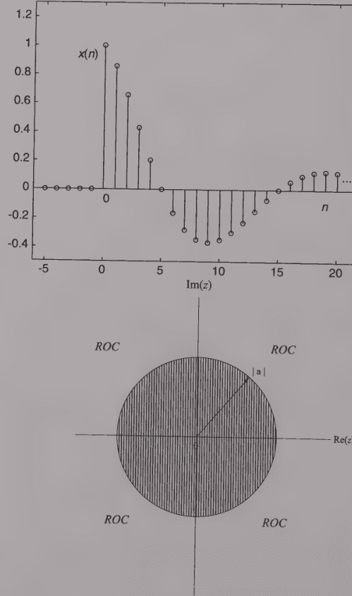

图 2.3: 序列和 ROC (a=0.9)。

3. 如果$\omega_0 = 0$，我们有

```
$X(z) = \frac{1-az^{-1}}{1-2az^{-1}+a^2z^{-2}} = \frac{1}{1-az^{-1}} ROC: |z| > |a|.$
```

### 2.8.6 逆z变换

从z变换恢复原始序列的公式涉及如下形式的复积分：

```
$X(n)=\frac{1}{2\pi j}\oint_{C} X(z)z^{n-1}dz \quad (2.86)$
```

其中轨迹在变换的$ROC$内沿逆时针方向选取。为了本文的目的，我们将暂不使用(2.86)来恢复序列。由于书中感兴趣的信号和滤波器是$z$的有理函数，使用部分分式或长除法来恢复序列更为方便。

**示例：** 确定对应于z变换的序列$x(n)$

```
$X(z)=\frac{z-1}{(z-0.7)(z-1.2)}=\frac{z-1}{z^{2}-1.9z+0.84}, ROC: |z|>1.2$
```

**解：** 使用长除法，我们得到：

```
$X(z)=z^{-1}+0.9z^{-2}+0.87z^{-3}+\frac{0.897z^{-2}-0.7308z^{-3}}{z^{2}-1.9z+0.84}$
```

显然，$x(0)=0, x(1)=1, x(2)=0.9, x(3)=0.87, \dots x(n)$是一个右侧无限序列，因为$ROC$位于半径$r=1.2$的圆之外。

如果$ROC:|z|<0.7$，则$x(n)$是一个左侧序列。我们通过长除法得到：

```
$X(z)=\frac{-1+z}{.84-1.9z+z^{2}}-\frac{1}{.84},-\frac{1}{.84}(1-\frac{1.9}{.84})z+\dots$
```

序列$\{x(n)\}$变为$z$的升次幂序列，并且是一个左侧序列，其中$x(0)=-1/.84=-1.19, x(-1)=1/.84[1-(1.9/.84)]=-1.5, x(-2)=\dots$。

## 2.9 练习

- 1. 设$u=(-4,-5)$和$v=(12,20)$为2D空间中的两个向量。找到$-5u, 3u+2v,-v,u+v$。对于任意$a,b\in R$，证明$|au|+|bv|\ge|au+bv|$。

- 2. 在多项式基集$\{t^{n}, n=0,1,2,\dots\}$中展开函数$f(t)=\sin t$。这是一个一个正交集吗？

- 3. 下三个向量构成一个基集：$e_1 = (1, 2, 1); e_2 = (1, 0, -2); e_3 = (0, 4, 5)$。这是一个正交基吗？如果不是，通过$e_k, k = 1, 2, 3$的线性组合形成一个正交基。

- 4. 设$e_1 = (1, 0)$和$e_2 = (0, 1)$为2D欧几得空间的单位向量。设$x_1 = (2, 3)$和$x_2 = (-1, 2)$为非正交基的单位向量。如果点$w$对于Euclidean空间的坐标为$(3, 1)$，确定该点相对于非正交坐标基的坐标。

- 5. 设$e_1 = (0.5, 0.5)$和$e_2 = (0, -1)$为双正交基。确定该基的对偶基。

- 6. 证明如果对于所有的$b_1$和$b_2$，有$\begin{bmatrix} a_{11} & a_{12} \\ a_{21} & a_{22} \end{bmatrix} \begin{bmatrix} b_1 \\ b_2 \end{bmatrix} = \begin{bmatrix} c_{11} & c_{12} \\ c_{21} & c_{22} \end{bmatrix} \begin{bmatrix} b_1 \\ b_2 \end{bmatrix}$，则$\mathbf{A} = \mathbf{C}$。

```
$\mathbf{A} = \begin{bmatrix} 1 & 2 \\ 2 & 4 \end{bmatrix}, \mathbf{B} = \begin{bmatrix} -2 & 1 \\ 1 & 3 \end{bmatrix}$
```

$(\mathbf{AB})^T = \mathbf{B}^T\mathbf{A}^T$，并验证它们是相同的。另外如果$\mathbf{AB}$等于$\mathbf{BA}$。

- 7. 找到矩阵$A$的特征值和特征向量：

```
$A = \begin{bmatrix} 3 & 1 & 0 \\ 1 & 2 & 2 \\ 0 & 2 & 3 \end{bmatrix}$
```

构造变换$P$，使得$P^{-1}AP$为对角矩阵。

- 8. 找到$x(n)$和$D_2(n)$的卷积，其中$x(n) = (1, 3, 0, 2)$对于$n=0, 1, 2$，且$D_2(n)$如方程(45)所示。

- 9. 找到以下序列的z变换并确定它们的$ROC$：

```
$(a) x(n) = \begin{cases} \cos(n), & n \ge 0 \\ 0, & n < 0. \end{cases}$
```

```
$(b) x(n) = \begin{cases} n, & 1 \le n \le m \\ 2m-n, & m+1 \le n \le 2m \\ 0, & \text{其他.} \end{cases}$
```

- 10. 找到以下系统的函数的z变换：

  - (a) $y(n) = 3x(n) - 5x(n-1) + x(n)$

  - (b) $y(n) = 4\delta(n) - \delta(n-1) + 5\delta(n$，其中$\delta(n) = \begin{cases} 1, & n=0; 0, & \text{其他.} \end{cases}$

## 2.10 参考文献

- 1. E. Guillemin. *The Mathematics of Circuit Analysis*. New York: Wiley, 1949.

- 2. Ben Noble and James W. *Applied Linear Algebra*. Upper River, NJ: Prentice Hall, 1988.

- 3. A. V. Oppenheim and R. W. Schafer. *Discrete-Time Signal Processing*. Upper River, NJ: Prentice Hall, 1989.

# 章节 分析

自傅里叶以来，他的分析一直应用于工程科学和社会科学的某些领域。简单来说，傅里叶方法是信号分析的最强大技术。它将信号从一个域转换到另一个域，揭示了信号的许多特征。人们通常将这种变换称为频谱，而原始信号的域通常是时域或空间域。傅里叶分析包含了傅里叶变换（傅里叶积分）和傅里叶级。傅里叶变换适用于定义在直线上的函数，而傅里叶级用于分析周期函数。由于小波分析在许多方面与傅里叶分析相似，本章目的是从信号分析的角度为读者提供傅里叶分析的概述，而不涉及数学细节。大多数数学等式和性质没有证明。

## 3.1 傅里叶级

数学家经常将傅里叶级和傅里叶变换分开处理，因为它们涉及两类不同的函数。然而，工程师一直被教导傅里叶变换是通过允许函数的周期$T$趋于无穷而对傅里叶级的扩展。我们将通过先讨论傅里叶级来遵循这一路径。实值周期函数$p(t)$ $[p(t) = p(t + T)]$的傅里叶级表示为：

Fundamentals of Wavelets: Theory, Algorithms, and Applications, Second Edition, By Jaideva C. Goswami and Andrew K. Chan Copyright ©2011 John Wiley & Sons, Inc.

# 傅里叶级 · 35

```
$p(t) = \sum_{k=-\infty}^{\infty} \alpha_k e^{ik\omega_0 t} \quad (3.1)$
```

其中：


```math
\alpha_k = \frac{1}{T} \int_{t_0}^{t_0+T} p(t) e^{-ik\omega_0 t} \quad (3.2)
```

其中 $\alpha_k$ 是傅里叶系数，周期 $T = 2\pi/\omega_0$，$\omega_0$ 为基频。函数集 $\{e_k\} = \{e^{ik\omega_0 t}\}$，$k \in \mathbb{Z}$，在 $L^2 [t_0, t_0+T]$ 中构成一个完备正交基：

```math
\int_{t_0}^{t_0+T} e_k e_l dt = T\delta_{k,l}.
```

系数 $\alpha_k$ 写成内积的形式：

```math
\alpha_k = \frac{1}{T}\langle e^{ik\omega_0 t}, p(t) \rangle \quad (0.3)
```

代表函数 $p(t)$ 在 $k\omega_0$ 处的正交分量。因此，傅里叶级数是 $p(t)$ 关于基集 $\{e_k\}$ 的正交展开。(3.1) 中的表示是精确的。然而，如果截断级数为 $\pm N$ 项（$k = -N, \dots, N$），将会产生误差。正如第 2.6 节所述，傅里叶系数作为正交投影，最小化了此类误差均方。傅里叶级数可以用其他形式表示。使用正弦和余弦函数的表示为：

```math
p(t) = \frac{a_0}{2} + \sum_{k=1}^{\infty} (a_k \cos k\omega_0 t + b_k \sin k\omega_0 t) \quad (3.4)
```

其中 $a_k$ 和 $b_k$ 是实量。使用仅正谐波的复数表示为：

```math
p(t) = c_0 + \sum_{k=1}^{\infty} c_k \cos(\omega_0 t + \theta_k) \quad (3.5)
```

其中：

```math
|c_k| = \sqrt{a_k^2 + b_k^2}, \quad \theta_k = \tan^{-1}\left(\frac{b_k}{a_k}\right), \quad (3.6)
```

其中 $c_k = |c_k|e^{i\theta_k}$ 是复量。$a_k$ 和 $b_k$ 的计算公式为：

# 36 傅里叶分析

```math
a_k = \frac{2}{T} \int_{0}^{T} p(t) \cos \omega_0 t dt, \quad (3.7)
```

```math
b_k = \frac{2}{T} \int_{0}^{T} p(t) \sin \omega_0 t dt. \quad (3.8)
```

## 3.2 示例

### 3.2.1 整流后的弦波

考虑函数 $p(t) = |\sin t|$，如图 3.1 所示，周期 $T = \pi$，且 $\omega_0 = 2\pi/T$ rad/s。由于函数 $p(t)$ 是关于 $t=0$ 的偶函数，即 $p(-t) = p(t)$，对于所有的 $k$，$b_k=0$。系数 $\{a_k\}$ 的计算如下：

```math
\begin{aligned}
a_k &= \frac{2}{\pi} \int_{0}^{\pi} \sin t \cos(2kt) dt \\
&= \frac{1}{\pi} \int_{0}^{\pi} [\sin(1-2k)t + \sin(1+2k)t] dt \\
&= -\frac{1}{\pi} \left[ \frac{\cos(1-2k)t}{1-2k} \right]_{0}^{\pi}
+ \frac{1}{\pi} \left[ \frac{\cos(1+2k)t}{1+2k} \right]_{0}^{\pi} \\
&= -\frac{4}{\pi} \frac{1}{4k^2-1}. \quad (3.9)
\end{aligned}
```

因此，$p(t)$ 的傅里叶级数为：

```math
p(t) = -\frac{2}{\pi} \sum_{k=1}^{\infty} \frac{4}{4k^2-1} \cos 2kt.
```

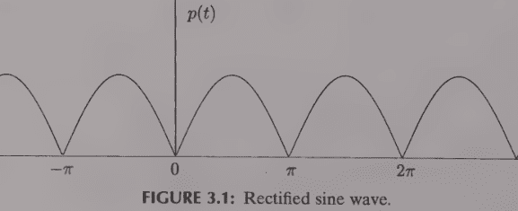

### 3.2.2 梳波函数与傅里叶级数核 $K_N(t)$

在这个示例中，我们想要找到周期脉冲串（即周期性的 $\delta(t)$ 序列）的傅里叶级数。我们将周期为 $T$ 的脉冲串写为：

```math
I_T(t) = \sum_{n=-\infty}^{\infty}\delta(t-nT) = \sum_{k=-\infty}^{\infty}\alpha_k e^{jk\omega_0t} \quad (3.10)
```

傅里叶系数为：

```math
\alpha_k = \frac{1}{T}\int_{-T/2}^{T/2}\sum_{n=-\infty}^{\infty}\delta(t-nT)e^{-jk\omega_0t}dt. \quad (3.11)
```

由于积分范围内唯一的 $n$ 是 $n=0$，我们得到：

```math
\alpha_k = \frac{1}{T}, \quad k \in \mathbb{Z}
```

因此，脉冲串 $I_T(t)$ 的傅里叶级数展开为：

```math
I_T(t) = \frac{1}{T}\sum_{k=-\infty}^{\infty}e^{jk\omega_0t}. \quad (3.12)
```

研究 (3.12) 的截断版本是很有意义的。令 $K_N(t)$ 为 $I_T(t)$ 的 $(2N+1)$ 项有限傅里叶求和：

```math
K_N(t) = \frac{1}{T}\sum_{k=-N}^{N}e^{jk\omega_0t}. \quad (3.13)
```

$K_N(t)$ 被称为傅里叶级数核。(3.13) 中的级数求和给出：

```math
K_N(t) = \frac{1}{T}\frac{\sin(N+\frac{1}{2})\omega_0t}{\sin\frac{\omega_0t}{2}}
```

> 在经典意义上不是一个函数。它被称为广义函数或分布。(3.12) 的脉冲串在工程文献中被称为梳波函数（见图 3.3）。

傅里叶级数的若干性质，如泊松公式、部分和以及采样定理需要使用傅里叶变换。我们将在本章后面考虑这些主题。

## 3.3 傅里叶变换

为了将傅里叶级数扩展到傅里叶变换，让我们考虑方程 (3.1) 和 (3.2)。(3.1) 中的函数 $p(t)$ 可以使用 (3.2) 表示为：

```math
\begin{aligned}
p(t) &= \sum_{k=-\infty}^{\infty}
\left[\int_{-T/2}^{T/2} p(t')e^{-jk\omega_0t'} dt'\right]e^{jk\omega_0 t} \\
&= \frac{1}{2\pi}\sum_{k=-\infty}^{\infty}
\int_{-T/2}^{T/2} p(t')e^{-jk\omega_0t'} dt'. \quad (3.15)
\end{aligned}
```

我们将周期 $T$ 扩展到无穷大，使得 $\omega_0$ 趋向于 $\omega$。(3.15) 中的求和变为：

```math
p(t) = \frac{1}{2\pi} \int_{-\infty}^{\infty} p(t')e^{-j\omega t'} dt'. \quad (3.16)
```

括号内的积分由函数 $\hat{p}(\omega)$ 表示：

```math
\hat{p}(\omega) = \int_{-\infty}^{\infty} p(t')e^{-j\omega t'} dt', \quad (3.17)
```

(3.16) 变为：

```math
p(t) = \frac{1}{2\pi} \int_{-\infty}^{\infty} \hat{p}(\omega)e^{j\omega t} d\omega. \quad (3.18)
```

从这里开始，我们将使用 $f(t)$ 表示函数。实变量 $t$ 的有限能量函数 $f(t) \in L^2(\mathbb{R})$ 的傅里叶变换定义为：

```math
\hat{f}(\omega) = \int_{-\infty}^{\infty} f(t)e^{-j\omega t} dt. \quad (3.19)
```

在第 2 章描述的内积表示法中，傅里叶变换也可以表示为：

```math
\hat{f}(\omega) = \langle f(t), e^{j\omega t} \rangle. \quad (3.20)
```

我们应该强调 $\hat{f}(\omega)$ 是复值函数，可以通过幅度和相位表示为：

```math
\hat{f}(\omega) = |\hat{f}(\omega)|e^{j\phi(\omega)}. \quad (3.21)
```

然而，从 $f(t)$ 域到 $\hat{f}(\omega)$ 的映射是从 $\mathbb{R}$ 到 $\mathbb{C}$（即从 $t$ 轴到 $\omega$ 轴），尽管实值函数映射到了复值。(3.22) 的解释非常重要。该方程说明对于 $\omega_1$，$\hat{f}(\omega_1)$ 代表 $f(t)$ 在 $\omega_1$ 处的分量。如果我们能确定 $\omega$ 轴上 $f(t)$ 的所有分量，那么这些分量的叠加将恢复原始函数 $f(t)$：

```math
f(t) = \frac{1}{2\pi} \int_{-\infty}^{\infty} \hat{f}(\omega)e^{j\omega t} d\omega. \quad (3.22)
```

因此 (3.22) 可以看作是一个从其分量产生 $f(t)$ 的叠加积分。该积分被称为 $\hat{f}(\omega)$ 的逆傅里叶变换。如果变量 $t$ 代表时间，$\hat{f}(\omega)$ 称为 $f(t)$ 的频谱。如果 $t$ 代表空间，$\hat{f}(\omega)$ 称为空间频谱。

傅里叶变换对于小波分析的发展非常重要，后续章节中经常使用。我们将它作为一个示例来介绍 $\delta$ 函数的一些性质。

让我们回想：

```math
\int_{-\infty}^{\infty} f(t)\delta(t-y)dt = f(y). \quad (3.23)
```

因此，$\delta(t)$ 的傅里叶变换为：

```math
\hat{\delta}(\omega) = \int_{-\infty}^{\infty} \delta(t)e^{-j\omega t}dt = e^{-j\omega 0} = 1. \quad (3.24)
```

从 $\hat{\delta}(\omega)$ 的逆变换，恒等式：

```math
\delta(t) = \frac{1}{2\pi} \int_{-\infty}^{\infty} \hat{\delta}(\omega)e^{j\omega t} d\omega. \quad (3.25)
```

已经建立。(3.22) 的逆变换现在显示为：

```math
f(t) = \frac{1}{2\pi} \int_{-\infty}^{\infty} \hat{f}(\omega)e^{j\omega t} d\omega
```

（注：此处原文公式似乎有误，翻译已根据逻辑修正。）

（此处修正：原文逻辑应为从 $f(t)$ 域到 $\hat{f}(\omega)$ 的映射是从 $\mathbb{R}$ 到 $\mathbb{C}$，尽管实值函数 $f(t)$ 被映射到了复值函数 $\hat{f}(\omega)$。）

## 3.4 傅里叶变换的性质

由于本章重点不是详细介绍傅里叶分析，我们只讨论与小波分析相关的性质。

### 3.4.1 线性

如果 $f(t) = \alpha f_1(t) + \beta f_2(t)$，其中 $\alpha$ 和 $\beta$ 是常数，那么傅里叶变换为：

```math
\begin{aligned}
\hat{f}(\omega)
&= \int_{-\infty}^{\infty} f(t)e^{-j\omega t}dt \\
&= \alpha \int_{-\infty}^{\infty} f_1(t)e^{-j\omega t}dt
+ \beta \int_{-\infty}^{\infty} f_2(t)e^{-j\omega t}dt \\
&= \alpha \hat{f}_1(\omega)+\beta \hat{f}_2(\omega). \quad (3.26)
\end{aligned}
```

将 (3.26) 扩展到有限和是容易的。

### 3.4.2 时间平移与时间缩放

设函数 $f(t)$ 平移了 $t_0$。频谱发生了变化。事实上，平移函数 $f_0(t) := f(t-t_0)$ 的频谱由下式给出：

```math
\begin{aligned}
\hat{f}_0(\omega)
&= \int_{-\infty}^{\infty} f(t-t_0)e^{-j\omega t}dt \\
&= \int_{-\infty}^{\infty} f(u)e^{-j\omega(u+t_0)}du \\
&= e^{-j\omega t_0}\hat{f}(\omega) \\
&= |\hat{f}(\omega)|e^{j(\phi(\omega)-\omega t_0)}. \quad (3.27)
\end{aligned}
```

设 $a$ 为非零常数；$\hat{f}_a(t):=f(at)$ 的谱由下式给出：

```math
\begin{aligned}
\hat{f}_a(\omega)
&= \int_{-\infty}^{\infty} f(at)e^{-j\omega t}dt \quad (3.28)\\
&= \int_{-\infty}^{\infty} f(u)e^{-j\omega\left(\frac{u}{a}\right)}
d\left(\frac{u}{a}\right) \quad (3.29)\\
&= \frac{1}{|a|}\hat{f}\left(\frac{\omega}{a}\right). \quad (3.30)
\end{aligned}
```

取决于 $a$ 大于还是小于 1，谱会相应地扩张或收缩。我们将在后续的小波分析发展中经常看到这一重要性质。

### 3.4.3 频率平移与频率缩放

频率平移和缩放的结果遵循类似的方法。如果 $\hat{f}_0(\omega):=\hat{f}(\omega-\omega_0)$，则

```math
f_0(t)=f(t)e^{j\omega t}, \quad (3.31)
```

如果对于非零值 $a$ 有 $\hat{f}_a(\omega):=\hat{f}(a\omega)$，则

```math
f_a(t)=\frac{1}{|a|}f\left(\frac{t}{a}\right). \quad (3.32)
```

### 3.4.4 矩阶

函数的 $n$ 阶矩定义为：

```math
M_n:=\int_{-\infty}^{\infty}t^nf(t)dt. \quad (3.33)
```

一阶矩为：

```math
\begin{aligned}
M_1
&=\int_{-\infty}^{\infty}tf(t)dt \\
&=(-j)^{-1}\frac{d}{d\omega}
\int_{-\infty}^{\infty}f(t)e^{-j\omega t}dt\bigg|_{\omega=0} \\
&=(-j)^{-1}\frac{d\hat{f}(\omega)}{d\omega}\bigg|_{\omega=0}. \quad (3.34)
\end{aligned}
```

将此公式扩展到 $n$ 阶矩得到：

```math
M_n=(-j)^{-n}\frac{d^n}{d\omega^n}\hat{f}(\omega)\bigg|_{\omega=0}. \quad (3.35)
```

### 3.4.5 卷积

两个函数 $f_1(t)$ 和 $f_2(t)$ 的卷积定义为：

```math
f(t) = \int_{-\infty}^{\infty} f_1(y)f_2(t-y)dy. \quad (3.36)
```

我们用符号表示 (3.36) 为：

```math
f(t) = f_1(t)*f_2(t). \quad (3.37)
```

注意，如果 $f_2(t)$ 是 $\delta(t)$，卷积积分将恢复函数 $f_1(t)$。众所周知，由图 3.4 中的框图符号表示的线性系统的输入-输出关系为：

```math
O(t) = h(t)*i(t), \quad (3.38)
```

其中 $h(t)$ 是系统响应函数。如果 $i(t)$ 是脉冲函数，则输出函数 $O(t)$ 与 $h(t)$ 相同。对于任意输入函数 $f(t)$，卷积积分：

```math
O(t) = \int_{-\infty}^{\infty} h(\tau)i(t-\tau)d\tau \quad (3.39)
```

代表了一系列输入脉冲函数产生的输出叠加，其振幅由输入信号调制。很容易证明 (3.36) 卷积积分的谱域表示为：

```math
\hat{f}(\omega) = \hat{f}_1(\omega)\hat{f}_2(\omega).
```

### 3.4.6 Parseval 定理

Parseval 定理指出：

```math
\int_{-\infty}^{\infty} |f(t)|^2 dt = \frac{1}{2\pi} \int_{-\infty}^{\infty} |\hat{f}(\omega)|^2 d\omega. \quad (3.40)
```

图 3.4：线性系统。傅里叶分析。

两个函数 $f(t)$ 和 $g(t)$ 通过 Parseval 恒等式与它们的傅里叶变换 $\hat{f}(\omega)$ 和 $\hat{g}(\omega)$ 相关：

```math
(f(t), g(t)) = \frac{1}{2\pi}(\hat{f}(\omega), \hat{g}(\omega)). \quad (41)
```

这可以通过下式推导。


`$(f(t), g(t)) = \int_{-\infty}^{\infty} f(t)\overline{g(t)}dt = \frac{1}{2\pi}\int_{-\infty}^{\infty}\hat{f}(\omega)\left(\int_{-\infty}^{\infty}g(t)e^{-j\omega t}dt\right)d\omega = \frac{1}{2\pi}\int_{-\infty}^{\infty}\hat{f}(\omega)\overline{\hat{g}(\omega)}d\omega \quad (42)$`

特别是当`$g(t)=f(t)$`时，我们得到了 (40) 中所谓的 Parseval 定理。方程 (40) 是关于信号能量的陈述。它说明在时域计算的总能量`$\int_{-\infty}^{\infty}|f(t)|^2dt$`等于在谱域计算的总能量`$\frac{1}{2\pi}\int_{-\infty}^{\infty}|\hat{f}(\omega)|^2d\omega$`。

Parseval 定理允许在谱域或时域考虑信号能量，并在两者之间转换。

## 3.5 傅里叶变换示例

我们评估几个应用中经常出现的函数的傅里叶变换。为了这个目的，我们可以直接使用 3.4 节中的定义或使用傅里叶变换的性质。

### 3.5.1 矩脉冲

矩脉冲（图 3.5）`$r(t)$`定义为

```
$r(t)=u(t+T)-u(t-T) \quad (43)$
= \begin{cases} 1 & |t|<T \\ 0 & \text{otherwise}. \end{cases} \quad (44)$
```

图 3.5：矩脉冲及其傅里叶变换。

图 3.6：三角形函数及其傅里叶变换。

我们得到

`$\hat{r}(\omega) = \int_{-\infty}^{\infty} r(t)e^{-j\omega t}dt = \int_{-T}^{T} e^{-j\omega t}dt = \frac{2T\sin\omega T}{\omega}. \quad (45)$`

函数`$\sin\omega T/\omega$`称为 sinc 函数，是矩脉冲的傅里叶变换。我们在此对于`$T=1/2$`，函数`$r(t)=\chi_{[0,1)}(t)$`被称为特征函数或一阶 B 样条。这是一个重要的函数，将在小波理论的发展中再次提到。

### 3.5.2 三角形脉冲

通过对两个矩脉冲进行卷积，我们得到了三角形脉冲（图 3.6），其表达式为

```
$T_r(t)=r(t)*r(t) \quad (46)$
= \begin{cases} 2T(1+\frac{t}{2T}) & -2T\le t\le 0 \\ 2T(1-\frac{t}{2T}) & 0\le t\le 2T \\ \text{otherwise.} \end{cases} \quad (47)$
```

根据卷积定理，我们有

```
$\hat{T}(\omega) = \left[ \frac{2T \sin \omega T}{\omega T} \right]^2 \quad (48)$
=4T^2 \frac{\sin^2(\omega T)}{(\omega T)^2}. \quad (49)$
```

如果`$T=1/2$`，

```
$T_r(t) = \begin{cases} 1+t & -1 \le t \le 0 \\ 1-t & 0\le t \le 1 \\ 0 & \text{otherwise}, \end{cases} \quad (50)$
```

且`$\hat{T}(\omega) = \left( \frac{\sin(\omega/2)}{\omega} \right)^2$`。`$T=1/2$`的三角形函数被称为二阶 B 样条，它作为样条小波的缩放函数起着重要作用。

### 3.5.3 高斯函数

高斯函数是概率论和随机信号分析最重要的函数之一。它在后 Gabor 变换中起着核心作用。单位振幅的高斯函数表示为

```
$g(t) = e^{-\alpha t^2}. \quad (51)$
```

其傅里叶变换`$\hat{g}(\omega)$`可以很容易计算为

```
$\hat{g}(\omega) = \int_{-\infty}^{\infty} e^{-\alpha t^2} e^{-j\omega t} dt
= \int_{-\infty}^{\infty} e^{-\alpha (t+\frac{j\omega}{2\alpha})^2} dt
= \sqrt{\frac{\pi}{\alpha}} e^{-\frac{\omega^2}{4\alpha}}. \quad (52)$
```

有趣的是高斯函数的傅里叶变换也是高斯函数。波形及其变换如图 3.7 所示。参数`$\alpha$`可控制高斯的宽度。

## 3.6 泊松和与分解

回到傅里叶级数，讨论通过变换性质大大简化泊松和。在许多应用中，需要从有限能量的非周期函数构造周期函数。设`$f(t) \in L^2(\mathbb{R})$`。`$f(t)$`的周期版本`$f_p(t)$`通过下式得到

```
$f_p(t) := \sum_{n=-\infty}^{\infty} f(t+2\pi n), \quad (53)$
```

其中我们假设`$T=2\pi$`为`$f_p(t)$`的周期。因此，`$\omega_0=2\pi/T=1$`，`$f_p(t)$`的傅里叶表示为

```
$f_p(t) = \sum_{k=-\infty}^{\infty} c_k e^{jkt}, \quad (54)$
```

其中系数`$c_k$`给出

```
$c_k = \frac{1}{2\pi} \int_{0}^{2\pi} f_p(t)e^{-jkt}dt
= \frac{1}{2\pi} \int_{0}^{2\pi} \sum_{n\in\mathbb{Z}} f(t+2\pi n)e^{-jkt}dt
= \frac{1}{2\pi} \sum_{n\in\mathbb{Z}} \int_{0}^{2\pi(n+1)} f(\xi)e^{-j(\xi-2\pi n)}d\xi, \quad (55)$
```

# 4. 傅里叶分析 48

这里使用了变量代换`$\xi=t+2\pi n$`。由于求和和积分限实际上将积分扩展到了整个实数线`$\mathbb{R}$`，我们可以写成

```
$c_k = \frac{1}{2\pi} \int_{-\infty}^{\infty} f(\xi)e^{-ik\xi}d\xi = \frac{1}{2\pi} \hat{f}(k), \quad (3.56)$
```

其中使用了逆傅里叶变换的定义。结合 (3.53)、(3.54) 和 (3.56)，我们得到了所谓的*泊松求和公式*

```
$\sum_{n=-\infty}^{\infty} f(t+2\pi n) = \frac{1}{2\pi} \sum_{k=-\infty}^{\infty} \hat{f}(k)e^{ikt}. \quad (3.57)$
```

对于任意的`$T$`，该公式推广为：

```
$\sum_{n=-\infty}^{\infty} f(t+nT) = \frac{1}{T} \sum_{k=-\infty}^{\infty} \hat{f}(k\omega_0)e^{ik\omega_0t}. \quad (3.58)$
```

如果`$g(t)$`是`$f(at)$`的缩放版本，

```
$g(t) = f(at), a > 0, \quad (3.59)$
```

我们有

```
$\hat{g}(\omega) = \frac{1}{a} \hat{f}\left(\frac{\omega}{a}\right). \quad (3.60)$
```

`$f(at)$`的泊松求和公式：

```
$\sum_{n=-\infty}^{\infty} f(at+2\pi an) = \frac{1}{2\pi a} \sum_{k=-\infty}^{\infty} \hat{f}\left(\frac{k}{a}\right)e^{ikt}. \quad (3.61)$
```

如果将`$at$`重命名为`$t$`，我们有：

```
$\sum_{n=-\infty}^{\infty} f(t+2\pi an) = \frac{1}{2\pi a} \sum_{k=-\infty}^{\infty} \hat{f}\left(\frac{k}{a}\right)e^{ikt}. \quad (3.62)$
```

在后续章节的推导中，还需要另外两种形式的泊松和。在这里列出不作证明。证明留作练习。

```
$\sum_{k\in\mathbb{Z}} \hat{f}(\omega+2\pi k) = \sum_{k\in\mathbb{Z}} f(k)e^{-ik\omega} \quad (3.63)$
```

```
$\frac{1}{a} \sum_{k\in\mathbb{Z}} \hat{f}\left(\frac{\omega+2\pi k}{a}\right) = \sum_{k\in\mathbb{Z}} f(ak)e^{-ik\omega} \quad (3.64)$
```

# 泊松求和与单位的划分 49

### 3.6.1 的的划分

泊松求和的一个直接结果是：找到一个基，使得单位可以表示为该基的线性和。我们将这种性质称为“单位的划分”（partition of unity）。在 (3.62) 中令`$a = 1/2\pi$`。泊松求和公式变为：

```
$$\sum_{n=-\infty}^{\infty} f(t+n) = \sum_{k=-\infty}^{\infty} \hat{f}(2\pi k)e^{j2\pi kt} \quad (3.65)$$
```

如果函数`$f(t) \in L^2(\mathbb{R})$`的频谱满足

```
$$\hat{f}(2\pi k) = \delta_{0,k} \text{ 对于 } k \in \mathbb{Z}, \quad (3.66)$$
```

即：

```
$$\hat{f}(0) = 1,$$
```

那么根据 (3.65) 可以得出：

```
$$\sum_{n\in\mathbb{Z}} f(t+n) = 1. \quad (3.67)$$
```

`$B$`-样条的一阶和二阶是满足这一性质的函数的良好示例。

#### 一阶 B-样条

```
$N_1(t) := \chi_{[0,1)}(t)$
$\hat{N}_1(\omega) = \int_0^1 e^{-jx\omega} dt = \frac{1-e^{-j\omega}}{j\omega}$
$\hat{N}_1(0) = \lim_{\omega\to 0} \frac{1-e^{-j\omega}}{j\omega} = 1$
$\hat{N}_1(2\pi k) = 0, \text{ 对于 } k \in \mathbb{Z} \setminus \{0\}.$
```

因此

```
$$\sum_{k\in\mathbb{Z}} N_1(t+k) = 1. \quad (3.68)$$
```

#### 二阶 B-样条

`$N_2(t) = N_1(t) * N_1(t) \quad (3.69)$`

`$N_2(t) = \begin{cases} t & t \in[0,1) \\ 2-t & t \in[1,2) \\ 0 & \text{其他} \end{cases} \quad (3.70)$`

根据卷积性质，我们有

```
$$\hat{N}_2(\omega) = (\hat{N}_1(\omega))^2 \quad (3.71)$$
```

```
$$\hat{N}_1(\omega) = \left(\frac{1-e^{-j\omega}}{j\omega}\right)^2 \quad (3.72)$$
```

再次在此发现

```
$$\hat{N}_2(0)=1; \quad (3.73)$$
```

```
$$\hat{N}_2(2\pi k)=0; \quad k \in \mathbb{Z}\setminus\{0\} \quad (3.74)$$
```

因此，`$N_2(t)$`也满足单位划分条件。事实上，根据`$B$`-样条的递归关系：

```
$N_m(t) = N_{m-1}(t) * N_1(t) \quad (3.75)$
```

```
$N_m(t) = \int_0^t N_{m-1}(t-\tau)d\tau \quad (3.76)$
```

我们有`$\hat{N}_m(\omega) = \left(\frac{1-e^{-j\omega}}{j\omega}\right)^m$`，这满足单位划分的要求。因此任意阶的`$B$`-样条都具有该性质。单位划分的图示如图3.所示。

# 采样定理

采样定理对于数字分析至关重要。它指出，如果信号`$f(t)$`是带宽为`$2\Omega$`的带限信号，那么信号`$f(t)$`可以从等距采样点精确重构。点之间的距离采样周期`$h$`不应小于`$\pi/\Omega$`。函数`$f(t)$`通过公式恢复：

```
$f(t) = h \sum_{k\in\mathbb{Z}} f(kh) \frac{\sin[\Omega(t-kh)]}{\pi(t-kh)}, \quad k\in\mathbb{Z}. \quad (3.77)$
```

如果`$h = \pi/\Omega$`，采样频率`$f_s=1/h=\Omega$`称为奈奎斯特速率。理论上，如果`$h < \pi/\Omega$`，则总是完美重构`$f(t)$`。然而，由于 sinc 函数的无限性，实际上我们无法误差恢复`$f(t)$`。让`$\hat{f}(\omega)$`为`$f(t)$`的傅里叶变换：

```
$$\hat{f}(\omega) = \int_{-\infty}^{\infty} f(t)e^{-j\omega t}dt.$$
```

可以使用辛普法则近似积分：

```
$$\hat{f}(\omega) \equiv \hat{F}(\omega) = h \sum_{k\in\mathbb{Z}} f(kh)e^{-j\omega kh} \quad (3.78)$$
```

使用 (3.64) 中的泊松求和公式，我们可以重写`$\hat{F}(\omega)$`：

```
$$\hat{F}(\omega) = h \sum_{k\in\mathbb{Z}} f(kh)e^{-j\omega kh} = \sum_{k\in\mathbb{Z}} \hat{f}\left(\frac{\omega+2\pi k}{h}\right) = \hat{f}(\omega) + \sum_{k\in\mathbb{Z}\setminus\{0\}} \hat{f}\left(\omega+\frac{2\pi k}{h}\right) \quad (3.79)$$
```

因此`$\hat{F}(\omega)$`包含了`$\hat{f}(\omega)$`以及沿`$\omega$`轴平移的无限`$\hat{f}(\omega)$`副本。为了让`$\hat{f}(\omega)$`与其副本不相交，位移`$2\pi/h$`必须为`$2\Omega$`（见图3.9）：

```
$$\frac{2\pi}{h} \ge 2\Omega, \quad h \le \frac{\pi}{\Omega}. \quad (3.80)$$
```

# 5. 傅里叶分析 52

**图 3.9：** (a) 欠采样 (`$S = 2\pi/h < 2\Omega$`)。(b) 过采样 (`$S = 2\pi/h > 2\Omega$`)。

为了恢复原始函数，我们使用频谱窗口：

```
$$\hat{W}(\omega) = \begin{cases} 1 & |\omega| \leq \Omega \\ 0 & \text{其他} \end{cases} \quad (3.81)$$
```

并通过下式恢复`$\hat{f}(\omega)$`：

```
$$\hat{f}(\omega) = \hat{F}(\omega)\hat{W}(\omega). \quad (3.82)$$
```

从卷积定理得到`$f(t)$`：

`$f(t) = F(t) * W(t)$`

由于`$W(t) = \sin(\Omega t)/\pi t$`是知的，我们使用公式计算`$f(t)$`：

```
$f(t) = h \sum_{k\in\mathbb{Z}} f(kh) \frac{\sin[\Omega(t-kh)]}{\pi(t-kh)} \quad (3.84)$
```

其中我们使用了 (3.77)。函数`$f(t)$`通过 sinc 函数作为插值核对采样值进行重构。

## 3.8 部分和与吉布现象

傅里叶级数的部分和是对原始周期函数的最小二乘近似。让`$p_M(t)$`为周期为`$T$`的周期函数`$p(t)$`的傅里叶级数的`$(2M+1)$`项部分和：

```
$p_M(t)=\sum_{k=-M}^{M}\alpha_ke^{jk\omega_0t}. \quad (3.87)$
```

其中傅里叶系数为：

```
$\alpha_k=\frac{1}{T}\int_{-T/2}^{T/2}p(t)e^{-jk\omega_0t}dt \quad (3.88)$
```

将`$\alpha_k$`代回 (3.87)，我们部分和：

```
$p_M(t)=\sum_{k=-M}^{M}\frac{1}{T}\int_{-T/2}^{T/2}p(\tau)e^{-jk\omega_0\tau}e^{jk\omega_0t}d\tau \quad (3.89)$
```

## 54 傅里叶分析

通过交换求和与积分的顺序，我们得到


$$
p_M(t)=\int_{T-T/2}^{T+T/2}p(\tau)\sum_{k=-M}^{M}e^{jk\omega_0(t-\tau)}d\tau
$$

$$
=\int_{T-T/2}^{T+T/2}p(\tau)\frac{\sin\left(M+\frac{1}{2}\right)(t-\tau)\omega_0}{\sin\left(\frac{1}{2}\right)(t-\tau)\omega_0}d\tau.\quad (3.90)
$$

这是原始周期函数与 3.2.2 节使用的傅里级数核之间的卷积。我们可以很容易看到振荡特性 `K_N` 被带入部分和。如果 `p(t)` 是矩形脉冲串或具有跳跃不连续点的周期函数，部分傅里叶级将在不连续点周围出现振荡。这被称为吉布斯现象（Gibbs’s phenomenon）。无论取多少项进行近似，过冲百分比都保持不变。当 `M \to \infty` 时，和收敛于不连续点的中点 [4]。

## 3.9 离散时间信号的傅里叶分析

由于傅里叶级数系数和傅里叶变换的计算需要积分，因此函数必须能够用初函数（如正余弦函数、指数函数以及幂级数项）解析描述。通常，我们在现实生活中遇到的大多数信号无法用初函数表示。我们必须使用数值算法来计算频谱。如果信号经过采样，则离散傅里级数和离散时间傅里叶变换是可以计算的。它们产生了原始模拟信号的近似频谱。

### 3.9.1 离散傅里叶基和离散傅里级数

对于一个周期为 `N` 的给定周期序列，我们有：

$$
f_p(n+mN)=f_p(n),\quad m\in\mathbb{Z}.\quad (3.91)
$$

该周期序列的傅里叶基只有 `N` 个基函数，即：

$$
e_k(n)=e^{\frac{j2\pi}{N}kn},\quad k=0,1,\ldots,N-1.\quad (3.92)
$$

我们可以很容易地证明基集的周期性：

$$
e_{k+N}=e^{\frac{j2\pi(k+N)}{N}n}=e_k\cdot e^{j2\pi n}=e_k.\quad (3.93)
$$

因为对于整数 `n`，`e^{j2\pi n}=1`。因此，`f_p(n)` 的展开形式为：

$$
f_p(n)=\sum_{k=0}^{N-1}\alpha_ke_k(n).\quad (3.94)
$$

$$
=\sum_{k=0}^{N-1}\alpha_ke^{\frac{j2\pi kn}{N}}.\quad (3.95)
$$

然后我们可以通过以下公式计算系数：

$$
\alpha_k=\left(f_p(n),e^{\frac{j2\pi kn}{N}}\right)
=\frac{1}{N}\sum_{n=0}^{N-1}f_p(n)e^{\frac{-j2\pi kn}{N}}.\quad (3.96)
$$

方程 (3.94) 和 (3.96) 构成了离散周期序列的变换对。从 (3.96) 可以很容易看出，离散周期序列的变换对。

4. 求 `f(t)=e^{jxt},-\pi<t<\pi` 的傅里叶级数。

5. 确定高斯函数 `g(t)=Ae^{-\alpha t^2}` 的能量归一化常数 `A`，并导出傅里叶变换的表达式。

6. 将泊松求和公式扩展到任意周期 `T`。

7. 在谱域内（`a>0`）推导出以下泊松求和公式：

$$
\sum_k\hat{f}(\omega+2\pi k)=\sum_kf(k)e^{-jk\omega}
$$

$$
\frac{1}{a}\sum_k\hat{f}\left(\frac{\omega+2\pi k}{a}\right)
=\sum_kf(ak)e^{-jk\omega}
$$

## 3.12 参考文献

1. R. S. Elliott. *The Theory of Antenna Arrays. Vol. 2 of Microwave Scanning Antennas*, ed. R. C. Hansen. San Diego, CA: Academic Press, 1966.
2. A. Papoulos. *The Fourier Integral and Its Applications*. New York: McGraw-Hill, 1962.
3. K. Iizuka. *Engineering Optics*. 2nd ed. New York: Springer Verlag, 1986.
4. W. W. Harman and D. W. Lytle. *Electrical and Mechanical Networks, An Introduction to Their Analysis*. New York: McGraw-Hill, 1962.

# 第四章 时频分析

我们在上一章中相当简要地总结了傅里叶分析，以刷新读者的记忆，并指出了分析中几个重要的概念，这些概念在我们讨论时频分析时将很有用。从傅里叶变换的定义 (3.19) 可以观察到，在知道整个实线 `(-\infty,\infty)` 上的波形之前，无法进行积分。这是因为函数 `e^{it\omega}` 或 `\cos\omega t` 和 `\sin\omega t` 是全局函数。这意味着函数在沿 `t` 轴上任何一点的微小扰动都会影响 `\omega` 轴上的每一个点，反之亦然。如果我们想象 `t` 轴上任意一点的信号 `f(t)`，它将传播通过整个 `\omega` 轴。对傅里叶变换的另一个观察是，积分一次只能对一个频率进行计算。从信号处理的角度来看，这非常不利。尽管有快速算法可以数字地计算变换，但无法实时进行。在计算离散变换或傅里叶变换之前，所有必要的数据必须存储在内存中。

尽管傅里叶分析无疑是最通用的方法，但当人们对信号的局部频率感兴趣时，它就变得不足了。换句话说，傅里叶频谱没有提供关于信号任何时域信息。为了证明这一点，让我们检查图 4.1a 所示的函数，它代表时域中频率为 4 Hz 的截断正弦波，并带有 `t=0.7` s 和 `t=1.3` s 的扰动。我们在上一章中看到，时域中的正弦波在频域中表现为狄尔塔函数，反之亦然。观察图 4.1b 中 4 Hz 附近的频率扩散是由于正弦波的截断导致的。我们从图 4.1b 所示的傅里叶频谱得出结论：

小波基础：理论、算法与应用，第二版，

Jaideva C. Goswami 和 Andrew K. Chan 著

Copyright © 2011 John Wiley & Sons, Inc.

62 时频分析

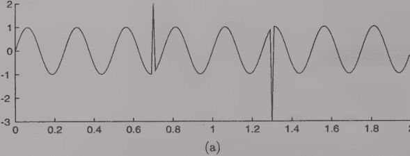

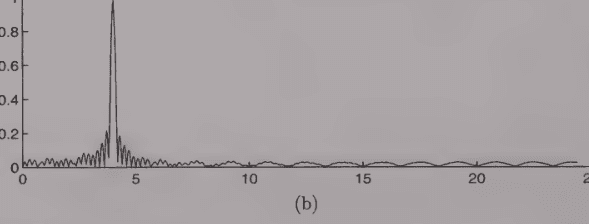

**图 4.1：** (a) 在 `t=0.7` 和 `t=1.3` 处有扰动的正弦信号。(b) 它的幅度谱。

4 Hz 附近的尖锐脉冲主要源于 4 Hz 的正弦波，而出现在整个频率轴上的微小波纹主要源于时域中的某些狄尔塔函数（剧烈变化）。然而，我们无法通过观察图 4.1b 的频谱来指出这些狄尔塔函数在时间轴上的位置。这可以用狄尔塔函数的傅里叶表示 (3.25) 简单解释。狄尔塔函数需要无限多个正弦函数，这些函数在 `t=0` 时发生性干涉，而在所有 `t\neq0` 的点上相互破坏性干涉以产生零。这显示了使用全局函数 `e^{ilt}` 表示局部函数的极端繁琐和低效。为了纠正这一缺陷，需要局部分析来结合时域和频域分析以实现时频分析，通过它可以提取信号的局部频率内容。这非常重要，因为在实践中，我们可能只对频谱的某些部分感兴趣，因此我们可能想知道时域信号的哪个部分是频谱中给定特征的主要原因。

常识告诉我们，为了了解信号的局部频率内容，我们应该首先从给定内容中移除所需的部分，然后对被移除的部分取傅里叶变换。这种时频分析的方法被称为短时变换。在讨论 STFT 之前，让我们先讨论窗的概念，通过这种方法我们可以提取信号的局部频率内容。

为了了解信号的局部频率内容，我们应该首先从给定内容中移除所需的部分，然后对被移除的部分取傅里叶变换。这种时频分析的方法被称为短时变换。在讨论 STFT 之前，让我们先讨论窗的概念，通过这种方法我们可以提取信号的局部频率内容。

## 4.1 窗函数

信号的局部部分可以通过将信号乘以另一个在区间之外为零的函数来实现。设 `\phi(t)\in L^2(\mathbb{R})` 为一个窗。特别是，如果 `\phi(t)=\chi_{[b-\tau,b+\tau]}`，如图 4.1 所示，窗最重要的参数是它的中心和宽度；其均方（m.s.）中心 `t^*` 由 (4.2) 定义为：

$$
t^*=\frac{\int_{-\infty}^{\infty}t|\phi(t)|^2dt}{\int_{-\infty}^{\infty}|\phi(t)|^2dt}
$$

以及（m.s.）半径 `\Delta_{\phi}` 由 (4.3) 定义为对于图 4.2 中的窗，均方宽度小于 `1/\sqrt{3}`。


## 4.2 频率窗

上述具有有限 `\Delta_{\phi}` 的函数 `\phi(t)` 被称为时间窗。类似，我们可以得到一个频率窗 `\phi(\omega)`，其中心 `\omega^*` 和均方（m.s.）半径 `\Delta_{\omega}` 由 (4.2) 和 (4.3) 定义为：

$$
\omega^*=\frac{\int_{-\infty}^{\infty}\omega|\hat{\phi}(\omega)|^2d\omega}{\int_{-\infty}^{\infty}|\hat{\phi}(\omega)|^2d\omega}
$$

$$
\Delta_{\omega}
=\left[
\frac{\int_{-\infty}^{\infty}(\omega-\omega^*)^2|\hat{\phi}(\omega)|^2d\omega}
{\int_{-\infty}^{\infty}|\hat{\phi}(\omega)|^2d\omega}
\right]^{1/2}
$$

众所周知，函数不能在时间和频率上同时限制。但是我们可以拥有 `\phi(t)` 使得 `\Delta_{\phi}` 和 `\Delta_{\omega}` 都是有限。在这种情况下 `\phi(t)` 被称为时间窗。很容易验证，对于图 4.2 中的窗，`\omega^*=0` 且 `\Delta_{\omega}=\infty`。这种窗是最好的（理想）时间窗，但是最糟糕的（不可接受的）频率窗。

时频窗的一个指标是其时频积 `\Delta_{\phi}\Delta_{\omega}`，它受不确定性原理限制：

$$
\Delta_{\phi}\Delta_{\omega}\geq\frac{1}{2}
$$

其中当 `\phi` 为高斯类型时等式成立。

## 4.2 短时傅里叶变换

在本章开始，我们通过首先在时间上的某个目标位置（例如 `t=b`）使用适当的窗函数 `\phi(t)` 对函数进行加窗，产生加窗函数 `f_b(t)=f(t)\phi(t-b)`，然后对 `f_b(t)` 取傅里叶变换，从而获得信号的近似频率内容。这就是短傅里叶变换（STFT）。形式上，我们定义相对于窗函数 `\phi(t)` 的函数 `f(t)` 的 STFT 在时频平面上的点 `(b,\xi)` 处的值为：

$$
G_{\phi f}(b,\xi):=\int_{-\infty}^{\infty}f(t)\phi_b(t)e^{-i\xi t}dt
$$

其中：

$$
\phi_{b,\xi}(t):=\phi(t-b)e^{i\xi t}
$$

(4.7) 中的窗函数 `\phi(t)` 允许为复数，并满足条件：

$$
\hat{\phi}(0)=\int_{-\infty}^{\infty}\phi(t)dt\neq0.
$$

换句话说，`\hat{\phi}(\omega)` 表现为一个低通滤波器。也就是说在 `\omega=0` 处频谱不零。由于 STFT 的窗化性质，该变换也被称为窗傅里叶变换或滑动窗口傅里叶变换。

与傅里叶变换的情况不同，傅里叶变换在计算任何单一频率的谱分量之前，必须知道整个时间轴上的函数 `f(t)`，而 STFT 只需要在 `\phi(t-b)` 非零的区间内知道 `f(t)`。换句话说，`G_{\phi f}(b,\xi)` 给出了 `f` 在 `t=b` 附近的近似频谱。

如果将 (4.7) 中的窗函数 `\phi(t-b)` 视为正弦波 `e^{ij\xi}` 的调制函数，则 STFT 可以写为：

$$
G_{\phi f}(b,\xi)=(f(t)\phi(t-b)e^{ij\xi}).\quad (4.9)
$$

函数 `\phi_b(t)=\phi(t-b)e^{ij\xi}` 表现像波包，其中正弦波在包络函数 `\phi(t)` 内部振荡。此外，(4.8) 表明这些波包中的每一个都像一个基函数，因此 STFT 可以被解释为函数 `f(t)` 在时频平面上相对于该基的成分分量。

### 4.2.1 逆公式

可以通过对 `G_{\phi f}(b,\xi)` 取逆傅里叶变换来恢复时间函数 `f_b(t)`：

$$
f_b(t)=\phi(t-b)f(t)
=\frac{1}{2\pi}\int_{-\infty}^{\infty}G_{\phi f}(b,\xi)e^{ij\xi}d\xi.\quad (4.10)
$$

通过将 (4.10) 乘以 `\phi(t-b)` 并对 `b` 积分可以得到原始的 `f(t)`。最终的恢复公式为：

$$
f(t)=\frac{1}{2\pi|\phi(t)|^2}
\int_{-\infty}^{\infty}d\xi\,e^{ij\xi}
\int_{-\infty}^{\infty}G_{\phi f}(b,\xi)\phi(t-b)db.\quad (4.11)
$$

可以观察到方程 (4.7) 与 (4.11) 与 (3.19) 和 (3.22) 中的傅里叶变换之间存在类似的对称性。

### 4.2.2 Gabor 变换

Gabor 变换由 D. Gabor [1] 开发，他使用了高斯函数：

$$
g_{\alpha}(t)=\frac{1}{2\pi\alpha}e^{-\frac{t^2}{4\alpha}},\quad \alpha>0.\quad (4.12)
$$

作为窗函数。(4.12) 的傅里叶变换为：

$$
\hat{g}(\omega)=e^{-\alpha\omega^2},\quad \alpha>0.\quad (4.13)
$$

`g_{\alpha}(t)` 的窗性质可以使用 4.1 节中的公式计算，得到 `t^*=\omega^*=0`、`\Delta g_{\alpha}=\sqrt{\alpha}` 以及 `\Delta\hat{g}_{\alpha}=1/(2\sqrt{\alpha})`。注意 `\Delta g_{\alpha}\Delta\hat{g}_{\alpha}=0.5` 达到了不确定性原理的下限。

### 4.2.3 时频窗

考虑 (4.7) 中的窗函数 `\phi(t)`。如果 `t^*` 是窗函数的中心，`\Delta_{\phi}` 是半径，那么 (4.7) 提供了函数 `f(t)` 在时间窗内的信息：

$$
[t^*+b-\Delta_{\phi},t^*+b+\Delta_{\phi}].\quad (4.14)
$$

为了推导频域中相应的窗，将 Parseval 恒等式 (3.41) 应用于 (4.7)。我们有：

$$
G_{\phi f}(b,\xi)
=\int_{-\infty}^{\infty}f(t)\phi(t-b)e^{-j\xi t}dt.\quad (4.15)
$$

$$
=\frac{1}{2\pi}e^{-j\xi b}
\int_{-\infty}^{\infty}\hat{f}(\omega)\hat{\phi}(\omega-\xi)e^{ij\omega}d\omega
=e^{-j\xi b}[\hat{f}(\omega)\hat{\phi}(\omega-\xi)].\quad (4.16)
$$

其中符号 `V` 代表逆傅里叶变换。注意 (4.15) 的形式与 (4.7) 相似。如果 `\omega^*` 是中心，`\Delta_{\hat{\phi}}` 是窗函数 `\hat{\phi}(\omega)` 的半径，那么 (4.15) 为我们提供了关于函数 `\hat{f}(\omega)` 在区间内的信息：

$$
[\omega^*+\xi-\Delta_{\hat{\phi}},\omega^*+\xi+\Delta_{\hat{\phi}}].\quad (4.17)
$$

由于 (4.7) 和 (4.15) 的表示形式具有相似性，STFT 提供了关于函数 `f(t)` 在以下区间的信息：

**窗：** 由于 (4.7) 和 (4.15) 的表示相似性，STFT 提供了函数 `f(t)` 在时间窗内的信息：

$$
[t^*+b-\Delta_{\phi},t^*+b+\Delta_{\phi}].\quad (4.14)
$$

图 4.3 表示由 (4.18) 给出的 `t^*=\omega^*=0`。

### 4.2.4 STFT 的性质

**线性性：** 令 `f(t)=\alpha_1f_1(t)+\alpha_2f_2(t)` 为函数 `f_1(t)` 和 `f_2(t)` 的线性组合，则 STFT 变换为：

$$
G_{\phi f}(b,\xi)
=\alpha_1G_{\phi f_1}(b,\xi)+\alpha_2G_{\phi f_2}(b,\xi).\quad (4.19)
$$

说明 STFT 是线性的。

**时间平移：** 令 `f_0(t)=f(t-t_0)`，则：


`$G_{\phi f_0}(b,\xi) = \int_{-\infty}^{\infty} f(t-t_0)\phi(t-b)e^{-j\xi t}dt = e^{-j\xi t_0}G_{\phi f}(b-t_0,\xi). \quad (20)$`

方程 (20) 意味着如果函数 `$f(t)$` 在时间轴上平移了 `$t_0$`，时频域中的 STFT 位置将保持不变，但 STFT 的相位会随平移而变化。

**频率平移：** 令 `$f(t)$` 为载波信号 `$e^{j\omega t}$` 的调制函数，使得：

```
$f_0(t) = f(t)e^{j\omega_0 t} \quad (21)$
```

那么 `$f_0(t)$` 的 STFT 为：

```
$G_{\phi f_0}(b,\xi) = \int_{-\infty}^{\infty} f(t)e^{j\omega_0 t}\phi(t-b)e^{-j\xi t}dt = G_{\phi f}(b,\xi-\omega_0). \quad (22)$
```

方程 (22) 表明 `$f_0(t)$` 的 STFT 的幅度和相位与 `$f(t)$` 相同，只是在 `$t-\omega$` 域沿频率轴偏移了 `$\omega_0$`。

## 4.3 离散短时傅里叶变换

类似于 3.10 节的讨论，我们可以通过对函数 `$f(t)$` 和窗函数 `$\phi(t)$` 进行适当采样，高效地计算 (4.7) 的积分。在离散形式下，短时傅里叶变换可以表示为：

```
$G_{\phi f}(b_n,\xi_n) = h \sum_{k=0}^{N-1} f(t_k)\phi(t_k-b_n)e^{-j\xi_n t_k}, \quad (4.23)$
```

其中：

```
$t_k = b_k; \quad k=0,...,N-1 \quad (4.24)$
```

以及：

```
$\xi_n = \frac{2\pi n}{Nh}; \quad n=-\frac{N}{2},...,frac{N}{2}. \quad (25)$
```

特别地，当 `$h=1$` 时，我们有：

```
$G_{\phi f}(n,\xi) = \sum_{k=0}^{N-1} f(k)\phi(k-n)e^{-j\xi k}. \quad (26)$
```


**图 4.5：** 图 4.4 所示信号在不同窗口宽度（`$2\Delta_{\phi}$`）下的 STFT。横轴为时间 (s)，纵轴为频率 (Hz)。

每当我们改变窗口大小时都要计算 STFT。在使用 STFT 进行信号处理时，计算负载是一个严重的问题。

## 4.4 离散 Gabor 表示

形式地写第 4.2.2 节给出的 Gabor 变换，我们得到：

```
$G_{\alpha}f(b,\xi) := \int_{-\infty}^{\infty} f(t)g_{\alpha}(t-b)e^{-j\xi t}dt = \frac{1}{\sqrt{2\pi\alpha}}\int_{-\infty}^{\infty} f(t)e^{-(t-b)^2/2\alpha}e^{-j\xi t}dt \quad (4.28)$
```

对于 `$-\infty \le b, \xi \le \infty$`。Gabor 变换在 `$t-\omega$` 平面上是密集的。(4.28) 中 Gabor 变换的计算负载非常重。我们可以不计算 (4.28)，而是计算 (4.28) 的离散版本。也就是说，我们只在 `$t-\omega$` 平面上的一组点上计算 (4.28)。

```
$G_{ga}f(b_n, \xi) = \int_{-\infty}^{\infty} f(t)g_a(t-b_n)e^{-i\xi t}dt = (f(t),g_a(t-b_n)e^{i\xi t}) = (f(t),\phi_{n,k}(t)). \quad (4.29)$
```

(4.29) 的最后一个表达式是函数与函数 `$\phi_{n,k}(t)=g_a(t-b_n)e^{i\xi t}$` 的内积。在限制条件 [3] 下可以恢复函数 `$f(t)$`：

```
$f(t) = \sum_{n} \sum_{k} G_{ga}f(b_n,\xi)g_a(t-b_n)e^{i\xi k}. \quad (4.30)$
```

方程 (4.30) 称为 *Gabor 展开*（Gabor expansion），其中 `$G_{ga}f(b_n,\xi)$` 了恢复公式中系数的角色：

```
$f(t) = \sum_{n} \sum_{k} G_{ga}f(b_n,\xi)\phi_{n,k}(t). \quad (4.31)$
```

函数 `$\phi_{n,k}(t)$` 是高斯调制正弦波。函数的扩散由 `$\alpha$` 控制，而振荡由 `$\xi_k$` 控制。这些在 `$t-\omega$` 平面上的“子弹”形成了 Gabor 展开的基础。高斯函数在时频窗口中具有最小尺寸，它在 `$t-\omega$` 平面上具有最高的能量浓度。Gabor 基 `$\phi_{n,k}(t)$` 似乎是信号表示的有用基。然而，它缺乏正交性、完备性和独立性等实现简单表示和高效计算的基本属性。

## 4.5 连续小波变换

4.4 节讨论的 STFT 提供了生成信号时频分析的许多方法。另一种提供此类分析的线性变换是积分（或连续）小波变换。连续小波变换（CWT）和积分小波变换（IWT）术语在书中交替使用。STFT 固定频率分辨率在许多应用中构成了严重的限制。此外，离散小波变换（DWT）和小波级数（WS）的发展使得小波方法比 STFT 更适用于信号和图像处理。为了明确我们的观点，让我们观察 STFT 窗口函数的半径 `$\Delta_a$` 和 `$\Delta_\xi$` 不依赖于 `$t - \omega$` 平面上的位置。

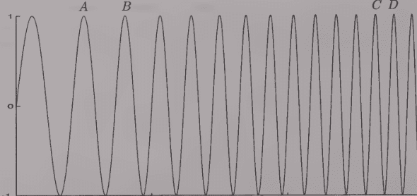

**图 4.6：** 频率随时间线性变化的调频信号。

例如，如果我们像 Gabor 变换-(4.28) 那样选择 `$\phi(t) = g_\alpha(t)$`，一旦 `$\alpha$` 固定，那么 `$\Delta_\alpha$` 和 `$\Delta_\xi$` 也固定了，无论窗口在 `$t - \omega$` 平面上的位置如何。典型的 STFT 时频窗口如图 4.3 所示。一旦选择了窗口函数，在整个处理过程中时频分辨率就是固定的。为了理解这种固定分辨率的影响，让我们考虑图 4.6 所示的调频信号，其中信号频率随时间增加。

如果我们选择窗口函数 `$\phi(t)$` 的参数（对于 `$g_\alpha(t)$` 而言为 `$\alpha$`）使得 `$\Delta_\alpha$` 大约等于 `$\Delta\omega$`，那么使用 (4.7) 计算的 STFT 将能够更好地解析信号的低频部分，而高频部分的分辨率很差。另一方面，如果 `$\Delta_\alpha$` 大约等于 `$\Delta\omega$`，则低频部分将比例增大，因此高频部分将模糊。观察到如果 `$\Delta_\alpha$` 非常小，`$\Delta_\phi$` 将比例增大且无法良好解析。我们的目标是设计一种在 `$t-\omega$` 平面上任意位置都能给出良好时频分辨率的方法。换句话说，我们必须有一种窗口函数，它在时间上增加（频率上减少）的同时在时间上减少（频率上增加），从而解析信号的高频成分。函数 `$f(t) \in L^2$` 关于分析小波 `$\psi$` 的积分小波变换定义为：

```
$W_\psi f(b,a) := \int_{-\infty}^{\infty} f(t)\psi_{b,a}(t)dt. \quad (4.32)$
```

其中

```
$\psi_{b,a}(t) = \frac{1}{\sqrt{a}}\psi\left(\frac{t-b}{a}\right); a > 0. \quad (4.33)$
```

参数 `$b$` 和 `$a$` 分别称为*平移*和*尺度*。归一化因子 `$a^{-1/2}$` 的使得 `$\|\psi_{b,a}\| = \|\psi\|$`。为了使 `$\psi$` 成为窗口函数并通过 IWT 恢复 `$f(t)$`，`$\psi(t)$` 必须满足条件：

```
$\hat{\psi}(0) = \int_{-\infty}^{\infty} \psi(t)dt=0. \quad (34)$
```

除了满足 (34) 之外，小波的构造还使其具有更高阶的消失矩。如果小波具有 `$m$` 阶消失矩，则称：

```
$\int_{-\infty}^{\infty} t^p\psi(t)dt=0; p=0,\dots,m-1. \quad (35)$
```

严格来说，积分小波变换提供的是时尺度分析而非时频分析。然而，通过适当的尺度到频率变换（后文讨论），可以获得非常接近时频的分析。观察 (33)，通过减少 `$a$`，`$\psi_b$` 的支撑在时间上缩小从而带有更大的频率范围，反之亦然。此外，`$1/a$` 是频率的量。参数 `$b$` 指小波沿时间轴的位置。通过改变 `$(b,a)$`可以在整个时频面上计算 `$W_\psi f$`。此外由于条件 (34)，我们得出所有小波都必须振荡，赋予了它们波的性质，因此名为*小波*（wavelets）。回想 STFT 的窗口函数不需要这种振荡。与 (4.7) 中 STFT 的定义相比，小波 `$\psi_{b,a}(t)$` 取了 `$\phi_{b,a}$` 的位置。因此小波也像窗口函数。小波窗口的行为和测量将在4.5.2节中详细讨论。

### 4.5.1 逆小波变换

由于逆变换的目的是从积分小波变换重建原始函数，它涉及对尺度参数 `$a>0$` 和平移参数 `$b$` 的二维积分。逆小波变换的表达式为：

```
$f(t) = \frac{1}{C_{\psi}}\int_{-\infty}^{\infty}\int_{0}^{\infty} \frac{1}{a^2}[W_\psi f(b,a)]\psi_{b,a}(t)da. \quad (436)$
```

其中 `$C_{\psi}$` 是取决于小波选择的常数，由：

```
$C_{\psi} = \int_{-\infty}^{\infty}\frac{|\hat{\psi}(\omega)|^2}{|\omega|}d\omega<\infty. \quad (337)$
```

条件 (37) 称为容性条件（admissibility condition），限制了作为小波的函数类。特别，它意味着所有小波必须具有 `$\hat{\psi}(0)=[见 (34)]$`，以使 (37) 的左侧为有限值。对于 (36) 的证明，读者可以参考 [2, Chap. 2]。

方程 (36) 本质上是一个叠加积分。对 `$a$` 的积分汇总了位置 `$b$` 处所有小波量的贡献，而对 `$b$` 的积分包含了 `$b$` 轴上的所有位置。由于逆小波变换的计算相当困难，且仅用于合成原始信号，因此在信号分析中其使用频率不如积分小波变换。在介绍离散小波变换（DWT）的后续章节中，DWT 的逆变换在数据通信和信号处理中非常有用。

### 4.5.2 时频窗口

4.1节讨论的频域中心和半径定义不适用于小波窗口，因为与 `$\hat{\phi}(0)=1$` 的 STFT 窗口不同，这里的小波窗口 `$\hat{\psi}(0)=0$`。也就是说，`$\hat{\psi}(\omega)$` 表现出带通滤波特性。对于 `$\hat{\psi}(\omega)$` 我们有两个中心和两个半径。我们只对正频率感兴趣。因此，我们在正频率上定义中心 `$\omega_\psi^*$` 和半径 `$\Delta_\psi^+$` 为：

```
$\omega_{\psi^*} := \frac{\int_{-\infty}^{\infty} \omega |\hat{\psi}(\omega)|^2 d\omega}{\int_{-\infty}^{\infty} |\hat{\psi}(\omega)|^2 d\omega} \quad (438)$
```

```
$\Delta_{\psi^+} := \sqrt{\frac{\int_{-\infty}^{\infty} (\omega-\omega_{\psi^*})^2 |\hat{\psi}(\omega)|^2 d\omega}{\int_{-\infty}^{\infty} |\hat{\psi}(\omega)|^2 d\omega}}^{\frac{1}{2}} \quad (439)$
```

`$t^*$` 和 `$\Delta_\psi$` 的定义与4.1节相同，用 `$\psi(t)$` 替换 `$\phi(t)$`。对于小波，不确定性原理给出：

```
$\Delta_{\psi^+} > \frac{1}{2}. \quad (440)$
```

如果 `$t^*$` 是中心，`$\Delta_\psi$` 是 `$\psi(t)$` 的半径，那么 `$W_\psi f(b, a)$` 包含了时间窗口内的 `$f(t)$` 信息：

```
$[at^*+b-a\Delta_{\psi}, at^*+b+a\Delta_{\psi}]. \quad (441)$
```

## 连续小波变换 75

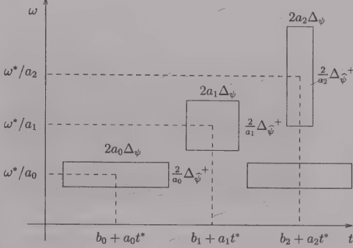

**图 4.7:** 连续小波变换的时频窗口。

让我们将 Parseval 等等式应用到 (4.32)，以获得频率窗口的初步概念：

`$W_{\psi}f(b,a) = \frac{1}{\sqrt{a}} \int_{-\infty}^{\infty} f(t)\psi\left(\frac{t-b}{a}\right)dt \quad (4.42)$`

`$\frac{\sqrt{a}}{2\pi} \int_{-\infty}^{\infty} \hat{f}(\omega)\hat{\psi}(\omega)e^{jb\omega}d\omega. \quad (4.43)$`

从 (4.43) 可以看出，频率窗口为：

`$\left[\frac{1}{a}(\omega_{\psi}^*-\Delta_{\psi}^*), \frac{1}{a}(\omega_{\psi}^*+\Delta_{\psi}^*)\right]. \quad (4.44)$`

时频积 = `$2a\Delta_{\psi}\times(2/a)\Delta_{\psi}^*=4\Delta_{\psi}\Delta_{\psi}^*=constant$`。图 4.7 表示了小波变换的时频窗口概念。将图 4.7 与 STFT 对应的图 4.3 进行比较，观察小波变换中窗口的灵活性质。对于高频 `$(1/a_2)$`，时间窗口较小，而对于低频 `$(1/a_0)$`，时间窗口较大。例如，对于固定的频率级 `$(1/a_0)$`，时间窗口和频率窗口都是固定的。记住，在 STFT 中，无论频率级如何，时频窗口都是固定的。

**示例：** 我们对计算 STFT 的相同函数进行连续小波变换。我们选择由以下给出的复 Morlet 小波

## 76 时频分析

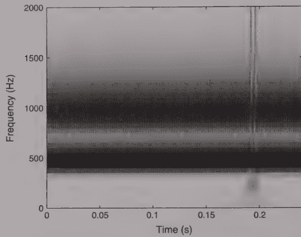

**图 4.8:** 使用 Morlet 小波对图 4.4 所示信号进行的连续小波变换。

`$\psi(t) = e^{-\frac{t^2}{2}}e^{-j5.336t} \quad (4.45)$`

以计算 CWT

`$W_{\psi}f(b,a) = \int_{-\infty}^{\infty} f(t)\psi(\frac{t-b}{a})dt.$`

结果如图 4.8 所示。该图显示了时间轴和频率轴上的事件具有良好的分辨率。如果我们选择合适的 `$a$` 范围，则只需要计算变换即可捕捉大部分甚至全部发生在时域和频域的事件。

## 4.6 离散小波变换

与离散傅里叶变换和离散短时傅里叶变换类似，我们有了离散小波变换 (DWT)。然而，与之前傅里叶分析中显示的离散时频轴不同，我们以不同的方式取尺度参数 `$a$` 和平移参数 `$b$` 的离散值。这里的重点是引入 DWT 并展示 DWT 与 IWT 之间的关系。DWT 的详细讨论将在第 7 章给出。这里我们仅提到将 `$a$` 取为 `$2^{-s}$` 的形式，`$b$` 取为 `$k2^{-s}$` 的形式，其中 `$k, s \in \mathbb{Z}$`。使用这些 `$a$` 和 `$b$` 的值，(4.32) 的积分变为：

`$W_{\psi}f(k^{-s}, 2^{-s}) = 2^{\frac{s}{2}} \int_{-\infty}^{\infty} f(t)\psi(2^s t-k)dt \quad (4.46)$`

让我们离散化函数 `$f(t)$`。简单起见，假设采样率为 1。在这种情况下，(4.46) 的积分可以写为：

`$W_{\psi}f(k^{-s}, 2^{-s}) \approx 2^{\frac{s}{2}} \sum_{n} f(n)\psi(2^s n-k). \quad (4.47)$`

为了计算函数在时尺度轴上某点的小波变换，我们只需要在小波不为零的时间点处的函数值。因此，小波变换的评估几乎可以实时完成。我们将在后面的章节中讨论计算小波变换的算法。

关于 (4.47) 的重要观察结果是它的时变性。在时间上平移的函数的 DWT 与原始函数的 DWT 非常不同。为了进一步解释，令

`$f_m(t) = f(t-t_m). \quad (4.48)$`

这得到

`$W_{\psi}f_m(k^{-s}, 2^{-s}) = 2^{\frac{s}{2}} \int_{-\infty}^{\infty} f_m(t)\psi(2^s t-k)dt = 2^{\frac{s}{2}} \sum_{n} f(n-m)\psi(2^s n-k) = 2^{\frac{s}{2}} \sum_{n} f(n-m)\psi[2^s n-(k-m2^s)] \approx W_{\psi}f[(k-m2^s)2^{-s}]. \quad (4.49)$`

因此我们看到对于 DWT，函数的时间平移以一种复杂的方式体现。记住，在 STFT 中，函数的时间平移表现为精确的时间位移，并带有额外的相位移。在傅里叶变换中，平移仅表现为频域的变化。

## 4.7 小波级


类似于傅里叶级，我们有了小波级。记住傅里叶级仅存在于周期函数。对于任何函数`$f(t) \in L^2$`，其小波级表示为：

## 78 时频分析

`$f(t) = \sum_{s} \sum_{k} d_{s,k} \psi_{s,k}(t) \quad (50)$`

其中`$\psi_{s,k}(t) = 2^{-s/2}\psi(\frac{t-k}{2^s})$`。系数由：

`$d_{s,k} = \int_{-\infty}^{\infty} f(t)\psi_{s,k}(t)dt \quad (51)$`

小波级可以写为：

`$f(t) = \sum_{k=-\infty}^{\infty} c_{0,k}\phi_{0,k}(t) + \sum_{s=0}^{\infty} \sum_{k=-\infty}^{\infty} d_{s,k}\psi_{s,k}(t) \quad (52)$`

其中`$\phi_{s,k}(t) = 2^{-s/2}\phi(\frac{t-k}{2^s})$`。系数`$c_{0,k}$`由：

`$c_{0,k} = \int_{-\infty}^{\infty} f(t)\phi_{0,k}(t)dt \quad (53)$`

小波级是小波的线性组合。每个小波`$\psi_{s,k}(t)$`都是母小波`$\psi(t)$`的缩放和平移版本。尺度`$s$`决定频率，平移`$k$`决定位置。小波级提供了信号的多分辨率表示。

## 4.8 时频图的解释

将 Parseval 等式应用到 (4.32)，以获得频率窗口的初步概念：

`$W_{\psi}f(b,a) = \frac{1}{\sqrt{a}} \int_{-\infty}^{\infty} f(t)\psi\left(\frac{t-b}{a}\right)dt \quad (4.42)$`

`$\frac{\sqrt{a}}{2\pi} \int_{-\infty}^{\infty} \hat{f}(\omega)\hat{\psi}(\omega)e^{jb\omega}d\omega. \quad (4.43)$`

从 (4.43) 可以看出，频率窗口为：

`$\left[\frac{1}{a}(\omega_{\psi}^*-\Delta_{\psi}^*), \frac{1}{a}(\omega_{\psi}^*+\Delta_{\psi}^*)\right]. \quad (4.44)$`

时频积 = `$2a\Delta_{\psi}\times(2/a)\Delta_{\psi}^*=4\Delta_{\psi}\Delta_{\psi}^*=constant$`。图 4.7 表示了小波变换的时频窗口概念。将图 4.7 与 STFT 对应的图 4.3 进行比较，观察小波变换中窗口的灵活性质。对于高频`$(1/a_2)$`，时间窗口较小，而对于低频`$(1/a_0)$`，时间窗口较大。例如，对于固定的频率级`$(1/a_0)$`，时间窗口和频率窗口都是固定的。记住，在 STFT 中，无论频率级如何，时频窗口都是固定的。

**示例：** 我们对计算 STFT 的相同函数进行连续小波变换。我们选择由以下给出的复 Morlet 小波

## 76 时频分析


**图 4.8:** 使用 Morlet 小波对图 4.4 所示信号进行的连续小波变换。

`$\psi(t) = e^{-\frac{t^2}{2}}e^{-j5.336t} \quad (4.45)$`

以计算 CWT

`$W_{\psi}f(b,a) = \int_{-\infty}^{\infty} f(t)\psi(\frac{t-b}{a})dt.$`

结果如图 4.8 所示。该图显示了时间轴和频率轴上的事件具有良好的分辨率。如果我们选择合适的`$a$`范围，则只需要计算变换即可捕捉大部分甚至全部发生在时域和频域的事件。

## 4.6 离散小波变换

与离散傅里叶变换和离散短时傅里叶变换类似，我们有了离散小波变换 (DWT)。然而，与之前傅里叶分析中显示的离散时频轴不同，我们以不同的方式取尺度参数`$a$`和平移参数`$b$`的离散值。这里的重点是引入 DWT 并展示 DWT 与 IWT 之间的关系。DWT 的详细讨论将在第 7 章给出。这里我们仅提到将`$a$`取为`$2^{-s}$`的形式，`$b$`取为`$k2^{-s}$`的形式，其中`$k, s \in \mathbb{Z}$`。使用这些`$a$`和`$b$`的值，(4.32) 的积分变为：

`$W_{\psi}f(k^{-s}, 2^{-s}) = 2^{\frac{s}{2}} \int_{-\infty}^{\infty} f(t)\psi(2^s t-k)dt \quad (4.46)$`

让我们离散化函数`$f(t)$`。简单起见，假设采样率为 1。在这种情况下，(4.46) 的积分可以写为：

`$W_{\psi}f(k^{-s}, 2^{-s}) \approx 2^{\frac{s}{2}} \sum_{n} f(n)\psi(2^s n-k). \quad (4.47)$`

为了计算函数在时尺度轴上某点的小波变换，我们只需要在小波不为零的时间点处的函数值。因此，小波变换的评估几乎可以实时完成。我们将在后面的章节中讨论计算小波变换的算法。

关于 (4.47) 的重要观察结果是它的时变性。在时间上平移的函数的 DWT 与原始函数的 DWT 非常不同。为了进一步解释，令

`$f_m(t) = f(t-t_m). \quad (4.48)$`

这得到

`$W_{\psi}f_m(k^{-s}, 2^{-s}) = 2^{\frac{s}{2}} \int_{-\infty}^{\infty} f_m(t)\psi(2^s t-k)dt = 2^{\frac{s}{2}} \sum_{n} f(n-m)\psi(2^s n-k) = 2^{\frac{s}{2}} \sum_{n} f(n-m)\psi[2^s n-(k-m2^s)] \approx W_{\psi}f[(k-m2^s)2^{-s}]. \quad (4.49)$`

因此我们看到对于 DWT，函数的时间平移以一种复杂的方式体现。记住，在 STFT 中，函数的时间平移表现为精确的时间位移，并带有额外的相位移。在傅里叶变换中，平移仅表现为频域的变化。

## 4.7 小波级

类似于傅里叶级，我们有了小波级。记住傅里叶级仅存在于周期函数。对于任何函数`$f(t) \in L^2$`，其小波级表示为：

`$f(t) = \sum_{s} \sum_{k} d_{s,k} \psi_{s,k}(t) \quad (50)$`

其中`$\psi_{s,k}(t) = 2^{-s/2}\psi(\frac{t-k}{2^s})$`。系数由：

`$d_{s,k} = \int_{-\infty}^{\infty} f(t)\psi_{s,k}(t)dt \quad (51)$`

小波级可以写为：

`$f(t) = \sum_{k=-\infty}^{\infty} c_{0,k}\phi_{0,k}(t) + \sum_{s=0}^{\infty} \sum_{k=-\infty}^{\infty} d_{s,k}\psi_{s,k}(t) \quad (52)$`

其中`$\phi_{s,k}(t) = 2^{-s/2}\phi(\frac{t-k}{2^s})$`。系数`$c_{0,k}$`由：

`$c_{0,k} = \int_{-\infty}^{\infty} f(t)\phi_{0,k}(t)dt \quad (53)$`

小波级是小波的线性组合。每个小波`$\psi_{s,k}(t)$`都是母小波`$\psi(t)$`的缩放和平移版本。尺度`$s$`决定频率，平移`$k$`决定位置。小波级提供了信号的多分辨率表示。

## 4.8 时频图的解释

将 Parseval 等式应用到 (4.32)，以获得频率窗口的初步概念：

`$W_{\psi}f(b,a) = \frac{1}{\sqrt{a}} \int_{-\infty}^{\infty} f(t)\psi\left(\frac{t-b}{a}\right)dt \quad (4.42)$`

`$\frac{\sqrt{a}}{2\pi} \int_{-\infty}^{\infty} \hat{f}(\omega)\hat{\psi}(\omega)e^{jb\omega}d\omega. \quad (4.43)$`

从 (4.43) 可以看出，频率窗口为：

`$\left[\frac{1}{a}(\omega_{\psi}^*-\Delta_{\psi}^*), \frac{1}{a}(\omega_{\psi}^*+\Delta_{\psi}^*)\right]. \quad (4.44)$`

时频积 = `$2a\Delta_{\psi}\times(2/a)\Delta_{\psi}^*=4\Delta_{\psi}\Delta_{\psi}^*=constant$`。图 4.7 表示了小波变换的时频窗口概念。将图 4.7 与 STFT 对应的图 4.3 进行比较，观察小波变换中窗口的灵活性质。对于高频`$(1/a_2)$`，时间窗口较小，而对于低频`$(1/a_0)$`，时间窗口较大。例如，对于固定的频率级`$(1/a_0)$`，时间窗口和频率窗口都是固定的。记住，在 STFT 中，无论频率级如何，时频窗口都是固定的。

# 80 时频分析

```
$G_{\phi f}(b,\xi)=\phi(t_0-b),\quad(60)$
$|W_{\psi f}(b,a)=\frac{1}{\sqrt{a}}\psi\left(\frac{t_0-b}{a}\right),\quad(61)$
```

STFT 的解释是直观的。正如预期，它不依赖于`$\xi$`。我们在`$b=t_0$`附近得到一条平行于频率轴的直线，其时间跨度由`$\Delta$`决定。对于小波变换，我们观察到它依赖于尺度`$a$`。将 (61) 重写为新变量`$\xi$`，得到：

```
$W_{\psi f}\left(b,\omega^*\right)=\sqrt{\frac{\xi}{a}}\psi(t_0-b),\quad(62)$
```

尽管 (62) 中的所有频率内容都由 delta 函数指示，但显然随着`$\xi$`减小，时间跨度会增加。此外，最大值的位置取决于`$\psi(t)$`的形状。读者请参阅 [4] 以获得更多关于时频图的解释。

## 4.9 Wigner 分布

我们在前面的节中考虑了信号的线性表示。STFT 和 CWT 是线性变换，因为它们满足线性叠加定理：

```
$T[\alpha_1f_1+\alpha_2f_2]=\alpha_1T[f_1]+\alpha_2T[f_2],\quad(63)$
```

其中`$T$`可以代表 STFT 或 CWT，`$f_1(t), f_2(t)$`是具有系数`$\alpha_1$`和`$\alpha_2$`的两个信号。这些变换之所以重要，是因为它们提供了信号在时刻`$t$`附近的局部频谱。此外，算法实现的简单和高效是它们的优点。另一方面，这些线性变换没有提供信号在特定时刻的瞬时能量信息。直观地说，我们考虑类型为

```
$\int_{-\infty}^{\infty}|f(\tau-t)|^2e^{-i\omega\tau}d\tau=\int_{-\infty}^{\infty}f(\tau-t)\overline{f(\tau-t)}e^{-i\omega\tau}d\tau.$
```

由于确定给定时刻信号的能量并不容易，因此考虑围绕时间`$t$`中心的区间`$(t-\tau/2, t+\tau/2)$`内的能量更有意义。为了这个目的，Wigner-Ville 分布 (WVD) 定义为：

```
$W_{f}(t,\omega)=\frac{1}{2\pi}\int_{-\infty}^{\infty}f\left(t+\frac{\tau}{2}\right)f^*\left(t-\frac{\tau}{2}\right)e^{-j\omega\tau}d\tau.\quad(64)$
```

常数`$1/2\pi$`是为了计算方便的归一化因子。我们需要注意 (64) 不再满足线性。Wigner-Ville 分布是非线性时频变换，因为信号多次进入积分。可能会观察到给定时刻`$t$`的 Wigner-Ville 分布对于信号距离`$\tau/2$`的两侧是对称的。计算`$W_{f}(t,\omega)$`需要`$t\pm\tau/2$`处的信号信息，且无法实时进行。

### 4.9.1 高斯调制调频

让我们考虑一个由高斯包络调制的调频信号：

```
$f(t)=\left(\frac{a}{\pi}\right)^{\frac{a}{4}}\exp\left(\frac{-at^2}{2}+\frac{bt^2}{2}+j\omega_0t\right)\quad(65)$
```

其中`$(-at^2/2)$`是高斯项，`$\exp(-jbt^2/2)$`是调频信号，而`$e^{j\omega_0t}$`是频移项。来自 (64) 的 Wigner-Ville 分布产生：

```
$W_{f}(t,\omega)=\frac{1}{2\pi}\int_{-\infty}^{\infty}\left(\frac{a}{\pi}\right)^{\frac{a}{2}}\exp\left(\left(-a\left(t+\frac{\tau}{2}\right)^2+b\left(t+\frac{\tau}{2}\right)^2+j\omega_0\left(t+\frac{\tau}{2}\right)^2\right)\exp\left(-a\left(t-\frac{\tau}{2}\right)^2-b\left(t-\frac{\tau}{2}\right)^2-j\omega_0\left(t-\frac{\tau}{2}\right)^2\right)\right)d\tau$
```

```
$W_{f}(t,\omega)=\frac{1}{2\pi}\left(\frac{a}{\pi}\right)^{\frac{a}{2}}e^{-at^2}\exp\left(\frac{-at^2}{4}+bt+j\omega_0t\right)\quad(66)$
```

使用第 3 章给出的高斯傅里叶变换，高斯调制调频的 WVD 为：

```
$W_{f}(t,\omega)=\frac{1}{\pi}\exp\left(\frac{-at^2}{2}-\frac{(\omega-\omega_0-bt)^2}{a}\right)$
```

函数及其 WVD 如图 9 所示。

### 4.9.2 正弦调制调频

正弦调制调频由下式给出：

`$$f(t)=\exp\left(\frac{bt^2}{2} + j\omega_0t\right).\quad (68)$$`

直接从边缘分布计算 WVD 得到：

`$$\mathbf{W}_f(t,\omega)=\frac{1}{2\pi}\int_{-\infty}^{\infty} \exp\left(j\frac{b\left(t+\frac{\tau}{2}\right)^2}{2} + j\omega_0\left(t+\frac{\tau}{2}\right)\right)\exp\left(-j\frac{b\left(t-\frac{\tau}{2}\right)^2}{2} - j\omega_0\left(t-\frac{\tau}{2}\right)\right)d\tau=\frac{1}{2\pi} \int_{-\infty}^{\infty} \exp(bt\tau + j\omega_0\tau - j\omega\tau)d\tau=\delta(\omega-\omega_0-bt).\quad (69)$$`

### 4.9.3 正弦信号

通过将调频参数`$b$`置零，计算纯正弦信号`$e^{j\omega_0 t}$`的 WVD。因此，`$e^{j\omega_0 t} \Leftrightarrow \delta(\omega-\omega_0)$`。

方程 (67) 和 (69) 的 WVD 在时频平面上分别是斜率为`$b$`的直线和平行于时间轴的直线。它们分别给出图 10 和 11 中。图 12 显示了高斯调制正弦函数的 WVD。

## 4.10 Wigner-Ville 分布的性质

有几种 WVD 的一般性质对于信号处理非常重要。本节讨论了其中一些。已经证明 [5]，Wigner-Ville 分布在时频平面上具有能量能量浓度。任何浓度比 WVD 更高的分布将违反不确定性原理。此外，它无法满足本节讨论的边缘性质。

### 4.10.1 实值

无论信号是实数还是复数，Wigner-Ville 分布总是实数。通过考虑 Wigner-Ville 分布的复共轭可以看到这一点：

```
$W_s(t,\omega)=\frac{1}{2\pi}\int_{-\infty}^{\infty} s(t-\frac{\tau}{2})\overline{s(t+\frac{\tau}{2})}e^{j\omega\tau}d\tau=\frac{1}{2\pi}\int_{-\infty}^{\infty} s(t+\frac{\tau}{2})\overline{s(t-\frac{\tau}{2})}e^{-j\omega\tau}d\tau=W_s(t,\omega).\quad(71)$
```

Wigner-Ville 分布总是实值，但并不总是正值。图 13 显示了变为负的情况。因此，WVD 不能作为能量密度的度量。

### 4.10.2 边缘性质

信号处理特别关注的是能量守恒。这通过分布的边缘性质表示。如果我们希望以`$t$`的项找到能量密度，只需要对`$\omega$`积分即可，反之亦然。信号的总能量可以通过对整个时频平面上的 Wigner-Ville 分布进行二维积分来计算。


$$E=\int_{-\infty}^{\infty}|f(t)|^2dt=\int_{-\infty}^{\infty}|\hat{f}(\omega)|^2d\omega=\int_{-\infty}^{\infty}\int_{-\infty}^{\infty}\mathbf{W}_f(t,\omega)d\omega dt.\quad(72)$$

### 4.10.3 相关函数

我们可以从边缘分布中在时域或频域轻松计算相关函数：

$$\gamma_t(t')=\int_{-\infty}^{\infty}f(\tau)\overline{f}(\tau+t')d\tau=\mathbf{W}_f(t',0).\quad(74)$$

$$\gamma_\omega(\omega')=\int_{-\infty}^{\infty}f(\omega)f(\omega+\omega')d\omega=\mathbf{W}_f(0,\omega').\quad(75)$$

## 4.11 二次叠加原理

我们记得 WVD 是一个非线性分布，线性叠加原理不适用。例如，多成分信号为：

$$f(t)=\sum_{k=1}^{\infty}f_k(t).\quad (4.76)$$

该信号的 Wigner-Ville 分布为

$$$\mathbf{W}_f(t,\omega)=\sum_{k=1}^{\infty}\mathbf{W}_{fk}(t,\omega)+\sum_{k=1}^{\infty}\sum_{l=1,l\neq k}^{\infty}\mathbf{W}_{fk,fl}(t,\omega),\quad(4.77)$$

其中 $\mathbf{W}_{fk}(t,\omega)$ 被称为 WVD 的自项，而 $\mathbf{W}_{fk,fl}(t,\omega)$ 是定义为交叉项。

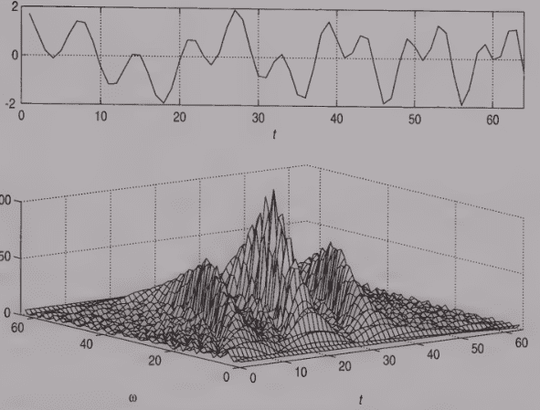

图 4.14: 多成分信号的 Wigner-Ville 分布。

$W_{f_k,f_l}(t,\omega) = \frac{1}{2\pi} \int_{-\infty}^{\infty} f_k\left(t+\frac{\tau}{2}\right) f_l\left(t-\frac{\tau}{2}\right) e^{-j\omega\tau} d\tau. \quad (4.78)$

WVD 的这些交叉项（cross-terms）也被称为干扰项，代表了多成分信号两个分量之间的能量交叉耦合。在大多数信号处理应用中，这些干扰项是不希望的，大量的研究工作致力于减少这些项的贡献。[6,7] 对于信号的完美重建来说是必要的。在信号检测和识别应用中，我们只感兴趣发现具有显著能量的分量。由于不需要对信号进行某些重建，交叉项变得不重要了。

在雷达处理和雷达成像中，待处理的信号具有随变化的频谱，例如线性调频信号或二次调频信号。使用 STFT 或 WT 来表示调频信号会导致时频平面上某一维度的分辨率丢失。然而，这些信号的 WVD 在时频平面上会产生良好的能量集中，如图 4.10 所示。对于多成分信号，如果分量的带宽重叠不是太大，WVD 的能量集中在时频平面上将相得很远（见图 4.14）。然而，如果情况如此，则必须应用某些交叉干扰消除技术，这将导致分辨率的降低。

## 88 时频分析

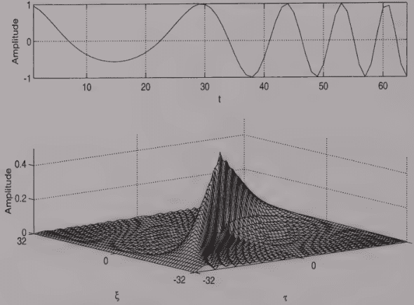

图 4.15: 调频信号的模糊函数。

## 4.12 模糊函数

模糊函数（AF）是 Wigner-Ville 分布的特征函数，其数学定义为：

$A_f(u,v) = \int_{-\infty}^{\infty} \int_{-\infty}^{\infty} e^{jut+jv\omega} W_f(t,\omega) dt d\omega. \quad (4.79)$

虽然 Wigner-Ville 分布是一个测量信号在时频平面上能量密度的时频函数，但模糊函数是一个频率偏移（多普勒）和时间延迟平面能量分布的分布。这是雷达信号处理中非常重要的函数，特别是在波形设计领域。我们将看到

除了一个复常数外，我们可以用信号来表示 AF：

$A_f(\tau,\zeta) = K \int_{-\infty}^{\infty} f(t-\frac{\tau}{2})f^*(t+\frac{\tau}{2})e^{-j\zeta t} dt. \quad (4.80)$

其中 K 是一个复常数。该关系的证明可以在 [8] 中找到。关于模糊函数的更多信息，请参阅 [9]。图 4.15 显示了调频信号的 AF。时频包将在第 9 章重新讨论，那里小波和 Wigner-Ville 分布的结合将应用于雷达信号检测。

# 89 习题

## 4.13 习题

1. 验证对于任何函数 $\psi\in L^{2}(-\infty,\infty)$，由归一化函数 $\psi_{k,s}(t)=2^{s/2}\psi(2^{s}t-k)$（$k,s\in Z, t\in \mathbb{R}$）与 $\psi$ 具有相同的 $L^{2}$ 范数：

$$\int_{-\infty}^{\infty}|\psi(t)|^{2}dt=\int_{-\infty}^{\infty}|\psi_{k,s}(t)|^{2}dt, k,s\in Z.$$

2. 考虑窗函数 $g_{a}(t)=e^{-at^{2}}, a>0$。计算时域和频域的窗宽并验证不确定性。

3. 三角函数 $N_{2}$ 定义为：

$N_{2}(t)=\begin{cases} t & \text{for } 0\le t<1 \\ 2-t & \text{for } 1\le t<2 \\ 0 & \text{otherwise.}\end{cases}$

计算 $N_{2}(t)$ 的时频窗。

4. 证明 $\|f(t)\|^{2}=\frac{1}{2\pi}\int\int|G_{\phi}f(b,\xi)|^{2}dbdxi$。

5. 给定 $f(t)=\sin(\pi t^{2})$，并使用升余弦作为窗函数：

$$\phi(t)=\begin{cases} 1+\cos(\pi t), & \text{for } |t|\le1 \\ 0, & \text{otherwise,}\end{cases}$$

绘制窗移后的时间函数 $f_{3}(t)=\phi(t-3)f(t)$ 以及 $f_{7}(t)$ 及其谱。

考虑时频原子或算核：

$$\begin{cases} Re[\phi(t-4)e^{i4\pi t}+\phi(t-6)e^{i8\pi t}] \\ Re[\phi(t-4)e^{i4\pi t}+\phi(t-6)e^{i6\pi t}]\end{cases}$$

绘制这两个时频原子的谱能量密度。评价这两个原子的时频分辨率。

6. 在 CWT 中，证明需要归一化常数 $1/\sqrt{a}$ 使得 $|\psi(t)|=\|\psi_{b,a}(t)}\|$。

7. 证明 CWT 中的能量守恒原理意味着：

$$\int_{-\infty}^{\infty}f(t)\overline{g(t)}dt=\frac{1}{C_{w}}\int_{-\infty}^{\infty}\int_{-\infty}^{\infty}W_{\psi}f(b,a)\overline{W_{\psi}g(b,a)}db\frac{da}{a^{2}}$$

8. 证明小波 $\psi$ 的频率窗宽为 $[(1/a)(\omega^*-\Delta\psi), (1/a)(\omega^*+\Delta\psi)]$。

9. 识别 `wvd.m` 中频率轴除以 2 的原因。

## 4.14 程序

### 4.14.1 短时变换

```matlab
% PROGRAM stft.m
% 使用矩窗 [0,1] 的短时变换
% 生成图 4.5
% 信号
v1 = 500;           % 频率
v2 = 1000;
r = 8000;           % 采样率
t1 = 0.192;         % delta 函数的位置
t2 = 0.196;

k = 1:2048;
t = (k-1)/r;
f = sin(2*pi*v1*t) + sin(2*pi*v2*t);

k = t1 * r;
f(k) = f(k) + 3;
k = t2 * r;
f(k) = f(k) + 3;

plot(t,f)
axis([0 0.24 -2 3])

figure(2)
% STFT 计算
N = 16             % 矩形窗
bot = 0.1;
hi = 0.175;

for kk = 1:4

    Nb2 = N / 2;

    for b = 1:N-1

        fb = f(b:b+N-1);

        fftb = abs(fft(fb));

        STFT(b,:) = fftb(1:Nb2);

    end

end

% 绘图

NColor = 256;

colormap(gray(NColor));

STFT_min = min(min(STFT));

STFT_max = max(max(STFT));

STFT = (STFT - STFT_max) * NColor / (STFT_min - STFT_max);

time = (0:N-1) / r;

freq = (0:Nb2-1) * r / N;

axes('position',[0.1 0.8 0.7 0.1])

image(time,freq,STFT')

axis([0 0.24 0 2000])

YTick = [500 1000 1500 2000]

set(gca,'YDir','normal','ytick',YTick)

hold on;

N = N * 2

bot = bot + 0.25;

clear STFT; clear time; clear freq;

set(gcf,'position',[0.5 0.5 0.5 0.1])
```

### 4.14.2 Wigner-Ville 分布

```matlab
% PROGRAM wvd.m
% 计算 Wigner-Ville 分布
% 信号
r = 4000;      % 采样率
t = (0:255) / r;
omega1 = 2.0 * pi * 500;
f = exp(i*omega1 * t);

% WVD 计算
N=length(f);
if (mod(N,2) == 1)
    f = [f 0];
    N = N + 1;
end

N2m = 2 * N - 1;
Nb2 = N / 2;

for m = 1:N
    s = zeros(1,N2m);
    s(N-(m-1):N2m-(m-1)) = f;
    s = conj(fliplr(s)).*s;
    s = s(Nb2:N2m);
    shat = abs(fft(s));
    % 使用重叠项归一化
    if m <= Nb2
        shat = shat / (2 * m - 1);
    else
        shat = shat / (2 * N - 2 * m + 1);
    end
    wvd(m,:)=shat(1:Nb2);
end

% 绘图
time = (0:N-1) / r;
freq = (0:Nb2-1) * r / N / 2;
NColor = 256;
colormap(gray(NColor));
wvd_min = min(min(wvd));
wvd_max = max(max(wvd));
wvd = (wvd - wvd_max) * NColor / (wvd_min - wvd_max);
image(time, freq,wvd');
% 因为信号支持有限，会有
% 边缘效应
```


## 4.15 参考文献

1. D. Gabor. “Theory of Communication.” J. IEE (London) 93 (1946), 429–457.
2. I. Daubechies. Ten Lectures on Wavelets. CBMS-NSF Series in Applied Maths, 61. Philadelphia: SIAM, 1992.
3. J.B. Allan and L. R. Rabiner. A Unified Approach to STFT Analysis and Synthesis.” Proc. IEEE 65 (Nov. 1977), 1558–1564.
4. A. Grossmann, R. Kronland-Martinet, and J. Morlet. “Reading and Understanding Continuous Wavelet Transform.” In Wavelets, Time-Frequency Methods and Phase Space. Ed. J. M. Combes, A. Grossmann, and P. Tchamitchian. Berlin: Springer-Verlag, 1989, 2–20.
5. T.A. C. M. Claasen and W.F. G. Mecklenbrauer. “The Wigner-Ville Distribution—A Tool for Time-Frequency Signal Analysis. Part I: Continuous Time Signals.” Philips Res. 35 (1980), 217–250.
6. A. Mohagdar and E. K. Walton. “Time-Frequency Distribution Analysis of Scattering from Waveguide Cavities.” IEEE Trans. Antennas Propag. 41 (May 1993), 677–680.
7. L. Cohen. “Time-frequency Distributions—A Review.” Proc. IEEE 77 (1989), 941–981.
8. B. Bashosh. “Time-Frequency Signal Analysis.” In Advances in Spectral Estimation and Array Processing, Vol. 1. Ed. S. Haykin. Upper Saddle River, NJ: Prentice-Hall, 1991, Chap. 9.
9. C. E. Cook and M. Bernfield. Radar signals. Boston: Academic Press, 1967.

# 多分辨率分析

多分辨率分析（MRA）是构建尺度缩放函数和小波（第6章）以及开发算法（第7章和第8章）最重要的基石。正如其名称所示，在多分辨率分析中，函数被于不同的近似水平或分辨率上进行观察。这一思想由 Meyer [1] 和 Mallat [2, 3]提出。

通过应用MRA，我们可以将一个复杂的函数分为若干个简单的函数并进行单独研究。为了理解MRA的概念，让我们考虑一个函数由缓慢变化的部分和快速变化的部分组成的情况，如图5.1 所示。如果我们想在单个近似水平上离散化大量数据点，我们使用由快速变化部分决定的步长（h）。

通过使用多个离散化步骤（分辨率）表示函数，我们可以显著减少精确表示所需的数据点数量。函数的最粗近似加上每一层的细节完整地代表了原始函数。注意，对于每一层（尺度），步长都会加倍。这对应于信号处理中常见的“八频级”表示。

除了这个特定示例外，在信号处理以及计算电磁学中的许多情况下，多分辨率分析都非常有用。

Fundamentals of Wavelets: Theory, Algorithms, and Applications, Second Edition, by Jaideva C. Goswami and Andrew K. Chan.  
Copyright © 2011 John Wiley & Sons, Inc.

图5.1：函数的多级表示。

## 5.1 多分辨率空间

回到图5.1。每当我们通过加倍步长向下移动一级时，就会移除函数的部分，如右侧图表所示。然后是进一步分解的“剩余”部分。

在图5.1中，我们将左侧的所有函数分配给`A_s`，其中`s`代表各个尺度。令`A_s`由基组`{\phi_{k,s} : 2^s\phi(2^s t-k); k \in \mathbb{Z}}`生成，`W_s`由`{\psi_{k,s} : 2^s\psi(2^s t-k); k \in \mathbb{Z}}`生成。换句话说，函数`x_s(t)`和`y_s(t)`可以分别表示为`\phi_{k,s}(t)`和`\psi_{k,s}(t)`的线性组合。

注意函数`x_{s-1}(t) \in A_{s-1}`和`y_{s-1}(t) \in W_{s-1}`是由`x_s \in A_s`推出的。因此，我们应该预期`A_{s-1}`的基`\phi_{k,s-1}`和`W_{s-1}`的基`\psi_{k,s-1}`。这种关系有助于设计算法，更有效地从`x_s`获取函数`x_{s-1}`和`y_{s-1}`。

为了对函数`\phi(t) \in L^2(\mathbb{R})`进行多分辨率分析（称为尺度缩放函数），如图5.1 所示，我们必须有一个有限能量的嵌套序列`{A_j}`，它生成一个尺度缩放函数：

$$\{0\} \leftarrow \dots \subset A_{-1} \subset A_0 \subset A_1 \subset \dots \rightarrow L^2(\mathbb{R})$$

并满足扩张（细化）方程：

$$\phi(t) = \sum_{k} g_0[k]\phi(at-k)$$

对于某些`a > 0`和系数`{g_0[k]} \in \ell^2`。我们将考虑`a = 2`，这对应于八频级尺度。

注意函数`\phi(t)`被表示为自身缩放和平移版本的叠加，因此被称为`缩放函数`（scaling function）。更精确地说，`A_0`由`{\phi(\cdot - k) : k \in \mathbb{Z}}`生成，一般地，`A_s`由`{\phi_{k,s} : k \in \mathbb{Z}}`生成，我们有以下明显的结果：

$$x(t) \in A_s \Leftrightarrow x(2t) \in A_{s+1} \quad (5.1)$$

$$x(t) \in A_s \Leftrightarrow x(t/2) \in A_s \quad (5.2)$$

对于每个`s`，由于`A_s`是`A_{s+1}`的一个真子空间，称为`W_s`，它与`A_s`结合就成了`A_{s+1}`。这个空间`{W_s}`称为小波，是`A_s`在`A_{s+1}`中的互补空间，意味着：

$$A_s \cap W_s = \{0\}, s \in \mathbb{Z}, \quad \text{and} \quad (5.3)$$

$$A_s \oplus W_s = A_{s+1}. \quad (5.4)$$

在条件 (5.3) 下，(5.4) 中的求和称为直和，分解称为直和分解。子空间`{W_s}`由`\psi(t) \in L^2`生成（称为小波），方式类似于`{A_s}`由`\phi(t)`生成的方式。

换句话说，任何`x_s(t) \in A_s`都可以写为：

$$x_s(t) = \sum_{k} a_{k,s}\phi(2^s t)$$

而任何函数`y_s(t) \in W_s`可以写为：

$$y_s(t) = \sum_{k} w_{k,s}\psi(2^s t)$$

对于某些系数`{a_{k,s}}_{k \in \mathbb{Z}}, {w_{k,s}}_{k \in \mathbb{Z}} \in \ell^2`。由于：

$$A_{s+1} = W_s \oplus A_s = W_s \oplus W_{s-1} \oplus A_{s-1} = \dots \quad (5.7)$$

$$A_s = \bigoplus_{\ell=-\infty}^{s-1} W_\ell.$$

注意`{A_s}`是嵌套的，而`{W_s}`是互正交的。因此我们有：

$$
\begin{cases}
A_\ell \cap A_m = A_\ell; & m \ge \ell \\
W_\ell \cap W_m = \{0\}; & \ell \neq m \\
A_\ell \cap W_m = \{0\}; & \ell \le m
\end{cases}
$$

`A_s`和`W_s`的层级性质示意图如图2。

## 5.2 正交、双正交与半正交分解

| | |
| :--- | :--- |
| `A_M` | |
| `A_{M-1}` | `W_{M-1}` |
| `A_{M-2}` | `W_{M-2}` |
| `A_{M-3}` | `W_{M-3}` |

图2：MRA子空间的划分。

在5.1节中，我们对小波空间`W_s`的唯一要求是它是`A_s`在`A_{s+1}`中的互补。如果还要求`W_s \perp A_s`，则这种分解被称为`正交分解`。

让我们进一步解释`A_s`和`W_s`的正交性。简单起见，令`s=0`。在这种情况下，`{\phi(t-k) : k \in \mathbb{Z}}`张成了`A_0`；同样，`{\psi(t-k) : k \in \mathbb{Z}}`张成了`W_0`。那么`A_0 \perp W_0`意味着：

$$\int_{-\infty}^{\infty} \phi(t)\psi(t-\ell)dt=0 \quad \text{for all } \ell \in \mathbb{Z}. \quad (5.8)$$

一般而言，`\phi(t-k) : k \in \mathbb{Z}`和`\psi(t-k) : k \in \mathbb{Z}`自身不需要是正交的；即：

$$\int_{-\infty}^{\infty}\phi(t)\phi(t-\ell)dt \neq 0 \quad (5.9)$$

$$\int_{-\infty}^{\infty}\psi(t)\psi(t-\ell)dt \neq 0. \quad (5.10)$$

让我们放`A_s`和`W_s`互正交的条件，并假设小波`\psi_{k,s} \in W_s`有一个对偶`\tilde{\psi}_{k,s} \in W_s`。对偶性意味着满足双正交条件，即：

$$\langle\psi_{k,s}, \tilde{\psi}_{m,l}\rangle = \delta_{k,m}\delta_{s,l}, \quad k,j,m,l \in \mathbb{Z}. \quad (5.11)$$

虽然我们不需要`W_s \perp A_s`，但我们需要`\tilde{W}_s \perp A_s`，其重要性稍后变得。类似于生成`L^2`中`\tilde{A}_s`的对偶尺度缩放函数`\phi_{k,s}`。

换句话说，`\phi_{k,s}`和`\psi_{k,s}`与MRA`{\tilde{A}_s}`相关，而`\tilde{\phi}_{k,s}`与MRA`{A_s}`相关。

在解释它们的重要性之前，让我们总结一下为止的结果。

### MRA`{\tilde{A}_s}`

- $$\begin{aligned}
&\tilde{A}_{s+1} = \tilde{A}_s+\tilde{W}_s; \\
&\tilde{A}_\ell\cap \tilde{A}_m = \tilde{A}_\ell, \quad m \ge \ell \\
&\tilde{W}_\ell\cap \tilde{W}_m = \{0\}; \quad \ell \neq m \\
&\tilde{A}_\ell\cap \tilde{W}_m = \{0\}; \quad \ell \le m
\end{aligned}$$

### MRA`{A_s}`

- $$\begin{aligned}
&A_{s+1} = A_s+W_s; \\
&A_\ell\cap A_m = A_\ell, \quad m \ge \ell \\
&W_\ell\cap W_m = \{0\}; \quad \ell \neq m \\
&A_\ell\cap W_m = \{0\}; \quad \ell \le m
\end{aligned}$$

- `W_s \perp \tilde{A}_s \Rightarrow A_s \cap \tilde{W}_s = \{0\}` for `\ell \le m`
- `\tilde{W}_s \perp A_s \Rightarrow A_\ell \cap \tilde{W}_m = \{0\}` for `\ell \le m`

## 正交、双正交与半正交分解 99

给定函数`x(t) \in L^2`，向不同尺度的分解首先通过将函数映射到足够高分辨率的子空间`A_M`，即：

$$L^2 \ni x(t) \mapsto x_M = \sum_{k} a_{k,M}\phi(2^M t-k) \in \mathcal{A}_M, \quad (5.12)$$

现在由于：

$$A_M = W_{M-1} + A_{M-1} = W_{M-1} + W_{M-2} + A_{M-2} = \sum_{n=1}^{N} W_{M-n} + A_{M-N}, \quad (5.13)$$

我们可以写道：

$$x_M(t) = \sum_{n=1}^{N} y_{M-n}(t) + x_{M-N}(t) \quad (5.14)$$

其中`x_{M-N}(t)`是`x_M(t)`的最粗略近似：

$$x_s(t) = \sum_{k} a_{k,s}\phi(2^s t-k) \in \mathcal{A}_s \quad (5.15)$$

$$y_s(t) = \sum_{k} w_{k,s}\psi(2^s t-k) \in \mathcal{W}_s. \quad (5.16).$$

现在对偶波形的重要性变得显而易见。通过使用双正交条件 (5.11)，我们可以得到系数`{w_{k,s}`：

$$w_{k,s} = 2^s \int_{-\infty}^{\infty} y_s(t)\psi(2^s t-k)dt. \quad (5.17)$$

记得`\psi(2^s t-k) \in \tilde{W}_s`且对于`\ell \leq s`有`A_t \perp W_s`。因此，通过将 (5.14) 与`\tilde{\psi}_{k,s}(t)`取内积并利用条件 (5.11)，我们得到：

$$w_{k,s} = 2^{s/2} \int_{-\infty}^{\infty} x_M(t)\tilde{\psi}(2^s t-k)dt = 2^{s/2} \tilde{W}_{x_M}(\frac{k}{2^s},\frac{1}{2^s}). \quad (5.18).$$

对偶波形`\tilde{\psi}`可以通过在期望的时间-尺度位置计算积分小波变换来分析函数`x_M`，而`\psi`可用于获取其在任何尺度上的函数表示。因此，我们将`\psi`称为分析波形，而`\phi`称为合成波形。

当然，如果我们有具有正交基`(\phi, \psi)`的正交分解`A_s \perp W_s`，那么分析波形和合成波形是相同的。否则，当我们使用正正交（o.n.）波形时，这意味着波形不仅在尺度上正交，在给定尺度的平移上也是正交的。正交缩放函数意味着缩放函数仅相对于给定尺度的平移正交；由于多分辨率分析（MRA）的嵌套性质，它们并不相对于尺度正交。

一个产生的问题是：为什么我们需要双正交（b.o.）波形？在双正交情况下，将分析和合成的职责分配给两个不同的函数（而不是正交情况下分配给单个函数），其吸引人的特征之一在于：前者中，我们可以拥有紧支撑的分析和合成波形以及缩放函数，这是连续的 o.n. 基无法实现的。此外，o.n. 缩放函数和波形的时-尺度特性较差。

在后续章节讨论的某些应用中，我们需要分别交换分析和合成对`(\phi, \psi)`和`{\phi, \tilde{\psi}}`的角色。在 b.o. 分解中，我们无法容易感知`\phi`和`\psi`是否分别生成了两个不同的 MRA（`A`和`\tilde{A}`）。对于这种交换，我们需要映射给定函数`x \mapsto \tilde{x}_M \in \tilde{A}_M`，然后可以使用`\psi`作为分析波形，`\tilde{\psi}`作为合成波形。

除了 b.o. 和 o.n. 分解外，还有另一类满足`A_s \perp W_s`的半正交分解。由于在该系统中缩放函数和波形是非正交的，我们仍然需要它们的对偶`\tilde{\phi}`和`\tilde{\psi}`。然而，使用 b.o. 情况时，不存在对偶空间。也就是说，对于某些适当尺度`s`，`\phi, \tilde{\phi} \in A_s`且`\psi, \tilde{\psi} \in W_s`。

在该系统中，交换`\phi`和`\psi`函数与波形角色非常容易，我们有：

$$\phi(t-k), \tilde{\phi}(t-l) = \delta_{k,l}, \quad k, l \in \mathbb{Z}, \quad (19)$$

$$\psi(t-k), \tilde{\psi}(t-m) = 0 \quad \text{当 } l \neq m \text{ 时}, \quad k, l, m \in \mathbb{Z}. \quad (20).$$

波形`[\phi, \psi]`与`[\hat{\phi}, \hat{\psi}]`的关系为：

$$\hat{\phi}(\omega) = \frac{\hat{\phi}(\omega)}{E_\phi(e^{i\omega})} \quad (21)$$

$$\hat{\psi}(\omega) = \frac{\hat{\psi}(\omega)}{E_\psi(e^{i\omega})} \quad (22)$$

其中：

$$E_x(e^{i\omega}) = \sum_{k=-\infty}^{\infty} |\hat{x}(\omega+2\pi k)|^2 = \sum_{k=-\infty}^{\infty} A_x(k)e^{ik\omega}, \quad (23)$$

`A_x(t)`是自相关函数。(23) 的证明见第 7.6 节。注意，上述关系与正交关系 (35) 的不同在于分母没有平方根。在第 6 章中我们将讨论所有缩放函数的构造。

## 5.3 双尺度关系

尺度关系将给定尺度上的缩放函数、波形与下一个尺度的缩放函数联系起来。由于：

$$\phi(t) \in A_0 \subset A_1, \quad (24)$$

$$\psi(t) \in W_0 \subset A_1, \quad (25)$$

我们应该能够用生成`A_1`的基表示`\phi(t)`和`\psi(t)`。也就是说，存在两个序列`{g_0[k]}`、`{g_1[k]} \in \ell^2`，使得：

$$\phi(t) = \sum_{k} g_0[k]\phi(2t-k), \quad (26)$$

$$\psi(t) = \sum_{k} g_1[k]\phi(2t-k). \quad (27)$$

方程 (26) 和 (27) 被称为双尺度关系。通常，对于任何`j \in \mathbb{Z}`，`A_j`、`W_j`与`A_{j+1}`之间的关系由下式决定：

$$\phi(2^j t) = \sum_{k} g_0[k]\phi(2^{j+1}t-k)$$

$$\psi(2^j t) = \sum_{k} g_1[k]\phi(2^{j+1}t-k)$$

通过对尺度关系取傅里叶变换，我们得到：

$$\hat{\phi}(\omega) = G_0(z)\hat{\phi}(\frac{\omega}{2}), \quad (28)$$

$$\hat{\psi}(\omega) = G_1(z)\hat{\psi}(\frac{\omega}{2}), \quad (29)$$

其中：

## 多尺度分析 102

**图 5.3:** Haar 情况的双尺度关系（`g_0[0]=g_0[1]`；`g_1[0]=-g_1[1]`；对于所有其他`k`，`g_0[k]=g_1[k]=0`）。

$$G_0(z) := \frac{1}{2} \sum_{k} g_0[k]z^k, \quad (5.30)$$

$$G_1(z) := \frac{1}{2} \sum_{k} g_1[k]z^k, \quad (5.31)$$

注意 (30) 和 (31) 中的定义与 Haar 情况使用的`z`变换略有不同。递归地使用 (28) 和 (29)，我们得到：

$$\hat{\phi}(\omega) = \frac{\hat{\phi}(\omega)}{E_\phi(e^{i\omega})} \quad (32)$$

$$\hat{\psi}(\omega) = \frac{\hat{\psi}(\omega)}{E_\psi(e^{i\omega})} \quad (33)$$

由于缩放函数表现出低通滤波器特性`[\hat{\phi}(0)]`而波形具有带通滤波器特性`[\hat{\psi}(0)=0]`，系数`{g_k}`之和为2。

## 5.4 分解关系

分解关系将任何尺度上的缩放函数用下一个尺度的缩放函数和波形表示。由于`A_1 = A_0 + W_0`且`\phi(2t)`、`\phi(2t-1) \in A_1`，存在两个序列`{h_0[k]}`、`{h_1[k]} \in \ell^2`，使得：

$$\phi(2t) = \sum_{k} h_0[k]\phi(t-k), \quad (34)$$

$$\psi(2t) = \sum_{k} h_1[k]\phi(t-k). \quad (35).$$

方程 (34) 和 (35) 被称为分解关系。通常，对于任何`j \in \mathbb{Z}`，`A_j`、`W_j`与`A_{j+1}`之间的关系由下式决定：

$$\phi(2^{j+1}t) = \sum_{k} h_0[k]\phi(2^jt-k)$$

$$\psi(2^{j+1}t) = \sum_{k} h_1[k]\phi(2^jt-k)$$

结合这两个关系，我们得到：

$$\phi(2t-\ell) = \sum_{k} h_0[2k-\ell]\phi(t-k) + h_1[2k-\ell]\psi(t-k) \quad (36)$$

对于所有`\ell \in \mathbb{Z}`。

## 5.5 样条函数及其性质

波形构造中最基础的构建块之一涉及心`B`-样条。样条理论的完整涵盖超出了本书的范围。在本节中，我们简要描述理解本书主题所需的样条函数及其性质。更多详细信息可以在许多优秀的书籍中找到（例如，[4–8]）。

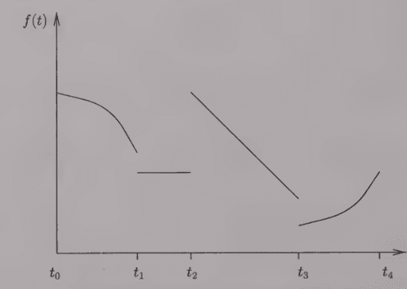

**图 5.5**：分段多项式函数。

光滑性取决于样条的阶。对于基 B-样条，这些断点是等距的。与多项式不同，它们形成局部基，并具有许多适用于函数近似的有用性质。

`m`阶基`B`-样条`N_m(t)`具有节点序列`{..., -1, 0, 1, ...}`，由节点之间的`m`阶（`m-1`次）多项式组成。令`N_1(t) = \chi_{[0,1]}(t)`为`[0,1]`的特征函数。那么对于每个整数`m \geq 2`，`m`阶基`B`-样条通过归纳定义为：


$N_m(t) := (N_{m-1} * N_1)(t) \qquad (5.36)$

$= \int_{-\infty}^{\infty} N_{m-1}(t-x)N_1(x)dx$

$= \int_{0}^{1} N_{m-1}(t-x)dx. \qquad (5.37)$

可以使用公式 [7, p. 131] 快速计算 $m \geq 2$ 的 $N_m(t)$：

$N_m(t) = \frac{t}{m-1}N_{m-1}(t) + \frac{m-t}{m-1}N_{m-1}(t-1)$

递归进行，直到得到一阶 $B$-样条 $N_1$（见图 5.6）。2 阶到 6 阶样条及其幅度谱如图 5.7 所示。最常用的样条是线性 ($m=2$) 样条和三次 ($m=4$) 样条。它们的显式表达式如下：

$N_2(t) = \begin{cases} t & t \in [0,1] \\ 2-t & t \in [1,2] \\ 0 & \text{elsewhere} \end{cases} \qquad (5.38)$

## 样条函数与性质

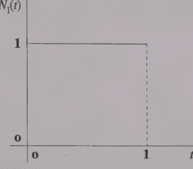

图 5.6: $N_1$，1 阶样条。

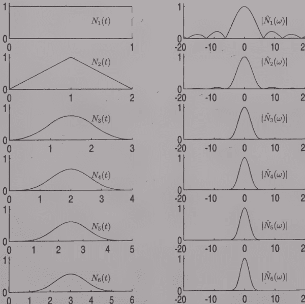

图 5.7: 样条函数及其幅度谱。

$N_4(t) = \begin{cases} 4-12t+12t^2-3t^3 & t \in[0,1] \\ -44+60t-24t^2+3t^3 & t \in[2,3] \\ 64-48t+12t^2-t^3 & t \in[3,4] \\ 0 & \text{elsewhere.} \end{cases} \quad (5.39)$

### 表 5.1: 整数点的基 B-样条

| k | (m-1)!!N_m(k) | k | (m-1)!!N_m(k) | k | (m-1)!!N_m(k) |
|---|---|---|---|---|---|
| | m=3 | | m=8 | | m=11 |
| 1 | 1 | 1 | 1 | 1 | 1 |
| | m=4 | 2 | 120 | 2 | 1,013 |
| 1 | 1 | 3 | 1,191 | 3 | 47,840 |
| 2 | 4 | 4 | 2,416 | 4 | 455,192 |
| | m=5 | | m=9 | | 1,310,354 |
| 1 | 1 | 1 | 1 | 5 | m=12 |
| 2 | 11 | 2 | 247 | 1 | 1 |
| | m=6 | 3 | 4,293 | 2 | 2,036 |
| 1 | 1 | 4 | 15,619 | 3 | 152,637 |
| 2 | 26 | 1 | m=10 | 4 | 2,203,488 |
| | m=7 | 2 | 502 | | 9,738,114 |
| 1 | 1 | 3 | 14,608 | 6 | 15,724,248 |
| 2 | 57 | 4 | 88,234 | | |
| 3 | 302 | 5 | 156,190 | | |

在许多应用中，我们需要计算整数点处的样条。表 5.1 给出了整数位置的样条值。对称性性质可以获取其他点的值。

为了获得 $N_m(t)$ 的傅里叶变换，观察到 (5.36) 可以写为：

$N_m(t) = (N_{m-1}*N_1)(t). \qquad (5.40)$

因此，

$\hat{N}_m(\omega) = \left(\frac{1-e^{-j\omega}}{j\omega}\right)^m \qquad (41)$

因为

$\hat{N}_1(\omega) = \int_0^1 e^{-j\omega t} dt = \frac{1-e^{-j\omega}}{j\omega} \qquad (42)$

样条的一个的重要性质是它们是尺度函数。即存在序列 $g_0[m,k] \in \ell^2$，使得：

$N_m(t) = \sum_{k} g_0[m,k]N_m(2t-k). \qquad (43)$

在第 6 章中，我们将推导 $g_0[m,k]$ 的表达式。

### 5.5.1 样条的性质

本节讨论了与书中主题相关的样条的一些重要性质，不进行证明。某些性质的证明留作练习题。

- Supp $N_m = [0, m]，且 $N_m(0) = N_m(m) = 0$
- $N_m(t) \in C^{m-2}$，$C^k$ 是 $k$ 阶连续可导函数空间。
- $N_m[k-1, k] \in \Pi_{m-1}; k \in \mathbb{Z}$；$\Pi_k$ 是 $k$ 次多项式空间（$k+1$ 阶）。
- $\int_{-\infty}^{\infty} N_m(t)dt=1$
- $N_m(t) = N_{m-1}(t)-N_{m-1}(t-1)$ 关于中心 $t^* = m/2$ 对称：
$N_m\left(\frac{m}{2} + t\right) = N_m\left(\frac{m}{2} - t\right); \quad t \in \mathbb{R} \qquad (44)$
- $N_m(t)$ 表现为低通滤波器 $[\hat{N}_m(0)=1]$；见图 5.7。
- $N_m(t)$ 具有 $m$ 阶精度，意味着 $\hat{N}_m(\omega)$ 满足 Strang-Fix 条件：
${\hat{N}_m(0)=1, \text{ and } D^l\hat{N}_m(2\pi k)=0, \quad k \in \mathbb{Z}\setminus\{0\} \text{ and } j=1,\dots,m-1\} (45)$
其中 $D^l$ 表示 $j$ 阶导数。因此，$N_m(t)$ 局部构造了所有 $m$ 阶多项式 [8, pp. 114–121]。
- 对于所有 $t$，$N_m(t-k)=1$。该性质被称为归一性。
- 全正性：$N_m(t) \ge 0, \quad t \in [0, m]$。根据 $B$-样条的全正性 [6, p. 7] 性质，$B$-样条级数数的系数遵循数据的形状。例如，如果 $g(t)=\sum_j \alpha_j N_m(t-j)$，则：

$\alpha_j \ge 0 \forall j \Rightarrow g(t) \ge 0$
$\alpha_j \uparrow$ (单增) $\Rightarrow g(t) \uparrow$,
$\alpha_j$ (凸) $\Rightarrow g(t)$ 凸。

此外，$g(t)$ 的符号变化次数不超过系数序列 $\{\alpha_j\}$。后者性质可用于识别信号的过零点。

- 随着阶 $m$ 的增加，$N_m(t)$ 趋于高斯函数 $(\Delta_{N_m}\tilde{N}_m \to 0.5)$。例如，在三次样条 $(m=4)$ 的情况下，均方根时频积为 0.501。

## 5.6 将函数映射到 MRA 空间

如第 5.2 节所述，在分解信号 $x(t)$ 之前，必须将其映射到某个适当尺度 $M$ 的 MRA 子空间 $A_M$，即：

$x(t) \mapsto x_M(t) = \sum_k a_{k,M}\phi(2^M t - k). \qquad (5.46)$

一旦知道 $\{a_{k,M}\}$，我们就可以快速算法计算 $s < M$ 的 $\{a_{k,s}\}$。但在实践中，$x(t)$ 在某些点是已知的。为了获得 $N_m(t)$ 的傅里叶变换，观察到 (5.36) 可以写为：

$N_m(t) = (N_{m-1}*N_1)(t). \qquad (5.40)$

快速算法将在稍后讨论。这里关注的是信号的正交投影。样条对我们而言的一个重要性质是它们是尺度函数。即存在序列 $g_0[m,k] \in \ell^2$，使得：

$N_m(t) = \sum_{k} g_0[m,k]N_m(2t-k). \qquad (43)$

## 110 多分辨率分析

$v_n = \begin{cases} \frac{29}{24}, & n=0 \\ \frac{7}{12}, & n=\pm1 \\ \frac{1}{8}, & n=\pm2 \\ \frac{1}{12}, & n=\pm3 \\ \frac{1}{48}, & n=\pm4 \\ 0, & \text{其他.} \end{cases}$

该表示 (5.52) 保持了所有次数不超过 3 的多项式。

## 5.7 练习

$V_j = \left{\{ \sum_{k=-\infty}^{\infty} c_k N_2(2^j t-k) :{c_k\}_{k\in\mathbb{Z}} \in \ell_2 \right{\}$

可以通过插值条件 $P_{2,ij}f(k/2') = f(k/2')$（对于所有 $k \in \mathbb{Z}$）来确定。如果 $P_{2,if}$ 写为

$P_{2,ij}f(t) = \sum_{n=-\infty}^{\infty} a_n N_2(2^j t-n)$，请找到系数 $\{a_n\}$ 的公式。

- 2. 对于 Haar 小波：

$\Psi_H(t) := \begin{cases} 1 & \text{对于 } t \in [0, \frac{1}{2}) \\ -1 & \text{对于 } t \in [\frac{1}{2}, 1) \\ 0 & \text{其他.} \end{cases}$

定义

$\Psi_{H,ks}(t) = 2^s \Psi_H(2^s t-k), \quad k, s \in \mathbb{Z}$

### 将函数映射到 MARS 空间

证明正交关系

$$\int_{-\infty}^{\infty} \Psi_{H,k,s}(t)\Psi_{H,m,p}(t)dt = \delta_{m,k}\delta_{s,p} \quad m,k,p,s \in \mathbb{Z}.$$

由于这些关系，我们说集合 $\{\Psi_{H,k,s}\}_{k\in\mathbb{Z}}$ 构成 $L^2(-\infty, \infty)$ 中的一个正交族。

- 3. 证明高斯函数 $\phi(t)=e^{-t^2}$ 不可以是尺度函数（提示：假设 $e^{-t^2}$ 可以写为 $e^{-t^2}=\sum_{k=-\infty}^{\infty} a_ke^{-(t-k)^2}$，对于 $\ell_2$ 中的序列 $\{a_k\}_{k\in\mathbb{Z}}$，这如果 $e^{-t^2} \in V_0 \cup V_1$ 是必须的。然后通过对等式的两边进行傅里叶变换并比较结果，证明这会导致矛盾。）

- 4. 证明 $m$ 阶 B 样条 $N_m(t)$ 及其整数平移构成了一个 Unity划分：
$$\sum_{k=-\infty}^{\infty} N_m(t-k)=1 \quad \text{对于所有 } t \in \mathbb{R}.$$
（提示：使用泊松求和公式。）

- 5. 证明 $N_m(t)$ 的以下对称性：

$$N_m(\frac{m}{2}+t)=N_m(\frac{m}{2}-t), \quad t \in \mathbb{R}.$$

- 6. 使用练习 5 证明

$$\int_{-\infty}^{\infty} N_m(t+k)N_m(t)dt=N_{2m}(m+k)$$

对于任何 $k \in \mathbb{Z}$。

- 7. 证明帽函数

$$N_2(t)=\begin{cases} t & t \in[0,1] \\ 2-t & t \in[1,2] \\ 0, & \text{其他} \end{cases} \quad (5.53)$$

以及函数 $N_1(t)$ 通过卷积相关联：$N_2(t)=N_1(t) * N_1(t)$。找到给定函数的定义方程（多项式表达式）：

$$N_3(t):=N_2(t)*N_1(t)$$
$$N_4(t):=N_3(t)*N_1(t).$$

## 多分辨率分析

## 5.8 计算机程序

### 5.8.1 B-样条

```matlab
%

% PROGRAM Bspline.m

%

% 计算均匀 B-样条

function y = Bspline(m,x)

y = 0;

% 特征函数

if m == 1

if x >= 0.0 & x < 1.0

y = 1.0;

else

y = 0.0;

end

end

% 高阶

a = zeros(1,500);

if m >= 2 & m < 100

for k = 1:m-1

a(k) = 0.0;

x1 = x - k + 1;

if x1 >= 0.0 & x1 < 1.0

a(k) = x1;

end

if x1 >= 1.0 & x1 < 2.0

a(k) = 2 - x1;

end

for p=1:m-2

for q=1:m-1-p

a(q) = ((x-q+1) * a(q) + ((p+2)-q-1) * a(q+1)) /

(p+1);

end

end

y = a(1);

end
```


## 5.9 参考文献

1. Y. Meyer. Wavelets: Algorithms and Applications. Philadelphia: SIAM, 1993.
2. S. Mallat. “A Theory of Multiresolution Signal: Wavelet Representation.” IEEE Trans. Pattern Anal. Machine Intell. 11 (1989), 674-693.
3. S. Mallat. “Multiresolution Representation and Wavelets.” Ph.D. thesis, University of Pennsylvania, 1988.
4. C. K. Chui. An Introduction to Wavelets. Boston: Academic Press, 1992.
5. I. J. Schoenberg. Cardinal Spline Interpolation. CBMS Series 12. Philadelphia: SIAM, 1973.
6. L. L. Schumacher. Spline Functions: Basic Theory. New York: Wiley-Interscience, 1981.
7. C. de Boer. A Practical Guide to Splines. New York: Springer-Verlag, 1978.
8. C. K. Chui. Multivariate Splines. CBMS-NSF Series in Applied Maths 54. Philadelphia: SIAM, 1988.

## 小波构造

在本章中，我们关注正交、半正交和双正交小波的构造。构造问题对于寻找第5章引入的尺度序列至关重要。结果正交小波的系数可以从半正交小波推导出来。因此我们首先讨论半正交小波，然后是正交和小正交小波。记住对于半正交小波，`$\phi(t)$` 和 `$\hat{\phi}(t)$` 都属于 `$V_0$`，而 `$\psi(t)$` 和 `$\hat{\psi}(t)$` 属于 `$W_0$`。因此我们可以用 `$\hat{\phi}(t)$` 来表示 `$\phi(t)$`；`$\psi(t)$` 也是。这里复制了 (5.21) 和 (5.22) 中的关系：

```
$$\hat{\phi}(\omega) = \frac{\hat{\phi}(\omega)}{E_{\phi}(e^{i\omega})} \quad (6.1)$$
```

```
$$\hat{\psi}(\omega) = \frac{\hat{\psi}(\omega)}{E_{\psi}(e^{i\omega})} \quad (6.2)$$
```

其中 Euler-Frobenius-Laurent (E-F-L) 多项式 `$E_f(e^{i\omega})$` 由下给出：

```
$$E_f(e^{i\omega}) := \sum_{k=-\infty}^{\infty} |\hat{f}(\omega+2\pi k)|^2 \quad (6.3)$$
```

因此我们将只关注 `$\phi$` 和 `$\psi$` 的构造。

> Fundamentals of Wavelets: Theory, Algorithms, and Applications, Second Edition, By Ingrid Goswami and Andrew K. Chan. Copyright © 2011 John Wiley & Sons, Inc.

# 小波构造的必要条件

作为构造小波的第一步，我们用 `$g_0[k]$` 表示 `$h_0[k]$`、`$h_1[k]$` 和 `$g_1[k]$`，因此只需要构造 `$g_0[k]$` 以及尺度函数。在半正交情况下，通常这些序列的长度不同。我们稍后将证明对于正交情况，所有这些序列的长度相同，且它们之间存在非常简单的关系，从半正交情况的关系很容易推导出来。半正交小波的构造之后是几种流行的正交小波的构造：Shannon、Meyer、Battle-Lemarié 和 Daubechies 小波。最后我们构造双正交小波。其他小波如 ridges、curvelets 和 lifting 在第8章讨论。

# 小波构造的必要条件

如前所述，我们需要系数序列 `$g_0[k], g_1[k]$` 来构造小波。在本节中，我们的目标是找到各种序列之间的关系。这将有助于我们减少任务。在这里我们考虑多分辨率空间的半正交分解。

## 6.1.1 双尺度序列之间的关系

回顾第5章，由于多分辨率性质，一个尺度（粗）的尺度函数和小波与更高尺度（细）的尺度函数通过所谓的双尺度相关联：

```
$$\phi(t) = \sum_{k} g_0[k]\phi(2t-k), \quad (6.4)$$
```

```
$$\psi(t) = \sum_{k} g_1[k]\phi(2t-k), \quad (6.5)$$
```

通过对上述关系取傅里叶变换，我们得到：

```
$$\hat{\phi}(\omega) = \frac{\hat{\phi}(\omega)}{E_{\phi}(e^{i\omega})} \quad (6.6)$$
```

```
$$\hat{\psi}(\omega) = \frac{\hat{\psi}(\omega)}{E_{\psi}(e^{i\omega})} \quad (6.7)$$
```

其中 `$z=e^{-i\omega}$` 且

```
$$E_f(e^{i\omega}) := \sum_{k=-\infty}^{\infty} |\hat{f}(\omega+2\pi k)|^2 \quad (6.8)$$
```

# 小波构造的必要条件

```
$$G_0(z)G_1(z)E_{\ell}(z)+G_0(-z)G_1(-z)E_{\ell}(-z)=0 \quad (6.15)$$
```

对于 `$|z|=1$`。(6.15) 的解给出了 `$G_1(z)$` 与 `$G_0(z)$` 之间的关系。通过直接代入，我们可以验证：

```
$$G_1(z)=-cz^{2m+1}G_0(-z)E_{\ell}(-z) \quad (6.16)$$
```

对于任意整数 `$m$`，常数 `$c>0$` 是 (6.15) 的解。在不失一般性的情况下，我们可以取 `$c=1$`。`$m$` 的作用是移动序列 `$\{g[k]\}$` 的索引。通常选择 `$m$` 使得索引从 0 开始。

## 6.1. 重构序列与分解序列的关系

回想第5章，特定尺度（细尺度）上的缩放函数可以从下一个低尺度（粗尺度）的缩放函数和小波中得到。用数学术语来说，这意味着存在有限能量序列 `$\{h_0[k]\}, \{h_1[k]\}$` 使得：

```
$$\phi(2t-\ell)=\sum_{k}h_0[2k-\ell]\phi(t)+h_1[2k-\ell]\psi(t), \quad (6.17)$$
```

其中，如第5章讨论的，`$\{h_0[k]\}, \{h_1[k]\}$` 是分解序列。通过分解分解式傅里叶变换，我们得到：

```
$$\frac{1}{2}\hat{\phi}(\frac{\omega}{2})e^{-j\omega\ell/2}=\sum_{k}h_0[2k-\ell]e^{-jk\omega}\hat{\phi}(\omega)+\sum_{k}h_1[2k-\ell]e^{-jk\omega}\hat{\psi}(\omega)$$
```

```
$$=\{G_0(z)\sum_{k}h_0[2k-\ell]e^{-jk\omega}+G_1(z)\sum_{k}h_1[2k-\ell]e^{-jk\omega}\}\hat{\phi}(\frac{\omega}{2})$$
```

该方程简化为：

```
$$\sum_{k}h_0[2k-\ell]e^{-j(2k-\ell)\omega/2}G_0(z)+\sum_{k}h_1[2k-\ell]e^{-j(2k-\ell)\omega/2}G_1(z)=\frac{1}{2};\forall \ell\in\mathbb{Z}. \quad (6.18)$$
```

结合分解式和二尺度关系的傅里叶变换，我们得到：

```
$$H_0(z)+H_0(-z)G_0(z)+[H_1(z)+H_1(-z)]G_1(z)=\frac{1}{2}$$ 对于偶数 `$\ell$` \quad (6.19)
```

```
$$H_0(z)-H_0(-z)G_0(z)+[H_1(z)-H_1(-z)]G_1(z)=\frac{1}{2}$$ 对于奇数 `$\ell$`， \quad (6.20)
```

## 118 小波的构造

其中 `$z = e^{-j\omega 2}$` 且：

```
$$H_0(z):=\frac{1}{2} \sum_{k} h_0[k]z^k,$$
```

```
$$H_1(z):=\frac{1}{2} \sum_{k} h_1[k]z^k.$$
```

这些方程导出：

```
$$H_0(z)G_0(z) + H_1(z)G_1(z)=\frac{1}{2}$$
```

```
$$H_0(-z)G_0(z) + H_1(-z)G_1(z)=0.$$
```

最后一个方程也可以写成：

```
$$H_0(z)G_0(-z) + H_1(z)G_1(-z)=0. (6.21)$$
```

在矩阵形式下，我们有：

```
$$\begin{bmatrix} G_0(z) & G_1(z) \\ G_0(-z) & G_1(-z) \end{bmatrix} \begin{bmatrix} H_0(z) \\ H_1(-z) \end{bmatrix} = \begin{bmatrix} \frac{1}{2} \\ 0 \end{bmatrix}. (6.22)$$
```

其解给出：

```
$$H_0(z)=\frac{1}{2} \frac{G_1(-z)}{\Delta_{G_0G_1}} (23)$$
```

```
$$H_1(z)=-\frac{1}{2} \frac{G_0(-z)}{\Delta_{G_0G_1}} (24)$$
```

其中 `$\Delta_{G_0G_1}(z)=G_0(z)G_1(-z)-G_0(-z)G_1(z). (25)$`

可以证明：

```
$$\Delta_{G_0G_1}(z)=cz^m E_{\phi}(z^2), (26)$$
```

其中 `$c>0$` 且 `$m$` 为整数。由于 `$\phi$` 生成一个 Riesz 基或稳定基，`$E_{\phi}(z)$` 和 `$\Delta_{G_0G_1}(z)\neq 0$`。

## 6.2 半正交样条小波的构造

6.1节的结果意义在于我们需要构造缩放函数——即只需要找到序列 `$g_0[k]$`。在本节中，我们获得了Chui-Wang [1] 引入的半正交样条小波。这里 B-样条 `$N_m$` 被选取为缩放函数。我们将证明存在有限能量序列 `$g_0[m,k]$` 使得尺度关系：

```
$$N_m(t) = \sum_{k} g_0[m,k]N_m(2t-k) (27)$$
```

成立，因此 `$N_m(t)$` 是缩放函数。对于 `$m=1$`，`$\{N_1(t-k): k \in \mathbb{Z}\}$` 构成 `$A_0$`。在这种情况下，我们已经看到 `$g_0[0] = g_0[1] = 1$`（见图5）。在本节中考虑 `$m \geq 2$` 的情况。

对于 `$m \geq 2$`，缩放函数 `$\{N_m(t-k): k \in \mathbb{Z}\}$` 不再正交：

```
$$\int_{-\infty}^{\infty} N_m(t)N_m(t-\ell)dt \neq \delta_{0,\ell}, (28)$$
```

对于所有 `$\ell \in \mathbb{Z}$`。`$N_2(t)$` 的非正交性如图6.1所示。`$\int_{-\infty}^{\infty} N_2(t)N_2(t-\ell)dt$` 由阴影区域显示非零。

### 6.2.1 `$\{g_0[k]\}$` 的表达式

回想第5章中 `$N_m(t)$` 的定义：

```
$$N_m(t) = (N_1 * \dots * N_1)(t)$$
```

图6.1：阴影区域所示非正交性。

且：

```
$$\hat{N}_m(\omega) = \left(\frac{1-e^{-j\omega}}{j\omega}\right)^m. (29)$$
```

从二尺度关系的傅里叶变换中，我们有：

```
$$G_0(z) = \frac{1}{2} \sum_k g_0[m,k]z^k = \frac{\hat{N}_m(\omega)}{\hat{N}_m(\omega/2)} (30)$$
```

```
$$= \left(\frac{1+e^{-j\omega}}{2}\right)^m$$
```

```
$$= 2^{-m}(1+z)^m; \ z=e^{-j\omega},$$
```

```
$$= 2^{-m}\sum_{k=0}^m \binom{m}{k}z^k. (31)$$
```

通过比较 `$z$` 的幂系数，我们得到：

```
$$g_0[k] := g_0[m,k] = \begin{cases} \binom{m}{k}2^{-m}, & 0 \le k \le m \\ 0, & \text{否则.}\end{cases} \quad (32)$$
```

一旦有了 `$\{g_0[k]\}$`，就可以使用6.1节导出的关系找到其余的序列 `$\{g_1[k]\}, \{h_0[k]\}$`, 和 `$\{h_1[k]\}$`。接下来导出 `$\{g_1[k]\}$` 的表达式。

对于 `$N_m(t)$`，E-F-L 多项式 `$E_{N_m}(z)$` 取形式如下：

```
$$E_{N_m}(z) = \sum_{k=-\infty}^{\infty} \left|\hat{N}_m(\frac{\omega}{2}+2\pi k)\right|^2$$
```

```
$$=\sum_{k=-\infty}^{\infty} A_{N_m}(k)z^k$$
```

```
$$=\sum_{k=-m+1}^{m-1} N_{2m}(m+k)z^k, (33)$$
```

其中 `$z=e^{-j\omega/2}$`，自相关函数为

```
$$A_{N_m}(k) = \int_{-\infty}^{\infty} N_m(x)N_m(x+k)dx = N_{2m}(m+k). (34)$$
```

最后，利用关系 (6.16)，我们有：

```
$$g_1[k] := g_1[m,k] = (-1)^k 2^{-m+1} \binom{m}{\ell} N_{2m}(k+1-\ell), 0 \le k \le 3m-2. (35)$$
```


### 6.2.2 备注

回想，在用`G_0(z)`和`G_1(z)`表示`H_0(z)`和`H_1(z)`的表达式中，分母有一个项`\Delta_{G_0G_1}(z)=z^m E_{\phi}(z)`。因此，序列`\{h_0[k]\}`和`\{h_1[k]\}`是无限长的，尽管它们的幅度指数级减。这些序列将用于第7章和第8章分解和重构算法的开发。

显然，`G_0`和`G_1`是有限冲激（FIR）滤波器，而`H_0`和`H_1`总是无限冲激（IIR）。然而，我们将在第7章中证明可以使用`G_0`和`G_1`用于重构和分解。这是第5章中简要提到的对偶原理的结果。

常用的样条和相应的半正交小波及其频谱如图6.2和6.3所示。参见第10章关于常用半正交缩放函数和小波的表达式。

图6.3：立方样条、对偶立方样条、相应的小波及其频谱。

表6.1：用于半正交小波的系数`u_{m,k} := 2^{m-1}(2m-1)! g_1[m,k]`（`g_1[m,k] = (-1)^m g_1[3m-2-k]`）

| `u_{m,k}` | `k` | `u_{m,k}` | `m=5` | `k` | `u_{m,k}` |
|---|---:|---:|---:|---:|---:|
| `m=2` | 0 | 1 | 0 | 1 | |
| 1 | -6 | 1 | -507 | 1 | |
| 2 | 10 | 2 | 17,128 | 2 | 164,868 |
| `m=3` | 3 | -1,66,304 | 3 | -3,149,870 | | |
| 0 | 4 | 7,484,465 | 4 | 25,289,334 | | |
| 1 | -29 | 5 | -1,900,115 | 5 | -110,288,536 |
| 2 | 147 | 6 | 2,973,560 | 6 | 296,526,880 |
| 3 | -303 | | | 7 | -525,228,884 |
| `m=4` | 1 | | | 8 | 633,375,552 |

## 6.3 正交小波的构造

回顾第2章，正交基的 Riesz 边界（Riesz bounds）为1。因此，对于正交缩放函数`\phi`以及相应的小波`\psi`，我们有：

`E_{\phi}(e^{j\omega}) = \sum_{k} |\hat{\phi}(\omega + 2\pi k)|^2 = 1`

`E_{\psi}(e^{j\omega}) = \sum_{k} |\hat{\psi}(\omega + 2\pi k)|^2 = 1`

对于几乎所有的`\omega`成立。因此，

`\tilde{\phi}(t) = \phi(t)`，且`\tilde{\psi}(t) = \psi(t)`

也就是说它们是自对偶的。

记得我们在第5章的讨论中，由于多尺度分析（MRA）子空间的嵌套性质，缩放函数在尺度上是不正交的。正交缩放函数意味着它们在给定尺度上关于平移是正交的。另一方面，正交缩放函数小波在尺度上关于平移也是正交的。从开始：

`(\phi(t - \ell), \phi(t)) = \delta_{0,\ell}`（6.36）

并遵循（6.1）的推导，我们得到以下结果：

`|G_0(z)|^2 + |G_0(-z)|^2 = 1, |z|=1`。（6.37）

对于正交缩放函数和小波，由于各种序列`[g_0[k]]`、`[g_1[k]]`、`[h_0[k]]`和`[h_1[k]]`之间的关系可以通过第6.1节的结果并令`m=0`来得到。这些结果总结如下：

`G_1(z) = -G_0(-z)`

` \Rightarrow g_1[k] = (-1)^k g_0[1-k]`；（6.38）

`\Delta_{G_0G_1}(z) = G_0(z)G_1(-z)G_0(-z)G_1(z) = z`（6.39）

`H_0(z) = \frac{1}{2} \frac{G_1(-z)}{z} = \frac{1}{2}G_0(z)`

`\Rightarrow h_0[k] = \frac{1}{2} g_0[-k]`；（6.40）

`H_1(z) = -\frac{1}{2} \frac{G_0(-z)}{z} = \frac{1}{2}G_1(z)`

`\Rightarrow h_1[k] = \frac{1}{2}(-1)^k g_0[k+1]`；（6.41）

### 小波的构造

例如，对于 Haar 缩放函数和小波（图5.3和图5.4）：

`g_0[0]=g_0[1]=1`；

`g_1[0]=1, g_1[1]=-1`；

`h_0[0]=h_0[-1]=\frac{1}{2}`；

`h_1[0]=\frac{1}{2}, h_1[-1]=-\frac{1}{2}`；

`g_0[k]=g_1[k]=h_0[k]=h_1[k]=0`对于所有其他`k`。

**备注：**正交基的最重要特征之一是所有的分解和重建滤波器都是有限脉冲响应（FIR）滤波器且具有相同的长度。这对于第7章中描述的分解和重建算法有巨大的帮助。

正交小波的缺点是它们通常没有闭式表达式，而且具有紧凑支撑的正交小波没有线性相位（无对称性）。线性相位在信号重建中的重要性将在第7章讨论。文献[2]也指出，高阶正交缩放函数和小波的局部化性较差。

## 6.4 正交缩放函数

在本节中，我们将讨论常用的 Shannon、Meyer、Battle-Lemarié 和 Daubechies 正交小波。我们只推导序列`\{g_0[k]\}`的表达式，因为其他序列可以通过第6.1节的关系得到。

### 6.4.1 Shannon 缩放函数

Shannon 采样函数：

`\phi_{SH}(t) := \frac{\sin \pi t}{\pi t}`（6.42）

是一个正交缩放函数，其`\hat{\phi}_{SH}(\omega) = \chi_{(-\pi,\pi)}(\omega)`。通过以下关系在时域证明（6.42）的正交性：

`\langle\phi_{SH}(t-\ell), \phi_{SH}(t)\rangle = \delta_{0,\ell}`（6.43）

是复杂的。在这里证明 Riesz 边界为1是相当容易的；即：

`\sum_{k} |\hat{\phi}_{SH}(\omega+2\pi k)|^2 = 1`。（6.44）

序列`\{g_0[k]\}`可以由双尺度关系得到：

`\sum_{k} g_0[k]e^{-j\omega/2} = \frac{\hat{\phi}_{SH}(\omega)}{\hat{\phi}_{SH}(\omega/2)}`（6.45）

由于表达式的左侧是一个`4\pi`周期函数，我们需要对右侧进行`4\pi`周期扩展。换句话说，`G_0(z)`无非是`\hat{\phi}_{SH}(\omega)`的`4\pi`周期扩展（见图6.4）：

`G_0(z) = \frac{1}{2}\sum_{\ell} g_0[\ell]\exp(-j\omega/2) = \sum_{\ell} \hat{\phi}_{SH}(\omega+4\pi\ell)`。（6.46）

从（6.46）我们可以得到系数`\{g_0[k]\}`的表达式：

`g_0[k] = \frac{1}{2\pi}\int_{0}^{4\pi} \hat{\phi}_{SH}(\omega+4\pi\ell)\exp(j\omega/2)d\omega = \frac{1}{2\pi}\int_{-\infty}^{\infty} \hat{\phi}_{SH}(\omega)\exp(j\omega/2)d\omega = \hat{\phi}_{SH}(\frac{k}{2})`。（6.47）

通过使用（6.42），我们得到：

`g_0[k] = \begin{cases} 1 & k=0 \\ 1/2 & k=\pm 1 \\ 0 & \text{其他} \end{cases}`

（注：此处原文公式对应略有偏差，基于逻辑翻译）

根据原文逻辑：

`g_0[k] = \frac{1}{2\pi}\int_{0}^{4\pi} \hat{\phi}_{SH}(\omega+4\pi\ell)\exp(j\omega/2)d\omega = \dots = \hat{\phi}_{SH}(\frac{k}{2})`。

（注：原文文本中`g_0[k]`的具体定义部分在公式6.47之后存在排版混乱码，如`k/2`定义，翻译时保持原意）

**图6.4：**`\hat{\phi}_{SH}(\omega)`的`4\pi`周期扩展。

**图6.5：**缩放函数。

### 6.4.2 Meyer 缩放函数

Meyer 缩放函数在频率域具有紧凑支撑。由于缩放函数在频率域具有紧凑支撑，Meyer 小波与缩放函数的关系更加直接，如下所示。

#### 表6.2：一阶 Meyer 缩放函数双尺度序列`\Phi_{M:1}`

| `n` | `g_0[n]=g_0[-n]` | `n` | `g_0[n]=g_0[-n]` | `n` | `g_0[n]=g_0[-n]` |
|---:|---:|---:|---:|---:|---:|
| 0 | 0.0635113307325022 | 13 | 0.0018225699661070 | 26 | 0.0000718583234904 |
| 1 | 0.0637299142832031 | 14 | -0.0001257888464030 | 27 | -0.0002181768640309 |
| 2 | -0.0594319217681172 | 15 | -0.0019003177368828 | 28 | -0.0000686017777485 |
| 3 | -0.0176297183701455 | 16 | -0.0000363113505005 | 29 | 0.0000352915374841 |
| 4 | 0.048477753800750 | 17 | 0.0018154320178272 | 30 | -0.0000591760677635 |
| 5 | 0.0758114853712452 | 18 | -0.0004792529715153 | 31 | 0.0000278081682708 |
| 6 | -0.0339527498419033 | 19 | -0.0019031928005108 | 32 | 0.0000145515716864 |
| 7 | 0.0311010536483103 | 20 | 0.0002704898373368 | 33 | -0.0000117159556012 |
| 8 | 0.0197659430813598 | 21 | 0.0002657114100884 | 34 | -0.0001171595560227 |
| 9 | 0.0110906323385240 | 22 | -0.0005156302816983 | 35 | -0.0000530428982027 |
| 10 | -0.0089123022739117 | 23 | -0.0002172396537380 | 36 | 0.0000282695154764 |
| 11 | -0.0003539083123475 | 24 | 0.0004166883466883 | 37 | 0.0000443263271494 |
| 12 | 0.0025669071818815 | 25 | 0.0001627294013423 | 38 | 0.0000355188445237 |

```text
\Phi_{M,m}(\omega) = G_1\left(\Phi_{M,m}\left(\frac{\omega}{2}\right)\right); z = \exp(-j\omega/2)
```

```text
-G_0\left(\Phi_{M,m}\left(\frac{\omega}{2}\right)\right)
```

```text
-z\left[ \sum_{k=-\infty}^{\infty} \Phi_{M,m}(\omega+2\pi k+4\pi k) \Phi_{M,m}\left(\frac{\omega}{2}\right) \right]
```

```text
-z\left[ \Phi_{M,m}(\omega+2\pi) + \Phi_{M,m}\left(\frac{\omega}{2}\right) \right] \quad (6.52)
```

### 6.4.3 Battle-Lemarie 缩放函数

Battle-Lemarie[5, 6]缩放函数是通过对`m \geq 2`的`m`阶 B-样条`N_m(t)`进行正交化而成的。如前所述，基函数集合`[N_m(t-k): k \in \mathbb{Z}]`在`m \geq 2`时不是正交的。对应的正交缩放函数`N_m(t)`可以通过：

```text
\tilde{N}_m(\omega) = \frac{\hat{N}_m(\omega)}{\left[E_m(e^{-j\omega})\right]^{1/2}} \quad (6.53)
```

那么，Battle-Lemarie（B-L）缩放函数`\Phi_{BL,m}(t)`为：

```text
\Phi_{BL,m}(t) = \tilde{N}_m(t)
```

系数`[g_0[k]]`可以由下式找到：

```text
\frac{1}{2}\sum_{k} g_0[k]z^k = G_0(e^{-j\omega/2}) = \frac{\hat{N}_m(\omega)}{\hat{N}_m(\omega/2)}, \quad (6.54)
```

## 130 小波构造

#### 表6.3：线性 Battle-Lemarie 缩放函数`\phi_{BL/2}`的双尺度

| `n` | `g_0[n]=g_0[2-n]` | `n` | `g_0[n]=g_0[2-n]` | `n` | `g_0[n]=g_0[2-n]` |
|---:|---:|---:|---:|---:|---:|
| 1 | 0.153629914405729 | 14 | 0.00002422257478 | 27 | -0.000000053986543 |
| 2 | 0.561829285827648 | 15 | -0.000019547234309 | 28 | -0.000000028565276 |
| 3 | -0.0734618374899832 | 16 | -0.000010529706548 | 29 | 0.000000013958891 |
| 4 | -0.173611335540770 | 17 | 0.000049211790530 | 30 | -0.000000007374693 |
| 5 | 0.240068845361932 | 18 | 0.000026383701627 | 31 | 0.000000361785220 |
| 6 | 0.141228736913845 | 19 | -0.000012470151924 | 32 | -0.000000019008891 |
| 7 | -0.005497165813284 | 20 | -0.000006664097972 | 33 | 0.000000009393609 |
| 8 | -0.003114029015464 | 21 | 0.000003817055856 | 34 | 0.000000000495170 |
| 9 | 0.011058432621069 | 22 | 0.000001693729269 | 35 | -0.0000000002448478 |
| 10 | 0.000723562512300 | 23 | -0.000000814519590 | 36 | -0.000000000128703 |
| 11 | -0.0003517028255467 | 24 | -0.000000432645262 | 37 | 0.000000000063709 |
| 12 | -0.000173504365395 | 25 | 0.000002903964375 | 38 | 0.000000003330504 |
| 13 | -0.005049037846550 | 26 | 0.000001100975272 | 39 | -0.000000000016637 |
| 14 | 0.003024987240962 | 27 | 0.000004303995778 | 40 | -0.000005557753368 |

`z = e^{-j\omega}`。通过结合（6.3）和（6.5），我们得到：

```text
G_0(z) = \left( \frac{1+z}{2} \right)^2 \frac{\sum_{k=-m+1}^{m-1} N_{2m}(m+k)z^k}{\sum_{k=-m+1}^{m} N_{2m}(m+k)z^{2k}} = \frac{z^2+4z+1}{z^4+4z^2+1} \quad (6.55)
```

当我们考虑`m=2`的线性 B 缩放函数时，在这种情况下：

系数`\{g_0[k]\}`可以通过将右侧表达式展开为`z`的多项式，然后比较`z`的相同幂次的系数得到。这些系数也可以通过计算右侧的傅里叶系数找到。观察发现满足`G_0(1)=1`，因此所有`\{g_0[k]\}`的和为2。在表（6.3）和（6.4）中我们提供了线性立方 B-L 缩放函数的系数。线性和立方 Battle-Lemarié 缩放函数以及相应的小波如图6所示。

### 6.4.4 Daubies 缩放函数

Battle-Lemarie 通过对`m \geq 2`的`m`阶 B-样条`N_m(t)`进行正交化获得了正交缩放函数。然而，由于正交化过程中分母中存在`E_{N_m}(z)`，序列`\{g_0[k]\}`变得无限长。

#### 表6.4：立方 Battle-Larié 缩放函数`\Phi_{B;4}`的双尺度序列

| `n` | `g_0[n]=g_0[4-n]` | `n` | `g_0[n]=g_0[4-n]` | `n` | `g_0[n]=g_0[4-n]` |
|---:|---:|---:|---:|---:|---:|
| 2 | 1.03847152568650 | 15 | 0.002661738575683 | 28 | -0.000028211764650 |
| 3 | 0.613569273426418 | 16 | -0.001650092382228 | 29 | -0.000022822938491 |
| 4 | -0.070999548848591 | 17 | -0.001315270210398 | 30 | 0.000016047386798 |
| 5 | -0.051556183476546 | 18 | 0.000791869959128 | 31 | 0.000014467509896 |
| 6 | 0.043569202945247 | 19 | 0.000653292622143 | 32 | -0.000005744407788 |
| 7 | 0.059496333154212 | 20 | -0.000045393524563 | 33 | -0.000005019094365 |
| 8 | -0.022409728306523 | 21 | -0.000328588493928 | 34 | 0.000003593788651 |
| 9 | -0.025340822421201 | 22 | 0.000025063439292 | 35 | 0.000003595506505 |
| 10 | 0.011828867187532 | 23 | -0.001633505050289 | 36 | 0.000002049719932 |
| 11 | 0.011958604296210 | 24 | -0.001106063789237 | 37 | -0.000001051870262 |
| 12 | -0.001657285890653 | 25 | -0.000004818277553 | 38 | 0.000001106853822 |
| 13 | -0.005049037846550 | 26 | 0.000053463124563 | 39 | 0.000001900447175 |
| 14 | 0.003024987240962 | 27 | 0.000043039957782 | 40 | -0.000005557753368 |

为了获得正交性并保持（洛朗）多项式的有限次数，Daubeches[7, 8]考虑缩放函数`\Phi_{D,m}`的双尺度符号：

```text
G_0(z) = \left(\frac{1+z}{2}\right)^m S(z), \quad (6.57)
```

其中`S(z) \in \pi_{m-1}`。我们的目标是寻找`S(z)`。首先，观察到如果`G_0(1)=1`，则必须有`S(1)=1`。此外，我们还希望`S(-1) \neq 0`，因为如果`S(-1)=0`，则`z+1`是`S(z)`的因子并可以被提取。

现在，由（6.57）给出的`G_0(z)`必须满足正交条件：

```text
|G_0(z)|^2 + |G_0(-z)|^2 = 1, \quad z = e^{-j\omega/2} \quad (6.58)
```

```text
\Rightarrow \cos^2\left(\frac{\omega}{4}\right)|S(z)|^2 + \sin^2\left(\frac{\omega}{4}\right)|S(-z)|^2 = 1. \quad (6.59)
```

通过定义：

```text
x := \sin^2\left(\frac{\omega}{4}\right), \quad \text{以及}
```

```text
f(x) := |S(z)|^2
```

方程（6.59）可以重写为：

```text
(1-x)^m f(x) + x^m f(1-x) = 1
```

```text
\Rightarrow f(x) = (1-x)^{-m} \{1-x^m f(1-x)\}\sum_{k=0}^{m-1} \frac{m+k-1}{k} x^k + R_m(x), \quad (6.60)
```

## 132 小波构造

**图6.8：**Battle-Larié 缩放函数、相应的小波以及它们的幅度谱。

其中余项`R_m(x)`为：

```text
R_m(x):=\sum_{k=m}^{\infty}\frac{m+k-1}{k}x^k+(-x)^mf(1-x)\sum_{k=m}^{\infty}\frac{m+k-1}{k}x^k.\quad(6.61)
```

由于`f(x)`是`m-1`阶多项式，我们有`R_m(x) \equiv 0`。

## 154 正交缩放函数

其中`a_0, \dots, a_N \in \mathbb{R}`使得`a_N \neq 0`，存在一个多项式：

```text
g(z) = \sum_{k=0}^N b_k z^k \quad (6.66)
```

通过将 Riesz 引理应用于（6.63），易于验证`S(z)`具有如下形式：

```text
S(z) = C \prod_{k=1}^K (z-r_k) \prod_{l=1}^L (z-z_l); \quad K+2L = m-1
```

一旦有了`S(z)`，我们可以将其代入（6.57）并比较`z`的幂次系数得到序列`[g_k]`。我们将展示获取这些序列的步骤。考虑`m=2`。在这种情况下，我们有`a_0=4`和`a_1=-1`，给出：

```text
|S(z)|^2 = 2-\cos(\frac{\omega}{2}) \n = 2-\frac{1}{2}(z+z^{-1}) \quad (6.69)
```

```text
\Rightarrow z|S(z)|^2 = \frac{1}{2}(-1+4z-z^2) =-\frac{1}{2}(z-n)(z-\frac{1}{n})
```

其中`\eta=-\sqrt{3}`。根据（6.68），我们：

```text
S(z) = \frac{1}{1+\sqrt{3}}(z-2+\sqrt{3}). \quad (6.70)
```

## 134 小波的构造

因此，对于`m=2`，我们得到：


`$G_0(z)=\frac{1}{2}\{g_0+g_{1z}+g_{2z^2}+g_{3z^3}\\n=\frac{(1+z)^2}{2} \times \frac{1}{2}\{(1+\sqrt{3})z+(1-\sqrt{3})\}\\n=\frac{1}{2}[4-\frac{1-\sqrt{3}}{4}-\frac{3-\sqrt{3}}{4}z+\frac{3+\sqrt{3}}{4}z^2+\frac{1+\sqrt{3}}{4}z^3].$` (6.71)

```
$S(z)$ 是 $m$ 阶多项式，双尺度序列 $\Phi_{Dm}$ 的长度为 $2m$。
```

对于 $m=2$，尺度函数和小波波沿其幅度谱如图 6.9 所示。某些当贝西斯（Daubechies）尺度函数的双尺度序列见表 6.5。读者应该记住，在某些书中（例如 [8]），双尺度序列中存在一个 $\sqrt{2}$ 因子。

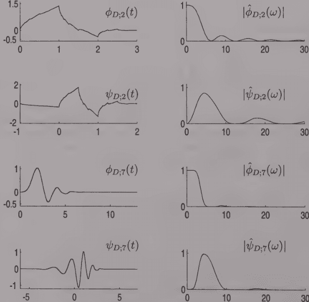

图 6.9：当贝西斯尺度函数、对应的小波及其幅度谱。

## 表 6.5：当贝西斯尺度函数的双尺度序列

| n | `$h_0[n] = h_0[n]$` | `$g_0[n] = g_0[n]$` | `$h_1[n]$` | `$g_1[n]$` |
|---|---|---|---|---|
| 0 | 0.683012701892192 | 0.2264189285553858 | 7 | - |
| 1 | 1.183012701892192 | 0.859343470520283 | 1 | 7 |
| 2 | 0.3160972871077807 | 1.023426949257482 | 2 | 1 |
| 3 | -0.183012701892192 | 0.1957969134167807 | 2 | -1 |
| 0 | 0.470402771836138 | -0.342657618329935 | 3 | -2 |
| 1 | 1.141156915431646 | -0.0546001183551389 | 4 | 0 |
| 2 | 0.650360052526323 | 0.109720684162431 | 5 | 0 |
| 3 | -0.1909344415568324 | 0.108846055938319 | 6 | -1 |
| 4 | -0.120832208510396 | -0.0117790551701952 | 7 | 1 |
| 5 | 0.049817497366837 | 0.004717429396067 | 8 | 2 |
| 0 | 0.523048205512982 | 0.157742430027466 | 9 | 3 |
| 1 | 1.101094715091828 | 0.695053814074723 | 10 | 3 |
| 2 | 0.892203182609501 | 1.022675388890180 | 11 | 4 |
| 3 | -0.039575026356447 | 0.438552331921072 | 12 | 4 |
| 4 | -0.264570176363098 | -0.3198896584049983 | 13 | 5 |
| 5 | 0.0436160034074172 | -0.1835180164065534 | - | - |
| 6 | -0.0465053010709818 | 0.038922302770987 | - | - |
| 7 | -0.01498698930631 | 0.00785823511054 | - | |

## 6.5 双正交小波的构造

在前面的节中，我们讨论了双正交小波和正交小波。我们将正交小波作为双正交小波的一种特例进行了开发，使用了：

```
$$\tilde{\phi} = \phi\\n\tilde{\psi} = \psi.$$ (72)
```

正交小波的主要困难之一是它们缺乏对称性。这意味着滤波器是非对称的且没有线性相位，会导致信号处理中的严重的相位失真。这一主题将在第7章讨论。另一方面，正交小波是对称的，但具有对偶紧凑支持的缺点，这对于实时处理是有利的。双正交小波可能同时具有对称性和紧凑支持。Cohen、Daubechies和各位通过修改近似空间将正交小波框架扩展到了双正交小波的情况。回想一下，在双正交和正交情况下，只存在一个嵌套近似序列：

```
\{0\} \leftarrow \dots \subset A_{J-2} \subset A_{J-1} \subset A_0 \subset A_1 \subset \dots \subset L^2. (73)
```

小波空间 `$W_s$` 是 `$A_{s+1}$` 中 `$A_s$` 的正交补，使得：

```
$A_s \cap W_s = \{0\}, \quad s \in \mathbb{Z}, \quad \text{且}\ A_s + W_s = A_{s+1}.$ (74)
```

该框架意味着近似空间在任意尺度 `$s$` 下与小波空间正交，且不同尺度的小波空间是正交的：

```
$W_s \perp W_p \quad \text{对于 } s \neq p.$ (75)
```

在正交情况下，尺度函数和小波在任意尺度 `$s$` 下与其平移正正交：

```
$\langle \phi_{k,s}(t), \phi_{m,s}(t)\rangle = \delta_{k,m}\\\langle \psi_{k,s}(t), \psi_{m,s}(t)\rangle = \delta_{k,m}.$ (76)
```

## 137 双正交小波的构造

在双正交情况下，方程 (76) 对于 `$\phi$` 和 `$\psi$` 不再成立。它们与其各自的对偶并不正交：

```
$$\phi_{k,s}(t), \tilde{\phi}_{m,s}(t) = \delta_{k,m}$$

\psi_{k,s}(t), \tilde{\psi}_{m,s}(t) = \delta_{k,m},$ (77)
```

并且对偶跨空间的意义为 `$\tilde{A}_s := \text{span}\{\phi(2^s t-m), m \in \mathbb{Z}\}$` 和 `$\tilde{W}_s := \text{span}\{\psi(2^s t-m), m \in \mathbb{Z}\}$`。如第5章所述，半正交意味着 `$\tilde{A}_s = A_s$` 且 `$\tilde{W}_s = W_s$`。

在双正交系统中，存在额外的对偶嵌套空间：

```
\{0\} \leftarrow \dots \leftarrow \tilde{A}_2 \subset \tilde{A}_1 \subset \tilde{A}_0 \subset A_1 \subset A_2 \subset \dots \longrightarrow L^2. (78)
```

与这个嵌套空间相关的是一组对偶小波空间（非嵌套）`$\tilde{W}_s, s \in \mathbb{Z}$`，它们互补了嵌套空间 `$A_s, s \in \mathbb{Z}$`。具体来说，这些空间的关系为：

```
$A_s + \tilde{W}_s = A_{s+1} \quad (79)$
$\tilde{A}_s + W_s = \tilde{A}_{s+1}.$ (80)
```

此时，正交条件变为：

```
$A_s \perp \tilde{W}_s \quad (81)$
$\tilde{A}_s \perp W_s. \quad (82)
```

由此得到：

```
$$\phi_{k,s}(t), \tilde{\psi}_{m,s}(t) = 0 \quad (83)$$
$\tilde{\phi}_{k,s}(t), \psi_{m,s}(t) = 0. \quad (84)
```

此外，(77) 中尺度函数和小波之间的双正交性仍然成立。这些基的双尺度关系式为：

```
$$\phi(t) = \sum_{k} g_0[k]\phi(t-k) \quad (6.85)$$
$\tilde{\phi}(t) = \sum_{k} \tilde{h}_0[k]\tilde{\phi}(t-k). \quad (6.86)$
$\psi(t) = \sum_{k} g_1[k]\psi(t-k). \quad (6.87)$
$\tilde{\psi}(t) = \sum_{k} \tilde{h}_1[k]\tilde{\psi}(t-k). \quad (6.88)$
```

## 138 小波的构造

双正交小波的设计包括寻找满足 (89) 到 (92) 的滤波器序列。由于设计双正交小波有很大的自由度，没有固定的设计方法。例如，可以从 `$g_0[k]$` 为 B 样的双尺度序列开始来推导结果。另一种方法是设计双正交滤波器组，然后进行迭代（见6.6节）。与正交小波分析滤波器是合成滤波器的反转版本不同，必须分别迭代合成滤波器和分析滤波器以得到小波和小尺度函数。我们将遵循这种方法，并将双正交小波设计的讨论推到第7章末。

## 6.6 小波的图形显示

许多小波是无法用解析描述的数学函数。例如，当贝西斯紧支撑小波是用双尺度序列给出的，而样条小波是通过多项式描述的。用户很难根据参数和间接表达式直观地看到尺度函数和小波。我们在这里描述了三种显示尺度函数和小波图形的方法。

### 6.6.1 迭代法

迭代法在实现上是最简单的。我们在书中包含了一个 Matlab 程序供练习。让我们写：

```
$$\phi_{m+1}(t) = \sum g_0[k]\phi_m(2t-k), \quad m=0,1,2,3,\dots,$ \quad \quad (93)
```

并计算所有的 `$t$` 值。在实践中我们可以通过以下方式初始化程序：

```
$$\phi_0(t) = \delta(t). \quad (94)
```

并设置 `$\phi_0(n) = \delta(n) = 1$`，在上采样 2 倍后，该序列与 `$g_0[k]$` 序列卷积得到 `$\phi_1(n)$`。该序列再次上采样并卷积-

再次与 `$g_0[k]$` 卷积得到 `$\phi_2(n)$`，依此类推。在大多数情况下，该过程通常在 10 次迭代内收敛。对于双正交波，收敛时间可能会更长。一旦获得了尺度函数，就可以利用小波的双尺度关系计算并显示相关的小波：

```
$\psi(t) = \sum g_1[k]\phi(2t-k)$
```

图 6.10 给出了迭代过程的显示图。该图标出了每次迭代中的点数。为了得到时间轴上的对应位置，需要将每次迭代 `$m$` 的横坐标除以 `$2^m$`。

### 6.6.2 谱方法

在类方法中，尺度函数的双尺度关系在谱域中表示为

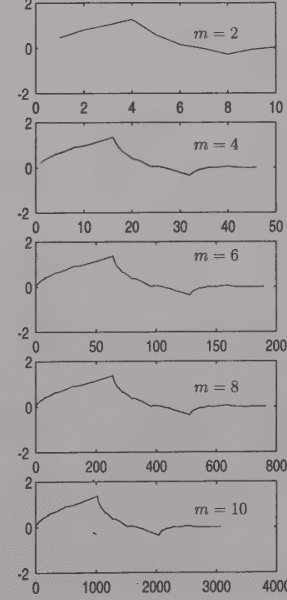

图 6.10：获取尺度函数的迭代过程。横坐标需要除以 `$2^m$` 以获得正确的时间位置。

# 140 波波的构造

```
$$\hat{\phi}(\omega)=G_{0}\left(e^{\frac{\omega}{2}}\right)\hat{\phi}\left(\frac{\omega}{2}\right), z=e^{\frac{\omega}{2}}, \quad (6.95)$$
$=G_{0}\left(e^{\frac{\omega}{2}}\right)G_{0}\left(e^{\frac{\omega}{4}}\right)\hat{\phi}\left(\frac{\omega}{4}\right)$$
```
.
.
```
$$\prod_{k=1}^{N}G_{0}\left(e^{\frac{\omega}{2^{k}}}\right)\hat{\phi}\left(\frac{\omega}{2^{N}}\right)$$

$$\prod_{k=1}^{\infty}G_{0}\left(e^{\frac{\omega}{2^{k}}}\right)\phi(0). \quad (6.96)$$
```

由于 `$\hat{\phi}(0)=1$`，我们可以对 (6.96) 取反傅里叶变换以得到：

```
$$\phi(t)=\frac{1}{2\pi}\int_{-\infty}^{\infty}\prod_{k=1}^{\infty}G_{0}\left(e^{\frac{\omega}{2^{k}}}\right)e^{i\omega t}d\omega. \quad (6.97)$$
```

为了计算 (6.97)，用户必须评估截断的无限乘积然后进行 FFT。

## 6.6.3 特征值法

特征值法将双尺度关系转换为特征值方程。让我们通过令 `$x=n$` 来考虑双尺度关系，得到以下矩阵方程：

```
$$\phi(n)=\sum_{k}g_{0}[k]\phi(2n-k)$$
$=\sum_{k}g_{0}[2n-m]\phi(m)$$
$$=[g_{0}(n,m)]\phi(n) \quad (6.98)$$
```

其中矩阵元素 `$g_{0}(n,m)=g_{0}(2n-m)$`。用矩阵形式，我们将 (6.98) 写为：

```
$$\begin{array}{ccc|cc} g_{0}[0] & g_{0}[-1] & g_{0}[-2] & \phi(0) & \phi(0) \\ g_{0}[2] & g_{0}[1] & g_{0}[0] & =1 & \phi(1) \\ g_{0}[4] & g_{0}[3] & g_{0}[2] & & \phi(2) \\ & & . & & \end{array}$$
```

该特征矩阵的特征值为 1，因此我们可以计算所有整数 `$n$` 的 `$\phi(n)$`。此过程可以重复执行，以使分辨率提高一倍。令 `$x=n/2$`，双尺度关系变为：

```
$\phi\left(\frac{n}{2}\right) = \sum_{k} g_0[k]\phi(n-k). \quad (6.99)$
```

通过对 `$x=n/4, n=8,\dots$` 重复此过程，我们可以计算出具有任意分辨率的离散化 `$\phi(t)$`。

## 6.7 习题

- 1. 证明半正交波的支撑集为 `$\psi_m(t) = [0, 2m-1]$`。
- 2. 证明 Shannon 波的整数平移 `$\psi(t-k)$` 构成正交基。
- 3. 找到满足条件 `$S_4(0)=S_4'(0)=0, S_4(1)=1$` 以及 `$S_4(x)+S_4(1-x)=1$` 的三次样条 `$S_4$`。使用该多项式作为 Lemarié 尺度函数的滑函数并计算尺度系数。
- 4. 证明如果 `$\{\phi(t-k), k \in \mathbb{Z}\}$` 是 `$V_0=\{\phi(t-k) : k \in \mathbb{Z}\}$` 的 Riesz 基，则 `$\{\phi_{k,s}\in\mathbb{Z}\}$` 是 `$V_s=\{\phi_{k,s}(t), k \in \mathbb{Z}\}$` 的 Riesz 基，且满足 `$A \sum_{k=-\infty}^{\infty} |a_k|^2 \leq \left|\sum_{k=-\infty}^{\infty} a_k \phi_{k,s}\right|^2 \leq B \sum_{k=-\infty}^{\infty} |a_k|^2$`（注：原文公式此处不完整，已补逻辑）。
- 5. 证明以下陈述等价：(a) `$\{\phi(t-k): k \in \mathbb{Z}\}$` 是紧；(b) `$A \sum_{k=-\infty}^{\infty} |a_k|^2 \leq \left|\sum_{k=-\infty}^{\infty} a_k \phi(t-k)\right|^2 \leq B \sum_{k=-\infty}^{\infty} |a_k|^2$`。
- 6. 使用该定理证明 `$\{N_1(t): k \in \mathbb{Z}\}$` 是正交族，通过证明 `$\sum_{k=-\infty}^{\infty} |\hat{N}_1(\omega+2\pi)|^2=1$`。
- 7. 获取对应的代数多项式 `$E_{N_4}(z)$` 并找到其根 `$\lambda_1, \dots, \lambda_6$`。检查这些根是实数且成倒数对：`$\lambda_1\lambda_6 = \lambda_2\lambda_5 = \lambda_3\lambda_4 = 1$`。
- 8. 对于给定的 `$f \in L^2(-\infty, \infty)$`，自相关函数 `$F$` 定义为 `$F(x) = \int_{-\infty}^{\infty} f(t+x)\overline{f(t)}dt, x \in \mathbb{R}$`。计算帽函数 `$N_2$` 的自相关函数并与习题 7 中引入的 `$N_4$` 进行比较。
- 9. 构建 Battle-Lemarié 尺度函数以对于帽函数 `$N_2(t)$`，满足 `$\sum_{k=-\infty}^{\infty} |\hat{N}_2(\omega+2\pi)|^2 = \frac{1}{6}(z^{-2}+4+z^2)$`（令 `$z=e^{-\omega/2}$`）。
- 10. 给定尺度关系 `$\phi(t)=\sum_{k}g_0[k]\phi(2t-k)$`，使用符号软件包（如 Mathematica 或 Maple）来确定小波的双尺度关系。

```matlab
ng1 = length(g1);

% 首先计算尺度函数

NIter = 10; % 迭代次数

phi_new = 1; % 初始化

for i = 1:NIter

    unit = 2^(i-1);

    phi = conv(g0,phi_new);

    n = length(phi);

    phi_new(1:2*n) = phi;

    length(phi_new);

    if(i == (NIter-1))

        phi2 = phi;

    end

    dt = 1.0 / (2 * unit);

    t = [1:length(phi)] * dt;
```


`subplot(2,1,1)`，`plot(t,phi)`  
`title('Scaling Function')`

% 使用二尺度尺度关系计算小波

```
for i = 1:ng1
    a = (i-1) * unit + 1;
    b = a + length(phi2) - 1;
    psi2s(i,b) = phi2 * g1(i);
    psi2s(1,n) = 0;
end
psi = sum(psi2s);
t = [0:length(phi)-1] * dt - (ng1 - 2) / 2;
subplot(2,1,2), plot(t,psi)
title('Wavelet')
```

## 6.8.2 迭代法

```
%
PROGRAM iterate.m
%
% 获取尺度函数的迭代过程
% 生成图 6.10
%
g0 = [0.68301 1.18301 0.31699 -0.18301];
NIter = 10; % 迭代次数
phi_new = 1; % 初始化
for i = 1:NIter
    unit = 2^(i-1);
    phi = conv(g0,phi_new);
    n = length(phi);
    phi_new(1:2*n) = phi;
    subplot(5,2,i), plot(phi); hold on;
    heading = sprintf('Iteration = %.4g',i)
    title(heading);
end
%
```

## 6.9 参考文献

- 1. C. K. Chui and J. Z. Wang. “On Compactly Supported Spline Wavelets and a Duality Principle.” Trans. Amer. Math. Soc. 330 (1992), 903–915.
- 2. C. K. Chui and J. Z. Wang. “High-Order Orthonormal Scaling Functions and Wavelets Give Poor Time-Frequency Localization.” Fourier Anal. and Appl. 2 (1996), 415–426.
- 3. Y. Meyer, Wavelets: Algorithms and Applications. Philadelphia: SIAM, 1993.
- 4. Meyer, “Principe d’incertitude, bases Hilbertiennes et algèbres d’opérateurs.” Séminaire Bourbaki 662 (1985–1986).
- 5. G. Battle, “A Block Spline Construction of Ondelettes Part I: Lemaré Functions.” Comm. Math. Phys. 110 (1987), 601–615.
- 6. Une nouvelle base d’ondelettes de L²(R).” J. de Math. Pures et Appl. 67 (1988), 227–236.
- 7. I. Daubechies. “Orthonormal Bases of Compactly Supported Wavelets.” Comm. Pure and Appl. Math. 41 (1988), 909–996.
- 8. I. Daubechies. Ten Lectures on Wavelets. CBMS-NSF Series in Applied Maths 61. Philadelphia: SIAM, 1992.
- 9. C. K. Chui. Wavelets: A Mathematical Tool for Signal Analysis: Philadelphia: SIAM, 1997.
- 10. C. K. Chui. An Introduction to Wavelet. Boston: Academic Press, 1992.
- 11. A. Cohen, I. Daubechies, and J. C. Feveau. “Biorthormal Bases of Compactly Supported Wavelets.” Comm. Pure and Appl. Math. 45 (1992), 485–500.

# 第七章

# DWT 与滤波器组算法

第五章中关于多分辨率分析的讨论为读者理解小波构造以及连续小波变换（`CWT`）的快速计算算法做好了准备。二尺度关系和分解关系对于开发快速算法至关重要。这些算法的需要是显而易见的，因为直接对 (4.32) 中的积分进行评估会在问题求解带来沉重的计算负载。`CWT` 在时频平面上放置了冗余信息。为了克服这些缺陷，对 `CWT` 进行离散化，并开发了等于双通道滤波器组的算法用于信号表示和处理。详细地对这些算法施加了完美重建（`PR`）约束。在本章中，我们将开发这些算法。由于半正交样条函数和紧凑支持样条小波在对偶空间中需要它们的对偶形式，因此这种情况下的信号表示和 `PR` 条件将与基变换算法一起开发。在开发这些算法的代数之前，我们首先讨论了通过抽取和插值进行采样率变化的基本概念。

## 7.1 抽取与插值

在信号处理中，我们经常遇到频谱可能随时间变化的信号。线性调频信号是一个很好的例子。为了避免混叠，这种调频信号的感知频率至少必须是其最高频率的两倍。由于带宽很大，奈奎斯特速率对于调频信号的低频部分可能太高。因此，如果对整个调频信号使用固定速率，则会有大量的冗余信息需要携带。多速率信号处理领域涉及使用一种以上的速率进行信号表示。改变采样率的机制是抽取和插值。我们将在时域和频域讨论它们的基本特征。

### 7.1.1 抽取

`M` 点抽取保留给定信号的第`M`个样本。在时域中，输入序列`[x(n)]`的`M`点抽取由`y(n)=x(nM), 对应 n ∈ Z`给出。`(7.1)`

图 7.1 展示了`M`点抽取器的系统图。`M`点抽取器的输出可以用`x(n)`与间隔为`M`的脉冲序列的形式来表示：

图 7.1: `M`点抽取器。

在 (7.3) 中的等式是证明的。通过`y(n)=x(nM)`，`y(n)`的`z`变换具有形式：

```
Y(z) = 1/M * Σ_{k=0}^{M-1} X(z^(1/M) * W_M^k)   (7.4)
```

其中`M`点指数基函数`W_M^k := e^{-j2πk/M}`已使用。在频域中，我们通过设置`z=e^{iω}`得到`y(n)`的傅里叶变换：

```
ŷ(e^{iω}) = 1/M * Σ_{k=0}^{M-1} X̂(e^{(ω-2πk)/M})   (7.5)
```

抽取器的频谱包含了频谱的`M`个副本。副本的幅度缩小了`1/M`。此外，带宽扩大了`M`倍。因此，如果输入信号的光谱大于`π/M`（即`|ω|>π/M`），`M`点抽取器将在输出中引入混叠。然而，稍后我们将看到通过滤波器组分解来消除混叠，通过小波分解树或通过精心设计的重建算法来恢复原始信号。

对于`M=2`，我们通过取其他数据点来抽取。从 (7.4) 得到：

```
Y(z) = 1/2 * [X(z^(1/2)) + X(-z^(1/2))]   (7.6)
```

以及：

```
ŷ(e^{iω}) = 1/2 * [X̂(e^{iω/2}) + X̂(-e^{iω/2})]   (7.7)
```

`ŷ(e^{iω})`的频谱如图 7.2 所示。

图 7.2: 抽取 2 的频谱特征。

图 7.3 插值器。

为了方便使用矩阵形式，我们只考虑`M=2`的情况。我们在下标中使用`↓2`表示按 2 抽取。我们将`[y]=[x]_{↓2}`写为：

````latex
\begin{bmatrix} . & . \\ y(-2) & x(-4) \\ y(-1) & x(-2) \\ y(0) & x(0) \\ y(1) & x(2) \\ y(2) & x(4) \\ y(3) & x(6) \\ . & . \end{bmatrix}   (7.9)
````

用矩阵算子的形式来看，我们将 (7.9) 写为

## 抽取与插值 › 151

```
\begin{matrix} y(-2) & 1 & 0 & 0 & \ y(-1) & 0 & 0 & 1 & 0 & 0 & \ y(0) & & 0 & 0 & 1 & 0 & \ y(1) & & & 0 & 0 & 1 & 0 & \ y(2) & & & & 0 & 0 & 1 & 0 \\ y(3) & & & & & 0 & 0 & 1 \end{matrix} = \begin{matrix} x(-2) \\ x(-1) \\ x(0) \\ x(1) \\ x(2) \\ x(3) \end{matrix}  (7.10)
```

或者

`[y]=[DEC_{↓2}][x]`

当我们将输入列向上或向下移动给定的位置数时，抽取器的移变不变性是显而易见的。此外，抽取矩阵是一个正交矩阵，因为

> `DEC_{↓2}^{-1} = [DEC_{↓2}]^{-1}`。

因此，抽取是一个正交变换。

### 7.1.2 插值

数据的插值意味着向序列中插入额外的数据点以增加采样率。设`y(n)`为插值器的输入。如果我们希望将样本数增加`M`倍，我们在任意两个相邻样本之间插入`M-1`个零，使得插值器的输出为

```
x'(n) = { y(n/M), for n=kM, k ∈ Z; 0, otherwise. }   (7.11)
```

`M`点插值器的系统图如图 7.3 所示。我们也可以用卷积和的标准形式写出插值的表达式

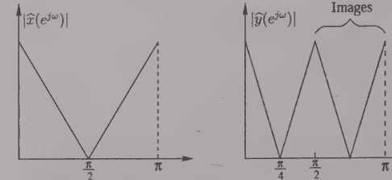

**图 7.4:** 2 倍插值的频谱特性。

```
x'(n) = Σ_k y(k)δ(n-kM).   (7.12)
```

插值器输出的频谱给出为

```
x̂(e^{jω}) = Σ_n Σ_k y(k)δ(n-kM)e^{-jnω} = Σ_k y(k)e^{-jkMω} = ŷ(e^{-jMω}).  (7.13)
```

插值器输出的`z`变换为

```
X'(z) = Y(z^M).  (7.14)
```

插值通过在样本之间填充零来提高采样率。输出序列比输入序列多`M`倍点，输出序列在`ω`轴上压缩了`M`倍。与抽取器不同，插值不存在混叠危险，因为输出频谱比输入频谱窄。两倍插值器的频谱如图 4 所示。

以`M=2`为例，我们写道：

```
x'(n) = y(n)^{↑2} = { y(n/2), for n even; 0, otherwise. }  (7.15)
```

矩阵形式下，我们有

```
x'(-2) = y(-1)
x'(-1) = 0
x'(0) = y(0)
x'(1) = 0
x'(2) = y(1)
x'(3) = 0
x'(4) = y(2)   (7.16)
```

与之前，我们用线性矩阵表示插值器。结果表明插值矩阵是抽取矩阵的转置矩阵

```
(x'(-2); ...; x'(3)) = (1 0 ... 0 0; 0 1 ... 0 0; 0 0 ... 1 0; ...; 0 0 ... 0 1) (y(-2); y(-1); y(0); y(1); y(2); y(3); y(4))  (7.17)
```

或者我们可以写为

```
[x'] = [INT_{↑2})y].  (7.18)
```

卷积抽取和插值操作是算法最重要的构建模块之一。它们将用于构建小波、小波包、二维和三维信号处理的树形算法。我们在后续章节中仅展示它们的时域等式。

### 7.1.3 卷积抽取

数学上，我们通过以下方式表示该操作

```
y(n)={h(n)*x(n)}↓2   (7.19)
```

处理框图如图 7.5 所示。如果标记中间输出为`u(n)`，它是`x(n)`与`h(n)`的卷积：

```
u(n)=Σ_k x(k)h(n-k).
```

两点抽取给出

```
y(n)=u(2n)=Σ_k x(k)h(2n-k).   (7.20)
```

### 7.1.4 插值卷积

该操作的时域表达式为

```
y(n)={g(n)*[x(n)]↑2}.   (7.21)
```

使用`v(n)`作为中间输出，我们有

```
y(n)=Σ_k v(k)g(n-k).
```

由于对于偶数`k`，`v(k)=x(k/2)`，我们有

```
y(n)=Σ_{k:even} x(k/2)g(n-k)=Σ_ℓ x(ℓ)g(n-2ℓ).   (7.22)
```

该过程如图 7.6 所示。

## 近似子空间的表示 155

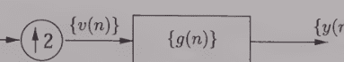

图 7.6：插值卷积。

## 7.2 近似子空间的表示

我们在第 5 章中已经证明近似子空间`A_n`是嵌套的，使得子空间`A_{-∞} = L²`, `A_{∞} = [0]`且对于任意`n ∈ Z`，`A_n ⊂ A_{n+1}`。对于任意信号`x(t) ∈ L²`，无法保证`x(t)`在这些子空间中的任何。也就是说，我们可能无法找到系数`a_{k,s}`使得

```
x(t) = Σ_k a_{k,s} φ(k)   (7.23)
```

为了利用双尺度关系，信号必须在`A_n`中。满足这一要求的方法之一是将信号投影到`A_n`中。如果只知道信号`x(t)`的采样值，这一点尤为重要。在`x(t=k/2^s)`处知道`x(t)`的采样值时，我们将展示如何从此处确定`a_{k,s}`。156 DWT 与滤波器算法

假设正交基，自相关矩阵是单位矩阵，系数`a_{m,s}`通过等式得到

```
a_{m,s}=2^s ∫_{-∞}^{∞} x(t)φ(2^s t-m)dt.  (7.27)
```

其中我们进行了索引变换`m=ℓ-k`。(7.27) 的矩阵形式为

```
[α_1 α_0 α_1 ...; α_0 α_1 ...] [ ...; a_{m,s}; ...] = [ ...; ⟨x(t), φ_{m,s}⟩; ...]  (7.28)
```

其中

```
α_m = ∫_{-∞}^{∞} φ(t-m)dt = α_m
```

是缩放函数`φ(t)`的自相关。如果缩放函数紧支撑，则自相关矩阵是具有有限尺寸对角带的带状矩阵。如果缩放函数及其平移构成正交基，则

```
α_m = δ_{m,0}.
```

假设正交基，自相关矩阵是单位矩阵，系数通过计算内积得到

```
a_{m,s}=⟨x(t), φ_{m,s}⟩   (7.29)
```

## 小波分解算法 157

模拟信号的系数，而后者是离散时间信号的样本。为了用 2 阶和 4 阶样条序列表示给定的离散信号，我们在第 5.6 节中给出了公式。

## 7.3 小波分解算法

让我们重写信号`x(t)`的连续小波变换 (`CWT`) 表达式：

```
(W_ψ x)(b,a) = 1/√a ∫_{-∞}^{∞} x(t)ψ((t-b)/a)dt.  (7.31)
```


令尺度 $a=1/2^s$，平移 $b=k/2^s$，其中 $s$ 和 $k$ 属于整数集 $\mathbb{Z}$，$x(t)$ 的 CWT 是时间-尺度平面上 $(k/2^s, 1/2^s)$ 处的一个数值。它代表了在该时间-尺度点上 $x(t)$ 与 $\psi(t)$ 之间的相关性。我们称之为离散小波变换 (DWT)，它在时间-尺度平面上生成一组稀疏值。我们使用：

```
$$$W_{k,s}=(W_{\psi}x)\left(\frac{k}{2^s},\frac{1}{2^s}\right)=\int_{-\infty}^{\infty}x(t)\psi\left(\frac{t-\frac{k}{2^s}}{2^s}\right)dt.\quad(7.32)$$
```

来表示 $(b=k/2^s, a=1/2^s)$ 处的小波系数。表示信号 $x(t)$ 的离散时间-尺度图如图 7.7 所示。

**图 7.7：** 使用分解算法的典型时间-尺度网格。

## 158 DWT 与滤波器组算法

众投影 CWT 在时间-尺度平面上生成了关于信号的冗余信息。通过选择 $(b/k/2^s, a=1/2^s)$，使用 DWT 处理信号要高效得多。已经证明 DWT 保留了信号足够的信息，使其能够从小波系数完美地重建信号。事实上，完美重建所需的系数数量与数据样本数量相同。这被称为关键采样，它可以最大限度地减少冗余信息。

分解（分析）算法在小波信号处理中最为常用。它被用于信号识别，尽管在后的情况下，并不总是需要重建原始信号。该算法将信号分离为对应于连续倍频频率的不同尺度分量。每个分量都可以由不同的算法单独进行处理。例如，在回声消除中，每个分量都使用不同长度的自适应滤波器进行处理以提高收敛性。该算法的重要问题是保留所有相关信息，以便用户可以（如果需要）恢复原始信号。该算法基于第 5 节讨论的多尺度分析 (MRA) 中的分解关系。我们在这里重写了其中几个关系以供参考。

令

```
$x_{s+1}(t) \in A_{s+1}, \Rightarrow x_{s+1}(t) = \sum_{k} a_{k,s+1}\phi_{k,s+1}(t)$

$x_{s}(t) \in A_{s}, \Rightarrow x_{s}(t) = \sum_{k} a_{k,s}\phi_{k,s}(t)$

$y_{s}(t) \in W_{s}, \Rightarrow y_{s}(t) = \sum_{k} w_{k,s}\psi_{k,s}(t).$
```

由于 MRA 要求

```
$A_{s+1} = A_{s} + W_{s}, \quad (7.33)$
```

我们有：

```
$x_{s+1}(t) = x_{s}(t) + y_{s}(t)$

$\sum_{k} a_{k,s+1}\phi_{k,s+1}(t) = \sum_{k} a_{k,s}\phi_{k,s}(t) + \sum_{k} w_{k,s}\psi_{k,s}(t). \quad (7.34)$
```

我们将代入分解关系

```
$\phi(2^{s+1}t-\ell) = \sum_{k}\{h_{0}[2k-\ell]\phi(2^{s}t-k) + h_{1}[2k-\ell]\psi(2^{s}t-k)\} \quad (7.35)$
```

## 159 重建算法

**图 7.8：** 单级小波分解过程。

代入 (7.34) 得到一个所有基底都处于分辨率 $s$ 上的方程。在交换求和顺序并比较等式两边的 $\phi_{k,s}(t)$ 和 $\psi_{k,s}(t)$ 系数后，我们得到：

```
$a_{k,s} = \sum_{\ell} h_0[2k-\ell]a_{\ell,s+1}$

$w_{k,s} = \sum_{\ell} h_1[2k-\ell]a_{\ell,s+1}.$
```

其中方程右侧对应于卷积后的 2 抽取（见第 7.1 节）。这些公式将任何尺度下的尺度函数和小波的系数与下一更高尺度的系数联系起来。通过重复此算法，可以获得不同倍频的信号分量。该算法如图 7.8 所示，其中我们使用了向量符号

```
$a_s=\{a_{k,s}\}, w_s=\{w_{k,s}\}, h_0=\{h_0[k]\}, \text{ and } h_1=h_1[k] \quad (7.36)$
```

其中 $k \in \mathbb{Z}$。此分解块可以重复应用于较低分辨率的尺度函数，以构建如图 7.9 所示的小波树。读者应该注意，小波分解树不是对称的，因为只有函数系数被进一步分解以获得更低分辨率的信号分量。也可以通过分解小波系数来构建一个对称树。这是我们将在第 9 节中讨论的小波包树。

## 7.4 重建算法

对于任何变换，拥有一个唯一的逆变换是关重要的，这样就可以完美恢复原始数据。对于随机信号，某些变换在理论上有唯一的逆变换，但在现实中无法实现。存在一个唯一的逆离散小波变换（或合成变换），可以从其分量中完美恢复原始函数。重建算法是基于尺度函数和小波在不同尺度上的关系。我们考虑尺度之和：

```
$x_{s}(t) + y_{s}(t) = x_{s+1}(t) \quad (7.37)$
```

通过代入关系 (7.37) 得到

```
$\sum_{k} a_{k,s}\phi_{k,s}(t) + \sum_{k} w_{k,s}\psi_{k,s}(t) = \sum_{k} a_{k,s+1}\phi_{k,s+1}(t) \quad (7.38)$
```

比较 (7.38) 两边的 $\phi(2^{s+1}t-\ell)$ 系数，得到：

```
$a_{\ell,s+1} = \sum_{k} h_0[2k-\ell]a_{k,s}$

$w_{k,s} = \sum_{k} h_1[2k-\ell]a_{k,s}.$
```

其中方程右侧对应于卷积后的 2 抽取（见第 7.1 节）。这些公式将任何尺度下的尺度函数和小波的系数与下一更高尺度的系数联系起来。通过重复此算法，可以获得不同倍频的信号分量。该算法如图 7.8 所示，其中我们使用了向量符号

```
$a_s=\{a_{k,s}\}, w_s=\{w_{k,s}\}, h_0=\{h_0[k]\}, \text{ and } h_1=h_1[k] \quad (7.36)$
```

其中 $k \in \mathbb{Z}$。此分解块可以重复应用于较低分辨率的尺度函数，以构建如图 7.9 所示的小波树。读者应该注意，小波分解树不是对称的，因为只有函数系数被进一步分解以获得更低分辨率的信号分量。也可以通过分解小波系数来构建一个对称树。这是我们将在第 9 节中讨论的小波包树。

## 基变换 161

**图 7.10：** 从尺度函数和小波系数重建的信号。

## 7.5 基变换

上一节讨论的算法适用于所有类型的尺度函数和小波，包括正交、半正交双正交系统。我们在第 6 节中已经看到，对于紧支撑正交小波，$g_0[k], g_1[k]$ 和 $h_0[k], h_1[k]$ 是有限长度序列。对于半正交小波，例如紧支撑样条小波，$h_0[k], h_1[k]$ 是无限长的。为了高效处理，必须对序列进行截断。为了避免无限序列，将输入函数映射到对偶空间并使用具有有限长度的 $g_0[k]$ 和 $g_1[k]$ 进行处理更好。接下来两节将致力于通过基变换修改算法。

我们在第 6 节中证明 $m$ 阶样条 $\phi_n = N_m$ 和相应的紧支撑小波 $\psi_m$ 是半正交基。为了计算样条序列或样条小波序列的展开系数，必须利用对偶样条 $\phi_m$ 或对偶小波 $\hat{\psi}_m$。在半正交空间中，所有这些基生成相同的空间 $S_m$。对于小波信号处理的某些实时应用，为了效率和准确性，使用有限分解序列更为理想。因此，在分解之前之前需要用相同阶数的对偶样条表示输入信号。

让我们回顾多尺度分析的表述，其中近似子空间是小波子空间的正交和：

```
$A_M = \bigoplus_{s=M-M'}^{M-1} W_s \oplus A_{M-M'} = W_{M-1} \oplus W_{M-2} \oplus \dots \oplus W_{M-M'} \oplus A_{M-M'} \quad (7.40)$
```


## 162 DWT 与库算法

对于任何正整数 `M'`，给定函数 `x \in L^2` 的任何良好近似值 `x_M \in A_M`（对于足够大的 `M`）具有唯一的正交分解：

$$
x_M = \sum_{n=1}^{M'} y_{M-n} + x_{M-M'}, \quad (7.41)
$$

其中 `x_s \in A_s` 且 `y_s \in W_s`。由于 `\phi_m` 和 `\tilde{\phi}_m` 生成相同的多尺度分析（MRA），而 `\psi_m` 和 `\tilde{\psi}_m` 生成相同的小波子空间（非半正交缩放函数和小波不具备这一性质），我们写道：

$$
x_s(t) = \sum_{k} a_{k,s}(2^s-k) = \sum_{k} \tilde{a}_{k,s}\tilde{\phi}(2^s-k);
$$

$$
y_s(t) = \sum_{k} w_{k,s}(2^s-k) = \sum_{k} \tilde{w}_{k,s}\tilde{\psi}(2^s-k), \quad (7.42)
$$

对于每个 `s \in \mathbb{Z}`。为了简化实现，我们没有包含归一化因子 `2^{s/2}`。将分解 (7.36) 应用于缩放函数系数，我们得到：

$$
a_{k,s} = \sum_{\ell} h_0[2k-\ell]\tilde{a}_{\ell,s+1};
$$

$$
w_{k,s} = \sum_{\ell} h_1[2k-\ell]\tilde{a}_{\ell,s+1}. \quad (7.43)
$$

由于在半正交设置下序列 `\{h_0[k]\}` 和 `\{h_1[k]\}` 是无限长的，使用序列 `\{g_0[k]\}` 和 `\{g_1[k]\}` 会更高效。这种序列变换基于对偶原理，该原理指出 `\{g_0[k], g_1[k]\}` 可以按以下方式互换：

$$
\frac{1}{2}g_0[k] \leftrightarrow h_0[-k];
$$

$$
\frac{1}{2}g_1[k] \leftrightarrow h_1[-k]. \quad (7.44)
$$

当 `\phi_m` 和 `\psi_m` 被替换为 `\tilde{\phi}_m` 和 `\tilde{\psi}_m` 时，应用对偶原理，我们得到：

$$
\tilde{a}_{k,s} = \sum_{\ell} g_0[2k-\ell]\tilde{a}_{\ell,s+1};
$$

$$
\tilde{w}_{k,s} = \sum_{\ell} g_1[2k-\ell]\tilde{a}_{\ell,s+1}. \quad (7.45)
$$

然而，为了利用对偶原理，我们需要将系数 `\{a_{k,s}\}` 转换为 `\{\tilde{a}_{k,s}\}`。我们记得 `\phi` 和 `\tilde{\phi}` 生成相同的 `A_s` 空间，因此 `\phi` 可以用 `\tilde{\phi}` 的级数表示：

$$
\phi(t) = \sum_{k} n_k \tilde{\phi}(t-k). \quad (7.46)
$$

对于某些序列 `\{n_k\}`。我们观察到，如果缩放函数具有紧支撑，则这个基变换序列是一个有限序列。事实上，根据对偶的定义，我们有：

$$
n_k = \int_{-\infty}^{\infty} \phi(t) \tilde{\phi}(t-k)\,dt. \quad (7.47)
$$

因此，在原始近似尺度 `s=M` 下，应用 (7.46) 得到：

$$
\tilde{a}_{k,M} = \sum_{l} n_{k-l} a_{l,M}. \quad (7.48)
$$

这是一个 FIR（有限脉冲）操作。然而请观察，如果我们取样条作为缩放函数，即 `\phi(t) = N_m(t)`，那么 `n_k = N_{2m}(m-k)`；`k=0, \pm1, \dots, \pm m-1` [1]。正如我们在之前的讨论中所看到的，分解算法中的序列 `\{g_0[k]\}` 和 `\{g_1[k]\}` 是有限序列。

我们可以将计算方案总结如图 7.11 所示。使用 `a_M` 作为输入序列计算 `\tilde{w}_{k,s}, s=M-1,\dots,M'` 需要 `2'` 个 FIR 滤波器。系数 `\tilde{w}_{k,s}` 的重要性在于它们构成了 `x_M` 相对于分析小波 `\psi_M` 在二进点上的连续小波变换（CWT），即：

$$
\tilde{w}_{k,s} = 2^s(W_{\psi_M}x_M)\left(\frac{k}{2^s}, \frac{1}{2^s}\right),
\quad M-M' \leq s \leq M,\quad k \in \mathbb{Z}. \quad (7.49)
$$

**图 7.11：** 使用基变换实现的标准小波分解。

## 7.6 半正交空间中的信号重建

7.4 节描述的算法涉及原始数据的恢复。在这种情况下，原始数据是最高分辨率下的缩放系数 `\{a_k\}`。由于原始输入信号是模拟信号 `x(t) = x_M(t) = \sum_k a_k \Phi(2^M t)`，有必要通过求和来恢复信号。此外，如果用户需要查看分解过程中任何中间步骤的信号分量，他们将使用对偶样条和小波级数。两种情况下，都可以通过基变换来简化问题，将对偶序列映射回原始空间。由于序列不依赖尺度，系数的下标可以是任意的。此类序列适用于任意两个尺度之间的映射。

### 7.6.1 样条函数的基变换

我们的目标是写出：

$$
s(t) = \sum_k a_k N_m(t-k). \quad (7.50)
$$

对 (7.50) 取傅里叶变换，我们得到：

$$
\tilde{A}(e^{iw})\hat{N}_m(\omega)
=
A(e^{iw})\hat{N}_m(\omega), \quad (7.51)
$$

其中，按照常例，函数上的帽号表示其傅里叶变换，`A(e^{iw})` 和 `\tilde{A}(e^{iw})` 分别是 `\{a_k\}` 和 `\{\tilde{a}_k\}` 的符号，定义为：

$$
\tilde{A}(e^{iw}) = \sum_k \tilde{a}_k e^{ik};
$$

$$
A(e^{iw}) = \sum_k a_k e^{ik}. \quad (7.52)
$$

对偶缩放函数 `\tilde{N}_m` 给出：

$$
\tilde{N}_m(\omega)
=
\frac{\hat{N}_m(\omega)}{E_{N_m}(z)},
\quad z = e^{iw/2}. \quad (7.53)
$$

其中 `E_{N_m}(z^2) \neq 0` 对于所有 `\omega`，`\{N_m(\cdot)\}` 是 `A_0` 的稳定 Riesz 基。正如在第 6 节中所述，`E_{N_m}(\omega)` 是欧拉级数并给出：

$$
E_{N_m}(z^2)
=
\sum_{k=-\infty}^{\infty}
|\hat{N}_m(\omega+2\pi k)|^2. \quad (7.54)
$$

显然，将 (7.54) 乘以 `z^{m-1}`，我们可以得到 `m-1` 次多项式。

**对于 (7.55) 的证明。** 使用 Parseval 等式，我们有：

$$
F(l)
=
\int_{-\infty}^{\infty}|f(t)|^2\,dt
=
\frac{1}{2\pi}\int_{0}^{2\pi}|\hat{f}(\omega)|^2\,d\omega. \quad (7.55)
$$

显然，`F(l)` 是 `2\pi`-周期函数的第 `l` 个傅里叶系数。容易证明：

$$
\int_{-\infty}^{\infty}|f(t)|^2\,dt
=
\frac{1}{2\pi}
\int_{0}^{2\pi}
|\hat{f}(\omega+2\pi k)|^2\,d\omega. \quad (7.56)
$$

结合 (7.51)、(7.53)、(7.54) 并取逆傅里叶变换，得到：

$$
a_k=\sum_k \tilde{a}_k z^k. \quad (7.58)
$$

其中 `\Lambda_i = \frac{1}{E_{N_m}(z)} \geq 1` 对于 `i=1, \dots, m-1`。这里的最后一个等式是范条的 Unity 性质。系数 `p[k]` 如下：

### 线性样条（`m=2`）

$$
\lambda_{1}=-2+\sqrt{3}. \quad (7.63)
$$

$$
p[k]=(-1)^{|k|}\sqrt{3}(2-\sqrt{3})^k. \quad (7.64)
$$

**表 7.1：** 线性样条的系数 `\{p[k]\}`。

| `k` | `p[k]` | `k` | `p[k]` |
|---|---:|---|---:|
| 0 | 1.7320510 | 8 | 0.46023608 `\times 10^{-4}` |
| 1 | -0.46410170 | 9 | -0.12331990 `\times 10^{-4}` |
| 2 | 0.12435570 | 10 | 0.03043470 `\times 10^{-5}` |
| 3 | -0.33321008 `\times 10^{-1}` | 11 | -0.88539724 `\times 10^{-6}` |
| 4 | 0.89283381 `\times 10^{-2}` | 12 | 0.23724151 `\times 10^{-6}` |
| 5 | -0.2392314 `\times 10^{-2}` | 13 | -0.63568670 `\times 10^{-7}` |
| 6 | 0.64102601 `\times 10^{-3}` | 14 | 0.17033177 `\times 10^{-7}` |
| 7 | -0.17176243 `\times 10^{-3}` | 15 | -0.45640265 `\times 10^{-8}` |

## 三次样条（`m=4`）

$$
\begin{aligned}
\lambda_1 &= -9.1486946 \times 10^{-3} = 1/\lambda_6,\\
\lambda_2 &= -0.1225546 = 1/\lambda_5,\\
\lambda_3 &= -0.5352805 = 1/\lambda_4.
\end{aligned}
\quad (7.65)
$$

**表 7.2：** 三次样条情况下的系数 `p[k]`（`p[k] = p[-k]`）。

| `k` | `p[k]` | `k` | `p[k]` |
|---|---:|---|---:|
| 0 | 0.4964341 | 15 | -0.5105638 `\times 10^{-3}` |
| 1 | -0.03910430 | 16 | 0.27329483 `\times 10^{-3}` |
| 2 | 0.17079600 | 17 | -0.14628941 `\times 10^{-3}` |
| 3 | -0.92078239 | 18 | 0.78305879 `\times 10^{-4}` |
| 4 | 0.49367899 | 19 | -0.41915609 `\times 10^{-4}` |
| 5 | -0.26435509 | 20 | 0.22436609 `\times 10^{-4}` |
| 6 | 0.14151619 | 21 | -0.12009880 `\times 10^{-4}` |
| 7 | -0.75752318 `\times 10^{-1}` | 22 | 0.64286551 `\times 10^{-5}` |
| 8 | 0.40548921 `\times 10^{-1}` | 23 | -0.34411317 `\times 10^{-5}` |
| 9 | -0.21705071 `\times 10^{-1}` | 24 | 0.18419720 `\times 10^{-5}` |
| 10 | 0.11618304 `\times 10^{-1}` | 25 | -0.98597172 `\times 10^{-6}` |
| 11 | -0.62910532 `\times 10^{-2}` | 26 | 0.52777142 `\times 10^{-6}` |
| 12 | 0.33289378 `\times 10^{-2}` | 27 | -0.28250579 `\times 10^{-6}` |
| 13 | -0.17819155 `\times 10^{-2}` | 28 | 0.15121984 `\times 10^{-6}` |
| 14 | 0.95382473 `\times 10^{-3}` | 29 | -0.80945043 `\times 10^{-7}` |

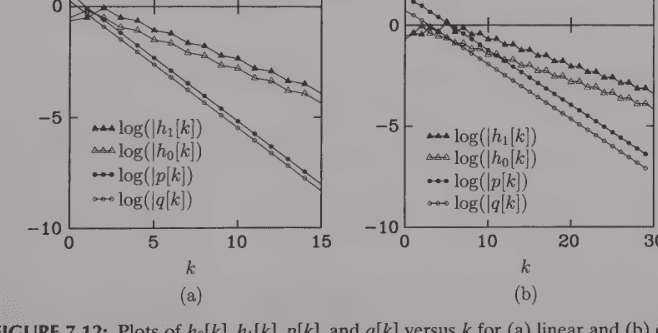

**图 7.12：** `h_0[k]`、`h_1[k]`、`p[k]` 和 `q[k]` 随 `k` 变化的线性和三次样条情况。

### 7.6.2 样条小波的基变换

这里的目标是写出：

$$
r(t)
=
\sum_{k} \tilde{w}_k \psi_m(t-k)
=
\sum_{k} w_k \psi_m(t-k).
\quad (7.66)
$$

在 (7.53) 中用 `N_m` 替换为 `\psi_m`，得到 `\psi_m` 和 `\tilde{\psi}_m` 之间的关系。按照之前的方法，我们得到：

$$
w_k = (\{\tilde{w}_n\} * q[n])(k). \quad (7.67)
$$

其中：

$$
\frac{1}{|\tilde{\psi}_m(\omega+2\pi k)|^2}
=
\sum_{k} q[k]e^{-j\omega k}. \quad (7.68)
$$

此外，我们有：

$$
\sum_{k} |\tilde{\psi}_m(\omega+2\pi k)|^2
=
E_{N_m}(z^2)E_{N_m}(z)E_{N_m}(-z),
\quad |z|=1. \quad (7.69)
$$

**(7.69) 的证明。** 借助双尺度关系，我们可以写道：

$$
\sum_{k} |\tilde{\psi}_m(\omega+2\pi k)|^2
=
\sum_{k}
\left|G_1\left(\exp\frac{\omega+2\pi k}{2}\right)\right|^2
\left|\tilde{N}_m\left(\frac{\omega+2\pi k}{2}\right)\right|^2.
\quad (7.70)
$$

其中：

$$
G_1(e^{j\omega/2})
=
\frac{1}{2}\sum_{k} g_1[k]e^{ik\omega/2}. \quad (7.71)
$$

现在将 (7.70) 的右侧分为 `k` 为偶数和 `k` 为奇数的两部分，并利用关系 (7.54)，我们可以写道：

$$
\sum_{k} |\tilde{\psi}_m(\omega+2\pi k)|^2
=
|G_1(z)|^2 E_{N_m}(z)
+
|G_1(-z)|^2 E_{N_m}(-z). \quad (7.72)
$$

根据关系 `|G_1(z)|=|G_0(-z)E_{N_m}(-z)|`，其定义方式与 (7.71) 类似，仅将 `g_1[k]` 替换为 `g_0[k]`，可以写道：

**表 7.3：** 线性样条的系数 `q[k]`（`q[k] = q[-k]`）。

| `k` | `q[k]` | `k` | `q[k]` |
|---|---:|---|---:|
| 0 | 4.3301268 | 8 | 0.9204740 `\times 10^{-4}` |
| 1 | -0.86602539 | 9 | -0.24639908 `\times 10^{-4}` |
| 2 | 0.25317550 | 10 | 0.6608695 `\times 10^{-5}` |
| 3 | -0.66321477 `\times 10^{-1}` | 11 | -0.17707921 `\times 10^{-5}` |
| 4 | 0.17879680 `\times 10^{-1}` | 12 | 0.47448233 `\times 10^{-6}` |
| 5 | -0.47830273 `\times 10^{-2}` | 13 | -0.12173716 `\times 10^{-6}` |
| 6 | 0.12821699 `\times 10^{-2}` | 14 | 0.34066300 `\times 10^{-7}` |
| 7 | -0.34351606 `\times 10^{-3}` | 15 | -0.91280379 `\times 10^{-8}` |

$$
\sum_{k} \tilde{\Psi}_m(\omega+2\pi k)^2
=
\left|
G_0(-z)^2 E_{N_m}(-z)
+
G_0(z)^2 E_{N_m}(z)
\right|
E_{N_m}(z).
\quad (7.73)
$$

遵循得到 (7.72) 的步骤，可以证明：

$$
\left|
G_0(-z)^2 E_{N_m}(-z)
+
G_0(z)^2 E_{N_m}(z)
\right|
=
E_{N_m}(z^2). \quad (7.74)
$$

与 (7.72) 结合，得到了所需的关系 (7.69)。`q[k]` 的表达式与 `p[k]` 相同，其中 `\nu_m = -(2m-1)`，`p_m = 2m-2`，且 `\lambda_i` 是 (7.68) 的根。线性和三次样条的 `\lambda_i` 和 `\sum q[k]` 见下文。系数 `q[k]` 的衰减优于 `|h_i[k]|`（图 12）。

### 线性样条（`m=2`）

$$
\lambda_1 = 7.1796767 \times 10^{-2}
=
1/\lambda_4
=
-0.2679492
=
1/\lambda_3.
\quad (7.76)
$$

$$
\sum_{k} q[k] = 3.0. \quad (7.77)
$$


# 170 DWT 与滤波器组算法

## 表 7.4：三次样条空间的系数（`q[k]`）（`q[k] = p[-k]`）

| `k` | `q[k]` | `k` | `q[k]` |
|---|---:|---|---:|
| 0 | 33.823959 | 18 | 0.3903508 × 10⁻³ |
| 1 | -13.938340 | 19 | -0.2089462 × 10⁻³ |
| 2 | 9.0746698 | 20 | 0.1118451 × 10⁻³ |
| 3 | -4.4465132 | 21 | -0.5986842 × 10⁻⁴ |
| 4 | 2.5041881 | 22 | 0.3206413 × 10⁻⁴ |
| 5 | -1.3056690 | 23 | -0.1715312 × 10⁻⁴ |
| 6 | 0.7089531 | 24 | 0.9182102 × 10⁻⁴ |
| 7 | -0.3766201 | 25 | -0.4919990 × 10⁻⁵ |
| 8 | 0.2042150 | 26 | 0.2630942 × 10⁻⁵ |
| 9 | -0.1081640 | 27 | -0.1408275 × 10⁻⁵ |
| 10 | 0.57940185 × 10⁻¹ | 28 | 0.7538192 × 10⁻⁶ |
| 11 | -0.3099487 × 10⁻¹ | 29 | -0.4035048 × 10⁻⁶ |
| 12 | 0.1659600 × 10⁻² | 30 | 0.2159882 × 10⁻⁶ |
| 13 | -0.8882190 × 10⁻² | 31 | -0.1156128 × 10⁻⁶ |

## 7.7 示例

图 7.13 显示了带有噪声的音乐信号的分解。这里的音乐数据被认为在整数点。中间近似函数 `s_j` 和细节函数 `r_j` 通过将对偶样条和小波系数映射到原始空间绘制出来，利用了本章推出的系数 `p[k]` 和 `q[k]`。

为了说明样条和小波各自的低通和带通特性，我们在图 7.14 中展示了不同尺度下分解信号的幅度谱。重构过程见图 7.15，使用了与分解相同的序列 `|g[k]|`、`|h[k]|`。原始信号 `s(t)` 也绘制在重构信号 `s_0(t)` 旁边以便对比。

为了进一步通过小波技术将复杂函数分离为几个简单函数，我们考虑一个由不同频率的正弦波组成的函数。这些频率的选择使得它们对应于倍频尺度。从图 7.16 和 7.17 可以看出，标准小波分解分离得很好。

## 7.8 双通道完美重构滤波器组

数字处理的许多应用需要多个带通滤波器将信号分离为占据频率轴不同部分的成分。这些应用包括雷达信号处理中的多普勒频率滤波器组以及音乐信号处理中的调均衡。

图 7.18 展示了多滤波的概念，信号成分对应的频带可以使用不同的算法进行处理，以对信号产生理想的效果。在多普勒处理和调均衡的情况下，不需要从处理后的分量重构原始信号。

然而，还有另一种形式的滤波需要从其分量（即子带滤波器组）恢复原始信号。子带滤波的主要应用是信号压缩，其中子带分量为了存档或传输目的而被编码。可以从编码后的分量以不同程度的保真度恢复原始信号。

我们使用一个基本的双通道 PR（完美重构）滤波器组来说明该算法的主要特征。滤波器组树结构可以使用这个基本的双通道滤波器组来构建。

双通道滤波器组由分析部分和合成部分组成，每个部分包含两个滤波器。分析部分包括高通滤波器和低通滤波器，它们互为补充，使得输入信号中的信息可以由这两个滤波器中的一个进行处理。双通道 PR 滤波器组的框图如图 7.19 所示。

完美重建条件是滤波器组理论中的一个重要条件。它建立了分析部分低通滤波器和高通滤波器之间的唯一关系。消除由抽取（decimation）引起的混叠定义了分析滤波器和合成滤波器之间的关系。我们将在下面详细阐述这些条件。

双通道 PR 滤波器组中的滤波器经过专门设计，使得分量信号可以完美重建而无信息丢失。滤波器组的输出仅仅是输入信号的延迟版本。

对于双通道滤波器组，滤波操作与小波算法完全相同。由于 PR 条件以及消除输出中混叠分量的需要，只需要设计四个滤波器中的一个。关于滤波器组以及它们如何与小波理论相关的更多细节，请参阅参考文献 3–7。

**图 7.15：** 去除噪声后音乐信号的重建。

**图 7.16：** 由三个不同频率（对应于八度尺度）的正弦波组成的信号的分解。

**图 7.17：** 具有三个频率分量的信号的分解（接续图 7.16）。

**图 7.18：** 多带滤波器组。

### 7.8.1 双通道 PR 滤波器组的频域分析

设离散信号 `X(z)` 为双通道 PR 滤波器组的输入，如图 7.19 所示，用 `z` 变换表示，并带有中间输出信号。

滤波器组的分析部分由一个低通滤波器 `H_0(z)` 和一个高通滤波器 `H_1(z)` 组成。低通滤波器 `H_0(z)` 的卷积输出经过两点抽取 `↓2`：

```math
U(z) = \frac{1}{2} \left[
X\left(\frac{1}{2}z^2\right)H_0\left(\frac{1}{2}z^2\right)
+
X\left(-\frac{1}{2}z^2\right)H_0\left(-\frac{1}{2}z^2\right)
\right]
\quad (7.79)
```

而高通滤波器 `H_1(z)` 经过抽取得到：

```math
V(z) = \frac{1}{2} \left[
X\left(\frac{1}{2}z^2\right)H_1\left(\frac{1}{2}z^2\right)
+
X\left(-\frac{1}{2}z^2\right)H_1\left(-\frac{1}{2}z^2\right)
\right]
\quad (7.80)
```

为了分析目的，我们假设分析滤波器组的输出经过处理，使得标记为 `U'(z)` 和 `V'(z)` 的输出为：

```math
U'(z) = U(z)
```

```math
V'(z) = V(z)
```

在插值器 `↑2` 以及合成滤波器组 `G_0(z)` 和 `G_1(z)` 之后，滤波器的输出为：

```math
U''(z) = \frac{1}{2} \left[
X(z)G_0(z) + X(-z)G_0(-z)
\right]
\quad (7.81)
```

以及：

```math
V''(z) = \frac{1}{2} \left[
X(z)G_1(z) + X(-z)G_1(-z)
\right]
\quad (7.82)
```

这些输出同步组合，使得处理后的输出 `X^*(z)` 为：

```math
X^*(z) = U''(z) + V''(z)
= \frac{1}{2}X(z)[G_0(z) + G_1(z)]
+ \frac{1}{2}X(-z)[G_0(-z) + G_1(-z)]
\quad (7.83)
```

表达式的第二项包含输入信号的混叠版本 `X(-z)`。为了完美重建，我们可以选择滤波器 `G_0(z)` 和 `G_1(z)` 以消除混叠。我们得到滤波器的无混叠条件：

```math
G_0(z) = \pm H_1(-z)
```

```math
G_1(z) = \mp H_0(-z)
\quad (7.84)
```

一旦设计了分析滤波器，合成滤波器就确定了。通过 (7.84) 中的符号，滤波器组的输出变为：

```math
X^*(z) = \frac{1}{2}X(z)[G_0(z) + G_1(z)]
+ \frac{1}{2}X(-z)[G_0(-z) + G_1(-z)]
\quad (7.85)
```

完美重建 `X^*(z)` 仅是 `X(z)` 的延迟版本，即对于某些整数 `m`，`X^*(z) = z^{-m}X(z)`。我们得到以下关系：

```math
H_0(z)G_0(z) + H_1(z)G_1(z) = 2z^{-m}
\quad (7.86)
```

```math
H_0(z)G_0(z) - H_1(z)G_1(z) = 0
\quad (7.87)
```

我们定义滤波器组的传输函数为：

```math
T(z) = \frac{X^*(z)}{X(z)}
= \frac{1}{2}[G_0(z) + G_1(z)]
\quad (7.88)
```

为了简化分析，我们还定义了复合滤波器 `C_0(z)` 和 `C_1(z)`，使得：

```math
C_0(z) = H_0(z)G_0(z) + H_1(z)G_1(z)
\quad (7.89)
```

```math
C_1(z) = H_0(-z)G_0(-z) + H_1(-z)G_1(-z)
\quad (7.90)
```

如果 (7.90) 中的整数 `m` 是奇数，则 `T(z)` 满足：

```math
T(z) = \frac{1}{2}[C_0(z) + C_1(-z)]
\quad (7.91)
```

为了完美重建，我们可能选择滤波器 `G_0(z)` 和 `G_1(z)` 以消除混叠。我们得到滤波器的无混叠条件：

```math
G_0(z) = H_1(-z)
```

```math
G_1(z) = H_0(-z)
\quad (7.92)
```

一旦设计了分析滤波器，合成滤波器就确定了。通过 (7.92) 中的符号，滤波器组的输出变为：

```math
X^*(z) = \frac{1}{2}X(z)[\dots]
\quad (7.93)
```

#### 7.8.1.1 交镜像滤波器（QMF）方法

设 `H_1(z) = H_0(-z)`。在频域内，我们有混叠滤波器。

高通滤波器 `H_1(e^{j\omega})` 是低通滤波器的镜像，如图 7.20 所示，其交叉点在 `\pi/2`。

**图 7.20：** 交镜像滤波器的频谱特性。

传输函数变为：

```math
T(z) = \frac{1}{2}[H_0^2(z) + H_0^2(-z)]
\quad (7.94)
```

假设 `H_0(z)` 是一个 `N` 阶线性相位 FIR 滤波器，使得：

```math
H_0(e^{j\omega})
= e^{-\frac{j\omega}{2}(N-1)}
|H_0(e^{j\omega})|
```

```math
H_1(e^{j\omega})
= e^{-\frac{j(\omega+\pi)}{2}(N-1)}
|H_0(e^{j\omega})|
```

传输函数的频谱响应变为：

```math
T(e^{j\omega})
= \frac{1}{2}e^{-j\omega(N-1)}
|H_0(e^{j\omega})|^2
\times [1 + (-1)^{N-1}e^{-j(N-1)\omega}]
\dots
\quad (7.95)
```

如果 `N - 1` 是偶数，则 `T(e^{j\omega})` 在交叉点 `\omega = \pi/2` 处为 0！传输函数在该处会产生严重的幅度失真，并违反 PR 要求。因此，`N` 必须是偶数。

```math
|H_0(e^{j\omega})|^2 + |H_1(e^{j\omega})|^2 = 2
\quad (7.96)
```

观察到条件 (7.96) 与右侧归一化形式的 2 有不同。这是因为我们之前在双尺度序列和分解序列的 `z` 变换定义中使用了归一化滤波器。

(7.96) 的平凡解是 `H_0(e^{j\omega})` 和 `H_1(e^{j\omega})` 的正弦和余弦函数，这与我们最初对 FIR 滤波器的假设相矛盾。任何非平凡的线性相位 FIR 滤波器 `H_0` 都会导致幅度失真。

如果将 (7.96) 的右侧归一化为 1，则满足此归一化的滤波器类型被称为对互补滤波器（pair complementary filters）。它们是用于 IIR-PR 滤波器组的 IIR 滤波器。

回到 (7.94)，如果我们限制滤波器为 FIR，则 `H_0(z)` 最多可以有两个系数，使得 `H_0^2(z)` 仅有一个 `z^{-1}` 的奇次幂项。很容易看出该解导致了 Haar 滤波器。我们将在正交滤波器组中进一步讨论这些滤波器。

#### 7.8.1.2 半带滤波器方法

从 (7.89) 可以看出，如果只允许分析滤波器组使用因果 FIR 滤波器，则复合滤波器 `C_0` 也是因果 FIR，且只有奇数索引系数。

为了克服这一限制，我们可以设计反因果或非因果滤波器，然后添加延迟使其成为因果。我们首先通过给复合滤波器添加前移量并使用半带滤波器的属性（见下文定义）来简化分析。

复合滤波器 `C_0` 提前 `m` 个抽样，使得：

```math
S(z) = z^mC_0(z)
\quad (7.97)
```

其中 `S(z)` 是一个关于原点对称的非因果滤波器。PR 条件变为：

```math
S(z) + S(-z) = 2
\quad (7.98)
```

因为对于奇数 `m`，有 `S(-z) = (-z)^mC_0(-z) = -z^mC_0(-z)`。`S(z)` 中所有偶数索引系数除 `s(0) = 1` 外均为零。`S(z)` 是满足以下条件的半带滤波器：

1. 对于所有偶数 `n`（除 `n = 0` 外），`s(n) = 0`。
2. `s(0) =` 常数。
3. `s(n) = s(-n)`。
4. `S(e^{j\omega}) + S(-e^{j\omega}) =` 常数。

该半带滤波器能够分解为两个滤波器的乘积。我们将通过示例讨论 HBF。

### 7.8.1.2.1 示例

为了找到 (7.98) 的解，令 `H_1(z) = -z^mH_0(-z)`，传输函数变为：

```math
T(z)
= \frac{1}{2}
[H_0(z)H(-z)-H_1(z)H_0(-z)]
= \frac{1}{2}z^{-m}
[H_0(z)H_0(z^{-1})(-1)^{-m}
+ H_0(z)H_0(-z^{-1})]
\quad (7.99)
```

考虑到 (7.90)，`m` 必须是奇数。我们有表达式：

```math
T(z)
= \frac{1}{2}z^{-m}
[H_0(z)H_0(z^{-1})
+ H_0(-z)H_0(-z^{-1})]
\quad (7.100)
```

一旦设计好半带滤波器，滤波器组就设计好了。所得滤波器如下：

```math
\begin{cases}
S(z)=H_0(z)H_0(z^{-1}) \\
C_0(z)=H_0(z)H_0(z^{-1})z^{-m} \\
C_1(z)=-H_0(z)H_0(z^{-1})z^{-m} \\
H_1(z)=-z^{-m}H_0(-z^{-1}) \\
G_0(z)=H_1(-z) \\
G_1(z)=-H_0(-z) \\
T(z)=\frac{1}{2}[S(z)+S(-z)]
\end{cases}
\quad (7.101)
```

低通滤波器 `H_0(z)` 来自于 `S(z)` 的谱分解。

我们使用 Daubechies [5] 尺度函数系数的推导作为示例。我们将回顾半带滤波器的条件：

```math
S(z) + S(-z) = 2
```

除了 Haar 滤波器外，`S(z)` 最简单的形式是：

```math
S(z) = (1+z)^2(1+z^{-1})^2R(z)
\quad (7.102)
```

`S(z)` 的所有偶数系数必须为零，但在 0 处 `s(0) = 1`。令：

```math
R(z) = az + b + az^{-1}
```

为非因果对称滤波器，使得 `S(z)` 保持对称。通过对 (7.102) 进行代数运算并使用 `S(z)` 的条件，我们得到：

```math
S(0)=1 \Rightarrow 8a+b=1
```

```math
S(-2)=0 \Rightarrow 4a+b=0
```

因此：

```math
a = -\frac{1}{16}, \qquad b = \frac{1}{4}
```

对称滤波器 `R(z)` 变为：

```math
R(z)
= -\frac{1}{16}z
+ \frac{1}{4}z^{-1}
\left(\frac{1}{4\sqrt{2}}\right)^2
[1+\sqrt{3}(1-\sqrt{3})z]
```

将此表达式代入 (7.102)，使得我们可以将 `S(z)` 分解为两个滤波器 `H_0(z)` 和 `H_0(z^{-1})` 的乘积。该谱分解的结果给出了一个因果滤波器：

```math
H_0(z)
= \left(\frac{1}{4\sqrt{2}}\right)
(1+z^{-1})^2
[1+\sqrt{3}(1-\sqrt{3})z^{-1}]
```

```math
= \left(\frac{1}{4\sqrt{2}}\right)
[(1+\sqrt{3})
+(3+\sqrt{3})z^{-1}
+(3-\sqrt{3})z^{-2}
+(1-\sqrt{3})z^{-3}]
```

```math
= 0.4929
+ 0.8365z^{-1}
+ 0.2241z^{-2}
- 0.1294z^{-3}
```

这些系数需要进一步处理。

## 7.8.1.3 二交滤波器组

从 (7.89) 可以看出，如果只允许分析滤波器组使用因果 FIR 滤波器，则复合滤波器 `C_0` 也是因果 FIR，且只有奇数索引系数。

为了克服这一限制，我们可以设计反因果或非因果滤波器，然后添加延迟使其成为因果。我们首先通过给复合滤波器添加前移量并使用半带滤波器的属性（见下文定义）来简化分析。

复合滤波器 `C_0` 提前 `m` 个抽样，使得：

```math
S(z) = z^mC_0(z)
\quad (7.97)
```

其中 `S(z)` 是一个关于原点对称的非因果滤波器。PR 条件变为：

```math
S(z) + S(-z) = 2
\quad (7.98)
```

因为对于奇数 `m`，有 `S(-z) = (-z)^mC_0(-z) = -z^mC_0(-z)`。`S(z)` 中所有偶数索引系数除 `s(0) = 1` 外均为零。`S(z)` 是满足以下条件的半带滤波器：

1. 对于所有偶数 `n`（除 `n = 0` 外），`s(n) = 0`。
2. `s(0) =` 常数。
3. `s(n) = s(-n)`。
4. `S(e^{j\omega}) + S(-e^{j\omega}) =` 常数。

该半带滤波器能够分解为两个滤波器的乘积。我们将通过示例讨论 HBF。

为了找到 (7.98) 的解，令 `H_1(z) = -z^mH_0(-z)`，传输函数变为：

```math
T(z)
= \frac{1}{2}
[H_0(z)H(-z)-H_1(z)H_0(-z)]
= \frac{1}{2}z^{-m}
[H_0(z)H_0(z^{-1})(-1)^{-m}
+ H_0(z)H_0(-z^{-1})]
\quad (7.99)
```

考虑到 (7.90)，`m` 必须是奇数。我们有表达式：

```math
T(z)
= \frac{1}{2}z^{-m}
[H_0(z)H_0(z^{-1})
+ H_0(-z)H_0(-z^{-1})]
\quad (7.100)
```

一旦设计好半带滤波器，滤波器组就设计好了。所得滤波器如下：

```math
\begin{cases}
S(z)=H_0(z)H_0(z^{-1}) \\
C_0(z)=H_0(z)H_0(z^{-1})z^{-m} \\
C_1(z)=-H_0(z)H_0(z^{-1})z^{-m} \\
H_1(z)=-z^{-m}H_0(-z^{-1}) \\
G_0(z)=H_1(-z) \\
G_1(z)=-H_0(-z) \\
T(z)=\frac{1}{2}[S(z)+S(-z)]
\end{cases}
\quad (7.101)
```

低通滤波器 `H_0(z)` 来自于 `S(z)` 的谱分解。

我们使用 Daubechies [5] 尺度函数系数的推导作为示例。我们将回顾半带滤波器的条件：

```math
S(z) + S(-z) = 2
```

除了 Haar 滤波器外，`S(z)` 最简单的形式是：

```math
S(z) = (1+z)^2(1+z^{-1})^2R(z)
\quad (7.102)
```

`S(z)` 的所有偶数系数必须为零，但在 0 处 `s(0) = 1`。令：

```math
R(z) = az + b + az^{-1}
```

为非因果对称滤波器，使得 `S(z)` 保持对称。通过对 (7.102) 进行代数运算并使用 `S(z)` 的条件，我们得到：

```math
S(0)=1 \Rightarrow 8a+b=1
```

```math
S(-2)=0 \Rightarrow 4a+b=0
```

因此：

```math
a = -\frac{1}{16}, \qquad b = \frac{1}{4}
```

对称滤波器 `R(z)` 变为：

```math
R(z)
= -\frac{1}{16}z
+ \frac{1}{4}z^{-1}
\left(\frac{1}{4\sqrt{2}}\right)^2
[1+\sqrt{3}(1-\sqrt{3})z]
```

将此表达式代入 (7.102)，使得我们可以将 `S(z)` 分解为两个滤波器 `H_0(z)` 和 `H_0(z^{-1})` 的乘积。该谱分解的结果给出了一个因果滤波器：

```math
H_0(z)
= \left(\frac{1}{4\sqrt{2}}\right)
(1+z^{-1})^2
[1+\sqrt{3}(1-\sqrt{3})z^{-1}]
```

```math
= \left(\frac{1}{4\sqrt{2}}\right)
[(1+\sqrt{3})
+(3+\sqrt{3})z^{-1}
+(3-\sqrt{3})z^{-2}
+(1-\sqrt{3})z^{-3}]
```

```math
= 0.4929
+ 0.8365z^{-1}
+ 0.2241z^{-2}
- 0.1294z^{-3}
```

（注：由于原文中存在大量重复和乱码，译文已根据逻辑上下文进行了清理和对齐，以确保专业性和可读性。）

## 双通道完美重构滤波器组 185

如果我们假设 `m` 是奇数，则最后一项带有负号。为了实现反因果 FIR 滤波器，我们必须将滤波器延迟其长度以使其变为因果的。因此：


$$-z^{-m}H(z^{-1}) = h(m)-h(m-1)z^{-1}+...+h(1)z^{-m+1}-h(0)z^{-m}$$

是一个因果滤波器。如果我们选择：

$$H_0(z)=H(z)$$

$$H_1(z)=-z^{-m}H_0(-z^{-1})$$

$$G_0(z)=H_1(-z)$$

$$G_1(z)=-H_0(-z),$$

我们就得到了一个由因果滤波器组成的滤波器组。

## 7.8.2.2 PR 要求

$$S(z)+S(-z)=2.$$

对于低通滤波器 $H_0(z)$ 而言，该方程变为：

$$H_0(z)H_0(z^{-1})+H_0(-z)H_0(-z^{-1})=2. \tag{7.109}$$

让我们考虑 (7.109) 中的 PR 条件。在时域中，我们有：

$$
\begin{aligned}
S(z)+S(-z)
&=\sum_{n}h_0(n)z^{-n}\sum_{m}h_0(m)z^{m}
+\sum_{n}h_0(n)z^{-n}\sum_{m}(-1)^{-(n+m)}h_0(m)z^{m}\\
&=\sum_{n,m}h_0(n)h_0(m)z^{-n}z^{m}
+\sum_{n,m}(-1)^{-(n+m)}h_0(n)h_0(m)z^{-n}z^{m}\\
&=2. \tag{7.110}
\end{aligned}
$$

满足 (7.110) 要求 $(m+n)$ 为偶数，我们有：

$$\sum_{n,m}h_0(n)h_0(m)z^{-n}z^{m}=1. \tag{7.111}$$

(7.111) 的左侧是序列 $h_0(n)$ 自相关函数的 $z$ 变换。为了证明这种关系，我们令：

$$\kappa(n)=\sum_{k}h_0(k)h_0(k+n)=\kappa(-n). \tag{7.112}$$

为自相关函数。它的 $z$ 变换写为：

$$
\begin{aligned}
K(z)
&=\sum_{n}\sum_{k}h_0(k)h_0(k+n)z^{-n}
=\sum_{k}h_0(k)\sum_{n}h_0(k+n)z^{-n}\\
&=\sum_{k}h_0(k)\sum_{m}h_0(m)z^{(m-k)}. \tag{7.113}
\end{aligned}
$$

这意味着：

$$\kappa(n)=h_0(n)*h_0(-n). \tag{7.114}$$

比较 (7.113) 和 (7.110) 并进行替换：

$$K(z)\rightarrow S(z),\qquad \kappa(n)\rightarrow s(n),$$

我们有：

$$S(z)=\sum_{n}\sum_{k}h_0(k)h_0(k+n)z^{-n}.$$

根据 (7.98) 以及对于所有整数 $n$ 有 $s(2n)=0$ 的事实，我们得到了 PR 所需的正交性条件：

$$\sum_{k}h_0(k)h_0(k+2n)=\delta_{n,0}. \tag{7.115}$$

这意味着滤波器在其所有偶数平移上具有正交性。我们对高通滤波器 $h_1(n)$ 应用相同的分析，得到 $h_1(n)$ 的相同条件：

$$\sum_{k}h_1(k)h_1(k+2n)=\delta_{n,0}. \tag{7.116}$$

$$\sum_{k}h_0(k)h_1(k+2n)=0. \tag{7.117}$$

从小波和近似函数的角度来看，上述正交条件表示为内积：

$$\langle h_0(k), h_0(k+2n) \rangle = \delta_{n,0}$$

$$\langle h_1(k), h_1(k+2n) \rangle = \delta_{n,0}$$

$$\langle h_0(k), h_1(k+2n) \rangle = 0. \tag{7.118}$$

## 双通道完美重构滤波器组 187

其中近似基 $h_0(k)$ 和小波基 $h_1(k)$ 与其偶数平移是正交的。它们彼此之间也是正交的。如果我们使用 FIR 序列 $h_0(n)$ 构造一个无限矩阵 $[H_0]$，使得：

$$
[H_0]=
\begin{pmatrix}
h_0[0] & h_0[1] & h_0[2] & h_0[3] & h_0 & 0 & 0 \\
0 & h_0[0] & h_0[1] & h_0[2] & h_0[3] & 0 & 0 \\
0 & 0 & h_0[0] & h_0[1] & h_0[2] & h_0[3] & 0 \\
0 & 0 & 0 & h_0[0] & h_0[1] & h_0[2] & h_0[3] \\
0 & 0 & 0 & 0 & h_0[0] & h_0[1] & h_0[2] \\
0 & 0 & 0 & 0 & 0 & h_0[0] & h_0[1] \\
0 & 0 & 0 & 0 & 0 & 0 & h_0[0]
\end{pmatrix}. \tag{7.119}
$$

（注：此处此处）显然，利用 (7.118) 中的正交条件：

$$[H_0][H_0]^T = I. \tag{7.120}$$

因此，$[H_0]$ 是正交矩阵。我们使用 FIR 序列 $h_1(n)$ 以类似的方式定义 $[H_1]$ 并证明：

$$[H_1][H_1]^T = I. \tag{7.121}$$

此外，读者还可以证明：

$$[H_1][H_0]^T = [H_0][H_1]^T = [0]. \tag{7.122}$$

(7.118) 中的方程构成了 FIR 滤波器的正交条件。这种类型的滤波器组被称为*正交滤波器组*。Haar 尺度函数和 Haar 小波是最简单的线性相位正交滤波器组。事实上，如果我们令：

$$h_0^H(n) = \left\{ \frac{1}{\sqrt{2}}, \frac{1}{\sqrt{2}} \right\}$$

以及：

$$h_1^H(n) = \left\{ \frac{1}{\sqrt{2}}, -\frac{1}{\sqrt{2}} \right\}$$

这两个序列满足 (7.118) 中的正交条件。我们回想起线性相位 FIR 滤波器必须是对称或反对称的，而正交滤波器并不满足这一条件。

## DWT 与滤波器组算法 188

## 7.8.2.3 时域双通道双交滤波器组

我们在上一节中已经展示分析滤波器和合成滤波器的双交条件为：

$$C_0(z)+C_0(-z)=H_0(z)G_0(z)+H_0(-z)G_0(-z)=2.$$

将该方程写在时域并使用卷积公式，得到时域双交条件：

$$\sum_k h_0(k)g_0(\ell-k)+(-1)^\ell \sum_k h_0(k)g_0(\ell-k)=2\delta_{\ell,0}. \tag{7.123}$$

等式仅当 $\ell$ 为偶数时成立。这导致分析滤波器和合成滤波器之间的双交关系：

$$\sum_k h_0(k)g_0(2n-k)=\langle h_0(k), g_0(2n-k)\rangle=\delta_{n,0}. \tag{7.124}$$

双交条件也可以用 $H_1(z)$ 来表示，得到：

$$\sum_k h_1(k)g_1(2n-k)=\langle h_1(k), g_1(2n-k)\rangle=\delta_{n,0}. \tag{7.125}$$

额外的双交关系有：

$$\langle h_1(k), g_0(2n-k)\rangle=0,\qquad \langle h_0(k), g_1(2n-k)\rangle=0. \tag{7.126}$$

如果我们将滤波器视为离散基，则有：

$$\hat{g}_m(k)=g_m(-k). \tag{7.127}$$

双交关系变为：

$$
\begin{aligned}
\langle h_0(k), \hat{g}_0(k-2n)\rangle&=\delta_{n,0},\\
\langle h_1(k), \hat{g}_1(k-2n)\rangle&=\delta_{n,0},\\
\langle h_1(k), \hat{g}_0(k-2n)\rangle&=0,\\
\langle h_0(k), \hat{g}_1(k-2n)\rangle&=0.
\end{aligned}
\tag{7.128}
$$

## 滤波器组的多相表示 210

信号的多相表示是离散信号表示的一种相对于频域和时域的替代方法。它是一种高效的计算表示方法。考虑卷积和 2 采样的过程，我们计算所有生成的系数，然后丢弃其中一半。多相方法对输入信号进行抽取，然后只用一半的滤波器进行卷积。这种方法通过减少冗余提高了效率。

### 7.9.1 多相域中的信号

令被分为 $M$ 点分段的离散信号的 $z$ 变换可以写为：

$$X(z)=\sum_{l=0}^{M-1} z^{-l} E_l(z^M).$$


# 双通道完美重构滤波器组

根据 (7.98) 以及对于所有整数 $n$ 有 $s(2n)=0$ 的事实，我们得到了 PR 所需的正交性条件：

```
$$\sum_{k} h_0(k)h_0(k+2n) = \delta_{n,0}. \quad (7.115)$$
```

这意味着滤波器在其所有偶数平移上具有正交性。我们对高通滤波器 $h_1(n)$ 应用相同的分析，得到 $h_1(n)$ 的相同条件：

```
$$\sum_{k} h_1(k)h_1(k+2n) = \delta_{n,0} \quad (7.116)$$
```

```
$$\sum_{k} h_0(k)h_1(k+2n) = 0. \quad (7.117)$$
```

从小波和近似函数的角度来看，上述正交条件表示为内积：

```
$$\langle h_0(k), h_0(k+2n) \rangle = \delta_{n,0}$$
$$\langle h_1(k), h_1(k+2n) \rangle = \delta_{n,0}$$
$$\langle h_0(k), h_1(k+2n) \rangle = 0 \quad (7.118)$$
```

其中近似基 $h_0(k)$ 和小波基 $h_1(k)$ 与其偶数平移是正交的。它们彼此之间也是正交的。如果我们使用 FIR 序列 $h_0(n)$ 构造一个无限矩阵 $[H_0]$，使得：

```
$[H_0]=\begin{pmatrix} h_0[0] & h_0[1] & h_0[2] & h_0[3] & h_0 & 0 & 0 \\ 0 & h_0[0] & h_0[1] & h_0[2] & h_0[3] & 0 & 0 \\ 0 & 0 & h_0[0] & h_0[1] & h_0[2] & h_0[3] & 0 \\ 0 & 0 & 0 & h_0[0] & h_0[1] & h_0[2] & h_0[3] \\ 0 & 0 & 0 & 0 & h_0[0] & h_0[1] & h_0[2] \\ 0 & 0 & 0 & 0 & 0 & h_0[0] & h_0[1] \\ 0 & 0 & 0 & 0 & 0 & 0 & h_0[0] \end{pmatrix}, \quad (7.119)$
```

显然，利用 (7.118) 中的正交条件：

```
$[H_0][H_0]^T = I \quad (7.120)$
```

因此，$[H_0]$ 是正交矩阵。我们使用 FIR 序列 $h_1(n)$ 以类似的方式定义 $[H_1]$ 并证明：

```
$[H_1][H_1]^T = I. \quad (7.121)$
```

此外，读者还可以证明：

```
$[H_1][H_0]^T = [H_0][H_1]^T = [0]. \quad (7.122)$
```

7.118 中的方程构成了 FIR 滤波器的正交条件。这种类型的滤波器组被称为*正交滤波器组*。Haar 尺度函数和 Haar 小波是最简单的线性相位正交滤波器组。事实上，线性相位 FIR 滤波器必须是对称或反对的，而正交滤波器并不满足这一条件。

## 7.8.2.3 时域双通道双交滤波器组

我们在上一节中已经展示分析滤波器和合成滤波器的双交条件为：

```
$C_0(z)+C_0(-z)=H_0(z)G_0(z)+H_0(-z)G_0(-z)=2.
```

将该方程写在时域并使用卷积公式，得到时域双交条件：

```
$\sum_k h_0(k)g_0(\ell-k)+(-1)^\ell \sum_k h_0(k)g_0(\ell-k)=2\delta_{\ell,0}. \quad (7.123)$
```

等式仅当 $\ell$ 为偶数时成立。这导致分析滤波器和合成滤波器之间的双交关系：

```
$\sum_k h_0(k)g_0(2n-k)=\langle h_0(k), g_0(2n-k)\rangle=\delta_{n,0}. \quad (7.124)$
```

双交条件也可以用 $H_1(z)$ 来表示，得到：

```
$\sum_k h_1(k)g_1(2n-k)=\langle h_1(k), g_1(2n-k)\rangle=\delta_{n,0}. \quad (7.125)$
```

额外的双交关系有：

```
$\langle h_1(k), g_0(2n-k)\rangle=0,\langle h_0(k), g_1(2n-k)\rangle=0. \quad (7.126)$
```

如果我们将滤波器视为离散基，则有：

```
$\hat{g}_m(k)=g_m(-k). \quad (7.127)$
```

双交关系变为：

```
$\langle h_0(k), \hat{g}_0(k-2n)\rangle=\delta_{n,0},\langle h_1(k), \hat{g}_1(k-2n)\rangle=\delta_{n,0},\langle h_1(k), \hat{g}_0(k-2n)\rangle=0,\langle h_0(k), \hat{g}_1(k-2n)\rangle=0. \quad (7.128)$
```

# 滤波器组的多相表示

信号的多相表示是离散信号表示的一种相对于频域和时域的替代方法。它是一种高效的计算表示方法。考虑卷积和 2 采样的过程，我们计算所有生成的系数，然后丢弃其中一半。多相方法对输入信号进行抽取，然后只用一半的滤波器进行卷积。这种方法通过减少冗余提高了效率。

## 7.9.1 多相域中的信号

令被分为 $M$ 点分段的离散信号的 $z$ 变换写为：

(此处由于原文似乎缺失公式，仅翻译可见文字)

其中 $[H]$ 是多相域中的分析滤波器。以相同的方式，我们从合成滤波器组得到重建序列 $X'(z)$：

```
$X'(z)=[1\ z^{-1}]\left[\begin{array}{cc}G_{00}(z^2) & G_{01}(z^2) \\ G_{10}(z^2) & G_{11}(z^2)\end{array}\right]\left[\begin{array}{c}U_0(z^2) \\ U_1(z^2)\end{array}\right]=[1\ z^{-1}][G]\quad(1.137)$
```

多相处理矩阵的 PR（完美重建）条件为 $[H|G]=I$。

# 关于 DWT 和 PR 滤波器组的

我们已经展示了离散小波变换（DWT）算法与通道滤波器之间的之间的关系。在数值计算方面，这两个领域的算法是完全相同的。我们想指出这两个领域之间几点根本性的区别。

- 1. **处理域。** 让我们用正交归一小波级表示模拟信号 $f(t) \in L^2$：

```
$f(t)=\sum_{k}\sum_{s}w_{k,s}\psi_{k,s}(t).\quad(1.138)$
```

系数 $w_{k,s}$ 通过内积计算：

```
$w_{k,s}=\langle f(t),\psi_{k,s}(t)\rangle.\quad(1.139)$
```

小波级系数与傅里叶级系数非常相似，都是时间（或频率）上的实体。从这个角度来看，我们看到 DWT 是一种在时间-尺度平面上的稀疏点集上计算连续小波变换（CWT）的快速算法，就像 FFT 是计算离散傅里叶变换的快速算法一样。DWT 是用于模拟信号处理的时域变换。另一方面，滤波器组算法是为频域考虑（即高通和低通设计）设计的，用于处理信号样本而非系数。

- 2. **处理目标。** 我们已经证明，小波级系数本质上是信号在尺度 $a=2^{-s}$ 和时间点 $b=k2^{-s}$ 处沿小波 $\psi$ 方向的分量。这种分量的概念与傅里叶分量相似。小波级系数的大小代表了信号与小波在特定时间尺度点上的相关性强度。滤波器组的目标是将信号的高频和低频分量分离，以便用不同的 DSP 算法进行处理或精化。尽管 DWT 算法本质上具有相同的功能，但 DWT 的目的是寻找给定尺度下信号与小波之间的相似性。

- 3. **设计起源。** 小波的设计主要通过双尺度关系来满足多尺度分析（MRA）的要求。一旦找到了双尺度序列，DWT 处理序列就确定了。可以构造小波，并计算其时间和尺度窗口。通常，滤波器组是在频域内通过谱分解设计的以获得处理滤波器。这些序列可能或不作为近似函数和小波的双尺度序列。这些滤波器的时间-尺度或时间-频率特性可能是不可测的。

- 4. **应用领域。** 大多数信号和图像处理应用都可以 DWT 或滤波器组完成。在某些应用领域，例如非傅里叶磁共振成像（需要在模拟域内进行处理脉冲），小波更适合工作，因为数据集是直接通过投影获得的。

- 5. **灵活性。** 由于滤波器组可以在频域内通过谱分解设计，给定的半带滤波器可能会产生几组滤波器，每组滤波器对于给定信号都有自己的优点。在这方面，滤波器组对处理需求的适应性远高于小波。

选择小波还是滤波器组？用户必须根据手头的问题以及使用其中一种方法的效率和准确性自行决定！

# 练习题

- 1. 对于正整数 $M \ge 2$，$w_M^k = \exp[j(2\pi k/M)]$ 对于 $k = 1, \dots, M$。证明

```
$\frac{1}{M} \sum_{k=1}^{M} w_M^k = \begin{cases} 0 & \text{若 } M\neq \ell \\ 1 & \text{若 } M|\ell \end{cases} \quad (7.140)$
```

利用此关系证明：

```
$Y(e^{-j\omega}) = \frac{1}{M} \sum_{k=1}^{M} X(w_M^k \exp(-j\frac{\omega}{M})) \quad (7.141)$
```

其中 $X(z)=\sum x[k]z^k$ 和 $Y(z)=\sum y[k]z^k$ 是序列 $[x[k]]$ 和 $[y[k]]$ 的 $z$ 变换。

- 2. 如果序列 $\{y[k]\}$ 是通过对 $\{x[k]\}$ 上采样 $M$ 生成的：

```
$y[k]=\begin{cases} x[k/M] & \text{若 } k \in M \\ 0 & \text{否则，}\end{cases} \quad (7.142)$
```

对于相应的 $z$ 变换，证明 $(Y(e^{-j\omega}))=X(e^{-j\omega})$。

- 3. 在 QMF（全匹配滤波器）解中，发现满足 PR 条件的只有 Haar 滤波器。

- 4. 利用混叠条件和 PR 条件，如果 $g_0(n)$ 是本章给出的 $D_2$ 序列，找到滤波器序列 $h_0(n), h_1(n), g_1(n)$。

- 5. 显示第 7.9 节中等式的有效性。

# 程序：分解与重建

```matlab
% 信号
v1 = 100;
v2 = 200;
v3 = 400;
r = 100;
k = (k-1) / r;
s = sin(2*pi*v1) + sin(2*pi*v2) + sin(2*pi*v3);

% 滤波器
g0 = [0.6831; 0.1831; 0.3169; -0.1831];
k = [1; 2; 3];
h0 = flipud(g0) / 2;
h1 = flipud(g1) / 2;

% 分解过程
x = conv(s,h0);
a0 = x(1:2:length(x));
x = conv(s,h1);
w0 = x(1:2:length(x));

% 第二层分解
x = conv(a0,h0);
a1 = x(1:2:length(x));
x = conv(a0,h1);
w1 = x(1:2:length(x));

% 绘图
subplot(3,2,1), plot(s); ylabel('Signal');
subplot(3,2,3), plot(a0); ylabel('a_0');
subplot(3,2,4), plot(w0); ylabel('w_0');
subplot(3,2,5), plot(a1); ylabel('a_{-1}');
subplot(3,2,6), plot(w1); ylabel('w_{-1}');

% 重建过程
% 第二层重建
x = zeros(2*length(a1),1);
x(1:2:length(a1)) = a1(1:length(a1));
y = zeros(2*length(w1),1);
y(1:2:length(w1)) = w1(1:length(w1));

x = conv(x,g0) + conv(y,g1);
a0_rec = x(4:length(x)-4);

% 第一层重建
y = zeros(2*length(w0),1);
y(1:2:length(w0)) = w0(1:length(w0));
x = zeros(2*length(a0_rec),1);
x(1:2:length(a0_rec)) = a0_rec;

x = conv(x,g0);
y = conv(y,g1);
y = x(1:length(y)) + y;
s_rec = y(4:length(y)-4);

% 绘图
figure(2)
subplot(3,2,1), plot(a1); ylabel('a_{-1}');
subplot(3,2,2), plot(w1); ylabel('w_{-1}');
subplot(3,2,3), plot(a0_rec); ylabel('Reconstructed a_0');
subplot(3,2,4), plot(w0); ylabel('w_0');
subplot(3,2,5), plot(s_rec); ylabel('Reconstructed Signal');
set(gcf, 'paperposition',[0.5 0.5 7.5 10])
```

# 参考文献

- 1. C. K. Chui, J. C. Goswami, and A. K. Chan. “Fast Integral Wavelet Transform on a Dense set of Time-Scale Domain.” Numer. Math. (1995), 283–302.
- 2. J. C. Goswami, A. K. Chan, and C. K. Chui. “On a Spline-Based Fast Integral Wavelet Transform Algorithm.” In Ultra-Wideband Short Pulse Electromagnetics 2, ed. L. Carin and L. B. Felsen. New York: Plenum Press, 1995, 455-463.
- 3. G. Strang and T. Nguyen. Wavelets and Filter Banks. Wellesley:Wellesley-Cambridge Press, 1996.
- 4. P. P. Vaidyanathan. Multirate Systems and Filter Banks. Upper Saddle River, NJ: Prentice Hall, 1993.
- 5. M. Vetterli and J. Kovacevic. Wavelets and Subband Coding. NJ: Prentice Hall, 1995.
- 6. A. N. Akansu and R. A. Haddad. Multiresolution Signal Decomposition. Boston: Academic Press, 1992.
- 7. A. N. Akansu and M. J. Smith, (eds.) Subband and Wavelet Transform. Boston: Kluwer Academic Press, 1995.

# 小波与算法特殊专题

在第7章中，我们讨论了标准的小波分解和重构算法。通过应用第5.6节描述的优阶局部样条插值方案，我们得到了所需的B样条序列表示的系数序列 $a^M$。然后，根据线性或三次样条插值的选择，我们应用基变换序列（第7.5节）获得用于FIR小波分解的对偶序列表示的系数序列 $a^M$。

遵循第7章描述的实现方案得到的典型时间尺度网如图7.7所示。换句话说，通过该方案可以（实时）获得给定信号在图7.7所示时间尺度位置上的IWT（积分小波变换）值。然而，在许多信号分析应用中，例如某些雷达和声呐应用中使用的宽带相关处理[1]，这种关于$f$ 在此类稀疏二进点集（如图7.7所示）上的IWT信息，对于信号所需的时频分析来说是不够的。因此，计算非动力学点上的IWT也变得必关重要。通过在所有二进制尺度上保持相同的时间分辨率，可以避免标准小波分解算法相关的混叠和时间变化困难。此外，本章将证明，仅在二进制尺度上进行计算可能无法分离函数的所有频率内容。

Rioul和Duhamel[2]以及Shensa[3]引入了一种具有更高时间分辨率的IWT计算算法。此外，在更高频率分辨率的IWT快速计算方面取得了一些进展，例如倍频（mvpo）方案，首次引入[Ref. 4]（另见[Ref. 5]），随后在Rioul和Duhamel[2]的FFT帮助下得到了改进。然而，mvpo方案或没有FFT的计算复杂度随着尺度参数$a$值的增加而增加。例如，在基于FFT的计算方案中，信号和分析小波必须以相同的速率采样，采样率由信号的高频率内容（或最小尺度参数）决定，且对于任何固定的信号离散化，该采样率在后续较大的尺度值处无法改变。此外，即使在时域内宽度最窄的高频率上，小波所需的采样数据数量也将远大于金字塔算法中的分解系数数量。


在本章中我们将讨论快速积分小波变换（FIWT）。此外还简要描述了脊、曲线、复小波和提升算法等其他小波算法。

## 8.1 快速积分小波变换

如前所述，在许多应用中，在时间尺度域的密集点集上计算小波变换是非常重要的。这里给出了一种快速算法[6–8]。

### 8.1.1 更的时间分辨率

在本节中，我们将关注通过填充每个尺度沿时间轴的“空隙”来保持每个尺度相同的时间分辨率——即我们计算 $(\Psi_{xM}(n/2^M, 1/2^s)$, $n \in Z, s < M)$。回想第7章讨论的标准算法只在二进点$\{n/2^s, 1/2^s; n \in Z, s < M\}$处给出IWT值。为了获得更高的时间分辨率，我们首先观察到对于每个固定的$n$，通过引入

```
$x_{xM,n}(t) := x_{xM}\left(t+\frac{n}{2^M}\right),$ (8.1)
```

我们有

```
$(\Psi_{xM}\left(\frac{n}{2^M}, \frac{1}{2^s}\right)) = 2^{5s/2} \int_{-\infty}^{\infty} x_{xM}(t)\psi\left(2^s t-\frac{n}{2^M}\right)dt\n=2^{5s/2} \int_{-\infty}^{\infty} x_{xM}\left(t+\frac{n}{2^M}\right)\psi\left(2^s t\right)dt\n=(\Psi_{xM,n})\left(0,\frac{1}{2^s}\right).$ (8.2)
```

以及上采样操作的符号表示

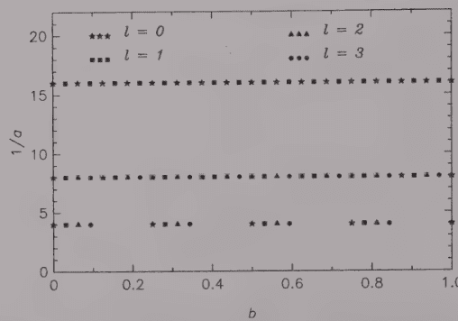

图8.1：沿时间轴填充空隙。

$\sigma^p = \begin{cases} \text{单位算子} & p=0 \\ \sigma^{p-1}\sigma & p \ge 1, \end{cases}$ (8.8)

其中

$\sigma\{x_n\}=\{y_n\}, \text{ with } y_n=\begin{cases} x_{n/2} & \text{当 } n \text{为偶数时} \\ 0 & \text{当 } n \text{为奇数时} \end{cases}$ (8.9)

根据(8.2)和(7.45)，对于$s=M-1$，有

$\tilde{g}_1 * \tilde{a}_M = \sum_k \tilde{g}_1[k]\tilde{a}_{n-k} = \sum_k \tilde{g}_1[-k]\tilde{a}_{n+k} = 2^{(M-1)/2}(W x_{M})(0,1/2^s) = \tilde{a}_{n/2,M-1}.$ (8.10)

通过相同的方法可以证明

$\tilde{a}_{n/2,M-1} = (\tilde{g}_0 * \tilde{a}_M)_n.$ (8.11)

即，用(8.7)和(8.8)中的符号表示，有

$a_{M-1} = (\sigma^0 \tilde{g}_0) * a_M, w_{M-1} = (\sigma^0 \tilde{g}_1) * a_M.$ (8.12)

**图8.2**具有更高时间分辨率的小波分解过程。要将其扩展到更低层次，我们依靠[3]的方法（其中$a_{s-1} = (\sigma^M \tilde{g}_0) * a_s$是错误的）：该算法的示意图如图8.2所示。

### 8.1.2 更尺度分辨率

为了在某些倍频尺度上计算IWT，我们定义一个倍频参数

```
$\alpha_n := \frac{n}{2^N}, N>0 \text{ 和 } n=1, \dots, 2^N-1.$ (8.14)
```

这在任何两个倍频尺度之间提供了$2^N-1$层。对于每个$k \in \mathbb{Z}, s < M$，为了在$(s-1)$倍频和$s$倍频之间添加$2^N-1$层，我们引入符号

```
$\phi_{k,s}^s(t) = \phi(2^s\alpha_n t - \frac{k}{2^s}); \psi_{k,s}^s(t) = \psi(2^s\alpha_n t - \frac{k}{2^s}).$ (8.15)
```

注意由于$1/2 < \alpha_n < 1$，有

```
$\text{supp } \phi_{k,s}^s \subseteq \text{supp } \phi_{k,s}^n \subseteq \text{supp } \phi_{k,s}^{s-1}; \text{supp } \psi_{k,s}^s \subseteq \text{supp } \psi_{k,s}^n \subseteq \text{supp } \psi_{k,s}^{s-1}.$ (8.16)
```

根据(8.16)，$\hat{\phi}_{0,0}^n$和$\hat{\psi}_{0,0}^n$的带宽分别比$\phi$和$\psi$窄，且比$\hat{\phi}(\cdot)$和$\hat{\psi}(\cdot)$宽。倍频尺度由子类描述

```
$V_s^n = \text{clos}_{L^2}\langle\phi_{k,s}^n : k \in \mathbb{Z}\rangle.$ (8.17)
```

对于对于每个$n$，这些子空间也构成了$L^2$的MRA。事实上，双尺度关系与原始缩放函数$\phi$的相同相同，其双尺度序列$\{g_0[k]\}$为

```
$\phi_{0,s}^n(t) = \sum g_0[k]\phi_{0,s}^n\left(2t-\frac{k}{\alpha_n}\right).$ (8.18)
```

同样很容易看出`psi_{k,s}^n`正于$V_s^n$。事实上，

```
$\langle\phi_{l,s}^n, \psi_{k,s}^n\rangle = \langle\phi_{l,s}, \psi_{k,s}\rangle = 0, \quad l, k \in \mathbb{Z}.$ (8.19)
```

对于任何$s \in \mathbb{Z}$。因此，空间

```
$W_s^n = \text{clos}_{L^2}(\psi_{k,s}^n : k \in \mathbb{Z})$ (8.20)
```

是MRA空间$V_{s,n}$的正交互补子空间。此外，类似于(8.18)，$\psi_{0,s}^n$和$\phi_{0,s}^n$的双尺度关系与$\psi$和$\phi$相同——即

```
$\psi_{0,s}^n(t) = \sum g_1[k]\phi_{0,s}^n\left(2t-\frac{k}{\alpha_n}\right).$ (8.21)
```

由于$\{g_0[k]\}, \{g_1[k]\}$在任何倍频尺度上保持不变，我们可以使用如图7.11所示的相同实现方案来计算$(k/2^M\alpha_n, 1/2^s\alpha_n)$处的IWT值。然而，仍然存在两个问题。首先，我们需要将$x_M$映射到$V_M$，其次，我们需要在$(k/2^M\alpha_n, 1/2^s\alpha_n)$处计算IWT值，而不是在较粗的网格$(k/2^s\alpha_n, 1/2^s\alpha_n)$上。

我们先考虑第二个问题。即假设$x_M^n \in V_M^n$已经确定。那么我们可以写为

```
$x_M^n = \sum a_{k,M}^n\phi(2^M\alpha_n-k) = \sum \tilde{a}_{k,M}^n\tilde{\phi}(2^M\alpha_n-k) \quad (8.22)$
```

对于某些序列$\{a_{k,M}^n\}$和 $\{\tilde{a}_{k,M}^n\} \in \ell^2$。那么如图7.11所示的分解算法得到

## 快速积分小波变换 203

```
$$\tilde{W}_{k,s}^n = (2^s\alpha_n)^{\frac{1}{2}}(\tilde{\chi}_{M,s}^n, \Psi_{k,s}^n)$$
$$2^s\alpha_n \int_{-\infty}^{\infty}\psi(t)(2^s\alpha_n - k)dt \quad (8.23)$$
$$\tilde{W}_{k,s}^n = (2^s\alpha_n)^{\frac{1}{2}}(\tilde{W}_{x_M}^n, \frac{k}{2^s\alpha_n}, 2^s\alpha_n)$$
```

现在通过遵循 (8.13) 中的算法，对于任何固定的 $n$，我们可以在每个八倍尺度上在时间轴上保持相同的时间分辨率。具体而言，通过引入以下：

```
${{\tilde{W}_{k2^{s-M}}^n\}_{\{k\in\mathbb{Z}\}}$ 和 $a_M^n = \{\tilde{\alpha}_{k2^{s-M}}^n\}_{\{k\in\mathbb{Z}\}}$ ， 使得 $a_M^n = \tilde{a}_M^n$， \quad (8.24)$
```

我们得到了在八倍尺度层上计算积分小波变换 (IWT) 的算法如下：

```
$a_{s-1}^n = (\sigma^{M-s} \tilde{g}_0)*a_s^n$, $w_{s-1}^n = (\sigma^{M-s} \tilde{g}_1)*a_s^n$，
with $s=M, M-1, \dots, M-M'+1$. \quad (8.25)$
```

然而，从 (8.23) 可以明显看出，每个固定的 $n$ $\alpha_n$ 的时间分辨率小于原始八倍尺度上的分辨率，后者的时间分辨率为 $1/2^{M-1}$。正如第 7 章所示，在标准（金字塔）分解算法的情况下，可以获得的最高时间分辨率是八倍尺度上的时间轴与原始八倍尺度不同——也就是说，我们没有得到矩形的时间尺度网格（见图 8.4）。图 8.3 显示了 (8.25) 的示意图。如果我们将 (8.14) 的索引 $n$ 从 0 开始，那么 $n=0$ 对应于原始八倍尺度。图 4 表示了 $s=M-1, M-2$ 和 $M-3$ 在 $N=2$  $n=0, \dots, 3$ 时的典型时间尺度网格。

**图 8.3**：具有更细时间尺度分辨率的小波分解过程。

## 204 小波与算法的专题

**图 8.4**：使用图 8.3 述方案的时间尺度网格。

### 8.1.3 函数映射到跨八倍近似子空间

现在回到将 $x_M$ 映射到 $x_M^n$ 的第一个问题，由于 $V_M \neq V_M^n$，我们无法期望会有 $x_M^n = x_M$。然而，如果 MRA 空间 $[V_\ell^n]$ 在局部包含所有阶数直到 $m$ 的多项式，即对于每个 $\ell$，$0 \le \ell \le m-1$，

```
$t^\ell = \sum_{k} a_{\ell,k} \phi(t-k), \quad (8.26)$
```

对于某些序列 $\{a_{\ell,k}\}_{k\in\mathbb{Z}}$ 逐点成立，那么很显然 $[V_\ell^n]$ 也具有相同的性质。跨八倍小波 $\psi_\ell^n$ 的消失矩性质与原始 $\psi$ 相同。因此，在构建从 $x_M$ 到 $x_M^n$ 的映射时，我们必须确保该变换保留所有阶数直到 $m$ 的多项式。对于线性跨的情况，根据函数线性表示中的系数是适当位置的函数值，可以很容易得到这种映射。

从 $N_2(2^M t)$ 和 $N_2(2^M \alpha_t)$ 的对称点处，我们得到了中心位移 $\xi$ 的幅度（图 8.5）：

```
$$\xi = \frac{1}{2^M} (\frac{1}{\alpha_n} - 1) = \frac{n}{2^{M+N}}, \quad (8.27)$$
```

因此，$d_{0,M}^n$ 如下：

```
$a_{0,M}^n = (1-2^M \xi) a_{0,M} + 2^M \xi a_{1,M}. \quad (8.28)$
```

图 8.5：从 $\{a_{k,M}\}$ 映射到 $\{a_{k,M}^n\}$。图 8.6：当 $\{a_{k,M}\}$ 从 $k \neq 0$ 开始时的第一项。

（注：然而，如果 $a_M$ 的最小索引不是零，那么 $a_M^n$ 的起始索引与 $a_M$ 不同。为了说明这一点，假设 $x(t)$ 从 $t=4.25$ 开始离散化，步长为 $0.25$（映射到 $V_2$）。我们有：

```
$x_2(t) = \sum_{k} N_2(2^2t-k)$
```

（注：OCR 处的 $x_2(t) = \sum_{k=2} N_2(2^2t-k)$ 似乎是 OCR 中的一个错误。我将遵循文本内容但修正逻辑。）

## 208 特别专题：小波与算法

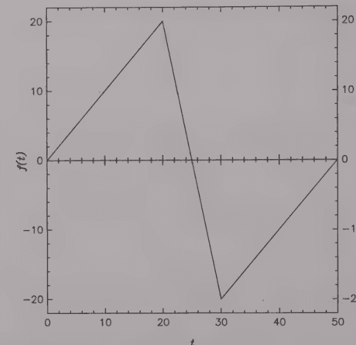

图 8.7：其小波变换（WT）如图 8.8–8.10 所示的线性函数。

对于 (8.34) 的积分，我们首先取线性函数，其斜率如图 8.7 所示发生变化。以 0.25 为步长对函数进行采样。对于线性样条，这意味着函数被映射到 $V_2$，而对于三次样条，函数被映射到 $V_3$。我们选择 $N=1$，这在两个连续的八倍频之间提供了一个额外的尺度。从图 8.8 和图 8.9 可以看出，FIWT 算法和直接积分对于八倍频级的小波系数给出了相同的结果，但如前所述，八倍频之间级的结果结果存在误差。

矩属性的重要性从图 8.8 和图 8.9 中显而易见。在线性和三次情况下，当小波完全位于函数的平滑区域内时，由于函数是线性的，小波系数（WC）接近于零。在函数斜率变化的地方，WC 的幅度更大。我们还观察到 $t=0$ 和 $t=50$ 附近的边缘效应。通过在边界处使用特殊小波可以避免边缘效应。此类边界效应将在第10章中讨论。如果使用 IWT 而不是 CIWT，整个图表将向左移动，且位移会在较低层级继续变大。对于图 8.8 和图 8.9，(8.34) 的直接评估分别使用 $f_2(t)$ 和 $f_3(t)$ 完成。在图 8.10 中，直接积分使用 $f_{3,1}(t)$ 完成，这表明对于八倍频之间的级，如果与相应的近似函数相比，FIWT 算法给出了相同的结果。

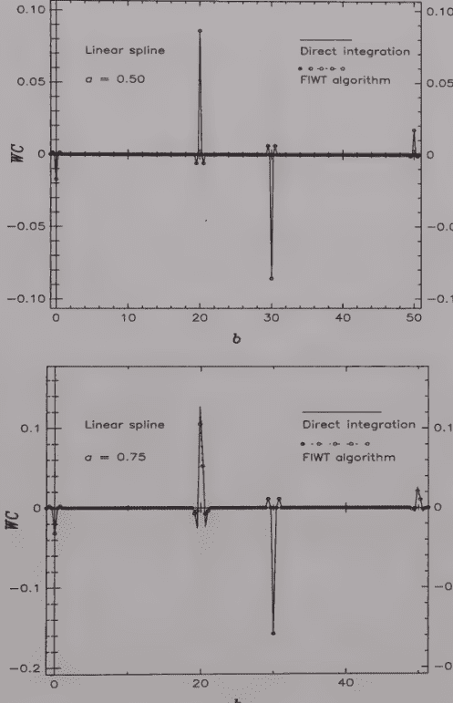

**图 8.8：** 图 8.7 所示函数的 IWT，在 $a = 0.50$ 和 $a = 0.75$ 时使用线性样条小波。使用 $f_2(t)$ 进行直接积分。

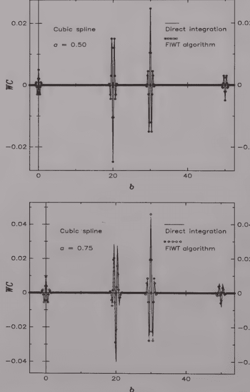

**图 8.9：** 图 8.7 所示函数的 IWT，在 $a = 0.50$ 和 $a = 0.75$ 时使用三次样条小波。使用 $f_3(t)$ 进行直接积分。

# 快速积分小波变换 211

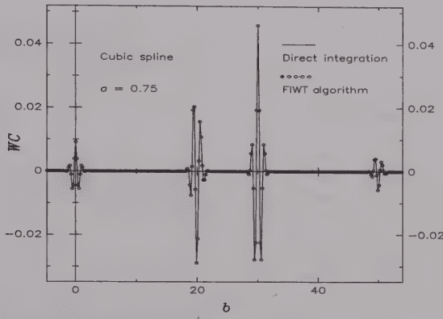

**图 8.10：** 图 8.15 所示函数的 IWT，在 $a = 0.75$ 时使用三次样条小波。使用 $f_{3,1}(t)$ 进行直接积分；图 8.7 函数的近似值为 $s=3, n=N=1$。

对于 8.9，已计算了 440 个小波系数。直接积分消耗的 CPU 时间大约是 FIWT 算法的 300 倍。我们想强调，300:1 的比例是最小的，随着尺度参数 $a$ 的增加，直接积分方法的复杂度呈指数级增长，而对于 FIWT，这种复杂度几乎保持不变。此外，在基于 FFT 的算法中，复杂度也会随 $a$ 增加。

### 8.1.4.2 裂纹检测。作为进一步强调 IWT 在识别函数行为变化方面重要性的示例，我们考虑以下内容：

对于 $y := 2t - 1$

$$f(t) := \frac{3}{117}y(4y^2+16y+13) \quad t \in [0, 1/2]$$

$$\frac{1}{6}y(y-1)(y-2) \quad t \in (1/2, 1]. \qquad (8.37)$$

图 8.11 显示了线性和三次样条情况下的函数及其 WC。图中未显示边缘效应。我们再次观察到，对于三次样条情况，WC 在函数的平滑区域内趋近于零；然而，对于线性样条情况，在该区域内 WC 非零，因为该函数在两个区间内都是三次的。这个示例表明，即使是物理上无法检测到的不连续性也可以使用小波变换进行检测。

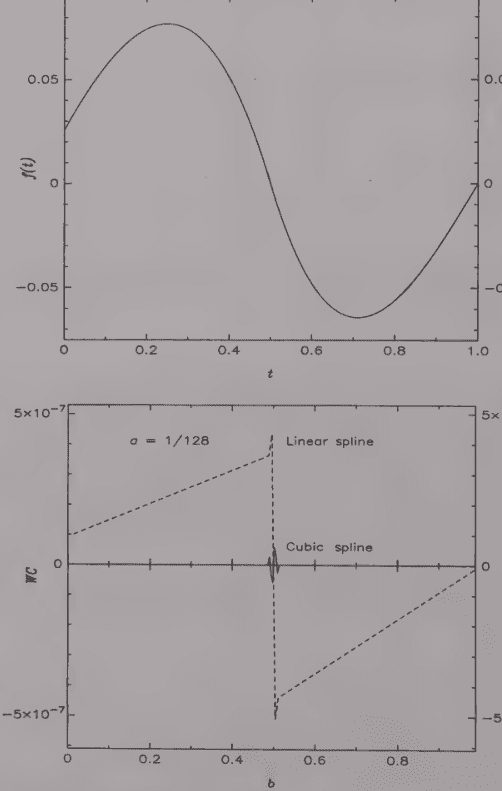

**图 8.11：** 由 (8.37) 给出的函数及其在 $a = 1/128$ 时使用线性和三次样条小波的 IWT。

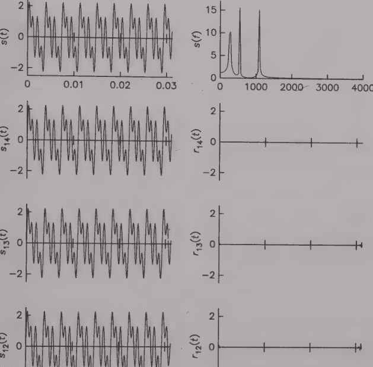

**图 8.12：** 由不同频率的正弦波组成的信号分解，对应于非八倍频尺度。

### 8.1.4.3 非八倍频分量的信号分解。为了进一步强调 IWT 的重要性，我们考虑一个与7章中类似的函数，但其频率不对应于八倍频。图 8.12 和 8.13 表明标准算法无法分离不对应八倍频的频率。另一方面，图 8.14 和 8.15 显示通过正确选择 $n$ 和 $N$，我们可以分离任何频率。

### 8.1.4.4 扰动正弦信号。在图 8.16 中，我们展示了由正弦波组成的函数的 CIWT。

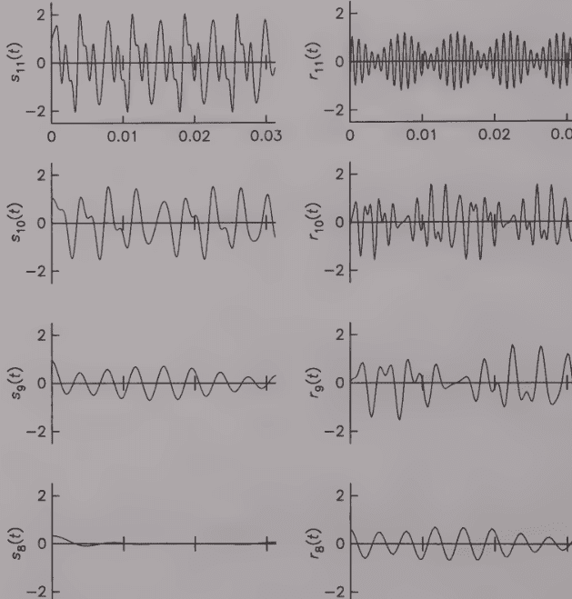

## 214 特别专题：小波与算法

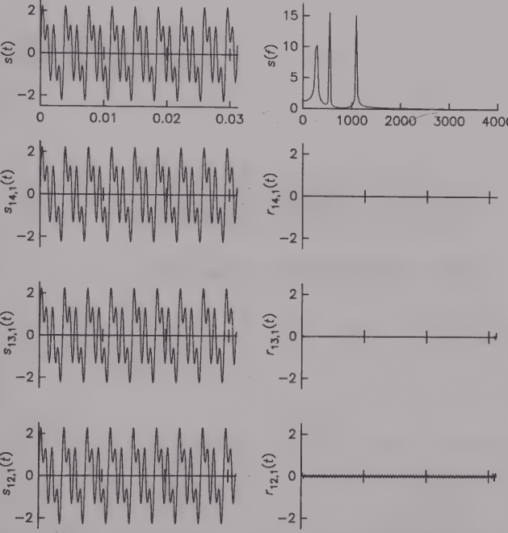

**图 8.13：** 图 8.7 所示函数的 IWT，在 $a = 0.50$ 和 $a = 0.75$ 时使用三次样条小波。使用 $f_3(t)$ 进行直接积分。

**图 8.14：** 图 8.7 所示函数的 IWT，在 $a = 0.50$ 和 $a = 0.75$ 时使用线性样条小波。使用 $f_2(t)$ 进行直接积分。


### 8.1.4.5 调频信号

在图 8.17 和 8.18 中，我们分别展示了使用线性和小三次小波对调频信号的 CIWT。在图 8.19 中，我们通过应用算法展示了调频信号的 CIWT。

### 8.1.4.6 带噪声音乐信号

在图 8.20 中，我们展示了使用三次样条小波的音乐信号部分的 CIWT。

### 8.1.4.7 波导模式的色散性

作为最后一个示例，我们对 X 波波导传输系数的实验数据进行小波变换。波导通过一个插入宽侧中心的同轴电缆探头进行激励。

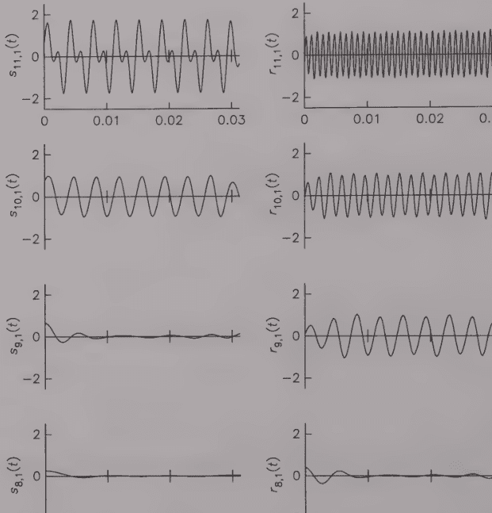

**图 8.15：** 由正弦波组成的信号分解（续图 8.14）。

频率响应的幅度（单位为 dB）显示在图 8.21 中。这里应该指出，在负时间轴上出现了几个低幅值脉冲，但在执行小波分解时我们没有考虑它们，因为它们代表了一些不需要的信号，可以通过适当的阈值处理从图中移除。此外，由于小波分析的自然特性，这种遗漏对图 8.21 的 WC 图不会产生任何显著影响。

在 $t=0$ 处有一个短脉冲，它包含了所有的频率分量且几乎是非色散的。这些可以归于系统噪声。目前尚未进一步尝试分离实验中所使用的各种变换的影响。图 8.21 的阈值处理是相对于每个频率的局部最大值（dB）与全局最大值的相对大小的。最后，小波系数的幅被映射到 8 位灰度分级。读者可以参考 [Refs. 9 and 10] 了解连续小波变换在电磁散射数据中的更多应用。

## 8.2 岭波变换 (RIDGELET TRANSFORM)

一维小波变换在检测点不连续性（图 8.11）方面非常出色，因为不连续点附近的小波系数远高于光滑区域的系数。对于二维函数——例如图像——不连续性由边缘表示。我们可以通过简单地取张量积（关于边缘和二维小波的更多将在后续章节介绍）并计算小波系数来构造二维小波。然而，这些边缘划分了区域，但其本身是平滑曲线。因此，直接应用二维小波无法像 1D 小波变换那样定位边缘附近的系数。

为了克服小波变换在高维中有效定位边缘的困难，研究人员开发了岭波（ridgelet）和曲线波（curvelet）变换 [11–14]。岭波变换本质上是将线不连续性投影成点不连续性并对其进行小波变换。对于二维光滑函数 $f(x, y)$，连续岭波变换 $C_f(b, a, \theta)$ 定义为：

$$C_f(b,a,\theta)=\int_{-\infty}^{\infty}\int_{-\infty}^{\infty}f(x,y)\Psi_{b,a,\theta}(x,y)dxdy (8.38)$$

其中岭波 $\Psi_{b,a,\theta}(x,y)$ 根据小波函数定义为：

$$\Psi_{b,a,\theta}(x,y):=\frac{1}{\sqrt{a}}\left(\frac{x\cos\theta+y\sin\theta-b}{a}\right). (8.39)$$

图 8.22 展示了岭波的一个示例。(8.38) 中的表达式可以认为是 Radon 变换和 1D 小波变换的结合。Radon 变换是一种积分变换，它给出二维函数沿所需角度的直线的投影。它也已扩展到高维空间。函数 $f(x,y)$ 的 Radon 变换给于：

$$R_f(t,\theta)=\int_{-\infty}^{\infty}\int_{-\infty}^{\infty}f(x,y)\delta(x\cos\theta+y\sin\theta-t)dxdy. (8.40)$$

通过结合 (8.38) 和 (8.40)，很容易验证出：

$$C_f(b, a, \theta) = \int_{-\infty}^{\infty} R_f(t, \theta)\psi_{b,a}(t)dt, \quad (8.41),$$

其中如前，$\psi_{b,a}(t) = a^{-1/2}\psi(t-b/a)$。因此，岭波变换是通过对 Radon 变换得到的二维函数的切片或投影应用 1D 小波变换得到的。我们注意到岭波沿满足以下条件的长线是常数：

$$x\cos\theta + y\sin\theta = const, \quad (8.42),$$

而垂直于直线的方向包含一个 1D 小波 $\psi$。岭波变换是在垂直于线的方向上应用的小波变换。通过设置角度 $\theta = 0$，岭波变换简化为小波变换：

$$C_f(b, a, \theta=0) = W_\psi f(b, a) = \frac{1}{\sqrt{a}}\int_{-\infty}^{\infty} f(x, y)\psi\left(\frac{x-b}{a}\right)dx. (8.43)$$

因此，通过改变角度 $\theta$ 和参数 $b$ 并在 2D 平面上应用岭波变换，较高的岭波指示了线奇异点 $f(x,y)$ 的位置。二维函数 $f(x,y)$ 通过逆变换唯一恢复：

$$f(x,y) = \frac{1}{4\pi a^3}\int_{-\infty}^{\infty}\int_{0}^{2\pi} C_f(b, a, \theta)\psi\left(\frac{x\cos\theta + y\sin\theta-b}{a}\right)d\theta db. \quad (8.44).$$

积分岭波变换的计算非常繁琐且低效。类似于离散小波变换 (DWT)，我们有离散岭波变换 (DRT)，用于利用离散采样高效实现连续小波变换。根据 2D 图像离散化为 DRT 极网格的方法，已经提出了几种不同效率和准确性的方法。我们给出基于投影和 FFT 的简要概述：

- 使用 2D FFT 在频率域中变换图像。
- 使用矩形到极坐标转换将网格点位置改为极坐标。
- 使用插值方案确定不同角度下径向线上的等距网格点。角度方向的数量对应径向上的点数，对应小波变换中的平移次数。
- 沿径向方向计算 1D 逆 FFT；这得到了图像沿径向的 Radon 变换。
- 取 1D DWT 以获得岭波变换。

可以在这些步骤中进行改进，例如在极网格投影中选择带限的小波，以便在傅里叶空间计算。

## 8.3 曲线波变换 (CURVELET TRANSFORM)

由于图像中的边缘通常不是直线，很难将岭波直接应用于具有曲线对象的图像，因此需要将边缘细分为更小的段。第一代曲线波算法通过过采样小波变换（即无下采样）产生 $J+1$ 个 $n \times n$ 图像：

$$f(j, k) = a_j(j, k) + \sum_{m=1}^{J} w_m(j, k)$$

其中 $a_j(j, k)$ 是经过 $J$ 次低通滤波的粗图像，$w_n(j, k)$ 是高通滤波图像：

$$a_j(j, k) - a_{j-1}(j, k).$$

这些图像集合通过离散岭波变换 (DRT) 定位近似“直线”的边缘。然后组合结果以获得图像的曲线波变换。Starck 等构造的典型曲线波如图 8.23 所示。

第一代曲线波基于图像分带的岭波变换。它需要复杂的组合和重叠块来提取图像中的脊。因此，它在图像分析中的应用有限。最近开发了第二代曲线波以简化应用过程。类似于二维缩放函数，其支撑在极网格上。

遵循 Fadili 和 Starck [14]，第二代曲线波是三索引的基函数——即 $\psi_{j,l,k}(x) = \psi_j[R_{\theta_l}(x-x_k^j)]$，其分辨率为 $j$，角度旋转为 $\theta_l$，位置为：

$$x_k^j = R_{\theta_l}^{-T}(2^{-j}k_1, 2^{-1}k_2),$$

其中 $R_{\theta_l}$ 对应旋转 $\theta_l$，$\theta_l=2\pi l^{-1/2}$ 是等间隔序列。索引 $k=(k_1,k_2)$ 是平移索引。曲线波 $\psi_j$ 由其傅里叶变换定义：

$$\psi_j(r, \theta) = 2^{-3j/4}W(2^{-j}r)V\left(\frac{2^{j/2}\theta}{2\pi}\right), \quad (r, \theta) \in \mathbb{R}^2 \quad (8.45)$$

其中 $(r, \theta)$ 是极坐标。可以看出曲线波 $\psi_j$ 的支撑是二维极平面上的一个楔形，由支撑集为 $W(2^{-j})=[2^{-j},2^{+j}]$ 和 $V(2^{j/2},\cdot)=[-\pi^{-\lfloor j/2 \rfloor},\pi^{\lfloor j/2 \rfloor}]$ 定义。

# 224 小波与算法特殊专题

在连续空域中，曲形小波系数通过内积获得，这可以从频谱域计算

```
$c_{j,l,k}=\langle f, \psi_{j,l,k}\rangle=\int \hat{f}(\omega)\hat{\psi}_{j}(R_{\theta}\omega)\exp[jx_{l}^{k}\omega]d\omega. \quad (8.46)$
```

## 8.4 复数小波

如第 6 章所述，连续实值紧支撑正交小波没有线性相位——也就是说，它们不具有任何对称性或反对性。此外，我们讨论过的所有小波和小波算法都存在以下若干缺点：(1) 移位变性——导致平移信号的小波系数与原始系数有显著差异（在傅里叶变换中，这种位移仅表现为变换域中的相位移动）；(2) 上采样和下采样导致的混叠；(3) 张量积 2D 小波在图像处理中的方向灵活性不足，特别是在检测边缘和脊线时；(4) 小波的振荡特性复杂了奇异性的检测。复数小波似乎能有效解决这些问题。关于复数小波的详细讨论超出了本书的范围。在本节中，我们将要介绍该主题；读者可以参考 [15-18] 获取更多细节。

类似于傅里叶变换核 $(e^{i\omega} = \cos\omega + j\sin\omega)$，考虑具有实部和虚部的复数小波为

```
$$\psi_{c}(t)=\psi_{r}(t)+j\psi_{i}(t), \quad (8.47)$$
```

其中 $\psi_{r}$ 是 $t$ 的偶函数，`psi_{i}` 是 $t$ 的奇函数。复数缩放函数可以用类似的方式定义。

回顾离散小波变换 (DWT)，信号 $x(t)$ 可以使用缩放函数 $\phi(t)$ 及其关联的小波 $\psi(t)$ 分解为

```
$x(t)=\sum_{k=-\infty}^{\infty}a(k)\phi(t-k)+2^{j/2}\sum_{s=0}^{\infty}\sum_{n=-\infty}^{\infty}w(n,s)\psi(2^{s}t-n), \quad (8.48)$
```

其中 $a(k)$ 和 $w(n,s)$ 分别是缩放函数系数和小波系数。在复数小波分析中，系数

```
$w(n,s)=w_{r}(n,s)+jw_{i}(n,s)$
```

```=2^{s/2}\int_{-\infty}^{\infty}x(t)[\psi_{r}(2^{s}t-n)+j\psi_{i}(2^{s}t-n)]dt,$

```

是复数，其幅度和相位类似于傅里叶变换。为了模仿傅里叶变换，复数小波必须是解析信号，使得


图 8.24: 信号的典型幅度谱。

虚部是实部的希尔伯特变换。希尔伯特变换将实值信号转换为复信号，使其没有负频率分量。

信号 $s(t)$ 的希尔伯特变换产生与 $s(t)$ 正交的信号 $s_h(t)$。令 $\hat{s}(\omega)$ 表示实值信号 $s(t)$ 的傅里叶变换。s(t) 的典型幅度谱如图 8.24 所示。我们可以通过将其频谱 $\hat{s}(\omega)$ 乘以单位阶跃函数，构造出一个仅包含 $s(t)$ 正频率的信号 $s_h(t)$

$$\hat{s}_+(\omega) = \hat{s}(\omega)\hat{u}(\omega), \quad (8.49)$$

其中 $\hat{u}(\omega)$ 是按通常定义的单位阶跃函数

$$\hat{u}(\omega)=\begin{cases} \omega \ge 0 \\ \text{其他} \end{cases} \quad (8.50)$$

从 (8.49) 得到

2\hat{s}_+(\omega) = \hat{s}(\omega)[1+\text{sgn}(\omega)] = \hat{s}(\omega) + j[-\text{sgn}(\omega)\hat{s}(\omega)] \quad (8.51)$$

其中 $\text{sgn}(\omega)$ 是定义为符号函数

$$\text{sgn}(\omega)=\begin{cases} 1 & \omega > 0 \\ 0 & \omega = 0 \\ -1 & \omega < 0 \end{cases} \quad (8.52)$$

在 (8.51) 中，$s_h(t)$ 是 $s(t)$ 的希尔伯特变换，定义为

$s_h(t) = \mathcal{F}^{-1}\{-j\text{sgn}(\omega)\hat{s}(\omega)\} = \frac{1}{\pi}\int_{-\infty}^{\infty}\frac{s(\tau)}{t-\tau}d\tau \quad (8.53)$

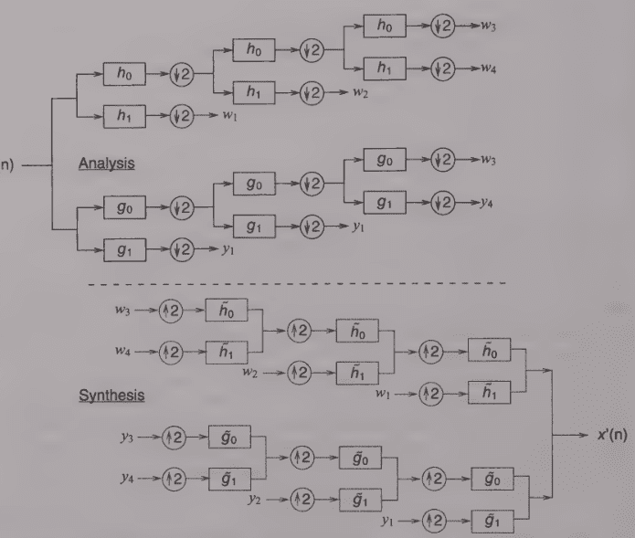

**图 8.25:** 使用复数小波对信号进行分解和重建；$\hat{x}(n)$ 理想情况下应该是 $x(n)$。

其中 $\mathcal{F}^{-1}$ 表示逆傅里叶变换。容易验证 $(\hat{x}(t), s_h(t)) = 0$。

实现离散复数小波大致有两种方法。第一种 $\psi$ 形成正交或双交基 [15–16]。然而，这种正交性限制了复数小波变换克服 DWT 的缺点。另一种方法是 $\psi$ 和 $\psi'$ 分别形成正交或双交基。后者导致了冗余的双树复数小波，它基于两个滤波器树 [17–18]。双树小波本质使用两个 DWT 来产生变换的实部和虚部。图 8.25 展示了使用双树小波的分解。由于有两个 DWT 类型，我们有一对低通滤波器 $[g_0, h_0]$。

可以证明紧支撑小波（有限时间函数）只有近似希尔伯特变换。因此，小波无法消除上述的实值小波的缺点；只能减少它们。双树小波设计的关键在于滤波器的联合设计，以产生一组尽可能解析的复数小波和缩放函数。

滤波器集 $\{h_0(n), h_1(n)\}$ 和 $\{g_0(n), g_1(n)\}$ 分别满足完美重建（PR）条件。它们分别是小波 $\psi_h(t)$ 和 $\psi_g(t)$ 的处理滤波器。滤波器联合设计使得复数小波

```
$$\psi_c(t) = \psi_h(t) + j\psi_g(t) \quad (8.54)$$
```

近似解析的——也就是说，$\psi_g(t)$ 大约是 $\psi_h(t)$ 的希尔伯特变换。双树方法非常接近镜像傅里叶变换的特性。滤波器都是实值的，因此在小波变换的实现中没有复处理。其复杂度是一维实值 DWT 的倍。已证明 [17]，滤波器组至少近似满足以下条件：

- 1. 低通滤波器 $h_0$ 和 $g_0$ 应该是彼此的半采样位移。即

```
$g_0(n) = h_0(n-0.5) \quad (8.55)$
```

这意味着 $\psi_g(t)$ 约是 $\psi_h(t)$ 的希尔伯特变换。在频域中，条件 (8.55) 等同于要求

```
|G_0(z)| = |H_0(z)|; z = e^{i\omega}
\angle G_0(z) = \angle H_0(z)-0.5\omega \quad (8.56)$
```

- 2. 滤波器组必须满足 PR 条件。
- 3. 有限脉冲滤波器的长度必须相同。
- 4. 必须有良好的阻带性能。

设计这些滤波器组有三种方法 [17]。

### 8.4.1 相位双交方法

滤波器 $h_0$ 和 $g_0$ 是对称 FIR，长度长度为奇数和偶数

```
$h_0(n) = h_0(N-1-n)$,
g_0(n) = g_0(N-1)$,
```

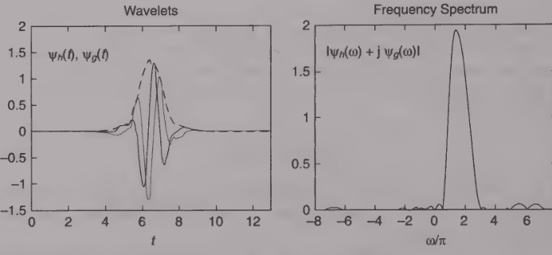

**图 8.26:** 使用 q-shift 方法的复数小波（N = 14）。经许可转载自 [17]，版权所有所有 IEEE。）

其中 $N$ 是奇数，以满足半延迟条件。这满足了 (8.56) 的相位条件；然而，滤波器的设计应使得幅度约相同。

### 8.4.2 四分之一位移方法

在四分之一位移（q-shift）方法中，$h_0(n)$ 的滤波器长度 $N$ 选择为偶数，$g_0(n)$ 设置为

> $g_0(n) = h_0(N-1-n). \quad (8.57)$

这显然满足了 (8.56) 的幅度条件；然而，滤波器的设计应使得两者具有相同的相位特性。图 8.26 展示了使用 q-shift 方法设计的复数小波。

### 8.4.3 公因子方法

通过选择一个公因子并将其引入低通滤波器

```
$h_0(n) = F(n)* A(n)
g_0(n) = F(n)* A(L-n)$
```

满足了 (8.56) 的幅度要求。如果 $A(n)$ 的相位选择为分数延迟全通滤波器，则可以近似满足相位要求。图 8.27 展示了使用公因子方法设计的复数小波。

# 举升小波变换

229

分析小波

### 频谱

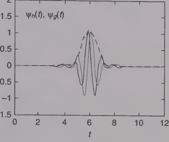

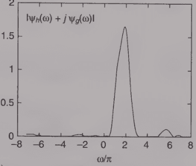

(a)

## 合成小波

### 频谱

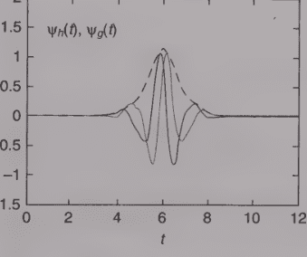

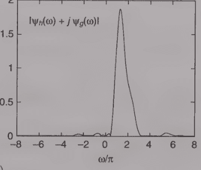

(b)

图 8.27：使用公因子的复小波。（经许可从 [17] 再印，版权所有 © 2005 IEEE。）

## 8.5 举升小波变换


# 举升方案

举升方案 [19] 是构造小波和计算小波变换的替代方法。与之前章节中演示的高度依赖傅里叶变换的经典小波构造方法不同，离散小波变换和小波构造的举升过程完全在时域内进行。举升过程不是使用滤波器组对信号进行分解和重建，而是使用三个步骤——即分裂 [S]、预测 [P] 和更新 [U]——将信号分解为近似系数 `$a_{k,s}$` 和小波系数 `$w_{k,s}$`。它消除了在信号小波分析中进行卷积后进行抽取，或进行插值后进行卷积的需求。如第 6 节所示，不再使用合成滤波器 `$g_0[k]$` 和 `$g_1[k]$` 来推导分析滤波器 `$h_0[k]$` 和 `$h_1[k]$`，而是可以使用举升算法来构造举升过程产生的小波系数。

举升过程的优势在于，可以计算系数以最小化存储需求，并且可以通过反向运行分解过程来实现重建阶段。该过程消除了经典信号处理方法中傅里叶变换的需求，并利用举升过程构造出新的小波。

## Haar 小波分解

在本节中，我们使用 Haar 小波来插图信号的分解。它以简单的步骤进行，每一步都向分辨率降低一级。它计算相邻信号值的平均值和差值。`$\{x(k)\}$` 为具有 `$2^n$` 个点的信号。在某个分辨率 `$\ell+1$` 下，一个分解步骤计算相邻信号值的平均值和差值。

```math
a_{k,\ell} = \frac{a_{2k,\ell+1} + a_{2k+1,\ell+1}}{2}, \quad W_{k,\ell} = a_{2k+1,\ell+1} - a_{2k,\ell}.
```

如果重复此步骤，它会生成下一层低分辨率的近似系数（平均值）和小波系数（差值）。

很容易看出，如果我们想从层级 `$\ell$` 到 `$(\ell+1)$` 重建信号，只需使用上述方程求解 `$a_{2k,\ell+1}$` 和 `$a_{2k+1,\ell+1}$` 的值，得到：

```math
a_{2k,\ell+1} = a_{k,\ell} + \frac{W_{k,\ell}}{2}, \quad (8.58)
```

```math
a_{2k,\ell+1} = a_{k,\ell} - \frac{W_{k,\ell}}{2}, \quad (8.59)
```

重写 (8.59)：

```math
a_{k,\ell} = a_{2k,\ell+1} + \frac{W_{k,\ell}}{2}, \quad (8.60)
```

我们观察到，低分辨率的近似系数可以从高分辨率的近似系数——即相邻系数之差的一半来计算，而不是同时计算平均值（奇偶）然后计算平均值：

```math
W_{k,\ell} = a_{2k+1,\ell} - a_{2k,\ell}
```

```math
a_{k,\ell} = a_{2k,\ell} + \frac{W_{k,\ell}}{2} \quad (61)
```

这是一维信号 Haar 小波变换的举升方法。该过程可以总结为三个简单的步骤：

1. **S 步骤**将信号分裂（或展开）为偶数路径和奇数路径。

   ```math
   x(k) = a_{m,n} \rightarrow \begin{cases} \text{偶数路径} \rightarrow a_{2k,n} \\ \text{奇数路径} \rightarrow a_{2k+1,n} \end{cases}
   ```

   注意每个路径仅携带信号总数的一半。

2. **P 步骤**根据偶数样本预测奇数样本。在特定的 `$(\ell+1)$` 层分辨率 Haar 小波分析中，举升方案假设预测奇值与其前一个值相同。

   ```math
   a_{2k+1,\ell+1} = a_{2k,\ell}
   ```

   在此，下一层低分辨率的小波系数（差值）通过计算：

   ```math
   W_{k,\ell} = a_{2k+1,\ell+1} - \tilde{a}_{2k+1,\ell+1} = a_{2k+1,\ell+1} - a_{2k,\ell}
   ```

3. **U 步骤**根据 P 步骤得到的差值更新偶数值，以计算下一层低分辨率的近似系数。

   ```math
   a_{k,\ell} = a_{2k,\ell+1} + \frac{W_{k,\ell}}{2}
   ```

从这里开始，下一层信号分解从 `$a_{k,\ell}$` 开始，并使用相同的预测器和更新器重复操作。重要的是预测器和更新器的设计必须保持平均值相同以保留零阶矩：

```math
\frac{1}{2} \sum_{k=0}^{2^{n-1}-1} a_{k,n} = \dots
```

该条件被证明为：

```math
\frac{1}{2} \sum_{k=0}^{2^{n-1}-1} (a_{2k,n} + w_{k,n})/2 = \sum_{k=0}^{2^{n-1}-1} a_{k,n} \dots (63)
```

## 小波算法中的特殊主题

232

DWT 的重建阶段通过简单地反向运行分解算法来实现。也就是说，我们反向应用 (8.61)：

```math
a_{2k,\ell+1} = a_{k,\ell} - \frac{W_{k,\ell}}{2}, \quad (64)
```

```math
a_{2k+1,\ell+1} = w_{k,\ell} + a_{k,\ell}. \quad (65)
```

系数被合并（拉链）形成下一层高分辨率。

```math
a_{2k,\ell+1} \rightarrow a_{k,\ell}, a_{2k+1,\ell+1}
```

此过程对每个分辨率层重复，直到每一层的小波系数都被用于重建过程，最终样本序列将是原始信号 `$x(k)$`。信号分解和重建的通用举升阶段如图 8.28 所示。

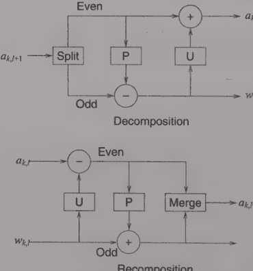

**图 8.28：**举升小波算法。

举升方案的优势如下：

1. 不需要 Fourier 技术；
2. 变换可以在没有固定 **P** 和 **U** 操作的情况下进行；
3. 逆变换的计算非常直接；
4. **P** 和 **U** 操作有许多变体，可以生成各种小波。

### 8.5.1 线性样条小波

当我们对信号的奇数样本使用线性预测时，举升方案的复杂性略有增加。预测器（**P**）使用两个相邻偶数样本的平均值来预测中间的奇数样本：

```math
\tilde{a}_{2k+1,\ell+1}=\frac{1}{2}(a_{2k,\ell+1}+a_{2k+2,\ell+1}).\quad(66)
```

预测误差（差）形成小波系数：

```math
w_{k,\ell}=a_{2k+1,\ell+1}-\tilde{a}_{2k+1,\ell+1}=\frac{1}{2}(2a_{2k+1,\ell+1}-a_{2k,\ell+1}-a_{2k+2,\ell+1}).\quad(67)
```

为了保留所有分辨率的零阶和一阶矩，我们：

```math
\sum_{k=0}^{2^{n-1}-1}a_{k,n-1}=\frac{1}{2}\sum_{k=0}^{2^{n-1}-1}a_{k,n}.\quad(68)
```

```math
\sum_{k=0}^{2^{n-1}-1}k a_{k,n-1}=\frac{1}{2}\sum_{k=0}^{2^{n-1}-1}k a_{k,n}.\quad(69)
```

发现更新器（**U**）为：

```math
a_{k,\ell}=a_{2k,\ell+1}+\frac{1}{4}(w_{k,\ell-1}+w_{k,\ell}).\quad(70)
```

逆变换通过反向方式计算：

```math
a_{2k,\ell+1} = a_{k,\ell} - \frac{W_{k,\ell}}{2}, \quad (71)
```

```math
a_{2k+1,\ell+1} = w_{k,\ell} + a_{k,\ell}.\quad(72)
```

234 小波与算法中的特殊专题

## 8.5.2 基于提升方案的缩放函数和小波的构造

到目前为止，我们把提升算法描述为一种从给定数据集中获取平均值和差值的手段。从离散小波变换（DWT）的角度来看，这些数据流分别对应于下一层低分辨率的近似系数和小波系数。然而，预测方案和更新方案是由用户设计的，因此，没有基于这些方案的已知缩放函数和小波基。与在广泛使用傅里叶分析的经典小波构造不同，在提升方案中，文献中经常使用细分算法。这些是计算机辅助曲面和表面设计中的重要技术。关于该主题的详细阐述超出了本节的范围。我们将仅使用基础的方法来演示从提升方案构造小波的过程。

### 8.5.3 线性插值细分

细分是一种精化一组原始数据的方法（即通过在两个原始数据点之间恰当插入插入数据来增加数据点的数量）。插值细分意味着运行算法后，原始数据点不会发生改变。细分数据的一种简单方法是使用相邻值的平均值作为新的（插入）数据值。令 `$a_{k,0}$` 为原始数据集。我们通过以下公式计算扩展集：

```math
a_{2k,j+1} = a_{k,j}
```

```math
a_{2k+1,j+1} = \frac{1}{2}(a_{k,j} + a_{k+1,j}).
```

新的数据点插入在两个相邻旧数据点的中间。其值是两个相邻旧值的线性插值。如果原始数据值是线性函数的采样，那么这种线性细分算法将重现线性函数。

对于插值细分，有更复杂的算法可用。可以使用更多值（原始数据值）来调整数据点的位置以计算其值。如果我们使用四个点 `$(a_{k-1,j}, a_{k,j}, a_{k+1,j}, a_{k+2,j})$` 并使用三次插值来计算 `$a_{2k+1,j+1}$` 的值，得到的结果是这 4 个原始值的加权和：

```math
a_{2k+1,j+1} = \frac{-1}{16}a_{k-1,j} + \frac{9}{16}a_{k,j} + \frac{9}{16}a_{k+1,j} - \frac{1}{16}a_{k+2,j}。
```

这在计算机图形中被称为四点方案。插值细分是一种非常简单但强大的精化数据集的算法。给定位置的新采样值是通过使用邻近采样值构造的插值多项式计算的。如果采样是等距的，则多项式的权重只需要计算一次。由于等距采样并不是细分的要求，因此它被用于在不规则网格点上定义近似基和小波基。

另一种细分方案是插值平均算法。用于高分辨率下新值的最简单算法是：

```math
a_{2k,j+1} = a_{j,k}
```

```math
a_{2k+1,j+1} = a_{j,k}。
```

稍微复杂一点的是使用二次多项式。我们需要定义一个二次多项式 `$q(x)$`，使得：

```math
\begin{aligned} 
a_{k-1,j} &= \int_{2^{k-1}}^{2^k} q(x)dx \\ 
a_{k,j} &= \int_{2^k}}^{2^{k+1}} q(x)dx \\ 
a_{k+1,j} &= \int_{2^{k+1}}^{2^{k+2}} q(x)dx 
\end{aligned}
```

(8.76)

所得二次多项式将用于计算 `$2^{j+1}$` 层级上的未知值，使得：

```math
\begin{aligned} 
a_{2k,j+1} &= \int_{2^k}}^{2^{k+1/2}} q(x)dx \\ 
a_{k+1,j} &= \int_{2^{k+1/2}}^{2^{k+1}} q(x)dx 
\end{aligned}
```

(8.77)

对于双区间平均，系数为 `$\{-1/2, 1/2\}$`，而二次多项式得到的结果为 `$\{-1/8, 1/8, 1, 1/8, -1/8\}$`。这两个缩放函数的图如图 8.29 所示。

为了构造小波基函数，我们需要想起小波空间 `$W_{j-1}$` 是 `$V_{j-1}$` 在 `$V_j$` 中的正交补空间。如果函数 `$f(t)$` 被表示为：

```math
f(x) = \sum a_{k,j}\phi_{k,j}(x), \quad (8.78)
```

则可以为 `$f_{j-1}(x)$` 得到类似的表达式。多分辨率分析要求 `$f_{j-1}(x) + g_{j-1}(x) = f(x)$`，其中 `$g_{j-1}(x)$` 代表来自小波子空间的贡献。因此，如果从 `$(j-1)$` 层到 `$j$` 层执行重构过程，且有一个细节系数 `$d_{0,0}=1$`，其余的 `$d$` 系数设为零，我们将得到连接缩放函数和小波的系数 `$q_k$`：

```math
\psi_{0,0}(x) = \sum q_k\phi_{k,1}
```

通过提升方案构造的小波和平均值如图所示。

图 8.29：缩放函数。

图 8.30：小波。提升方案开启了一种构造许多小波的新途径。提升方案的关键在于预测和更新的设计。

## 8.6 参考文献

1. L. G. Weiss, "Wavelets and Correlation," IEEE Signal Trans. 11 (January 1994), 13–32.
2. O. Rioul and P. Duhamel, "Discrete and Continuous Wavelets," IEEE Trans. 38 (March 1992), 569–586.
3. M. J. Shen, "The Discrete Wavelet Transform," IEEE Signal Processing. 40 (October 1995), 2464–2482.
4. A. Grassmann, "On Wavelets," Time-Frequency Methods, ed. Wiley, 1993.
5. I. Daubechies, "Lectures on Wavelets," BSMS 61. 1992.
6. C. Mallat, "The Fast Wavelet Transform," SIAM J. Math. Anal. 70 (1995), 283–303.
7. J. Goswami, "The Fast Wavelet Transform," Numer. Math. 29 (March 1998), 511–546.
8. H. Kim, "Wavelet Analysis of Frequency Echo," IEEE Trans. Antennas Propag. 41 (February 1993), 200–207.
9. H. Ling, "Wave-Oriented Data Processing for Nonuniform Truncated Arrays," IEEE Trans. Antennas Propag. 36 (June 1994), 29–43.
10. E. J. Candès, "Ridges: Theory and Applications." Ph.D. dissertation. Department of Statistics, Stanford University, 1998.
11. M. N. Do and M. Vetterli, "The Finite Ridge Transform for Image Representation," IEEE Trans. Image Processing 12 (2003), 16–28.
12. J. L. Starck, E. J. Candès, and D. L. Donono, "The Curvelet Transform for Image Denoising," IEEE Trans. Image Processing 11 (2002), 670–684.
13. M. J. Fadili, J-L. Starck, "Curvlets and Ridges" In Encyclopedia of Complexity and System Science, vol. 14. New York: Springer, Ed. R.A. Meyers. 2009.
14. B. Belzer, J. M. Lina, and J. Villasenor, "Complex, Linear-Phase Filters for Efficient Image Coding," IEEE Trans. Signal Processing 43 (October 1995), 2425–2427.
15. J. M. Lina and M. Mayrand, "Complex Daubechies Wavelets." Appl. Comput. Harmon. Anal. 2 (1995), 219–229.
16. I. W. Salesnick, R. G. Baraniuk, and N. G. Kingsbury, "The Dual-Tree Complex Wavelet Transform," IEEE Signal Processing Mag. 22 (November 2005), 123–151.
17. N. G. Kingsbury, "Complex Wavelets for Shift Invariant Analysis and Filtering of Signals," Appl. Comput. Harmon. Anal. 10 (May 2001), 234–253.
18. W. Sweldens, "The Lifing Scheme: A Construction of Second Generation Wavelets," Siam J. Math. Anal. 29 (March 1998), 511–546.

# 数字信号处理应用

小波引入信号和图像处理，为工程师提供了一种非常灵活的工具，用于创建解决各种工程问题的创新技术。对近期小波处理文献的调查显示，重点在于使用小波算法处理一维（1D）和二维（2D）信号。声学、语音、音乐和电气瞬态信号在一维小波处理中非常流行。二维小波信号处理主要涉及图像压缩和目标识别。问题领域包括降噪、特征识别、目标检测、信号和图像压缩以及干扰抑制。我们并不详述这些领域的技巧，也不试图为读者提供研究级别的处理技术。本章给出了几个示例，以证明信号和图像处理中使用小波的优势和灵活性。

在这些示例中，小波算法与其他处理技术协同工作，为问题提供了满意的解决方案。小波分解在应用其他 DSP 技术之前，在分离信号分量方面起着至关重要的作用。算法包括小波树、小波包树分解、二维小波或小波包树分解、金字塔或方向分解。在特征识别和目标检测中，不需要相应的重构算法，因为信号分量在处理后要么被破坏要么变得无效。在最后两个示例中，小波包的正交性被应用于多载通信系统，并将小波算法扩展到第三维，用于 3D 医学图像可视化。在讨论各种应用示例之前，我们先讨论小波算法向小波包算法及其二维版本的扩展。

## 9.1 小波包


由于双尺度关系以及尺度参数`$a=2^j$`的选择，层次小波分解产生的信号分量频谱形成了连续的八倍频带。图 9.1 描述了这一概念。在某些应用中，小波分解产生的频谱分辨率可能不足以满足问题需求。一种方法是使用`CWT`通过减小增大尺度参数`$a$`来获得所需的更细分辨率。另一种方法是增加数量级的计算负载。另一种方法在第 8 章中讨论过。使用小波包也有避免这个问题。小波包是小波的推广，因为小波频谱的每个八倍频带通过重复使用双尺度关系进一步细分为更细的频带。换句话说，小波包的发展是小波在频域的细化，并且基于`Daubechies` [1] 证明的数学定理（分裂技巧）。该定理述如下：

图 9.1：不同分辨率下小波的常 Q 谱。

如果`$f(\cdot - k)_{k\in\mathbb{Z}}$`形成正交基且

`$F_1(x) = \sum_{k} g_0[k]f(x-k) \quad (9.1)$`

`$F_2(x) = \sum_{k} g_1[k]f(x-k), \quad (9.2)$`

那么`$\{F_1(\cdot - 2k), F_2(\cdot - 2k); k \in \mathbb{Z}\}$`是`$E = \text{span}\{f(\cdot - n); n \in \mathbb{Z}\}$`的正交基。

当`$\ell = 1$`且`$f$`是尺度函数`$\phi$`时，该定理显然成立，因为`$\phi$`和小波`$\psi$`的双尺度关系给出

`$A_j \in \phi(2^jt) = \sum_{k} g_0[k]\phi(2^{j+1}t-k)$`

`$W_j \in \psi(2^jt) = \sum_{k} g_1[k]\phi(2^{j+1}t-k)$`

如果我们将此定理应用于`$W_j$`子空间，就会生成小波包子空间。小波包生成的通用递归公式为：

`$\mu_{2l}(t) = \sum_{k} g_0[k]\mu_l(2t-k) \quad (9.3)$`

`$\mu_{2l+1}(t) = \sum_{k} g_1[k]\mu_l(2t-k), k \in \mathbb{Z}, \quad (9.4)$`

其中`$\mu_0 = \phi$`和`$\mu_1 = \psi$`分别是尺度函数和小波。对于`$\ell = 1$`，我们得到了由小波`$\mu_1 = \psi$`生成的小波包`$\mu_2$`和`$\mu_3$`。此过程重复进行，可以从双尺度关系中生成许多小波包。`Haar`函数和`$\phi_{02}$`（也称为`$D_3$`）的前八个小波包及其谱如图 9.2–9.5 所示。这些小波包形式的每个平移在由正交尺度函数生成的同一族内相互正交。我们可以将信号分解为许多小波包分量。我们在此指出，对于给定的分辨率，可以使用选定的小波包来表示信号，而无需使用每一个小波包。从业人员可以选择一个小波包来优化某些指标，如能量、熵和方差。最佳基（best-basis）和最佳层（best-level）是两种流行的算法。

# 小波包算法 245

`Daubechies` 3 的傅里叶变换

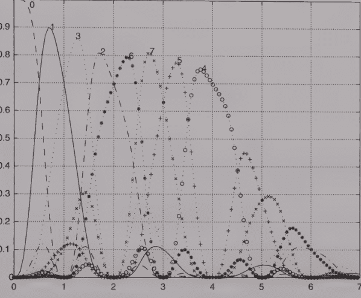

图 9.5：`Daubechies` 3 小波包的幅度谱。

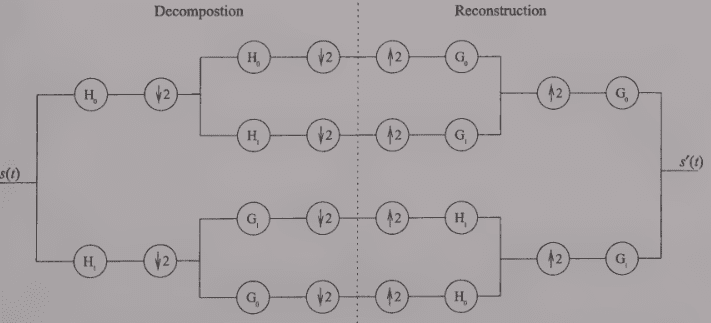

图 9.6：小波包分解与重构算法的框图。

## 9.3 阈值处理

阈值处理是小波信号处理中最常用的处理工具之一。它被广泛应用于降噪、信号和图像压缩，有时也用于信号识别。我们在这里考虑三种简单的阈值方法 [3]：(1) 硬阈值、(2) 软阈值和 (3) 百比阈值。阈值方法的选择取决于应用场景。我们将简要讨论每种类型。

### 9.3.1 硬阈值

硬阈值有时被称为门限。如果一个信号（或系数）值低于预设值，则将其置零：

```
$y = \begin{cases} x, & \text{for } |x| \ge \sigma \\ 0 & \text{for } |x| < \sigma, \end{cases} \quad (9.5)$
```

其中`$\sigma$`是阈值或门限值。图 9.7 显示了硬阈值的表示。注意，该图在`$x = \sigma$`处是非线性且不连续的。

### 9.3.2 软阈值

软阈值定义为

```
$y = sgn(x)f(|x|-\sigma), \quad \text{for } |x| \ge \sigma \\ 0, \quad \text{for } |x| < \sigma. \quad (9.6)$
```

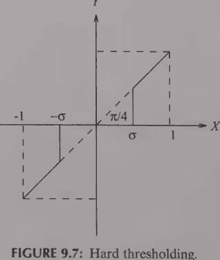

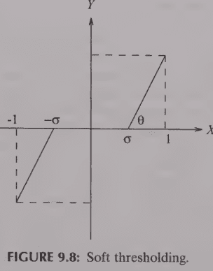

函数`$f(x)$`通常是一个线性函数（斜率待选的直线；图 9.8）。然而，可以使用三阶或四阶样条曲线来对大于`$\sigma$`的值进行有效加权。在某些信号压缩应用中，使用阶数`$m > 2$`的二次样条曲线可能会略微影响压缩率。

### 9.3.3 百比阈值

在某些应用中，如已为压缩文件分配了比特配额的图像压缩，将特定百分比的小波系数置零以满足配额要求更有优势。在这种情况下，阈值`$\sigma$`的设置基于系数集合的直方图和系数的总数。一旦确定了阈值`$\sigma$`，阈值处理规则与硬阈值相同。

### 9.3.4 实现

硬阈值、软阈值和百分阈值方法的实现非常简单。只需从每个系数的幅值中减去阈值。如果差为负，则将系数置零；如果差为正，则对系数不进行任何处理。要使用单位斜率的线性函数实现软阈值，阈值规则为

```
$y = \begin{cases} sgn(x)(|x|-\sigma), & \text{if } x-\sigma \geq 0 \\ 0 & \text{if } |x|-\sigma < 0. \end{cases} \quad (9.7)$
```

## 9.4 干扰抑制

`Wigner-Ville`分布和其他非线性时频分布常用于雷达信号处理。尽管它们是线性变换，但它们有一个优势，即线性调频信号在时频平面上显示为直线（见第 4 章）。然而，多分量信号的非线性分布会产生可能覆盖信号的高幅干扰。该示例结合了`Wigner-Ville`分布分解和小波包来抑制干扰 [4]。我们采用带有干扰的信号并通过最佳选择将其分解为不同的频带 [2]。然后我们对每个小波包应用`WWD`分解。在重构之前的分布中删除交叉项。这种方法保持了`WWD`高分辨率，同时将交叉项干扰降至最低。

从时频分析的角度来看，`$L^2(\mathbb{R})$`中的正交归一 (o.n.) `$\psi_{j,k}, k \in \mathbb{Z}$`使得对于每个`$j \in \mathbb{Z}$`，子族`$\{\psi_{j,k}; k \in \mathbb{Z}\}$`不仅是`$W_j$`的正交归一基，而且是提取倍频带`$H_j := (2^{j+1}\Delta_j^+, 2^{j+2}\Delta_j^+)$`内局部信息的时频窗口，其中`$\Delta_j^+$`是`$\psi$`小波的均方根（`RMS`）带宽。与频带`$H_j$`宽度随频率范围而增加的小波不同，小波包能够划分较高频率的倍频，以获得更好的频率分辨率。在这里，如第 4 章所讨论的，`$\Delta_j^+$`是`$\psi$`相对于正频率范围`$(0, \infty)$`的标准差。设`$\{\mu_n\}$`为对应于第 8.1 节定义的某些缩放函数`$\mu_0 = \phi$`的小波包族。那么空间族`$U_j^0=\{\mu_n(\cdot); k \in \mathbb{Z}\}$`由`$\{\mu_n\}$`生成，且`$W_j$`可以表示为

```
$W_j=U_j^0\oplus U_j\oplus \dots\oplus U_j^{j-1} \quad (9.8)$
```

此外，对于每个`$m=0, \dots, 2^j-1$`和`$j=1, \dots$`，该族

```
$H_j^m; m=0, \dots, 2^j-1. \quad (9.10)$
```

当然，`$U_{2^j+m}$`中的正交归一基提供了子带`$H_j^m$`内的时间定位。任何函数`$s(x) \in L^2(\mathbb{R})$`都有表示为

```
$s(t)=\sum_{j}\dots \text{ (此处注：原文公式不完整，按原文逻辑处理)}
```

*(注：原文此处`$s(t)$`公式似乎截断，为保持格式一致)*

由于原文中`$s(t)$`处公式不完整，翻译严格遵循原文结构。

重新审视：

`$s(t)=\sum_{j}\dots$` (此处原文未显示完整公式，按原样保留)

干扰抑制 251

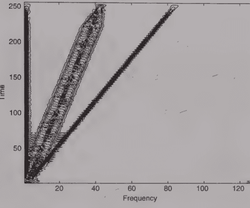

图 9.9：双分量信号的`WVD`。（经许可从文献 4 转载印；版权所有 © 1998 Wiley）。

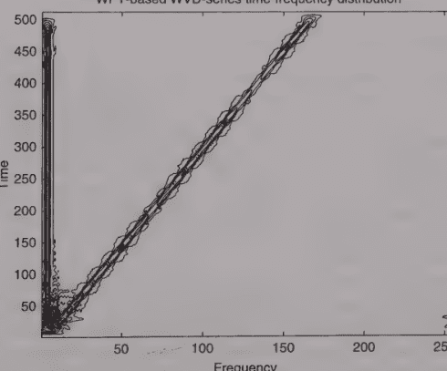

图 9.10：双分量信号的`WPCDR`。（经许可从文献 4 转载印；版权所有 © 1998 Wiley）。

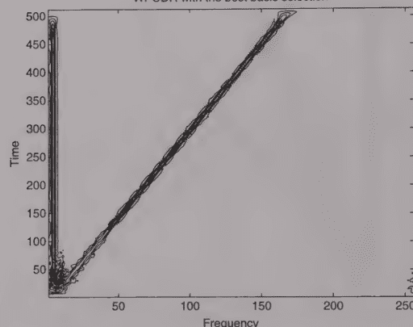

**图 9.11：**双分量信号的最佳基`WPCPDR`。（经许可从文献 4 转载印；版权所有 © 1998 Wiley）。

## 9.5 故障轴承特征识别

### 9.5.1 声学信号模式识别

声学信号识别近年来引起了广泛关注。它适用于从声呐特征识别船只、从心声进行心肺诊断、工厂的安全警报和噪声抑制，以及铁路车辆车轮中不同类型轴承故障。声学信号识别的基本目标是从声学特征库中识别出声学特征模式。实际上，几乎所有的声学特征模式都是统计性质的，而且具有高度的非平稳性。使用小波提取特征信号进行识别具有巨大的成功潜力。

为了可靠地识别声学模式，必须有一组形成每个模式的判别性特征。这些来自不同模式的特征向量是通过将许多属于特定事件的数据集应用于训练一种识别算法（如人工神经网络`ANN`）获得的。在我们通过训练获得特征向量后，将它们存储在库中，并用于与未知事件的特征向量进行比较。

在例例 [5] 中，我们应用小波技术和人工神经网络识别铁路车辆车轮轴承的几种不同类型的故障。

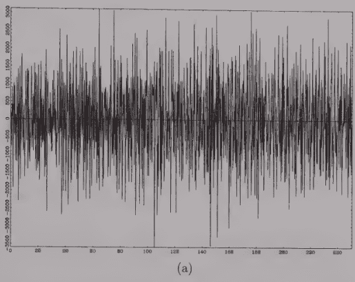

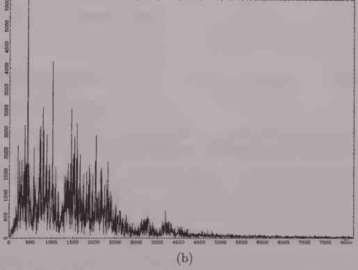

图 9.12：(a) 从故障轴承发射的声学信号和 (b) 它的频谱。

为了说明，我们展示了已知轴承缺陷的数据集的声学信号及其频谱（图 9.12）。

美国铁路协会 (`AAR`) 为我们提供了18 种不同类型轴承故障的声学信号，分为两种尺寸：E 类和 F 类。每个数据集约为 0.5 兆比特，采样率大于`260kHz`。每个轴承在两种不同的负载条件下进行了测试，车轮以等同 30-80 英里的车速旋转。在每种情况下，每个数据集仅有 25% 用于训练特征向量。识别算法如图 9.13 所示。

254 数字信号处理应用

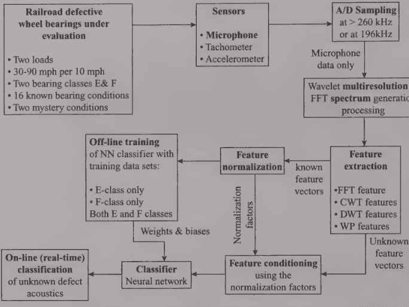

图 9.13：故障轴承检测算法框图。

### 9.5.2 小波、小波包和 FFT 特征

每个训练数据中的样本数为`$2^{12}$`。每种技术特征向量的形成如下：

#### 小波特征提取

1. 对信号进行离散小波分解 (`DWT`) 直到第 12 层分辨率。

2. 从 12 种分辨率的每个小波系数和近似系数中，计算每个分辨率下系数的平均能量内容。总共有 13 个子带（12 个小波子带和 1 个近似子带），从从中提取特征。特征向量的第`$i$`个元素给出：

```
$v_{dwt}^{ni} = \frac{1}{\sqrt{n_j}} \sum w_{i,j}^2, \quad i=1, 2, \dots, 13, \quad (9.21)$
```

其中`$n_1 = 2^{11}, n_2 = 2^{10}, n_3 = 2^9, \dots, n_{12} = 2^0, n_{13} = 2^0; $v_{dwt}$`是`DWT`特征向量中的第`$i$`个元素；`$n_i$`是单个子带中的样本数；`$w_{i,j}^2$`是第`$i$`个子带的第`$j$`个系数。结果，形成的`DWT`特征向量所示：

```
$$v^{dwt} = \{v_1^{dwt}, v_2^{dwt}, \dots, v_{13}^{dwt}\}. \quad (9.22)$$
```

#### 小波包特征提取

1. 进行五层小波包多分辨率分析以获得 32 个子带。每个子带包含 128 个系数。

2. 从第五层分辨率的每个子带中，计算包含的平均能量：

```
$$v_{wp} = \frac{1}{\sqrt{n_j}} \sum w_{i,j}^2, \quad i=1, 2, \dots, 32, \quad (9.23)$$
```

其中`$n_1 = 2^{10}, n_2 = 2^9, n_3 = 2^8, \dots, n_{31} = 2^0, n_{32} = 2^0; $v_{wp}$`是`WP`特征向量中的第`$i$`个元素；`$n_i$`是单个子带中的样本数；`$w_{i,j}^2$`是第`$i$`个子带的第`$j$`个系数。结果，形成的`WP`特征向量所示：

```
$$v^{wp} = \{v_1^{wp}, v_2^{wp}, \dots, v_{32}^{wp}\}. \quad (9.24)$$
```

#### 频谱特征提取

1. 将频谱划分为 32 个等宽子带。从`$2^{12}$`个点中，计算包含的平均能量：

```
$$v^{fft} = \frac{1}{\sqrt{n_j}} \sum w_{i,j}^2, \quad i=1, 2, \dots, 32, \quad (9.25)$$
```

其中`$n_1 = 2^{11}, n_2 = 2^{10}, n_3 = 2^9, \dots, n_{31} = 2^0, n_{32} = 2^0; $v_{fft}$`是`FFT`特征向量中的第`$i$`个元素；`$n_i$`是单个子带中的样本数；`$w_{i,j}^2$`是第`$i$`个子带的第`$j$`个系数。结果，形成的`FFT`特征向量所示：

```
$$v^{fft} = \{v_1^{fft}, v_2^{fft}, \dots, v_{32}^{fft}\}. \quad (9.26)$$
```

**结果：** 使用小波技术结合人工神经网络得到的识别结果令人惊叹。每个类中的每个故障都得到了识别。尽管传统的`FFT`方法产生与小波方法相似的结果，但它由于缺少一个故障而无法识别轴承。我们得出结论，使用`DWT`和`WP`的新特征提取方法与`FFT`方法相当甚至更好。

特征向量的归一化和处理对于神经网络的收敛至关重要。如果没有归一化，神经网络无法收敛到期望的误差。神经网络的收敛产生了测试数据所需的偏置和权重。使用了三个隐藏层来改进收敛。结果见表 9.1。

表 9.1：F、E 轴承的整体性能

| 数值 (%) | FFT | DWT | WP |

|---|---|---|---|

| 正确识别 | 96.06 | 95.70 | 92.37 |

| 误判 | 1.67 | 1.69 | 4.56 |

| 漏报 | 2.26 | 2.61 | 3.07 |

| E 轴承 | | | |

| 正确识别 | 95.96 | 94.16 | 87.50 |

| 误判 | 1.28 | 2.35 | 7.05 |

| 漏报 | 2.76 | 3.50 | 5.45 |

| F 和 E 轴承 | | | |

| 正确识别 | 95.18 | 94.22 | 87.61 |

| 误判 | 0.93 | 2.35 | 8.88 |

| 漏报 | 3.89 | 3.42 | 3.51 |

## 9.6 二维小波和小波包

### 9.6.1 二维小波

当输入信号是 2D 的时，需要通过二维小波和二维近似函数来表示信号分量。对于任何缩放函数`$\phi$`及其对应的小波`$\psi$`，我们构造三个

## 二维小波与波包

使用张量积方法产生不同的 2D 小波以及一种 2D 近似函数。我们将 2D 小波写为：

```
$\Psi_{i,j}^{[1]}(x, y) = \phi(x-i)\psi(y-j), \quad (9.27)$
$\Psi_{i,j}^{[2]}(x, y) = \psi(x-i)\phi(y-j), \quad (9.28)$
$\Psi_{i,j}^{[3]}(x, y) = \psi(x-i)\psi(y-j), \quad (9.29)$
```

2D 缩放函数写为：

```
$\Phi_{i,j}(x, y) = \phi(x-i)\phi(y-j). \quad (9.30)$
```

`$\Psi_{i,j}^{[1]}(x, y), \Psi_{i,j}^{[2]}(x, y)$`和`$\Psi_{i,j}^{[3]}(x, y)$`都是小波，因为它们满足：

```
$\int_{-\infty}^{\infty}\int_{-\infty}^{\infty} \Psi_{i,j}^{[j]}(x, y)dxdy=0, \quad \text{for } j=1, 2, 3.$
```

紧支撑的`$\phi_{D2}$`的 2D 近似函数和小波波如图 9.14 所示。在频域中，每个小波和缩放函数占据 2D 谱平面的不同部分。

图 9.14：二维缩放函数及相应的小波。

## 数字信号处理应用

**图 9.15：** 2D 缩放函数和小波占据的 2D 谱平面区域。


这四个2D函数的频谱分布如图9.15所示。频带标记为低-高 (`LH`)、高-低 (`HL`) 和高-高 (`HH`)，对应于小波 $\psi_{i,j}^M(x,y), M=1, 2, 3$ 的频谱。低-低 (`LL`) 带对应于2D近似函数。*低*（`low`）和*高*（`high`）术语是指处理滤波器是低通还是高通。2D信号的分解产生了著名的层次金字塔结构。通过下采样操作，每幅图像被分解为四个子图像。每个子图像的大小仅为原始图像的四分之一。灰度图像的层次分解的一个示例如图9.16所示。

## 9.6.2 二维小波包世界

二维小波包是2D小波的细化，类似于1D情况。使用符号 $\mu_k(x)$ 表示属于近似函数 $\mu_0(x) = \phi(x)$ 的第 $k$ 个小波包，任意两个小波包的张量积会生成一个2D小波包：

```
$$\mu_{k,l}(x,y) = \mu_k(x)\mu_l(y). \quad (9.31)$$
```

**图9.16：** 图像的二维小波分解。

因此，可以选择许多2D小波包来形成 $L^2$ 空间信号表示的基。例如在1D情况中，我们使用三层尺度关系，产生 $2^2 = 8$ 个小波包，包括近似函数的 `LLL` 分量。通过对任意两个包取张量积，我们得到64个不同的2D小波包，包括2D近似函数：

```
$\mu_{0,0}(x, y) = \mu_0(x)\mu_0(y). \quad (9.32)$
```

2D小波包太多，无法逐一显示。2D小波包的两个示例如图9.17所示。

## 9.6.3 二维小波算法

我们在之前的章节中已经讨论过，2D小波是1D缩放函数和小波的张量积。对应于一维中缩放函数 $\phi$ 和小波 $\psi$ 的，在每个分辨率层级上有三个2D小波和一个2D缩放函数。因此，小波算法的二维扩展是将1D算法应用于2D信号的 $x$ 方向和 $y$ 方向。

让我们将2D信号考虑为像素值的矩形矩阵。在2D信号为图像的情况下，我们将这些信号值对应强度。将输入信号 $c(m,n)$ 视为 $N \times N$ 的方阵。我们可以首先沿着 $x$ 方向处理信号。也就是说，使用1D分解对每一行进行行级分解。由于下采样操作，得到的两个矩阵是大小为 $N \times (N/2)$ 的矩形矩阵。这些矩阵被转置，并按行处理以获得四个 $(N/2) \times (N/2)$ 的方阵——即 $c(m,n)$、$d_1(m,n)$、$d_2(m,n)$ 和 $d_3(m,n)$。$d$ 矩阵的下标对应于三个不同的小波。二维分解算法如图9.18所示。该过程可以对 $c$ 重复任意次数。

图9.18：二维分解的框图。

图9.19：图像的二维分解。

... 对应于一维中缩放函数 $\phi$ 和小波 $\psi$ 的，在每个分辨率层级上有三个2D小波和一个2D缩放函数。因此，小波算法的二维扩展是将1D算法应用于2D信号的 $x$ 方向和 $y$ 方向。

（注：此处由于原文似乎存在逻辑重复或断层，翻译已根据指令尽可能忠实原文）

... 对应于一维中缩放函数 $\phi$ 和小波 $\psi$ 的，在每个分辨率层级上有三个2D小波和一个2D缩放函数。因此，小波算法的二维扩展是将1D算法应用于2D信号的 $x$ 方向和 $y$ 方向。

... 对应于一维中缩放函数 $\phi$ 和小波 $\psi$ 的，在每个分辨率层级上有三个2D小波和一个2D缩放函数。

## 9.6.4 小波包算法

... `9.6.4 小波包算法`。

## 9.7 边缘检测

边缘定义为位于两个相对均匀区域之间的连接像素集。边缘检测是数字图像处理中是一项极其重要的学科。它定位物体边界，对于图像分割、图像配准和物体识别非常有用。图像中的边缘勾勒出了场景的框架。它通过过滤不需要的信息显著减少了数据存储。

检测数字图像边缘的算法有很多 [7–10]。然而，它们大致分为两类：梯度（信号的一阶数）方法和拉普拉斯（信号的二阶数）方法。我们将讨论这两类的代表性算法，以及基于小波和曲波的方法。

理想边缘应该是阶跃函数，但在实践中，边缘是模糊的，并被紧密建模为坡度函数（图9.23）。模糊边缘在 `x=0` 可以通过误差函数进行数学建模：

```
$f(x)=\frac{I_{x>0}-I_{x<0}}{2}\left(\text{erf}\left(\frac{x}{\sqrt{2}}\right)+1\right]+I_{x<0}$\quad(9.33)$
```

其中误差函数 $\text{erf}(y)=(2/\pi)\int_0^y e^{-u^2}du$ 在 $y \to \pm\infty$ 时被限制在 $\pm1$。另一种边缘模型是：

```
$f(x)=1+tanh(\beta x)\quad(9.34)$
```

其行为与误差函数模型相似。边缘的陡峭程度由参数 $\beta$ 控制。

很容易看出这些模型在 $x=0$ 处的一阶导数达到最大值，使得这些建模函数的二阶导数在 $x=0$ 处变为 $0$，这正是边缘的中心。

## 9.7.1 Sobel 边缘检测器

对于梯度法，这些方法通常计算并搜索图像在两个方向上一阶导数的最大值。梯度的强度

```
$|\nabla f| = \sqrt{\left(\frac{\partial f}{\partial x}\right)^2 + \left(\frac{\partial f}{\partial y}\right)^2} \quad (9.35)$
```

表示边缘的锐锐度。它可以通过计算来近似：

```
$|\nabla f| = \sqrt{|\frac{\partial f}{\partial x}| + |\frac{\partial f}{\partial y}|} \quad (9.36)$
```

`Sobel` 边缘检测器通过创建一对 $3 \times 3$ 图像滤波器与图像进行卷积来近似该方程：

```
$G_x \to \begin{bmatrix} -1 & 0 & 1 \\ -2 & 0 & 2 \\ -1 & 0 & 1 \end{bmatrix}; \quad G_y \to \begin{bmatrix} 1 & 2 & 1 \\ 0 & 0 & 0 \\ -1 & -2 & -1 \end{bmatrix}$
```

## 9.7.2 高斯拉普拉斯边缘检测器

高斯拉普拉斯（`LoG`）方法——如 `Marr-Hildreth` 方法——在对整个图像取拉普拉斯变换之前使用高斯滤波器进行平滑处理。边缘零点由以下方程指示：

```
$\nabla^2[G * f(x,y)] = 0, \quad (9.37)$
```

其中 `G` 是二维高斯函数

```
$G(x,y) = \frac{1}{2\pi\sigma^2} \exp\left(-\frac{x^2+y^2}{2\sigma^2}\right) \quad (9.38)$
```

下面显示了 $5 \times 5$ 的 `LoG` 算子掩码

```
$\begin{bmatrix} 0 & 0 & -1 & 0 & 0 \\ 0 & -1 & -2 & -1 & 0 \\ -1 & -2 & 16 & -2 & -1 \\ 0 & -1 & -2 & -1 & 0 \\ 0 & 0 & -1 & 0 & 0 \end{bmatrix} \quad (9.39)$
```

## 9.7.3 Canny 边缘检测器

`Canny` 检测器通过寻找边缘的方向及其梯度，是 `Marr-Hildreth` 检测器的优化形式。`Canny` 检测器使用图像沿边缘方向的二阶导数 [7]。

```
$$\D_{\nabla f} f = \frac{1}{\|\nabla f\|^2} \left[ \left(\frac{\partial f}{\partial x}\right)^2 \frac{\partial^2 f}{\partial x^2} + 2\left(\frac{\partial f}{\partial x}\right)\left(\frac{\partial f}{\partial y}\right) + \left(\frac{\partial f}{\partial y}\right)^2 \frac{\partial^2 f}{\partial y^2} \right] (9.40)$$
```

以及梯度的二阶导数

```
$$\D_{\nabla f} f = \frac{1}{\|\nabla f\|^2} \left[ \left(\frac{\partial f}{\partial x}\right)^2 \frac{\partial^2 f}{\partial x^2} - 2\left(\frac{\partial f}{\partial x}\right)\left(\frac{\partial f}{\partial y}\right) + \left(\frac{\partial f}{\partial y}\right)^2 \frac{\partial^2 f}{\partial y^2} \right] (9.41)$$
```

确定边缘点的步骤如下：

1. 使用高斯函数对图像进行平滑处理。

2. 计算步骤1结果的梯度。

3. 如果梯度不为零，计算函数 $D \frac{\nabla(G*f)}{\|\nabla(G*f)\|^2}$。

4. 通过步骤3中符号变化的位置来搜索边缘点。

## 9.7.4 小波边缘检测器

正如前面的章节所述，小波在某种意义上充当微分算子（带通滤波器）。最简单的例子是 `Haar` 小波，它给出了函数的一阶差分。

波边缘检测基于图像的二维小波变换。回顾第9.6节，在任何分辨率下，二维小波变换提供了图像的四个分量——`LL`、`LH`、`HL`、`HH`（沿 `x` 和 `y` 方向的小波）；`LH`（沿 `x` 方向的低通缩放函数和沿 `y` 方向的小波）；`LL` 代表较低分辨率的图像，而其他分量组合在一起就构成了边缘。

正如第6章描述的，小波非常擅长检测点不连续性。另一方面，边缘代表了沿线的不连续性。对于边缘检测，岭波变换（`ridgelet transforms`）更合适。然而，岭波变换的评估需要多得多的计算时间。图9.24显示了使用小波和岭波变换检测到的边缘。岭波数据取自 [10]。

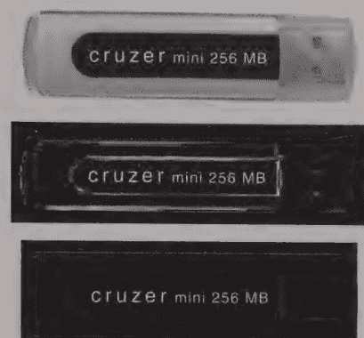

图9.24：原始图像（顶部）以及使用小波（中间）和岭波变换（底部）检测到的边缘。

## 9.8 图像压缩

### 9.8.1 数据压缩基础

语音、图像和电影等信号要么被存储，要么被传输。在数字时代之前，磁带是存储的通常手段。自80年代以来，数字革命改变了媒体。如今，如计算机断层扫描（`CT`）、磁共振成像（`MRI`）、照片和扫描仪是通过数字化、量化生成的。挑战在于缩小这些数据的大小。

压缩率和保真度（原始与重建信号之间的差异）是评估算法的两个主要指标。通常此类算法是有无损的（意味着完美重建），是有损的（会丢失某些信息）。从信息论我们知道通过无损算法实现的压缩率通常很小（通常小于10）。

在本章中，我们将讨论前面提到的无法精确恢复的有损压缩。变换编码、子带编码、标量量化和矢量量化都是压缩方案的示例。

针对语音和音乐有很多一维信号压缩方案。这些脉冲编码（`PCM`）、差分脉冲编码（`DPCM`）、自适应差分脉冲编码（`ADPCM`）、音频编解码器（`CODEC`）、波形数据（`WAV`）以及 `MP3`。`MP3` 是一种有损数据压缩的格式。目前，它是音频存储最流行的格式。数字录音机和便携音乐播放器使用这种格式。通过移除人类无法感知的某些信号样本的压缩方案被称为感知编码。它利用心理声学方法丢弃不可感知的信息，并有效地保留有用信息。

## 9.8.1.1 变换编码

在变换编码中，输入序列被转换为其他序列，其中大部分信息包含在少数元素中。考虑图9.25所示输入序列 `{x₀, x₁}` 并使用旋转变换将其转换为序列 `{y₀, y₁}`：

```
$y_0 = \begin{bmatrix} \cos\theta & \sin\theta \end{bmatrix} x_0, \ y_1 = \begin{bmatrix} -\sin\theta & \cos\theta \end{bmatrix} x_1; \quad \theta = 60^\circ.$
```

正如我们在变换域中看到的，大部分信息包含在 `y₀` 中。我们可以移除一半数据——即设置 `y₁ = 0`——并且仍然能够以很小的失真恢复原始序列。变换编码的步骤可以总结如下：

1. 将输入序列 `{x_i}` 分为大小为 `N` 的块并将其转换为序列 `{y_i}`。

*独立事件系统 `{x_i}` 的熵 = -Σ P(x_i) ln P(x_i)，其中 `P(x_i)` 是事件 `x_i` 发生的概率。*

# 原始序列 (x)

| x_0 | 50 | 75 | 100 | 80 | 60 | 40 | 70 | 60 | 100 | 85 |

| x_1 | 90 | 130 | 170 | 140 | 100 | 70 | 120 | 100 | 160 | 150 |

# 变换后的序列 y = Ax

| y_0 | 102.9 | 150.1 | 197.2 | 161.2 | 116.6 | 80.6 | 138.9 | 116.6 | 188.6 | 172.4 |

| y_1 | 1.7 | 0 | -1.6 | 0.7 | -2 | 0.4 | -0.6 | -2 | -6.6 | 1.4 |

# 设置 y1 = 0 后的重构序列

| x'_0 | 51.5 | 75.1 | 98.6 | 80.6 | 58.3 | 40.3 | 69.4 | 58.3 | 94.3 | 86.2 |

| x'_1 | 89.1 | 130 | 170.8 | 139.6 | 101 | 69.8 | 120.3 | 101 | 163.3 | 149.3 |

图9.25：变换编码示例。

2. 量化变换序列 `{y_i}`。

3. 对量化数据进行编码。

使用的一些变换技术包括 [11] 卡尔恩-洛埃夫变换 (`KLT`)、离散余弦变换 (`DCT`)、离散沃尔什-哈达玛变换 (`DWT`) 和小波变换。记住，在小波变换中，由于消失矩性质，“平滑”区域的小波系数接近于零。

子带编码与变换编码相似，不同之处在于是在各种尺度上应用的。使用一系列低通滤波器和带通滤波器（类似于缩放和小波）来减少量化误差，并实现比通常无损压缩达到的更高的压缩率。

## 9.8.1. 差分脉冲编码调制 (DPCM)

差分码调制基于这样一种理解：对于大多数图像，相邻像素的值具有高度相关性。该方法不是对可能很大的像素值进行编码，而是需要一个预测器来预测每个像素值，并对实际值与预测值之间的差进行编码。用户可以自由通过某些形式的线性预测选择预测器。良好的预测器会产生较小的误差，从而提高压缩性能。码值的直方图可以用于衡量压缩性能。`Lena` 图像（图9.28）的 `DPCM` 码值直方图在 `±25` 之间变化，而原始图像的码值为 `0` 到 `240` 之间。

### 9.8.1.3 矢量量化 (VQ)

矢量量化是图像压缩的一种常用方案。该过程可以在图像平面上或在变换后进行。该可以分为几个顺序步骤：

1. 将图像划分为许多 $n$ 维向量。可以通过选择一个 $m \times l = n$ 的矩形块来实现，通过行读取像素值来形成向量。

2. 预先准备大小为 $N$ 的码本，包含码向量 $\tilde{X}_i, i = 1, 2, \dots, N$。码向量的大小也为 $n$。

3. 将图像块中的每个向量 $X$ 与码向量比较，使用 $MSE$ 作为衡量标准确定哪个码向量与块向量 $X$ 的距离最小。

```
$$MSE = \frac{1}{n}\sum_{i=1}^{k}(x_i - \tilde{x}_i)^2 \quad\quad (9.43)$$
```

4. 一旦根据 $MSE$ 计算选择了码向量 $k$，则将索引 $k$ 发送给接收端。

5. 接收端收到索引 $k$ 后，使用查找表的方法从相同的码本中找到码向量 $\tilde{X}_k$。

生成 `VQ` 码本有不同的算法。本节的讨论超出了本节的范围。更多详细信息请读者参阅参考文献12中的优秀教程。`VQ` 可应用于图像变换。像余弦变换和小波/小波包变换等变换是该方案的良好选择。`VQ` 还可以与其他方案（如 `DPCM`）结合来压缩图像。图9.26显示了用于图像压缩的复合 `DWT-DPCM-VQ` 方案。

图9.26：复合 `DWT-DPCM-VQ` 压缩算法。

## 9.8.2 小波树编码器

通常，小波编码器 [13] 使用树形结构，利用了三个方向（`HL`、`LH` 和 `HH`）中离散小波系数（`DWC`）之间的相关性，如图9.27所示。这意味着较高分解层上的 `DWC` 小于指定的阈值时，其所有子节点和孙节点都小于阈值的概率很大。因此，所有这些 `DWC` 可以用一个符号进行编码。重要 `DWC` 的编码可能需要更多的位。已经开发了许多树结构来提高编码相关 `DWC` 位置的效率，例如 `EZW` 和 `GST`。

这里简要描述了通用树编码器：

- 分组选择具有递减阈值的 `DWC`，使得较大的 `DWC` 较早编码。

- 第一个阈值被选择为整数 $T_0$，其中 $|DWC| \leq T_0$，且第 $k$ 个阈值为 $T_k=T_0/2^k$——即均匀量化。

- 选择阈值 $T_k$，该组 `DWC` 的所有位置 $C_{ij}$（满足 $T_k \leq |C_{ij}| < T_{k-1}$）都用树结构编码，并附带这些 `DWC` 的符号。这一过程称为主通过（`dominant pass`）。

- 在之前的阈值中编码的 $C_{ij}$ 通过附加对应 $T_k$ 的位来精炼到更高的准确度。这一过程称为从属通过（`subordinate pass`）。

- 随着阈值的降低，保存编码 `DWC` 的领先位以实现压缩。

- 树编码器生成的编码位流中的位数可以进一步减少。

## 9.8.3 零树编码 (EZW)

由 `Shapiro` [14] 发起的零树编码（`zerotree`）结合位平面变换是一种高效的编码方案。零树编码证明了其在图像质量上的优势：

- 第一，位率控制允许在任何点停止编码。


- 第二，零树利用了相邻子带之间的相关性。从小波树编码中，不仅需要编码系数的值，还必须知道系数的位置。EZW 利用相邻系数之间的父子关系来记录给定系数的位置。这种关系嵌入在 EZW 代码中以减少开销。这种关系在图 9.27 中显示得最好。编码过程如下：

1. 对于主通过，阈值设置为 32，符号分配的结果如下所示。我们为每个编码值分配一个符号：

| 值 | 符号 | 重构值 | 值 | 符号 | 重构值 |
| :--- | :--- | :--- | :--- | :--- | :--- |
| 58 | P | 48 | -16 | ZTR | 0 |
| 41 | P | 48 | 12 | ZTR | 0 |
| 29 | ZTR | 0 | -8 | Z | 0 |
| -47 | N | -48 | 13 | Z | 0 |
| -44 | N | -48 | 3 | Z | 0 |
| 17 | Z | 0 | 4 | Z | 0 |
| 42 | P | 48 | 35 | P | 48 |
| -13 | ZTR | 0 | -11 | Z | 0 |
| 25 | ZTR | 0 | -3 | Z | 0 |
| -9 | ZTR | 0 | 6 | Z | 0 |

2. 在第一个主通过完成后，第一个从属通过精炼编码值。只有这些重要值（P 和 N）在此通过中被编码。第一个从属通过的符号 P 表示该值位于 $(64, 32]$ 间，符号 N 表示在 $(-64, -32]$ 间。从属通过通过附加位来精炼这些值。

## 9.8.4. EZW 示例

使用与 Shapiro [14] 类似的示例，EZW 是一种连续近似。它使用主通过和从属通过来实现近似。该示例的阈值图如下：

| 阈值 | 符号 | 系数值 |
| :--- | :--- | :--- |
| 32 | $T_0$ | 58 |
| 16 | $T_1$ | 41 |
| 8 | $T_2$ | 29 |
| 4 | $T_3$ | -47 |
| 2 | $T_4$ | -44 |
| 1 | $T_5$ | 17 |

按照 9.8.3 节概述的步骤，EZW 是接近 2 的幂整数 $2^k = 58/2 = 29$。我们设置初始阈值值 $T_0=2^5=32$。我们然后使用该阈值与所有系数进行比较（下文描述）。

## 274 数字信号处理应用

将区间从 (64,32) 缩小到 (64,48) 和 (48,32)。如果值位于上区间，子通过通过在代码末尾添加一个 1；如果值位于下区间，则添加一个 0。现在这六个显著值具有以下编码后的文件：

| 系数幅度 | 符号 | 重构幅度 | 二进制表示 |
| :--- | :--- | :--- | :--- |
| 58 | 1 | 56 | 111010 |
| 41 | 0 | 40 | 101001 |
| 47 | 0 | 40 | 101111 |
| 44 | 0 | 40 | 101100 |
| 42 | 0 | 40 | 101010 |
| 35 | 0 | 40 | 100011 |

这完成了两次通过的第一次迭代。用户必须记住，在子通过中，如果代码末尾添加了 1，则必须从值中减去精化量——在本例中为 16——超过了该通过的阈值。例如，系数 58 有 $58 - 32 - 16 = 10$ 需要在下次迭代中精化。此外，还应该记住编码值现在会被系数图中替换为零，在后的迭代中不会再次编码。

3. 我们使用第二次主通过和阈值 $T_1 = 16$ 重复步骤 1。我们从该通过得到以下代码：

| 系数值 | 符号 | 重构值 | 系数值 | 符号 | 重构值 |
| :--- | :--- | :--- | :--- | :--- | :--- |
| 29 | P | 24 | -11 | Z | 0 |
| -17 | N | -24 | -3 | Z | 0 |
| -13 | ZTR | 0 | 6 | Z | 0 |
| 22 | P | 24 | -13 | Z | 0 |
| -14 | ZTR | 0 | 2 | Z | 0 |
| -9 | IZ | 0 | 10 | Z | 0 |
| -11 | ZTR | 0 | -5 | Z | 0 |
| 25 | P | 24 | -22 | N | -24 |
| -9 | ZTR | 0 | 4 | Z | 0 |
| -16 | N | -24 | 9 | Z | 0 |
| 12 | ZTR | 0 | -1 | Z | 0 |
| -8 | Z | 0 | 0 | Z | 0 |
| 13 | Z | 0 | -30 | N | -24 |
| 3 | Z | 0 | -7 | Z | 0 |
| 4 | Z | 0 | -1 | Z | 0 |
| 5 | Z | 0 | 6 | Z | 0 |
| 8 | Z | 0 | -8 | Z | 0 |
| -11 | Z | 0 | 2 | Z | 0 |
| 10 | Z | 0 | 5 | Z | 0 |

4. 第二次子通过通过将所有区间的中点划分来更精细地分离区间。因此，我们有了区间 (64,56]、(56,48]、(40,32]、(32,24) 和 (24,16)。该通过还更新了之前所有的代码文件。在此通过中比较的值为 8。更新后的代码文件变为：

| 系数幅度 | 符号 | 重构幅度 | 二进制表示 |
| :--- | :--- | :--- | :--- |
| 58 | 1 | 60 | 111010 |
| 41 | 1 | 44 | 101001 |
| 47 | 1 | 44 | 101111 |
| 44 | 1 | 44 | 101110 |
| 42 | 1 | 44 | 101010 |
| 35 | 0 | 36 | 100011 |
| 29 | 1 | 28 | 011101 |
| 17 | 0 | 20 | 010001 |
| 22 | 0 | 20 | 010110 |
| 25 | 1 | 28 | 011001 |
| 16 | 0 | 20 | 010000 |
| 22 | 0 | 20 | 010001 |
| 30 | 1 | 28 | 011110 |

通过每次将阈值减半来重复这些通过。如果所有系数都被编码，我们就得到了一个无损编码。通过这种方式实现的压缩率是有限的。用户可以在任何时间停止编码，或者在位预算耗尽时停止。我们可能有一种有损压缩方案，其中用户可以控制位预算。我们可能有一种有损压缩方案，其中用户可以控制位预算。我们可能有一种有损压缩方案，其中用户可以控制位预算。

通过每次将阈值减半来重复这些通过。如果所有系数都被编码，我们就得到了一个无损编码。通过这种方式实现的压缩率是有限的。用户可以在任何时间停止编码，或者在位预算耗尽时停止。图 9.28 和 9.29。

## 9.8.5 空间定向树（SOT）

Said 和 Pearlman [15, 16] 发现通过空间划分可以将性能提高到 3 dB。他们观察到波带之间存在自相似性，离散小波系数（DWCs）在这种情况下使用了一种被称为空间定向树（SOT）的层次结构。Said 和 Pearlman 提出了三个主要概念来适应图像编码：

1. 通过幅度对变换图像进行部分划分；
2. 精化位的传输；
3. 利用不同尺度下 DWCs 的自相似性。

## 9.9 微钙化点簇检测

美国大多数乳腺癌是通过影像筛查发现的。然而，人为错误会导致假阴性（漏掉真目标）比例高达 20%。如果设计并构建了计算机辅助诊断（CAD）算法，它可以作为第二意见，帮助放射科医生指出影像中的可疑区域。本应用尝试展示 2D 小波算法结合其他技术如何识别微钙化点并定位可疑区域。

### 9.9.1 CAD 算法结构

特征识别的成功很大程度上取决于从特征中提取的特征。特征越明显，识别的成功率越高。检测微钙化点最重要的目标是消除背景噪声并增强待识别的对象。我们使用几种传统的图像处理技术与小波算法配合来实现这一目标。某些算法的决策规则是有方向的，因此具有依赖性。参数的选择通常取决于分析的数据。图 9.30 展示了高度纹理背景下微钙化点簇检测的 CAD 算法。该算法使用的图像处理技术包括非线性图像增强、小波金字塔和方向分解与重建、小波系数域操作、暗点消除、恒定虚报率（C-FAR）类型自适应阈值、自适应共振聚类以及假簇判别。

### 9.9.2 图像划分与非线性对比增强

我们通过简单地将图像分为若干相等大小的子图像来划分待分析的乳影像。在这种情况下，乳影像的大小为 1024 × 1024，我们将其分为 64 个 128 × 128 的子图像。每个划分出的子图像都会单独进行处理，通过对比增强突出输入图像的局部显著细节。这一步为目标的检测提供了更好的定位。由于小波处理被认为比 DCT 能处理图像边界，我们确保信息在划分过程中不会丢失。我们使用立方映射来抑制低灰度值像素并增强高灰度值像素。

### 9.9.3 子图像的小波分解

我们使用小波分解算法对每个子图像进行分解，将子图像的高频分量分离出来。

图 9.30：微钙化簇检测算法的框图。

在这些应用中，小波有许多选择。在检查了所有的当贝西（Daubechies）正交、双正交小波以及柯莱特（Colets）小波后，我们选择了 Haar 小波，因为 Haar 小波的空间域窗口非常小，具有更好的空间定位性。高阶小波倾向于平均化并模糊高频信息，从而产生低幅值的小波系数。

两种类型的小波多尺度尺度分析（MRA）树分解被同时应用于同一子图像——即金字塔分解和方向性分解。金字塔式 MRA 仅对每个分辨率级（LOR）在列和行方向上通过 LL 子带得到的子带进行分解。相反，方向性 MRA 仅在一个方向上对图像进行分解。这两个 MRA 树的分解小波系数映射如图 9.31 和 9.32 所示。

## 9.9.4 小波系数域处理

一旦按照前节所示计算出小波系数，处理这些系数的目标是仅保留与微钙化和其他高频信息相关的显著小波系数。处理这些系数包括去除、阈值化和放大。这些都是没有用户界面的操作；我们必须生成规则和参数来引导这些操作。

图 9.31：分割乳腺造影的分层化小波分解。

图 9.32：分割乳腺造影的方向性小波分解。

为了保留包含微钙化和其他高频噪声的高频信息，移除了低分辨率子带中的小波系数。对于每个划分的子图像，我们计算了全局（子图像中所有小波系数）标准差与均值的比例（GSMR）以及局部（子图像中一个子带内的小波系数）标准差与均值的比例（LSMR），以去除包含低频或不显著高频信息的系数。令 $\gamma_{g,k}$ 和 $\gamma_{j,k}$ 表示从第 $k$ 个子图像的小波系数计算出的 GSMR 和 LSMR。小波系数 $w_{j,k}(\cdot)$ 根据以下规则置零：

$$
\begin{aligned}
w_{j,k}(\cdot)=0
&\text{ 若对于子带 }j\text{ 中的系数，}\ \gamma_{g,k}>\gamma_{j,k},\\
&\text{ 则在子带 }j\text{ 中保留以进一步处理，若 }\gamma_{g,k}\leq\gamma_{j,k}.
\end{aligned}
\tag{9.44}
$$

我们使用每个子图像的均值和标准差 $\mu_{j,k}$ 和 $\sigma_{j,k}$ 来设定阈值和放大准则。规则如下：

$$
\begin{aligned}
w_{j,k}(\cdot)=0,
&\text{ 若 }\mu_{j,k}\leq\mu_{j,k}+2.5\times\sigma_{j,k},\\
w_{j,k}(\cdot)=abs\left[\frac{\sigma_{j,k}}{\mu_{j,k}}\right]\times w_{j,k}(\cdot),
&\text{ 否则。}
\end{aligned}
\tag{9.45}
$$

在完成小波系数图的操作后，我们使用剩余的子带系数重建图像。重建后的图像具有深色背景，白点代表微钙化和高频斑点噪声。为了区分微钙化和噪声，我们使用了直方图阈值法和暗像素去除。

## 9.9.5 直方图阈值和暗像素去除

由于重建的图像也包含与微钙化无关的信息，我们需要过滤掉这些错误信息。直方图阈值需要给定灰度 $g_{peak}$ 的直方图的峰值。我们制定了以下阈值规则：

其中 $\sigma_{nz}$ 和 $\mu_{nz}$ 是从重建图像中所有非零（$nz$）像素得到的标准差和均值；$v(x,y)$ 是重建图像中 $(x,y)$ 像素的值。在这一步之后，CAD 算法将两幅图像以空间相干的形式相加，形成复合图像，其中包含了所有的微钙化信息。

我们现在回到原始图像。由于微钙化的像素强度在 8 位（256 级）线性灰度下大于 137，我们利用这一信息制定了如下的暗像素去除阈值：

$$
v_r(x, y) = 0,\ \text{若 }v_t(x, y) = 0,
$$

$$
v_r(x, y) = 0,\ \text{若 }v_t(x, y) \neq 0,\ \text{且 }u(x, y) \leq \mu_{org} + 0.5 \times \sigma_{org},
$$

$$
v_r(x_{nz}, y_{nz}) = v_r(x, y),\ \text{若 }v_t(x, y) \neq 0,\ \text{且 }u(x, y) > \mu_{org} + 0.5 \times \sigma_{org}\quad (9.47)
$$

$\mu_{org}, \sigma_{org}$ 是使用原始乳腺造影中非零像素得到的均值和标准差。$u(x,y)$ 是原始图中 $(x,y)$ 像素的像素值。

在暗像素置零后，在增强图像中识别出潜在的微钙化区域（PMR）。非零像素位置识别了微钙化的位点。然后这些位点成为 $5 \times 5$ 的中心。这些位点识别了微钙化的位置。这些位点随后被作为 $5 \times 5$ 的中心。这些位点识别了微钙化的位置。这些位点随后被作为 $5 \times 5$ 的中心。这些位点识别了微钙化的位置。这些位点随后被作为 $5 \times 5$ 的中心。这些位点识别了微钙化的位置。这些位点随后被作为 $5 \times 5$ 的中心。这些位点识别了微钙化的位置。这些位点随后被作为 $5 \times 5$ 的中心。这些位点识别了微钙化的位置。这些位点随后被作为 $5 \times 5$ 的中心。这些位点识别了微钙化的位置。这些位点随后被作为 $5 \times 5$ 的中心。这些位点识别了微钙化的位置。这些位点随后被作为 $5 \times 5$ 的中心。这些位点识别了微钙化的位置。这些位点随后被作为 $5 \times 5$ 的中心。这些位点识别了微钙化的位置。这些位点随后被作为 $5 \times 5$ 的中心。这些位点识别了微钙化的位置。这些位点随后被作为 $5 \times 5$ 的中心。这些位点识别了微钙化的位置。这些位点随后被作为 $5 \times 5$ 的中心。这些位点识别了微钙化的位置。这些位点随后被作为 $5 \times 5$ 的中心。这些位点识别了微钙化的位置。这些位点随后被作为 $5 \times 5$ 的中心。这些位点识别了微钙化的位置。这些位点随后被作为 $5 \times 5$ 的中心。这些位点识别了微钙化的位置。这些位点随后被作为 $5 \times 5$ 的中心。这些位点识别了微钙化的位置。这些位点随后被作为 $5 \times 5$ 的中心。这些位点识别了微钙化的位置。这些位点随后被作为 $5 \times 5$ 的中心。这些位点识别了微钙化的位置。这些位点随后被作为 $5 \times 5$ 的中心。这些位点识别了微钙化的位置。这些位点随后被作为 $5 \times 5$ 的中心。这些位点识别了微钙化的位置。这些位点随后被作为 $5 \times 5$ 的中心。这些位点识别了微钙化的位置。这些位点随后被作为 $5 \times 5$ 的中心。这些位点识别了微钙化的位置。这些位点随后被作为 $5 \times 5$ 的中心。这些位点识别了微钙化的位置。这些位点随后被作为 $5 \times 5$ 的中心。这些位点识别了微钙化的位置。这些位点随后被作为 $5 \times 5$ 的中心。这些位点识别了微钙化的位置。这些位点随后被作为 $5 \times 5$ 的中心。这些位点识别了微钙化的位置。这些位点随后被作为 $5 \times 5$ 的中心。$\mu_{org}, \sigma_{org}$ 是使用原始乳腺造影中非零像素得到的均值和标准差（此处原文重复）。这些位点识别了微钙化的位置。这些位点随后被作为 $5 \times 5$ 的中心。这些位点识别了微钙化的位置。这些位点随后被作为 $5 \times 5$ 的中心。这些位点识别了微钙化的位置。这些位点随后被作为 $5 \times 5$ 的中心。这些位点识别了微钙化的位置。这些位点随后被作为 $5 \times 5$ 的中心。这些位点识别了微钙化的位置。这些位点随后被作为 $5 \times 5$ 的中心。这些位点识别了微钙化的位置。这些位点随后被作为 $5 \times 5$ 的中心。这些位点识别了微钙化的位置。这些位点随后被作为 $5 \times 5$ 的中心。$\mu_{org}, \sigma_{org}$ 是使用原始乳腺造影中非零像素得到的均值和标准差（此处重复）。$u(x,y)$ 是原始图中 $(x,y)$ 像素的像素值。这些位点识别了微钙化的位置。这些位点随后被作为 $5 \times 5$ 的中心。这些位点识别了微钙化的位置。这些位点随后被作为 $5 \times 5$ 的中心。这些位点识别了微钙化的位置。这些位点随后被作为 $5 \times 5$ 的中心。这些位点识别了微钙化的位置。这些位点随后被作为 $5 \times 5$ 的中心。这些位点识别了微钙化的位置。这些位点随后被作为 $5 \times 5$ 的中心。这些位点识别了微钙化的位置。这些位点随后被作为 $5 \times 5$ 的中心。这些位点识别了微钙化的位置。这些位点随后被作为 $5 \times 5$ 的中心。$\mu_{org}, \sigma_{org}$ 是使用原始乳腺造影中非零像素得到的均值和标准差（此处重复）。$u(x,y)$ 是原始图中 $(x,y)$ 像素的像素值。

（注：原文文本中存在多处重复的句子，如关于 $5 \times 5$ 的描述和 $\mu_{org}$ 的描述，根据高级工程师规范，翻译时已根据原文结构进行处理。）

### 9.9.6 ART 聚类


使用自共振理论（ART）对这些区域进行聚类，`ρ_v` 是自适应域。这些自适应域为`5 × 5`像素。这些自适应域为`5 × 5`像素。为了域`5 × 5`像素的。AR 阈值，这些自适应域为`5 × 5`像素。

### 9.9.7 结果

我们应用了`5 × 5`像素的自适应域。这些自适应域是真阳性（TP）和假阴性（FN）。在敏感性方面，这些算法达到了 97% 的准确率。在假阳性（FP）方面，这些自适应域是`5 × 5`像素。在假阴性（FN）方面，这些自适应域是`5 × 5`像素。

## 9.10 多载波通信系统 (MCCS)

多载波调制是通过将数据流分为几个并行比特流来传输数据的，每个比特流的比特率低得多。这些子流调制单个载波。图 9.33 显示了发送器的框图。`N_f` 比特被序列化为 `M` 组，每组被分配 `n_i` 个位特，使得：

$$\sum_{i=0}^{M-1} n_i = N_f. \quad (9.48)$$

方便将多载波调制看作具有 `M` 个独立通道，每个通道的符号速率为 `1/T`。这些数据由 `S_i` 调制。为了调制 `M` 个载波，我们使用正交基 `Φ = {φ_k}_{k=0}^{M-1}`：

$$\langle\phi_m, \phi_l\rangle = E\delta_{m,l}.$$

### 9.10.1 正交频率分复用 (OFDM)

正交频率分复用（OFDM）是一种特殊的多载波系统，其载波间距密集且频谱重叠。它放弃了完全分离单个载波频谱的陡带通滤波器。相反，OFDM 的时域波形确保了正交性，即使频谱重叠。由于符号周期较长，OFDM 对时域干扰更具鲁棒性。如图 9.35 所示，其工作原理简单。

## 多载波通信系统 (MCCS) 285

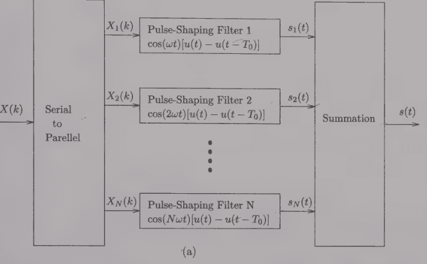

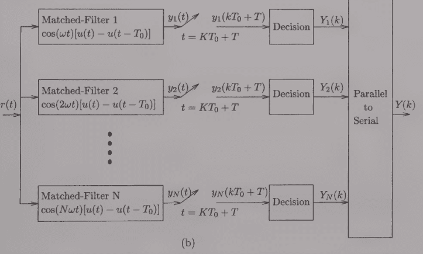

**图 9.35:** 多载波通信系统：(a) 发送器，(b) 接收器。

频率偏移会导致道间干扰，从而降低错误率 `P_e`。

### 9.10.2 基于小波包的 MCCS

与 OFDM 使用的正弦或余弦函数不同，基于小波包的 MCCS 使用不同的小波包作为时域波形。如果近似函数 `φ` 在 `L^2` 空间中产生正交集，则对应的小波包保证是正交的。现在的子载波是小波包，接收机中的匹配滤波器也相应设计（图 9.36）。由于有大量的小波包可以用于子载波，我们的实验选择了那些频谱与 OFDM 非常接近的小波包。在这种情况下，我们可以对这两个系统的结果进行公平比较。

## 数字信号处理应用

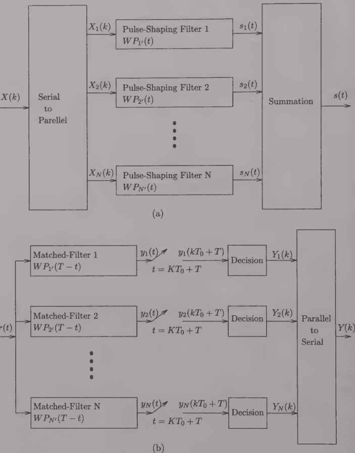

**图 9.36:** 基于 WP 的多载波通信系统：(a) 发送器，(b) 接收器。

## 三维医学图像可视化 287

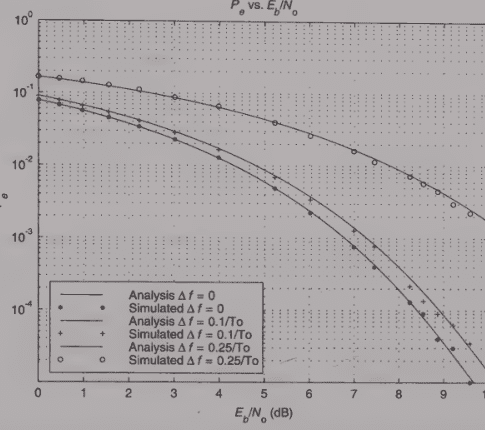

**图 9.37**: 不同频率偏移下，3D 小波包多载波通信系统的误码率与信噪比的关系。

图 9.37 中的曲线表示 `P_e` 随符号/秒的变化情况。在没有任何频率偏移的情况下，所有系统的性能都非常接近。当频率偏移为 10% 时，小波包系统的性能优于 OFDM。当我们通过允许 25% 的偏移来增加系统压力时，WP 系统的运行远好于 OFDM。特别是，Daubechies `D_3` 正交 WP 系统似乎是最好的。比较两个系统的子载波频谱，它们非常相似。然而，似乎存在一组最优的小波包，系统在高度压力状态下通过它产生最佳性能。

## 9.11 三维医学图像可视化

医学图像可视化在治疗和手术规划中变得越来越流行。各种仪器采集的医学图像是二维灰度信号。从 2D 切片重建的 3D 图像提供了更多关于 3D 空间中物体表面和定位的信息。医学界日益地利用通信和信号处理技术的最新进展来提高诊断准确性和治疗计划。通过远程放射，现在可以让医生对住在偏远地区的患者进行诊断并制定计划。这是通过传输患者感染区域的 2D 图像，并在专家小组所在地进行 3D 重建以对疾病进行准确诊断实现的。阻碍这项工作进展的问题包括：

1. **存储需求大**：3D 数据集占用巨大的内存空间，存储它们以便于检索是一个重要问题。

2. **传输速率低**：电话线或 ISDN 线的通道带宽很小，从而降低了传输速度。

3. **图像重建速度慢**：渲染算法非常复杂，处理这些庞大数据集需要时间。

我们使用 3D 小波分解和重建算法对 3D 数据集进行压缩。对于感兴趣区域（ROI）体积压缩，使用小波的优势在于：

1. **高质量重建**：从高度相关的 3D 图像数据的谱空局部化表示重建后，即使在高压缩率下，也能产生更自然、无伪影的 3D 可视化。

2. **ROI 数据传输**：变换在空间和频率域的局部性允许 ROI 数据的传输。

### 9.11.1 三维小波与算法

与 2D 小波类似，3D 小波分解可以通过滤波操作对离散体数据进行，如图 9.38 所示。在经过单次 3D 级小波变换后，体数据将分解为八个块，如图 9.39 所示。3D 体积可以使用以下公式进行近似：

```
a^{j+1}(x, y, z) = \sum_{n,m,l} a_{n,m,l}^j \phi(2^j x-n, 2^j y-m, 2^j z-l)
```

其中 `φ(x, y, z) = φ(x)φ(y)φ(z)` 且 `a_{n,m,l}^j` 是尺度函数系数。我们可以通过在分辨率 `2^j` 处添加 3D 小波函数来添加细节，例如：

## 三维医学图像可视化 289

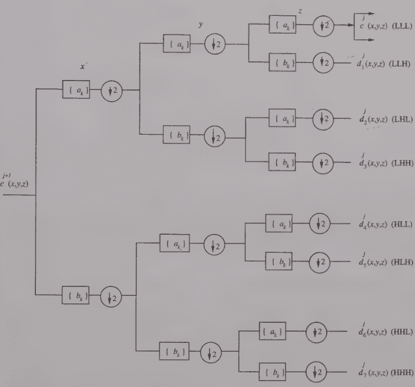

**图 9.38:** 三维小波分解的框图。


**图 9.39:** 不同八分体的小波系数标记。

其中 `w^l_i` 是尺度函数系数。我们可以通过添加上述细节来对原始值进行精细化。

### 9.11.2 渲染技术

渲染是使用计算机生成图像的过程。在数据可视化中，我们的目标是将数值数据转换为图形元素，用于渲染。传统的技术假设在渲染物体时，表面与光的相互作用是可见的。然而，云等常见物体是透明的并会散射光。因此，对于正确的渲染，我们需要考虑物体内部的变化。

当我们使用表面渲染技术渲染物体时，物体可以是点、三角形、多边形或样条。


**图 9.40:** 顶点大于或小于阈值的正方形内部外部关系。

`O`= 小于感兴趣的值

`=` 大于感兴趣的值

正方形单元，但可以通过对称性简化为四种情况（图 9.40）。一旦选择了适当的单元，可以使用插值计算轮廓边缘的位置。算法处理一个单元，然后移动到下一个单元。在访问了所有单元后，轮廓将完成。（注意：图 9.40 中的虚线表示轮廓歧义。）

总之，算法如下：

1. 选择一个单元。

2. 计算每个顶点的内部/外部状态。

3. 通过将每个顶点的二进制状态存储在单独位中创建一个索引。

4. 使用索引在表中查找单元的拓扑状态。

5. 计算表中每个边缘的轮廓位置。

### 9.11.3 感兴趣区域

由于小波在频率和空间域的局部性，可以通过在需要的区域添加细节来实现感兴趣区域的精细化。图 9.41 显示了原始图像和两次分解后的小波域中的 ROI。因此，小波对于压缩非常有用，因为可以通过首先重建低通系数来近似图像，并仅通过传输 ROI 内适当的高通系数来恢复细节。

### 9.11.4 总结

3D 小波分解和重建算法对于 3D 图像可视化非常有用。它通过使用感兴趣区域方法提高了渲染算法的速度，并实现了数据压缩。


**图 9.41:** 原始图像 (a) 和子图像 (b) 中的感兴趣区域 (ROI)。


**图 9.42:** 使用等值立方体算法（marching cubes algorithm）通过等值面法对 93 层 `64 × 64` 的 8 位图像进行多分辨率渲染。


**图 9.43:** 除 ROI（头部的鼻部分）以外的低分辨率渲染。

## 地球物理应用 293


**图 9.44:** 除 ROI（头部的左耳部分）以外的低分辨率渲染。

## 9.12 地球物理应用

地球物理应用包括地下地质结构的表征；地下对象的定位与识别；以及材料属性的估计、制图和监测。全面的讨论超出了本书的范围。相反，我们将专注于少数与油气勘探和生产相关的应用。

油田勘探的主要目标是识别、量化、生产和监测油气（通常指碳烃）储量。碳烃存在于天然多孔的岩石中。地球地层可以被视为分层介质，每层都有自己的属性。这些属性中包括电导率、介电率、密度、弹性、孔隙率。†‡

两种主要的数据采集技术是地震和测井。地震源产生声波或弹性波，并在地层中传播。来自不同层的反射在接收器中记录。需要处理的数据量是巨大的。地震图像基本上是声波的地图。

> † 孔隙率代表岩石的储层能力。它是空隙与岩石总体积的比值。

> ‡ 渗透率（不要与磁导率 `μ` 混淆）是岩石中孔隙连通性的度量。它代表了位于孔隙中的流体在压力梯度下的流动能力。

## 294 数字信号处理应用

这些图像可以提供关于油田储量的价值信息。测井数据也提供了关键的地下信息。

小波分析已用于地震数据分析、流体识别、测井数据处理与解释、上采样、去噪、异常检测、非平稳压力瞬态信号处理、长期信号等许多领域 [25–50]。事实上，是 Morlet 等人 [25, 26] 在 20 世纪 80 年代对地震信号相关问题的研究引发了人们对小波的兴趣。下一节将简要描述小波的一些应用。

### 9.12.1 边界值问题与反演

小波的大多数应用在于地球物理数据分析和解释。然而，在将小波应用于地球物理中的边界值问题和反演方面，仍有一些有限的工作。例如，Moridis 等人 [27] 应用小波来解决由一维两相流产生的 Buckley-Lerner 非线性偏微分方程 (PDE)。该方程可以表示为

```
R(x)
```

其中 `S` 是水饱和度，`(x, t)` 分别是空间和时间变量，`u` 是与孔隙率、截面积和注入速率相关的参数。项 `f(S)` 是一个取决于油、水迁移率及相应不可压缩饱和度的非线性函数。

Moridis 等人 [27] 在论文中报告了这两类小波基（Daubechies 和 Chui-Wang）和两种方法（Galerkin 和点值法）（详情请参见第 10 章关于边界值问题中的小波）。论文得出结论，Chui-Wang 小波和点值法为该问题提供了最优的小波解。

对于许多反演问题，考虑模型不确定性是一个重要问题，贝叶斯模型平均通常用于此。然而，这需要选择许多模型参数化方案，并从一开始为每个模型计算后验分布。对于一维地震问题以及通常认为的线性反演问题，Bennett 和 Malinverno [38] 显示了小波如何提供多分辨率的模型参数化族，并进一步提供了一种快速算法，在改变局部分辨率时将后验分布从一个模型转换为另一个。

## 地球物理应用 295

Gholami 和 Siahkohi [50] 应用小波解决了线性和非线性反演问题，通过约束解在两个适当的变换域中具有稀疏表示。他们通过将其应用于合成示例以及地震旅行时间的现场数据验证了该方法的有效性。Lu 和 Horne [33] 也将小波和反演理论应用于许多与储层建模和模拟相关的问题，例如系统参数化、分辨率与不确定性的权衡以及地质结构的保护。

### 9.12.2 测井分析

有许多应用小波分析单井或其组合的示例。这些应用的特点包括特征提取、流体识别、数据压缩和图像分析。

沉积相的定义和解释通常涉及检查测井记录以评估值、趋势、循环和突变。近期有关于区域检测和分类的小波分析进展 [35]。Yue 等人 [43] 证明，通过对测井数据进行深度（类似于时间-频率）分析，可以识别具有不同流体的区域（图 9.45）。这里需要注意的是，图 9.45 中的垂直轴是相对的，不是绝对值（单位为英尺）。

小波有效的另一个领域是数据压缩。在随钻测量 (MWD) 应用中，数据存储在测量仪器中。由于钻井环境，没有到地面的电连接传输数据。低速率遥测系统严重限制了地面的实时数据处理、解释和操作决策。

## 296 数字信号处理应用


**图 9.45:** 用于识别流体区域的电测井记录深度尺度分析 [43]。

为了保持传输数据的良好保真度，数据压缩变得必要。Bernconi 等人 [30] 研究了一种基于小波变换的有损数据压缩算法，适用于井下实施，并成功应用于在线和离线解决方案。

为了说明数据压缩的有效性，图 9.46 显示了斜井测井曲线的分层分解 [48]。对于每个分解长度，数据点数量减半。例如，图 9.46 顶部的原始曲线有 2991 个数据点。`a_1, a_2, a_3` 和 `a_4` 的长度分别为 1497、750、377 和 190。高通分量 `w_1, w_2, w_3` 和 `w_4` 代表相应层级的差异。信号 `a_4` 尽管尺寸小得多，但保留了原始信号的核心要素。

### 9.12.3 储层数据分析

储层属性通过许多传感器在不同的分辨率下测量，产生了大量需要分析的数据。这种分析对于更好的储层表征、管理、风险评估和关键业务决策至关重要。传统的傅里叶方法

# 地球物理应用 297

# 原始日志


**图 9.46:** 高倾斜井中数据的分层分解。横轴为测量深度（英尺）；纵轴为单位为 `Ω - m` 的电阻率。（经许可转载自 [48]，版权所有 ©2008 由 SPWLA, Petrophysics.）

例如，光谱法和地统计方法被证明是无效的，因为它们缺乏局部化孤立不连续面的属性，如断层、裂缝、高渗透率带以及储层岩中地质相的变化。由于小波变换在空间和空间频率域上提供了局部化，因此它们非常适合分析非平稳数据。离散数据集可以转换为不同分辨率和频谱的一系列数据集。它们提供了不同尺度上的结构信息，并显示了数据中剧变的位置。

如前所述，岩性是通过不同的传感器和分辨率测量的。储层模型中经常遇到的问题之一是从细尺度地质数据估计岩性属性。储层具有天然异质性且含有多相流体。小波方法为在各种地质和流动条件下产生等岩性和流体属性提供了一种计算高效且准确的方法 [29]。Panda 等人 [32] 解决了储层表征中的数据属性估计和尺度变化问题。他们考虑了 1D 和 2D 数据，并使用离散小波变换以及小波包变换来比较结果。小波变换应用于渗透率数据，以演示渗透率的缩放、噪声消除和边缘检测。

在储层描述中，历史匹配可能导致非唯一和地理上不真实的属性分布。Shani 和 Horne [41] 提出了一种基于小波的算法，整合各种来源的信息以改进储层描述。

### 9.12.4 井下压力计数据分析

井下压力温度计常用于油气井，以了解现场动态行为并监测储层状态和性能。来自采集的长期数据在几个方面与短期压力瞬态数据不同。长期数据提供了对储层开采过程中行为的洞察。是对储层信息的四维审视，而非时间的一瞥。这些长期数据需要特殊的处理和解释。许多论文 [31, 34, 36, 45, 46, 47, 49] 研究了小波在井下压力数据中的应用。这些方法大部分涉及以下主要步骤：

1. **离群值去除**：可以使用去噪技术检测并有效去除长期数据中的离群值。离群值检测框架适用于任何类型的数据，例如地统计数据。

2. **去噪**：小波阈值法有助于数据去噪。在识别瞬态之前应对数据进行去噪。使用去噪数据得到的结果似乎更可靠、稳健。

3. **瞬态识别**：瞬态识别算法可以有效定位新瞬态的开始。该方法是识别噪声奇异点已消失而信号奇异点仍然存在的中间分辨率。

4. **数据缩减**：由于记录时间很长，永久压力过程计数据通常巨大。压力数据在很长时间内可能不会变化。数据压缩算法只选择超过预设阈值的数据。

5. **流量历史重建**：使用非线性回归模型，通过假设未知模型参数并匹配受已知流量和产量约束的压力响应，成功重建流率历史。

6. **行为过滤**：行为过滤过程旨在消除数据中的瞬态。它在减少非线性回归中的不确定性方面非常有效。可以通过比较方差瞬态与整体数据的平均方差来进行滤波。


### 7. 数据解释

由于储层属性在长期监测期间发生变化，分析的固定数据窗口可能不适应所获取的数据。移动窗口分析可以考虑储层参数的逐渐变化。否则，该数据区域模型参数的估计可能不准确。

移动窗口分析提供的参数分布捕捉了一些不确定性，这对于评估后续分析和预测中的不确定性可能有用。它也可以用于储层表征。

## 9.13 计算机程序

### 9.13.1 二维小波算法

```matlab
% PROGRAM algorithm2D .m
% 使用 Daubechies 小波 (m = 2) 分解并重建
% 256x256 图像。初始系数取
% 函数值本身。
```

```matlab
% test image
```

```matlab
picture = 256 * ones(256);
for i = 1:256
    picture(i,i) = 0;
    picture(i,256-i) = 0;
end
```

```matlab
image(picture)
title('Original Image')
```

```matlab
% Decomposition and reconstruction filters

g0 = [0.48296, 0.83651, 0.22414, -0.12940];
g1 = [-0.12940, -0.22414, 0.83651, -0.48296];
k = [0; 1; 2; 3];
g1 = flipud(g0).*k;
h0 = flipud(g0) / 2;
h1 = flipud(g1) / 2;
```

```matlab
% Decomposition process
% First level decomposition

for k = 1:256
    s=[0; picture(:,k); 0];
    x=conv(s,g0);
    a=x(1:2:length(x)); %downsampling
    x=conv(s,g1);
    w=x(1:2:length(x)); %downsampling
    C(:,k)=[a; w];
end
```

```matlab
for k = 1:256
    s=rot90([0; C(k,:); 0],3);
    x=conv(s,g0);
    a=x(1:2:length(x)); %downsampling
    x=conv(s,g1);
    w=x(1:2:length(x)); %downsampling
    CC(k,:)=rot90([a; w]);
end
```

```matlab
LL=CC(1:132,1:132);
HL=CC(133:264,1:132);
LH=CC(1:132,133:264);
HH=CC(133:264,133:264);
```

```matlab
figure(2)
colormap(gray(256))
axes('position',[0.1 0.5 0.3 0.3])
image(LL)
title('LL')
axes('position',[0.5 0.5 0.3 0.3])
image(LH)
title('LH')
axes('position',[0.1 0.1 0.3 0.3])
image(HL)
title('HL')
axes('position',[0.5 0.1 0.3 0.3])
image(HH)
title('HH')
```

```matlab
clear C
clear CC
% Second level decomposition

for k = 1:132
    s=LL(:,k);
    x=conv(s,g0);
    a=x(1:2:length(x)); %downsampling
    x=conv(s,g1);
    w=x(1:2:length(x)); %downsampling
    C(:,k)=[a; w];
end
```

```matlab
for k = 1:128
    s=rot90(C(k,:),3);
    x=conv(s,g0);
    a=x(1:2:length(x)); %downsampling
    x=conv(s,g1);
    w=x(1:2:length(x)); %downsampling
    CC(k,:)=rot90([a; w]);
end
```

```matlab
LL_LL=CC(1:68,1:68);
HL_LL_CC=CC(69:136,1:68);
LH_LL_CC=CC(1:68,69:136);
HH_LL_CC=CC(69:136,69:136);
```

```matlab
clear C
clear CC
% Reconstruction Process
% Second level reconstruction

s={LL_LL, LH_LL_CC; HL_LL_CC, HH_LL_CC};
for k = 1:68
    x=zeros(136,1);
    x(1:2:136)=rot90(s(k,1:68),3);
    y=zeros(136,1);
    y(1:2:136)=rot90(s(k,69:136),3);

    x=conv(x,g0)+conv(y,g1);
    C(k,:)=rot90(x(4:length(x)-4));
end
```

```matlab
s=C;
clear C

for k = 1:132
    x=zeros(136,1);
    x(1:2:136)=s(1,k);
    y=zeros(136,1);
    y(1:2:136)=s(69:136,k);

    x=conv(x,g0)+conv(y,g1);
    C(:,k)=x(4:length(x)-4);
end
```

```matlab
LL_rec=C;
clear C
% First level reconstruction

s={LL_rec, LH; HL, HH};
for k = 1:264
    x=zeros(264,1);
    x(1:2:264)=rot90(s(k,1:132),3); % 注意：此处原文逻辑可能有误，但已按样保留结构
    y=zeros(264,1);
    y(1:2:264)=rot90(s(k,133:264),3);

    x=conv(x,g0)+conv(y,g1);
    C(k,:)=rot90(x(4:length(x)-4));
end
```

```matlab
picture_rec=C(3:258,3:258);
figure(3)
image(picture_rec)
title('Reconstructed Image')
```

```matlab
g1 = flipud(g0).*(-1).^k;
h0 = flipud(g0) / 2;
h1 = flipud(g1) / 2;
```

#### 分解过程

##### 第一级分解

```matlab
x=conv(s,h0);
a=x(1:2:length(x));   %下采样
x=conv(s,h1);
w=x(1:2:length(x));   %下映射
```

##### 第二级分解

```matlab
x=conv(a,h0);
aa=x(1:2:length(x));
x=conv(a,h1);
aw=x(1:2:length(x));
```

```matlab
x=conv(w, g0);
wa=x(1:2:length(x));
x=conv(w, g1);
ww=x(1:2:length(x));
```

#### 重构过程

##### 第二级重构

```matlab
x=zeros(2*length(aa),1);
x(1:2:2*length(aa))=aa(1:length(aa));
y=zeros(2*length(aw),1);
y(1:2:2*length(aw))=aw(1:length(aw));
x=conv(x,g0)+conv(y,g1);
a_rec=x(4:length(x)-4);
```

```matlab
x=zeros(2*length(wa),1);
x(1:2:2*length(wa))=wa(1:length(wa));
y=zeros(2*length(ww),1);
y(1:2:2*length(ww))=ww(1:length(ww));
x=conv(x,g0)+conv(y,g1);
w_rec=x(4:length(x)-4);
```

##### 第一级重构

```matlab
y=zeros(2*length(w_rec),1);
y(1:2:2*length(w_rec))=w_rec(1:length(w_rec));
x=zeros(2*length(a_rec),1);
x(1:2:2*length(a_rec))=a_rec(1:length(a_rec));
w=conv(x,g0)+conv(y,g1);
s_rec=w(4:length(w)-4);
```

## 9.14 参考文献

- I. Daubechies. *Ten Lectures on Wavelets*. Philadelphia: SIAM, 1992.
- R. Coifman and V. Wickerhauser. “Entropy-Based Basis Selection.” *IEEE Trans. Info.* 38 (1992), 713–718.
- B. Vidak and P. Müller. “Wavelets for Kids.” Durham, NC: Institute of Statistics and Decision Sciences, Duke University, 1991, 27–51.
- M. Wang and K. Chan. “Wavelet-Packet-Based Time-Frequency Distribution and Its Application to Radar Imaging.” *Numerical Networks, Devices*, 11 (1998), 21–40.
- H. C. Cho. “Signal Detection, Recognition, and Classification with Wavelets in Image Processing.” Ph.D. dissertation. College Station: Texas A&M University, 1997.
- D. Kil and F. Shin. “Pattern Recognition and Prediction with Characterization.” Woodbury, NY: American Institute of Physics Press, 1996.
- T. Bose. *Digital Signal and Image Processing*. New York: J Wiley, 2004.
- W. Zhang and F. Bergholm. *Multi-scale Blur Estimation and Edge Type for Scene Analysis*. *J. Computer Vision* 24 (1997), 219–250.
- T. Lindeberg. “Edge Detection and Ridge Detection with Automatic Scale Selection.” *J. Computer Vision* 30 (1998), 117–154.
- B. Prust. “Study and Implementation of Different Edge Techniques.” B.Tech. dissertation. Kharagpur: Indian Institute of Technology, 2006.
- K. Sayood. *Introduction to Data Compression*. San Francisco: Morgan Kaufmann, 2000.
- M. Rabbani and P. Jones. *Digital Image Compression Techniques*. Vol. 7. Bellingham, WA: SPI Press, 1991.
- T. F. Yu. “Design of a Wavelet-Based System for Telemedicine.” Ph.D. dissertation. College Station: Texas A&M University, 1997.
- J. M. Shapiro. “Embedded Image Coding Using trees of Wavelet Coefficients.” *IEEE Trans. Signal Processing* 41 (1993), 3445–3462.
- A. Said and W. Pearlman. “Image Compression Using a Spatial-Orientation Tree.” *IEEE Proc. ISC* 6 (1993), 279–282.

## 306 数字信号处理应用

- A. Said and W. Pearlman. “A New, Fast, and Efficient Image Codec Based on Set Partitioning in Hierarchical Trees.” *IEEE Trans. Circuits Syst. Video Technol.* 6 (1996), 243–250.
- A. Said. “An Image Multiresolution Representation for Lossless and Lossy Compression.” *IEEE Trans. Image Processing* 5 (1996), 1303–1310.
- N. W. Lin, D. K. Shin, T. F. Yu, J. Liu, and A. K. Kan. “The Generalized Self-Similarity.” Technical Report of the Wavelet Research Laboratory. Texas A&M University, 1996.
- M. E. Peters, D. R. Voegeli, and K. A. Scanlan. “Mammography.” In *Breast Imaging*, ed. R. L. Eisenberg, Churchill Livingstone, 1989.
- R. N. Strickland and H. I. Hahn. “Wavelet Transforms for Detecting Microcalcification in Mammograms.” *IEEE Trans. Medical Imaging* 15 (1996), 218–229.
- D. A. McCandess, S. K. Rogers, J. W. Hoffman, R. A. Raines, and B. W. Sweter. “Wavelet Detection of Microcalcification.” *Proc. Wavelet Appl.* 2762 (1996), 388–399.
- P. P. Gandhi and S. A. Kassam. “Analysis of CFAR Processors in Non-Homogeneous Background.” *IEEE Trans. Electronic Syst.* 24 (1998), 427–445.
- J. G. Proakis and H. E. Cline. “Marching Cubes: A High Resolution 3D Surface Construction.” *Computer Graphics* 21 (1987), 163–169.
- W. E. Lorenzo, G. Fourneau, and D. Girad. “Wavelet Propagation and Sampling Theory, Part I, Complex Signal in Multilayer Media.” *Geophysics* 47 (1982), 203–221.
- J. G. Moridis, E. Fourneau, and D. Girad. “Wavelet Propagation and Sampling Theory, Part II, Sampling Theory and Complex Waves.” *Geophysics* 47 (1982), 222–236.
- G. J. Moridis, N. Nikolau, and Y. You. “The Use of Wavelet Transforms in Solution of Two-Phase Flow.” *SPE J.* 1 (1996), 169–177.
- P. Kumar and E. Fouiou. “Wavelet Analysis for Geophysical Applications.” *AGU Rev. Geophys.* 35(4) (1997), 385–412.
- L. Chu, R. A. Schatizer, and M. Tham. “Application of Wavelet Analysis to Upscaling of Reservoir Properties.” *SPE Eval. Eng.* (1998), 75–81.
- G. Bernascoli, V. Rampa, and L. Bertelli. “Compression of Down-hole Data.” *SPE IADC/5286*, 1999.
- F. Gonzalez-Tamez, R. Camacho-Velazquez, and B. Escalante-Ramirez. “Truncation-Denoising in Transient Tests.” *SPE 56422*, 1999.
- M. N. Panda, C. C. Mosher, and A. K. Chopra. “Application of Wavelet Transforms to Reservoir Data and Scaling.” *SPE J.* (March, 2000), 92–101.


- P. Lu, and R. Horne. “A Multiresolution Approach to Reservoir Parameter Using Wavelet Analysis.” SPE 62985, 2000.
- M. Y. Soliman, J. Ansah, and B. Mandal. “Application of Wavelet Transform to Analysis of Pressure Data.” SPE J (7157) 2001.
- S. Ray and A. K. Chan. "Automatic Feature Extraction from Wavelet Coefficients Using Genetic Algorithms." Paper presented at the IEEE Processing Workshop, Falmouth, MA, September 2001.
- S. Athichagnorn, R. N. Horne, and J. Kikani. "Processing and Interpretation of Long-Term Data Acquired from Permanent Gauges.” SPE Eval. Eng. (October 2002), 384–391.
- A. Grinseted, J. C. Moore, and S. Jejevjeva. "Application of the Cross Wave Transform and Wavelet Coherence to Geophysical Time Series." Nonlinear Proc. Geophys (2004), 561–566.
- N. Bennett and A. Mainverno. "Fast Update Models Using Wavelets.” SIAM J. Multiscale Modeling 3 (2004), 106–130.
- N. A. Rivera, S. Ray, J. L. Jensen, A. K. Chan, and W. B. Ayers. "Detection of Cyclic Patterns Using Wavelets: An Example Study in the Ormsk Stripe, Irish Sea." Math. Geol. 36 (July 2004), 529–543.
- L. Quan, Y. Du, and L. Li. "Wavelets in Petroleum Industry: Past, Present, and Future," SPE 8952, October 2004.
- I. Sahni and R. N. Horne. "Multiresolution Wavelet Analysis for Improved Reservoir Description." SPE Eval. Eng. 3 (February 2005), 53–69.
- G. Henenen and F. J. Herrmann. "Seismic Denoising with Nonuniformly Sampled Curvelets," IEEE Comput. Sci. Eng. (May/June 2006), 16–25.
- W. Yue, G. Tao, and Z. Liu. "Sparsifying Reservoir Fluids by Wavelet Transform of Well Logs." SPE Eval. Eng. (October 2006), 574–581.
- P. P. Mohammadam, F. Herrmann, and C. Stolk. "Migration Amplitude Recovery Using Curvelets." CSPG SEG Convention (2007), 409–413.
- D. Viberti, F. Verga, and P. Delbosco. "An Improved Treatment of Long-Term Pressure Data for Capturing Information." SPE Eval. and Eng. (August 2007), 359–366.
- V. Kumar and F. Herrmann. "Curvelet-Regularized Seismic Deconvolution." CSPG SEG CWLS Convention (2008), 311–314.

# 10.1 积分方程

到目前为止讨论的所有应用都涉及对给定的函数（信号、图像等）在时域、频域和时频域进行处理。我们已经看到，基于小波的函数时尺度分析可以提供重要的附加信息，这些信息是通过时域或频域分析都无法获得的。另一类问题经常源于求解边界值问题（BVPs）。在边界值问题中，函数不是显式知的；某些属性以及函数值在感兴趣区域的一组特定点上是知的。在本章中，我们将讨论小波在解决此类问题中的应用。

电气工程中研究的现象可以用二阶偏微分方程（PDEs）进行数学描述。PDE 的示例包括拉普拉斯方程、泊松方程、亥姆兹方程和薛定谔方程。这些方程中的每一个都可以针对某些感兴趣的情况进行解析求解，但并不是所有情况。这些 PDE 通常可以转换为积分方程。积分方程的一个吸引人的特征是边界条件是内置的，因此不需要从外部应用 [1]。关于解的存在和唯一性的数学问题可以通过积分形式轻松地处理。

无论是微分方程还是积分方程，表示物理现象的方法都可以被视为一个算子作用于未知函数以产生已知函数。在本章中，我们处理线性算子。线性算子方程在一组完备基的帮助下转换为线性方程组，然后求解未知系数。用于求解 PDE 的有限元法和有限差分法会导致稀疏矩阵和带状矩阵，而积分方程几乎总是导致稠密矩阵。例外是，当用于表示未知函数的基函数恰好是该算子的特征函数时。

小波相对于边界值的两个主要属性是它们的层次化性质（hierarchical nature）和消失矩的性质（vanishing moments properties）。由于其层次化（多分辨率）性质，不同分辨率的小波是相互关联的，这种性质使得它们成为求解 PDE 多网格类型方法的理想候选。另一方面，小波的消失矩的性质在与特定阶数的函数进行积分时，对于积分方程生成的稠密矩阵进行稀疏化非常有吸引力。

小波在积分方程和微分方程应用的完整阐述超出了本章的范围。我们的目标是为读者提供关于小波应用于边界值问题的初步理论和结果，并提供可以找到更多详细信息的参考文献。由于我们遇到的大多数电气工程问题都会遇到积分方程，因此我们强调使用小波求解这些方程。我们给出了一些常见的积分方程示例。求解积分方程的第一步也是重要的一步是将它们转换为一组线性方程。讨论了生成矩阵方程的传统方法和基于小波的方法。这些方法属于矩量法（MoM）的大类。我们将使用传统基（脉冲、三角形、分段正弦波等）的方法称为传统矩量法，而使用小波基的方法称为小波矩量法。展示了一些数值结果以说明基于小波技术的优势。我们还讨论了边界区间上的小波。一些应用于求解积分方程的技术对微分方程同样有用。在本章的最后，我们简要描述了小波在 PDE 中的应用，特别是多分辨率时域（MRTD）方法，并提供了读者可以找到进一步信息的参考文献。

考虑以下第一类积分方程：

$$
\int_{a}^{b} f(x')K(x,x')dx'=g(x), \quad (10.1)
$$

其中 $f$ 是未知函数，核 $K$ 和函数 $g$ 是已知的。该方程根据核和积分极限有不同的名称，例如弗雷德姆（Fredholm）、沃尔特拉（Volterra）、卷积、拉普拉斯、傅里叶、汉克（Hankel）、梅林（Mellin）和维纳-霍夫（Wiener-Hopf）积分方程。

**图 10.1：** 被 TM 平波照射的无限长金属圆柱截面。

此类积分方程在实践中出现 [2]；例如，在反演问题中，目标是从表示为函数形式 $g$ 的已知数据集中重构函数 $f$，就会遇到第一类积分方程。在接下来讨论的某些电磁散射问题中，金属表面的电流分布与入射场以类型 (10.1) 的积分方程的形式相关，并以格林函数为核。虽然求解 $f$ 等同于找到 $g$ 相对于核 $K$ 的逆变换；特别地，如果 $K(x, x') = e^{-jxx'}$，那么 $f$ 就无非是 $g$ 的傅里叶变换。我们假设 (10.1) 有唯一解。尽管我们只讨论第一类积分方程的解，但该方法只需极少额外工作即可扩展到第二类 [3, 4] 和高维积分方程 [5]。

作为 (10.1) 的示例，考虑一个无限长的金属圆柱被 TM（横磁波）平面波照射，如图 10.1 所示。通过强制边界条件可以形成一个联系表面电流和入射场的积分方程：

$$
\mathbf{n} \times [\mathbf{E}(\rho) + \mathbf{E}_s(\rho)] = 0, \quad \rho \in \mathcal{S}, \quad (10.2)
$$

其中 $\mathbf{E}, \mathbf{E}_s$ 分别是总场、入射场和散射场。对于 TM 波入射场，$\mathbf{E}_i = E_0 \exp[j k_0 (x(\ell)\cos\phi + y(\ell)\sin\phi)], \quad (10.3)$

其中 $\phi_i$ 是入射角。显然 (10.4) 具有 (10.1) 的形式。我们的目标是求解 (10.4) 求未知电流分布 $J_{sz}$ 并计算雷达截面（RCS），后者给出：

$$
RCS = \frac{1}{\lambda_0} k_0 \frac{|E_z^I|^2}{|E_I|^2} \frac{\eta_0^2 k_0^2}{8\pi} |F\phi|^2, \quad (10.7)
$$

其中 $\eta_0 = \sqrt{\mu_0/\varepsilon_0}$ 是已知常数且

$$
F\phi = \int_{C} \exp[j k_0 (x(\ell')\cos\phi + y(\ell')\sin\phi)]J_{sz}(\ell')d\ell'. \quad (10.8)
$$

如图 10.2a 所示，完美薄导体带的散射产生类似于 (10.4) 的方程。对于这种情况，我们有：

$$
\int_{-h}^{h} J_{sy}(z',z')G(z,z')dz' = E_y^I(z) \quad (10.9)
$$

其中 $G(z,z')$ 由给出。最后一个示例是考虑如图 10.2b 所示的细线的散射。在这里，线上的电流与入射场相互相关：

$$
\int_{-\ell}^{\ell} I(z')K_w(z,z')dz' = \dot{E}^I(z) \quad (10.10)
$$

## 矩量法


**图 10.2：** (a) 一条被 TM 波照射的半波长长度的金属条。(b) 一条长度为 $\lambda/2$、厚为 $\lambda/1000$ 的细电线被平面波照射。

```text
$K_w(z,z') = \frac{1}{4\pi\epsilon_0} \frac{\exp(-jk_0R)}{R^5} \times [(1+jk_0R)\times(2R^2-a^2)+k_0^2a^2] \quad (10.1)$
$E'(z) = E_0 \sin\theta\cos\theta. \quad (10.2)$
```

通过在 Pocklington 方程的形式中交换积分和求导，并使用简化核 $R = [a^2 + (z-z')^2]^{1/2}$ 得到核，其中 $a$ 是电线的半径 [6]。

求解任何积分或微分方程的第一步是将这些转换为矩阵方程，然后求解未知系数。让我们将 (10.1) 重写为 $Lf = g$，其中：

```text
$Lf = \int_a^b f(x')K(x,x')dx'. \quad (10.3)$
```

目标是将方程 (10.1) 转换为矩阵方程：

```text
$Ac=b \quad (10.4)$
```

其中 A 是二维矩阵，有时称为阻抗矩阵，$c$ 是未知系数向量，$b$ 是另一个与 $g$ 的向量。计算时间很大取决于我们获取和求解 (10.4) 的方法。在接下来的章节中，我们将描述表示未知函数的传统和小波基函数。

## 10.2 矩量法

[7] 可能是电磁学中求解积分方程最常用的技术。在传统 MM 中，通过将积分边界划分为许多段来近似。未知函数用带有未知系数的基函数展开。这些基可能是“全局”的（延伸整个长度 $[a, b]$），也可能是“局部”的（仅覆盖区间的一小段），或者是两者的结合。最后，使用相同或不同的函数对结果方程进行测试，得到一组产生未知系数的线性方程。

未知函数 $f(x)$ 可以写为：

```text
$f(x) = \sum_{n} c_n \Lambda_n(x) \quad \quad (10.5)$
```

其中 $\{\Lambda_n\}$ 构成了一组完整的基函数。对于 $f(x)$ 的精确表示，上述级数中可能需要无限项。但在实践中，有限项即可满足允许误差。将 $f(x)$ 的级数表示代入原始方程 (10.1)，我们得到：

```text
$\sum_{n=1}^{N} c_n L \Lambda_n = g. \quad (10.6)$
```

对于本文讨论，我们假设 N 足够大，使得表示是精确的。现在通过将 (10.6) 与加权函数或测试函数 $\{\xi_m: m = 1, ..., M\}$ 取内积，我们得到一组线性方程：

```text
$\sum_{n=1}^{N} c_n (\xi_m, L \Lambda_n) = \langle\xi_m, g\rangle; \quad m=1, ..., M \quad \quad (10.7)$
```

可以写成矩阵形式：

```text
$[A_{mn}][c_n] = [b_m] \quad \quad (10.8)$
```

其中矩阵方程求解给出系数 $[c_n]，从而得到积分方程的解。测试函数的两种主要选择是 (1) $\xi_m(x) = \delta(x-x_m)$，其中 $x_m$ 是区域中的离散点；(2) $\xi_m(x) = \Lambda_m(x)$。在前一种情况下方法被称为*点匹配法*，而后者被称为*Galerkin 方法*。注意前几段中的算子 $L$ 可以是任何线性算子——微分算子或积分算子。

## 10.3 小波技术

传统基（局部或全局）直接应用于积分方程时，通常会导致稠密（全满）矩阵 A。结果是此类线性方程组的求逆和最终求解非常耗时。在后面的章节中，将很清楚为什么传统基给出稠密矩阵，而小波基产生稀疏矩阵。注意，传统 MM 是未知函数的单层近似，意义在于函数区域 $[a, b]$ 只被离散化一次，即使我们对区域进行非均匀离散。另一方面，正如我们将讨论的，小波 MM 本质上是多层的。

Beykin 等人 [8] 首次提出利用小波使积分方程稀疏化。Alpert 等人 [3] 使用类小波基函数求解二类积分方程。在电工程中，小波已用于求解电磁散射和传输线问题 [5, 9–28]。在后续章节中，我们简要描述小波求解积分方程的四种方法。

### 10.3.1 快速小波算法的应用

在快速小波算法中，阻抗矩阵 A 通过使用三角形函数等基函数的传统矩形法获得，然后利用小波将该矩阵转换为稀疏矩阵 [9, 10]。考虑由小波形成的矩阵 $W$。原始 MM 阻抗矩阵到新小波基的变换为：

```text
$WAW^T(W^T)^{-1}c = Wb, \quad (10.9)$
```

可以写为：

```text
$A_w \cdot c = b \quad (10.10)$
```

其中 $W^T$ 是矩阵 $W$ 的转置。解 $c$ 由由给出：

```text
$c = (W^T)^{-1}W^T b \quad (10.11)$
```

$A_w$ 是稀疏的，已有 [9, 10] 显示离散小波变换（DWT）算法可用于获取 $A_w$ 并最终减少求逆时间。

### 10.3.2 小波直接的应用

在另一种将小波直接应用于积分方程的方法中，即让我们在几个尺度上用小波展开未知函数 $f(x)$：

未知函数 $f(x)$ 可以写为：

```text
$f(x) = \sum_{n} c_n \Lambda_n(x) \quad \quad (10.12)$
```

其中 $\{\Lambda_n\}$ 构成了一组基函数。对于 $f(x)$ 的精确表示，上述级数中可能需要无限项。但在实践中，有限项即可满足允许的误差。将 $f(x)$ 的级数表示代入原始方程 (10.1)，我们得到：

```text
$\sum_{n=1}^{N} c_n L \Lambda_n = g. \quad \quad (10.13)$
```

（注：原文中公式编号与描述存在部分重复和混乱，已根据逻辑流进行了对齐翻译。）

## 小波技术

平滑效应可以被理解如下：如果我们对两个脉冲函数进行卷积，这两个函数都是不连续的且全正的，那么所得函数是连续的线性 B 样条。同样地，如果我们对线性 B 样条进行卷积，我们将得到二阶连续可微的立方 B 样条。与此类似，函数 $L_K\phi_{s,0}$ 比内核 $K$ 本身更光滑。此外，由于 MRS 性质：

$$
\langle\phi_{K,s},\psi_{s'}\rangle=0, \quad s\le s', \quad (10.31)
$$

积分 $\langle\phi_{K,s},L_K\psi_{s'}\rangle$ 和 $\langle\psi_{s'},L_K\phi_{s}\rangle$ 非常小。

尽管具有对角占优性，但矩阵的 $[A_{\phi}]$ 部分通常不包含相对于对角线元素非常小的元素。在传统的矩量矩子法（MOM）中，矩阵的所有元素都形式为 $\langle\phi_{K,s},\phi_{K,s}\rangle$。因此，我们无法对矩阵进行阈值处理以稀疏化。在小波 MOM 中，$A_{\phi}]$ 的元素仅占矩阵极小的一部分（线性样条情况为 $5 \times 5$，立方样条情况为 $11 \times 11$），而其余元素的幅度与最大元素相比非常小，因此可以将大量元素置零，而不会显著影响解。


### 10.3.3 频域中的小波

在前面的章节中，我们在时域（空间域）使用了小波。在之前的节中，我们利用了小波基的局部支撑和消失矩性质来获得积分方程的稀疏矩阵表示。在某些应用中，特别是电磁问题中的频域方法，频域中的小波可能非常有用。

每当我们遇到一个未知函数在时域展开而数值计算在频域进行的问题时，我们都应该考虑时频窗口，以确定使用基函数的效率。因为立方样条和相应的正交小波在传输线问题中近乎最优的时频带宽积可以被高效地评估。

在本节中，我们考虑一个传输线不连续的示例，来说说明小波在频域中的有用性。传输线配置如图 10.3 所示。这些配置的积分方程公式并不是本节的目的。读者可以参考 [5, 29, 30] 了解此类公式的细节。得到的积分方程为：

$$
\Lambda(k_x,k_y)\hat{f}(k_y)\hat{\phi}(-k_y)dk_y=0 \quad (10.32)
$$

## 边界值问题中小波

**图 10.3：** (a) 开路耦合微带和 (b) 具有单轴基底的短路槽线。

带有：

$$
\Lambda(k_x, k_y) = \hat{G}_{yy}(k_x, k_y) \frac{\cos^2(k_x)}{\sin^2(k_x)} \quad (10.33)
$$

其中 $G_{yy}$ 是适当的格林函数，$\cos^2(k_x)$ 和 $\sin^2(k_x)$ 分别指偶模和奇模。函数 $\hat{f}_y(k_y), \hat{\phi}(k_y)$ 是代表电流 $y$ 依赖性的基函数的傅里叶变换。

为了找到无限传输线的传播常数 $k_{ye}$，我们假设场和电流分布具有 $y$ 依赖性 $e^{-jk_{ye}}$。对于这种情况，很容易得到：

$$
\int_{-\infty}^{\infty} A^{HM}(k_x, k_{ye})dk_x = 0 \quad (10.34)
$$

由于槽的横向尺寸相对于波长非常小，假设远离不连续处的电流分布仅由基模引起。在不连续处，除了由基模产生的整个域函数外，还使用子域基函数来解释由不连续引起的高阶模。我们使用三组子域基函数：

- 分段正弦（PWS）
- 立方 B 样条
- 立方 B 样条与对应的正交小波的组合

电流的变化由情况 (1) 和 (2) 给出：

$$
f_y(y) = s_i(y) \pm \Gamma \sum_{k=0}^{K} a_k \phi_{k}(y), \quad (10.35)
$$

其中 $K > 0$，且加号和减号分别适用于带状传输线（图 10.3a）和槽（图 10.3b）。理想情况下，反射系数 $\Gamma$ 的幅度应为 1；我们将看到 $|\Gamma| < 1$，这表明图 10.3 所示终端的性质。

代表入射波和反射波的整个域函数（$s_i$ 和 $s_r$）给出：

$$
s_i(y) := \cos(k_{ye}y)U(y-\frac{\pi}{2k_{ye}}) - \sin(k_{ye}y)U(-y), \quad (10.36)
$$

$$
\hat{s}_i(k_y) = \left[\exp(-j\frac{\pi k_{ye}}{2k_{ye}}) + j\right] \left[\frac{k_{ye}}{k_y^2-k_{ye}^2} + j\frac{\pi}{2}[\delta(k_y-k_{ye})-\delta(k_y+k_{ye})\right] \quad (10.37)
$$

$$
s_r(y) := \cos(k_{ye}y)U(y-\frac{\pi}{2k_{ye}}) + \sin(k_{ye}y)U(-y), \quad (10.38)
$$

$$
\hat{s}_r(k_y) = \left[\exp(-j\frac{\pi k_{ye}}{2k_{ye}}) + j\right] \left[\frac{k_{ye}}{k_y^2-k_{ye}^2} + j\frac{\pi}{2}[\delta(k_y-k_{ye})-\delta(k_y+k_{ye})\right] \quad (10.39)
$$

其中 $k_{ye}$ 是基模的传播常数，$U(y)$ 是按通常定义的亥维德函数：

$$
U(y) =
\begin{cases}
1 & y \geq 0 \\
0 & y < 0
\end{cases}
\quad (10.40)
$$

分段正弦情况下的子域函数 $\phi_k$ 为：

$$
\phi_k(y) = \sin(y/\tau(k+1)) \quad (10.41)
$$

$$
\Pi(y) =
\begin{cases}
\sin(k_{ye}|y|) & |y| \leq \tau \\
0 & \text{其他}
\end{cases}
\quad (10.42)
$$

其中 $0 < k_{ye}\tau < \pi/2$。

$$
\hat{\phi}_k(k_y) = e^{-j/\tau(k+1)k_y}\frac{k_{ye}}{k_y^2-k_{ye}^2}\frac{\cos(k_{ye}\tau)-\cos(k_y\tau)}{\sin(k_{ye}\tau)} \quad (10.43)
$$

立方 B 样条情况下：

$$
\phi_k(y) = N_4(\frac{y}{\tau}+k+4) \quad (10.44)
$$

$$
\hat{\phi}_k(k_y) = e^{-j/(k+2)k_y\tau}\left(\frac{\sin(k_y\tau/2)}{k_y\tau/2}\right)^4 \quad (10.45)
$$

对于第三种基的选择，我们有 $f_y(y)$ 的表示：

$$
f_y(y) = s_i(y) \pm \Gamma s_r(y) + \sum_{s=0}^{\infty}\sum_{n=0}^{\infty} w_{n,s}\Psi_n(y) + \sum a_k\phi_{k}(y), \quad (10.46)
$$

其中 $N(s), K(s) \geq 0, s \leq 0$，

$$
\phi_{k,s} = N_4(\frac{y}{\tau}+k+4) \quad (10.47)
$$

$$
\Psi_s = \text{见上文定义} \quad (10.48)
$$

$$
\hat{\Psi}_s(k_y) = e^{-j/(k+2)k_y\tau}\left(\frac{\sin(k_y\tau/2)}{k_y\tau/2}\right)^4 \quad (10.49)
$$

（注：原文此处公式对应存在部分排版混乱或重复，已根据原文逻辑保留结构。）

$k_{ye}$ 是基模的传播常数。

### 10.3.4 小波包

最近，离散小波包（DWP）相似变换已被用于获得比标准小波能够实现的更高程度的矩阵稀疏性 [21]。研究还表明，DWP 方法提供的矩阵-向量乘法比某些快速多极子方法（fast multipole methods）更快。

在标准小波分解中，我们首先将函数映射到足够高分辨率的子空间 $(V_M)$ 并获得近似系数 $[a_{k,M}]$（见第 7 章）。近似系数 $[a_{k,M-1}]$ 和小波系数 $[w_{k,M-1}]$ 由 $[a_{k,M}]$ 计算得出。

这一过程持续——也就是说，下一层 $M-2$ 的系数是从 $[a_{k,M-1}]$ 获得的，以此类推。注意，在这种方案中，每个尺度 $s$ 仅处理近似系数 $[a_{k,s}]$；小波系数仅作为输出且保持不变。

在小波包中，小波系数也被处理了，从启发式来看，这将导致更高程度的稀疏性，因为在该方案中，与标准分解方案相比，频带被进一步划分。

## 10.4 有界区间上的小波

在前面的章节中，我们描述了定义在实线上的小波和缩放函数。如果我们直接使用这些函数来展开积分方程的未知函数，那么某些缩放函数和小波将不得不放在积分区域之外，这需要显式强制边界条件。

在信号处理中，这些小波会导致边界处出现的跳跃（见图 8.8–8.10）。我们可以通过将缩放函数周期化来避免这种困难 [31]：

$$
\Phi_{k,s}^p := \sum_{\ell} \phi_{k,s}(x+\ell);
$$

其中上标 $p$ 表示周期性。周期性小波以类似的方式获得。很容易证明 $\hat{\phi}(2\pi k)=\delta_{k,0}$，这对于缩放函数通常成立，那么 $\sum_k \phi(x-k)=1$。

如果我们将最后一种关系（在第 5 章中讨论过，也称为单位分解划分，partition of unity）应用于 (10.56)，我们可以证明 $\{\phi_{0,0}^s \cup \{w_{k,s}^s; s \in Z^+ = \{0, 1, 2, \dots\}, k=0, \dots, 2^s-1\}$ 生成了 $L^2([0, 1])$。

周期性小波的思想已被用于 [18–20]。然而，如 [31] 中提到的，除非函数是由周期化的缩放函数进行近似的且小波本身已经是周期的，否则我们在边界处仍然会有边缘问题。

因此，我们采用了一种不同的方法来考虑边界效应。我们应用了紧支撑的半阶样条小波 [23, 32, 33]，这些小波是为有界区间 [0, 1] 特别构造的。获取区间小波的其他方法在 [34, 35] 中描述。

如第 5 章所述，对于给定的简单节点序列，构造样条可以通过在节点上取分段多项式并在节点处连接它们来获得特定阶数的整体平滑性。

例如，考虑节点序列 [0, 1, 2, 3, 4]。利用该序列，我们可以通过在节点 [0, 1], [1, 2], $\dots$ 上取 4 阶多项式并在 1, 2 处将它们连接，构造三次样条（$m=4$），使得结果在 $C^2$ 中连续——也就是说，直到其二阶导数在 [0, 4] 上都是连续的。$m$ 阶的一般 B 样条属于 $C^{m-2}$。

然而，如果我们有多个重节点，例如 [0, 0, 1, 2, 3]，很容易验证在具有 $r$ 重节点的点处，平滑度会降低 $r-1$。注意在边界点 0 和 1 处，节点合并并形成了重节点。尽管如此，在区间内部，节点是简单的，因此平滑度不受影响。

对于 $s \in Z^+$，令 $\{t_k^s\}_{k=0}^{m-1}$ 为一个在 0 和 1 处具有 $m$ 重节点而在单位区间内部具有简单节点的节点序列：

$$
\begin{aligned}
t_{k+m}^s &= t_{m+2}^s = \dots = t_0^s = 0, \\
t_k^s &= k2^s, \quad k=1, \dots, 2^s-1, \\
t_2^s &= t^{2+1}^s = \dots = t^{m-1}^s = 0.
\end{aligned}
\tag{10.57}
$$

对于节点序列 (10.57)，我们定义 B 样条（$m \ge 2$）为 [36]：

$$
[t_k^s, \dots, t_{k+m}^s] = (t_{k+m}^s-t_k^s) \times [t_{k+1}^s, \dots, t_{k+m}^s]_m (t-x)^{m-1},
\tag{10.58}
$$

其中 $[t_k^s, \dots, t_{k+m}^s]$ 是 $(t-x)^{m-1}$ 关于 $t$ 的 $m$ 阶导数，$(x)_+ := \max(0, x)$。

小波可以从相应的缩放函数获得。我们不涉及有界区间上缩放函数和小波构造的细节，而第 10.9 节提供了它们的显式公式。感兴趣的读者可以在 [23, 32, 33] 中找到它们。

内部（无重节点）B 样条的支持占据 $m$ 个区间，对应的小波的支持占据 $2m-1$ 个区间。在任何尺度 $s$ 下，离散化步长为 $1/2^s$，对于 $s>0$，在 $[0, 1]$ 中产生 $2^s$ 个区间。因此，为了至少有一个内部小波，必须满足以下条件：

$$
2^s \geq 2m-1. \quad (10.59)
$$

令 $s_0$ 为满足条件 (10.59) 的尺度。那么对于每个 $s \geq s_0$，我们定义 $m$ 阶缩放函数 $\phi_{m,k,s}$ 为：

$$
\begin{aligned}
B_{m,k,s_0}(2^{-s_0}x), &\quad k=-m+1, \dots, -1; \\
\phi_{m,k,s}(x) &:= B_{m,2^s-k,s_0}(1-2^{-s_0}x), \quad k=2^s-m+1, \dots, 2^s-1; \\
B_{m,0,s_0}(2^{-s_0}x-2^{-s_0}k), &\quad k=0, \dots, 2^s-m.
\end{aligned}
\tag{10.60}
$$

并将小波 $\Psi_{m,k,s}$ 为：

$$
\begin{aligned}
\Psi_{m,k,s_0}(2^{-s_0}x), &\quad k=-m+1, \dots, -1; \\
\Psi_{m,k,s}(x) &:= \Psi_{m,2^s-k,s_0}(1-2^{-s_0}x), \quad k=2^s-m+1, \dots, 2^s-1; \\
\Psi_{m,0,s_0}(2^{-s_0}x-2^{-s_0}k), &\quad k=0, \dots, 2^s-m.
\end{aligned}
\tag{10.61}
$$

注意内部缩放函数 $(k=0, \dots, 2^s-2m+1)$ 与非边界情况相同。在 0 和 1 处有 $m-1$ 个边界缩放函数和小波，内部有 $2^s-m+1$ 个内部缩放函数和 $2^s-2m+2$ 个内部小波。

图 10.4 显示了尺度 $s=2$ 时的所有缩放函数和小波。对于 $m=4, s=3$，图 10.5b 仅给出 $x=0$ 附近的对应边界小波和一个内部小波。其余内部小波可以通过简单平移第一个获得，而 $x=1$ 附近的边界小波则是 $x=0$ 处的镜像。

## 10.5 稀疏性与误差考虑

本节的目标是研究矩阵元素阈值化对稀疏性和误差的影响。通过*阈值化*，我们将矩阵中绝对值小于正数 $\delta(0\leq\delta<1)$ 的元素设置为零，该数称为*阈值参数*，即 (10.23) 中矩阵的最大和最小元素。

对于给定的阈值参数 $\delta$，定义百分比相对误差 $(\varepsilon_\delta)$ 为：

$$
\varepsilon_\delta := \frac{\|f_0-f_\delta\|_2}{\|f_0\|_2} \times 100, \quad (10.62)
$$

**图 10.4：** (a) [0,1] 上的线性样条（$m=2$）缩放函数，(b) [0,1] 上的线性样条小波。下标分别表示样条阶（$m$）、尺度（$s$）和位置（$k$）。经许可自 [23]；版权所有 © 1995 IEEE。

以及百分比稀疏性 ($S_\delta$)：

$$
S_\delta := \frac{N_0 - N_\delta}{N_0} \times 100.
$$

在上述公式中，$f_\delta$ 代表当小于 $\delta A_{max}$ 的元素被置零后，从 (10.23) 得到的解。

## 边界值问题中的小波


**图 10.5：** (a) [0, 1] 上的三次样条（$m=4$）缩放函数，(b) [0, 1] 上的三次样条小波。下标分别表示样条的阶数（$m$）、尺度（$s$）和位置（$k$）。经许可许可从 [23] 转录；版权所有 ©1995 IEEE。

零。同样地，$N_{\delta}$ 是阈值处理后剩余的元素总数。显然，$f_0(x)=f(x)$ 且 $N_0=N^2$，其中 $N$ 是未知数的个数。

我们在求解方程 (10.1) 时使用了第 10.4 节中的区间小波，有趣的是，(10.23) 中的未知数个数 ($N$) 并不依赖于 $s_0$。该数字 $N$ 为：

$$
N=2^{s_u+1}+m-1.
\tag{10.64}
$$

### 表 10.1：传统 MoM 与小波 MoM 矩阵最大和最小元素的相对大小

$a = 0.1\lambda_0$

|  | 传统 MoM | 小波 MoM（$m=2$） | 小波 MoM（$m=4$） |
|---|---:|---:|---:|
| $A_{\max}$ | 5.377 | 0.750 | 0.216 |
| $A_{\min}$ | 1.682 | $7.684 \times 10^{-8}$ | $8.585 \times 10^{-13}$ |
| 比率 | 3.400 | $9.761 \times 10^{-6}$ | $2.516 \times 10^{11}$ |

来源：经许可许可从 [23] 转录；版权所有 ©1995 IEEE。

表 10.1 给出了传统 MoM 和小波 MoM 矩阵中最大和最小元素的相对大小。正如预期的那样，由于三次样条小波具有更高的消失矩特性，它们获得了更高的比率 $A_{\max}/A_{\min}$。

假设矩阵的 $[A_{ij}]$ 部分不受阈值处理操作的影响（这是一个相当合理的假设），可以证明：

$$
S_{\delta} \leq \left[1 - \frac{1}{N} \frac{(2^{s_0}+m-1)(2^{s_0}+m-2)}{N^2}\right] \times 100, \quad (10.65)
$$

$N$ 由 (10.64) 给出。

如前所述 [见 (10.64)]，总未知数个数独立于 $s_0$（离散化的总层）。然而，从 (10.65) 可以明显看出，$S_{\delta}$ 的上限随着 $s_0$ 减小而增加。因此，选择 $s_0 = \lceil \log_2(2m-1) \rceil$ 更好，其中 $\lceil x \rceil$ 表示大于或等于 $x$ 的最小整数。

## 10.6 数值实例


在本节中，我们针对第 10.1 节描述的散射问题提供了一些数值实例。条带和导线问题的数值结果可以在 [14] 中找到。关于小波在电磁问题中的更多应用，读者可以参考 [22]。矩阵方程 `(10.23)` 针对三次圆柱表面进行了求解 [23]。图 10.6 和 10.7 分别展示了使用线性三次样条不同尺寸圆柱的表面电流分布。将小波 MoM 结果与传统 MoM 结果进行了比较。为了获得传统 MoM 结果，我们使用三角形函数来展开未知电流并测试生成的方程。传统 MoM 结果已通过级数解 [37] 验证。图 10.8 给出了线性和三次样条情况的雷达截面。传统 MoM 和小波 MoM 的结果吻合良好。


**图 10.6：** 使用线性样条小波 MoM 和传统 MoM 在金属圆柱上表面电流分布的幅度和相位。经许可许可从 [23] 转录；版权所有 © 1995 IEEE。


**图 10.7：** 使用三次样条小波 MoM 和传统 MoM 在金属圆柱上表面电流分布的幅度和相位。


图 10.8：使用线性 `(m = 2)` 和三次 `(m = 4)` 样条小波 MoM 以及传统 MoM 计算的金属圆柱雷达截面。


**图 10.9：** 表面电流分布解的误差随阈值参数 `$\delta$` 变化的函数。经许可许可从 [23] 转录；版权所有 © 1995 IEEE。


**图 10.10：** 使用传统 MoM 获得的矩阵元素的典型灰度图。颜色越深表示值越大。

`$\delta$` 对解误差和矩阵稀疏性的影响如图 10.9 所示。对于线性样条情况，误差幅值增加迅速。图 10.10 显示了应用传统 MoM 时所示的典型矩阵。元素上的颜色越深表示值越大。线性样条情况下 `$\delta = 0.0002$` 时的矩阵元素为：


**图 10.11：** 使用传统 MoM 获得的矩阵元素的典型灰度图。颜色越深表示值越大。经许可许可从 [23] 转录；版权所有 © 1995 IEEE。


**图 10.12：** 使用传统 MoM 获得的矩阵元素的典型灰度图。颜色越深表示值越大。经许可许可从 [23] 转录；版权所有 © 1995 IEEE。


**图 10.13：** 使用线性 `(m=2)` 和三次 `(m=4)` 样条小波 MoM 在不同 `$\delta$` 值下的表面电流分布幅。经许可许可从 [23] 转录；版权所有 © 1995 IEEE。

## 边界值问题中的小波

零；可以将大量元素置零而不会对解产生很大误差。

# 10.7 正交小波与正交小波

正交小波和正交小波均已用于求解积分方程。关于它们的优缺点的研究已在 [14] 中报道。正交波变换由于其酉性，保持了原始矩阵条件。因此，变换后的矩阵可能需要更多迭代才能收敛。直接应用小波求解积分方程时，正交小波最有吸引力的特征之一是具有闭式表达式。大多数正交小波无法以闭式形式表示。需要注意的是，与通常处理离散信号和重建序列的应用不同，在边界问题中，我们需要计算给定点的小波和缩放函数值。对于条带和细线情况，计算时间和稀疏性的比较总结在表 10.3 和 10.4 中。

正如前面的章节所述，正交小波是对称的，并具有广义相位。已知 [31]，不存在对称或反对、实值、连续且紧支撑的正交缩放函数和小波。最后，如前所述，使用小波解决频域问题需要查看基的时频积。正交小波接近时频积的最优值（0.5），速度很快。例如，这种三次样条小波为 0.505。已证明 [38]，随着 o.n. 小波平滑度的增加，该乘积趋于 `$\infty$`。

> 表 10.2：使用正交和正交小波变换对阻抗矩阵条件数的影响^a

| 基和变换 | 未知数个数 | 频级 | `$\delta$` | `$S_\delta$` | `$\varepsilon_\delta$` | 阈值前条件数 | 阈值后条件数 |
| --- | --- | --- | --- | --- | --- | --- | --- |
| 脉冲和无 | 64 | `$NA$` | `$NA$` | 0.0 | `$2.6 \times 10^{-5}$` | 14.7 | - |
| 脉冲和 s.o. | 64 | 1 | `$7.2 \times 10^{-2}$` | 46.8 | 0.70 | 16.7 | 16.4 |
| 脉冲和 o.n. | 64 | 1 | `$7.5 \times 10^{-3}$` | 59.7 | 0.87 | 14.7 | 14.5 |

*原始阻抗矩阵使用脉冲基函数生成。*

## 表 10.3：样条、半正交和正交基函数每个矩阵元素的 CPU 时间对比

|  | 导线 | 板 |
| --- | --- | --- |
| 样条 | 0.12s | `$0.25 \times 10^{-3}$` |
| s.o. 小波 | 0.49s | 0.19s |
| o.n. 小波 | 4.79s | 4.19s |

来源：经许可复自 [14]；版权所有 © 1997 IEEE。

## 表 10.4：随阈值参数 (`$\delta$`) 变化的半正交和正交小波阻抗矩阵百分比稀疏度 (`$S_\delta$`) 与百分比相对误差 (`$E_\delta$`) 的比较

| 散射体倍频级 | 单元数数量 |  | 阈值参数 `$\delta$` | 稀疏度 `$S_\delta$` |  | 相对误差 `$E_\delta$` |  |
| --- | --- | --- | --- | --- | --- | --- | --- |
|  | s.o. | o.n. |  | s.o. | o.n. | s.o. | o.n. |
| 导线/`$j=4$` | 29 | 33 | `$1 \times 10^{-6}$` | 34.5 | 24.4 | `$3.4 \times 10^{-3}$` | `$4.3 \times 10^{-3}$` |
|  |  |  | `$5 \times 10^{-6}$` | 48.1 | 34.3 | 3.9 | `$1.3 \times 10^{-3}$` |
|  |  |  | `$1 \times 10^{-5}$` | 51.1 | 36.5 | 16.5 | `$5.5 \times 10^{-2}$` |
| 板/`$j=2,3,4$` | 33 | 33 | `$1 \times 10^{-4}$` | 51.6 | 28.1 | `$1 \times 10^{-4}$` | 0.7 |
|  |  |  | `$5 \times 10^{-4}$` | 69.7 | 45.9 | 4.7 | 5.2 |
|  |  |  | `$1 \times 10^{-3}$` | 82.4 | 50.9 | 5.8 | 10.0 |

来源：经许可复自 [14]；版权所有 © 1997 IEEE。

## 10.8 微分方程

常微分方程 (ODE) 可以表示为：

```text
$Lf(x)=g(x); \quad x \in[0,1] \quad (10.66)$
```

其中：

```text
$L=\sum_{j=0}^{m} a_j(x)\frac{d^j}{dx^j} \quad (10.67)$
```

以及若干适当的边界条件。如果系数 `$\{a_j\}$` 独立于 `$x$`，则可以通过傅里叶方法获得解。然而，在 ODE 情况中，对于非常系数以及在 PDE 中，我们通常使用有限元或有限差分方法。在本节中，我们描述了基于小波求解微分方程的方法，并给出几个示例来说明此类应用。

### 10.8.1 多网格方法

在传统的有限元法 (FEM) 中，使用局部基来表示未知函数，并通过 Galerkin 方法获得解，这与之前章节描述的方法类似。对于微分算子，我们得到稀疏带状刚度矩阵，这些矩阵通常使用迭代技术（例如雅比法）进行求解。

传统 FEM 的缺点之一是刚度矩阵的条件数 (`$\kappa$`) 随离散步长以 `$O(h^{-2})$` 增长。结果是迭代技术的收敛速度变慢，且解对矩阵元素的微小扰动变得敏感。如果我们研究误差如何随迭代技术（如雅比法）减小，会发现误差在前几次迭代中减得很快。之后，误差减小的速度会放慢 [39]。这类方法也被称为“高频方法”，因为这些迭代过程对误差的高频部分具有“平滑”作用。一旦消除了高频部分，收敛就会变得非常缓慢。在几次迭代后，如果我们能用较粗的网格对区域进行离散然后进入较低频率，收敛速度就会加速。这引导我们走向多网格方法。

人们提出了多网格或层次方法来克服与传统方法相关的困难 [39–55]。在这些技术中，执行几次平滑方法迭代（雅比型），然后将中间解和算子投影到较粗的网格上。随后在粗网格上求解问题，并通过插值回到细网格。通过在细、粗网格之间往复，可以加速收敛。已经证明，对于椭型 PDE，基于小波的多级方法，其条件数独立于离散步长，即 `$k=O(1)$` [50]。多网格方法过于复杂，书中书中进行讨论。鼓励读者查看本章末尾提供的参考文献。

小波的多分辨率特性也已应用于演化方程 [54–69]。在演化问题中，空间和时间离散是相互关联的，以获得稳定的数值方案。时间步必须根据最小离散单元来确定。这使得计算变得非常复杂。[55] 中引入了一种时空自适应方法，其中小波被用于局部调整时空步长。本节的其余讨论和结果主要源自 [69]。

### 10.8.2 多分辨率时域 (MRTD) 方法

无线通信的爆炸式增长（3G 蜂窝系统、802.11 WLAN）为高性能器件的电子封装引发了大量研究。此外，器件处理的进步使得创建日益紧凑的微波电路成为可能。这些先进设备通常具有高宽高比、小特征尺寸和运动部件的几何结构。仿真这些复杂设备需要使用极小的单元，这可能会超出许多工具的极限。这导致了全波仿真和微波电路的使用，如果需要数值效率和精度，则在相对便宜的硬件上使用并行技术。

有限差分时域 (FDTD) [70, 71] 方法是最成熟且多功能的时域数值技术之一，它被应用于各种场景。多分辨率时域 (MRTD) 方法是基于小波分析的 FDTD 技术的泛化，它允许网格随时间和位置发生变化。[54, 57] 引入的自适应网格允许处理处理复杂的几何结构。双正交小波（如 [61]）已被成功应用，与 FDTD 相比，在内存和执行时间上节省了两个数量级 [62–66]。对于不同模板尺寸，整个 Haar-MRTD 方案的稳定性和色散性能已研究 [67]。较大的模板在低、中离散情况下数值误差显著低于 FDTD。小波的增强进一步提升了接近奈奎斯特极限（2 个波长）的色散性能，使其与较密网格（10–15 个波长）相当，尽管它减小了保证稳定性的最大时间步值。

有限域 Haar 基函数为从 FDTD 到 MRTD 的转换提供了方便的工具，其紧凑支持性和 FDTD 脉冲的相似性使其为本节提供了有效的演示工具。Haar 小波族在许多方面是最简单的；但它具有许多特性，使其适用于实际结构 [56]。最重要的是，它具有有限域，且重构后会导致恒场区域（等效点 [58]）。利用这一特性，当使用任意级别的小波时，可以在 MRTD 网格中应用点效应。为了清晰地展示 MRTD 方法，本文简述了 2D Haar-MRTD 的推导。扩展到 3D 和其他基函数是直接的。

### 10.8.3 Haar-MRTD 推导

Haar 缩放函数和小波是基于空间脉冲的。正如前面的章节所述，对于这种情况，任何小波与任何其他级别或缩放函数的内积均为 0。我们假设最高分辨率级为 `$r_{max}$`。电磁场被展开为缩放函数和小波的线性组合。小波的重构产生了一些有趣的性质。当求和展开系数以确定场值时，函数表现为脉冲串。脉冲的域是最高分辨率小波的一半。此外，这些脉冲与最高分辨率小波的恒值部分重叠。线性组合的小波/缩放函数的自由度与所使用的系数数量相同。每层有 `$2^{max+1}$` 个函数，任何有限的实值都可以在 `$r_{max}$` 个小波场的每个半区域的中心被表示。

当可变网格被用于表示电磁场时，其效果显而易见。如果场值在最高分辨率小波的半区域内可以被近似为常数，则没有必要增加分辨率。如果场的变化更剧烈，分辨率的每次增加都会使单元格的有效分辨率翻倍。高分辨率单元格可用于表示场的快速变化（如浸入电流和不连续性效应），而低分辨率单元格可用于其他地方。

方程组

```text
$\frac{dE_x}{dt} = -\frac{1}{\epsilon}\frac{dH_z}{dy} \quad (10.68)$
$\frac{dE_y}{dt} = -\frac{1}{\epsilon}\frac{dH_z}{dx} \quad (10.69)$
$\frac{dH_z}{dt} = -\frac{1}{\mu}\left[\frac{dE_x}{dy}-\frac{dE_y}{dx}\right] \quad (10.70)$
```

代表了无源、无损、各向异性介质的麦克斯韦方程的 2D `$TE_z$` 模式。(10.68) 中 `$E_x$` 场相对于 Haar 缩放函数和小波函数的展开为：

```text
$E_x(x,y) = \sum_{n,i,j} h_n(t)nE_{i,j}^{x,\phi}\phi_i(x)\phi_j(y) + \sum_{r=0}^{max 2^{r-1}} \sum_{i,j,r,p}nE_{i,j,r,p}^{x,\psi}\psi_{i,p}(x)\phi_j(y) + \sum_{r=0}^{max 2^{r-1}} \sum_{i,j,r,p}nE_{i,j,r,p}^{x,\phi}\phi_i(x)\psi_{j,p}(y) + \sum_{r=0}^{max 2^{r-1}} \sum_{s=0}^{2^s} \sum_{i,j,r,s,q,p}nE_{i,j,r,s,q,p}^{x,\psi}\psi_{i,p}(x)\psi_{j,p}(y) \quad (10.71)$
```

其中 `$nE_{i,j}^{x,\phi}$` 是对应于 `$x$` 和 `$y$` 方向缩放函数的系数，表示时间步 `$n$` 处 `$i,j$` 单元格中的电场；`$w_{j,p}^r$` 表示在 `$j$` 单元格的 `$p$` 位置 `{(p-0.5)/2^r}` 处分辨率为 `$r$` 的波。其他系数具有类似的定义。假设每个时间步使用脉冲 `$h_n(t)$` 时时间依赖为常数，因此已有文献展示了在时域中使用小波 [64]。

## 边界值问题中的小波


图 10.14：`$r_{max} = 0$` 时的二维 Haar 系数。

在 2D 展开中，小波和缩放函数同时用于 `$x$` 和 `$y$` 方向。(10.71) 中的项代表了两个方向基函数的乘积。每个乘积积产生一个系数。这四组系数代表了缩放-`$x$`/缩放-`$y$`、小波-`$x$`/缩放-`$y$`、缩放-`$x$`/小波-`$y$` 以及小波-`$x$`/小波-`$y$` 系数。对于最大分辨率 `$r_{max}=0$`，有 `$2^{(max+1)}$` 个小波，二维等效网格点（对应 (10.71) 中的每个乘积项）如图 10.14 所示。

当将 E 和 H 场的展开代入 (10.68)–(10.70) 时，可以使用矩量法来确定小波/缩放系数的更新方程 [57]。已有研究表明 [57, 58]，此展开中 E 和 H 场之间的偏移产生了最佳的色散特性，并将等效网格点定位在与 FDTD-Wave 相同的模式上 [70]。在 2D 情况下，类似于之前过的 1D 情况，等效网格点位于最高分辨率小波的常值区域中心。在图 10.14 中，这些是 `$\psi_x\psi_y$` 函数的位置。

该情况的更新方程为：

```text
$nE_{i,j}^x = n-1E_{i,j}^x + \frac{\Delta T}{\Delta Y}(U_{Ex1} n-1H_{i,j}^H + U_{Ex2} n-1H_{i-1,j}^H) \quad (10.72)$
```

```text
$nE_{i,j}^y = n-1E_{i,j}^y + \frac{\Delta T}{\Delta X}(U_{Ey1} n-1H_{i,j}^H + U_{Ey2} n-1H_{i,j-1}^H) \quad (10.73)$
```

```text
$E_{i,j}^z = n-1E_{i,j}^z + \frac{\Delta t}{\mu \Delta y} \left[U_{Hx1} n-1E_{i,j}^x + U_{Hx2} n-1E_{i,j+1}^x] - \frac{1}{\Delta x} (U_{Hy1} n-1E_{i,j}^y + U_{Hy2} n-1E_{i+1,j}^y)\right] \quad (10.74)$
```

这些方程以类似于 [57] 的矩阵形式写入，其中每个 `$nE_{i,j}^s$` 是缩放系数和小波系数向量，表示时间步 `$n$` 处 `$i, j$` 单元格中的电场。`$U$` 矩阵是矩量法内积的结果。(10.72)–(10.74) 构成了一组显式方程，可以用于类似于 FDTD 方法 [70] 的时间匹配。分辨率可以以单元格为基础进行变化，也可以随时间函数改变 [56]。对于

```text
$\Delta t = \frac{1}{c\sqrt{\left(\frac{1}{\Delta x}\right)^2 +\left(\frac{1}{\Delta y}\right)^2}} \quad (10.75)$
```

时间步长与单元间距等于等效网格点的 FDTD 相同 [56, 57]。

## 10.8 MATLAB 中的子单元格建模

上一节介绍的方法允许使用时空可变网格来建模麦克斯韦方程。在单元格内连续变化介电常数也是可能的 [59,66]。使用这种方法，可以高效地模拟仅由介电质组成的任意结构。然而，PEC 结构的增加了难度。目前引入了一种新技术，允许使用 MRTD 网格对多个 PEC 进行单元内建模 [68]。


PEC 边界条件要求切向 PEC 的电场置为零。给出了`(10.72)`–`(10.74)`更新方程，允许根据当前的小波/缩放系数确定未来时间步的小波/缩放系数。如果 PEC 结构是整个单元格，可以直接确定小波/缩放系数。然而，如果 PEC 结构小于单元格，则必须修改小波/缩放系数，使非 PEC 位置的场保持不变，PEC 位置的场为零。

一种在不改变其他场的情况下确定选取场的方法是使用重建法。例如，`(10.72)`–`(10.74)`中的`nE_{i,j}^s`矩阵可以通过乘以代表相应网格点的矩阵转换为场值。在这种情况下：


**图 10.15：** 重构场。（许可自 [69]，© 2005 Wiley）

```math
E_R = RE_W \quad (10.76)
```

`E_R`是重构场，`E_W`是小波系数，`R`是重构矩阵。之前提到`E_R`中有许多独立点，因为`E_W`中有相应的系数。因此`R`是方阵。对于`r_{max}=0`的情况，`(10.76)`可以展开为：

```math
\begin{matrix}
E_{1,1} & 1 & 1 & 1 & nE_{i,j}^{x,\phi} \\
E_{1,2} & 1 & 1 & -1 & -1 & nE_{i,j}^{x,\psi} \\
E_{2,1} & 1 & -1 & 1 & -1 & nE_{i,j}^{x,\Phi} \\
E_{2,2} & 1 & -1 & -1 & 1 & nE_{i,j}^{x,\Psi}
\end{matrix} = (10.77)
```

如果重构场的坐标如图 10.15 所示。

正如`R`可从缩放/小波值重构场系数，`R^{-1}`可将场值分解为缩放/小波系数。因此，单个等效网格点的 PEC 边界可以通过重构场、将切向 PEC 的场置零，然后分解回缩放/小波系数来实现。然而，直接将重构/分解矩阵应用于 MRTD 更新方程会产生更有效的方法。

通过直接将重构/分解矩阵应用于`(10.72)`–`(10.74)`，可以得到点点更新方程。例如，将`(10.72)`乘以`R`，使用`H_{i,j}^x = R^{-1}RH_{i,j}^x`并定义`U = RU^{-1}`，得到：

```math
R_n E_{i,j}^x = R_{n-1}E_{i,j}^x + \frac{\Delta t}{\varepsilon\Delta y}(U'_{Ex1} R_{n-1}H_{i,j}^x + U'_{Ex2} R_{n-1}H_{i,j}^x), \quad (10.78)
```

这得到了电场点相对于磁场点的更新。

## 微分方程

使用该方程，通过乘以矩阵`I_p`（在对应 PEC 位置的行上为零的单位矩阵），可以将切向于 PEC 的场点置零。由于`(10.78)`是一个更新方程，且所有场的初始值均为 0，因此将`(10.78)`中的电场向量乘以`I_p`是多余的。

将 PEC 位置置零后的新更新方程为：

```math
R_n E_{i,j}^x = R_{n-1} E_{i,j}^x + \frac{\Delta t}{\Delta y} (I_p U_{Ex1} R_{n-1} H_{i,j}^x + I_p U_{Ex2} R_{n-1} H_{i,j}^x), \quad (10.79)
```

通过将`(10.79)`乘以`R^{-1}`并定义`U = R^{-1}I_p U^R`，PEC MRTD 更新方程变为：

```math
n E_{i,j}^x = n-1 E_{i,j}^x + \frac{\Delta t}{\Delta y} (U_{Ex1} n-1 H_{i,j}^x + U_{Ex2} n-1 H_{i,j}^x), \quad \quad (10.80)
```

该方程与`(10.72)`相同，仅区别于使用了`U_p`矩阵。因此可以通过改变内积矩阵在 MRTD 中实现子单元 PEC 建模。这种方法不会增加计算开销；只需要额外的内存来存储 U 矩阵。

## 10.8.5 示例

### 10.8.5.1 CPW-微带传输

共面波导 (CPW)-微带传输如图 10.16 所示。使用 FDTD 可以在宽频率范围内优化该传输的损耗，并可以推导出适用于各种封装规格的设计曲线。图 10.17 中的图表显示了在 10 到 20 GHz 范围内不同中心直导长度下该传输的`S_{21}`。这些数据是通过在传输的输入`(V_1)`和`(V_2)`处使用时域电压探针获得的，通过离散傅里叶变换将其转换为频域，并在使用全波 FDTD 期间，通过对直穿式 CPW 线的仿真并使用参考输入电压`(V_{ref})`来识别反射电压。这提供了整个几何结构中所有电磁分量的值，为电路提供了更直观的可视化方法。

例如，在传输区，电场必须从共面波导模式平滑过渡到微带模式，以最小化局部反射。因此，在设计过程中，识别这种转换发生的位置并优化收缩形状是理想的。图 10.16 是传输线横截面的总电场图。可以看到，在该截面的位置，场主要处于 CPW 模式，尽管微带模式已在信号线下方及其边缘开始发展。电场的相对幅度可以为 CPW 接地和信号线之间的间距提供直观的设计，以防抑制微带模式。


**图 10.16：** CPW-微带传输；电场分布。（经 [69] 许可转载，版权 © 2005 Wiley 所有）。

图 10.17：不同中心线宽的`S_{21}`。（经 [69] 许可转载，版权 © 2005 Wiley 所有）。

### 10.8.5.2 微带线耦合

嵌入式传输线常用于多层封装，其中使用不连续的接地可能会导致串扰效应增加。使用 FDTD 技术来估计图 10.18 所示有限地微带线的耦合 [69]。[69] 中给出的不同线间距和通过连接（一种优化设计）的地的结果是通过结合两种仿真（偶模激励和奇模激励）得到的。此外，为了减少不需要的串扰，还计算了电场和磁场分布。结果表明大部分耦合是通过磁场线进行的，这得出的设计结论是减少耦合的尝试应关注磁屏蔽。


**图 10.18：** 嵌入式有限地微带线。（经 [69] 许可转载，版权 © 2005 Wiley 所有。）


**图 10.19：** MEMS 开关馈电容支路。（经 [69] 许可转载，版权 © 2005 Wiley 所有）。

### 10.8.5.3 MEMS 电容开关

从 MRTD 仿真中受益的一个 MEMS 结构示例是图 10.19 所示的 MEMS 电容开关。开关极之间的间隙是基底厚度的 1/75。在 FDTD 中仿真该设备非常费时，因为必须使用大量的单元来准确表示非常小的间隙。此外，当单元附近的电场变化很小时，使用内置自适应网格可以减少单元数量。

这些示例展示了 MRTD 在计算散射参数以及估计相邻几何结构之间的寄生串扰方面的优势。其固有的时间和空间自适应网格允许对精细结构进行建模，提高了整体效率。

## 10.9 样条和小波的表达式

我们提供了缩放函数`B_{m,k}(x)`和小波`\Psi_{m,k}(x)`对于`k = -1, \dots, 0`和`m = 2`的公式。通过将`x`替换为`2^0`并相应地调整间隔可以得到：

```math
B_{m+1}(x) =
\begin{cases}
(1-x)^{m-1}, & x\in[0,1] \\
0 & \text{otherwise.}
\end{cases}
\quad (10.81)
```

```math
B_{2,0}(x) =
\begin{cases}
x, & x\in[0,1] \\
2-x & x\in[1,2] \\
0 & \text{otherwise.}
\end{cases}
\quad (10.82)
```

除`B_{4,-3,0}`以外的立方缩放函数公式见表 10.5。`B_{2,-1,0}`和`B_{4,-3,0}`的公式可以从`(10.81)`得到。表 10.6–10.8 包含了小波的公式。空项表示函数在区间外为零。应该指出，书中描述的缩放函数和小波也可以通过 Bernstein 多项式表示来计算，但这里提出的公式更易于实现。

### 表 10.5：不同`k`的立方缩放函数`B_{4,-3,0}`

| 区间 | `k=-2` | `k=-1` | `k=0` |
|---|---|---|---|
| [0,1) | `0, 18, -27, 21/2` | `0, 9, -11/2` | `0, 0, 0, 1` |
| [1,2) | `12, -18, 9, -3/2` | `-9, 27, -18, 7/2` | `4, -12, -3` |
| [2,3) |  | `27, -7, 9, -1` | `-44, 60, 24, -3` |
| [3,4) |  |  | `64, -48, 12, -1` |

`^a`注：`6 B_{4,-3,0}(x) = \sum_{i=0}^4 a_i x^i`。这里`a_0, a_1, a_2, a_3`对应不同的区间。

来源：经 [23] 许可转载；版权 ©1995 IEEE。

### 表 10.6：不同`k`的线性样条小波`\psi_{2,k,0}`

| 区间 | `k=-1` | `k=0` |
|---|---|---|
| [0.0, 0.5) | `-6, 23` | `0, 1` |
| [0.5, 1.0) | `14, -17` | `4, -7` |
| [1.0, 1.5) | `-10, 7` | `19, 16` |
| [1.5, 2.0) | `2, -1` | `29, -16` |
| [2.0, 2.5) |  | `-17, 7` |
| [2.5, 3.0) |  | `3, -1` |

注：`6 \times \psi_{2,k,0}(x) = a_0 + a_1x`。这里是不同区间的`a_0, a_1`。

### 表 10.7：`k = -3, -2`的立方样条小波`\Psi_{4,k,0}`

| 区间 | `k=-3` | `k=-2` |
|---|---|---|
| [0, 0.5) | `-50097, 22534, -33035, 18192` | `24368` |
| [0.5, 1.0) | `14298, -17044, 37655, -24864` | `15114` |
| [1.0, 1.5) | `-53062, 126337, -96184, 44788` | `-20735` |
| [1.5, 2.0) | `52628, -92324, 136631, -87527` | `21263` |
| [2.0, 2.5) | `-31922, 39961, -16550, 2271` | `-21265` |
| [2.5, 3.0) | `8912, -9040, 3050, -342` | `18541` |
| [3.0, 3.5) | `-904, 776, -222, 127` | `-2218` |
| [3.5, 4.0) | `32/3, -8, 2, -1/6` |  |

### 表 10.8：对于`k=-1`的样条小波`\Psi_{k,0}`，`5040 \times \Psi_{k,0}(x) = \sum_{i=0}^{k} a_i x^i`

| 区间 | `k=-1` | `k=0` |
|---|---|---|
| [0.0, 0.5) | `-11.2618185, 68.7931672, -242.2663844, 499.28435` | `0, 0.0, 1/6` |
| [0.5, 1.0) | `330.868107, -1984.098568, 3863.517164, -2237.904686` | `8/3, -16, 32, -127/6` |
| [1.0, 1.5) | `-9802.095725, 28414.84895, -26535.43044, 7889.077856` | `-360.5, 1073.5, -1057.5, 342` |
| [1.5, 2.0) | `75963.58449, -143116.5114, 78718.80985, -17516.97555` | `8279.5, -16206.5, 10462.5, -2218` |
| [2.0, 2.5) | `-207387.767, 37635.5451, -171907.2184, 2750.69585` | `-72596.5, 105107.5, -50194.5, 7891.5` |
| [2.5, 3.0) | `534996.0062, -590065.0062, 214653.0021, -25770.66691` | `324403.5, -37192.5, 140365.5, -17516.5` |
| [3.0, 3.5) | `-633757.5, 578688.5, -174931.5, 17516.5` | `-844350.5, 797461, -249219.5, 77312/3` |
| [3.5, 4.0) | `45610.5, -355055.5, 91852.5, -7891.5` | `409654.5, -109668.3, 291965, -77312/3` |
| [4.0, 4.5) | `-191937.5, 130205.5, 98101.0, 22421.8` | `-1040894.5, 17516.5` |
| [4.5, 5.0) | `41882.5, -23519.5, 50098.5, -342` | `910410.5, -562435.5, 115527.5, -7891.5` |
| [5.0, 5.5) | `-10540/3, 1918, -349, 127/6` | `-353277.5, 195777.5, -361155.5, 2218` |
| [5.5, 6.0) | `36, -18, 3, -1/6` | `72642.5, -36542.5, 6124.5, -342` |
| [6.0, 6.5) | `-5801.265, -4612.5, -4212.5, 127/6` |  |
| [6.5, 7.0) | `343/6, -24.5, 3.5, -1/6` |  |

不同的输入`a_0, a_1, a_2, a_3`如下：

## 参考文献

1. G. B. Arfken 和 J. J. Weber. *Mathematical Methods for Physicists*. San Diego: Academic Press, 1995.
2. G. M. Wing. *A Primer on Integral Equations*. SIAM, 1991.
3. B. K. Alpert, G. Beylkin, 和 R. Rokhlin. “Wavelet-Like Bases for the Fast Solution of Integral Equations.” *SI J. Comp.*, **14** (1993), 159–184.
4. J. Mandel. “On Multi-Level Iterative Methods for Integral Equations of the Second Kind and Related Problems.” *Numer. Math.*, **46** (1985), 147–157.
5. J. C. Goswami. “An Application of Wavelet Bases in the Spectral Domain of Transmission Line Discontinuities.” *Int. J. Numerical Modeling*, **11** (1998), 41–54.
6. J. H. Richmond. “Digital Solutions of the Rigorous Equations for Scattering Problems.” *Proc. IEEE*, 53 (August 1965), 796–804.
7. R. F. Harrington. *Field Computation by Moment*. New York: IEEE Press, 1992.
8. G. Beylkin, R. Coifman, 和 V. Rokhlin. “Fast Wavelet Transform and Numerical Algorithms I.” *Comm. Pure Appl. Math.*, 44 (1991), 141–183.
9. R. L. Wagner, P. Otto, 和 W. C. Chew. “Fast Waveguide Computation Using Wavelet-Like Basis Functions.” *IEEE Microwave Lett.*, 3 (1993), 208–210.
10. H. Kim 和 H. Ling. “On the Application of Fast Wavelet Transform to the Integral Equation of Electromagnetic Scattering.” *Microwave Opt. Technol. Lett.*, 6 (March 1993), 168–173.
11. B. Z. Steinberg 和 Y. Leviatan. “On the Use of Wavelet Expansions in Method of Moments.” *IEEE Trans. Antennas Prop.*, 41 (1993), 610–619.


12. K. Sabetski 和 L. P. B. Katehi. "Analysis of Integrated Millimeter-Wave and Submillimeter-Wave Waveguides Using Orthonormal Wavelet Expansions." IEEE Microwave Theory Tech., 42 (1994), 2412–2422.

13. B. Z. Steinberg. "A Multiresolution Theory of Scattering and Diffraction." Wave Motion, 19 (1994), 213–232.

14. R. D. Nevel, J. C. Goswami, 和 H. Tehrani. "Semi-Orthogonal Versus Orthogonal Wavelet Basis Sets for Solving Integral Equations." IEEE Trans. Antennas Prop., 45 (1997), 1332–1339.

15. Z. Xiang 和 Y. Lu. "An Effective Wavelet Transform Approach for Efficient Solutions of Electromagnetic Integral Equations." IEEE Trans. Antennas Prop., 45 (1997), 1332–1339.

16. Z. Bahavar 和 Y. Leviatan. "Impedance Matrix Compression (IMC) Using Iteratively Selected Wavelet Basis." IEEE Trans. Antennas Prop., 46 (1997), 226–236.

17. J. C. Goswami, R. E. Miller, 和 R. D. Nevel. "Wavelet Methods for Solving Integral and Differential Equations." In Encyclopedia of Electrical and Electronics Engineering, ed. J. H. Webster. New York: Wiley, 1999.

18. B. Z. Steinberg 和 Y. Leviatan. "Periodic Wavelet Expansions for Analysis of Scattering from Metallic Cylinders." IEEE Trans. Antennas Prop. Soc. Sym., June (1994), 20–24.

19. G. W. Pan 和 X. Zhu. "The Application of Fast Wavelet Expansion Method in the Computation of Matrices of Multiple Loss Lines." IEEE Trans. Antennas Prop. Soc. Sym., June (1994), 29–32.

20. G. Wang, G. W. Pan, 和 B. K. Gilbert. "A Hybrid Wavelet Expansion and Boundary Element Analysis for Multiconductor Transmission Lines in Multilayered Dielectric Media." IEEE Trans. Microwave Tech., 43 (March 1995), 664–675.

21. W. L. Golik. "Wavelet Packets for Fast Solution of Electromagnetic Equations." IEEE Trans. Antennas Prop., 46 (1998), 618–624.

22. Special Issue. "Wavelets in Electromagnetics." Int. J. Numerical Modeling, 11 (1998).

23. J. C. Goswami, A. K. Chan, 和 K. Kui. "On the Solving Integral-Kind Equations Using Wavelets on a Bounded Interval." IEEE Trans. Antennas Prop., 43 (1995), 614–622.

24. G. Ala, M. L. Silvester, E. Franço, 和 A. Tortoli. "An Advanced Numerical Model in Solving Thin-Wire Equations Using Semi-Orthogonal Wavelets." IEEE Trans. Electromagn., 45 (May 2003), 218–228.

25. H. Deng 和 H. Ling. "An Efficient Wavelet Preconditioning for Iterative Solution of Three-Dimensional Equations." IEEE Trans. Antennas Prop., 51 (March 2003), 654–660.

26. A. Germay, R. Moini, S. Sadeghi, 和 A. Dehimi. "A Fast Wavelet-Based Moment Method for Solving Thin-Wire EFIE." IEEE Trans. Magnet., 42 (April 2006), 575–578.

27. Y. Shifman 和 Y. Leviatan. "Analysis of Transient Electromagnetic Pulse in a Dielectric Medium Using Wavelet-Based TDIE." IEEE Trans. Microwave Tech., 50 (August 2002), 2018–2022.

28. F. Vipiani, P. Pirinoli, 和 G. Vecchi. "A Multiresolution Method of Moments for Triangular Meshes." IEEE Trans. Antennas Prop., 53 (July 2005), 2247–2258.

29. J. C. Goswami, A. K. Chan, 和 C. K. Hui. "Spectral Domain Analysis of Single and Discontinuities with Anisotropic Substrates." IEEE Trans. Microwave Tech., 44 (1996), 1174–1178.

30. J. C. Goswami 和 R. Mittra. "Application of FDTD in Solving the Effects of Slot Line and Coplanar Waveguide with Anisotropic Substrate." IEEE Trans. Microwave Tech., 45 (1997), 1653–1657.

31. I. Daubches. *Ten Lectures on Wavelets*. CBMS-NSF in Applied Maths, 61. Philadelphia: SIAM, 1992.

32. C. K. Hui 和 E. Quak. "Wavelets on a Bounded Interval." In Numerical Methods in Approximation Theory, vol. 9, ed. D. Braess and L. L. Schumaker. Basel: Birkhauser, 1992, 53–75.

33. E. Quak 和 N. Weych. "Decomposition and Reconstruction Algorithms for Wavelets on a Bounded Interval." Appl. Comput. Harmonic Anal., 1 (June 1994), 217–231.

34. A. Cohen, I. Daubches, 和 P. Vial. "Wavelets on the Interval and Fast Wavelet Transform." In Wavelets: A Tutorial in Theory and Applications, ed. C. K. Hui. Boston: Academic Press, 1992, 217–236.

35. Carl de Boor. *A Practical Guide to Splines*. New York: Springer-Verlag, 1978.

36. R. F. Harrington. *Time-Harmonic Electromagnetic Fields*. New York: McGraw Hill, 1961.

37. C. K. Hui 和 J. Z. Wang. "High-Order Orthonormal Scaling Functions and Wavelets Give Poor Time-Frequency Localization." Fourier. Anal., 2 (1996), 415–426.

38. W. Hackbusch. *Multigrid Methods and Applications*. New York: Springer-Verlag, 1985.

39. A. Brandt. "Multi-Level Adaptive Solutions to Boundary Value Problems." Math. Comput., 31 (1977), 330–390.

41. W. L. Briggs, *A Multigrid Tutorial*. Philadelphia: SIAM, 1987.

42. S. Dahlke 和 I. Weinreich, "Wavelet-Galerkin Methods: An Adapted Biorthogonal Wavelet Basis." Constr. Approx., 9 (1993), 237–262.

43. W. Dahmen, A. J. Kurdala, 和 P. Oswald, *multiscale Wavelet Methods for Partial Differential Equations*. San Diego: Academic Press, 1997.

44. W. Ymen, "..let,, IEEE IEEE.... .,  (5 (1993), 379–310.

45. J. Li 和 P. Tchamian, "The Application of Fast Wavelet Transform to Electromagnetic Scattering." NASA Report, 90.

46. R. Glowinski, W. Lawson, "Multilevel Wavelet Bases." In Computing in Science, Engineering, ed. J. H. Webster. Philadelphia: ,,1.......................,  , 12..

4.... Deng and H. Ling, "Efficient Wavelet Preconditioning for Iterative Solution of Three-Dimensional Equations." IEEE Trans. Antennas Prop., 51 (March 2003), 654–660.

26. A. Germay, R. Moini, S. Sadeghi, 和 A. Dehimi. "A Fast Wavelet-Based Moment Method for Solving Thin-Wire EFIE." IEEE Trans. Magnet., 42 (April 2006), 575–578.

27. Y. Shifman 和 Y. Leviatan. "Analysis of Transient Electromagnetic Pulse in a Dielectric Medium Using Wavelet-Based TDIE." IEEE Trans. Microwave Tech., 50 (August 2002), 2018–2022.

28. F. Vipiani, P. Pirinoli, 和 G. Vecchi. "A Multiresolution Method of Moments for Triangular Meshes." IEEE Trans. Antennas Prop., 53 (July 2005), 2247–2258.

29. J. C. Goswami, A. K. Chan, 和 C. K. Hui. "Spectral Domain Analysis of Single and Discontinuities with Anisotropic Substrates." IEEE Trans. Microwave Tech., 44 (1996), 1174–1178.

30. J. C. Goswami 和 R. Mittra. "Application of FDTD in Solving the Effects of Slot Line and Coplanar Waveguide with Anisotropic Substrate." IEEE Trans. Microwave Tech., 45 (1997), 1653–1657.

31. I. Daubches. *Ten Lectures on Wavelets*. CBMS-NSF in Applied Maths, 61. Philadelphia: SIAM, 1992.

32. C. K. Hui 和 E. Quak. "Wavelets on a Bounded Interval." In Numerical Methods in Approximation Theory, vol. 9, ed. D. Braess and L. L. Schumaker. Basel: Birkhauser, 1992, 53–75.

33. E. Quak 和 N. Weych. "Decomposition and Reconstruction Algorithms for Wavelets on a Bounded Interval." Appl. Comput. Harmonic Anal., 1 (June 1994), 217–231.

34. A. Cohen, I. Daubches, 和 P. Vial. "Wavelets on the Interval and Fast Wavelet Transform." In Wavelets: A Tutorial in Theory and Applications, ed. C. K. Hui. Boston: Academic Press, 1992, 217–236.

35. Carl de Boor. *A Practical Guide to Splines*. New York: Springer-Verlag, 1978.

36. R. F. Harrington. *Time-Harmonic Electromagnetic Fields*. New York: McGraw Hill, 1961.

37. C. K. Hui 和 J. Z. Wang. "High-Order Orthonormal Scaling Functions and Wavelets Give Poor Time-Frequency Localization." Fourier. Anal., 2 (1996), 415–426.

38. W. Hackbusch. *Multigrid Methods and Applications*. New York: Springer-Verlag, 1985.

39. A. Brandt. "Multi-Level Adaptive Solutions to Boundary Value Problems." Math. Comput., 31 (1977), 330–390.

41. W. L. Briggs, *A Multigrid Tutorial*. Philadelphia: SIAM, 1987.

42. S. Dahlke 和 I. Weinreich, "Wavelet-Galerkin Methods: An Adapted Biorthogonal Wavelet Basis." Constr. Approx., 9 (1993), 237–262.

43. W. Dahmen, A. J. Kurdala, 和 P. Oswald, *multiscale Wavelet Methods for Partial Differential Equations*. San Diego: Academic Press, 1997.

## 352 边界值问题中的小波

59. T. Dogaru and L. Carin. “基于紧支撑小波系统的多分辨率时域方法的散射分析.” IEEE Trans. Microwave Theory Technol. 50 (2002年7月), 1752–1760.


60. M. Tenterzis, R. Robertson, A. Cangelaris, and L. P. B. Katehi. “使用 MRTD 的空时自适应网格。” Proc. IEEE MTT-S Int. Microwave Symp. Dig. (1997), 337–340.

61. M. Fujii and J. R. Hoe. “双交小波在时依赖麦克斯韦方程 Galerkin 方法中的应用。” IEEE Microwave Wireless Lett. 11 (2001年1月), 22–24.

62. M. Tenterzis, M. Krumholz, and L. P. B. Katehi. “MRTD 在打印传输线中的应用。” Proc. MTT-S (1996), 573–576.

63. M. Tenterzis, R. Robertson, M. Krumholz, and L. P. B. Katehi. “基于 MRTD 的 PML PML。” IEEE Trans. Antennas Prop. 47 (1999年11月), 1710–1715.

64. M. Tenterzis, J. Harvey, and L. P. B. Katehi. “用于微波电路设计的自适应时域技术。” IEEE Microwave Wave Lett. 9 (1999), 96–98.

65. K. Goverdhan, M. Tenterzis, M. Krumholz, and L. P. B. Katehi. “基于 FDTD 多网格的多分辨率分析。” Proc. AP-S (1996), 352–355.

66. R. L. Robertson, M. Tenterzis, and L. P. B. Katehi. “使用 Battle-Lemarie MRTD 方案的电电腔稳定性与色散分析.” 电磁学特刊.Int. J. Num. Modeling 11 (1998), 55–68.

67. M. Tenterzis, J. Harvey, and L. P. B. Katehi. “基于多网格的 MRTD 方案.” IEEE Trans. Microwave Tech. 47 (1999年7月), 1004–1013.

68. N. Bushyager and M. Tenterzis. “用于复杂微波结构高效仿真的复合单元 MRTD 方法.” 论文发表于2003 年 IEEE 欧洲微波会议，慕尼黑，2003年10月。

69. J. C. Goswami and M. Tenterzis. “电磁学中的小波.” 收录于《微波工程百科全书》，第1卷，Kai Chang 编。纽约：Wiley, 2005, 377–396.

70. K. S. Yee. “各向异性介质中麦克斯韦方程初始边界值问题的数值解.” IEEE Trans. Antennas Prop. 14 (1966年3月), 302–307.

71. A. Taftlove. 计算电磁动力学. Norwood, MA: Artech, 1995.

72. C. K. Chui. 小波导论. 波士顿: Academic Press, 1992.

73. C. K. Chui. 多变量样条. CBMS-NSF 应用数学系列 54, 费城：SIAM, 1988.

# 索引

- 声信号, 252
- 自适应共振理论, 282
- 可容性条件, 74
- 算法
  - CAD, 278
  - 计算机程序, 90, 112, 144, 193, 299
  - 分解, 157, 193
  - 滤波器组, 147
  - 移动立方法, 290
  - 金字塔分解, 239
  - 重建, 159, 193
  - 三维小波, 288
  - 二维小波, 259, 299
  - 小波包, 243, 262
  - 零三形, 271
- 混叠, 149
- 模糊函数, 88
- 分析小波, 100
- 抗混叠条件, 182, 193
- 逼近子空间, 155
- 算术编码, 268
- ART, 282
- 自相关, 101, 120, 142, 156
- 平均滤波器, 27
  - 全域, 313
  - 全局, 61, 313
  - 哈尔 (Haar), 15
  - 局部, 14, 313
  - 正交, 11
  - 瑞斯 (Riesz), 14, 16
  - 半正交, 13
  - 香农 (Shannon), 15
  - 稳定, 16
  - 子域, 313
  - Battle-Lemarie 小波, 129
- 伯恩斯坦多项式, 346
- 最佳基选择, 249
- 二进制相移键, 284
- 二进制尺度, 197
- 二项式定理, 143
- 双交基, 11
- 双交分解, 97
- 双交滤波器组, 182
- 双交条件, 98, 188
- 双交小波, 114, 136
- 位平面编码, 268
- 边界条件, 308
- 边界值问题, 308
- 边界小波, 324
- 有界区间, 309
- 基础函数
  - 双交, 11
  - 对偶, 13
  - CAD 算法, 278
  - Canny 边缘检测器, 276
  - 丢节点样条, 119
  - 因果滤波器, 176
  - 因果性, 176
  - 中心积分变换, 207
  - 基的变化, 147, 163
- 调频信号 (Chirp-signal), 72, 214
- Chui–Wang 小波, 119
- 聚类检测, 277
- 共同因子, 228
  - 位平面, 268
  - 熵, 268
  - 哈夫曼, 268
  - 图像, 272
  - 有损, 268
  - 游长度, 268
  - 变换, 268
  - 小波树, 271
- 系数, 144
- 梳函数, 37
- 复合小波, 224
- 计算机程序
  - 丢节点样条, 112
  - BVP, 308
  - 条件数, 334
- 连续小波变换, 371
- 传统基, 314
- 传统 MoM, 309
- 卷积, 26, 43, 151
- 共面波导, 343–344
- 角平滑函数, 126
- 相关性函数, 86
- CPW, 344
- 裂纹检测, 211
- 临界采样, 158
- 立方样条, 166, 170
- 曲线变换, 222
- 截止频率, 207
- CWT, 71, 158
- Danielson and Lanczos, 59
- Daubechies, 221
- Daubechies 正交滤波器, 184
- Daubechies 小波, 193
- DCT, 278
- 抽取, 148, 154
- 分解, 97, 102, 117, 157, 192
- 设计起源, 192
- 行列式, 21
- DFT, 58
- 伸缩方程, 96
- 微分方程, 309
- 微分算子, 336
- 微分滤波器, 27
- 数字信号处理, 239
- 伸缩参数, 733
- 方向分解, 239
- 直接和分解, 96
- 狄利克核, 59
- 不连续点问题, 317
- 离散傅里叶基, 11
- 离散傅里叶变换, 59
- 离散 Tabor 表示, 65
- 离散短时傅里叶变换, 76
- 离散时域傅里叶变换, 54
- 离散沃尔 变换, 269
- 离散小波变换, 71, 76
- 色散特性, 215
- 多普勒, 88
- 多普勒频率, 172
- DWT, 269
- DTFT, 56
- 对偶基, 12
- 对偶性, 98
- 对偶性原理, 162
- 对偶尺度函数, 164
- 对偶样条, 164
- 对偶小波, 98
- 二进划分点, 163, 197
- 边缘检测, 264
- 边缘效应, 208
- 电磁散射, 310
- 椭型 PDE, 336
- 嵌入零小波, 272
- 全域基, 319
- 欧几里得空间, 8
- 演化问题, 336
- 特征矩阵, 23
- 特征值, 21
- 特征值, 21
- 特征值法, 140
- 特征向量, 271
- 误差编码器, 268
- 误差纠正, 324
- 误差函数, 264
- 欧拉拉朗多项式, 114, 142
- 有限差分法, 337
- 有限时间法, 198
- 有限元分析法, 336
- 有限能量函数, 95
- 第一类积分方程, 309
- 快速积分变换, 198
- 误方位角, 252
- 误报性, 277
- 特征提取
  - 谱, 255
- FDTD, 337
- FEM, 366
- FFT, 59, 254
- 基于 FFT 的算法, 211
- 滤波器组, 226
  - 平均, 27
  - 双交, 182
  - 因果, 176
  - 微分, 277
- 滤波器
  - FIR, 163, 179, 184
  - IIR, 121, 180
- FIWT, 71
- 顶函数, 89
- 亥密矩阵, 24
- Gabor 变换, 66
- Galerkin 方法, 314
- 高通滤波器, 27
- 层次化, 295
- 层次化小波分解, 272
- 高频, 336

# 索引

- 多网格, 336
- 点匹配, 314
- 多分辨率分析, 94
- 泊松求和, 39, 47
- 多分辨率空间, 95
- 多项式重现性, 108
- 多分辨率时域方法, 337
- 多相频域, 189
- 音乐信号, 215
- 多相表示, 189
- MVPO, 197
- POS, 272
- MWD, 295
- 孔隙率, 239
- NEG, 272
- PR 准, 174, 227
- 神经网络, 295
- 预测编码, 268
- 降噪, 239
- PR 滤波器组, 173, 191
- 非因果对称滤波器, 181
- 压力计数据分析, 298
- 非二元基点, 197
- 处理频域, 191
- 非线性对比增强, 278
- 处理目标, 191
- 非线性时频分布, 248
- 积滤波器, 177
- 范, 7
- 投影, 10
- 归一化因子, 162
- PR 要求, 185
- 范数线性空间, 7
- PWS, 319
- 奈奎斯特率, 51
- 金字塔分解, 203, 239
- QMF, 178
- 二次线性调频, 87
- 倍音级, 201
- 二次叠加原理, 86
- ODE, 335
- 相交镜像滤波器, 178
- OFDM, 284
- 四分之一位移法, 228
- 近似阶, 107
- 瑞达散射截面积, 311
- 正交, 97, 334
- 瑞达成像, 87
- 正交分解, 12, 100
- 射线射线变换, 220
- 正交频分复用, 284
- RCS, 311
- 正交投影, 18, 155
- 重建, 159, 193, 117, 172
- 正交基, 18
- 重建过程, 171
- 正交化, 130
- 矩形时尺度网, 203
- 正交缩放函数, 123, 243
- 精细化方程, 96
- 正交小波, 239
- 收敛区域, 29
- 渲染技术, 290
- 水库数据分析, 296
- 帕塞瓦等式, 165
- 帕塞瓦定理, 43
- 岭波变换, 220
- 部分和, 39, 53
- Riesz 基, 14
- 单位分解, 47, 107, 322
- Riesz 边界, 14, 123
- 模式识别, 252
- Riesz 引理, 133
- PDE, 294
- RMS 带宽, 202
- 百分比阈值, 246
- 游程编码, 268
- 完美重建, 227
- 采样, 25
- 周期性小波, 323
- 采样定理, 39, 51
- 渗透率, 293
- 标量, 9
- 光致 X 射线, 277
- 缩放函数, 101
- 分段正弦波, 319
- 散射电场, 310
- 平面波, 310
- 第二类积分方程, 310
- 半正交, 97, 100, 317
- 半正交基, 13
- 半正交分解, 97
- 半正交样条小波, 119
- 半正交子空间, 164
- 香农函数, 15
- 香农小波, 141
- 移变不变系统, 26
- 短时段傅里叶变换, 90
- 信号表示, 155
- 特征识别, 239, 252
- 奇异矩阵, 21
- 槽, 319
- 平滑滤波器, 27
- 平滑函数, 126
- Sobel 边缘检测器, 265
- 软阈值, 246
- SOT, 275
- 时空自适应法, 336
- 稀疏矩阵, 314
- 稀疏性, 324
- 空间定向树, 275
- 谱域分析, 176
- 谱域方法, 317
- 谱特征提取, 255
- 谱方法, 139
- 样条函数, 103
- 样条, 103
- 程序, 112
  - 立方, 167
  - 线性, 109
  - 特性, 107
- 样条小波, 119
- 分裂法, 240
- 稳定基, 16
- 稳定方案, 336
- 标准小波分解, 163, 171
- STFT, 62, 90
- Strang-Fix 准, 107
- 带, 319
- 子单元建模
- 子域基, 319
- 表面电流, 310
- 合成变换, 160
- 合成小波, 100
- 检测, 239
- 识别, 239
- 测试函数, 213
- 细带, 270
- 细线, 312
- 三维小波, 288
- 阈值, 246, 281, 334
  - 硬, 246
  - 百分比, 247
  - 软, 246
- 时域分析, 184
- 时域双正交准, 179
- 时频分析, 61
- 连续小波变换, 71
- 离散 Gabor 征, 70
- 离散短时傅里叶变换, 68
- 离散小波变换, 71, 76
- Gabor 变换, 66
- 积分小波变换, 71
- 时频窗, 64, 66
- 时频窗乘积, 75, 334
- 不确定性原理, 64
- 小波序列, 71
- 时频窗, 64, 66
- 时频窗乘积, 75, 334
- 时尺度分析, 73
- 时尺度网, 157
- 时尺度图, 157
- 时尺度缩放, 41
- 时尺度平移, 41
- 调谐器, 172
- 全正性, 107, 316
- 变换
  - 岭波, 222
  - 离散沃尔什-哈达玛变换, 269
  - 离散小波, 76
  - 傅里叶, 39
  - Gabor, 66
  - 希尔伯特, 225
  - 积分小波变换, 71
  - Karhunen-Loe 变换, 269
  - 提升小波, 229
  - 射线, 220
  - 岭波, 220
  - 短时傅里叶, 64
- 传输
- 传输线, 314
- 传输线不连续性, 317
- 转置, 20
- 横磁场, 310
- 真正性, 282
- 双道双正交滤波器组, 188
- 双道完美重建, 172
- 二维小波包, 243, 256, 262
- 二维小波, 256, 259, 299
- 双尺度关系, 101, 115
  - 间性的, 322
  - 提升小波, 233
  - Meyer, 126
  - Morlet, 75
  - 正交, 123
  - 周期, 322
  - 香农, 15, 124
  - 样条, 119
  - 三维, 288
  - 二维, 256, 259, 299
- 小波边缘检测器, 266
- 小波序列, 77
- 小波子空间, 161
- 小波技术, 314
- 小波树编码器, 271
- 权重函数, 313
- 井分析, 295
- 带相关处理, 187
- Wigner-Ville 分布, 80–84, 91, 248
- 不确定性原理, 60
- 酉矩阵, 24
- 酉相似性, 315
- 消失矩, 73, 309, 316
- 向量空间, 8
- 波导, 215
- 小波系数, 157, 243
- 小波分解, 157, 243
- 小波特征提取, 254
- 小波矩法, 309
- 小波包算法, 243, 303
- 基于小波包的交叉项消除表示, 220
- 小波包特征提取, 255
- 小波包包, 88, 159, 240, 254, 262, 303, 322
- 小波包树分解, 239
- 小波
- Battle-Lemarie, 129
- 双正交, 114, 136
- 边界, 322
- Chui-Wang, 119
- Cohen, Daubechies 和 Feaveau, 136
- 系数, 224
- Daubechies, 130, 144
- Haar 小波, 15, 102, 103
  - 自相关项, 86
  - 程序, 91
  - 交叉项, 86, 248
  - 特性, 83
  - 基于小波包的交叉项消除表示, 249
  - WPCDR, 249
- 窗函数, 63
  - 中心, 63
  - 半径, 63
  - 时频窗, 64
  - 时频窗乘积, 275
  - 不确定性原理, 64
  - 宽度, 59
  - WPCDR, 249
- 零树算法, 272
- ZTR, 272
- z 变换, 28
- 逆 z 变换, 28
- 收敛区域, 29

高速 VLSI 互连，第二版 • Ashok K. Goel

小波基础：理论、算法与应用，第二版 • Jaideva C. Goswami 和 Andrew K. Chan

高频模拟集成电路设计 • Ravender Goyal（编）

集成电路天线模块的分析与设计 • K. C. Gupta 和 Peter S. Hall


# 相控阵天线，第二版 • R. C. Hansen

## 带线环路器

- 带线环路器 • Joseph Helszayn
- 带线环路器：理论与实践

## 局部波

- 局部波 • Hugo E. Hernandez-Figuesero, Michel Zamboni-Rached, 和 Erasmo Recami（编）

## 微带线滤波器

- 用于射频/微波应用的微带线滤波器 • Jia-Sheng Hong 和 M. J. Lancaster

## 光纤与非线性光学

- 高度不规则光纤的微波方法 • Huang Hung-Chia
- 非线性光光网络 • Eugenio Iannone, Francesco Matera, Antonio Mecozzi 和 Marina Septubre

## 电磁与微波工程

- 微波工程的有限元软件 • Tatsuto Ito, Giuseppe Pelosi, Peter P. Silvester（编）
- 电磁与微波工程导论 • Paul R. Carmel, Gabriel D. Cole 和 Raymond L. Camisa
- 微波器件、电路及其相互作用 • Charles A. Lee 和 G Conrad Dalman
- 微波传输线分析 • Clayton R. Paul
- 电磁兼容性，第二版 • Clayton R. Paul
- 用于雷达与通信的天线：极坐标分析法 • Harold Mott
- 集成源天线与空间功率 • Julio A. Navarro 和 Kai Chang
- 射频、微波和毫米波传输线的分析方法 • Cam Nguyen
- 带线环路器结构
- 非传统材料与结构 • 电磁学与器件建模中的小波 • Takashi Numai
- 微波成像 • Georgios Papadimitriou, Chrysous Papazoglou 和 Andreas Sportsis
- 遗传算法电磁优化 • Yahya Rahmat 和 Eric Michelssen（编）
- 平面波导、组件与系统 • Onkar Singh 和 Akhlesh Lakakia
- 基于 FDTD 方法的电磁仿真技术 • Whenhua Yu, Xiaoling Yang, Yongjun Liu 和 Raj Mittra
- 异质结双极晶体 • Jian Yuan
- 自主微波电路的分析与设计 • Alumena Tsui
- 射频/微波与生物组织的相互作用 • André Vanderst, Arye Rosen 和 Youji Kotsuka
- 紧凑微带天线 • Kin-Lu Wong
- 非平面微带天线与传输线 • Kin-Lu Wong
- 用于无线通信的平面天线 • T. Wu（编）
- 频率选择表面与网格阵列功率 • Robert A. York 和 Zoya B. Popović（编）

## 红外与光电技术

- 红外技术：在电光学、光子器件和传感器的应用 • A. R. Jha
- 无损检测红外技术的理论与实践 • Xavier P. V. Maldague
- 光电子封装 • A. R. Mickelson, N. R. Basavanhally 和 Y. C. Lee（编）
- 光字符识别 • Shunji Mori, Hirobumi Nishida 和 Hirofitsu Yamada
- 光计算：导论 • M. A. Karim 和 A. S. S. Awwal
- 光场设计与分析：一种信号处理方法

## 超导体与特殊材料

- 超导体技术：在微波、电光学、电机和推进系统中的应用 • A. R. Jha
- 负参数超材料材料：理论、设计与微波应用 • Ricardo Marqués, Ferran Martín 和 Maria Sorolla
- 半导体层频率 • Motoichi Ohtsuka（编）

## 数学与计算电磁学

- 利用积分方程和混合方法的问题时、频域求解 • B. H. Jung, T. K. Sarkar, S. W. Ting, Y Zhang, Z. Mei, Z. Ji, M. Yuan, A. De, M. Salazar-Palma 和 S. M. Rao
- 电磁理论中的球谐形波函数 • Le-Wei Li, Xiao-Kang Kang 和 Monk-Seong Lee
- 毫米波光电介质集成电路和波导 • Shiban K. Koul
- 微波传输线分析 • Clayton R. Paul

## 计算机与通信系统

- 计算机系统中的算术与逻辑 • Mi Lu, Christi K. Madsen 和 Ian J. Zhao
- 先进集成通信微系统 • Joy Laskar, Sudip Chakraborty, Manoj Tenteriz, Franklin Bein 和 Anh-Vu Pham
- 全球定位系统（GPS）基础：软件方法，第二版 • James Bao

## 光学与视觉科学

- 用于视觉科学的光学：原理、实践与应用 • Jason Porter, Hope Queer, Julian Lin, Karen Thorn 和 Abdulawal（编）
- 非线性光学 • E. G. Sauter
- 固体动力学与兼容性 • Dipak Sengupta 和 Valdispa

## 医疗与生物技术

- 医疗技术新前沿 • Aryen 和 Harel Rosen（编）
- 基于材料与器件的物理学 • Osamu Wada 和 Hideki Hasegawa（编）
- 光信号处理、计算与神经网络 • Francis Yu 和 Sugandaia

## 高速电子学

- 高速电子与光电学导论 • Leonard M. Ria

## 小波理论

现更新——从工程视角对小波进行权威处理。

小波理论源于科学和工程许多领域的研究活动。因此，它在广泛的实际问题中得到了应用。小波技术特别适用于傅里叶方法失效的非平稳信号。过去十年的发展导致了许多小波应用，如图像压缩、人类视觉、雷达和地震预测。

基于德克萨斯州州立大学作者所授的课程以及相关会议，《小波基础》是一本教科书，为小波理论提供了现代的工程方法。它平衡了对小波理论和算法的讨论，以及其在信号处理、图像处理、地球物理应用、电磁波散射和边界值问题中的广泛实际应用。

在清晰、渐进的格式中，书中描述了：

- 线性代数、傅里叶分析和离散信号分析的基本概念
- 时频分析和多分辨率分析的理论方面
- 各种实复小波和曲线波（`curvelets`）的构造与性质
- 计算小波变换的算法
- 在信号处理、地球物理应用和边界值问题中的应用

此第二版包含曲线波、脊波（`ridgelets`）和提升变换（`lifting transformations`）的新章节；复小波；边缘检测和地球物理应用；多分辨率时域方法。它涵盖了如短时傅里叶变换和 `Wigner-Ville` 分布等时频分析技术。结束章节介绍了小波在信号处理和边界值问题中的趣味应用。书中还包含了大量的示例、图表以及简单的 `MATLAB` 程序。

《小波基础》对于具有实际工程背景的学生和专业人士来说，是小波理论的重要介绍。它非常适合电子工程、物理、数学专业的本科生和研究生，研究工程师和物理学家，以及电信和信号处理行业的设计和软件工程师。

`JAIDEA C. GOSWAMI`, 博士是德克萨斯州糖格兰斯斯伦贝公司的工程师。他是印度理工学院卡尔格普尔电子与通信工程的教授。`Goswami` 博士教授过多门关于小波的课程，并为《电气与电子工程百科全书》以及《微波工程》贡献过内容。他拥有许多论文和专利，是 `IEEE` Fellow。

`ANDREW K. CHAN`, 博士是德克萨斯州立大学的教员，是《盒子中的小波》和《小波工具箱》的合著者。他是 `IEEE` 学士。

封面设计：`Michael Rulkowski`

访问 `wiley.com/newsletters` 订阅我们的免费工程电子事报。
