# 模糊学习与应用（国际计算智能系列）


所提供的功率和船速。

第八章由Cavalieri和Russo撰写，介绍一种新颖的模糊方法来确定Hopfield系数。研究表明，所提出的方法能够搜索一组系数，以保障解非常接近能量函数的全局最小值，或保障获得鲁棒解。

第九章由Fortuna、Muscato、Caponetto和Xibilia撰写，讨论CD播放器聚焦系统的模糊控制。所采用的模糊控制器是经典的Sugeno型模糊FD。在实际系统上使用模糊微控制器的实现验证了该方法的优越性。

第十章由Ali、Ghafoor和Lee撰写，讨论多媒体Web服务器的神经模糊调度器。文中考虑了Web环境中的多媒体同步问题，结果经过验证令人满意。

最后一章由Łęski和Henzel撰写，讨论基于if-then规则逻辑解释的神经模糊系统。文中展示了所提出的人工神经网络在标准模式识别问题上的应用。

我们相信，这本书对研究人员、科学家和工程师都具有重要价值。研究学生将获得涵盖主题的深入教程，资深研究者则会欣赏其中的应用以及其他新颖研究主题的丰富可能性。

我们感谢各位作者的贡献，也感谢审稿人的专业与时间，以及CRC出版社出色的编辑协助。


## 致谢

本书献给我的妻子

*Marco Russo*

## 鸣谢

Figures 4.1, 4.2, 4.7, 4.8 and Tables 4.4 and 4.5 — From Alfonso, D., Masulli, F., and Sperduti, A., Competitive learning in a classifier based on an adaptive fuzzy system, in Proc. Int. ICSC Symp. Ind. Intel. Automation and Soft Computing, Anderson, P.G. and Warwick, K., Eds., Academic Press, Alberta, Canada, 1996. With permission.

Figure 4.3 — From Masulli, F., Bayesian classification by feedforward connectionist systems, in Proc. Adv. Sch. Ital. Biomed. Phys. Assoc., Masulli, F., Morasso, P.G., and Schenone, A., Eds., World Scientific, Singapore, and Como, Italy, 1993, 145-162. With permission.

Figures 4.4 and 4.5 — From Giusti, N., Masulli, F., and Sperduti, A., Competitive and hybrid neuro-fuzzy models for supervised classification, in Proc. IEEE Int. Conf. Neural Networks, IEEE, Houston, 1997, 516-519. With permission.

Table 4.1 — From Masulli, F., Casalino, F., and Vannucci, F., Bayesian properties and performances of adaptive fuzzy systems in pattern recognition problems, in Proc. Eur. Conf. Artificial Neural Networks ICANN, Marinaro, M. and Morasso, P.G., Eds., Springer, Sorrento, Italy, 1994, 189-192. With permission.

Table 4.2 — From Casalino, F., Masulli, F., and Sperduti, A., Rule specialization and semantic phase transition in the adaptive fuzzy system, in Proc. ICSC Int. Symp. Fuzzy Logic, Steele, N.C., Eds., Academic Press, Millet Alberta, Canada and Zurich, Switzerland, 1995, B87-B92. With permission.

# 1
进化模糊学习

## 进化模糊学习

Marco Russo
M.Russo is with INFN Section of Catania - ITALY and with the Dept. of Physics, Univ. of Messina, Contrada Papardo, Salita Sperone 31, 98166 ME 1.4 - ITALY. E-mails:
marco.russo@ai.unime.it,
marco.russo@ct.infn.it,
marco.russo@ieee.org

- Abstract................................................... 2
- 1.1 Introduction........................................... 2
- 1.2 Fuzzy knowledge representation................ 2
- 1.3 GEF REX................................................... 5
- General description • The evolution algorithm • Genetic coding • Crossover • The error • Output singletons • Hill climbing operator • The fitness function • GEF REX utilization • Comparisons • Computational complexity evaluation • A learning example with compressed learning patterns
- 1.4 PARGEF REX............................................... 33
- A brief review of GEF REX • The commodity supercomputer used • PARGEF REX description • Performance evaluation
- 1.5 References ............................................. 48

## 进化模糊学习

# 摘要

本章介绍了神经网络与遗传算法融合用于模糊监督学习。证明了该方法在分类、函数逼近和时间序列预测等任务中具有优越性。

### 1.1 引言

在许多应用领域中，使用语言规则来描述系统已取得成功的应用 [1–7]。模糊系统非常适合描述极其复杂的系统，其中很难给出数学描述。

到目前为止，尚未有模糊逻辑（FL）系统设计的系统化程序。为克服这一问题，一些论文提出了使用神经网络（NNs）[8,9]、模糊聚类[10–12]、遗传算法（GAs）[13–17]或GAs+NNs方法[18]自动提取模糊规则的方法。其中一些技术生成模糊逻辑控制器[9,13,15,16]。其他方法用于模糊分类、模糊函数逼近或时间序列预测。

本章提出了一种混合GAs+NNs方法（称为GEFREX，即GEnetic Fuzzy Rule EXtractor）用于模糊监督学习。它能够处理分类、函数逼近和时间序列预测等任务。其主要特点是描述所学习系统所需参数数量少。

本章分为两部分。在前一部分，我们详细介绍了GEFREX及其能力。在后一部分解释了GEFREX的分布式版本。该新软件被称为PARGEFREX，并在寻找误差函数非常困难的最小值方面显示出非常有趣的特性。

### 1.2 模糊知识表示

就其而言，WM在分类问题中更可取。此外，WM通常具有这样一个优点：所学习的知识库对人类来说似乎更容易理解。

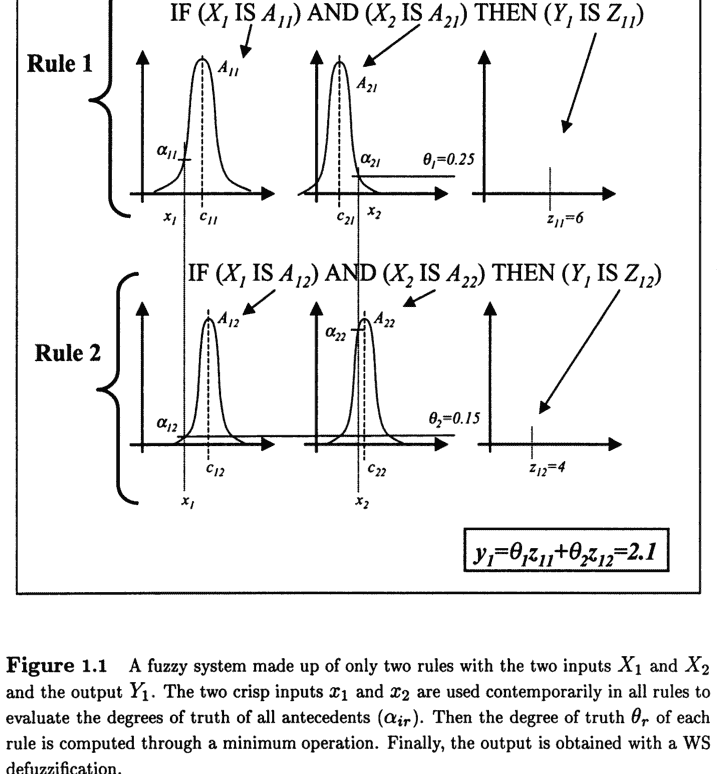

Figure 1.1 A fuzzy system made up of only two rules with the two inputs X₁ and X₂ and the output Y₁. The two crisp inputs x₁ and x₂ are used contemporarily in all rules to evaluate the degrees of truth of all antecedents (αᵢᵣ). Then the degree of truth θᵣ of each rule is computed through a minimum operation. Finally, the output is obtained with a WS defuzzification.

图1.1显示了仅由两条规则组成的模糊推理的计算示例。该推理使用WS且只有两个输入和一个输出。

### 1.3 GEFREX

#### 1.3.1 总体描述

所提出的算法是一个GA。遗传种群放置在矩形网格上。算法的核心预见了若干次迭代，每次迭代都包括选择两个父代、生成一个后代并将其重新插入种群。模糊规则的遗传编码仅涉及规则的前提。将会证明，在最小二乘意义上，最佳后件可以用SVD算法稳健地找到，而不管使用WS还是WM解模糊化。

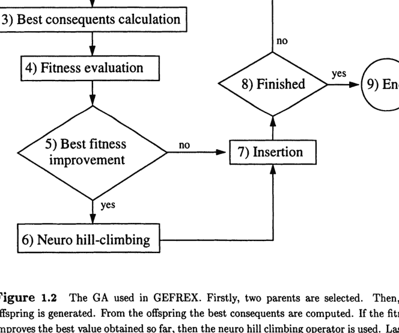

Figure 1.2 The GA used in GEFREX. Firstly, two parents are selected. Then, an offspring is generated. From the offspring the best consequents are computed. If the fitness improves the best value obtained so far, then the neuro hill climbing operator is used. Lastly, the individual is inserted in the population. The algorithm is repeated until the end criterion is met.

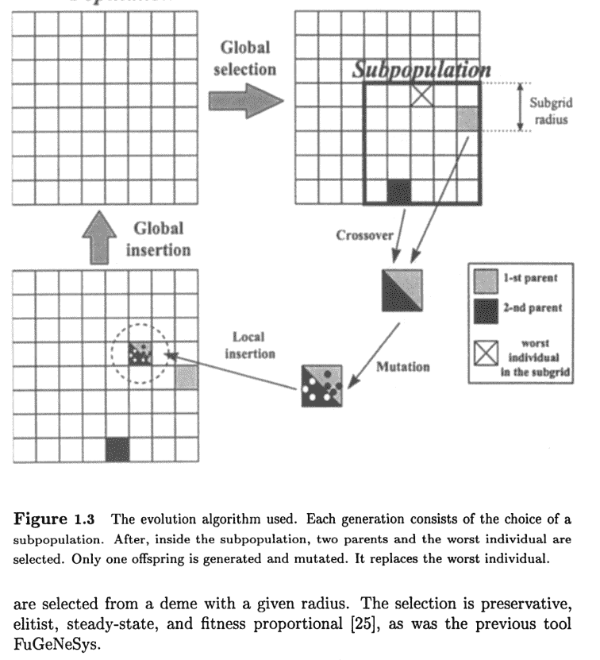

Figure 1.3 The evolution algorithm used. Each generation consists of the choice of a subpopulation. After, inside the subpopulation, two parents and the worst individual are selected. Only one offspring is generated and mutated. It replaces the worst individual.

are selected from a deme with a given radius. The selection is preservative, elitist, steady-state, and fitness proportional [25], as was the previous tool FuGeNeSys.

在细粒度模型中，有两种类型的选择：全局和局部。在这种情况下，全局选择是适应度比例的，并确定子种群deme的中心。在GEFREX中该半径为一，即子种群为3 × 3子网格。局部选择使用相同的选择方法但仅在子种群deme中。两个父代使用下面描述的定制交叉和变异算子生成一个后代。每当生成一个适应度值高于迄今为止获得的最佳值的个体时，也会使用爬山算子。生成的后代替换子种群中适应度最低的个体。

在 [18] 中有一项研究表明，基于

#### 1.3.3 遗传编码

图1.4详细显示了遗传编码。每个个体由两部分组成。第一部分涉及所有前提的高斯函数。第二部分用于启用位。输入数I取决于应用领域，而规则数R必须由GEFREX的用户指定。与多层感知器类似，其中神经元的数量决定了学习阶段的性能，过少的隐藏神经元会导致高误差，而过多的隐藏神经元会导致过拟合；规则的数量必须根据GEFREX要学习的问题的复杂性来确定。

一旦这些量确定，编码大小也确定了。事实上，最多需要R × I个前提（每个规则和每个输入一个）。每个前提需要两个参数（公式(1.1)中所示的中心和宽度相关参数）。因此，GEFREX编码的第一部分需要2 × R × I个实数值。而第二部分只需要I位。这些位在GEFREX学习阶段启用特征选择选项时使用。在第一次近似中，这些最后的I位相对于编码前提所需的位可以忽略不计。之后，GEFREX中的遗传编码所需的位数与R × I成比例。

在本章的下一节中，将证明所需规则的数量通常非常小。也就是说，GEFREX需要的规则比以前的工作少，以达到相同的学习误差。此外，GEFREX通常在规则数量更少的情况下达到比以前工作更低的误差。此外，R与输入数量无关，而仅与应用本身的复杂性有关。

个体的编码方式如下：

Binary genes: A string of I bits is associated to each individual. They represent the enabled inputs in the coded inference. More precisely if, for example, I = 4 and the string is {0,1,1,0}, it means that in the fuzzy inference the first and the fourth inputs are not present. In this case GEFREX does not consider the information related to these inputs.

Real genes: Each individual in the population is made up of a set of R × I FSs too. They are respectively the I FSs of the premise of the first rule, the second I FSs of the second rule, ...., and the last I FSs of the premise of the last rule. As the MFs of the input FSs


（宽度或中心）后代的参数\(q_s\)将由下式给出：

\[
q_s = q_f a + q_m (1 - a)\tag{1.4}
\]

其中\(a\)是[0,1]内的实数值。对于每个后代，\(a\)值只随机选取一次，即对同一后代的所有实数参数应用公式(1.4)时使用相同的\(a\)。

### 变异

在这种情况下，同样定义了两个不同的变异算子。

### 二进制基因：

以用户可定义的概率\(p_m\)，仅针对这些位，每一位都可以被反转。初始时所有二进制值都被设为1，这样所有输入都是启用的。如果用户的GEFREX不想消除输入，只需将变异概率\(p_m\)设为零。在特征检测情况下，\(p_m\)为0.01。

### 实数基因：

中心和gamma都按照相同的过程进行修改。这些参数中的每一个都根据其自身值进行改变。实际上，GEFREX采用乘法变异，每个参数\(q_s\)按如下方式修改：

\[
q_s = q_s \left(1 - \frac{\delta}{2} + \operatorname{rnd}(\delta)\right)\tag{1.5}
\]

其中rnd(\(x\))是区间[0, \(x\)]内的随机实数。\(\delta\)值由GEFREX自主改变，以维持遗传群体中最低程度的差异性。实际上，\(\delta\)值根据适应度值的标准差\(\sigma\)升高或降低，该标准差需达到平均适应度的几个百分点。在每次迭代中，如果\(\sigma\)超过平均适应度的几个百分点，则将\(\delta\)乘以0.5；如果它变得太小，则将其乘以1.1。

#### 1.3.5 误差

学习误差公式非常重要，因为计算最优后件的数学运算直接源自其定义。此外，如本章所采用的通用公式，允许同一学习工具应用于非常不同的应用领域。误差公式将在下一小节中描述。GEFREX使用监督学习。假设有\(P\)个模式，每个模式由\(I + O\)个值组成。因此，第\(p\)个通用模式为：

| 输入 | 期望输出 |
| --- | --- |
| \(x'_{1p}, x'_{2p}, \ldots, x'_{Ip}\) | \(y'_{1p}, y'_{2p}, \ldots, y'_{Op}\) |

### 误差公式

误差\(E\)的计算公式为：

\[
E = \sqrt{\frac{1}{O P_{eq}} \sum_{o=1}^{O} \sum_{p=1}^{P} k_{op}^2 (y_{op} - y'_{op})^2}\tag{1.6}
\]

其中

- \(O\)是输出数量；
- \(P\)是学习模式的数量；
- \(y_{op}\)和\(y'_{op}\)分别是第\(p\)个学习模式的计算输出和期望输出的第\(o\)个输出；
- \(k_{op}\)是用户可定义的系数；
- \(P_{eq}\)通常等于\(P\)，但它也可以取其他值。

### 可能的误差

使用公式(1.6)可以采用不同的学习方法。

**均方根误差：** 如果\(k_{op} = 1\ \forall p,o\)且\(P_{eq} = P\)，我们得到所谓的均方根误差（RMSE）[26]。

**均方根归一化误差：** 如果\(\Delta_o\)表示第\(o\)个输出可取的最大值与最小值之差，如果我们设\(k_{op} = 1/\Delta_o\ \forall p,o\)且\(P_{eq} = P\)，则得到均方根归一化误差（RMSNE）。它表示每个输出相对于其取值范围平均偏离期望值的程度。这种误差在先前提出的模糊建模方法（参见FuGeNeSys）中采用。

**均方根相对误差：** 如果\(k_{op} = 1/y'_{op}\ \forall p,o\)且\(P_{eq} = P\)，则得到均方根相对误差（RMSRE）。它表示平均相对误差。这种误差度量曾用于高能物理（HEP）领域[27]。

**使用压缩学习模式进行学习：** 存在许多聚类技术（例如，参见K-means聚类算法和自组织特征映射[10][28]）。借助这些技术，可以提取一组精简的重要样本（码字）用于学习阶段。在学习阶段直接使用这些精简样本的主要缺点是丢失了原始统计信息。例如，假设有图1.5中所示的32个样本，并且应用了任何搜索三个代表点的聚类方法。这些点将大约位于图1.5所示椭球体的中间。如果仅使用这些点执行学习阶段，关于每个点重要性的信息就会丢失。实际上，代表较大椭球体的点的权重应为其他点的两倍。如果有大量学习模式，可以使用聚类技术。这样可以缩短学习时间。获得码字后，可以将权重\(w_p\)与每个码字相关联，即距离它们最近的学习模式数量。通过这种方式，学习模式的数量减少了，统计信息也不会丢失。当然，这引入了所谓的量化误差（QE）。然而，可以通过增加码字数量从而降低压缩比来减小QE。

利用这种技术并借助公式(1.6)，可以采用前面描述的任何一种误差。例如，只需设\(k_{op} = \sqrt{w_p}\ \forall o,p\)即可计算RMSE。此外，还必须有\(P_{eq} = \sum_{p=1}^{P} \omega_p\)。第1.3.12节给出了一个重要的例子。

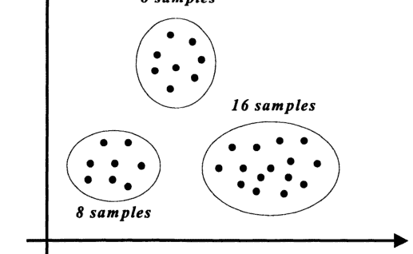

图1.5 这32个二维样本表征了三个不同的簇。所引入的误差公式允许在学习阶段只使用簇的质心，其权重与属于每个簇的样本数量成正比，而不是使用所有样本。

**增加某些点的重要性：** 与前面情况类似的方式，可以给某些模式附加权重，以增加或减少它们相对于其他模式的权重。

**其他考虑：** 考虑到公式(1.6)的通用性，还可以想到其他几种应用。例如，也可以给输出赋予权重。

#### 1.3.6 输出单值

现在将证明，关于所有规则结论的信息可以使用标准线性代数来计算。在下文中，源自第\(p\)个学习模式的第\(r\)条规则的真值度将用符号\(\theta_{rp}\)表示。

如果我们已知WS情况下的所有\(\theta_{rp}\)，或WM情况下归一化的θ值\(\bar{\theta}_{rp} = \frac{\theta_{rp}}{\sum_{r=1}^{R} \theta_{rp}}\)，则输出是这些值的线性组合。我们用\(\bar{\Theta}\)表示包含θ值（WS情况下）或归一化θ值（WM情况下）的\(P\)行\(R\)列矩阵。用\(\bar{Z}\)表示包含输出单值\(z_{or}\)的\(R\)行\(O\)列矩阵，用\(\bar{Y}\)表示包含期望输出值\(y'_{op}\ \forall o,p\)的\(P\)行\(O\)列矩阵。必须求解以下线性系统：

\[
\bar{\Theta} \bar{Z} = \bar{Y}\tag{1.7}
\]

该系统通常方程数远多于变量数，可以通过奇异值分解（SVD）以稳健的方式轻松求解。

从线性代数可知，系统(1.7)的最小化残差的最优解可以通过Moore-Penrose伪逆[19]获得。因此，系统(1.7)可以重写为：

\[
\bar{T} \bar{Z} = \bar{Q}\tag{1.8}
\]

其中\(\bar{T} = \bar{\Theta}^T \bar{\Theta}\)，\(\bar{Q} = \bar{\Theta}^T \bar{Y}\)。在这种情况下，两个矩阵\(\bar{T}\)和\(\bar{Q}\)的维度分别为\(R \times R\)和\(R \times O\)，通常远小于\(\bar{\Theta}\)和\(\bar{Y}\)的维度。

由于GEFREX完全支持公式(1.6)，上述矩阵方程需要进行一些修改。即使在公式(1.6)中只有一个\(k_{op}\)不同于数值1，我们也不能使用公式(1.8)。为简化起见，规定\(k_{op} = k_{1p} k_{2o}\ \forall p,o\)。如果我们将\(\bar{K}_1\)和\(\bar{K}_2\)定义为分别由向量\(k_{1p}\)和\(k_{2o}\)的值构成的两个对角矩阵，则必须求解：

\[
\bar{K}_1 \bar{\Theta} \bar{Z} \bar{K}_2 = \bar{K}_1 \bar{Y} \bar{K}_2\tag{1.9}
\]


如果矩阵 \overline{K}_2 可逆，则该系统的解（使残差最小化）与以下系统的解一致：

\overline{T}' \overline{Z} = \overline{Q}' \tag{1.10}

其中 \overline{T}' = \overline{\Theta}^T \overline{K}_1^T \overline{K}_1 \overline{\Theta} 且 \overline{Q}' = \overline{\Theta}^T \overline{K}_1^T \overline{K}_1 \overline{Y}。

#### 1.3.7 爬山算子

引入了爬山算子。它仅在生成的个体适应度值高于迄今为止获得的最佳值时使用。

最初，所选个体被转换为神经模糊系统。也就是说，构建等效神经网络并初始化所有可训练权重。然后，对系统进行训练。在此阶段，可能也会删除一些神经元。最后，将训练好的系统重新转换为遗传个体，并以此取代所选的起始个体引入遗传网格。神经网络使用梯度下降法进行训练。

GEFREX 自动调整学习率并继续进行，直到误差减小。为了更详细地说明，学习率从 0.5 开始。如果误差减小，则乘以 1.5，否则乘以 0.1。迭代继续进行，直到误差达到局部最小值。

### 梯度下降公式

为简化起见，q_{ir} 表示两个系数 {γ_{ir}, c_{ir}} 中的一个。如果 θ_{rp} ≠ α_{ir} 则 ∂E/∂q_{ir}=0。否则我们得到：

∂E/∂q_{ir} = 1/(O P_{eq} E) Σ_{o=1}^{O} Σ_{p=1}^{P} (y_{op} - y'_{op}) k_{op}^2 ∂y_{op}/∂q_{ir} \tag{1.11}

∂y_{op}/∂q_{ir} = { z_{or} θ_{rp} ∂q'_{irp}/∂q_{ir} if WS ; (z_{or} - y_{op}) \overline{θ}_{rp} ∂q'_{irp}/∂q_{ir} if WM } \tag{1.12}

其中 q'_{irp} = -γ_{ir}^2 (x_{ip} - c_{ir})^2。

∂q'_{irp}/∂q_{ir} = { -2γ_{ir} (x_{ip} - c_{ir})^2 if q_{ir}=γ_{ir} ; +2γ_{ir}^2 (x_{ip} - c_{ir}) if q_{ir}=c_{ir} } \tag{1.13}

图 1.6 中给出了一个示例，其中只有两个输入、一个输出和两个规则。当假设 WS 时（如图 1.6 所示），神经模糊系统有四层。

- 第一层是输入层，其神经元最大数量为 I。

图 1.6 神经模糊系统的架构。系统有两个输入、一个输出和两个规则。基于 WS。

- 第二层是模糊化层。在这里，计算前件的激活度 α_ir。可以区分激活函数 f = e^{-net_ir^2} = α_ir 其中 net_ir = x_i γ_ir - d_ir。当然，d_ir = c_ir γ_ir。可学习权重为 γ_ir 和 d_ir。神经元总数最多为 R × I。
- 之后是推理层。需要计算 R 条规则的真度。它有 R 个神经元，权重固定为 1。
- 最后是线性输出层，其中计算 WS 解模糊化。可学习权重为 z_or。神经元数为 O。神经模糊系统中还使用 SVD 来找到最佳输出单值。

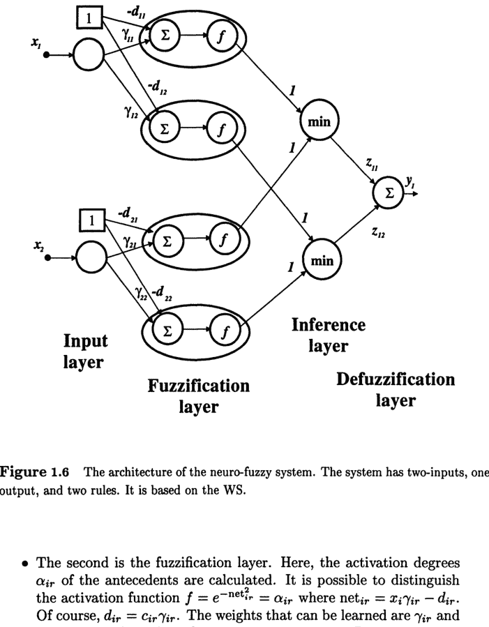

通常，当 GEFREX 用于实际问题 [5] 时，种群规模设定在 100 个个体以下。在本文中，未另行说明时，该数字为 25。

- **适应度函数的系数。** 在第 1.3.8 节中已对适应度函数的系数进行了广泛解释。因此在本段中仅给出有关选择这些系数的简要指导。
- 通常，当不需要简化且不需要特征选择并且误差不能达到 0 值时，$K_{num}$=100，$K_{red}$=$K_{red_2}$=$K_{den}$=0 且 $K_{err}$=1 被固定。这些值在未另行说明时用于本章中报告的示例。
- 当用户希望简化最终模糊系统时，他可以为 $K_{red}$ 给出 0.1 到 0.01 之间的值。通常，0.01 是一个不错的选择。对于 GEFREX 也用于特征选择时的 $K_{red_2}$ 也是同样的道理。

- **终止准则。** 可以使用多种终止准则来停止迭代学习方法。目前 GEFREX 中仅实现了两种：最大遗传迭代次数（子代数量）和要达到的最终误差。通常需要 10000 到 100000 次迭代才能收敛。当未另行说明时，本章中报告的示例使用 10000 次迭代。

## 评估连续运行次数以产生显著误差

考虑到 GEFREX 的随机性，有必要了解何时可以将一次运行的结果视为显著结果，而非仅仅是幸运或不幸的尝试。

为此目的，使用相同问题执行了 60 次学习阶段。图 1.7 显示了用于教授单输入单输出函数的 40 个学习模式。该函数相当复杂，因为使用了高斯型输入隶属函数。

共有三条规则。解模糊化为 WM。

为评估获得的结果，引入了量 ρ。它是最终 RMNSE 的标准差与平均值之比。表 1.1 在名为 Mean 的列中报告了获得的值。74.90% 的值表明，仅一次运行的结果完全不能被视为显著结果。

因此考虑了两次或多次运行。表 1.1 的另外 5 列报告了每次取 2、3、4、5 和 6 次连续运行的最佳结果所获得的结果。最后四列给出了 3、4、5 和 6 次连续运行的中位数值。表显示最佳

|  | Rule 1 | Rule 2 | Rule 3 | Rule 4 | Rule 5 |
|---|---|---|---|---|---|
| c2r | -6.28E-2 | 1.55E-1 | 1.43E-2 |  |  |
| c3r | 2.49E+3 |  | 4.63E+3 | 4.95E+3 | 1.13E+04 |
| c4r | 2.27E-1 | -5.24E-1 |  | -9.36E-2 |  |
| c5r | -9.74E-2 | 7.12E-2 | -6.46E-2 |  |  |
| γ2r | 3.27 | 5.24 | 9.66 |  |  |
| γ3r | 7.64E-4 |  | 8.21E-4 | 6.31E-4 | 1.63E-4 |
| γ4r | 1.89 | 5.45 |  | 2.40 |  |
| γ5r | 3.31 | 2.83E+1 | 2.10 |  |  |
| z1r | 1.44E+3 | 9.03E+2 | -2.24E+2 | 1.66E+3 | 1.10E+04 |

表 1.5 化工厂规则

数值结果。它们总共需要 70 个参数，其性能指标为 0.002245。

训练了一个仅有四条规则的模糊推理系统，其参数如表 1.5 所示。如图所示，GEFREX 仅消除了第一个输入，即单体浓度。更重要的是，它仅保留了 31 个参数。仅用这些参数，GEFREX 得到的性能指标为 0.001785。

## 分类问题

### 两个输入

在 [18] 中，使用了图 1.10 右上角所示的分类问题来展示 FuGeNeSys 使用 WS 和 WM 的性能。当然，使用 WM 找到的最佳结果。图 1.9 显示了 FuGeNeSys 获得的最佳结果。

GEFREX 从 20×20 等间距样本开始提取了一个五规则模糊系统（使用 WM）。获得的曲面如图 1.10 所示。重建的曲面无疑比图 1.9 中报道的更好。获得的 RMSNE 为 0.614%，五个规则如图 1.10 所示。

### 鸢尾花数据

这是一个四输入一输出的示例。文献中的最佳结果报道于 [34] 和 [18]，其中所有 150 个学习模式分别用 13 条和 5 条规则正确学习。

整数一、二和三分别与三个类别鸢尾 setosa、virginica 和 versicolor 相关联。GEFREX 成功地使用 WM 解模糊化提取了一个仅有 5 条规则的模糊系统，可正确分类全部 150 个模式。图 1.11 显示了五个规则。

输入的顺序为萼片长度（SL）单位为 cm（范围在 [4.3,7.9]），萼片宽度（SW）单位为 cm（范围在 [2.0,4.4]），花瓣长度（PL）单位为 cm（范围在 [1.0,6.9]），以及花瓣宽度（PW）单位为 cm（范围在 [0.1,2.5]）。自然地，输出范围在 [0,2]。如果输出低于 0.5，则类别为鸢尾 setosa。如果它包含在 [0.5,1.5] 中，则类别为鸢尾 virginica，否则为


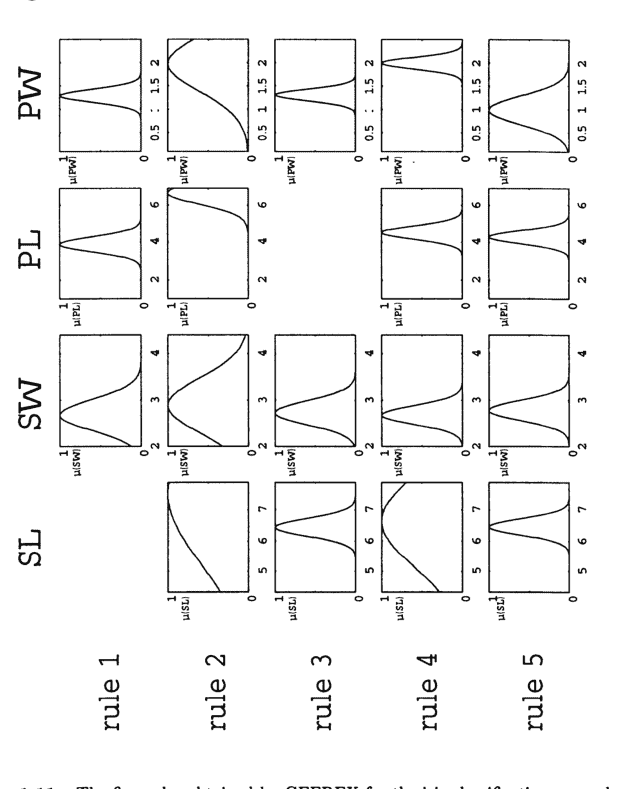

图 1.11 GEFREX 对鸢尾花分类示例得到的五条规则。

训练阶段和测试阶段使用的模式具有以下格式 [x(t − 24);x(t − 18);x(t − 12);x(t − 6);x(t);]，来自 t 在 [124, 1123] 范围内的生成数据。前 500 个模式用于学习阶段，而最后 500 个用于测试阶段。

图 1.12 报告了使用 GEFREX 得到的结果。这些结果指的是在使用 WM 去模糊化时仅由 20 条规则组成的一个模糊系统。GEFREX 训练相关的参数为 50000 次迭代（约在 300MHz Pentium-II 上耗时 1 小时）和 100 个个体。在子图 (1) 中期望

| Rules | Error | Features |
| --- | --- | --- |
| 2 | 6.16% | 1 and 8 |
| 3 | 3.76% | 6 and 7 |
| 4 | 2.63% | 2 and 6 |

表 1.7 关于特征检测示例，FuGeNeSys 随规则数量的行为

|  | Rule 1 | Rule 2 |
| --- | --- | --- |
| c2r | 1.5035E+02 |  |
| c6r | 1.7221E+02 | 2.5188E+02 |
| γ2r | 1.3888E-02 |  |
| γ6r | 4.6054E-03 | 8.3643E-03 |
| z1r | 1.6443E+04 | 1.1645E+04 |

表 1.8 特征检测：训练得到的两条规则

表 1.7 显示了使用文献中引用的 WS 进行的三种不同运行的结果（RMSNE）。GEFREX 用于同一问题。仅用两条规则达到的 RMSNE 为 1.085%，并且当然仅选择了两个显著特征。表 1.8 显示了训练后规则的八个参数。

#### 1.3.11 计算复杂度评估

本节报告了关于 GEFREX 计算复杂度与之前工作对比的实验研究。

上一节表明 GEFREX 的结果优于之前的工作。现在将表明 GEFREX 能够在比任何其他类似工作更短的时间内达到预设的学习误差。此外，随着规则数量 R 的增加，使用 GEFREX 可实现的效果提升也会增加，即 R 值越大，提升越大。

如前所述，GEFREX 大量使用了 SVD。该操作在 CPU 资源方面尤其昂贵。更精确地说，在 GEFREX 中，每次迭代都会计算一个 R × R 方阵的 SVD。利用大 O 符号 [36] 我们可以说该 SVD 分解的复杂度为 O(R³) [19]。尽管关于矩阵的 C++ 对象已完全重写，并且这些对象在设计时主要考虑了所有矩阵操作的最终速度（不管内存分配），SVD 的多项式复杂度限制仍然存在。因此似乎 GEFREX 相比之前的工作需要更多的计算机资源，特别是当规则数量 R 增加时。

为了进行准确比较，GEFREX 与 FuGeNeSys 进行了比较，后者是文献中似乎在学习方法和应用领域方面与 GEFREX 最相似的另一遗传规则生成器 [18]。由于两个工具都基于遗传方法，为了获得有意义的信息，必须在相同假设下执行多次运行。以下图表中报告的每个值都对应于 10 次不同运行的平均值。

作为案例研究，考虑了用于测试 FuGeNeSys 的同一示例。它是单输入单输出函数 [29] 的逼近：

```
y = 0.2 + 0.8(x + 0.7 sin(2πx))    (1.23)
```

21 个学习模式被取为在 [0,1] 中均匀分布。由于只有 21 个学习模式，工具的行为仅研究到 9 条规则。如图 1.14 所示，GEFREX 在 R=9 时达到可忽略的误差。因此使用更多规则没有意义。

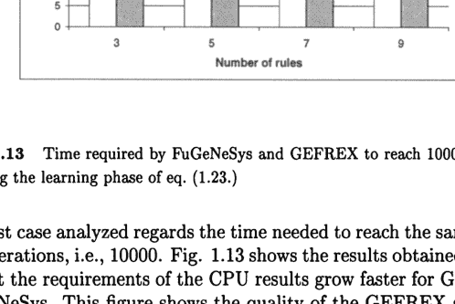

图 1.13 FuGeNeSys 和 GEFREX 在学习阶段的公式 (1.23) 中达到 10000 次遗传迭代所需的时间。

分析的第一个案例是达到相同数量的遗传迭代，即 10000 所需的时间。图 1.13 显示了得到的结果，表明 CPU 资源需求对 GEFREX 的增长速度快于 FuGeNeSys。该图也显示了 GEFREX 软件的质量。事实上，直到 7 条规则，GEFREX 比 FuGeNeSys 更快，即使它需要在每次迭代中进行 SVD 计算，并且是用 C++ 编写的（FuGeNeSys 用 C 编写）。

在下面的图 1.14 中报告了得到的最终误差（RMSNE）。

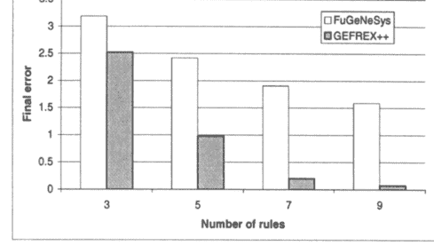

图 1.14 FuGeNeSys 和 GEFREX 在进行 10000 次遗传迭代学习公式 (1.23) 后得到的最终 RMSNE。

平均而言，GEFREX 找到更低的误差。此外，当 R 增加时，差异变得更加显著。

然而，为了很好地比较两个工具，需要评估两个工具达到相同误差所需的时间。为此，估计了 GEFREX 达到 FuGeNeSys 达到的误差所需的时间，更精确地说，考虑了 FuGeNeSys 在 R 从 3 到 9 时在 10000 次遗传迭代中达到的误差（见图 1.14），并计算了 GEFREX 获得相同误差所需的平均时间。在图 1.15 中报告了这些平均时间和 FuGeNeSys 的时间。

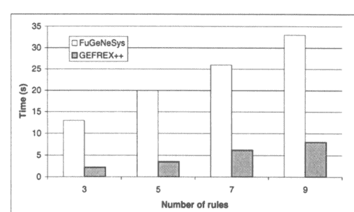

图 1.15 FuGeNeSys 和 GEFREX 达到相同最终误差所需的时间。

| $x_1$ | $x_2$ | $y$ | $\omega_p$ | $x_1$ | $x_2$ | $y$ | $\omega_p$ |
|---|---|---|---|---|---|---|---|
| -7.3 | -1.3 | -1.9 | 3 | -4.0 | -1.0 | -1.7 | 2 |
| 9.0 | 4.0 | 3.2 | 2 | 10.0 | -1.0 | 1.4 | 2 |
| -8.0 | 10.0 | -7.5 | 3 | -9.0 | -10.0 | -0.4 | 2 |
| 2.0 | 6.0 | 3.8 | 3 | 5.0 | -4.0 | 1.1 | 2 |
| -9.0 | 6.0 | -4.8 | 2 | -1.0 | -6.0 | -0.0 | 2 |
| 5.0 | 4.0 | 3.5 | 2 | 9.0 | -6.0 | 0.4 | 2 |
| -5.3 | 5.3 | -4.2 | 3 | -6.0 | -5.0 | -1.0 | 2 |
| 0.0 | 5.0 | 0.4 | 2 | 1.0 | -9.0 | 0.4 | 4 |
| -10.0 | -1.0 | -2.0 | 2 | 5.0 | 6.0 | 4.5 | 2 |
| 9.0 | 2.0 | 2.4 | 2 | 9.0 | -4.0 | 0.8 | 2 |
| -3.3 | 9.3 | -5.8 | 3 | -9.0 | -7.0 | -0.8 | 4 |
| 0.0 | 9.0 | 0.4 | 2 | 2.0 | -4.0 | 1.1 | 3 |
| -10.0 | 3.0 | -3.4 | 2 | -2.0 | -9.0 | 0.0 | 2 |
| 2.0 | 1.0 | 2.1 | 2 | 9.0 | -9.0 | -0.0 | 4 |
| -2.0 | 7.0 | -3.6 | 2 | -5.0 | -9.0 | -0.3 | 4 |
| 9.0 | 8.0 | 5.4 | 2 | 5.0 | -9.0 | 0.3 | 4 |
| -6.0 | 0.0 | -2.2 | 1 | -2.0 | -1.0 | -1.1 | 2 |
| 9.0 | 6.0 | 4.2 | 2 | 8.0 | -1.0 | 1.5 | 2 |
| -8.0 | 8.0 | -6.0 | 3 | 5.0 | 8.0 | 5.7 | 2 |
| 9.0 | 10.0 | 6.8 | 2 | 5.0 | -2.0 | 1.5 | 2 |
| -8.0 | 3.0 | -3.4 | 2 | -0.7 | -3.3 | 0.0 | 3 |
| 5.0 | 1.0 | 2.4 | 4 | 5.0 | -6.0 | 0.7 | 2 |
| -2.7 | 3.3 | -2.5 | 3 | -4.0 | -5.0 | -0.8 | 2 |
| 4.0 | 10.0 | 6.7 | 3 | -5.0 | 2.0 | -2.7 | 2 |
| -9.0 | -4.0 | -1.3 | 2 | 0.0 | 1.0 | 0.3 | 2 |

表 1.9 压缩的学习样本及其权重

图 1.15 显示 GEFREX 比 FuGeNeSys 更有效。此外，与 FuGeNeSys 相比，GEFREX 的效率随 R 的增加而增长。

#### 1.3.12 使用压缩学习模式的学习示例

本简短章节表明 GEFREX 能够使用压缩学习模式进行学习。这种能力是引入误差公式 (1.6) 中的系数 k_op 并且重新调整方程 (1.8) 的直接结果。该方程已更改为方程 (1.9) 以考虑这些系数。

第 1.3.10 节中显示的第一个示例被用作案例研究。取了 121 个学习模式，并使用 K-means 聚类算法 [28] 提取了 50 个码字的码本。找到的 RMSNE 为 3.706%。

|  | Rule 1 | Rule 2 | Rule 3 | Rule 4 |
|---|---|---|---|---|
| c1r | -7.79 | 3.263 | 9.051 | 5.355 |
| c2r | 12.12 | 10.93 | 10.26 | 3.946 |
| γ1r | 0.159 | 0.280 | 0.383 | 0.013 |
| γ2r | 0.196 | 0.086 | 0.093 | 0.116 |
| z1r | -6.79 | 8.842 | 7.653 | -2.95 |

表 1.10 未使用权重得到的四条规则

|  | Rule 1 | Rule 2 | Rule 3 | Rule 4 |
|---|---|---|---|---|
| c1r | 2.627 | -3.81 | 10.194 | -7.36 |
| c2r | -1.01 | -1.45 | 25.044 | 16.77 |
| γ1r | 0.348 | 0.088 | 0.1306 | 0.170 |
| γ2r | 0.134 | 0.128 | 0.0557 | 0.086 |
| z1r | 1.564 | -1.12 | 13.945 | -10.14 |

表 1.11 使用权重得到的四条规则

该值是基于所有三个分量、两个输入和输出计算的。表 1.9 的前三列显示了得到的 50 个码字。在码本提取后，计算了每个码字的权重，即有多少个学习模式最接近该码字。这些值显示在表 1.9 的最后一列。

随后执行了两种不同的学习阶段。在两者中，测试模式与第 1.3.10 节中使用的一样。在第一个学习阶段，训练了一个具有四条规则的模糊系统。学习模式为不带权重的码字。获得了学习模式的 RMSNE 为 2.079%，测试模式为 3.203%。规则显示在表 1.10 中。在第二个学习阶段，又训练了一个具有四条规则的模糊系统。这次，学习模式为带权重的码字。获得了学习模式的 RMSNE 为 0.355%，测试模式为 1.715%。第一个误差值是考虑权重得到的，而第二个没有使用任何权重。规则显示在表 1.11 中。

该示例清楚地表明，如果它们以正确的权重考虑，GEFREX 能够对少量样本进行泛化。

#### 1.4 PARGEFREX

本节描述了 PARGEFREX，一种遗传-神经-模糊学习的分布式方法。串行版本的性能通过这里描述的简单并行化方案得到了极大增强。一旦学习数据集固定，平均所需时间在平均时间上具有非常高的超线性加速


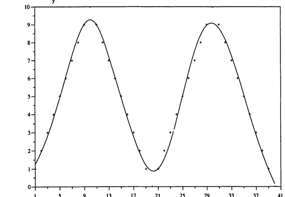

### 图 1.16 40 种学习模式及 RMNSE=3.22% 时的学习函数。

本次实验中未使用三台 c366。共有两台服务器：一台配备两颗 Pentium II 300MHz 处理器，另一台配备一颗 Pentium II 350 MHz 处理器。服务器各有两块以太网卡：一块用于连接大学局域网，另一块用于连接本地快速以太网局域网。有一台 12 端口交换机和四台 12 端口集线器。

操作系统为 LINUX。PE 从一台服务器远程启动，并通过网络文件系统 NFS 共享另一台服务器上的文件系统，同时也使用本地硬盘。操作系统文件驻留在本地硬盘上。每次需要更新操作系统或在 MULTISOFT 机器上安装新软件时，都会执行一个自动程序。该程序在服务器上执行，并更改所有本地硬盘的内容。

采用了消息传递通信范式。并行虚拟机 Parallel Virtual Machine (PVM) 用于此目的。

#### 1.4.3 PARGEFREX 描述

在前一工作中获得的鼓舞人心且初步的结果 [37] 基础上，我们实现了适用于 MULTISOFT 机器的 GEFREX 并行版本。

图 1.18 显示了 PARGEFREX 实现中采用的策略。有一个主进程会生成若干从进程。然后，每个从进程开始工作并与其他从进程交换数据。最后，主进程从从进程收集结果并终止它们。

实际上，并没有两套不同的软件，一套用于从进程，另一套用于主进程。只有一套软件，它能检测自己是否是由自身的另一个副本生成的。如果不是，则充当主进程；否则为从进程。当主进程启动时，它会读取一个配置文件，该文件指示必须使用多少个 PE。此外，对于每个 PE，该文件还指定必须运行多少个从进程。

读取配置文件后，主进程生成所有从进程，向它们发送初始化信息并等待从进程的结果。从进程运行并完成初始化阶段后，它们开始相互交换信息，但不包括主进程。交换的数据是迄今为止从进程找到的最佳个体，被发送到另一个从进程。它们在随机时间发送自己的最佳个体，但平均发送时间可由用户定义。接收从进程也是随机选择的。接收到的个体将替换本地种群中最差的个体。

已实现了多种停止准则。它们是：

CI：迭代次数。当所有从进程达到预设的迭代次数时，它们将各自的最佳个体发送给主进程。主进程收集这些个体，保留其中最好的一个，终止所有

当时模拟时间为 3s 时为 CT。

首先是初始化阶段，从进程被生成并向其发送初始信息。之后是同步阶段。该阶段是可选的，仅为加速评估而实现。在此阶段，从进程和主进程同步其时钟，以便它们能够同时开始。开始时间由主进程在前一阶段发送给从进程。采用此方案是因为当模拟中涉及大量 PE 时，实际上不可能使用网络向所有 PE 同时发送一条指示开始时间的消息。事实上，在 PVM 中并没有真正的广播功能，只有模拟的广播功能。当发送广播消息时，会发送与接收者数量一样多的相同消息。因此，当有多个 PE 时，开始消息到达第一个接收从进程的时间比到达最后一个要早得多。显然，所实现的同步方法也不能保证所有从进程在完全相同的时间开始，但与使用 PVM 广播相比，开始时间的最大差异要小得多。

然后从进程开始工作。每次迭代时，它们都会检查是否从另一个从进程接收到消息。此外，在随机时间，它们会将自己的最佳个体发送给其他随机从进程。在此模拟中，平均发送时间固定为 1s。图中特别标出了两个阶段，即神经阶段和遗传阶段。从进程在神经阶段开始工作。在此阶段，它生成其 400 个个体的种群。该阶段持续约 0.4s，且禁止向其他从进程发送任何内容。之后开始遗传阶段，持续 2.6s。最后是收集阶段，主进程接收所有从进程找到的最佳个体，然后终止它们。此模拟阐明了终止条件中指定的模拟时间：神经阶段时间加上遗传阶段时间。

图 1.20 显示了使用所有可用 PE 的另一项模拟。整个运行持续约 6s。平均发送时间固定为 0.1s。此模拟中同步阶段也为 1s。终止准则为 CI，模拟时间为 0.5s。图显示由于 PE 数量增加，初始化阶段大大延长。神经阶段持续约 0.3s，遗传阶段仅 0.2s。因此，从进程仅在模拟时间的 40% 内交换信息。

#### 1.4.4 性能评估

本节致力于使用 MULTISOFT 机器评估 PARGEFREX 的性能。

首先评估了 PE 之间的相对计算能力。为此，使用 p233 执行了 100 个学习阶段，随后使用 c366 执行。停止准则为 CI，迭代次数固定为 100000。平均而言，最终误差几乎相等。此外，平均而言，使用 p233 的学习时间是使用 c366 所需时间的 r=1.57 倍。该实验数值非常接近两类 PE 的两种不同处理器的工作频率之比！

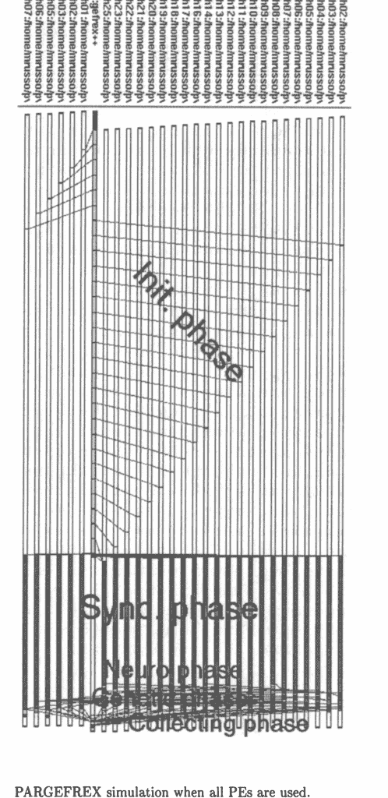

图 1.20 使用所有 PE 时的 PARGEFREX 模拟。

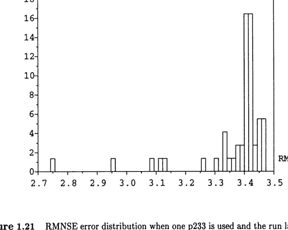

图 1.21 使用一台 p233 且运行时间为 75s 时的 RMNSE 误差分布。

为了评估使用 GEFREX 可获得的性能，我们需要引入两个新量。假设我们使用 p 台 p233 和 c 台 c366。一个有用的信息是这些 PE 的等效计算能力 P_{p,c}，即它们相对性能的总和。因此，我们有：

```
P_{p,c} = p + r × c
(1.24)
```

其中 r 是 p233 与 c366 的相对速度（本例中 r=1.57）。

评估加速的一种可能方法是固定学习误差，并观察当 P_{p,c} 从 0 变到 1 时达到该误差所需的时间。遗憾的是，这是不可能的。事实上，PARGEFREX 主要是一个 GA。图 1.21 显示了仅使用一台 p233 且终止准则为 75s 学习时间时最终误差的分布。图显示了可获得的最终误差的巨大离散度。如果我们使用 CE 作为终止准则，我们将遇到许多问题，尤其是在模糊系统具有

## 时间与误差

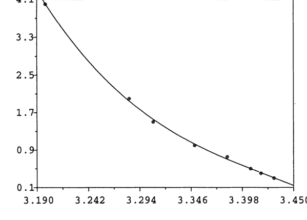

图 1.22 使用 6 台 p233 和 22 台 c366 时的时间（秒）与百分比 RMNSE。

| t(s) | e (RMNSE %) | Runs |
|---|---|---|
| 0.3 | 3.43025 | 126 |
| 0.4 | 3.41711 | 92 |
| 0.5 | 3.40668 | 55 |
| 0.75 | 3.38288 | 83 |
| 1.0 | 3.34983 | 199 |
| 1.5 | 3.30783 | 360 |
| 2.0 | 3.28336 | 524 |
| 4.0 | 3.19867 | 758 |

表 1.12 使用所有 PE 时模拟时间与平均误差及所需运行次数

从 1 到 40.54。

让我们使用 p 台 p233 和 c 台 c366 运行 PARGEFREX。假设使用 CT 终止误差，模拟时间固定为 t'_{p,c}。让我们用 e_{p,c} 表示以同样方式获得的平均百分比误差（RMNSE）：至少 50 次运行，并且在剔除最好 20% 和最差 20% 的运行后，需要足够多的运行次数以达到置信水平为 0.01 的平均误差。让我们引入量 S_{p,c} 如下：


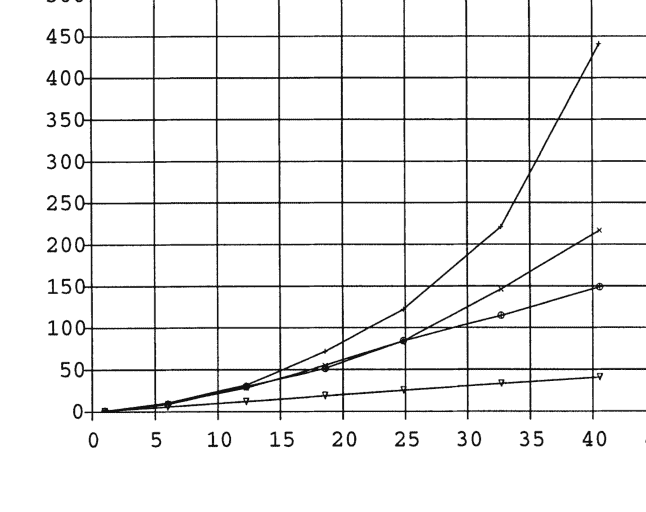

图 1.23 (+) 仿真时间 ≈ 300s/P_{p,c} (×) ≈ 150s/P_{p,c} (⊕) ≈ 75s/P_{p,c} (∇) 线性加速

- 第一个与我们机器的总功率以及获得的高 S_{p,c} 值有关。仅使用一台 p233 的较短仿真必须对应于图 1.22 所示曲线中的一个显著点。表 1.13 显示，使用一台 p233 和 75s 的学习时间，平均误差约为 3.41%。该值对应于（见图 1.22）使用所有 PEs 时约 0.2-0.4s。该值处于极限。事实上，我们记得，正如在描述图 1.19 和 1.20 时所解释的那样，当学习时间小于约 0.3-0.4s 时，学习过程仅处于神经阶段，其中初始种群被生成且不允许 PEs 之间进行通信。因此，为了很好地评估 PARGEFREX 提出的实现所能达到的加速，仿真在一定数量的 PEs 上必须对应于运行，其中所有 PEs 达到相同误差所需的时间大于 0.3-0.4s。
- 最后一点与遗传收敛有关。仿真不能持续太久，因为在一定时间后遗传阶段收敛，在合理时间内无法取得显著改进。使用 P_{p,c} 较低的 PEs 数量进行过长的仿真将意味着非常高的虚假加速。

由于这两个原因，使用一台 p233 的仿真被选为持续 300s、150 和 75s。

图 1.23 清楚地表明，GEFREX 的实现在使用大量 PEs 时性能显著提升。鉴于网络始终利用率低于其最大可能性的 10%，结果令人惊讶：PARGEFREX 更适合商品化超级计算机，而非处理器数量较少的昂贵服务器。

图 1.23 确认了我们关于仿真时间过长的讨论。如果使用一台 p233 且仿真持续 300s，加速特别高：几乎达到 450！这种现象是由于在 100-200s 后所有仿真都收敛且无法显著改进。如果我们评估仿真时间更长时的平均误差，我们将得到巨大的加速，因为误差几乎与在 300s 找到的误差相同。使用 p233 持续 75s 和 150s 的仿真更适合评估加速。

读者可以看到，加速始终大于一。这一事实意味着一个明确的概念：使用多个 PEs 而不是仅使用一个，可以在平均情况下找到非常低的学习误差。即使启动许多非常长的仿真，使用仅一个 PE 也几乎不可能找到相同的误差。从这个意义上说，我们可以说 PARGEFREX 比 GEFREX 更有效。

为了了解从属进程间通信的重要性，使用 PARGEFREX 但避免任何个体交换。表 1.14 显示了使用所有 PEs 且选择 CT 准则、仿真时间分别固定为 0.5、1.2 和 4 秒时获得的结果。最后一列报告了在迁移时间为 0.1s 的情况下所需的时间。允许迁移有明显优势。最快的仿真中优势在其他情况下不太明显，但需要强调的是，在这种情况下仿真时间几乎全部由神经阶段构成，而允许迁移的遗传阶段非常短。

| t' (s) | e (RMNSE %) | Runs | t(e) (s) |
|---|---|---|---|
| 0.5 | 3.41779 | 88 | 0.41 |
| 1 | 3.39518 | 128 | 0.59 |
| 2 | 3.31133 | 318 | 1.50 |
| 4 | 3.23319 | 528 | 3.02 |

表 1.14 使用所有 PEs 且不允许从属进程之间交换数据时获得的结果

| PEs | t' (s) | Num. procs | Runs | Improvement |
|---|---|---|---|---|
| 1 p233 | 75 | 5 | 88 | +27% |
| 1 p233 | 75 | 10 | 251 | +83% |
| all | 2 | 5 | 252 | +85% |
| all | 2 | 10 | 328 | +117% |

表 1.15 改进作为每个节点进程数和 PEs 数量的函数

进一步研究将调查最佳迁移率。

最后一张表 1.15 显示了当在同一 PE 上启动更多从属进程时 PARGEFREX 的行为。前两行显示了使用仅一台 p233 启动 PARGEFREX 但分别生成 5 个和 10 个从属进程的结果。最后两行指的是所有 PEs。使用了 CE 终止准则。仿真时间在第 3 列中报告。最后一列报告了相对于在每个 PE 上仅生成一个从属进程的相同仿真所获得的百分比改进（请参阅表 1.13 以获取单从属进程结果）。获得的结果表明，每个 PE 的进程越多，性能越好。此外，当使用的 PEs 数量增加时，这种增长也更为明显。进一步研究将处理这一现象。

#### 1.5 参考文献

[1] E.Shragowitz, J.Y.Lee, and Q.Kang, “Application of Fuzzy in Computer-Aided VLSI Design,” IEEE Transactions on Fuzzy Systems, vol. 6, pp. 163–172, Feb. 1998.

[2] J.Yen and N.Pfluger, “A Fuzzy Logic Based Extension to Payton and Rosenblatt’s Command Fusion Method for Mobile Robot Navigation,” IEEE Transactions on Systems, Man and Cybernetics, vol. 25, pp. 971–978, June 1995.

[3] H.R.Boem and H.S.Cho, “A Sensor-Based Navigation for a Mobile Robot Using Fuzzy Logic and Reinforcement Learning,” IEEE Transactions on Systems, Man and Cybernetics, vol. 25, pp. 464–477, Mar. 1995.

[4] K.Arakawa, “Fuzzy Rule-Based Signal Processing and Its Application to Image Restoration,” IEEE Journal on Selected Areas in Communications, vol. 12, pp. 1495–1502, Dec. 1994.

[5] G.V.Russo, U.Becciani, C.Caligiore, L.Lo Nigro, D.Lo Presti, S.Panebianco, L.Pappalardo, C.Petta, N.Randazzo, S.Reito, and M.Russo, “Smart Readout of Silicon Drift Detectors using ON-LINE Fuzzy Logic,” Nuclear Instruments & Methods in Physics Research - Section A, vol. 443, pp. 478–502, 2000.

[6] M.Russo, N.A.Santagati, and E.Lo Pinto, “Medicinal Chemistry and Fuzzy Logic,” Information Sciences, vol. 105/1-4, pp. 299–314, May 1998.

[7] Proceedings of the 21st International Conference on Industrial Electronics, Control and Instrumentation, 1995.

[8] C.T.Lin and C.S.G.Lee, “Neural-Network-Based Fuzzy Logic Control and Decision System,” IEEE Transactions on Computers, vol. 40, pp. 1320–1336, Dec. 1991.

[9] C.J.Lin and C.T.Lin, “Reinforcement Learning for an ART-Based Fuzzy Adaptive Learning Control Network,” IEEE Transactions on Neural Networks, vol. 7, pp. 709–731, May 1996.

[10] M.Grabish and F.Dispot, “A Comparison of Some Methods of Fuzzy Classification on Real Data,” in Proc. 2nd Int. Conf. on Fuzzy Logic and Neural Networks (IIZUKA’92), (Iizuka, Japan), pp. 659–662, July 1992.

[11] A.Lotfi and A.C.Tsoi, “Learning Fuzzy Inference Systems Using an Adaptive Membership Function Scheme,” IEEE Transactions on Systems, Man and Cybernetics – Part A, vol. 26, pp. 326–331, Apr. 1996.

[12] K.M.Lee, D.H.Kwak, and H.Lee-Kwang, “Fuzzy Inference Neural Network for Fuzzy Model Tuning,” IEEE Transactions on Systems, Man and Cybernetics – Part A, vol. 26, pp. 637–645, Aug. 1996.

[13] C.L.Karr and E.J.Gentry, “Fuzzy Control of pH Using Genetic Algorithms,” IEEE Transactions on Fuzzy Systems, vol. 1, pp. 46–53, Feb. 1993.

[14] S.H.Park, Y.H.Kim, Y.K.Choi, H.C.Cho, and H.T.Jeon, “Self-Organization of Fuzzy Rule Base Using Genetic Algorithms,” in Proc. 5th IFSA Congress, (Seoul, Korea), pp. 881–886, July 1993.

[15] A.Homaifar and E.McCormick, “Simultaneous Design of Membership Functions and Rule Sets for Fuzzy Controllers Using Genetic Algorithms,” IEEE Transactions on Fuzzy Systems, vol. 3, pp. 129–139, May 1995.

[16] T.Hashiyama, T.Furuhashi, and Y.Uchikawa, “A Creative Design of Fuzzy Logic Controller Using a Genetic Algorithm,” Advances in Fuzzy Systems, vol. 7, pp. 37–48, 1997.

[17] K.C.C.Chan, V.Lee, and H.Leung, “Generating Fuzzy Rules for Target Tracking Using a Steady-State Genetic Algorithm,” IEEE Transactions on Evolutionary Computation, vol. 1, pp. 189–200, Sept. 1997.

[18] M.Russo, “FuGeNeSys: A Fuzzy Genetic Neural System for Fuzzy Modeling,” IEEE Transactions on Fuzzy Systems, vol. 6, pp. 373–388, Aug. 1998.

[19] G.H.Golub and C.F.Van Loan, Matrix Computations. Baltimore and London: The Johns Hopkins University Press, 1996.

[20] M.Figueiredo, F.Gomides, A.Rocha, and R.Yager, “Comparison of Yager’s Level Set Method for Fuzzy Logic Control with Mamdani and Larsen Methods,” IEEE Transactions on Fuzzy Systems, vol. 1, no. 2, pp. 156–159, 1993.

[21] Y.Lin and G.A.Cunningham III, “A New Approach to Fuzzy-Neural System Modeling,” IEEE Transactions on Fuzzy Systems, vol. 3, pp. 190–198, May 1995.

[22] M.A.Lee and H.Takagi, “Integrating Design Stages of Fuzzy Systems Using Genetic Algorithms,” in Proc. IEEE Int. Conf. on Fuzzy Systems 1993, (San Francisco, California), pp. 612–617, 1993.

[23] H.Ishibuchi, K.Nozaky, and H.Tanaka, “Distributed Representation of Fuzzy Rules and Its Application to Pattern Classification,” Fuzzy Sets and Systems, vol. 52, pp. 21–32, 1992.

[24] H.Ishibuchi, K.Nozaki, N.Yamamoto, and H.Tanaka, “Selecting Fuzzy If-Then Rules for Classification Problems Using Genetic Algorithms,” IEEE Transactions on Fuzzy Systems, vol. 3, pp. 260–270, Aug. 1995.

[25] M.Russo, Metodi Hardware e Software per Logiche di Tipo non Tradizionale. PhD thesis, University of Catania, Catania, Italy, Feb. 1996. Ph.D. thesis in Italian.

[26] K.Liano, “Robust Error Measure for Supervised Neural Network Learning with Outliers,” IEEE Transactions on Neural Networks, vol. 7, pp. 246–250, Jan. 1996.

[27] C.Petta, G.V.Russo, B.Batyunya, C.Caligiore, D.Lo Presti, S.Panebianco, N.Randazzo, S.Reito, M.Russo, and A.Zinchenko,


"ALICE 硅漂移探测器数据的模糊处理," 收录于 *New Trends in Fuzzy Logic II, Proc. of the Second Italian Workshop on Fuzzy Logic,* (Bari, Italy), pp. 188–199, Mar. 1997.

[28] C.M.Bishop, *Neural Networks for Pattern Recognition.* Oxford: Clarendon Press, 1996.

[29] H.Narazaki and A.L.Ralescu, "An Improved Synthesis Method for Multilayered Neural Networks Using Qualitative Knowledge," *IEEE Transactions on Fuzzy Systems,* vol. 1, no. 2, pp. 125–137, 1993.

[30] M. Sugeno and T.Yasukawa, "A Fuzzy-Logic-Based Approach to Qualitative Modeling," *IEEE Transactions on Fuzzy Systems,* vol. 1, pp. 7–31, Feb. 1993.

[31] M.R.Emami, I.B.Türksen, and A.A.Goldberg, "Development of A Systematic Methodology of Fuzzy Logic Modeling," *IEEE Transactions on Fuzzy Systems,* vol. 6, pp. 346–361, Aug. 1998.

[32] M.Delgado, F.Gómez-Skarmeta, and F.Martín, "A Fuzzy Clustering-Based Rapid Prototyping for Fuzzy Rule-Based Modeling," *IEEE Transactions on Fuzzy Systems,* vol. 5, pp. 223–233, May 1997.

[33] Y.Lin, G.A.Cunningham III, and S.V.Coggeshall, "Using Fuzzy Partitions to Create Fuzzy Systems from Input-Output Data and Set the Initial Weights in a Fuzzy Neural Network," *IEEE Transactions on Fuzzy Systems,* vol. 5, pp. 614–621, Nov. 1997.

[34] R.A.Fisher, "The Use of Multiple Measurements in Taxonomic Problems," *Annals Eugenics,* vol. 7, pp. 179–188, 1936.

[35] D.Kim and C.Kim, "Forecasting Time Series with Genetic Fuzzy Predictor Ensemble," *IEEE Transactions on Fuzzy Systems,* vol. 5, pp. 523–535, Nov. 1997.

[36] S. Sartaj, *Data Structures, Algorithms and Applications in C++.* Computer Science, Singapore: McGraw-Hill, 1998.

[37] M.Russo, "Parallel Fuzzy Learning," in *Proc. of IWANN'99* (J.Mira and J.V.Sánchez-Andrés, eds.), vol. 1606 of *Lecture Notes in Computer Science,* (Barcelona, Spain), pp. 641–650, Springer, June 1999.

# A Stored-Programmable Mixed-Signal Fuzzy Controller Chip with Supervised Learning Capabilities

Fernando Vidal-Verdú
Rafael Navas
Dto. de Electrónica,
Universidad de Málaga
Complejo Tecnológico, Campus de Teatinos, Málaga, SPAIN.
E-mail: vidal@ctima.uma.es

Manuel Delgado-Restituto
Angel Rodríguez-Vázquez
Instituto de Microelectrónica de Sevilla
Centro Nacional de Microelectrónica-C.S.I.C.
Edif. CICA-CNM, Avda. Reina Mercedes s/n, 41012-Sevilla, SPAIN.
E-mail: angel@imse.cnm.es

Abstract .................................................... 52
2.1 Introduction...............................................52
2.2 Architecture and Functional Description...54
Inference Procedure · Non-Multiplexed Architecture · Multiplexed Architecture
2.3 Analog Core Implementation.......................60
Non-Multiplexed Building Blocks · Modifications for the Multiplexed Architecture
2.4 A/D Converters, Interval Selector and Digital Memory...................................75
A/D Converters · Interval Selector · Digital Memory
2.5 Learning Capability .....................................80
Program Approach · Learning Approach
2.6 Results and Conclusions .............................85
2.7 Acknowledgement .........................................89
2.8 References..................................................89

### Abstract

基于活动规则集的概念，本章提出了一种用于高速模糊控制器芯片的多路复用混合信号架构。所提出的架构由一个可编程模拟核心组成，该核心实现活动规则，一个存储参数的 RAM 存储器（全局规则集）以及一个用于识别输入子区域并从存储器中检索适当参数的选择电路。因此，全局控制器曲面响应是通过模拟核心的动态编程和多路复用实现的。该架构可以通过一组输入-输出数据对进行编程或训练，采用一种简单的面向硬件的学习规则，该规则无需计算导数。本章还介绍了实现所提出架构所需的电路构建模块，并通过在 0.7µm CMOS 工艺中实现的芯片展示了整个系统的性能。

### 2.1. Introduction

模糊控制器用于将多维输入信号 x = {x1, x2, ... xM}T 映射到标量输出 y，依据一个明确定义的非线性关系 [1]，

y = f(x)  (2.1)

在控制应用中，输入通常称为事实，输出称为动作，映射规律称为曲面响应。例如，洗衣机的模糊控制器必须根据衣物质量、水的杂质以及杂质的时间微分（事实）[2]，以非线性函数（曲面响应）唯一地设定水位（动作）。

模糊控制器采用模糊逻辑推理程序[1]来构建曲面响应。该程序的一些特征为 [4][5]：

- 曲面响应，即预测系统对任意输入行为的全局模型，是由局部函数组合而成，每个局部函数仅预测输入包含在输入空间有限区域内的行为。
- 这些局部函数代表了对系统操作的洞察，并通过以下类型的推理规则描述，

IF x₁ is A₁ₖ AND x₂ is A₂ₖ AND ... xₘ is Aₘₖ THEN Consequent Action
其中 Aᵢₖ 称为模糊标签，后件动作根据前提子句陈述的组合结果为 y 分配值。

- 语句“IF xᵢ is Aᵢₖ”的有效性从 0 到 1 连续分级；每个语句的实际等级通过评估非线性隶属函数 sᵢₖ(xᵢ) 计算，该函数仅在整个 xᵢ 区间内的子区间内非零。

由于模糊规则中涉及的语句使用自然语言，例如“如果温度低”，这种建模技术非常适合捕捉和模拟人类专长。另一方面，连续分级保证了局部知识的泛化，从而实现平滑的曲面响应。最后，任何仅影响输入空间有限区域的变化都可以通过仅修改受影响的局部函数轻松纳入全局模型——透明性 [4]。

存在许多模糊控制器应用，其中输入和输出是来自传感器并施加到执行器的模拟信号，分别 [1][2]。这些应用所需的硬件可以用两种替代方式实现 [3]。一种是在数字域中通过通用处理器或专用 ASIC 实现模糊处理 [6]-[9]。显然，这种方法必须在传感器/执行器接口电路中包括 A/D 和 D/A 转换器。另一种是在模拟域中实现模糊处理本身，从而避免在输入-输出信号路径中使用数据转换器 [12]-[17]。

一般来说，模拟模糊控制器比其数字对应物具有更高的运行速度和更低的功耗；它们还占用更小的硅面积。作为代价，它们的可编程性和可重构性较差，并且在实现模糊运算时的精度较低。精度问题在用于全局计算的电路中变得尤其相关 [4][5]，例如重心计算，其中误差会累积，除非是低维系统，否则可能变得过大。这在控制应用中尤其如此，其中论域的格划分很常见 [5]，因此维度灾难——规则数量随输入数量呈指数增长——会出现。

本章讨论的混合信号架构克服了这些

Figure 2.2: (a) Controller chip architecture; (b) Interconnection of label and rule blocks in the 1μm CMOS prototype.

评估相应的隶属函数 s_ij(x_i) 并生成 L^{M-1} 个结果副本。这些副本在标签块的“min inp”子块中进行处理，作为实现最小值运算的第一步。每个规则块首先组合来自标签块的 M 个输入，以实现最小值运算的第二步；其次，评估函数 w_k^*(x)；第三，将该函数与其相关联的单值相乘


每个规则集都有一组不同的活动规则。例如，浅阴影区间 Cₘₙ = [(ε₁ₘ, ε₁ₘ₊₁) × (ε₂ₙ, ε₂ₙ₊₁)] 内的任何输入对 (x₁, x₂) 都映射到由深阴影区间（活动规则）中的规则确定的输出，而所有其余规则对输出没有影响。插值过程只需要活动规则的隶属函数及其关联的单例值（在每个规则区间中心定义后续动作的输出值）。此外，只需要那些实际对系统输出有贡献的隶属函数片段。因此，在图2.4所示的例子中，只需用粗线绘制的片段以及与四个活动规则后件关联的单例值 y*ₘₙ、y*ₘ₍ₙ₊₁₎、y*₍ₘ₊₁₎ₙ 和 y*₍ₘ₊₁₎₍ₙ₊₁₎ 即可生成区间 Cₘₙ 内的输出。

图2.5显示了所提出的控制器架构，具有M个输入、每个输入L个标签（因此有Lᴹ条规则）以及每个单例P位。它包括以下模块：

- 模数转换器：其功能是编码与当前输入关联的插值区间Cₘₙ。共有M个，每个输入一个，分辨率等于log₂L的向上取整整数，即intₛ(log₂L)。

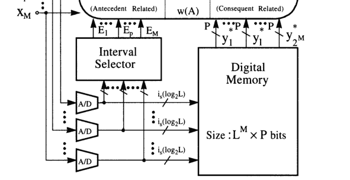

图2.5：具有复用模拟核心的控制器总体架构。

在[25]中提出用于模拟模糊设计。假设相等差分对并使用MOS晶体管的平方律特性[26]对该电路进行分析，得到：

```
s_ij = { 0 , ~x_ij- < -E_Q ; (1 + sqrt(2)/E_Q) I_Q ~x_ij- sqrt(1 - ~x_ij-^2 / (2 E_Q^2)) , -E_Q < ~x_ij- < E_Q ; 2 I_Q , otherwise ; (1 - sqrt(2)/E_Q) I_Q ~x_ij+ sqrt(1 - ~x_ij+^2 / (2 E_Q^2)) , -E_Q < ~x_ij+ < E_Q ; 0 , ~x_ij+ > E_Q } (2.6)
```

其中 ~x_ij- = (x_i - E_ij-), ~x_ij+ = (x_i - E_ij+)，E_Q = sqrt(I_Q / beta_N1)，beta_N1是差分对中晶体管的大信号跨导因子¹，并且我们假设隶属函数宽度足够大，使得输出电流能在中心达到单位逻辑值(I_Q)。

该隶属函数电路具有图2.6(b)的优点，可以通过向高输入阻抗端子施加电压来控制中心和宽度。

```
2 Delta_ij = E_ij+ - E_ij-      2 E_ijC = E_ij+ + E_ij-   (2.7)
```

另一方面，交叉点zeta_ij处的斜率由MOS晶体管的大信号跨导²控制。

```
zeta_ij = sqrt(2 I_Q beta_N1)   (2.8)
```

该隶属函数电路的主要优点是不需要任何线性化电路——如果整体行为是非线性的，为什么要线性化呢？因此，它具有最小的占用面积和功耗，并充分利用跨导器的输入动态范围。另一方面，已经表明(2.6)中的形状实际上可以实现通用的

> ¹ 该方程展示了正、负输入晶体管相等的最简单情况。
> ² 使用偏置电流控制斜率不方便，因为偏置电流设定了逻辑值“1”。

将晶体管用作二极管，移除电流源I_G，并将顶部晶体管M_N2Tk的漏极连接到作为输出节点的公共节点。这样，输入共享两个节点而不是一个。此外，移除电流I_G使得该电路的分辨率依赖于输出电流电平，并且对于大电流来说尤其小[27]。最后，由于输出节点负载随输入数量增加而增加，当输入数量增加时，该电路的性能比图2.8(a)所示的差。

现在让我们描述图2.7中标签块中最小值运算前两步的实现。第一步（补运算）通过图2.7中右上电流镜输入节点处的基尔霍夫电流定律(KCL)实现。其输入电流为s_ij_bar + I_B，其中加入电流I_B是为了防止晶体管进入亚阈值区，否则运行速度会显著降低。另一方面，注意该电流镜有L^{M-1}个输出支路，用于为不同规则生成隶属函数输出副本s_ij|^r（1 ≤ r ≤ L^{M-1}）。第二步也在标签块中实现，包括生成一组中间电压V_Gij|^r，它们是电流s_ij|^r_bar + I_B的非线性函数。这些电压中的每一个都在图2.7右下阴影区域中由两晶体管电路生成（另见图2.8(a)）；为使该两晶体管电路正常工作，必须添加一些额外电路来对节点V_G放电——由规则块中包括的电流源I_G提供。

最小值运算的下一步在规则块中实现（请记住，图2.2(a)中该块具有一个输入和一个输出）。为此，与第k条规则相关联的M个隶属函数值的一组电压V_Gik被布线并连接在规则块的输入节点处（见图2.8(a)左侧）。因此，在这个公共节点上执行集体计算，使得该组电压中的最大值占主导。根据该最大电压，通过图2.8(a)中的晶体管M_N3S生成相应的最大电流s_ik(x_i)|_max_bar + I_B。根据(2.10)，这对应于多维隶属值平移I_B后的模糊补w_k(x)。

## 规则块

第k个规则块首先用于计算电流w_k，其次生成由下式给出的输出电流：

```
y_k = y_k^* (w_k / sum_{k=1..N} w_k)  (2.11)
```

然后将这些电流路由到公共节点，通过KCL实现(2.4)。

(2.11)和/或(2.4)的模拟实现主要有三种方法：使用Mead的[32]具有加权能力的跟随器聚合电路的扩展[16][36]；使用加权加除法电路[14][34][35]；使用归一化加加权电路[25][23]。第一种使用优雅的电路概念（见图2.9(a)）实现具有电压输出的(2.4)的非线性版本。然而，由于反馈，其瞬态响应并非最佳；此外，由于大信号电流w_k施加在TA偏置端，线性工作范围和瞬态响应在论域上很大程度上是非均匀的；最后，需要额外的MDAC来加入单例的数字可编程性。图2.9(b)和(c)展示了其他两种方法的概念。两者都允许单例透明的数字可编程性。然而，不同的原因促使我们使用归一化加加权方法。首先，加权加除法方法需要复制输入电流并使用宽范围线性电流模式除法器，而归一化可以通过一个每输入仅两个晶体管的集体计算电路实现；因此，所选方法导致更简单的电路。其次，因为在图2.9(b)中(2.4)的分子和分母的传输路径不相同，这种方法对失配更敏感。第三，图2.9(b)的瞬态响应在很大程度上依赖于信号电平。第四，没有简单的方法来补偿除法器中的误差——唯一的方法是使用非常精确的除法器。

图2.10显示了规则块的原理图，其中实现了四种不同的操作：首先，按照第2.3.1节的说明生成电流w_k + I_B；其次，对该电流进行补运算和平移以获得w_ks = w_k + I_OS；第三，所有规则块执行集体计算（它们共享全局节点A_NOR和B_NOR）以实现归一化


Figure 2.9: Singleton defuzzification strategies: (a) follower-aggregation; (b) weighting-plus-division; (c) normalization-plus-weighting.

operation; fourthly, the resulting current is weighted by a digitally-controlled current mirror to obtain the shifted version of the k-th rule output current.

Fig.2.11 shows the CMOS normalizer circuit used in the proposed chip, based on a translinear BJT circuit by Gilbert [33]. Unlike the normalizers used in [34][23], Fig.2.11 does not involve any global feedback loop and, hence, features much faster dynamic response. Note that Fig.2.11 can be split into N equal cells, one per each input-output pair, plus a common circuitry consisting of transistor M_NA and current source I_SS. Fig.2.10 exploits this modularity by incorporating one of these cells at each rule block.

Assuming that the transistors operate in strong inversion, where the BJT

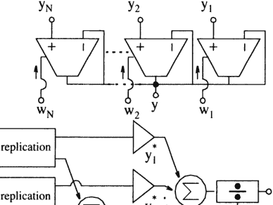

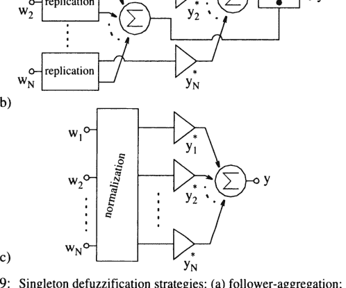

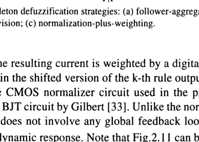

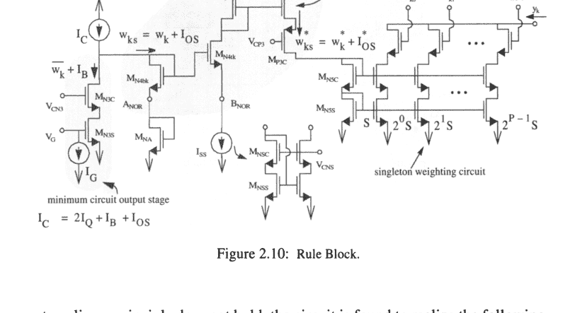

Figure 2.10: Rule Block.

translinear principle does not hold, the circuit is found to realize the following nonlinear transformation:

w*_ks = (β_N4t / β_N4b) w_ks [1 + η(w_s) / sqrt(w_ks) ]^2  (2.12)

where function η(w_s) is

η(w_s) = ( Σ_k sqrt(w_ks) / N ) ( sqrt( 1 + ( N I'_SS - Σ_k w_ks ) / ( Σ_k sqrt(w_ks) )^2 ) - 1 )  (2.13)
(I'_SS = (β_N4b / β_N4t) I_SS)

and

w*_k = w*_ks - I*_OS      I*_OS = w*_ks(I_OS)  (2.14)

The offset current I_OS is added to improve the dynamic behavior. Note from Fig.2.10 that it is related to the bias currents in the rule antecedent by

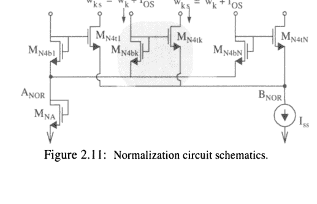

Figure 2.11: Normalization circuit schematics.

I_OS = I_C − 2I_Q − I_B . Thus, it can be introduced by just increasing current I_C without additional area cost, although it will be preserved in figures and equations to gain clarity.

The circuit in Fig.2.11 exhibits the following features: a) the sum of all output currents is constant and equal to I_SS ; b) for each input, the input-output transformation is a soft monotonic one, i.e., the higher an input current, the higher the corresponding output current. Thus, the relative strengths of the different rule antecedents are preserved at the outputs – as required for defuzzification [1]-[5]. Hence, although this circuit does not realize the ideal normalization operation, it keeps the essential features needed for defuzzification; non-linearity is not problematic because the whole controller chip is highly nonlinear. Actually, system-level analysis shows that, despite this non-linearity, the normalization-plus-weighting defuzzification approach may feature smaller deviations from the linear interpolation than the ideal weighting-plus-division structure [27].

Fig.2.10 employs a digitally-controlled current-mirror (represented at the conceptual level in Fig.2.12(a)) in order to implement a programmable singleton value y_k^*. As compared to analog-programmed current mirrors [37][45], the digital approach is preferred because it is more robust and accurate, compatible with standard memory circuits and directly controllable through conventional computers.

Regarding the mirror circuitry itself, and because the normalization circuit output stage does not impose major range limitations, a stacked (self-biased) cascode structure is used to minimize errors due to dc mismatching. On the

#### 2.3. Analog Core Implementation

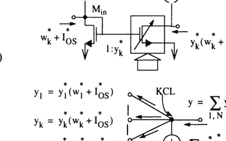

(a)

y_1 = y_1* (w_1* + I_OS*)

y_k = y_k* (w_k* + I_OS*)

y_N = y_N* (w_N* + I_OS*)

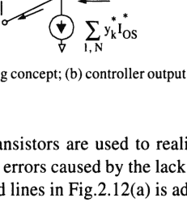

(b)

Figure 2.12: (a) Singleton weighting concept; (b) controller output node.

other hand, parallel-connected unit transistors are used to realize the binary weighting and, thus, reduce systematic errors caused by the lack of symmetry. The bias current depicted by the dashed lines in Fig.2.12(a) is added to reduce speed degradations due to the increase of parasitic capacitance for large singleton values.

After singleton weighting, the rule block outputs are wired up to the output node where a current −∑_{1,N} y_k* I_OS* is added to remove the offset, thus obtaining equation (2.4).

### 2.3.2. Modifications for the Multiplexed Architecture

The architecture of the analog core in Fig.2.5 is similar to that in Fig.2.2, but just 2^M rules are needed here, and only two membership functions per input. Building blocks are also quite similar to those described above, although we should point out some differences derived from the specific multiplexing strategy. First, as mentioned in Section 2.2.3., only the thick part of the membership functions in Fig.2.4(b) is needed in each interval. Hence, the membership function circuit must be able to generate two pieces with slopes of opposite signs. This is achieved in the simplest way by a differential pair, as Fig.2.13(a) depicts. Moreover, the differential pair provides two complementary curves, which can be exploited to save the explicit complement implementation if we perform the minimum by means of a maximum-plus-complement circuitry

further processing is made in current mode. Current outputs of the differential pair are replicated to generate the 2^M outputs required to implement the 2^M rules that determine the output inside a specific interval. Such currents are converted into voltages by the minimum circuit input unit cell that is shaded in Fig.2.13(b). The 2^M voltage outputs of this block are attached to those provided by the remaining input blocks. As a result, 2^M rule antecedents are implemented. The voltage outputs of these antecedents feed 2^M rule blocks like those depicted in Fig.2.13(c). Circuitry in Fig.2.13(c) implements the blocks in the second layer of Fig.2.2. Fig.2.13(d) shows an example interface to build rule R_mn in Fig.2.4. In the example of Fig.2.4, we need two input blocks, which provide four voltage outputs each (note that the differential pair outputs are replicated to share the circuit and save area and power consumption). To build rule R_mn, outputs V_G1(m+1) and V_G2(n+1), corresponding to membership functions X_1(m+1) and X_2(n+1), are connected to the minimum output cell of the rule block associated to R_mn. Fig.2.13(d) is in fact a minimum circuit where the complement at input is saved because the complements are directly provided. Note that X_1(m+1) and X_2(n+1) are the complements of X_1m and X_2n respectively in the interpolation interval C_mn of Fig.2.4.

With respect to the high level block in Fig.2.13(c), it is very similar to the rule block described in Section 2.3.1., but two main differences are worthy of comment. The first refers to the design of the normalization circuit in Fig.2.11. Although the implementation for the new architecture has the same topology, the transistors are sized taking into account the multiplexing strategy. To understand this, see Fig.2.12(b) and note that an offset that depends on the singleton values associated to the rule set has to be removed at the output node. Since the core in Fig.2.5 is multiplexed, the singleton values set y_1^*...y_1^*...y_2^M changes from one interpolation interval to the other; thus the offset also varies as a function of the input. It could be solved by properly programming the offset current source in Fig.2.12(b), as done with other circuitry in the analog core. However, a simpler solution is achieved by designing the normalization circuit in such a way that when an output of the normalization circuit is at maximum, the remaining ones are zero; thus there is no residual offset to be weighted by the output singleton-weighting mirror. This is accom-

#### 2.4. A/D Converters, Interval Selector and Digital Memory

### 2.4.1. A/D Converters

Many possible implementations of A/D converters have been reported and could be used for this block. However, since a resolution of i_s(log₂L) bits is required and L (number of labels) is rarely higher than seven, a simple and fast flash converter like the one depicted in Fig.2.14(a) can be used. Although it is a common flash converter, some implementation details are worthy of comment here. First, the array of linear resistors generates twice the voltage levels needed for the A/D conversion. The “extra” voltage levels are used as programming values for the rule antecedent; thus they are a kind of analog read only memory. Note also that this array of resistors can be shared by all the converters (one per input) as long as the comparators have high impedance inputs. Secondly, these comparators are designed to have hysteresis, which is needed to filter the noise associated to the system inputs and to avoid an unstable out-

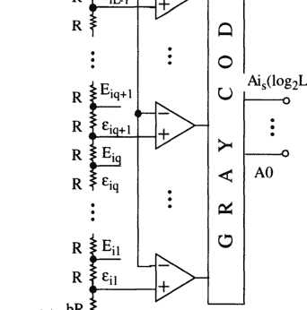

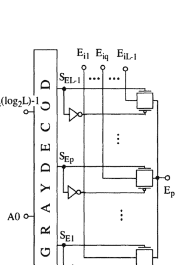

Figure 2.14: (a) A/D Flash Converter ; (b) Interval Selector k Cell.


\(L^{M-1}/2^{M-1}\) 行和 \(L\) 列。每个存储单元阵列存储需要同时寻址的单值对。行选择器同时选择 \(2^{M-1}\) 行，每一个存储单元阵列一行，以提供一组 \(L \times 2^{M-1}\) 个单值。列选择器从该集合中选择正确的单值，并控制多路复用器以将它们放置在正确的位置以形成 \(2^M \times P\) 输出字，全部在一 步完成。为了说明数据分布和存储器操作，让我们展示二维情况下的情况。图2.16(a) 显示了四个通用相邻区间 \(C_{mn}, C_{(m-1)n}, C_{(m-1)(n-1)}, C_{m(n-1)}\) 及其相关联的单值。这些值分布到两个存储单元阵列中，如图2.16(b) 顶部所示。存储单元阵列 1 包含具有奇数 \(n\) 索引的行，而存储单元阵列 2 包含具有偶数 \(n\) 索引的行。两个阵列均有 \(L\) 列。图2.16(b) 中这些阵列下方显示了针对图2.16(a) 中四个区间的行选择结果。用于编程模拟核心的所有单值（图中用方框圈出）都在 resulting 字中。最后，列选择器选择这些单值并将它们放置在输出总线上。注意每个单值都出现在正确的位置（参见图2.16(a)）。尽管对于内部访问来说有些棘手，但存储器对于外部访问被配置为常规 RAM。

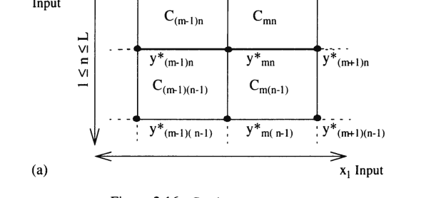

(a)

Figure 2.16: Caption on next page.

最小二乘误差 (LSE) \(\|W^*Y^* - Y_d\|^2\) 并由下式给出：

\[
Y^* = (W^{*T} W^*)^{-1} W^{*T} Y_d
\tag{2.19}
\]

该式可按递归方式计算 [42][5]。

前述算法是一种批处理过程，其中参数（单值）由整个训练集更新。一种更简单的替代方案是增量 LMS 规则，其中参数在每次呈现输入-输出对时更新 [41]，

\[
y_i^{*\mathrm{new}} = y_i^{*\mathrm{old}} + \mu [y_d(x)-y(x)] w_i^*(x), \qquad i = 1,\ldots,N
\tag{2.20}
\]

其中 \(\mu\) 为常数。有趣的是注意 (2.20) 也可以从梯度规则得到 [43]。注意输入 \(x\) 对正在更新其单值的模糊集合的隶属度是通过将增量加权为 \(w_i^*(x)\) 来考虑的。输入越接近模糊集合的核心，\(w_i^*(x)\) 的值越大；因此单值根据其对输出的影响进行调谐。考虑这种依赖关系的另一种方法仅更新其相关规则前件最大的单值，即：

\[
y_i^{*\mathrm{new}} = y_i^{*\mathrm{old}} + \mu (y_d(x)-y(x))
\tag{2.21}
\]

其中 \(i\) 为规则的索引，使得 \(w_i^*(x) = \max[w_1^*(x), w_2^*(x), \ldots, w_N^*(x)]\)。这显然是 outstar 增量规则，用于训练反向传播网络中的 Grossberg 层。后者旨在用于聚类目的，但也可以逼近函数 [44]。原理与图2.17 中的通用架构完全相同，但在该网络中，第一层（Kohonen 层）中的集合是清晰的而不是模糊的。式 (2.21) 中规则的简单性使其成为硅实现的良好候选；因此我们选择它来证明其可行性。

式 (2.21) 中的参数 \(\mu\) 决定学习速度。由于受限分辨率，更新的单值将具有最小增量 \(\Delta y_{i,\min}^* = (y_i^{*\mathrm{new}} - y_i^{*\mathrm{old}})_{\min}\)，因此该常数必须选为满足：

\[
\mu \geq \frac{\Delta y_{i,\min}^*}{\varepsilon_{y,\min}}
\tag{2.22}
\]

其中 \(\varepsilon_{y,\min} = |y_d(x)-y(x)|_{\min}\) 是可转化为单值增量的输出与目标之间最小偏差。换句话说，超过该最小值后学习过程停止，参数（单值）不再更新。

为了说明这种简单学习过程的性能，我们用输入空间的晶格划分训练了一个控制器（软件模型），每个输入均匀分布六个标签。输入-输出训练样本由函数 \(y = 2 + \sin(\pi x_1) \sin(\pi x_2)\) 获得，最高达 \(11 \times 11\) 个样本以覆盖输入区间 \([0, 2] \times [0, 2]\)。然后我们用式 (2.21) 中的 outstar 规则训练网络，因此仅单值从初始值 1 更新。结果如图2.18 所示。图2.18(a) 显示了由矩阵样本数据构建的目标函数，而图2.18(b) 显示了控制器在 500 个 epoch 后的输出（整个样本集已使用 500 次来训练网络）。最终 RMSE 为 0.067，RMSE 演化如图2.18(d) 所示，而最终误差 \(y_d(x)-y(x)\) 如图2.18(c) 所示。此外，我们后来考虑了单值的有限分辨率，因此将获得的单值截断以仅用四位分辨率表示。所得 RMSE 为 0.078，误差曲面如图2.18(e) 所示。

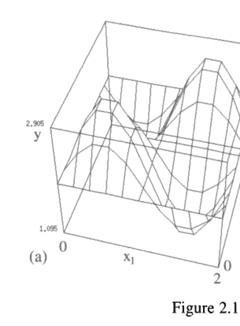

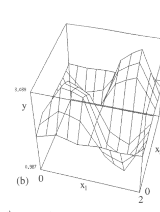

Figure 2.18: Caption on next page.

#### 2.6. Results and Conclusions

一个 64 规则、2 输入、4 位单值控制器 (\(L = 8\), \(M = 2\) 和 \(P = 4\)) 已在 CMOS \(0.7\,\mu m\) 工艺中设计，以证明图2.5 中多路复用架构的可行性。图2.19(a) 显示了芯片的显微照片，而图2.19(b) 显示了为其设计的原型板的框图。后者包括构建偏置电流源所需的电路，以及与 PC 的 8255/8253 I/O 卡接口所需的电路。PC 接口提供读取和写入访问以编程芯片存储器。它还提供对 D/A 转换器的写入访问和对 A/D 转换器的读取访问；因此该板作为简化的数据采集板工作。此外，使用 TEKTRONIX TDS 520 数字化示波器来测量动态响应以及获得直流控制表面的截面。

图2.20 显示了从该测试环境获得的一些实验结果。图2.20(a) 和图2.20(b) 分别描绘了示例直流控制表面的截面和对阶跃输入的瞬态响应，均用示波器测量。前者说明了对一个输入（顶部）斜坡的响应（底部），而另一个输入保持恒定，呈现类似墨西哥帽的曲面。后者对应于一个输入的下降沿，使输出从最大值变为最小值，以及跳到不同的插值区间，这意味着模拟核心的动态编程。测得的延迟时间约为 500ns。由于示波器无法感测电流，前述测量为输出 \(y_v\) 中的电压（参见图2.19(b)）。关于图2.20(c) 和图2.20(d)，它们由图2.19(b) 中的数据采集板数据构建，其中芯片的电流输出在外部转换为数字字并进行处理。这两个示例说明了控制器插值非线性（图2.20(c)）以及线性函数（图2.20(d)）的能力。

测得的芯片功耗约为 16mW，通过感测来自供电电压源的电流获得。控制器设计为考虑晶体管失配，对于输出相关标准差 (\(\sigma\)) 等于 3.3% 的误差，而测得的误差约为 10%。后者对应于最坏情况，几乎相同的延迟、16mW 功耗和仅 \(2.6\,mm^2\) 面积。由于该策略的功耗随系统复杂度增长，让我们做出一些简化以突出其相对于全模拟实现的优势。让我们考虑区间选择器和 A/D 转换器的面积和功耗，与模拟核心和存储器消耗相比可以忽略不计（注意系统中只需要一个电阻阵列，无论有多少转换器）。此外，假设类似的互连面积（实际上在所提出策略中必须小得多）。由于数字存储器在两种实现中大小相同，以上假设允许我们对面积和

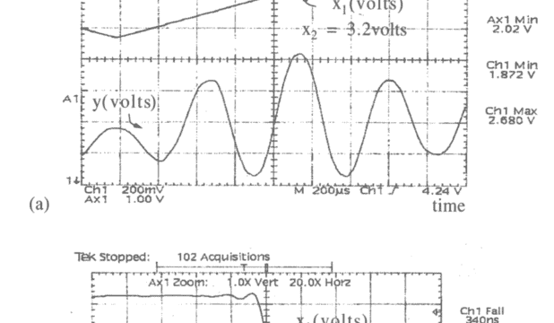

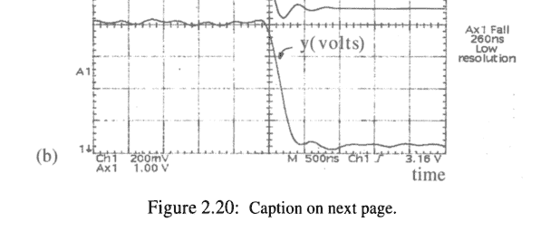

Figure 2.20: Caption on next page.


所提出的实现方式更为合适。最后请记住，只有已实现的规则，即激活规则，才会对输出误差产生影响，这使得系统在给定误差界内，相对于全模拟实现而言可以进行扩展。

#### 2.7. 致谢

本研究得到了西班牙CICYT根据合同TIC99-0826的部分支持。

#### 2.8. 参考文献

- [1] J.M. Mendel，“面向工程的模糊逻辑系统：教程”. Proceedings of the IEEE, 第83卷, 第345-377页, 1995年3月.
- [2] H. Takagi，“神经网络和模糊逻辑在消费产品中的应用”. 第8-12页，载于 Fuzzy Logic Technologies and Applications, 纽约: IEEE Press, 1994年.
- [3] Marco Russo，“从历史角度看模糊硬件研究”，第1章，载于 FUZZY HARDWARE Architectures and Applications（Abraham Kandel 和 Gideon Langholz 编），第1-25页，Kluwer Academic Publishers，1998年.
- [4] M. Brown 和 C. Harris，神经模糊自适应建模与控制. Englewood Cliffs: Prentice-Hall, 1994年.
- [5] J.S.R. Jang 和 C.T. Sun，“神经模糊建模与控制”. Proceedings of the IEEE, 第83卷, 第378-406页, 1995年3月.
- [6] H. Watanabe, W. D. Dettloff 和 K. E. Yount，“具有可重构、级联架构的VLSI模糊逻辑控制器”. IEEE J. Solid-State Circuits, 第25卷, 第376-382页, 1990年.
- [7] K. Nakamura, N. Sakashita, Y. Nitta, K. Shimomura 和 T.Tokuda，“模糊推理与模糊推理处理器”. IEEE Micro, 第13卷, 第37-48页, 1993年10月.
- [8] H. Eichfeld, M. Klimke, M. Menke, J. Nolles 和 T. Künemund，“通用模糊推理处理器”. IEEE Micro, 第15卷, 第12-17页, 1995年6月.
- [9] A. Costa, A. de Gloria, P. Faraboschi, A. Pagni 和 G. Rizzotto，“模糊控制的硬件解决方案”. Proceedings of the IEEE, 第83卷, 第422-434页, 1995年3月.
- [10] M. Masetti, E. Gandolfi, A. Gabrieli 和 F. Boschetti，“4输入VLSI模糊芯片设计，能够每320ns处理一个输入数据集”. Proc. of the JCIS’95, Wrightsville Beach, North Carolina, USA, 1995年10月.
- [11] Marco Russo，“设计一个简单系统以大幅提高一大类模糊学习方法的学习速度”，第10章，载于 FUZZY HARDWARE Architectures and Applications（Abraham Kandel 和 Gideon Langholz 编），第207-229页，Kluwer Academic Publishers，1998年.
- [12] A. Rodríguez-Vázquez, R. Navas, M. Delgado-Restituto 和 F. Vidal，“一种模块化可编程CMOS模拟模糊控制器芯片”. IEEE Trans. Circuits and Systems - II, 第46卷, 第251-265页, 1999年3月.
- [13] J.W. Fattaruso, S.S. Mahant-Shetti 和 J.B. Barton，“一种模糊逻辑推理处理器”. IEEE Journal of Solid-State Circuits, 第29卷, 第397-402页, 1994年4月.
- [14] J. L. Huertas, S. Sánchez-Solano, I. Baturone 和 A. Barriga，“模糊控制器的集成电路实现”. IEEE Journal of Solid-State Circuits, 第31卷, 第1051-1058页, 1996年7月.
- [15] L. Lemaître, M. J. Patyra 和 D. Mlynek，“电流模式CMOS模糊逻辑控制器的分析与设计”. IEEE Journal of Solid-State Circuits, 第29卷, 第317-322页, 1994年3月.
- [16] N. Manaresi, R. Rovatti, E. Franchi, R. Guerrieri 和 G. Baccarani，“模拟模糊控制器的硅编译器：从行为规范到版图”. IEEE Trans. on Fuzzy Systems, 第4卷, 第418-428页, 1996年11月.
- [17] S. Guo, L. Peters 和 H. Surmann，“一种模拟模糊逻辑控制器的设计与应用”. IEEE Trans. on Fuzzy Systems, 第4卷, 第429-438页, 1996年11月.
- [18] F. Vidal-Verdú 和 A. Rodríguez-Vázquez，“在硬件限制下学习：能够从示例中提取规则的CMOS模糊控制器”. Proc of IFSA’95, 第189-192页, Sao Paulo, Brazil, 1995年7月.
- [19] A. Rodríguez-Vázquez, M. Delgado-Restituto 和 F. Vidal，“非线性电路的综合与设计”，第32章，载于 The Circuits and Filters Handbook（Wai-Kai Chen 编），第935-972页，CRC Press，1996年.
- [20] A. Rodríguez-Vázquez 和 M. Delgado-Restituto，“使用状态变量的混沌振荡器CMOS设计：单片蔡氏电路”. IEEE Transactions on Circuits and Systems-II, 第40卷, 第596-613页, 1993年10月.
- [21] A. Rodríguez-Vázquez 和 M. Delgado-Restituto，“使用电流模式技术产生混沌信号”. Journal of Intelligent and Fuzzy Systems, 第2卷, 第15-37页, 1994年.
- [22] T. Kettner, C. Heite 和 K. Schumacher，“模糊逻辑隶属函数的模拟CMOS实现”. IEEE Journal of Solid-State Circuits, 第28卷, 第857-861页, 1993年7月.
- [23] M. Sasaki, N. Ishikawa, F. Ueno 和 T. Inoue，“具有电压输入接口和归一化锁相环的电流模模拟模糊硬件”. IEICE Trans. Fundamentals, 第E75-A卷, 第650-654页, 1992年6月.
- [24] J.W. Fattaruso 和 R.G. Meyer，“MOS模拟函数综合”. IEEE Journal of Solid-State Circuits, 第22卷, 第1059-1063页, 1987年12月.
- [25] A. Rodriguez-Vázquez 和 F. Vidal，“单点模糊控制器的模拟CMOS设计”. The Third International Conference on Industrial Fuzzy Control Intelligent Systems, 1993年12月.
- [26] Y. Tsividis，混合模拟-数字VLSI器件与技术. 纽约: McGraw-Hill, 1996年.
- [27] F. Vidal，混合信号CMOS神经模糊控制器设计. 博士论文，马拉加大学，1996年.
- [28] M. Sasaki, T. Inoue, Y. Shirai 和 F. Ueno，“电流模式下的模糊多输入最大值和最小值电路及其使用有界差分方程的分析”. IEEE Transactions on Computers, 第39卷, 第768-774页, 1990年6月.
- [29] T. Yamakawa 和 T. Miki，“采用标准CMOS工艺制造的电流模式模糊逻辑集成电路”. IEEE Transactions on Computers, 第C-35卷, 第161-167页, 1986年2月.
- [30] J. Lazzaro, R. Ryckebusch, M. A. Mahowald 和 C. A. Mead，“O(n)复杂度的胜者全取网络”. Advances in Neural Information Processing Systems,（D. S. Touretzky 编），第1卷, Los Altos, CA: Morgan Kaufmann, 1989年.
- [31] C. Y. Huang 和 B.D. Liu，“用于模糊逻辑控制器的电流模式多输入最大值电路”. Electronics Letters, 第30卷, 第1924-1925页, 1994年.
- [32] C. Mead，模拟VLSI与神经系统. Addison Wesley, 1989年.
- [33] B. Gilbert，“从跨线性视角看电流模式电路：教程”，载于 模拟IC设计：电流模式方法, C. Toumazou, F. J. Lidgey 和 D. G. Haigh 编，伦敦: Peter Peregrinus Ltd., 1990年.
- [34] T. Miki, H. Matsumoto, K. Ohto 和 T. Yamakawa，“一种新型高速模糊推理引擎的硅实现：Mega-Flips模拟模糊处理器”. Journal of Intelligent and Fuzzy Systems, 第1卷, 第1期, 第27-42页, 1993年.
- [35] V. Catania, A. Puliafito, M.Russo 和 L. Vita，“基于离散模拟方法的VLSI模糊推理处理器”. IEEE Transactions on Fuzzy Systems, 第2卷, 第2期, 第93-106页, 1994年5月.
- [36] K. Tsukano 和 T. Inoue，“基于运算跨导放大器的模拟模糊功能块综合及其应用”. IEEE Transactions on Fuzzy Systems, 第3卷, 第61-68页, 1995年2月.
- [37] M. Sasaki 和 F. Ueno，“使用电流模CMOS电路的模糊逻辑控制器VLSI实现”. The Third International Conference on Industrial Fuzzy Control Intelligent Systems, 第215-220页, 1993年12月.
- [38] Li-Xin Wang，模糊系统与控制教程. Prentice-Hall, 1997年.
- [39] J.S. R. Jang 和 C. T. Sun，“径向基函数网络与模糊推理系统之间的功能等价性”. IEEE Transactions on Neural Networks, 第4卷, 第1期, 第156-159页, 1993年1月.
- [40] D. F. Specht，“一种通用回归神经网络”. IEEE Transactions on Neural Networks, 第2卷, 第6期, 1991年11月.
- [41] D. R. Hush 和 B. G. Horne，“监督神经网络的进展”. IEEE Signal Processing Magazine, 第8-39页, 1993年1月.
- [42] J. E. Perkins, I. M. Y. Mareels 和 J. B. Moore，“基于最小二乘的信号处理功能学习”. International Journal of Adaptive Control and Signal Processing, 第6卷, 第481-498页, 1992年.
- [43] J. Nie 和 D. A. Linkens，“使用模糊化自组织径向基函数网络的学习控制”. IEEE Transactions on Fuzzy Systems, 第1卷, 第4期, 第280-287页, 1993年11月.
- [44] J. M. Zurada，“人工神经系统导论”. West Publishing, 1992年.
- [45] A. Rodríguez-Vázquez, S. Espejo, R. Domínguez-Castro 和 J.L. Huertas，“用于实现连续和离散时间细胞神经网络的电流模式技术”. IEEE Transactions on Circuits and Systems-II, 第40卷, 第132-146页, 1993年3月.


# 3 多智能体框架中用于自主系统学习的模糊建模

Juan A. Botía

Humberto Martínez Barberá

Antonio F. Gómez Skármeta

西班牙穆尔西亚大学信息学学院信息学、人工智能与电子学系，E-30001 穆尔西亚，西班牙

- 摘要 ................................................... 94
- 3.1 引言 ............................................ 94
- 3.2 模糊建模与智能体 ............................... 95
  - 分布式人工智能（DAI）
  - 多智能体系统开发中的任务
  - 面向智能体的方法论
  - MAST：多智能体系统工具箱
  - MIX智能体模型
  - MAST：开发多智能体系统的工具
  - 使用MAST交换信息对象
- 3.3 用于模糊建模的多智能体系统架构（MASAM） ............ 101
  - 智能体架构
  - 我们MAS架构中的模糊建模
  - 模糊聚类：模糊建模的核心组件
- 3.4 聚类智能体 ....................................... 109
  - 模糊LVQ
  - 模糊禁忌聚类
  - 规则生成智能体
  - 基于遗传算法的模糊规则生成与/或调整方法
- 3.5 机器人应用示例 ............................ 117
  - 引言
  - BG编程语言
  - 机器人智能体架构
  - 学习行为融合
  - 实验结果
- 3.6 结论与未来工作 ............................ 133
- 3.7 参考文献 .............................................. 141

### 3.1 引言

……是混合系统所采用的方法。过去几年中，我们看到了越来越多的混合算法，其中集成了两种或多种软计算技术以提高整体算法性能[11]。

这些混合系统由多种不同且可互换的技术组成。这些技术的最佳组合可能因问题而异。这引导我们思考一种多松散耦合的协同处理分布式系统。每种技术都可以作为系统组件开发并封装，以在分布式环境中提供同质接口。应支持这些组件（智能体）之间的智能协作机制，以便设计和实现协作式分布式应用。

在本章中，我们提出使用通过多智能体架构协作的智能体，作为在模糊建模背景下研究不同学习技术的框架。这种涉及智能体（它们体现了不同的问题求解方法）的方法，是增强模糊建模系统能力的潜在有用策略。我们的目标是展示该框架如何让我们试验不同技术，从而选择更逼近系统行为的组合。

### 3.2 模糊建模与智能体

近年来，在模糊建模相关的文献中出现了多种可以归入软计算框架的不同技术。因此，我们看到有包括模糊神经网络[58]、模糊子集理论与梯度下降技术[62]或聚类技术[63, 62, 8]等相结合的建议。最近，这些技术的组合已被用于尝试解决与系统建模相关的不同问题[60, 55]。

模糊建模是一种用于形成模糊系统模型的方法。在模糊建模中，最重要的问题是对系统的辨识方法。使用我们关注的输入-输出数据进行模糊模型辨识包括两个方面：结构辨识和参数辨识[54]。模糊建模基于找到一组描述过程的局部输入-输出关系的思想。因此，可以预期模糊建模方法比普通方法能更好地表达非线性过程。模糊模型由若干模糊if-then规则组成。一条模糊规则包含两部分：前提部分和结论部分。这些部分由定义在不同变量域中的模糊集合组合而成。每个输入-输出关系都由一条模糊规则描述。模糊规则是通过以模糊的方式划分

#### 3.2.1 分布式人工智能（DAI）

DAI已被定义为一个术语，指代所有表现出特定实体集合行为以达到共同且全局目标的系统。这些特定实体就是所谓的智能体。根据[46]，我们可以说，看待DAI有三种不同的方法，对应AI（人工智能）研究的三个不同时期：

- 经典DAI，侧重于集体行为而非个体行为，并认为由特定智能体形成的社会比个别智能体更重要；
- 自主DAI，侧重于智能体的个体研究，但考虑到它们处于社会世界中；以及
- 商业DAI，侧重于将经典和自主DAI应用于现实世界的实际问题。

在经典方法下，研究分为以下两组：

- **分布式问题求解**（DPS）尝试使用分布式模块（或节点）以及表示问题的共享知识来解决特定问题。
- **多智能体系统**（MAS）研究智能且自主的智能体之间的行为协调。

两组之间的主要区别在于，DPS从开始就考虑到特定问题而设计；因此，在某种意义上它们是*特设*解决方案。实际上，通常有一个中央协调者和一个预先制定的计划。然而，MAS是非常通用的机制，其特定成员表现出更多自主性，且控制是分散的。

如今，MAS几乎吸引了DAI研究者的全部注意力；因此，本文将不再提及DPS。相反，研究将集中在MAS上。

#### 3.2.2 多智能体系统开发中的任务

在开发多智能体系统时，必须承担以下典型任务（或问题）：

1. 为一组智能体进行问题的表述、描述、分解和分配，以达到期望的结果；
2. 设计通信协议，使智能体具备通信和协作能力；
3. 设计控制机制，避免智能体做出与整个系统共同目标不兼容或不合适的决策或行动；
4. 使智能体能够表示和推理系统中其他智能体的行动和状态；
5. 如何检测和解决智能体社会中不同观点之间的冲突；
6. 使用软件工程技术将多智能体系统开发为它实际上应该成为的软件系统。

以上所有要点在实现过程中都至关重要。然而，最后一点对于实现合适的软件系统非常重要。

在这个工程过程中，使用面向智能体的方法论是必要的需求，因为构建多智能体系统并非易事。在第3.2.3节中，讨论了与面向智能体方法论相关的问题。此外，在此任务的实现阶段，可以从头开始工作，构建实现所设计智能体所需的全部软件，尽管这意味着一项巨大的工程。相反，可以使用多智能体平台或工具箱来完成此任务。这类平台由一组软件工具组成，用于帮助设计和实现多智能体系统。这一点将在第3.2.4节中详细说明。

#### 3.2.3 面向智能体的方法论

在开发多智能体系统的工程方法论中，有两种主要方法[35]。每种方法都受到对基本概念框架的特定主流影响。第一组来自面向对象方法论的扩展，第二组来自知识工程技术的出发点。在我们的工作中，具体案例是使用MAS-CommonKADS [35]作为开发多智能体系统的方法论，并使用MAST（多智能体系统工具）[30]作为构建整个系统的软件工具。该方法论扩展了CommonKADS [49]，这是一种知识工程方法论。在某种意义上，多智能体系统是基于知识的系统；因此，在此基础上构建多智能体系统方法论似乎很自然。使用MAS-CommonKADS开发系统基于以下模型的描述：

- 智能体模型：以推理能力、技能、服务、目标等术语描述智能体。
- 任务模型：描述问题的全局任务、其分解为子任务的情况，以及特定任务与执行它们的智能体之间的对应关系。
- 专家模型：该模型侧重于问题的基于知识的部分。它遵循KADS方法，区分四种知识类型：领域知识、任务知识、推理知识和问题求解知识。


+   - 协调模型：描述智能体之间的交互，即协议和能力。第一阶段是建模协议，第二阶段是在谈判和自组织情境中对其进行测试。
+   - 组织模型：描述 MAS 被引入的组织，以及特定的智能体及其可能的组织结构。
+   - 通信模型：用于描述人类与系统之间的交互。
+   - 设计模型：它分为三个子设计，即应用设计、架构设计和平台设计。

还有一些更有趣的方法论扩展自与 CommonKADS 相同的知识工程方法。下面将提到一个具体的例子：CoMoAS。该方法论使用了上面提到的大部分模型，即智能体、专业知识、任务、合作和设计模型。MAS-CommonKADS 和 CoMoMAS 中的专业知识模型非常相似，且智能体模型包含了 MAS-CommonKADS 通信模型，并且其组织模型在某种程度上与 CoMoMAS 中的一个新模型非常相似：系统模型。

#### 3.2.4 MAST. 多智能体系统工具箱

一旦方法论被描述，就需要填补设计模型与最终软件产品之间的空白。将描述应用于该问题的具体平台。

任何多智能体平台从一开始就有一个具体的智能体模型，如果要使平台提供的所有功能都可用，设计者必须采用该模型。即：平台决定了智能体基本能力的具体形式。因此，智能体模型将被首先介绍。

#### 3.2.5 MIX 智能体模型

在本节中，介绍了 MIX 智能体参考模型。MIX [23, 36, 43] 是使用 MAST 开发的所有系统的参考架构。它提出了两个基本模型：智能体模型和网络模型。

前者将智能体视为一组元素：

+   - 服务：提供给其他智能体的功能。
+   - 目标：智能体为自身利益而执行的功能（不是由另一个智能体的请求所致）。
+   - 资源：关于外部资源的信息，如服务、库、本体等。

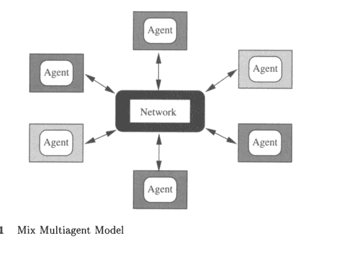

### 图 3.1 Mix 多智能体模型

+   - 内部对象：由智能体启动的所有进程共享的数据结构，以执行服务请求或实现目标。
+   - 控制：指定智能体如何处理服务请求的规范。

网络模型定义了两种不同的智能体类型：提供网络管理服务的网络智能体，以及根据其特定角色提供自身服务的应用程序智能体。该模型分为三个层次：接口、消息和传输层。第一层提供了一个 API，同时提供 C++ 和 Java，可通过消息传递在智能体之间提供通信设施。第二层服务提供用于管理地址以及消息的意图性和主体的功能。传输层提供通过 TCP/IP 发送和接收消息的基本功能。基本架构如图 3.1 所示。

#### 3.2.6 MAST：开发多智能体系统的工具

MAST [30] 是一个用于以智能体导向方式开发分布式处理信息系统的工具箱。它提供了一种机制来指定单个智能体，具有提供的和需要的服务以及特定的目标。它还包含智能体组定义、知识表示和交换工具，以及智能体之间的协调机制。

### 使用 MAST 定义智能体

ADL（智能体定义语言）[43, 第 39-47 页] 是集成到 MAST 中的一种声明式语言，用于定义智能体的外部。智能体的内部应取决于各自的具体实现。两个共享相同 ADL 定义的智能体可以以不同的方式实现，甚至使用不同的编程语言。ADL 允许我们以层次化的方式定义智能体，使用众所周知的类和继承概念。提供的服务、要实现的目标、需要的资源、内部数据结构和可应用的策略都可以用 ADL 指定。ADL 智能体定义的示例可见于 [43, 第 73-80 页]。对于具体智能体的定义，必须声明以下元素：

+   1. YP_agent 所在的机器的网络地址。
+   2. 用于编写本体论的默认语言。
+   3. 在具体应用领域中使用的默认本体论。
+   4. 用于实现智能体提供的服务的 C++ 库。
+   5. 智能体可以按类层次结构组织并具有继承，因此必须指定此结构。

#### 3.2.7 使用 MAST 交换信息对象

一旦我们定义了构成系统的智能体，我们就应该能够在它们之间交换知识。CKRL（通用知识表示语言）[16] 是 MAST 中用于声明要由智能体发送、接收和管理的知识对象的语言。它由 MLT 联盟在欧洲 ESPRIT 项目 2154 下开发。

#### 3.3 用于模糊建模的 MAS 架构（MASAM）

在以下部分，描述了用于模糊建模过程中学习的 MAS 架构。该架构已被安排作为基于智能体的通用元学习机制。如今，该系统已具体化为通用数据挖掘系统 GEneric data MINing System（GEMINIS）[14]，以便学习哪些数据挖掘技术适合给定的学习任务、用户的学习需求和某些数据集特征。这里提出的是将该架构用于模糊建模（FM）。

下面将介绍系统中参与的所有智能体。

+   - 用户智能体：它们充当系统的前端。它们的任务可明确分为两组：
+     - 用户支持任务，帮助用户管理可用的建模技术，显示有关它们的信息，用新技术升级系统，删除不合适的技术，重新定位资源等等。

#### 3.3.1 智能体架构

智能体架构如图 3.2 所示。图中出现了两个 MASAM 站点和一个用户环境。MASAM 站点可以根据计算环境或甚至不同大学或类似机构内部的组织，组织在 DSAs 数据库的 ALAs 上。为了构成用户环境，预计只需要一个带有 Java 虚拟机的 Web 浏览器即可访问系统。为了给出前端的一些概念，不同的快照可以在图 3.3、3.4 和 3.5 中看到。它们展示了一个原型实现，使用 TCL/TK 实现了一个客户端和一个 ALA 作为反向传播网络的包装器 [25]。图 3.3 中可以看到可以调用的不同学习相关服务。例如，在图 3.4 中，在调用配置之后，该界面出现以配置网络拓扑。一旦拓扑定义完成，并在调用学习之后，图 3.4 中出现的窗口允许用户配置反向传播算法的典型训练参数。

#### 3.3.2 我们 MAS 架构中的模糊建模

一旦我们定义了多智能体架构，我们就把注意力转回我们的智能体所实现的学习技术，以及构成 ALA 智能体的技术。

我们将考虑一个 MISO 系统而不失一般性。我们想要找到一个逼近函数 φ: X^p ⟶ Y 的系统，该函数对系统进行建模。我们有一个系统在空间 (X^p × Y) 中的行为样本集，ω = ((x_t1, x_t2, …, x_tp), y_t)，t = 1,2,K,n，其中 X1,X2,…,Xp 是输入的域，Y 是输出的域。假设我们有一组数据代表系统的行为趋势。我们希望使用 k 条模糊规则对这种行为进行表征，这些规则将具有以下形式：

R_h: If x is A_h then y is B_h, h = 1,…,k (3.1)

其中 A_h 和 B_h 分别是 X^p 和 Y 中的模糊集。一旦所有这些规则都被创建（第 3.4 节专门介绍它们是如何创建的），就可以使用近似推理对任何新输入进行推理。

我们在 MASAM 架构中实现了几种不同的学习智能体，使用诸如遗传算法、神经网络、模糊决策树等技术，还有许多其他技术，尽管我们将在本章中仅描述对应用领域有意义的学习智能体。为了查看其他组合请参阅 [20] [29]。


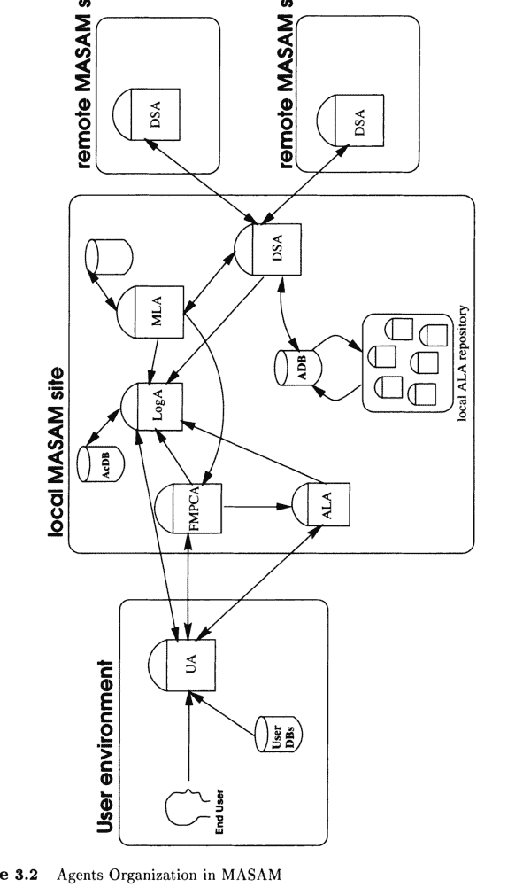

图3.2 MASAM中的智能体组织

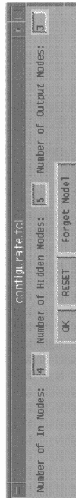

图3.4 ALA内部两层ANN的配置

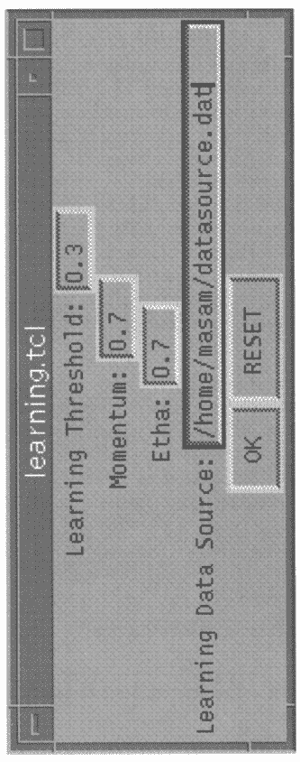

图3.5 在ALA内部安排反向传播网络的学习过程

### 3.3.3 模糊聚类：模糊建模的核心组件

在系统辨识领域中，模糊聚类的过程已被以多种方式使用。文献[47]利用标准形式的模糊C均值算法来构造被视为基本信息块的语言标签，不过随后模糊模型的构建是通过模糊关系方程获得的；因此这类技术可以被视为基于模板的模型类型。模糊聚类还可以产生“局部”回归模型——这实际上是文献[53][56]最初提出的思想的核心，并且已被其他人使用[54, 6, 5]。整体模型随后被组织成一系列IF-THEN语句。语句的条件部分可能包括输入变量的语言标签，或直接是输入变量乘积空间上的模糊关系，而动作部分则包含输入与输出变量之间的线性（或一般非线性）数值关系。聚类方法适用于条件部分的形成。

基于模糊聚类的模型开发技术有几个优点：

- 一种自动形成模糊集（模糊关系）的方式。聚类技术是无监督学习方案，因此不需要关于数据结构的任何初始知识。
- 我们可以统一处理所有系统变量，并依据所获得的数据聚类来开发模糊模型。这样得到的模型不受结构限制，可以从许多不同角度加以利用。这些方法具有可逆性，这意味着模型中的任何变量都可以以相同的灵活度被访问。

模糊聚类以这种方式可用于：

- 获取乘积空间X^p和输出空间Y中的模糊集——在这种情况下，如果我们没有关于输出空间划分的信息；
- 获取行为乘积空间(X^p × Y)中数据的趋势，因此这些趋势可用于为模糊规则分配权重，这些模糊规则可以通过考虑输入空间X^p和输出空间Y中检测到的模糊集的不同组合来生成。

一旦我们得到带有权重的可能规则，就可以首先获得模型的描述，考虑对应于输入乘积空间中所发现模糊聚类的模糊集在每个论域上的投影；如果有必要，当我们想要一个使用预定义语言值集合的定性模型时，还可以进行语言近似。使用这种方法，我们可以缩小解搜索空间，因为不需要考虑与使用输入变量各论域中定义的模糊集集合时所需数量的可能模糊规则；不过无论如何，我们都可以使用这些规则来表达所得到的模型。此外，由于模型必须由专家验证，因此在第一步中更重要的是尝试以快速方式获得一个原型模型。然后可以在后续步骤中对这个初步模型进行调优和剪枝。值得注意的是，由于我们是在获取初始模型，所以所考虑的方法必须尽可能简单，但同时也要具有良好的逼近能力。

#### 3.4 聚类智能体

我们介绍多智能体架构可以集成的一些不同聚类智能体。我们在MASAM中实现了模糊聚类智能体，如经典的模糊C均值算法[9]及其若干变体。接下来我们将解释其中两个变体。

在任何情况下，我们都认为我们以某种方式知道数据中存在k个聚类。在本章中，我们不讨论如何获得正确的模糊聚类数量。在一些论文中，规则数量是通过使用文献中现有的某些有效性度量进行聚类验证来决定的。我们利用数据的预处理，即对数据进行层次聚类，通过它我们可以研究和选择更好的数据划分[19]。此外，这些划分随后可以作为模糊聚类算法的初始化，从而获得更好的算法性能。

我们不需要知道数据结构的任何其他信息（例如线性或非线性）。我们将使用聚类算法来找到k个质心。需要特别指出的是，聚类过程是在输入和输出乘积空间上进行的。这个过程的目标，如多篇文献[40, 41]所示，是更好地检测数据中存在的聚类。这不仅是因为考虑了输入乘积空间之间的交互性，还因为其与输出空间相互关联的后果。因此，聚类将在(X^p × Y)上进行，也就是说，我们还将考虑样本的输出值。这样，我们将获得k个形如(c_{h1}, c_{h2}, ..., c_{hp}, c_{h p+1})的质心C_h，h = 1, 2, ..., k，其中c_{h1}, c_{h2}, ..., c_{hp}分别属于域X_1, X_2, ..., X_p，而c_{h p+1}属于Y的域。

$$
c_i = \frac{\sum_{j=1}^{n} x_j \mu_{c_i}^m(x_j)}{\sum_{j=1}^{n} \mu_{c_i}^m(x_j)}
$$

$$
\mu_{c_h}(x) = \frac{1}{\left(\sum_{i=1}^{k} \frac{\|x - c_h\|^2}{\|x - c_i\|^2}\right)^{1/(m-1)}}
$$

为简化说明，我们将由质心向量和相应的隶属度矩阵组成的元组称为*配置*，并将其记为\(A_k\)。使用以下参数：

- *MTLS*：最大禁忌表大小，
- *P*：概率阈值，
- *NTS*：试验解数量，
- *ITMAX*：最大迭代次数，以及
- *TLL*：禁忌表长度。

该算法可以通过四个简单步骤描述如下：

- (s1) **初始化。** 令\(A_0\)为任意解，\(J_0\)为使用公式3.3计算的相应目标函数值。令\(A_b = A_0\)，\(J_b = J_0\)。为以下参数选择值：\(MTLS\)、\(P\)、\(NTS\)和\(ITMAX\)。令\(k = 1\)，令\(TLL = 0\)，然后转到步骤s2。
- (s2) **生成。** 使用\(A_b\)生成\(NTS\)个试验解\(A_k^1, A_k^2, ..., A_k^{NTS}\)，并评估其相应的目标函数值\(J_k^1, J_k^2, ..., J_k^{NTS}\)，然后转到步骤s3。
- (s3) **选择。** 将\(J_k^1, J_k^2, ..., J_k^{NTS}\)按升序排列，并将它们记为\(J_k^{[1]}, J_k^{[2]}, ..., J_k^{[NTS]}\)。如果\(A_k^{[1]}\)不在禁忌列表中，或者它在禁忌列表中但\(J_k^{[1]} < J_b\)，则令\(A_c = A_k^{[1]}\)，\(J_c = J_k^{[1]}\)，然后转到步骤s4；否则令\(A_c = A_k^{[L]}\)，\(J_c = J_k^{[L]}\)，其中\(J_k^{[L]}\)是\(J_k^{[1]}, J_k^{[2]}, ..., J_k^{[NTS]}\)中不在禁忌列表中的最佳目标函数值，然后转到步骤s4。如果所有\(J_k^{[1]}, J_k^{[2]}, ..., J_k^{[NTS]}\)都在禁忌列表中，则转到步骤s2。
- (s4) **修改。** 将\(A_c\)插入禁忌列表的底部，并令\(TLL = TLL + 1\)（如果\(TLL = MTLS + 1\)，则删除禁忌列表中的第一个元素，并令\(TLL = TLL - 1\)）。如果\(J_b > J_c\)，令\(A_b = A_c\)，\(J_b = J_c\)。如果\(k > ITMAX\)，则停止（\(A_b\)是找到的最佳解，\(J_b\)是相应的最佳目标函数值）；否则令\(k = k + 1\)，然后转到步骤s2。

生成试验解存在不同的替代方案，例如，在空间中移动质心，然后计算新的隶属度矩阵。对于每个质心，如果随机数大于P，则执行移动。

### 3.4.3 规则生成智能体

为了逼近对系统进行建模的函数φ : X^p → Y，我们假设在乘积空间(X^p × Y)中存在系统行为的数据样本集合Ω = ((x_{t1}, x_{t2}, ..., x_{tp}), y_t)，t = 1,2,...,n，其中X_1, X_2,..., X_p是输入的论域，Y是输出的论域。

我们考虑在输入空间X^p中有k_1个模糊集的集合，在输出空间Y中有k_2个模糊集的集合（这些集合是因为我们已在每个域中进行了模糊聚类，或者因为我们有关于这些域模糊划分的先验信息而获得的）。这样，我们就有k_1 × k_2条可能形式的模糊规则的集合：

R_h：如果x是A^i，则y是B^j [w_ij]
i = 1,...,k_1，j = 1,...,k_2 (3.4)

其中x = (x_1,...,x_p)，A^i可以是通过对X^p进行模糊聚类得到的模糊集，也可以是通过A^i = (A_1^i * ... * A_p^i)获得的模糊集，其中*是T-范数。

为了利用模糊规则集合进行推理，出于简洁性的考虑，我们决定使用Mizumoto简化方法[45]作为近似推理方法，其中后件的模糊集被单值（即实数）替代。就模糊控制而言，众所周知，我们可以在后件中使用单值模糊规则而不会损失控制性能。该值可以通过对B_h使用重心去模糊化方法获得：

$$
v_h = \frac{\int B_h(y) y \, dy}{\int B_h(y) \, dy}
$$

因此我们可以将(3.4)重写为：

R_h：如果x是A^i，则y是v_j，h = 1,...,k

其中v_j是与每条模糊规则相关联的单值后件。

给定I/O对(x_t, y_t)，其中x_t ∈ X^p，y_t ∈ Y，且t = 1,2,...,n，在输入-输出乘积空间(X^p × Y)中进行模糊聚类，


一旦我们从可能的规则集合中选择出对于每个前件具有最大权重 w_ij 的模糊规则的后件，我们就需要为输入变量的每个域生成最终的模糊集合。这些模糊集合将通过将输入空间的模糊聚类在变量的每个域上投影得到，然后求得所获模糊集合的扩张包络，最后用梯形模糊集合对其进行近似。因此，该方法得到了一组 k1 * k2 条模糊规则：
R_h : If x1 is A1h and ... and xp is Aph then y is Bh, h = 1, ..., k1 * k2.

因此，基本上，每种方法都必须：

- 1. 定义要创建的规则数量。
- 2. 设置构成规则前件的 A_jh 模糊数的中心。
- 3. 定义要使用的隶属度 μ_Ajh(x_j)。
- 4. 设置输出值 (v_j)。

#### 3.4.4 一种基于遗传算法的方法来生成和/或调优模糊规则

模糊建模通常通过两步程序完成。第一步是生成对系统进行描述的模糊模型的第一次近似。隐含在此步骤中的是确定所需的规则数量。该步骤的输出是一组规则，可以看作是最终规则库的粗略估计。第二步是对初始的粗略规则进行调优，以得到我们的最终规则库。

遗传算法（GAs）在获得模糊规则库方面显示出良好的结果，尽管通常在生成和调优过程中使用不同的 GA，或仅在这些步骤之一中使用 GA [33] [37]。我们定义了一个代理，该代理实现了一种非标准的 GA，以实现以下任一任务：

- 1. 仅调优：GA 用于调优一个具有 k 条规则的规则库（之前通过专家或使用用于规则生成的模糊聚类代理获得）。最终规则库将恰好包含 k 条规则。
- 2. 生成和调优：在这种情况下，GA 用于直接从数据生成和调优规则库。也可以将初始规则库与 k 条规则结合到之前的“帮助”搜索过程中。最终规则库将包含任意数量 N 条规则，其中 1 ≤ N ≤ MAX，其中 MAX 由用户给出。

遗传算法（GAs）[27] [44] 是受自然选择和遗传机制启发的进化优化和搜索自适应程序。目前，这些算法在复杂解空间的问题中被高度考虑，对于这些问题我们没有好的算法来解决它们。
接下来，我们描述 GA 的主要特征：

## 表示

如果提议是对具有固定数量 k 条规则的先前规则库进行调优，则规则的数量已知且恒定；但如果我们想要实现完全处理，即“生成和调优”任务，则规则的数量未知且可变（N ∈ [1..MAX]）。首先，我们展示了一种生成和调优规则库的解的可能表示，我们将看到这种表示如何用于调优之前引入的规则库（“仅调优”任务）。

该 GA 中的种群由个体 H_i 组成，i = 1, …, popsize，表示如下：

## 个体 H_i :

R_1^i R_2^i … R_MAX^i  d_1^i d_2^i … d_MAX^i
规则集          控制集

其中规则 R_h^i = {Ã_h^{i1} Ã_h^{i2} … Ã_h^{ip} B̃_h^i}（1 ≤ h ≤ MAX, 1 ≤ i ≤ popsize）由 p 个输入变量和输出变量的模糊值组成，表示为：

Ã_h^{ij} = (a_{h1}^{ij}, a_{h2}^{ij}, a_{h3}^{ij}, a_{h4}^{ij}),  (1 ≤ h ≤ MAX, 1 ≤ i ≤ popsize, 1 ≤ j ≤ p)
B̃_h^i = (b_{h1}^i, b_{h2}^i, b_{h3}^i, b_{h4}^i),      (1 ≤ h ≤ MAX, 1 ≤ i ≤ popsize)

即，梯形模糊数，其中 a_{hl}^{ij}, b_{hl}^i ∈ R, (1 ≤ h ≤ MAX, 1 ≤ l ≤ 4, 1 ≤ i ≤ popsize, 1 ≤ j ≤ p)。值 d_h^i ∈ {0,1}（1 ≤ h ≤ MAX, 1 ≤ i ≤ popsize）表示个体 i 的规则 h 在解中是否激活（1 = 激活，0 = 非激活）。因此，个体 i 中的规则数 N 由值 d_h^i = 1 的数量给出，1 ≤ h ≤ MAX。

请注意，如果我们想要调优具有固定数量 k 条规则的先前规则库，则不需要控制集。

## 初始种群

为了创建初始种群，我们考虑了两个标准：

- 1. 探索可用信息（示例、规则库等）。
- 2. 随机探索解空间以获得适当的多样性。

根据这些标准，我们提出了三种不同的替代方案（F1、F2 和 F3）来初始化解，它们将分别以概率 p1、p2 和 p3 应用。F1 和 F2 形式假定存在一个具有 k 条规则的初始规则库（1 ≤ k ≤ MAX）。

(F1) 初始规则库的所有 k 条规则都以随机位置引入解中，并且控制集中的对应值设为 1。剩余规则（MAX − k）根据输入和输出变量的域随机获得，并且控制集中的对应值设为 0。
示例：
初始规则库（k = 4）：
R1 R2 R3 R4
初始解（MAX = 7）：
Rnd R3 R2 Rnd R1 R4 Rnd 0 1 1 0 1 1 0
其中 Rnd 表示规则是随机获得的。尽管可以使用其他方法来随机获得模糊规则，但我们提出以下方法：
对于每个梯形模糊数 ũ = (u1, u2, u3, u4) 执行
步骤 1. Δ ← (b − a)/(m − 1);
步骤 2. u1 ← 随机实数 ∈ [a − Δ, b + Δ];
u2 ← 随机实数 ∈ [u1, b + Δ];
u3 ← 随机实数 ∈ [u2, b + Δ];
u4 ← 随机实数 ∈ [u3, b + Δ];
其中 [a,b] 是变量的域，m 是与变量相关联的语言值数量（通常为七）。

(F2) 解中的每个规则，以相等概率，要么从初始规则库中选择，要么随机获得。控制集中的所有值都随机生成。
示例：
初始规则库（k = 4）：
R1 R2 R3 R4
初始解（MAX = 7）：
R2 Rnd Rnd R4 Rnd R1 Rnd 1 0 1 0 1 1 1

(F3) 解的所有 MAX 条规则和控制集中的所有值都随机获得。
示例：
初始解（MAX = 7）：
Rnd Rnd Rnd Rnd Rnd Rnd Rnd 0 1 0 1 1 0 1

## 遗传算子

由于解包含两种不同类型的信息（表示为规则集和控制集），因此有必要使用不同的遗传算子来实现完全的重组过程。我们使用了以下遗传算子：

- **规则集遗传算子**
  - *简单交叉*
  - *算术交叉*
  - *最大-最小交叉*
  - *简单变异*
  - *非均匀变异*

- **控制集遗传算子**
  - 由于控制集是一个位串，因此在这种情况下使用简单的二进制交叉和变异 [27]。

## 参数

GA 使用的最重要参数为最大世代数（$T$）、种群大小（$popsize$）、用于获得初始种群的概率 F1、F2 和 F3（分别为 $p_1$、$p_2$ 和 $p_3$）、交叉概率（$p_c$）和变异概率（$p_m$）。请注意，为了在没有初始规则库的情况下实现生成和调优任务，有必要在获得初始种群时设置 $p_1 = 0$、$p_2 = 0$ 和 $p_3 = 1$。还要注意，概率 $p_c$ 和 $p_m$ 分别对应于上述所有交叉和变异算子的概率之和。

#### 3.5 机器人应用示例

#### 3.5.1 引言

在非结构化环境中，如现实世界中发生的，移动自主机器人的操作需要考虑许多细节。主要的是，控制器必须能够在不精确和不确定条件下运行。例如，环境的先验知识通常是不完整、不确定和近似的。通常，获得的感知信息也是不完整且受噪声影响的。此外，由于现实世界动力学的复杂性和不可预测性，控制命令的执行并不完全可靠。为了应对这些困难，控制器应尽快对未预测事件做出反应，一旦感知到它们。


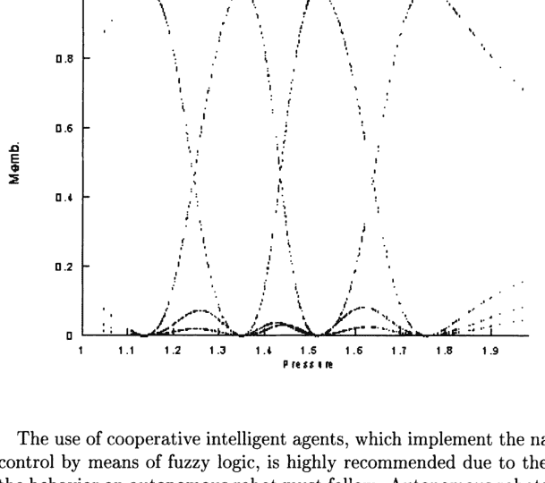

由于自主机器人必须遵循的行为特性，使用实现导航控制的合作智能体是高度推荐的，且这些智能体采用模糊逻辑。自主机器人文献中包含许多寻找将全局控制函数分解为更小的行为的近似示例 [48]。每个行为负责产生某些动作，通常是感知和控制动作，以完成或保持给定目标，例如避障。这种解释符合智能体的概念。智能体是能够独立或与其他智能体协作执行任务的自主实体。如果我们还希望我们的智能体能够在不精确和不确定的环境中运行，模糊逻辑已被证明是一个有价值的框架 [10]。此外，智能是推理程度和习得行为：智能体接受用户给定目标并执行这些任务的能力。至少，应该有一些形式的指令，也许是规则形式，并配有推理引擎或其他推理机制来执行它们。因此，应用模糊逻辑来管理不精确性和不确定性是可行的 [7, 1, 61]。更高程度的智能包括用户模型或其他关于用户想要做什么的知识和推理，以及规划实现该目标的方式。

我们将展示如何通过将模糊逻辑应用于机器人控制应用的不同方面来实践这些概念。作为测试平台，我们设计并建造了一台定制的自主移动机器人 [50, 51]，其运动学为全向。机器人的底座为 40x40 cm 的方形

高度为 55 cm。它具有差速转向，由两个由直流电机驱动的车轮和两个较小的脚轮提供全方位稳定性。总重量约为 15 Kg 包括电池。一块基于 486DX2 的板负责处理，而一块基于 MC68HC11 的板负责传感器数据采集和执行器控制。机器人具有以下传感器和执行器：

- 两个安装在转向轮上的光学编码器。
- 四个在同一频率工作的 Polaroid 6500 超声波测距声纳。
- 安装在保险杠上的开关环，用于检测碰撞。
- 三个本体感觉传感器，用于测量电池电量。
- 一个具有 4 个自由度的 LynxArm 机械臂。
- 一台 256 级灰度 QuickCam 摄像头。

为了让这台简单的机器人执行一些相对复杂的任务，需要一些工具和技术。在以下各节中，我们将描述我们使用的技术：BG 编程语言，作为我们自主移动机器人建模架构的基础组件，以及其底层基于黑板的智能体设计。接下来我们将描述我们已实现的各种智能体及其行为分解，然后说明我们如何将学习技术应用于行为融合问题。最后，我们将介绍一些结果和结论。

#### 3.5.2 BG 编程语言

文献中提出了多种机器人控制语言。它们各有优缺点。由于我们的主要目标是解决行为融合问题以及驱动融合过程的规则学习，我们选择了 COLBERT [39] 作为工作基础。它在行为和融合器中广泛使用模糊规则库。由于我们想尝试一些不同的功能，我们决定定义并实现一种新的高级编程语言，名为 BG，它基于 C 语言的语法和语义以及大部分 COLBERT 语言特性。它基于多智能体范式，其中每个智能体拥有一系列行为。其预期用途是机器人和控制应用，主要为自主移动机器人。本章中的示例属于后者领域，并且假定机器人将执行它们。事实上，该机器人就是上一节描述的我们的定制机器人。语言的主要目标是帮助机器人应用的开发周期和行为建模，以及加速开发，因为它是一种面向机器人的高级语言，内置模糊逻辑操作，并且使用自动调优系统。BG 在当前版本中包含了许多传统

为了保持机器人与墙壁的给定距离，可以用以下代码实现 列表 2。Right 是输入变量，测量机器人到右侧墙壁的距离。Turn 是输出变量，控制机器人是否应向左转向 模糊集合 TSL 和 TL，向右转向 模糊集合 TSR 或不转向 模糊集合 TN。

## 基于网格的计算

BG 语言提供了一个基本结构 网格 和管理二维空间信息的方法。当网格初始化时，用户提供三个参数：正方形单元的数量 N 和 M，构成 N × M 矩阵，以及单元边长以米为单位。左下单元用作坐标原点。每个单元有一个值，范围从 0 到 1，对应于该单元为障碍物的确定程度 [26]。随着机器人的移动，以下数据被处理：

- 机器人的当前位置 绝对位置 x, y。
- 目标位置的当前位置 绝对位置 x, y。
- 可能障碍物的绝对位置 x, y。
- 来自给定绝对位置的相对声纳读数 x, y, θ, sonar_measure。

使用三角形扫描线算法，更新每个传感器锥体内的单元值：锥体内被判定为空闲单元的确定性增加，而锥体基部沿线的确定性降低。利用这些值，A* 算法搜索从当前机器人位置到目标的最短路径。然后返回一个可用于规划的绝对航向。一个典型的网格使用示例如下所示 列表 3。机器人有四个声纳传感器 sonar0, sonar1, sonar2, sonar3，角度不同 +40, +15, -15, -40 度。对于每个控制循环周期，当前位置和当前目标都会更新。如果声纳测量值小于给定值 5 米，则网格会用它们更新。作为结果，变量 heading 使用 A* 输出进行更新。

## 智能体和行为定义

BG 语言中的组织单元基于智能体概念 [32]。我们使用基于黑板的结构 [31, 59] 来安排这些智能体，作为通信和控制的主要范式。在此模型下，一系列智能体 也称为知识库 共享关于系统和环境的可用信息。每个智能体可以从黑板上读取与其相关的信息，进行自己的处理，然后将每个可能的结果写回黑板。所提出的架构是根据以下原则设计的：

```
float yutime,sleft,sright;

fsm start NOTURN
{//Initial state
state NOTURN:
{utime=0.0;
sleft=sonar0+sonar1;
sright=sonar2+sonar3;
if (sleft<sright)
    shift TURNRIGHT;
if (sleft>=sright)
    shift TURNLEFT;
}
//Turning to the left
state TURNLEFT:
{utime=utime+1.0;
//Shift to initial state
if (utime>5.0)
    shift NOTURN;
turn=-10.0;
}
//Turning to the right
state TURNRIGHT:
{utime=utime+1.0;
//Shift to initial state
if (utime>5.0)
    shift NOTURN;
turn=10.0;
}
}
```

```
rules
{//Turn none
background (0.1)    turn is TN;
//Turn small right
if (right is FAR)   turn is TSR;
//Turn small left
if (right is MEDIUM) turn is TSL;
//Turn small left
if (right is NEAR)  turn is TSL;
//Turn left
if (right is CLOSE) turn is TL;
}
```

Listing 1. Example of a finite state machine.

Listing 2. Example of a fuzzy rule base.

- 使用封装机制、隔离和局部控制：每个智能体都是半自主且独立的实体。
- 对每个智能体所拥有的知识没有任何假设，并且


the resolution method it implements.

- 灵活且动态的组织。
- 架构对学习技术使用的适用性。

一个关键思想是每个智能体都被分解为非常简单的行为。这些行为通过一些输入和输出变量访问黑板。由于两个不同的行为可能会修改同一个变量，因此提供了一种融合方法（称为行为融合）[48]。这种方法的优点与可扩展性和学习有关：在子sumption 架构 [15] 中，智能体的管理取决于它们实现的行为 [51]；而在所提出的架构中，管理位于融合方法上。模糊规则库执行这种融合，使不同行为的输出能够被完全或部分地启用/禁用 [48, 3, 51]。这样，系统可以用一些简单的行为进行训练，然后可以添加新的行为而无需修改之前的行为：只需要重新训练融合规则库。当指定一个智能体时，用户可以提供三种类型的块，这些块放置在智能体的执行循环内部：

- 在任何行为之前执行的公共块。
- 并发执行的行为序列。
- 指定行为输出如何融合的 blender 块。

所有这些块必须满足一个约束：每个块的执行时间必须受计算机限制，因此不能有无限循环。语言本身保证了所有块都满足此约束，并且这是获得基本实时支持的必要要求，尽管语言不支持固定时间调度。获得一定的控制周期持续时间是用户的责任，必须进行适当的测试。对于融合过程的正常工作，每个行为都定义了要融合的全局输出变量。因此它们在行为执行期间只修改这些变量的本地副本。blender 对模糊规则进行推理，这些规则使用一些输入全局变量作为前件，使用一些行为名称作为后件。最后，对每个融合的输出变量应用方程 3.8。

```
α_j = pri_j · beh_j  (3.7)

ov_i = ( Σ_j α_j · lov_ij ) / ( Σ_j α_j )  (3.8)
```

其中：

- ov_i 是第 i 个全局输出变量，
- *lov_ij* 是第 j 个行为中第 i 个输出变量的本地副本
- *pri_j* 是第 j 个行为的优先级
- *beh_j* 是第 j 个行为的模糊推理结果

这样融合既依赖于固定的优先级，也依赖于使用模糊推理计算的可变激活度。每个特定应用都会决定优先级和推理的最佳组合（仅使用优先级、仅使用推理，或两者结合）。此外，这种行为融合的新方法推广了分层模糊规则的概念，因为事实上，这种层次结构可以将模糊规则库与其他技术（来自软计算和经典命令式编程）结合起来。在第 3.5.4 节中解释了学习技术如何与这种融合机制结合使用。下面显示了一个简单的智能体定义（列表 4）。该智能体有三个行为：一个避免障碍物（*avoid*），一个向左对齐（*alignL*），一个向右对齐（*alignR*）。yblender 块指定了这些行为的输出（*turn* 和 *speed*）如何融合。

#### 3.5.3 Robot agents architecture

我们希望我们的机器人执行简单的导航任务；因此我们决定我们的最终目标是在实验室中找到一些物体（有不同的房间和走廊），无论其位置已知还是未知，然后将它们带回家庭位置，当然不会发生碰撞也不会陷入无限循环。此外，机器人开始运行前不会有环境的模型。为了实现这一目标，机器人必须能够执行某些任务：带障碍物避免的导航、目标寻求、地图构建和定位，以及某种形式的高级规划等。我们对这样的系统（机器人和目标）进行了分解，提取了最重要的元素 [2]，并使用 BG 语言及其隐式架构定义了一系列智能体。我们已识别出以下智能体（3.6），将在下一节中描述：

- Reactive Control. 这是负责反应式导航的智能体。
- Planning. 这是负责高级规划和全局目标完成监督的智能体。
- Localization. 这是负责构建环境的大致精确模型，然后在该模型上定位机器人的智能体。
- Vehicle Control. 这是负责低级元素控制和信号滤波的智能体：传感器和执行器。

```
float a0,a1,a2,a3;

//Angle for sonar0
a0=alpha+(40.0*DTOR);
//Angle for sonar1
a1=alpha+(15.0*DTOR);
//Angle for sonar2
a2=alpha-(15.0*DTOR);
//Angle for sonar3
a3=alpha-(40.0*DTOR);

grid updates heading cells
40.0 by 30.0 side 0.1
{location (x, y);
 goal (goalx, goaly);

if (sonar0<5.0)
  sonar(x,y,a0,sonar0);
if (sonar1<5.0)
  sonar(x,y,a1,sonar1);
if (sonar2<5.0)
  sonar(x,y,a2,sonar2);
if (sonar3<5.0)
  sonar(x,y,a3,sonar3);
}
```

Listing 3. Example of a grid

```
agent basicControl
{blending left,right,front;

common
{/* Code goes here */}
behaviour avoid priority 2.0
{/* Code goes here */}
behaviour alignL priority 0.5
{/* Code goes here */}
behaviour alignR priority 0.5
{/* Code goes here */}

blender
{rules
  {background (0.1)
    avoid is LOW;
  background (0.1)
    alignR is LOW;
  background (0.1)
    alignL is LOW;

  if ((left is CLOSE) ||
      (front is CLOSE) ||
      (right is CLOSE)
     )
    avoid is HIGH;

  if (left is MEDIUM)
    alignL is HIGH;
  if (right is MEDIUM)
    alignR is HIGH;
  }
}
}
```

Listing 4. Example of agent and behaviours definition

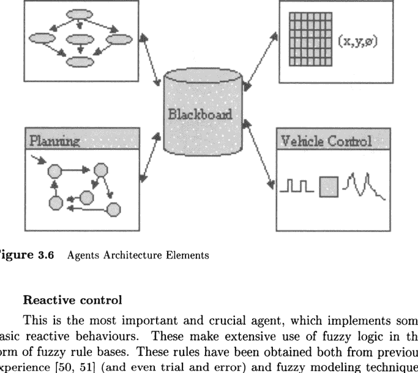

### Figure 3.6 Agents Architecture Elements

## Reactive control

这是最重要的、最关键的智能体，它实现了一些基本的反应行为。这些行为大量使用模糊逻辑的形式，即模糊规则库。这些规则既来自先前的经验 [50, 51]（甚至试错），也来自模糊建模技术（如第 3.2 节所述）。一名人工用户根据传感器数据执行一些控制命令（即墙-机器人对齐、速度控制等）。这些被记录下来，然后传递给一个或多个模糊建模智能体。后者将执行聚类分析，然后生成所需的模糊规则。因此使用 MAS 架构（参见第 3.3.2 节和第 3.4 节），这些智能体对应于规则生成和聚类智能体。对于当前应用，我们已识别并实现了以下反应行为：

- *obstacle-avoider*: 驱动机器人朝向最近障碍物的相反方向（列表 5）。
- *align-right*: 使机器人保持在右侧墙壁的给定距离（列表 2）。
- *align-left*: 使机器人保持在左侧墙壁的给定距离（列表 2）。
- *move-to-goal*: 驱动机器人朝向当前目标的方向。
- *move-backwards*: 驱动机器人向后朝向最近障碍物的相反方向（列表 1）。

- *noise*: 驱动机器人朝随机方向移动以逃离孔洞。

融合模糊规则（列表 6）是通过试错手动推导的。例如，值得注意的是我们是如何获得 move-to-goal 行为的。我们使用了一个机器人模拟器并驱动机器人进行线跟踪。这条线被假定为每个瞬间的目标航向。控制和线航向数据被传递给基于 tabu 搜索的模糊聚类智能体（参见 3.4.2）。然后将结果（模糊聚类）用作规则生成智能体（参见 3.4.3）的基础。

## Vehicle control

该智能体由两种行为组成：与传感器相关和与执行器相关的行为。前者负责处理和过滤传感器提供的信息，后者负责向执行器发送正确的信号以执行给定的控制命令。在我们的系统中，我们有以下行为：

- Range sensors acquisition and filtering.
- Collision detection.
- Robot control vector (v, θ) execution.

机器人的导航完全依赖于距离信息。超声波 [12] 的特点是由于众所周知的问题产生对环境的 imprecise 感知：串扰、噪声，以及在入射角大于 15 度的抛光表面上的低可靠性。由于此原因，超声波子系统出现故障可能会影响整个系统的性能。为了避免所有依赖智能体对这些情况进行特殊处理，一些智能体被设计为获取超声波信息，对其进行处理并给出可靠的结果。这种方法降低了系统的复杂性，而且还提高了其可靠性。为了实现这一点，对每个超声波传感器应用模糊滤波器 [22]。基本上，它由三部分组成：状态记忆、预测块和推理块。记忆块将记住传感器的最后 n 次读数。预测块将估计下一个传感器值。推理块将融合输入值和估计值，试图丢弃先验的坏读数。

状态记忆实现为有限值数组。预测块实现了一个简单的卡尔曼滤波器：状态记忆值的平均值。推理块通过模糊推理系统实现。整个模糊滤波块的工作方式如下：

- 基于状态记忆，由预测块计算预测测量值。


结合里程计进行定位（目前我们假设它没有重大误差）。该智能体应同时整合建图和里程计校正任务 [26]。

### 3.5.4 学习行为融合

基于行为的控制的一个关键问题是如何高效地协调不同类型行为之间的冲突与竞争，以获得良好性能。我们采用的不是根据指定优先级进行抑制和压制策略，而是一种融合方法 [51]。模糊规则库实现了这种融合，可以完全或部分地启用/禁用不同行为的输出 [7, 3, 48]。在融合规则库中使用学习技术 [7, 10, 24, 34, 57] 可以改善机器人导航性能。这样，系统可以只用一些简单行为进行训练，然后无需修改先前行为即可添加新行为：只需重新训练融合规则库。

遗传算法 [28] 是一种自适应的优化与搜索过程，能够为问题寻找解决方案，其灵感来自自然进化机制。它们在抽象层面上模拟生物学原理，例如基于种群的方法、信息的继承、通过交叉/突变实现的信息变异，以及基于适应度的个体选择。

遗传算法从给定问题的一组初始候选解（个体）种群开始，以解的质量（适应度）进行评估。然后应用选择、复制和变异算子来获得构成新种群的新个体（后代）。适应度的选择、复制和变异相互作用，在多次迭代（世代）过程中产生质量不断提高的解。最终当满足终止条件（例如最大世代数）时，搜索过程终止，并输出最终解。

由于我们的主要关注点是融合规则库的学习，因此我们将遗传算法应用于该任务 [52]。用户选择一个智能体，它将作为学习过程的基础。关键思想是先从一组预定义的行为混合模糊规则开始，然后对其应用学习方法（规则调整模式）。这组规则甚至可以是空集（规则发现模式）。无论哪种情况，遗传算法的个体都是模糊规则库，遗传算法的结果就是所提出的融合模糊规则库。

### 初始种群与表示

如果算法以规则发现模式运行，则初始种群随机设置。否则，初始种群将由用户定义的规则及其随机修改组成。后者对应典型的表示方式。

代码清单 5. 基本行为：避障器

```behaviour avoid priority 2.0
{fusion turn,speed;
float sleft,sright,diff;

sleft=sonar0+(sonar1*0.7);
sright=sonar2+(sonar3*0.7);
diff=sleft-sright;
diff=sgn(diff);

rules
{background (0.9)
    turn is TC;
    background (0.1)
    speed is SFULL;

    if ((diff is LT) &&
        !(right is CLOSE)
    )
        turn is TR, speed is SFULL;
    if ((diff is GT) &&
        !(left is CLOSE)
    )
        turn is TL, speed is SFULL;
}

if (front is NEAR)
    turn = turn * 2.0;
}
```

代码清单 6. 初始融合模糊规则库

```blender
{rules
    {background (0.1)
        backup is LOW;
        background (0.1)
        avoid is LOW;
        background (0.1)
        toGoal is HALFL;
        background (0.1)
        alignR is LOW;
        background (0.1)
        alignL is LOW;

        if (collision is TRUE)
            backup is HIGH,
            toGoal is LOW;
        if ((left is CLOSE) &&
            (front is CLOSE) &&
            (right is CLOSE))
            avoid is HIGH,
            toGoal is HALFL;
        if (left is CLOSE)
            alignL is HALFL;
        if (right is CLOSE)
            alignR is HALFL;
        if (left is MED)
            alignL is HALFH;
        if (right is MED)
            alignR is HALFH;
        if (left is FAR)
            alignL is HIGH;
        if (right is FAR)
            alignR is HIGH;
        if (front is MED)
            toGoal is HIGH;
        if (front is FAR)
            toGoal is HIGH;
} }
```

表 3.1 学习参数

| 参数 | Pc | Pm | 世代数 | 种群规模 | 迭代次数 | 超时 | 最大碰撞次数 |
|-----------|----|----|-------------|------------|------------|---------|------------------|
| 值     | 0.8 | 0.75 | 24          | 4          | 1          | 500     | 5               |

使用该软件，我们进行了一些测试以验证我们论点的有效性。我们将重点关注其中一项测试的结果。基本上，目标是在一个简单的平面图上导航（图 3.9），从给定位置（场地的左侧）出发，到达对侧（场地右侧的小圆圈）。机器人对平面图一无所知，只知道终点的坐标。智能体、行为和控制规则就是前几节所示的那些。我们将这些智能体以及以下遗传算法参数输入学习工具（见表 3.1）。

随后我们得到了以下结果。最初，机器人既没有到达目标，也没有发生碰撞。这是一个很好的学习起点，因为控制器相当合理且直观（实际上是在测试前不久临时设计的），学习时间不应太长。如下所示（图 3.10），适应度函数从负值（未实现目标）开始，最终达到较高的正值（在接近最优的较少代数内实现目标）。这可以从最后两幅图中直观地观察到。第一个控制器进行安全漫游（图 3.11），由于目标附近有墙壁而未能驶入目标。最优个体则确实驶入了目标（图 3.12），尽管周围有墙，它进行了更紧密的转弯，并最小化了总行驶距离。出于好奇，在 350 MHz 的 PowerPC 上运行学习工具花费了 15.2 小时才完成。

#### 3.6 结论与未来工作

本章描述了一个基于学习智能体的模糊建模多智能体系统，这些智能体实现了不同的智能技术。该架构使用户能够通过封装智能技术的智能体的集成与协作，分析可应用于模型识别的不同技术的组合。由于使用了多种学习技术，系统往往倾向于使用那些对每个特定任务产生更好结果的技术。我们的模糊建模模式可以使用不同的智能体来实现：

- 变量识别，
- 使用聚类技术生成模糊集合，
- 模糊规则系统的生成，
- 使用遗传算法调整这些规则，
- 使用神经网络等梯度下降技术优化模型，
- 使用规则系统进行推理。

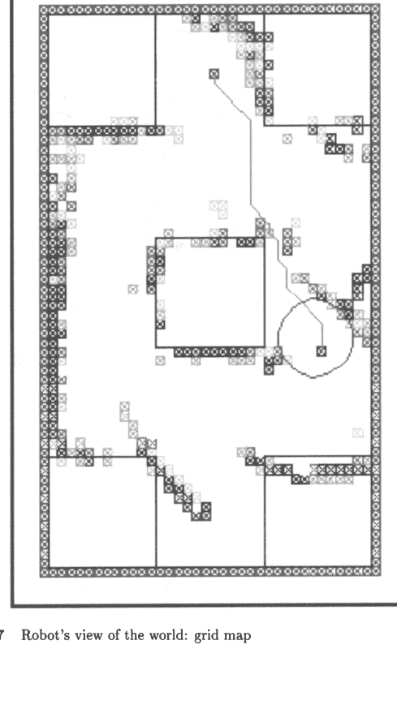

图 3.7 机器人的世界视图：栅格地图

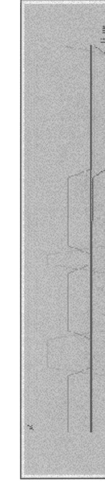

图 3.8 行为融合

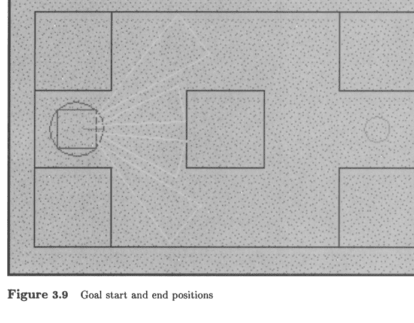

图 3.9 目标起点与终点位置

通过提供相对较小的智能组件，这些组件可以更容易地集成到更通用的软件产品中，我们可以尝试解决那些无法用庞大而复杂的软件系统解决的问题。在单一软件系统中提供多种模糊建模问题求解范式的集成设施具有若干优点：可以采用不同策略来解决问题的不同方面，并为每个方面选择最合适的方法。

作为这种灵活的学习智能体架构的一个应用，我们描述了一个用于不确定环境中自主机器人的混合模糊-遗传智能体系统。这些智能体由两部分组成：第一部分是一组模糊控制器，实现机器人的不同基于行为的方案；第二部分是一个模糊元控制器，它组合不同的行为，其中与每个行为相关的权重通过遗传算法学习。通过这种方式，该元控制器高效地协调了多个行为之间的冲突与竞争。我们可以


<!-- no content -->

总结我们的结果如下：

- 编程接口简单直观，从而加快了系统生命周期中的开发阶段。
- 系统在容错性和抗噪声保护方面相当可靠。
- 架构允许集成多种求解方法，并在行为输出的融合中使用学习技术。

最后，正如我们在描述 MASAM 架构时所指出的，我们系统的最终目标之一是开发一个学习学习过程的智能体。因此它可以帮助用户在模糊建模中使用的学习算法组合做出决策。该元学习代理（MLA）目前正处于实施阶段，我们希望它能被纳入我们的 MAS 系统。

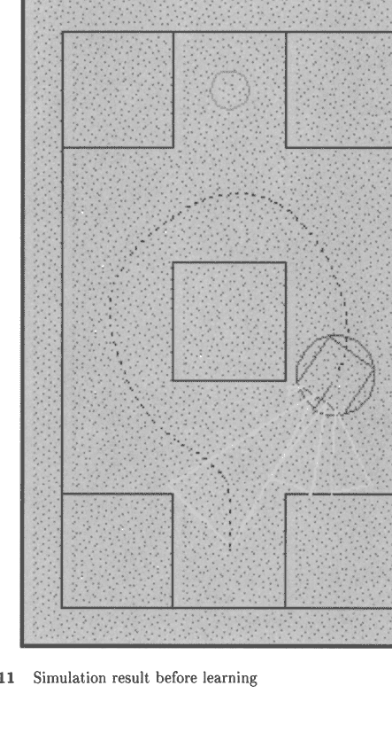

图 3.11 学习前的仿真结果

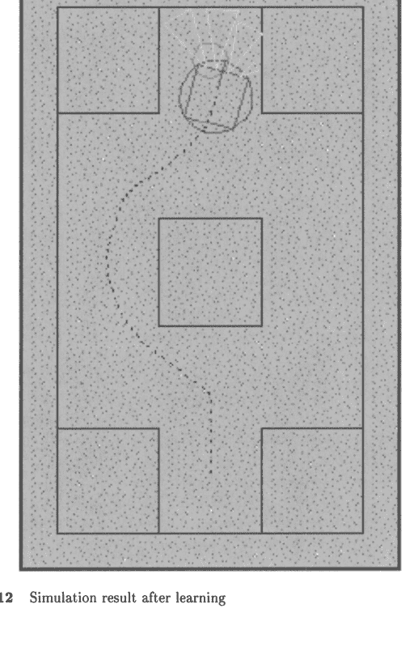

图 3.12 学习后的仿真结果

#### 3.7 参考文献

- [1] A. Saffiotti et al. 使用模糊逻辑的机器人计划的鲁棒执行。载于 Ralescu A. 编辑，*人工智能中的模糊逻辑：IJCAI'93 研讨会。人工智能讲义 847*，第 24–37 页。Springer-Verlag，1994 年。
- [2] D. G. Armstrong 和 C.D. Crane. 智能自主车辆的模块化、可扩展架构。载于 *第 3 届 IFAC 智能自主车辆研讨会*，第 62–66 页，Universidad Carlos III，马德里，西班牙，1998 年。
- [3] B.C. Arrúe, F. Cuesta, B. Braunsteinl, 和 A. Ollero. 使用虚拟感知记忆控制非完整移动机器人的模糊行为组合。载于 *第六届 IEEE 国际模糊系统会议（FuzzyIEEE'97）*，第 1239–1244 页，巴塞罗那，西班牙，1997 年。
- [4] AT&T, DSTC, DIC, HP, ICL, Nortel Limited, 和 Novell. 交易对象服务。OMG RFP5 提交。技术报告，OMG，1996 年。
- [5] R. Babuska 和 H. B. Verbruggen. 应用模糊建模。载于 *IFAC 大会 AIRTC 论文集*，瓦伦西亚，西班牙，1994 年。
- [6] R. Babuska 和 H.B. Verbruggen. 语言模糊模型的新的辨识方法。Aachen，1994 年。
- [7] H.R. Beom 和 H.S. Cho. 使用模糊逻辑和强化学习的移动机器人传感器导航。*IEEE Trans. Syst. Man Cyber*，25(3):464–477，1995 年。
- [8] H. R. Berenji 和 P. S. Khedkar. 用于模糊推理的产品空间聚类。载于 *IEEE 国际模糊系统会议论文集*，第 1402–1407 页，1993 年。
- [9] J.C. Bezdek. *模式识别与模糊目标函数算法*。Plenum，纽约，1981 年。
- [10] A. Bonarini 和 F. Basso. 学习组合模糊行为以用于自主代理。*Intl. Journal of Approximate Reasoning*，(17):409–432，1997 年。
- [11] P. Bonissone. 软计算：新兴推理技术的融合。*Journal of Soft Computing*，1(1)，1997 年。
- [12] J. Borenstein, H.R. Everett, 和 L. Feng. *导航移动机器人：系统与技术*。Wellesley, MA，1996 年。
- [13] Juan A. Botia, Juan R. Velasco, Mercedes Garijo, 和 Antonio F. G. Skarmeta. 用于通用数据挖掘的智能代理。载于 F. J. Garijo 和 C. Lemaitre 编辑，*DAI 和 MAS 研讨会*，1998 年。
- [14] Juan A. Botia, Juan R. Velasco, Mercedes Garijo, 和 Antonio F. G. Skarmeta. Geminis：通用数据挖掘的多代理系统提案。载于 F. J. Garijo 和 Vicente Botti 编辑，*MAAMAW-99*，1999 年。
- [15] R.A. Brooks. 移动机器人的鲁棒分层控制系统。*IEEE J. Robotics and Automation*，(1):14–23，1986 年。
- [16] K. Causse, Marc Csernel, 和 Jörg-Uwe Kietz. MLToolbox 的通用知识表示语言的最终规范。文件 ITM 2.2，MLT 联盟，ESPRIT 项目 2154，1992 年 3 月。
- [17] M. Delgado, A.F. Gómez-Skarmeta, 和 F. Martín. 使用基于聚类的方法生成模糊规则。载于 第三届欧洲模糊与智能技术和软计算大会论文集，第 810–814 页，德国亚琛，1995 年。
- [18] M. Delgado, A.F. Gómez-Skarmeta, 和 M.A. Vila. 用于验证模糊聚类的层次聚类。载于 IEEE 国际模糊系统会议论文集，第 1807–1812 页，1995 年。
- [19] M. Delgado, A.F. Gómez-Skarmeta 和 M.A. Vila. 从层次聚类获得分类的无监督学习过程。载于 第二届欧洲模糊与智能技术和软计算大会论文集，第 528–533 页，德国亚琛，1994 年。
- [20] M. Delgado, A. Gómez Skarmeta, J. Gómez Marin-Blázquez, 和 H. Martinez Barberá. 建模中的模糊混合技术。载于 第 11 届国际工业与工程人工智能与专家系统应用会议 IEA-98-AIE 论文集。人工智能讲义，第 1226 号，第 180–189 页，1998 年。
- [21] M. Delgado, A. Gómez Skarmeta, 和 F. Martín. 用于推理目的的模糊系统建模的一些方法。Int. Journal of Approximate Reasoning，(3-4):377–391，1997 年。
- [22] M. Delgado, A.F. Gómez Skarmeta, H. Martínez Barberá, 和 J. Gómez. 用于反应式自主机器人的模糊测距传感器滤波。载于 第五届软计算与信息/智能系统国际会议（IIZUKA '98），日本福冈，1998 年。
- [23] Tomás Domínguez. 多代理系统的面向对象并发模型定义。博士论文，Dep. Ingeniería de Sistemas Telemáticos，E.T.S.I. Telecomunicación，马德里理工大学，1992 年。
- [24] M. Dorigo 和 M. Colombetti. 机器人塑形：行为工程实验。The MIT Press，剑桥，MA，1998 年。
- [25] Stephen I. Gallant. 神经网络学习与专家系统。MIT Press，剑桥，MA，1993 年。
- [26] J. Gásos 和 A. Martín. 使用模糊地图的移动机器人定位。载于 A. Ralescu 和 T. Martín 编辑，人工智能讲义。Springer-Verlag，1996 年。
- [27] David E. Goldberg. 遗传算法在搜索、优化和机器学习中的应用。Addison-Wesley，Reading, MA，1989 年。
- [28] David E. Goldberg. *遗传算法在搜索、优化和机器学习中的应用*。Addison Wesley，1989 年。
- [29] A. Gómez-Skarmeta 和 F. Jiménez. 具有混合系统的模糊建模。*Fuzzy Sets and Systems*，(2):199–208，1999 年。
- [30] José C. González, Juan R. Velasco, Carlos A. Iglesias, Jaime Alvarez, 和 Andrés Escobero. 符号-连接主义集成的多代理架构。技术报告 MIX/WP1/UPM/3.2，Dep. Ingeniería de Sistemas Telemáticos，E.T.S.I. Telecomunicación，马德里理工大学，1995 年 11 月。
- [31] B.A. Hayes-Roth. 用于控制的黑板。*Artificial Intelligence*，第 251–324 页，1985 年。
- [32] J. Hendler. 理解代理。*IEEE Intelligent Systems*，(2):32–37，1999 年。
- [33] F. Herrera, M. Lozano, 和 J.L. Verdegay. 通过遗传算法调整模糊逻辑控制器。*International Journal of Approximate Reasoning*，(12):299–315，1995 年。
- [34] F. Hoffmann 和 G. Pfister. 自主车辆模糊控制规则库的进化学习。载于 *第六届国际信息处理与知识库不确定性管理会议论文集（IPMU'96）*，第 1235–1240 页，西班牙格拉纳达，1996 年。
- [35] Carlos A. Iglesias, Mercedes Garijo, 和 José Carlos Gonzalez. 代理导向方法综述。
- [36] Carlos A. Iglesias, José C. González, 和 Juan R. Velasco. MIX：通用多代理架构。载于 M. Wooldridge, K. Fischer, P. Gmytrasiewicz, N.R. Jennings, J.P. Müller, 和 M. Tambe 编辑，*IJCAI'95 代理理论、架构和语言研讨会论文集*，第 216–224 页，加拿大蒙特利尔，1995 年 8 月。国际人工智能联合会议。（本文的扩展版本发表于 *INTELLIGENT AGENTS II: Agent Theories, Architectures, and Languages*，Springer Verlag，1996 年，第 251–266 页。）。
- [37] H. Ishibuchi, K. Nozaki, N. Yamamoto, 和 H. Tanaka. 使用遗传算法为分类问题选择模糊 if-then 规则。*IEEE Trans on Fuzzy Systems*，(3):260–270，1995 年。
- [38] F. Klawonn 和 R. Kruse. 从数据构建模糊控制器。*Fuzzy Sets and Systems*，第 177–193 页，1997 年。
- [39] K. Konolige. Colbert：Saphira 中反应式控制的语言。载于 *德国人工智能会议*，弗莱堡，1997 年。
- [40] A. Kroll. 使用多维参考模糊集的函数模型辨识。*Fuzzy Sets and Systems*，第 149–158 页，1996 年。
- [41] R. Langari 和 L. Wang. 模糊模型、模块化网络和混合学习。*Fuzzy Sets and Systems*，第 141–150 页，1996 年。
- [42] A.F. Gómez-Skarmeta, M. Delgado, 和 F. Martín. 使用模糊聚类以描述性方法建模模糊系统。载于 *论文集*


[43] Luis Magdalena. 混合模型分析：模糊逻辑/神经网络。技术报告 MIX/WP2/UPM/1.2，Dep. Ingeniería de Sistemas Telemáticos, E.T.S.I. Telecomunicación, Universidad Politécnica de Madrid，1995年3月。

[44] Zbigniew Michalewicz. 遗传算法 + 数据结构 = 进化程序。Springer-Verlag，1992。

[45] M. Mizumoto. 适用于模糊控制的模糊推理方法。J. Soc. Instrument and Control Engrs，(58)：959-963，1989。

[46] Hyacinth S. Nwana. 软件代理：概述。Knowledge Engineering Review，1996。

[47] W. Pedrycz. 模糊关系系统中的辨识算法。Fuzzy Sets and Systems，(13)：153-167，1984。

[48] A. Saffiotti. 模糊逻辑在自主机器人中的应用：行为协调。页573-578，1997。

[49] A. Th. Schreiber, J. M. Akkermans, A. A. Anjewierden, R. de Hoog, N. R. Shadbolt, W. Van de Velde, and B. J. Wielinga. 知识工程与管理。CommonKADS方法论。版本1.1。University of Amsterdam，1999。

[50] A.F. Gómez Skarmeta and H. Martínez Barberá. 基于模糊逻辑的智能代理用于自主系统中的反应式导航。第五届国际模糊理论与技术会议，页125-131，Raleigh, NC，1997。

[51] A.F. Gómez Skarmeta, H. Martínez Barberá, and M. Sánchez Alonso. 用于自主移动机器人的模糊代理架构。在国际模糊系统世界大会(IFSA'99)，台湾，1999。

[52] A.F. Gómez Skarmeta and F. Jiménez Barrionuevo. 混合系统生成和调优模糊规则。在第六届IEEE国际模糊系统会议(FuzzyIEEE'97)，页247-252，Barcelona, Spain，1997。

[53] M. Sugeno and K. Tanaka. 模糊模型的逐次辨识及其在复杂系统预测中的应用。Fuzzy Sets and Systems，页315-334，1991。

[54] M. Sugeno and T. Yasukawa. 基于模糊逻辑的定性建模方法。在IEEE Trans. Fuzzy Systems，编号1，页7-31，1993。

[55] Ron Sun. 整合规则与联结主义以实现鲁棒常识推理。John Wiley & Sons，New York，1994。

[56] T. Takagi and M Sugeno. 模糊系统的辨识及其在建模和控制中的应用。IEEE Transactions on Systems, Man, and Cybernetics，(1)：116-132，1985。

[57] E. Tunstel and M. Jamshidi. 关于模糊规则基系统的遗传编程用于智能控制。Intl. Journal of Intelligent Automation and Soft Computing，(1)，1996。

[58] P. Vourimaa. 模糊自组织映射。Fuzzy Sets and Systems，页223-231，1994。

[59] S. Vranes and M. Stanojevic. 黑板架构中多范式的集成。IEEE Transactions on Software Engineering，(3)：244-262，1995。

[60] L. Wang and R. Langari. 通过模糊逻辑对复杂系统建模。IEEE Trans. on System Man and Cybernetics，页100-106，1996。

[61] L. Wang and R. Langari. 通过模糊逻辑对复杂系统建模。IEEE Trans. on Systems, Man and Cybernetics，(1)：100-106，1996。

[62] R.R. Yager and D.P. Filew. 通过山地聚类生成模糊规则。技术报告 mii-1318。技术报告，1993。

[63] Y. Yoshinari, W. Pedrycz, and K. Hirota. 通过聚类技术构建模糊模型。Fuzzy Sets and Systems，(54)：157-165，1993。

# 4
## 用于监督模糊分类器的学习技术

Francesco Masulli
Istituto Nazionale per la Fisica della Materia, Via Dodecaneso 33, 16146 Genova, Italy, and DISI - Dipartimento di Informatica e Scienze dell'Informazione - Università di Genova, Via Dodecaneso 35, 16146 Genova, Italy, e-mail: masulli@ge.INFM.it

Alessandro Sperduti
Dipartimento di Informatica, Università di Pisa, 56125 Pisa, Italy, e-mail: perso@di.uni.pi.it

摘要.................................................... 148
4.1 引言............................................. 148
4.2 模糊基函数网络................ 149
4.3 Bayes 最优分类器逼近 ........ 152
4.4 FBFN 分类器中的学习................... 154
4.5 数据库和预处理..................... 155
4.6 分类性能...................... 156
4.7 FBFN 结构识别和语义相变 ................................... 158
4.8 简化的 FBF 网络及其扩展............................................... 159
4.9 SFBF 和 ESFBF 网络的性能 ............................................... 160
4.10 混合网络 ...................................... 162
4.11 结论 .......................................... 165
4.12 致谢 ..................................... 166
4.13 参考文献 ........................................... 167

我们展示了如何将梯度下降应用于 FBF 网络的细节，并在一个手写数字识别任务上，将其性能与另外两种学习机器进行比较，即多层感知器(MLPs)，和径向基函数网络(RBF)。此外，我们讨论了所提模型的的一个结构特征，即在从训练具有少于分类类别的规则的模型到训练具有等于或大于分类类别数量的规则的模型时观察到的语义相变。

FBFN 的性能非常有趣；然而，很 often，结果系统非常复杂，可能需要很长的训练时间。因此，设计简单、训练快速且仍保持非常好的泛化性能的系统至关重要。为此，从原始公式出发，可以推导出模型的简化版本(SFBF)，训练更快，同时仍保留原始模型在分类方面的很大一部分性能。事实上，以增加训练时间为代价，但仍不像原始模型那样沉重，SFBF 模型可以通过引入同类规则之间的竞争来改进。

最后，我们表明，通过对 SFBF 系统无法以高置信度分类的输入实例使用 k-最近邻(k-NN)规则[8]，性能可以显著进一步提高。这次，为提高泛化能力而必须付出的计算成本体现在系统的平均响应时间上。性能提升与响应时间之间的权衡可以通过使用 k-最近邻规则的离线或在线编辑策略来控制。

### 4.2 模糊基函数网络

具有 *单点模糊化*、*max-product* 组合、*product inference* 和 *height* 去模糊化的模糊逻辑系统可以表示为 [19]

$$y = f(\mathbf{x}) = \sum_{l=1}^{M} \bar{y}^l \phi_l(\mathbf{x}) \tag{4.1}$$

其中 $\bar{y}^l$ 表示输出模糊集的重心，$\phi_l(\mathbf{x})$ 被称为 *模糊基函数*，且由下式给出

$$\phi_l(\mathbf{x}) = \frac{\prod_{i=1}^{p} \mu_{F_i^l}(x_i)}{\sum_{l=1}^{M} \prod_{i=1}^{p} \mu_{F_i^l}(x_i)} \tag{4.2}$$

其中 l = 1, 2, ..., M。我们可以将这些 FLS 称为模糊基展开或模糊基函数网络(FBF network)¹。模糊基展开与其他基函数之间的关系已在 [15] 中进行了广泛研究。

值得注意的是，Mendel 和 Wang [28, 29] 研究的具有通用函数属性的 FLS，即使用产品推理、产品蕴含、高斯隶属度和高度去模糊化的单点 FLS，可以重写为 FBF 网络展开²。通用函数逼近属性为将 FLS 应用于关键应用提供了坚实的数学基础，范围从控制到时间序列预测到模式识别。

在本章中，我们研究基于该 FBF 网络的多输入多输出(MIMO)版本的模糊逻辑系统。具体而言，如果输入层有 K 个单元，J 条模糊推理规则和 I 个输出，则规则激活可以表示为：

```
r_j = ∏_k μ_{jk}(x_k),    (4.3)
```

其中 μ_{jk}(x_k) 是输入向量分量 x_k 对第 j 条规则的隶属函数值，定义为：

```
μ_{jk}(x_k) = exp( - (x_k - m_{jk})² / (2σ²_{jk}) ),    (4.4)
```

其中 m_{jk} 和 σ²_{jk} 是高斯隶属函数的均值和方差。输出单元的值为：

```
y_i = (∑_j r_j \bar{y}_{ij}) / (∑_j r_j) = ∑_j \bar{y}_{ij} φ_j(x) ,    (4.5)
```

其中 \bar{y}_{ij} 是第 j 条规则与输出 y_i 相关的输出模糊隶属函数的重心，³ 且

```
φ_j = (∏_k μ_{jk}(x_k)) / (∑_j ∏_k μ_{jk}(x_k))    (4.6)
```

是与规则 j 相关的模糊基函数，表示其归一化激活。


FBF网络可以被视为一个带有一个隐藏层的前馈连接主义系统，其隐藏层单元对应于模糊规则。图4.1展示了FBF网络的连接主义解释。在图中，圆圈表示自适应单元，方块表示非自适应单元，自由参数在相应单元附近标出。

FBF网络既可以通过利用可用的语言知识（*结构辨识问题*）[16]来辨识，也可以通过使用数据集中包含的信息（*参数估计问题*）[16]来辨识。

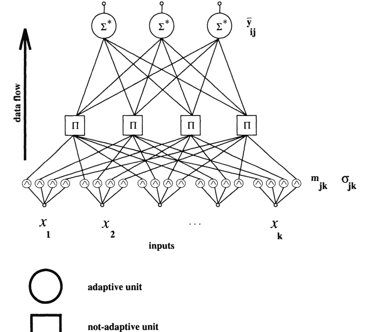

图4.1 FBF网络的连接主义解释。

#### 4.3 贝叶斯最优分类器逼近

在神经网络文献中，已经证明，基于MLP的分类器在训练阶段选择适当的待最小化代价函数并且训练集足够大的情况下，能够逼近贝叶斯最优判别函数[2,11,14,20,25]。

在[18]中，我们推广了这一结果，并遵循Ruck等人[25]的方法证明：基于具有通用函数逼近性质的系统的分类器可以逼近贝叶斯判别函数⁴。这里给出的证明针对两类情况。

设c₁和c₂为两类模式。设χᵢ为属于类别cᵢ的所有可能模式x的集合；则χ = χ₁ ∪ χ₂表示所有模式的集合。训练集由属于这两类的可能模式的子集组成。通常，它是一个有限集合X = X₁ ∪ X₂，其中X₁ = {x₁,x₂,...,xₙ₁} ⊂ χ₁，X₂ = {xₙ₁+1,...,xₙ₁+ₙ₂} ⊂ χ₂，且n₁ + n₂ = N。

设w为自适应参数集，g(x)为贝叶斯二分类器的判别函数

g(x) = P(c₁ | x) − P(c₂ | x), (4.7)

且F(x, w)为系统输出。

此外，假设系统按如下方式训练：当x属于类别c₁时其响应为+1，当x属于类别c₂时其响应为−1：

F(x, w) = { +1 if x ∈ c₁
            −1 if x ∈ c₂ }. (4.8)

这通过最小化（例如，使用误差反向传播技术[26]）样本数据误差函数来实现：

Eₛ(w) = Σ_{x∈X₁}[F(x,w)−1]² + Σ_{x∈X₂}[F(x,w)+1]². (4.9)

我们将证明，在N趋于无穷的极限下，当w最小化Eₛ(w)时，w也同时最小化：

ε²(w) = ∫_χ [F(x,w)−g(x)]² p(x) dx, (4.10)

即F(x, w)逼近g(x)。

让我们将*平均误差函数*定义为如下函数

$$E_a(\mathbf{w}) = \lim_{N\to\infty} \frac{1}{N} E_s(\mathbf{w}) \tag{4.11}$$

其中$N$是模式向量的总数。$E_a(\mathbf{w})$表示当使用所有可能向量进行计算时得到的误差曲面。

如假设所述，在$N$趋于无穷的极限下，我们可以认为函数$E_s$是$E_a$的合理近似。

让我们将函数$E_a$重写如下：

$$E_a(\mathbf{w}) = \lim_{N\to\infty} \left[ \frac{n_1}{N} * \frac{1}{n_1} \sum_{\mathbf{x}\in X_1} [F(\mathbf{x},\mathbf{w})-1]^2 + \frac{n_2}{N} * \frac{1}{n_2} \sum_{\mathbf{x}\in X_2} [F(\mathbf{x},\mathbf{w})+1]^2 \right] \tag{4.12}$$

其中$n_i$是属于类别$c_i$的向量数量，而$\frac{n_1}{N}$和$\frac{n_2}{N}$在$N$趋于无穷的极限下分别表示先验概率$P(c_1)$和$P(c_2)$。

量$\frac{1}{n_i} \sum_{\mathbf{x}\in X_i} [F(\mathbf{x},\mathbf{w}) - 1]^2$表示在$\mathbf{x} \in c_i$的条件下，$[F(\mathbf{x},\mathbf{w}) - 1]^2$在模式上的平均值。

利用强大数定律[23]，我们可以将式(4.12)重写为

$$\begin{aligned}
E_a(\mathbf{w}) &= P(c_1) \int_{\chi} [F(\mathbf{x},\mathbf{w}) - 1]^2 p(\mathbf{x} \mid c_1) d\mathbf{x} + \\
&+ P(c_2) \int_{\chi} [F(\mathbf{x},\mathbf{w}) + 1]^2 p(\mathbf{x} \mid c_2) d\mathbf{x} \\
&= \int_{\chi} [F^2(\mathbf{x},\mathbf{w}) + 1] [p(\mathbf{x} \mid c_1)P(c_1) + p(\mathbf{x} \mid c_2)P(c_2)] d\mathbf{x} + \\
&-2 \int_{\chi} F(\mathbf{x},\mathbf{w}) [p(\mathbf{x} \mid c_1)P(c_1) - p(\mathbf{x} \mid c_2)P(c_2)] d\mathbf{x}
\end{aligned}\tag{4.13}$$

输入向量的概率密度函数可以表示为：

$$p(\mathbf{x}) = p(\mathbf{x} \mid c_1)P(c_1) + p(\mathbf{x} \mid c_2)P(c_2) \tag{4.14}$$

此外，利用贝叶斯规则，我们可以写出：

$$\begin{aligned}
g(\mathbf{x})p(\mathbf{x}) &= [P(c_1 \mid \mathbf{x}) - P(c_2 \mid \mathbf{x})]p(\mathbf{x}) \\
&= P(c_1 \mid \mathbf{x})p(\mathbf{x}) - P(c_2 \mid \mathbf{x})p(\mathbf{x}) \\
&= p(\mathbf{x} \mid c_1)P(c_1) - p(\mathbf{x} \mid c_2)P(c_2)
\end{aligned}\tag{4.15}$$

#### 4.5 数据库与预处理

Δm_jk = η_m φ_j Σ_i [t_i − y_i][ȳ_ij − y_i][x_k − m_jk]/σ_jk² (4.20)
Δσ_jk = η_σ φ_j Σ_i [t_i − y_i][ȳ_ij − y_i][x_k − m_jk]²/σ_jk³ (4.21)
其中
φ_j = Π_k μ_jk(x_k) / Σ_j Π_k μ_jk(x_k) (4.22)

表示规则j的归一化激活度，η_s、η_m和η_σ分别是ȳ_ij、m_jk和σ_jk的学习率。在我们的实验中，我们采用了[27]中提出的自适应学习率方案，并注意到训练阶段显著加速[3]。

如果除了数值训练集之外，还有可用的类别语言描述，FBF网络能够整合这两类信息。相反，如果语言描述不可用，正如我们实验中的情况，则必须根据基于性能的准则通过实验来实现结构辨识。

| 规则 | 参数 | (%L, %T) | 轮次 | (%L1, %T1) | 时间（分钟） |
|---|---|---|---|---|---|
| 24 | 3312 | (97.55, 94.00) | 30 | (91.0, 88.0) | 3.5 |
| 32 | 4416 | (98.05, 95.00) | 30 | (89.0, 87.0) | 4.0 |
| 48 | 6624 | (98.65, 95.81) | 30 | (91.5, 88.5) | 16.0 |
| 64 | 8832 | (98.32, 96.02) | 30 | (93.5, 92.0) | 23.0 |
| 128 | 17664 | (98.97, 96.20) | 30 | (94.5, 93.5) | 46.0 |

表4.1 FBF网络的性能。从左到右，各列分别表示：映射到FBF网络上的规则数、自适应参数个数、训练阶段后的学习成功率(%L)和测试成功率(%T)、训练阶段所需的轮次数、第一个轮次结束时学习成功率(%L1)和测试成功率(%T1)，以及每个轮次的持续时间（在SUN 10/20上以分钟计）。

以下各节报告的所有实验均在SUN 10/50工作站上执行（表4.1中的实验除外）。我们使用了从NIST-3数据库[9]中提取的30000个样本的数据集。NIST-3数据库以CD-ROM形式发布，包含313389个手写字符，这些字符被编码为128×128二值矩阵图像，并用相应的ASCII码标记。我们将数据集划分为训练集、测试集和验证集。

| 训练集 | FBF₁ | FBF₂ | FBF₃ | FBF₄ | FBF₅ |
| 类别 | 样本数 | % | % | % | % | % |
| 0 | 1052 | 100 | 100 | 100 | 100 | 100 |
| 1 | 1134 | 100 | 100 | 100 | 1.234 | 1.410 |
| 2 | 966 | 100 | 100 | 100 | 100 | 100 |
| 3 | 1059 | 100 | 100 | 100 | 100 | 100 |
| 4 | 967 | 100 | 3.177 | 1.964 | 2.378 | 3.309 |
| 5 | 842 | 100 | 100 | 100 | 100 | 100 |
| 6 | 948 | 100 | 100 | 100 | 100 | 4.00 |
| 7 | 1052 | 100 | 100 | 100 | 100 | 100 |
| 8 | 978 | 0.0 | 1.87 | 5.725 | 6.032 | 6.748 |
| 9 | 1002 | 100 | 100 | 2.295 | 2.694 | 2.694 |
| 训练集 | FBF₆ | FBF₇ | FBF₈ | FBF₉ | FBF₁₀ |
| 类别 | 样本数 | % | % | % | % | % |
| 0 | 1052 | 1.615 | 1.711 | 1.711 | 1.711 | 1.806 |
| 1 | 1134 | 1.410 | 1.410 | 1.499 | 1.499 | 1.587 |
| 2 | 966 | 100. | 4.968 | 5.590 | 6.004 | 6.107 |
| 3 | 1059 | 100 | 100 | 100 | 3.966 | 4.438 |
| 4 | 967 | 3.826 | 3.826 | 3.826 | 3.826 | 3.826 |
| 5 | 842 | 100 | 100 | 100 | 100 | 11.63 |
| 6 | 948 | 4.00 | 4.113 | 4.113 | 4.113 | 4.535 |
| 7 | 1052 | 100 | 100 | 2.471 | 2.471 | 2.471 |
| 8 | 978 | 6.952 | 7.668 | 7.873 | 8.077 | 8.691 |
| 9 | 1002 | 2.894 | 3.093 | 3.393 | 3.493 | 3.592 |

表4.2 十个不同FBF网络（规则数从1到10）在10,000个模式上的训练集错误率。

#### 4.7 FBFN结构辨识与语义相变

在[4]中，十个不同的FBF网络已在第4.5节描述的训练集上进行了训练。这些FBF网络在规则数上有所不同，范围从1到10。在表4.2中，对于每个数字类别，给出了训练集中的模式数量以及训练阶段结束时每个FBF网络未能正确识别的模式百分比。值得注意的是，FBF网络中的规则数与其可识别的类别数之间存在密切关系：对于具有β个规则的FBF网络，有10−β个类别完全无法识别，而其余类别则被良好识别。相反，对于FBF₁₀（或规则数超过10的FBF网络），错误率均匀分布在所有类别上。我们称之为语义相变的FBF网络的这种行为已被进一步的一系列模拟所证实，并且是


not common in other feedforward connectionist systems. The semantic phase transition phenomenon gives a lower bound to the FBF network structure: the FBF network must contain a number of rules at least equal to the number of classes to be discriminated. The semantic phase transition observed for the FBF network can be explained by the specialization of each rule in a specific class. Even though it is hard to fully understand how a single rule of the system works, it is very easy to deduce the functional problem solved by each rule. Moreover, we have observed that the set of rules in a system with more than 10 rules can always be partitioned into 10 different subsets, each responsible for the classification of the examples of a specific class. Thus, even if the FBF network is organized as a supervised feedforward network, its behavior is closer to the one of a competitive model showing a strong specialization of the fuzzy rules. A pruning technique was proposed by Casalino et al. [5], in order to automatically remove less relevant fuzzy rules from an oversized system.

#### 4.8 The Simplified FBF Network and Its Extension

For pattern recognition applications, from this FBF network a Simplified FBF network (SFBF network) can be obtained by assuming, in accordance with rule specialization [1]:

```
ȳ_ij ≡ δ_ij = { 1 if rule j is associated to class i, 0 otherwise. (4.23)
```

This assumption leads to both a system with as many units as classes and a strong simplification of the learning formulas, which become:

```
Δm_jk = η_m φ_j Υ_ij [x_k − m_jk]/σ²_jk (4.24)
```

```
Δσ_jk = η_o φ_j Υ_ij [x_k − m_jk]²/σ³_jk (4.25)
```

with

```
Υ_ij = { (y_i − 1)² if j = i y_i² − y_i if j ≠ i } (4.26)
```

It is worth noting that, from Eq. 4.23 and the form of the defuzzifier, y ∈ (0,1) follows, and consequently

```
Υ_ij = { ≥ 0 if j = i ≤ 0 if j ≠ i } (4.27)
```

holds.

Therefore, the learning rules of the SFBF network are competitive. During training, the means of the Gaussian membership functions of each rule move towards the patterns of the class associated to that rule, and escape from
patterns belonging to other classes. At the same time, sigmas of Gaussian membership functions of each rule grow in order to increase the value of the membership function μ for patterns of the class associated to that rule, or shrink in order to reduce the value of the Gaussian membership function for patterns belonging to other classes. An interesting property of these new learning formulas is that they reduce by one order of magnitude the time of training.

| MODEL | %S-Validation | Epochs | Epoch Duration (sec) |
|---|---|---|---|
| NR | 92.89 | – | – |
| FBF₄₈ | 94.09 | 13 | 1925 |
| FBF₁₂ | 92.26 | 36 | 307 |
| FBF₁₀ | 92.23 | 55 | 180 |
| SFBF | 91.36 | 10 | 30 |
| ESFBF₂₀ | 93.80 | 250 | 49 |

Table 4.3 Comparison among the NR, the FBF network (with 48, 12, and 10 rules), the SFBF network, and the ESFBF with 20 rules (two for each class). %S-Validation is the success rate on the validation set.

One problem with the SFBF model is that, since it must have as many units as classification classes, it cannot be used for complex classification tasks. This constraint can be removed by introducing a new level of competition among units. The new defined network, called Extended Simplified FBF system (ESFBF), possesses n_j units associated to each class j, for a total of J = Σ_{j=1}^I n_j units. During learning the output of each unit is computed and the best unit for each class is selected, i.e., for each class j the unit i_j^* ∈ Idx_j = {1,…,n_j} such that i_j^* = arg max_{i ∈ Idx_j} {φ_i} is selected. In that way the number of selected units is equal to the number of classes and the learning rules of the SFBF network can be applied. Thus, at each learning step, only the selected rules have the weights changed. During the operational phase, the input pattern is classified by the class label associated with the unit having maximum activity.

#### 4.9 Performance of the SFBF and ESFBF networks

For comparison purposes, in Table 4.3 we have reported the performance of Nearest-Neighbor Rule (NR) [8], FBF networks with different number of units, SFBF network and EFBB with 20 rules on the validation set. In Figure 4.4 we have reported the performance of the k-Nearest-Neighbour for different values
of k. Due to noise in the data, the best performance was obtained for k = 1. The training of the networks was stopped using the test set (early stopping).

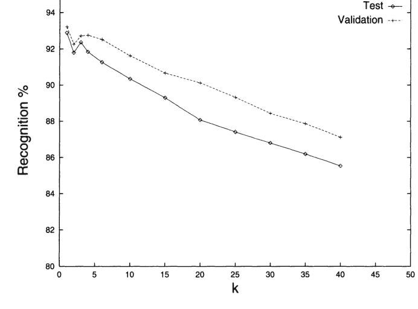

### Figure 4.4 Performance of the k-Nearest-Neighbour on the test and validation sets using as reference data base the training set.

We remark that the FBF48 network got a better performance with respect to NR. Moreover, the average recognition time per pattern of the NR was .733 sec, while for the FBF48 network it was .004 sec. In addition, it can be observed that the generalization performances of the FBF10 network and the SFBF network were similar, while the SFBF network resulted to be faster in learning, in accordance with the lower complexity of the learning rules.

Finally, a significant improvement was obtained by the ESFBF with 20 rules (2 for each class). The training and test curves for this network are reported in Figure 4.5. It must be noted that the performance of this network was very close to the performance of the FBF network with 48 units, thus showing that the ESFBF networks, besides being much faster in training (i.e., it is comparable with a FBF with 10 rules), can reach generalization performances which are comparable to the ones obtained by more complex models.

In Figure 4.6, we have reported an histogram representing how many times a winning rule performs a correct classification after training. This histogram
is useful to understand whether, and to which extent, rules associated with the same class are used. From the histogram we deduce that all rules are used, even if in several cases there is one rule which is much more “active” than the other, which means that more patterns are covered by it.

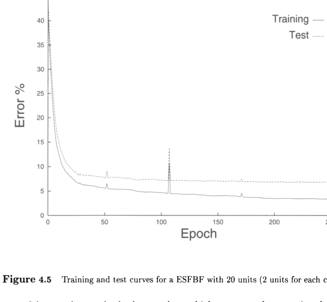

### Figure 4.5 Training and test curves for a ESFBF with 20 units (2 units for each class).

#### 4.10 Hybrid Network

An alternative way for recovering the loss in generalization exhibited by the SFBF network consists in resorting to a hybrid pattern recognition scheme (HS) based on a hierarchy made up by an SFBF network with rejection, followed by a Nearest-Neighbor Rule classifier working on the patterns rejected by the SFBF network (see Figure 4.7). This approach is discussed here for the SFBF; however, it can be directly applied to the ESFBF network as well, and experimental results, discussed elsewhere [10], confirm the improvement in performance for this case.

After the training of the SFBF network, a rejection rule is implemented, consisting in a rejection threshold on the level of the higher output. If no output of the SFBF network is greater than the threshold, the pattern is rejected
from the SFBF network and the Nearest-Neighbour Rule classifier is applied to it. By using the recognition threshold, the SFBF network classifies very quickly most of the patterns with small classification error, while a minority of patterns are forwarded to the NR for classification. For rejected patterns, the recognition speed depends mainly on the dimension of the space of search used by the NR.

In order to speed-up the recognition time of the NR classifier, we studied some optimizations of the hybrid scheme, consisting in editing strategies able to reduce the dimensions of the data base to be used by the NR. The first optimization consisted in an off-line editing strategy to be used at the completion of the learning of the SFBF network. This method consists in a condensation of the training set, obtained by filtering the original training set by the SFBF network itself, with the application of the rejection threshold to the classification algorithm. By using this strategy, for each value of the rejection threshold on the SFBF network output, one obtains a condensed data base (CDB) containing only the patterns close to the decision surfaces that are the most important for classification. In Figure 4.8, for the SFBF network, the rejection rate of patterns of the training set, versus the error rate on the accepted (classified) patterns, is plotted. Near each experimental point, the value of the corresponding rejection threshold applied to the SFBF network, is reported. This information is used for the selection of the most suitable threshold to be used within the hybrid scheme.

As shown in Table 4.4, the value of the rejection threshold (Rej-Thresh) affects the overall performance of the hybrid scheme. In this table CDB-Dim stands for the dimension of the resulting Condensed Data base, %E-Train is the error rate on the accepted patterns of the training set, %S-Valid is the success rate on the validation set, and Rec-Time is the average recognition time for the input pattern.

| Rej-Thresh | CDB-Dimen | %E-Train | %S-Valid | Rec-Time (sec) |
|---|---|---|---|---|
| .98 | 4549 | .89 | 93.62 | .0750 |
| .95 | 3019 | 1.49 | 93.45 | .0324 |
| .70 | 713 | 3.95 | 92.43 | .0020 |

Table 4.4 Hybrid Pattern Recognition Scheme: Performance with different rejection thresholds (see text).

From Table 4.4, one could infer that improvements of the recognition times with the hybrid scheme can be obtained to the detriment of the generalization rate, or vice versa. However, at classification time one can use an efficient on-line editing strategy, by considering for the Nearest-Neighbour Rule (NR)


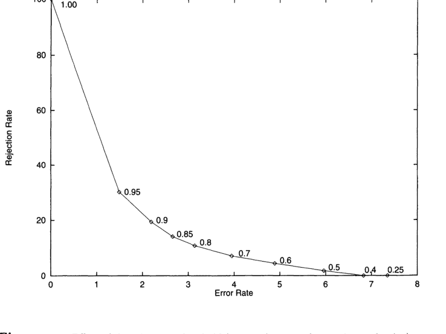

图4.8 拒绝阈值（在每个实验点附近标出）对训练集的影响。仅包含那些由SFBF网络获得前L个最高概率的类别的模式。

在表4.5中，针对每个L值（L ∈ [2,10]），给出了验证集上的成功率（%S-Valid）。每个实验的拒绝阈值设置为0.95。这些实验数据表明，成功率对L没有显著依赖性。因此，选择L=2能够带来良好的泛化性能和更高的识别速度（根据我们的初步结果，比L=10时快约5倍）。

为了进一步加速NR对最近点的搜索，可以开发并行硬件，并/或尝试使用优化的数据结构，如bumptrees [22]或随机化算法 [7]。

#### 4.11 结论

通用函数逼近结果是许多连接主义系统（如MLP、RBF和FLS）的关键属性。此外，选择合适的代价函数进行参数识别，使得能够高效地处理

| L | 2 | 3 | 4 | 5 | 6 | 7 | 8 | 9 | 10 |
|---|---|---|---|---|---|---|---|---|---|
| %S-Valid | 93.46 | 93.53 | 93.68 | 93.58 | 93.64 | 93.66 | 93.61 | 93.60 | 93.45 |

表4.5 混合模式识别方案：使用在线编辑的压缩数据库时的性能（见正文）。

模式识别问题。

在此框架下，可以轻松获得高效的监督非参数模糊分类器，如本章所示。基于FLS的分类器（如本文研究的FBF网络）的特殊性在于：如果除了数值训练集之外，还提供了类别的语言描述，则它可以利用这两种信息来完成模式识别任务。

此外，我们已经表明，根据可用的计算资源和目标分类性能，可以定义一系列模型，这些模型均源自FBF网络的原始形式，覆盖了涉及训练时间、性能和响应时间的大范围控制参数。

#### 4.12 致谢

本工作得到了CNR、INFM和MURST的资助。我们感谢Nicola Giusti实现了竞争性和混合算法。

#### 4.13 参考文献

[1] D. Alfonso, F. Masulli, and A. Sperduti. Competitive learning in a classifier based on an adaptive fuzzy system. In P.G. Anderson and K. Warwick, editors, Proceedings of the International ICSC Symposium on Industrial Intelligent Automation (IIA’96) and Soft Computing (SOCO’96), Reading, England, pages C2–C8, Millet, Alberta, Canada, 1996. ICSC.

[2] E. Barnard, F. Kanaya, and S. Miyake. Comments on ‘Bayes statistical behavior and valid generalization of pattern classifying neural networks’ (with reply). IEEE Transactions on Neural Networks, 3:1026–7, 1992.

[3] F. Casalino. Fuzzy systems for handwriting recognition. Laurea Thesis in Computer Science, University of Genoa, Genova - Italy, 1993. In Italian.

[4] F. Casalino, F. Masulli, and A. Sperduti. Rule specialization in networks of fuzzy basis functions. Intelligent Automation and Soft Computing, 4:73–82, 1998.

[5] F. Casalino, F. Masulli, A. Sperduti, and F. Vannucci. Semantic phase transition in a classifier based on an adaptive fuzzy system. In Proceedings of the Third IEEE International Conference on Fuzzy Systems, IEEE-FUZZ94, volume 2, pages 808–812, Orlando, FL, USA, 1994. IEEE.

[6] R. Caviglia. Soft-computing methods for time series forecasting. Laurea Thesis in Computer Science, University of Genoa, Genova - Italy, 1994. In Italian.

[7] K. L. Clarkson. A randomized algorithm for the closest-point queries. SIAM Journal on Computing, pages 830–847, 1988.

[8] R.O. Duda and P.E. Hart. Pattern Classification and Scene Analysis. Wiley, New York, 1973.

[9] M.D. Garris and R.A. Wilkinson. NIST Special Database3 Handwritten Segmented Characters. National Institute of Standard and Technology, Gaithersburg, MD, USA, 1992.

[10] N. Giusti, F. Masulli, and A. Sperduti. Competitive and hybrid neuro-fuzzy models for supervised classification. In Proceedings of 1997 IEEE International Conference on Neural Networks, INNC’97, pages 516–519, Houston, USA, 1997. IEEE.

[11] J. Hampshire and B. Pearlmutter. Equivalence proofs for multi-layer perceptron classifiers and the Bayesian discriminant function. In D.S. Touretzky, G. Hinton, and T. Sejnowski, editors, Connectionist Models: Proceedings of the 1990 Summer school, pages 13–19, Denver, 1990. Morgan Kaufmann, San Mateo.

[12] J.S.R. Jang. ANFIS: Adaptive-network-based fuzzy inference system. IEEE Trans. on Systems, Man, and Cybernetics, 23:655–684, 1993.

[13] C.C. Jou. Comparing learning performance of neural networks and fuzzy systems. In IEEE International Conference on Fuzzy Systems, pages 1028–1033, San Francisco, 1993. IEEE, New York, NY.

[14] F. Kanaya and S. Miyake. Bayes statistical behavior and valid generalization of pattern classifying neural networks. IEEE Transactions on Neural Networks, 2:471–475, 1991.

[15] H.M. Kim and J.M. Mendel. Fuzzy basis functions: Comparisons with other basis functions. IEEE Trans. on Fuzzy Systems, 3:158–168, 1995.

[16] C.C. Lee. Fuzzy logic in control systems: fuzzy logic controller. I. IEEE Transactions on Systems, Man, and Cybernetics, 20:404–418, 1990.

[17] Y. Lee. Handwritten digit recognition using k nearest-neighbor, radial-basis function, and backpropagation neural networks. Neural Computation, 3:440–449, 1991.

[18] F. Masulli. Bayesian classification by feedforward connectionist systems. In F. Masulli, P. G. Morasso, and A. Schenone, editors, Neural Networks in Biomedicine - Proceedings of the Advanced School of the Italian Biomedical Physics Association - Como (Italy) 1993, pages 145–162, Singapore, 1994. World Scientific. (invited).

[19] J.M. Mendel. Fuzzy logic systems for engineering: A tutorial. Proceedings of the IEEE, 83:345–377, 1995.

[20] S. Miyake and F. Kanaya. A neural network approach to a Bayesian statistical decision problem. IEEE Transactions on Neural Networks, 2:538–540, 1991.

[21] G.C. Mouzouris and J.M. Mendel. Non-singleton fuzzy logic systems. In Proc. 1994 IEEE Conf. on Fuzzy Systems, Orlando 1994, 1989. IEEE, New York.

[22] S. M. Omohundro. Bumptrees for efficient function, constraint, and classification learning. In R.P. Lippmann, J.E. Moody, and D. S. Touretzky, editors, Advances in Neural Information Processing Systems 3, pages 693–900. San Mateo, CA: Morgan Kaufmann, 1991.

[23] Theo Pavlidis. Algorithms for Graphics and Image Processing. Springer-Verlag, 1982.

[24] J. Platt. A resource-allocating network for function interpolation. Neural Computation, 3:213–225, 1991.

[25] D.W. Ruck, S.K. Rogers, M. Kabrisky, M.E. Oxley, and B.W. Suther. The multilayer perceptron as an approximation to a Bayes optimal discriminant function. IEEE Transactions on Neural Networks, 1:296–298, 1990.

[26] D.E. Rumelhart, G.E. Hinton, and R.J. Williams. Learning internal representations by error propagation. In D.E. Rumelhart and J.L. McClelland, editors, Parallel Distributed Processing, volume 1, chapter 8, pages 318–362. MIT Press, Cambridge, 1986.

[27] T.P. Vogl, J.K. Mangis, A.K. Rigler, W.T. Zink, and D.L. Alkon. Accelerating the convergence of the back-propagation method. Biological

# 5

## 多级模糊控制

Zong-Mu Yeh
Email: zongmu@cc.ntnu.edu.tw, FAX: (02)2392944

Hung-Pin Chen
Department of Industrial Education,
National Taiwan Normal University,
Taipei, Taiwan, 10610, R.O.C.

摘要................................................... 172

5.1 引言................................................... 172
多级模糊系统 • 相关研究与问题 • 多级方法

5.2 多级推理模糊系统 ...... 179
多级模糊推理引擎 • 多级模糊推理过程

5.3 模糊规则生成方法 ... 183
多级模糊推理系统的模糊规则生成 • 快速多级模糊逻辑推理

5.4 示例................... 191

5.5 结论 ....................................... 199

5.6 参考文献 ....................................... 202


## 多级模糊控制

# 摘要

本章涉及多级模糊控制系统的设计。提出了一种根据控制系统性能指标为多级模糊控制器生成模糊规则的通用方法。采用三级模糊推理的仿真结果表明，该方法能够获得良好的性能。

### 5.1 引言

模糊逻辑最近取得的成功促进了其在复杂应用中的使用，这些应用包含大量规则且需要实时响应[1]。典型的模糊逻辑模型包含多种输入和输出，可分为三类：单输入单输出（SISO）、多输入单输出（MISO）和多输入多输出（MIMO），如图 5.1 所示。随着应用系统变得更加复杂，它们将包含更复杂的知识，这些知识可能以更复杂的方式表达，并且涉及大量模糊规则，这些规则会随着输入、输出和隶属度函数数量的增加而迅速增加。例如，在一个具有N个输入变量和单个输出变量、每个变量有M个模糊值的系统中，完整模糊规则总数为M^N。模糊规则的完备性意味着在输入空间的任何点，至少存在一条规则会被触发。如此大规模的模糊规则需要耗费大量精力来开发，且推理计算时间将很长。因此，典型的单级模糊推理可能不适用于人类的智能活动。

为了降低模糊系统的复杂性，通常通过分散化为若干小型模糊子系统，或划分为多级推理系统来解决复杂问题。由于分散控制方法在实现方面可靠且实用，它是最常用的方法，其目标是设计控制方案，使每个子系统基于局部信息独立控制。例如，一个三连杆机器人可被视为三个子系统，每个子系统独立控制。然而，一些复杂系统难以划分为子系统；因此，其中一些复杂系统适合由分级控制器（多级）控制。

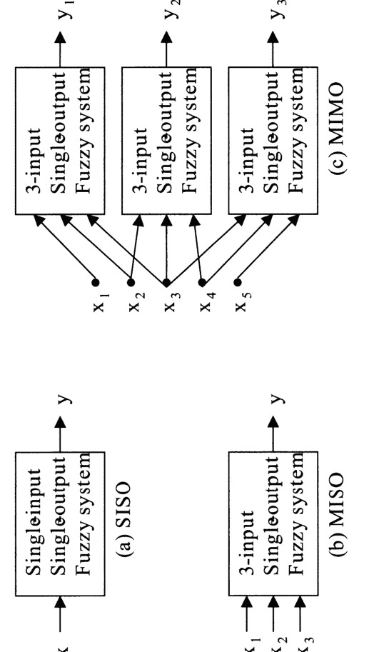

*图 5.1 SISO、MISO 和 MIMO 模糊系统*

为了减少复杂系统的模糊规则数量，人们提出了多级模糊逻辑推理[2]-[5]。除了输入和输出变量外，模糊规则中还采用中间变量来模拟人类知识。使用分级结构（多级）的关键优势在于，模糊规则数量将随输入变量和（或）隶属度函数的数量呈二次方增长（$O(N^2)$）[2, 3]；例如，若一个六输入单输出模糊控制系统对每个输入变量使用七个模糊值，且系统分为五个阶段，则模糊规则数为$5 \times 7^2$，而不是$7^6$。在图 5.2 所示的多级推理系统中，有两个输入变量，每个阶段有两个输入和一个输出。模糊规则数在第一阶段减少为 $5*7^2$，并产生中间输出变量；从第二到第四阶段，各有一个输入变量、一个中间输入变量和一个中间输出变量；在最后阶段，有一个输入变量、一个中间输入变量和一个输出变量。因此，比较单级和多级模糊系统之间的模糊规则数量和开发工作量，对于复杂应用，多级系统在开发模糊规则方面所需工作量更少，计算时间也更短。在回顾相关研究之前，下面简要介绍多级模糊系统。

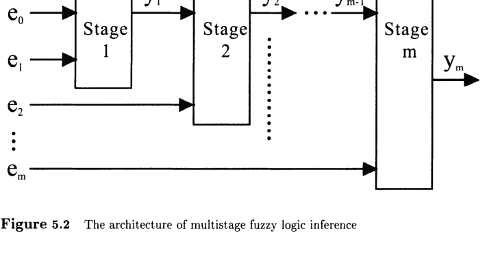

*图 5.2 多级模糊逻辑推理的架构*

#### 5.1.1 多级模糊系统

对于由相互关联的子系统组成的大规模系统，基本问题在于子系统之间的相互作用。许多方法已被提出用于控制复杂的互联系统，如分解-协调方法和分散控制方法[6]-[9]。由于分散控制方法在实现方面可靠且实用，它是最常用的方法，其目标是设计控制方案，使每个子系统基于局部信息独立控制。考虑一个控制系统，通用模糊控制器可以实现为：

```
Y_i = (X_1 × X_2) o R_f
```

其中 R_f 表示控制器在 V × V × W 中的输入/输出模糊关系，V 是输入空间，W 是输出空间，X_1 和 X_2 是从跟踪误差变量及其导数 e_i 和 \(\dot{e}_i\) 分别获得的模糊变量，Y_i 是控制器的模糊输出，× 表示笛卡尔积，o 表示最大-最小合成推理规则。当 e_i 和 \(\dot{e}_i\) 分别作为模糊单点 I_1 和 I_2 计算，且 R_f 转换为查找决策矩阵 Φ 的形式时，第 i 个子系统的去模糊化控制器输出可表示为：

```
u_i = GU_i * Φ(I_1, I_2)
```

其中 Φ(I_1, I_2) 是 Φ 在位置 Φ(I_1, I_2) 处的元素，I_1 和 I_2 被转换为决策矩阵的索引值，GU_i 是输出比例因子。当大规模系统具有两个以上的输入变量时，可以使用多级模糊控制器进行控制。

**定义 1.1** 多级模糊系统的定义如下：

在多级模糊系统中，模糊规则使用三种语言变量：输入变量、输出变量和中间变量。输入变量只出现在模糊规则的前件部分（即 IF 部分）。输出变量只出现在模糊规则的后件部分（即 THEN 部分）。只有中间变量可以出现在模糊规则的这两个部分中。

因此，如果一组模糊规则包含中间变量，则这些规则称为多级模糊规则。从系统论的角度来看，当人类从事如决策等复杂活动时，中间变量指的是当前阶段的近似输出。在规则表示中，中间变量包含在当前阶段的 THEN 部分和下一阶段的 IF 部分中；当前阶段的 IF 部分变量包括上一阶段的中间变量和输入变量。当给定事实时，当前阶段（除最后阶段外）的模糊规则被推理；推理阶段中中间变量的结论作为事实传递到下一阶段。最后，从最后阶段获得输出变量的结论。因此，通过使用中间变量模拟人类知识，在分级结构中创建了与系统目标以某种方式相关的近似概念。这些近似的、定性的概念按层次组织，以提供概念关联和推理。多级模糊逻辑推理的其他可能架构如图 5.3 和图 5.4 所示。

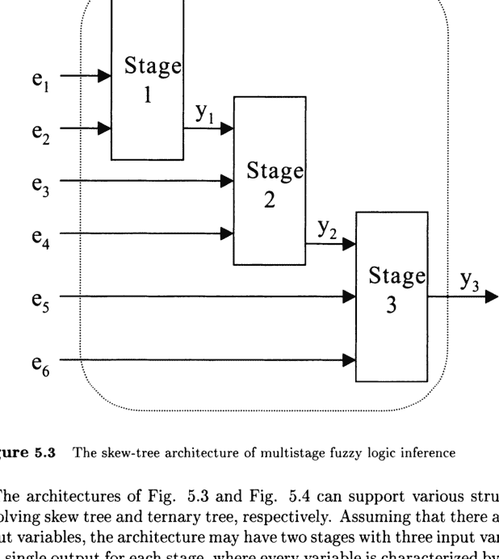

*图 5.3 多级模糊逻辑推理的斜树架构*

图 5.3 和图 5.4 的架构分别支持斜树和三叉树等各种结构。假设有五个输入变量，该架构可能包含两个阶段，每个阶段有三个输入变量和一个输出，其中每个变量由七个模糊隶属度函数表征。当输入变量数量增加一个时，架构可以设计为斜树结构（例如图 5.3）或三叉树结构（例如图 5.4）。考虑图 5.3 所示的架构，有六个输入和一个输出，因此可以划分为三个阶段。第一推理阶段有两个输入和一个输出，而第二和第三阶段有三个输入。第一阶段和第二阶段的输出是中间变量，它们作为输入事实传递到其下一阶段。因此，图 5.3 中的完整规则总数为 1 × 7² + 2 × 7³ = 735。


输入变量的参数通常在第一级中进行组织，然后次重要的输入参数在第二级中，依此类推。在本工作中，我们考虑模糊规则库由 $M$ 级组成的情形，形式如下：

第 1 级：
IF $x_0$ is $A_{1,0}^1$ ∧ ⋯ ∧ $x_{L_1}$ is $A_{1,L_1}^1$
THEN $y_1$ is $B_1^1$
⋯
IF $x_0$ is $A_{n,0}^1$ ∧ ⋯ ∧ $x_{L_1}$ is $A_{n,L_1}^1$
THEN $y_1$ is $B_n^1$
⇒（输出到第 2 级）

第 2 级：
IF $y_1$ is $A_{1,1}^2$ ∧ ⋯ ∧ $x_{L_2}$ is $A_{1,L_2}^2$
THEN $y_2$ is $B_1^2$
⋯
IF $y_1$ is $A_{n,1}^2$ ∧ ⋯ ∧ $x_{L_2}$ is $A_{n,L_2}^2$
THEN $y_2$ is $B_n^2$
⇒（输出到第 3 级）

第 $m$ 级：
IF $y_{m-1}$ is $A_{1,m-1}^m$ ∧ ⋯ ∧ $x_{L_m}$ is $A_{1,L_m}^m$
THEN $y_m$ is $B_1^m$
⋯
IF $y_{m-1}$ is $A_{n,m-1}^m$ ∧ ⋯ ∧ $x_{L_m}$ is $A_{n,L_m}^m$
THEN $y_m$ is $B_n^m$
⇒（至控制输入）

其中 ∧ 是“与”算子，$A_{j,k}^i$ 和 $B_j^i$ 分别是由模糊隶属函数 $\mu_{A_{j,k}^i}(x)$ 和 $\mu_{B_j^i}(y_i)$ 表征的语言项（$i=1,2,\ldots,m$；$j=1,2,\ldots,n$；$k=0,1,\ldots,L_i$）；IF 部分中的 $x_k$ 和 $y_i$（$i=1,\ldots,m-1$）分别是输入变量和中间变量，THEN 部分中的 $y_m$ 是输出变量。

#### 5.2.1 多级模糊推理机

多级模糊推理机是一种决策逻辑，它利用模糊规则库中的模糊规则，确定从输入论域 $U_x$ 中的模糊集到输出论域 $U_y$ 中的模糊集的映射。对于第 $i$ 个推理级，设 $A_x^i$ 是 $U_x$ 中的任意模糊集；则第 $i$ 级中的每条规则 $R_j^i$ 基于 T-范数算子确定一个模糊集 $A_x^i \circ R_j^i$：

\[
\begin{aligned}
\mu_{A_x^i \circ R_j^i}(y)
&= \sup_{X \in U}\left[\mu_{A_x^i}(X) * \mu_{A_{1,j}^i}(x_1) * \cdots * \mu_{A_{L_i,j}^i}(x_{L_i}) \to \mu_{B_j^i}(y_i)\right] \\
&= \sup_{X \in U}\left[\mu_{A_x^i}(X) * \mu_{A_{1,j}^i}(x_1) * \cdots * \mu_{A_{L_i,j}^i}(x_{L_i}) * \mu_{B_j^i}(y_i)\right]
\end{aligned}
\tag{5.1}
\]

当给定事实时，首先对第一级的模糊规则进行推理，然后在推理级中生成中间变量的结论，再将这些结论作为事实传递到下一级。这一点可以很容易地用推理级 1 中两个输入、一个输出和三条模糊规则的例子来说明。多级推理的一般方案和推理结构分别如图 5.5 和图 5.6 所示。

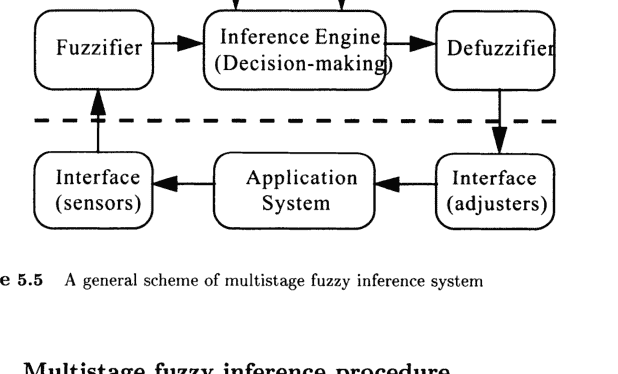

图 5.5 多级模糊推理系统的一般方案

#### 5.2.2 多级模糊推理过程

一般来说，模糊推理过程包括以下步骤：

1. 读取输入，并将输入模糊化为输入事实。
2. 计算输入与涉及输入变量的模糊规则的 if 子句之间的匹配度。
3. 计算被触发模糊规则的触发强度。

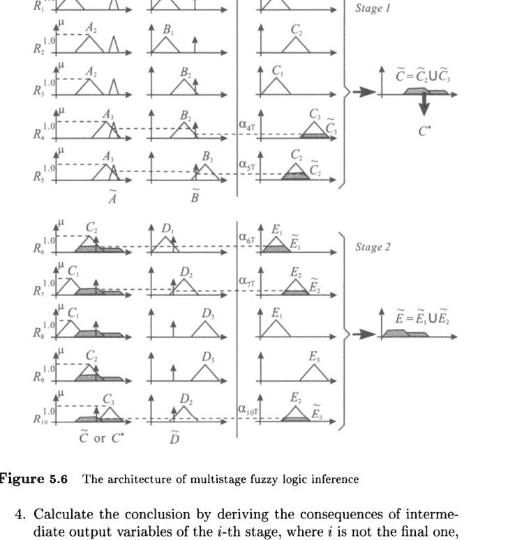

图 5.6 多级模糊逻辑推理的体系结构

4. 计算结论：推导第 $i$ 级（非最后一级）中间输出变量的结果，并归一化这些推导出的结果。
5. 将第 $i$ 级的结论作为输入事实传递到下一级。类似地，当推理中的结论过于模糊时，可以对结论进行去模糊化，然后将其作为事实传递到下一级。重复步骤 1 到步骤 5，直到所有推理级中的多级模糊规则都完成推理。
6. 当每一级中的所有模糊规则都已完成推理后，执行最后一级输出变量的结论计算。
7. 进行去模糊化计算，得到作为控制输入的单值。

上述过程的算法描述如下：

```
Algorithm multistage fuzzy logic inference(){
    // inputs: input variable (tracking errors)
    // output: obtained control input
    Do while (not halt){
        Input-fuzzy();
        // Fuzzification process for input data to
        // obtain input facts
        If-clause-evaluate();
        // input facts are broadcasted to all
        // if-clauses to compute match-degrees
        If-part-evaluate();
        // Match-degrees are taken as inputs
        // to evaluate firing strengths

        // intermediate variable derived as follows:
        for stage 2 to stage m {
            Then-part-evaluate();
            // deriving then-part fuzzy values and
            // normalizing them (sometimes defuzzifying them)
            // to obtain consequence (except final stage)
            If-clause-evaluate();
            // Either the fuzzy set conclusion or the
            // defuzzified singleton value are
            // broadcasted to all if-clause
            If-part-evaluate();
            // Match-degrees are taken as inputs
            // to evaluate firing strength
        } // end for
        Then-part-evaluate();
        // Deriving then-part fuzzy values and normalizing
        // then at the final stage to obtain consequence
        Defuzzy-output();
        // perform defuzzification to obtain control
        // input for the output variable
    } // end do while
} // end multistage fuzzy logic inference
```

#### 5.3 模糊规则生成方法

模糊规则库是模糊控制系统的核心，因为所有其他设计参数都用于辅助和解释这些模糊规则，并使其可用于针对特定控制问题设计模糊控制器。

其中 $GU_m$ 是第 $m$ 级的输出比例因子，且
\[
f_m(e_m, u_{m-1}) = -\frac{|u_{m-1}| u_{m-1} + |e_m| e_m}{\Delta}.
\]
第 $m$ 级的规则生成函数由 $f_m(e_m, u_{m-1})$ 获得，其中 $e_m$ 和 $u_{m-1}$ 分别被其在式 (5.5) 中模糊子集 $A_{I_m}$ 和 $A_{I_{m-1}}$ 的索引 $I_m$ 和 $I_{m-1}$ 替换，

\[
f_m(I_m, I_{m-1}) = \operatorname{sat}\left(n, -\frac{|I_m| I_m + |I_{m-1}| I_{m-1}}{\Delta'}\right)
\tag{5.10}
\]

其中 $\Delta' = \sqrt{I_m^2 + I_{m-1}^2}$，$\operatorname{sat}(n, x)$ 表示饱和函数：

\[
\operatorname{Sat}(n,x)=
\begin{cases}
n, & \text{if } x \ge n,\\
\operatorname{round}(x), & \text{if } -n < x < n,\\
-n, & \text{if } x \le -n
\end{cases}
\tag{5.11}
\]

其中 $n$ 是模糊语言项的最大索引，$\operatorname{round}(x)$ 可以将 $x$ 截断为整数。

由式 (5.8) 可知，最负的梯度 $-|\nabla I_j|$ 意味着 $u_{m-1}$ 最大。因此，对于第 $j$ 级，取 $u_j$ 的正梯度为

\[
|\nabla u_j| = \left[ \frac{|e_j(k)|}{\Delta_j} \quad \frac{|u_{j-1}(k)|}{\Delta_j} \right]
\tag{5.12}
\]

其中 $\Delta_j = u_j$。采用类似方法，第 $j$ 级的输出选取为

\[
y_j(k) = GU_j(|\nabla u_j|) \begin{bmatrix} e_j(k) \\ u_{j-1}(k) \end{bmatrix}
= GU_j\left(\frac{|e_j(k)| e_j(k)}{\Delta_j} + \frac{|u_{j-1}(k)| u_{j-1}(k)}{\Delta_j}\right)
= GU_j * f_j(e_j, u_{j-1})
\tag{5.13}
\]

第 $j$ 级的规则生成函数由 $f_j(e_j, u_{j-1})$ 获得，其中 $e_j$ 和 $u_{j-1}$ 分别被其在模糊子集 $A_{I_j}$ 和 $A_{I_{j-1}}$ 中的索引 $I_j$ 和 $I_{j-1}$ 替换，

\[
f_j(I_j, I_{j-1}) = \operatorname{sat}\left(n, \frac{|I_j| I_j + |I_{j-1}| I_{j-1}}{\Delta_j}\right)
\tag{5.14}
\]

例如，假设模糊集 $F$ 中每个模糊子集都与一个整数关联，表示为 $F = \{NB_{-3}, NM_{-2}, NS_{-1}, ZO_0, PS_1, PM_2, PB_3\}$。在第 $j$ 个子系统中，一条具有两个输入和单输出的模糊规则可以编码为如下 IF-THEN 子句：IF $y_{j-1}$ is $NB_{-3}$ and $e_j$ is $NB_{-3}$ THEN $y_j$ is $PB_3$，其中模糊子集 $PB_3$ 的整数 3 由方程

\[
f(-3, -3) = \operatorname{sat}\left(3, \frac{-|-3|*(-3) - |-3|*(-3)}{\Delta'}\right) = 3
\]

（式 5.14）得到，其中 $\Delta' = \sqrt{(-3)^2 + (-3)^2}$。

采用多级模糊逻辑结构的关键优势在于，规则数量只会随变量数量线性增加（而不是指数增加）。但多级模糊逻辑推理的延迟时间（即推理时间）以及输入、输出和中间变量的模糊集合运算次数都必须尽可能减少。这可以通过预先计算若干多级模糊规则上的模糊集合运算来缩短延迟时间。因此，输入变量的匹配度计算次数可能会减少，输出变量的结论生成和去模糊化操作次数也可能会减少。对于中间变量，模糊集合运算可以在编译时预先计算；此外，可以减少交集和并集的标量运算次数，以加快执行时的推理速度。因此，可以有效减少多级模糊逻辑推理所涉及的延迟时间。

## 任意级模糊规则的 IF 部分评估

为了描述该方法，采用变量模糊值的记号。第 $i$ 级中间变量 $y_{i-1}$ 的模糊值为 $\{FuzzyValue_h\}$，记为 $\{FV_h^i(y_{i-1})\}$，其中 $1 \le i \le m$，$h \in \{1,\cdots,l_i\}$；IF 部分的语言项表示为

\[
A_{j,k}^i \in \{FV_h^i(y_{i-1})\},
\tag{5.15}
\]
\[
1 \le i \le m, \quad j \in \{1,\cdots,n_i\}, \quad 1 \le k \le m-1, \quad h \in \{1,\cdots,l_i\}
\]

其中 $n_i$ 是第 $i$ 级模糊规则的数量，$l_i$ 是第 $i$ 级中间变量 $y_{i-1}$ 的模糊值数量。当输入事实或推理事实出现时，第 $i$ 级中各个 $FV_h^i(y_{i-1})$ 与该事实之间的匹配度计算如下：

\[
\alpha_h^i(y_{i-1}) = \max_{u^{i-1} \in U_{y_{i-1}}} \left( \mu_{FV_h^i(y_{i-1})}(u^{i-1}) \wedge \mu_{\tilde{A}_i}(u^{i-1}) \right)
\tag{5.16}
\]
\[
1 \le i \le m, \quad h \in \{1,\cdots,l_i\}
\]

其中 $\wedge$ 表示 T-范数算子。交集运算常用的 T-范数算子有逻辑积、代数积、有界积和强积算子，而相应并集运算的 S-范数算子有逻辑和、代数和、有界和与强和算子。

当这些非零匹配度被计算出来后，它们会被广播到涉及模糊值 $FV_h^i(y_{i-1})$ 的那些 if 子句。因此，规则 $R_j^i$ 的触发强度也可由式 (5.17) 推导得出：

\[
\alpha_{jT}^i = \wedge \alpha_h^i(y_{i-1}), \quad 1 \le i \le m, \quad j \in \{1,\cdots,n_i\}, \quad h \in \{1,\cdots,l_i\}
\tag{5.17}
\]


传递到第(i+1)阶段作为推断的事实。当第(i+1)阶段的中间变量y_i（在if部分）等于第i阶段的y_i变量（在then部分）时，第i阶段的变量y_i的第h个模糊值的匹配度α_h^{i+1}(y_i)，1 ≤ i ≤(m−1)，h ∈ {1,⋯,l_i}，j ∈ {1,⋯,n_i}可以根据以下定理预先计算：

## 定理2 [5, 20]：第i阶段then部分变量y_i的后果μ_{ar{B}_i}(u^i)传递到第(i+1)阶段作为推断的事实，μ_{ar{A}_{i+1}}(u^i)。第(i+1)阶段的变量y_i的第h个模糊值的匹配度α_h^{i+1}(y_i)，1 ≤ i ≤(m−1)，h ∈ {1,⋯,l_{i+1}}可以预先计算为

```
α_h^{i+1}(y_i) = max_{g∈{1,⋯,q_{i+1}}} (α_{t_g}^i_T ∧ β_{h,g}), if β_{h,g} > 0   (5.23)
β_{h,g} = max_{u^i∈U_{y_i}} (μ_{F V_h^{i+1}(y_i)}(u^i) ∧ μ_{F V_g^i(y_i)}(u^i))   (5.24)
```

其中α_{t_g}^i_T = max_{i∈T_g^i} (α_{j_T}^i), 1 ≤ i ≤ m, j ∈ {1,⋯,n_i}。注意，if部分和then部分中的T_i，i ∈ {0,⋯,3}操作符必须与T范数操作符同类型，S范数操作符仅为S_0操作符[5]。当第(i+1)阶段的中间变量y_i，1 ≤ i ≤ m − 1（在if部分）与第i阶段的（在then部分）相同时，β_{h,g}s可以很容易地从变量y_i的隶属函数定义中获得。同时，匹配度α_h^{i+1}(y_i)广播到模糊规则的if部分。然后规则R_j^{i+1}，1 ≤ i ≤ m, j ∈ {1,⋯,n_{i+1}}的点火强度也可以从以下得到：

```
α_{j_T}^{i+1} = α_{h'}^{i+1}(x_{i+1,k}) ∧ α_h^{i+1}(y_i),
k ∈ {0,1,⋯,L_i}, h ∈ {1,⋯,l_{i+1}}, h' ∈ {1,⋯,l'_{i+1}}   (5.25)
```

例如，如果中间变量x_3的if部分和then部分使用相同类型的模糊逻辑操作符，则计算被图5.7中的虚线框住。然后它们的预计算在图5.8中详细说明。预计算值β_{h,g}，1 ≤ h ≤ 3, 1 ≤ g ≤ 3可以很容易地从变量x_3的隶属函数中获得。因此，在推断模糊规则时，匹配度α_h^2(x_3)，1 ≤ h ≤ 3的计算是一个标量操作。由于模糊值C_1和C_3不重叠，图5.9中的β_{1,3}和β_{3,1}为零。因此，由于模糊值C_1与C_2重叠且C_2与C_3重叠，需要预计算β_{1,2}和β_{2,3}。

#### 5.4 说明性示例

为了演示MFLC控制器的有效性，使用双挂车和卡车后退停车问题作为说明性示例。图5.10显示了模拟的双挂车和卡车系统。

双挂车和卡车系统的位置可以通过五个状态变量φ1t、φ1c、φ2c、x和y来确定，坐标对(x, y)指定挂车后中心的位置。状态变量φ1t指定第二挂车与水平方向的角度（范围从-270°到90°），而φ1c指定第一挂车沿中心线的相对驾驶室角度（范围从-90°到90°）；φ2c指定第二挂车沿中心线的相对驾驶室角度（范围从-90°到90°）。多阶段推理模糊控制器的目标是使双挂车和卡车系统到达正确泊位（φf = -90°）的装货码头，并将挂车的位置(x, y)与期望的装货码头（xf, yf）对齐。这个控制系统包含四个输入变量和一个输出变量。输入变量使用模糊变量ex、eφ1t、eφ1c和eφ2c定义，其中ex = x − xf, eφ1t = φ1t − φf, eφ1c = φ1c − 0°，

而输出变量使用θ定义。在这项工作中，给出了输入/输出变量的整数索引的模糊项集：

A_{φ1t} = {LB_{-3}, LU_{-2}, LV_{-1}, VE_0, RV_1, RU_2, RB_3},

A_{φ1c} = A_{φ2c} = {NE_{-3}, NU_{-2}, NV_{-1}, ZR_0, PV_1, PU_2, PO_3},

A_x = {LE_{-2}, LC_{-1}, CE_0, RC_1, RI_2},

B_θ = {NB_{-3}, NM_{-2}, NS_{-1}, ZO_0, PS_1, PM_2, PB_3},

其中，模糊项在图5.11中定义。

为了构建多阶段模糊控制器，引入了中间变量u1和u2，它们表示不同推理阶段中间变量的期望旋转角度，在以下规则形式中引入：

第一阶段：IF e_x 是 LE_{-2} 和 e_{φ1t} 是 RB_{-3} THEN u1 是 z1_{f1(-2,-3)}

第二阶段：IF u1 是 z1_{f1(-2,-3)} 和 e_{φ1c} 是 NE_{-3} THEN u2 是 z2_{f2(f1(-2,-3),-3)}

第三阶段：IF u2 是 z2_{f2(f1(-2,-3),-3)} 和 e_{φ2c} 是 NE_{-3} THEN θ 是 z3_{f3(f2(f1(-2,-3),-3),-3)}

(5.26)

其中，中间变量u1和u2的模糊项集是

### 图 5.8 中间变量x3的预计算

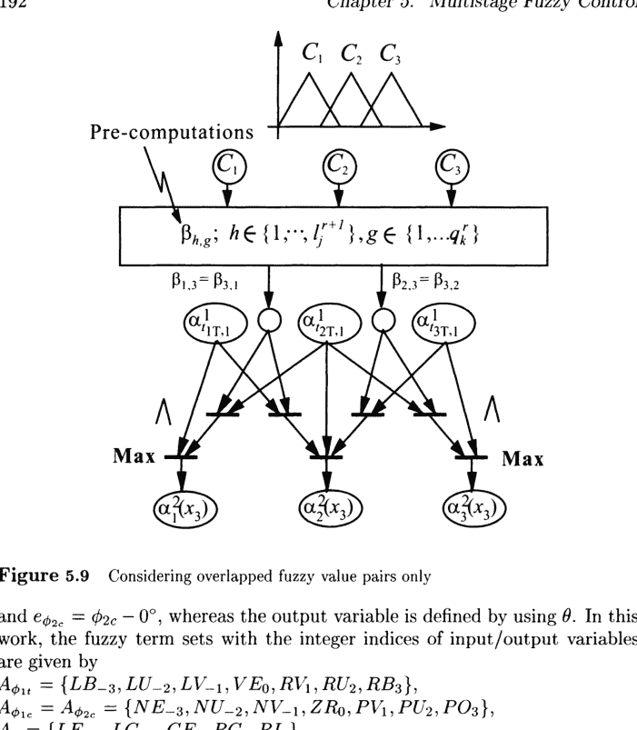

### 图 5.9 仅考虑重叠的模糊值对

和e_{φ2c} = φ2c − 0°，而输出变量使用θ定义。在这项工作中，给出了输入/输出变量的整数索引的模糊项集：

其中Δ₃′ = √(I²_{φ2c} + I²_{u2})。例如，如果其中一条模糊规则是“IF u₂ 是 ILU₋₂ 和 e_{φ2c} 是 NE₋₃ THEN θ 是 z3 f₃(−2,−3）”，那么这条规则意味着索引I_{φ2c} = −3，I_{u2} = −2，且z3 f₃(−2,−3)=P B₃。依据Eq.(5.12)和(5.13)，第二阶段的中间输出选择为

u₂′ = GU₂(|∇u₂|) [ e_{φ1c} ; u₁ ] = GU₂( (|e_{φ1c}| e_{φ1c})/u₂ + (|u₁| u₁)/u₂ ) = GU₂ * f₂(e_{φ1c}, u₁) (5.31)

第一阶段的中间输出选择为

u₁′ = GU₁(|∇u₁|) [ e_{φ1t} ; e_x ] = GU₁( (|e_{φ1t}| e_{φ1t})/u₁ + (|e_x| e_x)/u₁ ) = GU₁ * f₁(e_{φ1t}, e_x) (5.32)

中间输出的规则生成函数从f₂(e_{φ1c}, u₁)和f₁(e_{φ1t}, e_x)获得，其中e_{φ1c}、u₁、e_{φ1t}和e_x分别替换为其模糊子集对应的整数索引I_{φ1c}、I_{u1}、I_{φ1t}和I_{e_x}，

f₂(I_{φ1c}, I_{u1}) = sat(n, - (|I_{φ1c}| I_{φ1c} + ρ₁ |I_{u1}| I_{u1}) / Δ₂′) (5.33) f₁(I_{φ1t}, I_x) = sat(n, - (|I_{φ1t}| I_{φ1t} + |I_x| I_x) / Δ₁′) (5.34)

其中Δ₂′ = √(I²_{φ1c} + ρ₁ * I²_{u1})和Δ₁′ = √(I²_{φ1t} + I²_x)。

为了照顾所有条件，模糊规则集必须是完整的。完整的模糊规则可以通过规则生成函数f₁、f₂和f₃来确定，对应的三个模糊规则库在图5.12、5.13和5.14中表示。e_{φ1t}、e_{φ1c}、e_{φ2c}、e_x、u₁、u₂和θ的模糊集值在图5.11中显示。这些规则库集在图5.12、5.13和5.14中显示，其中第一阶段的模糊变量是e_{φ1t}、e_x和u₁，第二阶段的模糊变量是e_{φ1c}、u₁和u₂，最后一阶段的模糊变量是e_{φ2c}、u₂和θ。输出缩放因子选择为GU₃ = GU₂ = 1。

## f₁(e_{φ₁t}, e_X)

| e_{φ₁t} \ e_X | LE-2 | LC-1 | CE0 | RC1 | RI2 |
|---|---|---|---|---|---|
| RB-3 | IRB | IRB | IRB | IRB | IRV |
| RU-2 | IRB | IRU | IRU | IRV | IVE |
| RV-1 | IRU | IRV | IRV | IVE | ILV |
| VE 0 | IRU | IRV | IVE | ILV | ILU |
| LV 1 | IRV | IVE | ILV | ILV | ILU |
| LU 2 | IVE | ILV | ILU | ILU | ILB |
| LB 3 | ILV | ILB | ILB | ILB | ILB |

图5.12 规则生成的函数f₁

简单的运动学方程取代了由S.-G. Kong [23]讨论过的双挂车和卡车模拟器。[23]的模拟器方法是测量定义为模糊规则输出变量的角度。然后计算转向角输出θ。我们的运动学方程，给出了双挂车和卡车系统运动行为的直观描述，是从[23]精炼的。转向角输出θ直接从模糊规则的点火集推断。如果双挂车和卡车在迭代中从(x, y)向后移动到(x′, y′)，那么

**f₂(φ₁c, u₁)**

| eφ₁c \ u₁ | IRB-3 | IRU-2 | IRV-1 | IVE0 | ILV1 | ILU2 | ILB3 |
|---|---|---|---|---|---|---|---|
| NE-3 | IRB | IRB | IRB | IRB | IRB | IRV | IVE |
| NU-2 | IRB | IRB | IRU | IRU | IRV | IVE | ILV |
| NV-1 | IRB | IRU | IRV | IRV | IVE | ILV | ILB |
| ZR0 | IRB | IRU | IRV | IVE | ILV | ILU | ILB |
| PV1 | IRB | IRV | IVE | ILV | ILV | ILB | ILB |
| PU2 | IRV | IVE | ILV | ILU | ILU | ILB | ILB |
| PO3 | IVE | ILV | ILB | ILB | ILB | ILB | ILB |

**图5.13 规则生成函数 f₂**

```
φ'_{c,h} = φ_{c,h} + θ
u'_2 = u_2 + r cos(φ'_{c,h})
v'_2 = v_2 + r sin(φ'_{c,h})
φ'_{2t} = tan⁻¹( (v₁ - v'_2) / (u₁ - u'_2) )
u'_1 = u'_2 + l cos(φ'_{2t})
v'_1 = v'_2 + l sin(φ'_{2t})
φ'_{1t} = tan⁻¹( (y - v'_1) / (x - u'_1) )
```

**f₃(e_{φ₂c}, u₂)**

| u₂ \ eφ₂c | IRB-3 | IRU-2 | IRV-1 | IVE0 | ILV1 | ILU2 | ILB3 |
|---|---|---|---|---|---|---|---|
| NE-3 | PB | PB | PB | PB | PB | PS | ZO |
| NU-2 | PB | PB | PM | PM | PS | ZO | NS |
| NV-1 | PB | PM | PS | PS | ZO | NS | NB |
| ZR0 | PB | PM | PS | ZO | NS | NM | NB |
| PV1 | PM | PS | ZO | NS | NS | NM | NB |
| PU2 | PS | ZO | NS | NM | NM | NB | NB |
| PO3 | ZO | NS | NB | NB | NB | NB | NB |

**图5.14 规则生成函数 f₃**

```
x' = u'_1 + l cos(φ'_{1t})
y' = v'_1 + l sin(φ'_{1t})
φ'_{2c} = φ'_{c,h} - φ'_{2t}
```

其中，θ 由模糊规则的推理产生；φ'_{c,h} 表示车头与水平方向的夹角；r 表示每次迭代的移动距离；l 表示拖车长度，设为100。

利用第一、第二和第三级模糊规则集（图5.8），图5.15、5.16和5.17分别展示了双拖车-卡车模糊控制系统在不同初始位置下的典型倒车泊车轨迹。双拖车-卡车系统从案例1到案例3的初始位置 (x, y, φ₁t, φ₁c, φ₂c) 分别为 (200, 200, 45, 0, 0)、(200, 200, -90, 0, 0) 和 (800, 200, -45, 0, 0)。在此仿真中，y 位置坐标 y 的


**图5.16 模糊控制系统的双拖车-卡车轨迹样本，初始位置 (x, y, φ₁t, φ₁c, φ₂c): (b) (200, 200, -90, 0, 0)**

| | 相关方法 [4, 24] | 所提方法 |
|---|---|---|
| 预计算次数 | 35 × 49=1,715 | 6 |
| ∧ 运算次数 | 35 × 49=1,715 | 12 |
| 最大标量运算次数 | 49 | 7 |

**表5.2 中间变量 u₁ 的两种方法比较**


**图5.17 模糊控制系统的双拖车-卡车轨迹样本，初始位置 (x, y, φ₁t, φ₁c, φ₂c): (c) (800, 200, -45, 0, 0)**

该方法可作为替代方式，在无法获得专家操作员控制策略的可靠语言模型时生成完整的规则库。该方法还可以缩短设计周期。我们还提出了一种快速多级模糊逻辑推理方法。当中间变量在 IF 部分和 THEN 部分均使用同类型的 T-范数算子时，提出了一种预计算模糊值匹配度的方法。执行阶段所需执行的操作数量显著减少，算法复杂度远低于相关工作 [4, 24]。使用三级模糊推理的仿真结果表明，双拖车-卡车应用能够获得良好的性能。

#### 5.6 参考文献

- [1] C. von Altrock, B. Krause and H.-J. Zimmermann, “Advanced fuzzy logic control of a model car in extreme situations,” Fuzzy Sets and Systems, Vol. 48, (1992) 41-52.
- [2] G. V. S. Raju, J. Zhou and R. A. Kisner, “Hierarchical Fuzzy Control,” International Journal of Control, Vol. 54, No. 5, (1991) 1201-1216.
- [3] G. V. S. Raju and J. Zhou, “Adaptive Hierarchical Fuzzy Controller,” IEEE Trans. on Systems, Man and Cybernetics, Vol. 23, No. 4, (1993) 973-980.
- [4] K. Uehara and M. Fujise, “Multistage Fuzzy Inference Formulated as Linguistic-Truth-Value Propagation and Its Learning Algorithm Based on Back-Propagating Error Information,” IEEE Trans. on Fuzzy Systems, Vol. 1, No. 3, (1993) 205-221.
- [5] H. P. Chen and T. M. Parng, “A new approach of multi-stage fuzzy logic inference,” Fuzzy Sets and Systems, Vol. 78, (1996) 51-72.
- [6] M. S. Mahmoud, M. F. Hassan, and M. D. Darwish, “Large-scale Control Systems: Theories and Techniques,” New York: Marcel Dekker.
- [7] R. A. DeCarlo, et al., “Variable structure control of nonlinear multivariable systems: a tutorial,” Proc. IEEE, Vol. 76(3), (1988).
- [8] D. T. Gavel and D. D. Siljak, “Decentralized adaptive control: structural conditions for stability,” IEEE Trans. Automat. Contr., Vol. 34(4), (1989) 413-426.
- [9] L. Shi and S. K. Singh, “Decentralized adaptive controller design for large-scale systems with higher order interconnections,” IEEE Trans. Automat. Contr., Vol. 37(8), (1992) 1106-1118.
- [10] A. Shakouri, et al., “Fuzzy control for multivariable systems,” in Proc. 2nd IFAC Symp. Comput.-Aided Design Multivariable Tech. Syst., (1982).
- [11] G. M. Trojan and J. B. Kiszka, “Solution of multivariable fuzzy equations,” Fuzzy Sets and Syst., Vol. 23, (1987) 271-279.
- [12] M. M. Gupta, J. B. Kiszka, and G. M. Trojan, “Multivariable structure of fuzzy control systems,” IEEE Trans. Syst., Man, Cybern., Vol. 16, no. 5, (1986) 638-655.
- [13] Derek A. Linkens and H. Okola Nyongesa, “A hierarchical multivariable fuzzy controller for learning with genetic algorithms,” INT. J. CONTROL, Vol. 63(5), (1998) 865-883.
- [14] Y. H. Kuo, J. P. Hsu, and C. W. Wang, “A parallel Fuzzy Inference Model with Distributed Prediction Scheme for Reinforcement Learning,” IEEE Trans. Syst., Man, Cybern., Vol. 28, No. 2, (1998) 160-172.
- [15] I. Ichihashi, “Iterative fuzzy model and a hierarchical network,” in Proc. 4th IFSA World Congress, of Engineering (Brussels, Belgium), (1991) 49-52.
- [16] R.M. Tong, “A retrospective view of fuzzy control systems,” Fuzzy Sets and Systems, Vol. 14, (1984) 199-210.
- [17] D.-q. Qian and Y.-z. Lu, “A strategy of problem solving in a fuzzy reasoning network,” Fuzzy Sets and Systems, Vol. 33, (1989) 137-154.
- [18] J. R. Clymer, P. D. Corey, and J. A. Gardner, “Discrete Event Fuzzy Airport Control,” IEEE Trans. on Systems, Man and Cybernetics, Vol. 22, No. 2, (1992) 343-351.
- [19] Zong-Mu Yeh, “A Systematic Method for Design of Multivariable Fuzzy Logic Control Systems,” *IEEE Transactions on Fuzzy Systems*, (In press).
- [20] Zong-Mu Yeh and H. P. Chen, “A Novel Approach for Multi-Stage Inference Fuzzy Control,” *IEEE Transactions on Systems, Man, Cybernetics*, Vol. 28, No. 6, (1998) 935-946.
- [21] Zong-Mu Yeh and H. P. Chen, “Multi-Stage Inference Fuzzy Logic Control,” *Proceedings of 6th IEEE Conference on Fuzzy Systems*, (1997).
- [22] Zong-Mu Yeh, “A Performance Approach to Fuzzy Control Design for Non-linear Systems,” *Fuzzy Sets and Systems*, Vol. 64, (1994) 339-352.
- [23] S.-G. Kong and B. Kosko, “Adaptive Fuzzy Systems for Backing up a Truck-and-Trailer,” *IEEE Trans. on Neural Networks*, Vol. 3, No. 2, (1992) 211-223.
- [24] A. Bugarin and S. Barro, “Fuzzy Reasoning Supported by Petri Nets,” *IEEE Trans. on Fuzzy Systems*, Vol. 2, No. 2, (1994) 135-150.

# 6 学习模糊系统

Ahmad Lotfi  
英国斯塔福德郡大学工程与先进技术学院  
邮政信箱 333，Stafford，ST18 0DF，英国 - 电子邮箱：lotfi@mail.com

- 摘要 .................................................. 206
- 6.1 引言 .......................................... 206
- 6.2 模糊系统 ......................................... 207
  - 示例1：模糊系统
- 6.3 学习模糊系统 ................................ 211
  - 历史
  - 神经模糊系统
  - 示例2：神经模糊系统
  - 参数调整
- 6.4 学习规则 ......................................... 214
  - 示例3：学习模糊系统
- 6.5 解释保持 ........................... 216
  - 约束学习
  - 约束学习规则
  - 示例4：学习模糊系统的解释保持
- 6.6 结论 ........................................... 220
- 6.7 参考文献 ............................................ 221


## 学习模糊系统

# 摘要

模糊系统的主要优势在于能够利用以语言形式表达的信息。模糊系统的设计在很大程度上是一门艺术。设计者综合考虑积累的知识，并构建系统中的隶属函数和/或推理机制。通常，这些隶属函数在设计过程结束后就固定下来了。如果有一个模糊系统，其隶属函数参数能够根据输入和输出数据进行“自适应”或“学习”，那将是理想的。这将使设计过程更加容易。本章综述了可用于更新/学习模糊系统参数的技术。

### 6.1 引言

模糊系统的卓越能力之一在于它们能够使用以语言模式表达的信息。尽管大多数模糊系统是为了模拟人类决策行为而构建的，但专家陈述的语言信息可能并不精确，或者专家可能难以用语言表达累积的知识以涵盖所有情况。因此，为模糊系统提供学习能力至关重要，即根据经验生成或修改专家规则。

本质上，定义模糊规则有两种不同的方法。规则要么根据经验知识来定义，要么应用自适应/学习方案，从任意初始值开始调整模糊系统的自由参数。学习模糊系统可以通过参数调整算法来实现，在大多数情况下，计算代价函数相对于每个可调参数的梯度，并相应地更新参数。还有一些无导数优化方法，如遗传算法（GAs）和随机搜索方法。遗传算法已被成功应用于生成模糊规则和调整模糊系统的隶属函数[6, 9, 22]。关于使用遗传算法调整模糊系统隶属函数的综述，读者可参阅文献[15]。

在文献中，模糊系统中的参数调整过程有多种称呼，例如自适应[7, 25]、调整[3, 19, 29]以及学习模糊系统[11, 12, 20, 28]。然而，我们打算明确区分自适应的目标与学习的目标。将每种运行情况独立对待的模型仅限于自适应或调整操作，而将过去的经验与当前情况相关联的系统则能够学习[1]。需要注意的是，由于模糊系统的多学科性质，它还有许多其他名称，如模糊规则基系统（FRBS）、模糊模型[26, 27]、模糊联想记忆（FAM）[13]和模糊逻辑控制器（FLC）[18]。本章将统一使用“模糊系统”这一术语。

本章的结构如下：下一节将介绍模糊系统，随后介绍学习模糊系统的历史和描述。以学习模糊系统在非线性函数逼近中的应用作为示例。6.5节将介绍模糊系统完整性的保持。

### 6.2 模糊系统

模糊系统有许多不同类型，例如最早由Mamdani [17]（以其命名）以及Takagi和Sugeno [27]提出的系统。本章将使用的是Mamdani型的一个特例，其中规则总是具有清晰的后件。该模型已被广泛用于表达输出与输入变量之间的关系，无论是用于控制还是系统建模。

R^i: 如果 x_1 是 Ã_1^i 且 ... x_j 是 Ã_j^i ... 且 x_p 是 Ã_p^i，则 y 是 B^i

第i条规则的标签为R^i。第j个输入变量为 x_j：j = 1,2,...,p，y为输出。Ã_j^i（i = 1,2,...,n，j = 1,2,...,p）是模糊标签，B^i是实数。n和p分别是规则数和输入变量数。对于特定输入变量 x_j（Ã_j^1, Ã_j^2,..., Ã_j^i,..., Ã_j^n），可区分的隶属函数数量为 K_j。假设输入变量的论域限于下界（LL）和上界（UL），即 x_j ∈ [LL_j, UL_j]，j = 1,...,p。

输出y作为输入变量 x_j（j = 1,2,...,p）的函数，由以下方程给出[28]：

```
y = Σ_{i=1}^n B^i f^i   (6.1)
```


### 图6.1 任意训练数据。

```
f^i = \frac{\prod_{j=1}^{p} \mu_{\tilde{A}_j^i}(x_j)}{\sum_{i=1}^{n} \prod_{j=1}^{p} \mu_{\tilde{A}_j^i}(x_j)} \quad (6.2)
```

可以采用不同形状的模糊值 \tilde{A}_j^i，例如三角形或高斯形。对于学习模糊系统来说，高斯隶属函数是一个很好的选择，因为该函数的一阶和二阶导数都是连续函数。它们可以写成如下形式：

```
\mu_{\tilde{A}_j^k}(x_j) = exp\left(-\left(\frac{x_j - c_{j,k}}{\sigma_{j,k}}\right)^2\right) \quad j = 1,2,...,p \quad k = 1,2,K_j \quad (6.3)
```

其中 c_{j,k}（j = 1...p，k = 1...K_j）和 σ_{j,k}（j = 1...p，k = 1...K_j）分别是距原点的偏移和高斯峰的宽度。自由参数，即 c_{j,k} 和 σ_{j,k}，以及规则的后件参数 B^i，可以手动设置或使用学习方法进行设置。


### 图6.2 语言项Ãⁱ的初始隶属函数，i = 1, 2, 3, 4, 5。

#### 6.2.1 示例1：模糊系统

在解释学习模糊系统之前，本节给出一个简单示例，以解释模糊系统所使用的术语。考虑空间[0 1] × [0 1]中给定的一组输入-输出对数据 (xᵗ, yᵗ)：t = 1, 2, …, 20，如图（6.1）所示。

问题是通过一组模糊if-then规则来逼近图（6.1）中的非线性输入-输出关系。根据经验生成一组包含5条规则的形式如下：

-   如果x为极低，则y为0.9；否则
-   如果x为低，则y为0.8；否则
-   如果x为中等，则y为0.7；否则
-   如果x为高，则y为0.2；否则
-   如果x为极高，则y为0.6

或者，这些规则也可以写成如下形式：

-   如果x为ù，则y为B¹；否则
-   如果x为ò，则y为B²；否则
-   如果x为ó，则y为B³；否则
-   如果x为Ã⁴，则y为B⁴；否则


### 图6.3 任意训练数据的初始函数逼近。

如果x为A^5，则y为B^5

语言项 A^i（i = 1,2,3,4,5）的初始隶属函数如图（6.2）所示。这些隶属函数为高斯形状，参数σ和c见表（6.1）。初始后件参数 B^i（i = 1,2,3,4,5）分别为0.9、0.8、0.7、0.2和0.6。对于任意训练数据的初始函数逼近结果如图（6.3）所示。

为了最小化逼近函数与实际数据集之间的差异，必须修改分配给每个模糊值的初始参数。在以下各节中，将介绍学习模糊系统。

| 隶属函数 | 语言术语 | σ | c |
|---|---|---|---|
| ù | 极低 | 0.16 | 0.0 |
| ò | 低 | 0.16 | 0.25 |
| ó | 中等 | 0.16 | 0.5 |
| Ã⁴ | 高 | 0.16 | 0.75 |
| Ã⁵ | 极高 | 0.16 | 1.0 |

表6.1 隶属函数的参数。

#### 6.3 学习模糊系统

### 6.3.1 历史

学习模糊系统最早于1979年被提出，当时Procyk和Mamdani [23]为模糊控制器提出了一种自组织控制（SOC）策略，该策略能够随着更多数据的出现而发展和改进。随后有一些研究进一步探索了SOC的概念[5]。另一种增强模糊系统学习能力的方法是使用神经网络（NNs）的学习能力[8]。这种组合系统被称为神经模糊系统[2, 12, 10, 28]。这种方法的优点在于，我们能够利用为神经网络开发的属性和训练算法来“学习”神经模糊系统的底层参数。

### 6.3.2 神经模糊系统

模糊系统与神经网络之间存在着强烈的协同关系，这种关系已被利用来整合模糊系统和神经（网络）系统。这两种系统的整合主要有两种方式：要么使用神经网络来实现模糊系统，要么使用模糊系统来影响神经网络的动态特性。当模糊概念被用来辅助神经系统时，这被称为模糊神经（fuzzy-neural）系统。当神经网络辅助模糊系统来归纳规则或调整隶属函数时，这被称为神经模糊（neural-fuzzy）或neuro-fuzzy系统[21]。需要注意的是，神经模糊和模糊神经这两个术语在文献中被广泛互换使用，但我们坚持使用“神经模糊”一词来指代学习模糊系统，其中神经网络被用来模拟模糊系统的特征，如规则、隶属函数和推理机制。

学习模糊系统相对于经典学习系统和神经网络的主要优势之一，在于它们能够利用以语言形式呈现的直觉知识。不过，一旦系统的隶属函数和规则被存储，希望保留


### 图 6.4 具有 2 个输入、每个输入 3 个隶属函数、9 条规则和 1 个输出的模糊系统的神经网络表示

语言信息。也就是说，人们希望能够使用创建模糊系统时所使用的相同的直观理解，在今后任何时候都能解释其行为。一般来说，这一理想在学习型模糊系统中无法得到保证。

神经模糊模型是使用多层神经网络构建的，它总共有五层 [14]。这里为了方便考虑具有两个输入和一个输出的神经模糊模型，如图 (6.4) 所示。因此，第 1 层有 2 个节点，第 5 层有 1 个节点。第 1 层的节点是输入节点，直接将输入信号传输到下一层。第 5 层是输出层。第 2 层和第 4 层的节点是“项节点”，它们充当隶属函数，用以表达语言变量的模糊值。第 3 层的每个节点都是“规则节点”，代表一条模糊规则 [6]。总共，第 3 层中有 K1 × K2 个节点。K1 和 K2 是每个输入的单个隶属函数的数量。

#### 6.3.4 参数调整

分配给语言变量的初始模糊标签并不能完全将人类经验纳入模糊 if-then 规则中。显然，具有经验的设计者可以制作出适合特定情况的隶属函数。然而，这里明确排除了这一点，因为设计者手工制作一个系统的隶属函数所获得的经验通常并不能推广到另一个系统的设计。模糊系统隶属函数的学习能力可以使模糊规则的隶属函数与人类经验之间的融合更有效。

对于给定的模糊系统，显然改变以下参数会影响系统的整体输入-输出映射。

- 1. 语言值的隶属函数，
- 2. 模糊推理方法，
- 3. 规则的数量。

将隶属函数分配给每个模糊值通常不是唯一的。然而，在这一方向上已经有一些关于系统化方法的研 [4, 24]。在一定程度上，这取决于设计者在隶属函数的选择上，以及对所涉及变量“模糊性”的解释。改变隶属函数对其他两个因素（模糊推理和规则数量）具有主导影响。可以看出，对于规则集中的规则数量固定，改变隶属函数可以在一定近似程度上实现相同的输入-输出映射，而与模糊推理方法无关。或者，对于固定的模糊推理方法，我们可以用不同的规则数量和不同的隶属函数以相同的近似程度获得相同的输入-输出映射。

在下一节中，将采用梯度下降或反向传播算法，该算法也用于神经网络，以调整模糊系统的参数。

#### 6.4 学习规则

如果已知模糊系统对特定输入集的正确输出，则可以通过误差反向传播调整模糊系统的自由参数。实现这一过程的方法与多层感知器训练的方式相同，即：

- 1. 对于每个已知的输入/输出关系，通过以下公式计算代价 J：

J = 1/2 ε² (6.5)

其中 ε = y_d − y，y_d 是期望的（即已知的）输出，y 是模糊系统的输出。

2. 使用链式法则计算每个自由参数的偏导数 ∂J/∂c_j,k、∂J/∂σ_j,k 和 ∂J/∂B_i；它们为：

∂J/∂B_i = − ε f^i / Σ_{t=1}^n f^t (6.6)

∂J/∂c_j,k = − 2ε(x_j − c_j,k)[ Σ_{i=1}^n d_i,j,k f^i(B^i − y)] / [(σ_j,k)^2 Σ_{i=1}^n f^i] (6.7)

∂J/∂σ_j,k = − 2ε(x_j − c_j,k)^2[ Σ_{i=1}^n d_i,j,k f^i(B^i − y)] / [(σ_j,k)^3 Σ_{i=1}^n f^i] (6.8)

其中 d_i,j,k 为 1 当第 i 条规则依赖于第 j 个输入的第 k 个隶属函数时，否则为 0。

3. 然后通过以下方式调整自由参数 B^i、c_j,k 和 σ_j,k：

B_i' = B_i − η ∂J/∂B_i (6.9)

c_j,k' = c_j,k − η ∂J/∂c_j,k (6.10)

σ_j,k' = σ_j,k − η ∂J/∂σ_j,k (6.11)

其中 B_i'、c_j,k' 和 σ_j,k' 是自由参数的新值，η 是“学习率”，决定调整的大小。

### 6.4.1 示例 3：学习模糊系统

考虑第 6.3 节中介绍的示例 1。按照上一节解释的训练算法，在 150 个 epoch 训练后，对给定非线性输入-输出数据的函数逼近结果如图 (6.6) 所示。学习率 η 为 0.01。训练后的最终隶属函数如图 (6.7) 所示。

允许隶属函数发生变化会违反解释性，即最初分配给语言值的含义可能会丢失。这种


### 图 6.6 在 N=150 个 epoch 训练后，使用学习模糊系统的函数逼近。

危险是显而易见的，如果将图 (6.2) 中给出的初始隶属函数与训练后的隶属函数进行对比。在图 (6.7) 中，隶属函数 ù 向右移动，而 ó 完全包含在 ò 内。

#### 6.5 解释性保持

如果被自由地自适应，学习模糊系统的隶属函数可能会失去最初分配给它们的含义。它们可能会改变相对位置，使得例如“低”可能变得大于“高”，或其激活范围变得过度宽或窄 [7, 11, 12, 28]。

尽管自适应后的隶属函数可能获得了新的意义，但在原始含义丢失后，很难或不希望对其进行解释。在某些情况下，学习模糊系统可能已改变到如此程度，以至于常规的语言解释不再可能。在这种情况下，学习模糊系统可被视为与神经网络功能相似的“黑箱”函数逼近器。所有这些可能性使得常规的学习模糊系统对于许多工业应用来说是不合适的，尽管其性能可能更优越，而这些应用中可维护性和可靠性很重要。

### 6.5.1 约束学习

在 [16] 中，提出了一种约束训练算法，该算法在训练过程中保持学习模糊系统的解释性。这是一种范式，使学习模糊控制器能够在仍保持对人类专家概念上可理解的同时进行自适应和优化。这可能会以学习模糊系统性能轻微下降为代价，即代价函数的值可能高于允许隶属函数自由自适应时的值。在大多数情况下，这种权衡是可以接受的，因为能够解释学习模糊系统的行为通常比在代价函数上达到更低的最小值更重要。

分配给模糊值的隶属函数在自适应后不应超过模糊性的某些最大和最小限制。如果通过相似性度量来衡量初始隶属函数与训练过程中的隶属函数之间的相似性，当相似性度量超过其限制时，就认为分配给隶属函数的语言含义丢失了。

### 6.5.2 约束学习规则

考虑式 (6.6-6.8) 给出的更新规则。它们可以通过在每次迭代后使用以下更新规则更新参数来修改为约束学习。

B'_i = B_i - η ∂J/∂B_i × ℛ_{B_i} (6.12)
c'_{j,k} = c_{j,k} - η ∂J/∂c_{j,k} × ℛ_{c_{j,k}} (6.13)
σ'_{j,k} = σ_{j,k} - η ∂J/∂σ_{j,k} × ℛ_{σ_{j,k}} (6.14)

限制函数 ℛ_σ、ℛ_c 和 ℛ_B 被引入以限制参数更新的自由度，它们受以下方程控制。

ℛ_σ = 1/(1 + e^{-(σ-σ̲)/ν_σ}) - 1/(1 + e^{-(σ-σ̄)/ν_σ}) (6.15)
ℛ_c = 1/(1 + e^{-(c- c̲)/ν_c}) - 1/(1 + e^{-(c- c̄)/ν_c}) (6.16)
ℛ_B = 1/(1 + e^{-(B- B̲)/ν_B}) - 1/(1 + e^{-(B- B̄)/ν_B}) (6.17)

其中 ν_σ、ν_c 和 ν_B 分别是 σ、c 和 B 的弥散参数。这些参数被引入以实现“温和的滚降”。随着参数接近其预定义的最小和最大限制，更小更小的更新将被执行。通过控制参数 ν，可以控制这一点。

因此，无论是否达到代价函数 J 的最小解，限制界限都不允许自由参数超出定义的限制。它在可能以获得次优解为代价的情况下保持了解释性。

#### 6.5.3 示例 4：学习模糊系统的解释性保持


*图 6.8：语言项 Ãⁱ（i = 1, 2, 3, 4, 5）初始隶属函数的界限。*

这里再次讨论示例 1 和示例 3 中早先说明的函数逼近问题，并考虑约束训练的影响。参数 σ 和 c 的上下限见表 6.2。图 6.8 显示了具有可接受界限的初始隶属函数。在 νσ = 0.07 和 νc = 0.07 的条件下经过 N = 150 轮训练后，语言项的隶属函数如图 6.9 所示。

相比之下，图 6.9 所示的约束训练方法得到的隶属函数与图 6.2 中的初始隶属函数相似，而函数逼近的结果与没有任何约束的函数逼近结果几乎相同。

| 隶属函数 | σ | c | σ̲ | c̲ | σ̄ | c̄ |
|---|---|---|---|---|---|---|
| ù | 0.16 | 0.0 | 0.11 | 0.0 | 0.21 | 0.0 |
| ò | 0.16 | 0.25 | 0.13 | 0.2 | 0.19 | 0.3 |
| ó | 0.16 | 0.5 | 0.13 | 0.48 | 0.19 | 0.52 |
| Ã⁴ | 0.16 | 0.75 | 0.13 | 0.7 | 0.19 | 0.8 |
| Ã⁵ | 0.16 | 1.0 | 0.11 | 1.0 | 0.21 | 1.0 |

*表 6.2：隶属函数的参数。*


*图 6.9：在界限约束下训练 150 轮后的最终隶属函数。*

### 6.6 结论

本章首先介绍了模糊系统和学习模糊系统的综述，随后介绍了一种更新模糊系统参数的梯度下降法。研究表明，通过使用约束训练算法，可以保持学习模糊系统的完整性。在获得代价函数最小值与保持学习模糊系统可解释性意义上的完整性之间存在权衡。

### 6.7 参考文献

- [1] P. A. Antsaklis and K. M. Passino. An introduction to intelligent and autonomous control. Kluwer Academic Publishers, 1993.
- [2] C. L. Chen and W. C. Chen. Fuzzy controller design by using neural network techniques. IEEE Trans. on Fuzzy Systems, 2(3):235-244, Aug., 1994.
- [3] Chih-Hsun Chou and Hung-Ching Lu. A heuristic self-tuning fuzzy controller. Fuzzy Sets and Systems, 61:249-264, 1994.
- [4] Byeong Mook Chung and Jhu Ho Oh. Tuning method of linguistic membership function. pages 706-711, Orlando, Florida, June, 1994.
- [5] S. Daley and K. F. Gill. A design study of self-organising fuzzy logic controller. Proc. Instn. Mech. Engrs (IMechE), 200(C1):59-69, 1986.
- [6] Wael A. Farag, Victor H. Quintana, and Germano Lambert-Torres. A genetic-based neuro-fuzzy approach for modeling and control of dynamical systems. IEEE Transactions on Neural Networks, 9(5):757-767, September 1998.
- [7] Pierre Yves Glorennec. Adaptive fuzzy control. In R. Lowen and M. Roubens, editors, Fuzzy Logic, State of the Art, pages 541-551. Kluwer Academic Publishers, 1993.
- [8] John Hertz, Anders Krogh, and Richard G. Palmer. Introduction to the Theory of Neural Computation. Addison-Wesley, 1990.
- [9] A. Homaifar and E. McCormick. Simultaneous design of membership function and rule sets for fuzzy controllers using genetic algorithms. IEEE Transactions on Fuzzy Systems, 3(2):129-139, May 1995.
- [10] S. Horikawa, T. Furuhashi, and Y. Uchikawa. On fuzzy modeling using fuzzy neural networks with the back-propagation algorithm. IEEE Trans. on Neural Networks, 3(5):801-806, Sept., 1992.
- [11] Hisao Ishibuchi, Ken Nozaki, and Hideo Tanaka. Empirical study on learning in fuzzy systems by rice taste analysis. Fuzzy Sets and Systems, 64:129-144, 1994.
- [12] J.-S. R. Jang, C.-T. Sun, and E. Mizutani. Neuro-Fuzzy and Soft Computing: A Computational Approach to Learning and Machine Intelligence. Prentice Hall, Upper Saddle River, NJ, 1997.
- [13] Bart Kosko. Fuzzy function approximation. Proc. of IEEE Int. Joint Conference on Neural Networks (IJCNN-92), 1:209-213, June, 1992.
- [14] Chin-Teng Lin and C. S. George Lee. Neural-network-based fuzzy logic control and decision system. IEEE Transactions on Computers, 40(12):1320-1336, December 1991.
- [15] D. A. Linkens and H. O. Nyongesa. Genetic algorithms for fuzzy control; Part I: Offline system development and application. IEE Proc. Control Theory Application, 142(3):161-175, May 1995.
- [16] A. Lotfi, H. C. Andersen, and A. C. Tsoi. Interpretation preservation of adaptive fuzzy inference systems. *International Journal of Approximate Reasoning*, 15(4):379–394, 1996.
- [17] E. H. Mamdani. Application of fuzzy algorithm for control of simple dynamic plant. *Proc. IEE*, 121(12), December, 1974.
- [18] E. H. Mamdani and S. Assilian. An experiment in linguistic synthesis with a fuzzy logic controller. *Int. Journal Man Machine Studies*, 7(1):1–13, 1974.
- [19] M. Maeda and S. Murakami. A self-tuning fuzzy controller. *Fuzzy Sets and Systems*, 51:29–40, 1992.
- [20] H. Nomura, I. Hayashi, and N. Wakami. A learning method of fuzzy inference rules by descent method. pages 203–210, San Diego, CA, March, 1992.
- [21] H. O. Nyongesa. Neuro-fuzzy or fuzzy-neural: case studies of fuzzy neural computation. In *Fifth UK Workshop on Fuzzy Systems, Recent Advances in and Practical Applications of Fuzzy Systems*, volume 1, pages 24–25, Sheffield, UK, May 1998.
- [22] D. Park, A. Kandel, and G. Langholz. Genetic-based new fuzzy reasoning models with application to fuzzy control. *IEEE Transactions on Systems, Man and Cybernetics*, 24(1):39–47, January 1994.
- [23] T. J. Procyk and E. H. Mamdani. A linguistic self-organising process controller. *Automatica*, 15:15–30, Jan., 1979.
- [24] B. G. Song, R. J. Marks, S. Oh, P. Arabshahi, T. P. Caudell, and J. J. Choi. Adaptive membership function fusion and annihilation in fuzzy if-then rules. pages 961–967, San Francisco, CA, April, 1993.
- [25] C. Y. Su and Y. Stepanenko. Adaptive control of a class of nonlinear systems with fuzzy logic. *IEEE Trans. on Fuzzy Systems*, 2(4):285–294, November, 1994.
- [26] M. Sugeno and G. T. Kang. Structure identification of fuzzy model. *Fuzzy Sets and Systems*, 28:15–33, 1988.
- [27] T. Takagi and M. Sugeno. Fuzzy identification of systems and its application to modelling and control. *IEEE Trans. on Systems, Man, and Cybernetics*, 15(1):116–132, Jan., 1985.
- [28] Li-Xin Wang. *Adaptive Fuzzy Systems and Control: Design and Stability Analysis*. Prentice-Hall, Englewood Cliffs, NJ, 1994.
- [29] Li Zheng. A practical computer-aided tuning technique for fuzzy control. pages 702–707, San Francisco, CA, April, 1993.

# 7 模糊建模在赛艇速度分析中的应用

Kanta Tachibana  
名古屋大学计算科学与工程系，日本名古屋市千种区不老町 464-8603  
kanta@cmlx.cse.nagoya-u.ac.jp

Takeshi Furuhashi  
名古屋大学信息电子学系，日本名古屋市千种区不老町 464-8603

Manabu Shimoda、Yasuo Kawakami、Tetsuo Fukunaga  
东京大学生命科学系（体育科学），日本东京都目黑区驹场 3-8-1

- 摘要 … 224
- 7.1 引言 … 224
- 7.2 赛艇运动的复杂性 … 225
- 7.3 模糊建模 … 226
  - 模糊神经网络
  - 输入空间的不均匀划分
- 7.4 实验 … 231
- 7.5 建模结果 … 235
- 7.6 结论 … 236
- 7.7 参考文献 … 240

# 摘要

模糊建模具有独特的特性：既能适用于非线性系统，又能提取知识。模糊神经网络（FNN）能够自动获取知识。作者曾针对 FNN 提出一种输入空间的不均匀划分方法，在保持模型精度的前提下减少模糊规则的数量。

在许多运动项目中，非线性因素会影响运动表现。在赛艇比赛中，成绩标准是艇速。本章运用模糊建模来揭示输出功率与艇速之间的关系。

测量水上划桨时的力和角度。受试者是日本国家队赛艇运动员的候选队员。根据力和角度数据计算了总推进功、推进功率的一致性和均匀性。利用模糊建模识别了这些因素与成绩之间的关系。与线性回归相比，获得了更精确、更简洁的模型。

### 7.1 引言

模糊建模[1]是一种利用模糊规则描述非线性系统特性的方法。为了自动获取模糊规则，人们研究了模糊逻辑与神经网络的结合方法[2]。文献[2]中的模糊神经网络（FNN）能够通过反向传播学习来识别模糊规则并调整隶属函数。该 FNN 已应用于非线性系统的模糊建模。

作者提出了输入空间划分方法[3]。该方法根据数据的输入输出关系对输入空间进行不均匀划分。该方法能有效减少模糊规则数量，且不牺牲 FNN 的精度。具有较少模糊规则的简洁模型更容易理解。


许多运动都包含非线性问题。非线性建模对于分析性能及其影响因素之间的关系是必要的。性能的精确且简单的模型将为教练和运动员提供有效的反馈。

本章介绍了划船艇速度的模糊建模研究。对划船机划船的生物力学因素进行了判别分析 [4]。该分析获得了用于分类新手、良好和精英划船者的线性方程。但是，划船者-船系统存在非线性。所提出的模糊建模技术应用于划船性能的分析。在单人双桨以外的划船比赛中，多名划船者共同推进一艘船。最终目的是让船比其他人跑得更快。划船者施加的力使船加速。船速与力的总和不成线性关系。流体动力和空气动力阻力会减慢船速，它们不具有线性特征。水、空气、划船者动作与船速之间存在非线性关系。

我们开发了一种测量水上划船动作的装置。它测量作用于桨上的力和桨的角度。国家队划船运动员候选人参加了实验。从测得的数据中，为模糊建模准备了三个因素，即总推进功、功率的一致性和功率的均匀性。本章通过模糊模型识别了这些因素与船速之间的关系。

## 7.2 划船中的复杂性

在划船比赛中，最大化船速是教练和划船者的目的。船速是以下复杂因素的结果：

- 1. 划船者用桨推进船只。该过程具有非线性，因为划船者的身体有多段。
- 2. 当划船者向前或向后移动时，会产生与船相反方向的力。船上质量的转移会产生另一个复杂性。
- 3. 流体动力和空气动力阻力会减慢船速。这些负面力量也具有非线性特征。

这些影响作为一个整体分析起来过于复杂。本章重点关注提供给船的功率与船的平均速度之间的关系。在水上划船过程中测量作用于桨上的力和桨的角度。

模糊建模使用以下三种数据作为其输入来推断船速：在测试期间提供给船的总功、功率的一致性和功率的均匀性。将推进功视为船速的重要决定因素是自然的。据说

为了让船有效运行，划船中一划所提供的功率量应与其它划保持相同。功率的均匀性是划船与其他任何运动最显著的区别特征。

三个因素与船速之间的关系被认为是非线性的。模糊建模被应用于识别这些关系。

## 7.3 模糊建模

模糊建模的明显优点是具有模糊规则的语言表达以及适用于非线性系统。

本节描述模糊建模。7.3.1小节中描述的模糊神经网络是模糊推理和神经网络的结合。这种结合使得模糊模型的自动获取成为可能。7.3.2小节中描述的输入空间的不均匀划分减少了模糊规则的数量。这使得能够构建全面的模糊模型。

### 7.3.1 模糊神经网络

作者提出的FNN是一种多层反向传播模型，其结构专门设计用于从训练好的FNN中轻松提取模糊规则。我们使用[2]中的FNN的I型。图7.1显示了FNN的一个示例。

这是一个FNN具有两个输入x1和x2，一个输出y以及每个输入三个隶属函数的案例。反向传播（BP）学习算法可以应用于修改连接权重wc、wg和wb。假设模型具有M个输入和N个输出；以下简化的模糊推理可以从这种类型的FNN中提取：

```
R^i : IF x is A^i THEN y is B^i (7.1)
```

```
x = (x1, x2, ..., xM), y = (y1, y2, ..., yN),
A^i = (A1^i, A2^i, ..., AM^i), B^i = (B1^i, B2^i, ..., BN^i) (7.2)
```

```
μ^i(x) = ∏_{m=1}^M A_m^i(x_m) (7.3)
```

```
μ̂^i(x) = μ^i(x) / Σ_{j=1}^{NOR} μ^j(x) (7.4)
```

```
y_n^*(x) = Σ_{i=1}^{NOR} μ̂^i(x) b_n^i (7.5)
```


### 图 7.1 模糊神经网络

其中输入变量x_m(m = 1,⋯,M)和输出变量y_n(n = 1,⋯,N)为实数，A^i_m是第i条规则对第m个输入变量的隶属函数，B^i_n是第i条规则对第n个输出变量的隶属函数。在这种类型的FNN中，B^i_n为单点集。让我们用b^i_n表示它们。NOR是模糊规则的数量，μ^i是R^i的激活值，\hat{μ}^i是归一化激活值，y_n*是推断值。


### 图 7.2 隶属函数

图7.2(a)显示了在(A)-(D)层中形成的先验部分中的隶属函数的一个示例。(C)层中单元中的sigmoid函数f的位置和斜率由连接权重w_c、w_g决定，

(a) sigmoid函数

(b) 单点集

每个隶属函数由一个或两个sigmoid函数组成。(D)层中单元的输出是隶属函数的值。这些值的乘积是(E)层中单元的输入，单元的输出是先验部分中的归一化激活值μ̂ⁱ，如公式(7.4)。(F)层中单元的输出是连接权重w_b与归一化激活值的乘积之和。连接权重w_b对应于图7.2(b)所示结论中的单点集b_nⁱ。(F)层中的输出因此是公式(7.5)中的推断值y_n*。

模型对监督信号(x^s, y^s)推断y* (x^s) = (y_1* (x^s), ⋯, y_N* (x^s))。该监督信号的误差e^s由下式给出：

```
e^s = (e_1^s, e_2^s, ⋯, e_N^s)
∀n(n = 1, ⋯, N) e_n^s = y_n* (x^s) − y_n^s. (7.6)
```

FNN的参数被更新以便

```
minimize  E = Σ_n^N Σ_s^NOD (e_n^s)^2 (7.7)
```

其中NOD是样本数据的数量。

由于在(E)层中使用了重心法，连接权重的更新方法即BP算法需要一些修改。FNN的学习算法在[2]中已有详细描述。

该FNN的特征是模糊规则可以从训练好的FNN中轻松提取。三层神经网络可以识别输入-输出关系。然而，很难从三层神经网络中提取规则。

#### 7.3.2 输入空间的不均匀划分

本小节描述了[3]中用于模糊建模的输入空间的不均匀划分。输入空间被划分以使子空间中数据输出的方差最小化。输入空间划分的步骤如下：

- 1. 如果给定数据具有M个输入变量，则M维输入空间将被划分。输入空间最初没有划分，即子空间的数量等于1。每个子空间分配一条模糊规则，因此规则数量NOR与子空间数量相同。最初，NOR也为1。覆盖整个输入空间的子空间用S¹表示。图7.3显示了两个输入x_k、x_l的情况。顶部图显示了输入空间的初始划分。用FNN制作一个具有一条规则的模糊模型并进行训练。这里FNN的训练只是为了调整结论中的单点集以实现高效训练。


### 图 7.3 输入空间的划分

- 2. 数据被划分为NOR个数据集。如果输入向量在第r个子空间中，则数据属于第r个数据集。子空间被划分。被划分的子空间S^{DIV}被决定为：


$S^{DIV} = \arg\max_{r=1,\cdots,NOR} V(S^r)$ (7.8)

其中 $V(S^r)$ 是第 $r$ 个数据集输出的方差。$S^{DIV}$ 被划分为两个新的子空间，$S_{new}^1$ 和 $S_{new}^2$。每个轴 $D$ 上可能划分点的数量事先给定。可能划分点在轴上均匀分配。图 7.3 显示它有三个可能的划分点，$D = 3$。划分轴 $m_{DIV}$ 和划分点 $d_{DIV}$ 决定为：

$[m_{DIV}, d_{DIV}] = \arg\min_{m=1,\dots,M;\, d=1,\dots,D} \sum_{s=1}^2 V(S_{new}^s(m,d))$ (7.9)

$S_{new}^1(m, d)$ 和 $S_{new}^2(m, d)$ 是通过在第 $m$ 个轴的第 $d$ 个划分点处划分 $S^{DIV}$ 而生成的子空间。生成子空间中输出数据的方差之和是判据。$NOR$ 增加 1，即 $NOR := NOR + 1$。生成并训练一个具有 $NOR$ 条规则的 FNN。FNN 的训练仅为了高效训练而调整结论中的单值。

- 3. 除非规则数量达到预定数量，否则转到步骤 2。图 7.4 显示了具有两个子空间的输入空间划分的示例。右侧子空间的输出方差较大，且按步骤 2 的描述进行划分。
- 4. 在输入空间划分后对 FNN 进行训练。先验中的连接权重 $w_g$ 和 $w_c$ 以及结论中的 $w_b$ 通过 BP 学习算法进行调整。

图 7.5 显示了输入空间 $x_k$、$x_l$ 的不均匀划分示例以及 FNN 构建的隶属函数。它有五个子空间。从该 FNN 中提取了五条模糊规则。隶属函数易于解释为语言表达式。

#### 7.4 实验

六名女性和三名男性划船运动员参与了实验。他们都是日本国家队候选人。首先，两名女性划船运动员划双人双桨艇。他们进行了一系列测试，包括 20 次划桨/分钟的 100 m 划船、24 spm 的 100 m、26 spm 的 100 m 和 28 spm 的 100 m。另有四对女性划船运动员和两对男性划船运动员进行了相同的测试。


图 7.4 输入空间的划分

双人双桨艇有四支桨。每支桨的力和角度以 50 Hz 的采样频率测量。数据以 12.5 Hz 的截止频率进行低通滤波。划行 100 m 所用时间也被测量。


(a) 不均匀划分
(b) 隶属函数
图 7.5 获得的划分和隶属函数

船的平均速度 y 由下式给出：

$y = 100/\text{time}.$ (7.10)

三个因素，总推进功、功率一致性和功率均匀性，按如下方式导出：

推进功率是推进力和桨的角速度的乘积。对于第 i 支桨（i = 1, ⋯, 4），推进力 $F_{ip}$ 是力 $F_i$ 与桨角 $\theta_i$ 的余弦的乘积，由下式给出：

$F_{ip}(t) = F_i(t) \cos(\theta_i(t))$ (7.11)

其中 $t$ 表示时间步。角速度 $\omega_i$ 是桨角的差值：

$\omega_i(t) = \theta_i(t) - \theta_i(t - 1)$ (7.12)

第 i 支桨的推进功率为：

$P_{ip}(t) = F_{ip}(t) \omega_i(t)$ (7.13)

忽略桨外板长度。第 t 个时间步的总推进功率 $P(t)$ 是四支桨之和：

$P(t) = \sum_{i=1}^{4} P_{ip}(t)$ (7.14)

给予船的总功是 100 m 测试期间总功率之和：

$\text{Total Work} = \sum_t P(t)$ (7.15)

功率一致性由每个划桨冲程提供的功率的变异系数给出：

$\text{Power Consistency} = 100\left(1 - \frac{\sigma(P_j)}{\bar{P}_j}\right)$ (7.16)

其中 $P_j$ 是第 j 个划桨冲程期间提供的功率。$\sigma(P_j)$ 和 $\bar{P}_j$ 分别表示划桨冲程提供的功率的标准差和平均值。

功率均匀性是四支桨在提供推进功率方面的相似性。第 t 个时间步的功率均匀性由下式给出：

$\text{Power Uniformity}(t) = 100\left(1 - \frac{\sigma_i(P_{ip}(t))}{\max_t(\bar{P}_{ip}(t))}\right)$ (7.17)

其中 $\sigma_i(P_{ip}(t))$ 是时间步 $t$ 处桨的推进功率的标准差。四支桨在时间步 $t$ 处的平均功率由 $\bar{P}_{ip}(t)$ 表示。$P_{ip}(t)$ 的最大值对每个时间步的功率标准差进行归一化。测试期间 Power Uniformity($t$) 的平均值用作第三个因素。

#### 7.5 建模结果

七个船员各进行了四项测试。数据数量为 28。数量不大。为了防止模型对数据过拟合，使用了三个因素中的两个来推断平均船速。

首先，x = (Total Work, Power Consistency) 被用作输入。输入和输出数据在 [0,1] 范围内归一化。表 7.1 显示了线性回归得到的结果。表 7.2 显示了模糊建模的结果。在该表中，隶属函数和结论中的单值用 S 表示 Small，M 表示 Medium，L 表示 Large。这些语言规则对教练和运动员来说易于理解。规则是合理的。总推进功越大，船速越快。在总功较大且一致性高的情况下，船速非常高。该模型揭示了非线性关系。如果总功不大，一致性不会影响船速。只有在总功较大时才有影响。

| Attribute | Value |
|-----------|-------|
| MSE | 0.035 |
| Knowledge | y = 0.84x₁ + 0.36x₂ |

表 7.1 线性回归结果

| Attribute | Rule |
|-----------|------|
| MSE | 0.016 |
| Knowledge | If x₁ is S, then y is MS. |
|  | If x₁ is MS, then y is ML. |
|  | If x₁ is ML, then y is ML. |
|  | If x₁ is L and x₂ is Not L, then y is L. |
|  | If x₁ is L and x₂ is L, then y is Very L. |

表 7.2 模糊建模结果

图 7.6 显示了输入空间的划分。图 7.7 和 7.8 分别显示了总功和功率一致性的隶属函数。


图 7.6 获得的输入空间划分


图 7.7 总功的隶属函数

接下来，x = (Total Work, Power Uniformity) 被用作输入。表 7.3 显示了线性回归得到的结果。表 7.4 显示了模糊建模的结果。这些规则也合理。总推进功越大，船速越快。但第四条规则与我们的直觉不太吻合。它说在总功较大且功率均匀性高的情况下，船速较高。这并不非常高。这种差异的原因是数据数量少。

| Attribute | Value |
|-----------|-------|
| MSE | 0.045 |
| Knowledge | y = 0.84x₁ + 0.38x₂ |

表 7.3 线性回归结果

| Attribute | Rule |
|-----------|------|
| MSE | 0.017 |
| Knowledge | If x₁ is S, then y is MS. |
|  | If x₁ is M, then y is ML. |
|  | If x₁ is L and x₂ is Not Very L, then y is Very L. |
|  | If x₁ is L and x₂ is Very L, then y is L. |

表 7.4 模糊建模结果

图 7.9 显示了输入空间的划分。图 7.10 和 7.11 分别显示了总功和功率一致性的隶属函数。

#### 7.6 结论

本文将模糊建模应用于识别推进功、功率一致性、功率均匀性与船速之间的关系。揭示了非线性关系。

获得的规则总体合理。但并不精确，因为：

- 数据数量少。
- 受试者处于相同的能力水平。

本研究的未来方向是进行更多实验，包括其他水平的划船运动员，并构建更具信息量的模型。

提供的功率与船速的关系并不能解释所有划船船速。分析划船运动员如何利用其多连杆身体为桨提供动力是另一个有趣的研究课题。


### 图 7.8 功率一致性的隶属函数


### 图 7.9 输入空间获得的划分


图 7.10 总工作量的隶属函数


图 7.11 功率均匀性的隶属函数

#### 7.7 参考文献

- [1] T. Takagi and M. Sugeno, “Fuzzy Identification of Systems and Its Applications to Modeling and Control”, IEEE Trans. on Syst., Man, and Cybern., Vol.15, No.1, pp.116–132, 1985.
- [2] S. Horikawa, T. Furuhashi and Y. Uchikawa, “On Fuzzy Modeling Using Fuzzy Neural Networks with the Back-Propagation Algorithm”, IEEE Trans. on Neural Networks, Vol.3, No.5, 801–806, 1992.
- [3] K. Tachibana and T. Furuhashi, “A Hierarchical Fuzzy Modeling Using Fuzzy Neural Networks which Enable Uneven Division of Input Space”, The 14th Fuzzy System Symposium, pp.305–308, 1998.
- [4] R. Smith and W. L. Spinks, “Discriminant Analysis of Biomechanical Differences between Novice, Good and Elite Rowers”, Journal of Sports Sciences, 13, pp.377–385, 1995.

# 8

## Hopfield 系数确定的新颖模糊方法

Salvatore Cavalieri
Institute of Informatic and Telecommunications, University of Catania, V.le A.Doria 6, 95125 Catania, Italy. E-mail: cavalieri@iit.unicit.it

Marco Russo
M.Russo is with INFN Section of Catania - ITALY and with the Dept. of Physics, Univ. of Messina, Contrada Papardo, Salita Sperone 31, 98166 ME - ITALY. E-mails: marco.russo@ai.unime.it, marco.russo@ct.infn.it, marco.russo@ieee.org

- Abstract.................................................... 242
- 8.1 Introduction............................................ 242
- 8.2 Hopfield-Type Neural Network................... 244
- 8.3 Fuzzy Logic ............................................ 245
- 8.4 The Fuzzy Tuning of Hopfield Coefficients................... 248
- A Detailed Description of the Algorithm for Coefficient Determination • Membership Function Tuning
- 8.5 Examples of Application of the Proposed Method ................... 258
- The Traveling Salesman Problem • Flexible Manufacturing System Performance Optimization
- 8.6 Remarks on the Tuning of the Parameters ................... 267
- 8.7 Description of the Fuzzy Inferences trained ................... 268
- 8.8 Fuzzy Approach versus Heuristic Determination of HCs ................... 270
- TSP by Hopfield and Tank's Original Energy Function • TSP by Szu's Energy Function • FMS Performance Optimization
- 8.9 Conclusions ................................... 275
- 8.10 References ................................... 276

## Hopfield 系数确定的新颖模糊方法

# 摘要

Hopfield 型神经模型是解决具有 NP-hard 计算复杂度的优化问题的合适工具。使用 Hopfield 模型解决此类问题需要确定与优化问题本身的周围条件相关的一定数量系数值。确定这些值相当困难，因为需要进行启发式搜索。这不仅耗时，而且可能导致确定一组系数，该系数提供的神经解远离最优，甚至是非法的。到目前为止，文献中尚未报道任何关于搜索系数的通用方法的研究，该方法将保证最优或接近最优的解。本章提出了一种方法，可以自动确定 Hopfield 系数。可获得的结果可以由用户定义。事实上，可以指定用户希望高质量的解，还是更喜欢更大的鲁棒性，即更高的有效解百分比。

### 8.1 引言

在文献中存在一类组合问题，由于需要探索所有可能的解，因此极其复杂。

因此通常更喜欢启发式解；尽管它们不总是保证最优解，但所涉及的计算时间有限。

Hopfield [1] 提出的自联想记忆模型作为解决困难优化问题的方法引起了相当大的兴趣。其特别能够在很短时间内解决 NP-hard 组合问题的能力，已导致 Hopfield 网络成功应用于大量实际问题 [2–8]。

许多研究人员研究了 Hopfield 网络用于解决优化问题的特性 [9,10]。通常发现，尽管这些网络确实产生了一些有用的结果，但一个很大的缺点是，在

取值范围在 0 到 1 之间，与同一神经元的输入 U_i 通过单调递增的 Sigmoid 函数 g_i 相关联。j-th 神经元输出与 i-th 神经元输入之间的每个反馈都有一个相关权重 w_ij，它决定了 j-th 神经元对 i-th 神经元的影响。然后向 i-th 神经元提供外部偏置电流 I_i。Hopfield 网络中第 i 个神经元 O_i 的动力学由以下描述：

```
dU_i/dt = -U_i/τ + Σ_j w_ij O_j + I_i  (8.1)
```

其中 τ 是用户选择的衰减常数。Hopfield [21] 证明了如果权重矩阵 W = [w_ij] 对称并且函数 g_i 是陡峭的曲线，则由 (8.1) 描述的神经元动力学遵循二次能量函数，也称为 Lyapunov 函数的梯度下降：

```
E = -1/2 Σ_{i,j} w_ij O_i O_j - Σ_i I_i O_i  (8.2)
```

在相同假设下，Hopfield [21] 证明了能量函数 (8.2) 的极小值与 O_i ∈ {0,1} 定义的超立方体的角点重合。

### 8.3 模糊逻辑

本节的目的是描述为自动修改 Hopfield 网络系数而训练模糊规则所采用的方法（见第 8.7 节）。

在经典集合论中，给定值 x ∈ X 和 X 的子集 A（A ⊆ X），元素 x 要么属于集合 A，要么不属于。因此可以为 X 的每个元素关联一个布尔数值（即属于集合 {0,1} 的值），指定其是否属于 A。

然而，人类的思维方式并不复制经典理论：在人类思维中，集合的轮廓要模糊得多。

例如，考虑一些常用的形容词，如高、聪明、疲倦、生病等，很明显它们的轮廓完全不清晰。问题在于我们不是以经典二值逻辑的术语来指代这些属性，而是以多值推广的术语来指代。

模糊集合的概念是这种推广的一步。如 Zadeh [22] 所引入，模糊集合是其隶属函数可以在闭区间 [0,1] ⊆ ℝ 内取任意值的集合。称为论域的模糊子集 A，具有隶属函数：

μ_A : X → [0, 1] (8.3)

它将 X 的每个元素 x 与一个介于 0 到 1 之间的数 μ_A(x) 相关联，表示 x 属于 A 的隶属程度。

一般来说，模糊条件规则由前提和结论组成：

if premise then conclusion (8.4)

前提由若干模糊谓词 P_i 组成（今后也称为前件），其一般形式为（Tom IS speed），最终被否定或由不同的算子如 AND 或 OR 组合，这些算子用 t-范数或 t-余范数计算（根据 Zadeh 分别是最小值和最大值）。

在后一个例子中，Tom 是在男性论域中定义的语言变量的值，speed 是语言变量的词集的名称之一（例如 slow, normal, speed）。

以下是使用此类算子的模糊条件规则示例：

if P₁ and P₂ or P₃ then P₄ (8.5)

其中，例如：

P₁=(car IS light),
P₂=(power IS medium),
P₃=(power IS high),
P₄=(car IS fast).

为了将推理方法应用于结论，首先需要通过评估每个谓词 P_i = (X_i IS A_i) 的隶属度 α_i 来评估前提的隶属度 θ。隶属度 α_i 是通过评估通用值 X_i 在模糊集 A_i 中的隶属度来计算的。如果 X_i 由模糊集组成，则其隶属度 α_i 是通过在 X_i 的模糊值与模糊集 A_i 之间进行交集并选择隶属度的最大值来确定的；如果 X_i 是精确值，则其在模糊集 A_i 中的隶属度由隶属函数在 X_i 处所取的值组成。因此，前提的隶属度 θ 可以通过对谓词进行模糊运算来计算。我们回顾，根据 Zadeh，算子 AND 对应于两个隶属度之间的最小运算，而 OR 对应于最大值。一旦知道 θ 的值，就可以应用推理方法来评估结论。

最后，获得输出模糊集后，进行去模糊化以将获得的模糊信息转换为数值。


最近引入了一些去模糊化方法，可以显著简化输出值的计算：规则被聚合，去模糊化在一个操作中完成，绕过了模糊输出集的计算 [23]。

让我们更详细地看看用于计算模糊推理的方程。

每条规则有 I 个前件。对于通用的第 r 条规则，第 i 个前件 P_ir 具有以下形式：

```
P_ir = X_i IS FS_ir  (8.6)
```

X_i 是第 i 个输入，是精确的。也就是说，X_i 是除精确数值 x_i 外始终为空的特定模糊集。FS_ir 是一个模糊集。它具有高斯隶属函数 μ_FS_ir(x)，由中心 c_ir 和参数 γ_ir 唯一确定，γ_ir 与方差的关系如下：

```
μ_FS_ir(x) = e^{-γ_ir^2 (x - c_ir)^2}  (8.7)
```

考虑到输入的精确性，通用前件 P_ir 的真度 α_ir 为：

```
α_ir = e^{-γ_ir^2 (x_i - c_ir)^2}  (8.8)
```

我们始终在各个前件之间使用由 Zadeh 计算的连接词 AND。因此，第 r 条规则的真度 θ_r 是该规则所属的所有前件的真度 α_ir 的最低值：

```
θ_r = min_{i=1}^I (α_ir)  (8.9)
```

关于规则的结论，每个规则都关联一个数值输出值 C_r。

所采用的去模糊化方法，称为加权和 Weighted Sum (WS) 去模糊化 [23] 的解析表达式为：

```
y = Σ_{r=1}^R C_r θ_r  (8.10)
```

图 8.1 显示了仅由两条规则组成的模糊推理计算的实际示例。


### 图 8.2 神经和模糊模块的集成

另一方面则困难得多，因为在任何组合问题中全局最小值永远是未知的。为了评估解决方案的质量，我们考虑一个 LowerBound 参数（定义为最优解的可能下界）和一个 Tolerance 参数。如果 Hopfield 网络确定的能量函数的最小值低于 Tolerance-LowerBound 值，则有效解也被认为良好。因此 Solution.Check 模块的任务是根据上述策略检查神经网络提供的解的有效性和质量。

Solution_Check 模块的输出由两个参数组成，在图中表示为 I1 和 I2。第一个对应于确定解无效的 HC 值，或者如果解有效，则主要使其质量变差的 HC。参数 I2 设置为等于其余 HC 的平均值。基于这些参数，模糊推理模块确定 I1 的新系数<|message|>值（输出 O1）并改变其余系数的平均值（输出 O2）。选择输入 I1 和 I2 的原因有两个。第一个取决于经验。在启发式、手动方法中，通过确定导致解无效或质量差的系数来改变 HCs。然后根据其余系数所取的值增加其值；因此认为输入 I2 具有重要意义。第二个原因在于所提出方法的推广。这种选择使得模糊方法可以应用于任何优化问题，因为输入 I1 和 I2 以及输出 O1 和 O2 与要解决的问题中的系数数量没有直接联系。

### 图 8.3 确定合适的系数集的流程

图 8.3 说明了确定合适的系数集的一般流程。Tolerance 参数最初设置为一个合理的高值，如果网络达到一个有效且良好的解，则以预定义量 δ 降低。如果它未能在某个 Tolerance 值下提供一个有效良好的解，则后者仍以量 δ 增加。在每次 Tolerance 参数的增加或减少之后，δ 被减半。因此，Tolerance 参数的增加和减少都是基于二分搜索进行的，以便加快搜索过程。

Enough Tries 测试指的是在某个 Tolerance 值下尝试找到一个有效良好的解。如果在预定义的最大迭代次数后仍未找到有效良好的解，则 Tolerance 值增加 δ。

反之，如果在最大尝试次数后至少找到一个有效良好的解，则 Tolerance 值减少 δ。

增加或减少 Tolerance 值的过程在参数 δ 低于预先定义的阈值 ε 时结束，

#### 8.4.1 系数确定算法的详细描述

保证我们的过程在有限时间间隔内结束。通过这种方式，可以识别出低于该值找不到良好解的最小 Tolerance 值。

图 8.4 中所示并命名为 main() 的流程图是对用于确定通用 Hopfield 问题的一组合适的 HCs 的算法的详细描述。该算法包含一个循环，该循环由 δ 与 ε 的比较终止，如上所述。在此循环内还有另一个循环，用于修改系数并检查质量。当达到有效良好的解或找到太多连续的无效解时（即 Iterations≥IterDelta），此第二个循环结束。

如果循环因找到有效良好的解而结束，则 Tolerance 减少 δ；否则以相同量增加。在任何情况下，δ 都减半。

如 Fig. 8.4 所示，在每次迭代时，都会测试神经解的有效性和质量。这由 GoodSolution() 函数完成，其代表性流程图如图 8.5 所示。其本质上双重任务是确定 Hopfield 解并对其进行评估。

Hopfield 解的确定可通过迭代 Hopfield 网络直到其达到稳定输出来轻松完成。

Hopfield 解的评估包括测试解是否有效，如果有效，则测试其是否良好。如果解无效，则评估无效的原因。考虑一个变量 c，其允许值落在 [0,Coefficients] 的整数范围内，其中 Coefficients 表示优化问题中涉及的 HCs 的数量。假设所有周围条件都从 1 编号到 Coefficient，因此如果 c 取正值，则标识导致神经解无效的周围条件，或者如果解有效但不佳，则标识导致质量差的周围条件。如果解既有效又良好，则 c = 0。

通常取决于初始条件，两个或多个连续解可能对应于两个完全不同的极小值。因此，我们决定通过考虑连续解的数量来评估神经解。此数量在图 8.5 中用 IterMaxGood 表示。然后我们考虑该值的百分比（表示为 PercIterMaxGood）：如果有效良好的解的数量（即 c = 0 的解）高于此值，则确定的系数集被认为既有效又良好。在这种情况下，找到的 HCs 集将被保存。

如 Fig. 8.5 所示，有一个循环，该循环在确定的神经解的数量 CountFuzzy 等于 IterMaxGood 时结束

所获得的解。然后比较为这些周围条件中的每一个获得的值。

如果根据当前 Tolerance 值解的质量良好，则变量 c 设置为 0。

最后，如果解无效，则识别出对该无效性贡献最大的周围条件。如前所述，这通过评估与所获得解相对应的与有效性相关的每个周围条件来执行。然后比较为每个周围条件获得的值。

基于前面所说的内容，我们提出的算法的特点是比较与解的质量或有效性相关的周围条件的值的比较。这些值不能直接比较，因为它们例如落在不同的范围内。

设 Cause(c) 为对应于所获得解的第 c 个周围条件所取的值。为了比较这些值，定义了一个表示为 invalid(c) 的模糊集，其隶属函数为 μ_invalid(c)(Cause(c))。该函数提供了对第 c 个周围条件对解的质量或有效性的影响的度量。


图 8.6 CauseDetection() 函数流程图


Cause(c) 的无效性或不够良好的程度由以下子句指定：

(Cause(c) IS invalid(c))

隶属函数 μ_invalid(c)(Cause(c))（见图8.7）只有三个值——m(c)、t(c) 和 M(c)——其中 m(c) ≤ t(c) ≤ M(c)。如果针对神经解计算得到的第 c 个周围条件的值等于期望值（即 Cause(c) = t(c)），则真值为零。如果周围条件取值在区间 ]m(c), M(c)[ 之外，则真值为一，从而表明该条件对解的不够良好或无效性有很大贡献。最后，当 Cause(c) 值落在区间 [m(c), M(c)] 内时，第 c 个周围条件对解的不够良好或无效性贡献不那么决定性。该贡献值由函数的斜率加权。


图8.7 invalid(c) 隶属函数

本节要描述的最后一个算法是修改系数的算法，如 main() 中所示，其中存在系数修改块（见图8.4）。我们使用的过程首先识别使解无效或未能保证足够质量的原因。如上所述，这是通过全局 cause[] 向量完成的，该向量指定了每个周围条件被违反的次数。

选择被违反次数最多的那个周围条件。

然后，两个模糊系统输入 I1 和 I2 分别设置为先前确定的周围条件系数和其余条件的平均值。对训练好的模糊规则进行评估，得到两个去模糊化输出 O1 和 O2。被假定为无效或质量不足原因的周围条件的系数取 O1 值，而其他系数分别乘以 O2/T2。

如果网络给出的解是有效的，但质量不足，即高于 Tolerance·LowerBound 值，但与该值相差不远，实践中看到，保持系数几乎不变，Hopfield 网络提供的下一个解将具有更好的质量。

因此，我们决定，如果被违反最多的周围条件与质量相关，则计算解与 Tolerance·LowerBound 乘积之间的百分比差异。如果差异保持在预设阈值内，系数修改将仅涉及找到的 HC，其他系数保持不变。根据上述算法，这是通过不将每个系数乘以 O2/T2 来实现的。

如果被违反最多的周围条件与质量相关，并且解与 Tolerance·LowerBound 乘积之间的百分比差异超过预设阈值，则修改所有系数，以试图迫使网络提供更好的解。

设 E 为与神经解对应计算的能量函数值。为了在解有效但不良好时实现 HC 修改，再次考虑一个新的隶属函数 μNotGood(E)。E 的良好程度由以下子句指定：

(E IS NotGood)

隶属函数 μNotGood（见图8.8）仅由两个参数 te 和 Me 表征，其中 Me ≥ te。如果 E 大于 Me 的值，则真值为一。在我们的算法中，该值导致修改所有系数，以试图迫使网络提供更好的解。另一方面，如果 E 的值在 ]te,Me[ 范围内，隶属函数度将小于 1。根据我们的算法，该值导致与解质量相关的 HC 参数进行平滑修改，其他参数保持不变。

#### 8.4.2 隶属函数调整

上一节介绍了两类隶属函数，一类用于直接比较每个周围条件所得到的 Cause(c) 值，另一类用于在解有效但不良好时实现 HC 修改。这两类隶属函数都发挥着作用。

该问题是 NP 难问题，因为为确定解而需要考虑的排列数最多等于 $\frac{n!}{2^{n}}$。文献中已有多篇关于用 Hopfield 型神经网络解决该问题的成熟方案。下面将介绍 Hopfield 和 Tank [2] 及 Szu [5] 的原始工作。

## 旅行商问题：Hopfield 与 Tank 用 Hopfield 网络求解

为了使用 Hopfield 网络求解 TSP，Hopfield 和 Tank [2] 考虑了一个具有 $n^2$ 个神经元的模型。这些神经元在逻辑上被细分为 $n$ 组，每组 $n$ 个神经元。此后，我们将每个神经元用双索引 $xi$ 标识（其中索引 $x = 1..n$ 对应于与城市 $x$ 对应的组，索引 $i = 1..n$ 指每个组中代表城市 $x$ 访问顺序的神经元），其输出用 $O_{xi}$，神经元 $xi$ 和 $yj$ 之间的权重用 $w_{xi,yj}$，第 $xi$ 个神经元的外部偏置电流用 $I_{xi}$。神经元网格可视为一个矩阵，其中每一行对应一个组 $x$，每一列对应访问顺序索引 $i$。根据这一约定，Lyapunov 能量函数变为：

```
$$E = -\frac{1}{2} \sum_{x,i,y,j} w_{xi,yj} O_{xi} O_{yj} - \sum_{x,i} I_{xi} O_{xi} \tag{8.11}$$
```

如果第 $xi$ 个神经元的输出 $O_{xi}$ 取值为 1，则表示所确定的最优解中，$i$ 是城市 $x$ 被访问的顺序。使用 Hopfield 网络确定最优解要求基于问题周围的条件下定义合适的能量函数。下面我们将描述这些周围条件及相应的能量函数项。

- 1. 由于每个城市 $x$（$x = 1,..,n$）只能被访问一次，因此每一行 $x$ 中最多只能有一个输出设置为 1。
- 2. 同样，由于每个访问顺序仅对应唯一一个城市，因此每一列 $i$（$i = 1, ..., n$）中 1 的数量必须为 1。
- 3. 由于要访问的城市数量必须为 $n$，因此 1 的总数必须为 $n$。
- 4. 最后，有必要引入一个考虑行驶距离的项。

基于这些条件，能量函数具有以下特征：

```
$$E = \frac{A}{2} \sum_{x,i,j \neq i} O_{xi} O_{xj} +$$
```

| c | m(c) | t(c) | M(c) | Cause(c) |
|---|---|---|---|---|
| 1 | 0 | 1 | 0.3n | OnesPerRow() |
| 2 | 0 | 1 | 0.3n | OnesPerColumn() |
| 3 | n − 1 | n | 1.5n | TotalOnes() |

表8.1 在 1 ≤ c ≤ 3 范围内定义的模糊集

```
+ \frac{B}{2} \sum_{i,x,y\neq x} O_{xi}O_{yi} + \frac{C}{2}\left(\sum_{x,i} O_{xi} - n\right)^{2} + 
+ \frac{D}{2} \sum_{x,y\neq x,i} d_{xy} O_{xi}(O_{y,i+1} + O_{y,i-1}) \tag{8.12}$$
```

其中每个系数（A, B, C, D）（HCs）按描述顺序对应于各周围条件，项 d_xy 表示一般相邻城市 x 和 y 之间的距离。基于能量函数与 Lyapunov 函数比较所确定的权重值和偏置电流值由下式表示：

```
w_{xi,yj} = -A\delta_{xy}(1 - \delta_{ij}) - B\delta_{ij}(1 - \delta_{xy}) - C + 
 - D d_{xy}(\delta_{j,i+1} + \delta_{j,i-1}) \tag{8.13}
I_{xi} = C \quad \forall x,i,y,j \tag{8.14}
```

其中 δ_ij 在 i = j 时为 1，否则为 0。

## 隶属函数的选择

本小节的目标是结合原始 Hopfield 和 Tank 模型所求解的 TSP，给出隶属函数 μ_invalid(c)(Cause(c)) 选择的一个实际示例。

TSP 有四个周围条件，因此变量 c 取四个正整数值。如果解无效，且无效的原因是每行要求恰好一个 1 的条件未满足，则 c = 1。如果无效的原因是每列要求恰好一个 1 的条件未满足，则 c = 2。如果无效的原因是要求 n 个 1 的条件未满足，则 c = 3。负责解质量的周围条件，先前表示为 goodnessHC，对应于 c = 4 的值。

为了定义这 4 个隶属函数 μ_invalid(c)(Cause(c))，需要为每个周围条件指定值 Cause(c)、m(c)、t(c) 和 M(c)。表8.1 显示了与解无效性相关的每个 HC（即 c = 1,2,3）的这些值。注意，Cause(c) 的值由函数 OnesPerRow()、OnesPerColumn() 和 TotalOnes() 定义。这些函数分别确定每行 1 的最大数量、每列 1 的最大数量和 1 的总数。

t(c) 的值必须为 t(1) = 1、t(2) = 1 和 t(3) = n。m(c) 和 M(c) 值的选取很大程度上取决于经验。这是


假设 M(1) = M(2) = 0.3n，因为我们知道如果每一行或每一列中的 1 的数量更少，则对于前两个边界条件，HCs 不需要做很大的修改。反之，如果每一行或每一列中的 1 的数量大于 0.3n，则无效性条件的严重违反就出现了，需要对相对 HCs 进行稳健的调优。M(3) = 1.5n 也有同样的考虑。

## TSP：Szu 通过 Hopfield 网络的解法

Hopfield 和 Tank 的论文 [2] 在求解 TSP 方面引起了极大的兴趣。许多研究人员已经研究了对 Hopfield 和 Tank 网络能量函数的修改，以及解决该问题的其他架构。David Van den Bout 和 T.K.Miller [24] 使用了一个具有更简单能量函数的 Hopfield 网络，但依赖于模拟退火调度以确保良好的行程。Durbin 和 Willshaw [25] 提出了弹性网方法。D.J.Burr [26] 通过向弹性网方法添加退火调度进一步完善了该方法，从而更快地生成良好的解。H. Szu [5] 建议对 Hopfield 和 Tank 的原始网络进行修改。下面将清楚地解释这种修改。

Szu 对 Hopfield 和 Tank 网络的修改是改变能量函数中的 C 项，使其按行和按列分别产生独立的激励。因此，只要相应行/列中没有神经元被激活，行或列中的所有神经元都会被激励。在 Hopfield 和 Tank 的解法中，激励是基于整个网络的。通过仅激励行或列，只有适当的神经元才可能被激活。

Szu 的能量函数由以下五个项表征：

E = A/2 Σ_{x,i,j≠i} O_{xi}O_{xj} + B/2 Σ_{i,x,y≠x} O_{xi}O_{yi} + C/2 Σ_x (Σ_i O_{xi} -1)^2 + C/2 Σ_i (Σ_x O_{xi} -1)^2 + D/2 Σ_{x,y≠x,i} d_{xy} O_{xi}(O_{y,i+1} + O_{y,i-1}) (8.15)

其中，如前所述，每个系数 (A,B,C,D) (HCs) 指的是按描述顺序排列的边界条件，而项 d_{xy} 表示通用相邻城市 x 和 y 之间的距离。

## 隶属函数选择

Szu 的 TSP 解法包含四个边界条件。变量 c 的值含义（c 可以等于 1,2,3 或 4）之前已描述。表 8.2 显示了与

| c | m(c) | t(c) | M(c) | Cause(c) |
|---|---|---|---|---|
| 1 | 0 | 1 | 0.3n | OnesPerRow() |
| 2 | 0 | 1 | 0.3n | OnesPerColumn() |
| 3 | −∞ | 0 | 0.75 | AverageError() |

表 8.2 1 ≤ c ≤ 3 中定义的模糊集

解的有效性相关的每个 HC 的参数 m(c)、t(c)、M(c) 和 Cause(c) 的值。

请注意，函数 OnesPerRow() 和 OnesPerColumn() 已在前一小节中描述。原因 c = 1 和 2 的 m(c)、t(c) 和 M(c) 的值与之前看到的相同。关于原因 c = 3，Cause(c) 的值现在由函数 AverageError() 给出。它提供了平均绝对误差，计算为所有行和所有列的平均值，即每一行或每一列中 1 的数量与预期 1 的数量（即每一行和每一列中有一个 1）之间的差值。在这种情况下，m(3) 的选择并不重要，因为误差是正定义的（在我们的工作中它被选为 −∞，但也可以给出其他值）。M(3) 的选择是基于经验考虑的。

#### 8.5.2 柔性制造系统性能优化

本节的目的是给出上述方法应用的另一个示例。该示例涉及柔性制造系统（FMS）的性能优化问题。该示例在 [27–29] 中被广泛讨论，其中表明它是一个 NP-hard 问题。下面将对该问题本身做简要概述。

FMS 是一个由资源（机床、机器人等）组成的互联系统，能够在计算机控制下同时处理多种产品 [30]。每个产品（也称为零件类型）是根据其技术要求的一系列工艺（称为生产周期）的结果。在 FMS 中，同一类型的多个零件（即同一种产品）在每个生产周期中可以同时加工。

充分利用可用资源对于优化 FMS 整体的生产率（或性能）至关重要。可以用来最大化资源利用率的参数之一是在同一生产周期中加工的零件数量。加工零件数量过少会造成可用资源的利用不足，而数量过高会导致资源之间的冲突，从而降低系统的生产率。需要达到的目标是确定在每个生产周期中同时加工的零件数量，以优化 FMS 整体的生产率。

解决该问题的最著名的理论解之一在 [31] 中提出。提出的方法基于事件图的使用，事件图是一种 Petri 网 [32,33]，其中每个库所（图形上用圆圈表示）仅通过一条从库所到转换的弧与一个输出转换（图形上用细条表示）相连，并仅通过一条从转换到库所的弧与一个输入转换相连。与 Petri 网一样，在事件图中每个转换都可以有一个相关联的点火时间，在这种情况下事件图称为定时图，每个库所可以包含一个或多个令牌（图形上用黑色点表示）。令牌到达库所会使该库所的输出转换被启用。点火可能在零时间内发生，如果转换是即时的，或者在与转换相关联的时间内发生，如果它是定时的。当点火发生时，令牌从输入库所中移除并转移到该转换的输出库所。

用事件图对 FMS 进行建模非常容易，并且包括用库所表示每个 FMS 资源（缓冲器、机器、机器人等），并用转换表示资源执行的每个活动，并将完成活动所需的时间与之关联 [31] [32] [34]。

如果图中任意一对库所之间都有一条连接转换的序列，则称事件图是强连通的。

在强连通事件图中我们可以识别出基本回路，每个基本回路都是从一个库所回到同一库所的转换序列，而其他任何库所都不重复。一个特定的基本回路称为命令回路，它指定了单个资源依次执行的运算。有关强连通事件图相关理论的更详细解释，读者可参考 [31] [34]。

设 Γ 为事件图中的基本回路集合，M(γ) 为通用基本回路 γ ∈ Γ 中的令牌数，μ(γ) 为属于基本回路 γ 的转换的点火时间之和，Γᶜ 为命令回路集合，γᶜ 为 Γᶜ 中的通用命令回路，Γ* = Γ − Γᶜ 且 γ* 为 Γ* 中的通用基本回路。

如 [31] 所示，对于强连通事件图，FMS 优化问题可以表述为：

```
minimize(∑ᵢ₌₁ⁿ uᵢ · xᵢ) (8.16)
```

其中 uᵢ 是正整数，称为 P-不变量 [32] [33]，xᵢ 表示库所 Pᵢ 中的令牌数，n 是事件图的库所数。条件 (8.16) 必须受以下约束：

M(γ^c) = 1 ∀γ^c ∈ Γ^c (8.17)

M(γ*) ≥ [α · μ(γ*)] ∀γ* ∈ Γ* (8.18)

其中 [l] 定义为大于或等于实数 l 的最小整数，其中 α 是所需的 FMS 性能指数 [31] [34]。正如所见，条件 (8.17) 将每个命令回路中的令牌数固定为 1。条件 (8.18) 为每个不是命令回路的基本回路中的令牌数设定了下界。

求解此类问题通常涉及求解整数线性问题，其中必须考虑至少与事件图中的基本回路一样多的约束。实际上，这代表了这种方法的一个主要缺点，因为它需要显式枚举所有此类回路。在 [27–29] 中，作者之一提出了一种基于 Hopfield 神经网络使用的替代算法。下面将清楚地描述神经解法。

## FMS 性能优化：Hopfield 网络的解法

通过 Hopfield 神经模型求解 FMS 性能优化问题可以通过以下步骤实现：

Step1: 用事件图对 FMS 进行建模。首先用事件图对 FMS 进行建模。如前所述，用事件图对 FMS 进行建模非常容易，并且包括用库所表示每个 FMS 资源（缓冲器、机器、机器人等），并用转换表示资源执行的每个活动，并将完成活动所需的时间与之关联。

Step 2: 将事件图映射到神经模型。一旦 FMS 已通过事件图建模，就将其转换为 Hopfield 神经模型。这是通过使事件图中的每个库所 P_i 对应于神经网络中的神经元 O_i 来实现的。每个神经元 O_i 输出的值（1 或 0）模拟了被建模的库所 P_i 中令牌的存在或缺失：如果神经元 O_i 的输出为 1，则对应于该神经元的库所 P_i 包含一个令牌，如果 O_i 为 0，则库所 P_i 不包含令牌。很明显，所提出的神经输出编码基于每个事件图库所最多包含一个令牌的必要假设。这不是一个限制，因为在 [34] 中证明了总是可以将通用事件图修改为等价的事件图，其中每个库所最多包含一个令牌。事件图对 FMS 的建模与事件图之间的映射


and the novel neural model allows the number of neurons it contains to be defined.

## Step 3: Determination of Energy Function of the Hopfield Neural Model.

Once the number of neurons and their relationship with the Event Graph modelling the FMS has been fixed, the next step is to obtain the energy function of the Hopfield model linked to the FMS optimization problem.

The energy function must be made up by three terms, one for the first surrounding condition (8.16), which refers to the quality of solution, and the other two for the surrounding conditions (8.17) and (8.18), which refers to the validity of the solution.

The energy function term relating to the quality of the solution can be obtained by considering that condition (8.16) can also be expressed in the following form:

```
minimize(∑_{i=1}^{n} u_i · x_i) = minimize(∑_{i=1}^{n} u_i · x_i)^2 = 
= minimize(∑_{i=1}^{n} ∑_{j=1}^{n} u_i · u_j · x_i · x_j)    (8.19)
```

where n, as said, is the number of places in the Event Graph, i.e., the number of neurons in the Hopfield neural model. This condition can be formalized by the following term of the Lyapunov energy function:

```
A/2 ∑_{i=1}^{n} ∑_{j=1}^{n} u_i · u_j · O_i · O_j    (8.20)
```

based on the consideration that each x_i corresponds to O_i, according to the mapping between the Event Graph and the neural model, as outlined previously. The aim of the real coefficient A is to weight the influence of condition (8.20) on the solution to the problem.

The energy function term relating to the validity of the solution has to impose a certain number of tokens in each elementary circuit γ of the Event Graph, according to (8.17) and (8.18). The corresponding term of the Lyapunov energy function has to be of the following kind:

```
Constant/2 · ∑_{γ} ( ∑_{i: P_i ∈ γ} O_i − M_t(γ) )^2    (8.21)
```

where the first sum is extended to every elementary circuit γ, the second sum is extended to ∀ i ∈ [1,..,n] such that the place P_i be-
is reached. ε has to be as low as possible to make the search for an optimal set of HCs as exhaustive as possible. It should be noted, however, that too low an ε value could make the calculation time too long. Lastly, δ has to be chosen according to the Tolerance value, bearing in mind that it represents the first increase or decrease performed on Tolerance (0.5·Tolerance is a cautious choice).

The only three parameters that really affect the results of the method proposed are IterDelta, IterMaxGood and PercIterMaxGood. According to their value they can affect the set of HCs determined as they are evidently correlated with the quality and robustness of the solutions.

More specifically, as IterDelta increases a greater number of attempts are made to find a good solution before increasing δ. This parameter thus directly affects the quality of the neural solution and an increase in it means trying to obtain better-quality solutions.

The other two parameters - IterMaxGood and PercIterMaxGood - are decisive in determining the robustness of the solution. As the ratio PercIterMaxGood / IterMaxGood tends towards 1, in fact, HCs which make the neural network converge are always sought. It should be pointed out that an increase in PercIterMaxGood may cause a degradation in the quality of the solution. Asking for a large number of valid good solutions, in fact, may lead to a search for such a “flat” energy function minimum as to guarantee a large number of valid good solutions. But this minimum, which is difficult to get out of, may also turn out to be a local one.

The parameter IterMaxGood also affects the quality of the solution on its own. The greater the number of solutions found, the higher the probability of finding one very close to optimal.

Being able to set these parameters arbitrarily is, in our opinion, very important, as the user of an optimizer based on a Hopfield model may prefer a close to optimal solution obtained in a few attempts to the optimal one that can be obtained with a much larger number of tries. Vice versa, he may require the best solution whatever the price in terms of time.

#### 8.7 Description of the Fuzzy Inferences trained

With FuGeNeSys we trained two separate fuzzy inferences. The first, which we called Fuzzy Worst Case Modifier (FWCM), refers to modification of the Hopfield Network coefficient which has caused the solution to be non-valid or not good. The second inference, called the Fuzzy Mean Modifier (FMM), refers to modification of the mean of the remaining coefficients. It should be pointed out that the fuzzy approach proposed behaves differently according to whether the FWCM refers to a coefficient causing non-validity or poor quality. In the former case, the FMM output is used to modify all the remaining coefficients.

## 方舟生存进化 泰克复制器 材质更换教程

作者：xxx | 日期：2023-11-05

## 一、前言

泰克复制器是方舟生存进化中的高级制作设备，玩家可以通过修改材质来个性化其外观。下面将介绍更换材质的具体步骤。

## 二、准备工作

- 确认游戏版本为最新版
- 备份游戏文件
- 准备材质包（如 .pak 文件）

## 三、操作步骤

- 1. 找到游戏安装目录下的 `ShooterGame/Content/Mods` 文件夹。
- 2. 将材质包复制到该文件夹。
- 3. 启动游戏，在模组设置中启用该材质包。
- 4. 进入游戏后，打开泰克复制器即可看到新材质。


## 四、注意事项

- 材质更换不影响游戏平衡
- 如果未生效，请检查模组加载顺序
- 联机时需确保所有玩家都安装了相同材质包

IterMaxGood and PercIterMaxGood the fuzzy-logic based coefficient tuning algorithm gave a set of HCs. The HCs determined were as follows:

HCs#2 = { A = B = 768
C = 171
D = 334 } (8.27)

HCs#3 = { A = B = 893
C = 134
D = 444 } (8.28)

HCs#4 = { A = B = 832
C = 151
D = 482 } (8.29)

The solutions obtained on the basis of these three sets of HCs were then compared with those presented by Hopfield and Tank in [2], based on the following set of HCs:

HCs#1 = { A = B = 500
C = 200
D = 500 } (8.30)

Below the comparisons between the four sets of HCs will be shown from two points of view: the robustness and the quality of the neural solution provided.

In Fig. 8.10 we give the comparative results of robustness performance with varying numbers of cities. Two different TSPs were considered, one with 5 and one with 10 cities. 10 different random distance scenarios were considered for each problem and for each distance scenario 10 consecutive neural solutions were found. The tests were repeated for the four different sets of HCs seen previously, thus giving a total of 800 tests. In order to make the results as significant as possible, for each set of HCs the graphs show the percentage of non-valid solutions found in all the tests performed, both for the 10-city TSP and for the 5-city one.

An analysis of Fig. 8.10 shows that all three sets of coefficients determined using the fuzzy approach are more robust than those determined using the classical heuristic approach. It can also be seen that the most robust solutions are reached with HCs #3 and #4, which have the highest values for the PercIterMaxGood / IterMaxGood ratio and the IterDelta parameter respectively. In particular set #3 has the greatest robustness. This was to be expected since HC set #3 features the highest PercIterMaxGood / IterMaxGood ratio.

The aim of Fig. 8.11 is to compare the quality of the solutions obtained with the four sets of coefficients. For each of the 10 distance scenarios considered the figure shows the average percentage of optimal solutions found in 10 consecutive neural iterations. Alongside the 10 percentages the figure gives the mean of the 10 percentages for each set of HCs.


### Figure 8.10 Robustness


### Figure 8.11 Quality

Here again the solutions obtained using the fuzzy approach are better than those reported in literature. More specifically, the percentage of optimal solutions reached with the parameters suggested by Hopfield and Tank is 2%, while with our coefficients we reached 10%, 17% and 22% respectively for HC #2, HC#3 and HC#4. It should be noted that the set of coefficients HC #4 has the highest IterDelta value and the highest percentage of optimal solutions. It should also be pointed out that the search for more robust solutions (set HC #3) causes on average a degradation in the quality of the solutions obtained (as compared with set HC #4). This was to be expected, as explained in 8.6.


#### 8.8.2 基于 Szu 能量函数的 TSP

基于模糊逻辑的算法被应用于一个具有 15 个城市、城市间距离随机的 TSP 问题。

该场景中的最小距离为 0.05，因此 LowerBound 设为 0.75。Tolerance 设为 10，δ 设为 5，ε 设为 0.01。

IterDelta、IterMaxGood 和 PercIterMaxGood 的取值集合与 (8.26) 中所示相同。这样选择是为了评估 IterDelta 对解质量的影响，正如上一节所做的那样。

基于这组参数，模糊逻辑算法得到的 HC 如下：

```
HCs = { A = B = 317
        C = 888
        D = 766 } (8.31)
```

遗憾的是，文献 [5] 中 Szu 并未说明他在其能量函数中使用的 HC 集合。因此，我们无法像上一节中使用 Hopfield 和 Tank 的解那样，将利用 (8.31) 得到的解与 Szu 原始工作在相同场景下给出的解进行比较。两种方法的比较只能基于在具有特定城市数量的 TSP 中所获得的最优解百分比，因为 Szu 的工作 [5] 和文献 [35] 中仅提供了这一信息。


### 图 8.12 解的质量

图 8.12 展示了使用系数集 (8.31) 所获得的最优解百分比，其中考虑了具有 5、10、15、20、25、30 和 40 个城市的 TSP。

如上一节所述，对每个 TSP（即每个城市数量）考虑了 10 个不同的随机距离场景，并且对每个距离场景找到了 10 个连续的神经解。对于每个 TSP，图 8.12 显示了在 10 次连续神经迭代中找到的最优解的平均百分比。由于 TSP 是一个 NP 难优化问题，对于城市数量大于 15 的非常复杂的问题，无法计算最优解。因此，对于城市数量大于 15 的 TSP，Hopfield 网络所提供解的优劣是根据观测到的最小路径长度来评估的，如文献 [36] 中所定义。

从图 8.12 可以看出，与图 8.11 中显示的值相比，现在最优解百分比的平均值更高，这凸显了能量函数所起的重要作用。

从图 8.12 可以清楚地看出，最优解百分比范围为 60% 到 90%，对于非常复杂的问题（20–40 个城市）也具有较高值。这是一个非常显著的结果，尤其是考虑到针对大型 TSP 所获得的高百分比值。对于类似的复杂问题，Szu 的方法很少能给出接近最优的解，如文献 [5] 和 [35] 所报告的那样。

#### 8.8.3 FMS 性能优化

文献中没有任何关于使用 Hopfield 神经网络解决 FMS 性能优化问题的实例。因此，作者无法将使用模糊方法找到的系数所得到的神经解的性能，与使用其他系数集所得到的性能进行比较。可以说明的是，HC 值的选择非常困难。通过使用启发式方法（即手动改变系数），作者无法找到一组保证有效解的系数。而使用上一节所述的模糊方法，则能够确定一组保证高比例有效解的系数。找到的系数集为

```
HCs = { A = 80
B = 385
C = 295 } (8.32)
```

其中有效且最优解的比例可评估为约 25%。

#### 8.9 结论

本章介绍了使用模糊推理来自动确定与待求解问题周围条件相关的能量函数系数。迄今为止，已知的调整方法只有手动启发式搜索，其本质上依赖于操作人员的经验知识。这种方法不仅非常耗时，而且不能保证最优解。事实上，所确定的系数集可能提供的解与问题的最优解相去甚远。

本章重点讨论了使用自动 HC 搜索算法实现两个不同目标的可能性。正如所强调的那样，实际上可以迫使自动搜索朝向提供鲁棒解或高质量解的系数。

这一特性特别有趣，因为它使我们能够满足使用优化方法时出现的不同需求。我们可以找到提供最优解的 HC，或者找到能够提供良好但质量不那么高的解、但计算开销较低的系数。

本章报道的结果有效地表明，所提出的方法的特点是搜索到的系数集能够保证有效解非常接近能量函数的全局最小值，或者保证非常鲁棒的解。所获得的鲁棒性和质量特征远高于经典启发式方法所提供的。

由于这种基于模糊逻辑的自动工具的内在特性，我们相信它极大地促进了 Hopfield 网络在求解非常复杂的优化问题中的实际应用。

*Networks*, vol. 7, no. 5, pp. 1272–1285, 1996.

[15] T.Yamakawa, “Stabilization of an Inverted Pendulum by a High-Speed Fuzzy Logic Controller Hardware System,” *Fuzzy Sets and Systems*, pp. 161–180, 1989.

[16] F.Beritelli, S.Casale, and M.Russo, “Robust Phase Reversal Tone Detection Using Soft Computing,” in *IEEE Proceedings of the Third International Symposium on Uncertainty Modeling Analysis and Annual Conference of the North American Fuzzy Information Processing Society, ISUMA-NAFIS ’95*, (College Park, Maryland, USA), pp. 589–594, Sept. 1995.

[17] M.Russo, *Metodi Hardware e Software per Logiche di Tipo non Tradizionale*. PhD thesis, University of Catania, Catania, Italy, Feb. 1996. Ph.D. thesis in Italian.

[18] V.Catania, N.Fiorito, M.Malgeri, and M.Russo, “A Framework for Codesign based on Fuzzy Logic and Genetic Algorithms,” in *Proceedings of the Eighth International Conference on Industrial and Engineering Applications of Artificial Intelligence and Expert Systems, IEA/AEI ’95*, (Melbourne, Australia), pp. 797–804, June 1995.

[19] M.A.Cohen and S.G.Grossberg, “Absolute Stability of Global Pattern Formation and Parallel Memory Storage by Competitive Neural Networks,” *IEEE Transactions on Systems, Man and Cybernetics*, vol. 13, pp. 915–926, 1983.

[20] R.Hecht and Nielsen, *Neurocomputing*. Reading, MA: Addison-Wesley, first ed., 1990.

[21] J.J.Hopfield, “Neurons with Graded Response Have Collective Computational Properties Like Those of Two-State Neurons,” in *National Academy of Science*, pp. 3088–2092, May 1984.

[22] L. A.Zadeh, “Fuzzy Sets,” *Information and Control*, pp. 338–353, 1965.

[23] Y.Lin and G.A.Cunningham III, “A New Approach to Fuzzy-Neural System Modeling,” *IEEE Transactions on Fuzzy Systems*, vol. 3, pp. 190–198, May 1995.

June 1996.
[28] S.Cavalieri, “Application of Neural Networks to Factory Automation Performance Optimization,” in *Computational Engineering in Systems Applications, CESA 96*, (Lille, France), pp. 240–245, June 1996.
[29] S.Cavalieri, “A Novel Neural Network Model for the Performance Evaluation of Flexible Manufacturing Systems,” in *22nd Annual International Conference on Industrial Applications, IECON96*, (Taipei, Taiwan), Aug. 1996.
[30] J.R.Pimentel, *Communication Networks for Manufacturing*. Prentice-Hall international Editors, 1990.
[31] J.H.P.Hillion, “Performance Evaluation of Job-Shop Systems using Timed Event Graphs,” *IEEE Transaction on Automatic Control*, vol. 34, no. 1, pp. 3–9, 1989.
[32] R.Zurawski, “Petri Nets and Industrial Application: A Tutorial,” *IEEE Transaction on Industrial Electronics*, vol. 41, no. 6, pp. 915–926, 1994.
[33] G.M.Ajmone, G.Conte, *Performance Models of Multiprocessor Systems*. Computer System Series, 1986.
[34] X.S.Lafti, J.M.Proth, “Optimization of Invariant Criteria for Event Graphs,” *IEEE Transaction on Automatic Control*, vol. 37, no. 5, pp. 547–555, 1992.
[35] NeuralWare, *Neural Computing: A Technology Handbook for Professional II/PLUS and NeuralWorks Explorer*, pp. 191–208. NeuralWare, Inc. Technical Publications Group, 202 Park West Drive, Pittsburg, PA 15275, USA: NeuralWare, Inc., 1995.
[36] E.Aarts and Jan Korst, *Simulated Annealing and Boltzmann Machines*, ch. 9, pp. 153–179. John Wiley & Sons, 1990.


这种性能在所考虑的情况下不能给出合适的结果。第二种策略基于两个步骤：第一步，利用一种合适的学习算法，将传统控制器与一组模糊规则进行插值。所得到的模糊控制器与传统控制器的性能几乎相同。一旦确定了模糊控制器，就使用遗传算法对其优化，以改善其性能。上述流程是为 Philips ROM 65200 的聚焦系统设计模糊控制器而开发的。

#### 9.2 CD 播放机

光盘（CD）是数字编码系统广泛使用的载体，需要光学解码设备（CD 播放机）[15,16]。CD 系统的基本方案如图 9.1 所示。


图 9.1 CD 示意图


图 9.2 物理轨道的一段

盘片上的每条物理轨道在连续的螺旋线上形成 360 度的一圈，并由反射层中一系列称为坑的凹陷组成。编码信息通过坑长度和坑间距的变化来表示。从光学读取头看去，当盘片逆时针旋转时，物理轨道向外螺旋。记录时的扫描速度在 1.2 m/s 至 1.4 m/s 之间，信道比特率为 4.3218 Mbit/s。反射层中的信息由来自光学读取头的光束读取，该光束穿过透明基板聚焦在反射层上。读取时，扫描光点被反射信息层中的坑所衍射。衍射回光学系统透镜的光功率根据编码的数字信息进行调制。图 9.2 显示了轨道的一段。

由于沿整条螺旋线的坑具有均匀的线性尺寸，为了获得恒定的比特率，CD 的转速必须取决于拾取头的位置。当拾取头从内向外移动时，转速从 500 rpm 逐渐降至 200 rpm。光学装置由伺服机构保持在轨道上。盘片的不规则性会引起焦平面移动，这一点必须予以考虑。因此，必须使用聚焦伺服系统，使焦平面保持在最佳距离处，最大误差为 1μm。聚焦伺服系统如图 9.3 所示。

用于标识焦点位置的信号称为聚焦误差，并


图 9.3 聚焦系统


图 9.4 聚焦误差信号

通过单傅科法检测。图 9.4 显示了聚焦误差的理论趋势。
从图中可以观察到，如果焦点与透镜位置之间的距离


图 9.5 理论频率响应

保持较小，则误差是线性的。如果误差过大，该信号将失去作用。更完整的信息可从 CAsum 信号获得，该信号是一个两电平信号：高电平表示聚焦正确。

#### 9.3 系统辨识

为了确定聚焦系统在线性区内的模型，通过实验测定了频率响应。

向系统施加一组正弦输入信号（聚焦系统线圈的电压）并测量相应的聚焦误差信号，从而得到伯德图。为保证线性度，加入了一个偏置，使系统保持在接近正确距离的位置。理论频率响应和实测频率响应分别如图 9.5 和图 9.6 所示。

观察伯德图，近似计算得到相应的传递函数为：

```
G(s) = (1.197 * 10^-7 s^2 + 0.000117 s + 1) / (3.111 * 10^-12 s^4 + 4.504 * 10^-10 s^3 + 0.0000284 s^2 + 0.000713 s + 1) (9.1)
```

所得的传递函数表示系统在正确位置附近的模型。系统的非线性是通过使用一个斜坡


图 9.6 实测频率响应

输入来辨识的，该输入能够将系统驱动到远离正确位置的状态，并进行一组输入/输出测量。对获得的输入/输出值进行插值，便得到系统的非线性特性（聚焦误差与位移的关系），如图 9.7 所示。

#### 9.4 传统控制器综合

控制器的目标是即使系统存在扰动，也能使聚焦误差保持在接近零。因此，被控信号是聚焦误差，而控制器的输出则是聚焦线圈两端的电压。设计控制器时应仔细考虑扰动。具体考虑了以下四类扰动：

- 一组阶跃信号；
- 零均值、单位方差的高斯白噪声；
- 限带白噪声；
- 一系列用于模拟盘片旋转所引起扰动的正弦信号。

整个控制器由 3 个不同部分组成：

- 启动控制器：当系统开启时，从给定的初始条件开始，将系统引导到正确的聚焦位置；
- 第一级闭环控制器：在启动阶段后，使系统保持在期望位置；
- 第二级控制器：负责处理偏离正确位置较大的情况。

启动控制器和第二级控制器只在特定条件下起作用，并且使用传统控制器实现。最重要的是第一级闭环控制器，它在大多数运行阶段都处于工作状态。

下面介绍第一级闭环控制器的设计。首先，为了满足以下要求，在频域中构建了一个经典控制系统：

- 阶跃误差 ≤ 1μm
- 相位裕度 φ ≥ 60°
- 上升时间 t_r ≥ 0.01s

设计得到的控制器为：

```
C(s) = 1.5(1 + 0.0044s) / (1 + 0.000317s)    (9.2)
```


图 9.7 聚焦误差非线性特性

- R1：如果 error 是 A11 且 derror 是 A12，则 u 是 k1
- R2：如果 error 是 A11 且 derror 是 A22，则 u 是 k2
- R3：如果 error 是 A11 且 derror 是 A32，则 u 是 k3
- R4：如果 error 是 A21 且 derror 是 A12，则 u 是 k4
- R5：如果 error 是 A21 且 derror 是 A22，则 u 是 k5
- R6：如果 error 是 A21 且 derror 是 A32，则 u 是 k6
- R7：如果 error 是 A31 且 derror 是 A12，则 u 是 k7
- R8：如果 error 是 A31 且 derror 是 A22，则 u 是 k8
- R9：如果 error 是 A31 且 derror 是 A32，则 u 是 k9

去模糊化后的控制器输出计算如下：

```
u* = (∑_{i=1}^9 μ_i * k_i) / (∑_{i=1}^9 μ_i)  (9.5)
```

其中：
μ_i = min(A_{j1}(error), A_{k2}(derror))，j、k、i = 1, 2, 3。

采用经典遗传算法，在将所考虑的扰动集施加于系统 T_f = 0.1 秒的情况下，最小化参考信号（此处为零）与闭环受控系统输出之间的平方误差之和。每次仿真中，初始条件均设为零。每个模糊集合由 2 个二进制子串编码（每个子串 8 位），这些子串标识对称三角形隶属度函数的 2 个断点。选择包含 40 个个体的种群。变量 error 的范围为 [−0.01, 0.01]，而误差导数 derror 的范围为 [−0.001, 0.001]。每条规则的输出可属于集合 [−0.03, 0.03]。最大进化代数为 MAXGEN = 45。得到的隶属度函数和后件如图 9.8 所示。

图 9.9 对系统在限带白噪声扰动作用下分别采用经典 PD 调节器和模糊控制器时的输出进行了比较。

从图中可以看出，两种控制器的性能非常相似。此外，如果考虑整个扰动集合，经典 PD 控制器的性能优于模糊控制器。因此，这种在较简单系统中通常能给出良好结果的策略，并不适用于 CD 聚焦系统。下一节将说明，通过使用略有不同的优化过程，可以构建高效的模糊控制器。同时也会讨论模糊控制器带来的改进。


图 9.8 优化模糊控制器的隶属函数和后件


图 9.9 经典与模糊 PD 调节器的比较

#### 9.6 间接优化策略

在本节中，采用不同的优化策略来设计聚焦系统的模糊控制器。更具体地说，采用了 2 步优化策略。第一步使用遗传优化策略来推导出一个近似经典 PD 的模糊控制器。第 4 节中描述的经典 PD 控制器离散化如下：

y(k) = a e(k) + b de(k) (9.6)

其中 y 为控制器输出，e 为误差信号（参考值与系统输出之差），de 为误差导数。然后对若干 (e, de) 值计算控制器输出，得到的模式被用作神经模糊网络的训练模式。训练结束时，得到一组插值经典 PD 控制器的模糊规则（FC1）。FC1 规则相对于经典 PD 并未引入任何改进。FC1 规则随后被用作第二阶段优化的起点，即为 GA 构建初始种群，允许在 FC1 规则的隶属函数和后件周围变化 10%。因此使用 GA 来最小化直接方法中使用的二次性能指标。最后，得到一组表示模糊控制器的优化模糊规则（FC2）。

### 9.6.1 用一组模糊规则逼近经典控制器

为了进行期望的逼近，使用白噪声作为输入来仿真经典控制器。仿真使我们能够获得可用于辨识控制器模糊模型的一组 I/O 值。经过试错阶段后，为每个输入变量选择了五个模糊集合。隶属函数和后件均相对于原点保持对称。模糊集合和规则的数量是预先选定的，并使用遗传算法训练神经模糊网络，以最小化整个学习模式集上目标与模糊控制器输出之间的二次误差。遗传算法参数设定如下：

- 种群大小：40；
- 代数：60；
- 误差变量范围：[−0.01, 0]；
- 误差导数变量范围：[−0.001, 0]；
- 后件范围：[−0.03, 0]

得到的模糊规则见图 9.10。


图 9.10 近似经典 PD 控制器的模糊规则


图 9.11 适应度函数趋势


图 9.12 控制器在带限白噪声下的行为比较。虚线为模糊控制器

图 9.11 显示了适应度函数值随代数的变化。

模糊控制器的性能可由图 9.12 和 9.13 说明，其中在带限白噪声和阶跃函数扰动下，模糊控制器与经典控制器的系统响应进行了比较。如可观察到，控制器的性能相当相似，即使经典控制器再次给出更好的性能。

### 9.6.2 模糊控制器的优化

从先前确定的模糊控制器出发，对控制器的每个参数考虑 10% 的变化，并使用遗传算法，如直接优化中所述。适应度函数和遗传算法参数设定如第 5 节所述。优化模糊控制器的性能如图 9.14、9.15 和 9.16 所示。

对于整个扰动集获得了相似的结果。性能分析表明模糊 PD 控制器引入了巨大的改进。关于模糊控制器为何能够获得性能改进的原因的详细解释在下一节给出。


图 9.13 控制器在阶跃噪声下的行为比较（虚线 = 优化）


图 9.14 控制器在阶跃扰动下的行为比较（虚线 = 优化）


图 9.15 控制器在阶跃扰动下的行为比较（虚线 = 优化）


图 9.16 控制器在阶跃扰动下的行为比较（虚线 = 优化）


图 9.18 模糊控制器输出曲面


图 9.19 经典控制器输出的等高线：输出与误差导数


图 9.22 模糊控制器输出的等高线：输出与误差


图 9.23 Kp 的分区值


图 9.24 Kd 的分区值

#### 9.8 实现细节

所设计的模糊控制器使用 STMicroelectronics 生产的 ST52 微控制器实现，并在 Philips ROM65200 CD-ROM 系统上进行了测试。ST52 是一种执行布尔和模糊算法的微控制器。该微控制器 I/O 配置的多样性使其能够与各种外部设备接口，如 D/A 转换器、功率控制设备（SCR、TRIAC）和外部传感器。ST52 由软件工具 Fuzzystudio 3.0 支持，该工具以图形方式开发每个项目并自动将其转换为优化的微代码。芯片的基本组件是模糊核心，由四个 8 位输入通道、每个输入 16 个隶属函数和两个 8 位输出组成。

图 9.25 显示了在 FuzzyStudio 3.0 中实现的控制算法。

ST52 编程完成后，微控制器被插入到一个小型板上。ST52 的输入连接到聚焦系统输出（聚焦误差），而输出连接到聚焦系统线圈的合适驱动器。进行了一组测量，验证了仿真中获得的控制器性能。

#### 9.9 结论

本章描述了 CD 播放器聚焦系统的模糊控制设计。模糊控制器是一种经典的 Sugeno 型模糊-PD。系统通过仿真对隶属函数形状和后件进行优化，采用两种不同的方式进行整定。第一种方法是对控制器进行直接优化，使用遗传算法最小化输出均方误差。在这种情况下，获得的性能与经典 PD 可比。第二种方法分为两步。第一步的目的是使用模糊控制器学习经典设计的线性控制器的行为。然后在第二步中优化模糊控制器的参数。在这种情况下，结果表明该控制器优于线性控制器。特别是表明模糊控制器等效于一组多个 PD 控制器。使用模糊微控制器在实际系统上进行了实际实现，测量结果证实了仿真中获得的结果。


[15] 国际标准ISO/IEC标准10149，“信息技术——只读120mm光学数据盘（CD-ROM）上的数据交换”，黄皮书。1989年。

[16] Bouwhuis, G. 等。“光学盘系统原理”。Adam Hilger Ltd.，1984年，英国布里斯托尔。

[17] Sugeno，“系统的模糊识别及其在建模与控制中的应用”，IEEE系统、人与控制论汇刊，第SMC-15卷，第1期，1985年。

# 10

# 多媒体Web服务器的神经模糊调度器

扎法尔·阿里

阿里夫·加富尔
电子邮件：ghafoor@ecn.purdue.edu

C.S.G.李
普渡大学电气与计算机工程学院，西拉法叶，印第安纳州 47907

- 摘要................................................... 306
- 10.1 引言........................................... 306
- 10.2 多媒体信息的质量与同步需求 ........... 311
  同步需求 • QOP需求
- 10.3 多媒体Web环境中的同步 ........... 314
  非平稳工作负载 • 动态带宽与资源约束 • AUS过滤过程 • 基于间隔的动态调度
- 10.4 工作负载特征描述....................... 320
- 10.5 服务器端的动态调度 ........ 322
  多准则调度问题 • 多准则调度问题的计算复杂度
- 10.6 所提出的神经模糊调度器 ... 328
  混合学习算法 • NFS启发式策略
- 10.7 性能评估 ....................... 338
  学习得到的模糊逻辑规则 • 学习得到的隶属函数 • 性能结果
- 10.8 结论 ....................................... 350
- 10.9 附录 ........................................... 351
- 10.10 参考文献 ....................................... 355

# 多媒体Web服务器的神经模糊调度器

# 摘要

在本章中，我们研究Web环境中的多媒体同步问题。多媒体服务器在Web会话期间产生的工作负载所呈现的波动，与单一媒体流（例如可变比特率（VBR）视频源）所提供的流量变化有着显著差异。我们提出了一组可用于描述多媒体服务器在Web型浏览环境中产生的工作负载的参数。具体而言，我们提出了三个参数：所需摊销容量（RAC）、预取活动比率（PAR）和容量偏差（CD）因子。该工作负载特征描述方案随后被用于设计基于服务器的同步方案。在Web环境中为保障媒体同步而对多媒体信息进行调度的问题，被认定为一个多准则调度问题，该问题是NP难的。

模糊控制处理多变量的能力使其成为本章所考虑的多准则调度问题的一个良好替代方案。因此，我们提出了一种神经模糊调度器（NFS），通过适当组合一些基本调度启发式策略，在多准则之间做出智能折衷。为评估所提方法的有效性，我们进行了一系列广泛的仿真，并将神经模糊调度器的性能与广泛使用的启发式算法以及一种分支定界算法进行了比较。为此，我们使用了代表网络环境和工作负载特征的各种测试用例。结果表明，所提出的神经模糊调度器能够很好地动态适应变化的工作负载。结果还证明了RAC、PAR和CD参数在描述多媒体服务器在Web环境中产生的工作负载方面的有效性。

### 10.1 引言

在过去的几十年里，我们见证了一种趋势：数字融合——将通信与计算相结合——成为产生一系列新型计算和电信服务以及一种新型通信媒介的驱动力：互联网和内联网。大多数

层面。对象层面的变化是由于为减小对象大小而采用的帧间压缩。文档层面的变化则源于并发级别的变化以及MMD中成员对象的特性。如图10.1(c)所示，其中绘制了图10.1(b)中MMD的*有效容量使用概况*。

现有的同步方案大致可分为基于反馈的、资源控制的和基于截止时间的三大类。[8]中提出的反馈技术运行在应用层，在没有全局同步时钟的情况下，能有效地维持跨远程用户站的连续媒体流之间的同步。由于时钟漂移是一种变化非常缓慢的现象，该方案适用于多媒体对象具有较长展示时长的场景，例如视频点播服务，但不适用于多媒体Web应用。传输层的资源控制方案[7,9,10]为每个对象的通信使用独立的信道。在这些方案中，通过控制这些信道的资源来实现同步。在多媒体Web环境中，为每个组件对象使用独立信道在信令和路由开销方面代价高昂[11,12]。这是因为Web应用通常涉及由大量小型对象组成的MMD[13]。因此，当用户在浏览过程中从一个多媒体文档跳转到另一个多媒体文档时，需要释放并重新建立大量信道。对标准VCR类操作的支持进一步使问题复杂化。因此，在Web会话期间，最好能重复使用同一信道来传输多个多媒体对象。另一方面，基于截止时间的同步方案[14–16]可以在Web会话期间重复使用同一信道传输多个多媒体对象。然而，此类方案并未解决多媒体Web会话中动态变化的资源需求问题。

早期提出的同步方案还假设底层网络基础设施提供*硬*QOS保证。当网络提供的QOS保证是*软*的且可能在多媒体会话过程中发生变化时，同步问题变得更加严峻。此类网络环境的实例包括在*IP*网络上运行的*资源预留协议*（RSVP）[17]。ATM网络中的*可用比特率*（ABR）信道[18]以及移动网络中的RF信道[19]也是此类网络环境的例子。

对于分布式多媒体Web系统，需要能够轻松适应浏览过程非平稳工作负载和不断变化的网络配置的轻量级同步协议。在本章中，我们提出了一个框架，使多媒体服务器能够*智能地*适应图10.1的Web浏览环境所产生的工作负载变化以及网络资源可用性的变化。这一目标通过使用基于*神经模糊*框架的*动态调度器*来实现。

具体而言，本章的主要贡献如下：

- *多媒体Web服务器产生的工作负载的特征描述*：为量化浏览过程提供的非平稳工作负载，我们采用一种基于动态间隔的方法，将调度问题划分为称为*调度间隔（SI）*的小间隔。SI基于对所检索存储信息的有限先验知识。因此，我们提出了一组用于描述给定间隔工作负载的参数。
- *神经模糊调度器*：多媒体Web服务器的工作负载特征描述方案被用于设计基于服务器的同步方案，在该方案中，服务器通过智能切换到预期能为当前*调度间隔（SI）*带来最佳*呈现质量（QOP）*的调度机制来适应所提供的工作负载。对于给定的SI，我们将多媒体数据的调度问题确定为并行机器环境中的多准则调度问题，该问题是NP难的。因此，我们提出了一组启发式调度算法。我们提出了一种神经模糊调度器（NFS），通过适当组合这些调度算法，在多准则之间做出智能折衷。为此，神经模糊调度器所基于的*模糊自适应学习控制网络*通过学习训练示例自动生成模糊规则库。调度器随后使用该规则库来选择适当的调度算法，以适应当前系统状态以及SI的工作负载。

我们将NFS的性能与若干已知启发式算法以及一种提供最优解的分支定界算法进行了比较。我们使用了代表网络环境和多媒体信息特征的各种测试用例，用于训练以及观察调度算法在不同条件下的性能。结果表明，所提出的NFS能够根据网络资源（包括通信信道和目的缓冲区的属性）以及多媒体Web服务器产生的工作负载的性质，动态调整资源管理参数。

本章的组织结构如下：第10.2节讨论多媒体信息的质量与同步需求。第10.3节概述了支持多媒体Web类应用所遇到的网络挑战。在第10.4节中，我们提出了一组用于描述多媒体Web浏览过程中产生的工作负载的参数。在第10.5节中，将确保SI内最佳QOP的问题表述为*多准则动态调度*问题。第10.6节详细讨论了所提出的NFS。在第10.6.2节中，我们提出了四种


#### 10.2 多媒体信息的质量与同步要求

与实时数据相比，多媒体 Web 应用在强制同步方面具有更大的灵活性。这是因为多媒体服务器可以调节数据流的传输速率。本节我们阐述多媒体 Web 环境中多媒体信息的同步与呈现要求。

### 10.2.1 同步要求

在客户端对多媒体信息进行同步播放需要强制执行对象内和对象间的时序关系。对象内同步机制是必需的，以平滑多媒体对象的传输并最小化抖动延迟对呈现过程的影响。此类同步的失败可能导致呈现时出现不可接受的中断。例如，对于 NTSC 质量的视频传输，我们必须确保每秒 30 帧的传输速率以避免不愉快的中断。另一方面，还需要遵守对象间同步以避免所谓的唇音同步问题 [20]。

在网络环境中，同步通常通过将每个媒体对象分割成一系列通用同步原子单元 Atomic Unit of Synchronization, AUS 的流来实现。对象的传输随后意味着 AUS 流的传输。AUS 的播放时长是呈现过程使用的原子时间单位。为了便于对象间同步，所有对象都被分割成呈现时长相等的 AUS。设 Δ 为 AUS 的呈现时长。例如，在图 10.2 中，视频帧的 Δ = 1/30 秒时长被选为视频、音频以及图像对象并发呈现的同步周期。以这种方式，并发的 AUS 可以被认为属于一个组，记为 G_i，其中所有 AUS_j ∈ G_i 具有相同的呈现截止时间。例如，在图 10.2 中，组 G_1 由截止时间为 1/30 秒的 AUS_1 和 AUS_2 组成。


图 10.2 多媒体对象的时间分割为 AUS。

如前所述，与实时数据相比，多媒体 Web 应用在强制同步方面具有更大的灵活性。主要原因是多媒体服务器可以根据其呈现截止时间调节 AUS 的传输。例如，在资源充足的环境中，为呈现所涉及的每个多媒体对象使用单独的通道，同步可以通过控制服务器处的 AUS 传输速率来实现 [10]。特别地，考虑通过通道 C_j 传输 AUS_i。设 d_i 和 s_i 为 AUS_i 的呈现截止时间和大小。显然，可以通过在以下截止时间之前或时开始其传输来确保 AUS_i 的准时交付：

```
d_i^s = d_i - s_i / c_j - J_j, (10.1)
```

其中 d_i^s 表示服务器端 AUS_i 的传输开始截止时间，s_i / c_j 表示将 AUS_i 泵送到可用通道 C_j 所需的时间，J_j 是最坏情况下的传播和抖动延迟。同样，所有 AUS 的传输开始截止时间都可以计算并遵守。

同步问题在本章考虑的多媒体 Web 环境中变得更加严重。具体而言，由于浏览过程的非平稳工作负载和网络资源水平的变化，无法保证在由公式 10.1 给出的 AUS 传输开始截止时间附近存在通道。第 10.3 节更详细地阐述了这些问题。

### 10.2.2 QOP 要求

同步失败会导致多媒体信息可感知质量的下降。在实践中，相关的对象流仍可能产生数据同步的效果，并给出相关媒体流之间允许偏差的约束条件 [21]。文献 [21] 中对人类对多媒体同步感知的详细研究表明，多媒体呈现的质量要求相当宽松。尽管如此，对于给定的资源配置，多媒体系统的目标是为终端用户提供最佳的呈现质量 Quality Of Presentation, QOP。

下面我们讨论影响多媒体呈现质量的一些参数。

- 截止时间错过：严格的呈现要求要求多媒体对象以零偏差播放 [20]。AUS 的截止时间错过可能导致并发数据流之间出现相当大的偏差，因为错过截止时间的流开始滞后，而其他流的数据在呈现过程中持续被使用。
- 缓冲区溢出：预取和提前到达的 AUS 需要在客户端缓冲。传输安排得多早取决于客户端缓冲区的可用性。在预取数据时必须谨慎，因为过度预取也可能由于客户端缓冲区溢出而导致同步失败。这可能是一个严重问题，因为由于缓冲区溢出而丢失的数据无法恢复。重传策略在实时多媒体应用中不可行，无法克服此类失败。
- 分辨率：视频、音频和图像比纯文本更占用带宽。某些应用可能需要高分辨率图像和高保真声音，而对于其他应用，低分辨率是可以接受的。用户可以指定另一个质量参数，规定媒体对象的期望和可接受分辨率。例如，对于音频对象，存在多个分辨率级别，例如电话质量、单声道 CD 质量、立体声质量等。同样，对于视频数据，存在许多多分辨率分层压缩技术，可以为用户提供广泛的分辨率选项。例如，分层编码器提供可扩展的分辨率机制，允许将压缩数据划分为多分辨率组。在这种情况下，一个组充当基本组，而其他组为基本组提供质量增强 [22]。大多数标准压缩方案包括 MPEG-4 都基于这一概念，并提供压缩数据的多分辨率和分层划分 [19]。
- **呈现速率比：** *呈现速率比* 定义为实际呈现速率与连续媒体对象如视频和音频的最低可接受呈现速率之比。对于连续媒体对象，除了降低分辨率外，呈现速率比也可以调整以应对受限的资源配置。

#### 10.3 多媒体 Web 环境中的同步

在本节中，我们讨论在多媒体 Web 环境中遵守同步所涉及的问题。请注意，确保多媒体 Web 中同步呈现所涉及的问题与传输单个媒体对象所面临的问题相当不同。我们首先通过确立多媒体 Web 服务器产生的流量本质上是非平稳的这一事实来开始讨论。

### 10.3.1 非平稳工作负载

多媒体 Web 环境中观察到的流量模式与通信单个媒体流时经历的流量变化，例如 *可变比特率 Variable Bit Rate, VBR* 视频源，相当不同。特别是，多媒体对象内部的流量变化是由于采用帧间压缩以减小对象大小等原因造成的。另一方面，多媒体服务器产生的流量不仅包含对象内变化，还包含由于浏览、并发性和 MMD 中成员对象的特性变化水平等原因造成的变化。这在图 10.3 中有所体现，图 10.3 绘制了在图 10.1 的超媒体系统中浏览期间观察到的一个工作负载跟踪。图 10.3(b) 绘制了图 10.3(a) 的 MMD 的容量需求曲线。在下面，我们利用此图来说明构成多媒体服务器产生的非平稳工作负载的不同现象。


在浏览时（假设为 x_i），用户只能查看与当前节点 x_i 相连的访问节点（假设为 y_i）。此外，基于隶属度 μ_R(x_i, y_i)，可以量化访问 y_i 的相对可能性。例如，在图 10.4 的模糊图中，μ_R(1,3) = 0.25 且 μ_R(1,4) = 0.45。注意，在浏览环境中，μ_R(x_i, y_i) 可以基于专家的知识来指定从节点 x_i 到节点 y_i 的遍历相对频率。注意，浏览过程本质上是异步的，即在浏览过程中，多媒体 Web 用户可以在任意时间请求不同的 MMD。此外，用户还可以在演示的任何阶段执行标准操作，如暂停、跳过、快进等。


图 10.4 图 10.1 中超媒体系统浏览的模糊图表示。

- **文档级变化**：文档级变化是由于 MMD 中成员对象的并发程度和特征发生变化所致。这在图 10.3(b) 中有所体现，其中图 10.3(a) 中一个 MMD 的容量需求曲线被绘制出来。
- **对象级变化**：如前所述，对象级变化是由于采用帧间压缩以减小对象大小所致。这些变化也在图 10.3(b) 中有所体现。这种变化已知本质上是非平稳的 [23,24]。

总之，浏览过程的异步特性、MMD 中成员对象的并发程度和特征的变化、用户交互等，使得服务器产生的负载本质上是非平稳的。这给支持多媒体 Web 应用带来了新的挑战，这些挑战与传输单个对象时所面临的挑战大不相同。具体来说，对于单媒体流，可以设置信道属性以满足媒体流的有效容量需求 [10,25]。在第 10.4 节中，我们提出了一组可用于表征多媒体 Web 服务器产生的负载的参数。

#### 10.3.2 动态带宽和资源约束

在某些网络场景中，可能无法为多媒体 Web 应用中涉及的每个对象提供多个独立信道。这种情况的一个例子是将多媒体 Web 交付给住宅用户，后者可能仅有一个 ISDN 线路或带宽有限的 Web TV 连接。另一个此类应用的例子是向移动用户提供 Web 服务，其中我们受限于有限数量的独立信道。此外，即使带宽限制不存在并且信道可以即时请求（例如在 ATM 网络中），为每个对象的传输使用独立信道在信令路由方面也是昂贵的。这是因为 Web 应用通常涉及由大量小对象组成的文档 [13]。因此，随着用户在浏览过程中从一个 MMD 跳转到另一个 MMD，需要释放和重新建立大量信道。对标准 VCR 型操作的支持进一步使问题复杂化。因此，在一次 Web 会话中重用同一信道来传输多个多媒体对象是可取的。

当网络提供的 QoS 保证是软的并且可能在多媒体会话过程中急剧变化时，支持多媒体 Web 应用的问题变得更加具有挑战性。这种网络场景的一个例子是在 IP 网络上运行的资源预留设置协议（RSVP）[17]。ATM 网络中的可用比特率（ABR）信道 [18] 和移动网络中的射频信道 [19] 也是此类网络环境的例子。在 RSVP 中，资源仅保证很短的时间，需要定期刷新。同样，ABR 信道上的资源可用性取决于网络的拥塞状态，而移动网络环境中的资源可用性受切换等因素影响。总之，在许多网络场景中，网络资源可用性可能在多媒体 Web 会话过程中发生变化。

在本章中，我们假设资源仅保证很短的时间。在此间隔内，我们假设 m 个信道由集合 C = {C1, C2, ..., Cm} 表示可用。我们还假设每个信道 Cj 提供保证的有效容量 cj 和有界抖动 Jj，并且客户端站点配备有固定大小为 K 的缓冲区。无线网络中的信道聚合以获得多媒体通信的高吞吐量连接是多信道环境的一个例子。在分组交换网络中使用多个异构信道，其中每个信道都针对特定媒体类型的期望 QoS 要求进行定制，例如音频、视频等，也是多信道环境的一个例子。多信道模型进一步推广到保证在短时间内做出的情况。

由于浏览过程的不可预测性，在某些间隔内，累计容量 C_total = Σ_{j=1}^m c_j 和目标缓冲区 K 可能不足以检索多媒体信息。资源受限网络环境的一个例子是将多媒体 Web 交付给住宅用户，后者可能仅有一个带宽有限的 ISDN 线路。资源受限环境的另一个例子是移动 Web 服务，当系统只有有限数量的独立信道时。以下小节更详细地阐述了资源受限环境。

#### 10.3.3 AUS 过滤过程

当资源严重受限时，如果不降低性能，就无法向最终用户呈现多媒体信息。在这种情况下，多媒体数据调度器的目标是以优雅的方式降低性能。为此，可以采用不同的 AUS 过滤机制，例如在服务器端丢弃 AUS。例如，对于 MPEG 编码的视频数据，AUS 过滤器可能会丢弃多个 B 帧和 P 帧，从而降低视频流的整体容量需求。

对于离散媒体对象，如多分辨率图像，可以根据资源可用性调整分辨率级别 [19]。对于等时对象，如视频和音频，除了降低分辨率外，还可以调整呈现速率比。然而，速率调整过程需要考虑正在传输的媒体对象的类型。例如，音频对象对 AUS 丢失更敏感；因此，如果可能，音频流的呈现速率比应设置为较高值，接近一。另一方面，对于视频对象，呈现速率比可以设置为较低值 [19]。

本章提出的 AUS 过滤算法通过为 AUS_i 分配重要性指数 I_i 来实现这一目标，其中 I_i 表示 AUSi 相对于 MMD 中其他 AUS 的相对重要性。例如，在 MPEG 编码视频流中，I 帧的重要性指数可以设置为高值，而 B 帧和 P 帧的重要性指数设置为中等到低值。同样，对于分辨率调整，AUS 过滤器进一步将一个 AUS 分为几个互补的 AUS，其中基本 AUS 定义最低分辨率对象，其他 AUS 补充基本 AUS 以增强呈现质量。显然，基本 AUS 的重要性指数可以设置为高值，而补充 AUS 的重要性指数设置为中等到低值。

重要性因子的分配和基于相对重要性的 AUS 分区与所使用的底层压缩方法紧密耦合。为了便于在运行时进行 AUS 过滤，可以在多媒体信息存储在服务器时离线观察 AUS 分区和重要性分配的过程。

#### 10.3.4 基于间隔的动态调度

为了应对多媒体 Web 服务器产生的负载的不可预测性并适应动态变化的网络资源，我们提出了一种基于间隔的动态调度方法。调度问题被划分为称为 *调度间隔（SI）* 的小间隔。SI 的选择基于资源保留的持续时间以及关于用户请求信息的有限先验知识可用的周期。对于本章提出的方案，使用两个间隔中的最小值来定义 SI。以这种方式选择的 SI 具有不同的持续时间。一般来说，SI 大小的确定需要在各种因素之间进行权衡。特别是，如果 SI 太小，它就无法利用 MMD 的容量平均效应。另一方面，较大的 SI 可能导致调度器在尝试适应系统状态变化时出现错误行为。此外，在任何时候，用户执行的交互操作，例如跳过、暂停、倒带等，都被视为新 SI 的开始。还可以采用一些替代方法，例如基于神经网络的方案，利用强化学习优化 SI 选择过程，以进一步提高系统性能。请注意，本章提出的动态调度方法不受 SI 选择过程具体细节的限制。

基于间隔的动态调度概念是使用神经模糊系统提出的。所提出的神经模糊调度器通过智能地切换到预计对给定 SI 产生最佳 QOP 的调度机制，来适应提供的负载和可用资源。为此，神经模糊调度器使用 SI 的负载和有关系统资源的信息。

在下一节中，我们提出了一组用于表征 SI 负载的参数。这些参数稍后将被所提出的

神经模糊调度器用于执行调度决策。

#### 10.4 工作负载表征

如上所述，为了应对浏览过程所提供的工作负载的不可预测性，我们采用了一种基于动态间隔的方法，其中调度间隔（SI）基于关于资源可用性和所检索存储信息的有限先验知识。在本节中，我们提出了一组三个参数来表征 SI 的容量需求概况；这些参数包括所需均摊容量（RAC）、预取活动比率（PAR）和容量偏差（CD）。RAC 量化了 SI 的容量需求，而 PAR 和 CD 则代表目的地缓冲需求。算法（1）计算这些参数。下面，我们将进一步详细说明这些参数以及算法（1）的工作方式。

RAC 对应 SI 为确保同步所需的最小容量。需要认识到，RAC 并不是对整个 SI 计算出的容量需求的算术平均值；因为在 SI 中，AUS 可以提前调度，但不能延迟调度。实际上，SI 内的容量平均效果只能基于 SI 的工作负载概况来实现。算法（1）利用有关 AUS 之间时间关系的先验知识来计算 RAC 值。下面，我们首先概述用于计算 RAC 值的算法（1）的细节。

回顾第 10.2 节，为了便于同步，对象被分割为持续时间相等的 AUS Δ。在算法（1）中，项 s_i/Δ 表示大小为 s_i 的 AUS_i 的容量需求。此外，具有相同呈现截止时间的 AUS 在逻辑上被分组在一起，如图 10.2 所示。设一个 SI 由 L 个这样的组组成，用集合 {G_1, G_2, …, G_L} 表示，其中 G_i 表示属于时间段 [(i−1)Δ, iΔ) 的 AUS 组。组 G_i 的容量需求由 Σ_{AUS_j ∈ G_i} s_j/Δ 给出。算法（1）分析 SI 内的 L 个 AUS 组，并计算 RAC_i，它表示确保所有 AUS 在第 i 个周期之前（或时间间隔 [0, iΔ) 内）及时传送所需的最小容量。在第 (i+1) 次迭代时，算法基于 RAC_i 的值检查组 G_{i+1} 中的 AUS 是否能够以 RAC_i 容量传输。换句话说，它将 RAC_i 的值与 G_{i+1} 的容量需求进行比较。如果 G_{i+1} 不需要增加总体容量需求，则 RAC_{i+1} 的值设置为 RAC_i。否则，RAC_{i+1} 将被更新，允许预取第 (i+1) 个周期的相关信息，如算法（1）中所详述。

RAC 参数可以通过观察到的 SI 概况进一步解释

```
Initialize:
$RAC_1 = \sum_{AUS_j \in \mathcal{G}_1} \frac{s_j}{\Delta};\; PAD = 0;\; PAP = 1;$ 
**for** $i := 2$ **to** $L$
  /* Does group $\mathcal{G}_i$'s AUSs increase value of traffic parameter $RAC$, if yes, update the parameter accordingly */
  $RAC_i = \max\left(RAC_{i-1}, \frac{RAC_{i-1}\Delta(i-1)+\sum_{AUS_j \in \mathcal{G}_i} s_j}{i\Delta}\right);$
  /* Is this a pre-fetching period?, if yes, update Pre-fetching Activity Period ($PAP$) and Pre-fetching Activity Density ($PAD$) values. */
  **if** $RAC_i != RAC_{i-1}$
    /* First update the $PAD$ value. */
    $PAD_i = (RAC_i - RAC_{i-1})i\Delta;$
    /* Now update the $PAP$ */
    $PAP = i;$
  **end**
**end**
/* $RAC$ is based on averaging effect up to $PAP$ */
$RAC = RAC_{PAP};$
/* Now compute Pre-fetching Activity Ratio $PAR$, which is a normalized version of the $PAP$ */
$PAP = \frac{PAP}{L};$
/* Capacity Deviation ($CD$) is proportional to the value of Pre-fetching Activity Density (PAD) value and is given by the following expression: */
$CD = \frac{\sum_{i=1}^{PAP} PAD_i}{PAP\Delta};$
```

### 图 10.5 表征 SI 工作负载的参数计算

在浏览图 10.1 所示的制造超媒体系统示例期间，图 10.6 描绘了这些 SI 的容量需求概况。在该图中，每个 SI 由八个多媒体对象组成。为了更好地说明，图 10.6(b) 的 SI 是图 10.6(a) 的 SI 反向播放的结果。这种反向播放不会改变两个 SI 容量需求概况的算术平均值。然而，图 10.6(a) 的 SI 在呈现开始时具有相对较高的活动。因此，传输该 SI 所需的最小容量不能通过预取超过图中所示时间点 a 的 AUS 来降低。另一方面，图 10.6(b) 的 SI 以低活动开始，可以提前传输 AUS 以降低 RAC 的总体值。因此，对于图 10.6(a) 的 SI，RAC = 0.56 Mbps，而如图 10.6(b) 所示，该 SI 的时间逆序版本则产生 RAC = 0.4 Mbps。

算法（1）还计算预取活动周期（PAP）参数，该参数通过识别 SI 是在开始还是结束时包含较高活动来表征 SI 容量需求概况的形状。为此，它跟踪一个预取活动索引，该索引存储了可进行预取的时间点。图 10.6 中 SI 的 PAP 值也在图中标出。注意，由于图 10.6(a) 的 SI 在开始时具有相对较高的容量活动，因此预取在点 a 之前是可行的，如图所示。因此，此示例的 PAP 值由 a 给出。图 10.6(b) 的 SI 在结束时具有相对较高的活动；PAP 延伸到 SI 的末尾。然后，算法对 PAP 值进行归一化，并计算预取活动比率（PAR），定义为 PAR = PAP / L，其中 L 表示 SI 的长度。注意，对于 SI 开始时容量活动相对较高的图 10.6(a) 中的 SI，PAR = 0.34；而对于结束时活动相对较高的图 10.6(b) 中的 SI，PAR = 1。

容量偏差（CD）因子表征 SI 的容量需求概况在 RAC 值之上的偏差。算法（1）基于每个预取 Δ 周期的预取活动密度（PAD）因子计算 CD 值。在算法（1）中，对于预取周期 Δi，RAC_i ≠ RAC_{i−1}。周期 i 期间预取数据的密度由 RAC_i 值与 RAC_{i−1} 值的偏差给出。具体而言，PAD_i = (RAC_i − RAC_{i−1})iΔ。因此，给定 PAD_i ∀i = 1,2,⋯,L，我们可以计算

```
CD = (∑_{i=1}^{PAP} PAD_i) / (PAP Δ)
```

显然，与图 10.6(a) 的 SI 相比，图 10.6(b) 的 SI 在 RAC 值上的偏差要大得多。前者的 CD 值为 0.12 Mbps，而后者的 CD 值为 10 kbps。

在第 10.6 节中，参数 RAC、PAR 和 CD 用于描述 SI 的工作负载。我们提供模糊逻辑规则，用于选择一种调度机制，该机制预期在给定的工作负载和系统状态下产生最佳结果。下面，我们将详细说明神经模糊调度器的需求。

#### 10.5 服务器端的动态调度


(a) 具有高 RAC 值的示例 SI


(b) 具有低 RAC 值的示例 SI

### 图 10.6 在 10.1 节超媒体系统中浏览期间观察到的 SI 概况

信息的预编排和存储特性、大量小对象的存在以及软交付要求，使多媒体 Web 应用对网络场景具有相当的灵活性。在本节中，我们提出了一个动态调度问题，其中在每次 SI 时，多媒体服务器动态地适应非平稳的工作负载。目标是最小化因 AUS 丢失而导致的 QOP 退化的多变量函数。调度问题将在下一小节中正式给出。

### 10.5.1 多准则调度问题

调度器的主要功能是确定 AUS 在给定的 m 个信道上传输的顺序和时间。如果资源受到严重限制，多媒体服务器需要调用 AUS 过滤过程。为此，如第 10.3.3 节所讨论的，每个 AUS_i 被分配一个重要性因子 I_i，它量化了 AUS_i 在一组 AUS 中的相对重要性。为了为 AUS 过滤器构建目标函数，首先定义过滤因子（F_i）如下：

```
F_i = { 0 if AUS_i ∈ S, 1 otherwise. }
```

这里 S 表示在观察 AUS 过滤后获得的调度。换句话说，I_iF_i 表示当 AUS_i 在服务器处被丢弃时产生的代价。

除了最小化被丢弃的 AUS 数量外，调度器还需要最小化由于截止时间错过或目的地缓冲区溢出导致的 AUS 丢失。设 Σ L_d 和 Σ L_b 分别表示由于截止时间错过和目的地缓冲区溢出而丢失的 AUS 总数。注意，Σ L_d 和 Σ L_b 是两个相互冲突的目标。具体而言，Σ L_d 可以通过尽可能多地预取 AUS 来最小化。然而，过多的预取可能会因缓冲区溢出而导致极高的数据（AUS）丢失。

对于给定的调度间隔（SI），调度器的目标取决于系统状态（资源可用性）和 SI 的工作负载。例如，基于系统状态和 SI 的工作负载，调度器需要确定何时执行 AUS 过滤过程，即最小化 Σ I_iF_i 目标。类似地，如果 SI 的工作负载显著小于 m 个信道的总容量，而调度器选择最小化 Σ L_d 作为目标，那么这种选择将因缓冲区溢出条件而导致大量的丢失。因此，调度器的目标是最小化所考虑的每个 SI 的所有类型的 AUS 丢失。换句话说，目标是使以下函数最小化：

```
∑_{SI} { ∑_{AUS_i ∈ SI} ( L_d + L_b + I_i F_i ) } . (10.2)
```

在下文中，我们将多媒体信息调度问题映射为一类新的并行机调度问题，这类问题在标准调度文献中尚未被考虑。

考虑由 \(n\) 个 AUS 组成的 SI，这些 AUS 用集合 \(AUS = \{AUS_1, AUS_2, \dots, AUS_n\}\) 表示。给定一个 SI，将 AUS 调度到通信信道上的问题可以映射为等价的机器调度问题。具体来说，\(m\) 个异构信道可以建模为具有不同处理速度的 \(m\) 台均匀机器。一组 AUS 等价于一组独立任务。任务的处理时间由 AUS 的大小决定。此外，为了便于客户端同步，服务器在不中断的情况下通过指定信道传输 AUS，这对应于非抢占环境。类似地，式(10.2)给出的目标也可以映射为调度文献中常用的目标。

在标准调度术语中，错过截止时间的 AUS 可视为延误 AUS（tardy AUS）。具体地，定义 \(AUS_i\) 在调度 \(S\) 中的延误时间（tardiness）为：

\[
T_i = \max(0, a_i - d_i),
\]

其中 \(a_i\) 表示 AUS 到达目的地的到达时间。定义

\[
U_i =
\begin{cases}
1 & \text{if } T_i > 0,\\
0 & \text{otherwise.}
\end{cases}
\]

显然，对于延误 AUS，\(U_i = 1\)。因此，式(10.2)中的目标 \(O_1\) 等价于最小化延误 AUS 的总数。换句话说，目标 \(O_1\) 是最小化

\[
\sum_{SI} \left( \sum_{AUS_i \in SI} U_i \right).
\]

如前所述，由于目标 \(O_1\) 最小化截止时间错失的数量，它可能因缓冲区溢出而导致 AUS 的大量丢失。为了控制缓冲区溢出情况，需要考虑 AUS 的提前量（earliness）。具体地，首先定义 \(AUS_i\) 在调度 \(S\) 中的提前量为：

\[
E_i = \max(0, d_i - a_i).
\]

由于提前到达的 AUS 在被消费之前必须保存在内存中，当目标缓冲区接近满时，这样的 AUS 可能成为负担。在这些情况下，需要控制提前 AUS 的加权数量。特别地，式(10.2)中的目标 \(O_2\) 是最小化

\[
\sum_{SI} \left( \sum_{AUS_i \in SI} w_i E_i \right).
\]

其中 \(w_i\) 与 \(AUS_i\) 的大小成反比。其思想是使较大的 AUS 尽可能接近其截止时间完成传输。

#### 10.6 所提出的神经模糊调度器

上一节将多媒体 Web 会话中 AUS 的受控传输描述为多准则动态调度问题 \(Q_m \mid r_j \mid \sum U_i + \sum w_i E_i + \sum I_i F_i\)。还表明即使该问题的静态版本也是 NP 难的，因此不太可能存在多项式时间解。因此，本章我们感兴趣的不是设计最优调度器，而是设计一种动态实时调度器，它能够及时响应变化的 SI 工作负载和变化的系统资源，同时最大程度地满足多准则目标。

模糊系统处理多变量的能力使其对多准则调度问题具有吸引力[28]。另一方面，神经网络已成功用于设计实时系统[12,18,23,29–37]。此外，许多贡献表明模糊逻辑和神经计算是互补的技术[38–42]。我们还使用神经模糊框架来提供一种求解调度问题 \(Q_m \mid r_j \mid \sum U_i + \sum w_i E_i + \sum I_i F_i\) 的启发式方法。本章提出的神经模糊调度器结合了 10.6.2 节提出的调度算法。这些调度算法针对特定目标定制，适用于特定的系统状态。

神经模糊调度器的输入由两个状态向量 \(\chi\) 和 \(\omega_{SI}\) 组成：\(\chi\) 描述系统状态，\(\omega_{SI}\) 概括 SI 的工作负载。系统的所有输入参数都被归一化，以便神经模糊调度器可用于解决多种规模下的调度问题（例如，信道容量从 Kbps 到 Gbps）。

特别地，SI 工作负载向量 \(\omega_{SI}\) 定义为：

\[
\omega_{SI} = [NAC_{SI}, PAR_{SI}, NCD_{SI}], \tag{10.3}
\]

其中 \(NAC_{SI}\) 表示所需的摊销容量 \(RAC_{SI}\) 值，按 SI 可用的总容量归一化。类似地，\(NCD_{SI}\) 是容量偏差因子 \(CD_{SI}\) 按 \(RAC_{SI}\) 值归一化的结果。特别地，

\[
NAC_{SI} = \frac{RAC_{SI}}{C_{total}}, \qquad NCD_{SI} = \frac{CD_{SI}}{RAC_{SI}}. \tag{10.4}
\]

回顾一下，SI 相关参数 \(RAC_{SI}\)、\(PAR_{SI}\) 和 \(NCD_{SI}\) 由 10.4 节给出的工作负载确定算法定义。

系统状态向量 \(\chi\) 由以下参数定义：

\[
\chi = [\kappa, \delta],
\]

其中 \(\kappa\) 表示目标缓冲区大小按 \(CD_{SI}\) 归一化的值，即：

\[
\kappa = \frac{K}{L \cdot CD_{SI}}. \tag{10.5}
\]


### 图10.7：\(SI_i\) 的延迟余量。

这里 \(L\) 表示 SI 的长度。\(\delta\) 定义为归一化的延迟余量（DM）。\(SI_i\) 的延迟余量含义如图 10.7 所示，其中考虑了两个 SI：\(SI_{i-1}\) 和 \(SI_i\)。在此示例中，\(SI_{i-1}\) 的完工时间小于 \(SI_{i-1}\) 的长度 \(L_{i-1}\)。这个差值被定义为 \(SI_i\) 的延迟余量。注意，DM 表示 \(SI_i\) 中包含的多媒体数据可以传输的最早时间。此外，延迟余量按 SI 的长度归一化得到参数 \(\delta\) 的值，即 \(\delta = DM / L\)。

神经模糊调度器的输出 \(y\) 是预期为某个 SI 产生最佳 QOP 的调度算法。在 10.6.2 节中，我们提出了四种针对不同 SI 工作负载和系统状态定制的调度算法。10.6.2 节将更详细地阐述这些算法。下面，我们首先讨论神经模糊调度器的底层结构。

神经模糊调度器采用五层网络结构，实现模糊逻辑系统[38]。如图 10.8 所示，层 \(L_1\) 中的节点是输入语言节点，表示输入语言变量。层 \(L_5\) 是输出层。该层 \(L_5\) 使用两种输出语言节点：一种用于需要输入网络进行训练的训练数据（期望输出），另一种用于决策信号（实际输出）。层 \(L_2\) 和层 \(L_4\) 中的节点是项节点，分别充当输入和输出语言变量的隶属函数。层 \(L_3\) 中的节点是规则节点。每个这样的节点代表一条模糊规则，所有节点一起构成模糊规则库。层 \(L_3\) 和 \(L_4\) 中的连接共同发挥模糊推理引擎的作用，其中 \(L_3\) 连接定义规则节点的前提条件，\(L_4\) 连接表示规则节点的结论。层 \(L_2\) 和 \(L_4\) 中的连接在语言节点及其对应项节点之间是全连接的。

如图 10.9 所示，层 \(k\) 中的每个节点 \(i\)（\(n_i^{(k)}\)）具有净输入函数 \(f_i^{(k)}(u_{ij}^{(k)})\) 和激活输出函数 \(a_i^{(k)}(f_i^{(k)})\)。这里，\(u_{ij}^{(k)}\) 表示来自层 \((k-1)\) 的节点 \(j\) 到层 \(k\) 中节点 \(i\) 的可能输入。每一层的净输入和输出函数设置如下：


### 图10.9：节点 \(n_i^{(k)}\)。

**层 L1：** 描述系统状态的节点输入语言变量 \(\kappa\) 和 \(\delta\)。另一方面，描述 SI 工作负载的节点输入语言变量 NAC、PAR 和 NCD。层 \(L_1\) 中的所有节点仅将输入值直接传递到下一层，即：

\[
f_i^{(1)}(u_{ij}^{(1)}) = u_{ii}^{(1)} \quad \text{and} \quad a_i^{(1)} = f_i^{(1)}, \tag{10.6}
\]

其中 \(u_{11}^{(1)} = PAR\)，\(u_{22}^{(1)} = NAC\)，\(u_{33}^{(1)} = NCD\)，\(u_{44}^{(1)} = \delta\)，\(u_{55}^{(1)} = \kappa\)。

**层 L2：** 该层节点起模糊化器的作用。根据我们处理所考虑调度问题的经验，使用以下项集。

\[
T(NAC) = \{很高(VH), 高(H), 中(M), 低(L), 很低(VL)\},
\]
\[
T(x) = \{高(H), 中(M), 低(L)\}, \quad x \in \{PAR, NCD, \delta, \kappa\},
\]
\[
T(y_i) = \{合适(S), 不合适(U)\}, \quad y \in \{1,2,3,4\}.
\]

该层每个节点执行钟形隶属函数，定义如下：

\[
f_i^{(2)}(u_{ij}^{(2)}) = M_{z_n}^j(m_{jn}^{(I)}, \sigma_{jn}^{(I)}) = -\frac{(u_{ij}^{(2)} - m_{jn}^{(I)})^2}{(\sigma_{jn}^{(I)})^2}
\quad \text{and} \quad
a_i^{(2)} = e^{f_i^{(2)}}, \tag{10.7}
\]

其中 \(u_{ij}^{(2)} = a_j^{(1)}\)，\(1 \le i \le k\)。索引 \(k\) 由下式给出：

\[
k = |T(PAR)| + |T(NAC)| + |T(NCD)| + |T(\delta)| + |T(\kappa)| = 17.
\]

这里 \(|T(x)|\) 表示 \(T(x)\) 中项的数量，\(j = \lceil i+1/2 \rceil\)。此外，\(m_{jn}^{(I)}\) 和 \(\sigma_{jn}^{(I)}\) 分别是钟形隶属函数的均值和标准差。


membership function of the nth term of the input linguistic variable from node j in input layer, respectively. Note that n = 1 if i is the odd node and n = 2 if i is the even node.

## Layer L3: The links in this layer are used to perform precondition matching of fuzzy control rules.

According to fuzzy set theory, the rule-base forms a fuzzy set with dimensions | T(PAR) | × | T(NAC) | × | T(NCD) | × | T(δ) | × | T(κ) |. Thus, there are 405 rule nodes in the initial structure of the net. The number of rule nodes can be reduced later during supervised learning, as elaborated in Section 10.6.1.

Each rule node performs the fuzzy AND operation defined as:

f_i^{(3)}(u_{ij}^{(3)}) = min(u_{ij}^{(3)} ; ∀j ∈ Q_i) , and a_i^{(3)} = f_i^{(3)} (10.8)

where u_{ij}^{(3)} = a_j^{(2)} and Q_i = { j | j is the precondition nodes of the ith rule }, 1 ≤ i ≤ 405.

## Layer L4: The nodes in this layer have two operation modes: down-up and up-down.

In the down-up operation mode, the links perform consequence matching of fuzzy control rules. We set eight nodes in this layer. Each node performs the fuzzy OR operation to integrate the firing strength of the rules which have the same consequence. Thus, we define:

f_i^{(4)}(u_{ij}^{(4)}) = \sum_j u_{ij}^{(4)} , and a_i^{(4)} = min(1, f_i^{(4)}) (10.9)

where u_{ij}^{(4)} = a_j^{(3)} and Q(i) = { j | all j that have the same consequence of the ith term in the term set of y_i, 1 ≤ i ≤ 4.

The up-down operation mode in this layer and the links in layer five have similar functions to those in layer L2. Each node performs a bell-shape function defined as:

f_i^{(4)}(u_{ij}^{(4)}) = M_{σ_n}^j (m_{jn}^{(O)}, σ_{jn}^{(O)}) = - (u_{ij}^{(4)} - m_{jn}^{(O)})^2 / (σ_{jn}^{(O)})^2 , and a_i^{(4)} = e^{f_i^{(4)}} (10.10)

where u_{ij}^{(4)} = a_j^{(5)}, 1 ≤ i ≤ k with k = |T(PAR)| + |T(NAC)| + |T(NCD)| + |T(δ)| + |T(κ)|. Here |T(y)| denotes the number of terms in T(y) and j = ⌈(i+1)/4⌉. Furthermore, m_{jn}^{(I)} and σ_{jn}^{(I)}, respectively, represent the mean and the standard deviation of the bell-shape membership function of the nth term of the input linguistic variable from node j in the input layer. Note that n = 1 if i is the odd node and n = 2 if i is the even node.

## Layer L5: For each y_i, there are two nodes in this layer.

One of these nodes performs the down-up operation for the actual decision signal y_i. The node and its links act as the defuzzifier. The function used to simulate a center of area defuzzification method is approximated by:

f_i^{(5)}(u_{ij}^{(5)}) = \sum_{j} m_j^{(O)} \sigma_j^{(O)} u_{ij}^{(5)}\ ,\text{ and }\quad a_i^{(5)} = U\left(\frac{f_i^{(5)}}{\sum_{j} \sigma_j^{(O)} u_{ij}^{(5)}} - y_i\right)\tag{10.11}

where u_{ij}^{(5)} = a_j^{(4)}, i = 1, y_i is the decision threshold, and,

U(x) = \begin{cases} 1 & \text{if } x \ge 0, \\ 0 & \text{otherwise.} \end{cases}

A hybrid learning algorithm is applied to train the neuro-fuzzy scheduler. The following subsection provides details about this process.

#### 10.6.1 Hybrid Learning Algorithm

The learning algorithm is based on a two-phase learning scheme. In phase I, a self organizing learning scheme is used to construct the presence of the rule and to locate an initial membership function. In phase II, a supervised learning scheme is used to optimally adjust the membership functions for the desired outputs. To initiate the learning scheme, the size of the term set for each input/ output linguistic variable and training data are provided. The term set setting and the training data is based on the work-load profile observed during the browsing process of the hypermedia system of Fig. 10.1. An extensive set of training and testing data is generated using these profiles. To complement these profile based training examples, more profiles are randomly generated and used in training the neuro-fuzzy scheduler. The desired output for each of these training input parameter sets is obtained through simulation. Section 10.7 provides further details about the generation of the training and testing data. Note that in the following, we drop superscript $(k)$ for layer $L_k$.

The problem for self-organized learning can be stated as follows: Given the training input data set for $PAR$, $NAC$, $NCD$, $\delta$ and $\kappa$, the corresponding desired output value $\hat{y}_i$, $1 \le i \le 4$, and the fuzzy partition for input and output term sets locate the membership functions and find the fuzzy logic rules. In this phase, the network operates in a dual manner. The nodes and links in the layer $L_4$ are set in the up-down transmission mode so that the training input and output data can be fed into the network from both sides.

In the self-organized learning phase, first the centers (or means) and the width (or variances) of the membership functions are determined. For this purpose, Kohonen’s learning rule algorithm [39] is used. Once the centers of the membership functions are found, their widths are determined using the $N$-nearest-neighbor heuristic [39]. Once parameters of the membership functions are computed, the signal from both external sides can reach the output points

of term nodes in layers L₂ and L₄. Furthermore, the outputs of term nodes in layer L₂ can be transmitted to rule nodes through the initial connection of layer L₃ links. In this manner, we can obtain the firing strength of each rule node. Based on these rule firing strengths (denoted as oᵢ⁽³⁾) and the outputs of term nodes in layer L₄ (denoted as oⱼ⁽⁴⁾), we need to determine the correct consequent links of layer L₄ of each rule node to find the existing fuzzy logic rule by competitive learning algorithms [39]. The links in layer L₄ are initially fully connected. We denote the weight of the link between the i-th rule node and the j-th output term node as wⱼᵢ. The following competitive learning law is used to update these weights for each training data set.

\dot{w}_{ji}(t) = o_j^{(4)}(-w_{ji} + o_i^{(3)}),

where oⱼ⁽⁴⁾ serves as a win-loss index of the j-th term node in layer 4. The essence of this law is learn if win. In the extreme case, if oⱼ⁽⁴⁾ is a 0/1 threshold function, then this law indicates learn only if win.

After competitive learning involving the whole training data set, the link weights in layer L₄ represent the strength of the existence of the corresponding rule consequent. From the links connecting a rule node and the term nodes of an output linguistic node, at most one link is chosen and the others are deleted. Hence, only one term in an output linguistic variable’s term set can become one of the consequents of a fuzzy logic rule.

After the fuzzy logic rules have been determined, the whole network structure is established. The network then enters the second learning phase to optimally adjust the parameters of the input and output membership functions. The problem for supervised learning can be stated as: Given the training input data xᵢ(t), i = 1,2,...,n, the corresponding desired output value yᵢᵈ(t), i = 1,2,...,m, the fuzzy partitions | T(xᵢ) | and | T(yᵢ) | and the fuzzy logic rules, adjust the parameters of the input and output membership functions optimally. The fuzzy logic rules of this network are determined in the first-phase learning. In the second-phase learning, the network works in the feed-forward manner; that is, the nodes and the links in layers 4 and 5 are in the down-up transmission mode. The back-propagation algorithm is used for this supervised learning. Consider a single-output case for clarity; the goal is to minimize the error function

E = ½(yᵈ(t) − y(t))²,

where yᵈ(t) is the desired output and y(t) is the current output. For each training data set, starting at the input nodes, a forward pass is used to compute the activity levels of all the nodes in the network to obtain the current output y(t). Then, starting at the output nodes, a backward pass is used to compute ∂E/∂w for all the hidden nodes. Assuming that w is the adjustable parameter in


一个节点（例如我们类中的 $m_{ij}$ 和 $\sigma_{ij}$），所使用的一般学习规则为：

$$\Delta w \propto -\frac{\partial E}{\partial w},$$
$$w(t+1) = w(t) + \eta\left(-\frac{\partial E}{\partial w}\right),$$

其中 $\eta$ 为学习率且

$$\frac{\partial E}{\partial w} = \frac{\partial E}{\partial a} \frac{\partial a}{\partial w}.$$

#### 10.6.2 NFS 启发式

神经模糊调度器通过智能组合本节中提出的启发式方法来解决调度问题。需要注意的是，这种选择是基于系统当前状态和 SI 的工作负载。

第一个启发式基于向前最早完成时间（F-ECT）规则。F-ECT 通过向前推进时间来构建调度。它从演示开始时所需 AUS 开始，并尝试将每个 AUS 安排在能够在最早时间传输它的信道上。令 $\alpha_j$ 表示信道 $C_j$ 变为空闲的最早时间。$\alpha_j$ 的值最初设置为零，并在 $\mathrm{AUS}_i$ 分配给信道 $C_j$ 时更新为 $\alpha_j = \alpha_j + \frac{s_i}{c_j}$。令 $\mathcal{S}_j$ 为安排在信道 $C_j$ 上的 AUS 列表。F-ECT 算法计算 $\mathcal{S}_j$，$1 \le j \le m$，如下所示：

### 向前最早完成时间（F-ECT）算法

- **F-ECT.1** 按其播放截止时间的非递减顺序对 SI 中要调度的 AUS 进行排序。把排序后的 AUS 放入列表 $\mathcal{W}$ 中。如果两个 AUS 的截止时间相同，则应用最长处理时间（LPT）规则，即 尺寸较大的 AUS 优先于尺寸较小的 AUS。

- **F-ECT.2** 初始化 $\mathcal{S}_j := \emptyset$ 且 $\alpha_j := 0$ 对所有信道，$1 \le j \le m$。

- **F-ECT.3** 从列表头部开始，将 $\mathcal{W}$ 中的每个 AUS 安排在使其到达客户端位置的时间最少的信道上，即遵循最早完成时间（ECT）规则。换句话说，

  $$\mathcal{S}_j = \mathcal{S}_j \cup \{\mathrm{AUS}_i\} \quad \text{if} \quad j = \arg\min_{1 \le k \le m} \left\{\alpha_k + \frac{s_i}{c_k} + J_k\right\}.$$

- **F-ECT.4** 更新 $\alpha_j$，即 $\alpha_j = \alpha_j + s_i / c_j$。

- **F-ECT.5** 重复步骤 1 到 4，直到 SI 中的所有 AUS 都已调度。

需要注意的是，F-ECT 算法旨在满足公式（10.2）中的目标 $O_1$。F-ECT 启发式的缺点之一是它可能会过早地调度一些 AUS，导致因缓冲区溢出而造成数据丢失。

向后最早完成时间（B-ECT）启发式试图纠正 F-ECT 算法的过早性缺陷。在 B-ECT 算法中，AUS 仍按其截止时间顺序调度。然而，B-ECT 向后进行时间分析，并尝试将未调度 AUS 中播放截止时间最大的 AUS 安排在使其传输开始时间最接近其播放截止时间的信道上。在这方面，B-ECT 启发式体现了对多媒体数据的受控预取。B-ECT 算法概述如下，使用与前面描述 F-ECT 算法时相同的符号集。

### 向后最早完成时间（B-ECT）算法

- **B-ECT.1** 按其播放截止时间的非递减顺序对 SI 中要调度的 AUS 进行排序。把排序后的 AUS 放入列表 $\mathcal{W}$ 中。如果两个 AUS 的截止时间相同，则应用最短处理时间（SPT）规则，即 尺寸较小的 AUS 优先于尺寸较大的 AUS。

- **B-ECT.2** 初始化 $\mathcal{S}_j := \emptyset$ 且 $\alpha_j := \max_{1 \le i \le n} \{d_i\}$ 对所有 $j$。

- **B-ECT.3** 从列表尾部开始，将每个 AUS 安排在使其开始时间最大化的信道上，即

  $$\mathcal{S}_j = \{\mathrm{AUS}_i\} \cup \mathcal{S}_j \quad \text{if} \quad j = \arg\max_{1 \le k \le m} \left\{\min\{d_i, \alpha_k\} - \frac{s_i}{c_k} - J_k\right\}.$$

- **B-ECT.4** 将 $\alpha_j$ 更新为 $\alpha_j = d_i - s_i / c_j$。

- **B-ECT.5** 重复步骤 1 到 4，直到 SI 中的所有 AUS 都已调度。

对于资源严重受限且在不降低性能的情况下无法支持多媒体演示的情况，F-ECT 和 B-ECT 算法都会因缓冲区溢出或截止时间错过而导致不可控的数据丢失。以下，我们提出一种 AUS 过滤（AUS-F）算法，该算法通过以下方式解决资源受限的设置

- **W-JIT.1** 按权重 $m(m-1) \cdot \frac{s_i}{\sum_j c_j} + m \cdot d_i$ 的非递减顺序对 SI 中的 AUS 进行排序。把排序后的 AUS 放入列表 $\mathcal{W}$ 中。如果两个 AUS 的权重相同，则应用 LPT 规则。

- **W-JIT.2** 初始化 $\mathcal{S}_j := \emptyset$ 且 $\alpha_j := 0$ 对所有信道，$1 \le j \le m$。

- **W-JIT.3** 从列表头部开始，将 $\mathcal{W}$ 中的每个 AUS 安排在使其在截止时间到达目的地的信道上，该信道导致 ECT。如果所有信道在截止时间前都忙，则将其安排在导致 ECT 的信道上。

  $$\mathcal{S}_j = \mathcal{S}_j \cup \{\mathrm{AUS}_i\} \quad \text{if} \quad j = \arg\min_{1 \le k \le m} \left\{\alpha_k + \frac{s_i}{c_k} + J_k\right\}.$$

- **W-JIT.4** 更新 $\alpha_j$，即 $\alpha_j = \max\{(\alpha_j + \frac{s_i}{c_j}), d_i\}$。

- **W-JIT.5** 重复步骤 1 到 4，直到 $\mathcal{W}$ 中的所有 AUS 都已调度。

#### 10.7 性能评估

为了评估所提出方法论的有效性，神经模糊调度器的性能与几种已知启发式方法以及分支定界算法进行了比较，后者为本章中考虑的多准则调度问题的受限版本提供了最优解。为此，我们已在 Sun SPARC 平台上实现了神经模糊调度器。我们的实现中使用了 0.05 的学习率和 0.01 的误差容限。用于训练以及在不同条件下观察调度算法性能的各种测试用例代表了网络环境和多媒体信息特征。

### 10.7.1 已学习模糊逻辑规则

回顾一下，神经模糊调度器底层连接主义模型中层 $L_3$ 中的每个节点代表一条模糊逻辑规则。如前所述，连接主义模型动态学习模糊逻辑规则并相应地协调 $L_3$ 节点。表 10.2 和 10.3（见本章末尾）列出了已学习的规则。表的第一列代表量化 SI 工作负载的输入语言变量，而接下来的两列描绘了代表系统状态的输入语言变量。这些语言变量在第 10.6 节中定义。表的最后四列代表这些输入的结果，指示在给定工作负载和系统状态下预期能提供最佳 QOP 的调度算法。例如，表的第一行指示模糊规则 $R_1$，该规则处理 SI 的 NAC 需求为 MEDIUM 值且多媒体信息预取可能性较低（即 PAR = LOW）的情形。此外，在这种情况下，系统状态为目的地配备了大缓冲区（即 $\kappa$ = HIGH）且延迟要求为中高（即 $\delta$ = MEDIUM/HIGH）。对于这种设置，规则 $R_1$ 指出 F-ECT 算法预期会产生更少的 AUS 丢失。注意 NCD 对规则 $R_1$ 下调度算法的选择没有影响。原因是目的地存在大缓冲区。表第二行给出的规则 $R_2$ 处理与规则 $R_1$ 类似的设置，只是 $R_2$ 中 SI 的工作负载为可以预取大量数据，即 PAR = HIGH。规则 $R_2$ 指出在这种设置下 B-ECT 算法将产生更好的 QOP。偏好对 PAR 参数值为 HIGH 的 SI 使用 B-ECT 算法而对 PAR 值为 LOW 的 SI 偏好 F-ECT 的趋势在已学习的模糊规则库中很常见。这很直观，因为当 AUS 向前调度时 LPT 规则产生更好的性能，而当 AUS 向后调度时 SPT 规则表现更好。同样，从表中可以观察到的另一个趋势是，对于目的地只能提供有限缓冲（$\kappa$ = LOW）的情况和/或有足够容量来强制同步（即 NAC = LOW/MEDIUM），JIT 调度是首选。例如，$R_3$ 指出当目的地缓冲能力低且其他设置如表第三行所示时，JIT 算法是一个可行的解决方案。这直观上是有意义的，因为在这种情况下，F-ECT 和 B-ECT 算法会预取大量信息，这将导致因缓冲区溢出而造成大量的 AUS 丢失。还可以观察到，对于资源严重受限的情况，模糊规则库会选择 AUS-F 算法。已学习规则库中第 4 行的选择就是此类选择的例子。

### 10.7.2 已学习隶属函数

如第 10.6 节所述，神经模糊调度器自动校准隶属函数的参数。隶属函数学习在自组织（无监督）学习阶段以及监督学习期间执行。在两个阶段中，$L_2$ 层和 $L_4$ 层的节点分别尝试最优地找到输入和输出参数的中心（或均值）和宽度（方差）。

NAC 输入参数的隶属函数学习结果绘制在图 10.10 中。图 10.10(a) 提供了在自组织学习阶段获得的这些语言变量的已学习隶属函数。可以从图中注意到，在自组织


(a) μβ 自组织学习后


(b) μβ 监督学习后

图 10.10 NAC 的学习隶属函数：(a) 自组织学习后，(b) 监督学习后。

隶属函数学习过程在图 10.11 和图 10.12 中进一步说明。图 10.11 给出了 SI 工作负载相关参数 PAR 和 NC 的学习隶属函数，而图 10.12 则描绘了状态参数 κ 和 δ 的类似结果。也可以从这些图中看出，大部分的隶属函数学习是在监督学习期间完成的。


(a) μ_κ 自组织学习后


(b) μ_κ 监督学习后


(c) μ_δ 自组织学习后


(d) μ_δ 监督学习后

图 10.12 (a)、(b) κ 的学习隶属函数，(c)、(d) δ 的学习隶属函数。

#### 10.7.3 性能结果

本节基于大量仿真提供了神经-模糊调度器的性能结果。本节还提供了测试数据生成方法的细节。训练数据也是以相同方式生成的。

为了评估神经-模糊调度器的性能，进行了两组计算仿真。第一组仿真的目的是衡量神经-模糊调度器相对于使用文献 [16] 中提出的分支定界算法获得的最优解的性能。然而，由于分支定界算法的时间复杂度很高，我们必须将第一组中 SI 的规模限制为 8 到 16 个 AUS 组。换句话说，该组仿真中 SI 的长度限制约为一秒。更现实的 SI 在第二组仿真中考虑，其中神经-模糊调度器的性能与 F-ECT、B-ECT、JIT 和 AUS-F 启发式算法进行比较。为便于呈现，下面我们首先讨论第二组仿真得到的结果。

由 (NAC, PAR, NCD) 定义的 SI 工作负载和由 (κ, δ) 表示的系统状态相关信息是神经-模糊调度器的输入参数。这组输入参数产生了一个问题实例的多维空间。要产生该空间中的每个点既不实际也不理想。因此，我们通过对该空间进行若干切片来处理比较问题。我们逐一改变 NAC、PAR、NCD、κ 和最后 δ 的值，并在其他参数的若干设置下评估神经-模糊调度器的性能。换句话说，我们在状态空间的若干平面上探索神经-模糊调度器的行为。为了对仿真结果有更高的置信度，有必要生成大量问题实例。每个仿真结果都基于 100 个随机生成问题实例的结果。注意，仿真结果仅说明算法在上述多维问题空间的固定点上的性能。

性能评估的第二个目的是研究 NAC、PAR 和 NCD 参数表征 SI 工作负载的有效性。我们的仿真中考虑了两种类型的 SI。第一组基于图 10.1 中示例超媒体系统中观察到的 SI 配置文件。该组示例配置文件绘制在图 10.3 和图 10.6 中。第二组中，SI 配置文件是随机生成的。附录 (1) 给出了用于生成具有所需工作负载特征的 SI 配置文件的算法。附录 (1) 还描述了如何使用 SI 配置文件为各个 AUS 生成数据。此外，在所有情况下，参数 m，表示信道数，使用参数为 U[2,4] 的均匀分布随机选择。给定信道的抖动特性

也使用参数为 U[200, 500] 毫秒的均匀分布分配。

对于由向量 (NAC, PAR, NCD) 和 (κ, δ) 张成的多维问题空间中的给定点，算法的整体性能定义为其优于其他算法的次数。为此，我们对每个问题实例模拟了 F-ECT、B-ECT、JIT、AUS-F 和所提出的神经-模糊调度器算法。对于每次仿真运行 i，记录 ∑ₖ(Iₖℒ_d^k + Iₖℒ_b^k + Iₖℱ_k)(i) 的值。这里，∑ₖ Iₖℒ_d^k(i)、∑ₖ Iₖℒ_b^k(i) 和 ∑ₖ Iₖℱ_k(i) 分别表示由于截止时间未满足、目的缓冲区溢出和 AUS 过滤导致的 AUS 损失的加权总数。注意，为了使用统一的性能度量，重要性因子也与截止时间未满足和缓冲区溢出目标相关联。令 𝒜 表示此处考虑的算法集合，即 𝒜 = { F-ECT, B-ECT, JIT, AUS-F, NFS}。性能比较基于如下定义的 QOP 因子 Q(j)，j ∈ 𝒜：

Q(j) = ∑_{i=1}^{100} 𝒲(j), (10.12)

其中 i 指多维问题空间给定固定点的第 i 次仿真运行。获胜函数 𝒲(j) 定义如下：

𝒲(j) = { 1 if ∑(ℒ_d + ℒ_b + ℱ)(j) ≤ ∑(ℒ_d + ℒ_b + ℱ)(k) ∀k ∈ 𝒜, 0 otherwise. 

换句话说，QOP 因子 Q(j) 表示算法 j 优于其他算法的次数。

下面我们研究各种参数对所提出的神经-模糊调度器性能的影响。性能比较基于方程 10.12 定义的 QOP 因子。

### 均摊容量的影响

在本节中，我们研究神经-模糊调度器在 NAC 参数的各种设置下的性能。图 10.13 描绘了四种不同类型 SI 工作负载的性能结果。图 10.13(a) 使用图 10.6(b) 中描绘的 SI 工作负载轨迹，而图 10.13(b) 使用图 10.6(a) 的示例 SI 配置文件。注意，图 10.6(b) 的 SI 是通过观察图 10.6(a) 的 SI 的反向播放计算得到的。因此，两个 SI 的容量需求配置文件的算术平均值相同。然而，正如从图 10.13 (a) 和 (b) 可以看出，各种算法对两个配置文件的性能差异显著。具体来说，具有较高 PAR 因子的 SI 的工作负载可以使用 B-ECT 算法更有效地传输。另一方面，F-ECT 在 PAR 因子较低的 SI 上优于 B-ECT。正如从图 10.13(a) 和图 10.13 (b) 可以看出，神经-模糊调度器学习了这一事实并有效地适应了这两种配置文件。

图 10.13(a) 和 (b) 展示了 SI 随机生成的情况。这些情况下的 PAR 参数也是随机选择的。因此，F-ECT 和 B-ECT 的性能往往彼此接近。然而，观察到对于较低的 NAC 值，JIT 调度算法产生更好的性能，而对于较高的 NAC 值，AUS-F 优于其他算法。这是可以理解的，因为较低的 NAC 值对应于具有足够容量的系统。在这种情况下，JIT 调度产生更好的 QOP。另一方面，较高的 NAC 值对应于容量不足的系统，其中 AUS 的受控过滤降低了 QOP 的整体影响。神经-模糊调度器有效地学习了这一区别并优于其他算法。此外，神经-模糊调度器在各种 NAC 值下始终产生整体良好的性能。我们还注意到，即使在神经-模糊调度器未能选择获胜算法的情况下，它大多选择第二好的算法。


### 图 10.13 均摊容量对各种调度算法的影响：(a) 对于 PAR = 1、NCD = 0.1、κ = U[0.5, 0.7] 且 δ = U[0, 0.2] 的 SI 轨迹，(b) 对于 PAR = 0.34、NCD = 0.4、κ = U[0.5, 0.7] 且 δ = U[0, 0.2] 的 SI 轨迹，(c) 对于 PAR = U[0.2, 0.6]、NCD = 0.2、κ = 0.3 且 δ = 0.2 的随机生成的 SI，(d) 对于 PAR = U[0.2, 0.6]、NCD = U[0, 0.3]、κ = U[0.2, 0.9] 且 δ = U[0, 0.3] 的随机生成的 SI。

### 预取活动比率的影响

在本节中，我们评估 PAR 对包括神经-模糊调度器在内的各种算法性能的影响。仿真再次使用图 10.1 所示超媒体系统获得的 SI 轨迹以及随机生成的 SI 进行了。这一组实验的结果绘制在图 10.14 中。

为了研究改变 PAR 值对各种调度算法的影响，我们在图 10.14(a) 和图 10.14(b) 中考虑了两组固定的参数。在这种情况下，通过使用具有不同特性的信道生成若干问题实例。可以很容易地看出，F-ECT 对具有低 PAR 的 SI 表现更好，而 B-ECT 在高 PAR 值下优于 F-ECT 算法。此外，神经-模糊调度器认识到这一事实，并且大部分时间选择正确的算法。图 10.14(c) 和图 10.14(d) 中的图也验证了这一事实。这些图展示了随机生成的 SI 的结果。

### 容量偏差、缓冲和延迟裕度的影响

在本节中，我们研究神经-模糊调度器在 NCD、κ 和 δ 的各种值下的性能。图 10.15(a) 显示了一组固定参数的 SI 轨迹的结果。在这种情况下，通过使用具有不同特性的信道生成若干问题实例。κ 也被改变以研究此类变化对调度问题的影响。可以从图中注意到，当缓冲区资源受限时，AUS-F 优于其他算法。此外，神经-模糊调度器学习了这一事实，并在目的缓冲区的各种值下产生一致的性能。结果也得到了图 10.15(b) 的补充，其中使用了随机生成的 SI。


#### 10.7. 性能评估


**图 10.14** PAR 对各种调度算法的影响：(a) *NAC* = 0.5, *κ* = 0.75, *δ* = 0.18, *NCD* = 0.25, (b) *NAC* = 0.75, *κ* = 0.75, *δ* = 0.18, *NCD* = 0.25, (c) *NAC* = 0.9, *κ* = 0.75, *δ* = *U*[0, 0.3], *NCD* = *U*[0, 0.3], (d) *NAC* = *U*[0.2, 1.1], *κ* = *U*[0.2, 0.9], *δ* = *U*[0, 0.3], *NCD* = *U*[0, 0.3]。

图 10.15(c) 和图 10.15(d) 展示了神经模糊调度器在容量偏差和延迟裕度变化时的性能。结果表明，神经模糊调度器能够有效地适应此类变化。

下面，我们在多准则调度问题的一个受限设置中评估神经模糊调度器的性能。

其中每组包含 2 或 4 个 AUS。原因是使用分支定界算法进行调度所消耗的时间随 SI 中 AUS 数量的增加呈指数增长，导致在最坏情况下，使用 Sun Ultra SPARC 求解具有 32 个 AUS 的 MMD 需要 33 小时。

分支定界算法的复杂度也随通信信道数（m）的变化而大幅变化。对于这组仿真，我们考虑一个具有两个信道且带宽和抖动延迟特性不同的系统。其中一个信道的带宽设为每秒 64 Kbits，相当于音频的呈现速率。假设第二个信道的带宽为每秒 4.8 Mbits。对于每个信道的抖动延迟，分别选择了两个范围 [0,0.05] 和 [0.2,0.4] 的均匀分布。前者对应于交换节点较少的路由，而后者表示经过相对大量交换节点的远距离连接。通过改变多媒体文档的结构并使用给定信道的不同传输延迟值，共测试了 240 个多媒体文档实例。为了评估仿真结果，我们使用了误差比 e = (∑i Ui(NFS) − ∑i Ui(OPT)) / ∑i Ui(OPT)，它表示神经模糊调度器的解（∑i Ui(NFS)）相对于最优值（∑i Ui(OPT)）的相对偏差。


(a) 问题集 1–4 的误差比 (b) 问题集 5–8 的误差比

图 10.16 与最优解相比，以误差比衡量的 NFS 性能：(a) P.1：SI 包含 8 个 AUS，信道抖动 = U[0,0.05]；P.2：SI 包含 16 个 AUS，信道抖动 = U[0,0.05]；P.3：SI 包含 24 个 AUS，信道抖动 = U[0,0.05]；P.4：SI 包含 32 个 AUS，信道抖动 = U[0,0.05]；(b) 考虑 (a) 中的问题集，但信道抖动 = U[0.2,0.4]

#### 10.9 附录

本附录概述了用于在给定参数 RAC、PAR 和 CD 下随机生成流量配置文件的方法。本附录还描述了如何使用这些配置文件生成 AUS 大小的数据。

SI 工作负载的生成基于以下事实：RAC 表示时间间隔 [0, PAR · L] ¹ 内的平均容量需求。此外，CD 量化了 RAC 值周围的波动。因此，使用分布参数设置为满足 RAC 和 CD 的均匀分布随机数来生成相应的工作负载。SI 其余部分的工作负载随后使用截断正态分布生成。正态分布的参数也是随机选择的。

下面，我们概述如何使用工作负载配置文件来确定各个 AUS 的大小。工作负载定义了 SI 在每个 Δ 周期内的累积容量需求。设 WΔ 为给定 Δ 周期的容量需求。回想一下，一个 Δ 周期表示一个 AUS 组 Gi。问题在于为每个 AUSj ∈ Gi 求出其大小。为此，Gi 中包含的 AUS 数量使用 U[1,10] 生成。设 n 为组 Gi 中 AUS 的总数。工作负载 WΔ 按以下过程分配到 n 个容器中。首先生成 n − 1 个均匀分布的随机数，并按升序排序。设 {r1,r2,⋯,rn−1} 为排序后的集合。可以看出，该集合将 WΔ 值划分为 n 个容器。给定这样的划分，AUS1 的大小为 s1 = r1Δ。类似地，s2 = (r2 − r1)Δ、sn = (WΔ − rn−1)Δ 等也随之确定。

| 符号 | 说明 |
|---|---|
|  | *资源相关参数* |
| C | 可用信道集合 |
| m | 可用信道数量 |
| c_j | 信道 C_j ∈ C 的容量，1 ≤ j ≤ m |
| C_total | m 个信道的总容量，C_total = Σ_{i=1}^m c_j |
| J_j | 信道 C_j ∈ C 的有界抖动，1 ≤ j ≤ m |
| K | 目的缓冲区大小 |
| κ | 归一化的目的缓冲区大小 |
|  | *同步相关参数* |
| SI | 调度间隔 |
| AUS | 同步原子单元 |
| s_i | AUS_i 的大小 |
| d_i | AUS_i 的呈现截止时间 |
| Δ | 一个 AUS 的呈现持续时间 |
| G_i | 具有相同 Δ 周期的 AUS 组 |
| MMD | 多媒体文档 |
|  | *SI 工作负载相关参数* |
| RAC | 所需分摊容量 |
| NAC | 归一化分摊容量 |
| PAR | 预取活动比率 |
| CD | 容量偏差 |
| NCD | 归一化容量偏差 |
|  | *多媒体呈现相关参数* |
| QOP | 呈现质量 |
| Σ L_d | 因错过截止时间而丢失的 AUS 总数 |
| Σ L_b | 因缓冲区溢出而丢失的 AUS 总数 |
| Σ F | 在服务器端被丢弃（过滤）的 AUS 总数 |
| I_i | AUS_i 的重要因子 |
| δ | 归一化延迟裕度 |
|  | *神经模糊调度器（NFS）相关参数* |
| μ_x | 语言变量 x 的隶属度 |
| T(x) | 语言变量 x 的项集 |
| VH, H, M, L, VL | 很高、高、中、低、很低 |
| η | 学习率 |
|  | *调度算法相关参数* |
| NFS | 神经模糊调度器 |
| F-ECT | 后向最早完成时间调度算法 |
| B-ECT | 前向最早完成时间调度算法 |
| JIT | 准时制调度算法 |
| AUS-F | AUS 过滤调度算法 |

| SI 的工作负载 |  |  | 系统状态 |  | 调度算法 |  |  |  |
|---|---|---|---|---|---|---|---|---|
| $NAC_{SI}$ | $PAR_{SI}$ | $NCD_{SI}$ | $\kappa$ | $\delta$ | $F$-$ECT$ | $B$-$ECT$ | $JIT$ | $AUS$-$F$ |
| M | L | - | H | H/M | 1 | 0 | 0 | 0 |
| M | H | - | H | H/M | 0 | 1 | 0 | 0 |
| M | - | L | L | - | 0 | 0 | 1 | 0 |
| M | H | H | L | - | 0 | 0 | 0 | 1 |
| M | H | M | L | - | 0 | 1 | 0 | 0 |
| M | L | M | L | - | 1 | 0 | 0 | 0 |
| M | M | M | L | - | - | - | 0 | 0 |
| M | M | H | L | - | 0 | 0 | 0 | 1 |
| M | L | H | L | - | 0 | 0 | 1 | 0 |
| M | - | H | H | L | 0 | 0 | 0 | 1 |
| M | - | L | H | L | 0 | 0 | 1 | 0 |
| M | L | M | H | L | 1 | 0 | 0 | 0 |
| M | H | M | H | L | 0 | 1 | 0 | 0 |
| M | M | M | H | L | - | - | 0 | 0 |
| M | - | H | M | L | 0 | 0 | 0 | 1 |
| M | - | L | M | L | 0 | 0 | 1 | 0 |
| M | L | M | M | L | 1 | 0 | 0 | 0 |
| M | H | M | M | L | 0 | 1 | 0 | 0 |
| M | M | M | M | L | - | - | 0 | 0 |
| M | H | H | M | M/H | 0 | 0 | 0 | 1 |
| M | M | H | M | M/H | 0 | 0 | 1 | 0 |
| M | L | H | M | M/H | 1 | 0 | 0 | 0 |
| M | L | L/M | M | L | 1 | 0 | 0 | 0 |
| M | H | L/M | M | L | 0 | 1 | 0 | 0 |
| M | M | L/M | M | L | - | - | 0 | 0 |

表 10.2 学习得到的模糊规则库（第一部分）。

[14] T. Little 和 A. Ghafoor，“用于宽带综合业务的多媒体同步协议”，*IEEE 通信选题期刊*，第 9 卷，第 9 期，第 1368–1382 页，1991 年 12 月。

[15] S. Baqai、M. F. Khan、M. Woo、S. Shinkai、A. Khokhar 和 A. Ghafoor，“面向分布式多媒体信息系统的多媒体同步协议质量评估”，*IEEE 通信选题期刊*，第 14 卷，第 1388–1403 页，1996 年 9 月。

[16] M. Woo、R. Uzsoy 和 A. Ghafoor，“预编排多媒体信息通信的多信道调度（异构信道情形）”，技术报告，普渡大学，1994 年。

[17] 互联网草案，*资源预留协议（RSVP）第 1 版功能规范*，互联网工程任务组，1996 年 8 月。

[18] A. Pitsillides、Y. A. Sekercioglu 和 G. Ramamurthy，“使用模糊显式速率标记（FERM）实现 ATM 网络中交通流的有效控制”，*IEEE 通信选题期刊*，第 15 卷，第 2 期，第 209–225 页，1997 年。

[19] N. Yeadon、F. Garcia、D. Hutchison 和 D. Shepherd，“过滤器：多对等通信的 QoS 支持机制”，*IEEE 通信选题期刊*，第 14 卷，第 1245–1263 页，1996 年 9 月。

[20] R. Steinmetz，“人类对抖动和媒体同步的感知”，*IEEE 通信选题期刊*，第 14 卷，第 61–72 页，1996 年 1 月。

[21] G. Blakowski 和 R. Steinmetz，“媒体同步综述：参考模型、规范与案例研究”，*IEEE 通信选题期刊*，第 14 卷，第 5–35 页，1996 年 1 月。

[22] S. Moni 和 S. Kashyap，“多媒体数据库的多分辨率表示方案”，已被 *ACM 多媒体系统期刊* 接受发表。

[23] J. E. Neves、M. J. Leitao 和 L. B. Almedia，“BISDN 流量控制中的神经网络：ATM 流量预测还是网络建模”，*IEEE 通信杂志*，第 33 卷，第 10 期，第 50–57 页，1995 年。

[24] Z. Ali、E. K. P. Chong 和 A. Ghafoor，“一种可扩展的 ATM 网络呼叫接纳控制算法”，将发表于 1999 年 12 月 5-9 日在里约热内卢举行的 IEEE Globecom 会议。

[25] I. W. Habib、A. A. Tarraf 和 T. N. Saadawi，“ATM 宽带网络的智能流量控制”，*IEEE 通信杂志*，第 33 卷，第 10 期，第 76–85 页，1995 年。

[26] M. Pinedo，*调度：理论、算法与系统*。工业与系统工程丛书，新泽西州恩格尔伍德克利夫斯：Prentice Hall，1995 年。

[27] M. R. Garey 和 D. S. Johnson，*计算机与难解性：A*


*《NP-完全性理论指南》。* W. H. Freeman and Company, 1979.

[28] G. I. Adamopoulos 和 C. P. Pappis，“一种多准则排序问题的模糊语言方法”，*欧洲运筹学杂志*，第 1 卷，第 92 期，第 628-636 页，1996 年。

[29] S. A. Youssef、I. W. Habib 和 T. N. Saadawi，“ATM 网络带宽分配的神经计算控制器”，*IEEE 选定通信领域汇刊*，第 15 卷，第 2 期，第 191-199 页，1997 年。

[30] A. Farago、J. Biro、T. Henk 和 M. Boda，“ATM 资源管理的模拟神经优化”，*IEEE 选定通信领域汇刊*，第 15 卷，第 2 期，第 156-164 页，1997 年。

[31] P. K. Campbell、A. Christiansen、M. Dale、H. L. Ferra、A. Kowalczyk 和 J. Szymanski，“实时控制的简单神经网络实验”，*IEEE 选定通信领域汇刊*，第 15 卷，第 2 期，第 165-178 页，1997 年。

[32] K. Uehara 和 K. Hirota，“基于小区丢失率可能性分布的 ATM 网络模糊连接准入控制”，*IEEE 选定通信领域汇刊*，第 15 卷，第 2 期，第 179-190 页，1997 年。

[33] Y. C. Liu 和 C. Douligeris，“ATM 网络中的反馈控制器速率调节——神经网络方法”，*IEEE 选定通信领域汇刊*，第 15 卷，第 2 期，第 200-208 页，1997 年。

[34] H. I. Fahmy、G. Develekos 和 C. Douligeris，“神经网络和机器学习在网络设计中的应用”，*IEEE 选定通信领域汇刊*，第 15 卷，第 2 期，第 226-239 页，1997 年。

[35] E. Nordstrom、J. Carlstrom、O. Gallmo 和 L. Asplund，“ATM 网络自适应流量控制的神经网络”，*IEEE 通信杂志*，第 33 卷，第 10 期，第 43-49 页，1995 年。

[36] A. Hiramatsu，“ATM 中神经网络应用的训练技术”，*IEEE 通信杂志*，第 33 卷，第 10 期，第 58-67 页，1995 年。

[37] Y. K. Park 和 G. Lee，“高速通信网络中神经网络的应用”，*IEEE 通信杂志*，第 33 卷，第 10 期，第 68-75 页，1995 年。

[38] C.-T. Lin 和 C. S. G. Lee，“基于神经网络的模糊逻辑控制与决策系统”，*IEEE 计算机汇刊*，第 40 卷，第 12 期，第 1320-1336 页，1991 年。

[39] C.-T. Lin 和 C. S. G. Lee，*神经模糊系统*。Prentice Hall，1998 年。

[40] M. Russo，“Fugenesys - 用于模糊建模的模糊遗传神经系统”，*IEEE 模糊系统汇刊*，第 6 卷，第 3 期，第 373-388 页，1998 年 8 月。

[41] Z. Ali、C. S. G. Lee 和 A. Ghafoor，“多媒体同步在多-

# 11

## 基于 If-Then 规则逻辑解释的神经模糊系统

Jacek Leski
email: jl@biomed.iele.polsl.gliwice.pl

Norbert Henzel
电子研究所，西里西亚理工大学，Akademicka 16，44-100 Gliwice，波兰。email: henzel@zeus.polsl.gliwice.pl

- Abstract................................................... 360
- 11.1 引言........................................... 360
- 11.2 模糊蕴含的公理化定义方法................................... 362
- 11.3 使用模糊蕴含和广义 modus ponens 的推理................... 369
- 11.4 模糊系统基础................ 372
- 11.5 具有 if-then 规则逻辑解释的模糊系统 ........................... 375
- 11.6 ANBLIR 在模式识别中的应用 ................................... 381
- 11.7 数值示例................................ 382
- 法医玻璃分类应用 • 著名的鸢尾花问题应用 • 葡萄酒识别数据应用 • MONKS 问题应用
- 11.8 结论 ....................................... 386
- 11.9 参考文献 ....................................... 387

## 基于 If-Then 规则逻辑解释的神经模糊系统

### Abstract

最初，本章回顾了模糊蕴含定义的公理化方法。基于该定义，描述了几种重要的模糊蕴含及其性质。然后，考虑了使用广义 modus ponens 和模糊蕴含进行近似推理的思想。在去模糊化之前消除最终模糊集的非信息部分在本章中起关键作用。在回顾了众所周知的模糊系统之后，引入了一种基于 if-then 规则逻辑解释的人工神经网络 ANBLIR。系统纳入的另一个新颖之处是 if-then 规则中的移动模糊后件。该模糊集的位置由系统输入的线性组合决定。此外，该系统可自动从数值数据生成规则。所提出的系统在前提部分使用高斯隶属函数，在结果部分使用三角形隶属函数。参数估计采用梯度和最小二乘方法的组合。为了初始化前提的未知参数值，采用了初步的模糊 c 均值聚类方法。展示了 ANBLIR 在数值示例上的模式识别应用，使用基准数据库 FORENSIC GLASS、IRIS、WINE 和 MONKS。

### 11.1 引言

当 if-then 规则中的前提和/或结论是模糊时，推理过程的调查仍然是许多论文的主题 [2]、[4]、[6]、[9]、[11]、[16]、[20]、[22]、[28]。在这样的过程中，逻辑运算符的合理和适当选择起着至关重要的作用。在做出选择之前，必须了解逻辑运算符在推理过程中的理论（数学）和实际（计算）行为。关于众所周知的三角范数和蕴含族的上述两种知识也可以在文献中找到 [9]、[11]、[28]。

一些选定的逻辑运算符和模糊蕴含也被研究了它们在推理过程中的行为。模糊 if-then 规则一方面具有合取解释，另一方面具有经典逻辑蕴含的解释。基于合取蕴含解释 if-then 规则的推理算法相对于用于此类规则逻辑解释的算法更简单、更快。此外，应用 if-then 规则的合取蕴含解释会带来直观上更好的推理结果。在本章中，我们提出了一种具有特定去模糊化的推理，从而得到更简单、更快且直观上可接受的结果。描述了一种自动生成此类模糊 if-then 规则的人工神经网络。

在文献中，描述了多种从给定数值数据自动生成模糊规则的方法 [3]、[12]、[14]、[17]、[21]、[29]。规则生成的最简单方法基于聚类算法和从一组数值数据估计适当的模糊关系 [17]、[29]。另一种类型的方法利用神经网络的学习能力和模糊系统与神经网络都是通用逼近器的事实，已成功应用于各种任务。这里的问题是难以理解所识别的模糊规则，因为它们隐式地获取到网络本身中。Mitra 等人 [21] 提出了一种从连接权重生成模糊规则的模糊多层感知器。几种从给定数据提取规则的方法基于径向基函数网络 RBFN 类。Jang 等人 [13] 利用径向基函数网络 RBFN 与模糊系统之间的功能等价性，构建了一种由反向传播算法训练的 Sugeno 型自适应网络模糊推理系统 ANFIS。Horikawa 等人 [12] 在 ANFIS 中采用了更一般的模糊推理方案。由 Cho 和 Wang [3] 描述的这种基于径向基函数的自适应模糊系统已被应用于系统辨识和预测。另一种在 if-then 规则后件中具有移动模糊集的模糊系统显示在 [19] 中。

本章的目的是对基于 if-then 规则逻辑解释的新人工神经网络 ANBLIR 进行理论描述和结构展示。该系统的创新之处在于引入了具有后件移动模糊集的模糊 if-then 规则的逻辑解释。所描述的系统应用于基准模式识别问题。

本章分为 7 个部分。第 1 节包含一些介绍性说明。第 2 节简要回顾了关于模糊蕴含的公理化定义的研究，并给出了模糊蕴含在区间 [0,1] 内的位置。第 3 节回顾了模糊推理过程的主要思想。第 4 节介绍了模糊系统的基础。第 5 节介绍了 ANBLIR 的结构及其 pa-


I13. \(I\) 是一个连续函数。

这类蕴含式最重要的两个族要么与布尔逻辑的形式主义相关，要么与直觉主义逻辑中的剩余概念相关。对于上述提到的概念，下面引入了合适的定义 [11]、[22]、[27]、[28]：

**Definition 11.2.** 与 t-余范数 \(S\) 和强否定 \(N\) 相关联的 S-蕴含式定义为
\[
\forall_{x,y\in[0,1]}\; I_{S,N}(x,y)=N(x)\ast_S y. \tag{11.2}
\]

**Definition 11.3.** 与 t-范数 \(T\) 相关联的 R-蕴含式定义为
\[
\forall_{x,y\in[0,1]}\; I_T(x,y)=\sup_z\{z\mid x\ast_T z\le y\}. \tag{11.3}
\]

上式可由以下经典集合论恒等式证明 [11]：
\[
\overline{A}\cup B=\overline{A\setminus B}=\bigcup\{Z\mid A\cap Z\subseteq B\}, \tag{11.4}
\]
其中 \(\setminus\) 表示集合差运算。

我们可以看到，对于任意 t-范数 \(T\)、t-余范数 \(S\) 和强否定 \(N\)，\(I_{S,N}\) 和 \(I_T\) 都满足条件 I1-I5；因此它们是模糊蕴含式。

为完整起见，我们提及量子逻辑中使用的第三种类型的蕴含式：

**Definition 11.4.** 与 t-范数 \(T\)、t-余范数 \(S\) 和强否定 \(N\) 相关联的 QL-蕴含式定义为
\[
\forall_{x,y\in[0,1]}\; I_{T,S,N}(x,y)=N(x)\ast_S(x\ast_T y). \tag{11.5}
\]

一般而言，\(I_{T,S,N}\) 违反性质 I1。然而，QL-蕴含式满足 I1 的条件可在 [9] 中找到。

考虑到蕴含式与否定的联系，我们注意到 \(I(\cdot,0)\) 是非递增且连续的。然而，它通常既不是严格递减也不是连续的。蕴含式的连续性足以但不是必要条件来通过剩余运算获得强否定。作为示例，[9]、[16] 中考虑并在下面回顾的一种特定 t-范数（称为幂零最小）和 t-余范数（称为幂零最大）：
\[
x\wedge_0 y=\min_0(x,y)=\begin{cases}0, & \text{if }x\le N(y),\\ \min(x,y), & \text{if }x>N(y).\end{cases} \tag{11.6}
\]
和
\[
x\vee_1 y=\max_1(x,y)=\begin{cases}1, & \text{if }x\le N(y),\\ \max(x,y), & \text{if }x>N(y).\end{cases} \tag{11.7}
\]

那么剩余蕴含式具有如下形式：
\[
I_{\min_0}(x,y)=I_{\mathrm{Fodor}}(x,y)=\begin{cases}1, & \text{if }x\le y,\\ \max(1-x,y), & \text{if }x>y.\end{cases} \tag{11.8}
\]

尽管 \(I_{\min_0}\) 不是连续的，但 \(I_{\min_0}(x,0)=1-x\)，\(x\in[0,1]\)，是标准的强否定。模糊蕴含式 (11.8) 由 Fodor [9]、[11] 引入，并在后续考虑中也会被考虑。

由于 t-范数（例如 M-、Π-、W-、Z-范数）、t-余范数（例如 M'-、Π'-、W'-、Z'-余范数）和强否定（例如 \(N(x)=1-x\)）是表示 AND、OR、NOT 的成熟模型，模糊蕴含式应被视为与这些模型密切相关。代表上述讨论的模糊蕴含式类别的最重要模糊蕴含式并列于表 11.1。

Table 11.1 Selected fuzzy implications

| Impl. Name | Implication Form | Imp. Type | Prop. |
|---|---|---|---|
| Łukasiewicz | \(\min(1-x+y,1)\) | R with T = W<br>S with S = W'<br>QL with T = min<br>S = W' | I1-I13 |
| Fodor | \(\begin{cases}1 & x\le y\\ \max(1-x,y) & x>y\end{cases}\) | R with T = min₀<br>S with S = max₁<br>QL with T = min<br>S = max₁ | I1-I12 |
| Reichenbach | \(1-x+xy\) | S with S = Π' | I1-I7, I9, I10, I12, I13 |
| Kleene-Dienes | \(\max(1-x,y)\) | S with S = max<br>QL with T = W<br>S = W' | I1-I7, I9, I10, I12, I13 |
| Zadeh | \(\max[1-x,\min(x,y)]\) | QL with T = min<br>S = max | I2, I3, I5, I6, I9, I13 |

我们还可以使用从 \([0,1]\) 区间内模糊蕴含式相对于模糊运算的位置获得的综合指标对模糊蕴含式进行分类和排序。

设 \(\star_1,\star_2:[0,1]^2\to[0,1]\) 为可测函数，被视为 \([0,1]\) 中的二元运算。运算 \(\star_1\) 和 \(\star_2\) 相对于其参数值的距离计算如下 [6]：
\[
d(\star_1,\star_2)=\int_0^1\int_0^1 |x\star_1 y-x\star_2 y|\,dx\,dy, \tag{11.9}
\]
其中 \(d\) 在此处为伪度量距离。

对于常数运算，即对于所有 \(x,y\in[0,1]\) 有 \(x\star_1 y=0\)，\(x\star_2 y=1\)，我们得到 \(d(\star_1,\star_2)=1\)。由于常数运算仅在边界条件下与剧烈运算不同，剧烈运算的距离如下获得：
\[
d(\sqcap,\sqcup)=1, \tag{11.10}
\]
其中 \(\sqcap\) 和 \(\sqcup\) 分别表示剧烈乘积（Z-范数）和剧烈和（Z'-余范数）。

考虑到 min (\(\wedge\))（M-范数）和 max (\(\vee\))（M'-余范数）运算，我们可以将 \([0,1]\) 区间划分为三个基本类如下：

- 乘积 \((\sqcap\le\star_T\le\wedge)\in[0,1/3]\)，
- 平均值 \((\wedge\le\star_A\le\vee)\in[1/3,2/3]\)，
- 和 \((\vee\le\star_S\le\sqcup)\in[2/3,1]\)。

作为示例，让我们根据伪度量距离在 \([0,1]\) 区间内定位两个乘积（代数乘积 \(x\cdot y=xy\) 和有界乘积 \(x\odot y=0\vee(x+y-1)\)）。对于代数乘积，计算出的距离为 \(d(\sqcap,\cdot)=1/4\)，对于有界乘积我们得到 \(d(\sqcap,\odot)=1/6\)。通过类比，我们得到代数和 \(x\dotplus y=x+y-xy\) 和有界和 \(x\oplus y=1\wedge(x+y)\) 的位置，它们相对于 \([0,1]\) 区间中的 \(1/2\) 与相应的乘积对称。这些以及一些额外的已知结果在图 11.1(A) 中进行了说明。

我们还可以对使用代数乘积和有界乘积获得的其他运算族进行排序，例如 Yager 运算、Schweizer 和 Sklar 运算、Frank 运算、Hamacher 运算等。


Figure 11.4 Graphical illustration of Reichenbach fuzzy implication


Figure 11.5 Graphical illustration of Kleene-Dienes fuzzy implication


Figure 11.6 Graphical illustration of Zadeh fuzzy implication

## 11.3 Reasoning using fuzzy implications and generalized modus ponens

模糊蕴含式主要用作对具有模糊前件和/或模糊后件的 if-then 规则的解释方式。此类规则构成了表达知识片段的便捷形式，一组 if-then 规则构成模糊规则库。让我们考虑模糊 if-then 规则 \(R^{(k)}\) 的规范形式，该形式在 (MISO) 形式中包含了其他类型的模糊规则和模糊命题作为特例：
\[
R^{(k)}:\ \text{if }X_1\text{ is }A_1^{(k)}\text{ and }\ldots\text{ and }X_n\text{ is }A_n^{(k)}\text{ then }Y\text{ is }B^{(k)}, \tag{11.11}
\]
其中 \(X_i\) 和 \(Y\) 表示前件和后件的语言变量，\(A_i^{(k)}, B^{(k)}\) 是论域 \(X_i\subset\mathbb{R}\)，\(Y\subset\mathbb{R}\) 中的模糊集。

这种模糊 if-then 规则的语言形式也可以表示为模糊关系：
\[
R^{(k)}=(A_1^{(k)}\times\cdots\times A_n^{(k)}\Rightarrow B^{(k)})=(A^{(k)}\Rightarrow B^{(k)}), \tag{11.12}
\]
其中 \(A^{(k)}=A_1^{(k)}\times\cdots\times A_n^{(k)}\) 是 \(X=X_1\times\cdots\times X_n\) 中的模糊关系，定义为
\[
(A_1^{(k)}\times\cdots\times A_n^{(k)})(x_1,\ldots,x_n)=A_1^{(k)}(x_1)\ast_T\cdots\ast_T A_n^{(k)}(x_n)=A^{(k)}(x), \tag{11.13}
\]
其中 \(\ast_T\) 表示相应的 t-范数 \(T\)。

模糊 if-then 规则可以有两种解释：作为前件和后件的合取（Mamdani 组合）或作为模糊蕴含式 [6]、[7]、[8]、[28]、[30]。本章主要利用第二种解释。

近似推理通常在模糊推理系统中执行，该系统通过模糊规则库将 \(X\) 中的输入模糊集 \(A'\) 映射到 \(Y\) 中的模糊集 \(B'\)。可以使用两种近似推理方法：基于组合的推理（先聚合后推理 - FATI）和基于单个规则的推理（先推理后聚合 - FITA）。

在基于组合的推理中，有限数量的规则 \(k=1,\ldots,K\) 通过交集或平均运算进行聚合，即：
\[
R=\bigcap_{k=1}^{K}{}_{T,\Sigma}R^{(k)}, \tag{11.14}
\]
其中 \(\bigcap_{T,\Sigma}\) 表示使用 t-范数 \(T\) 或平均值（例如归一化算术和）聚合相应隶属函数的聚合运算符号：
\[
R(x,y)=R^{(1)}(x,y)\begin{bmatrix}\ast_T\\ +\end{bmatrix}\cdots\begin{bmatrix}\ast_T\\ +\end{bmatrix}R^{(K)}(x,y). \tag{11.15}
\]

考虑到 \(X\) 中的任意输入模糊集 \(A'\) 并使用广义 modus ponens，我们得到模糊推理的输出（FATI）：
\[
B'=A'\circ R=A'\circ\bigcap_{k=1}^{K}{}_{T,\Sigma}R^{(k)}=A'\circ\bigcap_{k=1}^{K}{}_{T,\Sigma}\left(A^{(k)}\Longrightarrow B^{(k)}\right) \tag{11.16}
\]
或以隶属函数表示：
\[
B'(y)=\sup_{x\in X}\left[A'(x)\ast_T R(x,y)\right]=\sup_{x\in X}\left[A'(x)\ast_T\begin{bmatrix}\displaystyle\bigwedge_{k=1}^{K}{}_T\\[2pt]\displaystyle\sum_{k=1}^{K}\end{bmatrix}R^{(k)}(x,y)\right]. \tag{11.17}


其中 ∧_T 和 *_T' 分别表示用于聚合运算和合成的 t-范数 T、T'。

在单规则推理（FITA）中，模糊规则库中的每条规则确定一个输出模糊集，然后通过交集或平均运算进行聚合。因此，输出模糊集由以下公式表示：

B'' = ⋂_{k=1}^{K}_{T,Σ} { A' ∘ (A^{(k)} ⇒ B^{(k)}) }  (11.18)

或：

B''(y) = [ ⋀_{k=1}^{K}_T  ∑_{k=1}^{K} ] sup_{x∈X} [ A'(x) *_T' R^{(k)}(x,y) ].  (11.19)

可以证明，B' 比 B'' 更具体，即：

B' ⊆ B'' 或 ∀_{y∈Y} B'(y) ≤ B''(y).  (11.20)

这意味着后件 B' 等于或包含于模糊推理结果的交集 B'' 中。为简化计算，在假设差异不大的情况下，后件 B' 可用 B'' 代替。

如果输入模糊集 A'_1, ..., A'_n 或 (A') 在 x_{10}, ..., x_{n0} 或 (x_0) 处为单点集，则后件 B' 等于 B''（B'(y) = B''(y)）。在这种情况下，我们得到：

B'(y) = B''(y) = [ ⋁_{k=1}^{K}_S  ∑_{k=1}^{K} ] [ A^{(k)}(x_0) *_T' B^{(k)}(y) ]  (11.21)

或采用模糊蕴涵的逻辑解释：

B'(y) = B''(y) = [ ⋀_{k=1}^{K}_T  ∑_{k=1}^{K} ] I( A^{(k)}(x_0), B^{(k)}(y) ).  (11.22)

## 11.4 模糊系统基础

在模糊系统实现的近似推理中，if-then 模糊规则起着至关重要的作用。它们也常用于刻画人类在不确定和不精确环境中做出决策或控制的能力。在本节中，我们将利用这类模糊规则来回顾重要的近似推理方法，这些方法是我们后续讨论的基础。假设给定 m 条 n 输入单输出（MISO）模糊 if-then 规则。其中后件由语言变量 Y 表示的第 k 条规则可以写成以下形式：

R^{(k)} : if X₁ is A₁^{(k)} and ... and Xₙ is Aₙ^{(k)} then Y is B^{(k)}    (11.23)

或以伪向量记法表示：

R^{(k)} : if X̲ is A̲^{(k)} then Y = B^{(k)},    (11.24)

其中：

X̲ = [X₁ X₂ ... Xₙ].    (11.25)

X₁, X₂, ..., Xₙ 和 Y 是语言变量，可分别解释为模糊系统的输入和该系统的输出。A₁^{(k)}, ..., Aₙ^{(k)} 是语言变量 X₁, X₂, ..., Xₙ 的语言值，B^{(k)} 是语言变量 Y 的语言值。

上述规则在 k = 1, 2, ... K 时的集合构成规则库，该规则库可在单点输入下被激活（触发）：

X₁ is x₁₀ and ... and Xₙ is xₙ₀    (11.26)

或

X̲ is x̲₀.    (11.27)

由 (11.22) 可以很容易地得出，这种推理类型中，第 k 条规则在精确输入（单点集）下的输出推断值，若采用逻辑蕴涵解释，可写成以下形式：

B^{I(k)}(y) = Rₖ(x̲₀) ⟹ B^{(k)}(y) = I(Rₖ(x̲₀), B^{(k)}(y))    (11.28)

而对于合取蕴涵解释：

B^{I(k)}(y) = Rₖ(x̲₀) *ₜ B^{(k)}(y) = *ₜ(Rₖ(x̲₀), B^{(k)}(y)),    (11.29)

其中 ⟹ 表示模糊蕴涵，*ₜ 表示 t-范数 T，且

Rₖ(x̲₀) = A₁^{(k)}(x₁₀) and ... and Aₙ^{(k)}(xₙ₀) = A̲^{(k)}(x̲₀)    (11.30)

表示第 k 条规则关于最小值 (∧) 或乘积 (·) 的激活度（触发强度）。最后一项表示 if-then 规则前件中谓词 X_i 是 A_i^(k)（k = 1,2,...,K）的显式连接词（AND）。

输出的精确值可以通过修正重心法（MCOG）进行去模糊化得到 [5]：

MCOG[B(x)] = ∫ x [B(x) − α] dx / ∫ [B(x) − α] dx , (11.31)

其中 α 为常数。

减去 α ∈ [0,1] 的值可以消除隶属函数 B(x) 中无信息的部分。当 α = 0 时，我们得到众所周知的 COG 去模糊化。对于以求和为聚合方式并使用 MCOG 去模糊化的系统输出，其最终精确值可由以下公式计算：

y0 = ∫ y Σ_{k=1}^K { Ψ [R_k(x0), B^(k)(y)] − α_k } dy / ∫ Σ_{k=1}^K { Ψ [R_k(x0), B^(k)(y)] − α_k } dy = ∫ y Σ_{k=1}^K [B'^(k)(y) − α_k] dy / ∫ Σ_{k=1}^K [B'^(k)(y) − α_k] dy , (11.32)

其中 Ψ 分别代表逻辑蕴涵解释下的模糊蕴涵 I 或合取蕴涵解释下的 t-范数 T。

这些 α 值的确定方法将在后面介绍。现在我们引入符号 B*^(k) := B'^(k) − α_k。模糊集 B*^(k) 的隶属函数可以用参数化函数表示：

B*^(k) ~ f^(k) [ Area ( B*^(k) ), y^(k) ] , (11.33)

其中 y^(k) 是模糊集 B*^(k) 的重心（COG）位置：

y^(k) = COG ( B*^(k) ) = ∫ y B*^(k)(y) dy / ∫ B*^(k)(y) dy . (11.34)

最终输出值的一般形式可以写成：

y0 = Σ_{k=1}^K y^(k) Area ( B*^(k) ) / Σ_{k=1}^K Area ( B*^(k) ) , (11.35)

其中 B*^(k) 是第 k 条规则在聚合前的结果结论。

现在我们指出，对于采用 Larsen 乘积运算作为 if-then 规则的合取“模糊蕴涵”、且后件 B*^(k) 具有对称三角形（等腰三角形）隶属函数的模糊系统，我们可以写出文献中著名的公式 [15]：

y0 = (∑_{k=1}^{K} (w^(k)/2) R_k (x_0) y^(k)) / (∑_{k=1}^{K} (w^(k)/2) R_k (x_0)) , (11.36)

其中 w^(k) 是第 k 条规则三角形底边的宽度。

应当注意，w^(k)/2 因子可以解释为第 k 条规则的相应权重或其确定性因子。

另一个非常重要的模糊系统称为 Takagi-Sugeno-Kang 模糊系统。假设给定 m 条 n 输入单输出（MISO）模糊蕴涵规则或模糊条件语句。第 k 条规则可以写成以下形式：

R^(k) : if X1 is A1^(k) and ... and Xn is A_n^(k) then Y = f^(k) (X1, ..., Xn) (11.37)

或以伪向量记法表示：

R^(k) : if X is A^(k) then Y = f^(k) (X) . (11.38)

对于 Larsen 模糊关系（乘积）和聚合（归一化求和），输出的精确值可由 [3] 计算：

y0 = (∑_{k=1}^{K} A_k (x_0) f^(k) (x_0)) / (∑_{k=1}^{K} A_k (x_0)) . (11.39)

考虑到函数 f^(k) 的形式为：

f^(k) (x_0) = p0^(k) (11.40)

其中 p0^(k) 是第 k 条规则后件中明确定义的常数。

这种模型称为零阶 Sugeno 模糊模型。更一般的一阶 Sugeno 模糊模型形式为：

f^(k) (x_0) = p0^(k) + p1^(k) x10 + ... + p_n^(k) x_n0, (11.41)

其中 p0^(k), p1^(k), ..., p_n^(k) 均为常数。

用向量记号表示，其形式为：

f^{(k)}(\underline{x}_0) = \underline{p}^{(k)T} \underline{x}'_0, \quad (11.42)

其中 .^T 表示转置，\underline{x}'_0 表示扩展输入向量：

\underline{x}'_0 = \begin{bmatrix} 1 \\ \underline{x}_0 \end{bmatrix}. \quad (11.43)

注意，在两种模型中，后件都是精确值。

在方程 (11.35) 中，描述 if-then 规则中 COG 后件模糊集位置的值是常数，对于第 k 条规则等于 y^{(k)}。对上述情况的一种自然扩展是假设第 k 条规则的后件模糊集位置是所有输入的线性组合：

y^{(k)}(\underline{x}_0) = \underline{p}^{(k)T} \underline{x}'_0. \quad (11.44)

因此，我们得到最终输出值的形式为：

y_0 = \frac{\sum_{k=1}^{K} \text{Area}\left(B^{*(k)}\right) \underline{p}^{(k)T} \underline{x}'_0}{\sum_{k=1}^{K} \text{Area}\left(B^{*(k)}\right)}, \quad (11.45)

其中 B^{*(k)} 是第 k 条规则在聚合前的结论。

## 11.5 具有 if-then 规则逻辑解释的模糊系统

我们假设 if-then 规则的前提 A_1^{(k)},...,A_n^{(k)} 具有高斯隶属函数：

A_j^{(k)}(x_{j0}) = \exp\left[ -\frac{\left(x_{j0} - c_j^{(k)}\right)^2}{2\left(s_j^{(k)}\right)^2} \right], \quad (11.46)

其中 c_j^{(k)}, s_j^{(k)}（j = 1,2,...,n；k = 1,2,...,K）为参数。

基于 (11.30) 并取显式连接词 AND 为乘积，我们得到：

\underline{A}^{(k)}(\underline{x}_0) = \prod_{j=1}^{n} A_j^{(k)}(x_{j0}). \quad (11.47)


利用 (11.46) 我们得到：

$$
R_k(\underline{x}_0) = \exp\left[ -\sum_{j=1}^{n} \frac{\left(x_{j0} - c_j^{(k)}\right)^2}{2\left(s_j^{(k)}\right)^2} \right]. \tag{11.48}
$$

此外，我们假设第 $k$ 条 if-then 规则的后件 $B^{(k)}$ 具有对称三角形（等腰三角形）隶属函数，其三角形底宽为 $w^{(k)}$。为计算系统输出，我们必须计算 $\mathrm{Area}\left(B^{*(k)}\right)$。由 (11.28) 和 (11.32) 可得：

$$
B^{*(k)}(y) = I\left[R_k(\underline{x}_0), B^{(k)}\right] - \alpha_k. \tag{11.49}
$$

对于满足条件 $I_9$ 的蕴含，我们假设：

$$
\alpha_k = 1 - R_k(\underline{x}_0). \tag{11.50}
$$

例如，若我们使用 Reichenbach 蕴含，则得到：

$$
\mathrm{Area}\left(B^{*(k)}\right) = 2 \int_{y^{(k)} - \frac{w^{(k)}}{2}}^{y^{(k)}} \left\{ I\left[R_k(\underline{x}_0), B^{(k)}\right] - \alpha_k \right\} dy = 2 \int_{y^{(k)} - \frac{w^{(k)}}{2}}^{y^{(k)}} \left[1 - R_k(\underline{x}_0) + R_k(\underline{x}_0) B^{(k)} - 1 + R_k(\underline{x}_0)\right] dy = 2 R_k(\underline{x}_0) \int_{y^{(k)} - \frac{w^{(k)}}{2}}^{y^{(k)}} \left[\frac{2\left(y - y^{(k)}\right)}{w^{(k)}} + 1\right] dy = \frac{w^{(k)}}{2} R_k(\underline{x}_0) := g\left[R_k(\underline{x}_0), w^{(k)}\right]. \tag{11.51}
$$

该情况在图 11.7 中以图形方式示出。


**Figure 11.7** Informative and non-informative parts for the resulting conclusion before aggregation using the Reichenbach fuzzy implication.

其他蕴含的 $g\left[R_k(\underline{x}_0), w^{(k)}\right]$ 的相应公式列于表 11.2 中（为简化，使用了缩写形式：$R \triangleq R_k(\underline{x}_0)$，$w \triangleq w^{(k)}$）。若使用表中的符号，则公式 (11.45) 的形式为：

$$
y_0 = \frac{\sum_{k=1}^{K} g\left[R_k(\underline{x}_0), w^{(k)}\right] \underline{p}^{(k)T} \underline{x}_0'}{\sum_{k=1}^{K} g\left[R_k(\underline{x}_0), w^{(k)}\right]}. \tag{11.52}
$$

对于 $n$ 个输入和 $K$ 条 if-then 规则，我们必须确定以下未知参数：

- $c_j^{(k)}, s_j^{(k)}; j = 1, 2, \dots, n; k = 1, 2, \dots, K$ — 输入集合隶属函数的参数，
- $p_j^{(k)}; j = 0, 1, \dots, n; k = 1, 2, \dots, K$ — 决定输出集合位置的参数，
- $w^{(k)}; k = 1, 2, \dots, K$ — 输出集合的参数。

显然，if-then 规则的数量是未知的。让我们观察到方程 (11.48) 和 (11.52) 描述了一个径向神经网络。除规则数 $K$ 外的未知参数通过梯度法在参数空间的曲面上进行最速下降估计。因此需要所谓的学习集，即输出值已知的输入集合 $\{\underline{z}_0(i), t_0(i)\}; i = 1, 2, \dots, N$。对于来自训练集的单个对，输出值的误差度量可定义为：

$$
E = \frac{1}{2}(t_0 - y_0)^2, \tag{11.53}
$$

其中 $t_0$ 是输出的期望（目标）值。

| Implication | $g(R,w)$ | $\frac{\partial g(R,w)}{\partial R}$ | $\frac{\partial g(R,w)}{\partial w}$ |
|---|---|---|---|
| Łukasiewicz | $\frac{w}{2}(2R - R^2)$ | $\frac{w}{2}(2 - 2R)$ | $\frac{1}{2}(2R - R^2)$ |
| Fodor | $\begin{cases} \frac{w}{2}(1 - 2R + 2R^2), & \text{if } R > \frac{1}{2} \\ \frac{w}{2}(2R - 2R^2), & \text{if } R \le \frac{1}{2} \end{cases}$ | $\begin{cases} \frac{w}{2}(4R - 2), & \text{if } R > \frac{1}{2} \\ \frac{w}{2}(2 - 4R), & \text{if } R \le \frac{1}{2} \end{cases}$ | $\begin{cases} \frac{1}{2}(1 - 2R + 2R^2), & \text{if } R > \frac{1}{2} \\ \frac{1}{2}(2R - 2R^2), & \text{if } R \le \frac{1}{2} \end{cases}$ |
| Reichenbach | $\frac{w}{2}R$ | $\frac{w}{2}$ | $\frac{1}{2}R$ |
| Kleene-Dienes | $\frac{w}{2}R^2$ | $wR$ | $\frac{1}{2}R^2$ |
| Zadeh | $\begin{cases} \frac{w}{2}(2R - 1), & \text{if } R \ge \frac{1}{2} \\ 0, & \text{if } R < \frac{1}{2} \end{cases}$ | $\begin{cases} w, & \text{if } R \ge \frac{1}{2} \\ 0, & \text{if } R < \frac{1}{2} \end{cases}$ | $\begin{cases} \frac{1}{2}(2R - 1), & \text{if } R \ge \frac{1}{2} \\ 0, & \text{if } R < \frac{1}{2} \end{cases}$ |

**Table 11.2** Some needed derivatives for selected implications.

加速方法收敛的另一种解决方案是通过最小二乘法估计参数 $\underline{p}^{(k)}; k = 1, \dots, K$。方程 (11.52) 中的系统输出值 $y_0$ 可视为未知参数 $\underline{p}^{(k)}$ 的线性组合。若引入以下记号：

$$
S^{(k)}(\underline{x}_0) = \frac{g\left[R_k(\underline{x}_0), w^{(k)}\right]}{\sum_{i=1}^{K} g\left[R_i(\underline{x}_0), w^{(i)}\right]}, \tag{11.60}
$$

$$
\underline{D}(\underline{x}_0) = \left[ S^{(1)}\underline{x}_0'^T : S^{(2)}\underline{x}_0'^T : \cdots : S^{(K)}\underline{x}_0'^T \right]^T, \tag{11.61}
$$

$$
\underline{P} = \left[ \underline{p}^{(1)T} : \underline{p}^{(2)T} : \cdots : \underline{p}^{(K)T} \right]^T, \tag{11.62}
$$

则方程 (11.52) 可写为：

$$
y_0 = \underline{D}(\underline{x}_0)^T \underline{P}. \tag{11.63}
$$

因此参数 $\underline{P}$ 可通过最小二乘法估计。为消除矩阵求逆，我们使用递归方法。对于第 $k$ 步，例如（来自学习集的第 $k$ 个元素）我们得到 [18]：

$$
\hat{\underline{P}}(k) = \hat{\underline{P}}(k - 1) + \underline{G}(k - 1)\underline{D}[\underline{x}_0(k)] \left\{ y_0(k) - \underline{D}[\underline{x}_0(k)]^T \hat{\underline{P}}(k - 1) \right\}, \tag{11.64}
$$

$$
\underline{G}(k) = \underline{G}(k - 1) - \underline{G}(k - 1)\underline{D}[\underline{x}_0(k)] \times \left\{ \underline{D}[\underline{x}_0(k)]^T \underline{G}(k - 1)\underline{D}[\underline{x}_0(k)] + 1 \right\}^{-1} \underline{D}[\underline{x}_0(k)]^T \underline{G}(k - 1). \tag{11.65}
$$

为初始化计算，我们取：

$$
\hat{\underline{P}}(0) = 0, \quad \underline{G}(0) = \beta \underline{I}, \tag{11.66}
$$

其中 $\underline{I}$ 为单位矩阵，$\beta$ 为大正常数（例如 $10^6$）。

最后在每次迭代中，参数 $\underline{p}^{(k)}$ 根据方程 (11.64) 和 (11.65) 估计，而其他参数则通过梯度法 (11.54)、(11.55)、(11.56)、(11.59) 估计。

另一个问题是估计 if-then 规则的数量 $m$ 以及前提部分隶属函数的初始值。该任务通过使用模糊 c-means 方法 [1]、[23] 对训练数据的输入部分进行预先聚类来解决。该方法将每个输入向量 $\underline{x}_0(k); k = 1, 2, \dots, N$ 分配给由原型 $\underline{v}_i; i = 1, \dots, K$ 表示的聚类，隶属度为 $u_{ik} \in [0,1]$。$K \times n$ 维划分矩阵满足以下假设：

$$
\forall k \sum_{i=1}^{K} u_{ik} = 1, \quad \forall i \sum_{k=1}^{N} u_{ik} \in (0,N). \tag{11.67}
$$

c-means 方法最小化参数 $r > 1$ 的标量指标：

$$
J_r = \sum_{k=1}^{N} \sum_{i=1}^{K} (u_{ik})^r \|\underline{x}_0(k) - \underline{v}_i\|^2. \tag{11.68}
$$

定义 $D_{ik}^2 = \|\underline{x}_0(k) - \underline{v}_i\|^2$，其中 $\|\cdot\|$ 为向量范数（最频繁的是欧几里得范数），我们得到划分矩阵和原型的可交换修改的迭代方法 [1]：

$$
\underline{v}_i = \frac{\sum_{k=1}^{N}(u_{ik})^r \underline{x}_0(k)}{\sum_{k=1}^{N}(u_{ik})^r}, \tag{11.69}
$$

$$
u_{ik} = \left[ \sum_{j=1}^{K} \left( \frac{D_{ik}}{D_{jk}} \right)^{2/(r-1)} \right]^{-1}. \tag{11.70}
$$

根据上述方程，计算使用满足条件 (11.67) 的随机划分矩阵 $U$ 初始化。这种方法导致指标 (11.68) 的局部最小值。因此最常用的解决方案是根据方程 (11.69)、(11.70) 对划分矩阵初始化的各种随机实现进行多次重复计算。计算在执行预定义迭代次数（在本例中为 500 次）时停止，或当两次连续迭代中指标值 $J_r$ 的变化小于设定值（在本例中为 0.001）时停止。

作为预先聚类的结果，可以对 ANBLIR 初始化做出以下假设：$c^{(j)} = \underline{v}_j; j = 1, 2, \dots, K$ 且：

$$
s^{(j)} = \sqrt{ \frac{\sum_{k=1}^{N} (u_{jk})^r \left[\underline{x}_0(k) - \underline{v}_j\right]^2}{\sum_{k=1}^{N} (u_{jk})^r} }. \tag{11.71}
$$

对于下一节中呈现的计算，已应用 Reichenbach 模糊蕴含以及以下参数值，$\eta = 0.01$，$n_r = 1.1$，$n_d = 0.9$，$\beta = 10^6$，$r = 2$。

## 11.6 Application of ANBLIR to pattern recognition

本节中，我们将之前描述的模糊系统应用于模式识别问题。若学习集中的模式属于类 $\omega_1$ 和 $\omega_2$，则我们可以构建一个模糊系统，其输出对来自类 $\omega_1$ 的模式取正值，对来自类 $\omega_2$ 的模式取负值或零值。若我们将模糊系统记为 $y_0 = FNN(\underline{x}_0)$，则得到：

$$
y_0(k) = FNN_{12}[\underline{x}_0(k)] \begin{cases} > 0, & \text{if } \underline{x}_0(k) \in \omega_1, \\ \le 0, & \text{if } \underline{x}_0(k) \in \omega_2. \end{cases} \tag{11.72}
$$


在分类器的学习过程中，对于来自类别 \(\omega_1\) 的模式 \(x_0(k)\)，我们取 \(t_0(k)=1\)，对于来自类别 \(\omega_2\) 的模式，取 \(t_0(k)=-1\)。对于更多类别的情况 \((\omega_1,\omega_2,\ldots,\omega_p, p>2)\)，可以使用类别-其余（class-rest）或类别-类别（class-class）的扩展方法 [24], [25]。我们的方法采用了后者，因为存在共同特征区域，在这些区域中，类别-其余分类器无法判断被分类模式属于哪个类别。这种解决方案的缺点是需要构建更多的分类器。我们令判断模式属于第 \(i\) 类还是第 \(j\) 类的分类器表示为：

\[y_0(k)=FNN_{ij}[x_0(k)]\begin{cases}>0, & \text{if }x_0(k)\in\omega_i,\\ \le 0, & \text{if }x_0(k)\in\omega_j.\end{cases}\tag{11.73}\]

显然，我们并不为每一对都构造 \(FNN_{ij}\) 和 \(FNN_{ji}\) 两个分类器，关于属于第 \(i\) 类和第 \(j\) 类的信息可以通过 \(FNN_{ij}\) 或 \(FNN_{ji}\) 分类器获得。因此，对于 \(1\le i<p;\ j>i\)，我们构造 \(p(p-1)/2\) 个分类器 \(FNN_{ij}\)。第 \(i\) 类的分类条件具有以下形式：

\[\forall_{j\ne i}\ FNN_{ij}[x_0(k)]>0\Longrightarrow x_0(k)\in\omega_i.\tag{11.74}\]

学习过程如下：对于每对索引 \(ij\) \((1\le i<p;\ j>i)\)，我们假设属于类别 \(\omega_i\) 的模式 \(x_0(k)\) 取 \(t_0(k)=1\)，属于类别 \(\omega_j\) 的模式 \(x_0(k)\) 取 \(t_0(k)=-1\)（属于其他类别的模式从训练集中移除），然后进行该分类器的学习过程。最终的模式分类基于条件 (11.74) 进行。

## 11.7 数值示例

本节介绍的所有数据库均来自 UCI 机器学习库 (http://www.ics.uci.edu/~mlearn/MLSummary.html)。这些标准数据库通常用于评估分类器的性能。

### 11.7.1 法医玻璃分类的应用

数据来自 B. German 对 214 块玻璃碎片进行的法医检测。每个案例都包含测得的折射率以及 Na、Al、Mg、Si、K、Ca、Fe 和 Ba 氧化物的组成重量百分比。这些碎片被分为六种类型：浮法窗玻璃（WinF - 70 例）、非浮法窗玻璃（WinNF - 76 例）、车窗玻璃（Veh - 17 例）、容器（Con - 13 例）、餐具（Tabl - 9 例）和车头灯玻璃（Head - 29 例）。上述数据库已在文献 [24] 中使用标准模式识别方法进行了详尽测试。得到的错误率如下：线性分类器 - 38%，逻辑判别 - 26.2%，神经网络（带八个隐藏单元的反向传播）- 24.8%，最近邻方法 - 23.4%，学习矢量量化 - 29.9%，树结构分类器 - 32.2%。本章提出的分类器构建方法也已应用于上述数据库。每个分类器执行了 500 次学习迭代。if-then 规则的数量从 2 到 5 不等。错误率分别为：18.22%（两条规则）、12.62%（三条规则）、10.75%（四条规则）和 7.48%（五条规则），混淆矩阵如表 11.3 所示。

| K |  | WinF | WinNF | Veh | Con | Tabl | Head |
|---|---|---|---|---|---|---|---|
| 2 | WinF | 55 | 13 | 2 | 0 | 0 | 0 |
|  | WinNF | 14 | 61 | 0 | 1 | 0 | 0 |
|  | Veh | 4 | 2 | 11 | 0 | 0 | 0 |
|  | Con | 0 | 1 | 0 | 12 | 0 | 0 |
|  | Tabl | 0 | 1 | 0 | 0 | 8 | 0 |
|  | Head | 1 | 0 | 0 | 0 | 0 | 28 |
| 3 | WinF | 58 | 10 | 2 | 0 | 0 | 0 |
|  | WinNF | 6 | 69 | 1 | 0 | 0 | 0 |
|  | Veh | 3 | 4 | 10 | 0 | 0 | 0 |
|  | Con | 0 | 0 | 0 | 13 | 0 | 0 |
|  | Tabl | 0 | 0 | 0 | 0 | 9 | 0 |
|  | Head | 1 | 0 | 0 | 0 | 0 | 28 |
| 4 | WinF | 59 | 10 | 1 | 0 | 0 | 0 |
|  | WinNF | 6 | 70 | 0 | 0 | 0 | 0 |
|  | Veh | 2 | 4 | 11 | 0 | 0 | 0 |
|  | Con | 0 | 0 | 0 | 13 | 0 | 0 |
|  | Tabl | 0 | 0 | 0 | 0 | 9 | 0 |
|  | Head | 0 | 0 | 0 | 0 | 0 | 29 |
| 5 | WinF | 66 | 3 | 1 | 0 | 0 | 0 |
|  | WinNF | 8 | 68 | 0 | 0 | 0 | 0 |
|  | Veh | 3 | 1 | 13 | 0 | 0 | 0 |
|  | Con | 0 | 0 | 0 | 13 | 0 | 0 |
|  | Tabl | 0 | 0 | 0 | 0 | 9 | 0 |
|  | Head | 0 | 0 | 0 | 0 | 0 | 29 |

表 11.3 法医玻璃分类的仿真结果

### 11.7.2 著名的鸢尾花问题的应用

鸢尾花数据库可能是模式识别文献中最著名的数据库。该数据集包含 3 个类别，每个类别有 50 个实例，每个类别对应一种鸢尾花植物。特征向量包括：花萼长度（cm）、花萼宽度（cm）、花瓣长度（cm）和花瓣宽度（cm）。我们考虑三类模式：山鸢尾（Iris Setosa）、杂色鸢尾（Iris Versicolour）和维吉尼亚鸢尾（Iris Virginica）。500 次学习迭代和两条 if-then 规则的混淆矩阵如表 11.4 所示。错误率等于 1.33%。规则数量的增加并未导致错误率下降。

|  | Iris Setosa | Iris Versicolour | Iris Virginica |
|---|---|---|---|
| Iris Setosa | 50 | 0 | 0 |
| Iris Versicolour | 0 | 50 | 0 |
| Iris Virginica | 0 | 2 | 48 |

表 11.4 鸢尾花数据库分类的仿真结果

### 11.7.3 葡萄酒识别数据的应用

这些数据库是对意大利同一地区种植但来自三个不同品种的葡萄酒进行化学分析的结果。分析测定了三种葡萄酒中每一种所含的 13 种成分的数量。数据由 M. Forina 收集。这些数据与其他许多数据一起用于比较各种分类器。这些类别是可分的，尽管只有径向判别分析达到了 100% 的正确分类率（RDA：100%，QDA：99.4%，LDA：98.9%，1NN：96.1%）。对第 6 节中描述的分类器执行了 500 次学习迭代。表 11.5 给出了两条和三条 if-then 规则的混淆矩阵。对于两条规则和三条规则，分别获得了 99.43% 和 100% 的正确分类率。

| K |  | 类型 I | 类型 II | 类型 III |
|---|---|---|---|---|
| 2 | 类型 I | 59 | 0 | 0 |
|   | 类型 II | 1 | 70 | 0 |
|   | 类型 III | 0 | 0 | 48 |
| 3 | 类型 I | 59 | 0 | 0 |
|   | 类型 II | 0 | 71 | 0 |
|   | 类型 III | 0 | 0 | 48 |

表 11.5 葡萄酒数据库分类的仿真结果

### 11.7.4 MONK 问题的应用

MONK 问题是第一次学习算法国际比较的基础。这次比较的结果总结在文献 [26] 中。这次比较的一个显著特点是它由一组研究人员执行，每个人都是他们所测试技术的倡导者（通常他们是各种方法的作者）。

从这个意义上说，与由倡导特定学习方法的单个研究人员获得的结果相比，这些结果的偏差较小，并且更准确地反映了由知识渊博的用户应用学习技术时的泛化行为。MONK 问题有三个。所有 MONK 问题的论域都相同。其中一个 MONK 问题添加了噪声。对于每个问题，论域被划分为训练集和测试集。每个模式的特征向量由 7 个特征组成，这些特征取值如下：第一个特征 - 1,2,3，第二个 - 1,2,3，第三个 - 1,2，第四个 - 1,2,3，第五个 - 1,2,3,4，第六个 - 1,2。模式被分为两类。取自文献 [26] 的各种方法的测试结果汇总在表 11.6 中。需要指出的是，所选择的是正确分类率最高的方法。使用本章描述的方法获得的测试结果也呈现在表 11.6 中。if-then 规则的数量从 2 到 4 不等，执行迭代的次数根据所考虑的问题从 25 到 6000 不等。

| 方法 | MONKS-1 | MONKS-2 | MONKS-3 |
|---|---|---|---|
| ANBLIR, K=2 | 97.9% | 88.8% | 92.9% |
| ANBLIR, K=3 | 100% | 100% | 97.6% |
| ANBLIR, K=4 | 100% | 100% | 95.5% |
| AQ-15 Genetic | 100% | 86.8% | 100% |
| Assistant Professional | 100% | 81.3% | 100% |
| NN with weight decay | 100% | 100% | 97.2% |
| Cascade Correlation | 100% | 100% | 97.2% |
| CN2 | 100% | 69.0% | 89.1% |
| ECOBWEB | 71.8% | 67.4% | 68.2% |
| ID5R-hat | 90.3% | 65.7% | - |
| mFOIL | 100% | 69.2% | 100% |
| PRISM | 86.3% | 72.7% | 90.3% |

表 11.6 MONKS 问题分类的仿真结果


基于合取算子的推理算法在某些情况下似乎比基于模糊蕴涵的推理系统更快、更简单且更精确。此外，从逻辑角度来看，基于模糊蕴涵的模糊 if-then 规则的解释更为合理。

在本章中描述了一种基于人工神经网络的 if-then 规则逻辑解释新方法（ANBLIR）。该系统可用于自动 if-then 规则生成。与文献中已知的系统相比，该系统的创新之处在于对模糊 if-then 规则的逻辑解释以及结论中的移动模糊集。采用了梯度法和最小二乘法相结合的参数优化方法。计算初始化时使用了预先的模糊 c-均值聚类。展示了该系统在标准模式识别问题上的很有前景的应用。

#### 11.9 参考文献

- [1] Bezdek, J.C. (1981): *Pattern recognition with fuzzy objective function algorithms.* - New York: Plenum.
- [2] Cao, Z. and Kandel, A. (1989): *Applicability of some fuzzy implication operators.* - Fuzzy Sets and Systems, Vol. 31, pp. 151-186.
- [3] Cho, K.B. and Wang, B.H. (1996): *Radial basis function based adaptive fuzzy systems and their applications to system identification and prediction.* - Fuzzy Sets and Systems, Vol. 83, pp. 325-339.
- [4] Cordon, O., Herrera, F., Peregrin, A. (1997): *Applicability of the fuzzy operators in the design of fuzzy logic controllers.* - Fuzzy Sets and Systems, Vol. 86, pp. 15-41.
- [5] Czogała, E. and Łęski, J. (1998): *An equivalence of approximate reasoning under defuzzification.* - BUSEFAL, Vol. 74, pp. 83-92.
- [6] Czogała, E. and Kowalczyk, R. (1996): *Investigation of selected fuzzy operations and implications in engineering.* - Fifth IEEE Int. Conf. on Fuzzy Systems, pp. 879-885.
- [7] Dubois, D. and Prade, H. (1991): *Fuzzy sets in approximate reasoning, Part 1: Inference with possibility distributions.* - Fuzzy Sets and Systems, Vol. 40, pp. 143-202.
- [8] Dubois, D. and Prade, H. (1996): *What are fuzzy rules and how to use them.* - Fuzzy Sets and Systems, Vol. 84, pp. 169-185.
- [9] Fodor, J.C. (1991): *On fuzzy implication operators.* - Fuzzy Sets and Systems, Vol. 42, pp. 293-300.
- [10] Fodor, J.C. (1995): *Contrapositive symmetry of fuzzy implications.* - Fuzzy Sets and Systems, Vol. 69, pp. 141-156.
- [11] Fodor, J.C. and Roubens, M. (1994): *Fuzzy Preference Modelling and Multicriteria Decision Support.* - Dordrecht: Kluwer.
- [12] Horikawa, S., Furuhashi, T., Uchikawa, Y. (1992): *On fuzzy modeling using fuzzy neural networks with the back-propagation algorithm.* - IEEE Trans. Neur. Net., Vol. 4, pp. 801-806.
- [13] Jang, J.R. and Sun C. (1993): *Functional equivalence between radial basis function and fuzzy inference systems.* - IEEE Trans. Neur. Net., Vol. 4, pp. 156-159.
- [14] Jang, J.R. and Sun, C. (1995): *Neuro-fuzzy modeling and control.* - Proc. IEEE, Vol. 83, pp. 378-406.
- [15] Jang, J.R., Sun, C., Mizutani, E. (1997): *Neuro-fuzzy and soft computing: a computational approach to learning and machine intelligence.* - Upper Saddle River: Prentice-Hall.
- [16] Kerre, E. (1992): *A comparative study of the behavior of some popular fuzzy implication operators on the generalized modus ponens,* In: Fuzzy Logic for the Management of Uncertainty (L. Zadeh and J. Kacprzyk, Eds.). - New York: Wiley.
- [17] Kosko, B. (1987): Fuzzy associative memories, In: Fuzzy Expert Systems (A. Kandel, Ed.) - Boca Raton: CRC Press.
- [18] de Larminat, P. and Thomas, Y. (1977): Automatique des systemes lineaires, 2. Identification. - Paris: Flammarion Sciences.
- [19] Łęski, J. and Czogała, E. (1997): A new artificial neural network based fuzzy inference system with moving consequents in if-then rules. - BUSEFAL, Vol. 71, pp. 72-81.
- [20] Maeda, H. (1996): An investigation on the spread of fuzziness in multi-fold multi-stage approximate reasoning by pictorial representation - under sup-min composition and triangular type membership function. - Fuzzy Sets and Systems, Vol. 80, pp. 133-148.
- [21] Mitra, S. and Pal, S.K. (1995): Fuzzy multi-layer perceptron, inferencing and rule generation. - IEEE Trans. Neur. Net., Vol. 6, pp. 51-63.
- [22] Mizumoto, M. and Zimmermann, H.J. (1982): Comparison of fuzzy reasoning methods. - Fuzzy Sets and Systems, Vol. 8, pp. 253-283.
- [23] Pal, N.R. and Bezdek, J.C. (1995): On cluster validity for the fuzzy c-means model. - IEEE Trans. Fuzzy Systems, Vol. 3, pp. 370-379.
- [24] Ripley, B.R. (1996): Pattern Recognition and neural network. - Cambridge: Cambridge University Press.
- [25] Tou, J.T. and Gonzalez, R.C. (1974): Pattern recognition principles. - London: Addison-Wesley.
- [26] Thrun, S.B. et al. (1991): The MONK's problems. A performance comparison of different learning algorithms. - Scientific CMU-CS-91-197, Carnegie Mellon University.
- [27] Trillas, E. and Valverde, L. (1985): On implication and indistinguishability in the setting of fuzzy logic, In: Management Decision Support Systems using Fuzzy Sets and Possibility Theory (J. Kacprzyk and R. Yager, Eds.). - Köln: Verlag TÜV Rheinland.
- [28] Weber, S. (1983): A general concept of fuzzy connectives, negations and implications based on t-norms and t-conorms. - Fuzzy Sets and Systems, Vol. 11, pp. 115-134.
- [29] Wang, L. and Mendel, J.M. (1992): Generating fuzzy rules by learning from examples. - IEEE Trans. Systems Man Cyber., Vol. 22, pp. 1414-1427.
- [30] Yager, R.R. (1996): On the interpretation of fuzzy if-then rules. - Applied Intelligence, Vol. 6, pp. 141-151.

## 索引

### A

- A/D 转换器, 75
- agent-oriented methodology, 98
- agents, 95
- architecture, 103
- analog core implementation, 60
- ANBLIR, 381
- AUS filtering process, 318
- autonomous systems, 93

### B

- Bayes optimal classifier approximation, 152
- BG programming language, 119

### C

- CD player, 281
  - focusing system, 279
- classification, 156
- clustering agents, 109
- commodity supercomputer, 34
- compressed learning patterns, 32
- computation complexity, 29, 327
- constraint learning, 217
  - rule, 218
- crossover, 9

### D

- digital memory, 75, 76
- distributed artificial intelligence, 97
- dynamic bandwidth, 317
- dynamic scheduling, 319, 322

### E

- error formula, 10
- evolution algorithm, 6
- evolutionary fuzzy learning, 1

### F

- FBFN, 149, 154, 158
  - simplified FBFN, SFBFN, 159, 160
  - extension of SFBFN, 159, 160
  - structure identification, 158
- fitness function, 16
- flexible manufacturing system performance optimization, 262, 274
- forensic glass classification, 382
- fuzzy
  - approach, 241, 270
  - basis function network, see FBFN
  - clustering, 108
  - control, 279, 287, 292, 295
  - controller chip, 51
  - implication, 362, 369
  - inferences, 268
  - knowledge representation, 2
  - logic, 245
- LVQ, 110
- modeling, 93, 95, 101, 103, 108, 223, 226
- neural network, 226
- rules, 290, 338
  - generation, 114, 183, 184
  - tuning, 114
- systems, 207, 209, 375
  - fundamentals, 372
- tabu clustering, 110
- tuning, 248

### G

- GEFREX, 5, 34
  - utilization, 17
- generalized modus ponens, 369
- generating fuzzy rules, 114
- genetic algorithm, 114
- genetic coding, 8

### H

- hill climbing operator, 14
- Hopfield
  - and Tank, 270
  - coefficients
    - determination, 241, 251, 270
    - fuzzy tuning, 248
    - neural network, 244
- hybrid learning algorithm, 333
- hybrid networks, 162

### I

- if-then rules, 359, 372
  - logical interpretation, 359, 375
- indirect optimization, 290
- inference procedure, 54
- information objects, 101
- interpretation preservation, 216, 218
- interval-based dynamic scheduling, 319
- interval selector, 75, 76
- iris problem, 384

### L

- learning
  - approach, 80
  - behavior fusion, 129
  - capability, 51, 80
  - fuzzy systems, 205, 211, 215, 218
  - in autonomous systems, 93
  - in FBFN classifier, 154
  - rule, 214
  - techniques, 147
- logical interpretation, 359, 375

### M

- MASAM, 101
- membership functions, 339
  - tuning, 256
- MIX agent model, 99
- mixed-signal, 51
- MONK's problems, 385
- multi-agent framework, 93
- multi-agent system (MAS)
  - architecture, 101, 103
  - development, 97, 100
  - toolbox (MAST), 99-101
- multi-criteria scheduling problem, 324
  - computation complexity, 327
- multimedia
  - information, 311
  - web environment, 314
  - web server, 305
- multiplexed architecture, 58, 71
- multistage approach, 179
- multistage fuzzy control, 171
- multistage fuzzy inference
  - engine, 180
  - fast, 187
  - procedure, 181
  - systems, 184
- multistage fuzzy systems, 174
- multistage inference fuzzy systems, 179

### N

- neural network
  - Hopfield-type, 244
- neuro-fuzzy scheduler, 305, 328
  - heuristics, 335
- neuro-fuzzy systems, 211, 213, 359
- non-multiplexed architecture, 56
- non-multiplexed building blocks, 60
- non-stationary work-load, 314

### O

- output singletons, 13

### P

- parameter adjustment, 214, 267
- PARGEFREX, 33, 35
- performance evaluation, 39
- pattern recognition, 381
- program approach, 80

### Q

- quality of presentation, 313

### R

- reasoning, 369
- resource constraints, 317
- robot agents architecture, 124
- robotics, 117
- rowing
  - boat speed, 223
  - complexities, 225
- rule generation agents, 112


#### S

- 语义相变，158
- 存储可编程，51
- 有监督模糊分类器，147
- 有监督学习，51
- 同步，311，314
- 系统辨识，284
- Szu，273

#### T

- 传统控制器综合，285
- 旅行商问题，258，270，273
- 调整模糊规则，114

#### U

- 输入空间的不均匀划分，229

#### W

- 葡萄酒识别，384
- 工作负载特征描述，320

