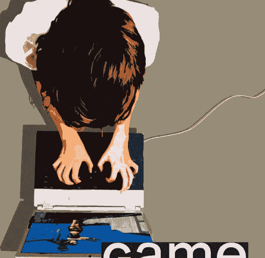

# 游戏成瘾：体验与影响

此页故意留空

## 尼尔斯：

献给 艾莉萨·梅杰

### 夏万：

献给 迈克，
为确保我永远不缺乏手段
去实践每一个随机的创意想法，
并强迫我去做那些事
我发誓我没时间去做。

还有 马特和丹，
教会我如何成为一名非常称职的精灵.

此页故意留空

> 所梦之物
> 永不会丢失，
> 也永不会被遗忘。
> ...
> 只有凤凰涅槃
> 并不坠落。
> 一切都在改变。
> 真正的东西从未丢失。
> — 尼尔·盖曼

错误的概率随事业规模的扩大而增加，任何将灵魂出卖给综合的人，都将成为成千上万支专家批判快箭的悲剧靶子。“想想看，”五千年前 Prah-Hotep 说道，“你可能会遭到议会中一位专家的反对。对每种工作都发表意见是愚蠢的。” — 威尔·杜兰特

# 前言

尼尔斯·克拉克 撰写

我呆立不动。一台价值六百美元的电脑显示器放在肮脏的硬木地板上，我知道自己在那一天的大部分时间、那一周的大部分时间以及整个夏天都弯腰对着它。我每天玩一个电子游戏长达二十个小时，直到那天晚上，这似乎都很正常。可能默默凝视了一个小时。第二周我离开去读研究生，没有电脑，也无法摆脱那个夜晚的震惊感。

我叫尼尔斯，尽管我会跟你们讲讲我杀过的人、我娶过的女人，以及我在电子游戏中赚来的数百万，但本书并非严格讲述某一个人的故事。本书源于试图通过研究来理解游戏成瘾的尝试。随着它的成熟，变得清晰的是，世界各地有数千万，甚至数亿的人正在通过电子游戏杀戮、工作、结婚和生存。他们的故事，在许多情况下是通过他们的眼睛讲述的，被用来丰富和澄清跨领域积累的游戏效应研究，这些领域很少尝试沟通，更不用说合作了。

目前，我们真的无法知道电子游戏、电视，甚至世界庞大的娱乐文化，将是积极变革还是消极变革的力量。我们所知道的是，事情正在改变。一个十一岁的越南男孩为了相当于五美元的钱，掐死了一个八十一岁的妇女，然后把她埋在自己房子前的一层薄沙下。受到警察盘问时，他说他需要钱买电子游戏里的道具。这枚硬币有两面。一个八岁的挪威男孩冒着生命危险，威胁一头攻击的驼鹿，然后在驼鹿开始攻击他时装死，从而救了他妹妹的命。后来受讯时，他说这些技能是在电子游戏里学的。

对我而言，开始过度游戏与通常的解释关系不大；我的借口不能归因于某种躁狂失衡，也不是因为童年过于创伤性而不敢提及。我的童年很幸福。虽然我无法肯定游戏问题从何开始，但我确实记得大约九岁时的一个夏天。我街对面的朋友杰森，有一台全新的超级任天堂。我记得在门口迎接他，坐下来玩了几个小时，然后当所有人都离开去玩水枪时，我拒绝起来。马里奥的某种东西吸引了我——只有上帝知道是什么。我记得的是杰森的父亲回家了。我记得当他问为什么我不和他儿子玩时，那种尴尬的火辣刺痛。我不记得我的回答了——但我记得他做了什么：什么都没做。

本书既不赞成游戏，也不反对游戏。最重要的是，它关乎我们如何体验游戏，以及它们对我们真正意味着什么。正在发生的事情不能仅通过热爱或憎恨围绕在线世界的技术来解决。我们必须理解它们，并且尽可能地，以更多的个人责任去使用它们，以更多的专业理解去制作它们。吸引我这一代少数人进入游戏的东西——已经在将几乎整个下一代拉入游戏的后代中。我们无法收回这些技术中的任何一种，成瘾只是它们将如何改变我们世界的雷达上一个小小的光点。但是，是好是坏呢？

我不认为玩家是坏人，因为我不认为我是坏人。玩家拥有我们历史上极少有人能拥有的经历，在这些经历中，他们可以扮演善良、邪恶或道德灰色的角色。剧院是数字化的，但当他们的心灵和思想被切割得太深时，其他木偶师仍会流血。玩家拥有了不可思议的经历；他们可以做不可思议的事情。

在他关于“虚拟世界大迁徙”的书中，泰德·卡斯特罗诺娃对著名电视剧《星际迷航：下一代》中星际企业号的船员感到惊讶，他们只是偶尔使用全息甲板。如果你不熟悉全息甲板，它是终极电子游戏：它具有照片般的现实感，所有感官都受到刺激，并且可以重现任何可以想象的场景。在一个简单的房间里，可以重现真实感强且令人信服的事件。凭借随时随地进入自己喜欢的体验的能力，卡斯特罗诺娃使用经济理论说，船员没有理由待在除了 *全息甲板* 之外的任何地方。既然我们今天的游戏中已经拥有了这项技术，他说，现实生活将不得不通过变得更加令人满意来补偿——否则没有人会花时间去操作现实中的星际飞船。人们不会参与我们所知的社会，因为它“不会是为他们而设的。”错了。我和那些无法离开今天全息甲板的人一起玩过，那很少是一个快乐的场景。我见过一个朋友——一位医生——放弃世界上最负盛名的住院医师职位之一，只为搬到加利福尼亚州最破旧的郊区之一。我闻过人们离开宿舍去买Husky汉堡，却不去参加期末考试或解决生理需求的人。我现实生活中最好的朋友中，有些最初是我在电子游戏中最喜欢的对手。我遇到过一些玩家，他们将在这个世界上留下深远的积极印记，但我见过更多的人被游戏吞噬，然后融入体制。他们不要求生活变得更加刺激，更好地满足他们的需求。他们迷失了自己，接受平庸，而他们距离作为医生拯救生命、作为专业人士确立自己仅差几个月。而这还没有全息甲板。这就是今天。

星际飞船 *企业号* 的船员负责任地使用全息甲板，因为他们了解它的工作原理。他们知道风险，也知道如何平衡现实与娱乐。这种知识并非免费。这是一种来之不易的理解，大多数普通电子游戏玩家还没有——就像我们没有相位枪、曲线速度或 *星际迷航* 宇宙中的其他任何东西一样。我们还没到那一步。今天的大多数人不明白，电子游戏的存在是为了激励我们创造一个更好的现实。他们用今天的娱乐来取代现实，而不是去感受它那酷炫的不确定性或感受它那微妙的对抗者。伟大的娱乐可以让我们在一个每一天都比前一天更复杂的世界里保持镇定和快乐，但如果不事先理解它，我们就有失去自我的风险。与书籍或电视等传统媒体相比，这种情况并不那么普遍。这是电子游戏固有的风险，并且只会随着更复杂的娱乐而增长。我们绝对应该从虚拟世界中汲取启示，如果那些系统向我们展示如何

让生活变得更好。我们不能做的，是放弃我们已经拥有的世界。

美国至少有1.26亿人在玩电子游戏，美国医学协会报告估计，10%到15%的美国人有成瘾问题。仅在美国，就有1260万到1890万人，而这些数字与数以千万计的父母、配偶、游戏开发者、教育工作者和治疗师相比，显得微不足道，他们共享许多相同的担忧。

与其他国家相比，这些数字也相形见绌。韩国联邦政府最近发表声明估计，至少有220万名年轻玩家成瘾，且这种痼疾已成流行病。中国政府预计人数远多于此，老少皆有，因为他们拥有超过1.4亿个宽带连接。2007年底，新加坡议会陷入恐慌状态。世界不能通过集体掩耳盗铃来解决这个问题。

历史上最受尊崇的媒体理论家之一马歇尔·麦克卢汉曾说过：“对我们技术中固有的伤亡和影响缺乏认识，只会带来灾难。”显然，是时候理解这些伤亡和影响了。无论我们是否喜欢，游戏已经成为我们世界的一部分。在不久的将来，大多数普通人不会因为好玩或因为想玩而“玩”游戏。这甚至不会是成瘾。这些游戏即将进入主流，成为全球普通人严肃的聚会场所。在某些国家和某些世代，它们已经是了。

这本书尽可能采用了多学科方法。沙瓦恩作为心理治疗师的研究使她研究了治疗儿童和成人游戏病理的各种方法，而我也同样采用了广泛的方法来理解网络世界中众多丰富的吸引力。我们共同努力，弥合临床医生与学者之间的分歧，使用神经科学、媒体研究、发展心理学、人类学、行为心理学、传播学、人际神经生物学、文学理论以及许多其他领域中被接受和尊重的研究，这些领域正在为理解游戏奠定基础。本书的目的是作为这些领域学者之间的中介。

# 前言（尼尔·克拉克 著）

不同学科和专业场所；语气尽可能保持实际和直截了当。案例研究、轶事和个人例子被应用于进一步澄清传统上被认为过于复杂、超出学科研究范围的问题之间的关系。

前三章提供了关于游戏本质、玩家如何玩以及玩家为何玩的基本背景。这些背景对于更充分地理解成瘾如何以及为何会抓住某些玩家是绝对必要的。第一章“数字客厅”探讨了游戏和成瘾的基本增长，解释了为什么其底层技术很快将对大多数普通媒体消费者可用。第二章“媒体体验与真实幻觉”考察了各种媒体的历史，特别关注文学和电影等事物如何物理地按摩感官。第三章“为什么他们玩”探讨了解释基本玩家动机的各种方式。

最后三章扩展了关于为什么游戏体验复杂的知识，展示了成瘾如何发展。第四章“游戏成瘾解剖”采用了当代成瘾治疗和理解中使用的主要元素，利用它们来揭示玩家中观察到的过度行为。第五章“游戏不是保姆”解释了儿童在整合游戏体验方面的独特性。第六章“前路”退后一步，连接本书的一些主要概念，以轻松审视游戏技术的其他可能影响。

与许多书籍一样，本书的完成离不开众多众多人的帮助。我要感谢艾莉莎·梅杰、丹尼斯·克拉克和玛吉·克拉克。还有托马斯·马拉比博士和杰拉尔德·布洛克医学博士，感谢他们的建议揭示了我所走过的道路及其可能通向的地方。

马克·胡基尔，他拥有罕见的坦诚直言的勇气。艾伦·德尔维奇博士和珍妮弗·劳埃德，没有他们，研究游戏的冒险永远不会开始。

感谢他们慷慨付出时间、故事和见解：安杰琳·库博士、戴夫·叶格、安德鲁·布拉德伯里、凯特里·斯奈德、池勋·吴、杰夫·麦克尼尔、弗洛伦斯·奇、林·索维格、妮基·因德利德、马克斯·迈耶、肖恩达·布兰斯亚尔、理查德·彭德尔伯里、贾德·诺伯格、卡梅伦·班奇、摩根

# 前言

罗梅因、桑尼·乔尔达诺、凯特·哈特利、菲利普·马吉斯特拉多、罗伯特·安东尼·洛佩兹和阿曼达·巴雷拉。

此外，我们衷心感谢所有故事和案例研究匿名出现的玩家和家长。

最后但同样重要的是，我要感谢那对夫妇，他们的纪录片为这个项目播下了灵感的种子，沙瓦恩·斯科特和迈克尔·巴尔策。

沙瓦恩临床病例中的姓名和识别细节已更改，以保护个人的匿名性。所有其他采访都描绘了真实玩家的姓名和国籍。

# 第一章

## 数字客厅

无论你的好朋友住在悉尼、孟买，还是仅在几英里之外，都准备好在自己客厅的舒适中进行廉价的面对面交谈吧。只需几下遥控器点击，你和你的全球朋友可以选择闲聊、打牌时的交谈、看一部好电影，或观看你最喜欢的节目。无论这听起来多么不切实际，这正在电子游戏中发生。与正常休闲不同，玩家及其好友正在斩龙和战斗外星人。此刻，成千上万的人正在数字客厅中游玩。他们可以一时兴起，以许多看起来像科幻的方式与世界各地的朋友一起游玩和连接。

你没有疯掉；这仍然是一本关于游戏成瘾的书。本书不是一篇耸人听闻的牢骚，讲述失常玩家如何吸食方便的海洛因分配器。也不是相反，对游戏是什么以及它们如何鼓励某些极端程度的游戏视而不见。当前研究对驱使人们进入其幻想环境（无论是书籍、游戏还是其他任何事物）的因素有所论述。这个所谓的数字客厅，就是我们故事的开始。

如果你是因为认识有人可能玩得太多而翻开这本书，那么首先要知道的是，你并不孤单。游戏成瘾，由本书讨论的任何原因引起，可能在国际上影响几百万人——很可能更多。

第二需要知道的是，游戏技术即将成为每个人娱乐、每个人生活的一部分。游戏制作商正在努力让游戏对每个人都简单、直接且有意义。这些新设备不仅仅是为拥有晦涩技术神秘知识的人准备的；它们是为每个人准备的。

第三点也是最后一点你应该知道的是，这些新娱乐技术并非自动具有成瘾性。成瘾是一个简单、直白的词，但吸引人们进入当代媒体的钩子却很复杂。人类会被绊倒，因为电子游戏提供了大多数人还不知道如何平衡的吸引力。社会几乎没有接触过它们，更不用说它们将某人从脚下抽走地毯的倾向了。这种危险的情况不是愤怒或恐惧的理由。这只是一个呼吁，要快速理解一个正在迅速显现的野兽。

二十多年前，迈克尔·克赖顿写道：“世界上还有很多地方，人们可以过十九世纪、十八世纪甚至十世纪的生活——但很少有人急于去那里生活。”像游戏和计算机这样的东西本身并非邪恶。它们是我们世界的一部分：艺术的最前沿。游戏正在“让”没有可识别易感性的人上瘾，因为这种对媒体消费的痴迷迎合了许多新的易感性。

阅读书籍、收听广播、观看电视等等，有很多切实的理由。有些理由更微妙；许多理由只是超出了一个人的常规感知。有些理由完全与人类感知有关。想象一下，你最喜欢的故事可以永远持续下去。然后，想象你是主角。现在，想象你可以在成千上万个这样的故事之间选择；本质上，你可以选择一个适合你的永无止境的故事。这就是精致游戏的含义：一个我们（你和我）控制故事和情节的地方。电子游戏中我们拥有的东西绝对可能是个问题，但成瘾不是凭空出现的。平衡这些不同的现实是一项全新的技能，当今太多玩家是以艰难的方式学会的。有些人可能永远学不会。

当今天的玩家失去平衡感和视角时，几乎从来没有单一的罪魁祸首。相反，他们经历着一场完美风暴；游戏和玩家各自带来一大堆可能有助于或阻碍健康游戏的因素。在玩家身上，生理成瘾可能源于玩特定游戏时的化学和心理反应。这些在不同玩家之间差异巨大。严重的精神或身体问题也会使失衡更可能发生。除了玩家本身，玩游戏的合理理由与人一样多，而游戏体验探讨了游戏如何进行

在不同游戏中添柴加火。生理和认知沉浸自然能让玩家“待在”游戏里的时间比预期的更长。对特定人群来说，某些游戏可能比其他游戏更具吸引力；设计师们努力让它们引人入胜、令人满足，甚至充满乐趣。有时，它们如此有趣，以至于玩家会玩到给自己制造真正问题的地步。讽刺的是，这些问题往往反而让玩家更渴望游戏。

这就是为什么理解游戏成瘾对每个人都很重要：尽管个人自我禁止游戏可能是合理的，但媒体对每个人都有影响。任何一个人在任何一个现实中的存在或缺席都会改变事物。先进的游戏正在向社会引入全新的元素。其中许多可以通过探索被称为游戏成瘾的过度行为来更好地理解。理解游戏如何改变感官、是什么驱动它以及它对生活（无论线上还是线下）的广泛影响，不仅仅是学者或心理健康专业人士的事。对任何消费任何类型媒体的人都有用。

## 完美风暴

> “对我来说，玩电脑游戏几乎像冥想……我不去想账单、工作或压力大的事情，”Max说。“我可能不会及时接电话，但我会回应孩子的哭声。”

认识挪威玩家Max Meyer。28岁的他平衡着工作、学业、妻子、新生儿和电子游戏。像当今数字客厅里的大多数玩家一样，Max对其他玩家的承诺很认真。他不让游戏优先于现实生活，但他热爱每一秒与朋友在线上一起玩游戏的时光。对一些玩家来说，这种平衡感是来之不易的技能。

> “我平均每天玩大约10个小时，”他说，回忆起为了在MMORPG中保持竞争力所需的来回切换。“可以肯定地说，那学期这对我的大学成绩造成了沉重打击。”

这是太多玩家都能产生共鸣的模式。游戏给了我们比以往更多热爱娱乐的理由，因此找到正确的平衡是一项挑战。Max很幸运；虽然他可能永远热爱游戏，但他的责任感（还有他的妻子）将帮助他保持所有这些世界的正确视角。“对我来说，重要的改变是我必须戒掉整天每天玩游戏，”他说，尽管他担心下次感到要跟上的压力时会怎样。“不过，如果事情失控，我还有妻子来拉我一把。”

有些玩家既不那么幸运也不那么成熟；当这两种现实开始相互竞争时，他们可能会失去控制。说到底，这需要两个人共舞——这种成瘾需要一个玩家和一个游戏。每个人都不同，我们都有独特的优势和易感性。当独特的人玩独特的游戏时，结果总是独特的体验。没有单一因素会立即制造出一个瘾君子。相反，游戏体验对每个人来说都是一场完美风暴；许多小事结合在一起，创造出一种可能无法阻挡的力量。风暴的巨浪和阵风是游戏的诸多吸引力。船是玩游戏的人，以及他或她许多独特的易感性。驾着脆弱的小船进入危险水域的玩家，往往会沉没。同时，即使是“沉不了”的船，在低估大海、没有海图、不了解潮汐、也没有恶劣天气预警的情况下冒险出海时也会沉没。许多玩家不像Max Meyer那样拥有有效的约束或支持结构。如果不了解自己和自己的娱乐，他们就有在完美风暴中迷失自我的风险。

从理解脑部扫描和脑化学的相对新方法，到心理学和媒体等领域数十年的研究，我们可以追踪许多使游戏如此迷人的特征。我们也可以识别它们不是什么。电子游戏不是一把万能钥匙，其严酷的水域会将任何灵魂拖入其中。游戏结合了许多我们已经研究过的不同技术。例如，我们知道人类的眼睛尤其不擅长分辨真实图像和电视上呈现的图像。当节目结束时，我们的大脑可以告诉我们，晚间新闻的主播并不是直接在对我们说话。然而，在体验过程中，我们的大脑并不总是意识到这一点。³

我们的大脑可能会沉浸在当下。如果没有什么打断激动人心的图像，我们可能直到兴奋过去后才能将图像置于语境中。⁴当我们沉迷于观看最喜欢的节目中的汽车追逐时，我们的肾上腺素可能会像在观看真实飞驰的汽车一样分泌。如果我们最喜欢的角色撞车身亡，我们可能会感觉到戏剧性，仿佛一个真实的人死了——至少，只要电视还开着。

但电视通常不会让我们上瘾；最多，一个看电视的人如果被困在交通中错过节目可能会心情不好。那么，为什么对一些玩家来说，交通堵塞是折磨呢？外面不止一个关于鲁莽玩家失去车辆控制、翻车或相撞的故事。⁵我最喜欢的一个故事涉及两小时的睡眠、一辆全新的宝马和没有人员伤亡。当游戏内的事件让你几乎不睡觉，匆忙回家继续玩，并让其他人处于危险之中时，那就有问题了。但这是一种我们可能越来越常见的责任水平。当玩家达到这一点时，他们已经超越了仅仅因为游戏的色彩鲜艳的角色和精彩的追逐场景而喜欢游戏的层次。

游戏成瘾的一部分确实与新的改进后的客厅有关，但另一部分与神经科学和心理学有关。游戏成瘾是一个玩家和游戏共同作用、通过长期的小步骤改变大脑的过程。⁶一些过度简化的例子可能涉及一个度过了特别糟糕一天的玩家，或者某个大脑特别容易从游戏中获得兴奋的人。在这两种情况下，他们更有可能玩游戏。在这两种情况下，游戏本身既不好也不坏。某些生理特征可能对人们如何玩游戏产生有力影响，某些技能帮助他们保持平衡和情绪健康。⁷游戏甚至可以帮助我们保持情绪健康，但玩家需要了解如何平衡自己的游戏。⁸有了这些技能，玩家就不太可能暴饮暴食式地玩游戏，并开始不断增加游戏时间的循环。

当游戏体验似乎能提供如此多的东西来满足生理和心理需求时，这个循环可能过于频繁地失控。¹⁰有先天倾向和易感性的玩家很难控制自己的游戏，过度游戏，无论当时感觉多么有回报，都可能为更多更大的问题敞开大门。最终，我们判断某人是否有问题的方式，不是他们神奇地符合“成瘾者”的标签；而是当他们遇到严重的现实世界问题时。保持健康的一个重要部分是能够过上功能正常、平衡的生活，并保持健康的心智、强壮的身体和积极的人际关系。

这是心理健康专业人士识别和定义“成瘾”的主要方式——当单一行为开始将日常事务转变为无法正常运作时。如果某人不吃饭、不去上班，并且沉迷于电脑以至于让猫饿死了，那么这些可能只是游戏干扰了他们生活的迹象。如果猫真的死了，那么可以安全地说，这种成瘾过程已经走得很远了。

游戏成瘾通常不是单一事物，而是一场令人着迷的风暴；一个令人满意的游戏用玩家一直在寻找的元素，以及玩家从未知道存在的元素，轰炸着玩家的心理。人类的眼睛有时很难移开对某些事物的目光。玩家越无视现实，风暴的魅惑力就越大。

整个过程在较古老的娱乐形式中有着卑微的根源，尽管它们往往不会激发如此惊人的忠诚。虽然有贪得无厌的书虫和住在爸爸妈妈地下室的40岁科幻迷，但书籍和电视之类的东西很少让某人无法维持工作，或无法离开家超过几个小时。游戏以复杂的方式为媒体增添了趣味，但新的风味可以通过两种主要诱惑引入。

## 秘密配料

我想和大家分享我最自豪的时刻之一。不仅仅是游戏中的一个时刻，而是我有生以来最自豪的时刻之一。那种狂喜如此强烈，以至于我只想欢呼雀跃。尽管电脑显示器上有令人惊叹的景象，但我无法确切地像同伴那样捶胸欢呼。我的父母正在睡觉。

其他玩者的尖叫声通过耳机响起，我确信那里每个人的心脏都在狂跳。我们都带着病态的好奇心看着邪神克苏恩的尸体倒在古老神庙的地板上。他恶毒的触手垂落，

他那只巨大的眼睛早已被毁，黑烟从他腹部涌出，弥漫整个房间。片刻之后，我们同样着迷地看着他守护的三件宝物被分给了我们中最投入的人。总共有四十位英雄，我们为此次战斗花费了过去两个月的时间。通过团队合作、技巧和准备的结合，我们取得了成功。一种强烈的兄弟情谊油然而生。一种完成感，我们中没有人可能能够完全解释。

在《魔兽世界》中，很少有人能击败克苏恩。与他战斗需要虔诚的纪律和团队合作，他的大多数攻击都会杀死角色，无论玩家花了多少小时或天数来增强自身实力。更何况，当今的玩家为什么要花那么大力气去击败克苏恩呢？竞技场、重新引入的纳克萨玛斯、奥杜尔或任何其他80级团队副本中都有更新鲜的战斗和更好的宝藏。

说实话，这很遗憾。在所有与玩家并肩击败敌人的时刻中，与克苏恩的战斗总是浮现在我脑海中，成为最难以言喻的战斗。无论它多么“只发生在游戏中”，那个夜晚在我现实生活中都堪称里程碑式的成就。那场战斗并非发生在现实中，但也绝不仅仅是发生在游戏里的事情。问问当时在场的真实人物吧。

我们玩家不仅仅是与这些其他人建立联系。出于一时兴起，我们进入那些在自然界中很难重现的地方和情境。有些甚至根本不可能。当我们说游戏将从根本上改变客厅内发生的事情，甚至改变日常社交空间时，这不仅仅是因为某些游戏让我们与来自爱尔兰的鲍勃坐在虚拟沙发上。“游戏”是一个指代许多技术的词。

很多人认为所有游戏都一样，这很可以理解；人类使用“游戏”这种笼统术语也是自然而然的。这种误解是一个主要的绊脚石。如果你想象一下两个狂热的玩家，你可能会看到他们各自坐在不同的电脑前，游戏在两种情况下都完全吸引了他们。站在他们肩后，你可能分不清差别。尽管大多数人也分不清，但这两个人可能出于完全不同的原因在玩游戏。如果沉迷于游戏只是一两个淘气拼图碎片的简单问题，那么我们就不需要一本书来告诉我们游戏成瘾的问题了。你只需要把那些有问题的碎片拿出来就行了。

有很多东西让游戏超越了其他形式的娱乐，但我们应该从最基本的两点开始。首先，游戏不像其他媒体那样被动。其次，它们将我们与其他活生生的人联系起来。¹¹ 游戏比大多数玩家可能意识到的更先进。游戏技术经过多年完善，使玩家能够在极高级别的水平上进行互动和社交。用于互动和连接的技术为我们今天拥有的游戏体验奠定了基础。这两个秘密成分将让我们开始了解，为什么“游戏”这个词不再真正能概括当今数字客厅中发生的事情。

无论你想称之为互动性、主体性、自主性还是其他什么，最显而易见的进步是，游戏已经让我们超越了被动地观看电视和阅读书籍。你可以在电视上看汽车追逐，但当你自己以每小时150英里的速度驾驶红色法拉利甩掉警察时，感觉就完全不同了。在游戏中，我们掌控方向盘。¹² 这种控制水平改变了事物，使它们在大脑中看起来和感觉都不同。玩家的身体体验非常接近他们通过现实获得的体验。¹³

像国际象棋、麻将和掷骰子赌博这样的游戏已经流传了几代人，它们比观看更有趣是有原因的。能够控制行动使我们的头脑进入一个竞技场，在那里我们可以实验和学习，而不必承受现实世界情况中会带来的一些最终后果。¹⁴ 许多学者认为，玩游戏对人类和动物来说是一种巨大的生存优势。¹⁵ 电视屏幕上的故事可以告知我们，但除了现实，游戏才是教导我们的东西。能够看到当我们做出那些危险选择时会发生什么，然后能够做出我们自己的自发选择，这使得历史上的游戏变得诱人、激动人心且持久。玩游戏可能就在我们的DNA中。

我们用于创造更高质量游戏的科学，即游戏设计，在过去一百年中取得了一些重大进步；最值得注意的是20世纪50年代。当那些狡猾的极客开始制作用于模拟战斗的复杂系统时，他们挑战年轻人去构思富有想象力的冒险——从剑与魔法到间谍活动和谋杀悬疑。早期的玩家随后将他们的英雄带入这些冒险，掷骰子来决定诸如战斗或能获得多少宝藏等事情。我们最终称这些为纸笔骰子游戏：玩家在纸片上记下英雄（或反派）的详细信息，大多数人都拥有令人印象深刻的骰子库存。进入这些不同情境变得越来越有趣和容易，我们最终迎来了臭名昭著的《龙与地下城》（D&D）系列，该系列流传至今。D&D的创作者加里·盖加克斯和戴夫·阿内森都成为玩家文化的倡导者和图标。在他的书 *游戏大师* 中，盖加克斯写道，游戏唯一有效的目的就是提供娱乐。¹⁶ 在D&D时代，这些战略系统被精炼得如此之好，以至于当今许多最先进的视频游戏对它们改动甚少。有些游戏开发者狂热地遵循实际的《龙与地下城》规则。

在很多方面，像D&D这样的游戏让人们开始构思设计，但电脑让这种冒险变得更加容易。计算能力为游戏设计师提供了测试创新方式以获得这些体验所需的空白画布。从《乒乓球》到《超级马里奥》，每一次处理能力的重大进步都邀请新的游戏设计师介入并让我们惊叹。如今，拥有不可思议的电脑和大量旧游戏积压，游戏设计师拥有无数技巧可以用来使游戏充实。设计师曾经不得不将想象力塑造以适应技术，而现在技术已经发展到可以围绕想象力工作的地步。设计师可以重新创建纸笔骰子系统，或者制作购物车拖拉赛车游戏。尽管许多当代游戏设计师只是复制销量最好的游戏设计和主题，但外面有着令人难以置信的创造潜力。被设计成有趣的游戏是我们说“游戏”或“玩”时所指的第一个重大进步，或者说成分。它是实验性元素，一种具有巨大潜力的技术。

第二个秘密成分来自视频游戏的社交元素。游戏连接人们。加里·盖加克斯写道，如果没有这种联系，我们的游戏体验就会受损：“……它的戏剧性不够强烈，危险是抽象的，胜利是肤浅的。”因此，富有想象力的人们将视频游戏带到了网上。早在20世纪70年代，设计师们就构建了纯文本世界，这些世界可以容纳数千人。到了20世纪90年代，我们开始看到大型团队设计3D游戏，图形系统允许多达十几个人合作或竞争游戏。

随后，设计师们开始尝试巨大的虚拟在线世界。如今这些被称为大型多人在线游戏，简称MMO或MMORPG。本节开头的故事讲述的是MMO《魔兽世界》。当成千上万的人可以上网一起玩时，这些世界真正变成了一种不同的游戏。它们是持久的，大部分时间都在线。不像书本，那是一种只有在阅读时才会在你脑海中描绘图片的奇思妙想，这些游戏已经变成了一种地方。¹⁸ 就像一家24小时营业的餐馆，你可以随时进来吃个三明治，但这个地方不会按照任何人的时间表开门或关门。

这些持久的在线场所不必特别设计良好；有些过去和现在只是大型社交空间。今天这些是像Second Life或There.com这样的世界；在MUD游戏时代，它们是像LambdaMOO这样的空间。在纯社交世界中的人们可能不会期待最新的图形或最刺激的游戏设计而登录。如果他们这样做，他们可能会有点失望地回到现实。我们将这些世界标记为“游戏”，因为它们将持久世界与过去十年开发的3D视觉图形相结合，但这里有一个区别。仅仅拥有一个持久的3D社区并不等同于拥有一个预先设计且令人满意的游戏。你可以在大多数这些世界中行走和交谈，但它们是一种不同的技术：更像是一个客厅，一种社交体验，而不是一种游戏系统。

其他持久世界将连接性与游戏设计相结合。混合这两个秘密成分会创造出某种强大的东西。一旦设计师让我们在持久世界中的体验更像游戏，更多地关乎游戏的乐趣，我们就会开始看到一个空间，它不那么关注使用这些技术来创建在线客厅。相反，其他人在那里是为了让游戏显得更重要。数字升级室包括Ultima Online、Everquest、Star Wars Galaxies、Final Fantasy XI和World of Warcraft等游戏，它们提供一个社交世界，同时也设计得让角色进步变得有回报。当玩家获得玩好游戏所需的社交地位、技能等级和剑时，他们会得到越来越多的满足感和成就感。这些游戏提供了两全其美的好处——那种

踏入一个持久且人烟稠密的空间，同时也能尽情享受一场娱乐游戏。这就像前文提到的那家24小时咖啡馆，只不过它专门提供热气腾腾的极乐。这无疑是推进客厅发展的一种相当酷的方式。当今的玩家进入这个空间，获得强烈的体验，他们的成就将被保留。不仅如此，当他们开始下一次游戏会话时，这些成就会耐心地等待着他们，有时还会伴随着他们一起游玩的其他活生生的人。数字客厅是一种全新的事物，一款可以说在平衡现实与幻想方面造成最多问题的游戏。

随着游戏的外观和手感发生变化，尤其是在未来几年，我们将看到玩家可以在哪里玩以及如何玩方面出现一些重大变化。过去，他们使用笨重的小型控制器和庞大的计算机。如今，计算机变得更小、更快，并且出现在更多地方；游戏的面貌和实体性已经开始改变。有舞蹈垫，在《舞动奇迹》（Dance Dance Revolution）等游戏中，它们将我们的脚步变成一整场游戏。任天堂Wii让我们挥动控制器来模拟网球、保龄球和钓鱼。Wii Fit增加了许多你期望从舞蹈垫中获得的功能。下一代游戏和游戏系统不仅会将我们与世界各地的朋友连接起来。更多游戏将涉及站起来离开沙发。

甚至可能走出家门。在世界各国，人们互动和游玩的地方不仅限于客厅；明天的“客厅”可能延伸至多种不同类型的场所。例如，在新加坡，似乎有一个围绕“走出家门”这一概念建立的整个产业。玩家聚集在24小时购物中心、24小时游戏咖啡馆，但似乎很少在家。在韩国最大的城市首尔，很难找到一个没有至少一个PC房的街区。尤其是对年轻一代的居民来说，这些地方经常挤满了想要和朋友聊天、玩游戏，或逃离寒冷雨夜的人，即使在所有其他社交场所都关门之后也是如此。

虽然对许多人来说，客厅一直是被动地吸收电视节目的地方，但游戏将不断增加我们的选择。对许多人来说，它已经以惊人的方式跨越了文化。对于围绕走出家门而建立的文化，游戏将追随人们。

有些整个国家已经围绕手机运转，将其用作信用卡和电子书阅读器。日本许多畅销书都在手机上下载和阅读。22 无论身处哪个国家，无论我们如何定义“游戏”，大多数人都在寻求娱乐——这迄今一直被视为合法。

面对全球的玩家，最值得关注的事情之一是他们如何、以及是否进行社交游戏。对于仅在网上相识的玩家，其实际连接程度仍存疑问。对于既在现实中又在网上相遇的玩家，尤其是在亚洲，网吧已经成为一种麦加。

尽管加拿大研究员弗洛伦斯·奇一直身处视频游戏环境中，但她说她“从未想过它们会与职业沾边”。奇越是看到媒体中对游戏问题的呈现，就越觉得他们正在构建一种“成瘾玩家的神话”。“成瘾”这个词被随意抛出，她记得这种方式“对我来说太过轻率”。然而，随着她继续自己的游戏研究，她受到了T.L. 泰勒和特德·卡斯托诺瓦等学者所产生的细致入微的研究的启发。

她解释道：“他们真正做得好的地方在于，从文化和经济角度强调了游戏的多个方面，为一个充满迷信和民间传说（例如‘点击一下，你就上瘾了’）的晦涩世界提供了洞察。”

这促使弗洛伦斯开展了自己的研究，她记得在此期间遇到了关于韩国玩家及其游戏成瘾臭名昭著的报道。渴望知道这种耸人听闻是否名副其实，她参加了密集语言课程，并攒钱进行了为期四个月的实地调研。

根据奇的说法，我们当地文化的影响无法从我们在游戏中度过的生活部分中剔除。她通过提及克利福德·格尔茨的著作来强调这一点。“他断言，除了笔触和对艺术形式的技术理解之外，还必须了解其产生的文化背景。他举的一个例子是，如果不了解《古兰经》，就不可能理解阿拉伯诗歌（在摩洛哥）。也就是说，游戏是文化的一部分，人们玩游戏的方式与他们的日常生活密不可分。”

不同民族的生活方式对其游戏方式有深远影响。在游戏成瘾方面，一个关键例子是工作与休闲之间的界限。“……平均每个韩国人每年工作2,390小时，比美国平均水平多出34%的工时。”与美国对工作和休闲更为明确的概念形成对比，她指出“在韩国，这两个类别似乎更加流动。”

在韩国，至少有54%的人口，即2500万人，玩在线游戏。23 与任何国家一样，文化对人们如何游戏以及这对他们意味着什么有着深远影响，而不仅仅是对任何单一耸人听闻的问题。

韩国玩家文化的一个重要组成部分是他们独特的网吧，即PC Baang——也被称为“PC房”或“PC谷仓”。在最近的一次会议小组讨论中，著名韩国法官尹云基坦率地谈到了PC Baang的兴起。24 在亚洲金融危机期间，许多下岗工人开始创建和填充这些PC Baang，创造了一种廉价且易于进入的社交空间。较老的游戏，尤其是1998年首次发布的《星际争霸》（StarCraft）以及Lineage I 和 II，与Baang一起发展成为重要游戏。这些游戏和Baang也随着韩国人对群体凝聚力和技能在游戏中意味着什么的观念一起成长。正如尹法官所说，“Lineage的目的不是杀戮，而是忠诚。”25

在实地调研中，弗洛伦斯·奇注意到玩家们不断提到一种叫做Wang-tta的概念，这个概念似乎既适用于单个玩家，也适用于Baang内的更大群体；如果玩家的技术开始下滑，或者他们完全拒绝游戏，那么他们可能会被嘲笑、欺凌，甚至被排挤。我在其他东南亚国家（尤其是马来西亚和新加坡）也观察到了类似的情绪；有报道称，技术不足可能引发真正的群殴。对于参与群殴的人来说，正在发生的事情往往被视为理所当然。这些玩家中的一些人可能不太明白为什么像Wang-tta这样的概念会凸显出来，但正如俗话所说，鱼大概不知道自己在水里。这样的情况说明了为什么文化至关重要。

不过，韩国可能不仅仅是一个有趣的案例研究。作为数字社会的前沿，韩国公民可能是塑造游戏席卷全球所带来的文化习俗、法律、功能及整体方向的首要创新者。韩国已经开始着手规范在线空间这一棘手事务，例如，将从中牟利的“挂机”（botting）定为非法。不妨去问问你当地的立法者，他们对挂机的立场。由于这些新兴案例可能为其他国家树立先例，韩国的法律案件和裁决可能会对我们如何规范一种不断跨越国界的技术产生重大影响。

韩国在解决游戏成瘾问题方面也处于领先地位，这使其卫生部处于紧急状态。他们估计，韩国有两百万到三百万青少年成瘾，并且实际上创建了政府资助的训练营，用于重新训练年幼的孩子。《纽约时报》最近对这些设施进行了调研，其中志愿让初中年龄段子女参加的家长人数是可用名额的四倍。有即时求助热线可供人们致电咨询，韩国还创建了第一个完全独特的成瘾检测诊断工具，完全针对其文化量身定制。与稍后讨论的美国最早出台的诊断和检查清单不同，据报道，韩国的K-Scale能够更好地反映实际问题。总的来说，韩国为我们提供了一些绝佳的例子，说明文化的特定部分如何引导玩家以特定方式进行游戏。

尽管文化的实际影响往往更为微妙，但世界上还有几种强大的现象堪称独特的例子。最引人注目的一种发生在孩子们，尤其是男孩，“未能独立”时。也就是说，出于各种原因，孩子们在完成基础高中教育后，更经常地长期与父母同住。这些不求学、不就业、不接受培训的年轻人（简称NEET），有时被认为有退出社会的风险。在一些国家，例如意大利，这并不总是令人担忧的事。从历史上看，父母期望子女，甚至年轻夫妇，在家中住一段时间，尽管他们通常一边工作一边过着充实的生活。在世界上的许多情况下，这些年轻人将自己关起来，有时会与世隔绝数十年。

最臭名昭著的案例来自日本的“引尼族”，那里对主要靠父母收入生活的年轻人日益增长的污名化。这个问题实际上相当复杂，涉及经济、社会、

和日本文化特有的心理因素。显而易见，住在家里的Hikikomori更容易接触到类似游戏的东西，但我们应将其视为独特文化为游戏打开独特窗口的又一个例子。这些不同的动机通常不会直接与成瘾挂钩；它们并非独自导致游戏问题，而是为我们提供游戏的理由、方式和手段。

从许多方面来说，超越游戏本身，技术正在改变在全球信息时代中生活、爱和娱乐的意义。游戏成瘾中部分的指名道姓和指手画脚，只不过是持续未能理解技术创新。在其他情况下，成瘾可能源于未能理解游戏以及文化推动某人过度游玩的方式。这些问题是新的；在某种程度上，无论是否文化相关，它们都是新兴的，却未得到足够重视。

通常，当“秘密配料”——互动性和连接性——接管某人的生活时，会有很多事情发生。这不仅仅是库苏恩的邪恶凝视，也不仅仅是我们与屏幕后身边同伴的闲聊。数字客厅给予我们的远不止具体目标。从这些目标如何构建，到我们的身体如何被拽入，游戏体验以大多数玩家难以言喻的原因牵引着他们。一方面，部分魔力来自无法看到幕后之人。另一方面，那句老话中掌控一切的巫师不会跳出来强迫你照顾自己的生活。有时他会让表演持续很长时间。

游戏失去平衡时不应完全令人意外，尤其是当强大的游玩理由与玩家所体验的几乎不可否认的真实感结合在一起时。玩家的大脑和身体正接收到大量混杂信号：真实感体验与合理的游玩理由交织在一起，使得问题难以察觉或接受。危险在于，当玩家只看到乐趣、朋友和美好时光时，他们的现实生活可能正在四周崩溃。如果现实确实崩溃，这往往会给他们留下一个分散注意力的替代品：一个强大而满足的半真实世界。但游戏会诱捕并锁住我们每一个人吗？

## 无处可逃

“花了我很长时间才学会如何移动，”安吉琳·库博博士回忆她初次进入大型多人在线角色扮演游戏（MMORPG）时的情景。“现在看来真是傻。”我初次见到库博博士时，觉得她就是那种让大学学费物有所值的教授。她希望超越九十年代末期“游戏就是邪恶”的观念，走出舒适区。她花时间去玩游戏。

库博初次接触游戏“并无意停留太久”，但她回忆道，“我上瘾了！我至今仍深陷其中。”虽然安吉琳在新加坡国立教育学院任教已有18年，但人们可能会觉得，她进入这些游戏并不比我妈妈更容易。虽然游戏中的黑暗角落和超大蜘蛛起初吓到了她，但库博面对了恐惧，最终利用游戏内的经验为现有研究做出了严肃贡献。更重要的是，她证明了复杂的游戏并非普通人遥不可及。玩过之后，她对游戏的未来充满希望。同时，她也更加敏锐地意识到了挑战。

“游戏世界既令人兴奋，又是温暖的社交环境，但正因为这样，要离开它去面对外界更紧张、更平庸的世界就变得困难，”库博博士说。“因此，过度游玩和时间管理是一项挑战——对大多数，如果不是所有玩家而言都是如此。”

但这是否意味着我们就要全盘否定电子游戏？这个新兴的客厅让我们对陌生人产生共情并投入其中，这是件坏事吗？库博博士不这么认为。她笑着讲起交换火鸡食谱、指导年轻玩家，以及通过奇特的文化交流了解世界各地的人们。

“最近，我了解到人们在感恩节都会做什么，”她说。通过这些独特的文化时刻，游戏让我们走在一起。库博拥有中国血统，她记得发现了惊人的文化相似之处。“当我需要出国时，我会为丈夫做饭并冷冻保存——我发现我的一个公会队友的妻子也为他做同样的事——而他身在田纳西州。”

最终，让我对库博博士印象深刻的是，她深受线上游玩者的影响。她简单地总结道：“我交了很多朋友，并且非常在乎他们。”

无论你与谁交谈，无论他们来自世界何处，当今数字客厅中正在形成纽带。新人正在学习在其中行动和互动，而更多新型客厅和升级房间也被设计得更易理解。就在此刻，当你阅读这些文字时，这一切正在发生。有些玩家不会想要离开这些屏幕。并非每个人都会在满月之夜变形，开始渴望这些在线咖啡馆和数字餐厅。随着大众媒体技术开始改变，这些游戏世界很容易成为数字有线电视等大众服务的下一步；大体而言，当前消费者会付费并升级。进入数字客厅应该像在现实客厅中坐下一样简单。

一直存在的技术正在为我们发生变化。这些变化让我们在阅读、观看和收听方面拥有更多发言权；幕后和屏幕后的炼金术士正在设计这些选择，使其有趣，并在某些情况下让我们彼此连接。这一切正在发生，而且大体而言，人们都乐在其中。秘密配料难以抗拒。我们并非因为改进的电视、数字书籍或在线游戏具有成瘾性而玩它们，至少目前还不是。普通人参与其中，是因为他们得到了想要的娱乐。

这种新型娱乐也盈利到荒谬的程度。暴雪娱乐，这家受欢迎的美国MMO《魔兽世界》的开发商，仅凭这一款游戏每年就产生超过十亿美元的收入。《魔兽世界》拥有超过一千一百万活跃玩家，很可能是母公司维旺迪与动视之间189亿美元合并的关键动因。很难想象一款游戏值这么多钱。截至我们撰稿时，亚洲最受欢迎的在线世界《冒险岛》的制作商声称，已有超过五千万人拥有活跃账户。数以千万，甚至上亿的真实人类正在这些地方积极游玩。开发商有太多钱可赚，不可能不积极拓展新市场。如果你还没有接触游戏，那么这些世界的乐趣、互动性和连接性大概也不会花太长时间就进入你的生活。

这也无妨，因为我们将能从地球上的任何地方进入其中。随着手持无线互联网计算机变得更加普及，像iPhone这样的设备，有些人已经能够从任何他们想去的地方进入数字客厅的部分内容。随着更小的计算机与越来越普遍的无线互联网相结合，制作引人入胜游戏的知识将被用于创建人们几乎可以在任何想玩的地方访问的世界。²⁸

像亚马逊的Kindle这样的新型电子书阅读器已经做到了这一点，只不过是针对书籍。它们使用无线互联网网络将书籍传输到手持阅读器。借助包括六英寸“电子纸”材料在内的不同技术，客厅中涉及阅读的部分已经数字化。我们可以使用一台手持平板电脑购买和浏览文章、杂志和小说。²⁹ 尽管Kindle仅为文字增添了多功能性，但游戏化的社交世界最初只是“纯文本”。如果今天的游戏可以在公交车上玩，有些人将不会为了任何事情而离开他们的显示器。

这些“游戏”对某些人来说如此重要，以至于现在，几个不同行业的职业已经开始将其作为与商业伙伴和同事会面和游玩的场所。接入其中，对某些人来说可能很快和查看电子邮件、阅读行业新闻，甚至做工作一样具有职业重要性。引用一句老话，主要被科技行业的专业人士使用：“《魔兽世界》是新高尔夫。”³⁰ 许多企业家正在指望企业鼓励这种游戏；早期世界已经孵化出来，用于连接和培训不同类型的专业人士。³¹

这个客厅在不断变化。你可能觉得在线商务会议很不舒服，但只要你穿着一身板正的商务服装参加，就会这样。在数小时交通、政府限制，甚至海洋本可能让思乡的人无法在感恩节与亲人团聚的情况下，一些家庭选择在《Guild Wars》中会面，这是一款黑暗而邪恶的MMO游戏。尽管这些地方不过是游戏和互联网的产物，但它们正变得不仅仅是娱乐。

屏幕上的图像有时不仅仅是幻象。一旦这些技术让每个人都能窥见朋友和家人的客厅，平衡数字生活与现实生活将

成为一个问题。将人们的面孔实时投射到电视上的技术，你可以粗略地称之为“远程存在”，在不久之后几乎肯定会成为标准家用电器。² 当今的玩家现在就必须理解“存在感”的概念。游戏拉开了一扇窗户的窗帘，这扇窗户让你和你的朋友一起窥视同一个虚幻的世界。随后，你们每个人都扮演着木偶师，控制着屠龙或建造飞船所需的精细复杂的动作。当任何人都被赋予窥视的能力时，无论是否是木偶，一些普通人都会出现平衡问题。

就艺术表达而言，游戏设计还远未成熟。我们做了很多很酷的事情，但即使是外观迥异的游戏，也常常使用可以追溯到至少 D&D（例如，“生命值”和“随机伤害”）的陈旧概念。叙事情况好不了多少。大多数游戏的情节很少试图超越“你是一名携带枪支的太空海军陆战队员。杀死一切。”我们有让玩家从第一人称视角控制携带枪支的太空海军陆战队员的游戏，有从俯视视角呈现携带枪支的太空海军陆战队员的游戏，还有携带枪支的太空海军陆战队员在悍马车中相互竞速的游戏。很多普通人喜欢 Predator、Starship Troopers 和 Aliens 这样的电影。其他人喜欢 Love Actually 或 Bridget Jones’ Diary 这样的爱情电影，Dances with Wolves 这样的长篇戏剧，甚至 the Pillow Book 或 Wings of Desire 这样精心构建且富有艺术性的电影。目前，Xbox、PlayStation 或 Nintendo 将游戏放在电视上，但这还不够。人们观看电影或玩游戏，是因为主题在他们个人层面上有意义。在游戏能够进入主流之前，它们也必须对每个人都有意义。

归根结底，我们将拥抱游戏，因为数字客厅中真正吸引人的东西是：与我们对话的主题，以及让我们接触到秘密配方的设计。这不会是因为游戏瞬间令人上瘾或蓄意恶劣。只有当人们在不了解游戏或自身的情况下投入游戏时，不良的游戏行为才会开始滋生。当那种玩家失控时，他们最终可能只想要剑与魔法的乐趣——而不是滋养其生命器官的中等回报的生活。无论是今天还是明天，一个负责任的玩家都会理解游戏的运作方式，提前规划，并保持平衡。

任何故事的力量一直在于它能向我们展示如何创造一个更好的现实。幻想让我们焕然一新地看待世界；想象力带我们超越现状。³ 如果在游戏中游玩能帮助我们改善现实生活，那么这就是我们所能要求的一切。媒体不应该做的是取代生活。现实与幻想之间的界线复杂而微妙，但很快我们中许多人都将走在这条界线上。理解这条界线始于可以说是最重要的拼图碎片：我们的身体如何看见和听见数字客厅中发生的事情。

## 媒体体验与真实幻觉

> 《丹麦王子哈姆雷特》……几个世纪以来，以多种语言引发了关于其含义的问题。……它催生了数以万计的学术论文和评论书籍，以及至少一本期刊。……我们谈论哈姆雷特在思考……哈姆雷特在意识。但哈姆雷特从未活过。他只是诗人奇妙想象力的产物。—— R.L. Gregory

莎士比亚的《哈姆雷特》，尽管只是一个故事，却迷住了数百万人。尽管完全是虚构的，我们讲述的大多数故事在帮助我们理解宇宙、我们的世界，甚至我们自身方面都发挥着巨大作用。我们为它们生活和呼吸，然而很少有人理解当我们阅读戏剧、收听广播或观看电影时，我们的大脑和身体中实际发生了什么。这些媒体都是可居住、可呼吸的故事；它们都激发不同的感官，这些感官采用独特的方法将人类的思维拉入世界。

说到吸引大脑，电子游戏远胜于所有其他媒体。游戏将玩家带入其中，通过描绘奇幻而富有想象力的世界、可信的视觉图像以及不容忽视的互动性来使他们沉浸其中。有些游戏更进一步，将玩家与其他真实的人连接起来。取决于沉浸感的来源，人体可以释放各种化学物质，对游戏的反应仿佛它们是完全真实的物理体验。

有些人很容易讨厌游戏。毕竟，这本书讲的是那些停不下来玩游戏的人。虽然游戏中的沉浸感确实给我们带来了新的和严肃的挑战，但游戏只是悠久叙事传统中的最新成果。正是这种叙事建立了我们在社会中生活的能力——无论是巴布亚新几内亚的丛林还是洛杉矶的都市丛林，无论我们是从书本还是游戏中学习。本章不仅仅是关于理解游戏；它是关于理解你的世界。为此，我们必须从故事的开头开始。

### 无言的世界

> 人类与其他物种的独特之处在于，我们生活在由我们讲述的故事所创造的世界中。我们所知或自以为所知的大部分，我们从未亲身经历过；我们是通过故事了解的。”—George Gerbner

写作将我们变成了穿越时空的探险家。无论是有人将符号刻在泥板上，还是不小心在电子邮件中点击了“全部回复”，记下我们的想法常常会赋予它们意想不到的影响力。因为人类投入了大量时间和精力来改进分享故事和经历的能力，书面文字可以超越空间和时间。尽管我们的讲故事能力是物种既可以热爱又可以憎恨的能力，但人们很少能没有这种能力。它是历史、文学、电影，以及在某些层面上甚至文化和文明的基础。没有一种方式来照亮你生活中的细微细节，没有语言、照片和电子邮件等技术，我们就不会知道如何在我们所知的社会中行事。就不会有 _存在_ 我们所知的社会。

今天，人们使用几十种不同的技术来分享他们的故事和经历。当我们使用语言、电视和电子游戏等事物时，我们超越了仅凭自身感官所能经历的范围。我们使用这些媒体来获得某种体验。无论是通过手机通话以体验朋友的声音，还是阅读书籍以体验某种故事，这些 _媒体_ 体验正在以前所未有的速度发展。电子游戏可能看起来离奇且新颖。尽管它们与书籍、广播，甚至电视和电影从根本上不同，但游戏也是这些技术的自然演进。它们是面向普通大众可用的最精巧的叙事形式，或者更准确地说，媒体体验。

游戏确实似乎以某种方式在刺激我们的大脑，让玩家坐在屏幕前。3 我们的大脑中有原始的部分，并非所有部分在将我们带入幻想世界之前都会请求许可。4 了解这种媒体体验的运作方式——从它的历史到在人脑中的基础——将帮助你真正理解为什么游戏能吸引人们，而不仅仅是神秘的“成瘾”一词。了解媒体体验的运作方式，在一个拥有24小时有线新闻、飞舞的广告以及现实世界总统在数字客厅内发表竞选演讲的世界里，是非常实用的知识。在深入了解这些技术的工作原理之前，我们必须先谈谈它们从何而来。

在无数年里，就说几百万年吧，我们的祖先一直在使用身体硬件（如眼睛和耳朵）来拥有他们自己的小小个人体验。如果这些祖先吃了一根美味的黄色香蕉，他们可能会记住，或者至少认识到，黄色等于美味。如果他们还能记住在哪里找到香蕉，那也不赖。知道如何找到好食物会增加生存的机会，对吧？假设我们的这位祖先看着朋友 Ooki 吃了一根红色香蕉。虽然看起来非常美味，但它几乎立刻杀死了 Ooki。对不起，Ooki。如果我们的祖先能记住这次经历，那么他就可以避免瞬间的红色香蕉死亡。

仅仅记住通常还不够。我们必须保护部落，对吧？如果祖先有某种方式将 Ooki 的英年早逝分享给其他人，那么他们也可以避开红色香蕉，甚至摧毁它们。无论是对红色香蕉做出疯狂的手势，还是平静地说：“你好，我的部落，吃这根香蕉会杀死你，”通过某种媒体技术（甚至是语言）来捕捉我们自己的经历，就是让其他人体验到自我的之外的东西。他们没有看着 Ooki 死去，但现在他们明白我们的祖先看着了。更重要的是，他们知道不能吃那根香蕉。

在过去几千年里，我们开始疯狂推进捕捉体验的技术。从字母表到绘画，这些新技术使我们能够分享我们所做的事情、听到的故事以及我们自己想象力的产物。这些 tech-

技术作为了解我们过去的唯一可验证方式，因为我们对历史的记忆只持续到其记录存在的时间。历史学家托马斯·卡希尔反映了许多历史学家的情感，他说：“如果没有书籍，就没有文明。”5 关于我们如何发展书写，有很多理论。一种观点认为，它起源于腓尼基人，在地中海沿岸地区。另一些人则指向苏美尔人，他们早在公元前3000年就可能拥有整个铭文泥板图书馆。6 无论文字何处起源，随着时间的推移，我们发展出了成千上万种语言和许多不同的传递体验的技术；每种技术都使用不同的物理感官和不同的感官组合。这些技术让其他人能够看到或想象并非他们自己的体验。他们拥有“媒体体验”，并被带超越他们个人亲身经历的范围。

书籍和书写可以将这种体验传递到遥远的地方，但往往也会让文字比作者更长久。例如，即使这本书昨天才出版，我也可能在十年前写下了这些话。就你所知，我可能已经去世。有些技术放大了说话和书写。广播使得一个人能够将声音发射到空中，有时同时与数百万人交谈，有时与地球另一端的人交谈。印刷机可以制作许多相同的书籍，使它们更便宜、更广泛地可用。照片和绘画使图像共享成为可能。摄像机使静态照片或绘画演变为动态影像。最初，我们只能向他人描述故事和体验，后来我们可以向他们展示。

游戏现在让我们得以亲身经历。我们第一手地体验事件。有些游戏将玩家置于充满情感投入的深层故事中；其他游戏则向玩家呈现有趣或引人入胜的体验（有时完全脱离故事、背景和现实）。与许多媒体体验一样，游戏是一种人造技术，必须来自我们身体之外。不同于口语、书籍，甚至电影，游戏不仅仅是描述或呈现一种体验。游戏就是体验。与其看到、听到或想象一种情境，游戏玩家会与该情境互动，这一进步为一场刚刚开始的革命敞开了大门。

随着游戏不断提高体验技术的标准，传统问题变得更加突出。你是否曾想过，为什么对某些人来说，移开对电视的目光如此困难？学者安·玛丽·巴里就曾思考过。她断言：“因为进化是一个缓慢的过程，我们的大脑尚未以任何特殊方式适应通过媒体获得的视觉体验……对于大脑的感知系统来说，以美术、大众媒体、虚拟现实甚至电子游戏形式出现的视觉体验，仅仅是进入相同预设回路的新刺激……并以相同的方式进行处理。”6

游戏在欺骗我们的眼睛方面极其有效，这只是众多未被讨论的问题之一。尽管我们消费的媒体带来某些问题，尤其是在电子游戏中，但媒体体验不仅仅关乎游戏。宗教、名人八卦电视、教育——它们都依赖于媒体体验的技术。尽管游戏正在媒体体验之树上创造全新的分支，但它也在这些其他技术中有着深厚的根基。人类已经花费数千年时间来培养展示体验的能力，而且有充分的理由。没有媒体体验，我们就无法分享或保存关于什么是人类的思考。考虑到这一点，我们不应该惊讶于幻觉艺术或许是人类历史上最受赞誉和尊崇的追求之一。

## 沉浸于想象

“他们说他那天晚上强奸了她们，”朱利安·迪贝尔写道。他的书《我的微型生活》至今仍被许多游戏设计师和学者视为对游戏世界最尖锐、最相关的导览之一。8 它基于以下故事，该故事最初刊登在1993年版的《村庄之声》上。”迪贝尔的强奸并非发生在咖啡馆外、某个大学宿舍或阴暗的停车场。它发生在LambdaMOO，一个“完全由文字建成的质朴宅邸”。《我的微型生活》描述了一个完全由文本构建的数字客厅版本。

“他们说……他强迫他们与他发生性关系，彼此发生性关系，并对自己的身体做可怕、残忍的事情……这一切都发生在客厅里——就在那些藏书丰富的书架、沙发和壁炉之间——在一所我后来视为自己第二个家的房子里。

这个故事中粗暴的反派是邦格尔先生，这个“饼干脸小丑”系着一条“槲寄生与冬青腰带”。他在客厅里袭击了他们——LambdaMOO内他们感到最安全的地方。

邦格尔先生最初强迫一个男性角色以各种方式与他交配。然后他强迫其他人彼此发生性关系。即使在被逐出客厅之后，他仍从远处强奸了他们。仅使用生动的描述，他以其他玩家从未预料到的方式侵犯了他们。

无论是善良还是邪恶的故事，都有能力吸引我们。带我们离开。当我们年轻时，即使是最简单的睡前故事也能吸引我们，将我们拉入其中，并把我们带到其他世界：例如《野兽国》或《哈利·波特》中的霍格沃茨，更不用说我们与苏斯博士一起去的地方了。孩子们可能难以满足，要求父母一遍又一遍地读他们最喜欢的故事。他们可能珍视画中的图画、故事的细节、朗读者的声音，或者有时以上全部。J.R.R. 托尔金，《指环王》和《霍比特人》的作者，在50多年前就曾指出，伟大的奇幻作品会创造次级世界，人类的头脑可以走进去并相信。仅凭文字的力量，我们有时会离开第一世界；那就是我们此刻正在体验这本书的那个世界。10 我们进入一个完全存在于我们自己心灵中的世界。这个概念在媒体的善与恶中都被证明有意义，无论我们谈论的是广播、电视还是游戏。

从报纸上读一个故事，就像我们日常听到的大多数故事一样，通常不会将我们从日常平凡的世界中带走。托尔金所说的那种逃离是罕见的。外面有着精彩的故事，但大脑物理处理语法和单词的方式，使得我们更难沉浸于仅由文字构成的世界。11 这并不意味着小说屈从于电影。它意味着，对于人类的“硬件”来说，沉浸于虚构世界并非自动发生。在许多情况下（有人会认为是大多数情况），书籍可以比最好的游戏更具动态性和色彩。文学，一旦有机会在我们心中开始发酵，就能将我们带走。

纯粹从生物学角度来看，对文字的处理不如看到的那样即时和本能。¹² 人类处理视觉非常迅速，而语言常常与其他感官分离。在日常体验中，当我们在现实世界中做自己的事情时，某些类型的感觉会被发送到大脑的不同部分，哈佛大学教授史蒂文·平克称之为“模块”。在他的书 *心智如何运作* 中，平克指出，我们大脑中处理视觉和语言的区域必然是分开的。¹³ 文本主要在相对发达的前额叶皮层中被解释。虽然这是大脑负责高级思维的区域，但它不是能让我们产生直觉、情感和自动反应的部分。

许多著名的神经科学家都同意这一观点。安东尼奥·达马西奥被认为是世界上最顶尖的人脑专家之一，他表示语言处理必然与视觉等过程分开发生。⁴ 与朋友交谈时，你可能会看到他们的面部表情，听到他们的话语，并理解他们话语中的深层含义。事情自然而然地流动。然而，正如视觉传播学者基思·肯尼所说：“说到底，这只是一个时机的把戏。”大脑为我们将这些感觉组合在一起。⁵

无论大脑在做什么，它往往都能做得很好。在实际层面上，言语、图像和想象力协同工作，毫无困扰。坐下来阅读时，我们可以“看到”书中发生的事情。在媒体体验的魔力中，人物、地点、景象甚至气味都可以显得如此真实，以至于令人深信不疑。你的头脑几乎可以离开你的现实，进入一个用纸和笔、打字机或笔记本电脑创造的世界。头脑坠入一个次级世界。托尔金将对次级世界的完全沉浸称为“魔力”，他说，虽然这不是梦，但魔力允许人完全进入“另一个头脑正在编织的梦境”。⁶

当有人能够创造这样一个世界时，其中也有某种神奇的，近乎圣礼的意味。当一个人创造了另一个活生生的人类可以进入的世界时，托尔金认为这是在追随某位更伟大创造者的脚步。“……我们可以使树林长出银色的树叶，让公羊披上金色的羊毛，并将炽热的火焰放入寒冷之虫的腹中。但在这样被称为‘幻想’的事物中，新的形式被创造出来；精灵国开始；人类成为次级创造者。”无论你的精神

或宗教信仰，托尔金将次创造命名为一种独特的力量，这是正确的。

托尔金深恶痛绝*自愿暂停怀疑*这一说法，即读者必须强迫自己相信故事中发生的事情的观点。7 在他看来，阅读的乐趣很大程度上来自于坠入次级世界，而非强迫自己无视现实世界。如果你曾在剧院里坐过，附近有个哭闹的婴儿，那么你就会知道，暂停怀疑主要只在你不断被打断时才需要发生。而好故事不会打断你。在愉悦的阅读、观看电影或玩游戏过程中，我们意识不到除了故事或体验之外还有其他事情在发生。玩家有一个术语，用来表达他们被游戏吸引的程度。他们称之为沉浸感，尽管这个词的确切定义让极客们困惑了数十年。游戏可以让人沉浸的方式有多种，而托尔金的魅惑概念之所以有趣，在于它需要一点额外的东西：艺术家。

我们的大脑并不轻易让仅凭文字就沉浸其中。托尔金理解这一点，并表示，要实现真正的魅惑，必须发生超越单纯写作的事情。对托尔金而言，次创造——这种构建可信世界的能力——是*字面上*神奇的。只有作家最深沉、最具灵感的艺术投入，才能将一个人拉入一个想象的世界。人们会对创造力做出反应。听到关于女巫和巫师、许愿精灵以及高度不可能的太空鲸的精彩故事，令人耳目一新。某些意象能吸引我们的大脑。无论是文字还是图片，艺术性都能让我们沉浸其中。它在我们身上施了魔法。

如果一个故事缺乏那种艺术性，或者现实世界中的某些事情把你拉开，那么魔法可能会（至少暂时）破裂。如果我们读完一个故事并感到满意，对它过于恼火，或出于某种原因就此放弃阅读，那么我们可能会称之为幻灭。你不再沉浸在次级世界中。我们通常对虚构作品既不是完全着迷，也不是完全幻灭，而是介于两者之间。

虽然书籍不是获取体验最直接的方式，但几个世纪以来，作家们一直在用文字构建世界——没有动态图像，没有声音，没有电脑，没有文字。文字，无论其劣势如何，仍然能完全将我们带入一种体验。它们既能教给我们哲学，也能呈现扣人心弦的战斗。电视和视频游戏的视觉元素，尤其是那些带有一些艺术性的，可能具有强大的优势。拥有视觉体验，比如看到某人给老妇人竖中指，传递和理解都很快。虽然阅读描述可能会唤起生动的意象，但它不那么即时。你也不一定会有相同的反应。从生理上讲，理解语言所需的时间比视觉处理要长得多。也许这就是为什么托尔金说，一个被魅惑的故事可以产生“超出任何人类机制范围的现实感和即时性”的奇幻，但他从未见过这样的事情成功地完成。

人类机制已经改变。

## 眼见为实

> 一本书没有图片或对话有什么用？——《爱丽丝梦游仙境》

虽然有些文字可能能够欺骗感官，但图像几乎总是更加自动化。事实上，当技术帮助逼真地描绘一个迷人的故事时，媒体体验有更大的机会吸引我们。因为人眼没有任何与生俱来的机制来区分真实体验的视觉刺激和媒体体验的视觉刺激，仅凭图像往往就足以把某人吸引进去。为了更好地理解这一点，试着想象你从未、_绝对_没有在镜子中看过自己。如果你对正在发生的事情一无所知，不知道镜子显示的是你的倒影，那么你认为需要多久才能理解它的原理？人类、类人猿、宽吻海豚和大象是我们已知的少数几种能够学会在镜子面前认出自己的生物。虽然很难预期学习“使用”镜子的过程会花很长时间，但人类和生物的成熟度和智慧各不相同。视觉、理解，然后是一种自发的认知，或对图像忠实度的信念——这一切能一次性发生，还是需要时间？

一旦你理解了镜子的概念，即它只是让你看到自己，那么当你去使用镜子时，你实际上关注的是什么？一旦看到“你”的体验不再新奇，你的脑海中在想什么？你的注意力更可能集中在你正在看反射面板上的反射图像，还是你的衬衫上有一个神秘的番茄酱污渍？对于大多数经验丰富的镜子使用者来说，是番茄酱。我们的大脑以非常基本和特定的方式处理图像；深层大脑通常不会停下来区分日常真实图像和我们在镜子、电视或视频游戏中看到的图像。

“等等！”你可能会说。“我知道电视不是真的！就连那些真人秀也是摆拍的！”

没错，你可能知道图像不是真的；问题是你的眼睛和大脑没有任何机械方式来区分。史蒂文·平克写道：“即使是终身沙发土豆，”“视觉系统也从未‘学会’电视是一块发光磷光点的面板，而人也从未失去面板后面有一个世界的幻觉。”20 人类无法分辨真实视觉和电视或电脑屏幕上的图像。如果有人以视觉方式体验媒体，那么他或她大脑的某些部分会将所见的解释为真实之物。一位学者写道，这些把戏更多是作用于眼睛，而非大脑。“图片让我们产生一种错误的感知信念，即我们正面对主体。”21 虽然这并非全部，但有很多原因导致我们的感知系统无法区分真实的视觉体验和通过某些形式媒体获得的体验，例如报纸上的照片、电视上的图像或视频游戏中的物体。当我们的大脑将媒体视为真实来反应时，这会产生一种视觉沉浸感，足以单独让我们继续玩下去。

一旦眼睛看到并传递一幅图像，该图像就会按固定顺序到达大脑内的特定区域。这种顺序很重要，并且始于眼睛。它们主动扫描我们周围的事物，不断向大脑发送图像。简单来说，这些图像被分割成两个信号，通过两条通路发送。第一条被称为“快而粗糙”，因为它非常快速地将非常基本的形状发送到我们大脑中深层情感的部分：杏仁核。在那里，这些基本形状与我们情感记忆中存储的其他已知形状进行比较。几乎立即，就会发出情绪反应。22 较慢的那个信号前往大脑皮层。假设我们正在看一部僵尸电影，一个恐怖的家伙朝镜头扑来，渴望吃脑子！在我们还没来得及对自己说“僵尸不是真的，我还有我的脑子”之前，我们的情绪已经尖叫道：“哎呀！我的脑子！”如果你跳得那么高，以至于你的同伴发出轻笑，那么你可以礼貌地解释，你那精细调节的反射会确保你在真正的僵尸袭击中生存下来。否则，就安心吧，因为视觉图像的事情发生得太快了。沉浸感往往只能是自然而然的。

没有实际的、机械的大脑或眼睛部分来提醒我们正在进行媒体体验，视觉赋予我们更轻松、更流畅地进入和退出次级世界的许可。我们可能不会真的与最喜欢的节目中的角色交谈、射击或以其他方式选择自己的冒险。我们能做的是学会进入并享受呈现给我们的体验。理性地想，我们知道电视节目不是真的。电视上发生的事留在电视上。问题是大脑不理性。眼睛不区分现实与幻觉，大脑也无济于事——至少，在被迷人的图像所迷住时不会。23 在某种程度上，任何坐下来玩带有视觉元素的游戏的人，都将用人眼来体验该游戏，而人眼不具备任何主动机制来区分现实生活和视觉媒体。虽然我们在玩完后常会思考自己玩过的内容，但这并非自动的。从视觉上看，图像似乎有能力让我们沉浸和着迷——无论我们是否允许。

这种感觉模拟是一些游戏设计师不认识到的事情。现代游戏设计师埃里克·齐默尔曼和凯蒂·萨伦合著的一本书说，完全沉浸是被强迫的。24 “玩家总是知道自己在玩游戏，”他们写道，坚持认为玩家必须努力暂停他们的怀疑。对这两位畅销书作者来说，这些分心和抽象使得永远无法

进入类似次级世界的事物。而游戏无疑会为沉浸感设置障碍。让我们花几页来探讨托尔金式“魔力”可能面临的问题，特别是通过齐默尔曼和萨伦提出的关键论点。

著名思想家格雷戈里·贝特森在参观当地动物园时观察到，猴子似乎能分辨“玩耍打斗”和真正的打斗。在玩耍时，狗、猴子和人类不仅仅是轻咬、咬或打。它们还拥有一种额外的语言，微妙的小暗示，基本上也在说“我们不是在打斗。”他称之为元交流。25 尽管这是个大词，但这是一个容易理解的概念。元交流实际上意味着两个或更多人正在互相发送小暗示。这些暗示只是暗示大局。所以一个人可能正在与某人打斗，但有时他也在做其他手势，向他的对练伙伴表明这只是“个游戏。”或者，这种大局沟通可能在说，“这不是游戏；我是来杀你的。”我们的拳击手可能会进行拳击的动作，但有小暗示表明他们是认真还是在开玩笑。

对萨伦和齐默尔曼来说，即使是启动游戏这一行为也暗示了元交流；我们总是知道“这只是个游戏——因为它不是真的。”在认知层面上这说得通；在电脑上进行的媒体体验并非发生在初级世界，或者说“现实生活”中。这里的论点是，坐在电脑前是一种默示的确认。“它”，无论我们的游戏体验是什么，可能是向农民投掷核弹，也可能是残害其他真实活人。诚然，我们在现实中并没有做这些事，但似乎在交互式次级世界中，我们的大脑会将大多数游戏体验表面化地接受。这些是体验，通常涉及人，并发生在可信的空间中。

回想一下人类如何对待镜子。当我们打开浴室灯照向镜子时，最常见的看到的是番茄酱污渍、可怕的痤疮，或者是我们自己。如果镜子脏了、变形了，或者安装在天花板上，我们就会得到一个恼人的提醒，即“这只是个倒影。”同样，脏的电脑显示器、设计糟糕的游戏或故障的鼠标都会不断提醒我们这只是“个游戏”，不断提醒媒体体验还有更多内容。否则，我们的眼睛更倾向于自动看过电脑显示器，直视游戏本身。我们看到激光、巨龙，或者我们在世界中正在经历的任何东西。不仅如此，我们专注于躲避龙息或致命的激光灼伤。即使是完全由文字构成的数字客厅也能让我们看过显示器本身。在LambdaMOO的强奸事件中，当然存在元交流。只是传达的信息并非“没关系，这只是个游戏。”安全与信任的真正屏障被打破了。强迫性的性行为传达的信息是，“不管你愿不愿意。”

透过显示器看向一个世界，与给某人小暗示表明我们“只是在玩”并不相同。很多游戏甚至不允许你与其他人一起玩。只要沉浸感持续，我们所有的沟通都与我们自己有关，与我们对游戏世界的个人体验有关。我们只有在游戏关闭或中断时，才倾向于将注意力转回初级世界。当我们花一点时间退后一步，我们就能理解刚才在次级世界中发生了什么。我们可能会想，“好吧，我并没有真正摧毁那个星系。我只是在玩。”不过，在大多数游戏中，我们通常忙于破坏，以至于无法退出媒体体验的即时性。

同样，齐默尔曼和萨伦写道，那些“只是个游戏”的小暗示将始终充当不断提醒我们正在玩游戏的唠叨。26 在游戏过程中，我们看到的是“……在电脑上，在操作系统中，在浏览器里，在网页上，在界面内……”游戏的界面，或其不同的控制和框架，有时确实会削弱正常的沉浸感。当设计糟糕、不一致且存在故障时，它们会造成问题。好的界面就像一面大、干净、放置得当的镜子周围的画框一样。我们看着玻璃，与看到的影像互动。

但即使在最好的游戏中，当游戏不熟悉时，怀疑也很常见。所有玩家都必须面对新游戏的学习曲线。无论采取何种形式，沉浸感都必须学习。对于某些媒体，这可能需要大量时间，尤其是那些认知性的沉浸形式，更根植于思考皮层。在次级世界中，这些是刻意的理解和互动方式，必须经过考虑和计划。有时学习是本能的、自动的和不费力的，尤其是当所学的体验更具视觉性时。然而，即使是最复杂的认知动作重复多次，或者尤其是当它们更频繁地与易于处理的视觉效果相关联时，我们在次级世界中行动和互动的能力就会转变，从笨拙变得流畅优雅。

第一次在文字处理器或Excel电子表格中输入时，我们必须学习“保存”我们的“文件”是什么意思。必须思考这个动作，也许要点击几次才能完成。这个认知动作执行得越多，它可能就越自动化。在学习过程中，我们将保存文件与一个小蓝色光盘符号联系起来，即可以代替浏览菜单的按钮。自动视觉效果被融入得越多，我们就越学会通过更快、更容易、更自动化的方式来满足保存文件的愿望。

这种学习对某些人来说比其他人花更多时间。我母亲可能多年都无法弄清楚“抄送”、“全部回复”和“粘贴”等常见计算机惯例的含义。游戏的独特之处在于，其目标之一就是让每个游戏的学习过程尽可能愉快。27 话虽如此，处理批判性思维和文本确实需要我们的大脑花更多时间。相比之下，视觉效果需要花费的时间要少得多。这并不是说视觉效果从不需要额外训练。

在电视和电影中，我们面对的是场景剪辑、动态剪辑和前卫的风格选择。我们的大脑必须学会解读这些。只有最糟糕的艺术电影才会过度使用那种形式，以至于无法理解发生了什么。学习如何处理媒体界面起初可能是一种分心，但大多数人很快就能学会处理抽象。无需太多努力，他们就能获得媒体体验；他们沉浸在呈现给他们的体验中。

无论是电视、游戏还是镜子，任何文化的人类不仅仅是学习这些惯例；他们学会热爱视觉媒体的独特特征。有时候，你这位无畏的叙述者愿意花大钱好运用好莱坞剪辑惯例，快进跳过一个“长时间的行走场景。”举个现实世界的例子，我的朋友丹尼和我曾逃进一片密集的竹林以躲避一群保安。一方面，我们很高兴没有被逮捕。另一方面，我们不得不穿过一片密集的竹林。如果你想到的是鸟鸣、美丽的树叶和一片看似古老的树林的宁静，那你显然没有穿过多少密集的竹林。我们俩在接下来的三个小时里，在森林阴暗寒冷的阴影中度过，在坚硬如岩石的活竹柱之间挤压，与无法逾越的死灰色竹墙周旋，穿过粗壮的蜘蛛网，那里住着更粗壮的蜘蛛。快进跳过那段经历的想法听起来仍然不错。重点是，我们大多数人不仅仅理解学习媒体惯例的概念，在这里是切换场景。有时候，我们人类希望生活真的能那样运作。

游戏中的抽象也可以类似。举最著名的抽象游戏之一：俄罗斯方块。你尽可能快地移动方块。如果你移动方块的技巧足够好，就可以进入那些真正考验你快速移动方块能力的关卡。有些人的方块移动技巧堪称传奇，然而俄罗斯方块的外观和感觉与你在自然界中可能遇到的任何东西都截然不同。人类可以以惊人的效率学会操纵这个简单的小游戏。事实上，这种体验不仅是我们学会导航的东西，我们在游戏中的成就也是我们可以学会渴望的东西，就像我们渴望能够剪掉我们在竹林中的冒险，或工作中糟糕的一天一样。初级世界中的体验以相当不可改变的方式运作，而次级世界中的体验是可以选择的。游戏是一种生活形式，你通常可以使用你喜欢的惯例，比如切换场景。

席德·梅尔的文明是抽象的另一个例子。在游戏中，你带领一种文化，比如说维京人或德国人，经历数千年的存在。你建造城市，摧毁城市，开战，讲和，向你的人民征税，向其他民族索取贡品，结盟，破盟，强加社会制度，禁止社会制度，发射核武器，禁止核武器，并参与其他上百种行为。与此同时，这是你的个人媒体体验。你必须学习每个惯例在游戏中如何运作，你对这些惯例的执行要么推进你的文明，要么损害它。学习界面的细微差别可能需要几个月，但真正在世界中占据主导地位可能需要更长时间。我们在游戏中所做的每件事都有学习曲线。游戏中的争议和惯例设计得既有趣易学，又令人乐于掌握。

沉浸不一定非得意味着我们要变成所扮演的角色。有人会多大程度上变成自己最喜欢的电视节目主持人或漫画书角色呢？沉浸的含义（对于健康大脑的成年人来说）是，我们看待视觉体验的本来面目。如果我们在玩《光环》，那么我们就拥有主动射击外星人的体验。我们活在动作之中。如果我们观看电视动作英雄射击一些人，那便变成了单纯观看的被动体验。两者都能让我们继续观看，都能纯粹通过视觉让我们沉浸其中。当你足够多地观看某一节目，或阅读足够多的漫画书时，它可能会改变你的反应方式，以及你对不同情境的理解。你可能会也可能不会以一个更明智的人的身份去面对它们。29 亲身体验某事，就像玩游戏一样，也不例外。你不会变成故事中的英雄或反派，但你毕竟穿过他们的鞋子。

但请注意，无论经历是否改变我们，主要关注点不在于经历能否“下沉”到经历中。它似乎更多地在于它们进入得有多深。大多数人在对着镜子看时，通常不会去想镜子的边框。边框被忽略了。他们看向镜子是为了看倒影里发生了什么。当我们凝视不同的边框之外，无论它们围绕着镜子还是显示器的边缘，某种神奇的事情正在发生。然而，无论是在射击游戏中还是在电视节目中，健康的人类大脑都不会彻底且瞬间变成次级世界中的角色。

尽管玩家可能以自己复杂的本我进入并退出游戏。自我除了经历还能是什么呢？如果一个人足够长时间地接触某种经历，谁能说他们的大脑就绝不会改变呢？

即使在我们努力塑造一个鲜明角色的游戏中，完全着迷也不意味着我们变成了那个角色。在正常的学习游戏过程中，我们可能会学会在游戏中以不同的方式行事，尝试人格中未经检验的元素，或以最享受的方式游玩，但我们始终是游玩者。完全变成另一个人是一种精神障碍。一些玩家可能专门为了角色扮演而游戏。这更多是贝特森在谈论元沟通时所指的内容。如果他们拥有健康的大脑，那么他们总会知道自己真正是谁，并且在游戏中把真实的人当垃圾对待，仍然是把真实的人当垃圾对待。有些游戏可能非常适合角色扮演者的目标，但该玩家对世界的视觉体验，以及他的大脑随之处理和相信的内容，与任何其他健康玩家的并无不同。

由于视觉的工作大多发生在我们大脑深处情感化的部分，游戏有时会唤起令人困惑的真实感觉。虽然大脑可能被分割为模块，但它可以是一个高度整合的三磅器官。有些记忆是如此整体性的，以至于如果一款视频游戏向我们展示一个宁静、寒风呼啸、白雪覆盖的山谷的景象和声音，这可能会引发寒冷的生理感觉、第一次看到真雪时的情感怀旧、对雪的人类反射，或各种奇特且个性化的反应。毕竟，人类是奇特且个性化的生物。我们可能只能看到角色的第三人称视角，或俯瞰视角，但这些图像和想法可以触发存储在我们情感心智深处的连接。游戏中的合适刺激可能会唤起气味、第一次接吻的怀旧、寒冷、炎热、潮湿的感觉，以及其他早已遗忘的记忆。随着我们游玩，我们为次级世界中可用的情感连接增添了更多复杂层次。

人类隐式地理解图像。尽管我们的头脑可以将文字转化为世界，但图像会立即赋予它们生命。尽管我们知道自己只是在玩游戏，但我们的大脑不会自动做出这种区分。我们不必故意暂停怀疑，而是暂停与它无关的信念。当今的游戏体验很像在镜子中看到自己。起初，可能不太清楚我们到底在看什么。不像完全困惑的猫，对着怪诞的镜中猫嘶嘶叫，人类往往能很快弄明白。在那之后，我们就可以自动开始使用镜子的魔力，并且此后往往能使用任何正常工作的镜子。虽然许多游戏可以通过我们的不同感官将我们吸引进去，但我们大脑的另一部分同样会捣乱：即指引这些感觉的那部分。

## 分散的注意力

你是否曾试图在某个喋喋不休的人不停说话时读书？尤其是当你只剩下几页时？这之所以如此令人沮丧是有原因的，这些原因根植于人类如何实际同时关注两件事。威廉·詹姆斯是最早开始研究我们如何分配注意力的人之一，他认为我们能够分割注意力。“每个人都知道注意力是什么，”詹姆斯写道。“它意味着从某些事情中抽身，以便有效地处理其他事情……”30 按照他的推理，我们会把一些注意力给那个话不完的人，也把一些给书。注意力可以被分割的想法在半个世纪里都是这一问题上的主流观点。然而，事实证明，在大脑中分割注意力并不那么奏效。人类注意力的真实内部运作机制，既是有趣沉浸也是游戏成瘾解剖结构的重要组成部分。

我们需要关注某事，它才能说得通。当我们多任务处理时，我们在两个或多个事物之间平衡注意力。我们并非真的在“分割”注意力，而是在进行*注意力切换*：我们*快速*地将大部分注意力从一件事转移到另一件事。一些科学家已经证明，我们在多任务处理时经历的事情，回忆起来要困难得多。当我们多任务处理时，我们将事情存储在大脑中对记忆效果较差、更偏向本能的部分。当我们一次专注于一件事时，我们经历的更多内容会在相对先进的前额叶皮层中处理，该区域负责我们讨论过的一些其他高级大脑功能，特别是图像和语言。31

当更有针对性的注意力研究在20世纪50年代开始时，它首先关注航空交通管制员是否能同时听到两条信息。实验者在每只耳朵中播放不同的信息。在实验过程中，听众能理解进入一只耳朵的信息，但几乎记不起进入另一只耳朵的内容，除了知道那里有声音。听众的理解能力如此之差，以至于他们甚至无法分辨单词是倒放的，还是信息是用另一种语言说的！然而，当相同的信息以两到六秒的延迟播放时，听众实际上能够来回切换注意力，理解两条信息。32

事实证明，我们的大脑不仅擅长在对话之间切换，而且还很擅长猜测某人接下来要说什么，尤其是因为某些语言和某些人的语言模式通常是可预测的。³⁹ 如果某人会说什么足够明显，那么我们的大脑很可能会让我们切换到竞争信号。如果大脑预期某人即将说的话会有更多变化，那么我们就更倾向于仔细倾听。因此，虽然如果我们想让词语有意义，就需要关注词语，但我们的大脑确实有一些巧妙的机制来来回切换。

话虽如此，同时做两件事显然并非不可能，尤其是当其中一项任务是自动的，并且单一感官被用于单一任务时。最好的例子之一就是开车打电话。我们一旦给好朋友打电话，并不会真的失明；只是我们在交通和说话者之间切换注意力。当道路特别危险时，我们更有可能屏蔽谈话以避免危险。我们切换。谈话转到更自动的，“自动驾驶”模式。如果我们得知朋友的父亲刚刚去世，我们更有可能屏蔽道路，向朋友表示同情。我们切换回来。驾驶转到“自动驾驶”模式。在那个同情的例子中，驾驶变得更加危险，因为我们很可能只依赖本能的视觉来驾驶车辆。无论某人的边打电话边开车的技巧多么出色，总会存在风险。具有讽刺意味的是，如果我们想关注道路，最好在车里避免接那些更有趣、更重要的电话。我们真正需要接的电话，更有可能分散我们的注意力，让我们无法预见那个正朝我们车辆疾驰而来的燃烧垃圾桶。

带着分心开车是介绍游戏中发生情况的绝佳方式，因为在这两种情况下，你都能找到各种感觉的混合。你可以坐在那里，同时调动负责处理文本、视觉以及可能其他几种感觉的大脑部分。关注某事意味着它将与工作记忆一起被反复思考，大脑在其中努力理解情境。³⁴ 我们不关注的事情就得不到同样的待遇。如果我们忙于思考游戏中发生的事情，那么其他一切就更有可能消失，或者至少相形失色。从长远来看，优先考虑游戏意味着我们不会对发生在主世界中的事情形成任何长期记忆。

那么，除了运气之外，还有什么能解释那些似乎能毫无后果地不全神贯注于道路或游戏的人呢？或许是因为我们是视觉动物，我们的大脑拥有海量的基础图像档案，而让这些图像与大脑的反射中枢保持同步，足以让我们稳稳地转动方向盘。如果我们习惯于某条特定的高速公路，或某种特定类型的游戏，或者更确切地说，如果我们拥有足够的肌肉记忆和视觉经验，那么就有可能“运用原力”，凭直觉开车或玩游戏。

这有助于解释那些神秘时刻：僵尸司机到达目的地，却对开车过去一事毫无印象。重新进入主世界且对游戏记忆模糊的玩家，可能也经历过类似现象；他们的大脑可能早已知道如何在“道路”上导航。话虽如此，心不在焉地开车似乎极其危险。这类司机和玩家总会遇到这样一刻：一只疯狗会突然向他们扑来。换句话说，这只疯狗指的就是某些意外或令人惊吓的事物，它会迫使大脑改变一个人注意力的方向。等到那时，可能已经太晚，无法做出有意义的纠正了。

思考只是我们可以集中注意力的又一个领域。例如，你可能会如此专注地思考某件事，以至于完全不知道别人刚才对你说了什么。沉浸在思绪中，可能就是你开车像僵尸一样的原因。你的思绪可以随心所欲地飘荡，并变得如此分散，以至于你可能对自己刚才在想什么完全没有印象。思考甚至会让我们分心于思考本身。虽然大脑在处理视觉、文字和思维方面有着巧妙的方式，但它一次能分配的注意力是有限的。

这有助于我们理解，为什么游戏体验会如此吸引人。在主世界中，现实事物都在争夺我们的注意力——广告牌、女朋友、别人车载音响的低音炮，应有尽有。我们看到它们，听到它们，思考着它们。尽管游戏乍看之下似乎只是又一种分心的事物，但它们远不止于此。游戏是一个完整的分心世界。一旦逼真的游戏启动，就会出现吸引人的分心事物，让你的眼睛无法停歇。你看到图像，常常阅读文字，最重要的是，你在思考游戏世界内发生的事情。因为好游戏总会让你寻找某物、阅读某物或思考某事，所以要把注意力重新转回现实就变得更加困难。

人们对次世界事件和分心事物所投入的注意力和情感，与他们在主世界中对最重要人生决策所投入的相当。有时甚至更多，因为次世界往往充满了快节奏的动作和悬念。尽管游戏看起来似乎只应是一种分心的事物，但它们能够像现实世界一样有效地分散我们的注意力，造成非常有效的注意力沉浸。无论我们是否与他人一起游戏，我们的思绪都会沉入其中。

注意力沉浸与其他任何沉浸一样强大。当次世界游戏内存在如此多不同的炫目信号时，无论它在视觉上是否逼真或富有开创性的想象力，都无关紧要。无论你是在像《俄罗斯方块》那样移动小方块，还是在奇幻角色扮演游戏中身着十几件专用装备、扮演专用角色，都无关紧要。你的大脑有太多可以关注的事物了。游戏的节奏可能会突然要求你的注意力，说服情感性边缘系统认为某些目标必须被视为紧急情况。即使节奏放缓后，其他玩家也可能在接下来的一个小时里，被上千项微小的认知任务所分心——比如在角色扮演游戏中整理装备。

## 真实幻象

视频游戏夺走我们注意力的同样轻易，游戏中的空间感也能让我们更接近真正重要的事物。

“他在一段糟糕的关系中，而我处于一段不幸的婚姻中，”肖恩达说，但“初次面对面见面后，我们就知道这是命运。”

美国人肖恩达·布兰斯贾尔（Shawnda Blansjaar）首次在游戏《Ryzom》中遇到另一名玩家“乌兹玛”（Uzma）。她的故事中，游戏内外的好与坏交织在一起。正是在公会和团体解散、在游戏间转换、并沉浸于经典的游戏内厮杀之中，她与未来的丈夫——一位来自荷兰的男人——开始向彼此倾诉心声。

没过多久，就很明显他需要预订飞往美国的机票了。

肖恩达记得第一次来访。“我让他尝了冰沙，”她说，“他在沙漠中115度的高温下差点中暑致死！”

2006年结婚并作为夫妻相处了一个月后，肖恩达记得自己想：“显然，我们得有人搬家。”如今，肖恩达和她的女儿正热爱荷兰的一切，从风景和语言到自行车和食物。“终于能够在一起并共同生活，真是一种巨大的解脱。”

尽管她说“实际上能见到他无可替代”，但她仍对游戏世界能带来团聚感的能力印象深刻。“在游戏里‘一起玩’竟能让你忘记相隔6000英里，这很奇怪。”

只有一款游戏让你有了可以坠入爱河的事物或某人，你才会真正体会到这种沉浸感。或者，在游戏中找到值得大声疾呼的事物，也会将你拉入其他元素。在次世界中，有些人拥抱自己性格中黑暗和愤怒的元素，而另一些人则享受公平对待他人、慷慨施舍和热爱的能力。而这一切都发生在真实、鲜活的人类之间。你在次世界中的行为会影响那些同样根本居住在主世界、现实世界中的血肉之躯的人。即使你不认为游戏在其他任何意义上都是真实的，在某些在线空间中，我们与真实的人对抗，花费真实的时间和金钱，体验着在现实与幻象之间徘徊的媒介。

这种逼真的沉浸感会让人很难避免被拉入这个世界，因为从许多方面来说，它将这些空间转变为现实世界的一部分。这些世界不仅用嗜血的太空巨龙图像让你沉浸其中；它们还让你与真实、鲜活的人类一起游戏。通过这样做，通过让你分享这种幻象，它们让你更难不去相信。

“在家里舒服多了，”爱丽丝喊道。“不总是忽大忽小，也不受老鼠和兔子的指挥，”在刘易斯·卡罗尔的著名故事《爱丽丝梦游仙境》中，爱丽丝追逐白兔进入了一个非常真实感的幻象。游戏混合了类似程度的现实与幻象；这正是它们的魅力所在。任何故事的高潮，都在于你意识到自己已经迷失在其中。

虽然普通的离线游戏可能只是用我们已经讨论过的沉浸感将你吸引，但将玩家带入在线的游戏则提高了标准。它们在此基础上增加了普通玩家无法比拟的真实感；它们将你置于一个用更好的词语来说，真正真实的世界中。这是一件奇怪的事情，但与其他真实的人共享这个空间，使其超越了单纯的幻象。它真的就像走进主世界中一家24小时营业的路边餐馆。当大脑在一个世界里受老板和妻子指挥，在另一个世界里受兔子和巨魔指挥时，会发生什么？当老板实际上在扮演兔子，而配偶在扮演巨魔时又会怎样？主世界和次世界的组成部分正在混合，使感官感到困惑。

考虑一下格雷戈里·贝特森（Gregory Bateson）的想法，这位我们之前提到过的年长学者。他写道：“当一支长矛从3D屏幕中向他掷来，或当他从自己内心在噩梦中创造的某个山峰上一头栽下时，一个人会体验到主观恐惧的全部强度。在恐惧的那一刻，没有人质疑‘现实’，但电影院里并没有长矛，卧室里也没有悬崖。”35

长矛仍然是幻象，但当另外五个人也看到了同一个幻象时会发生什么？这是一个难以回答的问题：当幻象被共享时，它真的还是假的，一个表象吗？如果那支长矛击中了你，并给你在游戏中与之一组的其他玩家带来一些头痛，那么你还只是在玩游戏吗？

数字客厅，允许这种社交连接的简单次世界，它们与单纯的视频游戏是不同的技术。正如电视比文学提供更先进的体验，视频游戏扩展了电视，上网游戏正在给我们带来超越普通游戏的东西。有些游戏仍然给我们视频游戏的所有钩子和沉浸感。它们都在创造一个值得大声疾呼的空间。有些学者正在努力帮助我们认识到，我们已经超越了游戏。他们指出，MMO游戏，尤其是复杂的商业次世界，正在以强大的新方式开始接近现实生活的外观和感觉。36

因为次世界将大量使主世界得以成长的丰富性和复杂性引入数字技术，所以

变得越来越难以在它们之间划清界限。次要世界充满了独特的艺术、建筑、生物学、物理学、地质学、神话、经济、社会秩序和政治结构。这些正在让内部的玩家切实感受到正在发生的事情是真实的。这些世界的丰富性调动了所有这些形式的沉浸感。人类学家托马斯·马拉比认为，“游戏”与现实相似，因为它们提供持久性，即“始终在线”的概念，以及偶然性，或机会感。当任何事情都可能发生且事件持续存在时，马拉比说，游戏“接近日常生活的质感”。它们足够像现实生活，以至于可能就是现实生活。就像在现实世界中一样，你可能永远不知道你的行为会带来什么结果。次要世界在输赢有意义时带来了输的可能性。

我们并不仅仅因为在线世界像 EverQuest 或 World of Warcraft 好玩而在那里游玩。有时我们会被人尖叫着责骂。有时我们会坠入爱河。大多数时候，它们只是主要世界的一部分新内容。这些世界中的一些并非仅仅因为好玩而具有吸引力。类似游戏的在线世界并不完全是托尔金所指的次要世界。它们不仅仅是带着想象力进行一场令人信服且疯狂的旅程，然后在故事结束后就停止。数字客厅不会在我们离开后消失。它保持开启，尽可能做到 7×24 小时不断。外面的一些次要世界如此庞大，以至于两个人可以在同一个次要世界中游玩多年而从未相遇。这种体验仍然只是来自屏幕上的点，它仍然是一种幻觉，但这些世界令人信服。无论是机会、持久性还是其他任何东西，都无法否认，某些游戏中的体验正在呈现出我们在现实世界中体验的特征。这些世界创造了一种真实的幻觉，一个悖论。一种嵌合体。

当你把真实的人带到真实的地方时，发生的事情不单单是好或坏。我们的现实世界充满了贫困、慈善、恐怖主义和英雄主义。当人类在电子游戏中聚集时，情况也是如此。游戏中为善举所作的极端案例有很多。烧伤受害者、有学习障碍的儿童、创伤后应激障碍受害者，他们都因为游戏技术而得到了巨大的帮助。研究人员利用游戏，在几十年里为他们提供了最有效的治疗和关注。

因为游戏是由真实的人制作和游玩的，它们不仅仅用于美好的目的。俄罗斯的一些玩家曾将游戏内的对手打死；据报道，韩国、美国和中国的暴力暴徒成员开枪打死了那些在游戏世界中是他们对手的真实活人。媒体体验，就像生活中的其他一切一样，是一种体验。坐在电脑显示器后面拥有体验并不会让它变得不那么真实；它不会神奇地消除被真实的人侮辱、骚扰或威胁的刺痛。与他人分享体验可以激励人们做出伟大的事迹，也可能驱使人们进行卑劣和可憎的行为。一旦我们将游戏带到线上，发生的事情不会仅仅是好或坏。它将是人性的。

虽然所有游戏必然是真实的，因为玩游戏会影响一个人，但 MMO 游戏和持久世界代表了更高水平的现实沉浸。次要世界获得了新的意义层次。这些“玩家”身处一个可以延伸到全世界的数字客厅中。创造和分享体验必然使游戏世界如同居住其中的人一样有机、真实、诚实和真实。这些世界内部是真实的人，按照自己的条件相互交互。当有人将这种体验称为“虚拟”或“合成”时，他们在两个方面是错误的。首先，就像离线游戏一样，玩游戏仍然影响我们现实世界的身体。观看电视节目总会产生某种影响，即使只是让我们咯咯笑几次。大脑中的咯咯笑化学物质是真实的，坐着是放松的，等等。其次，我们不会仅仅因为技术充当两个交谈者之间的中介，就说电话交谈是虚拟的或假的。当两个玩家在次要世界中互动时，游戏连接他们的程度，与电话连接两个进行电话交谈的人一样多。体验的性质可能截然不同，尽管在大多数在线游戏中，他们的存在是可以感受到的。

许多玩 World of Warcraft 等游戏的人实际上正在用他们现实世界的声音与其他玩家交谈，就像他们打电话时一样。取决于他们所在的世界，他们可能会看到、听到，甚至攻击和杀死对方的角色。次要世界是我们可以在其中行走的空间，只不过那是一个化身，我们的图形描绘，我们在世界中的木偶。次要世界中的这个木偶正在行走、交谈、射击和/或飞行。我们其实只是木偶师，用鼠标、键盘或其他输入设备控制动作。这些世界更进一步，不仅仅是能够与故事互动，只与我们自己玩耍。

而且我们并没有太多时间来理解它们。在人类历史上，从未有过二千万人能够从卧室、客厅或办公室相互见面问候——聚集在同一个共享的、替代的现实中。这些“游戏”比以往任何其他媒体都更有力量和技巧地将我们拉入次要世界。这些是一种媒体，能给我们真实的眼睛、耳朵、心灵和大脑带来体验；这些体验由专业人士精心设计，旨在有趣、令人惊叹和令人兴奋。我们被置于控制之中；这是我们的体验，我们与他人分享。这可以遮蔽世界的其余部分。

而且时不时地，这可能是美好的。你能想象一个没有音乐、戏剧或文明社会基本要素的世界吗？也许对于当代社会来说，是电视、MP3 播放器和互联网，但没有这些东西，我们所认识的文明就不会存在。一些媒体传递我们的想法，包括我们对什么是人类的想法，它们都可以让生活变得更加多彩。文学、电影，甚至电子游戏，都融入了我们悠久的讲故事传统，我们分享体验的传统。它们不会消失。

根据托尔金的说法，所有人类都有与生俱来的需求去体验他们所能体验的一切，并“与其他生物沟通”。次要世界给了我们这个，无论它们是否详细且在线。当今最复杂的游戏以一种 20 或 30 年前不可能实现的方式将我们带出自我。即使只是一瞬间，沉浸到一种新的地方也能带来难以形容的自由。有些体验能滋养灵魂。故事带来视角，刷新我们的思想，并可以向我们展示如何用幻想的某些部分来改善我们的现实。如果没有故事，我们可能看不到那些选择。

这枚硬币的另一面是，故事可能会越界，当不许多人理解如何保护自己免受此影响时。一个遮蔽或接管你世界的次要世界并没有让你的生活变得更好。它正在取代你的生活。有时，乐趣与这种逃避现实之间只有一线之隔。如果一个好游戏能把我们吸引进去，那么一个负责任的游戏是否会帮助我们再出来呢？

被称为“游戏成瘾”的挑战很大一部分与成瘾无关。它与这样一个事实有关：我们渺小的人类大脑很难同时身处两个地方。在这些主要现实和次要现实之间切换可能会令人困惑。即使在谈论成瘾之前，无论是在神经化学、心理学还是任何其他领域，我们都必须承认，仅仅游戏体验本身就能施加强大的吸引力，即使是简单的沉浸传统也是如此。

最重要的是，次要世界向我们发出挑战。一方面，它们不仅仅是让玩家扮演英雄和反派。游戏能够连接世界各地的客厅。我们可以品尝做英雄的荣耀，做反派的痛苦，所有这些都发生在缺乏现实最终性的世界中。有时，正是这种扮演英雄的体验，给予玩家比任何文学作品或电影所能希望传递的更多灵感。

虽然沉浸于游戏是成瘾的前提，但反之不一定成立。尽管电子游戏只有几十年的历史，它们已经深深地融入了我们的现实。就在这一刻，人们正在与好朋友和恋人在线游戏。有时他们也与让生活变得更困难的人一起游戏。玩家与来自世界各地的人一起游戏，他们现在所做的选择可能对每个人在五年或十年后将看到的技术产生重大影响。电子游戏只是屏幕上的图片，但它们有深远的影响，而大多数人还没有意识到这一点。游戏很有吸引力。很大程度上取决于我们的身体如何理解屏幕上看到的幻觉。它们看起来是真实的。有时，它们确实是。

# 第三章

### 他们为何游玩

> 一艘船可以漂浮在水面上，但也可能在水中沉没。——中国谚语，亦出自《醉拳》

游戏被精心打造，旨在令人兴奋、满足和有回报；更可能被随口提及的词是 *fun*。一旦沉浸感产生，玩家对游戏的体验就会变得更加自然。他们不再是机械地敲击键盘，而是在凝视那个次要世界以寻求体验。他们行动并做出反应。让他们留在其中的大部分事情，只有在内部才会发生，一旦对体验的沉浸变得比不沉浸更自动化。今天，当同样的沉浸感被指向旧式媒体时，成瘾的结论通常不会被轻易得出；书籍、电影和戏剧更多被视为值得保留的人类生活的一部分。

距离焚书、砸毁电影胶卷和处决剧作家曾是社会普遍优先事项已经过去了一段时间。尽管游戏似乎是时下的道德恐慌对象，当一种完整的体验随玩家唤手可得时，他们有时寻求的并非娱乐，而是另一个地方，他们生活中的另一部分。要理解为何有人会抛弃现实并偏爱那个地方，我们必须了解那个地方提供了超越现实的什么。当一个我们进入的空间、一个体验场所，被当作娱乐来谈论时，这可能是一个令人困惑的前景。一个家庭可能会去主题公园旅行，但很少有家庭每天在里面待上六个小时。通常，次要世界中的人、地点、景象和声音邀请我们与其他活生生的人建立真实、有意义的关系，有时还涉及一个世界的历史和复杂性。日常体验中存在的力量，可能会让人无法远离一个已经失控的游戏世界。

许多关于理解玩家游玩动机的方法，告诉我们玩家认为自己为什么玩游戏，但并未说明这些动机与驱使一个人去世界其他任何地方的动机有何不同。

有可能，至少在某些方面，玩家获得的超越了日常体验。游戏不仅欺骗我们的感官并用其质感让我们沉浸，优秀游戏内的体验大概被设计为在某种程度上更好。我们进入那个娱乐之地，那个主题公园，因为过山车给了我们日常工作中通常无法获得的东西。游戏内的游玩、游戏内的购物、游戏内的性爱，如果能以某种更令人愉悦的方式组合在一起，我们可能会假设设计师会努力达到那个标准。

即使是游玩的物理体验都能长时间抓住人类的注意力，那么如果一个世界内发生的事件总是更加刺激或有意义，这个世界会拥有何种力量呢？大多数玩家对自己的身体如何吸收游戏一无所知；游戏如何让他们沉浸于体验之中。在物理沉浸已经充当一种粘合剂的情况下，玩家在游戏中自身的具体喜好和厌恶，如情节、角色和游戏玩法，可能会引发一种无形的暗流。尽管大多数玩家很容易找出游戏中让他们兴奋的事物，但最强大的动机往往就位于有意识感知之外。即使是资深玩家行列中最老练的人，也可能措手不及。以一种奇怪的方式，长期玩家兼博主 Dave Yeager 似乎就遇到了这样一种情况。

### 你总能得到你想要的

“我过去常开玩笑说自己当了一天杰克·汤普森，”他思索道。让 Dave 被比作汤普森先生——这位直言不讳的、关于游戏的无知和误导观点的典范——对于具有讽刺感的人来说，是一种荣誉勋章。在成千上万愤怒的玩家冲击 Dave 的博客 Soul Kerfuffle 之前，他回忆起自己在任何疯狂发生前对成瘾的看法。“作为一个游戏极客，我坚定地站在游戏成瘾完全是胡说八道这一边。介于怀疑和轻蔑之间。”与此同时，他已经有一段时间没见到他的朋友 Andy 了。

Andy 变得有点一团糟；我的意思是，他不停地玩游戏并制作游戏。在我退出游戏后，在他退出很久以前，我基本上几个月都没见过或听到他的消息。其他人也差不多，至少在所谓的“现实世界”中没怎么见过。然后，有一天，他只是告诉我：“我必须戒掉这个游戏。”

Dave 建议 Andy 在 Dave 的博客上为他们的密友写下一些想法。转眼间，Soul Kerfuffle 从每天一两次访问量变成了成千上万次访问量。两年多过去了，Dave 仍然收到来自那些，如他所说，“不知该向谁求助”的玩家的故事。然而，在最初的疯狂中，许多电子邮件并不友好。

当被要求评价最初的恶意程度时，他说：“如果 1 是‘你是个混蛋’，10 是‘如果我见到你我就杀了你’，那绝对是 10。这让我有点难过，因为这正是让人们普遍对游戏玩家持轻蔑态度的事情。”

当 Dave 跟进其中一位最愤怒的玩家时，他遇到了一个令人困惑的观念。他解释说：“至少一些这些硬核玩家之所以生气，并非因为他们的爱好被边缘化。那些退出游戏的人被最硬核的玩家以极其严厉的眼光看待，”Dave 说。“这些家伙对 Andy 的帖子的主要问题与《魔兽世界》无关。它与退出《魔兽世界》有关。”

退出《魔兽世界》，突然间你就给其他玩家制造了更多工作。Dave 继续说，这些玩家希望 Andy “在某个地方找到平衡。”“请注意，他们所谓的‘平衡’，是玩得比我即使在最强烈时期也要多得多。尽管那里有点要打折扣的成分，但这个想法很有趣。”

驱使玩家游玩或停止游玩的原因，自 20 世纪 70 年代基于文字的 MUD 世界时代以来，一直让研究人员感到困惑和兴奋。游戏设计师和研究人员都曾探讨过玩家动机这一话题。数十篇期刊文章、新闻报道和书籍都探讨了驱动玩家的因素。索尼在线娱乐甚至开放了他们的 MMO 游戏《EverQuest II》，为知名研究人员提供了太字节的信息。过去与视频游戏相关的工作探讨了学习如何激发游戏、深层内心情感的影响，以及某些玩家在开始游戏后如何倾向于某些原型。²

有些人喜欢说太阳下没有新鲜事。另一些人则说，尽管这种观点往往有道理，但数字环境中发生的某些事情是新的。³ 尽管游戏中的许多符号、原型和故事是我们以前见过的，但即使是像在次要世界中走动这样简单的事情也需要学习。以国际象棋为例，即使从一局游戏到另一局，有时也意味着要了解新的“走法”、“策略”，甚至独特的对手。在任何新游戏中，人们通常必须掌握新概念才能获胜。在当今的视频游戏中，让这变得有趣是游戏设计师艰巨的工作。从许多方面来说，长期玩家并不都与 Compagnons（中世纪和现代法国的旅行工匠）有太大区别。无论他们的行业是什么，旅行工匠在法国巡回旅行期间会在多个不同的作坊之间穿梭，努力完善自己的技艺。游戏还足够新，以至于进入其中并不总是容易，至少目前还不是，而游戏乐趣的一个严肃部分来自一种旅行工匠效应，即在不断变化的场所中学习所带来的持续积极反馈或愉悦感。

“Fun”，这个设计师们追求的难以捉摸的野兽，可能只是我们从学习新游戏如何运作中获得的快乐。这是之前提到的书《游戏设计的乐趣理论》的主要观点之一，作者是游戏设计师 Raph Koster。⁴ 这本书是由同一个研究并构思了《星球大战：星系》许多部分的人研究和构思的，《星球大战：星系》是一个商业次要世界，它以稍后将提到的方式让我持续游玩。可以肯定的是，可以安全地假设 Raph 对 fun 了解一两件事。他认定 fun 确实关乎学习。当我们玩游戏时，我们真正做的是弄清楚一个新系统，一种新的体验（他称之为“grokking”）。正是那种理解，最终是掌握的感觉，让我们对游玩感到良好。他的书很大程度上解释了为什么与生俱来的成就感需求是游戏擅长满足的东西。

然而，学习的乐趣通常不会永远持续下去。Koster 指出，一旦玩家 groks 了一个游戏，一旦他们学到了他们关心的那么多，它就会失去很多光彩。在他们理解最佳路径

从点A到点B，某些路径能被走多少次才会变得陈腐，总有限度。自然而然的结果是放下游戏。像那些行脚工一样，他们转向下一款游戏。下一课。

不断更换游戏，是不是更广泛地享受游戏的关键？面对外面形形色色的游戏，玩家可以将在一款游戏中学到的东西应用到下一款中，享受将那些拼图碎片拼合在一起的快感。进入游戏、了解其运作方式、明白自己学到了什么，其中自有满足感。

但这种游戏学习与学习法语、俄语或粒子物理不同。设计良好的游戏不会靠书本知识吸引人们；相反，它们让学习你所选择的冒险变得有趣而激动人心。

这是轻松的学习，理想化的学习，通常有着幸福的结局。在寻求乐趣的过程中，我们会不经意间掌握技能。我们可能学会如何导航一种新型界面，了解一些关于中国古代艺术的小知识，但更多是出于愉悦，而非为了获取技能。问题在于，通过创造易于学习且极度令人满意的虚拟现实，我们可能为现实身体需要学习的首要世界课程设定了糟糕的标准。如果我们习惯了那些触感真实、永远易于掌握、令人满足的世界，在那些世界里我们可以选择何时何地得到想要的东西，那么这是否会让艰苦而困难的现实世界学习变得更不具吸引力？如果是在学习俄语，还是在我们可以进入的众多有趣游戏中再学一款之间做选择，我们有多大可能会选择俄语呢？

话又说回来，也许游戏还没有向全世界的玩家教授俄语和西班牙语，是因为没有人花时间将“终极帕鲁斯基挑战”和“极致西班牙语冒险”转化为大片质量的视频游戏。话又说回来，也许世界各地的玩家正在学习英语，因为它已成为选择进入次级世界的欧洲玩家之间的通用语。如果学习俄语和西班牙语都是为了在最具吸引力、设计最精良的游戏中游玩而必须偶然掌握的技能，那么世界各地的玩家或许早就学会它们了。

许多有影响力的学者认为视频游戏培养了新的、重要的学习方式——这些学习方式可能被教育系统完全忽视——而许多发展心理学家则持高度怀疑态度。3 尽管这一话题在第五章《游戏不是保姆》中有更完整的探讨，但一些学者担心，新型沟通方式（强调文本、缺乏实体存在、谷歌搜索、发短信）正在增加年轻人以传统方式获取知识和与他人建立联系的难度。6 虽然从关系型到信息处理等许多新型知识正在变得重要甚至至关重要，但在找到具体的中间立场之前，还需要一些时间。

在担忧与热情之中，一些学者正在寻求传统上被摒弃的游戏（如扑克）的复兴。“……在线扑克让全世界都能参与。扑克可以在网络空间向全球展示一个更友好、更具吸引力的美国面貌，”哈佛大学教授查尔斯·尼森说道。

像尼森这样的教授提议，我们应该重新审视这些传统游戏，最明显的是扑克。我们的全球扑克战略思维协会，除了名字滑稽地冗长之外，正致力于推动一个鼓励全球学习的全球扑克社区。在其网站上，尼森讨论了游戏所教授的技能。“第一是识别并做出良好资源投资、同时避免做出错误投资的技能。第二是读懂对手策略而不泄露自身策略的技能。这些技能不仅在扑克牌桌上有用，在法律、商业和恋爱中也同样有用。”7 无论其适用性如何，将学习作为游戏关键动机的观点，是目前较为流行的想法之一。

最近，一些学者将一个鲜为人知的弗洛伊德概念与龙联系起来，引起了头条新闻。他们说，我们进入游戏并非仅仅因为有龙可以斩杀，或有海盗可以猎杀——相反，他们提出，我们进入游戏是因为游戏让我们满足某些深层的心理需求。普遍的需求，比如感到成就感、掌控感以及与他人建立联系。其假设是，虽然这些需求在首要世界的其他地方可能可以获得，但并不总是容易找到。从一个需求跳到另一个需求也不总是容易。成瘾性游戏可能会让我们不断回归，即使我们并不享受其中，但一款能满足这些核心需求的游戏，或许能给我们现实中的自我带来在别处无法找到的满足感。这一观念甚至被发展成了一项业务，学者们试图向游戏开发者展示如何将这些需求满足设计进他们的游戏中，表面上只是为了提升趣味性。⁹

毕竟，在马斯洛的需求层次理论中，自我实现的目标——即在拥有食物和住所之后我们所追求的目标——往往能带给我们最强烈的满足感。除了上述三种需求，马斯洛可能会认为人类还有追求知识和寻求美的崇高需求。也许这些游戏能给我们生活中一些更大、更强烈的刺激，从而提升我们在首要世界和次级世界中的幸福感。

无论是龙还是海盗，是目标还是需求，游戏总需要某种驱动力。虽然将奖励性行为设计进游戏通常意味着设置玩家察觉不到的目标，但真正让游戏与玩家产生共鸣的，是锦上添花之处——游戏的外观。没有它，设计精良的目标和游戏设计都毫无意义。⁹ 游戏设计师史蒂夫·斯温克以赛车游戏为例，表明即使对游戏的“锦上添花”部分做出微小改变，也能从根本上改变我们从游戏中获得的体验。在他的例子中，我们把保时捷和兰博基尼换成了……别的东西。他写道，“……用一个巨大的、秃顶的胖子来代替汽车，他尽可能快地奔跑，像八月的喷头一样喷洒汗水。在不改变游戏结构、调整或功能的情况下，游戏的感觉会发生实质性的改变。”¹⁰

拉夫·科斯特以棋组为例。作为一种游戏，国际象棋实际上仅关乎你可用的走法。你可以以某种方式移动国王，以另一种方式移动兵，并以其他方式移动车和象。然而，如果去掉棋子的称号，游戏就会突然变得不那么高贵了。赋予棋子强而有力的名称，使它们具有象征意义。¹² 这款游戏对玩家而言可以代表更多。如果国际象棋仅仅是移动一些无特征的树皮棋子，它可能远不会流行这么久。即使是跳棋，科斯特指出，也使用“立我为王”的象征性语言，以使其更具宫廷气息。

理查德·巴特尔共同创建了第一个MUD（完全由文本构建的次级世界）。他是最早研究在这些世界中不同游戏方式的人之一，并因提出不同类型的玩家可能进入这些文字世界以成为四大主要玩家类型之一（社交者、探索者、成就者和杀手）而受到赞誉。13 这些名称基本上不言自明；巴特尔的建议是，某些人喜欢做某些事情，而一个游戏生态系统只能容纳有限数量的每种类型。最近，一些学者对这些玩家动机进行了量化，表明可以以这种方式区分玩家。除此之外，从这些研究中我们知道，玩家很可能也为了逃避现实和角色扮演而进入游戏。14

理解成瘾的第一步之一，是知道某人拿起手柄、打开电脑或翻开任天堂DS的理由。作为当今游戏的起点，将玩家分为社交者、成就者、探索者、逃避现实者等群体是很有效的。几乎没有玩家能完全符合其中任何一个群体，但这很好。分组的目的是帮助我们大致了解玩家在当今世界中在做什么。然而，当我们退后一步，就会发现这些分组最终归结为两大游戏原因：人和游戏。请注意，这些直接追溯到两个秘密要素：社交连接和游戏设计。我早期的论文研究发现，在严格的回归分析下，这一区别是区分“成瘾者”与那些高水平游戏可能并不不健康的人的唯一区别。15 这是基于一个相当严格的“成瘾”量表，它将成瘾与那些高水平游戏可能未带来那么多负面影响的玩家区分开来。尽管我的研究存在重大局限，但这是一个有趣的观念。16

值得注意的是，次级世界中的每个人都是一个独立个体。和其他人一样，玩家的游戏体验、他们在次级世界中看到事物的方式，都会受到其大脑、身体以及在游戏内外的经历所塑造。同一款游戏中的不同玩家，对同一事物的看法也会略有不同。游戏之间的共性与差异，对于理解玩家为何以某种方式游戏同样重要。由于游戏设计师决定了体验，原型可能会随可用游戏类型而改变。渔夫使用不同种类的鱼饵来捕捞不同种类的鱼。当前大多数次级世界，无论是单人游戏、像《第二人生》这样的虚拟世界，还是像……这样的主要商业MMO游戏

《魔兽世界》，投放不同的诱饵。你可以称这些差异，比如游戏对幽默的运用、它提供的具体战斗类型，甚至其来源公司的品牌，为结构特征。它们是玩家在游玩游戏时所承认、鄙弃和/或依赖的各种结构。17 而在早期研究中，自我报告有更严重游戏问题的玩家似乎确实偏好某些结构特征，而不仅仅是对人物和游戏的偏好，在诸如相关性等低阶数据分析形式中也是如此。18

尽管研究人员在动机、玩家类型和游戏结构等方面做出了重大贡献，但他们传统上一直受限于只能请求参与这一事实。然而，随着越来越多的游戏开发者向研究人员敞开大门，提供精确的人口统计数据，研究人员将拥有越来越精确的数据，了解玩家如何使用诸如结构特征（即游戏中设计的部分）之类的东西。这些数据将用于运行统计、纵向分析以及各种其他高级极客分析，因为拥有这些数据能告诉我们玩家到底在做什么。

与此同时，从玩家自身那里获取数据可能是另一回事。即使有人本意是如实回答问卷（即使在数据类型优秀的情况下，学术界也曾提出过这一问题），他们也不总是能正确地评估自己。19 这一直是研究调查中长期存在的问题：在互联网上自行发放调查时，这一问题更加严重。当人们亲自填写调查时，他们常常低估或高估不同因素，原因有很多。受访者可能无法正确理解问题的含义，尤其是当问题涉及心理学中复杂的概念时。如果你询问体重问题，尤其是询问一位想快速完成问卷的玩家，他们可能会大致回答，而不是花时间称重。他们甚至可能没有体重秤。有些人甚至暗示，措辞的微小变化，尤其是在心理调查中，可能会从根本上改变其含义。20

我们对玩家动机的理解在不断加深，游戏研究也正在缓步走出青春期。研究进展迅速且清晰。它尚未完全成熟，因为游戏尚未完全成熟。我们可以谈论“杀手”，或者造成他人痛苦如何满足某些内在需求，甚至谈论特定玩家中的恶劣态度如何与游戏内的某些结构特征相关联。我们可以将数据输入超级计算机，计算变量，确保“杀手”不会为“逃避主义者”、“社交者”或任何其他人毁掉我们全新的游戏。但如果我们制作的是一款恋爱游戏呢？游戏行业建立在创新之上；归根结底，它才刚刚开始探索如何设计这种真实幻觉的可能性。“杀手”可能会告诉自己，在爱情和战争中手段不择，不过也许那些可怜、被误解的“杀手”只是在寻找爱情；那么，恋爱游戏——其设计和部署方式——能否抚慰某个特定“杀手”困扰的灵魂？

即使在现在，我们也不知道这些模型有多有效，因为玩家在网络游戏中并不被迫两次选择相同的个性。推测他们会在新游戏中找到新的满足，无论是为了自我实现的需求，还是他们最黑暗、最阴暗的欲望。迄今为止的研究确实突出了一个非常明确的游戏动机：轻松的代理感，即我们挑选想要体验的能力。我们一分钟可以是杀手，下一分钟就变成一个秃顶、满身汗水、臃肿却能以每小时数百英里奔跑的男人。没有两个人的欲望或需求完全相同，有时我们想要的东西每天都在变化。我们可能有某些基本需求，但没有一件事物能让所有人都满意。人类并不简单。

我们都有自己对蛋糕和世界中想要什么样糖霜的不同想法。无论是在现实生活中还是在游戏生活中，我们都有不同的爱好和欲望。有些人想成为英勇的巫师，但另一些人想成为浪漫的意大利人、戏剧化的高中生，或是质朴的渔夫。无论是在游戏中还是在现实生活中，看到这些幻想成真总是件好事。而且，人们常常选择那些能在现实中实现的幻想。假设一个男人内心深处的渴望是旅行。在现实生活中，他可以做到这一点。他可以攒一点钱，买自己选择的行李，然后出发旅行——无论是背包客在新西兰南岛，还是乘坐豪华加勒比海邮轮，或是最终拜访中国乡村的远方亲戚。他有选择的能力。

真正热爱一款游戏，并不仅仅来自令人满意的设计，或你所看到的糖霜。在一个层面上，存在一种我们将在下一章中探讨的格式塔；在另一个层面上，拥有能让我们摆脱选择中所有烦恼和忧虑的地方，本身就是一种有趣的自由。在游戏中，你不仅可以骑马穿越崎岖地形，而且不需要千美元的机票，不需要支付租马的高额费用，还可以与来自世界各地的人一起骑行穿越地形。这很容易。代理感变得更加自动化、更加流畅。你不会因购买 iPhone 或机票的财务后果而负担过重。你只需点击几个按钮。

在游戏中，欲望变成了心血来潮；我们可以成为漫画英雄，创造骑龙的野蛮人，或制造一支毁灭性的宇宙舰队。或者，我们可以根据特定一天的感受来挑选。我们拥有一种代理感，甚至超越了现实世界中日益高涨的技术代理感。

大多数游戏的主题既易于消费，也易于理解。许多非玩家认为这些空间陌生、极客化且不近人情。虽然在某种程度上确实如此，因为大脑和身体需要时间来学习完全沉浸所需的东西，但游戏的主题通常相当直接。可能会有龙、太空旅行或其他奇幻事物，但在霍比特人和《星球大战》的时代，奇幻是大多数人都能理解的概念。大多数游戏复制了我们期望在现实生活中看到的许多事物。龙、外星人和海盗之类的东西在我们的现实中可能并不普遍，但它们是我们在广告牌上看到、在故事中读到、在广播中听到的事物。我们知道它们是什么。

现在和未来的玩家在离开游戏时，实际上已经参与了一个虚构或精彩的故事。游戏确实超越了故事，甚至超越了电视节目；玩家不仅仅是阅读了关于高冒险、在模糊道德面前奋斗，或任何其他英雄挑战的内容。或许更重要的是，玩家能够不断在这些体验之间进行挑选。那些这样做后重新步入现实世界的人面临着一把双刃剑；回报可能不会延伸到其他人的现实中——但那个人的心灵仍然走过了一段沉浸式的道路。

无论未来如何，即使在今天，我们拥有的更复杂的游戏及其数量也比以往任何时候都多；如果你知道如何玩一种，那么你很可能能够学习更多游戏的基础知识。

毕竟，这也是它们有趣的一部分。你几乎可以挑选自己想要的游戏或体验。当今的娱乐提供了一种强大的新形式的代理感，选择之多有时让我们不知所措，同时还能轻松流畅地从各自的来源中摘取那些成熟的选择。即使是对当今娱乐的基本了解，也能让人在音乐、电视节目或游戏之间选择最适合自己的。无论普通人是否意识到，他们都明白如何在令人眼花缭乱且日益增多的场所之间导航，这是除了王室和富人之外，很少有人拥有过的自由。

看电视时，我们会“频道冲浪”，直到找到想看的节目。在万维网上，我们会“网页冲浪”，直到找到拥有我们想要内容的网页。在视频游戏中，我们在游戏之间以及游戏内部冲浪，直到找到适合自己的活动。我们的整个世界都旨在通过媒体体验来满足我们：故事和体验，大多数时候，对我们自己来说都不方便或不可能亲自拥有。而这种代理感或便捷性，在视频游戏中比任何地方都更为普遍。当代 MMO 游戏提供的内容比任何其他单一游戏都要多。

在庞大的在线次级世界中，玩家拥有无数可以在其中冲浪的小活动。玩法、可看的事物和可赢得的战斗比一生能完成的还要多。玩家不仅通常在玩游戏时*同时*运行一两个程序，他们还可以杀死飞龙、飞越摩天大楼，并与其他活人玩家合作，这些方式会让即使是重复的媒体体验每次都略有不同。

有时，这些附带程序是为了让玩家从游戏中获得更多；其中一些甚至是专门为一两款特定游戏而创建的。语音聊天程序是专门为视频游戏而创建的，例如 Ventrilo 或 Teamspeak。某些网站是为提供特定 MMO 游戏的信息而创建的。thottbot.com、wowwiki.com 和 wowhead.com 等网站都服务于游戏《魔兽世界》。熟练玩家会从这三个网站中获取特定类型的信息，具体取决于他们的需求。有时，正在使用的程序可能与游戏有关，也可能无关。这些可能包括免费的即时消息程序，例如互联网

relay chat (IRC), AOL instant messenger (AIM), guild forums, community websites or email. The level of agency invading our lives rises above what's been at most of humankind's fingertips in the past few thousand years. While people around the world are learning to deal with on-demand cable, tiny phones that go anywhere, and wealth that spews from tiny plastic cards, gamers have more options and more agency than those accustomed only to other cutting-edge technologies. In just a single game they have the agency to watch, connect, spend, and, in a hefty philosophic sense, live. Immersion, when poorly understood, can keep our physical bodies transfixed, whether by sights which carry the texture of reality, a multitude of events to which we pay our attention, or the artistry and the presence of living human beings, in all of their baffling and lovable complexity.

But it's the events which occur during that time when immersion has taken hold that take us beyond any experience now available in reality. A critical aspect to understanding gaming addiction is to break down exactly how media experiences are heightened. In many cases the texture of gaming environments convince our minds and bodies that what we're seeing in the secondary world is a tactile reality, but in other ways these worlds have been designed to go beyond what's possible in the primary world. All the journeyman gamer need do to find it is to keep journeying.

## 成为的状态

At my worst, I was playing twenty, perhaps twenty-two hours every day. I had just finished my undergraduate program at the University of Washington, had just broken up with a girlfriend of three years, and was applying for jobs. As the weeks went by, there were no hires. No interviews. No more applications. No new games. There was only Sony's Star Wars Galaxies, first designed to encourage complex socialization, a vicious commercial marketplace, and intense combat. For me, playing it meant mastering a dozen professions, exploring hundreds of cities, and making tens of millions of credits, the in-game currency. The next thing I knew was the amazing relief of being on a plane to New Zealand. Shaking my head, one thought would not stop recurring.

“I wonder if I’m ever going to touch that game again.” The answer came almost as a reflex. “Probably.”

A lot happened in the next few months. In between remote hikes on the South Island of New Zealand, an email let me know that I’d been accepted to graduate school. After precious few other events, I was staring into that game again, taking cantina dancers on intergalactic shopping sprees, outdoing all but a handful of other merchant-barons, and battling Jedi with my regular, non-Jedi character.

For twelve hours at a time I wasn’t consciously aware of the part of me drinking coffee by the pint, eating little, and losing weight at a steep pace. The pull to play almost seemed to come from outside myself; my eyes in no way transfixed on a simple computer monitor. Rather my attention went between collecting lightsaber crystals, obtaining art and artifacts for my business, and sauntering from battle to battle, never really taking time away from mortal danger.

And then my attention was focused on the 23-inch, fifty-pound computer monitor that sat on a hardwood floor, surrounded by detritus. It was the first and last time in my life I would ever really get high. I had smoked more marijuana that night than at any time in my life. Only in the one altered state did I fully recognize the other. Less than a week after, I flew to Hawaii and to graduate school. Without a computer.

All games are, more or less, human: another place to experience something. You can get the exciting, fluffy, and triumphant emotions. You can also get the spiteful, dramatic, and vengeful, especially where other living people are involved. Even though you can’t smell, touch, or smile in the presence of the game’s programmed characters, or even another real person in the world, what’s striking is the power of the emotions you can have regardless. The presence of other people in the game does, without a doubt, make everything inside a secondary world more pertinent.

How, then, do we begin to explain the strength of a game’s initial pull? Immersion only greases the wheels. Its effect on a person’s senses does keep us playing, can provide subtle pulls and state changes which appeal to some, but immersion tends not to provide the tangible draws. Things like structural characteristics, player motivations, or other psychological concepts found in reality start to explain what we’re looking for. These all give us insight into why the player *thinks* he or she is playing, reasons rooted in primary-world motivations that sometimes even dictate where in the game a player spends his time, but they don’t provide the whole story. Gaming provides new motivations, the likes of which have few counterparts in the psychology of traditional experience.

As “real illusions,” these gaming experiences are a chimera. They are the mixture of an experience that looks and feels like reality, yet is designed to present to the player the sensation that they are more. To get some perspective on why this is so powerful, it’s necessary to step inside the way-back machine.

In the 1600s, French philosopher René Descartes noted that the human body wasn’t always quite so powerful in its abilities as the mind could be in its ambitions. He distinguished between the human body, which he saw as an imperfect machine in many ways and the perfect soul.[21] When a gamer peers into the worlds inside his computer, the characters he’s put in control of are, in ways, “more perfect.” The gamer is afforded new kinds of skills and abilities, the likes of which can empower a gamer on levels that may flit just beneath their conscious awareness. Cheating death, jumping great distances, going warp speed, we could fill this entire book with examples of gaming abilities not possible for your average contemporary human. As repetitive as the book might get, should it be filled with such examples, it would only scratch the surface.

It’s not just that in games we can select the experience we most want; games don’t *just* provide agency or the appropriation of gaming skills. Some of a game’s pull comes from the nature of the heightened experience. Games provide what might best be called a Cartesian chimera. On the one hand, the texture of a good gaming experience, the persistence and continuity discussed heretofore, works with a gamer’s relative skill at immersion to keep his mind and body from realizing that what he’s seeing is illusory on some level.[22] On many levels, it’s no illusion. This texture allows an actual form of empowered being. Simply being exposed to “more perfect” versions of ourselves, the pure experience of imaginative immersions, can be deeply fulfilling. Our minds are set free to explore and exercise heightened abilities and senses in a space that still looks and feels real. What happens inside seems like any other experience in life, yet provides more intense ability.

As it happens, in the last few years we've observed some interesting things about the brain's ability to pick up these new senses. Some technologies help blind people to see using only pinpricks on their tongues. Some similar technologies have displayed visual images by placing pads on a person's back. Some senses have even been created — those which no human being has known to have. When technology creates ways for us to see or experience something new, how often do we want to give that up? Craving access to technology like the internet, telephones, even games, might be tied to the brain's desire to keep in contact with the senses we learn.

From studying people who've lost limbs, we know that their minds have the capacity to "feel" their presence. We call this phantom limb pain. Many people desperately want these pieces of themselves back, even long after they're gone. By wearing a buzzing belt, a British man's sense of touch allowed him to automatically detect magnetic north. There's space in our brains for many different kinds of senses, often all that we really lack is the physical hardware. But what happens when that hardware is taken away? "For six weird weeks in the fall of 2004, Udo Wächter had an unerring sense of direction.... [He wore] a wide beige belt lined with 13 vibrating pads — the same weight-and-gear modules that make a cell phone judder. On the outside of the belt were a power supply and a sensor that detected Earth's magnetic field. Whichever buzzer was pointing north would go off. Constantly."23

The man wearing the compass belt truly loved it. He felt more confident, began realizing new ways that he could improve his life, even had dreams that incorporated the buzzing. The attachment caused his mind to rewire other senses, like touch, so that they could incorporate this new direction-sense. After the experiment ended and he relinquished the device, he was enormously upset, frequently getting lost in cities, even reporting "phantom buzzing" on a par with the phantom limb pain experienced by amputees. Other users who lost use of the belt reported feeling dizzy, disoriented, and a sensation that the world had become less predictable.

Was removing the belt tantamount to taking away a newly grown limb? More importantly, what does the mind lose when such a limb is taken away? What kinds of effects could that have on human psychology as we know it?

游戏正在重塑大脑，教会它全新的存在方式。这些动机之所以强大，有时甚至连使用该技术的人都未意识到，关键在于它们扩展了可能性，有时超出了用户对其他次级世界的预期。许多游戏内置了指南针和地图功能。在 Alien vs. Predator 中，不同类型的玩家，例如外星人和人类，各自至少拥有几种不同的方式来视觉感知游戏世界，如红外线视觉、信息素感知或夜视功能。虽然大多数游戏都有地图和指南针功能，但感觉只是它们承担和扩展人类体验可能性的一个小方面。这些增强的感知和能力，不仅仅是满足你日常深层的需求，甚至是你人格类型的元素。玩家可以追求那些在现实中从未以物理形式存在过的目标和幻想的真实感体验。它们提供了我们更完美的体验。

游戏将我们的感官带出现实的局限，并将我们的期望扩展到生活所能提供的范围之外。我们玩游戏的欲望部分来源于将计算机视为一种肢体：显示器作为一种“眼睛”，耳机作为“耳朵”，键盘、鼠标或输入设备作为“运动技能”，让我们得以移动。同时，这些感觉也允许我们意识的膨胀与延伸。这并非以科学无法量化的精神方式发生，比如某人声称的灵魂出窍或离体体验。这种肢体所实现的体验正在被每日测量。你无法在现实中驯服一条龙。你无法征服一个星系。移除这条肢体会让人痛苦。

在 Dungeon Keeper 中，也就是所谓的“上帝游戏”，玩家可以做各种不光彩、超能力的事情。他们可以亲自抓起怪物，把它们扔在英雄身上，或扔进角斗士坑。在 Civilization 系列游戏中，玩家可以研究原子、制造核武器，并用核武器攻击敌方城市。在许多不同的游戏中，你可以进入乔治·卢卡斯的 Star Wars 宇宙，掌握光剑，使用原力，并在星系间制造混乱。

新技术不仅关乎新感官——这些肢体，更关乎独特的存在方式——即肢体所提供的内容。当玩家不再进入次级世界，甚至某个单一世界时，重新进入游戏的需求可能与失去自身真实部分完全相关。无论他们感受到的拉力是温和还是强烈，从许多方面来说，这并非新鲜事。想想上次你找不到某张特定照片或相册的时候。也许玛姨想看“那个来自新加坡某俱乐部的超级帅哥”，或者你只是想怀旧地看到过去某个人。也许你和朋友曾就照片中的一个细节争论，比如你参观纽约市时，世贸中心是否出现在背景中。在每种情况下，照片都是一种非常真实的肢体，是你窥视过去或跨越空间能力的延伸。像其他一些媒体体验一样，照片将你的眼睛延伸到其通常局限之外。²⁴ 尽管你无法像与游戏世界互动那样，在大多数照片上进行物理交互，例如将相机角度向左倾斜，或物理地打破其中的物体，但它们仍然以一种非常具体、非常有用的方式帮助我们分享体验。

这些技术，如同我们日常使用的任何其他工具一样，扩展了人类的自然能力。世界的历史体现在媒体体验这种日益增强的力量中，它将感官拉入我们世界的虚构与非虚构之中。马歇尔·麦克卢汉在1964年写道：“在电气时代，当我们的中枢神经系统在技术上被延伸以涉及全人类，并将全人类融入我们自身时，我们必然参与其中。”²⁵ 麦克卢汉将图片视为工具，就像锤子或锯子一样。锤子扩展了我们钉钉子的能力。锯子扩展了我们锯木材的能力。玩家可能没有任何好的方式来弥补工具被移除的损失，因为某些工具是建造摩天大楼、船舶和房屋所必需的。幻肢痛部分源于使用工具的感觉，也许是需求得到满足或内在的心理，尽管这也关乎没有那项特定技术就永远无法完成的事情类型。

独特玩家在游戏内学会做的事情，与独特游戏所提供的内容相结合。尽管电子游戏可能涉及人类心理学的传统观念，无论是在动机、人格还是任何其他领域，我们绝不能忘记电子游戏也是经过设计的。每个使用这种肢体的独特个体的特征，与每个进入的独特媒体体验的特征之间存在着相互作用。

无论游戏设计的优势是什么，游戏的魅力很可能永远无法取代的一点是：与人为伴。真实、鲜活、有血有肉的人类。游戏设计师让我们轻松地与体验建立联系。他们甚至将这些体验设计得本质上更完美、更愉悦、更强烈。而且，就我们所知，他们无法令人信服地创造人，但可以连接人们。次级世界，甚至是简单的棋盘游戏的魅力部分，来源于与他人的互动。当你给两个人各自的超能力和决定如何使用它们的自主权，然后把他们放在同一个房间里，会发生什么？当是十个人时呢？一百个？一千个？

## 部落已发言

在安德鲁写下他对着镜子的那一刻，以及戴夫将这段经历发布在网上之后，玩家表达的愤怒程度令人震惊。戴夫想展示问题的另一面，于是他联系了安德鲁的游戏内朋友凯特里。“当我们发布那些帖子时，反应有点荒谬，”凯特里回忆道。她与安德鲁处于相同的位置；两人都是一个公会的官员，这个公会已从以关系和人格为重点的“社交”性质，转变为以完成游戏不同目标为重点的“团队副本”性质。随着公会发生这一转变，她清楚地看到有些人走得太远了。同样不清楚的是，作为一条准则，什么是不健康的。

“我从未能划清那条界限。从现实意义上说，你付出什么，就得到什么。时间、苦练。我认为人们会陷入必须成为最好的执念中，”她叹了口气说，“当它开始成为唯一重要的事情时，那就是一件坏事。”

另一方面，安德鲁相当确定，对团队副本的关注就是那条界限。他说：“很容易越过它，或者至少对我来说是这样。当游戏和‘游戏内目标’的达成变得比试图实现它们的人更重要时，就会发生这种情况。”他看到最终“让事情进入谴责性视角”的是，整整一年里，人们一直在努力建立纽带、建立友谊。然后，他说，“我们就忘记了它们。”

凯特里也明确表示，变得更加目标导向给他们的公会带来了令人沮丧的变化。“人们开始互相算计，抛弃朋友，不再互相帮助，也不关心他人。这让人不舒服，但这是个人关于界限在哪里的事情。有些人能比其他人走得更远。”至于凯特里，她每周玩三到四个晚上，同时还获得了研究生学位，“而且是在哈佛大学。”

尽管有些游戏能提供超越现实的体验，但与人同乐的游戏更添情趣。随着自主权变得更容易获得，所选体验更具力量，在某种程度上，身处游戏也为社交增添了便利与力量。但是，如果鲜活的人是使这些游戏更具吸引力的主要参与者，那么将游戏视为“成瘾”难道不矛盾吗？在现实世界中，大多数人不倾向于将与有意义之人建立的有意义关系视为成瘾。但根据某些说法，有时游戏中的人或多或少被视为简单的对象，是实现游戏设计目标的手段。如果情况如此，当人们多彩的人格被客体化所覆盖，我们还能正确地称这些关系为有意义吗？如果玩家开始将彼此视为仅仅是获得体验的另一种工具，那么谁该负责？在现实中，建筑和空间设计足以影响人们的行为。²⁶ 人们会先坐在某些长凳上，先走某些路径。在游戏中，无需砖块、钢铁、木匠或重型机械就能塑造建筑。在许多游戏中，玩家可以并且确实会因为以非常特定的方式与其他玩家互动而获得奖励。这些奖励可以以千百种不同的方式进入游戏，其中一些可能会影响玩家是否倾向于客体化他在真实幻象中遇到的人。

设计互动的一种方式是通过玩家相互依赖。²⁷ 在 MMO 游戏 Star Wars Galaxies 的原始设计中，单个玩家只能掌握两三个职业。而掌握需要时间。有些职业围绕战斗，有些围绕寻找原材料，有些围绕用这些材料制作物品，有些围绕销售这些物品。有建筑师、医生、驯兽师、音乐家和舞者。这些职业各自都能为他人提供一些东西。医生、舞者和歌手以通常对基本战斗所必需的方式提升玩家的健康和士气。基因工程师

可以为驯兽师创造出最凶猛、最令人垂涎的宠物。如果玩家死亡，他或她需要不太熟练的医生进行大量治疗，这些医生有时会为治疗伤口的机会付费。这帮助他们更快地变得更强大。

玩家相互依赖只是所谓“社交嵌入”的一部分，其中玩家之间的关系和互动预计会在玩家在任何一个游戏世界中停留的整个生命周期内爆发和增长。观察最终的社交游戏，当人们开始涌入时，你可以将社交嵌入分为两大类。第一类是机械性的，即游戏开发者精心策划了玩家路径将会交叉并持续交叉的场景。虽然玩家互动通常是*课外的*，也就是说，在游戏分配权力的框架内是自发的、未计划的或无根据的，但大量偶然的游戏体验与游戏的*机制*相关联。玩家经常需要合作，无论他们是刚刚创建角色还是强力玩家。从加入小组、让治疗者移除疾病或伤口、在当地酒吧通过舞蹈获得临时力量，甚至向其他玩家出售原材料和制造商品，很多都是经过设计的。例如，开发者会大量思考机械界面将如何支持或限制人们的交谈方式。在几乎每个主要的在线视频游戏中，玩家都可以看到谁在线并发送快速文本消息。无论玩家是与其他朋友一起开始游戏，还是作为与在线朋友保持联系的方式，界面都能向他们显示谁也在玩、他们在做什么，以及如何最好地开始交谈。随着玩家发现更多玩家，当他们登录时，有人在线并愿意交谈的可能性就越来越大。他们越了解这些玩家、与他们一起玩并学会享受他们的陪伴，就越为自己建立了玩游戏的动力。

在游戏中，你的社会资本很大程度上取决于你在世界中拥有多少机械力量；在某些情况下，它可以决定你是受尊敬、被憎恨还是被忽视。很久以前，在《星球大战：星系》宇宙中，绝地武士通常能一次杀死几十个敌人。他们受到盟友的尊敬，受到敌人的憎恨，并且出于许多机械原因，很少被人看到。拥有优质药物的医生可以让某些玩家比使用普通药物的玩家强大得多。善待这些玩家有助于建立有益且强大的关系。投入时间在这些力量机制上，通常会给玩家带来过分的优势，有时会以玩家在主要世界或次要世界中的时间为巨大代价。

很多时候，如果不是其他人也在投入时间和资源，我们不会购买新游戏，花时间学习它们，或者最终享受它们。无论是现实生活中的朋友，还是只在游戏中遇到的朋友，有些人纯粹是因为人而玩游戏。人的存在并不简单地混合了一种晦涩的现实感。向真实的人展示任何形式的善意，无论是一件酷炫的物品还是绝地武士的帮助，都能给他们带来真实的、现实世界的快乐。代理地，这也给你带来一种自豪感。如果你更倾向于拿走他们的物品或用你的绝地武士摧毁他们，那也会产生真实的影响。

对力量机制的争夺常常导致玩家转向公会，即这些游戏中有时拥有数百名成员的玩家组织。在《魔兽世界》、《暗黑世纪》或其他商业MMO游戏中，加入拥有机械力量的公会是许多玩家的首要任务。一旦玩家达到最高等级或以其他方式完成“基础能力”并成为强大的角色，通常来说，达到更高力量和地位的唯一其他方式就是通过所谓的“终局游戏”。几乎总是，进入终局游戏的唯一方式是加入公会。

这在暴雪娱乐的《魔兽世界》中最为臭名昭著，任何人都可以进入二流或三流公会，但只有精英阶层才能建立起接触最受追捧的强力玩家所需的联系。在某种程度上，进步不再仅仅关乎你自己能做什么。还有其他形式的地位可能比你的个人力量更重要。

首先是声誉，一个名声被诋毁的玩家将很难被邀请参加所有真正好的聚会。28 上瘾与否，达到一定成就水平的玩家投入了惊人的时间才到达那里——如果他们想继续进步，就必须排在“选我，选我”名单的前列。拥有好声誉主要意味着人们没有听说过你的坏话。这很重要，因为有时新玩家会有偷窃的机会。他们可以这么做，但在这些游戏中消息传得很快，尤其是在杰出的公会中。

信任是其中一个基本组成部分，因为公会内的个人通常花费大量时间发展他们的集体力量，通常通过稀有物品、有限类型的技能训练等等。在公会授予你个人力量之前，他们必须信任你会使用机械力量来造福公会。通常，一旦某人获得了一件非常强大的物品，或被选中参加有限的培训，那就是永久的。没有悔意，也通常没有归还这种增强机械力量的选项。信任不仅仅关乎公会是否听说过你的坏话。尽管游戏设计可能会偏离这种范式，但期望伴随着信任。许多游戏中的知名公会领袖运营着“公会银行”。在《魔兽世界》中，一些公会银行的净值可达数万美元，甚至可能高达数十万美元。在更高层级的信任下，某些玩家将被授予银行或仓库的访问权限。在这些情况下，信任的赌注可能很高。公会银行抢劫很常见，但有时从未报告。在某些情况下，游戏开发者对此事不闻不问；信任问题是玩家之间的事。在其他情况下，他们从一开始就禁止某些类型的共享。有些玩家信任他人到愿意共享其整个角色或账户的使用权，即他们所有的个人机械力量。由于几乎所有MMO游戏从一开始就禁止账户共享，报告抢劫只会迫使游戏创建者也移除被欺骗玩家的账户。迄今为止，许多次要世界中那种西部荒野般、无人监管的氛围，使这些权力社会变得既重要又团结。

有些玩家投入了多年的真实时间和真实现金；照料像公会银行这样的东西需要责任感。即使是少量的力量，信任和责任也是相连的。随着更多力量被委托给个人玩家，对他们的期望也更多。最常见的是期望某人大部分时间都在线，尽管这并非对参与游戏玩家期望的唯一责任。也许这就是为什么许多人认为这种关系可疑。玩家不仅会对自己或他人应该玩游戏、或可以玩游戏的小时数建立相当大的期望，而且在这些情况下，人类常常被客体化。一个变化的玩家开始将另一个活生生的人视为仅仅是另一个“结构特征”，即为了获胜而必须按下的又一个按钮。当结构特征表现不足时，无论是由于缺乏好的游戏电脑、睡眠，还是主要世界或次要世界中的其他任何事情，声誉和信任都会减少。当“结构特征”根本不出现时，通常没有任何理由能阻止声誉和信任遭受重大打击，无论那个人需要吃饭、与孩子共度时光，还是做其他任何事情。不仅令人震惊的是，原本富有同情心的玩家以何种程度客体化彼此，或许更令人震惊的是，他们以何种程度客体化自己。这里有各种程度的严重性；非常机械强大的玩家通常学会了避免那些把游戏置于人之上的个体。尽管如此，要达到那个高端水平，通常需要对这种心态有一定程度的熟悉。社交互动可能需要一些机械力量。拥有机械力量需要一些社交互动。

尽管这些游戏中的大部分社交嵌入都是机械的，像你在任何其他单人游戏中预期的那样经过设计和人为安排，但血肉之躯的人类的简单存在，可以使游戏的某些部分变得未计划且无法计划。从某个方面来说，改善单人体验的同样便捷能动性，为寻找并与新玩家建立联系的玩家增添了自发性。玩家可以寻找与力量或某人“装备”质量无关的关系。社交互动固有的随机性，是少数几种有助于在线世界的质感如此接近人们在现实中可能期望的质感的事物之一。它是超机械的，也就是说，设计与其几乎没有关系。在线交流，更不用说玩家在游戏中获得的那种交流，是独特的。尽管存在物理距离，但出于许多不同的原因，它可以培养一种心理上的亲近感，而这种亲近感在生活在封闭社会中的人身上并不总能找到。有趣的是，对于无法计划、设计，有时甚至无法预见的交流，玩家的行为常常会形成循环，改变游戏设计运作的基本方式。当你在这些MMO游戏中可能遇到的大量玩家都能使用电话级语音聊天程序时，

关于“反社会玩家”的争论几乎可以烟消云散。游戏高端玩家中的许多人拥有访问至少两三个此类语音聊天“服务器”所需的信息，这些服务器包含许多不同的“频道”，即语音聊天版本的聊天室。尽管在线环境中可能存在的心理亲近或“情感带宽”受到一些人的赞扬，而另一些人则认为其不存在，但听到活人的声音可以培养一种特定的关系。亲密，无牵无挂。你可以随时谈论你想谈的话题，如果你选择的话，可以永远消失。

虽然大多数大型公会关注权力，但有些公会并不关注结果；偶尔有人加入仅仅是为了享受与人相处并保持联系。并非每个游戏中的每个公会都关注朝着更加壮观和宏伟的目标前进。好的网络朋友可以重视一个人剑、盔甲和物品的力量之外的东西。在更社交的公会中，人们通常尊重某人的个性，而不是他们有多少财富，或者纯粹他们能为公会做什么。尊重的感觉有时来自声誉、信任和责任等事物，尽管在公会内部或外部社交的玩家也可以为现实世界的成功、失败和挑战获得情感支持。牢固的友谊通常不会瞬间产生，它们是培养出来的。无论是通过语音聊天、私人谈话还是团体闲聊，在线游戏中的玩家经常向他人吹嘘、开玩笑和寻求建议。有时这种情感成长由认可所帮助，通常是通过在公会中获得实际的等级晋升。相比之下，许多精英和目标导向的公会在晋升时必须承担不便的责任，而在社交群体中晋升通常只是意味着人们更喜欢你。或者你更好地避免了戏剧冲突。

虽然有些玩家可以在游戏的机制结构中积累大量权力并仍然是人类，但对其他人来说这可能是一个挑战。存在可以逾越的界限，不仅在于玩家的主要生活是否因被引入次要生活而受损，还在于他们开始如何看待他人。在现实中，大多数人很容易认识到其他人类有感情和需求。但在被当作消费娱乐的游戏中，人们付费以获得体验。有时他们付费是为了帮助和鼓励他人的机会。有时他们，正如Kateri所说，“割喉”。最后一种动机元素可能更能解释原因。

## 这就是你的大脑

“我简直是在一个电影般的时刻，对着浴室镜子看着，想着自己变成了什么。”安德鲁最初写了我们之前讨论过的那篇博客文章，讲述了他在《魔兽世界》中不幸的旅程。在所有这些之前，他记得自己是那种自发类型的人，会召集所有朋友在周二晚上聚会，自封为“酒吧之王”。虽然现实世界中的朋友在《魔兽世界》中为了关系和故事而来来去去，但他承担起帮助领导公会的责任。随着他公会里的人开始更少地为了友谊或轻松娱乐而玩游戏，而更多地为了游戏内的权力、物质奖励和硬核游戏，他发现自己也随之改变。“我制造了一场冲突，”他说，“抱歉，‘它’制造了一场冲突。我一直是一个富有同理心的人，相当外向。当我进入公会时，就像遇到了一群全新的人可以结识和学习。随着这群人更多地转向游戏内的成就，期望值直线上升。我发现自己一直在玩游戏；与此同时，我强烈的游戏行为正在疏远我现实世界中的所有其他朋友。

随着游戏变得更加强烈，满足感的驱动力也随之增强。“每个人都想要立刻得到一切，而我陷入了黏稠的中间。我是撒旦奥利奥饼干中的奶油。我，像成千上万的其他人一样，让我的个人生活和我的‘角色’过度交织。当你对某事上瘾时，就有一种需要，一种需要填补的渴望。起初，”他回忆道，“从来没有真正需要那个空间。我有很多外部朋友和家人，我经常见到他们。”

游戏的设计方式与安德鲁开始玩游戏之前的那个人发生了冲突。他解释道：“你会被你所扮演的角色的机制所锁定。我从来不是工程师安迪，也不是DJ安迪或朋友安迪；我是法师安普伦。”

自从三年前再次看到自己，经历了镜子中的顿悟以来，安德鲁发生了很大变化。他已经订婚，安定下来工作，并分享说他从《魔兽世界》的时间中获得的东西之一是“对现实世界的欣赏”以及对其中的人的欣赏。他仍然外向，解释道：“把人放在第一位是一回事，但必须是正确的人。我不能每天每晚都为了一款电子游戏而担忧。不管你的理由是什么，当你花那么多时间专注于某事时，你就有变得单一维度的风险。”

而且游戏可以改变大脑，使其变得单一维度。当我们年轻时，大脑有那么多部分在变化，成长技能和理解情感，以至于曾经认为大脑只能在童年时期改变。通过关于大脑如何改变（即大脑可塑性）的更近期进展，我们发现人类大脑不断地重新塑造自身，并重新构想其能力。尽管我们将在关于儿童和游戏的章节中更深入地探讨这是如何运作的，目前只需说安德鲁是对的。花所有时间做一件事，无论是玩电子游戏、填写TPS报告，还是其他任何事情，人类大脑确实可能变得单一维度。

对于长期的重度玩家来说，在数字世界中生活和互动的技能培养与成为“优秀玩家”是不可分割的，即理解如何玩游戏的人。考虑到在线次要世界中的游戏在很大程度上需要特定的反射、肌肉记忆和思维，即使只是为了正确沉浸和基本了解如何在游戏中行动，我们必须假设这些技能正在被锁定在大脑中。

举安德鲁的例子，在《魔兽世界》中玩法师，很容易陷入成为一名成功法师所必须做的独特事情中。你到处传送，将敌人冻结在原地，在特定时间施放特定法术。即使在《魔兽世界》这一特定游戏中，法师训练大脑的方式也可能与战士或牧师训练大脑的方式完全不同。即使每天只玩四到十四小时，持续一年（这在国际上变得越来越普遍），大脑也会以惊人甚至令人震惊的效率学习这些思维模式。取决于玩家交易了多少主要生活，以及每次交易多长时间，这可能会导致其他神经通路退化。即使是简单的事情也可能受到影响，比如在社交场合中行动和反应，如何写作、演奏音乐或参与玩家过去曾享受的体育运动。

这些变化通常不会轻易发生，也不会在没有大脑默许的情况下发生。即使拥有主动性，更不用说在游戏中拥有将人带出现实世界之外的个人和社交体验，都可能鼓励大脑。即使是完全健康的人，有时也难以将微妙的化学动机与做某事的具体理由区分开来。一个玩家可能会对自己说：“我登录是为了和罗比一起闲逛。”这可能是动机馅饼的一部分，但很可能他受到更多东西的驱动。

事实上，我们用来证明决定的思考有时，如果不是通常的话，与真正驱动行动的东西毫无关联。我们的理由是事后附加的，部分原因是大脑的某些部分可以比其他部分思考和理解那些反应更快地做出反应。大脑记得有回报的行为。它会寻找那些行为。其中一些与健康有关。当身体和心理健康良好时，更容易意识到我们何时在对像电子游戏这样的东西感到一种荒谬的拉力。我们皱起脸，看着电脑显示器或电视屏幕，说：“哈！我想不，大脑先生！我一小时后要上班，我还没准备好！”其他时候，尤其是如果屈服于这些冲动变得相当普遍时，我们会附加可能不完全诚实的理由。“我只是登录五分钟，只是想看看我是否卖掉了那个星际死亡射线。”

在许多情况下，大脑更有可能释放多巴胺，这是激励我们去做某事的关键大脑化学物质之一。多巴胺在所有成瘾的研究中都被引用，无论是药物还是赌博；它是我们确定能激励人们的少数化学物质之一。多巴胺几乎是偶然被发现的，已成为一个流行语。一些研究视频游戏的研究人员甚至说，当我们玩游戏时，多巴胺会被释放。31 所以游戏必须是成瘾的，对吧？毕竟，多巴胺正在被释放。

我们可以更具体一点。当某些体验很容易获得且易于得到时，我们的大脑学会释放更多多巴胺。当我们有很多不同的令人满意的体验几乎触手可及时，比如将《光环3》插入X-box，那

良好可用性。在《魔兽世界》等游戏中，拉上朋友与其他玩家战斗变得轻而易举。在我们选定想要的媒体体验后，下一个问题是：该体验是否足够轻易地给我们想要的东西。这就是区分优秀游戏设计与失败游戏设计的本质。优秀游戏营造出一种错觉，让玩家觉得自己的成就是不可逾越的壮举，是诗歌和传说的素材，而实际上，玩家的每一次成功和胜利都是经过精心策划的。换句话说，游戏努力让奖励比从当地超市取出一份微波晚餐还要容易。当代生活中几乎所有事情的难度都在不断降低。获取食物变得更快。食物看起来更有营养。跨洋旅行不再需要数周完成和数月运输。有了互联网，你甚至不需要在计划发生性关系之前亲自见到性伴侣。从某些意义上说，事情变得更容易了。

鉴于世界其他地方普遍存在这些趋势，为纯粹娱乐而设计的次要世界似乎也不那么反常了。技术进步让我们在一次轻松、有针对性的体验中获得所有成就感和满足感，这相当正常。反复进入同一款游戏，可以被称作很多东西：反馈、品质、成瘾。事实是，指导“好游戏设计”的相同原则，也与我们已知的影响动机和成瘾的主要化学物质所吻合。在某种或许间接的意义上，优秀游戏设计等同于成瘾性游戏设计。无论是否在意识层面上被察觉，玩家都会渴望来自在电子游戏中达成目标的刺激。他们的大脑会告诉他们这是个好主意。如果没有关于沉浸如何运作以及体验吸引人的不同方式的教育，对于游戏开发者、玩家以及整个社会来说，许多玩家将无法停止。也许没人该受到指责，如果这很大程度上是对像沉浸这样的新体验形式的自然反应。但有替罪羊并不会神奇地释放那些被耽搁的玩家。这些人仍然会被锁定在一种体验中，往往根本不知道自己为什么在玩。将许多玩家和设计师的看法（即正在创造的是乐趣）与父母、配偶、医生以及非游戏社会的看法（即某些游戏是无法摆脱的成瘾漩涡）相对比，我们剩下什么？过量的乐趣？当今最畅销游戏中的哪些其他功能会导致这种情况？

Maressa Orzack 博士是哈佛医学院的助理临床教授，她创立了一个医院为基础的计算机成瘾治疗项目。她曾表示，游戏设计师会在游戏中精心安排行为心理学原理，以制造成瘾。Orzack 博士将角色进度过程和游戏内奖励系统视为一种被有意结构进游戏中的操作性条件反射。她指出，百分之四十的 MMORPG 玩家显示出成瘾迹象，甚至直言：“MMORPG 是一种需要受到监管的成瘾性药物。” Orzack 应该能在看到时识别出操作性条件反射；在她早期的培训岁月中，她曾与开创性的行为心理学家 B.F. Skinner 合作，后者是 20 世纪 50 年代和 60 年代操作性条件反射正式理论的创始人。32 操作性条件反射的原则很简单。玩家可以轻松在游戏中识别它们，在那里它们被称为“dings”，即我们获得的小奖励。Skinner 将人类动机及其产生的行为视为一个非常简单的强化、消退和惩罚系统。强化物很容易理解为因期望行为而获得的奖励。惩罚是旨在阻止特定行为的东西。消退是指一种行为被忽视——既不奖励也不惩罚——最终自行停止。显然，导致奖励的行为发生频率最高。

Skinner 通过现在被称为斯金纳箱的实验发展了他的理论。一只被关在箱子里的老鼠或鸽子，会因为按压杠杆一定次数并按照特定模式而获得食物颗粒作为奖励。通过使用不同的强化模式，Skinner 能够让老鼠几乎不间断地按压杠杆。斯金纳箱的原理已被游戏开发者创造性地改编，他们理解“ding”原理，并教会我们，存在某些安排目标的方式，使得电子游戏玩家更有可能不断回来。电子游戏中的奖励几乎是不间断地发放的，通过获得经验值（xp），让你的角色定期升级。起初，大多数游戏发放这些首批奖励，就像有些祖父母分发饼干和糖果一样。这是大量甜点，而且通常相当不错。在游戏中，你执行的每一个动作，任何你做的小事，都会给你一个这样的奖励：杀死一只兔子，获得闪亮的新剑和盔甲；培养技能、能力和各种其他属性——这就像每次小狗在报纸上而不是沙发上小便时，就给他一大块牛肉。在典型的优秀游戏中，这些奖励都带有难度的虚假错觉，与一个看起来非常像那块多汁肉对狗来说的奖励并置。将其与狗不需要太担心的东西对比：那个叫做现实的麻烦而复杂的东西。如果在现实生活中你杀了一只乱跑的兔子，你只有一只死兔子尸体、一个负罪感和一些幸运兔脚。在游戏世界中，兔子尸体神秘地消失，留下你金币、珠宝、宝藏，以及大胆新体验的基础。杀死那只兔子让你为邪恶的反派和恶毒的龙做好准备。

这些是大脑喜欢的奖励。你大脑中思考世界的那部分可能明白，摧毁可爱的生物可能不是人生的基础体验。另一部分说：“啊，金子。金子好。”这些强化物鼓励一个人继续玩下去。杀死足够多的毛茸茸的兔子，你就能买得起更好的武器和新护甲，这意味着你立即变得更强大，能杀死更多东西，去更多地方，看到新事物，结识新朋友，完成任务，所有这些都为更多强化敞开了大门。

但随后会发生一些棘手的事情。强化系统开始变慢。你必须杀死更大、更凶猛的怪物才能获得经验值、金钱和装备。你升级不再那么快。很多人发现自己开始想玩更久、更努力，因为他们已经被条件反射地渴望随装备而来的“dings”。杀死兔子不会给你任何经验值：你需要杀死种马才能升到下一级。可恼的是，种马死得没那么快！你想在游戏中和其他朋友一起玩，但除非你达到他们的等级，否则做不到。因为在你等级足够高之前无法和这些酷孩子一起玩，你只能对付种马。从行为心理学的角度来看，发生的事情是强化时间表发生了变化。你不再为每一件小事得到一个“ding”了。

一位匿名开发者评论道：“我们把它做得就像赌博。有时候你得到东西，有时候得不到。当你得到东西时，非常刺激，所以你想继续，因为你预期下一次完成任务或杀死某个怪物时，可能就会得到一些很酷的东西。”设计师进行了以假乱真。当你的大脑正在习惯最初几个等级中持续不断的丰厚奖励时，设计师慢慢开始引入间歇性强化模式。虽然一波又一波的正向强化固然不错，但间歇性强化是让人们持续参与重复性活动的最强大方式。它甚至能让他们容忍偶尔的惩罚，这是设计师控制行为的另一种有效方式。

不同的游戏以各种方式施加惩罚。惩罚通常发生在你的角色死亡，并不得不经历某种繁琐的过程才能在死亡前所在的地方复活时。在某些游戏中，每次死亡都会损失经验值，让玩家倒退数小时或数天的进度。有时，每次死亡都会丢失——掉落——贵重装备。当玩家经历过惩罚后，这是一个巨大的激励，让他们不再死亡，并立即努力赚回损失的经验值和掉落的物品。这也是激励他们成为更熟练的玩家，学习如何保持存活。尽管惩罚很糟糕，但在游戏世界中，它被构建为一种激励，让你更努力工作并更长时间地坚持游戏。

毕竟，一旦你在游戏中交了朋友，你就必须跟上他们的升级进程和机械力量等级，否则就无法和他们一起玩。而且你喜欢你的朋友。次要世界中许多更酷的事情无法由单个玩家独自完成。你的朋友通过邀请你一起玩、在你的不同任务中帮助你来奖励你，你们大家互相帮助，更快升级、获得更好的装备，看到更危险的地点。你达成目标，这是一种奖励。你和朋友一起能达成更多。你必须和他们一样多地玩，其中有些人可能玩得很多。现在你的朋友为你玩游戏提供强化。如果你不玩，他们可能会生气并批评你——这是一种惩罚。社会嵌入在很多方面成为一种社会条件反射。

在获得最佳奖励的众多社会要求，以及纯粹来自社交的众多偶然奖励的共同作用下，游戏体验可以使其自身与主要世界在……方面区分开来。

另一个至关重要的方式。那些能在这种高回报环境中有效工作、能训练自己的身体与其他特定玩家有效协作的人，会学到一种近乎部落的凝聚力。被一些人视为现代社会科学之父的穆斯林学者伊本·赫尔敦（Ibn Khaldun）在14世纪后期撰写了一篇关于历史运作方式的理论。为了过度简化，他指出沙漠战士之间的沟通和凝聚力使他们能够结成联盟征服城市。随后，在建立文化和发展自身的过程中，经过许多代人，他们将成为这些城市，成为新一代沙漠人眼中唾手可得的猎物。就我们的目的而言，沙漠人之间高度的沟通和凝聚力是他理论中最有趣的部分。

沙漠是无情的。惩罚是饥饿、疾病或更糟。在某种奇怪的意义上，游戏也是无情的。如果不使用斯金纳（Skinner）的术语来说，“惩罚”就是被剥夺更高级、更令人垂涎的强化物。要求人们无缝协作的，与其说是对死亡的恐惧，不如说是缺乏乐趣所带来的痛苦。在游戏中，可能没有沙漠那样的真实惩罚，而是未能最大化正向强化。

从这个角度来看，不难想象为什么一些公会能建立足够的团结，让人们在*在不同游戏之间*切换时依然保持在一起。从零开始时，有些人像部落一样行动，多年与同一群人待在一起。有趣的是，大多数非玩家不会仅凭几十个从未见过面的人的建议就投入如此耗时的事情，而许多玩家却会抛弃曾经的现实生活朋友，转而投身于那些他们信任能带来乐趣的人。33

我们能称其为“乐趣的沟通”吗，或者到这时它是否变成了别的什么？这可能是个人的事情，或者取决于某人的底线，尽管从许多方面来说，这种关系和奖励已经达到了极端。有些，正如你将在下一章中看到的，非常接近于模仿成瘾的运作方式。

在神经生物学层面，当人们因特定行为获得强化时，大脑正在发生变化。证据表明，我们那狡猾的老神经递质——多巴胺，负责愉悦感，即使是微妙的强化也能激活它，从而创造新的神经通路，导致大脑结构发生变化。奖励不一定非要容易获得且随处可及，只要包装得当即可。次级世界很可能以多种方式改变人脑。其中许多方式会让人们继续游玩，无论他们是否真正享受游戏。奖励以复杂、多层的方式融入媒体体验中。总有新的事情可做、更多奖励可达成、更多人可一起游玩。新的提示音无处不在。本质上，游戏变成了一种持续的兴奋。在以商业利益为导向的社会中，这可能非常符合消费逻辑。问题是，这些是体验，其奖励与现实生活截然不同。

在现实生活中，我们并不会为每一项活动都持续收到提示音。我们常常需要长时间努力，却得不到即时奖励。有时我们根本得不到奖励。对操作性条件反射方法的主要批评之一是，虽然人们可能会对系统做出反应，但实际上他们会变得依赖于获得外部奖励才能感到有动力。一个最初出于自身内在原因而有动力去取得成就的人，可能会变得依赖这些外部奖励，并实际上失去了在生活中取得成就的内在动力。这种情况确实发生。现役和前玩家在常见且曾经轻松的现实生活情境中，常常表现出惊人的沮丧程度。询问一些玩家的大脑是否被锁定在强大奖励（无论是恒定的还是随机的）模式中，这或许是公平的。而这一切还远未触及这样一个事实：人们基本上正在深层次上被操纵去做事情，通常低于他们有意识的觉知水平。游戏盒子上没有免责声明写着：“玩这款游戏可能会以影响你情绪和动机的方式改变你的大脑，其方式最终可能并不符合你的最佳利益。你有成瘾风险，并可能失去在工作、学校或人际关系中正常运作的控制能力。”游戏公司不在乎——至少，他们目前不在乎。以最少的新内容维持订阅用户基础，是可以赚钱的。突破边界，创造富有想象力、挑战性和深度的内容，是例外。不幸的是，大多数开发者已经成为了建造“悬垂老鼠迷宫”艺术的大师。这些传统游戏可以无限重复，带来了极高的投资回报率。

如果我们考虑操作性条件反射方法中起作用的因素，就不难看出许多游戏中固有的重复劳动与箱子里的老鼠相似。当媒体体验的沉浸感被加入时，人们会在社会中嵌入；当生物性成瘾过程被加入其中时，就不难理解为什么许多人会失去对主要生活的感知。

本页故意留空

# 第四章
## 游戏成瘾解剖

有时玩家是为了好玩而游戏，但有时是因为他们的大脑和身体在告诉他们必须这样做。这不会发生在每个玩家身上，当然也不会一夜之间出现。游戏很复杂，当玩家在生理上无法停止游戏时，会发生很多事情。如果有一种东西导致这些问题，那就是无知。几乎没有人对游戏或自己了解得足够多，以保持游戏的平衡。游戏在玩家想要的时候，给他们想要的东西。对许多人来说，这很容易接受。但既然我们在谈论药丸，就让这一点非常明确：游戏不是药物。¹ “魔兽上瘾”和“永恒上瘾”之类的可爱名字可能很有趣，但药物（包括可卡因）都以特定方式起作用。² 海洛因模仿我们体内的天然鸦片类物质，意味着几乎即时且强烈的镇静和满足感。³ 酒精在大脑的几个不同部分起作用，减缓称为GABA的递质，并向大脑部分区域充盈谷氨酸。⁴ 所有这些真正的药物，从冰毒和吗啡到可卡因和摇头丸，在被摄入、注射或以其他方式引入体系后都会影响大脑化学。游戏并不会在玩家打字时向其手指注射物质。玩家可以在玩游戏时吸毒，这会改变事情，但游戏本身并不是药物。

那么行为成瘾呢？在过去几十年里，我们将各种不同的行为都标记为可能具有成瘾性，比如跑步、性行为和吃咸食。⁵ 这些行为仍然会释放某些化学物质，但它们是人类从日常经验中获得的化学物质。暴食者可能在吞下一英尺长的俱乐部三明治，但真正带来满足的是大脑和身体释放的化学物质。药物和酒精成瘾通常也包含行为成瘾成分，但这超出了特定物质在大脑中所做的事情。6 这就是为什么有些人可以戒掉毒瘾，但在他们最喜欢的乡村可卡因窝点附近仍会感到怀旧。

虽然游戏仍然只是体验，但这些体验已被设计得尽可能有回报。可以说，游戏成瘾是行为成瘾的“类固醇版”。游戏体验经过精心设计，让玩家认为自己在完成巨大而困难的壮举。事实并非如此。游戏设计师实际上完成了制造这种幻觉的大部分工作。7 对于较新的游戏，可能需要数百名专业人员来完成这种制造。当然，游戏一开始是合法的，但它也向大脑和身体提供的刺激，比世界上大多数其他合法行为要多得多。8

游戏让我们很容易满足深刻而壮观的欲望。在地球上，一个无法满足于某种现实行为的人可能会面临限制：跑步成瘾者最终可能会筋疲力尽；毒瘾者可能会花光钱；刺激狂可能会把车撞毁。技术减轻，有时甚至完全消除了这些限制。显然，一个热爱花钱的人可能会学会在网上避开一些障碍，而一个窥视狂可以借助YouTube、MySpace或成千上万的在线直播色情网站监视许多人。在次级视频游戏世界中发生的事情可以超越常规物理定律和正常的时间流逝。一旦玩家进入，他们就在为他们量身打造的世界中游玩。完成骑士壮举变得容易。事实上，和偷车、撞倒妓女一样容易。他们不局限于在这些虚幻世界中完成壮举时只获得一两种化学兴奋。他们的思绪沉浸在体验中，在那里，艰巨和危险的事情只需几次快速的按键点击即可完成。9

视频游戏不是药物，而是一种增强和理想化的体验。在这方面，它们并非独一无二。每一种媒体体验、每个故事和电视节目，都会试图让事件比我们在现实中习惯的更加强烈和愉悦。随着时间的推移，电视一直在不断超越自身，重塑性与暴力。10 游戏

这里并非真的独一无二；色情、暴力游戏销量最好。我们不必奇怪它们为何被制作得最多。社会普遍认为享受娱乐是合理的，但事情总有失衡的时候。虽然鼓励长时间、高强度游玩的视频游戏会招致麻烦，但游戏成瘾从来不是一蹴而就的事件。它几乎总是一个缓慢推进的过程。

## 多过足够

认识里克·彭德尔伯里，来自英国的“玩家中的玩家”。他能平衡游戏、工作、人际关系、魔兽世界，甚至人际交谈，“轻松自如”。里克从五岁开始玩游戏；在他提到的每一款游戏中，他都记得某些独特之处。里克对游戏的热爱远比一只老鼠吮吸尼古丁分配器要复杂得多。“上、下、左、右；把手指放在A上，按下开始，这是关卡选择作弊码，”他回忆道，就像共济会成员背诵某种秘密会员代码一样。“刺猬索尼克色彩鲜艳、节奏快速，还有一首动听的曲子。”购买了十几种不同的游戏系统，并将他的电脑升级了“天知道多少次”之后，里克挑选出了那些与他对话的游戏。那些充满幽默感、具有视觉和艺术之美的游戏；那些诉说着他对旅行和探索的热爱，用生动的角色和深刻的背景故事迷住他心智的游戏；那些让他能够指导年轻玩家并结交朋友的游戏。他处于可以说道：“这只是个游戏，”的境地，并且当室友问：“‘世界’里情况如何？”时，他有足够的幽默感一笑置之。同时，他在实际层面上理解这种吸引力。“我玩得越多，就掌握得越多，也就渴望得越多。”

像许多玩家一样，里克很清楚自己在游戏体验中寻求什么。虽然他将自己对游戏的渴望大致与尼古丁成瘾相提并论，但他知道如何平衡事情。

“我能把事情放在合适的位置来看待，”他咧嘴笑着说。“只是魔兽世界在那个排名中排得相当靠前。”

游戏可以非常自然地攀升那个排名。对于像里克这样的玩家，一款视频游戏提供了“刚刚好”的东西。它是适量的乐趣和满足感，使得视频游戏有时成为他生活中真正的补充（他目前已经暂时放下了魔兽世界）。对其他人来说，游戏提供了一点超过足够的东西。我们在现实中做的一些事情本身就有回报，但有些只是单调乏味。不幸的是，那些单调的部分通常就是养活我们、给我们穿衣、并让人类在不可控制的世界中保持控制的事情。有趣且令人满意的体验给我们可靠的化学奖励，这会使它们看起来比必需品——那种老生常谈的种地和养育子女——更具吸引力。对人类来说，一个恒定的事实是，一旦我们能看到良好且可靠的短期回报，就很容易开始迈出构建一个非常大问题的第一小步。

近年来，神经学家在大脑化学如何创造动机方面极大地推进了我们的知识。12 除了我们之前简要提到的奖励安排方式之外，我们的大脑总是在寻找良好的短期回报或可靠的长期回报。13 如果我们从树上摘下一根美味的黄色香蕉，尝一口，没有烧心或消化不良，那很酷。大脑会给我们点赞。如果香蕉美味得令人难以抗拒，那么大脑可能会想要再来一根。我们的大脑总是在收集关于它们在外部世界经历的信息，而那些能更快提供更多满足感的事物，在我们的大脑看来会更具吸引力。如果我们能随时随地想要多少这些神奇香蕉就能得到多少，那么我们的大脑就会相当习惯于它们的存在。这是因为目标导向的动机，或者在此情况下香蕉导向的动机，基于两个主要因素：奖励的可获得性和获得它所需的努力。14 如果我们在相当长的一段时间内习惯于吃这些神奇香蕉，并且它们从未停止成为我们一天中最愉快的部分，那么吃它们将在我们的清单上排在其他一些事情之前。任何给定的人都会有一个相当长的待办清单，一个他们喜欢做的事情的心理清单。15 有些人喜欢打电话，其他人喜欢帆船，还有些人可能喜欢看电视。在深层次上，我们的心智倾向于根据这些事情是否能让我们得到想要的东西来对它们进行评级。许多人，大部分时间，都没有意识到这种排序。如果和萨莉打电话排在他们的清单顶部，那么他们可能会先尝试这个。如果联系不上萨莉，那么他们可能会尝试驾驶他们的船出海。如果做不到，那么他们就会看一些电视。电视对许多人来说是一个不错的备选方案。频道很多，不需要太多努力，偶尔会有好节目。有点像我们的神奇香蕉，它具有可获得、易于获得的刺激的结合。只要有好节目播出。

回到假设的香蕉，如果我们的待吃清单包括大米、面包、花生，但这些奇怪美味的香蕉总是有新鲜供应，那么在某个时刻，吃它们很容易成为我们的首选。它总是可靠的，总是令人满意的，因此每次都成为显而易见的选择。如果我们继续吃香蕉而不顾及其他任何东西，我们可能会达到一个其他食物都无法比拟的地步。吃大米、面包、花生以及所有支持健康营养的其他东西都变成了一项苦差事。

游戏提供的不仅仅是美味的东西。当今许多玩家花费了无数小时从一款游戏转到另一款游戏，因此他们知道何时该转向更好的体验。他们知道如何获得想要的那种刺激。即使对于没玩过多少游戏的人，也要记住，设计良好的游戏让他们轻松学会如何获得自己喜欢的东西。16

MMO游戏，比如魔兽世界，有时可以提供如此多的不同选项，以至于一个人不需要在游戏之间切换。17 这可能看起来如下。“如果没有人参加团队副本，那我就去洗衣服。如果没有空闲的洗衣机，我可能会重新登录并去完成拯救皮西海盗的任务。除非我的朋友帕科在线。如果帕科在线，我可能会通宵玩。”在某个时刻，坐在电脑前会让你面对一个充满事情可做的整个世界。所有游戏都超越了我们的神奇香蕉。在游戏里游玩感觉真实；它被设计得比现实更好，而且随时可用。游戏，尤其是MMO类型的游戏，独有能力登上我们待办清单的顶部。

一种行为可以无害地停留在某人清单的顶部或附近。它可以在那里待一段时间。如果它高高在上超过其他行为，那么休斯顿，我们有麻烦了。当这种情况发生时，问题玩家可能会开始牺牲那些曾经给他们带来大量短期和长期幸福的其他行为。他们可能会一点一点地或大块地削减这些行为，但他们确保在这些其他行为上花费的时间更少。毕竟，他们必须为自己最喜欢的行为腾出更多时间。经过足够多的这种轻度修剪后，有些行为会被完全从清单上移除。这被称为动机垄断。这个人失去了对其他事物的兴趣，因为它们根本无法提供与那种独占行为一样多的兴奋、放松或满足感。

动机垄断是严重的，但它们通常不会一夜之间出现。视频游戏可以给许多人提供许多不同的游玩理由，但要达到成瘾的程度，它们必须被大量游玩。当人们每天玩视频游戏的时间更长，每周玩的天数更多时，这些媒体体验就成为他们生活中更大的一部分。随着玩家朝着错误的方向迈出越来越多的小步，剔除他们主要世界中的一块又一块，他们在游戏中感到更自在的能力就有了成长的空间。由于在主要世界中拥有化学吸引力的理由变少了，大脑留下的印象是游戏世界只是一个更好的待处之地。请记住，这是大脑的印象。

任何踏上这条道路的行为实际上都在某人身上生长；它正在改变大脑和身体的运作方式。18 从一款游戏到另一款游戏，玩家学会更有效地使用某些形式的数字客厅。操纵杆和键盘总是工作方式略有不同，但大脑只需要弄清楚如何使用它们。这种知识正在被刻印在大脑中，渐渐地，好游戏将为这种学习给予大脑恰到好处的赞扬和祝贺。游戏学习起来很有趣，而玩得更好通常意味着更强大的奖励正在传递到大脑。

换句话说，大脑变得敏感，或者说对游戏所提供的东西变得敏感。玩家的大脑对某款游戏越敏感，那款游戏反过来就能把大脑的快感旋钮调得越高。有时这意味着玩家从动作中获得刺激，或从获胜中获得得意的满足感，但不一定非得是某一件事。他们真正知道的是，如果进入游戏X，然后做Y或Z，他们就会感到自己想要的感觉。通常他们并不真正知道自己渴望什么感觉——他们只是在大脑想要更多时被游戏吸引。19

当玩家产生这些渴望时，非常不同的化学物质，更不用说体验了，可能是罪魁祸首。有些玩家可能是肾上腺素-

肾上腺素上瘾者。他们为某些游戏的刺激而活。如果他们因 Dance Dance Revolution 或某个枪战游戏而变得异常兴奋，那么他们的大脑可能会开始习惯于一直处于肾上腺素飙升的状态。如果你手头确实有一个肾上腺素上瘾者，那么这可能意味着下一个游戏、电视节目或街头赛车必须比上一个稍微更刺激一些。如果不是这样，他们甚至可能根本注意不到那种刺激——只觉得自己稍微正常一点。

电子游戏中的奖励和满足感也可能让我们对另一种化学物质产生敏感，这种物质我们多次指出是动机的关键。越来越多的研究将多巴胺与动机以及各种行为成瘾联系起来。多巴胺在大脑的几个不同部分发挥作用，完成许多不同的功能；其中之一就是为具有强大回报的行为奖励我们。当游戏让我们的大脑对几乎任何一种有回报的感觉产生敏感时，大脑正在学习如何获得越来越多它想要的刺激。当今的游戏往往围绕着让我们兴奋的体验展开，或者因为我们学到了新东西、与他人建立联系、或获得在现实中不可能做到的事情的机会而让我们感觉良好。20 尽管这些不同的行为可能并不总是在大脑中按动相同的按钮，但得到我们想要的东西会释放多巴胺。如果一种游戏体验让大脑充满多巴胺，那么生活中其他每一种体验，我们待办事项清单上的每一件事，相比之下都可能开始显得不那么令人满足。

如果我们的大脑达到这样的地步：对次级游戏世界的奖励比对现实世界的奖励更敏感，那么游戏自然会取代我们待办事项清单上的其他一切。人类生来就倾向于抓取那些最能奖励我们大脑的事物。如果有人无法控制玩游戏的冲动，结果导致他们牺牲了现实世界中的主要行为，那么他们的大脑就不会停止改变。如果他们继续玩电子游戏，尤其是在数字客厅成为唯一能有效让他们兴奋或快乐的事物之后，那么他们的大脑可能开始自我重塑。这个阶段的玩家对游戏的理解比对现实世界更深。现实变得越来越难以理解。

如果你曾经是，或身边有，这样一个对行走和交谈都感到困难的玩家，那么很可能是他们的技能已经迁移了。将游戏视为肢体可能会有所帮助，就像我们在书中前面讨论过的那样。21 当玩家习惯于使用计算机作为游戏世界中的眼睛和耳朵时，他们的身体不想在没有挣扎的情况下就自行切断那个肢体。习惯于使用互联网获取信息的人也是如此；成瘾者在这些世界中获得的一部分体验，是某种超越自我的体验。22 此时，玩家已经将感官调校得更高效以进行游戏，有时却以牺牲在现实世界中行动和互动的能力为代价。23

虽然这个过程通常需要很长时间，但某些游戏以非常迅速且非常有效地抓住玩家而臭名昭著。MMO游戏正在接近日常生活的质感，使它们感觉更真实、更具冲击力。24 它们还会奖励在世界中花费更多时间的玩家。他们在线的时间越长，就越能更好地为那些试图完成事情的群体做出贡献。25 一旦完成了其中几件事，他们就会更好地装备自己去对抗更强大的怪物并达到显赫的地位。26 几乎总是有理由增加他们玩游戏的时间。任何人都可以习惯于将这些次级世界当作真实的地方来对待，因为在许多方面它们确实是真实的地方。27 这些地方越来越直接与现实的其余部分竞争。人类历史上大部分娱乐都给我们自然的中断点：章节结束，电影结束，或有广告插曲。这给了我们休息和上厕所的机会，并且一般来说让我们的注意力回到现实世界。如果中断让我们突然意识到我们上班迟到了，那么我们可以惊慌，上车，开车去上班。在游戏中，人体的基本模型根本不擅长抽身。28 事实上，有时玩家不会注意到房间里的大声噪音和疯狗。除非现实生活中的干扰真的把玩家从椅子上掀翻，否则这些干扰通常只是被屏蔽并遗忘。29 对于不提供自然中断点的游戏，玩家可能直到班次结束后才意识到他们旷工了。尽管游戏成瘾往往是小步积累的，但某一天玩十二小时游戏的人将开始以更快的速度迈出这些步伐。

斯蒂芬·金曾写道，艺术的目的是服务于生活，而不是反过来。30 随着越来越多的娱乐形式开始采用游戏的特征，我们作为消费者将不得不坚持使用创造性的新工具来自我调节。当有人达到动机垄断的地步时，他并不是在使用媒体来恢复和充电。这不是为了欣赏背后艺术家的技巧而享受一种媒介。而是要给大脑一个强烈的冲击——这可能会削弱对现实的兴趣。这并非仅仅因为一些玩家马虎和不负责任；这是拥有有回报且感觉真实的空间的后果。直到现在，只有少数人完全沉浸在书籍或电视等事物中，因此没有太多人花时间去理解为什么。

## 处理事务

游戏成瘾需要一个成瘾者，但这不是一个邀请轻松自我探索的话题。对玩家来说，这部分是面对让他们玩游戏的恶魔的问题。我玩游戏部分是为了面对没有多少可言的邪恶恶魔所带来的尴尬。滑入游戏的情况，无论有没有恶魔，都让我们中的最好的人感到困惑。

高中时，我身边的某个人开始遭受一连串严重的药物成瘾之苦。她被送到一家国际康复中心，为了了解这个过程，我参加了一个附属的团体治疗项目。被酗酒者、硬核毒瘾者和你标准的功能失调者包围着，是时候分享我们的恶魔了：把它们摆在桌面上。有人问：“你的问题是什么，Nails？”（我的名字经常被误读。）“嗯，”我开始说，“这不致命或什么的，但我会沉迷于玩电子游戏。有时候我的日子就这么消失了。”

房间里的八十个人花了好一会儿才停止大笑，甚至包括那个模仿托尼·罗宾斯的人。心理学家没有去考虑电脑可能会造成问题的想法，而是代替众人发言。“游戏，”他嗤笑道，“游戏不会造成问题，Nails。你确定你没有真正的问题吗？”他列举了一些例子，比如酗酒或过去的性侵犯。

他们真的是这么期望的吗？“哦，你们什么都知道！当然我被性侵犯了！我真傻，竟想在心理学大师面前耍花招！”当然，十六岁的Nails有你通常的青春期问题：高中里没有人想做他的女朋友，他最喜欢的科目的老师滑稽地糟糕，他的嗓子还会变调。虽然那个团体治疗暂时让我超越了一些基本的自信问题（不论性侵犯的评论如何），但玩得太多的问题从未得到解决。

由于游戏不是我能独自平衡的东西；它们继续制造其他“真实”问题。几年后，可能是我大学二年级时，生活正从我指间溜走。我玩游戏是为了逃避……无法停止玩游戏的压力。也许我注定要养成某种成瘾，但我确实希望当时能得到一些自我调节的帮助。今天，我对游戏的爱往往被它们带来的问题所破坏。我不想要那样。

玩家不总是需要帮助才会出于错误的原因开始玩游戏，但没有什么比点燃我们标准的人类悲剧、不确定性和失败更有帮助的了。个体是一个基本要素，但这几乎从来不像拥有“成瘾人格”那么简单。有许多不同的原因，心理的、遗传的或其他原因，可以驱动某些个体追求特定的游戏、物质或其他行为。3 除此之外，孤立的事件可能会出现并引发暴饮暴食。即使是微妙的挫折也可能引发看似无害的逃避主义。最终，一些玩家达到临界点，游戏被玩得太多、太久。随着电子游戏超越现实，问题不断堆积。

成瘾的最大部分之一与我们如何处理这些问题有关。你的生活功能能力可以对遏制或邀请更绝望的情况做出最大的贡献之一。生活功能是指我们在生活的几个基本方面做得如何：工作、学业、与家人和朋友的关系质量。它从基础开始：卫生、仪容、营养、锻炼和睡眠。这些东西越少，你就越可以从常识层面说出有什么地方出了问题。

要在生活中良好运作，你至少需要三项基本技能：自我意识、能够监控自己，以及在事情失去平衡时能够改变你正在做的事情。照料你的生活是极其

当你至少了解这三项自我技能的基础时，事情会更容易一些。这些是概念化自我调节的一种简化方式。它们大多在童年时期发展，尽管充分有动力的成年人也可以通过后天努力来发展它们。这三项技能共同作用，支撑一个人保持情绪平衡和心理健康的能力；它们是功能的基础，任何一个领域出现问题都可能产生多米诺骨牌效应。

自我意识强的人时刻意识到自己通过*情绪*所感受到的、在*身体*中所察觉到的以及在*心智*中所思考的内容。他们能相当客观地说出自己是否在做会引起问题的事情。自我意识强的人不仅意识到自己所处物理环境中发生的事情，也意识到周围他人情感环境中发生的事情。尽管如此，觉知仅关乎当下，关乎此时此刻正在发生的事。虽然自我意识听起来像是大多数人自然而然就拥有的东西，但实际上，许多人并不擅长理解自己的情绪、思维方式以及身体状态。不幸的是，不了解自己往往意味着你也难以理解他人。

自我意识在很大程度上是在童年时期发展起来的一项技能，那时我们开始将词语与不同的感受联系起来，比如愤怒、快乐或不知所措。你是否注意到，儿童和青少年经常说自己“无聊”？这很大程度上是因为他们需要时间去发现并将更好的词语与其他感受联系起来，即使他们真的学会了这些词。如果我们关注自己的感受以及自己的想法，那么这就打开了更好地理解我们为什么这样做的大门。我们可能知道玩六小时游戏让我们兴奋不已，但我们也可能知道这让我们感到不舒服的情绪。

并非所有人都能发展出足够的自我意识，因为那些自身缺乏自我意识的父母无法以这种方式帮助孩子发展。这导致有些人带着部分觉知的状态走过一生。他们常常经历不愉快的情绪，然后采取一些最终并不十分建设性的应对行为。他们常常做出结果不佳的选择，却始终不太明白原因。

假设我们长期处于轻度抑郁或焦虑状态，总是对自己抱有负面想法。处于这种境况的人可能总是不自觉地寻找让自己感觉更好的东西——却没有意识到自己在这样做。暴饮暴食、吸烟、饮酒、看几个小时电视的冲动——我们常将这些视为坏习惯或成瘾行为——它们往往始于一个人感到不适却毫无察觉的时候。他们试图寻找能让自己感觉更好，或者至少能让自己麻木的东西。我们将这些逃避的尝试称为*防御机制*，尽管回避、否认和分心等行为会阻碍我们了解自己。自我意识强的人带着洞察力思考和行动，能够自由地为自己的最大利益做出自愿的决定。

自我监测则更进一步；它是意识到我们过去经历过的情绪、想法和感觉。审视我们的实际行为，某些模式开始显现。哪些情境、人物或物体会触发我们内心的反应？有时长期监测自己的情绪很困难，因为存在大量复杂的情感。“哇，我和约翰吵了一架，然后直接回家打开了电脑。登录后我感觉好多了，但我又开始和那个巫师调情了。我曾向自己保证不再这样做了。这种模式让我感觉……”

最后，自我纠正意味着我们能够自行识别模式并加以制止。自我纠正是在我们意识到自己做了一件没有帮助、实际上让我们倒退，甚至最坏情况下伤害了周围某人或我们自己时，采取独立行动。能够自我纠正的人不需要别人告诉他们该做什么。一个功能正常的玩家的基本自我纠正可能是这样的：“嗯……我忘了历史作业今天要交，结果搞砸了。我要确保在再玩之前先把作业做完。事实上，我想在学期结束前，只在周五和周六晚上玩游戏。我爸爸动用了三十年的积蓄才让我有这个机会。我不能在学校里搞砸。”

拥有这些技能的成年人总体上往往能够很好地运作，尽管生活中会出现压力。他们不回避问题；他们探索解决问题的方法。当游戏接管了我们的自我技能时，正常运作的能力自然开始下降。我们选择*不*纠正。

我们意识到游戏内部发生的事情，并自然开始丧失理解真实身体的技能。有人整夜玩游戏，迟到上班或上学。他们逃避作业和家务。有些人不定期洗澡、不按时付账单，或不与家人一起吃饭。他们不再与男朋友或女朋友共度时光，放弃体育运动或去健身房。游戏接管了他们曾经喜欢的活动。不玩游戏时，他们感到情绪低落或不快乐。这就是功能障碍。有时障碍起初很微妙，并随着成瘾逐渐加深。有时一个人从一开始就没有平衡生活的能力。

对于某些游戏，很难判断他们是否正在经历功能障碍。如今，我们越来越需要电脑来生活，人们使用数字技术与朋友和亲戚保持联系。虽然所有成瘾者都会扭曲现实，使即将到来的问题显得遥远，并让自己相信真正的紧急情况不存在，但游戏中真实感十足的奖励可以将我们的现实生活功能转变为游戏功能。因为游戏是一种现实，所以它们是虚幻的或次要的并不重要。无论是令人肾上腺素飙升的动作、真实的人，还是玩家与游戏的完美风暴——这些不同的游戏内目标都可以帮助这种扭曲过程。它们会让玩家更难诚实地审视自己的现实生活。

无论如何，有问题的玩家通常看不到正在发生的事情，当其他人试图向他们指出时，他们会生气并将其拒之门外，而这种恼怒又变成了玩游戏的又一个理由。不得不处理现实世界烂摊子的人会更加生气，从而形成了俗称的恶性循环。这可能是这样的：“玩游戏让我兴奋。我太喜欢那种兴奋感，以至于不肯停下来处理生活。你抱怨，我对你生气，我玩得更多来感觉好些。我处理生活的事情更少了，你非常生气，我更生气。我玩得更多来感觉好些……”

这可能以不同方式表现出来，并且通常受到截然不同的成熟度水平的影响，但最重要的是自我技能的差异。在平衡现实与幻想方面，成年人和儿童有着根本的不同。儿童无法像成年人那样运作，因为他们常常忙于发展更基础的技能。然而，总的来说，一旦某人开始在基本运作能力上出现问题，当显而易见你或其他人根本无法处理事务时，可能就是该寻求帮助的时候了。无论我们称之为“功能受损”、“成瘾”、“有问题的游戏”，还是仅仅“哎呀”，都有什么地方出了问题。

在当今游戏中有如此多的存在和行为方式，更不用说未来会是什么样子，人们将继续出于各种各样的原因进入游戏。缺乏自我意识技能的玩家通常不明白自己为什么渴望游戏。在很多方面，他们模仿传统的成瘾者，并常常将近乎神奇的力量归因于成瘾。研究人员表明，这些非游戏成瘾者*坚信*自己需要某种物质或行为来让自己精力充沛、保持心理平衡、安抚自己、变得更社交或更聪明，有时甚至是为了体验任何快乐。不仅如此，许多人还相信自己的渴望永远不会消失，而不纵容自己只会让事情变得更糟。从化学角度来看，情况几乎总是恰恰相反。喂养野兽只会让它变得更强大。

我们对逆境的抵抗力很重要，但考验这种抵抗力的实际问题同样重要。逆境形形色色，很少有人能决定悲剧何时何地发生。如果一个玩家在其现实的、主要的世界中遭遇了痛苦的事情，那么游戏可能是应对和恢复的自然选择。创伤，即使只是少量的创伤，也常常成为严重游戏问题的催化剂。³² 失去男朋友或女朋友、被解雇、与父母、孩子、丈夫或妻子进行激烈的争吵。任何这些都可能成为一个平衡健康的玩家走向糟糕境地的转折点。具有讽刺意味的是，这些催化剂往往是由游戏本身慢慢引入的争论和情境。³³

患有共病问题（如抑郁症、双相情感障碍或慢性疼痛）的人，更容易接受一切轻松且有回报的世界。³⁴ 事实上，在几乎所有主要研究中，都发现共病问题会大大增加某人对某事物（无论是游戏还是其他）上瘾的可能性。³⁵ 这被视为一种理所当然的事情，以至于一些医疗专业人员不理解人们如何会在没有其他任何问题的情况下对游戏上瘾。

严重的共病问题使得……更加重要

我们理解某个特定的人为什么玩游戏。例如，如果一款游戏确实是青少年唯一能感到掌控、获得奖励和快乐的地方，那么仅仅把这一切都拿走对他可能是毁灭性的。这也可能对社会产生一些令人震惊的后果。³⁶ 1999年，两名青少年花了一整年时间策划杀害数百名同学，这就是科伦拜恩大屠杀的情况。在对这些事件的研究中，杰拉尔德·布洛克博士认为，这些青少年的转折点是，在治疗师的建议下，父母仅仅拿走了电脑。他们不理解的是，人与电脑之间正在建立的关系的复杂性。在某些情况下，人们可能会像对待亲爱的朋友一样享受与机器的相处。³⁷ 今天，在2008年，人们可以与他们的电脑建立更加复杂的关系，这些关系并不总是非黑即白。

无论问题是一点点积累起来的，是由功能障碍助长的，还是始于某种重大共病障碍或某种悲剧，一些玩家会达到临界点。这是成瘾阶段，小步骤转变为冲刺，事情真正失控。不停的狂喜是无聊的。一旦玩家习惯了化学式的涅槃，游戏就无法再给他带来昔日熟悉的兴奋感。换句话说，他们开始对一些释放的化学物质产生耐受性——即多巴胺。系统被多巴胺淹没得越多，下次就需要越多。如果一款游戏已经排在待办事项列表的首位，并且高于其他曾经令人愉快的事情，那么到某个时候，它将成为玩家早上起床的唯一理由。

到这时，他已经开始为了多玩一会儿而做一些小事——取消与朋友见面的计划，以病假旷工，找些小借口。待办事项列表中的事情已经被慢慢删减，以至于玩家真的开始忘记一些他生存所需的基本行为。如果继续走这条路，即使是游戏也不再足够。最终，某人对大快乐按钮被按下的耐受性变得太大。他必须玩得太多太久，感觉才能在大脑中注册。

无法满足大脑对刺激的需求时，一些玩家会诚实地审视自己自从游戏失控以来牺牲了什么。他们看到自己目前生活中的困难，于是停下来，至少直到他们的耐受性稍微降低一些。其他玩家会进入紧急模式。他们会开始牺牲一切可能的东西，只为多玩一会儿。请记住，到这时许多其他活动已经被牺牲了。现在，玩家正在失去他或她真正需要生存的东西。从玩家的角度来看，继续玩下去的决定感觉是最合乎逻辑和自然的。毕竟，多玩是大脑真正觉得值得的唯一事情；与之相比，现实的平庸可能感觉像折磨。

从化学角度看，此时他们正在榨取游戏的每一滴满足感，而他们的系统直接崩溃。从功能角度看，生活已经停止运作。一名玩家失去了工作，父母不再支持他，没有钱上网或买游戏，他开始挨饿。这个人可能不会感到精神或身体疲惫；他只是再也无法维持生计，甚至无法通过操纵他人来照顾他。紧急模式和触底都会在精神和身体上耗尽精力——对玩家本人，也对周围的每个人。这是许多成瘾者会捡起碎片，开始重新夺回他们在杀龙迷雾中抛弃的生活部分的时刻。对另一些人来说，游戏体验具有独特的占有欲。

有时，玩家赋予游戏体验的意义和关系足以让他们继续玩下去。请记住，这些是看起来和感觉都真实的物理空间，尤其是当它们将我们与其他活生生的人连接起来时。使这些游戏变得真实的某些东西可以伸出手来，迫使玩家重新坐下。就像在任何其他地方度过时间一样，玩家会喜欢这些地方并习惯这些人。当他们的角色特别强大，或者他们的游戏技能特别臭名昭著时，这些游戏里的朋友通常会坚持让他们留下。仍在玩的人会感觉到他们的缺席，而这种被需要的感觉常常能阻止他们离开。58 如果玩家能停下来，有一个清醒的时刻，尤其是当很明显他们为第二生活牺牲了真实而必要的东西时，那么有时否认和迷雾可以抬起足够长的时间。59 不幸的是，这些清醒时刻往往只在某种永久性改变之后才出现。

玩家可以随时跳出这个循环，这可能是一个极其有回报的决定。游戏的刺激感已经消失，而离开游戏会让某人每周有几十个小时可以用来做任何数量的事情。取决于玩家对游戏的厌倦程度有多严重，他可能会发现其中至少一件事特别有回报。

无论玩家离开游戏有多困难，重新回到游戏或复发都会很容易。某人重新陷入糟糕的游戏习惯，玩得和他之前问题最严重时一样多，这是典型的情况。无论他上次玩游戏是几个月还是几年前，即使是最健忘的大脑也会倾向于记住如何奖励自己。这是做出改变的自然部分。⁴⁰ 并非每个戒掉游戏的玩家都会有严重的复发，但在一个完全围绕娱乐运转的社会中，这是一个主要担忧。如果你的普通娱乐成瘾者在游戏技术普及时还不了解如何控制自己，那么他将在每个角落都能找到一种解脱。到某个时候，问题可能不在于这些技术无处不在。当它们成为必需品时会发生什么？一旦我们都*需要*这些技术来生活，谁最终应该为我们的安全负责？

## 否认、指责与帮助

许多人拍着胸脯要求一个简单的规则。如果我们要保持生活平衡和快乐，那么肯定有一条大规则可以告诉每个人多少才算过量。但是回答“每天可以玩多少小时，同时仍然保持安全？”这样的问题，才是棘手的部分。人们会撒谎，对自己和所有人都撒谎。有些人会说：“我每天玩18个小时，我的功能一点都没有受损。”

当然，我领口上的不是粉色解雇通知单。那是血。吸血鬼的血。当然我的血是粉色的，里面还闪着亮晶晶。每天玩18个小时的人很难客观地看待自己。根据日益增长的文献，人类并非生来如此；我们的天性之一是宽恕过错和歪曲事实。根据心理学研究者和教育家迈克尔·麦卡洛的话，“否认是我们为了成为社会性生物而达成的不安交易的一部分。”

那些说“每天喝两瓶啤酒就让你成为酒鬼”的人可能有些饮酒经验，但事情从来没有那么简单。个人之间总会有太多差异，无法做出那种判断。遗传、耐受性以及无数其他因素都会影响酗酒。虽然两瓶啤酒不影响每个人，但世界上有相当多的人喝一瓶啤酒就会醉醺醺。两瓶就让他们醉倒。如果他们要负责照顾孩子，而那瓶啤酒让他们忽视（或更糟的是虐待）自己的孩子，那么这就是一种重大的功能障碍。在某些情况下，人们会受不同事物的损害，每个人都有不同的责任。当有狗、账单，尤其是需要照顾的孩子时，每天玩18个小时电子游戏肯定是个问题。

我们想要制定简单的规则，比如“X个小时可以，但XX个小时不行。”人类并不简单。我们每个人带着不同的个性、身体、技能和其他特征进入这个画面。作为一般规则，当今关于安全游戏的“一般规则”始终是猜测。如果你生活井井有条，责任少，没有需要照顾的生命，而且你妈妈喜欢帮你洗衣服，那么你显然可以花比一个有工作、要修剪二十英亩院子、养着六只毛茸茸的牧羊犬和两个孩子的人更多的时间玩游戏。尽管如此，时间是一种足够宝贵的资源，个人应该是自己选择何时何地花费它的人。

游戏问题不仅仅是几个耸人听闻问题的温床。它们是独特的地方，可以以成瘾或肥胖之外的许多方式影响心理学和生理学。在某些情况下，它们甚至为像功能这样成熟的领域引入了新挑战。总的来说，我们可以说，大多数成年人如果每天从事任何“娱乐”活动（如游戏、看电视或读言情小说）超过三个小时，就会难以维持功能正常的生活。但这类数字往往只是观点。也就是说，即使有研究来指导此类规则，我们每个人都有独特的线上和线下生活。

现实地说，这些事情确实需要逐个案例地审查。必须有客观的人来审视，一个至少了解问题某些底层运作机制的人。简单的规则很诱人，因为人类被编程成认为遵循一条或

两条铁律能让他们安全。但对待电子游戏，这并非明智的策略。很少有人足够了解游戏和一个人的心理稳定性，以便判断对方在淡化问题时是否在撒谎。各种成瘾者不仅喜欢对自己和他人否认每天玩了多少小时（更何况，玩家本身可能一开始就不确定这个数字）。玩家表现出超越否认的行为，可能有有趣的原因。在游戏内部，其他人鼓励并认可这种存在方式。否认让成瘾者几个世纪以来心安理得地推卸责任，而当前人类对这些在线世界的困惑只会雪上加霜。

对问题玩家来说，最糟糕的那种只在顺境时做朋友的人，尤其是在MMO游戏中，就是他们在游戏里认识的人。由于你的强大往往取决于游戏内的朋友，游戏中很少有人会提醒你，连续玩十六个小时可能不健康。他们更可能祝贺你的进步，然后花更多时间陪你的角色。有些人甚至在玩家拼命游戏时给予奖励，因为该玩家的进步对他们有利。即使不是玩家朋友的人，也可能通过提供充足竞争或以身作则来诱导他们玩得更多。随着越来越多人投入时间成为最强、最好的玩家，MMO游戏迅速变成一场“与琼斯家比肩”的竞赛。玩家要么超越邻居，要么被甩在后面。

实际上，大多数游戏都设计为长时间游玩。这已融入玩家文化的肌理，受到游戏营销的鼓励，而且大多数游戏缺乏足够好的停止点，让人们停下来、看看时钟，意识到该睡觉了。从曼谷到柏林，一旦玩家拿到期待已久的游戏，就会做出看似离谱的事情。他们可能请一两天假，或者周末关机，以便玩旧爱的游戏。这种暴食文化在游戏圈已经存在很长时间，在许多人中是一种被接受的做法。但暴食从来都不健康。暴食的定义本身就暗示“失控”，这与有帮助恰恰相反。它绝不是以任何方式、形状或形式来健康地玩游戏。你想要做的是真正思考自己打算玩多久，并有意识地为游戏预留时间块，以免对生活造成有害影响。然而，沉浸感几乎向玩家发出了一张空白邀请函，让他们沉溺于其愉悦的状态转变中。

许多玩家会暴食，有时甚至没有意识到。问题在于，在暴食的过程中我们并没有自我监控。即使在游戏上花掉一整天，也可能打开闸门。我们越习惯于屏蔽自我监控，就越会邀请暴食循环中持续不受控制的游戏。

游戏世界里的人依赖你的在场，甚至施压让你留下。如果一个玩家周围只有那些对其不健康的游戏水平的人，如果那是他们大部分社交的地方，每个人都在强调升级和专注于游戏有多么重要。即使他们能以健康的方式游戏，其他玩家也可能对那些（无论是否意识到）无法这样做的人产生深远的负面影响。在许多游戏中，这种效应被称为公会心态。整个群体陷入真实的幻觉，游戏世界中的次要目标成为几十人甚至数百名真实人物的执念。进度占据主导，群体内的人自愿承诺在游戏世界的语境下完成越来越具挑战性的目标。这是培养群体暴食文化的理想环境。焦点在于群体的进步，这种感觉可能是一种极具吸引力的力量。正如正常的沉浸感可能对群体中一两名成员消退一样，在这里在线上，有一整群人把你拉回来。如果他们要实现这些目标，他们需要你，反之亦然。

群体否认是传统依赖工作中一个确立的概念。在任何成瘾中，它都很有力。玩家常常试图破坏那些试图做出更健康选择的人；谈论“戒除”往往威胁到他们的否认网络。因为其他群体成员不想审视自己的行为，往往对个人存在令人震惊的漠视。当某些人开始戒除以便照顾基本生活时，这可能引发强烈的愧疚感。“你周日必须参加团队副本”或“你太不可思议了！我们刚给你黑色圣甲胸甲——邪恶狂怒火球！如果你拿着这个就离开，我就去你家杀了你！”这些评论可能具有强大的吸引力，因为许多在线游戏需要大量高度投入的人。通常，就像有人拿了物品然后离开一样，损失可能以非常真实的方式伤害群体。大多数MMO游戏并非设计用来容纳想要离开的强力玩家，无论他们的理由多么真诚。

这一过程并非仅仅是玩家或游戏的错。双方都有责任。游戏设计师努力让游戏中的一切变得简单、直接、有趣且令人满意。与此同时，当今大多数玩家和家长在处理游戏体验所需的知识和规划方面准备不足。游戏玩家、游戏儿童的家长，有时甚至是玩家周围的人，都必须承担责任。显然，有些人无法再像过去那样漫不经心。随着时间的推移，电子游戏消费者将意识到，在不先了解体验和自身的情况下进入游戏可能是一种无知的举动。家长尤其要负责，因为大多数孩子甚至还未开始发展平衡电子游戏所需的基本技能。过去社会对把孩子丢在电视机前的家长还算宽容，但我们开始意识到，对电子游戏做同样的事情可能会带来严厉而持久的后果。⁴⁰ 导致这些后果的相同因素也使电子游戏更具诱惑力。它们能更长时间地吸引孩子的注意力。

成瘾者，无论是否是孩子，都不孤立存在。他们大多数生活在某种社交情境中，要么与父母、室友，要么与伴侣同住。其他人受到他们的游戏影响，并反过来影响游戏。随着玩家在现实生活中越来越丧失功能，其他人会注意到。基本功能的问题使与成瘾者同住或爱着成瘾者的人的生活更加困难。事实上，这变得如此困难，以至于他们中的许多人开始出现严重问题，发展出自己的标签：共依赖。成瘾者的行为让他们如此不安，以至于他们开始失去在自己生活中正常运作的能力。他们陷入试图控制成瘾者，但不知道如何设定对自己和成瘾者都有效、有帮助的边界。一个例子可能是：丈夫因为妻子整夜玩游戏而心烦意乱，辗转反侧无法入睡，徒劳地对她大喊大叫让她关掉游戏。他无法入睡，失去食欲不吃早餐，第二天缺勤——待在家里和她争论她的游戏习惯。共依赖在游戏情境中非常普遍，无论成瘾是否严重。

艾米丽是一名35岁的注册护士，正在与丈夫扎克离婚，两人结婚七年。“过去三年里，我都没感觉自己是他的妻子，”她说。“扎克的真实生活是他的电脑，具体来说是《魔兽世界》。一年前他失业了，从那以后几乎每个清醒的小时都在玩游戏。我们有一个五岁的儿子，我甚至不信任他带杰西去上学。如果我上晚班，他懒得停下来给他做晚饭。杰西自己用微波炉热热狗。”

艾米丽在一个名为“游戏寡妇”的在线支持小组中找到了支持，这些人的伴侣在情感上抛弃了他们，沉溺于虚拟世界：“我过去常恳求他下线，陪我们待在一起，表现得像个丈夫和爸爸。杰西和我会等他做完电脑上的事情才吃晚饭——而他毫不在意。我抱怨；有时我会发脾气大喊大叫。我终于意识到，我正在让扎克的成瘾毁掉我的生活，这不值得。杰西和我值得更好的。我们要继续前进，我想扎克真的没有注意到。”

治疗师看到的问题不仅仅围绕玩家。他们越来越多地遇到许多“游戏寡妇”，包括男性和女性。然而，游戏伴侣通常拒绝来接受咨询；他们在虚拟朋友网络中找到了强化。

另一方面，现实或在线朋友鼓励玩家参与适度的社交活动，也可以产生同等的相反拉力。朋友、亲人和治疗师可以增强某人过更健康生活的动机，但他们无法创造动机。当成瘾者不得不感受到严重辜负自己和他人所带来的痛苦时，他就会获得动力。当幻觉的刺激消退或被击碎时，他就会感到动力。当他违反自己道德准则中严肃的部分，越过他畏惧的界限，或开始意识到问题的严重程度时，他才有机会采取行动解决问题。动机也可以来自他人，在社交互动中——

语气积极，但迫使个人直面残酷现实。

而网络朋友处于最佳位置，可以对此采取行动。玩家是否应该故意鼓励其他玩家放弃现实世界的健康、财富和幸福？回想一下加里·盖格克斯，这位五十多年前帮助开创这种文化的人。他认为游戏唯一有效的目的就是娱乐。42 当玩家对此视而不见时，似乎他们已经忘记了成为这种文化一部分意味着什么；更不用说做一个体面的人意味着什么了。当玩家对正在一起游玩的实际人缺乏敏感度时，从很多方面来说，这些玩家理应退出，带走他们强大的装备。

几乎所有玩过MMORPG游戏的人都记得某种“公会纷争”，尤其是当有人想要退出时。有些玩家可以退后一步说：“但是——这是游戏！”似乎有太多的人，愿意咬、抓、拖着他们的前朋友下泥潭，只为让他们多干几天脏活。在一些被困在“为奖励而玩，而非与人一起玩”的心态中的玩家中，似乎存在着一种令人悲伤的非人化现象。当然，这并不影响所有玩家，但似乎可以解释数据：相当一部分人报告自己遭受了严重影响。43

这就引出了一个问题：开发者是否能或应该做更多来缓解这些问题？玩家信任游戏设计师带来乐趣。这是他们的工作。游戏设计师不能、不会，也不应该让每款游戏都变得更无聊。这不是一个富有创意的解决方案。与此同时，成瘾显然并不有趣。它对玩家没有帮助，对玩家周围的人也没有帮助。行业知道成瘾对生意不利，原因有很多。44 它疏远潜在玩家，让父母反感，并让玩家只玩一款游戏，而不是购买新游戏。与此同时，在本章和上一章中，我们看到许多地方，游戏中令人满意的元素可以追溯到行为心理学、根深蒂固的人类动机以及与传统成瘾相关的因素。一些公司的研究人员甚至解释了如何将其中一些应用到游戏中，以使其更具满足感。45 你不能拥有这些元素，却还纳闷为什么会出现瘾君子。这并非什么高深科学。

## 游戏成瘾

游戏成瘾可能不仅仅是游戏或成瘾者的错，但社会往往期望他们购买的产品是安全的。如果产品不安全，那么它们通常会有醒目的视疲劳警告标签、使用说明，或其他东西，让客户知道存在风险因素。无论哪一方做出了最大贡献，唯一不变的是，游戏成瘾始终是一个过程，玩家和游戏始终会共同作用。

不幸的是，在我们期望游戏玩家和游戏制作者承担责任之前，有一个主要障碍需要克服；我们需要克服无知。很少人意识到，暴饮暴食行为，甚至我们的媒体体验，随着时间的推移会以特定方式重塑大脑，从而带来平衡方面的特定挑战。这里的长期解决方案是教导人们如何平衡现实生活与数字生活。这既不是危言耸听的说辞，也不是掩耳盗铃。职业政客可以通过攻击游戏获得大量政治资本，记者们则倾向于报道玩家假装忽视孩子的耸人听闻的描述。在另一边，大多数玩家和开发者被鼓励将任何有问题的人排斥为“不稳定且精神错乱”、“不体谅人的混蛋”，或者“给所有好玩家带来坏名声”。亲游戏记者，甚至一些研究人员，似乎执着于将“另一方”描绘成反游戏狂热分子。这两种方法似乎都没有帮助那些确实有问题的人。数亿人玩游戏，无数更多人正处于被引入数字客厅的门槛上。这不是争吵的时候；是理解艺术力量和吸引力的时候。

## 游戏不是保姆

保持健康、平衡生活的能力是在童年时期发展起来的。¹ 在本章中，我们将探讨孩子们正确玩耍所需的基本要素。然而，更重要的是，童年时期的游戏如何帮助或阻碍其他重要生活技能和成长领域的发展。坐下来玩游戏时，即使是成熟的成年人也会沉浸在游戏的逼真感和耗时性中。这正是游戏如此引人入胜的一部分，但也可能给孩子们带来重大干扰。电子游戏为发育中的大脑带来了一种新的影响，这种影响对我们所知道的社会已经产生了无法估量的影响。² 随着儿童的发展，经过某些阶段，过度游戏可能会抑制成长为健康成年人的过程。当激烈的营销、性和暴力随之而来，更不用说一个同样吸引恋童癖者和儿科医生的社交空间时，我们还能称这些为游戏吗？³ 我们知道游戏无法取代真实的人，但当今的游戏甚至算得上“游戏”吗？³

孩子们有某些需求，仅靠屏幕根本无法满足。孩子越小，就越容易错过这些需求，因此本章围绕游戏与这些需求的关系展开。⁴ 年轻人需要提供持续支持、培育和互动的养育与友谊。他们需要正确的精神和身体刺激。⁵ 如果孩子们想要成长为健康、平衡的成年人，就必须学习支撑三项自我功能技能的基础。⁶ 不受限制且缺乏指导的游戏会让这些能力遥不可及，使他们更容易养成各种成瘾——而不仅仅是对游戏的成瘾。⁷ 年轻人不仅是在成长大脑和身体；这种成长（或缺乏成长）决定了他们日后的神经和身体潜力。⁸ 他们的整个性格正在被塑造。他们的未来，因此也是我们的未来，岌岌可危。⁹

成年人通常会接受其他成年人是独特的人，拥有不同的个性、食物、音乐和娱乐品味。“当然，”我们想，“我们都不同。”与此同时，许多人期望所有孩子都一样。他们假设孩子们受到电子游戏的影响完全相同，而事实远非如此。孩子们都有特定的个性、优势、弱点和需求。正在发生太多不同的事情，我们无法制定一成不变的规则。即使只有几年的经历，两个孩子也可能天差地别。¹⁰ 孩子们的成熟速度各不相同。即使一个孩子，比如说Dana，十四岁，他在思考、情绪、自控和判断等关键领域的发展，可能远不如只有十一岁的Karen。年龄，或者说我们使用的数字，并不能真正告诉我们孩子是否能处理某类游戏。发育年龄告诉我们孩子在发展个性方面取得了多大进步——而不仅仅是他多大年纪。¹¹

仔细想想，这很有道理。说孩子必须至少十三岁才能观看这部电影，并不能解释 *为什么* 年龄较小的孩子在处理电影时会出现问题。这只是我们的一条规则，归根结底是一个不适用于每个孩子的数字。这就是为什么那些可能理解某些主题没有问题的孩子，在有父母陪伴下可以观看这些电影。话虽如此，你的普通公民可能也说不清为什么他们的政府为饮酒、驾驶或吸烟选定了某个数字。为了理解游戏中不同的 *原因*，我们将不得不基于孩子在 *发育* 上有多成熟来探讨这个话题。人们不会仅仅因为达到某个年龄就神奇地长出使心理成熟成为可能的大脑部分。¹²

有证据表明，有些游戏确实会让尚未达到某些发育里程碑的孩子感到困难。¹³ 这并不是说它们不能成为许多孩子平衡生活的一部分。这取决于孩子被允许花多少时间玩游戏，也取决于游戏内部发生了什么。¹⁴ 有些游戏将培养创造力和

## 你的大脑具有可塑性

而其他一些可能滋生对过度、暴力和消费主义的渴望。15 这个故事始于你那多变且具有可塑性的大脑。

詹姆斯是一个被现实生活抛弃的青少年游戏玩家的例子。虽然他不情愿地上高中，但17岁时成绩很差，对学习开车或找工作毫无兴趣。他从不考虑约会。运动？和朋友出游？为什么？根据他母亲特蕾西的说法，詹姆斯从未离开过虚拟世界，自从六岁得到第一台PlayStation以来便再也没有离开过。他常常忘记离开电脑去吃饭。詹姆斯天生有一个好大脑，但由于他对游戏反复且狭隘的关注，大脑已经变得失衡，被僵化地塑造了。

特蕾西是一所主要大学的咨询师，并作为物质滥用治疗师工作了15年。她清楚地看到发生了什么，但作为一名全职工作的单身母亲，她发现让詹姆斯改变方向是不可能的。她已经尝试了多年。

> “詹姆斯一直是个内向的人，”特蕾西说，“我认为他五岁时我和他父亲离婚对他打击很大。他从未有兴趣主动建立社交关系，而且意志非常坚强。他总是对任何类型的电子媒体（尤其是游戏）有着强迫性的冲动。当我们第一次给他买PlayStation时，我以为这是个酷礼物——但几周内我就看出他为此陷入了麻烦。游戏成为他处理所有压力或情绪的方式，而他从未能或愿意口头讨论事情，或与他人建立友谊。”

“这是一场持续不断的持久战，”特蕾西说。“他总是待在室内，一直上网，从不帮忙做家务。如果我强迫他关掉电脑，他就会陷入沉默并睡觉。如果他离开电脑太久，就会开始出现戒断症状，变得敌对和好斗。他变得刻薄。我们的关系变得越来越消极，我完全不知道该怎么办。”

大脑可塑性是一个术语，意思是我们大脑内部的连接可以通过足够的努力被重新书写，尤其是当我们反复做同一件事足够多次时。16 在儿童中，大脑极其可塑，这可能将视频游戏变成一种独特的障碍。不过，我们可能想得太远了。人类大脑和身体的发育有几种不同的特性，这些细微差别对儿童是否能以健康的方式玩视频游戏有严重影响。此外，它们还有助于说明为什么有些成年人从未学会。¹⁷

当今的发育心理学家拥有许多可用的工具。我们将了解他们在游戏时代关于儿童如何学习和成长的观点。

心理学家兼神经心理学研究者简·希利，众多儿童发展著作的作者，表示我们需要理解天性与教养的相互作用。孩子的遗传和环境各自发挥作用。希利说：“每个孩子都继承了大脑的物理结构、发育时间表，以及强烈影响其功能的化学和电反应模式。”因此，每个人都继承了一定的结构和回应世界的特定方式。每个人也有一定的“节奏”，意味着我们的大脑发育速度往往是遗传的。但我们只继承了那么多。¹⁸

我们的基因为我们提供了一个粗略的轮廓，但生活中的事件书写了实际的故事。你可以说基因决定了我们的潜力。我们都有不同的天赋，这意味着人们在身体、智力和艺术能力方面存在巨大差异。同时，这些天赋能力不断与我们的经历相互作用。我们总是在与环境互动，这意味着在任何给定时间，几乎不可能知道哪一方面在我们的发展中起主导作用。¹⁹

精神科医生丹尼尔·西格尔，一位教育家和儿童及家庭护理专家，或许是当代关于主要照顾者与儿童之间依恋过程在人类心智发展中重要性的最知名声音之一。在他的著作《发展中的心智》中，西格尔指出，关系经历对幼小的大脑有主导影响，并且当儿童与其照顾者之间发生协作性和应时性沟通时，健康的依恋便形成。西格尔的理论模型称为“人际神经生物学”，强调健康的心智通过调适发展——即从出生起，父母和孩子“调频”到彼此的情感和一般心理状态。正是这种健康的依恋，最终导致一个人自然发展出所需的自我调节能力，从而防止成瘾等过程的发生。健康的父母与孩子建立健康的依恋，在这个过程中培育出健康的大脑和健康的心智。20

如果我们稍微了解一下大脑的结构，将有助于我们更好地理解人类的发展。简单来说，大脑由三部分组成——原始的脑干、情感的边缘系统和思考的皮层。大脑的下部先发育，上部的思考部分最后发育。事实上，神经科学家现在知道，大脑皮层直到青春期之后才完全发育。21 当我们说孩子不是微型成年人时，我们的意思是他们的大脑*完全*不同。他们不像成年人那样思考；他们不像成年人那样处理情绪；他们不像成年人那样体验世界。22 即使他们学会了做很多事情，比如玩视频游戏，他们仍然缺乏意识和判断力。23 在一个年轻人发育出功能性的大脑和身体，并成长为能够有效自我调节的人的过程中，需要投入大量工作来支持她。

思维不会自动发展。再稍微转述一下简·希利的话，出生时大脑包含数千亿个脑细胞，即神经元，但它们必须自我组织。为了完成视觉、思考、说话和记忆等基本功能，这些婴儿神经元彼此之间建立实际的物理连接。例如，如果它们反复同时看到和听到两样东西，比如一只狗喘气，那么它们的细胞就会在这两样东西之间建立连接。我们可以将这些不同的通路称为突触连接。24 神经科学家约瑟夫·勒杜因因其转述的名言而闻名：“一起放电的神经元，会建立连接。”25 当我们同时做两件事，尤其是当我们频繁地这样做时，连接可以在大脑深处形成。

孩子们来到这个世界，拥有在不同类型神经元之间建立突触连接的惊人潜力。随着孩子继续进行某些活动，这些连接会变得越来越强。如果不进行或练习其他活动，那些连接就不会形成。经验的重复往往会“固定”那些神经连接。这个过程从出生开始，在童年和青少年时期高强度地进行。儿童特别容易学会某些习惯，最近我们发现，大脑在生长突增期可以形成远为强大的连接。26

但没有什么是一成不变的。我们现在知道，大脑会持续发育和丢失——神经通路和连接，直到死亡。这就是我们所说的大脑可塑性。这并不意味着你的大脑实际上是由塑料制成的。它也不是由混凝土制成的。事物始终在变化，并且随着我们的成长可以被改变。27 我们的突触根据我们最常做的事情自行排列模式。大脑也不是我们成长的唯一场所。它连接着一个偶尔需要一些关注的大坨松软东西。

孩子们必须使用身体和大脑来发育成长健康所需的回路。它们以互锁的方式发展。这个过程称为感觉统合。28 感受重力的拉力、学习移动肌肉以及理解现实世界的3D环境，使我们的神经系统能够接收、过滤、组织并利用从世界获得的信息。整合你的大脑和身体有助于你做走动等基本事情，但也有助于其他事情，比如情绪稳定和你集中注意力的能力。29 尽管有些人显然比其他人更多地拥有这种能力，但这并不是“开/关”的问题。并不是你要么“拥有”感觉统合，要么没有。这是一个连续体，所有这些大脑事物的最终结果是，我们都在某些领域获得优势。30

如果我们理解环境与活动之间这些联系，就能看到每个大脑是如何变得量身定制的。我们的大脑实际上是由环境物理塑造的，这包括我们与他人的互动。如果我们在童年时期进行大量机智的对话，大脑中用于语言的部分会发育得更充分。如果我们花大量时间进行体育活动，那么我们将在平衡、协调和身体意识方面获得技能。活动的重复是智力和身体成长发生的方式；这是我们发展技能和优势的方式。对大脑和身体某些部分缺乏刺激可能导致智力、创造力、社交和/或身体方面的缺陷。31

那么，儿童最需要什么样的连接呢？它是

actually best if they get a variety.32 获得广泛的环境体验有助于孩子们发展应对大千世界中所有复杂挑战所需的技能。得不到这种体验的孩子可能在某些明显技能上有所欠缺，但真正的缺陷往往很微妙，其中一些会被表征为学习障碍。Jane Healy 表示，经验片面的孩子很可能最终会拥有片面的大脑。33

如果一遍又一遍地做同一项活动，我们很可能会变得非常擅长它。如果我们只做这一件事，那么大脑就没有机会在其他方面发展。34 大脑发育直接融入身体和运动发育中。大脑可能会在以下情境下变得片面。假设它连接着一个在连续治疗、远程头射、让马里奥跳过管道或玩俄罗斯方块方面极其熟练的个体。当同一个人系鞋带都有困难时，你可能会说他的大脑有点片面。

此外，童年时期的体育活动对于建立大脑连接至关重要。孩子们需要穿上溜冰鞋，骑上自行车，在秋千架上荡秋千，从猴子架上倒挂下来。他们不能仅仅通过屏幕来做这些事情。35 身体活动在以后的生活中同样重要。即使长大成人，你越是活动身体，头脑就越清醒。目前至少有 15% 的美国儿童超重，成年人中有 60% 超重。有 10% 的幼儿在幼儿期就已经超重。我们越胖，移动就越困难，速度也就越慢。我们担心工业化世界最终会出现一代久坐不动、不够聪明的人，这种担心是否有道理？

过去二十年中，自发的身体游戏大幅减少，因为孩子们花越来越多的时间面对屏幕。36 目前美国有超过两百万儿童正在服用 ADHD 治疗药物；许多人猜测，过度面对电子屏幕、缺乏体育活动以及与父母有限的高质量互动可能是导致该问题的主要因素。37 大脑正在以我们尚未完全理解的新方式被训练。38

身体感觉以非常复杂的方式在大脑中形成图谱，神经科学家还强调一种称为内感受的大脑功能——即你读取和解释来自身体内部感觉的能力。研究成瘾的人也对大脑中称为岛叶的部分非常感兴趣。39 这小块大脑控制着大脑和身体之间的连接，对其的损伤帮助长期吸烟者迅速且持久地戒烟。40 大脑和身体紧密相连，我们才刚刚开始揭示这种联系。意识到我们的身体是功能的重要组成部分。它是前两项自我技能：觉察和监控的精髓。当我们对身体状况没有基本感觉时，我们就无法知道某种行为是否不起作用。我们无法看到问题正在形成，更不用说采取行动解决它们了。在现实世界中缺乏身体体验会阻止孩子们学习理解身体和心灵的基本感觉。这为成瘾埋下了伏笔。

营养对健康的大脑/身体生长也至关重要。41 孩子们需要足够的碳水化合物、蛋白质和铁；水果和蔬菜为大脑和身体生长提供构建基础。如果游戏开始有效地混淆玩家的胃，那么他可能会摄入太多垃圾食品，甚至完全不进食。在任何这种情况下，大脑和身体都无法打下坚实基础。这将对他日后思考能力产生严重后果。

睡眠是另一个关键因素。睡眠对于将短期记忆转化为长期记忆至关重要。孩子们也需要睡眠来充电，这对于应对生活抛给小家伙的基本问题至关重要。长夜不睡的孩子无法像获得足够睡眠的孩子那样有效地发展。

总的来说，当我们看到游戏可能阻碍大脑的自然发展，甚至完全重塑它时，很容易感到担忧。Jane Healy 以一个学习弹钢琴的孩子为例。她拿着一张乐谱，将其转化为手指动作，并聆听旋律——她同时学会了所有这些。如今，计算机为我们完成了更多的整合工作。如果这种情况持续下去，整整一代孩子可能无法学会基本的感觉统合。

虽然像 Healy 这样的专家对孩子接触技术持谨慎态度，至少在其当前状态下，但语言学家 James Paul Gee 对电子游戏的学习潜力充满热情。他认为，必须在虚拟游戏世界中导航的过程本身就会刺激多种不同类型的学习。此外，他认为我们正在学习导航那些对于在数字社会中生存至关重要的技术。⁴²

据 Gee 说，“除了自身之外，几乎没有什么东西本身就是好或坏的。”⁴³ 一种技术并不坏仅仅因为它是某种特定的技术。如果走极端，你可能会为或反对核裂变辩论。它制造了炸弹，这些炸弹在一次打击中就抹去了数万人的生命，并在随后的数天和数十年中又抹去了数十万人。同样的技术帮助建立了一种动力源，其效用如此之大，以至于至今它仍为欧洲大部分地区和世界其他地区提供电力。

Gee 表示，电视对孩子可能是好的，也可能是坏的，或者两者兼而有之。他说：“如果身边的人引导他们思考和讨论所观看的内容，那是好的；如果他们独自坐在那里被动地观看，由电视来当保姆，那就是坏的。”他继续说：“当我们思考所消费的媒体时，那是好的，但‘不加批判地相信你读到的一切，对你和我们其他人来说都是不好的，因为你很可能会成为世界的危险。’”⁴⁴

Gee 偏爱为玩家提供选择的电子游戏——让他们拥有控制权、能动性，并能以自己的方式解决问题。如果他们能看到自己的决定在自己的世界中产生后果，那也很有帮助。正如 Gee 所说，电子游戏可以帮助培养孩子在“图片、文字、符号和图表”方面的读写能力。多年来，研究我们教育系统的人一直谈论读写能力始终只关注理解文字。但我们的世界不仅仅由文字组成。任何帮助我们理解世界图像的东西都能帮助我们理解我们的世界。⁴⁵

我们在游戏中的体验可以超越课本。在合适的游戏中，我们学习解决问题、策略、反思、不同情境的微妙含义以及合作。在许多游戏中，你必须以小组形式工作，并且必须解决多种不同类型的小组目标。这些技能中的许多在当今的一些课程中已经丢失，尤其是在美国，像“不让一个孩子掉队”这样的计划实际上迫使某些学校除了阅读和数学之外放弃一切。⁴⁶

话虽如此，游戏学习并非魔法；它由强大的奖励驱动，由叮叮声驱动。如前所述，游戏最有效的教学方式是偶然发生的。为了获得特定的游戏奖励，或通过在游戏中创造来表达自己，首先必须掌握工具。无论是浏览游戏网站以完成任务和寻找物品，学习英语以便更好地在游戏中合作，还是将技术技能用于改进计算机和游戏界面，游戏都是有效的教师，因为这些技能是通往异常高奖励的守门人。声称能够将游戏锻造成知识银弹，似乎是企业炼金术士的目标。正如 Jane Healy 所说：“孩子们仍然迫切需要我们的人类在场：作为父母、教师、充满爱心的榜样和导师……简单的事实是，孩子们渴望父母的爱和关注，胜过任何其他东西。”我们都从某些基础开始，但我们都在不断学习。当一个孩子被留下来围绕幻觉布线她的大脑时，她错过的不仅仅是一两件事，比如音乐课和游泳课。她未能以将伴随她一生的方式多样化她的大脑。虽然成瘾的可能性是这个谜题的一部分，并且在这些情况下会急剧增加，但成瘾只是充实生活的一个挑战。既然学会将游戏与生活平衡需要某些能力，比如三项自我技能，让我们来看看这些基本构建块何时出现。

## 年龄、阶段、学习与游戏

“BludDrinkr 会揍你一顿，”当十三岁的 Erik Madden 将他的游戏角色带上网络时，这是官方主题。BludDrinkr 在他玩的游戏中臭名昭著。在在线射击游戏中，你最好不要叫 BludDrinkr 为菜鸟。他以用手榴弹消灭整个团队而闻名，往往只是为了好玩。在在线世界中，他竭尽全力给其他玩家制造麻烦；他在交易中欺骗他人并为此吹嘘，乐此不疲。“BludDrinkr 没有道德。我会不惜一切代价在游戏中制造尽可能多的麻烦，”他微笑着说。“抱怨我的人越多越好。”

Eric 身材瘦小，不符合其年龄特征，戴着厚眼镜，在学校里被称为安静的呆子孩子。他每个周末都和父母一起去教堂，受到老师喜爱，对学校里的其他孩子也普遍彬彬有礼。他的父母带他来接受治疗，因为过去一年里他的成绩从 A 和 B 下降到了 D 和 F，而且他把所有空闲时间都花在了游戏上。Eric 的父母非常保守且虔诚。他们对他玩的游戏或他所扮演的角色一无所知。

“游戏是我生命中唯一有意义的事情，”Eric 在首次就诊时对 Shavaun 说。在描述游戏体验对他意味着什么时，他眼前一亮，微笑着，提高了声音，变得生动起来。就像拨动灯开关一样——情绪和色彩瞬间涌上他的面庞。BludDrinkr 可以表达好人 Eric 无法表达的情感，而他将游戏世界视为一个绝佳的表达场所。

“我真的不知道为什么在游戏里我会变成另一个人，”他尴尬地说。“在现实生活中，我是个非常好的人。我从不虐待任何人，我也从不说脏话。我知道自己玩游戏时是个彻头彻尾的混蛋。”

Eric 不明白自己在做什么，也不明白为什么这么做。尽管 Eric 和 BludDrinkr 看起来像是多重人格，但 Eric 正在利用他的网络角色来表达那些被教导在现实生活中不可感受的情绪。他被教导“友善”高于一切，愤怒永远不合适。Eric 没有为现实世界的问题寻找建设性的解决方案，而是将游戏作为他忍受生活的唯一策略。时刻保持“友善”是一种负担，尤其是在他大多数时候甚至不知道自己感觉如何、缺乏自我意识的情况下。在现实生活中，Eric 是个没什么权力的好人。然而在游戏中，BludDrinkr 却是个火爆脾气。

发育心理学家 David Elkind 指出：“屏幕不会消失。挑战在于找到屏幕游戏与现实游戏之间的正确平衡。”48 儿童的发展基于他们的大脑和经验，但在他们能像负责任的成年人一样玩耍之前，一些基本事情已经发生。根据他们的发育年龄，他们可能出于截然不同的原因获得游戏体验。随着他们达到不同的发育里程碑，游戏可能出错的地方各不相同。虽然下面给出了童年不同阶段的年龄范围，但请记住，并没有一成不变的规则。

在婴儿期、幼儿期和学龄前期，大约从出生到四岁，儿童的大脑正在发育，使他们能够意识到自己是人类。⁴⁹ 他们正在学习理解和控制自己的身体。他们思维具体，通过经验学习。我们说的是最基本的东西，比如重力的危害。通过与照顾者建立情感联系并学会信任他们，他们正在构建情感发展的 *基础性的* 基础。通过眼睛、耳朵和触觉等感官系统学习是 *关键的*。⁵⁰ 儿童需要大量的身体接触、运动，以及用身体探索世界的机会。他们最初通过哭泣来交流，这是全世界父母的欢乐时期。后来，他们逐渐经历初级语言发展的各个阶段。他们被驱使去操纵周围的物体，堆叠东西，扔东西，推翻花瓶，品尝猫弄出来的东西。

所有这些活动都被归类为 *游戏*。它是无结构的、自发的，并由儿童学习的需求驱动。正如引领潮流的意大利教育家 玛丽亚·蒙台梭利 所说：“游戏是儿童的工作。”⁵¹

在早期，儿童无法 *与* 其他儿童一起玩耍。他们没有互动技能，也没有意识到另一个人也有需求和感受。当 Jarod 想要 Justin 正在玩的玩具时，他会打 Justin 的头。Jarod 会尖叫并咬 Justin。这完全正常。社交性游戏直到学龄前期后期才发展。大约在那个时候，儿童开始发展出（通过突触和神经通路）使他们能够与其他儿童合作玩耍的意识。

从道德上讲，年幼的孩子把自己视为世界的中心。他们没有内在的是非观念。如果他们有，那么在 *骑士传说* 等备受期待电影的首映夜就不会制造噪音了。他们学到的是，某些行为——比如打小妹妹——会导致惩罚。在这些年里，儿童主要通过对周围世界的身体探索以及模仿周围的人来学习。简而言之，儿童通过游戏学习。

良好的学前教育，无论是在家中还是在正式场所，都应该提供大量可供操作的玩具，以促进阅读、数学以及与他人相处所需技能的自然发展，这些技能是这些能力发展的必要前提。⁵² 年幼的孩子无法长时间静坐，甚至根本无法静坐，也不是通过正式指导或大学讲座来学习的。生命早期不是孩子应该被动地长时间久坐在 *任何* 电子媒体前的时期。³⁹ 美国医学协会严肃建议，两岁前的孩子不应面对 *任何* 屏幕。独自把孩子放在电视机前可能会暂时让他们安静下来，但这并不能真正帮助他们的大脑发育。请记住，在生长突增期，他们最需要刺激，而这个时期充满了这样的突增期。在父母膝上坐上一小时左右，一起玩游戏或看电影，不太可能有害——只要父母关注孩子的互动需求，且节目内容不残忍或血腥。

在这个阶段，最大的危险之一是父母沉迷于游戏而忽视孩子的需求。父母的温暖和情感回应对于自我意识和自我监控能力的最终发展是必需的。没有这些，孩子将长成一个根本不了解自己或自己玩了多少游戏的成年人。

在小学低年级，大约从五六岁到九或十岁，儿童的游戏提升到了一个稍高的水平。⁴⁰ 他们磨练阅读、写作、打字和数学技能，他们的游戏通常是自发的且充满想象力。他们通过角色扮演、艺术以及使用更复杂的玩具来创造自己的故事和想象世界。他们学习社交行为规则以及如何与他人合作游戏，逐渐意识到其他人也有重要的感受。他们能够发展出自我梳理、洗澡和刷牙的能力——尽管可能需要经常提醒。他们还在学习精细运动控制，以及走路、跑步和一般翻跟头的能力。

这个年龄段的孩子思维具体，无法真正想象未来的后果。⁴¹ 小 Courtney 没有意识到全糖不刷牙可能对她的牙齿健康产生不良影响。她只是没有想象未来的能力。Derrick 没有意识到他肠道气体逸出的问题可能会产生声音和气味，从而打扰他人。

随着孩子们学习系鞋带、骑自行车、绘画或打排球等事情，他们的身体协调性会得到提高。虽然这种感觉统合是孩子发展的关键第一步，但如果没有照顾者的鼓励和支持，或者没有定期参与大量不同活动的机会，这一切都不会有效发生。

在小学高年级，友谊、学校成就和某种形式的体育活动变得重要，因为这些事物为以后生活中掌握某些关键事件奠定了必要的基础。56 如果孩子们不能至少在交朋友、取得好成绩和保持活跃方面获得一些愉快的体验，那么以后的事情只会变得更加困难且回报更少。

这种学习、成长和成功的动力由成就感滋养。57 成功滋养更多成功，并导致尝试新事物、承担新风险，最终掌握新技能。孩子们需要时间去尝试大量活动，戴上各种不同的帽子——所有这些都是为了看看什么最适合他们的兴趣和能力。在 8 岁、9 岁和 10 岁时建立起胜任感的孩子，在青少年时期感到自信的机会更大。

但孩子们并不愚蠢。研究表明，他们知道什么时候在得到空洞的赞美。58 当一个孩子无论工作好坏都受到恭喜时，他们就会感到不那么有动力去做更多。或者，当他们做出了好工作，却得到和没做出好工作的人一样的赞美时，他们同样会感到难以置信。他们需要的是具体的赞美，基于他们实际做得好的地方给出的真实反馈。他们可以在游戏中找到大量有回报的反馈——但如果那个游戏只是单一的非教育性活动，那么它可能更多是分散注意力而非提供帮助。虽然成功推动成功，但生活中有些失败是不可避免的。这就是为什么让年幼的孩子体验尽可能多的不同事物如此重要。考虑到孩子之间的所有差异，无法预知他们会真正热爱什么，或发现什么具有内在回报。一种行为不应该排挤掉其他一切。试想一下，一个成年人失去了对自己唯一欣赏的部分的信心，她还剩下什么？

每个人了解自己的情绪和动机都很重要。在这个年龄段，如果父母本身情绪智力高并且使用词汇，孩子们能够学到很多关于自己情绪的知识。

其中包括情感词汇。⁵⁹ 父母既应谈论自己的感受和需求，也应谈论他人的需求，并帮助孩子识别自己的情感。这有助于孩子培养同理心、道德思考，同时也能建立自我意识和自我监控的技能。

这是一个可能将电子游戏引入孩子生活的时期，因为他们开始具备战略性思考能力。关键在于确保游戏不会主导其他有益大脑发育的活动。游戏被设计得天生有趣、受欢迎且有回报。如果孩子在其他方面发展困难，或者存在严重的环境或遗传障碍，这些孩子更容易在游戏中取得成就，而在其他领域却寥寥无几。如果孩子能平衡现实与游戏，并找到能培养思维技能、创造力和与他人合作的电子游戏，那就更好了。关于每天面对屏幕多长时间算过多，并没有真正的硬性规定。这取决于孩子的成熟度、性格和需求，但一般来说，每天超过一到两小时可能有风险。美国医学协会实际上建议，孩子们每天的“屏幕时间”（即在电视或电脑屏幕前花费的时间）不应超过一到两小时。

在他们的报告中，他们表示：“科学与公共卫生委员会建议……我们的美国医学协会，根据美国儿科学会的立场，支持每天总屏幕时间为1到2小时的建议，并且分配给玩电子游戏的总时间应包含在这1到2小时的配额之内。” 更重要的是，当父母坐下来与孩子一起玩游戏时，会产生天壤之别。

这个年龄段的孩子不应该玩在线游戏。我们稍后会再谈到这一点，但他们根本无法理解MMO中其他人常见的那种社会消极行为和性暗示图像及活动。请记住，他们通过示例学习，还没有分析或批判性思考的能力。

青春期，大约在12到18岁，是人生中最艰难的阶段之一，以至于被贴上了“可怕的青少年”⁷⁰的标签。生活变得更难了。同时，青少年的成功很大程度上取决于他早年在不同发展任务中是否感到有所成就。许多孩子在早年没有获得所需的环境支持来在这个时期表现良好，对他们来说似乎什么事都不容易。因为成功滋养动力，那些早年没有经历过社交和学业成功的孩子容易退缩、缺乏动力或从事反社会行为。

然后还有青春期。它在不同的人身上以不同的时间到来，这会动摇每个人的身份认同。孩子们非常在意自己与同龄人“与众不同”，他们可能开始以严厉的眼光看待自己，并且大多数人认为其他人也以同样的方式观察他们。由于青春期像荷尔蒙原子弹一样猛烈地袭击他们，大多数人也会沉迷于性和性吸引力；每个人都想被认为“性感”。

我们都记得课堂和教室曾经是多么有趣。如今，学业成功的压力巨大，但并非每个人都有机会发展出应对学校所需的所有技能。随着孩子年龄增长，学业生活变得越来越难、越来越有压力，也更加复杂。同时，许多孩子的思维尚未以能够让他们学习所期望内容的方式成长。如果没有足够的发展成熟度，他们几乎不可能应对一切并做出好的选择。⁶¹

父母往往对孩子要求很多，却没有意识到这个时期有多么紧张，或者他们的内心挣扎可能是什么。孩子们不再和父母说话。他们退缩并变得守口如瓶。是的，这完全正常。不，这对任何人都不好玩，但这是想要摆脱束缚、建立自身身份认同的自然过程的一部分。家庭变得紧张，有时甚至痛苦。青少年不再想和家人一起闲逛，并且厌恶做家务。他们与父母、老师和彼此进行权力斗争。孩子变得敌对，父母变得反应过度，每个人都可能变得沮丧和焦虑。多么有趣啊！

如果早期的发展阶段没有进行得好，在青少年时期就会变得非常明显。⁶² 如果孩子本应在学校取得好成绩、和性感的男生或女生约会、找到工作并管理金钱，却做不到，那么难怪这是孩子们特别容易沉迷强迫性游戏的时期。你不仅可以逃离这个可怕的现实世界，还能把自己投入到旨在让你感到成功的世界中。

无限制地进入MMO世界，没有任何父母的参与或理解，可能是一件非常糟糕的事情。这些孩子会接触到许多人，其中许多人认为年幼的孩子不会玩，因此他们会以坦率且离谱的方式讨论从强奸到种族仇恨等话题，虽然这通常是出于戏谑。尽管可能是戏谑，年幼的孩子不会理解。不难理解为什么有些父母禁止网络游戏，即使是针对16或17岁的孩子。

另一方面，不难理解为什么各个年龄段的孩子都想玩游戏。在现实生活中感觉自己是个失败者的人，可以在第二生活中成为英雄或性感尤物。游戏被设计得令人满意，并且以多种不同的方式带来满足。你只需选择一个吸引你的体验，不久之后，那个体验可能就是你拥有的最具吸引力的，如果不是唯一的东西的话。只需要在游戏中花足够的时间来训练大脑。虽然一点成功对这些孩子来说可能很好，并且他们都会与游戏世界本身建立复杂的关系，但玩得太多几乎不可避免地会以牺牲发展其他关键技能为代价。我们生活在一个复杂的世界里，当游戏让孩子无法学习如何在这个世界中生活时，这可能会痛苦地明显。

虽然屏幕可能向儿童展示虚构的图像，但他们正在经历真实的体验。不应忘记，在某种程度上，所有人类体验都是真实的。即使是梦境也会影响我们；梦乡长期以来一直能够影响人类做出的决定和所走的道路。当游戏制造出关闭游戏后也不会消失的高风险胜负时，游戏将这一点推得更远。游戏是一种非常真实的体验，无论是成年人还是儿童，进入游戏以体验他们生活中在心理上有意义的方面，这一点也不罕见。

回想一下Eric Madden，或者BludDrinkr。他在所有现实生活情境中都感到软弱和无力，然后利用游戏作为转变自己的一种方式。他采用了可怕的名字，将自己塑造成混乱和暴力的形象，却生活在一个与现实中性格截然分离的虚拟人格中。

简而言之，他说：“我不确定我为什么这么做。”这是理解人们为何会陷入成瘾问题的关键点。人们常常不理解自己的驱动力，为什么做他们所做的事。

让孩子在成长过程中学习情绪以及如何处理情绪非常重要。他们通过与温暖、参与、情绪敏感且与他们进行非评判性对话的父母一起生活来学习这一点。在得到正确支持的帮助下，他们会变得“情绪智能”。他们加深了对自己在任何给定时刻所感受到的情绪的理解，这使他们在意识到事情正在变糟时能够自我调节。这些不是新概念；它们是成年人用来防止成瘾的自我监控、自我意识和自我纠正技能。9 如果他们在童年时期没有发展出这些技能的基础，那么他们可能永远不会发展出来。

## 性即销售

“我真的没想到父母会注意到，”十四岁的凯特林·约翰逊说。“我以为一切都会自行解决。”

她不知道自己为什么会上网并用妈妈的信用卡购买价值9000美元的“青少年奢侈品”，尽管她的父母有相当明确的想法。当她母亲匆忙预约临床诊断时，她原本以为凯特林需要精神科药物和长期治疗。她直截了当地问道：“这种花钱行为会是双相情感障碍或某种精神病性行为的症状吗？”

凯特林性格内向，长着长长的深色头发、大眼睛，以及任何人都会觉得漂亮的脸蛋。她是个成绩优异的学生，之前从未惹过价值九千美元的麻烦。她的父母允许她保留一张备用信用卡“以备不时之需”，同时把她留给亲戚几天。凯特林对“紧急情况”的理解，包括需要300美元一条的牛仔裤、设计师派对裙子和名牌香水——大量的香水。

“可能是我的鼻子，”她说。“它比普通人的鼻子大。而且我想像模特一样高——至少5英尺10英寸。”

像这个年龄段的许多女孩一样，凯特林对自己的外貌陷入恐慌状态。她花几个小时在镜子前审视自己，担心不存在的缺陷。当父母以为她在学习时，她正翻阅大量青少年时尚杂志——并且在笔记本电脑上浏览网上购物网站，一直熬夜到深夜。

凯特琳并非精神病或双相情感障碍。她的“精神疾病”源于一个正常孩子被猛地抛入一个知道如何从像凯特琳这样的女孩身上获利的行业。担忧是青春期的标志。在凯特琳的情况中，这些焦虑和感知因不断涌入的电视、杂志和在线信息而被放大。她想看起来像她在媒体上看到的超级模特；没有能根据她自身情况制定解决方案的指导，她将很难抵制那些承诺实现她愿望——而这些愿望正是他们播下的——的广告。在信用卡和无人监管的互联网接入中长大的人，很容易有点过度消费。也就是说，如果你认为9000美元只是小数目的话。

有人问凯特琳：“当你父母收到账单时，你担心他们会怎么做吗？”她回答说：“我只是没想那么远。”

根据人口普查局的数据，目前美国有2520万名13至18岁的青少年，他们的购买力可观。如果加上兼职工作收入、零花钱以及他们每年花费的父母钱财的平均数额，青少年构成了一个1950亿美元的市场。超过三分之一的青少年有兼职工作，平均每周工作18小时，每月收入483美元。他们首先将可支配收入用于购买衣物，其次是外出就餐、汽车、电影和手机。整个行业正前所未有地迎合他们。

许多营销公司和企业，有些是明目张胆地，将儿童和青少年视为可以被剥削的利基消费市场，毫不关心他们的发展。我们很多人这么想，有些人谈论此事，但很少有人真正主动关心儿童是否会因“品牌化”或“杠杆化”等营销流行语而受到伤害。这些词乍看之下可能无害，但仔细想想。如果你有孩子，或计划要孩子，你希望你的孩子被“杠杆化”吗？你希望自己被“杠杆化”吗？归根结底，消费主义为王。

如果电子游戏中真的已经走得太远，那又能说明现实世界是什么样子呢？八岁孩子拥有笔记本电脑、宽带和iPod。服装制造商推销儿童尺码的丁字裤内衣。MySpace上的年轻少女模仿她们看到的有时带有色情意味的广告图片，通过发布暴露的“性感”照片来互相比拼谁更性感。有些人甚至不到十三或十四岁。恋童癖者已经注意到了。我们都选择不同的方式来让自己具有性吸引力，但多小才算太小？我们对儿童发展了解得越多，就越确定儿童正受到营销“压力”的伤害。因为媒体图像和信息冲击着尚未充分发育的儿童，许多人在模仿周围看到的行为，却对自己在做什么、为什么这么做以及长期后果毫无概念。他们被给予了便利成人行为的工具，却缺乏理解自己在做什么的大脑。

根据一家名为Harris Group的市场调研公司2006年进行的一项调查，美国13至18岁的青少年每周花费超过72小时连接媒体（互联网、手机、电视、音乐和电子游戏）。平均每个青少年每周至少与35人即时通讯三个小时。高中生在上课期间给朋友发即时消息，然后在博客上发布每一场戏剧的细节。虽然博客允许建立各种连接——即使是四五年前也很难建立——但有些孩子因其他孩子在MySpace上关于他们的帖子而受创前来接受治疗。有些人甚至自杀了。这种沟通是真实的。它不仅仅是一个孩子有过经历的故事。

至少68%的青少年创建过博客，这为青少年戏剧提供了一个庞大且即时的论坛。许多孩子报告称存在网络欺凌问题。父母大多不知道发生了什么。大多数人甚至不知道从何入手。

青少年期间，孩子们以同伴为导向并渴望与父母保持距离是正常的。他们从不希望父母知道自己在做的一切——这是心理成熟过程的一部分。64 与此同时，网上发生的事情是前所未有的。孩子们可用的技术工具数量之多影响着他们生活和关系的方方面面。回到本书开头，这些孩子现在拥有完全功能的第二世界。这些世界不仅瞒过了孩子们父母的眼睛，也常常瞒过了执法机构以及孩子们健康成长所需要的权威。具有讽刺意味的是，孩子们可能会在自己卧室的舒适环境中，跳入这些性感而叛逆的秘密生活。

## 把孩子们留在死亡竞技场中

游戏之所以特别，是因为它们能非常有效地将人们带入虚拟世界。这通常没问题，因为一个功能正常的成年人会拥有将幻想与现实分开所需的工具。她做完之后能够回到现实世界。遗憾的是，孩子们没有那种自我意识。他们正忙于了解现实世界、建立联系、发挥想象力和培养基本思维技能。而且因为他们接触到的很多都是基础知识，有些孩子会相当死板地理解事情。

一个拥有无限制电脑使用权的年幼孩子会根据他看到的内容建立联系。许多父母盲目地认为自己的孩子正在阅读马丁·路德·金、圣雄甘地以及其家庭宗教经典的相关内容，而他们从未真正花时间去查看。互联网包含许多好话题的信息，但也容纳了性侵犯者以及免费且极其血腥的电子游戏，并且流行文化经常因其无休止的色情来源而提及互联网。

我们可以肯定地说，暴力行为从来不是由单一原因造成的。相反，它是由一系列风险因素共同作用的结果，这些因素包括遗传倾向（即天性）与诸如童年创伤和家庭生活质量等事物（即教养或其缺失）之间的相互作用。这使得每个孩子都不同，以独特的方式处理现实暴力和暴力媒体。虽然这些因素因人而异，但有一些基本问题应当将暴力媒体视为需要避免的东西。

简单来说，这意味着接触电子游戏并非万能钥匙。某些媒体不会自动导致所有孩子都变成精神错乱的暴力杀手。相反，这意味着每个孩子都不同，有些孩子比其他孩子更容易犯下暴力行为。虽然有些孩子可以玩暴力电子游戏而不失去控制攻击情绪的能力（研究表明这种情绪可能会被刺激），但有些孩子则没有那种程度的控制力。

再次强调，我们需要关注儿童之间的差异和需求。如果有人负责抚养一个孩子，而该孩子存在某些风险因素，那么该父母可能应该将暴力游戏排除在外。然而，在不先理解的情况下仅仅将其拿走，可能会带来灾难性后果。

哥伦拜恩枪击案仍然是美国历史上最残忍的校园枪击案之一，而且本可能造成更严重的后果。据估计，放置在学校食堂的丙烷炸弹本可再杀死448人。它还因是最早很大程度上与电子游戏相关联的枪击案之一而独特。

当这种事情发生时，我们常常责怪特定的事物。根据杰拉尔德·布洛克医学博士对枪击案的分析，我们责怪的事物包括糟糕的教养、创伤性童年、精神病、欺凌、同伴压力，或者这是模仿犯罪的想法。但布洛克并未发现其中任何一项足以促使这次袭击所涉及的一年策划、预谋和制造炸弹。

事实上，这两个人最引人注目的特征之一是他们看起来多么正常。他们喜欢本书许多读者可能视为经典的电影：《The 5th Element》、《Aliens》、《The Rock》、《Predator》和《Natural Born Killers》。他们玩了当时许多最流行的游戏：《X-Com》、《Command and Conquer》、《Quake》、《Diablo》和《Warcraft》（《魔兽世界》MMO的前身——目前有超过一千一百万人在玩）。虽然从他们的涂鸦中不确定他们是喜欢还是讨厌以下内容，但他们提到了《Mystery Science Theatre 3000》和WWF的米克·福利（1999年被称为“疯人”）。这些杀手的正常性或许是哥伦拜恩最引人注目和震惊的方面之一。

这两个青少年非常复杂且聪明，他们玩游戏有非常复杂的原因。精神科医生和父母采取的方法是将游戏视为需要切除的癌症，而不是获得一系列有意义体验的途径。杰拉尔德·布洛克博士认为，哥伦拜恩枪手可能只有在父母移除游戏后才开始策划他们臭名昭著的校园围攻，而这是在治疗师的建议下发生的。

一旦某人开始玩得不当，强行拿走游戏可能会产生类似于冲走毒瘾者毒品的后果。会出现可能具有挥发性的戒断症状，你无法预先确切知道会得到什么。每个个体都将开始

出于个人原因而玩游戏。虽然玩游戏肯定可能带来负面后果，但游戏也可以为有严重问题的人发挥重要的自我药疗作用。

当某人对游戏产生任何形式的依赖时，他往往依赖于玩游戏来维持一种"正常"的感觉。就像吸毒者一样，如果没有计划的戒断计划就拿走那个游戏，会出现严重的情绪和行为反应。有些人变得抑郁，有些人变得愤怒，许多人两者兼而有之。他们可能一直在用游戏来掩盖非常强烈的情感；如果这些情绪突然浮现出来——而玩家没有应对的技能——这可能会令人难以承受。

Block并不认为哥伦拜恩事件中任何关于青少年暴力的传统解释都适用，而是认为在Klebold和Harris的案例中，可能发生了某些独特的事情。这与他们学习如何与媒体打交道有关。他们深深沉浸于修改（通常称为"modding"）和改变游戏《Doom》中他们自己的区域，并以自己的游戏能力为傲。这些都是他们感到成功——有所成就的不同领域。据报道，他们最喜欢的游戏《Doom》的创建者ID，实际上根据这两个杀手的建议对续作进行了修改。没有人，甚至包括与他们合作的治疗师，似乎认为这与事件相关。

如今游戏行业资金充足，如果父母发现自己的孩子正在创建3D游戏环境，他们很可能会感到高兴。即使创建的图像令人不安，创造世界的心理学中也有某种重要的东西。当治疗师和父母不考虑正在发生的经历和所付出的真正努力时，这就是灾难的配方。如果治疗师和父母当时了解他们可能对这些技术所知道的，我们本可以阻止这一切吗？

两个年轻人似乎想要被抓住，似乎在犯错以期望他们的计划被发现——似乎不情愿地执行摧毁一所学校的计划。正如Block正确指出的，我们永远无法真正知道杀手脑子里到底在想什么。即使他们今天还活着，也无法说我们能提取多少信息。我们*可以*理解的是，称某事为"虚拟"并不意味着它就不那么真实。

## 游玩的权利

> “游玩的权利属于每个人。”——科菲·安南，时任联合国秘书长。

孩子们需要玩耍才能成长为健康的成年人。⁶⁵ 两岁的孩子玩积木。十岁的孩子打棒球。孩子们和他们的父母玩MMO游戏《Second Life》或《魔兽世界》。八十岁的孩子在掌上任天堂上玩脑力游戏。每个人似乎都在玩，但每种玩耍都一样吗？当两个六岁的孩子花整个星期六在后院玩耍时，这真的和在虚拟世界中花同样多的时间玩耍一样吗？虽然显而易见的是电子游戏并不总是等同于传统玩耍，而且有些游戏肯定不适合年幼的孩子，但电子游戏能给孩子们提供成长所需的基本玩耍吗？

儿童的玩耍，即使在最近的过去，通常也意味着某种身体玩耍，积极地用身体和感官探索世界。孩子们不需要被指导如何玩耍；在支持性的环境中，他们会用想象力把任何东西变成玩具。他们在脑海中创造故事；纸板箱变成城堡，树枝变成马。早期儿童的玩耍至关重要，绝不应被视为浪费时间。这是让婴儿逐渐发展成成人的过程，也是教育家玛丽亚·蒙台梭利最终在说“玩耍是孩子的工作”时所指的意思。这就是为什么联合国宣布玩耍是一项基本人权。但是电子游戏呢？它们是世界上许多最有影响力的思想家所捍卫的那种玩耍吗？

David Elkind认为，“屏幕玩耍”与“真实玩耍”具有完全不同的特性。除了坐在电脑前不会动弹太多这一显而易见的事实之外，为什么“屏幕玩耍”实际上并不等同于“真实玩耍”呢？根据Elkind的说法，孩子们正在失去自我生成的玩耍。⁶⁶ 当一个孩子对自己说：“这根棍子是一匹小马，”棍子就变成了一匹小马，她就和它玩耍。当孩子们拥有一个无结构的环境时，他们就会自然而然地、自发地玩耍。

无结构和自发的自我生成玩耍，让我们的想象力肆意驰骋，这才是让我们的身体成长并将其与思维整合的方式。⁶⁷ 大多数游戏中静态不变的环境根本无法提供这一点。游戏向孩子们呈现的图像，他们无法像在假装游戏中改变自己的世界那样去改变。当孩子们看到电子游戏里的鸡时，那只是一只鸡。在现实中，鸡可以变成巨魔——这一切都在孩子的脑海中。Elkind等人认为，这种转变可能会导致健康不佳以及智力和社会情感发展受损。他说，孩子们仅仅需要无结构和自发的玩耍才能成长为健康的人。

在现实生活中，我们的想象力始于把树枝变成小马，这其实只是更多想象力的预备场。小女孩们会举行茶会、过家家或作为海盗在公海上劫掠。小男孩们会玩扣合式积木，假装成漫画动作人物，有时也会被吸引去过家家。最终，女孩和男孩都会玩电子游戏。虽然这些游戏可以带我们进入更有深度的故事，但如果不先锻炼我们的想象力肌肉，我们就很难理解游戏，或者健康地玩耍。自我导向的玩耍没有规则，没有限制，并且发生在现实世界中。它帮助我们发展推理能力，并能够后来感知现实与虚构之间的区别。

但我们也不能忽视当今游戏有多么久坐不动，以及一些玩家长时间坐着的事实。许多游戏未能为孩子们提供发展感觉统合所需的体育活动。如果孩子们玩耍时只坐着，那么他们就不会学会接收和理解周围环境的基本知识。他们将学会在需要按键行走的世界中运作，而不是在我们拥有高度发达行走肌肉的那个世界中运作。如果孩子们坐得太多，那么他们就无法获得大脑正常运作所需的最低限度的体育活动。

但游戏正在改变，尤其是在玩家能有多大创造力以及能多大程度地活动方面。目前，我们拥有的游戏并不让我们轻松地创造任何想要的东西。但它们可以。

Richard Bartle博士，第一个虚拟世界的共同创建者，最近谈到了想象力和创造。当他最初开始编程世界时，他必须了解笨重而笨拙的1970年代计算机的内部运作。他必须理解电气工程，必须能够编程和修改旧的计算机编程语言，并且基本上必须为整个世界创建一个完整的后端。只有在那之后，那些世界才能被“在顶部添加一点想象力”所渲染。展望未来，他认为在未来十到十五年内，我们都会理所当然地建立自己的在线世界。Bartle说：“人们需要知道的技术越少，建立虚拟世界的人就越多……你不需要知道内燃机是如何工作的才能开车。”68

即使现在，玩家们也开始摆脱久坐玩家、坐在椅子上埋头游戏的形象。像《舞动奇迹》(DDR)这样的游戏以及任天堂Wii上的许多游戏，可以让人们从各自的屁股上站起来，活动他们的手臂和腿。DDR给玩家一张垫子，游戏要求他们随着提供的音乐“跳舞”。Wii有一个控制器，可以模拟拳击、网球和挥剑。

虽然未来的游戏可能会让我们保持活动，或者让我们能够创造内心最深处的渴望，但游戏是规则的集合。富有想象力和自发性的玩耍，尤其是我们在非常年幼的孩子身上发现的那种，他们开始时需要的那种，没有规则。现实世界中的树枝可以是一匹小马，也可以是他们选择的任何东西。

虽然游戏可能能做很多事情，并且随着时间的推移，它们将能以令人印象深刻的方式做到这些，但它们永远无法取代发生在原始世界中的玩耍。目前，我们没有一个适合开创性和创造性游戏的良好环境。这些视觉环境太适合让肾上腺素飙升了。大型娱乐公司太容易被诱惑去制作沉浸式战区了。他们用这些赚更多钱。游戏并不是为了支持年幼的孩子，甚至不是为了将成年人带入开创性的体验而构建的。目前，绝大多数电子游戏展示暴力、血腥、性和不负责任的幼稚戏剧。就像电视一样。那些确实创造故事的游戏，往往是在更多围绕令人心跳加速的动作的环境中进行的。游戏不是保姆。父母可能工作更加过度并且

与最近任何时候相比报酬更低，但这绝不是让孩子无人看管地玩游戏的正当理由。如果你是家长，或未来可能成为家长，那么请玩你孩子玩的视频游戏，观看他们观看的节目。媒体正在给他们真实的体验。无论故事多么真实或虚假，我们对它们的体验始终是真实的，而且有些事情是任何孩子都不应该经历的。

本页故意留空

## 前路

每一章此前的任务都是汇集关于游戏中问题和病理的知识碎片，尤其是关于“成瘾”或依赖的游戏。在这样做的过程中，这些章节致力于回答许多“如何”问题。游戏是如何如此迅速地发展起来的？它们是如何抓住人类的想象力、注意力、思想和身体的？它们是如何导致成瘾的？儿童的情况如何？

我们引入的一些人相对年长。苏格拉底、J.R.R. 托尔金、马歇尔·麦克卢汉，有些人自特定媒体尚年轻时就开始审视媒体对我们心智的影响。许多被引入的人拥有更新、更清新的观点。从诺曼·道伊奇和简·希利到尼克·伊和弗洛伦斯·奇，他们将一种视角应用于媒体体验，帮助我们的思考变得更加清晰。汇集这些观点后，似乎游戏提供的吸引力很少被讨论，既不过度耸人听闻，也缺乏真实信息。

成瘾虽然一直充当我们的向导，引导我们穿越次级世界中的一些问题和可能性，但它不是唯一应该让我们停下来思考的问题。在探讨了成瘾如何由沉浸感、玩家动机和儿童发展等因素推动之后，将这些因素结合起来很重要。从这个观点来看，可能从研究中得出更大的主题。本章指出了游戏可能对个人、社会和我们的世界产生影响的一些相关问题。

## 越界

我们看到一个儿童游乐场。在滑梯和鲜艳的游乐场玩具旁边，小男孩和小女孩坐在沙子里。一位老年男子走近其中一个小女孩。他说：“想拥抱一下吗？我可以亲你吗？——你决定在哪里。我的小甜心。”这是德国节目《美因茨报道》拍摄、解说并播出的像素化场景，此前有报道称游戏《第二人生》中存在“年龄扮演”。年龄扮演是指两个数字化身（至少一个看起来非常年轻）进行不同类型性行为的做法。“年龄扮演”一词耐人寻味。将任何性侵犯称为“游戏”，无论是真实的还是想象的，都是性犯罪者常用的认知扭曲。BBC报道：“在美国，虚拟儿童色情制品不是犯罪，但在德国可判处最长五年监禁。”

他们还提到，该节目背后的德国调查记者曾受邀以大约3美元的价格参加虚拟儿童色情会议。随后，这些人将他与真实儿童色情制品的交易者联系起来。

德国报道接着展示了一些图像，生殖器部分已被涂抹，显示一个光头男子似乎正在与一个孩子发生性关系，然后是一个留着胡须的老年男子。有孩子被绑在木制装置上。记者接着展示了一个儿童卧室；里面有一个穿着白色连衣裙和蝴蝶结的女孩。一个声音说，一些《第二人生》的居民会连续与一百多个儿童化身发生关系。

《美因茨报道》的一位嘉宾卢茨·乌尔里希·贝瑟指出，这会降低恋童癖者在游戏和现实生活中的抑制力。所有法医专家都会同意。“这些模式可以定义后来的行为，从而使他们后来更容易找到受害者。这就像一种成为受害者的游戏式准备，也像一种成为罪犯的游戏式准备。”

在这次德国采访以及整个互联网上，《第二人生》的发行商林登实验室对真实儿童色情制品采取了强硬立场。话虽如此，林登实验室对年龄扮演（涉及看起来年轻的化身的模拟调情、窥视、性行为和性虐待）的攻击是否仅仅是为了门面，仍不清楚。要理解为什么一家公司，更不用说一个“居民”社区（“玩家”一词在这里似乎不适用），会反对区分适当和有害行为的全面规定（“游戏”似乎也是个不合适的词），就必须了解这些世界提供的东西：意志。一种超现实的个人选择水平，一种高度的意志，可以违背主要世界或次级世界中公认的习俗。

这在一定程度上与媒体体验的幻象有关，即纹理的“真实感”与它赋予心智的力量形成对比。在《第二人生》这样的游戏中，这种纹理确实存在，然而进入那个世界所做的不仅仅是消除物理身体的限制。在某些次级世界中，人们可以对环境产生重大改变。他们可以塑造自己的身体，塑造整个景观，全都迎合个人品味。此外，在互联网对个人自由的追求中，许多次级世界和在线社区的居民被鼓励追求任何转瞬即逝的想法，无论多么不寻常。这引发了整个文化的爆发，这些文化中的人们以不可能的方式行动、反应、着装和塑造自己。有些人认为，这使得拥有不寻常性癖的人能够以在现实世界中不可能的方式聚集在一起。

例如，戈尔人就是在《第二人生》等地方出现的最明显的这些独特文化之一。戈尔文化基于一系列小说，小说发生在一个人口由被掳掠的人类（大多是被掳掠为奴隶的女性）组成的星球上，戈尔人推崇男性主导、女性服从的哲学。他们在次级世界中的服装往往反映了这一点，常常将男性描绘成近乎英雄的形象，而女性则常常近乎裸体，有时戴着锁链或处于酷刑情境中。许多人认为任何虐待行为的表演都是不可接受的，无论该行为涉及奴隶还是儿童。

以这些所谓的“游戏”形式，严重的界限可能会被突破。在世界上几乎每个国家，即使只是表现这种行为都会有终身后果，更不用说去追求它了。世界上几乎完全的大多数人认为这是不可原谅的，是一个人身上的一生污点。在这些世界中，健康与不健康之间的界限在于幻想与现实之间。

问题在于，对于对儿童感兴趣的人来说，幻想是一种强大的现实。认识到大脑可塑性的过程——重复的行为如何发展并加强导致新行为的神经通路——将这种“幻想”描绘成一种有罪的景象。

其他人则认为，这些地方纯粹基于虚构，每个人的意志权利都必须得到尊重。即使持这种立场，我们也必须承认，无法监控化身背后的人的年龄，也无法知道他们是否有性虐待和/或暴力虐待他人的历史。无法知道谁在越界。

在这些次级世界中，那些更侧重于创意生产和社会过程的“游戏”中的个人，可能尚未接触到商业次级世界中吸引玩家的相同奖励结构，例如《EverQuest II》、《魔兽世界》、《Warhammer Online》等MMO游戏。既然如此，其中心理上令人兴奋、道德上模棱两可，甚至鲁莽破坏性的情况并不鲜见。迷失自我从来不仅仅是一个神奇的“成瘾”游戏那么简单。读完这本书后应该清楚，任何次级世界的吸引力都不是一个神秘的漩涡。吸引“公民”进入《第二人生》、《Whyville》、《There》、《HiPiHi》等世界的钩子，可以通过幻想的幻觉来吸引一个人。平衡这样一个世界的挑战，就是平衡媒体体验的意志与现实中存在的约束（无论是社会、财务、关系或其他方面）的挑战。担忧的不仅仅是成瘾对主要生活的侵蚀，而是失去部分自我给次级生活中创造的幻想。

在更机械、更设计化、更商业化的次级世界中，界限与渴望依恋娱乐更有关。当任何媒体体验让大脑习惯于消费体验，而不是生活时，游戏就呈现出一种丑陋的面孔。

为了这个想法，我们将回到费城的两名玩家：Dave Yeager 和 Andrew，我们在动机章节中讨论过他们的博客文章。过去十年里，他们通过聚会玩《龙与地下城》、《影子行动》和其他桌面游戏来培养对游戏的热情。在他们都加入、存在于然后退出《魔兽世界》之后，Dave邀请他们玩新的面对面《影子行动》游戏。几乎立刻，他发现曾经的“游戏”现在变成了新的东西。这个小组在十年中形成的对体验的方法，在沉浸于《魔兽世界》的体验后发生了转变。

# 第六章——前路

"即使是我之前和 [魔兽世界] 一起玩的人，" 叶格说，"和我一起玩了多年的人......即使是和他们在一起，桌上的情况也发生了巨大的变化。大家更加关注属性和怪物掉落什么样的宝藏。我的意思是，这就像《阴阳界》一样。我搞不清楚发生了什么。"

他继续说道："问题是，桌面游戏与 [魔兽世界] 或MMO大不相同。有时候有点令人沮丧，他们坐下来就像是被朗读 [以便他们能] 被娱乐。最好的桌面游戏不是这样运作的；其中有取舍。"

戴夫尝试接触新游戏以重新吸引他的朋友，发现他必须完全摆脱《魔兽世界》的所有痕迹，远离所有纸笔骰子游戏，因为这些游戏同样浸染着高奇幻色彩。无论你想归咎于重复、大脑固有的自我改变能力，还是对体验的消费，商业二次世界正在改变即使是最固执玩家的期望。当玩家在现实空间坐下来玩游戏时，其中包含某种魔力。即兴创作有其挑战，创造力的刺激会一刻不停地积聚动力。游戏开发者极少将这种魔力带到被称为游戏的在线二次世界中。更多时候，"玩家"被迫将自己和他人客体化，以实现被呈现为重要的机械目标。在某种程度上，所有游戏都会掩盖其他玩家的存在。游戏设计是否应该寻求使这种客体化不那么明显，如果这有可能的话？无论对待他人好坏，无论其存在是否是数字化的，我们都会以某种方式被改变。当渴望下一个等级、下一件装备、下一个大事件，当在二次世界中消费体验的欲望劫持了一个人享受任何世界简单乐趣的能力时，他们就从健康跨越到了不健康。

无论世界是什么类型，成瘾似乎不如单纯迷失自我那样令人担忧或实质。无论一个人是迷失在赋权的幻想还是设计的体验中，当今游戏面临的总体挑战似乎都是视角。人类是一个整体，是他们所生活的领域的总和。在真实的幻象中迷失自我从来都不简单。在内部可能性和个人所获之间，迷失自我也并非必然结论。保持游戏的视角意味着保持生活的视角：你是谁，你想成为什么样的人，以及你的生活是否运作良好。虽然这本书不得不着重探讨可能出现的问题和病理，但有一点应该说清楚。游戏，即使当一个人完全陷入幻想或过度有回报的体验的掌控之中，也通常并非有害。在许多情况下，保持平衡的游戏为我们的生活带来了切实且积极的东西：乐趣。

## 平衡的技术

认识来自韩国首尔的吴智勋（Jee Hoon Oh）。他玩游戏，也制作游戏。像韩国相当一部分人口一样，他也努力成为MMO游戏《血盟》中的高级玩家。“除了吃饭、睡觉和为维持学生身份而最低限度地出勤外，我大部分时间都在玩 [血盟]，”他说。此外，我哥哥经营一家IGR（网吧）；那里有一个酷炫的线下社区，成员兴趣相同 [但来自] 不同的工作和背景。在IGR里和朋友一起玩游戏非常有趣。”

他回忆起登顶的经历。“我突然意识到我不再有目标了。一切都白费了，我慢慢意识到我在网络生活中建立的东西在现实生活中并不那么有用。”他后来指出，对玩家来说，达到这种认识可能很残酷。“……我的经历很糟糕，这对游戏成瘾者来说也不是最好的方式。”

吴智勋强调，线下社区对韩国玩家来说是一个关键吸引力。他写道，“当我戒掉游戏时，线下社区让我重新开始玩游戏。”谈到平衡游戏与生活，他不确定政府政策是想帮助玩家“和谐共处”，还是直接想扼杀游戏。“我们都知道‘互联网成瘾’在韩国很严重，但政府似乎对游戏行业不感兴趣。游戏行业的收入在下降。”

尽管“和谐”一词在韩国学术界很常见，就平衡主要生活和次要生活而言，他说，听到“游戏只是游戏”这种说法很常见。看着年轻一代在如此精通技术的国家长大，并且他自己学会了“和谐共处”，他相信各年龄段的韩国人都会更容易学会有效地平衡游戏，尽管这种平衡对他来说是一项需要时间学习的技能。

回顾过去，他说，“现在 [既然] 我过着 [一种] 和谐的生活，我在线上游戏生活和现实生活之间能获得截然不同的视角。如果我有空闲时间，尤其是 [在周末]，我每天享受在线MMO游戏12小时，但我也会和女朋友出去、见朋友、享受弹钢琴 [和] 唱歌。虽然在玩游戏时，行动带来的快乐 [反馈] 要快得多，但这两者对我来说都是极大的乐趣。”他微笑着说，他和亲密的朋友将这种状态称为“成瘾专业户”。

不过，吴智勋的故事有多常见？在陷入长期过度游戏的循环之后，学会平衡游戏与生活？玩家会“学会”和谐，学会在体验来自游戏的目标“反馈”或刺激后，如何搁置次要世界吗？

乍一看，这似乎是全球玩家的一个共同特征。他们描述自己逐渐了解什么有效、什么无效。然而，尽管这种平衡轶事被频繁报告，但它常常与之前严重失衡的故事一起被报告。无论一个人描述自己是沉浸迷失、被内部体验迷住，还是被化学成瘾所钩住，似乎可以安全地说，他们的功能受到了影响。

关于玩家是否（更不用说如何）采取措施平衡游戏，几乎没有严肃的研究工作。一些早期研究报告称，大量玩家自我报告经历过失衡，并且他们认识到他人中存在的问题，但仍不清楚玩家如何自我监控，或者是否会自我监控。

能否期望随意的试错成为帮助一个人保持视角的技能的合法老师？我们谈论的是将现实的基本必需与极端形式的刺激（无论哪种口味）平衡。在平衡游戏的情况下，一种宿命论的试金石是，是否重新坐下来玩某种类型的游戏会给这个人带来另一次毁灭。他们是否会跨越那条线，从对生活有一定掌控并活出生活，到再次失去它。试错学习，也就是说对吸引你或另一个人进入游戏的东西一无所知，似乎不是接近游戏的明智方式。

如果一个玩家意识到自己的局限性——那些会将他拉入深渊的钩子——我们可能会认为他更有能力带着更好、更有效的平衡工具进入某些游戏。假设某个特定游戏的诱惑过去曾吸引过某个特定的人。那种游戏就像一个雷区。游戏中有问题的结构特征就像地雷。如果一个人能熟悉那些诱惑，我们可以期望他像一个准备充分的扫雷员一样玩游戏。他能感知到可以标记的地雷，避开它们，不太可能失去一条肢体。这个人会比一个在已知布满地雷的田野里来回奔跑、挥舞手臂的玩家走运得多。

在声称学会平衡的玩家中，关于“扫雷”最常见的轶事是将特定的游戏类型标记为死亡陷阱。这是本书采访的玩家中最常见的策略。受访者主要是在特定的在线类游戏次要世界中迷失了自我，或者至少看到了迷失自我的潜力。借用地雷的比喻，过去失去自己的一部分已经足以成为教训。无论愤怒多么集中或悔恨多么尖锐，我个人可以说，很难不听从游戏的诱惑，即使是那些我非常熟悉其陷阱的游戏。那种针对性的反馈，它们带来的感觉，是人类可能无法长期移除的一条肢体。人类很容易相信自己已经克服了过去不可否认的习惯。这种否认是成瘾和依赖的经典元素。一些玩家在拥有“清醒时刻”后的几天或几周内，就会回到在线次要世界中的沉溺情境。大脑通常不需要经过深思熟虑的借口就被有回报的体验所吸引。²

有些模式并没有如此深刻地印入大脑。在这些情况下，能够理解过去越界之处的玩家，可以在未来使警告信号更加立即显现。例如，如果一个在社交次要世界（如第二人生）中的玩家了解到，不断沉溺于自己拥有的权力是可以的，那么其中一些模式可以被重新学习。考虑到其他幻想的性质，有些玩家永远不应该回去；在可憎幻想的情况下，心理治疗的过程

咨询将耗费大量时间和金钱。再次回到次级世界，将是那些想要再次迷失自我的人的冲动。

尽管次级世界中极端程度的客体化鼓励了一种荒谬至极的游戏方式，但拥有平衡且运作良好生活的人似乎能轻松进出。既然如此，一次连续进入数小时，更不用说数天，是不健康的。在游戏中暴饮暴食（沉迷游戏）对你享受主世界或次级世界的能力并无裨益。与此同时，游戏的设计方式仍在鼓励玩家正是这样做。沉迷始终是麻烦的明确邀请。沉浸的程度始终有能力助长沉迷。

次级世界与游戏设计，无论合在一起还是分开，或许都是过去二十年中最被低估的人类进步中的两项。次级世界在一个空间内连接人们。仅仅提供这样一个空间就会带来机遇，例如在教育领域，这些机遇很少被考虑。想象一下，一位13世纪的日本大师级刀匠可以使用类似视频游戏的控制方式来捕捉其工艺的精确动作，并列出所需的特定工具。想象一下，如果存在这样的记录体验，其文化、人类学和货币价值将是多么巨大。这样的设计系统可以将知识的保存从学术领域扩展到触觉领域。

游戏中存在未被开发的、甚至未曾梦想过的效用，但这并不仅限于逼真的三维空间。随着满足感体验设计变得更加复杂，游戏设计可以应用于尚未出现的问题。然而，随着设计师扩大其打造体验的技巧库，他们以道德方向运用技艺的社会责任也随之增长。“游戏设计师”这个头衔似乎不太合适。“体验设计师”或“奖励规划师”可能更合适，因为媒体体验中的许多困惑源于个人对游戏中正确行为的不同观念与其对社会中正确行为的期望之间的冲突。

当游戏公司将有回报且道德色彩不佳的权力幻想作为“游戏”强加给人们时，不应有人对某些玩家以“现实”方式严重虐待彼此感到惊讶。“这只是个游戏，”这使得随心所欲地获取并消费你想要的体验变得太容易，即使以牺牲他人为代价。也许当有回报且道德高尚的故事和体验引导掌舵者为他人做好事时，旁观者也理应同样不感到惊讶，这往往是常态。

对于功能良好的个人能够毫无意外地获取浓缩乐趣，既不应感到惊讶，也不应理所当然。本书讨论的故事从震惊到平凡不等。两者都很重要，因为两者都在发生。有时，人们以一种平衡感、一种个人与社会之间的和谐感来对待游戏。我们在个人和社会层面平衡技术的知识还处于萌芽阶段，这在许多方面与游戏设计和世界设计相似。任何媒体体验的技术都将始终比我们了解如何平衡它们的知识领先一小步——它们必须先被开发和体验，然后我们才能充分理解它们如何挑战或改变我们的生活方式。

没有平衡技术，进入次级世界的人除了试错之外别无选择。对于某些类型的游戏和某些类型的人来说，这就像在雷区行走。

因为媒体体验改变了我们大脑的运作方式，保持健康的最佳方式是从一开始就保持平衡。游戏问题不是“预防和控制有害药物”的问题，但假装游戏世界从不造成问题也无济于事。一旦这个过程将玩家带到游戏给大脑带来超出其承受能力的地步，一旦体验不再是生活的一部分，而是一种化学上更可取的生活，那么重新将平衡带回桌面就成为一项重大任务。此外，如果这些次级世界变得像电脑或汽车一样必要，无法平衡它们可能会限制职业、身体健康、心理健康和个人生活。

当仅仅沉浸，更不用说有形的动机和化学成瘾，就足以长时间吸引和留住一个人注意力时，想要保持游戏视角的愿望是不够的。目前，平衡技术来自于理解这些具体细节在多大程度上适用于个人的需求。如果某人只是看电视，那么对视觉图像的更深入了解会解释为什么愚蠢的广告、本地新闻和《丘陵女孩》的重播能够劫持我的眼睛。进入互动“游戏”的人，嗯，他们需要理解更多。有玩游戏孩子的家长？他们也有很多需要理解的。

当涉及到让相关人员轻松理解这些知识时，这将需要研究和时间。每天都有更多人开始玩游戏。即将到来的整个一代人都被淹没了。识别病态游戏越来越成为一项基本生活技能。年轻人接受关于安全性行为、性传播疾病、健康、营养和锻炼风险的教育。如果不也教育他们关于视频游戏潜在问题的知识，代价只会越来越高。

## 游戏可能会杀死你

“一名24岁失业男性于2002年10月4日晚9:24至10月8日上午10:40进入电脑游戏室开始玩‘mu’游戏，期间睡眠极少，只吃不健康的速食面作为食物，”尸检报告开头写道。尸检报告作者回忆起检查尸体以查明死因。他指出这位年轻玩家“……连续坐在椅子上进行了近四天的食宿[约80小时]。”根据目击者证词、尸检结果和毒理学检验，作者得出结论，死因是致命的肺动脉栓塞。

近年来，研究人员一直在探究长时间久坐与腿部致命血栓之间的关联。深静脉血栓（DVT）通常发生在四十岁以上、有遗传倾向和其他风险因素的人群中。尽管久坐在历史上不同时期与DVT有关联，但似乎很少有人思考马拉松式游戏会话的可能贡献。

新西兰的研究人员惊讶地发现，在一组被正式诊断为DVT但没有常见风险因素的久坐者中，许多医生不了解这种关联。“在五个病例中的四个，尽管患者在三个病例中提出了这种可能性，主诊医生都没有认识到长时间久坐不动的作用，”

至于那位24岁的韩国男子，“他突然在电脑前晕倒，随后很快恢复意识并打了个电话。然而，一小时后，他在厕所里被发现已死亡。”

当一个人在游戏方面有明显的心理和/或身体问题时，不应将其与“管制物质”问题相提并论。假装这些问题不存在同样是错误的。夸大、过度简化和煽动性渲染游戏固有的明显问题，与轻描淡写、淡化甚至完全忽视这些问题一样是自欺欺人。游戏可能会引起问题，但这些问题不应被归入不幸的陈词滥调。

营养不良、睡眠不足、长时间久坐、缺乏运动、对电脑日益依赖、一个越来越专注于买卖的社会——游戏并非唯一的罪魁祸首。媒体体验的演变及其惊人的速度只是我们剧变世界中的一个元素。

如果久坐不动、缺乏睡眠和营养不良的混合导致了深静脉血栓的致命问题，如果我们的生活方式正在引发新的疾病和猝死，被游戏加剧或诱发，那么无论是煽动性渲染还是轻描淡写都无济于事。近年来，当玩家死亡时，大多要么是担忧的记者和家长的抗议，要么是为受迫害的宅男们发出的幼稚愤慨。解释性的尝试几乎得不到多少媒体关注。

当玩家在现实中难以正常运作时，往往太容易只关注游戏而非整个人。同样太容易将其全部归结为成瘾，带着其过于简单化的光环。我们过度游戏有非常多非常不同的原因。当游戏受到游戏机械奖励、次级世界的社会满足感，甚至是内建成瘾的化学反馈的驱动时，媒体体验和身体体验都不是一维的。强迫症、躁狂发作、尸恋、抑郁症，各种病理的人类都可以在特定的次级世界中找到释放。成瘾不是唯一的吸引力。次级世界的吸引力也不取决于病理。

我们的大脑会随着年龄增长而改变，它们会适应我们置身其中的情境。如果玩家每天大部分时间都待在一个设计好的现实中，大脑最终会转变，以便能够有效地解读这些设计。如果玩家在一个...中度过时间

次要世界以牺牲他们生存所需的其他领域为代价，那么他们在这些领域的有效性就会下降。一个开始依赖“玩，玩，玩”心态的大脑，或许不仅仅是被锁定在机制之中。另一个依赖于能够创造并生活在任何所选现实中的大脑，可能会变得不仅仅依赖于成为任何事物的自由。这些玩家正在构建的东西，现在，在文化和生理上都是复杂的。在许多方面，这种游戏文化不仅仅是强行与现实中存在的期望脱离关系。

而儿童，他们的大脑相当可塑，并且，取决于发育年龄，在许多基本领域尚未成形，这使得掌握这些新的体验场所的任务更加艰巨。它们如何影响在线生态系统是一方面；然而这些生态系统也影响着儿童传统发展的方式——整个孩子：主要生活、次要生活、爱好和技能。学习在特定设计的现实中互动是一把双刃剑。一方面，年轻人培养出在该空间导航的内在天赋。另一方面，他们对现实的期望可能会以可能伴随他们一生的方式发生转变。

主要世界仍然是整个人的关键部分。我们的石器时代身体和头脑并非为了主要生活在次要世界而发展。作为一个孩子的生活已经足够复杂，无需再去协商两个世界的期望、奖励和运作方式。游戏可以很有趣，是的，但某些类型的游戏复杂到足以让即使是成功的成年人也晕头转向。给人类儿童（他们自己已经足够复杂）提供复杂的游戏，打开了我们尚未理解的大门。

游戏，如同任何其他有益的体验场所，正在改变我们的大脑；这意味着成瘾只是游戏如何动摇我们星球根基的雷达上一个微小的光点。我们绝不能只是把当前一代扔出窗外——但我们必须保持一双开放且专注的眼睛，关注新兴技术在帮助或阻碍他们成为快乐健康的个体方面的作用。我们也必须学习人们如何能更好、更负责任地消费媒体——无论年龄大小。

与其认为游戏是纯粹的邪恶或超越批评的艺术形式，人类应该进入下一步：学习如何负责任地、审慎地使用它们，以合理的方式发挥其效用。游戏可以是好的，也可以是坏的。玩家以提高其思考和生活能力的方式玩游戏，但也以可能完全吞噬一个生命的方式玩游戏。

次要世界有一种质感，一种此前很少有人有充分理由或一时兴趣去窥探的质感。当今“游戏”的内容无法触摸，但此时它们也不仅仅是想象出来的。我们无法再忽视和歪曲它们的内容，因为这些内容影响并影响着次要生活和主要生活。对许多人来说，问题不是部落和过度简化的“每天多少小时是健康的？”，而是“我变成了什么？”

我们的环境在变化。我们的身体没有。这是用强烈的媒体影响力意识来平衡媒体拉力的最实际、最接地气的原因。我们的社会尚未真正审视自身，问：“什么给我们的种族带来最多的快乐、生存能力和效用？知晓这一点，在虚拟幻象和现实生活之间，正确的平衡是什么？”

## 毁灭之力

尽管社会一般来说可能尚未完全准备好接受游戏，但成瘾并非其影响的极限。在这些空间里玩了十多年之后，我喜欢把自己视为一名文化大使。加拿大人、俄罗斯人、中国人、墨西哥人、法国人、印度人、新加坡人、以色列人、新西兰人、英国人、苏格兰人、爱尔兰人、得克萨斯人，而这仅仅是一款游戏。通过游戏，我们相互连接；我已经连接。玩家彼此经历高冒险。互动是强烈的。它构成了一种可行的文化交流，无需任何主要世界的旅行。

这不仅仅是全球意识。它是以一种方式与人们相连，这种方式会让我个人在发现自己在真实战争中向其他自我开火时，对自己有敏锐的认识。我认识中国的一整个玩家家庭，并结识了亲密朋友，他们在撰写本文时已加入俄罗斯军队。像游戏这样小的东西无法使像战争这样大的东西过时或否定，但游戏对国际关系也并非没有影响。它们也并非没有强大的影响。

# 第七章——前路

电子游戏可以对我们的世界产生振奋或毁灭性的影响，这将由那些玩游戏的人、设计游戏的人以及围绕游戏摸索的人来决定。从某种意义上说，那些将彼此客体化，或其幻想侵犯他人感情的玩家，做的比伤害另一个玩家更糟。有时，他们会规定受侵犯者如何看待某些类型的人。在许多方面，这些认知仅由个人塑造，除非游戏的设计使客体化更有可能发生。在基本的实际层面上，那些玩家更多地互相扶持而非利用彼此的社交世界，可能会让主要世界变得更美好。

在纯粹实际的层面上，任何让玩家聚在一起的次数多于让他们分离的游戏都有助于和平关系。“和平”需要一种将生命形式的保存置于一切之上的价值体系。它还需要一种对话性质的沟通形式，并在认识论范围上跨国和跨文化。⁵ 当电子游戏的价值体系基于个人的行为，而不仅仅是媒体创作者时，游戏就有可能将人们聚集在一起。有如此多的游戏至少在某个层面上旨在让人们合作，游戏让人们在一个没有主要世界边界的领域内交谈。

这里真正的绊脚石不是战斗是游戏的核心概念，而是设计上专注于为了个人利润而将他人客体化。次要世界拥护许多促进和平所需的复杂因素：它们是跨国的、跨文化的和对话性的。谁能加入的唯一限制来自开发者和玩家的政府。理论上，来自任何国籍和/或背景的人可以与任何其他人加入，以建造城市、进行虚假商业（这可能导致真实的国际商业）以及战斗。

在许多方面，与来自相似和不同背景的人战斗和对抗可以增强团结感——有时甚至与玩家直接竞争或冲突的人也是如此。当今的玩家可能预示着一个与众不同的世代。可能会涌现一股共情。和平可以以全新的方式得到加强。看看游戏如何连接人们，也很容易产生实际担忧。文化可能以全新的方式被抹杀。

文化霸权：你可以将其定义为一种文化足够大到足以碾压另一种文化。文化霸权在游戏中也应该是一个巨大的担忧。考虑一下，全世界的玩家大多在学习英语。这很好，对吧？英语作为商业技能教授；如果游戏能帮助一个人学习，那就更好了。由于大多数操作系统、网络浏览器、游戏和其他软件通常首先或仅用英语制作，有时它们翻译成其他语言并不太好。仅在游戏中，来自非英语国家的人就有了学习英语的绝佳动力：更好的“叮”声提示。这正在发生；在汇集许多不同国家的中学，尤其是在整个欧洲，英语是通用语。

与其让他们的主题在俄罗斯当代文化关系、苏丹政治问题甚至非洲道德选择方面造成停顿，大多数商业类游戏式次要世界，如《EverQuest II》、《魔兽世界》等等，都复制安全且有利可图的奇幻和科幻主题。当玩家创造举止、习俗和独特的存在方式时，他们创造了一种基于次要世界的文化，目前主要是英语或韩语。如果他们的思想习惯于在线文化，他们可能会进一步分心于本地文化。游戏中对现实文化的引用是模糊的、混乱的，并且往往与这些文化可能描绘自己的方式相悖。

目前，这种情况为玩家，无论是否知情，无论是否愿意，提供了取代本地文化的机会。如果主要世界中的传统和习俗没有从人传人，如果即使是平凡的文本和绘画没有被保存，那么某些存在方式将会消亡。这些可能是简单的失败，比如丢失了贝丝奶奶的饼干食谱（碰巧有七代历史），或者父母从未传递最喜欢的篝火故事（因为他们从未带孩子去露营）。这些也可能是复杂的失败，比如更少的年轻人愿意学习东南亚舞蹈仪式的复杂动作，或者年轻的芬兰人花更少时间在桑拿房里用绿叶拍打自己。

文化以无数方式传播。有时它的终结丧钟是特定媒体体验的丧失，尽管即使是那个媒体体验也依赖于对该媒体体验意味着什么的某些模糊想法——

文化中的人应该如何解读它。如果另一种媒体足够强大，能够创造出属于自己的文化和生活方式，一种在个人心中甚至优先于本地文化——其著作、电影、戏剧和习俗——的文化，那么其多样性很可能会让位于同质化。

以批判的眼光审视大规模生产文化的人并非新鲜事。汽车、纺织品、灯罩，甚至食物，都或多或少可以通过流水线及时生产出来。问题在于，人们是否真的希望文化，我们的身份认同，由一小群有权力的人为我们制造。从1900年代早期开始，传统的担忧就是文化产品，比如电影，并非由当地人创造，而是仅仅为了“经济盈利和社会控制”的目的。这些早期学者的担忧是正确的。即使是深思熟虑、文化多样且富有艺术性的电影和文学，也在影响着全世界的本地文化。

“成瘾”的问题不仅在于它能够吸引注意力以至于本地文化退化，甚至在于它为文化霸权影响一个人一生埋下伏笔；次级世界是被设计和执行来赚钱的。即使是那些邀请居民参与和进行文化生产的世界，即使是免费游玩的世界，尤其是那些融入游戏性的世界。小世界、大世界、单人游戏、主机游戏、Flash游戏、学生制作的游戏、业余爱好者游戏：游戏开发是一门生意。早期许多批评“文化大规模生产”或将文化视为商品的声音，在今天听来非常真实。“为每个人都安排好了某些东西，”两位理论家写道，“以至于没有人能够逃脱。”工业化文化，大规模生产体验，从而为每个人创造相同的“产品”，这可能会扼杀本地人捍卫其遗产免受庞大文化模具——比如电子游戏——影响的独特有效力量。特别是美国和韩国游戏，如数字野火般蔓延到工业化世界的各个角落，似乎适合以询问游戏正在创造什么以及代价是什么来收尾。

次级世界在文化上既有积极的一面也有消极的一面。一方面，它们是商业实体，需要向其附庸征税，因此被设计用来让玩家对花钱的景点保持兴趣。然而，游戏也让这些人得以摆脱当今媒体那种阵发式的商业化。电视、广播以及大部分州际高速公路系统都是重复广告的大杂烩。大多数游戏能让人摆脱刺耳的广告，尽管在任何意义上都不是对媒体霸权的彻底解构。要摆脱这种状况，在任何系统的范围内似乎都不可能，尤其是在现实中。

其他国家显然看到了通过电子游戏尽力保护文化和权力的好处。中国政府投入了相当于数亿美元的资金，将中国古典文学作品呈现为在线游戏。7 而一些国家看到了需求并拥有投入资本在线上进行这场战斗，许多政府则没有。他们的人民让自己的孩子进入国际沙盒，玩其他民族的游戏。

这些故事，无论是在线还是离线，都是我们时代的传奇，设计上就是史诗。正如我们对近期过去的了解来自书籍一样，我们可能正在进入一个阶段，我们的故事将通过我们亲身经历的冒险来讲述。曾经有一个时代，文化消亡或被征服并非通过暴力。无论是由于缺乏讲故事的人还是缺乏书籍，它们都失去了自己的历史。无论种族屠杀多么残酷，战争多么血腥，文化通常消亡并非因为死亡过多。仅仅是缺乏文化交流。诗歌、象形文字、报纸、电视和电子游戏都是可以用于保存的技术。

仅仅因为很难找到对荷马诗歌的文化批评，并不意味着《伊利亚特》和《奥德赛》从未从其他故事中汲取养分。它们是故事，口头传颂，从一个人传到另一个人。正因为它们的流行，很有趣地思考，其他故事是否没有被记住，如果它们没有那么流行，我们可能会拥有什么。古老的故事流传得如此之好，以至于好莱坞都无法抗拒根据其内容创作电影。持久的媒体似乎部分地通过流行度来生存——那些激动人心和鼓舞人心的故事，无论其历史真实性如何。也许在1000年后，我们会忘记乔治·W·布什。也许来自魔兽宇宙的艾泽拉斯诸神将会留存。

如果企业贪婪和文化无知贬低了媒体体验或文化之美的力量，那确实将是一大遗憾。如果游戏继续增长流行度，那么创建文化健全且具有文化代表性的电子游戏不仅将影响我们这一代地球居民。现在正在创建的游戏完全可能对我们自己的孩子产生持久甚至永久的影响。游戏中最流行的故事很可能就是他们传给我们孙辈的传奇，供他们游戏享受。

## 低估

无论是它们的效用、成本、善还是恶，在考虑游戏的影响时，低估都是可能犯下的最大错误。我们可以称它们为游戏、次级世界、合成世界、媒体体验、半真实、真实幻觉、糟糕或有趣。但至关重要的是，我们要审视这些词及其潜在假设的含义。

“成瘾”是一个有多种含义的词。当应用于游戏时，它将根本不同的吸引力归为一类。使用这个词暴露了我们的无知。虽然没有人会一夜之间停止称游戏具有成瘾性，但承认我们用它所指代的事物的多样性是有帮助的。使用“成瘾”一词的人应该将其视为一个过渡性术语。虽然它可能永远不会过时，但它应该过时。如果媒体影响教育终有一天成为现实，那么游戏的具体吸引力应该被引述：各种类型的沉浸感、不同的动机，以及对与依赖相关的因素（如游戏狂欢和生活功能）的更大认识。如果任何这样的新词、更具体的词确实流行起来，它们会按照自己的时间表流行。

应该非常清楚，过度只是当今媒体体验中许多独特的病理和可能性之一。这些反映了现实中的独特病理和可能性，尽管它们在新环境中发展出了新特征。次级世界对消费主义社会的影响以及人类如何相互对待等事物发表评论。它们向我们展示了当想象力是体验唯一限制之一时，我们会创造出什么。它们将我们从生活中带走，同时又将我们连接到一种可能同样充实的存在方式。它们是复杂的。

此页故意留空

# 后记

## P. Shavaun Scott 著

我花了那么多年试图让儿子们关掉电脑游戏，而他们长大后我自己却变成了一个数字精灵，这其中充满了巨大的讽刺。我真的很喜欢当精灵。有时我会怀念那些时光，尤其是在压力大的日子里，那一摞现实中的账单催促着我付款，或者我发现自己正看着一张塞满当天预约和会议的日历，其中没有一件看起来很有趣。

我后悔没有更早地涉足虚拟世界，因为如果我早这样做，我就会了解更多关于人们玩游戏的原因以及游戏如何成瘾。我相信我可能会在儿子们晚期青少年时期与他们更亲近，在那个过程中，我们可能会找到除了屏幕活动之外一起做更多事情的方式。但由于那时我们还不够亲近，他们与自己的虚拟角色建立了联系，并在虚拟世界中进行了所有旅行。而我则在工作。

当他们还是玩主机游戏的小孩子，后来又是MMO早期的青少年时，我是那些通常忙碌的单亲父母之一，无法想象自己会在虚拟世界中发现任何“有趣”的事情。直到那个命运多舛的感恩节，他们二十多岁，拒绝来餐桌吃饭，齐声说着熟悉的“现在不能”，我才终于明白了那意味着什么。我推迟了火鸡，在他们相邻的电脑之间坐下来观看。我被迷住了。

我想做他们做的事，甚至更多。他们很乐意让我加入，既然我想被包括在内（我也认为他们需要一个治疗者

# 后记

at the time). 我们最初一起玩MMO游戏，然后我独自出发。超过两年的时间里，我扮演了各种虚拟角色，最常见的是Evanon，一个奇幻MMO中的精灵。我玩了很多。有时我玩得太多了。我不知道自己是否跨越了那条可以被描述为成瘾的界限，但我确实明白了这有多容易。我在玩的游戏中确实遇到了许多其他人，他们因为过度和失控的游戏而遇到严重问题。我与他们详细讨论了他们的担忧。

作为一名中年心理治疗师，碰巧也是一名精灵，我知道我在玩游戏时试图保持某种观察视角。我真的想了解虚拟角色背后的人，了解他们的真实生活，他们为什么玩游戏，以及他们在游戏过程中发现什么如此引人入胜。我遇到了和我同龄的人，也有一些年长的，和每个人的生活一样，大多数人似乎都在经历某种现实生活中的挣扎，一旦我了解他们，他们就会聊起这些。

即使通过虚拟角色，人们似乎也在努力建立积极的人际联系。在许多方面，当匿名且部分基于幻想时，亲密感会更快地建立。渴望冒险也是一种人类需求，而在身临其境的游戏中，冒险当然可以更加引人入胜。当我说“我度假去过的最美丽的地方都在虚拟世界”时，我只是半开玩笑。我希望这本书能激发好奇心，因为我们尽力在虚拟世界中既是观察者也是参与者，并讲述我们自己和他人的经历。

尽管我可以说我热爱游戏，但我不得不承认这枚硬币还有另一面。当我看到游戏导致他人情感和现实生活关系恶化时，我感到这个过程有严重的问题。当我看到人们被游戏机制操纵，这些机制在其意识觉察之下运作，让他们一小时又一小时地沉迷于某些毫无意义的任务时，我感到愤怒。我越了解大脑和发育中的心智，我对未来就越担忧。

游戏开发者创造了人们生活的世界，以这种方式，他们拥有近乎神一般的力量。如此强大的人会选择创造什么样的世界？关于人类、我们在世界中共存的方式、我们将成为什么样的人，会有哪些明示和暗示的信息？每个虚拟世界都带有其自身的文化、

## 后记（P. Shavaun Scott 著）

节奏和社会习俗。当一个人在那里度过时间时，这些文化、节奏和价值观会融入心智的内部结构中——而玩家自己却浑然不觉。

但人们可以选择玩游戏，也可以选择在想停止时停止……不是吗？

我想我们大多数人真的很喜欢“选择”这个概念。这是一个美好的想法，事实上令人安心。它提供了控制的幻觉。人们经常说，人们可以选择玩什么游戏，父母可以选择监督孩子在做什么。如果每个人都做出好的选择，我们就没什么好担心的，对吧？

事情并非如此简单。

如果我们看看大脑实际是如何工作的，我们会发现大量神经处理发生在意识觉察之外（Siegel, 1999）。我们情感性的边缘系统常常在逻辑皮层几乎不参与的情况下做出决策。当情感冲动主导我们的决策时，我们的思考大脑努力赶上，往往会编造“好借口”来为决策辩护。这就是为什么人们会做出许多看似非理性和自毁的事情的原因之一。当我们试图理解人们为什么玩游戏以及为什么许多人玩得太多时，这是一个重要的部分。

人类并非理性生物，有些人比其他人更不理性。我希望游戏能朝着鼓励复杂思考和创造力的方向发展，远离“叮叮声”、“刷怪”和“团队副本”。我还希望，随着游戏玩家群体反映出越来越年长的人口，那些“S技能”能够相应地继续发展，并且当这些玩家成为父母时，他们能培养出拥有相同能力的孩子。自我意识、自我监控和自我纠正是成熟心智的标志，正如我们所讨论的，这不一定与年龄相关。

怀着健康的觉察生活，意味着做出对我们的心智、身体以及与他人的关系有益的决定，不仅是针对当下这一刻，更是为了长远。无论我们玩什么游戏，都要以健康为念。

我希望有一天，我的儿子们和我能在一个美丽的地方展开冒险——在现实世界中。我知道这要求很高。

此页故意留空

# 附录 A.

在改变过程中
有帮助的活动

如果你处于*前思量期*，你大概率不会读这本书的这一部分。在你的心里，这不适用于你。所以让我们继续，为那些处于思量期的人。

如果你正在读这一部分并感到好奇，你可以先写下你的人生目标，越具体越好。先写下你希望一年后在哪里，然后是五年后。你想要不同的工作、完成学业，还是建立一段关系？你想住在不同的地方、有储蓄账户，还是去旅行？把它们都写下来。毕竟，你只是在思考而已。

在*思量期*，计算你一生中花在游戏上的总小时数是有帮助的——*在你的整个生命中*。把它换算成天，然后是周，然后是月——也许是年。注意你对此的感受。列出你本可以用那段时间做的其他事情，那些事情本可以帮助你实现上面列出的一些目标。

注意你的情绪。写下你注意到的事情。你可能如何利用游戏来处理情绪？你是为了放松、逃避生活中的问题、感到有能力、为了成就，还是为了成为“最好的”？情绪和需求驱动所有行为，但这通常发生在我们的意识之外。与支持你的人交谈，以及阅读像“WoW Detox”这样的在线论坛是有帮助的。通过听别人的故事，你会发现与你的经历相契合的事情。与他人沟通你正在学到的事情。

写下你认为特别适用于你的游戏的利弊。这里的目标是提高觉察，并意识到你有选择。

在准备阶段，你已经决定要改变。你可能知道你需要戒掉，或者至少退出MMO游戏。列出你过去做过但已经放弃的事情是有帮助的，并决定哪些活动重新拾起来会感觉良好。你开始意识到你一直如何利用游戏来满足内在需求，并且你需要计划未来如何满足这些需求。你继续寻求社会支持来做出改变，并与支持你的人交谈。如果你社交孤立，考虑与心理治疗师交谈。如果做不到，每天花时间在在线支持小组中。在www.gamerwidows.com等地方联系其他人。大多数人很难独自跳跃到行动阶段。

在行动阶段，重要的是你每天都要有一个时间计划，包括具体的积极活动。你能花多少时间和朋友一起出门？每天写下来。每天计划一件让你感到有能力和掌控感的事情。每天计划一件能帮助你放松的事情。每天计划一件能帮助你朝着在思量阶段为自己设定的人生目标前进的事情。当游戏冲动出现时，分散自己的注意力。看电影，尝试做饭，到大自然中去。读一本激发你想象力的书。继续写下你的感受和想法，并与支持你的朋友交谈。学会敞开心扉。开阔你的心智，活动你的身体。每周计划一项新活动，一些你从未做过的事情。远离电脑。列出可能引发你回去沉迷于游戏的事物。

在维持阶段，保持警觉。遵循你创造的道路。观察自己。继续做需要做的事情。注意警示信号，如果你注意到它们，就为你将要采取的其他行为制定具体计划。把你的经历用语言表达出来，与他人交谈，把它写下来。说出你的感受（“无聊、紧张、愤怒、孤独、自我批评”等），并为你正在经历的每种感受做一件有帮助的事情。

# 附录 B. 学习行话

让我们来谈谈玩家和专业人士实际上如何谈论当今市场上的真实游戏。这真正理解什么是游戏的关键部分——无论我们想将一种游戏与另一种游戏区分开来，还是只是关于它们进行明智的交谈。例如，哪些游戏让你与来自世界各地的成千上万其他人一起游玩，哪些游戏你和客厅里的几个其他人一起游玩，而哪些游戏你是独自一人游玩？为了帮助我们，我们创造了一种独特的方法来区分当今正在游玩的不同种类的游戏。无论你是硬核玩家、经验丰富的游戏设计师，还是完全困惑不解，本章都将向你展示一种快速简便的方法来理解有史以来制作的每一款游戏。更重要的是，你将能够正确命名大多数主要游戏。我们将使用游戏的三个基本要素：平台、人和游戏要点。如果这三个神奇的 P 目前还不明显，请不要担心。这些 P 使用游戏行业公认的用于分类不同游戏的流行语，但以直截了当的方式进行了排列和解释。

拿起任何一款游戏，然后问这三个问题：

## 问题一：你在什么平台上玩它？

平台是一个相对广为人知的游戏术语，指的是你用来玩游戏的机器类型。有几种不同类型的游戏机，或者说平台。在我们深入游戏内部发生的事情之前，我们必须看看它在哪里运行，因为平台将对你如何游玩以及什么是可能的产生重大影响。举几个快速的例子，玩家可能在个人电脑（PC）、PSP（PlayStation Portable）或任天堂 Wii（发音为“wee”）上玩游戏。最流行的两种平台类型是个人电脑和游戏主机，我们将在下面解释。还有移动平台，例如 Gameboy、PSP，或者你手机或 Palm Pilot 上的游戏。我们也会解释这些。

正如上面提到的，PC 只是个人电脑的缩写，即带有显示器和鼠标的那种。它们有几种不同的类型，人们通常根据安装的操作系统来区分它们，通常是 Macintosh、Windows 或 Linux。一些硬核或专业玩家对从零开始组装自己的电脑或笔记本电脑，或手动挑选所使用的不同改装件或硬件组件感到非常自豪。因此，看到拥有极其精细的金属工艺、彩色灯光，甚至玻璃侧板的电脑并不罕见，这些玻璃侧板让你可以窥视电脑内部。个人电脑可以用于大多数类型的游戏。

游戏主机是最常连接到电视机，然后使用某种控制器进行游戏的游戏系统。三种最流行的主机来自微软、任天堂和索尼。微软生产 X-Box 系列，其中包括 X-Box 和 X-Box 360。任天堂对主机的普及起了很大作用，许多人会记得他们的“任天堂娱乐系统”。最近，他们一直在制造 GameCube 和 Wii。索尼一直在制造 PlayStation 系列，其中包括 PlayStation 1、2 和 3。

与不断升级的 PC 硬件不同，主机系统是一次发布一代。主机是按代际划分的，这意味着通常每隔几年就会有重大升级。不同的主机制造商之间竞争激烈。这一点在最近尤其明显，当时任天堂的 Wii、索尼的 PS3 和微软的 X-Box 360 都发布了在某些方面具有开创性的产品。

移动平台通常远不如其 PC 或主机对应产品先进。虽然这一点对于你可能在手机上玩的游戏尤其正确，但像任天堂 DS 这样的掌上游戏系统一直在努力改变这一形象。一些掌上系统现在甚至可以从迷你 DVD 播放电影。然而，手机有其自身的优势。GPS 追踪功能使得手机游戏独一无二，通常需要真实的人在现实世界的城市里开车四处寻找线索。现在手机正在变得越来越先进，成为它们自己的迷你平板电脑，或者像 iPhone 最近的进步，我们很可能会在移动平台提供的游戏技术中看到巨大的飞跃。

## 问题二：你如何与真实的人互动？

如今，并不总是容易判断某人是否在与其他人一起玩。独自坐在办公桌前的人可能是在独自游玩，或者他可能正在与几十个甚至几百个其他玩家一起或对抗游戏。更有趣的是，玩家可能身处一个庞大的在线世界中。这个世界里可能有成千上万的其他人，然而我们孤独的玩家可能仍然独自一人游玩。尽管如此，虽然大多数玩家在“他们是电脑前唯一的人”这一意义上是独自一人，但这些游戏常被老朋友用来重新联系、被隔海相隔的新朋友使用，以及那些可能永远不会因游戏而相遇的朋友。

如果某人没有与任何其他活生生的人类一起玩，并且他不在一个有其他人的世界里，那么他正在玩单人游戏。如果你以前从未真正玩过游戏，那么可能很难判断它是否是单人游戏。除此之外，没有互联网连接通常是单人游戏的确定标志。然而，这可能作为指标帮助不大，因为大多数家庭中的大多数个人电脑都有网线连接。它们连接到了互联网。虽然主机和平台传统上没有联网，但情况正在迅速改变。

多人游戏不一定通过互联网进行；我们将在稍后讨论那些多人在线游戏。多人游戏只要求人们一起玩。主机通常是多人游戏最流行的平台，因为比电脑屏幕前能容纳更多的人围坐在电视机前。然而，也有例外，一些流行的多人游戏运行在单台电脑上。一个例子是趣味问答游戏《You Don't Know Jack》，玩家都使用键盘来“抢答”，偶尔玩家会被提示输入答案。现实世界中的街机游戏是另一个你可能会看到多人游戏的平台。一些流行的多人游戏例子包括《超级马里奥大乱斗》（Smash Bros.）、《光环 1 和 2》（Halo 1 and 2）以及《真人快打》（Mortal Kombat）。

多人在线游戏通常只是可以通过互联网由少数人一起玩的单人或多人游戏。像《星际争霸》（StarCraft）这样的 PC 游戏和像《光环》（Halo）这样的主机游戏都是为在线游玩而制作的。通常，像《光环》这样的单人游戏会附带多人游戏模式。这些模式可以教玩家背景故事，让他们熟悉游戏的细微差别，或者仅仅提供一种与他人一起玩的替代方案。在线上，真实玩家的竞争是电脑无法做到的，它以始终新颖的情境挑战玩家。《星际争霸》（StarCraft）多年来一直在韩国用于职业锦标赛，多达 50,000 人会聚集在一起观看选手在奥林匹克风格的竞技场中对决。韩国成功的职业玩家每年通过赞助和奖金往往能赚取 20 万美元以上。

大型多人在线游戏，通常简称为 MMO 游戏，正在爆发式增长。暴雪娱乐（Blizzard Entertainment）通过吸引超过一千一百万订阅者玩他们的 MMO 游戏《魔兽世界》（World of Warcraft），震撼了电子游戏世界。独立运营且免费的 MMO《第二人生》（Second Life）声称已吸引至少一百万订阅者。这些游戏正在公众视野中迅速增长，而且有充分的理由。与上述任何一种游戏都不同，MMO 是功能齐全的世界。它们是玩家用游戏内贵重物品换取现实世界现金的世界。人们可以在大陆之间航行，在太空深处与海盗交战，进行极限钓鱼远征，成为企业大亨，并屠龙。最重要的是，他们是在与真实的活生生的人类合作或竞争的同时做所有这些事情。虽然许多被当作成瘾讨论的问题似乎集中在 MMO 游戏上，但这些世界是复杂的，正如你从一个功能齐全的世界中所期望的那样复杂。你的行为会产生后果，这些后果不完全是现实的，但也不仅仅是数字的。

## 问题三：游戏的要点是什么？

到目前为止，我们只讨论了你玩游戏的平台以及你与谁一起玩。同样重要的是，你在游戏中做什么以及如何做。许多游戏制作商通过创造新颖和创新的体验来蓬勃发展，许多游戏从以下类型中混合搭配。目前，我们将把这个“游戏要点”，即你做什么以及如何做，称为游戏玩法。虽然游戏玩法是一个复杂的

作为一个话题本身，只需说它与游戏的要点密切相关即可。以下是你可能会看到的主要游戏类型。

第一人称射击游戏，或称FPS游戏，让人们四处走动并射击东西。FPS是历史最悠久、最成熟的游戏类型之一。正如其名称所暗示的，这些游戏采用第一人称视角。屏幕上你看到的内容旨在代表你走在走廊里、上楼梯或穿过拥挤的城市街道时可能看到的景象。这类游戏之所以长期流行，部分原因在于随着计算机技术的进步，这些游戏能够让世界变得越来越逼真。新的FPS游戏几乎总是试图改进视觉真实感或物理效果，尽管它们几乎总有一个共同点：射击。无论是发射弩箭、激光、毒胆汁还是金色手枪，这些游戏通常最终都取决于反射神经和手眼协调能力。在这些游戏中，你可以扮演中世纪战士、绝地武士、穿防护服的生物化学家、外星人、二战士兵，或者任何发射弹道武器的东西。

角色扮演游戏（RPG）允许玩家扮演角色。大多数流行的RPG允许玩家在不同种族、职业和英雄原型之间进行选择。玩家可以选择成为绝地武士、中世纪战士或能说会道的牛仔。电子游戏RPG最初源于老式纸笔骰子角色扮演游戏，如《龙与地下城》。如今推出的许多大作电子游戏RPG都包含整个世界，通常是三维的，并塞满了独特的生物和角色。这一类型近年来发展如此迅速，以至于许多人认为RPG在故事和角色发展方面正在超越畅销小说。

《魔兽世界》是一种独特的RPG类型，因为它发生在MMO世界中。关于Warcraft令人印象深刻的是，它每年为其发行商暴雪娱乐（Blizzard Entertainment）带来超过十亿美元的收入。如果我们回到我们的“三个P”，MMORPG只是结合了人们的处理方式（MMO）和他们在游戏内体验的要点（RPG）。虽然到目前为止制作的大多数MMO在某种程度上都是角色扮演游戏，但许多也大量借鉴了FPS和即时战略（RTS）类型。许多新的MMO世界类型很可能即将推出。在《魔兽世界》中，角色可以选择成为各种奇幻生物，如精灵、矮人、巨魔或兽人。然后他们在世界中执行任务并与他人社交，以增强角色的力量。目前只有少数RPG也是大型多人在线游戏，主要原因是大作MMO游戏的制作成本高达数千万美元。

即时战略（通常称为RTS）和回合制策略游戏通常考验一个人微观管理战斗经济和管理方面的能力（尽管通常还包括贸易和外交等其他方面）。在即时模式下，一切都在同时发生。玩家利用反射神经和对游戏的了解，在正确的时间建造正确的东西。回合制策略游戏类似于跳棋或国际象棋。一名玩家思考她的移动并采取行动，然后另一名玩家也做同样的事情。在这些策略电子游戏中，玩家几乎总是看到战场或游戏场地的一种鸟瞰图。在许多游戏中，玩家会收集资源，用来建造建筑物和军事单位，从而获胜。例如，也许他们需要建立一支军队，成千上万的军事单位，以便攻占敌方城堡。另一方面，也许他们只需要让一个间谍单位足够靠近城堡，以便引爆一枚热核弹头。

有流行的赛车游戏、体育游戏、模拟器、叙事游戏以及专注于简单或复杂谜题的游戏。赛车游戏不言自明；在其中你驾驶某种车辆，并且有各种各样的理由开得很快。体育游戏通常展示新老体育界的大牌明星。这些游戏让你扮演特定的球队和特定的球员。叙事游戏围绕某种故事展开。只专注于叙事的游戏有些罕见；然而，其他类型中许多最高销量的游戏都会引入（或试图引入）不同层次的叙事。

有些游戏只坚持上述一种游戏类型，而有些则混合了上述类型。例如，混合类型的游戏可能会将第一人称射击与赛车元素结合起来，就像较新的《侠盗猎车手》（Grand Theft Auto）系列游戏所做的那样。一款游戏可能坚持一个要点，但随后添加“小游戏”，即内置于更大游戏中的小型游戏。这些可以是简单的战舰游戏，也可以是具有逼真物理效果的复杂赛车游戏。虽然这些类别涵盖了你最可能看到的游戏，但新游戏不断推出。随着游戏技术的进步，我们可能会看到图形、平台和玩家方面新颖有趣的尝试。随着游戏行业创造力的扩展，我们可能会看到全新要点的全新游戏。而且由于游戏行业只会不断增长，你可以指望越来越多的新玩法。

## 现在看看你是否明白了

我将只提及一些你可能听说过的游戏，并用我们讨论过的术语来分析它们。如果你仍然难以分类游戏，请不要尴尬。大多数玩家需要花费数年时间才能了解它们微小但重要的差异。大多数玩家通常是通过游玩来学习的。

如果你在分析游戏时遇到困难，只需记住每个游戏都有三个简单的组成部分：游玩所在的平台、它如何处理人际互动，以及你在游戏内实际做的事情的要点。让我们以PC平台上的单人RPG（即角色扮演游戏）为例。你只需要分解这个陈述。首先，它是单人游戏。这很简单，一个人在玩。确认。其次，它是角色扮演游戏。你正在扮演一个角色，通常是奇幻或科幻角色。确认。最后，它是在PC（即个人电脑）上玩的。确认。如果这些内容对你来说是新的，那么在这里感到有点迷茫完全没有问题。大多数玩家需要花费数月甚至数年时间才能了解游戏中所有不同的类型。至于PC上的单人RPG，也就是我们刚才分析的那些，确实有一些非常受欢迎的。例如可能包括《博德之门》系列、《辐射》系列、《上古卷轴IV：湮灭》或《冬夜传说》。

让我们尝试分析一些你可能听说过的流行FPS游戏。《反恐精英》和《战地2》是非常流行的多人在线FPS游戏，通常在PC上玩。只要我们记住三个P，分析这些游戏就会很容易。我们使用什么平台？个人电脑。你如何与真实的人互动？这是一款多人在线游戏，这意味着几名玩家在线上相遇。玩《反恐精英》或《战地2》的人可能与另一个人在线上一起玩，或者与几十个人一起玩。这完全取决于玩家的偏好以及他们在线上可用的内容。最后，游戏的要点是什么？这些是第一人称射击游戏。《反恐精英》和《战地2》的要点都是使用现代武器进行战斗。在《反恐精英》中，玩家可以选择扮演恐怖分子或反恐精英，而《战地2》则更进一步。玩家可以选择扮演美国海军陆战队、中国人民解放军或中东联盟部队。

大多数玩家熟悉的另一款游戏是《文明》，这是一款通常为单人游戏并在PC上玩的回合制策略游戏。在《文明》中，你从零开始创建一个完整的、嗯，文明。你建造城市、发展文化、建造世界奇迹，并通常尽力让你的人民快乐、健康和安全。还有其他文明也在外面，建立他们的力量，每个人都试图以某种方式赢得游戏。这是回合制策略，这意味着你走一步，然后其他文明走他们的步，很像国际象棋。虽然《文明》的一些后期版本允许多人在线游戏，但每一步都需要很长时间。通常它是单人游戏。这也是一款可能需要非常、非常长的时间才能通关的游戏。

当平台、人群和要点结合在一起时，我们就得到了游戏。但重要的是要记住，虽然提出这三个问题可以帮助你触及任何游戏的核心，但三个P并不等同于实际游玩。它们告诉你什么是游戏——你在哪里玩、你和谁一起玩，以及你在做什么。在现实中，每个游戏都不同。三个P会告诉你要寻找什么，但它们不能告诉你什么时候会出现一款游戏，其中小猫会从眼睛里喷出火焰。它们也不会告诉你关于围绕游戏（无论线上还是线下）正在发展的独特文化。

# 附录 C. 常用互联网和游戏术语

玩家们到底在说什么？这些常见的玩家用语中有许多是缩写词，而许多只是表达方式。其中一些表达是由玩家“从零开始”创造的，不过大多数只是从英语中借用并修改的词汇。

## “叮！”

字面意思：“我刚升级了。”用法：（1）“叮”通常在升级后兴奋地使用。（2）它可以用来指代任何人的升级，或极少用于表示某人获得了某种力量。

## Gank（表达方式）

用法：（1）在出其不意、不公平或悬殊的战斗中杀死另一名玩家。Ganking 的道德性存疑。虽然许多玩家会谴责某些类型的 ganking，但他们自己可能会自由参与其他类型的 ganking。在某些游戏中，被 gank 可能会导致玩家损失投入角色的数小时，有时甚至数天的努力。（2）Ganking 与所谓的“尸体露营”有关，即在玩家尸体附近“扎营”。Ganker 随后会反复杀死他们，通常会导致玩家累积死亡惩罚。

变体：ganked, gankzors, ganker

## **刷怪**（表达方式）

字面意思：“完成重复性任务。”

用法：（1）玩家常将刷怪指代长时间执行某项重复任务，例如制作医疗包、开采太空矿石或杀野猪。（2）刷怪常与任务或剧情线相对。在许多游戏中，玩家可以遵循某个情节或剧情线（无论多么离奇），而刷怪则指通过反复杀死相同的敌人或执行相同的任务来推进角色发展。

## **依我之见**（缩写词）

字面意思：“依我之见。”

用法：（1）IMO 常与另一句陈述一起使用，有时字面意思仅表示那是该玩家的观点。“IMO 向左走可能更好，因为他们的弓箭手够不着我们。”（2）IMO 更常用于强调一句显而易见的陈述，或试图幽默和/或讽刺。“别像个白痴一样把我们都杀了 IMO。”

变体：IMHO（“依我卑微之见”）。

## **现实生活**（缩写词）

字面意思：“在现实生活中。”

用法：（1）玩家使用 IRL 来指代自己或另一名玩家的非游戏生活。（2）IRL 也常用于指代非数字世界的事态。

变体：RL, out of game

## **学会玩**（缩写词）

字面意思：“学会玩游戏。”

用法：（1）L2P 最常是一种侮辱，表示另一名玩家缺乏基本的游戏“技巧”，其用法与“新手”表达非常相似。（2）L2P 可以讽刺地用来赞扬玩家对某款游戏的精通。这种用法非常罕见，因为 L2P 几乎总是贬义地使用。（3）“learn to play”中的“play”可以替换为许多其他活动，例如“Learn to heal”。这类改动通常作为反驳，来自刚被侮辱的玩家。

变体：Lrn2play

## lewt（表达方式）

用法：（1）最常见的是，“lewt”或“phat lewt”指游戏中非常理想的神器、武器或物品。

变体：phat lewt, gear

## **大笑**（缩写词）

字面意思：“大声笑出声。”

用法：（1）某个情境幽默或具有讽刺意味。（2）嘲笑他人或其他玩家时用于贬义。

变体：lawl, lolerskates, lolerbagel

## lootwhore（表达方式，脏话）

用法：（1）不要与“lewt”或宝藏本身混淆，“loot”通常指拿取宝藏的行为。由于某些宝藏非常有价值，需要大规模团队协作，可能持续数天，因此谁得到什么宝藏需要大量思考和策划。那么，“lootwhore”通常指拿走比其他人认为其应得更多宝藏的人。

## Main 和 Alt（表达方式）

字面意思：主角色和备用角色，分别。

用法：（1）玩家的主角色通常被称为“main”，而他们的“alt”通常是次要角色。（2）拥有多个备用角色的玩家可能会将这些角色称为他的或她的“alts”。

变体：alts, twink（见下文）, twinks

## MOB（缩写词）

字面意思：“移动对象。”

用法：（1）MOB 指游戏中众多由计算机控制的友好或不友好的怪物。Mob 可以是怪物、角色，或 MMO 游戏中任何非真人控制的生物。

## **削弱**（表达方式）

字面意思：“削弱。”

用法：（1）当有人说游戏的某个部分被“Nerfed”时，实际上是说它被严重削弱了。当许多其他玩家抱怨某些武器、护甲和其他物品是“OP”或“overpowered”时，这些物品常被 nerf。对角色本身的 nerf（例如对“rogues”、“jedi”或“healers”）往往会在玩家中引起最多的争议和不满。（2）当一名玩家觉得自己在面对某些其他类型玩家时处于极端不利的不公平地位时，“Nerf”或“nerf！”是常用表达。“Nerf warlocks。”

变体：nerfed, gimp, gimped

## **忍者**（表达方式）

字面意思：“忍者。”

用法：（1）忍者与 lootwhore 相似，因为两者都被视为拿走了在别人看来不属于他们的东西。忍者的不同之处在于，这种偷窃通常是出乎意料的，而 lootwhore 则表明其长期以来以拿走许多物品而闻名。（2）忍者可以用作动词，表示拿取的行为。“John 计划忍者你的剑，你最好把他踢出队伍。”

变体：Ninjaing, ninjad

## **新手**（表达方式）

字面意思：“新玩家。”

用法：（1）用来指代新手或缺乏经验的玩家。“被 1 级兔子杀死后，Bill 开始坦率地承认自己是个新手。”（2）非常频繁地用作侮辱，暗示玩家的效果不比刚开始玩游戏的人好多少。

变体：newb, nub, noobie, “to be noobed”

## **哦我的天**（缩写词）

字面意思：“哦，我的上帝。”

用法：（1）OMG 与 WTF 相似，可以用来表示某人觉得另一名玩家错了、缺乏经验或犯了错误。它与 WTF 的对比在于，OMG 通常不是直接贬义的。也就是说，它可以是建设性批评的开端。

变体：Oh em gee, zomg, omgwtf, omgwtfbbq

## **过强**（缩写词）

字面意思：“过强。”

用法：（1）当某些可玩角色、武器、护甲或物品提供明显、压倒性和/或不公平的优势时，玩家最常将其称为过强。

## **哦真的吗**（表达方式）

字面意思：“哦，真的吗？”

用法：（1）该短语最初与一张雪鸮照片及文字“o rly”相关联，用于表达难以置信。它通常会被“ya rly”回答。

## **碾压**（表达方式）

字面意思：“拥有/击败。”

用法：（1）用来表示一名玩家以巨大优势击败了另一名玩家。“Joe 的 rogue 刚刚 pwned Frank 的 warlock。”（2）某个情境非常令人满意、棒极了或更可取。“Joe 的电脑太 pwn 了。”（3）通常，“pwned”或“pwnt”在一名玩家击败另一名玩家后作为陈述使用。

变体：lolwned, pwnage, ownage, own, ownt, wtfpwn

## **笑翻**（缩写词）

字面意思：“笑得在地上打滚。”

用法：（1）ROFL 与 LOL 相似，可以用于多种讽刺和嘲讽的情境。不过，ROFL 通常更常用于真诚地欣赏另一名玩家的陈述或幽默。

变体：rofcopter

## **角色扮演**（缩写词）

字面意思：“角色扮演。”

用法：角色扮演是指一名玩家（无论是否 MMO）决定将自己置于其所扮演角色的位置。在 MMO 游戏中，“RPERS”或带有“RP FETISH”的人常被其他玩家视为滑稽。RPers 和非 RPers 经常在游戏中举办盛大的婚礼、举办不同主题的活动，并总体上扮演角色。称某人为 RPer 可以是一种友善且友好的玩笑。

## **完成**（表达方式）

字面意思：“完成。”

用法：（1）Run 是指完成某项特定任务、完成地下城中的所有任务，或追求某个目标。“来吧，Phil。每个人都想跑新的 Wasteland 区域！”（2）Running 或 runs 也可以表示某人已完成任务或目标

快速连续多次。团队通常会多次执行同一目标，往往持续数小时，有时日复一日、周复一周。“老天，这些班希洞穴的跑团越来越艰难了！”

- 变体：Runs, running, instance runs, dungeon Run

## Twink (表达)

字面意思：强大的备用角色。

用法：(1) 虽然“alt”通常仅指备用角色，但 twink 往往代表投入了大量资源的备用角色。拥有 twink 的玩家通常会拥有大多数其他玩家无法负担的装备，而且 twink 通常只由那些已经拥有非常投入或富有的主角色（即“主号”）的玩家创建。

- 变体：twinked out, twinked, twinkie

## w00t (表达)

字面意思：“耶。”

用法：(1) Woot 是一种常见的表达幸福、兴奋或喜悦的用语。它最常在完成任务或挑战后使用。

- 变体：woot, wewt

## WTF (缩写, 脏话)

字面意思：“他妈的？”

用法：(1) 说话者可能在表示另一名玩家做错了。在这种情况下，该玩家可能经验不足、犯了错误、故意伤害其他玩家，或者说话者怀疑该玩家在作弊。(2) 说话者可能在表示惊奇、困惑或惊讶。

- 变体：WTFBBQ

# 附录 D. 在陌生世界中寻求帮助

当人们受伤、受苦或不快乐时，会寻求治疗师的帮助。他们的生活中有些地方出了问题，而且通常是有人建议他们寻求某种帮助。他们往往不清楚到底哪里出了问题，或者该怎么办。可能存在一个可识别的问题，但有时他们正经历着似乎具有破坏性且无法解释的不快乐情绪或行为。

对于从未咨询过治疗师的人来说，这个过程可能显得神秘莫测。人们总会想到那个留着山羊胡、带着德国口音、叼着雪茄、旁边有沙发的老先生形象。幸运的是，自从弗洛伊德博士开始推动这种试图了解自我的事情以来，过去100年里这个过程已经发生了变化。

大多数人不知道从哪里开始这个过程，或者该寻求什么样的具体帮助。其实这并不复杂，我们可以在这里解释基本知识。有几种心理健康专业人士可以帮助人们解决个人和人际关系问题。婚姻与家庭治疗师提供个体咨询，持证临床社会工作者和持证专业咨询师也是如此。还有私人执业的临床心理学家，提供各种服务，包括心理测试。精神科医生是医学博士，通常专门通过药物治疗精神疾病，尽管有些也提供心理治疗。

尽管存在各种流派或治疗方法，以及哲学上的差异，但有许多基本的共同点。一般来说，治疗师试图帮助人们了解自己、解决问题、改善与他人的关系、发挥潜力，并感觉更好。治疗师试图了解其来访者的目标，并使用各种方法和技术帮助他们做出能改善生活的改变。治疗师相信他们的来访者有可能改善自己的生活。

所有类型的成功治疗师共有的要素在于，治疗师努力对每位来访者产生共情式的理解。他们对来访者*感兴趣*、*接纳*且*理解*。简单来说，他们*关心*来访者，并尽力专注倾听，体验他们所合作的每个人的内心世界。共情与智力才华无关，但与治疗师的个性有很大关系。

有时人们会说：“我试过心理治疗，但没用。”这可能意味着他们抱有不切实际的期望，认为治疗师会用某种魔法棒带走他们的问题，或者可能是他们所见的人并不适合他们。心理治疗不是速效方案，而是一个学习如何解决问题的过程——而“工作”是由来访者完成的。治疗师提供指导和可能的方法来实现这一点。

与治疗师感到自在很重要。治疗师与来访者之间关系的质量，或许是心理治疗是否成功的最重要因素。请记住，在考虑心理治疗时，你是在选择与谁合作。在做出任何关于想要会见谁的决定之前，你应该先至少与三个人电话交谈，询问他们如何与像你这样的人合作，是否理解你正在处理的问题类型，以及你想到的任何其他问题。记住——你要感到自在！你不必选中电话簿里看到的第一个名字。

向朋友、你的家庭医生、学校辅导员或当地社区心理健康诊所寻求可靠人士的推荐。许多治疗师都有自己的网站，可能会让你了解这个人是什么样的。如果你没有涵盖费用的健康保险，你可能需要找一个提供阶梯式收费或非营利性咨询中心的人。不要害羞——多打听打听。

那么，治疗师是否必须是游戏成瘾专家很重要吗？最好是这样，因为这能让他们一开口就更清楚你正在与什么作斗争。不幸的是，我们仍然没有大量有MMO经验的治疗师，因此在这个领域找到具有特定专业知识的人可能很困难。然而，许多治疗师确实接受过多种不同行为成瘾方面的培训。这已经足够接近了。这是你应该在初次电话中询问的事情，如果那个人不太理解这个问题，他们可能能将你转介给他们认识的、了解这个问题的人。你还应该提及，如果你正在寻找在任何其他特定关注领域或需求方面有经验的人，例如人际关系、学业或亲子问题。

相信你的直觉。最重要的是与一个你感到舒适交谈的人合作。即使他们最初不太了解游戏，你也可以向他们解释。一位富有共情力和洞察力的治疗师会非常致力于帮助你，并有动力去了解你正在与之斗争的那个特定领域。

本页故意留空

# 章节注释

## 第一章

- 1. Crichton, Michael. *电子生活*. 纽约: 阿尔弗雷德·A·诺夫, 1983.
- 2. Barry, Ann Marie Seward. *视觉智能: 视觉传播中的感知、图像与操纵*. 奥尔巴尼, 纽约: 纽约州立大学出版社, 1997.
- 3. Kenney, K. “表征理论” in Smith, K. E., Moriarty, S., Barbatsis, G., & Kenney, K., 编, *视觉通信手册*. 马瓦, 新泽西: 劳伦斯·埃尔鲍姆出版社, 2005.
- 4. Barry, 1997.
- 5. Edelson, E. “赛车视频游戏与危险驾驶行为相关.” *生活科学*. http://www.livescience.com/health/day060724_r.html, 2007年3月19日.
- 6. Wise, R.A. “多巴胺、学习与动机.” *自然评论神经科学*, 第5卷, 2004, 第483–493页; Brown, L.A. “行为成瘾的理论模型.” in *应用与预防心理学*, J.E., McMurran, M. & Hollin, C.R., *沉迷犯罪?* 纽约: 约翰·威利父子有限公司, 1997; Dodge, Norman. *改变大脑的大脑: 来自脑科学前沿的个人胜利故事*. 纽约: 维京出版社, 2007.
- 7. Block, Jerald. “病理计算机游戏使用.” *精神科时报*, 第24卷, 第3期, 2007; Gee, James Paul. *电子游戏能教给我们关于学习与读写的知识*. 修订更新版. 纽约: 帕尔格雷夫·麦克米伦, 2007.
- 8. Rawson, R.A., Obert, J.L., McCann, M.J., Smith, D.P., and Scheffey, E.H. *神经行为治疗手册*. 比弗利山庄, 加利福尼亚: 矩阵, 1989.
- 9. Allison, S.E., von Wahlde, L., Shockley, T., & Bikson, T. “互联网与角色扮演幻想游戏时代的自我发展.” *美国精神病学杂志* 163, 2006, 第381–385页.
- 10. Ryan, R., Rigby C.S. & Przybylski, A. “电子游戏的动机吸引力: 一种自我决定理论方法.” *动机与情绪*, 第30卷, 第4期, 2006.
- 11. Castronova, Edward. *向虚拟世界的大迁徙*. 纽约: 帕尔格雷夫·麦克米伦, 2007.
- 12. Yee, Nicholas. “大量多人在线图形环境用户的人口统计、动机与衍生体验,” *在场: 遥操作与虚拟环境*, 第15卷, 第3期, 2006, 第309–329页.
- 13. Radoff, Jon.
- 14. “暴力电子游戏使青少年情绪亢奋.” *科学每日*. http://www.sciencedaily.com/releases/2006/11/061128104804.htm, 2006年11月29日.
- 15. Sylvester, T. “消费工程师.” *Gamasutra.com*. http://www.gamasutra.com/view/feature/3495/consumption_engineers.php, 2008年1月16日.
- 16. Koster, Raph. *游戏设计的乐趣理论*. 斯科茨代尔, 亚利桑那: 帕拉格里夫出版社, 2005; Bartle, Richard. “游戏与幻想理论.” *精神病学研究报告* 2, 1955, 第39–51页.
- 18. Gygax, Gary. *游戏大师*.

纽约：Putnam Publishing Group，1987年。
17. 巴特尔，理查德。“炽热的 MUD 历史。”关于 Interacti... 的电子邮件 [text continues]
18. 马拉比，托马斯。“超越游戏：一种新的游戏方法”，《游戏与文化》2，第 2 期，2007 年，第 95–113 页。
19. 麦戈尼加尔，简。“一场真正的小游戏：无处不在游戏中信仰的边缘。”DiGRA 的 Level Up 论文集，http://www.vangame... [text continues]
20. 奇，弗洛伦斯。“我们在线上和线下玩的游戏：在韩国制作王塔”，《大众传播》，4(3)，2006 年，第 225–239 页。
21. 奥尼什，N.。“拇指赛跑成为日本最畅销小说”，《纽约时报》，2008 年 1 月 20 日。
22. 奇，2006年。
23. 尹，乌吉。“连接东西方。”小组演讲，State of Play V，索尼纽约，http://tinyurl... [text continues]
24. 暴雪娱乐新闻稿。“魔兽世界达到新里程碑：1000 万订户，”http://www.blizzard... [text continues]
25. “维旺迪和动视完成交易，创建动视暴雪，”http://www.vivendi.com/corp/en/press... [text continues]
26. 暴雪，2008 年 7 月 10 日。
27. 奥西，R.。“枫树故事时间观：IGN.com，http://tgp.ua... [text continues]
28. 麦戈尼加尔，2003年。
29. 斯特罗斯，R.。“摆脱书页，但仍是一本书。”《纽约时报》，2008 年 1 月 27 日。
30. 特迪曼，D.。“与巫师和战士共进权力午餐。”CNET 新闻，http://news.cnet.com/Power-lunching-with-wizards-and-warriors/2100-1043_3-0639669.html，2006 年 2 月 15 日。
31. 库什纳，D.。《巫师：使用 OLIVE 制作自己的视频游戏》。IEEE Spectrum 在线，http://www.spectrum.ieee.org/print/0858，2008 年 1 月 8 日。
32. 舍里登，T.。“关于远程存在和虚拟存在的思考。”《存在：远程操作与虚拟环境》，第 1 卷，第 1 期，1992 年，第 120–125 页。
33. 托尔金，J.R.R.。《托尔金读本》。纽约：Ballantine，1966 年。
34. 费尔韦瑟，比尔，编。《艾泽拉斯之战》。达拉斯，TX：BenBella Books，2006 年。
35. 巴里，1997年。
36. 罗斯，C.。查理·罗斯秀：与托马斯·凯希尔的采访。公共广播系统，2007 年。
37. 杜兰特，威尔。《我们的东方遗产》。纽约：西蒙与舒斯特，1935 年。
38. 巴里，安·玛丽·塞沃德。“知觉理论。”载于 Smith, Moriarty, Barbatsis & Kenney, 编，《视觉传播手册》。马瓦，新泽西：Lawrence Erlbaum Associates, Publishers，2005 年。
39. 迪贝尔，朱利安。《我的微小生活：虚拟世界中的犯罪与激情》。Holt Paperbacks，1999 年。http://www.lulu.com/content/9999.
40. 迪贝尔，朱利安。“赛博空间中的强奸。”《村庄之声》，1993 年 12 月 21 日，第 36–42 页。
41. 托尔金，1966年。
42. 平克，史蒂文。《语言本能：心智如何创造语言》。纽约：Harper Perennial Modern Classics，2007 年。
43. 巴里，2005年。
44. 平克，2007年。
45. 笛卡尔。《笛卡尔的错误》。纽约：Penguin Putnam，2005 年。
46. 肯尼，2005年。

## 第二章

- 1. 格雷戈里，理查德·L.。《更奇特的知觉》。纽约：Routledge，1994 年。
- 2. 格纳，乔治。《电子讲故事者》、《杀戮屏幕》和《文化环境危机》三部视频系列的配套读物。媒体教育基金会，1994 年。
- 3. 费尔韦瑟，比尔，编。《艾泽拉斯之战》。达拉斯，TX：BenBella Books，2006 年。
- 4. 巴里，1997年。
- 5. 罗斯，C.。查理·罗斯秀：与托马斯·凯希尔的采访。公共广播系统，2007 年。
- 6. 杜兰特，威尔。《我们的东方遗产》。纽约：西蒙与舒斯特，1935 年。
- 7. 巴里，安·玛丽·塞沃德。“知觉理论。”载于 Smith, Moriarty, Barbatsis & Kenney, 编，《视觉传播手册》。马瓦，新泽西：Lawrence Erlbaum Associates, Publishers，2005 年。
- 8. 迪贝尔，朱利安。《我的微小生活：虚拟世界中的犯罪与激情》。Holt Paperbacks，1999 年。http://www.lulu.com/content/9999.
- 9. 迪贝尔，朱利安。“赛博空间中的强奸。”《村庄之声》，1993 年 12 月 21 日，第 36–42 页。
- 10. 托尔金，1966年。
- 11. 平克，史蒂文。《语言本能：心智如何创造语言》。纽约：Harper Perennial Modern Classics，2007 年。
- 12. 巴里，2005年。
- 13. 平克，2007年。
- 14. 笛卡尔。《笛卡尔的错误》。纽约：Penguin Putnam，2005 年。
- 15. 肯尼，2005年。
- 16. 托尔金，1966年。
- 17. 同上。
- 18. 巴里，2005年。
- 19. 盖，詹姆斯·保罗，约书亚·德瓦尔，弗兰斯 & 莱莎·迪纳，“亚洲象的自我认知”，《美国国家科学院院刊》，第 103 卷，第 45 期，2006 年。
- 20. 平克，史蒂文。《心智如何运作》。纽约：W.W. Norton，1999 年。
- 21. 肯尼，2005年。
- 22. 巴里，2005年。
- 23. 肯尼，2005年。
- 24. 齐默尔曼，埃里克 & 萨伦，凯蒂。《游戏规则：游戏设计基础》。剑桥，马萨诸塞州：MIT Press，2005 年。
- 25. MIT Press，1995年。
- 26. 齐默尔曼 & 萨伦，2003年。
- 27. 科斯特，2005年。
- 28. 同上。
- 29. 盖，2007年。
- 30. 詹姆斯，W.。《心理学原理》。纽约：Henry Holt and Company，1890 年。
- 31. 勒别德夫，M.，等。“前额叶皮层中关注与记忆位置的表征，”《PLoS 生物学》，(2(1))，2004 年：365。
- 32. 阿伦，B.。“鸡尾酒会效应综述，”MIT 媒体实验室，1992 年。
- 33. 同上。
- 34. 冈萨雷斯，V. & 马克，G.。“不停不停的多任务疯狂：管理多个工作领域，”CHI 2004 论文集，2004 年 4 月 24–29 日，奥地利维也纳。
- 35. 贝茨on，1955年。
- 36. 马拉比，2007年。

## 第三章

- 1. 叶，N.，威廉姆斯，D. 和卡普兰，S.E.。“谁在玩，玩多少，为什么？打破刻板的玩家画像，”《计算机中介传播杂志》，13，2008 年，第 993–1018 页。
- 2. 科斯特，2005年；瑞安, 里格比; 谢比尔斯基, 2006年；叶，2006年。
- 3. 德尔维奇，亚伦。“博弈论（你现在可以而且必须理解技术），《圣安东尼奥电流报》，2006 年 10 月 10 日。
- 4. 科斯特，2005年。
- 5. 盖，詹姆斯·保罗。《好视频游戏与好学习：关于视频游戏、学习和识字的收集论文》。纽约：Peter Lang Publishing，2007 年；盖，《视频游戏能教给我们关于学习和识字的东西》，2007 年；希利，简·M.。《你孩子的成长心智：从出生到青春期的大脑发展与学习》。纽约：The Broadway Doubleday，2004 年；埃尔金德，大卫。《游戏的力量：想象活动如何带来更快乐、更健康的儿童》。剑桥，马萨诸塞州：Da Capo Press，2007 年。
- 6. 希利，2007年。
- 7. 内斯，T.。“来自查尔斯·内斯的消息，”全球扑克战略思维学会网站，GPSTS.org，http://gpsts.org/message-from-nesson，2007 年。
- 8. 瑞安, 里格比; 谢比尔斯基, 2006年。
- 9. 里格比，C.S. & 瑞安，R.。“重新思考游戏：衡量玩家最感回报之处及了解你的游戏的新方法，”Gamasutra.com，2007 年 1 月 16 日。
- 10. 斯温克，史蒂夫。《游戏手感：游戏的秘密》，Gamasutra.com，2007 年 11 月 23 日。
- 11. 同上。
- 12. 科斯特，2005年。
- 13. 巴特尔，理查德。“红桃、方块、梅花和黑桃：适合 MUD 的玩家，”http://www.mud.co.uk/richard/hcds.htm，28，1996 年。
- 14. 叶，2006年。
- 15. 克拉克，尼尔。“视频游戏结构特征与成瘾，”伍斯特大学马农·范德古特的游戏研究课程硕士论文，http://gamasutra.com/features/20060822/vgsa_gama.pdf，2006 年。
- 16. 查尔顿，J.P. & 丹斯福思，I.D.W.。“区分计算机娱乐成瘾：互联网成瘾的新维度，”载于 Human-Computer Studies, K. A., Hancock, P.A., Sanchez, J. and Voiskounsky, A.《互联网社会的人文视角：文化、心理学与性别》。阿赫斯特，英国：WIT Press，2004 年。
- 17. 伍德，R.T.A.，格里菲斯，M.D., 查佩尔，D. & 戴维斯，M.N.O.。“视频游戏的结构特征：一种心理结构分析，”《赛博心理学与行为》，7，第 1 期，2004 年。
- 18. 克拉克，2006年。
- 19. 威廉姆斯，迪米特里，等。“谁在玩，玩多少，为什么？答案。”TerraNova.blogs.com，http://terranova.blogs.com/terra_nova/2008/09/who-plays-how-much-why-answers.html，2008 年。
- 20. 克拉克，李·安 & 韦森，大卫。“构建效度：整体量表开发的基本问题。”《心理评估》，第 7 卷，第 3 期，1995 年。
- 21. 笛卡尔，勒内。《笛卡尔哲学著作集》，第 2 卷。约翰·科廷厄姆、罗伯特·斯托奥夫和杜格尔德·默多克译。剑桥大学出版社，1985 年。
- 22. 马拉比，2007年。
- 23. 班斯，桑尼。“复杂情绪，”《连线》杂志，第 15-4 期，2007 年 3 月。
- 24. 麦克卢汉，马歇尔 & 菲奥雷，Q.。《媒介即按摩》。纽约：Bantam，1967 年。
- 25. 麦克卢汉，马歇尔。《理解媒介》。纽约：Mentor，1964 年。
- 26. 卡莱，耶胡达。“虚拟世界中的空间、场所与文化，”State of Play 小组演讲，纽约，纽约，2003 年 9 月 27 日。
- 27. “游戏的社交方面：大型多人在线游戏中互动模式的研究，”2004 年 ACM 计算机支持协作工作会议论文集，纽约，纽约。
- 28. 雅各布松，M. & 泰勒，T.L.《《黑道家族》遇上《无尽任务》：大型多人游戏中的社会化过程》，2003 年数字艺术与文化（DAC）会议论文集，同时发表于《美术论坛》：第 18 卷，第 8 期，2003 年。
- 29. 杜希诺，尼古拉斯 & 穆尔，罗伯特·J.。“不仅仅是‘经验值’：在大型多人在线游戏中学习社交技能，”《交互技术与智能教育》，2005 年，第 89–100 页。
- 30. 马拉比，2007年。
- 31. 杨，K.。《被网捕获》。纽约：John Wiley & Sons，1998 年。
- 32. 福西特，2006年。
- 33. 克拉克，尼尔。“学术话语：《魔兽世界》之后还有生命吗？”Gamasutra.com，2007 年 9 月 12 日。

## 第四章

- 1. 库珀，罗布。“游戏（成瘾）：在制造玩家成瘾神话中的话语、身份、时间与游戏。”《游戏研究》，第 6 卷，第 1 期，2006 年：亚伦·鲁比。“它是否具有成瘾性？”《商业周刊》，http://www.businessweek.com/innovate/content/sep2006/id20060915_540702.htm?chan=innovation_gaming+room+top+story，2006 年 9 月 15 日。
- 2. 如果你想寻找关于实际药物的基本、准确且有趣的描述，那么请查看犹他大学的“老鼠派对”游戏。作为其“学习遗传学”计划的一部分制作，它对学生和普通人都有帮助。http://learn.genetics.utah.edu/content/addiction/drugs/mouse.cfm
- 3. 费尔南德斯，H. 海伦。中心城，明尼苏达州：Hazelden，1998 年。
- 4. 麦克布赖德，W. & 默菲，J.，等。“选择性繁殖大鼠饮酒中酒精、烟草和 GABAA 的参与”，《酒精》，7(3)，1990 年，第 199–205 页。
- 5. 査奇，M.。《瘾君子和偷窥者的冒险》。伯克利，加利福尼亚州：Ulysses Press，2004 年；卡恩斯，P.。《走出阴影：理解性成瘾》。中心城，明尼苏达州：Hazelden，2001 年；凯瑟琳，A.。《食物成瘾解剖：暴食的脑化学：克服强迫性进食的有效计划，第三版》。卡尔斯巴德，加利福尼亚州：Gurze Books，1996 年。
- 6. 布朗，R.F.。“赌博、游戏和其他成瘾性游戏，”载于 Kerr, J.K. & Aptor, M.《成人游戏：一种逆转理论方法》。阿姆斯特丹：Swets & Zeitlinger，1991 年。
- 7. 科斯特，2005年。
- 8. 格里菲斯，M.D. & 丹卡斯特，I.。“玩电脑游戏时 A 型人格对心理唤醒的影响”，《成瘾行为》20，1995 年，第 543–548 页。
- 9. 巴里，2005年。
- 10. 格布纳，G.，格罗斯，L.，摩根，M. & 签奥里埃利，N.。“与电视共处：培养过程的动力学，”载于 Bryant, J. & Zillman, D., 编，Procee...

- 媒体影响视角。Hillsdale, NJ: Lawrence Erlbaum, 1986.
- 11. Charlton 和 Danforth, 2004.
- 13. 如需了解奖励教育的更多信息，请查阅 Nick Yee 关于游戏奖励如何与行为主义者 B.F. Skinner 的工作相关的有价值论文，或查阅 Skinner 和 Abraham Maslow 的原始著作。
- 14. Depue, R. & Collins, P. “人格结构的神经生物学：多巴胺、激励动机的促进与外向性。”《行为与脑科学》，第 22 卷，1999 年，第 491–569 页。
- 15. Wood, 1997.
- 16. Griffiths, Chappell & Davies, 2004.
- 17. Clark, 2006.
- 18. Doidge, 2007.
- 19. Beck, A. “认知疗法：过去、现在与未来。”收录于：Mahoney, M. 编，《认知与建构性心理治疗：理论、研究与实践》。纽约：Springer Publishers & The American Psychological Association，1995 年。
- 20. Grüsser, S.M., Thalemann, R., 和 Griffiths, M.D. “过度玩电脑游戏：成瘾与攻击性的证据。”《网络心理学与行为》，10(2)，2007 年，第 290–292 页；Seay, A., Jerome, W.J., Lee, K.S. 和 Kraut, R. “Project Massive：在线游戏社区研究。”《CHI 论文集》，2004 年；以及 Leung, L. “网络一代属性及互联网的诱惑特性作为在线活动和互联网成瘾的预测因素。”《网络心理学与行为》，7，第 3 期，2004 年。
- 21. 如需进一步阅读技术如何作为肢体运作，请查阅 Marshall McLuhan 关于第三章的章节。
- 22. Shotton, M.A. 《电脑成瘾？电脑依赖性研究》。伦敦：Taylor & Francis，1989 年，如 Charlton, J.P. “电脑‘成瘾’与投入的因素分析调查”所述。《英国心理学杂志》93，2002 年，第 329–344 页。
- 23. Healy, 2004.
- 24. Malaby, 2007.
- 25. Ducheneaut 和 Moore, 2004.
- 26. Jakobsson 和 Taylor, 2003.
- 27. Castronova, Edward. 《合成世界：在线游戏的商业与文化》。芝加哥：芝加哥大学出版社，2006 年。
- 28. 关于更自动沉浸的相关资源，物理-视觉感知的引用将相关，特别是 *视觉沟通手册* 中 Barry 和 Kenney 的章节。在场感的核心组成部分是注意力。关键组成部分：良好的起点是 J.R.R. 托尔金的 *论童话* 和 Thomas Malaby 的 *超越游戏*。
- 29. Lebedev, M., 等。“灵长类皮层中感知位置与记忆位置的表征。”《PLoS 生物学》，2(10)，2004 年，e365。
- 30. 节选自他的《论写作》。这是金与 J.R.R. 托尔金之间的共同主线；无论是托尔金影响了金，还是反之，均不得而知。
- 31. Ahn, D. “青少年互联网成瘾治疗与康复的韩国政策，”载于 2007 年青少年互联网成瘾咨询与治疗国际研讨会论文集，韩国首尔，第 243 页；Dell’Osso, B. & Altamura, A. 等。“冲动控制障碍的流行病学和临床更新：批判性综述。”《欧洲精神病学与临床神经科学档案》，第 256 卷，2006 年，第 464–475 页。
- 32. Ko, C. “无其他共病精神障碍的在线游戏成瘾病例，”载于 2007 年青少年互联网成瘾咨询与治疗国际研讨会论文集，韩国首尔，2007 年，第 401 页。
- 33. Block, 2007.
- 34. Scally, M., Phillips, G.J. & Stevenson, R. “害羞与焦虑作为互联网使用模式的预测因素。”《网络心理学与行为》5，2002 年，第 507–515 页；Block, 2007.
- 35. Weaver, T., 等。“社区心理健康和物质滥用服务中物质滥用与精神疾病的共病。”《英国精神病学杂志》183，2003 年，第 304–313 页。
- 36. Block, J. “哥伦布事件的启示：虚拟与现实的愤怒。”《美国法医精神病学杂志》，第 28 卷，第 2 期，2007 年。
- 37. Nass, C. & Moon, Y., 等。“计算机能具有魅力吗？”《ACM 通讯》，《人机交互国际期刊》43，1995 年，第 223–239 页。
- 38. Clark, 2007.
- 39. 美国卫生与公众服务部，“增强物质滥用治疗中的改变动机，”治疗改进方案系列第 35 号，DHHS 出版物编号 (SMA) 05-4081，物质滥用和心理健康服务局，马里兰州罗克维尔，1999 年。
- 40. DiClemente, C.C. 和 Prochaska, J.O. “变迁跨理论模型的过程与阶段：变迁阶段与成瘾行为，”载于 Miller, W.R. 和 Heather, M. 编，《治疗成瘾行为》，第二版。纽约：Plenum Press，1986 年。
- 41. Healy, Jane M. 《无法连接：电脑如何影响我们孩子的心智——无论好坏》。纽约：Simon and Schuster，1998 年。
- 42. Gygax, 1998.
- 43. Linde, 1998.
- 44. Leakey, R. W. “游戏的诱惑。”《海峡时报》，新加坡，2007 年 11 月 27 日。
- 45. Rigby 和 Ryan, 2007.

## 第五章

- 1. Siegel, Daniel J. 《发育中的心智：关系与大脑如何相互作用塑造我们是谁》。纽约：Guilford Press，1999 年。
- 2. Goleman, 2007.
- 3. Elkind, 2007.
- 4. Healy, 2004；Healy, Jane M. 《濒危心智》。纽约：Touchstone Books，1990 年。
- 5. Healy, 1998.
- 6. Healy, 1999.
- 7. Healy, 1998.
- 8. Siegel, 1999.
- 9. 国家研究委员会，医学研究院。《从神经元到社区：早期儿童发展的科学》。华盛顿特区：国家科学院，2000 年；Hirsh-Pasek, Kathy, Golinkoff, Roberta Michnick. 《年龄与阶段》。纽约：John Wiley & Sons，2000 年。
- 10. Schaefer, Charles E., DiGeronimo, Teresa Foy, 2000.
- 11. Elkind, David. 《长大后无处可去》。纽约：Harper Collins，1998 年；Ilg, Frances, Bates Ames, Louise, 和 Baker, Sidney. 《儿童行为》。纽约：Columbia University，2004 年。
- 12. Siegel, 1999.
- 13. Hirsh-Pasek 和 Golinkoff, 2003.
- 14. Elkind, 2007.
- 15. Doidge, 2007.
- 16. 国家研究委员会，医学研究院，2000 年；Doidge, 2007；Healy, 2004.
- 17. Siegel, 1999.
- 18. Healy, 1994.
- 19. 国家研究委员会，医学研究院，2000 年。
- 20. Siegel, 1999.
- 21. Healy, 1998.
- 22. Elkind, 1998.
- 23. Healy, 1998.
- 24. Budi, Siegel, 1999.
- 25. Siegel, 1999.
- 26. Doidge, 2007.
- 27. Budi.
- 28. Eide, A. Jean. 《感觉统合与儿童》。洛杉矶，CA：Western Psychological Services，2005 年。
- 29. Healy, 1998；Healy, 2004.
- 30. Ayres, 2005.
- 31. Ilg, 等，1981 年；Healy, 1998；国家研究委员会，医学研究院，2000 年。
- 32. Ilg, 等，1981 年；Elkind, David. 《误教育：处于风险中的学龄前儿童》。纽约：Alfred A. Knopf，1987 年；Schaefer 和 DiGeronimo, 2000 年。Hirsh-Pasek, Kathy, Golinkoff, Roberta Michnick. 《爱因斯坦从不用闪卡》。纽约：Rodale，2003 年。
- 33. Healy, 2004.
- 34. Doidge, 2007.
- 35. Elkind, 2007.
- 36. Budi.
- 37. Healy, 1998.
- 38. Healy, 2004.
- 39. Carey, B. “成瘾线索：脑损伤戒除吸烟。”《纽约时报》，2007 年 1 月 26 日。
- 40. Napier, N. 和 Rodney, D. Damasio, H. & Bechara, A. “岛叶损伤破坏香烟吸烟成瘾。”《科学》，第 315 卷，第 5811 期，2007 年，第 531–534 页。
- 41. Healy, 2004.
- 42. Gee, 2007.
- 43. McGonigal. 《现实破碎》。
- 44. Gee. “好的电子游戏与好的学习”，2007 年。
- 45. Gee, 2007.
- 46. Gee, James Paul. 与作者访谈，2006 年 1 月。
- 47. Gee, 2007.
- 48. Messaris, P. 和 Moriarty, S. “视觉素养理论，”载于视觉沟通手册，Smith, 等，编。Mahwah, NJ: Lawrence Erlbaum，2005 年。
- 49. Elkind, 1998.
- 50. Schaefer 和 DiGeronimo, 2000.
- 51. 同上。
- 52. 同上。
- 53. Schaefer 和 DiGeronimo, 2000；Elkind, 1998.
- 54. Schaefer 和 DiGeronimo, 2000；Hirsh-Pasek 和 Golinkoff, 2003.
- 55. Schaefer 和 DiGeronimo, 2000.
- 56. Elkind, 1998.
- 57. 同上。
- 58. Jackson, S. “没错，生活会戳破那个自尊泡沫。”《今日美国》，2005 年 2 月 15 日。
- 59. Hirsh-Pasek 和 Golinkoff, 2003；Healy, 2004.
- 60. Elkind, 1998.
- 61. Hirsh-Pasek 和 Golinkoff, 2003；Healy, 2004.
- 62. Elkind, 1998.
- 63. Healy, 2004；Hirsh-Pasek 和 Golinkoff, 2003；Siegel, Daniel. 《正念大脑：在幸福感培养中的反思与调适》。纽约：W.W. Norton，2007 年。
- 64. Elkind, 1998.
- 65. Ginsburg, K. “游戏在促进健康儿童发展和维持亲子关系中的重要性。”《美国儿科学会》，第 119 卷，第 1 期，2007 年，第 182–191 页。
- 66. Elkind, 2007.
- 67. Elkind, 2007；Healy, 2004；Hirsh-Pasek 和 Golinkoff, 2003.
- 68. McGonigal. “现实破碎。”载于虚拟世界，Tan See-Keng 编。《游戏状态 V》，新加坡。http://origin.earthbaymedia.com/-nyls/as/SOP_5/2108007_04.asx.

## 第六章

- 1. Siegel, 1999.
- 2. McNamara, P. “在虚拟世界中近距离和非常个人化。”《卫报》，2008 年 9 月 4 日。
- 3. Lee, H. “胎儿色情的新病例，”《韩国受保护坐姿计算机美国协会期刊》，《延世医学杂志》，第 45 卷，第 2 期，2004 年。
- 4. Beasley, R. Hauer, B. 和 Raymond, N. “SIT（久坐不动性血栓综合征）：21 世纪的生活方式危险。”《新西兰医学杂志》，第 118 卷，第 1212 期，2005 年。
- 5. Tehrani, Majid. 《全球传播与世界政治》。伦敦：Lynne Rienner Publishers，2001 年。
- 6. McLuhan, M. 和 Fiore, Q. 《媒介即按摩》。伦敦：SAGE Publications Ltd.，1995 年。
- 7. Carles, Simon. “中国政府将资助‘健康’电子游戏。”Gamasutra.com，2004 年 9 月 19 日。

本页故意留空

# 参考文献

安, D. “青少年互联网成瘾的治疗与康复韩国政策.” 2007年青少年互联网成瘾咨询与治疗国际研讨会论文集. 首尔, 韩国: 2007, 第243页.

艾利森, S.E., L. 沃尔德, T. 肖克利, 和 G.O. 加巴德. “互联网与角色扮演幻想游戏时代的自我发展.” 美国精神病学杂志, 163, 2006, 第381–385页.

阿龙, B. “鸡尾酒会效应综述.” MIT媒体实验室, 1992.

艾尔斯, A. Jean. 感觉统合与儿童. 洛杉矶: 西方心理服务公司, 2005.

班斯, 桑尼. “复杂情绪.” 《连线》杂志, 第15-4期, 2007年3月.

巴里, 安·玛丽·西沃德. 视觉智能: 视觉传播中的感知、图像与操纵. 奥尔巴尼, 纽约: 州立大学出版社, 1997.

———. “感知理论.” 载于 Smith, Moriarty, Barbatsis, 和 Kenney (编). 视觉传播手册: 理论、方法与媒体. 马瓦, 新泽西: 劳伦斯·埃尔鲍姆出版社.

巴特尔, 理查德. “早期MUD历史.” 关于交互式多用户计算机游戏的电子邮件. http://www.mud.co.uk/richard/mudhist.htm, 1990年11月15日.

———. “红桃、方块、梅花和黑桃: 适合MUD的玩家,” http://www.mud.co.uk/richard/hcdm.htm, 1996年8月28日.

———. “构建虚拟世界.” 小组演示, 玩物志V, 新加坡. 视频论文集可获: http://origin.eastbaymedia.com/~nyflass/SOP_5/210807_04.asx, 2007.

贝特森, 格雷戈里. “游戏与幻想理论.” 精神病学研究报告, 2: 39–51, 1955.

比德利, R. P. 诺伊瑟, 和 N. 雷蒙德. “SIT（久坐不动性血栓栓塞综合征）: 21世纪的生活方式危害.” 新西兰医学杂志, 第118卷, 第1212期, 2005.

贝克, A. “认知疗法: 过去、现在与未来.” 载于 M. 马霍尼 (编). 认知与建构主义心理治疗: 理论、研究与实践. 纽约: 斯普林格出版社和美国心理学会, 1995.

布洛克, 杰拉尔德. “病理性计算机游戏使用.” 精神病学时报, 第24卷, 第3期, 2007.

布洛克, J. “从科伦拜恩汲取的教训: 虚拟与现实的愤怒.” 美国法医精神病学杂志, 第28卷, 第2期, 2007.

布朗, 伊恩·A. “行为成瘾的理论模型——应用于犯罪.” 载于 J. E. 霍奇, M. 麦克默兰, 和 C. R. 赫林. 上瘾于犯罪? 纽约: 约翰·威利出版社, 1997.

卡斯特罗诺瓦, 爱德华. 向虚拟世界的大迁徙. 纽约: 帕尔格雷夫·麦克米伦出版社, 2007.

———. “合成世界: 在线游戏的商业与文化.” 芝加哥: 芝加哥大学出版社, 2006.

查尔顿, J.P., 和 I.D. W. 丹福思. “计算机相关成瘾与高度投入的区分.” 载于 K. 摩根, C.A. 布雷比亚, J. 桑切斯, 和 A. 沃夫克 (编). 互联网社会的人文视角: 文化、心理学与性别. 英国: WIT出版社, 2004.

奇, 弗洛伦斯. “我们在线上和线下玩的游戏: 在韩国制造王塔.” 流行传播, 4(3), 225–239, 2006.

克拉克, 李·安娜, 和 大卫·沃森. “构建效度: 客观量表开发的基本问题.” 心理评估, 第7卷, 第3期, 1995.

克拉克, N. “学者们发声: 魔兽世界之后还有生命吗?” http://gamasutra.com, 2007年9月12日.

克拉克, 尼尔斯. “视频游戏结构特征与成瘾.” 夏威夷大学马诺阿分校硕士论文，并在Gamasutra.com发表. http://www.gamasutra.com/features/20060822/ngsea_gama.pdf, 2006.

克赖顿, 迈克尔. 电子生命. 纽约: 阿尔弗雷德·A·诺普夫出版社, 1983.

达马西奥, 安东尼o. 笛卡尔的错误. 纽约: 企鹅出版社, 2005.

德尔维奇, 阿伦. “博弈论（你现在可以而且必须理解技术）.” 圣安东尼奥电流报, 2006年10月10日.

杜普里, R., 和 P. 科林斯. “神经解剖学、人格结构：多巴胺、动机促进与外向性.” 行为与脑科学, 第22卷, 1999, 第491–569页.

笛卡尔, 雷内. 笛卡尔哲学著作集: 第2卷. 约翰·科廷厄姆、罗伯特·斯托奥夫和道格尔德·默多克译. 剑桥: 剑桥大学出版社, 1985.

迪贝尔, 朱利安. 我的微型生活: 虚拟世界中的犯罪与激情. 霍尔特平装版. 在线可获: http://www.lulu.com/content/1070691, 1999.

———. “赛博空间中的强奸.” 村庄之声, 1993年12月21日, 第36–42页.

迪克莱门特, C.C., 和 J.O. 普罗查斯卡. “迈向全面的跨理论改变模式: 改变阶段与成瘾行为.” 载于 Miller, W.R., 和 Heather, M. (编). 治疗成瘾行为, 第二版. 纽约: 普勒姆出版社, 1998.

多伊奇, 诺曼. 改变自身的大脑: 大脑科学前沿的个人胜利故事. 纽约: 维京出版社, 2007.

杜肖诺, N., 和 R.J. 穆尔. “游戏的社交面: 大型多人在线游戏中互动模式研究.” 2004年ACM计算机支持协作工作会议论文集, 2004年11月.

杜肖诺, 尼古拉斯, 和 罗伯特·J. 穆尔. “不仅仅是‘经验值’: 在大型多人在线游戏中学习社交技能.” 交互技术与智能教育, 2, 2005, 第89–100页.

杜兰, 威尔. 我们的东方遗产. 纽约: 西蒙与舒斯特出版社, 1935.

埃德尔森, E. “视频赛车游戏与危险驾驶行为相关.” 生活科学, http://www.livescience.com/health/602749.html, 2007年3月19日.

埃尔金德, 大卫. 长大后无处可去. 纽约: 哈珀·柯林斯出版社, 1998.

———. 错误教育: 处于风险中的学龄前儿童. 纽约: 阿尔弗雷德·A·诺普夫出版社, 1987.

———. 游戏的力量: 即兴想象活动如何带来更快乐、更健康的儿童. 剑桥, 马萨诸塞州: 大卡波出版社, 2007.

福塞特, 比尔. 争夺艾泽拉斯之战. 达拉斯, 德克萨斯州: 本贝拉图书, 2006.

吉, 詹姆斯·保罗. 视频游戏能教给我们关于学习与读写能力的内容: 关于电子游戏、学习与读写能力的论文. 纽约: 彼得·朗出版社, 2007.

———. 视频游戏能教给我们关于学习与读写能力的内容. 修订更新版. 纽约: 帕尔格雷夫·麦克米伦出版社, 2007.

格布纳, G., L. 格罗斯, M. 摩根, 和 N. 西尼奥雷利. “与电视共处: 培养过程的动力学.” 载于 J. 布赖恩特, 和 D. 兹尔曼 (编). 媒体效应视角. 希尔斯代尔, 新泽西: 劳伦斯·埃尔鲍姆出版社, 1986.

金斯伯格, K. “游戏在促进健康儿童发展和维持亲子关系中的重要性.” 美国儿科学会. 第119卷, 第1期, 2007, 第182–191页.

格里菲斯, M.D., 和 I. 丹卡斯特. “打字A型人格对玩电脑游戏时心理唤醒的影响.” 成瘾行为 20, 1995, 第543–548页.

格鲁瑟, S.M., R. 塔勒曼, 和 M.D. 格里菲斯. (2007). “过度玩电脑游戏: 成瘾与攻击性的证据?” 赛博心理学与行为, 10(2), 第290–292页.

盖泰, 加里. 游戏艺术. 纽约: 普特南出版社, 1989.

希利, 简·M. 危险中的心智. 纽约: 触石图书, 1990.

———. 连接失败: 计算机如何影响我们孩子的心智——好坏皆有. 纽约: 西蒙与舒斯特出版社, 1998.

———. 你孩子的成长心智: 从出生到青春期的大脑发展与学习. 纽约: 百老汇图书, 2004.

赫什-帕塞克, 凯西, 和 罗伯塔·米奇尼克·戈林科夫. 年龄与阶段. 纽约: 约翰·威利出版社, 2003.

伊尔, 弗朗西斯·贝茨·艾姆斯, 卢伊丝, 和 贝克, 西德尼. 儿童行为. 纽约: 哈珀·柯林斯出版社, 1981.

雅各布松, M., 和 T.L. 泰勒. “《黑道家族》遇见《无尽任务》: 大型多人游戏中的社会化过程.” 2003年数字艺术与文化(DAC)会议论文集，同时发表于《美术论坛》, 17, n. 8, 2003.

卡利, 耶胡达. “虚拟世界中的空间、场所与文化.” 小组演示, 玩物志V. 新加坡, 2007.

肯尼, K. “表征理论.” 载于 K. 史密斯, S. 莫里arty, G. 巴巴茨西, 和 K. 肯尼 (编). 视觉传播手册. 马瓦, 新泽西: 劳伦斯·埃尔鲍姆出版社, 2005.

柯, C. “无其他共病精神障碍的在线游戏成瘾病例.” 2007年青少年互联网成瘾咨询与治疗国际研讨会论文集. 首尔, 韩国, 2007, 第401页.

科斯特, 拉夫. 游戏设计的乐趣理论. 斯科茨代尔, 亚利桑那州: 帕拉格里夫出版社, 2005.

列别德夫, M., 等. “前额叶皮层中关注位置与记忆位置的表征.” PLoS生物学, 2(11): e565, 2004.

勒杜, J. 情绪大脑: 情绪生活的神秘基础. 纽约: 西蒙与舒斯特出版社, 1996.

李, H. “韩国长时间坐在电脑前致死性肺栓塞新病例.” 延世医学杂志, 第45卷, 第2期, 2004.

梁, L. “网络一代特征与互联网诱惑特性作为在线活动和互联网成瘾的预测因子.” 赛博心理学与行为, 7, 第3期, 2004.

马拉比, 托马斯. “超越游戏: 对游戏的新方法.” 游戏与文化, 第2卷, 第2期, 2007, 第95–113页.

马特尔, A., 和 M. 马特尔. 传播理论. 伦敦: 塞奇出版, 1995.

麦戈尼格尔, 简. “真正的小游戏: 普遍游戏中信仰的表演.” DiGRA的Level-Up会议论文集, 2003.

麦克卢汉, 马歇尔. 理解媒介. 纽约: 门托出版社, 1964.

———, 和 Q. 菲奥. 媒介即信息. 纽约: 班塔姆图书, 1967.

梅萨里斯, P., 和 S. 莫里arty. “视觉素养理论.” 载于 视觉传播手册, Smith 等 (编). 马瓦, 新泽西: 劳伦斯·埃尔鲍姆出版社, 2005.

蒙台梭利, 玛丽亚. 吸收性心智. 纽约: 亨利·霍尔特出版社, 1995.

纳克维, N., D. 鲁德劳夫, H. 达马西奥, 和 A. 贝查拉. “岛叶损伤破坏香烟吸烟成瘾.” 科学, 第315卷, 第5811期, 2007, 第531–534页.

国家研究委员会医学研究所. 从神经元到社区: 早期儿童发展科学. 华盛顿特区: 国家科学院, 2000.

平克, 史蒂文. 语言本能: 心智如何创造语言. 纽约: 哈珀经典现代经典, 2007.

北美放射学会. “暴力视频游戏使青少年情绪激动.” 科学每日, http://www.sciencedaily.com/releases/2006/11/061128184084.htm, 2006年11月29日.

罗森, R. A., J. L. 奥伯特, M. J. 麦坎, D.P. 史密斯, 和 E.H. 谢菲. 神经行为治疗手册. 比弗利山庄, 加利福尼亚州: 矩阵出版社, 1989.

瑞安, R., C. S. 里格比, 和 A. 普日比尔斯基. “视频游戏的动机吸引力: 自我决定理论方法.” 动机与情绪, 第30卷, 第4期, 2006.

西, A.J., W.J. 杰罗姆, K.S. 李, 和 R. 克劳特. “大型项目: 在线游戏社区研究.” CHI会议论文集, 2004.

西格尔, 丹尼尔·J. 发育中的心智: 关系与大脑如何相互作用塑造我们是谁. 纽约: 吉尔福德出版社, 1999.

# 参考书目

______. 正念大脑：在培养幸福感中的反思与调适. 纽约：W. W. Norton, 2007.

Swink, Steve. "游戏手感：秘密配料." Gamasutra.com, 2007年11月23日.

Tehranian, Majid. 全球传播与世界政治. 伦敦：Lynne Rienner, 1999.

Tolkien, J.R.R. 托尔金文集. 纽约：Ballantine, 1966.

United States. Department of Public Health and Human Services. (1999). "增强物质滥用治疗中的改变动机." 治疗改进方案系列，第5号，DHHS出版物编号 (SMA) 99-4281. 物质滥用与精神卫生服务局, 1999, 马里兰州罗克维尔.

Weaver, T., et al. "社区精神卫生和物质滥用服务中的共病、物质滥用与精神疾病." 精神病学杂志, 183, 2003, 第304–313页.

Wise, R. A. "多巴胺、学习与动机." 自然神经科学评论, 第5卷, 2004, 第483–493页.

Wood, R.T.A., M. D. Griffiths, D. Chappell, and M.N.O. Davies. "电子游戏的结构特征：一种心理结构分析." 网络心理学与行为, 7, 第1期, 2004.

Yee, N., D. Williams, and S. E. Caplan (2008). "谁在玩，玩多少，以及为什么？打破刻板的玩家画像." 计算机中介传播杂志, 13, 2008, 第993–1018页.

Yee, Nicholas. "大规模多用户在线图形环境用户的人口统计、动机与衍生体验." 在场：遥操作与虚拟环境, 第15卷, 第3期, 2006, 第309–329页.

Yoon, Unggi. "连接东西方." 小组演讲，State of Play V, 新加坡. http://future.ebaymedia.com/nyl-files/SOP_2008007_04.asx, 2007.

Young, K. 网络成瘾. 纽约：John Wiley, 1998.

Zimmerman, Eric, and Katie Salen. 玩法规则：游戏设计基础. 波士顿：MIT出版社, 2003.

本页故意留空

# 索引

- 行动 168
- ADHD 121
- 年龄：按年龄计算 116；按发展阶段 116, 125
- 能动性 65–67
- 美国儿科学会 (AAP) 127, 129
- 《爱丽丝梦游仙境》 35, 48
- 安南，科菲 138
- 阿纳森，戴夫 15
- 依恋，发展性 118–119
- 注意力切换 44
- 巴里，安·玛丽 31
- 巴特尔，理查德 61, 139–140
- 贝特森，格雷戈里 38–39, 42, 49
- 《战地2》 175–176
- 比蒂，理查德 153
- 《美女与野兽》 144
- 贝克，霍华德 151
- 暴饮暴食 109–110, 151
- 暴饮暴食文化 109–110
- 布兰斯贾尔，肖娜 47–48
- 布洛克，杰罗尔德 136–137
- 博客 154
- 嗜血 153–154
- BludDinker 124–125, 131
- 大脑发育 119–124
- 大脑可塑性 81–82, 97, 117–124, 145, 154–155
- 脑干 119
- 品牌化 132
- 卡斯特罗诺瓦，埃德 2, 3, 18
- 切克，弗洛伦斯 18, 19
- 儿童色情 144–146
- 文明 41, 176
- 共依赖 111–112
- 哥伦拜恩大屠杀 105, 136–137
- 控制台，定义见 170
- 消费主义 132–134, 159–161
- 当代 167
- 背景 50
- 共病障碍 104–105, 109
- 《反恐精英》 175
- 克赖顿，迈克尔 8
- C'thun 12, 13
- 文化交流 156–157
- 文化保护 158–161
- 文化理论，批判性 159
- 达马西奥，安东尼奥 33
- 死亡，与游戏相关 153
- 否认 107–110, 150
- 笛卡尔，勒内 69
- 发展，阶段：青春期 129–130；早期儿童期 127–128；学龄前 126–127；高年级小学 128–129
- 迪贝尔，朱利安 31–32
- ding 84, 177
- 《毁灭战士》 137
- 多巴胺 82–83, 94–99
- 《醉拳》 55
- 《龙与地下城》 15, 25, 146–147
- DVT 153–154
- 埃尔金德，大卫 125, 138–139
- 紧急模式 105–106
- 情感发展 129
- 魅惑（托尔金式） 33, 38
- 伦理责任 151–153
- 《无尽的任务》 16, 57, 146, 158
- 时尚产业 132–134
- 《最终幻想XI》 16
- 第一人称射击游戏 (FPS)，定义见 173
- 功能障碍 103–104, 108–109
- 功能：儿童 115–117；生活 100–103
- 游戏性，定义见 172–173
- 游戏寡妇 112
- gank，定义见 177
- 吉，詹姆斯·保罗 122–123
- 格伯，乔治 28
- 吉布森 145
- 格雷戈里，R.L. 27
- 网格，定义见 178
- 公会风波 113
- 公会心态 110–111
- 盖格斯，加里 15, 113
- 《半真半幻》 161
- 《哈姆雷特》 27
- 谐和 148–149
- 哈里斯，埃里克 136–137
- 哈里森·格拉布 134
- 海斯，珍妮特 60–61, 124
- 霸权 158–161
- Hikikomori 20, 21
- 触底 105–106, 112
- 全息甲板，2, 3
- 荷马 160
- ID Software 137
- 沉浸：有意 43–47；创造性 31–35；习得性 39–41；现实性 47–52；视觉 35–43
- IMO，定义见 178
- 岛叶 122
- 不正确术语 161
- “人际神经生物学”（西格尔） 118–119
- 内省 121–122
- IRL，定义见 178
- 詹姆斯，威廉 44
- 熟练工效应 58
- 肯尼，基思 33, 36
- 伊本·哈勒敦 87
- 邱，安吉琳 22
- Kindle 24
- 金，斯蒂芬 98–99
- 克莱博尔德，迪伦 136–137
- 韩国K量表 20
- 科斯特，拉夫 14, 58–59, 61
- L2P，定义见 178
- Lambdamoo 16, 31, 32, 39
- 学习，偶然性 124
- 勒杜，约瑟夫 119
- 哥伦拜恩的教训（布洛克） 135–137
- lewt，定义见 179
- 边缘系统 109, 165
- 《边狱》 19, 44–45
- 血统 19, 148–149
- 识字（吉） 123
- LOL，定义见 179
- lootwhore，定义见 179
- 大脑失调（希利） 121
- 主号和小号，定义见 179
- 维护 168
- 马拉比，托马斯 49–50
- 《枫叶故事》 23
- 马斯洛金字塔 61
- 大型多人在线 (MMO)，定义见 172
- 麦卡洛，迈克尔 107
- 麦克卢汉，马歇尔 4
- 元沟通 38–39, 42
- 梅耶，马克斯 9, 10
- 大型多人在线角色扮演游戏 (MMORPG)，定义见 173
- MOB，定义见 179
- 莫拉维茨，玛丽亚 126, 138
- 动机，发展性 128
- 动机垄断 95–96, 99
- 多人游戏，定义见 171
- 多人在线，定义见 172
- MySpace 133–134
- 天性 vs. 教养 118, 120, 135
- NEET 20
- nerf，定义见 179
- 内森，查尔斯 60
- 神经元 119, 165
- 神经递质 180
- 不落下任何一个孩子 123
- noob，定义见 180
- 营养 122
- 肥胖 121
- 吴，智勋 148–149
- OMG，定义见 180
- Ooki 29
- OP，定义见 180
- 操作性条件反射，84–88；惩罚 86；强化，间歇性 85, 86；社会嵌入，应用于 86–87
- only，定义见 181
- 奥扎克斯，马丽莎 84
- 纸笔与骰子游戏 15, 25, 146–147
- PC Bang，17, 19, 148–149
- PC，定义见 170
- 和平，157
- 宾夕法尼亚，里克 93–94
- 持续性 17, 50
- 视角 147–148
- 幻肢痛 70–72, 150
- 平克纳，史蒂夫 33, 36
- 游戏作为人权 138
- 游戏作为游戏精神 126, 138–139
- 游戏，“游戏”与道德 155
- 玩家原型 61–64
- 玩家相互依赖 74–75
- 前沉思期 167
- 准备期 168
- 青春期 150
- 兵卒，定义见 181
- 副本公会 76
- 网络空间中的强奸（迪贝尔） 31, 32, 39
- 即时战略游戏 (RTS)，定义见 174
- 复发 107
- 缓解 39
- 报告矩阵 144
- ROFL，定义见 181
- 角色扮演游戏 (RPG)，定义见 173
- RP，定义见 181
- run，定义见 181
- 校园枪击 136
- 屏幕游戏（埃尔金德） 125, 138–139
- 《第二人生》 16, 124, 144–146
- 自发游戏 138–140
- 自我技能：发展 122, 127–132；自我意识 101–102；自我纠正 102；自我监控 102
- 感觉统合 120, 127–128, 139
- 性虐待 144–146
- 西格尔，丹尼尔 118–119, 165
- 单人游戏，定义见 171
- 斯金纳，B.F. 84
- Skype, Xbox 84
- 睡眠 122
- 社会嵌入：行为主义，应用于 86–87；体外的 78–79；机械的 75–78, 146–147, 154
- Soul Korfuffle 56–57, 73–74, 80–81, 74–75
- 《星球大战：星系》 16, 58, 67–68, 74–76
- 《星际争霸》 19
- 结构特征 63–64
- 暂时搁置怀疑 34
- 斯温克，史蒂夫 61
- 突触 120
- 合成世界 51, 160
- 泰勒，T.L. 76–77
- 平衡技术 3, 114, 148–153
- 德黑兰，马吉德 157
- 发短信 134
- 三P：玩家 171–172；平台 163–171；积分 172–175
- 阈值 135–154
- 托尔金，J.R.R. 32–35, 52
- twink，定义见 182
- 暴力，发展性接触 135–137
- 王，塔 19
- WoW，定义见 182
- 《魔兽世界》 12–13, 16, 23, 51, 56–57, 66, 76, 80–81, 93–94, 136, 146–147, 158, 160, 172, 173–174
- WTF，定义见 182
- 亚格，戴夫 56–57, 146–147
- 叶，尼克 62
- 尹，云基 19
- 齐默尔曼，埃里克 37–39

