# 游戏引擎宝石 第1卷

## 制作致谢

- 出版人：David Pallai
- 编辑助理：Molly Whitman
- 高级制作编辑：Katherine Crighton
- 副市场经理：Lindsay Ruggiero
- 制造与库存控制副总裁：Therese Connell
- 封面设计：Kristin E. Parker
- 封面图片：© Jesse-lee Lang/Dreamstime.com
- 印刷与装订：Malloy, Inc.
- 封面印刷：Malloy, Inc.

## 贡献者简介

### Rémi Arnaud remi@acm.org

Rémi Arnaud 目前担任 Screampoint International 的首席软件架构师，该公司为政府、房产所有者、开发商、设计师、承包商、经理和服务提供商提供互操作的 3D 数字城市模型。Rémi 与实时图形的渊源始于 Thomson Training & Simulation（现为 Thales）的研发部门，他在那里设计并领导了用于训练模拟器的 Space Magic 实时可视化系统，并在此完成了他的博士论文 "La synthèse d'images en temps réel"。随后他搬到加州，加入硅谷图形工作站 IRIS Performer 团队，开发诸如飞行员训练用书法光点等高级功能。之后他决定更具冒险精神，联合创立了 Intrinsic Graphics，在那里他共同设计了 Alchemy 引擎，这是一款面向 PS2、Xbox、GameCube 和 PC 跨平台游戏开发的中间件。他受聘于索尼计算机娱乐美国研发部担任图形架构师，参与 PlayStation 3 SDK 图形 API 的开发，并加入 Kronos Group 制定 COLLADA 资产交换标准。更近期，Rémi 在 Intel 工作，创建并领导了 Larrabee 游戏引擎技术团队。

### Ron Barbosa ron@exibeo.net

Ron Barbosa 从青少年时期起就是一位热衷的业余游戏和游戏技术开发者。自 1993 年以来，他一直为许多生产互联网技术的公司担任专业网络/软件工程师，其中包括昔日的技术巨头 Compaq Computer Corporation 和 Lucent Technologies, Inc.。他目前担任佛罗里达州博卡拉顿市 Revelex Corporation 的首席软件架构师，该公司是一家旅行技术服务提供商。在短暂的业余时间里，他努力保持在独立游戏开发圈的活跃，并是 Planet Crashmania 9,000,000 的原始作者，该游戏可在 Microsoft 的 Xbox LIVE Indie Games 服务和 Apple 的 iPod Touch Apps Store 上获得（由 James Webb 移植至 iPod Touch）。

### John Bolton johnjbolton@yahoo.com

John Bolton 是加州洛斯加托斯 Netflix 的一名软件工程师，自 1992 年起一直从事专业游戏编程。他为数十款游戏做出过贡献，并担任过多款游戏的首席程序员，包括 I Have No Mouth and I Must Scream、Heroes of Might and Magic 和 High Heat Baseball。

### Khalid Djado Khalid.Djado@USherbrooke.ca

Khalid Djado 是谢尔布鲁克大学计算机科学系的博士生。他的研究兴趣包括计算机图形学和物理模拟。他是谢尔布鲁克大学在育碧校区为研究生开设游戏开发课程的讲师。他还曾在蒙特利尔的 Amusement Cyanide 担任游戏开发者。他获得摩洛哥 Sidi Mohamed Ben Abdellah 大学的应用数学学士学位，以及法国布列塔尼南大学的建模、仿真与优化硕士学位。他自 2006 年起一直是 ACM Siggraph 的会员。

### Richard Egli Richard.Egli@USherbrooke.ca

Richard Egli 自 2000 年起一直是谢尔布鲁克大学计算机科学系的教授。他获得谢尔布鲁克大学（加拿大魁北克省）的计算机科学学士学位和计算机科学硕士学位。他于 2000 年获得蒙特利尔大学（加拿大魁北克省）的计算机科学博士学位。他是 MOIVRE（MOdélisation en Imagerie, Vision et RÉseaux de neurones）中心的主任。他的研究兴趣包括计算机图形学、物理模拟和数字图像处理。

### Simon Franco simon_franco@hotmail.com

Simon Franco 在 Commodore Amiga 上初次接触编程，当时他用 AMOS 编写了第一个 Pong 克隆版，从此便一直编码不辍。他在 2000 年完成计算机科学学位后进入游戏行业。他于 2004 年加入 The Creative Assembly，并一直工作至今。当他不在玩最新游戏时，他会为 ZX Spectrum 编写汇编代码。

### Anders Hast aht@cb.uu.se

Anders Hast 在瑞典 UPPMAX（乌普萨拉多学科先进计算科学中心）担任一半时间的可视化专家，同时在瑞典 Gävle 大学担任一半时间的副教授。他在期刊、会议以及计算机图形学、可视化和应用数学等各个领域的书籍章节中发表了 50 多篇科学论文。除了计算机图形学研究，他生活中的其他兴趣包括美国模型火车、喝捷克啤酒和学习意大利语。

### Daniel F. Higgins webmaster@programming.org

Dan 在游戏行业拥有超过 10 年的经验，起步于 Stainless Steel Studios。他是 Titan 游戏引擎的原始创建者之一，也是 Empire Earth、Empires: Dawn of the Modern World 和 Rise & Fall: Civilizations at War 的首席 AI 程序员之一。后来，他在 Tilted Mill 曾参与开发 Caesar IV 和 SimCity Societies。如今，他与妻子共同拥有并管理 Lunchtime Studios, Inc.。

### Adrian Hirst adrian@weaseltron.com

Adrian Hirst 在过去十年里一直在为各种游戏平台编程，付出了无数心血和汗水，与许多领先的开发商和出版商合作，最近包括索尼、Codemasters（LMA 2002、Colin McRae PC 3、4、5、2005+）以及 Electronic Arts/Criterion（Burnout: Paradise）。最近，他创立了 Weaseltron Entertainment，以加入日益壮大的独立开发者队伍，将自己的技能应用于新的挑战。他长相非常英俊，自己撰写简介，并且需要一杯啤酒。

### Jason Hughes jhughes@steelpennygames.com

Jason Hughes 是一位拥有 15 年经验的行业资深游戏程序员，积极编程已有 25 年。他的背景涵盖从 6502 汇编语言调制解调器驱动程序到 Wii 上的流体动力学，再到多平台 3D 引擎的方方面面。Jason 钻研奇特的数据结构、先进的压缩算法以及与游戏行业相关的各种工具和技术。在创立 Steel Penny Games 之前，Jason 在 Naughty Dog 的 ICE 团队工作了几年，编写了 PS3 开发者在 ICE 和 Edge 库中使用的资产管道工具。

### Frank Kane fkane@sundog-soft.com


弗兰克·凯恩 是 Sundog Software, LLC 的所有者，该公司开发了 SilverLining SDK，用于实时渲染天空、云层和降水效果（有关更多信息，请参见 www.sundog-soft.com）。他的游戏开发经历始于 Sierra On-Line，在那里他参与了十余款经典冒险游戏的系统级软件开发，包括 Phantasmagoria、Gabriel Knight II、Police Quest: SWAT 和 Quest for Glory V。他还是 Looking Glass Studios 的校友，在那里他帮助开发了 Flight Unlimited III。他为 SDS International 的高级技术部门开发了 C2Engine 场景渲染引擎，该引擎被美国军队各分支用于虚拟现实训练模拟器。他目前与家人住在西雅图以外。

### **扬·克拉斯尼格** Jan@Krassnigg.de

扬·克拉斯尼格正在德国亚琛大学学习信息技术。

### **马丁·林克莱特** mslinklater@mac.com

马丁·林克莱特自 1981 年（当时他十岁）起就开始编程。在青少年时期钻研 C64 和 Amiga 代码后，他于 1993 年获得计算机科学学士学位。他在游戏行业的第一份工作是为 Psygnosis 担任程序员，Psygnosis 后来成为索尼计算机娱乐欧洲。在 SCEE 工作五年后，他与五位同事一起离开，创立了独立开发工作室 Curly Monsters。Curly Monsters 在发布两款作品后于 2003 年倒闭。马丁曾短暂在艺电 (EA) 工作，随后于 2003 年回归索尼。马丁目前是一名技术总监，正在开发一款未公开的索尼作品。马丁与妻子和两岁的儿子住在英国 Wallasey。他喜欢游戏、飞行模拟、模拟赛车和啤酒。

### **科尔特·麦克安利斯** duhroach@gmail.com

科尔特·麦克安利斯是暴雪娱乐的图形程序员，在那里他从事通常无法谈论的工作。此前，科尔特是微软 Ensemble Studios 的图形程序员，在业余时间他还在 SMU 的 GUILDHALL 视频游戏开发学校担任兼职教授。他曾在多本行业书籍上发表多篇文章，并继续积极参与会议演讲。

### **杰里米·穆尔** jeremy.moore@disney.com

杰里米·穆尔是英国布莱顿迪士尼 Black Rock Studio 核心技术组的首席引擎程序员。他在游戏行业工作已超过十年。其中四年用于开发 SCEA 的 ATV Offroad Fury 系列，涉及 PS2 和 PSP 平台。其中，他负责备受好评的网络对战实现。他目前专注于实时图形，以及被他两个年幼的女儿指挥。

### **乔恩·帕里塞** jon@indelible.org

乔恩·帕里塞是艺电 (Electronic Arts) 的高级软件工程师。他参与过多款作品的开发，包括《模拟人生 3》、《魔戒：白议会》、Ultima Online 和《模拟人生 Online》。他还是《大型多人在线游戏开发 2》的撰稿作者之一。乔恩从罗切斯特理工学院获得信息技术学士学位，并从卡内基梅隆大学获得娱乐技术硕士学位。

### **库尔特·佩尔策** kurt.pelzer@gmx.net

库尔特·佩尔策是一名高级软件工程师和软件架构师，在 3D 实时模拟和游戏行业的团队导向项目中拥有十年经验。在 Piranha Bytes，他参与了 Risen（PC & Xbox 360）、Gothic 1–3（PC）以及这些产品所使用的引擎技术的开发。库尔特在 GPU Gems、Game Programming Gems 和 ShaderX 技术丛书上发表过文章。

### **奥雷利奥·莱斯** AurelioReis@gmail.com

奥雷利奥·莱斯是 id Software 的程序员，在那里他从事图形和特效工作。虽然他对游戏开发的各个方面都感兴趣，但他尤其喜欢从事网络和游戏性工作，以及研究前沿图形技术。作为行业资深人士和热衷游戏的玩家，奥雷利奥多年来为众多作品做出了贡献，但他最兴奋的是他目前正在开发的游戏《Doom 4》。

### **塞巴斯蒂安·舍尔滕莱布** sscherten@bluewin.ch

塞巴斯蒂安·舍尔滕莱布在瑞士洛桑联邦理工学院攻读计算机图形学博士学位期间，参与了创建使用立体视觉的 3D 混合现实系统的学术研究项目。此后，他一直在索尼计算机娱乐欧洲研发部担任首席工程师。该职位包括通过提供技术培训、在各种游戏会议上演讲，以及通过现场技术访问和代码共享直接与游戏开发者合作，来支持所有 PlayStation 平台的游戏开发者。

### **拉斯洛·齐尔迈-卡洛斯** szirmay@iit.bme.hu

拉斯洛·齐尔迈-卡洛斯是布达佩斯技术与经济大学控制工程与信息技术系主任。他于 1992 年获得博士学位，2001 年在计算机图形学领域获得正教授职称。他的研究领域是蒙特卡洛全局光照算法及其 GPU 实现。他在该领域发表了两百多篇论文。他是 Eurographics 会士。

### **巴拉兹·托思** tbalazs@sch.bme.hu

巴拉兹·托思是布达佩斯技术与经济大学的助理教授。他参与分布式 GPGPU 项目和延迟着色渲染，并负责学院的 CUDA 教育。

### **塔马什·乌门霍费尔** umitomi@gmail.com

塔马什·乌门霍费尔是布达佩斯技术与经济大学的助理教授。他的研究课题是全局光照效果的计算以及参与介质中的真实光照及其在实时系统和游戏中的应用。

### **布拉德·韦思** bradley.j.werth@intel.com

布拉德·韦思是英特尔视觉计算部门的高级软件工程师。他经常在游戏开发者大会和奥斯汀 GDC 上发表演讲。

### **大卫·威廉姆斯** david@david-williams.info

大卫·威廉姆斯于 2004 年获得英国华威大学计算机科学硕士学位，随后进入城市大学攻读医学可视化博士学位。正是在这个时候，他对体素产生了兴趣，并开始研究如何将这些概念应用于游戏引擎。他于 2008 年获得博士学位，但继续在业余时间开发他的 Therimite3D 体素引擎。他目前在英国一家游戏开发公司担任图形程序员，同时也喜欢摄影和旅行。

## 关于编辑

### **埃里克·伦格耶尔** lengyel@terathon.com

埃里克·伦格耶尔是计算机游戏行业的资深人士，拥有超过 15 年编写游戏引擎的经验。他拥有加州大学戴维斯分校的计算机科学博士学位，以及弗吉尼亚理工大学的数学硕士学位。埃里克是 Terathon Software 的创始人，目前领导 C4 Engine 的持续开发。

埃里克在加利福尼亚州橡赫斯特的 Sierra Online 优胜美地娱乐部门进入游戏行业，在那里他是广受欢迎的冒险 RPG 系列《Quest for Glory》第五部的首席程序员。随后，他在加利福尼亚州库比蒂诺的 Apple Computer 总部加入了 OpenGL 团队。更近期地，埃里克在加利福尼亚州圣莫尼卡的 Naughty Dog 高级技术小组工作，在那里他设计了用于 PlayStation 3 游戏机的图形驱动程序软件。

埃里克是畅销书《3D 游戏编程与计算机图形学数学》的作者。他还撰写了《OpenGL 扩展指南》、《游戏开发导论》中的数学概念章节，以及《Game Programming Gems》系列中的多篇文章。他的文章还发表在《游戏开发杂志》、《图形工具杂志》和 Gamasutra.com 上。埃里克目前担任最近更名为《图形、GPU 和游戏工具杂志》(JGGGT) 的编辑委员会成员。

## 关于光盘

随附的 CD 包含本书中许多精华的补充材料。这些材料按章节编号命名的文件夹进行组织。内容包括演示、源代码、示例、规范以及许多图表的大尺寸版本。对于包含项目文件的章节，源代码可以使用 Microsoft Visual Studio 进行编译。

许多章节的高分辨率彩色图像包含在 CD 中，可以在章节文件夹内名为 Figures 的文件夹中找到。本书彩色插页部分展示的所有图表均已包含。此外，还包含了几个仅以黑白印刷的附加章节中图表的彩色版本。


## 简介

## 概述

在计算机图形学和计算机游戏开发领域，*宝石*一词已确立为描述短文章的术语，这些文章聚焦于特定技术、巧妙技巧，或是该领域从业者会觉得有趣且有用的实用建议。*宝石*一词最早于1990年用于*图形宝石*丛书的第一卷，该丛书专注于与计算机图形学相关的知识。自那时以来，渲染3D图像的主流方法已发生相当大的变化，但许多这样的宝石至今仍包含有用的技术，并展示了其所含知识的永恒品质。在游戏编程和GPU渲染等相关学科中，已出现了几个标题中包含"Gems"一词的较新书籍系列，它们都推崇通过简洁文章分享知识的理念，每篇文章都聚焦于特定主题。我们通过本书（《游戏引擎宝石》的第一卷）延续这一传统。

*游戏引擎宝石*专注于与游戏引擎开发相关的知识，游戏引擎涵盖了构成当今视频游戏技术基础的架构、设计和编码方法。一个完整的游戏引擎通常包括处理图形、音频、网络和物理的大型组件。还可能有为人工智能（AI）和图形用户界面（GUI）提供服务的大型组件，以及处理资源管理、输入设备、数学、多线程以及构建于其之上的游戏所需的许多其他通用功能的各种较小组件。此外，许多游戏引擎能够在多个平台上运行，这些平台可能包括PC和一个或多个游戏主机，例如PlayStation 3或Xbox 360。*游戏引擎宝石*系列专门旨在涵盖面向所有当前游戏平台的游戏引擎开发的所有此类方面。

本书分为三部分，涵盖游戏引擎设计、渲染技术和编程方法等广泛主题领域。本书中出现的28个宝石由25位在游戏引擎开发方面具有专业知识（有些经验非常丰富）的作者撰写。我们希望，这些页面以及未来Game Engine Gems卷册中记录的智慧能继续为游戏开发者服务多年。

## 征稿

在本书出版时，《游戏引擎宝石》第二卷的工作已经进入早期阶段。如果您是从事与游戏开发相关领域的专业开发者，并希望向本系列的下一本书投稿，请访问我们的官方网站 http://www.gameenginegems.com/。

# 第一部分：游戏引擎设计

### 章节列表

- 第1章：评估集成中间件时应关注什么
- 第2章：游戏资产管道
- 第3章：虚拟环境的体积表示
- 第4章：高级寻路
- 第5章：环境声音剔除
- 第6章：GUI框架和表现层
- 第7章：世界最佳调色板量化器
- 第8章：3D立体渲染：实现问题概述
- 第9章：多线程3D渲染器
- 第10章：面向多线程渲染的以相机为中心的引擎设计
- 第11章：GPU托管内存池
- 第12章：用于模拟流体动力学的预计算3D速度场
- 第13章：网格分区：为了乐趣和利润
- 第14章：常见形状的惯性矩

## 第1章：评估集成中间件时应关注什么

Jason Hughes  
Steel Penny Games, Inc.

### 1.1 中间件，我如何爱您？

现代游戏极少完全由内部开发者编写的专有定制代码构成。在游戏行业竞争所需的精良功能数量，对于单个工作室来说简直是一项艰巨的任务，用一个词来说，就是低效。如今，游戏程序员被期望能够熟练使用他处已发明的某些“轮子”，并且只重新发明那些能直接为项目或工作室带来切实利益（通过直接促成某款游戏的成功，或以某种方式使其区别于竞争对手）的轮子。鉴于会选择一些中间件库来满足特定需求，而且通常有多个功能集相似的产品可供选择，我们提出了这样一个问题：“团队在比较中间件产品时应考虑哪些因素？”

假设所选语言是C/C++，这与当今中间件和游戏开发中最常见的情况一致。我们还假设，我们正在讨论一个现有代码库，其中缺少某个可以由中间件填补的特定功能，并且团队希望在集成过程中采取精准手术式的方法，以便在需要移除时尽可能留下最小的“疤痕”。

### 1.2 集成复杂性和模块化

中间件包的第一个、也是最重要的特性是其集成复杂性。优秀的库高度模块化、侵入性极小，并且易于插入到非常不同的代码库中。简而言之，它们做出的假设很少，并且与其他系统的实现细节相当解耦。一个好的库应该带有合理的默认值，或者在系统进入可测试、可工作状态之前只需要非常有限的配置。集成工程师的经验水平会影响系统的可用性，因此最小化集成是关键。这有助于形成快速的评估周期——当工程师经历漫长的集成周期，却发现该库并不理想时，会留下糟糕的体验。我的经验法则是两天。任何需要超过两天才能运行的东西，都会浪费一周时间来对其进行测试，而开发周期中没有足够的周数来尝试替代方案。

### 1.3 内存管理

主机开发者都知道，谨慎的内存管理对于稳定的产品至关重要。面向虚拟内存支持的PC系统，甚至是下一代主机可以满足的那些需求巨大的技术所设计的中间件，可能不适合过去那些较为有限的RAM预算。了解不仅包括预期的内存预算是多少，还包括谁负责管理内存分配，这一点很重要。

理想情况下，每个中间件库都会有自己的内存管理方案，只需两个参数即可初始化：指向内存块的指针及其大小。中间件库的作者是最了解分配大小、分配周转率以及防止其自身分配池内碎片化的最合适内存管理算法的人。此外，这种方法的优势在于，当内存预算被超出时，会明确通知开发者，而不是从主堆中收集大量不希望的内存（在主堆中追踪内存消耗可能既繁琐又麻烦）。此外，这种方法倾向于突出集成失误，即库资源泄漏的情况，因为当堆耗尽时，它很快就会失败。可调整大小的堆有时是可取的，特别是当某些游戏关卡需要转移内存权限以强调不同系统时，尽管此功能相当罕见。

在没有由中间件库管理的完全隔离堆的情况下，一个良好的备选方案是：你需要为`alloc()`和`free()`提供一对缺失的函数，或者你可以用自己的函数覆盖弱声明的函数，或者最后，你可以从源代码编译库，并能够提供一个用于分配的`#define`宏，在整个代码中使用。这些方法都不会产生每次分配的函数调用开销，因为它们由编译器或链接器解决。在这种方法中，你可以选择将分配转发到主堆


(refrain!)，或声明一个专用于子系统的特殊堆，使用你选择的分配策略。某些中间件仅提供注册分配回调的方法。不必要地浪费 CPU 周期是一个常见的令人恼火的问题，这是我对其他方面不错的产品的一个小抱怨。

最糟糕的情况是一个库到处都是直接调用 new/malloc 和 delete/free。这既无法简单封装系统资源，也无法简单测量或限制其消耗。

### 1.4 大容量存储 I/O 访问

访问光学媒体非常缓慢，即使在硬盘上，寻道也可能主导加载时间。虽然某些类型的中间件需要访问文件系统，特别是流式传输音乐的声音系统或在后台加载游戏资源的异步流式系统，但大多数不需要直接访问物理媒体 API。

除这些例外情况外，中间件通常确实需要访问某些资源，但绝不应通过直接从底层系统 API 请求它们来实现。一个好的中间件库为开发者提供显式的钩子，以便轻松重载文件和数据请求，从而可以将它们通过开发者可能选择用于存储数据的任何自定义文件系统（例如，WAD 或包文件）进行路由，或将文件请求重定向到不同的硬件。

最灵活的库根本不试图将数据视为文件或流，而是专门处理批量内存缓冲区，并将资源获取牢牢留给开发者。这种方法简化了错误处理和加载时间优化，并且可以更快地部署到新硬件上，获得可靠的结果。

最糟糕的中间件库（我在开源代码中经常见到这种情况）假设 POSIX 文件系统或类似文件系统始终可用，并直接依赖于 C 运行时库调用，例如 `FILE` 和 `fopen()`。

解决文件系统抽象的另一个错误尝试是，通过为用户提供的读取器/写入器类提供抽象接口，对文件流进行侵入式扩展。此接口的派生实例通过虚函数一次一个字节地获取数据，甚至以小的固定大小块获取数据。这与现实世界的数据和性能特征映射非常糟糕，应不惜一切代价避免。

## 1.5 日志记录

在中间件库中，有时预期不会得到满足。一个好的库以统一的方式处理警告，并有方法将它们集成到你现有的日志系统中。更好的库会有一种简单的详细程度设置，范围从嘈杂到完全静默，并且最好完全编译掉字符串和错误检查。关于正在输入的数据喷出大量细节的嘈杂详细程度设置，让开发者有信心库已正确集成且其文件正被正确读取。但是，如果你无法完全将其编译掉，它将带来内存和 CPU 性能成本，这在最终发布构建中是不可接受的。有些中间件仅出于此原因就附带发布库和调试库。

架构最好的中间件产品有一个简单的方法来挂钩日志输出回调，以便日志可以集成到游戏现有的报告系统中。警惕任何轻率调用 `printf()` 的库，因为此函数代价相对较高，甚至可能没有连接标准输出管道，无法向用户发出警报。

## 1.6 错误处理

最好的中间件根本不会有错误条件，因为它们始终能正常工作。我希望这样的东西存在。回到现实中，错误是不可避免的，而对错误的处理是判断某些软件是否能在你的项目环境中运行的重要特征。关于错误何时总是致命、何时总是可恢复，或介于两者之间的灰色地带，有不同的学派观点。在错误处理方面不给你任何选择、无法覆盖错误处理的中间件库，往往会被评级降低。

正如主机开发者所知，修补游戏通常是不可能的，有些错误几乎不可能复制或追踪。有时需要采取“英雄式措施”来保证游戏在某个子系统彻底失败时也不会崩溃。每个软件都应该有通过处理程序转发严重错误的能力，在绝望时刻，你可以静音音频系统、清除屏幕并打印"You Win!"，然后挂起，或者至少重启。避开任何看似使用 `exit()`、`abort()`，甚至裸 `assert()` 调用的东西。

## 1.7 稳定性和性能一致性

中间件应该是稳定的。毕竟，开发者不亲自编写某些东西的主要原因是编写和调试所需的时间。无法报告（并尝试从中恢复）常见琐碎错误的库是脆弱的，常常会被开发者诟病。最好的中间件永远不会崩溃，会修复或忽略垃圾输入，并为程序员在追踪问题时留下大量调试线索。顶级工具和引擎可以在不直接崩溃的情况下承受严重的数据损坏和缺失文件，这在处理问题时可能会阻碍整个团队的进度。

每个项目对性能的期望都不同，因此由你自己判断在绝对意义上什么是可接受的。但是，你认为可用的每个中间件库也应该具有一致的内存和 CPU 性能特征。稳定的逐帧内存占用对于按时发布游戏至关重要。偶尔的帧率波动也难以追踪，并且会严重降低游戏体验。好的中间件在任何情况下使用性能分析器进行测量时都应该像岩石一样稳固。

我最近参与的一个项目出现了单帧内存激增，为 2 MB 和 100 ms。追踪后发现，这是由于关卡脚本编写方式的微小变化引起的。一个更一致的虚拟机本可以限制其执行的指令数量，或将执行限制在时间片内。一个更稳定的库本可以更密切地监控其内存使用情况。在这里，轶事证据有时是你所能得到的全部，直到你在最糟糕的时刻亲身经历才知道。多打听一下。

## 1.8 自定义性能分析工具

每当考虑引入一个软件包时，我对能够减少项目后期不确定性的工具印象深刻。这些工具包括任何带有监控 API 的系统，或者更好的是，某种性能分析器，它可以在游戏后期内存紧张、CPU 时间稀缺且无人知晓其去向时，节省数天的潜在程序员时间。能够立即拿出一个可以对游戏部分进行插装的工具有助于快速缩小搜索范围。通常很难深入了解内容，因此你的中间件提供的任何帮助都是巨大的。

## 1.9 客户支持

商业中间件通常提供集成专家、电话支持、直接电子邮件支持以及论坛或邮件列表。有时，这正是团队向前推进所需要的，尤其是在遇到重大障碍时。中间件的全部理由是降低风险和不确定性，而客户支持正起到这一作用。不带任何支持期望的中间件是无用的。我仅仅因为作者无法回答几个问题，就放弃了不止一个优秀且有前景的技术。

注意论坛中的快速响应时间，以及在电话或电子邮件中回答问题的专职人员，并在他们要求时准备好发送你的集成代码。（这更是保持代码整洁的充分理由。）


## 1.10 对维护者的要求

程序员是忙碌且昂贵的资源。与你偏好的构建系统集成良好需要大量精力和关注的中间件，很快就会被抛弃。理想情况下，你只需将库添加到构建过程中，#include 一个头文件，然后调用几个函数。搞定！集成完成。

有时，中间件更具侵入性，需要设置各种 #define 宏来配置它。或者，它可能需要直接集成到你的项目中并与你的游戏一起编译。此外，某些中间件有必须存在的外部依赖项才能编译。更糟的是，它可能需要将新工具引入构建过程，而该工具可能与构建系统配合不佳。开箱即用的系统显然更可取。我寻找附带 GCC 和 Microsoft Visual Studio 项目文件的中间件，但项目配置应极其基础。这证明了我关心的编译器可以处理代码，并且我可以在使用提供的项目文件进行初始构建后，丢弃项目文件并按自己的方式集成它们。

## 1.11 源代码可用性

最终，你可能需要调试你计划集成的中间件产品的源代码。如果它是专有的、闭源的产品，且没有以合理价格提供源代码选项，请寻找替代方案。虽然库中的某些“行业秘密”部分可能是仅二进制的，但供应商知道人们期望获得源代码，并且通常会随许可证一起提供。那些不提供源代码的供应商通常声称其客户支持消除了这一需求。虽然这可能属实，但一旦出现客户支持无法解决但源代码可以解决的问题，就是我们开始寻找替代品的时刻。再说一次，使用中间件的一个重要原因是它经过验证且稳定，因此源代码其实不应该是必需的。但以防万一，其可用性仍然很重要。

## 1.12 源代码质量

拥有源代码并不总是意味着你有能力进行有意义的更改。最好的中间件拥有出色的文档，这些文档会在每次新代码发布时从源代码自动生成。它将具有熟悉且一致的大括号风格，某种函数和变量的命名约定，并且理想情况下会位于一个简短的命名空间内。

花点时间浏览重要的头文件。检查是否有用于语言关键字或常见函数（如 `new`、`min` 和 `max`）的 `#define` 宏，或者任何实际上逃出头文件作用域并可能在其他地方引起问题的宏。使用归档检查工具（如 Windows 上的 `dumpbin` 或 Linux 上的 `nm`）来验证中间件库定义的唯一导出符号是否位于一致的命名空间中，以避免与其他库或你自己的代码发生冲突。

可疑的中间件会充斥着 `#pragma` 语句，会禁用错误，会降低警告级别，等等。请严格审查这些内容。这些语句出现在头文件中可能会损害你代码的质量，并可能导致某些文件仅因包含它们就停止编译。

## 1.13 平台可移植性

某些类型的中间件很可能是平台无关的，但即使你拥有源代码，也可能存在潜在的字节序（endianness）问题。检查文件和网络流处理，查找字节序交换代码，或者可能是每个平台不同的资源构建工具，这些工具将数据设置为原生格式。

多线程在当今游戏中非常常见。某些中间件库早于这一转变。确定如何处理线程锁定，代码是否线程安全，以及线程控制是否容易通过不同平台的接口进行覆盖。请注意，任何根本不涉及线程的库，其本质上在多线程环境中使用可能是不安全的。请考虑使库线程安全所需的时间，或者至少将其使用始终限制在单个特定线程中。

还要考虑你的游戏是否可能在某个时候被移植到性能较弱的硬件平台。如果可能，请确定此中间件产品有哪些独特功能，如果该库不适用于低端平台，那么移植到不同的库会特别困难。

## 1.14 许可证要求

我不是律师，这也不是法律建议。请咨询你自己的律师来回答具体问题，并亲自阅读每份许可证。还要注意，大多数发行商甚至一些硬件制造商对你开发的产品中允许使用的开源许可证有严格规定。在集成任何开源许可证之前，请先通过他们的法律部门审核所有开源许可证。以下是我个人的非专业意见。

据我所知，每种开源许可证都会在分发软件时生效。这意味着，只要你不将软件分发到公司外部，就可以为内部使用的应用程序随意使用任何代码。请随意在面向内部的服务器技术或工具中使用任何开源代码，但不要计划分发这些程序。

公共领域代码完全无害。一旦你将代码复制到硬盘上，它就归你所有，你所做的每一项修改也都归你保留。你当然可以将许可证更改为其他许可证，将其释放回公共领域，或将其保密。它是你的。

MIT、Zlib 等许可证看起来或多或少都免除了对你如何使用其软件的任何责任。它们除了署名条款和某些声明必须保留在代码中之外，不要求任何其他内容。就零售用途而言，这不是一种限制性许可证。

LGPL 许可证有一些规定，要求分发库的源代码（以及可能的你自己的应用程序的部分代码）。在用于零售产品之前，请仔细阅读此内容。

GPL 许可证以及许多其他类似许可证要求，如果你将它们集成到产品中，则在分发时必须完全发布代码。

商业中间件许可证通常会要求署名、启动画片、介绍电影等。请务必遵守这些要求，并应给予应有的署名——中间件作者帮助你的游戏问世。

## 1.15 成本

每款游戏对中间件的预算各不相同。价格可能会从 100 美元到 750,000 美元不等，具体取决于你所考虑的产品类型。出色的中间件需要专业的细节关注，并且在专业使用库时，良好的支持很重要（但通常取决于你的需求程度，成本往往更高）。

在寻找付费库时，请考虑费用是按座位、按游戏、按平台计算，还是拥有按年等维护许可证。许多中间件公司对数字下载标题与零售标题有特殊费率。此外，要愿意致电你选择的中间件供应商的客户经理，试图说服他们给予折扣。如果这是你与他们合作的第一个标题，你可能会惊讶于他们的灵活程度——他们非常清楚中间件往往会根深蒂固且难以移除，所以让你上瘾使用他们的产品对他们有利。如果你有这种谈判筹码，试着谈成多个项目的交易。

某些库（例如 Zlib）已经发展到在论坛和示例代码中有大量在线支持，且 bug 数量趋近于零的程度。当库变得固化时，其免费的事实并不是问题。然而，开源库通常并非免费，除非你的时间没有价值。估计实现上述各种缺失功能需要多少人周，为这些人周定价，并与中间件库的成本进行比较。如果两者接近持平，请选择商业中间件，仅仅因为它已经建立、经过测试、有支持，而且最重要的是，你将释放程序员去开发实际游戏功能，而不是修补别人的宠物项目。


## 参考文献

[1] Kyle Wilson. "观点：定义良好的中间件". Gamasutra.com. http://www.gamasutra.com/php-bin/news_index.php?story=20406

## 第2章：游戏资产管道

Rémi Arnaud

Screampoint International

### 要点

游戏资产管道（又称内容管道，以下简称资产管道）是连接美术人员与游戏引擎的复杂机制。游戏团队的美术/程序员比例急剧上升，以应对在紧张进度下制作大量高质量资产的需求。确保资产以正确形式送达正确位置，是管理创作过程的重要部分，以便美术人员和设计师能够尽可能轻松、快速地创建、预览、添加和调整内容。

本章由以下部分组成：

- 资产管道概述：资产管道的角色和组成是什么？
- 资产管道设计：设计资产管道涉及的主要目标和障碍是什么？
- 推送或拉取管道模型：从不同角度处理问题，以实现更好的设计。
- COLLADA，数字资产的标准中间语言：利用标准及其广泛可用性来构建资产管道。
- OpenCOLLADA，一种基于SAX解析和直接写入技术的新开源框架。
- 用户内容：重定向资产管道以促进用户内容创作。

### 2.1 资产管道概述

资产管道是所有游戏资产从创建工具到最终游戏内版本所遵循的路径。游戏中需要大量资产类型：模型、材质、纹理、动画、音频和视频等。资产管道负责从用于创建资产的工具中获取数据，然后优化、拆分或合并、转换，并输出游戏引擎可使用的最终数据。典型的资产管道如图2.1所示，并在以下段落中解释。

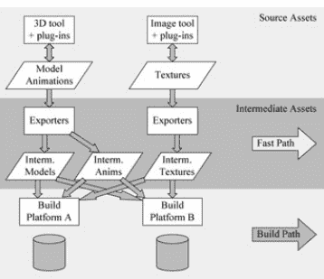

图2.1：资产管道组件。

### 源资产

源资产由美术人员和设计师创建。用于创建源资产的工具通常被称为数字内容创建（DCC）工具。一般来说，源资产是通过一组专业工具创建的：一个用于建模，一个用于纹理创建，一个用于游戏数据，一个用于关卡布局。源资产应包含构建游戏内容所需的所有信息。换句话说，应该可以删除除源资产外的所有资产，并仍然能够重建游戏内容。源资产通常以工具特定的格式保存，并且应使用版本控制系统（如Subversion [1]或Perforce [2]）进行存储。由于源资产通常很大且常为二进制格式，请务必使用能够处理大型二进制文件的版本控制系统。

### 最终资产

最终资产针对每个目标平台进行优化和打包。通常，开发人员无法选择最终格式，因为目标平台、第三方引擎或发行商可能会强制规定某种格式。最终资产中不需要冗余信息，因此所有数据都被精简到所需的最小值。就像源代码一样，资产必须针对每个目标进行编译和优化。例如，纹理应以硬件可立即使用的格式和大小存储，因为纹理压缩算法和参数需要针对目标纹理硬件和显示功能进行优化。几何数据也针对每个目标进行编译。大多数平台只接受三角形，但每批三角形的数量、顶点的排序顺序、对三角形带的需求以及每个顶点的数据量都会对游戏引擎的性能产生重大影响。硬件着色器渲染能力的限制也可能影响几何体，因为可能需要创建多个几何体，以便引擎在单独的通道中使用它们来创建所需效果。

最终资产还必须针对游戏加载速度进行优化。将数据转换为硬件二进制表示是可能的优化之一，因为这可以节省加载时的CPU时间，但它不一定是需要优化的主要瓶颈，因为当今I/O（带宽或寻道）可能比CPU性能（解析、解码）更成问题。对于非常简单的游戏，可能只需将数据尽可能压缩并在启动时或每次更换关卡时加载一次即可。但对于更先进的游戏，预期是数据会在玩家游戏过程中持续流式传输，以提供更好的沉浸式体验。在引擎中构建良好的实时数据流式传输能力是基本核心技术之一，这也有助于在各种平台上为玩家提供类似体验，因为设备内存大小的限制可以通过本地缓存机制来隐藏。另外，如果内容要存储在具有特定限制的硬件格式上（例如，CD或DVD可能有长寻道时间），则按游戏中将遇到数据的顺序对数据进行排序可能很重要。

### 构建过程

构建过程是转换所有源数据并为每个目标平台创建优化打包数据的过程。构建过程应当是自动的，就像处理游戏源代码一样。构建应当经过优化，仅处理自上次构建以来更改的数据。为整个游戏构建优化数据可能需要数小时，甚至整整一天。在项目结束时尤其痛苦，因为需要在短时间内进行大量调整，而此时数据仓库已完全填充，构建时间最长。在过程早期，可能很少关注构建过程的优化和数据的组织，但游戏的整体质量和成功将取决于在大多数资产创建完成后进行的最终编辑。换句话说，设计不良的构建过程很可能直接影响最终产品的质量。

优化资产构建过程的主要问题之一是缺乏依赖信息。由于源资产通常以工具特定的不透明格式存储，往往无法轻松解析数据并递归收集依赖信息。在源代码开发中，对依赖信息的需求以及从源中直接提取依赖信息的做法已存在多年，但不幸的是，这种流程对于资产尚未成熟，将要求游戏引擎开发人员积极开发自己的流程。

关于资产构建系统有几个很好的信息来源，例如书籍《游戏资产管道》[3]和Microsoft XNA内容管道[4]。我们提到后者，尽管XNA仅设计用于针对Microsoft平台（PC和Xbox 360），并且存在几个设计限制，例如依赖文件扩展名来分离数据类型，并强制将构建信息嵌入源代码而不是作为描述性数据[5]。

### 清单

游戏开发中一个非常常见的问题是，很快就无法知道需要哪些资产、哪些资产依赖于其他资产，以及哪些资产不再必要。在开发过程中，数据常常堆积在共享目录中，游戏运行正常，因为脚本或其他资产引用的所有数据都可用。问题是，没有简单的方法知道哪些资产是真正必要的，因此在项目中期打包演示版本通常会导致数GB的压缩数据，使得分发变得困难。手动维护清单说起来容易做起来难，因为这要求对美术人员和设计师实施严格的政策，以确保他们将所有引用的资产添加到清单中，并删除未使用的资产。在实践中，手动维护清单毫无希望，因此有必要创建一个自动系统，从游戏的顶层描述（即关卡设计文件）中提取清单。能够访问资产中存储的外部引用，例如脚本、纹理、模型、动画或其他引用，成为自动创建清单的明显需求，因此必须谨慎在资产管道中使用不透明格式。好消息是，这些信息可用于创建依赖图，使构建过程仅针对特定关卡所需的文件进行工作。依赖图


还能让人了解当资产依赖已更改的资产时，哪些资产需要重新构建。

## 快速路径

快速路径是指资产能够加载到游戏引擎中，而无需经过完整的构建过程。这一捷径对于提高美术人员效率非常重要。使用快速路径时，美术人员会调用最小化导出机制，从而实现更快的迭代。请注意，美术人员通常只处理资产的一个特定子集，只有这些资产的数据会走快速路径；场景中的其他元素仍可从最终构建路径加载。这意味着引擎需要在生产期间允许完整构建资产和快速路径资产同时处于活动状态。快速路径加载器之后可以从引擎中精简掉，除非开发者希望将此功能保留为模组开发者的功能（参见第 2.6 节）。快速路径是对整体生产流程的优化，这对于在时间和预算限制内成功交付游戏可能至关重要。

## 中间资产

中间资产表示源数据与最终形式之间的数据。中间资产使用 DCC 工具的导出器创建，也表示在最终转换为最终资产打包之前，构建过程中已处理的数据。中间资产格式应非常易于读取、解析和扩展。中间资产应包含管道下游可能需要的所有信息，并且尽可能无损 [1]。无需过早精简和过度优化；在管道更下游丢弃数据，比每次需要额外信息时都重新导出所有源资产要高效且自动化得多。纯文本或结构化 XML 文件 [6] 是大多数中间资产的推荐格式；这除了利用众多能够处理标准 XML 格式的库之外，还提供了人类可读性和偶尔的手动编辑。尤其有用的是 C#、Python、Java 等语言的内置功能，可以直接加载 XML 文档，并为嵌入的文档对象模型（DOM）提供易于编程访问和搜索功能。

理想情况下，应使用单一灵活的中间格式在整个转换过程中存储数据，以便在整个内容管道中使用相同的格式和 I/O 代码，并提供更改构建过程步骤及其执行顺序的灵活性。这意味着格式需要以尽可能接近 DCC 工具中的表示形式存储数据——以简化导出过程并确保尽可能少的数据丢失——同时将数据转换为尽可能接近目标平台所需最终编码的格式。在设计中间格式时，这会带来一些额外的复杂性，但最终，避免以导出时间和数据丢失为代价将早期转换加载到导出过程中，是一项巨大的胜利。如图 2.2 所示，资产处理模块可以直接对中间资产应用转换，例如三角化、纹理处理和细节层次计算。

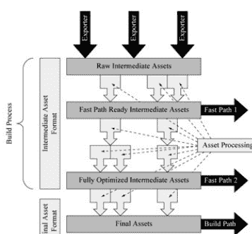

图 2.2：构建过程中的中间资产。

## 管道

一组处理模块组成构建管道。由于中间资产在整个管道中都以相同格式可用，因此可以在管道的任何点对其进行探测。虽然这并非根本必要，但可以创建一个带有用户界面的特定工具，只需将资产处理模块相互连接即可创建构建过程 [7]。这种设计还使构建过程更加通用，以便处理来自各种来源和工具的数据，并可以通过以不同方式组合或配置一组资产处理模块，来配置支持现有和未来的目标平台。

如果单一格式可以同时服务于源资产和中间资产，并且被 DCC 工具识别，那么就无需为源资产和中间资产使用不同的格式。这并不意味着数据在构建过程中保持不变；而是指相同的格式可以用于在转换的所有阶段存储数据。例如，存在数百种图像文件类型/格式 [8]，但不幸的是，似乎没有一种能够提供同时作为源格式和中间格式所需的所有属性。理想情况下，我们希望有一种能够存储未压缩和/或无损压缩像素的格式用于源格式。有些图像需要以比通常每组件 8 位更高的分辨率存储，因此格式应允许每组件 16 位，甚至 24 位。越来越多地，需要高动态范围（HDR）存储，为此已提供一种开放格式：OpenEXR [9]。另一方面，中间格式应能尽可能接近目标平台格式地表示数据，但需求涵盖整个光谱，以至于几乎不可能。例如，最终纹理数据必须表示 mipmaps、立方体贴图、体积贴图、高度贴图、法线贴图和纹理数组，并且必须处理内存对齐、通道交换、平铺和硬件压缩（DXT）。来自 Microsoft 的 D3DX10 格式 [10] 可能最接近中间图像格式的需求。它包括 DirectDraw Surface (DDS) 描述 [11] 以及 PNG [12]、IFF [13] 和 BMP [14]。此外，它至少在 Microsoft 平台上也可用作最终格式。问题是，图像创建工具中可能没有这种格式的导出和导入工作流，迫使为源图像资产和中间图像资产使用两种独立的格式。

除了从源格式到中间格式的转换之外，图像还需要提供给 DCC 工具，这可能需要另一种格式转换。一种非常流行的图像创建工具是 Adobe Photoshop，其 PSD 原生格式可以存储多种类型的数据。希望主要的 DCC 工具可以直接加载 PSD 图像，并可能利用图层和其他附加信息。有趣的是，Adobe 最近提供了开源的 Generic Image Library [15]，旨在简化和优化图像资产的处理，但不幸的是，它不为 Adobe 自己的 PSD 格式提供 I/O 支持！

过去，游戏引擎开发者不得不为美术人员使用的每个供应商特定工具创建自己的中间格式，并编写插件形式的导出器，这可能是一项艰巨的任务，尤其是在跟踪 DCC SDK 问题时。幸运的是，这已不再是必需，引擎开发者反而应该利用标准中间格式和可用的源代码 [16]，如第 2.4 节所述。

[1] 以开放且文档完善的格式存储中间资产，对于游戏资产的归档也非常重要。这里有一个有趣的故事：一家大型工作室发布了一款基于新 IP 的游戏，并巧妙地存储了所有源资产、源代码和构建过程。过了很多年，续作最终被立项。问题是，源资产不被新版本的 DCC 工具识别。巧妙的是，他们也存储了用于创建资产的工具。问题是，无法为这些旧工具让许可证服务器正常工作。中间资产以二进制不透明格式存储，因此无济于事。所有资产都必须重新创建。如果在归档中使用文本/XML 文档的中间格式，本可以节省大量时间和金钱。


## 2.2 Asset Pipeline Design

从最终用户的角度来看，资产管道应该是透明的。事实上，资产管道开发者的最终回报在于，当艺术家和游戏设计师不知道管道的存在，并觉得他们的创作工具与游戏引擎之间没有任何中间环节时。从用户的角度来看，资产管道中最重要的部分是游戏引擎编辑器。它是提供资产集成接口到游戏引擎的工具。编辑器构建在与游戏本身相同的引擎核心技术之上，为艺术家、设计师和工程师提供必要的 WYSIWYG（所见即所得）环境，用于组装资产并快速解决设计或引擎问题。

### Game Engine Editor

游戏引擎编辑器有两种可能的工作流需要考虑：

- 1. 编辑器是一个高级查看器，使用户能够检查引擎内的资产，并控制相机位置、光照条件以及显示哪些资产。在这种设计中，资产仅在 DCC 工具中修改和编辑，并在有更改时导出。

- 2. 部分资产可以使用编辑器进行编辑。这种替代设计创建了更复杂的资产管道工作流，因为编辑器实际上正在创建需要妥善存储以供构建过程使用的源资产。

设计内容管道时的两个主要关注点是效率和灵活性 [17]。效率是构建游戏的团队能够按时交付出色内容所必需的，而灵活性是能够根据团队不断变化的需求调整管道所必需的。不幸的是，这两个优先级在某种程度上是相互对立的，因此没有单一解决方案能满足所有项目。相反，需要做出妥协选择，以定义资产管道设计的要求。

因此，游戏引擎编辑器将根据项目的具体情况提供只查看和编辑功能的组合。问题是在哪里划线。显然，在编辑器中重写所有 DCC 工具的所有编辑功能是不切实际的。这将是一项重大任务，并会将开发重点从创建游戏转移到创建 DCC 工具，这是完全不同的业务。有些人尝试走另一条路，将游戏编辑器编写为 DCC 工具的插件。但这也行不通，因为这需要在 3D 软件包中编写（例如）图像编辑器、音频编辑器、脚本编辑器、AI 工具和关卡编辑器，并且将工具链锁定在工具 SDK 的扩展能力上。正确的妥协是只在游戏编辑器中编写那些要么非常特定于游戏本身，要么相对于现成工具能带来巨大效率提升的编辑功能。事实上，游戏团队应该始终留意可能提高其效率的新工具。资产管道应该设计为提供足够的灵活性，以便能够加入新工具，这在整个项目过程中可能是一个微妙的过程。

另一个需要考虑的主要点是健壮性。资产管道是项目和团队的支柱。当管道出现故障时，项目将停滞不前，团队中的每个人都在等待管道修复而闲置。稳固的设计和适当的文档，告诉团队如何使用和扩展资产管道，是其健壮性的关键。

效率、灵活性和健壮性都是中间资产格式的主要目标。在源资产和最终资产格式之间提供一个步骤的主要优势是解耦引擎开发和资产创建。如果最终资产是在导出时直接创建的，引擎中的大多数更改都需要导出器进行同步更改，这将需要重新导出所有资产。缓存中间资产并对构建的快速路径和最终步骤进行必要的更改，比将所有资产重新加载到 DCC 工具中并重新导出要高效得多。这样做可能需要非常昂贵且耗时的手动操作，因为大多数 DCC 工具不易或无法高效地从命令行驱动。设计良好的中间格式在整个项目过程中不太可能发生太大变化。如果正确缓存并跟踪源资产依赖关系，最终资产可以从中间资产自动重新创建，模拟当前源代码已经为真的情况（构建可执行文件时不需要重新构建所有中间目标代码）。以易于读取的格式拥有中间资产格式，为游戏引擎程序员提供了一种更简单的调试和实验方式。

中间资产设计相对于目标代码的一个优势是，它可以实现跨平台资产创建。构建过程可以从中间资产为多个平台创建最终资产，这支持一种游戏设计理念：源资产以非常高的分辨率创建，而构建过程负责为各个目标平台缩小资产。自动转换高分辨率资产并不总是可能的，但这比为每个目标平台创建源资产要灵活和高效得多。当今大多数管道中使用这一想法的示例是创建高密度多边形模型，然后创建与低密度模型关联的法线贴图，其中多边形数量和纹理大小可以适应不同的目标平台，并提供细节层次管理的手段。研究资产的程序化定义是提供更好自动适应性的好方法，尽管该领域可用的工具不如传统的 DCC 方法成熟，而传统方法对艺术家来说更容易掌握。

将高密度或更高级别抽象的资产处理为最终资产可能是一个复杂且资源密集的过程，最好使用独立的构建系统来完成，该系统可以利用多核 CPU 和 GPU 的数值计算 API（如 CUDA）进行优化。越来越多的工具和中间件提供商开始利用这种技术来提供更快的处理。一个良好的设计目标是逐步将资产处理移至引擎本身，利用不断增长的可用处理能力。这提供了一条可持续的技术路径，将计算能力转化为更灵活、更高效的内容创作。

## 2.3 Push or Pull Pipeline Model

直接修改中间资产而不编辑源资产并重新导出，这非常诱人。在时间紧迫时，这似乎是正确的做法，但大多数时候，这并不是个好主意，因为当源资产被修改并重新导出时，中间资产会被覆盖。

理想的解决方案是能够在管道的任何点进行更改，并确保这些更改被回报到源数据中。实现这一点的一种方法是能够将中间资产重新导入 DCC 工具，以便修改可以合并回源资产。但是，源资产中有大量数据在中间数据中没有复制，例如构建历史和工具小部件布局。此外，中间资产可能已经过处理，导致数据的原始形式丢失。因此，重新导入中间资产时应本着更改将合并到源资产中的理念进行。不幸的是，与源代码开发不同，源代码开发中 diff 和合并工具很常见并允许并发开发，而检测和合并更改并不是 DCC 工具的常见功能。资产工作流中缺乏合并工具也直接影响了内容版本控制系统的使用方式。在处理源代码时，几个程序员对同一源文件进行更改，然后使用合并工具稍后整合更改是常见的做法。但是，内容缺乏此类工具迫使用锁机制，一次只允许一个人对给定的源资产进行更改。这反过来迫使将源资产分割为大量文件，以便能够进行并发开发，因为如果所有数据都在一个文件中，一次只有一个艺术家能够处理内容。这很健壮，但不够灵活或高效。

传统上，资产管道被设计为推送模型，其中用户必须创建中间资产或


通过调用构建过程生成最终资产，然后将结果加载到编辑器中以查看最终效果。对该模型的一种改进是使用游戏引擎编辑器直接从用户界面拉取中间或最终资产。该技术的一个示例已在最新的 Torque 3D 资产管线 [18] 中实现，其中游戏引擎编辑器会主动监听中间或最终资产的变化，并在外部发生变化时自动更新编辑器中的内容。另一个类似的想法在《至关重要的导入管道》[19] 中有所描述，其中游戏引擎编辑器为用户提供直接加载中间资产的功能，并按需自动调用构建过程来创建最终资产。这使用户能够直接拉取中间资产，而无需手动调用构建过程。这两个想法可以结合起来，以监听中间资产的变化并自动调用构建过程。该机制可以与快速路径加载机制相结合，以提供更好的交互式 WYSIWYG 迭代过程，同时后台进程创建最终资产，并在资产可用时自动将“慢速”内容替换为“优化”内容，对用户透明。

这些想法是朝着正确方向迈出的一步，但尚未解决在实际上应修改源资产时编辑中间资产的问题。图 2.3 所示的资产管线设计添加了一条远程控制线，用户可以在其中选择游戏引擎编辑器中的任何内容，前提是中间资产存储了源资产依赖项和关联的 DCC 工具，源资产编辑工具会自动启动并提供给用户，以便进行修改和重新导出。结合之前引擎监听中间资产变化并自动调用构建过程的方法，这为资产管线提供了一种高效、灵活且健壮的设计。用户将资产管线视为拉取模型。中间资产被拉取到编辑器中，例如，使用可以按类型分类并提供资产快速预览的资产浏览器。编辑器可以自动创建清单，并通过遵循中间资产中存储的依赖项来自动构建构建的依赖图。编辑器可用于选择一个或多个资产并调用编辑命令，该命令将查看中间资产信息或用户偏好设置，并调用首选的 DCC 工具来编辑正确的源资产。编辑器还可以直接调用版本控制系统，以适当地检出本地副本并检回修改后的资产。可以提供一组通用模型作为占位符，这些占位符可以插入到当前游戏关卡中，以便稍后创建资产，从而为美术团队自动生成任务列表。

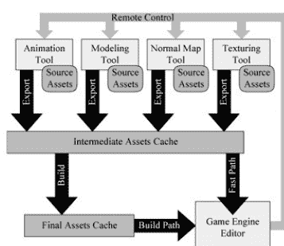

### 图 2.3：控制资产管线的游戏引擎编辑器。

## 2.4 COLLADA，一种标准中间语言

在 SIGGRAPH 2004 [20] 上，COLLADA 作为面向游戏开发者的首个开放式数字资产交换（或 .dae）规范被引入。经过一年的工作，该初始规范被提供给公众。正好一年前，在 SIGGRAPH 2003 上，索尼计算机娱乐能够创建一个由该领域关键公司组成的工作组，试图创建一种通用中间语言，该语言将提供表示 PlayStation 3 等高级平台所需资产所需的一切。Alias、Discreet 和 Softimage 等竞争对手公司同意放下竞争，帮助进行设计和原型开发。在 Digital Eclipse、Electronic Arts、Ubisoft 和 Vicarious Visions 工作的游戏开发者喜欢这个想法，并主动提供帮助。

该规范经过了多次迭代完成，多亏了最初接受挑战、帮助解决实际用例中许多问题的开发者，该规范最终达到了稳定状态。2005 年 7 月，版本 1.4 规范 [21] 由 Khronos Group [22] 作为开放标准发布，该组织也是管理 OpenGL、OpenGL ES、OpenCL 等其他知名图形标准规范的同一组织。版本 1.4 规范进行了小修小补，提供了 1.4.1 规范，在本出版物发布时，它是目前最流行的可用实现。

在 SIGGRAPH 2008 上，引入了 COLLADA 规范的版本 1.5 [23]，增加了来自 CAD 和 GIS 领域的功能，例如反向运动学 (IK)、边界表示 (b-rep)、地理位置，以及使用 MathML 描述语言对约束进行数学表示。版本 1.4.x 和 1.5.x 规范不完全向后兼容，但这不是问题，因为中间资产无论如何都需要从源资产重新导出。截至目前，版本 1.4.x 格式是大多数应用程序支持的格式，而版本 1.5 的支持仅限于少数应用程序，主要集中在 CAD 领域。版本 1.4.x 和 1.5.x 将并行存在和维护。不过，版本 1.5 中引入的新功能很可能永远不会进入版本 1.4.x 规范，因此越来越多的工具可能会同时提供两种实现。无论如何，从用户角度来看，加载版本 1.4 或 1.5 应该是透明的，因为文档包含其编码所使用的版本信息。

由于 COLLADA 是开放标准，许多公司一直在提供实现。COLLADA 从一开始就被设计为一种无损中间语言，应用程序可以导出和导入。COLLADA 作为一种语言很重要，为了有用，一种语言既需要被说也需要被理解。此外，为了能够验证和测试实现，有必要使用有效文档测试应用程序，加载然后导出，以便与原始数据集进行比较，查看过程中是否有任何数据丢失。这是官方 Khronos COLLADA 一致性测试的基础，该测试可供 Khronos Adopter 成员使用，并提供验证和认证流程，以向最终用户保证高质量的实现。通过测试的应用程序有权显示一致性徽标标志。建立有效的独立一致性测试并非易事，因此在测试可用并强制执行之前，由于对规范的不同人为解释，存在一定程度的不兼容性，但这并非最终用户无法修复的问题。

由于 COLLADA 提供导入和导出功能，并且可用于许多工具，它也广泛用作交换格式。交换格式的目标是使源资产能够从一个 DCC 工具转移到另一个 DCC 工具，这绝对不是资产管线的目的。事实证明，COLLADA 作为交换格式非常出色，并且免费提供了比一些现有解决方案更快、更准确的工具间数据转换。

COLLADA 1.4.x 功能列表包括几何、动画、蒙皮、变形、材质、着色器、摄像机、（刚体）物理和变换层次结构。它基于用于电子文档编码的 XML（可扩展标记语言）标准，因此所有 COLLADA 文档都可以由任何商业或开源 XML 工具管理。COLLADA 使用 XML-Schema 语言 [24] 定义，以便工具可以使用 COLLADA 架构来验证文档，或自动创建各种语言的 API 以及编辑和演示工具。

COLLADA 以非常结构化的方式可扩展。中间格式必须可扩展，因为资产管线需要编码特定于游戏引擎或游戏本身的数据。扩展的问题在于如何设计它们，使得不识别扩展的工具仍然可以导入中间资产，并且在可能的情况下能够向前传递扩展。COLLADA 在架构中提供了多个位置，对象可以使用与规范中其他元素关联的 `<technique>` 和 `<extra>` 元素进行扩展。由于这些元素不允许放置在文档的任何位置，可以设计 COLLADA 解析器来识别这些扩展，并要么忽略内容，要么更好地将内容保留在字符串中以传递信息。当然，如果工具识别扩展，它应该使用它！扩展对象有两种方式：要么是增强现有元素定义的附加信息，要么是元素常见定义的替代定义。由开发者决定如何扩展。如果扩展是通过替代进行的，则要求保留可供其他工具用作占位符的通用定义。例如，使用特定几何的引擎


诸如 metaballs [25] 之类的定义，可以使用 `<extra>` 元素来存储 metaball 信息，并保留标准网格几何体以存储通用网格。

让我们来看看一些设计原则，这些原则旨在提供必要的灵活性，以便用通用语言表示数据，同时使其尽可能贴近特定的 DCC 表示，并能够通过内部转换使其更接近引擎特定的表示。本节其余部分概述了 COLLADA 设计原则。如需更多技术细节，读者可以参考 Khronos 网站 [22] 和本书随附光盘上提供的 COLLADA 1.4 和 1.5 规范。这些规范和 COLLADA 参考书 [26] 提供了在设计标准时所做选择的更多细节。

## `<source>` 元素

`<source>` 元素包含资产使用的原始数据。与其他每个元素一样，它具有一个必须在有效文档中唯一的 `id` 属性。一个 `<source>` 元素包含特定类型（ID、名称、布尔值、浮点数或整数）的一维数据数组。每个元素可以有一个名称，该名称必须是有效的 XML 字符字符串，但名称信息仅用于存储与人类相关的信息，永远不用于引用文档中的对象。浮点数和整数可以用任意位数表示，以提供所需的任何精度级别。尽管普遍认为存在精度损失，但使用十进制数字表示浮点数绝不会丢失精度，前提是使用足够的位数——单精度用 9 位，双精度用 17 位 [27]。数组本身包含一个 `count` 属性，以便更轻松地进行内存分配。

`<technique_common>` 元素提供了关于规范中定义的其他元素应如何访问 source 的信息。`<technique>` 元素是扩展所在的位置；一个元素可以同时携带多个工具的扩展，因为每个工具为其技术提供一个配置文件名称。

图 2.4 显示，通过使用选择器，一个 `<source>` 元素中只能包含一个数组，并且它显示 name 属性是可选的（通过虚线表示），而 `id` 属性是强制性的。所有这些信息都存储在 Khronos 网站上提供的 XML 架构中，该架构可以自动转换为图形或用于验证文档。清单 2.1 显示了 source 在文档中的样子，并且它非常容易解析。

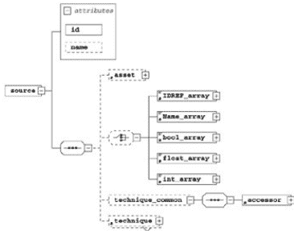

### 图 2.4：`<source>` 元素的定义。

## 清单 2.1：`<source>` 元素和 `<accessor>` 元素的示例。

```
<source id="mesh1-geometry-position">
<float_array id="mesh1-geometry-position-array"
2518.1875 4074.512965 0. 2518.1875 0.
...
</float_array>
<technique_common>
<accessor source="#mesh1-geometry-position-array"
count="8" stride="3">
<param name="X" type="float"/>
<param name="Y" type="float"/>
<param name="Z" type="float"/>
</accessor>
</technique_common>
</source>
```

## `<accessor>` 元素

`<accessor>` 元素（如图 2.5 所示）是构建灵活性的地方。它使我们能够以更接近工具或目标格式的格式组织数组，从而允许构建过程在两者之间进行转换。这从导出器的角度提供了更好的解耦，因为导出器可以按原样导出数据，然后使用 `<accessor>` 元素来解释应如何访问数据。count 属性告诉可以通过 `<accessor>` 元素访问多少个元素，以及应使用什么偏移量和步长，通常创建 n 元组数据。然后它为 n 元组的每个元素描述一个参数，为其命名并指定类型。示例在清单 2.1 中所示。

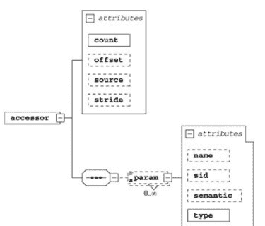

### 图 2.5：`<accessor>` 元素的定义。

如果未为 `<param>` 元素指定名称，则意味着相应的值将被忽略。因此，带有 3 元组值的 source 数组实际上可能只定义了带有一个填充值的 2 元组。如您所见，在同一种语言中，有多种不同的方式来表示位置数组。敏锐的读者会注意到，数组元素在 `<source>` 元素中是可选的，原因是 `<accessor>` 元素可以引用存储在另一个 `<source>` 元素中的数组，从而使可以通过多个 `<accessor>` 元素以不同的方式重用同一数据数组。

## 几何体和 `<mesh>` 元素

几何体通常由 `<mesh>` 元素表示，尽管 `<convex_mesh>` 元素和 `<spline>` 元素分别用于刚体物理和 2D 动画曲线。COLLADA 1.5 规范将 `<brep>` 添加到几何体类型列表中。`<mesh>` 元素包含 `<lines>`、`<linestrips>`、`<polygons>`、`<polylist>`、`<triangles>`、`<trifans>` 和 `<tristrips>` 元素的集合。最可能的是，导出后立即找到的网格数据是多边形，这些多边形在构建管道的末尾附近会被转换为三角形。

`<mesh>` 元素包含一个强制性的 `<vertices>` 元素，如图 2.6 所示。它具有一个强制性的 `<input>` 元素，该元素引用一个 `<source>` 元素，这意味着它使用 `<source>` 元素中的 `<accessor>` 元素来访问数据。一个非常有趣的设计特点是，COLLADA 中未提及顶点数据的维度。换句话说，顶点可以具有一个、两个、三个或任意数量的维度，尽管大多数内容将使用带有 X、Y 和 Z 参数名称的 3D 顶点，因为转换和位置在 `<scene>` `<node>` 元素中限制为 4D 齐次坐标空间。`<input>` 元素将一个语义与 source 关联。自然，唯一的强制性输入是针对语义 POSITION 的，它提供网格原语中使用的所有顶点的位置（例如，x、xy、xyz、xyzw）。`<vertices>` 元素可以包含必要数量的 `<input>` 元素，以附加与每个顶点关联的其他数据。例如，通常每个顶点存储一个 NORMAL，在旧系统中也常见每个顶点有一个 COLOR。

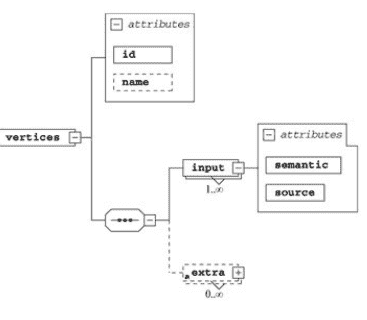

### 图 2.6：`<vertices>` 元素的定义。

以图 2.7 中的 `<triangles>` 元素作为 `<mesh>` 元素子对象的示例，可以看出它也由一组 `<input>` 元素组成，这些元素存储与每个原语关联的数据，而不是像之前在 `<vertices>` 元素中所做的那样存储与每个顶点关联的数据。其中一个 `<input>` 元素定义了语义 VERTEX，它通过索引引用每个原语所使用的 `<mesh><vertices>` 元素中定义的 POSITION。显然，三角形列表中每个元素有三个顶点。因此，`<p>` 元素由一组 P×N 索引组成，其中 P 是原语的数量，N 是原语列表中定义的 `<input>` 元素的数量。

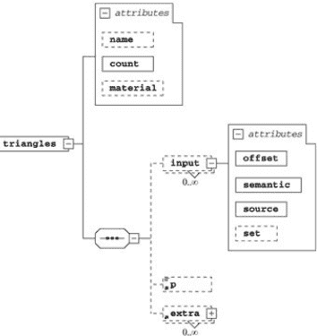

### 图 2.7：`<triangles>` 元素的定义。

## 结论

为了总结对中间资产格式设计及 COLLADA 标准所做选择的概述，值得提及一些额外的高层概念。

在设计中间资产格式时，最重要且最难牢记的设计概念是尽可能避免特定的实现或运行时。换句话说，数据应该是自描述的，以便可以与任何现有或未来的运行时进行转换和使用。这是一个非常困难的设计目标，也是 COLLADA 工作组大部分设计会议所关注的重点，因为功能的第一个草稿总是接近其在运行时中的使用方式或在建模器中的创建方式。确保数据不是相对于单一使用模型来描述的非常重要，因为这可以确保设计不会因技术快速发展而过时，也不会通过强加一个不适合尚未发明的使用模型的模型来限制创造力。这一设计点是 COLLADA 与大多数其他格式的主要区别。这种区别在与 Autodesk 专有的 FBX 交换技术进行比较时很明显，该技术完全通过 API 和特定使用模型定义：

> "FBX 文件格式没有文档。应用程序使用 FBX SDK 从 FBX 文件导入场景数据或将场景数据导出到 FBX 文件。"
> — FBX SDK 程序员指南，第 6 页 [28]。

设计的另一个重要原则是将元素分类为 `<library_xx>` 元素类型，这些类型有助于组织数据，并能按类型分离文档内容。重要的是区分数据定义及其通过实例化进行的利用。这使得一个元素可以多次使用而无需重复其定义，否则会导致中间和最终资产的大小急剧膨胀。COLLADA 允许在实例化时通过使用 `<param>` 元素修改元素的一些值，因此可以共享大部分元素定义并节省大量空间，同时仍能够


源数据的变更会影响所有实例，在生产过程中非常有用。

最后但同样重要的是，COLLADA利用URI技术[29]，使元素能够引用其他文档中的数据以实现灵活组织，并且它还利用了多种不同的存储技术。例如，外部引用URI可以是Web服务器将其解释为数据库查询的HTTP请求，也可以是本地存储设备上文件的简单引用。使用没有良好外部引用机制的格式时的一个主要问题是，所有中间资产都需要分组在一个单一文档中。这样的文档在项目过程中可能会增长到无法管理的大小。此外，这意味着资产管道中使用的所有工具都必须导入然后导出所有数据，这是一个主要的限制问题。

## 2.5 OpenCOLLADA

鉴于COLLADA的开放性及其使用标准XML技术进行描述，存在许多可用于与COLLADA文档交互的商业和开源选项。C#和Python等编程语言提供可以直接与XML数据交互的库，为程序员提供文档对象模型（DOM）[30]，即XML层次结构的内存表示，可以以编程方式访问。C++（游戏引擎开发中最常用的语言）附带的库不直接提供此功能。存在几种用于加载和保存XML内容的通用库，也有一些商业工具可以在XML架构中自动生成特定的访问API，从而能够创建特定于特定文档的API。C++程序员可以使用COLLADA DOM，它不仅从架构自动生成核心API，还提供API来帮助在内存中管理对象。DOM不仅提供加载和保存接口；它允许XML元素存在于内存中，以便可以直接编辑，而无需创建单独的表示[31]。

最近在SIGGRAPH 2009期间，NetAllied Systems宣布了OpenCOLLADA [32]的可用性，这是第一个利用SAX解析和直接写入技术的开源实现，支持1.4和1.5两个版本。项目页面位于网络上的http://www.opencollada.org/。基于此技术构建的3DS Max和Maya插件以及框架的源代码都可在该网页上找到，并且为了方便，它们也包含在随本书附带的光盘中。鼓励读者查看网页以获取最新更新。

SAX（用于XML的简单API）是解析XML文档的DOM替代模型[33]。大多数可用库中普遍存在的主要问题是，它们加载所有XML数据并创建数据的内存表示，然后才制作数据的第三个副本以创建加载资产的程序使用的对象表示。这个问题在所有文件加载SDK中都非常普遍，无论格式本身如何，而这个问题使得处理越来越常见的非常大的资产变得相当困难。

当使用库在写出数据之前创建要导出数据的完整内存表示时，导出内容时也存在相同的内存管理问题。当大型模型在DCC工具中加载时，工作站内存通常会被耗尽，当调用导出时，计算机会挂起，因为所有内存内容都被交换出去，为同一数据的另一个副本腾出空间。导出内容时也可以使用相同的原理，即写出数据目录并避免创建内容的另一个副本。

清单2.2（以及随附光盘中包含）所示的DAE2Ogre示例代码演示了如何利用此技术。其思路是将写入器与读取器C++对象关联，其中读取器是COLLADA SAX解析器，而写入器（在此例中）是Ogre引擎特定格式。由于所有数据并非一次性全部在内存中可用，因此无法跟随引用并期望就地找到数据。因此，SAX解析器使用UniqueId类型进行引用。由于数据按照其在COLLADA文件中出现的顺序传递给写入器，在存在前向引用数据的情况下，可能无法立即解析引用。为解决此问题，通常加载文件两次。在第一次遍历中，收集并存储场景图、材质和其他数据。在第二次遍历中，处理几何体、动画和其他数据。与将所有数据都放在内存中相比，SAX解析器稍微复杂一些，但得益于OpenCOLLADA开源框架[34]的可用性，这并不那么困难。正如我们已经看到的，这种技术在内存使用方面有很大优势，当资产非常大时这是必不可少的，但它还会转化为性能提升，正如我们将观察到的那样。

### 清单2.2：这是来自DAE2OgreWriter.cpp的示例导出器。

```
OgreWriter::write()
{
    COLLADASaxFWL::Loader loader;
    COLLADAFW::Root root(&loader, this);

    // load and write scene
    mCurrentRun = SCENEGRAPH_RUN;
    root.loadDocument(mInputFile.toNativePath());

    // if there is no visual scene in the COLLADA file
    // nothing to export here
    if (mVisualScene)
    {
        SceneGraphWriter sceneGraphWriter(this, *mVisualScene, mLibraryNodesList);
        sceneGraphWriter.write();
    }

    // load and write geometries
    mCurrentRun = GEOMETRY_RUN;
    root.loadDocument(mInputFile.toNativePath());
}
```

表2.1和表2.2显示了在3DS Max中对大型场景执行导入操作和导出操作的持续时间和内存消耗。这些表比较了开源OpenCOLLADA技术和使用DOM/中间内存模型库FCollada [35]的Feeling Software开源实现。有趣的是，无论使用何种存储格式，这两个COLLADA实现之间的性能差异都是可观察的，鼓励读者在大型数据集上进行一些性能测试，以在需要时提高其资产管道的效率。

### 表2.1：使用OpenCOLLADA for Max和Feeling's ColladaMax导入3DS Max。

| Boom.dae, 116 MB单网格 | OpenCOLLADA | ColladaMax |
|---|---|---|
| 导入所用时间 | 3.8 s | 32.5 s |
| 导入期间最大内存消耗 | 752 MB | 784 MB |
| 导入后内存消耗 | 444 MB | 476 MB |
| 删除场景后内存消耗 | 284 MB | 332 MB |

### 表2.2：使用OpenCOLLADA for Max和Feeling's ColladaMax从3DS Max导出。

| Boom.max, 29 MB单网格 | OpenCOLLADA | ColladaMax |
|---|---|---|
| 导出所用时间 | 3.5 s | 46.3 s |
| 导出期间最大内存消耗 | 438 MB | 623 MB |
| 导出后内存消耗 | 418 MB | 418 MB |

## 2.6 用户内容

Modding是计算机游戏社区的俚语表达，源自动词"modify"，尤其用于指创建新内容或修改内容。Modding曾被视为边缘活动，但现在受到鼓励，因为它延长了游戏的生命周期。提供工具帮助游戏社区创建需要购买游戏本身的额外内容，这为开发者提供了无需额外成本的额外内容和收入。事实上，强大的社区得以发展并提供强大的病毒式营销，从而创造对游戏开发者的额外粘性和忠诚度。最终用户创建的内容被称为用户内容或玩家内容。

为了让最终用户创建内容，游戏开发者必须提供对简化版或更强大版本的游戏编辑器、脚本和内容管道的访问。由于最终用户不太可能拥有昂贵的DCC工具，因此提供一个也可以利用Blender [36]、Google SketchUp [37]或XSI Mod Tool [38]等免费工具的资产管道非常重要。Crymod是Crytek游戏的一个成功Modding社区示例，它在网络上拥有自己的门户http://www.crymod.com/。Crytek与Softimage（现由Autodesk拥有）合作，提供其COLLADA导出器的专用版本，该版本提供免费使用的专业级工具，带有集成资产管道，以增强高质量用户内容的创建。修改后的导出器使用Crytek引擎识别的特定名称语义，用于将创建的内容连接到其物理和其他游戏特定实体。应注意，此资产管道（Mod Tool到COLLADA到CryEngine）并未被Crytek用于开发其自己的游戏，而是专门为Modding社区设计的。但现在这个工具链已经开发出来，也已找到内部用途。

越来越多的用户内容可以在网络上的3D内容中找到


repositories. Google 3D Warehouse 一直为 SketchUp 用户提供向此仓库上传内容的功能，允许任何人搜索和下载 COLLADA 格式的内容。随着 SketchUp 7.1 功能的引入，该功能提供免费的 COLLADA 导入和导出，现在任何其他工具创建的内容都可以上传到仓库中与其他用户共享。由于仓库与 Google Earth 相连，因此有许多现有建筑的模型以及日益丰富的内容种类。在游戏原型阶段利用这些内容是值得考虑的，因为它是在以后用真实资产替换内容之前开发游戏玩法的一个很好的捷径。另一个用户内容网站采用了不同的方法：www.3dvia.com（达索系统公司）使用户能够上传以多种源格式编码的内容，并在服务器上自动运行转换工具，以便任何上传的内容都同时提供 3DXML（达索专有格式）和 COLLADA 格式。在撰写本文时，该 3D 用户内容社区中已有超过 150,000 名用户和 15,000 个模型活跃。

一些游戏在利用最终用户创造力方面走得更远。孢子，一款来自 Maxis/Electronic Arts 的游戏，是一个很好的示例，其中用户获得内容创建工具，可以制作自己的生物、载具和建筑以在游戏中使用。孢子的最新版本将这一原则扩展到冒险或小游戏的创建。这类游戏的座右铭是“乐趣在于工具”，孢子用户玩得很开心，据报道，已经创建了超过三百万个生物。在 SIGGRAPH 2009 期间，模拟人生和孢子的创建者 Will Wright 发表了主题演讲 [39]，宣布了支持用户内容的进一步步骤。通过孢子的最新补丁，用户不仅可以为其他所有人创建丰富游戏的内容，还可以将游戏中的生物导出为 COLLADA 格式 [40]。这一小小的改变为最终用户打开了一个充满可能性的世界。生物连同其骨骼和皮肤以及漫反射、高光和凹凸贴图一起被导出。已经，许多最终用户让他们的生物摆脱了 *孢子* 引擎的限制，并使用精巧的渲染和材料来装饰他们的创作，然后与他人分享。（例如，请参见随附光盘上的“雄伟之龙”。）更高级的用户正在创建已发布到 YouTube 的动画。这些高级用户现在正在教育其他用户，并尝试所有可以导入 COLLADA 模型的工具。未来，短篇动画片很可能由最终用户创建，但更令人兴奋的是不同游戏社区的交汇。很有可能已经有 *孢子* 生物在 CryMod 内战斗了！

## 未来

潘多拉的盒子已经打开，无法回头。用户内容正在增长，对易于使用的资产管道的需求，无论是对最终用户还是专业内容开发者，都在增长。3D 正在成为主流媒体，就像数字形式的音频和视频现在通常通过主流媒体制作和消费一样。预计随着 3D 变得更加普遍，对更好资产管道的需求也在增长。特别是，原生 3D 显示电视和显示器 [41] 的消费者可用性、移动设备中先进的着色器功能 3D 加速器 [42] 以及 Web 浏览器内原生硬件加速 3D 渲染 [43, 44] 也在不断突破边界。

## 参考文献

- [1] Subversion。http://subversion.tigris.org/
- [2] Perforce。http://www.perforce.com/
- [3] Ben Carter. "游戏资产管道". Charles River Media, 2004.
- [4] 微软. XNA Game Studio 3.1. 2009. http://msdn.microsoft.com/en-us/library/bb203887.aspx
- [5] Rémi Arnaud. COLLADA for XNA 论坛讨论和源代码. 2008. https://collada.org/public_forum/viewtopic.php?f=13&t=651 and https://collada.org/public_forum/viewtopic.php?f=13&t=676
- [6] W3C. 可扩展标记语言 (XML) 1.0, 第 5 版. 2008 年 11 月 26 日. http://www.w3.org/TR/REC-xml/
- [7] 索尼计算机娱乐. "COLLADA 精炼工具". https://collada.org/mediawiki/index.php/COLLADA_Refinery
- [8] "图像文件类型". http://www.fileinfo.com/filetypes/image
- [9] 工业光魔. OpenEXR. http://www.openexr.com/
- [10] 微软. "D3DX10 图像格式". http://msdn.microsoft.com/en-us/library/ee416748%28VS.85%29.aspx
- [11] 微软. "DDS 图像格式". http://msdn.microsoft.com/en-us/library/ee418141%28VS.85%29.aspx
- [12] 可移植网络图形. "一种开放、可扩展的无损压缩图像格式". http://www.libpng.org/pub/png/
- [13] IBM. "标准与规范：交换文件格式 (IFF)". 1985. http://www.ibm.com/developerworks/power/library/pa-spec16/
- [14] Microsoft Windows 位图格式. http://www.fileformat.info/format/bmp/spec/e27073c25463436f8a6.
- [15] Adobe. "开源通用图像库 (GIL)". http://opensource.adobe.com/wiki/display/gil/Generic+Image+Library
- [16] Rémi Arnaud 和 Kathleen Maher. "COLLADA：使用开放标准进行内容开发". 《游戏开发者杂志》, 2007 年 5 月.
- [17] Noel Llopis. "优化内容管道". 《游戏开发者杂志》, 2004 年 4 月.
- [18] GarageGames. "使用 COLLADA 的轻松艺术管道". http://www.garagegames.com/products/torque-3d#feature-pipeline
- [19] Rod Green. "至关重要的导入管道". 《游戏开发者杂志》, 2009 年 4 月.
- [20] Mark Barnes 和 Rémi Arnaud. "SIGGRAPH 2004 COLLADA 技术讲座". 2004. http://www.collada.org/public_forum/files/COLLADASiggraphTech
- [21] 索尼计算机娱乐. "COLLADA 被 Khronos Group 批准为开放标准". 2005 年 7 月 29 日. http://www.scei.co.jp/corporate/release/pdf/050729e.pdf
- [22] Khronos Group. "COLLADA—3D 资产交换架构". http://khronos.org/collada/
- [23] Khronos Group. "Khronos 发布具有新自动化、运动学和地理空间功能的 COLLADA 1.5.0 规范". 2008 年 8 月 5 日. http://www.khronos.org/news/press/releases/khronos_releases_co
- [24] "X3C XML 架构". 2001. http://www.w3.org/XML/Schema
- [25] "元球". 1999. http://www.siggraph.org/education/materials/HyperGraph/modeling
- [26] Rémi Arnaud 和 Mark Barnes. COLLADA：驶向 3D 数字内容创作之海. AK Peters, 2006.
- [27] David Goldberg. "每个计算机科学家都应该了解的关于浮点算术的知识". 1991. http://docs.sun.com/source/806-3568/ncg_goldberg.html#812
- [28] Autodesk. FBX SDK 程序员指南, 2009. http://images.autodesk.com/adsk/files/fbx_sdk_programmers_guide
- [29] W3C. "统一资源标识符 (URI)：RFC 3986". 2005. http://www.ietf.org/rfc/rfc3986.txt
- [30] W3C 的 XML 文档对象模型, 2005. http://www.w3.org/DOM/
- [31] COLLADA 维基. "COLLADA DOM 门户". https://collada.org/mediawiki/index.php/Portal:COLLADA_DOM
- [32] Khronos Group. "Khronos Group 在 SIGGRAPH 2009 上宣布 COLLADA 取得重大进展". 2009. http://www.blendernation.com/the-khronos-group-announces-significant-collada-momentum-at-Siggraph2009/
- [33] 维基百科. "XML 的简单 API". http://en.wikipedia.org/wiki/Simple_API_for_XML
- [34] Netallied Systems GmBh. "OpenCOLLADA SDK". http://www.opencollada.org/faq.html
- [35] Feeling Software. COLLADA 支持. http://www.feelingssoftware.com/en_US/3D-collada-tools/collada-tools.html
- [36] Blender 基金会. Blender. http://www.blender.org/
- [37] 谷歌. Google SketchUp. http://sketchup.google.com/
- [38] Autodesk. "Autodesk Softimage Mod Tool". http://usa.autodesk.com/adsk/servlet/pc/item?id=13571257&siteID=123112
- [39] Stephen Jacobs. "SIGGRAPH：Wright 谈感知与‘娱乐群体心智’". Gamasutra.com, 2009 年 8 月 6 日. http://www.gamasutra.com/php-bin/news_index.php?story=24733
- [40] Dan Moskowitz. "如何将孢子生物导出到 Maya". http://forum.spore.com/jforum/posts/list/37155.page
- [41] Marguerite Reardon. "3D 即将来到你附近的客厅". CES 2009. http://ces.cnet.com/8301-19167_1-10142957-100.html
- [42] 苹果. "iPhone OS 上的 OpenGL ES". http://developer.apple.com/iphone/library/documentation/3DDrawirCH101-SW1
- [43] 谷歌. "O3D API". http://code.google.com/apis/o3d/
- [44] Khronos Group. "Khronos 详细介绍 WebGL 计划，将硬件加速 3D 图形带到互联网". http://www.khronos.org/news/press/releases/khronos-webgl-initiative-hardware-accelerated-3d-graphics-internet/


## 第 3 章：虚拟环境的体积表示

*大卫·威廉斯*
**Thermite3D**

### 3.1 简介

将高度图用作表示地形的机制在计算机图形学和游戏领域已被广泛采用。高度图是一种概念上简单的表示方式，易于可视化，也易于创建。此外，已有大量关于此类数据操作和渲染的研究 [19]。然而，这种相当简单的表示也带来严重的局限性，例如无法支持洞穴和悬伸部。

在本文中，我们将二维高度图的概念扩展到完全三维的体积。这是一种能够自然且一致地处理前述地质结构的表示方式。它还允许轻松的实时修改，因此可用于创建强大的地形编辑器或独特的游戏玩法机会。

迄今为止，体积环境的概念已在多款商业游戏中成功应用。游戏 Worms 3D 认为这是将早期 Worms 游戏中高度破坏性但二维的关卡带入第三维度的合适方式 [1]。Crysis 沙盒编辑器在地形建模过程中使用了体素，并将其转换为传统的静态网格以供运行时使用。即将推出的游戏 MinerWars 利用该概念允许玩家实时挖掘小行星。

在本文中，我们将复杂地形的建模和渲染视为所描述技术的主要应用。尽管如此，我们相信，如果具备适当的游戏机制和艺术风格，该技术也可直接应用于人造或其他人工环境。事实上，使用体素表示非地形环境一直是我们实验性 Thermite3D 游戏引擎 [15] 的核心研究领域，本文很大程度上基于该引擎。

图 3.1 展示了使用本文所述体积方法表示的各种环境。

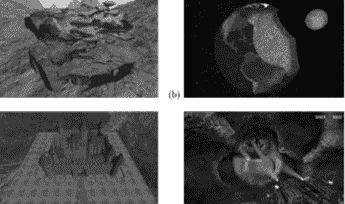

**图 3.1：** 体积表示可用于多种不同类型的环境。在 (a) 中，我们看到一个具有两个主要层级和众多悬伸部的复杂地形 [5]。(_图片由 Thomas Schöps 提供。_) (b) 中的地球被切开，以说明内部也建模了 [15]。由多种不同材料组成的人造结构 (c) 也可以表示 [15]，而 (d) 显示一艘采矿飞船位于小行星内部，并正在实时将其摧毁 [8]。(_图片由 Keen Software House 提供。_)

[1] 虽然基于本文所述的概念，_蠕虫_ 实际上使用的分辨率远低于我们在此展示的体积，但允许晶格变形以实现其所需的艺术风格。

### 3.2 概述

我们系统中的核心数据结构是体积。体积是一个规则的三维值网格，每个值称为一个体素。从概念上讲，这类似于位图图像是一个规则的二维像素网格。也可以将体积视为由若干相互堆叠的二维切片组成。如图 3.2(a) 所示。我们将单元定义为一组八个相邻体素形成的立方体，如图 3.2(b) 所示。

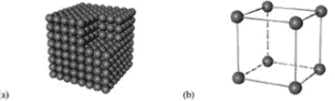

**图 3.2：** (a) 该体积由一个 8x8x8 的体素网格组成，尽管实际体积要大得多。角部被切开，以展示体素如何建模物体的内部。(b) 每组 2x2x2 个体素形成一个单元。请注意，体素和体积是我们系统中唯一显式存储的类型，因为边和单元是隐式构造，我们通过查看体素的邻居来构建它们。

体积的大小和位置设置为覆盖我们希望表示的整个虚拟环境。然后每个体素对其位置处存在的内容进行编码。构成体素的确切数据将在稍后讨论，但目前可以将其视为一个单一位，指示该位置是固体材料还是空空间。自然地，这种表示在实时中非常容易修改，因为添加或移除材料仅仅变成设置体素值的问题。这比其他表示可能需要的复杂 CSG 操作要容易得多。

虽然直接渲染此类体积是一个活跃的研究领域 [12]，但现代 GPU 硬件高度调优以高效渲染三角形网格。因此，尽管体积表示对于编辑和变形环境非常有用，但将其转换为三角形网格以用于可视化是可取的。

此过程称为表面提取，有许多算法能够执行此操作。行方块算法 [7] 是最早且最广泛使用的算法之一——它因其简单性、执行速度和良好的引用局部性而受欢迎。后续发展解决了原始算法中的歧义，绕过了（现已过期）专利问题，或提供了自适应三角化。

行方块算法一次处理一个单元。对于单元的每个角，它根据体素的值将其分类为表面内部或外部。这会产生 256 种可能的组合，可分组为图 3.3 所示的 18 个等价类。每个类代表一组旋转对称的情况，某些类还包括反向情况。图 3.3 中的最后三个类是原始行方块算法的补充，必须使用它们代替反向三角形，以避免出现空洞。

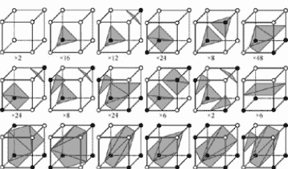

**图 3.3：** 行方块算法针对 18 种可能的单元配置生成的三角形集合。数字指示每种配置出现的次数。实心圆表示包含固体材料的体素，而空心圆表示包含空空间的体素。在大多数情况下，反向配置生成相同的三角形集合，最后三种情况除外（它们是早期情况的反向，但使用不同的三角形以避免空洞）。

使用查找表将体素组合映射到局部表示表面的特定三角形集合。此过程应用于体积中的每个单元（尽管具有相同体素值的单元不生成三角形，可以轻易跳过），以重建完整表面。我们不会详细描述此过程，因为现有文献已对此进行了充分覆盖，并且网上有许多实现可供使用。

### 3.3 数据结构

在掌握核心原理后，现在可以仔细考虑我们体积表示中涉及的数据结构。

虽然如前所述，每个体素可以由一个简单的内部/外部位表示，但这在实践中并不提供太多灵活性。相反，我们的引擎为每个体素存储一个 8 位 *材质 ID*。值 0 表示空空间，而每个非零值中的 255 个值代表一种不同的材质（岩石、土壤、木材等）。自然地，这些材质中的每一种都会有不同的视觉外观，但也可以为它们附加不同的物理属性（例如，有些可能在游戏中无法被摧毁）。此材质 ID 稍后将传递至图形管线，用于着色计算。

此外，在对单元角进行分类时使用简单的内/外决策，往往会导致具有非常锯齿状外观的网格。取决于应用程序（当然在地形的情况下），将此二进制体积替换为 *密度场* 可能很有用。在这种情况下，我们为每个体素分配一个数值，并将我们环境的表面定义为所有具有特定 *等值* 的点集合。在对给定单元运行行方块算法时，我们将每个角分类为高于或低于等值，并使用线性插值将任何生成的顶点定位在边缘上的正确位置。[2]

使用密度场而非二进制体积意味着对网格形状拥有更多控制权。通过修改体素值，使得等值不正好位于它们之间，生成的顶点可以被推向更靠近一个体素或另一个体素。其结果是生成的网格往往更加平滑。


定义了体素的内容后，我们现在可以创建一个由它们组成的三维网格来形成我们的体积。一种天真的方法是存储一个简单的三维体素数组，使它们在内存中形成连续布局。然而，基于目前所了解的内容，我们可以概述一些希望我们的体积数据结构所表现出的理想属性：

- **压缩。** 每个体素使用两个字节（用于材质 ID 和密度）意味着使用简单的连续方法，我们的体积将占用 2×width×height×depth 字节的内存。这对于合理大小的体积来说很快就变得不可接受，因此最好使用一种利用体积通常表现出的高空间连贯性的数据结构。

- **快速读取访问。** 这对于高效实现表面提取算法至关重要，同时也对于直接针对体积（而不是提取的网格）实现拾取和碰撞检测至关重要。

- **快速写入访问。** 允许实时修改体积是我们系统的核心要求之一。为此，我们需要允许快速修改体素。虽然像八叉树这样的结构可能非常适合满足我们的压缩要求，但它可能具有更高的修改开销，因为更改可能需要向上传播到树中。

- **快速访问邻居。** 运行 Marching Cubes 算法时需要访问体素的邻居（因为该算法按单元操作），同时也用于直接从体积数据计算表面法线（参见第 3.4 节）。为此，我们希望使我们的数据结构对缓存友好，这样空间上相近的体素在内存中也可能相近。

关于满足上述要求的存储技术，已有大量研究，但我们选择使用 Grimm 等人 [1] 提出的方法。基本上，体积被分解为一组立方体块，体积被表示为指向这些块的引用计数指针列表。参见图 3.4。

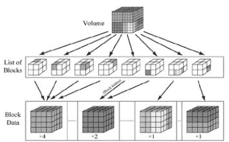

图 3.4：图顶部的 8×8×8 体素体积包含四种不同的材质 ID，由颜色表示（参见随附光盘上的图）。它被分割为 8 个块，每个块的尺寸为 4×4×4 体素。四个顶部块和两个左下角块（其中一个在后面被隐藏）是同质的，因此可以共享实际数据的副本。引用计数在图底部指示。仅对八个块中的四个块显式存储块数据，在这个过于简单的示例中为我们节省了 50% 的内存。

该系统中的压缩之所以产生，是因为如果两个块具有相同的内容，我们就可以让块列表中的两个条目都指向相同的块数据。这在完全同质的块中经常发生。当然，两个异质块也可能碰巧相同，但这种情况足够罕见，不值得为此检查所涉及的计算开销。

一个显而易见的问题是，我们为什么要费心存储同质块，而不只是设置一个标志来指示它是同质的，然后存储其值。这是一种完全有效的方法，确实能节省更多内存，但这意味着每次访问体素时，我们都必须添加一些额外逻辑来确定是应该遵循指向某些块数据的指针，还是直接使用同质值。

我们的系统在访问体素时增加了一层额外的间接性，因为我们必须首先确定体素位于哪个块中，遵循指针，然后访问体素。然而，我们也已经强调了快速访问邻近体素的重要性，这些邻近体素也很可能位于同一个块中。因此，我们发现引入体积采样器对象的概念很有用，一旦指向某个体素，它就会缓存块查找，以加快对其局部其他体素的访问。

在写入体素时，有几种需要注意的场景。首先，我们正在写入的块可能当前是共享的。我们必须检查块的引用计数，并在必要时复制数据。其次，修改数据的行为可能导致块变得同质，因此有资格共享。验证这一点成本高昂，因为这可能涉及读取和比较块中的每个体素。因此，我们改为将块标记为可能同质，并提供一个垃圾回收例程，可以在有空闲处理时间时调用（例如，CPU 正在等待其他任务而停滞）。

最后，我们需要小心选择合适的块大小，有几个因素可能会影响这一点：

- 较小的块更有可能是同质的，因此更有可能被共享。另一方面，这意味着块的数量会更多，因此块列表会更长。这对内存使用的影响可以在表 3.1 中看到。

- 较大的块在块面上的体素比例更小。这意味着体积采样器更有效，因为在体素邻域操作期间，它不太可能需要查看邻近块。

- 块的边长必须是 2 的幂，以便允许使用位操作实现寻址操作。

- 块应该足够小，以适应 CPU 缓存。

表 3.1：存储示例体积所需的内存与块大小。

| 体积 | 尺寸 | 未压缩内存 | 块大小 | 块数量 | 压缩内存 |
|---|---|---|---|---|---|
| Castle | 256×256×256 | 16 MB | 16×16×16 | 4096 | |
| Castle | 256×256×256 | 16 MB | 32×32×32 | 512 | |
| Castle | 256×256×256 | 16 MB | 64×64×64 | 64 | |
| Mountain | 512×512×256 | 64 MB | 16×16×16 | 16384 | |
| Mountain | 512×512×256 | 64 MB | 32×32×32 | 2048 | |
| Mountain | 512×512×256 | 64 MB | 64×64×64 | 256 | |
| Earth | 512×512×512 | 128 MB | 16×16×16 | 32768 | |
| Earth | 512×512×512 | 128 MB | 32×32×32 | 4096 | |
| Earth | 512×512×512 | 128 MB | 64×64×64 | 512 | |

考虑到上述约束，Grimm 等人发现 32×32×32 的块大小提供了最佳的整体性能。表 3.1 中的实验结果表明，在这种情况下我们可以期望大约 70% 的压缩率。

[2] 我们引擎的当前版本不为每个体素使用密度值（仅使用材质 ID）。这是因为我们一直专注于表示地形以外的其他结构。然而，我们的代码库有一个分支 [5]，其中添加了此功能。

### 3.4 表面提取

我们已经介绍了 Marching Cubes 算法的原理（我们建议读者查阅 [7] 以获取更详细的解释）。在本节中，我们将探讨针对我们特定应用实现该算法的一些实际问题。这些包括：

- 允许实时修改数据，并智能地重新生成修改部分的表面，而无需再次在整个体积上运行算法。

- 以适合 GPU 渲染或进一步处理的格式输出生成的表面网格。

为了帮助实现上述目标，我们将体积分解为相邻且不重叠的立方区域。这意味着每个单元只属于一个区域，但区域面、边或角上的体素也属于邻近区域。这些区域中的每一个都分配了单独的顶点和索引缓冲区，以存储与该区域中包含的表面相对应的网格数据。此外，每个区域都保留一个脏标志，指示缓冲区中的三角形数据是否与该区域的当前体积数据匹配。

虽然这听起来可能与前面讨论的分解为块相似，但重要的是要认识到区域和块这两个概念服务于完全不同的目的。块是一种数据表示，用于提供对体素的高效存储和快速访问，而区域用于将 Marching Cubes 算法的执行限制在体积已更改的部分，也用于可见性剔除。

在将体积设置为初始值后，执行 Marching Cubes 算法以更新每个区域的网格数据，并清除脏标志。进一步尝试写入体积


导致包含受影响体素的区域被标记为脏。会执行一个简单的检查，以确保体素不会被设置为其当前值。另外，请记住，大多数体素只属于一个区域，但位于区域面、边或角上的体素也会被相邻区域共享。因此，修改单个体素可能导致设置多个脏标志。

任何脏区域都需要重新生成其网格，但这不应立即发生，因为这是一项开销较大的操作，而且很可能其他附近的体素（可能在同一区域内）也将因用户的当前操作而即将更新。重新生成应推迟到当前帧的所有体积修改完成后再进行。

与块大小一样，在选择适当的区域大小时，需要考虑多个因素：

- 较小的区域意味着更多的区域，从而导致更高的批次数量。对于包含表面的每个区域，我们至少生成一个批次（如果按第3.5.2节所述拆分材质，则可能生成多个批次）。批次数量是现代GPU性能的限制因素之一。
- 较小的区域提供了更精细遮挡剔除的机会（参见第3.5节）。
- 较小的区域通常会更紧密地包围体积的修改部分，这意味着Marching Cubes算法需要处理的单元更少。
- 较大的区域重新生成所需时间更长。
- 较大的区域可能包含超过65,536个顶点，这将需要32位索引。这会带来一些内存开销，并且可能在旧硬件上不受支持。
- 将区域大小与块大小匹配，可以更容易地以缓存友好的方式实现Marching Cubes算法。

作为指导原则，我们将体积分解为 8x8x8=512 个区域。

除了生成顶点位置外，我们还需要顶点法线来执行着色计算。已知有几种方法[17]可以从网格数据计算这些法线，但这些方法在区域边界上可能存在不匹配问题。另一种方法是通过计算梯度向量，直接从体积数据生成法线。

可以使用中心差分算子[12]来近似梯度向量。对于位于整数位置(x,y,z)的体素，可以通过检查相邻体素的密度值来找到中心差分梯度，如下所示：

```
\nabla f(x,y,z) = \frac{1}{2} \begin{bmatrix} f(x+1,y,z)-f(x-1,y,z) \\ f(x,y+1,z)-f(x,y-1,z) \\ f(x,y,z+1)-f(x,y,z-1) \end{bmatrix}
```

如果需要更平滑的梯度，则可以改用Sobel算子[12]，但一般来说，中心差分算子足以满足我们的目的。体积中任意点的梯度可以通过插值相应单元角点的梯度来找到。在给定顶点位置查找梯度时，一维插值就足够了，因为生成的顶点始终位于单元边上。

#### 3.4.1 算法输出

对于每个区域，算法生成一对顶点缓冲区和索引缓冲区。如果区域不包含表面，则缓冲区将为空，无需上传到GPU。如前所述，索引可能是16位或32位，具体取决于顶点数量，顶点包含以下信息：

```
struct Vertex
{
    float position[3];
    float normal[3];
    float materialId;
    float alpha;
}
```

材质ID存储为浮点数，以兼容Shader Model 3.0硬件。如果您面向更现代的GPU，则可能希望使用整型来直接作为纹理数组的索引（参见第3.5.1节）。Alpha值用于在不同材质之间进行混合，将在第3.5.2节中进一步讨论。

虽然我们尚未实现此功能，但在渲染由缓冲区表示的几何体时，一种有用的优化是调整原始体的渲染顺序，以有效利用GPU顶点缓存。空间上相互靠近的原始体在缓冲区中也应相互靠近，这样在渲染时，缓存的顶点更有可能被重复使用，而不是执行顶点着色器。

Nvidia和ATI都为此任务提供离线工具，但我们需要一种能在运行时生成的网格上快速运行的东西。对此有一些可能的候选方案[16]，但它们的性能是否足以满足我们的应用程序还有待观察。

## 3.4.2 细节层次

改善系统渲染性能的另一重要技术是实施某种细节层次（LOD）机制，使得远离摄像机的区域使用的三角形比靠近摄像机的区域更少。

在我们的引擎中，我们直接在体积上实现了LOD，而不是在生成的三角形表面上。也就是说，我们构建了一个mip金字塔，其中每个级别的宽度、高度和深度都比下一级的一半。（这在概念上类似于显卡上使用的纹理mipmap。）我们保持相同数量的区域，使得金字塔中每个区域的尺寸也比其前身的一半。

然后，我们根据区域距离摄像机的距离在适当的mip级别上运行表面提取。随着摄像机移动，区域可以在不同分辨率下重新生成其表面，之前的表面要么被丢弃，要么被缓存以供以后可能使用。处理后台自动重新生成的线程系统将在第3.4.3节中讨论。

要实际生成mip金字塔，需要能够从前一级mip级别的八个体素中推导出体素的值。如果我们存储体素的密度分量，则可以简单地对它们求平均。如果我们存储材质ID，则对其求平均没有意义（两种不同材质的组合应该是其中一种，而不是第三种材质）。在我们的系统中，我们取最小值，尽管也可以选择出现频率最高的值（统计众数）。

我们LOD机制的一个缺点是，使用不同LOD级别的相邻区域之间往往存在相当大的裂缝。这是地形渲染中的经典问题，在2D高度图场景中已成为大量研究的焦点，但在三维中要困难得多。Lengyel [6] 使用了一套更复杂的等价类解决了这个问题，在生成三角形时同时考虑高分辨率和低分辨率数据。

除了上述离散LOD系统外，我们还有一个基于[11]和[18]工作的渐进式LOD系统的早期版本。它只不过是对这些论文中描述的技术的原始实现，例外是我们修改了边坍缩启发式，使其不坍缩位于材质边界或区域边界上的边。这消除了区域之间的裂缝，但该系统比离散LOD方法慢得多。特别是，使用渐进式系统生成低细节层次网格所需的时间至少与生成高分辨率网格所需的时间一样长，再加上执行简化所需的时间。相比之下，我们当前的离散方法生成低LOD所需的时间远少于高LOD。

## 3.4.3 算法多线程

交互式体积编辑对于让设计师构建他们的3D世界至关重要，在我们的引擎中，我们也喜欢将其视为一种游戏性功能。因此，必须尽快重新生成脏区域的表面。高效地对算法进行多线程处理，在帮助我们实现这一目标方面大有裨益。

我们的系统如图3.5所示，其工作原理如下。我们的主游戏线程处理逻辑和渲染，并且是唯一对体积具有读写权限的线程。体素根据用户输入和游戏内事件进行修改，并设置区域的脏标志。我们定期收集脏区域，并用区域、所需的LOD级别和优先级填充一个简单的`TaskData`结构。此优先级基于区域距离摄像机的距离，因此附近的区域会更早重新生成。任务数据被添加到需要处理的任务优先级队列中。如果任务已经在队列中，则无需再次添加，因为相应的区域已经计划进行更新。


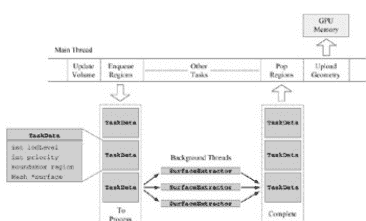

图 3.5：少量后台线程持续处理已修改区域的队列并重新生成表面几何体。主线程检索结果并将几何体上传到 GPU。

少量（1–4 个）表面提取线程在后台运行，等待优先级队列中包含待处理的任务数据。当 `TaskData` 实例可用时，表面提取线程会将其从优先级队列中移除，并在其指定区域上执行 Marching Cubes 算法。如果需要其他网格处理任务（例如法线计算（第 3.4 节）或按材质拆分（第 3.5.2 节）），则这些任务也由表面提取线程执行。生成的顶点和索引缓冲区对随后被分配给 `TaskData` 实例，该实例又被添加到已完成任务队列中。

主线程是唯一能够将数据复制到 GPU 的线程（至少在当前一代硬件上），因此它负责从已完成任务队列中移除项目并将其上传到显卡。信号量用于控制对队列的访问并提供线程同步。

为了说明我们多线程表面提取器的性能表现，我们使用一到四个线程分别对三个测试体积中的每一个运行了表面提取器。在每种情况下，我们都测量了实际用于执行表面提取的时间。执行其他任务（例如从磁盘加载体积和将网格上传到 GPU 内存）所花费的时间未包含在这些结果中，如表 3.2 所示。

表 3.2：我们多线程表面提取器的一些典型计时（四核 2.33 GHz CPU，2 GB 内存）。

| | 线程数 | 线程 1 时间 (ms) | 线程 2 时间 (ms) | 线程 3 时间 (ms) | 线程 4 时间 (ms) | 平均时间 (ms) | 时间总和 (ms) |
|---|---|---|---|---|---|---|---|---|
| 城堡 | 1 | 1094 | - | - | - | 1094 | 1094 |
| | 2 | 501 | 589 | - | - | 545 | 1090 |
| | 3 | 360 | 439 | 344 | - | 381 | 1143 |
| | 4 | 281 | 280 | 265 | 322 | 287 | 1148 |
| 山脉 | 1 | 5292 | - | - | - | 5292 | 5292 |
| | 2 | 2717 | 2683 | - | - | 2700 | 5400 |
| | 3 | 1960 | 1888 | 1955 | - | 1912 | 5736 |
| | 4 | 1438 | 1340 | 1314 | 1518 | 1402 | 5610 |
| 地球 | 1 | 9062 | - | - | - | 9062 | 9062 |
| | 2 | 4439 | 4455 | - | - | 4447 | 8894 |
| | 3 | 2926 | 3063 | 3045 | - | 3011 | 9034 |
| | 4 | 2549 | 2501 | 2510 | 2537 | 2524 | 10097 |

从这些数据中可以观察到几点。首先，我们可以看到，当多个线程运行时，工作负载在它们之间被相当均匀地分配。直接结果是，随着线程数量的增加，线程中花费的平均时间会减少。这并不完全是线性关系，但非常接近，如“平均时间”列所示。其次，我们可以看到，重新生成一个区域（所有这些情况均为 64×64×64）的时间始终在 20 ms 左右。这意味着我们通常预计在修改发生后 1–2 帧内获取修改结果，并且这使得 64×64×64 成为我们可用于实时修改的最大区域大小。最后，我们看到处理完整体积所需的时间通常只有几秒钟。

## 3.5 渲染

出于渲染目的，我们使用区域的几何体作为叶节点构建包围体积层次结构。每个叶片几何体的包围盒最大为区域大小，但通常更小，且将包围盒裁剪到实际网格大小所需的工作量相对较小。层次结构中的每个内部节点均由其下方的八个节点构建。

由于我们的环境具有高度动态的特性，我们不执行任何预计算可见性计算。可见性剔除目前通过将视锥与包围体积层次结构相交来简单处理，并渲染每个其包围盒至少部分位于内部的几何体。这是一种剔除大量几何体的快速高效方法，但对于深度复杂度高的场景来说，它不是最佳解决方案。对于这些场景，我们正在研究使用图像空间方法（例如连贯层次剔除 [4]），但我们尚不清楚这些方法的表现如何。

光照和阴影算法也是完全动态的，因为随时修改体积的能力使得使用预计算照明变得非常困难。用于光照的法线通常与顶点一起提供（如第 3.4.1 节所讨论），但在某些情况下可以实时生成它们。迄今为止，我们只应用了局部光照模型，但当前关于实时全局光照的一些研究也可能适用。流行的阴影映射算法的许多变体之一可用于生成实时动态阴影。

### 3.5.1 材质系统

渲染表面时，几乎总是希望通过纹理映射为对象提供额外的表面细节。实时生成几何体的一个关键问题是，艺术家没有机会定义指定这些纹理图应如何应用的 UV 参数化。相反，我们需要一种自动生成纹理坐标的方法。

最有用的方法之一（由 Nvidia 在其 Cascades 演示 [3] 中实时演示）称为 *三平面纹理*。这在片段着色器中执行，并使用从表面法线推导的混合权重来在沿 x、y 和 z 轴投影的三个纹理之间进行插值。也就是说，第一个纹理使用片段世界空间位置的 (y z) 分量进行采样，并由法线的 x 分量调制；第二个纹理使用片段世界空间位置的 (x,z) 分量进行采样，并由法线的 y 分量调制，以此类推。片段的世界空间位置可以通过从顶点插值来确定，法线向量的分量可以通过平方使其和为一。清单 3.1 中的 Cg 片段着色器代码片段演示了此过程。

**清单 3.1：** 三平面纹理可以将纹理投影到任意几何体上。此代码接收纹理、法线和世界位置作为输入并计算结果颜色。请注意，为了保持纹理手性，每当主导法线分量为 -x、+y 或 -z 时，必须对其中一个 UV 坐标取反。在使用法线贴图时这尤其重要，但为简单起见未显示。

```
// Interpolation means normals may not be unit length
normal = normalize(normal);

// Squaring a unit vector makes the components add
float3 blendWeights = abs(normal * normal);

// For each axis, sample the texture and multiply by
float4 colorMapValueYZ = tex2D(colorMapX, worldPos.
float4 colorMapValueXZ = tex2D(colorMapY, worldPos.
float4 colorMapValueXY = tex2D(colorMapZ, worldPos.
// Combine the results
float4 colorMapValue = colorMapValueXY + colorMapValueXZ;
...
```

三平面纹理应用于地形时效果特别好，并且在使用自然纹理（岩石、草地等）时也效果良好。它对包含锐利边缘或其他高频细节的人造纹理响应不佳，因为这些纹理彼此不易融合。此想法的变体也是可能的，例如使用六个纹理而不是三个，或为所有四个侧面使用一种纹理，为顶部和底部使用不同的纹理。

另一种方法是直接使用法线查找立方体贴图纹理。图 3.1(b) 中地球表面即采用了此方法。在此情况下，用于查找的法线是通过将从地球中心到表面顶点的向量归一化来实时生成的。这比使用第 3.4 节方法生成的法线效果更好。

然而，从概念上讲，执行参数化最简单的方法是使用三维纹理坐标。在此情况下，纹理坐标可以直接从片段的世界空间位置推导。由于内存需求高，在 GPU 上存储 3D 纹理很快变得不切实际，但 3D 纹理坐标可以轻松用作过程纹理生成例程的输入。再次参考图 3.1(b)，地球核心中的岩浆是通过在 GPU 上运行多个八度的 Perlin 噪声生成的 [10]。

请注意，无论使用哪种技术生成纹理坐标，仍然可以进行纹理变换。


应用适当的纹理矩阵。

### 3.5.2 使用多种材质

如果我们的体素包含材质 ID，则该 ID 将作为顶点定义的一部分传递给 GPU（参见第 3.4.1 节）。使用此材质 ID 的一种简单方法是识别应应用的纹理（或用于三平面纹理的纹理集）。现代 GPU 通过 _纹理数组_ 为其提供直接支持，_纹理数组_ 允许使用浮点输入的舍入值在纹理数组中索引单个 2D 纹理。旧硬件可以使用 _纹理图集_ [14] 获得类似结果，但当纹理重复时，必须采取特殊措施以避免过滤伪影。

虽然原则上很简单，但如果希望从一种材质平滑过渡到另一种材质，则需要注意一些额外问题。例如，位于两种或多种材质边界上的三角形，其每个顶点的材质 ID 都不同。在三角形表面简单插值这些材质 ID 是没有意义的，因为这会产生在三个顶点中都不存在的值。

在我们的系统中，我们通过将输入网格拆分为两部分来处理此场景。生成的网格之一仅包含每个顶点材质相同的三角形（我们将这些称为 _均匀_ 三角形）。另一部分 _非均匀_ 三角形被替换为每个顶点材质 ID 为零的新三角形。在着色过程中，我们通过将纹理图集的第零个槽设置为黑色，或在片段程序开头放入显式检查并返回，来确保材质零绘制为黑色。

拆分程序生成的第二个网格包含非均匀三角形。实际上，每个非均匀三角形都会被复制三次 [3] 以创建三个均匀三角形，每个非均匀版本中的材质各一个（参见图 3.6）。我们设置顶点的 alpha 值，使一个角完全不透明，而另外两个角完全透明。

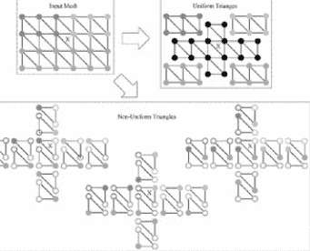

图 3.6：包含多个材质 ID（由不同颜色表示，参见随附光盘上的图）的单个输入网格被拆分为两个网格。在均匀三角形网格中，所有组件在空间上相邻，仅在图中拆分以帮助可视化。在非均匀三角形网格中，三个部分相互叠绘制，以便 alpha 值正确混合。

渲染过程首先绘制均匀三角形，并将混合模式设置为替换帧缓冲区的当前内容。除了绘制均匀三角形外，这还可确保非均匀三角形后面的背景设置为黑色。然后将混合模式设置为与现有帧缓冲区内容进行加法混合，并绘制包含非均匀三角形的网格。这会产生从一种材质到另一种材质的平滑过渡。如果我们跟踪图中标记为 X 的单个三角形，可以看到它首先被绘制为黑色，然后再次使用每种材质绘制一次。

请注意，材质边界上的三角形复制目前是在网格由 Marching Cubes 算法生成后在 CPU 上执行的。这样做是为了与旧硬件兼容，但调查是否可以改为在更现代的 GPU 上由几何着色器处理将很有趣。

材质 ID 所代表的材质可能不仅在应用的纹理上有所不同。事实上，某些材质的整个着色器和/或管线状态可能需要不同。图 3.1(b) 再次是一个很好的示例，因为它对地球表面使用立方体贴图投影，对岩石使用三平面纹理，对岩浆使用 GPU Perlin 噪声。

如果单个区域对应的网格确实需要容纳如此多样的材质范围，则我们将网格拆分为多个部分，最多拆分为不同材质的数量。例如，如果网格包含三种不同的材质，其中两种基于三平面纹理，第三种是过程生成的，则我们拆分第三种材质的顶点，但将前两种材质保留在同一网格中。然后我们使用三平面纹理着色器（根据材质 ID 在纹理之间选择）渲染第一个网格，并使用过程着色器渲染第二个网格。这种按材质拆分是在前面描述的用于材质间混合的拆分之外进行的。这意味着，如果区域包含 n 种不同的材质，则在所有拆分完成后，它最多可能最终变为 2n 个部分。然而，这是最坏情况，在实践中，许多区域的网格根本不需要拆分。

我们的系统在此受益于基于 Ogre3D 图形引擎 [9] 构建，因为我们可以简单地将网格传递给 Ogre 的渲染队列，并按纹理更改、渲染状态更改等进行排序，这些都会自动处理。大多数图形引擎都会提供类似的功能。

[3] 实际上这里还有改进空间，因为包含两种材质的三角形只应复制两次，而不是将所有非均匀三角形都复制三次。我们打算更改这一点，因为由三种不同材质组成的三角形非常罕见，因此目前生成了大量额外三角形来支持这种最坏情况。

## 3.6 物理

将物理解决方案（在我们的例子中是 Bullet [2]）集成到我们的引擎中相对简单，因为在大部分情况下，Marching Cubes 算法生成的几何体可以像其他几何体一样处理。每个区域都从顶点缓冲区和索引缓冲区构建一个物理网格，我们用于视锥体剔除的相同包围体层次结构可用于宽相碰撞检测。

在模拟过程中，我们发现三角形的数量确实给物理系统带来了很大压力，对于尺寸超过约 256³ 的体积，有效的 LOD 系统变得至关重要（当然，这因体积的复杂性而异）。由于第 3.4.2 节讨论的 LOD 级别对齐不匹配问题，我们现有的 LOD 系统对此目的并不特别适合。简化原始高分辨率网格可能是这里的一个改进。

随着体素的移除动态更新网格比最初预想的要简单得多。在模拟时间步骤之间简单地用一个网格替换另一个网格似乎对物理引擎没有任何问题。动态添加体素要复杂得多，因为对象可能会突然发现自己正在穿透之前并不靠近的表面。需要更多工作来决定如何或是否最好处理这种情况。

值得注意的另一点是，虽然目前所有碰撞检测都是针对表面网格进行的，但有可能直接针对体素体积进行碰撞检测。命中测试和拾取目前以这种方式进行，测试一个点是否在对象内部变成了检查该位置处体素值的简单情况。

## 3.7 未来

本章描述的大多数技术已在我们的实验性 Thermite3D 游戏引擎 [15] 中实现，除了“密度体素”外，它们可在 _Forever War_ 衍生项目 [5] 中使用。这些技术适合集成到运行在当前一代硬件上的其他游戏引擎中。然而，我们的项目目前处于早期阶段，我们希望在不久的将来添加许多功能。

首先，我们希望增加可加载和渲染的体积大小。这将需要对我们的 LOD 系统进行进一步工作，特别是为了确定渐进式 LOD 方法与当前离散系统相比如何。其次，我们希望调查使用流式传输作为减少一次内存中数据量的机制。我们当前的块体积结构可能为此提供坚实基础，因为块可以以压缩格式存储在磁盘上，并按需加载到内存中。我们还可能希望将块保存回磁盘，以便对环境所做的更改可以持久化。

此外，我们需要考虑 _内容创建_ 问题。目前我们有工具可以将现有高度图转换为体积表示，以便它们可以实时销毁，我们还有一个工具可以将标准 3D 建模包中的三角形网格转换为体积（例如，这用于创建图 3.1(c) 中的城堡）。但程序生成环境有很大潜力，例如由 Perlin 噪声构建的地形，并使用 Voronoi 单元构建地下洞穴网络。

还需要考虑如何将体积环境的使用作为游戏玩法元素。响应爆炸破坏环境部分的能力是一个明显的例子，但该表示也自然适合


允许环境的部分被缓慢侵蚀，或许是对火或酸的响应。如果游戏场景需要，也可以缓慢地将几何体修复回其初始状态。最后，开发一个强大且直观的编辑界面也可能有助于其作为游戏玩法设备的采用。

最后，如果我们超越自身项目来看，值得注意的是关于渲染此类环境的其他方法有大量研究。id Software 可能是其中最知名的，有传言称“稀疏体素八叉树”（Sparse Voxel Octree）被用于在其 id Tech 6 引擎中表示几何体 [13]。随着 GPU 变得越来越通用，实现其他体积渲染方法（如射线投射或点溅射）变得切实可行。目前，本章描述的表面提取方法是唯一在实际游戏中得到应用的方法，但未来将如何发展，拭目以待。

## 致谢

我要感谢 Matthew Williams 和 Jaz Wilson 对 Thermite 3D 引擎的贡献，以及 Ogre3D 和 Bullet 的开发者提供了宝贵的库。Thomas Schöps 和 Marek Rosa 授权在本文中使用他们的图片，而 Tobias Tropper 对本文早期版本提供了有用的反馈。

## References

- [1] Sören Grimm, Stefan Bruckner, Armin Kanitsar, 和 Meister Eduard Gröller. "加速体积射线投射的精细数据寻址与处理方案". Computers & Graphics, 第 28 卷, 第 5 期 (2004 年 10 月), 第 719–729 页. http://www.cg.tuwien.ac.at/research/publications/2004/grimm-2004-arefined/
- [2] Erwin Coumans. Bullet 物理库. http://bulletphysics.com/
- [3] Ryan Geiss 和 Michael Thompson. "NVIDIA 演示团队秘密——级联", 游戏开发者大会 2007. http://developer.download.nvidia.com/presentations/2007/gdc/Casc...
- [4] Oliver Mattausch, Jiří Bittner, 和 Michael Wimmer. "CHC++：重新审视连贯层级剔除". 计算机图形学论坛 (Eurographics 2008 论文集), 第 27 卷, 第 2 期 (2008 年 4 月), 第 221–230 页. http://www.cg.tuwien.ac.at/research/publications/2008/MATTAUSC2008-CHC/
- [5] Thomas Schöps 和 Oliver Schneider. 永恒战争. http://foreverwar.sourceforge.net/
- [6] Eric Lengyel. "面向实时虚拟仿真的基于体素的地形". 博士论文, 加州大学戴维斯分校, 2010.
- [7] William E. Lorensen 和 Harvey E. Cline. "Marching cubes：一种高分辨率 3D 表面构建算法". ACM SIGGRAPH 计算机图形学, 第 21 卷, 第 4 期 (1987 年 7 月).
- [8] Keen Software House. 矿工战争. http://www.minerwars.com
- [9] Steve Streeting. 面向对象图形渲染引擎. http://www.ogre3d.org
- [10] Simon Green. "实现改进的 Perlin 噪声". GPU Gems 2, Addison-Wesley, 2005. http://http.developer.nvidia.com/GPUGems2/gpugems2_chapter26
- [11] Stan Melax. "一种简单、快速且有效的多边形简化算法". 游戏开发者杂志, 1998 年 11 月. http://www.melax.com/polychop
- [12] Klaus Engel, Markus Hadwiger, Joe M. Kniss, Christof Rezk-Salama, 和 Daniel Weiskopf. 实时体积图形. AK Peters, 2006. http://www.real-time-volume-graphics.org/
- [13] Jon Olick. "游戏中的当前一代并行性". 超越可编程着色, Siggraph 2008. http://s08.idav.ucdavis.edu/olick-current-and-next-generation-parallelism-in-games.pdf
- [14] Nvidia. "使用纹理图集改进批处理". 2004 年 7 月. http://http.download.nvidia.com/developer/NVTextureSuite/Atlas_T
- [15] David Williams. Thermite3D 游戏引擎. http://www.thermite3d.org/
- [16] Gang Lin, 和 Thomas P.-Y. Yu. "3D 网格渲染的改进顶点缓存方案". IEEE 可视化与计算机图形学事务, 第 12 卷, 第 4 期 (2006 年 7 月). http://www.ecse.rpi.edu/~lin/K-Cache-Reorder/
- [17] Shuangshuang Jin, Robert R. Lewis, 和 David West. "顶点法线计算算法比较". 可视化计算机, 第 21 卷, 第 1–2 期 (2005 年 2 月), 第 71–82 页. http://www.tricity.wsu.edu/cs/boblewis/pdfs/2003_vertnorm_tvc.pdf
- [18] Tom Forsyth. "VIPM 方法比较". 游戏编程宝典 2, Charles River Media, 2001. http://home.comcast.net/~tom_forsyth/papers/gem_vipm_webvers
- [19] "虚拟地形项目". http://www.vterrain.org/

## 第4章：高级寻路

Daniel Higgin
Lunchtime Studios, LLC

### 概览

当今玩家对寻路要求极高。如果不出色，就不要发布。否则，就要做好愤怒玩家手持火把和长叉，冲击开发者工作室的准备。简而言之，寻路是游戏中最重要的技术之一，尤其是在即时战略类游戏中。除了追求完美的压力，寻路程序员还需要厚脸皮。这些勇敢的人应该假设，玩家不会称赞寻路，反而会猛烈抨击它。玩家会抓住游戏或 AI 中几乎任何不完美之处，并将其归咎于寻路系统。事实上，他们过去是对的。旧一代寻路引擎导致角色看起来像个笨蛋，因为它们找到的路径并非最优，而且在存在有效路径时，往往根本找不到有效路径。

除了寻路对游戏性的影响，它还对性能有巨大影响。游戏卡顿绝不应该是寻路造成的，但不幸的是，这种情况时有发生。玩家没有意识到的是，在幕后，糟糕的寻路会导致受限的游戏世界。这些限制阻止玩家体验游戏设计师的真实构思，这绝非好事。当然，并非所有类型都需要快速寻路，但对于拥有大型世界或众多角色的游戏，寻路必须准确且经过优化。就像现代软件中许多精心设计的易用性功能一样，用户察觉不到的寻路才是成功的。

优化寻路有很多选择。我们可以优化代码、对寻路计算进行时间分片、重用路径、分组路径，甚至在可能的情况下完全避免寻路。然而，有一项优化真正脱颖而出，那就是减少寻路器所使用的搜索空间。高级寻路是实现这一减少搜索空间的绝佳技术，也是本文的重点。除了大幅提升性能，高级寻路还为我们完善寻路提供了机会。一旦寻路性能不再是问题，我们就可以强制寻路引擎永不放弃，并在存在有效路径时始终找到一条路径。

### 4.1 术语

在深入探讨高级寻路的工作原理之前，让我们先回顾一些术语。

- **角色。** 游戏世界中除氛围渲染外还具有特定用途的任何重要对象。
- **RTS。** “即时战略”的缩写，是一种侧重于单位生产、资源管理，以及对部分游戏而言的战斗的策略游戏类型。其通常较高的角色数量和广阔的世界区域会给传统寻路算法带来压力，这些算法是为较小的数据集设计的。
- **地块。** 世界中的一个方形区域（例如 1 × 1 米），包含该世界空间的属性。在典型的 RTS 游戏中，地块以网格模式布置，并可使用整数坐标定位。
- **路径。** 角色可以合法移动的一系列点，用于从一个位置到达另一个位置。
- **详细路径。** 角色将导航到达目的地的精确地块。该路径避开所有障碍物。
- **路径规则。** 规定给定角色类型移动限制的游戏规则，例如鲸鱼不允许上陆。这些规则确定哪些地块类型对角色的移动是“合法”的。
- **路径区域。** 一组共享相同路径规则的相邻地块。
- **信标点。** 路径区域中最接近区域质心的点。
- **模糊寻路。** 模糊寻路是另一种说法，指高-


层级路径。它表示正在创建一条合法但不够详细的路径，缺少许多让路径看起来良好并避开所有障碍物的移动细节。另一种思考模糊路径的方式是，它表示通过此路线到达目的地有保证的方式，但沿途可能存在一些未知且可通行的障碍物。

- 地形分析。一个用于计算游戏世界知识的术语 [3]。我们计算关于世界的数据，并以一种方式组织它们，使得在游戏内部，寻路器可以近似人类对环境的感知。示例包括计算海洋地块和形状、识别海湾、河流、沼泽地、森林、海滩等。

### 4.2 启动引擎

为了最好地理解本文，路径查找知识并非必需，但强烈建议掌握。本文包含的是高级路径查找系统所需内容的骨架视图。阅读时，至关重要的是要记住，即使有出色的设计师和天才程序员，路径规则也会经常修订以处理特殊情况，直到路径查找完美并发生功能冻结。

诚然，构建高级路径查找系统的最佳方式是使其尽可能通用，并带有已知且隔离的自定义点。这是购买或翻出那些设计模式书籍的绝佳时机。准备好使用诸如工厂、策略、原型和策略等模式。隔离自定义点，因为它们将被频繁修改，我们不希望引擎中充斥着大量特殊情况代码。

## 4.3 为什么需要高级路径查找？

想象我们有一个包含超过一百万个地块的世界。在这个世界中，北方敌方城市的城墙前正激战正酣，如图 4.1 所示。我们的英勇军队正试图武力攻占这座有城墙的城市，但需要增援。让我们通过向北移动一台攻城锤、一名重装步兵和一艘战列桨帆船来帮助我们的军队前往战场。

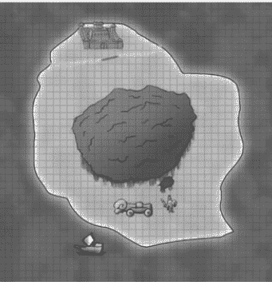

图 4.1：带有地块标记的世界地图。

一百万个或更多地块是一段很长的导航距离，尤其是在有森林和高耸敌方城墙等障碍物的情况下。战斗期间，CPU 很可能正忙于处理动画、弹道、物理、AI 和图形。为军队在巨大地图上计算详细路径的工作将不利地影响游戏性能；然而，如果我们的世界只有几千个地块，我们就可以在对帧率没有任何明显影响的情况下实现这一点。

为了实现这一点，我们需要减少导航地图的搜索空间。高级路径查找通过一个多阶段过程来实现这一点。首先，我们的预处理阶段必须将世界中的每个地块识别为一种且仅一种路径类型。定义这些类型后，我们需要在游戏开始前分析世界并构建地形信息知识库，我们通过执行地形分析 [3] 来完成这一点。第二阶段涉及使用存储在世界知识库中的数据，使用诸如 A* 之类的算法在两点之间找到一条模糊的、不详细的路径。我们的最终阶段涉及行动者细化模糊路径，以规划到达目的地的确切路线。

听起来像是几天以上的工作？应该是这样。实现高级路径查找可能会消耗大量开发时间，但这完全值得。

## 4.4 预处理阶段

预处理阶段有两个主要部分——设计和地形分析。在此阶段的设计部分中，我们专注于识别唯一的路径地块类型。此步骤无需任何编码，并且依赖于对行动者及其移动规则的完全了解。设计师应准备好定义每个行动者规则，例如禁止潜艇接近海岸线，或声明只有忍者可以攀爬城墙。只有当规则对行动者有显著影响时，才需要添加规则。例如，如果在草地上的移动和在沙地上的移动对于所有行动者在路径查找方面都是相同的，那么没有必要将它们定义为不同的区域类型。但是，如果沙地对独轮车是非法的，那么它需要成为其自身的路径类型。

此阶段的最后部分是地形分析，路径区域的创建就在这里进行。为了深入了解地形分析及其众多用途，强烈建议在开始任何实际编码之前阅读“即时战略游戏中的地形分析——隐藏的巨人” [3]。

### 设计时间

在编码之前，将每个地块分类为唯一的路径查找类型至关重要。例如，水地块很少仅仅是一个水地块。给定的水地块最好被归类为河流、海湾、深海或珊瑚礁的一部分。为了识别这些区域，我们确定所有行动者是否对通过或避开该地块有相同的限制。如果任何行动者被设计有修改其穿越该地块方式的约束，我们就创建一个新的路径类型。也许是地形类型的不同，或者可能有针对大型行动者的特殊规则。当这种情况发生时，我们可以将特殊情况规则转换为唯一类型。

让我们看几个例子。在我们向北增援军队的过程中，每个士兵都有非常不同的路径查找限制。我们的规则如下：

- 攻城锤。这个庞大笨重的行动者必须在道路或草地上移动。使这个行动者独特的是，在路径查找时，如果它不介意先攻击它们，它可以穿过敌方城墙和城门。攻城锤在没有使用桥梁的情况下也无法跨越河流。
- 重装步兵。我们的铠甲士兵可以以队形作战，也可以独立充当侦察兵。不受使用马匹的限制，当独自一人时，我们的骑士在需要时可以穿过树林。
- 战列桨帆船。这艘战舰体型庞大，主要用于船对船战斗或从远处轰炸海岸。河流作战不在考虑范围内。即使靠近海岸也可能使其搁浅的风险，因此被禁止。因此，它必须始终待在深水中。

已经，我们可以看到对不同水类型的需求，并认识到需要将城墙、城门、森林和桥梁分离为不同的类型。必须逐一检查每种可以进行路径查找的行动者并确定其移动规则。建立路径地块类型的枚举和计算它们的函数是个好主意，如清单 4.1 所示。

清单 4.1：这是一个用于确定地块路径类型的函数。此处规则的顺序非常重要。这个函数是一个特殊情况，在开发过程中将被频繁修改。

```cpp
namespace PathTileType
{
    typedef unsigned long Type;

    enum
    {
        Unknown = 0,
        Grass = 1,
        DeepWater = 2,
        Forest = 3,
        Wall = 4,
        Gate = 5,
        ShoreLine = 6,
        Shallows = 7,
        Bridge = 8
    };
}

// Helper used to determine a tile's path type.
extern Type ComputeTileType(const Tile *inTile);

// This function takes a tile and determines its path type.
// Every tile must be determined to be of one and only one path type.
PathTileType::Type PathTileType::ComputeTileType(const Tile *inTile)
{
    // Assume asserts for tile validity, etc...
    // Is this a type of water?
    if (inTile->IsWater())
    {
        // Is there a bridge here?
        if (inTile->HasActorTypeOnTile(kActorTypeBridge))
            return PathTileType::Bridge;

        // Is it shallow water?
        if (inTile->GetWaterDepth() <= 1.0)
            return PathTileType::Shallows;

        // Close to shore?
        if (inTile->GetDistanceToShore() <= 2.0)
            return PathTileType::ShoreLine;

        // Must be a deep water tile.
        return PathTileType::DeepWater;
    }
    if (inTile->HasActorTypeOnTile(kActorTypeTree))
        return PathTileType::Forest;
    if (inTile->HasActorTypeOnTile(kActorTypeWall))
        return PathTileType::Wall;
    if (inTile->HasActorTypeOnTile(kActorTypeGate))
        return PathTileType::Gate;
    return PathTileType::Grass;
}
```

注意在清单 4.1 中顺序是重要的。如果一个地块有水，那么知道它是否有桥比知道它是否位于浅水之上更重要。如果桥下的水类型也很重要，类型可以是 BridgeShoreLine 或 BridgeDeepWater。很可能有许多类型的排列组合，但最终，确保每个地块仅属于一种路径地块类型。

在这个阶段很容易过度进行，并不必要地定义相似区域的每一种可能变体，所以要小心。检查以下两种情况之间的差异。如果世界中有两种类型的桥，一座吊桥和一座人行桥，我们是否应该为它们创建唯一的路径类型？吊桥允许大型船只从下方通过，而人行桥则不允许。双方都可以提出论点，但这种情况并不独特到需要用新类型来处理。对于一艘船来说，询问区域包含哪种类型的桥就足够简单了。

为了找到一个需要唯一规则的示例，让我们来看看即时战略游戏《兴衰：文明 at》中梯子的情况。


战争。梯子是可移动的，这意味着它们可以被打包并移动到墙壁的其他部分。梯子也有严格的要求，只允许人类使用。虽然马匹可以冲上斜坡在墙顶战斗，但梯子是严格禁止马匹进入的区域。路径区域也为我们提供了在攀爬前解决在梯子正前方定位角色问题的机会。我们通过将梯子底部前方的一个方块设为一个单方块大小的路径区域来解决这个问题。这确保了角色会先走到梯子前方的方块再进行攀爬。因此，梯子不仅被视为一个独特的区域，还创造了一个单独的路径区域的机会，我们利用它来处理梯子攀爬时的角色定位。

## 地形分析

一旦我们的设计确定，我们就在预处理阶段的下一部分——地形分析中使用它。对游戏世界的了解对AI程序员来说非常有用，而地形分析对于获得这种了解至关重要。它是一组在游戏开始前执行并在运行时进行优化的算法，旨在首先分析，然后组织游戏世界数据。程序员随后会创造性地使用它，以暗示角色对其世界具有类似人类的理解。

路径区域是通过遍历每个方块、进行分类，然后将相邻的方块类型聚集在一起创建的。这些聚集体随后按其路径类型标记，并定义为路径区域。然后有必要提供区域在世界中位置的指示。为了实现这一点，我们将信标点放置在路径区域的质心处。请记住，区域不一定是整齐规整的方块行。一片连通的树林可能像蜘蛛网一样螺旋延伸，里面布满稀疏但相连的树木。因此，区域的真实质心可能是另一个区域内的一个点。在这种情况下，信标点是通过找到我们区域内离该质心最近的点来定位的。

这些区域，或相邻方块的聚集体，对我们来说易于可视化和理解，但存在一个问题：如果路径区域太大，使用A*等算法将难以生成良好的高级路径。考虑一个由环绕岛屿的海洋组成的路径区域。当我们想要将一艘船从世界的一侧绕岛屿移动到另一侧时，我们必须向引擎传达：仅仅因为是同一片海洋并不意味着这是一条简单的路径。如果海洋是一个区域，那么就没有什么可导航的了。底层寻路器会认为其起点和终点在同一区域，因此必定是一条简单路径。事实并非如此。我们希望存在一些区域，能让我们的船绕过岛屿，无论它是不是同一片海洋。做到这一点的关键是使用世界网格划分区域，这实际上将所有区域的大小标准化。

使用我们的路径区域聚集体，其中一些巨大，另一些很小，我们在世界上铺设一个网格。大小区域都会被这个网格细分，使许多区域至少被拆分一次。选择网格大小需要一些实验，很可能是在整个高级寻路系统完成之后。为了有一个起点，让我们使用一个1000 × 1000方块的地图，以及10 × 10的网格分辨率。给定一张只有草地的平坦地图，我们会有许多每个包含100个方块的草地区域。这不是一个激进的大小，而且一百万方块的地图可能不会有更大的区域，但这是一个起点。请务必尝试分辨率数字，根据地图大小、复杂性或性能将其上下调整。另外，将世界网格位置（图4.2中的黑线方块）存储在路径区域中很重要，因为我们以后会发现它有多种用途，例如在模糊寻路阶段或由于世界变化而重新计算路径区域时。

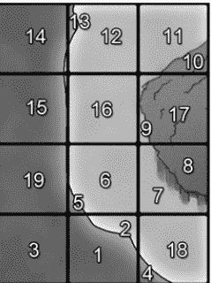

图4.2：带有世界网格叠加和每个路径区域ID的路径区域。请注意世界网格方框内包含多个区域，并且像海洋这样的区域被世界网格分割成许多独立的区域。

我们为什么不直接将分辨率设置得使区域变得巨大呢？如果数字太大，如我们从海洋和岛屿示例中所见，我们将错过一些导航改进和性能提升。这个系统的关键在于先进行高级（模糊）路径，再进行详细级别路径的“一拳”组合。由于详细路径在大搜索空间中计算开销更大，巨大的区域在详细寻路阶段不会为我们节省那么多CPU时间。相反，如果网格强制创建微小区域，那么性能提升会减少，因为搜索空间又会增长。总有一个最佳点——不要低估找到它的重要性。

如图4.2所示，网格展示了我们如何在一定误差范围内预测区域之间的距离。没有区域跨越地图的一半。我们知道最大尺寸，并可以基于这些假设在寻路中进行成本估算。如果一个区域巨大而其他区域很小，就很难知道是在穿越巨大区域的一小部分，还是在穿越其最长可能距离。将路径区域切割成受控网格尺寸，使未知遍历成本低到足以让我们预测路径规划性能影响的近似值。

## 相邻区域

为了使用所有路径区域（如图4.2所示）来导航地图，我们首先需要将它们连接成一个图。这是通过遍历每个方块、查找方块的区域，以及查找方块左、右、上、下的区域来完成的。如果任何一侧的区域与方块的区域不匹配，我们就为两个区域创建一个邻接结构。对于左、右、上、下来说，这相当简单，但我们还需要处理对角连接。

对角连接需要一条特殊的邻接规则，因为穿过它们实际上会遍历相邻方块。请注意图4.3，要从区域2移动到区域1，大多数角色在途中都会部分穿过区域3和4。如果区域3或4对角色无效，则该对角连接必须禁止。由于我们不知道哪些角色会使用该连接，我们需要将它们存储在某处，并在高级寻路期间进行检查。

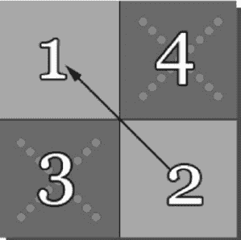

图4.3：区域之间对角连接的示例。

我们不一定总是想要存储对角连接。只有当两个相邻区域之间的唯一连接是通过对角移动时，我们才想要存储它们。由于区域形状可能很不规则，并且与相邻区域有多个连接点，因此从区域2到区域1可能有不止一个对角连接点。我们需要存储每个对角连接实例，以便寻路可以检查边界区域，看移动是否合法。

如果存在非对角连接，则不要保留两个区域之间的任何对角连接。对角连接仅是一种最后的连接情况，因为它们在角色寻路时会考虑周围区域。同样，即使在区域2和区域1之间找到了对角连接，随后又在区域2和区域1之间找到了非对角连接，也必须丢弃对角连接信息。

每个区域应包含每个邻接的结构，如清单4.2所示。

## 清单4.2：区域应包含相邻区域列表

包含指示连接是否为对角连接以及哪些区域与对角连接相邻的数据。

```
struct PathRegionConnection
{
    PathRegionConnection(PathRegionID inToRegion,
                         PathRegionID inDiagonalFirst = kInvalidRegion,
                         PathRegionID inDiagonalSecond = kInvalidRegion);

    PathRegionID mToRegion;
    PathRegionID mDiagonalA; // kInvalidRegionID if
    PathRegionID mDiagonalB; // kInvalidRegionID if
};
```

## 多变的世界

动态世界又该如何处理？当城门倒塌或城墙建起时会发生什么？我们必须将这些变化纳入我们对世界的认知中。在运行时无法避免这一点。为了减少这种重新分析的影响，我们可以利用世界网格。当发生应该影响寻路的世界变化时，我们找到变化发生的世界网格并将其排队等待重新分析。不久之后，我们遍历所有排队的世界网格区域，销毁这些方形区域内的所有旧路径区域，然后重新计算它们。当世界网格被排队等待重新处理时，最好在重新处理前等待几秒钟，因为某个区域建起一堵墙后，很可能很快会接着建另一堵。在建造建筑物时，等待重新处理区域是可以的，但在摧毁建筑物时则不行。想象一下，一架攻城锤撞倒了一堵墙，国王随即下令冲入城市，士兵们开始朝错误的方向行进，因为他们没有意识到墙不再阻挡他们的入侵。这可不好！

使用网格将所有路径区域细分后，如图所示


图 4.2 中，所有相邻区域连接（包括对角线）均已识别，我们可以在模糊路径阶段开始将我们的角色向北移动到战斗中。

## 4.5 模糊路径阶段

我们有一个角色、一个起点和一个终点，现在是寻路的时候了！首先，我们需要确定我们角色的路径区域和目的地的路径区域。然后，我们将这些数据交给一个高级（或模糊）寻路引擎，它计算一系列连接的灯塔点，指示角色必须遍历哪些区域才能到达目的地。幸运的是，如果你熟悉 A*，这并不困难。

模糊寻路引擎的工作方式与低级寻路引擎相同。在 A* 的情况下，算法通过检查相邻区域、计算遍历成本并向外扩散，直到找到路径，从而找到从起点到终点的最低成本路线。有一些重要的区别，但总体而言，A* 引擎设计的大部分可以使用低级 A* 引擎中使用的相同存储机制 [1]、设计 [2] 和优化 [4]。最大的区别在于，路径区域的“邻居”不一定位于路径区域的左、右、上、下和对角线位置。相反，它们是路径区域的所有相邻邻居。可以将区域视为图中的节点，因为给定区域右侧可能包含十个区域，而左侧只有一个。

清单 4.3 演示了 A* 引擎更新，我们看到了 A* 机器 [1] 中使用的邻接迭代循环。我们从当前 A* 节点获取路径区域，遍历其相邻区域，如果 RegionIsOpen() 方法返回 true，那么我们知道我们的角色可以合法地从当前区域移动到相邻区域。如果移动确实合法，那么 CheckNeighbor() 方法计算从一个区域移动到另一个区域的成本，并将该节点放在相应的 A* 列表上。

### 清单 4.3：模糊路径 A* 引擎的主要邻接更新循环。

```cpp
// Given our current node, get the path region from
theCurRegion = mCurrentAStarNode->GetPathRegion();

// Shown as foreach, insert your favorite loop iterator
foreach (PathRegion *theAdjacent, theCurRegion->GetAdjacentRegions())
{
    // make sure this is not the same parent node.
    if (RegionIsOpen(theAdjacent, theCurRegion))
        CheckNeighbor(mCurrentAStarNode, theAdjacent);
}
```

由 A* 生成的路径主要由两种方法控制。首先，RegionIsOpen() 方法用于确定从一个区域遍历到另一个区域是否合法。它不仅处理路径类型有效性的检测，还检查对角线移动。最后，GetRegionCost() 方法指示从一个区域遍历到另一个区域的成本。这种成本方法对路径美观和性能有巨大影响。

### 区域是否可通行

确定角色是否可以在区域内移动，这回到了我们最初的路径类型设计。如果区域是森林，只有我们的步兵可以在其中移动。如果区域是敌方墙壁，只有我们的攻城锤有效。至于我们的战船，它只能在深水中移动。

清单 4.4 中显示的 RegionIsOpen() 方法不仅需要检查新区域对寻路角色是否有效，还需要检查在对角线移动的情况下，对角线跳跃（图 4.3）的角落是否也有效。

**清单 4.4：此方法确定角色是否可以在区域之间移动。**

```cpp
bool AStarGraph::RegionIsOpen(PathRegion *inTo, PathRegion *inFrom)
{
    // If our actor can't walk in the new region, return false.
    // this takes into account things such as...

    // The tile type is a gate, but it's locked. If
    // it returns false.
    if (!mActor->CanMoveOnType(inTo->GetType()))
    {
        return false;
    }

    // Ask our current region to get the correct diagonal blocking regions.
    // Note: there may be 2 or more juncture diagonals
    // all with different regions at their diagonal corners.
    std::vector<std::pair<PathRegion *, PathRegion *>> theBlocks;
    theBlocks = inTo->GetDiagonalBlockingRegions(inFrom->GetID());

    // If there are no blocks, it's passable.
    if (theBlocks.empty())
    {
        return true;
    }

    // See if this is a blockage.
    for (int i = (int) theBlocks.size() - 1; i >= 0; --i)
    {
        // Can our actor walk on BOTH regions that are diagonally adjacent?

        // In other words, can it hop the diagonal leap
        // into the other regions momentarily?
        if (!(mActor->CanMoveOnType(theBlocks[i].first->GetType()) &&
              mActor->CanMoveOnType(theBlocks[i].second->GetType())))
        {
            return false;
        }
    }

    return true;
}
```

### 区域成本

如果角色可以从一个区域移动到另一个区域，A* 需要我们确定移动的遍历成本。我们使用形状不规则的区域，这可能是个问题，但我们通过使用世界网格对大小进行了归一化。对于基本成本，我们使用世界网格。请注意，在图 4.3 中，我们有包含许多区域的网格部分。如果我们将每个黑色边框的框视为具有 (x, y) 网格位置，我们将使用它来获取寻路的相对位置。清单 4.5 演示了我们如何计算从一个区域到相邻区域的旅行成本。通常，会有特定成本，例如使角色从陆地移动到河流变得昂贵（或不受欢迎）。

### 清单 4.5：我们 A* 模糊路径引擎的成本方法。

```cpp
unsigned long AStarGraph::GetRegionCost(PathRegion *inTo, PathRegion *inFrom)
{
    unsigned long theBasicCost = 0;

    // Special case for walls.
    if (inTo->GetType() == PathTileType::Wall)
        theBasicCost = 100;

    // If it's the same parent grid, we'll make the cost low.
    if (inTo->GetGridPosition() == inFrom->GetGridPosition())
        return theBasicCost + 1;

    // Non-diagonal movement costs less than diagonal movement.
    if (!inTo->GetGridPosition().IsDiagonalFrom(inFrom->GetGridPosition()))
    {
        return theBasicCost + 10;
    }
    // Diagonal movement costs more.
    return theBasicCost + 14;
}
```

一旦高级寻路器完成，我们就有一个路径区域列表。我们应该遍历每一个，提取灯塔点，并为我们的角色做好低级寻路的准备。

高级路径已计算，我们的增援已准备好移动！当然，如果我们严格按照图 4.4 中所示的路径点进行操作，我们的路径可能不如我们期望的完美。角落不会被圆滑化，角色最终移动的总距离将远大于仅计算低级路径时应有的距离。下一步是获取这些路径，并将它们转换为士兵可用于到达战场的真实、详细的瓦片集合。

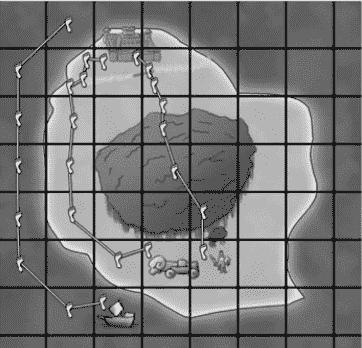

图 4.4：我们的每个角色都已计算出高级模糊路径。请注意我们的灯塔点，它们被标识为脚印。我们在详细路径阶段使用这些灯塔点。

## 4.6 详细路径阶段

既然我们的士兵知道如何合法地到达目的地，现在是时候让他们行动了。我们可以在每个点之间寻路，并圆滑化路径以使其更美观，但如果我们的士兵退缩了，决定做些战斗以外的事情呢？我们就会进行大量不必要的寻路。

生成美观路径同时避免浪费的关键是沿途逐步寻路。当角色接近灯塔点时，角色会在到达实际灯塔点之前寻路到下一个灯塔点。如果我们显示角色路径的线条，我们会经常看到他在移动时切断每个灯塔路径的末端，并提前寻路到下一个灯塔。这个距离是程序员必须进行实验的东西，因为它既影响低级路径计算发生的时间（性能），也影响路径的整体美观。为了给出 10 × 10 网格分辨率的示例阈值，我们必须满足两个条件之一才能寻路到下一个灯塔：角色必须进入其当前灯塔点所在的路径区域，或者他必须距离该灯塔点 12 个瓦片以内。如果其中一个条件为真，那么我们使用详细路径引擎将角色寻路到下一个灯塔。

最终我们得到的是一条圆滑的路径。角色不会走到区域中间，然后转身以不自然的角度前往下一个灯塔。简单来说，我们获得了自然的外观，如图 4.5 所示。对于玩家来说，没有基于高级网格路径的证据。


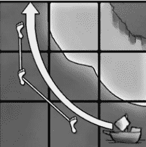

图 4.5：信标点为详细寻路引擎提供指引。请注意，详细路径（带箭头的圆形路径）并未一直延伸至信标点。

### 4.7 为何要费这么大周折？

我们高级路径的一大优势在于，我们可以在低级寻路中应用约束。众所周知，A* 算法会严重受到泛滥问题的困扰。它常常朝错误的方向搜索，并进入凹陷空间，最终检查许多不必要的地块。利用我们的高级路径信息，我们可以限制低级寻路器仅考虑信标点（或其相邻）区域内的地块。这使得低级寻路器不会向外部和后方泛滥进入那些我们知道在高级别上无需检查的区域。这在路径生命周期内节省了大量百分比的 A* 循环迭代。

这项优化的关键在于其一拳一套的组合：首先使用高级模糊路径来确定通往角色目的地的正确但粗糙的路线。第一拳带来了惊人的性能，这对当今的寻路至关重要。接着是我们的第二拳，即信标点之间的一系列低级详细路径。突然间，我们粗糙的信标点路径看起来既美观又智能。单独来看，这些路径技术各有主要优势和劣势；但结合使用时，优势相互弥补劣势，我们的寻路变得无坚不摧。

## 致谢

特别感谢 Rick Bushie 为我们的角色绘制图像。

## 参考文献

- [1] Daniel F. Higgins. "通用 A* 寻路". _AI 游戏编程智慧_, Charles River Media, 2002.
- [2] Daniel F. Higgins. "寻路设计架构". _AI 游戏编程智慧_, Charles River Media, 2002.
- [3] Daniel F. Higgins. "即时战略游戏中的地形分析——隐藏的巨人". _游戏编程宝石 3_, Charles River Media, 2002.
- [4] Daniel F. Higgins. "如何实现闪电般快速的 A*". _AI 游戏编程智慧_, Charles River Media, 2002.

## 第 5 章：环境声音剔除

Simon Franco

创意总成

### 概述

每一代游戏硬件都为开发者带来新的且令人兴奋的挑战。每次硬件迭代中一个持续的挑战是如何实时高效地处理数据。这必须以最佳方式完成，以最大化硬件性能并交付具有竞争力的结果。

已开发出许多技术，以便为各种系统高效处理空间数据。这些技术包括使用空间分区结构来剔除摄像机不可见的几何体，以及使用不同的 AI 复杂度级别来减少在远处或隐藏角色上花费的处理时间。

然而，一个较少受到关注的问题是如何确定在场景中选择和处理实时音频。除了游戏过程中发生的许多瞬态声音源外，场景中可能有数百或数千个永久环境声音源，但出于性能原因，任何一时刻实际播放的只有其中很小一部分。本文介绍了一种将完整声音集高效减少为玩家可听见的活跃集的技术。

### 5.1 问题

随着游戏环境图形细节的增加，音频细节水平也必须相应提升，以匹配游戏世界的图形表现。通常会分层叠加大量声音来构建游戏的环境音效。这取代了早期的技术，早期技术会播放单个立体声文件以实现相同目标。播放多个声音而非单个音频片段的优势在于，声音能紧密匹配玩家的周围环境。例如，如果玩家身处一座古老的闹鬼房子里，可能会有落地钟、显示雪花的电视机以及透过敞开窗户呼啸的风声。当玩家在房子中移动时，随着玩家从一个房间走到另一个房间，环境音效会发生变化。玩家可以通过关闭窗户或打碎落地钟来改变环境音效。

待播放的环境声音从监听者附近的声音中选择。监听者代表玩家正在聆听的游戏世界中的一个位置和方向。通常，它要么附加到渲染玩家世界视图的摄像机上，要么使用玩家位置和摄像机方向的某种变体。

我们必须解决的问题是如何处理游戏世界中定位的大量声音。这些声音从静止定位的连续声音（如火焰和河流）到更复杂且动态的音频事件（如人群为战斗欢呼，或角色与动画几何体（例如杠杆）交互）。

所有这些情况都要求在世界中放置一个声音发射器，要么由设计师手动放置，要么作为自动化过程的一部分。声音发射器用于控制声音触发的方式和时间，大多数都有一个声音触发的位置。

声音发射器还包含指向声音事件的指针。声音事件是包含如何播放声音信息的对象，例如要播放哪个波形文件、音量、可听距离、音调设置和优先级。当没有可用音频通道时，优先级检查用作一种方法，用于选择哪些音频通道可供新请求的声音事件使用。如果没有可用的低优先级通道，则请求的声音事件不会播放。

在游戏运行期间，每个活跃的声音发射器都会检查监听者是否在可听距离内（参见图 5.1）。如果此测试通过，且没有可用的空闲声音通道，则会对当前正在播放的所有声音执行优先级检查。如果两项测试都通过，则发射器最终可以开始播放其声音。随着典型游戏中声音发射器数量的增加，每帧执行的测试数量也在增加。因此，我们需要一种快速方法来拒绝大量不合适的声音发射器。

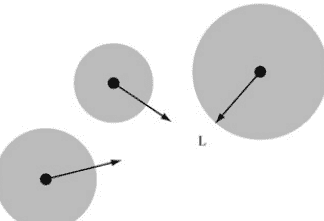

图 5.1：所有声音发射器均针对监听者进行测试。

### 5.2 声音剔除解决方案

我们需要找到一种方法，高效地剔除不在监听者可听距离内的声音发射器。我们还需要剔除任何剩余的优先级过低、不值得考虑播放的声音发射器。此处提出的解决方案涉及构建声音网格，作为快速剔除游戏世界中定位的大量声音发射器的手段。声音网格是一个与 x-y 平面平行、涵盖整个游戏世界的二维网格。网格由大小相等的单元格组成，每个单元格包含一个声音发射器列表数组。数组中的每个列表代表不同的优先级值，最高优先级在数组中占据索引 0。列表中的所有声音发射器都具有相同的优先级，与数组索引所代表的优先级相匹配。存储在这些列表中的声音发射器是那些处于该网格单元格可听范围内的发射器。

由于每个网格单元格都包含可听声音发射器的列表，我们只需确定哪个单元格包含监听者，就能知道哪些声音发射器应该播放。这避免了在实时执行复杂搜索以查找合适声音发射器的需要。

由于声音发射器的特性，我们使用固定单元格大小，而不是不均匀地划分空间。声音发射器可能彼此物理邻近，但可听距离可能截然不同。这些不同的可听距离会导致任何形式的分组都可能效率较低，并需要更多处理来确定哪些声音发射器可听。固定单元格大小还允许在确定监听者占据哪个网格单元格时进行优化。网格单元格的大小可根据应用程序而有所不同，但尺寸过小可能会导致性能问题。

我们利用能够将声音发射器分组为优先级列表的优势，因为大多数应用程序只会使用有限的优先级


范围，通常在环境声音中有 5 到 10 个不同的优先级别。

使用诸如声音网格之类的剔除系统，音频系统可以通过仅存储世界中给定区域内可听到的内容，快速剔除成千上万个潜在的发声对象。通过将声音发射器存储在匹配的优先级列表中，我们可以先处理最高优先级列表，如果没有可用的声音通道且已达到过低的优先级别，则可以快速退出声音发射器处理。

清单 5.1 展示了一个声音网格单元示例，以及用于绑定它们的示例声音发射器和链接类。我们在 `SoundEmitter` 类中使用 `SoundEmitterLink` 类的实例，以形成连接单元中匹配优先级声音发射器的链表。`SoundEmitter` 类包含 `m_cells_touched_array` 成员，它是 `SoundEmitterLink` 对象的数组。数组的大小在构建声音发射器对象时设置，应该是该 `SoundEmitter` 可能触及的最大单元数。

清单 5.1：此伪代码展示了一个声音网格单元和声音发射器示例。

```
struct Cell
{
    SoundEmitterLink *m_emitter_list[MAX_PRIORITY];
};

struct SoundEmitterLink
{
    Cell *m_cell;
    SoundEmitter *m_parent;
    SoundEmitterLink *m_prev;
    SoundEmitterLink *m_next;
};

struct SoundEmitter
{
    Vector m_pos;
    SoundEvent m_sound_event;
    SoundHandle *m_sound_handle;
    SoundEmitterLink *m_cells_touched_array;
    int m_num_cells_touched;
    bool m_active;
};
```

### 5.3 构建声音网格

声音网格使用静态和动态移动游戏对象的数据来构建。游戏对象是由游戏创建的对象，包含其想要播放的声音事件以及声音应定位的位置信息。

首先使用静态游戏对象构建声音网格。在游戏关卡加载时，我们仅处理一次游戏世界中存在的每个静态游戏对象。我们使用每个游戏对象的可听距离和位置来确定其声音发射器触及哪些网格单元（参见图 5.2）。我们为该游戏对象构建一个声音发射器，并设置其 m_cells_touched_array 成员以对应可听距离内的单元数量。对于可听范围内的每个网格单元，我们使用 m_cells_touched_array 成员中的一个空闲元素，在该单元的适当优先级列表与新构建的发射器之间形成链接。我们将新构建的声音发射器对象的指针返回给游戏对象，以便其可选地存储，以防需要稍后修改发射器的状态。


图 5.2：声音发射器使用其可听距离来确定触及哪些网格单元。

有些声音发射器在游戏世界中不占据单一固定位置。例如，你可能有一条代表河流的样条线，需要在样条线上靠近监听者的位置放置一个声音发射器。另一个示例可能是游戏世界包含一个森林区域，你希望在其中随机确定的位置播放鸟鸣声。对于这些情况，我们像构建静态声音一样构建声音发射器，但不将其添加到任何网格单元。我们将这些视为动态声音发射器，它们所属的网格单元会随着游戏进程而改变。

## 5.4 处理声音网格

每帧一次，将监听者的位置从世界空间位置转换为声音网格中覆盖该空间的特定单元。这样我们就可以从该单元中检索可听声音发射器的列表，以便尝试播放。声音网格保留了从上一帧访问的单元中选取的声音发射器的副本。此列表称为活动列表，因为它包含所有应主动播放的声音发射器列表。活动列表具有固定的最大大小，与任何一时间可播放的最大声音数量相匹配。

清单 5.2 展示了构建活动列表的过程。第一个处理阶段是将活动列表中的所有声音发射器标记为移除。单元发射器列表中的每个元素（最多可达可播放声音的最大数量）都会与活动发射器列表进行检查。如果单元列表中的发射器指向活动列表中的同一发射器，则清除该发射器的移除标志。我们只测试到这个数量的元素，因为额外的元素无法播放。

清单 5.2：此伪代码展示了我们如何构建活动列表并停止播放无效声音。

```
void SoundGrid::buildActiveList()
{
    // phase 1.
    set_all_active_list_emitters_for_removal()

    for (priority = 0; priority < MAX_PRIORITY_LEVEL)
    {
    for each emitter in the cell.m_emitter_list[priority]
    {
    for each active_emitter in the active_emitters
    {
    if (emitter == active_emitter)
    {
    emitter.set_unremoved()
    break
    }
    else if (emitter.m_priority > active_emitter.m_priority)
    {
    // Emitter can't be on the active emitter list
    // we've gone past its priority.
    break
    }
    }
    }
    }
    // phase 2.
    for each active_emitter in the active_emitter_list
    {
    if (emitter.is_removed()) emitter.stop_any_playing()
    }
    // Finally copy the cell's emitter list to the active list
    // Start with the highest priority list and progress through each priority list until we run out of sound emitters or the active_emitter_list
    copy_list_to_active_list(active_emitter_list, cell)
}
```

第二阶段是遍历活动列表，停止播放任何仍标记为移除的发射器。

现在，当前正在播放的唯一声音是那些既在单元的发射器列表中，也在活动播放列表中的声音。我们最后将单元的发射器列表复制到活动列表。同样，这里仅复制最多可达可播放声音的最大数量，以避免冗余数据。

每帧一次，我们处理发射器的活动列表，查看其中是否有处于“开启”状态但未播放，或处于“关闭”状态但正在播放的发射器。清单 5.3 展示了此过程。图 5.3 中，我们展示了使用声音网格时，只有单个声音发射器是有效的。

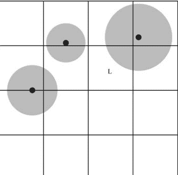

图 5.3：监听者所在的单元仅在一个声音发射器的半径范围内。

清单 5.3：此伪代码演示了如何处理活动发射器列表。

```
void SoundGrid::updateEmitters()
{
    for each active_emitter in the active_emitter_list
    {
        if (emitter.is_on())
        {
            if (emitter.not_playing())
            {
                if (engine.sound.get_num_channels_free() > 0)
                {
                    emitter.play_sound()
                }
                else if (emitter.m_priority > engine.sound.lowest_priority())
                {
                    emitter.play_sound()
                }
            }
            else
            {
                emitter.update_sound()
            }
        }
        else if (emitter.is_playing())
        {
            emitter.stop_sound()
        }
    }
}
```

### 关于声音发射器的更多内容

如前所述，一旦游戏对象的声音发射器构建完成，就会返回指向新构建的声音发射器对象的指针。这样做的目的是允许游戏通过更改其“开启”标志来播放或停止声音发射器。此标志是声音发射器的必需部分，因为并非所有游戏对象都要求其声音发射器持续播放。示例包括玩家点燃了某个对象，或者游戏对象正在协调动画几何体特定帧期间播放的声音。

### 如何处理动态声音

有些游戏对象需要每帧更新一次其声音发射器的位置。例如，你可能有一个沿预定义路径移动的声音，需要每帧更新其在路径上的位置。为实现此目的，我们利用声音网格的结构来支持动态声音。在每帧中，如汽车之类的游戏对象可以移动其声音发射器。为此，它必须先让声音发射器从其先前触及的所有网格单元中移除自身。然后将声音发射器移动到世界中的新位置，并重新添加到声音网格。这必须在处理声音网格和构建活动发射器列表之前发生。清单 5.4 展示了将声音发射器的链接插入到单元发射器列表头部的示例算法，清单 5.5 展示了匹配的移除算法。

清单 5.4：动态声音的示例插入例程。

```
/*
 * This inserts the SoundEmitter to the head of the
 * priority emitter list for this cell.
 */
void SoundEmitter::add_emitter_to_cell(cell)
{
    int index = m_num_cells_touched
    int priority_level = m_sound_event.m_priority

    ++m_num_cells_touched

    m_cells_touched[index].m_cell = cell
    m_cells_touched[index].m_prev = null

    // Set the next element to what the first element was pointed to in the cell's list.

    m_cells_touched[index].m_next = cell.m_emitter_list

    // Was there something at the head of the emitter
}


```
// have its prev link point to this entry.

if (cell.m_emitter_list[priority_level])
{
    cell.m_emitter_list[priority_level].m_prev =
        m_cells_touched[index];
}

// Finally set the head of the cell's emitter list
// to be this sound emitter link.
cell.m_emitter_list[priority_level] = m_cells_touched[index];
}
```

## 清单 5.5：动态声音的示例移除例程。

```
// This removes the SoundEmitter from all cells its

void SoundEmitter::remove_emitter_from_cells()
{
    int priority_level = m_sound_event.m_priority;

    for (index = 0; index < m_num_cells_touched; index++)
    {
        if (m_cells_touched[index].m_next)
        {
            m_cells_touched[index].m_next->m_prev =
                m_cells_touched[index].m_prev;
        }

        if (m_cells_touched[index].m_prev)
        {
            m_cells_touched[index].m_prev->m_next =
                m_cells_touched[index].m_next;
        }

        // Check if this was the head node of the list
        // change the head node to point to the next
        cell = m_cells_touched[index].m_cell;
        if (cell.m_emitter_list[priority_level] == m_cells_touched[index])
        {
            cell.m_emitter_list[priority_level] =
                cell.m_emitter_list[priority_level].m_next;
        }

        // Clean this SoundEmitterLink up.
        emitter.m_cells_touched[index].m_cell = NULL;
        emitter.m_cells_touched[index].m_prev = NULL;
        emitter.m_cells_touched[index].m_next = NULL;
    }

    emitter.m_num_cells_touched = 0;
}
```

## 5.5 支持多个监听者

有些游戏需要支持多个玩家使用同一台电视或显示器。这要求以某种方式分割显示屏，以显示两名玩家的世界视图。除了两名玩家的视图都由同一台游戏主机处理之外，我们还必须划分声音通道，以表示每个玩家正在听到的内容。可以通过对构建活动列表的方式进行一些更改，来修改声音网格以支持此功能：

- 首先为游戏中存在的每个监听者构建一个活动列表。
- 为所有监听者完成此操作后，我们将每个列表中优先级最高的声音复制到主活动列表中。
- 然后确保任何出现在监听者活动列表中但未进入主活动列表的声音都不在播放。

## 5.6 扩展

声音网格是剔除占据已知世界位置的声音的一种可能解决方案。虽然本文讨论的实现仅构建一个二维网格，但该技术应无需更改即可适用于大多数类型的游戏世界。如果您的游戏包含大量在 x 和 y 方向上占据附近空间的垂直声音，则该过程可以扩展以允许在 z 维度中剔除声音发射器。您可以希望拥有多个声音网格，每个网格位于不同的 z 高度，或者扩展到 3D 声音网格。

可以对声音网格进行更多未来工作，例如嵌入关于网格单元或声音发射器的附加信息，例如要应用于发射器的混响效果类型，或是否需要应用滤波器（由于声音发射器和监听者之间存在遮挡）。动态生成的声音（如枪声）也可能能够使用声音网格中包含的信息来计算需要应用的任何滤波，从而避免在实时执行昂贵的测试。此外，还可以对声音发射器链表进行进一步优化。例如，我们可以为每个链表添加头节点和尾节点，从而删除围绕将声音发射器插入网格单元或从中移除的条件测试。

## 第 6 章：GUI 框架和表现层

*阿德里安·赫斯特*

*威塞尔特龙娱乐有限公司*

### 概述

图形用户界面（GUI）设计是游戏开发中常被忽视且资源不足的一部分，但它负责游戏对用户的外观和感觉，以及至关重要的第一印象。用户界面需要在产品开发周期中持续快速且大幅地进行调整，以反映游戏几乎任何其他部分的修改。

关于 GUI 表现层代码的文献相对较少，且找到经过严格测试的源代码示例颇为困难。本文对 GUI 系统进行了简要介绍，并记录了一种经过验证、当前、灵活且可工作的系统，可为游戏内和工具型系统提供第一步。提供了可直接插入使用的源代码，应对从学生到资深专业人士的每个人都立即有用。

### 6.1 GUI 系统

与许多游戏内系统一样，要完成最终产品的难点在于要足够灵活以应对不断的变化。游戏开发的迭代特性意味着游戏在不断变化。对于计分系统、游戏模式或任何游戏玩法元素的每一次更改，通常都需要对表现层进行后续更改，以确保用户仍然清晰地获得玩游戏所需的相关和必要信息。迭代式游戏设计在开发过程中影响游戏的许多方面，所有这些都需要反馈给用户，这项任务落在表现层身上。

一种常见且合理的方法是围绕创建一组坚固、稳定的控件或组件，这些控件或组件可以以各种方式反复使用和组合。当表现团队收到新屏幕的请求，或者有新的游戏机制需要重写屏幕时，可以将一组熟悉的文本框、按钮、菜单等放置到位。

GUI 系统应包含一个编辑器，供美术人员以最佳方式创建和定位组件、纹理和文本。太常见的是，尤其是在较小的项目中，与为此任务创建编辑器相比，定位这些屏幕元素的工作落到了程序员身上，程序员必须手动将坐标输入到文本文件中。对于除最小的游戏和界面之外的任何东西，这都是不可接受的。

本地化问题在用户界面设计中总会带来自身的问题。将游戏翻译成多种语言不可避免地会导致文本字符串长度不一，通常占用的屏幕空间比最初分配的更多。即使是关键短语措辞中看似无害的更改，或大小写或语法的简单修改，也可能导致文本字符串重叠指定的屏幕区域。新单词在另一种语言中可能更长——德语通常是最冗长的。使用编辑器设计表现屏幕的一个基本功能是能够预览所有语言的静态文本以检查此类问题。

主机平台持有者通常有自己的一套技术要求，必须在游戏被接受之前满足。无需过多细节，这些要求从新屏幕、游戏模式、网络要求、控制器配置和菜单选项，一直到屏幕分辨率、屏幕可绘制区域以及文本可读性问题不等。

### 现有解决方案

存在多种中间件解决方案，用于创建提供全功能集的前端，包括所见即所得编辑器、运行时组件、自定义动画、脚本和 Adobe Flash 支持。在预算允许的情况下，这些方案颇具吸引力。此类工具提供支持，使美术人员和设计师能够在尽可能少地涉及程序员的情况下，创建外观最佳且最先进的 GUI 系统。

不过，支持这些功能是有代价的，一些实现可能会增加显著的内存和 CPU 开销，尤其是某些 Adobe Flash 实现通常资源消耗大。然而，较小规模的产品通常不需要如此功能丰富的实现，可以牺牲功能来换取性能和灵活性。


### 6.2 设计模式：模型-视图-控制器 (MVC)

GUI 系统中常见的一个问题是，随着时间的推移，最后时刻的补丁和“临时”bug 修复会导致代码强耦合，使得对系统某一区域的更改会在其他地方产生意想不到的影响，并且也使得重构变得困难。模型-视图-控制器 (MVC) 设计模式旨在通过将框架分为三个不同的组成部分来独立维护，从而确保元素之间仅存在松散耦合：

- *模型* 指的是我们在屏幕上表示的实际数据。例如，这可能是游戏时间或剩余生命数。
- *视图* 仅关注该对象的可视化表示和渲染。在我们之前的示例中，我们或许可以显示一个模拟时钟来表示剩余时间，或为每个剩余生命显示一个图标。
- *控制器* 指的是对象如何与游戏、用户输入以及一般状态、系统或游戏逻辑进行交互。

MVC 已广受欢迎，现在是许多更大的 GUI 和系统框架中的主要贡献概念，从 Cocoa 到 Qt、MFC 以及当前的 Windows Presentation Foundation。

以我们之前的计时器示例为例，*控制器* 将指我们的游戏更新循环；负责确定当前时间并将 `TimerUpdate` 消息传递给计时器 *模型* 对象，后者随即更新其内部表示。*视图* 通常会有自己的内部描述，但会根据 *模型* 本身中的信息进行更新。

实现 MVC 确实需要思维上的转变，因为三个组成部分彼此不了解对方的内部工作原理，也无法更改对方的数据，因此通信依赖于发送消息。这可能只是调用另一个对象上的函数的形式。不过，在更大的系统中，使用事件队列和传统消息传递系统来确保组件之间有更大的区分是有益的。

根据所使用的技术，这种消息传递可能会给系统带来大量开销，降低其灵活性。选择传递这些消息的正确方法至关重要，值得单独作为一个 Gems 话题。

## 6.3 GUI 设计

本 Gems 的目标是展示一个简单且可扩展的即插式 GUI 模块，其目标受众范围从学生或小型独立工作室到希望快速为其游戏添加一些用户界面交互而又不想花太多时间重新发明轮子的资深专业人士。因此，该系统必须具有以下属性：

- 模块化。作为即插式替换，它必须具有尽可能最少的外部 API 依赖项。
- 轻量且灵活。它应尽可能适应多种平台，针对各种输入类型等特定区域具有绑定，并且渲染或音频代码应尽可能保持最小。这保证了最高级别的可移植性。
- 程序员和艺术家双驱动。对于许多较小的产品，手动编写我们自己的前端设计通常是可行的（如果不说有趣的话）。虽然这会使我们面临本地化、次要字体更改和措辞修改的风险，但有时这可能是创建可用 GUI 的最快方式。该系统允许在必要时以编程方式创建 GUI 屏幕，并为以后从外部工具进行数据驱动设计留出空间。
- 可扩展。提供的代码应为用户提供一个坚实的基础，以便以最小的努力生成更多更高级的控件。
- 面向对象。面向对象编程特别适合于具有可继承行为和数据集的 GUI 对象。
- 就绪本地化。所有文本渲染都必须能够处理国际字符集。
- 最小化“样板代码”。它应封装常见的编程任务，以便用户可以专注于添加内容，而不是重复的功能。

### 少量代码 [1]

首先，让我们看看清单 6.1 中显示的基本 `GuiComponent` 类。这是所有其他 GUI 组件派生的基类，除了它是一个对象，它有一个存在于层级结构中某处的可视化表示，以及它有一些关于它是否处于活动状态和是否可见的信息之外，它包含的特定信息或功能非常少。

### 清单 6.1: 我们的 `GuiComponent` 基类。

```
class GuiComponent
{
    public:

        GuiComponent();
        virtual ~GuiComponent();

        virtual TypeId GetTypeId() const = 0;
        static TypeId GetStaticTypeId();

        uint32_t GetId() const;

        void SetupGuiComponent(const String& name, bo
        void SetVisual(Visual *visual, bool makeVisib
        void SetPosition(const Vec3& pos);

        virtual void Update(Time& timeDelta) = 0;
        virtual void Render(Renderer *renderer);

    private:

        static TypeId s_TypeId;

        String m_Name;
        uint32_t m_Id;
        Frame m_Frame;
        Visual *m_Visual;

        // Is the GuiComponent taking input and being
        bool m_Active;

        // Default to invisible false until we have a
        bool m_Visible;
};
```

GuiComponent 类包含两个简单的布尔变量，用于确定对象是否被视为活动以及是否可见。这里的区别在于，一个对象可能在屏幕上可见，但不活动，即它不响应输入或自行更新。同样，一个对象可能正在被主动处理，但在屏幕上不可见。

存储一个字符串以保存对象的人类可读名称。这主要用于调试，但也用于生成该名称的 CRC，并存储在 m_Id 变量中以便快速访问和比较/查找。这也可以由工具编辑器和加载器用于引用对象。

GuiComponent 还包含一个 Frame 节点，用于指定应用于该对象的局部平移，以及它在层级结构中的位置。这使我们可以将 GuiComponents 附加到组中，然后可以将它们作为一个整体一起移动。

该模型包含一个指向包含渲染信息的 Visual 对象的单个指针。我认为这是对象模型和视图的一种松散抽象，但它很好地服务于我们快速灵活的设计目标，这意味着它抽象了大部分渲染代码，同时仍然允许我们有一个入口点来在必要时修补任何渲染信息（例如状态或材质更改），以进行那些最后时刻的修复。对于中型或更大的系统，对象模型和视图侧之间的耦合需要更松散。Render() 函数可以简单地进行以下调用：

```
renderer->Render(m_Visual);
```

在需要时，可以通过派生类中的虚函数进行重写。

这个 GuiComponent 类允许我们轻松扩展以创建一个基本的 GuiSprite 类，如清单 6.2 所示。这个最简单的示例只是添加一个 VisualSprite 类的实例并调用渲染器来绘制它。在这里，VisualSprite 本身包含渲染精灵所需的大部分信息，这些信息在 GuiSprite::SetupGuiSprite() 函数中设置。在 SetupGuiSprite() 函数中调用 GuiComponent::SetVisual(&m_Sprite) 函数可确保基类渲染函数执行此类对象所需的所有渲染。

### 清单 6.2: 一个精灵类。

```
class GuiSprite : public GuiComponent
{
public:

    void SetupGuiSprite(const Vec3& pos, Texture
    Color& sprite, float width = 0.0F, float h

    virtual void Update(Time& delta);

private:

    VisualSprite   m_Sprite;
};
```

同样，可以派生一个 GuiTextItem 类，用于存储文本和渲染参数的指针，如清单 6.3 所示。在随附光盘上的完整代码示例中，BMFont 类存储从 AngelCode BMFont 库 [2] 导出的文件中加载的基于字形的信息和纹理数据。

### 清单 6.3: GuiTextItem 类。

```
class GuiTextItem : public GuiComponent
{
    public:

        void SetupGuiTextItem(wchar_t *text, FONT::BM
        float GetTextWidth() const;
        float GetTextHeight() const;

        void SetText(wchar_t *text);
        void SetAlignment(GuiTextHAlign hAlign, GuiTe

        void SetColor(const Color& color);
        virtual void Update(Time& delta);

    private:

        float        m_xScale;
        float        m_yScale;

        VisualText   m_VisualText;
};
```


请注意，`GuiTextItem` 类仅接受宽字符字符串来显示文本。这些多字节字符使我们能够显示多种语言的字符，尽管各种平台可能会进行字节序交换。两个函数根据文本和字体获取文本的计算宽度和高度。当我们想要允许使用指针设备选择一段文本时，这将很有用。

## 扩展我们的系统

不幸的是，GUI 系统需要执行的操作不仅仅是显示精灵和文本，因此让我们来看看添加另一个重要类 `GuiSelectable`。如清单 6.4 所示，`GuiSelectable` 类是菜单项、可点击图标、可选择文本以及任何可能被高亮和/或选择的内容的父类。此类的目的是提供一个响应两项主要活动的界面——被高亮（例如，当用户将鼠标、触控笔或其他指针设备指向组件上方时）和被选择（例如，当指针设备在此项上单击或按下“选择”按钮时）。所使用的设备类型无关紧要，因为高亮和选择是屏幕导航中常见的操作，无论是通过键盘、手柄、触控笔/触摸屏控制器、远程指针设备等进行的。

### 清单 6.4：可选择组件的基类。

```
class GuiSelectable : public GuiComponent
{
    public:
        bool IsSelectable() const;
        virtual void SetSelectable(bool selectable);
        bool IsHighlightable() const;
        virtual void SetHighlightable(bool highlightable);
        GuiHotSpot *GetHotSpot();
        void SetHotSpot(GuiHotSpot *hotSpot);

        // Process what to do when the user's focus is
        // in the specified position.
        virtual bool SetFocus(float x, float y);

        // Test to see if the specified position is within
        virtual bool IsInHotSpot(float x, float y);

        // Virtual function called when the item is selected
        // whether it is possible to select this item
        virtual bool OnSelect();

        // The GuiSelectable is highlighted
        // (mouseover, menu item selected).
        virtual bool OnHighlight(bool highlighted);

        virtual void Update(Time& delta);
    private:

        GuiHotSpot     *m_HotSpot;

        bool           m_Highlightable;
        bool           m_Selectable;
};
```

`GuiSelectable` 对象包含对 `GuiHotSpot` 项的引用，该项保存了屏幕区域的信息，单击该区域会使 `GuiSelectable` 对象变为活动状态。通常，这是一个与项本身的图标或文本大致相同大小的矩形区域。派生类可以描述自己的圆形或多边形区域，只要重写 `IsInside()` 虚函数即可。`GuiHotSpot` 对象保留对 `Frame` 对象的指针，以便该对象随 `GuiComponent` 对象本身一起跟踪。

对于基于指针的设备，确定 `GuiSelectable` 对象的高亮状态是通过将当前屏幕光标坐标传递给 `SetFocus()` 函数来实现的。如果在查询 `m_HotSpot` 变量后，确定应更改高亮状态，则会使用新的所需值调用虚函数 `OnHighlighted()`。同样，我们可以在派生类中重写此虚函数以更新其自身状态，因此也更新其视觉表示。

对于基于按钮的控制器（主要是键盘和手柄/摇杆），焦点可能更具定制性，也许是通过按 Tab 键在各种可高亮组件之间转移焦点，或者在菜单的情况下，使用输入设备上的方向键。我们稍后将再次讨论此话题。

可以告知 `GuiSelectable` 对象它们不可高亮。在此状态下，除非再次明确设置为可高亮，否则它们无法像其他 `GuiComponent` 对象一样变为活动状态。这最可能用于那些当前不可用或尚未可用的组件。例如，可能有一个当前隐藏的游戏模式选项。

同样，即使某些项可高亮，也可能无法实际选择它们。例如，也许在关卡选择屏幕上将光标移动到当前不可用的最后一关会高亮或动画化该组件，但用户仍然无法选择它。被选中的对象会调用 `OnSelect()` 虚函数，该函数返回选择是否成功。随后由当前状态进行处理。

## 那菜单呢？

好吧，我们已经能够随意在屏幕上放置对象，但将这些项目放入菜单中不是更好吗？登场的是 `GuiSelectableGroup` 类，如清单 6.5 所示。可以将 GuiSelectableGroup 对象视为菜单，其中包含构成其菜单项的 GuiSelectable 对象指针集合。这使我们能够将高亮和选择对象组的通用代码移至单个界面。在最简单的情况下，GuiSelectableGroup 类允许我们按数组索引、按 GuiComponent 名称或按 ID 高亮对象。它还允许我们简单地高亮当前组中的下一项或上一项，如有需要，可跳过不可高亮项并循环遍历列表。

### 清单 6.5：GuiSelectableGroup 处理许多 GuiSelectable 对象的选择。

```
class GuiSelectableGroup : public GuiSelectable
{
    public:
    // Add item and set the attached item's m_Frame
    virtual void AddItem(GuiSelectable *item, bool);
    // Remove all items from list and detach any
    virtual void Clear();
    // Highlight the next/previous item skipping
    // items and wrapping where necessary.
    virtual bool HighlightNext();
    virtual bool HighlightPrevious();
    // Highlight an item in the list by index,
    // or Id (name CRC).
    virtual bool HighlightIndex(int index);
    virtual bool HighlightItem(const String& name);
    virtual bool HighlightItem(uint32_t id);
    // Find an item in the GuiSelectableGroup either
    // or Id (name CRC)
    virtual int FindItemIndex(uint32_t id);
    virtual int FindItemIndex(const String& name);
    virtual GuiSelectable *FindItem(uint32_t id);
    virtual GuiSelectable *FindItem(const String& name);

    // Get the currently highlighted object (if there is one)
    GuiSelectable *GetHighlighted();

    virtual bool SetFocus(float x, float y);

    // Test to see if the specified position is within
    // the GuiComponent's HotSpot.
    virtual bool IsInHotSpot(float x, float y);

    // Virtual function called when item is selected
    virtual bool OnSelect();

    // Virtual function called when the GuiSelectable
    // (mouseover, menu item selected).
    virtual bool OnHighlight(bool highlighted);

    // Update all the items in this GuiSelectableGroup
    virtual void Update(Time& delta);

    private:
    // A static-sized array of pointers to GuiSelectable
    GuiSelectable *m_Selectables[GUI_SELECTABLE_MAX];
    int m_NumSelectables;
    int m_Highlighted;
    bool m_Wrapped;
};
```

通过 `AddItem()` 函数将项添加到 `GuiSelectableGroup` 对象，该函数提供自动将新项的 `Frame` 附加到此对象的选项。如果用作菜单，这种附加意味着菜单中的所有项可以一起移动，也许只需动画化根节点矩阵的 x 分量，即可将项动画显示到屏幕上或从屏幕上移除。还要注意，在向空列表添加项后，如果我们想要高亮某一项，仍然希望手动执行此操作，或调用 `HighlightNext()` 来高亮第一个可用项。这对于基于控制台或键盘的控制系统很典型。

该类符合 *组合* 设计模式，因为 `GuiSelectableGroup` 类本身派生自 `GuiSelectable` 类。这种简单但强大的区别意味着它继承了可被选择、可被高亮的能力，并且重要的是，可以作为列表包含在另一个 `GuiSelectableGroup` 对象中。这在许多情况下很有用——例如，在选项屏幕中，主项垂直排列，通过手柄的上/下键选择，但某些项提供多个选项供选择，例如为图形细节选择低、中或高，为声音选择立体声或单声道等，这些选项水平排列。

在符合组合设计模式时，`GuiSelectableGroup` 类还负责管理通过 `GuiSelectable` 虚函数的调用。`Update()` 和 `Render()` 调用会传递给所有包含的 `GuiSelectable` 对象，`OnSelect()` 函数确定当前高亮的项，并且（如果存在且活动）仅对该项调用相关的 `OnSelect()` 函数。`OnHighlighted()` 和 `SetActive()` 等函数遵循类似模式，尽管值得浏览代码以了解对象何时变为活动或非活动的详细信息。

## 使用示例


清单 6.6 中显示的代码片段使用了 GuiSelectableText 类型。这是一个仅包含 GuiTextItem 对象的 GuiSelectable 对象。它展示了类结构可以多么快速地创建屏幕菜单。RenderComponents() 函数简单地归结为以下内容：

```
Menu.Render(renderer);
```

清单 6.6：示例状态的设置与更新。

```
GuiSelectableText MenuItems[MENUITEM_COUNT];
GuiSelectableGroup Menu;

void SetupComponents()
{
    Menu.SetPosition(Vec3(512.0F, 480.0F, 0.0F));

    for (int item = 0; item < E_MENUITEM_COUNT; ++item
    {
        MenuItems[item].SetupGuiComponent(s_Component
        MenuItems[item].SetupGuiSelectableText(s_Comp
        Resource_GetFont());
        MenuItems[item].SetPosition(menuItemPos[item]

        Menu.AddItem(&MenuItems[item], true);
    }

    MenuItems[E_MENUITEM_UNLOCK_ME].SetHighlightable

    #ifndef CONTROLLED_BY_POINTER_ONLY
        Menu.HighlightNext();
    #endif
}
```

// 然后更新循环归结为以下内容：

```
void UpdateState(Time& delta)
{
    Menu.Update(delta);

    #ifdef CONTROLLED_BY_POINTER_ONLY

        if (m_Menu.SetFocus(pointerX, pointerY))
        { // If we're only using the mouse, and we're
          // other item, unhighlight the currently se
          // m_Menu.HighlightIndex(GUI_SELECTABLEGROUP_U
        }

    #else

        m_Menu.SetFocus(x, y);

        // Now loop through all the controllers chec
        for (all active controllers)
        {
            if (Controller.IsPressed(DPAD_UP))
                Menu.HighlightPrevious ();
            else if (Controller.IsPressed(DPAD_DOWN))
                Menu.HighlightNext ();

            if (Controller.IsPressed(SELECT) && Menu.
                ProcessSelect ();
        }

    #endif // CONTROLLED_BY_POINTER_ONLY
}
```

将 SetupComponents()、UpdateComponents()、RenderComponents() 和 UpdateInput() 等虚函数添加到基础状态系统中，有助于构建可扩展的框架，在整个 GUI 屏幕中保持通用接口，并将 GUI 组件代码与其他基于状态的代码分开。这也有助于区分代码中的模型、视图和控制器部分。这在随附光盘的源代码中可以更好地看到，尽管完整解释超出了本文的范围。

[1] 请注意，本文中的代码是随附光盘上完整代码的精简版本。为求简洁，已移除简单的 Get() 或 Set() 及其他辅助函数。

## 6.4 最后

本文介绍的对象仅构成 GUI 系统的开端。随附光盘中包含一个示例测试应用程序，它通过演示各种示例状态来实现这些及其他 `GUIComponent` 对象。还包含一个可用的 `StateMachine` 类、一个基于 SDL 的非常基础的 OpenGL 渲染器、测试字体库、输入库、基本 MATHS 组件以及各种基础或实用工具类，以及构建基本 GUI 框架实现所需的任何其他内容。

要将此工作推进一步，需要实现数据驱动设计的一个要素。特别是，我们需要一个编辑器，让艺术家能够控制演示的外观和感觉。

最新版本的代码可在 Weaseltron 网站上找到，网址为 http://www.weaseltron.com/WeaselGui。该代码根据 LGPL 许可证分发，这意味着可以免费用于商业产品。

## 参考文献

- [1] Erich Gamma, Richard Helm, Ralph Johnson, 和 John Vlissides. 设计模式——可复用面向对象软件的基础. Addison-Wesley, 1995.
- [2] AngelCode BMFont.
http://www.angelcode.com/products/bmfont/

## 第 7 章：世界最佳调色板量化器

Jason Hughes

Steel Penny Games, Inc.

### 7.1 调色板？有什么用？

在固定功能显卡和显存有限的旧时代，调色板纹理是最早的压缩形式之一，代价是牺牲色彩准确性。然而，随着显卡显存的增加，图形芯片组开始向可编程着色器发展，调色板图像逐渐被 S3TC/DXTC（及更好）压缩所取代，后者通常在提供更好性能和色彩深度的同时，实现相同的内存节省。

那么，为什么要使用调色板？也许你听说过它高雅的表亲——矢量量化？在当今时代，这似乎是一个疯狂的需求，但量化码本（调色板）在许多场景中都很有用，不仅仅用于图像。一些示例：S3TC/DXTC 并不适合所有图像，特别是具有大面积纯色且被锐利边缘分割的卡通风格图形。精细的像素艺术最终会变成一团方块。此外，一些 GPU 支持单独索引的顶点属性（如法线、颜色等），但仅限于 8 位或 16 位索引。这实际上是一组值的调色板。同样，在现代系统的着色器中，纹理可以用于替换某些顶点属性，以简化构建灵活引擎时涉及的顶点格式数量，而这些纹理的压缩可以使用具有有限值集的较小 1D 查找表纹理来有效实现。法线贴图也可能是调色板的良好候选对象，具体取决于表面的复杂性。在某些表面上，S3TC/DXTC 块状伪影可能会出现在光照中，而调色板版本最多只会出现条带，而不会出现阻塞伪影。

最后，还有老游戏开发者知道的偶尔晦涩但惊人的调色板技巧。其中一个技巧将调色板顶点颜色用到了极致。其大致思路是：在 N 个不同的昼夜阶段对世界进行顶点光照，然后计算一个 3N 维的调色板，其中源图像中的每个“颜色”实际上是 N 个 RGB 三元组的堆栈。世界中的每个顶点都被赋予一个顶点颜色调色板索引，该索引是最终调色板中的堆叠颜色。因此，无需更改任何顶点数据，只需在调色板内将颜色从一组 RGB 插值到下一组 RGB，顶点看起来就会经历一天中时间的平滑变化。

作为参考，图 7.1 展示了 WBP 与 Photoshop 的对比，禁用了误差扩散，以便我们可以清楚地看到颜色选择的质量。

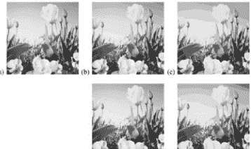

**图 7.1：**（另请参见彩色插页。）(a) 使用 100,162 种颜色的花卉源图像。(b) Photoshop，256 色。(c) Photoshop，16 色。(d) WBP，256 色。(e) WBP，16 色。(© Dundanim/Dreamstime.com)

### 7.2 理解量化

对于这样一个简单概念——将数据集从 M 个样本的基数减少到固定数量 N 以最小化误差——在设计量化器时，有令人惊讶的艰难教训需要学习。必须回答一些相互关联的问题，这些问题因数据及其应用场景而异：

- 如何为多个样本计算代表值？
- 衡量样本与其代表值之间误差的良好指标是什么？
- 输入数据的所有方面是否等效，或者是否需要对某些通道进行加权或以不同方式为它们计算误差？
- 从 M 个代表值开始并合并它们更好吗？
- 从一个开始并细分直到达到 N 更好吗？
- 那些逐步改善拟合直到满足某些度量的随机过程呢？

如果你研究调色板算法和矢量量化的相关研究，会发现各种方法存在许多权衡，例如工具性能与运行时质量、代码复杂度与实现难度、感知误差与数值误差等。重要的是，你需要理解这实际上是一个 k-means 聚类问题，即使是为数据集找到两个调色板条目也是 NP-hard 问题，更不用说 N 个了 [1]。因此，为了使任何算法实用，都会做出一些假设，并且可能对特定输入产生不理想的结果。因此，重要的是尽量不要解决过于一般的问题，只需关注较大的误差来源，只要


结果为正。

### 7.3 来之不易的教训

最好的经验（在编程中）是失败的经验。正如查尔斯·凯特灵曾经说过的，“失败是向前迈向成功。” 在设计出几个未能产生满意结果的算法后，以下是一些观察。其他人可能运气更好或想法更好，但以下是我学到的重要教训：

- 将所有颜色和其他属性转换为浮点数，并以数组或 `std::vector<float>` 的形式传递，可以很好地将它们统一起来。这样做不会损失普遍性，并且可以简化代码。

- 在确定颜色样本质量时，颜色空间很重要，理想情况下，两个样本之间的测量可以通过欧几里得距离公式有意义地进行。R'G'B' 颜色（如计算机生成的艺术和数字摄影通常所处的那样）位于非线性伽马校正空间中，任何一个分量中的微小错误都可能非常明显。（这里是一个巨大的兔子洞，你可能会被诱惑花大量时间学习颜色空间。颜色编码和表示是一个深奥的领域，有大量的研究。如果你非要深入，请参阅 [2]。）我发现，将 R'G'B' 伽马校正颜色移动到线性 RGB 空间，会产生一种奇怪的效果：样本在伽马曲线上的不同点上，彼此之间既显得更近又显得更远，而非它们表面上所显示的那样。简而言之，我发现将颜色保留在伽马校正空间中是最好的。本文中的样本是直接从你标准的、普通的 R'G'B' 中量化的。

- 一个显而易见的优化是将输入样本数量减少到仅保留唯一值。但是，值得注意的是，如果你这样做，请确保每个唯一样本还携带一个与其所代表的源数据中样本数量成比例的权重。否则，调色板生成器将无法知道每个样本的相对重要性，并且通常会对高度冗余的数据集提供较差的拟合。

- 我尝试从 M 个不同的代表值开始，将它们合并为 N 个。然而，这个问题难以处理，因为 M 可能非常大，而查找要合并在一起的“接近”值的操作是 O(n^2)。这就是为什么使用这种方法的研究很少的原因。

- 大多数以多个条目开始的算法都是通过为其调色板选择一组随机的 N 个代表值，并对其进行微调，直到找到良好值。我没有看到关于如何选择这些初始值的明确指导。考虑到初始值的选择极大地影响找到最佳拟合所需的迭代次数，而且很难知道这些值是陷入局部极小值还是实际上是良好的表示，我放弃了这些方法。在工具中，我个人更喜欢在确定的迭代次数内获得近似最佳结果（按某些标准）。

- 一旦决定采用将簇划分直到达到 N 的策略，我仍然在算法中遇到了循环问题。出于认为这会产生更紧凑簇的想法，我重新计算了每个分区的代表值，然后将每个样本重新分配给调色板中最接近的值。这没问题，只是偶尔会有一个簇最终没有分配到任何样本。理所当然，我只是删除了该值并继续。别这样。当一组样本在两个或三个极端值之间循环时，这有时会导致无限循环。最终，我发现我会计算一组的中心点，然后找到该组中最接近的样本，并强制其保持与该值关联。至少这样，就不可能出现无限循环。作为进一步的改进，在每次迭代结束时，任何只分配了一个样本的簇都会将其值更改为正好是该样本的值，以实现完美拟合。

- 在重新分配阶段，我也尝试动态更新簇的中心点。这听起来是个好主意，但它基于样本顺序存在负反馈循环。例如，如果值沿数轴分布，并且有两个值 A=0 和 B=1000，将样本 499 分配给值 A 会将其中心点移动到 249.5。突然间，下一个样本 501 会比 B 更接近 A，并进一步扭曲簇的定位。顺序依赖是构建强健工具的糟糕方式，并会产生高度可变的结果，因此这种自适应行为应不惜一切代价避免。

### 7.4 算法概览

好吧，下面是鸟瞰图：

- 1. 初始化簇集。
- 2. 找到误差最大的簇并将其分为两个簇。
- 3. 将所有样本重新分配给最近的簇。
- 4. 从步骤 2 重复，直到所有簇误差为零或达到 N 个调色板条目的目标。

我所使用的心智模型是：调色板是空间中的一组点，每个原始样本都被映射到空间中的其中一个点。这些是围绕调色板中每个代表值的样本的小云团，或簇。以下是用 C++ 编写此内容的简化方式：

```
typedef CVector3 RepValue;
typedef CVector3 Sample;
typedef std::vector<Sample> Samples;
typedef std::map<RepValue, Samples> Clusters;
typedef std::map<Sample, int> Frequency;
typedef std::vector<float> AxisWeights;

Clusters clusters;
Samples origSamples;
Frequency sampleFreq;
AxisWeights weights;
```

### 步骤 1 — 初始化簇集

将样本集减少到唯一集应作为出于性能原因的预处理步骤来执行。这样做的一个后果是，重要性计算需要考虑一个次要字段，该字段描述每个样本所代表的总体，并在中心点计算中作为权重因子传递。减少并不复杂，但很乏味，并且对于该算法正确运行不是必需的。出于测试目的，请将 `Frequency` 中每个样本的频率分配为 1.0。

初始化簇集是通过计算一个代表值 `RepValue`（即一组样本的中心点），然后用一个单个条目填充 `Clusters` 映射，将所有样本分配给它来完成的。具体操作如下：

```
RepValue const repValue = ComputeCentroid(origSamples);
clusters[repValue] = origSamples;
```

只有当样本的数值空间是线性时，从许多样本中计算单个代表值才是微不足道的。例如，在感知均匀空间中的颜色可以计算为简单的中心点。请注意，由于输入样本 $x_i$ 已减少到仅唯一条目，因此在考虑样本以计算其对中心点 C 的贡献时，必须应用与其原始频率成比例的权重因子 $w_{x_i}$：

$$C = \frac{\sum_{i=1}^n x_i w_{x_i}}{\sum_{i=1}^n w_{x_i}}.$$

### 列表 7.1：计算一组样本的中心点看起来很复杂，因为我们允许带有关联频率的减少样本集。它实际上只是一个平均值。

```
RepValue ComputeCentroid(const Samples& x, const Frequency& w)
{
    int totalFrequency = 0;
    RepValue repValue(0, 0, 0);

    for (size_t samp = 0; samp < x.size(); samp++)
    {
        int const sampleFrequency = w[x[samp]];
        repValue += x[samp] * sampleFrequency;
        totalFrequency += sampleFrequency;
    }

    repValue /= (float) totalFrequency;
    return (repValue);
}
```

### 步骤 2 — 细分拟合最差的簇

一旦定义了误差度量，确定要拆分的簇就相对容易了。遍历所有簇，计算代表值与其所有分配样本之间的误差总和，同样按样本在源数据中的原始频率加权。计算出的误差最大的簇将被选为分区。应当注意，FindWorstCluster 是朴素实现，即使对于未更改的簇也会重新计算误差。此实现出于清晰起见而简单，而非出于性能考虑。

列表 7.2：这计算了每个簇的样本相对于为其选择的中心点的误差。误差最大的簇将被返回以进行细分。

```
RepValue FindWorstCluster(const Clusters& clusters,
     const Frequency& freq, const AxisWeights& aw)
{
    RepValue worstValue(FLT_MAX, FLT_MAX, FLT_MAX);
    float worstError = 0.0F;

    for (Clusters::const_iterator cluster = clusters.begin(); cluster != clusters.end(); ++cluster)


```cpp
{
    const float err = ComputeError(cluster->first, cluster->second, freq, aw);
    if (err > worstError)
    {
        worstError = err;
        worstValue = cluster->first;    // remember
    } // so we
    return (worstValue);
}
```

## 在集群中测量误差

如果数据构成向量场，计算样本与其代表值 v 之间的量化误差可以采用几种方法。RGB 颜色和 (x,y,z) 点是空间中的向量，构成度量空间，这意味着我们可以使用简单的距离公式。你可以选择简单的线性误差或平方误差。线性误差允许限制总偏差 ε，而不考虑误差在样本各轴上的分布情况。它看起来过于宽松，但计算速度快。

$$\varepsilon = \sum_{i=1}^{n} |v - x_i| w_{x_i}$$

有趣的是，在渲染过程中，4 个分量的 RGBA 颜色并不能有效地作为向量场，因为 alpha 的线性变化可能由于混合而导致最终颜色出现不可预测的非线性变化。换句话说，alpha 与 RGB 并非线性无关。这意味着简单的欧氏距离对 alpha 分量失去了意义。我发现处理此问题的最佳方法是为每个标量分量赋予一个权重，该权重在平方误差分析中应用。

尽管如此，这种技术仍然很有用，因为它对数据拟合提供了更大的控制力。平方误差强烈限制每个轴上的偏差，因此你可以通过用因子 s_j 对每个分量的偏差加权来控制样本中每个标量的重要性。这可以用于更重地加权 Y' 亮度分量而非色度分量（CrCb），或者以牺牲 x 和 y 为代价来改善法线的 z 分量。正如你所见，平方误差的计算成本也稍高：

\(\varepsilon = \sum_{i=1}^n \left[ \sum_{j=0}^2 (v_j - x_{ij})^2 s_j^2 \right] w_{x_i}.\)

（此处，x_ij 是样本 i 的分量 j。）

### 清单 7.3：此函数计算集群代表值与其所有样本之间的平方误差，每个分量带有一个权重。

```cpp
float ComputeError(const RepValue& v, const Samples& x, const Frequency& w, const AxisWeights& s)
{
    float err = 0.0F;
    for (size_t samp = 0; samp < x.size(); samp++)
    {
        // compute the error of a single sample
        float squaredErr = 0.0F;
        for (size_t j = 0; j < 3; j++)
        {
            const float linearErr = (v[j] - x[samp][j]);
            squaredErr += linearErr * linearErr;
        }
        const int sampleFrequency = w[x[samp]];
        err += squaredErr * sampleFrequency;
    }
    return (err);
}
```

## 将集群一分为二

此时，我们已识别出拟合效果最差的集群。我们该如何尝试将其拆分？理想情况下，最终结果将是两个集群，每个新集群中包含原集群大约一半的样本。此外，我们希望沿着集群的最长轴进行拆分，这样在对半分割时，它将平分我们能穿过数据点绘制的最长直线。这应能将样本自然地分成两个彼此最远的组。

首先，我们需要一种方法来确定一组向量的主轴。主成分分析是我们感兴趣的数学工具类别。如果我们要寻找一组完全正交的轴，可以实现特征值分解或奇异值分解等方法。然而，这超出了必要范围，因为我们从不寻找超过集群主轴的内容。一组点的主轴是其协方差矩阵的最大特征向量，可以使用幂法轻松生成。基本上，这是通过不断将向量与矩阵相乘、对其归一化，并重复该过程直到其不再改变方向来完成的。结果是矩阵中数据的主轴。

### 清单 7.4：此代码计算此集群中样本的协方差矩阵。

```cpp
void SplitCluster(const RepValue& v, const Samples& x, const Frequency& w, const AxisWeights& s, Cluster& cluster)
{
    // compute cluster center based on the samples and weights
    RepValue center = ComputeCentroid(x, w);

    // count how many pixels this cluster represents
    uint numSamplesRepresented = 0;
    for (size_t i = 0; i < x.size(); i++)
        numSamplesRepresented += w[x[i]];

    // compute covariance matrix of samples
    float covMatrix[3][3] = {{0,0,0}, {0,0,0}, {0,0,0}};
    for (size_t outer = 0; outer < 3; outer++) // rows
    {
        for (size_t inner = 0; inner < 3; inner++) // columns
        {
            // only compute the upper part and diagonal
            // and copy to the bottom part since the covariance
            if (inner >= outer)
            {
                // compute the covariance of each channel
                // with each other, across all samples.
                float deltaSum = 0.0F;
                for (size_t loop = 0; loop < x.size(); loop++)
                {
                    // weight by number of pixels this sample represents
                    deltaSum += (x[loop][inner] - center[inner]) *
                                (x[loop][outer] - center[outer]);
                }

                const float covariance = deltaSum / numSamplesRepresented;
                covMatrix[inner][outer] = covariance;
                covMatrix[outer][inner] = covariance;
            }
        }
    }
}
```

上述代码计算协方差矩阵，这是执行幂法以生成数据集第一个特征向量所必需的。幂法在某些情况下不会收敛——最具体地是当初始特征向量猜测与真实主轴正交时。在实践中，这似乎不是一个非常常见的问题，如果这让你困扰，可以将其更改为更好的方法。使用幂法的吸引力在于其实现和理解简单，并且效果相当好 [3]。

### 清单 7.5：此代码使用最多 10 次迭代的幂法来确定集群的主轴。

```cpp
// Power Method for producing the first eigenVector
float eigenVector[3] = { 1.0F, 1.0F, 1.0F};
float tempVector[3];
float lastScalar = 0.0F;

// generally converges in ~3 iterations
for (size_t iteration = 0; iteration < 10; iteration++)
{
    // vector-matrix multiply the eigenVector into tempVector
    for (size_t multiI = 0; multiI < 3; multiI++)
    {
        // store this into the temp vector until the multiplication is complete
        tempVector[multiI] = 0;
        for (size_t multiJ = 0; multiJ < 3; multiJ++)
            tempVector[multiI] +=
                eigenVector[multiJ] * covMatrix[multiI][multiJ];
    }

    // normalize the eigenvector (which is not the same as
    // normalization - a normal eigenvector has a max component of 1)
    float maxComponent = 0.0F;

    // find the maximum component in the new eigenVector
    for (size_t i = 0; i < 3; i++)
        if (fabsf(tempVector[i]) > maxComponent)
            maxComponent = fabsf(tempVector[i]);

    // perform the normalization and store into eigenVector
    for (size_t i = 0; i < 3; i++)
        eigenVector[i] = tempVector[i] / maxComponent;

    // figure out if we've converged or not
    const float absoluteRelativeError =
        fabsf((lastScalar - 1.0F / maxComponent) * maxComponent);
    if (absoluteRelativeError < 0.001F)
        break; // if our direction has not changed, stop

    // move on to another iteration, and remember what
    // eigenvalue was last iteration
    lastScalar = 1.0F / maxComponent;
}
```

一旦确定了主轴，就将所有样本投影到该轴上，并将集合拆分为位于主轴垂直平面两侧的样本。换句话说，根据每个样本沿主轴中点落在哪一侧来分配所有样本。我想我们可以尝试使用更复杂的分箱方法，但这假设每个集群中都有一个值得用来衡量误差的现实代表值。我们没有，并且选择这样的样本是 NP-hard 的——为一组样本选择代表值的问题本质上就是调色板量化！此时，重要的是集群大小大致相等，并沿主轴拆分。这些新条目是占位符——样本将很快被全局重新定位，并计算新的代表值。

### 清单 7.6：此代码沿主轴中部拆分集群，将一半样本分箱到每个新集群中。


```cpp
// Taking any sample, subtract the centroid to get
// from the center of the data. Then, take the dot
// product with the eigenvector. This results in a value that
// indicates where along the dominant axis the point is.

Samples positiveSamples, negativeSamples;

for (size_t i = 0; i < x.size(); i++)
{
    // Since the dominant axis fits the largest range
    // and the centroid is generally in the center of
    // splitting there makes sense as a first step.
    float dotProduct = 0.0F;
    for (size_t j = 0; j < 3; j++)
        dotProduct += (x[i][j] - center[j]) * eigenVector[j];

    // Let's bin them out to positive and negative lists
    if (dotProduct > 0.0F) positiveSamples.push_back(x[i]);
        else negativeSamples.push_back(x[i]);
}

RepValue palPositive, palNegative;

// compute the centers of the two new lobes
palPositive = ComputeCentroid(positiveSamples);
palNegative = ComputeCentroid(negativeSamples);

// stick both new palette entries into the clusters
clusters[palPositive] = positiveSamples;
clusters[palNegative] = negativeSamples;

// make sure we get rid of the cluster that we've
clusters.remove(v);
}
```

好了，就是这样！上面的代码能够很好地将一组数据划分为两部分。不过，要获得对数据的良好全局拟合，仍需要进行改进。另外，请注意，所示的数据结构仅用于教育目的——你可以在各处做得远好于 O(logN) 查找。

### 第 3 步 — 重新分配所有样本

现在，我们在原先一个拟合效果不佳的大簇的位置，得到了两个更小的簇，但不能保证这两个簇中的每个样本都最接近其质心。从数学上讲，它们将最接近两个质心中的一个。此外，之前属于其他簇的样本可能会被这些崭新的质心所吸引，因为它们比当前质心更贴合。全局样本分配优化可以降低可测量的样本误差，从而得到更好的调色板。另外，未来的迭代将根据样本对簇的“喜爱程度”来衡量簇的质量。一个从不重新分配样本的簇划分器最终会划分出错误的簇，并且整体上无法很好地拟合数据。

首先，我们将所有样本从其所属的簇中清除。然后，为了避免无限循环，我们首先遍历所有空簇，找到最接近的未分配样本（使用误差度量函数），并将其分配给该簇。这样使每个调色板条目都关联到某个样本，因此调色板中不会出现未使用的空间。

其次，我们遍历所有样本，使用上述设计的误差度量，将它们逐一分配到最近的簇。最后，我们重新计算每个簇的质心，使其代表值对所代表的样本来说是理想的。如果需要，可以重复此重新分配过程，因为如果算法正确实现，它应该相当稳定。如果样本迁移到几个簇中，这可能表明误差度量略有不平衡。

### 第 4 步 — 终止

每当簇数达到所需的调色板条目数时，停止迭代。最后一次重新分配实际上就是数据的最终调色化。如果唯一样本数少于调色板条目数，误差度量应返回零，因为每个可能的输入都有对应的调色板条目。另一个简单的检查是，簇数在上一次迭代中未发生变化。在这些情况下，算法已完成，可以写出调色板和调色化后的数据。

### 7.5 未来工作

误差扩散是一种有趣的技术，能极大地帮助高度压缩的图像。虽然它绝对不适用于非图像数据集，但在使用误差扩散时，可以调整算法，有意地将调色板中的颜色数减少到 2N 种，然后开始尝试寻找调色板中能以 25%、50% 和 75% 插值到其他颜色的颜色对。那些可以从现有调色板条目中轻松插值得到的颜色，可以轻松地从调色板中移除，并且只会引入相对较小的误差。需要小心处理，以确保保留的样本优先选择在源图像中出现频率最高的那些。

将颜色转换到一个更有意义的颜色空间是合理的，这种颜色空间通过将重要数据分离到一个通道、将不太重要的数据分离到其他通道，从而以不同方式解释颜色通道，这样可以引导量化器更偏好某一轴上的精度而非其他轴。Y'CbCr 就是这样一种特定的颜色空间。例如，可以给色度值 Cb 和 Cr 赋予比亮度值 Y' 更低的权重，而 Y' 在感知上更相关。这应该有助于最终图像的整体对比度和亮度控制，代价是牺牲一定的色彩范围。从理论上讲，这听起来是个好主意，并且是对输入数据应用的简单卷积。

### 7.6 结果

图 7.2 和 7.3 说明了使用 Photoshop 进行调色化与使用本文介绍的技术进行调色化之间的差异。

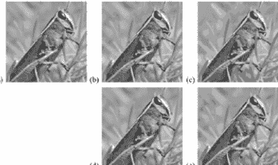

**图 7.2：** （另见彩色插页。）(a) 使用 136,945 种颜色的蚱蜢源图像。(b) Photoshop，256 色。(c) Photoshop，16 色。(d) WBP，256 色。(e) WBP，16 色。(© Picstudio/Dreamstime.com)

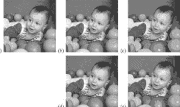

**图 7.3：** （另见彩色插页。）(a) 使用 112,024 种颜色的儿童源图像。(b) Photoshop，256 色。(c) Photoshop，16 色。(d) WBP，256 色。(e) WBP，16 色。(© Pavla Zakova/Dreamstime.com)

## 参考文献

- [1] Daniel Aloise, Amit Deshpande, Pierre Hansen, and Preyas Popat. "欧几里得平方和聚类的 NP 难性". Machine Learning, 第 75 卷, 第 2 期 (2009 年 5 月), 第 245–248 页.
- [2] Charles Poynton. "颜色常见问题". http://www.poynton.com/ColorFAQ.html
- [3] E. Garcia. "幂法（向量迭代）". http://www.miislita.com/information-retrieval-tutorial/matrix-tutorial-3-eigenvalues-eigenvectors.html#power-method

## 第 8 章：3D 立体渲染：实现问题概述

Anders Hast

UPPMAX, 乌普萨拉大学

### 概述

近年来，娱乐行业对 3D 显示技术领域的兴趣日益浓厚。如今，电影行业正在全面推进，全球成千上万家 3D 立体电影院正在安装，电影制作公司也在制作 3D 电影。事实上，一种新的职位应运而生，即立体师，负责确保观众能够无问题地观看场景。立体师需要处理的一些事项将在本文中解释。同时，许多面向家庭观众的产品已以可负担的价格开发并销售给不断增长的客户群，包括支持立体显示的电视机和计算机屏幕。这使得游戏行业拥有一个习惯于观看 3D 立体内容的用户群，并且在未来，他们可能也期望自己喜爱的游戏能够以立体 3D 形式发布。本文主要讨论最常见的立体显示类型，即平面立体显示。与其他类型的立体显示不同，这些显示器通过使用两个平面表面来实现深度感。我们的讨论基于为立体显示设计内容的重要性以及必须考虑的不同观看条件。此外，我们讨论了有助于计算这些观看条件的数学方法，以便能够无问题地观看内容。最后，我们概述了不同类型的显示技术。

我们首先简要介绍立体视觉领域及不同深度线索，涵盖一些实现细节。然后，我们将逐一探讨在将立体显示支持集成到游戏引擎时可能出现的一些问题。尽管大多数术语在本文中已有解释，但读者使用 [6] 提供的在线词汇表可能会很有价值。


### 8.1 平面立体观看的机制

平面立体显示背后的概念可以简单地理解为创建游戏的两个平面视图，一个供左眼使用，一个供右眼使用。然后，重要的是要确保每只眼睛只看到为其预期的视图。涉及的过程可以被视为编码和解码过程。在科学可视化中，人们认为立体图像旨在帮助观众形成数据集的3D心理图像。而在视频游戏中，另一方面，其目的是给玩家提供更丰富的视觉体验。

为了在普通渲染游戏（即单眼渲染）中创建深度感，使用单眼深度线索，这与稍后讨论的双眼深度线索形成对比。单眼深度线索的一些示例如下：

- 遮挡发生在靠近观众的物体遮挡更远处的物体时，这由深度缓冲区算法处理。

- 视差是由观察者运动引起的一种效果，它产生一种错觉，即靠近观察者的物体比更远处的物体移动得更快。例如，对于从移动火车窗户向外看的人来说，前景中的树木似乎比远处的山丘移动得快得多。

- 由于透视投影，物体的大小会根据与观众的距离而变化，其中平行线在地平线处汇聚。

- 纹理细节级别提供关于物体距离的信息。

- 诸如散射或雾霾之类的大气效果会使物体相对于其与观众之间的距离而显得更灰。

- 着色和阴影告诉我们关于曲率和物体间关系的信息。

- 靠近地平线也提供了一个深度线索，因为我们知道地平线很远，因此靠近地平线的物体被感知为很远。

立体显示对这些线索增加的是三种已知的双眼深度线索：调节、汇聚和视网膜差异。汇聚发生在我们在现实生活中通过旋转眼睛来聚焦于一个物体，使其视线在感兴趣的点相交时。同时，我们对眼睛中的晶体施加压力以聚焦，这称为调节。在正常的自然观看条件下，调节和汇聚相对应且是习惯性的，但可以通过交叉眼睛自愿地使其失去功能。第三个线索是视网膜差异，这涉及到我们有两个落在两个视网膜不同点上的视网膜图像的事实。这些随后由大脑合并并被感知为单个图像。

我们定义的虚拟空间被屏幕分为两个区域，称为视图空间和屏幕空间。观众与显示器之间的体积是视图空间，而显示器后面的体积称为屏幕空间。如果我们观察一个与其投影到的显示表面处于相同深度的点，如图8.1左图所示，那么显示器上的同源点具有零视差，因为它们没有横向位移。同源点是立体对中相同的特征；因此，对于非零视差，空间中的同一点位于左右立体图像的不同位置。位于视图空间或屏幕空间中的点具有横向位移，然后被认为具有负视差或正视差。所有三种情况都在图8.1中显示。在显示表面后面的一点汇聚会导致显示器上的同源点具有正视差。该点被认为位于屏幕空间。同样，在显示表面前面的一点汇聚会导致显示器上的同源点具有负视差，该点被认为位于视图空间。

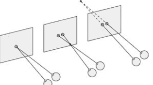

**图 8.1:** 可能出现的三种不同类型的视差，从左到右——零视差、负视差和正视差。

如图8.2所示，将眼睛轴汇聚到距离为\(D_c\)的虚拟点上，支持视差图像的融合和立体视觉，其中立体视觉是视觉感知中的一种心理过程，它导致从世界投射到每只眼睛上的两个略有不同的投影中产生深度感觉[1]。保持屏幕上的视觉结构聚焦需要在屏幕距离\(D_s\)处进行调节。通常，调节占主导地位，对于未辅助观看，我们看到一个平面双图像聚焦。经过一些训练（交叉眼睛），我们可以在\(D_c\)处汇聚并看到一个融合的3D图像失焦。立体设备（如立体眼镜）在很大程度上支持图像融合和立体视觉，代价是抑制调节。

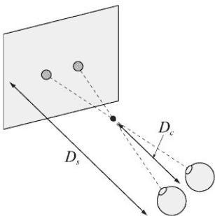

**图 8.2:** 平面立体显示中的汇聚和调节。

## 3D立体图像的尺度考量

为了创建舒适的立体图像，我们需要为给定设置计算正确的透视，并确保保持在这些限度内[8]。使用立体显示会产生一些新情况。主要是在建模虚拟视图体积和创建实际立体对时，尺度考量很重要。

当汇聚到某个特定距离的物体时，场景中不同距离的一点会在视网膜上出现一些横向差异，与汇聚无关，如图8.3所示。瞳距（IPD）是从每只眼睛的瞳孔中心测量的两眼之间的距离。根据Kalawsky [12]，视网膜差异计算为图中所示两个角度的差：

```
$disp=\theta_1-\theta_2$.
```

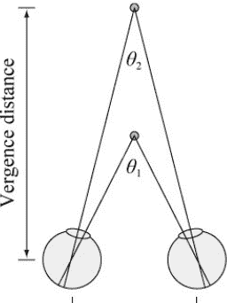

**图 8.3:** 用于计算视网膜差异的两个角度。

超过10°的视网膜差异会导致复视（双重视觉），并且当然应始终避免。

立体显示中的投影不是线性缩放的。我们在大脑中融合的两个点的投影，很大程度上取决于我们坐在屏幕多远以及屏幕有多大。当该点投射到我们的眼睛时，我们眼睛之间的距离也是一个重要影响因素。平均人的眼间距约为6.5厘米。在较少见的情况下，我们可以发现两眼之间距离高达7.5厘米的人，而最大的受众或用户群体——年轻人，两眼之间的距离可能只有4.5厘米。并且应记住，人与人之间存在很大差异，特别是在不同大陆之间[4]。一些好的建议可能是让IPD成为由玩家设置的可调变量，以提供舒适的立体深度。

我们深度感知的物理极限约为200码。这是因为超过这一点，我们根本得不到任何汇聚信息，因为我们的视线或多或少是平行的。在创建虚拟空间时必须考虑这一重要事实，我们必须在开始放置对象之前设计它。

立体图形中的另一个实际问题是，不应超过1.5°视角的视差值，以避免感到不适[13]，如图8.4所示。不同观看距离D的屏幕视差（osp），以厘米为单位，如表8.1所示。

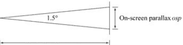

**图 8.4:** 不应超过1.5°视角的视差值。

**表 8.1:** 屏幕视差值的实际示例。

| D (cm) | 屏幕视差 (cm) |
|---|---|
| 50 | 1.31 |
| 75 | 1.96 |
| 100 | 2.62 |
| 200 | 5.24 |
| 300 | 7.86 |

现在让我们来看一些实际示例，了解由于观察者距离和负视差情况下的osp，虚拟空间深度是如何受到限制的，如图8.5所示，其中d是虚拟空间深度。我们有

$$\frac{osp}{IPD} = \frac{d}{D+d}$$

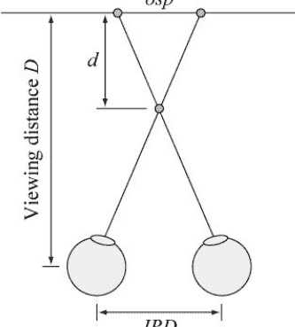

**图 8.5:** 负视差。

求解d可得

$$d = \frac{D}{IPD/osp - 1}$$

同样，我们可以计算虚拟空间深度d是如何受到限制的


由于观测者的距离 $D$ 和图 8.6 所示正视差情况下的 $osp$。表 8.2 和 8.3 显示了负视差和正视差情况下的一些示例值。

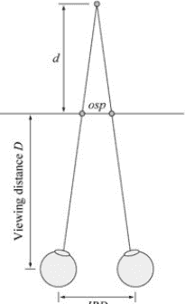

图 8.6：正视差。

表 8.2：IPD=6.5 cm，负视差示例。

| D (cm) | osp (cm) | d | d/D |
|---|---|---|---|
| 50 | 1.31 | 8.38 | 0.17 |
| 75 | 1.96 | 17.40 | 0.23 |
| 100 | 2.62 | 28.72 | 0.29 |
| 200 | 5.24 | 89.24 | 0.45 |
| 300 | 7.86 | 164.17 | 0.55 |
| 400 | 10.47 | 246.83 | 0.62 |

表 8.3：IPD=6.5 cm，正视差示例。

| D (cm) | osp (cm) | d | d/D |
|---|---|---|---|
| 50 | 1.31 | 12.61 | 0.25 |
| 75 | 1.96 | 32.47 | 0.43 |
| 100 | 2.62 | 67.47 | 0.67 |
| 200 | 5.24 | 829.45 | 4.15 |
| 300 | 5.76 | 1714.7 | 7.79 |
| 400 | 6.42 | 18612.4 | 75.97 |

在着手为你的游戏计算数学之前，有一些值得提及的事项。首先，应注意文献中最大允许视差的值以不同术语表示，例如角视差、屏幕视差等。这些值有时仅作为经验法则适用。Lipton 的值似乎适用于许多 VR 应用，但它们并不普遍适用于所有观看条件。根据 Lipton 的说法，合成立体图像是一门艺术，而非科学。归根结底，重要的是它看起来和感觉良好！

## 基本设置

已经提出了若干关于如何尽可能高效地设置和渲染立体显示图形的方案。一种方法是让图形驱动程序处理它。一些主要的图形供应商在其驱动程序中原生支持立体显示，从而创建立体对。这确实要求游戏与立体显示兼容，内容需符合这类系统的格式。并且这会将你的游戏局限于仅用于这些特定的显卡供应商，以使游戏以立体方式工作。在游戏行业背景下，第二种较少见的替代方案是创建图形命令拦截器 [3]。这是一个假装是图形驱动程序并拦截应用程序发送的所有图形的应用程序。这些图形可以存储，然后理论上可用于创建两个立体对。仍然要求游戏创建适合立体显示的内容。

通常，我们会使用以下简单方法来创建立体游戏。

```
while (user wants to play)
doGameLogic()
setupProjectionForLeftEye()
render()
setupProjectionForRightEye()
render()
```

在我们的游戏中，我们必须设置虚拟相机以聚焦于感兴趣点，如图 8.7 所示，使用先前描述的数学方法，以确保视差不超过允许的虚拟空间深度值。

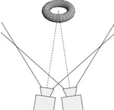

图 8.7：3D 立体游戏的相机设置。

### 8.2 立体技术

当今市场上有三种不同的流行立体图形观看技术：红青立体（又称红/绿立体）[2]、时分复用和偏振。我们简要概述了这些技术，提及一些优缺点，并检查每种技术的编码和解码过程。讨论的一个重要概念是鬼影 [14]，应尽可能避免。鬼影是指一只眼睛看到一些本应给另一只眼睛的内容。

### 红青立体

红青立体是向玩家传递立体游戏内容最简单、最廉价的方式。在这里，左视图和右视图通过波长分离来分离。左视图简单地编码在红色通道中，右视图编码为互补色，例如绿色通道或蓝色和绿色（青色）两者。玩家需要戴上众所周知的红/绿眼镜来分离两幅图像，以便每只眼睛只看到专为它准备的图像。因此，眼镜镜片的颜色对应于编码图像的颜色通道，这也是其名称的由来。源被编码为一幅图像，这意味着该方法可用于多种不同的媒体，甚至印刷形式。

在游戏中使用此技术的好处是它不需要任何特殊的显示系统，只需要一副廉价的红/绿眼镜即可查看效果。当你购买带有特殊 3D 中期插页的喜欢的漫画杂志时，你可能免费得到了一副纸板眼镜，带有亚克力镜片。

使用此技术的一个陷阱是，玩家必须校准屏幕，使颜色与滤镜眼镜匹配。否则，玩家会看到大量鬼影，立体效果质量差。

还存在明显的颜色损失，因为大量颜色信息被滤除。

一种更复杂的版本，有时称为超红青技术，使用光谱复用，更常被称为干涉光技术（INFITEC）[9]。光谱复用通过将可见光谱分为六个窄带，每种原色（红、绿、蓝）各两个带来工作。这些带随后由滤光片分离，并划分，使得每种颜色的一个带到达每只眼睛。也就是说，一半的红光谱到达左眼，另一半到达右眼，以此类推。该系统要求两个执行此光谱复用的不同类型的滤光片安装在两台投影仪上用于显示，以及一副轻便眼镜，玩家佩戴，每只眼睛一种类型。因此，观众如果闭上一只眼睛，会清楚地看到到达该眼睛的颜色信息与仅使用另一只眼睛观看显示器相比略有不同。尽管如此，颜色差异小于使用红/绿眼镜时看到的差异。最后，大脑毫无问题地将这两幅图像合并为一幅，图像看起来符合预期。

### 时分复用

该技术通过时间交错来编码立体对。因此，一帧显示给左眼，而右眼被主动快门遮挡。同样，下一帧对右眼可见，而左眼被遮挡。如果此过程足够快，玩家会将交错的图像感知为一个连续的图像流，并获得正确的立体视觉。这项技术将有效帧率减半，因为需要渲染两倍的图像才能获得相同的更新率。遮挡由一副主动快门眼镜执行，通常是一副与显示器同步的 LCD 屏幕。当显示系统显示新帧时，它向眼镜发送信号以进行快门操作。很明显，此技术需要比简单的红/绿眼镜贵得多的眼镜。此外，它不能用于印刷媒体，因为显示系统必须有两个输出源。

### 偏振光

图像分离也可以通过使用偏振对每幅图像进行编码来实现。两幅图像由显示系统通过一对正交偏振滤光片叠加到屏幕上。观众也佩戴一副带有相应滤光片的眼镜，与主动快门眼镜相比相对便宜。眼镜中的偏振方向与源上的相对应。因此，眼镜中不需要额外硬件，但再次需要两个光源，且此技术不能用于印刷媒体。观众使用此技术时不得歪头，因为这会导致严重的鬼影。或者，可以使用圆偏振来尝试避免此问题。在所有情况下，偏振滤光片会降低源的亮度，因为原始内容被滤除。

### 总结

先前提到的所有三种技术（红青立体的 INFITEC 变体除外）已成为玩立体游戏的主流。一副红青眼镜价格非常低，玩家无需投资任何额外硬件即可享受立体游戏，但它在所提及的三种技术中产生最差的颜色表现。然而，帧率不必像时分复用那样增加。时分复用要求玩家获取实际眼镜，并且拥有一个最好能发射 120 Hz 的源，因为使用此技术时实际帧率减半。当前趋势是越来越多此类显示器和电视正在推出。偏振光技术要么实现为主动偏振显示器，要么通过拥有两个


针对真正追求奢华的玩家的投影仪。无论如何，眼镜是被动式的，因此通常更便宜。

### 8.3 3D 场景的设计注意事项

与单眼游戏引擎相比，为立体游戏引擎创建内容时到底有什么不同？有些近似方法在移植到立体显示器时可能看起来非常糟糕或非常平淡。我们将在本节中讨论其中一些。同样重要的是避免一些可能让玩家感到不愉快的情况 [10]。

裁剪可能会成为一个问题，因为我们需要针对两个视锥体进行裁剪。针对单眼视锥体进行裁剪会产生错误的结果，因为它比左右视锥体的组合要小。这个问题至少有两种处理方式：要么一次性针对左右联合视锥体进行裁剪，要么分别针对两个视锥体进行裁剪。

立体渲染的朴素形式是从两个不同视角渲染两次场景，成本大约是两倍。有些效果不需要计算两次，例如与视点无关的效果。单眼渲染中通常采用的一些捷径在立体渲染中不适用。如果这些视觉效果对游戏性不是关键，例如物体周围的光晕，可以将其关闭或替换为类似的基于物体的效果。

只有当离屏缓冲区具有某些与视图相关的效果时，才需要对其进行复制。这适用于阴影映射以及基于视图锥体设置的阴影贴图的变体。许多常用的屏幕空间后处理效果在立体显示下效果不佳。需要小心的一件事是高动态范围（HDR）渲染。左右视图之间的对比度非常重要，如果我们分别对左右眼睛应用色调映射，可能会引入对比度偏移，从而导致玩家疲劳。

广告牌是另一种常用效果，在立体显示器上移植效果不佳。广告牌是始终面向观看者的2D对象，在某些条件下看起来像两个平面对象，而不是它们原本意图的体积对象。同样的情况也适用于替身——它们必须是与眼睛相关的，否则在立体显示器上看起来会完全平坦。这也会带来性能损失，因为需要渲染两倍数量的替身。

在立体显示器上，背景必须放置在适当的深度，以便它们看起来像通常的背景一样遥远。这对于天空盒和天空穹顶尤其重要，否则它们看起来会离玩家太近，仿佛天空是天花板的一部分。这也与场景中的深度范围有关。如果使用需要不同深度范围的技术，这些技术也会破坏立体感。不同的深度范围意味着立体显示中不同的深度，物体最终会出现在虚拟房间的意外位置，导致它们看起来变形。

图形用户界面（GUI）等叠加层也会出现同样的效果，它们通常在屏幕空间中渲染，没有深度信息。然而，在立体显示中，这会产生矛盾的深度线索，因为菜单可以绘制在视图空间中的物体之上，但遮挡线索暗示我们应该看到该物体。GUI 应该位于物体之后，但由于屏幕空间渲染的后果，它位于错误的深度。解决这个问题的一个方法是始终将 GUI 放在离玩家最近的位置。取决于虚拟房间的设置方式，这个解决方案可能会把 GUI 推到玩家脸上，因此必须非常谨慎地操作。

传统上在屏幕空间中进行的其他效果，例如文本标签，也必须在游戏世界中放置在适当的深度。这意味着它们也可能被前面的物体遮挡，这可能会改变实际游戏的玩法。除了 GUI 和文本标签，我们通常还会有某种输入设备的表示。操作系统渲染的标准鼠标光标经常以不同的方式导致异常。如果我们将内容渲染到并排缓冲区中（这是渲染3D内容的常见技术），由于两只眼睛共享同一个缓冲区，我们只能在一只眼睛中看到光标。用一只眼睛看到本应由两只眼睛看到的物体非常令人恼火，应该始终避免！

因此，当指针在屏幕空间中渲染时，我们会遇到与 GUI 相同的问题。因此，建议创建一个软件光标，将其作为具有深度的对象放置在世界中。

如果从一个场景到另一个场景的焦点变化剧烈，眼睛会非常疲劳，观看者甚至会短暂地失去3D效果。如果一个物体在一个场景中出现在观看者非常近的地方，那么在场景切换之前可以将其稍微拉远，或者更确切地说，需要将焦点拉回到下一个场景的焦点位置。传统游戏通常从不考虑这一点，但这可能会成为立体游戏开发者的一大挑战。带有字幕的立体电影也会出现类似问题，因为观看者需要反复改变焦点，这肯定会让他们感到疲劳。观看者可能最终会专注于电影，甚至懒得去读字幕。

当物体在视图空间中移出屏幕时，也会出现与遮挡相关的矛盾深度线索的情况。此时，深度线索告诉玩家物体在屏幕前面，但当它靠近屏幕的右侧或左侧边缘时，它会消失在屏幕后面。为了使这种所谓的边缘冲突不那么明显，我们可以缓慢地将物体移出屏幕，或在屏幕上引入虚拟边框。这些边框将是位于离观看者最近深度的两个保护带，以防止矛盾的深度线索。这种解决方案被称为浮动窗口，早在1950年代就已使用 [15]。迄今为止，它尚未用于计算机游戏，但最近被用于皮克斯动画片《飞屋环游记》。

在迁移到立体显示时，我们也看到游戏中对可接受帧率下限有更高的要求。人们倾向于在立体观看时如果帧率低于60 FPS就会感到卡顿，这个数字远高于单眼显示器。取决于玩家使用的观看设备类型，我们还可能遇到立体内容逐帧传输的问题。

### 8.4 展望

使用立体显示器是以沉浸感形式提升游戏价值的好方法。尽管立体显示器在科学可视化等其他领域已经使用了一段时间，但这仍然是一个相对未被探索的领域。电影行业在立体显示器方面比游戏行业拥有更多经验，我们现在开始看到越来越多为这类显示器制作的电影。游戏行业何时会追随这些脚步，发布更多直接面向立体启用设备的游戏？到目前为止，大多数支持立体的游戏都是从单眼游戏移植而来。从单眼到立体的跨越也为我们游戏开发者在设计上创造更有趣的游戏提供了新维度。毕竟，3D立体成像被电影制作者视为另一种重要的叙事技巧。未来将有许多新的设计方法，既包括纯渲染角度，也包括游戏性角度。一个有趣的方法是从一个虚拟相机位置渲染场景，并使用深度缓冲区中的信息通过基于深度图像的渲染（DIBR）[7]生成立体对。仅在立体模式下可用的独特游戏体验的一个简单示例可能是许多涉及枪支的游戏中常见的狙击镜。处理此问题的标准方法是在屏幕中间渲染一个圆圈，玩家在其中看到世界的放大部分。立体版本可以在玩家使用瞄准镜放大时，让一只眼睛变黑，玩家也会失去立体视觉，从而带来更多的真实感和沉浸感。

未来还包含其他类型的立体显示器，称为自立体显示器。这些显示器无需眼镜即可工作，但必须渲染远多于两个视图 [11, 5]。尽管该技术已经存在很长时间，但它仍未被广泛接受，因为它有一些缺点，例如鬼影。确保你的游戏引擎适用于 plano-


立体显示是让它们与自动立体显示平滑协同工作的一步，本文档中提出的指南将帮助你作为游戏引擎设计师实现这一目标。

## Acknowledgements

作者谨感谢乌普萨拉大学的 Stefan Seipel 和乌普萨拉大学 UPPMAX 的 Martin Ericsson 为本文档提供素材。

## References

- [1] Akiyuki Anzai, Izumi Ohzawa, and Ralph D. Freeman, "处理双眼信息的神经机制". *神经生理学杂志*, Volume 82, Number 2 (1999 年 8 月), pp. 891–908.
- [2] 红蓝立体图. http://en.wikipedia.org/wiki/Anaglyph_image
- [3] Chromium. http://chromium.sourceforge.net/
- [4] Neil A. Dodgson. "人类瞳距的变化与极值". *SPIE 立体显示与虚拟现实系统 XI 论文集*, 2004, pp. 36–46.
- [5] Neil A. Dodgson, J. R. Moore, and S. R. Lang. "多视角自立体 3D 显示". *IBC (国际广播大会) 1999*, pp. 497–502.
- [6] 国际立体联盟. "国际立体联盟：立体术语词汇表". http://www.stereoscopy.com/isu/glossary-index.html
- [7] Julien C. Flack, Hugh Sanderson, Steven I. Pegg, and Simon Kwok. "立体游戏驱动程序中 3D 图像质量与性能的优化". *SPIE 立体显示与应用 XX 论文集*, 2009.
- [8] Graham R. Jones, Delman Lee, Nicolas S. Holliman, and David Ezra, "控制立体图像中的感知深度". *SPIE 立体显示与虚拟现实系统 VIII 论文集*, 2001, pp. 42–53.
- [9] Helmut Jorke and Markus Fritz. "INFITEC——一种基于波长复用成像的新型立体可视化工具". *三维图像杂志*, Volume 19, Number 3 (2005 年 9 月), pp. 50–56.
- [10] Jukka Häkkinen, Monika Pölönen, Jari Takatalo, and Göte Nyman. "虚拟显示游戏中的模拟器疾病：立体与非立体情况的比较". ACM 国际会议论文集, Volume 159 (2006), pp. 227–230.
- [11] Ken Perlin, Salvatore Paxia, and Joel S. Kollin. "一种自立体显示器". 第 27 届年度计算机图形与交互技术大会论文集, 2000, pp. 319–326.
- [12] Roy S. Kalawsky. 虚拟现实与虚拟环境科学. Addison-Wesley, 1993.
- [13] Lenny Lipton. CrystalEyes 手册. StereoGraphics Corporation, 1991.
- [14] Bernard Mendiburu. 3D 电影制作：从剧本到银幕的立体数字电影. Focal Press, 2009.
- [15] Raymond Spottiswoode and Nigel Spottiswoode. 立体传输理论及其在电影中的应用. 加州大学出版社, 1953.

## Chapter 9: A Multithreaded 3D Renderer

Sebastien Schertenleib
Sony Computer Entertainment Europe

### Overview

3D 渲染器仍然是大多数现代视频游戏的主要组件之一。通常，3D 渲染引擎处理通过 DirectX、OpenGL 或 libgcm 等 3D 图形 API 暴露的软件和硬件管道。如今，多核 CPU 在游戏主机和 PC 上广泛可用。为了确保 GPU 持续获得可处理的数据，3D 渲染器充分利用可用处理核心来利用这种新的编程方案至关重要。在屏幕上创建 3D 图像的工作流程依赖于准备 GPU 可以解释和执行的命令列表。

可以采用不同的方法来解耦 CPU 与 GPU。例如，一种常见的技术是使用双缓冲或三缓冲方案，其中 CPU 在帧 N 中构建命令，而 GPU 在帧 N+1 中消耗它们，如图 9.1 所示。或者，GPU 可以在同一帧内消耗数据以减少延迟，如图 9.2 所示。一个潜在的缺点是，在帧早期可能难以避免一些 GPU 停顿。另一方面，与双缓冲方法相比，内存占用量要小得多，这在内存受限的嵌入式系统中尤为重要。

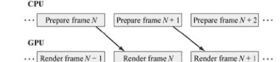

图 9.1：在双缓冲方案中，GPU 消耗数据的时间比 CPU 生成数据晚一帧。

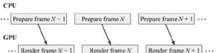

图 9.2：在此方案中，GPU 在 CPU 生成数据后不久即消耗数据。

### 9.1 The Memory Model

无论显示列表如何创建，渲染器最终可能受限于内存访问速度，特别是当图形命令通过单线程生成时。近年来，GPU 处理能力与内存延迟之间日益扩大的性能差距，使得由于系统内存中昂贵的数据访问而更难以向 GPU 提供数据，如图 9.3 所示。一个典型的帧被细分为多个 pass，例如处理阴影贴图渲染、主场景渲染和全屏后处理效果渲染。渲染期间的一个工作单元通常称为 batch，它将一组渲染状态、着色器和几何元素结合在一起，如下面的清单所示：

```
//setting up a batch
setRenderStates (...);
bindTextures (...);
setShaders (...);
setShaderConstants (...);
setVertexBuffer (...);
setIndexBuffer (...);
drawCall (...);
```

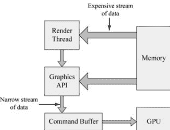

图 9.3：渲染线程和图形 API 都可能访问内存中各种位置的数据。

设置 batch 主要涉及设置渲染对象所需的各种资源的地址。在创建 batch 的过程中，渲染代码需要遍历场景图，并且可能访问主内存中各种位置的数据。这会导致大量缓存未命中。使用 Xbox 360 和 PlayStation 3 游戏主机中常见的 PowerPC 芯片等顺序 CPU 时，每次发生缓存未命中时，处理器可能会停滞数百个周期，极大地影响性能。这个问题可以通过乱序 CPU 来缓解，因为在先前的指令等待数据准备就绪时，其他指令可能会被执行。

有人可能会认为，可以重新组织数据结构以避免许多缓存未命中惩罚。确实，采用缓存感知或缓存无关算法 [2] 有所帮助，尤其是对于场景图管理，但不幸的是，图形库还需要自行访问和操作一些数据。顶点缓冲区和索引缓冲区等大型结构通常存储在 GPU 的本地内存中，因此不会造成问题，但许多类型的渲染状态，例如着色器常量和纹理配置，需要每帧复制到命令缓冲区。因此，需要替代方案来克服缓存限制。

### 9.2 Building the Display Lists in Parallel

为了确保显示列表在最短时间内创建，并尽量减少内存带宽限制，我们的解决方案使用多个线程，每个线程负责创建渲染命令的一个子集。但是，只有当 3D 图形库暴露出这种粒度级别时，这才是可能的。幸运的是，Xbox 360、PlayStation 3 和 DirectX 11 开发者的情况正是如此。在 PlayStation 3 中，Cell Broadband Engine 的协同处理单元 (SPU) 是纯矢量处理器，在几何处理方面表现出色。这意味着它们可以轻松执行图形操作，在必要时帮助卸载 GPU 的工作。为了并行创建显示列表，一种常见的范式是让主命令缓冲区引用在次要命令缓冲区内创建的显示列表。这些显示列表在不同的执行单元上并行创建，如图 9.4 所示。通常，这些次要缓冲区处理帧的一个子集，粒度可以从单个 draw call 到整个 pass 不等。

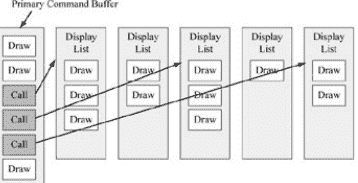

图 9.4：主命令缓冲区引用多个次要命令缓冲区，每个缓冲区处理帧的一个子集。

通过将 draw call 及其图形状态的创建分布到多个并行命令缓冲区，创建显示列表的总延迟大大降低，这


在使用图 9.2 所示的方案时尤其有用。此外，这使得 3D 渲染器能更好地适配各种多核架构配置，并有助于生成现代视频游戏中常见的成千上万个绘制调用。

### 9.3 Parallel Models

3D 渲染器是并行化的有力候选者，因为每个绘制调用通常可以被视为一个独立的工作单元。这些任务中的每一个都将一块数据与用于操作该数据的逻辑配对，如下面的代码清单所示。

```
int TaskMain(...)
{
    const int sourceAddr = ...; // source address of
    const int count = ...; // number of elements
    const int dataSize = count * sizeof(gfxObject);
    // On some platforms like the PS3,
    // you may have to keep the data local to the ex
    gfxObject *buffer = (gfxObject *) Allocate(dataSize)
    DmaGet(buffer, sourceAddr, dataSize);
    DmaWait(...); // barrier to wait for the data
    // let's do some work
    for (int i = 0; i < count; ++i)
    {
        buffer[i]->update();
    }
    // On some platforms like the PS3,
    // you may have to store back the data to system
    DmaPut(buffer, sourceAddr, dataSize);
    DmaWait(...); // barrier to wait for the data
}
```

该模型提供了一种高效的并行范式，其中每个任务都可以排队并由可用的处理单元消耗，如图 9.5 所示。这也避免了更标准的多线程方法的一些问题，因为任务提供了更细粒度的细分，并能更容易地应对不均匀的计算，而多线程架构可能最终会等待某个子系统完成其任务。

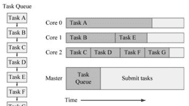

图 9.5：任务存储在队列中，并由可用的处理单元消耗。

### 9.4 Synchronizing the GPU and CPU

在多线程环境中，同步 GPU 和 CPU 更难处理，因为多个处理单元可能都想访问相同的数据。为了避免任何不一致和竞态条件，需要使用互斥锁或原子操作等同步原语。通常，GPU 可以在特定内存区域中报告其进度。例如，当 GPU 上的某个特定命令完成后，它可以将指定值或“报告”写入 CPU 可访问的位置以指示完成。根据架构，CPU 可以轮询报告值或接收某种系统回调。表 9.1 列出了一些可能的配置。

### 表 9.1：同步 GPU 和 CPU。

| CPU | CPU | 报告 | 注释 |
|---|---|---|---|
| ... | WaitReport(22) | 0 | GPU 等待报告被设置 |
| SetReport(22) | WaitReport(22) | 22 | GPU 现已解锁 |
| ... | ... | 22 | |
| WaitReport(33) | | | CPU 等待报告被设置 |
| WaitReport(33) | SetReport(33) | 33 | GPU 设置了报告并解锁 CPU |
| ... | ... | 33 | |
| SetReport(12) | SetReport(15) | ? | 竞态条件 |
| WaitReport(33) | WaitReport(22) | ? | 死锁 |

与任何多线程环境一样，需要特别小心以避免潜在的竞态条件或死锁，因为 CPU 和 GPU 都可能以不可预测的时序模式生成和消耗数据。

### 9.5 Using Additional Processing Resources

在许多游戏中，可用处理单元之间的处理负载并未完全平衡。在这种情况下，将一些通常在主 CPU 上执行的操作移至每帧可能有空闲时间的其他单元可能是有价值的。例如，对图形要求不高的应用程序可以使用 CUDA 等技术，利用 GPGPU（通用 GPU）代码将物理或 AI 模拟从 CPU 卸载。另一方面，致力于突破实时 3D 图形极限的游戏可能希望使用空闲 CPU 核心来执行一些图形操作。如果这些核心提供了带有 SIMD 指令的有趣 ISA（指令集架构），例如 Cell 处理器上的 SPU，那么就有可能为多种操作卸载 GPU，例如以下操作：

- 几何处理，包括用于创建地形、树木、贴花或细分曲面的过程式算法。
- 物理和粒子系统更新。
- 视锥体物体剔除或遮挡剔除。
- 软件渲染，特别是用于遮挡查询和后处理效果。

### 9.6 Reducing the Pressure on the Memory Bandwidth

CPU 和 GPU 的性能都在以非常快的速度提升，但内存速度并未遵循同样的曲线，因此内存带宽正成为越来越显著的瓶颈。因此，考虑任何有助于尽量减少对内存系统需求的技术都很重要，即使这意味着使用更多的 CPU 或 GPU 周期。可使用的技术包括打包着色器输入和输出属性，或在可用时使用 GPU 的细分单元。在 CPU 侧，特殊的几何剔除可以避免发送多达 70% 最终会被 GPU 丢弃的原始图元（背面、屏幕外、零尺寸和退化原始图元）。另一种技术是在软件中生成粗糙深度缓冲区以执行遮挡查询，而不是依赖 GPU [1]，因为后者可能涉及从显存读回，这通常是一条缓慢路径。

### 9.7 Performing Graphical Operations in Parallel

迄今为止，我们讨论了一些有助于提升整体性能的技术，但我们可以更进一步，允许不同的处理单元并行工作以生成一帧的最终图像。现代游戏在单帧中使用多个渲染目标，其中一些不会被 GPU 同时访问。例如，通常可以使用另一个处理单元（如 SPU）访问后台缓冲区以执行一些后处理效果，而 GPU 开始渲染下一帧。这最多可提供一整帧的时间来渲染效果，同时保持相同的帧率，但代价是增加一帧的延迟（参见图 9.6）。

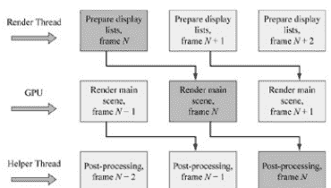

图 9.6：当辅助线程计算后处理效果时，GPU 开始渲染下一帧。

## 参考文献

- [1] Johan Andersson. "游戏引擎与 GPU 的交汇点：当前与未来". Graphics Hardware 2008.
- [2] Sebastien Schertenleib. "ABT 树的高效缓存无感知实现". Game Programming Gems 5, Charles River Media, 2005.

## 第 10 章：面向多线程渲染的以摄像机为中心的引擎设计

Colt McAnlis

Blizzard Entertainment

### 概述

现代图形 API 通过允许在独立线程上创建绘制命令，赋予了并行渲染的能力。因此，先进的引擎设计必须具备实际可扩展的能力，以便利用增加的核心数量进行渲染。要实现这一点，引擎必须解决如何正确拆分渲染任务以进行并行计算的问题，但要做到这一点，它首先必须考虑渲染子系统实际上在做什么。

现代图形引擎需要对同一场景进行多次渲染，以帮助最终图像的整体外观。例如，计算阴影映射、运行时反射、屏幕分块（用于某些游戏主机的抗锯齿）、冒充体生成和屏幕外粒子，都需要对场景进行单独渲染。因此，将“摄像机”视为与环境可见性直接相关的最粗粒度场景组织形式是合乎逻辑的，因为要可视化上述任何概念，首先必须定义视图位置、视图方向，最终还需要一个用于存储结果的渲染目标。由于场景的大多数视图可以相互独立地进行渲染，我们认为按摄像机视图分组渲染工作负载，能提供最佳的渲染工作负载组织方式，以充分利用多核渲染。

在本文中，我们介绍了一种引擎设计，该设计利用摄像机概念来分离并行渲染作业，从而实现对多核系统的扩展。为实现此目标，我们介绍了两个概念。第一个是创建可记录命令缓冲区的 API 无关方法，这一过程使我们能够在任何设备上使用并行渲染。第二个是关于如何根据将使用的摄像机，将命令缓冲区的创建分发到独立线程的观察。利用这两个简单而强大的概念，可以使您的引擎以最少的


痛苦可能。

### 10.1 视频游戏中多核的用途

随着多核系统普及的热潮，开发者们争相将适当的工作量填充到额外的核心中，以提升产品的视觉效果。不过，其缺点在于，对于那些硬件配置可能在不同用户之间（甚至同一用户之间）发生变化的平台上的开发者来说，必须做出关于如何在低端处理器上准确扩展视觉特性和工作负载的决策。

通常，我们会并行运行粒子、动画、物理等内容，这些内容可以为低端机器内置细节层次（LOD）。然而，这一概念并不直接适用于向图形 API 提交命令的行为，这一过程很容易产生巨大的性能开销。DirectX 9 和 DirectX 10 等 API 深受其害，因为频繁调用基本 API 函数成为性能负担并不罕见。这通常会导致渲染阶段延迟架构中其他系统的处理，如果这些系统高度依赖刷新率，就可能引发问题。此问题的根源在于，我们被要求在拥有设备的线程上向设备提交命令，而对于大多数游戏来说，这正是运行模拟逻辑的同一线程。如需深入了解此过程，请参阅 [2]，其中提供了许多重要且文档完善的示例。

图 10.1 展示了给定游戏引擎的示例帧设置。在此示例中，渲染设备由主线程拥有，因此渲染场景会阻塞模拟更新的频率。如所述，仅使用线程池的两个系统是粒子和动画，这主要归功于它们能够在没有内存竞争的情况下进行更新，而为这些系统缩减精度或 LOD 的概念微不足道。我们帧的末尾经历了渲染阴影贴图、反射、主视图，最后是后处理的过程。由于必须在拥有设备的线程上向设备提交命令，大多数渲染命令都与基于逻辑的操作（如场景遍历、更新逻辑等）交织在一起。这种渲染架构会使维护引擎并将其移植到其他平台变得困难。

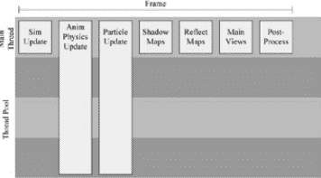

**图 10.1：** 并行处理的标准游戏用法。请注意，只有更新信息倾向于多线程。

公平地说，现代引擎的架构并不像图 10.1 所示那样糟糕，并且平均而言对线程池可用性的利用要好得多。[2] 中列出了各种视频游戏类型的一些出色替代线程架构，其中大多数通过将渲染设备所有权卸载到单独的线程来运行。这遵循了这样一个观察：模拟代码不需要以与图形渲染相同的频率进行更新，而将渲染卸载到不同的线程允许模拟在提交绘制请求后继续处理下一帧。

尽管这种架构现在更为常见，但它仍远非理想。即使将设备提交卸载到不同的线程，能够修改帧的绘制部分以更好地利用线程池可用性，从而更均匀地平衡线程利用率，也是有益的。

### 10.2 多线程命令缓冲区

现代渲染 API 在内部使用一种称为命令缓冲区的数据结构，其中包含在设备级别处理绘制命令所需的渲染信息。通常，这些命令缓冲区由暴露的渲染 API 代你填充，并插入到稍后执行的命令队列中。因此，调用渲染 API 的线程会承担填充命令缓冲区的开销，这种方式历史上一直是现代游戏的常见问题，常常会占用 CPU 周期。

在撰写本文时，少数 API 允许在与拥有设备的线程分离的线程上创建动态命令缓冲区或命令列表，这一过程使我们能够将填充命令缓冲区的开销分布到整个系统中。这对渲染引擎来说是一个重要的进步，因为我们现在能够更精细地控制跨线程系统的渲染引擎工作负载。然而，负面的一面是，旧版 API 不具备相同的能力，这给旨在兼容多个硬件级别的引擎带来了问题。

为解决此问题，Scheib [1] 提供了研究，展示了一种创建重载 DX9 设备的方法，该设备可以模拟较新 API 的相同录制能力。为此，他们重载了标准 DX9 接口的设备 API，并将其重定向到自己的系统，以构建类似内部命令缓冲区的自定义数据结构。然后，他们使用标准 DX9 调用将此命令缓冲区提交到拥有设备的主线程上的 API。在主线程上，我们仍然会承担提交 API 调用的开销，但由于批处理状态，主线程上 API 调用的开销显著降低，从而带来额外的性能提升。Scheib 表明，即使存在将缓冲区提交到传统 API 的开销，他们仍然可以通过在单独的线程上合成渲染命令数据来获得显著的性能提升。

### 10.3 与设备无关的命令缓冲区

对于希望在不进行太多代码重构的情况下减少 API 性能开销的旧版游戏，[1] 的方法效果相当不错，它提供了一种即插即用的解决方案，有利于性能。对于那些有条件进行分析且不受紧迫截止日期限制的游戏，值得指出的是，所提出的方法在复杂性方面可能被认为是过度设计，在 API 区分方面则是短视的。分析你的渲染系统将证明，只使用一部分设备 API，而且其中大多数出现在经常可预测的模式中。因此，在为设备生成 API 包装器时，你会浪费时间去支持你的游戏未使用的函数。

从逻辑上讲，API 调用无论如何都应隐藏在包装器接口之后，以最大限度地减少为支持多个平台和渲染 API 而需要重构的代码量；因此，动态命令缓冲区录制的 API 调用也应被隐藏是合理的。在此背景下，[1] 所提出的方法有所欠缺，需要一种自定义的与 API 无关的解决方案。

### RenderCommand 结构

为此，我们介绍了 `RenderCommand` 的概念，它包含以与设备无关的方式向 API 提交绘制调用所需的最少信息。实际上，我们的 `RenderCommand` 结构旨在模拟现代 API 在内部使用的绘制命令，包含有关使用哪个顶点缓冲区、着色状态以及绘制多少个多边形的信息。根据你的图形引擎的需求，此结构的布局和成员可能会有很大差异；但是，出于内存吞吐量的考虑，通过尽可能量化状态数据来保持此结构尽可能小是个好主意。清单 10.1 中的代码展示了此过程的一个示例，即，而不是列出混合的显式状态，而是使用单个枚举状态。

### 清单 10.1: 包含绘制调用基本信息的简单 RenderCommand 结构。

```
struct RenderCommand
{
    ResourceHandle   VertexBufferHandle;
    uint32           VertexDeclEnumIndex;
    uint32           NumTriangles;
    uint32           NumVerts;

    enum PrimType
    {
        kTriList = 0,
        kTriStrip
    };

    PrimType         PrimitiveType;

    enum BlendType
    {
        kBlend_None = 0,
        kBlend_Standard,
        kBlend_Additive,
        kBlend_Subtractive
    };

    BlendType        BlendType;
    // and so on...
}
```

清单 10.1 中的代码是一个经过大幅精简、简化的版本，展示了完整生产环境下的 RenderCommand 结构可能的样子

like. 为了在内存类别中获得额外加分，你可以制作这个结构的动态可调整大小版本，它只保存本次绘制调用与前一次之间变化的增量状态。实际上，这更接近 API 内部使用的内容，但考虑到涉及的复杂性，上面呈现的简单版本足以满足本文的描述目的。

### 与设备无关的资源句柄

从设计上讲，`RenderCommand` 结构必须包含在执行绘制命令时将引用的设备资源句柄。这会带来一个问题：直接将设备句柄暴露给其他系统会使将引擎移植到其他平台变得困难，常常导致渲染代码分散在整个项目中。因此，创建持有实际设备特定资源句柄并向其他系统提供封装句柄的管理器通常很有用。这些 `ResourceHandle` 对象可以帮助将代码移植到其他平台的过程，并为异步资产加载提供缓冲区接口。关于多线程资源创建和管理问题的完整讨论超出了本文的范围。有关更多信息，我们将读者引向 [1] 作为该主题的入门。

### 填充 RenderCommand 结构

给定的 `RenderCommand` 结构只是引用其执行所需的设备信息。相比之下，它并不实际加载或拥有设备资源本身。因此，另一个类（我们将称其为 `RenderObject`）负责管理给定资源的生命周期（实际资源本身应由较低级别负责它的管理器拥有，如前所述）。在填充 `RenderCommand` 结构之前，我们假设给定的 `RenderObject` 结构已加载到您的引擎中，并以这种方式与设备通信以获取适当的渲染资源（例如顶点缓冲区）。

### 列表 10.2：使用通用句柄填充命令缓冲区。这是执行与渲染设置相关的额外逻辑的绝佳位置，因为它将在线程池上执行。

```
void RenderObject::fillCommandBuffer(RenderCommand *RC)
{
    // make sure we're running on the threadpool
    ThreadAssert(ThreadPoolThread);

    if (ObjectType == kTypeOpaqueMesh)
    {
        RC->VertexBufferHandle = mVBHandle;
        RC->VertexDeclEnumIndex = kVD_Mesh;
        RC->PrimitiveType = kTriList;
        RC->BlendType = kBlend_None;
        RC->NumTriangles = numTrisFromPrimType();
        RC->NumVerts = mNumVerts;
    }
    else if (ObjectType == kTypeTransparentMesh)
    {
        // and so on...
    }
}
```

值得注意的是，此时我们并没有为 RenderObject 结构计算新状态；我们只是复制与渲染相关的状态信息并将其分配到结构中。在讨论在多个线程上填充这些缓冲区时，这是一个非常关键的点，因为这种分配模式本身就有利于避免内存竞争。话虽如此，fillCommandBuffer() 函数通常是您的 RenderObject 结构中包含决定如何正确填充 RenderCommand 结构的逻辑的地方。这包括检查材质以确定是否需要使用 alpha 混合进行渲染等操作。这些类型的逻辑和数据访问模式有时会变得复杂，这就是为什么将它们移到单独的线程可以释放设备线程的周期。

### 将 RenderCommand 提交到 API

将我们的自定义 RenderCommand 结构提交到 API 的操作虽然冗长，但执行起来很直接。由于我们在其他线程上填充命令，最终必须接受在拥有设备的线程上提交命令。在实践中，这涉及将 RenderCommand 结构中的数据转换为传递给渲染设备 API 以供执行的信息。对于支持命令缓冲区创建的较新 API，提交到设备需要在提交之前将我们的自定义命令缓冲区转换为所需设备的格式；而对于不直接支持命令缓冲区创建的较旧 API，数据必须通过 API 调用直接馈送到设备。列表 10.3 描述了 executeDrawCommand*() 函数，这是目前为止我们描述的唯一实际具有对低级渲染设备直接访问权限的函数。我们在此呈现该命令的 DirectX 9 版本，其中我们必须使用抽象数据类型直接调用 API。值得注意的是，确定调用哪个版本的 executeDrawCommand*() 的适当逻辑是超出本文范围的更高级引擎概念；简单版本包括指向要调用的正确函数的指针，而更高级版本则完全重载 RenderControl 类。

### 列表 10.3：将 RenderCommand 结构提交到 API。这段代码片段是唯一可以实际直接与设备通信的函数。

```
void renderControl::executeDrawCommandDX9(const RenderCommand *params)
{
    ThreadAssert(DeviceOwningThread);
    // Set vertex stream
    const VertexBufferContainer *vbc =
        mManagedVBs.getElement(params->vbHandle);
    DX9Dev->SetStreamSource(0,
        (IDirect3DVertexBuffer9 *) vbc->devicehandle,
        vbc->perVertSizeInBytes);

    SetShaderData(params);
    SetRenderStates(params);

    // We use lookup tables for these mappings because
    DX9Dev->SetVertexDeclaration(StaticVDeclHandles[params->vertexDeclEnumIndex]);
    D3DPRIMITIVETYPE type = PrimTypeMappingLUT[params->primitiveType];

    // do draw
    DX9Dev->DrawPrimitive(type, 0, params->NumTriangles);
}
```

由于我们的 RenderCommand 结构以抽象方式封装了数据和信息，因此将该数据提交到 API 必须包括从 ResourceHandle 类型到可发送到设备的 API 句柄的重定向。下面的列表 10.3 直接展示了这一过程，其中顶点缓冲区管理器必须获得一个 ResourceHandle 对象才能接收适当的设备句柄。

### 10.4 以相机为中心的设计

正如我们所讨论的，相机是用于收集渲染工作的最粗粒度批处理容器。迄今为止，我们已描述了一种系统，该系统允许我们以与设备无关的方式填充单个命令缓冲区，并在稍后将其提交到渲染设备。现在，我们需要描述创建容器类的适当方式，以帮助批处理 `RenderCommand` 对象的过程，以及一种更大的引擎设计，以便轻松扩展到多个线程。

### 在多个线程之间平衡渲染：万物皆相机

有了跨多个线程渲染的能力后，下一步是正确利用此功能并将其应用到您的线程系统中。这意味着您需要弄清楚如何创建表示渲染工作的作业包，这些作业包通过填充 `RenderCommand` 结构来完成。在最直接的层面上，为场景中将要发生的每个绘制调用创建一个作业包是有意义的，从而为每个作业创建一个 `RenderCommand` 对象。这样做存在一些问题，首要问题是现代引擎通常将许多绘制调用分组到单个命令缓冲区中，以便最小化 API 提交开销，并利用冗余渲染状态过滤等优势。独立创建绘制命令会剥夺我们在命令创建过程中利用此优化的能力。

因此，我们仍然需要以这种方式创建绘制命令，以便通过顺序批处理来利用状态过滤。此过程的难点在于确定如何正确批处理 `RenderCommand` 对象以利用这一点。通常，大多数引擎设计都采用命令缓冲区生成来处理正在渲染的对象


进入主视图，但不适用于后续的渲染阴影贴图等操作。这会导致渲染管线吞吐量不平衡，因为某一部分提交的绘制命令比其他部分快得多。

从渲染过程的另一种角度来看，游戏中某一帧的渲染可以描述为一组相机的集合，它们都将视图数据贡献给最终场景。基于GPU的阴影贴图是这一概念在实践中的绝佳示例，因为它定义了与主视图相同的相机和渲染目标系统，处理相同的剔除、冗余状态开销和LOD。反射渲染目标、离屏粒子缓冲区和分块抗锯齿系统也都表现出相同的特征，并可以使用相同的概念来描述。

这有效地解决了我们的一个问题。因为我们的场景可以用相机来描述，所以我们可以利用这个想法来批量生成`RenderCommand`，因为渲染到同一目标的对象通常共享某种相似的状态数据（例如，阴影贴图要求所有对象使用不同的一组着色器）。

按相机划分录制工作还为我们提供了一种基于硬件特性缩减工作流的简单启发式方法。例如，如果我们知道硬件不足以处理实时反射，可以避免并不处理立方体贴图相机。另一个例子是分块抗锯齿，这是一种使用主相机的子区域为屏幕部分生成更大图像的过程，然后对这些图像进行下采样并合并以生成最终图像。将每个子区域视为另一个相机渲染目标，抗锯齿级别之间的变化仅仅会导致系统中相机的添加或移除。

图10.2展示了通过按相机对命令缓冲区生成进行分组，给定的渲染管线如何发生变化。请注意，跨多个线程完成的工作量增加（减少了主线程上的总体处理时间），但在拥有设备的线程上增加了额外的API提交阶段。

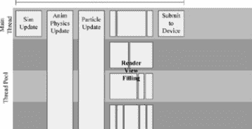

**图10.2：** 以相机为中心的设计。我们更好地利用线程池来处理渲染作业的额外工作。

对于现代API，值得注意的是，图10.2中的`RenderCommand`提交阶段要小得多，因为命令缓冲区只是从主内存复制到设备。之所以可能，是因为这些API有自己的命令缓冲区格式，从我们自定义的`RenderCommand`结构到API版本的转换可以很简单。对于不支持命令缓冲区的旧API，你不能简单地将命令缓冲区数据转换为设备格式。相反，你必须像往常一样通过标准函数调用与API通信，使用`RenderCommand`结构中的数据，如清单10.3所示。

### RenderView 结构

此时，我们试图通过根据对象可见的相机将`RenderCommand`结构逻辑地划分为渲染箱来填充它们。这对我们有好处，因为它允许我们将这些绘制命令分组在一起，这些命令通常会共享某种状态数据（至少，它们都将共享相同的相机变换矩阵）。

`RenderView`对象定义了一个包含相机及其渲染目标之间链接的结构。更重要的是，`RenderView`对象描述了给定渲染目标是如何填充的，这意味着它必须包含要渲染到该给定渲染目标的所有对象列表。

清单10.4展示了`Camera`结构与我们的`RenderView`结构之间的比较。请注意，一般来说，我们的渲染视图是相机的超集，考虑了额外的图形相关属性。此外，请注意我们仍然包装了`ResourceHandle`对象来表示目标渲染目标。`RenderView`结构还包含一个`RenderCommand`指针列表，这些指针由对该视图可见的`RenderObject`对象填充。

### 清单10.4：模拟将使用的`Camera`结构与`RenderView`结构之间的比较。

```cpp
struct Camera
{
    Float3   at, up, right;
    float    aspectRatio;
};

struct RenderView
{
    Camera               ViewCamera;
    Frustum              Frust;
    RenderTargetHandle   DestColorRTT;
    RenderTargetHandle   DestDepthRTT;

    List<RenderCommand *> RenderCommands;

    // this enumeration is very important as it defines
    // order in which we submit render views to the
    enum ViewType
    {
        kVT_ShadowMap = 0,
        kVT_ReflectionMap,
        kVT_MainCamera,
        kVT_PostProcessing,
        kVT_Count
    };

    ViewType    ViewType;
}
```

值得花点时间讨论`RenderView`结构的`ViewType`成员。尽管我们在多个线程上合成视图信息，但在向API提交原始数据时，我们仍然需要特定的资源依赖。例如，我们需要在主视图之前合成所有阴影贴图数据，以便使用这些资源的对象可以确信它们可用。为了实现这一点，我们必须为每个`RenderView`对象标记一个类型，以便稍后可以以适当的串行方式将渲染视图提交给API。我们将在下面更详细地介绍此过程的实现。

### 填充渲染视图结构

创建和填充渲染视图是一个非常简单的过程，但仍然需要对线程领域有一定的了解，或者至少了解线程池。我们回到一个概念：环境的很大一部分可以表示为相机视图，因此，我们必须遍历这些对象容器来创建我们的渲染视图。

下面的清单10.5介绍了为场景中每种相机类型创建新`RenderView`结构的过程。这包括主相机、阴影贴图、反射贴图等。创建视图后，我们为线程池创建作业来填充给定的渲染视图。此时，RenderView对象的组装顺序无关紧要，因为数据访问模式应该已经是线程安全的。

### 清单10.5：为给定帧创建所有渲染视图。

```cpp
void renderControl::CreateRenderViews()
{
    List<RenderView *>      currentViews;

    // for each primary camera (this includes portal
    for (int i = 0; i < mCameras.size(); i++)
    {
        currentViews.add(new RenderView(mCameras[i],
    }

    // for each shadow map!
    for (int i = 0; i < mLights.size(); i++)
    {
        if (mLights[i].IsShadowCasting())
        {
            currentViews.add(new RenderView(mLights[i]
                kVT_ShadowMap));
        }
    }

    // for each reflective target, etc...

    // now fill our render views with visible object
    // threaded environment.
    for (int i = 0; i < currentViews.size(); i++)
    {
        ThreadPool.QueueWork(procThreadedFillRenderView,
            currentViews[i]);
    }

    ThreadPool.waitForWorkToFinish();
}
```

创建渲染视图后，我们需要继续确定要渲染哪些对象。为此，我们必须首先根据渲染视图所拥有的相机的视锥体对环境进行剔除，然后为对该相机可见的每个对象创建一个`RenderCommand`结构。这些`RenderCommand`对象可以驻留在列表结构中，稍后可以按顺序提交给API。清单10.6通过描述为给定渲染视图创建`RenderCommand`对象的线程过程的内部工作来介绍此过程。我们假设你的对象管理器具有执行视锥体剔除的能力，然后你收集可见对象并让每个对象创建一个新的`RenderCommand`结构。

### 清单10.6：填充`RenderCommand`结构应在单独的线程中以线程安全的方式进行。

```cpp
void renderControl::procThreadedFillRenderView(void
{
    RenderView *currView = (RenderView *) DataPacket
    List<RenderObject *> *objects =
    gObjectManager.giveFrustumCollision(currView->
    for (int q = 0; q < objects->size(); q++)
    {
        RenderCommand *RC = new RenderCommand();
        objects[q]->fillCommandBuffer(RC);
        currView->RenderCommands.add(RC);
    }
}
```

再次重要的是指出，此时你的数据访问模型需要是一个线程安全的只读系统。这意味着在遍历对象层次结构以针对相机视锥体进行剔除时，你应该以一种


### 将渲染视图提交到API

提交渲染视图是一个相当直接的过程。我们只需绑定正在绘制的渲染目标，然后将列表中的每个命令提交到API进行绘制。清单10.7展示了此过程，并添加了一组额外数据以指示是否应清除渲染目标。

### 清单10.7：序列化渲染视图要求我们以满足依赖关系的方式对其进行解析。

```
void renderControl::serializeRenderViews(List<RenderView>
{
    for (int viewType = 0; viewType < Count; viewType++)
    {
        for (int i = 0; i < Views.size(); i++)
        {
            if (Views[i]->mViewType != viewType) continue;

            BindRenderTarget(Views[i]->renderTarget,
                Views[i]->DepthTarget);

            if (Views[i]->clearTargets)
            {
                ClearTarget(Views[i]->clearFlags,
                    Views[i]->clearColor, Views[i]->clearDepth);
            }

            for (int k = 0; k < Views[i]->commands.size(); k++)
            {
                executeDrawCommand(Views[i]->commands[k]);
            }
        }
    }
}
```

此外，清单10.7强调了RenderView对象序列化的一个非常重要的方面，即某些RenderView对象依赖于其他对象，因此即使我们在多个线程中对它们进行合成，也必须仍按特定顺序将它们提交到API。例如，您需要先合成阴影贴图，然后才能在后续绘制命令中使用它们。

### 10.5 未来工作

本文介绍了一种将创建命令缓冲区的开销卸载到独立线程的方法，该方法与设备API无关，并采用以相机为中心的设计来确保多个线程之间的负载均衡。随着我们继续利用渲染API进行通用计算，基于渲染数据包正确拆分工作的能力将继续至关重要。

与该过程相关的许多特定于项目和系统的问题超出了本文的范围。不过，为了完整起见，我们在此简要描述它们，并将琐碎的细节留给读者作为练习。

### 排序与实例化

RenderCommand对象为实例化评估提供了出色的动态原语。一旦渲染视图中的所有对象都已被剔除并添加到RenderCommand缓冲区，此时定义多种排序操作就变得很容易，这些操作可以以各种方式组织缓冲区中的RenderCommand对象。按材质索引、顶点数据和对象类型进行排序，通常会导致一种排序过程，该过程以一种方式组合命令缓冲区中的对象，从而可以删除多个绘制命令并改用单个使用实例化的命令。如果您正在动态生成RenderCommand结构，则可以轻松删除原始命令并插入新的实例化版本。在某些硬件上，这可能是一种更适合按数据排序的性能友好方法，因为您的RenderCommand可以更好地利用处理器缓存，并减少遍历对象列表时通常所需的内存遍历。

### 更好的负载均衡

对于那些对线程架构更为熟练的读者来说，值得注意的是，该过程有一种修改可以更好地利用您的线程架构。实际观察表明，大多数特定于相机的`RenderCommand`生成过程表现出不均匀的处理时间。例如，较小的视口或不同类型的API命令会导致较少的工作量。因此，您经常会浪费处理时间来等待这些不平衡线程完成。

更高级的解决方案是修改线程过程，为每个绘制调用创建一个线程作业，允许每个作业在单独的线程上创建，同时以原子方式填充相机数据结构。这通常意味着每个相机的可见性剔除需要在主线程上进行，以便您可以确保`RenderCommand`列表中正确分配空间。为了利用渲染状态过滤、排序或实例化，您必须在所有单独的`RenderCommand`对象都已正确创建后执行这些过程。

此修改的好处是，您现在创建了较小的作业包，可以在整个帧期间最大化线程利用率。在线程操作可能被操作系统事件中断的平台上，这非常有用。有关视频游戏中小作业包相关问题的进一步讨论，请参阅[3]。

## 参考文献

- [1] Vincent Scheib. "使用DirectX 9和10进行实用并行渲染". GameFest 2008.
- [2] Lindberg, 等人. "热门PC游戏中线程成功的研究". 游戏开发者大会, 2008.
- [3] Randall Turner. "圣徒行列调度器". 游戏开发者大会, 2007.

## 第11章：GPU托管内存池

Jeremy Moore
黑石工作室

### 概述

PlayStation 3和Xbox 360游戏机都包含统一内存架构，GPU可以直接读取和写入CPU可访问的内存。这些游戏机上的图形API允许将图形数据放置在内存中的任何位置，并提供直接创建和操作GPU资源（如纹理或顶点缓冲区）的能力。凭借这种低级别控制，自然会考虑构建流式系统，我们在其中动态加载、移动和卸载GPU渲染的资源。

流式系统要求将数据复制到GPU可用于渲染访问的内存中。一种实现选项是通过传统的`memcpy()`样式API使用CPU来管理所有数据复制。由于CPU和GPU并行运行，我们需要小心确保在GPU准备好读取时数据已就位。但是，处理实现此目的所需的同步开销可能既复杂又容易出错。

在本文中，我们描述了一种使用GPU来管理数据复制的替代方案。这种方法确保了同步GPU操作和数据移动的复杂性和开销大大降低。此外，这种方法消除了数据复制的CPU成本，并且在我们的目标平台上，使我们能够实现更高的数据复制带宽。

为了说明这种方法，我们概述了Black Rock Studio实现的流式系统中使用的GPU托管内存池的设计。该系统是为我们的赛车游戏Split/Second编写的。

请注意，此处概述的想法主要适用于我们对GPU资源具有高度控制权的目标游戏机平台。在PC平台上情况并非如此，因为图形API必然将这些细节抽象化，使我们无法直接访问。

### 11.1 背景

### 流式要求

Split/Second中的游戏世界庞大且细节丰富。我们无法将用于渲染它们的所有图形资源都放入目标游戏机平台的固定内存空间中。解决此问题的方法是动态将渲染相机最近的世界部分所需的资源流式传输到内存中。

任何流式系统都由许多组件组成，例如从光盘高效加载资源的系统，或决定给定相机位置应加载哪些资源的逻辑。在本文中，我们只专注于管理用于存储已加载资源的内存的组件。

### 资源类型

渲染时我们使用多种图形资源类型。按典型大小递减顺序，一些示例包括纹理、顶点缓冲区、索引缓冲区、着色器和常量缓冲区。在当前游戏机上，这些资源各由两部分组成。首先，有一个由CPU读取的小型固定大小组件，我们将其称为“头部”。其次，有一个由GPU读取的较大可变大小组件，我们将其称为“数据”。提交渲染命令时，CPU解析头部以在GPU命令缓冲区中创建条目。命令缓冲区随后包含对数据的引用，GPU在执行渲染命令时读取这些数据。

在本文中，我们只考虑GPU直接读取的数据的管理。头部的管理是一个更简单的问题。它通常涉及固定大小的对象，而固定大小对象内存池[2]是一种常见方法。


### Design Requirements

在为 Split/Second 中的流式系统收集需求时，我们决定它应该能够从磁盘动态加载和卸载任何 GPU 资源。我们希望避免为将 GPU 与流式资源同步而编写过于复杂的代码。我们还希望避免在资源不断分配和释放时可能出现的内存碎片问题。

### 11.2 内存池

我们流式实现的核心是内存池类。我们将内存池定义为一块连续内存，以及用于动态管理它的逻辑。我们使用一个或多个内存池对象来管理存储渲染 GPU 数据资源的内存。

一个简单的设计选择是将池中的内存分割为若干大小预先确定但可变的块。然后，内存池中的每个新分配将使用其中一个块。这种技术避开了碎片问题，并将内存管理逻辑简化为仅仅找到一个适当大小的空闲块来放置每个资源。

如果我们只想存储纹理数据，这可能是一个不错的方法，因为纹理往往采用有限组合的尺寸和表面类型。但是，当我们无法准确预测需要支持的块大小范围时，这会浪费内存。我们的设计要求指出，我们希望在内存池中支持其他资源，例如顶点缓冲区和索引缓冲区。这些资源的数据大小潜在范围很大。因此，我们选择避免对资源大小做任何假设，并不使用固定块方法进行内存管理。

相反，我们的内存池由动态大小的数据“块”组成。这些块可以是任何大小，可能包含数据，也可能是空的“空闲块”。虽然一个块可能包含多个数据项，但每个数据项都保证位于单个块内。这意味着块可以在内存池中移动，而不会破坏其所持数据的内部一致性。

块需要根据平台限制保持对齐。例如，在一个目标平台上，所有顶点缓冲区数据可能需要对齐到 128 字节地址边界。通常，不同资源类型有不同的对齐限制。为简单起见，所有块都可以对齐到平台最大数据对齐限制的大小。例如，如果我们的目标平台还要求纹理需要 1 kB 对齐，那么我们可能选择将所有块（包括仅包含顶点缓冲区的块）对齐到 1 kB。

内存池开始时没有数据，因此包含一个跨越池中整个内存的单个空块。当我们向内存池添加新数据时，我们找到一个能容纳它的空块。如果新数据的大小小于空块的大小，则我们将块分成两个。一个块现在包含新数据，另一个是包含任何剩余未使用内存的空闲块。当我们从内存池中删除一个块时，我们将其标记为空，并将生成的空闲块与任何相邻的空闲块合并。典型的操作序列如图 11.1 所示。

| 操作 | | | | | | | | |
|---|---|---|---|---|---|---|---|---|
| 分配 | 分配 1 | | | | | | | |
| 分配 | 分配 1 | | | 分配 2 | | | | |
| 释放 | | | 分配 2 | | | | | |
| 分配 | 分配 3 | | | 分配 2 | | | | |
| 分配 | 分配 3 | | | 分配 2 | | 分配 4 | | |

**图 11.1：** 内存池布局在经历多个分配和释放操作时的显示。请注意，每个数据块都保持虚线所示的对齐。还请注意，仅经过几次操作后，我们就得到了一个碎片化的内存池。

### 11.3 同步问题

在我们的目标平台上，GPU 执行由 CPU 创建的单个命令缓冲区流。这些命令的串行执行是内存池数据移动与 GPU 使用保持同步的关键。

考虑这样一种情况：我们在内存池中有一个用于渲染的纹理，然后希望在再次使用它进行渲染之前将其在内存池中移动。如果我们希望支持内存池的去碎片化，这是典型的操作序列。如果我们使用 CPU 来管理内存复制，那么 CPU 被迫等待任何使用该纹理的渲染完成后才能移动纹理。这很难正确且高效地同步。它也具有侵入性，因为我们需要跟踪纹理何时被使用。图 11.2 显示了这种方法在 CPU 和 GPU 侧的执行方式。

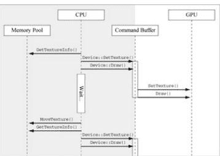

图 11.2：使用 CPU 在我们的内存池内进行内存移动的时序图。请注意，CPU 在移动内存池中的纹理数据之前需要等待不确定的时间。

相比之下，如果我们使用 GPU 来管理内存复制，那么 GPU 将内存池中每个数据移动作为一组有序命令流中的一个动作来执行。这保证了在我们移动数据之前，任何来自纹理的渲染都已完成。反之，它保证了纹理数据的移动在下次用于渲染之前完成。图 11.3 显示了这种方法在 CPU 和 GPU 侧的执行方式。

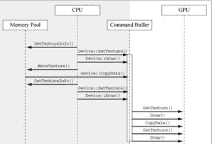

图 11.3：使用 GPU 在我们的内存池内进行内存移动的时序图。请注意，现在 CPU 和 GPU 之间不需要复杂的同步，并且 CPU 可以立即排队数据传输。

### 11.4 暂存缓冲区

我们已经展示了 GPU 如何控制内存池内的内存移动。我们还需要处理将新数据移入内存池的情况。当向内存池添加新数据时，我们首先搜索一个空闲块来放置它。内存池中标记为空闲的块可能处于两种状态之一。它可能是真正的空，也可能包含已安排由 GPU 移动的有效数据。在后一种情况下，CPU 向块中复制任何数据都可能损坏内存池中已有的数据。出于这个原因，只有 GPU 应该将新数据复制到内存池中。为了实现这一点，我们最初将任何新数据加载到 CPU 管理的暂存缓冲区中，然后使用 GPU 将这些数据复制到内存池中。

这种方法仍然需要 CPU 和 GPU 之间一些简单的同步。在我们的实现中，暂存缓冲区是一个环形缓冲区结构。环形缓冲区包含等待上传到内存池的数据块。只有在 GPU 完成将其复制到内存池后，我们才能清除每个环形缓冲区条目。为了跟踪复制到内存池的进度，我们使用栅栏同步原语来确定 GPU 何时完成处理操作。栅栏原语在不同平台上的命名和实现略有不同。在 Xbox 360 和 OpenGL 中，它被称为 fence，但在 DirectX 中它被称为 event，在 PlayStation 3 中它被称为 label。在这些平台上的每一个，我们都可以将栅栏推送到 GPU 命令缓冲区并轮询以查看它是否已被 GPU 处理。因此，对于暂存缓冲区中的每个环形缓冲区条目，我们在 GPU 复制操作后放置一个 GPU 栅栏。每帧一次，我们检查栅栏以确定哪些复制已完成，并相应地清除环形缓冲区条目。这种用法在图 11.4 中得到说明。

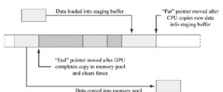

图 11.4：暂存缓冲区用法，说明使用栅栏来确定 GPU 复制何时完成。

这个暂存缓冲区是限制数据移入内存池的系统的一部分。在我们的实现中，我们使用后台加载线程将新数据流式传输到暂存缓冲区。如果移入内存池的数据传输停滞，无论是因为空间不足还是去碎片化缓慢，那么暂存缓冲区就会填满，后台加载线程将休眠，直到空间再次可用。


### 11.5 内存池碎片整理

由于我们的内存池包含许多大小灵活的块，这些块以无固定顺序添加到池中并从中移除，因此容易发生碎片化。使用 GPU 管理我们的内存池使我们无需担心多处理器同步问题。这使得任何碎片整理系统的实现都更加简单。

在他们的 GDC 演示中，Balestra 和 Engstad [1] 简要描述了一种他们用于整理流式纹理碎片的非常简单的算法。我们最初的碎片整理逻辑采用了相同的方法。首先，我们从头到尾扫描内存池，直到找到一个空闲块。然后，将下一个非空闲块向下移动以填充这个空闲块。移动产生的空闲块随后与任何相邻的空块合并，扫描继续进行。这个碎片整理过程每帧运行一次。为了避免在病理情况下产生高 GPU 工作负载，对每个碎片整理过程可复制的数据总大小设置了上限。

该算法的优点是，在给定足够的数据传输预算的情况下，我们可以保证趋向于完全整理的内存池。缺点是，整理一个原本满载的内存池开头处的单个空块，需要复制几乎整个内存池，代价高昂。

在我们的朴素实现中，我们偶尔会看到将数据加载到内存池所需时间出现小幅波动。这些波动通常对应于上述病理情况下碎片整理性能不佳的情况。一种将这些问题降低到可管理水平的简单解决方案是将内存池划分为若干个区域。随后对每个区域运行碎片整理过程，但永远不会跨越区域边界进行整理。区域大小通过测试进行调整，以找到性能最佳的大小。该方法如图 11.5 所示。

| | 区域 1 | 区域 2 | 区域 3 |
|---|---|---|---|
| 遍 1 | | | |
| 遍 2 | | | |
| 遍 3 | | | |
| 遍 4 | | | |

图 11.5：多次碎片整理过程中的内存池布局。阴影区域表示已分配的内存块。将内存池划分为区域可以减少碎片整理期间所需的内存复制次数。

### 11.6 内存池逐出

当我们的流式系统中内存池超载时，我们通常需要选择一个逐出候选项。我们的内存池逻辑通过为流式系统中的每个资源分配一个"逐出度量"来实现这一点。该逐出度量的计算完全由应用程序特定的逻辑决定。每帧一次，我们逐出内存池中逐出度量高于不在内存池中的资源的最低逐出度量的项目。因为 GPU 将内存池中的所有移动串行化，逐出仅仅是将被逐出项目的块标记为空闲，因此可供重用。

在计算合理的逐出度量时，需要考虑缓存抖动的可能性。有关适用于流式内存池的缓存替换算法的出色总结，请参见 [3]。

### 11.7 平台特定注意事项

### PlayStation 3

PlayStation 3 的内存架构分为主内存（CPU）和本地内存（GPU）。CPU 访问本地内存的速度较慢，因此即使内存池放置在本地内存中，将暂存缓冲区放置在主内存中也很重要。

PlayStation 3 具有非常直接的 API 来执行 GPU 内存复制。一个重要的注意事项是，需要小心确保资源的 GPU 内存复制完全完成后，才能将该资源用于渲染。

### Xbox 360

Xbox 360 具有一个统一内存架构，GPU 可以使用其 `memexport` API 在其中复制内存。但是，使用 `memexport` 时，可创建和使用的内存池大小限制为 64 MB。在 Xbox 360 上使用 GPU 复制内存的优势在于，其数据吞吐量显著高于使用 CPU。但是，GPU 复制会绕过 CPU 缓存，因此需要小心确保与 CPU 直接访问的任何内存保持一致性。例如，暂存缓冲区应位于某种不可缓存内存中，或者在向暂存缓冲区写入时，应显式刷新缓存行到内存。

### 11.8 未来工作

### 多线程注意事项

在我们的目标平台上，一种在多个处理核心之间平衡渲染调用提交负载的高效方法是，为每个核心生成一个或多个命令缓冲区，然后将它们合并并从单个主渲染线程提交到 GPU。在这样做并使用 GPU 管理的内存池时，我们需要注意每个核心都保持对内存池内容的一致视图。如果在主渲染线程上在不进行多线程提交的时间（例如帧的开始或结束时）更新内存池，这应该很简单。

### 非 GPU 扩展

本文中使用的模式可以扩展到其他具有在内存中移动数据能力但与 CPU 并发运行的处理器。PlayStation 3 SPU 是一个示例用例。这一组高性能处理器可以使用 DMA 复制内存，并可以使用有序作业队列驱动。许多 PlayStation 3 图形引擎使用仅由 SPU 读取的资源来为 GPU 创建输入数据。SPU 还可以用于管理包含这些资源的任何内存池，从而简化流式和碎片整理逻辑。

### 更好的碎片整理

尽管此处概述的碎片整理系统对我们的目的有效，但在未来，研究其他碎片整理算法的效率是有价值的。更高效的算法将有助于减少 GPU 内存带宽，并在将数据加载到内存池时消除潜在的停顿。

### 致谢

我要感谢 Balor Knight 和 Clément Dagneau，他们都帮助开发和整合了本文中的一些想法。我还想纪念我的同事兼朋友 Marek Romanowski，他曾合作过其中一些想法，但不幸的是在我撰写本文期间去世了。

### 参考文献

- [1] Christophe Balestra 和 Pål-Kristian Engstad。《未知领域：德雷克的命运》的技术。游戏开发者大会，2008。
- [2] Paul Glinker。使用模板空闲列表对抗内存碎片化。游戏编程宝石 4，Charles River Media，2004。
- [3] Colt McAnlis。使用年龄和成本度量进行高效缓存替换。游戏编程宝石 7，Charles River Media，2008。

## 第 12 章：用于模拟流体动力学的预计算 3D 速度场

Khalid Djado 和 Richard Egli

莫瓦尔中心，谢尔布鲁克大学

本文介绍了一种使用预计算速度场来模拟 3D 流体动力学的方法。首先，我们介绍了一种使用流体动力学构建流体速度场的方法。流体速度场在流体域的固定网格上计算。其次，我们介绍了一种使用预计算速度和一些启发式方法来简化流体动力学的方法。使用预计算速度场的优点是，它减少了流体动力学计算时间。流体动力学计算的大部分包含在速度场计算过程中，该过程可以离线执行。

### 12.1 简介

近年来，人们投入了大量精力将真实物理集成到类似视频游戏中发现的虚拟世界中。其中一些技术，例如碰撞检测，现在对游戏开发者来说非常熟悉，并已被广泛集成到游戏物理引擎中。流体并非如此。在虚拟环境中很好地模拟流体动力学通常是一项挑战。主要困难在于，描述流体动力学的纳维-斯托克斯方程没有解析解。通常，计算机图形学社区使用网格或粒子系统来模拟流体。本文使用网格上的欧拉 3D 方法来计算流体速度场。

计算机图形学中关于模拟流体的最早研究之一由 Foster 和 Metaxas [2] 完成。他们的工作基于 Harlow 和 Welch [3] 发表的一篇论文。关于流体工作的出色总结可以在最近的一本书 [1] 中找到。我们实现了 Foster 和 Metaxas [2] 的方法来计算流体动力学，因此流体域被离散化为体素。速度场计算过程如下：

- 速度源（或外部力），我们称之为 *鼓风机*，被放置在流体域内部（例如，在体素的选定面上）。
- 通过求解纳维-斯托克斯方程，计算流体域中所有体素面上的流体速度。这些速度可以存储在文件中以供将来使用，或在模拟开始前预先计算。

在视频游戏中使用流体动力学在计算时间方面非常昂贵。为了获得更好的性能，我们预先计算流体的物理特性。关键思想是预先计算耗时较长的步骤。一旦计算中的耗时步骤完成，我们就使用这些数据来模拟流体。


仿佛在实时执行所有计算。该方法因此速度快，同时为视频游戏等交互式应用产生现实且可接受的结果。本文所采用方法带来的机遇如下：

- 使用预计算速度计算流体域中任意位置的流体速度。
- 当鼓风机改变强度和方向时，使用预计算速度和启发式方法模拟新的速度场。
- 使用预计算速度和启发式方法模拟流体域中新对象的存在或现有对象的运动。这允许流体与对象之间的交互。

### 12.2 速度场计算

速度场表示仿真域中任意位置的流体速度。要获得速度场，我们首先计算面上的速度，然后计算体素上的速度。每个体素有六个面。体素上的速度由红线表示，面上的速度由图 12.1 中的绿线表示。我们使用[2]中描述的有限差分法来计算面和体素上的流体速度。图 12.1 中的蓝线表示引入域中的鼓风机速度。纳维-斯托克斯方程为

(12.1)
\[
\frac{\partial u}{\partial t} + u \frac{\partial u}{\partial x} + v \frac{\partial u}{\partial y} + w \frac{\partial u}{\partial z} = -\frac{\partial P}{\partial x} + g_x + \nu \left( \frac{\partial^2 u}{\partial x^2} + \frac{\partial^2 u}{\partial y^2} + \frac{\partial^2 u}{\partial z^2} \right)
\]
\[
\frac{\partial v}{\partial t} + u \frac{\partial v}{\partial x} + v \frac{\partial v}{\partial y} + w \frac{\partial v}{\partial z} = -\frac{\partial P}{\partial y} + g_y + \nu \left( \frac{\partial^2 v}{\partial x^2} + \frac{\partial^2 v}{\partial y^2} + \frac{\partial^2 v}{\partial z^2} \right)
\]
\[
\frac{\partial w}{\partial t} + u \frac{\partial w}{\partial x} + v \frac{\partial w}{\partial y} + w \frac{\partial w}{\partial z} = -\frac{\partial P}{\partial z} + g_z + \nu \left( \frac{\partial^2 w}{\partial x^2} + \frac{\partial^2 w}{\partial y^2} + \frac{\partial^2 w}{\partial z^2} \right)
\]

(12.2)
\[
\frac{\partial u}{\partial x} + \frac{\partial v}{\partial y} + \frac{\partial w}{\partial z} = 0.
\]

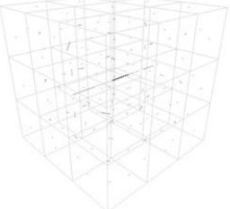

**图 12.1:** （另请参见彩色插页。）体素和面速度。

使用方程 (12.1)、方程 (12.2) 和乘法法则，我们得到

\[
\frac{\partial u}{\partial t} + \frac{\partial}{\partial x}(uu) + \frac{\partial}{\partial y}(uv) + \frac{\partial}{\partial z}(uw) = -\frac{\partial P}{\partial x} + g_x + \nu \left( \frac{\partial^2 u}{\partial x^2} + \frac{\partial^2 u}{\partial y^2} + \frac{\partial^2 u}{\partial z^2} \right)
\]

(12.3)
\[
\frac{\partial v}{\partial t} + \frac{\partial}{\partial x}(vu) + \frac{\partial}{\partial y}(v^2) + \frac{\partial}{\partial z}(vw) = -\frac{\partial P}{\partial y} + g_y + \nu \left( \frac{\partial^2 v}{\partial x^2} + \frac{\partial^2 v}{\partial y^2} + \frac{\partial^2 v}{\partial z^2} \right)
\]

\[
\frac{\partial w}{\partial t} + \frac{\partial}{\partial x}(wu) + \frac{\partial}{\partial y}(wv) + \frac{\partial}{\partial z}(w^2) = -\frac{\partial P}{\partial z} + g_z + \nu \left( \frac{\partial^2 w}{\partial x^2} + \frac{\partial^2 w}{\partial y^2} + \frac{\partial^2 w}{\partial z^2} \right).
\]

这些方程在 Foster [2] 中被使用，并用于本文的实现。方程中出现的量总结如下：

- \( u \)、\( v \) 和 \( w \) 分别是流体在面或体素上沿 \( x \)、\( y \) 和 \( z \) 轴方向的速度。
- \( P \) 是流体的内部压力（正式地说，\( P \) 是压力除以流体密度 [4]）。
- \( \nu \) 是运动粘度。
- \( \mathbf{g} \) 是重力加速度。

使用有限差分法求解方程 (12.3) 可得到流体域中每个面上的新速度，如图 12.1 中显示的绿色速度。这些解可以在 [2] 和随本文提供的源代码中找到。请注意，垂直于三个轴（\( x \)、\( y \) 和 \( z \)）的面的速度分量是分别计算的。方程 (12.2) 用于计算流体速度的零散度。该过程导致流体速度校正，最后进行压力更新。

为了确保求解器的稳定性，时间步 \( \Delta t \) 和速度需要满足以下条件

(12.4)
\[
\max \left\{ u \frac{\Delta t}{\Delta x}, v \frac{\Delta t}{\Delta y}, w \frac{\Delta t}{\Delta z} \right\} < 1.
\]

求解器采取的步骤总结在清单 12.1 中。

### 清单 12.1: 完整求解器的伪代码。

```
Simulate(const float& deltaT)
{
  // Reset Velocities (Boundary and Blower)
  ResetBoundaryAndBlower();
  // Compute New Face Velocities on each voxel
  for (int voxelID = 0; voxelID < m_voxelNumber)
  {
    UofFaceVelocity(voxelID, deltaT);
    VofFaceVelocity(voxelID, deltaT);
    WofFaceVelocity(voxelID, deltaT);
  }
  // Null Divergence step using Equation (12.2)
  float maxDivergence = s_epsilon;
  while (maxDivergence >= s_epsilon)
  {
    float currentMaxDivergence = -INFINITY;
    for (int voxelID = 0; voxelID < m_voxelNumber)
    {
      float divergence = 0.0F;
      ComputeDeltaPressure(voxelID, deltaT, divergence);
      if (divergence >= currentMaxDivergence)
      {
        currentMaxDivergence = divergence;
      }
    }
    maxDivergence = currentMaxDivergence;
    // Pressure Update
    UpdatePressure();
  }
  // Compute Voxel velocities by interpolation
  ComputeVoxelVelocities();
}
```

为了简化流体动力学，我们为单个鼓风机在不同方向（例如正 x 方向）下的每个面预计算速度（参见图 12.1）。这些预计算速度可以在使用带有启发式方法的简化仿真之前存储在内存中。它们也可以保存在磁盘上，并在需要时加载到内存中。

### 12.3 物理简化

使用第 12.2 节中介绍的完整流体动力学求解器，我们可以改变鼓风机方向并移动对象。在本节中，我们介绍了启发式方法，这些方法允许我们在不使用完整求解器的情况下模拟对象的存在和运动，并改变鼓风机速度方向。我们有两种启发式方法：“障碍物启发式”和“鼓风机启发式”。

### 障碍物启发式

使用全量计算时，图 12.2 中所示的黑色盒子等障碍物要求我们在每个时间步重新计算流体域中的所有量（速度和压力）。流体域中存在障碍物会导致速度场发生畸变。我们通过不计算清单 12.1 中的第 4 到 11 行，并为零散度步骤设置迭代次数来简化完整求解器。事实上，当我们将 s_epsilon 设置为 0.0001 时，第 16 到 29 行的散度最小化过程在某些情况下会执行超过 10 次。在“障碍物启发式”的情况下，我们将迭代次数设置为大约 2 次，以加快该过程。

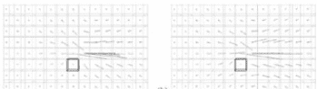

**图 12.2:** 速度场图像—(a) 来自完整求解器；(b) 来自障碍物启发式。

新速度通过下面描述的插值计算。设 V 为面上的当前速度，Vp 为同一面上的预计算速度，c 为一个常数，用于确定当障碍物移除时速度场返回到预计算状态的速度。Δt 是时间步。插值使用以下公式计算

(12.5)
\[
V \leftarrow (1 - c \Delta t) V + (c \Delta t) V_p.
\]

计算零散度场允许修改障碍物周围的速度。零散度意味着流入的流体等于流出的流体。事实上，障碍物面上的速度为零，因此零散度确保相邻体素上的流体绕过障碍物。

“障碍物启发式”的步骤总结在清单 12.2 中。

### 清单 12.2: 障碍物启发式的伪代码。

```
SimulateObstacleHeuristic(const float& deltaT)
{
  // Update Velocities using the Precomputation
  // for each face of each voxel
  FaceVelocity = (1.0F - cstObstacle * deltaT) + (cstObstacle * deltaT) * PreCompFaceVelocity;
  // Null divergence step in Precomputed Version
  PreCompDivergence(deltaT);
  // Compute Voxel velocities by averaging
  ComputeVoxelVelocities();
}
```

使用“障碍物启发式”的主要优势是，我们可以从没有任何障碍物的预计算速度场开始，在流体域中添加和移动对象。使用启发式方法获得的结果（参见图 12.2(b)）与完整纳维-斯托克斯求解器的结果（参见图 12.2(a)）相似，其优势在于该过程至少快两倍。


### 吹风机启发法

在流体模拟中，吹风机速度方向的任何变化都意味着在每个时间步都需要在流体域中重新计算所有量（速度和压力）。我们简化了完整的求解器，以便能够模拟动态吹风机。

通过观察流体模拟和速度变化，我们注意到速度与吹风机速度的模呈线性关系。这意味着如果我们将吹风机的速度加倍，其他体素上的合成速度也会加倍。我们还注意到，当吹风机改变方向时，每个体素的速度都会改变方向。为了模拟相同的效果，我们使用预计算的速度，将吹风机对准正负坐标轴方向。在本文中，我们仅在x轴和y轴沿两个维度上使用吹风机方向，但该方法可以推广到三维。我们必须为吹风机在(1,0,0)、(-1,0,0)、(0,1,0)、(0,-1,0)方向上预计算速度场。设\(\theta\)为新吹风机方向与向量(1,0,0)之间的夹角。当\(\theta\)在\(\theta_1\)和\(\theta_2\)之间时，我们按以下步骤进行：

- 我们根据\(\theta\)确定\(\theta_1\)和\(\theta_2\)。例如，如果\(\theta\)在0到90度之间，则\(\theta_1 = 0\)且\(\theta_2 = 90\)。
- 我们计算插值权重\(f = (\theta - \theta_1)/(\theta_2 - \theta_1)\)。
- \(\mathbf{V}_{p1}\)是\(\theta_1\)的预计算面速度。
- \(\mathbf{V}_{p2}\)是\(\theta_2\)的预计算面速度。
- 每个面速度\(\mathbf{V}\)通过\(\mathbf{V} = (1 - f)\mathbf{V}_{p1} + f\mathbf{V}_{p2}\)计算得出。

该启发法是完整求解器版本所得速度的近似。图12.3展示了"吹风机启发法"与完整求解器的速度对比。使用启发法的模拟速度比完整求解器快两倍多。

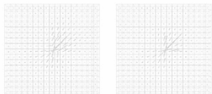

图12.3：速度场图像—(a)来自完整求解器；(b)来自吹风机启发法。

### 12.4 结果与讨论

为了可视化流体速度场，可以将体素上的速度显示为向量。我们还可以使用表示方向的单位向量和表示大小的颜色来可视化速度场。例如，速度可以用高大小的蓝色或低大小的红色来描绘。还可以使用在流体域中移动的粒子来可视化速度场。图12.4展示了可视化方法的示例。

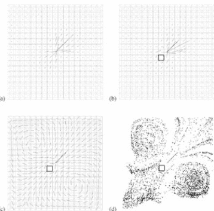

图12.4：（另见彩色插页。）使用启发法的速度场可视化图像—(a)无障碍的向量；(b)有障碍的向量；(c)有障碍时用于方向的单位向量和用于幅度的颜色；(d)有障碍和粒子。

为了说明启发法的工作原理，随附光盘中提供了一个实现。该程序使用C++编写，并使用OpenGL显示3D场景。用户必须以体素数量设置流体域的分辨率。在图12.4的情况下，流体域有17*17*17个体素，吹风机（蓝色）位于体素位置(8,8,8)。图12.4中的网格仅表示流体域中z = 8的体素，因为在静态图像中显示所有17×17×17个体素时，很难用向量可视化速度。

在配备Intel CPU T2400（1.83 GHz，双核）的笔记本电脑上，完整求解器的帧率约为172 FPS，模拟和可视化过程均无并行。使用"吹风机启发法"（见图12.4(a)）的相同场景可实现约392 FPS的帧率。使用两种启发法（见图12.4(b)）可获得331 FPS。

在游戏物理环境中，还可以进行一些其他优化。例如，当吹风机不变且障碍物在一段时间内不移动时，我们无需更新速度场。本文的启发法可以简单地添加到现有游戏物理引擎中。速度可以在设置时预计算或从文件加载。

### 参考文献

- [1] R. Bridson. 计算机图形学中的流体模拟. AK Peters, 2008.
- [2] N. Foster 和 D. Metaxas. "液体的现实动画". 图形模型与图像处理, 第58卷, 第5期 (1996年9月), 第471–483页.
- [3] F. H. Harlow 和 J. E. Welch. "时间相关黏性不可压缩流的数值计算". 流体物理, 第8卷, 第12期 (1965), 第2182–2189页.
- [4] L. Quartapelle. 不可压缩Navier-Stokes方程的数值解. Springer, 1993.

## 第13章：网格分区，为了乐趣与利润

Jason Hughes

Steel Penny Games, Inc.

### 概述

有许多情况，整个网格的数据量过大，无法处理——无论是CPU、SPU还是GPU，都需要考虑性能限制。一般来说，艺术家可以手动完成这项工作，但由于人为因素的差异，一个好的算法更快速、更可靠，并能提高艺术家的生产力。一个稳健的工具流水线的关键特征是其能够无论如何都让艺术家摆脱此类负担。在几乎任何3D游戏中，都存在这样一种情况：一个网格作为许多较小的块效果更好，这些块可以由CPU唯一标识，并独立于其他块进行处理。

具体来说，现实世界的游戏会遇到哪些限制？

- 渲染限制，例如8位或16位索引限制了可以放入网格中的顶点数量。
- 皮肤化限制，例如特定图形芯片能够用着色器常数表示的矩阵数量，或者旧版固定功能管线每个渲染调用的矩阵索引数量有硬性限制。
- 顶点单元瓶颈，其中网格只有少数可见三角形，但大部分三角形正在被裁剪或背面剔除单元变换和拒绝。在某些架构上，将顶点数据传输到GPU的带宽非常显著，顶点着色器也可能是瓶颈。
- 几乎任何其他具有每三角形组件的操作，都有可能通过对网格进行分区来改进，特别是如果可以对这些分区的网格碎片整体执行简单的拒绝操作时。

### 13.1 理想的算法属性

现在我们了解了在什么情况下将网格分割成合理大小的块是有帮助的，那么任何分区机制都好吗？如果不是，一个经得起实战检验的网格分区器的理想属性是什么？以下是我通过实验确定的一系列属性的无序列表。对于某些类型的游戏，可能存在其他属性。硬件的某些差异可能会改变某些属性的重要性。请自行判断。一旦你有一组属性，就可以定义一个客观的适应度指标来衡量算法的表现。在算法设计的实验阶段，适应度指标至关重要，因为否则，确定更改是有益的、有害的还是无关紧要的将非常耗时且主观。

### 分区应具有大小相近的包围体

理由：这可以提高剔除性能，因为大小规则的分区每个分区的开销更可预测。这也意味着光栅化的三角形集合每个绘制调用的像素吞吐量可能更一致，允许你通过调整最大包围体来平衡每个分区的工作量与每个三角形的工作量。

### 分区应具有大致相同数量的三角形和顶点

理由：这通过简化缓冲区管理，提高了向SPU等专用处理单元传输带宽和传输时间的可预测性。它还可以平滑可能出现的性能尖峰。这对于平滑DMA传输性能以及提高剔除到渲染顶点比率很有好处，从而减少到GPU的总带宽。


### 分区数量应尽量减少

理由：每个分区的管理成本通常较高，因此减少分区数量只能提升 CPU 性能。然而，如果过分强调这一属性，最终会得到一个包含所有几何数据的单个分区——即根本没有进行分区。

### 每个分区中每个顶点的三角形数量应尽量最大化

理由：一个三角形需要三个顶点。如果在同一分区中插入一个相邻三角形（共享一条边），新三角形只会增加一个顶点。然而，将同一个相邻三角形放置在不同分区中会创建三个顶点。显然，你希望尽可能多地共享顶点数据。由于分区天然会沿边界分隔相邻三角形，因此某些顶点数据的重复是不可避免的。描述这一点的另一种方式是尽量减少分区之间的边界数量，但这更难以衡量。

### 分区器应在可预测的有限时间内保证得出具有先前所述属性的解

理由：从实际角度来看，分区操作耗时超过几秒是不可接受的，因为这会影响艺术家的迭代能力。这需要一些数据结构、对避免任何无限循环可能性的细致关注，以及对那些"永远不会发生"的最坏情况场景的思考。

### 13.2 经验教训

多年来构建网格分区器的经验让我走过许多死胡同。以下是我犯下的最大错误，不分先后顺序，以及它们为何是糟糕的选择。

- 不应信任任何来源的网格数据。关于三角网格条件的任何假设，其被证明是错误的可能性在接近重要里程碑时会无限趋近于确定性。你的代码中再多的断言也不为过，有助于诊断这些问题。最终，我的分区器生成了一种完全不同的三角数据拓扑表示，仅用于分区。

- 向现有分区添加三角形可能会增加零到三个新顶点。分区持有对三角形的引用，而三角形隐含顶点。不要试图从顶点构建分区，然后从顶点构建三角形集。这样会导致重复三角形、严重不成比例的分区以及各种其他问题。由于分区的重要衡量标准是其中包含多少顶点（以及新三角形是否添加任何新顶点），你必须在进入分区器之前计算最终的顶点共享情况。

- 不要构建一个会交替细分和合并同一分区的分区器。要么只做其中一项，要么按顺序执行，但不要在两者之间交替。无论你如何设计逻辑来防止这种情况，都会出现无法预见的无限循环。

- 合并分区乍看之下似乎是个好主意。为每个三角形初始化一个分区并合并最近邻居是我迅速放弃的一种方法。它本质上就是 Kruskal 最小生成树算法 [1]。然而，Kruskal 的方法无法处理用户定义的分区限制，一旦你拥有一整群达到阈值 51% 的分区，它就会迅速失效。此时，合并任何两个分区意味着你会得到需要放到其他地方的微小剩余部分——这意味着交替进行合并和分区，导致无限循环。或者，你可以将那些被遗弃的三角形留作最后一个分区，但这必然违反上述每一条重要属性。

- 确保适应度度量（负责测量分区当前"填充度"的函数）在添加三角形时是单调递增的。进一步说明，我尝试的一种算法是当邻居分区更大时，从邻居分区"窃取"三角形。选择从哪个分区窃取的函数忽略了在转移三角形后测试源分区和目标分区的适应度。数据的某些部分被压缩，压缩数据的大小取决于数据本身中存在的值范围。大多数时候，从分区中移除数据会导致其编译后的数据包大小缩小，但偶尔也会增大。结果，会出现 A 从 B 窃取，然后 B 又从 A 窃取的情况，因为无论三角形向哪个方向移动，最终数据包的大小都会反复变化。

- 为清晰的终止条件和稳定的性能设计。我尝试过一种分区方式：随机将三角形分配给分区，然后将连接不良的三角形"推入"能同时使两个分区受益的相邻分区（无论是在包围体积缩减、数据包大小还是其他指标方面）。最终，这退化为每个三角形的伪链表遍历：一个三角形被推给邻居，该邻居现在违反了某个度量限制，必须将另一个三角形推给另一个相邻分区，以此类推。即使在身后标记路径以防止循环，这也倾向于在所有分区之间创建巨大的链表遍历，并且随着分区开始收敛，速度会急剧下降。

- 使用适当的数据结构，并找到方法来缓存或减少查询成本高昂的关系的查找次数。我最喜欢的是图的简单邻接表表示。它实现起来非常简单，在调试算法时也非常易于使用。

- 提出正确的问题。对于分区，这个问题是"我现在应该把哪个三角形放入当前分区？"。我许多尝试都在试图决定"哪个三角形更适合从分区 A 移动到分区 B？"、"哪个分区应该增长？"或"哪个分区应该缩小？"。涉及分区质量的相对决策从未发展成具体可用的分区系统。

- 始终选择连接最少的三角形作为新分区的起点。这会阻止你的最终分区包含大量其他分区都不想要的散落"孤儿"三角形。这样的分区其包围球会非常大，渲染也非常低效。出于同样的原因，这条规则也适用于三角形剥离算法。

- 图论很有帮助。阅读 Prim 算法 [2]。它是本网格分区器工作原理的模板。然而，不要被诱惑严格按照 Prim 算法的描述来遵循。它建议为候选边使用优先队列，但不允许对队列中的相邻节点重新排序。网格分区中三角形之间可能存在共享数据，因此每向分区添加一个额外三角形，很可能会改变每个候选三角形的成本计算。将三角形放入具有固定优先级的队列显然不适用于此类问题。这意味着你必须在每次迭代中扫描候选三角形列表并重新计算成本，以找到最佳候选项。

- 为将面打包成紧凑集群提出局部度量标准非常困难。如果不对三角形的接近程度施加任何限制，你会得到带有大包围球的长条带，这些包围球对分区的近似效果很差。如果相对于面的质心进行度量，你会得到非常紧凑的分区，但可能无法很好地共享顶点（想象三个相交于球体的平行平面，球体内部的三角形彼此靠近，但有许多只使用一次的边界顶点）。就在解决这个问题后不久，我读到一篇论文 [3]，其中在几年前就表达了相同的解决方案。与大多数发现一样，事后回想，解决方案显而易见：尽量减少相关三角形中心之间的距离。


### 13.3 贪心算法何时适用

Since there are so many choices that can be made while writing a mesh partitioner, it's surprising how simple a good one can be. Although the following is a greedy algorithm, the results are initially good, and a simple refinement step afterwards can improve the partition efficiency by two to three percent. This section describes what I found to work well.

编写网格分区器时有太多选择可供做出，一个好的分区器可以如此简单，这令人惊讶。尽管下面是一个贪心算法，但初始结果已经不错，随后一个简单的细化步骤可以将分区效率提高两到三个百分点。本节描述了我发现效果良好的方法。

### Core Algorithm Overview
### 核心算法概述

- 1. Select the least connected [1] unassigned triangle and initialize a new partition with it. If no triangle is unassigned, partitioning is complete.

- 1. 选择连接最少[1]的未分配三角形，并用它初始化一个新分区。如果没有未分配的三角形，则分区完成。

- 2. Collect all the unassigned triangles that are related [2] to the partition into a candidate list. If no related triangles exist, perform an exhaustive search to find all minimally connected triangles in the unassigned mesh, and consider them all to be candidates.

- 2. 将所有与分区相关[2]的未分配三角形收集到候选列表中。如果不存在相关三角形，则执行穷举搜索，找出未分配网格中所有连接最少的三角形，并将它们全部视为候选项。

- 3. Iterate over the candidate list of triangles, temporarily adding each one to the partition, and compute the fitness metric of the partition using an objective metric function. Immediately reject any candidate triangle that causes a hard threshold limit to be exceeded, e.g., vertex count limit, final packet size [3], maximum bounding sphere.

- 3. 遍历三角形候选列表，临时将每个三角形添加到分区中，并使用客观度量函数计算分区的适应度指标。立即拒绝任何导致硬阈值限制被超出的候选三角形，例如顶点数量限制、最终数据包大小[3]、最大包围球。

- 4. If at least one candidate triangle was not rejected, select the triangle that yielded the best fitness score for the partition and add it to the partition. Repeat from Step 2.

- 4. 如果至少有一个候选三角形未被拒绝，则选择为分区产生最佳适应度得分的三角形并将其添加到分区中。从步骤2重复。

- 5. Otherwise, there are no triangles that can be added to the partition without exceeding some threshold (bytes, number of triangles, bounding sphere, etc.). Consider this partition full and start a new one. Repeat from Step 1.

- 5. 否则，没有可以添加到分区而不超过某些阈值（字节数、三角形数量、包围球等）的三角形。将此分区视为已满并开始一个新分区。从步骤1重复。

### Refinement
### 细化

After all triangles have been assigned to partitions, the last partition is, on average, half the size of the others. Even if this is acceptable, you might want to perform a refinement on the partitions. You can typically run the refinement multiple times to level out some of the partitions and reduce the total size of the solution. To refine, follow these steps for each partition:

在所有三角形都分配给分区后，最后一个分区的平均大小是其他分区的一半。即使这可以接受，你可能也想对分区进行细化。你通常可以多次运行细化，以平衡一些分区并减少解决方案的总大小。要进行细化，请对每个分区执行以下步骤：

- 1. Determine if any triangle can be moved from partition A to partition B, where A loses some vertices and B gains none. This is a clear win for memory and performance, but may distort bounding volumes or cause the triangle counts across partitions to become unbalanced. This is demonstrated in step 14 of the graphical walkthrough at the end of this gem.

- 1. 确定是否可以将任何三角形从分区A移动到分区B，其中A丢失一些顶点而B不获得任何顶点。这对内存和性能是明显的胜利，但可能会扭曲包围体积或导致分区间的三角形数量不平衡。这在本章末尾的图形演练的步骤14中得到演示。

- 2. Determine if any triangle can move from partition A to partition B, where B has fewer triangles, even if the number of vertices remains the same in both partitions. This balances the triangle count between partitions, but can be done to improve the bounding volume or triangle count balance.

- 2. 确定是否可以将任何三角形从分区A移动到分区B，其中B的三角形较少，即使两个分区的顶点数量保持不变。这可以平衡分区间的三角形数量，但可以这样做以改善包围体积或三角形数量平衡。

- 3. As a last resort, determine if any one vertex can be moved from partition A to partition B, possibly moving several triangles to B in the process, so that A has fewer vertices and triangles, and B has more. This is particularly useful when filling out the final partition, because the final partition is on average half the size of the others.

- 3. 作为最后的手段，确定是否可以将任何一个顶点从分区A移动到分区B，在此过程中可能将多个三角形移动到B，使得A的顶点和三角形更少，而B更多。这在填充最后一个分区时特别有用，因为最后一个分区的平均大小是其他分区的一半。

[1] Least connected, in this context, means the unassigned triangle that has fewest shared vertices with other unassigned triangles. This is a dynamic property of a triangle during partitioning, and cannot be precomputed.

[1] 在此上下文中，连接最少是指与其他未分配三角形共享顶点最少的未分配三角形。这是三角形在分区过程中的动态属性，无法预先计算。

[2] Related, as defined for partitioning, is the statement that vertex data within a partition could be shared with adjacent unassigned triangles. This property forms the basis of candidate triangles for inclusion in a growing partition.

[2] 相关，如分区中所定义，是指分区内的顶点数据可能与相邻的未分配三角形共享。这一属性构成了将候选三角形纳入不断增长的分区的基础。

[3] In most modern graphics engines, a single batch of geometry sent to the GPU is called a packet. The size of this packet is often hard-limited at a specific number of bytes dictated by hardware or engine software design constraints.

[3] 在大多数现代图形引擎中，发送到GPU的一批几何数据称为一个数据包。该数据包的大小通常受硬件或引擎软件设计约束规定的特定字节数的硬性限制。

### 13.4 Future Work
### 13.4 未来工作

There are many interesting applications that a partitioner can be used for, once you have it. What kinds of rapid backface culling could you do on a large mesh if you partitioned it into triangles that all have relatively the same face normal with minor deviations? The speedup from bulk triangle rejection could be dramatic, without having to even transmit the triangles to the GPU.

一旦你拥有一个分区器，它可以用于许多有趣的应用。如果你将大型网格分割成所有面法线都相对相同且只有微小偏差的三角形，你可以进行哪些快速背面剔除？批量三角形拒绝带来的加速可能非常显著，甚至不需要将三角形传输到GPU。

Similarly, there is value in extending the partitioner to pay attention to the size of packets generated so that they fit inside a fixed memory size. This fixed size might make data management simpler and faster because less bookkeeping is necessary, particularly for an architecture like the PlayStation 3 where SPU memory is tight and double-buffering DMA is mandatory for best performance. Dynamically managing memory is slower and more complicated than using fixed buffers, so leaving room in your implementation to extend the fitness function of a partition in arbitrary ways is valuable.

同样，扩展分区器以关注生成的数据包大小，使其适合固定内存大小也是有价值的。这种固定大小可能使数据管理更简单、更快，因为需要的簿记更少，特别是对于像PlayStation 3这样的架构，其中SPU内存紧张且双缓冲DMA对最佳性能是强制性的。动态管理内存比使用固定缓冲区更慢、更复杂，因此在实现中为以任意方式扩展分区的适应度函数留出空间是有价值的。

It is relatively straightforward to convert a partitioner into a hill-climbing partitioner by remembering the order that faces were selected for inclusion in partitions, perturbing that order slightly, and re-evaluating the results. By recording the best sequence, you can use that as the basis for perturbations. It is unlikely to perform significantly better than the core algorithm, but as slight as the improvements may be, if squeezing out the absolute best performance and smallest memory footprint is your objective, it may be worth doing.

通过记住面被选中加入分区的顺序，稍微扰动该顺序，然后重新评估结果，将分区器转换为爬山分区器相对简单。通过记录最佳序列，你可以将其作为扰动的基础。它不太可能比核心算法表现显著更好，但无论改进多么微小，如果榨取绝对最佳性能和最小内存占用是你的目标，那么这样做可能是值得的。

### 13.5 Graphical Walkthrough
### 13.5 图形演练

Here follows a simple graphical walkthrough that shows a partitioning into two equal parts. The diagrams show unassigned triangles, assigned triangles, and candidate triangles for inclusion in different shadings for clarity.

以下是一个简单的图形演练，展示了分割成两个相等部分的过程。图表以不同的阴影显示未分配三角形、已分配三角形和用于纳入的候选三角形，以便清晰。

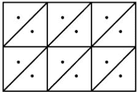

- **Step 1.** A simple input mesh. Triangulation is not strictly necessary, but your implementation will be far simpler, and likely have fewer bugs and better performance as a result.

- **步骤 1.** 一个简单的输入网格。三角化并非严格必要，但你的实现将简单得多，并且可能因此拥有更少的错误和更好的性能。

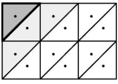

- **Step 2.** The top-left corner is one of the least connected triangles in the mesh. We initialize the first partition with it. Next, we discover the candidate triangles that have vertices in common with the current partition. This is easily done by creating a map of shared vertices to related triangles.

- **步骤 2.** 左上角是网格中连接最少的三角形之一。我们用它初始化第一个分区。接下来，我们发现与当前分区共享顶点的候选三角形。这可以通过创建共享顶点到相关三角形的映射来轻松完成。

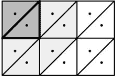

- **Step 3.** Next, one of the candidates is selected based on minimum bounding radius, distance between the candidate triangle and its related triangle in the partition (related through the sharing over vertices, not edge connectivity), or other factors.

- **步骤 3.** 接下来，根据最小包围半径、候选三角形与分区中其相关三角形之间的距离（通过顶点共享相关，而非边缘连接）或其他因素选择一个候选项。

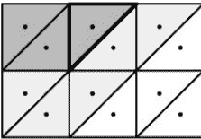

- **Step 4.** Note how candidate triangles may not have edges in common with the current partition.

- **步骤 4.** 注意候选三角形可能与当前分区没有公共边。

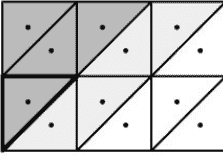

- **Step 5.** The newly added triangle was a good choice because it minimized the bounding volume of the current partition and only added one vertex.

- **步骤 5.** 新添加的三角形是一个好选择，因为它最小化了当前分区的包围体积，并且只添加了一个顶点。


- **Step 6.** Let's pretend that we cannot add any new triangles because some threshold has been reached. So, we search all unassigned triangles, not necessarily for one that is near the current partition, but for one that is least connected to the remaining unassigned triangles in the mesh.

- **步骤 6.** 让我们假设由于某些阈值已达到，我们无法添加任何新三角形。因此，我们搜索所有未分配的三角形，不一定是寻找靠近当前分区的三角形，而是寻找与网格中其余未分配三角形连接最少的三角形。


- **Step 7.** Here, we have selected a triangle that has only two related triangles. Every other unassigned triangle is related to at least three others. Remember, relationship is determined by vertex data sharing, not edges.

- **步骤 7.** 在这里，我们选择了一个只有两个相关三角形的三角形。其他每个未分配三角形都与至少三个其他三角形相关。请记住，关系由顶点数据共享决定，而非边缘。


- Step 8. Two vertices are shared with this triangle, so adding it only costs one new vertex.

- 步骤 8. 两个顶点与此三角形共享，因此添加它只需一个新顶点。


- Step 9. This triangle only requires one new vertex.

- 步骤 9. 这个三角形只需要一个新顶点。


- Step 10. This triangle increases the bounding sphere minimally, and only adds one new vertex.

- 步骤 10. 这个三角形最小程度地增加了包围球，并且只添加一个新顶点。


- Step 11. This triangle adds one new vertex, and is closer, measured by distance between face centers, to the related triangle than the similar triangle not selected above.

- 步骤 11. 这个三角形添加一个新顶点，并且按面中心之间的距离衡量，比上面未选择的相似三角形更靠近相关三角形。


- **步骤 12.** 此三角形添加一个新顶点。


- **步骤 13.** 我们已没有可分配的三角形。它们并不完全平衡，因此让我们运行一个细化步骤以改进平衡。

- **步骤 14.** 在细化过程中，会检查两个分区，寻找那些“更愿意”待在其他地方的三角形，且无需额外成本。由于这种情况不会发生，平衡分区的唯一方法是将顶点 6 连同三角形 4 的三角形索引一起移动到第一个分区。只要两个生成的分区均未超过其阈值（包围半径、顶点数、三角形数等），即可执行此操作。


请注意，三角形 7 现在可以在分区之间自由移动，而不会改变顶点数。在这种情况下，没有理由这样做，因为分区已经平衡且顶点数无法减少。

### 参考文献

- [1] J. B. Kruskal. "图的最短跨树与旅行商问题". 《美国数学学会会刊》，第 7 卷，第 1 期（1956 年 2 月），第 48–50 页。

- [2] R. C. Prim. "最短连接网络及其推广". 《贝尔系统技术期刊》，第 36 卷（1957 年），第 1389–1401 页。

- [3] P. V. Sander, Z. J. Wood, S. J. Gortler, J. Snyder, and H. Hoppe. "多图表几何图像". 2003 年欧洲图形学几何处理研讨会论文集，2003。

## 第 14 章：常见形状的惯性矩

埃里克·朗格尔

Terathon 软件

### 概述

惯性矩是刚体动力学中的一个重要量。它是质量的旋转类比，描述了改变物体角速度有多困难。计算特定轴周围惯性矩 \( I \) 的公式是积分

(14.1) \( I = \int_V r^2 dm, \)

其中 \( dm \) 是物体内某点的微分质量，\( r \) 是该点到旋转轴的距离，\( V \) 表示构成整个物体的点集。尽管这个积分看起来非常简单，但体积 \( V \) 的形状常常使积分变得非常复杂。与其费力地计算一个复杂的积分，不如查找特定形状的惯性矩，但现有参考文献可能难以找到，且现存的有时不准确或不完整。本文提供了多种常见形状惯性矩的推导，并将其汇总为一张方便的参考表。

### 14.1 质心

在刚体模拟中，了解物体关于其质心的惯性矩最为有用，因为物体自然绕该点旋转。为了计算物体的质心，我们首先需要能够计算物体的质量。如果我们将物体视为由大量粒子组成，则其总质量 m 只是这些粒子质量 m_k 的总和：

(14.2) \( m = \sum_k m_k \) .

质心 C 是通过取每个粒子的质量 m_k 与其位置 r_k 的乘积，对所有粒子求和，然后除以总质量来求得的，如下所示：

(14.3) \( \mathbf{C} = \frac{\sum_k \mathbf{r}_k m_k}{\sum_k m_k} \) .

对于连续体积，这些求和变为积分。物体的质量 m 是通过对其体积积分密度来求得的，如下所示：

(14.4) \( m = \int_V \rho(\mathbf{r}) \, dv \) .

这里，\(\rho(\mathbf{r})\) 是一个函数，给出物体体积内任意点 \(\mathbf{r}\) 处的密度，\(dv = dx \, dy \, dz\) 是微分体积元素。密度通常是一个常数，我们可以将其移出积分，因此放弃函数符号，简单地将其写为 \(\rho\)。

(14.5) \( m = \rho \int_V dv \).

物体的质心 C 是通过积分微分质量与其位置的乘积，并将结果除以总质量来求得的，如下所示：

(14.6) \( \mathbf{C} = \frac{\rho \int_V \mathbf{r} \, dv}{\rho \int_V dv} \).

### 14.2 惯性张量

在给定的坐标系中，每个刚体都有三个惯性矩（每个坐标轴一个）和三个惯性积。这六个量构成了所谓的刚体惯性张量。惯性张量通常表示为 3x3 矩阵，但它是对称的，因此只有六个不同的元素。对于一组粒子，惯性张量 I 由以下公式给出

```
(14.7) \(\mathbf{I} = \sum_k m_k \begin{bmatrix} y_k^2 + z_k^2 & -x_k y_k & -x_k z_k \\ -x_k y_k & x_k^2 + z_k^2 & -y_k z_k \\ -x_k z_k & -y_k z_k & x_k^2 + y_k^2 \end{bmatrix},\)
```

其中第 k 个粒子具有质量 m_k 并位于点 (x_k,y_k,z_k) [1]。此公式也可以表示为

```
(14.8) \(\mathbf{I} = \sum_k m_k \left( r_k^2 \mathbf{E}_3 - \mathbf{r}_k \otimes \mathbf{r}_k \right),\)
```

其中 E_3 是 3x3 单位矩阵，r_k=(x_k,y_k,z_k)，操作 \otimes 是张量积，给出

```
(14.9) \(\mathbf{r}_k \otimes \mathbf{r}_k = \begin{bmatrix} x_k^2 & x_k y_k & x_k z_k \\ x_k y_k & y_k^2 & y_k z_k \\ x_k z_k & y_k z_k & z_k^2 \end{bmatrix}.\)
```

惯性张量的对角元素是惯性矩，非对角元素是惯性积。总是可以找到一个坐标系，使得所有惯性积均为零，我们称这样的坐标系的轴为刚体的主惯性轴。在本文中，我们仅在与主惯性轴对齐的坐标系中计算惯性张量。这些轴的方向通常由于所检查物体的对称性而显而易见。

对于与主惯性轴对齐的坐标系中的连续体积，惯性张量 I 的对角元素由以下积分给出

```
(14.10) \( I_{11} = \rho \int_V (y^2 + z^2) dv \quad I_{22} = \rho \int_V (x^2 + z^2) dv \quad I_{33} = \rho \int_V (x^2 + y^2) dv. \)
```

### 变换

给定一个可逆的 3x3 变换矩阵 M，它将点从一个坐标系变换到另一个具有相同原点的坐标系，惯性张量 I 根据以下公式变换

```
(14.11) \( I' = \mathbf{M} \mathbf{I} \mathbf{M}^{-1} \).
```

将此乘积视为先使用 M^{-1} 从新坐标系逆向变换回原始坐标系，在该坐标系中应用惯性张量 I，然后使用 M 变换回新坐标系，这很有用。

要将惯性张量变换到具有不同原点的坐标系，我们可以使用一个称为平行轴定理的公式。设 s 为表示新原点与旧原点之差的偏移向量。然后，从方程 (14.8) 给出的惯性张量公式开始，我们将 r 替换为 r+s 以获得

(14.12) \( I = \sum_i m_i \left[ (\mathbf{r}_i + \mathbf{s})^2 \mathbf{E}_3 - (\mathbf{r}_i + \mathbf{s}) \otimes (\mathbf{r}_i + \mathbf{s}) \right] \).

展开此求和，我们有

(14.13) \( I = \sum m_i r_i^2 \mathbf{E}_3 + \left[ 2 \left( \sum m_i \mathbf{r}_i \right) \cdot \mathbf{s} \right] \mathbf{E}_3 + \left( \sum m_i \right) s^2 \mathbf{E}_3 - \sum m_i \mathbf{r}_i \otimes \mathbf{r}_i - \left( \sum m_i \mathbf{r}_i \right) \otimes \mathbf{s} - \mathbf{s} \otimes \sum m_i \mathbf{r}_i - \left( \sum m_i \right) \mathbf{s} \otimes \mathbf{s} \).

此方程包含方程 (14.8) 给出的原始求和中的两个 I 项，因此我们可以用 I 替换这些项以得到

(14.14) \( I' = I + \left[ 2 \left( \sum m_i \mathbf{r}_i \right) \cdot \mathbf{s} \right] \mathbf{E}_3 + \left( \sum m_i \right) s^2 \mathbf{E}_3 - \left( \sum m_i \mathbf{r}_i \right) \otimes \mathbf{s} - \mathbf{s} \otimes \sum m_i \mathbf{r}_i - \left( \sum m_i \right) \mathbf{s} \otimes \mathbf{s} \).

现在，如果坐标系的原点与质心重合，则求和 \(\sum_k m_k \mathbf{r}_k\) 等于点 (0,0,0)。这使我们能够进行巨大的简化，因为方程 (14.14) 中包含此求和的所有项都消失了。因此我们可以使用公式

(14.15) \( \mathbf{I}' = \mathbf{I} + m \left( s^2 \mathbf{E}_3 - \mathbf{s} \otimes \mathbf{s} \right) \).

将惯性张量从一个质心位于原点的坐标系变换到另一个新原点位于原始坐标系中点 s 的坐标系。

重要的是要理解，方程 (14.15) 只能对惯性张量应用一次，以将其从质心移开。在惯性张量被移动后，它不再使用原点与质心重合的坐标系。


质心，但该条件必须为真，公式 (14.15) 才有效。但是，如果已知向量 s，则可以从偏置惯性张量 I' 恢复惯性张量 I，从而再次允许使用公式 (14.15) 执行新的偏置。

### 14.3 惯性矩推导

在本节中，我们将推导各种常见实心形状的质心和惯性矩。惯性张量始终在一个坐标系中表示，该坐标系的原点位于质心，且坐标轴与形状的主惯性轴平行。

手动计算本节中呈现的这类积分可能是一项非常乏味的工作。我们建议使用诸如 Mathematica 之类的符号计算软件包来执行这些计算，如果读者愿意的话。

### 盒子

描述盒子尺寸有两种常见方法，如图 14.1 所示。一种方法是将原点放在一个角上，并通过其长度 $l$、宽度 $w$ 和高度 $h$ 标识盒子在三个方向上的全部尺寸。第二种方法是将原点放在盒子中心，并标识从中心到三个方向各个面的垂直距离 $a$、$b$ 和 $c$。我们为两种情况都提供了公式。


**图 14.1：盒子。**

当盒子由尺寸 $l$、$w$ 和 $h$ 描述时，总质量为 $m = \rho lwh$，质心位于 $(l/2,w/2,h/2)$。惯性矩随后由以下积分给出

```
\(I_{11} = \rho \int_{-h/2}^{h/2} \int_{-w/2}^{w/2} \int_{-l/2}^{l/2} (y^2 + z^2) \, dx \, dy \, dz = \frac{1}{12} \rho lwh (w^2 + h^2),\)
\(I_{22} = \rho \int_{-h/2}^{h/2} \int_{-w/2}^{w/2} \int_{-l/2}^{l/2} (x^2 + z^2) \, dx \, dy \, dz = \frac{1}{12} \rho lwh (l^2 + h^2),\)
\(I_{33} = \rho \int_{-h/2}^{h/2} \int_{-w/2}^{w/2} \int_{-l/2}^{l/2} (x^2 + y^2) \, dx \, dy \, dz = \frac{1}{12} \rho lwh (l^2 + w^2).\)
```

代入质量 $m$，这给出了惯性张量

```
\(\mathbf{I}_{\text{box}} = \begin{bmatrix} \frac{1}{12}m(w^2+h^2) & 0 & 0 \\ 0 & \frac{1}{12}m(l^2+h^2) & 0 \\ 0 & 0 & \frac{1}{12}m(l^2+w^2) \end{bmatrix}.\)
```

当盒子由尺寸 $a$、$b$ 和 $c$ 描述时，总质量为 $m = 8\rho abc$，质心与原点重合。惯性矩随后由以下积分给出

```
\(I_{11} = \rho \int_{-c}^{c} \int_{-b}^{b} \int_{-a}^{a} (y^2 + z^2) \, dx \, dy \, dz = \frac{8}{3} \rho abc (b^2 + c^2),\)
\(I_{22} = \rho \int_{-c}^{c} \int_{-b}^{b} \int_{-a}^{a} (x^2 + z^2) \, dx \, dy \, dz = \frac{8}{3} \rho abc (a^2 + c^2),\)
\(I_{33} = \rho \int_{-c}^{c} \int_{-b}^{b} \int_{-a}^{a} (x^2 + y^2) \, dx \, dy \, dz = \frac{8}{3} \rho abc (a^2 + b^2).\)
```

代入质量 $m$，这给出了惯性张量

(14.19)

\(\mathbf{I}_{\text{box}} = \begin{bmatrix} \frac{1}{12}m(b^2+c^2) & 0 & 0 \\ 0 & \frac{1}{12}m(a^2+c^2) & 0 \\ 0 & 0 & \frac{1}{12}m(a^2+b^2) \end{bmatrix}\)

### 圆柱

圆柱的尺寸由其高度 \(h\) 及其底面的两个半轴长度 \(a\) 和 \(b\) 描述，如图 14.2 所示。如果圆柱是圆形的，则 \(a = b\)。


**图 14.2：圆柱。**

质心位于点 (0,0,h/2)，圆柱的总质量为 \(m = \pi \rho a b h\)。惯性矩随后由以下积分给出

```
\(I_{11} = \rho \int_{-h/2}^{h/2} \int_{-b}^{b} \int_{-a\sqrt{1-y^2/b^2}}^{a\sqrt{1-y^2/b^2}} (y^2+z^2) dx dy dz = \pi \rho a b h \left( \frac{1}{4}b^2 + \frac{1}{12}h^2 \right),\)
(14.20) \quad I_{22} = \rho \int_{-h/2}^{h/2} \int_{-b}^{b} \int_{-a\sqrt{1-y^2/b^2}}^{a\sqrt{1-y^2/b^2}} (x^2+z^2) dx dy dz = \pi \rho a b h \left( \frac{1}{4}a^2 + \frac{1}{12}h^2 \right),\)
\(I_{33} = \rho \int_{-h/2}^{h/2} \int_{-b}^{b} \int_{-a\sqrt{1-y^2/b^2}}^{a\sqrt{1-y^2/b^2}} (x^2+y^2) dx dy dz = \frac{\pi}{4} \rho a b h (a^2+b^2).\)
```

代入质量 \( m \)，这给出了惯性张量

(14.21)

\(\mathbf{I}_{\text{cylinder}} = \begin{bmatrix} \frac{1}{4}mb^2 + \frac{1}{12}mh^2 & 0 & 0 \\ 0 & \frac{1}{4}ma^2 + \frac{1}{12}mh^2 & 0 \\ 0 & 0 & \frac{1}{12}m(a^2+b^2) \end{bmatrix}.\)

### 金字塔

矩形金字塔的尺寸由其高度 \( h \) 以及从底面中心到底面两条相邻边的垂直距离 \( a_0 \) 和 \( b_0 \) 描述，如图 14.3 所示。


**图 14.3：矩形金字塔。**

为了计算总质量和质心，我们需要能够表示金字塔在任何 z 坐标处的横截面长度 \( a \) 和 \( b \)。在 \( z = 0 \) 处产生底面长度并在顶点处（\( z = h \)）线性收缩到零的函数 \( a(z) \) 和 \( b(z) \) 由以下给出

(14.22)

$a(z) = a_0 \frac{h-z}{h}$

$b(z) = b_0 \frac{h-z}{h}$.

总质量随后通过对金字塔整个高度积分矩形面积来给出：

(14.23) \( m = 4\rho \int_0^h a(z)b(z)dz = 4\rho \frac{a_0 b_0}{h^2} \int_0^h (h-z)^2 dz = \frac{4}{3} \rho a_0 b_0 h. \)

质心显然位于 z 轴上，我们可以通过将因子 z 乘入质量的被积函数来计算其 z 坐标，以得到

(14.24) \( m z_c = 4\rho \frac{a_0 b_0}{h^2} \int_0^h (h-z)^2 z dz = \frac{1}{3} \rho a_0 b_0 h^2. \)

除以 \( m \) 之后，我们发现质心位于点 (0, 0, h/4)。

由于惯性矩最好在原点与质心重合的坐标系中计算，因此考虑一个在 z 方向从 -h/4 延伸到 3h/4 的金字塔是有用的，并重新定义函数 a(z) 和 b(z) 为

(14.25)
\( a(z) = \frac{a_0}{h} \left( \frac{3}{4}h - z \right) \)
\( b(z) = \frac{b_0}{h} \left( \frac{3}{4}h - z \right). \)

惯性矩随后由以下积分给出

(14.26)
\( I_{11} = \rho \int_{-h/4}^{3h/4} \int_{-b(z)}^{b(z)} \int_{-a(z)}^{a(z)} (y^2 + z^2) dx dy dz = \rho a_0 b_0 h \left( \frac{4}{15} b_0^2 + \frac{1}{20} h^2 \right), \)
\( I_{22} = \rho \int_{-h/4}^{3h/4} \int_{-b(z)}^{b(z)} \int_{-a(z)}^{a(z)} (x^2 + z^2) dx dy dz = \rho a_0 b_0 h \left( \frac{4}{15} a_0^2 + \frac{1}{20} h^2 \right), \)
\( I_{33} = \rho \int_{-h/4}^{3h/4} \int_{-b(z)}^{b(z)} \int_{-a(z)}^{a(z)} (x^2 + y^2) dx dy dz = \frac{4}{15} \rho a_0 b_0 h (a_0^2 + b_0^2). \)

代入质量 m，这给出了惯性张量

(14.27) \(\mathbf{I}_{\text{pyramid}} = \begin{bmatrix} \frac{1}{5} m b_0^2 + \frac{1}{30} m h^2 & 0 & 0 \\ 0 & \frac{1}{5} m a_0^2 + \frac{1}{30} m h^2 & 0 \\ 0 & 0 & \frac{1}{5} m (a_0^2 + b_0^2) \end{bmatrix}.\)

### 圆锥

圆锥的尺寸由其高度 h 及其底面的两个半轴长度 a0 和 b0 描述，如图 14.4 所示。如果圆锥是圆形的，则 a0=b0。


**图 14.4：圆锥。**

与金字塔一样，我们使用由公式 (14.22) 给出的函数 a(z) 和 b(z) 来表示圆锥在底面上方高度 $z$ 处的横截面尺寸。我们可以通过对圆锥整个高度积分椭圆盘面积来计算圆锥的总质量：

(14.28) \( m = \rho \int_0^h \pi a(z)b(z)dz = \rho \frac{a_0 b_0}{h^2} \int_0^h (h-z)^2 dz = \frac{\pi}{3} \rho a_0 b_0 h. \)

质心显然位于 z 轴上，我们可以通过将因子 z 乘入质量的被积函数来计算其 z 坐标，以获得

(14.29) \( m C_z = \rho \frac{a_0 b_0}{h^2} \int_0^h \pi (h-z)^2 z dz = \frac{\pi}{12} \rho a_0 b_0 h^2. \)

除以 $m$ 之后，我们发现质心位于点 $(0,0,h/4)$。

金字塔和圆锥的质心相等并非巧合。对于任何在高度 $h$ 处线性收缩到一点的二维底面形状，都会得到同一点。为了在原点位于质心的坐标系中计算惯性矩，我们再次按公式 (14.25) 重新定义函数 $a(z)$ 和 $b(z)$，并从 $-h/4$ 积分到 $3h/4$。惯性矩随后由以下积分给出

(14.30) \(\begin{aligned} I_{11} &= \rho \int_{-h/4}^{3h/4} \int_{-a(z)}^{a(z)} \int_{-b(z)\sqrt{1-(y/a)^2}}^{b(z)\sqrt{1-(y/a)^2}} (y^2+z^2) dx dy dz = \pi \rho a_0 b_0 h \left( \frac{1}{20} b_0^2 + \frac{1}{80} h^2 \right), \\ I_{22} &= \rho \int_{-h/4}^{3h/4} \int_{-a(z)}^{a(z)} \int_{-b(z)\sqrt{1-(y/a)^2}}^{b(z)\sqrt{1-(y/a)^2}} (x^2+z^2) dx dy dz = \pi \rho a_0 b_0 h \left( \frac{1}{20} a_0^2 + \frac{1}{80} h^2 \right), \\ I_{33} &= \rho \int_{-h/4}^{3h/4} \int_{-a(z)}^{a(z)} \int_{-b(z)\sqrt{1-(y/a)^2}}^{b(z)\sqrt{1-(y/a)^2}} (x^2+y^2) dx dy dz = \frac{\pi}{20} \rho a_0 b_0 h (a_0^2 + b_0^2). \end{aligned}\)

代入质量 $m$，这给出了惯性张量


(14.31) \(\mathbf{I} = \begin{bmatrix} \frac{1}{5}mb_1^2 + \frac{1}{5}mh^2 & 0 & 0 \\ 0 & \frac{1}{5}ma_c^2 + \frac{1}{5}mh^2 & 0 \\ 0 & 0 & \frac{1}{5}m(a_c^2 + b_1^2) \end{bmatrix}\)

### 椭球体

椭球体的尺寸由三个半轴长度 \(a\)、\(b\) 和 \(c\) 描述，如图 14.5 所示。在球体的情况下，\(a=b=c\)。质心显然位于椭球体的中心，我们也将原点放置在那里。椭球体的总质量为 \(m = \frac{4}{3}\pi\rho abc\)。


图 14.5：椭球体。

为了简化积分，我们使用以下替换将椭球体重新映射为半径为一的球体：

(14.32) \(\begin{aligned} u = \frac{x}{a} \quad & \quad du = \frac{1}{a} dx \\ v = \frac{y}{b} \quad & \quad dv = \frac{1}{b} dy \\ w = \frac{z}{c} \quad & \quad dw = \frac{1}{c} dz . \end{aligned}\)

椭球体的惯性矩随后由以下积分给出

\( I_{11} = \rho abc \int_{-1}^{1} \int_{-\sqrt{1-v^2}}^{\sqrt{1-v^2}} \int_{-\sqrt{1-v^2-w^2}}^{\sqrt{1-v^2-w^2}} (b^2v^2 + c^2w^2) du \, dv \, dw = \frac{4\pi}{15} \rho abc (b^2 + c^2), \)
\( I_{22} = \rho abc \int_{-1}^{1} \int_{-\sqrt{1-v^2}}^{\sqrt{1-v^2}} \int_{-\sqrt{1-v^2-w^2}}^{\sqrt{1-v^2-w^2}} (a^2u^2 + c^2w^2) du \, dv \, dw = \frac{4\pi}{15} \rho abc (a^2 + c^2), \)
\( I_{33} = \rho abc \int_{-1}^{1} \int_{-\sqrt{1-v^2}}^{\sqrt{1-v^2}} \int_{-\sqrt{1-v^2-w^2}}^{\sqrt{1-v^2-w^2}} (a^2u^2 + b^2v^2) du \, dv \, dw = \frac{4\pi}{15} \rho abc (a^2 + b^2). \)

代入质量 \( m \)，这给出了惯性张量

\( \mathbf{I}_{\text{ellipsoid}} = \begin{bmatrix} \frac{1}{5}m(b^2 + c^2) & 0 & 0 \\ 0 & \frac{1}{5}m(a^2 + c^2) & 0 \\ 0 & 0 & \frac{1}{5}m(a^2 + b^2) \end{bmatrix} \).

### 穹顶

穹顶（或椭球半球）的尺寸与完整椭球体的描述方式相同：由半轴长度 \( a \)、\( b \) 和 \( c \) 描述，如图 14.6 所示。


**图 14.6：** 穹顶，或椭球半球。

穹顶的总质量为 \( m = \frac{2}{3}\pi abc \)，质心的 z 坐标可通过以下积分计算

\( m\bar{z}_c = \rho abc^2 \int_{0}^{1} \int_{-\sqrt{1-v^2}}^{\sqrt{1-v^2}} \int_{-\sqrt{1-v^2-w^2}}^{\sqrt{1-v^2-w^2}} w \, du \, dv \, dw = \frac{\pi}{4} abc^2, \).

这里我们再次使用了方程 (14.32) 给出的替换。除以 $m$ 后，我们发现质心位于点 $(0,0,3c/8)$。

为了计算穹顶的惯性矩，我们可以使用一个使积分更简单的技巧。我们不是计算关于质心的惯性张量 $\mathbf{I}$，而是计算关于穹顶底座中心原点的惯性张量 $\mathbf{I}'$，然后使用方程 (14.15) 在偏移量为 $\mathbf{s}=(0,0,-3c/8)$ 时求得 $\mathbf{I}$。关于原点的穹顶惯性矩由以下积分给出

$$
\begin{aligned}
I_{11} &= \rho \int_{-h/2}^{h/2} \int_{-w/2}^{w/2} \int_{-l/2}^{l/2} (y^2 + z^2) dx dy dz = \frac{1}{12} \rho lwh(w^2 + h^2), \\
I_{22} &= \rho \int_{-h/2}^{h/2} \int_{-w/2}^{w/2} \int_{-l/2}^{l/2} (x^2 + z^2) dx dy dz = \frac{1}{12} \rho lwh(l^2 + h^2), \\
I_{33} &= \rho \int_{-h/2}^{h/2} \int_{-w/2}^{w/2} \int_{-l/2}^{l/2} (x^2 + y^2) dx dy dz = \frac{1}{12} \rho lwh(l^2 + w^2).
\end{aligned}
$$

代入质量 $m$，这给出了惯性张量

$$
\mathbf{I}'_{\text{dome}} = \begin{bmatrix} \frac{1}{5}m(b^2+c^2) & 0 & 0 \\ 0 & \frac{1}{3}m(a^2+c^2) & 0 \\ 0 & 0 & \frac{1}{3}m(a^2+b^2) \end{bmatrix}.
$$

这与椭球体的惯性张量相同，但质量 $m$ 减半。为了获得关于质心的穹顶惯性张量 $\mathbf{I}_{\text{dome}}$，我们必须计算

$$
\mathbf{I}_{\text{dome}} = \mathbf{I}'_{\text{dome}} - m(s^2 \mathbf{E}_3 - \mathbf{s} \otimes \mathbf{s}).
$$

当 $\mathbf{s}=(0,0,-3c/8)$ 时，我们有

(14.39)

\( s^2 \mathbf{E}_3 - \mathbf{s} \otimes \mathbf{s} = \begin{bmatrix} \frac{9}{64} c^2 & 0 & 0 \\ 0 & \frac{9}{64} c^2 & 0 \\ 0 & 0 & 0 \end{bmatrix}, \)

因此

(14.40) \( \mathbf{I}_{\text{dome}} = \begin{bmatrix} \frac{1}{2}mb^2 + \frac{19}{120}mc^2 & 0 & 0 \\ 0 & \frac{1}{2}ma^2 + \frac{19}{120}mc^2 & 0 \\ 0 & 0 & \frac{1}{3}m(a^2+b^2) \end{bmatrix}. \)

### 胶囊体

胶囊体的尺寸由中央圆柱的高度 $h$、圆柱底面的两个半轴长度 $a$ 和 $b$，以及表示每个半球形端盖在垂直于圆柱底面方向上的延伸的第三个半轴长度 $c$ 描述，如图 14.7 所示。


图 14.7：胶囊体。

总质量 $m_{\text{capsule}}$ 由以下求和给出

(14.41) \( m_{\text{capsule}} = m_{\text{cylinder}} + 2m_{\text{dome}}, \)

其中 \(m_{\text{cylinder}}=\pi\rho abh\) 是中央圆柱的质量，\(m_{\text{dome}}=\frac{2}{3}\pi\rho abc\) 是单个半球形端盖的质量。由于对称性，质心显然位于胶囊体圆柱部分的中心。

我们可以通过以适当方式组合圆柱和穹顶的惯性张量来计算胶囊体惯性张量 \(\mathbf{I}_{capsule}\)。相对于位于胶囊体质心的原点，半球形端盖的质心位于 z 坐标

(14.42) \(z_{cap} = \pm \left( \frac{h}{2} + \frac{3}{8}c \right).\)

使用方程 (14.15) 给出的偏移公式，并取 \(\mathbf{s}=(0,0,z_{cap)}\)，我们可以将穹顶的惯性张量转换到胶囊体的坐标系中，以获得

(14.43) \(\mathbf{I}_{cap} = \mathbf{I}_{dome} + m_{dome} \begin{bmatrix} \frac{a^2}{4}c^2 + \frac{hc}{4} + \frac{1}{4}h^2 & 0 & 0 \\ 0 & \frac{a^2}{4}c^2 + \frac{hc}{4} + \frac{1}{4}h^2 & 0 \\ 0 & 0 & 0 \end{bmatrix}.\)

将其加倍以考虑两个端盖，并将其加到圆柱的惯性张量中，这给出了

(14.44) \(\begin{aligned} (I_{cap})_{11} &= \frac{1}{2}m_{dome}(b^2 + c^2) + \frac{1}{2}m_{dome}hc + \frac{1}{4}m_{dome}h^2 + \frac{1}{2}m_{cylinder}b^2 + \frac{1}{12}m_{cylinder}h^2 \\ (I_{cap})_{22} &= \frac{1}{2}m_{dome}(a^2 + c^2) + \frac{1}{2}m_{dome}hc + \frac{1}{4}m_{dome}h^2 + \frac{1}{2}m_{cylinder}a^2 + \frac{1}{12}m_{cylinder}h^2 \\ (I_{cap})_{33} &= \frac{1}{2}m_{dome}(a^2 + b^2) + \frac{1}{2}m_{cylinder}(a^2 + b^2). \end{aligned}\)

这些惯性矩在本章末尾的总结中以胶囊体的总质量表示。

### 截角锥体

截角锥体是指被与底面平行的平面在底面上方某个高度 \( h \) 处切去的锥体。与锥体一样，我们用底面中心到底面两条相邻边的垂直距离 \( a_0 \) 和 \( b_0 \) 来描述底面的尺寸，如图 14.8 所示。我们引入一个因子 \( r \)，表示顶面上一条边长与底面（底面）上对应边长的比值。顶面的尺寸随后由中心到边的垂直距离 \( ra_0 \) 和 \( rb_0 \) 描述。当 \( r = 0 \) 时，截角锥体的所有公式都退化为完整锥体的公式。


图 14.8：截角锥体。

为了计算总质量和质心，我们将长度 \( a \) 和 \( b \) 表示为 z 坐标的函数，如下所示：

\( a(z) = a_0 \left( 1 + \frac{r-1}{h} z \right) \)

(14.45)

\( b(z) = b_0 \left( 1 + \frac{r-1}{h} z \right) \).

总质量随后由对截角锥体底面和顶面之间 z 坐标范围内的矩形面积进行积分给出：


(14.46) \( m = 4\rho \int_0^h a(z)b(z)dz = \frac{4}{3}\rho a_0 b_0 h(r^2 + r + 1). \)

质心显然位于 z 轴上，我们可以通过将 z 因子乘入质量的被积函数来计算其 z 坐标，从而得到

(14.47) \( m C_z = 4\rho \int_0^h a(z)b(z)z dz = \frac{1}{3}\rho a_0 b_0 h^2(3r^2 + 2r + 1). \)

除以 m 后，我们得到质心的 z 坐标位于

(14.48) \( C_z = \frac{3r^2 + 2r + 1}{4(r^2 + r + 1)}h. \)

我们通过将 z 坐标范围向下平移 \( C_z \) 来将原点放在质心处，并在计算函数 a(z) 和 b(z) 时将此平移加回。惯性矩随后由以下积分给出

\( I_{11} = \rho \int_{-C_z}^{h-C_z} \int_{-b(z)}^{b(z)} \int_{-a(z)}^{a(z)} (y^2 + z^2) dx dy dz \
= \frac{4}{15} \rho a_0 b_0 h (r^4 + r^3 + r^2 + r + 1) + \rho a_0 b_0 h^3 \frac{r^4 + 4r^3 + 10r^2 + 4r + 1}{20(r^2 + r + 1)}. \
\)
\( I_{22} = \rho \int_{-C_z}^{h-C_z} \int_{-b(z)}^{b(z)} \int_{-a(z)}^{a(z)} (x^2 + z^2) dx dy dz \
= \frac{4}{15} \rho a_0 b_0 h (r^4 + r^3 + r^2 + r + 1) + \rho a_0 b_0 h^3 \frac{r^4 + 4r^3 + 10r^2 + 4r + 1}{20(r^2 + r + 1)}. \
\)
\( I_{33} = \rho \int_{-C_z}^{h-C_z} \int_{-b(z)}^{b(z)} \int_{-a(z)}^{a(z)} (x^2 + y^2) dx dy dz \
= \frac{4}{15} \rho a_0 b_0 h (a_0^2 + b_0^2) (r^4 + r^3 + r^2 + r + 1). \)

代入质量 m，这给出了惯性张量

\( (I_{\text{homopyramid}})_{11} = \frac{1}{5} m b_0^2 \frac{r^4 + r^3 + r^2 + r + 1}{r^2 + r + 1} + \frac{3}{80} m h^2 \frac{r^4 + 4r^3 + 10r^2 + 4r + 1}{(r^2 + r + 1)^2} \)

(14.50) \( (I_{\text{homopyramid}})_{22} = \frac{1}{5} m a_0^2 \frac{r^4 + r^3 + r^2 + r + 1}{r^2 + r + 1} + \frac{3}{80} m h^2 \frac{r^4 + 4r^3 + 10r^2 + 4r + 1}{(r^2 + r + 1)^2} \)

\( (I_{\text{homopyramid}})_{33} = \frac{1}{5} m (a_0^2 + b_0^2) \frac{r^4 + r^3 + r^2 + r + 1}{r^2 + r + 1} \)

### 截圆锥

截圆锥是指由与底面平行的平面在底面上方某高度 \( h \) 处截去顶部得到的圆锥。与圆锥一样，我们用半轴长度 \( a_0 \) 和 \( b_0 \) 来描述底面的尺寸，如图 14.9 所示。我们引入一个因子 \( r \)，表示顶面半轴长度与底面对应半轴长度的比值。顶面的尺寸随后由半轴长度 \( ra_0 \) 和 \( rb_0 \) 描述。当 \( r = 0 \) 时，截圆锥的所有公式都退化为完整圆锥的公式。


**图 14.9：** 截圆锥。

为了计算总质量和质心，我们使用截四棱锥的方程 (14.45) 给出的相同公式，将长度 \( a \) 和 \( b \) 表示为 z 坐标的函数。总质量随后由对截圆锥底面和顶面之间 z 坐标范围内椭圆盘面积进行积分给出：

(14.51) \( m = \pi \rho \int_0^h a(z)b(z)dz = \frac{\pi}{3} \rho a_0 b_0 h (r^2 + r + 1). \)

然后我们可以通过将 z 因子乘入质量的被积函数来计算质心的 z 坐标，从而得到

(14.52) \( m C_z = \pi \rho \int_0^h a(z)b(z)z dz = \frac{\pi}{12} \rho a_0 b_0 h^2 (3r^2 + 2r + 1). \)

除以 \( m \) 后，我们得到质心的 z 坐标位于

(14.53) \( C_z = \frac{3r^2 + 2r + 1}{4(r^2 + r + 1)} h, \)

这与截四棱锥的情况相同。惯性矩随后由以下积分给出

\( I_{11} = \rho \int_{-C_z}^{h-C_z} \int_{-b(z)}^{b(z)} \int_{-a(z)}^{a(z)} (y^2+z^2) dx dy dz \
= \frac{\pi}{20} \rho a_0 b_0 h (r^4 + r^3 + r^2 + r + 1) + \rho \pi a_0 b_0 h^4 \frac{r^4 + 4r^3 + 10r^2 + 4r + 1}{80(r^2 + r + 1)}. \
\)
\( I_{22} = \rho \int_{-C_z}^{h-C_z} \int_{-b(z)}^{b(z)} \int_{-a(z)}^{a(z)} (x^2+z^2) dx dy dz \
= \frac{\pi}{20} \rho a_0 b_0 h (r^4 + r^3 + r^2 + r + 1) + \rho \pi a_0 b_0 h^4 \frac{r^4 + 4r^3 + 10r^2 + 4r + 1}{80(r^2 + r + 1)}. \
\)
\( I_{33} = \rho \int_{-C_z}^{h-C_z} \int_{-b(z)}^{b(z)} \int_{-a(z)}^{a(z)} (x^2+y^2) dx dy dz \
= \frac{\pi}{20} \rho a_0 b_0 h (a_0^2 + b_0^2) (r^4 + r^3 + r^2 + r + 1). \) (14.54)

代入质量 \( m \)，这给出了惯性张量

(14.55) \( (\mathbf{I}_{\text{non-cone}})_{11} = \frac{3}{20} m b_0^2 \frac{r^4+r^3+r^2+r+1}{r^2+r+1} + \frac{3}{80} m b_0^2 \frac{r^4+4r^3+10r^2+4r+1}{(r^2+r+1)^2} \)

\( (\mathbf{I}_{\text{non-cone}})_{22} = \frac{3}{20} m a_0^2 \frac{r^4+r^3+r^2+r+1}{r^2+r+1} + \frac{3}{80} m b_0^2 \frac{r^4+4r^3+10r^2+4r+1}{(r^2+r+1)^2} \)

\( (\mathbf{I}_{\text{non-cone}})_{33} = \frac{3}{20} m (a_0^2 + b_0^2) \frac{r^4+r^3+r^2+r+1}{r^2+r+1} \)

### 14.4 总结

前一节中考察的各种形状的质量、质心和惯性张量汇总于表 14.1 中。

表 14.1：本表列出了各种实心形状的质量 m、质心 (CM) C 和惯性张量 I 的分量。惯性张量始终以原点与质心重合的坐标系给出。每种形状均被视为密度恒定的实心体。

| 形状 | 质量和质心 | 惯性张量 |
| :--- | :--- | :--- |
| 长方体 | m = ρabc<br>C = (0,0,0) | Ixx = 1/12 m(b²+c²)<br>Iyy = 1/12 m(a²+c²)<br>Izz = 1/12 m(a²+b²) |
| 圆柱体 | m = ρπa²h<br>C = (0,0,h/2) | Ixx = 1/12 m(3a²+h²)<br>Iyy = 1/12 m(3a²+h²)<br>Izz = 1/2 ma² |
| 棱锥体 | m = 1/3 ρa²h<br>C = (0,0,h/4) | Ixx = 1/20 m(a²+a²)<br>Iyy = 1/20 m(a²+a²)<br>Izz = 1/5 m(a²) |
| 圆锥体 | m = 1/3 πρa²h<br>C = (0,0,h/4) | Ixx = 3/80 m(4a²+h²)<br>Iyy = 3/80 m(4a²+h²)<br>Izz = 3/10 ma² |
| 椭球体 | m = 4/3 πρabc<br>C = (0,0,0) | Ixx = 1/5 m(b²+c²)<br>Iyy = 1/5 m(a²+c²)<br>Izz = 1/5 m(a²+b²) |
| 穹顶 | m = 2/3 πρa³<br>C = (0,0,3a/8) | Ixx = 1/5 m(a²+a²)<br>Iyy = 1/5 m(a²+a²)<br>Izz = 2/5 ma² |

### 参考文献

[1] Jerry B. Marion 和 Stephen T. Thornton。*经典动力学*，第 3 版。Saunders College Publishing，1988 年。

# 第二部分：渲染技术

## 章节列表

- 第 15 章：基于物理的室外场景光照
- 第 16 章：渲染基于物理的天空盒
- 第 17 章：运动模糊与速度-深度-梯度缓冲区
- 第 18 章：快速屏幕空间环境光遮蔽与间接光照
- 第 19 章：实时角色肢解
- 第 20 章：延迟贴花渲染技术

## 第 15 章：基于物理的室外场景光照

弗兰克·凯恩

Sundog Software, LLC

### 概述

冒险游戏、角色扮演游戏以及“严肃”的培训和模拟游戏通常需要在一天中的不同时间渲染同一场景。本文提供了一种基于物理的方法，用于为任何给定的时间和地点生成逼真的直接和漫射环境天光，并结合色调映射算子以考虑人类视觉感知。（参见图 15.1。）这使得具有室外场景的游戏具有更高的真实感，并为可能使用您引擎的培训系统提供了物理上准确的光照。

| 形状 | 质量和质心 | 惯性张量 |
|---|---|---|
| 长方体 | \( m = \rho abc \)<br>C = (0,0,0) | \( I_{xx} = \frac{1}{12}m(b^2+c^2) \)<br>\( I_{yy} = \frac{1}{12}m(a^2+c^2) \)<br>\( I_{zz} = \frac{1}{12}m(a^2+b^2) \) |
| 圆柱体 | \( m = \rho \pi abh \)<br>C = (0,0,h/2) | \( I_{xx} = \frac{1}{12}m(3a^2+h^2) \)<br>\( I_{yy} = \frac{1}{12}m(3b^2+h^2) \)<br>\( I_{zz} = \frac{1}{12}m(a^2+b^2) \) |
| 棱锥 | \( m = \frac{1}{3}\rho abh \)<br>C = (0,0,h/4) | \( I_{xx} = \frac{1}{20}ma^2 + \frac{1}{12}mh^2 \)<br>\( I_{yy} = \frac{1}{20}mb^2 + \frac{1}{12}mh^2 \)<br>\( I_{zz} = \frac{1}{20}m(a^2+b^2) \) |
| 圆锥体 | \( m = \frac{1}{3}\pi\rho abh \)<br>C = (0,0,h/4) | \( I_{xx} = \frac{3}{80}ma^2 + \frac{3}{20}mh^2 \)<br>\( I_{yy} = \frac{3}{80}mb^2 + \frac{3}{20}mh^2 \)<br>\( I_{zz} = \frac{3}{10}m(a^2+b^2) \) |
| 椭球体 | \( m = \frac{4}{3}\pi\rho abc \)<br>C = (0,0,0) | \( I_{xx} = \frac{1}{5}m(b^2+c^2) \)<br>\( I_{yy} = \frac{1}{5}m(a^2+c^2) \)<br>\( I_{zz} = \frac{1}{5}m(a^2+b^2) \) |
| 穹顶 | \( m = \frac{2}{3}\pi\rho abc \)<br>C = (0,0,3h/8) | \( I_{xx} = \frac{4}{15}ma^2 + \frac{83}{560}mh^2 \)<br>\( I_{yy} = \frac{4}{15}mb^2 + \frac{83}{560}mh^2 \)<br>\( I_{zz} = \frac{2}{5}m(a^2+b^2) \) |

图 15.1：（另参见彩色插页。）黄昏时分（左）和夜间（右）的基于物理光照的室外场景。（图片由 Emergent Game Technologies 和 Sundog Software, LLC 提供。）


### 15.1 定位太阳和月亮

自然光主要来自太阳和月亮，因此照亮室外场景的第一步是知道将这些光源放置在何处。为此，您需要一个 *星历表模型* 来计算给定时间和地点的太阳和月亮位置。由于这是一本游戏引擎书籍而非天文学书籍，我们不在此深入细节，而是将您引向随附光盘中包含的代码里的 `Ephemeris` 类。理解这个类确实需要几个关键概念，我们将在此描述。

天体位置的数值近似通常在给定 *纪元时间* 的 *黄道坐标* 中进行。我们的 `Ephemeris` 类首先计算太阳、月亮和可见行星在黄道坐标中的位置，这些坐标只是相对于太阳在天空中运行路径所定义平面的纬度和经度。因此，太阳的黄道纬度始终为零。所使用的算法以自公元2000年以来经过的世纪数表示的格林威治标准时间作为输入；这是纪元2000的纪元时间。我们的 `LocalTime` 类将为您处理将给定日期的小时、分钟和秒转换为纪元世纪。在计算月球位置的同时，我们还计算月相，这对夜间照明很重要。

黄道坐标对渲染并不十分有用，因此您需要将黄道极坐标系转换为相对于本地地平线的笛卡尔坐标系。幸运的是，这只需几个 3 × 3 旋转矩阵即可完成。我们的代码首先获取太阳或月亮的黄道坐标及其距离地球的距离，并将其转换为以地球中心为原点的黄道空间中的 3D 向量。然后，我们将此向量旋转到 *赤道坐标*，这是一个由地球赤道平面而非地球绕太阳公转平面定义的系统；这需要计算模拟时间的地球倾斜度。

最后，我们将赤道坐标转换为您希望模拟的地球位置的地平线坐标。作为收尾，我们还对地平线坐标应用大气折射，这会影响太阳和月亮接近地平线时的感知位置。

必须确保此最终转换与您引擎的坐标系统约定一致；如果您的用户可能将“北”和“上”定义为任意轴，您将希望为他们提供一种影响此最终转换到本地坐标的方式。太阳从西方而非东方升起是一个尴尬的错误，非常容易在测试中漏掉。您还可能希望公开太阳和月亮的地理坐标；这些坐标不是相对于地球表面的特定位置，而是相对于地球中心。能够覆盖大距离的飞行模拟器经常使用此坐标系统，我们的 Ephemeris 类也会为您计算这一点。

这些相同的矩阵也可用于转换天空中的星场等内容。这听起来可能有些大材小用，但在场景中拥有准确定位的星星，对于创建例如导航培训应用程序的人来说可能很重要。

当您引擎的太阳和月亮在被模拟位置的准确时间升起时，所有这些工作都会得到回报。有一款在阿拉斯加冬季进行的游戏吗？您的夜晚将漫长，太阳将低垂——全自动实现。

### 15.2 计算自然阳光

既然我们知道太阳在天空中的位置，就可以模拟其光线穿过大气层时发生的情况；这被称为 *大气透过率* 和 *大气散射*，由包含源代码中的 `Spectrum` 类进行模拟。我们的方法使用修改后的“Bird 简单光谱模型”，以 1984 年在太阳能研究所（现国家可再生能源实验室）开发该模型的 Richard Bird 博士命名 [1]。与其他模型相比，它相对简单，却惊人地准确。例如，这段代码会让日落附近的阳光变红。

我们的 `Spectrum` 类在完整可见光谱范围内运行，并以 NASA 提供的大气层外太阳光谱数据作为输入。（此光谱位于我们的 `SolarSpectrum` 类中。）它还接收太阳与天空穹顶顶部之间的角度（*天顶角*）、您的海拔高度以及 *大气浑浊度*，这本质上是衡量空气污染程度的指标。浑浊度的合理值约为 2.2；低于 1.8 或高于 20.0 会导致计算开始出错。此类将为您提供大气层透射阳光的 *直接辐照度*（这将成为太阳光源的漫射分量）和 *散射辐照度*（这将成为光源的环境分量）的光谱。

模拟的核心在于 `Spectrum :: ApplyAtmosphericTransmittance`。该方法遍历从 380 nm 到 720 nm 的可见光谱样本。对于每个波长，我们模拟大气的多个组分对该波长在大气中传输和散射的影响。我们可以将各组分的透过率相乘，得到给定波长的最终透过率，并将其乘以该波长处太阳的辐照度。散射组分相加后，再乘以太阳的辐照度。

处理完可见光谱的所有波长后，我们可以将此光谱转换为直接和环境自然光的 RGB 值。

它首先计算给定太阳角度的大气质量，这表示阳光到达相机之前需要穿过多少大气层。给定太阳天顶角 Z（以度为单位）的大气质量 M 由以下公式给出：

\( M = \frac{1.0}{\cos Z + 0.50572(93.885 - Z)^{-1.636}} \)。

太阳越低，空气散射其阳光的程度就越高。我们将大气质量乘以等温效应，这是一种花哨的说法，意思是海拔越高，大气层越薄。随着海拔升高，较低的大气质量会导致散射光线减少、直射光线增多；模拟这一点可能会产生诸如开始进入太空时天空变暗等效果。等温效应由 \( e^{-a/H} \) 给出，其中 \( a \) 是海拔高度，\( H \) 是 8435 米的“压力尺度高度”。

然后，大气的各个组分被独立处理，并在最后将其效果合并。主要组分是瑞利散射，由空气分子本身引起；这就是天空呈蓝色的原因，因此您的散射光会带有一点蓝色。给定以微米为单位的波长 \( \lambda \) 时，瑞利散射透射的光 \( T_R \) 由以下公式给出：

\( T_R = e^{\frac{-M}{\lambda^4(115.6406 - 1.335/\lambda^2)}} \)。

接下来是气溶胶（或较大颗粒物）的影响——这受您传入的浑浊度 \( T \) 影响；更多气溶胶意味着更红的日落。气溶胶透射的光 \( T_A \) 由以下公式给出：

\(\beta = 0.4608T - 0.04586\)
\(C_1 = \beta(2\bar{\lambda}^\alpha)\)
\(T_A = e^{-C_1 M}\)

\(\alpha\) 的值可设置为农村环境的 1.140。为了更高精度，波长小于 500 nm 时其实为 1.0274，否则为 1.2060。

我们已计算出每个波长下瑞利散射和气溶胶效应透射的光量，这将给我们直接阳光。对于环境阳光，我们还需要计算散射光。散射阳光稍微复杂一些。首先，我们需要计算气溶胶散射透射项 \(T_{As}\)、气溶胶吸收透射项 \(T_{Aa}\)、气溶胶非对称因子 \(A\) 的对数、常数 \(F_S\) 和常数 \(C_2\)：

\(\Omega = 0.945e^{-0.095 \log(\lambda/4)^2}\)
\(T_{As} = e^{-\Omega C_1 M}\)
\(T_{Aa} = e^{(\Omega - 1.0) C_1 M}\)
\(C_2 = T_{Aa} \cos Z\)
\(A = \log 0.35\)
\(A_{FS} = 1.459A + 0.1595A^2 + 0.4129A^3\)
\(B_{FS} = 0.0783A - 0.3824A^2 - 0.5874A^3\)
\(F_S = 1 - \frac{1}{2}e^{-A_{FS} \cos Z - B_{FS} \cos^2 Z}\)

瑞利散射的散射光项 \(D_{ray}\) 然后由以下公式给出：

\(D_{ray} = \frac{C_2 \left(1 - T_R^{0.95}\right)}{2}\)


气溶胶的散射项 $D_{aer}$ 为

```
$D_{aer} = C_2 T_R^{1.5} (1 - T_{As}) F_S$ .
```

总散射辐照度可以通过添加 $D_{ray}$ 和 $D_{aer}$，然后乘以给定波长的太阳辐照度来推导。对瑞利散射和气溶胶效应的建模对于大多数应用来说已经足够准确。示例代码还对水蒸气、臭氧、混合气体、地面反射以及针对 450 nm 以下波长的一些特定效应进行了建模，但这些效应在白天都很小。然而，模拟臭氧散射将改善日落的真实感。

这些方程的一个重要局限是，在天顶角超过 90 度时会失效——也就是说，一旦太阳落在地平线以下。民用黄昏被定义为太阳位于地平线以下 6 度的点，因此为了避免在 90 度处出现不连续，你需要将直接阳光和散射阳光在 90 度处的值与 96 度处的 0 之间进行插值。在此期间，光线并非真正呈线性衰减；更好的实现会使用基于地平线以下特定太阳角度的黄昏亮度实验数据的查找表。参考文献中列出的航海年鉴 [5] 是这种数据的一个来源。

然后将透射和散射阳光的生成光谱转换为 CIE XYZ 颜色。你需要了解一些色彩理论才能明白这里发生了什么，但重要的是，XYZ 既包含色度信息也包含亮度信息。因此，它可以表示"高动态范围"颜色，而太阳当然符合高照度值。我们将把这种光映射为显示器上可显示的内容，但首先我们还需要加入月光。

### 15.3 月光和其他夜间光源

月光通过大气散射的方式与阳光完全相同；唯一的区别是，我们不是从固定的地外太阳光源光谱开始，而是必须算法生成月球的光谱，因为它取决于月球的相位及其与地球的距离。

幸运的是，我们的 *星历表（Ephemeris）* 类将提供这些信息。月光由两个部分组成：从地球反射到月球上的光（"地照"）和从太阳反射到月球上的光。两者都取决于月球的相位，由其相位角 Φ 表示。地照由以下公式给出：

$E_{sm} = 0.095 \left[ 1 - \sin \frac{\pi - \varphi}{2} \tan \frac{\pi - \varphi}{2} \ln \left( \cot \frac{\pi - \varphi}{4} \right) \right]$

这个值成为从地球观测到的总月光辐照度计算表达式的一个组成部分：

$E_m = \frac{2Cr_m^2}{3d^2} \left\{ E_{sm} + E_{sm} \left[ 1 - \sin \frac{\vartheta}{2} \tan \frac{\vartheta}{2} \log \left( \cot \frac{\varphi}{4} \right) \right] \right\}$

这里，*d* 是我们 *星历表（Ephemeris）* 类返回的地球到月球的距离，$r_m$ 是月球半径（1738.1×10³ m），$E_{sm}$ 是月球处的太阳辐照度（1905 W/m²），*C* 是月球的平均反照率（0.072）。

要将其转换为可传递给 Bird 光谱模型的光谱，首先使用近似转换系数 683.0/3.14 将上述公式中的 W/m² 转换为 cd/m²。然后，将此值在可见光谱低端的 0.7 到高端的 1.3 之间进行线性缩放，并对结果进行归一化，以确保生成的光谱加起来等于你上面计算的月球辐照度。之后，你可以像处理阳光一样处理月光，并以与太阳相同的方式将月球建模为第二个光源。

即使夜晚没有月亮，也有环境照明源。明亮行星、黄道光、星光、夜光、银河光和宇宙光都可以建模，但与人工光污染相比，在除最偏远地区外的所有地方都可以忽略不计（~2×10^6 W/m^2）。为了在无月夜保持一定的能见度，你会希望向环境照明中添加一个任意的光污染项。

### 15.4 光色调映射

既然你已经将太阳和月球的直接及散射辐照度表示为 XYZ 颜色，挑战就是将这些值映射为用于照明场景的 RGB 值。

无月之夜与夏季正午之间的亮度差异超过十个数量级，任何显示设备都无法直接显示。需要色调映射来捕捉眼睛会适应环境光的事实，这使你在月光下能看见东西，而在白天不会被刺眼。白天，眼睛中的锥细胞创造了所谓的 *光视觉*。夜间，杆细胞负责 *暗视觉*。在黎明和黄昏时分，两者可能都处于活跃状态以提供 *中间视觉*。知觉色调映射在每种情况下的工作方式不同。例如，夜间事物看起来有点发蓝，这是我们可以捕捉的效果。幸运的是，这是一个已解决的问题。2000 年，MIT 的 Frédo Durand 和 Julie Dorsey 为此目的提出了一个简单的色调映射算子，我们将在此总结。

知觉色调映射需要知道场景的平均亮度（即眼睛适应的 *适应亮度*），以及显示设备的最大亮度。适应亮度可以近似为太阳和月球散射光之和的 Y 分量。显示器的亮度通常设置为 100 cd/m²。

Durand 算子分别对杆细胞和锥细胞进行色调映射处理；我们将使用 Durand 论文 [3] 中相同的符号。如前所述，锥细胞的适应亮度 $L_{waC}$ 只是场景散射光的 Y 分量。杆细胞的显示阈值 $L_{waR}$ 可以近似为

```
$L_{waR} = -0.702X+1.039Y+0.433Z$,
```

其中 X、Y 和 Z 是场景散射光的 XYZ 分量，即太阳和月球散射光之和。显示亮度 $L_{daC}$ 和 $L_{daR}$ 设置为 100 cd/m²，但可根据更亮或更暗的场景进行调整。然后，场景中的杆细胞和锥细胞阈值使用一种称为 *阈值映射* 的技术映射到显示器的杆细胞和锥细胞阈值。对于杆细胞和锥细胞，光视觉、中间视觉和暗视觉条件分别处理；杆细胞阈值由 $\epsilon_R$ 给出，锥细胞阈值由 $\epsilon_c$ 给出：

```
\log \epsilon_R(L_{ad}) = \begin{cases} -2.86, & \text{if } \log L_{ad} \le -3.94; \\ \log L_{ad} - 0.395, & \text{if } \log L_{ad} \ge -1.44; \\ (0.405 \log L_{ad} + 1.6)^{2.18} - 2.86, & \text{otherwise.} \end{cases}
\log \epsilon_c(L_{ac}) = \begin{cases} -0.72, & \text{if } \log L_{ac} \le -2.6; \\ \log L_{ac} - 1.255, & \text{if } \log L_{ac} \ge 1.9; \\ (0.249 \log L_{ac} + 0.65)^{2.7} - 0.72, & \text{otherwise.} \end{cases}
```

我们真正需要计算两个缩放值，一个用于杆细胞 ($m_R$)，一个用于锥细胞 ($m_C$)：

```
m_R = \frac{\epsilon_C (L_{daC})}{\epsilon_R (L_{waR})}
m_C = \frac{\epsilon_C (L_{daC})}{\epsilon_C (L_{waC})}.
```

我们还需要一个缩放值 $k$，它用于在中间视觉条件下插值锥细胞的全色感知和杆细胞的蓝偏移单色感知。当 $\sigma$ 设置为 100 cd/m² 时，

```
k = \sqrt[3]{4} \frac{\sigma L_{waR}}{\sigma + L_{waR}}.
```

最后，我们拥有将直接和散射光的原始 XYZ 值映射为可显示内容所需的一切。对于原始照明值 L，色调映射后的照明值 L' 由以下公式给出：

```
R = -0.702Lx + 1.039Ly + 0.433Lz
S = (0.3, 0.3, 0.4, 0.4)R
L' = \frac{L(1-k)m_C + S(km_r)}{L_{dacC}}
```

上面的中间值 S 表示来自杆细胞的暗视觉颜色（带有知觉蓝偏移），它与来自锥细胞的全色 L 混合。

最后一步是将色调映射后的 XYZ 值转换为 RGB 值。你可以使用网上找到的许多矩阵进行此转换，这些矩阵假设不同的白点。下面是一个效果良好的矩阵（这是 HDTV rec. 709 矩阵）：

```
[R G B]=[X Y Z] [ 3.240479 -0.969256 0.055648 ]
                  [ -1.53715 1.875991 -0.204043 ]
                  [ -0.49853 0.041556 1.057311 ]
```

除非你在 HDR 空间中工作，否则你希望将每个颜色分量的结果限制在 [0,1] 之间。

上述算法在光盘中包含的示例代码的 LuminanceMapper 类中实现。


### 15.5 实现说明

Although the computations described above can execute pretty quickly, there is no need to compute them every frame. The resulting light values should be cached until the time of day or location changes, and may even be precomputed for the range of zenith angles for a given location at load time.

虽然上述计算执行速度相当快，但无需每帧都计算。生成的光照值应缓存，直到一天中的时间或位置发生变化，甚至可以在加载时针对给定位置的天顶角范围预先计算。

With physically-based light sources, it becomes important that the materials on your scene's objects are also accurate. If the materials on your objects are set to 100% brightness for diffuse or ambient light, they will look too bright when using these techniques. Real-world materials do not reflect 100% of the incoming light, unless they are perfect mirrors. Work with your art staff to ensure your materials are reasonable.

使用基于物理的光源时，场景中物体的材质也必须准确。如果将物体材质的漫反射或环境光亮度设置为 100%，使用这些技术时它们会显得过亮。现实世界中的材质不会反射 100% 的入射光，除非它们是完美的镜子。请与美术人员合作，确保材质合理。

These algorithms all assume a clear sky at the camera's location; for cloudy conditions, you'll need to attenuate the results. Since the amount of attenuation depends on the thickness of the clouds, how much is really up to you. For really thick clouds, you may want to reduce the amount of direct light and increase the ambient, since the clouds will scatter the sunlight further.

这些算法都假设摄像机位置天空晴朗；对于多云天气，你需要衰减结果。由于衰减量取决于云层厚度，具体衰减多少由你决定。对于非常厚的云层，你可能需要减少直接光量并增加环境光，因为云层会进一步散射阳光。

Strictly speaking, scattered sunlight and moonlight is not really ambient light—it is more accurately modeled as directional light radiating perpendicular to the surface of the sky dome. Without some sort of global illumination scheme, however, your objects will likely appear too dark if the scattered light does not reflect between objects on the ground, and treating it as an ambient term will yield better results. There is certainly nothing to stop you from doing something more sophisticated with the resulting direct and scattered light that these techniques produce.

严格来说，散射阳光和月光并非真正的环境光——它更准确地建模为垂直于天空穹顶表面辐射的方向光。然而，如果没有某种全局光照方案，且散射光不在地面物体之间反射，你的物体可能会显得过暗；将其视为环境光项会产生更好的结果。当然，没有什么能阻止你对这些技术产生的直接光和散射光做更复杂的处理。

### References

- [1] R. E. Bird 和 C. Riordan. "无云大气中水平和倾斜平面上直接和漫射辐照度的简单太阳光谱模型". 技术报告 No. SERI/TR-215-2436, 太阳能研究所, 1984.
- [2] Peter Duffett-Smith. 《使用计算器进行实用天文学》. 剑桥大学出版社, 1988.
- [3] Frédo Durand 和 Julie Dorsey. "交互式色调映射". 渲染技术 Eurographics 工作坊论文集 2000, 第 219–230 页.
- [4] Henrik Wann Jensen, Frédo Durand, Julie Dorsey, Michael M. Stark, Peter Shirley, 和 Simon Premože. "基于物理的夜空模型". 第 28 届计算机图形学与交互技术年会论文集, 2001, 第 399–408 页.
- [5] 英国和美国水文年鉴办公室. 《天文年鉴和美国天文及水文年鉴说明补充》. 女王陛下文具局, 1961.

## Chapter 16: Rendering Physically-Based Skyboxes

Frank Kane

Sundog Software, LLC

### Overview

Simple, GPU-friendly algorithms exist for rendering realistic skyboxes in real time for any given time and location. This gem reviews the Preetham et al. model [3] for accurately distributing luminance throughout a sky, with some extensions to ensure natural-looking results. When paired with the gem "Physically Based Outdoor Scene Lighting", outdoor scenes with lighting that perfectly matches the sky become possible. Algorithms for procedurally generating realistic skyboxes are surprisingly simple, and enable continuous time of day effects in your engine.

存在简单且 GPU 友好的算法，可用于在任何给定时间和地点实时渲染逼真的天空盒。本文回顾了 Preetham 等人 [3] 模型，用于在天空中准确分布亮度，并加入了一些扩展以确保效果自然。当与“户外场景基于物理的照明”文章配合使用时，就能实现与天空完美匹配的照明的室外场景。程序生成逼真天空盒的算法出人意料地简单，并能在引擎中实现连续的一天中的时间效果。

### 16.1 Generating and Drawing the Skybox

First, some skybox basics: a skybox is just that—a cube that is always rendered around the camera's location such that it moves and rotates with the camera, which is colored to look like a sky. You may properly position it by simply zeroing out the translation components of your view matrix before drawing it.

首先，了解一些天空盒基础：天空盒就是一个立方体，它始终围绕摄像机位置渲染，随摄像机一起移动和旋转，并着色以呈现天空效果。你可以在绘制之前，仅通过将视图矩阵的平移分量置零来正确定位它。

Intuition would tell us to render the skybox as the first thing in your frame, as it's infinitely distant and everything else will be drawn in front of it. You could just disable depth buffer reads and writes, and draw the skybox instead of clearing the depth buffer, and go about rendering your scene. This simple approach, however, is not the most optimal, since you'll end up spending time filling your color buffer with a bunch of sky that will end up being overdrawn by your scene. In reality, you won't save anything on modern hardware by not clearing the depth buffer along with your color buffer at the beginning of the frame—in fact, it may hurt performance. A better approach is to keep clearing your color and depth buffer together, then draw your skybox as the last thing in your frame, with depth buffer reads enabled to prevent drawing parts of the sky that are not visible. If you use an infinite projection matrix while rendering the skybox, drawing the skybox last instead of first will render correctly and can gain you some performance.

直觉告诉我们应该将天空盒作为帧中的第一个渲染对象，因为它在无限远处，其他所有内容都会绘制在它前面。你可以禁用深度缓冲区读写，绘制天空盒而不是清除深度缓冲区，然后渲染场景。然而，这种简单的方法并非最优，因为你会花时间将颜色缓冲区填满大量天空，而这些天空最终会被场景覆盖。实际上，在现代硬件上，在帧开始时不连同颜色缓冲区一起清除深度缓冲区并不能节省任何开销——事实上，这可能会损害性能。更好的方法是保持一起清除颜色缓冲区和深度缓冲区，然后将天空盒作为帧中的最后一个绘制对象，启用深度缓冲区读取以防止绘制不可见的天空部分。如果在渲染天空盒时使用无限投影矩阵，将天空盒放在最后而不是第一个绘制可以正确渲染，并能带来一些性能提升。

For procedurally generated skyboxes, we'll use a vertex program to render the sky just using vertex colors (disable texturing and enable smooth shading). This implies that the geometry of the skybox warrants some effort; you need to have enough vertices in the skybox to achieve convincing results, but too many may impact performance. In the images shown in Figure 16.1, each face of the skybox cube consists of a 40×40 grid. You may choose to have a higher vertex density near the horizon, as this is where sky colors change more quickly; you may also choose to have higher vertex density vertically rather than horizontally, as the sky color changes less rapidly as you look around the horizon than as you look up toward the sky's zenith.

对于程序生成的天空盒，我们将使用顶点程序仅使用顶点颜色来渲染天空（禁用纹理并启用平滑着色）。这意味着天空盒的几何体需要投入一些精力；你需要在天空盒中有足够的顶点才能获得令人信服的效果，但顶点过多可能会影响性能。在图 16.1 所示的图像中，天空盒立方体的每个面都由 40×40 网格组成。你可以选择在地平线附近使用更高的顶点密度，因为天空颜色变化更快；你也可以选择垂直方向而非水平方向使用更高的顶点密度，因为环顾地平线时天空颜色变化不如向上看向天顶时那么快。


Figure 16.1: (See also Color Plates.) Physically-based skybox generated for (left) late morning and (right) twilight. (Images courtesy of Sundog Software, LLC.)

图 16.1：（另请参阅彩色插页。）为（左）上午晚些时候和（右）黄昏生成的基于物理的天空盒。（图片由 Sundog Software, LLC 提供。）

If you're certain that the bottom of your skybox will never be visible, you may omit this face—but as an engine developer, you shouldn't make this assumption. Your users might end up rendering the Earth from space using your skybox for a star-field and wonder why nothing is drawn underneath it. You may also want to allow your users to shift the skybox down by some amount instead of drawing it perfectly centered with the camera position; if the terrain in the scene doesn't actually extend all the way to the horizon, this is a simple way to cover up that fact.

如果你确定天空盒底部永远不会可见，可以省略该面——但作为引擎开发者，你不应该做此假设。你的用户可能会使用你的天空盒作为星空来从太空渲染地球，并奇怪为什么下面没有绘制任何东西。你可能还希望允许用户将天空盒向下移动一定量，而不是将其与摄像机位置完美居中绘制；如果场景中的地形并未实际延伸至地平线，这是一种简单的掩盖事实的方法。

The techniques in this gem will work just as well with a sky dome. However, a box is simpler, allows us to easily cull faces of the box that are not visible, and since we're using vertex colors instead of texture mapping, the corners of the box are not at all perceptible.

本文的技术同样适用于天空穹顶。然而，立方体更简单，允许我们轻松剔除不可见的面，并且由于我们使用顶点颜色而不是纹理映射，立方体的角落完全不可察觉。

Using a conventional projection matrix, the size of the skybox must be chosen with care; you need to ensure that it falls within the near and far clipping planes of your view frustum. This becomes especially problematic with engines that dynamically adjust the near and far clip planes based on the scene's bounding volumes to maximize depth buffer resolution. An elegant way around this problem is to render the skybox using an infinite projection matrix and with w-coordinates of zero, assuring the far clip plane is irrelevant and the skybox is drawn at maximum depth. Care must be taken with this technique to avoid round-off error artifacts [1].

使用常规投影矩阵时，必须谨慎选择天空盒的大小；你需要确保它位于视锥体的近裁剪平面和远裁剪平面之间。对于根据场景包围体动态调整近裁剪平面和远裁剪平面以最大化深度缓冲区分辨率的引擎，这尤其成问题。绕过此问题的优雅方法是使用无限投影矩阵和 w 坐标为零来渲染天空盒，确保远裁剪平面无关紧要，且天空盒在最大深度处绘制。使用此技术时需小心，以避免舍入误差产物 [1]。

### 16.2 Computing the Skybox Vertex Colors

Back in 1993, Perez et al. developed a simple model for distributing luminance across the sky, by fitting equations to experimental data [2]. In 1999, Preetham et al. extended this method to work in full color in a paper presented at Siggraph. The only input required is the position of the sun (or moon) in the sky, and the _turbidity_ of the atmosphere. Turbidity is a measure of the particulate matter in the atmosphere; a reasonable value for realistic-looking scenes is around 2.2. Higher values imply more polluted skies, and will result in more dramatic sunsets.

早在 1993 年，Perez 等人通过将方程拟合到实验数据，开发了一个用于在天空中分布亮度的简单模型 [2]。1999 年，Preetham 等人在 Siggraph 上发表的论文中将此方法扩展为全彩色工作。所需的唯一输入是天空中太阳（或月亮）的位置，以及大气的 _浑浊度_。浑浊度是大气中颗粒物的度量；对于逼真场景，合理的值约为 2.2。较高的值意味着天空更污染，并会导致更壮观的日落。

The position of the sun or moon is specified in polar coordinates. \(\theta_S\) is the angle from the up axis to the light source, and \(\phi_S\) is the angle from the South axis (positive is toward East.) The `Ephemeris` class introduced in "Physically-Based Outdoor Scene Lighting" is useful for computing the position of the sun and moon for a given time and location.

太阳或月亮的位置以极坐标指定。\(\theta_S\) 是从上轴到光源的角度，\(\phi_S\) 是从南轴的角度（正向为东）。在“户外场景基于物理的照明”中介绍的 `Ephemeris` 类可用于计算给定时间和地点的太阳和月亮位置。

The Perez model for distributing luminance across the sky is given by

天空中分布亮度的 Perez 模型由以下公式给出

```
\( F(\theta, \gamma) = (1 + Ae^{B/cos\theta})(1 + C^{\gamma} + Ecos^2 \gamma) \)。
```

We refer to this equation as the "Perez function". Here, \(\theta\) is the angle of the skybox vertex from the up axis, and \(\gamma\) is the angle between the vertex and the sun or moon—your vertex program will compute these angles given the position of each skybox vertex. We'll discuss the constants _A_ through _E_ shortly.

我们将此方程称为“Perez 函数”。这里，\(\theta\) 是天空盒顶点相对于上轴的角度，\(\gamma\) 是顶点与太阳或月亮之间的角度——你的顶点程序将根据每个天空盒顶点的位置计算这些角度。我们将稍后讨论常数 _A_ 到 _E_。

To arrive at an actual luminance value \(Y_P\) for a given vertex, you need to compute the above function once for the vertex's position, and again for the position of the sun or moon (this only needs to be computed when the time of day changes, then cached):

要为给定顶点得到实际亮度值 \(Y_P\)，你需要对顶点位置计算一次上述函数，再对太阳或月亮的位置计算一次（这只需在一天中的时间变化时计算，然后缓存）：


Y_p = Y_z \frac{F(\theta, \gamma)}{F(0, \theta_s)}.

你还需要天顶亮度 Yz——虽然 Preetham 等人在其论文中提供了计算此值的函数，但我们发现使用 "Physically-Based Outdoor Scene Lighting" 这篇文章中推导的色调映射散射阳光或月光的 Y 分量效果更好。将该亮度除以 1000，因为我们在此处使用的常数单位为 kcd/m²。

为天空盒顶点计算亮度 Yp 固然不错，但你需要的是颜色，而不仅仅是亮度。诀窍是在 xyY 颜色空间中工作——这是一种表示颜色的方法，其中 x 和 y 值表示颜色的色度，Y 表示其亮度。对于每个顶点，你需要计算上述函数三次——一次用于 x，一次用于 y，一次用于 Y，然后将得到的 xyY 颜色转换为 RGB。

这意味着你需要天顶 Yz 的 xyY 值。如果你以 XYZ 形式拥有天顶颜色，则需要使用以下关系将 XYZ 转换为 xyY：

x = \frac{X}{X + Y + Z}
y = \frac{Y}{X + Y + Z}.

Perez 函数中的常数 A、B、C、D 和 E 本身也是浊度值 T 的函数，并且取决于你是为 x、y 还是 Y 计算 Perez 函数而有所不同。这些常数由以下给出：

| 系数 | 数值1 | 数值2 |
|---|---|---|
| A_v | 0.1787 | -1.4630 |
| B_v | -0.3554 | 0.4275 |
| C_v | -0.0227 T | 5.3251 |
| D_v | 0.1206 | -2.5771 |
| E_v | -0.0670 | 0.3703 |

| 系数 | 数值1 | 数值2 |
|---|---|---|
| A_t | -0.0193 | -0.2592 |
| B_t | -0.0665 | 0.0008 |
| C_t | -0.0004 T | 0.2125 |
| D_t | -0.0641 | -0.8989 |
| E_t | -0.0033 | 0.0452 |

| 系数 | 数值1 | 数值2 |
|---|---|---|
| A_r | -0.0167 | -0.2608 |
| B_r | -0.0950 | 0.0092 |
| C_r | -0.0079 T | 0.2102 |
| D_r | -0.0441 | -1.6537 |
| E_r | -0.0109 | 0.0529 |

只有在模拟的浊度水平发生变化时，才需要重新计算这些值，并且应将其作为统一参数传递给顶点程序。太阳位置和天顶 xyY 颜色的 Perez 函数结果也应为统一参数，太阳（或月亮）的位置也是如此。

有了这些值以及天空盒中每个顶点的位置，你就拥有了物理天空盒顶点程序为每个天空顶点计算 xyY 值所需的一切。最后一步是将此结果映射为 RGB 值。为此，首先将 xyY 值转换为 XYZ：

X = x \frac{Y}{y}
Z = (1 - x - y) \frac{Y}{y}.

如果你使用的天顶颜色已经过色调映射，则进一步的色调映射是可选的。然而，此时可以应用 "Physically-Based Outdoor Scene Lighting" 中描述的相同色调映射技术，这将产生诸如天空中满月周围温暖光晕等效果。

然后，使用你喜欢的转换矩阵将 XYZ 转换为 RGB。
我们使用

| 列1 | 列2 | 列3 |
|---|---|---|
| 3.240479 | -0.969256 | 0.055648 |
| -1.53715 | 1.875991 | -0.204043 |
| -0.49853 | 0.041556 | 1.057311 |

其他矩阵往往会让天空看起来有点绿，这看起来相当不自然。如果你不是在 HDR 空间中工作，则可能需要将生成的 RGB 值缩小以适应 [0,1] 范围。

对 RGB 值的最终调整非常重要且常被忽略：即为显示器进行伽马校正。否则，你的天空会显得太暗。只需将最终的 RGB 颜色提升到 1/γ 次方。γ 值为 1.8 可提供令人满意的结果。

一份用 Cg 编写的实现了该算法大部分内容的简单顶点程序可随书的示例代码获得。该程序的潜在扩展包括：同时处理两个光源（太阳和月亮）而非单一主导光源、将体积雾效果融入天空、模拟阴天条件，以及上述的色调映射。

### 16.3 将天空盒与场景集成

物理天空盒带来的一个挑战是，由于天空颜色在地平线附近可能有所变化，因此将远景与天空盒融合变得困难。通常将远景雾化以融入天空的技巧可能会产生可见的接缝，因为天空不是单一颜色。

Preetham 等人描述了一种在地形上实现物理大气透视效果的复杂方法，该方法可与天空盒完美匹配，但从实时性能角度来看，对于具有复杂几何体的动态场景来说，这不切实际。

一种解决方案是将天空盒本身在地平线及以下处混合到固定雾色。如果明智地选择这种雾色，天空/地形边界将是无缝的，但使用此方法会失去黎明和黄昏时一些更具戏剧性的效果。

另一种解决方案是每帧在摄像机正前方的地平线处采样天空盒颜色，并将地形的雾色设置为与其匹配。结果不会完全无缝，但对于合理的视野来说，这是一个很好的折中方案。

### 16.4 装饰你的天空盒

绘制完天空盒本身后，你会想在适当位置绘制代表太阳和月亮（最好处于正确相位）的广告牌。太阳和月亮巧合地都覆盖了天空半度的角度。但是，如果你以物理准确的大小渲染它们，由于心理感知问题以及不切实际的大视野，它们会显得太小——请随意按你认为合适的大小绘制它们。用户还期望看到太阳周围有大的眩光效果，这也会让它看起来更大。

另一种戏剧性的效果是将恒星和行星作为天空盒的一部分进行渲染。如果你以加法混合模式将它们绘制为点，它们将在黄昏时开始出现。使用我们 Ephemeris 类中的矩阵，你的恒星将以逼真的方式在天空中移动。可见恒星的位置、星等和颜色数据很容易获得，并将此数据集成到天空盒中是一个有趣的项目。

本文将为任何时间和地点渲染晴朗天空，但晴朗天空并非常态。向场景中添加一些云层会增加额外的真实感。渲染光照逼真的 3D 体积云是一项挑战性任务，但即使在天空高处放置一个带有卷云纹理的大四边形，也大有裨益。

### 参考文献

- [1] E. Lengyel."投影矩阵技巧". 游戏开发者大会 2007. http://www.terathon.com/gdc07_lengyel.ppt

- [2] R. Perez, R. Seals, 和 J. Michalsky."天空亮度分布的全天候模型". 太阳能, 第 50 卷, 第 3 期 (1993 年 3 月), 第 235–245 页。

- [3] A. J. Preetham, Peter Shirley, 和 Brian Smits. "日光的实用分析模型", 第 26 届计算机图形学与交互技术年会论文集, 1999, 第 91–100 页。

## 第 17 章：运动模糊与速度-深度-梯度缓冲区

Eric Lengyel

Terathon Software

### 亮点

运动模糊为渲染场景增添了大量真实感，因为我们的眼睛在现实世界中观察移动物体时习惯于看到它。在计算机图形学中，有几种产生运动模糊的技术，它们在渲染速度和图像质量方面差异很大。时间超采样（渲染多个帧然后将其合并为一张图像）可以产生非常准确的结果，但其极高的渲染开销使其对于游戏等实时应用不切实际。使用某种累积缓冲区存储以前帧以与当前帧合并的技术速度快，但在图像质量方面效果糟糕。

有一类运动模糊技术基于计算每像素速度，并沿运动方向从颜色缓冲区收集许多样本。这些技术通常能产生良好的结果，但其中许多会产生一种特定的伪影，表现为当背后像素快速移动时，前景物体周围出现模糊光晕。[1] 中描述的技术未尝试消除或减轻此伪影的出现。[2] 中提出的方法消除了该伪影，但也消除了某些正确的运动模糊情况，并且带有一些显著的局限性。

只有一种方法既快速又能产生高质量图像，它涉及使用速度缓冲区配合后处理着色器，为属于移动对象的像素渲染方向性模糊。此概念的基本实现对某些应用产生足够的结果，但也会产生模糊光晕伪影。本文讨论了这种运动模糊技术的改进，该改进消除了光晕伪影，同时不影响运动模糊应正确渲染的情况，从而产生质量远高于


可以通过其他技术实现。这里描述的方法最初是在 C4 Engine [3] 中实现的，并且这是本文中显示的图像的来源。

### 17.1 技术概述

本文描述的技术要求渲染系统分配一个专用的四通道速度缓冲区。对于我们渲染的每一帧，我们都会用关于希望应用运动模糊效果的每个对象所属像素的二维屏幕空间速度信息来填充此速度缓冲区。这通常在特定帧的渲染过程中尽早完成，并且与任何先前渲染的帧无关。

在向速度缓冲区渲染时，我们需要考虑三种运动来源。首先，必须考虑摄像机的运动，这种运动会影响场景中的所有对象。其次，必须考虑单个对象作为整体的运动。对象可能在空间中移动或旋转，这种运动可以通过考虑当前帧和前一帧的对象变换矩阵来捕获。第三，构成对象三角形网格的顶点本身可能正在运动。这在蒙皮角色模型、软体和布料中经常发生。图 17.1 展示了由摄像机运动和对象运动引起的运动模糊示例。图 17.2 展示了由于单个网格内顶点运动而引起的运动模糊示例。


图 17.1：（另请参见彩色插页。）左图显示了仅由摄像机运动引起的运动模糊。请注意，靠近摄像机的地面和树木比远处的物体模糊得多。右图显示了场景中刚体运动引起的运动模糊。在这张静态图像中，平移运动和旋转运动都可见。（图片由 Terathon Software LLC 提供。）


图 17.2：蒙皮角色模型顶点运动引起的运动模糊。（图片由 Terathon Software LLC 提供。）

在单帧渲染过程结束时，我们将一个后处理着色器应用于整个屏幕，该着色器使用速度缓冲区中存储的数据生成运动模糊效果。该着色器通常可以与其他后处理效果（如发光、扭曲和颜色矩阵应用）结合使用。生成运动模糊的着色器从速度缓冲区读取每个像素的屏幕空间速度，并使用它来选择一组采样点，然后读取颜色缓冲区。这些颜色采样沿着速度方向分布，对于更高的速度，它们分布在更大的距离上。收集颜色采样后，将它们组合以生成每个像素的最终颜色。

我们并不总是希望对特定像素使用所有颜色采样。特别是，如果一个快速移动的对象相对于摄像机从缓慢移动或静止的对象后面经过，那么应用于背景对象像素的运动模糊不应采样属于前景对象的像素。为了防止这种情况发生，我们必须能够在后处理着色器收集颜色采样时，确定像素何时属于同一对象、何时不属于。这可以通过在速度缓冲区中存储关于表面深度和斜率的附加信息来实现。

在速度缓冲区的两个剩余可用通道中，我们存储每个像素在摄像机空间中的深度 z，并存储深度的二维梯度的大小。这些值使我们能够计算采样位置必须具有的最小深度 z_min，才能被视为与正在模糊的像素属于同一表面。公式是

```
(17.1) z_min = z - r|∇z|,
```

其中 r 是从采样位置到正在模糊的像素的距离。比此最小深度更靠近摄像机的颜色采样将被丢弃。图 17.3 演示了这种技术如何消除如果不考虑深度和梯度时会出现的伪影。


图 17.3：（另请参见彩色插页。）在这两张图像中，摄像机正在围绕角色旋转，导致地面在屏幕上移动，而角色几乎完全静止。在左图中，未考虑速度缓冲区中的深度和梯度信息，并且沿着速度方向使用所有颜色采样。请注意角色盔甲发光部分的鬼影以及围绕其腿部的模糊光晕。在右图中，考虑了速度缓冲区中的深度和梯度信息，拒绝适当的颜色采样消除了伪影。（图片由 Terathon Software LLC 提供。）

### 17.2 渲染到速度-深度-梯度缓冲区

在执行后处理之前的某个时间点，我们必须用将用于生成运动模糊效果的信息填充一个专用的速度-深度-梯度缓冲区。许多现代引擎在帧开始时渲染仅深度通道，以最大限度地发挥图形硬件内置的分层深度缓冲功能的效果。这为我们提供了一个方便的位置来渲染速度信息，而无需将顶点数据第二次通过渲染管道。由于许多引擎还要求在帧早期生成和存储线性深度值以渲染某些类型的特效，因此这样的深度是我们必须计算并存储在速度缓冲区中的值之一，这更加方便。

我们将速度、深度和梯度值渲染到每通道 16 位的浮点缓冲区中。可以使用每通道 8 位的常规整数缓冲区来实现本文描述的技术，但在这种情况下深度值的可用精度很小，这限制了我们可以消除运动模糊伪影的实际范围，使其仅限于摄像机前方不可接受的短距离。

要计算二维屏幕空间速度，我们确定两个连续帧中每个顶点的屏幕空间位置，相减，然后乘以一个归一化缩放因子。顶点的齐次屏幕空间位置 P_screen 由以下公式给出：

```
(17.2) P_screen = M_viewport M_project M_camera M_model P_model +
```

其中 P_model 是模型空间顶点位置，M_model 是将模型空间点转换为世界空间的矩阵，M_camera 是将世界空间点转换为摄像机空间的矩阵，M_project 是摄像机的投影矩阵，M_viewport 是视口变换。M_viewport 和 M_project 的值通常在帧之间保持不变，但 M_camera、M_model 和 P_model 的值可能会改变。因此，有必要存储摄像机在前一帧中使用的 M_camera 矩阵，并且有必要存储每个模型在前一帧中使用的 M_model 矩阵。如果特定模型（例如蒙皮角色）的模型空间顶点位置可能会改变，那么该模型在前一帧中使用的整个顶点位置数组也必须存储。

在将对象渲染到速度缓冲区时，我们计算方程 (17.2) 中四个矩阵的乘积，以构建前一帧和当前帧的矩阵 M_motion，如下所示：

```
(17.3)
M_motion^A = M_viewport M_project M_camera^A M_model^A
M_motion^B = M_viewport M_project M_camera^B M_model^B .
```

上标 A 表示属于前一帧的矩阵，上标 B 表示属于当前帧的矩阵。两个乘积 M_motion^A 和 M_motion^B 作为参数发送到 GPU，可由顶点着色器访问。如清单 17.1 所示，这些矩阵在顶点着色器中用于计算每个顶点的两个齐次屏幕空间位置，并将它们存储在三角形光栅化时进行插值的纹理坐标中。顶点着色器显示对帧 A 和帧 B 的相同位置进行变换，但在 P_model 不恒定的情况下，必须指定第二个顶点位置数组，并在计算帧 A 的位置时使用它。

清单 17.1：这个 GLSL 顶点着色器首先使用模型-视图-投影（MVP）矩阵以常规方式将当前帧的顶点位置转换为齐次裁剪空间坐标。然后着色器将


将顶点位置转换为屏幕空间，分别针对使用矩阵 motionA 的前一帧和使用矩阵 motionB 的当前帧。生成的位置作为纹理坐标输出，将由片元着色器读取。

```
uniform mat4   mvp, motionA, motionB;

void main()
{
    // Transform the position using the ordinary MVP
    gl_Position = mvp * gl_Vertex;

    // Transform the position into screen space using
    // from the preceding frame (A) and the current
    gl_TexCoord[0] = motionA * gl_Vertex;
    gl_TexCoord[1] = motionB * gl_Vertex;
}
```

顶点着色器执行的矩阵乘法会生成两个四维齐次屏幕空间位置。重要的是，这些位置应以齐次形式进行插值，并且透视除法（按 w 坐标除）应在片元着色器中进行。否则，三角形内部的插值位置将不正确，尤其是对于顶点位于相机后方的三角形。

在用于渲染到速度缓冲区的片元着色器中，我们通过将齐次插值位置 P^A_screen 和 P^B_screen 除以它们的 w 坐标，来获取帧 A 和帧 B 的二维屏幕空间位置，如清单 17.2 所示。然后通过以下公式相减得到屏幕空间速度 V：

(17.4)
$$ V = \frac{\mathbf{P}^{B}_{\text{screen}}}{(\mathbf{P}^{B}_{\text{screen}})_w} - \frac{\mathbf{P}^{A}_{\text{screen}}}{(\mathbf{P}^{A}_{\text{screen}})_w}, $$

其中仅计算速度的 x 和 y 分量。

清单 17.2：这个 GLSL 片元着色器计算屏幕空间速度，并将其写入输出颜色的红色和绿色分量。velocityScale 参数保存公式 (17.6) 中显示的 s/r_max 的值。深度直接从当前位置的 w 坐标获取，并写入输出颜色的蓝色分量。深度梯度使用硬件导数函数计算，其分量中较大的一个被写入输出颜色的 alpha 分量。

```
uniform vec2   velocityScale;

void main()
{
  // Divide by the w-coordinates to get 3D position
  vec2 posA = gl_TexCoord[0].xy / gl_TexCoord[0].w;
  vec2 posB = gl_TexCoord[1].xy / gl_TexCoord[1].w;

  // Subtract the positions and scale to get velocity
  vec2 veloc = (posB.xy - posA.xy) * velocityScale;

  // Clamp the velocity to a max magnitude of 1.0.
  float vmax = max(abs(veloc.x), abs(veloc.y));
  gl_FragColor.xy = veloc / max(vmax, 1.0);

  // Pass the current depth through.
  gl_FragColor.z = gl_TexCoord[1].w;

  // Calculate the max component of the depth gradient
  vec2 grad = vec2(ddx(gl_TexCoord[1].w), ddy(gl_TexCoord[1].w));

  gl_FragColor.w = max(abs(grad.x), abs(grad.y));
}
```

速度 V 的大小是无界的，但在后处理阶段，我们每个像素只能读取有限数量的颜色样本，并且不希望它们离被处理的像素太远。因此，为了确保平滑的模糊效果，我们需要对速度的大小施加某种限制。首先，我们将速度除以我们希望在像素位置与用于模糊的任何颜色样本之间允许的最大距离 r_max。值 1/r_max 是一个常数，作为参数传递给片元着色器，速度乘以该参数。我们还可以在此参数中包含一个归一化因子 s，它考虑两帧之间的时间并调整运动模糊效果的整体强度。我们定义 s 为

(17.5) \( s = \frac{t_0}{\Delta t} m, \)

其中 \( t_0 \) 是帧间的目标时间间隔，\( \Delta t \) 是前一帧与当前帧之间的实际时间，而 \( m \) 是控制运动模糊强度的可调因子。缩放后的屏幕空间速度 V' 由以下公式给出：

(17.6) \( \mathbf{V}' = \frac{s}{r_{\max}} \mathbf{V} \).

应用此缩放因子后，我们使用以下公式将速度的大小限制在 [0,1] 范围内，以保持其方向：

(17.7)
$$ \mathbf{V}_{final} = \frac{\mathbf{V}'}{\max \{|V'_x|, |V'_y|, 1\}}. $$

速度 V_final 的 x 和 y 分量存储在输出到速度缓冲区的颜色的红色和绿色通道中。

剩下的工作是将深度和梯度信息写入速度缓冲区的蓝色和 alpha 通道。线性相机空间深度由当前帧位置的 w 坐标提供，并直接复制到输出颜色的蓝色通道。为了获取深度梯度，我们向硬件查询位置 w 坐标在 x 和 y 屏幕方向上的导数。为了获得略高的性能，我们在 alpha 通道中输出两个导数中较大的绝对值，而不是计算梯度的实际大小。（也就是说，我们计算的是最大范数而不是欧几里得范数。）在清单 17.2 所示的片元着色器中，存储在 alpha 通道中的梯度大小 g 由以下公式给出：

(17.8) \( g = \max \left\{ \left| \frac{\partial z}{\partial x} \right|, \left| \frac{\partial z}{\partial y} \right| \right\} \).

### 17.3 渲染后处理效果

在帧结束时，通过在整个屏幕上渲染后处理着色器来为最终图像生成运动模糊效果。该着色器使用速度-深度-梯度缓冲区中的信息来选择一组采样位置，从中读取颜色缓冲区。所有满足最小深度要求的颜色样本都会被平均，以生成每个像素的最终颜色。由于采样位置源自像素所具有的速度的大小和方向，结果是一张包含逼真运动模糊的图像。

清单 17.3 所示的片元着色器执行运动模糊操作。它首先在正在渲染的像素位置（我们称之为“中心像素”）对颜色缓冲区进行采样，并将有效样本数初始化为一。有效样本数存储在颜色的 w 分量中，中心像素处的样本始终有效。这个特定的实现从颜色缓冲区沿速度平行方向以等间距取样八个额外等权重样本。在选择样本数量及其权重方面有一定的自由度，有些实现甚至可能根据速度的大小决定采取可变数量的颜色样本。

清单 17.3：这个 GLSL 片元着色器在后处理通道中应用运动模糊效果。九个颜色样本累积在颜色向量的 x、y 和 z 分量中，有效样本数存储在颜色向量的 w 分量中。minDepth 的值使用公式 (17.9) 计算，只有深度至少距离相机平面这么远的样本才用于生成最终模糊像素。

```
#extension GL_ARB_texture_rectangle : require

uniform sampler2DRect           colorTexture;
uniform sampler2DRect           velocityTexture;

void main()
{
   vec4       color, sample;

// Read the center sample from the color buffer.
color.xyz = texRECT(colorTexture, gl_FragCoord.xy);
color.w = 1.0;

// Read the velocity buffer at the current pixel
float4 velo = texRECT(velocityTexture, gl_FragCoord.xy);

// Calculate the minimum depth for other color samples
float minDepth = velo.z - max(velo.w, 0.001) * 7.0;

// Initialize constant sample weight.
sample.w = 1.0;

// Calculate coordinates for first sample on either side
vec4 coord = velo.xyxy * vec4(1.75, 1.75, -1.75, -1.75) + gl_FragCoord.xyxy;

// Read a color and depth at the sample location
sample.xyz = texRECT(colorTexture, coord.xy).xyz;
float depth = texRECT(velocityTexture, coord.xy).z;

// Add the sample to the final color if it's deep enough
if (depth >= minDepth) color += sample;

// Grab the sample on the opposite side of the center pixel
sample.xyz = texRECT(colorTexture, coord.zw).xyz;
depth = texRECT(velocityTexture, coord.zw).z;
if (depth >= minDepth) color += sample;
}
```


```
// Calculate coordinates for second pair of samples
coord = velo.xyxy * vec4(3.5, 3.5, -3.5, -3.5) +
sample.xyz = texRECT(colorTexture, coord.xy).xyz
depth = texRECT(velocityTexture, coord.xy).z;
if (depth >= minDepth) color += sample;

sample.xyz = texRECT(colorTexture, coord.zw).xyz
depth = texRECT(velocityTexture, coord.zw).z;
if (depth >= minDepth) color += sample;

// Calculate coordinates for third pair of samples
coord = velo.xyxy * vec4(5.25, 5.25, -5.25, -5.25)
gl_FragCoord.xyxy;
sample.xyz = texRECT(colorTexture, coord.xy).xyz
depth = texRECT(velocityTexture, coord.xy).z;
if (depth >= minDepth) color += sample;

sample.xyz = texRECT(colorTexture, coord.zw).xyz
depth = texRECT(velocityTexture, coord.zw).z;
if (depth >= minDepth) color += sample;

// Calculate coordinates for fourth pair of samples
coord = velo.xyxy * vec4(7.0, 7.0, -7.0, -7.0) +
sample.xyz = texRECT(colorTexture, coord.xy).xyz
depth = texRECT(velocityTexture, coord.xy).z;
if (depth >= minDepth) color += sample;

sample.xyz = texRECT(colorTexture, coord.zw).xyz
depth = texRECT(velocityTexture, coord.zw).z;
if (depth >= minDepth) color += sample;

// Total weight of used color samples is in the
// Divide by it to get the final averaged color.
gl_FragColor.xyz = color.xyz / color.w;
}
```

速度-深度-梯度缓冲区在中心像素位置读取，所有颜色样本所需的最小深度计算如下

(17.9) \( z_{\min} = z - r_{\max} \max\{g, 0.001\} \),

其中 z 是存储在缓冲区蓝色通道中的深度，g 是存储在缓冲区 alpha 通道中的深度梯度（由公式 (17.8) 给出），\( r_{\max} \) 是中心像素与采样位置之间的最大距离。这与公式 (17.1) 略有不同，因为我们使用最大采样距离 \( r_{\max} \) 来计算一个用于所有样本值的单一最小深度 \( z_{\min} \)。我们将梯度的最小值限制为 0.001，以便精度错误不会阻止运动模糊效果在几乎垂直于视图方向的表面上工作。

\( r_{\max} \) 的值在清单 17.3 所示的片段着色器中为 7.0，颜色样本在由速度向量乘以 1.75、3.5、5.25 和 7.0 的值给出的偏移处采集。在每个采样位置，会读取速度缓冲区，但仅用于获取该采样位置的深度并将其与 \( z_{\min} \) 进行比较。（速度和梯度信息仅在中心像素处使用。）对于满足 \( z \ge z_{\min} \) 的任何样本，我们将颜色样本添加到最终颜色中，并将有效样本数加一（在颜色的 w 分量中）。在采集完所有样本后，我们将最终颜色除以累积的有效样本数并输出结果。

### 17.4 网格优化

清单 17.3 中展示的片段着色器能产生非常精确的结果，但对于场景的大部分区域来说可能代价过高。当已知屏幕的某个区域包含的所有像素相对于摄像机以相似速度移动时，可以使用不考虑深度的更简单着色器，以提高整体性能。完整实现的使用可以局限于预期会出现慢速前景对象的屏幕区域。

在图 17.4 中，我们将屏幕划分为 16×12 个矩形单元格的网格。在渲染后处理着色器之前，我们确定是否有任何前景对象相对于背景可能移动缓慢，并将被这些对象覆盖的单元格标记为需要完整着色器。这通常在对象在帧开始时被渲染到速度缓冲区时完成。在后处理阶段，我们将更简单、更快的着色器应用于未标记的单元格。


图 17.4：（另请参阅彩色插页。）在此图像中，视口被划分为 16×12 个单元格的网格。深度和梯度信息仅在围绕角色的高亮单元格中使用，因为前景对象可能相对于背景以缓慢速度移动的位置就在该处。（图片由 Terathon Software LLC 提供。）

### 参考文献

- [1] Gilberto Rosado. "作为后处理效果的运动模糊". GPU Gems 3, Addison-Wesley, 2008.
- [2] Ben Padget. "多刚体高效实时运动模糊". ShaderX7. Charles River Media, 2009.
- [3] C4 Engine. http://www.terathon.com/c4engine/

## 第 18 章：快速屏幕空间环境光遮蔽与间接光照

László Szirmay-Kalos, Balázs Tóth, 和 Tamás Umenhoffer

布达佩斯科技与经济大学

### 18.1 引言

从物理上正确的渲染方法应该是求解渲染方程，但在实时处理动态场景时计算开销过大。因此在实践中，我们更倾向于使用可以高效评估的近似方法。一种常见的简化是局部光照模型，它仅计算光源的直接贡献，并为缺失的间接光照添加一个恒定环境项。然而，恒定环境光照忽略了场景的几何形状，导致图像平淡且不真实。我们需要在渲染方程和经典环境模型之间找到更好的折中方案。

局部方法在光照计算期间仅检查着色点的邻域。遮蔽度方法 [10, 2]（也称为环境光遮蔽 [1, 6]）计算点邻域中场景有多“开放”，并相应地缩放环境光。为了实时计算遮蔽，称为屏幕空间环境光遮蔽 [5] 的方法检查由深度缓冲区当前内容定义的高度场，而不是真实场景的几何形状。因此，在对点进行着色时，场景其余部分所需的几何信息是从深度纹理中获取的。经典环境光遮蔽方法假设附近遮挡物没有光照到来。然而，使用这些点的反照率或颜色，也可以近似局部间接光照 [10, 8]。

在本文中，我们提出了一个源自渲染方程的简化光照模型。该模型由两部分组成：描述场景远部分影响的环境光遮蔽部分，以及负责局部交互的间接光照部分。两部分都是方向积分，准确估计需要许多离散样本。为了高效评估，我们对这些积分进行了变换。环境光遮蔽积分首先被变换为体积积分，首先沿深度坐标解析求值，然后对垂直于视图方向的圆盘上的剩余积分进行数值求值。间接光照积分是从稳定的环境光遮蔽估计中表达出来的。因此，我们的方法比 [10] 更通用，因为它还考虑了直接光照的一次反弹；并且比 [8] 更稳健，因为它在近似中不包含无限变化的形状因子。

所提方法属于屏幕空间技术类别，因为我们假设深度缓冲区是场景几何形状的采样表示，而颜色缓冲区存储所表示表面的辐射度值。然而，我们在相机空间而非屏幕空间中工作，以获得正确的距离和角度值。

我们的渲染方法的输入包括相机空间深度值纹理、可见点的法向量以及存储直接光照辐射度的颜色缓冲区。从这些输入纹理中，延迟着色算法计算可见点的辐射度，同时考虑环境光遮蔽和局部间接光照。


### 18.2 一般环境光照模型

让我们假设表面为漫反射表面。根据渲染方程，着色点 s 处的反射辐射率 L^r 可表示为方向 ω 在表面上方单位半球 Ω 上积分得到：

L^r(\mathbf{s}) = \int_{\Omega} L^{in}(\mathbf{s}, \boldsymbol{\omega}) \frac{a(\mathbf{s})}{\pi} (\mathbf{N}_s \cdot \boldsymbol{\omega}) d\boldsymbol{\omega} .

其中 a 为漫反射表面的反照率，N_s 为着色点处的单位法线，L^{in}(\mathbf{s}, \boldsymbol{\omega}) 为从方向 \boldsymbol{\omega} 入射到着色点的辐射率。

如果遮挡点 o 在方向 \boldsymbol{\omega} 处从 s 可见（参见图 18.1），且空间不充满参与介质，则入射辐射率等于出射辐射率 L^r(o)。若未看到任何表面，则称着色点 s 在该方向上是开放的，入射辐射率为环境强度 L^a。然而，这不符合我们的直觉和日常经验，即远处表面的效果被其平均值所取代。这种经源于实际空间并非空旷，而是充满了参与介质。若其消光系数为 \sigma，反照率为 1，则沿方向 \boldsymbol{\omega} 的射线上的辐射率根据体积渲染方程变化

L^{in}(\mathbf{s}, \boldsymbol{\omega}) = e^{-\sigma D} L^r(\mathbf{o}) + (1 - e^{-\sigma D}) L^a ,


图 18.1：着色点 s 是邻域球体的中心。球体半径为 R。那些没有比 R 更近的交点的方向 ω 称为开放方向。点 o 是比 R 更近的交点。

其中 D 是着色点与遮挡点之间的距离。注意，在此方程中，因子 μ(D)=1-e^(-σD) 及其补数 1-μ(D)=e^(-σD) 分别表达了环境光照和遮挡物对着色点的影响。遮挡物的影响随距离递减。函数 μ 是一个模糊度量，它根据该方向遮挡的距离 D 定义方向 ω 属于开放方向集合的程度。

源自参与介质物理类比的指数函数有一个显著缺点 [2]。由于它在任意大的距离下都不为零，因此需要考虑那些否则影响可忽略的非常遥远的表面。因此，对于实用的模糊度量，我们使用非负、从零开始单调递增并在有限距离 R 处达到 1 的函数。这样只需考虑附近的遮挡，即半径为 R 的邻域球体内的遮挡。R 的具体值可由应用开发者设定。当我们增加此值时，由环境遮挡产生的阴影会变得更大、更柔和。

要定义在 [0,R] 内从零增加到一的模糊度量，可以使用一个简单的多项式

$$\mu\left(D\right)=\left(\frac{D}{R}\right)^\alpha.$$

使用此模糊度量，着色点的反射辐射率可表示如下：

$$L^e(s)=a(s)\left[\frac{R}{\pi}\int_\Omega\mu(D(\mathbf{N},\boldsymbol{\omega}))d\boldsymbol{\omega}+\frac{1}{4}\int_\Omega(1-\mu(D))L^e(\mathbf{N},\boldsymbol{\omega})d\boldsymbol{\omega}\right] = a(s)[L^eO(s)+I(s)].$$

此表达式的第一项是着色点的环境遮蔽：

$$O(\mathbf{s})=\frac{1}{\pi}\int_\Omega\mu\left(D(\boldsymbol{\omega})\right)(\mathbf{N}_s\cdot\boldsymbol{\omega})d\boldsymbol{\omega}.$$

第二项是附近间接照明造成的辐照度：

$$I(s)=\frac{1}{\pi}\int_\Omega\left[1-\mu(D(\boldsymbol{\omega}))\right]L^e(\mathbf{N},\boldsymbol{\omega})d\boldsymbol{\omega}.$$

该积分可追溯至环境遮蔽。将遮挡辐射率 \(L'(\boldsymbol{\omega})\) 替换为着色点邻域内表面辐射率值的平均值 \(\tilde{L}^e(\mathbf{s})\)，我们可以将辐照度表示为

$$I(s)\approx\frac{1}{\pi}\int_\Omega\left[1-\mu(D(\boldsymbol{\omega}))\right]\tilde{L}^e(\mathbf{s})(\mathbf{N}\cdot\boldsymbol{\omega})d\boldsymbol{\omega}=\tilde{L}^e(\mathbf{s})(1-O(s)).$$

### 18.3 屏幕空间中的场景表示

在全局光照计算中，我们需要知道场景其他部分的几何信息以及从当前着色点可见的点的辐射率值。然而，GPU 是根据局部照明概念构建的，倾向于独立于场景其他部分对每个点进行着色。唯一可用的额外信息存储在纹理中。

屏幕空间技术假设，由深度缓冲区当前内容定义的高度场是屏幕几何的适当表示，而颜色缓冲区存储所表示点的辐射率值。当然，这些缓冲区的内容仅表示从相机可见的表面，但对于环境遮蔽等局部方法，这种限制通常是可以接受的。在屏幕空间中，观察射线与 z 轴平行，这大大简化了计算。然而，转换到该空间不保持角度和距离（甚至不是仿射变换）；因此，该空间不适合角度和距离计算。

如果需要计算角度和距离，我们应当在相机空间中工作，这意味着我们在纹理中存储相机空间 z 值以及可见点的相机空间法向量。从世界空间到相机空间的变换保持角度和距离，因为它基本上是平移和旋转；因此，在计算距离和角度时，这些空间是等价的。相机空间的缺点是，在透视相机的情况下，观察射线不平行，而是在坐标系原点处相互交汇。

因此，为了解决屏幕空间的畸变问题并保持平行射线的优势，我们在相机空间中工作，但使用准正交近似。当获取大尺度信息时，我们遵循相机空间的结构。

然而，在探索较小的邻域时（这发生在环境遮蔽积分的评估过程中），我们假设在每个小邻域内，观察射线与 z 轴平行。这是一种近似，但在精度和简洁性之间是一个合理的折中。

间接照明计算需要从着色点可见的那些点，通常可以通过光线追踪获得。不幸的是，即使对于高度场，光线追踪在计算上也相当昂贵，因此我们用一个简单的测试来替代它。由于着色点属于从相机可见的点集，我们要求遮挡点也从相机可见。如果从其中一个点出发的射线在到达另一个点之前与任何表面都没有交点，则两个点互相可见。另一方面，处于高度场可见部分的要求意味着射线与表面相交零次、两次、四次等。如果邻域很小，且最多只有一个交点，则这两个标准是相似的。

### 18.4 体积环境遮蔽

为了寻找评估环境遮蔽积分的高效方法，我们将其表示为三维（即体积）积分。首先，模糊度量写成其导数的积分：

\(\mu(D) = \int_0^D \frac{d\mu(r)}{dr} dr .\)

将此积分代入环境遮蔽公式，我们得到

\(O(\mathbf{s}) = \frac{1}{\pi} \int_{\Omega} \int_0^D \frac{d\mu(r)}{dr} (\mathbf{N}_s \cdot \boldsymbol{\omega}) dr d\boldsymbol{\omega} .\)

认识到 \(r^2 dr d\omega = dV\) 是一个微分体积，环境遮蔽也可以表示为体积积分

\(O(\mathbf{s}) = \frac{1}{\pi} \int_S \frac{d\mu(r)}{dr} \frac{1}{r^2} (\mathbf{N}_s \cdot \boldsymbol{\omega}) dV ,\)

其中 S 包含从着色点可见的实半球上的那些点，因此也从相机可见。

在我们的情况中，遮挡表面是由深度缓冲区内容定义的高度场。因此，如果点 (x,y,z) 的 z 坐标小于深度缓冲区中相同 (x,y) 坐标处存储的值 z*，则该点属于可见区域。

我们计算体积积分，在半径为 R 且垂直于 z 轴的圆盘 C 上的点 (x,y) 处，使用高度为 dz 且底面积为 dA = dxdy 的微分元素（参见图 18.2）：


O(s) = \frac{1}{\pi} \int_{z \in C} \int_{z_{min}}^{z_{max}} \frac{d\mu(r)}{r^2} \frac{1}{r} (\mathbf{N} \cdot \mathbf{o}) dz dx dy = \frac{1}{\pi} \int_{z \in C} h(x, y, z_{min}, z_{max}) dx dy .


**图 18.2:** 邻域球可见部分的体积积分求值。

其中 h 是对 z 进行积分得到的，如下所示

$$
h(x, y, z_{min}, z_{max}) = \int_{z_{min}}^{z_{max}} \frac{d\mu(r)}{dr} \frac{1}{r} (\mathbf{N} \cdot \mathbf{o}) dz = \int_{z_{min}}^{z_{max}} \frac{d\mu(r)}{dr} \frac{1}{r^2} \frac{(\mathbf{o} - \mathbf{s}) \cdot \mathbf{N}}{r} dz .
$$

请回顾，我们可以自由设置模糊隶属函数的指数。经典环境光遮蔽使用非模糊度量，对应于 \(\alpha = \infty\)。Mendez [4] 考察了多个指数，并得出结论：\(\alpha = 1/2\) 是一个不错的选择。我们设置指数的标准将是环境光遮蔽积分求值的难易程度。如果我们将模糊隶属函数定义为 \(\mu(r) = (r/R)^\alpha\) 且 \(\alpha=4\)，则该积分可以解析求值。球体的中心是着色点，其坐标表示为 \((x_s, y_s, z_s)\)。在这种情况下，

$$
h(x, y, z_{min} \dots z_{max}) = \frac{4}{R^2} \int_{z_{min}}^{z_{max}} (\mathbf{o} - \mathbf{s}) \cdot \mathbf{N}_i dz
= \frac{4}{R^2} \left[ z((x-x_i)N_x^i + (y-y_i)N_y^i) + \frac{(z-z_i)^2}{2}N_z^i \right]_{z_{min}}^{z_{max}} .
$$

圆盘上的积分通过数值求积进行求值。半球可见部分的总体积近似为各管道体积之和。这些管道的轴线平行于 z 轴。管道位于半球内部，并可能受深度缓冲区高度场的限制。为了定义管道，我们在半径为 R 的圆盘中采样 n 个均匀分布的点 (x_p, y_p)。因此，每个管道的横截面积相同，为 \Delta A=R^2\pi/n.

$$
z_i^{min} = z - \sqrt{R^2 - (x - x_i)^2 - (y - y_i)^2} ,
$$

$$
z_i^{ext} = z + \sqrt{R^2 - (x - x_i)^2 - (y - y_i)^2} ,
$$

$$
z_i^{plane} = \frac{N_x^i (x - x_i) + N_y^i (y - y_i) + N_z^i z}{N_z^i} ,
$$

当该线上的点的 z 坐标小于 z_i^{max} = min(z_i^*, z_i^{exit}, z_i^{plane}) 且大于 z_i^{min} 时，这些点属于可见区域。管道对环境光遮蔽体积积分的贡献为

$$
O(\mathbf{s}) = \frac{1}{\pi} \int_{x, y \in C} h(x, y, z_{min}, z_{max}) dx dy
\approx \frac{R^2}{n} \sum_{i=1}^n h(x_i, y_i, z_i^{min}, min(z_i^*, z_i^{ext}, z_i^{plane})) ,
$$

这种求积是一种近似，如果添加新的采样点，其误差会减小。然而，使用大量采样点计算公式会降低渲染速度。因此，我们考虑两种技术，包括加权均匀采样和交错采样，它们在不降低性能的情况下减少计算误差。

*加权均匀采样* [7] 利用这样一个事实：如果邻域球中没有遮挡，则环境光遮蔽因子应等于 1。如果不等于 1，则差异是由于近似误差造成的。因此，我们不仅从采样点计算环境光遮蔽，还计算该因子的估计值，假设完全没有遮挡。忽略遮挡时，该因子为

\(1 \approx \frac{R^2}{n} \sum_{i=1}^n h(x,y_i, z_i^{min}, \min(z_i^*, z_i^{plane}))\)

将环境光遮蔽公式除以这个近似值，可以补偿求积误差；因此，环境光遮蔽的更好估计为

\(O(s) \approx \frac{\sum_{i=1}^n h(x,y_i, z_i^{min}, \min(z_i^*, z_i^{plane}))}{\sum_{i=1}^n h(x,y_i, z_i^{min}, \min(z_i^*, z_i^{plane}))}\)

*交错采样* [3] 利用相邻像素的估计值。迄今讨论的方法在每个像素中都存在一些误差，具体取决于所使用的采样点。如果在相邻像素中使用不同的随机数，就会出现点噪声。在每个像素中使用相同的随机数会使误差相关，并用条纹取代点噪声。不幸的是，条纹和像素噪声都非常令人不快。交错采样在 4x4 像素图案的像素中使用不同的采样集。4x4 像素图案中像素的误差是不相关的，可以通过相同大小的低通滤波器成功降低。在实现低通滤波器时，我们还检查当前像素与相邻像素之间的深度差是否超过给定限制。如果超过，则不将相邻像素包含在平均运算中。

### 18.5 近似几何的间接光照

反射辐射的第二部分取决于附近表面点的平均辐射值。由于我们使用着色点邻域中的随机点计算环境光遮蔽，因此这些随机点的帧缓冲区颜色可用于获取平均反射辐射。通过检查相机空间法线，我们还可以检查表面是否朝向着色点，否则在平均值中忽略它。

### 18.6 实现

所讨论的算法作为在延迟着色通道中运行的片段着色器实现，如清单 18.1 所示。为简单起见，我们省略了与交错采样相关的部分。该程序将纹理空间中的片段位置 (wPos) 和 2D 裁剪空间中的位置 (hPos) 作为插值符接收。通过使用纹理空间位置从包含法向量和深度值的纹理图 (depthMapSampler) 中获取数据，我们得到相机空间法向量和深度值。2D 裁剪空间坐标也使用相机空间深度转换回相机空间，从而得到着色点 s。

### 清单 18.1: 此片段着色器实现了本文讨论的算法.

```
float4 psAO(float2 wPos : TEXCOORD0, float2 hPos : TEXCOORD1)
{
    wPos += pixelsize * 0.5; // Texture coordinates

    float3 N = tex2D(depthMapSampler, wPos).xyz; //
    float depth = tex2D(depthMapSampler, wPos).a; //

    // Compute camera-space position
    float4 pcamera = mul(float4(hPos, 0, 1), projMat);
    pcamera.xyz /= pcamera.w;

    float3 s = pcamera.xyz * depth / pcamera.z; //

    float O = 0; // Enumerator of ambient occ
    float Denom = 0; // Denominator of ambient oc
    float3 I = 0; // Irradiance

    for (int sampleidx = 0; sampleidx < sampleCount; sampleidx++)
    {
        float2 sample = AO_RAND[sampleIdx].xy * R;
        float3 o = s + float3(sample.x, sample.y, 0);

        pcamera = mul(float4(o, 1), projMatrix);

        float2 texCoord = pcamera.xy / pcamera.w;
        texCoord.y *= -1.0;
        texCoord = (texCoord + 1) / 2;
        float zstar = tex2D(depthMapSampler, texCoord);
        o.z = zstar; // Occluder's depth

        float d = sqrt(R * R - dot(sample.xy, sample.xy));
        float zmin = s.z - d;
        float zexit = s.z + d;
        float zplane = s.z - dot(o.xy - s.xy, N.xy) / N.z;
        zplane = max(zplane, zmin);
        zexit = min(zplane, zexit);
        float zmax = zexit;

        Denom += (zmax - zmin) * (dot(o.xy - s.xy, N.xy) * (zmax + zmin - 2 * s.z) / 2 * N.z);

        if (zstar < zmin - R) zstar = zexit; // silhouette
        zmax = min(zexit, zstar);
        zmax = max(zmax, zmin);

        O += (zmax - zmin) * (dot(o.xy - s.xy, N.xy) * (zmax + zmin - 2 * s.z) / 2 * N.z);

        if (zmax < zexit) // Occlusion happened?
        {
            float3 No = tex2D(depthMapSampler, texCoord);
            if (dot(s - o, No) > 0)
                I += tex2D(colorMapSampler, texCoord).r;
        }
    }

    O /= Denom;
    I *= (1.0 - O) / sampleCount;
    return float4(I, O);
}
```

然后，在执行 sampleCount 次的循环中，在变量 O、Denom 和 I 中计算环境光遮蔽公式的分子和分母以及辐照度。单个遮挡物采样点 o 从在单位圆盘中均匀分布的预制 2D 点 (AO_RAND[k]) 生成。使用遮挡物的方向获取深度图，从而得到遮挡物深度 zstar。将此深度与球体的入射深度 zmin、出射深度 zexit 以及与切平面交点的深度 zplane 进行比较，确定对函数 h 进行求值的 zmin-zmax 区间。同时，在 Denom 中计算另一个描述未遮挡情况的区间。该积分将用于误差补偿。请注意，我们还检查遮挡物是否比着色点更靠近眼睛，并忽略此类遮挡，否则会导致错误的轮廓边缘。如果发生近距离遮挡，并且根据遮挡物的表面朝向，它可以照亮着色点，则将遮挡物的颜色插入用于间接光照的平均颜色中。此片段着色器返回片段的平均间接光照和环境光遮蔽，然后将其与先前计算的直接光照结果合成。

由于编译器会展开包含 tex2D 调用的循环，当采样数量较高时（在指定硬件上大于 12），可能会耗尽寄存器。如果需要更多采样点，应将 tex2D 调用替换为 tex2Dlod，后者不强制循环展开。令人惊讶的是，这种替换不会降低性能。


### 18.7 结果

所提方法已在 DirectX/HLSL 环境中实现，并在 Nvidia GeForce 8800 GTX GPU 上以 800×600 分辨率测试了其性能。港口场景的渲染结果如图 18.3 所示。若仅计算方向光，该场景可达到 170 FPS 的渲染速度。每像素采样 16 次时，环境光遮蔽与间接光照计算的运行速度超过 100 FPS。每像素采样 32 次时，渲染速度下降至 60 FPS。


**Figure 18.3:** （另见彩色插页。）港口场景的渲染结果——（第一列）直接光照，（第二列）直接光照加环境光遮蔽，（第三列）直接光照加环境光遮蔽和间接光照。

### 参考文献

- [1] H. Landis."可投入生产的全局光照". SIGGRAPH 课程笔记 16, 2002.
http://www.debevec.org/HDRI2004/landis-S2002-course16-proreadyGI.pdf

- [2] A. Iones, A. Krupkin, M. Sbert, 和 S. Zhukov."面向视频游戏的快速真实感光照". IEEE 计算机图形学与应用, 第 23 卷, 第 3 期 (2003 年 5 月), 第 54–64 页.

- [3] A. Keller 和 W. Heidrich."交错采样". 渲染技术 2001 (第 12 次欧罗巴图形学渲染研讨会论文集), 2001, 第 269–276 页.

- [4] A. Méndez, M. Sbert, 和 J. Catá."带颜色溢出的实时遮蔽". SCCG ’03: 第 19 届计算机图形学春季会议论文集, ACM, 2003, 第 171–176 页.

- [5] M. Mittring."寻找下一代——CryEngine 2". 3D 图形与游戏高级实时渲染课程, SIGGRAPH 2007, 第 97–121 页.

- [6] M. Pharr 和 S. Green."环境光遮蔽". GPU Gems, Addison-Wesley, 2004.

- [7] M. Powell 和 J. Swann."加权均匀采样——一种用于降低方差的蒙特卡洛技术". 应用数学, 第 2 卷, 第 3 期 (1966 年 9 月), 第 228–236 页.

- [8] T. Ritschel, T. Grosch, 和 H.-P. Seidel."图像空间中动态全局光照的近似". ACM SIGGRAPH 交互式 3D 图形与游戏 (I3D) 研讨会论文集, 2009, 第 75–82 页.

- [9] P. Shanmugam 和 O. Arikan."GPU 上的硬件加速环境光遮蔽技术". 2007 交互式 3D 图形研讨会论文集, 2007, 第 73–80 页.

- [10] T. Umenhoffer, B. Tóth, 和 L. Szirmay-Kalos."环境光照的高效方法". 计算机图形学春季会议, 2009, 第 99–106 页.

- [11] S. Zhukov, A. Iones, 和 G. Kronin."环境光照明模型". 欧罗巴图形学渲染研讨会论文集, 1998, 第 45–56 页.

## 第 19 章：实时角色肢解

Aurelio Reis
id Software

### 概述

现代游戏利用多种技巧来传达一个真实且引人入胜的世界。仅在短短几年内，逼真的物理效果和可破坏环境便已获得业界广泛采用，尽管如此，很少有游戏尝试对游戏角色进行重度损伤建模。造成这种情况的主要原因之一，是动态分解 3D 网格拓扑结构并保持实时性能的复杂性。

在本文中，我们介绍了一种高效的通用角色肢解技术，该技术可轻松集成到现有的骨骼动画系统中。此实现非常适合游戏、军事模拟等实时应用，以及其他“严肃游戏”——在这类游戏中，损伤建模的精度不需要像医疗模拟那样精确。

虽然许多游戏的题材并不适合涉及肢解，但若以卡通化的方式呈现，就有可能将血腥和肢解处理得与游戏体验相关，而非单纯用于震惊效果或噱头。《死亡禁地 2》和《杀死比尔》等电影以喜剧方式处理血腥场面，深深吸引了观众。随着僵尸和怪物游戏日益流行，它们很可能将从角色肢解中获益最多。

### 19.1 什么是角色损伤建模？

在此语境下，角色大致定义为任何使用双足骨骼和关键帧动画进行运动的生物形状动画人物。在游戏世界中，角色被表示为一个实体，能够使用一些脚本化或自主行为进行移动，并伴随与此运动同步的动画。当角色在世界中移动时，可能会与许多交互元素接触，这些元素会以某种方式影响角色。例如，在第一人称射击游戏中，角色可能会四处移动，以某种方式受到环境影响（如乘坐电梯时），并可能射击或被其他角色（玩家或非玩家角色）射击。

当角色被杀死时，结果通常通过某种预设的动画序列来呈现，并配有血液和血肉横飞等特效。在大多数现代游戏中，角色完全死亡后使用“布娃娃”物理效果是常见做法，以增加额外的真实感。此外，有些游戏甚至会创建血淋淋的碎块和身体部位，即所谓的“碎肉”（giblets 的简称）。这些元素合在一起，构成了角色损伤建模，使游戏世界对玩家来说更加可信。毕竟，游戏关乎后果，而逼真的角色死亡增加了这种真实感。

虽然大多数游戏都能应付这种程度的损伤建模，但有些游戏需要更精确的细节。投射贴花和角色疤痕等附加元素能起到很大作用，但最戏剧性的变化将体现在角色本身的形状上。严重钝器伤或撞击创伤对人形生物的影响足以轻易肢解大部分主要肢体，而本文正是专注于损伤建模的这一特定子集。

### 19.2 肢解方法

有多种方法可以处理角色肢解。最简单、最直接的解决方案是将角色显式建模为一个由身体部件组成的铰接集合。每当肢体的包围体被击中时，层级中该身体部件以下的所有内容都可以手动分离。这种技术虽然非常简单，但调节起来可能比较困难，因为模型接缝在身体部件边界处会变得明显。从美学角度看，质量相当差，尽管可以通过巧妙的建模技巧（例如，在角色颈部接缝处放置护颈）来隐藏。此外，这种技术需要大量的身体部件才能工作良好，这意味着额外的绘制调用，可能导致性能下降。

与此截然相反的方法是使用计算几何。可构造实体几何（CSG）布尔运算可用于通过动态分割和移除网格中的多边形来移除角色的部分。统一角色网格是一个巨大的优势，但不幸的是，这种技术需要大量的 CPU 处理，既包括将动画网格预变换到正确姿势，也包括所需的几何运算。这种技术还可能导致高度三角化的网格，其多边形数量不可预测，这可能成为内存和性能方面的问题。

另一种可能的方法与 Raven Software 制作的《命运士兵》系列游戏中使用的方法类似。在他们的方法中，他们使用了所谓的“血腥区域”来表示给定动画双足角色上最多 26 个可切换的区域。角色模型的创建方式使得每个血腥区域都被完全封顶、密封并贴有内部纹理。这使他们能够灵活地表示内部腔体，例如头骨，其中大脑可能因重度创伤而脱离。明显的缺点是高度三角化的模型以及每个血腥区域一个绘制调用——每个角色模型 26 个绘制调用。可以通过将血腥区域几何体合并为一个巨大的绘制批次来避免此问题，但由于这需要访问 GPU 内存，因此代价可能很高。

也可以使用几何变形来移除肢体。在此方法中，使用混合形状将肢体的顶点移动到所需的最终位置，即残肢或封口。这种技术很容易进行硬件加速，尽管旧硬件只能处理少数几个混合形状。因此，同时肢解多个肢体需要修改顶点缓冲区，其中指定变形比例。为了确定是否应用顶点位置增量以获得肢解后的几何体位置，此比例在运行时被修改。与前一种技术类似，这种方法也存在需要修改 GPU 内存中缓冲区的缺点。

归根结底，每种技术都有其自身的潜在优点和缺点。理想情况下，我们希望一个能够与统一网格配合工作的系统，因为单个绘制调用具有固有的性能优势。此外，我们的解决方案应能利用当前一代游戏主机中那样的消费级图形硬件。该系统还需要足够灵活，以允许切断任意数量的用户定义身体部件（在合理范围内），生成一个新的独立对象，该对象能够与原始模型共存。最后，它应尽可能减少艺术家的干预，允许基于易于修改的用户定义数据设置任意断点。


### 19.3 Bone Matrix Flattening

### 19.3 骨骼矩阵扁平化

The solution presented in this gem works like so. Given a 3D mesh and a matching skeletal hierarchy, a user-defined damage zone is created for every breakable body part. Each damage zone contains a bounding volume that defines its area, the joint to which it is attached, the surface area it encompasses (more on this later), and the list of joints below the main joint (see Listing 19.1). The bounding volume should be as tight-fitting as possible. An oriented bounding box works quite well since most limbs on a human biped are longer than they are wide although a sphere may also be sufficient (depending on the underlying geometry). Figure 19.1 shows an example of a damage zone configuration.

本文介绍的解决方案的工作原理如下。给定一个3D网格和匹配的骨骼层级，为每个可破坏的身体部位创建一个用户定义的损伤区域。每个损伤区域包含一个定义其区域的包围体、其附着的关节、其所包含的表面积（稍后详述），以及主关节下方的关节列表（参见清单19.1）。包围体应尽可能贴合。定向包围盒效果相当好，因为人类双足生物的大多数肢体长度大于宽度，尽管球体也可能足够（取决于底层几何）。图19.1显示了一个损伤区域配置示例。


Figure 19.1: The limb damage zones.

图19.1：肢体损伤区域。

**Listing 19.1: The damage zone class definition.**

**清单19.1：损伤区域类定义。**

```
class CArDamageZone : public CArHitBox
{
public:
	CArDamageSurface		m_Surface;
		// The next damage zone below this one in the
	CArDamageZone		*m_Next;
		// The joints below this damage zone's joint
	vector<int>		ChildJointList;
		// The largest joint index in the limb hierarchy
	int			m_JointRange;
	CArDamageZone() : m_Next( NULL ), m_JointRange
	~CArDamageZone() {}
	void GatherChildJoints(const SMD5Skeleton& Skel
};
```

When a hit is registered on a body part's damage zone, every child joint below the joint to which it is attached is traversed, and each one of these joints is moved to the position of the main joint. In addition to this, each matrix for the child joints is flattened, that is, scaled down to zero to form a degenerate matrix. This effectively creates a stump as the vertices reduce to a singular point.

当身体部位的损伤区域注册命中时，会遍历其附着关节下方的每个子关节，并将这些关节中的每一个移动到主关节的位置。除此之外，子关节的每个矩阵都会被扁平化，即缩放为零以形成退化矩阵。这实际上会创建一个残肢，因为顶点缩减为一个单一点。

The process for creating the dismembered piece is very similar. The same damage zone joint is now used as the origin of all the joints above it in the hierarchy and their transforms are also flattened as in the previous step. The detached limb can now function as a separate entity where it can come under control of the physics system, i.e., go into ragdoll mode.

创建截肢部件的过程非常相似。同一个损伤区域关节现在被用作层级中其上方所有关节的原点，它们的变换也像前一步一样被扁平化。分离的肢体现在可以作为一个独立实体运行，可以受物理系统控制，即进入布娃娃模式。

### 19.4 Improvements

### 19.4 改进

While this technique's results can be utilized immediately, there are a number of things that can be improved. First, while the end caps formed by the matrix flattening don't look that bad, they don't really convey any kind of localized damage. To remedy this, it's possible to use "gore caps" and "blood flowers". These artist created models can be attached to the end of a damage zone joint to create the appearance of bone shards or bloody entrails. Since they are defined per damage zone, it is possible to provide a unique context-specific gore cap for any given break point. It's also possible to detect whether a matrix has been flattened within a shader and react accordingly, possibly blending between a damage texture created with procedural texture coordinates or fading out the polygons completely to show interior surfaces. In coordination with particle systems for effects like blood, a very rich visual presentation can be created.

虽然该技术的结果可以立即使用，但还有许多可以改进的地方。首先，虽然矩阵扁平化形成的端盖看起来不算太差，但它们并不能真正传达任何局部损伤。为了解决这个问题，可以使用“血肉端盖”和“血花”。这些由艺术家创建的模型可以附加到损伤区域关节的末端，以创建骨碎片或血淋淋内脏的外观。由于它们是按损伤区域定义的，可以为任何给定的断点提供独特的上下文相关血肉端盖。还可以在着色器中检测矩阵是否已被扁平化并相应做出反应，可能在使用过程纹理坐标创建的损伤纹理之间进行混合，或者完全淡出多边形以显示内部表面。与用于血液等效果的粒子系统配合，可以创建非常丰富的视觉呈现。


**Figure 19.2:** A limb is removed by transforming the vertices associated with its joints by a skinning matrix that makes those vertices degenerate. The detached limb is formed by performing the process in reverse.

**图19.2：** 通过使用蒙皮矩阵变换与其关节关联的顶点来移除肢体，该矩阵使这些顶点退化。分离的肢体是通过执行逆过程形成的。

Another area of improvement has to do with how detached limbs are rendered. While degenerate triangles that have no pixels generated save on fill rate, the vertices still have been processed. This has the potential to waste quite a bit of vertex throughput on the GPU. To fix this, we can scan all the vertices in the model and store the ones that belong to the child joints of a particular damage zone as a continuous "damage surface". The generated surfaces can then be recombined to form a new mesh that has its vertices prearranged by limb order. When it comes time to render a detached limb, only the range of vertices and triangle indices defined for a given damage zone need to be rendered. The different color coded damage zone surfaces are shown in Figure 19.3.

另一个改进领域涉及分离肢体的渲染方式。虽然不生成像素的退化三角形可以节省填充率，但顶点仍然已被处理。这有可能在GPU上浪费大量顶点吞吐量。为了解决这个问题，我们可以扫描模型中的所有顶点，并将属于特定损伤区域子关节的顶点存储为连续的“损伤表面”。然后可以将生成的表面重新组合成一个新网格，其顶点按肢体顺序预先排列。当需要渲染分离肢体时，只需渲染给定损伤区域定义的顶点和三角形索引范围。不同颜色编码的损伤区域表面如图19.3所示。


**Figure 19.3:** (See also Color Plates.) The color coded damage zone surface groups.

**图19.3：** （另请参见彩色插页。）颜色编码的损伤区域表面组。

It's possible to skip this decomposition step by prearranging all the model geometry to be contained within a mesh for each damage surface. In this way, the only processing needed would be to recombine the individual meshes into one uniform mesh in order to gain the benefits of a single render batch.

可以通过预先将所有模型几何体排列为每个损伤表面的网格来跳过此分解步骤。这样一来，所需的唯一处理就是将单个网格重新组合成一个统一网格，以获得单个渲染批次的好处。

While this technique works well for drawing isolated triangles for detached limbs, it does not work for the base character model, as any number of possible limbs can be broken off. This means it's impractical to create vertex group configurations that could accommodate rendering of only specific subsets of the model without adding additional draw batches. Also, the limb break points don't need to lie at the origin of a damage zone joint as was described earlier. By means of projecting the actual hit location along a line connecting the damage zone joint and its immediate child, it is possible to create a break that is more precise. Another enhancement worth exploring would be adding mirrored joints in the model's skeleton to allow rendering of the main character body and the dismembered limb in the same draw call.

虽然该技术对于绘制分离肢体的孤立三角形效果很好，但它不适用于基础角色模型，因为任何数量的肢体都可能被截断。这意味着创建可以容纳仅渲染模型特定子集的顶点组配置而不添加额外绘制批次是不切实际的。此外，肢体断点不需要像之前描述的那样位于损伤区域关节的原点。通过沿连接损伤区域关节及其直接子关节的直线投射实际命中位置，可以创建更精确的断点。值得探索的另一项增强是在模型骨骼中添加镜像关节，以允许在同一绘制调用中渲染主角色身体和截肢肢体。

Lastly, while the technique described here was described in the context of a bipedal creature, it can be used for any object with discrete "limbs", such as tree (branches), light poles, or even non-bipedal creatures.

最后，虽然这里描述的技术是在双足生物的上下文中描述的，但它可以用于任何具有离散“肢体”的对象，例如树木（树枝）、灯杆，甚至非双足生物。

### 19.5 Demo

### 19.5 演示

A demo of the technique described in this gem can be found on the accompanying CD. The MD5 format was chosen for the model and animations since they cover the bases on most skeletal animation needs. The core logic for the damage zone surface generation can be found in the `CArBaseModel::GenerateDamageSurfaces()` function in `Model.cpp`. The logic and definition of the damage zone is in `BoundingVolume.h/.cpp`. The logic that calculates the animated skeleton along with the flattened joints for the limb and body is in the `CArAnimator::Update()` function in `Animator.cpp`.

本文介绍技术的演示可以在随附光盘上找到。MD5格式被选用于模型和动画，因为它们涵盖了大多数骨骼动画需求。损伤区域表面生成的核心逻辑可以在`Model.cpp`中的`CArBaseModel::GenerateDamageSurfaces()`函数中找到。损伤区域的逻辑和定义在`BoundingVolume.h/.cpp`中。计算肢体和身体的动画骨骼以及扁平化关节的逻辑在`Animator.cpp`中的`CArAnimator::Update()`函数中。

## Chapter 20: A Deferred Decal Rendering Technique

## 第20章：延迟贴花渲染技术

Jan Krassnigg
University of Aachen, Germany

Jan Krassnigg
德国亚琛大学

### Overview

### 概述

Rendering decals is a common method used to apply more detail to 3D worlds dynamically. Decals are often used to add bullet holes, blood stains, tire marks, and similar items to a world as events occur in a game, but they can also be used by level designers to enrich the environment with wear and tear textures, dirt textures, signs on walls, etc.

渲染贴花是一种常用的方法，用于动态地为3D世界添加更多细节。贴花通常用于在游戏事件发生时为世界添加弹孔、血迹、轮胎痕迹和类似物品，但关卡设计师也可以使用它们来用磨损纹理、污垢纹理、墙壁标志等丰富环境。

This gem presents a decal rendering technique that uses deferred shading to produce scenes like the one shown in Figure 20.1. The technique is entirely shader based, extremely lightweight on the CPU, does not need to dynamically generate triangles, and is a straightforward addition to most 3D engines.

本文介绍了一种贴花渲染技术，该技术使用延迟着色来生成如图20.1所示的场景。该技术完全基于着色器，对CPU极其轻量，不需要动态生成三角形，并且是大多数3D引擎的简单添加。


**Figure 20.1:** Decals applied to complex geometry.

**图20.1：** 应用于复杂几何体的贴花。

### 20.1 The Problem

### 20.1 问题

There are several things that a good decal system should solve:

一个好的贴花系统应该解决几个问题：

- 1. The system should integrate well with lighting. Decals should not only change the color, but also change the normal, specular factors, and any other surface parameters such that they become indistinguishable from all other geometry.

- 1. 系统应与光照良好集成。贴花不仅应改变颜色，还应改变法线、高光因子以及任何其他表面参数，使其与所有其他几何体无法区分。

- 2. Decals should work convincingly on all surfaces, static and dynamic.

- 2. 贴花应在所有表面（静态和动态）上令人信服地工作。

- 3. Decals need to clip properly to geometry boundaries, and possibly even wrap around corners.

- 3. 贴花需要正确地裁剪到几何体边界，甚至可能绕过角落。

- 4. The system needs to work with geometry that might be very different from the geometry used for collision detection.

- 4. 系统需要与可能与碰撞检测所用几何体非常不同的几何体一起工作。

Item 1 in this list is easily solvable when the graphics engine includes deferred rendering capabilities [2]. For forward renderers, the system in this gem can still be used, but some modifications will be necessary. For a thorough explanation of deferred shading, please refer to [3,4,5,6].

列表中的第1项在图形引擎包含延迟渲染功能时很容易解决[2]。对于前向渲染器，本文中的系统仍然可以使用，但需要一些修改。有关延迟着色的详细解释，请参阅[3,4,5,6]。

Item 2 can be solved if we can get our hands on a free 8-bit channel in the G-buffer. If not, we can at least make it work on static geometry. This is discussed in Section 20.5.

如果我们可以在G缓冲区中获得一个空闲的8位通道，第2项可以得到解决。如果不能，我们至少可以让它在静态几何体上工作。这在20.5节中讨论。

Item 3 is where the real problems begin. The decal needs to follow the surface to which it is applied, even if that surface is highly tessellated. Some existing decal rendering techniques generate a triangle representation for a decal on such a surface [1], but this can be computationally expensive. Furthermore, the raw mesh is often not available at all on the CPU since the mesh data is loaded into a vertex buffer accessible only by the GPU at a reasonable speed.

第3项是真正问题的开始。贴花需要跟随其应用的表面，即使该表面高度细分。一些现有的贴花渲染技术会在这样的表面上为贴花生成三角形表示[1]，但这在计算上可能很昂贵。此外，原始网格在CPU上通常根本不可用，因为网格数据被加载到仅GPU可合理速度访问的顶点缓冲区中。


第4项之所以是个问题，是因为当今游戏渲染时常使用非常复杂的网格，但碰撞检测可能会使用精度较低的网格。困难在于，射线投射返回的交点可能与需要渲染贴花的位置相差很大。

### 20.2 总体思路

我们的技术提供的基本解决方案是：使用应用于贴花包围体的特殊片元着色器，将贴花投影到表面上，而不是在场景几何体上方渲染新的贴花多边形。实现此功能所需的唯一信息包括贴花的位置和方向、贴花的大小，以及包含当前渲染视口深度值的纹理。这些信息使得所有计算都可以在顶点着色器和片元着色器中完成。

渲染贴花时，我们自然会在“贴花空间”中工作，其中x轴和y轴位于贴花中心处底层表面的切平面上，z轴与贴花中心处表面的法向量平行。为了将数据移入贴花的局部坐标系，着色器需要提供贴花变换矩阵的逆矩阵。

清单20.1中的代码首先从片元位置的G缓冲区获取深度，并用它来重建片元的3D世界空间位置。`worldToDecal`常量是我们当前正在渲染的贴花变换矩阵的逆矩阵。使用此矩阵，我们可以将片元的位置转换到贴花的局部空间。然后可以使用此局部位置来计算采样贴花纹理的纹理坐标。在此第一个版本中，我们仅使用(x,y)位置，这只是沿贴花的局部z轴将贴花投影到底层几何体上，如图20.2所示。


图20.2：将简单投影应用到局部x-y平面会导致贴花沿局部z轴方向被拉伸。

### 清单20.1：此代码确定正在渲染的片元的贴花空间坐标，并将其转换为贴花的纹理坐标。RT_Depth纹理包含视口的深度值，worldToDecal常量是贴花从贴花空间到世界空间的4x4矩阵变换的逆矩阵，recipDecalSize常量是1/s，其中s是场景中贴花的大小。

```
// Sample the depth at the current fragment
float pixelDepth = texture2DRect(RT_Depth, gl_FragCoord);
// Compute the fragment's world-space position
vec3 worldPos = ComputeWorldSpacePosition(gl_FragCoord);
// Transform into decal space
vec3 decalPos = worldToDecal * worldPos;
// Use the xy position of the position for the text
vec2 texcoord = decalPos.xy * recipDecalSize * 0.5;
// Fetch the decal texture color
gl_FragColor = texture2D(diffuseDecalTexture, texcoord);
```

### 20.3 几何体渲染

既然我们有了一些计算基本纹理坐标的代码，就必须考虑实际需要渲染什么样的几何体。使用贴花着色器渲染的每个片元都像一个“窗口”，我们可以通过它可能看到贴花。因此，我们可以只渲染一个与贴花大小和位置对应的表面对齐四边形。但是，我们希望贴花具有深度，因此我们改为渲染一个包围立方体，如图20.3所示。这样我们就可以从任何方向看到贴花，并且以后可以添加环绕功能。


图20.3：以贴花为中心渲染包围立方体，可以确保我们从任何视角都能捕捉到贴花的影响。

作为包含大量贴花的场景的一种优化，通过硬件实例化渲染贴花可能很有优势[7]。因此，最好只是渲染一个单位立方体，并在顶点着色器中将其转换到正确的大小和位置，如清单20.2所示。请注意，我们可以轻松地将uniform常量decalSize和decalToWorld扩展为数组，并使用gl_InstanceID通过实例化渲染一批贴花。

### 清单20.2：此顶点着色器将单位立方体缩放到贴花的实际大小，并将其平移到贴花的世界空间位置。

```
uniform float decalSize;
uniform mat4 decalToWorld;

// scale the unit cube and position it in world space
vec4 worldPos = decalToWorld *
    vec4(gl_Vertex.xyz * decalSize, gl_Vertex.w);

// output the position in homogeneous clip space
gl_Position = gl_ModelViewProjectionMatrix * worldPos;
```

对于小贴花，此技术效果很好。但是，当启用背面剔除且深度测试设置为GL_LESS时，相机进入立方体的一瞬间贴花就会消失。解决此问题的一个方法是剔除正面并将深度测试设置为GL_GREATER。这样，只有世界位置实际上位于表面后面的片元才会被渲染，但当片元被更靠近相机的几何体遮挡时，会导致许多片元被不必要地渲染。

另一种解决方案是找到距离相机最近的立方体角，并在该深度处渲染一个足够大以包围整个立方体的相机对齐四边形。如果最近的角在近平面之前，则应在近平面处渲染全屏四边形。

### 20.4 淡出与环绕

我们已有基本的顶点着色器和片元着色器，但我们的投影沿贴花z轴无限延伸，产生了图20.2所示的拉伸效果。我们可以使用两种方法来解决此问题。更简单的方法是使用片元位置到贴花平面的距离作为淡出参数。此距离已在`decalPos.z`中可用，我们只需像清单20.3所示那样将其缩放到贴花的大小即可。

### 清单20.3：片元位置的贴花空间z坐标的绝对值被缩放到贴花的大小，并用作贴花颜色的淡出参数。如前所述，`recipDecalSize`常量是1/s，其中s是场景中贴花的大小。

```
// compute the distance of the fragment to the decal plane
float distance = abs(decalPos.z);

// scale the distance into the [0,1] range
// according to the size of the decal
float scaledDistance = min(distance * recipDecalSize, 1.0);

// somehow use that scaled distance to fade out
// here: simple linear fade out
float fadeOut = 1.0 - scaledDistance;

vec4 diffuseColor = texture2D(diffuseDecalTexture, texcoord);

gl_FragColor = vec4(diffuseColor.rgb, diffuseColor.a * fadeOut);
```

当贴花应该是平坦且不环绕几何体时，此方法很有用。用于淡出贴花的确切公式可以因贴花而异，以产生最佳效果，建议在引擎中将其设为可配置。

处理拉伸问题的一个更有趣的方法是让贴花环绕角落并遵循复杂表面的曲率。这对于血迹和其他溅射液体尤其有用，因为如果这样的贴花覆盖整个表面而与其曲率无关，会更加令人信服。

这很容易实现。我们只需要贴花中每个片元位置处的表面法线。如果将该法线旋转到贴花空间，其(x y)分量会给出表面相对于贴花平面的梯度。我们可以使用此梯度和片元到贴花平面的距离来修改纹理坐标。在没有相对斜率的区域，纹理查找保持不变，但在斜率较大的区域（例如，在角落处），纹理坐标会根据到贴花平面的距离向外移动。此技术在清单20.4中有所展示，结果如图20.4所示。


图20.4：贴花根据表面法线环绕角落，并根据到贴花平面的距离进行淡出。

### 清单20.4：此代码演示了如何使用底层表面的法线来调整纹理坐标，使贴花能够环绕曲线和角落。RT_Normal纹理包含以RGB通道编码的视口法线向量。


```glsl
// get the world-space normal at the fragment posit
vec3 worldNormal = texture2DRect(RT_Normal, gl_Frag

// rotate it into the local space of the decal
vec3 decalNormal = (worldToDecal * vec4(worldNormal

vec2 texcoord = decalPos.xy;

// use the distance and gradient to modify the text
texcoord -= decalPos.z * decalNormal.xy;

// scale and center the texture coordinates
texcoord += vec2(decalSize);
texcoord *= recipDecalSize * 0.5;

gl_FragColor = texture2D(diffuseDecalTexture, texco
```

作为最后的修饰，我们添加了取决于到贴花平面距离的颜色渐隐效果。我们还需要考虑贴花平面法线与底层表面法线之间的角度，否则，贴花会出现在薄墙的背面。更多细节的完整示例着色器可在随附光盘上找到。

### 20.5 表面裁剪

我们描述的技术通过在视口空间中应用贴花来工作，并且不对投影到的表面进行区分。通过使用投影和环绕方法，可以将贴花附加到任何类型的表面上，甚至可以附加到动画角色上。但是，贴花永远不会被裁剪，这意味着附加到盒子上的贴花也会投影到盒子所在的地面上。如果盒子移动并带着贴花一起移动，那么地面上的投影也会随之移动。

解决此问题有两种可能的方案。一种方案是将贴花渲染限制为仅由静态几何体覆盖的像素。在这种情况下，我们需要先渲染所有静态几何体，然后应用贴花，最后再渲染动态对象。

第二种方案要求在G缓冲区中使用额外的通道来存储每个渲染对象的“贴花ID”。在填充G缓冲区的渲染通道中，我们将每个对象的贴花ID与漫射颜色、法线等一起写入，从而获得一个逐像素掩码，用于标识每个像素属于哪个对象。当将贴花应用到对象时，我们查找对象的ID并将其与贴花关联。渲染贴花时，我们将此ID作为额外的uniform常量传递，并将其与从G缓冲区读取的ID进行比较。如果两者匹配，则我们知道该像素属于贴花所附加的对象，因此正常渲染。否则，我们丢弃该片段，因为它将被绘制在对象覆盖的像素集合之外。

如果不需要在静态几何体之间进行区分，那么它们可以共享相同的ID，例如零。所有动态对象都应该有不同的ID，但这些ID不需要唯一。我们只需要确保彼此靠近的两个动态对象具有相同ID的可能性非常小即可。然后，使用8位通道就足够了，只需为动态对象分配范围[1,255]中的随机ID。

这种对象ID管理也可以使用模板缓冲区来完成。但是，测试模板值会阻止我们使用实例化来渲染贴花，因为我们无法将模板比较值作为uniform常量传递给着色器，也无法在逐片段基础上更改模板测试。

### 20.6 局限性

需要注意一些局限性。这种技术并不能神奇地创建体积贴花。它仅改进2D投影，使其在许多情况下看起来更真实。环绕功能使用底层表面的法线来更改贴花内部的纹理坐标。图20.4所示的结果比图20.2好得多，但垂直柱边缘仍有明显的切割。为防止此类伪影，需要使用真正的体积贴花。图20.5显示了应用于更复杂对象的贴花。在左图中，对象使用面法线；在右图中，它使用平滑法线。两幅图均未考虑法线贴图。显然，底层表面的法线对贴花的外观有很大影响。因此，具有强法线贴图的表面往往会扭曲贴花，有时会导致视觉伪影。不过，对于某些类型的贴花，这问题不大，因为血迹通常无论在表面上如何扭曲，看起来仍然像血迹。


图20.5：（左）基于面法线的环绕。（右）基于平滑插值顶点法线的环绕。

关于性能：通过测试包围体可以轻松剔除贴花，GPU可以通过实例化大批量渲染贴花。但是，你应该小心不要让大量贴花互相叠加，因为这样很容易耗尽所有可用的片段渲染能力。你可以尝试通过在一定时间后移除贴花或限制屏幕上同时存在的贴花数量来防止此类情况。后一种方法允许我们在世界中保留许多贴花，只要它们不同时可见即可。大多数游戏只是通过在固定时间后移除贴花来清理场景，但在此过程中会失去大量沉浸感。游戏Max Payne限制了在单个区域中创建的贴花数量，其极好的效果是：如果玩家回到之前待过的房间，所有的血迹和弹孔仍然存在。

### 20.7 其他功能

由于我们在任何光照发生之前就已经将贴花渲染到G缓冲区中，因此我们不仅可以更改漫射颜色，还可以根据需要替换（或修改）法线、光泽度和其他数据。在顶点着色器中计算贴花的切线和副切线向量非常简单，不需要额外的顶点属性。更多信息，请参阅随附光盘上的示例着色器。

### 参考文献

- [1] Eric Lengyel.*将贴花应用于任意表面*. *游戏编程宝典2*, Charles River Media, 2001.
- [2] Joris Mans 和 Dmitry Andreev.*高级贴花系统*. *游戏编程宝典7*. Charles River Media, 2008.
- [3] Oles Shishkovtsov.*S.T.A.L.K.E.R.中的延迟着色*. *GPU宝典2*. Addison-Wesley, 2005.
- [4] Frank Puig Placeres.*多光源下的快速逐像素光照*. *游戏编程宝典6*. Charles River Media, 2006.
- [5] Rusty Koonce.*Tabula Rasa中的延迟着色*. *GPU宝典3*. Addison-Wesley, 2008.
- [6] Dean Calver.*PS 3.0上的高动态范围延迟光照*. *ShaderX3*. Charles River Media, 2005.
- [7] Francesco Carucci.*几何实例化内部机制*. *GPU宝典2*. Addison-Wesley, 2005.

# 第三部分：编程方法

## 章节列表

- 第21章：多线程对象模型
- 第22章：面向常见游戏架构模式的整体任务并行
- 第23章：动态代码执行层次结构
- 第24章：键值字典
- 第25章：基本调度器
- 第26章：游戏状态观察者模式
- 第27章：使用Cordic方法的快速三角运算
- 第28章：基于自有RPC子系统的进程间通信

## 第21章：多线程对象模型

乔恩·帕里斯

艺电

### 概述

许多模拟游戏围绕一个核心模型构建，其中游戏世界中的一切都由对象表示。每个对象都是一个数据容器，为游戏内实体维护自洽状态。对象可以使用类型层次结构或组合模式定义，并可以按空间组织（如场景图）或在平面集合中组织。

所有这些实现方案共同面临的挑战之一是如何在多线程环境中表示一致的对象状态。例如，游戏引擎可以在一个线程上更新模拟状态，在第二个线程上渲染游戏，并在其他线程上执行动画和物理工作。数据同步、一致性和冲突解决很快就会成为问题。

本文讨论了解决这些问题的四种方法：

- 显式锁定
- 基于消息的更新
- 多个线程上下文
- 缓冲状态更改

每种方法在复杂性、灵活性和性能方面各有不同。因此，并不存在适用于所有游戏引擎的完美方案，但本文提供的信息应有助于根据已知需求选择最合适的架构。


### 21.1 显式锁定

多线程数据竞争最常见的方法是使用操作系统同步原语（如临界区和互斥锁）添加显式锁定。锁通常用于保护对共享集中式数据资源（如消息队列或设备状态）的并发访问，对于这类用例，它们是确保多线程间数据一致性的好方法。同步原语通常得到良好支持，互锁作用域是显式的，且初始实现成本往往较低。

虽然锁通常易于实现，但应谨慎使用。首先，锁会将阻塞行为引入多线程应用程序，且系统中锁的数量越多，阻塞（或更糟的死锁）的潜在风险就越大。其次，许多同步原语会消耗操作系统资源（例如 Windows 下的内核句柄）。第三，不存在某个时间点，可以认为对象的状态（或多个对象的状态）是一致的。最后，在不使用高级分析工具和频繁代码审计的情况下，通常很难验证大型基于锁的系统的正确性。

在对象模型的特定情况下，每个对象可能都需要一个或多个锁来支持多线程访问。取决于游戏模拟的规模，这可能会导致大量开销，从而可能影响游戏性能。鉴于此，细粒度显式锁定方法很少能扩展到大型复杂模拟游戏。

### 21.2 基于消息的更新

消息队列可用于将多个“写入”线程的更新串行化。队列中的每条消息都描述一个与对象相关的状态更改。队列由单个锁保护，每个写入者必须获取该锁才能写入消息。单个“读取”线程通过获取锁、回放各条消息并将状态更新应用到关联的游戏对象上，定期处理队列的内容。

在此模型中，所有对象修改最终都来自单个处理线程，因此保护单个对象变得不再必要。然而，从多个线程读取对象数据仍然存在问题，因为除了执行消息处理的线程之外，其他线程没有数据一致性保证。

这种方法有三种可测量的开销形式。第一种涉及消息队列本身的内存开销。第二种，状态更改会延迟，只要其关联的消息在队列中等待处理。第三种，所有写入线程在等待获取队列锁时必须阻塞，该锁可能由其他写入者或处理线程持有。如果处理线程未能立即获取锁，则不一定需要阻塞，但等待到下一次尝试会进一步延迟入队的更新，并且仍然无法保证它能在不阻塞的情况下获取锁。

鉴于这些考虑，基于消息的方法最适合从单个主线程向多个工作线程分发工作的引擎。它提供了一种很好的机制来串行化这些作业的结果，然后在主更新线程的上下文中应用它们。同步仅限于保护消息队列的单个锁，这降低了复杂性并有助于调试。

### 21.3 多线程上下文

另一种解决方案明确标识需要并发访问的对象数据字段。这些字段被复制并分区为每线程上下文结构。每个线程实际上都能获得其自身的字段“私有”版本，可以在不使用锁定原语的情况下访问，从而实现异步读写。字段的上下文会定期同步，以更新所有线程对数据的视图。

访问这些字段的方法使用当前线程 ID 选择适当的上下文结构。如果方法修改字段的值，它还必须记录更改，例如更新对象每线程“修改字段掩码”中字段的分配位。这样可以跟踪单个更改，从而驱动同步过程。

在每帧结束时，所有修改都会合并：一个线程所做的更改会复制到另一个线程的上下文，反之亦然。可以使用每线程“更改列表”来跟踪未解决的对象（与上述“修改字段掩码”配合使用）来优化此过程。

如果两个线程都独立修改了同一字段，则合并是不明确的。在这种情况下，一个线程被视为权威，对立线程的修改值会被覆盖。然而，在组织良好的系统中，这应该很少，甚至从不发生。大多数字段只会由一个线程修改，而由许多线程读取。

合并操作通过在渲染帧结束时（例如在垂直空白期间）执行显式同步步骤来完成，此时两个线程进入共同屏障。这实际上将非渲染线程绑定到渲染线程的更新速率，但理想情况下，其他线程执行的是与此时序模型兼容的时间片工作。或者，同步可以基于非渲染线程的更新速率（例如模拟更新），但这样渲染线程就无法锁定到特定的视觉刷新计划。

此架构可以扩展以支持包含未同步的线程本地字段的其他每线程上下文结构。这允许特定于线程的代码使用现有对象系统存储特定于对象的数据。例如，渲染系统可以在每个对象上存储场景剔除信息，该信息仅可通过该线程的上下文访问。

这种方法相关的内存成本随复制上下文的数量而增加。上下文的最小数量为两个，因此假设所有对象字段都需要同步，此架构可能会将一次能容纳在内存中的对象数量减半。还有与选择活动线程、跟踪修改字段和合并上下文相关的运行时成本。

这种方法的优势在于，所有线程同步都集中在对象系统中。处理对象的代码可以对底层同步系统一无所知，并且在显式同步屏障之外永远不会阻塞，这是可预测的。它还保证了从每个线程的角度来看，所有对象数据都具有一致的视图，只要所有数据访问都遵守每线程上下文分区方案。

### 21.4 缓冲状态更改

此处介绍的最后一种方法相当严格且复杂，但在功能和架构整洁性方面也有很多可取之处。实现以专用命令队列为中心，该队列缓冲一个线程到另一个线程的多帧状态更改。这实际上将引擎分为两半：一个专用模拟线程（生成状态更改）和一个渲染线程（将模拟状态呈现给玩家）。

另一种思考这种分离的方式是从网络术语来看：模拟线程充当网络服务器，命令队列承担网络传输层的角色，渲染线程类似于呈现缓冲状态更改的网络客户端应用程序。

命令队列设计用于保存多帧模拟状态。最简单的实现使用传统双缓冲方案中的两帧：当模拟线程正在写入一帧时，另一帧由渲染线程呈现。

帧交换由单个锁控制。模拟线程在将其状态写入新帧时持有锁，迫使渲染线程继续渲染当前帧，直到模拟使新帧可用。因此，渲染永远不会被模拟阻塞，但当渲染线程以比模拟更快的更新速率运行时，它被迫在多个渲染帧中表示相同的模拟状态。

由于渲染器以更快速率运行的情况非常常见，更好的命令队列实现使用三个或更多帧的模拟状态。这种布局允许渲染器考虑多帧模拟状态，并基于帧中嵌入的时序信息在它们之间进行插值。


然而，队列中每增加一帧数据都会增加延迟和内存开销，因此许多引擎的理想布局是使用三帧。

为了便于插值，每一帧都包含一个时间戳，指示数据由模拟写入的时间。此外，帧中的每个实体（例如对象）都会被分配一个唯一的句柄。在序列化实体时，会同时写入其当前句柄和前一帧中的句柄。这样，渲染器的插值逻辑就可以将一帧中的条目与前一帧中对应的条目进行匹配。句柄通常表示为帧缓冲区中的索引或偏移量。

除了缓冲的可插值状态外，命令队列还可以处理离散事件。帧事件由模拟触发，并带有某些关联的视觉效果，例如启动或停止粒子系统。当模拟写入其中一个事件时，它将与模拟的当前帧相关联。缓冲的事件在渲染器也准备好评估该帧的序列化状态之前不会被执行。这条规则保持了对象状态变化与事件之间的视觉一致性。

使用基于帧的依赖队列有三个明显的优势。首先，它在模拟系统和渲染系统之间实现了清晰的分离。其次，模拟与渲染之间的通信是单向的，消除了关于世界状态的任何歧义可能性。最后，时序和线程同步是显式的，允许线程以不同的更新速率运行。

然而，这种架构确实带来了一些沉重的成本，尤其是在内存使用方面。队列中每一帧的大小可能非常可观，并且，取决于游戏数据和序列化要求，帧大小可能会从一帧到下一帧有所不同，这使得难以预估队列所需的峰值内存大小。与序列化、解包和插值缓冲状态相关的运行时处理成本也存在，并且在状态更改在队列中缓冲时延迟状态更改也有成本。最后，从整体引擎设计的角度来看，将系统分为渲染和模拟“两半”可能是一项挑战。

### 21.5 选择最佳方法

已经介绍了四种在多线程游戏引擎中同步对象状态的不同方法。所有这些方法都已在许多已发布的游戏中成功使用，但为特定引擎选择最合适的架构需要仔细评估该游戏的要求。此外，完全有可能实现混合方案，也许是按系统为基础，但必须小心，以免因此引入额外的数据一致性问题。

重要的是要强调引擎和游戏玩法要求在这一决策中应有的分量。例如，如果游戏嵌入了脚本语言，脚本系统的实现细节可能会规定关于脚本如何与游戏对象系统交互的额外要求。脚本环境甚至可以自己托管整个对象系统，进一步影响对象系统如何连接到游戏引擎的其余部分。或者，游戏玩法可能无法容忍输入延迟，在这种情况下，上述讨论的一些基于缓冲的方法可能会引入不可接受的延迟。

在设计游戏引擎架构的这一方面时，还需要考虑外部库。许多中间件包都有关于数据访问模式的特定要求。例如，PC上的DirectX要求显式启用多线程支持，并且会带来可衡量的性能损失，因此面向PC平台的引擎通常将渲染操作限制在主应用程序线程中。

随着硬件和软件趋势明显拥抱并行执行环境，处理并发数据访问问题正变得越来越普遍。游戏引擎的设计必须同时考虑运行时效率和开发者效率，而并发挑战更加强调建立坚实架构基础的重要性。希望本文介绍的材料能为游戏引擎开发的这一方面提供一些有用的技术。

## 第22章：常见游戏架构模式的整体任务并行

Brad Werth

Intel Corporation

### 22.1 游戏中的任务与线程

游戏中的并行编程通常依赖于使用线程来提供工作的并发执行。线程是独立的处理流，根据主机操作系统中的调度算法分配执行时间。只要有足够的硬件资源（CPU核心）来运行可用线程，这种系统就能很好地工作。然而，现代游戏运行在各种平台上，核心拓扑差异很大。为固定工作量预先确定特定数量的线程不再是可行的策略。

一种流行的替代策略是定义一个线程池，线程数量根据可用硬件资源进行调整。并行工作被分解为任务并分配给线程执行。这些任务与线程的区别在于，它们在等待其他计算时绝不应该阻塞。当任务启动时，它会运行至完成，不能为了运行另一个任务而被换出。因此，协调多个线程活动的挑战就变成了如何将工作划分为任务以及在什么条件下运行这些任务的努力。本文的后半部分演示了将典型的并行游戏工作模式分解为任务的方法。

图22.1(a)展示了如何将一些示例工作划分为任务的示例。总工作有一个不间断的工作A初始阶段，但随后需要等待某个事件E的发生，然后才能进行额外的工作B。对事件E的这种依赖实际上将这部分工作分成了两个任务，A和B。后来，工作C是一个可以拆分成片段并并发运行的部分（数据分解）。如果拆分成片段，工作D必须等待所有片段完成后才能继续。这意味着其余工作可以拆分为若干个任务C1、C2、...、Cn以及剩余的任务D。最终的任务分解如图22.1(b)所示。


图22.1：(a) 待划分为任务的工作。(b) 表示为依赖任务的工作。

单独来看，这种从线程到任务的转换可能显得平淡无奇。当游戏架构能够一次性利用大量并行工作时，这种方法的真正威力才会显现出来。在这种情况下，任务可以被填充到线程池中的线程中，几乎没有闲置间隙。将所有任务高效地映射到线程池是任务调度器的职责，也是本文的另一个重点。

### 22.2 任务调度器

任务调度器只需要实现少数几个功能。至少，必须能够分发和等待任务。分发的任务被分配给线程池中的一个线程，线程池的大小可以在初始化时指定。虽然可以简单地使用单个共享任务队列来完成，但大多数任务调度器实现都有更复杂的内部架构，出于性能考虑。

关键的性能改进是使用每线程任务队列。这消除了使用单个共享任务队列时的同步瓶颈。如果任务生成额外任务，新任务会被添加到当前线程的队列中。这引入了队列大小不平衡的可能性，通常通过使用工作窃取来解决。工作窃取允许一个已清空自身任务队列的线程从另一个线程的队列中获取工作。高级任务调度器可能使用启发式方法来确定从哪个线程窃取以及窃取哪个任务，这可能有助于缓存性能。这些改进共同消除了任务调度器中显著的同步开销。

尽管最小功能集非常简单，但由于编写正确的多线程代码的困难，从头开始创建任务调度器可能令人望而生畏。幸运的是，有现成的示例可供使用或研究：Nulstein [1] 是一个面向Windows的小型简单免费源代码任务调度器，Intel Threading Building Blocks [2] 是一个高度优化的调度器，为Windows、OS X和Linux提供专有和开源许可证。开源版本也已移植到Xbox 360。Intel Threading Building Blocks用于本文的代码示例，但只要任务调度器具有最小功能集（即在可扩展线程池中分发和等待任务），任何任务调度器都可以工作。


### 22.3 将游戏模式分解为任务

任务调度器可以高效执行任务，但并行游戏通常不会直接使用任务。相反，游戏架构中已经涌现出一些用于处理并行工作的模式。幸运的是，将这些模式转换为基于任务的模式并不困难。这些转换既适用于创建任务调度器的人，也适用于使用现有任务调度器的人。无论哪种情况都可以实现这些模式，但通常扩展任务调度器以支持游戏实际使用的模式会更高效。

下面的示例描述了每种模式，并展示了随本文档附带光盘的完整源代码片段。您需要查看完整源代码才能看到完整模式的运行情况。

### 回调与 Future

游戏经常需要在主工作并行运行一些工作。这种并行工作有时被结构化为一个函数，在完成时设置一个标志。稍后可以检查此标志以确定并行工作何时完成。这是回调系统的一个示例，它可以通过使用任务调度器的 dispatch 方法直接映射到基于任务的模式：

```
TaskManager::JobResult result;
bool flag = false;
taskManager->dispatch(&result, (TaskManager::JobFun)&flag);
```

可以对该系统进行的明显改进是允许分派线程等待函数指针的完成。这称为 Future 模式，并由任务调度器的 dispatch 和 wait 方法支持：

```
taskManager->dispatch(&result, (TaskManager::JobFun)NULL);
taskManager->wait(&result);
```

设计良好的任务调度器将确保等待任务是主动等待；而不是休眠，“等待”线程会在有可用工作时执行并行工作。此示例的完整代码为随附光盘上的“Callback and Future Sample”。

### 独立循环与可分割任务

循环在游戏架构中经常出现，其中一些循环包含大量计算。如果循环的迭代在逻辑上相互独立，并且迭代次数在循环开始时已知，那么迭代子集可以分组为一个任务。这通常通过将循环体定义为接受单个参数（上下文对象）的函数来完成。上下文对象封装了原始循环所需的所有数据，其中至少包括要迭代的起始和结束索引。任务调度器会收到一个函数指针和一个已用索引子范围初始化的上下文对象数组，以覆盖原始循环的迭代范围。任务调度器方法原型如下：

```
void dispatchMultiple
(
    JobResult *result,        // structure to track context
    JobFunction func,         // pointer to task function
    void *params,             // array of context objects
    size_t paramSize,         // size of one context object
    unsigned int count        // number of tasks to create
);
```

虽然这种方法有效，但它要求游戏代码分配上下文对象数组，提前决定将循环拆分为多少个任务，并使用适当的子范围初始化上下文对象。为了避免这些限制，任务调度器可以提供一种分派可分割任务的方法。可分割任务具有带有三个参数的函数指针：除了上下文对象外，还会传递起始和结束索引。调度器将参数传递给任务的函数指针，但还必须确定任务的索引范围是否应拆分为分配给子任务的子范围。还需要一个额外的函数指针来确定是否以及如何将范围拆分为两部分。在所有这些元素到位后，游戏代码可以将独立循环转换为任务，而无需分配上下文对象数组或预先确定要创建的任务数量。任务调度器方法原型如下。（此示例的完整代码为随附光盘上的“Loop Sample”。）

```
void dispatchSplittable(
    JobResult *result,
    JobRangeFunction rangeFunc,
    JobSplitFunction splitFunc,
    void *param,
    unsigned int start,
    unsigned int end
);
```

### 长时间、低优先级操作

游戏偶尔依赖于需要连续运行但不以牺牲其他更紧迫的工作为代价的计算。关卡加载、资产解压缩和 AI 寻路是常见示例。低优先级操作连续运行，并向游戏架构的主工作提供定期输出。表面上看，这似乎是一种与任务并行性根本相悖的模式。但是，如果连续计算可以更改为迭代算法，那么算法的每次迭代都可以视为一个任务。

转换完成后，下一个挑战是确保这些任务在任务调度器中相对于其他任务具有较低优先级。任务调度器可以通过几种方式处理此问题：每个线程的任务队列可以更改为优先级堆，或者低优先级任务可以插入到任务队列中不太可能立即运行的位置（实现特定的细节）。如果您使用的现有任务调度器不具备此功能，可以在分派其他任务时机会性地分派低优先级任务：

```
void ourDispatch(TaskManager::JobResult *result,
                 TaskManager::JobFunction func, void *param)
{
    TaskManager *taskManager = TaskManager::getTaskManager();
    // Before we dispatch the func task, we check to
    // dispatch a low-priority task.
    if(g_lowPriorityTaskFlag)
    {
        // It's time to dispatch a low-priority task
        taskManager->dispatch(&g_lowPriorityResult,
                              (TaskManager::JobFunction) doLowPriority, &g_lowPriorityTaskFlag);
    }
    // Now we dispatch whatever we were asked to dispatch
    taskManager->dispatch(result, func, param);
}
```

此变通方法有效，因为大多数任务调度器以后进先出顺序将任务分配给线程。如果最近添加的任务生成额外的并行工作，那么较早插入的任务通常要等到新的并行工作开始后才会启动。此示例的完整代码为随附光盘上的“Low-Priority Sample”。

### 同步回调

游戏偶尔需要在运行并行工作之前进行每线程初始化。在与某些多线程中间件包交互时这很有用。当您直接创建任务池时，确保每个线程进行必要调用非常简单。但是，当您的线程池由任务调度器管理时，情况可能更复杂。只要您的任务调度器使用工作窃取，您就可以分派与池中线程数量相等的任务数量，并使用同步原语防止这些任务在全部分配给线程之前完成：

```
tbb::task *TaskManager::SynchronizedTask::execute()
{
    ASSERT(m_func != NULL);
    m_func(m_param);
    (*m_atomicCount)--;

    while (*m_atomicCount > 0)
    {
        // yield while waiting
        TaskManager::yield();
    }

    return NULL;
}
```

如果您的任务调度器不使用工作窃取且不允许您直接将任务分配给线程，那么另一个选择是定义任务，在运行时对每线程初始化进行即时检查。此示例的完整代码为随附光盘上的“Synchronized Sample”。

### 有向无环图

在本文档前面，我们探讨了如何将任意并行工作拆分为任务，从而生成有向无环图（参见图 22.1）。许多游戏以这种方式构思其并行工作，并希望在提交任务给任务调度器之前附上祖先列表。实现此模式的诀窍是将任务封装在能够管理依赖关系并在适当时候实际分派任务的对象中。当任务完成时，它会通知依赖跟踪对象，这可能会触发更多任务被分派到任务调度器，如下所示。（此示例的完整代码为随附光盘上的“Graph Sample”。）

```
void doDAGTaskFunction()
{
    // First, we call our function pointer.
    m_func(m_param);

    // Now we tell our children that we're done.
    tbb::concurrent_vector<DAGTask *>::iterator it = m_children.begin();
    while (it != m_children.end())
    {
        (*it)->parentDone(this);
        it++;
    }
}
```


### 22.4 游戏中任务并行的未来

Established habits of game development have been disrupted by the installed base of multi-core CPUs. In the same way, game development will be disrupted again by the introduction and evolution of powerful many-core processors that require special programming techniques in order to be used effectively. With the techniques discussed in this gem, you'll be able to create task parallelism abstractions that will get your game running quickly in any parallel hardware environment.

游戏开发的既定习惯已被多核 CPU 的普及所颠覆。同样，强大的多核心处理器的引入和演进也将再次颠覆游戏开发，这些处理器需要特殊的编程技术才能有效使用。通过本文讨论的技术，你将能够创建任务并行抽象，使你的游戏在任何并行硬件环境下都能快速运行。

### References

[1] Jérôme Muffat-Mérido."DIY 游戏任务调度". Intel 软件网络, 2009. http://software.intel.com/en-us/articles/do-it-yourself-game-task-scheduling/

[2] Intel 线程构建块. http://www.threadingbuildingblocks.org/

## Chapter 23: Dynamic Code Execution Hierarchies

## 第 23 章：动态代码执行层次结构

Martin Linklater

Martin Linklater

Sony Studio Liverpool

索尼工作室利物浦

### Overview

### 概述

As hardware becomes more complex and powerful, the software that they run becomes larger and more complex. As software grows, the number of programmers needed to write and maintain the software increases. As anyone who has experienced large programming teams will tell you, the more programmers you have working on one product, the more time you need to spend policing the code structure and managing its complexity.

随着硬件变得更加复杂和强大，其运行的软件也变得更大、更复杂。随着软件规模增长，编写和维护软件所需的程序员数量也在增加。任何有过大型编程团队经验的人都会告诉你，参与同一产品开发的程序员越多，你就需要花更多时间来规范代码结构并管理其复杂性。

As different programmers create and modify game systems, it is easy for the code to become a mismatch of different patterns and styles. Programmers also tend to have their own personal preferences when it comes to object creation, initialization, updating, and deletion.

当不同的程序员创建和修改游戏系统时，代码很容易变成不同模式和风格的混杂体。程序员在对象创建、初始化、更新和删除方面也往往有自己的个人偏好。

Inter-object communication, if not tightly regulated, can become a spaghetti of code dependencies and object graph traversals. As programmers build objects that require data from other objects, it is all too easy to create monolithic dependency graphs and be forced to navigate awkward and non-intuitive object linkages. It is also too easy to create header file dependencies that have nothing to do with the actual job you are trying to accomplish, but are required so you can connect to other objects in the code.

如果不对对象间通信进行严格规范，它很容易变成代码依赖和对象图遍历的意大利面条。当程序员构建需要其他对象数据的对象时，创建单体依赖图并被迫在笨拙且非直观的对象链接中导航是再容易不过的事。同样容易的是创建与你试图完成的实际工作无关的头文件依赖，但这些依赖是连接代码中其他对象所必需的。

Keeping track of code construction can become a full-time job, and modifying the code during the latter stages of a project can become error prone and dangerous. Fragile code is difficult to bug-fix without causing more bugs.

跟踪代码构建可能成为一份全职工作，在项目后期修改代码可能变得容易出错且危险。脆弱的代码在修复错误时很难不引入更多错误。

This gem discusses code execution hierarchies (CEH) as a way of controlling these problems and visualizing your code when things get confusing.

本文讨论了代码执行层次结构（CEH）作为控制这些问题并在事情变得混乱时可视化代码的一种方法。

### 23.1 What are Code Execution Hierarchies?

### 23.1 什么是代码执行层次结构？

Code execution hierarchies provide a framework for code construction and updating. You use a simple base class for all of your major game components, and define the update order by way of a manager class with an internal tree structure. Rather than create objects and add them manually to the main loop, as in Figure 23.1(a), you create your objects and attach them to the execution tree relative to an already existing object. Conceptually, the structure is similar to a scene graph in graphics programming where each object has a parent, and the object's location in the scene is always defined relative to its parent. When you move or update a node in the graph, all of its children are automatically moved with it, maintaining the parent-child relationships. The main loop using a code execution hierarchy is shown in Figure 23.1(b).

代码执行层次结构为代码构建和更新提供了一个框架。你为所有主要游戏组件使用一个简单的基类，并通过带有内部树结构的管理器类定义更新顺序。与手动创建对象并将其添加到主循环中（如图 23.1(a) 所示）不同，你创建对象并将其相对于已存在的对象附加到执行树上。从概念上讲，该结构类似于图形编程中的场景图，其中每个对象都有一个父对象，且对象在场景中的位置始终相对于其父对象定义。当你移动或更新图中的节点时，其所有子节点都会自动随之移动，从而维护父子关系。使用代码执行层次结构的主循环如图 23.1(b) 所示。


Figure 23.1: (a) Traditional update loop. (b) Code execution hierarchy.

图 23.1：(a) 传统更新循环。(b) 代码执行层次结构。

Explicitly defining the parent-child and sibling relationships of your code modules not only forces people to *think* before adding an object to the update system (always a good thing), but also helps protect your code from structural changes in the future. If a code module needs to be updated somewhere else during the frame, you move the parent, and the child objects are automatically moved along with it.

显式定义代码模块的父子和兄弟关系不仅迫使人们在将对象添加到更新系统之前*思考*（这总是件好事），还有助于保护你的代码免受未来结构变化的影响。如果代码模块需要在帧期间在其他地方更新，你移动父对象，子对象会自动随之移动。

A simple base class is used for execution objects so that the manager class has a consistent API interface for your objects. This base class also defines the API for object creation, initialization, updating, and deletion. Runtime type identification systems provide a simple way for objects to identify themselves within the hierarchy. This is used when objects need to find objects of a certain type within the hierarchy. A simple base class may look like that shown in Listing 23.1. Objects can be created and added to the hierarchy as shown in Listing 23.2. Rather than building your code explicitly and defining your update order in the main loop, you are creating code objects and inserting them into the code execution hierarchy.

为执行对象使用一个简单的基类，以便管理器类为你的对象提供一致的 API 接口。此基类还定义了对象创建、初始化、更新和删除的 API。运行时类型识别系统为对象在层次结构中识别自身提供了一种简单的方法。当对象需要在层次结构中查找特定类型的对象时会使用此功能。一个简单的基类可能如清单 23.1 所示。对象可以如清单 23.2 所示创建并添加到层次结构中。与显式构建代码并在主循环中定义更新顺序不同，你正在创建代码对象并将其插入到代码执行层次结构中。

### Listing 23.1: Example base class.

### 清单 23.1：基类示例。

```
class CEHBase
{
    public:
        CEHBase();
        virtual ~CEHBase();

        virtual void Init(void);
        virtual void Update(float dt);
        virtual void ... grab the latest code and pru

    protected:
        m_classID;
};
```

### Listing 23.2: Example game code.

### 清单 23.2：示例游戏代码。

```
MyObj *obj = new MyObj;
obj->Insert(kAsChildOf, kRootNode);
obj->Init();

OtherObj *other = new OtherObj;
other->Insert(kAsSiblingAfter, obj);
other->Init();
```

### 23.2 Design Features

### 23.2 设计特性

#### Tree Structure

#### 树结构

The object hierarchy itself is a tree structure. There is one root node, owned by the manager class. Each object has one and only one parent. Each object has zero or more siblings, and each object can have one child link. Once you have your tree structure, there are two relationships that are required to be maintained when parsing the tree:

对象层次结构本身就是一个树结构。有一个根节点，由管理器类拥有。每个对象有且只有一个父对象。每个对象有零个或多个兄弟对象，并且每个对象可以有一个子节点链接。一旦你有了树结构，解析树时需要维护两种关系：

- Parents are always updated before their children.
- 父对象始终在其子对象之前更新。
- Siblings are always updated in the same order, first to last.
- 兄弟对象始终按相同顺序更新，从第一个到最后一个。

Given these two relationships, there are two ways to traverse the tree and update your objects: depth first and breadth first. Which one you choose depends on your requirements, but due to memory access patterns and performance I favor the breadth-first traversal. Figures 23.2 and 23.3 show a simple graph and the update orders for both systems. As you can see, the two rules above are maintained for both traversal systems—previous siblings are processed before next siblings, and parents are processed before children. A real-world example of a CEH might look like that shown in Figure 23.4.

基于这两种关系，遍历树并更新对象有两种方式：深度优先和广度优先。选择哪一种取决于你的需求，但由于内存访问模式和性能，我偏爱广度优先遍历。图 23.2 和 23.3 显示了一个简单图及两种系统的更新顺序。如你所见，上述两条规则在两种遍历系统中都得到了维护——先处理前一个兄弟，再处理后一个兄弟，先处理父对象，再处理子对象。CEH 的实际示例可能如图 23.4 所示。


Figure 23.2: Simple graph.

图 23.2：简单图。


Figure 23.3: Update orders.

图 23.3：更新顺序。


Figure 23.4: Example CEH Graph.

图 23.4：CEH 图示例。

#### Time Deltas

#### 时间增量

You may have noticed that the `Update()` method in the base takes a floating-point `dt` parameter. This is used to tell your object how much time has elapsed since the last call to `Update()`. Making your code flexible regarding update frequencies and decoupling objects from V-sync events can have great benefits, as long as you are willing to do the extra work to make your object internals robust for varying `dt` values.

你可能已经注意到，基类中的 `Update()` 方法接受一个浮点型 `dt` 参数。这用于告诉你的对象自上次调用 `Update()` 以来经过了多少时间。只要你愿意做额外工作，使你的对象内部能够健壮地处理变化的 `dt` 值，使代码在更新频率方面灵活并将对象与 V-同步事件解耦，就能带来巨大好处。

Adding awareness of time also gives your CEH the potential to deal with varying timing requirements for its objects. For instance, it is simple to build basic timer functionality into the manager class, allowing you to specify how often various objects require updating. If you have an object that only needs to be updated approximately once each second, then that object can tell the manager that its desired update interval is only every second. The manager class can then handle the update call for you.

添加时间感知还使你的 CEH 有可能处理其对象的不同计时要求。例如，将基本计时器功能构建到管理器类中很简单，这样你可以指定各种对象需要更新的频率。如果你有一个对象只需要大约每秒更新一次，那么该对象可以告诉管理器，其所需的更新间隔仅为每秒一次。管理器类随后可以为你处理更新调用。

#### Dynamic Structure

#### 动态结构

Since the update hierarchy is built at run time, it can be treated as a dynamic data structure. Update order is not hardwired into your code, but can be modified and altered as required. If network code does not need to be updated due to there being no network connection, you simply omit it from the update graph. This can be much cleaner than placing the following if statements all over your code.

由于更新层次结构在运行时构建，它可以被视为动态数据结构。更新顺序不是硬编码到你的代码中，而是可以根据需要修改和更改。如果由于没有网络连接而不需要更新网络代码，你只需将其从更新图中省略即可。这比在代码中到处放置以下 if 语句要干净得多。

```
if (networkActive)
{
    ...blah...
}
```

It also allows you to define your update graph via a data file, allowing runtime behavior to change without recompiling your code.

它还允许你通过数据文件定义更新图，从而无需重新编译代码即可更改运行时行为。

#### Introspection

#### 内省

By building an introspection system into your CEH base class you allow for much more flexible code construction. I'm sure we've all been in the position of needing to get a handle on a certain class instance and being forced to navigate a lot of run-time linkage to get at the object. The alternative is to make the desired object global, rarely a good thing. As an example, in Figure 23.2, for object E to get a pointer for object G, it could be required that E goes through code like this:

通过在 CEH 基类中构建内省系统，你可以实现更灵活的代码构建。我相信我们都曾遇到过需要获取某个类实例的句柄，却被迫在大量运行时链接中导航才能访问对象的情况。替代方案是将所需对象设为全局，这很少是件好事。例如，在图 23.2 中，为了让对象 E 获取对象 G 的指针，可能需要 E 执行如下代码：

```
ptrG = GetD() ->GetA() ->GetB() ->GetF() ->GetG();
```

This is rather clunky, and if the linkage of intermediate classes changes, say objects A and B are swapped, all of the code that manually navigates the linkages needs to be updated.

这相当笨拙，如果中间类的链接发生变化，例如对象 A 和 B 互换，所有手动导航链接的代码都需要更新。

Using a CEH with introspection, the call could look like this:

使用带有内省功能的 CEH，调用可能如下所示：


ptrG = GetFirst<G>();

如果层次结构发生变化，此代码无需更改，因为 CEH 管理器负责查找类 G 的第一个实例并返回指向它的指针。这就是使用 CEH 可以使您的代码更能抵御代码重构的方式。自省系统还可以提供处理对象向量以及基于相对位置（上方、下方等）过滤对象的 API。对象链接在代码中不再是显式的，而是在运行时动态的。

### 可视化

可视化代码执行过程对调试以及帮助新团队成员快速熟悉代码大有裨益。使用 CEH 可以帮助使这种可视化保持一致且有用。由于调用图和实际调用顺序由您的管理器类控制，您可以让管理器为您输出有关执行行为的数据。我使用的一种方便格式是将执行图输出为 DOT 文件格式 [1]，然后通过 GraphViz 运行此文件，以获取代码链接和执行方式的快照。

### 延迟操作

在图遍历过程中执行某些操作非常危险。在更新阶段修改图（删除、移动、创建）的任何操作都可能产生灾难性后果，因为您正在修改正在遍历的同一棵树。为防止这种情况，危险操作可以排队，直到更新阶段结束。这些延迟的清理任务如果您期望修改立即发生，可能会让您措手不及，但它提供的额外错误防护层是值得的。

## 23.3 优点与陷阱

将执行控制转移到像代码执行层次结构这样的数据驱动动态系统既有优点也有陷阱。优点包括：

- 代码采用一致的模式构建（Init、Update、Destroy 等）。
- 由于顺序是动态的而非硬编码，因此更新顺序更容易修改。
- 自省可以使查找对象实例比手动导航类链接更容易。
- 自省允许对象布局发生变化，而无需维护手动链接代码。
- 可视化代码的执行顺序和层次结构非常简单。这有助于调试和培训新加入团队的程序员。

当然，使用代码执行层次结构也会带来一些陷阱和注意事项。这些包括：

- 仅通过查看代码很难看出发生了什么。由于更新顺序是动态的并在运行时构建，手动检查源代码帮助不大。
- 有些代码根本不适用。尽管 CEH 提供了简单灵活的结构，但仍有一些功能不适合该框架。您仍然需要手动处理这些系统并亲自处理对象链接。
- 您需要注意粒度。将游戏系统和大型游戏对象放入 CEH 非常有用。将粒子系统中的每个粒子都放入其中属于大材小用，您会浪费大量 CPU 周期和内存来承担不必要的 CEH 开销。您需要自行判断。
- 在遍历执行树时修改它可能会导致大量灾难性但难以查找的错误。修改树时需要非常小心，或者将所有修改操作推迟到更新阶段完成后再执行。

代码执行层次结构是一个值得大讨论的大话题。我曾使用过采用显式执行顺序、线性列表或更新函数队列以及深度嵌入树层次结构的代码，它们都有各自的优缺点。我希望这篇文章能为那些之前未使用过动态系统的人介绍一种关于代码执行的新思考方式，并可能为当前正在使用动态执行系统的人提供一些思考素材。游戏代码不可避免地会变得复杂，新的代码构建视角始终很有用。使用像我描述的这样一致且灵活的方法可以帮助减轻痛苦并提供急需的抽象。

### 参考文献

- [1] DOT 文件格式。http://www.graphviz.org/doc/info/lang.html
- [2] GraphViz。http://www.graphviz.org/

## 第 24 章：键值字典

Martin Linklater

索尼工作室利物浦

### 概述

本文介绍了一种用于游戏配置数据的灵活、可观察存储库的设计。键值字典（KVD）是一种数据结构，灵感来自 Mac OS X Cocoa 框架中使用的键值观察 [1] 技术。合理使用时，KVD 可以简化您的代码。

KVD 的设计旨在灵活、易于使用且外部依赖少。它不是设计为极速运行，也不是用于频繁修改的数据。KVD 非常适合存储经常读取但很少修改的游戏状态信息。随附光盘上的 KVD 代码使用 C++ 编写，并使用标准模板库（STL）作为内部存储容器。KVD 重量轻（约 350 行 C++ 代码），易于集成到现有游戏引擎中。

### 24.1 设计

Apple 的 OS X 大量依赖 Objective-C 和 Cocoa 框架。Cocoa 中将框架绑定在一起的基本机制之一称为“键值观察”（KVO）。Apple 对 KVO 的描述如下：

> 键值观察提供了一种机制，允许对象接收其他对象特定属性变更的通知。[1]

KVO 是一种机制，一旦您习惯了它，就几乎变得不可或缺。代码不需要反复轮询值来检测是否发生变化；相反，代码会注册其对值变更的兴趣，并在值发生变化时收到通知。代码通过回调方式接收新值。由于 Apple 的 KVO 机制需要 Objective-C 和 Cocoa，但我们主要使用 C++ 编写游戏，因此我创建了 KVD，一个简单的 C++ 数据存储库，模拟简单的 KVO 行为。

KVD 可以接受任何类型的数据，每个数据可以有多个观察者。观察者会在值变更时立即收到通知。KVD 还会检查值是否实际发生了变化，然后再发送通知，因此将变量设置为其当前持有的相同值不会触发任何通知。

### 24.2 使用 KVD

如前所述，KVD 设计用于处理经常读取但相对较少更改的通用游戏状态数据。传统上，游戏状态数据会被许多不同的系统反复轮询。例如，当前屏幕分辨率是一个变化非常不频繁的数据，但会被多个不同的系统轮询。如果您使用 KVD 存储屏幕分辨率，则不需要每帧轮询其值，而是会在值发生变化时被告知新值是什么。

使用像 KVD 这样的中间数据存储可以帮助解耦类并减少头文件依赖。如同前面的示例，如果您将当前屏幕分辨率存储在渲染系统中，那么每段需要读取或设置此值的代码都需要包含渲染系统的头文件，而这本身可能会像图 24.1 所示拉入其他头文件，从而增加编译时间。


图 24.1：访问信息的轮询模型通常会产生额外的头文件依赖。

将屏幕分辨率从渲染系统移出并放入中间件，可以避免游戏代码包含渲染系统头文件（以及渲染头文件包含的所有头文件），但会增加对中间件的依赖。只要这个中间件头文件的依赖更少，您就简化了头文件依赖链，如图 24.2 所示，这将加快编译时间。


图 24.2：将信息移入中间件头文件后，头文件依赖图得到了简化。


### 24.3 代码细节

The key-value dictionary has a relatively small API and only has external dependencies on the STL. To use the KVD, you first need to create a KVD object by declaring it as follows:

```
KeyValueDictionary myKVD;
```

Once created, the KVD is ready to accept values and notifications. Setting a value in the KVD is as simple as this:

```
myKVD.Set<int>(std::string("myInteger"), 1);
myKVD.Set<MyStruct>(std::string("myStruct"), myStruct);
```

Notifications happen through a function callback mechanism. The callback functions take the following form:

```
void NotificationFunc(void *newValue, void *userData)
{
  // react to new value
}
```

To add a notification to the KVD, you need to tell the KVD which function to call when the value changes (the first parameter), and which value you want to watch (the second parameter). The third parameter is optional and will be passed to the callback function as the userData parameter. This can be set to null or set to a pointer to your own user data associated with the callback notification.

```
myKVD.AddNotification(NotificationFunc, std::string("myKey"), nullptr);
```

The callback function is passed two values: the first is a pointer to the new value, and the second is a pointer to the user data that was set when the notification was added. Since the callback isn't told the type of the data, you have to cast the newValue pointer to the appropriate type. You have to make sure that the type used is consistent for a given key. Mixing types can cause difficult-to-find bugs or crashes.

Once you have set a notification, whenever the value is changed using the Set() method, your notification is called. You can add however many notifications you want to each key value—they will all be called whenever the value changes. Notifications can be removed using the RemoveNotification() method:

```
myKVD.RemoveNotification(NotificationFunc, std::string("myKey"));
```

You can get the value for a key manually, if you so wish, with the following call:

```
int myValue;
myKVD.Get<int>(std::string("myInteger"), &myValue);
```

Internally, the primary storage container for the KVD is an STL map. Each map element is indexed by the key string hash, and contains the value encoded as a std::string, a lock, and a std::list of notification callbacks. Each notification callback contains a pointer to the callback function, and the user data value, as illustrated in Figure 24.3.


### Figure 24.3: The data stored in a KVD.

STL was chosen due to its good performance characteristics, common availability, and robust nature. If your implementation of KVD requires different container characteristics, you are free to change the source to suit your needs.

Each entry in the KVD map has a lock flag. Whenever a key value changes, the lock is set before the notification phase begins and cleared after notifications have completed. This lock is checked before a key value is modified, to make sure that recursive change notifications don't happen. Recursive change notifications are a bad thing because they can blow the stack and crash your program. Consider the case where a key is altered within the call graph of its notification function. Each change in value would trigger a notification, which would change the value, triggering the notification, etc. The locking mechanism stops this from happening. Since locks are present for each individual entry in the KVD, however, you are allowed to alter a different KVD entry from inside a callback.

### 24.4 注意事项

The code presented in this article is not perfect and is meant as a starting point for you to modify as you see fit. There are a number of issues that I have not tackled on purpose, since requirements will differ among uses:

- Thread safety. The code is not thread-safe. If you require thread safety, you will need to add whatever your mechanism of choice is to the code. If your game code is quite traditional and keeps all the KVD logic on one thread, you can ignore this issue.

- Performance. Although the KVD is reasonably fast, you may have specific performance requirements affecting the details of which containers and mechanisms are used. For general use cases though, the code should perform adequately as is.

- Memory allocation. The internal storage for the KVD is handled via the STL default allocator. This could cause fragmentation issues in your code. If you need to keep a firm handle on memory usage, you will need to either write your own container code or override the default allocator for the STL containers that are used.

### 参考文献

[1] "键值观察编程指南". http://developer.apple.com/mac/library/DOCUMENTATION/Cocoa.

## 第 25 章：基本调度器

*John Bolton*

*Netflix*

### 重点

Many games have a need to execute tasks at regular intervals. Threads are a possible solution, but they can be a poor choice due to their nondeterministic nature, the complexities of their interactions, and the high overhead of context switching. On the other hand, a scheduler can be implemented to run in a single thread and execute tasks at a specific point in the frame. Its tasks will execute in a single context under full control of the application.

This gem presents a basic lightweight object-oriented scheduler that implements limited cooperative multitasking between tasks in a single thread. Possible applications of this scheduler include AI, audio, and environmental effects. The complete code for the scheduler described here is available on the accompanying CD.

### 25.1 概述

The scheduler implemented here is designed to execute a list of tasks one at a time at a particular point in a frame or time step. Each task has a timer maintained by the scheduler, and all tasks whose timers have expired are queued to be executed in that frame. Tasks are executed serially by the scheduler in the scheduler's thread, and each task runs to completion. Thus, tasks are never interrupted by the scheduler or by other tasks, and there is no need for synchronization among tasks.

Order of execution within a frame is arbitrary in this implementation, but the order can be controlled by implementing a priority system. Other additional features, such as load balancing, are not implemented here, but are described later.

### 25.2 任务功能

The task as seen by the scheduler is very simple. There is an initialization function, a cleanup function, and a function to execute the task. To provide the interface for this functionality, tasks are derived from the base class Task, which has the virtual functions Start(), Stop(), and Execute().

The Start() function is called immediately after the task is added to the scheduler's task list. Its purpose is to allow the task to initialize itself before it begins any execution. It is safe (as far as the scheduler is concerned) to remove the task from the scheduler's task list in the Start() function.

The Stop() function is called immediately after the task is removed from the task list. Its purpose is to allow the task to clean itself up. Once the Stop() function is called, the scheduler no longer references the task, so it is safe (as far as the scheduler is concerned) to destroy the task anytime during or after the call to the Stop() function. It is also safe to re-add the task to the scheduler's task list from inside the Stop() function.

The Execute() function is called periodically by the scheduler according to the task's period. The timer is maintained by the scheduler. When a task is finished executing, it returns one of the following values that the scheduler uses to manage the task:

- ACTIVE. If this result is reported, the task is requeued for execution again according to its period. This is the normal result.
- AGAIN. If this result is reported, the task is requeued to run again in the next frame, regardless of its period. This result is intended to indicate that the task could not finish successfully and should be executed again as soon as possible. It could also be used to force the task to be executed every frame, but


相反，最好适当设置周期。

- INACTIVE。如果报告此结果，任务将从调度程序的任务列表中移除。调度程序会移除对该任务的所有引用，然后调用任务的 `Stop()` 函数。

### 25.3 调度程序功能

调度程序类维护一个任务列表，并根据任务的周期对其进行执行调度。调度程序类可以有多个实例，不过为了简单起见，在此实现中，实例不能被复制或赋值，且任务不会跟踪哪个调度程序正在执行它们。为了确定任务何时执行，调度程序为每个任务维护一个计时器。每一帧，计时器都会被更新，所有计时器已过期的任务都会以任意顺序执行。调度程序还提供挂起和恢复任务执行的功能，以及更改任务周期的功能。

任务通过 `Add()` 函数添加到调度程序的执行列表中。`Add()` 函数还指定任务执行的频率。如果要添加的任务已在调度程序的任务列表中，则返回错误。任务可以随时添加，包括在任务执行期间。任务添加时，其计时器会被初始化。如上所述，任务添加后会调用其 `Start()` 函数。

任务通过 `Remove()` 函数从调度程序的执行列表中移除。任务可以随时移除。如果要移除的任务不在调度程序的任务列表中，则返回错误。任务一旦移除就不再执行，即使是在计划执行该任务的帧期间移除的也是如此。如上所述，任务移除后会调用其 `Stop()` 函数。

当调用 `ExecuteTasks()` 函数时，所有准备运行的任务都会以任意顺序串行执行。传递给 `ExecuteTasks()` 函数的 `deltaTime` 参数表示自上次调用该函数以来经过的时间量。该值用于更新任务的计时器，以确定任务何时准备好执行。`ExecuteTasks()` 函数旨在每帧调用一次，但也可以按需随时调用。只要 `deltaTime` 变量准确或至少合理，任务就会按预期周期执行。例外情况是周期为 PERIOD_EVERY_FRAME 的任务以及返回值 AGAIN 的任务。这些任务在每次调用 `ExecuteTasks()` 时都会执行。

使用 `Suspend()` 和 `Resume()` 函数挂起和恢复任务。挂起的任务不会执行，其计时器也不会更新。如果要挂起或恢复的任务不在调度程序的任务列表中，则返回错误。这与 `Add()` 和 `Remove()` 不同之处在于：任务仍留在调度程序的任务列表中，任务的 `Start()` 和 `Stop()` 函数不会被调用，并且任务的时间会被冻结，直到调用 `Resume()` 为止。

可以通过 `SetPeriod()` 函数更改任务的周期。如果任务不在调度程序的任务列表中，则返回 PERIOD_INVALID。当任务的周期更改时，其计时器会被重置。周期为 PERIOD_EVERY_FRAME 会导致任务每帧执行。使用无效周期（小于 0）调用 `SetPeriod()` 不会更改周期，并返回值 PERIOD_INVALID。

### 25.4 实现

调度程序使用的数据结构非常简单直接。每个任务的指针连同一个计时器和一些状态信息存储在一个向量中。为简化实现，选择了 STL 容器。固定大小的数组可以缓解内存分配问题，但随后还需要额外的逻辑来防止溢出。

根据调度程序的使用方式，也可以考虑其他容器类型。任务未被排序，因为假设对任务进行排序比仅扫描所有条目以查找要执行的任务更耗时。如果任务数量非常多且每帧只执行少数任务，那么对任务进行排序可能是值得的。

任务执行分为三个阶段。首先，根据经过的时间量递减每个任务的计时器。然后，对于每个任务，如果计时器小于或等于零，则执行该任务（除非它被挂起或标记为移除），并将计时器重置为其周期。最后，移除所有标记为移除的任务。三个阶段的目的是避免当一个任务修改另一个任务，或从调度程序中添加或移除任务时可能出现的问题。

### 25.5 其他功能

为了简单起见，此处未实现某些其他功能。在此实现中，任务在每帧中以任意顺序运行。为任务分配优先级可能有好处，这样它们可以相对于同一帧中执行的其他任务按特定顺序执行。为了实现这一点，任务的优先级存储在任务列表中，任务可以按优先级排序，或存储在支持优先级方案的数据结构中。

在某些情况下，可用于执行任务的时间可能受到限制或预算。在这种情况下，`ExecuteTask()` 函数可以有一个指定预算时间的额外参数，调度程序将执行任务直到预算用完。任务的 `Execute()` 函数可以有一个指定剩余时间的额外参数，允许任务本身限制其使用的时间量。时间预算也可以与任务优先级结合使用，降低高优先级任务的延迟。但是必须注意的是，这种简单的调度算法在某些情况下可能变得不足。

## 第 26 章：游戏状态观察者模式

*罗恩·巴尔博萨*

*雷维莱克斯公司*

### 概述

随着当今高性能图形和音频硬件的普及，游戏开发越来越类似于制作大片电影。实时布娃娃物理是新的特技演员，粒子系统是新的烟火特效。由于需要如此多花哨的组件来构建游戏引擎，因此对游戏状态管理的关注不足也就不足为奇了。

当用户单击鼠标按钮或按下游戏手柄的左侧模拟摇杆时，游戏状态决定了用户是想发射其角色的武器，还是从菜单中选择“退出”选项。游戏状态决定了图形硬件应该渲染游戏屏幕还是物品栏菜单。NPC是应该执行下一帧动画，还是只是等待下一次游戏循环迭代，在很大程度上取决于游戏的状态。

使用观察者设计模式的实现，可以使游戏状态管理变得精简而优雅。[1] 观察者模式为应用程序中其他对象（观察者）“观察”类实例（主题）提供了一种方式。每个观察者都会订阅主题，当主题的数据发生变化时，它会向所有已注册的观察者发送通知，并为每个订阅者提供对主题的引用。然后，观察者可以查询主题的任何公共数据或调用任何公共方法，以确定发生了什么变化以及如何影响观察者。

将观察者模式与游戏状态管理器相结合，将允许游戏状态管理器实时通知所有感兴趣的软件组件游戏状态是什么。因此，如果用户点击“暂停”选项，游戏状态可以设置为暂停。然后状态管理器会通知角色管理器游戏已暂停，它可以停止处理控制器输入，直到另行通知。状态管理器会同时通知菜单管理器游戏已暂停，菜单管理器可以开始渲染暂停菜单并响应控制器输入以选择菜单选项。

实时通知机制通过封装状态变化对软件中单个模块的影响来简化代码。如果没有适当的状态管理机制，开发人员通常会使用任意或人为的条件来确定游戏循环期间应该做什么。请参阅角色游戏循环处理器的以下伪代码。

```
public void Update([arguments])
{
    // Determine if the input should be processed
    if (GamePad[0].active)
    {
        // Process avatar movement if the first game
    }
    else if (GameObject.gamePaused)
    {
        // Check if the player is trying to unpause t
    }
    else if (GameObject.menuActive)
    {
        // Process input for menus
    }
    else if (GameObject.numberOfActivePlayers == 0)
    {
        // Game Over. Perform cleanup.
    }
}

public void Draw([arguments])
{
    // Determine if the avatar should be drawn
    if (GameObject.numberOfActivePlayers > 0 &&
```


!GameObject.gamePaused &&
!GameObject.gameOver)
{
    // Draw the avatar
}
}

目前看这似乎没什么不好的，但当玩家尝试从第二个控制器启动游戏时会发生什么？开发者随后必须回到代码中，找出为什么游戏手柄似乎失效了。当游戏制作人决定“游戏结束”屏幕应该绘制游戏地图和所有可见角色时，开发者将需要更新`Draw()`方法，并考虑“游戏结束”状态。

随着应用程序变得更加高级，更新和绘制方法开始变得混乱，因为通常一旦游戏元素被创建并且游戏进入其处理循环，对`Update()`和`Draw()`等方法的逐帧调用通常就是触发游戏元素执行所需处理和渲染的原因。随着功能的演变和代码变得更加复杂，防御性编码技术开始介入，大片功能被包装在条件块中，以便它们仅在特定状态条件下生效。

使用游戏状态观察者模式，游戏的各个元素可以立即收到状态变更通知，并在状态变更时做出响应，而不是等待下一次对`Update()`的调用。当游戏状态不再需要或允许绘制它们时，游戏元素还可以将其自身从渲染中排除，从而节省宝贵的处理能力。

一旦你在自己的应用程序中开始使用恰当的状态管理和强大的状态变更通知机制，其好处将立即显现。在本章的即将到来的章节中，我们将更深入地探讨使游戏状态观察者模式为你工作所需的各种软件组件。

[1]本章还使用了单例设计模式，但这超出了本章的范围。有关此及其他设计模式的更多信息，请参阅[1]。

### 26.1 创建游戏状态管理器

要开始使用游戏状态观察者模式，我们首先需要一个类来表示游戏状态，例如清单26.1中所示的`GameState`类。由于游戏任何时候都只能处于一种状态，我们将为`GameState`的实现采用另一种设计模式——单例设计模式。

### 清单26.1：C#中的GameState类实现。

```
class GameState
{
    // This enumerated type is where all valid game states
    public enum State
    {
        Initializing,
        StartMenu,

        Tutorial,
        InPlay,
        GameOver,
        Paused,
        BetweenLevels,
        GameEnded,
        ConfirmExit,
        GameOptionsMenu,
        DemoMode
    };

    // Define the one and only instance of the GameState
    // This is the Singleton
    private static GameState _instance;

    // This data member will store the current state
    private State _currentState;
}

// This private constructor can only be called from
// this class. This is how the Singleton pattern ensures
// that only one instance of this class will ever exist.
private GameState()
{
}

// This public accessor gives the outside world
// access to the Singleton instance of GameState.
public static GameState instance
{
    get
    {
        // If the instance has not been defined, create
        // the instance.
        if (GameState._instance == null)
        {
            GameState._instance = new GameState();
        }

        // Return the instance
        return GameState._instance;
    }
}

// These accessors allow the current state to be
// retrieved and set by the outside world.
public State currentState
{
    get { return this._currentState; }
    set { this._currentState = value; }
}
}
```

清单26.1中的内联注释讲述了大部分故事，但让我们来检查一下关键部分。

- 枚举的`State`子类型（`GameState.State`）包含所有有效游戏状态的“主列表”。

- `_instance`数据成员被标记为私有，使得对数据的访问由类本身控制。该数据成员也被标记为静态，这意味着它属于类而不属于实例。

- `_currentState`数据成员也是私有的。它存储当前游戏状态的值，该值由`GameState.State`枚举类型允许。

- 为`GameState`类提供的唯一构造函数也被标记为私有，这意味着该类只能从其内部实例化。

- `instance`访问器允许外部世界获取`GameState`单例实例的引用。检索机制首先检查类是否已被实例化。如果没有，它会创建一个新的`GameState`实例，并将其引用存储在静态`_instance`成员中。一旦创建并存储了有效实例，就会返回对其的引用。

- `currentState`访问器用于设置和检索当前游戏状态。虽然此处显示的实现相当简单，但可以采用更复杂的逻辑来确保所有状态转换都是合法的。

到此，我们拥有一个相当简单但功能完善的游戏状态管理器。它具备成为游戏或游戏引擎项目有益补充所需的一切。在当前状态下，它可以用于建立和更新当前游戏状态，并可被其他需要了解游戏状态才能正常运行的软件模块查询。

通过为其他软件模块提供设置和检索游戏状态的单一访问点，管理输入处理和渲染变成了游戏当前状态的函数，而不是诸特定控制器是否处于活动状态或是否有按钮被按下等人为条件。

游戏循环中被调用的头像`Update()`方法可以简化，使得头像仅在游戏处于对头像有意义的状态时才处理更新：

```
public void Update([arguments])
{
    if (GameState.instance.currentState != GameState
    {
        // Do nothing if the game is not in play
        return;
    }

    // Process this update
}
```

将每个软件模块执行的操作作为当前游戏状态的函数，可以减少处理开销，因为这允许模块根据当前游戏状态确定是否有必要执行操作。

这种形式化的状态管理很有帮助，但仍有很大的改进空间。每个游戏模块仍然需要查询游戏状态才能知道当前状态是什么。另一个需要考虑的是，软件只能访问当前状态。目前，模块无法收到状态已更改的通知。

某些软件模块可能需要在游戏从一种状态转换到另一种状态时执行一组操作。例如，自动游戏保存系统可能需要知道玩家刚刚完成了游戏的某个阶段并转换到了“统计”屏幕。这可以通过将游戏状态从`InPlay`更改为`BetweenLevels`，并使用游戏状态观察者模式通知自动游戏保存机制来更新玩家的统计信息和物品栏来完成。

### 26.2 游戏状态观察者模式的接口

在本节中，我们开始将GameState转换为“可观察”对象的过程，并创建将在GameState与游戏其他模块之间提供通信路径的基础。

为了让游戏引擎中的软件将GameState视为观察对象，我们需要创建一个接口，告诉游戏的其余软件GameState可以被观察。清单26.2中所示的IObservable接口提供了一种方法。如你所见，这个接口非常简单，因为它只定义了两个方法：Subscribe()和Unsubscribe()。观察者模式的一些实现也在IObservable接口中定义了NotifySubscribers()方法，但由于所有接口方法都必须定义为公共方法，这将允许其他软件模块强制观察对象通知订阅者，即使没有发生任何更改。游戏状态观察者模式允许GameState类决定何时通知其订阅者发生更改。

### 清单26.2：IObservable和INotifiable接口。

```
interface IObservable
{
    void Subscribe(INotifiable observer);
    void Unsubscribe(INotifiable observer);
}

interface INotifiable
{
    void ProcessNotification(IObservable subject);
}
```


`Subscribe()` 和 `Unsubscribe()` 方法都只接受一个参数。该参数的类型为 `INotifiable`，这意味着它是实现了清单 26.2 中所示 `INotifiable` 接口的类的实例。`INotifiable` 接口仅定义一个方法，即 `ProcessNotification()`。该方法接受一个类型为 `IObservable` 的参数，这意味着它是任何实现了 `IObservable` 接口的类的实例。

由于任何类都可以实现接口，作为开发者的您可以决定软件中哪些模块可以观察和/或被观察。要实现接口，首先必须修改类定义以指示它实现某个给定接口。然后，它必须为接口定义的每个方法提供实现。

### 26.3 使 GameState 可观察

要使我们的 `GameState` 类可观察，我们将其类声明更改为如下内容：[2]

```
class GameState : IObservable
```

现在我们已将 `GameState` 类标记为可观察，必须提供满足接口要求所需的公共方法。但在进入方法实现之前，让我们简要了解一下游戏状态观察者模式中观察的工作原理：

- 观察目标（即 `IObservable`）包含订阅者列表。
- 任何能够处理通知的对象（即 `INotifiable` 接口）都可以调用目标的 `Subscribe()` 方法并被添加到订阅者列表中。
- 当目标以需要发送通知的方式被修改时，订阅者会遍历观察者列表并调用每个观察者的 `ProcessNotification()` 方法。
- 如果观察者想停止接收来自目标的更新，观察者可以调用目标的 `Unsubscribe()` 方法以从订阅者列表中移除。

`GameState` 类需要一个数据成员来存储其观察者列表，因此我们在 `currentState` 成员定义下向 `GameState` 类定义中添加以下代码行：

```
private List<INotifiable> _observers = new List<INotifiable>();
```

这将创建一个名为 `_observers` 的 List 对象，用于存储对 `INotifiable` 对象的引用。

现在，必须创建订阅机制。`Subscribe()` 方法非常简单，如清单 26.3 所示，可以添加到 `GameState` 类实现的末尾。该方法实际所做的是确保请求通知的观察者不在观察者列表中，如果不在，则将其添加到列表中。

### 清单 26.3：`GameState` 类的 `Subscribe()` 和 `Unsubscribe()` 方法。

```
public void Subscribe(INotifiable observer)
{
    if (!this._observers.Contains(observer))
    {
        this._observers.Add(observer);
    }
}

public void Unsubscribe(INotifiable observer)
{
    if (this._observers.Contains(observer))
    {
        this._observers.Remove(observer);
    }
}
```

有了订阅方法后，我们还需要一个取消订阅的方法。`Unsubscribe()` 方法可以添加到 `GameState` 类中 `Subscribe()` 方法下方，实现方式如清单 26.3 所示。与 `Subscribe()` 方法类似，`Unsubscribe()` 方法会检查请求移除的观察者是否在列表中，只有在找到时才将其从列表中移除。

此时，我们已拥有一个可观察的 GameState 类。游戏应用程序中的订阅者可以向 GameState 实例注册，以获悉状态的修改，但仍有工作要做。

目前为止的 GameState 类尚未通知其订阅者。它只是管理一份感兴趣的软件组件列表。我们仍需为 GameState 类提供一个方法，用于通知其观察者状态变更。清单 26.4 中所示的 `_NotifySubscribers()` 方法可以添加到 GameState 类实现的底部来处理此事。`_NotifySubscribers()` 方法会遍历观察者列表，并为每个观察者调用其 `ProcessNotification()` 方法，同时传递对单例 GameState 实例（this）的引用。

### 清单 26.4：GameState 类的 `_NotifySubscribers()` 方法。

```
private void _NotifySubscribers()
{
    foreach (INotifiable observer in this._observers)
    {
        observer.ProcessNotification(this);
    }
}
```

GameState 类现在有了通知其观察者的方法，但该方法在任何地方都未被调用。下一步是更新状态修改访问器方法，以便在游戏状态更改时调用 `_NotifySubscribers()`，如清单 26.5 所示。用于设置当前状态的新访问器仅在状态实际发生变化时才执行操作，并且它会调用 `_NotifySubscribers()` 将更新发送给所有观察者。

### 清单 26.5：GameState 类 currentState 成员的 set 实现。

```
public State currentState
{
    get { return this._currentState; }

    set
    {
        if (this._currentState != value)
        {
            this._currentState = value;
            this._NotifySubscribers();
        }
    }
}
```

关于游戏状态管理器在自身观察中的作用，基本上就这些。现在轮到观察者采取行动了。在收到更新后，它必须能够根据接收到的数据采取行动。

[2] 这是 C# 实现，C++ 实现类似。其他语言提供 implements 或 extends 等关键字来指示各种结构之间的关系。请务必使用游戏所用编程语言的适当语法。

### 26.4 创建观察者

游戏引擎库中的任何类都可以转换为观察者，从而能够观察游戏状态。要将现有类转换为观察者，首先必须声明它实现 `INotifiable` 接口，然后必须为 `INotifiable` 接口定义的 `ProcessNotification()` 方法提供实现，如清单 26.6 所示。在其最简形式中，`SomeGameComponent` 是一个观察者。它不定义任何有用功能，不存储任何数据，也不对接收到的任何通知采取任何行动，但它具备被归类为观察者所需的所有部分。

### 清单 26.6：示例观察者实现。

```
class SomeGameComponent : INotifiable
{
    // Define class data members here

    public void ProcessNotification(IObservable subject)
    {
        // Query the subject for any meaningful change
    }
}
```

在清单 26.6 中，`ProcessNotification()` 方法接收的参数类型为 `IObservable`。这意味着任何实现了 `IObservable` 接口的类的任何实例都可以传递给此方法。但这也意味着，只有 `IObservable` 接口中定义的方法才能合法调用，而无需显式将参数转换为已知类型。换句话说，除非将 `subject` 转换为 `GameState` 类型，否则我们无法查询 `GameState` 属性或调用 `GameState` 类的方法，如清单 26.7 所示。

### 清单 26.7：按原生类型访问观察者。[3]

```csharp
public void ProcessNotification(IObservable subject)
{
    // Cast the instance to its native type
    GameState gsSubject = (GameState) subject;

    // Use the qualified reference to access its data
    GameState.State currentGameState = gsSubject.currentState;
}
```

`ProcessNotification()` 方法的实现功能正常，但有些局限。假设你的库中有一个游戏组件需要观察多种类型的多个目标。如果 `subject` 不是 `GameState` 类型，上述实现将失败。为处理这种情况，我们可以在 `ProcessNotification()` 中提供一个交换机机制，它不处理繁重工作，而只是确定最适合该任务的方法。

清单 26.8 展示了如何使用交换机机制将通知处理通过类型特定的方法进行汇总，以便任何实现 `INotifiable` 的类都可以观察多个目标，而不考虑目标的原生类型。识别类型后，处理将移交给专门构建的方法，该方法能够处理该类型类的更新通知。上述示例中的 `SomeObservable` 可以视为实现 `IObservable` 接口的其他某个类。`ProcessNotification()` 方法可能会变得有些笨拙，但在实际情况下，观察多种类型的目标并不常见。


### 清单 26.8：支持多种主题类型。

```
public void ProcessNotification(IObservable subject)
{
    // Determine the best method to handle this update
    if (subject.GetType() == typeof(GameState))
    {
        this._ProcessNotification((GameState) subject);
    }
    else if (subject.GetType() == typeof(SomeObservable))
    {
        this._ProcessNotification((SomeObservable) subject);
    }
}

protected void _ProcessNotification(GameState subject)
{
    // Process notifications for instances of GameState
}

protected void _ProcessNotification(SomeObservable subject)
{
    // Process notifications for instances of SomeObservable
}
```

[3] 清单 26.7 展示了如何将可观察主题转换为其原生类型，以便访问其数据成员和方法。请记住，引用转换的语法在您使用的编程语言中可能有所不同。在 C++ 中，您通常会使用 static_cast 执行向派生类类型的转换。

### 26.5 按游戏状态管理功能

在实际游戏应用程序中，当接收到变更通知时，我们希望对象和游戏实体能够以有意义的方式做出反应。在处理游戏状态时，这通常意味着游戏需要以不同的方式响应控制器输入，或渲染不同的场景或菜单。想象一个带有一系列队列的游戏引擎，这些队列提供不同的功能。例如，想要处理控制器输入的模块可以放入“输入队列”，而需要绘制的模型或精灵可以放入“渲染队列”。这些队列可以提供方法，允许对象从中添加和移除。

在接收到状态变更通知后，游戏模块可以主动从上述队列中添加或移除自身。当游戏处于暂停状态时，头像管理代码可以停止处理输入；当游戏正在进行时，菜单管理软件可以停止渲染菜单。

此类机制的完整示例远超本文的范围，但简单示例可在随附光盘中找到。该示例名为 observerSample，是一个小型 XNA 项目，展示了如何将游戏状态的修改传达给游戏应用程序中所有感兴趣的模块，以管理哪些组件处理输入并渲染到屏幕。

### 参考文献

[1] Erich Gamma, Richard Helm, Ralph Johnson, and John M. Vlissides. 设计模式：可复用面向对象软件的基础. Addison-Wesley Professional, 1994.

## 第 27 章：使用 CORDIC 方法进行快速三角运算

John Bolton

Netflix

### 概述

三角函数用于显示 3D 和旋转的 2D 图形，但这些函数在某些游戏平台（如手持设备和蜂窝电话）上通常支持不佳。在没有浮点处理器的平台上，三角函数可能通过模拟浮点数表示和运算来实现，因此性能可能非常差。相比之下，CORDIC 方法使用简单的整数数学和位移运算来实现标准三角函数，速度可以极快。

CORDIC 方法由 Jack Volder [2] 于 20 世纪 50 年代末发明，作为一种在硬件中计算三角函数以用于航空电子设备的方法。CORDIC 代表 COordinate Rotation DIgital Computer。后来，John Walther [3] 等人将这些方法扩展到相关函数（例如双曲函数和指数函数）。

CORDIC 方法基于通过固定角度迭代旋转点，直到达到所需的旋转。在二维中绕原点旋转点 (x,y) 的方程为

```
x' = xcosθ - ysinθ
y' = xsinθ + ycosθ,
```

它们等价于

```
x' = cosθ(x - ytanθ)
y' = cosθ(y + xtanθ).
```

CORDIC 方法背后的主要思想是使用公式，通过正切为 2 的幂的角度迭代旋转点，直到达到所需角度

```
x_{i+1} = C_i(x_i - d_i y_i 2^{-i})
y_{i+1} = C_i(y_i + d_i x_i 2^{-i}),
```

其中

```
C_i = cos(tan^{-1} 2^{-i}) = \frac{1}{\sqrt{1 + 2^{-2i}}}.
```

选择 2 的幂允许将乘以 tanθ 替换为移位操作。

由于 C_i 的值是常数，每次迭代中乘以 C_i 的操作可以移出迭代过程，并且可以通过一次累积乘法（在必要时）来调整结果。此优化步骤将每次迭代减少为几个算术和移位操作，加上对角度值数组的索引查找。

$$C = C_0 C_1 \cdots C_{n-1} = \prod_{0}^{n-1} \frac{1}{\sqrt{1 + 2^{-2i}}}$$

当迭代次数趋于无穷大时，C 的值约为 0.60725，尽管实际值基于有限次迭代。

在每次迭代中，点会以逐渐减小的量进行旋转。第三个迭代值 \(a_i\) 保存累积旋转角与所需旋转角之间的差值，并用于确定下一次迭代应顺时针还是逆时针旋转点。\(a_0\) 初始化为输入角，\(a_i\) 趋近于零。旋转方向由差值的符号决定，并在此由值 \(d_i\) 表示：

\(a_0 = \theta\)
\(a_{i+1} = a_i - d_i \tan^{-1} 2^{-i}\)
\(d_i = \begin{cases} -1, & \text{if } a_i < 0; \\ +1, & \text{if } a_i \ge 0. \end{cases}\)

如前所述，点会以逐渐减小的量进行旋转。迭代将持续进行，直到旋转量太小，无法由所选定点格式表示。可以使用更少的迭代次数，但会产生较不准确的结果。当使用 8.24 位定点格式并以弧度测量角度时，迭代次数为 25 次。

此基本算法称为“旋转”模式，可用于旋转任意 2D 向量。它还可以通过将点 (1, 0) 按该角度旋转并返回结果值来简单计算角度的正弦和余弦。需要注意的是，此算法要求输入角度在范围 [-π/2, π/2] 内。对于此范围外的角度，点会先按需要旋转 2π 和 π，直到角度处于适当范围内。

总结来说，旋转模式算法最后一次迭代的值由以下给出

```
x_n = x_0 cosθ - y_0 sinθ
y_n = x_0 sinθ + y_0 cosθ
α_n = 0
```

### 27.2 矢量模式算法

第二个相关算法将给定点迭代旋转到 x 轴方向。这称为“矢量”模式。在此算法中，点会以逐渐减小的量旋转，直到 y 坐标的值为零。与旋转模式一样，旋转方向由值 $d_i$ 表示，但此处是由 y 坐标的符号而非角度决定：

\( d_i = \begin{cases} -1, & \text{if } y_i \ge 0; \\ +1, & \text{if } y_i < 0. \end{cases} \)

同样需要注意的是，此算法要求输入向量的角度在范围 [-π/2, π/2] 内。对于此范围外的角度，点会先按需要旋转 2π 和 π，直到其处于适当范围内。

完成后，累积角是初始点与 x 轴之间的角度，x 坐标的值是点到原点的距离。总结来说，矢量模式算法最后一次迭代的值由以下给出

\( x_n = \sqrt{x_0^2 + y_0^2} \quad y_n = 0 \quad \alpha_n = \tan^{-1}(y_0 / x_0). \)

### 27.3 应用

下表总结了给定初始向量 (x₀,y₀) 和角度 θ 时，这两种算法可以执行的计算：

| Operation | Mode | Input | Results |
|---|---|---|---|
| 正弦/余弦 | rotation | (1,0), θ | cosθ = xₙ<br>sinθ = yₙ |
| 反正切 | vectoring | (x₀,y₀), θ | tan⁻¹(y₀/x₀)+θ = αₙ |
| 2D 向量旋转 | rotation | (x₀,y₀), θ | (x′,y′) = (xₙ,yₙ) |
| 向量长度 | vectoring | (x₀,y₀) | ||(x₀,y₀)||=xₙ |


### 27.4 实现

以下代码清单展示了上述所有算法和函数的实现。在这些实现中，假设定点格式使用 8 位整数部分和 24 位小数部分。

清单 27.1 中的代码实现了这两个算法。请注意，此处不存在乘以 C 的操作，必须在其他地方处理。在某些情况下，乘以 C 不是必需的，因为结果的缩放无关紧要，或者因为存在应用该值的更高效方式。请参阅以下清单中的每个应用程序，以了解如何应用 C 的值。

### 清单 27.1：旋转模式和矢量模式实现。

```
// Returns 0 if n >= 0, and -1 if n < 0
inline int32 S(int32 n)
{
    return n >> (sizeof(int32) * 8 - 1);
}

// Returns n if d == 0, and -n if d == -1
inline int32 CONDITIONAL_NEG(int32 n, int32 d)
{
    return (n ^ d) - d;
}

void RotationMode(int32 x, int32 y, int32 a, int32* rx, int32* ry)
{
    for (int i = 0; i < NUMBER_OF_ITERATIONS; ++i)
    {
        int32 d = S(a);       // (a >= 0) ? 0 : -1;
        int32 xi = x;
        int32 yi = y;
        x = x - CONDITIONAL_NEG(yi >> i, d);
        y = y + CONDITIONAL_NEG(xi >> i, d);
        a -= CONDITIONAL_NEG(angles[i], d);
    }

    *rx = x;
    *ry = y;
}

void VectoringMode(int32 x, int32 y, int32 a, int32* rl, int32* ra)
{
    for (int i = 0; i < NUMBER_OF_ITERATIONS; ++i)
    {
        int32 d = S(y);   // (y >= 0) ? 0 : -1;
        int32 xi = x;
        int32 yi = y;
        x = x + CONDITIONAL_NEG(yi >> i, d);
        y = y - CONDITIONAL_NEG(xi >> i, d);
        a += CONDITIONAL_NEG(angles[i], d);
    }
    *rl = x;
    *ra = a;
}
```

在旋转模式下，输入角度必须在范围 [-π/2,π/2] 内。清单 27.2 所示的函数按 2π 和 π 的倍数旋转输入向量，并相应调整输入角度。

### 清单 27.2：规范化输入范围。

```
void Normalize(int32& x, int32& y, int32& a)
{
    while (a >= FIXED_TWO_PI) a -= FIXED_TWO_PI;
    while (a <= -FIXED_TWO_PI) a += FIXED_TWO_PI;

    while (a > FIXED_PI_OVER_2)
    {
        x = -x;
        y = -y;
        a -= FIXED_PI;
    }

    while (a < -FIXED_PI_OVER_2)
    {
        x = -x;
        y = -y;
        a += FIXED_PI;
    }
}
```

角度表通过在适当的定点格式中计算 tan⁻¹ 2⁻ʲ 的值直到值为零来构建。旋转模式和矢量模式算法中的迭代次数仅为表中条目的数量。可以预先计算此表，因为它不太可能变化。清单 27.3 中的代码展示了如何执行此操作。

### 清单 27.3：角度表生成。

```
vector<int32> angles;
int i = 0;
for (;;)
{
    double a = atan(pow(2.0, -i));
    int32 fixed_a = int32(a * 0x01000000 + 0.5);
    if (fixed_a <= 0) break;

    angles.push_back(fixed_a);
    ++i;
}

int NUMBER_OF_ITERATIONS = angles.size();
```

清单 27.4 中的代码展示了如何计算 C 的值。
可以预先计算此值，因为它不太可能变化。

### 清单 27.4：C 的计算。

```
double k = 1.0;
for (int i = 0; i < NUMBER_OF_ITERATIONS; ++i)
{
    k *= sqrt(1.0 + pow(4.0, -i));
}

int32 C = int32(1.0 / k * 0x01000000 + 0.5);
```

### 正弦和余弦

清单 27.5 中的代码使用旋转模式来计算角度的正弦和余弦。

### 清单 27.5：正弦和余弦实现。

```
void SineCosine(int32 a, int32& s, int32& c)
{
    c = C;    // Pre-multiply (1, 0) by C
    s = 0;
    Normalize(c, s, a);    // Adjust angle to the range
    RotationMode(c, s, a, &c, &s);
}
```

### 反正切

清单 27.6 中的代码使用矢量模式来计算值的反正切。

### 清单 27.6：反正切实现。

```
int32 ArcTangent(int32 m)
{
    int32 angle, length;
    VectoringMode(0x01000000, m, 0, &length, &angle);
    return angle;
}
```

### 2D 向量旋转

清单 27.7 中的代码使用旋转模式按给定角度旋转向量。

### 清单 27.7：向量旋转实现。

```
void Rotate(int32& x, int32& y, int32 a)
{
    Normalize(x, y, a); // Adjust angle to the range
    RotationMode(x, y, a, &x, &y);
    // The vector must be scaled by C
    x = int32((int64(x) * int64(C)) >> 24);
    y = int32((int64(y) * int64(C)) >> 24);
}
```

### 向量长度

清单 27.8 中的代码使用矢量模式来计算向量的长度。

### 清单 27.8：向量长度实现。

```
int32 Length(int32 x, int32 y)
{
    int32 angle, length;

    x = abs(x); // Put the vector into the range [-π/2, π/2]
    VectoringMode(x, y, 0, &length, &angle);

    // The length must be scaled by C
    return int32((int64(length) * int64(C)) >> 24);
}
```

### 27.5 注意事项

使用定点格式时，溢出和精度是持续关注的问题。使用这些函数时必须考虑以下事项：

- 1. 向量(x_p,y_i)的长度在旋转时会以大约 1.65 的因子增长。必须限制输入值，以确保这不会导致溢出。

- 2. 此处展示的代码中的某些优化旨在消除分支和乘法。此类优化可以针对目标平台进行定制。

- 3. 此处实现的代码假设编译器对有符号类型使用算术移位来实现移位运算符。在 C/C++ 中，移位运算符在有符号整数类型上的精确行为由编译器实现定义。编译器在此情况下可能使用算术移位，也可能不使用。例如，将值 -1 右移一位的结果可能是 0x7FFFFFFF 或 0xFFFFFFFF，具体取决于编译器。

### 27.6 扩展

上述函数的双曲等效函数及其反函数也可以使用类似方法计算。此外，正切、双曲正切、e^x、自然对数和平方根等函数可以从基本函数推导出来。Andraka [1] 和 Walther [3] 描述了这些扩展的实现。

### 参考文献

- [1] Ray Andraka. "基于 FPGA 的计算机 CORDIC 算法综述". 1998 年 ACM/SIGDA 第六届现场可编程门阵列国际研讨会论文集，1998 年，第 191–200 页。

- [2] Jack E. Volder."CORDIC 三角计算技术". IRE 电子计算机交易，第 EC-8 卷（1959 年 9 月），第 330–334 页。

- [3] John S. Walther."初等函数统一算法". 春季联合计算机会议论文集，第 38 卷（1971 年），第 379–385 页。

## 第 28 章：基于自有 RPC 子系统的进程间通信

Kurt Pelzer

Piranha Bytes

### 概述

远程过程调用（RPC）技术是构建分布式应用程序的强大工具。它实现了基于客户端/服务器的系统，而无需调用者了解底层网络。也就是说，无论过程位于执行程序本地还是远程，程序员都会编写基本相同的代码。RPC 将应用程序与数据通信机制的物理和逻辑元素隔离开来，并允许应用程序使用多种传输方式（例如，TCP/IP 或 UDP/IP）。

当应用程序与 RPC 子系统结合时，它能够与第二个应用程序（例如，编辑器和游戏）交互，并通过本地过程接口透明地进行远程调用。两个进程可能位于同一系统上，如图 28.1(a) 所示，也可能位于通过网络连接的不同系统上，如图 28.1(b) 所示。


图 28.1：通过 RPC 连接的两个应用程序—客户端和服务器应用程序位于 (a) 同一台或 (b) 不同机器上。

由于其传输独立性，RPC 使客户端/服务器计算模型更加强大且更易于编程。它基于扩展常规或本地过程调用的概念，使被调用过程不必与调用过程存在于同一地址空间中。实现自己的 RPC 系统很有用，因为它使您能够连接不同的系统，例如 PC 和多媒体游戏主机，如 PlayStation 3 或 Xbox 360。在自己的应用程序中使用 RPC 很容易，因此将其集成到引擎和开发工具中是有意义的。


### 28.1 远程过程调用的历史

远程过程调用的概念可以追溯到 1976 年，当时它在 RFC 707 [1] 中被描述为一种进程间通信（IPC）技术。

IPC 是一组用于在一个或多个进程中的多个线程之间交换数据的技术，这些进程可能运行在通过网络连接的一台或多台计算机上。

IPC 技术分为消息传递、同步、共享内存和远程过程调用等方法。

1981 年，施乐（Xerox）以“Courier”之名使用 RPC 是其最早的商业应用之一 [2]。

第一个流行的 RPC 实现是 Sun 的 RPC，现在称为 ONC RPC。

它至今仍在多个平台上广泛使用 [3, 4]。

另一个早期实现是 Apollo Computer 的 NCS（网络计算系统）。

它被用作 DCE/RPC 的基础。

十年后（20 世纪 90 年代中期），微软采用 DCE/RPC 作为 Microsoft RPC（MSRPC）的基础，并在其之上实现了 DCOM。

### 28.2 RPC 的工作原理：RPC 的内部架构

RPC 由客户端向已知的远程服务器发送请求消息来启动，以便使用提供的参数执行指定的过程。

响应将返回到客户端，应用程序随其进程继续执行。

当服务器正在处理调用时，客户端被阻塞——它会等待服务器处理完成后才恢复执行。

图 28.2 显示了两个联网系统之间 RPC 调用期间发生的活动流程。

与函数调用类似，当进行 RPC 调用时，调用参数将传递给远程过程，调用者等待从远程过程返回响应。

步骤如下：

- 1. 客户端发出过程调用，向服务器发送请求并等待。线程在收到答复或 RPC 超时之前，都无法进行处理。
- 2. 请求到达时，服务器调用一个分发例程来准备请求的服务。
- 3. 请求的服务在服务器上执行。
- 4. 服务器将结果发送到客户端。
- 5. RPC 完成后，客户端程序继续执行。


**图 28.2：** RPC 调用期间的步骤，由客户端向服务器发送请求启动。

远程过程调用与本地调用之间的一个重要区别是，远程调用可能会因不可预测的网络问题而失败。

此外，调用者通常必须处理此类失败，而不知道远程过程是否实际被调用。

请注意，在此远程过程调用模型中，任何给定时间只有两个进程中的一个处于活动状态。

但是，此场景仅作为示例给出。

RPC 协议不对并发做出限制，其他场景也是可能的。

例如，实现可以选择使用异步 RPC 调用，以便客户端在等待服务器答复的同时可以执行有用的工作。

另一种可能性是让服务器创建一个单独的任务来处理传入请求，这样服务器就可以空闲下来接收其他请求。

远程调用的代码使用一个低级子系统。

过程调用的编码和解码在特定的存根模块中处理（参见图 28.3）。

该 RPC 存根模块处理过程标识，以及在需要发送或已接收的消息中提供的过程参数的编组。

RPC 协议与传输协议无关；也就是说，RPC 不关心消息如何从一个进程传递到另一个进程——协议仅关注消息的规范和解释。

例如，RPC 可以在 TCP/IP 或 UDP/IP 之上实现。

此外，将客户端绑定到服务器的行为不是 RPC 子系统的一部分。

此功能留给某些更高级别的软件模块。


**图 28.3：** 特定存根模块中的过程调用编码和解码。

远程过程由以下三个信息唯一标识：

- 1. 程序号。
- 2. 版本号。
- 3. 过程号。

程序号 A 标识一组相关的远程过程，每个过程都有一个唯一的过程号。

一个程序可以包含一个或多个版本，每个版本包含一组可远程调用的过程。

版本号 B 使多个版本的 RPC 协议可以同时可用。

每个版本包含若干可远程调用的过程，每个过程都有一个过程号 C。

### 28.3 如何构建您自己的 RPC 子系统

我们已经看到，RPC 技术必须允许计算机程序在另一个地址空间（通常是共享网络上的另一台计算机）中导致过程执行，而无需程序员显式编码此远程交互的细节。

这意味着 RPC 存根模块必须处理许多任务。

在客户端，存根必须隐藏被调用的过程将在不同进程中运行（在同一台机器上或不同机器上）这一事实。

在服务器端，存根必须隐藏过程调用是在不同（客户端）进程中启动的，并且结果将被发送回这一事实。

存根需要处理这些任务，因此在开始实现您自己的 RPC 子系统时，应牢记一系列要点。

远程过程调用机制必须与本地过程调用模型的行为类似。

在本地模型中，调用者将过程参数放置在指定位置（例如特定寄存器或栈上），并将控制权转移给过程。

当调用者最终重新获得控制权时，它会从指定位置提取过程的结果并继续执行。

关于远程过程调用范式，客户端调用所需过程的存根版本以启动所需计算的处理。

现在，客户端 RPC 存根模块中的被调用函数必须将所有所需信息编码到数据包中，以便通过将此数据包发送到服务器来强制远程处理所需过程。

这意味着过程标识和所有函数参数都必须编码在此数据包中。

在服务器端，一个进程正在等待客户端消息的到达。

当调用消息到达时，服务器在其 RPC 存根中运行一个分发例程，该例程提取过程标识及其参数，执行请求的过程以计算结果，将这些结果编码到新的数据包中，并将其发送回客户端。

然后服务器等待下一个调用消息的到达。

过程调用生成的数据包返回到客户端，在那里需要进行分发。

最后，启动所需计算处理的过程重新获得控制权，继续执行，并可以处理结果（参见图 28.4）。


**图 28.4：** RPC 存根模块处理过程标识和提供的过程参数的编组。

我们已经看到，所需远程过程的标识必须在客户端 RPC 存根中编码为一组三个数字：程序号 A、版本号 B 和过程号 C。

该信息使服务器应用程序中接收和解码的 RPC 存根模块能够识别必须处理的函数。

除了过程标识之外，客户端/服务器存根模块还必须处理过程参数的编组。

有三种不同的参数传递方案：

- 参数可以按值传递——这意味着一个可以修改的本地值。
- 参数可以按引用传递——这意味着参数是指向值的指针，必须通过调用-复制/恢复来处理。
- 参数可以是指向复杂数据结构（如列表、树等）的指针。服务器可以一次从客户端读取结构元素，但这效率很低。更好的方法是将完整的数据结构复制到服务器地址空间。

关于客户端和服务器机器上整数和浮点值、字符及其他数据可能存在的不同表示，您必须能够处理系统特定的问题，尤其是小端序和大端序字节顺序的混合。

您必须编码有关打包参数数据格式的信息，或者必须使用与机器无关的数据传输格式。

清单 28.1 中显示的简单代码片段应该能让您了解如何为客户端和服务器机器实现存根函数。

**清单 28.1：** 客户端和服务器的示例存根函数。

```
// IN THE CLIENT RPC STUB

// example of a client stub version of "procedureA"
// client application calls this local procedure to
// "procedureA" in the server application

int ClientRPCStub::procedureA(int parameter)
{
    // encode a data packet
    Pack outPacket(getProcID(this), getMshParams (para
```


```
// send packet to server
getComModule().send(outPacket);

// wait for server response
ResultPack resultPacket = waitForResult();

// dispatch the result and return to caller
return resultPacket.getReturnValue();
}
```

```
// IN THE SERVER RPC STUB
```

```
// function to handle client requests in the server
void ServerRPCStub::handle(Pack& inPacket)
{
// dispatch a data packet
ProcID procID(inPacket);
ParamBlock params(inPacket);

// call dispatch function to process the wanted procedure
ResultPack resultPacket = run(procID, params);

// send result to caller
getComModule().send(resultPacket);
}
```

```
// dispatch function in the server application
Pack ServerRPCStub::run(ProcID& procID, Block& params)
{
// detect the wanted procedure and extract the parameters
...

// call the local version of wanted "procedureA"
int result = procedureA(parameter);

// encode the packet that has to be returned to caller
return ResultPack(procID, result);
}
```

### 28.4 为什么 RPC 对游戏引擎很有用

由于 RPC 技术使您能够连接不同系统（如 PC 和游戏主机（例如 Xbox 360 或 PlayStation 3））上运行的进程，分布式处理的可能性带来了许多有用的用例，可让您的引擎和开发工具在运行时进行交互。以下是一些交互式应用程序的有用用例：

- 高级日志工具，如图 28.5(a) 所示。该工具可以输出发送游戏的文本消息（事件、警告、错误），并额外支持集成控制台，以便从工具向游戏发送命令。这使得工具能够从外部作弊或切换运行游戏中的模式，这是 RPC 的一个有用应用，尤其是在不支持键盘的游戏主机上。当运行日志工具的系统与通过 TCP/IP 和本地内网或互联网连接的运行游戏的系统之间距离较远时，这也很有用。

- 连接到独立运行时应用程序的外部编辑工具——这些应用程序利用连接的运行时进程来发送指令和接收实时反馈。这对于使用连接的工具从外部在运行游戏中进行光源放置或过场动画编辑非常有用。它对于需要在其他机器上运行系统相关的进程和计算以检测特定限制和问题的编辑器也很有用。

- 同时连接到多个平台的编辑器（参见图 28.5(b)）。能够同时从不同机器获取渲染的屏幕视图非常有用。这使您可以在 PC 上显示从连接的 PC 和多媒体主机发送的多个运行游戏实例的屏幕，并检测质量和性能中的机器相关差异。

- 多台机器上的高级预计算。您可以使用连接到内网的计算机系统在昂贵的预计算步骤中进行分布式计算，例如，计算高度详细游戏世界中的静态光照和环境光遮蔽等。

(a) 连接到运行游戏实例的日志工具。


(b) 连接到两个不同平台上两个运行游戏实例的编辑器。


### 图 28.5：(a) 连接到运行游戏的日志工具。(b) 连接到两个游戏实例的编辑器应用程序。

### 参考文献

- [1] James E. White."基于网络的资源共享高级框架". 斯坦福研究院增强研究中心. http://tools.ietf.org/html/rfc707
- [2] Andrew D. Birrell 和 Bruce Jay Nelson."远程过程调用的实施". 施乐帕罗奥多研究中心, 1984. http://www.cs.yale.edu/homes/arvind/cs422/doc/rpc.pdf
- [3] "远程过程调用—ONC RPC 协议规范版本 1". Sun 微系统公司, 1988. http://tools.ietf.org/html/rfc1057
- [4] "远程过程调用—ONC RPC 协议规范版本 2". Sun 微系统公司, 2009. http://tools.ietf.org/html/rfc5531

## 彩色插页

所有图表的高分辨率版本均包含在随附光盘中。


## 图 12.1


## 图 12.4c


## 图 15.1


## 图 16.1


## 图 17.1


## 图 17.3


## 图 17.4


## 图 19.3


## 图 7.1


## 图 7.2


## 图 7.3


## 图 18.3

## 索引

斜体页码表示对图表或表格的引用。

## 数字

- 3DS Max, 31, 32

## 索引

## A

- A* 算法, 64, 68, 71, 72, 74, 76, 77
- 调节, 124, 125
- 角色, 62
- 适应亮度, 225
- 气溶胶, 222
- 大气质量, 221
- 环境光遮蔽, 249–61
- 红蓝立体, 131–32
- 反正切函数, 335
- 人工智能 (AI), xiii, 61, 64, 67
- 资产管道, 11–35
  - 构建过程, 13–14
  - 快速路径, 15
  - 最终资产, 12–13
  - 中间资产, 15–16
  - 清单, 14
  - 推拉模型, 20–22
  - 源资产, 12
- 大气散射, 221
- 大气透过率, 221
- 大气浑浊度, 221, 231

## 索引

## B

- 信标点, 62, 75, 76, 77
- 广告牌技术, 134
- 双眼深度线索, 124
  - 调节, 124, 125
  - 汇聚, 124
  - 视网膜差异, 124, 126
- Blender, 33
- 鼓风机, 178
- 鼓风机启发法, 183–84
- 盒子
  - 惯性张量, 201–2, 215
- 缓冲状态更改, 286–87
- Bullet 物理库, 56

## 索引

## C

- C4 引擎, 235
- 以相机为中心的设计, 149–65
- 胶囊体
  - 惯性张量, 209–11, 216
- Cascades 演示, 53
- 质心, 197–98
- 中心差分算子, 47
- 角色肢解, 263–69
- Cocoa, 93, 305
- 代码执行层次结构 (CEH), 297–304
- COLLADA, 22–30
  - <accessor> 元素, 25, 26–27
  - <extra> 元素, 24
  - <input> 元素, 28, 29
  - <mesh> 元素, 27–29
  - <param> 元素, 26, 30
  - <source> 元素, 24–26, 27
  - <technique_common> 元素, 25
  - <technique> 元素, 24
  - <triangles> 元素, 28, 29
  - <vertices> 元素, 27, 28
- FCollada, 32
- OpenCOLLADA, 30–33
- 命令缓冲区, 142, 151
- 圆锥体
  - 惯性张量, 205–6, 215
- 构造实体几何 (CSG), 264
- 汇聚, 124
- CORDIC 方法, 329–37
  - 旋转模式, 329–31
  - 矢量化模式, 331
- 余弦函数, 335
- 协方差矩阵, 116
- Crymod, 33
- 《危机》(游戏), 39
- CUDA, 20, 145
- 圆柱体
  - 惯性张量, 202–3, 215

## 索引

## D

- 损伤区域, 265, 268
- 贴图渲染, 271–80
  - 淡出和环绕, 275–77
  - 表面裁剪, 277–78
- 密度场, 43
- 深度缓冲区, 229, 238, 249, 250, 252, 254, 255
- 深度线索
  - 双眼, 124
  - 单眼, 124
- 深度感知, 127
- 深度测试, 275
- 复视, 126
- DirectX, 139, 141, 150, 152, 156, 172, 260, 288
- 肢解. 参见角色肢解
- 文档对象模型 (DOM), 30
- 穹顶
  - 惯性张量, 208–9, 215
- DOT 文件格式, 303
- DXT 压缩, 107


## Index

### E

- Earthshine, 223
- ecliptic coordinates, 220
- ellipsoid
  - 惯性张量，207–8, 215
- ephemeris model, 219
- epoch time, 220
- equatorial coordinates, 220
- Euclidean norm, 241
- 《Evil Dead 2》（电影），263
- extensible markup language. See XML

### F

- FBX file format, 30
- FCollada, 32
- fitness metric, 191
- fluid dynamics, 177–85
  - blower, 178
  - blower heuristic, 183–84
  - Navier-Stokes equations, 178–79
  - obstacle heuristic, 181–83
  - velocity field, 178–81
- fog color, 233
- fuzzy path, 62, 64, 68, 71–75

### G

- game asset pipeline. See asset pipeline
- game state observer pattern. See observer design pattern
- G-buffer, 272, 279
- gem, xiii
- geographic coordinates, 220
- gibs, 264
- gore zone, 264
- GPL license, 9
- gradient, 236, 238, 241
- graphical user interface (GUI), xiii, 91–104
- Graphics Gems (book series), xiii
- GraphViz, 303

### H

- high-level path. See fuzzy path
- homologous points, 125
- horizon coordinates, 220

### I

- id Tech 6 engine, 58
- indirect illumination, 249–61
- inertia tensor, 198–200
  - 盒子，201–2, 215
  - 胶囊体，209–11, 216
  - 圆锥体，205–6, 215
  - 圆柱体，202–3, 215
  - 穹顶，208–9, 215
  - 椭球体，207–8, 215
  - 金字塔，203–5, 215
  - 截圆锥，213–14, 216
  - 截金字塔，211–13, 216
  - transforming, 199–200
- INFITEC, 132
- Intel Threading Building Blocks, 291
- inter-process communication, 340
- inter-pupillary distance, 126
- introspection, 302
- irradiance, 221
- isothermal effect, 221
- isovalue, 43

### K

- key-value dictionary (KVD), 305–10
- 《Kill Bill》（电影），263
- Kruskal's algorithm, 189

### L

- level of detail (LOD), 49–50
- LGPL license, 9
- libgcm, 139
- listener, 80, 90
- lock, 283–84

### M

- Majestic Dragon, 34
- manifest, 14
- Marching Cubes algorithm, 41–42, 42
- MathML, 23
- maximum norm, 241
- Maya, 31
- memory pool, GPU-managed, 167–76
- mesh partitioning, 187–96
- fitness metric, 191
- mesopic vision, 224
- message queue, 284–85
- middleware, 3–10
- MinerWars (game), 39
- mip pyramid, 49
- MIT license, 9
- modding, 33–34
- model-view-controller (MVC) design pattern, 92–93
- moment of inertia. See inertia tensor
- monocular depth cue, 124
- occlusion, 124
- parallax, 124, 125
- motion blur, 235
- grid optimization, 245–46
- post-processing effect, 242–45
- velocity-depth-gradient buffer, 236, 238–42
- multithreaded object models, 283–88
- multithreaded renderer, 139–46
- multithreading, 9, 50, 139, 149, 283, 289, 311

### N

- Navier-Stokes equations, 178–79

### O

- obscurances method, 249
- observer design pattern, 315–27
  - creating observers, 325–27
  - game state manager, 317–20
  - interfaces of, 321
- obstacle heuristic, 181–83
- occlusion, 124
- Ogre3D graphics engine, 31, 56
- on-screen parallax, 127
- OpenCL, 23
- OpenCOLLADA, 30–33
- OpenEXR, 17
- OpenGL, 23, 139, 172

### P

- palette, 107–21
- parallax, 124, 125
- parallax, on-screen. See on-screen parallax
- parallel axis theorem, 200
- parallel tasks, 289–96
- pathfinding, 61–77
  - fuzzy path, 62, 64, 68, 71–75
  - terrain analysis, 62, 67–69
- Perez model, 231
- Perforce, 12
- Perlin noise, 54, 56, 58
- photopic vision, 224
- Photoshop, 17, 108, 120
- physically-based rendering, 219–27, 229–34, 249–61
- plano-stereoscopic display, 123, 124–26
- PlayStation 3, xiii, 22, 140, 141, 167, 172, 174, 175, 339, 347
- polarization, 132
- Prim's algorithm, 190
- principal axes of inertia, 199
- projection matrix, 239
- pyramid
  - 惯性张量，203–5, 215

### R

- Rayleigh scattering, 222
- real-time strategy (RTS), 62
- red/green glasses, 131
- reflected radiance, 250
- remote procedure call (RPC), 339–48
- retinal disparity, 124, 126

### S

- S3TC compression, 107
- SAX, 31
- scheduler, 311–14
- screen-space ambient occlusion, 249
- shadow mapping, 134
- Siggraph, 22, 23, 31, 34, 231
- Sims, The (game), 34
- sine function, 335
- SketchUp, 33
- skybox, 229–34
- Sobel operator, 48
- Soldier of Fortune (game), 264
- sound culling, 79–90
- sound grid, 83–89
- Split/Second (game), 167, 168
- Spore (game), 34
- standard template library (STL), 305, 313
- stereopsis, 125
- stereoscopic rendering, 123–36
- Subversion, 12
- surface extraction, 41, 46–52
- synergistic processing unit (SPU), 141, 145, 187, 188

### T

- task parallelism, 289–96
- temporal multiplexing, 132
- texture array, 54
- texture atlas, 54
- Thermite3D game engine, 40, 57
- thread context, 285–86
- tile, 62, 65
- trigonometric functions, 329–37
  - arctangent function, 335
  - cosine function, 335
  - sine function, 335
- triplanar texturing, 53
- truncated cone
  - 惯性张量，213–14, 216
- truncated pyramid
  - 惯性张量，211–13, 216
- turbidity. See atmospheric turbidity
- twilight, 223

### U

- Up (movie), 135

### V

- vector length, 335
- vector rotation, 335
- velocity field, 178–81
- velocity-depth-gradient buffer, 236, 238–42
- viewport transformation, 239
- viscosity, 179
- volumetric environments, 39–58
- voxel, 40, 178

### W

- Windows Presentation Foundation, 93
- Worms 3D (game), 39

### X

- Xbox 360, xiii, 14, 140, 141, 167, 172, 175, 291, 339, 347
- XML, 24
- XNA, 14
- XSI Mod Tool, 33
- xyY color space, 231, 232
- XYZ color space, 232, 233

### Z

- zenith angle, 221, 230
- zenith luminance, 231
- Zlib license, 9

## List of Figures

## Chapter 2: The Game Asset Pipeline

- Figure 2.1: Asset Pipeline Components.
- Figure 2.2: Intermediate assets along the build process.
- Figure 2.3: Game engine editor in control of the asset pipeline.
- Figure 2.4: Definition of the `<source>` element.
- Figure 2.5: Definition of the `<accessor>` element.
- Figure 2.6: Definition of the `<vertices>` element.
- Figure 2.7: Definition of the `<triangles>` element.

## Chapter 3: Volumetric Representation of Virtual Environments

Figure 3.1: Volumetric representations can be used for many different types of environments. In (a) we see a complex terrain with two primary levels and numerous overhangs [5]. (Image courtesy of Thomas Schöps.) The Earth in (b) has been cut away to illustrate that the interior is also modeled [15]. Manmade structures with many different materials (c) can also be represented [15], while (d) shows a mining ship inside an asteroid, destroying it in real time [8]. (Image courtesy of Keen Software House.)

Figure 3.2: (a) This volume consists of an 8×8×8 grid of voxels, though real volumes are considerably larger. The corner is cut away to show how voxels also model the interior of an object. (b) Each group of 2×2×2 voxels forms a cell. Note that voxels and volumes are the only types that are stored explicitly within our system, as edges and cells are implicit constructs that we build by looking at a voxel's neighbors.

Figure 3.3: The set of triangles generated by the Marching Cubes algorithm for each of the 18 possible cell configurations. The numbers indicate how many times each configuration occurs. Solid circles represent voxels containing solid material, while hollow circles represent voxels containing empty space. In most cases the inverse configuration generates the same set of triangles, with the exception of the last three cases (which are inverses of earlier cases but with different triangles to avoid holes).

Figure 3.4: The volume with dimensions 8×8×8 voxels at the top of the figure contains four different material IDs represented by colors (see figure on accompanying CD). It is split into 8 blocks, each of which have dimensions 4×4×4 voxels. The four top blocks and the two lower left blocks (one of which is hidden at the back) are homogeneous and so can share copies of the actual data. The reference counts are indicated at the bottom of the figure. Explicitly storing block data for only four out of the


eight blocks gives us a memory saving of 50% in this overly simplistic example.

Figure 3.5: A small number of background threads continuously process the queue of regions that have been modified and regenerate the surface geometry. The main thread retrieves the results and uploads the geometry to the GPU.

Figure 3.6: A single input mesh containing multiple material IDs, represented by different colors (see figure on accompanying CD), is split into two meshes. In the uniform triangle mesh, all the components are spatially adjacent and are only split up in the figure to aid visualization. In the nonuniform triangle mesh, the three parts are drawn on top of each other such that the alpha values blend correctly.

## Chapter 4: High-Level Pathfinding

Figure 4.1: A world map, with tile markings.

Figure 4.2: Path regions with a world grid overlay and IDs for each path region. Notice how the world grid boxes contain multiple regions inside them, and that regions like the ocean are divided up by the world grid into many separate regions.

Figure 4.3: Example of diagonal connections between regions.

Figure 4.4: High-level, fuzzy paths have been computed for each of our actors. Note our beacon points, identified as footprints. We use these beacon points in the detailed pathing phase.

Figure 4.5: Beacon points serve as a guide to the detailed pathing engine. Note how the detailed path (round path with an arrowhead) does not go all the way to the beacon points.

## Chapter 5: Environment Sound Culling

Figure 5.1: All sound emitters testing against the listener.

Figure 5.2: Sound emitters using their audible distance to determine which grid cells they touch.

Figure 5.3: The cell occupied by the listener is only within the radius of one sound emitter.

## Chapter 7: World's Best Palettizer

Figure 7.1: (See also Color Plates.) (a) Flowers source image using 100,162 colors. (b) Photoshop, 256 colors. (c) Photoshop, 16 colors. (d) WBP, 256 colors. (e) WBP, 16 colors. (© Dundanim/Dreamstime.com)

Figure 7.2: (See also Color Plates.) (a) Grasshopper source image using 136,945 colors. (b) Photoshop, 256 colors. (c) Photoshop, 16 colors. (d) WBP, 256 colors. (e) WBP, 16 colors. (© Picstudio/Dreamstime.com)

Figure 7.3: (See also Color Plates.) (a) Child source image using 112,024 colors. (b) Photoshop, 256 colors. (c) Photoshop, 16 colors. (d) WBP, 256 colors. (e) WBP, 16 colors. (© Pavlа Zakova/Dreamstime.com)

## Chapter 8: 3D Stereoscopic Rendering: An Overview of Implementation Issues

- Figure 8.1: Three different types of parallax that can occur, from left to right— zero parallax, negative parallax, and positive parallax.
- Figure 8.2: Convergence and accommodation in plano-stereoscopic displays.
- Figure 8.3: The two angles used to compute the retinal disparity.
- Figure 8.4: Parallax values greater than 1.5° visual angle should not be exceeded.
- Figure 8.5: Negative parallax.
- Figure 8.6: Positive parallax.
- Figure 8.7: Camera setup for the 3D stereoscopic game.

## Chapter 9: A Multithreaded 3D Renderer

Figure 9.1: In a double-buffering scheme, the GPU consumes the data a frame later than it is generated by the CPU.

Figure 9.2: In this scheme, the GPU consumes the data soon after it is generated by the CPU.

Figure 9.3: Both the render thread and the graphics API are likely to access data in various locations in memory.

Figure 9.4: The primary command buffer references multiple secondary command buffers, each of which handles a subset of the frame.

Figure 9.5: Tasks are stored in a queue and are consumed by available processing units.

Figure 9.6: While the helper thread computes the post-effects, the GPU starts rendering the next frame.

## Chapter 10: Camera-Centric Engine Design for Multithreaded Rendering

Figure 10.1: A standard game usage of parallel processing. Notice that only the update information tends to be multithreaded.

Figure 10.2: A camera-centric design. We make better usage of the thread pool for additional processing of rendering jobs.

## Chapter 11: A GPU-Managed Memory Pool

Figure 11.1: A memory pool layout shown as it undergoes a number of allocate and free operations. Note that each data chunk is kept to the alignment shown by the dotted lines. Also note that after only a few operations, we have a fragmented memory pool.

Figure 11.2: Sequence diagram of memory movement within our memory pool using the CPU. Note how the CPU needs to wait for an indeterminate length of time before moving the texture data in the memory pool.

Figure 11.3: Sequence diagram of memory movement within our memory pool using the GPU. Note that no complex synchronization is now needed between the CPU and the GPU and that the CPU can queue the data transfer immediately.

Figure 11.4: Staging buffer usage illustrating the use of fences to determine when a GPU copy is complete.

Figure 11.5: Memory pool layout shown over a number of defragmentation passes. The shaded areas represent allocated memory chunks. Splitting the memory pool into regions can reduce the number of memory copies required during defragmentation.

## Chapter 12: Precomputed 3D Velocity Field for Simulating Fluid Dynamics

Figure 12.1: (See also Color Plates.) Voxel and face velocities.

Figure 12.2: Images of the velocity field—(a) from the full solver; (b) from the obstacle heuristic.

Figure 12.3: Images of the velocity field—(a) from the full solver; (b) from the blower heuristic.

Figure 12.4: (See also Color Plates.) Images of the velocity field visualization using heuristics—(a) with vectors without an obstacle; (b) with vectors with an obstacle; (c) with unity vectors for the direction and color for the amplitude with an obstacle; (d) with an obstacle and particles.

## Chapter 14: Moments of Inertia for Common Shapes

- Figure 14.1: A box.
- Figure 14.2: A cylinder.
- Figure 14.3: A rectangular pyramid.
- Figure 14.4: A cone.
- Figure 14.5: An ellipsoid.
- Figure 14.6: A dome, or ellipsoidal hemisphere.
- Figure 14.7: A capsule.
- Figure 14.8: A truncated pyramid.
- Figure 14.9: A truncated cone.

## Chapter 15: Physically-Based Outdoor Scene Lighting

Figure 15.1: (See also Color Plates.) An outdoor scene with physically-based lighting at dusk (left) and at night (right). (Images courtesy of Emergent Game Technologies and Sundog Software, LLC.)

## Chapter 16: Rendering Physically-Based Skyboxes

Figure 16.1: (See also Color Plates.) Physically-based skybox generated for (left) late morning and (right) twilight. (Images courtesy of Sundog Software, LLC.)

## Chapter 17: Motion Blur and the Velocity-Depth-Gradient Buffer

Figure 17.1: (See also Color Plates.) In the left image, motion blur resulting only from camera movement is shown. Notice how the ground and trees closer to the camera are blurred much more than distant objects. In the right image, motion blur resulting from rigid objects moving in the scene is shown. Both translational and rotational motion are visible in this still image. (Images courtesy of Terathon Software LLC.)

Figure 17.2: Motion blur resulting from vertex movement on a skinned character model. (Image courtesy of Terathon Software LLC.)

Figure 17.3: (See also Color Plates.) In these two images, the camera is rotating around the character, causing the ground to move across the screen while the character is almost completely still. In the left image, the depth and gradient information in the velocity buffer is not considered, and all color samples along the direction of the velocity are used. Notice the ghosting of the glowing parts of the character's armor and the fuzzy halo surrounding his legs. In the right image, the depth and gradient information in the velocity buffer is considered, and the rejection of the appropriate color samples eliminates the artifacts. (Images courtesy of Terathon Software LLC.)

Figure 17.4: (See also Color Plates.) In this image, the viewport is partitioned into a grid of 16×12 cells. The depth and gradient information is only used in the highlighted cells surrounding the character since that is where foreground objects are likely to be moving slowly relative to the background. (Image courtesy of Terathon Software LLC.)


## Chapter 18: Fast Screen-Space Ambient Occlusion and Indirect Lighting

- Figure 18.1: The shaded point s is the center of the neighborhood sphere. The radius of the sphere is R. Those directions ω where there is no intersection closer than R are called open. Point o is an intersection closer than R.

- Figure 18.2: Evaluation of the volumetric integral in the visible part of the neighborhood sphere.

- Figure 18.3: (See also Color Plates.) Rendering results of the harbor scene—(First column) direct lighting, (second column) direct lighting plus ambient occlusion, and (third column) direct lighting plus ambient occlusion and indirect lighting.

## Chapter 19: Real-Time Character Dismemberment

- Figure 19.1: The limb damage zones.

- Figure 19.2: A limb is removed by transforming the vertices associated with its joints by a skinning matrix that makes those vertices degenerate. The detached limb is formed by performing the process in reverse.

- Figure 19.3: (See also Color Plates.) The color coded damage zone surface groups.

## Chapter 20: A Deferred Decal Rendering Technique

- Figure 20.1: Decals applied to complex geometry.

- Figure 20.2: Using a simple projection onto the local x-y plane causes decals to be smeared in the direction of the local z-axis.

- Figure 20.3: A bounding cube centered on a decal can be rendered to ensure that we capture the decal's influence from any viewpoint.

- Figure 20.4: The decals wrap around corners based on the surface normals, and they fade out based on the distance from the decal plane.

- Figure 20.5: (Left) Wrap-around based on face normals. (Right) Wrap-around based on smoothly interpolated vertex normals.

## Chapter 22: Holistic Task Parallelism for Common Game Architecture Patterns

- Figure 22.1: (a) Work to be divided into tasks. (b) The work expressed as dependent tasks.

## Chapter 23: Dynamic Code Execution Hierarchies

- Figure 23.1: (a) Traditional update loop. (b) Code execution hierarchy.

- Figure 23.2: Simple graph.

- Figure 23.3: Update orders.

- Figure 23.4: Example CEH Graph.

## Chapter 24: Key-Value Dictionary

- Figure 24.1: A polling model for accessing information often creates additional header dependencies.

- Figure 24.2: The header dependency graph is simplified by moving information into an intermediary header.

- Figure 24.3: The data stored in a KVD.

## Chapter 28: Inter-Process Communication Based on Your Own RPC Subsystem

- Figure 28.1: Two applications connected via RPC—Client and server applications on (a) the same or (b) different machines.

- Figure 28.2: Steps during an RPC call, initiated by the client sending a request to the server.

- Figure 28.3: Encoding and decoding of procedure calls in special stub modules.

- Figure 28.4: RPC stub modules handling the procedure identification and the marshalling of the supplied procedure parameters.

- Figure 28.5: (a) A log tool connected to a running game. (b) An editor application connected to two instances of a game.

## List of Tables

## Chapter 2: The Game Asset Pipeline

- Table 2.1: Import into 3DS Max using OpenCOLLADA for Max and Feeling's ColladaMax.

- Table 2.2: Export from 3DS Max using OpenCOLLADA for Max and Feeling's ColladaMax.

## Chapter 3: Volumetric Representation of Virtual Environments

- Table 3.1: The memory required to store our example volumes varies depending on the block size.

- Table 3.2: Some typical timings for our threaded surface extractor running on a quad-core 2.33 GHz CPU with 2 GB of memory.

## Chapter 8: 3D Stereoscopic Rendering: An Overview of Implementation Issues

- Table 8.1: Practical examples for on-screen parallax values.

- Table 8.2: Example for IPD=6.5 cm, for negative parallax.

- Table 8.3: Example for IPD=6.5 cm, for positive parallax.

## Chapter 9: A Multithreaded 3D Renderer

- Table 9.1: Synchronizing the GPU and the CPU.

## Chapter 14: Moments of Inertia for Common Shapes

- Table 14.1: This table lists the mass \( m \), the center of mass (CM) C, and the entries of the inertia tensor \( I \) for a variety of solid shapes. The inertia tensor is always given in the coordinate system for which the origin coincides with the center of mass. Each shape is considered to be solid with a constant density \( \rho \).

## List of Listings

## Chapter 2: The Game Asset Pipeline

- Listing 2.1: A example <source> element and <accessor> element.

- Listing 2.2: This is a sample exporter from DAE2OgreOgreWriter.cpp.

## Chapter 3: Volumetric Representation of Virtual Environments

- Listing 3.1: Triplanar texturing can project textures onto arbitrary geometry. This code receives textures, a normal, and a world position as input and computes the resulting color. Note that in order to preserve texture handedness, one of the UV coordinates must be negated whenever the dominant normal component is -x, +y, or -z. This is particularly important when working with normal maps but is not shown for simplicity.

## Chapter 4: High-Level Pathfinding

- Listing 4.1: This is a function used to determine the path type of a tile. The order of rules here is very important. This function is a special case and will be frequently modified during development.

- Listing 4.2: Regions should contain a list of adjacent regions with data indicating if the connection is a diagonal, and which regions border the diagonal connection.

- Listing 4.3: Primary adjacency update loop for fuzzy pathing A* engine.

- Listing 4.4: This method determines whether an actor can move between regions.

- Listing 4.5: Cost method for our A* fuzzy pathing engine.

## Chapter 5: Environment Sound Culling

- Listing 5.1: This pseudocode shows an example sound grid cell and sound emitter.

- Listing 5.2: This pseudocode shows how we build the active list and stop playing invalid sounds.

- Listing 5.3: This pseudocode demonstrates how the active emitter list is processed.

- Listing 5.4: Sample insertion routine for dynamic sounds.

- Listing 5.5: Sample removal routine for dynamic sounds.

## Chapter 6: A GUI Framework and Presentation Layer

- Listing 6.1: Our `GuiComponent` base class.

- Listing 6.2: A sprite class.

- Listing 6.3: The `GuiTextItem` class.

- Listing 6.4: A base class for selectable components.

- Listing 6.5: A `GuiSelectableGroup` handles the selection of many `GuiSelectable` objects.

- Listing 6.6: Setting up and updating of an example state.

## Chapter 7: World's Best Palettizer

- Listing 7.1: Computing the centroid for a set of samples looks complicated because we allow for a reduced set of samples with associated frequencies. It's really just an average.

- Listing 7.2: This computes the error for each cluster's samples relative to the centroid chosen for it. The cluster with the greatest error is returned for subdivision.

- Listing 7.3: This function computes a squared error between the representative value of a cluster and all of its samples, with a weight per component.

- Listing 7.4: This computes a covariance matrix for the samples in this cluster.

- Listing 7.5: This uses the power method with up to 10 iterations to determine the dominant axis of the cluster.

- Listing 7.6: This code splits the cluster at the mid-section along the dominant axis, binning half the samples into each new cluster.

## Chapter 10: Camera-Centric Engine Design for Multithreaded Rendering

- Listing 10.1: A simple `RenderCommand` structure that contains basic information for a draw call.

- Listing 10.2: Filling a command buffer using generic handles. This is a great place to do additional logic related to rendering setup, since it will be executed on the thread pool.

- Listing 10.3: Submitting a `RenderCommand` structure to the API. This snippet of code is the only function that can actually communicate directly with the device.

- Listing 10.4: Comparison between a `Camera` structure that the simulation would use, and a `RenderView` structure.

- Listing 10.5: Creating all the render views for a given frame.

- Listing 10.6: Filling in `RenderCommand` structures should occur in a thread-safe manner, on a separate thread.

- Listing 10.7: Serializing render views requires us to resolve them in a manner that satisfies dependencies.


## Chapter 12: 预计算 3D 速度场用于模拟流体动力学

- Listing 12.1: 完整求解器的伪代码。
- Listing 12.2: 障碍物启发法的伪代码。

## Chapter 17: 运动模糊与速度-深度梯度缓冲区

Listing 17.1: 此 GLSL 顶点着色器首先以常规方式使用模型-视图-投影（MVP）矩阵将当前帧的顶点位置转换为齐次裁剪空间坐标。接着，着色器使用矩阵 motionA 将顶点位置转换为前一帧的屏幕空间，使用矩阵 motionB 转换为当前帧的屏幕空间。生成的位置作为纹理坐标输出，将由片段着色器读取。

Listing 17.2: 此 GLSL 片段着色器计算屏幕空间速度，并将其写入输出颜色的红色和绿色分量。velocityScale 参数保存方程 (17.6) 中显示的 s/rmax 值。深度直接取自当前位置的 w 坐标，并写入输出颜色的蓝色分量。深度梯度使用硬件导数函数计算，其分量中较大的一个写入输出颜色的 alpha 分量。

Listing 17.3: 此 GLSL 片段着色器在后处理通道中应用运动模糊效果。九个颜色样本累加到颜色向量的 x、y 和 z 分量中，有效样本的数量存储在颜色向量的 w 分量中。minDepth 的值使用方程 (17.9) 计算，只有深度至少距离相机平面这么远的样本才用于生成最终模糊像素。

## Chapter 18: 快速屏幕空间环境光遮蔽与间接光照

Listing 18.1: 此片段着色器实现本文讨论的算法。

## Chapter 19: 实时角色肢解

Listing 19.1: 损伤区域类定义。

## Chapter 20: 延迟贴花渲染技术

Listing 20.1: 此代码确定正在渲染的片段的贴花空间坐标，并将其转换为贴花的纹理坐标。RT_Depth 纹理包含视口的深度值，worldToDecal 常量是从贴花空间到世界空间的贴花 4x4 矩阵变换的逆矩阵，recipDecalSize 常量是 1/s，其中 s 是场景中贴花的大小。

Listing 20.2: 此顶点着色器将单位立方体缩放到贴花的实际大小，并将其平移到贴花的世界空间位置。

Listing 20.3: 片段位置的贴花空间 z 坐标的绝对值被缩放到贴花的大小，并用作贴花颜色的淡出参数。与之前一样，recipDecalSize 常量是 1/s，其中 s 是场景中贴花的大小。

Listing 20.4: 此代码演示如何使用底层表面的法线来调整纹理坐标，使贴花能够环绕曲线和角落。RT_Normal 纹理包含视口的法线向量，编码在 RGB 通道中。

## Chapter 23: 动态代码执行层次结构

- Listing 23.1: 示例基类。
- Listing 23.2: 示例游戏代码。

## Chapter 26: 游戏状态观察者模式

- Listing 26.1: C# 中的 GameState 类实现。
- Listing 26.2: IObservable 和 INotifiable 接口。
- Listing 26.3: GameState 类的 Subscribe() 和 Unsubscribe() 方法。
- Listing 26.4: GameState 类的 _NotifySubscribers() 方法。
- Listing 26.5: GameState 类 currentState 成员的 set 实现。
- Listing 26.6: 示例观察者实现。
- Listing 26.7: 按原生类型访问观察者。
- Listing 26.8: 支持多个主题类型。

## Chapter 27: 使用 CORDIC 方法的快速三角运算

- Listing 27.1: 旋转和矢量模式实现。
- Listing 27.2: 归一化输入范围。
- Listing 27.3: 角度表生成。
- Listing 27.4: C 的计算。
- Listing 27.5: 正弦和余弦实现。
- Listing 27.6: 反正切实现。
- Listing 27.7: 向量旋转实现。
- Listing 27.8: 向量长度实现。

## Chapter 28: 基于自定义 RPC 子系统的进程间通信

Listing 28.1: 客户端和服务器的示例存根函数。

