# 游戏编程宝石 第5卷


利物浦
约翰摩尔斯大学
艾薇尔·罗伯茨学习资源中心
泰斯巴恩街
利物浦 L2 2ER
电话 0151 231 4022

| 利物浦约翰摩尔斯大学 | | |
|---|---|---|
| 学习与信息服务 | | |
| 馆藏号 13297665 W | | |
| 分类号 794.48152 PA | | |
| 地点 | A | M | V |

随书光盘可从图书馆借还处获取

图书应在下列最后日期或之前归还。

2006 年 3 月 29 日

利物浦约翰摩尔斯大学 艾薇尔·罗伯茨学习资源中心 泰斯巴恩街 利物浦 L2 2ER 电话 0151 231 4022

LIBREX-

## 已撤出

利物浦约翰摩尔斯大学 艾薇尔·罗伯茨学习资源中心 泰斯巴恩街 利物浦 L2 2ER 电话 0151 231 4022

利物浦 JMU 图书馆 3 1111 01142 5905

## 前言

**马克·德劳拉**

madsax@satori.org

**欢迎**阅读《游戏编程宝典》第五卷。到现在为止，你们大概都知道我们的宗旨：通过汇集尽可能多的行业专家的智慧，帮助你们解决游戏编程方面的挑战，所有内容都收录在一本书中。

金·帕利斯特及其分册编辑团队在发掘这些宝石并将其打磨得闪闪发光以供阅读方面做得非常出色。我们都希望，你们在这本书中找到的一些金块能对你们的下一个游戏编程项目有所帮助。

自我们系列丛书第一本出版以来，编写游戏引擎的工作肯定并没有变得更简单。游戏和游戏团队的规模也没有缩小。如今，听说开发需要3–5年，或项目团队有200人，已不足为奇。游戏开发周期能无限延长下去吗？这些团队还能继续壮大吗？好吧，我们当然希望不是这样，但看起来很可能。然而，我们将《游戏编程宝典》视为众多“正面力量”之一，它们正排列在等式的另一侧；我们力求为你们提供尽可能多的专家智慧，并附带代码，因此你们至少有机会加速引擎开发过程。

### 引擎开发

幸运的是，也有中间件公司乐意协助你们进行引擎开发，但最近它们也开始像行业其他部分一样进行整合。有些公司合并了，以便将更完整的游戏引擎作为一个软件包提供。其他一些公司则被开发商或发行商收购，以便在内部利用该技术，从而减少了你们的选择。虽然其中一些软件包仍可供购买，但使用由竞争对手拥有的引擎的前景，轻描淡写地说并不理想，必须谨慎考虑。

但是，随着构建引擎成本的增加，为每个新项目从头开始构建引擎真的有意义吗？过去或许有意义，但现在引擎开发是一项如此复杂且昂贵的任务，以至于许多工作室正在积极制定延长其代码库生命周期的策略。大多数开发商现在至少通过在平台生命周期内创建的每个SKU上进行渐进式优化，来延长其引擎的生命周期。发行商也开始认识到开发核心技术的明智之处，有些甚至鼓励其合作的工作室在共同技术和工具上进行协作。

因此，至少在技术方面，作为一个行业，我们在向新的、更复杂的平台迈进时，有一些降低开发成本的策略。

### 向前迈进

关于下一代游戏机和PC，让许多人感到担忧的事情之一是，为了充分利用这些平台，需要创建海量的美术内容。根据一家工作室的估计，创建下一代角色模型大约需要花费七倍的时间，这主要是由于需要高多边形网格和多层纹理。在庞大的美术团队已经让预算和时间表捉襟见肘的情况下，你们将如何应对？

我们显然不会在这里解决这些问题，但随着PC和游戏机上的游戏开发复杂度不断增加，这些游戏的成本不断上升，团队规模不断扩大，对行业的影响呈现出多种形式。最明显的影响之一是，游戏设计中承担的风险越来越少。因为一款不成功的昂贵游戏可能会让一些小型发行商倒闭，所以正在创造更多的跟风作品，而较少关注创新和创造力。如果我们确实看到创新，那也是“小打小闹”：仅仅是对类型的渐进式调整，而不是任何激进的新概念。当然，这在财务上完全合理，但作为一个行业，我们越是这样做，就越有可能让玩家感到无聊。有许多其他形式的娱乐在争夺他们的注意力和金钱。

工作室的替代方案之一是在较小的平台上创建风险更大的游戏，这些平台的制作成本较低。随着掌上游戏设备、可运行游戏的手机和PDA等功能强大的移动游戏平台日益成熟，公司将越来越能够在风险较低的环境中尝试其游戏玩法创新。而从那些成功的作品中，某些创新肯定会进入“大预算”平台。

### 游戏开发者教育

对我们行业增长最令人鼓舞的迹象是，过去几年中，学校开设游戏开发课程的需求巨大；根据国际游戏开发者协会（http://www.igda.org）的数据，目前有超过280所学校开设游戏相关课程。这种正式游戏开发教育的增加带来的结果是，拥有有趣想法的有能力的年轻开发者数量增加。这群充满热情、受过教育的新生涌入我们的行业，将带来许多新颖和创造性的概念，只要我们愿意倾听。当然，说服发行商倾听，然后投入数百万美元的


bet on an untested game concept from a new hire fresh out of school is challenging, admittedly:

承认，押注于一个刚毕业的新员工提出的未经测试的游戏概念具有挑战性：

As a result we've recently begun to see a rapid increase in the number of independently developed games, game mods, and casual games from small, young development teams. These small teams are able to test out risky ideas, and whether the results are successful or not, they're great experience for all involved—and excellent material for a resume. Those projects that are successful are an interesting opportunity for forward-thinking publishers.

因此，我们最近开始看到来自小型年轻开发团队的独立开发游戏、游戏模组和休闲游戏数量迅速增加。这些小团队能够尝试冒险的想法，无论结果成功与否，对所有参与者来说都是宝贵的经验，也是简历上的绝佳素材。那些成功的项目对有远见的出版商来说是一个有趣的机会。

The growth in demand for formal game development education is the fuel that feeds the fires of innovation in the indie game scene. Many publishers are continuing to simply evolve game concepts and play it safe, but revolutionary concepts can come from the independent game developer community, if we support it.

对正式游戏开发教育需求的增长是推动独立游戏场景创新之火的燃料。许多出版商继续简单地演进游戏概念并稳妥行事，但如果我们支持独立游戏开发者社区，革命性的概念也可能来自其中。

For professional developers, this means it's more important than ever for you to get out there and share your expertise with students and hobbyists. There are also more opportunities than ever for you to do so. Who knows, perhaps by working with a small group of independent developers on a risky game design, you'll find your own game development projects enriched and more exciting as a result.

对于专业开发者来说，这意味着现在比以往任何时候都更重要的是，你要走出去，与学生和爱好者分享你的专业知识。你也有比以往更多的机会这样做。谁知道呢，或许通过与一小群独立开发者合作进行冒险的游戏设计，你会发现自己的游戏开发项目因此变得更加丰富和有趣。

## Preface

## 前言

Kim Pallister, Intel Corporation

Kim Pallister，英特尔公司

Kim.Pallister@Intel.com

Kim.Pallister@Intel.com

Why am I the editor of this book?

我为什么是这本书的编辑？

Why am I the editor of this book? This is a book about game development, and I am not a professional game developer. I have been on the “fringes” of the industry for the past dozen years, with Intel for the past seven years, and with a graphics hardware vendor before that. In an industry that has traditionally catered to a young market, and attracted a similar vein of people to its ranks, this places me part way between bushy-tailed neophyte and grizzled curmudgeon.

我为什么是这本书的编辑？这是一本关于游戏开发的书，而我并非专业游戏开发者。在过去十多年里，我一直处于这个行业的“边缘”，其中七年在英特尔，在此之前是在一家图形硬件供应商工作。在一个传统上面向年轻市场、并吸引了类似人群加入的行业中，这使得我处于初出茅庐的新手和经验丰富的老顽固之间。

Those of curmudgeon age will remember that during the first few decades of this industry, we saw a transition from one-person-shop development to an era of teams, where people relied on one another’s skills and efforts to realize their creative visions. During the past decade, and perhaps the few years that preceded it, we have transitioned to an age where groups of people rely on each other. Groups of programmers and artists and designers make up development teams. Teams within a company leverage one another’s tools and assets, and companies rely on one another at the meta level.

年纪较大的老顽固们会记得，在这个行业的最初几十年里，我们见证了从个人工作室开发到团队时代的转变，人们依赖彼此的技能和努力来实现创意愿景。在过去十年，或许还有之前的几年里，我们转变为一个人们相互依赖的时代。程序员、艺术家和设计师组成开发团队。公司内部的团队互相利用彼此的工具和资产，公司在元层面上相互依赖。

Inter-company relations aren’t new to the business; the developer-publisher relationship has existed for a long time. But the past decade has ushered in new structures, dependencies, and channels of communication. Developers now license technology from other companies, looking to middleware, hardware, and platform vendors for knowledge on how to exploit new technology. In return, these vendors seek information on how to direct their technology efforts. Entities like CMP Game Group (Game Developer Magazine, Game Developer Conference) and the International Game Developers Association foster dialogs about design, business practice, and quality of life issues. A growing number of academic institutions, along with publishers like Charles River Media (who brings us the Gems series), work to educate and inform the entire cluster. Looking at all these relationships, we see a circle of life—one that is inherent to all successful industries.

公司间的关系对这个行业来说并不新鲜；开发者与出版商的关系已经存在很长时间。但过去十年带来了新的结构、依赖关系和沟通渠道。开发者现在从其他公司授权技术，向中间件、硬件和平台供应商寻求如何利用新技术的知识。作为回报，这些供应商寻求如何引导其技术工作的信息。像 CMP Game Group（《游戏开发者杂志》、《游戏开发者大会》）和国际游戏开发者协会这样的机构促进了关于设计、商业实践和生活质量问题的对话。越来越多的学术机构，以及像 Charles River Media（为我们带来 Gems 系列）这样的出版商，致力于教育和告知整个集群。观察所有这些关系，我们看到一个生命循环——这是所有成功行业固有的。

However slowly, the industry is moving from a state of begrudging cooperation to open, directed facilitation. We are sharing source code with middleware and hardware companies and funding research in academic circles while increasing dialog and publication. Each member of the circle has a vested interest in the success of the medium and of those who create it. That circle includes me, and *that's* why I'm editing this book.

无论速度多么缓慢，行业正在从勉强合作的状态转向开放、有方向的促进。我们正在与中间件和硬件公司共享源代码，在学术界资助研究，同时增加对话和出版。循环中的每个成员都对该媒介及其创作者的成功有切身利益。这个循环包括我，*这就是*我编辑这本书的原因。

## Where Do We Go from Here?

## 我们将走向何方？

The near future is clear enough. The market will continue to grow as new users come on line (in both senses of the term), existing users grow older and continue to play, and the production quality of games increases, which in turn attracts users who previously weren't avid gamers.

近期的未来足够清晰。随着新用户上线（这个词有双重含义）、现有用户年龄增长并继续游戏，以及游戏制作质量的提高，市场将继续增长，而这反过来又吸引了之前并非热衷游戏的用户。

One of the most difficult and important inflection points facing our industry is the move to multithreaded platforms and software development. At the time of this writing, desktop PCs are exposing multithreading technology in processors, and true multicore processors are around the corner. Server-side components of online games are being developed on multiprocessor and distributed systems, and the next generation of consoles promises to bring multiprocessor platforms to consumer living rooms in short order.

我们行业面临的最困难、最重要的转折点之一是向多线程平台和软件开发的转变。在撰写本文时，台式机正在处理器中暴露多线程技术，真正的多核处理器即将到来。在线游戏的服务器端组件正在多处理器和分布式系统上开发，下一代游戏机承诺将在短时间内将多处理器平台带入消费者的客厅。

The transition to true multithreaded game engines and platforms looks to be a formidable challenge. We'll need new tools, new techniques, and even new languages if we hope to make this transition while still evolving our games. We'll also need to focus on sound software engineering—principles *and* practices. Projects with budgets of seven or eight (or—dare we say it—nine) figures with significantly larger teams will require a new level of discipline and rigor.

向真正的多线程游戏引擎和平台的过渡看起来是一个艰巨的挑战。如果我们希望在不断演进游戏的同时完成这一过渡，我们将需要新的工具、新的技术，甚至新的语言。我们还需要专注于扎实的软件工程——原则 *和* 实践。预算为七位数或八位数（或者——不敢说——九位数）且团队规模显著更大的项目将需要新的纪律和严谨程度。

During this transition, knowledge sharing (between individuals, between companies—at all levels) will be critical. I'd like to think that the *Game Programming Gems* series will play a small part in this journey.

在这一过渡期间，知识共享（在个人之间，在公司之间——各个层面）将至关重要。我希望 *游戏编程宝石* 系列能在这段旅程中发挥一小部分作用。

## Further down the Road

## 更长远的未来

Looking beyond the immediate future, things get fuzzier, but exciting! At the time of this writing, Asia (particularly Korea and China) is seeing an explosion in popularity of massive multiplayer online games. Several hundred million new broadband households will appear over the next four years. Game-capable cell phones and portable devices will continue to proliferate and connect. Televisions and other consumer electronics devices will become increasingly interactive. And if it interacts, it games!

展望近期未来之外，事情变得更加模糊，但也更加激动人心！在撰写本文时，亚洲（特别是韩国和中国）正在见证大型多人在线游戏的流行度爆炸。未来四年将出现数亿个新的宽带家庭。具备游戏功能的手机和便携设备将继续普及和连接。电视和其他消费电子产品将变得越来越交互式。如果它能交互，它就能游戏！

Many in our industry have been quick to draw comparisons between our games and Hollywood movies. Usually the comparisons are between the revenues that the respective industries generate or between the similarities in the production processes. Another parallel exists.

我们行业中的许多人迅速将我们的游戏与好莱坞电影进行比较。通常比较的是各自行业产生的收入或制作过程中的相似之处。还存在另一种平行关系。

At the 1939 World's Fair, a new technology was introduced that promised to entertain people: the television. Critics were skeptical. A *New York Times* article stated “The problem with television is that people must sit and keep their eyes glued on a screen; the average American family hasn’t the time for it.” Laughable now, but no one at that time, even proponents of the technology, could have imagined the impact that this new entertainment medium would have.

在1939年世界博览会上，一种新技术被引入，承诺娱乐人们：电视。评论家持怀疑态度。*纽约时报*的一篇文章指出：“电视的问题在于人们必须坐着，眼睛盯着屏幕；普通美国家庭没有时间这样做。”现在看来可笑，但当时没有人，即使是该技术的支持者，也无法想象这种新娱乐媒介将产生的影响。

During a GDC session a number of years ago, Chris Hecker forecasted that gaming would be “The defining entertainment medium of the twenty-first century,” and I can’t think of a better way to put it. We are only just beginning to grapple with the possibilities of interactive entertainment mediums. We may call that interactive entertainment “games” today, but already, we’re stretching the definitions and boundaries of the term; we are still figuring out what it all means.

多年前在一次 GDC 会议上，Chris Hecker 预测游戏将成为“二十一世纪的定义性娱乐媒介”，我无法想出更好的表达方式。我们才刚刚开始探索互动娱乐媒介的可能性。我们今天可能称这种互动娱乐为“游戏”，但我们已经在扩展这个术语的定义和边界；我们仍在弄清楚这一切意味着什么。

Now it’s up to you to play a role in defining that medium. Hopefully we’ve given you some tools to help you do so. Put them to good use forging your contribution to the future.

现在，轮到你来定义这个媒介并发挥作用了。希望我们已经为你提供了一些工具来帮助你做到这一点。请好好利用它们，为未来锻造你的贡献。

## Acknowledgments

## 致谢

I opened this preface questioning my position as the editor of this book. Let me close by saying that I could not have done it without the direct and indirect contributions of a lot of people. At the top of my list are series editor Mark DeLoura and series publisher Jennifer Niles. I’d like to thank both for giving me the opportunity and guiding me through the journey with sage “Book Editing Gems” learned through the production of Game Programming Gems 1 through 4.

我在本序言开头质疑自己作为本书编辑的地位。让我最后说，没有许许多多人的直接和间接贡献，我无法完成这项工作。我的名单上排在前面的是系列编辑 Mark DeLoura 和系列出版商 Jennifer Niles。我想感谢他们俩给了我这个机会，并在制作《游戏编程宝石》1 到 4 的过程中，以睿智的“图书编辑宝石”指导我完成这段旅程。

While this work represents a lot of my time and effort, it would certainly not have been possible without the many authors of the individual gems and the seven section editors:

虽然这项工作代表了我大量的时间和精力，但如果没有众多独立宝石的作者和七位章节编辑，这绝不可能实现：

- General Programming: William E. Damon III, ATI Research
- 通用编程：William E. Damon III, ATI Research
- Mathematics: Eric Lengyel, Terathon Entertainment
- 数学：Eric Lengyel, Terathon Entertainment
- Artificial Intelligence: Robin Hunicke, Northwestern University
- 人工智能：Robin Hunicke, Northwestern University
- Physics: Michael Dickheiser, Red Storm Entertainment
- 物理：Michael Dickheiser, Red Storm Entertainment
- Graphics: Jason Mitchell, ATI Research
- 图形：Jason Mitchell, ATI Research
- Network and Multiplayer: Shekhar Dhupelia, Studio Gigante
- 网络与多人游戏：Shekhar Dhupelia, Studio Gigante
- Audio: Mark DeLoura, Sony Computer Entertainment
- 音频：Mark DeLoura, Sony Computer Entertainment

We really are privileged to work in an industry where knowledge-sharing is encouraged and practiced by so many.

我们非常荣幸能在一个鼓励并由许多人实践知识共享的行业工作。

On a similar note, Pete Baker and the rest of my management at Intel deserve thanks for letting me contribute to the greater good. When I was adamant that working on this text wouldn’t impact my day job, they knew better and let me do it anyway.

同样，Pete Baker 和我在英特尔的其他管理层值得感谢，因为他们允许我为更大的利益做出贡献。当我坚持认为参与这项文本工作不会影响我的日常工作时，他们更清楚情况，但还是让我这样做了。

The biggest gratitude of all is owed to my wife, Alisa, for helping me pursue my passions in editing this text. Doing so during the same year that we welcomed our set of twins into the world meant a great deal more work for her as well as for me. Finally, a note of thanks is due to my mother and father, for instilling in me an insatiable curiosity about, well, everything (and for buying the Commodore64, which seems like a pretty good investment in retrospect).

最大的感谢归功于我的妻子 Alisa，感谢她帮助我追求编辑这篇文本的热情。在我们迎接双胞胎来到这个世界的同一年里这样做，对她和我来说都意味着更多的工作。最后，我要感谢我的父母，因为他们在我心中灌输了对……嗯，一切事物无法满足的好奇心（并且买下了 Commodore64，回想起来这似乎是一项相当不错的投资）。


## 关于封面图像

© Sammy Studios

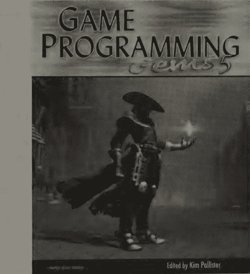

半吸血鬼枪手杰里科·克罗斯，在Sammy Studios的《Darkwatch》游戏中，于西部旧时与不死者战斗，该游戏将于2005年登陆索尼PlayStation® 2和微软Xbox™视频游戏系统。

环境和角色构思于Sammy Studios位于卡尔斯巴德的工作室，渲染和照明由位于洛杉矶的Brain Zoo Studios负责。该图片的美术指导由Sammy Studios的创意视觉总监法尔扎德·瓦赫拉米扬（Farzad Varahramyan）负责，制作助理丹·基特（Dan Kit）提供额外美术作品。

## 贡献者简介

包含提交了简介的贡献者的个人简介。

### 尼哈里卡·阿达巴拉

nadabala@cs.ucf.edu

尼哈里卡·阿达巴拉因其对气态体积建模与渲染的研究获得博士学位，在该研究中她引入了粒子贴图的概念。她曾在飞利浦研究院、日内瓦大学MIRALab以及中央佛罗里达大学媒体融合实验室工作。她在动态仿真和真实感渲染两个领域均有研究论文发表。她的研究兴趣包括实时渲染、基于物理的动态、光照模型、渲染中的感知问题、科学可视化和智能图形。

### 巴纳巴斯·阿索迪

ab011@freemail.hu

巴纳巴斯·阿索迪是布达佩斯科技与经济大学的博士生。他的研究领域包括计算机图形学（例如，实时真实感阴影计算）、动画制作和游戏。他曾为WSCG ’04、CESCG ’02及其他出版物撰稿。他欢迎通过上述地址发送电子邮件以提供反馈或交流想法。

### 托尼·巴雷拉

tony.barrera@spray.se

托尼·巴雷拉是一位经过认证的自学成才的数学天才。他在不同学科上发表了25篇论文，其中18篇是关于计算机图形学、数值分析和数学的科学论文。托尼与埃瓦特·本特松和安德斯·哈斯特共同开展研究。

### 埃瓦特·本特松

ewert@cb.uu.se

埃瓦特·本特松自1988年起担任乌普萨拉大学计算机图像分析教授。他的主要研究兴趣是开发用于图像分析生物医学应用的方法和工具。这包括可视化和计算机图形学方面，因为3D生物医学图像的可视化并非易事。他已发表约120篇国际研究论文。他于1974年获得乌普萨拉大学博士学位。他是IEEE、SPIE和IAPR的会员。

### 詹姆斯·博尔

author@boarslair.com

詹姆斯·博尔自1997年以来一直积极参与游戏开发行业，当年他协助创作了意外大作《猎鹿人》。他也是一位多产的作家，为不少于七本游戏编程图书（包括他自己的著作《游戏音频编程》）以及多种行业杂志撰稿。詹姆斯目前受雇于Amaze Entertainment担任程序员，他正在帮助开发Elemental Engine（Amaze的内部跨平台主机引擎）的新技术。

### 约翰·博尔顿

johnjbolton@yahoo.com

约翰·博尔顿是旧金山Page 44 Studios的一名软件工程师。他目前正在开发索尼明年针对PS2、PSP和PS3平台的冰球游戏阵容。他自1992年以来一直从事专业游戏编程，并曾担任多款游戏的首席程序员，包括《我没有嘴巴我必须尖叫》、《英雄无敌》和《高温棒球》。

### 马库斯·布雷尔

thebreyers@comcast.net

马库斯·布雷尔持有技术计算机科学硕士学位，并在游戏行业工作了八年，参与过包括《星际大战：赏金猎人》、《角斗士》和《回火》在内的众多作品。马库斯目前在Factor 5公司开发下一代平台的技术。

### 马丁·布朗洛

mbrownlow@shiny.com

马丁在10岁时就在朋友的ZX81电脑上开始编程。完成学业后，马丁在英国Virtuality, Ltd.开始职业生涯，编写VR街机游戏。三年后，他移居美国，在Shiny Entertainment工作。他为Shiny开发过多款游戏，包括MDK和《牺牲》，目前正全身心投入《黑客帝国》电子游戏的开发。

### 沃里克·布坎南

warrick@chimeric.co.uk

沃里克·布坎南是Chimeric Ltd.的开发总监，负责Maxima和ScreenSaverMax产品的开发。多年来，他曾在多家游戏开发公司工作，还曾在Imagination Technologies Ltd.从事显卡驱动开发。他喜欢玩各种玩具，从尖端显卡到蹦床应有尽有。

### 杰米·程

jcheng@relic.com

杰米·程是Relic Entertainment的一名AI程序员。他最近开发了《战争锤40000：黎明战争》中的对手AI。他还担任Relic与阿尔伯塔大学GAMES小组之间的核心联络人，共同推动商业游戏AI的边界。工作之余，杰米喜欢与他人合作开发打破常规的游戏。杰米获得西蒙弗雷泽大学计算机科学学士学位。

### 奥克塔维安·马里乌斯·钦奇萨恩

mariuss@rogers.com

奥克塔维安于1987年从克卢日-罗马尼亚技术大学获得电气工程理学硕士学位。一年后，他获得应用电子学研究生文凭，并完成了一个构建基于Z80的与Sinclair Spectrum兼容的个人电脑的项目。从1988年到1994年，他曾在一家金融机构担任C++程序员。他于1994年移居加拿大，并在多家公司担任C++高级软件程序员。2000年，又一个挑战出现：游戏编程。在这一领域自学成才的他，凭借其知识、热情和工作成果，创造了Getic 3D编辑器和Getic SDK（目前正在开发中）。目前，奥克塔维安在Zalsoft Inc.担任软件架构师。

### 伊格纳西奥·因塞拉·克鲁斯

ignacio@incera.net

伊格纳西奥是一名软件工程师，目前在西班牙马德里参与欧洲国防区项目。具体而言，他从事实时仿真、3D地形、地理信息系统（GIS）以及任务规划和简报系统的工作。他拥有德乌斯托大学的计算机科学学位和虚拟现实硕士学位。此外，他目前正在马德里理工大学攻读计算机科学与人工智能博士学位。他的研究重点是机器人学、分子计算和人工心智。

### 绍尔奇·楚科佐

cs007@ural2.hszk.bme.hu, cszsz@freemail.hu

绍尔奇·楚科佐是匈牙利布达佩斯科技与经济大学控制工程与信息技术系计算机图形学小组的博士生。他的研究兴趣包括多媒体、视频和图像处理、Web与游戏编程，以及为电影制作视觉和音效。绍尔奇曾为WSCG '04、CESCG '02及其他出版物撰稿。

### 威廉·E·戴蒙三世

wdamon@ati.com

威廉是ATI Research, Inc.的一名工程师。在本出版物发布时，他的职业背景包括在游戏行业拥有五年技术经验，主要专注于软件核心技术和平台性能。威廉拥有弗吉尼亚理工学院和州立大学的计算机科学荣誉学士学位。

### 马克·德劳拉

madsax@satori.org

马克是《游戏编程宝典》系列丛书的创作者兼系列编辑。作为索尼计算机娱乐美国公司开发者关系经理，他有机会与全球游戏开发者分享技术和非技术信息。马克对创造共享、娱乐性的体验以教育人们并鼓励他们相互交流的概念着迷。他一直在探索扩展这一概念的方法。


什么是“娱乐体验”，通过多种角色，包括曾任 Game Developer 杂志主编和美国任天堂开发者支持组首席软件工程师等职位。

## Chuck DeSylva
Chuck.V.DeSylva@Intel.com

Chuck DeSylva 是加州福尔森市 Intel 软件解决方案组的高级软件应用工程师。他目前管理一支工程师团队，致力于优化行业内一些领先的软件游戏和媒体作品。在不致力于榨取软件性能时，他喜欢练习贝斯/吉他、玩第一人称射击游戏以及环游世界。

## Shekhar Dhupelia
sdhupelia@gmail.com

Shekhar Dhupelia 初涉游戏行业，是在圣地亚哥索尼（SCEA）的 SCE-RT 团队工作了两年，期间开发了为 SOCOM: US Navy Seals、Frequency、Twisted Metal Black Online、NFL Gameday 以及许多其他 PlayStation 2 作品提供动力的在线软件和服务器基础设施。随后他参与了微软 NBA Inside Drive 2004 的 Xbox Live 实现工作，之后又在 Midway Games 待了一段时间，参与开发了 PS2 和 Xbox 平台的 NBA Ballers。Shekhar 此前曾为 Game Programming Gems 4 撰稿，同时也在为 Charles River Media 的 Secrets of the Game Business, Revised Edition 撰写文章。他曾在游戏开发者大会（GDC）和 Penny Arcade Expo（PAX）上就游戏设计相关话题发表演讲，目前正在为 Studio Gigante 和 THQ 的 WWE Wrestlemania XXI 开发 Xbox Live 玩法。

## Mike Dickheiser
mike.dickheiser@redstorm.com

Mike 是游戏行业的九年资深人士，现任 Red Storm Entertainment 软件工程师。他的职业生涯涉及飞行模拟器、动态流体建模、碰撞系统和车辆物理模型的开发。Mike 目前专注于为 Ghost Recon 产品线开发车辆 AI 控制系统。在不忙着教直升机如何追踪并摧毁坦克、步兵和游戏设计师时，Mike 喜欢玩电脑游戏、运动、弹钢琴，以及在家与他始终支持他的妻子 Jaye 放松。

## Jean-François Dubé
jfdube@ubisoft.qc.ca

Jean-François（又名 Gamedev.net 上的 deks）在游戏行业工作已有七年多。他目前是育碧蒙特利尔工作室一款即将推出的次世代主机游戏的技术主程序员。Jean-François 此前曾担任 Xbox 版 Rainbow Six 3 的主程序员，并参与开发了 PS2 版 Batman Vengeance 和 PC 版 Speed Busters 等多款游戏。

## Patrick “Gizz” Duquette
gizmo@gizz-moo.com

Patrick，又名 Gizmo 或简称“Gizz”，就像百事可乐：没气儿，而且仍然认为 15 摄氏度是工作的正确室内温度，这让他的同事们颇为沮丧。尽管他仍在开发自己的 Seamless Server 和许多工具，但他依然渴望有朝一日能找到时间完成自己的分布式光线追踪器。

## Dominic Filion
dfiliong@videotron.ca

Dominic 是 Artificial Mind & Movement 的高级 3D 引擎开发人员，从事 3D 效果和物理模拟的研究。此前，他曾担任 DC Studios 的技术总监，带领技术团队创建了工作室内部的跨平台 3D 引擎。他之前参与过四款商业 3D 引擎的开发，其中两款担任首席架构师。他还曾在 Microoids 和 Fun Key Studios 工作。欢迎就文章内容或仅为了友好交流给他留言。他的个人网站地址是 http://www.bingecoder.com。

## Mario Grimani
mgrimani@san.rr.com

Mario Grimani 是行业资深人士，近二十年前加入游戏行业。1987 年发布第一款游戏后，他将所有开发精力都投入到了 Amiga 平台。Amiga 平台的早逝标志着他离开了游戏行业，并原本不打算再回来。自 90 年代中期复出以来，他加入了 Ion Storm、Ensemble Studios、Verant Interactive 和 Sony Online Entertainment 等大型工作室。在 Ensemble Studios 期间，他是一名专职 AI 专家，负责提升电脑玩家的竞争力。他为《帝国时代 II：王朝时代》和《帝国时代 II：征服者》开发了脚本系统和电脑玩家 AI。在《众神时代》开发早期，Mario 担任 AI 负责人，掌管 AI 架构。加入后来成为 Sony Online Entertainment 的 Verant Interactive 后，他接手了 Sovereign 的主程序员工作，后来又参与了 EverQuest II 团队的开发。Mario 目前是 Xtreme Strategy Games 的合伙人，正在利用其技术专长将下一代游戏和游戏技术推向市场。

## Julien Hamaide
julien_hamaide@hotmail.com

Julien 8 岁时就在 Commodore 64 上开始编写文本游戏。同年，他写出了第一个汇编程序。岁月流逝，热情依旧。他一直是自学成才，阅读了父母能买到的所有书籍。21 岁时（2003 年），他最近在比利时蒙斯理工学院（Faculté Polytechnique de Mons）获得多媒体电气工程学位。他目前在 TCTS/Multitel（http://tcts.fpms.ac.be, http://www.multitel.be）从事语音和图像处理工作。他正在努力进入游戏行业。Open-eXnd 是他的最新项目（XTND 的免费实现），旨在用于 AI。

## Sami Hamlaoui
disk_disaster@hotmail.com

Sami 痴迷于 AI，当他发现自己写了一篇关于音频的文章时，颇为困惑。在不跑题的时候，他大部分时间都在努力让 500 个机器人看起来聪明，同时保持每秒多少帧（frames-per-second），而不是每帧多少秒（seconds-per-frame）。访问他的个人网站 http://members.gamedev.net/sami/，内容会不定期更新！

## Matthew Harmon
matt@matthewharmon.com

Matthew Harmon 从大学时期就开始开发游戏，在 subLogic Corporation 工作于微软模拟飞行，同时攻读电影理论与批评学位。此后，他曾担任 Mission Studios Corp. 和 Velocity Development 的首席程序员及开发总监。最近，他联合创立了 eV Interactive Corporation，继续开发游戏，并将游戏技术应用于军事训练和模拟领域。闲暇时，Matt 经常在家里追逐他的两个儿子 Alex 和 Greg。

## Anders Hast
aht@hig.se

Anders Hast 自 1996 年起在 Gävle 大学担任计算机科学讲师，2004 年起担任副教授。他于 2004 年获得乌普萨拉大学博士学位。他与 Barrera 和 Bengtsson 共同研究了计算机图形学中的基础算法，并探索了解决算法背后数学问题的新方法，这促成了大约 20 篇研究论文和书籍章节。

## Daniel F. Higgins
dan@stainlesssteelstudios.com

Dan Higgins 是 Stainless Steel Studios 的骄傲成员，这是一家由 Rick Goodman 领导、位于剑桥的历史即时战略游戏公司。在加入 Stainless 之前，他的背景并非游戏领域，而是为 History Channel、A&E（Arts & Entertainment）和 Biography Channel 编写高性能搜索引擎。作为 SSI 的热情程序员，Dan 的工作涉及军事 AI、寻路、地形分析、优化、动物 AI、队形和物理等多个领域。Dan 最初来自马里兰州，他和家人对波士顿爱得“疯狂”，感觉自己就像地道的新英格兰人。他是马里兰州 Frostburg State University 的计算机科学毕业生，大多数时候，当人们在谈话中描述 Dan 时，“freak”和“spaz”这两个词似乎总是频繁出现。

## Charles E. Hughes
ceh@cs.ucf.edu

Charles E. Hughes 是中佛罗里达大学计算机科学学院的教授兼研究生协调员。他在电影与数字媒体学院也有联合教职，并担任媒体融合实验室的首席科学家，该实验室是位于 UCF 模拟与培训研究所内的一个跨学科合作项目。他撰写或合著了 100 多篇经过同行评议的期刊和会议论文、七个书籍章节和六本书。他目前的研究兴趣在于混合现实和分布式计算模型。

## Robin Hunicke
hunicke@cs.northwestern.edu

Robin Hunicke 正在西北大学攻读 AI 与游戏方向的博士学位。在她大量的空闲时间里，她致力于弥合学术研究与


行业应用——与IGDA教育委员会合作，在GDC游戏设计与调校工作坊任教，并参与实验性游戏工作坊和独立游戏开发马拉松等活动。她的初恋是M.U.L.E。

## Hyun-jik Bae

imays@hitel.net

Hyun-jik Bae感谢上帝让他得到启蒙、福音以及赋予他的微小才华。他是MowelSoft公司的技术总监，该公司目前正在开发Blitz 1941™，这是一款以二战为背景的MMO游戏。他自1997年以来开发过多款3D MMO游戏。他创作的第一款游戏是面向MSX BASIC的SpeedGame（not™），该游戏要求用户快速猛敲空格键，因此导致他小学的电脑频繁损坏。

## Scott Jacobs

scott@escherichia.net

Scott Jacobs原本受过微生物学家教育，但放弃了那份体面的大学学历，转而在游戏行业工作以支付房租。他号称是一名网络程序员，却常常被卷入各种其他领域的工作，如脚本引擎、物理和图形。他曾就职于Interactive Magic、Sinister Games（育碧）和Red Storm Entertainment（育碧）。目前他为SimWars工作，渴望他们能推出《超级拼图美国陆军II：加速版》。

## Wendy Jones

gamegirl@fasterkittycodedecode.com

Wendy Jones是一名游戏开发者和行业布道者。她曾担任过从行业记者到游戏程序员再到作者等多种职务。她活跃于南佛罗里达州的IGDA，担任当地分会董事会成员。目前她忙于为手持设备进行自由职业软件开发，以及撰写与游戏开发相关的文章和书籍。

## Eric Lengyel

lengyel@terathon.com

Eric Lengyel是顽皮狗公司（Naughty Dog, Inc.）先进技术组的高级程序员。他是畅销书《3D游戏编程与计算机图形学数学》的作者，并为从gamasutra.com到《游戏编程宝石》系列等行业出版物撰写了许多文章。Eric致力于3D图形研究超过10年，在此期间，他曾是《荣耀之旅5》的首席程序员和C4引擎的首席架构师。

## Chris Lomont

clomont@math.purdue.edu

Chris Lomont从五年级开始编程，当时他学会了在新的TI-55可编程计算器上制作简单游戏。经过接触各种计算机后，他在大学期间开始进行PC编程，获得了物理、数学和计算机科学的三个学士学位，并以编写象棋程序作为毕业项目。在Black Pearl（已倒闭）短期从事视频游戏编程偿还了他的学生贷款，之后他进入普渡大学，于2003年获得数学博士学位。作为研究生，他为许多公司提供咨询，主要涉及图形相关开发，尽管他专业开发过多种类型的应用程序，包括视频游戏、金融建模、机器人软件、解析器和编译器、图像处理工具、加密技术等。他目前在cybernet.com进行量子计算研究。爱好包括钢琴、象棋、体育、编程、谜题设计以及尝试撰写书籍。他的个人网站是www.math.purdue.edu/~clomont，希望不久将迁至www.lomont.org。

## Michael Mandel

mmandel@gmail.com

Michael Mandel是卡内基梅隆大学的应届毕业生，在那里获得了计算机科学的研究生和本科学位。他的研究生工作探讨了使用仿真和数据驱动方法进行角色动画。他有关于开发智能代理的各种学术出版物，并在完成论文期间担任CMU访问学者。他在LucasArts和Microsoft期间专业参与了Xbox和PC游戏标题的开发。目前，他担任Apple Computer, Inc.的工程师。

## Adam Martin

adam@grexengine.com

Adam Martin是Grex Games的首席执行官，这是一家MMOG中间件公司。Grex的许多产品基于Adam自己的专利，尽管他现在专注于战略和业务发展。他拥有剑桥大学的计算机科学学位，并参与过两款已发布游戏的开发和制作工作。他在MDC会议上发表过演讲，经常出现在MUD-DEV上。2004年，他创立了Java Games Factory（http://javagamesfactory.org），以推广专业品质的Java游戏开发并帮助Java游戏工作室。

## Maciej Matyka

maq@panoramix.ift.uni.wroc.pl

Maciej Matyka出生于波兰弗罗茨瓦夫。他在弗罗茨瓦夫大学（物理与天文学系理论物理分部）学习计算物理，凭借出色的学术成绩获得奖学金。八年来，Maciej一直是Amiga和PC演示场景中的活跃程序员。他的一般兴趣在于基于物理的建模。Maciej是物理模拟软件的作者，凭借Fluid（1999年第二届系部物理软件竞赛第二名）和Waves（2000年第三届活动第一名）获奖。他还是波兰期刊上多篇出版物的作者，大多与物理模拟相关。在弗罗茨瓦夫大学，他为高中生授课，并在系部研讨会上介绍他的物理软件。Maciej是《物理中的计算机模拟》一书的作者，该书于2001年由Helion出版。他还为Jeff Lander编写的《图形编程方法》一书撰写了一篇关于软体动力学的文章，该书于2003年由Charles River Media出版。

## Patrick Meehan

pmeehan@tenaciousgames.com

Patrick Meehan于1996年从DigiPen毕业后，在任天堂技术开发部门开始了他的职业生涯。此后，他一直在行业内为Interactive Imagination和Amaze Entertainment等公司担任开发人员。他的经验涵盖了各种平台上游戏和引擎开发的大多数方面。在本出版物出版时，他正在西雅图制作公司Tenacious Games下，追求车库开发者的波希米亚式生活。

## Nathan Mefford

nmefford@yahoo.com

Nathan Mefford是Firaxis的一名软件工程师，专注于软件架构、优化和3D图形技术。他很高兴有机会为《游戏编程宝石》系列做出贡献，该系列他从中获益良多，并欢迎您的来信和反馈。

## Jason L. Mitchell

jasonlmitchell@comcast.net

Jason是ATI Research 3D应用研究小组的团队负责人，在那里他开发并撰写关于新颖3D图形技术的文章。Jason曾为《游戏编程宝石》和ShaderX书籍、《游戏开发者杂志》、Gamasutra.com以及关于图形和图像处理的学术出版物撰稿。他经常在世界各地的图形和游戏开发会议上发表演讲。Jason的出版物和过去的演讲可以在http://www.pixelmaven.com/jason/上找到。

## Ian Parberry

ian@cs.unt.edu

Ian Parberry是北德克萨斯大学计算机科学与工程系的教授，他是游戏编程教育的早期先驱。他著有六本书，其中三本关于游戏编程，以及在会议和期刊上发表的大量论文，涵盖从理论计算机科学到计算机游戏的广泛计算主题。

## Kim Pallister

Kim.Pallister@Intel.com

Kim Pallister是英特尔软件解决方案集团的工程经理兼技术布道师。他的关注领域是图形和游戏技术。Kim为《游戏编程宝石2》和《3》以及其他出版物做出了贡献。他欢迎通过上述地址发送邮件以提供反馈或交流想法。

## Borut Pfeifer

borut_p@yahoo.com

Borut于1998年获得乔治亚理工学院计算机科学学士学位。在担任过各种软件开发职位后，他于2001年联合创办了自己的游戏工作室White Knuckle Games。他目前在Radical Entertainment担任《疤面煞星》的游戏程序员，并撰写了多篇关于游戏开发的文章。


## 弗兰克·普伊·普拉雷斯

fpuig2003@yahoo.com

弗兰克·普伊 是古巴信息科学大学虚拟现实团队的总监。他设计并实现了 CAOSS Engine 和 CAOSS Studios，已应用于 Herlecl 和 Knowledge Land 等多款游戏。他还为游戏开发设计并制作了多种工具，用于改进和简化动作捕捉数据、高级纹理映射和动画混合等方面的处理。

## 史蒂夫·拉宾

steve_rabin@hotmail.com

史蒂夫·拉宾 在游戏行业工作超过十年，目前任职于任天堂美国分公司。他为三款已发布的游戏编写了 AI，并参与了 Game Programming Gems 1、2、3 和 4 的编写。史蒂夫·拉宾 曾担任 Game Programming Gems 2 的 AI 部分编辑，也是 Introduction to Game Development 和 AI Game Programming Wisdom 1 及 2 的创始人兼总编辑。他曾在游戏开发者大会上演讲，并通过华盛顿大学继续教育学院担任游戏开发证书课程讲师。史蒂夫·拉宾 拥有华盛顿大学计算机工程学位，目前正在攻读计算机科学硕士学位。

## 里希·拉姆拉杰

thereisnocowlevel@hotmail.com

里希·拉姆拉杰 是滑铁卢大学的本科生，刚刚完成系统设计工程第一年学习。高中阶段他大部分时间都在学习和编写 C++ 程序，偶尔出现在学校里惹恼老师。里希·拉姆拉杰 的职业生涯在很大程度上得益于 Jeff Molofee 和 nehe.gamedev.net 社区。在第一个工作学期，他为 Bedrock Research Corp.™ 设计并构建了 VectorChrome™，这是一款 3D 矢量分析套件。他目前正在 Alias® 的第二个工作学期受雇。当他不下棋、设计代码或编程时，可以发现他在学习。他已经放弃任何入睡的愿望，反而写了一个程序来帮助入睡，该程序已收录于本书中。

## 迈克·拉姆齐

miker@masterempire.com

迈克·拉姆齐 是 2015, Inc. 的首席程序员，刚刚完成 Xbox 和 PC 版《Men of Valor》的开发。他目前正在为下一代游戏机开发技术。迈克·拉姆齐 还曾担任 VR1 的 Lost Continents 首席 3D 客户端工程师，为 Mike Piazza's Strikezone、Master of Empire 以及 20 世纪 90 年代初的一系列 RPG 编写了 3D 引擎。他拥有 MSCD 计算机科学学士学位。迈克·拉姆齐 曾为 Game Programming Gems 和 AI Wisdom 系列做出贡献。闲暇时，迈克·拉姆齐 喜欢宠爱他的女儿 Gwyn。

## 奥雷利奥·雷斯

AurelioReis@gmail.com

奥雷利奥·雷斯 目前是 Raven Software 的游戏性和技术程序员，参与过绝地武士学院和雷神之锤 4 等作品的开发。闲暇时，他喜欢研究新的图形算法，开发自己的游戏引擎，并构思有趣而激动人心的新游戏性创意。

## 比亚内·勒内

bjarne.rene@circle-studio.com

比亚内·勒内 于 1995 年进入行业，应聘进入 Bullfrog Productions。他被直接扔进深水区，为游戏 GeneWars 编写了计算机对手，随后又为 Theme Park World 编写了游戏逻辑和 AI。之后他在挪威本土花了两年时间，在卑尔根大学完成计算机科学学位，随后返回英国重返行业。他目前在 Circle Studio 工作，负责对象管理系统和 AI。

## 格雷厄姆·罗兹

grhodes@nc.rr.com

格雷厄姆·罗兹 是位于北卡罗来纳州罗利市的 Applied Research Associates, Inc. 东南部分部的首席科学家。他在创建交互式和实时 3D 图形、游戏及物理模拟软件方面拥有近二十年的经验。格雷厄姆·罗兹 曾担任多个游戏项目的首席软件开发人员，包括：青少年时期在 Commodore VIC-20 和 Atari 400 家用电脑上开发的街机风格游戏；面向 World Book Multimedia Encyclopedia 的一系列赞助教育小游戏；以及基于先进 3D 游戏引擎的商业工业安全培训第一人称/第三人称动作游戏。他目前正在开发为军事和国土安全模拟与训练提供基于物理的解决方案的软件。格雷厄姆·罗兹 此前为 Game Programming Gems 2 贡献过一章，并担任 Game Programming Gems 4 的物理部分编辑。他是 gamedev.net 游戏开发门户网站数学和物理部分的版主，曾在年度游戏开发者大会（GDC）上演讲，定期参加 GDC 和年度 ACM/SIGGRAPH 会议，并且是 ACM/SIGGRAPH 和国际游戏开发者协会（IGDA）的成员。

## 提莫西·E·罗登

roden@cs.unt.edu

提莫西·E·罗登 是北德克萨斯大学计算机科学与工程系的讲师和博士候选人。在 UNT，提莫西·E·罗登 讲授编程和计算机图形学课程。加入 UNT 之前，他曾在模拟行业担任图形软件开发人员，其中包括在 Evans & Sutherland 工作六年。他的主要研究兴趣是 3D 图形应用程序的程序化内容创建。

## 托尔斯滕·舍伊尔曼

thorsten@ati.com

托尔斯滕·舍伊尔曼 是 ATI 3D 应用研究组的软件工程师，作为 ATI 演示团队的一员，他致力于图形演示和新颖渲染技术的开发。在加入 ATI 之前，他是北卡罗来纳大学教堂山分校有效虚拟环境研究小组的成员，这让他有机会接触各种昂贵的 VR 设备，并创建出令人晕眩的沉浸式游戏。托尔斯滕·舍伊尔曼 获得 UNC 计算机科学硕士学位，此前曾在德国卡尔斯鲁厄大学学习。

## 肖恩·舒梅克

shansolox@yahoo.com

肖恩·舒梅克 在游戏行业已有七年之久，目前担任 Stainless Steel Studios 的助理首席程序员。他的作品包括《帝国时代》和《帝国：现代世界的黎明》的物理、AI、战斗、图形效果和随机地图。目前，肖恩·舒梅克 正全力开发 Stainless 的下一个项目，该项目仍处于保密状态。肖恩·舒梅克 持有弗吉尼亚理工大学的计算机工程学士和硕士学位。在同意牺牲暑期进行紧张开发之前，肖恩·舒梅克 曾在 Intel 从事硬件工作，并在 CAVE 虚拟现实环境中工作。尽管如此，肖恩·舒梅克 很快指出，他从未想过要以此为生。他一直想成为一名伐木工。

## 芬尼根·萨西博士

fdsouthey@uwaterloo.ca

芬尼根·萨西 博士是阿尔伯塔大学 GAMES 小组和阿尔伯塔创意机器学习中心的成员。他的博士学位来自滑铁卢大学，研究领域为人工智能。他的研究侧重于商业游戏，包括用于游戏性分析的规划、机器学习和采样方法。除了与 Relic Entertainment 的合作外，他的研究成果还被行业合作伙伴艺电用于开发 FIFA 2005。

## 谢亚·斯特里特

shea.street@tantrumgames.com

谢亚·斯特里特 早期通过为拨号服务提供商开发在线游戏进入多人游戏编程领域，那时互联网还不如今天这样普及。他编程游戏已有 15 多年，完全自学成才，但持有 Full Sail 游戏设计与开发专业的计算机科学学位。多年来，他参与创作了无数游戏，并为多家公司的许多项目需求提供私人咨询。谢亚·斯特里特 目前是 Tantrum Games 的首席程序员和联合创始人。谢亚·斯特里特 想感谢 Tantrum Games 的所有人为本书撰写期间付出的辛勤工作和奉献，以及对他的体谅和耐心。他还想感谢所有参与他讨论和讲座的论坛人士，以及任何与他共度深夜喝咖啡的人。最后，同样重要的是，谢亚·斯特里特 想感谢所有在生活中支持他的朋友和家人，尤其是他的父亲。如果不是他的父亲帮他买了第一台电脑并让他对编程产生兴趣，这一切都不可能实现。

## 加博尔·西亚尔托

szijarto.gabor@freemail.hu

加博尔·西亚尔托 是匈牙利布达佩斯技术大学的博士生。他 10 岁开始编程，硕士论文是关于 3D 人脸建模的。他专精于-


ized in shader programming and 3D graphics algorithms. Gábor's publications and programs can be found at http://www.geocities.com/gabsprog.

### Andy Thomason
athomason@acm.org

Andy Thomason最近与Lara Croft的设计师Toby Gard共同完成了游戏Galgeon。他从20世纪70年代使用自制280硬件起步，曾与Psygnosis和Rage合作，目前是英国布里斯托尔的一名自由技术研究员和造船师。他维护一个网站 http://www.titboom.demon.co.uk/。

### Matthew Titelbaum
mtitelbaum@lith.com

Matthew Titelbaum是Monolith Productions, Inc.的高级软件工程师，正在为《The Matrix Online》MMORPG开发AI系统。他在Crystal Dynamics、DreamWorks Interactive和SCEA的主机游戏开发中开始职业生涯后，通过加入Sony Online Entertainment开始参与大型多人在线游戏。在SOE期间，他参与了Sovereign（一款实验性MMO RTS游戏）和多个EverQuest资料片的开发；他最为自豪的是他对EverQuest寻路系统进行大修和优化所做出的贡献。Matthew拥有卡内基梅隆大学的计算机科学学士学位。

### Marco Tombesi
baggiol@libero.it

Marco Tombesi是一名意大利计算机工程师，2002年毕业于罗马大学La Sapienza，获得一等学位。多年来他一直是一名自由游戏开发者，如今被公认为C++和OpenGL大师。他在《Game Programming Gems 2》中发表了一篇成功的文章《3ds max Skin Exporter and Animation Toolkit》。目前他正在开展一个足球游戏项目。

### Christopher Tremblay
chris@Barney.zapto.org

Christopher Tremblay居住在旧金山湾区。他拥有软件工程学士学位，并即将获得数学学士学位。他在行业内的工作涵盖了游戏AI、核心网络、软件渲染算法、3D几何算法以及底层优化等多个领域。他目前在Motorola工作，正在为下一代手机构建下一代2D/3D图形光栅化引擎。在业余时间，你可能会发现他正在滑板公园里穿着旱冰鞋磕碰自己，滑雪，或者，是的，甚至在编程时承受着显示器的辐射。

### Bretton Wade
brettonw@microsoft.com, Bretton_Wade@acm.org

Bretton Wade是游戏和图形行业的10年资深人士，目前担任Xbox系统软件团队经理，并教授备受好评的华盛顿大学延伸教育游戏开发课程。他之前的游戏开发职位包括受Blizzard Entertainment委托的独立工作室的项目负责人、Microsoft Flight Simulator的开发负责人，以及Microsoft Game Studios发行的多款游戏中的个人贡献者角色。Bretton曾在SGI开发VR创作工具，并曾是Advanced Rendering Technology和Microsoft Research的研究工程师。他是弗吉尼亚理工学院的毕业生，并拥有康奈尔大学计算机图形学项目的硕士学位。

### Niniane Wang
niniane@gmail.com

Niniane Wang曾在Microsoft Games工作五年，最近担任Flight Simulator 2004的开发负责人。她在天气图形方面的工作已在SIGGRAPH、GDC、GDMag和学术出版物上发表。她拥有加州理工学院的计算机科学学士学位和华盛顿大学的计算机科学硕士学位。目前，她是Google的软件工程师。

### Jon Watters
hplus-gpg5@mindcontrol.org

Jon Watters在10岁时就开始创建软件，并且从未停止过。他帮助交付了多个大型产品，包括CodeWarrior开发工具、BeOS多媒体操作系统和There虚拟世界。Jon目前在Forterra Systems从事大规模分布式仿真平台的工作。

## SECTION 1

### GENERAL PROGRAMMING

### Introduction

### William E. Damon III
wdamon@ati.com

内容——即为游戏体验注入生命的背景美术、场景、地点、角色、情节、故事和动作——推动了畅销游戏的诞生。对于制作团队来说，这意味着围绕坚实的前提构建产品，并雇佣出色且有纪律的服务组织。信息技术部门可能会浮现在脑海中，但这里提到的组织实际上是软件工程团队。

软件工程师解决问题。有时，游戏编程问题需要投入大量编程精力才能解决，但思维转型正在发生。游戏编程正在演变为一种有纪律的工程实践，旨在为更广泛、更可重用的应用程序创建通用解决方案，无论是采用和改造中间件技术还是在内部开发。这种演变让工程师有更多时间解决客户（即内容创作者）面临的真实问题，而不是重复造轮子。结果，内容创作者能够更快地对实现进行迭代，调整和微调细节，以实现最终产品的更高质量。

这是贯穿本节所有文章的共同主线。无论是讨论为项目中其他工程师使用而构建的低级库的改进设计，还是针对系统核心（游戏、编辑器或其他）的通用且智能的内存管理技术，远程调试器，以及/或用于设计用户界面的可视化和可脚本化环境，本节的所有文章都旨在为生产流水线提供可重用的组件。

在本节中，您将看到广泛的主题——甚至针对特别大问题的各种解决方案——以帮助您为手头的游戏构建最佳工具套件。请认真阅读这些文章，因为作为一名解决问题的工程师，您永远不知道什么时候会用得上它们！

### Context-Sensitive HUDs for Editors

Adam Martin, Grex Games
gpg@grexengine.com

大多数游戏都需要自定义图形工具来进行内容创建（关卡布局、AI行为编辑等）。非常好的工具可以大大提高内容开发团队的效率，通常能将创建的内容数量成倍增加。例如，一个优秀的关卡编辑工具可以轻松让一名关卡设计师的效率相当于三名使用劣质工具的等效设计师。然而，优秀的工具往往成本高昂，使得难以证明初始开发风险或与维护相关的持续成本是合理的。

本文提供了一种使用非常简单技术进行_抬头编辑_的方法。它设计得极易维护，应该能减轻内部编辑器开发的许多成本和困难。它能在工具开发过程的早期阶段解锁最终用户（设计师）的生产力提升，并降低一些项目风险。

### Problems

自定义编辑器存在四组问题，我们将逐一详细介绍，以解释本文背后的想法是如何以及为何起作用的。

第一组问题源于自定义内容编辑器固有的复杂性。自定义编辑器迟早都会变得复杂（有些人会说_臃肿_）；如果它们的工作很简单，主流编辑器一开始就足够了，制作自定义编辑器的成本也完全可以避免。

其他各组问题分别与开发团队中的特定角色相关联。例如，内容作者使用编辑器的方式会给这些人带来独特的问题。

### Editor and GUI Complexity

以3D建模器为例，我们通常有四个正在编辑的对象视图，每个视图都显示在专用视口中。每个视口都必须

| 显示 | 控件 |
| :--- | :--- |
| 显示look_at点的位置 | 缩放（即，改变FOV） |
| 显示不同视口摄像机在其他视口中的位置（如可见） | 二维平移 |
| 渲染“文档”（3D模型） | 绕三个轴旋转 |
| 渲染世界地标（主要笛卡尔坐标轴、正/负轴方向等） | 三维平移 |
| 渲染每个显著项目的精确笛卡尔坐标，至少包括摄像机和look_at点 | 选择每个选项，作用于摄像机或look_at点或两者之一 |

因此，对于一个只能移动摄像机（且没有任何花哨的控件；仅基本功能）的“编辑器”来说，我们有五个需要显示的独立事项和五组需要提供的独立控件。这10个项目各自需要独特的算法，虽然这些算法本身实现起来很简单，但仍需编写。已经，我们有足够多的独立算法（每个我们都希望单独维护、更新、替换和/或删除），以至于维护起来并非易事，而且我们还没有添加对象选择和基本编辑等基本功能。

典型的游戏内容编辑器可能包含约50个独特的显示算法和30个或更多控制算法，并且在不断扩展。这可能是维护上的噩梦，大多数编辑器很快就会变得难以管理（无论是代码还是架构），以至于添加最简单的功能都会带来相当大的成本。当最终消费者（玩家）通常甚至看不到该工具时，这尤其难以证明其合理性。

### Users

内容编辑工具的最终用户很少是程序员。尽管程序员确实开发和使用编辑器（当然包括IDE），但这类工具通常是为了让非技术人员能够轻松地为游戏创建或自定义内容而开发的。在大型项目中，主要用户通常是艺术家（创建2D和3D图形内容）、编剧（创建任务、子情节、游戏逻辑小部件等）以及解释/专有语言程序员（例如，开发AI脚本）。

这组用户的主要要求是：

- 功能强大、丰富的图形用户界面（GUI）
- 可扩展，能够随时间添加新功能（最终用户向工具开发者反馈并产生新功能的迭代过程）
- 可靠；大多数编辑操作对最终用户来说应当快速简便，并且工具必须稳定


先前列表中的第一项要求或许显而易见，但常见的平台实用工具和 API 使其成为一项可以克服的任务。然而，可扩展性要求对工具开发者来说可能是一项重大挑战，因为该工具本身就是一个定制解决方案。既快速又简便的编辑需求或许是最具挑战性的要求。开发者如何在不让每条命令都需要多次鼠标点击的情况下，暴露一个长长的功能列表（而且这个列表只会随着时间的推移而变长）？为了平缓学习曲线并提高最终用户的生产力，我们假设，给最终用户一些允许 GUI 自定义的元控件就足够了。这样，最终用户可以选择以对他们熟悉的方式布局界面。

不幸的是，编辑器错误是项目中最有害的错误之一。例如，关卡编辑器错误可能会悄悄损坏存档文件。这对游戏本身没有长期影响，因为它只损坏一些“正在开发中的”内容，因此，诱惑在于在一般项目中给这类错误低优先级（尽管，显然，在内容作者的错误列表中优先级很高）。然而，用户在绕过此类问题时会浪费大量时间，尤其是大多数损坏无法事后修复（数据丢失了，就丢失了）。因此，内容作者必须假设错误随时可能发生，并在每次编辑时预先防范，即使它平均每 100 次编辑才发生一次。不可靠的编辑器很容易耗尽本应提供的大部分或全部效率提升（如果工具可靠的话）。更糟的是，开发者并不总是意识到，“罕见”的错误会一直拖慢用户速度，而不仅仅是在错误发生时。

## 开发者

通常，编辑器等工具不会直接提高游戏的评测分数或销量。

直白地说，编辑器（一般而言）本身不会赚钱。

大多数游戏在开发时都会考虑这一点，内容创作工具往往在优先级列表中排得很靠后。此外，我们知道开发者很少为自己编写编辑器；这类工具通常是为了让更广泛的人群能够为游戏做出贡献（即，所有非程序员，或懂 AI 语言但不懂 C++ 的程序员等）。其净效果是，开发者通常在开发他们不打算使用、可能不需要维护，且可以说占用了他们本可用于核心任务时间的东西。

新功能会零星添加，与此同时开发者可能花大量时间在核心代码上，这意味着编辑器源代码常常容易出现代码腐化（即，每次他们回来添加下一个功能时，过去了太多时间，以至于连原作者都忘了它是如何工作的）。

有些团队有专门从事工具开发的高技能人员，从而减轻了这些问题的影响。即便如此，这些人通常还要支持、升级和维护各种其他工具，并且在较小程度上也会遭遇同样的问题。

因此，对于编辑器开发者来说，类似关卡编辑器的工具的主要要求是：

- 最小时间投入。即，开发编辑器花费尽可能少的时间。
- 可维护性。代码在长时间不查看后必须非常容易理解。
- 可扩展性。添加新功能必须非常迅速，且绝不需要对现有代码进行重构。

## 制作人和项目经理

制作人从关键路径、优势/成本和优势/风险比率等角度审视项目。定制编辑工具在优势/成本方面表现极佳，因为它们同时降低了内容开发成本，并且通常还能让内容作者制作出原本无法实现的更复杂内容。

然而，定制编辑工具在工具开发几乎全部完成之前，往往毫无用处（甚至有害，例如，如果它们只写入主游戏引擎不再支持的文件格式）。如果制作人知道未来可能不得不取消或缩减工具开发以赶上否则会延期的截止日期，那么在这样一项前期投入密集的活动上花费时间是巨大的风险。

更糟的是，从实际角度看，编辑器开发工作通常与主团队开始游戏项目同时开始。游戏制作人的事后分析文章经常提到内容作者遭受的损失：要么等几个月等编辑器准备好，要么使用早期版本，结果后来的编辑器修订版不兼容旧版本，不得不删除所有内容重新开始。通常的结论是“下次尝试使用更多中间件”，但实际情况是，如果要保持低成本，中间件只能提供最大公约数功能。然而，大部分价值在于拥有一个完全针对当前游戏定制的工具（地图格式、引擎架构、专有编码方案等），从而实现最大可能的生产力提升。

## 解决方案

在深入探讨了问题之后，是时候讨论解决方案了。我们将涵盖几个领域，从抬头显示器（HUDs）开始。

## HUDs

大多数游戏开发者都熟悉抬头显示器（HUDs），并且经常在最初发明它们的那种情况下使用：快节奏游戏中，玩家不能冒险打开菜单并离开主视口，但需要随时即时访问某些关键信息（例如，当前生命值、当前剩余弹药等）。

HUDs 对游戏和编辑器的主要好处是：

- 即时访问关键数据。从较大的数据集中显示最关键的数据片段。
- 便利性。将数据与主视口合并，使用户无需离开主视口即可查看数据。
- 可视化清晰度。布局方式是它们覆盖的屏幕区域是相对不重要的信息（例如，瞄准光标显示为围绕目标的括号，而不是覆盖在目标上方，从而在天空或背景的小块无趣区域上制造盲点，而不是在目标本身上）。

这些好处在复杂编辑器中很有用。然而，它们似乎对解决前几部分强调的问题帮助不大。

## 上下文敏感 HUDs

我们将单一单体 HUD 的概念扩展为上下文敏感 HUD。上下文敏感 HUD 是一种能实时响应用户操作并内置大量智能的 HUD。例如，第一人称射击游戏（FPS）的上下文敏感 HUD 通常可能显示弹药、生命值和击杀数；但是，如果玩家以某种方式中毒，生命值持续下降，它可能会将所有内容替换为简单的玩家生命值温度计读数，因为所有其他信息都变得相对不重要。

在编辑器中，鼠标光标在任何给定时间的位置都是用户正在做什么或思考什么的最佳指示；因此，上下文敏感 HUD 通常对光标位置的变化最为敏感。例如，标准 Windows 应用程序中的工具提示弹出窗口是上下文敏感 HUD 的一个示例，尽管非常简单，当光标不再悬停在任何按钮上时，它会完全消失。

特别是微软，在应用程序中率先使用了上下文敏感 HUD，展示了巨大的可用性改进，尽管到目前为止他们还只是触及了可能性的表面。例如，每当在 Word 中将鼠标光标移动到单元格的任何边框上时，它会变为调整大小光标，并且鼠标单击的功能会临时更改以匹配此操作（只有光标变化是 HUD 变化，但稍后会详细说明）。

## 抬头编辑

如前面的 Word 示例所示，不仅光标会改变，鼠标的整个功能也会改变。上下文敏感 HUD 仅提供所显示内容的丰富且智能的变化；抬头编辑将此与编辑器当前工具或模式的自动切换相结合。


一个完全具备抬头显示意识和能力的编辑器对用户来说是进步，原因如下：

- 自动化。消除了不断手动更换工具的需要（光标会根据上下文自动更改，同时根据需要切换工具）。
- 用户界面简化。工具栏上的大多数小图标都可以移除，因为用户不再需要手动选择它们。
- 降低学习曲线并提高生产力。学习如何使用编辑器所需的时间大大减少，因为它会自动向用户呈现正确的工具，使用户无需在菜单、工具栏或其他地方寻找它。

而且情况更好：抬头编辑可以用非常简单的架构实现，这使得开发人员的维护和扩展性容易得多，几乎可以无限期地推迟代码腐化。所提议的架构强制所有新功能作为完全封装的模块添加，保留现有代码并使未来组件易于替换。

## 实现

迄今所涵盖解决方案的实现分解为多个领域：透明胶片、渲染器和工具。我们还将讨论组件之间共享代码的细节。

## 透明胶片

对用户而言，我们展示了一个基于会议室和讲座室中常见的头顶投影仪（OHP）上的透明胶片（acetate）概念模型。每个透明胶片仅仅是一张透明塑料片，讲师可以独立于其他胶片对其进行插入、移除或编辑。每个透明胶片包含一个或多个图表或文本，分组安排旨在尽可能减少透明胶片的数量（更易于管理），同时允许讲师需要的任何精细粒度以快速更改图表。通常，特定透明胶片的内容单独看毫无意义（例如一组脱离上下文的箭头），但当放置在其他透明胶片的上下文中时，它们突然变得有意义。

使用真实的透明胶片，可以轻松地重新排序它们，扭转或移动单个图层，隐藏和显示部分内容等。这种特定方法已被证明非常强大，因为它使用户（讲师）能够以多种方式即时更改正在显示的信息：用户可以非常快速地添加或删除内容，并轻松简化或添加更多细节。

我们的软件方法是构建一个图层系统，其中每个图层类似于一个透明胶片。与透明胶片一样，每个图层都是透明的，并覆盖在主数据（视口）之上；也就是说，每个图层都是一个 HUD。然而，与透明胶片不同，我们的分层 HUD 具有更丰富的控制选项，主要是因为计算机 GUI 具有更强大的功能。此外，每个图层都有一个或多个相关的控制模式（又称工具）；例如，“转换选择”和“旋转选择”。这使每个图层变成一个带有相关编辑模式的封装上下文敏感 HUD。

## 渲染器

主编辑器视口就像传统编辑器一样。它显示当前正在编辑的文档，文档可以是文本文档、3D 模型或任何任意渲染数据。文档是屏幕上保存或加载的数据集合，而不是 GUI/编辑器的一部分。主视口不显示其他任何内容；其他所有内容都将由 HUD 处理（这可以为用户提供一种方便的方式，以查看确切将保存的内容，而不会将纹理上 HUD 应用的色调误认为是将保存的模型加纹理的一部分。他们只需关闭所有 HUD，即可获得“所见即所保存”。

当文档本身特别复杂时，您甚至可以只在核心渲染器中渲染文档的一部分，其余部分在 HUD 中完成。例如，某些 3D 模型格式将顶点数据、纹理数据、骨骼和动画全部保存在一个文件中。您可以通过仅在核心渲染器中实现顶点读取和渲染，快速启动并运行编辑器，然后为每个更高级的元素添加单独的 HUD/图层，而无需修改现有代码。例如，如果纹理渲染器中有任何错误，用户始终可以简单地禁用该图层，并继续查看顶点渲染器，就像使用早期版本的编辑器一样。

每个 HUD 在编辑器视口之上自行透明渲染自身。与透明胶片一样，需要仔细规划以将所需的视觉功能（选择高亮显示等）划分为 HUD，尽管通常拥有更多 HUD 而非更少更好。

用户有一个简单的工具来选择正在编辑的图层，向导操作可以以编程方式选择一系列图层，自动将用户从一个图层转移到下一个图层，以完成编辑任务。

这可能听起来与现代绘图程序的图层很熟悉：单个独立的图层，用户操作仅限于他们在任何给定时刻明确选择的那些。大多数艺术家应该对这个界面立即感到熟悉。主要区别在于，我们使用透明胶片作为实际 GUI，而绘图程序通常使用图层来隔离内容（仅在一个图层中进行更改）和合成内容（例如，将内容混合到背景中一旦完成就很难撤销，因此通过图层临时合成会使事情容易得多；它就像即时预览，而不会永久地将作者绑定到当前合成）。

## 工具

每个工具要么分配一个独有的透明胶片，要么与属于显示元素（以及零个或多个其他工具）的透明胶片共享。如果不确定，最安全的做法是每个透明胶片只有一个工具。

## 共享代码和扩展上下文

将每个 HUD 的代码划分为一个或多个类会带来代码重复的问题。这是尽可能使 HUD 之间相互独立的自然副作用。然而，代码重复很容易削弱维护的便捷性，因此我们肯定希望尽可能避免它。

通常被重复的大部分代码是通用显示代码，而不是工具代码，例如点的 x、y 和 z 坐标。之所以重复，是因为在任何特定编辑器中，不同的工具倾向于显示或影响完全相同的信息，尽管方式不同。幸运的是，这意味着我们可以安全地将该代码封装在单个 HUD 渲染器中，仅使每个工具对该单一渲染器产生非常狭窄的依赖（即，它们之间不以任何方式相互依赖）。

更好的长期解决方案是通过将渲染 X 作为渲染器的基本功能来完全避免依赖（其中 X 是不同工具会在不同时间以不同方式设置的某些信息）。我们通过补充原本仅为光标位置的上下文定义，使其还包括 X 的当前值来实现这一点。我们还需要提供至少一个 HUD，它查询上下文的该方面并将其渲染。以这种方式做的一个优点是，您可以同时以不同方式（不同格式、不同详细信息等）由多个不同的 HUD 渲染该上下文，并让用户决定想要查看哪个（使用显示/隐藏 HUD 控件）。

例如，如果您有多个工具需要弹出点或向量的 (x, y, z) 坐标，则可以用一个当前点字段来补充上下文，工具将在适当时填充该字段，然后假设其中一个 HUD 会为他们渲染它。

## 源代码

无论您使用哪种窗口系统，源代码实现都有两个主要元素：HUD 管理器和各个 HUD 本身（它们全部属于同一类型）。

HUD 管理器在 MVC（模型-视图-控制器）术语中是一个模型：它包含对所有当前 HUD 的引用的数据结构，并具有以编程方式添加或删除 HUD 的方法。它还跟踪 GUI 的状态（例如，管理 HUD 堆栈，将在“用户控件”部分中描述）。

所有 HUD 都是模板/接口的实现，该模板/接口为诸如触发渲染到合适表面（即将 HUD 绘制到后台缓冲区）以及馈送 GUI 事件（例如，鼠标单击）等操作提供回调。


通过将特定 HUD 的所有逻辑封装到一个类中，我们使开发者能够轻松地从编辑器中添加/删除 HUD 并修改现有 HUD，而无需一次编辑多个源文件。显然，一个特别复杂的工具本身可能由许多类组成，但激活该工具并呈现交互式 HUD 部分的逻辑都在同一个位置。


光盘中提供的实现比较简单，但根据你的需求应该易于扩展。HUD 管理器是 net.machine.ggp.hud.HUDManager。HUD 的接口/ADT 是 net.machine.ggp.hud.HUD，基础抽象类（包含一些常用方法）是 net.machine.ggp.hud.BaseHUD。示例应用程序在 net.machine.ggp.hud.HudDemo 中（如果你尝试运行 heads-up-editor.jar，它会自动运行）。

## 用户控制

用户与抬头显示编辑系统交互有三个方面：

- 交互式、抬头显示选择要使用的工具
- 单个 HUD（及其工具）的激活和停用
- 查看抬头显示编辑系统的内部状态

## 工具选择

一个 HUD 是一组其他 HUD 和工具的代理。该 HUD 将具有许多上下文相关的呈现功能，包括为其代理的每个 HUD 提供一个激活符号。例如，如果它代理平移对象、旋转对象和拉伸对象，它将在适当的激活区域内为每个对象显示图标（例如，当光标位于对象边界内时激活平移图标，当外部对象距离角点 10 像素以内时激活旋转，当外部对象距离角点 10 像素之外但距离任何边缘 10 像素以内时激活拉伸）。

在激活区域上按左键（LMB）会委托给映射到该区域的其他 HUD + 工具，并将当前 HUD + 工具压入堆栈。当委托的工具完成时，它会自动弹出激活的 HUD + 工具。这允许代理 HUD 的任意嵌套，这对于极其复杂的编辑情况非常有用，但也允许从多个不同的上下文中调用一个 HUD/工具，而无需感知上下文，或为每个不同的上下文使用几乎相同的代码重新实现一次。

## HUD 激活

为了管理不同的 HUD，我们直接复制高端绘图程序中的标准图层面板。这是一种成熟的 GUI 形式——许多用户已经熟悉——它以列表形式按顺序显示所有图层，并提供控件来显示/隐藏任何特定图层，以及允许拖放图层以在列表中重新排序。

在我们的 HUD 中，重新排序可能很有用，因为它控制哪些 HUD 覆盖绘制其他 HUD；借助此功能，用户通常可以解决屏幕上的任何绘制冲突，同时保持底层代码简单。否则，各个 HUD 需要相互交互，以便避免重叠并协商屏幕空间的使用；例如，保留特定屏幕区域用于绘制。

显示/隐藏功能与绘图程序中的用法相同：隐藏 HUD 只是关闭其绘制代码。这样做可能是为了减少屏幕杂乱、提高渲染性能，或者仅仅是因为用户在当前会话中不需要某个特定 HUD。由于 HUD 在编辑会话之间是持久且相同的（不像绘图程序中的图层，图层是短暂的且仅与当前文档相关），因此在特别复杂的抬头显示编辑器中，一个有用的功能是用户能够快速保存和恢复特定的隐藏 HUD 模式。一种特别巧妙的方法是，为每个保存的隐藏 HUD 预设在对话框顶部创建一个选项卡，用户在创建预设时为每个预设提供一个名称。这允许在不同编辑模式之间进行极快速的切换，符合用户能够以最少的对话框、菜单、工具栏等导航来完成大部分工作的目标。

## 内部状态

这有两个不明显的目的。由于系统的内部状态可以任意屏蔽原本可用的工具，用户在选择过程中了解自己选择了什么通常很重要（例如，如果他们出错并选择了错误的元素，他们通常不会知道自己点击了什么，只知道自己原本想点击什么），这充当了导航地图。其次，它使调试容易得多，因为用户可以轻松引用他们遇到的情况，而不需要开发者去猜测或检查日志文件。这尤其有帮助，因为它使用户能够避免那些存在未修复 bug 的特定情况；如果他们知道“地图”的某个部分会导致崩溃，那么避免进入那里就更容易了。

## 结论

本文展示了简单的编辑器设计如何既能赋予用户更多权力，又能让开发者的工作更加轻松。这是一个良性循环，减少了各方的压力：开发者花更少的时间在难以维护的代码中纠缠，用户花更少的时间等待看似简单（实则欺骗性复杂）的功能被添加。

围绕 HUD 组织编辑器可以使其在功能方面保持非常灵活：由于各个 HUD 的独立性，添加新功能很少困难。同时，编辑器可以轻松同时运行同一控件的替代实现：两者同时运行，用户可以根据需要实时开启/关闭它们。这使你能够以低开发成本更容易地尝试不寻常的功能或编辑器的新想法。

然而，它并未远远超出抬头显示编辑（HUE）所能实现的基础。有许多方式可以扩展本文以提供对 HUE 更强大的支持，尽管其中大多数需要大量额外编程，不宜轻率尝试。本文提出的核心支持易于开发和维护，同时提供了大部分好处。


光盘源代码的勘误和更新将从 [Martin04] 获取。提供的代码非常精简，但正在其基础上构建一个免费用于商业和个人用途的库，后续版本和改进将在该网站免费提供。

## 参考文献

- [Eclipse04] Eclipse。可在线访问 http://eclipse.org，2004。
- [Martin04] Martin, Adam 等。Java Games Factory，“库和代码片段。” http://grexengine.com/people/adam/gps5/ 和 http://grexengine.com/sections/externalgames/。
- [Popa99] Popa, Adrian。“Re: 飞机上的抬头显示（HUD）如何工作？” http://www.madscifi.org/posts/archives/jul99/931328936.Eg.r.html。

### 1.2

### 游戏中的文本数据解析

### Aurelio Reis

AurelioReis@gmail.com

大多数游戏需要读取和解释大量文本数据。从脚本语言到着色器，文本通常需要从标准格式中获取并转换为程序可原生使用的二进制数据结构。在本文中，我们探讨了分词器的创建和使用：负责将文本数据转换为离散单元的模块，这些单元已准备好进行解释并整合为有效的游戏信息。

### 开始之前

为澄清概念，标记（token）有时被称为词素（lexeme），分词器（tokenizer）称为词法分析器（单词分析器）。在本文中，我们将使用 标记 和 分词器 这两个术语。互联网上有许多免费的分词器，你应该去了解一下，特别是其中一个更流行的分词器 Lex（与 Yacc 一起）[Lex & Yacc]，它是开源的，可以作为宝贵的学习工具。分词器和解析器理论是一个庞大的领域，本文不会试图涵盖每一个方面。相反，本文的目的是作为分词器在游戏制作中的有用性的介绍和解释，以及如何以实用的方式实现和使用分词器。有关分词器和解析器背后的历史和理论的更多信息，本文末尾设有“参考文献”部分。

### 到底什么是 Token？

标记（token）基本上是一组不可分割的字符，用于表示单个基本符号。基本上，它是一组形成特殊“单词”的字符。例如，请查看清单 1 中的小型 C++ 程序片段：


## 清单 1.2.1 一个简单的 C++ 代码段

```
if ( i == 0 )
{
    return false;
}
```

如果将清单 1.2.1 分解为标记，你将得到类似清单 1.2.2 中的列表。

## 清单 1.2.2 从清单 1.2.1 的代码段生成的发现标记列表

```
if                  <string>
(                   <left parenthesis>
i                   <string>
==                  <string>
0                   <number>
)                   <right parenthesis>
{                   <left brace>
return              <string>
false               <string>
;                   <semi-colon>
}                   <right brace>
```

如你所见，标记被分类为特定类型。分词器会盲目地将该段读取为 ASCII 数据并执行分类过程。我们稍后将讨论对这些标记的处理，但目前只需意识到我们定义基本类型，然后根据数据集（文本）形成发现标记列表。

## 制作分词器

分词器本质上作为有限状态机（FSM）工作，其通常通过根据当前全局状态执行特定动作或事件来发挥作用。为了与游戏世界类比，FSM 可用于引导 AI 代理在虚拟世界中移动。例如，其当前状态可能是“漫游”，在这种情况下，它可能会随机穿过节点网格（或类似的导航方案）。

诸如看到敌人之类的输入事件可能会触发状态转变为“搜索并摧毁”，在此状态下代理会追踪并攻击敌人，直到其失败或将其消灭，此时状态可能会再次改变。在此示例中，虚拟视觉和听觉输入充当输入事件。然而，在分词器中，输入事件采用特殊字符的形式。让我们来看一个最简单的情况：注释。在 C++ 中，注释可能有两种形式：行注释，由两个正斜杠（//）指定；或块注释，由正斜杠和星号开始（/*）以及星号和正斜杠结束（*/）。分词器会遍历数据集中的每个字符，直到找到一个正斜杠（/）。找到后，它会跳过一个字符以查看这是否确实是注释。如果是，则状态会转变为“在注释中”。分词器随后继续，跳过所有新字符，直到行末或块语句结束。

分词器本身可以随你希望的那样复杂。如果你只需要简单的文本数据，可以完全省略标记类型。你需要定义的仅是分隔符。分隔符指定了你希望如何将数据集拆分为标记，这与标点符号对英语所起的作用类似。我们在书面语言中使用的最常见分隔符当然是空格（ ）。如果你将空格作为对该句进行分词的分隔符，每个单词都将成为一个新标记。然而请注意，逗号和句号也被使用了。如果你希望在使用这些字符来定义标记边界的同时跳过它们，也应将它们指定为分隔符。你可能使用的最常见分隔符是空格（ ）、逗号（,）、换行符（\n）、换行（\r）和制表符（\t）。你也可能想要使用分号（;），但在某些情况下，最好将其保留为特殊标记类型。

如果你需要更强大的标记类型检查，则需要用比字符串标记更具体的东西来表示它们。这样做可能更可取，因为这将允许更直接地解析标记（稍后详述）。使用 C++ 方法，你可以派生一个从基础标记继承的新标记类型。在创建新标记时，它会与最接近其特征的标记类型匹配。还可以创建一般规则以允许字符串分组。例如，字符串标记可能以引号开始，包含多个字符（包括潜在的分隔符），然后以另一个引号结束（例如，“这是一个单一标记”）。表达式（1 + 2 * 3）也可以以这种方式定义，但大多数人选择在解析阶段创建标记后再定义这些表达式。

作为示例，请再次查看清单 1.2.1 和 1.2.2。仅从标记类型来看，你就能看到标记位置的基本结构。如你稍后将看到，在解析这样的段落时，期望数据类型要比在每个标记处检查特定文本容易得多。例如，一条基本规则可能是这样的：当遇到 if 字符串标记时，我们期望一个左括号、一些表示表达式的内部值，以及一个右括号，随后是更多标记。与其检查显式名称，不如直接按类型请求特定标记。这仅是一种便利，但这确实有助于代码的可读性和易用性。此外，它在解析数据时保证了正确的语法。通过适当的错误检查，分词和解析数据对最终用户来说变得容易得多，这也是为什么它通常是优秀解析器最重要的方面之一。

## 工作原理


在随附的 CD-ROM 上，你可以找到带有测试应用的简单分词器。要对字符串进行分词，分词器遵循几个简单步骤。首先，包含我们文本数据的文件被读入缓冲区或映射到视图（如果你使用文件映射）。然后我们在此缓冲区上调用分词函数，它会遍历每个字符并根据当前状态（初始状态为 TKS_INITMITE，即读取空白）对其进行分类。在整个过程中，状态会多次更改。当到达有效字符时，状态会转为 TKS_INTEXT，这意味着我们现在正在读取实际字符。当到达分隔符时，会创建一个标记，将其分类为一种类型，并添加到标记列表中。另一方面，如果遇到引号，我们的状态会突然变为 TKS_INQUOTES，这意味着我们现在正在读取一个文本组。一旦遇到另一个引号，文本组就会结束并最终确定为字符串标记。单行和多行注释也会发生相同的过程。

要检查的主函数是 TokenizeString()。这里会按顺序遍历字符，并根据字符条件更改状态。标记分类通过函数 ClassifyToken()（清单 1.2.3）完成，该函数基本上确定它是否匹配浮点数、特殊字符（来自特殊字符表）或字符串的特征。这个函数实际上非常适合递归，但为了说明目的，此处已跳过。如你所见，它会识别字符串是否可以转换为数字，如果可以，则是否为负数。Isdigit() 用于确定字符串是否为数字，但相比之下，扫描字符串中的句号（表示小数）也同样容易。IsSpecialCharacter() 仅检查字符串的第一个字符，看它是否是一个单字符特殊标记，如左花括号、括号或引号。例如，如果你想将分号作为标记类型添加，这里就是检查它的位置。当标记准备好创建时，会使用 AllocToken() 函数创建分类后的标记。如果分词过早结束，则会调用 FinalizeToken() 函数，以确保没有遗留标记。在获得标记列表后，就可以解析它了，但我们到底在解析什么？首先，我们必须创建某种文本格式。让我们快速看一下所谓的 BNF 形式，如清单 1.2.3 所示。

## 清单 1.2.3 ClassifyToken() 的实现（为清晰起见已移除注释）

```
TOKENTYPE CTokenizer::ClassifyToken( const char *strText,
                                     unsigned long uIFlags )
{
    TOKENTYPE TokenType;

    if ( !( uIFlags & TKFLAG_STRINGSONLY ) && ( isdigit( strText[ 0 ] )
        || ( strlen( strText ) >= 2 && ( strText[ 0 ] == '-' && isdigit(
        strText[ 1 ] ) ) ) ) )
    {
        return TK_FLOAT;
    }
    else if ( TokenType = IsSpecialCharacter( strText[ 0 ] ) )
    {
        return TokenType;
    }
    else
    {
        return TK_STRING;
    }
}


## 制作你自己的格式

此时，我们实际上需要有可供标记化的内容。在附带的测试应用和代码中，你会找到一个非常简单的示例。基本上，我为一种我们将称之为 *character file* 的格式奠定了基础（不过我们将保留 .txt 扩展名，因此你无需注册任何新文件类型来读取它）。character file 将解释你游戏中角色（无论是非玩家角色还是玩家角色）的特征。例如，想象一个角色扮演游戏，你必须先创建自己的角色，或者从一组预先创建的模板角色开始。创建角色后，需要将其保存。character file 就是我们将保存角色的文件（或者在预先创建角色的情况下，从中加载）。该格式实际上非常简单（也许过于简单），但为了解释它，我们必须理解 *Backus-Naur Form*（BNF；也称为 Backus-Naur 表示法）的概念。基本上，BNF 只是对语法语法应如何应用的解释。一个与日常写作直接相关的优秀示例可在 [CS310] 中找到，所用符号的说明可在 [Estier] 中找到。BNF 基于定义字符串如何组合在一起的不可打破规则。我最喜欢的示例是日期的 BNF，如清单 1.2.4 所示。

### 清单 1.2.4 日历日期的 Backus-Naur 形式 (BNF)

```
<date> ::= <month> '/' <day> '/' <year>
<month> ::= 0 .. 12
<day> ::= 1 .. 31
<year> ::= 1900 .. 3000
```

你可能已经直觉地明白，BNF 定义符号并显示符号可以被赋予什么值。使用之前定义的语法，并忽略某些月份没有 31 天（加上闰年）这一事实，我们可以轻松构造一个日期——比如 12/25/04——并使用这些定义的规则对其进行验证。翻译成英语，BNF 表示：“日期是一个月份，后跟一个斜杠，后跟日期，另一个斜杠，然后是年份。月份是 0 到 12 之间的值。日期是 1 到 31 之间的值。一个有效的年份（对我们来说）是 1900 到 3000 之间。”

通常，逆向过程也足够简单。描述你的“语言”，然后将其翻译为 BNF。如果你想要更详细的解释，请参见 [Garshol03]。最后需要注意的是，许多人并不遵循严格的 BNF 解释。例如，如果你想用 + 分隔符号，以表示“此外”，那么 BNF 同样有效（虽然在多个字符串符号相邻使用时，类似的东西可能也是有效的，稍后将展示）。找到一个对你最有效但又不至于晦涩难懂的系统，以免其他人无法解读你的说明。歧义（在你的语法中打开太多可能性而不知道哪一个实际上是正确的）也是需要避免的。BNF 更多地充当指南，帮助你理性化并思考关键设计决策。作为一个有趣的练习，看看你能否为清单 1.2.1 中的 C++ 片段创建一个 BNF。

现在你已经了解了什么是 BNF，快速看看我们的示例 character file，Character.txt。我们 character file 格式中语法的一组规则可以定义为清单 1.2.5 所示。

### 清单 1.2.5 我们 Character File 格式语法的一组规则

```
<CharacterFile> ::= 'Character' + '(' <TextBody> ')'
<TextBody> ::= <CharacterStat>+ <Value>
<CharacterStat> ::= 'Name' | 'Strength' | 'Dexterity' | Constitution | Intelligence | Wisdom | 'Charisma' | HitPoints
<Value> ::= <Float> | <Bool> | <String>
<Float> ::= 0 . 9+ + . + 0 . 9+
<Bool> ::= TRUE | FALSE
<String> ::= a . z+ | A . . Z+
```

如你可能已经猜到，这里故意引入了一些歧义。首先，CharacterStat 目前可以是三种东西之一：float、bool 或 string。使用提供的语法，名称从技术上讲可以被赋值为 TRUE 或 3.14。这显然是一个谬误。要纠正这一点，请参见清单 1.2.6。

### 清单 1.2.6 我们 Character File 语法的消歧规则集

```
<CharacterFile> ::= Character + { <TextBody> }
<TextBody> ::= <CharacterStat>
<CharacterStat> ::= ( <FloatStat> <Float> ) | ( <BoolStat> <Bool> ) | ( <StringStat> <String> )
<FloatStat> ::= 'Strength' | 'Dexterity' | Constitution | Intelligence | Wisdom | 'Charisma' | HitPoints
<BoolStat> ::= IsPlayer
<StringStat> ::= Name
<Float> ::= 0 . 9+ + . + 0 . 9+
<Bool> ::= TRUE | FALSE
<String> ::= a . z+ | A . . Z+
```

如你所见，通过明确指定 FloatStat 只能采用 float、BoolStat 只能采用 bool、StringStat 只能采用 string，歧义已得到完全解决。在数字和字母定义后添加 +，这在 BNF 中算是一种自由发挥，因为每次编写新 BNF 时都精确定义什么是数字有点傻。在那里放置 + 基本上表示这里可以指定无限数量的这些值。如果你将此 BNF 与我们的 character text file 交叉引用，你会发现我们满足所有要求。事实上，在创建 BNF 之前，先写出你希望格式的样子是有帮助的。如前所述，BNF 是一种在格式乍看之下良好但后来可能存在灾难性漏洞时找出漏洞的绝佳方法（别笑；这种事确实发生过）。

## 解析你的标记列表

现在我们有了定义的格式，编写了带有有效输入的文件，并将文本转换为离散标记，最后是时候解释这些标记并将其转换为有效的二进制数据结构了。这个过程通常称为解析，因为该数据集被单独分析和处理。在我们的情况中，我们处理它以便计算机可以理解它。解析数据可能是一个非常复杂和深入的主题，有许多事情可能出错。有些人喜欢递归解析（即，递归下降解析 [RecursiveDescent]），在不同级别分析数据并将结果作为一个整体返回。在我们的情况中，我们将简单地线性地逐个标记进行处理，遵循我们的语法规则。

解析数据最重要的部分是记住错误检查是必不可少的。这一点无论如何强调都不为过。如果你不能确保数据已被正确解析，灾难肯定会随之而来。你可以选择使用异常处理来处理格式被破坏的情况。当规则被打破时抛出异常是很简单的。如果你参考代码，你会看到我们首先检查 Character 和 { 语句，以确保我们正在开始一个新的角色条目。之后，我们进入一个循环，该循环要么在 } 处终止，要么向我们的 CharacterStats 赋值。如果我们用完了标记或发生错误（例如，用 BoolStat 代替 FloatStat），循环将终止并停止进一步处理，以错误退出程序。


虽然不太令人兴奋，但随附 CD-ROM 上提供的示例应用程序可以轻松扩展。首先，想象将脚本行为附加到角色上，带有完整的表达式检查和移动/姿态命令。除了基本的角色加载之外，代码已扩展为读取武器，但其他物品（如护甲或盾牌）也很容易添加。还包括一个你可以使用的巧妙技巧，它获取一个 characterStat 并使用字节偏移量将其直接匹配到 Character 类对象（cCharacter）的类数据成员。使用此技术，解析器可以通过 CustomField 数组轻松检查新类成员（更多详细信息在代码中）。此技巧对于网络变量同步或保存/加载功能也很有用。有很多令人兴奋的方式来扩展应用程序；尽情尝试吧。

## 结论

在这篇文章中，我们深入探讨了实现多功能标记化器的基础知识，我们使用它将文本数据分解为有效标记，进而可将其解析为有效的游戏数据。利用这些知识，我们创建了一种非常简单的文本格式，用于存储游戏的虚拟角色及其一些属性。随附代码的注释非常详细，因此你应该在调试器中逐步执行它，以更牢固地理解代码流程。然后，将这些知识应用到你自己的游戏中！


## 参考文献

- [Aho, Sechi, Ullman85] 编译器：原理、技术与工具。[CS310] http://marvin.ibt.uniwda.edu/~beckendo/CS310/grammar.html.
- [Eli] http://eli-project.sourceforge.net/etionline/4/lex_too.html
- [Ester] http://luc.ui.wu-wien.ch/db-research/Enseignement/analysisInfo/AboutBNF.html.
- [Garshol03] http://www.garshol.priv.no/download/text/bnf.html.
- [Lex&Yacc] http://dinosaur.compilertools.net/.
- [Punctuation] http://www.wordiq.com/definition/Space_(punctuation).
- [RecursiveDescent] http://encyclopedia.thefreedictionary.com/Recursive%20descent%20parser.

## 基于组件的对象管理

Bjarne Rene, Circle Studio 有限公司
bjarne.rene@circle-studio.com

传统的对象管理模型通常依赖继承层次结构来在不同类型的对象之间共享功能。随着游戏变得越来越复杂，这种方法会导致难以修改的设计，并且如果某个功能在多个分支中都需要，就不得不将其推向继承层次结构的上层。

一个很好的解决方案是从组件构建对象，其中每个组件负责特定任务的数据和行为。基于此概念的对象管理模型在创建新对象和修改现有行为方面提供了更大的灵活性。

本文的第一部分概述了传统对象管理系统与基于组件的系统之间的区别，以及使用后者所获得的主要优势。本文的第二部分着重于从头开始构建基于组件的系统。我们最后为可投入生产的实现奠定了坚实的基础。

### 革旧鼎新

在传统的对象管理系统中，对象都派生自同一个抽象基类。为了讨论方便，我们假设这样一个系统，其中所有类都派生自类 cObject。下一步是决定哪些类派生自 cObject。在大多数情况下，直接从 cObject 派生的类也是抽象的，它们代表了树中一个分裂：一侧是具有某些功能的类，另一侧是不具备这些功能的类。此类分裂的典型例子包括可渲染/不可渲染和可动画/不可动画。图 1.3.1 展示了一个简单的继承树。

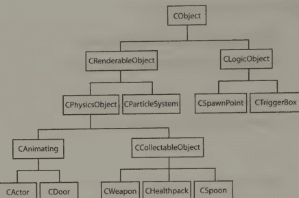

图 1.3.1 传统的继承树。

乍一看，这似乎相当不错，而这种系统的诱惑之处在于，它在纸上（至少在初期）通常看起来非常好。关于游戏开发我们知道的一件事是，随着开发的进展，需求会发生变化。这种模型无法令人满意地适应变化。让我们通过几个例子来说明。

如果决定武器需要能够播放动画，我们该怎么办？目前，CWeapon 和 CAnimatingObject 位于树的两个不同分支。解决这个问题的一个办法是让 CWeapon 继承自 CAnimatingObject。但是等等！武器是一种可收集对象，因此我们还必须让 CCollectableObject 继承自 CAnimatingObject。结果如图 1.3.2 所示。

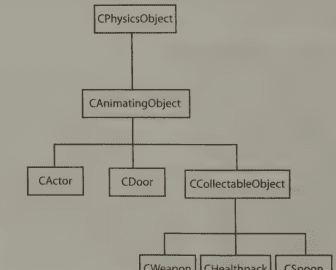

图 1.3.2 为了让 CWeapon 对象能够播放动画，已移动了一些类。

这暂时解决了我们的问题，但也引入了新问题。现在，所有可收集对象都变成了可动画对象，因为从 `CollectableObject` 派生的某个类需要动画。这对许多对象来说是一个相当沉重的负担。这也意味着，我们可怜的血瓶和其他任何可收集对象都必须实现 `AnimatingObject` 的任何纯虚方法，才能成为有效的对象，即使这些方法对这些对象来说毫无意义。

现在让我们考虑一下，如果我们想允许对象承受伤害会发生什么。我们只需要几个方法就能做到，因此决定将这些方法添加到一个现有类中。我们的设计要求从 `CActor` 类派生的对象能够承受伤害（这里未显示，但通常至少包括 `CPlayer` 和 `CEnemy`/`CAICharacter`），因此我们继续将这些方法添加到 `CActor`。这似乎是一个明智的选择。

随着时间的推移，决定门也应该能够承受伤害并被摧毁。为了赋予它们这种能力，伤害方法被移动到了 `CAnimatingObject` 上，因为它是 `CActor` 和 `CDoor` 的第一个共同祖先。这似乎是一个合理的决定，并且得到了我们想要的结果。另一个合理的决定可能是，如果一个不可动画对象需要承受伤害的能力，就将伤害方法移动到 `CRenderableObject` 上。大量这些“合理”决定的效果是，我们的树变得越来越顶重。树中位置较高的类最终也会拥有大量方法，这些方法之所以存在，并非因为类本身的功能，而是因为类在树中的位置。此类试图对所有对象无所不能的类，会失去其内聚性。

### 组件

我们已经看到，如果依赖所有对象都成为大继承树的一部分，就会遇到相当多的问题。我们真正想要的是一个系统，可以将现有功能组合到新对象中，并向现有对象添加新功能，而无需每次都重构大量代码并重新调整继承树。

### 一个简单的对象

一个很好的解决方案是从组件部分创建对象。组件是一个包含特定任务所需的所有数据成员和方法的类。对象则是通过组合多个组件来构建的。图 1.3.3 展示了一个勺子对象及其构成组件。

Entity 组件允许我们将对象放置在世界中。Render 组件允许我们将模型与对象关联，并根据该组件的设置进行渲染。Collectable 组件允许我们拾取对象并将其保存在背包中。


图 1.3.3 由组件构建的简单对象。

### 接口

所有组件都派生自一个基础组件接口。我们将其富有想象地命名为 IComponent。该接口包含所有组件都需要实现的几个方法。它主要对对象管理器（将在下一节中讨论）有用，以便能够通过指向此基类的指针来处理所有组件。

我们更希望只关注每个组件暴露的公共接口。为了有意义，每个组件都需要从承诺一定功能的接口派生。让我们以 Render 组件为例。

图 1.3.4 展示了通往 CCmpRenderer 的继承树。顶层是 IComponent。然后是 ICmpRenderer。最后是 CCmpRenderer，它实现了上述接口所承诺的所有功能。

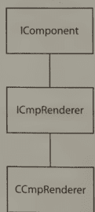

图 1.3.4 CCmpRenderer 的继承树。

这看起来很像我们正在做很多我们刚才说的传统系统中错误的事情。一切都派生自一个基类，我们到处都在使用继承。这有什么不同？不同之处在于，现在所有的继承链都指向执行一组紧密相关任务的类。换句话说，这些类具有紧密的内部内聚性。

### 跟踪管理

我们需要以某种方式组织所有这些组件。为此，我们有对象管理器。它实际上是一个数据库的接口，我们代码的其余部分不允许看到太多内容。该数据库不必是（也不太可能是）Oracle 或 SQL 类型；它只需要跟踪所有组件，并使对象管理器中暴露的访问方法尽可能高效。对象管理器允许我们创建、查询和销毁组件，等等。我们将在“实现”部分更详细地了解对象管理器和数据库的一种可能实现。

### 没有勺子

让我们回到勺子对象示例（如图 1.3.4 所示）。我们有了所有这些组件，但在这个过程中，我们的对象怎么样了？它不存在！保留一个 `cObject` 类以求心理安慰可能很诱人，但我们不会这样做。没有什么要求我们保留 `cObject` 类；如果我们保留了，又如何决定什么可以放在 `cObject` 类中，什么必须放在组件中呢？如果让一切都生活在组件中，那么在设计系统时就少了一个需要做出的选择。对象所剩下的全部只是一个对象 ID。只要它能唯一表示一个对象并且方便传递，它可以是任何东西。基于 `int` 的某种句柄应该就足够了。当然，谈论对象仍然很方便，因为在外部世界看来，它们就是对象。从这里开始，任何关于对象的谈论实际上都指的是组合在一起形成对象的组件集合。

### 我们需要交谈

构成我们勺子对象的组件各自执行定义明确的任务，但认为它们可以在不相互通信的情况下完成这项工作是天真的。Render 组件在渲染时需要向 Entity 组件询问对象的世界位置，而 `cCollectable` 组件可能需要告诉 `Render` 组件在对象被拾取时关闭渲染。

组件之间有两种通信方式。如果我们知道想要询问或告知某个特定接口，可以向对象管理器请求该接口的指针，然后通过该接口指针对特定组件调用方法。这将是一个不错的解决方案


向渲染组件请求 Entity 组件提供对象的世界位置。游戏中任何能够访问对象管理器的代码都可以查询特定对象所属的接口。只需要知道对象 ID 即可。

组件之间的第二种通信方式采用消息形式。当某个组件有话要说，但不太清楚该对谁说时，这种方式非常有用。消息可以发送给某个对象，也可以发送给所有对象。例如，当可收集组件告知其所属对象它已被拾取并希望隐藏时，它会向对象中的所有组件发布一条消息，表示希望被隐藏。每种组件类型会在初始化时告诉对象管理器它感兴趣接收哪些消息。

## 扩展我们的对象

那么，如果我们想让勺子能够弯曲，该怎么办呢？目前，我们的勺子对象是刚性的，不容易弯曲。解决方案很简单：我们给对象添加一个动画组件。

现在，我们还没有真正讨论过对象是如何定义的。在传统系统中，这部分看起来很简单：对象由它在继承树中的位置以及它向外部暴露的方法来定义。我们仍然可以为每种对象类型创建一个类，并使用聚合，使每个对象类由一堆 has-a 关系构建而成，而不是旧式的 is-a 关系。这让我们离目标更近了一步，但这仍然意味着对象是在代码中设置的，这意味着每次更改对象结构时都需要重新编译。

我们真正希望的是，对象创建的整个过程完全由数据驱动。这样一来，设计师可以在无需程序员介入的情况下，随意修改现有对象甚至创建新的对象类型。系统已经具备实现这一目标所需的一切。我们只需要推导出用于指定组件和对象的文件格式，并为设计师提供所需的工具即可。

## 创建系统

既然我们对想要的东西有了合理的构想，就可以着手创建该系统了。随书 CD-ROM 包含了基于组件的对象管理系统的所有代码，其中包括几个不同的组件和消息，可供你开始使用。它并不是一个完整的系统，考虑到所有游戏都各不相同，它也不可能是完整的，但将系统扩展到适用于各种游戏应该足够容易。


## 组件接口

我们要查看的第一个类是组件接口。这是所有其他组件接口和组件派生的基类。它的样子如下：

```cpp
class IComponent
{
public:
    IComponent();
    virtual ~IComponent() = 0;
    virtual bool Init(CParameterNode &) = 0;
    virtual void Deinit(void) = 0;
    virtual EMessageResult HandleMessage(const CMessage &);
    virtual EComponentTypeId GetComponentTypeId(void) = 0;

    CObjectId GetObjectId(void) const;
    ICmpEntity *GetEntity() const;

private:
    void SetObjectId(CObjectId oid);
    friend CObjectManager;
    CObjectId mObjectId;
};
```

现在我们知道它长什么样了，但它有什么作用呢？让我们逐一查看每个声明。首先是构造函数和析构函数。除了虚析构函数表明该类旨在被派生而非实例化之外，它们实际上没什么作用。之后，事情变得稍微有趣一些。接下来的两个声明：

```cpp
virtual bool Init(CParameterNode &) = 0;
```

和

```cpp
virtual void Deinit(void) = 0;
```

它们分别在每个组件的初始化和反初始化时被调用。Init() 方法的唯一参数是对 CParameterNode 对象的引用。CParameterNode 是组件数据树中的一个节点。可以把它看作 XML 数据文件中的一个节点，它允许我们从该节点及其子节点读取数据，而无需进行读取 XML 通常所需的所有解析工作。然后，每个组件的 Init() 方法会从这个参数节点请求所需的数据，并相应地初始化组件。Deinit() 方法负责清理组件，确保释放组件拥有的任何内存并释放其持有的任何句柄。

下一个声明：

```cpp
virtual EMessageResult HandleMessage(const CMessage &);
```

它未被声明为纯虚函数。如果组件类不想重写它，则不必重写。其返回值是枚举类型 EMessageResult，样子如下：

```cpp
enum EMessageResult
{
    MR_FALSE,
    MR_TRUE,
    MR_IGNORED,
    MR_ERROR
};
```

其中 MR_FALSE、MR_TRUE 和 MR_ERROR 均表示消息已被处理。MR_IGNORED 表示未尝试处理该消息。IComponent 中 HandleMessage() 的实现直接返回 MR_IGNORED，不采取任何进一步操作。

下一个声明：

```cpp
virtual EComponentTypeId GetComponentTypeId(void) = 0;
```

它返回枚举类型 EComponentTypeId 的值。枚举中的条目与可实例化的组件类之间存在一对一关系。

然后是：

```cpp
CObjectId GetObjectId(void) const;
```

GetObjectId() 是一个非虚成员函数，我们添加了成员变量 mObjectId。在理想世界中，我们不会有这个成员变量，GetObjectId() 将是纯虚函数，以使 IComponent 类成为一个合适的接口。然而，在现实世界中，将 mObjectId 作为 IComponent 类的成员变量，并通过私有部分中剩下的两个声明让对象管理器能够修改它，是非常合理的：

```cpp
void SetObjectId(CObjectId oId);
friend CObjectManager;
```

如果不允许这样做，每个组件类都必须包含相同的代码来设置对象 ID，这将引入大量出错的可能性。

最后是公共方法：

```cpp
ICmpEntity *GetEntity() const;
```

这是另一个实用性比外观更重要的情况。在我们的系统中，我们决定所有对象都必须包含一个实现 ICmpEntity 接口的组件，因此我们在此添加 GetEntity() 以方便从同一对象中的任何其他组件查找该组件。ICmpEntity 类可以在随书 CD-ROM 上查看。

## 对象管理器

系统的核心是对象管理器。`CObjectManager` 类在这里过于庞大，无法逐个方法地讲解，因此我们将重点介绍核心功能。有关 `CObjectManager` 的声明和实现，请参阅随书 CD-ROM 上的代码。

对象管理器最重要的功能是数据库。它被实现为一个单独的结构体，以向用户隐藏实现细节。不过，我们这里还是来偷看一下。它如下：

```cpp
struct SObjectManagerDB
{
    // Static component type data
    SComponentTypeInfo mComponentTypeInfo[NUM_COMPONENT_TYPE_IDS];

    std::set<EComponentTypeId> mInterfaceTypeToComponentTypes[NUM_INTERFACE_TYPE_IDS];

    // Dynamic component data
    std::map<CObjectId, IComponent*> mComponentTypeToComponentMap[NUM_COMPONENT_TYPE_IDS];

    // Message data
    std::set<EComponentTypeId> mMessageTypeToComponentTypes[NUM_MESSAGE_TYPE_IDS];
};
```

`SObjectManagerDB` 的所有成员都是由更复杂的数据类型组成的普通旧式数组。它们都可以被视为二维数组，其中一个维度在编译时已知，因为我们知道组件、接口和消息类型的数量。

该结构体的前两个数据成员在系统初始化时设置，并在游戏运行期间保持不变。每种组件类型都会调用 `CObjectManager::RegisterComponentType()`，用于设置这两个数组中的数据。`SComponentTypeInfo` 包含我们创建组件所需的数据。它的样子如下：

```cpp
struct ComponentTypeInfo
{
    ComponentCreationMethod mCreationMethod;
    ComponentDestructionMethod mDestructionMethod;
    CHash mTypeHash;
};
```

创建和销毁方法成员是函数指针 typedef：

```cpp
typedef IComponent* (*ComponentCreationMethod)(void);
typedef bool (*ComponentDestructionMethod)(IComponent *);
```

我们将把具有这些签名的函数作为每个组件类的静态成员函数来创建。它们负责创建和销毁组件，


分别。对象管理器仅处理指向组件的指针，这将有效管理组件内存的任务留给读者作为练习。对于此处实现的系统，标准的 new 和 delete 工作良好。变量 mTypeHash 用于根据组件的哈希名称字符串查找组件类型 ID。

对于每种接口类型，我们都会维护一组实现它的组件类型。该信息存储在数组 mInterfaceTypeToComponentTypes[] 中。这在对象管理器的 QueryInterface() 方法中使用。为了简化问题，我们只允许每个对象中任何接口有一个实现，因此 QueryInterface() 要么在对象中没有组件实现该接口时返回 NULL，要么返回对象中实现该接口的组件的指针。

在游戏过程中，我们将大量使用 mComponentTypeToComponentMap 数组。该数组的每个元素都是一个映射，将 IComponent 指针映射到它们所属对象的对象 ID。创建组件时，其对象 ID 和地址（以 IComponent 指针形式）会被添加到由其组件类型确定的数组索引处的映射中。QueryInterface() 方法最终需要查看 mComponentTypeToComponentMap，以查看是否可以通过 mInterfaceTypeToComponentTypes 将接口匹配到组件指针。有关此方法的详细信息，请查看随附光盘上的代码。

sObjectManagerDB 的最后一个成员是 mMessageTypeToComponentTypes。它跟踪哪些组件类型订阅了哪些消息类型。消息订阅通常在初始化时设置，尽管在游戏运行期间订阅或取消订阅并无障碍。

## 示例组件

如果我们的游戏涉及造成和承受伤害，我们很可能需要一个健康组件。要求非常简单：

- 跟踪对象的当前健康值。
- 允许查询当前健康值。
- 在收到消息 MT_TAKE_HIT 时更新当前健康值。
- 当健康值达到零时发送消息 MT_HEALTH_DEPLETED。

### 接口类

首先我们创建接口 ICmpHealth。它如下所示：

```
class ICmpHealth : public IComponent
{
public:
    virtual int32 GetHealth()=0;
protected:
    static void RegisterInterface(EComponentTypeId);
};
```

方法声明 GetHealth() 是我们最初创建此接口的原因。下一个方法的实现如下：

```
void ICmpHealth::RegisterInterface(EComponentTypeId compId)
{
    GetObjectManager().RegisterInterfaceWithComponent(
        IID_HEALTH,
        compId);
}
```

任何实现此接口的组件都需要在其 Init() 方法中调用此方法。RegisterInterfaceWithComponent() 函数调用告诉对象管理器，类型为 compId 的组件实现了 IID_HEALTH。GetObjectManager() 作为一个全局函数。

### 组件类

我们将组件类命名为 CCmpHealth，它如下所示：

```
class CCmpHealth : public ICmpHealth
{
public:
    // Static methods
    static void RegisterComponentType(void);
    static IComponent* CreateMe();
    static bool DestroyMe(IComponent *);

    // Virtual IComponent methods
    virtual bool Init(CParameterNode &);
    virtual void Deinit(void);
    virtual EMessageResult HandleMessage(const CMessage &);
    virtual EComponentTypeId GetComponentTypeId(void)
    { return CID_HEALTH; }

    // ICmpHealth methods
    virtual int32 GetHealth() { return mHealth; }

private:
    int mHealth;
};
```

首先，我们来看看静态方法的实现：

```
void CCmpHealth::RegisterComponentType()
{
    ICmpHealth::RegisterInterface(CID_HEALTH);
    GetObjectManager().RegisterComponentType(
        CID_HEALTH,
        CCmpHealth::CreateMe,
        CCmpHealth::DestroyMe,
        CHash("health"));
    GetObjectManager().SubscribeToMessageType(
        CID_HEALTH,
        MT_TAKE_DAMAGE);
}
```

这可以说是三个方法中最有趣的一个。它首先将自身注册为 IComponent 接口的实现者。然后它在对象管理器中调用 RegisterComponentType() 来告知 CreateMe() 和 DestroyMe() 方法，以及它希望以什么名称（以哈希值形式）被知晓。它最后做的事情是将组件注册为 MT_TAKE_DAMAGE 消息的接收者。

接下来的两个方法负责创建和销毁组件。我们只是使用标准的 new 和 delete 来完成。

```
IComponent *CCmpHealth::CreateMe()
{
    return new CCmpHealth;
}

bool CCmpHealth::DestroyMe(IComponent* pComponent)
{
    delete pComponent;
    return true;
}
```

这方面如果能针对定制内存管理系统再做一些工作会受益匪浅，因为我们将进行大量的组件创建和销毁。不同的组件类型甚至可以使用不同的分配方案，只要每种类型的创建和销毁方法匹配即可。

现在我们来看看在 IComponent 中定义的方法。方法：

```
bool CCmpHealth::Init(CParameterNode &compNode)
{
    mHealth = compNode.GetInt("Health");
    if (CParameterNode::GetLastResult() != EPRI_OK)
        return false;

    return true;
}
```

读取组件所需的数据。compNode 是组件级参数节点。对 GetInt("Health") 的调用请求名为 health 的子节点的 int 值。为了简化问题，compNode 下只有一层子节点。如果数据请求失败，CParameterNode 类会标记一个错误。通过调用 GetLastResult() 来检查这一点。

下一个方法：

```
void CCmpHealth::Deinit(void)
{
}
```

什么也不做。我们唯一的数据成员是一个 int 值，所以没什么好清理的。如果组件分配了任何内存，我们需要在这里释放它。

让我们来看看消息处理方法：

```
EMessageResult CCmpHealth::HandleMessage(
    const CMessage &message)
{
    int newHealth;
    switch(message.mType)
    {
    case MT_TAKE_DAMAGE:
        newHealth = mHealth -
            reinterpret_cast<int>(message.mpData);
        if(newHealth <= 0 && mHealth > 0)
        {
            GetObjectManager().PostMessage(
                GetObjectId(), MT_HEALTH_DEPLETED);
        }
        mHealth = newHealth;
        return MR_TRUE;
    }
    return MR_ERROR;
}
```

当我们收到 MT_TAKE_DAMAGE 消息时，我们知道其数据字段为 int 类型，表示我们受到的伤害量。如果健康值从正数变为负数，则我们的健康值已耗尽，需要告知构成该对象的其他组件。我们通过调用对象管理器中的 PostMessage() 方法来实现这一点。我们需要指定接收对象，为此我们将使用从 CComponent 继承的 GetObjectId() 方法。如果我们希望所有对象都能收到消息，我们会调用 broadcastMessage()。然后我们设置新的健康值并返回 MR_TRUE 以表示一切正常。如果我们不认识收到的消息，那就是一个错误。对于我们知道已订阅但决定忽略的消息，我们使用 MR_IGNORED。

最后两个函数非常简单，因此我们在声明时将它们内联定义。

## 结论

我们已经看到，静态继承层次结构无法应对现代游戏的挑战。本文提出了一种强大的替代方案，即基于组件的系统。该系统足够灵活，可以应对频繁的需求变更。游戏设计师无需程序员干预即可创建和修改对象。这导致测试设计变更的周转时间更短，进而带来更多设计迭代，通常能带来更好的游戏。

程序员不再需要在每次设计变更时花费时间重构系统，而是通过实现设计要求的功能来推动游戏向前发展。


## 在 C++ 中使用模板实现反射

Dominic Filion, Artificial Mind & Movement

dfilion@hotmail.com

C++ 语言自从从最初的 C 语言谦逊地演化以来，已经发生了相当大的变化。它从一种专门设计用于提供“可读汇编代码”（C）的语言，发展成为一种支持结构化、过程化、面向对象和/或泛型编程的编程语言，拥有广泛的工具库，具体取决于哪种风格最适合你（或最适合你的问题领域）。C++ 语言的最新变体 C# 增加了许多自己的特性——垃圾回收、即时编译和许多其他东西——但最值得注意的一个特性是反射。

反射是指程序在运行时检查（有时还会修改）其自身高级结构的能力。编译程序通常会剥离汇编代码中任何容易被外部观察到的结构；在反射式编程语言中，这些结构信息被保留为元数据。微软等知名公司投入了巨大的精力来构建反射基础设施，从 COM 到 .NET。

现在，所有这些关于自我意识代码的高深内容对于星际迷航的粉丝来说固然很好，但它如何帮助我们解决现实世界的问题，更关键的是，它如何让你的四足毛茸茸的僵尸巨人比别人的四足毛茸茸的僵尸巨人更出色？

反射有许多用途。一种常见的用途是将外部解释型脚本代码绑定到实际的 C++ 引擎代码。例如，你可以编写一个类 `cBigAssWhoopingWeapon`。你可以将此类暴露给脚本语言，以便脚本引擎可以轻松且自动地发现该类的类型和结构信息，例如属性和方法，并自动将脚本调用路由到 `cBigAssWhoopingWeapon` 的方法和访问器。

其他用途示例包括自动将游戏中的对象序列化（加载/保存）为 XML 数据，或为类对象提供基本的网络持久化。在讨论完实现细节后，我们将更深入地探讨反射的应用。

### 需求

我们的目标是构建一个可在 C++ 中使用的用户友好的反射系统。我们希望该系统具备以下特性：

- **高效**：当今制作游戏通常意味着制作主机游戏。我们希望这个反射系统轻量级，以便在主机机器上有限的内存占用空间内运行。
- **跨平台**：同样，制作主机游戏时这也是必然条件。因此，我们不能使用编译器特定的知识，例如解码 PDB 文件。此外，没有人会太愿意将调试信息与发行版游戏捆绑在一起。
- **透明**：程序员不应需要改变他们平时的编码方式才能使用反射功能。反射系统应该承担将自身与用户程序员的代码集成的责任，而不是反过来。
- **不影响编译**：系统不应不利地影响编译性能或使编译过程变得更加复杂。这排除了创建单独的 C++ 解析器来读取 C++ 代码并在编译时发现类型的可能性；此类过程通常缓慢且容易出错。
- **灵活**：程序员应能精确控制其类接口的哪些部分要暴露给外部世界。通常，你可能希望从类中暴露有限的功能，而不是整个类。
- **健壮**：系统应具备类型安全性，并能捕获任何常见错误（例如，在脚本中尝试将某个类型的值设置为错误类型的属性）。这应该是系统中将使用模板的第一个提示。

反射系统的功能可以分解为三个主要部分：

- **注册**：这涉及让程序员告诉我们他希望向外部世界暴露哪些数据成员。
- **内省**：这允许程序员检查类支持哪些属性和方法名称以及它们的类型。
- **操作**：这允许外部世界通过外部接口（可能是脚本、GUI、文件等）调用程序员的代码。

反射通常涉及暴露数据成员和类函数等代码元素。由于在本文中我们将涵盖大量内容，因此将重点放在实现反射以暴露数据成员访问器上；函数方法的实现将留给读者作为练习。此处公开的技术也可以轻松扩展以支持暴露类函数。

属性是我们反射系统的核心元素。为了定义起见，属性只是一个由读取和写入访问器控制访问的数据属性。通常，访问器只是返回或设置受保护或私有变量；有时它们会计算结果或更改内部状态。我们将从下层开始，围绕属性构建系统，并根据需要逐步增加复杂度。

### 第一部分：运行时类型信息

在最基本的层面上，没有运行时类型信息（RTTI）的概念，即在运行时动态确定对象的类型，任何反射系统都无法工作。虽然可以使用 C++ 运行时固有的 RTTI 来实现此目的，但使用我们自己的 RTTI 系统将简化属性系统的实现，有助于扩展性，并确保系统是最优的。虽然在进入主题之前这看起来像是一个相当大的绕道，但我们自定义 RTTI 系统的实现后来将非常有用。我们将基于此处收集的知识，在本文的第二部分中实现反射支持。我们还将为 RTTI 系统使用模板，因此这将为反射系统本身即将进行的模板工作做好准备。

为了能够在运行时找到对象的类型，该对象必须实现一个虚函数，在类层次结构的每个级别都被重写，以返回有关对象类型的信息。我们的类型信息结构将包含：

- 类的名称
- 标识类的唯一类 ID
- 指向祖先 RTTI 信息的指针
- 指向工厂函数的函数回调

类名将是存储在字符串中的类的未修饰名称。类 ID 是用户提供的唯一 32 位数字，用于在比较类类型以及将类类型信息序列化到文件或通过网络协议时提高效率。

指向祖先 RTTI 的指针不言自明。

函数回调将指向一个工厂函数，该函数将创建此类类型的对象的新实例。当我们只拥有类 ID 而想要在运行时创建未知类型的实例时，这非常有用。

RTTI 结构信息应该如下所示：

```
typedef DWORD ClassID;
typedef CBaseObject* (*ClassFactoryFunc)( ClassID );
const DWORD CLASSNAME_LENGTH = 32;
```

```
class CRTTI
{
public:
    CRTTI( ClassID CLID, const char* szClassName,
           CRTTI* pBaseClassRTTI, ClassFactoryFunc pFactory );

private:
    ClassID        m_CLID;
    char           m_szClassName[CLASSNAME_LENGTH];
    CRTTI*         m_pBaseRTTI;
    ClassFactoryFunc m_pObjectFactory;
};
```

通常会将公共数据访问器（获取、设置）添加到此类中，但为清晰起见此处未显示。应用程序中的每个类都将包含其 RTTI 结构的静态实例，并实现一个返回指向此静态 RTTI 结构指针的虚函数。请注意，RTTI 结构仅每个类存储一次，而不是每个类实例存储一次。

### 使用模板实现 RTTI

RTTI 系统可以使用宏实现，但一种更优雅的技术是使用模板来实现 RTTI。与其使用宏在每个应用程序类中有效地粘贴 RTTI 代码，不如让我们所有的应用程序类都派生自一个模板化的 CSupportsRTTI 类，该类将实现 RTTI 功能。

如果我们所有的引擎类都继承自 CSupportsRTTI，它们如何最终派生自真正的祖先？这是否要求我们编写 CSupportsRTTI 的变体，从每个可能的祖先派生？不需要，因为以这种方式编写模板是完全合法的：

```
template < class BaseClass >
class CSupportsRTTI: public BaseClass
{
};
```

请注意，模板化类的祖先本身就是一个模板参数。因此，在从 CSupportsRTTI 派生我们的应用程序类时，我们也可以指定 CSupportsRTTI 的祖先，如下所示：

```
class CMyClass : public CSupportsRTTI<CMyBaseClass>
{
};
```

通过让所有应用程序类都派生自 CSupportsRTTI，我们将 RTTI 功能方便地夹在每个类及其祖先之间。我们实际上是在每个类及其祖先之间注入 RTTI 代码，从而形成如图 1.4.1 所示的层次结构。


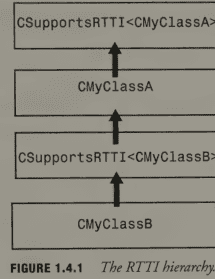

```cpp
#include <typeinfo.h>

template <class T, class BaseClass, ClassID CLID>
class CSupportsRTTI: public BaseClass
{
    public :
    const static ClassID ClassCLID = CLID;

    CSupportsRTTI();

    static T* Create();
    static void RegisterReflection();
    static inline CRTTI* GetClassRTTI() { return &ms_RTTI; }
    virtual CRTTI* GetRTTI() { return &ms_RTTI; }

    protected :
    static CRTTI ms_RTTI;
};

template <class T, class BaseClass, ClassID CLID>
CRTTI CSupportsRTTI<T, BaseClass, CLID>::ms_RTTI
(
    CLID, typeid(T).name(), BaseClass::GetClassRTTI(),
    (ClassFactoryFunc)T::Create, NULL
);

template <class T, class BaseClass, ClassID CLID>
inline CSupportsRTTI<T, BaseClass, CLID>::CSupportsRTTI()
{
}
```

```cpp
template <class T, class BaseClass, ClassID CLID>
T* CSupportsRTTI<T, BaseClass, CLID>::Create()
{
    return new T();
}

template <class T, class BaseClass, ClassID CLID>
void CSupportsRTTI<T, BaseClass, CLID>::RegisterReflection()
{
}
```

RTTI 信息结构作为静态成员放入模板中。每个模板实例（我们的应用程序中每个类类型都有一个唯一的模板实例）都会生成其自身的静态成员实例，这正是我们想要的。GetRTTI() 是虚函数，将根据多态对象的类型返回正确的 RTTI 信息。

GetClassRTTI() 是一个可用于查询特定类 RTTI 信息的函数，例如 CCassType::GetClassRTTI()。请注意，静态成员函数会隐藏祖先类中的静态成员函数，这正是我们在此需要的。CCassType::GetClassRTTI() 将隐藏 CBaseClassType::GetClassRTTI()。

Create() 函数是我们的类工厂函数。其简单实现会分配实例化模板类型的新实例。T::Create() 将解析为 CSupportsRTTI<T, BaseClass, CLID>::Create()，即 T 的基类。

声明静态 RTTI 结构的行值得我们关注。在此，RTTI 结构被静态构造，所有相关的 RTTI 构造函数参数都传递给了 RTTI 唯一结构：

- CLID 是 32 位唯一类标识符。这是一个模板参数。
- typeid(T).name() 是类的名称字符串。乍看之下，我们似乎在作弊：我们并未使用 C++ 运行时类型信息系统在其之上构建自己的系统，这几乎违背了编写自有系统的初衷！并非如此：此处的 typeid(T) 将由编译器在编译时解析，因此我们并未真正使用 C++ 动态 RTTI 结构。事实上，你会发现即使关闭了 C++ 运行时类型信息系统，代码也能正常工作。实际上，这段代码仅会导致编译器为 T 创建并填充 type_info 结构并返回关联字符串，这不需要任何运行时多态检查。
- BaseClass::GetClassRTTI() 是基类的 RTTI 结构。BaseClass 是一个模板参数。
- CSupportsRTTI<T, BaseClass, CLID>::Create() 提供指向我们工厂类函数的指针，该函数由模板自动实例化。当仅知道类 ID 或作为字符串的类名称时，它很有用，可用于创建类的实例。

当应用程序启动时初始化静态变量时，所有 RTTI 结构都可以添加到全局 RTTI 管理器中。必须小心避免每个静态变量构造函数之间的依赖：编译器无法保证静态变量的特定初始化顺序，而静态变量 A 在其构造函数中引用静态变量 B 可能会造成严重混乱。幸运的是，我们的静态变量构造函数参数中不需要此类依赖，因此初始化顺序与 RTTI 系统无关。

现在，让应用程序类支持我们的自定义 RTTI 系统非常简单：

```cpp
class CMyObject : public CSupportsRTTI< CMyObject, CBaseObject,
0x2e160f7a> // 0x2e160f7a is a user-provided random unique ID
{
};
```

RTTI 系统至此完成。

要能够在运行时按类 ID 创建类的实例，我们只需在 RTTI 结构的构造函数中添加一些代码，以便将所有 RTTI 结构注册到全局托管的列表或映射中。然后，RTTI 管理器可以搜索此映射，找到与类 ID 关联的 RTTI 结构，并调用与该结构关联的工厂函数。

## 关于 RTTI 的其他评论

先前描述的 RTTI 系统在多个方面可以进行调整：

- 类 ID 并非真正必要。RTTI 结构是应用程序中每个类类型的唯一静态实例，因此你可以使用指向 RTTI 结构本身的指针作为一种 ID，用于比较和赋值。只有当你打算将 ID 保存到文件或通过网络传输时，才需要类 ID。
- 如果你只需要在运行时查询多态类类型，则类工厂函数是可选的。
- 如果使用 typeid(T).name() 语法获取类名称会导致编译器出现问题，则不强制使用该语法，但将 RTTI 绑定到应用程序类的语法肯定不会那么优雅。类名称字符串可以作为模板参数传递。但是，不允许将未命名对象用作模板参数，因此这样做：

```cpp
template <const char* szString> class CMyTemplate
{
};

class CMyClass : public CMyTemplate<"Hello">
```

将不被允许，因为字符串 "Hello" 是一个未命名的字符串变量。你将被迫将字符串作为带有指定名称的常量，如下所示：

```cpp
char szHello[] = "Hello";
class CMyClass : public CMyTemplate<szHello>
```

这可以正常工作，但有些混乱。

构建了自己的 RTTI 系统后，我们现在可以在反射属性系统中收获成果。将反射引入我们的软件意味着扩展运行时类型信息系统，使其包含有关支持属性的元数据，并最终包含方法。我们的 RTTI 结构将扩展以包含属性对象列表。我们现在可以描述这些属性对象是什么。

## 第二部分：属性对象

属性对象是一个带类型、带名称的对象，充当内部数据表示的网关。属性是一个非常抽象的概念，将涉及许多我们将在后续过程中介绍的定义和概念。我们将把属性对象构建为三个类的分层层次结构：

- 作为抽象属性：基础属性类将是无类型的，且不与任何特定类类型关联。此基类可供某人查询属性时使用，知道其名称但不关心类型或任何具体细节。
- 作为类型化属性：在基础属性类之上，将构建一个模板化的类型化属性对象版本，用于进行类型感知的属性查询时。
- 作为类成员属性：属性对象的最后一层是另一个模板化类，其中属性实际作为成员绑定到特定类类型。我们稍后将了解为什么需要这样做，以及它如何融入整体图景。

我们将首先考察抽象属性层：

```cpp
enum ePropertyType
{
    eptBOOL,
    eptDWORD,
    eptINT,
    eptFLOAT,
    eptSTRING,
    eptCOLOR,
    eptENUM,
    eptRTTI,
    eptMAX_PROPERTY_TYPES
};

class CAbstractProperty
{
public:
    virtual ePropertyType GetType() const = 0;

protected:
    const char*        m_szName;
};
```

抽象属性层仅包含属性的名称。它还包含一个用于描述属性类型的抽象虚函数；我们将在文章后面看到如何描述属性类型。此抽象属性层非常轻量。

```cpp
template <class T> class CTypedProperty: public CAbstractProperty
{
public:
    virtual ePropertyType GetType() const;

    virtual T GetValue( CBaseObject* pObject ) = 0;
    virtual void SetValue( CBaseObject* pObject, T Value ) = 0;
};
```

在属性对象的下一级别，实现了类型正确性。这是一个模板化类，其模板参数是该属性所代表的数据类型。此层包含用于获取和设置属性值的抽象模板化函数。此层也非常抽象，包含的实现内容很少。同样，我们稍后将看到此类如何实现 GetType() 函数。

请注意，属性期望属性的所有者（我们正在尝试访问其属性的对象）作为参数传递给 GetValue() 和 SetValue() 函数。我们的属性类不绑定到任何特定类实例；它绑定到类类型上的特定数据成员的访问。类的所有实例都将共享同一个属性对象。为了使此功能正常工作，我们应用程序中的所有类最终都必须派生自一个公共类，例如 CBaseObject。CBaseObject 可以为空；只需要一个公共祖先以保持一致性。

```cpp
template <class OwnerType, class T> class CProperty : public CTypedProperty<T>
{
public:
    typedef T (OwnerType::*GetterType)();
    typedef void (OwnerType::*SetterType)( T Value );

    virtual T GetValue( CBaseObject* pObject );
    virtual void SetValue( CBaseObject* pObject, T Value );

protected:
    GetterType m_Getter;
    SetterType m_Setter;
};
```

在类成员层级别，我们最终拥有足够的信息（类型和类类型）来执行属性类的实际实现。

属性将保护其数据成员，并通过标准的 getter 和 setter 访问器访问它。属性可以直接拥有指向其正在保护的数据成员的指针，但这将意味着暴露关于


类。使用标准访问器将使数据对系统保持私有，并更符合面向对象开发规范。访问器预期将具有标准形式，即 `T Get()` 用于 getter，`void Set( T Value )` 用于 setter。

考虑到这一点，模板化属性可以为访问器函数回调定义 typedef（如前面的代码所示），这些回调将用于访问其关联数据。函数指针的指针存储在属性对象本身中。

通过属性获取或设置值时，将调用相关的函数回调。

```
template <class T>
T CProperty <OwnerType, T>::GetValue( CBaseObject* pOwner )
{
    return pOwner->*m_Getter();
}

template <class T>
void CProperty<T>::SetValue(CBaseObject * pOwner, T Value )
{
    if ( !m_Setter )
    {
        assert( false ) // Cannot write to a read-only property
        return;
    }
    pOwner->*m_Setter( Value );
}
```

可以在这里看到，使用了 C++ 指向成员运算符 ->*。这是必要的，因为我们正在调用一个类对象的成员函数。

属性结构现在具备封装数据类型并通过标准 getter 和 setter 访问它所需的一切。属性结构可以用于对象本身，并嵌入其中。

## 存储属性

属性与特定的类类型相关联。将类的 RTTI 信息扩展以包含其属性列表是自然而然的。还需要一个全局属性管理器来管理属性的整体分配和删除。

本 gem 的实现将属性放在 C++ 标准模板库（STL）列表中，组织方式如图 1.4.2 所示。

全局属性列表系统管理器将管理一个包含所有属性对象的全局属性列表。属性按顺序注册并添加到列表中，即属于同一类类型的所有属性在列表中将是连续的。每个类的 RTTI 结构也包含其关联属性对象的列表。

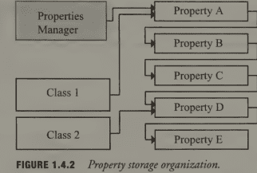

## 属性类型

属性是一个带类型的构造。它必须允许查询其类型并与其他属性类型进行比较。实现这一点的简单方法是声明一个枚举，指定我们计划支持的每种属性类型：整数、浮点值、字节、字、双字、字符串、颜色、枚举、向量和对象指针。让反射功能的用户将属性类型作为参数传递给注册函数，这已经足够简单；然而，更优雅的做法是允许将属性类型作为模板参数指定。因此，不再使用如下语法：

```
RegisterProperty( "MyProperty", eptINT );
RegisterProperty( "MyProperty2", eptPTR );
```

可以使用如下语法，这更自然且不易出错：

```
RegisterProperty<int>( "MyProperty" );
RegisterProperty<MyClass>( "MyProperty2" );
```

为了实现这一点，编译器必须以某种方式将模板类型与相应的类型枚举值关联。我们可以通过定义一个包含静态数据成员的 CPropertyType 模板类来实现这一点。模板中的静态数据成员会为每个模板特化实例化一次。因此，CMyTemplate<CMyObject>::ms_MyStaticDataMember 将引用与 CMyTemplate<CMyOtherObject>::ms_MyStaticDataMember 不同的静态数据成员。我们可以利用这一事实，让编译器为我们计划与属性一起使用的每个唯一类型自动生成一个静态数据成员（请记住，不是针对每个类型引用，而是针对每个唯一类型）。这样，我们就可以将一个唯一的静态数据成员与属性代码中引用的所有类型关联起来。

使用模板特化，我们可以将类型与正确的枚举类型关联。代码结果如下：

```
template <class T> class CPropertyType
{
public:
    static ePropertyType ms_TypeID;
};

template<class T> ePropertyType CPropertyType<T>::ms_TypeID =
    eUNKNOWN;

template<> ePropertyType CPropertyType<bool>::ms_TypeID = eptBOOL;
template<> ePropertyType CPropertyType<DWORD>::ms_TypeID = eptWORD;
template<> ePropertyType CPropertyType<int>::ms_TypeID = eptINT;
template<> ePropertyType CPropertyType<float>::ms_TypeID = eptFLOAT;
template<> ePropertyType CPropertyType<char*>::ms_TypeID = eptSTRING;
```

所有已知类型都指定了模板特化；没有特化的类型将像默认模板实现代码中一样，被分配枚举成员 eUNKNOWN。指针属性是特殊情况，通过单独的属性注册调用来处理（请参见随附光盘上的代码）。


我们可以利用这一点，让属性代码在通过模板参数给定属性类型时，关联一个唯一且可重复的数字。

## 属性注册钩子

每个对象将包含其所含属性的描述，以及名称、类型和访问信息。需要一种机制来最初描述每个类的属性并将其存储到列表中。

因为我们希望反射功能的用户能够控制哪些数据成员变为可反射，所以属性将由使用属性的类的程序员手动注册。这些属性必须在应用程序运行时非常早期注册，以便尽快可用。

我们之前已经看到，RTTI 信息是通过实例化静态变量由 RTTI 系统初始化的。由于静态变量在应用程序启动时非常早期初始化，这也是初始化类属性的理想时间窗口。我们需要一个简单的钩子，让每个唯一的类类型可以注册其特定属性。

可以向我们的 CSupportsRTTI 模板类添加一个 RegisterReflection() 静态函数。RTTI 系统已被修改，以便将 T::RegisterReflection() 作为函数指针传递给 RTTI 类的构造函数。在构造过程中，RTTI 类将调用该函数指针，提供前面提到的钩子，并让类设计器有机会为该类类型注册其属性。

CSupportsRTTI<T>::RegisterReflection() 的默认实现为空。类设计器可以通过在从 CSupportsRTTI 派生的类中实现 RegisterReflection() 来覆盖此行为。静态函数将隐藏派生基类中同名的另一个静态函数。因此，如果 CMyClass::RegisterReflection() 存在，CSupportsRTTI<CMyClass> 中的以下代码将传递 CMyClass::RegisterReflection()；如果 CMyClass::RegisterReflection() 不存在，编译器将把它解析为 CSupportsRTTI<CMyClass>::RegisterReflection()；

```
template <class T, class BaseClass, ClassID CLID>
  CRTTI CRTTIClass<T, BaseClass, CLID>::ms_RTTI
  ( CLID, typeid(T).name(), BaseClass::GetClassRTTI(),
    (ClassFactoryFunc)T::Create,
    (RegisterReflectionFunc)T::RegisterReflection() );
```

如果未定义 CMyClass::RegisterReflection()，则将调用 CSupportsRTTI<CMyClass>::RegisterReflection()，这是一个空实现，对于没有任何反射数据成员的 RTTI 类来说是正确的。

## 注册属性

我们已经定义了一种方法，让程序员在运行时运行与每个类类型关联的代码，现在我们可以看到如何声明初始化属性并将其绑定到类的属性描述符。

反射功能的用户需要在 RegisterReflection() 调用中指定属性是什么。每个注册的属性都需要指定：

- 名称
- 类型
- Getter 访问器回调
- Setter 访问器回调

在调用钩子之前，RTTI 系统会设置一个唯一的静态变量，以跟踪我们正在为其注册属性的当前类。

反射系统的用户随后在钩子中编写代码，调用静态 RegisterProperty() 调用，传入先前列举的参数：

```
void CMonster::RegisterReflection()
{
    RegisterProperty<int>( "Health", GetHealth, SetHealth );
    RegisterProperty<char*>( "Name", GetName, SetName );
}
```

属性的参数被放入一个新的属性对象中，并链接到 RTTI 结构和属性全局列表。


执行此操作后，每个类的 RTTI 结构都包含其属性对象列表。在反射系统代码中投入了大量精力，以确保该系统对反射功能的用户尽可能透明。现在是时候看看一些实际应用了。

## 脚本应用

最后，是时候看看为这个抽象系统付出的所有努力如何用于实际游戏制作了。应用多种多样，功能非常强大。我们的属性为程序员提供了一种轻松的方式，将特定数据成员暴露给外部世界。程序员不需要更改类的内部，只需为每个类类型编写简短的钩子，告诉系统特定类有哪些属性可用。

游戏中反射最常见的用途是作为脚本的胶水接口。脚本通常需要调用核心引擎来影响游戏机制。反射为这种跨边界通信提供了理想的传输方式。脚本可以使用如下一行代码：

```
Player.Health = Player.Health - Monster.AttackDamage;
```

全局作用域脚本调用可以封装为单独的类，并像这样注册为属性：

```
void CPlayer::RegisterReflection()
{
    // Assume CPlayer contains accessor functions GetHealth() and
    // SetHealth() for accessing health data.
    RegisterProperty<int>( "Health", GetHealth, SetHealth );
};

void CMonster::RegisterReflection()
{
    // Assume CMonster contains accessor functions
    // GetAttackDamage()
    // and SetAttackDamage() for accessing health data.
    RegisterProperty<int>( "AttackDamage", GetAttackDamage,
    SetAttackDamage );
}

void CGlobalScript::RegisterReflection()
{
    // Assume CGlobalScript contains accessor functions GetPlayer ()
    // and GetMonster () for accessing script sub objects.
    // Read-only property
    RegisterProperty<CPlayer*>( "Player", GetPlayer(), NULL );
    // Read-only property
    RegisterProperty<CMonster*>( "Monster", GetMonster(), NULL );
}
```

脚本引擎可以使用反射来查找全局作用域脚本类暴露了哪些对象。它会发现有一个名为 `PLAYER` 的属性；访问此属性将返回一个 `CPlayer` 对象。此对象反过来可以被查询，看它是否支持名为 `Health` 的属性，此时脚本引擎可以使用反射直接检索玩家健康值的值。脚本可以做同样的事情来查找怪物攻击伤害的值并计算结果。反射系统会自动在玩家对象上调用 `SetHealth()` 以设置新值。每个属性都包含其类型 ID，因此脚本引擎也可以使用反射系统来帮助对脚本进行类型检查。

## 微调器应用


对象暴露的属性信息对于编辑器应用程序自动暴露可微调数据非常有用。这是随附光盘中展示的示例。

在此场景中，程序员编写了一个类，例如 `CPlayerStats`，它暴露了某些属性。编辑器应用程序随后可以使用此属性信息为该对象构建通用的 _属性页_ GUI 界面，为每个属性类型显示一个 GUI 控件。

这可以极大地帮助使游戏更加数据驱动。典型的场景可能是 AI 程序员创建了一个用于控制某些 AI 的游戏类。经过一些实验后，AI 程序员可能会意识到 AI 变量的某些方面有些任意，最好交给设计师进行微调。AI 程序员可以通过将一些访问器作为属性暴露出来，轻松地使其代码的某些方面可微调。一个“微调器”应用程序或编辑器可以扫描这些属性，并为设计师提供动态界面。这使得整个数据驱动设计过程非常流畅且紧密集成。

## 其他应用

以下是属性的一些更多应用示例：

- **隐式序列化：** 属性可用于以通用开放格式自动加载和保存游戏中的某些对象。XML 作为保存属性数据的文件格式非常合适。

- **简单网络持久性：** 可通过使用属性来发现需要跨网络同步的数据类型的系统，为游戏对象实现简单的网络持久性。

- **日志记录：** 可以记录对属性的访问，以帮助调试脚本。

## 结论

本文详细介绍了一种通用系统，允许代码在运行时暴露其部分结构，具体来说，就是命名数据成员。使用模板，该系统变得健壮、跨平台、类型安全，并且对用户透明。

在反射可能的应用方面，我们只是初探。此外，虽然这里没有讨论，但反射还可以包括类函数的暴露。模板也可以用于类函数的情况，使用模板类型参数来实现类型正确性和代码绑定。

## 参考文献

- [BIL00] Bilas, Scott. “通用函数绑定接口。” In *游戏编程宝石*, 56–67. Charles River Media.
- [CAF01] Caffelii, Charles. “用于泛型 C++ 成员访问的属性类。” In *游戏编程宝石 2*, 46–50. Charles River Media.
- [JEN01] Jensen, Lasse Staf. “通用微调器。” In *游戏编程宝石 2*, 118–126. Charles River Media.
- [OLS00] Olsen, John. “统计信息：实时统计和游戏内调试。” In *游戏编程宝石*, 115–119. Charles River Media.
- [POU02] Pourian, Allen. “平台无关、函数绑定代码生成器。” In *游戏编程宝石 3*, 38–42. Charles River Media.
- [STR97] Stroustrup, Bjarne. “模板。” In *C++ 程序设计语言（第 3 版）*, 327–354. Addison Wesley, 2000.
- [WAK01] Wakeling, Scott. “动态类型信息。” In *游戏编程宝石 2*, 38–45. Charles River Media.

## 用于高速 BSP 的球树

Dominic Filion, Artificial Mind & Movement

dfilion@hotmail.com

二叉空间分割树，即 BSP，多年来一直是 3D 程序员的核心技术。虽然它们不如从前流行，但 BSP 仍在 3D 引擎的许多关键领域中使用，例如可见性预处理、碰撞检测和多边形排序。很少有算法能在解决如此多样的问题方面如此成功。

然而，随着硬件性能和玩家期望的提升，以及对更高多边形数量的需求增加，BSP 暴露出其弱点之一：预处理时间长。构建 BSP 是一个 O(n log^2(n)) 级别的过程，而当下一代显卡每帧处理数百万个多边形时，对每个多边形都运行 O(n log^2(n)) 预处理算法根本不是一种选择。即使对于较小的数据集，BSP 往往也是阻止引擎工具链从“可以在 20 秒内预览关卡”变成“可以即时预览关卡”的唯一因素，这一显著改进将使您的关卡设计师保持最高效率。

本文介绍了一种算法，可有效地将 BSP 构建从 O(n log^2(n)) 过程降低到 O(n log(n)) 过程。该技术涉及使用较粗糙但更快的分区空间（球树）来优化 BSP 的预处理步骤。

### BSP

此处将简要回顾 BSP，以完整性为准。然而，在大部分内容中，将假设读者熟悉这两种算法。有关 BSP 的更详细回顾，请参见 [Ranta03]。

BSP 是使用无限平面将空间分割为递归半部分的 3D 空间分区。然后可以使用此空间分区来发现空间中多边形之间的关系；最常见的是，多边形 A 位于多边形 B 的前面或后面。

多边形集被输入到 BSP 构建算法中。在 BSP 构建过程中，选择一个多边形作为分割器。计算分割器多边形的平面，并将其他多边形分类为位于前面或


在分割多边形平面后方。如果多边形跨越平面，通常会被分割平面切成两半，两半分别被分类为位于平面前方或后方。空间的两半随后成为独立的空间，并通过在每一半中选择分割多边形，再次计算每一半中哪些多边形位于分割多边形的前方或后方，从而进行递归分区。算法将持续递归，直到所有多边形都已用作分割多边形。到那时，3D 空间将被划分为形成凸区域的二元空间层次结构。

## 构建 BSP

要充分理解如何优化 BSP 构建过程以移除一个复杂度阶，回顾 BSP 构建过程将很有帮助。

一个优秀的 BSP 树必须在以下两个主要标准上得分很高：

- **最小分割：** 严格的 BSP 不得有任何多边形重叠到相邻的 BSP 叶节点。因此，在 BSP 中组织的多边形必须被分割，使得每个多边形只能被分类到一个且仅一个 BSP 叶节点。分割后的多边形会在内存存储和树的复杂性方面为 BSP 增加开销。因此，优秀的 BSP 树必须通过选择能够最小化多边形分割数量的分割平面来避免这种开销。

- **平衡：** 平衡是指每个 BSP 节点的前向和后向子节点上的多边形数量大致相等。良好的平衡可确保平均情况下以均匀的步骤数遍历 BSP。不平衡的树是不可靠的，因为某些分支可能比较短的分支长几十或几百倍，从而导致访问时间不可靠。

根据具体情况，BSP 也可能有其他标准，或可能忽略之前列出的某些标准，但这不会改变此处介绍的算法优化的核心。

就本文而言，让我们假设之前提到的两个标准即为 BSP 适用性标准，并且我们正在构建一个严格的 BSP，即每个多边形被分类到一个且仅一个 BSP 叶节点的 BSP。我们将假设多边形平面被用作 BSP 分割器，并且当每个多边形的平面都已在 BSP 中用作分割器时，BSP 即被视为完整。作为回顾，BSP 的构建过程如下。

首先，BSP 将递归地将空间二分 n 次，其中 n 是多边形汤中的多边形数量；这是 n log(n) 复杂度阶中的第一个 n，并构成我们的外层循环。始终需要一个外层循环来将所有多边形放入 BSP，因此我们无法优化掉这个循环。

BSP 的每次分割都必须扫描当前 BSP 半空间中的所有多边形，以找到能够导致最少分割数量并为树提供最佳平衡的最佳平面候选项。每个被扫描的多边形 A 都必须与当前 BSP 空间中的所有其他多边形进行比较，以确定多边形 A 的平面会对多边形造成多少次分割。由于我们正在递归地二分空间，这两个嵌套的内层循环的每次迭代只需扫描上一次迭代一半的多边形数量（在理想情况下），这就是 n log²(n) 中两个 log(n) 次幂的来源。我们将从算法的复杂度阶中优化掉其中一个 log(n) 次幂。

最后，一旦选择了最佳分割平面候选项，BSP 空间中的所有多边形都必须被分类到相应的前向和后向子 BSP 节点，并根据需要由 BSP 进行裁剪。从技术上讲，这将使算法的复杂度阶变为 n (log²(n) + log(n))，但出于简洁起见，这并未包含原始算法复杂度估计中第二个（附加的）log(n) 项，并且根据标准算法分析规则，二次函数在复杂度阶上占主导地位，超过线性项。尽管如此，我们仍将从算法中优化掉这个第二个（附加的）log(n) 项。

### 优化：初步步骤

我们正在移除第二个 log(n) 循环，即测试某个多边形的平面与所有其他多边形，以验证会造成多少次分割，以及如果使用该平面将 BSP 二分，树会有多平衡的那个循环。

首先想到的想法可能是使用那个历史悠久的技巧：测试包围球而不是实际对象（在此例中为多边形），以大致了解该多边形相对于平面的位置。在大多数情况下，多边形的包围球将严格位于平面的一侧，从而避免了逐个测试每个多边形顶点的需要。

不过，将这个想法再推进一步才是真正开始见效的地方：使用球树进行分治。球树只是一个球的层次结构树，其中树节点内的每个球都包围其下方树节点中的所有其他球。因此，使用这个想法，单次包围球测试即可一次确定几十个或几百个多边形的位置。

### 构建球树

我们实际上在这里所做的是，使用粗略且松散的空间分区算法（球树）来优化另一个精细且准确的空间分区算法（BSP 树本身）。球树非常适合此目的，因为它们构建速度非常快——比 BSP 树快几个数量级。我们不希望用于优化主算法的树构建时间，反而比我们试图通过优化节省的时间还要长。

那么，我们如何构建这个球树呢？我们需要一种快速且粗糙的方法来分区多边形汤，球树的最优性并非真正必要。构建一个良好球树且无需太多复杂性的一种简单方法如下。首先，计算包围多边形汤中所有多边形的包围球。这将作为球树根节点的包围球。该球不需要是最优拟合；只需计算所有多边形顶点的包围盒，使用该盒的中心作为包围球的中心，并相应调整包围球的半径。

接下来，计算一个与包围球中心重合的 x 轴轴向平面。将多边形分为两组：位于平面前方的多边形和位于平面后方的多边形。这里无需抠字眼（或对多边形进行拆分）；如果多边形跨越平面，只需计算平面两侧各有多少个顶点，并将多边形分类为顶点较多的那一侧。如果平面前后的顶点数量相同，则默认将其分类为位于平面前方。这里重要的是不是准确性，而是拥有一个可重复的启发式方法，能够明确地将多边形分类为组 A（轴向平面前方）或组 B（轴向平面后方）的一部分。

对多边形分类后，计算每个子组的包围球，在球树中创建两个子节点，将它们附加到父节点，并将包围的多边形分配给这些节点。递归继续此过程，这次使用 y 轴上的轴向平面（然后是 z 轴，再回到 x 轴）。在轴之间循环可以在所有维度上实现大致均匀的分布。递归构建树，直到球叶覆盖的区域与最小多边形的包围球一样小，或者叶节点中只有一个多边形时为止。

同样重要的是，存储每个球树节点及其所有子节点包含的多边形数量。球树根节点的多边形计数将等于场景中多边形的总数，球树叶节点只计算附加到叶节点本身的多边形。球树分支将计算从该分支可到达的叶节点中包含的所有多边形。

此过程将生成一个球树，该球树将彼此靠近的多边形松散地分组成由球包围的团块。有关球树结构的概述，请参见图 1.5.1。

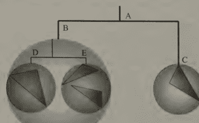

图 1.5.1 球树概览。


## 优化 BSP

我们现在准备使用球树来加速 BSP 构建过程。

每个多边形都作为分割候选项进行测试。为了确定它是否是一个好的分割候选项，需要针对该 BSP 分支中的所有其他多边形进行测试，以确定多边形分割的数量和树的平衡性。使用球树，我们现在可以针对球体而不是单个多边形来测试每个分割候选项。

针对球树的测试从根节点开始，根节点包围所有多边形。对于球树的每个节点，节点的包围球会与分割候选项的面平面进行测试。如果包围球完全位于分割平面的前面或后面，则可知该球树分支中包含的任何多边形都不会发生分割。树的平衡也可以通过查找该树分支中包含的多边形数量来计算。

如果球体与平面重叠，则球树节点中包含的多边形可能与平面重叠，也可能不重叠。在这种情况下，必须递归地将球树子节点与平面进行测试，直到到达完全位于平面一侧或另一侧的球节点为止。

如果无法到达这样的球体——即，到达的球体叶节点仍与平面重叠——则必须将该球体叶节点中的单个多边形与平面进行测试。这实际上是唯一测试单个多边形的情况。

在大多数情况下，空间中的所有多边形在仅遍历球树的几个节点后，就会被识别为位于平面前面、后面或跨越平面。这就是去除大部分 log(n) 级别的地方。图 1.5.2 展示了如何将 BSP 树平面与球树节点进行比较。有关执行 BSP 测试的代码概述，请参见清单 1.5.1。

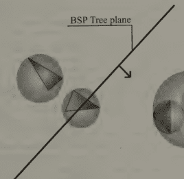

图 1.5.2 使用球树进行平面测试的 BSP。

### 清单 1.5.1 测试多边形候选项

```
void CBSPTreeBuilder::TestSplitCandidate(
    CSphereTreeNode* pSphereTreeNode, bool& bTerminateEarly )
{
    // Test sphere tree node with plane
    float fDistance = m_pCurCandidate->m_Plane.GetDistance(
        pSphereTreeNode->m_Bounds.m_vPosition );
    if ( fDistance < - pSphereTreeNode->m_fBounds.m_fRadius )
    {
        // Sphere tree node completely in back
        m_dwBackCount += pSphereTreeNode->m_dwPolyCount;
    }
    else if ( fDistance > pSphereTreeNode->m_Bounds.m_fRadius )
    {
        // Sphere tree node completely in front
        m_dwFrontCount += pSphereTreeNode->m_dwPolyCount;
    }
    else
    {
        // Sphere tree node possibly straddles the plane
        if ( pSphereTreeNode->m_pPolygons )
        {
            // This is a sphere tree leaf, so we have to test the
            // polygon individually
            CPolygon* pCurPoly =
                (CPolygon*)pSphereTreeNode->m_pPolygons;
            while ( pCurPoly )
            {
                // Check for splits with the current candidate
                if ( pCurPoly != m_pCurCandidate )
                {
                    switch ( pCurPoly->GetSide(
                        m_pCurCandidate->m_Plane ) )
                    {
                    case CPolygon::epsFRONT :
                        m_dwFrontCount++;
                        break;
                    case CPolygon::epsBACK :
                        m_dwBackCount++;
                        break;
                    case CPolygon::epsBOTH :
                        // Ya, this one causes a split
                        m_dwSplits++;
                        if ( m_dwSplits > m_dwBestSplit )
                        {
                            bTerminateEarly = true;
                            break;
                        } // Too many splits – This candidates a
                        // loser, discard it early, seeya
                        break;
                    }
                }
                pCurPoly = pCurPoly->m_pNext;
            }
        }
        else
        {
            // Sphere tree node, so test both children
            if ( pSphereTreeNode->m_pChildren[0] &&
                 pSphereTreeNode->m_pChildren[0]->m_dwPolyCount >
                 0 )
            {
                TestSplitCandidate( pSphereTreeNode->
                                    m_pChildren[0], pSphereTreeNode->
                                    bTerminateEarly );
            }
        }
        if ( !bTerminateEarly && pSphereTreeNode->
             m_pChildren[1] &&
             pSphereTreeNode->m_pChildren[1]->m_dwPolyCount >
             0 )
        {
            TestSplitCandidate( pSphereTreeNode->
                                m_pChildren[1], pSphereTreeNode->
                                bTerminateEarly );
        }
    }
}
```

## 剪枝

然而，算法中仍缺少一个重要部分，才能真正发挥作用。随着 BSP 的递归分割，多边形被分类到各自的半空间中。在 BSP 层次结构中选择下一层的下一个分割候选项时，该分割候选项只能与包含在其自身半空间中的多边形进行比较。它不能与整个多边形集合进行比较。

球树具有一个 Split() 函数，该函数会从球树中移除所有位于平面后面的球树节点，并将它们放入由函数返回的单独的 *后球树* 中。

分割算法将每个球节点与分割平面进行比较，就像多边形候选项测试中所做的那样。如果球节点完全位于平面前面，则不执行任何操作；该球节点是当前树的 *前树* 的一部分。如果球节点完全位于平面后面，则必须将该球节点 *重新链接* 到后树。重新链接节点会隐式地重新链接该球节点的所有子节点，从而为后树添加一个全新的分支。如果球体与平面重叠，进一步处理将取决于该球节点是否实际上是叶节点。

如果它是球体叶节点，则多边形会与分割平面逐个进行比较。每个多边形都会单独重新链接到前球节点或后树节点。如果多边形跨越平面，则在此处进行裁剪，每个裁剪后的子多边形会链接到其相应的球节点。请注意，实际的多边形裁剪发生在球树分割过程的一部分，而不是直接作为 BSP 构建过程的一部分。就 BSP 构建器而言，它分割的是球树而不是多边形。

如果它不是球体叶节点，则会发生递归分割。分割节点会导致子节点的递归分割。Split() 调用以每个球节点的子节点作为参数进行调用。会创建父节点的后节点版本。子节点 A 会创建自身的后节点版本 A，该版本将附加到后节点父节点，子节点 B 也会创建自身的后节点版本 B，该版本也将附加到后节点父节点。有关说明，请参见图 1.5.3。

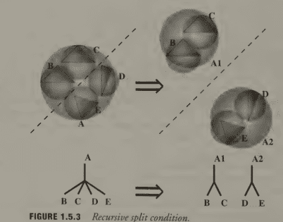

还必须格外小心，分别更新前球树和后球树中的多边形计数，尤其是在球树分割操作之后。

## BSP 到底：O(n) 及更高级

前面描述的技术可以产生一个优化良好、行为良好的 BSP。牺牲部分运行时最优性可以进一步加快算法速度。有人认为，仅通过查看所有可用多边形候选项的一个子集（例如 5% 或 10% 的所有可用候选项），就可以统计上找到一个相当好的 BSP 分割器。生成的 BSP 可能效率不高，但可以在大约 O(n log(n))^0.1) 的时间内生成，这使其相对接近 <Eqn015.eps> 的理论极限。尽管次优，但仅评估多边形分割候选项子集所生成的 BSP 仍然比随机选择分割器要高效得多。次优 BSP 对于预览关卡或在不需要完全最优 BSP 的情况下可能已经足够。

### 结论

使用前面描述的算法可以将 BSP 构建带入几乎交互式的过程。这可以在每次小更改需要 10 到 20 分钟的最后时刻关卡更改和只需几秒钟的关卡更改之间产生差异；这种加速在时间紧迫时尤其有价值。

### 参考文献

- [FAQ99] "BSP 树常见问题解答." 可在线查阅 http://www.gamedev.net/reference/articles/article1657.asp. 1999 年 8 月 22 日.
- [Ranta03] "BSP 树：理论与实现." 可在线查阅 http://www.devmaster.net/articles/bsp-trees/. 2003 年 11 月 9 日.
- [RatCliff01] RatCliff, John W. "用于快速可见性剔除、光线追踪和范围搜索的球树." Game Programming Gems 2, 384–387. Charles River Media.


## 改进的视锥剔除

**Frank Puig Placeres**

fpuig2003@yahoo.com

典型的游戏场景通常包含许多对象，如果管理不当，可能会阻碍渲染性能。OpenGL 和 DirectX 等库通过裁剪部分超出屏幕的多边形，并尽早拒绝完全不在视野内的多边形进行后续处理，来进行一些几何管理。然而，要执行裁剪，多边形中的每个顶点都必须经过库的管道，转换为屏幕坐标，并与活动视口进行检查。当多边形数量较少时，这个过程可以胜任，但当渲染许多由数百（或数千）个多边形组成的对象时，传输和处理所有顶点的高成本会迅速使系统过载。必须实现更高级的每对象剔除算法，以有效管理典型场景的渲染。本文介绍了一种对已知场景管理技术——视锥剔除（view frustum culling）的巧妙改进。

### 视锥剔除

视锥剔除通过定义一个包裹当前视点可见空间的体积来工作。如图 1.6.1 所示，该视锥体是通过构建一个以眼睛位置为顶点、四个三角形面与屏幕边界对齐的金字塔构建的。两个平行平面（近裁剪平面和远裁剪平面）将此金字塔切片；比屏幕更近或超过某个预定义距离的内容都不会包含在视锥体中。在数学中，所得体积称为视锥（frustum），完全位于该体积外部的对象无法被相机看到，可以在对象级别被拒绝。一旦构建了视锥，就可以对对象进行可见性测试。场景中的每个对象可能完全被一个包围体（如球体、立方体、圆柱体或圆锥体）包围，用它来与视锥进行测试，而不是使用对象本身。这避免了重复渲染管线中已有工作的开销，并比每多边形剔除（per-polygon culling）提供了更高级别的效率。如果

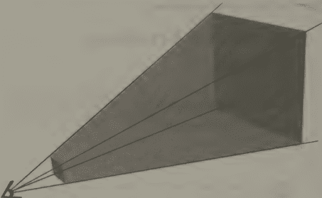

图 1.6.1 界定世界可见部分的几何对象称为视锥。

如果简单的包围体完全落在视锥之外，它所包含的整个对象（或对象）可能会被拒绝。关键是使用可以快速与视锥进行测试的形状，因此最常用的原语是球体和轴对齐包围盒（axis-aligned bounding boxes）。

### 传统的六平面方法

视锥本身最常见的表示形式是六个简单的平面，它们从由模型视图矩阵和投影矩阵连接组成的矩阵中提取，如图 1.6.2 所示。每个平面将空间分为两半；所有平面的交点形成一个定义相机所见内容的体积。

使用六平面方法存在一些缺点，首先是处理开销。确定一个点是否落在视锥内意味着要对每个平面求解一个方程式。只有当每个平面求解的结果都为正时，才能确定该点位于视锥内。这种方法的第二个缺点是，不太容易提取视锥的位置和方向，这使得更新等操作相当困难。这个缺点也是几乎所有实现都在相机每次更新时重新创建视锥的原因，这会带来一些开销，表现为不必要的浮点运算（包括除法和平方根），因为构成视锥的六个平面被重新构建 [Morley00]。

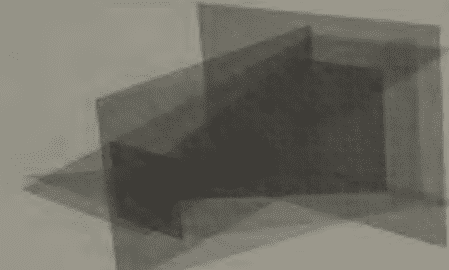

图 1.6.2 定义视锥的六个平面。

### 雷达方法

该算法最初是为二维雷达系统设计的。其唯一预期目的是显示雷达波覆盖的对象，而排除未被覆盖的对象。如果某些包围体位于视图内，该方法证明非常快速，并且该方法很快被扩展到三维空间中工作。现在，该算法已被用于视锥剔除，取得了惊人的效果。

为了以友好的方式描述雷达方法的工作原理，让我们先回顾并介绍二维算法，然后将其扩展到三维世界。

在处理二维系统时，视锥变成一个三角形，由于视锥是一个对称对象，该三角形已知为等腰三角形，如图 1.6.3 所示。从顶点出发且垂直于底边的线段在数学中称为三角形的高。高的有用之处在于，由于视锥是对称的，它将等腰三角形分成两个相等的半部。巧合的是，高的方向恰好与相机的前向量（forward vector）平行。

使用雷达方法，视锥的定义与相机一样直观，因此视锥构建几乎不成本。二维雷达只需要知道视野角度（FOV）、前向量和右向量。幸运的是，这些正是相机使用的相同三个参数，因此可以直接从相机中提取。然而，雷达实现并不直接使用 FOV

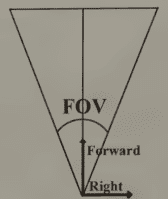

图 1.6.3 二维视锥表示为等腰三角形，其中高与前向量匹配。

直接使用，而是使用该角度的正切值；因此，构建视锥时唯一需要计算的就是这个值。即便如此，这个值也可以被缓存，并且仅在相机改变 FOV 时才计算（在大多数游戏中，这仅在执行缩放、改变透视时发生。当该角度保持不变时，视锥是通过直接从相机复制前向量和右向量来构建的。这比使用六平面方法构建视锥所需的所有计算要便宜得多。现在，让我们进入真正有趣的部分：判断某物是否在视锥内。

### 点是否在视锥内？

首先，让我们看看需要知道给定点是否在视锥内需要什么；请查看图 1.6.4。要判断点 P 是否在视锥内，雷达方法将 OP 投影到前向量和右向量上。如果前向投影 F 在远平面和近平面值之间，且右向投影 R 在 rLimit 和 -rLimit 之间，则点 P 在视锥内；否则，它完全在外部。

如前所述，首先必须计算投影 F 和 R。要将一个向量投影到另一个向量上，需要执行点积，并将所得标量乘以两个向量中的任意一个，以获得所需轴上的投影。图 1.6.5 说明了这一点。有两个向量 V1 和 V2，它们的点积返回一个标量 s。

```
s = V1 dot V2 = V1 • V2 = V2.x * V1.x + V2.y * V1.y
```

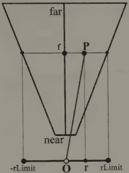

图 1.6.4 对视锥中的点进行分类。

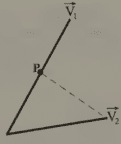

图 1.6.5 将一个向量投影到另一个向量上。

V1 在 V2 上的投影是 V2 * s，条件是 V2 的长度为 1。
使用前面的方程，并考虑到前向量和右向量是单位向量，可以通过执行以下操作来计算 F 和 R 的值：

f = Forward • OP 和 r = Right • OP

如果条件（near <= f <= far）不为真，则点在视锥外。请查看代码的第一部分：

```
bool cFrustum::IsPointIn( const cVector2f& Point )
{
    cVector2f OP = Point - EyePosition;
    float f = OP * ForwardVector; // OP dot ForwardVector
    if ( f < NearZ || far < f) return false;
    float r = OP * RightVector; // OP dot RightVector
    float rLimit = rFactor * f;
    if ( r < -rLimit || rLimit < r) return false;
    // Up to here the point is known to be in the frustum
    return true;
}
```

计算 rLimit 更棘手，涉及 FOV 正切值。之前讨论过的 FOV 正切值，称为 rFactor，计算方法如下（参见图 1.6.6）。


图 1.6.6 查找 rFactor 所需的量。

```
rFactor = tan(FOV / 2) = opposite side / adjacent side = rLimit / f

rFactor = rLimit / f

rLimit = rFactor * f
```

如果条件 ($-rLimit \le r \le rLimit$) 评估为不为真，则该点在视锥体外部。否则，该点已知在视锥体内部。

这就总结了确定一个点是否在二维视锥体内部所需做的一切。

将其转换为三维同样简单，只需引入另一个因子 uFactor，它是 rFactor 乘以定义透视矩阵时使用的 ViewAspect，以便视锥体与视口匹配。此外，还必须考虑一个新向量：Up 向量。Up 向量可以直接从相机中提取，方式与 forward 和 right 向量完全相同。使用点 P、Up 向量和 uFactor，可以计算出投影 U 和 uLimit 值。如果该投影不在 uLimit 的正负值之间，则该点在视锥体外部。

将此与之前的二维示例相结合，可以知道一个点相对于三维视锥体的位置。值得注意的是，它所需的数学量不到六平面方法所需数学量的一半，考虑到每帧都会对视锥体进行大量测试，这是一个巨大的节省。

然而，点数学是简单的部分，只有少数时候需要知道单个点是否落在视锥体内。大多数时候，评估的是更复杂的几何体。好消息是，当今游戏中用于对视锥体进行测试的几乎所有包围对象都遵循相同的点到视锥体算法。因此，必须清楚理解点到视锥体算法，才能理解其对更复杂几何体的应用。出于这个原因，如果本节有不清楚的地方，建议你回头再过一遍。

## 球体，你在哪里？

当今游戏中更快、更常用的包围对象之一是球体。球体定义为一个中心点和一个半径。球体创建起来相当容易，速度几乎与点到视锥体算法一样快，因为它只是该算法的一个变体。然而，球体相对于视锥体的位置不再只是内部或外部的问题，因为该测试还可以返回包围球既不完全在内部也不完全在外部，而是与视锥体平面相交，这允许一些稍后将介绍的巧妙优化。然而，出于本文的目的，我们将只介绍返回包围球是“可见”还是“完全在外部”的方法。有关更高级的方法，请参阅 [Puig03]。

考虑球体的定义：一个中心点和一个半径。牢记这一点，你可以将测试点与视锥体视为检查半径为零的包围球与视锥体。现在我们所做的只是将其扩展到包含非零半径。参见图 1.6.7。

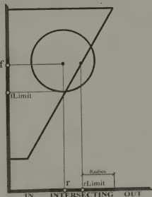

图 1.6.7 如果投影位于“外部”区域，则球体被报告为“完全在外部”；否则，它被报告为“可见”，因为它必须位于“内部”或“相交”区域。

算法首先检查球体是否在视锥体内，并相应地返回 true 或 false。这与点代码的工作方式非常相似，但这次的限制多出了半径个单位。

```
char cFrustum::ClassifySphere(const cVector3f& Center, const float Radius)
{
    cVector3f OP = Center - EyePosition;
    float f = OP * ForwardVector; // OP dot ForwardVector
    if (f < NearZ-Radius || FarZ+Radius < f) return false;

    // Unoptimized but more understandable
    float r = OP * RightVector;
    float rLimit = rFactor * f;
    if (r < -rLimit-Radius || rLimit+Radius < r) return false;

    // Optimized ( a substraction is removed )
    float u = OP * UpVector;
    float uLimit = uFactor * f + Radius;
    if (u < -uLimit || uLimit < u) return false;

    return true;
}
```

如你所见，这里对 r 轴的测试完全展开以供说明。这可以优化，事实上，随附光盘中的代码重写了该段。请注意，if 语句中的条件 (-rLimit - Radius) 与 -(rLimit + Radius) 相同，这是检查的第二个条件。使用这种重构后的数学，加法运算在计算 rLimit 时只执行一次，并用于其负值和正值。

如果条件检查失败，包围球将被报告为完全在视锥体外部。乍一看，根据视锥体检索球体位置的代码可能有点令人困惑，但一旦仔细逐步执行，它就变得相当基本，更不用说与六平面方法相比速度极快了。

包围球可能很快，但往往非常不准确，在问题对象周围留下大片空白空间。出于这个原因，视锥体必须提供一些功能来确定盒子、圆柱体等复杂几何体的位置，但由于本文只是雷达方法的介绍，因此省略了对这些方法的讨论。尽管如此，这些例程的源代码仍在随附光盘上提供，其中包括针对轴对齐包围盒和定向包围盒的测试方法。特别是这两个基本体，使用雷达方法可以获得比较大的优化，并且在六平面版本因对象完全在视锥体外部却返回可见而失败的情况下，它们的表现同样可靠。

## 其他用途

在六平面方法中，查找视锥体的八个顶点是一项艰巨的任务，因为需要计算三平面交点八次，这确实是一项昂贵的操作。然而，使用雷达方法，这非常简单。请看图 1.6.8。

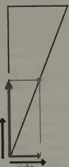

图 1.6.8 通过添加 NVector 和 RVector 计算点 A。

点 A 的位置可以通过添加图 1.6.8 中标记的两个向量来计算。计算 nVector 只是将单位 forward 向量乘以“near”值的问题。查找 R 向量稍微棘手一些；它只是 right 向量乘以来自以下求值的一个因子：

```
rFactor = tan(FOV / 2) = opposite side / adjacent side = factor / near

rFactor = factor / near

factor = rFactor · near
```

因此，R 向量定义为 rVector = Right · rFactor · near。将其添加到 near 向量得到点 A，同样的方法可以应用于获取所有八个点。查看提供的源代码以获取完整实现。

## 进一步改进

之前的方法本身就非常快，但有一些技巧可以帮助提高效率和速度。让我们按从明显到不明显的顺序检查其中一些。

此前，你学习了使用雷达方法对视锥体进行检查的方法，该方法仅返回两个值：*完全在外部* 或 *可见*。然而，对视锥体的测试可以扩展，以确定几何体是完全在内部、完全在外部，还是与视锥体平面相交。这可以在不费太多周折且不牺牲太多速度的情况下完成，从而允许下一节中的优化。

## 分层场景组织

想象一个包含许多对象的大型场景。将每个对象与视锥体进行测试并渲染可见对象，实际上比将所有对象发送到图形硬件并让其在每顶点级别拒绝不可见多边形要快。然而，考虑到每个对象都必须被检查，这远非最优。使用场景层次结构可以通过对对象进行分组并用连接的包围几何体将其包围，来减少拒绝所有在视锥体外部的对象所需的大量测试。例如，如果发现包围几何体完全在视锥体外部，那么它包含的所有对象（测试中使用的凸包围几何体所组成的包围几何体内包含的所有对象）也完全在视野外。完全在视野内的分支也是如此，该分支会被遍历但不再检查，因为根据定义，包围几何体的所有子项都将完全在内部。

几种空间分区算法允许使用视锥体对场景进行分层遍历，拒绝不可见的分支。最广泛使用且最简单的是八叉树、BSP 树、KD 树（“k 维树”的缩写）和 ABT。每种算法都以分层树的形式组织场景，但每种都有细微的差别或属性，使其更适合某些场景。选择哪一种将取决于正在实现的应用程序。

## 平面遮罩

以分层方式组织场景可以拒绝对象组，从而拒绝对象组，使得没有必要测试每个单独的


与视锥体进行对象测试。但是，如果已知父对象可能可见（即，它不完全位于视锥体之外），则必须对其所有子对象进行视锥体测试。这工作良好且相当快，但在某些情况下可以稍作优化。

在对视锥体进行对象测试时——为简单起见，假设为球体——需要执行三项检查：近远平面测试、右侧测试和上方测试。例如，如果右侧测试返回对象完全在视野内，则无需对对象的子对象执行该测试，因为每个子对象也都会返回完全在内部（参见图 1.6.9）。只有返回相交的测试才需要重新检查。因此，在对视锥体进行检查时，可以避免某些操作，从而获得额外的性能。

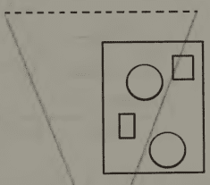

图 1.6.9 视锥体中的点线表示近远平面测试对该对象及其所有子对象返回 Completely_In。

平面掩码可以通过在边界对象中存储一个字节来实现，该字节将每个位与三项测试中的一项关联。因此，如果二进制代码是 101，则执行第一项和第三项测试，但不执行第二项。这工作得很快，因为它只涉及清除位并稍后检查它们，而不是依赖更复杂的操作。

## 平面连贯性

在大多数应用程序中，尤其是游戏中，摄像机移动平滑，仅在视锥体配置中产生小变化。因此，如果三项视锥体测试中的一项失败，那么在下一帧中它也很可能失败。因此，在下一帧中，视锥体必须从先前失败的测试开始检查。这样，当对象在视锥体中变化不大时，视锥体就有可能只用一次测试就拒绝该对象（参见图 1.6.10）。

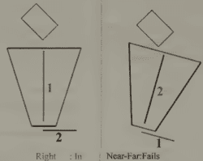

图 1.6.10 利用前一帧的信息重新排列测试顺序，有可能在第一次测试中就拒绝该对象。

平面连贯性可以以多种方式实现。最简单的方法是在边界对象中存储一个字节，记录前一帧失败的测试。当视锥体检查对象时，它从字节指向的测试开始，如果成功，则像往常一样继续其他两项测试。

## 检查对象是否位于包围视锥体的 AABB 内

确定与轴对齐边界框（AABB）的相交几乎总是归结为六次比较，每个轴两次。无需执行昂贵的操作，因此与常规视锥体测试相比，它速度极快。在“其他用途”部分，展示了一种确定包围视锥体的 AABB 的方法。该方法非常高效，而且最重要的是，如果视锥体发生变化，每帧只需调用一次。

如果已知对象位于包围视锥体的 AABB 之外，那么它也必然位于视锥体之外（参见图 1.6.11）。对对象与 AABB 进行测试非常快，只需进行简单的比较即可拒绝该对象。但是，如果对象不完全在外部，则执行常规的视锥体测试。

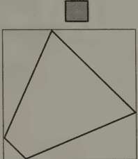

图 1.6.11 如果已知对象完全位于包围视锥体的 AABB 之外，则无需进一步检查即可断定它也完全位于视锥体之外。

## 结论

视锥体剔除是最广泛使用的剔除技术之一，它允许在对象级别拒绝大量原始体，且处理开销不大。在当今大多数实现剔除的应用程序和游戏中，都是采用六平面方法，效果出色。然而，如本文所示，还有一种更快的替代方案：雷达方法算法，它更节省内存，允许更快的对象-视锥体测试，并且更直观。最重要的是，构建视锥体几乎不需要成本。

## 参考文献

- [Jelinek&Sykora01] Jelinek, Josef 和 Daniel Sykora。“高效视锥体剔除。”可在线查阅 http://www.cg.tuwien.ac.at/studentwork/CESCG/CESCG-2002/Dyskora/Jelinek/。
- [Morley00] Morley, Mark。“OpenGL 中的视锥体剔除。”可在线查阅 http://www.markmorley.com/opengl/frustumculling.html。2000 年 12 月在线。
- [Puig04] Puig, Frank。“快速视锥体类。”可在线查阅 http://lpuig.cjb.net。

## 通用分页器

Ignacio Incera Cruz

ignacio@incera.net

我们经常会遇到这种情况：在任何给定时间，都需要从系统中卸载不必要的信息，以便加载新信息。这项简单的任务伴随着复杂的管理负担，用于跟踪应保留的信息以及随时可能被排除的信息。如果有多个用户需要同时访问同一信息，情况会变得更加复杂。围绕当前加载数据的这种管理过程通常称为“分页”。

传统上，解决这个问题意味着设计复杂的系统，这些系统并不总是像我们希望的那样高效；它们通常也非常有限，因为它们是专门为解决分页问题的特定实例而设计的。本文介绍了一种更通用、更不复杂、更高效的分页问题解决方案，称为 _通用分页器_（GP）。通过满足所有这些标准，GP 使系统设计师能够完全忘记创建自定义解决方案所带来的挑战，将更多宝贵时间用于设计和实现标题的其他关键部分。

对于怀疑者，我想通过引用两个完全不相关领域的主要项目，来强调本文中介绍的 GP 的灵活性和高效性。

- GP 已成功集成到自主机器人系统中，该系统的机器人资源有限，并且需要高效管理任何给定时间所需的信息。
- GP 已用于导航和可视化 3D 地形系统。

## 旧分页方案：检查一切

最普遍（尽管不一定是最佳）的解决方案包括以下步骤：

- 1. 定义要加载/卸载的信息。
- 2. 定义每个信息块的大小。
- 3. 将搜索空间划分为块。
- 4. 定义管理所有块所需的结构。
- 5. 每次需要时，检查要加载/卸载的信息，遍历搜索空间中的所有块。

如您所注意到，此解决方案效率极低。它在搜索空间的划分上花费了太多时间，并消耗了许多资源，而维护如此复杂的结构（每个块包含如此多的信息）正是需要这些资源的原因。检查一切也过于昂贵，而且该解决方案仅限于加载/卸载设计定义的信息类型。如果需要另一种类型的信息，可能需要重新设计整个分页系统！最后，一旦搜索空间增长，所有这些问题都会呈指数级增加，所以让我们花点时间把第一次做好。

## GP 分页方案：仅检查所需内容

GP 通过简单直观的接口，以非常简单的方式解决了上述所有问题。GP 的主要特性包括以下内容：

- 对设计师和用户几乎完全透明
- 搜索空间大小独立性
- 无需预处理、空间划分或复杂结构
- 内存仅包含不可或缺的数据
- 多用户透明性（对设计师和用户）
- 与信息无关

以下部分将逐步描述 GP 的设计和实现的一些细节。值得注意的是，此实现并非唯一；GP 可以按需实现，使用大多数高级编程语言和范式。

## 索引是关键

在 GP 以及其他传统分页系统中，有必要定义将要加载/卸载的每个信息块的大小。我们还将定义一种机制来定位搜索空间中的每个块，并为每个块分配一个唯一标识符。

我们从一个名为 spindex 的类开始，它管理这些信息，从而同时完成三个功能：

- 定义分页块的大小。
- 在搜索空间中定位块。
- 唯一标识块。


GPIndex 包含两个属性：位置 和 大小。每个属性包含 n 个元素，其中 n 表示块的维度。通常块是二维的，例如内存、图像或数字地形模型。在这些情况下，GPIndex 的 位置 包含 x 和 y（2D 坐标），而 大小 包含高度和宽度。不过，我们并不局限于 1D 或 2D 块；请注意，我们可以为每个属性添加与块维度数量相同的元素。

位置 属性用于定义、定位和标识每个块。由于每个块确定搜索空间的一部分，因此其 位置 是唯一的。因此，方便的是，块的 位置 定义了其 位置 _和_ 唯一标识。

GPIndex 提供了另一个非常实用的功能：它允许我们在不创建任何结构、不进行事先划分、也不将任何内容加载到内存的情况下，在块之间进行导航。它实现了三个方法：

```
GetIndex(position p);
// Gets the GPIndex that contains the position p.
GetNext(int n)
// Gets the next n-th GPIndex in any dimension.
GetPrevious(int n)
// Gets the previous n-th GPIndex in any dimension.
```

例如：

```
GPIndex GetIndex (int x, int y);
// Returns the GPIndex that contains the position x, y
GPIndex GetNextX(int n);
// Returns the next n-th GPIndex in X
GPIndex GetPrevious(int n);
// Returns the previous n-th GPIndex in X
GPIndex GetIndex (int x, int y);
// Returns the next n-th GPIndex in Y
GPIndex GetPrevious(int n);
// Returns the previous n-th GPIndex in Y
```

如图 1.7.1 所示，定义了一个 位置 为 (100, 100)、大小 为 (50, 50) 的索引。

之所以如此通用，是因为一旦定义了索引，我们就可以认为整个搜索空间都已被划分，尽管它并未真正被划分（节省了时间和内存），如图 1.7.2 所示。

现在我们可以自由导航，只需创建一个索引即可跨越 50 x 50（大小）的块进行移动，如图 1.7.3 所示。

一个非常有趣的特性是，位置 和 大小 可以引用任何类型的数据。CD-ROM 上的示例使用整数实现，但您可以使用任何数据类型或数据结构，前提是考虑以下两个标准：

- 为块的每个维度适当实现 GetIndex()、GetNext() 和 GetPrevious() 方法。
- 数据类型必须至少包含以下运算符：
  - operator <
  - operator ==
  - operator <=

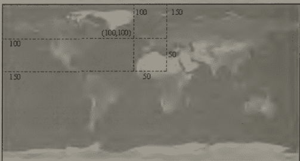

图 1.7.1 位置 为 (100, 100)、大小 为 (50, 50) 的 GPIndex。本文图片中使用的全球地图由 Earth Observatory: The Blue Marble 网站提供（eobglossary.gsfc.nasa.gov）。

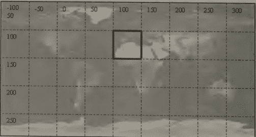

图 1.7.2 搜索空间的隐式划分。

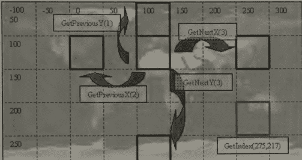

图 1.7.3 搜索空间中的导航。

尽管如此，在大多数情况下使用整数很常见（或者至少是一种容易转换为整数的类型），因此 CD-ROM 上的实现应该足够了。

索引超出搜索空间不是问题，潜在的空块也不是问题。解决办法是在必须加载块时检查边界和空闲空间，我们将在下一节中介绍。（参见图 1.7.4。）

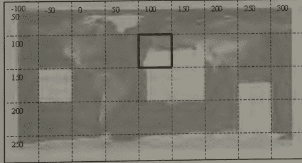

图 1.7.4 超出边界和空闲空间。

回顾一下，我们系统中索引的定义几乎已准备好进行分页：

```
GPIndex
(
    Position, //x, y, ..., n-dimensions
    Size      //width, height, ..., n-dimensions
)
```

## 瓦片：世界的块

现在我们知道如何划分搜索空间以及定位和标识特定块，让我们来定义块本身。GP 包含一个名为 `GTile` 的简单类，它基本上包含定义其 位置 和 大小 的 `GPIndex`。这意味着 *瓦片* 是搜索空间的块，并由 *索引* 确定。在地形分页示例中，每个 瓦片 对应一部分地形，其 位置 和 大小 由 瓦片 的 索引 定义。

一旦通过分配 索引 定义了 瓦片，剩下的就是加载/卸载数据。

```
virtual void Load()
virtual void Unload()
```

GP 用户只需设计一个满足以下要求的类：

- 从 `GTile` 派生
- 实现 `Load()` 和 `Unload()` 方法

在实现这些方法时，用户可以利用 瓦片 的 索引 中包含的信息以及从 `GTile` 派生的类来加载/卸载信息。

沿用前面的示例，定义了一个 位置 为 (100, 100)、大小 为 (50, 50) 的 索引。现在我们拥有了搜索空间中块的位置和大小，但不必知道块是什么或包含什么类型的信息。在我们的示例中，要管理的信息是地形部分。此时，我们定义一个从 `GTile` 派生的类。参见图 1.7.5。

在 Load 方法中，我们加载位于 位置 (100, 100) 和 大小 (50, 50) 的信息，如图 1.7.6 所示。

需要知道的是，`GTile` 可以引用任何数据类型，这意味着 `GTile` 可以加载/卸载任何类型的信息（参见图 1.7.7）。`GTile` 包含的信息可以是 50 x 50 图像的片段、高度图、数字地形模型的一部分等。

每个 `GTile` 都包含一个非常有用的属性 状态。瓦片有四种不同的状态：

- LOAD：`GTile` 已加载。
- LOADING：`GTile` 正在加载，但尚未完全加载。
- UNLOADED：`GTile` 已卸载。
- UNLOADING：`GTile` 正在卸载，但尚未完全卸载。

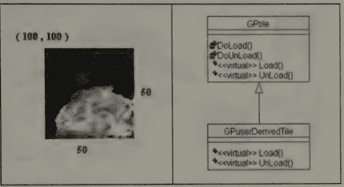

图 1.7.5 GTile 定义。

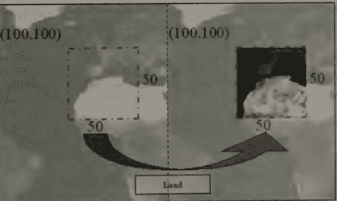

图 1.7.6 GTile 加载。

GTile 类以对 GP 用户透明的方式管理这些状态（参见图 1.7.8）。用户只需实现 Load() 和 Unload() 方法。

在某些情况下，有必要加载不同类型和来源的信息，但概念上位于同一个 瓦片 中。在示例中，索引 (100, 100) (50, 50) 可以引用位于坐标 (100, 100) 且 大小 为 (50, 50) 的地形部分，同时还可以引用具有相同坐标和大小的图像片段，该片段将用作该地形部分的纹理，如图 1.7.9 所示。

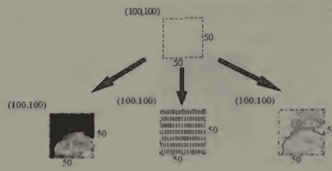

图 1.7.7 同一 GPIndex 中的不同类型信息。

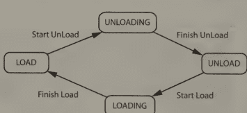

图 1.7.8 状态图。

为管理此功能，GP 提供了两种替代方案：

**全局概念：** Load() 和 Unload() 方法分别加载和卸载所有必要信息。瓦片的概念包括 索引 定位的所有信息，无论其类型如何。在示例中，我们加载和卸载地形部分和纹理片段，如图 1.7.9 所示。

**特定概念：** 这同时使用多个 GP 实例，每个实例用于分页一种信息，但同时更新导航系统（窗口，将在后续章节中介绍）。

回顾一下，现在只需两步即可获得 GP 分页系统：

- 定义 GPIndex。
- 实现 GTile 的 Load / Unload 方法。

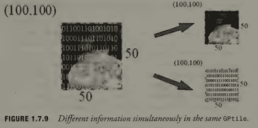

## 世界：搜索空间

在讨论了 索引 和 瓦片 之后，我们需要介绍另一个非常重要的概念，我们在前面多处提到过但未完全解释：搜索空间。在 GP 上下文中，搜索空间是分页块（GPtiles）存在并通过 索引 定位的世界。

GP 通过 GPworld 类来建模这个世界。该类包含所有正在使用的已创建 GPtiles。当需要 GPtile 时，GPworld 会创建它；当不再需要时，其信息会被卸载，GPworld 会自动销毁它。此过程优化了内存使用，并仅在内存中保留严格必要的内容。

当 GP 需要 GPtile 时，它会通过 GetTile() 方法向 GPworld 发出请求，并将所需 GTile 的 GPIndex 作为参数传递。此时，GPworld 会检查是否包含该 GTile。如果 GPworld 包含它，则返回它；否则，它会通过 BuildTile() 方法构建它。当 GP 想要加载/卸载 GTile 时，它会通过 GPworld 的 LoadTile() 和 UnloadTile() 方法来完成。GP 用户只需设计一个从 GPworld 派生的类并实现虚方法 BuildTile()。

在 BuildTile() 方法中，只需构建一个从 GTile 派生的类的对象。参数的使用并非真正必要。GP 系统会自动为创建的 GTile 分配其对应的 GPIndex。用户只需考虑派生类的构造，这可能是一项非常简单的任务，如以下代码片段所示，也可能像 GP 集成所在的系统所要求的那样复杂。

```cpp
Tile* BuildTile(const Index& index)
{
    return (new GPuserDerivedTile())
}
```


还有一种方法可以由从 world 类派生的类来实现。

```
virtual bool isValidIndex(const GPIndex& index);
```

该方法默认返回 true；其目的是让我们知道特定的 GPIndex 是否在此 GPWorld 中有效。GP 会自动使用此方法。当 GP 要为给定的 GPIndex 创建 GPtile 时，它会检查该 GPIndex 是否有效，如果索引有效，GPWorld 将通过其方法 BuildFile() 创建 GPtile（如前所述，如图 1.7.10 所示）。如果索引无效，GPWorld 不会创建任何内容，且 GetTile() 方法将返回 false。对 GPIndex 是否落在 GPWorld 内部的验证，加上错误检查，旨在避免随后的错误加载或其他影响。

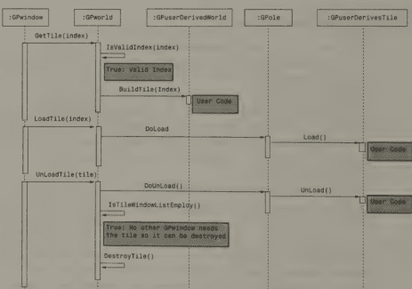

图 1.7.10 序列图。

一个 world 可以包含 GPtile，这些 GPtile 包含所有必要信息，尽管它们是不同类型的信息（全局概念）；或者，另一方面，GP 中可以存在许多不同的 GPworld，每种数据类型一个，即每个 GP 实例一个（特定概念）。

GP 几乎已经形成，我们只需三个简单步骤：

- 1. 定义 GPIndex。
- 2. 实现 GPtile 的 Load / Unload 方法。
- 3. 实现 GPWorld 的 BuildFile 方法。

## 窗口：在世界中导航

一旦我们拥有 world（GPWorld），并且可以仅通过其位置（GPIndex）获取其中的任何块（GPtile），我们只需知道想要加载和卸载哪些块。为此，GP 提供了 GPwindow。借助它，我们可以使用 GPtile 的 GPIndex 在 GPWorld 中导航，而无需了解其中包含的信息（参见图 1.7.11）。

GPwindow 有三个主要属性：

- CenterIndex：位于 GPwindow 中心的 GPtile 的 GPIndex
- Radius：指示中心 GPtile 周围的 GPtile 数量
- GPTilesList：包含 GPWindow 中的所有 GPtile

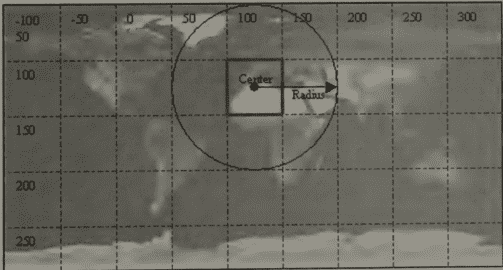

图 1.7.11 GPwindow。

GPwindow 的初始化非常简单：

- 1. 为其提供对 GPworld 的引用。
- 2. 给 GPwindow 一个 GPIndex，用于定位它。
- 3. 给它一个 Radius。

之后，GP 会自动填充 GPtileslist，以给定的 GPIndex 为中心，使用该 GPIndex 的 getNextIndex() 和 getPreviousIndex() 方法，并指示 GPWorld 加载整个列表，如图 1.7.12 所示。

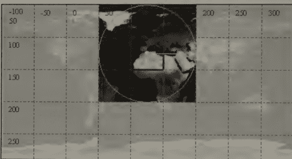

图 1.7.12 已加载的 GPwindow。

要导航，我们只需通过其更新方法 Update() 向 GPwindow 提供位置。每次调用此方法时，它都会检查新位置是否在中心 GPtile 内，即是否包含在中心 GPindex 中。如果新位置在中心 GPtile 内，GPwindow 不会自行更新；否则，我们将包含新位置的 GPindex 作为新中心，GPwindow 将随其新中心和半径进行更新。

在更新过程中，tiles list 会被修改，添加 GPwindow 内的新 GPtile，并移除不在其中的 GPtile。GPwindow 指示 GPWorld 加载新的 GPtile，并卸载其列表中删除的 GPtile。此过程是自动的，对用户透明，并且与 tiles 中包含的信息类型完全独立，如图 1.7.13 所示。

如果修改了半径，更新过程相同，但请注意，在这种情况下，中心保持不变。

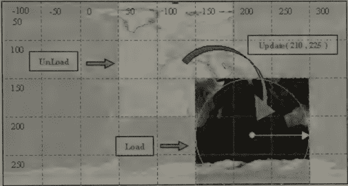

图 1.7.13 GPwindow 更新过程。

最后，我们已准备好使用 GP。以下是所有步骤：

- 1. 定义 GPindex。
- 2. 实现 GPtile 的 Load() 和 Unload() 方法。
- 3. 实现 GPworld 的 BuildFile 方法。
- 4. 初始化 GPwindow，分配：
  - GPworld
  - 一个中心
  - 一个半径
- 5. 更新 GPwindow 的位置。

## 多窗口，多用户

GP 以自然且透明的方式支持多用户。正确的术语是多窗口，因为每个用户可以拥有多个 GPwindow，并且可以同时存在多个用户（参见图 1.7.14）。GP 将每个 GPwindow 视为不同的用户。当 GPwindow 向 GPWorld 请求加载或卸载 GPtile 时，会执行一些简单的检查：

```
GPtile::Load(): If the GPtile is already loaded, the world does nothing.
```

```
GPtile::Load(): The GPtile is unloaded only if there are not other GPwindows that need it. After unloading the tile, the world destroys the tile.
```

整个过程对用户是透明的，用户只需在必要时负责更新本地拥有的 GPwindow（或 GPwindows）。

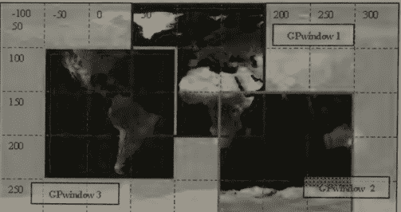

图 1.7.14 多窗口，多用户。

## 优化：多线程分页

GP 的一项优化是避免 GPWorld 立即执行 GPtile 的 Load() 和 Unload() 方法的调用。World 将在单独的线程中执行这些任务，以避免加载/卸载过程与系统其余部分发生干扰，从而提高性能。

为此，World 维护一个 GPtile 列表。当 GPwindow 向 GPWorld 请求加载（或卸载）GPtile 时，GPWorld 将此 GPtile 添加到列表，并将其标记为可加载（或可卸载）。在加载/卸载线程的主循环中，列表中的每个元素都会被移除并处理。

## 结论

本文介绍了一个完整的、多用户的通用分页系统（GP），能够以简便高效的方式管理任何类型的信息，并优化系统资源。GP 的范围是全局的，因此可以集成到任何需要管理信息加载和卸载的其他系统中。

GP 的设计遵循了 [Lakos96] 和 [Alexandrescu01] 的一些设计建议。GP 的实现采用了 [Meyers96] 的一些建议。

## 参考文献

- [Alexandrescu01] Alexandrescu, Andrei. Modern C++ Design. Addison Wesley, 2001.
- [Lakos96] Lakos, John. Large-Scale C++ Software Design. Addison Wesley, 1996.
- [Meyers96] Meyers, Scott. More Effective C++. Addison Wesley, 1996.

### 1.8 大规模基于栈的状态机

James Boer

author@boarslair.com

在本文中，我们探讨了传统状态对象与基于栈的管理和排队系统的独特结合。这些结合成了所谓的基于栈的状态机。这种机制远优于传统状态机，尤其是在处理传统上混乱的逻辑流时，例如深度嵌套的用户界面屏幕。基于栈的状态机也使处理其他棘手的状态相关问题变得简单，例如如何在不到处编写特例代码的情况下实现全局状态（如游戏暂停状态），或者在状态中构建内在知识，以便在执行完毕时知道应该返回到哪里。还演示了一个高级状态管理器系统，增加了诸如排队状态命令、延迟状态转换和集中式状态时序功能等功能。状态按预期表示为层次化的 C++ 对象，并设计为在进入和退出时自动处理诸如了解前一个和下一个状态以及堆叠事件（将状态推入或弹出其他状态之上）等细节。这个系统是管理大规模状态系统（例如程序内的全局应用程序状态或游戏状态概念）的一种极其有效的方式。

## 传统状态机代码及相关问题

任何游戏最基本的任务之一是表示内部“状态”，该状态表示当前呈现给用户的可视和逻辑元素。通常，游戏分为两个不同的状态部分：前端用户界面状态和游戏内状态。例如，前端中的每个用户界面屏幕都应被视为唯一状态，因为每个屏幕都有独特的功能以及到其他状态的独特转换。对话框和其他用户必须交互的主要屏幕元素也可能被视为唯一状态，尽管这些元素有将在后面解决的特定问题。


同样，在实际游戏中，一个游戏可能拥有一个到任意数量的独特全局状态。例如，传统的第一人称射击游戏（FPS）可能允许玩家与游戏中的计算机进行交互。此时，游戏进入一个不同的状态：渲染路径发生变化，游戏界面也不同。本质上，就好像一个完全不同的小游戏正在运行，而不是主要的控制机制。图 1.8.1 演示了标准状态机图如何表示此类典型状态。

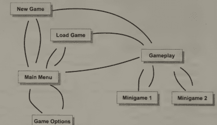

图 1.8.1 典型的游戏状态图。

在 C 或 C++ 代码中创建一个简单的状态机相当容易。你只需要一个枚举变量和一个 switch 语句，如清单 1.8.1 所示。

```
Listing 1.8.1 A Simple State Machine

enum GameState
{
    STATE_OPENING_TITLE,
    STATE_MAIN_MENU,
    STATE_RUN_GAME
};

GameState m_State;

//...

switch(m_State)
{
    STATE_OPENING_TITLE:
    // Do opening title code
    break;

    STATE_MAIN_MENU:
    // Do opening main menu code
    break;

    STATE_RUN_GAME:
    // Do main game code
    break;
};
```

不幸的是，现实世界并不那么简单。许多棘手的问题往往会迅速出现。例如，如果在切换状态时需要在第一次更新时收到通知，该怎么办？一个快速的解决方案很简单：只需添加一个跟踪更新并在状态更改时重置的计数器。离开状态时又该怎么办？嗯，你可以为进入、退出和更新状态添加单独的 switch 语句集。如果你需要在将来的某个指定时间切换到某个状态，又该怎么办？同样，你可以添加一个带有延迟元素的计时器。如果你想按顺序排队多个状态更改，又该怎么办？到这时，你简单的 C 风格状态机正在变得一团糟，大量变量、switch 语句和函数都混在一起了。虽然此时这种 C 风格状态机可能功能很强大，但可读性、可用性和可维护性都变成了严重问题。更糟糕的是，你到底在哪里存储特定于这些状态中任何一个的数据？既然你只有函数，那么实际创建和使用特定于任何特定状态生命周期的数据就会变得更加混乱。更甚的是，这种状态机只能用于一组状态；代码除了复制粘贴之外无法重复使用。

那么，如何处理一些更根本的问题呢？你究竟该如何表示诸如“暂停游戏”这样的状态？它的行为与其他状态不同，因为你可能期望它在暂停游戏后返回到暂停前所处的状态。同样，许多菜单系统以分层方式运行，层层叠加。使用传统状态机在这些不同的用户界面屏幕之间进行转换（例如，当确认对话框弹出在用户界面屏幕上方时）当然是可能的，但可能并非最佳。著名的 C++ 权威和作家 Scott Meyers 指出，如果你发现自己正在编写“如果对象是 T1 类型，则做某事，但如果它是 T2 类型，则做其他事情”形式的代码，你应该停下来，因为这不是 C++ 的做法（Meyers[98]）。

本文的目的并非要赞扬 C++ 的优点，而是要展示为什么面向对象解决方案通常远优于其函数式等价方案。因此，我们将演示如何使用面向对象解决方案来解决游戏状态问题，从而大大简化你的编程工作，并使你的代码保持更加整洁。

## C++ 游戏状态方法

虽然大多数程序员都习惯于根据物理实体（即 Weapon 或 Player 类）来设计类，但 C++ 类在建模更抽象的概念（例如状态）时也非常有效 [Gamma94]。如果我们标准化特定函数的含义，就可以实现一种使用类来建模单个状态的简单方法。清单 1.8.2 演示了这可能是什么样子。

### 清单 1.8.2 使用类建模单个状态

```
class SomeState
{
public:
    void OnEnter();
    void Update();
    void OnExit();
};
```

每个函数都表示处理此特定状态时的特定事件。当游戏需要激活此特定状态时，会调用类的 OnEnter() 函数。这为状态提供了初始化、分配或激活该状态运行所需的任何内容的机会。在游戏的每个更新周期（更新或渲染周期）中，会调用类的 update() 函数来处理可能需要处理的任何事件。取决于你特定引擎的设计，你可能需要或不需要单独的函数调用来执行任何渲染工作。最后，当状态退出（即另一个状态即将变为活动状态）时，会调用 OnExit() 函数，以允许状态清理自身。

这为表示此游戏状态所需的任何初始化、更新和清理功能提供了一个很好的归宿。然而，几乎同样重要的是，我们现在有一个逻辑位置来存储这些功能必须操作的任何持久数据。例如，如果此状态表示一个用户界面屏幕，则该类可以包含屏幕必须显示和管理的所有各种用户界面元素。

## 状态接口类

为了确保每个状态都符合此接口，并能够通过一个通用系统对不同的状态进行操作，我们可以使用一个基础状态，它作为所有从中派生的其他状态的标准化接口。此外，让我们假设我们将向系统添加一些功能：状态名称将通过这些函数传递给状态对象。清单 1.8.3 展示了这个类的样子。

### 清单 1.8.3 状态接口类

```
class IBaseState
{
public:
    virtual ~IBaseState() {}

    virtual void OnEnter(const char* szPrevious) = 0;
    virtual void Update() = 0;
    virtual void OnExit(const char* szNext) = 0;

    virtual void OnSuspend(const char* szNext) = 0;
    virtual void OnResume(const char* szPrevious) = 0;
};
```

你可以看到，在切换状态时，任何状态对象都可以轻松访问前一个或下一个状态，这在处理特定于转换的代码时很有用。你可能已经注意到了 OnSuspend() 和 OnResume() 函数，并想知道它们的用途。下一节将解释它们的重要性。事实上，它们功能的一部分旨在实际上减少对特定于转换的代码的需求，而这类代码往往会使状态机的设计和维护变得复杂。

## 堆叠状态——为什么三维比二维更有效

在典型游戏中，由不同状态对象表示许多不同的游戏模式并不罕见。例如，典型的角色扮演游戏可能有十几种不同的游戏状态，具体取决于玩家是在户外走动、在城镇中、在商店购买商品、在战斗中，还是在玩小游戏。在游戏的任何时刻，你都希望用户能够调出相同的选项屏幕，然后返回到游戏中断的地方。将游戏渲染留在后台但处于暂停状态可能是可取的。在这种情况下，完全退出游戏状态然后再返回是有问题的。

这种问题的另一种形式在用户界面屏幕中也经常出现。通常，希望屏幕在对话框绘制在其前方时继续渲染。在传统状态机中，没有明确的方法来处理这种情况，因为我们确实不想完全退出当前状态以进入新状态。相反，我们希望能够挂起（或暂停）一个状态，而另一个状态取代其功能，然后返回到原始状态并恢复（或取消暂停）其行为。

这些问题可以通过状态栈的概念轻松解决：即在其他并发运行的状态之上推入和弹出状态的能力。OnSuspend() 和 OnResume() 函数正是为此而设。当一个状态被推入另一个状态之上时，会调用原始状态的 OnSuspend() 函数。但是，Update() 函数仍然会在每一帧被调用。图 1.8.2 展示了状态机如何通过栈机制在三维而非二维中工作。


## 正常状态转换表示

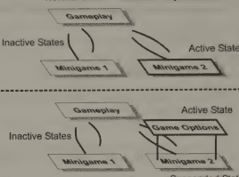

> "游戏选项"被推入状态"小游戏 2"

### 图 1.8.2 为典型游戏状态图添加第三维度

这为状态提供了两个选项。第一是，当另一个状态被压入其上时，它可能希望暂停自身。这只是在调用 OnSuspend() 时设置 m_bPaused 标志，在调用 OnResume() 时清除它。然后，在更新循环中简单点击一下，就可以在另一个状态覆盖此状态时阻止代码执行。或者，状态对象可能希望在后台继续更新，从而有效地允许两个状态并行执行。你甚至可能希望将此类功能构建到基类中，以便所有类保持一致的操作。为了简单起见，我们将这些选项排除在基类接口之外（对于本篇）。

## 状态对象管理系统

你可能注意到，我们强调的是游戏状态，而不是游戏中出现的其他类型状态，例如单个 AI 实体内的各种状态或 UI 小部件的状态。这是因为面向对象状态机最适合更复杂的状态系统，例如表示整个游戏状态的系统。原因有二。首先，每个状态都必须由一个完整的类来表示；通常是一个派生自基类（或使用模板实现）的类，原因是多态性。为单个状态投入如此多的工作是一项相当大的工作，只有当状态本身性质相当复杂时才会有回报。其次，这些状态都必须由外部系统管理才能有效使用。让我们来看看这样的状态管理系统必须包含什么。清单 1.8.4 显示了随附光盘上 StateManager 类的接口。

### 清单 1.8.4 StateManager 类的接口

```
class StateManager
{
public:
    StateManager();
    ~StateManager();

    void Init();
    void Term();

    // Register a state object and associate it
    // with a string identifier
    bool RegisterState(const char* szStateName,
                       IBaseState* pState);

    // Checks if the current state will change
    // on the next update cycle
    bool IsStateChangePending() const;

    // Returns the current state
    const char* GetState() const;

    // Get the state object based on the string ID
    IBaseState* GetStateClass(const char* szState);

    // Get the state object on top of the current
    // state stack
    IBaseState* GetCurrentStateClass();

    // Returns the size of the state stack
    int GetStateStackSize() const;

    // Passing bFlush = true will override any previous
    // state changing commands that may be pending.
    // Otherwise, state commands will queue and be
    // executed in the order of the calls made.

    // Changes the current state on the next
    // update cycle.
    void ChangeState(const char* szState,
                     float fDelay = 0.0f, bool bFlush = false);

    // Pushes a new state on top of the existing
    // one on the next update cycle.
    void PushState(const char* szState,
                   float fDelay = 0.0f, bool bFlush = false);

    // Pops off the current state or states to reveal
    // a stored state underneath. You may not pop off
    // the last state
    void PopState(int nStatesToPop = 1,
                  float fDelay = 0.0f, bool bFlush = false);

// Pops all but the last state.
void PopAllStates(float fDelay = 0.0f,
    bool bFlush = false);
//_______________________________________________________
// Updates the state machine internal mechanism.
// This function is called once by the main update
// loop and should not be called by anyone else.
void Update(float dt);
};
```

***在此插入 CD 图标***


为了节省空间，我们没有显示类的内部工作原理（私有数据或函数内容），但你可以浏览随附光盘上的源代码，文件为 StateManager.h 和 StateManager.cpp。

从接口可以明显看出，我们的状态管理器与简单的字符串标识符相关联。我们选择字符串标识符有两个原因。首先，在打印状态以进行调试时，字符串很方便。其次，出于效率考虑，没有理由使用枚举标识符。我们假设状态切换会相对不频繁发生，尤其是如果我们专门使用此系统来跟踪游戏状态。此外，使用字符串表示状态与脚本系统集成要容易得多。

状态管理器可以轻松自动处理排队和/或延迟状态等问题，此外还允许状态相互压入和弹出。这种机制确保了处理所有基于状态的转换和情况的一种强大且统一的机制。你的游戏或引擎所需的其他功能可以根据需要轻松添加，如果将此系统用作库（或引擎）级组件而不是仅限游戏的组件，其他项目将能够利用这些改进。

标准化统一的游戏状态转换和定义机制的好处之一是，各种库元素可以表示整个游戏状态，而不仅仅是简单的功能组件。例如，表示屏幕键盘（许多控制台游戏的必要组件）的库小部件不仅可以包含小部件元素，还可以包含设置和处理此类复杂屏幕中发生的所有事件所需的完整状态代码。随着游戏变得更加复杂，开发人员需要考虑高效重用更大、更复杂组件的方法，以减少开发时间，避免为每个新作品重新发明相同的技术。

## 结论

对象即状态的简单概念当然并不新鲜，即使结合状态堆叠技术并通过集中式状态管理系统实现也是如此。不幸的是，在游戏编程领域，这种基本构建块往往被抛弃，转而采用“演进式”设计，这意味着在开始编码之前对这些系统不加思考。在最坏的情况下，这可能会导致随着游戏发展而出现噩梦般扭曲和复杂的代码路径。

事实上，状态管理器的详细内部工作原理不如如何在项目中组织大规模状态的概念重要。无论你决定使用何种方法或代码来管理这类状态相关问题——只要你的系统能够克服与在游戏等大规模复杂软件系统中编程状态相关的基本问题——你将从长远来看更容易避免有bug且难以维护的代码。

## 参考文献

- [Gamma94] Gamma 等人. 设计模式：可复用面向对象软件的基础，305–313. Addison Wesley, 1994.
- [Meyers98] Meyers, Scott. C++ 程序设计的有效方法（第二版），176–177. Addison Wesley, 1998.

## 使用 BSP 树进行 CSG 构造

Octavian Marius Chincisan

mariuss@rogers.com

构造实体几何（CSG）是一种方法，它将盒子、球体、圆柱体和圆锥体等基本形状组合起来，以构建更复杂的形状，这些形状随后可用于游戏引擎中的各种应用。这些基本形状通常称为 *原始体*，在 CSG 构造中将这些原始体组合在一起的操作称为 *并集 (+)*、*交集 (&)* 和 *减去 (-)*。

在本篇中，我们将看到 CSG 和二叉空间划分（BSP）算法实际上非常简单，仅依赖于多边形与平面的划分和分割（以及一些仔细的维护工作）。此外，我们将逐步介绍在原始体之间应用布尔运算（如前面列出的那些），甚至将概念推向极端，以组合一组复杂的结果。

### CSG 布尔运算

虽然经典 CSG 不是本篇的主题，但为了完整起见，这里简要介绍了所有基本布尔运算。

两个实体之间的基本 CSG 操作如图 1.9.1 所示；其中 (b) 是 *并集*，(c) 是 *交集*，(d) 和 (e) 是 *减去*。为了更好地说明算法，样本中采用的实体被简化为简单的 2D 线段，其中每条线段代表一个面。所有实体面都朝外；因此，X 和 Y 的内容被视为 *实体*。外部（外侧）空间被视为空。

### *并集*

两个或多个实体之间的 *并集* 通过丢弃最终位于实体空间中的几何体来实现。在图 1.9.2 中，我们需要丢弃面 C'C、CE 和 EC'。稍后在本篇中，所有 *线段* 都称为 *面*，所有铺设平面的面称为 *平面*。要执行并集操作，实体 X 的所有面都必须由实体 Y 裁剪，实体 Y 的所有面都必须由实体 X 裁剪。裁剪后剩余的几何体构成最终结果实体，如图 1.9.3 所示。


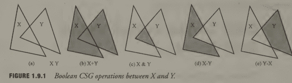

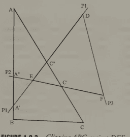

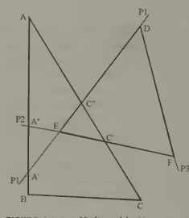

我们逐个处理实体 X 的面（AB、BC 和 CA），并将其与实体 Y 的平面（P1、P2 和 P3）进行裁剪（参见图 1.9.2）。裁剪意味着我们将 X 的所有面与 Y 的所有面所在的平面进行分类。以下函数展示了裁剪过程中使用的按平面分割面的函数。该函数如果面完全在平面后面则返回 -1，如果在前面则返回 1，如果面被分割则返回 0。frontFace 和 backFace 变量用于输出返回的新面。随后，裁剪过程会丢弃两个面片段中的一个。

```cpp
int Face::Split(Plane& plane, Face& frontFace,
Face& backFace)
{
    Vertex vertex1 = m_points.first();
    Vertex vertex2 = m_points.back();
    float fB;
    float fA = plane.DistTo(vertex2._xyz);

    for_each(vertex in m_points)
    {
        vertex1 = *vertex;
        fB = plane.DistTo(vertex1._xyz);
        if (fB > EPSILON)
        {
            if (fA < -EPSILON)
            {
                float t = -fA / (fB - fA);
                Vertex midvertex = vertex1 +
                (vertex2 - vertex1) * t;
                frontFace << midvertex;
                backFace << midvertex;
            }
            frontFace << vertex1;
        }
        else if (fB < -EPSILON)
        {
            if (fA > EPSILON)
            {
                float t = -fA / (fB - fA);
                Vertex midvertex = vertex1 +
                (vertex2 - vertex1) * t;
                frontFace << midvertex;
                backFace << midvertex;
            }
            backFace << vertex1;
        }
        else
        {
            frontFace << vertex1;
            backFace << vertex1;
        }
        vertex2 = vertex1;
        fA = fB;
    }
    if (m_points.size() == frontFace.size())
        return 1;
    else if (m_points.size() == backFace.size())
        return -1;
    return 0;
}
```

在裁剪过程中，X 的一些面会被 Y 的平面分成两半。如果一个面最终位于 P1、P2 或 P3 之后，它将继续被裁剪，直到被所有平面 P1、P2 和 P3 裁剪完毕。如果该面幸存下来，最终位于所有 Y 平面之后，则该面会被丢弃。其他面片段会被添加到最终生成的实体中。

我们首先将面 AB、BC 和 CA 与平面 P1、P2 和 P3 进行裁剪。AB 被 P1 分割为 AA' 和 A'B。AA' 位于 P1 前面，因此不再由 P2 和 P3 向前裁剪，并在被 P2 在 A' 处分割前添加到最终刷子中。AB 被添加到最终刷子结果中。A'B 最终位于 P1 之后，并被 P2 和 P3 裁剪。被 P2 裁剪后，A'B 最终位于前面（两端都在前面），因此面 A'B 被添加到最终刷子中（并且不再被 P3 裁剪）。

接下来，面 BC 最终位于 P1 之后（线段两端都在 P1 之后）。因为 BC 在后面，我们将此面送去被 P2 裁剪，BC 最终位于 P2 前面，因此它也被添加到最终结果实体中（参见图 1.9.3）。还剩最后一个面。

面 CA 被 P1 裁剪后，得到 AC' 和 C'C。AC 位于 P1 前面，因此被添加到最终实体中（参见图 1.9.3）。C'C 被 P2 向前裁剪；如图 1.9.2 所示，C'C 被 P2 分割为两个面，C'C" 和 C'C。C'C 是位于 P2 前面的面片段，被添加到最终实体中（参见图 1.9.3）。然而，C'C" 被最后一个 Y 平面 P3 裁剪。C'C" 完全位于 P3 之后。因此，C'C" 被丢弃，不添加到最终实体中。

至此，我们已解决了一半的问题。下一步是将 Y 的面与 X 的平面进行裁剪（参见图 1.9.4）。我们取原始面（AB、BC 和 CA）及其所在平面，并将 DE、DF、EF 和 FD 与它们进行裁剪。我们遵循与之前相同的算法。任何最终位于后面的面都会被裁剪（图 1.9.5）。如果一个面被 P1、P2 和 P3 全部裁剪，则该面不会被添加到最终实体中（参见图 1.9.4）。

我们从面 DE 开始。DE 完全位于 P1 之后，并被 P2 裁剪。DE 被 P2 分割为两个面。DD' 位于前面，而 D'E 位于 P2 之后。DD' 被添加到最终结果中，而 D'E 被向前裁剪。D'E 最终位于 P3 之后，因此不被添加到最终实体中。按照同样的逻辑处理 EF，EE' 最终被丢弃，而 EF 被添加。

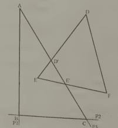

图 1.9.4 用 P1、P2 和 P3 对 DEF 进行裁剪。

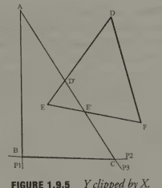

所有已添加到最终实体的面共同实现了 ABC 与 DEF 的并集，如图 1.9.6 所示。不要担心生成的实体看起来有点切片状。AB 实际上是 AA' 加上 A'B（参见图 1.9.7）。当我们分析 CSG 的 BSP 方法时，将处理 CSG 操作导致的不必要切割。

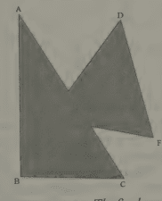

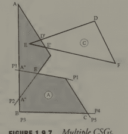

不要惊讶，但到此为止，我们已经涵盖了经典 CSG 构造的 90%。交集和差集只不过是并集的变体。

## 交集

交集（图 1.9.1(c)）通过反转两个实体、对它们执行并集，然后再将其反转回来以获得最终结果来执行。反转实体意味着反转所有面的平面（平面法线和平面常数）。通过反转实体，它们变为空，其周围变为实体。经典并集将消除任何最终位于实体 AB、BC、AC' 和 CC" 中的几何体（参见图 1.9.2 和 DD'、EE' 及 DF（参见图 1.9.4）。

## 差集

差集（图 1.9.1(d) 和 1.9.1(e)）的执行过程如下：我们通过反转 A、与 B 执行经典并集，然后再反转回来以获得最终结果，从 A 中减去 B。另一方面，如果我们想从 B 中减去 A，则反转 B，将反转后的 B 与 A 并集，然后再反转回来以获得最终结果。下表显示了操作与其符号等价物的映射：

| 操作 | 符号 |
|---|---|
| 并集 | + |
| 交集 | & |
| 差集 | - |
| 反转实体 | ! |

使用这些运算符，交集和差集可以定义如下：

```
A & B =!((A+!B)
A - B =!(!A + B)

. and

B - A =!(A+!B)
```

## 为什么是 BSP？

当参与布尔 CSG 操作的实体之一不再是凸体时，BSP 就派上用场了。在图 1.9.7 中，我们可能希望从 A 中减去 C。如插图所示，A 不再是凸实体。如果实体至少有一个面的平面将其自身分割，则称为凹实体。在图 1.9.7 中，面的平面 P2 和 P1 分割了 A，因此 A 是凹实体。让我们看看前一节介绍的经典 CSG 如何无法将 A 与 C 并集。我们可以假设已经裁剪了所有 A 面，现在正在处理 B 面。我们将面 EE 与 P2、P3、P4 和 P5 平面进行裁剪。我们立即可以确定 EE' 会被丢弃，因为它位于 A 内部。EE' 位于 P3 之后，然后被向前裁剪，最终位于 P4 之后、P2 之后，但在 P1 之前。由于位于 P2、P3、P4 和 P5 中至少一个平面之前，EE 被添加到最终实体中。然而，允许 EE' 成为最终结果的一部分是错误的，因为它位于 A 内部。我们该怎么办？

解决方案是将凹实体分割成小的凸区域，并在这些区域之间执行 CSG 操作。众所周知，BSP 叶状树可以解决这个问题。叶状 BSP（或光束树）帮助我们将任何实体分割成小的凸区域。

## BSP

构建良好的 BSP 只需要一个良好的分割多边形函数和良好的内部管理。对于内部管理，我们引入了一个节点结构，它携带一个分割平面以及对前节点和后节点的两个引用，以及一个叶子结构，它携带 BSP 多边形。参见图 1.9.8。

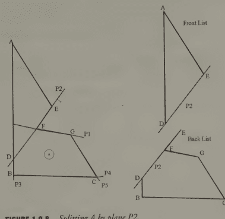

随附光盘中提供的实现包含了完整的 Leafy BSP 实现。这里我们将概述从实体 A 构建 BSP 的基本步骤，如图 1.9.8 所示。

- 我们随机选择一个面作为根分割面。假设是位于 P2 上的 EF。
- 我们将其所在平面被选作分割器的面标记为分割面。


- 3. 我们使用此分割平面分割实体。
- 4. 所有位于分割器前方的面或碎片面都会被添加到 *front* 列表中。如果某个面与分割平面共面，则该面将按平面方向进行划分，具体如下：如果面的法线与分割平面方向相同，则添加到 *front*，否则添加到 *back*。
- 5. 所有位于后方的面或碎片面都会被添加到 *back* 列表中。
- 6. 我们将 *front* 和 *back* 列表引用到原始分割器，作为前节点和后节点。
- 7. 我们对 *back* 和 *front* 列表重复此过程，从步骤 1 开始，但我们始终为下一个分割器选择一个未标记的面，具体如下：
    - 对于 *front* 列表，当所有多边形都已用作分割器，或者前多边形的大小为 1 时，我们停止递归过程，并创建一个终端叶节点，将 *front* 列表中的所有多边形添加到其中。
    - 对于 *back* 列表，我们继续递归过程，直到列表中不再有多边形。在此阶段，我们创建一个终端叶节点并将其标记为实体。

此算法构建的 BSP 具有仅包含分割平面以及指向前节点和后节点指针的内部节点。图 1.9.9 显示了实体 A 的最终 BSP 树。

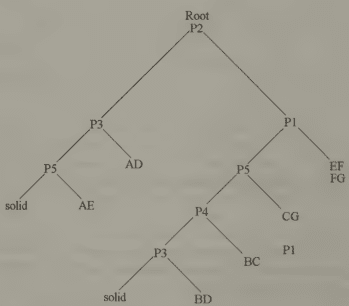

图 1.9.9 实体 A 的最终 BSP。

## 把所有内容整合在一起

最后，我们拥有完成 CSG 算法所需的所有元素。使用 BSP，我们不再将实体多边形与其他实体多边形进行裁剪。相反，我们将多边形与其他实体 BSP 进行裁剪，反之亦然。X 和 Y 之间的 CSG 流水线如下：

- 1. 创建 X BSP。
- 2. 使用 X BSP 裁剪 Y 并保留适当的多边形。
- 3. 创建 Y BSP。
- 4. 使用 Y BSP 裁剪 X 并保留适当的多边形。

使用 BSP 树裁剪实体包括使用所有分区节点（BSP 树的分割平面）对所有实体多边形进行分区。裁剪过程从根节点开始，一直向下进行到叶节点。以下示例说明了递归过程：

```
void Bsp::Recurs_Clip(int node,
                     list<Polygon>& polys2Clip,
                     list<Polygon>& finalList)
{
  BspNode node = GetNode(node);
  if(node->IsLeaf())
  {
    if(node->IsSolid())
    {
      if(m_csgUnion)
      {
        return;
      }
      finalList << polys2Clip;
    }
    else
    {
      if(m_csgUnion)
      {
        return;
      }
      finalList << polys2Clip;
    }
    return;
  }

  for_each(psPoly in polys2Clip)
  {
    RelOp rp1 = psPoly->Classify(
      node->GetPlane());
    switch (rp1)
    {
      case ON_PLANE:
        if(SameFacing(psPoly,node->GetPlane()))
        {
          backPolys.push_back(psPoly);
        }
        else
        {
          if(m_csgUnion == FALSE)
            frontPolys.push_back(psPoly);
          else
            backPolys.push_back(psPoly);
        }
        break;
      case ON_FRONT:
        frontPolys.push_back(psPoly);
        break;
      case ON_BACK:
        backPolys.push_back(psPoly);
        break;
      case ON_SPLIT:
      {
        Polygon fp, bp;
        psPoly->Split(node->GetPlane(),fp,bp);
        frontPolys.push_back(fp);
        backPolys.push_back(bp);
      }
      break;
    }
    if(backPolys.size())
    {
      Recurs_Clip(node->BackNodeIndex(),
                  backPolys, finalList);
    }
    if(frontPolys.size())
    {
      Recurs_Clip(node->FrontNodeIndex(),
                  frontPolys, finalList);
    }
  }
}
```

多边形在根节点被分区为前列表和后列表。如果我们具体化说明，我们最终会从 BSP 根节点（见图 1.9.9）中丢弃多边形 DE、EF 和 FD（见图 1.9.7）。构成 C 的所有多边形都由根节点裁剪。其中一些会被分割，另一些则不会。所有位于前方的多边形都会被添加到前列表中，所有位于后方的多边形都会被添加到后列表中。对于标准算法，所有与分割节点平面共面的多边形都会被推入后列表。处理这些多边形的方式可能会有所不同，这取决于当前的 CSG 操作。您可以在本文档附带的源代码中看到此算法的运行情况。前列表和后列表分别由 P3 和 P1 进行前向裁剪。该过程重复进行，直到剩余多边形到达叶级别。当列表达到叶深度时，我们决定丢弃哪些多边形以及保留哪些多边形以构建最终的 CSG 实体。如果我们回顾图 1.9.1，以下是所有列举的 CSG 操作的具体条件：

| CSG 操作 | 描述 |
| :--- | :--- |
| 并集 | 丢弃所有以实体叶节点结束的列表 |
| 差集 | 应用公式 !(lA + B) 或 !(lBA + AB)，或稍微修改裁剪算法，而无需过多反转前后（参见示例源代码） |
| 交集 | 应用 !(lA + lB)，或简单地丢弃所有以空叶节点结束的列表 |

## 结论

本文档介绍的 CSG 算法一次处理两个实体，但可以通过递归调整来执行多个实体之间的复杂 CSG 布尔运算，如附带的示例实现所示。可以通过消除不必要的分割来提高算法性能，即构建由与其他实体接触的多边形组成的 BSP 树。这需要为每个面维护一个包围盒，并在 CSG 构建之前根据其他实体的包围盒测试这些面。未被其他实体包围盒接触的多边形会被简单地复制到最终结果中。减少分割的第二种方法是跟踪多边形被分割的次数，并记录其每个碎片中多边形的引用。最后，如果所有以同一原始多边形作为引用的碎片都安全存活，我们将用原始多边形替换这些碎片。现在，启动示例代码，享受 CSG 的魅力吧！

## 参考文献

[Rottensteiner] Rottensteiner, Franz. “构造实体几何。” 可在线查阅 http://www.ipf.tuwien.ac.at/fr/buildings/diso/node38.html.

## 将 Lua 构建到游戏中

Matthew Harmon, eV Interactive 公司
matt@ev-interactive.com

在过去十年中，计算机和主机游戏变得不再那么硬编码，而更加数据驱动。好处多多，从更轻松的开发到用户扩展产品的整个亚文化。事实上，从技术角度来看，许多游戏现在更像虚拟机或操作系统，而非单一的特殊用途应用程序。

数据驱动设计运动中最强大的组成部分无疑是使用嵌入式语言。简单的数据驱动设计侧重于将硬游戏数据外部化：地图数据、实体参数、if/then 触发器以及传递给游戏引擎的其他参数。通过使用嵌入式或“脚本”语言，游戏还可以外部化逻辑。这为最终用户自定义打开了全新的世界，并对游戏及游戏系统的开发方式产生了深远影响。

遗憾的是，从头开始创建嵌入式语言可能是一项重大工程。即使有大量可用工具协助这项工作，要构建一个完整、健壮且灵活的系统也可能耗费大量人时。幸运的是，今天有几种现成的解决方案可以快速集成到项目中。Python、Ruby 和 Lua 等语言经过了验证、可靠且使用广泛。还有其他解决方案，有些甚至专门针对游戏定制，但它们尚未达到这些通用语言的流行程度。

本文档旨在展示如何快速轻松地将现有嵌入式语言添加到游戏系统中。本文档选择的语言是一个正在被游戏开发社区迅速采纳的包：Lua。

## Lua 概述

Lua 是一种简单而健壮的语言，具有许多吸引游戏开发者的功能。它已经在许多专业游戏中使用，更多游戏也在集成它。通过访问 Lua“用途”网站（www.lua.org/uses.html），您可以立即看到该语言如何在游戏行业站稳脚跟。游戏开发者很可能会将 2000 年代视为“Lua 十年”。


以下是一些使 Lua 特别适合游戏开发的特性：

- Lua 非常轻量。完整的 Win32 库仅包含几百 KB 的代码。事实上，光盘上的整个演示可执行文件仅 145 KB！
- Lua 可以运行文本脚本，或预编译的字节码文件。开发者可以暴露某些脚本，隐藏其他脚本，甚至可以省略 Lua 的词法分析器、解析器和代码生成器。通过这样做，有些人已将 Lua 的占用空间减小到 25 KB 以下！
- Lua 是一种完整且出人意料地强大的编程语言。
- Lua 适合“半程序员”使用。它是动态类型的，并包含自动内存管理和垃圾回收。
- Lua 经实践证明可靠且值得信赖，拥有非常活跃的用户社区。
- 最重要的是，Lua 易于嵌入并与 C 进行接口。

## 快速入门程序

Lua 程序的结构非常简单直接。虽然完整的语言描述超出了本文的范围，但可以肯定的是，大多数 C 程序员都能快速掌握 Lua 的基础知识。以下是一段 Lua 代码片段，帮助我们熟悉一下：

```
-- define a function ("--" signals a comment)
function EruptSequence()
  Camera.SetMode(CAMODE_ORBIT);
  Camera.SetOrbitRate(POWER2);
  ent = Entity.Find("Volcano");
  Camera.SetTargetEntity(ent);
end

-- Run the erupt sequence every 20 minutes
while (1) do
  Script.WaitSeconds(20 * 60);
  EruptSequence();
end
```

这段代码展示了一些简单的 Lua 语法。代码的大部分实际上涉及调用我们已注册到 Lua 的游戏引擎函数。

## 动态类型

Lua 是一种动态类型语言。你不需要声明变量，甚至不需要定义它们的类型；直接开始使用即可。例如，在 Lua 中，以下说法完全有效：

```
b = 24.5;
b = "Wait! Now b is a string. How wild!";
```

## 自动内存管理

Lua 自动管理内存。当一个值不再被引用时，它将可用于垃圾回收。因此，无需专门释放任何内存。不过请记住，保留对不需要的对象的引用会阻止它们被清理。

## Lua 状态

有几个 Lua 术语需要快速定义，第一个是 Lua _状态_。本质上，Lua 状态是 Lua 解释器的单个操作环境，包括堆栈、执行状态、全局变量等。Lua 状态是我们在将语言嵌入游戏时进行接口的对象。大多数架构只需要一个 Lua 状态。

## Lua 块

一个 _块_ 是由 Lua 翻译并可选择执行的一系列语句。块可以被视为程序或程序片段，被加载到 Lua 环境中并可供使用。块通常以脚本形式来自文件，但也可以来自另一个块中的静态文本字符串，甚至直接来自命令控制台。在后一种情况下，块可以是用户输入的单个语句。

## 将 Lua 与 C 进行接口

从游戏程序员的角度来看，Lua 最具吸引力的方面之一是它与 C 接口有多简单。在探讨如何实际嵌入 Lua 并为其提供脚本之前，我们将探讨如何使 C 函数可供解释器使用。

## 从 Lua 调用 C 代码

大多数程序员想要完成的第一项任务是将游戏引擎的某些功能暴露给 Lua，并使其可用于基于脚本的控制。这是通过向 Lua 注册简单的“胶水”例程来完成的。假设我们希望 Lua 脚本能够控制游戏内摄像机的观察方向。我们希望 Lua 脚本看起来像这样：

```
- Point the camera at the volcano
Camera.SetTargetPos(100.0, 40.0, 230.0);
```

我们首先编写一个 C 语言的“胶水”例程，以将参数从 Lua 脚本传递到 C 端，然后使用这些值调用我们引擎的摄像机函数。胶水例程采用以下形式：

```
static int LuaSetTargetPos(lua_State* luaState)
{
    float x;
    float y;
    float z;

    x = (float)lua_tonumber(luaState, 1);
    y = (float)lua_tonumber(luaState, 2);
    z = (float)lua_tonumber(luaState, 3);

    CameraSetTargetPos(x, y, z);
    return(0);
}
```

当 Lua 调用 C 函数时，它会按顺序将脚本中找到的参数压入通信堆栈。然后，它会为给定函数调用注册的胶水例程，并向其传递脚本运行所在的 lua_state 指针。请记住，Lua 状态只是一个表示 Lua 解释器整个状态的对象，包括所有数据、通信堆栈以及你已向 Lua 注册的任何函数。

示例胶水例程随后尝试从通信堆栈中提取三个值，即摄像机的坐标（x、y、z）。值通过 lua_toxxx() 调用从堆栈中读取，这些调用将给定堆栈偏移处的 Lua 值转换为请求的 C 类型。请注意，我们可以任意寻址任何堆栈位置，且我们的第一个参数从索引 1 开始，而不是 0。接下来，我们调用引擎的摄像机代码来实现所有功能。最后，例程返回 0，这表示我们没有将任何内容作为返回值压回通信堆栈以传递给 Lua 脚本。

因为 Lua 是动态类型的，我们必须以某种方式知道我们期望的参数类型并适当转换它们。在前面的示例中，我们需要三个浮点值来表示摄像机的位置。Lua 将所有数值表示为双精度浮点数，因此虽然 lua_tonumber() 会将动态 Lua 值转换为 double，但我们仍需将其强制转换为 float。Lua 包含许多操作通信堆栈的设施，包括检查堆栈条目是否为给定类型的能力。这使得胶水例程在发现不正确或不足的参数时，能够向用户呈现详细错误。

## 将值返回给 Lua

现在假设我们需要让 Lua 脚本查询玩家的当前得分。在 Lua 中，我们可能希望这样做：

```
- End the level after the player has scored 9 points
if Game.GetPlayerScore() > 9 then
TriggerEndOfLevel();
end;
```

将玩家得分返回给 Lua 脚本的方法是创建一个胶水例程，将数字值压入通信堆栈，如下所示：

```
static int LuaGetPlayerScore(lua_State* luaState)
{
    lua_pushnumber(luaState, game->playerScore);
    return(1);
}
```

在这种情况下，我们的胶水例程不从通信堆栈获取任何参数，但会将一个值压入堆栈，并通过返回 1 来提醒 Lua。事实上，Lua 函数可以有多个返回值，C 胶水例程在通信堆栈上返回多个值也是完全合法的。

## 注册胶水例程

现在我们知道了如何创建胶水例程，需要将它们注册到 Lua 以使其可供我们的脚本使用。注册一组函数的最简单方法是使用 Lua 的库管理调用。这些调用旨在简化向语言注册一组相关函数的过程。

首先，我们创建一个以空结束的函数指针数组以及 Lua 脚本将识别它们的符号名称。

```
// camera library glue routines and function names
static const luaL_reg cameraLib[] =
{
    {"SetMode", LuaSetMode },
    {"GetMode", LuaGetMode },
    {"SetTargetPos", LuaSetTargetPos },
    {"SetTargetEnt", LuaSetTargetEnt },
    {"SetOrbitRadius", LuaSetOrbitRadius },
    {"SetOrbitRate", LuaSetOrbitRate },
    {"SetFov", LuaSetFov },
    {"SetZoomable", LuaSetZoomable },
    {"SetZoomPos", LuaSetZoomPos },
    {"SetPivot", LuaSetPivot },
    {"EnableShake", LuaEnableShake },
    {NULL, NULL }
};
```

接下来，我们调用一个方便的 Lua 实用函数，将数组中的每个函数注册到 Lua。

```
luaL_openlib(luaState, "Camera", cameraLib, 0);
```

第一个参数是我们正在使用的 Lua 状态。第二个参数是我们为这个库赋予的名称，第三个参数是我们的函数指针和名称数组。此调用后，我们的函数将可供 Lua 脚本使用，并且它们的名称将带有库名前缀。因此，C 胶水例程 LuaSetOrbitRate() 现在可以从 Lua 脚本作为 Camera.SetOrbitRate() 调用。


仅此而已。只需少量代码，就能快速轻松地将游戏引擎的功能暴露给 Lua。还有许多更复杂的方法可以将 Lua 与 C 链接，但它们超出了本入门概述的范围。Lua 也不局限于与 C 的集成。像 LuaBind 这样的工具也可用于帮助在 Lua 与 C++ 类之间建立关系。

## 将 Lua 嵌入游戏

既然我们了解了如何在游戏引擎和 Lua 之间创建链接，现在来探讨如何将 Lua 嵌入游戏。

## 创建和销毁状态

要在游戏中使用 Lua，必须先创建一个 Lua 状态，然后加载并执行 Lua 代码块。Lua 状态的创建方式如下：

```
lua_State *luaState = lua_open();
```

当我们准备关闭游戏时，关闭状态：

```
lua_close(luaState)
```

这将释放解释器使用的所有内存，并触发对已加载到状态中的代码的任何剩余垃圾回收。

## 加载和执行代码

一旦 Lua 初始化完成，并且我们已像之前所示注册了新函数，就可以开始加载和执行 Lua 代码了。Lua 支持从任意来源向解释器提供数据。在本示例中，我们将使用一些从文件和字符串获取输入的 Lua 辅助例程。从磁盘执行脚本可以使用：

```
lua_dofile(luaState, "LuaScriptFile.lua");
```

这将编译并执行脚本（如果存在任何执行点）。如果文件仅包含函数定义，则所有函数都将被定义并添加到 Lua 状态中，但不会执行任何实际代码。

同样，文本字符串中的 Lua 代码可以使用以下方式执行：

```
lua_dostring(luaState, "a=14; b=7;");
```

如你所料，使用 Lua 创建交互式命令控制台只需几行简单代码。

Lua 脚本加载的一个非常有趣的特性是，这些例程可以接受文本脚本或预翻译的二进制 Lua 代码。Lua 发行版附带一个名为 luac 的预翻译器，可将脚本编译为二进制形式。完成此操作后，应用程序可以选择省略 Lua 的词法分析器和解析器组件，从而使代码开销更小。这还为开发人员提供了选择：将一些脚本保留为原始文本形式以供修改，而将其他脚本编译，从而隐藏起来不被窥探。

```
lua_loadfile(luaState, "LuaScriptFile.lua");
```

## 从 C 调用 Lua 函数

如前所示，将脚本加载到 Lua 中但不立即执行任何代码，而是在稍后再执行，这通常很有用。一个很好的例子是游戏实体逻辑的脚本化。每个实体类在启动时可能会加载一个定义其游戏内行为的 Lua 脚本。可能有用于设置、移动和渲染的单独 Lua 例程。一个简单的 Lua 实体的 Lua 代码可能如下所示：

```
-- functions for fictional "walker" entity
function WalkerSetup(walker)
    -- our poor walker only lives for 1 minute
    timer = 60.0;
end;

function WalkerMove(walker, elapsedSec)
    timer = timer - elapsedSec;
    if (timer > 0.0) then
        Walker.DoAI(walker);
        Walker.UpdateControls(walker);
        Walker.DoPhysics(walker, elapsedSec);
        Walker.UpdateAccelAndPos(walker, elapsedSec);
    end;

    else
        Walker.Destroy(walker);
    end;
end;

function WalkerRender(walker)
    visible = Walker.GetVisibility(walker)
    if (visible == 1) then
        matrix = Walker.GetMatrix(walker);
        Game.SetModelMatrix(matrix);
        Game.RenderModel(Walker.GetModel(walker));
    end;
end;
```

当实体类初始化时，它可以使用 lua_loadfile() 来读取和编译脚本。然后，实体的 C 代码可以在游戏循环中根据需要调用 Lua 脚本例程。从 C 调用特定的 Lua 函数涉及将函数以及所有参数推入通信堆栈，然后调用 lua_call()。

调用 walker 的 Move() 例程的示例如下：

```
-- call this entity's Move script
lua_getglobal(luaState, "WalkerMove");
lua_pushlightuserdata(luaState, this);
lua_pushnumber(luaState, elapsedSec);
lua_call(luaState, 2, 0);
```

第一个调用将名为 "WalkerMove" 的全局值推入堆栈。该值恰好是我们在初始化 walker 类时加载的脚本中的一个函数。

下一个调用将我们 C++ 实体的 this 指针推入通信堆栈以供 Lua 使用。实际上，Lua 不会使用这个值，因为它完全不理解我们的 C++ 对象。相反，它会将此值直接传回给 C 胶水函数，以便它们知道使用哪个对象指针。要推入我们的 this 指针，我们调用了 lua_pushlightuserdata()。“轻量用户数据”是一种特殊的 Lua 数据类型，当 C 代码需要向 Lua 提供其本身不理解的数据时可以使用它。大多数时候，如本示例所示，轻量用户数据用于保存指向 C/C++ 对象和结构的指针。

接下来，我们只需调用 lua_pushnumber() 来推入自上一帧以来经过的秒数。现在函数和所有参数都已正确放在堆栈上，我们可以通过调用以下方式执行 Lua 代码：

```
lua_call(luaState, 2, 0);
```

第二个参数（2）告诉 Lua 堆栈上推入了多少个参数，第三个参数（0）告诉我们期望返回多少个返回值。Lua 将执行整个函数，在返回时，通信堆栈将包含我们期望的任何返回值。

现在我们可以从 Lua 调用 C 函数，也可以从 C 调用 Lua 函数。我们离让游戏支持 Lua 又近了一步……或者真的如此吗？

### 实时注意事项

请注意，当我们使用 lua_dofile() 加载并执行一个代码块，或使用 lua_call() 调用 Lua 脚本中的函数时，调用不会在请求的 Lua 脚本处理完毕之前返回。这对于某些应用程序和架构可能没问题，但在许多游戏中这不够。我们需要能够随时间安排事件。

### 基于时间的示例

比如说，我们想使用 Lua 来脚本化火山喷发时摄像机的移动。我们可以在每一帧调用 Lua 脚本中的 moveCamera() 函数，该 Lua 函数会在内部更新计时器，并在计时器触发新的摄像机状态时调用不同的子函数。然而，这很混乱，我们更喜欢一个简单的线性脚本，看起来类似这样：

```
-- script to trigger volcano eruption
-- every 20 minutes throughout the entire game

function EruptSequence()
    -- start shaking the camera gently for 10 seconds
    Camera.SetShakeMag(0.002);
    Script.WaitSeconds(10);

    -- suspend player control
    Game.SuspendPlayer();
    -- set the camera to slowly orbit the volcano
    entTarget = Entity.FindByName("Volcano");
    Camera.SetMode(CMX_ORBIT);
    Camera.SetTargetEnt(entTarget);
    Camera.SetOrbitRate(0.500);
    Camera.SetOrbitTiltRate(0.003);
    -- and jack up the shaking!
    Camera.SetShakeMag(0.01);
    Script.WaitSeconds(5);

    -- ok, after 5 seconds ease up on the shake
    Camera.SetBankShakeMag(0.002);
    -- and put the camera back in the player's eyes
    entPlayer = Entity.FindByName("Player");
    Camera.SetTargetEnt(entPlayer);
    Camera.SetMode(CMX_FIRSTPERSON);
    Game.ResumePlayer();
    Script.WaitSeconds(10);

    -- after 10 seconds, turn shake off all together
    Camera.SetShakeMag(0.0);
end

-- This is the first executable code in the script;
-- an implied main(), if you will
-- Run the erupt sequence every 20 minutes
while (1) do
    Script.WaitSeconds(20 * 60);
    EruptSequence();
end
```

这段代码首先定义了一个处理摄像机序列的函数。然后，脚本每隔 20 分钟重复调用该函数。我们使用一个名为 Script.WaitSeconds() 的新注册例程来安排各种事件，它只是简单地延迟给定的时间。

这在理论上很有效，但如果执行 Lua 代码不会在代码完成之前返回，我们怎么能期望运行实际的游戏循环呢？答案在于我们对 Script.WaitSeconds() 函数的实现，以及一种名为协程（coroutines）的 Lua 特性。


## 协程支持

简单来说，Lua 的协程支持提供了一种方式，让 Lua 脚本可以中途暂停执行，并将控制权交还给调用它的 C 程序。

这是一种协作式多任务处理形式，由代码本身而非操作系统决定何时挂起执行并将控制权移交给调用者。

这被称为让出（yielding），可以通过 Lua 脚本中的 yield 完成，也可以通过 C API 中的 lua_yield() 完成。

不难想象，我们对 Script::WaitSeconds() 的 C 实现中包含对 lua_yield() 的调用，这将控制权交还给游戏，以便在脚本挂起时继续渲染帧。

当我们的脚本管理系统确定已过去足够时间时，我们会调用 lua_resume() 从脚本中断的地方继续处理。

对游戏开发者来说，协程支持是 Lua 包中更具吸引力和重要的特性之一。

## 多脚本

虽然使用单个 Lua 脚本可能取得不错的效果，但让许多脚本并发运行、按需唤醒以执行操作，或直接从 C 代码按需调用，要实用得多。

Lua 通过线程系统支持多脚本的并发执行。

不幸的是，Lua 对“线程”这一术语的使用对初学者来说有些令人困惑：这个特定术语隐含着抢占式多任务处理的含义，而 Lua 并非如此。

Lua 线程可以被视为主 lua_State 的子状态，并可以运行自己的脚本。

新状态（或线程）通过以下方式创建：

```
lua_State* newState = lua_newthread(mainLuaState);
```

每个新状态共享原始 lua_State 的所有全局函数和变量，但拥有自己的栈和执行状态。

此外，每个新状态都可以独立地让出，使系统能够管理许多脚本，这些脚本可能因不同原因而让出。

因此，将 Lua 嵌入游戏的常见架构是开发一个脚本管理器，为系统运行的每个脚本创建一个新的子状态。

管理器会跟踪每个脚本让出的原因，并按需恢复它。

## 脚本管理框架

利用我们对状态和协程的了解，可以构建一个基本的脚本管理系统来处理创建和运行多个 Lua 脚本的细节。

管理器最重要的工作是封装跟踪和唤醒任何已让出脚本的工作。

我们将允许脚本在给定持续时间、指定帧数或直到特定时间时让出。

可以轻松添加其他条件。

此示例框架通过两个类实现：LUAMANAGER 和 LUASCRIPT。

虽然为了简洁，文本中省略了一些细节，但一个完整且功能齐全的骨架可在 CD-ROM 上找到。

## 管理器类

管理器通过调用 lua_open() 创建 lua_State 来初始化 Lua。

它通过提供 CreateScript() 功能作为创建脚本对象的唯一方式，来维护正在运行的 LUASCRIPT 对象链表。

管理器还包含一个 Update() 函数，该函数在每次游戏循环中调用一次，并向下调用每个脚本对象各自的 Update()。

这里会检查已让出的脚本是否可以恢复。

管理器对象的简化骨架如下：

```
class LUAMANAGER
{
public:
    LUAMANAGER             (void);
    ~LUAMANAGER            (void);

    LUASCRIPT* CreateScript (void);
    void DestroyScript     (LUASCRIPT* s);
    void Update            (float elapsedSec);

private:
    lua_State* masterState;
    LUASCRIPT* head;
};
```

管理器还向 Lua 解释器注册了一组常见的脚本管理胶水例程，包括允许脚本基于时间或经过帧数进行让出的例程。

从 Lua 来看，这些例程如下所示：

```
Script.WaitSec(seconds);
Script.WaitFrame(frames);
Script.WaitTime(timestamp);
```

这些例程将在下一节中详细介绍。

## 脚本对象

脚本对象表示由管理器创建的 masterState 派生的单个子 lua_State。

每个脚本对象可以作为 Lua 线程运行 Lua 程序，并根据需要进行让出和恢复。

脚本对象维护一些额外数据，让我们知道脚本为何让出以及何时重新激活它。

以下代码显示了 LUASCRIPT 对象的简单骨架：

```
typedef enum
{
    YM_NONE,        // not yielded
    YM_FRAME,       // waiting for x frames to elapse
    YM_TIME,        // waiting for x seconds to elapse
} YIELD_MODE;
class LUASCRIPT
{
public:
    void            RunFile   (char*  fileName);
    int             RunString (char*  buffer);
    LUASCRIPT*      Update    (DWORD  elapsedSec);

private:
    lua_State*      childState;
    LUAMANAGER*     manager;
    LUASCRIPT*      next;
    YIELD_MODE      yieldMode;
    int             waitFrame;
    float           waitTime;

    LUASCRIPT       (void);
    ~LUASCRIPT      (void);
};
```

LUASCRIPT 脚本类为我们提供了实际执行 Lua 代码的机制。

RunFile() 和 RunString() 从给定源向 Lua 解释器提供输入。

脚本将执行直到完成或让出。

如预期，该类创建并维护指向其管理的新 lua_State 的指针。

然而，正如我们很快将看到的，让 Lua 知道哪个 C 对象拥有特定的 lua_State 也很重要。

为此，我们将在名为 table 的 Lua 构造中存储一些数据。

对表的完整解释超出了本文的范围，但可以将它们视为可以用任何值作为索引的数组。

为了将我们的 LUASCRIPT 对象地址与其创建的 lua_State 关联，我们在 masterState 的全局表中添加一个条目。

我们使用 lua_State 指针本身作为索引，因为我们知道它是唯一的。

之后，我们可以通过传递给胶水例程的 lua_State 地址来检索 LUASCRIPT 对象指针。

这可以在创建子状态时完成：

```
// Create a new state (thread) from the master
childState = lua_newthread(mgr->masterState);

// save a pointer to this script object in the global
// table using the new state's pointer as a key
lua_pushlightuserdata(mgr->masterState, childState);
lua_pushlightuserdata(mgr->masterState, this);
lua_settable(mgr->masterState, LUA_GLOBALSINDEX );
```

这听起来很复杂，但很像将窗口处理对象的地址存储在对话框的 GWL_USERDATA 中。

这样，当调用胶水例程时，它可以确定发出调用的 LUASCRIPT 对象。

## 让出例程

脚本管理系统的关键之一是允许 Lua 线程因不同原因让出，并在需要时恢复。

为此，我们实现了一些新函数并将其注册到 Lua 中。

例如，我们当然希望能够通过如下调用让脚本让出指定的时间：

```
Script.WaitSeconds(seconds);
```

以下是实现此调用的胶水例程：

```
static int LuaWaitSeconds(lua_State* l)
{
    LUASCRIPT* s;

    // get a pointer to the C++ object associated
    // with this script
    lua_pushlightuserdata(l, l);
    lua_gettable(l, LUA_GLOBALSINDEX);
    s = (LUASCRIPT*)lua_touserdata(l, -1);

    // save our sleep time and wait state
    s->waitTime = lua_tonumber(l, 1);
    s->yieldMode = YM_TIME;

    // tell Lua to return, yielding this thread
    return(lua_yield(l, 0));
}
```

当胶水例程从 Lua 脚本调用时，我们不知道哪个 C++ LUASCRIPT 对象正在管理它。

因此，我们必须先从之前存储它的全局 Lua 表中检索对象的指针。

然后，从栈中检索并保存要让出的秒数。

我们还告诉对象正在执行哪种等待类型。

最后，我们调用 lua_yield() 来挂起脚本并返回到 C。

现在，只需在脚本的 update() 例程中检查计时器即可。

如果已过去足够时间，则通过调用 lua_resume() 恢复脚本。

遵循此模型，脚本可以基于时间、经过帧数，甚至在标志被置位时恢复。

通过一些巧妙的管理，一个脚本执行的操作甚至可以触发其他脚本的恢复。

这个简单管理器的完整工作示例可在 CD-ROM 上找到。


## 结论

本文展示了，只需很少的工作，开发者就能快速将 Lua 语言嵌入到他们的游戏中。经过稍多的管理，游戏可以轻松利用 Lua 的许多有用特性，包括运行多个脚本、让出脚本执行，以及根据需要恢复执行。

为了快速让脚本运行起来，本文略过了 Lua 的许多细节，这些细节应由任何认真考虑将该语言嵌入游戏的开发者进行探索。特别是，Lua 表的概念以及对通信栈的更深入理解，值得更全面地掌握。访问 www.lua.org 是任何使用该语言的人的最佳起点。

截至目前，Lua 已被应用于不少游戏，鼓励读者尝试这种语言。如果你正在考虑将一种语言嵌入到你的游戏中，但尚未开始这项工作，不妨花几个小时集成 Lua。这可能是你在项目上花费的最有价值的几个小时。你甚至可能会用全新的视角审视你的游戏代码，反复思考：“我如何才能把更多游戏控制权交给 Lua？”

## 参考文献

- [Jerusalimschy03] Roberto Jerusalimschy. Lua 程序设计。由 Lua.org 出版，2003 年 12 月。www.lua.org/luaBind.sourceforge.net

### 1.11 基于策略设计改进空闲列表

Nathan Mefford

nmefford@yahoo.com

游戏每天都在变得更加动态，我们处理内存的策略必须跟上这一需求。不幸的是，动态内存分配有其缺点，限制了我们将内存视为真正动态资源的能力。在《游戏编程宝典 4》中，我们了解到了空闲列表 [Glinker04] 的概念，这是一种特殊用途的分配器，通过将自身限制为仅分配单一类型的对象来解决动态内存分配的问题。

事实上，空闲列表是改善游戏分配性能的如此强大的工具，以至于它们几乎适用于每个项目。然而，即使是如此基本的概念，其设计和实现也充满了没有明确答案的问题。列表是否应该允许增长？内存块应如何分配？块和空闲块应如何在内部跟踪？对象应该只构造和销毁一次，还是每次分配时都构造和销毁？完全未使用的块是否应该归还给内存管理器？为了适应不同的需求，一些项目最终会出现多个空闲列表实现。其他空闲列表为了实现灵活性而最终拥有复杂的接口，这使得客户端更难理解和使用。

基于策略的设计允许库的用户为这些设计问题提供答案，从而产生灵活且高度可复用的类，既不牺牲速度也不引入接口复杂性。在本文中，介绍了一种基于策略的空闲列表，它可以轻松配置不同的行为，以适应不同的需求和分配模式。此外，我们开发了一种默认参数化，它通过紧密模拟 new 和 delete 运算符的行为，改进了 [Glinker04] 中的实现，消除了应用程序初始化非平凡类的需求，并将每次分配的开销降至零。

### 空闲列表概述

关于游戏中动态内存管理相关问题的详细讨论，见本文的前篇 [Glinker04]。除了速度慢之外，我们还了解到，从通用内存管理器分配和释放内存会导致引用局部性差——甚至更糟的是内存碎片化。此外，大多数内存管理器会为每次分配添加一些不可见的记账开销。这听起来可能不多，但即使每次分配只有 16 字节的开销，在分配次数适度的情况下，也会迅速累积到兆字节或更多的浪费内存。

解决这些问题的方案以空闲列表的形式提供：一种类，通过将自身限制为仅分配和释放单一类型（因此也是单一大小）的对象，使其适合运行时分配。你可能会质疑一个只能分配单一类型对象的内存分配器的实用性，但事实证明，在典型游戏中有许多情况适合使用空闲列表分配。由粒子和贴花等本质上动态的效果分配的对象是空闲列表分配的完美候选者。空闲列表可以提供一种自然的机制来回收车辆和行人等对象，在广阔的世界中，预先分配这些对象的每个实例是不切实际的。链表和树等常见数据结构中的节点也可以有效地使用空闲列表分配策略。事实上，流行的标准模板库（STL）实现 STLPort [STLPort04] 的默认分配器就是一个自定义空闲列表分配器。许多现代设计模式会产生大量协同工作以完成复杂任务的小型类。例如，应用策略、状态或装饰器模式 [GoF95] 有时会导致分配许多小对象，这些对象可能最好由空闲列表管理。简而言之，任何在运行时需要频繁分配和释放，且其内存可以多次回收的类型，都可能从专用空闲列表的分配中受益。

在提供空闲列表实现的同时，前一篇文章被严格硬编码了一系列设计决策，导致了一个相对不灵活的库。例如，它具有不可更改的容量，并使用额外的列表来跟踪空闲内存块。另一个例子是决定在列表中存储完全分配的对象，从而避免在每次分配时调用构造函数和析构函数。这可能会提高性能，但代价是分配行为不够直观，要求应用程序执行每次分配的初始化和清理。在许多情况下，这些选择完全合适，之前介绍的空闲列表可以直接使用。不幸的是，该特定实现中的权衡最终限制了其在广泛需求和分配模式中的适用性。有些情况可能需要一个可以增长和/或缩小容量的空闲列表，其他情况可能受益于紧密模拟 new 和 delete 运算符行为的行为，而还有些情况可能无法承受由单独用于跟踪空闲块的列表所强加的额外内存开销。

与其向用户强加一组特定的权衡，不如探索设计一种单一的空闲列表实现，允许其用户为自己的情况选择合适的权衡。当然，这种灵活性和可复用性必须在不牺牲易用性、安全性或性能的前提下实现。

### 策略来拯救

C++ 中存在一种设计机制，它承诺能够实现安全、高效且高度可定制的行为：策略。在 C++ 设计的语境下，策略究竟是什么？从根本上说，策略只是定义一个接口，该接口可能包括成员函数、成员变量和类型定义。任何实现此接口的类都称为策略类。给定的策略可以拥有无限数量的策略类实现。策略和策略类本身是无用的。只有当其他类被设计为利用给定策略时，它们的力量才会显现。使用策略和策略类的类称为宿主类或主机类。

在概述了这些基本定义后，策略、策略类和宿主类究竟如何协同工作，它们给我们带来了什么好处？游戏程序员天生是务实的人，所以我认为我们已经到了这样一个地步：几行代码比另一段定义和理论更能帮助说明策略。

```
template <class APolicy>
class AHost : public APolicy
{
    ...
    void DoSomething()
    {
        ...
        APolicy::Foo();
        ...
    }
};
...
// Later on in client code
AHost< MyPolicy > hostInstance;
hostInstance.DoSomething();
```

乍一看，这里似乎没有发生什么，但如果我们仔细观察，会发现这几行代码中实际上蕴含着惊人的力量、灵活性和优雅性。在这个简单的示例中，AHost 是我们的宿主类，它围绕名为 APolicy 的策略进行设计。每当实例化 AHost 时，都需要提供一个实现 APolicy 接口的策略类作为模板参数，从而使我们的宿主类能够访问具体的策略实现。当调用 AHost::DoSomething() 时，AHost 通过调用 APolicy::Foo() 将部分实现推迟给策略类，允许用户配置 AHost 行为的一个方面，而不是由 AHost 的作者将其硬编码。这种配置宿主类行为的开放式能力是基于策略的类设计的核心。

情况更好。在前一个示例中，请注意，宿主类公开继承自策略类，这方便地完成了将宿主类绑定到特定策略类的任务，同时聚合由策略类定义的任何结构。


策略类。由于我们选择将策略类设为宿主类的公有基类，策略类可以通过自身的公有函数来扩展宿主的接口。复杂的策略类可以暴露一个专门针对其特性和独特性而丰富的接口，而无需修改宿主类，也无需用仅由某些实现使用的函数和参数来使基础接口变得复杂。如果用户后来切换到一个接口更精简的策略，编译器将捕获新策略类不支持的任何调用，从而有效地强制执行设计约束。

这种实现策略的方法也利用了不完全实例化。在 C++ 中，如果一个模板函数从未被调用，它将永远不会被实例化，编译器甚至根本不会查看它，除非可能是为了语法检查。在我们的示例中，这意味着 AHost 可以配置为使用根本不声明或定义 `Foo()` 的策略，也许是因为 `Foo()` 对某些具体策略类来说毫无意义。如果后来调用了 `AHost::DoSomething()` 而 `Foo()` 未实现，编译器将立即报告错误，严格且自动地强制执行策略设计和策略类的限制。凭借这种能力，宿主类可以利用潜在的丰富策略接口，同时仍然使用真正精简的策略类，尽管功能会有所减少。结合策略类暴露额外功能的能力，我们拥有一个真正强大的机制来定制宿主类的功能。

使用模板将策略类绑定到宿主还有其他一些显著优势。最大的优势之一是，由于绑定是静态完成的，编译器能够生成非常优化的代码，可与手工编写的等效代码相媲美。此外，与由虚函数组成的经典接口不同，策略接口的定义更为宽松。策略类只需在语法上符合接口，而无需重写精确的虚函数签名。在我们之前的示例中，实现策略的策略类可以自由地将 `Foo()` 定义为 `static`、`virtual` 或都不是。最后，这种方法可以轻松扩展到多个策略，只需添加额外的模板参数，并让我们的宿主类从每个额外的策略类派生即可。事实上，基于策略的设计的真正威力只有在使用多个策略时才能体现出来，它只需少量额外代码就能实现行为的组合爆炸。

既然我们了解了策略的机制，那么如何实际应用它们来解决真正的设计问题呢？一个好的起点是识别构建类时涉及的高层次设计决策。任何可以合理地以多种方式实现或涉及权衡取舍的内容，都应该从类中提取并委托给策略。走极端来说，宿主类可以将所有有意义的设计决策都委托给策略，在这种情况下，宿主变成一个简单的外壳，其唯一目的是组装一组策略类来执行必要的任务。

在将类分解为策略时，必须努力追求彼此正交的策略。正交策略是指可以安全地相互独立变化的策略。非正交策略会导致宿主类和策略类都出现复杂性，从而导致一个类型安全性较低且更难使用的类。发现非正交策略分解的一个简单方法是，当两个策略需要相互通信时，或者更糟的是，当某些策略组合导致无效宿主时。

不幸的是，本节实际上只能触及基于策略设计的表面。有关使用策略来增强 C++ 类的理论和实践的更多信息，我鼓励你阅读 [Alexandrescu01] 和 [Vandervoorde03]。

## 分解空闲列表

策略听起来是实现我们开发可重用空闲列表（且不牺牲易用性或性能）这一目标的一个相当有希望的候选方案。然而，在深入创建基于策略的空闲列表之前，让我们先快速回顾一下空闲列表在高层级上的工作原理。我们感兴趣的空闲列表几乎都始于分配一块相对较大的内存，这块内存足以满足大量单独的分配请求。然后，这块大内存被分割成内存块，并缓存以供将来检索。当收到对象分配请求时，会从可用块列表中弹出一个内存块，将其初始化为给定类型以供使用，并返回给应用程序。如果列表中不存在空闲块，可以选择分配一块新的大内存来重新填充空闲块列表。最后，当应用程序将对象返回给空闲列表时，它会被转换回一个简单的内存块，并放回空闲块列表中，准备快速回收以供将来分配。有了这个高层次概述，我们现在可以开始识别应该拆分为策略的行为了。

一个很好的第一步是分离出我们空闲列表的增长行为。有些空闲列表可能只是预先分配一块内存，不允许任何未来的增长。其他情况可能要求每次空闲列表为空时都分配固定数量的块。增长策略将使用户能够配置此行为，使他们能够相对精细地控制空闲列表将分配多少空闲块以及何时分配。它还将在我们的空闲列表用完空闲块时，为任何自定义行为提供一个方便的挂钩。

避免将用于分配和释放大块连续内存（这些内存稍后将被分割成单独块）的方法硬编码也是合理的。有些空闲列表可能会调用 `malloc()` 从堆中获取一块未初始化的内存，而另一些可能会使用 `operator new()` 分配一块完全初始化的对象块。将此委托给策略还将使我们的空闲列表能够利用自定义内存管理器，而无需更改实际的空闲列表类。

另一个应该委托给策略的职责是，空闲块如何转换为指定类型的对象，以及再转换回块。如果空闲列表在分配和释放对象时分别完全构造和销毁对象，那么使用起来会最自然；然而，在某些情况下，这可能代价过高。自定义此行为允许用户在不同级别的性能和安全性之间进行选择。更一般地说，此策略为我们提供了一个好地方，在应用程序使用对象之前和之后执行任何初始化和清理。最后，我们需要一个策略来负责存储当前可用于分配的内存块列表。有多种方法来跟踪内存块，每种方法都有其自身的功能、性能和内存权衡。此策略与其他策略略有不同，因为它负责定义空闲列表的结构以及其行为的某些方面。这种参数化结构的能力是策略最强大的特性之一，而简单的虚函数无法实现这一点。

看来我们现在已经确定了空闲列表将使用的四个策略：增长、分配、创建和存储。不幸的是，经过仔细审查，分配、创建和存储策略并非彼此真正正交。某些存储空闲块的方法可能会干扰创建和分配块的有效方式。存储对象的某些策略要求针对某些类型的对象使用特定的创建策略。这三个策略之间还存在其他令人不快的隐含依赖。由于简洁的基于策略的设计在很大程度上依赖于找到一组正交的策略，我们必须在继续前进之前解决这个问题。

最简单的解决方案是将这三个策略的职责合并到一个单一策略中，我们将从现在起将其称为分配策略。做出这个选择会带来一些权衡。一方面，这个新策略将具有更复杂的接口，这将使编写新的策略类变得更加复杂。另一方面，这个新策略将能够实现更强大、更复杂的策略类实现，因为它将控制我们空闲列表的更多方面。合并这些策略能够实现原本不可能实现的实现，这是一个很好的迹象，表明它们一开始就从未真正正交。归根结底，除了将它们合并以避免与非正交策略相关的所有陷阱之外，别无选择。

因此，我们将继续进行涉及两个策略的空闲列表设计。一个是增长策略，负责选择分配多少块以及当我们的列表为空时该怎么做。另一个是分配策略，它将定义我们的空闲列表如何分配内存块、将其分割成块，以及在块和对象之间进行转换。

## 实现空闲列表：就这些吗？

在确定了策略及其角色后，实际编写空闲列表类变得出人意料地简单。应用我们之前学到的知识，我们的空闲列表类的声明就不言而喻了。


template <typename T, class GrowthPolicy,
          class AllocationPolicy >
class Freelist : public GrowthPolicy,
                 public AllocationPolicy
{
    ...
};
```

让我们先从简单的入手，先看看我们的类构造函数。它需要向增长策略请求要预分配的块数，并给分配策略一个机会来准备这么多块以供分配。为清晰起见，省略了模板参数，代码如下：

```
Freelist::Freelist()
{
    unsigned int numToPrealloc =
        GrowthPolicy::GetNumberToPreallocate();
    if (numToPrealloc > 0)
        AllocationPolicy::Grow(numToPrealloc);
}
```

在最基本的层面上，空闲列表的唯一职责是执行类型 T 对象的快速分配和释放，因此我们的空闲列表只需要两个公共成员函数，Allocate() 和 Free()。Freelist 的实现如下。

```
T* Freelist::Allocate()
{
    void* pBlock = AllocationPolicy::Pop();
    if (pBlock)
    {
        unsigned int numAllocated =
            AllocationPolicy::GetNumAllocated();
        unsigned int growSize =
            GrowthPolicy::GetNumberToGrow(numAllocated);
        if (growSize > 0)
        {
            AllocationPolicy::Grow(growSize);
            pBlock = AllocationPolicy::Pop();
        }
    }
    if (pBlock)
        return AllocationPolicy::Create( pBlock );
    else
        return 0;
}
```

```
Freelist::Free( T* pobject )
{
    if( !pobject )
        return;
    AllocationPolicy::Destroy( pobject );
    AllocationPolicy::Push( pobject );
}
```

Freelist::Allocate() 向分配策略请求一块内存。如果该请求无法满足，它会查询增长策略以确定应保留多少个新内存块（如果有），并指示分配策略将该数量的空闲内存块添加到其列表中。如果分配仍然无法处理，则返回 NULL；否则，分配策略有机会确保返回的内存块是一个已正确初始化的类型 T 对象。Freelist::Free() 只需要求分配策略将对象转换回内存块，然后将此内存块返回给分配策略，以便将来快速回收。

请注意，在这些函数中，我们的 Freelist 宿主类本身做的实际工作很少，主要充当协调其策略行为的框架。这正是基于策略设计的典型特征。

此前曾说明只有两个公共成员函数，这在大多数情况下基本属实。然而，还有额外的重载模板成员函数，它们接受任意类型的若干参数并将其传递给 AllocationPolicy::Create()。如我们稍后将看到，这些函数用于使我们的空闲列表更自然、更安全地使用。还有一个模板构造函数，它将其单个模板参数传递给 GrowthPolicy 的构造函数。这可以用于在运行时方便地配置增长策略类。得益于不完全实例化的强大功能，编译器仅在使用这些函数时才会费心编译它们，从而让策略类和用户在实际需要之前可以心安理得地忽略它们。

这确实是定义我们的空闲列表及其依赖的策略接口所需的全部代码。一旦确定了我们的策略，实现空闲列表就变得简单而机械。

## 选择最佳策略

既然我们的空闲列表已经定义且策略接口已经确定，剩下的就是提供一些具体的策略类。

让我们先看看相对简单的增长策略。其接口仅包含两个函数：GetNumberToPreallocate() 和 GetNumberToGrow()。实现此策略的一个简单而有效的类示例可能如下：

```
struct ConstantGrowth
{
    ConstantGrowth( int pre = 16, int grow = 16 )
    { : preAllocate( pre ), numToGrow( grow ) }
protected:
    int GetNumberToPreallocate() const
    {
        return preAllocate;
    }
    int GetNumberToAllocate( int unused ) const
    {
        return numToGrow;
    }
private:
    int preAllocate, numToGrow;
};
```

此类可立即供 FreeList 使用。创建新策略类可以如此简单，为您的宿主类提供全新且定制的功能。无需晦涩的语言技巧或特殊的 C++ 熟练度。

分配策略的接口稍微复杂一些。它包括用于推入和弹出能够容纳特定类型对象的内存块的接口函数、用于在内存块与该类型之间进行转换的函数，以及用于增长列表容量的函数。实现此接口的一个策略类是 PlacementNewEmbeddedLink。让我们从其类声明和数据成员开始，看看这个类是如何工作的。

```
template <typename T > class PlacementNewEmbeddedLink
{
    public:
    ...
    private:
    struct FreeBlock
    {
        FreeBlock* pNext;
    };
    FreeBlock* pFreeBlocks;
    std::vector< void* > chunks;
};
```

这种特定的分配策略分配连续内存块，并将其分割成刚好足够容纳类型 T 对象的块。然后，每个内存块的前四个字节用于指向下一个可用块，每个块都被推入单链表的头部。Grow() 函数展示了这一过程。

```
void PlacementNewEmbeddedLink::Grow( int numBlocks )
{
    void* pChunk = malloc( numBlocks * sizeof( T ) );
    chunks.push_back( pChunk );
    for( int ix = 0; ix < numBlocks; ++ix )
        Push( (char*)pChunk + ix * sizeof( T ) );
}
```

Push() 和 Pop() 函数负责维护这些简单的链接，以及在列表头部添加和删除块。它们的实现正如您所期望的那样简单。

```
void PlacementNewEmbeddedLink::Push( void* pBlock )
{
    FreeBlock* pNewHead = (FreeBlock*)pBlock;
    pNewHead->pNext = pFreeBlocks;
    pFreeBlocks = pNewHead;
}
```

```
void* PlacementNewEmbeddedLink::Pop()
{
    if( !pFreeBlocks ) return 0;
    void* pNewBlock = pFreeBlocks;
    pFreeBlocks = pFreeBlocks->pNext;
    return pNewBlock;
}
```

使用每个内存块的开头来指向下一个内存块的主要好处是，没有每块的内存开销。与许多通用内存管理器涉及的开销相比，这可以节省数百千字节。明显的缺点是，该内存中原本可能存在的任何数据都会被指针覆盖；包括可能的虚函数表。该策略的 Create() 和 Destroy() 函数非常优雅地解决了这个问题，同时确保我们的原始内存被转换为一个完整的对象。

```
static T* PlacementNewEmbeddedLink::Create( void* pBlock )
{
    return new( pBlock ) T;
}
```

```
static void PlacementNewEmbeddedLink::Destroy( T* pobject )
{
    pobject->~T();
}
```

Create() 使用定位 new 运算符，指示编译器在给定内存地址处创建一个完全构造的类型 T 对象。由于它不对内存内容做任何假设，因此用空闲块链接覆盖潜在重要数据的问题被隐式解决了。

更重要的是，它使配置了此策略的空闲列表更安全、更易于使用。因为定位 new 调用对象的构造函数，该策略的 create 函数自然模拟了通过调用 operator new() 创建对象时对象的构造方式。作为额外的好处，定义将任意参数传递给我们类构造函数的 create() 模板重载变得相对简单，允许调用任何公共构造函数。当然，构造函数中的初始化的自然补充是析构函数中的清理，destroy() 函数中正好发生了这种情况。

检查使用此策略配置 FreeList 的结果表明，我们圆满实现了所有目标。分配和释放对象当然很快，仅包含几个指针操作加上对构造函数或析构函数的调用。它每次分配也没有内存开销。最重要的是，使用构造函数和析构函数来自动化初始化和清理，使使用我们的空闲列表成为调用 operator new() 和 operator delete() 的一个非常安全且自然的替代方案。

## 可能性

如果故事到此结束，将我们的空闲列表拆分为策略的所有努力都将是徒劳。如果之前提到的策略能始终解决我们所有的问题那将很棒，但不幸的是它们做不到。为了说明我们的基于策略的设计使空闲列表类变得多么多功能，以下部分提供了四个具有不同行为和相关权衡的独立分配策略。

## PlacementNewEmbeddedLink

这是前面描述的分配策略。其性能、零每块内存开销、类型安全和易用性的结合使其成为一种多功能的选择。由于所有这些积极因素，这是 FreeList 默认配置的分配策略。然而，它并非没有限制。首先，使用此策略配置的空闲列表永远不会将内存返回到全局堆，也不会以任何方式共享其空闲块。取决于您的分配模式，大量内存可能最终只是作为空闲块闲置在空闲列表中，无法用于其他任何目的。此外，在极度关注性能的领域，PlacementNewEmbeddedLink 可能不适用于构造函数和析构函数开销较大的类。然而，由于其易用性，这是默认分配策略。

## ConstructOnceStack

此分配策略与 [Glinker04] 中空闲列表的设计和行为完全匹配。本文开头描述的该实现的全部优势和权衡都封装在 ConstructOnceStack 中。我们的空闲列表能够轻松且完美地模拟如此不同的实现，这证明了策略的强大功能。此策略甚至暴露了前一篇文章空闲列表提供的额外函数 FreeAll()，使模仿更加完整。


## CompactableChunkPolicy

一个稍微不寻常的分配策略类是 CompactableChunkPolicy。该策略的行为与 PlacementNewEmbeddedLink 类似，但有一个变化。在这种策略中，每个 chunk 维护一个计数，记录从该特定 chunk 中当前正在使用的空闲块数量。如果两个 chunk 中都没有被应用程序使用的块，该策略实际上会将两个空闲 chunk 中较大的一个返回给堆。这种权衡表现为 free 操作开销显著增加。在对象以相对不频繁的突发方式分配和释放的情况下，或者会实例化许多 freelist 但其中许多在任何给定时间都是空的情况下，这种策略可能有益。

## SharedChunkPolicy


最后，随附光盘中最奇特的分配策略类是 SharedChunkPolicy。在内部，该策略类的所有实例共享一组静态 freelist。这意味着，两个管理大小相似的对象并配置了此策略的 freelist 将共享内存块。如果应用程序使用大量并非始终处于峰值使用率的 freelist，这可以显著减少仅静置在 freelist 中等待后续使用的内存量。此策略的主要权衡在于，从单个 freelist 分配的对象不再能保证在内存中彼此靠近，从而降低了引用局部性。此外，根据此策略的配置方式，还可能存在少量的每对象开销。一些通用内存管理器在内部实际上就是以这种方式运行的，这几乎正是 STLport 中默认分配器的工作方式。


随附光盘上的所有分配策略都公开了两个额外的成员函数，GetNumBlocksInUse() 和 GetPeakBlocksInUse()，可在开发期间用于调整增长策略以实现最佳内存使用。还提供了几种增长策略，包括一种会将大小翻倍、一种会线性增长至固定最大容量、以及一种会确保每个连续块紧密适配内存页的策略。

当然，如果这些策略类都无法满足您的特定需求，更改行为就像编写另一个策略类一样简单，而且可以在不修改 FreeList 中一行代码的情况下完成。这就是基于策略设计的真正魅力所在。

## Conclusion

本文的目标是开发一个 freelist 类，使其快速、易于使用，并且足够灵活，能够在尽可能多的场景中使用而无需妥协。为了实现这些目标，我们开发了一个具有简单、一致接口但行为开放的 freelist。最终，我们得到的不是单一的 freelist，而是一个高度可配置的 freelist 框架。提供了不止一种，而是四种不同的实现，每种都有微妙不同的权衡。即使您对这四种实现都不满意，也没关系，因为您可以轻松提供一个适合您特定需求的实现，而无需修改提供的代码中的一行，最重要的是，无需更改接口或核心设计。

基于策略的设计是实现我们目标的关键。即使您永远不会使用这个 freelist 类，希望读到这里，您也已经看到了使用策略所能发挥的威力。在开发灵活且可配置的类甚至完整的类库时，这种技术简直无与伦比。这是每个追求健壮、可复用代码的开发者都应该加入自己工具箱的工具。

## References

- [Alexandrescu01] Alexandrescu, Andrei. Modern C++ Design. Addison Wesley, 2001.
- [GoF95] Gamma, Erich, et al. Design Patterns. Addison Wesley, 1995.
- [Glinker04] Glinker, Paul. "Fight Memory Fragmentation with Templated Freelists." In Game Programming Gems 4. Charles River Media, 2004.
- [STLPort04] STLPort Web page. Available online at www.stlport.org. September 20, 2004.
- [Vandevoorde03] Vandevoorde, David, and Nicolai M. Josuttis. C++ Templates: The Complete Guide. Addison Wesley, 2003.

## A Real-Time Remote Debug Message Logger

Patrick Duquette, Microïds Canada Inc.
gizmo@gizz-moo.com

多年来，我们看到游戏内、屏幕上调试面板的兴趣日益浓厚。虽然它们很出色，通常也能完成工作，但它们有一种让游戏屏幕变得杂乱无章的本领。每当我们想要查看当前帧率（fps）计数器之外的内容时，最终都会失去大量屏幕空间。主机游戏情况最糟糕，因为它们的屏幕分辨率本身就不高，而且要看清内容，不得不使用大字体。在 640 × 480 的屏幕上，很难在容纳大量信息的同时，还能看清文字后面的内容。

还有可靠的 outputDebugString()。但由于其单个输出窗格和滚动列表式的显示方式，对频繁变化的值进行实时日志记录简直是噩梦。在某个特定项目中，我们经常使用输出窗口来查看调试信息。虽然信息确实存在，但你不可能指望轻松找到任何东西。这根本不符合我心目中高效调试会话的愿景。

对于本文，我们将跳过日志文件的话题，专注于实时监控解决方案。

## The Need for a Standardized Debug Log

如今游戏项目需要 20 到 30 名全职程序员，因此拥有一种标准方式来管理和操作游戏内调试信息非常重要。如果数据存在但格式不可读，那几乎就毫无用处。非专业的数据记录程序也是如此。如果在启用数据记录之前需要执行太多步骤，那么人们很可能不会使用它。

调试数据应以简洁、更重要的是，以可量化的方式呈现。让一堆不相关的数字在我们面前滚动，不仅会让我们头疼，而且如果我们不是创建日志函数的人，那还不如不看调试日志，因为这些数字对我们来说可能没什么意义。

将调试数据组织在相关的章节或页面中。在单个页面中放置大量不相关的数据，就像使用 `outputdebugstring` 时的输出窗口一样，迫使我们在大量不必要的行中艰难前行。这会浪费时间，并可能导致我们跳过正在寻找的那一行。

调试页面也不应硬编码。虽然硬编码调试页面可能很诱人，但我们应该避免这种做法。在设计调试日志记录器时，我们无法预见每一个调试数据类别，因此应该为动态页面创建做好准备。当然，有些页面肯定会出现在我们所有的项目中，但通过让最终用户有可能指定每个页面的属性，我们旨在提供一个在实用方案基础上的便捷解决方案。

## Data Presentation: Do You See What I See?

数据呈现是最重要的事情之一。确保最终用户（无论是程序员、艺术家还是技术制作人）按照我们的意图解读结果，至关重要。如果我们需要随时间精确记录某个值，滚动日志记录器是可以的，但如果我们只需要查看随时间的变化，图表可能更好。对于只需要当前值的变量，一条随需要修改的值的单行，可能比显示最后 500 个值更好。

在理想世界中，被记录的应用程序绝不应该因日志记录过程而出现任何减速。当然，这是不可能的（因为我们确实需要收集信息并发送它），但我们应该力求最小的 CPU 和内存占用。发送数据时应尽可能使用异步函数。如果调试日志记录器不存在，我们也不应处理调试信息收集：这样如果需要，我们就可以暂停日志记录器。

日志记录解决方案还应在运行被记录游戏的所有平台上支持相同的功能。无论游戏运行在哪个平台上，都有一种记录调试信息的标准方式，这将减轻调试审查员学习不同界面的负担。

## The Proposed Solution

我们将在此探讨的解决方案非常简单；一个客户端/服务器架构，其中调试控制台充当客户端，跨平台游戏模块充当服务器。我们也可以让游戏模块充当客户端，但这将迫使我们告诉游戏模块在何时何地连接。让游戏模块充当服务器，使我们可以在游戏执行过程中的任何时间，从任何工作站连接到它。

数据将如何表示？我们已经知道，数据应划分为类别，以帮助我们快速找到所需内容。但是在这些类别内部，单个数据段将如何显示？根据类型和所需的可视化表示，我们有许多可能性：


- 滚动：将值一个接一个追加的标准表示形式
- 仅当前值：仅显示最近的值
- 图表：变量值随时间演变的快速可视化表示

## 滚动表示

值通过标准 ListBox 显示，每个条目映射到一行。新值添加到列表末尾。未对排序项目做任何处理，因为这会减慢插入过程。

为加快插入过程，我们将通过 InitStorage ListBox 预分配若干行。存在一个上下文菜单，用于帮助我们管理 ListBox 内容：

- 清除列表：清除 ListBox 中的所有条目。
- 复制：将选定行复制到剪贴板。
- 复制全部：将整个 ListBox 内容复制到剪贴板。
- 保存：将列表内容保存到文件。

### 当前值

此表示形式最简单。它通过只读 EditBox 实现。使用 EditBox 而非静态控件，将允许我们使用标准 EditBox 上下文菜单选择文本以进行复制/粘贴操作。

### 图表/数据报

图表可能是能让你最快速、最清晰地了解游戏中情况的表示形式。不过，在绘制接收到的数据时，需要注意的一点是数据可能超出范围。绕过这一问题的两种可能方案：允许用户更改范围值，以及/或者在数据长时间超出范围时让图表触发调整。同时拥有两者很方便，因为手动覆盖图表范围将允许用户按需查看先前的值。

我们的日志记录器可以包含多种不同的图表类型，并且应尽早建立扩展图表库的系统。有关某些图表类型的示例，请参见图 1.12.1。示例代码中只有一种图表类型可用，但改进将通过作者的网站 [Gizz04] 提供。

虽然调试数据已分类并保持在一起，但让调试日志记录器在一页上显示不同的数据类型很重要。一种调试信息的最佳数据表示可能与同一类别中的其他表示不同。

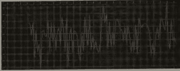

## 综合起来

基于对话框的窗口中的 TabControl 管理显示的信息。TabPages 由被调试游戏发送的信息动态创建。有关 TabControl 和 TabPages 的示例，请参见图 1.12.2。


启动调试日志记录器后，我们将尝试连接到要记录的已记录游戏。连接后，已记录游戏将发送它希望与日志记录器注册的 TabPages 名称。这些名称将关联一个索引，在后续通信中仅发送索引。然后它将发送希望记录的名称列表，以及应使用的表示类型和特定数据（如果需要，例如图表的范围）。

连接并初始化后，日志记录器将开始接收数据。每个数据包包含 TabPage 索引、ValueName 索引和实际数据。快速查找告诉我们确切需要更新特定页面的哪个部分。数据表示类负责按预期显示数据。

## 游戏日志模块

LogModule 在单例中实现。这使我们能够安全地访问全局可用对象。创建 LogModule 时，它会初始化特定于平台的网络库。

TabPages 和已记录变量的注册通过一个静态函数完成，该函数在 LogModule 初始化阶段调用。TabPages 和变量索引使用枚举。使用宏将枚举成员转换为调试日志记录器中使用的变量名。

虽然 LogModule 被视为服务器，但在示例代码中，它一次只接受一个连接。未做任何处理来允许多个日志记录器注册 LogModule 调试信息。在当前连接关闭之前，LogModule 停止接受传入连接。

由于我们专门针对 CPU 轻量级日志系统，通信部分通过异步网络函数处理。这与网络初始化是两个特定于平台的代码部分。

### 日志记录

日志函数是可变参数函数，旨在为使用调试日志系统的程序员提供易于使用的系统。它消除了在将调试信息传递给日志函数之前必须格式化的负担。这样，我们仍然可以像使用 OutputDebugString 时一样向日志记录器发送字符串，只是更加灵活。

整个调试日志 LogModule 代码都用 #ifdef 屏障包装，以便在我们想要排除日志信息时轻松移除。对日志函数的调用通过定义的宏完成。这将消除游戏代码中进一步 #ifdef 包装器的需求，因为当日志系统不包含在构建中时，它们将被定义为空。

### 可能的改进或扩展

以下是改进或扩展调试消息日志记录器的可能性列表：

- 滚动表示应有可能限制保留的行数。即使是一个全局变量，如果用户希望，可以在每个列表中覆盖，也将是朝着正确方向迈出的一步。
- 允许用户为给定的调试信息切换表示类型。
- 允许用户修改图表的范围。
- 当图表检测到数据在一定时间内超出范围时，让图表修改其范围。
- 提供将接收到的每一位信息或按页面记录到文件的可能性。每个页面应有不同的文件。
- 允许不止一个调试日志记录器与 LogModule 注册。

## 结论

在本文中，我们介绍了一种简单、可扩展且高效的方式来显示调试信息，同时不会使游戏屏幕杂乱无章。虽然调试消息日志记录器/查看器并不总是优先级很高，但在紧张的开发时期，一个好的调试消息日志记录器/查看器往往能起到关键作用，而此时功能往往伪装成 bug。

## 参考文献

- [Gizz04] 我的网站，http://www.gizz-moo.com。

## 透明类保存和加载技巧

Patrick Meehan
gems@tenaciousgames.com

将结构化数据打包为连续块以便加载后立即使用是一种众所周知的减少加载时间的方法 [Olsen00]。一个限制是指针（包括虚函数表指针）未被保留，这使得保存和恢复包含虚函数的复杂数据结构或类变得困难。

本文的第一部分介绍了一种保存用户定义指针的简单方法，以及安全恢复虚函数表指针的技巧。这意味着游戏数据可以自由地使用类、虚函数和指针来描述，而无需为每个类实现繁琐的序列化或恢复方法。

本文的其余部分探讨了示例 API 的设计和实现。该实现提供了透明的类保存和加载功能，对最终用户施加的限制很少。讨论了实现细节，希望读者能够改进和扩展它。

### 技巧

该技巧实际上是指针算术和 placement new 运算符的简单用法。

### 保存和恢复用户定义指针

如果我们不想在运行时处理相对偏移，可以简单地在加载时通过构建指针重映射表并将其存储在文件末尾来解决它们。每个条目包含需要重映射的指针的偏移量以及指针重映射到的目标的偏移量。两个偏移量都相对于文件基址，因此我们可以只需添加文件目标地址来解析它们。

### 保存和恢复虚函数表指针

当你在类中声明虚函数时，编译器会将虚函数表指针添加到类的内存占用中。当类被构造时，the


指针被填充为适用虚函数表的地址。不幸的是，虚函数表指针仅在创建它的会话期间有效。如果将带有虚函数表指针的类存储在文件中，那么在下一次会话中重新加载文件时，该指针很可能是垃圾值。

因此，问题可表述为：当类在先前会话中构建时，我们如何安全地恢复该类的虚函数表指针？

解决方案在于 placement new 运算符。placement new 运算符使用用户指定的内存“原地”构建对象。与 operator new 不同，placement new 运算符不会分配任何内存。

```
char rawmem [ sizeof( Foo ) ]; // Raw memory to hold a Foo.
Foo* foo = new ( rawmem ) Foo(); // Construct a Foo in place.
```

如果希望调用类的析构函数，则必须手动执行。

```
foo->~Foo(); // Explicitly call the destructor.
```

调用 placement new 在已由同类型对象占据的内存上构建对象，可确保其虚函数表指针有效。如果将构造函数留空，则可以恢复在先前会话中保存的对象。构造函数留空是为了避免加载时重新初始化。另一种方法是创建专门用于 placement new 恢复的单独构造函数。

## 实现 FreezeMgr

在本节中，我们将不再讨论背景信息，而是实际介绍随附光盘中提供的实现的设计。假设您是一名系统或引擎程序员，有兴趣为团队其他成员提供解决方案。本文所指的用户是游戏或工具程序员，他将使用（但可能不会修改）该实现。


希望您能阅读本说明并尝试示例，随后编写自己的实现或修改此实现以满足您的需求。讨论中的示例是一个有限版本的实现，某些功能被合并，某些内容被简化，以保持专注。

## 使用模型

我们希望最终用户能够以任何顺序创建游戏数据。这包括类、结构体以及复合类型和简单类型的数组。我们还希望用户的指针在加载时能自动恢复。

我们需要一种方法来跟踪用户创建的数据，并提供保存和恢复的接口。为此，我们将使用一个名为 FreezeMgr 的单例类。其隐喻是：用户创建的任何数据都被完整冻结，保持其自然状态，随时可以解冻并稍后使用，无需额外准备。

因此，FreezeMgr 的关键操作是 Freeze() 和 Thaw()。由于 FreezeMgr 需要跟踪用户创建的数据，其接口还将包括分配和删除的方法。

至于所使用的单例设计模式，我们将以最基本的方式为本示例实现单例接口；更复杂的方法请参见 [Bilas00]。

从最终用户的角度来看，流程如下：

- 使用 FreezeMgr 创建游戏数据。
- 以适当的方式初始化数据。
- 指示 FreezeMgr 将所有相关数据打包到文件中并保存，以便最佳重新加载。

## 跟踪用户分配的内存

每当用户请求 FreezeMgr 创建某项内容时，FreezeMgr 将分配一个内存块并存储其内部记录。该记录包括块的大小和地址。我们将提供以下方法来分配内存：

```
template < typename TYPE >
TYPE* FreezeMgr::AllocTyped() { u32 elements; }
```

AllocTyped() 是一个模板方法，它将同时使用 malloc() 和 placement new 运算符来创建用户指定的类型（或类型数组）并调用相应的构造函数。我们使用 malloc() 而不是 new，因为我们希望精确控制类的构造时间，与内存分配时间无关。

用于跟踪内存分配的记录称为 MemBlock。FreezeMgr 在地址到 MemBlock 的映射中存储 MemBlocks。MemBlock 包含一个方法，用于检查给定地址是否在其范围内。该方法为：

```
bool MemBlock::ContainsAddress ( void* addr ) const;
```

同样，FreezeMgr 包含一个方法，给定任意地址，将返回包含该地址的 MemBlock（如果存在这样的 MemBlock）：

```
MemBlock* FreezeMgr::FindContainingMemBlock ( void* addr ) const;
```

## 跟踪用户声明的指针

用户声明的指针借助名为 FreezePtr 的模板类进行跟踪。其模板参数是指针类型。唯一的数据成员是指针本身。

在构造时，FreezePtr 将尝试向 FreezeMgr 注册自身。如果 FreezePtr 在某个 MemBlock 范围内，则将其记录存储在该 MemBlock 中。否则，将忽略 FreezePtr。

确定 FreezePtr 是否在 MemBlock 范围内，只需调用 FreezeMgr::FindContainingMemBlock() 即可。

## 构建文件

在此阶段，我们可以实现两个目标：

- 我们将用户数据打包到一个连续的内存块中，该块可一次性加载。
- 我们将在加载时遍历该内存并修补所有指针，以便用户无需处理相对偏移量。

因此，只要类和结构体不包含虚函数，它们就可以开箱即用（我们将在下一节介绍虚函数表）。

在为用户打包文件之前，我们必须考虑用户在数据重新加载到内存后将如何访问数据。用户可能希望通过他们自己定义的某个类或结构体来访问数据。他们希望将文件视为具有某种根类型，通过该根类型可以访问数据。例如，如果文件表示一个游戏关卡，其类型可能是用户创建的 GameLevel 类，其中包含指向生成点、碰撞几何体、节点图等内容的指针（当然是 FreezePtr）。

要求用户指定根类型的决定暗示了文件实际打包的方法。用户将以根类型的类作为参数调用 FreezeMgr::Freeze()。FreezeMgr 将找到包含该类的 MemBlock 并将其打包到文件中。然后，它将通过沿每个 MemBlock 已知的 FreezePtr 进行递归遍历，来处理与根类型关联的任何其他 MemBlock。

当我们沿 FreezePtr 连接的 MemBlock 网络进行“泛洪填充”时，将执行以下几项操作：

- 将遇到的每个 MemBlock 添加到要包含在冻结中的块列表
- 计算块在连续打包块中的位置
- 将每个 FreezePtr 的值计算为连续块中的偏移量
- 将每个 FreezePtr 添加到要包含在冻结中的指针列表

在此过程中，我们假设每个 FreezePtr 都指向由 MemBlocks 跟踪的有效内存或 NULL。换句话说，如果指针不是 NULL，则调用 FreezeMgr::FindContainingMemBlock() 应始终返回有效的 MemBlock。

构建 MemBlock 列表后，我们将扫描该列表并将每个块打包到文件中。然后，我们将写出指针表。表中的每个条目包含指针的偏移量和指针内容的偏移量。

按预期，解冻文件的过程简单且快速。

要加载文件，我们分配足够大的内存块来容纳连续块，然后通过单次读取将其读入。接着，通过扫描指针重映射表并执行指针运算来修补指针。

请注意，指针对重映射顺序不敏感，因此请按任何能最佳提升性能的顺序对重映射表进行排序（在输出之前）。

## 恢复虚函数表指针

如前所述，我们可以使用 placement new 来恢复虚函数表指针。因此，FreezeMgr 也是一个工厂类，可以查看类的实例并使用 placement new 对其进行恢复。您可以使用独立的工厂类；为了讨论方便，我们将该功能封装到 FreezeMgr 中。

为了使此实现正常工作，任何包含虚函数的类都必须继承一个用于标识它的抽象基类。该类只有一个数据成员，即 32 位类型识别号。我们将基类称为 Freezable，尽管这有点名不副实，因为它仅用于限定可实际冻结内容的一个子集。

Freezable 可以整体分配，也可以嵌入到另一个类中。与 FreezePtr 类似，Freezables 由包含它们的 MemBlock 跟踪。

为了在加载时构建 Freezables，FreezeMgr 维护一个抽象创建者类的内部表。每种 Freezable 类型都必须有自己的具体创建者类。抽象创建者称为 AbstractCreator。提供了一个名为 concreteCreator<> 的模板类，以省去用户为每个 Freezable 编写创建者的麻烦。用于注册用户定义类的方法也是一个模板：

```
template <typename TYPE>
void FreezeMgr::RegisterFreezableType(void);
```

此函数声明一个静态 ConcreteCreator<TYPE> 并将其分配给下一个可用的 AbstractCreator 表项。表项的索引随后成为该类的 32 位识别号。我们可以使用映射将用户定义的标识符转换为表项，但在加载时检查每个 Freezable 的类型时，直接索引表格更高效。权衡在于，为了使 FreezeMgr 创建的数据在会话之间保持有效，添加新类型时必须遵守类型注册的顺序。

为了确保正确的 32 位类型标识符映射到给定的 Freezable 实例，我们要求用户在 Freezable 中重载一个纯虚方法：

```
char const* Freezable::GetClassName(void) const;
```

为了确定给定类的标识符，FreezeMgr 维护一个类名到标识符的映射。任何 Freezable 都可以通过调用 GetClassName() 并使用该名称来检查类是否已分配标识符，从而确定其标识符。

有关处理运行时类型信息的更强大、更有用的方法 [Wakeling01] 应该被探索，以取代此处采用的方式。


由于 Freezable 的构造函数会在解冻期间被调用，用户必须小心不要重新初始化其成员。例如，如果 Freezable 在构造时将其成员初始化为 NULL，那么在解冻期间这些成员将被重新初始化为 NULL。

我们可以通过提供一个仅在解冻期间由 placement new 调用的替代构造函数来绕过重新初始化的问题。问题是，除非用户为每个成员实现一个替代构造函数并在构造函数链中设置对它的显式调用，否则无法将此扩展到 Freezable 的成员。为了可能最终只是一堆空构造函数，这会带来很多麻烦。更务实的方法是从一开始就暴露这个问题（以便用户意识到它），并要求用户通过调用 FreezeMgr::IsThawing() 来检查重新初始化。

回顾对最终用户施加的限制：

- 用户必须从 Freezable 派生所有包含虚函数的类。
- 用户必须重载 GetClassName()。
- 用户必须在使用 FreezeMgr 之前声明所有 Freezable 类型。
- 用户不得更改声明 Freezable 类型的顺序。
- 用户要么在 Freezable 的构造函数或其成员类构造函数中不执行任何操作，要么检查是否有解冻正在进行，并且仅在没有解冻时执行初始化。

管理并冻结用户的类：

- 在创建 Freezable 时跟踪它们。
- 在所有 MemBlock 和 FreezePtr 重新映射后，重新映射 Freezable。
- 写出 FreezePtr 重新映射表。
- 写出 Freezable 表。该表仅包含每个 Freezable 的相对偏移量。

从文件解冻：

- 读入连续的数据块。
- 修补所有指针。
- 在内存中查找每个 Freezable 并确定其 32 位类型编号。
- 使用类型编号索引 AbstractCreator 表。
- 将 Freezable 传递给 AbstractCreator::Construct()。

## 更多功能

FreezeMgr 尚未完全准备好用于生产环境。还需要更多功能才能使其有用。

## 序列化数据

仍然存在我们希望将部分数据视为序列化流的情况。为了支持这一点，我们向 Freezable 添加了两个虚方法：

```
virtual void Freezable::SerializeIn( FILE* file );
virtual void Freezable::SerializeOut( FILE* file );
```

用户可以通过重载这些方法向 Freezable 类添加序列化数据。如预期，SerializeOut() 在冻结期间被调用，SerializeIn() 在解冻期间被调用。在这两种情况下，用户都直接控制文件。FreezeMgr 会记住 SerializeOut() 写入了多少字节（如果有），因此 SerializeIn() 必须读取相同数量的字节。

## 以编辑模式加载

到目前为止，我们假设用户会在一个会话中创建和修改游戏数据，并在另一个会话中以只读模式加载它以供使用。

实现编辑或读写内存选项的关键是在加载时重建 Freezable 的内部表，包括内存块表和指针重映射表。完成此操作后，用户可以自由地增强或修改数据，然后重新冻结它。

对 FreezeMgr 的此扩展可能与允许玩家随时保存游戏的现有方案相契合 [Brownlow02]。

## 文件引用

您可以给用户提供初始化 FreezePtr 的选项，使其在加载时解析为文件：

```
mFoo.PointAtFile ( "bar.bin" ); // mFoo is a FreezePtr
```

当包含 mFoo 的文件被加载时，资源管理器会自动加载 "bar.bin" 并将 mFoo 指向它。要将其打包为独立示例实现，要么需要与资源管理器 [Boer00] 绑定，要么需要回调接口，这两者都超出了本文的范围。尽管如此，这是一个有用的功能，您应该考虑实现它。

## 使用示例实现

您可以按原样使用提供的示例，但应该尝试对其进行重构以满足您自己的需求。它是为此文章编写的，作为作者使用的实用程序的独立版本。它按原样提供。商业用途没有担保，也没有支持计划，因此建议您熟悉它，了解其缺陷，并创造属于您自己的全新缺陷。FreezeMgr 可能成为您项目的关键部分，因此请接受此免责声明，并给予您自己的实现应有的仔细关注。

出于各种设计原因，调用解冻类析构函数的机制未包含在内。如果您使用序列化数据功能，这将是一个问题，因为您可能会分配内存。出于此原因，您必须决定如何处理释放由序列化类分配的内存。

## FreezePtr 模板类

FreezePtr 在构造时会自动向 FreezeMgr 注册自身。只需将其包含在您的数据中，并像常规指针一样使用它。在结构体或类中，声明：

```
FreezePtr<Foo> mFooPtr; // A pointer of type Foo
```

您只应将 FreezePtr 指向使用 FreezeMgr 分配的内存，否则在冻结数据时 FreezeMgr 会 assert()。

## Freezable 类

如果一个类包含任何虚函数，它必须继承抽象基类 Freezable。其接口为：

- `virtual char const* getClassName(void):` 纯虚函数。您必须重载它以返回一个用于标识类的常量。
- `virtual void SerializeIn(FILE* file):` 在解冻结束时调用，此时指针和虚函数表已恢复。
- `virtual void SerializeOut(FILE* file):` 在冻结结束时调用。重写此方法以按您希望的任何格式输出数据。

因为类的构造函数必须在加载时被调用以恢复虚函数表指针，所以请确保在构造函数中不执行任何操作，除非您调用 FreezeMgr::IsThawing() 来确定是否有解冻正在进行。您需要在冻结或解冻之前调用 FreezeMgr::RegisterType() 将类型名称映射到 32 位标识符。

## FreezeMgr 单例

FreezeMgr 单例控制文件的创建、加载和保存。它还提供内存分配和类创建方法，以创建可冻结的数据。FreezeMgr 对其未创建的数据持轻蔑态度，如果您尝试冻结它，它会 assert()。如果您将 FreezePtr 指向非托管数据，它也会 assert()。接口为：

- `template<typename TYPE> AllocTyped(int total=1):` 分配并返回类型 TYPE 的类或数组。要创建数组，只需传入其大小。
- `void Flush(void):` 释放 FreezeMgr 分配的内存并清除内部列表。
- `void Freeze(void):` 删除 FreezeMgr 分配的内存。这包括通过 Thaw() 加载的文件。

```
void Freeze(char const* filename, void* addr): Walks the graph of data to be frozen starting at the address provided and writes out a file. The address provided must be an address returned by AllocTyped<>().
static FreezeMgr* Get(void): Returns the FreezeMgr singleton.
bool IsThawing(void): Returns true if a thaw is in progress. This is relevant to Freezable constructors that wish to avoid reinitialization.
template<typename TYPE> void RegisterType(u32 typeID): Register a class derived from Freezable with the FreezeMgr.
template<typename TYPE> ThawTyped* ThawTyped(char const* filename, bool edit = false): Load a file created by Freeze() and restore it for use.
```

如果您创建从 Freezable 派生的类，则必须在初始化代码中将它们注册到 FreezeMgr，并在任何 FreezeMgr 调用之前完成。请记住，FreezeMgr 根据注册顺序分配类型标识符，因此顺序必须保持不变。如果这太受限，可以以轻微的性能损失为代价轻松更改。

可以在 Freeze() 和 Thaw() 中使用 void 指针。这很危险，但消除了使用 Freezable 的要求。希望用户不会滥用此功能。如果您不持这种乐观态度，那么同样，这很容易更改。

## 结论

这个特定的实用程序代表了大量极其乏味的代码，基本上做了大量幕后的簿记工作。话虽如此，我们已经为一个开箱即用的 API 打下了基础，该 API 可用于管理编写和维护游戏文件所关联的许多混乱和麻烦。

示例实现有大量注释，因此您应该深入其中并对其进行扩展，以包含许多优秀作者的想法，他们的作品构成了《游戏编程宝典》的主体。

## 参考文献

- [Bilas00] Bilas, Scott, "自动单例实用程序." Game Programming Gems. Charles River Media, Inc., 2000.
- [Boer00] Boer, James, "资源和内存管理." Game Programming Gems. Charles River Media, Inc., 2000.
- [Brownlow02] Brownlow, Martin, "立刻救我！" Game Programming Gems 3. Charles River Media, Inc., 2002.
- [Olsen00] Olsen, John, "快速数据加载技巧." Game Programming Gems. Charles River Media, Inc., 2000.
- [Wakelin01] Wakelin, Scott, "动态类型信息." Game Programming Gems 2. Charles River Media, Inc., 2001.


## 高效的缓存无感知 ABT 树实现

Sébastien Schertenleib, Swiss Federal Institute of Technology (EPFL), Virtual Reality Lab (VRlab)
Sebastien.Schertenleib@epfl.ch

如今，计算机架构描述了多个逐渐变慢且容量更大的内存层级。这些层级包括寄存器、一级缓存、二级缓存、主内存和磁盘。访问时间从寄存器的一个周期增加到缓存、主内存和磁盘分别约为 10、100 和 100,000 个周期（参见图 1.14.1）。根据当前和未来的 CPU 及内存演进 [Moore65]、[Hennessy03]，不利用这种分层内存表示的算法将因大量缓存未命中而承受越来越大的性能惩罚。为解决此问题，[Frigo99] 引入了缓存无感知算法。其思想是在不了解内存块大小的具体信息的情况下，优化 I/O 模型的方案。它们描述，基本问题可以使用缓存无感知的最优算法来解决 [Frigo99]。最初的尝试专注于矩阵和 FFT 变换。后来，[Bender00] 为 B 树和搜索树表示提供了额外的建议。缓存无感知算法与缓存感知算法不同，因为它们能自适应于任何架构。

## 计算机内存架构

大多数算法都忽略内存架构。那些由小型数据结构（如二叉树）驱动的算法在访问其数据时会遭受巨大的性能惩罚。每个内存层的工作方式相似，并由缓存块组成。当前架构使用约 32–64 字节的缓存行。通过访问同一缓存行内的数据，可以实现显著的性能提升 [Patterson97]、[Hennessy03]。缓存行的生命周期取决于特定于硬件的启发式策略 [Smith87]。缓存内的决策基于

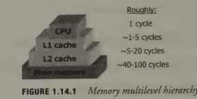

替换和关联策略。有时，缓存未命中是不可避免的 [Hill02]，例如在以下情况中：

- **强制性**：无法避免缓存未命中；当某些数据首次被访问时会发生这种情况。
- **容量**：数据在之前的步骤中能够放入缓存，但由于缓存的更新策略，数据已从该缓存层级中移除。
- **冲突**：由于数据映射到相同的缓存行而导致的缓存抖动。

## 数据结构与缓存一致性

空间对齐会影响缓存的使用。值得注意的是，大量使用指针的数据结构不是良好的候选者。将一起访问的指针或数据一起存储，可以优化内存访问 [Ericson03]、[Ding04]。在某些情况下，它们可能不符合面向对象编程方法论。

## 范德梅布斯布局

范德梅布斯布局 [van Emde Boas77]（参见图 1.14.2）是将平衡树布局到内存中的标准方法，以便在缓存无感知模型中使用 O(4 * log_b(n)) B = NbElement/Cache Line 次内存传输高效遍历根到叶路径 [Agarwal03]。

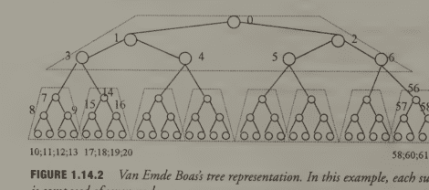

## ABT 树

ABT 树与 KD 树 [Szécsi03] 非常相似。在每个步骤中，可以基于轴对齐分割器创建两个子节点。与 KD 树的一个区别在于，算法将最小化生成子节点的 AABB，并将所有几何体仅存储在叶节点中。因此，每个节点都成为空间中完全封闭的区域，其中内部节点用于拒绝遍历环境中不可见的部分。

### ABT 树创建

创建此类树始于包含对整个场景 AABB 引用的根节点。递归构建方法沿轴对齐分割器将局部当前 AABB 细分为两部分。然后，每个面根据其中位数被分配给一个子节点（参见图 1.14.3）。

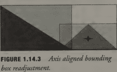

一旦所有面的分配完成，每个子节点将重新计算包含该层级唯一面的自身 AABB。结束标准取决于预期的特定 3D 环境和硬件。分割策略将尝试最小化以下属性：

- 空间定位，如方程 1.14.1 所示：
  
  \( f_1(n) = Min(Area(boxLeft) + Area(boxRight)) \quad (1.14.1) \)

- 树平衡，如方程 1.14.2 和 1.14.3 所示：
  
  \( f_2(n) = Min[\Delta(Area(boxLeft) - Area(boxRight))] \quad (1.14.2) \)
  
  \( f_3(n) = Min[\Delta(\Sigma(ExtendedArea) - \Sigma(Area))] \le \varepsilon \quad (1.14.3) \)

- 在出现明显性能惩罚之前，Epsilon 应保持在 5–10% 以下。在大多数情况下，90% 的面将包含在这个 5% 扩展的 AABB 中

场景复杂度，如方程 1.14.4 和 1.14.5 所示：

\( f_4(n) = Min[\Delta(\sum faces(boxLeft) - \sum faces(boxRight))] \quad (1.14.4) \)

\( f_5(n) = Min[\Delta(\int resources(boxLeft)dt - \int resources(boxRight)dt)] \quad (1.14.5) \)

最终方程变为方程 1.14.6 所示：

\( f(n) = w_1 * f_1(n) + w_2 * f_2(n) + w_3 * f_3(n) + w_4 * f_4(n) + w_5 * f_5(n) \quad (1.14.6) \)

权重将在遍历过程中根据引擎瓶颈和场景组织（场景图、特效等）发生变化。该方法在预处理阶段和运行时也会有所不同。

在运行时，通常每个视点会在不同的渲染阶段（剔除、阴影、碰撞检测等）进行完整或部分遍历。幸运的是，ABT 树遍历非常简单且计算速度快。从最后一个局部根开始，递归函数测试两个子节点中是否有任何一个在视锥体内，如果是，则继续树遍历。当到达叶节点时，包含的所有几何体都可以发送到渲染管道的下一阶段。由于每个面都是唯一的，不需要额外的测试（例如碰撞检测）。我们还可以按叶节点保留一个小顶点缓冲区和局部材质。为了减少使用的顶点缓冲区数量，我们可以利用邻近子节点的位置。因此，一个顶点缓冲区可以在叶节点之间共享，其限制范围内（通常为 65K 个 16 位索引）。当邻居需要一起处理时，这提供了更高效的分支，从而提高渲染性能 [Wloka03]。

ABT 树还可以通过简单地在子树中重新排序每个移动的 AABB 来动态调整。动态树的一个缺点是它们随时间推移往往会退化。

## 效率

所有二叉树，尤其是 BSP 和 KD 树，都受深度级别的影响。即使具备 ABT 树的能力，这仍然是一个重要问题。假设树实现使用指针而不是隐式指针，我们可以认为每次树需要跟随指针时，都会发生 CPU 缓存未命中。相对于深度级别，缓存未命中的数量将相应增加，直到达到一个限度，此时它们的开销超过测试相交。然而，缓存无感知树相对于缓存行大小减少了缓存未命中。遍历随后对内存访问的敏感度低于对 CPU 性能的敏感度。

## 复杂度

ABT 树（如所有二叉树一样）具有 O(log n) 搜索时间 [Sedgewick90]。通过使用范德梅布斯缓存无感知布局表示，搜索时间可以被限定为 O(4 * log_b(n))，其中 B = CoupleNodesByCacheLines [Brodal03]（参见图 1.14.4）。

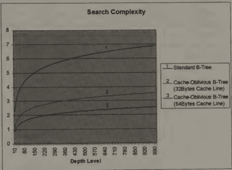

图 1.14.4 搜索时间阶。

每个节点需要存储其局部 AABB 以及指向其两个子节点的指针（或索引）。使用朴素实现，内存消耗将变得相对较高：

- 由六个浮点值描述的 AABB：6 * 4 字节
- 指向其两个子节点的指针：2 * 4 字节（32 位 CPU）或 2 * 8 字节（64 位 CPU）

因此，每个节点的总内存需求为 32 字节（32 位 CPU）或 40 字节（64 位 CPU）。

然而，[Gomez01] 已表明，我们只需为每个子节点保留相对范围，这些范围可以截断为 8 位整数值。这种保守估计将具有 1/255（即约 0.4%）的相对误差，该误差由平均 5–10% 的 AABB 重叠所覆盖。

## 利用冗余

[Gomez01] 已描述了减少内存占用的实用方法。在每次细分中，定义子节点 AABB 的 12 个范围中的 6 个直接来自


父节点，因为所有面都会被传播到叶节点。为了每个节点节省几个字节，我们按对存储它们。因此，不在本地保存绝对 AABB，每对节点将保存相对于其直接父节点 AABB 的比例。因此，需要六位来表示子节点的相对比率。通过不同标志指定的附加字节将使用来自两个子节点的相对位置并重用父节点值。在运行时遍历期间，递归方法会即时重新计算本地 AABB。最后，由于此阶段最后一个字节有两个未使用的位，我们指定左子节点或右子节点是节点还是叶节点（参见图 1.14.5）。为了保持缓存无关数据结构，我们将它们存储在八个字节中，为树本身留出七个未使用的位。例如，它们允许指定以下子树是否已加载，这对于流式世界可能很有用。

| 63 | 62 | 61 | 60 | 59 | 58 | 57 | 56 | 55 | 54 | 47-40 | 39-32 | 31-24 | 23-16 | 15-8 | 7-1 | 0 |
|---|---|---|---|---|---|---|---|---|---|---|---|---|---|---|---|---|
| LX | LY | LZ | RX | RY | RZ | L | Lx | Ly | Lz | LX | LY | LZ | RX | RY | RZ | Ratio |

- L 指定它是节点还是叶节点。
- Ratio Lx,y,z：基于特定轴最低部分的相对比率，以强制截断的 AABB 等于或大于绝对 AABB。比率分为 255 个元素。
- Ratio Rx,y,z：同上，但使用较高部分。
- Flags：位 63-58 指定哪个子事件属于其父节点（1 左子节点，0 右子节点）。位 57-56 指示左子节点和右子节点是否是叶节点元素（1 叶节点，0 节点）。

### 图 1.14.5 ABT 树的节点数据表示（对）。

最后，由于子树始终是 2 的幂减 1，且缓存行大小始终是 2 的幂，我们有八个字节可用于将此子树链接到下一个子树。由于层次结构倾向于使用隐式指针，四个字节用于提供第一个可用子节点的索引。四个附加字节的部分指定哪个终端节点连接到子节点的子树。根据缓存行大小，某些位可能保持未使用（参见图 1.14.6）。

构建例程的设计使得来自最后一个子树的所有子树都是直接邻居（参见图 1.14.7）。

| | Byte N | Byte 8 | Byte 7 | Byte 4 | Byte 3 | Byte 0 |
|---|---|---|---|---|---|---|
| Nodes | ...... | | CXT | | | 1st Children Index |

- 字节 0-3：指向下一个子子树的第一个子节点的索引。所有子树都是直接邻居。
- 字节 4-7：CXT：指定终端节点 i 是否连接到子树的标志。
- 字节 8-N：每组 8 个字节表示一对节点或一个叶节点。

### 图 1.14.6 缓存行组织。

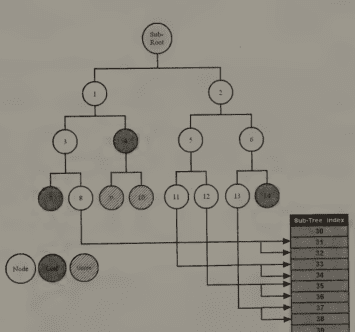

### 图 1.14.7 带有链接到后续子树的子树组织。

现在考虑一个叶节点，其组成由八个字节组成。一个位用于指定其条件。同样，这可能取决于系统可能使用的节点数量。在 32 位系统中，31 位通常就足够了；剩下四个字节可用于附加信息（主要用于资源的动态管理；参见图 1.14.8）。但是，64 位程序可能希望使用更多节点，因此占用超过 31 位。

| | | Leaf Index | |
|---|---|---|---|
| | | | L |

- L 指定它是节点还是叶节点。
- 在这种配置中，31 位用于引用叶节点，最后 4 个字节不用于树本身，但可以存储额外信息（例如用于流式世界）。

### 图 1.14.8 ABT 树叶节点数据表示。

## 性能

为分析此方法的性能，使用了三种不同的实现（参见图 1.14.9）：

- **直观：** 用于存储 AABB 的 6 * 4 字节和用于子节点指针的 8 字节（32 位 CPU），或每对 64 字节。
- **使用冗余：** 用于 AABB 的 8 字节，用于子节点指针的 8 字节，或每对 48 字节。
- **缓存无关（64 字节缓存行）：** 每对 8 字节 + 用于隐式指针所需的 8/7 额外字节，平均为 9.14 字节。全局内存需求取决于树的平衡（参见图 1.14.7）。


### 图 1.14.9 各实现间的内存使用情况。缓存无关的内存消耗取决于树的平衡。

## 验证阶段

验证是通过多种工具进行的。[VTune04] 用于观察内存访问并发现不相关的瓶颈。使用 [PAPI04] 还允许我们监控硬件计数器。它们可以跟踪缓存未命中、TLB 未命中和类似事件。但是，特定测量需要创建专用分析器。通过从基于 RAM 到缓存无关的多种实现，收集了统计数据以改进和理解缓存无关实现。

## 结论

尽管这篇文章侧重于剔除算法，但 ABT 树对包括 AI 或 3D 声音管理在内的许多其他元素也很有用。这允许使用多个视图共享世界的表示 [Bar-Zeev03]。

当前硬件的发展要求研究通过不同内存层访问数据的成本。CPU 速度将继续大幅提升，但内存发展无法跟上。计算机将越来越依赖内存访问，而非纯粹的原始性能。

使用大型数据集的实时模拟将受到内存瓶颈的限制，从而降低 CPU 发展的影响。最后，缓存无关算法的自适应特性相对于缓存感知算法提供了更好的替代方案，同时提供了接近相似的性能。

## 参考文献

- [Agarwal03] Agarwal, Arge and Bryan Danner. “Cache-Oblivious Data Structures for Orthogonal Range Searching.” ACM Proceedings of the 19th Annual Symposium on Conceptual Geometry. 2003.
- [Bar-Zeev03] Bar-Zeev. “Scenegraphs: Past, Present and Future.” Available online at http://www.realityprime.com/scenegraph.php. 2003.
- [Bender00] Bender, Demaine and Farach-Colton. “Cache-oblivious B-trees.” In Proc. 41st Ann. Symp. on Foundations of Computer Science, 399–409. IEEE Computer Society Press, 2000.
- [Brodal03] Brodal. “Cache Oblivious Searching and Sorting.” Seminar, IT University of Copenhagen. Copenhagen, Denmark. 2003.
- [Ding04] Ding, C. “Data Layout Optimizations, Computer Organization.” Lecture, Rochester, NY, 2004.
- [Ericsson03] Ericsson, Christer. “Memory Optimization.” CDC 2003, Santa Monica. Sony Computer Entertainment, 2003.
- [Frigo99] Frigo, Leiserson and Ramachandran Prokop. “Cache-Oblivious Algorithms.” In Proc. 40th Annual Symposium on Foundations of Computer Science (FOCS), 285–297. 1999.
- [Gomez01] Gomez, Laura. Compressed Axis-Aligned Bounding Box Trees. Charles River Media, 2001.
- [Hennessy03] Hennessy, Patterson. Computer Architecture: A Quantitative Approach. Morgan Kaufmann Publishers Inc., 2003.
- [Hill00] Hill, Lipasti. Cache Performance. University of Wisconsin-Madison, 2002.
- [Moore65] Moore. “Cramming more components onto integrated circuits.” In Electronic Magazine 38, 114–117. 1965.
- [PAPI04] PAPI. “Performance application programming interface.” Available online at http://icl.cs.utk.edu/projects/papi. 2004.
- [Patterson97] Patterson, Hennessy. Computer Organization and Design Second Edition: The Hardware/Software Interface. Morgan Kaufmann, 1997.
- [Sedgewick90] Sedgewick. Algorithms in C. Addison Wesley, 1990.
- [Smith87] Smith. “Line (block) size choice for CPU cache memories.” In IEEE Transactions on Computers, 1987.
- [Szécsi03] Szécsi. “An Effective Implementation of the K-D Tree.” In Graphics Programming Methods. Charles River Media, 2003.
- [van Emde Boas77] van Emde Boas. “Preserving order in a forest in less than logarithmic time and linear space.” Inf. Process. Lett., 6:80–82. 1977.
- [VTune04] VTune. Intel Corp, 2004.
- [Wloka03] Wloka. “Batch, Batch, Batch: What Does It Really Mean?” GDC, 2003.


## 状态机的可视化设计

Scott Jacobs
scott@escherichia.net

并非进入游戏的所有代码都需要由程序员编写。游戏必须完成的许多活动，可能更适合使用一种专门的描述来表达，该描述在开发过程中会被转换为数据和代码。这一过程称为代码生成，对于可以使用状态机实现的系统来说，可能效果非常好。有关代码生成的更完整讨论，请参阅 [Herrington03]。代码生成要求在生成过程之前，完整且无歧义地表达目标系统的需求。以这种详细程度描述状态机——即本文的主题——可以通过流程图以可视化方式完成。

## 为什么要进行代码生成？

将一定程度的自动代码生成纳入开发流程有多种好处。例如，你可以编写（并调试）一次将状态机描述转换为数据和代码的代码，并在整个项目中重用该转换器。这对于实际使用生成的数据和代码的状态机本身也是可能的。这些组件一旦编写、调试和测试完成，就可以被用来驱动UI屏幕、复杂的粒子效果、游戏内电影过场动画，甚至游戏逻辑，并可重复使用。将这种运行时数据和代码生成构建到系统中，并具备即时执行的能力，为内容创作者提供了巨大的灵活性和自由度。与设计师以文本编写系统描述作为程序员实现规范的标准且过于常见的做法相比，从专门的可视化状态机描述生成状态机具有许多优势。也许这样的系统最大的优势也是最明显的一个。状态机描述以可视化方式表达，最终结果直接从可视化设计生成，从而在设计与功能之间提供即时同步性。

设计的变化会直接且立即导致状态机运行时操作的变化。另一个优势是，专用的数据创建和可视化工具可以简化状态机的布局。

数据创建和编辑的一个明显首选方案是流程图绘图工具。与系统操作的文本描述相比，设计师或程序员可以查看描述整个系统的流程图，在花费任何编码时间实现有问题的系统之前，直观地发现逻辑缺陷或设计问题。在可视化工具的约束下工作，还能强制系统保持一致和可行。程序员不需要再跑回设计那里去询问玩家是否可以在跳跃时开火，设计师可以在设计时通过链接或不链接跳跃状态到武器开火状态来做出此决定。逻辑流可以快速重新配置，可以尝试多种不同的运行时动作方法，而无需任何手动代码修改。

## 使其成为可能

要使状态机的可视化设计可行，需要预定义并向状态机设计师展示许多游戏引擎参数和方法。这些参数和方法还需要从游戏引擎内部暴露给状态机引擎。它们可能简单到只是一组描述玩家输入当前状态的全局布尔值，也可能是一个更复杂的脚本系统，暴露计时器、事件生成、游戏对象管理等。

许多小型、易于测试、可能互不相关的变量、方法和模块可以通过状态机链接在一起，以创建预期的游戏内活动。一个示例是模拟手枪动作的简单状态机。程序员可以实现将枪支纳入游戏所需的多个离散活动，例如提供播放声音、生成粒子效果和损坏游戏对象的钩子。然后，可以使用可视化设计工具布置状态机，并尝试和迭代多种游戏动作，这将在本文后面讨论。

## 应用通用工具

可以使用多种不同的工具来绘制状态机流程图。也许编写一个针对特定应用程序的自定义工具是最佳解决方案，但对于可视化状态机设计和代码生成的首次实验，一个很好的起点是现有的流程图编辑器。其中一个编辑器是 UMLPad [Bignami04]。这个GPL许可的应用程序可以在多个平台上运行，作为简单的状态机编辑器工作得相当不错。使用此工具可以轻松构建基本流程图，而基于文本的文件格式非常易于理解和解析，使将流程图定义转换为可在游戏引擎中运行的状态机成为一项简单的练习。

读取可视化设计的状态机描述的通用状态机引擎可以用多种语言编写，但这里我们将使用用 Lua [Lua04] 编写的一个引擎。进入第十个年头的 Lua 在游戏开发社区中的使用越来越广泛 [Burns04]，似乎是实现我们状态机引擎的自然选择。

通过 Lua 向状态机设计师暴露游戏引擎变量和方法相当简单，有许多现成的资源描述了这样做的方法。借助 toluap++ [Manzur04] 等工具，该过程通常可以变得更加高效，该工具会自动生成将 C/C++ 类型暴露给 Lua 的代码。如需 Lua 帮助，你应该查阅简短但非常全面的 Lua 手册 [Jerusalimschy03a] 以及 Roberto Ierusalimschy 编写的《Lua 编程》（Programming In Lua），该书有平装本和在线版本 [Jerusalimschy03b]。

Lua 是一种动态脚本语言，其中函数是一等对象。这提供了很大的灵活性，因为流程图到状态机的转换过程可以产生数据和机器生成代码的混合体。状态可以包含方法列表，这些方法用于确定机器是否应推进到新状态。使用 Lua 中称为元表的功能，可以编写简单的通用状态机管理代码，该代码对游戏中所有状态机实例的操作方式相同。因为所有状态机共享同一个元表，它们都呈现相同的接口，使游戏引擎对状态机的使用保持一致。每个状态机的独特性完全包含在（可视化设计的）数据中。

## 状态管理

这里描述的状态机引擎简洁而强大。如果牢记这里描述的数据结构、方法和关系都是基于 UMLPad 文件由转换脚本自动生成的这一事实，它似乎更加简单。每个状态都实现为一个 Lua 表，状态机引擎会跟踪哪个表是当前状态。该表可以包含引擎在适当时间查找和运行的任意数量的标准方法。

在这些方法中（对于任何给定状态都不一定存在），有在进入或退出状态时运行的方法。当状态机引擎更新时，当前状态也有机会更新自身。每个状态表都包含指向从当前状态可以进入的其他状态的链接列表，每个链接可能有一个推进条件方法，用于确定状态机引擎是否应遵循该链接。没有条件意味着引擎将始终遵循该链接。遵循链接会使链接的状态成为当前状态。

在每个状态机的更新周期中，当前状态的链接的推进条件会按顺序求值。如果没有满足推进条件，状态机将保持在当前状态。推进条件与可视化状态机设计工具中的给定链接相关联，可以简单到一个布尔值（当前是否正在按下输入按钮 X？），也可以是一个更复杂的函数。（计时器 X 是否已过期，或者库存中剩余的弹药量是否足以允许重新装填？）每个状态都有自己的状态特定数据表，该表可供所有


enter、exit 和 update 方法以及每个链接推进条件方法。此状态特定的数据区域是放置计时器或计数器的便利位置。状态机通过向状态机工厂请求一个命名状态机的实例来创建。状态机工厂加载从可视状态机数据文件生成的文件，安装状态机引擎元表，并将对象返回给调用者。一旦调用者拥有此表，就可以开始更新状态机。状态机工厂的用户可以是另一个 Lua 脚本、游戏引擎 C/C++ 代码，或任何存在 Lua 接口的其他代码。一旦状态机启动，状态机的用户应以适当的周期运行 Update()。如果状态机完成，Update() 返回 Lua 值 nil，在条件语句中求值为 false。

## 把所有内容整合在一起

作为此技术的具体示例，让我们设计一个状态机来操作一把简单的枪。这把枪应该能够发射子弹、耗尽弹药、从库存中存储的弹药重新装填，并在没有更多弹药时进行空枪击发。要查看可视化设计，可以使用 UMLPad 打开随附光盘中的文件 Gun1.uss；状态机设计的快照如图 1.15.1 所示。


图 1.15.1 描述手枪可能执行动作的简单状态机。

此状态机有一个起点（大黑点）且没有终点。启动后，状态机将立即进入 Idle 状态。由于我们重新利用了通用状态机编辑器，在填充每个状态的数据时必须小心遵循一些约定。在“活动和描述”字段中，代码生成脚本将查找特殊字符串 OnEnter、OnExit 和 OnUpdate。每个字符串之后的所有文本都将成为状态机引擎在适当时间运行的方法。这些方法将接收一个参数：state，这是一个可用于存储数据的状态特定表。如果将此精华融入你的生产流程，你可能希望修改 UMLPad 以包含每个方法的单独字段。在 Idle 状态中，只定义了一个方法：OnEnter。每次状态机引擎将状态机推进到 Idle 状态时，都会运行 OnEnter 方法。在此示例中，OnEnter 方法将 Idle 打印到屏幕上。

通过检查，我们可以看到状态机离开 Idle 状态有三种方式。推进所需的条件在每个链接上详细说明。在每个状态机更新周期中，这些条件会依次求值，一旦满足其中一个，状态机引擎就会将链接的状态设为当前状态，首先运行旧当前状态的 OnExit 方法（如果存在），然后运行新当前状态的 OnEnter 方法（如果存在）。

在这种情况下，假设 triggerDown 已变为 true，因为游戏引擎响应玩家按下射击按钮设置了该变量。Firing 状态成为当前状态。在实际实现中，Firing 的 OnEnter 方法可能会调用方法来播放枪声并在游戏世界中创建子弹实例。在下一个更新周期中，状态机发现 Firing 状态只有一个出口链接，由于没有条件，该链接会立即被跟随。

在 Recoil and Recovering 状态中，也只有一个出口链接（返回 Idle 状态），但直到计时器达到一定阈值之前都不能跟随。每个更新周期，状态机引擎运行 Recoil and Recovering 的 OnUpdate 方法，该方法按 game engine 设置的变量 frameTime 中的量增加计时器。状态的其余部分以类似方式运行。

## 数据驱动设计展示

在 Gun1.lua 上运行转换脚本 uusToState.lua 会生成一个文件 Gun1.lua，StateMachineFactory.lua 中的状态机工厂可以使用它为请求代码提供枪支状态机。脚本 testGun.lua 正是这样做的，它从 StateMachineFactory 请求一个 Gun 状态机，然后通过提供 frameTime、triggerDown 和 reloadDown 等变量来模拟游戏引擎的角色。脚本 testGun.lua 让枪经过 Idle、Fire、Recover 和 reload 状态，直到所有弹药耗尽，然后枪会陷入空转和空枪击发的无限循环。

现在是此精华的精妙之处：重新配置现有状态机以满足新的设计要求。也许设计部门希望对一种武器进行一些游戏性实验，该武器在弹药耗尽且扳机释放时会自动重新装填。为便于此操作，创建了一条从 Idle 状态到 Reload 状态的第二条链接，其条件为 not triggerDown 和 numRounds == 0，状态机现在具有所需的行为。图 1.15.2 显示了 Gun2.uss，其中包含从 Idle 到 Reload 的新链接。


图 1.15.2 已从“Idle”创建到“Reload”状态的第二条链接，当枪支没有弹药时会跟随该链接。

比较通过 testGun.lua 运行从 Gun1.uss 和 Gun2.uss 生成的 Gun.lua（将 reloadDown 硬编码为 false）以查看新行为的效果。当枪支没有弹药时，它会重新装填，即使 reloadDown 永远不会为 true。现在假设设计部门有新需求。枪支需要有 4% 的卡壳概率，清除需要三秒钟。修改 Idle 状态，在每个 OnUpdate 周期中计算卡壳概率。当扳机按下且有可发射的子弹时，如果卡壳概率小于 0.04，状态机将卡壳状态设为新状态。在 Idle 再次成为当前状态之前，卡壳状态的计时器必须增加到三秒钟。我们只需点击几下鼠标并输入少量内容，就创建了两个新的游戏对象行为！

## 结论

希望，使用文本编辑器以外的工具来创建游戏内动作和行为的潜力能引起你的兴趣。本精华中介绍的工具和语言，虽然是开始尝试状态机代码生成的良好基础，但不如受到以下概念的启发重要：像状态机这样的系统的核心结构可以被抽象、编写和调试一次，然后由工具提供的数据和代码来启用，这些工具具有许多好处，包括系统的自文档化、快速行为修改、系统约束的强制执行，以及对系统设计师没有特定语言知识要求。

## 参考文献

- [Bignami04] Bignami, Luigi. UMLPad。可在线查阅：http://web.tiscali.it/ggb-home/umlpad/umlpad.htm。
- [Burns04] Burns, Jon 和 David Eichorn。“GDC 2004—游戏行业 Lua 圆桌会议报告”。可在线查阅：http://lua-users.org/lists/lua-l/2004-04/msg00164.html。
- [Herrington03] Herrington, Jack. 《代码生成实战》。Manning Publications，2003。
- [Jerusalimschy03a] Jerusalimschy, Roberto, L. H. de Figueiredo, 和 W. Celes，《Lua 5.0 参考手册》。技术报告 MCC-14/03，PUC-Rio，2003。可在线查阅：http://www.lua.org/manual/5.0/。
- [Jerusalimschy03b] Jerusalimschy, Roberto. 《Lua 编程》。Lua.org，2003。另可在线查阅：http://www.inf.puc-rio.br/~roberto/book/。
- [Lua04] Lua。可在线查阅：http://www.lua.org/。
- [Manzur04] Manzur, Ariel. tolua++。可在线查阅：http://www.codenix.com/~tolua/。

### 1.16

### 通用组件库

Warrick Buchanan

warrick@argonaut.com

随着计算机游戏规模和复杂性的不断增加，采用允许更结构化设计方法的技术变得越来越关键。将软件系统视为一系列可重用组件的概念并不新鲜，但在我们行业中，这仍然是一项并非总是在应该应用的地方得到应用的实践。

本精华介绍了一个可配置的 C++ 模板库，旨在简化开发可重用软件组件的过程，支持工厂、接口、接口版本控制、类型识别策略和引用计数等功能。

首先，我们将介绍库所依赖的若干基本概念，这些概念本身也很有用且可以独立使用。从这些概念出发，我们将构建组件系统的基础并演示其用法。

### 类型识别系统

库依赖于在运行时识别类类型的手段。由于实现类型识别系统有多种偏好，因此它作为库的可配置参数呈现。它是一个简单的用户定义类，至少必须以如下形式实现：

```
struct TypeID
{
    template<class Type> TypeID(const Type* type);
    int ID();

    int operator==(const TypeID& typeID) const;
    bool operator<(const TypeID& typeID) const;

    static TypeID FromName(const char* const name);
};
```


这允许通过指向类的指针和类的字符串名称，利用静态成员函数来创建相关的 TypeID 对象。它还允许测试两个 TypeID 对象是否相等，并提供一种排序方法，当此类与 STL 容器类一起使用时非常有用。

类型识别参数被用作库中所有类的模板参数，因此它们不绑定到任何特定的类型识别系统。一个使用 Microsoft Visual C++ 7 中提供的 C++ type_info 支持的示例实现可以在提供的头文件 RTTITypeId.hpp 中找到。

## 工厂

一种将我们的组件创建方式与客户端代码与实际组件细节隔离开来的方法是使用工厂模式 [Gamma95]。如果我们暂时将组件视为更通用的“对象”名称，这将使我们能够设计一个在更一般意义上有用的工厂类。

我们希望工厂对象满足的第一个要求是，给定我们希望创建的对象的类型，它将创建该对象的一个实例：

```
template<class TypeID, class Base>
struct Factory
{
    Base* Create(const TypeID& typeID);
};
```

从这段伪代码中我们看到的第一个问题是，我们必须决定工厂的创建方法返回什么类型的对象。对于此实现，所有对象都派生自一个公共基类型，这就是创建方法返回的内容，因为这使要创建的对象的实际具体类对客户端代码进一步隐藏。

第二个问题是如何向工厂传达我们希望创建哪个对象。我们只需将标识我们希望创建的对象的类型识别对象实例传递给创建方法。

由于我们希望使库尽可能通用，我们还将工厂类模板化为先前讨论的类型识别类参数和创建方法返回的实际基类。这消除了对组件库其余部分不必要的依赖。

这种“寿司：挑选你想要的部分”的库设计心态对于用户充分利用任何库至关重要。它决定了一个拥有长久且高产生命周期的通用库与一个更像不灵活框架、需要不断重构的库之间的区别。

我们现在可以添加创建方法的重载版本，以允许 C++ 语法糖，这将使工厂类的使用更加容易：

```
template<class TypeID, class Base>
struct Factory
{
    Base* Create(const char* const name);
    Base* Create(const TypeID& typeID);
    template<class Type> Base* Create();
};
```

这允许以下创建模式：

### 模式 1：

```
Factory factory;
TypeID typeID;
Base* base = factory.Create(typeID);
```

### 模式 2：

```
class MyObject;
// ...
Factory factory;
Base* base = factory.Create<MyObject>();
```

### 模式 3：

```
Factory factory;
Base* base = factory.Create("MyObjectName");
```

### 模式 4：

```
class MyObject;
// ...
MyObject* myObject = 0;
Factory factory;
Base* base = factory.Create(myObject);
```

前三种创建模式通常最有用；当要创建的对象在编译时未知时，模式 1 和 3 至关重要，这是数据驱动应用程序的基本功能。

此时，你可能会想知道工厂如何知道创建我们请求的对象。必须告诉它们如何做到这一点，如果我们请求一个工厂不知道如何创建的对象，它们将从创建方法中返回 NULL。我们像这样扩展工厂类定义：

```
template<class TypeID, class Base>
struct Factory
{
    Base* Create(const char* const name);
    Base* Create(const TypeID& typeID);
    template<class Type> Base* Create();
    template<class Type> void RemoveSupport();
    template<class Type> void Support();
};
```

我们现在有两种方法可以动态地为工厂添加对任何我们希望的对象类型的支持（注意我们假设所有类都有默认构造函数）。给定一个我们希望创建的对象的实现，它派生自适当的基类，我们将其称为 MyObject，我们可以像这样为工厂添加对它的支持：

```
class MyObject : public Base
{
    MyObject();
    //...
};
```

```
Factory factory;
factory.Support<MyObject>();
```

我们的工厂对象现在将能够创建受支持类的实例。动态添加和删除特定对象类型支持的能力非常有用，并且并非在其他工厂系统设计中始终可用。

工厂对象如何能如此简单地做到这一点的具体细节将不在此处描述，而是在附带的源代码中提供。简要描述是，工厂为每个受支持的对象类型保存一个模板化构造函数对象的映射，每个构造函数对象都知道如何创建特定的对象类型。

## 工厂单例和子工厂

出于多种原因，将单例设计模式应用于工厂可能很有帮助，最重要的是简单性。我们可以通过向工厂类添加以下静态方法来轻松实现这一点：

```
struct Factory
{
    //...
    static Factory& Singleton()
    {
        static Factory factory;
        return factory;
    }
};
```

采用单例设计模式允许我们从几乎任何地方通过将工厂对象称为 Factory::Singleton() 来访问工厂对象的单个实例。这不仅是一个有用的便利，而且更安全。此外，我们可以添加对子工厂的支持，这意味着我们可以以层次结构方式连接工厂，以一种简单的方式影响对象创建。如果工厂不知道如何创建我们请求的对象，我们将递归下降其子项，直到找到一个知道如何创建该对象的子工厂。为此支持，我们像这样扩展工厂类：

```
struct Factory
{
    void RemoveChild(Factory* factory);
    void AddChild(Factory* factory);
};
```

通过这两个新方法，我们的工厂类现在可以维护一个指向子类对象（构造函数）的指针列表。在此实现中，不支持子工厂在其他地方被销毁但仍被另一个工厂对象引用的情况。系统可以通过向工厂类添加引用计数功能（或某种类似的安全网）来扩展以应对这种情况。

## DLL 工厂

对于 Microsoft Windows 操作系统，我们可以进一步增强我们的工厂，以支持使用动态链接库 (DLL) 的动态可加载工厂的概念。我们通过创建一个名为 DLLFactory、从 Factory 派生的类来实现这一点，该类封装了 DLL 的加载以及绑定到通过它们暴露的工厂。DLL 只需导出一个函数来返回要暴露的工厂对象的指针。请记住，可以通过使用子工厂从 DLL 暴露多个工厂。

实现可以在提供的源代码的文件 DLL-Factory.hpp 中找到，其使用示例在提供的示例工作区中。请注意，如果要卸载工厂 DLL，必须小心。使用 DLL 创建的对象可能仍然存在，这将导致访问违规。通过 DLL 工厂创建的对象也必须由该 DLL 释放，因此所有可由工厂创建的对象派生的基类应提供自删除方法。此类实现通常采用以下形式：

```
struct Base
{
    void DeleteThis()
    {
        delete this;
    }
};
```

在这种情况下，可以通过要求工厂对象跟踪并在它们创建的对象的生命周期中发挥更积极的作用来添加更复杂和强大的功能，但这超出了本文的范围。


## 组件

现在我们已经搭建好库的基本构建块，可以专注于组件本身的实际实现细节了。从概念上讲，组件应该是一个代码单元，其实现细节对客户端代码隐藏。组件与客户端代码之间的通信应通过接口进行抽象。由此，我们有两个关键概念：组件及其接口。

组件的生命周期必须以某种方式进行管理。我们的工厂类将提供创建设施，但我们可以使用引用计数系统来跟踪我们的组件并提供其销毁细节。该类提供引用计数功能，如下所示：

```
struct ReferenceCount
{
//...
void Reference();
void Release();
};
```

ReferenceCount 的完整实现可在 ReferenceCount.hpp 中找到。所提供的方法分别允许增加和减少对象的引用计数。当对象的引用计数变为零时，对象将自动删除自身。由此，我们可以通过从 ReferenceCount 类和库提供的基础 Component 类派生来配置特定的 Component 类实现。（这在文件 ExampleConfiguration.hpp 中所示）。此外，我们可以在 Component 类实现中定义 Clone() 方法，形式如下：

```
virtual Component* Clone() { return 0; }
```

这允许客户端代码以透明的方式复制组件，并且组件实现此方法是可选的。这仍然无法让我们从组件中获得太多用处，因为我们只能创建和销毁它们。我们需要为组件添加接口支持，以使其可用。

## 组件接口

实现这一点的标准方法是使用所谓的 QueryInterface() 方法。我们使用所需接口的标识符调用此方法，然后要么得到请求接口的指针，要么得到 NULL：

```
struct Component
{
template<class Type> Type* QueryForInterface();
//...
};
```

我们可以使用我们的类型识别系统来指定我们想要的接口，但我们会安排事物，以便在需要时可以使用另一个类。我们的组件类实际上将有两个模板参数：要使用的类型识别系统和要使用的接口识别系统。

```
template<class TypeID, class InterfaceID >
struct Component
{
    //...
};
```

InterfaceID 类参数与定义的类型识别类非常相似；它应该具有如下形式：

```
struct InterfaceID
{
    template<class Type> InterfaceID(const Type* type);
    InterfaceID();
    int operator==(const InterfaceID& interfaceID) const;
    bool operator<(InterfaceID const& interfaceID) const;
};
```

事实上，它非常相似，以至于如果我们愿意，仍然可以使用我们的类型识别系统来代替它。允许使用与所用类型识别系统不同的接口识别系统的原因是，这样做允许我们添加对称为 *接口版本控制* 的功能的支持。

## 接口版本控制

库中的接口版本控制作为一项可选功能提供，旨在解决代码开发过程中发生的小型接口更改问题。在理想世界中，我们将定义一次接口，它永远不会更改。如果我们希望扩展或更改接口，我们将保留旧接口并添加一个新接口以提供新功能。

如果您谈论的是面向公众消费的官方代码发布，这固然很好，但通常在实际中，内部开发期间接口更改的频率相当高。创建新接口的频率如此之高，简直不切实际。这种灾难性的影响是，分别编译的代码单元最终会拥有他们认为相同但实际上不同的接口定义。如果这些代码单元试图通过这些接口相互通信，其影响往往是致命的。

解决这一困境的办法很简单：为每个接口分配一个版本号。在组件上查询接口时，接口识别的一部分包括此版本号。要使查询成功，版本号必须匹配。对于程序员来说，如果他更改了接口，递增一个简单的版本号比替代方案要简单得多。还应该可以在检入或更改接口代码时设置自动递增版本号方案，以进一步防范此类接口不兼容问题。

要为接口添加版本号，我们只需从以下模板类派生，并将版本号作为其参数：

```
template<unsigned Number>
struct Version
{
    #ifdef _DEBUG
        enum { VersionNumber = -(int)Number };
    #else
        enum { VersionNumber = (int)Number };
    #endif
};
```

因此，一个带版本的接口示例将是：

```
struct MyInterface : Version<2>
{
    //...
};
```

如果代码在调试模式下编译，我们将为所有接口分配负版本号。这很有用，因为在某些情况下，我们不希望调试组件与发布组件一起使用或混合（并将其使用标记为错误）。在允许自由混合调试和发布代码的情况下，接口识别比较只取接口版本的绝对值。此行为是可选的，可以通过编译时设置来控制。

我们可以更加灵活，允许可选地指定版本号。如果未指定，版本号默认为零或其他值，因此称为宽松版本控制。提供的文件 InterfaceID.hpp 包含三个接口识别类，允许您在严格版本控制、宽松版本控制或无版本控制之间进行选择。例如，要选择严格版本控制，您可以将接口识别类声明为：

```
typedef InterfaceID_WithStrictVersion <TypeID> MyInterfaceID;
```

请注意，该类仍然需要一个底层类型识别系统才能运行，RTTITypeID.hpp 中提供的系统对于大多数目的来说已足够。InterfaceID 类通过代码中明显的 C++ 技巧提供其版本控制功能。

## 定义组件及其接口

所有这些背景信息和设置代码仍然没有告诉我们如何实现组件及其接口。为了最好地说明组件和接口的实现与绑定，以下是一个直接示例。

```
// Define an interface
struct Movable
{
    virtual void GetPosition(float& x, float& y) = 0;
    virtual void SetPosition(float x, float y) = 0;
};
```

```
// The components implementation
struct Player : Component, Movable
{
    float x, y;

    Player ()
    {
        ExposeInterface<Movable>(this);
    }

    void GetPosition(float& x, float& y)
    {
        x = this->x;
        y = this->y;
    }

    void SetPosition(float x, float y)
    {
        this->x = x;
        this->y = y;
    }
};
```

关键是模板化的 ExposeInterface() 方法（从组件类继承），它接受要公开的接口的指针。基础组件类保存一个接口识别到实际接口指针的映射，在查询接口时用于查找。

该系统的一个不错的特性是，接口不必通过继承来实现；它们也可以使用对象组合，在许多情况下这可能更可取。例如，前面的组件也可以替代地实现为：

```
// Define an interface
struct Movable
{
    virtual void GetPosition(float& x, float& y) = 0;
    virtual void SetPosition(float x, float y) = 0;
};
```

```
// Define an interface implementation
struct MovableHelper : Movable
{
    float x, y;


```cpp
void GetPosition(float& x, float& y)
{
    x = this->x;
    y = this->y;
}

void SetPosition(float x, float y)
{
    this->x = x;
    this->y = y;
}
```

```cpp
// The components implementation
struct Player : Component
{
    MovableHelper movableHelper;

    Player()
    {
        ExposeInterface<Movable>(&movableHelper);
    }
};
```

## 使用组件

实际上，工厂对象甚至可以创建先前定义的组件；我们只需用一行代码将其暴露给工厂类单例：

```cpp
Factory::Singleton().Support<Player>();
```

然后，要使用组件，我们通常会编写以下代码：

```cpp
Component* component = Factory::Singleton().Create<Player>();

if(component)
{
    Movable* movable = component->QueryForInterface<Movable>();

    if(movable)
        movable->SetPosition(3.2f, 4.0f);

    component->Release();
}
```

需要注意的是，与某些组件系统（例如微软的 COM（组件对象模型））不同，组件生命周期的管理并非通过组件的接口来完成。这种分离使得组件实现具有更大的灵活性，因为接口并非通过继承与组件绑定。

## 配置库

通常，使用本文提供的组件库的用户会针对特定配置使用 typedef，原因是与模板库类相关的语法较为复杂。即使在示例代码中，为了清晰起见，也省略了一些模板参数。在光盘提供的示例代码中，typedef 配置在头文件 ExampleConfiguration.hpp 中给出。

## 结论

本文介绍了一个有助于将代码结构化为可复用软件组件的通用库。它可以轻松成为许多应用程序现成插件框架的基础，并且与许多此类系统的其他设计相比，其语法相当优雅。

感谢 Achim Stremplat 提出接口版本控制的想法，感谢 Alan McDonald 提出各种建议。

## 参考文献

[Gamma95] Gamma, Erich, Richard Helm, Ralph Johnson, and John Vlissides. Design Patterns: Addison-Wesley Professional, 1995.

## 选择你的路径——菜单系统

Wendy Jones

wendy2032@yahoo.com

如何实现游戏菜单系统的问题，通常在项目接近尾声时才草率地得到解决，导致实现过程普遍粗糙。开发人员通常更关注那些更具挑战性、看似更紧迫的问题，但菜单对游戏的整体感知和质量具有特殊重要性。游戏菜单是玩家坐下来开始游戏时看到的第一样东西，如果玩家的第一次体验是一个难以导航的界面，他们对游戏（及其趣味性）的感知将立即降低。

本文专注于灵活且可扩展的通用菜单系统的设计与构建。

### 为什么需要菜单系统？

大多数菜单都是匆忙添加的，很少考虑良好的设计或代码复用。当下一个项目到来时，菜单又会从头开始，然后被随意添加进去。菜单可能很难处理，但赛车游戏需要车辆选择，射击游戏需要武器选择，因此菜单绝对是必要的。说到菜单系统，你不妨从良好的设计开始，以便让自己的生活更轻松。

设计一个既能随着不断发展的项目进行扩展，又能被复用的菜单系统并不太困难。菜单只需执行几项基本任务：

- 显示一系列选项
- 允许用户使用给定的输入方式轻松选择选项
- 根据所做的选择，进入序列中的下一个菜单

考虑到这些任务，很容易看出它们如何转化为菜单系统的各个部分。让我们花点时间将这些任务分解为抽象组件，并概述每个组件的目的和功能。

让我们从菜单组件开始。菜单组件可以被视为一个选项屏幕。例如，游戏中的第一个菜单通常会向用户展示一些高级选项，如“开始游戏”、“设置”或“玩家数量”。这一系列选项将构成游戏中的一个菜单组件。游戏中随后的每个菜单则会是另一个菜单组件。

下一个组件是用户控件。你可能熟悉任何窗口环境中常见的控件，即按钮、列表框、滑块等。这些控件为用户提供了一种简单且一致的与系统交互的方式。每个菜单组件都会聚合一系列控件，以收集用户的输入。

最后一个组件是菜单管理器。菜单管理器是菜单系统的主要控制器。它在必要时创建菜单，从菜单中收集信息，并跟踪用户在系统中的路径。菜单管理器的简单性和优雅性，使得用户界面设计师能够创建复杂的菜单路径，同时让程序员只需最小的一次性开发时间投入。通用菜单管理器跟踪用户通过菜单导航的路径，仅加载和呈现必要的菜单组件。

### 菜单系统对象

现在我们已经概述了三个主要组件及其相关任务，可以开始制定实现细节，例如我们需要哪些类。

菜单系统由三个主要类组成，每个类都基于一个菜单任务：menuScreen 类、menuControl 类和 menuManager 类。

### menuScreen 类

menuScreen 类是所有将要显示的菜单的基础。这个抽象类包含一组纯虚方法，为所有菜单必须遵循的通用接口提供支持。通过强制所有菜单遵守此接口，菜单系统不需要知道每个菜单的工作细节。这使得新菜单可以快速创建，并轻松插入菜单系统。要利用此功能，系统中的所有菜单都必须继承自 menuScreen 类。

menuScreen 类包含三个虚方法，必须由每个具体菜单组件类实现：init()、update() 和 render()。

init() 函数提供了一个加载菜单图像以及设置所需控件的单一位置。init() 函数在菜单显示之前被调用。

update() 函数处理用户输入并更新任何屏幕项目的状态。Update() 每帧被调用一次，就在菜单绘制之前。最后，render() 函数执行将菜单绘制到屏幕上的实际操作。在 render() 函数中，你可以修改菜单项的绘制顺序。

menuScreen 类还包括 loadBackground() 方法以及一个指向背景图像的指针。由于所有菜单通常都包含背景图形，因此此函数被放置在 menuScreen 类中以便于访问。父类中存储的背景图像可以在调用 render 函数时绘制。清单 1.17.1 显示了 menuScreen 类的描述。

### 清单 1.17.1 menuScreen 类的描述

```cpp
class menuScreen
{
public:
// menuReturn code
// The update method will return one of these codes to inform
// the menuManager of its status.
// NONE - no action, continue showing current menu
// NEXT - current menu should end and go to the next menu
// PREV - current menu should end and go to the previous menu
// POPUP - current menu is ending, display the menu menu
// POPUP - the menu is ending and popup menus are displayed
// END - This is the last menu and no menus are done
static enum menuReturn { NONE=0, NEXT, PREV, POPUP, END };
menuScreen(void);
virtual ~menuScreen(void);
// load all the resources needed for this menu
virtual bool init(void) = 0;
// called each frame to update the menu
virtual int update(BYTE keys[]) = 0;
// called each frame to draw the current menu
virtual void render(void) = 0;
// returns a string that represents the name
// of the next menu
std::string& getNextMenu(void);
protected:
// loads the background image
bool loadBackground(std::string imageName);
// all menus have a background image associated with them
resourceImage *bkgdImage;
// the name of the next menu
std::string nextMenu;
};
```

### 添加用户控件

用于从用户处收集输入的用户控件是通过 menuControl 类创建的。MenuControl 实现为抽象类；具体菜单类中使用的所有控件都将从该类继承其基础功能。


menuControl 类包含大多数用户控件共有的信息，例如控件位置、控件类型和当前状态。MenuControl 还提供 render() 函数，再次允许系统以类似方式处理所有控件。此外，menuControl 类包含用于更改可见性的方法，使您可以完全控制某个菜单对象是否会被显示。清单 1.17.2 包含 menuControl 类的描述。

### 清单 1.17.2 menuControl 类的描述

```cpp
class menuControl
{
public:
    static enum controlType {
        NONE = -1,
        BUTTON = 0,
        STATIC,
        SLIDER,
        LIST
    };

    static enum controlState { ACTIVE=0, DISABLED };
    static enum controlView { VISIBLE=0, HIDDEN };

    menuControl(void);
    virtual ~menuControl(void);

    virtual void render(void) = 0;

    void setControlXY(int X, int Y) { locX = X; locY = Y; }
    int getType(void) { return type; }

    void activateControl(void) { state = controlState::ACTIVE; }
    void deactivateControl(void) { state = controlState::DISABLED; }
    bool getControlState(void) { return state; }

    void showControl(void) { view = controlState::VISIBLE; }
    void hideControl(void) { view = controlState::HIDDEN; }
    bool getControlView(void) { return view; }

protected:
    // properties of a control
    int type; // the type of control
    int locX; // the X location
    int locY; // the Y location

    bool state; // whether the control is active
    bool view; // whether the control is visible
};
```

## 全局控制：menuManager 类

menuManager 类是菜单系统的真正核心，如前所述的描述所暗示。作为单例实现，menuManager 确保只创建一个实例，为创建和渲染菜单以及跟踪用户在系统中的路径提供单一控制中心。menuManager 由两个主要部分组成：管理器本身和菜单工厂。

### 管理器

取决于游戏，菜单数量可能会很快变得难以管理；菜单管理器对此进行控制。管理器通过保存用户已访问过的所有菜单列表来实现这一点。列表中的最后一个菜单被视为当前菜单。在更新或渲染菜单时，管理器只需访问列表中的最后一个对象并传递命令。

菜单列表（称为菜单轨迹）是菜单管理器跟踪用户访问了哪些菜单的方式。有时，可能有多条路径通向同一个菜单，这使得将用户返回到正确的上一屏幕变得困难。菜单轨迹解决了这个问题。如果用户想要在菜单中回溯，管理器只需逆向遍历菜单轨迹即可。

到目前为止，我们只讨论了菜单管理器如何使用轨迹中的菜单；在下一节中，我们将介绍如何创建菜单。清单 1.17.3 显示了 menuManager 类。

### 清单 1.17.3 menuManager 类

```cpp
class menuManager
{
public:
    // singleton to ensure only one instance of the
    // menu system
    static menuManager& getInstance()
    {
        if (pInstance == NULL) pInstance = new menuManager();
        return *pInstance;
    };

    // initialize the menu system
    bool init(void);

    // close and release the menu system
    void shutdown(void);

    // passes down update messages to the menus
    int update(BYTE keys[]);

    // draws the menus
    void render(void);

private:
    static menuManager *pInstance;

    menuManager(void);
    ~menuManager(void);

    menuScreen *popupMenu;

    // flag to keep track of whether a popup window
    //  is active
    bool popupActive;

    // the menu trail keeps track of the menus that the
    // user has gone through. This gives the system the
    // ability to track back the path the user took through
    // the system
    std::vector<menuScreen*> menuTrail;

    // menu factory implementation
    #define REGISTERMENU(a) registerMenu(#a, &CreateObject<a>);

    std::map<std::string, menuCreateFunc> menuList;

    // function that registers a menu with the factory
    void registerMenu(std::string menuName,
                      menuCreateFunc menuFunc);

    // creates a new menu
    menuScreen* createMenu(std::string menuName);

    // removes a menu from the system
    void destroyMenu(menuScreen* menu);
};
```

### 菜单工厂

菜单工厂的工作是按需创建菜单。当需要新菜单时，工厂会接收到创建请求。然后工厂创建菜单并将菜单指针返回给调用者。接着管理器使用此指针与新菜单进行交互。

工厂还提供了将创建的菜单数量限制在用户访问的菜单这一好处。在大多数情况下，单次会话中只会显示总菜单的一部分。例如，如果有人想直接开始游戏，他们很可能事先不会访问选项或致谢屏幕。菜单工厂防止这些菜单被实例化，从而节省时间和内存。

菜单工厂使用一组函数指针和标准模板库（STL）映射来实现。映射存储每个菜单构造函数的指针，并允许菜单管理器在需要时通过简单地使用菜单名称（字符串）作为查找键来访问这些指针。当即将创建新菜单时，管理器向工厂发送其想要的菜单名称。工厂在映射中查找此名称并使用它来创建新菜单。然后将新（请求的）菜单的指针发送回管理器以供使用。图 1.17.1 显示了此过程。


在大多数菜单系统中，菜单的创建是通过使用 switch 语句来处理的。每个菜单的构造函数隐藏在 switch 用来确定需要创建哪个菜单的标签后面。对于只有少数菜单的系统，这足够了，但当菜单数量开始增长时，这种方法很快就难以维护。通过使用工厂，向系统添加新菜单所需的代码量可以保持在最低限度。清单 1.17.4 显示了工厂实现。

### 清单 1.17.4 工厂实现

```cpp
typedef menuScreen *(*menuCreateFunc)();
typedef std::map<std::string, menuCreateFunc>::iterator Iterator;
template<typename ClassType>
menuScreen* CreateObject()
{
    return new ClassType;
}
void menuManager::registerMenu(std::string menuName,
                               menuCreateFunc menuFunc)
{
    menuList[menuName] = menuFunc;
}
menuScreen* menuManager::createMenu(std::string menuName)
{
    // find the menu being requested in the list
    // of registered menus
    Iterator iter = menuList.find(menuName);
    // if the menu is not in the list, return null
    if (iter == menuList.end())
        return NULL;

    // second is the value, first would be the key
    // this should generate the constructor
    return (*iter).second();
}

void menuManager::destroyMenu(menuScreen* menu)
{
    if (menu)
    {
        delete menu;
        menu = NULL;
    }
}
```

## 可扩展性

构成本文讨论系统的类被设计为跨平台兼容，只需极少更改。由于每个游戏的要求不同，这里介绍的菜单系统将为您提供一个良好的扩展基础。以下是扩展系统功能集的几条建议列表。

- **脚本支持**：每个菜单都可以在外部文件中描述，该文件可在运行时加载。控件的放置甚至其行为都可以脚本化，为您提供一种完全动态的方式来创建菜单。
- **附加用户控件**：可以轻松添加新控件并将其插入系统，使菜单能够以任何必要的方式运行。
- **多种输入设备**：目前，系统仅支持键盘输入，但可以轻松更改以包括游戏手柄或鼠标设备。


## 结论

您可以在随附的 CD-ROM 上找到此菜单系统的示例实现。提供的示例项目使用 Microsoft Windows GDI 调用进行图形处理以保持简单，尽管该系统可以轻松适应 OpenGL、DirectX 或任何其他渲染 API。如您所见，构建强大的菜单系统不必过于复杂，通过坚持并强制执行简单且可扩展的设计，系统可以增长以满足您游戏的需求，而无需太多——如果有的话——额外开销。

## 参考文献

[Gamma95] Gamma, Erich 等人. 设计模式. Addison Wesley, 1995.


## 第 2 部分

## 数学

## 简介

Eric Lengyel，Naughty Dog 公司
lengyel@terathon.com

大多数现代视频游戏都发生在某种模拟的虚拟环境中。它们通常试图使该环境看起来和表现得像真实世界，至少在计算机硬件允许的可接受帧率范围内。以逼真的方式呈现 3D 环境并模拟遵循物理定律的动态系统，要求程序员理解用于建模我们周围世界所体验内容的数学。

整体而言，数学是一系列无休止的推广——许多已为人知，更多等待发现。在某一层次上看似截然不同、分别应用的两种数学概念，常常可以在更高层次的思维中统一，并被视为单一广义概念的两种情况。我们的第一篇精华文章由 Chris Lomont 撰写，讨论了被称为几何代数的数学分支，并介绍了旋转和叉积等常用运算的多重向量推广。

在游戏开发过程中，通常希望对某组数据点进行平滑插值。此类数据的示例包括一组摄像机位置、动画关键帧，甚至低分辨率网格的顶点。执行平滑插值的常用工具是样条线，通常是三次样条线。本节接着介绍两篇关于样条线的精华文章。第一篇由 Tony Barrera、Anders Hast 和 Evert Bengtsson 撰写，讨论了一种在保持平滑插值的同时最小化 Hermite 曲线曲率的技术。第二篇是 James Van Verth 的精华文章，讨论了样条线在动画控制中的应用。

虽然游戏引擎力求尽可能模拟真实环境，但结果在许多不同层面上不可避免地是一种近似。在计算领域，精度和速度是对立的力量，需要以最适合应用程序的方式进行平衡。我们接下来的两篇精华文章提供了近似技术，其目标是在尽可能少牺牲精度的前提下实现最佳速度。Andy Thomason 首先描述了四元数插值的近似方法，Christopher Tremblay 接着讨论了最小最大近似技术。

我们以 Eric Lengyel 撰写的投影矩阵修改技巧来结束数学部分。透视投影矩阵背后的数学以及齐次裁剪空间的属性有时并不直观，但对其本质的更深入理解可以带来许多有用的调整。最终精华文章中描述的技术会扭曲视锥体，使近平面被任意裁剪平面取代，并展示了如何最大限度地减少对深度缓冲区精度的影响。

### 使用几何代数进行计算机图形学

Chris Lomont

Clomont@math.purdue.edu

几何代数（GA）是一种表示许多对计算机图形学有用的几何概念的紧凑方式，它允许以更统一的方式进行计算，简化方程推导和算法设计。

### 简介

GA 提供了一种统一计算机几何许多领域的单一语言，并应用于物理学、计算机视觉、微分几何及其他领域。GA 在计算机图形学中的强大之处在于，它以简洁的方式处理看似无关的结构，例如线性代数、任意维度的旋转（包括四元数）、子空间交集、Plücker 空间、点积和叉积，甚至微积分和曲面表示。例如，GA 有一个公式给出任何子空间与另一个子空间的交集：直线与直线、直线与平面、平面与平面等等。交点公式的大多数推导都需要特殊情况，且不易扩展到更高维度。这些只是 GA 简化几何问题记号和思考的几个领域。在继续之前，读者可能希望阅读本精华文章末尾的示例，以更好地了解 GA 的优势。

回想一下掌握线性代数，然后是四元数花了多长时间（承认吧——它们仍然很奇怪！），因此不要假设 GA 在阅读 10 分钟后就会变得有意义且有用。虽然 GA 初看起来也像四元数一样奇怪，但它会成为进行几何计算的一种强大方式，投入精力掌握它将通过简化未来的几何计算而获得丰厚回报。接下来，我们将通过一个捕捉核心思想的示例来体会 GA 的“风味”。

### 动机示例

为了说明 GA，我们考虑一个从通常的 x-y 平面表示的二维向量空间开始的简单示例。仅将图 2.1.1 中显示的点 (x1, y1) 和 (x2, y2) 视为点并不能提供多少计算能力，但如果我们将它们视为向量（每个点定义一条从原点到该点的箭头），我们就可以以通常的方式相加向量。这为平面提供了更多结构和解决问题的一些额外工具。接下来，我们可以创建一种“乘法”方式来对点（或向量）进行乘法，使其与加法良好配合。在许多可能的方法中，我们选择将每个点视为复数，即将 \((x_1, y_1)\) 视为 \(x_1 + i y_1\)。使用 \(i^2 = -1\)，我们可以通过 \((x_1 + i y_1)(x_2 + i y_2) = (x_1 x_2 - y_1 y_2) + i(x_1 y_2 + x_2 y_1)\) 进行乘法，结果是另一个点（或向量）。这是一种非常强大的思考点和向量的方式，因为这种向量“乘法”是可逆的，即我们可以除以一个点（即向量或复数），从而允许一个更丰富的框架来进行计算。这种乘法选择是直观的（经过一些学习后），因为点的加法和乘法与实数上的通常运算非常相似。

请注意，映射 \((x_1, y_1) \to x + iy\) 将通常的基 \(\{e_1 = (1, 0), e_2 = (0, 1)\}\) 发送到复数 1 和 \(i\)。因此，我们可以将构建空间的基视为 1（标量部分）和 \(i\)（复数部分）。因此，x-y 平面的另一个基是 \(\{1, i\}\)。

使用这种表示法的一个有说明性且强大的想法是，我们可以通过乘法旋转一个点（或整个图形）。将点 \((x_1, y_1)\) 与点 \(\exp(i\theta) = \cos\theta + i\sin\theta = (\cos\theta, \sin\theta)\) 相乘，会将 \((x_1, y_1)\) 旋转角度 \(\theta\)。向量乘法现在具有几何意义：乘以一个一般点变成先旋转后拉伸。图 2.1.1 得出方程 2.1.1，

```
\((x_1, y_1)(x_2, y_2) = (r_\theta e^{i\theta})(r_\phi e^{i\phi})\)
\(= r_\theta r_\phi e^{i(\theta+\phi)},\)
(2.1.1)
```

这表示点 \((x_1, y_1)\)，先按从 x 轴到 \((x_2, y_2)\) 的角度旋转，然后按向量到 \((x_2, y_2)\) 的长度 \(r_2\) 进行拉伸。我们已经从二维空间构建出了代数，这意味着我们可以将二维空间中的任何两个元素相乘，得到另一个二维空间元素。

现在我们将这些想法扩展到任意维度。


**图 2.1.1** 复平面定义了实 2D 空间中向量的“乘法”。

### 几何代数

为了澄清表述，我们规定一些记号：像 \(\alpha, \beta, \gamma\) 和 \(\delta\) 这样的希腊字母将表示实数。标准向量将用粗体小写字母表示，如 \(\mathbf{a}, \mathbf{b}, \mathbf{c}\)。稍后，我们将使用粗体大写字母，如 \(\mathbf{A}, \mathbf{B}, \mathbf{M}, \mathbf{R}\) 表示 *多重向量*，它们是几何代数的一般元素，就像向量是向量空间的一般元素一样。

### 代数

给定一个 n 维向量空间 \(V^n\)，我们按如下方式构建一个新的向量空间 \(CV\)（C 代表数学中的 Clifford），即 V 的几何代数。我们通常将 V 视为向量的集合，它们只是一维有向量。几何代数将此扩展到处理跟踪所有二维有向面积、所有三维有向体积等。我们从定义 CV 的对象是什么开始，从 *外积* 开始。

### 外积

对于 V 中的任意两个向量 \(\mathbf{a}\) 和 \(\mathbf{b}\)，我们创建一个 *双向量*，记作 \(\mathbf{a} \wedge \mathbf{b}\)。这表示由 \(\mathbf{a}\) 和 \(\mathbf{b}\) 张成的平面、平面的方向，还编码了由 \(\mathbf{a}\) 和 \(\mathbf{b}\) 定义边的平行四边形的面积大小。粗略了解请参见图 2.1.2(c)。双向量也称为 2-blade 或 2-向量。算子 \(\wedge\) 称为 *外积*（也称为楔积或外代数积），并满足方程 2.1.2 中概述的属性，适用于任意标量 \(\alpha, \beta, \gamma\) 和向量 \(\mathbf{a}, \mathbf{b}, \mathbf{c}\)：

| Equation | Description |
|---|---|
| \(\lambda \mathbf{a} = \mathbf{a} \wedge \lambda = \lambda \mathbf{a}\) | 向量与标量交换 |
| \(\mathbf{a} \wedge \mathbf{b} = -\mathbf{b} \wedge \mathbf{a}\) | 对向量反交换 |
| \((\lambda \mathbf{a}) \wedge \mathbf{b} = \lambda (\mathbf{a} \wedge \mathbf{b})\) | 与标量结合 |
| \(\lambda (\mathbf{a} \wedge \mathbf{b}) = (\mathbf{a} \wedge \mathbf{b}) \lambda\) | 与标量交换 |
| \((\alpha \mathbf{a} + \beta \mathbf{b}) \wedge \mathbf{c} = \alpha \mathbf{a} \wedge \mathbf{c} + \beta \mathbf{b} \wedge \mathbf{c}\) | 双线性 |
| \(\mathbf{a} \wedge (c\mathbf{b} + \beta \mathbf{c}) = c\mathbf{a} \wedge \mathbf{b} + \beta \mathbf{a} \wedge \mathbf{c}\) | （对两个因子均线性） |

我们以同样的方式将外积扩展到三个或更多向量的乘积。我们发现的一条重要规则是，对于任意向量 \(\mathbf{a}\)，反交换性给出 \(\mathbf{a} \wedge \mathbf{a} = -\mathbf{a} \wedge \mathbf{a}\)。由于唯一等于其负值的量是零，因此必须有 \(\mathbf{a} \wedge \mathbf{a} = 0，这是一个实数。

外积的几何直觉在图 2.1.2 中得到说明。向量 \(\mathbf{a}\) 是一个有向的一维对象。它具有大小和方向。我们将此扩展到标量，将 \(\alpha\) 视为大小为 \(\alpha\) 的零维点。双向量


### 图 2.1.2 理解外积的一种方法是使用距离、面积和体积元素。

它是一个有向面积（二维），具有大小和方向。三向量是有向 3-空间，等等。这就是为什么外积是反交换的；反转定义向量的顺序会取反方向。只有子空间、方向和大小是唯一的，而不是精确的平行四边形形状；例如，以下双向量相等，但定义边不同：

```
(2a) \wedge (3b) = (6a) \wedge b = (3a) \wedge (2b) = 6(a \wedge b).
```

现在固定 V 的一组标准正交基 {e1,e2,...,en} 以简化表述。定义与 V 关联的几何代数 $C\ell^V$ 为向量空间，其基由 V 的基元素的所有外幂以及标量 1 组成。例如，如果 V 的维度为 3，则 $C\ell^V$ 的基如方程 2.1.3 所示。我们不会得到任何其他外积，因为一旦某个基向量出现两次，外积结果即为 0，并且可以利用交换相邻 ei 会取反结果的事实（即 ei ^ ej = - ej ^ ei）将下标按递增顺序排列：

```
{
  1, e1, e2, e3, e1 ^ e2, e1 ^ e3, e2 ^ e3, e1 ^ e2 ^ e3
}
Labels: scalars, vectors, bivectors, 2-blades, trivector, 3-blade
```

所以 $C\ell^V$ 是一个由方程 2.1.3 中基元素的所有线性组合构成的向量空间。如果 V 的维度为 n，则 $C\ell^V$ 的维度为 2^n（验证这一点将是一个很好的练习）。$C\ell^V$ 的一般向量称为多重向量，以将其与 V 中的普通向量区分开来。例如，$C\ell^V$ 中的一个多重向量可以是 A = 3 + 2e1 + 4e1 ^ e2 ^ e3。$C\ell^V$ 中的任何两个多重向量都可以使用前面给出的规则通过外积相乘。我们再定义几个术语。k-刃是 k 个向量的外积。这不一定只是 ej 的乘积；例如，$(e_1 + 2e_2) \wedge (3e_1 - e_2)$ 是一个 2-刃。k-向量是 k-刃的和。因此，k-刃是 k-向量，但反之不成立。数字 k 称为刃的 *步数*（或 *等级*）。多重向量是几何代数的一般元素，是 k-刃的和，可能针对不同的 k 值。因此，双向量 $\mathbf{a} \wedge \mathbf{b}$ 是一个 2-刃，步数为 2。请注意，向量也是多重向量。

作为示例，如果 $\mathbf{a} = \alpha_1 e_1 + \alpha_2 e_2$ 且 $\mathbf{b} = \beta_1 e_1 + \beta_2 e_2$，我们可以按方程 2.1.4 进行计算，

```
$\mathbf{a} \wedge \mathbf{b} = (\alpha_1 e_1 + \alpha_2 e_2) \wedge (\beta_1 e_1 + \beta_2 e_2)$
$= \alpha_1 \beta_1 e_1 \wedge e_1 + \alpha_1 \beta_2 e_1 \wedge e_2 + \alpha_2 \beta_1 e_2 \wedge e_1 + \alpha_2 \beta_2 e_2 \wedge e_2$
$= 0 + \alpha_1 \beta_2 e_1 \wedge e_2 - \alpha_2 \beta_1 e_1 \wedge e_2 + 0$
$= (\alpha_1 \beta_2 - \alpha_2 \beta_1) e_1 \wedge e_2$.
```

请注意，标量值是由向量 $\mathbf{a}$ 和 $\mathbf{b}$ 定义的平行四边形的面积。

对于一个 n 维空间，我们将所有标准正交基元素的外积表示为 $I_n = e_1 \wedge e_2 \wedge \dots \wedge e_n$。这称为 *伪标量*，通常简单地表示为 $\mathbf{I}$。

## 几何积

几何积是最重要的乘积，因此我们不为其使用任何符号；我们只是将多重向量相邻放置。我们首先使用点积（也称为内积）和外积来定义来自 V 的两个向量 $\mathbf{a}$ 和 $\mathbf{b}$ 的几何积，如方程 2.1.5 所示：

```
$\mathbf{ab} = \mathbf{a} \cdot \mathbf{b} + \mathbf{a} \wedge \mathbf{b}$.
```

这具有可逆的良好特性。也就是说，如果 $\mathbf{a}$ 非零，我们可以将 $\mathbf{ab}$ 除以 $\mathbf{a}$ 以恢复 $\mathbf{b}$，同样地，除以 $\mathbf{b}$ 以恢复 $\mathbf{a}$。请注意，$\mathbf{a}$ 的逆为 $\mathbf{a}^{-1} = \mathbf{a} / (\mathbf{a} \cdot \mathbf{a})$，并满足 $\mathbf{a}\mathbf{a}^{-1} = \mathbf{a}^{-1} \mathbf{a} = 1$。现在我们有了一个可以消去的乘积，使得该乘积类似于复数示例中的乘积。

接下来，在方程 2.1.6 中，我们将以下规则扩展到 $C\ell^V$ 的任意元素，适用于标量 $\alpha, \beta$、向量 $\mathbf{a}, \mathbf{b}$ 和多重向量 $\mathbf{A}, \mathbf{B}, \mathbf{C}$：

| $\alpha\beta$ and $\alpha\mathbf{b}$ | 具有通常含义 |
| --- | --- |
| $\alpha\mathbf{A} = \mathbf{A}\alpha$ | 标量可交换 |
| $\mathbf{ab} = \mathbf{a} \cdot \mathbf{b} + \mathbf{a} \wedge \mathbf{b}$ | 向量与向量 |
| $\mathbf{A}(\mathbf{BC}) = (\mathbf{AB})\mathbf{C}$ | 结合律 |
| $\mathbf{A}(\mathbf{B} + \mathbf{C}) = \mathbf{AB} + \mathbf{AC}$ | 左分配律 |
| $(\mathbf{A} + \mathbf{B})\mathbf{C} = \mathbf{AC} + \mathbf{BC}$ | 右分配律 |

为了展示如何使用这些规则进行计算，我们简化并为标准正交基给出公式——存在通用公式，但它们更复杂。任何向量都可以使用标准正交基 \(\{e_1, e_2, ..., e_n\}\) 来表示。然后我们可以将任何多重向量展开为 \(C\ell^V\) 的基。从向量定义出发，我们可以轻松计算方程 2.1.7。

```
\(\begin{aligned} e_i e_j = \begin{cases} e_i \wedge e_j = -e_j \wedge e_i, & \text{if } i \neq j; \\ 1, & \text{if } i = j. \end{cases} \end{aligned}\) (2.1.7)
```

我们将 \(e_{i_1 \dots i_k} \equiv e_{i_1} \cdots e_{i_k}\) 写作 \(k\) 个基元素几何积的简写。然后我们不加证明地声明，对于任何 \(k\) 个不同的基向量，\(e_{i_1 \dots i_k} = e_{i_1} \cdots e_{i_k} = e_{i_1} \wedge \cdots \wedge e_{i_k}\)。因此，现在要计算任何两个多重向量的几何积，我们按以下步骤进行：

- 1. 将多重向量展开为基元素的外积。
- 2. 如前所述，将外积写为几何积。
- 3. 利用几何积的结合律展开乘积，并注意顺序。
- 4. 在每个乘积中，交换相邻对的下标以获得所需顺序。如果下标不同，每次交换会导致符号变化；当两个相同的下标相邻时，两项都替换为 1。
- 5. 最后，用外积表示简化后的乘积（此步骤要求下标唯一，因此在上一步中必须尽可能交换并替换为 1）。

应掌握此计算——它至关重要。例如，考虑方程 2.1.8：

```
\(\begin{aligned} (e_1 + e_2 \wedge e_3)(e_1 + e_1 \wedge e_3) &= (e_3 + e_{23})(e_1 + e_{13}) \\ &= e_{31} + e_{313} + e_{231} + e_{2313} \\ &= -e_{13} - e_{133} + e_{123} + e_{233} \\ &= -e_1 e_3 - e_1 + 1 + e_1 e_2 e_3 + e_2 \\ &= -e_1 \wedge e_3 - e_1 + e_1 \wedge e_2 \wedge e_3 + e_1 + e_2. \end{aligned}\) (2.1.8)
```

有了这些规则，我们可以构建 \(C\ell^V\) 八个基元素的乘法表，这是一个很好的练习。现在我们可以手动计算整个代数 \(C\ell^V\) 中任何两个元素的外积和几何积。请注意，一般几何积有许多项：一个 \(m\)-刃和一个 \(k\)-刃的几何积可能包含从 \(|m-k|\) 到 \(m+k\) 的所有等级的项。

## 收缩积

我们使用的最后一种乘积是（左）收缩积，它将两个向量的内积（也称为点积）推广到一般多重向量上的内积，这种方式非常适合计算机图形学。这有时被称为 *左投影*；存在右投影，即左投影的对偶，但我们在此不予介绍。这种乘积用于将空间投影到其他空间，很像内积用于将一个向量投影到另一个向量上。收缩积用符号 $\rfloor$ 表示，并在多重向量等级上以与外积相同的方式展开。它读作“a 收缩 b”或“a 左收缩 b”。

我们需要一些记号：对于一个 $k$-刃 $\mathbf{A} = \mathbf{a}_1 \wedge \dots \wedge \mathbf{a}_k$，我们用 $\tilde{\mathbf{A}} = \mathbf{a}_k \wedge \mathbf{a}_{k-1} \wedge \dots \wedge \mathbf{a}_1 = (-1)^{k(k-1)/2} \mathbf{A}$ 表示其项的 *逆序*。对于多重向量 $\mathbf{A}$，我们将等级 $r$ 部分表示为 $\langle \mathbf{A} \rangle_r$，或者有时表示为 $\mathbf{A}_r$，只要不会引起混淆。

多重向量收缩积的一般定义是

\(\mathbf{A} \rfloor \mathbf{B} = \sum_{r,s} \langle \mathbf{A} \mathbf{B} \rangle_{s-r}.\)

这意味着什么？要计算一个 $r$-刃 $\mathbf{A}$ 与一个 $s$-刃 $\mathbf{B}$ 的收缩积，我们先计算几何积，然后取 $s-r$ 等级分量，该分量可能为零。当 $r > s$ 时，收缩积为 0，因为不存在负等级元素。要计算多重向量的收缩积，我们展开为刃并分别计算每种组合。从几何上看，两个刃的收缩积 $\mathbf{A} \rfloor \mathbf{B}$ 返回一个包含在 $\mathbf{B}$ 中且垂直于 $\mathbf{A}$ 的刃。图 2.1.3 展示了将向量 $\mathbf{a}$ 收缩到平面 $\mathbf{B}$ 的一个示例。


### 图 2.1.3 *收缩积将空间投影到其他空间的垂直分量上。*

我们还要求收缩积对向量退化为点积，并且在两个分量上都是线性的。这些要求给出了方程 2.1.9 中概述的关系。


\(\alpha . \beta = \alpha \beta\) 标量
\(\mathbf{a} . \beta = 0\) 向量和标量
\(\alpha . \mathbf{b} = \alpha \mathbf{b}\) 标量和向量
\(\mathbf{a} . \mathbf{b} = \mathbf{a} . \mathbf{b}\) 向量上的通常点积
\(\mathbf{a} . (\mathbf{b} \lrcorner \mathbf{C}) = (\mathbf{a} . \mathbf{b}) \lrcorner \mathbf{C} - \mathbf{C} . \mathbf{b} \lrcorner (\mathbf{a} . \mathbf{C})\) 展开公式
\((\mathbf{A} \wedge \mathbf{B}) . \mathbf{C} = \mathbf{A} . (\mathbf{B} . \mathbf{C})\) 分配公式
\(\mathbf{A} \wedge (\mathbf{B} . \mathbf{C}) = (\mathbf{A} \wedge \mathbf{B}) . \mathbf{C}\)
(2.1.9)

请注意，缩合积*不*是结合的：\((\mathbf{A} . \mathbf{B}) . \mathbf{C} \neq \mathbf{A} . (\mathbf{B} . \mathbf{C})\)。因此需要括号以避免歧义。作为一种简化记法，以避免对每个乘积组合都加括号，使用了公式 2.1.10所示的优先级约定：

\((\mathbf{A} \wedge \mathbf{B}) \mathbf{C} = \mathbf{A} \wedge \mathbf{B} \mathbf{C} \neq \mathbf{A} \wedge (\mathbf{B} \mathbf{C})\)
\((\mathbf{A} . \mathbf{B}) \mathbf{C} = \mathbf{A} . \mathbf{B} \mathbf{C} \neq \mathbf{A} . (\mathbf{B} \mathbf{C})\)
\(\mathbf{A} . (\mathbf{B} \wedge \mathbf{C}) = \mathbf{A} . \mathbf{B} \wedge \mathbf{C} \neq (\mathbf{A} . \mathbf{B}) \wedge \mathbf{C}\).
(2.1.10)

这意味着，当存在歧义的产品类型混合时，先执行外积，然后执行缩合积，最后执行几何积。

在继续之前，我们展示一个示例计算。能够计算以下示例涵盖了我们迄今解释的大部分内容。给定多重向量 \(\mathbf{A} = 1 + 2\mathbf{e}_2 - 3\mathbf{e}_3 \wedge \mathbf{e}_2\) 和 \(\mathbf{B} = 2\mathbf{e}_2 + 7\mathbf{e}_1\)，计算外积、几何积和缩合积，如公式 2.1.11所示：

\(\mathbf{A} \wedge \mathbf{B} = 2\mathbf{e}_2 + 7\mathbf{e}_1 \wedge \mathbf{e}_2 \wedge \mathbf{e}_3 + 4 \cdot 0 + 14 \cdot 0 - 6\mathbf{e}_1 \wedge \mathbf{e}_3 \wedge \mathbf{e}_2 - 21 \cdot 0\)
\(= 2\mathbf{e}_2 + 13\mathbf{e}_1 \wedge \mathbf{e}_2 \wedge \mathbf{e}_3\)
\(\mathbf{AB} = 2\mathbf{e}_2 + 7\mathbf{e}_{21} + 4\mathbf{e}_{22} + 14\mathbf{e}_{2123} - 6\mathbf{e}_1 - 2\mathbf{e}_1 \mathbf{e}_{13123}\)
\(= 2\mathbf{e}_2 + 7\mathbf{e}_{123} + 4 - 14\mathbf{e}_{123} + 6\mathbf{e}_{123} - 2\mathbf{e}_1 \mathbf{e}_{1233}\)
\(= 2\mathbf{e}_2 + 7\mathbf{e}_{123} + 4 - 14\mathbf{e}_{123} + 6\mathbf{e}_{123} - 2\mathbf{e}_1\)
\(= 4 - 19\mathbf{e}_2 - 14\mathbf{e}_1 \wedge \mathbf{e}_3 + 13\mathbf{e}_1 \wedge \mathbf{e}_2 \wedge \mathbf{e}_3\)
\(\mathbf{A} . \mathbf{B} = 2 \cdot \mathbf{e}_2 + 7 \cdot \mathbf{e}_{123} + 4\mathbf{e}_2 \cdot \mathbf{e}_2 + 14\mathbf{e}_2 \cdot \mathbf{e}_{123} - 6 \cdot 0 - 2\mathbf{e}_{13} \cdot \mathbf{e}_{123}\)
\(= 2(\mathbf{e}_2 \cdot \mathbf{e}_2) + 7(\mathbf{e}_{123} \cdot \mathbf{e}_2) + 4(\mathbf{e}_2 \cdot \mathbf{e}_2) + 14(\mathbf{e}_2 \cdot \mathbf{e}_{123}) - 21(\mathbf{e}_{13} \cdot \mathbf{e}_{123}) / 2\)
\(= 2\mathbf{e}_2 + 7\mathbf{e}_{123} + 4 - 14\mathbf{e}_{123} - 2\mathbf{e}_2\)
\(= 4 - 19\mathbf{e}_2 - 14\mathbf{e}_1 \wedge \mathbf{e}_3 + 7\mathbf{e}_1 \wedge \mathbf{e}_2 \wedge \mathbf{e}_3\).
(2.1.11)

## 逆元

缩合积允许轻松计算许多多重向量的逆元。如果一个多重向量_可以_写成向量的外积，则称为_versor_。²因此，_k_-blade是_versor_，而_versor_可以写成_k_-blade。有些_k_-vector并不明显是_versor_，有些_k_-vector_不是_versor。例如，$\mathbf{e}_{13} - \mathbf{e}_{12} + \mathbf{e}_{23}$ 对于任何写出的_k_都不是_k_-blade（但是是_2-vector_），但它是_versor_，因为它可以重写为 $\mathbf{e}_{13} - \mathbf{e}_{12} + \mathbf{e}_{23} = (\mathbf{e}_1 + \mathbf{e}_3) \wedge (\mathbf{e}_1 + \mathbf{e}_2)$。一个好的练习是证明，在三个或更少维度中，每个_k_-vector实际上都是_versor_，尽管这在更高维度中不成立。对于非零_versor_ $\mathbf{A}$，它可以写成_r_个向量的外积，（左和右）逆元是 $\mathbf{A}^{-1} = \tilde{\mathbf{A}} / (\mathbf{A} \tilde{\mathbf{A}})$，这简化为向量 $\mathbf{a}$ 的特殊情况逆元 $\mathbf{a}^{-1} = \tilde{\mathbf{a}} / (\mathbf{a} \tilde{\mathbf{a}}) = \mathbf{a} / \mathbf{a}^2$，如我们之前所见。为了好玩，证明 $1 + \mathbf{e}_1$ 在任何维度中都没有（左或右）逆元。然后求 $1 + \mathbf{e}_1 \wedge \mathbf{e}_2$ 的逆元。最后，证明 $1 + \mathbf{e}_1 + \mathbf{e}_3 \wedge \mathbf{e}_4$ 和 $1 - \mathbf{e}_1 - \mathbf{e}_3 \wedge \mathbf{e}_2$ 是逆元，但都不是_versors_。你必须小心处理逆元，因为在某些情况下存在不同的左逆和右逆（或者文献这么说）。坚持使用_versors_的逆元是安全的，因为该公式产生的逆元既可作为左逆也可作为右逆。

## 旧学派重述

现在我们已经定义了几何代数并知道如何操作几个乘积，我们展示线性代数中的一些想法已经在这个表述中存在。

## 复数

复数存在于任何平面中！给定一个平面，选取两个正交单位向量 $\mathbf{u}$ 和 $\mathbf{v}$，并将双向量标记为 $\mathbf{i} = \mathbf{u} \wedge \mathbf{v}$。那么该平面中任何向量 $\mathbf{a} = \alpha \mathbf{u} + \beta \mathbf{v}$ 都可以像简介中的示例一样旋转，使用这个双向量作为虚数单位。乘以多重向量 $\mathbf{R}_{\theta} = \cos\theta + \mathbf{i} \sin\theta$ 得到公式 2.1.12，

$$\mathbf{R}_{\theta}\mathbf{a} = (\alpha \cos\theta + \beta \sin\theta)\mathbf{u} + (\beta \cos\theta - \alpha \sin\theta)\mathbf{v} \equiv \mathbf{a}\mathbf{R}_{-\theta}.$$ (2.1.12)

请注意，旋转方向取决于左乘和右乘，为了使其看起来更像一般旋转，我们写 $\mathbf{a} \rightarrow \mathbf{R}_{\theta/2} \mathbf{a} \mathbf{R}_{-\theta/2}$。$\theta/2$ 角度使这个变换表现得像四元数旋转，我们将在下一节中探讨。

请注意，_versor_随后总可以写成跨越相同子空间的标准正交基元素的外积乘以一个标量“体积”。这在计算中可能很有用。

## 四元数

如果在3-空间中定义以下双向量

**i** = **e**<sub>3</sub> ∧ **e**<sub>2</sub>

那么四元数关系适用：**i**<sup>2</sup> = **j**<sup>2</sup> = **k**<sup>2</sup> = -1，**ij** = **k**（及循环组合），其中乘法是几何积。这些双向量被选择为使 **i** 表示绕x轴旋转，等等，并且使通常的四元数概念与几何代数记法之间存在良好的关系。形式为 α + B**i** + γ**j** + δ**k** 的多重向量集合正是四元数，但当被视为几何代数的元素时，将旋转从仅作用于向量（如我们通常使用四元数）扩展到作用于_任何_多重向量！而且，对于非零四元数，通常的四元数逆元正是几何逆元！

四元数旋转平面的方法需要一次一个地用四元数移动所有定义参数。几何代数方法直接用四元数旋转平面（双向量），这在概念上更优雅。

现在，与其将四元数视为具有连续群定律的四维球面上的单位向量，不如将其视为一个平面片段（定义旋转轴）和一个旋转角，如图 2.1.4（轴-角视图）所示。因此，复数似乎给出二维旋转，四元数给出三维旋转，而几何代数将两者统一起来。任何维度的旋转都使用相同的规则，四元数和复数是其中的特例（注意它们都使用双向量来旋转）！


**图 2.1.4** _四元数可以被视为具有大小的有向面积元素。_

## 反射和旋转

多重向量 **K** 通过 _k_-blade **A**（两者都通过原点）的反射，使用变换 **X** → -(-1)<sup>_k_</sup> **AXA**<sup>-1</sup> 计算。这在图 2.1.5中有所插图，


这展示了如何通过变换 \(x \to axa^{-1}\) 将向量 x 关于向量 a 进行反射。这是一个有用的公式，因为它适用于任意维度，并且是与维度无关的旋转公式的基础。


图 2.1.5 反射具有简单的 GA 表示法。

通过对夹角为 \(\theta/2\) 的向量 a 和 b 进行两次反射，我们可以将编码在多重向量中的对象旋转角度 \(\theta\)。对象 \(R = ab\) 称为转子，它在任意维度上通过变换 \(X \to RXR^{-1}\) 对任意多重向量 X 执行旋转。与矩阵相比，转子的组合更高效，且数值更稳定。而且它们旋转的是多重向量，而不仅仅是向量（参见后文示例）。在 3D 中，将转子用基元素展开表明它只是一个四元数，正如我们所期望的那样。

构造转子有几种等价的方法。将 a 和 b 取为单位向量很有用，因为 \(R^{-1} = ba\) 易于计算。在 3D 中，构造一个绕轴 c 旋转角度 \(\theta\) 的转子的一种方法是取 \(R = \cos(\theta/2) - \sin(\theta/2)Ic\)。借助这些构造旋转的不同且简洁的公式，几何代数（GA）提供了一种更简单的计算方式。而且在任意维度上，转子的组合通过几何积计算。甚至可以对转子进行微积分运算，以得到速度、加速度、插值、最小路径、相机方向等，但这需要更多篇章。如同所有数学一样，这远比这里能完整呈现的要深入得多。另一个优势是，转子还会跟踪旋转方向，不像标量角度或旋转矩阵那样，允许对旋转进行细分和插值。在三维中，转子插值就是通常的 SLERP，如方程 2.1.13 所示

```
R(\lambda) = \frac{\sin((1-\lambda)\theta)R_1 + \sin(\lambda\theta)R_2}{\sin \theta}.
(2.1.13)
```

这在两个旋转的中点处简化为：

```
R(1/2) = \frac{\sin(\theta/2)}{\sin\theta}(R_1 + R_2).
```

## 线性代数联系

给定一个线性变换 \( f: V^n \to V^m \)（例如矩阵乘法），\( f \) 自然地作用于 k-blades，即 \( f(\alpha) = \alpha \)。我们在标量上添加规则 \( f(\alpha) = \alpha \)，并线性扩展，得到在几何代数中定义于任意多重向量上的变换 \( f: CV \to CV \)。这种扩展与我们的几何概念很好地配合。例如，线性变换将直线映射为直线，将平面映射为平面，等等。要看线性变换如何将一条直线移到另一条直线，我们将 \( f \) 作用于一般直线方程 \( (\mathbf{x} - \mathbf{a}) \wedge \mathbf{u} = 0 \) 的两边，得到方程 2.1.14

```
f((\mathbf{x} - \mathbf{a}) \wedge \mathbf{u}) = f(0)
f((\mathbf{x} - \mathbf{a}) \wedge \mathbf{u}) = 0
(f(\mathbf{x}) - f(\mathbf{a})) \wedge f(\mathbf{u}) = 0
(\mathbf{x}' - \mathbf{a}') \wedge \mathbf{u}' = 0.
```

## 词典

在展示 GA 如何简化方程推导之前，我们先列出一些常见的几何关系以及这些关系如何转换为 GA。本文中没有空间来推导和解释每一个，因此我们仅列出可应用的事实和简化计算规则。

- 1. 几何积是最基本的积；其他积都可以用它来表示\(^2\)。例如，考虑方程 2.1.15

```
\mathbf{a} \wedge \mathbf{b} = \frac{1}{2}(\mathbf{ab} - \mathbf{ba})
\mathbf{a} \cdot \mathbf{b} = \frac{1}{2}(\mathbf{ab} + \mathbf{ba})
\mathbf{a} \times \mathbf{b} = (\mathbf{a} \wedge \mathbf{b}) \mathbf{I}_3 = -\mathbf{I}_3(\mathbf{a} \wedge \mathbf{b}) = -(\mathbf{a} \wedge \mathbf{b}) \mathbf{I}_3
\mathbf{a} \lrcorner \mathbf{b} = (\mathbf{ab})_0.
```

- 2. 通常的 3D 叉积是 \(\mathbf{a} \times \mathbf{b} = (\mathbf{a} \wedge \mathbf{b}) \mathbf{I}_3 = -\mathbf{I}_3(\mathbf{a} \wedge \mathbf{b}) = -(\mathbf{a} \wedge \mathbf{b}) \mathbf{I}_3\)。通过为 \(\mathbf{a} \wedge \mathbf{b}\) 的张量空间选择一组标准正交基，将其扩展为 3D 基，并计算每个表达式，可以轻松验证这一点。

- 3. 向量垂直当且仅当点积为 0。这也扩展到作用于 k-blades 的缩并积！

- 4. 线性（相关性）：向量的外积为 0 当且仅当这些向量线性相关。因此，两个向量平行当且仅当它们的外积为 0。这允许简单的直线和平面方程。

- 5. 过点 a 且方向为 u 的直线方程是 \((x - a) \wedge u = 0\)。这适用于任意维度，因此比依赖维度的形式更简洁。

- 6. 同样，过点 a 且平行于双向量 \(u \wedge v\) 的平面是 \((x - a) \wedge u \wedge v = 0\)。同样，这与维度无关。

- 7. blade A 在 blade B 上的正交投影由 \(P_B(A) = (A \cdot B) B^{-1}\) 给出。这很好，因为对于任何两个空间（点到直线、直线到平面、平面到平面等，在任意维度中），表达式都是相同的。

- 8. 扩展投影，表达式 \(A - P_B(A)\) 必须表示 A 相对于 B 的垂直分量。

- 9. 伪标量 I 与奇维空间中的所有元素交换。

- 10. 给定向量 n，在 3D 空间中垂直于它的平面是 -nI；给定由 \(u \wedge v\) 定义的平面，其法向量是 \(-(u \wedge v) I\)。如图 2.1.6 所示。请回顾该平面有方向，因此我们加上负号以使其与“对偶”保持一致。


图 2.1.6 在 3D 中，垂直向量与平面元素“对偶”。

- 11. 对偶：多重向量 A 的对偶定义为 A* = A J。这有助于交换“张范围”关系和“垂直性”关系。这推广了前面的事实。在 3D 中，这将双向量与法向量交换，因此可以用来快速找到平面的法向量。如图 2.1.6 所示，这是 3D 中法向量和平面的情况。

- 12. 多重向量的范数推广了向量的长度，记作 \(|A| = \sqrt{A \cdot A}\)。它返回双向量的面积、向量的长度等。

- 13. 给定两个 versors A 和 B，它们各自定义 V 的一个子空间；这些子空间的交集称为它们的 meet，记为 M = A ∩ B。可以通过 \(A \cap B = A' \rfloor B = (A \rfloor J) \rfloor B\) 计算。其对偶概念是 join，即包含这两个子空间的 V 的最小子空间，记为 \(J = A \cup B\)。例如，3D 中两个非平行平面的 meet 是它们的交线，如图 2.1.7 所示。两个 versors 的 meet 可以看作定义向量的最大公约数，而 join 可以看作最小公倍数。知道其中一个，可以通过方程 2.1.16 所示的关系轻松计算另一个。

```
J = A \wedge (M^{-1} \rfloor B)
M = (B \rfloor J^{-1}) \rfloor A
(2.1.16)
```


## 示例

在本节中，我们展示了几个示例计算，展示几何代数（GA）的实际应用。本文的要点是表明 GA 简化了手工推导并减少了代码复杂性。因此，在学习这些示例时，读者应考虑两种几何引擎所涉及的编码复杂性：一种具有基本线性代数例程，另一种支持几何积。在每种情况下，这些手工推导都很简短，在 GA 引擎中只需几行代码。然而，对于大多数示例，线性代数方法的编码工作需要相当多的代码。Q.E.D. 和 touché，混合使用语言！

- 1. 给定向量 x 和 a，假设我们想找到 x 相对于向量 a 的垂直分量 \(x_\parallel\)，如图 2.1.8 所示。垂直条件是 \(x_\parallel \rfloor a = 0\)，而大小条件还需要另一个条件：a 和 x 张成的面积大小与 a 和 \(x_\perp\) 张成的面积大小相同（这只是说平行四边形的面积等于底乘高）。因此，\(x_\perp \wedge a = x \wedge a\)。将这两个方程相加，得到几何积 \(x_\perp \wedge a + x_\perp \cdot a = x \wedge a = a \wedge x + 0 = x \wedge a\)，然后我们可以除以 x 得到 \(x_\perp = (x \wedge a) a^{-1}\)。要看这如何符合标准线性代数，我们选择一组基，使得 a = ae，且 \(x = b_\parallel e + b_\perp e_\perp\)，代入并展开，得到 \(x_\perp = ((b_\parallel e + b_\perp e_\perp) \wedge ae) (e/a) = b_\perp e_\perp\)，正如我们所期望的那样。


图 2.1.8 GA 具有将对象分解为平行和垂直分量的简单表示法。

现在来点更精彩的。如果我们想找到 x 相对于由双向量 A 给出的平面的垂直向量分量怎么办？我们做同样的数学运算，得到 \(x_\perp = (x \wedge A) A^{-1}\)。确实很优雅！（或者我们只需将 x 投影到平面的法向 \(-A_\perp\) 上，这通过对偶是等价的）。

- 2. 接下来，我们将一个点关于平面进行反射。在图 2.1.9 中，B 是平面的侧视图，a 是我们想要关于平面反射的向量。我们利用关于向量反射的想法来做到这一点，得到一个漂亮的公式。设 n 为平面的法向量。如前所述，a 关于 n 的反射就是 \(nan^{-1}\)，并且根据图 2.1.8，点关于平面的反射是 \(-nan^{-1}\)。为了避免因轻信漂亮图片而出错，请注意该公式对平面的“另一个”法向量仍然适用。计算一个具体示例很有启发性。因此，给定点和平面，这样投影只需一行代码，且方程像往常一样适用于任意维度。

- 3. 我们通过计算两个过原点的非平行平面的交点来演示两个 blades 的 meet，如图 2.1.7 所示。我们选取容易可视化的平面，并得到我们期望的答案，如方程 2.1.17 所示。

*实际上，你需要知道，对于任何向量 x 和双向量 A，\(xA = x \cdot A + x \wedge A\) 且 \(x \cdot A = 0\) 当且仅当 \(x \perp A\)，这两者都很容易证明。向量情况启发了这一点。


```
$(e_1 \wedge e_3) \cap (e_2 \wedge e_3) = (e_1 \wedge e_3) \lrcorner (e_2 \wedge e_3)$
$= ((e_1 \wedge e_3) \lrcorner I) \lrcorner (e_2 \wedge e_3)$
$= \langle e_1 e_3 e_1 e_2 e_3 \rangle_{3-2} \lrcorner (e_2 \wedge e_3)$
$= \langle -e_2 e_3 e_1 \rangle_{3-2}$
$= -e_3$
(2.1.17)
```

- 4. 我们证明欧拉定理，即两个旋转的乘积是另一个旋转，通过得到结果旋转的具体公式。我们以通常的方式将四元数视为标量 \(\beta_0\) 加上旋转轴 \(\mathbf{q} = \beta e_i + \beta e_j + \beta e_k\)，写作 \(\beta_0 + \mathbf{q}\)。假设任何单一旋转都可以表示为四元数。回顾伪标量 \(\mathbf{I} = e_1 \wedge e_2 \wedge e_3\) 并使用之前的定义，我们用变换 \(\beta_0 + \mathbf{q} \rightarrow \beta_0 - \mathbf{Iq}\) 将此四元数表示重写为 GA 版本。现在相乘两个四元数，可以很容易地从方程 2.1.18 中读出定义结果四元数的标量和向量。这证明了欧拉定理，并为结果标量和向量得出了具体答案。使用通常的四元数计算此关系既混乱又临时，但使用几何代数则很简单。

*我们假设任何旋转都可以由四元数表示。我有一个证明，但它写不下在这个页边空白里。*

```
$(p_0 + \mathbf{p})(q_0 + \mathbf{q}) \to (p_0 - \mathbf{I}\mathbf{p})(q_0 - \mathbf{I}\mathbf{q})$
$= p_0 q_0 - p_0 \mathbf{I}\mathbf{q} - q_0 \mathbf{I}\mathbf{p} + \mathbf{I}\mathbf{p} \mathbf{I}\mathbf{q}$
$= p_0 q_0 - \mathbf{p}\mathbf{q} - \mathbf{I}\mathbf{q} \cdot q_0 - \mathbf{I}\mathbf{p} \cdot \mathbf{p}$
$= p_0 q_0 - \mathbf{p} \cdot \mathbf{q} - \mathbf{p} \wedge \mathbf{q} - p_0 \mathbf{I}\mathbf{q} - q_0 \mathbf{I}\mathbf{p}$
$= p_0 q_0 - \mathbf{p} \cdot \mathbf{q} - \mathbf{I} (p_0 \mathbf{q} + q_0 \mathbf{p} + \mathbf{q} \times \mathbf{p})$
$\to (p_0 q_0 - \mathbf{p} \cdot \mathbf{q}) + (p_0 \mathbf{q} + q_0 \mathbf{p} + \mathbf{q} \times \mathbf{p})$ (2.1.18)
```

- 5. 需要一个具体的旋转示例：绕 \(\mathbf{e}_1\) 旋转 \(\pi/2\) 之后再绕 \(\mathbf{e}_2\) 旋转 \(\pi/2\) 的复合，结果是绕向量 \((\mathbf{e}_1 + \mathbf{e}_2 + \mathbf{e}_3)/\sqrt{3}\) 旋转 \(2\pi/3\)。该计算使用前一个示例中的四元数表示。回顾我们将角度除以 2。证明见方程 2.1.19。

  \(\left( \cos \frac{\pi}{4} + \mathbf{e}_1 \sin \frac{\pi}{4} \right) \left( \cos \frac{\pi}{4} + \mathbf{e}_2 \sin \frac{\pi}{4} \right) \to \frac{1}{\sqrt{2}}(1+\mathbf{e}_{32}) \frac{1}{\sqrt{2}}(1+\mathbf{e}_{13})\)
  \(= \frac{1}{2}(1+\mathbf{e}_{13}+\mathbf{e}_{32}+\mathbf{e}_{21})\)
  \(= \frac{1}{2} - \frac{\sqrt{3}}{2} \mathbf{I} \frac{(\mathbf{e}_1 + \mathbf{e}_2 + \mathbf{e}_3)}{\sqrt{3}}\)
  \(\to \cos \frac{\pi}{3} + \frac{(\mathbf{e}_1 + \mathbf{e}_2 + \mathbf{e}_3)}{\sqrt{3}} \sin \frac{\pi}{3}\) (2.1.19)

- 6. 一次旋转整个多重向量的示例是将由双向量 \(\mathbf{B} = \mathbf{e}_1 \wedge \mathbf{e}_2\) 定义的平面绕向量 \(\mathbf{a} = \mathbf{e}_1 + \mathbf{e}_3\) 旋转 60 度。无需首先将平面分解为分量向量。我们从归一化转子 \(\mathbf{R} = \cos(\pi/6) - \mathbf{I}\mathbf{a}/(\sqrt{2}) \sin(\pi/6)\) 开始。然后旋转后的平面如方程 2.1.20 所示。

  \(\mathbf{R}\mathbf{B}\mathbf{R}^{-1} = \left( \cos \frac{\pi}{6} - \frac{\mathbf{e}_{23} - \mathbf{e}_{13}}{\sqrt{2}} \sin \frac{\pi}{6} \right) (\mathbf{e}_1 \wedge \mathbf{e}_2) \left( \cos \frac{\pi}{6} + \frac{\mathbf{e}_{23} - \mathbf{e}_{13}}{\sqrt{2}} \sin \frac{\pi}{6} \right)\)
  \(= \frac{1}{2} \mathbf{e}_{12} + \frac{\sqrt{6}}{4} (\mathbf{e}_{13} + \mathbf{e}_{23}).\) (2.1.20)

*这样做避免了对平面应用旋转并不得不重新计算法线的问题。回顾，旋转平面的法线不是平面的旋转法线！通常平面由一个点和法线定义，旋转平面需要得到两个与法线正交的线性无关向量，旋转这两个向量，计算新法线，并得到新点。*

- 7. 给定平面中的向量 a、b 和 c，我们可以找到向量 x，使得“a 与 b 之比等于 c 与 x 之比”，如图 2.1.10 所示。如果我们是实数，我们会解 x · c = b : a。GA 的表现也相同，因为我们现在可以通过将比率乘以 c 来除以向量，从而得到答案 x = ba⁻¹c。


- 8. 同样在平面中，我们找到直线 (x − a) ∧ u = 0 到原点的距离，如图 2.1.11 所示。我们找到垂直于直线并经过原点的向量 d，其长度即为距离。使用示例 2.1.1 中的法线条件和面积条件的相同推理，得到 d = (a ∧ u)u⁻¹，从而得到距离 |d|。这对从平面到原点的距离是否也适用？

- 9. 为了展示投影公式的示例，我们将向量 a = α₁e₁ + α₂e₂ + α₃e₃ 投影到平面 B = e₁ ∧ e₂ 上，我们选择该平面以便轻松验证答案。由于平面方向良好，我们知道答案应该是 α₁e₁ + α₂e₂。计算验证了这一点，如方程 2.1.21 所示。

```
P_B(a) = (a · B)B⁻¹
= ⟨(α₁e₁ + α₂e₂ + α₃e₃)(e₁₂)⟩₂(e₂₁)
= (α₁e₂ − α₂e₁)(e₂₁)
= α₁e₁ + α₂e₂
(2.1.21)
```

- 10. 我们找到平面中两条直线交点的通用公式（这只是克莱姆法则，但我们完全直观和几何地推导了它）。参见图 2.1.12；第一次看时这很难看出来。

### FIGURE 2.1.11 从点到直线的距离计算很简单。

我们可以将两条给定的直线 \((\mathbf{x}-\mathbf{a})\wedge\mathbf{u}=0\) 和 \((\mathbf{x}-\mathbf{b})\wedge\mathbf{v}=0\) 写成展开形式 \(\mathbf{x}\wedge\mathbf{u}=\mathbf{a}\wedge\mathbf{u}\) 和 \(\mathbf{x}\wedge\mathbf{v}=\mathbf{b}\wedge\mathbf{v}\)。设 \(\mathbf{U}=\mathbf{a}\wedge\mathbf{u}\) 和 \(\mathbf{V}=\mathbf{b}\wedge\mathbf{v}\)。很明显，交点是 \(\mathbf{u}\) 和 \(\mathbf{v}\) 的线性组合。为了找到系数，我们看图。对应于 \(\mathbf{V}\) 的面积除以对应于 \(\mathbf{u}\wedge\mathbf{v}\) 的面积，给出所需的 \(\mathbf{u}\) 的倍数，而将 \(\mathbf{U}\) 除以 \(\mathbf{u}\wedge\mathbf{v}\) 给出 \(\mathbf{v}\) 的倍数。但是，由于必须考虑双向量的方向，我们需要在 \(\mathbf{v}\) 方向上反转 \(\mathbf{u}\wedge\mathbf{v}\)。因此最终答案必须是

```
\(\mathbf{x}=\frac{\mathbf{V}}{\mathbf{u}\wedge\mathbf{v}}+\frac{\mathbf{U}}{\mathbf{v}\wedge\mathbf{u}}\cdot\mathbf{v}.\)
```

精通几何代数的人会画出图并能立即写出这个方程。有了 GA 引擎，就不需要复杂的直线交点例程——只需要几何积！


### FIGURE 2.1.12 可视化克莱姆法则的图形方法。

- 11. 一道课后练习；给定平面三角形，顶点为 $(x_i, y_i)$，$i=1,2,3$，证明面积是方程 2.1.22 中行列式的绝对值。仅使用解析几何，这个证明需要大量工作，但使用 GA 非常简短（大约半页）。提示：使用外积很容易。推广到更高维度：

```
\(Area = \frac{1}{2} \begin{vmatrix} x_1 & y_1 & 1 \\ x_2 & y_2 & 1 \\ x_3 & y_3 & 1 \end{vmatrix}.\) (2.1.22)
```

- 12. 作为最后一个示例，考虑寻找将一个方向移动到另一个方向的旋转问题，如图 2.1.13 所示。


例如，我们可能希望将 AI 控制的飞船与玩家控制的飞船对齐。如果我们将方向存储为四元数，那么这只是求逆并相乘，但如果我们只有定义每个方向的三个线性无关向量，那么找到这个旋转需要大量工作。我们不要求向量正交，只要求线性无关。假设存在一个旋转（转子）\(\mathbf{R}\)，使得 \(\mathbf{b}_i = \mathbf{R}\mathbf{a}_i\mathbf{R}^{-1}\) 对 \(i=1,2,3\) 成立。我们想求解这三个方程以求 \(\mathbf{R}\)。令 \(\mathbf{R} = \alpha - \mathbf{B}\)，其中 \(\mathbf{B}\) 为某个双向量（因此 \(\mathbf{R}^{-1} = \alpha + \mathbf{B}\)）。大胆的读者应在继续之前尝试使用线性代数求解此问题。我们定义一个互易框架（其作用有点像正交标准框架），用上标表示：设


a^1 = \frac{a_2 \wedge a_3 I}{a_1 \wedge a_2 \wedge a_3 I}

这是一个向量（易于验证），同样定义 **a**<sup>2</sup> 和 **a**<sup>3</sup>。注意 **a**<sup>i</sup>·**a**<sub>j</sub> = \(\delta^i_j\)。然后我们（仔细）计算方程 2.1.23 中的表达式，这使我们能够分离 **R**。接下来，我们用 **a**<sup>i</sup> 和 **b**<sub>j</sub> 的术语求解 **R**。为了消除未知数 \(\alpha\)，我们进行归一化：设 **T** = 1 + \(\sum_i\) **b**<sub>i</sub>**a**<sup>i</sup>，然后 **R** = **T**/|**T**| 给出所需的转子。推导过程检查起来有点工作量，但最终答案简短、易于计算，并且在 GA 引擎中只需很少代码。仅使用线性代数例程来编程这项工作需要大量工作！关于此示例的最后说明，可能需要检查最终旋转的符号，如方程 2.1.23 所示，并注意 180 度旋转。

```
\sum_i \mathbf{b}_i \mathbf{a}^i = \sum_i \mathbf{R} \mathbf{a}_i \mathbf{R}^{-1} \mathbf{a}^i
= \sum_i \mathbf{R} \mathbf{a} (\alpha + \mathbf{B}) \mathbf{a}^i
= \mathbf{R} (3\alpha + \mathbf{B})
= -\mathbf{R} (\alpha - \mathbf{B} - 4\alpha)
= -\mathbf{R} (\mathbf{R}^{-1} - 4\alpha)
= -1 + 4\alpha \mathbf{R}
(2.1.23)
```

## Conclusion and Future Directions
## 结论与未来方向

我们已介绍了几何代数的定义，并给出了手工计算规则，这些规则可以转化为在计算机上执行工作的库。已介绍了投影和旋转等基本几何概念，并给出了许多示例来说明如何使用 GA 进行几何计算。很明显，GA 将许多思想统一到单一框架中，并提供了比线性代数更简洁、更强大的框架。那么接下来呢？

嗯，已经有大量数学、计算机科学和物理学内容已用 GA 语言开发并编写。GA 中有完整的经典力学描述 [Hestenes86]；GA 似乎非常适合物理学。你可以对 GA 对象进行微积分运算，从而求解极值问题，并编写微分方程来描述运动、相互作用和物理属性。我们看到 GA 包含了四元数、复数、投影、交集、线性（无）相关性等。它还涵盖了 Plücker 空间，并将以下所有几何统一到单一框架中：欧几里得、仿射、射影、球形、逆、双曲和共形。这种统一使得在不同系统之间切换更加容易，并能更快地访问每个领域的方法。

奇怪的是，GA 似乎通过将 3 空间嵌入到称为“双齐次模型”的 5 空间中 [Dorst-Fontijne04]，来最好地表示 3D 几何和交互。其强大之处在于它以良好的方式给出球体，并且不同几何原始体之间的交集工作方式更好。然而，此主题超出了本文的范围。

读者可能仍然有的最重要问题是：“GA 能否在我的未来游戏引擎中取代线性代数？” 现实地说，由于快节奏动作游戏的性能原因，GA 尚未准备好。线性代数/计算机图形学花费了 30 多年的改进才达到现在的性能水平，而 GA 才刚刚开始适应计算机图形学。当前硬件执行线性代数，使得线性代数对 3D 引擎至关重要。然而，代码的简洁性和缩短创建算法的时间使 GA 适用于工具、测试、原型设计以及许多其他领域。同样，细分曲面曾经对于实时游戏来说效率太低，但现在正变得普遍；在未来几年内，GA 有可能成为开发专业游戏不可或缺的工具。7 一些实验结果可以在 [Gaigen04] 中找到，他们使用线性代数和几何代数在 C/C++ 中实现了光线追踪器，并进行了各种比较。论文 [Dorst-Fontijne04]、[Dorst-Mann02a]、[Dorst-Mann02b] 和 [Suter03] 应该提供更多信息的良好起点。[Hestenes98] 讨论了带有 GA 材料的微积分并包含参考文献。最后，对作者 Doran、Dorst 和 Hestenes 进行 Web 搜索将产生更多参考文献。作为最后的说明，重要的是要意识到某些作者使用的不同符号。

## References
## 参考文献

- [Dorst-Fontijne04] Dorst, Leo 和 Daniel Fontijne。“面向对象欧几里得几何的代数基础。”正在准备中；可在线查阅 http://www.science.uva.nl/ga/publications/tim.pdf。
- [Dorst-Mann02a] Dorst, Leo 和 Stephen Mann。“几何代数：几何应用的计算框架（第 1 部分：代数）。”IEEE 计算机图形学与应用，2002 年 5 月/6 月。可在线查阅 http://www.science.uva.nl/~leo/clifford/dorst-mann-I.pdf。
- [Dorst-Mann02b] Dorst, Leo 和 Stephen Mann。“几何代数：几何应用的计算框架（第 2 部分：应用）。”IEEE 计算机图形学与应用，2002 年 7 月/8 月。可在线查阅 http://www.science.uva.nl/~leo.clifford/dorst-mann-II.pdf。
- [Gaigen04] 用于生成几何代数的 C++ 库。可在线查阅 http://www.science.uva.nl/ga/gaigen/index.html。2004。
- [Hestenes86] Hestenes, David. 经典力学新基础。多德雷赫特：Kluwer Academic Publishing，1986。
- [Hestenes98] Hestenes, David. 数学物理新基础。两章可在线查阅 http://modelingnts.la.asu.edu/html/NFMP.html。
- [Suter03] Suter, Jaap。“几何代数入门。”可在线查阅 http://www.jaapsuter.com/。

## Minimal Acceleration Hermite Curves
## 最小加速度 Hermite 曲线

Tony Barrera, Barrera Kristiansen AB
tony.barrera@spray.se

Anders Hast, Creative Media Lab,
University of Gävle
aht@hig.se

Ewert Bengtsson, Centre for Image
Analysis, Uppsala University
ewert@cb.uu.se

本文展示了如何使用 Hermite 样条 [Hearn04] 获得具有最小加速度的曲线。在弯曲处加速度较高，因此这种曲线是最小弯曲曲线。当要求曲面具有此属性时，这种曲线可用于细分曲面，这保证了曲面尽可能平滑。关于 Bézier 曲线和细分的类似方法可见 [Overveld97]。它也可能对摄像机运动 [Vlachos01] 非常有用，因为它允许为曲线设置摄像机的位置和方向。此外，我们展示了如何连接多条此类曲线，以实现曲线段之间的 C1 连续性。

三次 Hermite 曲线由四个约束定义：两个端点 p1 和 p2，以及这些点处的切线 t1 和 t2。本文的思路是使曲线沿曲线具有最小加速度，这可以通过修改切线长度来实现。因此，端点和切线方向相同，但切线大小设置为最优值，以获得最小弯曲曲线。我们使用变量 f 为此目的。图 2.2.1 显示了三条具有不同切线长度的不同 Hermite 曲线。切线最长的虚线曲线在中间有明显的弯曲，而切线最短的虚线曲线在中间相当平坦，但在每个端点附近有明显的弯曲。然而，实线曲线具有最小弯曲属性。请注意，所有图中的切线长度已缩小到 25%，以便曲线相对于切线不会太小。


图 2.2.1 具有不同切线长度的三条不同曲线。实线曲线具有最小弯曲属性。

设一般三次 Hermite 样条曲线定义为

```
h(u) = au^3 + bu^2 + cu + d. (2.2.1)
```

然后 Hermite 样条系数 [Hearn04] 由以下给出

```
[ a ]   [ 2  -2   1   1 ] [ p_1 ]
[ b ] = [ -3   3  -2  -1 ] [ p_2 ]
[ c ]   [ 0   0   1   0 ] [ \alpha_{t_1} ]
[ d ]   [ 1   0   0   0 ] [ \alpha_{t_2} ]
(2.2.2)
```

请注意，稍后将使用变量 \alpha_1 和 \alpha_2 来设置最优切线长度。设 p_1 和 p_2 之间的向量表示为 p_{12}。因此 p_{12} = p_2 - p_1，方程 2.2.1 的系数由方程 2.2.3 给出

```
a = \alpha_{t1} + \alpha_{t2} - 2p_{12}
b = 3p_{12} - 2\alpha_{t1} - \alpha_{t2}
c = \alpha_{t1}
d = p_1 .
(2.2.3)
```

最小化两个函数之间差异的常用方法是最小平方逼近 [Burden89]。我们使用相同的基本思想；然而，我们最小化


而是加速度。对每个 \(\alpha_i\) 的最小加速度是通过求解下列方程组找到的

\(\frac{\partial}{\partial \alpha_i} \int_0^1 \|\mathbf{h}''(u)\|^2 \, du = 0.\) (2.2.4)

该方程可解释如下。曲线 \(\mathbf{h}\) 的加速度（即 \(\mathbf{h}\) 的二阶导数）被平方，以避免负值，然后通过积分在整个区间上求和。该和取决于不同的 \(\alpha_i\)。要找到最优系数，对结果求导并令其为零。因此，得到了函数的最小值，从而得到整个区间上的最小加速度。所需的计算如方程 2.2.5、2.2.6 和 2.2.7 所示。

\(\mathbf{h}''(u) = 6\mathbf{a}u + 2\mathbf{b}\) (2.2.5)

\(\|\mathbf{h}''(u)\|^2 = 36a^2u^2 + 24\mathbf{a} \cdot \mathbf{b}u + 4b^2\) (2.2.6)

\(\int_0^1 \|\mathbf{h}''(u)\|^2 \, du = 12a^2 + 12\mathbf{a} \cdot \mathbf{b} + 4b^2.\) (2.2.7)

（我们使用记号 \(a^2 = \mathbf{a} \cdot \mathbf{a}\) 以使方程更易读。）将方程 2.2.3 给出的值代入方程 2.2.7 并对每个 \(\alpha_i\) 求导，得到方程 2.2.8

\(\frac{\partial}{\partial \alpha_1} \int_0^1 \|\mathbf{h}''(u)\|^2 \, du = 8\alpha_1 t_1^2 + 4\alpha_2 \mathbf{t}_1 \cdot \mathbf{t}_2 - 12\mathbf{p}_{12} \cdot \mathbf{t}_1\)
\(\frac{\partial}{\partial \alpha_2} \int_0^1 \|\mathbf{h}''(u)\|^2 \, du = 8\alpha_2 t_2^2 + 4\alpha_1 \mathbf{t}_1 \cdot \mathbf{t}_2 - 12\mathbf{p}_{12} \cdot \mathbf{t}_2.\) (2.2.8)

将两个方程都设为零，得到以下方程组

\(8\alpha_1 t_1^2 + 4\alpha_2 \mathbf{t}_1 \cdot \mathbf{t}_2 = 12\mathbf{p}_{12} \cdot \mathbf{t}_1\)
\(4\alpha_1 \mathbf{t}_1 \cdot \mathbf{t}_2 + 8\alpha_2 t_2^2 = 12\mathbf{p}_{12} \cdot \mathbf{t}_2.\) (2.2.9)

或者，两边同时除以 4 后以矩阵形式表示，我们有

\(\begin{bmatrix} 2t_1^2 & \mathbf{t}_1 \cdot \mathbf{t}_2 \\ \mathbf{t}_1 \cdot \mathbf{t}_2 & 2t_2^2 \end{bmatrix} \begin{bmatrix} \alpha_1 \\ \alpha_2 \end{bmatrix} = \begin{bmatrix} 3\mathbf{p}_{12} \cdot \mathbf{t}_1 \\ 3\mathbf{p}_{12} \cdot \mathbf{t}_2 \end{bmatrix}.\) (2.2.10)

两边同时乘以第一个矩阵的逆矩阵，得到

```
\begin{bmatrix} \alpha_1 \\ \alpha_2 \end{bmatrix} = \begin{bmatrix} 2t_1^2 & \mathbf{t}_1 \cdot \mathbf{t}_2 \\ \mathbf{t}_1 \cdot \mathbf{t}_2 & 2t_2^2 \end{bmatrix}^{-1} \begin{bmatrix} 3\mathbf{p}_{12} \cdot \mathbf{t}_1 \\ 3\mathbf{p}_{12} \cdot \mathbf{t}_2 \end{bmatrix} (2.2.11)
```

解为方程 2.2.12

```
\alpha_1 = \frac{3(2t_2^2(\mathbf{p}_{12} \cdot \mathbf{t}_1) - (\mathbf{t}_1 \cdot \mathbf{t}_2)(\mathbf{p}_{12} \cdot \mathbf{t}_2))}{4t_1^2t_2^2 - (\mathbf{t}_1 \cdot \mathbf{t}_2)^2} \quad \alpha_2 = \frac{3(2t_1^2(\mathbf{p}_{12} \cdot \mathbf{t}_2) - (\mathbf{t}_1 \cdot \mathbf{t}_2)(\mathbf{p}_{12} \cdot \mathbf{t}_1))}{4t_1^2t_2^2 - (\mathbf{t}_1 \cdot \mathbf{t}_2)^2} (2.2.12)
```

这两个 \(\alpha\) 值用于图 2.2.1 中所示的实线曲线。现在，我们拥有将多条曲线拼接在一起所需的数学工具。实际上，我们可以定义多条曲线段，其中第一条曲线的终点与第二条曲线的起点相同。此外，如果第一条曲线终点处的切线方向与第二条曲线起点处的切线方向相同，则我们具有 G^1 连续性 [Foley97]。但是，如果我们希望切线长度相同以实现 C^1 连续性，则需要采用略有不同的方法，如下一节所示。

## 具有 C1 连续性的连接最小弯曲曲线

如果多条 Hermite 曲线以 C^1 连续性连接，如图 2.2.2 所示，我们需要求解由方程 2.2.13 中的积分生成的方程组，

```
\frac{\partial}{\partial \alpha_0} \int_0^1 ||\mathbf{h}''_u(u)||^2 + ||\mathbf{h}''_v(u)||^2 + ... + ||\mathbf{h}''_{i,i+1}(u)||^2 du = 0 (2.2.13)
```

此处不展示所有计算，因为它们与之前解释的基本相同，但如果有 k 条曲线，则方程组有 k + 1 个未知数，因此也有 k + 1 个 \(\alpha\) 值。再次，设 \(\mathbf{p}_i\) 和 \(\mathbf{p}_{i+1}\) 之间的向量表示为 \(\mathbf{p}_{i,i+1}\)。在此情况下，我们得到

```
\frac{\partial}{\partial \alpha_i} \int_0^1 ||\mathbf{h}''_u(u)||^2 du = 8\alpha_i t_i^2 + 4\alpha_i \mathbf{t}_i \cdot \mathbf{t}_2 - 12\mathbf{p}_{12} \cdot \mathbf{t}_1 (2.2.14)
```

```
\frac{\partial}{\partial \alpha_0} \int_0^1 ||\mathbf{h}''_u(u)||^2 du = 4\alpha_1 \mathbf{t}_1 \cdot \mathbf{t}_2 + 16\alpha_2 t_2^2 + 4\alpha_2 \mathbf{t}_2 \cdot \mathbf{t}_3 - 12\mathbf{p}_{12} \cdot \mathbf{t}_2 - 12\mathbf{p}_{23} \cdot \mathbf{t}_2 (2.2.15)
```

```
\frac{\partial}{\partial \alpha_3} \int_0^1 ||\mathbf{h}''_u(u)||^2 du = 4\alpha_2 \mathbf{t}_2 \cdot \mathbf{t}_3 + 16\alpha_3 t_3^2 + 4\alpha_3 \mathbf{t}_3 \cdot \mathbf{t}_4 - 12\mathbf{p}_{23} \cdot \mathbf{t}_3 - 12\mathbf{p}_{34} \cdot \mathbf{t}_3 (2.2.16)
```

依此类推，最终我们得到方程 2.2.17

```
\frac{\partial}{\partial \alpha_{k+1}} \int_0^1 \|k(u)\|^2 du = 4\alpha_k \mathbf{t}_k \cdot \mathbf{t}_{k+1} + 8\alpha_{k+1}^2 - 12\mathbf{p}_{k,k+1} \cdot \mathbf{t}_{k+1}. (2.2.17)
```

再次，我们将方程 2.2.14 至 2.2.17 同时除以 4 并将其改写为矩阵形式，就像我们为方程 2.2.8 所做的以得到方程 2.2.10 中的矩阵一样。请注意，如果在求解系统之前对切线进行归一化，则 \(t^2 = 1\)。这使得矩阵更加简单，但此处未执行此操作。需要求解的系统如方程 2.2.18 所示

```
\begin{bmatrix} 2t_1^2 & \mathbf{t}_1 \cdot \mathbf{t}_2 & 0 & 0 & \cdots & 0 & 0 \\ \mathbf{t}_1 \cdot \mathbf{t}_2 & 4t_2^2 & \mathbf{t}_2 \cdot \mathbf{t}_3 & 0 & \cdots & 0 & 0 \\ 0 & \mathbf{t}_2 \cdot \mathbf{t}_3 & 4t_3^2 & \mathbf{t}_3 \cdot \mathbf{t}_4 & \cdots & 0 & 0 \\ \vdots & \vdots & \vdots & \vdots & \ddots & \vdots & \vdots \\ 0 & 0 & 0 & 0 & \cdots & \mathbf{t}_k \cdot \mathbf{t}_{k+1} & 2t_{k+1}^2 \end{bmatrix} \begin{bmatrix} \alpha_1 \\ \alpha_2 \\ \alpha_3 \\ \vdots \\ \alpha_{k+1} \end{bmatrix} = \begin{bmatrix} 3\mathbf{t}_1 \cdot \mathbf{p}_{12} \\ 3\mathbf{t}_2 \cdot (\mathbf{p}_{12} + \mathbf{p}_{23}) \\ 3\mathbf{t}_3 \cdot (\mathbf{p}_{23} + \mathbf{p}_{34}) \\ \vdots \\ 3\mathbf{t}_{k+1} \cdot \mathbf{p}_{k,k+1} \end{bmatrix}. (2.2.18)
```

请注意，非零项仅出现在主对角线及其上下相邻位置。涉及这种形式矩阵的系统称为三对角系统，可以使用专用算法 [Lengyel04] 非常高效地求解。


图 2.2.2 三条连接的最小弯曲 Hermite 曲线。

## 最小弯曲曲线的闭环

如果希望如图 2.2.3 所示形成闭环，则系统可以简化，因为第一个点和切线与最后一个点和切线相同。此处不展示所有计算，但得到的系统是

```
\(\begin{bmatrix} 4t_1^2 & t_1 \cdot t_2 & 0 & 0 & \cdots & 0 & t_k \cdot t_1 \\ t_1 \cdot t_2 & 4t_2^2 & t_2 \cdot t_3 & 0 & \cdots & 0 & 0 \\ 0 & t_2 \cdot t_3 & 4t_3^2 & t_3 \cdot t_4 & \cdots & 0 & 0 \\ \vdots & \vdots & \vdots & \vdots & \ddots & \vdots & \vdots \\ t_k \cdot t_1 & 0 & 0 & 0 & \cdots & t_{k-1} \cdot t_k & 4t_k^2 \end{bmatrix} \begin{bmatrix} \alpha_1 \\ \alpha_2 \\ \alpha_3 \\ \vdots \\ \alpha_k \end{bmatrix} = \begin{bmatrix} 3t_1 \cdot (P_{1,i} + P_{1,2}) \\ 3t_2 \cdot (P_{1,2} + P_{2,2}) \\ 3t_j \cdot (P_{j,2} + P_{j,i}) \\ \vdots \\ 3t_k \cdot (P_{k-1,i} + P_{k,i}) \end{bmatrix}\) (2.2.19)
```

该系统给出 \(k\) 个未知数，而不是非闭环连接曲线所关联的 \(k+1\) 个未知数。左下角和右上角存在非零项，使得该系统成为循环三对角系统。可以通过将 Sherman-Morrison 公式应用于普通三对角系统来求解，如 [Press92] 中所述。


**图 2.2.3** 三条连接的最小弯曲曲线的闭环。

## 结论

我们展示了如何修改三次 Hermite 样条，以便获得最小加速度曲线，或有时称为最小弯曲曲线。这是通过计算曲线上的最小平方加速度并


将切线长度设置为最优值。我们还展示了连接多条此类曲线并保持 C^1 连续性所需的计算。这产生了一个待求解的简单方程组。此外，可以构建此类连接曲线的闭合环。最小弯曲曲线的可能用途是曲面细分，而连接版本可用于相机移动。

## 参考文献

- [Burden89] R. L. Burden and J. D. Faires. *数值分析*, 439, 440. 波士顿: PWS-KENT Publishing Company, 1989.
- [Foley97] Foley, J. D., et al. *计算机图形学：原理与实践*, 第 2 版, 480. Addison Wesley, 1997.
- [Hearn04] D. Hearn and M.P Baker. *基于 OpenGL 的计算机图形学*, 426–429. Pearson Education Inc., 2004.
- [Lengyel04] E. Lengyel. *3D 游戏编程与计算机图形学数学*, 第 2 版., 433–436. Charles River Media, 2004.
- [Overveld97] C. W. A. M. van Overveld and B. Wyvill. “基于顶点法线的多边形细分算法,” *计算机图形学国际会议*, 3–12. 1997 年 6 月 23–27 日.
- [Press92] W. H. Press, et al. *C 语言数值算法*, 74–75. 剑桥大学出版社, 1992.
- [Vlachos01] A. Vlachos and J. Isidoro. “基于四元数的平滑 C^2 飞行路径.” 在 *游戏编程宝典 2* (Mark DeLoura, 编), 220–227. Charles River Media, 2001.

### 2.3 基于样条的动画时间控制

James M. Van Verth, 红风暴娱乐
jimvv@redstorm.com

动画中的一个标准问题是沿由参数曲线 Q(u) 表示的路径移动对象。对于大多数曲线，使用标准参数化无法获得恒定速度，因此有必要按距离 d 对曲线重新参数化以得到 Q(d)。然后使用另一个函数 d(t) 将时间映射到距离。对于恒定速度，函数 d(t) 是一条直线，但我们可以使用任何将时间映射到距离的函数。

先前的文章（[Olsen90]、[Krome04]）讨论了用于管理曲线沿线速度的缓入/缓出函数。本文介绍了如何使用分段样条构建通用距离-时间函数。使用各种参数来约束此函数。例如，可以存在距离键，要求特定点必须在特定时间到达。还可以将速度附加到此类键，要求在给定时间达到特定速度。可以在每个键上设置不太具体的参数，如快进/快出（快速接近/离开）或慢进/慢出（以零速度接近/离开），或平滑（尽可能平滑地移动）。目的是为动画师提供一个灵活的系统，用于内部构建的动画工具中，特别是用于游戏内过场动画的相机动画。

要构建距离-时间函数，我们使用分段 Hermite 样条。假设读者对此类样条有一定了解，并提供基本信息作为复习，但 [Burden93] 和 [Rogers90] 为需要更多细节的读者详细介绍了此内容。

### 入门

此处创建的特定函数的目的是在沿空间中固定路径移动时控制我们的速度。此路径通常由参数曲线生成，但就我们的目的而言，我们并不在乎它是一系列分段线性函数、Bézier 曲线还是 B-样条。我们关心的是我们有一个形式为 Q(u) 的通用函数：输入一个值 u，输出 3D 空间中的一个点 Q。随着 u 的增加，该函数在空间中描绘出一条路径。

在添加我们自己的时间控制之前，我们需要使用仅参数 u 使我们正在动画的对象沿曲线长度以恒定速度移动。然而，对于三次曲线（最常见的情况），曲线沿线的距离与参数 u 之间的关系不是线性的。在某些地方，对于 \(\Delta u\) 的步长，我们沿曲线移动一小段距离；而在某些地方，我们移动更远。这是因为为了提供所需的曲率，我们必须改变一阶导数，从而改变沿曲线移动的速度。显然，如果我们想保持恒定速度，这是不可取的；在曲线的某些区域，我们移动得比其他区域更快。解决方案是按距离对曲线重新参数化。与其使用参数 u 在曲线上查找点，不如使用参数 d 查找点，其中 d 表示从曲线起点开始沿曲线的距离。当我们以恒定速率增加 d 时，我们以恒定速率沿曲线移动。在大多数情况下，对三次曲线进行重新参数化的计算使用解析方法并不实际。处理此问题涉及使用数值方法，通常是根查找或表生成的解决方案，[Eberly01]、[Parent02] 或 [VanVerth04] 中对此进行了更详细的描述。就我们的目的而言，我们假设已经为我们的曲线有了这样的参数化。

### 通用距离-时间函数

与其按距离沿曲线移动，我们通常希望按时间移动；也就是说，确定在时间 t 时我们在曲线上的位置。因此，我们需要一种将时间转换为距离并将其作为输入到重新参数化曲线的方法。我们可以用距离-时间函数 d(t) 来表示这一点，该函数基于时间改变距离参数。与时间 t 对应的曲线上的点由求解 Q(d(t)) 给出。例如，以恒定速度行驶是一个从 (0,0) 开始并在某个最大时间和距离处结束的线性函数。通常将其归一化，使最大时间和距离均为 1（见图 2.3.1），以便可与多条曲线一起使用。为了调整输入 t 以适用于我们的归一化函数，我们可以使用公式 2.3.1

```
\(\bar{t} = \frac{t - t_s}{t_e - t_s}, \quad (2.3.1)\)
```

其中 t_s 和 t_e 分别是曲线起点和终点的到达时间。为了调整输出，我们将结果 d(t) 乘以曲线的总长度。然后将其代入重新参数化的曲线以获得最终位置。为简单起见，我们假设默认执行这些修正，并且下文提到的任何时间和距离值均介于 0 和 1 之间。

没有理由将我们的距离-时间函数仅限于线性函数。让我们看另一个示例：缓入/缓出函数（见图 2.3.2）。计算此类函数有多种方法（[Parent02]、[Olsen00]），但它们都具有相同的基本形状。将此用作我们的距离-时间函数会产生以下结果：我们在曲线开始时以零速度启动，加速到


图 2.3.1 线性距离-时间函数。


图 2.3.2 缓入-缓出距离-时间函数。

曲线中间的最大速度，然后在末端减速到零速度。这使沿曲线的移动看起来非常自然。与其在给定速度下突然启动、沿曲线保持该速度，然后在末端突然停止，不如说这更像移动物理对象所需的加速和减速。

我们不必止步于此。我们可以使用定义域为 [0,1] 且值域不超出 [0,1] 的任何 t 函数（即，时间和距离保持在归一化区间内）。除了基本约束之外，我们如何布局函数控制我们如何沿曲线移动。图 2.3.3 显示了一个斜率始终非负的距离-时间函数。在此情况下，随着 t 的增加，我们永远不会沿曲线向后移动。如果函数在某点具有负斜率，则我们会在该段沿曲线向后移动。图 2.3.4 显示了这样的曲线；灰色部分表示负斜率的段。请注意，在此函数中，我们还会延迟出发，然后提前到达并等待。使用此技术为我们在动画路径上控制速度和到达时间提供了很大的灵活性。


图 2.3.3 斜率非负的距离-时间函数。


图 2.3.4 具有一段负斜率并显示延迟出发和提前到达的距离-时间函数。


## 使用样条创建距离-时间函数

通常，我们可以使用任何满足先前所述标准的函数，但为了构建方便，我们使用分段Hermite样条，因为它们有几个优点。它们相当容易计算，并为控制提供了简单的句柄：端点位置和速度。然而，我们在这里使用它们的方式与通常介绍的略有不同。由于我们只在距离上进行插值而不是空间中的点，位置是实数而不是多值向量。同样，每个控制点处的切线变成了该点处曲线的斜率，速度变成了速率。

位置 \(p_k\) 和 \(p_{k+1}\) 以及斜率 \(p'_k\) 和 \(p'_{k+1}\) 之间的Hermite曲线的标准定义如方程2.3.2所示。

\(H(t) = (2t^3 - 3t^2 + 1)p_k + (-2t^3 + 3t^2)p_{k+1} + (t^3 - 2t^2 + t)p'_k + (t^3 - t^2)p'_{k+1}\) (2.3.2)

这也被称为归一化Hermite曲线，因为参数 \(t\) 落在区间 [0,1] 内。在我们的情况中，有多个采样位置 \(p_0, ..., p_n\)。每个内部采样位置 \(p_k\) 有两个斜率：出射斜率 \(p_{k0}\) 和入射斜率 \(p'_{k1}\)。如果我们想要平滑曲线，这些斜率可以匹配；如果我们想要曲线中出现"折点"，则可以不匹配。为了从 \(p_0\) 到 \(p_n\) 生成连续函数，我们创建在连续位置对之间进行插值的子曲线。因此，子曲线 \(H_0\) 在 \(p_0\) 和 \(p_1\) 之间插值，\(H_1\) 在 \(p_1\) 和 \(p_2\) 之间插值，以此类推。这称为分段Hermite曲线。图2.3.6至2.3.9显示了此类曲线的示例。

在我们的情况中，位置表示路径上的距离值。每个距离值 \(p_i\) 关联一个时间 \(t_i\)；即我们希望到达该距离的时间。每对值称为一个距离键。这些 \(t_i\) 值按递增顺序排列，因此 \(t_k \le t_{k+1}\)。这意味着每个子曲线的局部域都有一个不同的区间 \([t_k, t_{k+1}]$，不一定是 [0,1]。显然我们不能使用标准定义；解决方案是为我们的Hermite曲线使用一个稍微复杂但更灵活的表示。

这包含两个部分。首先，我们必须将输入时间转换为标准公式中可用的形式。给定一个时间 \(t\)，我们首先找到满足 \(t_k \le t \le t_{k+1}\) 的子曲线。然后应用方程2.3.1，其中 \(t_1 = t_k\) 和 \(t_2 = t_{k+1}\)。与之前一样，这将 \(t\) 映射到落在 [0,1] 内的值 \(\bar{t}\)，我们可以在Hermite曲线的标准公式中使用它。其次，我们还必须纠正每个采样位置处的斜率。原始斜率假设我们在 \(t\) 中移动的单位数与在 \(d\) 中相同。然而，我们将 \(t\) 值按 \(1/(t_{k+1} - t_k)\) 进行了缩放，因此我们通过将斜率按 \((t_{k+1} - t_k)\) 缩放来纠正这一点。因此，对于给定的 \(p'_k\)，\(\bar{p}'_k = p'_k(t_{k+1} - t_k)\)。这两项调整的组合使我们的时间输入可以与Hermite曲线的标准方程一起使用。

因此，计算距离-时间函数相当简单：我们通过搜索满足 \( t_i \le T \le t_{i+1} \) 的时间键对来找到正确的子曲线。从那里，我们计算 \( \dot{T} \)，然后将结果与该子曲线的修正斜率一起用于标准Hermite公式。结果是我们的距离值 \( d \)。然而，我们最初如何创建Hermite样条呢？

### 入射和出射速度

创建基于样条的距离-时间函数的一种方法是在每个键处指定入射和出射速度，这些速度用作我们分段Hermite曲线的端点斜率。设置速度有几种可能性。首先，用户可以定义它们。通常用户希望在游戏空间中指定速度，因此必须通过乘以空间曲线的总期望时间并除以曲线总长度，将这些速度转换为归一化距离-时间函数中的等效速度。与之前一样，这些速度必须通过乘以子曲线的时间间隔来针对非归一化Hermite曲线进行修正。一个问题是当用户设置大幅度的速度值时；曲线可能会循环到所需范围区间 [0,1] 之外（图2.3.5）。然而，如果提供图形显示和足够的错误反馈，这可以工作得相当好。


图2.3.5 用户速度过大导致无效的距离-时间函数。

另一种方法是，我们注意到有一些标准情况可以设置默认值，并且可以组合使用，以便用户无需直接设置斜率即可创建函数。标准动画术语讨论了slow-in、slow-out、fast-in和fast-out。-in和-out部分分别指键的到达速度和离开速度。Slow表示在键处速度为0。Fast定义不那么明确，但基本上意味着对象尽可能快地离开键。假设键按距离递增且用户希望避免对象沿曲线后退，我们定义“fast”使得结果曲线上的最小速度为0。如果键按距离递减，我们只需取反，使得最大速度为0。从一个键的slow-out到另一个键的slow-in，给我们类似于熟悉的ease-in/ease-out曲线的效果。Fast-out到fast-in给我们相反的效果：我们开始时很快，然后减速到0，然后再次加速。图2.3.6显示了一个先进行fast-out到fast-in，再进行slow-out到slow-in的函数。

设置slow-in和slow-out很简单；我们只需在该键处将入射或出射速度设为0。如果我们想要更接近ease-in/ease-out曲线的效果，可以在原始键之间的平均点处添加一个额外的键，并将其设置为fast-in/fast-out速度。

我们可以通过使用两个约束来推导fast-in和fast-out的速度。首先，曲线中点处的速度为0。我们可以通过对标准Hermite曲线在中点处求导并将其设为0来表示这一点，如方程2.3.3所示。

```
0 = H'(1/2)
= (6(1/2)^2 - 6(1/2))p_k + (-6(1/2)^2 + 6(1/2))p_{k+1}
+ (3(1/2)^2 - 4(1/2) + 1)p'_{k,0} + (3(1/2)^2 - 2(1/2))p'_{k+1,1}
= 6p_{k+1} - 6p_k - p'_{k,0} - p'_{k+1,1}.
```

其次，子曲线起始处的速度需要与子曲线结束处的速度匹配。这使我们可以将方程2.3.3重写为方程2.3.4。

```
0 = 6(p_{k+1} - p_k) - 2p'_{k,0}
p'_{k,0} = 3(p_{k+1} - p_k).
```

此速度将用于键 k 的 fast-out，以及键 k + 1 的 fast-in。我们可以将此速度与我们的归一化Hermite方程一起使用，因此不需要像其他情况那样按 (t_{k+1} - t_k) 进行修正。然而，如果我们将所有速度作为最终处理步骤进行修正，可以将 fast-in/fast-out 速度设置为 3(p_{k+1} - p_k)/(t_{k+1} - t_k)。

还有其他标准参数。Linear表示距离-时间曲线从一个键以直线到下一个键。起始键的出射速度和结束键的入射速度设置为两点所指定直线的斜率。Step表示距离-时间曲线在一个键处保持，直到时间间隔过去，然后立即跳到下一个键。用单个样条表示这不太方便，因为曲线中存在不连续性。一种


图2.3.6 Fast-out-fast-in 后跟 slow-out-slow-in。


图2.3.7 显示线性段和步骤键的距离-时间曲线。

解决方案是在与第一个键相同的距离处但时间上略早于第二个键的位置创建一个新键，然后创建两个线性步骤：从第一个键到隐藏键，然后从新键到第二个键。另一种方法是简单地在该点断开样条并启动一个新样条。图2.3.7显示了一个由步骤分隔的两个线性段的函数。


图 2.3.6 和 2.3.7 表明，在给定键点处，入速和出速没有必要匹配；虽然这在物理上不现实，但有时让对象缓慢到达某一点，然后立即以高速“撕离”是有用的。另一个例子是，动画师可以使用快入/慢出来对事件做出快速反应，然后进行缓慢恢复。同样，我们不必在给定子曲线上匹配出速和入速。例如，我们不能在一个键点以慢出开始，在下一个键点以快入结束。最终结果将使对象从第一个键点的静止状态加速，直到到达第二个键点时达到高速。这一切都取决于动画师的需求。

## 自动曲线生成

直接设置速度的替代方案是设置一系列距离键点，如前所述，然后自动生成在这些键点之间插值的子曲线。虽然我们有定义每个子曲线末端的“位置”，但我们仍然需要每个键点处的速度，这些速度可用于分段样条。我们通常希望曲线平滑，因此在这种情况下，我们假设入速和出速相同。有多种可行的方法，但能产生最平滑结果的方法是使用自然分段Hermite样条。这涉及建立一系列线性方程，以保持样条内部点的 $C^2$ 连续性以及端点处的二阶导数为零；更多细节可在 [Burden93] 和 [Rogers90] 中找到。对于非归一化Hermite样条，这如方程 2.3.5 所示

\(\begin{bmatrix} 2 & 1 & & & \\ \Delta t_0 & 2(\Delta t_0 + \Delta t_1) & \Delta t_1 & & \\ & \ddots & & & \\ & & \Delta t_{k-2} & 2(\Delta t_{k-2} + \Delta t_{k-1}) & \Delta t_{k-1} \\ & & & 1 & 2 \end{bmatrix} \begin{bmatrix} P'_0 \\ P'_1 \\ \vdots \\ P'_{k-1} \\ P'_k \end{bmatrix} = \begin{bmatrix} \frac{3}{\Delta t_0}(P_1 - P_0) \\ \frac{3}{\Delta t_0 \Delta t_1}[\Delta t_1^2(P_1 - P_0) + \Delta t_0^2(P_2 - P_1)] \\ \vdots \\ \frac{3}{\Delta t_{k-2} \Delta t_{k-1}}[\Delta t_{k-1}^2(P_{k-1} - P_{k-2}) + \Delta t_{k-2}^2(P_k - P_{k-1})] \\ \frac{3}{\Delta t_{k-1}}(P_k - P_{k-1}) \end{bmatrix} \quad (2.3.5)\)

其中 $\Delta t_k = (t_{k+1} - t_k)$。求解这组线性方程以得到 $P'_0, \dots, P'_n$，即可获得每个键点处的斜率以及构建Hermite样条所需的信息。由于左侧矩阵是稀疏三对角矩阵，求解可以在线性时间内完成；[Burden93] 中有更多细节。请注意，此解法不会对非归一化时间间隔的超调进行修正，因此我们仍需将其乘以适当的 $\Delta t_i$。此类距离-时间曲线的示例可参见图 2.3.8。


图 2.3.8 通过距离键点生成的自然样条距离-时间函数。

## 结合平滑与速度指定

为了达到完全通用性，应允许用户创建在某些键点处具有固定到达和离开速度，其余部分则自动生成的曲线。为此，我们添加了平滑入和平滑出键点。一系列平滑入和平滑出键点表示用户希望自动生成的一段曲线。如果遇到平滑键点，我们开始跟踪平滑曲线段，并逐步存储线性方程组的参数，直到遇到非平滑键点。然后，我们将参数通过三对角矩阵求解器，生成该曲线段的斜率。

由于我们系统的灵活性，平滑段端点可能会有给定速度。例如，假设我们有一个慢出键点，后面跟着一个平滑入键点。曲线将从速度 0 开始，然后平滑过渡到下一个距离键点。初始端点称为夹紧条件。构建此矩阵只是对自然样条设置的修改。我们将第一个矩阵行替换为对角线上的 1，并将右侧向量中对应的条目替换为我们给定的速度。如果在非平滑键点结束，我们也会对最后一个矩阵行做同样的处理。因此，对于我们的示例，线性方程组如方程 2.3.6 所示

\[ \begin{bmatrix} 1 & 0 \\ 2 & 1 \end{bmatrix} \begin{bmatrix} p'_0 \\ p'_1 \end{bmatrix} = \begin{bmatrix} 0 \\ \frac{3}{t_1 - t_0}(p_1 - p_0) \end{bmatrix} \] (2.3.6)

以下伪代码展示了如何处理平滑段的跟踪。我们遍历键点，要么设置给定速度，要么为平滑段设置参数。布尔变量 inSmooth 用于指示当前是否正在跟踪平滑段。

```
inSmooth = false
for each key do
    if current in-speed is not smooth
        if inSmooth
            finish clamped spline
            inSmooth = false
        else
            set given speed
    else if inSmooth
        start clamped spline
        inSmooth = true
    if not at end and out key is smooth
        add to middle of smooth spline
    else
        finish natural spline
        inSmooth = false
if current out-speed is not smooth
    set given speed
else if inSmooth
    start natural spline
    inSmooth = true
```

为清晰起见，此处略过了某些细节。例如，我们不考虑第一个键点的入速或最后一个键点的出速，因为它们无效。完整细节可在示例代码中找到。

## 示例

作为示例，假设用户设置了三个时间-距离对，速度参数如下：

| 时间 | 距离 | 入速 | 出速 |
|---|---|---|---|
| 0.0 | 0.0 | — | 线性 |
| 0.45 | 0.60 | 快 | 平滑 |
| 1.0 | 1.0 | 慢 | — |

第一个键点的出速是线性的，因此其值为 (0.6-0.0)/(0.45-0.0)，不过，我们通过乘以 (0.45-0.0) 来修正它，因此最终存储的速度为 0.6。第二个键点的入速是快入，因此其值为 3(0.6-0.0)。第二个键点的出速是平滑的，因此我们开始构建线性方程组。在这个简单的示例中，我们在下一个键点立即停止构建，因为它是慢入，因此属于非平滑。此曲线段的线性方程组如方程 2.3.7 所示。

\(\begin{bmatrix} 2 & 1 \\ 0 & 1 \end{bmatrix} \begin{bmatrix} p'_{2,0} \\ p'_{3,1} \end{bmatrix} = \frac{1}{3} \begin{bmatrix} 1.0 - 0.6 \\ 1.0 - 0.45 \\ 0.0 \end{bmatrix}\) (2.3.7)

求解此方程组得到中间值 \(p'_{2,0} = 1.09091\) 和 \(p'_{3,1} = 0.0\)。两者均乘以 \((1.0 - 0.45) = 0.55\) 进行修正，得到最终值 \(p'_{2,0} = 0.6\) 和 \(p'_{3,1} = 0.0\)。我们Hermite曲线的最终参数如下

| 时间 | 距离 | 入速 | 出速 |
|---|---|---|---|
| 0.0 | 0.0 | — | 0.6 |
| 0.45 | 0.60 | 1.8 | 0.6 |
| 1.0 | 1.0 | 0.0 | — |

生成的曲线可见于图 2.3.9。


## 界面选择

虽然前面的材料为该技术提供了数学基础，但如果无法控制，那也没用。一种可能性是提供一个界面，用于设置空间曲线上每个插值控制点的到达时间，然后使用曲线到这些点的沿程距离来为距离-时间函数创建键点。

平滑度和/或入速/出速参数也可以在空间控制点上设置。与此同时，能够显示当前的距离-时间图表（将距离键点绘制为点）也很有用。这些点可以在时间轴上向左或向右点击并移动。它们的距离值无法更改，因为它们由其在空间曲线上的位置固定。如果函数在范围内超出 0 或 1，应报告错误。

或者，空间曲线和距离-时间函数可以分别设置，因此该函数拥有一组完全独立的键点。但是，在这种情况下，通常明智的做法是在距离-时间显示上放置图标，以显示空间控制点的位置，让用户对这些点的到达时间有所了解。到达时间数据也可以复制回空间曲线的显示中。

混合方法也是可能的，即起始距离键点源自空间控制点，并添加额外的点，这些点在空间域中没有相关性，仅用于控制距离-时间函数。

## 结论

本文介绍了一种使用分段Hermite样条计算动画距离-时间函数的方法。Hermite样条允许大量用户输入，特别是因为曲线上的切线提供了一种管理速度控制的直观方式。自动创建样条（如自然样条）以及速度控制的默认设置也很有用，可让用户快速创建距离-时间函数。只要保持距离-时间函数的基本要求，就有可能将这些想法扩展到其他样条类型，例如分段Bézier曲线或B样条。

此技术也可用于其他应用。例如，用于四元数插值的 slerp 函数将 0 到 1 之间的 t 值映射到两个插值，每个插值的结果也在 0 到 1 之间。然后使用这些插值来混合两个四元数。整个函数通常需要三个正弦和一个浮点除法。我们可以改用分段Hermite曲线来近似每个插值函数。结果不会像 slerp 那样精确，但速度更快，并且仍然优于直接线性插值。

## 参考文献

- [Burden93] Burden, Richard L. 和 J. Douglas Faires. *数值分析*. PWS Publishing Company, 1993.
- [Eberly01] Eberly, David. “以恒定速度移动。” 可在线查阅 http://www.magic-software.com，2001年1月。
- [Krome04] Lowe, Thomas. “临界阻尼缓入/缓出平滑。” 在 *游戏编程宝典 4* 中，95–101页. Charles River, 2004.


- [Olsen00] Olsen, John. “插值方法。”收录于《游戏编程宝石》，141–149。Charles River, 2000.
- [Parent02] Parent, Rick. 《计算机动画：算法与技术》. Morgan Kaufmann Publishers, 2002.
- [Rogers90] Rogers, David F. 和 J. Alan Adams. 《计算机图形学的数学元素》. McGraw-Hill, 1993.
- [VanVerth04] Van Verth, James M. 和 Lars M. Bishop. 《游戏和交互应用的基本数学》. Morgan Kaufmann Publishers, 2004.

## 使用近似方法的更快四元数插值

Andy Thomason
athomason@acm.org

四元数在游戏开发中被广泛使用，因为它们提供了一种简单有效的方式来表示旋转。四元数占用旋转矩阵所需存储空间的 4/9，可以在旋转之间平滑插值，并具有许多其他特性，使其对蒙皮分层动画很有用。特别是，四元数用于表示只能围绕特定点旋转的角色关节。

随着游戏变得更加复杂，我们必须转向类似于超级计算机使用的线性代数技术的更高级方法。诸如结构数组（SOA，Structures Of Arrays）方法之类的方法可以通过将相似操作分组、减少内存访问以及通过 SIMD（单指令多数据流，Single Instruction, Multiple Data）指令使用所有可用 ALU（算术逻辑单元，Arithmetic and Logic Units），将计算效率提高一个数量级或更多。

使用批量线性代数技术的问题是，通常与四元数插值相关的三角函数无法使用。因此，通过使用近似方法，我们不仅可以通过牺牲一些精度来加快过程，还可以使计算仅使用加法、减法、乘法、除法和平方根来完成。

在游戏《Galacton》中，我们可以让几十个人物进行近身格斗，每个人物都有布料动力学、实时脚印放置和 AI。如果我们想在相同硬件上拥有成千上万个这样的人物，蒙皮和动画负载将占主导地位，主要是因为用于键扩展、动画混合和碰撞检测的四元数插值的开销。

随着顶点着色器复杂度的增加，现在可以使用四元数进行蒙皮 [Hej04]。我们可以使用近似方法从动画数据生成四元数批次，并快速将这些结果馈送到顶点着色器。

这些方法应该适合用于在游戏机和计算机上越来越常见的专用矢量单元。示例以 C++ 提供，但请随时使用本地汇编语言或内联函数重新编写它们。

### 将四元数用作旋转

回顾一下，四元数 **q** 是一个四分量量，可以写成如下形式。

**q** = \(\langle w, x, y, z \rangle = w + xi + yj + zk\) (2.4.1)

它由一个标量分量 _w_ 和三个矢量分量 _x_、_y_ 和 _z_ 组成。四元数乘法使用普通分配律定义，虚数 _i_、_j_ 和 _k_ 的乘积规则如下。

\(i^2 = j^2 = k^2 = -1\)
\(ij = -ji = k\)
\(jk = -kj = i\)
\(ki = -ik = j\) (2.4.2)

使用这些规则，两个四元数 **a** 和 **b** 的乘积可以展开为

**ab** = \((a_w b_w - a_x b_x - a_y b_y - a_z b_z)\)
\(+(a_w b_x + a_x b_w + a_y b_z - a_z b_y)i\)
\(+(a_y b_z - a_z b_x + a_z b_x + a_x b_z)j\)
\(+(a_x b_y + a_y b_x - a_y b_x + a_x b_y)k\) (2.4.3)

每个非零四元数 **q** = _w_ + _xi_ + _yj_ + _zk_ 都有一个逆元 **q**<sup>-1</sup>，由以下公式给出

**q**<sup>-1</sup> = \(\frac{\bar{\mathbf{q}}}{q^2}\) (2.4.4)

其中 \(\bar{\mathbf{q}} = w - xi - yj - zk\) 是 **q** 的共轭。对于单位四元数，_q_<sup>2</sup> = 1，共轭和逆元是同一量。

表示绕单位长度轴 \(\mathbf{A} = \langle A_x, A_y, A_z \rangle\) 旋转角度 \(\theta\) 的四元数通常写成以下形式。

**q**<sub>rotation</sub> = \(\cos \frac{\theta}{2} + \mathbf{A} \sin \frac{\theta}{2}\) (2.4.5)

使用四元数旋转向量 $\mathbf{v}$ 的方法是将向量视为标量分量为零的四元数，并计算乘积

$Rotate(\mathbf{v}, \mathbf{q}) = \mathbf{q}\mathbf{v}\bar{\mathbf{q}}$ (2.4.6)

这导致了熟悉的四元数到矩阵的转换公式：

$\mathbf{q}\mathbf{v}\bar{\mathbf{q}} = \begin{bmatrix} 1-2q_y^2-2q_z^2 & 2q_xq_y-2q_zq_w & 2q_xq_z+2q_yq_w \\ 2q_xq_y+2q_zq_w & 1-2q_x^2-2q_z^2 & 2q_yq_z-2q_xq_w \\ 2q_xq_z-2q_yq_w & 2q_yq_z+2q_xq_w & 1-2q_x^2-2q_y^2 \end{bmatrix} \begin{bmatrix} v_x \\ v_y \\ v_z \end{bmatrix}$ (2.4.7)

请注意，如果我们不做通常的假设

$q_w^2 + q_x^2 + q_y^2 + q_z^2 = 1$ (2.4.8)

那么我们得到一个替代公式

$\mathbf{q}\mathbf{v}\bar{\mathbf{q}} = \begin{bmatrix} q_w^2+q_x^2-q_y^2-q_z^2 & 2q_xq_y-2q_wq_z & 2q_xq_z+2q_wq_y \\ 2q_xq_y+2q_wq_z & q_w^2-q_x^2-q_y^2+q_z^2 & 2q_yq_z-2q_wq_x \\ 2q_xq_z-2q_wq_y & 2q_yq_z+2q_wq_x & q_w^2+q_x^2-q_y^2-q_z^2 \end{bmatrix} \begin{bmatrix} v_x \\ v_y \\ v_z \end{bmatrix}$ (2.4.9)

并且我们可以按以下方式将缩放因子 $s$ 纳入四元数中。

$Rotate(\mathbf{v}, \pm\sqrt{s}\mathbf{q}) = \mathbf{q}\mathbf{v}\bar{\mathbf{q}}s$. (2.4.10)

这之所以有效，是因为我们在旋转公式中使用的是四元数的共轭，而不是逆元。但显然，不能使用负缩放因子。请注意，对四元数取负不会影响产生的旋转。即，

$Rotate(\mathbf{v}, -\mathbf{q}) = Rotate(\mathbf{v}, \mathbf{q})$. (2.4.11)

大部分情况下，以下各节中描述的技术假设单位缩放因子，因此使用非单位四元数时要非常小心。但是，在顶点着色器中使用四元数时，额外的缩放因子非常有用。

### 插值四元数旋转

在计算机游戏中，动画由一系列 *关键帧* 组成，通常表示角色关节角度的旋转。为了在关键帧之间平滑插值，从而避免为每个帧存储键帧而占用宝贵的存储空间，我们使用一种称为球面线性插值（简称 slerp）的方法。slerp 函数的目标是在两个四元数 a 和 b 之间平滑插值，每单位时间扫过恒定角度并保持恒定单位长度。

那么，为什么我们不能直接使用线性插值呢？答案是，我们需要保持插值四元数的单位长度，以避免引入缩放因子。即使我们对线性插值的结果重新归一化，生成的动画的角速度也不会恒定，从而导致运动抖动。

现实生活中 slerp 的一个例子是客机在地球表面飞行的大圆航线。飞机与地球中心保持恒定距离，并沿最短弧以恒定速度移动。因此，如果我们想从阿姆斯特丹飞往柏林，我们应用以下函数：

Slerp(Amsterdam, Berlin) (2.4.12)

我们如何实现这一点？


在图 2.4.1 中，阿姆斯特丹由矢量 a 表示，柏林由矢量 b 表示。飞机的位置 p 在旅程中扫过 θ 弧度的弧，耗时一小时。在时间 t 时，我们已移动了 θt 弧度。

该位置可以表示为矢量 a 和 b 的线性组合：

p(θ,t) = α(θ,t)a + β(θ,t)b. (2.4.13)

我们可以通过使用图中绘制的三角形来计算 a 和 b。对于三角形 opc，使用三种不同的三角形面积正弦公式，其中 op = 1，oc = α，cp = β，

\(\frac{1}{2}\alpha\beta\sin\theta = \frac{1}{2}\alpha\sin(t\theta) = \frac{1}{2}\beta\sin((1-t)\theta).\) (2.4.14)

这些等式给出了 \(\alpha\) 和 \(\beta\)，从而得到著名的公式

\(\mathbf{p}(\theta,t) = Slerp(\mathbf{a},\mathbf{b},t) = \frac{\sin(1-t)\theta}{\sin\theta}\mathbf{a} + \frac{\sin t\theta}{\sin\theta}\mathbf{b}, \quad \theta = \arccos(\mathbf{a} \cdot \mathbf{b}).\) (2.4.15)

所以如果 \(x = \mathbf{a} \cdot \mathbf{b}\)，那么

\(\alpha(x,t) = \frac{\sin((1-t)\arccos x)}{\sqrt{1-x^2}}, \quad \beta(x,t) = \frac{\sin(t\arccos x)}{\sqrt{1-x^2}},\) (2.4.16)

因为

\(\sin(\arccos x) = \sqrt{1-x^2}.\) (2.4.17)

图 2.4.2 显示了 \(\beta(x,t)\) 的图。请注意，当 \(x=1\) 时图形相当平坦，但当 \(x=-1\) 时曲线陡峭。这是近似方法可能出现问题的根源。


**图 2.4.2** _函数_ \(\beta(x,t)\) _的 3D 图_。

### 近似方法

现在我们可以讨论一些近似方法。为了说明我们可以使用的方法，我们使用 Maple 过程的示例。


我们讨论多种近似方法，并总结其优缺点。数值近似的金科玉律之一是：没有一种方法是最好的。在确定具体方法时，必须考虑近似将被使用的上下文。

在计算机游戏中，我们可能不得不问自己许多问题，特别是：

- 我们能腾出多少个CPU周期？
- 我们需要多少精度？
- 我们能廉价地使用sqrt(x)和exp(x)之类的函数吗？
- 我们能使用SIMD指令吗，例如VU宏模式、成对浮点、SSE或3DNow？
- 我们是否要一次混合超过两个四元数？
- 我们的键之间的最大角度是多少？

我们在此介绍各种方法，但由读者决定哪种最适合特定应用。

## 直接方法

我们从直接方法入手。我们只需检查β函数公式并近似各个组件。如果需要非常高的精度，这实际上是最佳方法，但代价可能非常高，尤其是在对大批量球面线性插值（slerp）求值时。

几乎每个游戏引擎都包含类似清单2.4.1中的代码，许多游戏花费大量时间来执行它。

## 清单2.4.1 参考球面线性插值类

```
class SlerpReference
{
public:
    SlerpReference( const Quat &a, const Quat &b ) : mA( a ),
        mB( b )
    {
        float adotb = a.X * b.X + a.Y * b.Y + a.Z * b.Z + a.W * b.W;
        adotb = Min( adotb, 0.9999f );
        mTheta = acosf( adotb );
        mRecipSqrt = RecipSqrt( 1 - adotb * adotb );
    }

    Quat Interpolate( float t ) const
    {
        float alpha = sinf( ( 1 - t ) * mTheta ) * mRecipSqrt;
        float beta = sinf( t * mTheta ) * mRecipSqrt;
        return Quat( alpha * mA.X + beta * mB.X, alpha * mA.Y +
            beta * mB.Y, alpha * mA.Z + beta * mB.Z,
            alpha * mA.W + beta * mB.W );
    }

private:
    float mTheta;
    float mRecipSqrt;
    const Quat &mA;
    const Quat &mB;
};
```

此处我们使用三角函数创建了一个参考球面线性插值类。该类具有一个构造函数和一个用于计算单个插值四元数的方法。我们费尽心思避免使用可能导致长流水线停顿的分支，通过使用min函数来避免溢出。请注意，虽然在adotb = 1附近的结果是一致的，但如果四元数指向相反方向，结果将是不可预测的。

要将其转换为近似，我们需要近似sin(x)和arccos(x)。sin(x)部分很简单，因为它响应传统的多项式近似工具。在Maple中，有一个名为numapprox的包，包含多项式近似工具，可以将任意函数转换为某个值范围上的多项式。

泰勒级数将x的函数转换为x的多项式，该多项式在某一点上与函数完全匹配。Maple有一个内置的泰勒级数命令，可给出如下结果：

taylorseries = x - x³ / 3! + x⁵ / 5! + O(x⁷). (2.4.18)

不幸的是，泰勒级数对于近似并不十分有用，因为它们只在某一点精确，但它们计算简单，并且有助于展示函数的一般形式。多项式可以在n个或更多不同的点上精确，其中n是多项式的次数或最高次幂项。这可以用来显著降低误差。

在numapprox包中，Maple有一个名为minimax的命令，它选择最佳位置使多项式精确，从而最大限度地减少最大误差，因此得名。

minimaxSeries = minimax( sin(x), x = -Pi..Pi, 3 ) = (8245355 + (-08692x)x)x (2.4.19)

图2.4.3显示了taylorseries、minimaxseries和sin(x)的图。在这里我们看到，当|x| > 1时，泰勒级数会趋向无穷大。图2.4.4显示了误差图，表明泰勒级数仅在原点精确，而minimax多项式在五个不同的位置精确，将误差分布在整个区间上。


这是C++中内置函数的创建方式。以下是在区间x = [-π / 2, π / 2]上对cos(x)的近似，我们可以用它来近似\(x \in [0, \pi]\)上的\(\sin(x)\)。在此例中，\(\cos(x)\)比\(\sin(x)\)更容易近似，因为它是偶函数，因此仅使用\(x^2\)项。

```
cos(x) = sin(x + \pi/2) = 1 + (-0.4999991 + (0.0416636 + (-0.00138537 + 0.0000231540*x^2)*x^2)*x^2)*x^2 (2.4.20)
```

**图2.4.5** 显示了将\(\cos(x)\)近似误差移至slerp函数所用范围中的情况。

\(\arccos(x)\)函数不适用这种处理方式。图2.4.6显示了八项的误差图，效果糟糕至极。

原因可以通过观察图2.4.7中所示的\(\arccos\)函数本身来看出。在\(x = 1\)和\(x = -1\)处存在奇异性，分别表现为\(\sqrt{1-x}\)和\(\sqrt{1+x}\)。多项式很难近似此类函数。可以使用Maple的'series'命令发现此类行为。

使用非线性项进行此近似效果好得多：

```
arccos(x) =
\sqrt{2.218480716 - 2.441884385x + 0.2234036692x^2 -
\sqrt{2.218480716 + 2.441884385x + 0.2234036692x^2} +
\pi/2 + 0.6391287330x. (2.4.21)
```


**图2.4.6** 在arccos函数上使用Maple的minimax的结果。


**图2.4.7** 显示在x = ±1处具有奇异性的arccos(x)图。

此arccos(x)近似的误差在图2.4.8中绘制。请注意，这些函数仅在我们所需的范围内有效。如果需要在其他范围内工作的函数，则必须单独制作。随附的CD-ROM包含一些示例Maple工作表。


**图2.4.8** arccos(x)的更好近似。

大多数现代处理器使用除法单元提供倒数平方根。然而，应小心考虑延迟，并首先计算它，以便稍后结果可用。使用SIMD指令，近似倒数平方根也通常以单周期形式提供16位精度。

旋转中的比例误差可计算为与alpha和beta函数中的误差同阶。要执行此计算，我们可以假设函数中存在误差\(\epsilon\)并使用Maple的“series”命令。减少级数项数，直到\(O(\epsilon^i)\)成为\(\epsilon\)中最后剩余的项。

图2.4.9显示了不同四元数分离角度的β函数误差图系列。

```
\frac{\sin(t \arccos(x))}{\sqrt{1-x^2}} \frac{\sin(t \arccos x)}{\sqrt{1-x^2}} (2.4.22)
```

其中Sin(x)和Arccos(x)是近似值。

## 各种β(x,t)误差图


**图2.4.9** 各种$x$的$\beta(x,t)$误差图。

使用SIMD架构可以一起计算两个正弦函数，如清单2.4.2所示。

## 清单2.4.2 直接球面线性插值方法类

```
class SlerpDirect
{
public:
    SlerpDirect( const Quat &a, const Quat &b ) : mA( a ), mB( b )
    {
        float adotb = a.X * b.X + a.Y * b.Y + a.Z * b.Z + a.W * b.W;
        adotb = Min( adotb, 0.99999f );
        float even = 2.21840761F + 0.2234036692F * adotb * adotb;
        float odd = 2.441884385F * adotb;
        mTheta = Sqrt( even - odd ) - Sqrt( even + odd ) +
                 1.570796327f + 0.639128730F * adotb;
        mRecipSqrt = RecipSqrt( 1 - adotb * adotb );
    }

    Quat Interpolate( float t ) const
    {
        float A = ( 1 - t ) * mTheta - 1.570796327f; A = A * A;
        float B = t * mTheta - 1.570796327f; B = B * B;
        float sinA = 0.9999999535f*( 0.4999999537f*( 4166358517e-1f
        +( 0.1385370794e-2f+0.2315401401e-4f*A)*A)*A;
```


float sinB = .999999953f*( -.999990537f*( .4166365617e-1f
+ ( -.138537094e-2f+ .2315401401e-4f*B)*B)*B;
float alpha = sinA * mRecipSqrt;
float beta = sinB * mRecipSqrt;
return Quat( alpha * mA.X + beta * mB.X, alpha * mA.Y + beta * mB.Y,
alpha * mA.Z + beta * mB.Z, alpha * mA.W + beta *
mB.W );
}
private:
float mTheta;
float mRecipSqrt;
const Quat &mA;
const Quat &mB;
};

这个类展示了当我们简单近似传统 slerp 函数的分量函数时所获得的结果。

## 矩阵近似

由于 \(\beta(x,t)\) 只是两个变量的函数，理论上我们可以将整个结果表示为 \(x\) 和 \(t\) 的二维多项式。即，

\(\beta(x,t) = \mathbf{XMT}\) (2.4.23)

其中 \(\mathbf{M}\) 是一个 \(N_x \times N_t\) 矩阵，且

\(\mathbf{X} = (1 \quad x \quad \dots \quad x^{N_x-1})\)
\(\mathbf{T} = (t \quad t^2 \quad \dots \quad t^{N_t-1}).\) (2.4.24)

采用与分析 \(\arccos(x)\) 相同的过程，即使用 Maple 的 series 命令，我们发现近似整个多项式存在问题，因为

\(\lim_{x \to 1} \beta(x,t) = \infty.\) (2.4.25)

我们需要将这个奇异性从函数中提取出来，以便用更少的项来近似它。

如果我们计算

\(g(x,t) = \beta(x,t)(1+x)\) (2.4.26)

代之，那么在范围 \(x \in [-1, 1]\) 上我们会得到一个行为良好得多的函数，如图 2.4.10 所示。然后我们可以乘以 \(1/(1+x)\) 来得到 \(\beta(x,t)\)。


图 2.4.10 g(x,t)，近似 β(x,t) 的更好替代方案。

不幸的是，Maple 自带的没有 2D 版本的 minimax 命令，而且，均匀误差分布仅在某些条件下有用。

我们可以制作一个 2D 版本的切比雪夫近似方法，它构造如下形式的函数

```
\(\sum_{j=0}^N \sum_{i=0}^N c_{i,j} T(i,x)T(j,t)\) (2.4.27)
```

其中 T(i,x) 和 T(j,t) 是第一类切比雪夫多项式，定义如下

```
T(0,x) = 1
T(1,x) = x
T(2,x) = 2x^2 - 1
T(3,x) = 4x^3 - 3x.
(2.4.28)
```

当我们构造了这种形式的函数后，通过展开并收集 x 和 t 的项，很容易将其转换为普通多项式。随附光盘中包含一个执行此操作的 Maple 过程。

将此应用于 g(x,t) 得到

| 1.570994357 | -0.6461396421 | 0.07949824672 | -0.004354110679 |
| 0.5642929825 | 0.5945659091 | -0.1730440015 | 0.01418982936 |
| -0.1783657609 | 0.08610292588 | 0.1079287872 | -0.01567243477 |
| 0.04319948653 | -0.03465102568 | -0.01439451411 | 0.005849053560 |

为了在 0 < a . b < 1 范围内获得最佳精度。显然，可以使用更多项，每行会为 x 展开添加两条 SIMD 指令和更多精度。

这种方法最有用的特点之一是，一旦求出向量

\(\frac{1}{1+x} \mathbf{XM}\)

被求出后，就可以用简单的代数运算生成多个 \(\alpha(r)\) 和 \(\beta(r)\) 值。

## 清单 2.4.3 矩阵 Slerp 方法类

```
class SlerpMatrix
{
public:
    SlerpMatrix( const Quat &a, const Quat &b ) : mA( a ), mB( b )
    {
        float adotb = a.X * b.X + a.Y * b.Y + a.Z * b.Z + a.W * b.W;
        mRecipOnePlusAdotb = Recip( 1 + adotb );
        mC1 = 1.570994357f + ( -5642929859f + ( -1783657717f
        + 43199498352e-1f * adotb ) * adotb ) * adotb;
        mC3 = - 6461396382f + ( 5945657936f + ( -8610323953e-1f
        - 3465122828e-1f * adotb ) * adotb ) * adotb;
        mC5 = .794982521e-1f + ( - .1730436931f + ( .1079279599f
        - .143997801e-1f * adotb ) * adotb ) * adotb;
        mC7 = - .4354102836e-2f + ( .1418962736e-1f + ( - .1567189691e-1f
        + .5848706227e-2f * adotb ) * adotb ) * adotb;
    }
    Quat Interpolate( float t ) const
    {
        float T = 1 - t, t2 = t * t, T2 = T * T;
        float alpha = ( mC1 + ( mC3 + ( mC5 + mC7 * T2 ) * T2 ) * T2 ) * T *
        mRecipOnePlusAdotb;
        float beta = ( mC1 + ( mC3 + ( mC5 + mC7 * T2 ) * T2 ) * T2 ) * t *
        mRecipOnePlusAdotb;
        return Quat( alpha * mA.X + beta * mB.X, alpha * mA.Y +
        beta * mB.Y, alpha * mA.Z + beta * mB.Z,
        alpha * mA.W + beta * mB.W );
    }
}
}
private:
    float mRecipOnePlusAdotB;
    float mC1, mC3, mC5, mC7;
    const Quat mA;
    const Quat &mB;
};
```

在这里，我们预先计算多项式系数，以便能够简单地计算一系列插值。在实践中，我们可能会使用本机 SIMD 指令重新编写此代码。

## 重新归一化

当精度不重要时，一种快速而粗糙的近似方法是简单地对四元数进行线性插值（lerp）并对结果进行重新归一化。这在正常使用中能产生大约四到八位精度的结果，这通常已经足够。如果四元数之间的角度非常小，结果相当准确。

这种方法已被用于顶点着色器，因为可以以优于传统矩阵混合的方式在多个四元数之间进行混合。

然而，除了设置时间外，插值比前面介绍的矩阵 slerp 方法更慢，且精度显著降低。

清单 2.4.4 展示了一个实现。

## 清单 2.4.4 简单 Lerp 和重新归一化

```
class SlerpSimpleRenormal
{
public:
    SlerpSimpleRenormal( const Quat &a, const Quat &b ) :
        mA( a ), mB( b )
    {
    }

    Quat Interpolate( float t ) const
    {
        float alpha = 1 - t;
        float beta = t;
        Quat result( alpha * mA.X + beta * mB.X, alpha * mA.Y +
            beta * mB.Y, alpha * mA.Z + beta * mB.Z,
            alpha * mA.W + beta * mB.W );
        float recip = RecipSqrt( result.X * result.X + result.Y *
            result.Y + result.Z * result.Z + result.W * result.W );
        return Quat( result.X * recip, result.Y * recip,
            result.Z * recip, result.W * recip );
    }
}
private:
    const Quat &mA;
    const Quat &mB;
};
```

简单 lerp 可以通过近似

\(\beta(x,t)=\frac{\sin(\arccos x)}{\sin(\arccos x)+\sin((1-t)\arccos x)}, \alpha(x,t)=1-\beta(x,t), (2.4.31)\)

代之，然后进行重新归一化。或者，也可以在 lerp 和重新归一化操作之前使用角度细分方法。

重新归一化也可以显著提高直接方法和矩阵方法的精度，但代价是额外的时间。

清单 2.4.5 展示了改进的重新归一化方法的实现。

## 清单 2.4.5 改进的重新归一化方法（不过相当繁琐）

```
class SlerpRenormal
{
public:
    SlerpRenormal( const Quat &a, const Quat &b ) :
        mA( a ), mB( b )
    {
        float adotb = a.X * b.X + a.Y * b.Y + a.Z * b.Z + a.W * b.W *
            b.W;

        adotb = Min( adotb, 0.995f );
        float even = 2.218480716f + .2234036692f * adotb * adotb;
        float odd = 2.441884385f * adotb;
        mTheta = Sqrt( even - odd ) * Sqrt( even + odd )
            + 1.570796327f + .639128730f * adotb;
    }
}

Quat Interpolate( float t ) const
{
    float T = 1 - t, t2 = t * t, T2 = T * T;
    float A = ( 1 - t ) * mTheta;
    float B = t * mTheta;
    float sinA = .67044e-5f + ( 1.000271283f + .1621365372f + ( .55809983e-2f +
        - .127120213e-2f * A ) * A ) * A;
    float sinB = .67044e-5f + ( 1.000271283f + .1621365372f + ( .55809983e-2f +
        - .127120213e-2f * B ) * B ) * B;
    float recipAB = Sqrt( sinA * sinB );
    float alpha = sinA * recipAB;
    float beta = sinB * recipAB;
}
// renormalise
Quat result( alpha * mA.X + beta * mB.X, alpha * mA.Y +
beta * mB.Y,
alpha * mA.Z + beta * mB.Z, alpha * mA.W + beta *
mB.W );
float recip = RecipSqrt( result.X * result.X + result.Y *
result.Y +
result.Z * result.Z + result.W * result.W );
return Quat( result.X * recip, result.Y * recip,
result.Z * recip, result.W * recip );
}
private:
float mTheta;
const Quat mA;
const Quat mB;
};
```

## 角度细分方法

我们可以通过注意到

\(\beta(x, \frac{1}{2}) = \alpha(x, \frac{1}{2}) = \frac{\sin(\frac{1}{2} \arccos(x))}{\sqrt{1-x^2}} = \frac{1}{\sqrt{2+2x}}.\) (2.4.32)

来平分两个四元数之间的角度。这对于半角是精确的，并且可以扩展到任何由四分之一、八分之一、十六分之一等组成的 t 值。随附光盘中包含一个 Maple 工作表，它使用二分法计算以平方根表示的细分 beta 函数


\(\beta(x, 0) = 0,\)
\(\beta(x, 1/4) = \frac{1+\sqrt{2+2x}}{\sqrt{2+\sqrt{2+2x}}\sqrt{2+2x}},\)
\(\beta(x, 1/2) = \frac{1}{\sqrt{2+2x}},\)
\(\beta(x, 3/4) = \frac{1}{\sqrt{2+\sqrt{2+2x}}\sqrt{2+2x}},\)
\(\beta(x, 1) = 1.\) (2.4.33)

## 方法比较

我们比较了这些类的精度和速度。测试数据是三组具有大、中、小旋转的四元数编码。


我们期望小旋转更准确，因为四元数之间的距离更小。大旋转在动画数据中较少见，但算法也必须能够处理它们。表 2.4.1 总结了不同类别输入数据的方法精度。

| 数据集 | 大角度 | | 中角度 | | 小角度 | |
|---|---|---|---|---|---|---|
| | 最差 | 平均 | 最差 | 平均 | 最差 | 平均 |
| SlerpDirect | 11 | 13 | 11 | 11 | 11 | 11 |
| SlerpRenormal | 16 | 18 | 17 | 19 | 19 | 19 |
| SlerpMatrix | 13 | 16 | 14 | 15 | 15 | 15 |
| SlerpSimpleRenormal | 4 | 8 | 11 | 15 | 19 | 19 |

表 2.4.2 列出了对 50,000 个四元数进行 slerp 所需的时间（以任意单位计）。测试包括一次设置和使用广泛数据的 10 次插值。

| | |
|---|---|
| SlerpReference | 22906 |
| SlerpDirect | 13077 |
| SlerpRenormal | 24115 |
| SlerpMatrix | 7829 |
| SlerpSimpleRenormal | 12553 |

这表明近似函数比参考函数快得多，尽管要获得真正的速度提升，我们需要使用本机指令集进行编码。

矩阵方法是明显的胜者，甚至击败了简单的 lerp 和重归一化方法，这可能是因为 FPU 上 sqrt 的实现较慢。

这在 PS2 VU0 协处理器上效果尤其好，可以使用微模式来计算大批用于蒙皮的四元数。

## Squad 导数计算

我们还研究了加速“squad”或球面四边形近似的方法，这种近似常被误认为是 Bézier slerp。

使用近似的 arccos 和 sin 函数以及一个精简良好的函数，我们发现可以简化使用四元数对数和指数的传统方法。

清单 2.4.6 显示了一个包含相对良性组件的函数，可以使用 SIMD 指令轻松编码。清单 2.4.6 中的近似函数 ArccosFast 和 SinFast 包含在随附的 CD-ROM 中。


## 清单 2.4.6 优雅的 Squad 导数生成器

```
// Squad derivative calculation, optimized by hand
// This is quite fast and gives excellent results (-16 bits)
// try to remove the branches implicit in the ? operators.
Quat DerivativeCompact( const Quat &a, const Quat &b, const Quat &c )
{
    Quat bconj = Conj( b );
    Quat arel = Mul( a, bconj );
    Quat crel = Mul( c, bconj );
    float aScale = arel.W > 0.9999 ? -0.26f :
        -0.25f*ArcCosFast( arel.W ) * RecipSqrt( 1 - arel.W * arel.W );
    float cScale = crel.W > 0.9999 ? 0.26f :
        -0.25f*ArcCosFast( crel.W ) * RecipSqrt( 1 - crel.W * crel.W );
    float logy = aScale * arel.Y + cScale * crel.Y;
    float logz = aScale * arel.Z + cScale * crel.Z;
    float logx = aScale * arel.X + cScale * crel.X;
    float length = Sqrt( logx * logx + logy * logy + logz * logz );
    float sinLength = SinFast( length );
    float cosLength = Sqrt( 1 - sinLength * sinLength );
    float xyz2Scale = length < 1e-5f ? 1 : sinLength / length;
    return Mul( b, Quat(xyz2Scale * logx, xyz2Scale * logy,
                        xyz2Scale * logz, cosLength
            ));
}
```

```
// This function can be used like this:
Quat d1 = DerivativeCompact( q0, q1, q2 );
Quat d2 = DerivativeCompact( q3, q2, q1 );
Quat q12 = SlerpMatrix( q1, q2 ).Interpolate( fract );
Quat d12 = SlerpMatrix( d1, d2 ).Interpolate( fract );
Quat squad = SlerpMatrix( q12, d12 ).Interpolate( 2 * fract *
            ( 1 - fract ) );
```

```
// Where q0,...,q3 are a sequence of keys, fract is the
// fractional time.
```

## 进一步阅读

读者应阅读 Ken Shoemake 的 Siggraph 论文 [Shoe85] 以了解四元数 slerp 过程的背景。这不仅向我们介绍了该概念，也是对四元数旋转的一个非常易读的入门。

值得注意的是，β(x,t) 与第二类切比雪夫多项式几乎相同，不同于我们用于 2D 近似的第一类切比雪夫多项式。

\(\beta(x,t) = U_t(x)\)

这些是斯特姆-利奥维尔微分方程的解：

\((1-x^2)\frac{d^2}{dx^2}\beta(x,t)-3x\frac{d}{dx}\beta(x,t)+(t^2-1)\beta(x,t)=0\)

通常对于切比雪夫多项式，参数 \(t\) 将是一个整数，在这种情况下函数将是一个多项式。然而，由于我们的参数 \(t\) 是一个实数值，我们得到一个非多项式结果。

有关更多信息，请阅读 [Rich02] 的第 11 章。本书包含 Maple、幂级数和近似方法的良好介绍。

在研究这篇文章期间，我们探索了使用前向差分来求解 \(\alpha(t)\) 和 \(\beta(t)\) 的方程。虽然这不是在特定点评估函数的好方法，但它可能对评估一系列四元数插值很有用。也可以使用多角公式来迭代连续的 slerp 结果。

## 结论

我们探索了许多近似四元数 slerp 函数的方法，该函数在基于角色的游戏中广泛使用。我们开发了一种简单的基于矩阵的方法，只需要少量乘法和加法即可生成准确的插值旋转四元数。

还讨论了仅使用平方根的角度细分方法，这些方法可以简单地计算非常特定的 slerp 值。

我们还研究了 squad 插值函数，并找到了一个简单的函数来生成平滑插值一系列键所需的额外四元数。

## 参考文献

- [Hej04] Hejl, Jim. “使用四元数的硬件蒙皮” *游戏编程宝典 4*, 5.12. Charles River Media, 2004.
- [Rich02] Richards, D. *使用 Maple 的高级数学方法*. Cambridge University Press, 2002.
- [Shoe85] Shoemake, Ken. “使用四元数曲线制作旋转动画,” ACM SIGGRAPH, 1985.

## Minimax 数值近似

Christopher Tremblay

ti_chris@yahoo.com

游戏编程中一个常被忽视但无处不在的领域是近似。从游戏的角度来看，近似极其重要，因为游戏整体实际上是我们想要表现的事物的近似。因此，角色使用多边形近似，物理使用给定模型近似。一种更数学但仍然很有趣的近似类型是用更简单、更快的函数近似复杂函数。例如，涉及正弦和余弦函数的计算以相当慢而臭名昭著。在许多情况下，如果我们能提出一个比浮点单元（FPU）提供的函数更快、但也许稍微不那么准确的函数，那将确实有益。这样的函数通常可以定义世界中某些对象的运动或位置，而不获得完全精度通常不会显著影响最终输出。在这种情况下，找到近似原始函数的更快函数可能非常有用。

### 广为人知的优化

在学习微积分期间，人们通常会学习一种称为泰勒级数的常见函数近似技术。泰勒级数使用给定次数的多项式函数来近似曲线。选择多项式函数是因为其求值速度快且易于使用。多项式函数可以快速计算，因为它涉及在当今 CPU 上相对快速的操作（例如，与余弦/正弦或指数函数相比）。此外，它们可以写成 Horner 形式，因此仅仅是一组乘法和加法。多项式的 Horner 形式是通过将变量 x 从多项式中提取出来来编写多项式的形式。例如，给定的多项式

```
ax + bx^2 + cx^3 + dx^4 + e
```

可以轻松重写为 Horner 形式：

$e + x(a + x(b + x(c + xd))).$ (2.5.2)

泰勒级数通过复制给定点处曲线的某些属性来近似曲线。更具体地说，它复制曲线的位置、斜率、加速度等，或者更准确地说，它是一个多项式，其导数（直到某个级别）与给定点处原始曲线的导数匹配。

### 什么构成良好的近似？

不幸的是，泰勒近似带来了几个问题。值得注意的是，近似收敛非常缓慢（需要许多项才能获得不错的近似）。因此，给定点处曲线上的误差可能很大。如果我们使用泰勒级数计算正弦函数近似并得到 0.5 的误差，那么该近似显然不是很好，因为曲线的范围是 $[-1,1]$。例如，注意图 2.5.1 和 2.5.2 中显示的正弦函数及其四次麦克劳林级数近似（即关于 $x = 0$ 展开的泰勒级数）之间的差异。在这些图中，我们看到近似在区间末端附近并不十分好，而在开头相当准确。


图 2.5.1 范围 $[0, \pi]$ 上的正弦函数。


该曲线在 \( x = 0 \) 处是极佳的近似，但在 \( x = \pi \) 处确实是非常差的近似。通过选择 \( x = \pi / 2 \)，可以获得对曲线更好的近似，因为区间 \( [0, \pi] \) 上的平均误差会更小。因此，在这一点上显然需要定义一件事。究竟什么使得一个近似成为良好的近似？首先，它必须紧密贴近初始函数，并且就我们的目的而言，它必须快速。众所周知，多项式次数越高，泰勒级数近似越准确。换句话说，匹配的导数越多，曲线的近似就越好，但这要以更大的近似求值时间为代价。如果近似的速度比实际函数还慢，那我们就有问题了，近似绝对不能被视为"好"。

现在的问题是如何真正定义"紧密贴近"的含义。这是一个非常模糊的定义，需要用数学术语来明确，才能说得通。我们首先要做的是定义一个区间，函数将在这个区间上进行近似。如果我们将近似限制在给定的域内，就能获得更好的近似。有了这个想法，我们可以说，最佳近似是在区间 \( [a, b] \) 上使最大误差最小化的函数。此外，我们可以断言，如果一个近似在给定多项式次数下更准确，那么它就比另一个近似更好。例如，正弦函数的四次 MacLaurin 级数为

sin x = x - \frac{x^3}{6} \quad (2.5.3)

而以 \( x = \pi \) 为中心的泰勒级数由以下公式给出

sin x = \pi - \frac{\pi^3}{6} + \left( \frac{\pi^2}{2} - 1 \right) x - \frac{\pi}{2} x^2 + \frac{1}{6} x^3 \\ = \pi - \frac{\pi^3}{6} + x \left( \left( \frac{\pi^2}{2} - 1 \right) - x \left( \frac{\pi}{2} - \frac{1}{6} \right) \right) \quad (2.5.4)

后者以 Horner 形式写出的项数比前者多，因此尽管第二种情况的误差更小但仍可比拟，第一个近似更好，因为它涉及的计算复杂度较低。如果我们向第一个近似添加更多项，使其项数与第二个近似相同，那么第一个近似在相同项数下会提供更小的误差，因此会被认为比后者更好的近似。

sin x = x \left( 1 - \frac{x^2}{6} \right) \quad (2.5.5)

更一般地，对于任何次数，\( x^2 \) 都可以被提取出来，从而显著降低给定精度下的计算复杂度，因为正弦函数的 MacLaurin 近似在所有偶次项上的系数均为零。因此，不仅要考察给定函数对另一个函数近似得多么好，还要考察计算复杂度。这样更容易讨论最佳近似，即在给定乘法复杂度下，在区间 \( [a,b] \) 上使最大误差最小化的函数。

## 引入最小最大近似

既然我们已经定义了“最佳近似”所关注的属性，现在可以定义最小最大近似了。最小最大近似是给定多项式次数下的最佳近似。它与计算复杂度（即计算所需的工作量）无关，也无感知，因此与我们对最佳近似的定义略有不同。因此，就我们的目的而言，用一句话来说，最小最大近似是使给定函数的最大误差最小化的 \( n \) 次多项式近似。从构造上讲，最小最大近似是给定多项式次数下近似的“圣杯”，并且在等价方程变换下是唯一的。由于它不了解复杂度，应当注意，有时其他近似可能会产生“更好的近似”。换句话说，对于相同的次数，最小最大近似仍然会优于或等于那个更好的近似，但由于计算那个更好的近似所需的 CPU 工作量使其比最小最大近似更快，因此最小最大近似并不是最佳近似。例如，当我们对正弦函数进行总共 13 位精度的近似时，情况就是如此。在这种情况下，泰勒近似是我们的“最佳近似”，因为 Horner 形式允许我们以更高效的方式重写方程。

为了简化记号，我们可以将一般 n 次多项式 f(x) = c_0 + c_1 x + c_2 x^2 + ... + c_n x^n 重写为点积

```
f(x) = [c_0  c_1  c_2  ...  c_n] \begin{bmatrix} 1 \\ x \\ x^2 \\ \vdots \\ x^n \end{bmatrix}  (2.5.6)
```

其中我们将行向量定义为 c，列向量定义为 x。我们主要关心的是找到向量 c 中系数 c_i 的值。最小最大多项式的关键由一个称为切比雪夫等振幅定理（Chebyshev Equioscillation Theorem）的定理来定义。设 f 为定义在 R 上的 [a,b] 区间内的连续函数。n 次多项式 p(x) 是 n 次最小最大多项式，当且仅当存在 n+2 个点 a <= x_0 < x_1 < ... < x_{n+1} <= b，使得 f(x_j) - p(x_j) = (-1)^j E，其中 j = 0,..., n+1，且 E = +/- (f - p)。用文字来说，这意味着误差函数实际上有 (n+2) 个极值点。由于定理的交替符号方程，对于 n 次近似，两个函数恰好相交 (n+1) 次，当然，这一切在误差 E 不为零时成立；如果 E 为零，则该多项式在其定义范围内是原始曲线的完美近似。

鉴于极值点的数量多于函数相等的次数，加上前面提到的定理，我们可以轻易推断出近似上的第一个点和最后一个点是误差最大的两个点。此外，为了使这有任何意义，带符号的误差必须交替变号。有了这些信息，我们实际上可以用简单的数学来解决简单的问题。例如，考虑用一条直线来近似抛物线的情况。如果我们仅用数学术语陈述前面提到的定理和引理，就可以解决这个问题。我们想要找到直线 f(t) = a + bt 的系数向量 c = [a b]，使得它与抛物线 g(t) = 3t^2 在区间 [0,1] 之间的误差 E 在三个位置（其中两个是 t = 0 和 t = 1）达到相同的最大绝对值。这由以下方程总结

```
f(0)-g(0)=E
f(x)-g(x)=-E
f(1)-g(1)=E
\frac{d}{dx}[f(x)-g(x)]=0.
```

代入一切后，我们发现实际上是在处理一个四元四方程组：

```
a+b\cdot 0-3\cdot 0^2 = E
a+bx-3x^2 = -E
a+b\cdot 1-3\cdot 1^2 = E
b-6x = 0.
```

这个系统可以用我们希望应用的任何方法轻松求解。这样就揭示了这个特定问题的答案是 \((a, b) = (-\frac{2}{3}, 3)\)。我们也可以对任何参考函数 \(g(t)\) 尝试同样的方法，以注意到计算第二阶最小最大近似是多么容易。最小最大近似的最大误差始终由原始函数与近似在近似应用区间的两个端点处的差值给出。我们可以使用这里表达的相同逻辑来获得三次最小最大近似的值。当我们想要计算高于三次的多项式的最小最大近似时，情况就变得棘手了。我们会遇到已知量少于未知量的情况，因此无法求解该系统。在这些情况下，我们必须求助于更复杂的数学技术来解决手头的问题。

## 求解任意次数的最小最大近似

求解任意最小最大近似的系数绝非易事。求解解没有严格的速度要求，因为它不需要实时求解。雷梅兹算法（Remez algorithm）可以帮助我们解决手头的问题，步骤如下。

- 1. 为系数向量 c 选择一个初始猜测值。
- 2. 如果误差 E 满意，则停止。否则，在给定 c 的情况下，找到 \(h(x) = g(x) - f(x)\) 中的最大向量 x。
- 3. 在给定最大向量 x 的情况下，为线性系统 \(g(x) - f(x) = (-1)^i E\) 求解系数向量 c 的值（忘记之前的 c 值），然后返回步骤 2。


简而言之，我们为系数选择一个初始猜测值，并找出极大值的值，我们迭代地使用这些值来细化解（\(\epsilon\) 找到 \(\mathbf{x}\)，进而找到 \(\epsilon\)，等等）。作为解的示例，让我们采用之前的示例并将其通过算法运行。假设我们做出 \(\epsilon = \{4, 1\}\) 的初始猜测。现在我们需要找出极大值（即，导数的根）。有大量方法可用于寻找多项式的根，它们留作参考（参见 [Math]）。对于这个特定问题，数学相当简单直接：

```
\(f(x) - g(x) = a + bx - 3x^2\)

\(\frac{d}{dx}[f(x) - g(x)] = b - 6x = 0\)

\(x = \frac{b}{6}\)

\(= \frac{1}{6}\)

(2.5.9)
```

由此我们得到一个通用方程，它告诉我们每次在 \(x = b/6\) 处都存在一个极大值。很明显，由于结构的原因，在 \(x = 0\) 和 \(x = 1\) 处也存在极大值，因为它们是 minimax 近似的边界。既然我们已经有了 \(x\) 的估计值（事实上，这是此例中唯一未知的极大值），我们可以进入步骤 2 来找出系数：

```
\(a + bx \pm E = 3x^2, x = \{0, \frac{1}{6}, 1\}\)

\(\begin{bmatrix} 1 & 0 & 1 \\ 1 & \frac{1}{6} & -1 \\ 1 & 1 & 1 \end{bmatrix} \begin{bmatrix} a \\ b \\ E \end{bmatrix} = \begin{bmatrix} 0 \\ \frac{1}{13} \\ 3 \end{bmatrix}\)

(2.5.10)
```

求解线性方程组，我们发现解为 \((a, b, E) = (-\frac{11}{32}, \frac{11}{32})\)，这与我们之前计算的 minimax 解相差不大。经过循环的第二次迭代，我们发现 \(x = 3/6 = 1/2$，将方程更改为如下。

```
\(a + bx \pm E = 3x^2, x = \{0, \frac{1}{6}, 1\}\)

\(\begin{bmatrix} 1 & 0 & 1 \\ 1 & \frac{1}{2} & -1 \\ 1 & 1 & 1 \end{bmatrix} \begin{bmatrix} a \\ b \\ E \end{bmatrix} = \begin{bmatrix} 0 \\ \frac{3}{4} \\ 3 \end{bmatrix}\)

(2.5.11)
```

求解这个线性方程组给出了我们早已知道的精确解：c = (-1/3, 2/3)。显然，并非所有近似都这么容易计算。有时，根查找过程很繁琐，需要诸如 Newton-Raphson 方法或 Halley 方法之类的迭代过程，线性方程组有时也很难处理。其妙之处在于，我们只需计算一次系数即可计算函数的近似；因此，不存在真正的效率要求。图 2.5.3 显示了近似与真实函数之间误差的图形。我们可以清楚地看到，它在极值和零误差方面遵循了先前陈述的定理。


## 误差分析

关于近似的一个特别真实的事实是，误差分析是工作中至关重要的一部分。minimax 近似并不直接定义最佳近似。它仅定义了对于特定多项式次数给出最低最大误差的近似。它绝不保证在给定位精度下它是最快的方法。作为这一说法的证明，假设我们想要在区间 [0, \pi/2] 上近似正弦函数。我们可以使用简单的三角恒等式轻松计算函数的其余值。正弦函数的四次 minimax 近似由系数向量给出

c = (0.000107652, 0.9964223759, 0.0190787764, -0.2026644465, 0.02841900366) (2.5.12)

在 Horner 形式中，该方程总共需要四次乘法。另一方面，我们可以用四次乘法在 Horner 形式中写出正弦函数的 Taylor 级数：

sin(x) = x \left( 1 + x^2 \left( -\frac{1}{3!} + x^2 \left( \frac{1}{5!} - \frac{x^2}{7!} \right) \right) \right) (2.5.13)

如果我们将 x^2 预计算为单个值，则该近似的误差函数略好于等复杂度的 minimax 近似，如图 2.5.4 和 2.5.5 所示。这意味着 minimax 近似是一种出色的近似，但根据位深度，其他近似有时可能更好。因此，在进行此计算时，我们应当小心，以确保 minimax 近似确实是给定复杂度下的最佳近似。


图 2.5.4 正弦函数的四次 minimax 近似。

如果我们将图 2.5.4 中的 minimax 近似与图 2.5.5 中相近次数的 Taylor 级数进行比较，很明显 minimax 近似是无可争议的胜利者。一个的最大误差约为 0.0001，而另一个的误差为 0.00016。最棒的是，minimax 近似为所有现有的 FPU 函数提供了更快的替代方案，无论精度如何。如果我们取


图 2.5.5 正弦函数的七次 Taylor 近似。

以先前提到的正弦曲线近似为例，正弦函数的速度比 FPU 提供的快两倍，在合理近似的情况下，精度损失并不高，如表 2.5.1 和 2.5.2 所示。如果我们使用 SIMD（单指令流，多数据流）处理器实现此技术，效果会更好。这样一来，我们基本上可以同时计算四个正弦函数，使速度提高近乎单个正弦函数速度的七倍，或者对于具有完整 23 位尾数精度的函数，至少提高六倍。

### 表 2.5.1 Sin(x) Taylor 级数误差

| 次数 | sin x 的 Taylor 方程 | \(\theta = [0, \pi/2]\) 的最大误差 |
| :--- | :--- | :--- |
| 0 | 0 | 1 |
| 1 | x | 0.5707 |
| 2 | x | 0.5707 |
| 3 | x - x^3/6 | 0.7516 x 10^-3 |
| 4 | x - x^3/6 | 0.7516 x 10^-3 |
| 5 | x - x^3/6 + x^5/120 | -0.4524 x 10^-2 |

| 次数 | sin x 的 Minimax 方程 | \(\theta \in [0, \pi/2]\) 的最大误差 |
| :--- | :--- | :--- |
| 0 | 0.5 | 0.5 |
| 1 | \(0.1051 + 0.6366 \cdot x\) | \(0.1051\) |
| 2 | \(-0.1385 \cdot 10^{-1} + 1.1748 \cdot x - 0.3314 \cdot x^2\) | \(0.1385 \times 10^{-1}\) |
| 3 | \(-0.1365 \times 10^{-2} + 1.0252 \cdot x - 0.7068 \times 10^{-1} \cdot x^2 - 0.1125 \cdot x^3\) | \(0.1365 \times 10^{-2}\) |
| 4 | \(-0.1076 \times 10^{-3} + 0.9964 \cdot x + 0.19078 \times 10^{-1} \cdot x^2 - 0.2026 \cdot x^2 + 0.2841 \times 10^{-1} \cdot x^4\) | \(0.1076 \times 10^{-3}\) |
| 5 | \(-0.7064 \times 10^{-5} + 0.9996 \cdot x + 0.2193 \times 10^{-2} \cdot x^2 - 0.1722 \cdot x^4 + 0.6097 \times 10^{-2} \cdot x^4 + 0.5721 \times 10^{-3} \cdot x^5\) | \(0.706482 \times 10^{-5}\) |

从这一点开始，计算函数的近似就相当简单了。在实践中，我们可以近似每一个 FPU 函数，如果我们简单地使用几个恒等式，几乎总是可以至少使函数速度翻倍。

## 进一步改进近似

降低近似误差有三种方法。最明显的一种是提高多项式次数，从而增加计算的复杂性。这不是理想的方法，因为它确实涉及增加复杂性。我们可以考虑的另一种技术是将函数转换为其他函数的组合。例如，如果我们想要计算 \(\sin \cdot x \cdot \cos x\) 的数值近似，我们应该考虑计算两个近似（一个用于正弦，一个用于余弦）是否比计算整个函数的一个近似更快。在这种情况下，并非如此。与近似两个函数相比，计算整个函数的近似能产生更快的结果，但这始终是需要考虑的事情，因为对于更复杂的函数可能并非如此。这对于有理函数尤其正确。

用于改进近似的最后一种方法是简单地减少近似的范围。在第一个示例中，正弦函数仅在区间 \([0, \pi/2]\) 上进行了近似，三角恒等式可用于计算此范围之外的值。有时，计算分段近似以减少函数的复杂性可能是明智的。例如，如果我们想再次计算正弦函数的近似，可以通过计算 18 个线性（一次）等间距近似来实现。如果函数是等间距的，很容易知道使用哪个近似——范围是整个曲线的划分，我们可以将系数存储在表中以计算值。在嵌入式设备中，经常使用正弦/余弦表，它们表示给定次数下的函数值。如果我们使用此技术，可以在每次计算多一次乘法/加法的代价下，以更小的静态占用空间实现更高的精度。这非常值得，而且如前所示，计算起来也相当容易。


最后，可以给出的最后一条建议是尽可能使用恒等式或几何关系。所有超越 FPU 函数都可以通过最小逼近来加速。这其实只是了解函数中存在哪些几何关系，以便缩小逼近范围的问题。例如，考虑函数 tan x。乍一看，由于其渐近行为，这是一个非常难以逼近的函数。幸运的是，如果我们考虑恒等式

\[ \tan x = \frac{1}{\tan \left( \frac{\pi}{2} - x \right)} \] (2.5.14)

我们可以通过从 0 到 \(\pi/4\) 角度创建 tan x 的逼近来显著减少精度问题。另一个例子是考虑 tan 函数的反函数：arctan 函数。这个函数也非常难看，因为它在 x 中是渐近的，因此具有无限范围。幸运的是，借助一个古怪的恒等式，我们可以将逼近范围缩小到仅 0 到 1：

\[ \arctan x = \frac{\pi |x|}{2x} - \arctan \left( \frac{1}{x} \right). \] (2.5.15)

只要我们找到的恒等式不比使用 FPU 直接计算函数本身更复杂，就不应该成为问题。对于所呈现的两个示例，所需的除法和额外工作的成本并不真的有多糟糕，因为这两个函数的等效 FPU 函数甚至比正弦/余弦函数还要慢，从而补偿了计算函数所需的更复杂逻辑。

## 参考

[数学] 在线可用于 http://mathworld.wolfram.com/Root-FindingAlgorithm.html。

## 镜子和传送门的斜视锥体

Eric Lengyel
lengyel@terathon.com

已开发出多种技术来渲染包含本质上具有递归性质的元素的3D图像。一些示例是反射其周围环境的镜子、可以通过其查看场景远程区域的传送门，以及应用折射透明度的水面。每种情况都要求场景的一部分从某个虚拟相机的角度进行渲染，该虚拟相机的位置和方向是使用考虑用户观看所用真实相机位置的某些规则计算得出的。例如，镜子中可见的图像是使用通过镜面平面反射的真实相机来渲染的。

一旦图像的此类组件通过虚拟相机渲染完成，在从真实相机角度进行渲染时，通常将其视为几何平面对象。用于表示图像的平面只是自然将图像与环境其余部分分开的平面，例如镜子、传送门或水面的平面。在从虚拟相机渲染的过程中，有可能几何体位于表示镜子、传送门等表面的平面更靠近相机的位置。如果渲染了此类几何体，可能会在最终图像中导致不需要的伪影。

解决此问题的最简单方法是启用用户定义的裁剪平面，以在表面处截断所有几何体。不幸的是，旧 GPU 不支持用户定义的裁剪平面，并在启用它们时必须求助于基于软件的顶点处理路径。其他更现代的 GPU 确实支持通用用户定义的裁剪操作，但使用它们需要修改正在使用的顶点程序——这可能不太方便，因为它需要保留每个顶点程序的两个版本。

本文介绍了一种替代方案，该方案利用每个渲染场景中已存在的裁剪平面。通常，每个几何原元都会被裁剪到视锥体的六个侧面：四个侧平面、一个近平面和一个远平面。添加一个表示我们正在观察的表面的第七个裁剪平面几乎总是会与近平面产生冗余，因为我们现在是针对一个从相机更远处切穿视锥体的平面进行裁剪。因此，我们的策略是以一种方式修改投影矩阵，使近平面移动到与表面平面重合。由于我们仍然只针对视锥体的六个平面进行裁剪，这种修改在绝对没有性能开销的情况下就能给我们带来所需的结果。此外，此技术可以应用于任何投影矩阵，包括常规透视投影和正交投影，以及模板阴影体积算法使用的无限投影矩阵。

### 平面表示

在研究投影矩阵及其如何定义视锥体的六个平面之前，我们快速回顾一下平面在3D图形中的工作原理。平面 C 在数学上由以下形式的四维向量表示：

\( C = \langle N_x, N_y, N_z, -\mathbf{N} \cdot \mathbf{Q} \rangle, \) (2.6.1)

其中 **N** 是指向平面前侧外侧的法向量，**Q** 是平面上任意一点。齐次点 \(\mathbf{C} = \langle N_x, N_y, N_z, -\mathbf{N} \cdot \mathbf{Q} \rangle\) 位于平面内，当且仅当四维点积 \(\mathbf{C} \cdot \mathbf{P}\) 为零。对于位于平面前侧（或正侧）的点，该点积为正；对于位于平面后侧（或负侧）的点，该点积为负。

将平面 **C** 乘以任何非零标量后，仍表示同一个平面。同样，将齐次点 **P** 乘以任何非零标量后，仍表示同一个点。如果平面 **C** 的法向量 **N** 是单位长度，且点 **P** 的 _w_ 坐标为 1，则点积 \(\mathbf{C} \cdot \mathbf{P}\) 衡量点 **P** 到平面 **C** 的有符号垂直距离。

平面是协变向量，因此必须使用将普通点（即逆变向量）从一个坐标系转换到另一个坐标系的矩阵的逆转置来进行转换。在使用投影矩阵转换平面时，这一点尤为重要，因为投影矩阵不是正交矩阵。给定相机空间点 **P** 和相机空间平面 **C**，投影矩阵 **M** 产生裁剪空间点 \(\mathbf{P}'\) 和裁剪空间平面 \(\mathbf{C}'，如下所示：

\(\mathbf{P}' = \mathbf{M} \mathbf{P}\)
\(\mathbf{C}' = (\mathbf{M}^{-1})^T \mathbf{C}.\) (2.6.2)

对这些方程求逆，得到以下从裁剪空间转换到相机空间的公式：

\(\mathbf{P} = \mathbf{M}^{-1} \mathbf{P}'\)
\(\mathbf{C} = \mathbf{M}^T \mathbf{C}'.\) (2.6.3)

### 投影矩阵

我们现在花些时间来回顾投影矩阵的功能及其与视锥体裁剪平面的关系。我们避免考察投影矩阵的任何特定形式，只要求它可逆。这样，我们的结果就可以应用于可能已经从标准形式修改过的任意投影矩阵。

请回顾，在 OpenGL 相机空间（也称为眼空间）中，相机位于原点并指向 -z 方向，如图 2.6.1 所示。为了构成右手坐标系，x 轴指向右侧，y 轴指向上方。（在 Direct3D 中，z 轴反转，相机空间是左手坐标系。）顶点通常由模型视图矩阵从其指定的任何空间转换到相机空间。在本文中，我们不考虑模型视图矩阵，并假设顶点位置直接在相机空间中指定。


图 2.6.1 OpenGL 相机空间和标准视锥体。近平面和远平面垂直于 z 轴，分别位于距离相机 n 和 f 的位置。

标准视锥体是包围相机可见空间体积的六面体截锥。如图 2.6.1 所示，它由四个表示视口四个边缘的侧平面、位于 z = -n 的近平面和位于 z = -f 的远平面所界定。近平面和远平面通常垂直于相机的观察方向，但我们对投影矩阵的修改将移动这两个平面并改变视锥体的基本形状。

投影矩阵将顶点从相机空间转换到齐次裁剪空间。在 OpenGL 的齐次裁剪空间中，一个四维点 (x, y, z, w)


如果满足以下条件，则位于相机空间视锥的投影内：

```
-w \le x \le w
-w \le y \le w
-w \le z \le w.
(2.6.4)
```

通过w坐标进行透视除法将点移动到归一化设备坐标中，视锥中每个点的每个坐标都位于区间 \([-1,1]\)。我们的目标是修改投影矩阵，使得位于给定任意平面上的点在归一化设备坐标中具有-1的z坐标。

图 2.6.2 显示了四维齐次裁剪空间中三维切片的 x 和 z 分量。在此切片中，每个点的 w 坐标均为 1，由方程 2.6.4 描述的视锥投影由六个平面界定，形成一个立方体。每个平面的 w 坐标均为 1，x、y 和 z 坐标中恰好有一个为 \(\pm 1\)，其余分量均为零，如表 2.6.1 所示。给定任意投影矩阵 M，可使用方程 2.6.3 将这些平面映射到相机空间。这产生了表 2.6.1 中列出的非常简单的公式，其中每个相机空间平面都表示为投影矩阵两行的和或差。


图 2.6.2 OpenGL 齐次裁剪空间在 w = 1 处的三维切片以及在此空间中形成立方体的六个裁剪平面中的四个。

## 裁剪平面修改

设 C = (Cx, Cy, Cz, Cw) 为图 2.6.3 所示平面，其坐标在相机空间中指定，我们希望将几何体裁剪到该平面。相机应位于平面的负侧，因此我们可以假设 Cw < 0。平面 C 将替换视锥的普通近平面。如表 2.6.1 所示，相机空间近平面由投影矩阵 M 的最后两行之和给出，因此我们必须以某种方式满足

C = M4 + M3. (2.6.5)

我们无法修改投影矩阵的第四行，因为透视投影使用它将 z 坐标的负值移动到 w 坐标中，这对于透视正确的顶点属性（如纹理坐标）插值是必要的。因此，我们别无选择，只能用以下内容替换投影矩阵的第三行：

M'3 = C - M4. (2.6.6)


图 2.6.3 视锥的近平面被任意平面 C 替换。

在进行方程 2.6.6 所示的替换后，视锥的远平面 F 变为

```
F = M4 - M3'
= 2M4 - C.
(2.6.7)
```

这一事实对透视投影带来了重大问题。透视投影矩阵的第四行必须为 M4 = (0, 0, -1, 0)，以便裁剪空间的 w 坐标接收相机空间 z 坐标的负值。因此，如果 Cz 或 C'y 非零，近平面和远平面不再平行。这极其反直觉，并导致视锥具有非常不理想的形状。通过观察，对于任何满足 C · P = 0 的点 P = (x, y, 0, w)，也有 F · P = 0，我们可以得出结论：近平面和远平面的交点发生在 x-y 平面上，如图 2.6.4(a) 所示。

由于点的最大投影深度在远平面处达到，投影深度不再表示沿 z 轴的距离，而是表示介于新近平面和远平面之间位置的一个值。这对视锥中不同方向的深度缓冲区精度产生了严重影响。幸运的是，我们有办法来最小化这种影响，即使近平面和远平面之间的角度尽可能小。平面 C 具有一个我们尚未以任何方式限制的隐式缩放因子。改变 C 的缩放会导致远平面 F 的方向发生变化，因此我们需要计算适当的缩放，以最小化 C 和 F 之间的角度，同时不裁剪原始视锥的任何部分，如图 2.6.4(b) 所示。

设 C' = (M')^-1 C 为新近平面投影到裁剪空间（使用原始投影矩阵 M）的结果。与平面 C' 相对的视锥角 Q' 由以下公式给出：

```
Q' = <sgn(C'z), sgn(C'y), 1, 1>
(2.6.8)
```

其中 sgn 函数按以下方式返回其参数的符号。

```
sgn(k) = { +1, if k > 0;
          0, if k = 0;
         -1, if k < 0.
        }
(2.6.9)
```

（对于大多数透视投影，可以安全地假设 C'z 和 C'y 的符号与 Cz 和 Cy 相同，因此可以避免将 C 投影到裁剪空间。）一旦确定了 Q' 的值，我们通过计算 Q = M^T Q' 得到其相机空间对应点 Q。对于标准视锥，Q 与两个侧平面与远平面相交于平面 C 相对的点重合。

为了强制远平面包含点 Q，我们必须要求 F · Q = 0。方程 2.6.7 中我们可以修改的唯一部分是平面 C 的缩放，因此我们按以下方式引入因子 a：

F = 2M_4 - aC. (2.6.10)

求解方程 F · Q = 0 关于 a 得到

a = \frac{2M_4 \cdot Q}{C \cdot Q}, (2.6.11)

在方程 2.6.6 中将 C 替换为 aC 得到

M'_3 = \frac{2M_4 \cdot Q}{C \cdot Q} C - M_4, (2.6.12)

这产生了图 2.6.4(b) 所示的最优远平面方向。应当注意，当 M 是无限投影矩阵（即将常规远平面置于无穷远处的矩阵）时，此技术也能正确工作，方法是强制远平面与视锥中两个侧平面相交的某条边平行。

如前所述，修改视锥以对任意平面进行裁剪会影响深度缓冲区精度，因为在相机空间的不同方向上可能无法使用完整的深度值范围。可以证明，沿相机空间方向 V 可达到的最大归一化设备 z 坐标由以下公式给出

- \frac{a(C \cdot V) + V_z}{V_z}. (2.6.13)

一般来说，随着裁剪平面 C 的法线方向与 z 轴之间的角度增大以及相机到裁剪平面的距离增加，深度缓冲区精度会降低。有关深度精度问题的更多信息可参见 [Leng04]。


图 2.6.4 (a) 方程 2.6.7 给出的修改后的远平面 F 在 x-y 平面上与修改后的近平面 C 相交。(b) 按方程 2.6.11 给出的值 α 对近平面 C 进行缩放，调整远平面，使得近平面和远平面之间的角度尽可能小，同时不裁剪原始视锥的任何部分。阴影区域表示未被修改后视锥裁剪的空间体积。

## OpenGL 实现

标准 OpenGL 透视投影矩阵 M 由以下公式给出

$$
\mathbf{M} = \begin{bmatrix}
\frac{2n}{r-l} & 0 & \frac{r+l}{r-l} & 0 \\
0 & \frac{2n}{t-b} & \frac{t+b}{t-b} & 0 \\
0 & 0 & -\frac{f+n}{f-n} & -\frac{2fn}{f-n} \\
0 & 0 & -1 & 0
\end{bmatrix}
$$

其中 n 是到近平面的距离，f 是到远平面的距离，l、r、b 和 t 的值分别表示视锥四个侧平面从近平面切出的矩形的左、右、下、上边缘。由于 M_4 = (0, 0, -1, 0)，方程 2.6.12 简化为

$$
\mathbf{M}'_3 = \frac{-2Q}{\mathbf{C} \cdot Q} \mathbf{C} + (0,0,1,0).
$$

点 Q 由以下公式给出

$$
Q = \mathbf{M}'^{-1} \langle \text{sgn}(C_x), \text{sgn}(C_y), 1, 1 \rangle,
$$

应用 M 的逆矩阵，我们有

$$
Q = \begin{bmatrix}
\text{sgn}(C_x) \frac{r-l}{2n} + \frac{r+l}{2n} \\
\text{sgn}(C_y) \frac{t-b}{2n} + \frac{t+b}{2n} \\
-1 \\
1/f
\end{bmatrix}
$$


Listing 2.6.1 演示了如何在基于 OpenGL 的应用程序中为典型的投影矩阵实现投影矩阵的修改。它假设投影矩阵 M 是一个具有如下形式的透视投影


其中 a > 0，c > 0，且 f != 0。代码直接使用 M 的通用逆矩阵，如下所示


### Listing 2.6.1 针对具有方程 2.6.18 所示形式的 OpenGL 投影矩阵实现投影矩阵修改（传递给 ModifyProjectionMatrix 函数的 clipPlane 参数表示要进行裁剪的相机空间平面。）

```
inline float sgn(float a)
{
    if (a > 0.0F) return (1.0F);
    if (a < 0.0F) return (-1.0F);
    return (0.0F);
}

struct Vector4D
{
    float x, y, z, w;

    Vector4D() {}

    Vector4D(float a, float b, float c, float d)
    {
        x = a; y = b; z = c; w = d;
    }

    // Scalar product
    Vector4D operator *(float s) const
    {
     return (Vector4D(x * s, y * s, z * s, w * s));
    }

    // Dot product
    float operator *(const Vector4D& v) const
    {
     return (x * v.x + y * v.y + z * v.z + w * v.w);
    };
}

void ModifyProjectionMatrix(const Vector4D& clipPlane)
{
 float matrix[16];
 Vector4D q;

 // Grab the current projection matrix from OpenGL
 glGetFloatv(GL_PROJECTION_MATRIX, matrix);

 // Transform the clip-space corner point opposite the
 // clipping plane into camera space by multiplying it
 // by the inverse of the projection matrix
 q.x = (sgn(clipPlane.x) + matrix[8]) / matrix[0];
 q.y = (sgn(clipPlane.y) + matrix[9]) / matrix[5];
 q.z = - 1.0F;
 q.w = (1.0F + matrix[10]) / matrix[14];

 // Calculate the scaled plane vector
 Vector4D c = clipPlane * (-2.0F / (clipPlane * q));

 // Replace the third row of the projection matrix
 matrix[2] = c.x;
 matrix[6] = c.y;
 matrix[10] = c.z + 1.0F;
 matrix[14] = c.w;

 // Load it back into OpenGL
 glMatrixMode(GL_PROJECTION);
 glLoadMatrix(matrix);
}
```

## Direct3D 实现

在 Direct3D 环境中，相机空间是左手坐标系，近平面对应的是剪辑空间 z 坐标为 0 的点集。因此，表 2.6.1 中列出的近裁剪平面值应更改为 〈0,0,1,0〉，以供 Direct3D 应用程序使用。因此，近裁剪平面的相机空间值直接由 M_3 给出。这意味着投影矩阵第三行的元素正是近裁剪平面在相机空间中的坐标。远裁剪平面 F 仍由 M_4 - M_3 给出，因此我们有

F = M_4 - aC

在将投影矩阵的第三行替换为任意平面 C 之后。求解使远平面包含由方程 2.6.8 的逆投影给出的点 Q 的缩放因子 a，我们有

M'_3 = \frac{M_3 \cdot Q}{C \cdot Q} C.

标准 Direct3D 透视投影矩阵 M 由以下给出

M = \begin{bmatrix} \frac{2n}{r-l} & 0 & \frac{r+l}{r-l} & 0 \\ 0 & \frac{2n}{t-b} & \frac{t+b}{t-b} & 0 \\ 0 & 0 & \frac{f}{f-n} & -\frac{fn}{f-n} \\ 0 & 0 & 1 & 0 \end{bmatrix}

其中每个值的含义与方程 2.6.14 给出的 OpenGL 投影矩阵中的含义相同。在此情况下，方程 2.6.21 简化为

M'_3 = \frac{Q}{C \cdot Q} C.

方程 2.6.16 给出了 Direct3D 和 OpenGL 中点 Q 的值。应用方程 2.6.22 给出的投影矩阵 M 的逆，我们得到与 2.6.17 中所示相同的 Q 坐标，只是 z 坐标取反。

Listing 2.6.2 演示了如何在基于 Direct3D 的应用程序中为典型的投影矩阵实现投影矩阵的修改。它假设投影矩阵 M 是一个具有如下形式的透视投影

M = \begin{bmatrix} a & 0 & b & 0 \\ 0 & c & d & 0 \\ 0 & 0 & e & f \\ 0 & 0 & 1 & 0 \end{bmatrix}

其中 \(a > 0\)，\(c > 0\)，且 \(f \neq 0\)。代码直接使用 \(\mathbf{M}\) 的通用逆矩阵，如下所示

\(\mathbf{M}^{-1} = \begin{bmatrix} 1/a & 0 & 0 & -b/a \\ 0 & 1/c & 0 & -d/c \\ 0 & 0 & 0 & 1 \\ 0 & 0 & 1/f & -e/f \end{bmatrix}\) (2.6.25)

### Listing 2.6.2 针对具有方程 2.6.24 所示形式的 Direct3D 投影矩阵实现投影矩阵修改（传递给 ModifyProjectionMatrix 函数的 clipPlane 参数表示要进行裁剪的相机空间平面。此代码使用 Listing 2.6.1 中显示的 Vector4D 类）

```
void ModifyProjectionMatrix(const Vector4D& clipPlane)
{
    D3DXMATRIX matrix;
    Vector4D q;

    // Grab the current projection matrix from Direct3D
    D3DDevice::GetTransform(D3DTS_PROJECTION, &matrix);

    // Transform the clip-space corner point opposite the
    // clipping plane into camera space by multiplying it
    // by the inverse of the projection matrix
    q.x = (sgn(clipPlane.x) - matrix._31) / matrix._11;
    q.y = (sgn(clipPlane.y) - matrix._32) / matrix._22;
    q.z = 1.0F;
    q.w = (1.0F - matrix._33) / matrix._43;

    // Calculate the scaled plane vector
    Vector4D c = clipPlane * (1.0F / (clipPlane * q));

    // Replace the third row of the projection matrix
    matrix._13 = c.x;
    matrix._23 = c.y;
    matrix._33 = c.z;
    matrix._43 = c.w;

    // Load it back into Direct3D
    D3DDevice::SetTransform(D3DTS_PROJECTION, &matrix);
}
```

## 致谢

感谢 Nvidia 的 Cass Everitt 就本主题进行了许多有趣的讨论，并提出了将近平面移动到任意方向的原始想法。同时感谢 Yann Lombard 将此技术首次应用于 Direct3D 环境。

## 参考文献

- [Leng04] Lengyel, Eric. “Oblique View Frustum Depth Projection and Clipping.” In Journal of Game Development, Vol. 1, No. 2, 2005.

## 第 3 部分

## 人工智能

## 简介

Robin Hunicke，西北大学
hunicke@cs.northwestern.edu

无论你在哪里看——无论是 GDC 和 E3，还是游戏和大众媒体——人们都在谈论“下一代”游戏。评论家和玩家都同意：游戏 AI 的创新是让我们超越惊艳的图形和熟悉的类型，进入激动人心、未被探索的领域的力量。如果做得正确，AI 可以帮助丰富内容、简化开发流程并降低游戏的制作成本，同时增强并扩大其整体吸引力。

说起来容易做起来难！很明显，几年前被推崇的“简单”或“已知”AI 技术无法让我们跨越到下一个层次，但当我们展望未来时，事情变得模糊不清。为新硬件（具有新的、未被探索的能力）做准备时，开发者问道：游戏 AI 的下一步逻辑是什么？我们会有时间和资源去实现它吗？

一些开发者已经开始尝试叙事、角色与情感、程序化内容、持久性、声誉和后果。在这些团队中，AI 和游戏设计任务交织在一起，沟通策略和汇报结构也发生了变化。随着新技术的整合，必须满足游戏平衡、玩家控制、反馈和“乐趣”等现有标准。工作既不同又更加困难。

实验和创新是重点，但扎实的工程是必须的。在对游戏 AI 新形式和新角色的调查之下，有一个向清晰度和优化迈进的关键推动。程序员努力在可能的地方利用快速、可预测的算法，同时保持高效且可调试的代码。设计工具必须对程序员和非程序员都保持一致和透明。尽管并行化有很多好处，但它严重影响这些问题。

本节反映了围绕现代游戏 AI 的日益增多的问题和考量。许多精华内容是探索性的，有些则对更大、更复杂的主题领域进行了概述——这有点偏离了传统的“精华”形式。为了使内容更完整，我们还包含了一些关于熟悉话题的直截了当的讨论，包括搜索和寻路、目标定位、策略和战斗分析。即使在这里，我们也希望你能发现一些惊喜。

展望未来，很难说我们的任何 AI 梦想是否会实现（到目前为止，我们的记录有点令人沮丧）。再往后看，如果我们实现了即使是最简单的目标，下一批问题又会是什么？


随着角色变得越来越自主，从设计角度来看，它们是否也会变得难以“控制”？程序化生成的内容是否会让游戏产生“千篇一律”的感觉，从而损害玩家体验？持久性是否会让忠实玩家吃苦头，导致复杂但不可预见（且不希望出现）的后果，远离引发变化的事件？我们是否会在未来的存档游戏中看到类似于全球变暖的东西？

随着AI与游戏设计日益交织，我们如何才能从游戏特定的问题和实现中抽象出来？我们是否拥有讨论和设计更广泛、可重复解决方案的正确语言？我们甚至能否明确指出游戏中的AI组件？几年后，本章是否会有新的标题或三个？未知数太多，几乎令人难以承受！

当然，除非你和我们其余的人一样：那些努力工作（和努力玩耍）以创造明天伟大游戏的作者、开发者、研究人员和玩家。对我们来说，这些问题不会令人沮丧，反而令人兴奋！因为对我们来说（与所有事情一样），挑战真正只是乐趣的一部分。

希望你认为自己是我们营地的一员。如果不是，请考虑加入我们。迈出下一步，超越本章，前往其他卷册，从那些卷册进入你的实践、研究和讨论。工作远未结束，总有空间容纳新面孔、创新想法和乐趣！

享受！

### 使用导航网格自动查找掩体

**Borut Pfeifer, Radical Entertainment**  
borut_p@yahoo.com

在许多与战斗相关的游戏中，NPC掩体查找是通过放置隐藏体积来实现的，这些体积表示在火力下可用于掩体的区域。无论是与导航图分开还是将其合并，关卡设计师都必须手动放置这些点。在非常大的关卡和开放、可自由探索的世界中，这迅速变成一项耗时的任务。

本文介绍了如何将导航网格与碰撞信息相结合，使NPC能够自动查找掩体点。通过为导航网格增加有关相邻链接可导航性的附加信息，我们可以使用标准的运行时搜索算法为NPC找到有效的掩体位置，为开发者节省大量时间和精力。

### 导航网格

在他的文章“使用导航网格简化3D移动和路径查找”中，Greg Snook详细阐述了导航网格在游戏中的应用（[Snook00]）。其他文章（[Tozour02]、[White02]）讨论了简化网格或加速其上搜索的特定技术。本文使用的网格类型是基于三角形的网格，与游戏中用于世界碰撞检测的网格相同。具体来说，导航网格中的每个可行走三角形都与碰撞网格中的一个三角形直接对应（三角形数据本身是共享的），但碰撞网格可能有更多不可行走的三角形，在导航网格中没有表示。

### 构建导航网格

网格中的每个三角形最多可以有三个邻居；虽然只有部分邻居可能表示可行走的三角形，但所有邻居都会被存储以供其他应用程序使用（例如贴花）。每个三角形还为每个邻居都有一个位字段，表示可能的遍历选项（在此情况下，可行走、站立掩体、蹲伏掩体和不可行走）。

在预处理步骤中，为了确定每个链接的标志，我们在适当高度沿链接的每一侧执行射线投射（图3.1.1）。一旦我们确定了每个边缘适用的掩体或缺乏掩体，我们就可以将该信息存储在每个三角形不到一个字节的空间中（因为每个边缘只有两位信息）。


这两种简单的掩体区分（站立和蹲伏）假设对手是人类大小的。为了容纳搜索掩体的NPC中更广泛的身高范围，只需将掩体范围的数量增加到两个以上（例如，每米掩体一个标志），或在导航图中存储链接的高度（这有其他潜在应用，例如确定NPC是否可以攀爬或跳跃到链接的三角形）。

### 测试三角形是否可作为掩体

要确定给定的三角形是否可作为掩体位置，我们需要做两件事：

- 测试从给定三角形中心到目标点（我们希望从该点获得掩体）的直线路径。这可以使用简化的二维线段相交测试，如Snook的文章[Snook02]中所述。

- 如果该三角形没有通往目标点的直线路径，则找到该三角形中心与目标之间的边缘；如果该链接在我们的预处理步骤中被标记为蹲伏或站立掩体，则该三角形可以被视为相对于目标处于掩体状态。

### 局限性

使用这种类型的图和掩体测试，我们确实面临一些限制。首先，因为导航是预处理的，我们的算法只能找到静态掩体（然后可以快速遍历足够大的动态对象列表以获取额外的掩体点）。

此外，用于快速视线操作的二维数学将我们限制在基于墙壁的掩体上。地面本身永远不会被用作掩体，例如NPC与其目标之间有一座山丘的情况。对于许多环境，如城市环境或室内，这并不是什么大问题。

## 开放目标路径查找

为了搜索掩体点，我们的路径查找系统需要支持开放目标搜索的概念。在典型的路径查找请求中，搜索是从起点到特定终点；我们知道确切满足我们目标的元素，因此这是一个_闭合目标_搜索。_开放_目标搜索只是寻找满足给定条件的元素，而不知道确切的元素是什么。

为了实现这一点，我们需要在两个类别上参数化我们的搜索：

**启发式**：A*算法用于对每个节点加权的测试。

**目标测试**：定义给定节点是否满足搜索的目标参数。

路径查找函数可能如下所示：

```cpp
template<class PathSearch>
PathResult FindPath(NodeID startNode,
                    Path* pInputPath,
                    PathSearch searchParam);
```

或者，你可以使用带有虚拟目标和启发式函数的基类，或函数指针，作为参数化此数据的方式，但在理论上，模板可以改善指令缓存较小的控制台（如PS2）的代码局部性（通过避免每个节点的虚拟函数调用）。

有些游戏在路径查找系统之外实现这些开放目标搜索（例如查找掩体位置）。但是，使用前面的方法，你可以充分利用路径查找引擎中所有现有的搜索代码，以及其他功能（如时间片）。

## 搜索掩体位置

由于定义_掩体_的概念是相对的，并且不断变化的，我们需要根据几个输入参数来测试掩体。两个主要参数是_代理位置_（搜索的起点）和_目标位置_（用于确保我们处于掩体状态的点）。

此外，给定的_方向_和该方向内的_可接受角度_允许我们在NPC已打算移动的方向上对节点进行加权。_最大距离_允许我们将搜索限制在合理的掩体位置，因为NPC在激烈战斗中只会考虑附近的区域。

传递给前面FindPath函数的模板参数PathSearch类，将如下所示：

```cpp
class PathSearchForCover
{
    PathSearchForCover(Vector start,
                       Vector coverFrom,
                       Vector inDirection,
                       float angle,
                       float maxDist);
}
```


```
bool TestGoal(NodeID);
float GuessRemaining(NodeID);
...
}
```

目标测试就是前面定义的掩体测试。如果一个节点符合掩体条件，我们就找到了搜索的可接受终点（这并不能保证我们会找到最佳掩体，但在实践中，这从来不是问题）。启发式函数的作用类似于标准的点A到点B路径启发式，即它将返回到目标的直线距离（或类似的启发式，例如曼哈顿距离）。

其单元格加权方法有两条额外规则：

- 位于目标点之后的单元格（即我们需要从起始位置出发，越过目标，进入掩体）的权重要高得多（10倍）。这有助于防止NPC跑过玩家去寻找掩体的不良行为。
- 位于给定方向、给定角度范围内的单元格，其权重为正常值的三分之一。这确保搜索将朝着NPC希望移动的方向进行。

搜索结束并找到掩体点后，我们接近完成，但还未完全结束。由于我们的掩体测试使用每个三角形的中心，我们需要计算三角形上最理想的掩体位置。

如果我们知道请求路径的代理的宽度，我们可以简单地取提供掩体的三角形边缘，并将掩体点从该边缘最靠近目标点的顶点处偏移。参见图3.1.2。


图3.1.2 在找到的三角形上确定掩体点。

现在我们有一个由代理宽度偏移的墙边点，并且知道代理需要沿墙移动的方向以从掩体中弹出。根据掩体边缘的标志（站立或蹲伏），我们可以调整掩体点到正确的高度，告诉代理是否需要在此处蹲伏以保持掩体。

掩体测试偶尔会给出假阳性结果，即可能将与另一面墙相邻的墙标记为掩体。为避免此问题，我们可以测试相邻三角形，查找与当前掩体边缘共享顶点的掩体边缘；这将表明我们的边缘实际上沿着一面墙。假阳性场景也取决于目标位置；只有当目标位置位于两个三角形中心的对面，且这两个三角形的边缘形成一面墙时，才会产生假阳性。

在实践中，由于该问题本质上对玩家是隐藏的（NPC会认为自己能移动到能看到玩家的位置，而实际上玩家在更大的墙后面），因此在PS2上似乎不值得为此承担每个节点额外的内存检索成本。然而，该测试没有假阴性问题（找到实际上在开阔地带且可被目标射击的掩体位置）。

## 穿越掩体

既然我们可以找到掩体点，也可以生成两点之间尝试保持在掩体中的路径。这只是意味着我们从一个点到另一个点进行正常搜索，但如果遇到一个可接受的掩体节点，我们会给它赋予更低的权重（这样搜索会优先考虑它，而不是其他更近的节点）。

然后，在路径平滑步骤中，我们确保可接受的掩体位置不会被常规视线测试从路径中移除。参见图3.1.3。


图3.1.3 保留掩体点作为航点的平滑路径。

## 小组掩体行为

让NPC作为一个小组使用针对玩家的掩体位置可能是可取的；例如，队友提供掩护火力，或通过从相反的掩体点推进来侧翼玩家。为实现这一点，我们需要稍微修改搜索。我们不再寻找一个特定目标，而是一组目标位置。虽然搜索通常不针对此类场景设置，但将其作为开放目标搜索的一部分很容易实现。

搜索本身，因为我们需要找到给定点周围的所有掩体点，变成了广度优先搜索。没有可用于简化搜索的启发式，但我们可以使用相同的架构来找到所需结果。

与以前一样，启发式函数从给定位置测试掩体。现在它还存储有效的掩体点；当搜索测试附近节点时，启发式记录适用的节点。目标函数仅在启发式记录了所需数量的掩体点时才返回true。

一支NPC小队可以共享这些点来推进对玩家的攻击并互相提供掩护火力。一旦找到附近的掩体点，一个NPC可以向玩家开火，而其他NPC则分散到各个掩体位置。然后，剩下的NPC可以跑向掩体（假设他还活着），而其他NPC则轮替弹出并提供掩护火力。

如果一个NPC正在寻找它最近失去视线的玩家，此搜索可以提供一份潜在藏身处列表。你可以找到所有附近具有阻挡NPC视线边缘的三角形，这样NPC就可以在环境中巡逻，从一个障碍物移动到另一个障碍物，寻找其丢失的目标。

## 其他功能

以下部分描述了你可能希望添加的其他功能。

## 预留掩体点

如果你的寻路系统允许简单地预留路径节点（防止它们被其他路径搜索考虑），NPC可以预留其掩体点，使其他NPC在路径搜索中不会考虑它们。这防止NPC聚集在同一个掩体点。

## 更多数据

将额外的碰撞信息嵌入导航网格变得微不足道。虽然掩体是自动检测的，但设计师可以使用3D工具在导航网格上绘制这些值，以启用/禁用区域作为掩体搜索的适用区域。我们还可以通过测试在固定距离处具有等高三角形的悬崖边缘，自动检测其他寻路问题，例如跳跃。

## 其他搜索

通过添加额外搜索，也很容易扩展系统。对于需要远离玩家奔跑的NPC，简单地强制它们朝与玩家相反的方向奔跑可能会导致NPC卡在墙上的问题。对玩家一定半径外位置的开放目标搜索将为NPC提供一条更安全的脱离危险的路径（尽管它可能仍需要在路径处理完成时开始朝给定方向移动）。此外，我们可以稍微对该路径搜索加权，倾向于让NPC朝向掩体位置，如果我们希望NPC在逃跑时避开火力。

## 结论

虽然高度专注于在狭小、局限地点进行战斗的游戏可能仍需要使用手动掩体放置系统以允许设计师控制，但大型游戏可以在不需要相同生产工作量的情况下实现战术战斗。这里描述的技术相当简单，但仍能提供有意义的结果，而无需对设计师有相同的工作流程要求。此外，这种方法允许行为从系统中涌现，因为NPC在各种情况下都能找到可用的掩体。

感谢Tinman、Stan Jang、Marcin Chady、Ben Geisler和Adrian Johnston的意见及相关工作。

## 参考文献

- [Snook00] Snook, Greg. “使用导航网格简化3D移动和寻路。” In 《游戏编程宝典》. Charles River Media, 2000.
- [Tozour02] Tozour, Paul. “构建近乎最优的导航网格。” In 《AI游戏编程智慧》. Charles River Media, 2002.
- [White02] White, Stephen and Christopher Christensen. “导航网格的快速方法。” In 《游戏编程宝典3》. Charles River Media, 2002.

## 使用人工势场进行快速目标排序

Markus Breyer, Factor 5
me@markusbreyer.com

玩家自动瞄准和AI代理通常需要从在3D空间中任意排列的多个游戏对象中选择一个目标。无论是攻击对手、拾取物品、选择代理进行对话、寻找最佳掩体位置，还是选择最佳着陆点，目标选择无处不在，贯穿于游戏之中。

在大多数目标选择算法中，项目根据距离和角度进行排序：近处的对象优先于远处的对象，正前方的目标优先于侧面或后方的目标。这是因为观察者需要花费时间转身才能与后方的对象交互，使得此类目标稍微不那么可取。然而，如果后方的目标稍微近一些，它可以优先于正前方的目标。这里很明显，距离和角度是两个竞争目标，必须正确地合并为单一的决策度量。本文介绍的公式使用一种简单且计算开销低的有理函数来计算3D伪势能，以平滑且非常自然的方式融合这种距离/角度权衡，并得出一个单一标量值，用于对目标进行优先级排序。

### 基本思想

我们的目标是为任意场景中的对象推导一个标量度量，并用它按偏好顺序对目标进行排序。我们希望找到一个标量值函数，该函数接受目标和观察者的位置与方向，并返回一个排名（我们的实现将较低值解释为更高偏好，但这只是实现选择）。

解决此问题有两种方法。通常，点根据距离（或距离的平方）进行排序。当距离被解释为势能时，此类势能的2D等高线图（即连接等势点的线条图）如图3.2.1所示。


**图 3.2.1** 仅基于距离的势场。等势点围绕观察者形成同心圆（或在 3D 中，球体）。

仅基于距离的排序将观察者后方的目标与前方的目标视为等同。如果我们希望优先选择观察者前方的目标，可以根据观察者视轴（或局部 z 轴）的角度进行选择。按角度排序的势场等高线图如图 3.2.2 所示。


**图 3.2.2** 仅基于角度的势场。等势点形成以观察者为原点的 V 形射线对（或在 3D 中，圆锥体）。

为了在目标选择中同时考虑距离 *和* 角度，我们可以以某种方式比较和融合距离势和角度势，以得出单一结果。或者，我们可以从另一端着手解决问题：想象 2D 空间中的等势线连接着等优先级的点，如图 3.2.3 所示。


**图 3.2.3** 基于距离和角度的势场。

采用这种方法，远方（但正前方）的目标与侧方或后方（但近处）的目标排名相同。这意味着近距离目标优先于远距离目标，同时正前方目标优先于侧方目标，正如我们的目标。在接下来的内容中，我们将探讨一种推导出能够产生此类场的函数的方法。

## 公式

要满足所需条件的函数应在观察者位置处具有全局极值（最大值或最小值）。它在整个定义域内应单调，左右对称，并且沿任一等势曲线上的若干选定点处取某个常数值。如果函数选择正确，其余部分自然会迎刃而解。

首先，让我们分别看一下三个坐标方向。在 z 方向，我们希望函数在观察者后方陡峭，在观察者处取得最小值，然后缓慢上升。在 x 和 y 方向，函数应具有对称性，并在 z 轴（x = y = 0）处取得最小值。分别为每个轴实现此目的的一组函数是：

$v_z = \frac{az^2 + bz + c}{pz + q}, v_x = dx^2 + e, v_y = fy^2 + g.$ (3.2.1)

Adding the terms up, canceling, and renaming coefficients yields:

$$v(x,y,z) = v_z + v_x + v_y = \frac{z^2 + (ax^2 + by^2 + e)z + cx^2 + dy^2 + f}{pz + q}$$
$$= \frac{z^2 + ax^2z + by^2z + cx^2 + dy^2 + ez + f}{pz + q}.$$ (3.2.2)

现在，我们需要找到八个边界条件，以便求解八个系数。

我们将假设势在观察者位置处为零且最小（即，v 值越小表示选择越好），并要求等势线 v = 1（或在 3D 中，等势面）通过空间中的某些点。¹

所需等势面气泡 v = 1 的范围可以通过五个直观参数来定义，如图 3.2.4 所示。


**图 3.2.4** 由 $z_{far}$、$x_{far}$、$y_{far}$、$z_{xy\_far}$、$z_{near}$ 定义的等势面气泡

改变参数 $z_{far}$、$x_{far}$、$y_{far}$、$z_{xy\_far}$、$z_{near}$ 允许我们按需塑造气泡。特别是，我们可以使其水平和垂直范围不同，以定义一个在水平或垂直方向上更敏感的选择器。经验表明，设计师通常可以直接定义这些参数，并得到一个几乎不需要或不需要后续调整的满意结果。

结合要求 (0,0,0) 处的势为零且最小，并在 $z = z_{xy\_far}$ 处具有最大横向范围，我们可以指定以下八个边界条件：

```
v(0,0,z_{far}) = 1
v(0,0,-z_{near}) = 1
v(x_{far},0,z_{xy\_far}) = 1
v(0,y_{far},z_{xy\_far}) = 1
v(0,0,0) = 0
\frac{\partial v}{\partial z}(0,0,0) = 0
\frac{\partial v}{\partial z}(x_{far},0,z_{xy\_far}) = 0
\frac{\partial v}{\partial z}(0,y_{far},z_{xy\_far}) = 0
```

Solving for the coefficients yields:

```
p = z_{far} - z_{near}
a = \frac{p - 2z_{xy\_far}}{x_{far}^2}
c = \frac{q + z_{xy\_far}^2}{x_{far}^2}
e = 0
q = z_{far} \cdot z_{near}
b = \frac{p - 2z_{xy\_far}}{y_{far}^2}
d = \frac{q + z_{xy\_far}^2}{y_{far}^2}
f = 0
```

现在，$v$ 可以用 $z_{far}$、$x_{far}$、$y_{far}$、$z_{xy\_far}$ 和 $z_{near}$ 来定义。去掉 $e$ 和 $f$ 后，势函数如下：

```
v = \frac{z^2 + (az+c)x^2 + (bz+d)y^2}{pz + q} \quad (3.2.3)
```

## 计算势函数

在计算势函数时，必须注意三件事，以确保函数产生预期结果：

- 1. 分母不能变为零或负数。否则，这不仅会允许势取得无穷大，还会使势场不连续且非单调。

- 2. 项 (az + c) 和 (bz + d) 不能变为负数。如果它们变为负数，势在超过某个 z 后就会下降，这会产生不一致的行为；即，即使选择更差，值也更低。

- 3. 边界轮廓 v = 1 必须放置在选择体积的最外边缘，即目标选择器的最大范围。只有 v <= 1 的值才能可靠地用于正确排名。v > 1 的值可靠地告诉你目标超出范围，但 v > 1 的值不能可靠地用于排名，因为势函数对于超过 v = 1 的值开始丢失所需属性。

牢记所有这些，计算应按以下方式进行：

```
R = max(az + c, 0);
S = max(bz + d, 0);
D = max(pz + q, eps);
v = (z^2 + Rx^2 + Sy^2) / D.
```

这里，eps 是某个非常小的正值，例如 0.001。这是一个计算开销非常小的公式，可以轻松地每帧为数十个目标执行。

## 可视化

为了辅助开发和调试，游戏引擎通常能够通过图形调试标记（盒子、球体等）可视化其内部工作原理。同样，您可能会发现通过一个或多个等势面（特别是表面 v = 1）来可视化势场很有用。

尽管该场是通过隐式公式定义的，但可以推导出一个显式公式来描述等势面 v = v_t。它沿视轴 z 的距离和围绕观察者视轴的角度 phi 进行参数化，由一系列垂直于 z 轴的椭圆组成。使用上面定义的常数 R、S 和 D，为每个 z 值计算椭圆主轴半径如下：

```
R_x = \sqrt{\frac{Dv_t - z^2}{R}} \text{ and } R_y = \sqrt{\frac{Dv_t - z^2}{S}}.
```

Then render the point cloud $(z = z_{min}..z_{max}, \varphi = -\pi..\pi)$:

```
P = \begin{pmatrix} R_x \sin \varphi \\ R_y \cos \varphi \\ z \end{pmatrix} .
```

这里，$z_{min}$ 和 $z_{max}$ 可以通过求解方程 $Dv - z^2 = 0$ 找到。

在 $z_{far} > z_{near}$ 的情况下，求解 $z_{min}$ 和 $z_{max}$ 的最佳方法是定义 $S = v.p$ 和 $T = v.q$，并通过以下方式计算 $z_{min}$ 和 $z_{max}$：

```
z_{max} = \frac{1}{2} [S + \sqrt{S^2 + 4T}] \\ z_{min} = -T / z_{max} .
```

注意，对于 $v_z = 1$，$z_{min}$ 和 $z_{max}$ 只是 $-z_{near}$ 和 $z_{far}$，因此如果您不需要为 $v_z$ 的其他值绘制表面，则不需要前面的公式。

如果需要，生成的点云可以轻松地进行三角化。请记住，$v_z` 必须在 0 和 1 之间才能获得有用结果（但是，可能可以找到 $v_z` 其他值的应用）。示例图如图 3.2.5 所示。


**图 3.2.5** 生成的 3D 势场。

## 用作方向场

势函数还可用于更多应用，例如伤害、推力或吸力场。您可以通过 \( H = \max(1 - v, 0) \) 定义场强度，然后使用 \( H \)（或 \( H^2 \)）作为火焰喷射器的伤害或推力或吸力场的强度。对于方向，使用归一化梯度（根据需要取反）。要计算梯度，定义两个新常数如下：

\( M = aq - cp \)
\( N = bq - dp. \)
(3.2.11)

然后使用这些常数，按以下方式计算 \( v \) 的梯度：

\(\nabla v = \begin{pmatrix} \partial v / \partial x \\ \partial v / \partial y \\ \partial v / \partial z \end{pmatrix} = \begin{pmatrix} 2xR / D \\ 2yS / D \\ [Mx^2 + Ny^2 + (pz + 2qz)D]/D^2 \end{pmatrix} \).
(3.2.12)

这样的吸力场（在 2D 中）可能如图 3.2.6 所示。


**图 3.2.6** 2D“吸力”情况下的势场。


## 在更多维度中扩展

在本文中讨论的应用程序主要围绕使用两个参数：距离和角度。得出这一假设并不困难，即这可以扩展到更多数量的维度，例如“目标威胁等级”、“目标脆弱性”或任何其他示例。使用带有等值面的势场当然可以扩展到多维，然而，本文推导的特定有理函数非常特定于3D观察者的距离/角度问题，不一定可扩展到通用势场方法。然而，通过应用类似的推理过程，该推理过程引导我们得出本文中介绍的特定有理函数，你可以推导出针对不同边界条件的其他势函数。

例如，在价值/威胁权衡的情况下，你可能会发现一个抛物线状的势场，方法是要求即使是低威胁目标也必须具有一定的最小价值才值得攻击，该价值应与威胁成一定比例，而对于高威胁目标，价值参数增长更快，从而得到类似 γ = 1/(α·value − b·threat²) 的结果。同样，这里分母必须被限制在某个较小的正值。然后可以组合多个这样的势函数，例如通过简单相加，得到一个抛物线状的图表。这也可以表示为一个简单的势函数。尽管如此，这里可能仍有一些潜在的未来应用。尝试一下！

## 结论

本文介绍了一种简单、计算开销小的方法，利用人工势场平滑且自然地按距离和角度对感兴趣对象进行排序。我们描述了一种渲染此类场等值面的简单方法，以及计算场梯度的方法，该梯度可用作吸力、推力或伤害的方向向量。一份包含所有所展示公式C++实现的示例源文件已随附光盘包含。


## 使用兰彻斯特消耗模型预测战斗结果

John Bolton, Page 44 Studios, LLC
johnjbolton@yahoo.com

第一次世界大战之前，F. W. 兰彻斯特正式制定了一组基本数学模型，用于根据单位数量和单位被摧毁的速率来描述战斗。这些模型被称为兰彻斯特消耗模型，已成为战争数学分析的基础。本文展示了如何快速高效地在游戏中使用这些模型来预测战斗结果。回顾了兰彻斯特消耗的一般原理，并演示了用于评估多种战斗系统和场景的模型。

### 概述

使用微分方程组，兰彻斯特消耗模型描述了战斗中单位损失的速率。求解该方程组可以回答许多问题，包括：

- 谁获胜？
- 战斗持续多久？
- 任意时刻一方有多少单位？
- 战斗结束时胜利方有多少单位？

方程由战斗类型、战斗条件和战斗系统决定。在所介绍的模型中，当一方的所有单位被摧毁时，战斗结束。一般来说，假设战斗是连续且同时进行的，并且一方的所有单位都被认为是相同的。

以下是游戏中通常出现的几种场景（或战斗系统）。在每个场景中，列出了相应的模型和解法。在所有场景中，有两支军队：蓝军和红军。战斗中每支军队的单位数量由变量 $B$ 和 $R$ 表示。每支军队的初始单位数量由常数 $B_0$ 和 $R_0$ 表示。两支军队的单位都有一个*战斗评级*，由常数 $c_b$ 和 $c_r$ 表示。战斗评级通常表示一个单位摧毁敌军单位的速率。该常数可以包括天气和地形、防御和进攻能力等因素。战斗评级将在场景之后详细讨论。

### 场景1：全面混战

在此场景中，一支由1000名兽人组成的军队（蓝军）在开阔平原上与一支由200名人类组成的军队（红军）作战。人类装备精良、训练有素，每人每分钟可以杀死10名兽人。兽人行动迟缓且愚蠢，每人每分钟只能杀死一名人类。这场战斗会如何进行？在此场景中，所有单位都在不断战斗。单位损失的速率仅仅是一支军队的单位数量乘以一个单位摧毁另一支军队单位的速率。以下方程组描述了此场景：

```
dB = -c_r R dt
dR = -c_b B dt.
(3.3.1)
```

在我们的示例中，$B_0$ 为 1,000，$R_0$ 为 200，$c_b$ 为 1，$c_r$ 为 10。

### 谁获胜？

为了确定谁获胜，方程组合如下：

```
\frac{dB}{dR} = \frac{-c_r R dt}{-c_b B dt} = \frac{c_r R dt}{c_b B dt}.
(3.3.2)
```

这是一个可分变的一阶微分方程。给定初始条件，当 $R = R_0$ 时 $B = B_0$，解如下：

```
c_b \left( B^2 - B_0^2 \right) = c_r \left( R^2 - R_0^2 \right)
B^2 = \frac{c_r}{c_b} \left( R^2 - R_0^2 \right) + B_0^2.
(3.3.3)
```

根据我们的定义，如果当 $R = 0$ 时 $B > 0$，则蓝军获胜，这给出了以下结果（注意，如果 $B > 0$，则 $B_0 > 0$）：

```
0 < \frac{c_r}{c_b} \left( 0 - R_0^2 \right) + B_0^2
\therefore \frac{c_r}{c_b} < \frac{B_0^2}{R_0^2}.
(3.3.4)
```

在此场景中，人类失败，如下所示：

```
\(\frac{c_r}{c_b} = \frac{10}{1} = 10, \frac{B_0^2}{R_0^2} = \frac{1000^2}{200^2} = 25, 10 < 25.\)
(3.3.5)
```

这是一个重要结果。它表明，对于近战而言，虽然战斗结果取决于单个单位的战斗评级，但也取决于每支军队初始单位数量的_平方_。也就是说，蓝军只需要\(\sqrt{2}\)倍的单位数量就能击败单位效能是其两倍的军队。该模型是兰彻斯特的_平方定律_。

### 时间 t 时剩余多少单位？

特定时刻剩余的单位数量由以下方程给出。

```
\(B = B_0 \cosh(\sqrt{c_r c_b} t) - R_0 \sqrt{\frac{c_r}{c_b}} \sinh(\sqrt{c_r c_b} t)\)
\(R = R_0 \cosh(\sqrt{c_r c_b} t) - B_0 \sqrt{\frac{c_b}{c_r}} \sinh(\sqrt{c_r c_b} t)\)
(3.3.6)
```

尽管人类能力更强，但他们人数远远处于劣势，并且正在迅速失败。仅仅三秒钟（0.05分钟）后，近四分之一的人类已经失踪，而大多数兽人仍然存活。

```
\(B = 1000 \cdot \cosh(\sqrt{10 \cdot 1} \cdot .05) - 200 \cdot \sqrt{\frac{10}{1}} \cdot \sinh(\sqrt{10 \cdot 1} \cdot .05) = 912\)
\(R = 200 \cdot \cosh(\sqrt{10 \cdot 1} \cdot .05) - 1000 \cdot \sqrt{\frac{1}{10}} \cdot \sinh(\sqrt{10 \cdot 1} \cdot .05) = 152\) (3.3.7)
```

### 一方军队失败时还剩多少单位？

战斗结束时剩余的单位数量由以下方程给出。结果仅适用于获胜方：

```
\(B_{R=0} = \sqrt{B_0^2 - \frac{c_r}{c_b} R_0^2}\)
\(R_{B=0} = \sqrt{R_0^2 - \frac{c_b}{c_r} B_0^2}\)
(3.3.8)
```

战斗结束时，蓝军中还剩下775名兽人，准备与另一支军队作战，

\( B_{B=0} = \sqrt{1000^2 - \frac{10}{1} 200^2} = 775. \)

### 战斗持续多久？

失败方被摧毁所需的时间由以下方程之一给出。结果仅适用于获胜方。需要注意的是，如果两支军队势均力敌，战斗将持续永久。

```
\( t_{R=0} = \frac{\tanh^{-1} \left( \frac{R_0}{B_0} \sqrt{\frac{c_r}{c_b}} \right)}{\sqrt{c_r c_b}} \\
\( t_{B=0} = \frac{\tanh^{-1} \left( \frac{B_0}{R_0} \sqrt{\frac{c_r}{c_b}} \right)}{\sqrt{c_b c_r}} \) (3.3.10)
```

在此场景中，如果红军在三秒钟内损失近四分之一，而蓝军损失极小，那么预计红军的其余部分也将以近乎同样的速度被摧毁。战斗的实际持续时间为0.236分钟或14秒。

```
\( t_{R=0} = \frac{\tanh^{-1} \left( \frac{200}{1000} \sqrt{\frac{10}{1}} \right)}{\sqrt{10 \cdot 1}} = .236 \) (3.3.11)
```

### 场景2：狭窄楼梯

在此场景中，兽人和人类相遇于一座凿在悬崖上的楼梯上。尽管军队规模（200名人类对1000名兽人）很大，但一次只能有两个单位进行战斗。此场景与前一场景的区别在于，此场景中只有固定数量的单位（而不是所有单位）在战斗，因此单位损失的速率与参战单位数量成正比，而不是与单位总数成正比。以下方程组描述了此场景。该模型假设双方参战单位数量相等


在各军中同时进行，但可以轻松修改以描述作战单位数量不等的并发场景：

```
dB = -c_R n dt
dR = -c_B n dt.
(3.3.12)
```

同样，在我们的例子中，\(B_0\) 是 1,000，\(R_0\) 是 200，\(c_B\) 是 1，\(c_R\) 是 10。在此场景中，\(n\) 是 2。

## 谁获胜？

如果在 \(R = 0\) 时 \(B > 0\)，则蓝方获胜，这种情况发生在，

```
\(\frac{c_R}{c_B} < \frac{B_0}{R_0}.\)
(3.3.13)
```

在此场景中，形势逆转，蓝方军队失利：

```
\(\frac{c_R}{c_B} = \frac{10}{1}, \frac{B_0}{R_0} = \frac{1000}{200} = 5, 10 > 5.\)
(3.3.14)
```

这也是一个重要结果。它表明，拥有优势单位的较小军队在此场景中获胜的机会比之前的场景更大。这就是兰彻斯特线性法则。

## 时间 t 时剩余多少单位？

特定时间剩余的单位数由以下方程给出：

```
B = B_0 - c_R n t
R = R_0 - c_B n t.
(3.3.15)
```

战斗进行 30 分钟后，双方军队都损失了许多单位，但人类正在获胜（剩余 70% 对剩余 40%）：

```
B = 1000 - 10 \cdot 2 \cdot 30 = 400
R = 200 - 1 \cdot 2 \cdot 30 = 140.
(3.3.16)
```

## 一方军队失利时还剩多少单位？

战斗结束时剩余的单位数由以下方程给出。结果仅对获胜军队有效：

\( B_{R=0} = B_0 - \frac{c_R}{c_B} B_0 \)
\( R_{B=0} = R_0 - \frac{c_B}{c_R} R_0 \)

在此场景中，尽管红方军队一半被摧毁，但它赢得了战斗：

\( R_{B=0} = 200 - \frac{1}{10} \cdot 1000 = 100 \).

## 战斗持续多久？

摧毁失败军队所需的时间由以下方程之一给出。结果仅对获胜军队有效：

\( t_{R=0} = \frac{R_0}{nc_B} \)
\( t_{B=0} = \frac{B_0}{nc_R} \).

在我们的例子中，红方军队在 50 分钟内获胜：

\( t_{B=0} = \frac{1000}{2 \cdot 10} = 50 \).

## 场景 3：炮击决斗

想象一个类似于战舰的游戏，其中双方军队都不知道对方单位的位置。每支军队在 100 乘 100 的网格上有 100 个单位，单位可以随时在网格上的任何位置移动。一个单位发射一枚炮弹并击中对方军队网格上的一个点。如果该点被一个单位占据，该单位被摧毁。单位发射的速率由外部因素决定，并且对军队中的所有单位都相同。在此场景中，蓝方单位每秒发射两次，红方单位每秒发射一次。此场景的结果取决于概率。因此，我们无法计算确切结果，但可以预测预期结果。

在此场景中，一支军队的损失率与对方的数量和战斗评级成正比，也与其单位密度成正比。如果 \( A_X \) 是军队 X 占据的面积，则其单位密度 \( \rho_X \) 由以下方程给出：

\(\rho_B = \frac{B}{A_b}, \rho_R = \frac{R}{A_R}.\) (3.3.21)

在我们的例子中，\(A_b\) 和 \(A_R\) 都是 10,000：

\(\rho_B = \frac{B}{10000}, \rho_R = \frac{R}{10000}.\) (3.3.22)

以下方程组描述了此场景：

\(\frac{dB}{dt} = -c_b R \rho_B dt\)
\(\frac{dR}{dt} = -c_r B \rho_R dt.\) (3.3.23)

在我们的场景中，\(B_0\) 是 100，\(R_0\) 是 100，\(c_b\) 是 2，\(c_r\) 是 1。

假设军队占据的面积是常数，可以通过将面积与常数项结合来简化方程。我们引入一个修改后的战斗评级常数：

\(\chi_R = \frac{c_R}{A_b}, \chi_B = \frac{c_B}{A_R}.\) (3.3.24)

在我们的例子中，

\(\chi_R = \frac{1}{10000} = .0001, \chi_B = \frac{2}{10000} = .0002.\) (3.3.25)

简化后的模型如下。

\(\frac{dB}{dt} = -\chi_R R B dt\)
\(\frac{dR}{dt} = -\chi_B B R dt\) (3.3.26)

## 谁获胜？

如果在 \(R = 0\) 时 \(B > 0\)，则蓝方获胜，这种情况发生在，

\(\frac{\chi_R}{\chi_B} < \frac{B_0}{R_0}.\) (3.3.27)

在此场景中，蓝方的射速是红方的两倍，蓝方轻松获胜：

\(\frac{\chi_R}{\chi_B} = \frac{.0001}{.0002} = .5, \frac{B_0}{R_0} = \frac{100}{100} = 1, .5 < 1.\) (3.3.28)

## 时间 t 时剩余多少单位？

特定时间剩余的单位数由以下方程给出：

\(B = B_0 \frac{\chi_B B_0 - \chi_R R_0}{\chi_B B_0 - \chi_R R_0 \exp((\chi_R R_0 - \chi_B B_0)t)}\)
\(R = R_0 \frac{\chi_R R_0 - \chi_B B_0}{\chi_R R_0 - \chi_B B_0 \exp((\chi_B B_0 - \chi_R R_0)t)}.\) (3.3.29)

此场景在前 100 秒后的结果如下。红方的情况不容乐观。

\(\chi_B B_0 = .0002 \cdot 100 = .02\)
\(\chi_R R_0 = .0001 \cdot 100 = .01\)
\(B = 100 \cdot \frac{.02 - .01}{.02 - .01 \cdot \exp((.01 - .02) \cdot 100)} = 61\)
\(R = 100 \cdot \frac{.01 - .02}{.01 - .02 \cdot \exp((.02 - .01) \cdot 100)} = 23.\) (3.3.30)

## 一方军队失利时还剩多少单位？

如下一节所述，此场景中的战斗将持续永远，但随着时间趋于无穷，每支军队的单位数趋近于某个值。如果双方势均力敌，两支军队剩余的单位数都趋近于 0。

\(B_{t=\infty} = B_0 - \frac{\chi_R}{\chi_B} R_0, \frac{\chi_R}{\chi_B} \le \frac{B_0}{R_0}\)
\(R_{t=\infty} = R_0 - \frac{\chi_B}{\chi_R} B_0, \frac{\chi_R}{\chi_B} \ge \frac{B_0}{R_0}\) (3.3.31)

在此场景中，红方失利，其单位数趋近于 0。蓝方最终的单位数趋近于 50。

\(B_{t=\infty} = 100 - \frac{.0001}{.0002} \cdot 100 = 50\) (3.3.32)

## 战斗持续多久？

此场景中的战斗将持续永远，因为随着军队单位数量减少，单位被击中的可能性降低。但是，随着时间趋于无穷，一支或两支军队的单位数始终趋近于 0。限制此场景战斗时间的一种修改是：当一支军队剩余单位数少于某个数量或少于其原始规模的某个百分比时，宣布获胜者。

## 场景 4：Boss

在 RPG 中，拥有 5,000 点生命值的 Boss 与三名总生命值为 1,000 点的队员战斗。在此系统中，Boss 每回合造成固定 90 点伤害，而每个角色造成的伤害与其生命值成正比，每回合每点生命值造成 1 点伤害。

在此场景中，蓝方正在与单个红方 Boss 单位战斗。当 Boss 的“生命值”降至 0 时被摧毁，当队伍的总生命值降至 0 时被摧毁。此场景是场景 1 和场景 2 的组合，但在此情况下，剩余单位数被剩余点数取代。此场景也是当双方规则不同时如何建模战斗系统的一个示例。以下方程组描述了此场景。

```
dB = -c_r dt
dR = -c_b B dt. (3.3.33)
```

在此场景中，\(B_0\) 是 1,000，\(R_0\) 是 5000，\(c_p\) 是 1，\(c_k\) 是 90。

## 谁获胜？

如果在 \(R = 0\) 时 \(B > 0\)，则蓝方获胜，这种情况发生在，

\(R_0 < \frac{1}{2} \frac{c_b}{c_k} B_0^2.\) (3.3.34)

在此场景中，队伍击败了 Boss，但胜负非常接近。

\(5000 < \frac{1}{2} \cdot \frac{1}{90} \cdot 1000^2, \quad 5000 < 5556.\) (3.3.35)

## 时间 t 时剩余多少单位？

特定时间剩余的单位数由以下方程给出。

$$ B = B_0 - c_R t $$ $$ R = R_0 - \left( B_0 c_B t - \frac{1}{2} c_B c_R t^2 \right). $$ (3.3.36)

在此场景中，经过五回合后，队伍的生命值（因此其造成的伤害）已降至近一半，但 Boss 的生命值仅降至 20%。尽管如此，战斗仍然胶着，因为队伍已失去大部分造成伤害的能力，而 Boss 没有。

$$ B = 1000 - 90 \cdot 5 = 550 $$ $$ R = 5000 - \left( 1000 \cdot 1 \cdot 5 - \frac{1}{2} \cdot 1 \cdot 90 \cdot 5^2 \right) = 1125 $$ (3.3.37)

## 另一方失利时一方还剩多少生命值？

战斗结束时剩余的生命值由以下方程给出。结果仅对获胜方有效：

$$ B_{R=0} = \sqrt{B_0^2 - 2 \frac{c_R}{c_B} R_0} $$ $$ R_{B=0} = R_0 - \frac{1}{2} \frac{c_R}{c_B} B_0^2. $$ (3.3.38)

在此场景中，Boss 失利；然而，队伍的总生命值现在仅为 316（原始值为 1,000）。队伍状况如此糟糕，或许最好停下来休整：

$$ B_{R=0} = \sqrt{1000^2 - 2 \cdot \frac{90}{1} \cdot 5000} = 316. $$ (3.3.39)

## 战斗持续多久？

摧毁失败方所需的时间由以下方程之一给出。结果仅对获胜军队有效：


\( t_{R-c=0} = \frac{B_0 - \sqrt{B_0^2 - 2\frac{c_R}{c_B}R_0}}{c_R} \quad t_{B-c=0} = \frac{B_0}{c_R} \quad (3.3.40) \)

在此场景中，如果 Boss 获胜，大约需要 11 个回合（每回合 90 点，共 1000 点），但格挡成功在 7.6 个回合内击败了 Boss：

\( t_{R-c=0} = \frac{1000 - \sqrt{1000^2 - 2\frac{90}{1} \cdot 5000}}{90} = 7.6 \quad (3.3.41) \)

## 关于战斗评级的更多内容

战斗评级常数通常是单位摧毁敌方单位的速率。该值取决于战斗系统，可以包含多个因素。例如，单位可能有一个攻击值，\(\sigma_X\)，即单位时间内造成的伤害点数，以及一个“生命值”或“命中点数”值，\(\eta_X\)，即单位被摧毁前必须承受的点数。因此，蓝军单位摧毁红军单位的速率为 \(a_R/\eta_B\)，所以 \(c_B = a_R/\eta_B\)（同理 \(c_R = a_B/\eta_B\)）。

战斗评级可能包含一种特殊的防御能力，该能力会按固定百分比降低所受伤害。装甲厚重的单位或机动性极强的单位会修改敌军的战斗评级，以考虑其防御能力。

战斗评级还可以包含天气或地形的影响。某些天气条件可能会降低一支军队的效能，而对另一支军队无影响。某些类型的单位在某些地形上可能更有效。只要这些因素对整个军队保持不变，就可以全部合并为一个战斗评级。

## 局限性

这些模型假设战斗是连续且同时进行的。在游戏中，战斗通常被实现为攻击在特定间隔发生而非连续进行，或者各军队轮流攻击。战斗也可能不使用分数单位，每个单独单位以全力战斗直到被摧毁。在这些情况下，量化会导致模型与实际结果之间的差异，模型只能用作结果的近似或预测。然而，如果单位数量相对于其被摧毁的速率较大，近似值将相当接近实际结果。

即使消耗模型不适合确定游戏中战斗的结果，它们在设计战斗系统和平衡游戏中的单位方面也可能是有用的辅助工具。这里介绍的模型也可用于确定玩家视野外发生的战斗，或在“快进”时间、演进游戏世界或类似情况时快速确定战斗结果。

## 结论

本文介绍了兰开斯特消耗模型及其在预测游戏中战斗结果方面的应用。给出了消耗模型应用于计算机战争游戏和策略游戏中常见战斗场景的几个示例。本文描述的模型可以修改和扩展，以适应此处未列出的其他场景和战斗系统。

## 参考文献

- [Darlic01] Darlek, R., 等人。“信息时代军队的效能度量。” 第 4 章。可在线查阅 http://www.rand.org/publications/MR/MR1155/MR1155.ch4.pdf。2004 年 8 月。
- [Lanchester16] Lanchester, F. W. “战争中的飞机：第四兵种的黎明。” 载于《工程》98，422–423；重印于 J. Newman 编，《数学世界》，第 IV 卷，第 2138–2148 页。Simon and Schuster，1956。
- [Saperstein01] Saperstein, A. “简单模型为复杂问题提供答案：我们是否需要陆地战争的卫星监视？兰开斯特视角。”《和平经济、和平科学与公共政策》，第 8 卷第 1 期：21–29。可在线查阅 http://www.crp.cornell.edu/epsj/psjournal.htm。2004 年 8 月。
- [Veale04] Veale, T. “军事战争游戏中的策略与战术：人工智能的作用与潜力。” 第三讲。可在线查阅 http://www.compapp.dcu.ie/~tony/games/Allwar3.rf。2004 年 8 月。

## 实现游戏 AI 的实用规划

Jamie Cheng, Relic Entertainment Inc., jcheng@relic.com
Finnegan Southey, 阿尔伯塔大学计算机科学系 fdjsouthey@uwaterloo.ca

游戏世界日益复杂的程度以及对团队合作式游戏玩法日益关注，已将游戏 AI 的发展推向了有限状态机（FSM）的极限之外。FSM 方法通常对游戏设计和引擎的变化非常脆弱，难以调试，并且难以扩展到其最初设计目的之外。设计多个 FSM 以智能且协作的方式进行交互非常棘手，游戏过程中出现的意外情况可能会使 AI 陷入混乱。

规划通过将推理抽象到一个新层次，并使用简洁的语言表达世界中动作的效果来解决这些问题。使用规划时，大部分推理过程由规划引擎自动处理。游戏设计的变更可以快速反映到规划域中，并且由于规划者明确地推理需要获得的目标和子目标，它能够有效地分配任务，从而允许多个代理之间进行协作动作。

本文介绍了我们在实现实用规划方面的概念和工具的工作，包括将规划与其他类型的控制（例如，寻路、FSM 和脚本）相结合、游戏引擎与规划引擎之间的通信、优化以及其他重要问题。

出于本介绍的目的，我们展示了一款类似《模拟人生》的游戏，但玩家为其模拟人物指定目标，而不是指定具体动作。然而，规划方法同样适用于各种游戏。我们已对其在 RPG、战术小队型 FPS、RTS 中的高级策略以及潜行/间谍游戏中的应用进行了深入思考；并且我们预见这些类型之内及之外将出现许多新的游戏玩法。

### 规划框架

从概念上讲，规划框架使用一组*世界状态*，其中包含给定时间点游戏世界的基本信息。在进行规划时，我们必须提供一个*初始状态*，描述我们要推理的世界。例如：

- Bob 在厨房。
- 橱柜钥匙在厨房。
- 橱柜在书房。
- 银盘在橱柜里。
- 橱柜被锁上了。

状态通过*动作*转换为其他状态，因此我们的抽象描述的一部分包括动作如何改变状态的详细信息。这里，移动动作将允许 Bob 在厨房和书房之间移动。同样，*take* 动作将允许 Bob 拾取与他处于同一房间的物体。如果 Bob 在钥匙上使用了 *take* 动作，新状态将是：

- Bob 在厨房。
- Bob 正在携带钥匙。
- 橱柜在书房。
- 银盘在橱柜里。
- 橱柜被锁上了。

使用此模型，设计者可以指定*目标条件*，例如“Bob 正在携带盘子。”我们关心任何 Bob 正在携带盘子的状态。我们将这些称为*目标状态*。可能存在多个可能的目标状态，因为我们指定的唯一条件是 Bob 正在携带盘子。世界的其余部分可以处于任何状态。

规划是寻找一系列动作的过程，这些动作将初始状态转换为目标状态。在搜索过程中，规划者会显式或隐式地构建许多可能的世界状态，朝着目标前进。这些状态不直接映射到游戏引擎，而是基于输入到规划者的初始状态。如果规划者成功，它将制定一个*计划*，即达到目标状态所需的动作集。然后逐步执行该计划，转换实际游戏世界。参见图 3.4.1。

### 规划域

我们将游戏世界的抽象称为世界的*规划域*。经典规划将世界视为一个逻辑构造，其中每个状态都关联着关于世界的某些*事实*。通常使用命题逻辑来介绍规划，它只是使用一组为真或假的命题（本质上是一组布尔变量）。命题可能包含诸如“Bob 正在携带钥匙”之类的陈述，该陈述可以为真或假。将命题视为名为 BOB_CARRIES_KEY 的布尔变量。


## 图 3.4.1 达到目标状态的计划示例

谓词逻辑会将相同的陈述表示为一个以对象为参数的布尔函数。我们的示例将变成类似 carrying(Bob, key) 的形式。这允许使用更加简洁的规划语言，并被大多数当代规划器采用。谓词逻辑是最著名的规划器 STRIPS [Fikes71] 的基础。STRIPS 规划语言至今仍在使用，并有许多变体和扩展。目前最广泛接受的规划语言是 PDDL，被大多数当代研究规划器采用 [McDermott98]。PDDL 使用类似 LISP 的语法，在游戏行业中并不广泛使用，因此我们开发了自己的语法和解析器，更适合整个行业，并且对可能只有有限编程经验的设计师来说更易读。

## 对象

谓词逻辑描述了一组对象上的真理陈述。对象是构成世界的实体。在我们之前的示例中，对象将包括“Bob”、“key”、“silver plate”、“den”、“kitchen”等。这些示例与面向对象（OO）意义上的对象不同；它们没有方法或任何关联的动态。然而，将规划对象与 OO 游戏引擎对象一对一关联是非常自然的（甚至是可取的），这样规划器提出的动作就可以直接转换为游戏对象操作。

对象确实具有类型，这与面向对象框架类似。这种机制提供了类型检查，因此可以在开发早期捕获错误。我们允许多重类型继承，因此类型形成一个格。我们识别一种特殊类型，“Object”，通常称为通用类型，所有其他类型都从中继承。这引出了第一种语句，用于向规划器声明类型。

```
type Locatable;
type Location;
type Creature isa Locatable;
type Person isa Creature;
type Item isa Locatable;
type Key isa Item;
type ValuablePlate isa Item, Decoration; // multiple inheritance
```

声明类型后，我们可以声明对象。

```
object alice isa Person;
object bob isa Person;
object cabinetkey isa Key;
object silverplate isa ValuablePlate;
object kitchen isa Location;
object den isa Location;
```

## 谓词

谓词帮助我们陈述关于世界中对象的事实。它们将对象元组映射为真或假值。例如，我们可以有一个名为 carrying 的谓词，它接受两个参数，第一个是 Creature，第二个是 Item。我们现在可以表达诸如 carrying(bob, cabinetkey) 或 carrying(bob, silverplate) 的想法。

以谓词形式表达的事实构成了我们规划器中的状态。状态只是关于世界的所有事实的集合。通常，我们只存储世界中的真事实：即求值为真的谓词。其他所有谓词表达式都被假定为假。这被称为封闭世界假设，其动机在于预期世界中假的谓词会比真的多，因此存储真实的谓词更高效。

使用谓词有几种不同的方式。在某些情况下，我们会断言谓词，使我们的表达式在当前状态中为真。因此，我们可能会断言 carrying(bob, cabinetkey) 以将该事实添加到状态中。或者，我们可以将谓词用作查询：“Bob 正在携带柜子钥匙吗？”如果这是当前状态中的一个事实，谓词将返回真。

在我们的规划语言中，谓词的参数具有类型，并且必须显式声明谓词。

```
predicate carrying(Creature, Item);
predicate inroom(Locatable, Location);
```

## 变量

谓词捕获对象之间的关系。我们可以询问某个关系是否存在，但我们可以进一步询问关系集。这是通过变量完成的。例如，如果我们想要 Bob 携带的物品列表，可以查询 carrying(bob, ?x)，其中 ?x 是我们用来指示 x 是变量的表示法。

将此过程视为模式匹配是最容易理解的。查询会检查状态中的所有 carrying 事实，只选取第一个参数为 Bob 的那些事实，并依次将 x 设置为第二个参数的每个值。如果查询找到一个或多个合适的匹配，它将为每个匹配返回真，并相应地绑定变量。

## 逻辑连接词

使用合取（逻辑 AND）和否定（逻辑 NOT），我们可以创建更有趣的查询。例如，我们可以检查 Bob 和钥匙是否在同一个房间中：

```
inroom(bob, ?x) and inroom(cabinetkey, ?x)
```

在这里，第一个 inroom() 查询找到与 Bob 对应的匹配，并将 ?x 绑定到 kitchen。第二个查询现在变为 inroom(cabinetkey, kitchen)。

还允许一种特殊的谓词来表示不等式，仅当其两个参数是不同对象时才为真；例如：?x != ?y。

## 算子

我们使用算子将一个状态转换为另一个状态。在最简单的形式中，算子具有前置条件（在执行动作前必须为真的查询）和效果（要对世界进行的一组更改）。两者都可以使用由谓词、合取和否定组成的简单逻辑表达式来陈述。

```
operator take(Creature ?c, Item ?i)
precondition: inroom (?c, ?r) and inroom(?i, ?r)
effect: not inroom (?i, ?r) and carrying(?c, ?i);
```

此算子接受两个参数（注意它们的类型）。前置条件指出生物必须与物品在同一位置。效果创建一个新状态，与原始状态相同，移除物品在房间中的事实，并添加生物正在携带物品的事实。

> 请注意，?r 变量不是算子的参数之一。这是因为它对动作并非真正必要，只是我们执行动作所需了解的一些信息。可以将其视为算子的局部变量。当游戏引擎需要实际执行动作时，它只需要知道生物和物品。

有了算子后，我们可以检查状态并通过测试每个动作的前置条件来自动确定哪些动作是可能的。每个算子的每个前置条件匹配都是一个可能的动作。现在我们拥有搜索计划所需的一切，除了实际的搜索算法。

## 多代理规划器示例

将所有这些结合起来，我们可以看一个清晰展示规划器强大功能的简单示例。在此示例中，我们创建一个具有平凡解的状态，然后将问题扩展到需要两个代理协作才能解决的问题。

```
type Locatable;
type Location;
type Creature isa Locatable;
type Person isa Creature;
type Dog isa Creature;
type Container isa Locatable;
type Item isa Locatable;
type Key isa Item;
type Plate isa Item;
type ValuablePlate isa Plate, Decoration;
// multiple inheritance
// type Food isa Item;
```

声明类型后，我们可以声明对象。

```
object alice isa Person;
object bob isa Person;
object cabinetkey isa Key;
object silverplate isa ValuablePlate;
object kitchen isa Location;
object den isa Location;
object cabinet isa Container;
object nelly isa Dog;
object lasagna isa Food;
object fridge isa Container;
```

```
predicate inroom(Location ?a, Location ?b);
// Object is in location
predicate carrying(Creature ?c, Item ?i);
// Creature carries item
predicate locked(Container ?c);
// Container is locked
predicate unlocked(Container ?c);
// Container is unlocked
predicate haskey(Creature ?c, Key ?k);
// Creature has key
predicate hungry(Creature ?c);
// Creature prepared
predicate prepared(Food ?f);
// Food is prepared
predicate inside(Item ?i, Container ?c);
// Item is inside container
```

```
// Pick up something in the room.
operator take(Person ?p, Item ?i)
precondition: inroom(?p, ?r) and inroom (?i, ?r)
effect: not inroom (?i, ?r) and carrying(?p, ?i);
```


```
// move to another room
operator goto(Person ?p, Room ?r)
  precondition: inroom(?p, ?0) and ?0 != ?r
  effect: inroom(?p, ?r) and not inroom(?p, ?0);
```

```
// drop something carried
operator drop(Person ?p, Item ?1)
  precondition: inroom(?p, ?r) and carrying(?p, ?1)
  effect: inroom(?r, ?1) and not carrying(?p, ?1);
```

```
// remove something from a container
operator remove(Person ?c, Item ?1)
  precondition: Inside(?1, ?v) and inroom(?c, ?r) and
    inroom(?v, ?r) and unlocked(?v)
  effect: carrying(?c, ?1) and not inside(?1, ?v);
```

```
// unlock a container with a key
operator unlock(Person ?c, Container ?v)
  precondition: locked(?v) and unlocks(?k, ?v)
    and carrying(?c, ?k)
  effect: not locked(?v);
```

```
// prepare some food
operator prepare(Person ?c, Food ?f)
  precondition: carrying(?c, ?f) and not prepared(?f)
  effect: prepared(?f);
```

```
// eat some prepared food from a plate
operator eat(Person ?c, Food ?f, Plate ?p)
  precondition: carrying(?c, ?f) and carrying(?c, ?p)
    and hungry(?c) and prepared(?f)
  effect: not hungry(?c) and not carrying(?c, ?f);
```

现在我们定义初始状态和目标状态。简单的情况是，鲍勃想要盘子，而盘子在书房，鲍勃在厨房：

```
//define initial state
inroom(bob, kitchen)
inroom(silverplate, den)
```

```
//define goal state
goal carrying(bob, silverplate)
```

基于此，规划器返回给我们：

```
goto(bob, den)
take(bob, silverplate)
```

现在看看我们可以多么容易地扩展问题，定义一个新的初始状态，其中盘子被锁在书房的柜子里，爱丽丝拿着钥匙。我们将尝试实现相同的目标：

```
//define initial state
inroom(alice, den)
inroom(bob, kitchen)
carrying(alice, cabinetkey)
inroom(cabinet, den)
unlocks(cabinetkey, cabinet)
inside(silverplate, cabinet)
locked(cabinet)
```

一个可能的计划是：

```
unlock(alice, cabinet)
remove(alice, silverplate)
goto(alice, kitchen)
drop(alice, silverplate)
take(bob, silverplate)
```

现在考虑一种新情况，爱丽丝饿了，我们想让她吃饱：

```
//define initial state
inroom(alice, den)
inroom(bob, kitchen)
carrying(alice, cabinetkey)
inroom(cabinet, den)
unlocks(cabinetkey, cabinet)
locked(cabinet)
hungry(alice)
inside(silverplate, cabinet)
inside(lasagna, fridge)
```

```
//define goal state
not hungry(alice)
```

实现这一目标的一个计划是：

```
unlock(alice, cabinet)
remove(alice, silverplate)
goto(alice, kitchen)
remove(bob, lasagna)
prepare(bob, lasagna)
drop(bob, lasagna)
eat(alice, lasagna, silverplate)
```

这些简单的例子有着深远的影响。突然间，设计师可以轻松创建可能需要 AI 合作来解决问题的场景！更棒的是，随着玩家改变世界，AI 会自动重新规划并相应行动。在游戏过程中，可以断言新的谓词或添加新的操作符，使生物能够做更多事情。其他选项包括设计师编写简单的脚本，为规划器分配要执行的目标，或者玩家向合作型 AI 寻求帮助。可能性是无限的。

了解可能性的最佳方法是思考它们。基于前面的领域，花些时间思考如何快速实现以下内容：

- 添加一种让人们直接互相给予物品的方式。
- 描述房屋布局并添加门。
- 添加一个只偷贵重物品并使用未锁门的小偷。
- 添加一个操作符，让狗在房间里没人时吃食物。
- 让鲍勃个子不够高，够不到柜子里的盘子，需要爱丽丝帮忙。
- 禁止爱丽丝在鲍勃在房间时解锁柜子。
- 移动冰箱需要两个人。
- 食物在吃之前需要加热。
- 烹饪会产生脏乱（例如脏盘子），需要清理。
- 只允许受过训练的人做饭。
- 添加开车出去取食物准备（有人需要驾照）。
- 要求人们互相喜欢或心情合适才能合作。
- 给爱丽丝一把剑，鲍勃一些暴露的盔甲，狗三个头，做成 RPG。
- 给爱丽丝夜视能力，鲍勃一套卫兵制服，狗一种嗅觉，做成潜行游戏。

即使在我们的家庭模拟游戏中，代理人进行自动化规划，这里也有大量引人入胜的游戏玩法：为代理人设置一系列目标，就像在当前游戏中设置动作一样，向世界中投放新物体来帮助它们，添加属性并训练代理人以获得新能力，或者指导一个代理人的行动，而另一个代理人则围绕它行动。

## 规划搜索

所有这些好处并非没有代价。规划既有开发成本，也有机器资源方面的开销成本。开发人员必须指定规划领域，本质上是对游戏世界的次要描述，并确保领域中的动作不会产生荒谬的状态（例如，玩家同时出现在两个地方）。规划领域必须像常规程序一样设计和调试。像编译器一样，规划器只能处理给定的内容，垃圾进，垃圾出。然而，这种开发成本很可能通过更简单的低级机制来节省，而且，我们还能获得更智能的行为。

规划的真正开销是搜索。根据使用的具体方法，规划搜索可能会消耗大量内存。为了应对这种情况，规划搜索可以以不同的方式实现。

第一个区别是正向规划和反向规划。在正向规划中，我们从初始状态开始，考虑动作，直到发现目标状态。在反向规划中，我们从目标开始，考虑可以实现目标的动作。这些动作的前置条件现在构成一个新目标，因此我们继续向后搜索。反向规划的优势在于它往往具有较小的分支因子，因为它永远不会考虑不满足某个必要目标的动作，而正向规划可能会尝试所有可能的动作。另一方面，正向规划是更自然的方向；它只考虑从初始状态可达的状态，即使是不完整的正向序列也有意义且可以执行。

搜索策略之间的另一个主要区别是它们是在状态空间还是计划空间中搜索。在状态空间中，我们探索状态，最终构建一个实现目标的状态序列。然后我们可以通过列出每个状态所需的动作来提取计划。在计划空间中，我们直接考虑动作的集合或序列，测试它们是否实现目标，并在搜索过程中改进和扩展动作集合。

大多数当代规划器分为三类之一：_启发式搜索规划器_、_规划图规划器_和_可满足性规划器_。我们将简要描述这三类，但将重点放在启发式搜索规划器上，我们认为这是游戏的最佳选择，原因有多种，将成为讨论的一部分。

## 启发式搜索规划

启发式搜索规划是一种可以正向或反向运行的状态空间规划方法。搜索很像路径查找。熟悉的算法，例如 A*，可以直接应用，现有的 A* 代码可以重用。与路径查找一样，可以轻松地将成本与动作关联起来，从而能够计算“好的”计划，而不仅仅是可行的计划。将关于游戏的特定知识编码到成本以及 A* 使用的启发式中，也相对容易。

另一个关键优势是，即使正向规划未能找到目标，无论是因为不存在序列，还是因为我们限制了规划器的运行时间，我们也可以始终将迄今找到的最佳路径作为计划，这样游戏角色至少会做一些可能合理的事情。甚至很可能，在随后的重新规划中，这些部分动作可能帮助我们处于可以找到完整计划的境地。

最后，启发式搜索规划提供了最先进的性能，尤其是在非最优规划器上（最优规划器寻找计划长度或成本最小的计划，而非最优规划器搜索“足够好”的计划；对于游戏，我们可能不需要最优解），FF [Hoffmann01] 等规划器是最近规划竞赛的获胜者之一。

启发式搜索规划的一个良好介绍 [Bonet01] 可在此处查阅：http://www.tec.ufpr.es/~lgeffner/index.html。

## 图计划与可满足性规划

图计划本质上是在计划空间中工作的反向规划器。从高层角度来看，它们通过构建一个 _规划图_（一种数据结构）来工作，该结构


从初始状态出发，考虑所有可能动作的影响，假设它们之间永不冲突。在构建图的过程中，会保留关于互斥动作的信息，当图构建完成后，会从目标出发进行向后搜索，以在图中找到一组合法动作 [Weld99]。

图规划生成部分有序计划，其中动作的确切顺序并不总是指定。因此，某些动作可以按任何顺序执行，或者在多个代理执行动作的情况下同时执行。当我们希望控制多个代理时，这尤其有吸引力。然而，向后规划意味着如果在构建计划时时间耗尽，就没有可执行的部分计划。虽然这种方法对游戏有潜力，但它不如启发式搜索容易适应。不过，值得注意的是，规划图有时也用于为其他类型的规划器计算启发式（例如，前面提到的 FF 规划器）。

可满足性（SAT）规划器将规划问题编码为 SAT 问题，这是一种经典的 NP 完全问题，有许多高性能求解器可用。这些规划器主要在问题编码方式上有所不同，但一旦编码完成，它们就可以简单地调用最新最强的 SAT 求解器来生成解决方案。这意味着这些规划器可以使用现成组件年复一年地改进。然而，SAT 规划可以说更晦涩且更难以定制，因为 CNF 实例太大无法理解，而 SAT 求解器本质上是一个黑箱，很难在其中编码你对问题的任何额外知识。我们在此不再进一步讨论这种方法，但由于 SAT 求解器的快速发展，它值得考虑。

关于图规划和可满足性规划的良好介绍 [Weld99] 可在此处查阅：http://www.cs.washington.edu/homes/weld/papers/pi2.pdf.

## 实际问题

以下各节将讨论一些实际问题。

## 局限性

规划是一种强大的工具，要想发挥作用，应与我们现有的工具相结合。通过使用规划，构建到有限状态机（FSM）和规则中的大量复杂性可以在规划领域中更好地表达，从而得到这些底层构造的更简单版本。然而，它也存在一些局限性：

- 1. 像规划这样的符号化方法不太适合连续问题（例如，不会用它来驾驶汽车或瞄准目标）。应使用现有机制来处理这些任务，由规划器指导动作。规划器最好被视为一种协调简单、低级动作的机制，这些动作以最佳可用方式实现。

- 2. 除了范围有些局限之外，经典规划还做了一些强假设。它假设世界会按描述的方式运行，并且动作会成功。这显然并非事实，原因在于随机性、因为我们对游戏世界进行了抽象，尤其是因为有人类玩家。这就是为什么我们必须定期重新规划，以反映世界的变化和早期计划的失败。

- 3. 经典规划不是对抗性的。它没有考虑到有人可能会试图挫败它。然而，很少有游戏 AI 使用比基本启发式和规则更多的方法来解决这个问题。这些基本策略中的大多数可以体现为目标选择，由顶层策略模块选择总体目标，规划器想出如何实现这些目标，通过实例化有限状态机（FSM）来执行低级行为。

- 4. 符号化方法也不适合做价值判断，例如两个生物的相对强度。在这种情况下，应使用现有的启发式函数，并在规划器中使用一个谓词来调用启发式并应用阈值（例如，canKill(Creature, Creature) 谓词可能会检查一个单位的强度是否是另一个单位的两倍）。

## 与游戏引擎集成

除了这些顾虑之外，考虑如何将规划器集成到游戏引擎中也很重要。这至少部分取决于你希望规划代码具有多大的可重用性，但我们将讨论几个关键点。

我们首先考虑规划的初始状态，必须由游戏引擎获取。规划过程中生成的后续状态必须是此初始状态的副本；我们不希望在规划时直接更改游戏引擎中的变量。获取初始状态事实有几种策略。

在“拉取”策略中，规划器从游戏引擎请求信息以构建状态。在即将进行规划时，规划器会检查所有谓词，从游戏引擎确定它们的值，并将其存储在初始状态中。然而，这里重复复制操作的开销并不微不足道，并且可能会存储大量无用的状态信息。

解决此问题的一个方法是使用按需读取方法。在这种情况下，只有在评估谓词时才会读取值。另一种方法是使用“推送”模型，游戏引擎在变化发生时将更改发送到规划器。如果规划频繁发生，这是一种好的策略。如果规划不频繁，将会执行大量不必要的更新操作。

还需要将规划对象和动作与游戏引擎中的相应数据结构和函数关联起来。这种映射相当直接，但在设计过程中应仔细考虑。此外，不同模块应能够与规划器交互。我们构建了一种自定义规划语言来设置规划领域（类型、对象、谓词、操作符），但使用 Lua（一种流行的脚本语言）来驱动初始状态和目标，并将对象和动作绑定到游戏引擎 [Lua]。我们的规划器也可以直接通过 C++ 控制。设计师可以使用他们喜欢的脚本语言来微调关卡，并在同一脚本中要求代理解决有趣的问题，而无需加载具有不同语法的单独脚本。

请注意，可以完全跳过编写自定义解析器，而通过 Lua 脚本（或你喜欢的脚本语言）来驱动整个规划器。本文使用了自定义解析器，因为我们认为这对读者更具指导性，并且在开发时更易于阅读，但这并非必需。

## 优化

规划在理论上已知很难，而且很容易构建困难的规划问题。然而，游戏代表了一种我们拥有大量控制权的实例。在机器人和工业领域，世界是不受控制的。在游戏中，世界是完全可观察且经过精心设计的。游戏是为了可靠而构建的，QA 在游戏中寻找的许多品质都会导致易于规划的领域。大多数游戏都经过精心设计，以防止玩家陷入困境。游戏的每个状态都应该导致某个确定的结果（即使只是死亡）。这种缺乏僵局状态的特点对规划有利。

许多游戏的动作中也具有大量的 *单调性*。这意味着一旦采取某个动作，它对世界产生的影响就永远不会被移除。例如，物品一旦拾起就永远不会丢弃，门可以被解锁但永远不会再次上锁，生物一旦被杀死就不会重生。想想你玩过的游戏，你就会开始看到大量的单调性。这是因为良好的游戏设计通常通过尝试保持动作简单来导致单调性。如果没有理由让门重新上锁或开关被翻转两次，使动作具有单调性可以简化控制、玩家在游戏中的选项以及调试/试玩。

单调性导致易于规划的领域。此外，许多规划算法将领域视为单调的作为一种启发式。此类算法在大部分具有单调性的游戏世界中将非常有效。尽管如此，非单调性仍将作为有趣游戏玩法的自然部分出现，当代规划算法仍然可以表现良好。被证明是问题的极其困难的非单调子任务可以通过自定义解决方案来解决，即一种解决难题的专用算法。这可以被规划器视为一个动作，通过确保它作为单个特殊动作完成，从而有效地移除领域的困难部分。

例如，代理可能需要穿越一个非常复杂的门迷宫，其中开关必须被翻转并重新翻转才能逃脱。如果规划器解决此问题太慢，则可以将专用算法或脚本解决方案与 `navigateMaze` 动作关联。在规划层面，该动作只需要求代理位于迷宫起点，效果就是将代理放置在迷宫终点。此类问题中的一些可能是谜题，这就引出了


游戏设计师是否应该为游戏 AI 出谜题的问题。由于谜题的常规目的是挑战人类，自动绕过谜题或强迫玩家解决它可能更好。

还有许多其他优化是可能的，例如，如果我们了解哪些操作可能很重要，可以设置探索操作的顺序。如果某些状态具有不良属性，我们可以自动拒绝它们，从而剪枝搜索。最后，有大量的研究文献和一系列优秀的教程可以推荐良好的优化和启发式方法。

## 结论

规划算法可以为游戏中的智能行为增添新维度，并降低现有游戏 AI 实现的复杂性。规划与游戏非常契合，最近基于 A* 的策略既为游戏开发者所熟悉，也是规划研究领域的最新技术。现在是将规划引入游戏的时机了。

例如，Monolith Productions 的 Jeff Orkin 已经将规划融入到他们即将推出的 FPS 游戏 F.E.A.R. 中。它使用命题规划器，为少量事实（约 20 个）的单个代理进行规划，但在快节奏的实时 FPS 环境中提供了动态的、面向未来的 AI [Orkin04]。通过更复杂的启发式方法和优化，多代理和更大规模的场景已触手可及。我们自己的规划器更加通用，第一个迭代大约花了一个月时间从头实现。

在不那么即时的游戏（如 RPG）中，我们相信可以建模更大规模的环境。战术和潜行类游戏也能从这项技术中受益，解决其角色表现出的有些短视的行为。无论是对盟友还是对手，都可以为玩家提供更丰富、更生动的体验，或者为设计师开辟新一代游戏玩法供其探索。我们不仅认为这是可能的，而且确信这是不可避免的。

演示可从 http://www.cs.ualberta.ca/~fmegan/planning4games 获取。

## 参考文献

- [Bone01] Bonet, Blai 和 Hector Geffner。“作为启发式搜索的规划。”载于 *人工智能-启发式搜索专刊*，第 129 卷，第 1–2 期，2001 年。可在线查阅 http://www.tec.unf.edu/~hgeffner/index.html。
- [Fikes71] Fikes, R. 和 N. Nilsson。“STRIPS：将定理证明应用于问题求解的新方法。”载于 *人工智能*，第 2 卷，第 3–4 期，1971 年：第 189–208 页。
- [Ghallab04] Ghallab, Malik, Dana Nau 和 Traverso Paolo。*自动化规划-理论与实践*。Morgan Kaufmann，2004 年。
- [Hoffmann01] Hoffmann, J. 和 B. Nebel。“FF 规划系统：通过启发式搜索快速生成计划。”载于《人工智能研究杂志》，第 14 卷，2001 年：第 253–302 页。可在线查阅 http://www.informatik.uni-freiburg.de/~hoffmann/ff.html。
- [Lua] “Lua 编程语言。” http://www.lua.org。
- [McDermott98] McDermott, Drew 等人。“规划域定义语言。” 1998 年。可在线查阅 http://www.informatik.uni-freiburg.de/~hoffmann/ipc-4/pddl.html。
- [Orkin04] Orkin, Jeff.“游戏世界状态的符号表示：迈向游戏中的实时规划。”载于 AAAI 研讨会技术报告 WS-04-04：游戏人工智能挑战（2004 年 7 月）：第 26–30 页。
- [Weld99] Weld, Daniel S.“AI 规划的最新进展。”载于《AI 杂志》（1999 年）：第 93–123 页。可在线查阅 http://www.cs.washington.edu/homes/weld/papers/pi2.pdf。

### 3.5 针对多线程架构优化决策树查询算法

Chuck DeSylva，英特尔公司
chuck.v.desylva@intel.com

决策树有助于构建精简、快速且易于实现和维护的游戏 AI。尽管神经网络从长远来看（一旦训练好）可能更好，但决策树非常适合有限的预期集合，例如典型游戏中定义的那些。本文介绍了一种修改基本决策树算法实现的简单方法。该方法相当直接，易于实现，更重要的是，可以实现更快的 AI 响应。它特别适用于拥有大量确定集的 AI，其中游戏中的许多单元使用从单个主执行线程派生的相同树（或树集），用于给定的一组 AI 响应（例如，攻击、移动等）。

### 概述

本质上，决策树是一种从一组问题中评估数据并提出解释数据的模型的方法，以便做出准确预测。它由基于场景数据的 AI 角色要提出的问题构成。对于给定的一组数据，有多种问题类型，典型的游戏 AI 应该（并且可以）拥有众多决策树（即，寻路、自发反应、问答，以及在某种程度上，物理本身，例如避让和响应）。对于更复杂的系统，例如代理，决策树变得更加重要。决策树可以在有限或无限的数据集上运行，尽管对于游戏来说，有限集最为重要。决策树相对于其他算法的显著价值在于两点：它们对回归集提供简单且离散的解释，并对决策依据提供易于“解释”的说明。最广泛使用的决策树算法之一是 Quinlan 的 ID3 算法，用于构建决策树 AI。有关该算法及其工作原理的文档在互联网上易于获取。

决策树本质上是计算机科学中的二叉树结构，可通过一组决策状态从根节点（表示决策类别的开始）到达结论状态。在本文档中使用的示例中，状态数为 2，如图 3.5.1 所示。该树提供了一种基于指定问题定义得出结论的技术。


由于决策树是将一组精心设计的问题转化为得出答案的节点的好方法，因此它们在分类系统和计算机游戏 AI 中都很有用。决策树的架构通常需要大量来自所讨论设计的输入，并且可能因设计而异。尽管现代游戏中的大多数问题都很简单，但创建使用多线程算法（如本算法）的与游戏无关的 AI 角色的时间正在迅速临近。目前，我们将主题限定为该算法一个实现的简单优化方法，旨在将其扩展到其他类似算法（即，n 叉树，即每个节点不止一个答案）。

### 注意事项

某些决策树涉及可以以多种方式回答的决策（除了二进制的是/否之外）。在归纳学习中（这种 AI 的称呼），目标是找到某种规则或函数，使你能够根据在树中任何一点获得的决策案例得出有用的结论。对于任何特定的决策集，各种输入通过熵函数进行分类，通常基于对数函数。由于这些函数在该主题的无数来源中都有详细说明，并且对算法性能影响不大（大多数现代编译器会自动使用特殊开关优化数学函数），我们将放弃对算法内部工作细节的讨论，而专注于“优化投入产出比最高”的方面。

原始决策树实现充斥着命令行输入语句。为了使算法更适用于性能分析目的，对其进行了修改，以从内存映射文件获取输入（以模拟典型游戏中的实时输入）。此外，树被设计得足够深（如典型健壮的 AI 中那样），以使对算法的性能分析更接近实际实现。

### 优化

大多数游戏开发者不希望他们的 AI 占用超过约 20% 的（帧）计算周期时间（取决于游戏实现）。考虑到健壮游戏体验的所有严苛要求，这是一个相当宽松的请求。如果你拥有一个平衡良好的决策树（即是/否分支分布均匀的树；参见图 3.5.2），使用此技术在支持多线程的系统上可能能够找回那 10%。

本文详细介绍的算法基于 Generation 5 网站上提供的材料，该材料详细介绍了一个简单、健壮且易于适应的决策树实现。

本示例中的代码修改是使用支持 OpenMP（参见 OpenMP 规范 2.0）指令的编译器3 完成的。由于该算法中花费的大部分（运行）时间都用于搜索答案，因此选择了算法的搜索部分进行优化。

该算法本身是递归的，因此需要一些额外的例程。它从对成员函数 DecisionTree::Query() 的调用开始（参见清单 3.5.1）。这反过来又调用成员函数 DecisionTree::QueryBinaryTree( *at node )。在搜索树的过程中，一组递归调用（δ，其中 δ 是树的深度）在


## 平衡良好的树


## 平衡不良的树


图 3.5.2 平衡良好和平衡不良的树示例，每个树的深度（δ）均为 4。

此函数与 DecisionTree::AskQuestion( *dt 节点 ) 互相调用，直到获得答案节点或未找到答案。

随着桌面 CPU 行业向同时支持 80 x 86 架构的 32 位和 64 位计算迈进，性能再次面临挑战。预计，采用这些技术的 80 x 86 架构处理器将要求应用软件进行适当扩展，以保持与硬件能力相当的性能。

随着双核和多核趋势重新定义当今现代应用软件的可扩展性，应用程序的正确多线程处理对应用程序性能至关重要。

## 清单 3.5.1 初始决策树搜索源代码

```
void DecisionTree::Query() {
    QueryBinaryTree(m_pRootNode);
}

void DecisionTree::QueryBinaryTree(TreeNode* currentNode) {
    //Error Checking ... otherwise default to asking the question
    //at currentNode
    AskQuestion(currentNode);
    //otherwise default to asking the question at the currentNode
}

void DecisionTree::AskQuestion(TreeNode *node) {
    //Error Checking
    if(answer == "yes")
        QueryBinaryTree(node->m_pYesBranch);
    else if(answer == "no")
        QueryBinaryTree(node->m_pNoBranch);
    else { //Error on input
        AskQuestion(node);
    }
}
```

与此一致，针对该算法的拟议优化面向双 CPU（逻辑或物理）系统。扩展到 4 路、8 路、16 路等实现，将意味着需要进一步修改以适应此方法，即在第 N 次递归迭代（从根开始）时分支并调用第一个线程例程。也就是说，多线程的起始点位于 \(\delta = 2N\)。最佳做法是将多线程起始点设定为深度 \(\delta\) 处的节点数等于可用 CPU 数量的位置。

虽然编译器根据 CPU 数量确定要生成的线程数，但它不确定在哪里生成线程。新算法（清单 3.5.2）在查询中使用修改后的数据分解，一旦达到适当深度，就会调用线程例程。

## 清单 3.5.2 双路线程决策树实现

```
#include <omp.h>
...
void DecisionTree::Query() {
    QueryBinaryTreeFirstTime(m_pNode);
}
```

6 在 Microsoft Win32 API 中，可以通过调用 Platform SDK 函数 GetSystemInfo(...) 获得。使用 Intel 编译器的 /Qopenmp 开关编译。

```
void DecisionTree::QueryBinaryTreeFirstTime(TreeNode* currentNode) {
    //Error Checking ... otherwise default to asking the question
    //at currentNode
    AskFirstQuestion(CurrentNode);
}
```

```
void DecisionTree::QueryBinaryTree(TreeNode* currentNode) {
    //Error Checking ... otherwise default to asking the question
    //at currentNode
    AskNextQuestion(CurrentNode);
}
```

```
void DecisionTree::AskFirstQuestion(TreeNode *node) {
#pragma omp parallel sections
{
    if(answer == "yes")
    #pragma omp section
    QueryBinaryTree(node->m_pYesBranch);
    else if(answer == "no")
    #pragma omp section
    QueryBinaryTree(node->m_pNoBranch);
}
else // Wrong input
    AskNextQuestion(node);
}
```

```
void DecisionTree::AskNextQuestion(TreeNode *node) {
//Error Checking
if(answer == "yes")
    QueryBinaryTree(node->m_pYesBranch);
else if(answer == "no")
    QueryBinaryTree(node->m_pNoBranch);
else //Error on input
    AskNextQuestion(node);
}
```

遵循先前针对 AI 计算周期所述的 10% 因素，工作负载在平均 30 FPS 的渲染负载下进行了测试。简单计算可知，每帧约为 33 毫秒（忽略用于额外帧处理的 0.3333）。1 秒的 10% 是 10 毫秒。因此，在 30 FPS 下分配给 AI 周期的每秒时间即为此。这大约相当于每秒 1 帧的 1/3。时间并不多。因此，测试在 30 FPS 下每 33 帧生成一个 AI 周期。这也有助于通过 OpenMP 的内部线程池机制稳定线程同步设置。

下一步是为工作负载确定一组连贯的决策。在平均游戏中，每个单位可能同时有多个活跃的决策树。假设每个 AI 单位可以做出 10–200 个决策（节点）。这当然完全是一种假设，因为强大的 AI 可能有更多选项（尤其是在可用 n 路决策时）。该范围的几何平均值约为 45。假设每个场景最多有 300 个 AI 单位（也许是大型即时战略游戏），则每个场景总共需要做出 13,500 个节点（或决策）——在 1 秒内解析如此数量的节点是一项相当大的工作量。测试在运行 3.2 GHz 且启用了超线程的奔腾 4 处理器上进行（参见图 3.5.3）。

## 决策树随示例工作负载的扩展性


图 3.5.3 决策树工作负载的测试结果。

请注意清单 3.5.2 中 sections 的 OpenMP 指令。在此情况下，操作系统会为每个 section 调度两个线程。这是通过使用 /openmp 开关编译代码并包含 OpenMP 头文件 (omp.h) 来完成的。#pragma omp parallel sections 告诉编译器，以下复合语句是可并行化的代码，并且每个工作单元（在此情况下为函数调用）都使用 omp section 指令进行标识。有关此及其他指令的更多详细信息，请参阅 OpenMP 规范。

## 结论

此方法说明了修改现有决策树搜索算法的一种简单方式。有关决策树用法模型的更多信息，请参阅列出的某些参考文献。此处介绍的使用 OpenMP 的编码技术适用于数据集足够大且决策树本身尽可能接近平衡的情况。性能提升将基于此，以及 CPU 缓存资源和特定场景中搜索算法被调用的频率而有所不同。如所示，要为 SMP 系统获得实际收益，通常需要对算法在负载均衡方面进行轻微的重新架构。此外，请注意可能存在一些权衡，例如更高的内存需求以及代码复杂性。

## 参考文献

- 决策树。可在线查阅 http://www2.cs.uregina.ca/~hamilton/courses/831/notes/ldt/Trees。
- 第五代实现。可在线查阅 http://www.generation5.org/content/2004/bdt-implementation.asp。
- Intel® C/C++ 编译器用户指南和参考。可在线查阅 http://www.intel.com/software/products/compilers/cwin/。
- Microsoft Visual Studio 2005 OpenMP 支持。可在线查阅 http://msdn.microsoft.com/msdnmag/issues/04/05/visual2005/default.aspx。
- OpenMP 规范 2.0。可在线查阅 http://www.openmp.org/spec/。

## 使用 PVM 进行并行 AI 开发

Michael Ramsey, 2015 Inc.

miker@masterempire.com

> 虽然这篇文章主要面向使用 PVM 开发 AI，但其中的许多概念以及框架都可扩展到其他可能受益于并行化的领域，并可用于暴露多线程并发技术的平台，例如 Intel 的超线程技术或未来一代游戏机。

## 强大，但非免费

并发 AI 通常被归类为并行系统或分布式系统。PVM 两者皆是。使用 PVM，游戏可以在一台机器上使用多个处理器，或使用局域网中的一系列计算机，以获得增强的游戏体验。

PVM 开发的一个关键主张是广泛使用消息传递模型来利用分布式环境。为现有系统进行此类消息传递的改造不会带来更好的游戏体验或更智能的 AI。要获得 PVM 的好处，必须从一个通用框架开始，该框架将允许开发并发 AI 系统。这项前期工作将允许卸载的 AI 任务与核心游戏可执行文件进行通信和协作。在建立最小框架后，AI 开发者可以让其机器人不断评估要采取的最佳路径，或让单独的任务不断评估接近难以捉摸的玩家的最佳战术途径。通过将所有 AI 查询构建为在其他处理器上执行的任务，我们允许 AI 任务在后台不断执行。


任何AI开发者都会乐于看到自己的AI不被交给依赖帧率的限制！

## 核心术语与概念

在讨论PVM增强型游戏的细节和优势之前，我们需要先定义一些术语。我们不回顾通用的并行编程技术，而是专注于高效开发PVM框架所需的组件。参见图3.6.1。

> 如需深入了解PVM，建议读者查阅[Gelst1994]。


所有任务都在处理元素（PEs）中执行，例如板载处理器或局域网计算机资源。最容易理解主游戏与辅助PEs之间关系的方式是：主游戏是主控，所有可用的PEs都是它的从属。PEs不会主动发起工作，它们的作用是为游戏处理任务。

任务是较大问题的细分元素，例如路径生成、影响力图生成、军事部署评估、地形分析、单位放置的空间判定、墙壁建造、经济分析以及其他与游戏相关的操作。

## 任务分解

并行AI开发的一个基本组成部分是通过将任务划分为多个子任务来解决任务的概念，每个子任务由独立的元素或工作器处理。这种基础架构允许将基本任务分解为多个处理器可以轻松评估的任务。

任务分解通常分为两类：功能分解和数据分解。数据分解是一种用于任务分解的算法方法。数据分解是两类中较为复杂的一种。功能分解是更简单的方法，即将一个封装的函数交给另一个处理器执行。虽然这种方法要求我们在AI设计和实现方面进行转变，但它是我们PVM系统用于游戏处理的方法。

采用功能分解时，每个任务会在另一个处理器上启动特定操作。例如，如果你想执行一个后台任务来分析潜在的敌方移动，你会创建一个任务，使用一系列预先安排的参数启动单位分析程序。这些参数将决定诸如首选目标排名、先前的外交约束、单位对阵型的偏好等内容。在设计分析任务时，开发者必须考虑每个方面将如何在并发系统中执行。

## 创建任务

为了说明较大的问题如何分解为较小的元素，在图3.6.2中，我们探讨即时战略（RTS）AI的一个常见问题：区分破坏性的短期决策与更具认知性的长期行动。


图3.6.2 即时战略（RTS）游戏中的一个示例场景。

在图3.6.2中，我们看到一名AI玩家发现了一个敌方城市，周围有一些坦克。在这个例子中，一名玩家正在西坡集结部队。AI在东坡有一支相应的分遣队。AI希望尝试入侵这个好战的城市。它应该使用最直接的路线（A）还是备选路线（B–C）？

理想情况下，AI可以带有一定程度的预见性做出反应。在战略层面，我们假设AI已经*知道*它需要攻占该城市。为了实现这一点，AI需要评估可用路线并制定计划。

以下是三个可能的计划：

- **Plan A:** 通过山口进军部队。
- **Plan B:** 进军部队到港口城市，然后将他们运送到南翼。
- **Plan C:** 让部分部队通过山口进军以牵制敌人，同时主力部队执行计划B。

这些计划都有相似的组件；让我们看看计划C包含的组件，因为它涵盖了计划A和B的组件：

- **更新影响力图：** 在这种情况下，AI需要知道其部队能否在敌方部队交战前通过咽喉点进行动员。这需要一张最新的影响力图。
- **生成单位路径：** 我们需要为即将进入山口的单位以及沿B–C路线移动的单位生成路径。
- **提供运输：** 在城市建造运输工具或引导运输工具帮助移动部队的任务。
- **提供攻击阵型：** 这将指导单位到达山脉西坡后的行动。
- **评估外交约束：** 确定如果AI攻击西坡上的城市，将发生什么样的政治后果。

仅仅决定AI如何攻击，我们就生成了几个潜在任务。除了这些新任务外，我们可能还有高级别的幕后战略计划和正在进行的任务。有些任务计算快速且容易（通常在本地处理器上）；其他任务则庞大，需要分配给其他PEs。正如我们将看到的，任务的大小或粒度将决定每个任务如何调度。

## 粒度

每个任务都会被分配一个*粒度*，这有助于确定其在任务管理器中的调度位置。任务的粒度反映了以下因素：

- 任务的大小
- 完成任务所需的计算工作量
- 促进解决方案所需的带宽

PVM通常对较大的任务更友好。在任务创建（即添加到任务池）到实际处理该任务的过程中，会产生可观的开销。为了保持PVM友好的任务，我们通常会分配范围较大的任务，如表3.6.1所示。

| 示例任务 | 粒度 |
| :--- | :--- |
| 影响力图分析 | 大 |
| 生成单位视野 | 中 |
| 墙壁建造 | 中 |
| 小队单位寻路 | 中 |
| 分析周围单元 | 小 |
| 单个单位寻路 | 小 |
| 战术影响力图分析 | 小 |
| 合成兵种阵型 | 小 |

虽然可以手动调整任务以供执行，但我们会根据开发过程中观察到的任务处理时间自动分配粒度。执行时间会与主时序表交叉引用，该表为这种“类型”的任务分配粒度。然后将任务引用存储在任务管理器的粒度表中，并在执行新任务时更新。通过运行时分析任务执行长度，我们可以将相关任务分组或链接在一起。

## 任务管理

一旦创建，新任务会被放入任务池数据结构中，以便分发到任务管理/路由系统。根据正在执行的任务状态，任务从任务池传输到适当数量的PEs可能需要很长时间。在设计任务、分配粒度和构建分发算法时，考虑这一点非常重要。

在PEs之间分发任务取决于两个因素：

- 可用处理器元素的数量
- 适合分布式处理的任务类型

延续我们之前的例子，让我们看看决定攻击任务如何分发的因素。在仅包含两个处理器的系统中，一个处理器应被指定为辅助处理器，负责处理大或中等复杂度的任务。另一个处理器应服务于小任务，或需要立即执行的任务。该处理器还将作为运行主游戏可执行文件的处理器。

更新整个影响力图或为整个小队单位生成路径路线（这还包括处理潜在的部队阵型）应路由到次要处理器执行。对于小队单位寻路这样至关重要的事情，为什么我们要将任务卸载到另一个处理器执行？难道我们不希望AI立即为我们生成一系列路径吗？当然希望；但这个单独的任务只是制定完整行动计划所需的几个任务之一。

并非所有AI任务都应该或会被分发。有些情况需要在本地PE上立即执行，PVM架构对此有所考虑。例如，如果我们的游戏在双处理器系统上运行，PVM将正常处理该任务，分配更高的优先级，使任务管理器立即将其调度为本地执行。例如，如果我们有一个孤军士兵刚刚遭到敌人攻击，且无法自卫，那么士兵应该逃离攻击者。寻找一个快速且简陋的逃生地点优先于单位的潜在长期目标。这种战斗或逃跑反应纯粹是反应性的，这类任务应调度为立即执行。一旦危险避免，单位就可以再次开始制定更适合辅助处理器的长期目标。

## 依赖关系

任务依赖是依赖于先前执行任务输出的任务可能产生的副作用。仍然使用我们之前的RTS示例，AI玩家不仅需要寻路到对手的城市，还需要了解城市周围任何潜在的敌方移动。所需要的是一个敌方单位部署分析任务，以便使用当前最新的影响力图来评估和分析单位的优势和移动历史，并制定AI的响应。处理这条依赖链的一种方法（实际上是最简单的调度解决方案）是忽略它。在这种情况下，你的AI的准确性取决于影响力图和分析算法的更新任务的（任意）顺序。

任意调度虽然简单，但效率低下且容易出错。在像游戏这样对性能至关重要的应用中，必须考虑任务之间的众多可能关系并相应调度。我们是否应该提前几帧调度任务，并采用预留策略？这确保了重要任务能按时完成，并为那些必要但庞大的任务预留PEs。如果我们预留，任务应该被中断吗？任务中断将在后面讨论。

## 分组

一种简单的方法是将相似任务分组到执行包中，当它们足够小可以在单个PE上合并在一起时。这种分组消除了任务设置、带宽浪费的额外开销，并通常允许更高效地使用处理器资源。此外，当多个相似任务在同一个PE上执行时，处理任务所需的数据保持在该PE上。


这种数据局部性为我们节省了内存读取和通信开销。有关类似任务被分组在一起的示例，请参见图 3.6.3。

动态任务分组需要一个管理类，该类按类型评估和分组任务。该类位于任务池和常规任务管理器之间，充当选择机制和通往常规任务管理器的泵。


图 3.6.3 在分布式处理调度前对相似任务进行分组。此处，三个相似的寻路命令被分组以提高效率。

为便于执行，我们可以调整操作的粒度，并将其分布到可用的 PE 中。虽然这有好处，但某些任务（重新生成影响图、单位部署的空间计算和潜在地形分析）在重构后可能会导致进程间通信增加。一般来说，依赖于先前计算并放入共享内存中的数据的任务会鼓励进程间通信的增加。

共享内存是进程间通信（IPC）最常见的机制之一，允许一系列处理器元素访问同一内存池。当一个处理器元素更改共享内存池时，内存池对所有处理器元素都会发生变化。在 Microsoft Windows 或 Linux 中，您需要提供自己的同步机制来访问共享内存，使用信号量。

## 链接

分组的一种辅助变体，链接在较大任务依赖较小任务提供初始化输入时很有用。在任务 ID 中，保留了一个无符号整数用于链接到另一个任务数据包。任务调度器会注意到这一点，在辅助数据包路由到 PE 之前，链接的数据包会被调度执行。应谨慎使用链接数据包，因为它们极易受到竞态条件和死锁问题的影响，这些问题还可能导致线程泄漏（稍后讨论）。

虽然实现任务调度器相对简单，但单个任务选择机制高度依赖于特定游戏。一个关键组件是数据处理。如果 PE 处于饥饿状态（等待数据），则向任务池提供任务的 AI 例程需要考虑到这一点。当观察到饥饿时，重要的是要重新设计 AI 例程和调度逻辑，使其更能预见潜在的处理停滞。

## 缓存或处理器亲和性

缓存或处理器亲和性鼓励将相似任务在执行过相同或相似任务的处理器上运行，这是将任务卸载到 PE 时的重要考虑因素。为了适应这种处理器亲和性，任务管理器应包含一个基本历史记录跟踪系统。基本历史记录跟踪包含不同任务的列表以及最近执行该任务的处理器元素。

## 中断

一旦任务被路由到处理器元素执行，确保任务不间断进行至关重要。我们允许任何卸载的任务在将另一个任务路由到该处理器元素之前完成。这消除了一个极其繁琐的机制，即仅仅因为一个更高优先级的任务进入任务管理器，就暂停进程、存储处理器元素的完整状态。如果您发现某个任务需要中断，该任务很可能太大，需要分解为更小的任务。

RTS 游戏的一个典型示例是生成影响图。攻击一组敌方坦克的单位不一定需要重新生成*整个*影响图，由于大多数影响图的大小，这在正常游戏过程中可能会成为瓶颈。相反，可以使用*战术影响图*。战术影响图只是一个较小的影响图，专注于特定的感兴趣区域。这允许较大影响图的所有正常操作发生，只是规模更精细。您不必限制任务的范围；设计一个更小的数据集来使用将缓解可能的任务中断。

## 负载均衡

在创建用于执行的任务时，必须考虑 PE 预计将处理的工作负载的实际大小。如果工作负载太小，PE 将缺乏数据，花费更多时间在准备和通信上，而不是实际处理任务。如果任务很大且执行时间过长，可能会导致数据依赖问题。更糟的是，它可能会延迟向游戏交付关键结果，以至于决策过程中的差距变得明显。

为了最大限度地发挥 PVM 架构的优势，保持线程忙碌至关重要。任务可以按非顺序完成，但您希望避免任何一个处理器元素直接作为另一个处理器元素输入的情况。依赖关系可能导致停顿，如果放任不管，可能会将我们的并行 AI 系统变成顺序 AI 系统。

我们之前的 RTS 示例中展示了一系列本可以设计为相互依赖的任务示例。如本文依赖关系部分所讨论，我们有一系列构成 AI 计划的任务。这些任务包括更新影响图、评估单位位置、分析单位强度和跟踪移动历史。对于真实的 RTS，肯定可以创建更多任务。如果将所有四个任务分组为一个较大的任务并路由执行，则影响图任务必须在单位评估任务开始之前完成。这将产生不良的副作用，即一个 PE 在开始执行前必须等待另一个任务完成。这种延迟会对任务管理器中其他等待的任务产生负面影响。排队的不相关任务就会在那里等待，而之前的任务会阻塞整个流水线。

## 线程池

大多数任务将由任务管理器管理，任务管理器将创建线程以促进各个 PE 的执行。线程池允许在运行时创建一组线程，任务管理器可以访问这些线程来执行处理器元素。这将持续创建线程和堆栈的成本转移到启动时执行的一次性操作中。

> 线程池会受到与普通并行进程相同的所有问题的影响，例如死锁、同步问题、资源抖动和线程泄漏 [Gerber04]。

使用线程池的一个重要方面是依赖于线程池的大小合适。通过仔细调整可用于游戏任务的线程数量，您将避免系统资源的浪费，并通过允许超出的线程请求排队来减少或消除线程抖动。

## PVM 实现

设计和实现一个适合并行的游戏需要付出努力。基本假设（以及您之前在 AI 实现方面的经验）必须重新评估。

模块化您的设计将促进从串行到并行的过渡。创建一个所有组件（PE 或主游戏可执行文件）都可以访问的常用游戏库集合。目标是构建一个模块化框架，其中所有 PE（包括游戏可执行文件）都可以共享常用代码，而不需要特殊的一次性实现。

包装器还能促进您实现的模块化，使您的代码远离任何 PVM 特定的调用。虽然 PVM 支持字符串、整数等基本的打包和解包机制，但您需要编写一些自己的代码。这些特定于游戏的数据打包例程将提高模块化，允许您创建数据类，这些数据类可以由您的包装器自动归档和解档，而无需直接依赖 PVM 系统。它们还将帮助在单处理器系统上执行游戏时保持相同的游戏进程不间断运行。

示例设计包括用于基本行为的基类，以及并行实现。这使游戏可以针对单处理器或 PVM 友好型机器；请参见图 3.6.4。


图 3.6.4 示例并行 AI 的类图。任务管理器外壳（cTaskManagerShell）位于游戏的 AI 工作区内。任务管理器外壳同时持有并行外壳对象（cParallelShell）和核心任务对象（cCoreTask）。这两个类都通过简单的工厂方法创建。

PVM 具有一个基础资源管理器，用于处理任务的放置。这个简单的资源管理器应仅用作可用处理器的简单路由机制。复杂的、特定于游戏的资源管理应在您的任务管理器/路由器实现中进行。这将使您能够识别哪些处理器元素最近执行过相同或相似的任务，从而有助于使用先前缓存的数据评估。数据评估通常存储在共享内存中以加快处理速度。

PVM 使用用户数据报协议（UDP）进行进程间通信。要自定义，请考虑添加容错系统。添加容错系统允许游戏继续执行，即使与正在处理任务的 PE 的通信丢失。在建立基本系统后，任务管理器/路由器将验证


如果任务提前终止或未能终止。当发生这种情况时，当前任务会被终止并重新发送。验证任务当前状态所需的开销很小，远小于准备全新任务的成本。

## 应用：RTS

现在我们已经拥有了 PVM 的所有组件，那么什么能让我们平时高效的 AI 看起来像是有生命的 AI 呢？这些响应大多基于有限的启发式数据，由敌方帝国的属性生成（军事力量、敌方单位距离 AI 城市或基地的远近等）。

如果 AI 能够评估潜在的玩家行为，它可能会创建对个别玩家更具响应性且更能代表现实世界情况的政治局势。使用本文讨论的技术，AI 开发者可以编写一系列评估任务，这些任务可以根据当前发生的事件来执行。

假设一名玩家与 AI 对手进行外交谈判。该玩家的单位并未靠近 AI 的基地，但他一直从多个国家逐渐地、持续地向 AI 基地移动。AI 可以在后台执行一个评估敌方部队移动的任务。通过跟踪部队移动，AI 能够判断玩家可能试图从地图上的各个位置集结部队，从而对 AI 基地发动潜在攻击。

这种评估器逻辑无疑会在外交谈判中发挥作用。AI 可以建议玩家削减潜在威胁战略基地的某个国家的军事力量。这项任务可能只是整体外交图景的一小部分，是更明智、更具响应性的谈判逻辑的一小部分。

基于 PVM 的 AI 还可以通过执行后台任务来评估玩家遵守长期协议的倾向。如同现实世界中的谈判一样，AI 会评估另一方过去做了什么，这如何影响当前局势，以及当前决策如何影响未来行动。

## 生产

常规 RTS 开发中另一个相当直接的方面是 AI 管理单位生产、食物采集、研发和其他经济活动的能力。这些都非常适合作为后台任务，在其他 PE 上执行，而中央控制机制则位于主游戏可执行文件中。

在典型的 RTS 中，一个核心游戏单位充当特定资源的采集单位。这些资源随后被运送到各种建筑中，以生产不同的单位或物资。可以编写一个 PVM 任务来对建筑进行流量分析。这种流量分析涉及确保每个建筑都有适当的资源可用于特定单位或资源的生产/制造。每个建筑可能还有一个直接或间接的消费者，依赖于其产出。

设想一个面包师，他依赖面粉厂提供面粉来制作烘焙食品。PVM 流量任务将确保面包师持续获得面粉供应，以便他能将面包产品提供给镇上。该任务将评估面包师过去、当前和未来的需求与投入。如果流量任务发现生产系统的某个部分存在不足，它可以让任务管理器/路由器启动一个处理工作调度的任务。这个新任务可以生产更多的采集者，从而让面粉厂产出更高。

该系统不仅适用于 AI，也适用于玩家。许多 RTS 都有大臣或总督来运行或控制城市和基地。驱动 AI 的相同逻辑也可以运行玩家的城镇，且仅带来轻微的 CPU 开销。这些任务中的任何一项都可以用当前的 AI 系统完成，但让这些系统在后台运行的能力将释放传统资源用于新任务，并允许更具沉浸感和更完整的游戏体验。

## 其他领域

在传统的第一人称射击游戏中，玩家通常很高兴机器人能寻路找到玩家并与其战斗，也许在途中执行一些预脚本行为，试图为机器人增加一些虚幻的真实感。

使用并行 AI 系统，我们可以在后台持续处理诸如：

- 机器人相对于玩家的威胁等级
- 玩家对场景中其他 NPC 的威胁程度
- 哪个 NPC 可能需要支援
- 潜在的侧翼行动
- 适当使用掩护或诱饵

机器人可能做出的决策数不胜数。在如此大量的潜在动作并行运行的情况下，重复决策不太可能发生，从而为玩家提供真正独特、潜在涌现且非脚本化的体验。

## 结论

构建智能、反应灵敏且具有前瞻性的 AI 是一项挑战性任务。在并行 AI 开发的这篇入门介绍中，我们涵盖了实现基于 PVM 的 AI 所需的基本原则。我们展示了框架如何分发 AI 任务，从而允许并发、完整的后台评估。使用此框架，AI 开发者可以为他们的对手和代理增加更多深度，提高 AI 的战略机会主义，并为用户提供强大的管理工具。

人们常说，AI 开发者关注 AI 的人工方面，试图用烟雾、镜子和表面功夫来制造智能行为的假象。我们相信 PVM 不仅仅是表面功夫，并行技术将帮助开发者实现 AI 的智能方面。虽然并行实现需要脱离标准技术和工具，但的兴起


## References

- [Geist94] Geist, A. PVM. MIT出版社, 1996.
- [Gerber04] Gerber, Richard. 超线程技术编程. Intel出版社, 2004.
- [Hughes04] Hughes, Cameron. 使用C++进行并行和分布式编程. Addison-Wesley, 2004.
- [Ramsey03] Ramsey, Michael. “为AI系统设置PVM.” 可在线查阅 www.masterempire.com/OpenKimono.html. 2003年11月10日.
- [Ramsey04] Ramsey, Michael. “PVM陷阱” 可在线查阅 www.masterempire.com/OpenKimono.html. 2004年3月15日.
- [Tozour01] Tozour, P. “影响力映射.” 在《游戏编程宝典2》中. Charles River Media, 2001.
- [Woodcock02] Woodcock, S. “识别战略部署：与敌人交战.” 在《AI游戏编程智慧》中. Charles River Media, 2002.

## Beyond A*

**Mario Grimani, Xtreme Strategy Games**
mgrimani@xtremestrategy.com

**Matthew Titelbaum, Monolith Productions**
matt@lith.com

大多数游戏都使用某种形式的人工智能（AI），而路径寻找通常是其不可或缺的一部分。A*算法是解决通用路径寻找问题的一种知名方法 [Stout00]。A*是一种贪心算法 [Cormen01]，它结合了Dijkstra算法使用的从起点开始的成本跟踪，与到目标的剩余成本的启发式估计。它是寻找最小成本路径的最快已知解决方案，并且对基本路径寻找问题效果良好。

尽管它很好，但A*也有其局限性。首先，随着搜索空间的增长以及对CPU和内存资源需求的增加，算法性能会急剧下降，这使得它对于大搜索空间的问题不切实际。更糟糕的是，高级AI模块的查询可能会产生大量对A*算法的调用，进一步增加对CPU资源的需求。由于这些局限性，一些游戏选择了次优解决方案，而另一些游戏则使用了查询强度较低的高级AI。

尽管有针对大搜索空间 [Botea04] 和其他搜索空间问题 [Stout96] 的解决方案，但很少有工作致力于将路径寻找与AI的其他部分集成，目的是降低查询成本。成本降低将允许增加查询数量，为高级AI生成更多知识。这些额外知识将改善许多游戏类型中的战术和战略决策。

### 定义问题

我们首先正式定义问题域为一个连通图，节点表示位置，带权边表示这些位置之间移动的成本。

在此域中执行的A*算法将需要以下参数：起始节点、目标节点、启发式估计函数和代理移动标准。起始节点和目标节点是我们试图通过最小成本路径连接的节点，图遍历从起始节点开始，在到达目标节点时完成。如前所述，启发式估计函数是A*算法的一个显著特征，它表示到目标的剩余成本的启发式估计。

最后一个参数，代理移动标准，不一定是每个A*分析的一部分，但它几乎是每个A*实现的一部分。它表示代理在节点间移动的能力，以及节点阻碍代理移动的能力。由于在图遍历过程中需要考虑这种能力，遍历逻辑需要忽略阻碍移动的节点。

出于本文的目的，我们将查询定义为由高级AI发起的询问或信息请求，其答案由底层代码动态生成。此定义不应与查询的通常定义（即对数据库或搜索引擎的正式请求）混淆。当然，我们请求的信息可以预先计算并存储在数据库中或缓存，但这些概念超出了本文的范围，本文旨在演示如何按需生成信息。

高级AI通常在多个域上运行并针对多个域发出查询。在本文中，我们将专注于在刚刚定义的连通图域上运行的查询。此外，我们将查询限制在涉及路径寻找的查询类中。此类中的典型查询会调用底层代码，该代码在更改一个或多个参数的同时对路径寻找算法进行连续调用。每次迭代都会创建一组唯一的参数，当这些参数传递给A*时，会产生一个最优结果。在收集所有结果并选择一个最优结果后，底层代码会选择产生该结果的参数集，并连同结果一起返回该参数集。

此类查询的一个好示例是请求在建筑周围的出口位置中选择一个出口位置，该位置能产生到给定目的地位置的最小成本路径。在这种情况下，底层代码会为每个出口位置调用一次A*，并返回产生最小成本路径的出口位置连同路径。正如我们之前讨论的，对A*算法进行多次连续调用很快就会成为性能减速的根源，这使我们需要一个更高效的解决方案来解决这个问题。

### 算法

了解问题和问题域后，我们准备开始着手解决方案。我们计划使用现有的A*算法作为起点，推导出一个更适合我们刚刚描述的高级AI查询的算法。作为第一步，出于参考目的，我们以伪代码形式呈现A*算法：

```
List OpenList, ClosedList

AStarPathFinder(Node
    Node
    MovementCriteria
    Path
StartNode,
TargetNode,
MovementCriteria,
PathFound)
{
    Node StartNode, BestNode, SuccessorNode
    Cost NewCost

    reset OpenList and ClosedList

    if (StartNode fails MovementCriteria) return as failure
    set StartNode cost to 0
    set StartNode estimate to heuristic estimate of remaining cost
    to TargetNode
    set StartNode value to sum of cost and estimate
    set StartNode parent to NoParent
    add StartNode to OpenList

    while OpenList is not empty
    {
        remove best node BestNode from OpenList
        if BestNode is TargetNode
            construct path and save it in PathFound
            return as success
        }
        for each successor SuccessorNode of BestNode
        {
            if (SuccessorNode fails MovementCriteria) continue
            set NewCost to sum of BestNode cost and cost of
            moving from BestNode to SuccessorNode
            if ((SuccessorNode is in OpenList or ClosedList) and
            (NewCost is not less than SuccessorNode cost))
                continue
            set SuccessorNode cost to NewCost
            set SuccessorNode estimate to heuristic estimate of
            remaining cost to TargetNode
            set SuccessorNode value to sum of cost and estimate
            set SuccessorNode parent to BestNode
            if SuccessorNode is in ClosedList
                remove SuccessorNode from ClosedList
            if SuccessorNode is not in OpenList
                add SuccessorNode to OpenList
        }
        add BestNode to ClosedList
    }
    return as failure
}
```

伪代码仅使用了少数几种数据类型。List是一种泛型数据类型，表示节点集合，可以以多种不同的方式实现，我们将在本文后面看到。Node是包含与单个节点相关的信息的数据结构。节点数据结构包括到达该节点的成本、到目标的剩余成本的启发式估计、等于成本和启发式估计之和的启发式值，以及指向父节点的链接。MovementCriterion是一种聚合数据结构，表示定义代理在节点间移动能力的一组变量。Cost是从起始节点到达某个节点的实际成本。在典型实现中，成本表示为浮点数。Path是包含路径数据的数据类型。

现在我们可以着手改进算法性能。寻找解决方案的一个合理方法是将我们计划使用的所有参数实例捆绑起来，并在一次调用中将它们传递给路径寻找算法。有了这些额外信息，算法应该能够更高效地执行组合请求。

通过查看A*算法伪代码，我们可以看到，最显著的节省可以通过减少生成解决方案所需的图遍历次数来实现。遍历循环内部使用的参数是决定遍历如何展开的逻辑的一部分。它们在循环执行过程中不能更改，否则会破坏算法。为这些参数传递多个值没有好处，因为一次只能使用一个值。事实上，在传递给算法的所有参数中，只有起始节点未被遍历逻辑使用，使其成为此优化的唯一候选者。

### 改进

我们如何利用这些发现来修改A*算法，使其接受多个起始节点，并在单次搜索空间遍历中在它们之间进行选择？事实证明，这个问题的解决方案相当简单。从原始A*伪代码可以看出，算法逻辑中没有任何内容阻止我们使用多个起始节点。我们不传入单个起始节点，而是传入所有起始节点，并像处理单个节点一样处理每个节点。这意味着在初始化步骤中，每个起始节点都成为一个开放节点并被添加到开放列表中。开放列表按设计提供当前开放节点的排序，它将通过在最终路径中返回最佳节点来帮助我们选择起始节点。

自然，我们想知道结果路径的另一端是否也有类似的可能性。是否有办法在多个结束位置之间进行选择？如果我们仔细查看原始伪代码，可以看到目标节点有双重用途。一个是为成本估计函数执行的计算提供信息，并引导搜索空间遍历朝向目标节点。另一个是充当遍历的停止点。我们能否拆分目标节点功能，并使目标节点免于充当停止点？

事实证明这是可能的。我们可以有多个停止节点，为了有效，这些节点需要是在通往目标节点的途中遇到的节点。这


停止节点与目标节点非常相似，只有在从开放列表中移除后才能使用，而不能在此之前。在考虑所有更改后，我们现在准备以伪代码形式呈现一个派生的路径查找算法：

```
List OpenList, ClosedList
BeyondAStarPathfinder(List
List
Node
MovementCriteria
Path
StartList,
StopList,
TargetNode,
MovementCriteria,
PathFound)
{
Node StartNode, BestNode, SuccessorNode
Cost NewCost
reset OpenList and ClosedList
for each StartNode in StartList
{
if (StartNode fails MovementCriteria) continue
set StartNode cost to 0
set StartNode estimate to heuristic estimate of remaining
cost to TargetNode
set StartNode value to sum of cost and estimate
set StartNode parent to NoParent
add StartNode to OpenList
}
while OpenList is not empty
{
remove best node BestNode from OpenList
if BestNode is in StopList
{
construct path and save it in PathFound
return as success
}
for each successor SuccessorNode of BestNode
{
if (SuccessorNode fails MovementCriteria) continue
set NewCost to sum of BestNode cost and cost of
moving from BestNode to SuccessorNode
if ((SuccessorNode is in OpenList or ClosedList) and
(NewCost is not less than SuccessorNode cost))
continue
set SuccessorNode cost to NewCost
set SuccessorNode estimate to heuristic estimate of
remaining cost to TargetNode
set SuccessorNode value to sum of cost and estimate
set SuccessorNode parent to BestNode
if SuccessorNode is in ClosedList
remove SuccessorNode from ClosedList
if SuccessorNode is not in OpenList
add SuccessorNode to OpenList
}
add BestNode to ClosedList
}
return as failure
}
```

与 A* 算法相比，派生算法有几个主要区别：其参数列表接受多个起始节点和停止节点，多个起始节点都会变成开放节点，并且任何停止节点都可以停止算法遍历。

我们如何知道派生算法保证能产生最小成本路径？虽然证明这一点超出了本文的范围，但我们将就此主题提供一些指导。首先，我们需要将任何保证能找到通往目标的最优路径的算法定义为 *可接受的*。接下来，我们需要查看 A* 算法 [Nilsson98] 的可接受性，并以此作为起点。我们证明的关键是引入一个连接到所有起始节点的额外节点。这个新节点充当单个起始节点，并基本上将我们的派生算法转换为标准 A* 算法。

## 实现细节

派生算法的典型实现与典型 A* 实现并无太大不同。由于 A* 实现的细节已广为人知 [Pinter01]，我们将专注于如何实现派生算法特有的功能。

派生算法传入多个起始节点和停止节点。正如我们所料，将多个起始节点和停止节点作为参数传递会增加涉及的数据量，并给性能带来额外开销。为降低这种开销，我们将多个节点数据存储在数组中，这些数组本身按引用传递。此外，许多处理类似问题的实际实现会分别存储节点数据，并使用数组存储引用、句柄或对象 ID，以便访问实际节点数据。

派生算法还使用多个停止节点来停止算法的执行。建议明确地将停止节点标记为停止节点。标签应存储在某种节点数据结构中，该结构还包含所有其他节点运行时数据（成本值和指向父节点的链接）。通过对节点进行标记，我们不再需要将每个遍历的节点与整个停止节点列表进行比较。相反，可以立即检查节点标记。在遍历 m 个节点以查找 n 个停止节点中的一个时，使用未标记停止节点的实现需要 m x n 次比较。使用标记节点可将比较次数减少到 m，即每个遍历节点一次。

## 实际示例

在实际应用中，派生算法允许实现一些高级功能。让我们考虑一个典型的即时战略（RTS）游戏，其中游戏对象可以驻扎单位，并分配集结点，驻扎单位在退出后应移动到这些集结点。为本文之目的，我们将这些游戏对象称为 *包含游戏对象*。在实际游戏中，包含游戏对象通常实现为建筑物或运输车辆的变体。

## 多个起始节点的示例

与驻扎相关的常见问题之一是如何在包含游戏对象周围的所有退出位置中选择放置退出单位的位置。最简单、最快速的方法是使用预定义的退出位置顺序，并选择第一个无障碍的位置。由于此方法未考虑集结点的位置，退出单位通常不得不先绕过其退出的对象，然后再前往集结点。

为避免此问题，我们可能会选择到集结点直线距离最短的退出位置。尽管这显然是一种更好的方法，但它仍有其问题。首先，它没有考虑退出位置与集结点之间可能存在的任何障碍。因此，无法保证所选退出位置是通往集结点的最小成本路径的起点的最优退出位置。更糟糕的是，有时障碍物会将所选退出位置与集结点隔开，导致退出单位停滞，并彻底降低该单位对玩家的价值。

考虑障碍物的一种方法是找出每个退出位置与集结点之间的最小成本路径，并选择产生总成本最低路径的退出位置。不幸的是，除了退出位置非常少的情况外，此实现的性能成本是禁止性的。

如果我们不多次连续调用 A* 算法，而是只调用一次我们的派生算法，就可以避免这个问题。可能的退出位置将为我们提供多个起始节点，而集结点将为我们提供一个目标节点，该节点也将充当停止节点。通过使用这些参数，派生算法将在一次搜索空间遍历中找到最优退出位置及其通往集结点的关联最小成本路径。

图 3.7.1 展示了一个示例，其中包含一个作为包含对象的建筑物、十几个或更多退出位置、一个被类墙结构阻挡的集结点，以及一个作为通往集结点的最小成本路径起点的最优退出位置。该示例还演示了，到目标直线距离最短的退出位置（在此例中为建筑物最右下角的位置）不一定是最优退出位置。

多个起始节点的路径查找算法还有其他实际用途。其中之一是确定，在几个可能的建筑物中，哪一个是在给定目标位置（例如争夺激烈的区域）所需单位的最佳生产选择。所选建筑物将是能够生产能够最快到达战场的单位的建筑物。调用派生算法可以


- 退出位置
- 最优退出位置
- 移动障碍
- 集结点位置
- 最优路径

### 图 3.7.1 使用多个起始节点查找最优退出位置的示例。

为这一请求提供快速答案。所有建筑物的退出位置将为我们提供多个起始节点，而目标位置将为我们提供一个目标节点。通过这些参数，派生算法将毫无问题地找到通往目标位置的最小成本路径，这也将为我们提供最优退出位置及其关联的建筑物。

图 3.7.2 展示了一个示例，其中建筑物 A、B 和 C 是在目标位置生产所需单位的候选对象。建筑物 B 恰好有一个最优退出位置，它是通往最小成本路径的起点。需要注意的是，建筑物 A 拥有到目标位置直线距离更短的退出位置，但由于建筑物右侧的类墙障碍物，这些退出位置并非最优。


- 出口位置
- 最佳出口位置
- 移动阻碍
- 目标位置
- 最佳路径

图 3.7.2 使用多个起始节点寻找最佳生产建筑的示例。

## 多个停止节点的示例

现在让我们换个角度，假设有一个单位被命令驻扎在给定的包含型游戏对象中。我们的任务是在包含型游戏对象周围的所有入口位置中，选择单位进入该对象的入口位置。选择与单位直线距离最近的入口位置是一种可能，但这种方法会遇到与我们处理向集结点移动的退出单位时相同的阻碍问题。另一种可能性（在处理退出单位时不可用）是，在此路径查找遍历过程中忽略包含型游戏对象作为阻碍物，让单位在与对象碰撞时直接进入。不幸的是，这种方法仅适用于凸形的包含型游戏对象。在其他任何情况下，我们可能无法找到最优解。

更好的、更通用的解决方案是考虑单位与每个入口位置之间的路径。与处理退出单位时一样，我们需要放弃连续调用 A* 算法，而是只调用一次我们的派生算法。单位的位置将为我们提供一个起始节点，而可能的入口位置将为我们提供多个停止节点。为了确保算法收敛到包含型游戏对象，我们需要在对象内部放置一个目标节点，最好靠近对象的中心位置。将这些参数传递给派生算法，将得到一条通往最佳入口位置的最小代价路径。

图 3.7.3 展示了一个示例：以建筑物作为包含对象，十几个或更多入口位置，准备驻扎的单位的初始位置，以及一条以最佳入口位置结束的最小代价路径。


- 起始位置
- 入口位置
- 移动阻碍
- 最佳入口位置
- 最佳路径

图 3.7.3 使用多个停止节点寻找最佳入口位置的示例。

与图 3.7.1 中的示例类似，本示例也展示了：与单位位置直线距离最近的入口位置（在此例中，为建筑物左上角的位置）不一定是最佳入口位置。

## 同时包含多个起始节点和多个停止节点的示例

现在我们已经了解了多个起始节点和多个停止节点各自的工作原理，是时候探讨它们如何协同工作了。考虑这样一种情况：一个单位驻扎在包含型游戏对象内部。该单位被命令退出该对象并立即进入另一个对象。我们的任务是在考虑潜在阻碍的情况下，找到两个对象之间的最小代价路径。

根据前面示例所学，显而易见，第一个对象周围的退出位置将为我们提供多个起始节点，而第二个对象周围的入口位置将为我们提供停止节点。此外，还需要在第二个对象内部靠近其中心点的位置放置一个目标节点。使用这些参数，派生算法可以确定单位从第一个游戏对象哪里退出、从第二个游戏对象哪里进入，以及过程中应遵循的路径。该算法保证找到的路径是一条最小代价路径。

所提出的情况不一定是罕见情况，在许多游戏中都能找到。例如，可能有一个单位生产建筑，会自动将单位送入允许驻扎的防御结构（如碉堡或塔楼）中。要设置此功能，玩家可以从单位生产建筑向防御结构设置一个集结点。

图 3.7.4 展示了两个建筑物 A 和 B 以及连接它们的最小代价路径的示例。与前面的示例一样，建筑物之间存在类似墙壁的结构阻碍了直接路径，这表明直线方法行不通。

迄今为止我们介绍的技术，在应用于由观点图表示的搜索空间时也非常有用 [Tozour03]。在此类系统中，连续 2D 或 3D 空间中的点（称为航点）定义了图的节点。由于世界的性质以及用于表示它的图数据，航点的布置通常相当稀疏。

在该搜索空间中寻找路径时，主要问题是寻路对象的当前位置，该位置可能距离图相当远。因此，选择合适的起始节点和停止节点变得有些具有挑战性。如果使用与寻路对象直线距离最近的节点作为起始节点，可能会出现异常结果。对象移动到起始节点的过程可能导致实际路径次优，这会表现为对象在朝目标位置移动之前先远离它。图 3.7.5a 展示了这种移动发生情况的示例。


- 出口位置
- 入口位置
- 最佳出口位置
- 最佳入口位置
- 移动阻碍
- 最佳路径

图 3.7.4 使用多个起始节点和多个停止节点寻找两个建筑物之间最小代价路径的示例。

我们可以尝试通过在图上距离寻路对象最近的边缘上查找最近点来解决这个问题，但此搜索相关的性能开销过高。这些问题存在于所需路径的两端。使用我们的带有多个起始节点和多个停止节点的派生算法，可以通过提交多个优秀的候选起始节点和停止节点来相当不错地解决这个问题。该算法接受候选节点，并在路径查找过程中确定哪些应作为生成路径的实际起始节点和停止节点。图 3.7.5b 展示了与图 3.7.5a 相同的情况，但这次我们使用了派生算法，因此尴尬的移动消失了。


图 3.7.5 (a) 单位使用航点图的示例 (b) 以及我们的派生算法如何改进单位对起始节点和停止节点的选择。

## 性能注意事项

为了进行公平的整体比较，我们将对比派生算法单次迭代的性能与原始 A* 算法多次迭代的性能。此功能典型地用于高级 AI 查询。就查询目的而言，这种派生 A* 遍历取代了对原始 A* 算法的多次调用，在功能上可比拟于原始 A* 算法的多次迭代。不过，与原始 A* 算法不同，由于同时使用了多个输入，并且起始节点和停止节点之间的节点只遍历一次，整体性能提升可以达到一个数量级或更大。

给定一组起始节点 l、一组停止节点 m，以及 l 和 m 之间需要检查的节点集 n，人们可以真正开始看到派生算法带来的实际差异。使用原始 A* 算法进行多次连续迭代时，查询将需要检查 l x m x n 个单独节点，才能找到 l 和 m 之间最短路径的解决方案。n 中的每个节点将被检查大约 l x m 次，每次对应一种起始节点和停止节点的排列。不过，使用派生算法时，由于它聚合了输入，只需检查 n 个单独节点即可找到相同的解决方案。

为了深入说明这一点，我们可以查看我们之前介绍的一些示例的性能提升。对于图 3.7.1 中的示例，派生算法带来了 20 倍的性能提升；对于图 3.7.2 中的示例，性能提升为 45 倍；对于图 3.7.4 中的示例，则是令人印象深刻的 208 倍提升。

## 高级问题

以下各节将探讨一些高级问题。

### 带有启发式的多个起始节点

如算法伪代码所示，作为初始化步骤的一部分，所有起始节点都变为开放节点并被添加到开放列表中。由于列表中的每个开放节点都必须关联一个代价和一个启发式估计值，因此起始节点也会被分配这些值。对于所有新开放节点，代价值设置为零，启发式估计值设置为到目标的估计代价。

通过为所有起始节点使用相同的代价值（在此例中为零），我们假设它们对高级 AI 来说都同样重要。在实际游戏中，这很少成立。高级 AI 不仅会查看重要性不同的起始节点，而且它们的重要性还会根据情况而变化。例如，在某些情况下，AI 可能在寻找较不容易受到攻击的节点，而在其他情况下，它可能在寻找更靠近资源的节点。在更复杂的情况下，AI 甚至可能在查看多种不同特性的组合。

为了满足 AI 的需求，我们应该允许起始节点具有不同的初始代价值。此功能让我们可以将启发式值附加到起始节点并按重要性对它们进行排序。与所有启发式值一样，这些值需要谨慎选择，并考虑到算法在过程中将使用的其他成本


## 返回多个解决方案

到目前为止，我们假设使用该算法的查询需要一个只有一个停止节点的解决方案。这就是为什么如所示的算法在到达第一个停止节点时终止。在实际中，某些查询可能希望接收所有停止节点的结果，并在决定选择哪个停止节点之前将它们与其他一些数据结合起来。

为了适应这一新要求，我们修改了当前算法，使其在到达第一个停止节点时，存储到该第一个停止节点的路径并继续查找其他停止节点。当到达下一个停止节点时，也会保存到它的路径，算法继续运行，直到所有停止节点都产生结果或算法耗尽开放节点。耗尽开放节点将表明一个或多个停止节点无法到达。该修改后算法返回的结果是一个路径数组，每个可到达的停止节点对应一条路径。

值得指出的一个潜在陷阱是严重性能下降的危险。我们的派生算法非常类似于原始 A* 算法，现在存在糟糕的最坏情况。因为该算法设计为在找到路径之前不断遍历搜索空间，如果找不到任何停止节点，算法将遍历整个搜索空间。通过尝试到达多个停止节点，最坏情况发生的可能性会显著增加。这个陷阱很严重，我们在决定是否使用返回多个解决方案的算法版本时应该将其考虑在内。

## 结论

A* 算法是许多 AI 实现的重要组成部分，也是满足基本路径查找需求的经过验证的解决方案。不幸的是，来自高级 AI 模块的查询可能会产生大量对 A* 算法的调用，并对性能产生负面影响。解决这个问题的一种方法是设计一个路径查找算法，在一次性能高效的调用中完成许多对 A* 算法调用的工作。在这篇宝石中，我们介绍了这样一个算法。

这里介绍的算法是一个 A* 派生算法，它接受多个起始节点和停止节点。通过利用这些额外信息，该算法能够在单次搜索空间遍历中找到查询解决方案。这种效率体现在性能改进上，改进幅度可达几个数量级。所介绍的算法有许多实际应用，其中一些已在本篇宝石中讨论。所介绍的材料是一个很好的参考和起点，用于编写可供高级 AI 使用的进一步派生 A* 算法。

## 参考文献

- [Bota04] Bota, A., M. Müller, and J. Schaeffer. “近乎最优的分层路径查找。” 在《游戏开发期刊》中。2004 年 3 月。
- [Corm01] Cormen, Thomas H., 等人。《算法导论》，第二版，370–404 页。MIT Press，2001 年。
- [Nilsson98] Nilsson, Nils J.《人工智能：一种新综合》，145–150 页。Morgan Kaufmann Publishers, Inc.，1998 年。
- [Pinter01] Pinter, Marco. “迈向更现实的路径查找。” 在 Gamasutra 中。可在线查阅 www.gamasutra.com/features/20010314/pinter_01.htm。2001 年 3 月 14 日。
- [Stout00] Stout, Bryan. “路径规划中 A* 的基础。” 在《游戏编程宝石》中，254–263 页。Charles River Media，2000 年。
- [Stout96] Stout, Bryan. “智能移动：智能路径查找。” 在《游戏开发者杂志》中。1996 年 10 月。可在线查阅 www.gamasutra.com/features/199708011/pathfinding.htm。
- [Tozour03] Tozour, Paul. “搜索空间表示。” 在《AI 游戏编程智慧 2》中，85–102 页。Charles River Media，2003 年。

## 重规划成本最小的高级路径查找：动态 A* (D*)

Marco Tombesi
baggior@libero.it

路径查找是游戏开发中最著名的理论问题之一。文献中有大量文档涵盖了该问题的许多方面。这是因为路径查找问题不仅存在于计算机科学中，还存在于机器人技术、采矿和自动化技术中。

在游戏中，我们的地图近似于现实。在大多数情况下，地图是使用规则网格表示环境的图，其中每个节点与地图中具有特定比例或分辨率的点相匹配（参见图 3.8.1）。


图 3.8.1 表示一英尺分辨率地图的规则网格图。

给定地图中的起点和目标点，我们如何找到它们之间的最短路径？用于解决此问题的最常用算法是 A*，其性能远优于 Dijkstra 或任何其他 SSSP（单源最短路径）算法 [Stout96]。虽然 A* 在静态环境中效果很好，但在动态地图上效率低下，动态地图中任何地图修改都需要重新规划。

由于给定的更改很可能只影响已计算路径的一小部分，因此重新计算整个路径是浪费时间的。A* 的动态版本（称为 D*）有助于解决此问题。

### D* 算法

如前所述，我们必须使用表示真实地图的图。如果地图中的两个点相连，则图中表示它们的两个节点之间有一条边。通常（但这不是强制性的）每条边都关联一个成本，表示通过它所要付出的代价。

在图 3.8.2 中，我们假设如果特定边关联的成本 > n，则表示地图的图中不会绘制该弧。

> 在本篇宝石中，我们假设如果从点 A 可以到达点 B，则表示为：Cost [ Edge(A,B) ] <= n，其中 n 是地图上的节点数量。如果两个点不相连，则表示为 Cost [ Edge(A,B) ] > n。


图 3.8.2 带有障碍物的地图及其生成的图。

D* 算法以地图图作为输入。在遍历过程中，算法会检查地图中是否有任何点发生了修改。当检测到图中的修改时，D* 从发生更改的节点开始，仅在受影响区域修改拟议的路径。

本质上，该算法将重新规划集中在非常小的区域内。实时测试 [Stentz94] 明确显示，D* 相对于 A* 的优势随地图中点数的增加而呈指数级增长。

### D* 详解

假设环境是一个边长为 $M$ 的正方形，且 D* 的输入是映射环境的图。（我们假设，不失一般性，节点之间只允许水平和垂直移动——不允许对角线移动。）

D* 维护一个开放状态列表，用于处理状态并将计算扩展到当前检查节点的受影响邻居。起初，所有节点都标记为 NEW。当它们被插入开放列表时，变为 OPEN。计算完成后，它们被标记为 CLOSED。

D* 为每个节点维护这些标签的显式列表；我们将其称为 $Tag(x)$。

$Backpointer(x) 是指为到达目标而应遵循的方向。从每个节点 x 出发，如果遵循 $Backpointer(x)，我们将沿着最短路径到达目标（实际上，可能存在多条代价相同的路径）。路径的代价是沿着它遍历的所有边的总和。

$H(x) 定义为从 x 到目标的估计距离。重新规划后，$H(x) 是到目标的最小距离。

关键函数 $K(x) 定义为以下两者中的最小值：

- 修改发生前的 $H(x)
- 从 x 放入开放列表以来的所有 $H(x) 值

这是将节点分为两类的重要阈值。根据 $K(x) 值和 $H(x) 值，我们考虑两种类型的节点：

**升高** $K(x) < H(x)：当图中存在代价增加且必须将此信息传播到所有受影响节点时使用的节点类。

**降低** $K(x) = H(x)：当图中存在代价减少且必须将此信息传播到所有受影响节点时使用的节点类。

正如我们将很快看到的，算法以不同的方式处理每种类型的节点。

### 示例

现在我们已经关注了算法的实际关键问题，查看它在真实示例中的工作方式应该很有用。随附的 CD-ROM 中有一个易于理解的算法实现，你可以查看以详细了解其工作原理。还有一个 win32 演示应用程序。


为简化起见，假设我们有一个带有障碍物的 $5 \times 5$ 地图（图 3.8.3）。每个方格可以是 FREE（白色）或 OBSTACLE（黑色）。再次做出这种零一选择是为了更好地澄清算法的步骤。我们从左上角开始；我们的目标在右下角。


算法通过反复调用 ProcessState() 执行初始路径查找。在图 3.8.4 中，箭头显示每个节点的回溯指针。请记住，回溯指针告诉我们应该沿哪个方向前进，以最小化路径的总成本。


在图 3.8.5 中，我们展示了如果从左上角（[0] [0]）开始（使用 C 语言表示法并将地图读作矩阵）所遵循的路径。


我们的代理开始遵循所描绘的路径。假设当它位于 [4][1] 时，[4][2] 处的方块变成了障碍物。让我们看看 D* 如何处理这种情况。当算法检测到环境发生变化时，它会调用函数 ModifyCost(x, y, value)；它会更改从 x 到 y 的弧成本，然后如果节点 x 是关闭节点，就将其插入开放列表。接下来，只要开放列表中存在距离目标比当前节点更近的节点，就会调用函数 ProcessState()。这样一来，D* 仅修改受影响节点的回溯指针，在可能的情况下节省已计算的工作。

在图 3.8.6 中，我们以深灰色显示算法检测到环境变化后重新计算的节点。图 3.8.6 应该能让你相信，D* 仅分析正确计算新最短路径所需的最少节点数。算法的优势在此显而易见。


让我们看看修改后回溯指针配置如何变化（图 3.8.7）。从 [4][11]（以更深灰色描绘）开始，图 3.8.8 显示了新计算的路径。

### 游戏中呢？

实际上，很少有真正的游戏以任何方式使用 D* 来执行任何类型的路径查找算法。这是因为游戏模拟的内在特性，它更看重 AI 的表象而非真正的 AI，因此在已知（先验）环境中找到一种伪自然的方式让单位在两点之间移动，远比让它在途中发现最佳路径要简单得多。实际使用的搜索地图在空间上有限且不够详细，使得 A* 足够高效。显然，这是当前和过去游戏中分配给 AI 的 CPU 资源极少所导致的 AI 局限性。

D* 非常适合程序员希望赋予游戏代理某些学习能力的每种情况。在此场景中，代理对周围环境毫无先验了解：所有信息都在其生命周期内通过传感器检测到。

D* 代理可以在更大的地图上移动，因为执行路径搜索时只需在本地扫描环境，当发生任何扰动（发现或移除新障碍物）时，重新规划仅影响一个小搜索区域。因此，分配给代理路径规划的 CPU 资源就足够了。

目前，许多游戏开发者认为下一代游戏将花更多时间进行 AI 处理，因为重点将放在行为真实感上，因此像这样的更复杂的算法将进入游戏开发领域。

### 结论

本文分析了 D* 的基本实现。如你在 [Stentz94] 中所见，使用 D* 而非 A* 的优势会随着环境规模的增大而变得更加明显。这仅仅是因为随着图中节点数量的增加，从头重新规划的计算成本会增加，而 D* 尽可能避免重新计算。

可以使用聚焦 D*（focused D*），在世界发生变化时可以降低检查的节点数量：这是通过使用启发式方法仅在有希望的节点上驱动搜索来实现的。感兴趣的读者应查阅 [Stentz95]。

关于随书附带的演示，最后说明：它使用了参考文献中提到的 Leonardo Library [Leonardo03]，供感兴趣的读者参考。

### 参考文献

- [Leonardo03] Leonardo Computing Environment. 可在线查阅：www.leonardo-mv.org
- [Stentz94] Stentz, T. "原始 D*。"收录于 ICRA 94。可在线查阅：www.frc.ri.cmu.edu/~sss/doc/icra94.pdf
- [Stentz95] Stentz, T. "聚焦 D*。"收录于 IJCAI 95。可在线查阅：www.frc.ri.cmu.edu/~axs/doc/ijcai95.pdf.
- [Stentz96] Stentz, T. "使用 D* 的映射策略。"收录于 AAAI 96 研讨会。可在线查阅：www.frc.ri.cmu.edu/~axs/doc/aaai96.pdf
- [Stentz01] Stentz, T. "受限 D*。"收录于 AAAI 02。可在线查阅：www.frc.ri.cmu.edu/~axs/doc/aaai02.pdf.
- [Stentz98] Stentz, T. "带 D* 的框架四叉树。"收录于 ICRA 98。可在线查阅：www.frc.ri.cmu.edu/~axs/doc/icra98_2.pdf.
- [Stout96] Stout, B. "智能移动：智能路径查找。"收录于《游戏开发者杂志》。1996 年 10 月。

## 第 4 部分 物理

### 简介

Mike Dickheiser，Red Storm Entertainment

mike.dickheiser@redstorm.com

下次你在户外时，请停下片刻，欣赏周围的景色。无论你望向哪里，世界都充满了宏大而微妙的运动，从人类智慧的伟大机械产品，到大自然新落叶的飞舞。每一种运动都充盈着我们的感官，增加我们对世界的理解，并定义我们对现实的期望。

我们使用现实世界作为理解、实验和享受其他虚构世界的基础，这是很自然的。毕竟，这个世界是我们所知道的，我们所看到、感受到或想象的一切都通过我们对熟悉事物的理解进行过滤。如果一个虚构世界未能达到标准（在重要方面），我们就会感到无聊、困惑或失望。作为此类世界的创造者，这简直说不通。因此，我们力求达到标准，以便我们能沉浸在让我们惊叹、兴奋和专注的新世界中。

将注意力重新转回电脑游戏，我们可以看到我们已经走得多远。今年标志着作为游戏开发者，我们在虚拟世界中实现的真实感演进迈出了又一步。比以往任何时候都更甚，游戏中的物理模拟正在接近一种与我们周围所见之物惊人地吻合的保真度。显然，我们的技艺在过去几年中已有了长足进步。在接下来的章节中，几篇精彩文章展示了已取得的进展，并为达到下一个水平提供了想法。

Graham Rhodes 以全速开场，介绍了空气动力学及其在游戏中的各种应用，提供了扎实且直观的视角。从空中到风吹之处，接下来我们转向 Rishi Ramani 关于动态气体模拟及其他效果（包括水面和树叶运动）的讨论。然后，Juan Cordero 关于布料动画的介绍完善了我们的真实感工具集，随后是 Maciej Matyka 关于动画软体的创新技术的讨论。

接下来的文章提醒我们，电脑游戏开发的艺术是一种二分法：既要尽可能最大程度地模拟现实世界，又要提升创造精妙幻象的技巧，两者需同时努力。Michael Mandel 通过向布娃娃模拟添加反馈控制系统，操控着游戏角色的木偶之丝。随后，我们通过两篇关于规定物理的文章，到达了物理真实感丰富光谱的另一端。基本架构考量由 Dan Higgins 处理，Shawn Shoemaker 展示了各种应用。

本节以开篇相同的方式收尾：再次审视世界。这一次，视角由 Barnabás Aszódi 和 Szabolcs Czuczor 提供，他们提出了几种在 3D 汽车模拟中实现摄像机运动真实控制的想法。

本节的文章涵盖了广泛的主题，展示了电脑游戏物理领域取得的巨大进步。同时，它们只是暗示了尚未实现的激动人心的可能性，用那些仍然遥不可及的能力诱惑着我们，这些能力将让我们沉浸得更深。每当我们更仔细地审视现实世界时，就会注意到更多挑战我们模仿努力并敦促我们达到下一个水平的现实细节。希望这些文章能成为通往那个下一个水平的激动人心道路上的垫脚石，并激励该领域的新进入者投身于这一事业。


### 游戏物理中的信封背面空气动力学

Graham Rhodes, Applied Research Associates, Inc.
grhodes@nc.rr.com

在现实生活中，空气动力学使比空气重的飞行器能够飞行，使曲线球成为可能，并导致棕榈树在异国海滩上美丽女孩上方摇曳。空气动力学在游戏中长期发挥着作用，主要在飞行模拟器中，在某些情况下也被用于改善粒子系统等效果的真实感。许多游戏开发者对空气动力学采取临时性的方法，这种方法更多基于数值实验而非可靠原则。本文将提供一组简单、低 CPU/GPU 开销、信封背面的公式，这些公式源自可靠的工程原理和严格控制的风洞实验，游戏程序员可以使用它们在许多游戏类型中支持各种空气动力学效果。虽然我们使用“空气动力学”这一术语，但实际上这里的公式同样适用于在水等流体中移动的物体，只要速度足够高。

本文分为两个部分。第一部分描述了不同空气动力学原始体如何作为游戏几何体的代理，并给出了计算这些原始体上空气动力学力的简单公式。你可以合理地将这些公式用于在空气或其他流体中移动、马赫数小于约 0.75 的物体。由于篇幅有限，介绍中理论部分较少，但包含空气动力学理论中的某些关键原则。本文的第二部分侧重于信封背面空气动力学在动作游戏中的应用，以实现非常酷的效果，并附带源代码。

## 背景

## 空气动力学载荷与刚体动力学

此处介绍的公式将帮助你计算近似的空气动力学载荷——力和力矩（也称为扭矩）——这些载荷可以施加到刚体上。使用这些公式计算出的载荷可以直接输入到你现有的刚体物理系统中！

在飞行器飞行动力学的工程领域中，有六个标准的空气动力学载荷量：三个力（升力、阻力和侧力，侧力垂直于其他两个力）和三个力矩（俯仰力矩、偏航力矩和滚转力矩）。然而，本文处理几何体的方式允许我们简化情况，仅建模升力、阻力和一个力矩。完整的三个力和三个力矩集合只是一种推广。图 4.1.1 说明了这三个载荷量的方向。


图 4.1.1 升力、阻力和俯仰力矩的位置与方向。阻力沿相对风向方向作用，升力垂直于相对风向方向作用——两者通常作用于重心以外的位置。俯仰力矩绕穿过重心且垂直于升力/阻力平面的轴线作用。

这里，坐标系 Xw, Zw 表示世界空间坐标系，坐标系 Xo, Zo 表示与物体对齐的坐标系。对于 3D 物体，当然还有 Yw 和 Yo 方向，且两个坐标系通常会有更任意的朝向。只要已知物体的朝向，其朝向并不重要。稍后定义的相对风向对于力的计算至关重要。

这些载荷的方向（此处定义在所谓的*风坐标系*中）可能会让你感到惊讶。你可能曾期望升力垂直向上作用（与重力相反），阻力水平作用——两者都穿过重心作用，因为许多简化的空气动力学入门都以这种方式呈现力。你可能从未听说过俯仰力矩。请放心，风坐标系的表示既现实又是简单空气动力学理论的基础。

力的计算仅取决于物体相对于风的朝向，而不取决于世界朝向。虽然飞机机翼上的升力通常确实有一个垂直分量来平衡物体的重量，使物体水平移动或以恒定垂直速度移动，但升力实际上可以向任何方向作用，甚至水平方向！正是认识到这一点，才使得我们可以将侧力等视为特例而予以忽略，因为侧力通常只是一个水平方向的升力。

## 无量纲形式

将所有空气动力学载荷用无量纲系数表示是常见做法。方程 4.1.1 至 4.1.3 是给定无量纲系数值时计算载荷的方程。

```
D = Drag = \frac{\rho V^2 S_{ref} C_D}{2} \quad (4.1.1)

L = Lift = \frac{\rho V^2 S_{ref} C_L}{2} \quad (4.1.2)

M = Pitching Moment = \frac{\rho V^2 S_{ref} l_{ref} C_M}{2} \quad (4.1.3)
```

这里，$C_D$ 是阻力系数，$C_L$ 是升力系数，$C_M$ 是俯仰力矩系数。变量 $S_{ref}$ 是一个恒定的参考面积，通常取为几何体的投影面积，例如横截面积或自上而下的投影面积。变量 $l_{ref}$ 是参考长度，通常取为物体的一个物理尺寸，例如机翼的弦宽或球形物体的直径。变量 $\rho$ 是流体密度，对于游戏应用，通常取为常数。

最后，变量 $V$ 是流体的速度，相对于物体测量，也就是说，它是流体相对于物体移动的速度，在世界空间中测量。给定作用于物体上的力的施加点在世界空间中的速度 $\vec{V}_{location-of-force}$，以及世界空间中的风速 $\vec{V}_{wind}$，使用方程 4.1.4 很容易找到相对于物体的风速 $\vec{V}_{relative\_wind}$。这种情况的几何关系在图 4.1.2 中说明。方程 4.1.1 至 4.1.3 中的量 $V$ 只是 $\vec{V}_{relative\_wind}$ 的大小。在计算 $\vec{V}_{location-of-force}$ 时，务必包含由于物体旋转产生的平移速度，因为这会影响力。具体来说，令 $\vec{V}_{location-of-force} = \vec{V}_{point-of-rotation} + (\vec{\omega} \times (\vec{V}_{location-of-force} - \vec{V}_{point-of-rotation}))$，其中 $\vec{r}$ 是世界空间中某点的位置，$\vec{\omega}$ 是绕穿过点 $\vec{V}_{point-of-rotation}$ 的轴线的旋转速度，单位为弧度每秒，如方程 4.1.4 所示。

$\vec{V}_{relative\_wind} = \vec{V}_{wind} - \vec{V}_{location-of-force}$ (4.1.4)


## 流体性质与标准大气层

此处介绍的方程取决于流体性质，无论该流体是空气、水还是其他物质。在海平面，空气的平均密度 \(\rho\) 为 1.225 kg/m\(^3\)（23.77 × 10^{-4} slugs/ft\(^3\)），动力粘度 \(\mu\) 为 1.789 × 10^{-5} Newton-seconds/m\(^3\)（3.737 × 10^{-7} lb-seconds/ft\(^2\)）。在 20 摄氏度时，纯水的平均密度为 1000 kg/m\(^3\)（1.94 slugs/ft\(^3\)），动力粘度为 1.0 × 10^{-3} Newton-seconds/m\(^2\)（2.09 × 10^{-5} lb-seconds/ft\(^2\)）。

对于空气，在任何给定时刻，其性质随高度以及天气条件等而变化。存在一个名为 _标准大气层_（美国版和国际版）的模型，它表示一系列高度上的平均空气性质。在互联网上搜索该短语将产生许多链接，包括性能表列表和用于查询表格的软件。

## 空气动力学原始体

虽然已有一些开发用于实时模拟流体流动 _纳维-斯托克斯_ 方程的变体 [Stam03, Lander02]，但为了模拟目的


在游戏中，烟雾、云层和水流等效果，当目标是求刚体物体的合力和力矩时，这些方法通常过于复杂。对于游戏来说，在许多情况下，一个非常近似的解已经足够逼真。为此，本文余下部分将讨论若干 *空气动力学基元* 的空气动力载荷计算。这些基元具有简单形状，工程界早已为其发展出了封闭形式的简单代数方程。其中一些发展可追溯至几个世纪前。要在游戏中应用这些方程，你只需选择最合适的空气动力学基元——通常是形状最接近游戏中物体的那个——并应用与该基元相关的方程即可。你也可以将更复杂的形状表示为多个空气动力学基元的组合（例如，一个球体加上一个简单机翼，作为刚体集合连接在一起）来近似载荷。可以肯定的是，这种方法通常会产生 *非常* 近似的、一阶或零阶估计，忽略了物体间的干涉效应等因素。幸运的是，这些估计计算成本极低，而且通常绝对令人信服！

## 钝体受力

我们将 *钝体* 定义为任何不纤细或不流线型、且不含产生升力机翼的物体。就本文而言，将任何形状有点像球体，或者中心轴与相对风向垂直的圆柱体的物体视为钝体。这包括任意形状的团块、立方体、管子等。将钝体的作用力位置视为位于物体的质心。

## 阻力（空气动力学基元：球体）

对于钝体，$C_D$ 主要是一个无量纲参数的函数，称为 *雷诺数*，由方程 4.1.5 定义。雷诺数表示流体中惯性力与黏性力的比值。

```
Reynold's Number = \( R_e = \frac{\rho V l_{ref}}{\mu} \) (4.1.5)
```

你认识其中三个变量。第四个，\(\mu\)，是流体的动态黏度（单位为力·时间/长度²）。图 4.1.3 说明了球体在广泛雷诺数范围内 \(C_D\) 的变化情况。

要计算球形钝体的阻力：首先计算其 \(R_e\)，将 \(l_{ref}\) 设为直径；接着，从图 4.1.3 中选取一个 \(C_D\) 值；最后，将 \(C_D\) 代入方程 4.1.1，其中 \(S_{ref}\) 等于物体的一个代表性前投影面积。


图 4.1.3 球形钝体在一系列雷诺数下的 $C_D$ 变化。

为方便起见，White [White74] 提供了一个简单方程，复现为方程 4.1.6，用于估算球体的阻力，在 $R_e$ 低于约 200,000 时相当准确。该方程是通过对实验数据进行曲线拟合得出的。

```
$$C_{D, sphere} = \frac{24}{R_e} + \frac{6}{1+\sqrt{R_e}} + 0.4$$ (4.1.6)
```

对于 $R_e$ 在约 2,000 到 200,000 之间的值，直接取 $C_D$ 等于 0.4。对于更高的雷诺数，在 0.1 到 0.4 之间使用效果最好的值即可。

在某些情况下，球体不是表示给定形状的最佳方式。虽然其他形状通常没有 $C_D$ 与 $R_e$ 图表，但有一些资源可以为你提供不同形状的 $C_D$ 合理估计。特别是，弗吉尼亚理工学院 M. S. Cramer 教授提供的基于 JavaScript 的钝体阻力计算器 [Cramer98] 是一个优秀且推荐的资源。

## 你以为阻力随速度线性变化，不是吗？

如前所述，按定义，阻力和其他空气动力与一个无量纲系数乘以速度平方成正比。这种关系 *始终* 正确，无论流体如何，无论旅行速度如何，无论物体如何。这是一个定义！但是，如你可能读过的，在某些情况下，阻力确实随速度线性变化。两者如何都可能？真相在于 $C_D$ 的可变性。事实证明，当 $R_e$ 低于约 1,000 时，$C_D$ 大约与 $R_e$ 的倒数成正比，这实际上在方程 4.1.1 的分母中多放了一个 $V，从而使阻力成为 $V$ 的线性函数。但是，方程 4.1.1 定义的关系也依然完全有效！

## 旋转钝体的升力（空气动力学基元：圆柱体）

升力是一个与相对风向垂直作用的力，由物体表面流体加速和减速导致的流体压力差引起。最终导致这种现象的物理细节超出了本文的范围；然而，我们可以利用理论空气动力学早期的一个发展，来获得一个估算钝体升力的实用方程。流体流动纳维-斯托克斯方程的经典简化之一是所谓的 *线性化势流* 模型。使用该模型，可以将完整流场表示为元素流场的叠加（求和）。流体中一般物体周围的流动可以近似为一种背景流，其中流体速度是平衡的（不产生升力），再加上一种所谓的 *环量流*，它代表物体一侧流体的加速和另一侧的减速。开始理解环量的最简单方法是将其视为一种同心流，即叠加在背景流之上的涡流。涡流是叠加的，在物体一侧增加流体速度，产生较低压力，并在物体另一侧减小流体速度，产生较高压力。两侧之间的压力差产生升力。

在 20 世纪初，两位科学家库塔和朱可夫斯基各自独立确定，如果相对风不为零且存在环量，则存在升力，并可以用一个简单方程进行量化。方程 4.1.7 是 *库塔-朱可夫斯基定理* 的推广，该定理用已知环量来定义升力。

```
\(\vec{L}_{per\_unit\_length} = \rho \vec{v}_{relative\_wind} \times \vec{\Gamma}\) (4.1.7)
```

这里，\(\vec{\Gamma}\) 是一个表示单位长度环量的矢量，沿某个方向定向，而产生的力 \(\vec{L}_{per\_unit\_length}\) 是单位长度升力，长度是沿环量方向的物体长度。在现实生活中，环量沿长度是变量，必须沿长度对方程 4.1.7 进行积分才能得到总升力。

环量可能是由物体曲率的几何不对称性引起的（例如，顶部比底部曲率更大的机翼），也可能是由旋转运动——旋转引起的。曲线球的曲线很大程度上是由于旋转棒球周围环量流引起的升力。环量是由于球一侧的皮肤摩擦使空气分子沿相对风向方向加速得更快（较低压力），而球另一侧的皮肤摩擦使空气分子逆相对风向减速（较高压力）引起的。旋转球的环量方向是球的旋转方向，如图 4.1.4 所示。


图 4.1.4 旋转棒球和圆柱体上产生的环量，由皮肤摩擦引起的环量造成。

任何一般物体周围的现实世界流体流动都相当复杂，其环量情况并非易事。为了极大地简化游戏中的问题，只需将物体视为圆柱体。空气动力学基元是一个与旋转轴对齐的包围圆柱体。在这种情况下，圆柱体的单位长度环量是近似值。总升力可以通过将方程 4.1.7 的结果乘以包围圆柱体的长度来近似。对于这样的圆柱体，半径为 r，旋转速率为 \(\omega\) 弧度/秒（正或负），单位长度环量由方程 4.1.8 给出。

\(\Gamma_{cylinder} = 2\pi\omega r^2\) (4.1.8)

从这里，长度为 \(l\) 的包围圆柱体钝体的总近似升力可以使用方程 4.1.9 计算。这里，\(\vec{e}_{spin}\) 是指示旋转轴的单位向量，\(\vec{\omega e}_{spin}\) 是弧度/秒的旋转速度。额外的 0.785 系数近似了有限长度圆柱体发生的三维损失。该方程对更长的圆柱体更准确。

\(\vec{L} = 0.7851\rho\vec{v}_{relative\_wind} \times (2\pi\omega r^2 \vec{e}_{spin})\) (4.1.9)

如果你认为棒球旋转相关的力是由于所谓的马格努斯效应（也称为罗宾斯效应），那么你是完全正确的。这些是


terms given to the phenomenon long before Kutta and Joukowski formulated the math, though in reality, there are factors other than circulation at play.

## Forces on Streamlined Bodies

In the following sections, we'll look at a number of forces affecting the behavior of streamlined bodies.

## Lift and Drag on Wing-Like Bodies (Aerodynamic Primitive: Quadrilateral Plate/Wing)

Objects that are shaped like airplane wings are especially good at generating circulation, and hence, lift. For our purposes, consider any object that is basically flat, and aligned within 10–15 degrees of the relative wind, to be a wing—an efficient lifting body. The engineering world derived thin wing theory, which led to the development of convenient equations for C_D and C_L of thin wings. These equations are perfectly fine for many gaming applications outside of realistic flight simulation. Figure 4.1.5 illustrates a number of geometric parameters required to evaluate the following equations.


FIGURE 4.1.5 The geometry of wing-like bodies. The XY plane of the object-aligned coordinate system is aligned with a representative center plane of the object.

Here, \(\Lambda\) is the leading edge sweep angle, the C values are the chord lengths at the root and tip of the wing, \(0.5b\) is the semi span length, and \(\alpha\) is the angle of attack of the wing, measured relative to \(\vec{V}_{relative\_wind}\). There is a simple formula, due to Hale [Hale84], for approximating the lift on such wing-like bodies (at small (less than 10–15 degrees) angles of attack, given by Equation 4.1.10.

```
\(C_L = C_{L,0} + \frac{\pi \Lambda \alpha}{1 + \sqrt{1 + \left(\frac{\Lambda}{2 \cos \Lambda}\right)^2}}\) (4.1.10)
```

Note that the equation requires \(\alpha\) in radians. Here, \(C_{L,0}\) is the lift generated when the wing is at zero angle of attack. This is nonzero when the wing curvature is different on the top and bottom surfaces. For approximate solutions in games, assume it is zero. \(\Lambda\) is the aspect ratio, equal to the span, \(b\), divided by the average chord length. For \(\alpha\) greater than 10–15 degrees, the variation of \(C_L\) with \(\alpha\) will become nonlinear. See Bertin and Smith [Bertin79] or Raymer [Raymer92] for information on the more realistic behavior of \(C_L\) for higher values of \(\alpha\).

Drag on wing-like bodies consists of two primary components: a parasite drag component that is the same drag as encountered by bluff bodies and a vortex-induced drag that is a side effect of the generation of lift. From thin-wing theory, drag on wings can be approximated by a parabolic drag polar, given by Equation 4.1.11.

```
\(C_D = C_{D_0} + \frac{1}{\pi \Lambda e} C_L^2\) (4.1.11)
```

Here, \(C_{D_0}\) is the parasite drag component, and the remaining term is the induced drag component. Normally, since wings are streamlined, \(C_{D_0}\) is quite small. A reasonable value is 0.045, though certainly you can tweak this as needed. \(A\) is the wing aspect ratio, and \(e\) is the so-called Oswald span efficiency factor. Outside of flight simulation games, just pick \(e\) equal to 0.8.

It is important to pay careful attention to the location where the lift and drag forces act, since these forces will contribute to moment loads. To locate the center of lift and drag, first find the chord along the location \(y = 2b/3\pi\). This location assumes a semi-elliptic, span-wise lift distribution. The lift and drag act approximately at the intersection point of that chord and the quarter-chord line, which occurs one quarter of the chord length behind the leading edge, along the entire span. It is also critically important that you include the translational velocity at the force location due to object rotational velocity. This velocity component contributes to physically based pitch damping. Without it, your simulation may exhibit instabilities.

There are a couple of important observations to make. First, Equation 4.1.10 was developed under the assumption that the wing is symmetric across the XZ plane, e.g., there are two halves. Regardless of this fact, if you only have half a wing, e.g., a quadrilateral fin stuck to the side of a missile, Equation 4.1.10 will work perfectly as long as you choose \(S_{ref}\) in Equation 4.1.2 to be the area of the portion of the wing that exists in your model. Second, if you have a full wing that is symmetric about the XZ plane, you need to include the lift and drag for both halves, doubling the net force. Notice that the net lift and drag for the two wings will act at a point that has the same X coordinate value as the individual halves, but a Y coordinate value of 0, e.g., lift and drag act at a point down the centerline between the two wing halves.

Raymer [Raymer92] provides a much more comprehensive introduction to the lift and drag of wing-like bodies, and provides a wider range of still-simple formulas. This is a highly recommended resource that should be available in most major engineering university libraries.

## Pitching Moment

In reality, lift and drag are not generated at the center of gravity of an object. They are the integrated result of a pressure and friction force distribution over the surface of the object. The actual centroid of the forces almost never coincides with the center of gravity of the object. We merely use center of gravity for our rigid body simulations for convenience of the time integration of the rigid body equations of motion. If you apply lift and drag at the location given earlier, you will have a reasonable approximation to the pitching moment produced by the wing.

## Moments in General

When you think about it carefully, you will realize that any of the aerodynamic forces (lift, drag, side force as a variant of lift) can produce a moment about the center of gravity of the object that must be applied during a simulation. If an object has a bluff body component producing drag, and the vector from the object's center-of-gravity through the bluff body component's center is not parallel to the relative wind, then the drag will produce a moment about the center-of-gravity. Lifting forces in any direction usually produce the largest moments. Bottom line: if you ensure that your forces are applied at the correct locations, approximations to the aerodynamic moments will result naturally.

## Forces on Slender Bodies (Aerodynamic Primitive: Slender Ellipses of Revolution, or Missiles)

Some objects are neither bluff bodies nor are they shaped somewhat like airplane wings or flat plates. Among these are the so-called *slender bodies*, objects that are shaped similar to capsules or missiles, with a high length-to-diameter ratio (the *slenderness ratio*), which fly through the air with their length axis approximately aligned with the relative wind. These objects can in real life generate lift, drag, and pitching moments. Unfortunately, due to space limitations, it is not possible to delve into a detailed discussion of slender body aerodynamics here; however, Karamcheti [Karamcheti80] presents a comprehensive theoretical introduction in his book. In a pinch, you can approximate a pitching moment using the following variant of the formula presented by Karamcheti, which is fairly realistic for \(\alpha\) less than approximately 10 degrees. Equation 4.1.12 defines the magnitude of the pitching moment coefficient.

\(C_{M, slender\_body} = |2\alpha| \quad (\alpha \text{ in radians})\) (4.1.12)

Here, \(\alpha\) is the angle between the axis of the slender body and the relative wind. In this case, the product \(S_{ref}\) in Equation 4.1.3 is taken to be the volume of the slender body. The pitching moment acts about the center of gravity of the body, and the orientation of the moment is given by the cross product, \(\vec{V}_{relative\_wind} \times \vec{A}_{slender\_body}\), where \(\vec{A}_{slender\_body}\) is an axis from the nose to the tail of the slender body through its center of gravity. Note that this moment is destabilizing, e.g., if the slender body ever becomes misaligned with the relative wind, the pitching moment will seek to push the slender body further out of alignment. To make a slender body stable, add fins behind the center of gravity. Fins are wings that will counteract the pitching moment to stabilize the object.

For the quick-and-dirty case, slender bodies generate no lift, and so you can choose \(C_L = 0\). For drag, try a \(C_D\) value of 0.1 or less, and use the maximum cross-section area perpendicular through the body axis for \(S_{ref}\).

## Sample Applications

Let's look at applying the principles covered thus far in three different examples: a wind-driven particle storm, a curve-ball simulation, and a simple airplane simulation. Implementations of all three are included on the CD-ROM.


## A Wind-Driven Particle Storm

This example uses the equations for drag on a spherical bluff body to simulate particles in a windstorm, a simple tornado. In this case, we model the windstorm using a so-called potential vortex, with a strength that varies quadratically with altitude. The center, base point of the vortex is (0, 0, 0). The world Z direction represents altitude. The storm is assumed to have a strength that varies quadratically from S0 at sea level to S500 at 500 meters, as given by Equation 4.1.13.

\(S(z) = S_0 + (S_{500} - S_0) \frac{z^2}{500^2}\) (4.1.13)

From this, the local wind velocity, \(\vec{V}_{wind}\), at any point in space due to the storm is given by Equation 4.1.14.


```
\(\vec{V}_{wind,x}(x,y,z) = \frac{yS(z)}{2\pi r}; \vec{V}_{wind,y}(x,y,z) = \frac{-xS(z)}{2\pi r}; \vec{V}_{wind,z} = 0 \quad (4.1.14)\)
```

这里，\(r\) 是点到涡核轴线的垂直距离。在此例中，\(r = \sqrt{x^2 + y^2}\)，因为涡旋位于原点。当 \(r\) 非常小时必须小心。Berlin [Berlin79] 对势涡提供了更全面的介绍。

对每个粒子的拖力首先通过计算粒子位置处因风暴产生的 \(\vec{V}_{wind}\) 来评估，然后计算相对风速，最后计算 \(C_D\) 和实际拖力。随后将拖力与物体的重量相加，以获得作用在粒子上的总合力。该总合力在一个简单的粒子物理模拟器中应用。

## 模拟曲线球

本示例使用球形钝体拖力和旋转钝体升力方程来模拟棒球比赛中的曲线球投球。在此例中，我们假设风速为零，因此相对风速仅为球当前速度的相反方向。本示例在图 4.1.4 中有所说明，不同之处在于旋转轴是垂直的，从而产生水平方向的升力。您可以将投球速度从 70 英里/小时调整至 90 英里/小时（a/s 键），并将旋转速率从 -100 转/分钟调整至 100 转/分钟（+/- 键）。投球始终沿 -X 轴水平开始（朝向本垒板），旋转轴为 Z 轴。重力沿负 Z 轴方向作用（垂直向下）。按 g 键开始模拟，p 键暂停，r 键重启。

## 简单纵向飞机

本示例演示了非常简单飞机的升力和拖力计算（见图 4.1.6）。该飞机为鸭式布局，即其主翼位于水平尾翼之后，重心位于两翼之间。本示例的目的是展示当两翼的升力中心相对于重心位置合适时，机翼升力产生的俯仰力矩具有稳定特性。为简化起见，本示例忽略了称为下洗的现象，该现象会导致前翼的存在使后翼的攻角减小。模拟在计算每个机翼的相对风速时确实包含了飞机旋转，由此产生的基于物理的俯仰阻尼有助于使飞机在小攻角下动态稳定。发生的俯仰振荡是真实的——它们在现实中发生并会自然阻尼衰减。

在本示例中，您可以调整前翼相对于后翼的方位角（+/- 键）。调整参数时，请注意飞机姿态会发生变化，但随着时间的推移会找到旋转平衡。这是由于两翼俯仰力矩的平衡。这是一架纵向稳定的飞机。


### 结论

本章介绍了一系列基本空气动力学概念，并提供了简单的方程，您可以使用这些方程在游戏中快速计算有趣的空气动力学效果。取决于您的游戏平台，您可能有多种可用选项来实现空气动力学。如果您使用自定义、免费或授权的物理引擎，您将需要实现回调函数，这些函数可以在给定刚体当前状态和当前风速的情况下，计算刚体重心周围的空气动力载荷。一旦在风轴上计算出载荷，将其映射到世界空间并应用到刚体上。物理引擎将简单地将额外载荷纳入其数值时间积分中，无需您进行任何额外工作。随着可编程图形硬件的出现，在 GPU 上执行有限物理计算已成为可能。此处提出的公式足够简单，可以使用当前或新兴 GPU 在顶点着色器中实现。在向粒子系统添加空气动力学时，这是一种特别有说服力的方法。这些简单的公式足够廉价，您实际上可以在掌上游戏平台上使用它们。这里的挑战将是优化公式，以便使用定点数学或在浮点功能但受限的 CPU 上快速运行。

尽管这些方程基于有时严苛的假设，并忽略了许多高阶效应（包括物体间干扰和地面效应），但您可以合理地使用它们来提供极其廉价的视觉错觉，使您的游戏世界在玩家眼中显得更加真实。空气动力学本身无法成就一款游戏，但当与其他更传统的视觉、物理和动画效果结合使用时，它可以带来更丰富的游戏体验。最有趣的结果通常通过实验和游玩获得。因此，请随意以出乎意料的方式应用此处描述的技术。让您的下一个游戏世界因空气动力学而生动起来！

### 参考文献

- [Bertin79] Bertin, John J., and Michael L. Smith. Aerodynamics for Engineers. Prentice Hall, 1979.
- [Cramer98] Cramer, M.S. Bluff Body Drag Calculator. Available online at http://www.fluidmech.net/jscalc/calcd26.htm. 1998.
- [Hale84] Hale, Francis J. Introduction to Aircraft Performance, Selection, and Design. John Wiley & Sons, 1984.
- [Karamcheti80] Karamcheti, Krishnamurty. Principles of Ideal-Fluid Aerodynamics. Robert E. Krieger Publishing Company, 1980.
- [Lander02] Lander, Jeff. “Taming a Wild River.” Presented at the Game Developers Conference 2002. Available at http://www.darwin3d.com/gamedev.htm.
- [Raymer92] Raymer, Daniel P. Aircraft Design: A Conceptual Approach. AIAA Education Series. American Institute of Aeronautics and Astronautics, Inc., 1992.
- [Stam03] Stam, Jos. “Real-Time Fluid Dynamics for Games.” Presented at the Game Developers Conference, 2003. Available online at http://www.dgp.toronto.edu/people/stam/reality/Research/pdf/GDC03.pdf.
- [White74] White, Frank M. Viscous Fluid Flow. McGraw-Hill, 1974. Available online at http://hyperphysics.phy-astr.gsu.edu/hbase/fluids/kutta.html.


## 彩色插图 1A 来自第 4.3 章的物理动画布料。


## 彩色插图 1B | 来自第 4.3 章的物理动画布料，覆盖在球体上。


## 彩色插图 2 一个可变形兔子模型，展示第 4.4 章中软体的实用动画。


## 无控制器

## 坠落控制器

彩色插图 3 来自第 4.5 章的两个布娃娃物理角色跌倒比较，左侧无反馈控制，右侧有反馈控制。


彩色插图 4A 来自第 4.7 章的指定物理应用。


彩色插图 4B 来自第 4.7 章的指定物理应用。


彩色插图 5 来自第 5.1 章的程序云技术。这四张图像在 640 x 480 分辨率下渲染，并在 GeForce6800 上使用 ps.3.0 以每秒 60 帧运行。左上图像对高频八度音赋予高权重。右上图像使用典型设置并包含镜头光晕。在左下图像中，我们选择一个锐度值，从而产生非常厚的云。在右下图像中，我们展示典型设置。


彩色插图 6 展示了来自第 5.2 章所介绍技术中高速移动的雪的截图。


彩色插图 7 来自第 5.5 章的无网格火焰技术。

| 闪光 | 焰光 | 核心 | 火球 | 烟雾 | 碎片 | 最终 | 帧 |
| :--- | :--- | :--- | :--- | :--- | :--- | :--- | :--- |
| [Image] | [Image] | [Image] | [Image] | [Image] | [Image] | [Image] | 02 |
| [Image] | [Image] | [Image] | [Image] | [Image] | [Image] | [Image] | 07 |
| [Image] | [Image] | [Image] | [Image] | [Image] | [Image] | [Image] | 17 |
| [Image] | [Image] | [Image] | [Image] | [Image] | [Image] | [Image] | 27 |
| [Image] | [Image] | [Image] | [Image] | [Image] | [Image] | [Image] | 47 |
| [Image] | [Image] | [Image] | [Image] | [Image] | [Image] | [Image] | 67 |
| [Image] | [Image] | [Image] | [Image] | [Image] | [Image] | [Image] | 87 |
| [Image] | [Image] | [Image] | [Image] | [Image] | [Image] | [Image] | 107 |

彩色插图 8A 用于第 5.6 章技术中的爆炸组件。


彩色插图 8B 第 5.6 章中爆炸的最终效果。


彩色插图 9A 用于第 5.7 章宝石渲染技术的组件。


**彩色插图 9B** 用于第 5.7 章宝石渲染技术的组件。


**彩色插图 9C** ATI 演示 "Ruby: The Double Cross" 的截图，展示了第 5.7 章宝石渲染技术的实际应用。

## 动态草模拟及其他自然效果

Rishi Ramraj，滑铁卢大学
thereisnocowlevel@hotmail.com

像《半条命 2》这样的游戏的发展已经表明，游戏环境的物理行为在为用户提供沉浸感方面起着重要作用。然而，模拟复杂的自然效果涉及巨大的计算开销。

可以通过研究用于水模拟的现有算法来降低开销。该方法的内存需求可降低多达 50%，同时仍能保持（甚至提升）模拟质量。然后可以将该方法扩展到模拟风吹过草丛和树叶等效果。

本文有三个目标。首先，在某些情况下，提出了一种优化水模拟内存需求的方法。然后，使用所得模型为模拟动态草提供一种强大且易于实现的算法。最后，将这些方法推广，为通过相似或不相似对象网络中的变化影响来模拟效果提供一种方法。

### 水效果

本文描述的自然效果方法源自《游戏编程宝典 4》中概述的名为“Wave”的算法 [GPG04]。该算法的简化版本可在 [Willems00] 中找到。所描述的两种算法基本相同，但为简单起见，我们将讨论后者。

### 算法

iWave 算法使用点网格来近似平面水体。网格上每个点的垂直运动模拟了水面上的涟漪，如图 4.2.1 所示。


图 4.2.1 iWave 对平面水体的近似。显示了三维（左）和二维（右）图示。

为对系统进行动画制作，使用了两个网格，分别表示时间步的前状态和后状态。一个网格存储系统的当前高度值。然后用它来计算下一个时间步的值，存储在另一个网格中。使用两个网格可确保例如对 (i - 1, j) 点进行的计算不会溢出到点 (i, j)。

要使波浪在系统中移动，我们单独查看每个点 (i, j)。该点的最终高度是通过求和其周围点的高度，将结果除以二，然后减去当前点的高度来计算的：

```
res_h[i,j] = (src_h[i-1,j] +
                      src_h[i+1,j] +
                      src_h[i,j-1] +
                      src_h[i,j+1] ) / 2 - src_h[i,j];
```

结果是一个波浪在网格中移动的系统。波浪保持相同的振幅，因此必须从系统中移除能量。解决方案是通过减去一部分高度，在每次更新时简单地从系统中移除一部分能量：

```
res_h[i,j] := res_h[i,j] * damp_factor;
```

要在表面产生涟漪，只需将表面上的高度点设置为非零值。其效果是产生的变化会在整个系统中移动，影响选定点周围的点。波浪随后从选定点向外涟漪。

关于如何以及为何使用这些公式以及它们为何有效的具体内容，可在 [Willems00] 中找到，并在 [GPG04] 中进行了更详细的讨论（包括如何在可变时间步上进行动画制作）。该效果保持水量守恒；当表面在一个位置上升时，会在另一个位置下降。[GPG04] 还讨论了如何建模导致波浪反弹的障碍。

然而，这些具体内容超出了本文的范围。接下来，我们将探讨与变化传播相关的模拟方面。

### 分析方法

直觉上，我们将此系统视为使用平面网格的近似，因为它是这样渲染的。另一方面，如果我们将系统视为网络，可以做出几个有趣的观察。

网络由多个节点组成，每个节点都相同，最多有四个、至少有两个与其他节点的连接。每个节点用于存储高度值，其在网络中的逻辑位置用于确定其在渲染中的物理位置。

网络中使用的链接告诉系统，链接节点之间发生变化。链接两侧的节点可以相互影响。因此，如果我们更改系统中一个节点的高度，它会在一个时间步内影响其邻居的高度，并在随后的时间步中受其邻居影响。在一段时间内，结果是单个节点变化对整个系统影响的呈现。

前面定义的函数是每个链接的一部分。它定义了一个节点的属性如何影响其邻居节点的属性，并表征变化如何在整个网络中传播。该函数对模拟的运行至关重要。例如，通过对节点高度进行平均，整个效果可以改为模糊（如 [Willems00] 中所述）。它还表征了模拟的稳定性。例如，如果没有前述的 damp_factor，整个模拟将变得非常零散；波浪永远不会消失。

### 优化

[GPG04] 提到，iWave 在生成环境海浪方面效果不佳。此优化创建了环境波浪的简单近似，同时降低了效果的内存需求，使海洋成为可能。它还为变化传播模型增添了一个有趣的特性。

优化很简单：使用一个平面网格而不是两个。这种方法在计算之间保留了时间步的概念，同时消除了系统一半的批量内存需求。当更新通过这个单一网格进行时，点 (i, j) 使用更新点（例如 (i - 1, j)）和当前点（例如 (i + 1, j)）的混合进行计算。波浪不再从一个点向所有方向辐射，而是从一个点沿更新方向辐射。结果是一个看起来像是被风吹动的水模拟；它类似于海洋的大型环境波浪。结果在图 4.2.2 中展示。


图 4.2.2 带优化的 iWave 近似。更新在网格中进行时，会计算一个点 (i, j)。然后用它来计算 (i + 1, j)。

为什么会这样？我们当然是在移除初始算法使用的“双缓冲”方法。原始算法使用双缓冲来确保一个时间步的数据不会被下一个时间步的中间计算污染。然而，这仅在取决于仿真目标时才成问题。如果目标是精度，而某些仿真需要精度，那么移除第二个缓冲区不是选项。如果目标是看起来“足够好”的仿真，那么移除第二个网格不仅有利于内存，而且在 iWave 的情况下也能看起来不错。

在许多情况下，精确的时间步是必要的。但在大多数自然效果中并非如此，因为仿真通常只是装饰性的。本文余下讨论的效果不使用第二个缓冲区来适应精确的时间步。下一个示例，草模拟，开始利用网络分析的某些方面。

## 模拟草

模拟草与模拟水效果差别很小。在一大片草地中，当对一根草茎施加能量时，它反过来会影响周围的草茎。应当注意，*能量* 这个词是口语化使用的。在此意义上，它描述的是影响对象或被对象所拥有的一种量。在本文余下部分都是这样使用的。如果施加足够的能量，比如一阵阵风，那么能量波就会穿过草地。

### 算法

如果我们使用之前的网络方法分析水效果，就可以挑选出可以保留的元素。草与水一样，使用相同的平面网格来表示其元素。每个节点可以代表一根草茎，并被最多四根其他草茎包围。能量在两种系统中以类似方式移动，因此我们在链接之间使用的函数不变。两种系统之间的唯一区别在于对节点属性的解释方式。在水模拟中，每个节点表示一个高度值。在草模拟中，情况更复杂。当能量影响一根草茎时，草茎会沿能量流动方向旋转（例如，弯曲）。这个过程需要两件事：施加能量的方向以及能量的标量表示，以确定草茎受影响的程度。

我们可以将每个节点的值作为能量的表示。也就是说，波的高度变成了草旋转的程度。我们可以定义一个向量作为能量的方向。这样我们就可以控制风吹的方向。向量由能量标量进行缩放。然后将其分解为沿 x 轴和 z 轴的分量。沿这些轴的旋转与生成的分量成正比。将向量分量转换为角度有不同的方法，最简单的方法是直接缩放分量。结果如图 4.2.3 所示。


图 4.2.3 草茎的旋转或“倾斜”。向量 Wx 由 W 计算得出。然后用值 r 对其进行缩放，以产生 (rWx)' 的旋转。在 z 方向上执行类似的旋转。

在一片田野上对大量草重复此过程，就会产生草地被风吹动的错觉。我们现在能够以很小的努力将水模拟转换为草效果。接下来，我们将查看变化传播模型的规则。

## 变化传播模型

在过去的讨论中，我们强调了变化传播模型所需的几个组件。它由一个节点网络组成，节点连接到其他节点，每个节点用于存储某个值。如果节点相互改变，则这些节点被链接在一起，发生的变化由某个函数控制。接下来，我们将查看模型的每个组件以识别基本部分。

### 网络

迄今描述的网络都是分格矩阵。在两个示例中，网络的逻辑布局（即网格）直接映射到物理表示。然而，这些示例只是抽象概念的实现。我们可以概括这个概念：网络负责定义节点之间的互连。它不受架构或任何物理映射到现实的限制（如下一个效果将演示的那样）。网络的架构也可以随时间变化。

### 节点/解释

之前示例中的节点都由一个值组成。这个值是某种浮点标量，已映射到物理元素。所展示的每个网络都是相同节点的集合。

一般来说，节点可以被视为可更改的事物。它可以表示任何量，从单个浮点变量到任意类的链表。节点不必映射到任何物理量；它们同样可以表示抽象事物，例如神经网络的权重 [Buckland01]。此外，节点不必是其邻居的副本，只要它们满足链接和函数的要求即可，我们将在下一部分讨论。

### 函数

所展示的函数使用标量值生成标量值。例如，iWave 使用网格的高度来生成新高度。然而，一般来说，我们可以说，在这个模型中，函数是将一个节点的输出映射到另一个节点的输入（或回到原始节点）的关系。为了解决之前不同节点的问题，可以编写一个函数来将一个节点的输出转换为另一个节点的输入。此外，这些函数不必是双向的。

函数的相关性和推导在一定程度上受到使用它们的应用程序的影响。例如，iWave 从线性化伯努利方程 [GP04]（描述流体动力学的函数）推导出了其函数。虽然我们无法完全避免最终应用程序，但应当注意，函数不必在数学上得到证明。它是因果输入与结果输出之间的关系。只要能产生所需效果，近似和任意关联都是可以接受的。

### 链接

之前的示例未涵盖链接的概念。一般来说，链接是节点之间的一组函数，并作为发生变化的节点之间的桥梁。一个链接可以使用多个函数。随着仿真的继续，函数可以在节点之间交换。如果网络架构发生变化，则需要标准的输入/输出类型。转换可以由插入在链接中间的函数执行。

## 模拟树叶：应用模型

在下一个练习中，我们将使用变化传播模型来模拟风吹过树叶的效果。在这个效果中，树上迎风一侧的树叶反应更剧烈。随着能量在树中移动，靠近能量源的树叶会遮挡较远的树叶。为了再现这个效果，我们将查看变化传播模型的各个组件，并决定对它们提出的问题采取合理的解决方案。

### 网络

网络负责定义节点之间的互连。实际上，树上树叶之间的影响相当小。树叶并不经常互相接触。然而，树叶确实会互相遮挡风，这意味着它们会引起变化。在这种情况下，网络架构不会随时间变化。

理想情况下，每片树叶都会影响所有其他树叶；风可以来自任何方向，这样每片树叶都可能遮挡其他树叶。该函数将基于树叶周围的风流。显然，这过于复杂了。相反，我们可以通过做一些观察来简化仿真。仿真的基础是能量从网络中的一个或几个点耗散。我们可以说，一个节点连接到其最近的三个邻居，节点之间传输的能量与它们之间的距离成正比。值三是任意的，在实践中已被证明是在精确的完全网格仿真和单链接网格之间的一个相当好的折中方案。

### 节点/解释

节点是可更改的事物。在此情况下，我们想要存储某种标量，表示树叶沿风向吹动的程度。每片树叶必须了解其当前方向和风的总体方向，以便能朝正确方向吹动。请注意，我们可以设计系统，使树叶朝随机方向吹动。在这种情况下，风的方向可以通过能量在系统中流动的方式来推断。

解释能量标量会带来几个有趣的问题。我们有两个向量，一个定义树叶的方向，另一个定义


的风。能量标量表示叶片贴近风向量的程度。当没有能量时，叶片会回到其原始位置。当能量很大时，叶片会沿风向剧烈移动。解决这个问题有几种数学方法。我们可以使用四元数和球面线性插值 [Wattenberg97]。采用这种方法，在尝试为行为引入随机性以及按所需方向渲染叶片时会遇到问题。相反，我们可以考虑在球面坐标系中解决这个问题 (Bobick03)。每片叶片的初始朝向和风的朝向由方位角和倾斜角指定。能量标量用于指定从当前叶片朝向向风朝向添加多少角度。我们还会添加小的随机角度以产生噪声。计算叶片新朝向的算法如图 4.2.4 所示。

- **步骤 1**：第一步是确定叶片当前朝向与风向之间的夹角。
- **步骤 2**：然后将此值 dθ 与能量标量相乘，得到 dE。
- **步骤 3**：将随机值 R 加到 dE 上，得到 df。
- **步骤 4**：然后将 df 加到叶片的原始朝向上，得到最终朝向，并重新定向。

图 4.2.4 计算叶片新朝向的算法。

### 函数

当风吹过树木时，靠近风源的叶片受影响最大。当风停止时，影响叶片的能量会消散：受影响最大的叶片上的能量最后消散。这种行为最好通过模糊算法来复现，如本文集的水效果部分所述。在典型的模糊中，点 (i, j) 是通过对其周围点及其自身取平均值得到的。

尽管此函数模拟了我们所寻求的行为，但随着时间的推移，随着更多能量被加入，系统的能量会永久增加。例如，考虑一个使用此函数的网格。如果我们在 (i, j) 处施加能量增加，那么当能量分布在时间 t 内趋于稳定时，网格中的所有点都会拥有一部分初始能量。最初施加到系统的能量将在网格中的各点之间均匀分配。

我们希望构建一个能量逐渐衰减回零的系统：即回归平衡。我们可以使能量交换与节点之间的距离成正比。这样，只有部分能量在节点之间传递；随着节点间距离的增加，能量传递减少。然后将结果求和。节点之间的距离会随时间不断减少系统中的能量量，因此系统将回归平衡。

### 链接

在这个特定的模拟中，链接的作用微乎其微。在考虑具有动态架构的网络时，使用链接进行分析变得重要。

### 结论

在本文集中，我们考虑了三种模拟：水、草和叶片。每种模拟都使用相同的基本思想：变化传播模型。其意图是让读者考虑所呈现的示例，并将它们与变化传播模型一起使用，以创建新效果。

### 参考文献

[Bobick03] Bobick, Nick. “使用四元数旋转对象。” 可在线查阅 http://www.gamasutra.com/features/19980703/quaternions_01.htm。2003 年 6 月 3 日。

[Buckland01] Buckland, Mat. “用大白话讲解神经网络。” 可在线查阅 http://www.ai-junkie.com/ann/evolved/nnt1.htm。2001 年 6 月 12 日。

[GP04] Tessenorff, Jerry. 《游戏编程宝典 4》。Charles River Media，2004 年。

[Wattenberg97] Wattenberg, Frank. “球面坐标。” 可在线查阅 http://www.math.montana.edu/frankw/ccp/multiworld/multipleIV/spherical/body.htm。1997 年 5 月 21 日。

[Willems00] Willems, Roy. “水效果详解。” 可在线查阅 http://www.gamedev.net/reference/articles/article915.asp。2000 年 2 月 15 日。

## 使用质量-弹簧模型的真实布料动画

Juan M. Cordero, Dep. de Lenguajes y Sistemas Informáticos, Universidad de Sevilla
cordero@lsi.us.es

尽管布料是常见的物体，但支配其动力学的物理定律却很复杂。布料动画算法不断改进，主要关注两个方面：模型的效率和对真实结果的追求。

自八十年代中期以来，已提出若干基于几何 [Weil86]、物理 [Provot95, House00] 和混合 [Baraff98] 属性的布料模拟模型。目前，只有基于物理的模型能提供真实结果。然而，由于计算复杂性以及创建用户友好方法来指定材料特性的困难，物理模型是耗时的过程。

近年来，川畑评估系统 (KES) [Kawabata75] 已被用于布料模拟模型，以经验性地获取特定类型布料固有的参数。然而，KES 是一种昂贵的技术，在大多数情况下，获得的结果中只有相对较少的部分被用于模拟模型。

本文详细介绍了一种基于质量-弹簧模型的新模拟方法，该方法以较低的计算成本实现高质量结果。在下一节中，我们描述了基于质量和弹簧的布料计算模型。之后，我们介绍了布料动力学中涉及的力。然后，我们概述了动态系统的方程并提供了解决方法。最后，我们提出结论并确定进一步研究的方向。

### 布料的离散表示

一块矩形布料可以由由弹簧连接的 n x m 质量粒子网格表示，如图 4.3.1 所示。


每个粒子的质量代表粒子周围材料的质量。连接粒子的弹簧产生力，使粒子之间的距离保持不变。网格的定向方式使得网格中每个粒子都定义了一个表面法向量。描述网格定向的法向量具有如公式 4.3.1 所示的表达式。

$$\vec{n}_y = \frac{\vec{N}_1 + \vec{N}_2 + \vec{N}_3 + \vec{N}_4}{\|\vec{N}_1 + \vec{N}_2 + \vec{N}_3 + \vec{N}_4\|}$$ (4.3.1)

其中 $\vec{N}_i$ 是定义粒子周围网格的每个三角形的法向量（参见图 4.3.2）。


正如我们将展示的，了解每个粒子的表面法向量很重要，以便判断力是网格平面内的内力还是外力。对于网格中的每个粒子，有三组邻近粒子：拉伸（或结构）邻居、剪切邻居和弯曲邻居。一旦定义了邻近粒子集，网格的内力将被描述。从位于 (i, j) 的网格粒子开始，拉伸邻居如公式 4.3.2 所示。

\( V_T = \{P_{i+1,j}, P_{i-1,j}, P_{i,j+1}, P_{i,j-1}\} \). (4.3.2)

适用于涉及四个邻居的情况。如果粒子位于网格边缘，它将有三个邻居；如果位于网格角落，则只有两个（参见图 4.3.3）。


图 4.3.3 拉伸邻居表示。

拉伸邻居集 \( V_T \) 被分为两个子集，分别对应网格的主方向：

\( V_T^{wp} = \{P_{i,j+1}, P_{i,j-1}\} \\
V_T^{wf} = \{P_{i+1,j}, P_{i-1,j}\} \)

其中 \( V_T^{wp} \) 是经向方向的拉伸邻居子集，\( V_T^{wf} \) 是纬向方向的子集。剪切邻居集如公式 4.3.3 所示（参见图 4.3.4）。

\( V_S = \{P_{i+1,j+1}, P_{i-1,j+1}, P_{i+1,j-1}, P_{i-1,j-1}\} \) (4.3.3)


请注意，根据所研究粒子的情况，可能有一个、两个或三个邻居。


图 4.3.4 剪切邻居表示。

我们稍后将展示，剪切邻居集不需要划分。

弯曲邻居集表示为：

$V_B = \{P_{i+2,j}, P_{i-2,j}, P_{i,j+2}, P_{i,j-2}\}.$ (4.3.4)

与拉伸邻居类似，该集可以包含四个、三个或两个元素，具体取决于粒子在网格中的位置（参见图 4.3.5）。


图 4.3.5 弯曲邻居表示。

集合 $V_B$ 也被划分为两个子集：

```
V_{g^{vv}} = \{P_{i+2,j}, P_{i-2,j}\}
V_{g^{vv}} = \{P_{i,j+2}, P_{i,j-2}\}
```

这些分别代表布料经向和纬向的邻居。

为了简化记法，我们使用 R 来表示与集合 1、2 和 3 及其各自子集相关的下标集合：

```
R_r = \{(i+1,j),(i-1,j),(i,j+1),(i,j-1)\}
R_{r^u} = \{(i+1,j),(i-1,j)\}
R_{r^v} = \{(i,j+1),(i,j-1)\}
R_s = \{(i+1,j+1),(i-1,j+1),(i+1,j-1),(i-1,j-1)\}
R_b = \{(i+2,j),(i-2,j),(i,j+2),(i,j-2)\}
R_{b^u} = \{(i+2,j),(i-2,j)\}
R_{b^v} = \{(i,j+2),(i,j-2)\}
```

## 力

一旦得到布料的网格并定义了粒子的方向及其邻居集，我们就可以表示与每个粒子相关的力。将确定两组不同的力：内力和外力。

### 内力

内力与布料的准弹性行为相关。有拉伸力、弯曲力和剪切力。拉伸力和剪切力是面内力，而弯曲力是面外力。这意味着拉伸力和剪切力遵循网格定义的方向，而弯曲力垂直于网格表面。因此，为了定义力，我们必须首先了解网格中每个粒子的方向。

拉伸力在内力中占主导地位。由于布料的拉伸特性总体相似，这种力在模拟过程中不区分不同类型的布料。因此，许多作者不考虑拉伸力的影响，而是对网格施加一个基本假设：拉伸邻居之间的距离是恒定的 [Witkin90]。本文考虑了拉伸力。胡克定律给出了网格粒子 $P_{ij}$ 的拉伸力如下表达式

$F_{y^i} = - \sum_{(k,l) \in K_{yy^i}} K_{y^i kl} (\vec{\xi})_{ykl} - \sum_{(k,l) \in K_{yy^i}} K_{y^i kl} (\vec{\xi})_{y^i kl^+}, \quad (4.3.5)$

其中

$\vec{l}_{ykl} = \frac{\vec{P}_y \vec{P}_k}{\|\vec{P}_y \vec{P}_k\|} \quad \vec{\xi} = \frac{\|\vec{l}_{ykl}\| - 1_{ykl}^0}{1_{ykl}^0}, \rightarrow \text{应变}$

其中 $1_{ykl}^0$ 是当网格处于静止状态时连接 $P_y^0$ 到 $P_k^0$ 的弹簧长度。即：

$1_{ykl}^0 = \left\| \vec{P}_y^0 \vec{P}_k^0 \right\|,$

其中 $K_{y^i w^i}(\vec{\xi})$ 和 $K_{y^i w^i}(\vec{\xi})$ 取决于伸长量 $\vec{\xi}$。合起来，$K_{y^i w^i}(\vec{\xi})$ 和 $K_{y^i w^i}(\vec{\xi})$ 模拟了布料的准弹性行为。

另一种面内力是剪切力。这种力代表布料的横向变形。作用在粒子 $P_y$ 上的力为：

$F_{y^i} = - \sum_{(k,l) \in K_y} K_s(\vec{\xi}) \varphi_{ykl} \vec{l}_{ykl}, \quad (4.3.6)$

其中

$\vec{l}_{ykl} = \frac{\vec{P}_y \vec{P}_k}{\|\vec{P}_y \vec{P}_k\|} \quad \vec{\xi} = \frac{\|\vec{l}_{ykl}\| - 1_{ykl}^0}{1_{ykl}^0} \quad 1_{ykl}^0 = \left\| \vec{P}_y^0 \vec{P}_k^0 \right\| \quad \varphi_{ykl} = 1 - \left\| \frac{\vec{l}_{ykl}}{\|\vec{l}_{ykl}\|} \cdot \vec{n}_y \right\|$ (手写：必须是，点积，标量)

并且 $n_y$ 是 $P_y$ 粒子处的法向量，如前所述。

参数 $\varphi_{ykl}$ 可以解释如下：剪切力是一种面内力，当 $\varphi_{ykl}$ 为 1 时达到最大值。当 $P_y$ 处的法向量与向量 $\vec{l}_{ykl}$ 垂直时发生这种情况。当向量不垂直时，随着力从剪切力变为弯曲力，$\varphi_{ykl}$ 的值会降低，如图 4.3.6 所示。


图 4.3.6 剪切弹簧的长度已被修改 (a)。弹簧的伸长量垂直于网格平面施加，因此没有剪切力 (b)。

网格没有绝对坐标系统，因此我们无法根据布料的经向和纬向来表示剪切力。因此，当发生横向变形时，我们假设两个方向均受到同等影响。所以，不使用 $K_{S^{wp}}$ 和 $K_{S^{wt}}$，而是使用两个函数的组合 $K_S$。

弯曲力是唯一的面外力，可以表示为：

$$ F_{y^l} = - \sum_{(k,l) \neq P_{y^l}} K_{g^{lm}}(\xi) \psi_{ybl} \# \vec{t}_{ybl} - \sum_{(k,l) \neq P_{y^l}} \left[ K_{g^{lm}}(\xi) \psi_{ybl} \right] \# \vec{t}_{ybl} $$ (4.3.7)

其中

参数 $\psi_{ybk}$ 的值类似于 $\phi_{ybk}$，表示作用于平面外的力。那么，当 $\psi_{ybk} = 0$ 时，法向量 $\vec{n}_y$ 和向量 $\vec{t}_{yxl}$ 垂直，力在平面内施加。但是，如果 $\psi_{ybk} = 1$，向量平行，力在平面外施加，如图 4.3.7 所示。

### 伸长函数

先前介绍的 $K(\xi)$ 函数决定了由于伸长而引起的力变化。如果我们认为这些函数是线性的，弹簧的行为也将是线性。这意味着布料的拉伸力、横向变形或挠曲服从胡克定律。然而，布料的弹性行为是非线性的。当伸长超过某个限度时，阻碍运动的力会呈指数增长（如 KES 图表所示）。这样，函数 $K(\xi)$ 将布料的准弹性行为引入力表达式中。因此，为了在动画中获得连贯的结果，$K(\xi)$ 至少要满足两个条件：

- $K(0) = 0$
- $K(\xi)$ 是单调非递减的

### 外力

不是由布料的准弹性行为产生的力集合称为外力。这些力包括重力、空气摩擦力等。在所提出的模型中，每个粒子的质量对应于该粒子所支配区域的质量。因此，重力作用于所有粒子。我们使用重力的常见表达式：

$F_g^c = m_y \vec{g}$

其中 $m_y$ 是粒子 $P_y$ 的质量，$\vec{g}$ 是重力加速度。空气对布料的影响取决于空气的速度和方向以及布料本身的速度。该力估计为：

\( F_q^a = C_a \left[ \vec{n}_q \cdot \left( \vec{u}_a - \vec{v}_q \right) \right] \vec{n}_q \quad (4.3.8) \)

其中 $C_a$ 是空气黏度常数，$\vec{u}_a$ 是定义空气速度和方向的向量，$\vec{v}_q$ 是粒子 $P_q$ 的速度，$\vec{n}_q$ 是粒子 $P_q$ 的法向量。当空气速度向量 $\vec{u}_a$ 等于 0 时，空气保持静止，上述表达式可以被视为空气摩擦力。作用于布料的许多其他力被归类为外力。此类力的示例包括：操纵布料时产生的合力，以及将布料从一个角悬挂时产生的力。

### 动态系统方法

在得到作用于网格粒子上的力后，我们可以制定系统的动态表示。为了实现这一点，粒子必须遵循 *牛顿第二定律*，如方程 4.3.9 所示。

\( \sum F_q = m_q a_q \quad (4.3.9) \)

其中 $F_q$ 表示作用于每个粒子 $P_q$ 上的力，$m_q$ 是粒子的质量，$a_q = \dot{P}_q$ 是加速度。从方程 4.3.5 开始，对于网格中的每个粒子，我们可以得到方程 4.3.10 中的微分方程。

\(\left\{\begin{array}{l} \dot{p}_{ix} = \frac{1}{m_j} F_{ix} \\ \dot{p}_{iy} = \frac{1}{m_j} F_{iy} \qquad i=1,...,n \\ \dot{p}_{jz} = \frac{1}{m_j} F_{jz} \qquad j=1,...,m \end{array}\right. \quad (4.3.10)\)

用于求解微分系统的计算方法也可用于解决布料动力学问题 [Volino00]。在这种情况下，由于使用了伸长函数而不是伸长常数，建议使用时间步长技术来求解前面的方程。在大多数情况下，力不会增加太多，但可能会增加以抵御严重伸长的影响。通过使用四阶-五阶 *龙格-库塔-费尔伯格* 方法，可以获得良好的结果。

### 模拟

在介绍了模型和描述网格动态行为的方程后，我们可以概述布料动画方法的描述（参见图 4.3.8）。


首先，我们从布料对象建立一个关联网格。选择一个合适的网格，使其拥有足够数量的粒子，以便表面的表示尽可能平滑。

其次，我们计算每个粒子处表面的法向量。然后，我们获得作用于每个粒子的内力和外力，并如前所示制定微分方程组。

最后，通过应用增量时间间隔来求解该系统，从而获得网格的新位置。重复这些步骤将产生布料系统的实时动画。

## 结论

我们提出了一种用于真实布料动画的模型。该模型的优势在于其实现的简单性。网格表示基于熟悉的质量-弹簧系统，并提供了一种适用于计算机游戏应用的高效计算系统。

通过将布料的行为视为准弹性而非完全弹性，我们提高了真实感，并避免了超弹性效果等不希望出现的现象 [Cordero01]。

此外，区分面内力和面外力可以产生更准确的模拟，避免（例如）在仅存在剪切力时出现弯曲力。

图 4.3.9 和 4.3.10（参见彩色插图 1A 和 1B）是使用所提方法生成的。


图 4.3.9 飘扬的旗帜。


图 4.3.10 落在球体上的布料。

任何未来的工作都应致力于寻找能够更真实地模拟布料的 \( K(\xi) \) 函数。也就是说，要找到最佳参数函数 \( K(\xi) \) 及其参数值，以最小化真实布料运动与其模拟之间的误差。此外，我们所提出的方法使用矩形布料的网格。未来的模型应致力于任何布料的网格表示，与其形状无关。

## 参考文献

- [Cordero01] Cordero, J.M., J. Matellanes, and J. Cortés. 布料动态中超弹性效应的校正. XI 西班牙计算机图形学大会 (CEIG'2001), 赫罗纳. 页:141–147. 2001.
- [House00] House, D.H. 和 D. E. Breen. 布料建模与动画. A K Peters, Ltd, 2000.
- [Kawabata75] Kawabata, S. 手感评价的标准化与分析. 日本纺织机械学会委员会, 1975.
- [Provot95] Provot, X. 用于描述刚性布料行为的质量-弹簧模型中的变形约束. 图形接口 '95 论文集, 147–154. 魁北克, 加拿大, 1995.
- [Tospelas91] Tospelas, N. 服装耦合行为的动画, 11–24. 第2届欧洲图形学协会动画与模拟研讨会论文集. 布莱克威尔, 英国, 1991.
- [Volino00] Volino, P., N. Magnenat-Thalmann. 虚拟服装. 理论与实践. Springer-Verlag, 2000.
- [Weil86] Weil, J. 布料对象的合成. 计算机图形学 (Siggraph 论文集), 20:49–54, 1986.
- [Witkin90] Witkin, A., M. Gleicher, and W. Welch. 交互动力学. 计算机图形学 (3D交互图形学研讨会论文集), 24(2):11–21. 1990.

## 游戏开发中软体的实用动画：加压软体模型

**Maciej Matyka, 弗罗茨瓦夫大学**
maq@panoramix.ift.uni.wroc.pl

在计算机图形学（CG）研究中，存在多种模拟软体的方法。通常，这些方法可以分为两种主要模型：几何模型和基于物理的模型。快速且简单的几何模型（称为*自由形式变形* [Sedenberg86]）由于控制有限，在游戏开发中不可行。为了实现真实的计算机动画，已提出了其他方法——特别是基于物理的方法。

弹性理论的基于物理的应用为软体运动问题提供了数学上复杂且繁琐的解决方案。使用有限体积方法 [Irving04]，我们能够准确模拟粘弹性体的行为。不幸的是，使用这些工程方法会导致非实时动画，因此不适合游戏。即使是经典的计算流体动力学（CFD）也在此领域找到了位置；在 [Nixon02] 中，作者构建了一个由网格封闭的可压缩流体模型，该模型向模型中引入了额外的力。由于该方法与我们的加压软体模型相似，因此将进一步讨论。请注意，此处未考虑 CFD 方法，因为由于求解纳维-斯托克斯方程的复杂性，它不是实时解决方案。

我们不会深入探讨非实时软体模型。我们提到它们是因为了解当前 CG 研究中存在更准确且物理上更正确的模型非常重要，这些模型可能成为未来游戏开发应用的基础。

已提出多种不同的方法用于实时软体模拟的应用，但似乎没有一种特别适合游戏开发。简单的弹簧-质量（SM）模型主要是因为其实现简便和计算速度快而被引入（参见 [Lander03]）。然而，SM 模型通常不能产生很好的真实感，并且出于提高真实感的希望而增加弹簧数量并不会自动产生理想的解决方案；它伴随着其自身的问题。使用大量弹簧通常会导致模拟“刚度”方面的困难。此外，使用 SM 模型的动画师将不得不处理大量物理约束，这涉及对模拟模型的可疑更改（想象一个有 1,500 个弹簧的对象，动画师试图预测更改单个弹簧属性的效果）。

## 简化的弹簧-质量模型

由于 SM 模型在可变形体模拟中存在问题，已提出一些修改以避免引入额外的弹簧连接。

考虑图 4.4.1a 中所示的几何对象。在典型的 SM 模拟中，其构造几乎毫无用处；在重力存在下运行模拟会导致对象立即坍塌。我们需要某种内部力系统来保持对象稳定。最简单、最直观的方法是在对象的所有顶点之间添加支撑弹簧。

以这种方式构建的模型在图 4.4.1b 中展示。这样的模型在典型的 SM 模拟中作为可变形体应该表现得相当不错。请注意所有点对之间连接的添加。这意味着对于 N 个点，我们需要进行 N^2 次弹簧计算。对于由几千个以上顶点组成的对象来说，这实在太多了，事实上，我们可能已经非常接近完全排除实时 SM 模拟。通过增加弹簧数量，我们也增加了保持刚性和管理不需要的内部运动的难度。有两种方法可以减少这种“刚度”问题。一种方法是使用用于运动方程计算的隐式积分（Baraff98）。另一种是使用逆动力学约束作为显式积分方法的纠正措施 [Lander03, Provot95]。这两种方法在一定程度上都有帮助，但它们当然会带来处理速度的额外开销。


图 4.4.1 典型的弹簧-质量模型，显示 a) 没有内部支撑的简单外壳和 b) 带有内部连接支撑的外壳。

在涉及由简化弹簧-质量构造组成的模型的计算机图形学研究中，这些问题已得到成功避免（参见 [Matyka03, Nixon02, Mesureu00]）。Nixon 等人 [Nixon02] 构建了一个充满可压缩流体的三维网格，并在对象内部求解纳维-斯托克斯方程。这种方法似乎是基于物理的模型的一种准确且非常有趣的新想法。不幸的是，由于纳维-斯托克斯方程求解的复杂性以及构建时间相关网格的需求，该解决方案完全不适合高效的实时模拟。

医学影像和虚拟现实领域也深入研究了实时可变形体，并取得了非常有趣的结果。Mesureur 等人 [Mesureu00] 声称，仅由弹簧组成的模型不适合外科应用，因为包含大量点的对象的几何构造复杂。他们以与 Nixon 等人相同的方式构建了一个 SM 网格，但没有用流体填充对象。相反，对象被填充了“虚拟刚性组件”。刚性组件被称为“虚拟”，是因为它不与模拟环境交互。

Mesureur 等人引入的虚拟刚性组件的想法似乎对游戏开发很有趣。然而，一个缺点是它比简单模型引入了一些复杂性。例如，该模型的物理背景有些晦涩。当然，在面向结果的游戏开发中，我们只关心获得良好的可变形体模拟，但使用基于物理的动画模型时，我们应该对其背后的物理原理有相当的了解。

## PSB 模型背后的物理原理

在加压软体（PSB）模型中，我们考虑一个由节点（质量材料点）和弹簧连接（胡克线性弹簧）组成的网格构成的几何对象，如图 4.4.1 所示。我们假设对象的形状是封闭的，这意味着其中没有出现孔洞（不连续性）。由于与布料状对象的 SM 构造相似 [Baraff98, Provot95]，我们通常将其视为类似于由布料缝制而成的对象。

为了从“缝制布料”对象中获得可变形体行为，我们引入了 PSB 模型。基本思想在图 4.4.2 中得到说明，其中一个小管道已插入对象中。

该管道已连接到一个气体容器。容器内部存在压力为 \(P_c > 0\) 的气体。由于物体内部压力（\(P_b = 0\)）与连接容器内部压力（\(P_c > 0\)）之间的差异，只要 \(P_c\) 不等于 \(P_b\)，气体就会从容器流向物体。然后移除管道。之后，模拟模型将与图 4.4.1 所示略有不同。它将因内部气体处于超过大气压力的压力下（\(P_b > P_a\)）而被重塑（膨胀）。


图 4.4.2 一个管道已被放入物体内部，初始压力 $P_b$ 为零。它连接到一个容器，容器内气体压力为 $P_c$，环境大气压力为 $P_a$。

## 理想气体近似

由于模拟物体的宏观尺寸和气体中粒子的微观尺寸，我们可以忽略气体粒子之间的相互作用，并使用无碰撞粒子的理想气体近似 [Callen85]。这意味着我们将能够使用熟悉的理想气体定律，如方程 4.4.1 所示。

$$PV = nRT$$ (4.4.1)

where:

- $P [\frac{N}{m^2}]$ 是气体的压力。
- $V [m^3]$ 是气体占据的体积。
- $n$ 是气体的摩尔数。
- $R$ 是气体常数。
- $T$ 是气体温度。

在此表达式中，我们假设 $n$、$R$ 和 $T$ 为常数，在模拟过程中不会改变。我们还假设知道如何计算物体的体积。因此，我们将得到物体内部压力的简单计算表达式，该压力仅随体积变化而变化，如方程 4.4.2 所示。

$$P = \frac{nRT}{V}$$ (4.4.2)

在方程 4.4.2 的右侧，我们有三个常数（$n$、$R$、$T$）和一个变量 $V$。体积计算将在后面讨论。

我们将使用直接从理想气体定律计算出的压力来计算作用于网格节点的力。这是一个直接且相当简单的过程；然而，回顾其背后的物理和数学原理是有用的。

由于压力 $P [\frac{N}{m^2}]$ 的物理量纲，我们需要使用方程 4.4.2 中计算出的压力值来确定力。压力大致涉及作用于单位场面上的力的量纲。

通过考虑三维物体的一个三角面（如图 4.4.3 所示），我们可以写出作用于网格节点材料点的力的简单表达式。


**图 4.4.3** 由三个质量节点和三个弹簧连接组成的三角面：浅灰色矢量表示点法向量。

使用图 4.4.3 中的符号，我们用方程 4.4.3 表示作用于三角形的力：

$$\vec{F}^P = P \cdot \vec{n}_i \cdot A$$ (4.4.3)

where:

- $P$ 是使用方程 (4.4.2) 计算出的压力
- $A$ 是面的面积
- $\vec{n}_i$ 是第 i 个点的法向量

此时，需要解决两个问题。首先，我们必须确定如何计算点的法向量。这仅仅是点所属的所有面的法向量之和。

要计算面的面积，我们使用简单的向量乘法。使用图 4.4.3 中的符号，该图中三角面的面积可以表示为方程 4.4.4。

$$A = \left\| (\vec{r}_i - \vec{r}_j) \times (\vec{r}_i - \vec{r}_k) \right\|$$ (4.4.4)

方程 4.4.4 表示由位于三角面两条边上的两个向量相乘生成的向量的长度。

## PSB 模型实现

在 [Matyka03] 中介绍了基于压力的模型，并展示了其实现的基础。拟议算法的简要概述将在后续章节中介绍。我们将通过对模拟程序工作原理的完整描述来向读者介绍 PSB 模型。我们参考读者查阅 [Matyka03] 以进行进一步阅读。然而，我们相信可以根据以下描述从头编写代码。

首先，让我们总结一下目前的进展。我们已经定义了充满理想气体的可变形体的物理模型。在前一节中，我们概述了数学模型，但仍未解释如何使用这些方程以及它们在整体方案中的位置。

理解模型的工作原理要求读者熟悉弹簧-质点模拟思想。由于读者可利用大量文档化的研究资料（参见 [Lander03, Provot95, BarraF98]），我们无需在此详细介绍。然而，我们将在后面简要概述软体应用中使用的技术。

我们从一个由三角形组成的封闭 3D 网格模型开始，网格的每个节点都放置了质点，如图 4.4.1 所示。网格的所有边都表示弹簧连接。（我们留给读者确定如何在计算机内存中保存对象。为了代码的简单性，我们使用 STL 向量。）

## 典型弹簧-质点模型

典型 SM 引擎的过程很简单。将要模拟的对象作为输入提供给过程，处理一个时间步后，输出更新（更改）后的对象。然后将对象的新版本再次提供给过程，循环继续。

SM 系统的高级算法可以用三个简单的步骤来表示：

- 1. 计算作用于所有材料点的力
- 2. 带碰撞检测和响应的运动方程积分
- 3. 结果可视化

其中第一个步骤需要更仔细地审查。它可以进一步分解为以下步骤：

- 1. 外力计算。我们首先遍历所有材料点（由网格节点表示），计算外力，并将其存储在材料点力累加器中。假设系统中只存在一种外力（重力），此时作用于第 i 个点的总力将如方程 4.4.5 所示。

$$
\vec{F}_i^R = m_i \cdot \vec{g}
$$ (4.4.5)

其中 \( m_i \) 是点的质量，\(\vec{g}\) 是重力向量。

- 2. 节点交互力。遍历所有弹簧连接并计算网格节点之间的交互力。我们使用带阻尼的胡克力表达式，可以写成力向量的形式，如方程 4.4.6 所示。

$$
\vec{F}_{12}^R = -k_s \cdot (|\vec{r}_1 - \vec{r}_2| - d) \cdot \hat{n}_{12} + k_d \cdot [(\vec{v}_1 - \vec{v}_2) \cdot \hat{n}_{12}] \cdot \hat{n}_{12}
$$ (4.4.6)

其中法向量可以由方程 4.4.7 表示。

$$
\hat{n}_{12} = \frac{\vec{r}_1 - \vec{r}_2}{|\vec{r}_1 - \vec{r}_2|}
$$ (4.4.7)

这里，\( k_s \) 是弹簧弹性系数，\( k_d \) 是弹簧阻尼系数。这些值的典型值在结果部分给出。注意，使用方程 4.4.6 计算的向量由两个相互作用点以相反符号累加。

- 3. PSB 模型步骤将在后面的章节中讨论。

- 4. 积分。现在应应用积分步骤。请注意，即使是一阶欧拉积分器对某些有限的物理属性也效果相当好。我们参考 [Ancon02] 作为数值积分的参考。简单的欧拉积分器为构成可变形体的几何模型中所有点的运动提供了表达式。通过遍历所有点，假设我们已经累积了作用于它们的所有力，我们可以写出牛顿第二定律的离散形式，如方程 4.4.8 所示。

$$
\begin{cases}
\vec{v}_i^{n+1} = \vec{v}_i^n + \frac{\vec{F}_i^R}{m_i} \cdot \Delta t \\
\vec{r}_i^{n+1} = \vec{r}_i^n + \vec{v}_i^{n+1} \cdot \Delta t
\end{cases}
$$ (4.4.8)

这里，$n / n + 1$ 枚举时间步（$n$ 表示“在上一时间步”）。通过应用这个简单的积分器，我们可以使用 PSB 模型模拟可变形体。稍后，我们将展示预测器-校正器 Heun 积分器在可变形体模拟中的应用。

正如我们在前面的算法中所见，我们提出的可变形体模拟强烈基于 SM 模拟（参见图 4.4.4）。请注意，该模型可以被视为通用 SM 系统的增强，因此适用于目前处理简单 SM 模拟的任何物理系统。


## PSB 步骤

在前一节中，我们指出在力计算之后应该调用 PSB 步骤过程。该过程与所有其他力计算函数一起被调用，因为它还计算放入物体中的气体的合力。

我们之前讨论了如何使用方程 4.4.2 计算压力值。通过假设参考大气压为零，我们可以在方程 4.4.3 中重用压力值。我们只需遍历物体的所有面，确定每个面的压力值，并将压力分配给每个面所属的所有节点。

## 体积计算

为了计算力，我们需要确定模拟体的体积。出于 [Matyka03] 的目的，我们使用为对象生成边界框并从这些框中计算总体积的简单想法。

然而，事实证明，这种近似会给模拟带来许多问题。意外的振荡和物体无限增长（以及压力增大）是可能来自天真


## 预测器-校正器 Heun 积分

体积的近似。我们在 [Matyka03] 中指出，我们正在寻找物体精确体积的良好近似，并发现对于没有孔洞或积分面的封闭形状（例如，气球形状的物体），我们可以使用高斯定理来找到体积的优雅、快速且非常准确的值。我们将跳过方程 4.4.9 的数学推导，并将读者引向 [Feynman01]，其中高斯定理得到了很好的解释。对于那些要推导体积积分方程的人，我们简单地假设我们的对象已被放置在一个向量场中（例如），形式为 f(x,y,z) = x。然后我们能够计算该场的散度，其值等于 1。如果将这些结果代入指定向量场中的高斯积分定理，我们最终得到一个体积的简单表达式，可以写成方程 4.4.9 的形式。

```
V = \sum_{i=1}^{NUMF} \frac{1}{3} \left( (\vec{r}_i + x \vec{r}_2 + x \vec{r}_3 \vec{x}) \cdot \vec{n}_i \cdot A_i \right) (4.4.9)
```

其中 r<sub>j</sub> 是节点位置，n 是三角形的法线，A<sub>i</sub> 是第 i 个三角形的面积，NUMF 是面数。

欧拉积分是积分运动方程的最简单方法，通常需要小时间步。刚度问题也会发生，并且是 ODE 积分低阶方案的已知缺点。为了使解更准确和稳定，我们考虑使用更复杂的积分器。这可能是龙格-库塔家族中的显式方案（二阶中点方法可能是一个不错的选择，参见 [Matyka03, Ancona02]），或几种无条件稳定的隐式方案之一，例如后向欧拉法。

我们提出使用介于显式和隐式方案之间的方法。半隐式预测器-校正器 Heun 积分器将为我们提供二阶精度，并且仍然与显式方案一样相对简单。我们不会深入探讨该方案的推导，读者可以在任何关于数值计算的书籍中找到，例如 [Ancona02]。

半隐式 Heun 积分器由两个主要步骤组成，对于典型问题由方程 4.4.10 给出。

```
\frac{dy}{dt} = f(y^*, t^*) (4.4.10)
```

积分的第一步（称为“预测器”）与欧拉积分器中的完全相同，用于计算下一时间步中 y 的估计值，如方程 4.4.11 所示。

```
\hat{y}^{n+1} = y^n + \Delta t \cdot f(y, t) (4.4.11)
```

通常，过程在此结束，下一时间步即可开始。然而在 Heun 积分器中，一些值将用于下一步（称为校正步骤），如方程 4.4.12 的第二项所示。

```
y^{n+1} = y^n + \frac{\Delta t}{2} (f(y^n, t^n) + f(\tilde{y}^{n+1}, t^{n+1})) \quad (4.4.12)
```

整个半隐式积分方案已用两个方程编写：方程 4.4.11 和 4.4.12。请注意，“虚线” y 与普通 y 不同，因为它在两个步骤之间单独保留。

## 时间步长计算速度

为了让读者了解所提出方法的速度，我们执行了与 [Meseure00] 中提出的类似的基准测试。我们模拟了一个环体下落到地面的过程，没有任何额外的碰撞检测（仅考虑了可变形体与地面之间的碰撞）。图 4.4.5 展示了 PSB 模型与 [Meseure00] 所提出模型之间的比较。该模拟在配备 1.4 GHz 处理器的 AMD Athlon 上运行。应当注意，[Meseure00] 进行的测试是在 R10000、194 MHz 处理器上运行的，因此图 4.4.5 中的比较仅为定性比较。


图 4.4.5 环体下落到地面的一次完整模拟步骤的时间计算。PSB 模型（用带直线的圆圈表示）与 [Meseure00] 中提出的结果（用带黑点的虚线表示）进行了比较。

如图 4.4.5 所示，使用 PSB 模型，我们对包含多达 4500 个节点的对象模拟获得了实时性能（每个时间步少于 25 ms）。

## 示例

图 4.4.6a 显示了没有内部压力的兔子对象的初始状态。在图 4.4.6b 中，我们有这个带有一些内部压力 P > 0 的同一只兔子。图 4.4.6c 显示了用户在运动中捕获该对象后的同一对象。最后，图 4.4.6d 显示了在重力作用下一个网格节点固定的兔子。这些图片来自 Soft Body 3.0 应用程序。模拟对象具有 690 个顶点和 1,376 个面。该模拟中使用的物理常数为：k_s = 350000, k_d = 10, P = 530000，以及单节点质量 m = 1.0。该模拟在配备 Radeon9200 显卡的 Athlon 1.4 GHz 计算机上以 50 fps 运行。


图 4.4.6 可变形兔子对象的模拟快照。

在图 4.4.7 中，我们展示了使用 PSB 方法应用于包含 642 个顶点和 1,280 个面的球体的第二个实时动画示例。球体被释放并允许与地面碰撞。在此示例中，碰撞检测简单地在网格节点和地面（$y = 0$）之间进行，使用以下物理参数：$k_t = 121100, k_d = 110, P = 611120$，以及节点质量 $m = 1.0$。该模拟在配备 Radeon9200 显卡的 Athlon 1.4 GHz 计算机上以 50 fps 运行。


图 4.4.7 弹跳可变形球体的模拟。

## 未来发展

可变形体模拟的 PSB 模型正处于早期开发阶段。已有几个基于该模型 [OpenCAL, Jello, MotionPlan] 的项目被创建，并试图以多种方式开发该模型。我们看到许多改进 PSB 模型的想法，包括以下内容：

- 实现隐式积分，如前作“软体模拟中的大步长” [Baraff98] 中所做
- 应用逆动力学约束，如前作 [Provo95] 中所做，包括对行为参数的实验
- 将物理模型与其图形表示分离，这允许更专注于将简单模型作为更复杂形状的基础进行模拟（参见 [Meseure00]）
- 实现对象-对象碰撞检测和响应，此处省略的一个“细节”以便于材料的展示（参见 [Matyka03]）
- 在对象网格中应用和测试非线性弹簧的使用
- 在 GPU 上计算碰撞的实时 PSB 模拟

这些想法代表了所提出模型未来发展的可能方式。应当注意，布料动画中的大量研究可以在此用作背景材料，并根据模拟 PSB 对象的特定几何形状进一步开发。

## 结论

我们提出了一种实时可变形体模拟系统。深入开发该模型的主要原因是它基于众所周知的弹簧-质量模型，该模型可以轻松更新和扩展以处理软体。我们还观察到，使用我们方法模拟的对象与其他先前开发的系统相比表现非常好。

由于模型简单，计算简单弹簧-质量模型之外使用的额外力时，我们几乎不损失计算时间。系统开发期间的所有努力都集中在正确的对象构建和模拟参数选择上。

我们希望该模型能满足游戏开发社区的需求。所有更新、源代码的新版本和应用程序都将在作者的主页 [Matyka05] 上提供。

## 源代码

本文档的源代码包含 Soft Body 3.0 程序的部分内容。它使用 MS Visual C++ 编译器开发。代码更新可以在作者的网页上找到（参见 [Matyka05]）。该代码提供了具有用户交互的三维可变形体实时模拟的解决方案。

## 致谢

特别感谢 Jos Stam，他提出了使用高斯定理计算软体体积的想法。还要感谢 Mariusz Jarosz 提供作为插图展示的 3D 渲染。

## 参考文献

- [Ancona02] Ancona, M. G. Computational Methods for Applied Science and Engineering: An Interactive Approach. Rinton Press, 2002.
- [Baraff98] Baraff, David and Andrew P. Witkin. “Large Steps in Cloth Simulation.” Proceedings of SIGGRAPH 98, pp. 43–54, 1998.
- [Callen85] Callen, H.B. Thermodynamics and an Introduction to Thermostatics. New York: John Wiley & Sons, 1985.


- [Feynman01] 费曼，理查德·P. “费曼物理学讲义，第 2.1 卷。” PWN，华沙，2001.
- “几何模型。” 计算机图形学（SIGGRAPH 86 论文集），20(4)，第 151–160 页，1986.
- [Irving04] 欧文，G.，J. 特兰，和 R. 费德基。“用于大变形稳健模拟的可逆有限元。” ACM SIGGRAPH/欧罗图形计算机动画研讨会（SCA），2004.
- [Jello] 梅克尔堡，P. 和 C. 米勒。果冻模拟。可在线查阅 http://vorlon.cwru.edu/~prm8eece466/overview.html.
- [Lander03] 马蒂卡，M. “实时布料和软体模型中的反向动态位移约束。” 在《图形编程方法》（杰夫·兰德尔编辑），查尔斯河，2003.
- [Matyka03] 马蒂卡，M. 和 M. M. 奥利拉。“软体模拟的压力模型。” Sigrad 会议论文集，乌梅奥，2003 年 11 月.
- [Matyka05] 马蒂卡，M. http://panoramix.ift.uni.wroc.pl/~maq/eng/. 作者主页.
- [Mesure00] 梅苏尔，P. 和 C. 蔡卢。“外科手术模拟的可变形体模型。” 可视化与计算机动画期刊，第 197–208 页，2000.
- [MotionPlan] 盖尔，R. 面向基于物理的可变形物体的运动规划。可在线查阅 http://www.cs.unc.edu/~rgayle/Courses/Comp259/MPDO/mpdo.html.
- [Nixon02] 尼克松，D. 和 R. 洛布。“基于流体的软物体模型。” IEEE 计算机图形学与应用，第 22 卷第 4 期，第 68–75 页，2002.
- [OpenCAL] 迪尔克斯，J. Open CAL 项目。可在线查阅 http://sourceforge.net/projects/opencal/.
- [Provo95] 普罗沃，泽维尔。“用于描述刚性布料行为的质量-弹簧模型中的变形约束。” 图形接口 '95，第 147–154 页，1995.
- [Sederberg86] 塞德伯格，托马斯·W. 和 斯科特·R. 帕里。“实体几何模型的自由形式变形。” 计算机图形学（SIGGRAPH 86 论文集）20(4)，第 151–160 页，1986.

## 使用反馈控制系统为布娃娃模拟注入生命

Michael Mandel, Apple Computer
mmandel@gmail.com

游戏中的角色在与动态环境交互时有时会显得不真实，因为他们的动作由动画师的关键帧或动作捕捉演员的动作预先确定。布娃娃物理学已被用于解决此问题，通过对身体与环境及其他角色碰撞时的物理特性进行建模。在最佳状态下，布娃娃可应用于游戏，让玩家将敌人抛向空中，并对环境中遇到的物体做出相当动态的反应。不幸的是，它们的实用性仅限于这些死亡动画中看到的生硬、扑腾的运动，因为它们缺乏控制系统来产生更真实的行为。如果开发者能够控制布娃娃的肌肉，他们可以指导手臂在撞击前保护身体免受伤害，就像真人会做的那样。

本文探讨了在模拟过程中如何控制角色身体，同时仍保留通过在身体与其环境之间强制执行物理定律所获得的真实特性。由于许多人类行为所需的复杂且协调的运动，我们目前还无法指望用模拟替换所有动画数据。然而，我们可以在许多情况下通过使用简单的反馈控制器来产生肌肉力矩，从而自然地引导模拟肢体，取得更好的效果。彩色插图 3 展示了控制器如何改善普通布娃娃模拟中跌倒的类人特性的并排示例。本文介绍的工具提供了一种通用方法来驱动典型布娃娃模拟的运动，使您能够生成保护性跌倒行为、平衡反应，甚至跳跃或擒抱动作。只要您能对特定行为的底层控制定律进行建模，就可以尽情发挥创意。

### 激励性工作

许多研究人员已使用物理控制器为各种人类行为生成运动。手工调制的反馈控制器已被证明可用于模拟包括跑步、跳跃和骑自行车在内的运动行为 [Hodgins95]。Faloutsos 进一步提出了通过将跌倒、站立和平衡等多种行为串联起来来创建 *可组合控制器* 的想法，以构建一个虚拟特技演员 [Faloutsos01]。交互式控制物理模拟角色有可能为新的游戏机制打开大门。Laszlo 等人探索了使用直观界面，允许玩家直接控制模拟人类以产生跑步、攀爬和体操动作 [Laszlo00]。

同样重要的是，能够将物理控制的行为与现有运动数据进行接口对接。已开发出允许角色对外力做出物理反应，然后通过轨迹跟踪平滑返回现有动画的技术 [Zordan02]。还有其他方法允许模拟和动画数据争夺对角色的控制权，以一种依赖于上下文的方式使用任一方法 [Mandel04]、[Shapiro03]。生物力学文献是了解身体如何执行特定运动的低级理解的另一个起点。像 Open Dynamics Engine [Smith04] 这样的功能强大的刚体模拟器可免费获得，使您能够尝试控制器开发。本文介绍的方法是许多前面引用的作品中至关重要的低级控制机制。

### 控制模拟

布娃娃角色被表示为一个由一系列通过关节连接的刚性链接组成的铰接图形。刚体模拟引擎提供了一组原元来表示每个身体部件，每个部件都有质量和惯性属性，具有适当类型的关节连接各部件，并带有约束以将每个关节的运动限制在人体物理限制范围内。控制布娃娃模拟的基本构建块是关节的目标姿态，以及计算驱动运动朝这些期望目标移动的关节力矩的方法。对于计算肌肉力矩，本文将介绍常用的比例微分（PD）控制器。指定目标姿态的一种选择是使用由时间或基于事件的过渡分隔的稀疏艺术家指导姿态。这些目标姿态被称为姿态控制器，它们引导模拟达到行为的关键元素，例如潜水动作中的扭曲和蜷缩位置 [Wooten96]。连续控制器会根据系统的当前状态（肢体的位置和速度）自动生成目标姿态。这种与模拟反馈的紧密耦合使连续控制器比姿态控制器更具动态性，但可能更难以指定。一个持续跌落控制器可能会查看肩部和髋部速度在模拟过程中的演变，并不断调整手臂的目标位置以缓冲跌落。

### 这不就是关键帧动画吗？

虽然使用引导性目标姿态序列来控制模拟听起来像关键帧动画，但存在若干重要区别。首先，控制器的输入是 *期望* 关节角度，而不是 *实际* 关节角度。控制器计算肌肉力矩以驱动关节朝期望值移动，但肢体的运动仍然是所有施加力的结果，包括来自环境的力。由于环境力的作用，关节可能永远无法达到期望值。例如，手臂可能被身体钉在世界中的某个物体上，导致关节控制器无法产生足够的力来移动到期望位置。其次，角色的全局位置和方向不是直接指定的，而是从角色与环境之间的自然交互中演变而来。例如，角色在重力作用下总会下落。最后，期望姿态并不总是像静态关键帧那样预先确定。使用连续控制时，姿态是作为系统状态的函数自适应确定的。

### 使用 PD 控制器计算力矩

PD 控制器是一个有价值的工具，代表了驱动模拟角色期望运动的低级控制系统。要更全面地了解控制系统，请参阅 Dorf [Dorf89]。控制器的输入是期望关节角度 $q_{des}$、系统状态 $x = [q \dot{q}]$ 以及各种传感器数据，例如手部的接触状态。控制器的输出是内部肌肉力矩 $\tau$，施加到每个关节，驱动其朝期望值移动。这是闭环系统的经典设置（之所以是闭环，是因为它需要系统状态的反馈）。图 4.5.1 是该基本控制器反馈环路的图形表示。


对于每个关节，PD 控制器使用以下方程计算所需力矩：

```
\(\tau_i = k_p(\theta_{des} - \theta) - k_d \dot{\theta},\)
```


其中，$k_p$ 和 $k_d$ 是比例增益和微分增益，$\theta$ 和 $\theta_{des}$ 是当前关节角度和期望关节角度，$\dot{\theta}$ 是关节的当前速度（在其连接的物体上产生角速度）。将力矩限制在合理的最大值是一个好主意，以保持稳定的仿真。以下代码片段实现了 PD 控制器所做的计算：

```
void ApplyPDControlTorques(Vec3 *Kp, Vec3 *Kd, Vec3 *des,
                           int numJoints)
{
    for(int i = 0 ; i < numJoints ; i++)
    {
        Vec3 torque;
        Vec3 vel = GetJointVelocity(i);
        Vec3 cur = GetCurrentAngleForJoint(i);
        torque[0] = Kp[i][0]*(des[0] - cur[0]) - Kd[i][0]*vel[0];
        torque[1] = Kp[i][1]*(des[1] - cur[1]) - Kd[i][1]*vel[1];
        torque[2] = Kp[i][2]*(des[2] - cur[2]) - Kd[i][2]*vel[2];
        if(torque.length() > MAX_TORQUE)
            torque = MAX_TORQUE*torque.normalize();
        ApplyTorqueAtJoint(i, torque);
    }
}
```

## 调整控制器增益

PD 控制器的行为类似于弹簧和阻尼器，比例增益和微分增益参数 $k_p$ 和 $k_d$ 控制生成的响应曲线。调整这些参数对于实现自然的运动至关重要。比例（刚度）增益控制弹簧的强度，而微分（阻尼）增益调整关节到达期望值的平滑程度。阻尼不足会导致关节超过期望值时出现振荡响应，而过度阻尼则会导致向期望值过渡过于缓慢。在中间某个位置，你将实现临界阻尼，即完美的平衡点，关节能快速到达期望值，且几乎没有或没有超调。传统上，增益值是手动调整的，这个过程可能相当耗时。如果你打算手动调整增益，一个好的经验法则是从比例增益和微分增益之间 10:1 的比例开始。

一种可以大幅减少手动调整参数数量的技术是，按每个关节所影响的身体链的有效转动惯量来缩放计算出的力矩（Zordan02）。例如，肩部会受到上臂、下臂和手的相对转动惯量的影响，如图 4.5.2 所示。使用此技术，调整参数的数量可以减少到整个身体的一个刚度和阻尼参数，因为最终增益将由每个关节所影响的身体链进行调整。按关节收集受影响的身体，并根据以下公式计算相对转动惯量：

\( H = \sum_i (m_i r_i \times v_i + I_{CM_i} \omega_i) \)

其中，$m_i$ 是物体的质量；$r_i$ 是物体相对于链的质心（CM）的相对质心，$v_i$ 是物体质心相对于链的质心的相对速度，$I_{CM_i}$ 是物体关于其质心的惯性张量，$\omega_i$ 是物体的角速度（参见 [Kwon98]）。除了此技术之外，你还可以尝试使用模拟退火或遗传算法等优化技术来学习特定行为的适当增益；参见 [Sims94]。


**图 4.5.2** 影响肩关节运动的身体链示例。通过估计这些身体相对于肩部的相对转动惯量，可以高效地调整其控制器增益。

## 构建行为

既然你已经拥有控制模拟角色关节的底层机制，就可以开始开发特定行为了。有限状态机是管理运动控制状态之间转换的常见表示。状态之间的转换通常基于时间或事件，并可能导致针对状态目标定制的新控制器增益或期望值。例如，跌倒控制器可能有多个状态，将一只或两只手臂抛向跌倒方向，需要增益使身体保持一定的刚性，但仍能让手臂快速响应。当手臂接触地面时，会转换到一个控制器状态，该状态将吸收冲击并降低臀部和上半身的速度。图 4.5.3 演示了一个模拟向后跌倒的跌倒控制器示例。


**图 4.5.3** 跌倒控制器示例。预测的肩部着陆位置（用球体指示）用作参考点，以计算期望的手臂位置。前向速度和朝向方向（用矢量指示）用于根据跌倒方向确定当前状态。© 2004 转载，经 Ilkka Kerenius & Rich Carlson 许可。

观察仿真的原始状态可能无法为控制器状态提供最有用的信息。实现向控制器提供信息的传感器很有帮助，例如支撑多边形、质心、身体部位接触和朝向方向。利用这些信息、个人直觉以及可能的一些生物力学知识，你可以将行为分解为基本控制状态。提前规划，以确保你的控制器能够稳健地响应游戏过程中可能出现的各种输入。保持目标可控；构建一个生成稳定跑步步态的控制器比构建一个只需确保身体最终落地的控制器要困难得多。构建模拟行为很困难，但作为游戏开发者，这是你的创造力和独创性对结果产生重大影响的地方。

## 结论

本文介绍了为现有布娃娃角色增加更有趣行为的技术。PD 控制器允许你以物理为基础的方式驱动角色的肢体。虽然计算期望的关节值和调整控制器增益可能很棘手，但所述方法可以降低手动调整参数的数量。如何创造性地使用这项技术取决于你，但随着我们发现更好的方式来模拟人类行为，可能性是无限的。

## 致谢

感谢 David Cherry、Ilkka Kerenius 和 Rich Carlson 提供部分图中出现的世界几何。

## 参考文献

- [Dorf89] Dorf, R. C. Modern Control Systems. Addison-Wesley, 1989.
- [Faloutsos01] Faloutsos, Petros, et al. “The Virtual Stuntman: Dynamic Characters with a Repertoire of Autonomous Motor Skills.” In Computer Graphics, Vol. 25, no. 6: pp. 933–953.
- [Hodgins95] Hodgins, Jessica, et al. “Animating Human Athletics.” In Computer Graphics, Vol 29, Annual Conference Series: pp. 71–78.
- [Kwon98] Kwon, Young-Hoo. “Mechanical Basis of Motion Analysis.” SIGGRAPH 2000, Computer Graphics Processing: pp. 201–208. Available online at http://kwon3d.com/theories.html.
- [Mandel04] Michael, Mandel. “Versatile and Interactive Virtual Humans: Hybrid use of Kinematic and Dynamic Motion Synthesis.” Master’s thesis, Carnegie Mellon University, available online at http://www.city-net.com/~amandel/portfolio/masters.html.
- [Shapiro03] Shapiro, Ari, et al. “Hybrid Control for Interactive Character Animation.” In Pacific Graphics 2003: pp. 455–461.
- [Sims94] Sims, Karl. “Evolving Virtual Creatures.” SIGGRAPH 1994, Computer Graphics Proceedings: pp. 15–22.
- [Smith04] Smith, Russell. “The Open Dynamics Engine.” Available online at http://ode.org/.
- [Wooten96] Wooten, Wayne, et al. “Animation of Human Diving.” Computer Graphics Forum, Vol 15, no. 1: pp. 3–14.
- [Zordan02] Zordan, Victor, et al. “Motion capture-driven simulations that hit and react.” In ACM SIGGRAPH Symposium on Computer Animation: pp. 89–96.

## 设计预定物理系统

Daniel F. Higgins
webmaster@programming.org

游戏开发无疑是一项高强度、高耐力的运动。其领先的开发者拥有经验丰富的团队，凭借令人难以置信的专注力、创新精神和强烈的热情主导各个类别。就像在玩高风险扑克游戏一样，开发者倾向于聚集在同一张无限注牌桌周围，不断将筹码推向天空。我们紧握手中的牌，寄望于新游戏的技术、“趣味性”以及粉丝的热爱来赢得这一局。因此，当竞争对手亮出赢牌时，我们目瞪口呆地看着自己的筹码转瞬之间消失，这也不足为奇。

为了增强我们的牌力，我们必须到处寻找灵感。灵感可以在 _《双塔奇兵》_ 中对圣盔谷的战斗、滑板公园里滑稽的滑板技巧，或是边境牧羊犬为黏糊糊的网球跳跃的瞬间中找到。

本文介绍了一款源于灵感的引擎。这一灵感成为设计一个系统的挑战，该系统能够产生大预算物理引擎的错觉，允许快速开发，并避免高昂的开发成本。此外，它应设计为新手和专家程序员都能使用，同时保持足够的灵活性以集成到游戏外的物理工具中。最终，该系统被创建出来，其名为 _预定物理_。

### 什么是预定物理？

在典型的一天里，与游戏开发者讨论物理时，会涉及速度、摩擦力、刚体、重力和加速度等词汇。你可能还会听到“布娃娃”这一术语。在过去，游戏物理主要作为一种载体，乏味地将物体从 A 点沿路径移动到 B 点，就像一趟痛苦乏味的旋转木马。在当今竞争激烈的游戏开发领域，儿童游乐设施已经不再够用。今天的引擎不仅沿路径移动物体，还将它们抛向空中，撞穿墙壁，并导致砖块脱落并最终堆积成动态形成的瓦砾。我们的竞争对手，配备大预算引擎，在近身格斗中面对他们可能令人生畏，在 the


游戏开发领域。面对装备如此精良的强大对手，我们如何冲入混战？简单：我们通过制造复杂物理效果的假象来“伪装”，但实际上，我们只是像过山车一样让这些对象沿预先规划的轨道移动。

即使使用“真实”物理系统，预设物理也可能有助于驱动模拟中某些更“环境”元素的行为。例如，爆炸产生的抛物线和弹跳碎片可能是预设的，而车辆则不是。

## 预设物理的工作原理

预设物理通过使用曲线路径将一系列3D点连接起来来工作。一种简单的可视化方法是将每个点想象成晾衣绳上的衣夹。现在想象晾衣绳在地面上，沿着它以相当规则的间隔插着十几个衣夹。如果晾衣绳松弛，衣夹之间的线看起来是弯曲的。在预设物理中，我们使用航点作为衣夹，使用样条线作为晾衣绳。

创建预设物理事件的第一步始于观察的艺术技巧。创作者必须通过在屏幕上、现实生活中或在脑海中观察他们希望复制的事件来进行观察。接下来，他们将其分解为运动的关键帧，例如头部在此处转动、那里旋转、爆炸性启动或弹跳结束。一旦关键帧被识别，程序员就必须从时间角度而不是使用传统的速度累积来“逆向工程”事件的发生过程，通过编码物理来实现。简单来说，对于每个关键帧（或航点），程序员记录该点对象的方向和3D位置应该是什么，以及自事件开始以来过去了多少时间。然后将航点列表传递给物理引擎。引擎负责确保对象在给定时间出现在每个点上，在点之间正确移动方向和位置，并最终具备所有指定的属性（例如，最终方向和动画）。

为了演示这是如何工作的，让我们制作一个物理事件。在这个事件中，我们想要戏剧性地将埃德加鸡抛向空中。我们的事件首先确定我们希望物理效果呈现的样子，然后沿飞行路径标记航点。

我们能为埃德加制作的最简单的物理事件就是让他沿着图4.6.1所示的路径移动。除了可能是世界上最无聊的物理之外，任何观看它的人都会困惑不解，为什么如此“假”的东西会被允许进入游戏。我们可以通过修复物理中最不自然的事情之一来治愈这个问题：埃德加仍然保持着极好的姿态。极好的姿态无疑是值得钦佩的特质，但既然我们更追求“受自然力作用”的外观，我们需要在他飞行时稍微向前俯冲他（图4.6.2）。


图 4.6.1 埃德加的无聊之旅。


图 4.6.2 埃德加在旅途中倾斜。

这是一个改进，但仍然不太可信。让我们尝试在埃德加撞到早期航点之一时将其切换为恐慌动画。动画会带来很大变化，但我们不能止步于此。胜负取决于细节！室内装饰师知道，如果没有大量靠垫和沙发上的披毯，工作就未完成；同样，我们需要那种额外的东西来让被抛掷的埃德加栩栩如生。那种额外的东西可能是图形效果，例如当他从休闲动画过渡到恐慌动画时，随机羽毛飞入空中（参见图4.6.3）。最后，在他过渡时播放响亮的“SQUAWK”鸣叫声应该就刚刚好。让我们在此停止，尽管我们可以继续对事件进行润色。


图 4.6.3 动画和其他效果有助于营造埃德加飞行的假象。

多亏了埃德加，我们可以看到通过一系列点移动对象可以产生与更传统物理引擎相同的最终结果。请记住，虽然预设物理通过将对象的运动简化为简单的关键帧和连接它们的线条来模拟更复杂的“真实”物理，但关键在于你为事件添加的细节，这些细节使其栩栩如生并掩盖了底层技术的简单性。

## 预设物理的优缺点

就像生活中几乎所有事物一样，预设物理有其优点和缺点。这些高峰和低谷很大程度上是因为系统不实时计算物理；相反，它是在事件开始时完成的。理解这一差异是认识预设物理所带来的优势和劣势的关键。

以下是预设物理的优势列表：

- 易于使用：预设物理系统从零开始构建，旨在供不精通更高级物理系统复杂数学的人使用。

- 快速开发：构建预设物理引擎原型不到一个周末，开发到游戏可用状态不到一周。快速开发的真正好处在创建新的自定义物理事件时变得明显。与其花几天时间为新物理实现复杂的数学，大多数事件只需几个小时，并且只需要程序员编写少量代码。

- **工具：** 预设物理可以制作成艺术家和设计师用于为世界中的对象生成“物理文件”的工具。一旦引擎构建完成并处于游戏可用状态，这可以完全让程序员脱离循环。

- **性能：** 人们在使用物理时面临的常见障碍是性能方面的担忧。由于预设物理事件定义上是预先计算的，因此实时性能成本对CPU来说可以非常轻。

- **重放：** 预设物理引擎非常适合“倒带”对象在游戏世界中的运动，就像体育比赛中的“即时回放”一样。

以下是预设物理的劣势列表：

- **反应：** 如果你希望预设物理与其他对象实时交互，例如棒球被棒球棒击中，那么需要额外的代码来支持该反应。由于该系统在物理事件开始时计算对象将要行进的路径，反应只有在引擎同时支持碰撞检测和将事件转换为反应事件的能力时才能工作。编码此功能可能花费与编码预设物理引擎本身一样多的时间。

- **独特且陌生：** 如果没有为艺术家或设计师构建工具，你必须依赖程序员来制作物理事件。程序员需要理解，他们必须以不同的思维方式来使用预设物理。编写这些事件不需要数学天才，但需要观察技能以及将这些观察转化为步骤的能力。面对如此陌生的物理系统，一些最擅长数学的程序员在开始时与该系统苦苦挣扎，或者干脆拒绝使用它，这并不奇怪。一旦他们放下微积分书籍，将物理视为观看电影，通常就会“豁然开朗”。

- **复合物理：** 复合物理（如反应）需要额外的努力才能做好。一般来说，当对象处于预设物理的影响下时，世界中不应有其他物理影响该对象，除非你编写特殊代码来支持它。

## 引擎

最基本的预设物理引擎有两个主要部分：3D点的移动和对象方向的改变。移动和方向都使用基于时间计算的百分比值作为插值的基础。对于位置，时间转换为百分比，指示对象在从点A到点B的样条线上的位置。至于方向，使用相同的百分比来确定对象的偏航、俯仰和滚转。例如，如果一个航点从世界时间100 ms开始并持续到250 ms，总长度为150 ms，那么在世界时间175，


我们将完成 50%：(175–100)/150。使用该百分比，我们可以通过样条线和四元数来确定其位置和方向。

## 3D 点的移动

把物理事件想象成玩连线游戏。在这个版本的游戏中，点已经按顺序编号，并且你已经知道我们要描摹的形状是一张人脸。由于大多数脸不是方形的，当你在点之间描摹时，你决定加入艺术元素，让点之间的线条呈现柔和的曲线，而不是生硬的直线。最终结果是，这些曲线让面孔看起来自然得多，也比直接用尺子画出来更悦目。

就像玩连线游戏一样，你在点（或航点）之间绘制线条的方式决定了客户将看到的整体图像。大多数预设物理引擎可以轻松支持多种连线移动算法，包括基本线性方法和多种样条线实现。在本章中，我们将专注于仅使用 Catmull-Rom 样条线 [Dunlop00] 来在点与点之间移动我们的对象。

速度是这种新物理多么颠倒的一个绝佳示例。速度是根据我们放置航点的位置以及允许对象在一对航点之间旅行的时间来确定的。这是程序员在使用这种物理方法时面临的许多逆向思维混乱之一。我们太习惯于给对象加速度和速度，然后将其发送到世界中，以至于当我们意识到一个以 T 时间行驶 X 距离的对象完美契合旧速度公式时，可能会感到困惑。

清单 4.6.1 是一个基本函数，它使用完成百分比、百分比的平方、百分比的立方、我们在 n-2、n-1 和 n+1 间隔处的 X、Y 或 Z 位置作为样条点，以及给定的 X、Y 或 Z 位置来生成当前位置。

## 清单 4.6.1 给定 X、Y 或 Z 的 Catmull-Rom 计算

```
inline float GetSpline(float inOurPoint, float inPercent,
    float inTSquared, float inTCubed,
    float inBack2, float inBack1, float inNext)
{
    return (0.5f * ((2.0f * inBack1 +
        ((-inBack2 + inOurPoint) * inPercent) +
        ((2.0f * inBack2 - 5.0f * inBack1 + 4.0f *
        inOurPoint - inNext) * inTSquared) +
        ((-inBack2 + 3.0f * inBack1 - 3.0f * inOurPoint)
        + inNext)*inTCubed)));
}
```

清单 4.6.2 是一个简化函数，它根据给定的百分比将对象推进到下一个航点。它使用 GetSpline 方法和该航点的结束世界位置来确定当前的 3D 位置。例如，如果 inPercent 为 0.5，对象的当前位置将位于上一个航点和当前航点之间的中点。

## 清单 4.6.2 沿样条路径推进点

```
void AdvanceSpline(float inPercent, GE3DPoint& ioPoint, const
GE3DPoint& inBack2, const GE3DPoint& inBack1,
const GE3DPoint& inNext)
{
inPercent = min(1.0f, inPercent);
float theTSquared = inPercent * inPercent;
float theTCubed = theTSquared * inPercent;
/* Spline for X */
ioPoint.mX = ::GetSpline(ioPoint.mX,
inPercent, theTSquared, theTCubed,
inBack2.mX, inBack1.mX, inNext.mX);
/* Spline for Y */
ioPoint.mY = ::GetSpline(ioPoint.mY,
inPercent, theTSquared, theTCubed,
inBack2.mY, inBack1.mY, inNext.mY);
/* Spline for Z */
ioPoint.mZ = ::GetSpline(ioPoint.mZ,
inPercent, theTSquared, theTCubed,
inBack2.mZ, inBack1.mZ, inNext.mZ);
}
```

清单 4.6.3 展示了使用大部分预计算样条的 AdvanceSpline。如果你想使用更快的样条计算，请像所示那样将大部分数学计算预计算到查找表中。（注意，你将在本章的后续部分看到，可以在运行时影响对象的物理路径。在这种情况下，请使用正常的、较慢的样条计算，因为每次物理路径更改时你都会重新计算样条。）

## 清单 4.6.3 缓存的样条计算

```
/* uses a precomputed array to compute a fast spline */
inline float GetFastSpline(float* inArray, float inSquared,
float inCubed, float inPercent)
{
return (0.5f * (inArray[0] + (inArray[1] * inPercent) +
(inArray[2] * inSquared) + (inArray[3] * inCubed)));
}
```

/* simplified Advance spline method */
void AdvanceSpline(float inPercent, GE3DPoint& ioPoint)
{
ioPoint.mX = GetFastSpline(mOptimizedSplines,
 theSqd, theCube, thePercent);
ioPoint.mY = GetFastSpline(mOptimizedSplines + 4,
 theSqd, theCube, thePercent);
ioPoint.mZ = GetFastSpline(mOptimizedSplines + 8,
 theSqd, theCube, thePercent);
}

## 方向和四元数

方向描述了对象的偏航、俯仰和滚转。简而言之，方向不是对象的位置，而是对象在该位置所面向的方向。如果对象是倒置的、侧倾的或翻滚的，这指的是它的方向。幸运的是，四元数非常适合方向。四元数不仅能出色地平滑修改对象的方向，还能完美契合我们与 3D 移动和样条线一起使用的时间-百分比范式。如果这还不够，使用四元数来推进方向简单到应该是一种犯罪。四元数通过使用球形线性插值，称为“slerping”，在对象的方向上施展魔法，它沿着曲线平滑地缩放方向（参见 [Svarovsky00]）。

## 启动引擎！

是时候将所有部件组装成一台轰鸣的引擎，让我们的游戏玩家兴奋不已。基本引擎的核心很简单。它的工作是处理所有物理节点，使用样条线推进对象位置，然后使用四元数推进方向。最后，应用正确的方向并设置对象的位置。

浏览清单 4.6.4，我们可以看到预设物理引擎的更新代码长什么样。更新中的第一个操作是弹出我们的节点，直到进入正确的时间范围。例如，如果世界时间是 200，而节点 3 从 195 到 220，我们将弹出节点 1 和 2，以确保在节点 3 处准备好进行处理。一旦获得当前节点，我们先推进方向（使用时间和四元数），然后推进 3D 位置（使用时间和样条线）。最后，在完成更新之前，我们确保围绕对象上的正确点（脚、头、中间，随处）进行旋转。它很简单，很快，几乎太容易了。

## 清单 4.6.4 预设物理引擎的更新方法

```
float thePercent;
bool theResult = true;
bool thePointMatches;

/* Ensure our next point is the right one (time-wise) */
AdjustToCorrectPointUsingTime(inWorldTime);

/* any physics nodes? */
if(mPhysicsNodes.empty() == false)
{
    GE3DPoint thePoint;

    /* get our point */
    inCurrentLocation.GetPosition(thePoint);

    /* get the first item */
    FPNode& theNode = mPhysicsNodes.front();

    /* compute the percent(it will be 0-1.0F because
    of the "AdjustToCorrectPoint method" */
    thePercent = ((float)(inWorldTime -
    theNode.mStartTime)) * theNode.mInverseTotalTime;

    /* advance Orientation */
    theNode.mAdvanceOrientation(thePercent,
    mQuatOrientation);
    outResultOrientation = mQuatOrientation;

    /* Advance our location */
    theNode.mAdvanceSpline(thePercent, thePoint,
    theNode.mSplines[0], theNode.mSplines[1],
    theNode.mSplines[2]);

    /* Rotate it at the correct spot. (head/middle/etc) */
    ApplyRotation(theNode, outTransform, thePoint);
}
else
{
    theResult = false;
}
```

## 把它打磨得光鲜亮丽！

与游戏行业的几乎所有事情一样，细节是你能够脱颖而出或与大众落后的地方。一些对物理在客户眼中表现如何产生重大影响的打磨项目来自于为航点添加加速斜坡、动画和效果。其他项目包括将点映射到对象或地形上、围绕对象上的任意点旋转、倒带物理，或引起反应发生。

## 斜坡和倒带

几乎每一步，预设物理似乎都在与传统的物理观念作斗争。我们如何才能不使用加速度，自然地将对象移动过一系列点？幸运的是，四元数需要一个百分比


从 0% 到 100% 来正确定向事物，因为这是让自定义斜坡对我们如此有用的秘密。

"常规物理学通过施加力来使物体从点 A 移动到点 B，这些力会产生加速度，进而随时间改变其速度和加速度，直到达到所需的速度或位置。在指定物理中，我们使用斜坡来影响 0–1 的百分比，这反过来告诉我们沿路径走了多远。

想象将埃德加鸡沿直线从点 A 推到点 B。如果不使用斜坡，埃德加将以完全相同的速度沿路径移动。但是，如果我们应用影响当前百分比的正弦或余弦斜坡，埃德加可以快速离开，然后在接近目的地时减速，或者一开始移动缓慢，然后在末端加速。斜坡的净结果可能是：给定 25% 的百分比，将其修改并返回 12%。然后我们执行样条线和定向，以处理与墙壁或其他物体的碰撞等情况。当发生碰撞时，特殊反应事件应检查当前情况，创建适当的反应物理事件，并遵循反应路径而不是旧的物理事件。就像映射到地形和物体一样，反应会实时影响路径，但会造成更灾难性的变化。

想象我们正在使用指定物理来投掷棒球。当球飞向接球手时，一根球棒突然挡在它面前并击中了它。这是对物体路径的灾难性改变，会引发反应。反应通过创建新的物理事件来处理，会考虑速度、当前位置、球棒挥棒强度——你想得到的一切——然后将其交给物理引擎，物理引擎会终止旧事件并使用新事件继续运行。

> 优化提示：碰撞检测可能代价高昂，因此当你知道可以安全跳过时，尝试按航点基础开启和关闭它。

## 游戏外工具

尽管为程序员来说创建指定物理事件很容易，但艺术家或设计师的更改很可能仍然是不可避免的。理想情况下，一旦指定物理向游戏引擎证明了其价值，就应该编写一个游戏外工具，以允许艺术家和设计师生成物理事件的描述。设计这个工具可能非常复杂，因为创建过程很大程度上需要检查创建物理事件的世界。在着手工具创建之前，通常最好先在代码中制作几个简单的物理事件，以证明指定物理在你的游戏引擎中有效。否则，让指定物理引擎运行起来的“天”估计很容易变成几周，因为程序员会调整用户界面细节，例如艺术家和设计师“模拟重力”或“在圆周上添加点”的方式。

## 旋风：右脚踩红色

在组装好指定物理引擎后，终于可以享受编写物理事件的乐趣了！作为一个快速示例，如果我们要编写一个龙卷风事件，可以从物理事件基类派生一个类，重载 Create 方法，并在一个简单的函数中实现我们自己的龙卷风。清单 4.6.7 提供了一个非常简单的龙卷风版本，它会在空中旋转物体。

### 清单 4.6.7 简单的龙卷风物理事件

```
/* using velocity and distance, get the time */
unsigned long theTimePerIteration =
::FloatToUnsignedLong((kPI * (2.0F * inRadius) / inVelocity) *
1000);

/* compute the iterations needed */
long theTornadoWaypointsPerPI = 35;
float theFloatIters = ((float)inTime /
(float)theTimePerIteration);
float theInterval = (theTimePerIteration / theTornadoWaypointsPerPI);
float theIncPerLoop = (1.0F / theTornadoWaypointsPerPI);

/* set the starting point. */
thePNode.SetStartingQuat(inCurrentQuat);
theRotationTransform.SetPosition(inCenter);
theNewPoint = inStartPoint;

/* animation */
thePNode.SetAnimation(inAnimation);

/* set the point */
thePNode.SetPoint(theNewPoint);

/* Start NEW POINT */
long theNextPRCounter = 0;
long theZCounter = 0;

/* Rotation amount we'll use */
float theRotationAmount = -((kTwoPI / 35.0F) * 2.0F);
theZCounter = (theTornadoWaypointsPerPI / 4);
```


```
/* Loop over all the points */
for(theLoop = 0.0F;
    theLoop < theFloatIters;
    theLoop += theIncPerLoop,
    theZCounter--,
    theNextYPRCounter--)
{
```

```
/* Cache the last Z for use later */
theLastZ = theNextPoint.GetZ();
```

```
/* Reset yaw/pitch/roll increments? */
if(theNextYPRCounter == 0)
{
    /* setup next */
    theNextYPRCounter = 4;

    /* Inverse instead of dividing 3 times */
    theInverse = 1.0F / (float)theNextYPRCounter;

    /* compute the change range */
    theYaw = GetRandom(-TwoPI, TwoPI) * theInverse;
    thePitch = GetRandom(-TwoPI, TwoPI) * theInverse;
    theRoll = GetRandom(-TwoPI, TwoPI) * theInverse;
}
```

```
/* Orientation setup */
theMode.SetOriYPR(theOri.Yaw + theYaw,
                  theOri.Pitch + thePitch,
                  theOri.Roll + theRoll);
```

```
/* Vector/destination point */
theRotationTransform.RotateByYaw(theRotationAmount);
theRotationYaw = theRotationTransform.GetYaw();
```

```
/* Tip: Tweak radius and time to make a funnel */
/* Compute the local point spacing in relation to the
   radius and transform into world space */
theLocal.SetY(InRadius);
theRotationTransform.Apply(theLocal, theWorld);
```

```
/* Rotate world. */
theFloatPoint = theWorld;
theFloatPoint.RotatePointAroundZero(theRotationYaw);
theFloatPoint.SetZ(theWorld.GetZ());
theNewPoint = inCenter;
theNewPoint += theFloatPoint;
```

```
/* Get a new Z? */
if(theZCounter == 0)
{
    /* reset it */
    theZCounter = (theTornadoWaypointsPerPI / 4);
}
```

```
/* compute Z Change (0.0F = TERRAIN Z) */
theZChange = GetRandom(0.5F, 5.0F) + 0.0F;
theZChange = (theZChange - theLastZ) /
    (float)theZCounter;

}

/* Set the position, and add the Z to our current Z */
thePNode.SetPosition(theNewPoint.GetX(),
    theNewPoint.GetY(),
    theLastZ + theZChange);

/* Time this will take. */
theCurrentTime = thePNode.SetTime(theCurrentTime,
    theCurrentTime + theInterval);

/* add to our list of waypoints we'll use later */
theNodes.push_back(thePNode);
}

/* add those waypoints to the physics event, you're done! */
AddPoints(theNodes);
```

## 结论

- **物理很重要：**当今市场要求游戏物理能够与电影和特效软件相媲美。不要害怕接受挑战！几乎总有一条非同寻常的解决方案。只需找到它即可。

- **规定物理有其优势：**为抛掷物体、后坐力物理和其他电影般时刻等特殊物理事件使用规定物理。

- **规定物理有其劣势：**在传统线性物理更优的地方不要使用规定物理，例如RTS世界中行走的士兵。

- **编码迅速：**规定物理引擎创建起来很快，编程事件更是快得多。不要害怕利用所有这些额外时间来尝试新的斜坡、样条线和其他润色项目。

- **等待工具：**在创建引擎和代码内事件之前，不要创建物理工具。毕竟，让它运行起来是第一步。

- **优化样条线：**如果你没有对物理点施加实时力（例如一个物体被移动的龙卷风卷走），那么将你的样条线缓存到数组中以减少数学计算。

- **四元数令人惊叹：**如果你还没有一个，为你的应用程序编写一个四元数类，并让你的方向休眠以实现平滑旋转。

- **修改你的旋转：**通过使用从0.0F（脚）到1.0F（头）的浮点修改器来更改旋转对象的方式。否则，对象的所有旋转都将围绕实际3D位置发生，该位置可能在任何地方。

润色它：本文详细介绍了一个基本的规定物理引擎，但有很多改进方法。请务必添加斜坡、倒带、动画、声音、图形效果，或者你能想到的任何能为游戏增添激情的内容。

在当今竞争激烈的游戏行业中，物理与图形同样重要。图形绘制用户看到的世界，但如果我们不创造一个值得一看的世界，再多的图形也无济于事。规定物理可以成为那些希望在游戏中拥有激动人心的物理效果，而又只需花费创建传统大预算物理引擎一小部分时间的开发者的绝佳解决方案。

每年，我们都在游戏开发者的世界扑克系列赛上就座，守护着自己的牌手，同时感到既紧张又自信。你会如何处理你下一手牌？你会打得保守而激进吗？你会坚持你所知道的吗？你会创新，并致力于构建那些牌吗？无论你选择哪种风格，请务必为我们所有人不断加注。归根结底，正是这种精神让我们不断突破极限，让客户满意。

感谢Richard Woolford允许使用Edgar the Chicken。（撰写本文时，没有鸡受到实际伤害。）

## 参考文献

- [Bourg01] Bourg, David, M. "游戏开发者物理学." 2001.
- [Dunlop00] Dunlop, Robert. "Catmull-Rom 样条线简介." 可在线查阅 http://www.mps.org/directarticles/catmull. 2000.
- [Svarovsky00] Svarovsky, Jan. "游戏编程四元数." 在《游戏编程宝石》中，Charles River Media, 2000.

## 规定物理：技术与应用

**Shawn Shoemaker**
shansolox@yahoo.com

游戏中的真实物理模拟能提供强健的结果，但在处理开销方面可能相当昂贵，尤其是在中等规模的平台和Web应用程序中。此外，“真实”物理模拟为单位生成任意的位置和方向，这可能导致意外（且不可取）的情况。许多游戏要求单位作为物理运动的结果获得特定的位置和方向，有些游戏还要求同时模拟数百个单位。本文介绍了实施规定物理系统的优点，以产生真实物理的错觉，并展示了如何以低廉且快速的方式实现通常只有拥有复杂物理引擎的游戏才能拥有的好莱坞效应，同时遵循游戏世界的规则。

虽然有许多关于刚体物理和一般动力学的已发表文章，但很少有文章专门讨论规定物理系统。本文讨论了一个规定物理系统的实际游戏示例，详细介绍了由Stainless Steel Studios开发的RTS游戏 _现代世界的黎明_ 中伞兵投放所使用的物理。假设读者具备基本游戏物理、四元数和样条线的一些知识，并已熟悉一般规定物理系统的机制，例如Dan Higgins [Higgins05]所描述的系统。

### 为什么选择规定物理？

为什么不在游戏中坚持使用真实物理呢？通常，真实物理不允许设计师指定游戏中究竟应该发生什么，因为通常 _应该_ 发生的事情并不真正遵循物理定律。大多数游戏更偏好好莱坞物理的外观：爆炸性的、奇幻的和夸张的。通常，这与真实物理模拟的结果相去甚远。例如，考虑步兵单位附近的爆炸。实际物理模拟会将所有单位从爆炸位置抛开，部分单位会带有一些旋转。相比之下，好莱坞模式要求所有步兵单位高高飞入空中，翻几个跟头，然后坠落到地上——这是一种更具戏剧性且更赏心悦目的效果。

有些人可能会争辩说，扎实的物理学及其底层方程的工作知识允许程序员更改环境参数以达到系统所需的外观。虽然这是事实，但规定物理路径为程序员——更重要的是，为设计师（他们可能不完全精通物理模拟）——提供了完全控制。此外，更改全局物理参数可能会以不可预测的方式在其他领域使物理模拟偏离，因为系统通常是为特定结果调制的。如果程序员为每种特定行为调制物理模拟，那么最初运行真实系统就没有充分理由了。相反，使用规定系统可以每次都为每种情况达到确切的所需结果。

规定物理不仅有助于达到所需的视觉外观，还能提供模拟的已知最终状态。在真实物理模拟中，初始状态和输入是已知的，但最终结果通常是未知的，这会导致一些复杂的可能情况。规定系统并非如此；程序员或设计师确定最终结果将是什么，并相应地规划物理路径。在拥有数千个单位的游戏中，这种灵活性大大增强，其中一些计算开销更大的技术不可行，并且单位在寻路方面受到限制。

最终的卖点是制作人将享受的巨大好处：短开发时间。一个简单的规定物理系统可以在两周内投入运行。一个强健的刚体系统将需要大量更多的时间，也许是几个月。规定系统避免了刚体模拟的一些挑战，例如积分器不稳定性、摩擦、静止约束和穿透问题。归根结底，规定物理的实现、调试和维护成本都非常低。

## 规定物理系统

规定物理的详细设计超出了本文的范围，但基本机制值得在此提及。简而言之，Catmull-Rom 样条线和四元数的组合构成了主要组件。单位沿样条线段以特定速率移动，并在过程中旋转和动画。

每个样条线控制点都有各种可设置的参数来控制运动。首先，每个控制点都有单位遍历该特定段所需的总时间。接下来，每个控制点都有一个函数，用于控制沿样条线段运动的“加速度”。这个时间函数可以是线性的，也可以基于时间的一些高阶函数。总时间结合时间函数决定了样条线段的速度。

控制点还以四元数的形式指定目标旋转。这允许单位在沿样条线移动时旋转到明确的方向。


segment, 与沿样条线上任意一点的方向来自控制点之间的插值。最后，每个控制点指定在单位沿线段移动时要播放的特定动画。控制点参数可以实时设置或由设计预先确定。重要的是选择“良好”的值。

## Choosing “Good” Prescribed Values

## 选择“良好”的预设值

For a prescribed physics system to work, it needs to look believable. For example, units should appear to fall realistically and bounce when they hit an obstacle. To sell the look of the system, it’s important that it has some of the same properties of a real simulation. The problem, then, is determining how to partially model the effects of a realistic system in the prescribed world.

要使预设物理系统正常工作，它需要看起来可信。例如，单位在撞到障碍物时应表现出真实的下落和反弹。为了让系统看起来可信，它需要具备真实模拟的一些相同属性。因此，问题在于如何在预设世界中部分模拟真实系统的效果。

Dynamics provides all the equations that are needed for a realistic simulation. Typically, an examination is made of the real-world equations that are necessary to model particular effects, such as gravity, buoyancy, drag, and friction. The equations are then combined, and some time points are chosen for motion and are plugged into the appropriate parameters. The equation is then solved for each time point, and the resulting table of time inputs and equation outputs can be fed right into the prescribed simulation. Note that increasing the granularity of the time points will increase the approximation of the real system.

动力学提供了真实模拟所需的所有方程。通常，会检查模拟特定效果（如重力、浮力、阻力和摩擦力）所需的现实世界方程。然后将这些方程组合，为运动选择一些时间点，并将其代入相应参数。然后针对每个时间点求解方程，得到的时间输入和方程输出表可以直接输入到预设模拟中。请注意，增加时间点的粒度将提高对真实系统的近似。

Another way to arrive at the input values for the prescribed system is to run a real simulation “offline” and record the position data over time. The “fake” simulation can then be made to match the real simulation data, resulting in a natural look and feel to the motion.

得到预设系统输入值的另一种方法是“离线”运行真实模拟并记录随时间变化的位置数据。然后可以让“假”模拟与真实模拟数据匹配，从而使运动看起来和感觉自然。

Once a prescribed physics system has been developed and a method for selecting values has been chosen, it’s easy to use the system to cover a variety of situations. What follows is a number of examples of prescribed physics applications.

一旦开发出预设物理系统并选择了值选择方法，就可以轻松使用该系统来覆盖各种情况。以下是预设物理应用的一些示例。

## Application: RTS Building Destruction

## 应用：RTS 建筑毁坏

In 3D RTS games, buildings generally build up out of the ground and fall back into the ground once they are destroyed. This simple behavior can easily be modeled using prescribed physics. A number of short spline segments are needed, positioned from the building’s center point to a point below the terrain, at a total distance sufficient to hide the top of the building under the terrain. Each control point’s quaternion contains a small pitch or roll amount, to simulate the building’s shaking. The speed of the control points should increase as they go down, so that the building appears to accelerate on its way to the ground. Figure 4.7.1 shows five control points for building destruction. In this example, five points are sufficient to show the varied speed and rotation for the destruction.

在3D即时战略游戏中，建筑物通常从地面升起，一旦被毁坏就会落回地下。这种简单的行为可以轻松使用预设物理来建模。需要若干短样条线段，从建筑物中心点定位到地形下方的一点，总距离足以将建筑物顶部隐藏在地形下。每个控制点的四元数包含少量俯仰或滚转量，以模拟建筑物的摇晃。控制点的速度在下降时应增加，以便建筑物看起来在下落过程中加速。图4.7.1显示了建筑物毁坏的五个控制点。在此示例中，五个点足以展示毁坏过程中的变化速度和旋转。


图4.7.1 建筑物毁坏的样条线控制点。

## Application: Jumping

## 应用：跳跃

Jumping is another straightforward application for a prescribed physics system. From a stop, the unit runs a small distance, bends down, and leaps up. After a small amount of time, the unit comes down and lands. As shown in Figure 4.7.2, the unit should play a run animation and accelerate from control point A to B. At point B, the unit should play a “jump into the air” animation and begin with high velocity towards point C. The velocity should slow towards point D. While it is not possible to alter vertical and not horizontal velocity in this system, this simulation does not need such accuracy to look convincing. There is a slight pause in velocity about point D, at which point the acceleration due to gravity overcomes the unit’s upward velocity. The unit accelerates through point E and quickly arrives at point E. At point F, the unit plays a landing animation, which is accompanied by an appropriate visual effect for the terrain on which the unit lands. Point G completes the effect, allowing room for the unit to recover or stutter following the jump.

跳跃是预设物理系统的另一个直接应用。从静止开始，单位跑一小段距离，弯下腰，然后跳起。经过一小段时间后，单位落下并着陆。如图4.7.2所示，单位应播放跑步动画，并从控制点A加速到B。在B点，单位应播放“跳入空中”动画，并以高速向C点移动。速度应在向D点移动时减慢。虽然在此系统中无法改变垂直速度而不改变水平速度，但该模拟不需要如此精确即可看起来可信。在D点附近速度会有轻微停顿，此时重力加速度克服了单位的向上速度。单位通过E点加速并快速到达E点。在F点，单位播放着陆动画，并伴随单位着陆地形的适当视觉效果。G点完成效果，为单位在跳跃后恢复或踉跄留出空间。


图4.7.2 跳跃效果的样条线控制点。

## Application: Explosion Displacement

## 应用：爆炸位移

Explosions are another great application for a prescribed physics system. As shown in Figure 4.7.3, units follow a somewhat parabolic spline. However, as opposed to actual physics, units will flip as they fly through the air. All units fly away from the center of the explosion. Units choose from a number of predetermined splines based on both their distance to the center of the explosion and some randomization factor. This, along with control point height and rotation randomization, provides for a lot of variety in the flight taken by units.

爆炸是预设物理系统的另一个绝佳应用。如图4.7.3所示，单位沿着某种抛物线样条线移动。然而，与实际物理不同，单位在空中飞行时会翻转。所有单位都从爆炸中心向外飞行。单位根据其到爆炸中心的距离和某些随机因素，从若干预设样条线中选择一种。这，加上控制点高度和旋转随机化，为单位的飞行提供了大量变化。


图4.7.3 爆炸后沿抛物线路径移动的单位。© 2004。经Stainless Steel Studio许可转载。

Rotations are broken up over a few control points so that no single spline segment has too much rotation for its spline segment length. Breaking up the rotation also allows for the units to flip completely over. A unit should only rotate in one direction throughout the spline. While flips are a Hollywood effect, changing direction mid flight would be an obvious red flag to the player. At the end of the spline, any rotation must leave the unit on its back or on its stomach in preparation for the landing animation.

旋转被分散到几个控制点上，因此单个样条线段不会有过长的旋转角度。分解旋转还允许单位完全翻转。单位在整个样条线中应只向一个方向旋转。虽然翻转是好莱坞效果，但飞行中途改变方向会对玩家来说是一个明显的警示信号。在样条线末端，任何旋转都必须使单位仰面或俯卧着地，以准备着陆动画。

Animations are added to show the unit flying up off of the ground. Units can either fly forward on their stomach, or backward on their back. Once airborne, units play a mid-air flailing animation. For landing, “land-on-stomach” and “land-on-back” animations are used, as appropriate. The landing animation will sell the physics effect even better if it includes some amount of bounce for the unit on impact. Finally, an appropriate visual effect for the terrain collision should be added when the unit hits the ground, such as a dust cloud or tossing of other debris.

添加动画以显示单位从地面飞起。单位可以俯身向前飞行，或仰身向后飞行。一旦进入空中，单位会播放空中挣扎动画。对于着陆，根据情况使用“俯卧着陆”和“仰卧着陆”动画。如果着陆动画在撞击时包含单位的一定反弹，将更好地体现物理效果。最后，当单位撞到地面时，应添加适当的地形碰撞视觉效果，例如尘土云或其他碎片飞溅。

## Application: Buoyancy

## 应用：浮力

The effect for buoyancy is easy to simulate. What is really needed to convince a player of buoyancy? Units must fall to the water, at which point their descent is greatly reduced. After falling down through the water, the unit will stop, and then begin to rise. The unit rises faster and faster, until it breaks the surface of the water. Perhaps the unit breaks the water plane again on the way down and then resurfaces before coming to a resting position on top of the water. This is all that needs to be shown to sell the idea of buoyancy.

浮力效果易于模拟。要让玩家相信浮力，究竟需要什么？单位必须落入水中，此时其下降速度大大降低。在水中下落一段时间后，单位会停止，然后开始上升。单位上升速度越来越快，直到冲出水面。也许单位在下落过程中再次穿过水面，然后在停留在水面上之前再次浮出。这足以展示浮力的概念。


图4.7.4 预设浮力效果的样条线控制点。

Figure 4.7.4 shows additional details of the buoyancy described. The speed between spline control points A and B should greatly reduce. This deceleration should continue to point C, at which point the buoyancy of the unit has overcome the force of gravity. The unit accelerates from a stop up to point D, with additional increases in speed to point E. From point E, the unit again accelerates from a stop. Points F and G repeat the process of gravity and buoyancy for the secondary splash-down but with greatly reduced time durations for each control point.

图4.7.4显示了所述浮力的更多细节。样条线控制点A和B之间的速度应大大降低。这种减速应持续到C点，此时单位的浮力已克服重力。单位从静止加速到D点，速度进一步增加到E点。从E点，单位再次从静止加速。F点和G点重复二次溅落的重力和浮力过程，但每个控制点的时间持续时间大大缩短。

To add realism, some animations are added. Units should use a tread water animation for points G and E, and a swim animation for points C, D, and F. Points A and B call for a falling animation. Each break of the water's surface should be accompanied by a visual splash effect. To add variety to the physics, a unit's density and mass should affect the depth of control points as well as the speed. Finally, should the unit have sufficient velocity, or if the water is shallow enough, the unit should kick off of the sea floor, and thus have an increased speed for points D and E.

为了增加真实感，添加了一些动画。单位在G点和E点应使用踩水动画，在C点、D点和F点应使用游泳动画。A点和B点需要下落动画。每次穿出水面都应伴随视觉溅起效果。为了增加物理变化，单位的密度和质量应影响控制点的深度以及速度。最后，如果单位具有足够速度，或者水足够浅，单位应从海底蹬起，从而使D点和E点的速度增加。

## Application: Paratroopers

## 应用：伞兵

For Empires: Dawn of the Modern World, some number of paratroopers were required to drop out of their C-47. The paratroopers needed to follow a realistic-looking path to the ground. Further, the paratroopers needed to land near the player-specified landing zone. Paratroopers were not allowed to land on illegal map locations, as this would frustrate players.

对于《帝国：现代世界的黎明》，需要若干伞兵从他们的C-47飞机上跳伞。伞兵需要沿着看起来真实的路径下降到地面。此外，伞兵需要在玩家指定的着陆区附近着陆。伞兵不允许在地图非法位置着陆，因为这会让玩家感到沮丧。

Each paratrooper had six spline control points created to move the paratrooper to its pre-calculated landing location. The positions of the spline control points were slightly randomized per paratrooper, creating unique flight paths for each. Further, subsequent splines would move the paratroopers in opposite directions, to further distribute their descent.

为每个伞兵创建了六个样条线控制点，以将伞兵移动到其预先计算的着陆位置。每个伞兵的样条线控制点位置都略有随机化，为每个伞兵创建独特的飞行路径。此外，后续样条线会将伞兵向相反方向移动，以进一步分散他们的下降。

Figure 4.7.5 (also Color Plate 4A) shows these six spline control points for one paratrooper. Control point 1 is the location from which the paratrooper begins his descent and is located on a tag point on the C-47 airplane model. As mentioned previously, control points 2, 3, and 4 are slightly random, so that subsequent paratroopers have varying flight paths. This variation is easier to see in Figure 4.7.6 (also Color Plate 4B), which provides a better perspective on the scene and features a whole stick of paratroopers. Control points 5 and 6 add a hook at the end of the spline. This hook ensures that the paratrooper intersects the terrain at the correct predetermined location. Note that control point 6 is actually below the terrain.

图4.7.5（另见彩色插图4A）显示了一个伞兵的这六个样条线控制点。控制点1是伞兵开始下降的位置，位于C-47飞机模型上的一个标记点上。如前所述，控制点2、3和4略有随机化，因此后续伞兵具有不同的飞行路径。这种变化在图4.7.6（另见彩色插图4B）中更容易看到，该图提供了场景的更好透视，并展示了一整排伞兵。控制点5和6在样条线末端添加了一个钩子。这个钩子确保伞兵在正确的预定位置与地形相交。请注意，控制点6实际上位于地形下方。


图4.7.5 一个士兵的控制点。© 2004。经Stainless Steel Studios许可转载。

Each physics tick, the amount of time passed combined with the paratrooper's acceleration, was used to calculate the distance the paratrooper had traveled. Each spline segment had its length calculated before the simulation began. In this manner, the paratrooper could determine which segment of the spline it was currently following. Once the trooper knew its current spline segment, its new position along that

每个物理时钟周期，经过的时间量与伞兵的加速度结合，用于计算伞兵行进的距离。模拟开始前，每个样条线段的长度都已计算。这样一来，伞兵可以确定自己当前正在遵循样条线的哪个段落。一旦士兵知道了自己当前的样条线段，其沿该


图 4.7.6 带有方差的士兵队列。© 2004。经 Stainless Steel Studios 许可转载。

particular segment was determined based on the distance traveled and the total length of that particular segment.

To help make the motion of the paratroopers more believable, animations were combined with the prescribed physics paths. A “snap” animation was added for the point at which the units left the C-47. A wobble animation was used for most of the descent through the air. Two different animations were used for landing, including one in which the unit raised its legs in preparation for landing and an animation in which it absorbed the shock of landing with its legs. The look of the paratroopers along the spline benefited from a combination of the prescribed motion and the animations. For example, the “raising legs” animation was combined with a nearly smooth path over the terrain, yielding a natural looking glide that is often seen in real life landings.

Random rotation of the paratroopers was also added to help simulate the effects of wind. This rotation slowed as the units got closer to the ground. Also, as the units approached the ground they were scaled up in size. This was due to the fact that the scale of the C-47 was accurate to that of the buildings and paratroopers. Hence, the paratroopers begin very small and actually get larger as they fall to the ground.

## 结论

本文展示了可用于 RTS 和其他游戏的预设物理系统的一些应用。有几点值得重申。预设物理系统可以提供许多好处，包括实现时间短、好莱坞风格的外观以及与设计师愿景相符的最终结果。实际物理模拟可以被测量，以生成预设系统的起始值。此外，样条线和四元数是驱动此类系统中运动的关键元素。但是，仅有运动是不够的；将动画与预设运动相结合也至关重要。

显然，预设物理系统也有一些缺点。它是预先规划的，因此不具备反应性。如果未考虑到这种可能性，单位可能不会与其他单位发生碰撞。此外，预设系统要求每条特定的运动路径要么经过编程，要么在某种应用程序中创建。例如，如果为从 40 层建筑物上掉落的单位创建了一条运动路径，那么对于下楼梯的单位则需要一条不同的运动路径。

除了这些问题，预设系统在 RTS 游戏或任何其他需要数百个单位拥有激动人心的好莱坞物理效果的类型中都非常有用。它还可以应用于游戏中的许多其他区域，只要单位需要的运动不被简单的对象动力学所覆盖。所有这些都可以在很短的时间内实现，使开发者能够花更多时间为他们的游戏创建有趣的行为。

## 参考文献

[Higgins05] Higgins, Dan. “设计预设物理系统。” In 《游戏编程宝石 5》. Charles River Media, 2005.

## 3D 汽车模拟器中的逼真摄像机运动

Barnabás Aszódi, Szabolcs Czuczor，
布达佩斯科技与经济大学，控制工程与信息技术系，计算机图形学组
ab011@hszk.bme.hu, cs007@hszk.bme.hu

在汽车模拟器或驾驶游戏中，游戏过程中通常会使用多种不同的摄像机位置，大多数虚拟摄像机都连接到移动的汽车上（即，驾驶舱内的内部摄像机、引擎盖顶部的摄像机等）。对于内部驾驶舱摄像机，不仅可以接受，而且希望汽车的每一点移动也会导致摄像机移动，以增强真实感。在其他情况下，例如当虚拟摄像机放置在汽车路径旁边时，如果汽车的每一点移动都会摇晃摄像机，这会非常令人不安。此外，在导致汽车非常迅速停止的碰撞中，摄像机也会迅速停止，这可能会非常突兀。在本文中，我们提出了一种可以增强虚拟摄像机运动真实感的摄像机模型。我们的虚拟摄像机可能具有重量和惯性，但其行为主要基于人性。因此，由于汽车在世界中的移动，汽车可能并不总是在屏幕中央，而是可能落后或超前，从而增强了表现的真实感。

### 我们需要什么？物理原理

在现实中，每个对象都遵循连续性规则，这意味着真实对象不能通过空间中的突然跳跃来改变其位置。如果没有这一点，对象的速度将需要是无限的，这是不可能的。因此，当我们将对象的位置定义为时间的函数时，无论它是简单的直线还是充满曲线或角度的路径，都应该是连续的，如方程 4.8.1 所示。

r = r(t) (4.8.1)

这里，r 是对象的实际位置，表示为一个三维向量，其实际值取决于时间。真实对象可以像其位置一样连续地改变其速度，如牛顿第二公理所定义，方程 4.8.2 给出。

F = m · a => a = F / m (4.8.2)

F（力）和 a（加速度）是向量，m（质量或重量）是标量。速度只能在加速度为无限大时发生跳跃式变化。这意味着只有在力为无限大或质量为零时才会发生这种情况。当然，这两者在现实生活中都是不可能的，因此当我们想要在虚拟场景中控制虚拟摄像机时，必须关注这两条主要规则，否则，其运动将不真实。

真实摄像机具有质量，因此具有惯性。为了简化计算摄像机运动的任务，我们用两个点来表示它：眼睛和目标。摄像机从眼睛看向目标，这意味着目标将始终位于屏幕中央。我们根据这两个点的相对位置来定义摄像机的方向。因为眼睛和目标都有质量，并且加速度必须是有限的，所以真实对象的速度不能不连续地改变。我们也不能不连续地改变力，因此表示力的函数只能是连续的。让我们从反向来看这个问题。

使用图 4.8.1，我们将回顾当我们谈论不同程度的连续性时的含义。这在讨论方程 4.8.1 的连续性时将很重要，该方程定义了对象随时间变化的位置。在图 4.8.1 的最左列中，我们展示了违反物理定律的不连续运动。如果函数中没有瞬时跳跃，如图 4.8.1 的第二列所示，我们可以将其称为 C⁰ 连续曲线。为了计算对象在其路径上的速度，我们对时间求导。如果导数也是连续的，如图 4.8.1 的第三列所示，则称为 C¹ 连续曲线。最后，如果我们检查路径的二阶导数，即路径上移动对象的加速度，并发现它也是连续的，那么我们的路径可以称为 C² 连续曲线，如图 4.8.1 的最右列所示。如果我们想要使虚拟摄像机的运动逼真，其路径至少必须是 C⁰ 连续的，但最好也能满足 C² 连续路径的要求。


图 4.8.1 具有不连续性、C⁰ 连续性、C¹ 连续性和 C² 连续性的曲线。第一行是时间的初始函数。第二行和第三行是每个函数的一阶和二阶导数。

### 我们得到了什么？有时不真实的运动

当今市场上有大量种类的 3D 驾驶游戏。有些将玩家带入现实世界，而另一些则将玩家带入虚构的地方。在一些游戏和模拟器中，我们需要遵守交通法规，而在另一些中，我们可以肆无忌惮地驾驶。然而，在这两种情况下，通常都期望虚拟汽车具有逼真的运动。

即使是为玩家提供驾驶舱视角的赛车游戏，通常也有比赛回放模式，在此期间我们可以从外部视角回顾比赛的细节。除了内部视角外，我们还可以经常从放置在赛道旁的稳定摄像机观看我们的比赛。想象一下，你是一名摄像师，任务是用电视摄像机跟随一辆赛车。摄像机固定在三脚架上，你可以绕垂直（Y）轴和水平（X）轴旋转它。在这种情况下，我们可以说眼睛位置是稳定的，而目标是可移动的。这两个点可以定义为两个 3D 向量。还有一个第三个向量，称为 up，它定义了摄像机的默认垂直轴，如图 4.8.2 所示。默认情况下，你可以俯仰和偏转摄像机。如果你还想让它滚转，则需要更改这个假设的 up 向量，并使用另一种公式，例如图 4.8.3 中所示的欧拉角。


图 4.8.2 摄像机及其重要向量。眼睛定义视点，目标定义方向（它将位于渲染屏幕的中心），up 定义摄像机的垂直轴。


图 4.8.3 物体可以绕三个轴旋转：俯仰角（X）、偏航角（Y）和滚转角（Z）。这些旋转由欧拉角定义。

现在，你作为奇幻赛事的摄像师，工作已经开始了，赛车正朝你的视角驶来，如图 4.8.4 所示。你需要拍摄的赛车出现在地平线上，你开始用摄像机的目标点跟随它。它以非常高的速度驶来，但车手又加速了。你知道他很可能会加速，因为你分配到的赛道路段是一段长直道，所以你始终保持跟拍。最终，赛车几乎就在你面前，这时一只由石头制成的巨型生物突然出现在赛车正前方！这只生物太愚蠢，不会跳开躲避，而车手也没有足够的时间踩下刹车来避免碰撞。CRASH!!! 这只生物似乎毫发无损，但赛车已在赛道上支离破碎。由于摄像机的质量和这场意外事故，你的摄像机继续旋转。在意识到发生了什么之后，你将摄像机转回赛车残骸。


图 4.8.4 路边摄像机试图跟随一辆突然停下的赛车的示例情况。

## 检查摄像机控制

如前所述，我们希望将摄像机的路径定义为 C^2 曲线。在赛车游戏中，路边的稳定摄像机始终注视着赛车，无论驾驶游戏的玩家做出何种机动操作。正如我们所知，计算机游戏在一系列离散的时间点上进行物理和图形计算。因此，我们必须将移动物体和摄像机的路径作为采样曲线来处理。但是，如何根据离散样本定义 C^2 连续曲线呢？

## 使用参数曲线

如果我们将参数曲线与给定对象的实际位置对齐，会怎样？这种解决方案会导致几个问题。如前所述，被跟随的对象（即赛车）可能具有不现实的运动，但我们需要使用其采样路径来创建摄像机的 C^2 连续路径。其中一个问题是，可能具有不连续跳跃的突然运动无法产生 C^2 曲线。此外，如果我们不知道未来，如何从玩家实时控制的对象位置的样本点生成曲线？用新点扩展曲线可能会改变曲线的整体形状。我们可以将路径分割成几个较小的曲线，但向其中添加新点的问题仍然存在。我们将搁置这种数学方法，从另一个角度重新开始。

## 观察人类行为

回顾前面故事中描述的摄像机运动。当然，摄像机有质量和惯性，但我们虚构摄像机行为最重要的来源是人类控制。事实上，今后我们将把现实的摄像机运动称为人类摄像机控制。如果我们有一个更大更重的摄像机，根据牛顿第二定律，它的运动会平滑得多。也就是说，尽管我们有有限的力来加速摄像机，但达到给定速度只是时间的问题。因此，我们可以像手持摄像机一样快速移动或旋转我们的重型摄像机，但运动细节不那么多。平滑意味着我们可以很好地跟随缓慢和快速的运动（有时会有一些延迟），但无法跟随突然的方向变化。频率是可由曲线描述的运动的典型参数，因此平滑度可以用频率限制来表示。该限制可以通过某种低通滤波方法来应用。

人类行为不仅意味着平滑摄像机的运动，还意味着要考虑摄像师的思考。首先，他在取景器中看到某物并开始跟随它。然后，他识别出物体的速度，但仍然跟随它。如果物体在加速，摄像师会注意到它，并试图让它保持在屏幕内。物体突然移动时的超调可以用这两个特性来解释：思考，因为摄像师想得太聪明，并且在意外事件后有一些延迟；以及平滑，因为摄像师和摄像机的身体有质量，摄像师的肌肉只能施加有限的力。实际上，如果我们能够创建具有对路径未来形状进行人类预测能力的平滑路径，我们就可以很好地近似 C² 连续曲线。

## 最终决定：实现人类行为

我们看到，数学方法非常合适且科学。然而，它需要花费大量时间来解释、理解和实现。此外，我们认为人类行为理论更好地代表了我们想要解决的问题。此外，其实现并不太困难。那么，让我们找出可以用来实现平滑和思考这两种主要人类行为的算法。

## 带惯性的平滑曲线

如前所述，惯性的主要结果是平滑运动路径。我们如何将此应用于离散样本点集？我们如何平滑它们或对它们应用低通滤波？如果你熟悉数字信号处理，你就会知道，由于 Shannon 采样定理（也称为奈奎斯特准则），波形只能存储高达采样率一半的分量。例如，如果我们每秒有 120 个样本，我们可以存储最高 60 Hz 频率的声音。

让我们取信号两个相邻样本的平均值，保持原始采样率，如图 4.8.5 所示。此过程类似于将波形下采样为每秒 60 个样本，将最大频率限制为 30 Hz。如果我们取三个相邻样本的平均值，最大频率将是 20 Hz，以此类推。


当然，在摄像机控制中，我们有一个接一个、一帧接一帧的三维位置向量。前面示例中的采样率对应于运动控制中的帧率。首先，我们需要一个列表来存储目标对象的位置向量。我们需要另一个列表，用于计算输入位置列表的低通滤波值。这种平滑是朝着人类摄像机控制迈出的一步。

## 思考：外推位置采样器

回想一下你作为摄像师的行为。你试图预判目标对象将在哪里以及移动速度有多快。在前面的插值步骤中，我们有两个或多个关键样本，并试图找出它们之间会是什么，如图 4.8.6a 所示。在外推过程中，我们有相同的两个或多个样本，并试图找出下一个样本点会是什么，如图 4.8.6b 所示。只考虑已知位置样本的差值，我们就可以预测一个新位置。考虑差值的差值，我们也可以预测速度，并在此基础上修正我们对新位置的第一个预测。此外，考虑这些差值的差值的差值，我们可以对加速度进行预测，从而修正我们的速度，进而修正位置预测。虽然第一次外推至少需要两个样本，但最后一次至少需要四个。然而，如果我们只有少量样本，预测结果可能有些不准确。为了改进这一点，我们可以考虑更多样本。我们还可以对样本加权以定义其重要性。例如，最近的过去可以比遥远的过去赋予更大的权重。


图 4.8.6 样本点的插值（a）和外推（b）。

通过选择外推的长度，我们可以定义虚拟摄像师的“警觉性”。如前所述，我们需要至少两个样本来外推目标对象的下一个位置。这个新预测的位置将在下一刻使用。在这种情况下，我们可以说我们的摄像师非常警觉和快速，因为被跟随对象运动中的微小突然变化会在下一帧就被考虑在内。如果帧率很高，例如每秒 120 帧，这种速度对人类来说太快了。这意味着我们的摄像师在 8.3 毫秒内就能感知到运动变化。通常，人们可以在 0.7 秒内感知到突然的变化，这会造成一些延迟


运动。为了补偿，关于被跟随对象实际位置的预测提前0.7秒进行。因此，存储外推位置的样本缓冲区需要存储最后0.7秒的样本，在恒定帧率的情况下这很容易解决。然而，计算机游戏的帧率始终在变化，取决于渲染场景的复杂度。因此，我们必须为外推位置使用可变长度的样本缓冲区。

## 编程问题

这个模块使用C++语言在Win32环境中利用OpenGL和GLUT图形支持实现。在本节中，我们将介绍我们的虚拟摄像机模型和其他辅助数据结构，它们可以轻松应用于OpenGL。

## OpenGL中的摄像机

首先，让我们看看如何在OpenGL中使用GLUT定义透视视图。我们使用了两个函数来定义视图。第一个是

```
gluPerspective(fov, width/height, nearDist, farDist);
```

fov（视野）是摄像机的垂直视角，以度为单位。使用长焦镜头时该值可以很小，而使用广角镜头时可以很大。如果要模拟缩放，需要不时更改此变量。width/height的值定义了渲染视图的宽高比，应与屏幕相同以避免失真。最后两个参数nearDist和farDist定义了摄像机眼睛到近裁剪平面和远裁剪平面的距离。场景出现在这两个平面之间。

摄像机定义的基本函数如下：

```
gluLookAt(eye.X(), eye.Y(), eye.Z(),
 target.X(), target.Y(), target.Z(),
 up.X(), up.Y(), up.Z());
```

通过此调用，我们可以定义摄像机眼睛的实际位置、目标点以及摄像机的上向量。在计算机游戏中，场景始终在变化。如果摄像机也在变化，我们需要在两个函数中逐帧重新计算这些变量。

## 可变视野，自动缩放

我们的摄像机模型具有自动缩放功能。我们的摄像机可以考虑被跟随对象的大小及其与摄像机的距离，从而在每个时间步长计算fov：

```
fov = 2.0 *
 atan((targetSize / 2.0) / (target - eye).Length()) *
 180.0 / M_PI;
```

你可以注意到，在我们的代码片段中，我们使用了摄像机眼睛与其目标之间的距离，而不是摄像机眼睛与对象本身之间的距离。这样做的理由是，摄像机的目标始终代表被跟随对象的*直接*或*间接*位置。间接情况发生在应用低通滤波和外推后，目标偏离对象的实际位置时。

## 实现人类行为

现在我们将讨论在摄像机模型中实现人类摄像机移动模型。摄像机具有各种数据成员和成员函数。在这里，我们将介绍最重要的几个。

在定义Camera类的camera.h头文件开头，有一些全局常量。其中一个定义了用于摄像机目标外推的数组的最大长度。它被称为MAXEXTRAPOLLENGTH，我们使用的值为1000。这个值应该大于所用计算机中渲染场景的最大帧率，因为使用此长度定义的列表应该存储逐帧收集的一秒钟的向量。

Camera类的其他重要成员是定义摄像机本身（eye、target和up）的Vector3f变量。Vector3f数组（objPosList、objPosDifList、objPosDifDifList和upPosObjList）以及float数组（objFrameWeightList和sumWeight）用于外推。前三个数组是位置、类速度和类加速度样本的集合，而第四个数组保留用于低通滤波位置样本。第一个float数组存储权重，我们在其中定义对应objPosDifList和objPosDifDifList元素的重要性，而第二个列表包含用于平均计算的每个元素编号的预计算权重和。

这些数组按时间顺序存储数据。索引为0的元素对应当前帧，而索引为n的另一个元素表示n帧前的过去。

在这里，你可以看到我们虚拟摄像机模型的人类行为精神。这个函数（称为placeObjectHereToFollow()）获取被跟随对象的实际位置（objPos）和一个标志（lookAtItExactly），以知道目标应该直接跟随它还是带有人类特性地跟随。

```
void placeObjectHereToFollow(Vector3f objPos,
                             bool lookAtItExactly = false) {
    if (actualFPS == 0.0) return;
}
```

该函数以一个控制开始。如果实际帧率为零，这在应用程序刚启动时可能会持续一段时间，我们跳过此执行以避免故障。

然后我们定义那些时间相关的参数，它们从实际帧率（actualFPS）计算得出。浮点变量lengthForExtrpl和lengthForLPF及其整数版本（称为iLengthForExtrpl和iLengthForLPF）包含用于外推或低通滤波的样本数量。换句话说，它们代表外推的时间常数（在我们的示例中为0.7秒）和低通滤波的时间常数（0.4秒，即LPF的2.5 Hz极限频率）。

```
float LengthForExtrpl =
    min(actualFPS, (float)MAXEXTRAPOLLENGTH) * 0.7;
float LengthForLPF =
    min(actualFPS, (float)MAXEXTRAPOLLENGTH) * 0.4;
```

在代码的下一部分，我们使用存储在objPosList中的被跟随对象的一组原始样本来计算下一个低通滤波样本。

```
Vector3f lpfObjectLastPos = objPos;
for (int i = 0; i < (iLengthForLPF - 1); i++)
    lpfObjectLastPos += objPosList[i];
if (iLengthForLPF == 0)
    lpfObjectLastPos *= (1 / (float)iLengthForLPF);
else lpfObjectLastPos = objPos;
```

无论发生什么，我们始终按完整长度逐帧移动前面提到的列表。

```
for (int i = MAXEXTRAPOLLENGTH - 1; i > 0; i--)
{
    objPosList[i] = objPosList[i - 1];
    lpfObjPosList[i] = lpfObjPosList[i - 1];
    objPosDifList[i] = objPosDifList[i - 1];
    objPosDifDifList[i] = objPosDifDifList[i - 1];
}
```

移动后，将新值插入第0位置。请注意，存储类速度数据的列表将LPF样本的差值作为新元素。

```
objPosList[0] = objPos;
lpfObjPosList[0] = lpfObjectLastPos;
objPosDifList[0] = lpfObjPosList[0] - lpfObjPosList[1];
objPosDifDifList[0] = objPosDifList[0] - objPosDifList[1];
```

在这里，我们计算类速度和类加速度数据的加权平均值。

```
Vector3f averageTargetStep;
Vector3f averagePosDif;
for (int i = 0; i < iLengthForExtrpl - 1; i++)
{
    averageTargetStep +=
        (objPosDifList[i] * objFrameWeightList[i]);
    averagePosDif +=
        (objPosDifDifList[i] *
        objFrameWeightList[iLengthForExtrpl - i - 1]);
}
averageTargetStep *= (1 / sumWeight[iLengthForExtrpl - 1]);
averagePosDif *= (1 / sumWeight[iLengthForExtrpl - 1]);
```

如果我们想直接跟随，我们就让函数将目标“附着”到对象上。否则，我们取外推开始时低通滤波位置列表中的元素（即0.7秒前），并用平均速度乘以外推时间和低通滤波时间的一半来增加它。作为最终修正，向其中添加平均加速度。

```
if (lookAtItExactly) { target = objPos; return; }
target = lpfObjPosList[iLengthForExtrpl] +
averageTargetStep *
(LengthForExtrpl + LengthForLPF / 2.0) +
averagePosDif;
}
```

你可能会问，为什么计算中正好使用了LPF时间常数的一半。答案很简单：生成低通滤波位置数据时，我们执行了平均计算。让我们来看一下我们需要用摄像机目标跟随的物体的直线匀速运动。取iLengthForLPF个相邻位置样本并求平均值。这将得到这些样本的算术平均值。在这样的运动中，向量的算术平均值将是由这些样本向量定义的段的中心。按时间顺序，该中心点在时间上也位于该段的中心。如果我们取lpfObjPosList的第一个元素（索引为0），它是在这样的运动期间生成的，它指向一个在半个iLengthForLPF时间之前经过的位置。因此，延迟是（lengthForLPF / 2）。如果我们取该列表中索引为iLengthForExtrpl的元素，总延迟将是（iLengthForExtrpl + lengthForLPF / 2）。这个时间乘以平均速度将在直线匀速运动的情况下得到被跟随对象的实际位置。这就是算法能够在直线段上跟上对象的原因。在其他类型的运动中，跟随的性质将更具人性化。

## 结论

我们描述了一种为驾驶应用程序添加人类摄像机控制的算法。该算法实现简单，模拟了摄像机操作员的惯性以及努力跟上虚拟汽车运动的挣扎。我们算法的性能不依赖于帧率或汽车的速度。该算法的主要优点是它只需要很少的处理时间，因此不会显著降低性能。


## 示例应用

我们已在简单的演示应用程序中实现了我们的算法，该应用程序可在随附光盘中找到。演示展示了一辆在三维环境中行驶的汽车，后面跟着一架安装在三脚架上的摄像机。汽车可以使用方向键控制。摄像机跟随汽车，仿佛由一名虚拟摄像师操控。按 Q 键可切换摄像机的人类化行为。


## 第 5 部分 图形

### 简介

Jason L. Mitchell, ATI Research
JasonM@ati.com

随着 GPU 处理能力以超出系统其他部分供给能力的速度增长——更不用说内容创作成本的不断上升——你将注意到未来几年向通过实例化和程序化进行数据放大的趋势。因此，我们在《游戏编程宝典》第五版的图形宝典中，选择同时关注数据放大和自然现象。

在第一个图形宝典“现代 GPU 上的逼真云层渲染”中，育碧（UBISOFT）的 Jean-François Dubé 讨论了一种使用先进像素着色器和预计算噪声纹理来生成具有精巧动态光照的程序化云层的技术。在宝典“下雪吧，下雪吧，下雪吧（还有雨）”中，Niniane Wang 和 Bretton Wade 描述了他们为《微软模拟飞行 2004：飞行世纪》游戏开发的降水渲染技术。这种技术既高效又可控，允许艺术家调整模型以符合游戏所需的外观。

接着，我们从天空转向地面，重点关注高效且逼真的植被渲染。在他的宝典“小部件：快速且持久的植被渲染”中，Martin Brownlow 描述了使用当前图形硬件高效渲染大量实例化对象以作为地面覆盖物的技术。这包括用于维持最大性能的 GPU 和 CPU 技术。在宝典“逼真树木和森林的 2.5 维替身”中，Gábor Szíjártó 讨论了一种使用动态深度精灵来渲染逼真树冠的技术。

带有程序化天空和植被的交互式虚拟世界可能很美丽，但没有一点破坏，你就无法制作游戏，对吧？为此，Neerajka Adabala 和 Charles E. Hughes 在“无网格可控火焰”中提出了一种技术，用于模拟和渲染高度逼真的火焰。有时你想要更具戏剧性的东西，带有那种夸张的好莱坞风格。在他的宝典“使用广告牌粒子的强大爆炸效果”中，任天堂的 Steve Rabin 描述了一种创建强大、夸张、逼真、可控且渲染高效的爆炸的技术。

在《游戏编程宝典》系列中，我们第一次有关于渲染——你猜对了——宝石的文章！在宝典“渲染宝石的简单方法”中，ATI Research 的 Thorsten Scheuermann 描述了在 ATI 演示 Ruby: The DoubleCross 中用于高效渲染逼真钻石的技术。Dominic Filion 和 Sylvain Boissé 然后在他们的宝典“体积后期处理”中提出了一种将逼真折射和热浪效果集成到 3D 场景中的方法。

如前所述，内容创作成本正随着 GPU 消耗大型数据集的能力而增加。在他们的宝典“程序化关卡生成”中，Timothy Roden 和 Ian Parberry 提出了一个用于程序化生成游戏世界的框架——大大减少了创建某些类别游戏关卡的繁琐工作。在我们最后的图形宝典中，Dominic Filion 在“重组着色器”中提出了一种技术，使图形应用程序员能够有效管理必须生成的大量着色器，以有效渲染日益复杂的游戏世界。

理想的宝典是能够快速轻松地插入现有游戏编程项目而无需重大重写的宝典。因此，我们选择了满足这一需求并解决数据放大和自然现象这些日益重要主题的题材。

### 现代 GPU 上的逼真云层渲染

Jean-François Dubé, UBISOFT

jfdube@ubisoft.qc.ca

随着新一代渲染硬件的出现，游戏变得越来越逼真。逐像素光照和阴影、体积光照以及大气效果现在都成为可能。尽管有这些进步，如果你看看任何现代游戏，你会注意到它们都有一个共同点：用于天空的静态（有时还很丑陋）立方体贴图。更高级的解决方案添加了移动的云层，这有所帮助，但仍不如我们期望的那样逼真。在本章中，我们将发现如何完全在 GPU 上使用着色器模型 3.0 渲染和光照逼真、动态的云层。

在这个宝典中，我们将看到如何完全在 GPU 上程序化生成看起来像真实云层的动画噪声纹理。然后，该纹理将被映射到摄像机上方的平面上，类似于天空盒。最后，我们将看到如何通过使用带有循环的 ps3.0 着色器沿着穿过云层的光线进行实际积分来添加逼真光照，如图 5.1.1 所示。


图 5.1.1 逼真的实时程序化云层。

### 生成噪声

云层渲染背后的基本思想是随时间生成和动画化噪声，以使云层以合理的方式改变形状。由于我们希望在 GPU 上执行所有计算，当前的 3D Perlin 噪声实现不太适合我们的任务。相反，我们将在不同八度和权重下合成多个预计算噪声纹理。每个噪声合成都会为最终纹理添加细节——第一个八度提供粗略形状，我们使用的八度越多，添加的细节就越多。我们发现，使用八个八度的噪声在性能和视觉质量之间是一个良好的权衡。

### 八度合成

每个噪声八度由一个平滑的 128 × 128 噪声纹理表示。该噪声由随机数生成，平滑通过简单的邻域滤波执行。由于噪声是有符号的，你可能需要进行一些缩放和偏移，以将数据打包到纹理中，并在像素着色器中从中采样，具体取决于你使用的纹理格式。在我们的像素着色器中，所有八个八度都以不同的缩放和权重相加，以达到所需效果。也就是说，第一个八度不进行平铺，提供最终合成噪声的粗略形状。随着我们继续添加更高的八度，它们重复得更频繁且权重更低，从而提供越来越多的精细细节，如图 5.1.2 所示。通过调整平铺速率和权重因子，你可以调整云层的外观。给更高的八度更多权重会导致更小的云层形成，但仍然提供由较低八度定义的粗略形状。八度缩放的良好起始值为 1、2、4、8 等等，八度权重的良好起始值为 1、1/2、1/4、1/8 等等。

### 动画化噪声

动画化噪声纹理仅仅是随时间动画化八度纹理的问题，如在 [Elias] 和 [Pallister01] 中讨论的那样。低八度应比高八度动画化得更慢。这样，我们云层的基本形状会缓慢变化，而精细细节会更快变化。对于每个八度，我们保留两个噪声纹理，并以不同速率在它们之间缓慢插值。我们将在讨论优化时稍后回到此步骤。

### 云层密度

到目前为止，我们已经创建了基本构建块：带有可控八度的动态噪声。八个八度噪声的典型图像如图 5.1.3a 所示。我们现在必须执行几个额外步骤，使这种噪声看起来更像云层。例如，我们需要能够控制天空中云层的百分比。为此，我们 sub-


## 图 5.1.2 (a) 第一倍频程给出云的粗略形状。(b) 第二倍频程添加细节。(c) 第三倍频程添加更精细的细节。(d) 第四倍频程及更高倍频程添加更多细节，但越来越微妙。

从噪声中提取一个名为“云量”的值，并将结果钳制到零，从而移除一定数量的噪声，如图 5.1.3b 所示。云量变量范围为 [0..1]，表示我们希望看到的蓝天量（0 创建完全多云的天空，1 创建完全清澈的蓝天）。此时，我们仍然没有真正的云，因此对当前结果进行指数运算，以获得我们想要的蓬松云朵外观，如图 5.1.3c 所示。


## 图 5.1.3 (a) 八倍频程噪声纹理。(b) 减去云量值并将其钳制后的相同噪声纹理。(c) 指数运算后的相同噪声纹理。注意它开始呈现出云朵的外观。

以下 HLSL 代码执行前面描述的计算（着色器的其余部分将在文章后面给出）：

```
01. float cloud_cover = 0.45f;
02. float clouds_sharpness = 0.94f;
03. float3 tex = tex2D(Octave0, uv * OctavesScales0.x) *
OctavesWeights0.x;
04. tex += tex2D(Octave1, uv * OctavesScales0.y) *
OctavesWeights0.y;
05. tex += tex2D(Octave2, uv * OctavesScales0.z) *
OctavesWeights0.z;
06. tex += tex2D(Octave3, uv * OctavesScales0.w) *
OctavesWeights0.w;
07. tex += tex2D(Octave4, uv * OctavesScales1.x) *
OctavesWeights1.x;
08. tex += tex2D(Octave5, uv * OctavesScales1.y) *
OctavesWeights1.y;
09. tex += tex2D(Octave6, uv * OctavesScales1.z) *
OctavesWeights1.z;
10. tex += tex2D(Octave7, uv * OctavesScales1.w) *
OctavesWeights1.w;
11. tex = max(tex * 0.5f + 0.5f - cloud_cover, 0.0f);
12. tex = 1.0f - pow(clouds_sharpness, tex * 255.0f);
```

第 3 到 10 行执行八倍频程噪声的合成。uv 值包含云平面的纹理坐标，在采样前进行缩放。从噪声纹理获取的值也进行加权。此着色器假设噪声存储在有符号纹理格式中，因此 tex 的值是有符号的。结果，第 11 行将噪声范围从 [-1...1] 转换为 [0...1]，减去云量值，并将结果钳制到零。第 12 行执行指数运算。

迄今为止，我们已使用相当传统的方法实时计算可信的云密度。然而，要将我们的动画云完全集成到游戏世界中，我们必须以现实的方式为其光照。

## 云光照

真实的云光照非常复杂，表现出光散射，这在实时中难以评估。即使是复杂的解决方案仍有不足之处 [Harris01]、[Harris02]。因此，我们选择忽略物理上正确的计算，并尝试近似所需的外观。

## 光散射

在现实生活中，云朵接收来自太阳的光。我们从下方看到的是从云层底部射出的光量。当光在云体积中传播时，它在撞击水粒子时向各个方向散射，导致云层底部出现深灰色部分。理想情况下，对于云平面上渲染的每个像素，我们希望从太阳向该像素追踪一条光线，累积在云层内传播的距离，以近似光散射积分。在实时中这样做代价相当高昂，因此我们提出了一些近似方法，使其可用于游戏。

## 云密度场追踪

为了从太阳通过云层追踪到云层底部给定像素，我们使用先前合成的噪声作为密度场，这与高度场非常相似。为了减少混叠，我们的云光照仅使用前四倍频程的噪声进行。在每帧开始时，我们将云密度的前四倍频程渲染到一个 512 x 512 的渲染目标中，该目标将在最终着色器中用作密度场。以下 HLSL 代码执行路径追踪。此代码紧接在前面的代码之后，tex.r 是当前云密度。

```
01. float Density = 0.0f;
02. float3 EndTracePos = float3(uv, -tex.r);
03. float3 TraceDir = EndTracePos - SunPos;
04. TraceDir = normalize(TraceDir);
05. float3 CurTracePos = SunPos + TraceDir * 1.25f;
06. tex = 1.0f - pow(clouds_sharpness, tex * 255.0f);
07. TraceDir *= 2.0f;
08. for(int i=0; i<64; i++)
09. {
10. CurTracePos += TraceDir;
11. float tex2 = tex2D(DensityFieldTexture, CurTracePos.xy)
 * 255.0f;
12. Density += 1.0f * step(CurTracePos.z*2, tex2.r*2);
13. }
14. float Light = 1.0f / exp(Scattering * 0.4f);
15. return float4(Light, Light, Light, tex.r);
```

在第 2 行，请注意我们使用 -tex.r 作为太阳到云光线的结束位置。这是因为在现实生活中，云朵不是映射在平面上的：它们是三维的。因此，在追踪循环中，云高度场向两个方向延伸（云平面上下等距）。还要注意，我们在计算光线信息后执行指数运算：这是因为指数运算只是一种让云朵看起来更好的技巧。第 7 到 13 行是着色器的核心：实际的太阳到云密度场追踪循环。如您所见，我们以 2 个单位的增量进行 64 次光线行进，累积追踪过程中穿过的密度。第 12 行执行实际检查，以查看当前光线位置是否在云层内。基本上，我们正在检查当前追踪 Z 位置是否在云层内。在第 14 行，我们粗略近似光散射，然后在第 15 行返回最终光照的云像素。完整的着色器和演示包含在随附的 CD-ROM 中——包括为没有着色器模型 3.0 显卡的人准备的视频。


## 性能

由于追踪循环，此技术高度依赖填充率。开发是在 GeForce 6 显卡上进行的，天空在 640 x 480 分辨率下以每秒 60 帧运行。随着分辨率增加，性能会急剧下降。也可以通过将追踪循环替换为直接光照，在 ps 2.0 硬件上运行此技术：这留给读者作为练习。

## 优化

此算法的某些步骤可以每帧预计算，尤其是噪声倍频程的动画。与其在每个像素对每个倍频程从两个纹理进行插值，不如为每个倍频程使用渲染目标来预计算它们。我们在两者之间缓慢插值，并将渲染目标用作云着色器的输入纹理。另外，由于我们每帧在密度纹理中渲染前四个倍频程，因此不需要在最终云着色器中再次计算它们：我们只需从密度纹理获取它们，并使用最后四个倍频程添加最终细节。

## 结论

模拟看起来逼真的云非常困难，但我们证明，借助现代图形硬件，可以在实时中获得非常好的结果。我们预计，下一代游戏主机将拥有足够的渲染能力，以在目标 HDTV 分辨率下执行本文中描述的这类技术。

## 参考文献

- [Elias] http://freespace.virgin.net/hugo.elias/models/m_clouds.htm.
- [Harris01] Harris, Mark J. 和 Anselmo Lastra。“实时云渲染。”计算机图形学论坛（Eurographics 2001 论文集），20(3):76–84。2001 年 9 月。
- [Harris02] Harris, Mark J.。“面向游戏的实时云渲染。”游戏开发者大会论文集。2002 年 3 月。
- [Pallister01] Pallister, Kim.。“使用 3D 硬件生成程序化云。”载于《游戏编程宝典 2》（Mark DeLoura 编）。Charles River Media，2001 年。


## 让它下雪，让它下雪，让它下雪（还有雨）

Niniane Wang, 谷歌公司
niniane@gmail.com

Bretton Wade, 微软公司
brettonw@microsoft.com

无论你是在创建驾驶游戏、第一人称射击游戏，还是下一款大型RPG，逼真的雨雪效果都能为你的室外场景增添真实感。你的汽车、装甲士兵和双头怪物都可以通过雨幕或浓密的雪花来观看，从中受益。

许多游戏使用粒子系统[Reeves83]来模拟降水，通过模拟每一滴雨或每一片雪来产生逼真的运动。例如，每片雪花可以沿着自己的路径移动，被阵风裹挟。然而，这通常代价高昂，且随着降水密度增加而成本上升，因为这需要模拟更多的粒子。

在本文中，我们介绍了一种通过将纹理映射到双锥上，然后利用硬件纹理变换来平移和拉伸雪花或雨滴，从而以较低的性能开销渲染降水的技术。我们的方法（如图5.2.1和5.2.2所示，已在《微软模拟飞行2004：飞行百年》中实现）相比典型的粒子系统，也能对运动因素和雨滴外观提供更多的艺术控制。

### 使用纹理建模粒子束

我们在使用纹理模拟降水的基本思路基础上进行构建，性能开销较低。这些纹理由我们的艺术家创建的一束雨滴组成，示例如图5.2.3所示。


图5.2.1 西雅图的雪景——罕见的景象。


图5.2.2 高速移动的雪的截图。

我们需要对纹理应用平移，使降水看起来随时间落下。我们最初采用的明显方法是根据游戏时钟，以与所需降水速度成正比的速率平移纹理。

这种简单的方法产生了两种视觉伪影。首先，当平移量远大于单个雨滴的大小时，由于缺乏运动模糊且空间分离较大，眼睛不会将一帧中的雨滴与下一帧中同一平移后的雨滴联系起来。因此，看起来就像是不连续的雨滴随机地从相机前掠过，而不是一滴雨滴在做连续运动。如果纹理坐标平移量更大——以至于从一帧到下一帧几乎是整个纹理的长度——雨水可能看起来向后移动，就像老式西部电影中的典型车轮效应一样。为了修复这个问题，我们每帧以固定大小（一个雨滴宽度）平移纹理。这确保眼睛会将每个雨滴在各帧间的运动联系起来。

请注意，平移量与降水速度和帧率无关，保持不变。由于我们希望无论帧率如何，降水都以恒定速率落下，因此必须考虑帧时间变化——否则，高帧率下降水会更快，低帧率下会更慢。为此，我们每帧按方程5.2.1中描述的$D_{precip}$滚动纹理：

```
D_{precip} = S_{trav} * \frac{t_{delta}}{t_{const}} (5.2.1)
```

其中$t_{const}$是固定帧时间，例如$\frac{1}{30}$秒。

为了模拟运动模糊，我们使用上述的拉伸因子。该因子与移动速度成正比，因此当相机快速移动时会出现更长的拖影。

我们根据方程5.2.2计算拉伸因子，基于\( Vec_{precip} S_f \)（一个预计算的缩放因子，用于缩小连续纹理使其看起来更远）、\( C_{pixel} \)（一个转换因子，指定纹理中每个像素对应的世界空间等效值）和\( S_{streak} \)（一个由艺术家控制的缩放因子，用于为不同类型和强度的雨水提供不同长度的拖影，例如，小雨的拖影比大雨长）。

```
\( E = \frac{S_{streak}}{S_f * (C_{pixel} * S_f * Vec_{precip} + S_{streak})} \) (5.2.2)
```

### 渲染具有视差的雪或雨

除了提供粒子从玩家身边移动的感觉外，我们还希望提供深度感和视差感。远处的雨滴或雪花应该看起来比近处的更小、落得更慢[Langer03]。为了模拟这一点，我们将纹理滚动技术应用于多个纹理。我们的系统使用了四个纹理，逐个递进地缩小纹理坐标，以产生更小的降水滴和更慢的滚动。我们使用Direct3D固定功能多纹理来混合这四个纹理。

缩小的程度取决于降水的类型和强度，由我们的艺术家控制。

尽管这产生了视差效果，但\( Z \)信息是不正确的。纹理设计为看起来远离相机，但实际上是在近距离平面上渲染的。然而，当滴水足够小时，这不是一个明显的伪影。

### 使用锥体模拟相机移动

当相机向前移动时，雨或雪应该倾斜，使其看起来像是朝相机射出并从旁边掠过。同样，当相机向侧面移动时，预期降水拖影的运动具有侧向分量。为了模拟这些效果，我们将四个降水纹理映射到双锥上，如图5.2.4所示。我们的纹理设计为可平铺，以便在锥面上重复或在锥面上滚动时不可见接缝。

为了减少锥尖处奇异性的可见性，我们在锥尖处使锥体更加透明，逐渐向锥体相交的圆圈处淡入。我们还选择适当的锥体高度来调节雨水看起来落下的角度。如果锥体太短，当相机静止时，由于锥体的陡峭边缘，雨水会以不现实的倾斜角度落下，而不是垂直向下。另一方面，锥体不能太高。这确保当相机移动且锥体旋转时，雨水会从屏幕中间向边缘落下，如所期望的那样。


图5.2.4 我们映射纹理的双锥体。

随着相机移动，我们旋转双锥体，使降水看起来从移动方向朝相机落下。我们通过将锥体的世界矩阵设置为沿着方程5.2.3中描述的降水行进向量$Vec_{precip}$来实现这一点。

```
$Vec_{precip} = (C * Vel_{camera} + Vel_{gravity}) * t_{delta}$ (5.2.3)
```

其中$Vel_{camera}$是相机速度，$C$是由艺术家控制的阻尼常数，用于限制锥体的倾斜，$Vel_{gravity}$是由于重力导致的降水速度，$t_{delta}$是自上一帧以来经过的时间。

### 合并在一个矩阵中

$D_{precip}$和拉伸因子$E$在方程5.2.4所示的纹理变换矩阵中合并。$D_{precip}$以像素空间表示，并由$E$转换为真实世界空间，$E$还会减慢连续纹理的滚动速度。

\(\mathbf{M} = \begin{bmatrix} S_f & 0 & 0 & 0 \\ 0 & S_{streak} & 0 & 0 \\ 0 & S_f * (C_{pixel} * S_f * Vec_{precip} + S_{streak}) & 0 & 0 \\ 0 & S_{streak} * \frac{t_{delta}}{t_{const}} & 1 & 0 \\ 0 & 0 & 0 & 1 \end{bmatrix}\) (5.2.4)

我们还可以通过改变矩阵上的缩放和平移来模拟不同的降水强度。例如，大降水使用更大的雨滴（缩小较少）和更快的移动（更大的平移）来建模。设计一个带有如此多可调变量的系统的一大优势是，它可以由艺术家控制。

### 添加艺术家控制

我们设计系统以给艺术家对最终外观和感觉进行细粒度控制。首先，艺术家创建纹理，因此他们控制雨滴和雪花的分布。我们为小雨和大雨使用不同的纹理集，艺术家可以调整每种强度的雨滴密度。艺术家还可以在纹理中添加雾霾或雾，这会遮挡场景中的物体。纹理的某些部分可以有更浓的雾以增加多样性。

我们还通过允许艺术家在多个点调整阻尼和缩放因子，在降雨/降雪方程中授予艺术家控制权。我们编写了一个与游戏内渲染引擎接口的工具，允许使用滑块调整视觉参数。

艺术家可以调整S_f来改变雨滴大小和滚动速度。他们还可以调整S_streak来改变拖影长度（例如，让小雨比大雨有更长的拖影）以及C_f来限制锥体倾斜。

对于每种雨雪强度，我们的艺术家尝试了参数设置，直到找到拖影长度、雨滴大小、速度和锥体阻尼的正确组合。即时的视觉反馈和对参数的艺术控制是创建高质量最终结果的关键。

### 结论

我们的系统对雨和大雪看起来最逼真。在现实中，小雪在落下时会翻滚和飘动，我们的当前系统无法很好地模拟这一点。随时间推移纹理坐标可能可以近似该效果，并且是未来工作的一个方向。


### 5.2 让它下雪，让它下雪，让它下雪（还有雨）

该系统也更适合帧率相对稳定的游戏。当游戏帧率剧烈卡顿时，降水纹理的滚动也会卡顿，这比帧的其他部分更加明显。特别是，拉伸会强调卡顿，可能导致效果看起来像是在倒退。

我们的技术对游戏整体帧率的影响微乎其微，并且对大雨和小雨的性能开销相同，这与粒子系统不同。它随 Microsoft Flight Simulator 2004: A Century of Flight（微软模拟飞行 2004：一个世纪的飞行）一起发布，该游戏在各种消费级 PC 上保持 15 到 60 fps 的帧率。

## 参考文献

- [Langer03] Langer, Michael 和 Lingxiao Zhang. “使用逆傅里叶变换渲染飘落的雪.” SIGGRAPH 技术草图, 2003.

- [Reeves83] Reeves, William T. “粒子系统——建模一类模糊对象的技术.” SIGGRAPH 1983, ACM. 底特律, 密歇根州.

## 小部件：快速且持久的植被渲染

Martin Brownlow

martinbrownlow@msn.com

渲染室外环境的游戏面临一个共同问题：为了看起来逼真，必须绘制大量的植被。就本文而言，植被包括植物、灌木、巨石、草茎和其他贴近地面的物体。这些物体通过复杂的层次遮挡地面纹理，使地面呈现出更逼真、更有体积感的外观。

用作植被的对象，我们将称之为 *小部件*，通常是惰性的（无法与之交互）且仅用于赋予地面深度。虽然这些小部件可以在激活世界新区域时随机生成，但敏锐的玩家在重访先前位置时可能会注意到任何差异。此外，艺术家通常希望控制影响其关卡外观的一切，因此更倾向于定义哪些类型的植被出现在哪些区域以及出现的频率。在极端情况下，艺术家甚至可能想要进入并单独放置多个小部件以实现特定外观。

另一个需要考虑的是可破坏性：虽然小部件本质上是惰性的，但通常希望世界事件能影响它们。例如，如果你的游戏中有巨大的爆炸，会改变底层景观纹理以表示地面受损，那么所有小小的草丛在爆炸中完好无损地存活下来就显得荒谬了。从世界中暂时或永久移除单个小部件或小部件组的某种方法将有助于增强沉浸感。

为了高效渲染植被，我们需要解决两个不同的问题：我们需要能够快速生成仅落在视锥体内的小部件，然后高效绘制结果模型列表。

### 小部件的网格

尽管我们的意图是渲染覆盖着植被的高度复杂场景，但构成小部件的单个网格根本不需要复杂。事实上，用作小部件的最有效模型通常只使用少量双面多边形和单一纹理。这种简单性使我们能够渲染比原本可能多得多的实例，从而增加了场景的整体复杂性。图 5.3.1 显示了一个可用作小部件的简单示例网格，由八个双面三角形和一个纹理贴图组成。


图 5.3.1 一个简单的地面覆盖网格。

不幸的是，尽管网格本身很简单，但高效绘制它们并非如此。当今的图形硬件设计用于渲染大量三角形，但在渲染由数千个顶点组成的块时性能最佳。渲染一千个我们的八三角形网格的不同副本将无法充分利用图形硬件。

### 高效绘制小部件

如果暂时搁置如何生成要绘制的小部件列表的问题，我们可以看看如何高效绘制大量微小模型。我们已经确定，小部件网格应由少量三角形和单一简单材质组成。我们还可以坚持，每个小部件网格应由恰好一个长度不确定的三角形条组成。

为了从图形硬件获得最佳吞吐量，我们必须尽可能少地向硬件提交三角形批次，并且每个批次应尽可能大。因此，我们的目标是：找到一种方法，将大量小模型批量处理在一起，这些模型的位置可以从一帧到下一帧相互独立变化（随着视图的变化，需要绘制的小部件集合也会不同）。这显然排除了包含预变换小部件的大顶点缓冲区，因为随着视点在世界中移动，我们需要不断编辑此缓冲区。

### 小部件批次

尽管用预变换小部件填充顶点缓冲区是不可行的，但我们能否找到一种方法，让图形硬件为我们用正确的矩阵变换每个小部件？事实上，我们可以；这与蒙皮问题类似，其中每个顶点为其变换索引到一组矩阵中。通过在小部件的每个顶点中添加一个矩阵索引，我们可以使每个小部件索引其自身的变换矩阵，然后将同一小部件的多个副本添加到缓冲区中。每个单独的小部件必须为其包含的每个顶点具有相同的索引值，但连续的小部件可以且应该具有不同的值。使用这样的索引系统，我们可以在单个顶点缓冲区中放置尽可能多的小部件，只要顶点常量中有足够的矩阵空间。Gosselin 等人曾使用此方法来渲染大量角色人群，但由于骨骼动画，一次 API 调用只能渲染四个角色 [Gosselin04]。对于植被，我们每次 API 调用可以渲染更多小部件。以下结构显示了描述小部件的一种可能顶点格式：

```
typedef struct {
    float   position[3];
    float   uv[2];
    u32     mtlIndex;
} WIDGETVTX;
```

现在我们已经创建了一个包含同一小部件几个副本的顶点缓冲区，每个副本都有自己的矩阵索引，我们必须想出如何在单个批次中绘制它们。我们已经知道每个小部件由单个三角形条组成；我们只需要将连续小部件的条缝合在一起。这是通过使用退化三角形来完成的；退化三角形是具有两个或多个重合顶点的三角形。要将两个三角形条连接在一起，我们需要添加四个退化三角形，形式为两个索引。例如，要连接两个条 (1,2,3,4) 和 (8,9,10,11)，我们将重复第一个条的最后一个顶点和第二个条的第一个顶点，以形成条 (1,2,3,4,4,8,8,9,10,11)。在此示例中，我们的四个退化三角形是 (3,4,4)、(4,4,8)、(4,8,8) 和 (8,8,9)。每个退化三角形都不产生像素，因此净结果是看起来像是在绘制两个不连续的三角形条，但只使用一次绘制调用。

但是，以这种方式连接条要求第一个条具有偶数个索引。如果第一个条的长度不是偶数个索引，第二个条的绕序将是错误的，因为条中三角形的绕序会每隔一个三角形反转一次。为了绕过这个问题，如果第一个条的长度是奇数个索引，我们必须先通过重复最后一个顶点使其长度变为偶数。例如，连接两个条 (1,2,3,4,5) 和 (8,9,10,11) 会得到一个由 12 个顶点组成的单个条：(1,2,3,4,5,5,8,8,9,10,11)。

与包含单个小部件多个实例的顶点缓冲区一起，我们还必须创建一个包含单个条的索引缓冲区来绘制所有这些小部件。在创建此缓冲区时，我们必须记住每个连续的基顶点


widget 必须按单个 widget 中的顶点数递增，以便寻址正确的顶点集。以下代码将为 nw 个 widget 生成一个单一条带，每个 widget 包含 nv 个顶点和 ni 个索引，并返回条带中生成的索引数量：

```
u32 CreateWidgetIndices(
u16 *pOutput, // output buffer
u32 nv, // number of widgets
u32 nw, // # verts per widget
u32 ni, // # indices per widget
u16 *pindices ) // ptr to indices for 1 widget
{
u32 i,j,basev;
u16 *pout;

// base vertex = 0
basev = 0;
pout = pOutput;

// for each widget
for( i=1;i<=nw;i++ )
{
// copy the widget's indices, offset by base vertex
for(j=0;j<ni;j++ )
{
pout[j] = pindices[j] + basev;
}

pout += ni;

// if the widget is an odd length
if ( ni&1 )
{
// repeat the last index
pout[0] = pout[-1];
pout++;
}

// if we're not the last widget, add degenerates
if( i!=nw )
{
// create degenerate tris:
// repeat the last index
pout[0] = pout[-1];

// increase the base vertex
basev += nv;

// repeat the first vertex of the next widget
pout[1] = pindices[0] + basev;
pout += 2;
}
}

// return the # of indices
return pout - pOutput;
}
```

## 绘制 widget 批次

一旦我们拥有顶点缓冲区和索引缓冲区，现在就可以在单个绘制调用中绘制多个 widget。为此，我们必须首先生成需要绘制的 widget 列表及其各自的变换矩阵。然后，我们将第一批 widget 的变换矩阵发送到相应的顶点着色器常量并绘制图元。如果 widget 数量超过单个批次可发送的数量，我们只需发送多个批次，每个批次包含尽可能多的 widget。

只要我们绘制完整的 widget 批次，这相对简单，但当无法完全填充一个批次时会发生什么？在这种情况下，我们只需减少从条带中渲染的索引数量，以剔除一些 widget。如果一个 widget 长度为 n 个索引，并且我们想要绘制 m 个 widget 副本，那么我们需要绘制 (((n + 1) & (~1)) * m + ((m - 1) * 2)) 个索引。也就是说，我们需要绘制单个 widget 所需的索引数量，向上取整到偶数，乘以要绘制的 widget 数量，再加上每个绘制的 widget 之间的两个额外索引。

## 压缩 widget 变换

如前所述，我们现在可以在单个批次中绘制尽可能多的 widget，只要顶点着色器常量寄存器中有足够的空间存放变换矩阵。通常，矩阵变换占用三个顶点常量寄存器，但我们可以对 widget 施加一些限制，帮助将其减少到两个常量寄存器，从而增加可绘制的 widget 数量。我们知道我们的 widget 应该位于地面上；因此，我们可以限制每个 widget 的自由度。具体来说，我们将 widget 限制为五个自由度：一个 3D 位置、围绕垂直轴的单个旋转以及一个缩放因子。此类变换的矩阵如下：

```
\begin{pmatrix}
\sin(\alpha)\cdot scale & 0 & \cos(\alpha)\cdot scale & x \\
0 & scale & 0 & y \\
\cos(\alpha)\cdot scale & 0 & -\sin(\alpha)\cdot scale & z \\
0 & 0 & 0 & 1
\end{pmatrix}
```

由此可见，该矩阵包含的不同值非常少。给定具有任意元素分量重排功能的顶点处理器，我们可以轻松将所需值压缩到以下两个顶点常量中：

```
( x y z scale )
( sin(α) cos(α) -sin(α) 0 )
```

正如我们在下一节查看 HLSL 顶点着色器代码时将看到的，从这些常量重建变换矩阵是一件简单的事情。通过以这种方式压缩每个 widget 的变换矩阵，我们可以在单个批次中绘制比使用 4 x 3 矩阵表示每个 widget 更通用的变换时多 50% 的 widget。

## 实践中的 widget

现在我们已经了解了绘制 widget 的理论，让我们来看一个示例实现。在配套 CD-ROM 中包含 FolioDemo（chapter5/Graphics/5.03-widgets_Brownlow）的目录里，有一个简单的 folio 演示的源代码。文件 widgetmesh.h 和 widgetmesh.cpp 定义了一个类 cwidgetmesh，它处理最优渲染给定 widget 的若干实例所涉及的所有步骤。


FolioDemo 程序需要能够运行为版本 1.1 或更高版本编译的顶点和像素着色器程序的 PC 图形硬件。它还必须能够同时显示四个纹理。如果您的图形硬件无法做到这一点，FolioDemo 程序将无法执行。

成员函数 create 负责从常规网格创建 widget 网格。它以顶点数组指针、索引数组指针、数组中顶点和索引的数量以及纹理名称作为参数。此函数创建顶点缓冲区和索引缓冲区，其中有足够的空间容纳 WIDGET_MAXINSTANCES（在 'widgetmesh.h' 中定义）份输入数据的副本，然后如前所述在本文中填充缓冲区。

要绘制一系列实例，我们必须首先调用 Begin 成员函数。此函数设置渲染管线以渲染 widget。它设置与网格关联的顶点和索引缓冲区以及顶点和像素着色器、顶点格式和纹理。调用 Begin 后，我们可以遍历要绘制的实例，为每个实例调用 AddInstance。每次执行 AddInstance 时，它都会在静态数组中存储实例的记录。如果此数组在任何时候变满，将自动调用 FlushInstances。

FlushInstances 成员函数负责绘制一批 widget。它首先将 AddInstance 创建的实例数组发送到相应的顶点着色器常量。之后，发出 DrawIndexedPrimitive 命令，使用根据数组中实例数量计算出的适当数量的索引和顶点。最后，它清除数组中的实例计数并返回。FolioDemo 类中最后一个感兴趣的函数是 End 函数。此函数只需发出 FlushInstances 调用，以确保添加的所有实例都被绘制。

用于绘制 widget 的顶点着色器程序位于文件 widget.hlsl 中。这是一个相当基本的顶点着色器；唯一真正感兴趣的点在于通过压缩实例的矩阵变换每个顶点。着色器使用分量重排来重建未压缩旋转矩阵的第一行和第三行（第二行只包含单个元素 *缩放*，因此实现起来很简单），并使用它们旋转输入点，之后添加实例位置。这由以下代码片段表示：

```
float4 pos;
pos.x = dot(vtxin.pos,mtxInstances[vtxin.index+1].xwy);
pos.y = vtxin.pos.y;
pos.z = dot(vtxin.pos,mtxInstances[vtxin.index+1].ywz);
pos.w = 1;
pos.xyz = pos.xyz*mtxInstances[vtxin.index].w +
mtxInstances[vtxin.index].xyz;
```

计算出旋转和缩放后的位置后，点将像往常一样转换到裁剪空间并传递给像素着色器。

## 裁剪 widget

现在我们可以高效地绘制大量实例，必须研究从不断变化的视角生成相关实例的方法。主要有两种方法。第一种方法是，随着世界新区域的揭示，实例会半随机（但确定性）地生成，不再可见的实例会被删除。第二种方法——本文将重点介绍的方法——涉及预先计算世界中所有 widget 实例的位置，并创建它们的高效表示，以便快速生成可见的 widget 集合。

虽然这种方法更占用内存，但其主要优点是这些 widget 的位置将保持不变——玩家可以离开一个区域，稍后返回，发现植被仍在原来的位置。此外，使用这种方法，程序员只需付出很少的努力即可在必要时删除 widget。这允许玩家使用炸药以及他们想发射的任何东西在世界的植被上留下印记。

## BSP 树

我们将用于存储世界中 widget 实例位置的方法是修改后的 BSP 树。与四叉树或八叉树相比，使用 BSP 树允许世界形状不规则，而无需为空节点使用任何额外内存。对于不熟悉 BSP 树的人来说，它们由平面层次结构组成。每个平面将世界切成两部分，世界中的每个对象表面上落在每个平面的一侧或另一侧。图 5.3.2 显示了 BSP 树前两个平面的示例。第一个平面将世界分为两半，而第二个平面将其中一半再分为两半。这样一来，世界中的对象就被安排成一棵二叉树。


### 图 5.3.2 BSP 树构建。

```
typedef struct
{
    float   plane[4];    // the cutting plane
    BSPNODE *front;      // nodes in front of the plane
    BSPNODE *back;       // nodes behind the plane
    BSPLEAF *coplanar;   // elements that are coplanar
} BSPNODE;
```

该结构长度为 28 字节（暂且假设目标机器的指针长度为 32 位），这有点过于冗余。此外，由于该结构包含三个可能需要解引用的指针，任何使用此 BSP 节点表示形式的代码的数据访问模式最好也会是不规则的，这会对数据缓存造成严重破坏。最后，结构的长度不仅过于冗余，而且既不是缓存行大小的倍数，也不是其约数。这意味着每次 CPU 将此结构加载到数据缓存中时，都必须根据节点的内存地址，至少填充一个，甚至可能两个缓存行。图 5.3.3 说明了具有 32 字节缓存行的机器中这两种可能性。


### 图 5.3.3 两个未对齐 BSP 节点的缓存行使用情况。

在图 5.3.3 的每个大块中，白色区域表示 BSP 节点占用的内存，灰色区域表示读入缓存但内容未知的内存。仔细观察图 5.3.3 可知，在随机访问 BSP 节点时，可能会有大量未使用的数据被加载到数据缓存中。即使节点在内存中连续存储，我们仍然会随机访问它们（从内存控制器的角度来看；实际访问模式由视图位置和 BSP 树布局定义）。这意味着我们加载到数据缓存中的未使用数据几乎与已使用数据一样多，性能也会相应下降。显然，我们希望以某种方式修改算法和数据结构，以避免这种糟糕的缓存行为。

## 内存高效的 BSP 树

改善 CPU 缓存使用的两种最明显方法是减小 BSP 节点结构的大小，并对内存访问施加某种可预测的模式。检查我们最初定义的节点结构，可以看到它被分为两个大致相等的部分。第一部分包含切割平面，第二部分包含子节点的位置。

我们可以通过确保每个选定的平面都与三个主轴之一对齐，从而大大减少存储每个节点切割平面所需的内存。这样，我们可以将平面所需的 16 字节减少到 4 字节（用于存储平面到原点的距离）和 2 位（表示使用哪个轴）。这样还剩下 30 个位可用于存储树指针，总共只占用微不足道的 8 字节。让我们看看如何实现这一点。

除了减少指针存储占用的内存外，我们还需要对树搜索施加某种内存访问模式。如果我们始终确保给定节点的前子节点紧跟在父节点之后存储，那么就完全不需要前节点指针了。此外，我们可以使用额外的两个字节来记录前节点和后节点是否为仅包含数据（在此例中为 widget 实例）的叶节点。最后，为了减少存储后节点指针所需的内存，我们可以将其存储为相对于当前节点的正偏移量。这些更改使得 BSP 节点的定义总共只占用 8 字节，如下面的结构所示：

```
typedef struct
{
u32 axis : 2;
u32 numFrontLeaves : 4;
u32 numBackLeaves : 4;
u32 backNodeOffset : 22;
float distance;
} WIDGETNODE;
```

如果我们能确保任何搜索 BSP 树的代码始终先访问节点的前子节点再访问后节点，我们就能充分利用数据缓存。这是因为前子节点的数据很可能位于数据缓存中，因为它与父节点很近。

## 创建 BSP 树

创建此 BSP 树几乎微不足道，尤其是如果我们将每个 widget 实例视为一个点。在创建世界中所有 widget 实例的数组后，我们为它们计算一个轴对齐包围盒。在每个节点处，我们找到此盒子的最长轴。该轴成为分割平面。按节点沿此轴的位置排序后，我们将平面定位在两个中间 widget 之间。也就是说，如果世界中有 63 个 widget，切割平面将放置在第 31 个和第 32 个 widget 之间。

我们继续以这种方式创建节点，直到每个节点中只剩下少量 widget 实例；此时该节点被称为叶节点。在此示例中，叶节点被视为 WIDGETLEAF 结构的数组。数组中剩余 widget 的数量位于数组的每个元素内部。如所述的 WIDGETLEAF 结构也只占用 16 字节内存，保持了高效和缓存友好性。

```
typedef struct
{
    float position[3]; // position of the widget
    s8 sinAngle; // sin of its orientation (*127)
    s8 cosAngle; // cos of its orientation (*127)
    u8 scale; // scale of this widget (*32)
    u8 pad;
} WIDGETLEAF;
```


CD-ROM 上包含的 FoliageDemo 应用程序包含文件 widgetbsp.cpp 和 widgetbsp.h，用于描述 CWidgetBSP 类。该类负责创建和管理 widget BSP 树。CreateTree 成员函数以 WIDGETLEAF 结构数组作为参数，并从中创建 BSP 树，如本节所述。树创建完成后，我们可以高效地搜索它，以找到必须绘制的 widget 实例列表。

## 搜索 BSP 树

现在我们有了一个紧凑且内存访问高效的 BSP 树定义，可以探讨如何计算应渲染的 widget 集合。为此，我们必须从 BSP 树中检索所有位于视锥体内且距离视图位置在一定范围内的 widget。我们可以使用视口大小、相机矩阵和视野角来构建一个轴对齐盒，以围住感兴趣的区域，如图 5.3.4 所示。


有了这个盒子，搜索 BSP 树就变得简单了；在每个节点处，我们可以将其关联的距离与视图盒在相关轴上的预计算最小值和最大值进行比较，以确定应访问哪个子节点或哪些子节点。我们必须记住，为了保持缓存一致性，如果要访问节点的前子节点，则应始终先访问前子节点，再访问后子节点。

当传递视图参数和最大绘制距离时，`CWidgetBSP` 类的 Draw 成员函数将构建一个视图盒，然后对 widget BSP 树执行基于视图的搜索。对于在视图盒内找到的每个 widget 实例，将调用相应 `CWidgetMesh` 类的 AddInstance 成员函数。

## 结论

在本文中，我们看到通过减少绘制一组模型所需的 API 调用次数，可以大大降低处理和渲染这些模型所涉及的 CPU 和 GPU 成本。这一前提构成了一种高效绘制大量小型模型的方法，也适用于较旧（顶点着色器 1.0）的图形硬件。

我们还了解了如何构建内存高效且缓存友好的 BSP 树版本。这些优化使我们能够创建和遍历一个可以包含足够植被以覆盖广阔世界的 BSP 树。该 BSP 树的内存布局和访问模式使其即使在内存速度相对较慢的系统（如索尼 PlayStation 2 控制台）上也能高效运行。通过有选择地使用任何可用的缓存预取指令，可以进一步提高此 BSP 树的效率。

结合这两种技术，我们可以用大量植被模型填充世界，并能够高效地绘制世界中任何位置的视图。


一种可能的改进途径是创建一个算法，以确定性方式在小区域内放置植被，然后为这些区域在它们接近视点时创建 BSP 树。这样的算法将使我们能够利用 BSP 树的内存缓存效率，同时将实际内存使用量降至最低。这将使我们能够以恒定的内存成本，在不断扩大的世界中填充植被，因为在任何给定时间，只有当前视点可能渲染的 BSP 树才需要存在。

## References

[Gosselin04] Gosselin, David, Pedro V. Sander, and Jason L. Mitchell, “Drawing a Crowd: Instancing in Current Hardware.” In ShaderX³ (edited by Wolfgang Engel), Charles River Media, 2004.

### 2.5 维替身用于逼真的树木和森林

Gábor Szíjártó, Technical University of Budapest
szijarto.gabor@freemail.hu

在开发用于室外环境逼真且高性能可视化的技术时，植被渲染是主要挑战之一。树木和灌木的逼真建模需要非常多的多边形，超出了当前渲染硬件的限制。过去提出了许多方法来解决这个问题，其中大多数是多分辨率建模和细节层次算法的变体。

在本文中，一种基于 2.5 维替身的方法 [Szijarto03] 被开发用于高分辨率树木渲染，该方法利用常规树木的结构。此外，它利用最近显卡上可用的可编程渲染管线。该算法使用基于视点的 2.5 维替身，在大多数细节层次下可视化逼真的树木。由于使用了替身，性能在很大程度上取决于显卡的填充率。

### 引言

定义植被渲染算法应提供所需真实感的特定仿真规模通常很有用。大多数应用可以分配到以下一个或多个类别中：

- 昆虫规模：期望对单个树枝和树叶进行一致且逼真的描绘的仿真级别。（化身可以爬树。）
- 人类规模：场景在从手臂可及距离到几十米远的距离内必须看起来逼真。希望一致性，但不是必须的。（化身可以撞到树，甚至冲过灌木丛，但不关注特定细节。）
- 车辆规模：在此级别，植被几乎仅作为背景。几乎从不关注单个树木，也不需要一致性。观看距离可能超过几百米。（化身通常以高于跑步速度的速度在地面以上某个高度穿过环境。）

本研究的重点是针对人类和车辆规模仿真的算法，可能应用于低空（直升机和滑翔机）飞行、陆地车辆模拟器和第一人称射击游戏。

植被可视化似乎是一件难以攻克的难题。主要有两种方法：基于几何的方法和基于图像的方法。正如其名称所示，前一组技术使用植被的几何表示。由于构建一棵令人信服的单棵树模型大约需要十万个三角形，必须应用某种形式的细节层次（LoD）渲染技术，以将给定帧的多边形数量降低到合理水平 [Remoran03]、[Pupp97]。只有通过复杂的算法或显著的内存开销才能实现视觉上令人愉悦的结果。目前，基于几何的方法不适用于实时应用。基于图像的方法代表了一种以一致性和物理精度为代价，以换取更具照片现实感的视觉效果的权衡。

### 以前的基于图像的方法

所有基于图像的方法中最简单的是精灵渲染，如图 5.4.1 和 5.4.2 所示。这种技术类似于使用一张画有树状图像的纸板剪纸，且始终面向摄像机。尽管生成的视觉效果远非令人满意，但该技术常用于描绘较小的植物。


图 5.4.1 精灵渲染。带纹理的多边形始终面向摄像机。


图 5.4.2 具有任意位置和方向的广告牌。

引入某种形式的视角依赖性的两个明显改进是一组基于视角的精灵和更复杂的剪纸。基于视角的精灵方法简单地重新生成一组有限的视图（通常是 4 或 8 个），并在运行时呈现与观看方向最接近对齐的那个视图。当对齐发生变化并选择另一个视图时，会出现明显的弹出伪影。复杂剪纸方法使用纹理透明度和混合，将多个视图同时呈现在正确对齐的表面上，如图 5.4.3 所示。这两种方法在车辆规模仿真中产生出乎意料的可接受结果，但在特写视图中无法提供质量。在不过度占用内存的情况下引入不同形状和大小的树木也并非易事。这种方法中照明也是一个问题。


商业娱乐软件中实际实现的最先进的方法之一是带有某种 LoD 的基本自由形式纹理树模型，如图 5.4.4 所示。尽管这个想法相当直接，但只有在过去几年里，硬件才变得足够强大来处理这项任务。生成的视觉效果令人满意，尽管由于使用的简单几何模型，特写视图通常看起来人工，变化通常是通过新模型或通过组合模型部件来引入的。增加场景中的树木数量会迅速降低性能。大多数最近的硬件规模模拟器依赖这种技术，并依赖原始硬件性能来应对它。

### 改进以前的方法

迄今描述的所有技术都利用了这样一个事实：渲染树木的记录图像比实际处理描述树模型的几何信息要快得多。这有两个关键原因：

- 树上的叶子通常只映射到几个像素。在当今的硬件上，渲染一个像素比变换一个三角形快得多。
- 被遮挡的叶子数量非常大。因此，将进行大量徒劳的变换。

基于图像的方法有两个显著缺点：固定透视和对运动与旋转的不变性。幸运的是，在树木渲染中，固定透视并不那么令人困扰。树冠是一种相当不规则的结构，人眼对不规则形状的透视畸变远不如对规则形状敏感。另一个问题更加令人困扰。当摄像机移动时，叶子是静态的，而人们期望随着观看者相对于树木的移动，有些叶子会出现，另一些会被遮挡。必须以某种方式解决这个问题，以将渲染质量提高到可接受的水平。弹出伪影对人眼的干扰程度大约与运动中的静态纹理相当。因此，我们可以得出结论，要实现令人信服的视觉效果，必须在一定程度上处理叶子的几何结构。

以下部分描述的算法将树冠渲染为一组小的叶片云。叶片云仅包含建模整棵树所需总叶子的一小部分。渲染叶片云所需的几何量足够小，可以按帧处理。其思想是处理一个叶片云，将其渲染到纹理，并多次应用该纹理来渲染树冠，从而引入以前基于图像的方法中缺失的运动视差。但是，由于叶片云纹理重叠，除非正确处理深度信息，否则会出现伪影。引入深度一致的替身渲染会产生图像，其中叶片云可以与其他叶片云、树枝几何、其他树木或场景中的任何其他对象正确重叠。

### 算法

所提出的技术是对传统替身渲染的改进。替身渲染有两个阶段。第一个阶段是基于视点的渲染到纹理操作（绘制替身），其结果在第二阶段中通常用作精灵或广告牌纹理（参见图 5.4 和 5.4.6）。

其思想是使用多个精灵来表示树冠，如图 5.4.5 所示。通过扰动精灵在空间中的相对位置，可以引入足够的变化。为精灵渲染两到三种不同的纹理可以引入更多的多样性。单个精灵也可以使用不同的颜色进行混合，同样是为了引入变化，甚至是照明。使用 10 到 100 个精灵描绘的树冠在静态图像中可以看起来非常逼真，如图 5.4.8 所示，即使同一纹理在所有精灵上重复。

然而，精灵的视图独立性使得当观看者在移动时，以前的方法对于实时渲染几乎毫无用处。由于精灵始终面向摄像机，如果其外观保持不变，它们会破坏运动视差，产生非常不真实的结果。通过使用引入视图依赖性


每帧更新而非使用静态精灵的冒充物成功消除了这一问题。

在冒充物渲染阶段，深度和颜色信息被存储在目标纹理中。结果是一个2.5维的冒充物。z近平面和z远平面被调整以近似渲染叶簇的合理包围盒，如图5.4.6所示。在渲染的最终阶段，存储的深度值被适当缩放并裁剪到最终深度缓冲区，然后再执行深度测试，从而使带纹理的精灵呈现出体积感，这些精灵可以以空间连贯的方式重叠。许多精灵上重复相同图像所造成的人工感几乎被完全消除，因为体积重叠掩盖了这种排列，以至于几乎无法分辨出任何单个冒充物。

## 实现

所提出的技术能产生非常令人信服的结果，并可以使用最近显卡的GPU高效实现，如图5.4.7所示。图5.4.8显示了使用冒充物渲染的树冠。


图 5.4.7 使用两个顶点着色器和两个像素着色器的实现框图。

该实现假设使用版本2.0的顶点和像素着色器，并且仅使用标准技术。代码使用C++与DirectX 9 [Microsoft04]编写。着色器程序使用Cg [NVIDIA02]编写。示例程序展示了一棵相当于160万个多边形的树。

叶片被渲染到最终图像分辨率的冒充物纹理中，以避免缩放伪影和性能开销。每帧分配冒充物纹理会带来巨大的性能开销，因此建议应用程序为所有情况预分配足够大的冒充物纹理。


图 5.4.8 使用冒充物渲染的树冠。

## 深度精度

由于内部优化考虑，当前显卡不提供对深度缓冲区的高效访问。因此，第一遍的像素程序将深度信息存储在Alpha通道中，从而使下一阶段能够访问它。由于Alpha通道具有8位精度，应仔细设置投影矩阵以尽量减少信息丢失。

近裁剪平面被移动到叶簇的前方，远裁剪平面被移动到其后方。此外，窗口中心被移动到树叶中心。在Direct3D渲染管线中，相应的投影矩阵是[Szirnay95]：

```
M'_{p_v} = \begin{bmatrix} w' & 0 & 0 & 0 \\ 0 & h' & 0 & 0 \\ x_{offset} & y_{offset} & \frac{z'_f}{z'_f - z'_n} & 1 \\ 0 & 0 & \frac{-z'_f z'_n}{z'_f - z'_n} & 0 \end{bmatrix}
```

$w' = w \cdot a_{impostor}
$h' = w' \cdot a_{impostorXY}
$z'_n = z_{center} - r_{impostor}
$z'_f = z_{center} + r_{impostor}

其中，$w$是半窗口宽度（可以从水平视野计算得出，为$w = 1 / \tan(fov / 2)$），$a_{impostor}$是帧缓冲区中像素列数与冒充物纹理中像素列数的比率，$z_{center}$是眼睛位置沿z轴到树叶中心的距离，$r_{impostor}$是叶簇的半径。

为了将叶簇移动到冒充物纹理的中心，确定了$x_{offset}$和$y_{offset}$。这些值通过将树叶中心与标准模型、视图和投影变换进行变换来计算，这确定了树叶在屏幕坐标中的中心。计算出的$x_{offset}$和$y_{offset}$值是前两个屏幕坐标乘以-1。

## 渲染冒充物

如前所述，此渲染算法有两遍。第一遍计算冒充物，并使用以下顶点着色器：

```
vertout main(appin IN,
    uniform float4x4
    uniform float4
    uniform float4
{
    vertout OUT;

    float4 pos = IN.Pos.xyzz;
    pos.w = 1;

    pos = mul(pos, mModelViewProj);
    pos /= pos.w;

    OUT.Pos = pos;
    OUT.Col.a = pos.z;

    float light = max(0, dot(IN.Normal.xyz, invTrSunDir.xyz));
    OUT.Col.rgb = IN.Col * (light * colorParam.x + colorParam.y);

    return OUT;
}
```

叶簇将使用此顶点着色器渲染到冒充物中。每个顶点都有位置、法线和颜色。顶点着色器还获取两个额外参数，定义太阳的方向及其方向和环境强度。应用漫反射光照模型来计算反射强度。

顶点着色器的输出是变换后的位置和光照颜色值。颜色值包含像素颜色和Alpha通道中的深度。冒充物渲染的像素着色器程序非常简单。由于在这种情况下，Alpha通道包含深度值，因此在执行此代码之前必须禁用Alpha混合。

```
void main( vertout IN,
           out float4 color : COLOR)
{
    color.rgba = IN.Col.rgba;
}
```

冒充物的Mipmapping是不必要的，因为冒充物纹素具有与像素相同的方向和大约相似的大小。由于透视校正而对冒充物进行重新缩放的影响不显著。

### 使用冒充物

第二遍将树冠作为一组冒充物渲染到最终图像中，这要有趣得多。顶点着色器用于计算冒充物纹理的投影大小和位置。应用程序将这些值加载到顶点着色器常量存储中，仿佛冒充物位于树叶中心。顶点程序根据图像中叶簇的实际位置进行适当修正，并将相关深度值传递给像素着色器。像素着色器负责渲染冒充物纹理，包括正确的深度信息。

需要两个三角形才能将每个冒充物绘制到屏幕上。首先，顶点着色器计算冒充物中心。冒充物纹理包含相对于冒充物近裁剪平面的叶片深度。因此，我们将叶簇的z距离添加到冒充物中存储的z坐标。此外，冒充物根据透视畸变进行缩放。

```
vertout main(appin IN,
             uniform float4x4 ModelView,
             uniform float4x4 Proj,
             uniform float4 constans,
             uniform float impostorSize,
             uniform float centerBlockSize,
             uniform float impostorZSize,
             )
{
    vertout OUT;

    float4 pos = IN.Pos.xyzz;
    pos.w = 1;
// calculate center point of the impostor from view
Pos    = mul( pos, ModelView);
float4 scl = float4( 0, ImpostorSize, pos.z, 1);

// projection transformation
pos    = mul( pos, Proj);
pos    /= pos.w;
pos.z  -= impostorZSize;

// calculate size of the impostor
scl    = mul( scl, Proj);
scl    /= scl.w;

// calculate scale factor
float scale = scl.x / centerBlockSize;

// calculate impostor corner
float2 uvp   = (IN.uv - 0.5) * constans.xy * scale;
pos    = pos + float4( uvp.x, uvp.y, 0, 0);

// calculate impostor uv parameter
float2 uv   = IN.uv * constans.z + constans.w;

OUT.Pos   = pos;
OUT.Col.rgb = IN.Col;
OUT.Col.w   = 0;
OUT.uv.w   = float4( uv.x, uv.y, pos.z, 1);

return OUT;
}
```

像素程序必须确定冒充物纹素的真实深度并忽略任何不可见的纹素。如果纹素的缩放z值大于1，则它不可见。当前像素着色器不支持像素管道中断，因此这些不可见纹素的最终深度值必须设置得足够大，以便Z缓冲硬件忽略它们。像素着色器获取常量depthScale，用于缩放冒充物的深度值。最后，将缩放后的深度值添加到冒充物计算中使用的近裁剪平面的深度。

```
void main( vertout IN,
           uniform sampler2D impostorTexture,
           uniform float depthScale,
           out float4 color,
           out float depth : DEPTH)
{
    float4 texCol = tex2D(impostorTexture, IN.uv.xy);
    if (texCol.a >= 1.f) {
        depth = 1;
    } else {
        depth = IN.uv.z + texCol.a * depthScale;
    }
    color.xyz = texCol.xyz * IN.Col.xyz;
    color.a   = 1;
}
```


## Conclusion

在本文中，使用了深度冒充体来渲染树叶。当物体运动时，该技术的优势变得显而易见，因为没有弹出伪影，没有明显的平面精灵旋转等现象。由于平均森林树冠中感知到的叶片数量很容易超过一百万，因此可以获得高水平的细节。

所提出的算法可用于车辆和人体规模模拟器，以实时渲染逼真的树木和森林。该技术充分利用了近期图形加速器上可用的可编程渲染流水线。

## References

- [Microsoft04] 微软公司. DirectX 9.0. 可在线查阅: http://www.msdn.com/directx/.
- [NVIDIA02] NVIDIA 公司. Cg 语言工具包. 可在线查阅: http://www.nvidia.com.
- [Puppo97] Puppo, E. 和 R. Scopigno. 简化、LOD 和多分辨率——原理与应用. Eurographics’97. 教程笔记, 1997.
- [Remolar03] Remolar, I., M. Chover, J. Ribelles, 和 Ó. Belmonte. 面向视图的树叶多分辨率模型. 370–378. WSCG 2003, 2003.
- [Szijtó03] Szijtó, G. 和 K. József. 面向实时应用的高分辨率树叶渲染. Budmerice, 斯洛伐克: SCCG, 2003.
- [Szijtó032] Szijtó, G. 和 K. József. 面向实时应用的高分辨率树叶渲染. Budapest, 匈牙利: GrafGeo, 2003.
- [Szijtó04] Szijtó, G. 和 K. József. 人体尺度森林的实时硬件加速渲染. Plzen, 捷克共和国: WSCG 2004.
- [Szirmay95] Szirmay-Kalos, L. 三维计算机图形学理论. Budapest: Akadémia Kiadó, 1995. 可在线查阅: http://www.iit.bme.hu/~szirmay/book.html.

### 5.5 无网格可控火焰

Neeharika Adabala, 中央佛罗里达大学计算机科学学院 nadabala@cs.ucf.edu

Charles E. Hughes, 中央佛罗里达大学计算机科学学院和电影与数字媒体学院 ceh@cs.ucf.edu

游戏场景中常涉及火灾：着火的物体/车辆/建筑物、火炬、壁炉等。火是湍流运动中发光燃烧产物形成的现象。计算机图形学中使用的火灾模拟技术通常涉及在网格上求解流体动力学方程。这些方法通常计算量大且无法实时运行 [Nguyen01]。其他方法 [Wei02] 可实时运行；然而，它们基于三维网格上的计算，在网格大小、分辨率和位置的选择方面引入了重大设计问题。例如，当风吹向火时应如何处理？是应定义一个涵盖可能包含火的整个区域的网格，还是应设计为随火 _移动_？在后一种情况下，需要了解火可能流入的可能区域。此外，基于网格的计算通常不能保证稳定，并且与所选网格的分辨率相关，这增加了应用这些方法的复杂性。因此，基于网格的火灾模拟要求在每个涉及火的场景中熟练选择网格大小、位置和分辨率，这可能是一项繁琐的任务。

在本章中，我们提出了一种基于随机拉格朗日过程 [Pop00] 的无网格火灾建模技术。在此方法中，动力学模拟方程定义了每个粒子的轨迹。因此，可以直接对其求值以得到每个粒子在连续时间步的位置。该方法的随机性使计算相对稳定。

游戏场景中创建的大多数火灾是扩散火灾，即氧化剂和燃料未预混的火灾（与燃料和氧化剂预混的燃烧器稳定火焰不同）。燃烧的燃料或物体必须蒸发并与氧化剂接触后才能燃烧。由于此过程不均匀，火焰会闪烁并表现出特征性的“跳跃”行为。大多数现有方法不允许我们捕捉火的这一独特属性。在本章中，我们提出了一种简化的方法来建模闪烁的火焰，以增强真实感。Lamorlette 和 Foster [Lamorlette02] 的工作识别了火焰中的间歇火焰区域，但他们的模型是为离线生产环境而非实时应用设计的。在本章中，通过创建火灾“全局熄灭”行为的简化模型来捕捉火焰的闪烁。全局熄灭是指火焰中的燃烧程度低到不可见火焰的时刻。我们的技术还建模了“火焰笔触”，即火焰中亮度更高的区域，出现在火焰化学反应速率较高的区域。

游戏火灾建模中的另一个问题是需要有参数来控制火焰的外观。本章提出的方法可以控制火焰的闪烁率、火焰高度和火焰区域的数量。除了模拟之外，还描述了一种利用图形硬件可编程性的实时火焰渲染技术。

我们的火灾模型将在下一节中介绍。我们的模型有两个主要方面：用于动力学的随机拉格朗日模型和表示伴随火灾的燃烧的化学演化模型。然后详细介绍了使用可编程图形硬件渲染该模型的方法。随后是带有示例的讨论，展示了该技术的能力。最终部分给出了结论。

### 火灾模型

在模拟火灾时需要建模的关键方面是湍流动力学及其伴随的化学反应。

### 动力学模型

扩散火焰中热气态产物的流动可以建模为不可压缩湍流。定义该流动的方程是质量守恒方程，如方程 5.5.1 所示。

```
∇ · u = 0 (5.5.1)
```

和纳维-斯托克斯方程，如方程 5.5.2 所示。

```
$$ \frac{D\mathbf{u}}{Dt} = -\frac{1}{\rho}\nabla p + \nu\nabla^2\mathbf{u} + \mathbf{F} $$ (5.5.2)
```

其中，\( D\mathbf{u}/Dt \) 是物质导数 \( \partial/\partial t + u\partial/\partial x + v\partial/\partial y + w\partial/\partial z = \partial/\partial t + \mathbf{u} \cdot \nabla \)，\( \mathbf{u} \) 是速度场 \( (u, v, w) \)，\( p \) 是压力，\( \nabla^2 \) 是拉普拉斯算子，\( \rho \) 是密度，\( \nu \) 是运动粘度系数，\( \mathbf{F} \) 表示外力和体积力。

这些方程可以通过 *欧拉方法* 求解，即在网格固定点上求解定义流动的向量场；也可以通过 *拉格朗日方法* 求解，即求解在流动中演化的一组粒子的轨迹。在湍流的情况下，流动的混沌特性使得定义网格大小、形状、位置和分辨率的问题变得棘手。此外，基于网格的技术需要对流动的预期行为有深入了解。例如，应沿外部风场方向移动网格，以保持网格点上的解相关。由于这些问题，我们选择拉格朗日方法，因为它是无网格的。

当计算应用于实时模拟时，必须保证稳定性。湍流是混沌的，并且对初始条件的微小变化极其敏感。因此，无法保证计算的稳定性。然而，流动对初始条件微小变化的这种敏感性使其适合随机建模。此处使用了随机拉格朗日方法来保持计算的无网格特性。在此方法中，流体流动由一组粒子建模，其统计特性与基于流动方程演化的粒子相同。这些方法在数值上比方程的确定性解更稳定。

粒子的湍流运动是通过使用随机拉格朗日方法来模拟的。方程 5.5.3 至 5.5.5 定义了模拟中 *第 i 个粒子* 的演化 [Pope00]。

```
\( d\mathbf{X}^{(i)} = \mathbf{U}^{(i)}dt \) (5.5.3)
```

```
\( d\mathbf{U}^{(i)} = \frac{3}{4}C_o\langle\mathbf{u}\rangle\mathbf{U}^{(i)}(t) - \langle\mathbf{U}\rangle dt + \sqrt{C_o k\langle\mathbf{w}\rangle}d\mathbf{W} \) (5.5.4)
```

```
\( d\omega^{(i)} = -(\omega^{(i)} - \langle\omega\rangle)C_s\langle\omega\rangle + \sqrt{(2\sigma^2\langle\omega\rangle^{(i)}C_s\langle\omega\rangle)}dW^* \) (5.5.5)
```

方程 5.5.3 基于粒子速度定义粒子位置。速度的计算基于恒定密度稳定各向同性湍流的简化朗之万模型。推导细节超出了本章的范围，可以在 Pope [Pope00] 的湍流流动书籍中找到。括在 \( \langle \rangle \) 中的术语表示封闭变量的局部平均值。在燃烧研究中，它们通过将所占区域划分为


将粒子划分为网格，并考虑与第 i 个粒子位于同一网格单元中的粒子。在我们的方法中，我们使用 kd 树来存储粒子系统，并在第 i 个粒子的 n 个最近邻粒子上评估这些局部均值。我们的工作中使用的 n 值通常在 10 到 20 的范围内。将粒子存储在 kd 树中的这种方法早在 [Adabala00] 中被引入，并被称为粒子图方法。常数 C_0 = 2.1 是湍流模拟中使用的标准值，k 是湍流动能。在本工作中提出的模拟中，k 的值取为 1.5。d 和 W 表示各向同性维纳过程 W(t) 的一个增量。它被实现为正态分布的三个独立样本的向量。下一个方程表示湍流频率的演化。常数 C_1 的值为 1，W* 表示标量维纳过程 W*(t) 的一个增量，它与前一个方程中的维纳过程独立。

前面的方程使我们能够模拟火的湍流运动。我们现在将描述我们关于火的化学方面的模型。

## 化学演化模型

化学演化模型模拟了反应进行过程中火中燃料成分的变化。全局熄灭的建模需要识别反应进程中不再能够维持可见火焰的阶段。在这个阶段，发生全局熄灭。全局熄灭后，燃料和氧化剂的扩散继续，燃烧条件再次满足，火焰重新出现。整个过程发生在一秒钟的极短时间内。因此，不存在火焰的实际时刻并未被实际感知，而是观察到火焰的闪烁。这一现象尚未被计算机图形学中典型的火灾建模方法所建模，这些方法专注于模拟火焰中温度的变化。

燃烧研究中存在多种模拟火的化学方面的方法。其中许多结果基于对火的实证研究 [Drysdale99]。燃烧模型与实际现象之间仍然存在很大差距，因为必须做出若干简化假设。例如，每种燃料都有其独特的燃烧方式，取决于其化学成分、燃料、氧化剂和产物的扩散性。由 Subramaniam 和 Pope 提出的欧几里得最小生成树（EMST）混合模型 [Subramanian98] 是一种用于模拟湍流中燃烧过程中燃料成分演化的通用模型。该模型在 [Subramanian99] 中与其他燃烧建模方法进行了比较；比较是通过将技术应用于简单周期热化学模型 [Lee95] 来模拟成分演化来完成的。该模型的基本概念是将化学成分参数与参与燃烧过程的粒子相关联。粒子的成分最初使用周期热化学模型定义。随后，通过在成分空间中构建 EMST 并考虑树中粒子的邻接节点来更新成分，从而演化粒子的成分。这种更新成分的方法有助于保持燃烧过程中化学成分演化的局部性。从视觉上看，这使得能够模拟火焰笔刷。在这种方法中，全局熄灭是通过计算反应进展变量的期望值并将其与阈值进行比较来估计的。如果该值小于阈值，则发生全局熄灭。

## 5.5 无网格可控火

我们制定了一个简化模型，用于模拟 EMST 模型的主要方面，以供实时应用。在具有简化热化学的 EMST 模型中，平衡时粒子的初始成分如图 5.5.1 中的实线所示。随后，成分随时间演化为沿图 5.5.1 中虚线分布的分布。它向虚线演化的程度取决于燃烧的性质。当燃烧稳定时，氧化剂和燃料的混合时间与燃烧时间可比。因此，该线保持在靠近实线指示的平衡状态。然而，当反应不稳定时（即发生全局熄灭时），扩散所需的时间显著大于化学反应所需的时间。结果，粒子的成分演化为图 5.5.1 中的虚线。成分的确切分布可能会有显著差异，具体取决于定义 EMST 混合模型 [Subramanian99] 的几个参数的值。EMST 模型中成分演化的本质可以总结为：在保持成分空间中邻域的同时，从图 5.5.1 中的实线曲线转移到虚线曲线。


图 5.5.1 EMST 混合模型模拟中，在初始和最终（全局熄灭前）时间步沿成分值分布的主曲线图。x 轴是混合分数 \(\xi(X,t)\)，y 轴是反应进展变量 \(Y(X,t)\)。

图 5.5.1 中的 x 轴是混合分数 \(\xi(X,t)\)，y 轴是反应进展变量 \(Y(X,t)\)。这里 X 是粒子的位置向量 \((x_1, x_2, x_3)\)。反应进展变量是产物的质量分数，其中考虑的化学反应是 燃料 + 氧化剂 \(\longleftrightarrow\) 产物 [Subramaniam99]。

在我们的简化模型中，我们不演化混合分数的值。因此，我们通过移除其对时间的依赖，用 \(\xi(X)\) 来表示它。粒子的 \(\xi(X)\) 值被定义为使梯度 \(\partial\xi/\partial x_i\) 为常数，如 [Subramaniam99] 中的情况。我们在我们的方法中将一个常数定义为参数 \(\eta \in (0.0, \infty]\)。该参数用于控制火焰笔刷的数量。在 \(x_i\) 值变化一个单位的空间区域中出现的火焰笔刷数量等于 \(\eta\) 的值。因此，当 \(\eta = 1.0\) 时，在 \(x_i\) 值变化一个单位的空间区域中有一个火焰笔刷。我们模型中 \(t=0\) 时 \(Y(X,t)\) 的值在方程 5.5.6 中定义。

\(Y(X,t) = Y(\xi(X)) = \exp(-(\xi(X)) - \lfloor \xi(X) \rfloor) - 0.5)^2 / \lambda.\) (5.5.6)

这是相邻重叠高斯分布的表示。参数 \(\lambda \in (0.0, \infty]\) 控制两个相邻火焰笔刷之间的重叠。较低的值会导致较少的重叠和分离良好的火焰笔刷，而较高的值会导致更大的重叠。图 5.5.2 给出了 \(\eta = 1.0\) 和 \(\lambda = 0.8\) 时 \(Y(X,t)\) 值的图。


**图 5.5.2** 我们模仿 EMST 混合模型的模型中，在初始和最终（全局熄灭前）时间步沿成分值分布的主曲线图。x 轴是混合分数 \(\xi(X)\)，y 轴是反应进展变量 \(Y(X,t)\)。

在我们的模型中，我们首先按照方程 5.5.6 给出并由图 5.5.2 说明的高斯分布分布粒子的成分。然后，我们将成分演化为图 5.5.2 中虚线所示曲线附近的值。我们选择高斯分布作为起始分布，因为经验和数值已表明，成分的分布应随时间松弛为高斯分布。EMST 模型的制定使得成分分布随着成分的连续更新松弛为高斯分布。在我们的简化方法中，我们从模拟的第一步开始火焰可视化。没有预处理模拟步骤允许分布松弛为高斯分布。因此，成分的分布应从一开始就是高斯分布。这是通过使用方程 5.5.6 来初始化成分来确保的。

我们使用方程 5.5.7 演化成分 Y(X,t)：

```
Y(\mathbf{X}, t) = (\chi + rd) * Y(\mathbf{X}, t-1), \quad (5.5.7)
```

其中 \(\chi\) 是反应进展变量的减小率。\(rd \in [0, 0.01 * \chi]\) 是 \(\chi\) 值中的一个小随机扰动。这种更新成分的简单方法模仿了 EMST 混合模型的本质，因为成分空间中的邻域区域得以保持，并且存在初始曲线和最终曲线之间具有相似外观的演化。\(\chi\) 的值可以在 (0, 1.0] 范围内。发现 \(\chi\) 在 [0.85, 1.0] 范围内的值能产生视觉上逼真的结果。\(\chi\) 值趋向于 1.0 会导致高火焰，因为粒子的反应进展在动态模拟的更多时间步中保持在可见区域。

全局熄灭被识别为燃烧过程中整体反应进展不足以维持火焰的阶段。在这个阶段，火焰强度减弱，并在下一个时间步重新出现，此时粒子的浓度在热化学平衡下重新分布（Y(X,0) 处的值）。在 EMST 模型中，全局熄灭阶段是通过计算一个与反应进展变量的期望值直接相关的熄灭指数来预测的。熄灭指数与一个固定值进行比较。如果指数较小，则认为发生全局熄灭。在我们的简化方法中，我们计算模拟中所有参与粒子的反应进展变量的平均值。如果它小于阈值，则发生全局熄灭，我们使用新粒子和成分重新启动模拟，因为全局熄灭后旧粒子不再可见。因此，方程 5.5.8：

```
if mean (Y(\mathbf{X}, 0)) < \theta \text{ global extinction,} \quad (5.5.8)
```

其中 \(\theta\) 是一个阈值参数，可以调整以控制全局熄灭的频率。变化阈值 \(\theta\) 值的理由是各种燃料产生不同种类的火焰，并且取决于燃料，不同的


维持火焰所需的最小反应进度。\(\theta\) 的值选取在 [0.0, 0.4] 范围内，以获得视觉上真实的外观。我们使用 \(mean\{Y(\chi, X_0)\}\) 而非反应进度值的总和来估计系统中的整体反应进度，从而使阈值与参与模拟的粒子数量无关。

利用本节描述的技术，实现了一种可实时运行的闪烁火焰模型。在下一节中，我们将描述一种渲染方法，用于渲染根据迄今所介绍的模型演化的粒子系统。

## 实时渲染

使用可编程图形卡来实现基于前一节所介绍模型演化的粒子系统的渲染。具体而言，该方法利用了渲染到 OpenGL p-buffer 的能力。

粒子系统被渲染为从粒子当前位置延伸至其先前位置的光条。采用这种方法是因为当明亮的发光粒子以高速移动时，由于视觉暂留，我们会感知到一条光条。成分参数用于定义线条的纹理坐标。成分的当前值用作当前粒子位置的纹理坐标，而前一时间步的成分用于线条的另一端。由于粒子的成分和位置代表给定位置处少量燃料的特征，因此这些线条关联了一个厚度。这些线条被渲染到 p-buffer 中。在向上方向创建一个模糊/光晕，以表示燃烧产生的热气体产物对粒子光的散射。使用两个随机纹理来获取模糊的纹理坐标偏移量。计算结果被存回用作获取纹理坐标源的 p-buffer 中。这使得可以创建累积模糊。

随后，模糊纹理被用作一维纹理的纹理坐标索引，该一维纹理表示随燃烧进度变化的发射光。

## 示例与讨论

此处展示的示例使用 C++ 和 OpenGL 实现，并在运行 Linux 操作系统的机器上运行。该算法在配备 2.2 GHz Pentium 4 处理器、768 MB 内存和 GeForce 5800 显卡，以及配备 1.46 GHz Athlon XP 处理器、512 MB 内存和 GeForce 5900 Ultra 显卡的机器上，均能达到约 60 帧每秒的运行速度。所有图像和动画中使用的粒子数量为 300。

图 5.5.3 展示了两个全局熄灭阶段之间的火焰图像。图中的火焰使用 \(\eta = 2\) 生成，火焰在 \(x_1\) 方向上的扩散为两个单位。因此有四个火焰笔刷。\(\lambda\) 的值为 1，\(\chi\) 为 0.97。阈值 \(\theta\) 为 0.1。\(\theta\) 在 0.1 到 0.4 范围内的值能产生最具视觉吸引力的结果。


图 5.5.3 两个全局熄灭阶段之间的火焰图像。在两个全局熄灭时刻之间存在若干帧；这些并非连续帧。

图 5.5.4 展示了使用 \(\eta = 1.0\) 和 \(\eta = 2.0\) 生成的火焰。在两种情况下，\(\lambda\) 均选为 1.0。这会产生火焰笔刷的重叠，使火焰具有逼真的外观。


图 5.5.4 不同火焰笔刷数量的火焰对比。左侧火焰有两个主要区域（\(\eta = 1.0\)），而右侧火焰有四个区域（\(\eta = 2.0\)）。

图 5.5.5 展示了使用我们的模型创建的不同高度的火焰。对于高火焰，\(\chi\) 的值接近 1。高火焰几乎不发生或不发生全局熄灭。当 \(\chi\) 的值较低时，全局熄灭发生得更频繁。这与直觉观点一致：当火灾频繁熄灭时，它必须从燃料源重新开始，并在再次熄灭之前无法传播到很高的高度。


图 5.5.5 不同火焰高度的火焰对比。左图使用 \(\chi = 0.99999\) 创建，中图使用 \(\chi = 0.97\) 创建，右图使用 \(\chi = 0.9\) 生成。

在此实现中，粒子通过向上方向分配初始速度被引入模拟，以表示由热浮力引起的初始向上速度。除了使用参数 \(\chi\) 进行控制外，火焰的高度还可以在一定程度上通过粒子被引入模拟时分配给它们的向上速度值来控制。较高的初始向上速度会导致更大的火焰高度。这与这样一个事实一致：当燃料以更大速度注入或引入氧化剂时，会产生更大的火焰。应当注意的是，与湍流演化的粒子（方程 5.5.3 至 5.5.5）并不总能保证向上移动。当粒子在向外方向显著移动时，它会从系统中删除，并且每删除一个粒子就会引入一个新粒子。当粒子的成分降低到不再发出足够光以可见的程度时，该粒子会从模拟中删除。在示例中，我们未模拟烟雾。可以按照 [Lamotte02] 中描述的方法，在火焰之上引入模拟烟雾的技术。在这种情况下，不再发光的粒子可以被引入烟雾模拟系统。

这些图像使用恒定阈值 \(\theta\) 值创建。示例表明，可以使用简单直观的参数 \(\eta\)、\(\chi\) 和 \(\theta\) 设计具有所需视觉属性的火焰。

## 结论

在本章中，我们介绍了一种用于计算机图形应用的实时火焰合成方法。本工作的特点包括：

- 一种基于随机拉格朗日方法的湍流无网格稳定数值模拟技术。
- 一种全局熄灭现象模型，能够捕捉火焰中的闪烁。火焰的这一特性此前未包含在计算机图形火焰模型中。
- 一种参数化模型，使模型中可以控制闪烁率、火焰高度和火焰笔刷数量。
- 一种用于渲染火焰粒子系统的硬件加速技术。

动力学技术使用粒子映射实现，使该方法无网格，从而克服了与网格设计相关的问题，如网格大小、网格分辨率和空间网格布置的选择。所提技术受基于物理和热化学的模型启发，但它是为计算机图形和游戏应用量身定制的，在这些应用中，控制火焰的视觉方面比物理准确性更重要。

## 参考文献

- [Adabala00] Adabala, N. 和 S. Manohar. “使用粒子映射对气态现象进行建模与渲染.” Journal of Visualization and ComputerAnimation, 11:279-293, 2000.
- [Bentley75] Bentley, J. L. “用于关联搜索的多维二叉搜索树.” 载于《ACM 通讯》, 18(9):509-517, 1975.
- [Drysdale99] Drysdale, D. 火灾动力学导论. Chichester, New York: John Wiley and Sons, 1999.
- [Lamortelle02] Lamortelle, A. 和 N. Foster. “自然火焰的结构建模.” ACM SIGGRAPH 2002 论文集, 页码 729-735, 2002 年 7 月.
- [Lee95] Lee, Y. Y. 和 S. B. Pope. “熄灭附近的非预混湍流反应流.” Combustion and Flame, 101:501-528, 1995.
- [Nguyen01] Nguyen, D. O., R. Fedkiw, 和 H. W. Jensen. “基于物理的火焰建模与动画.” ACM SIGGRAPH 2002 论文集, 21:721-728, 2002 年 7 月.
- [Pope00] Pope, S. B. 湍流. Cambridge: Cambridge University Press, 2000.
- [Subramanian98] Subramaniam, S. 和 S. B. Pope. “基于欧几里得最小生成树的湍流反应流混合模型.” Combustion and Flame, 115(4):487-514, 1998.
- [Subramanian99] Subramaniam, S. 和 S. B. Pope. “非预混湍流反应流混合模型性能比较.” Combustion and Flame, 117(4):732-754, 1999.
- [Wei02] Wei, X., W. Li, K. Mueller, 和 A. Kaufman. “使用纹理溅射模拟火焰.” IEEE Visualization 2002, 页码 227-237, 2002 年 8 月.


### 使用广告牌粒子的强大爆炸效果

Steve Rabin, 任天堂美国公司
steve_rabin@hotmail.com, steve@aiwisdom.com

爆炸效果在游戏中很常见，但往往缺乏冲击力或强度。本文解释了如何在任何3D硬件平台（包括便携设备）上使用广告牌粒子创建令人印象深刻的燃料爆炸效果。由于目前的计算机和视频游戏主机性能尚不足以模拟真实爆炸，甚至无法重播由成千上万个粒子组成的预制爆炸模拟，因此游戏爆炸必须是真实爆炸的夸张表现。因此，目标不是直接模拟爆炸，而是传达发生了强大爆炸的印象。这需要对近似和夸张进行精心融合。游戏内的爆炸必须努力看起来像真实爆炸，但也要夸张某些方面以增强效果。

本文中的爆炸效果由七种不同的粒子效果组成：初始闪光、径向光晕、白热内核、强烈火球、扩散烟雾和碎片。该效果在彩色插图8A和8B以及光盘上的多个视频中展示。虽然爆炸不像任何一种模拟，但模拟爆炸和烟雾的研究启发了许多技术[Fedkiw01, Feldman03, Stam03]。


### 初始闪光

当爆炸发生时，在一开始的一瞬间，观众会被光芒刺得睁不开眼。虽然大多数视频游戏爆炸中缺少这种效果，但它是爆炸既强烈又强大的关键线索。

模拟初始闪光的一种方法是创建一个半透明粒子，带有非常明亮的黄色/白色光晕，在边缘完全消失。一种有效的方法是将Photoshop镜头光晕放置在纹理的Alpha通道中，如图5.6.1所示。纹理的颜色分量应为纯黄色/白色。


图5.6.1 闪光纹理的Alpha通道。

爆炸发生时，粒子应从爆炸中心生成，并非常快速地均匀缩放，占据整个屏幕。它从完全透明开始，应快速淡入，然后在大约0.3秒后，应非常快速地淡出，直到完全透明（此时可以销毁）。此序列在彩色插图8A的最左列中显示。

这种技术最适合天空中的爆炸，因为迅速扩张的闪光粒子会与地面、建筑物和其他物体相交，导致广告牌粒子与场景几何体之间熟悉的Z缓冲区相交。如果这种伪物不可接受，另一种选择是使用后处理效果在整个渲染图像上创建闪光。

### 径向光晕

如图5.6.1所示，初始闪光包含一些径向光晕。然而，这种技术非常有效，值得在爆炸中加以强调。该效果涉及创建10到30个尖锐的光晕，随机放置在爆炸周围，如图5.6.2所示。

这些光晕不会缩放，但应足够突出，以便从初始爆炸中看到它们伸出来，每个光晕的长度都是随机的。每个光晕应在爆炸开始后0到0.2秒之间随机启动。它们在初始化时应完全可见，然后在0.1秒后开始淡出。请注意，如果光晕很长或淡出速度比这更慢，爆炸会显得卡通化。如果光晕短且淡出快，效果是


图5.6.2 径向光晕从爆炸中心随机指向外部。

几乎是潜意识级别的，但在传达爆炸强度方面非常有效。此序列可见于彩色插图8A的第二列。每个径向光晕广告牌应是一个指向爆炸方向的窄四边形，如图5.6.3所示。这些广告牌适合使用带有Alpha通道中云状斑块的纯色纹理。光晕的一个良好配色方案是中心为多尘的浅灰色，然后过渡到尖端处的脏浅黄色。这种着色和渐变可以通过使用与插值顶点颜色混合的单色纹理贴图来轻松实现，以提供黄色色调。


图5.6.3 由四边形组成的径向光晕广告牌。

### 白热内核

白热内核是爆炸效果的关键组成部分。它最初是一个小的完全不透明的白色圆圈，边缘带有黄色和橙色。然后它以非常高的速率扩张，但扩张会随时间呈指数衰减，直到停止生长。在最大时，白热内核是一个云状的白色、黄色和橙色团块，如彩色插图8A的第三列所示。

从创建之时起，内核应保持完全可见约一秒钟，然后开始非常缓慢地淡出。这种效果将作为即将描述的火球和烟雾效果的背景。随着烟雾和火球的扩张，这个白热内核将显露出任何空白处，并增加爆炸的斑驳外观。

渲染内核有两种方法。第一种方法对CPU和GPU来说都是最便宜的，只需要一个粒子。第二种方法更昂贵，需要大约100个粒子。如我们稍后将看到，游戏可以在廉价和昂贵方法之间选择，以根据平台或场景的复杂性调整性能。

廉价方法使用单个纹理，形状为无定形的纯白色团块，边缘周围有一圈非常细的黄色和橙色边缘。纹理在Alpha层中应具有锐利但平滑的边缘。这个单个粒子将开始快速扩张（缩放），然后呈指数减速直到停止生长。然后它将在一秒钟后缓慢淡出。

昂贵方法使用大约100个纯白色粒子，每个粒子在Alpha通道中都有一个云状斑块。通过将每个粒子的顶点着色为黄色-橙色，并使用加法混合进行渲染，重叠粒子上会出现热白色斑点，边缘处淡出为黄色-橙色。一种有效的配色方案是：右上顶点使用亮黄色-橙色，右下顶点使用中等黄色-橙色，左上顶点使用中等灰色，左下顶点使用深灰色。另外，让爆炸的不同八分体具有不同强度的配色方案也有帮助，这样内核看起来不那么均匀。

使用昂贵方法时，每个粒子在整个效果期间将保持相同大小。然而，粒子以高速从中心随机射出，呈指数衰减直到粒子静止。一旦所有粒子都停止移动，内核将达到其全尺寸。大约一秒钟后，粒子应开始缓慢淡出。

在现实中，持续的爆炸会由于空气中的热浮力而缓慢上升，然后由于风力而向给定方向漂移。这两种效果都可以通过定义一个风力来模拟，该风力在某个水平方向上轻柔吹拂，并带有轻微的垂直分量以表示热浮力。这种风应应用于任何热内核粒子。这个小细节有助于增强效果。

### 强烈火球

火球是一种次要效果，在前三种效果之后启动。它在爆炸开始后约0.1秒启动，并从爆炸中心向外射出。火球应从完全不透明开始，然后在0.3秒后缓慢淡出（如彩色插图8A的第四列所示）。

与热内核一样，你可以选择两种方式来渲染此爆炸效果的火球组件。第一种方法是最便宜的，涉及一个粒子。第二种方法需要大约50个粒子，更昂贵。

廉价方法使用单个纹理，形状为无定形团块，类似于廉价热内核步骤。纹理本身应为斑驳的红色火球，纹理内部有黑色云状边缘，而Alpha通道应具有云状密度和无定形形状。这个粒子基本上将与白热内核交叉淡入淡出，以类似的速率缩放并带有指数衰减。0.3秒后，粒子应缓慢淡出。

昂贵方法涉及在爆炸中心生成大约50个粒子。每个粒子使用与廉价效果相似的纹理，每个粒子开始时非常小，然后缓慢缩放到限制大小。每个粒子以非常高的速度从中心向随机方向射出。速度随后将呈指数衰减，直到粒子静止，只有合并的风力和热浮力导致它们漂移。每个粒子随后应在0.3秒后缓慢淡出。为了使火球更具流动性，在爆炸的特定八分体中使粒子顶点颜色变暗会有所帮助。

昂贵方法的一个重要方面是火球粒子在运动方向上的拉伸。当每个火球粒子远离中心时，它会放松成方形。这种效果在创造力量从中心迸发的感觉方面非常重要。图5.6.4显示了广告牌四边形在粒子生命周期内的变换。请注意，粒子在向外扩张并减速时会变得更大且更方正。


图5.6.4 火球广告牌四边形在其生命周期内的变换。请注意，四边形最初在爆炸方向上很窄，然后放松成方形。


## 扩散烟雾

扩散烟雾是在闪光、焰光和核心之后出现的另一种二次效果。它与火球几乎同时发生，并且通常覆盖在所有先前效果之上。从 0.1 秒开始，大约 30 到 50 个烟雾粒子从爆炸中心喷出（如彩色插图 8A 的第五列所示）。粒子的纹理应该是带有大量翻滚细节的浅灰色烟雾云。Alpha 通道应具有类似云的密度和非定形形状。

烟雾效果对爆炸相当重要，因为它会扩散得最远并持续最久。创建烟雾效果没有廉价的方法，尤其是因为它为廉价的核心和火球效果提供了掩护，掩盖了它们的简单性。即使有昂贵的核心和火球，烟雾也需要相当详细才能使效果逼真。许多游戏爆炸忽略了烟雾，但这是一个相当令人信服的细节。

当烟雾从中心喷出时，它将使用与火球相同的基本技术。每个粒子将以非常高的速度和指数衰减向随机方向喷射。每个粒子最初应沿其速度方向拉长，然后随时间放松成正方形，如图 5.6.4 所示。大约 0.3 秒后，烟雾应开始非常缓慢地淡出（比火球步骤更慢）。

在每个烟雾粒子的生命周期中，它应该像核心和火球一样被风和热浮力携带。然而，还有一种效果可以增添美感。通常，烟雾有大量翻滚和有趣的湍流。可以通过旋转烟雾粒子来夸张表现。诀窍是确定屏幕空间投影的风向，并旋转粒子以模拟微妙的涡度。风向左侧的所有烟雾粒子应逆时针旋转，风向右侧的所有烟雾粒子应顺时针旋转，如图 5.6.5 所示。旋转应非常缓慢，每个粒子应具有不同的随机确定的角速度。


图 5.6.5 基于风向和热浮力方向的伪旋转湍流。

## 碎片

没有碎片飞散的爆炸就不完整。碎片可以是余烬、小块的深色泥土/金属、着火并留下烟雾轨迹的碎片，或者刚刚爆炸的整块物体。碎片应具有较高的初速度，不应像其他气态效果那样衰减。相反，初速度与重力的结合应驱动其运动。

深色碎片非常有效，因为它与爆炸本身形成高对比度。可以通过让碎片块在远离爆炸时发出烟雾轨迹来实现卡通风格。通常，这些烟雾轨迹会发出烟雾粒子，开始时是炽热的白色，随时间变为黄色、橙色、浅灰色，最后变为深灰色。当然，这些烟雾轨迹需要渲染更多粒子，因此必须谨慎使用该效果以保持可接受的性能。

## 效果表

前面的效果涉及许多精确的时间、速度和力。表 5.6.1 列出了每个效果及其所有相关数据，以便您可以轻松比较和重建爆炸效果。参考彩色插图 8A 也有助于您了解每个效果的精确时间。

表 5.6.1 每个效果涉及的时间、速度和力的比较

| 效果 | 粒子数 | 开始时间 (秒) | 淡入 | 淡出 | 缩放 | 外向速度 | 其他力 |
| :--- | :--- | :--- | :--- | :--- | :--- | :--- | :--- |
| 初始闪光 | 1 | 0.0 | 快速 | 非常快速 | 非常快速 | 无 | 无 |
| 径向焰光 | 10 到 30 | 0.0 到 0.2 | 立即 | 0.1 秒后快速 | 无 | 无 | 无 |
| 白热内核 (廉价) | 1 | 0.0 | 立即 | 1 秒后非常缓慢 | 带指数衰减的快速缩放 | 无 | 风和热浮力 |
| 白热内核 (昂贵) | 100 | 0.0 | 立即 | 1 秒后非常缓慢 | 无 | 带指数衰减的非常快速 | 风和热浮力 |
| 剧烈火球 (廉价) | 1 | 0.1 | 立即 | 0.3 秒后缓慢 | 带指数衰减的快速缩放 | 无 | 风和热浮力 |
| 剧烈火球 (昂贵) | 50 | 0.1 | 立即 | 0.3 秒后缓慢 | 缓慢直至正方形 | 带指数衰减的非常快速 | 风和热浮力 |
| 烟雾 | 30 到 50 | 0.1 | 立即 | 0.3 秒后非常缓慢 | 缓慢直至正方形 | 带指数衰减的非常快速 | 风和热浮力 |
| 碎片 | 10 到 100 | 0.0 到 0.2 | 立即 | 取决于 | 无 | 带指数衰减的快速 | 重力 |

## 额外细节

目前为止介绍的广告牌效果会创建一个不错的爆炸，但以下额外细节可以帮助让爆炸真正栩栩如生。

### 随机性

虽然本文介绍了大量关于开始时间、淡出速率和速度的时间信息，但如果每个粒子都是唯一的并且不与其他粒子同步，整个效果会更加出色。应使用随机性来调整所有这些时间、速率和速度，但最好将随机性控制在较窄的范围内。大多数粒子需要表现得相似，因此随机性不应引入任何大的变化。

### 屏幕震动

当发生强大爆炸时，可以通过短暂地上下摇动相机（而不是左右）来放大感知强度。并非每次爆炸都需要这种效果，但近距离或强大的爆炸肯定会因短暂的摇动而得到增强。

### 效率问题

当许多爆炸效果同时发生时，会出现几个效率问题。以下说明如何处理其中三个问题。

### 控制粒子数量

在游戏中，由于玩家或 AI 的不可预测性，通常很难控制同一时间发生多少次近乎同时的爆炸。因此，每个爆炸效果的成本应该相对较小，因为累积成本可能会迅速飙升。不仅每个粒子都必须每帧更新，而且所有爆炸的所有粒子都必须在 CPU 上排序，以便与帧缓冲区正确混合。绘制的粒子越多，排序成本就会呈指数级上升。

本文描述的爆炸效果展示了如何制作廉价的白热内核和廉价的火球，以限制粒子数量。更便宜的爆炸效果使用大约 43 个粒子（不包括碎片）。更昂贵的爆炸效果使用大约 230 个粒子（不包括可选碎片），并且有相当大的开销，这对 GPU 来说可能很昂贵。

选择使用廉价还是昂贵的爆炸是限制粒子的一种方法，但同样重要的技术是对绘制粒子的数量设置硬性限制，并在即将达到限制时回收最旧的粒子。例如，可以施加 1,000 个粒子的限制，这样第五个重叠的爆炸将开始回收第一个爆炸的粒子。由于第一个爆炸可能已经进入其生命周期的后期并正在淡出，因此移除这些较旧的粒子通常不易察觉，尤其是因为新爆炸对眼睛非常具有干扰性。

### 优化广告牌朝向

在游戏过程中，可能常见看到半打同时爆炸由数千个粒子表示。每个粒子都必须每帧重新计算其朝向以面向相机。这代表一些严重的计算，但这既不必要甚至不可取。

在单个爆炸中，如果每个粒子都基于其中心点面向相机，粒子之间会相互穿插并导致难看的伪影。因此，爆炸中的粒子必须都朝向同一方向。解决方案是每个生成的爆炸都有一个在其生命周期中随爆炸一起移动的单个中心点（受风和热浮力影响）。这个朝向可以为每个爆炸每帧计算一次。给定爆炸的所有粒子随后都使用相同的朝向，将朝向计算次数从一千多次减少到十几次。

### 帧率限制下的粒子排序

有数千个潜在的半透明粒子，所有粒子都必须相对于相机进行排序，以便正确渲染。不幸的是，这项任务落在 CPU 上，因此效率是一个主要问题。

众所周知，快速排序算法非常适合这种类型的排序，平均耗时 O(n log n)。但是，快速排序每帧耗时可能会剧烈波动，甚至在最坏情况下达到 O(n^2)。这对于试图保持固定或可接受帧率的游戏来说可能是一个大问题。

一种解决方案是使用一种在指定时间后可以停止的排序算法，从而确保它永远不会花费太长时间。显然，这会导致一些伪影，因为并非所有粒子在每个渲染帧上都被正确排序，但这在实践中可能是一个可以接受的让步。所选算法必须是增量的，即每当排序被中断时，列表比开始时更有序。由于爆炸局限在小区域内且移动不快，排序后的粒子列表从一帧到下一帧变化相对较小。

可以解决这个问题的一种排序算法是臭名昭著的冒泡排序。这种非常简单的排序算法众所周知性能较差，但它有两个很好的特性。首先，它可以稳定地对列表进行排序，并且可以在任何时候中断，同时保持列表完整且部分有序。其次，如果列表已排序，它可以提前退出，工作量最小可达 O(n)。因此，冒泡排序算法可以被限制，例如，永远不超过帧时间的 3%。


## Conclusion

本文介绍的合成爆炸效果是一种使用广告牌粒子完全实现的爆炸类型的详细描述。由于爆炸类型多种多样，要为您特定的游戏夸张地表现您感兴趣的爆炸，需要进行仔细的调整和发挥创造力，但希望本文介绍的许多技术都可以应用。关键是研究您试图重现的爆炸类型。这可以通过查阅互联网、电影和军事纪录片中的参考资料来完成。

许多游戏中的爆炸聚焦于白热核心或火球，但可以通过考虑闪光、烟雾和相机震动等其他效果来增强。本文的关键创新之一（如图5.64所示）应用于火球和烟雾。这种让火和烟从中心强力爆炸的创新，在展示强度和力量感方面非常有说服力。没有它，火球和烟雾看起来只是静态的烟雾团，迅速远离中心。这种差异在光盘上的两个示例电影中表现得最为明显。文件explosion1.mpg使用尖锐的火球和烟雾技术，而explosion2.mpg则不使用。光盘上的其他爆炸电影旨在展示不同的变体。


为游戏创建出色的爆炸是一门平衡艺术，旨在在硬件限制内获得最佳效果。在我们能够模拟或重放每次爆炸包含数万个粒子的爆炸模拟之前，要获得最大性价比，肯定需要既有编程技巧又有艺术创造力。

## References

- [Fedkiw01] Fedkiw, R., J. Stam, and H. W. Jensen. “烟雾的可视化模拟。” ACM SIGGRAPH论文集, 2001.
- [Feldman03] Feldman, B. E., J. E. F. O’Brien, and O. Arikan. “悬浮粒子爆炸的动画。” ACM SIGGRAPH论文集, 2003.
- [Stam03] Stam, Joe. “游戏的实时流体动力学。” 游戏开发者大会论文集, 2003.

### 5.7 渲染宝石的简单方法

Thorsten Scheuermann, ATI Research
thorsten@ati.com

许多游戏要求玩家寻找或赚取宝藏才能在游戏环境中推进。本文讨论了一种渲染宝石的技术，可用于为成功寻宝的玩家提供赏心悦目的视觉效果。

宝石美丽而复杂的外观主要归因于其具有高折射率的透明材质。这会导致穿过宝石的光线产生色散和全反射。

本文的宝石渲染技术用于ATI的Radeon X800发布演示《Ruby: The Double Cross》（参见图5.7.1）。


图5.7.1 ATI演示《Ruby: The Double Cross》中的截图，展示了宝石渲染技术的实际效果。© ATI Technologies, Inc. 2004.

### 技术概述

我们的宝石渲染技术结合了穿过宝石的透射光照明项、反射（使用立方环境贴图）和高光。对于透射光照明项，我们分别渲染宝石的背面和正面。反射和高光仅针对正面朝前的几何体计算。

宝石的外观主要由穿过宝石并在其内部由于全反射而反弹的光线所主导，遗憾的是，要正确模拟这一点代价高昂。[Guy04]中描述的宝石渲染技术在交互帧率下对宝石光传输进行了相当准确的模拟，但其性能在当前一代硬件的游戏场景中不可接受。我们使用一个“折射”立方贴图来计算透射光照明项的简单近似。从该立方贴图中累积多个采样，以呈现宝石内部的全反射和多次光线反弹的效果。

最后，为了让宝石看起来非常闪亮，我们使用与屏幕对齐的广告牌在其最亮区域上渲染多个光晕。

### 法线与立方贴图采样问题

切割宝石具有平整的切面和硬边，这会引入着色不连续性。然而，当使用具有非共享顶点且顶点法线设置为面法线的宝石几何体时，反射和折射视向量在每个面上变化不大。当这些向量用于查找反射和折射立方贴图时，立方贴图的只有小区域被采样并放大到宝石的切面上（图5.7.2a）。使用平滑顶点法线可以改善立方贴图采样覆盖率，但面边缘沿线的着色不连续性会消失（图5.7.2b）。作为一种折中方案，我们的宝石几何体同时包含面法线和平滑法线。对于反射和折射几何计算，我们使用两种法线的平均值，这使得跨面插值的法线变化率合理。这改善了立方贴图采样覆盖率，同时仍保持边缘不连续性（图5.7.2c）。

### 透射光

为了计算透射光照明项，我们使用一种非常简单的近似预计算形式：一个可以通过光线跟踪考虑全反射的离线渲染器从宝石内部向外生成一个立方贴图。图5.7.3a显示了本文截图中使用的折射立方贴图。它是在Maya中使用光线跟踪生成的，递归深度设置为四次反弹。离线渲染器中的光照环境通过环境贴图进行近似。尽管宝石几何体很简单，但立方贴图捕捉了大量视觉复杂性，因为光线穿过宝石时遵循复杂的路径。


图5.7.2 使用不同法线的视觉效果：（a）面法线，（b）平滑法线，（c）平均法线。


图5.7.3 示例中使用的纹理：（a）折射立方贴图，（b）环境立方贴图，（c）彩虹立方贴图，（d）边缘贴图。

宝石像素着色器从折射立方贴图执行两次查找并累积它们。宝石的背面和正面分别在不同的通道中渲染，正面使用加法混合，因此最终图像总共累积了四个折射立方贴图采样。图5.7.4说明了如何计算透射光照明项。

对于每个通道，用于查找折射立方贴图的向量是使用不同折射率计算的两个折射向量。此外，第二个折射向量会在每个面的随机方向上进行反射，并进行一个任意选择的分量重排。随机反射方向在一个包含随机值的1D纹理中查找，纹理坐标在顶点着色器中根据模型空间的面法线计算：

```
rndTexcoord = dot(N_face_model, float3(1, 1, 1));
```

半随机反射和分量重排导致两个向量查找折射立方贴图的不同区域，从而使透射项呈现出更复杂的外观。与仅对正面朝前的几何体执行四次立方贴图查找相比，渲染两个通道的优势在于背面和正面的计算中使用了不同的法线，从而在立方贴图中产生更多样化的采样位置。

增加视觉复杂性的另一种方法是将具有硬边的纹理（“边缘贴图”）映射到宝石几何体上，并将其与透射项进行调制（参见图5.7.4）。在我们的示例中，我们使用一个简单的彩色棋盘图案（参见图5.7.3d）。边缘贴图的颜色有助于产生色散的错觉（由于折射物理特性导致光线分解为色谱）。该效果的强度可通过一个将边缘贴图混合到白色的参数来控制。


图5.7.4 计算透射光照明项的步骤分解。


这里是透射光照项的 HLSL 函数：

```
sampler tRefraction; // refraction cubemap
sampler tEdge; // edge map
sampler tRandom; // 1D texture with random RGB values

float3 TransmissionTerm(float3 N_curved, // averaged normal
float3 V, // view vector
float2 edgeUV,
float randTexcoord,
float brightness,
float edgeStrength)
{
// Compute refraction vectors
float3 Vtransmission1 = refract(V, N_curved, 2.4);
float3 Vtransmission2 = refract(V, N_curved, 1.8);

// Reflect second vector by a unit vector random to each face.
// randTexcoord is computed in the vertex shader based on the
// face normal in model space.
float3 rnd = tex1D(tRandom, randTexcoord);
rnd = normalize(2.0 * rnd - 1.0);
Vtransmission2 = reflect(Vtransmission2, rnd);

// Lookup into refraction cubemap and apply gamma
float3 cRefraction = texCUBE(tRefraction, Vtransmission1);

// Look up again, swizzling the vector for additional
// "randomness"
cRefraction += texCUBE(tRefraction, Vtransmission2.yzx);

// Apply gamma curve to cubemap to bring out bright regions
// (this could be folded into the cubemap)
cRefraction = pow(cRefraction, 4.0);

// Edge term
float3 edge = tex2D(tEdge, edgeUV);
edge = lerp(1.0, edge, edgeStrength);

// Modulate with edge term and scale overall brightness
return cRefraction * edge * brightness;
}
```

## 反射

宝石着色器的反射项是点光源产生的高光与环境立方体贴图反射的组合，并由菲涅尔项进行调制。为了增强色散效果，我们使用一个每个面都包含彩虹色渐变的立方体贴图，并将其与环境贴图进行调制（参见图 5.7.3）。结合菲涅尔项，这会在宝石边缘周围产生变色效果（最终结果见图 5.7.5e）。与边缘贴图产生的色散一样，该效果的强度可以通过增亮彩虹立方体贴图来控制。


图 5.7.5 带色散的反射计算步骤分解。(a) 环境贴图反射，(b) 彩虹立方体贴图采样，(c) 菲涅尔项，(d) (a) 和 (b) 的乘积，(e) 最终结果。

以下是计算反射项的 HLSL 代码：

```
sampler tEnvironment; // environment cubemap
sampler tRainbow; // rainbow cubemap

float3 ReflectionTerm (float3 N_curved,
 float3 N_face, // flat face normal
 float3 V, // view vector
 float3 L, // light vector
 float3 lightColor,
 float shininess, // specular exponent
 float dispersionStrength)
{
 // Reflection vectors
 float3 R_face = reflect(V, N_face);
 float3 R_curved = reflect(V, N_curved);

 // Specular highlight
 float RdotL = clamp(dot(R_face, L));
 float specular = pow(RdotL, shininess) * lightColor;

 // Fresnel term approximation
 float fresnel = pow(1.0 - clamp(dot(N_face, V)), 2.0);

// Look up in environment map
float3 cEnv = texCUBE(tEnvironment, R_curved);
float3 cRainbow = texCUBE(tRainbow, R_curved);

// Modulate environment map by fresnel term and dispersion
cRainbow = lerp(1.0, cRainbow, dispersionStrength);
cEnv = cEnv * cRainbow * fresnel;

return saturate(specular) + cEnv;
}
```

## 光晕

在宝石最明亮的区域渲染光晕可以使其看起来更加璀璨。我们将静态光晕广告牌几何体放置在宝石表面及其内部（参见图 5.7.6b 和 5.7.6c）。光晕中心相对于宝石保持固定，而光晕几何体在顶点着色器中与屏幕对齐。

光晕作为后处理效果，使用加法混合叠加在最终图像之上进行渲染。在渲染光晕之前，必须将帧缓冲区内容复制到纹理中，以便在帧像素着色器中访问。光晕强度在着色器中根据光晕中心位置处帧缓冲区的亮度来选择。如果亮度低于阈值，则丢弃光晕的所有片段。这导致光晕仅出现在宝石最明亮的区域。此外，随着视角和宝石位置的变化，光晕会快速开关，从而隐藏了光晕相对于宝石的固定位置。此外，光晕强度还可以根据光晕的屏幕空间位置和当前视图方向的噪声值进行调制，以获得更闪烁的外观。


图 5.7.6 (a) 光晕几何体，(b) 和 (c) 分布在宝石内部的光晕。

渲染大量光晕（其中大部分在任何给定时间都会淡出）可能代价高昂，因为涉及高过度绘制。为了节省填充开销，建议创建紧密包围光晕纹理非透明区域的光晕几何体（如图 5.7.6(a) 所示），与简单的广告牌四边形相比，这可以带来更好的性能，因为后者会有大片空白区域。

为了使下面的广告牌顶点着色器正常工作，属于某个光晕的所有顶点都必须具有相同的顶点位置，位于光晕中心。光晕的形状由 2D 纹理坐标决定，如着色器代码所示。

以下是光晕顶点着色器：

```
float4x4 mWorldViewProj;
float4x4 mWorld;
float4x4 mView;
float3 worldCamPos;
float flareRadius;

struct VsInput
{
    float4 pos : POSITION0;
    float2 uv : TEXCOORD0;
};

struct VsOutput
{
    float4 pos : POSITION0;
    float2 uv : TEXCOORD0;
    float2 noiseUV : TEXCOORD1;
    float2 screenUV : TEXCOORD2;
};

VsOutput main(VsInput i)
{
    VsOutput o;
    // Screen-align billboard geometry and transform
    // Note that all vertices of one flare must be set to the flare
    // center position. The shape of the flare is determined by the
    // texture coordinates.
    float2 pos2D = i.uv - 0.5;
    float4 pos = i.pos + pos2D.x * mView[0] +
                 pos2D.y * mView[1] * flareRadius;
    o.pos = mul(pos, mWorldViewProj);
    // Compute screen space position of flare center
    float4 flareCenterPos = mul(i.pos, mWorldViewProj);
    o.screenUV = flareCenterPos.xy/flareCenterPos.w;
    o.screenUV.y = -o.screenUV.y;
    o.screenUV = 0.5 * o.screenUV + 0.5;
    // View vector to flare center
    float3 V = normalize(worldCamPos - mul(i.pos, mWorld));
    // Pass along texture coordinate
    o.uv = i.uv;

    // Compute some "random" texture coordinates depending on the
    // position and view vector, which are used to look up into a
    // noise texture in the pixel shader.
    o.noiseUV.x = fmod(abs(dot(pos.yz, float3(1, 1, 1))), 2.0);
    o.noiseUV.y = fmod(abs(2.0 * dot(V, float3(1, 1, 1))), 2.0);

    return o;
}
```

以下是光晕像素着色器：

```
sampler tFlare;        // flare texture
sampler tNoise;        // 2D noise texture
sampler tScreen;       // back buffer contents

float flareIntensity;

struct PsInput
{
    float2 uv          : TEXCOORD0;
    float2 noiseUV     : TEXCOORD1;
    float2 screenUV    : TEXCOORD2;
};

float4 main(PsInput i) : COLOR
{
    // Sample flare texture
    float Alpha = tex2D(tFlare, i.uv);

    // Get noise value for flare intensity
    float noise = tex2D(tNoise, i.noiseUV);
    noise = lerp(0.6, 1.0, noise);

    // Get screen luminance at flare center
    float3 cScreen = tex2D(tScreen, i.screenUV);
    float lum = dot(cScreen, float3(0.3, 0.59, 0.11));

    // Discard fragment if luminance is less than 0.8
    clip(lum - 0.8);

    // Pull luminance for visible flares into [0, 1] range
    // and apply a gamma
    lum = smoothstep(0.8, 1.0, lum);
    lum *= lum;

    float4 o = 0;
    o.rgb = noise * lum * Alpha * flareIntensity;
    return o;
}
```

## 结论

本文介绍了一种在当前图形硬件上表现良好的宝石渲染技术。该方法在很大程度上忽略物理准确性，而是专注于适合典型游戏环境的有趣外观。透射光通过查询预计算的折射立方体贴图来近似。反射项是反射立方体贴图和高光照明的组合。色散的错觉是通过简单混合不同纹理创建的。光晕在后处理通道中使用广告牌渲染在宝石的亮点上。

我们的渲染技术使用了一些可应用于其他场景的技巧：对面法线和平滑法线进行平均处理，可用于带有硬边几何体的着色器。光晕后处理技术可以推广到覆盖完整图像，并用于特效。最后，用于包围粒子纹理非空区域的复杂粒子几何体——如光晕所使用的——可能有助于提高全包围粒子系统的性能。

## 参考文献

- [Guy04] Guy, Stephane 和 Cyril Soler。“Graphics Gems Revisited.” ACM Transactions on Graphics (Proceedings of the SIGGRAPH conference), 2004.


### 体积后处理

多米尼克·菲利昂，人工心智与动感
dfilion@hotmail.com

西尔万·布瓦塞，摩托罗拉
sylvainboisse@hotmail.com

随着可编程图形硬件的普及，人们对定制后处理效果的兴趣日益浓厚。像素位移、泛光和光晕等效果是当今游戏中常见的后处理效果。通常，后处理效果本质上是 2D 的。例如，像素位移效果会变换像素以扭曲图像，模拟由于热量或某种特殊效果引起的折射。此过程通常应用于图像的特定子区域，且不考虑对象排序和形状问题。例如，考虑图 5.8.1 中所示的热浪闪烁效果。火焰散发的热量应该扭曲透过它看到的物体，将像素位移以形成波浪状图案。如果天真地实现，热浪闪烁效果不仅会扭曲火焰后面的物体，还会扭曲其前面的物体，这是不正确的。显然，后处理效果需要某种形式的深度感知。本文将讨论如何使用体积后处理将深度信息集成到我们的图像空间操作中。


图 5.8.1 正确的后处理。火焰的热量应该扭曲其后方看到的墙壁。然而，如果将柱子等物体放在该物体前面，则柱子不应受到热浪闪烁的影响。

要应用我们的体积后处理，我们将定义后处理体积的概念。后处理体积是一个 3D 对象，它会影响其后面的任何场景像素。图 5.8.2 显示了一个后处理体积的示例。


图 5.8.2 后处理体积。

与标准后处理不同，我们使用 3D 形状，而非 2D 图像空间矩形，作为后处理区域。后处理体积定义一个区域——它不打算直接渲染。后处理体积可以是图 5.8.2 中所示的简单立方体，也可以是由更任意的形状定义，如 [Oat04] 中讨论的那样。自然，某些场景对象可能会穿透后处理体积，导致仅对象的一部分被扭曲。

### 深度感知

定义后处理体积后，我们可以将场景分为两组：体积前面之后的区域和体积前面的区域。我们可以简单地对场景中的对象进行排序，以试图找出与后处理体积的空间关系；然而，这对于与体积相交的对象不起作用，并且对于任意场景来说通常也不够健壮。

- 实际上，我们需要：
  - 仅将位于后处理体积后面或被其包含的对象渲染到离屏渲染目标。
  - 将后处理效果（即，模拟由于热量引起的折射的扭曲）应用到渲染目标。
  - 渲染位于后处理体积前面的对象。

第一个问题是如何在图像空间中仅渲染位于后处理体积后面的对象。我们希望将渲染的场景像素的 z 值与后处理体积像素的 z 值进行比较，并且仅允许大于后处理体积 z 值的那些 z 值。

这表明使用简单的 z-buffer 大于比较模式就能奏效；不幸的是，将 z-buffer 测试从正常的小于等于值更改为大于将破坏场景的一般隐藏表面移除。本质上，我们希望位于后处理体积前面之后的最近像素保留在帧缓冲区中。拥有两个 z-buffer 测试，每个测试分别比较来自独立源帧缓冲区的值就能奏效（大于后处理体积和小于等于当前帧缓冲区 z 值），但硬件深度缓冲中不存在这样的概念。

### 使用着色器进行 z 比较

由于显卡不原生支持多个深度缓冲区测试，解决方案是通过使用顶点着色器和像素着色器将此功能添加到显卡中。我们将以这种方式实现与后处理体积的比较。

自然，我们首先需要一个用于比较的值。后处理体积的 z 值必须被计算并存储在一个与主帧缓冲区大小相同的图像缓冲区中。我们不能直接使用显卡 z-buffer 中的 z 值，因为这些值通常以特定于硬件的格式编码或压缩。

相反，我们可以使用顶点着色器自己计算这些 z 值。这些值可以通过插值器传递给像素着色器并存储在纹理中。由于计算出的值需要高精度，因此有必要使用浮点纹理。我们只需要每个像素存储一个浮点值，因此在 Direct3D 中使用 `D3DFMT_R32F` 格式纹理。由于并非所有硬件都支持浮点纹理，标准颜色纹理仍可用作回退。这可能导致精度限制并在屏幕上产生微妙的伪影，尽管可以通过在计算深度值时减少 Far/Near 比率等变通方法来减少这种情况。

将我们的后处理体积的 z 值存储到单分量浮点纹理中，为我们提供了所需的值，以便我们可以找到位于后处理体积后面的对象。我们将带有后处理体积 z 值的此纹理称为 *体积的深度纹理*。我们希望只有位于后处理体积后面和 *内部* 的对象才会受到后处理的影响。

### 像素级精确裁剪

现在可以将体积的深度纹理与场景的像素进行比较。首先将深度纹理选为活动纹理。与之前一样，顶点着色器将计算场景中的 z 值并将其传递给像素着色器。

我们还需要知道帧缓冲区中的哪些像素对应深度纹理中的哪些像素。为实现此目的，顶点着色器将执行到屏幕空间的透视变换。然后，顶点着色器将屏幕空间坐标归一化到标准化的 0..1 范围，以便屏幕坐标对应于深度纹理上的 UV 坐标。这些 UV 坐标通过插值器传递给像素着色器。像素着色器随后可以使用这些 UV 坐标在深度纹理中查找后处理体积的 z 值，如图 5.8.3 所示。


这两个 z 值在像素着色器中进行比较，并使用 alpha 测试来掩盖哪些像素将被写入帧缓冲区。如果场景像素的 z 值大于后处理体积的 z 值，则生成像素的 alpha 设置为 1，否则设置为 0。使用大于的 alpha 测试比较函数和 0 的 alpha 参考值，这使我们可以消除位于后处理体积前面的像素。或者，我们可以使用汇编 texkill（或 HLSL clip() ）内置函数来执行此条件像素消除。

在我们的渲染通道之后，我们将得到一个场景，该场景在像素级别被我们的后处理体积网格“裁剪掉”。用于此裁剪操作的后处理体积网格可以是任意复杂的，如图 5.8.4 所示。


### 后处理

如前所述，有许多后处理变换，例如扭曲、模糊和颜色变换，可以在图像空间中应用。在我们的示例中，我们正在建模热浪闪烁效果，该效果可以由带有轻微模糊的行进正弦波扭曲合适地建模。有关详细实现，请参阅随附光盘中包含的示例代码。该效果通过选择适当的后处理着色器（模糊、位移、泛光等）并重新渲染后处理体积来应用。这将仅将后处理应用于体积内的像素。

### 最终通道

在此阶段，我们将渲染后处理体积后面的内容，并将我们的效果应用到后处理区域。现在必须渲染位于后处理体积前面的未扭曲多边形。这正是算法第一通道中执行操作的完全逆过程。在此处，当场景多边形的 z 值小于后处理体积的 z 值时，像素 alpha 将为 1，否则为 0。此时，图像将完成。

### 多个体积

只要体积不相交且可以轻松按其 z 顺序排序，我们的技术就可以与多个后处理体积一起使用。在满足这些条件的情况下，我们的算法扩展为：

- 1. 清除帧缓冲区。
- 2. 将深度纹理清零。
- 3. 选择大于 z-buffer 比较测试，并将所有后处理体积渲染到深度纹理中，将 z 值作为浮点值存储在深度纹理中。
- 4. 将 z-buffer 测试设置为小于，而非小于等于，以节省填充率（我们将多次渲染相同的多边形），并使用顶点着色器计算 z 值和像素着色器过滤掉位于深度纹理中计算出的 z 值前面的像素来渲染场景。
- 5. 将最远后处理体积的后处理效果应用到屏幕。
- 6. 返回步骤 2，这次排除离观众最远的后处理体积。多次循环执行步骤 2 到 5，每次循环移除下一个最远的后处理体积，直到没有体积为止。

要了解此过程在多个体积中如何工作，请参阅图 5.8.5 中所示的顶视图。假设场景包含不相交的后处理体积 A、B 和 C。在第一次循环中，所有三个体积都被渲染到深度


纹理。这将导致我们的像素着色器仅渲染位于所有三个体积之后的像素（区域 1）。将 z-缓冲区测试设置为大于，将确保来自三个体积集合中最远的前向多边形存储在深度纹理中。然后将 C 的后处理效果应用于场景。

在第二次循环中，深度纹理被清除，后处理体积 A 和 B 在深度纹理中渲染。我们重新渲染场景，允许位于 A 和 B 之后但位于 C 之前的像素（区域 2）写入场景。然后我们应用体积 B 的后处理（当前后处理体积集合中最远的一个）。在第三次循环中，仅将后处理体积 A 渲染到深度纹理中，从而添加位于 A 之后但位于 B 和 C 之前的像素（区域 3）。然后可以应用体积 A 的后处理。最后，渲染位于所有三个后处理体积之前的对象（区域 4）。这些对象不应用任何后处理效果。


图 5.8.5 多个后处理体积。

## 结论

本文介绍的技术允许任意 3D 体积受到后处理效果的影响。这可以用于局部图像滤镜的戏剧性效果。

该算法确实依赖于显卡硬件的一些较新功能，例如着色器功能，最重要的是，浮点纹理。由于场景几何体被多次渲染，可能会有一些开销，但可以通过巧妙的剔除和良好的可见性系统来缓解。

该技术还可用于许多其他需要使用体积实现像素级完美 3D 剪切的情况。人们很容易想象使用此技术来提供对象的“剖面”视图或执行基于体素的处理。

## 参考文献

- [Isidoro02] Isidoro, John, Guennadi Riguer, 和 Chris Brennan。“纹理扰动效果。”载于 Direct3D ShaderX：顶点和像素着色器技巧与技术，第 337–346 页。可在线查阅 http://www.ati.com/developers/shaders/ShaderX_TexturePerturbationEffects.pdf。
- [Michel02] Mitchell, Jason L. “使用 Direct3D 中 1.4 像素着色器进行图像处理。”载于 Direct3D ShaderX：顶点和像素着色器技巧与技术，第 258–269 页。可在线查阅 http://www.ati.com/developers/shaders/ShaderX_ImageProcessing.pdf。
- [Oat04] Oat, Christopher 和 Natalya Tatarchuk。“热量和雾霾后处理效果。”载于游戏编程宝典 4。Charles River Media，2004年。

### 5.9

### 程序化关卡生成

**蒂莫西·罗登和伊恩·帕伯伯，**
**北德克萨斯大学**

roden@cs.unt.edu
ian@cs.unt.edu

传统上，典型的 3D 游戏开发项目会在两个方面同时进行。程序员在设计、编码和测试游戏引擎的同时，艺术家为游戏创建内容。有充分的理由表明，这种范式对于某些项目可能不再可取，甚至不可行。硬件技术的进步使得使用比以往更详细的美术资产成为可能。存储容量和可用 RAM 的增加转化为更大的游戏世界。有些游戏需要大量内容，例如在线多人游戏和旨在提供高重玩价值的游戏。另一个因素是授权引擎和其他高质量中间件的日益普及，这些可以显著缩短引擎开发时间。这意味着高清晰度美术资产（艺术家创建起来需要更长时间）可能会在开发周期中越早越需要。解决这一问题的一个明显方法是程序化地创建美术资产。本文介绍了程序化关卡生成器背后的理念和技术。我们将说明如何使用它来创建一个简单的 3D 地下城。

## 一般方法论

我们为关卡生成器设定了几个目标。首先，我们希望有一个原型系统来创建一个集成的门户渲染室内 3D 几何体集合——即一个关卡。系统应尽可能通用，以便适应特定需求。我们希望生成任意大小和复杂度的关卡。我们希望系统运行速度快，以便在程序执行期间动态生成关卡。最后，我们希望关卡生成器尽可能少地依赖人工创建的美术作品。理想情况下，整个关卡将由计算机合成。然而在实践中，仍需要少量人工创建的美术作品才能制作出更高质量的关卡。

创建关卡包含五个步骤：
- 1. 设计关卡。
- 2. 创建一组预制 3D 几何体。
- 3. 程序化生成 3D 图。
- 4. 将预制件程序化地映射到图的节点上。
- 5. 程序化地向关卡添加内容（细节）。

## 关卡设计

设计程序化生成的关卡与手动设计关卡有很多相似之处，至少在最初阶段是如此。需要回答的问题包括：关卡的主题是什么？关卡的大致大小和形状是什么？有多少个房间？有多少个走廊？由于关卡将以程序化方式创建，我们可以参数化地指定其中一些信息。出于本文的目的，我们创建一个由走廊、楼梯和房间组成的简单地下城。

出于必要，我们设想地下城位于一个 3D 网格上，该网格将世界空间划分为称为单元的立方体部分，如图 5.9.1a 所示。使用网格将简化许多实现细节，包括几何体焊接、将世界坐标映射到本地坐标、自动生成门户以及几何体实例化。每个网格单元高 90 英尺、宽 90 英尺、高 50 英尺，如图 5.9.1b 所示。每个单元可以包含走廊或房间。每个单元中的几何体最多可以与四个相邻单元（北、南、东、西）的几何体连接。我们允许单元之间在相同高度或以倾斜方式进行连接。例如，我们允许走廊连接到更高或更低的相邻走廊，如图 5.9.4 所示。在这种情况下，我们生成楼梯来连接两个单元。


图 5.9.1 (a) 通过 3D 网格将世界空间划分为立方体单元。(b) 一个 3D 网格“单元。”

走廊（无论是平坦的还是带楼梯的）宽 10 英尺。平坦走廊的天花板高 10 英尺，而楼梯的天花板高 15 英尺。房间为 30 英尺乘 30 英尺的正方形，天花板高 10 英尺，并带有 10 英尺宽的开放式入口（无门）。走廊之间的所有水平连接均为直角。鉴于这些尺寸，我们可以在单元中布置一个 4 连通走廊，如图 5.9.2a 所示，或一个 4 连通房间，如图 5.9.2b 所示。


图 5.9.2 (a) 包含 4 连通走廊的单元顶视图。(b) 包含 4 连通 30' x 30' 房间的单元顶视图。

## 使用预制几何体

与纯程序化方法形成对比，纯程序化方法会采用我们之前对关卡的定义并为每个单元生成几何体，而我们加入了人为因素。我们希望关卡看起来尽可能好，因此让艺术家创建部分实际关卡几何体是个好主意。我们使用建模程序创建一组预制几何体片段。将预制件用作更复杂几何体的构建块是一种直截了当的方法，已经在更传统的人为中心关卡设计中使用 [Perry02]。

目标是为每种可能的单元布局创建一个预制件。问题是，即使是我们迄今描述的简单地下城，也有大量可能的单元变体。考虑一个包含走廊的单元。该单元可以是 1 连通、2 连通、3 连通或 4 连通。对于 1、2 或 3 连通单元，有四种不同的方向。例如，1 连通单元可以连接到北、南、东或西的另一个单元。更糟糕的是，连接可以发生在相同或不同高度的单元之间。例如，2 连通单元有九种不同的变体，乘以其四种可能的方向，即可得到 36 种可能的布局。4 连通单元有 80 种可能的布局，以此类推。


为了使预制体的创建更易于管理，并尽可能重用几何体，我们将每个单元水平细分为 3 x 3 个子单元，每个子单元的尺寸为 30 x 30 x 50 英尺。我们的目标是在运行时通过将几个较小的预制体焊接在一起，用几何体填充一个单元。事实证明，要做到这一点，我们只需要图 5.9.3 中显示的九个小预制体。为了扩展这组子单元预制体，我们可以选择创建一个或多个完整单元（或子单元）“特殊”预制体。如果我们的设计要求在地牢中包含仅使用九个较小预制体无法轻松构建的特殊房间或位置，这将很有用。


图 5.9.3 基本地牢关卡所需的九个预制体的顶视图，每个都显示在 90' x 90' 的单元上，细分为 3 x 3 个子单元，每个 30' x 30'：

## 图生成

有了设计和一组可用的预制体，我们现在准备实现关卡生成器的程序化部分。我们生成一个 3D 图数据结构，作为程序化游戏关卡的高级表示。图中的每个节点将对应世界空间中的一个几何单元。我们在数组中存储图的节点。图中的每个节点包含以下数据：

```
struct GraphNode {
    int x, y, z; // in graph coordinates, (0,0,0 = start node)
    int dir[4]; // array index of 4 adjacent nodes (0=none,
                // else connect to node
                // dir[x]-1 in array
};
```

生成随机图有无数种可能性。无论我们设计何种方法，都应由设计驱动。我们的设计可能包括对图生成器施加的约束。例如，我们可能希望启用地牢中只能按特定顺序访问的特定房间序列。

出于本文的目的，我们生成一个具有触手状拓扑的图，该拓扑从图中的起始节点（地牢入口）向外辐射。了解预期几何后，我们对图生成器施加一个约束：图中的新节点不能直接创建在具有连接到较低节点的现有节点下方。图 5.9.4 说明了这样做的原因。如果一个单元需要连接到较低的单元，该单元的实际几何体将下落到相邻的较低单元中。因此，我们要求这个较低的单元保持空，因为我们将假设下降单元的几何体不仅占据单元包含的空间，还占据其正下方的单元。


图 5.9.4 侧视图，展示两个走廊节点（单元）如何使用楼梯对角连接。节点 A 下方的图节点保留供节点 A 使用。

我们首先指定图的最小节点数。我们通过提供一个参数来控制图的高度，该参数指定节点之间处于不同高度的连接百分比。例如，使用 25% 的值意味着添加到图中的每个新节点大约有 75% 的时间与其连接的节点处于相同高度，大约有 25% 的时间处于不同高度。

基本算法的工作原理如下。我们生成一个起始节点，它成为进入地牢的入口点。由于此节点最多可以有四个连接到其他节点，我们向“可用”列表中添加四个条目。然后，在为我们想要生成的每个额外节点执行一次的循环中，我们执行以下操作：

- 1. 创建一个新节点。
- 2. 从可用列表中随机选择一个现有节点作为附加点。
- 3. 验证所有约束仍然满足。
- 4. 将新节点附加到图中。
- 5. 从可用列表中移除现有节点的一个条目。
- 6. 向可用列表中添加新节点的三个条目。

如果发现附加新节点会违反任何约束，我们将选择另一个附加点。对于非常复杂的约束，可能没有有效的附加点。在这种情况下，如果已经生成了最小节点数，我们可以终止算法，或者可选择从头重新启动算法。在实现新的图生成算法或修改现有算法时，应始终进行自动化测试，以证明算法运行良好。

从可用列表中选择新节点时，我们倾向于选择创建时间较近的节点作为附加点。这使图向外生成，产生更有趣的图。选择可用节点的一种简单方法是生成 1 到可用列表中条目数之间的随机数。将此值称为 r。接下来，在 r 和可用列表中条目数之间生成第二个随机数。使用此第二个数字作为可用列表的索引。

图创建后，我们以文本和文本文件格式保存图。除了图数据，文件还包含一些统计信息，包括随机数生成器使用的种子值。种子值非常有用。例如，给定一个完全生成的关卡，我们可以随时仅使用种子值重新生成它。示例文本文件如下：

```
num_nodes: 99
max_level: 5
adjacency: 4
min_nodes: 50
max_nodes: 100
percent_vertical_connects: 0
percent_sloping_horizontal_connects: 25
room_type:
random_seed: 1076104227
random_end_seed: 1359972770

Node: 0
location (x,y,z): 0,0,0
connected to nodes: 1(N)
Node: 1
location (x,y,z): 0,-1,1
connected to nodes: 0(S) 2(E) 3(W)
...
```

伴随 CD-ROM 包含图生成器的源代码。

## 将预制体映射到图

生成关卡的下一步是遍历图中的每个节点，将几何体映射到它。我们根据希望在相应单元中拥有的几何体类型为每个节点打标签。有些节点变成房间，而其他节点被标记为走廊。此时我们可以强制执行其他约束，例如两个房间不能相邻。

将预制体映射到图纯粹是机械操作。我们初始化一个空的完整单元模型列表。这个单元模型列表在构建时，存储关卡中发现的每种可能的单元几何变体。多个单元可能属于同一类型（房间、走廊）并具有相同的空间连接性，这种可能性很大。在这种情况下，我们不想重复实际模型几何体。相反，我们允许图中的多个节点实例化单元模型列表中的同一几何体，如图 5.9.5 所示。可能最终会得到一个相当大的模型列表，但它可能比所有可能的变体更小。


图 5.9.5 构成关卡的主要数据结构。

使用子单元预制体，我们基本上将工作从艺术家转移到了计算机，消除了预先生成所有可能的单元几何变体的需求。我们还通过仅存储关卡中使用的单元几何体来降低关卡的运行时存储要求。

对于图中的每个节点，我们检查其连接信息，并在单元模型列表中查找先前生成的几何体。如果找到相同的几何体，我们实例化此几何体。否则，我们为单元创建几何体并将其放入单元模型列表。创建新单元几何体的步骤如下：

- 1. 收集所需的子单元预制体。
- 2. 根据需要转换/旋转每个预制体。
- 3. 将所有预制体焊接成一个模型（参见图 5.9.6）。
- 4. 将此新模型添加到单元模型列表。


由于我们的子单元预制体在顶点数量上往往较小，我们更倾向于不将它们作为具有单独 API 调用的独立模型进行渲染。相反，为了效率和简单性，我们希望将关卡中每个单元的几何体视为一个模型。要将多个较小的模型合并为一个，我们必须将所有子单元预制体的几何体重新定向并焊接在一起，为每个单元形成一个单一模型，如图 5.9.6 所示。这足以降低 API 开销并允许高效渲染。

## 可见性和碰撞检测

一旦所有单元几何体都已构建，我们就会动态生成渲染和碰撞检测所需的数据。对于单元模型列表中的每个模型，我们根据单元的连接性创建一组最多四个相关传送门。每个传送门都是一个 2D 矩形，围绕位于连接单元与相邻单元的平面上的单元几何体的所有顶点。我们使用这些传送门来启用传送门


rendering of the level [Luebke95]. In contrast to the standard portal rendering philosophy of using convex cells connected via portals, we place no restrictions on the geometry in each cell. A disadvantage of using non-convex cells is that it can result in overdraw during rendering. This is outweighed, however, by the flexibility we gain from placing no limits on the cell geometry and the ease with which we can automatically create the portals.

To enable collision detection, we create a binary tree of axis-aligned bounding boxes (AABBs) for each model in the cell-model list in a manner similar to [Schroeder01]. Finally, since there is no direct relationship between a cell in the level (in world space) and its corresponding node in the graph, we create a hash table that maps world coordinates to nodes in the graph. Making the hash table efficient is vital since every reference to data in the level, using world coordinates, maps through the hash table. Some general knowledge of the potential layout of the level is helpful to make the hash function fast.

## 添加关卡内容

At this point, we have a basic level, perhaps large but nonetheless empty, as shown in Figure 5.9.7. Using a rule-based system, with rules derived from the design, several types of content can be added. Nodes in the graph can be annotated with environmental audio properties and other sound effects based on the size, shape, and content of each node’s geometry. Adding actual geometry falls into two categories. Static geometry includes augmentations to the level geometry such as pillars or statues. These are items we may want to weld to the existing cell geometry. If so, we need to make sure the cell geometry is not being instanced by more than one node in the graph. If it is, we will need to create a separate version of the cell geometry before we weld any new geometry to the cell. Welding new geometric features also requires an update to the cell’s AABB tree and possibly the recalculation of portals. Nonstatic geometry can simply be added at the node level without welding.


FIGURE 5.9.7 Basic dungeon of corridors and rooms generated using a “tentacle” graph (inset). Entrance to the dungeon is via a small corridor shown at the top of the graph.

## 结论

We have presented a process for generating procedural game levels to address the large amount of content required by growing game genres such as massively multiplayer online games. Given an appropriate set of rules, our algorithm provides amplification of a simple data structure into a complex geometric game level [Roden04]. Our process begins by generating a 3D graph with appropriate rules. Prefabricated 3D geometric level pieces are then mapped to nodes of our graph. Identical geometry is instanced instead of being copied, taking care to weld sub-cell prefabs into a single model to reduce the number of redundant vertices and save on rendering time. We then compute visibility and collision detection information for later use by our portal algorithm. Finally, we add level content such as static geometry and environmental audio.

The method presented should be considered as a foundation for the reader in building their own level generator. One important issue we have not touched upon is lighting. A procedure for adding realistic lighting would depend not only on the design but also on how the level generator is used. If levels are generated as a pre-process, lighting can be computed using pre-processing techniques, whereas for dynamically generated levels, a different set of lighting techniques would be employed.

## 参考文献

- [Luebke95] Luebke, David 和 Chris Georges. “传送门与镜子：潜在可见集的简单快速评估。” 在（Pat Hanrahan 和 Jim Winget，编辑）ACM 交互式3D图形研讨会（1995年4月）：第105–106页。

- [Perry02] Perry, Lee. “模块化关卡和组件设计。” 在《游戏开发者杂志》（2002年11月）：第30–35页。

- [Roden04] Roden, Timothy 和 Ian Parberry. “从艺术到自动化：程序化内容创建的结构化方法。” 第3届娱乐计算国际会议（2004年9月）。

- [Schroeder01] Schroeder, Tim. “使用射线投射进行碰撞检测。” 在《游戏开发者杂志》（2001年8月）：第50–56页。

### 重组着色器

**Dominic Filion，人工心智与运动公司**

dfilion@hotmail.com

Graphics Processing Units (GPUs) were recently brought much closer to their CPU counterparts with the introduction of shaders. GPUs went from rigid graphics processing devices to more general chips, as can be seen in the increasing amount of research being put into using shaders for physics, math computations, and raytracing.

It was only a matter of time before the advent of GPU compilers would make shaders even more useful. GPUs are indeed seeing the same evolution as their CPU counterparts (specialized chips, evolution to general purpose, compiling tools, and optimizers) but at a much faster pace.

GPUs are at this time, however, very far behind their CPU counterparts when it comes to flexibility and ease of integration.

Some issues with GPUs include:

- **程序长度有限**：微程序长度有限意味着整个应用程序的图形管道不能放入单个程序或函数中，就像软件渲染器可能做到的那样。
- **分支有限或缺失**：大多数编程模型中缺乏分支指令是一种严重的限制，它抑制了管道的灵活性。
- **没有通用的散射-聚集**：GPU没有通用内存模型，因为它们的内存不是随机可访问的。
- **与固定管道无交互**：在API级别，着色器运行在与标准固定管道完全不同的路径上。在着色器中实现的效果必须为固定管道中可能已经存在的蒙皮、光照和其他功能提供自己的实现。无法有效地向固定管道电路进行“调用”。

### 组合效果

In practice, the very linear nature and limited scope of the graphics pipeline along with the limitations of shader programming models described earlier tend to force applications to treat shaders as a fairly hardcoded, precanned process. This is exactly what shaders were designed to prevent!

Consider the collision of a technique like matrix palette skinning and a typical special effect. It is quite common for special effect shaders to only affect lighting, texture coordinates, or any other vertex component besides position. Yet, to be combined with skinning, the vertex shader implementer must write specialized variants of an effect for skinned and unskinned versions. The combinatoric explosion that this implies for even a moderately complex graphics engine means that it becomes impossible to write a single shader that will work for all situations. In fact, just supporting the full fixed-function pipeline as specified in DirectX® 9 is not possible using a single shader [Sander03]. Thus, for maximum optimality, a different vertex shader would have to be written for every possible fixed pipeline setting combination.

In this gem, we will explore ways to handle the problem of multiple shader variants, along with effective techniques to generate the variants, store them, and generally integrate a flexible shader pipeline into a 3D engine. One specific approach for flexible shader integration is presented here, but this gem will also provide many starting points that could be used for further research into novel approaches to shader integration.

### 处理组合爆炸

First, let's categorize some of the approaches to dealing with this proliferation of shader variants.

Close-ended: This is the most common approach to the problem. Most games will write between 5 and 60+ highly specialized shaders that will handle the most common effects a game will implement. It is a viable approach when the feature set of the graphics pipeline is very clearly defined, but it does limit creativity and makes any engine code rather inflexible to changes in the game design. With this strategy, the shader variants problem is side-stepped by simply not allowing an arbitrary number of effect types to be applied in the game.

Open-ended. Generate shader variants at runtime: The most flexible approach is to actually build the shader variants at runtime. The engine renderer must analyze the current renderer settings, determine the appropriate vertex shader code fragments needed, and assemble this into a single shader. There are several ways to approach this.

- Nvidia的NVLink
- DirectX片段链接器
- HLSL

Methods to generate shader variants can be classified as additive or subtractive. Additive methods work by adding, copying, or linking fragments of code, while subtractive methods will take a large generic shader and refine it to create a specialized variant with only the relevant subset of functionality. Here, we present a brief overview of


这些方法，以便我们能够理解并指出我们将要提出的新方法的优势。

## NVIDIA 的 NvLink

NVIDIA 提供的 NvLink 工具是一种较旧的加法方法，用于将汇编语言顶点着色器片段缝合在一起。#beginfragment 和 #endfragment 关键字放置在着色器代码中以划分片段。然后可以使用 NvLink 接口（从 NVIDIA 提供的库中获取）在运行时将片段链接在一起。我们不会过多讨论此技术，因为其对汇编着色器的限制性使用严重限制了其实用性；它主要具有历史价值。

## D3DX 片段链接器

D3DX 片段链接器由 D3DX 库中一组文档较为稀疏的函数组成。关键入口点是 D3DXAssembleFragments()、LinkShader() 和 LinkVertexShader()。这些函数可用于链接用 DirectX 汇编语言编写或从 HLSL 编译的着色器片段。

要使用链接器，以 _r 前缀的语义会被分配给某些函数参数。这些参数随后充当着色器片段之间的粘合剂，作为它们的通信通道。顶点片段还必须使用特殊的 vertexfragment 关键字声明，如下示例所示：

```
void Transform(
    float4 vPos : POSITION,
    float4 vNormal : NORMAL,
    float3 vPositionResult : _r_TransformedPosition,
    float4 vNormalResult : _r_TransformedNormal )
{
    vPositionResult = mul( vPos, mWorldView );
    vNormalResult = mul( vNormal, (float3x3)mWorldView );
}
Vertexfragment Transform = compile_fragment vs_1_1 Transform();
```

然后可以使用 D3DXAssembleFragments() 从给定文件加载所有着色器片段，并使用 LinkShader() 将它们组合起来构建着色器 [Boyd]。

使用片段链接器是一个轻量级过程，可以在运行时完成。链接器将解析符号表、优化寄存器使用并删除死代码。

## 通过 HLSL 生成着色器变体

由于着色器可以用高级语言编写，因此使用着色器编译器将着色器代码字符串连接起来以构建更复杂的着色器是很自然的。通过高级着色器语言生成着色器变体可以使用加法或减法方法。

### 加法方法

通过加法方法，着色器代码由较小的着色器片段构建而成。这有利于在不需要知道完整着色器管道的情况下编写小型着色器片段。在最简单的形式中，我们只是将 HLSL 字符串粘贴在一起。然而，要真正有效，应定义一套严格的规则，以允许着色器片段相互操作。

我们可以将着色器管道视为一组协同工作的原子组件块，与硬件组件块不无相似之处。这些块具有可用于通信的输入和输出端口。将片段添加到 HLSL 代码中非常简单，因为它们可以编写为独立的函数。然后，运行时着色器组合器可以在代码的相关点粘贴调用该函数的代码。

### 减法方法

减法方法采用完全不同的方法来生成着色器变体。编写一个大型通用着色器，描述游戏 *完整* 的管道，包括蒙皮、效果、UV 动画等。然后通过使用常量和/或定义来派生此通用着色器的专用版本，如下示例所示：

```
struct Input
{
    float4    Position    : POSITION;
    float4    Normal      : NORMAL;
};

struct Output
{
    float4    Position    : POSITION;
    float4    Color0      : COLOR0;
};

// Parameters
float4 Diffuse[8];
float4 LightDir[8];

void Main( in Input In, out Output Out )
{
    // Insertion Point
    Out.Position = mul( view_proj_matrix, In.Position );
    float3 NormView = mul( (float3x3)view_matrix, In.Normal.xyz );

    // Lighting
    Out.Color0 = AmbientCol;

    for ( float i = 0; i < LightCount; i++ )
    {
        // Directional light
        {
           Out.Color0.xyz += Diffuse[i] * dot( NormView, -
           LightDir[i].xyz );
           }
        }
    }
}
```

前面的示例显示了使用可变数量点光源的简单照明管道的示例 HLSL 代码。前面的示例实际上无法使用 vs_1_1 编译目标进行编译，因为不支持循环和条件语句。

我们可以在 Insertion Point 注释所在的代码前加上：

```
LightCount = 3;
```

我们刚刚生成了代码的一个专用变体，采用通用顶点着色器并将其专用化为三个点光源的着色器。着色器编译器将分析代码并发现循环可以展开三次。另请注意，如果我们将 LightCount 设置为零，着色器编译器将优化掉整个照明循环以及 NormView 的计算。

这使我们能够为游戏编写单个单体着色器。我们可以忽略此通用着色器中着色器微处理器长度和有限寄存器的限制，因为专用变体会剔除任何未使用的元素。

加法和减法方法各有优势。加法方法更接近 *重组* 着色器的真正概念，因为它将着色器片段粘合在一起，并允许每个着色器片段独立开发，同时也更加灵活。减法方法使用起来简单得多，并通过让程序员尽早预组装所有片段来便于调试。

某些代码可能需要通过在 HLSL 代码中使用 #defines 和 #ifdef 来实现“可切换”。不需要的顶点结构成员（额外的 UV 坐标等）可以通过 #ifdef 语句来标识。然后，着色器组合器可以添加必要的 #define 以根据需要包含必要的顶点组件。

### 混合方法

一个很好的折中方案是使用两种方法的混合体。减法方法用于管道的常见标准部分——蒙皮、照明、UV 动画等——同时编写一个支持所有主要管道功能的大型通用着色器，如图 5.10.1 所示。此通用着色器代码中定义了多个附加点，着色器代码可以在其中向管道 *插件* 注入函数调用。这些管道插件是专用的可选效果，例如卡通着色器和阴影体。此类管道插件可以通过美术包公开，并最终由技术娴熟的艺术家以及程序员编写。


### 图 5.10.1 使用混合方法的管道示例。

为了使该技术以通用方式工作，管道中所有组件之间的通信通道（函数参数和变量）必须明确定义并具有标准化名称。这些名称在通信通道线上方的图中指示。

在示例中，照明子组件需要视图空间中的顶点位置。它可以自行计算，但为了避免为每个光源重新计算，此任务被委托给执行变换的 TransformPosViewSpace 组件。然后，照明子组件可以通过从 TransformPosViewSpace 输出的 PosViewSpace 通信通道检索视图空间位置。管道组件必须经过精心规划和考虑，以最大限度地提高此类重用案例。

图中的圆圈表示附加点，可以在其中附加“外部”着色器管道插件，实际上将其粘贴到通用着色器代码中的指定注入点。

## 集成重组着色器

在描述了运行时组合着色器的方法后，我们可以研究将此系统集成到 3D 引擎中的有效设置。

大多数图形 API（如 Direct3D 和 OpenGL）主要是状态机。会设置多个渲染状态，并使用指定的渲染状态将一批多边形发送到硬件。我们的着色器系统渲染接口将使用相同的机制。状态将通过我们的图形子系统接口设置，并由着色器系统存储，直到调用准备着色器以渲染下一批多边形。

在记录所有活动状态后，着色器系统可以收集所有相关状态，并将其编码为 64 位或 128 位的位字段。例如，最低 2 位可能编码需要使用的蒙皮权重数量，而接下来的 3 位可能包含光源数量等。此着色器键仅描述需要激活哪些效果。它不包含光源位置、方向、颜色等特定参数，因为这些不影响需要链接哪些着色器片段。

然后，着色器系统可以在 STL Map 中查找键值。如果找到键，则该特定效果组合最近已被使用，因此可以从映射中立即检索预编译着色器。否则，必须生成新的着色器变体。此生成的着色器可以通过获取通用着色器代码、找到合适的插入点，并使用代码专用化进行减法着色器组合来构建；将光源数量设置为常量、蒙皮权重数量等等。着色器键可用于推导所有代码专用化。

要使用加法方法添加片段，着色器组合器必须找到它将在哪些附加点嫁接到哪些着色器函数。每个着色器片段为每个兼容附加点都有一个标准调用形式字符串，该字符串将粘贴到主着色器代码主体中的指定附加点处。

着色器编译后，我们可以查询着色器编译器以找出此着色器需要哪些着色器参数。这些参数可以依次上传到 GPU，从活动渲染状态中检索它们。

生成的着色器被添加到映射并与其键关联，从而为我们提供了最近使用着色器的缓存。在生成着色器时，会计算其编译后的二进制大小。如果新编译的着色器导致缓存超过阈值，则将销毁最近最少使用的着色器。

此时，着色器已编译并激活，参数也已设置。渲染器可以继续渲染多边形批次。

## 通过着色器构建完整管道

此处描述的方法使我们能够实现灵活、统一的管道，其中所有着色器效果都可以组合在一起。实际上，使用此方法可以实现 3D 引擎对 100% 的渲染都使用着色器变体。目前，这在所有显卡上可能都不是理想的，因为旧显卡仍然使用固定功能变换的专用硬件路径，这可能使标准固定管道比着色器管道更快。然而，ATI RADEON™ 9600 及以上显卡实际上在内部对所有渲染都使用着色器，无论是否使用固定功能管道 API。


示例 CD-ROM 包含一个典型固定功能风格管线的示例，完全使用重组着色器构建。示例管线支持：

- 具有一到四个权重的蒙皮
- 任意数量的灯光
- 带有高光分量的点光源、聚光灯和全向光源
- 环境映射
- UV 变换
- 多种着色模式：白色、材质颜色、顶点颜色、动态光照、顶点颜色 + 动态灯光、顶点颜色 * 动态灯光

### 其他问题

以下章节将介绍一些您应该注意的其他问题。

### 着色器 2.0 及更高版本

可能会认为，对于仅计划支持着色器 2.0 及更高版本的系统来说，重组着色器系统有些大材小用。着色器 2.0 及更高版本支持更长的着色器、某种形式的分支、条件和循环。

虽然迁移到更高版本的着色器模型意味着一定的性能余量，但事实是短着色器仍然会优于长着色器。通过优化掉常用的主要着色器变体，重组着色器对于 2.0 以上的着色器仍然可能相关。

### 优化组合

着色器系统使所有效果可以以无数种方式组合。仍需小心警惕着色器变体的过度生成，因为任何机器在处理数千个着色器变体时都会不堪重负。编译着色器需要时间，任何在导出时为静态资产预生成着色器变体的步骤都有助于减少负载。某些相似的着色器变体也可以重新分组为一个略微次优的着色器变体，代表整个着色器类别。

重组着色器系统让艺术家对游戏特效的创意方面拥有完全控制权，但他们应该意识到“每个多边形一个效果”不是正确的方法。切换着色器通常需要一些时间，因此使用相同着色器键的多边形应批量处理在一起。

### 结论

围绕着色器构建引擎而不陷入预制效果和不灵活设置的模式并非易事。然而，一个构建良好的重组着色器系统可以从长远来看带来回报，因为它允许那些来之不易的效果以新的和创造性的方式组装。艺术家可以插入小型专用效果，而无需完全了解着色器管道，或者甚至可以从基本的可重组着色器构建块开始创建新效果。与其让程序员构建专用冰着色器，不如让艺术家自由发挥，从管道中更基础的构建块组装更复杂的着色器来制作自己的效果。通过重组着色器，艺术家真正获得了对图形管道的完全控制。

### 参考文献

- [Bean04] Bean, Scott. ShaderWorksXT. 可在线查阅 http://www.shaderworks.com/shadersworks/shaders-main.html，2004年。
- [Boyd02] "Direct3D 工具。" 可在线查阅 http://www.microsoft.com/korealevents/directx/ppt/Direct3D_Tools.ppt，2002年。
- [Frick02] Frick, Ingo. "使用 Krass 游戏引擎进行可视化。" 在 Direct3D ShaderX：顶点和像素着色器技巧与技巧中，453–462页。
- [Lake02] Lake, Adam. "可编程顶点着色器编译器。" 在 Game Programming Gems 3 中，404–412页。Charles River Media。
- [O'Rorke04] O'Rorke, John. "将着色器集成到应用程序中。" 在 GPU Gems 中，601–616页。Charles River Media。
- [Pharr04] Pharr, Matt. "着色器接口简介。" 在 GPU Gems 中，537–550页。Charles River Media。
- [Sander03] Sander, Pedro. "HLSL 中的固定功能着色器。" ATI 白皮书，2003年10月。可在线查阅 http://www2.ati.com/misc/samples/dx09/Fixed-FuncShader.pdf。

## 网络和多人游戏

### 网络

### 多人游戏

### 简介

Shekhar Dhupelia

sdhupelia@gmail.com

联网在线游戏的数量在增长。一些游戏提供独立的“离线”和“在线”模式，而越来越多的游戏完全在线运行。尽管过去几年硬件和低级技术保持相对稳定，但每个平台和每个游戏中发现的服务质量每年都在不断提高。为此，不妨看看玩大型多人在线游戏（MMO）的人数不断增加，或者看看索尼和微软各自在线主机服务的受欢迎程度。

随着越来越多的游戏从一开始就设计为利用这一玩家社区，越来越多的团队配备了全职网络工程师和在线游戏设计师，以专门关注这些游戏性方面。虽然许多问题已经解决，并且已经整理好一段时间了，但每天都有许多新经验需要学习。

本节尝试涵盖各种类型的在线游戏，并应该适合每个人。从 MMO 开始，Shea Street 详细说明了如何使用分布式服务方法更好地处理服务器端。Patrick “Gizz” Duquette 接着撰写了一篇关于实现无缝世界服务器的文章，无需当今游戏中常见的区域间过渡。随后简要介绍了适用于所有类型在线游戏的各种粗言秽语过滤方案。Hyun-Jik Bae 然后详细解释了如何在客户端/服务器游戏的网络层中使用 RPC 调用。

许多拥有宽带连接的人在家中安装了 NAT；Jon Watt 探讨了如何最好地绕过这一限制。Martin Bromlow 然后描述了如何为游戏通信设计可靠的消息层，随后演示了一个比标准 C/C++ 调用更安全的用于在线游戏的随机数系统。最后，Adam Martin 回到本系列，探讨如何以安全为重点设计游戏，无论游戏类型如何，以提供更好的玩家体验。

无论您是商业游戏开发者，在大制作游戏中实现在线功能，还是希望为下一个出色的演示添加联网游戏性的独立开发者，这些文章都将激发灵感，并在未来多年内作为参考。

### 保持大型多人在线游戏的庞大、在线和持久

Shea Street, Tantrum Games
shea.street@tantrumgames.com

在快餐、快车和更快互联网的世界里，我们努力保持事物大规模生产、始终可用且高质量。创建和托管大型多人在线游戏也不例外。我们的玩家要求游戏正是这样：庞大、始终在线、永不出错。不幸的是，我们生活在一个时间总是不足且充满意外事件的世界。但是，在一定程度上，我们可以向玩家提供这些东西。在本文中，我们将讨论如何实现这些正常运行时间水平，通过扩展分布式服务方法 [Street05]。

### 快速回顾

分布式服务方法是一套分布在多个服务器上的服务系统，所有服务器都连接到统一网络（参见图 6.1.1）。


图 6.1.1 分布式服务系统图。

这些服务为整个游戏世界提供特定任务的游戏功能。服务为游戏世界提供了一种按任务分布负载的方式。典型游戏服务示例包括聊天服务、物品服务、位置服务、AI 服务和战斗服务（参见图 6.1.2）。通过使用分布式服务，游戏的整个模拟现在不再仅在单个服务器上运行。


### 保持庞大

随着在线玩家总数的增长，支持更多并发玩家的需求也随之增加。有多种方法来应对这一障碍。

### 精简前端服务

前端服务是整个分布式服务系统中秘密中最辛苦的工作者。乍一看，它可能只是进入在线游戏的另一个通用网关，但实际上，它远不止于此。了解前端服务的完整范围以及优化此过程的最佳方法非常重要。


但在优化之前，其运行目标需要被正确定义。这些目标及其实现始终是特定于游戏的，但仍建立在一套共同的底层思想框架之上。这些包括：

- 作为所有玩家的入口
- 作为第一道防线
- 执行合理性和错误检查
- 管理和平衡带宽使用
- 确保游戏信息的正确路由
- 提供尽可能快的响应时间

前端服务充当客户端与游戏后端之间的中间人。它将所有后端服务的数据汇集为单个经过筛选的可用数据流，供所有连接的玩家使用，反之亦然。通过利用特定于游戏的知识，前端服务可以在提供更快玩家响应时间的同时，避免后端承受不必要的流量。创建流程图和用例可以大大帮助定位、研究和开发这些潜在优化（参见图 6.1.3）。

一种可能的优化是添加本地空间数据库。这个数据库可以仅仅是一个球树 [Ratcliff01]，用于存储位置、状态数据和静态统计信息。由于此数据库最终可能存储游戏中当前活跃的所有玩家、物品和 NPC 的数据，因此最好将此信息保持尽可能简单。设计得当时，空间数据库将占用非常少的资源，并允许前端服务进行更优化的工作。此数据库和本地缓存此量信息的原因是为了允许快速退出。如果系统永远不需要超出前端服务来为客户端提供信息，它就永远不会。另外，当玩家执行操作时，它可以被连接到同一前端服务的其他所有人快速感知，同时它仍在系统其余部分中传播。执行合理性检查并将通信保持在需要知道的基础上，可以防止后端被淹没和过度工作。这对所有服务都适用；一旦这些准则已实施，就有后续方法可以进一步保证质量和稳定性。

## 增加和升级服务器

在谈论增加或升级服务器时，我们主要关注运行前端服务的机器。分布式服务系统支持的玩家数量与这些前端服务的数量和性能成正比。系统的设计方式是，只需添加更多前端服务即可支持更多玩家，而无需触及后端。这绝不意味着后端永远不需要更改。随着游戏的成熟和发展，它可能需要更多服务来实现其目标，因此需要额外且更强大的服务器才能做到这一点。


## 图 6.1.3 前端服务优化流程图示例。

总的来说，这个过程非常简单。通常，添加或升级一件硬件所需的全部工作是安装所需的服务，并设置管理服务以指定这些服务应在特定机器上何时以及如何运行。分布式服务方法的目标始终是能够使用消费级现成硬件，但所需服务器的数量可能会失控。在某个时候，转向企业级服务器解决方案或混合方法以节省空间可能更有成效。这种设计确保游戏永远不会拥有比其正常运行所绝对需要的更少或更多。一般来说，增加和升级服务器的整个概念显而易见，但在处理分布式服务系统时需要牢记这一点。

## 保持在线

无法保证代码无错误。重要的是防止崩溃导致整个游戏瘫痪。当系统崩溃时，对玩家必须是透明的。这包括监控崩溃、跟踪有问题的服务版本，以及非常快速地恢复游戏执行。

## 看门狗和影子服务

如果游戏的任何部分停止运行，您需要知道它何时停止运行，以及如何尽快让它重新启动并运行。做到这一点的最佳方法是使用可以处理最常见停机原因的自动化流程。

看门狗服务是一个程序，用于监视其他运行中的服务，以防发生任何非计划终止。在某些情况下，被监视的服务能够捕获终止信号并执行某种形式的关闭程序。作为预防措施，看门狗会照看此服务，因此即使发生该程序无法处理的突然终止，看门狗也会注意到。当这种情况发生时，看门狗会启动等待中的影子服务投入行动。

影子服务是它们所影子的服务程序的副本。每次启动服务时，都会创建该程序的一个影子作为该服务的克隆。尽管影子服务是其合作服务程序的副本，但它处于空闲状态，等待在该服务发生任何关键的突然终止时接替其位置。看门狗和影子服务可以合并到同一个程序中。

## 热插拔服务

在发生硬件故障时，看门狗和影子服务变得无关紧要。可能需要有单独的硬件待命，以便在检测到故障时立即接管掉线的服务。

管理服务将确定是否是这种情况，并负责告诉执行服务（运行在备用服务器上）启动必要的服务。如果没有可用的备用服务器，管理服务可以告诉负载不那么重的服务器成为该服务的临时备份。

## 服务版本控制

如果发生导致服务终止的关键事件，需要有一种方法将其标记并回滚到稳定版本。在服务意外终止的情况下，该版本将被标记，在达到设定数量的标记崩溃次数后，将开始回滚到之前的构建版本。将保留服务版本表以区分当前、稳定、不稳定和不可用的版本（参见表 6.1.1）。

## 表 6.1.1 服务版本表

| 服务名称 | 版本 | 标志 |
| :--- | :--- | :--- |
| 聊天服务 | 1.32 | 当前, 稳定 |
| 聊天服务 | 1.24 | 不稳定 |
| 聊天服务 | 1.11 | 稳定 |
| 聊天服务 | 1.0 | 稳定, 不可用 |
| 物品服务 | 2.23 | 不稳定 |
| 物品服务 | 2.0 | 当前, 稳定 |

当服务回滚到之前的版本时，影子服务会加载该服务的先前稳定版本并接管其职责。影子服务永远不会回滚到先前标记为不稳定的版本或标记为不可用的版本。相反，影子服务将确保始终运行已知稳定的修订版本。

## 实时更新

有了上述方法，我们现在能够巧妙地处理实时更新。我们将更新推送到修订表中，让服务服务器在待机状态下启动新服务，将控制权从旧服务切换到新服务，然后关闭旧服务以释放资源。

## 保持持久性

为了在崩溃时恢复功能，数据必须持久存储，而不仅仅是存储在统计数据库中。我们需要有效的游戏状态数据才能从中断处继续。目前，一些在线游戏大约每 20 分钟将整个游戏状态写入磁盘。如果发生崩溃，将重新加载保存的游戏状态。问题是，由于我们不知道崩溃何时会发生，状态可能长达 20 分钟。

## 备份游戏状态

解决这个问题的方法是共享内存。加载到共享内存中的任何内容都会一直保留，直到您显式销毁它，因此每个服务将其游戏状态数据存储在此内存块中是安全的。在发生非硬件崩溃的情况下，影子服务可以简单地附加到其共享内存段，并拥有其先前可用的—


可用数据。此外，该共享内存的快照可以每隔几分钟拍摄一次，并复制到另一段内存作为备份。通常，此过程应非常快且占用资源很少。然后可以从这些备份内存段在后台空闲时将数据备份到磁盘。通过向所有服务发送简单消息，可以同步服务之间的游戏状态快照。由于每个服务执行特定任务，且这些任务以小步骤完成，它们被允许处理当前事件、排队所有传入事件、复制当前共享内存，然后恢复正常操作。一旦完成此操作，新的活动服务就可以开始向其他服务器发送其自身快照。这样做是为了确保网络上始终可以找到游戏状态备份，并在需要时轻松检索。

## 还原保存的游戏状态

取决于游戏的架构，当服务宕机时，有两种还原保存游戏状态的方法。当游戏状态需要时间同步时，第一种方法适用；此时所有服务都需要回滚。当您的服务结构足够独立，允许仅回滚单个服务时，使用第二种方法。

当仅需要回滚一个服务时，系统会找到失败的服务服务器，定位具有足够空闲资源来运行所需服务的服务器，然后指示它启动该服务。运行着已故服务最新快照的运行服务器随后将其快照推送到该新服务器，系统指示该服务加载其先前保存的快照。

但是，在单个服务失败时要求所有服务回滚的游戏架构中，该过程基本上是多米诺骨牌效应。与之前一样，系统定位一个备用服务服务器，将已故服务的保存游戏状态推送到该服务器，然后指示服务器以空闲状态加载该先前已故的服务。服务加载后，系统会逐个停止各个服务，重新启动它们，并加载相同时间戳的快照。当所有服务都重新启动后，系统便恢复正常游戏运行。游戏状态的还原基于快照保存和发送到其他服务器的频率。

## 结论

在线游戏正在迅速成熟和发展，玩家也是如此。他们的需求和期望将始终以同样快的速度继续增加。与任何进步一样，过去的问题将不再被视为可接受。本文讨论的分布式服务方法和改进只是帮助跟上这一步伐的工具。有了所有这些工具，我们现在可以满足这些玩家的当前需求。最终，规模、持续时间和连续性只是赢得玩家芳心的几个关键因素。

## 参考文献

[Ratcliff01] Ratcliff, John W. "用于快速可见性剔除、光线追踪和范围搜索的球树." Game Programming Gems 2. Charles River Media, Inc., 2001

[Street05] Street, Shea. "使用分布式服务方法的大型多人在线游戏." In 大型多人在线游戏开发 2. Charles River Media, Inc., 2005

### 实现无缝世界服务器

Patrick Duquette, UBISOFT Entertainment Inc.
gizmo@gizz-moo.com

在 [Beardsley03] 中，作者介绍了无缝世界服务器及其优缺点。他出色地让我们思考无缝世界固有的许多问题。本文讲述了一段旅程，在一个备受冷落的服务器设计世界中。它将重点介绍无缝世界服务器的实际实现，包含世界节点、代理和登录服务器。在文章过程中，我们将探讨此类服务器通常遇到的设计决策，并以“下一步去哪里”部分结束文章，概述一些进一步探索的领域。

## 强制定义

按定义，无缝世界是指玩家可以自由漫游、探索和随心所欲旅行的世界。“区域”之间没有物理障碍阻碍您的旅行，在区域之间过渡时也没有加载屏幕。在无缝世界中，设计师不再需要在区域边界之间设置迷宫，由于约束更少，他们可以让想象力自由发挥。

虽然无缝世界可以使任何游戏类型受益，因为它是服务器的核心，特定游戏世界应构建在其之上，但沉浸感的提升会因类型和游戏玩法设计而异。RPG游戏受益于拥有一个庞大、连续的世界，玩家可以在其中旅行。FPS游戏现在可以在广阔的地形上展开战争。取消物理区域极大地增强了玩家在游戏中的沉浸感。

当然，这种程度的自由是有代价的。艺术家需要创建过渡区域来连接不同的气候，就像现实生活中一样。而在传统的分区世界中，您可以将亚热带区域与冰雪山脉区域相邻而不会让玩方向感迷失，因为您预期世界两部分之间有硬切换，并且在更改区域或加载时有时间“断开连接”与游戏的连接。这就像加载新地图，加载完成后您会预期看到不同的东西。

从程序员的角度来看，挑战主要集中在边界附近。当玩家从一个服务器移动到另一个服务器，或在边境区域交换物品时，如果不同服务器管理的玩家处理不当，可能会导致许多潜在问题。另一个问题是在服务器之间移动时加载视觉资产。这需要在后台完成，如果您不希望玩家注意到的话。

而且，由于我们可以在不同服务器上的玩家、NPC、对象等之间进行交互，我们必须关注内部服务器之间发送的消息数量。如果在处理服务器间通信细节时不小心，这些消息数量可能会瞬间激增。即使当今的网络硬件足以处理我们预期的局域网流量，我们也必须牢记，不仅需要发送数据包，接收方还必须处理它们。服务器之间交换的数据越少，处理量就越少。

## 实现

对我们无缝世界中不同类型服务器的简要说明：

- **RemoteController：**登录协调器，以及允许 ProxyServer 开始接受客户端连接的进程。
- **ProxyServer：**外部世界与我们服务器布局之间的桥梁。
- **LoginServer：**对客户端进行身份验证。
- **NodeServer：**管理世界的一个片段。
- **WorldManager：**将世界片段分发到 NodeServers。

从一开始，您至少会有三个服务器：ProxyServer、LoginServer 和 NodeServer。由于 NodeServers 的数量可能会变化，而且我们不想手动在 ini 文件中添加行，因此我们将使用自动注册系统。不同的服务器在启动时会自行向 ProxyServer 注册（嗯，实际上是向 WorldManager 注册，但这将在后面讨论）。这种策略让我们可以随时更改 NodeServers 的数量，而无需修改 ini 文件中的任何一行。

## RemoteController，或如何管理服务器启动期间

当然，这种做法给我们带来了另一个潜在问题。我们何时开始接受传入连接？天真的解决方案是在代理开始接受连接之前设置一个等待延迟。虽然这可能有效，但它不够灵活且相当危险，因为您不知道在上线之前一切是否都已启动。第二个选项是让代理等待一个包含“上线”命令的特殊数据包。这样您可以精确控制代理服务器何时上线。只有在满足 RemoteController 的所有条件时，才会发送此数据包。一些条件包括：确保 LoginServer 已启动，WorldManager 已将所有世界片段交给 NodeServers 等。

RemoteController 不仅仅是一个便利工具，它是安排服务器启动期间的宝贵工具。替代方案是手动控制 ProxyServer，这可能导致人为错误及其带来的所有问题。

## 代理服务器

与许多在线游戏一样，您不希望向外部世界暴露服务器架构。实现这一点的一种方法是让所有通信都通过代理服务器，代理服务器将数据包中继到正确的接收者。这种技术的优势在于只有一个外部入口点，并向客户端隐藏实际服务器布局。如果您需要更改服务器布局、数量或内部协议，可以这样做，客户端也不会察觉，因为它唯一知道的就是代理。

此服务器将处理客户端与我们服务器之间的所有传入和传出数据包，因此将处理最多的流量。考虑到这一点，代理服务器可以使用 IO 完成端口 (IOCP) 实现，因为它不占用太多资源，同时能够为许多并发客户端连接提供服务。有关 IOCP 和其他相关 Windows 套接字范式的良好介绍，请参阅 [Jones02]。

在实际部署中，您希望有多个 ProxyServers 来分散负载。客户端将连接到主重定向器，它将根据当前工作负载和来自客户端的延迟（ping 时间）告诉客户端使用哪个 ProxyServer。这样，您可以在世界各地分布 ProxyServers，同时为客户端保持单一连接点。

当 ProxyServer 收到来自未知客户端的传入连接时，它会将其转发到 LoginServer 进行身份验证。一旦客户端的凭据得到验证，LoginServer 就会通知 ProxyServer 客户端的生成点以及处理生成位置的 NodeServer。

客户端连接在内部通过一个简单的数组维护，该数组在 ClientID 和它应该连接的 NodeServer 之间进行转换。ClientID 是数组的索引，由 ProxyServer 在从 LoginServer 收到身份验证确认时分配。ProxyServer 在启动时分配该数组，知道它将支持的最大连接数。它还保存一个未使用连接列表，以便快速管理客户端连接和断开连接。为了最大限度地减少恶意用户在连接期间冒充客户端的可能性，我们将连接详细信息与它将连接的 NodeServer 一起存储。我们会不时检查收到的数据包是否真正来自合法客户端。


## LoginServer

LoginServer 处理客户端身份验证。LoginServer 负责检查玩家配置文件中的生成点坐标，并查找正确的 NodeServer 以切换连接。这是通过询问 WorldManager 哪个 NodeServer 处理世界的这部分来完成的。LoginServer 处理数据库查询和调用 WorldManager，因为我们希望 ProxyServer 尽可能轻量。

玩家的信息存储在标准 SQL 数据库中。对于更简单的实现，mySQL [mySQL] 可能是一个不错的选择，因为它足以处理较小的需求，而且是免费的。对于实际部署，你可能还想考虑的其他数据库解决方案有 [Oracle] 和 [SQLServer]。在生产环境中，你还可以考虑在数据库前面放置一个代理/队列服务器，按重要性顺序对查询/更新进行排队。另外，如果可能，将数据库保存在内存中；如果不需要访问磁盘，这将大大加快与数据库的事务速度。当然，定期安排物理转储，以便在服务器崩溃时拥有数据库的物理副本。但是，要将其降到最低，如果可能，在另一台服务器上执行（使用复制）。

## NodeServer

NodeServer 是世界的守护者，是客户端世界表示与内部保存的世界表示之间冲突的最终仲裁者。它们对玩家与周围环境的交互进行合理性检查，确保一切井井有条，同时也为世界的许多部分赋予生命。例如，虽然它可能不直接控制移动玩家脚边树叶的阵风，但它会通知客户端某个方向正在吹 5 km/h 的风。

由于在线游戏通常拥有供玩家探索的巨大开放世界，每个 NodeServer 都有一个小段需要管理。不幸的是，这种游戏世界的分割为无缝世界实现带来了不可忽视的复杂性成本，这在传统的分区在线世界中不存在（至少不是这种程度）。玩家之间和/或与 NPC 的交互获得了新的含义，因为当交互发起时，他们可能位于两个不同的服务器上。这可能导致各种漏洞，在设计玩家获取/交换/赠送“物品”时使用的事务系统时必须格外小心。为了清晰起见，任何可以在玩家之间或与 NPC 之间交换，并且在游戏中产生影响的东西（如实物物品、任务部分（实物或“口头”）等）都将归入“物品”类别。

为了管理跨边界交互，NodeServer 不仅需要管理其世界段内的内容，还需要了解其边界外的事物，即我们所说的 BorderZone。BorderZone 延伸至两个段之间边界的稍远处。这个空间虽然实际上属于另一个服务器，但它允许 NodeServer 告诉其位于边界附近的客户端其感知区域内有什么，即使它位于另一个 NodeServer 管理的世界部分中。

为了在同一时间在两个服务器上拥有相同的对象，我们必须引入代理对象的概念，即服务器端对象，代表另一个 NodeServer 上的主对象的“幽灵”。当两个玩家之间的交易发起且每个玩家位于边界的不同一侧时，服务器将与代理对象进行交易，而不是与位于另一个 NodeServer 上的真实副本进行交易。

关于 BorderZone 的最后一点：正如 [Beardsley03] 和其他相关文章中所述，BorderZone 的最小大小必须至少等于玩家感知半径的大小，以避免两个玩家（各自位于边界不同一侧）可能看不到相同事物，或者更糟的是，一个可能看不到另一个，从而为漏洞敞开大门的问题。此外，将 BorderZone 稍微设置得比玩家感知半径大一些，可以减少新对象作为代理在相邻 NodeServer 上复制时出现视觉“弹出”的可能性。

## Performance Consideration

该服务器需要处理大量数据包，既来自外部世界（通过代理服务器），也来自内部（服务器间通信）。它还需要管理大量对象基础和移动角色（玩家和 AI）。它还需要更新游戏特定的内容，例如天气修改以及由 NPC 或甚至其他玩家发放的任务/使命。如果你的在线世界不跨越多个星系，则恒星和太阳/月亮等天体对象应由全局服务器管理，而不是由 NodeServer 管理。

综上所述，每个服务器的处理量相当大。为了减轻 NodeServer 的额外处理负担（代价是占用更多服务器间带宽），游戏 AI 实体可以在独立的专用服务器上管理，并由 NodeServer 视为普通客户端。

世界被划分为许多段，这导致了许多边界，更重要的是，许多边界交汇点。为了简单起见，一个更容易的起点可能是一个精简的世界，每个 NodeServer 只有两个边界交汇点，没有“T”字形或“十字”交汇点。请参见图 6.2.1 以获取可视化表示。


## Registering with the ProxyServer

在向 ProxyServer 注册时，NodeServer 只是告诉它“我在线并且准备好提供服务。”关于哪部分世界将由该服务器管理，尚未做出决定。当然，ini 文件可以解决这个问题，但这意味着你每次都要为所有服务器手动管理该文件。相反，服务器从另一台服务器 WorldManager 获取它们的“工作指令”。在启动时，在向 ProxyServer 注册之前，NodeServer 与 WorldManager 协商要负责的世界段。每个 NodeServer 都有一份完整世界的副本。虽然这在更新游戏内容时会造成负担，因为必须将其复制到所有 NodeServer，但它也避免了所有 NodeServer 在启动过程中同时尝试获取世界数据。在本地保存一切还将允许动态调整 NodeServer 边界，这是在“Where to Go from Here”部分讨论的一种技术。

该服务器工作的大部分是验证玩家输入。无论是物品交换/获取、玩家在世界中的导航，还是战斗中的攻击速率，NodeServer 都必须检查来自玩家的所有内容。这是老派网络格言“永远不要信任客户端”的最佳体现。

为此，服务器必须维护一个世界模拟，当客户端和服务器表示之间出现差异时，此模拟充当参考。如果任何内容与节点服务器保存的主副本不一致，则必须通知客户端并采取措施纠正情况。

## Handling the Communication with the Outside World

知道该服务器需要一种快速方法来将传入的网络流量与其目标管理对象关联起来，我们必须确保其尽可能高效。管理世界中对象的映射可能是合适的，因为列表遍历对于我们的需求来说可能太耗时。映射的缺点是插入可能成为连接处理中的瓶颈之一，但由于我们任何时候都不应该有太多对象创建/删除，因此不应该遇到任何减速。另一种可能性是让每个对象在整个世界中都有一个唯一 ID，并使用与 ProxyServer 相同的技术。这将比映射搜索更快，没有插入/删除惩罚，但内存占用更大。（想象一个所有世界对象的数组。）如果对象在跨越边界时获得新 ID，你只需要保存一个数组，用于 NodeServer 上任何时候存在的最大对象数量。再加上在紧急情况下扩展数组的可能性，我们应该没问题。

每个对象在服务器上都有表示，网络消息可以寻址到它们。当玩家与 NPC 交互时，玩家的操作会发送到服务器并进行验证。当玩家试图击打怪物时，它实际上会向 NodeServer 发送一条消息，告诉它“我目标是 MonsterX。”NodeServer 验证该


玩家能够看到怪物，能够从他所在的位置对其进行目标定位，并且被允许对其进行目标定位。然后玩家发送“1 swing at MonsterX”消息。NodeServer验证玩家是否足够靠近以攻击MonsterX，并告知怪物是否被击中，如果是，则告诉玩家他造成了多少伤害。如果这些步骤中有任何一步失败，NodeServer可能会记录该尝试以供日后审查。这可能是延迟问题，或者是玩家试图欺骗NodeServer。

客户端应始终基于“需要知道”原则接收世界信息。只有当玩家靠近游戏对象时，才应将其相关信息发送给玩家。例如，只有当野兽被击杀并搜索后，服务器才应发送战利品描述。

虽然AI在服务器上经常更新，但包含AI当前状态/位置的消息只会不时发送一次到客户端，每十分之一秒一次，当没有需要更频繁更新的情况时可能更少。客户端将使用推算法（dead reckoning）基于上一次更新来推算AI位置。当然，当客户端从服务器接收到更新时，将不得不进行修正。有关推算法的更多信息，请参阅[Aronson97]。

### 主对象的X个代理对象

我们如何保持未知数量的代理对象与主对象同步？因为对于任何给定的“主对象”，我们可能拥有未知数量的代理对象，我们需要跟踪所有对象，以便在内部状态变化时更新它们。幸运的是，有一种设计模式正是为此而设计：观察者模式（也称为发布-订阅模式）。有关此模式（以及许多其他模式）的正式阐述，请参阅[Gamma95]。简而言之，该模式定义了对象之间的一对多关系，并用于在对象之间同步对象。其妙处在于，你不需要事先知道会有多少个对象。

我们对该模式的应用是让代理通知主对象变化，然后主对象将这些变化复制到已注册的代理对象。虽然这与我们当前的实现不太相关，但这是出于预见将来会有超过两个节点服务器的边界连接而做的。在代理对象与主对象出现不一致的情况下，主对象是最终的仲裁者。

### 代理对象通知

由于代理对象会随着主对象在世界中移动而被创建和删除，我们需要一种可靠的方式来管理它们在节点服务器上的生命周期。当然，代理是观察者模式的一部分，当主对象移出边界区域时，该模式会处理不再需要的对象的销毁，但当主对象从世界托管段的中心移动到两个服务器之间的边界区域时会发生什么呢？此时不会创建代理。当主对象跨越边界区域阈值时，它会通知正确的邻居应该创建一个代理。代理一旦创建，就会向主对象注册自身，主对象随后会发送对象的更新状态并启动观察者关系。

## 邻居

NodeServer可以向WorldManager请求其邻居。这可以在启动时完成，也可以在每次需要检查是否具有动态边界时完成（参见章节末尾的“下一步去哪里”部分）。在更简单的“条状世界”示例中，我们只能有两个邻居。我们的实现因此大大简化，因此我们只有两个成员变量来保存与邻居相关的信息。如果信息未设置，我们会询问WorldManager它们是谁，然后与它们启动一个通信通道，该通道将保持直到服务器关闭。

## WorldManager

WorldManager服务器负责将世界拆分为不同的可管理段，并将每个段分配给不同的NodeServer。当管理器分发完所有世界段后，它会向RemoteController发送一条消息，告知世界已分发。这将确保在世界的某些段未被管理且因此无法访问时，我们不会开始接受玩家连接。

在“条状世界”实现中，后续向WorldManager请求世界一部分的连接将被忽略，因为没有备份NodeServers的预案；这在“下一步去哪里”部分中有讨论。此外，世界段的数量在启动时已经知道，因此当节点服务器连接时，它们会立即获得一个世界段。

WorldManager的另一项任务是回答来自LoginServer和NodeServers的请求，即哪个NodeServer处理世界的某个特定部分。这一点至关重要，因为从一个玩家会话到另一个会话，如果服务器关闭了，我们无法保证哪个NodeServer将处理玩家断开连接的那部分世界。这可能看起来奇怪且低效，但它确实使我们免于为每个NodeServer手动指定世界边界，并且在我们的布局中引入新的NodeServer时（无论是由于扩展还是因为服务器崩溃），它使该过程自动化。

## 下一步去哪里

动态管理世界段（而非静态管理）是一个可改进的领域。如果NodeServer过于拥挤，WorldManager可能会收到备份处理请求。通过调整边界大小或将当前世界段分成两半，将另一半分配给备份NodeServer，在需要时可以减轻服务器负担。NodeServer将需要支持直接转移托管实体，而无需经过通常与实体跨越NodeServer边界相关的ProxyObject创建过程。

注册备份NodeServers以接替濒死NodeServer的负载，也有助于在不中断服务的情况下从硬件故障中恢复。如果NodeServer监控硬件通知，它可以做出反应。与其因为一个冗余电源故障而关闭游戏服务进行维护，不如让NodeServer将其状态告知WorldManager。WorldManager会选取一个备份NodeServer，并将其分配给濒死服务器所管理的世界段。当所有托管实体的转移完成后，可以安全地移除濒死的NodeServer。

由于实体转移的规模非常大，我们可能希望逐步进行。如果我们将NodeServer A的全部负载一次性转移到NodeServer B，这一操作可能会被察觉。相反，通过移动NodeServer边界并一次只迁移总世界段面积的一部分，过渡过程将更加平滑，尽管在边界移动期间会创建和销毁许多代理对象。

使用动态边界时，RemoteController还可以充当世界段接口，使管理员能够控制其精确布局和大小，从而实现对世界划分的具体管理。不再局限于静态划分，管理员可以在预计有大量玩家参与的计划游戏事件之前修改世界段的大小。

与其直接在NodeServer上计算AI，不如在专用服务器上完成。虽然NodeServer会将AI视为普通客户端，但让它们通过专用端口（用于服务器间通信的端口）连接，将使我们有可能进行进一步优化，因为它们可以被视为“受信任”客户端。可以跳过一些与世界进行物理双重检查或AI动作有效性的操作。有些人可能会想知道这是否会导致漏洞利用的可能性，如果AI服务器不是通过与外部世界通信所用端口不同的另一个端口连接，他们的担心是对的。（在实际服务器上，那将是通过完全不同的网卡。）只有在连接时，当服务器开始管理AI实体时，才会设置“受信任实体”标志。

这些“下一步”中的一些可以在[Gizz04]网站上找到，它们正在持续实施中。

## IOCP

尽管本文讨论了IOCP，但请记住它是Windows特有的。有关IOCP概念与其“*nix”对应物“/dev/poll”之间差异的信息，请参阅Ian Baril的文章[Baril04]。

## 参考文献

[Aronson97] Aronson, Jesse. "Dead Reckoning: Latency Hiding for Networked Games." 可在线查阅 http://www.gamasutra.com/features/19970919/aronson_01.htm，1997年9月19日。

[Beardsley03] Beardsley, Jason. "Seamless Servers: The Case For and Against." 大型多人在线游戏开发. Charles River Media, 2003。


- [Barli04] Barli, Ian. "I/O 多路复用与可扩展套接字服务器." Dr. Dobb's 期刊 (2004年2月): 第 42–45 页。
- [Gamma95] Gamma, Erich, 等. 设计模式：可复用面向对象软件的基础. Addison-Wesley, 1995.
- [Giz04] http://www.giz-moo.com.
- [Jones02] Jones, Anthony 和 Jim Ohlund. Microsoft Windows 网络编程，第二版. Microsoft Press, 2002.
- [mySQL] http://dev.mysql.com/.
- [Oracle] http://www.oracle.com/.
- [SQLServer] http://www.microsoft.com/sql/.

### 设计粗言秽语过滤系统

Shekhar Dhupelia
sdhupelia@gmail.com

随着在线用户名和聊天室在最近的在线游戏中变得越来越普遍，成人内容（尤其是在尝试发布E级游戏时）的问题也随之而来。此时每个人都会承认，在试图保持高效和用户友好的同时，不可能捕捉到每一种可能的粗言秽语用法。但是，有方法可以捕捉许多更明显的案例。

本文讨论了构建快速单词搜索粗言秽语过滤器所需的组件，包括如何在数据源中组织“坏词”，如何搜索所有这些数据，以及针对违规文本的各种处理选项。还讨论了构建此类系统时的一些最佳实践和额外参考点。

### 语法与语境

重要的是要记住，大多数游戏无法承担解决“语境”问题的成本。语境指的是句子的实际含义或完整的思想。虽然某些标准句子可能会被完整阻止，但要确定句子的含义并拒绝潜在的规则违规，需要非常高水平的人工智能；尤其是考虑到AI需要实时运行。

此外，讨论语音聊天远远超出了本文的范围。虽然在游戏中（尤其是面向所有年龄段的游戏）提供“家庭友好”环境是值得赞赏的，但监控语音聊天并对其做任何特别有用的事情，远远超出了普通游戏硬件的范围。

此处讨论的是语法。语法指的是词语本身，虽然“^$%$ YOU!”仍然包含很多含义，但重点在于，不允许完整的脏话来回传输，其效果仍然被削弱了。

### 词典

词典（或数据词典）是存储坏词查找表的地方。这里的选择无穷无尽；应用程序可能已经有数据库系统或文件系统，可能使用某种关系型或标记查找。目标是拥有一个一致、易于管理的数据源，可以在一个地方存储所有指定的“坏词”。

如果从头开始构建，一个好的起点是XML文件。对于不熟悉的人来说，XML是一种信息识别形式，为数据分配标记，以便快速搜索和引用。XML的一个良好参考可以在O'Reilly Network的XML.com [Oreilly01]上找到。

### 解析器

拥有存储坏词的词典只是一个开始。更耗费资源的部分涉及在数据词典中搜索与字符串匹配的内容。虽然大多数C/C++程序员和Java程序员都熟悉字符串操作，但如果不仔细实现，解析可能会变慢并成为游戏的瓶颈。

同样，这是许多现有游戏引擎中可能已经存在的子系统。除了这一个功能之外，解析数据源在游戏的许多其他领域也很有用。但是，在构建以XML为中心的新引擎时，Xerces是一个好的起点 [Xerces01]。Xerces库是一个开源的C++库，允许非常快速地搜索XML文件源。

### 过滤

到目前为止，游戏将拥有坏词和字符串的查找词典，以及一个解析器，以主动查找并根除对此词典的任何违规行为。下一步是过滤文本，并相应地阻止或更改它。但是，游戏中使用的方法取决于特定的设计，因为有几种不同的方法来过滤违规字符串。

### 搜索和替换，预定义字符串

第一种过滤方法是对字符串执行搜索和替换操作，使用预定义字符串。这涉及设置第二个单词或单词列表，作为合适的替换。示例预定义字符串可能是：

```
char szReplacementText[] = "[censored]"
```

在这种情况下，坏词将被替换为 [已屏蔽]。为了在可能有许多违规的地方增加多样性，您可以循环使用10或20种变体的列表，例如“被禁止”、“被阻止”和“不允许”。

### 搜索和替换，随机字符串

此方法与前一种类似，只是它使用随机字符来提供多样性。例如，英语漫画条经常使用类似 &*$ 的东西来指代脏话。但是，关于使用多少符号，甚至从哪些特定符号中选取，都没有设定的标准。考虑到这一点，可以通过选择随机数量的字母，以及从字符列表或替代词中随机选择，来呈现更多多样性。这可能看起来像以下过程：

- 1. 定义替代字符列表。
- 2. 获取违规字符串。
- 3. 选择随机数量的字符。
- 4. 逐字符遍历坏字符串。
- 5. 从列表中选择随机替换字符。
- 6. 返回过滤后的字符串。

### 单词剥离

单词剥离很有用，因为它有助于从一段文本中去除一些含义。有时，像 "我想要 %$#%" 这样的句子在对话或情境的语境中仍然可能传达一些含义。但是，单词剥离可能会将其改为 "我想要"，这完全消除了违规字符串，没有任何替换。当然，这不能阻止用户简单地用替代字符输入字符串；这时有时需要人工干预，这是稍后讨论的一个话题。

### 阻止并拒绝

这是最强制的方法，但它尽最大努力自动阻止违规语境，而不仅仅是语法。阻止并拒绝检测违规字符串，然后拒绝整个提交。例如，在聊天室结构中，输入句子 word word2 word3 violator 的用户甚至无法发送 word2 word3 或 word word3 %$#%。相反，他们不会收到通知违规的错误消息，字符串会被丢弃。

### 最佳过滤实践

虽然各种过滤方法可以单独或一起高效实现，但有几个关键实践可以帮助使过程对最终用户来说更快、更不令人沮丧，同时也为游戏服务器提供效率。这些将在以下部分中描述。

### 同时使用离线和在线词典

对于某些嵌入式系统（例如没有大量本地存储的游戏主机）来说，这可能不可行，但除了服务器端词典文件之外，使用离线词典是个好主意。这允许快速本地执行一些检查，而无需花费额外带宽来验证每个字符串。在线词典可能作为第二种保护形式；例如，静态离线词典可以对每个字符串进行快速初步检查，而动态、可更新的在线词典可以在字符串传输时再进行一次检查。

### 首先离线过滤

如前所述，不要不必要地在非核心游戏玩法的任何东西上浪费大量带宽。首先进行离线过滤可以节省大量时间和成本，并实际上使某些过程更加用户友好。一个例子可能是在用户注册期间；当玩家输入用户名、头像标语或其他字符串时，可以针对离线词典进行快速检查。这至少可以让用户完成注册过程，然后再上网。在线部分可能只需再次检查可疑字符串，而无需重新填写整个表单。

同样，虽然并非所有系统都可行，但动态更新的词典文件是一个很好的工具；当玩家提出新的或被忽略的粗言秽语或可疑行话时，词典应定期更新这些添加内容。即使在无法修改离线词典的情况下，在线词典也应有定期审查期。

### 词典变更控制

虽然已经确立定期词典更新很重要，但应小心控制这些更改并跟踪它们，类似于源代码更改或源艺术修改。更新应按定期时间间隔（在必要时）安排，跟踪和修订类似于源代码，并以对用户的最小影响完成（如果不是实时的，则作为其他更新的一部分，例如错误修复或内容更改）。

### 持续监控任何绕过方法

当过滤基于词典时，总会有一些词语能够欺骗您现有的系统，但仍然传达某种非法或愤怒的语气。常规互联网用户已经习惯用符号或数字代替标准字符来书写单词。举例来说，假设单词 "FOOL" 在词典文件中。现在，如果用户改为输入 "FO0L" 或 "F@OL"，含义仍然很清楚，但单词逃过了系统的注意。

如果不解决这些修改后的单词，整个粗言秽语过滤系统将变得无用。不幸的是，迄今尚未显示出任何自动化方法可以


可以高效处理给定字典中所有可能的单词排列组合。这一现实表明需要持续、警惕的人工干预。

## 人工干预

尽管有了所有这些技术，仍然存在一个主要担忧：这些策略都无法完全提供“安全”、适合家庭的环境。事实是，任何单一或组合的过滤方法，只要在合理的 CPU/内存限制内，都会有简单的绕过方法。

不幸的是，从技术角度来看，最好的期望是做出合理的努力，并希望它能覆盖大多数潜在违规者。但这种技术在许多情况下都会失效。如果游戏尽管有这些防护措施，仍可能遭受严重滥用，那么往往别无选择，只能增加一层人工干预。有两种常用方法有助于筛选掉大多数最糟糕的用户：游戏内监督员和玩家反馈。

## 游戏内监督

游戏内监督是指实际的版主或版主团队，他们积极游玩并巡逻在线游戏，基本上寻找任何类型的违规行为。这些版主可以选择是否以管理员身份列出，还是“卧底”执勤。虽然不良行为的后果可能包括禁止未来游戏，但通常较宽松的惩罚可能就能解决问题（例如，禁止聊天 30 天）。

## 玩家反馈

如果处理得当，玩家反馈可以非常强大。借助这项技术，其他玩家本身就有举报不端行为的手段。这使社区能够主动自我监管，并可能筛选出比版主团队所能发现的更多不良行为案例。虽然这仍然需要人们阅读反馈并相应采取行动，以及处理欺诈性反馈的情况，但这也允许更活跃的举报者成为社区的“资深”成员，并且很可能成为游戏最坚定的支持者。

## 结论

本文讨论了在在线游戏中实施粗俗语过滤的几种不同方法。此外，本文还讨论了这种过滤如何——并且将会——失败，以及人工干预仍然必要的地方。幸运的是，这里讨论的方法将严重削弱恶意用户的影响，以至于用户可能会觉得继续其不良行为太困难或令人沮丧。通过这些方法的组合，用户可以确保拥有一个更安全、受保护的游戏环境。

## 参考文献

- [Fcproject01] 自由表达政策项目。“互联网过滤事实表。”在线可用 http://www.fepproject.org/factsheets/filtering.html。
- [IGN01] IGN Xbox。“Xbox Live 礼仪。”在线可用 http://xbox.ign.com/articles/377/377569p1.html。
- [Oreilly01] O’Reilly 网络。“XML.com：从内到外的 XML。”在线可用 http://www.xml.com/。
- [Xerces01] “Xerces C++ 解析器。”在线可用 http://xml.apache.org/xerces-c/。

### 远程过程调用系统的快速高效实现

Hyun-jik Bae
imays@hitel.net

有许多关于网络游戏开发的文章，侧重于诸如死推算、分布式游戏服务器、节流、负载平衡、智能种子等方面。这些都是非常有用且重要的想法，可以应用于许多项目。所有这些技术都有一个共同特征，即它们都需要发送和接收至少一条消息；这段代码通常是冗余网络代码的最大来源之一。

许多网络游戏程序员倾向于编写冗余代码，将每条网络消息都同样处理，但这些代码很容易合并。发送和接收消息涉及许多 switch-case 语句和结构定义。在开发过程中，随着消息的添加或更改，这种冗余只会增加。

本文介绍了一种减轻这一负担的解决方案，侧重于代码层面的视角。

首先，让我们来看看大多数网络游戏中的典型问题区域。清单 6.4.1 展示了一个处理两条消息的示例：“移动骑士”和“攻击敌人。”

### 清单 6.4.1 我们熟悉的网络代码

```cpp
//////// on both sides
#define Message_Knight_Move_ID 12
#define Message_Knight_Attack_ID 13

struct Message
{
    int m_msgID;
};

struct Message_Knight_Move:public Message
{
    int m_id;
    float m_x,m_y,m_z;
};

struct Message_Knight_Attack:public Message
{
    int m_id;
    int m_target;
    int m_damage;
};
```

////////// 发送方侧

```cpp
void Knight_Move(int id,float x,float y,float z)
{
    Message_Knight_Move msg;
    msg.m_msgID=Message_Knight_Move_ID;
    msg.m_id=id;
    msg.m_x=x;
    msg.m_y=y;
    msg.m_z=z;
}

void Knight_Attack(int id,int target,int damage)
{
    Message_Knight_Attack msg;
    msg.m_msgID=Message_Knight_Attack_ID;
    msg.m_id=id;
    msg.m_target=target;
    msg.m_damage=damage;
}

void DoReceivedMessage(Message* msg)
{
    switch(msg->m_msgID)
    {
    case Message_Knight_Move_ID:
    {
        Message_Knight_Move* msg2=
        (Message_Knight_Move*)msg;
    }
    Do_Knight_Move(
        msg2->m_id,
        msg2->m_x,
        msg2->m_y,
        msg2->m_z);
    break;
    // cases for other message types
    case Message_Knight_Attack_ID:
    {
        Message_Knight_Attack* msg2=
        (Message_Knight_Attack*)msg;
    }
    Do_Knight_Attack(
        msg2->m_id,
        msg2->m_target,
        msg2->m_damage);
    break;
    // ... cases for other message types
    }
}
```

现在假设我们必须添加另一种消息类型。我们必须在清单 6.4.1 中为新消息修改四个位置：一个新消息 ID、一个新消息结构、一个发送消息的新函数，以及一个读取消息的新 case。这种繁琐的工作可以通过使用流类（例如 Carchive 或 std::istream）或编写自己的类来减少。借助这些类，清单 6.4.1 可以简化为类似于清单 6.4.2 的形式。

### 清单 6.4.2 我们熟悉的网络代码的另一种风格

```cpp
////////// on both sides
#define Message_Knight_Move_ID 12
#define Message_Knight_Attack_ID 13

////////// on sender side
void Knight_Move(int id,float x,float y,float z)
{
    Message msg;
    msg<<(int)Message_Knight_Move_ID;
    msg<<id<<x<<y<<z;
}

void Knight_Attack(int id,int target,int damage)
{
    Message msg;
    msg<<(int)Message_Knight_Attack_ID;
    msg<<id<<target<<damage;
}

////////// on receiver side
void DoReceivedMessage(Message* msg)
{
    int msgID;
    (*msg)>>msgID;
    switch(msgID)
    {
    case Message_Knight_Move_ID:
    {
        int id;
        float x,y,z;
        (*msg)>>id>>x>>y>>z;
        Do_Knight_Move(id,x,y,z);
    } break;
    case Message_Knight_Attack_ID:
    {
        int id,target,damage;
        (*msg)>>id>>target>>damage;
        Do_Knight_Attack(id,target,damage);
        break;
        // ... cases for other message types
    }
    }
}
```

无论哪种方式，我们都可以通过在发送方调用 Knight_Move()、在接收方执行 Do_Knight_Move()，以及 Knight_Attack() 和 Do_Knight_Attack() 消息来发送、接收和处理消息。

请注意这些示例中的模式，它们非常冗余。目前可以将它们抽象为仅读作一行声明，例如清单 6.4.3，这是我们希望实际游戏代码呈现的目标。

```cpp
Knight_Move(int id,float x,float y,float z);
Knight_Attack(int id,int target,int damage);
```

清单 6.4.3 我们期望的终极风格

我们可以将清单 6.4.1 和 6.4.2 称为手动发送-接收-switch-case 代码，并将清单 6.4.3 称为自动发送-接收-switch-case 代码。本文后面将讨论如何自动生成这些发送-接收-switch-case 代码，这是远程过程调用 (RPC) 的主要优势之一。

## RPC：简介

RPC 是一种与底层网络层无关的消息传递设施，允许分布式应用程序调用该网络中各种计算机上可用的服务。更简单地说，RPC 抽象了一台计算机上的程序请求在另一台计算机上调用函数的技术。有关通用 RPC 用法的完整介绍，请参阅操作系统教材 (Silberschatz02)。

存在许多 RPC 实现，其中一些由几家主要公司提供。一些更知名的有 MS-RPC、DEC-RPC、DCOM、CORBA 和 Java RMI。（DCOM、CORBA 和 Java RMI 具有面向对象的行为，但其概念也基于 RPC。）在本文中，我们将这些实现称为传统 RPC 系统。传统 RPC 系统稳定，支持许多功能，例如安全性、身份验证和多种协议兼容性。但是，由于其中许多实现对游戏编程有一些缺点，我们希望编写自己的 RPC 系统，并避免与传统 RPC 存在的以下问题：

- 难以理解和使用
- 对游戏应用来说过于冗余和繁琐


- 不允许完全控制消息格式
- 不允许完全控制消息传输，例如限流
- 遗留异步模型在实践中比同步模型复杂得多

本文介绍了一种用于游戏编程的RPC系统实现指南，该系统由RPC编译器和运行时引擎组成。由于此RPC系统完全由应用程序控制，可根据需要进行优化或精简。

此处展示的示例非常简单，足以快速上手。为进一步简化，我们将故意忽略一些底层主题，例如实际的套接字代码和此RPC系统的错误恢复，因为添加的功能越多，示例就会变得越复杂。

我们将发起RPC调用的模块称为RPC客户端，而接收这些RPC的模块称为RPC服务器。请注意，RPC客户端和服务器与游戏客户端和服务器不同。通常，游戏服务器和客户端在其程序模块中拥有两种异构RPC，分别用于客户端到服务器和服务器到客户端的调用，而游戏对等体则拥有一种同构RPC，用于相互调用和接收。包含的示例RPCDuel属于后者。

RPC有两种网络模型：异步和同步。同步RPC具有输出参数。如果您的RPC客户端程序向RPC服务器发送同步RPC，RPC客户端将等待，直到RPC服务器完成执行并接收到返回值。另一方面，异步RPC在两个方面有所不同：

- 异步RPC不会等待返回调用。
- 异步RPC不能有输出参数。
- 异步RPC允许不可靠消息传递。由于某些消息在传输过程中可能会丢失，因此带有不可靠消息的RPC也可能丢失。

游戏程序很少需要同步RPC；大多数RPC服务器程序在设计上没有等待RPC客户端执行的情况，因为这可能导致瓶颈或死锁。相反，它们定义两条消息：一条用于向RPC服务器发送请求，另一条用于接收来自RPC服务器的回复。此外，RPC客户端程序也有少数需要等待RPC服务器执行的情况。许多游戏必须等待RPC服务器的回复，显示等待动画并允许用户点击取消按钮。此外，同步RPC难以实现，原因我们将在后面解释。

本文附带的示例代码包含编译器和解析器。关于语法定义、解析器和词法分析器的进一步阅读材料见[Sebesta02]。

## RPC：设计

下面是通用RPC实现的著名序列设计的简化展示。简而言之，它的工作方式如图6.4.1所示。


### 图6.4.1 带回复的RPC序列图。

由于我们只关心异步模型，因此不需要等待回复的阶段。在删除这些阶段后，它的工作方式如图6.4.2所示。


### 图6.4.2 不带回复的RPC序列图。

当然，当从RPC客户端调用RPC函数时，它不能直接在RPC服务器上执行函数体。相反，它会收集函数参数，并将这些参数以及消息头添加到消息中，以标识所需的函数调用。执行此阶段的代码称为代理，因为它运行一个同名的另一个函数，该函数将函数标识符和参数序列化（封送）到数据流并发送消息，而不是调用实际函数。

当RPC服务器接收到消息时，它会将消息传递给一个函数，该函数读取消息，确定哪个RPC体应接管控制权，将消息数据提取为参数，并调用RPC函数体。这称为桩，因为它的角色是从许多函数中选择一个并调用适当的调用。请注意，此处我们仅讨论异步RPC，因此可以安全地忽略RPC响应阶段。

由于RPC调用被转换为消息并在另一端进行分析，每条RPC消息都应以特定方式构建。在代理端调用RPC时，生成的消息必须包含有关函数调用的所有所需信息。这包括：

- 函数标识符标记
- 函数参数的序列化

函数标识符是一个预定义数字，每声明另一个RPC函数时其值都会递增。这是检测消息在何处序列化所必需的。

函数参数的序列化基本上是由代理构建的每个参数逐个列出的连接数据块。暂时忽略错误检测和恢复，只需要参数值本身，因为查看函数标识符时，我们可以推断有多少个参数以及它们的类型。

有多种方法可以序列化各种数据类型的参数。本文附带的示例展示了一个消息类和几个序列化函数的示例，这些函数具有相同的函数名但不同的参数类型（函数重载），如以下示例所示：

```
void Message_Read(CMessage& m,double &aval);
void Message_Read(CMessage& m,std::string &aval);
void Message_Write(CMessage& m,const double &aval);
void Message_Write(CMessage& m,const std::string &aval);
```

图6.4.3展示了开发人员如何为其自身网络应用程序采用RPC。我们希望使用简单的单行声明来生成所有网络代码。RPC为这种声明引入了接口定义语言（IDL）。IDL文件是我们编写RPC函数声明以及这些单行声明的地方。请记住，IDL文件不能直接由我们的应用程序源文件识别。相反，IDL文件应由IDL编译器编译，该编译器生成代理和桩代码文件。然后，代理代码将链接到一个程序


### 图6.4.3 设计时序列图。

其中远程调用RPC函数；同时，桩代码链接到调用它们的程序。

由于桩和代理至少都有一个辅助函数或类，我们可能希望将它们移动到一个库中，我们称之为公共运行时。

但是，请勿将生成的代理和桩代码包含在您的源代码控制系统中。因为当IDL文件被修改时，IDL编译器会覆盖代理和桩代码，如果代理和桩代码未签出且为只读，这可能会导致构建错误。

## RPC：实现

以下各节详细介绍了RPC实现。

### 代理和桩

RPC函数不能直接调用，因为其实际函数体位于另一个进程中。但是，具有相同原型的本地函数应可用。它通过创建消息并将其发送到实际函数体所在的远程进程来代理该调用。这些远程调用的本地版本就是我们所说的代理代码。

IDL编译器负责生成代理代码。我们的IDL编译器使用我们指定的代码模式生成代理代码。定义此规范的一种简单方法是编写示例代理代码，从中推导代码模式，并在我们的IDL编译器中使用此模型。

接收到消息后，应将其传递给一个包含巨型switch-case的函数。首先，我们通过读取消息头中的函数标识符来识别接收消息请求的内容。然后，我们进入其中一个switch-case。每个switch-case例程将消息反序列化（取消封送）为每个参数值。然后我们调用RPC函数体。我们的桩代码仅由一个内部包含许多switch-case的函数组成。函数体位于桩代码之外。IDL编译器也可以负责生成桩代码。与我们的代理代码模式类似，我们将桩代码模型提供给IDL编译器。

### IDL编译器

要启动IDL编译器，我们必须构建一个以IDL文件为输入并生成桩和代理输出代码的编译器。让我们从解析器开始，它分析IDL文件声明了哪些RPC函数。我们在此实现中选择ANTLR [Parr04]，它比Lex和Yacc更全面且易于使用。ANTLR是用Java编写的自顶向下解析器生成器，但我们也可以生成C++解析器代码。

为简单起见，我们将坚持使用IDL文件的基本语法。当您查看遗留RPC系统的IDL文件时，它们具有更多参数，例如网络协议、参数传递方向和唯一ID。目前，让我们看一个基本示例：

```
Knight_Move(int id, float x, float y, float z);
Knight_Attack(int id, int target, int damage);
```

牢记此模型，清单6.4.4提供了ANTLR格式的完整语法示例。

### 清单6.4.4 我们的IDL语法片段

```
// an RPC function definition
functionDefinition :
IDENT // function name
LPAREN
( parameterDefinition
( ',' parameterDefinition )*
```


)?
RPAREN
SEMI
// ... RPC parameter
parameterDefinition :
IDENT // type
IDENT // name
;

函数标识符编号可以定义在任何位置，即使在 IDL 文件之外，但通常将定义保留在 IDL 文件中会不那么容易混淆。

我们的编译器后端应根据前端（由解析器发现）的语义信息生成这些文件。通常，IDL 输出包含多个源代码文件：

- 代理源代码及其头文件
- 存根源代码及其头文件

回过头来看看清单 6.4.1 和 6.4.2，我们可以看到这些代码模式与清单 6.4.4 相对应，其中 FunctionName 代表 RPC 函数名，ParameterDeclarations 代表 RPC 函数中所有函数参数的 C++ 声明，而 Parameters 代表由逗号分隔的参数列表。请参见清单 6.4.5。

## 清单 6.4.5 我们的代理和存根代码模式

```
// common
static const RPCMessage RPC_ID_FunctionName=(10+0);
//FunctionIdentifierDefinitionsForOtherFunctions

// proxy
RPCResult FunctionName(RPCSendTo sendTo, RPCSendContext sendContext, ParameterDeclarations)
{
    CMessage m;
    Message_Write(m, RPC_ID_FunctionName);
    Message_Write(m, FirstParameter);
    ...
    Message_Write(m, LastParameter);
    return RPC_Send(sendTo, sendContext, m);
}

ProxyDefinitionsForOtherFunctions

// stub
RPCResult RPC_DoStub(RPCSendTo recvFrom, RPCSendContext recvContext, CMessage& m)
{
    RPCHeader msgID;
    m.SetCursor(0);
    Message_Read(m,msgID);
    switch(msgID)
    {
    case RPC_ID_FunctionName:
    {
        FirstParameterDefinition;
        Message_Read(m,FirstParameter);
        ...
        LastParameterDefinition;
        Message_Read(m,LastParameter);
        FunctionName(
        recvFrom,
        recvContext,
        Parameters);
    }
    break;
    CasesForOtherFunctions
    }
}
```

请注意，RPCHeader、RPCSendTo 和 RPCSendContext 只是我们自己定义的局部类型。在这些示例中，它们被定义为 unsigned int。

为简单起见，此处描述的后端代码使用 printf() 或 cout，并带有多个 for() 语句。但是，当代码模式变得更复杂时，这会变得麻烦。因此，采用基于文本模板的文本生成器（例如 eNTTL [Breck99]）会很有帮助。

随着我们向 RPC 系统添加更多功能，维护和修改 IDL 编译器可能会变得困难。我们可以将其中一些部分提取到一个公共库中，该库包含多个 typedef、辅助函数和一些类。本文中的示例有一个非常小的公共库，名为 MyRPC。MyRPC 有一个名为 CMessage 的类，以及针对最常用的原始数据类型（如 int、float 和 std::string）的多个读写函数。

## RPC：用法

要在应用程序中使用我们的 RPC 实现，我们应该将 IDL 文件添加到项目中，并为 IDL 文件配置自定义生成选项。在 Visual Studio.Net 中，我们可以按照图 6.4.4 进行配置。

此外，编译后的输出文件和公共库需要添加到项目配置中。由于生成的代理和存根代码属于编译输出，建议使用 #include 语句将生成的代理和存根 .h 和 .cpp 文件间接添加到源代码中。

RPCHeader、RPCSendTo 和 RPCSendContext 用于通过网络模块发送和接收任务。如果定义的 RPC 函数数量少于 255，则节省流量的技巧是将 RPCHeader 改为 unsigned char。


图 6.4.4 Test.IDL 的配置。

RPCSendTo 标识接收消息的远程计算机。RPCSendContext 定义其他参数，例如协议选择（TCP 或 UDP）、超时选项或多个异步响应的调用标识符。您可以随意更改这些 typedef。此 RPC 实现会自动将 RPCSendTo 和 RPCSendContext 添加到生成的 RPC 函数声明中，分别作为第一个和第二个参数。

然后，您需要向应用程序添加一个网络模块，因为我们的 RPC 系统本身没有网络模块。当代理构建消息时，它会调用 RPC_Send() 将其传递给您的网络模块。同时，当网络模块接收到消息时，应通过 RPC_Stub() 将消息传递给存根，RPC_Stub() 存在于生成的存根文件中。

## 示例程序

本文附带两个可执行示例：SimpleTest 和 RPCDuel。SimpleTest 基本上是一个 Hello World 应用程序。它有一个 IDL 文件和一个 main() 函数，该函数调用一些 RPC 代理函数，这些函数只是将生成的消息保存到本地内存中。然后假设它已经收到了代理发送的消息，它会调用一个存根函数，该函数解析消息并调用相应的 RPC 主体。虽然简单，但它应该能作为更复杂的 RPC 示例工作原理的快速示例。

RPCDuel 是 Microsoft DirectX SDK 示例中名为 Duel 的简单游戏的修改版本。RPCDuel 是基于 DirectPlay 的 RPC 示例，Duel 也是基于 DirectPlay 的。原始应用程序消息已更改为 MyRPC 消息，同时注释掉了原始部分。您可以通过搜索 RPCDuel 源文件中 RPC 前的注释来查看 RPC 的工作原理。

## 更多功能

韩国有一句谚语：“千里之行，始于足下。” 尽管这里的实现作为第一步，以简单的方式编写，仅开始展示 RPC 的实际用途，但根据您的需求改进和扩展系统应该很容易。以下是一些值得研究的改进领域。

## 允许程序中 IDL 的多个代理/存根实例

此实现生成全局函数和 typedef。这意味着对于多个游戏会话或其他重用，RPC 函数的多重实例化存在限制。一种解决方案是让 IDL 编译器生成一个代理类和一个抽象存根类，能够同时处理多个客户端。

## 错误检测与恢复

大多数在线游戏服务器或对等体都必须针对错误消息进行容错编程，这些消息可能导致各种异常，例如缓冲区溢出、无效消息格式和网络故障。解决方案之一是在我们的序列化和反序列化函数中添加边界检查。当然，如果您启用 IDL 语法以接受游戏程序员指定的值范围，可能会减少编写漏洞检查代码的工作。

## 更多数据类型

在我们的示例中，只有整数、浮点数和字符串等一些原始数据类型具有序列化和反序列化函数。但是，我们可能希望在 RPC 函数中支持更多数据类型，甚至数组和结构。SimpleTest 示例中有一个可序列化的类 Vector3D。它有这两个函数。

```
void Message_Write(CMessage& m, const Vector3D &val);
void Message_Read(CMessage& m, Vector3D &val);
```

我们可以根据需要继续定义尽可能多的序列化和反序列化函数。但是，一些 C++ 模板函数对于数组和列表等泛型结构可能更方便。

## 消息加密

在许多在线游戏中，并非所有消息都需要高度安全的加密，并且由于性能问题，只有少数几种通信消息被加密。

当我们向 IDL 语法添加加密选项，并向 IDL 输出代码模式和流式处理类添加加密功能时，我们可以通过仅一个定义轻松使用加密，例如：

```
[encrypted] RequestLogin(string id, string password);
```

## 消息压缩

通过增强我们的流式处理类和 IDL 语法，可以轻松实现消息压缩。例如，我们可能希望为每个参数添加一个“位数”选项，我们可以这样定义：

```
Knight_Attack(int type:4,int magicBuff:7,int critical:1);
```

变量 type 占用四位，magicBuff 占用七位，而 critical 占用一位。当然，我们随后需要修改流式处理类以进行位操作。

## Switch-Case 优化

为了获得更好的性能，将 RPC 存根中的 switch-case 替换为二叉搜索树也是一种好方法，这样对于 n 个 RPC 函数，可以获得 O(logn) 的复杂度。

## 调试和分析工具

通过向 RPC 代理和存根代码模板添加一些探测代码，分析服务器可能会更容易。例如，当我们想要跟踪每个传入或传出消息时，可以通过添加将函数名和参数值打印到控制台或调试输出的代码来实现。当然，我们还可以查看跟踪日志记录，显示传递了哪些函数和参数。这是一种很好的方法，有助于检测来自不良游戏客户端的粗俗内容，或导致长时间处理的 RPC 主体函数。

## 同步 RPC

大多数游戏通常不需要同步 RPC；但是，如果您的程序需要，可以在运行时向 RPC 添加此功能。

向我们的示例添加同步 RPC 需要一些额外的工作：

- 我们需要定义更多序列，等待 RPC 主体返回并将返回值传递给 RPC 函数调用者。
- 同步 RPC 仅接受可靠消息。
- 我们需要添加参数方向选项，即输入参数（inparam）和输出参数（outparam）。Inparam 发送到 RPC 服务器


当 RPC 体执行后从 RPC 服务器接收到 Outparam 时。由于这一差异，我们应该在 IDL 编译器中添加参数方向语法，并在存根中添加序列化 outparams 的代码，在代理中添加反序列化 inparams 的代码。以下是同步 RPC 的一个示例。

```
UserLogin([in] string id,[in] string password,
[out] int loginResult);
```

- 我们需要考虑超时和异常等异常情况，以防止死锁。

- 我们需要管理函数调用序列号。当代理接收到 RPC outparam 消息时，它可以通过调用序列号确定哪个线程正在等待。为了仅唤醒与该序列号对应的线程，我们需要准备一个包含等待 outparam 消息的未完成 RPC 调用的队列。

## 结论

编写 RPC 实现通常有一些与游戏程序员无关的先决条件。本文旨在指导你开始构建自己的 RPC 系统，并鼓励你探索，看看通过 RPC 系统可以获得的生产力、效率以及性能。为了从本文中获得最佳理解，你可能需要查看一些参考资料。现在轮到你了！

## 参考资料

- [Breck99] eNITL. 网络即兴模板语言。可在线查阅 http://networkimprov.com/lentil/lentil.html.

- [Parr04] Parr, Terence. ANTLR 解析器生成器 v2.7.4. 可在线查阅 http://www.antlr.org.

- [Sebesta02] Sebesta, Robert W. 编程语言概念 第5版，109–123, 155–159. Addison Wesley, 2002.

- [Silberschatz02] Silberschatz, Galvin, and Gagne, 操作系统概念 第6版，121–124. Wiley, 2002.

### 对等通信中克服网络地址转换

Jon Watte

hplus-gpp5@mindcontrol.org

对等计算彻底改变了我们的计算方式。从20世纪70年代末的早期研究互联网，经过90年代初的拨号上网革命，到今天宽带大管道的盛况，每个人都在使用计算机网络来娱乐和盈利。当本文出版时，超过50%的互联网用户将拥有宽带。然而，随着这种普及，各种问题也随之而来：自我复制的蠕虫、死亡之ping、Windows安全问题，加上厂商的大量恐吓策略，导致大多数用户设置防火墙来保护他们的计算机。连接共享防火墙是热销商品，因为拥有多台计算机的家庭发现共享单个宽带连接是最简单的途径；带有路由器、交换机和防火墙的功能丰富的无线接入点价格已降至100美元以下。

在线游戏可能是计算机网络技术最令人兴奋的应用之一，能够在自己办公室、客厅或咖啡店的舒适环境中与来自世界各地的玩家竞争，这微妙地改变了我们对“伙伴”一词的看法以及我们选择在线互动的方式。索尼在线娱乐和NCSoft等公司将运行大型服务器集群作为自己的业务，让来自世界各地的玩家可以相遇并一起游戏。然而，这些大型服务器集群伴随着巨大的租赁、电力和网络费用，此类服务通常对最终用户收取月费。因此，另一种流行的在线游戏形式是对等游戏，其中一名玩家的计算机也充当游戏服务器，所有其他玩家都连接到这名玩家，这名玩家被称为正在托管游戏。

不幸的是，有些游戏对支持这种连接模式不如其他游戏好。防火墙和连接共享软件经常阻碍托管游戏，有时甚至阻碍加入游戏。虽然有些用户可能技术足以在防火墙中配置DMZ或端口转发，但许多用户做不到。即使对于技术用户，恳求星巴克®员工让你使用他们的无线接入“热点”也不太可能让你托管的魔兽争霸III®游戏更近一步。作为网络游戏开发者，你希望做得更好，本文将向你展示如何做到。

### 受众

本章面向所有希望自己的游戏在互联网上尽可能良好运行的游戏程序员。对于希望自己的游戏使用对等、玩家托管服务器，并希望尽可能扩展到更多用户而无需告诉用户配置端口转发、设置DMZ或移除防火墙的程序员来说，这一点尤其重要。

我们假设你熟悉一般的Berkeley套接字编程（Unix）或Windows WinSock版本2（Windows）。所示技术在任一操作环境下都同样有效。就本文而言，Mac OS X（及更高版本）的工作方式很像Unix，但代码未在Mac OS X上验证。本章使用C++作为代码示例，但这些技术可以用任何能够在套接字层使用网络的语言来表达。

### IP 地址

所有网络的核心是网络地址。互联网广泛使用一种称为IPv4的地址格式，即Internet Protocol Version 4的缩写。前三个版本长什么样早已失去了相关性。还有一种新兴版本称为IPv6，迄今为止未能获得主流接受。在本文中，“IP地址”等同于“IPv4地址”。

IP地址只是一系列四个字节。通常，它会以点分表示法写出，例如192.168.1.2。IP地址标识连接到互联网上特定设备的特定网卡或调制解调器；这些单独的硬件设备称为网络接口。

连接到互联网的设备可能运行多个服务；例如，Web服务器通常还会运行安全外壳守护进程（SSHD），允许管理员访问服务器的命令行界面以进行监控和维护。为了区分发往Web服务器的网络数据包和发往SSHD的网络数据包，两种最常见的互联网协议增加了端口号的概念。每个服务使用自己的端口；对于Web服务器，未加密服务的端口是80，加密服务的端口是443。对于SSHD，端口是22。

对于游戏，开发者通常会在允许范围内选择一个任意端口。TCP和UDP地址中的端口是两个字节，因此范围在0到65535之间（包含0和65535），尽管传统规定端口号应选择在1024–49151范围内（包含1024和49151）。这一传统可能始于Unix上的任意实现选择，其中端口1到1023保留给机器上的特殊管理用户“root”，只有root可以打开新套接字监听这些端口上的流量。有关更多信息，请参见[Man3resvport]和[RFC793]。

因此，UDP或TCP地址由六个字节组成：四个范围在0–255之间（包含0和255）的单字节数字，称为IP地址，以及一个范围在0–65535之间（包含0和65535）的双字节数字，简单称为端口。IP协议套件规定，所有大于单字节的数字都应先发送高序字节（大端序），大多数套接字实现都提供名为htonl()、htons()、ntohl()和ntohs()的函数或宏，用于在本地机器表示和数字的定义良好的网络表示之间进行转换。

### 套接字用法

运行在机器上的程序（在本章其余部分中，我们将这些程序称为“进程”，将机器称为“节点”）通常会扮演两种角色之一：服务器或客户端。服务器进程会使用:socket()创建一个套接字，并使用:bind()将其绑定到本地端口和多个本地地址之一（如果节点有多个网络接口）。如果套接字用于TCP连接，服务器随后会调用:listen()并进入一个循环，在其中调用:accept()以等待并接受来自客户端的传入连接。:accept()为每个新客户端返回一个新套接字，数据通过该套接字使用:send()和:recv()进行交换。为了区分不同的连接，客户端上的每个TCP连接会自动为特定的服务器连接分配一个新的未使用端口。

如果套接字改用于UDP连接，进程将进入一个循环，在其中在:bind()之后直接在套接字上调用:recvfrom()。来自所有客户端的所有传入流量都将到达同一个套接字。网络层没有连接性的概念，因此如果要通过UDP交换多个相关数据包，某些更高层软件（例如进程本身）必须负责协调此过程。

使用UDP的服务器的回程流量通常使用:sendto()发送。

对于TCP服务的客户端，在调用:socket()后，进程会调用:connect()与预期接收方建立连接；连接后，:send()和:recv()用于数据交换。:connect()的参数是一个TCP地址，该地址可能已从文本名称（例如“www.there.com: 80”）查找而来，使用诸如:gethostbyname()之类的名称服务器函数。与此同时，UDP客户端只需调用:sendto()，再次传入IP地址（可能使用名称解析库从文本形式派生），并使用:recvfrom()接收返回的数据。

在典型进程中，许多事情会同时发生，因此将“发送”和“接收”视为顺序事件通常具有误导性。物理模拟、图形绘制、音频混音和磁盘I/O是典型动作导向网络计算机游戏中与网络同时发生的其他操作示例。管理这些重叠任务的方法通常是


使用 ::select() 轮询网络，以确定可以有成效地做什么，或者生成多个线程来处理程序不同部分的操作。本文的支持代码使用 ::select()（在 Linux 上，则是类似 ::select() 的函数 ::poll()），因为它造成的同步开销更少，并导致更少的线程错误；所介绍的技术在两种世界观中都同样有用。

特定进程可以同时充当服务器和客户端。对于 TCP，这通常意味着创建至少两个套接字；一个用于监听和接受新的传入连接，另一个作为客户端连接到另一端的某个服务器。对于 UDP 进程，不需要多个套接字，因为可以在一个套接字上使用 ::sendto() 和 ::recvfrom() 与任意数量的对等体通信。事实上，使用 UDP 时，“客户端”和“服务器”的概念仅在应用程序级别可见，而不是在下面的网络层中。

纯粹主义者会注意到 TCP 协议并未指定“客户端”和“服务器”，但在现实中，调用 ::accept() 的进程是服务器，调用 ::connect() 的进程是客户端。有关更多详细信息，请参见 [Stevens94]。

## 路由器、对等体、协议

还需要一些初步知识，以丰富用于考察点对点网络游戏的背景。

- 首先，互联网的工作方式不像电话，一根线连接到一侧的听筒，概念上通过交换机连接到通向另一侧听筒的线，形成一个闭合的电路。相反，从互联网基础设施的角度来看，每个 IP 数据包都与其他数据包分离。当进程导致发送数据包时，本地节点会确定通过哪个接口发送数据包；数据包随后通过该接口到达该特定连接另一端的路由器（这条路径上的第一个路由器被称为本地节点的网关）。该路由器随后会确定在其可能的众多接口中将数据包转发到哪里，将其转发下去，以此类推。此过程重复进行，直到数据包到达接收节点的一个接口并被传递给接收进程，或者传输失败。请牢记，每个路由器都会检查所有传入数据包，并遵循某种规则来确定将数据包转发到哪个接口，或者是否直接忽略该数据包（称为“丢弃数据包”）。

- 其次，因为参与互联网的每个节点都有自己的 IP 地址（并且对于大多数服务，有一个监听特定端口的套接字），无法仅通过检查数据包的 IP 地址来知道该数据包是由客户端还是服务器发送的。在互联网上，所有节点在逻辑上都是等价的；它们被认为是彼此的对等体。客户端和服务器的概念是互联网用户构建的，通常被实现为在每个节点上运行进程的软件。

- 第三，互联网上使用大量协议。一些更常见的协议包括 802.3（用于常规有线以太网）、IP（包含 IP 地址的数据包）、UDP（指定源端口和目标端口号）和 DNS（用于查询名称服务器以将文本节点名称解析为 IP 地址）。给定的数据包通常会同时使用其中许多协议；DNS 查询将作为 UDP 数据包发送到端口 53 上的某个名称服务器 IP 地址，通过以太网经过第一跳传输到 DSL 或调制解调器。每个协议都分层在底层协议之上，因此 UDP 分层在 IP 之上，而 DNS 分层在 UDP 之上（在这种情况下）。

## UDP 数据包图

如前所述，示例 DNS 查询数据包在 IP 层中如图 6.5.1 所示。在 IP 之下会有额外的帧，例如以太网、ATM 或 PPP，出于清晰起见我们已将其排除，因为本文仅涉及 IP 协议层及以上可观察到的现象。我们还忽略了数据包分片或 van Jacobsen 头部压缩等细节，这些细节不会修改在此可见级别上的 IP 网络基本操作。

| 版本 | 首部长度 | TOS | 数据包长度（字节） |
|---|---|---|---|
| ID | 0 D F | 分片偏移 | |
| TTL | 协议 | 首部 CRC | |
| 源 IP 地址 | | | |
| 目标 IP 地址 | | | |
| 选项（可选） | | | |
| 源端口 | 目标端口 | | |
| UDP 长度 | UDP CRC | | |

图 6.5.1 UDP 数据包解剖图，包含 IP 首部、UDP 首部和有效载荷数据。

有了所有这些知识，你应该能够编写一个在互联网上运行的网络游戏，就像早期 90 年代的互联网一样。然而，时代已经进步，NAT（网络地址转换）的出现改变了一切。

## 什么是 NAT？

互联网从 1992 年开始迅速增长，并且一直持续增长至今。因为它是一个点对点网络，互联网上的每个节点都需要自己的唯一地址。这些地址采用四字节形式，因此全球总共可用的地址略多于四十亿个。

### 问题（IP 地址空间）

某个时候，我们希望添加的节点（或至少是接口）数量将超过四字节地址所支持的数量，更糟糕的是，路由层面的地址使用方式会造成一定的浪费。此外，世界不同地区之间的地址分配有时严重失衡；据说 MIT 为其内部使用分配的互联网地址比整个中国还要多！无论这是否属实，互联网一直面临地址短缺问题，其增长速度快于地址分配能力。

### 另一个问题（安全性）

连接到互联网的节点与所有其他节点是对等体。这意味着你可以在 Web 浏览器中输入任何 URL，并将网络流量发送到该 URL 解析到的任何其他节点。不幸的是，这也意味着互联网上的任何对等体都可以向你的节点发送其希望的任何网络数据包。某些网络服务对此事实的关注比其他服务更加谨慎，并且已经发现了许多远程漏洞（安全漏洞），利用网络软件甚至 Windows 等操作系统本身中的漏洞来接管互联网上几乎任何节点，绕过密码需求。

大多数用户无法自行修复应用程序漏洞，因此需要一种比仅仅将机器从网络上拔掉更好的方法来避免通过应用程序漏洞产生的安全漏洞。

### 修复方法

一种流行的修复方法已经出现，用于解决 IP 地址空间短缺和阻止不需要的网络流量这两个问题；它被称为网络地址转换，简称 NAT。大多数 DSL 路由器、有线调制解调器和 Internet 连接共享设备使用 NAT 来发挥其作用。

这个想法很简单：大多数网络协议使用 UDP 或 TCP 作为其底层传输。端口号和 IP 地址标识在这些协议中通信的端点。如果多个节点可以共享一个 IP 地址但使用不同的端口号，并且网络可以根据端口（除了地址之外）以某种方式区分要将数据包转发到哪个节点，那么每个家庭、公司或其他使用少于 65,000 个同时连接的子网络只需要一个 IP 地址。

像 ARP 这样的低级网络协议用于在节点之间传输数据包，如果多个节点共享相同的 IP 地址，它们就无法正常工作，但有一个更高级别的实体完美适合实现这种地址共享：网关路由器。如果所有希望共享一个地址（从互联网的角度来看）的节点都位于路由器的一端，并且路由器是互联网可见的唯一节点，那么一切都会很顺利；假设我们可以为内部节点找到一些地址，用于它们之间以及与路由器的通信。

幸运的是，IP 地址空间中的一些地址范围保留用于实验或私有用途。这些范围是 10.x.x.x（可容纳 1600 万个内部节点）、172.16.x.x（可容纳 100 万个内部节点）和 192.168.x.y（可容纳约 65,000 个内部节点）。这些地址保证永远不会在公开可见的互联网上使用，因此在 NAT 路由网络内部使用这些地址保证不会与 NAT 外部的任何内容冲突。有关更多信息，请参见 [RFC1918]。

在我们的示例中，NAT 设备在内部具有地址 10.0.0.1，在外部具有地址 81.226.155.187（向当前使用该地址的任何人道歉）。NAT 内部的节点是 10.0.0.2 和 10.0.0.3，我们尝试连接的示例站点是 64.125.216.191（同样向当前使用该地址的任何人道歉）。推测，拥有 NAT 盒子的用户的 ISP 已分配了 81.x 地址，64.x 地址已由目标服务器的托管提供商分配，并由用户使用 DNS 找到。

综合起来，当 NAT 内部的节点启动时，它们会从私有地址范围分配地址，并且其网关被配置为 NAT 路由器。当它们想要与外部的某个节点通信时（例如，用于 Web 连接的 64.125.216.191:80），它们像往常一样构建网络数据包（例如，使用源地址 10.0.0.2:8000），并将其转发给 NAT 路由器。NAT 路由器随后注意到源地址来自其私有网络，并用其自己的公共地址替换源地址，因此对于外部设备来说，数据包看起来是来自 NAT 路由器。

不幸的是，多个内部节点可能会为源端口使用相同的端口号。因此，NAT 路由器必须用新的端口号替换原始端口号，同时用其自己的 IP 地址替换私有源 IP 地址。

最后，为了使返回的网络数据包能够找回正确的节点，NAT 路由器维护一个 (源 IP, 源端口, 替换 IP, 替换端口, 目标 IP, 目标端口) 元组表，以便能够重写返回的数据包。在我们的示例中，如图 6.5.2 所示，简单 Web 请求的元组是表格的第一行：(10.0.0.2,6000, 81.226.155.187,11001, 64.125.216.191,80)。一旦端口号 11001 在 NAT 上被分配用于该节点


10.0.0.2 端口 6000，只要连接保持打开，该端口号就应保持为该地址/端口对分配，否则发往 81.226.155.187:11001 的返回数据包将无法送达正确位置。

第三方无法向内部节点发送流量，因为内部节点的私有地址在公共互联网中解释时毫无意义；从外部发往 10.0.0.2 的数据包甚至无法到达网关。同样，如果一个数据包到达 NAT 路由器，其源地址或端口是内部节点近期未曾发送数据过的，那么网关中将没有记录的元组来将目标地址转换为内部地址，网关会直接丢弃该数据包。这样一来，NAT 路由器的工作方式很像有状态防火墙，通常能提供典型家庭用户抵御远程网络攻击所需的全部保护。它仍然无法防范依赖用户行为的攻击，例如通过电子邮件发送木马或诱使用户点击恶意 Web 链接，但它是一个良好的第一道防线。


| 内部地址 | 公共地址 | 目标 |
|---|---|---|
| 10.0.0.2:6000 | 81.226.155.187:1101 | 64.125.216.191:80 |
| 10.0.0.2:53 | 81.226.155.87:53 | 195.67.199.27:53 |
| 10.0.0.2:53 | 81.226.155.87:53 | 195.67.199.28:53 |
| 10.0.0.4:53 | 81.226.155.87:11002 | 195.67.199.27:53 |

图 6.5.2 示例 NAT 互联网连接。

## NAT 如何破坏客户端/服务器协议？

NAT 路由器用公共源地址/端口对替换私有地址/端口对，记住目标地址/端口，并转发数据包。对于返回数据包，它执行反向转换，内部网络上的节点可以与外部世界无缝通信。

不幸的是，这并不适用于所有协议，尤其是在 NAT 获得广泛接受之前设计的协议，或未充分理解 NAT 需求的协议。一个典型的例子是文件传输协议（FTP），它通常用于在互联网上下载文件。FTP 设计之初，就是为了让一个节点能够在两个其他节点之间建立文件传输 [RFC959]、[RFC1123]。控制节点 C 会连接到节点 A，告诉节点 A 预期会有文件传输，节点 A 会开始在一个端口上监听，并告诉节点 C 这个端口是什么。然后节点 C 会连接节点 B，并告诉节点 B 通过该端口连接到节点 A，发送文件。这还允许控制连接保持打开状态，并在数据连接上传输数据的同时发出更多命令。

将文件从服务器节点 B 传输到控制节点 C 的常见情况在 FTP 协议中被视为一种特例，其中节点 C 的端口和地址被转发到节点 B，然后节点 B 连接回节点 C 以实际发送数据。

问题在于，因为接收节点是在端口上监听，而不是主动连接到外部服务器，如果中间有 NAT 路由器，当被指示连接回时，节点 C 的本地端口和地址对节点 B 来说毫无意义。NAT 路由器会转换连接回节点 C 的外出请求的源地址，但它对 FTP 控制连接内部的实际数据流一无所知，因此等待连接的套接字的内部地址和端口会作为线路上的数据原样传递，不做任何处理。

基于 UDP 的游戏可能会犯与 FTP 协议相同错误的示例见清单 6.5.1。

### 清单 6.5.1 嵌入式地址代码示例

```
/* An example packet structure for
// connecting to a server.
struct CmdHello {
    char cmd;
    char len;
    unsigned short port;
    unsigned int addr;
};
// Get the local address of a socket; this is not
// something that's generally
// useful on the public internet!
struct sockaddr_in addr;
socklen_t len;
len = sizeof(addr);
rc = getsockname(sock, (struct sockaddr *)&addr,
&len);
// This bad code puts a local address into
// a packet sent to a remote location - do
// NOT do this yourself
Hello h;
h.cmd = CMD_HELLO;
h.len = sizeof(h);
h.port = addr.sin_port; // don't do this!
h.addr = addr.sin_addr; // don't do this!
sendto(sock, &h, h.len, 0,
serverAddr, sizeof(serverAddr));
```

### 黑客补救

由于 FTP 是一种非常常见的协议，有大量客户端在使用，因此必须找到一种修复方法。理想情况下，该修复不应要求更改所有现有的 FTP 客户端。

出现的修复方法涉及向 NAT 路由器添加智能，使其检查发往某些端口的流量数据包的数据。当今大多数 NAT 路由器都了解足够的 FTP 控制协议，能够拦截包含地址和端口的控制消息，并重写协议数据以包含公共地址和端口；路由器还会在活动 NAT 会话表中添加适当的元组，以允许来自服务节点的数据包进入。

虽然 FTP 协议非常普遍，在大多数 NAT 网关（但并非所有）中享有特殊地位，但新设计的协议无法指望获得同样的特殊地位。

### 修复方法

使网络协议 NAT 安全的真正修复方法是构建协议，使得 IP 地址或端口号不需要在数据流中传输。确保这足以满足协议需求的最简单方法是：始终从客户端到服务器创建连接（使用 UDP 或 TCP），并且始终让服务器使用客户端连接时服务器上可见的地址回复客户端。服务器之间不应通过后向通道转发连接信息。对等地址的正确管理在清单 6.5.2 中有示例。

存在一些非常先进的数据中心设备，它们是 NAT 感知的。一种类型使用反向 NAT 来负载均衡连接、保护集群免受外部攻击者攻击，或允许 IP 地址空间的分配和管理自由。涉及反向 NAT 的通信系统设计（在共享身份验证的情况下）必须极其谨慎地进行，超出了本文的范围。

### 清单 6.5.2 正确地址管理

```
// A proposed packet for acknowledging a
// (corrected) CmdHello packet.
struct CmdHelloAck {
    char cmd;
    char len;
};

// The server uses ::recvfrom() to correctly get the
// address of the peer that connects.
struct sockaddr_in addr;
socklen_t len = sizeof(addr);
union {
    CmdHello hello;
} command;
recvfrom(sock, &command, sizeof(command), 0,
    (struct sockaddr *) &addr, &len);
// Server registers connected client on a received
// hello packet, and then acknowledges using
// ::sendto() to the received address.
if (command.hello.cmd == CMD_HELLO) {
    // client_hello() is the function that adds
    // a newly connected client to some internal list
    client_hello(command.hello, addr);
    CmdHelloAck ack;
    ack.cmd = CMD_HELLO_ACK;
    ack.len = sizeof(ack);
    sendto(sock, &ack, sizeof(ack), 0,
        (struct sockaddr *)addr, sizeof(addr));
}
```

### 其他问题

此问题的一个变体是：游戏服务器集群使用一台服务器验证登录，然后将玩家信息传递给另一台服务器，后者试图将流量返回给客户端。即使使用了客户端的公共 NAT 地址，NAT 路由器也不期望看到来自新服务器的流量，因此返回流量会被丢弃。

同样，使协议完全 NAT 安全的规则是：始终由客户端与每个单独的服务器发起连接，永远不要将 IP 地址或端口号作为数据发送，而是依赖 ::accept()、::getpeername() 和 ::recvfrom()（但不是 ::getsockname()！）来获取另一端节点的地址。

为了支持中央登录服务器为服务器集群验证用户名和密码的理念，你可以使用加密 Cookie。在服务器之间共享一个共同密钥（通常是一个 128 位的强随机数）。当玩家登录时，登录服务器会对用户 ID、登录时间和共享密钥进行哈希处理，并将用户 ID、时间和哈希返回给客户端。然后客户端提交相同的


向每个其他服务器提供信息；该服务器只需验证用户 ID、时间和密钥（客户端未知）的哈希值与客户端提供的哈希值匹配，即可知道登录服务器已正确验证了与问题中的用户 ID 相关联的名称/密码，且验证时间如所示。该系统的强度主要取决于共享密钥（应定期更换）的强度和哈希算法的强度；在 Linux 上，使用 /dev/random 中的 16 字节作为共享密钥效果良好，MD5 是一种常用的强哈希函数。

如果遵循此建议，您的客户端/服务器服务将是 NAT 安全的。但是，在使用点对点网络时，这如何工作？

## NAT 如何破坏点对点协议？

搭建和运营大型服务器集群成本高昂。对于较小的游戏开发者，或者不希望在初始购买后每月向玩家收取 14.95 美元访问费的游戏开发者来说，允许玩家托管自己的游戏服务器是一个有吸引力的选择。这存在安全隐患，因为你无法真正信任托管在某个黑客卧室里的任意服务器，但从 id Software 的 _Doom™_ 到 Dice 的 _Battlefield 1942™_ 乃至更多点对点网络游戏的流行程度，都验证了点对点游戏模式。

然而，我们之前讨论的客户端/服务器模型只有在服务器拥有客户端可连接的公开可见的互联网端口和地址时才有效。太多时候，这意味着 NAT 路由器后面的用户只能加入游戏，而不能托管游戏，而且如果游戏未设计为 NAT 安全，NAT 后面的用户甚至无法加入游戏！随着现代网络中 NAT 的广泛普及，这确实不是一个可行的情况。图 6.5.3 中的图表显示了一个问题：两个节点都无法实际相互通信（推测在端口 8960 上，某个游戏可能使用该端口），因为 NAT 路由器各自的会话状态表中没有针对第二个节点的适当条目。正是在这里，使用本文介绍的技术将拯救您的游戏！

### 技巧

阅读当今许多游戏的 README.txt，您可能会看到端口转发的提及。端口转发意味着访问 NAT 路由器，并指示其对到达特定端口的数据包做特殊处理。实际上，端口转发会将一个永久元组 (internal IP, port, gateway IP port, any-remote-IP, any-remote-port) 添加到 NAT 路由器的会话状态表中。

其效果是，到达指定端口的任何数据包仅在目标 IP 地址部分被重写，并转发到设置为端口转发目标的特定机器。稍微懂行一点的游戏只要求您转发单个端口，甚至可能允许您在游戏内配置要使用的端口。灵活性较差的游戏会要求特定端口（因此您永远无法在同一 NAT 路由器之间托管


| 内部地址 | 公共地址 | 目标 |
|---|---|---|
| 10.0.0.2:8960 | 81.226.155.187:1101 | {64.17.45.36:8960} |

| 内部地址 | 公共地址 | 目标 |
|---|---|---|
| 10.0.0.2:8960 | {69.17.45.36:32768} | 81.226.155.187:8960 |

**图 6.5.3** 两个对等方都无法向对方发送数据包。
两个游戏）或要求转发整个端口范围。在后一种情况下，用户可能会走极端，在其 NAT 路由器上设置非军事区 (DMZ) 主机，这几乎抵消了处于 NAT 网关后面的所有安全优势，实际上移除了 NAT。

### 修复方案

端口转发很笨拙，许多消费者在正确设置时会遇到困难，并且对开发者和发行商来说通常是一个支持麻烦。幸运的是，另一种解决方案存在，并最初由 Dan Kegel 在 [Kegel99] 中描述，该方案用于由 Activision® 发行的游戏 *Battle-Zone™* 中。

问题的核心在于，每个 NAT 路由器的会话状态表中都缺少内部节点希望与之通信的另一个对等方的条目。如果我们能以某种方式欺骗 NAT 路由器添加这样的条目，流量就会正确流动，游戏就可以继续！

请记住，当对等方通过 NAT 路由器发送数据包时，会向会话状态表中添加一个元组，其中包含内部地址和外部地址以及远程地址。作为一种初步近似，如果我们假设 NAT 路由器会保留内部节点的源端口（假设该端口未被其他会话占用），我们可以使用远程节点的公共 NAT 地址和已知端口向其发送数据包。如果每个节点同时以相同的方式开始向对等方发送数据，并且两者在 NAT 路由器上实际获得了它们期望的端口，那么正确的事情就会发生。

### TCP 的问题

这种解决方案的草图可能对 UDP 有效（假设我们解决了端口重用要求），但对 TCP 无效。原因在于 TCP 连接的分配方式：每个连接都分配一个新端口号来唯一标识连接。一般来说，无法猜测下一个将分配的端口号，也无法猜测 NAT 路由器将如何映射该端口号，因此除非您愿意同时携带 65,536 个不同的端口号，否则您无法真正让 TCP 连接的三次握手通过 NAT 工作。

Dan Kaminsky 创建了一个实验库 [Kaminsky03]，用于通过 TCP 连接打穿 NAT 路由器，但该库的基础似乎不够稳固，无法用于生产代码。我们鼓励您查看该库，因为它很有教育意义，但其成功率低到无法用于构建可靠产品。不幸的是，关于通过 NAT 进行 TCP 和点对点网络，情况大致如此，因此我们将回到 UDP，因为在那里成功的前景非常好。

## 游戏的端到端解决方案

先前勾勒出的解决方案中有太多的“如果”。首先，对等方如何同时开始相互通信？其次，如果所需端口在 NAT 路由器上已被占用，并且路由器选择将内部端口映射到另一个外部端口怎么办？也许 NAT 路由器实现始终会重新映射端口，即使是为了实现便利或额外安全。

### 额外问题

让我们从第一个问题开始：对等方如何知道同时开始发送？对等方甚至如何知道另一个对等方的可见 (NAT) 地址是什么？理想情况下，我们希望向玩家展示的界面是可用托管游戏的名单，玩家可以选择托管新游戏或加入已托管的游戏之一。此类游戏名单系统的良好实现包括 Blizzard 的 Battle.net® 和 Microsoft® 的 Xbox Live™ 服务。Battle.net 上的 Warcraft III™ 使用 TCP，点对点 NAT 介绍无法通过 TCP 工作，因为每个连接分配自己的本地端口。然而，Xbox Live 使用 UDP，经验表明其游戏托管可以通过大多数 NAT 设备工作。那么，你如何找到另一名玩家来对战？

## 匹配

浏览托管游戏并非真正可以点对点完成的事情，除非您在本地 LAN 上使用广播。您不得不至少将一台服务器放到公共互联网上，托管的游戏可以在其中注册，玩家可以前往查找要加入的托管游戏。这种方法的好处是，该服务器的流量和性能要求非常低；每个托管游戏几百字节，每个连接并获取所有游戏列表的玩家一两千字节，即使对于拥有大量活跃玩家的游戏也是如此。单个夜晚的一万名玩家，包括高峰期的三小时，分解下来每秒少于一名玩家；按照建议的带宽用量，您甚至可以在一台拨号调制解调器上托管此服务！实际上，我们建议至少进入一个最小的托管设施，因为正常运行时间、可用性和处理负载峰值很重要，并且每月约 100 美元的托管费用物有所值。作为额外好处，您可能可以在同一台机器上运行公司 Web 服务器，因为负载非常低。如果您的游戏大获成功，扩展此解决方案几乎可以是一件微不足道的事情。

在代码文件 sample.cpp 中，可加入的可用游戏存储在介绍者服务器的全局集合 gHosting 中，它们在响应 HOST 协议命令时添加，如清单 6.5.3 所示，并在响应 LIST 协议命令时返回给潜在客户端，如清单 6.5.4 所示（已删除错误检查）。

### 清单 6.5.3 添加托管游戏

```
enum {
    MAX_NAME_LEN = 32,
};

// For Request::What::HOST
struct HostRequest {
    unsigned char what;
    char name[ MAX_NAME_LEN ];
};

struct Peer {
    std::string name;
    sockaddr_in addr;
    bool operator==( Peer const & o ) const {
        return name == o.name;
    }
    bool operator<( Peer const & o ) const {
        return name < o.name;
    }
};

std::set< Peer > gHosting;
```


```cpp
// When the introducer gets a HOST packet, handle it.
void introducer_host( char * data, int len, sockaddr_in & sin ) {
    // extract the packet and make sure it's terminated
    HostRequest & hr = *(HostRequest *)data;
    hr.name[ MAX_NAME_LEN-1 ] = 0;
    // Record the fact that there's a new guy hosting
    // (in the real world, we'd also add a timeout at
    //  time, and do some login name/password checking).
    Peer p;
    p.name = hr.name;
    p.addr = sin;
    ghosting.insert( p );
}
```

### 清单 6.5.4 返回托管的游戏

```cpp
struct ListResponse {
    unsigned char what;
    char name[ MAX_NAME_LEN ];
    sockaddr_in addr;
};

// When the introducer gets a LIST packet, handle it.
void introducer_list( char * data, int len, sockaddr_in & sin ) {
    // I just dump all available hosts back - no
    // limiting, no matching, and above all, no resending
    // of lost packets.
    ListResponse lr;
    lr.what = LIST_RESPONSE;
    lr.addr = sin;
    for( std::set< Peer >::iterator ptr =
        ghosting.begin();
        ptr != ghosting.end(); ++ptr ) {
        // Construct a ListResponse packet
        strcpy( lr.name, ( *ptr ).name.c_str() );
        // I put an address as data, but that's OK, as the
        // address is publicly visible ( :recvfrom() ).
        lr.addr = ( *ptr ).addr;
        // Send the packet, ignoring errors (packet may be
        // dropped by the router, including in the network
        // layer - too bad).
        ::sendto( gSocket, ( char const * )&lr, sizeof( lr ),
            0, ( sockaddr * )&sin, sizeof( sin ) );
    }
    // Send a final, empty host name to terminate the
    // list.
    lr.name[ 0 ] = 0;
    ::sendto( gSocket, ( char const * )&lr, sizeof( lr ), 0,
        ( sockaddr * )&sin, sizeof( sin ) );
}
```

## 简介

一旦你在公共互联网上拥有一个游戏浏览服务器，客户端应使用绑定到已知端口的单个套接字通过 UDP 连接到此服务器。当该服务器调用 :recvfrom() 接收网络数据包时，此套接字公开可见的 NAT 转换地址将对游戏浏览服务器可见。浏览服务器应将此 IP 地址和端口发送给所有希望加入托管游戏的潜在客户端。

此外，浏览服务器应将希望加入的客户端的公开可见 IP 地址和端口发送给游戏主机。这样，游戏主机可以尝试主动向加入的客户端发送数据包。这将在 NAT 路由器的会话状态表中添加适当的元组，以允许来自潜在客户端的数据包通过到托管服务器。

充当公开可见 IP 地址和端口存储库，并为 NAT 穿透目的将这些信息提供给其他感兴趣对等方的服务器，通常称为“介绍者”。

参考图 6.5.4，与我们“正确猜测”公共端口号的情况不同，NAT 路由器用于表示内部节点的端口可以是任意的，因为它们通过介绍者对另一对等方可见。端口始终不会被更改的侥幸心理不再必要。

## 实现细节

使此基于介绍者的解决方案工作的一个基本假设是：当使用特定的（源 IP，源端口）地址进行源寻址时，NAT 路由器将无论目标 IP 和端口是什么，都将其转换为特定的（NAT IP，NAT 端口）。虽然我们仍然需要向介绍者和我们被介绍的对等方发送数据包，以在 NAT 路由器会话状态表中创建完整的会话状态元组，但如果 NAT 为不同的目标地址选择了不同的端口，即使源端口和 IP 相同，来自远程对等方的返回流量也不会到达预期端口，该技术将无法工作。

幸运的是，NAT 路由器为相同的（源 IP，源端口）对重用相同 NAT 端口有三个充分理由。

- 首先，在公共互联网上，在绑定到特定地址和端口的套接字上发送网络数据包的客户端进程期望该数据包的发送方保持固定，无论目标是什么。毕竟，应用程序将套接字绑定到特定端口，并使用同一套接字向不同的远程节点发送数据包。请注意，这仅适用于 UDP，而不适用于 TCP，TCP 设计上为每个连接在客户端分配新端口。

- 其次，如果 NAT 路由器的内部网络上有几个节点，它可能需要为大量同时活跃的会话分配许多端口。可用端口数量不是无限的，因此 NAT 将节省端口空间并能够

| 内部地址 | 公共地址 | 目标 |
|---|---|---|
| 10.0.0.2:8960 | 81.226.155.187:11002 | 64.125.216.191:8960 |

- 1

| 内部地址 | 公共地址 | 目标 |
|---|---|---|
| 10.0.0.2:8960 | 69.17.45.36:32769 | 64.125.216.191:8960 |

| 内部地址 | 公共地址 | 目标 |
|---|---|---|
| 10.0.0.2:8960 | 81.226.155.187:11002 | 64.125.216.191:8960 |
| 10.0.0.2:8960 | 81.226.155.187:11002 | 69.17.45.36:32769 |

- 2

| 内部地址 | 公共地址 | 目标 |
|---|---|---|
| 10.0.0.2:8960 | 69.17.45.36:32769 | 64.125.216.191:8960 |

| 内部地址 | 公共地址 | 目标 |
|---|---|---|
| 10.0.0.2:8960 | 81.226.155.187:11002 | 64.125.216.191:8960 |
| 10.0.0.2:8960 | 81.226.155.187:11002 | 69.17.45.36:32769 |

- 3

| 内部地址 | 公共地址 | 目标 |
|---|---|---|
| 10.0.0.2:8960 | 69.17.45.36:32769 | 64.125.216.191:8960 |
| 10.0.0.2:8960 | 69.17.45.36:32769 | 81.226.155.187:11002 |

在第 1 步中，每个对等方都与介绍者建立了会话，介绍者具有公共 IP 和端口地址。介绍者记录每个参与对等方的公开可见 IP 和端口，并使其对其他对等方可用。

在第 2 步中，第一个对等方已收到第二个对等方的公共地址，并向其发送了数据包，这会导致在 NAT 网关中创建会话条目。此时，来自第二个对等方的流量可以通过 NAT 返回到第一个对等方，但第一个对等方发送的数据包将在第二个网关被丢弃。

在第 3 步中，第二个对等方已收到第一个对等方的公共地址，并发送了此类数据包以建立会话。因为第一个对等方已经发送了建立会话的数据包，并且与介绍者和对等方通信使用相同的本地端口，数据包现在可以双向流动。

### 图 6.5.4 使用介绍者的对等点对点通信设置。

如果为相同的内部地址和端口值重用相同的外部端口，则可以为更多的同时客户端提供服务。

- 第三，NAT 介绍正在迅速成为一种标准技术。不支持此技术的 NAT 网关将被用户视为有故障，并且其退货率和支持成本将高于工作正常的设备。自 2001 年以来，通过互联网协会文档 RFC3022 [RFC3022]，这种行为也一直被积极鼓励给所有 NAT 构建者。

实际上，大多数协议都能很好地配合此技术工作，因为它们进行了正确的端口匹配。据报道，有少数协议不这样做；我们确定的唯一不符合 RFC3022 的协议是基于 BSD 操作系统的，在家庭环境中不太常见。1999 年，一些 NAT 路由器无法正确处理从内部网络发送到引用同一内部网络上另一个内部地址的外部地址的数据包，这正是两个位于同一 NAT 路由器后面的对等方通过介绍者加入时的情况。此错误现已从大多数路由器中修复，当今市场上的大多数设备都应该能正确处理此情况。虽然对于 NAT 网关不重用端口的错误没有解决方法，但您可以通过最初同时使用对等方的内部和外部地址进行通信，响应您实际收到回复的地址，并在从两个地址都收到回复时选择公共地址（因为公共地址保证是唯一的），来解决不允许内部主机通过公开可见 NAT 地址通信的网关。

如果您发现客户端位于仍然有故障的 NAT 网关后面，您可以要么束手无策告诉用户修复网关，要么配置端口转发，或者您可以决定承担为这些用户提供服务的带宽成本（因为他们相对较少），并从您连接良好的介绍者服务反射他们的数据包。您选择哪个选项几乎完全取决于您愿意在低支持成本和低托管成本之间做出什么样的权衡。

- 最后，WinSock 存在一个实现缺陷，WinSock 是大多数连接到互联网的个人计算机上使用的套接字库（它是 Microsoft 随 Windows 附带的）。如果您向未监听的端口发送 UDP 数据报，并收到一条 ICMP 消息，内容为“端口不可达”，则 WinSock 将卡住发送初始数据报的套接字，并在尝试使用套接字时返回 WSAECONNRESET。此时，您必须关闭并重新打开套接字才能使其再次工作。这非常不方便，因为在设置对等点对点 NAT 穿透时，您很可能会收到至少一条“端口不可达”消息，此时两个网关尚未创建适当的会话状态记录。幸运的是，由于 UDP 是无连接的（与 TCP 相反），NAT 网关不会知道套接字已关闭并重新打开并绑定到本地计算机上的同一端口，一切都将照常进行。典型的 WinSock 代码将如清单 6.5.5 所示，以解决此问题（同样，删除了某些错误检查）。


## 清单 6.5.5 绕过 WinSock

```c
enum {
    GAME_PORT = 8960,
};
#define SOCKET_ERRNO WSAGetLastError()
inline bool SOCKET_WOULDBLOCK_ERROR( int e ) {
    return e == WSAEWOULDBLOCK;
}
inline bool SOCKET_NEED_REOPEN( int e ) {
    return e == WSAECONNRESET;
}
#define INIT_SOCKET_LIBRARY() \
    do { WSADATA wsadata; WSAStartup( \
        MAKEWORD(2,2), &wsadata ); } \
    while(0)
SOCKET gSocket;
// Allocate the single, global socket we'll use in all
// roles.
void allocate_socket() {
    if( gSocket != BAD_SOCKET_FD ) {
        ::closesocket( gSocket );
    }
    else {
        INIT_SOCKET_LIBRARY();
    }
    gSocket = ::socket( PF_INET, SOCK_DGRAM,
        IPPROTO_UDP );
    // Bind to my port on all local interfaces.
    // Because I want to run multiple instances on the
    // same machine, I try a sequence of ports.
    // Once I've bound to a port, I want to re-use that
    // port if I re-allocate the socket, so remember
    // which port was being used using a static variable
    // (this means only one open a single socket per
    // process using this code).
    static int portused = 0;
    for( int port = GAME_PORT; port < GAME_PORT+10;
        ++port ) {
        sockaddr_in addr;
        memset( &addr, 0, sizeof( addr ) );
        addr.sin_family = AF_INET;
        if( portused ) {
            // use the old port if set
            port = portused;
        }
        addr.sin_port = htons( port );
        // bind the socket to a specific port
        int r = ::bind( gSocket, (sockaddr *)&addr,
            sizeof( addr ) );
        if( r < 0 ) {
            if( portused ) {
                // if I can't re-use the old port, bail out
                break;
            }
            else {
                portused = port;
                break;
            }
        }
    }
}

// There's a flaw in WinSock where I'll need to re-
// open the socket if I get CONNRESET on a socket.
// This is because it wedges the socket when it
// receives an ICMP for port-not-reachable, which can
// happen during NAT introduction negotiation.
// bool may_reallocate_socket( int r ) {
if ( r == SOCKET_NEED_REOPEN( SOCKET_ERRNO ) ) {
    fprintf( stderr,
        "Re-allocating socket because of WinSock.\n" );
    allocate_socket();
    return true;
}
return false;
}

sockaddr_in sin;
socklen_t slen = sizeof( sin );
char data[ 512 ];
// Wait for an incoming packet
int r = ::recvfrom( gSocket, data, 512, 0,
    (sockaddr *) &sin, &slen );
if( maybe_reallocate_socket( r ) ) {
    continue;
}
```

## 结论

使用本文介绍的技术，您的游戏将更接近提供可在各种网络配置下运行的强健多人游戏。因此，巫师和战士们应该能够在当地星巴克的舒适环境中，继续拯救世界的事业。

## 参考文献

- [Man3rresvport] Unix 第 3 节手册页，关于 rresvport() 库调用；例如可在 http://www.gsp.com/cgi-bin/man.cgi?section=3&topic=rresvport 处找到。
- [RFC793] USC ISI. 请求评论文档 793。TCP 协议规范。可在线查阅 http://www.faqs.org/rfcs/rfc793.html（1981 年 9 月）。
- [Stevens94] Stevens, W. Richard. 《TCP 图解》。Addison-Wesley Professional。1994。
- [RFC959] Postel, J. 和 J Reynolds. 请求评论文档 959。可在线查阅 http://www.faqs.org/rfcs/rfc959.html（1985 年 10 月）。
- [RFC1123] Braden, R., 编辑。互联网工程任务组。请求评论文档 1123。可在线查阅 http://www.faqs.org/rfcs/rfc1123.html（1989 年 10 月）。
- [Kegel99] Kegel, Dan. "NAT 和对等网络"。可在线查阅 http://www.alumni.caltech.edu/~dankpeer-nat.html（1999 年 7 月）。
- [RFC1918] Rekhter, Y., 等人。请求评论文档 1918。“专用互联网地址分配”。可在线查阅 http://www.faqs.org/rfcs/rfc1918.html（1996 年 2 月）。
- [Kaminsky03] Kaminsky, Dan. Paketto Keiretsu 1.10：高级 TCP/IP 工具包。可在线查阅 http://www.doxpara.com/read.php/code/paketto.html（2002 年 12 月）。
- [RFC3022] Srisuresh, P. 和 K. Egevang. 互联网协会。请求评论文档 3022。可在线查阅 http://www.faqs.org/rfcs/rfc3022.html（2001 年 1 月）。

### 可靠消息传递协议

Martin Brownlow
martinbrownlow@msn.com

本文介绍了一种用于网络通信中可靠有序消息传递的简单协议。该协议与传输介质或网络模型（客户端/服务器或对等模型）无关，因此可以在任何需要可靠网络的场景中实现。

### 术语定义

在深入本文细节之前，我们先花点时间定义本文其余部分使用的术语：

- **- 主机/客户端**：就本文而言，我们将使用术语 *主机* 表示消息的发送方，*客户端* 作为接收方。
- **- 数据包**：数据包是在网络上物理传输的信息。它由一个或多个消息组成。如果数据包中的任何消息被设置为可靠，则该数据包被认为是可靠的。
- **- 消息**：消息是应用程序可以发送的最小数据形式。每个消息可以设置为可靠或不可靠。在每个帧中，应用程序创建一系列消息，由网络库将它们捆绑在一起形成一个单一数据包。
- **- 系统消息**：由网络库发送的消息。这与应用程序无关，应用程序永远不需要知道它们。系统消息以与应用程序特定消息完全相同的方式捆绑到数据包中。系统消息的一个好例子是数据包收据确认。
- **- 心跳**：心跳是一种系统消息，在没有其他待处理消息时不时发送。心跳的目的是向接收方指示发送方的应用程序仍在正常运行。
- **- 确认**：确认是一种系统消息，表示客户端已从主机接收到给定数据包。
- **- 消息处理程序**：由网络库调用以处理传入消息的应用程序函数。

## 为什么需要可靠消息传递？

可靠消息传递是任何网络库的重要组成部分。尽管互联网是技术奇迹，但对于给定的数据包来说，它并不是一个非常安全的地方。构成互联网的节点在任何给定时间都会接收到不可预测的流量，并且没有义务让所有流量通过：如果一个节点不堪重负，它将开始丢弃传入的数据包以保持运行。此外，两台机器之间的连续数据包不保证经过中间网络的相同路由。随着互联网节点间流量的波动，数据包会以不同方式路由，以尝试提供最佳路径。互联网的这些特性给我们带来了两个不同的问题：我们发送的任何给定数据包都可能无法到达目的地，且任何两个数据包可能以与原始传输相反的顺序到达目的地。然而，应用程序必须发送的一些数据绝对必须到达目的地；如果这些数据丢失，应用程序将表现出不可预测的行为，甚至可能崩溃。出于这个原因，我们需要定义一种方法，以确保给定数据包能在合理时间内到达目的地。

## 传统可靠消息传递

既然我们已经定义了将要使用的术语，并了解了可靠消息传递的重要性，我们可以来看看可靠消息传递模型传统上是如何实现的。这将使我们了解其优势和劣势，从而构建一个更好的模型。

在传统实现中，当主机向客户端发送可靠数据包时，它会记录发送时间，并将可靠数据包放入列表中。只有在从客户端收到其确认系统消息后，可靠数据包才会从该列表中移除。如果经过一定时间后，可靠数据包的确认尚未到达，则会重新发送该数据包并重置其计时器。

当客户端收到标记为可靠的数据包时，它必须构建一个确认系统消息以传回主机。该消息包含被确认数据包的标识符。如果此消息未及时发送，主机将认为数据包未被接收并会重新传输它。

从这个描述中我们可以看到，如果给定数据包的确认在该数据包的计时器耗尽前未到达主机，主机将重新发送该数据包，从而消耗宝贵的带宽。这有两个重要影响。第一是确认必须立即发送，即使没有其他消息可发送，也要为此专门创建一个数据包。第二是


确认 _必须_ 在发送后到达，以避免主机不必要地重新发送相关数据包。这意味着确认消息应设置为可靠，但这样做需要为确认消息本身也提供确认，不知不觉中，每个数据包都被设置为可靠。

## 更简单的方法

从对传统可靠消息传递实现的前述描述中，我们可以看到一些需要改进的地方。其中最重要的是减少发送的确认数量，以及消除它们需要可靠发送的需求。

减少发送的确认数量可以通过为可靠消息添加额外限制来部分实现。如果我们能保证可靠消息必须按发送顺序处理，那么接收到给定数据包的确认就自动意味着已收到每个先前的数据包。这是因为，为了保持顺序限制，我们知道所有先前的数据包也必须已被处理。然而，为了避免主机重新发送它认为已丢失的数据包而需要快速发送确认数据包，这在一定程度上降低了此方法的实用性。

如果我们能消除快速发送确认的需求，就能获得多方面好处。我们不需要频繁发送确认，而在发送时，只需确认最近处理的可靠数据包即可。此外，也不再需要可靠地发送确认。不幸的是，虽然主机负责检测丢失的可靠数据包，但我们无能为力。因此，这将是我们的主要攻击点。

将检测丢失可靠数据包的责任从主机转移到客户端，是消除该责任的最简单方法。要实现这一点，客户端必须快速检测到可靠数据包是否已丢失。我们知道只有可靠数据包才需要重新发送，并且理想情况下，两个可靠数据包之间会插入一个或多个不可靠数据包。我们还知道，由于心跳系统消息，数据包应该以一致的频率到达。

利用这些知识，我们可以制定一种快速检测丢失可靠数据包的方法。最简单的方法是允许每个传入数据包包含足够的数据来推断丢失的可靠数据包。由于我们知道数据包以一致的频率到达（由于心跳系统消息），我们知道可以快速做出此类推断。例如，如果一秒钟内到达10个数据包，我们知道在下一个数据包到达后（即十分之一秒后）就可以推断出丢失可靠数据包的存在。

## 数据包标识符

然而，我们如何允许传入数据包推断丢失可靠数据包的存在呢？每个可靠数据包需要两个数据：一个标志以表明它是可靠的，以及一个标识符，用于对其进行确认。另一方面，不可靠数据包只需要一个标志以表明它不可靠；它不需要标识符。这意味着，如果我们为不可靠数据包分配标识符，任何数量的不可靠数据包可以共享相同的标识符而不会产生任何副作用。通过将可靠/不可靠标志与数据包标识符相结合，我们可以创建一个简单的数据包编号系统，从而推断出丢失可靠数据包的存在。

如果我们使用数据包标识符的最低有效位来存储可靠/不可靠标志，我们可以看到，如果选择位值0来表示可靠数据包，那么所有可靠数据包都将具有偶数编号的数据包标识符，而所有不可靠数据包都将具有奇数编号的标识符。然后，利用任何数量的不可靠数据包可以共享标识符这一事实，我们提出以下两条规则：

- 创建不可靠数据包时，数据包标识符的可靠/不可靠标志应设置为1。
- 创建可靠数据包时，数据包标识符应加2，然后将可靠/不可靠标志设置为0。

这些简单规则允许客户端仅通过接收之后发送的任何类型的数据包，就能检测到可靠数据包是否已丢失。要实现这一点，客户端必须维护下一个预期可靠数据包的标识符记录，我们将其称为 `nextReliableID`。

### 传入数据包队列

接收到传入数据包时，将其放入按数据包标识符排序的队列中。每次更新网络库时，它都会处理此队列，从标识符最低的数据包开始。队列中的数据包按顺序处理，直到队列为空或找到无法处理的数据包，遵循以下规则：

- 如果数据包标识符是偶数（可靠）且等于 `nextReliableID`，则我们已接收到下一个可靠数据包。处理此数据包，然后将 `nextReliableID` 加2。
- 如果数据包标识符是奇数（不可靠）且等于 `nextReliableID` 减1，则我们已接收到应处理的不可靠数据包。
- 如果数据包标识符小于 `nextReliableID`，则丢弃该数据包。
- 如果数据包标识符大于 `nextReliableID`，则我们知道已丢失一个数据包，目前无法处理此新数据包或队列中的任何后续数据包。

处理传入数据包队列后，我们知道是否丢失了数据包，以及丢失数据包的标识符（`nextReliableID`）。

这些规则有一个显著例外：传入数据包中的任何系统消息都会立即处理。无论数据包是否入队，都会发生这种情况（应注意仅处理每条系统消息一次）。这使我们能够快速满足远程系统请求，例如重新发送和确认。如果不处理这些系统级消息，则存在遇到死锁情况的风险。当两台机器都检测到来自对方的丢失数据包，并且它们的重新发送请求都排队在丢失数据包后面时，就会发生这种情况。重新发送请求永远不会被处理，因此机器会陷入死锁。

### 重新发送计时器

如果确实丢失了数据包，则会启动一个名为重新发送计时器的倒计时计时器（如果尚未激活），并为其分配一个小值并启动。这个小值称为乱序延迟。此短暂暂停的目的是留出一小段时间，以便丢失的数据包有可能到达（以防它仍在传输中但顺序错乱）。如果在任何时间点丢失的数据包到达，则停止重新发送计时器。

当重新发送计时器过期时，客户端向主机发送系统消息，请求重新发送丢失的数据包（`nextReliableID`）。此时，重新发送计时器被重置为一个较大的值，称为重新请求延迟，并再次启动。每当重新发送计时器过期时，我们都会继续请求丢失的数据包，直到丢失的数据包到达。

使用自动重复的重新发送请求意味着请求本身不需要作为可靠消息发送。此外，在请求丢失数据包之前的初始延迟允许任何乱序数据包到达，从而减少发送虚假重新发送请求的可能性。乱序延迟的典型值约为十分之一秒，重新请求延迟的典型值约为半秒。

### 确认

由于客户端现在负责检测丢失的数据包并请求重新发送数据包，因此不再需要快速发送确认。此外，数据包的顺序处理允许我们确认最近处理的可靠数据包。从这样的确认中，主机可以推断出在被确认数据包之前发送的每个可靠数据包都已被确认。

其净结果是，我们可以以远低的频率发送远少的确认数据包。此外，确认数据包不再需要可靠，因为如果一个丢失，下一个到达的数据包将隐含确认丢失的那个数据包所确认的所有数据包。因此，确认可以以恒定速率发出，而不管中间到达了多少个可靠消息。此类系统中确认频率的典型值是每两秒一次。

### 可靠数据包队列

主机必须记录每个发送的可靠数据包，直到客户端确认它为止。它通过可靠数据包队列来实现这一点。每发送一个可靠数据包，就将其放入队列。当确认到达时


from the client, any packet in the queue with an identifier that is less than or equal to that of the acknowledged packet can be deleted.

如果从客户端收到重发请求，首先在队列中定位正确的可靠数据包，然后将其重新发送到客户端。重发请求也是对所有先前数据包的隐式确认；要检测丢失的数据包，客户端必须已处理到丢失数据包之前的所有数据包。因此，收到重发请求时，可以从队列中删除隐式确认的数据包。

## 多连接

到目前为止，我们只研究了单个连接，但在现实中，我们可能需要允许单台机器上有多个连接。例如，客户端/服务器系统中的服务器应用程序需要每个客户端一个连接，而对等网络系统中的每个节点需要与网络中的每个其他节点建立连接。但是，客户端/服务器系统中的客户端应用程序可能只需要与服务器建立一个连接。

当需要多个连接时，每个连接都需要自己的入站数据包队列和可靠数据包队列。此外，每个连接都需要分配自己的数据包标识符，并跟踪下一个预期的入站可靠数据包，与其他连接独立。

## 内存要求

在许多游戏中，尤其是那些设计用于在主机上运行的游戏，内存可能非常紧张，即使在单人游戏期间也是如此。通常，可供网络库使用的内存量非常小。这对可靠消息传递有重要影响，可靠消息传递依赖于跟踪未确认的可靠数据包，以便可以重新传输它们。幸运的是，此可靠消息传递协议的内存要求适中，通过一些调整，如果内存非常紧张，我们可以节省大量内存。

此系统使用的大部分内存用于存储可靠数据包和入站数据包队列的元素。可靠数据包队列需要有足够的内存来存储几秒钟的所有出站可靠数据包，时间足够长以便它们被确认。我们需要记录可靠数据包的确切时间是不可预测的，实际上是无界的，但是，我们可以安全地假设一个值，大约是确认频率值的两到三倍。这使我们可以安全地丢失一个确认消息，而不会有队列溢出的危险。如果我们确实在出站可靠数据包队列中没有空间了，游戏就无法再传输可靠数据包，因为没有地方存储它们以便在必要时重新传输。

同样，入站数据包队列需要足够的元素来存储在等待数据包重发期间可能到达的所有入站数据包。但是，一旦入站数据包队列满了，就可以开始丢弃无法立即处理的入站数据包；它们随时可以稍后重新请求。

当使用多个连接时，所需内存量随连接数量线性增长。但是，我们可以在所有连接之间共享队列使用的内存；除了极端网络条件外，不太可能所有连接同时都需要大量的队列空间。

但是，在某些情况下，这仍然会被证明是内存使用量过大。如果我们需要进一步减少内存占用，可以选择减少队列中存储的数据包的数量和大小，尽管我们需要采取的措施可能看起来有点严厉。我们知道，未标记为可靠的数据包和消息的到达对我们的应用程序的正确执行并不关键。因此，我们可以选择不将这些数据包和消息存储在队列中。

这种方法很简单；当我们将可靠数据包存储在出站数据包队列中时，我们会从中删除所有本身不可靠的消息。这确保了只有这些数据包中最重要的部分会排队以供可能的重发，从而减少内存使用。在入站数据包队列中，我们可以选择不存储无法立即处理的不可靠数据包，并且可以从确实需要排队的可靠数据包中剥离不可靠元素。

这种数据包和消息剥离的效果可能是不希望的，导致数据包丢失的时间对用户来说更加明显。这可能发生在每次客户端需要等待丢失的数据包重发时，包含可见敌人位置更新等内容的多个不可靠数据包会丢失。我们可以通过在队列满时有选择地实施这种方法来在一定程度上缓解这种效果。当队列为空时，所有消息都将被存储，但如果队列超过一定长度，网络库应该遍历并从队列中删除不可靠的数据包和消息。这减少了数据包丢失的表现，除了在丢失严重的时候。

## 结论

我们已经看到，可靠消息传递是网络库的重要组成部分，并且传统的实现可靠消息传递的方法存在几个问题。我们看到，通过将检测丢失可靠数据包的责任转移到客户端，我们可以克服这些问题并产生一个强大的可靠消息传递系统。最后，我们研究了该系统的内存要求，并探讨了减少内存使用的方法，尤其是在极端数据包丢失期间。

## 延伸阅读

- [Donahoo01] Donahoo, Michael J. 和 Kenneth L. Calvert. TCP/IP Sockets in C: Practical Guide for Programmers. Morgan Kaufmann Publishers, 2001.
- [Napper97] Napper, Lewis. Winsock 2.0. John Wiley & Sons, Inc, 1997.

### 安全随机数系统

Shekhar Dhupelia

sdhupelia@gmail.com

从高层次来看，实现网络动作游戏通常有两种方法。第一种是同步方法，或称“锁步”方法，其中输入来回传递，游戏尽可能保持同步。第二种方法是异步方法。这是模拟尝试尽可能保持同步，但在同步之间，玩家暂时可以随心所欲，程序尝试预测和延迟掩蔽以隐藏各种机器之间的差异。

特别是，同步模型对两台机器之间的任何差异都极其敏感。虽然一些辅助项目可能因机器而异，但任何影响游戏玩法的东西在所有机器上都必须保持完全相同。这种方法的一个重大障碍是随机数。随机数可能用于游戏中的各种任务，从人工智能行为到选择音效。开发同步游戏时的第一步之一应该是实现一个受应用程序控制且适合在网络游戏中使用的随机数系统。

本文介绍了安全随机数系统的架构，以及在后续调试中可以节省时间的步骤，甚至说明这种系统如何取代现有的即时回放系统。

### 随机数影响在线游戏

当游戏代码调用标准 C `rand()` 和 `srand()` 函数时，返回的值并非真正随机。相反，它们调用的是伪随机生成算法，一个明确定义的标准过程。

如果两台机器为在线游戏连接，并且网络游戏是两个应用程序启动后首先执行的操作，则返回的伪随机数很可能相同。但是，如果一个应用程序已经在玩之前的离线会话，并使用相同的随机性（在 AI、音频评论等中），则连接的机器将开始得到不同的结果。


一旦机器开始得到不同的随机数结果，随后发生的情况被称为“out-of-sync”或去同步。本质上，对角色是否应向左或向右移动做出随机选择可能会得出不同的决定，游戏不再处于相同状态。结果可能会迅速背离，这很快就会导致无法游玩的游戏，特别是在确定性（lockstep）游戏中，该游戏主要由玩家输入控制。

使这个问题变得更容易的是随机数生成的算法性质。由于这些算法的大多数变体都依赖于基于先前生成的数字（“种子”）进行某种计算，因此该数字可以从一台机器传输到其他机器。然后，一旦所有连接的机器使用相同的种子值开始游戏，它们的随机数生成器就会向每个应用程序一致地返回相同的结果，从而使它们能够在相互独立的同时保持相同的状态。

跟踪此随机数生成并直接控制此种子值的关键，是将随机数从标准 C/C++ 库移至应用程序控制的代码中。稍后将讨论一个正好做到这一点的类。

## 网络模型

将此随机池类应用于联网游戏时，可以使用此系统的连接机器数量没有限制。在 32 人游戏中，仍然需要决定所有决策的起点是什么，以及每个池中的种子将是什么（稍后将进一步描述）。

为简单起见，本文仅假设联网游戏中有两台机器。但是，无论应用程序在 2 台还是 20 台机器上运行，只能指定 1 台机器作为会话主机。此会话主机是在会话开始时其随机种子值将被轮询并在整个游戏中同步的那台机器。必须在游戏/匹配逻辑中做出决定以选择会话主机。

## 随机数池

虽然在连接的机器之间同步随机数可能解决许多去同步问题，但它实际上也可能引起其他问题。事实上，某些游戏子系统可能实际上不适合此系统。

这的一个示例可能是音频评论系统。在体育类游戏中，可能会发生值得播放音频提示的事件，例如进球。此外，为了更高的真实感，游戏可能有可供同一事件选择的一系列音频提示。选择此提示可能是一个随机事件。现在，如果所有音频剪辑都驻留在内存中，播放相同的评论应该没问题，两者将同时开始和结束，同步游戏继续。但是，如果音频提示必须从物理驱动器实时流式传输怎么办？在这种情况下，一个系统可能会在另一个系统之前完成加载音频剪辑，播放将不同。虽然这可能仍然可以接受，但音频剪辑也可能随时间在较慢的硬盘或 DVD 上开始“积压”，最终导致游戏彼此不同步或无法一起游玩。

但进一步考虑，程序员可能会意识到音频评论没有必要保持同步。只要音频在游戏继续的同时流式传输，永远不等待其完成，两台连接的机器就可以合理地播放完全不同的评论，同时保持所有基本游戏系统处于同步状态。

在这种情况下，AI 的随机性可能需要同步，但音频的随机性要么无关紧要，要么故意不同步。为了做到这一点，应用程序可以从多个“池”中提取随机数，而不是开发单个随机数种子和生成器。

从随机数池中提取在概念上与从内存管理系统中的不同内存银行提取非常相似。在分区内存银行系统中，可能会添加代码来调试或记录对一个银行的使用，同时避开其余银行。可能会有代码在运行时创建和销毁一些银行，而其他段则保持不变。虽然每个游戏可能有自己的要求，但这是池列表的一个示例：

```
enum POOL_TYPE
{
    POOL_DEFAULT = 0,
    POOL_ENVIRONMENT = 1,
    POOL_AI = 2,
    POOL_COMMENTARY = 3,
    POOL_MUSIC = 4,
    POOL_MAX_TYPES
};
```

简单来说，种子只是最后生成的随机数。但是必须有一个起点，在标准 C/C++ 中，这是通过调用 srand() 来完成的。通常，此种子值在内部存储为单个 4 字节 int 或 uint 变量。但是，由于我们为各种游戏子系统拥有多个随机数池，因此我们的数据存储必须匹配：

```
static unsigned int randPools[POOL_MAX_TYPES];
```

现在，如果应用程序需要检索给定池的种子，它可以根据池枚举简单地请求它：

```
unsigned int getPoolSeed(POOL_TYPE whichPool)
{
    return randPools[whichPool];
}
```

此外，当会话主机将随机种子广播到其他连接的机器时，它们反过来可以以类似的方式重置其本地种子值：

```
void setPoolSeed(POOL_TYPE whichPool, unsigned int newSeed)
{
    // Make sure the seed is not 0
    if (newSeed != 0)
    {
        randPools[whichPool] = newSeed;
    }
}
```

此时，随机数生成将基于此新种子值进行操作，丢弃任何先前的种子。

## 随机数生成

现在，在首次实际使用随机数生成器之前，此系统应要求应用程序为池提供初始种子值。此外，系统*不应*允许任何应用程序代码重新播种初始值。相反，应用程序应在初始播种完成后被迫使用前面描述的 setPoolSeed() 函数。以下是首次播种池并防止后续播种的示例：

```
static bool seeded = false;
void seedPools(unsigned int seedValue)
{
    // Make sure the seed is not 0
    if (seedValue == 0)
    {
        assert(0);
        return;
    }

    // Make sure we've only seeded the pools once
    if (seeded == true)
    {
        assert(0);
        return;
    }

    // Loop through the random number pools
    for (unsigned short pool = 0;
         pool < POOL_MAX_TYPES;
         pool++)
    {
        // Initialize this random pool
        randPools[pool] = seedValue;
    }

    // Set our seeded flag
    seeded = true;
}
```

最后，没有实际的随机数生成器，这个系统就毫无意义。互联网上可以找到许多提供不同算法源代码的来源。其中一些侧重于速度，而另一些则更侧重于随机性。此外，有些只是提供 ANSI C `rand()` 函数本身的 C 代码实现。选择权在于每个应用程序，但对于此示例，使用了 Random64 生成器 [Thomas01]。请记住，这对于大多数应用程序可能已经足够，如果不够，这部分的核心可以轻松替换。

```
static const unsigned long RDX_RANGE = 0x7FFFFFFF;
static const unsigned long RDX_CONST = 0x00000000000041A7;
static const unsigned long RDX_Q = RDX_RANGE / RDX_CONST;
static const unsigned long RDX_R = RDX_RANGE % RDX_CONST;

unsigned int getRandomNumber(POOL_TYPE whichPool)
{
    // Return random integer32 between 0 & range value
    unsigned long hi =
        randPools[whichPool] /
        RDX_Q;
    unsigned long lo =
        randPools[whichPool] -
        (hi * RDX_Q);
    randPools[whichPool] =
        (RDX_CONST * lo) -
        (RDX_R * hi);
    if (randPools[whichPool] == 0)
        randPools[whichPool] = RDX_RANGE;

    int rslt = int(randPools[whichPool]);
    if (rslt < 0) rslt = -rslt;
    return rslt;
}
```

请注意，此生成器将每次运行的结果保存回池数组，下次使用时将使用此值。

## 重载标准 rand() 和 srand()

将到目前为止的代码组合在一起，为我们提供了一个完整的随机数池系统，可用于应用程序。但是，在线程序员在将其放入应用程序后可能会发现一个新问题；许多程序员不会了解新的随机池系统，或者只是忘记或不愿使用它。不幸的是，随机数可能在游戏代码的任何地方使用，在网络程序员通常不修改的区域。游戏中某处一次错误的 rand() 调用就可能破坏在线游戏。

解决这个问题有一个简单的方法。C/C++ 允许定义宏来重载标准函数调用；在编译时解析符号和 #defines 时


在链接时，编译器会选择重载的函数调用而非标准库调用。

重载对标准C rand()的调用非常简单：

```
#define rand() Pools::getRandomNumber(POOL_DEFAULT)
```

另一种追踪滥用rand()和srand()调用的负责工程师的好方法是，同时拦截对标准srand()的调用：

```
#define srand(x) Pools::seedPools(x)
```

确保随机池头文件通过#include在编译/链接层次结构的高位可用，或列在预编译头文件中，通常就足以传播这些宏。

## 下一步：日志记录与调试

一旦随机池系统就位，它本身就可以成为调试在线游戏问题的强大工具。这在确定性游戏中尤其如此，在这类游戏中，游戏状态在整个会话期间必须完全保持同步。

查找不同步机器之间问题的一个好方法是比较每个系统上随机池的使用情况。实现对getRandomNumber()函数调用的日志记录应该相当简单（取决于平台），比较每台机器的输出应该有助于隔离导致“不同步”的一些应用程序代码问题。

## 下一步：即时重播

除了提供额外的日志记录和调试之外，对于某些游戏来说，随机池类实际上可以构成即时重播功能的基础！与其逐帧记录游戏状态，不如简单地记录对getRandomNumber()调用的结果以及控制器/键盘/鼠标输入。这些数据应按精确的顺序存储。然后可以使用这些值在任何给定点本质上“重播”一帧，将相同的输入反馈到所有正在工作的各个子系统中。虽然这些其他系统对正在发生的事情一无所知，并且本质上是在重复做同样的工作，但这个数据集非常小且经济。即使对于许多离线游戏来说，这也是一种好处。

## 结论

本文讨论了随机数池系统的多种用途。其中最重要的是网络游戏可以轻松同步；这确保了对随机数的请求在每台机器上都会产生相同的结果。此外，由应用程序控制的随机数允许程序反复重播各种子系统，既可以作为调试工具，也可以作为游戏的实际功能。

## 参考文献

[Isensee01] Isensee, Pete. “真正的随机数生成。” Game Programming Gems 2. Charles River Media, 2001.

[Thomas01] Thomas, Andy. “Randomal64伪随机数生成器。” 在线可用 http://www.generation5.org/content/2001/fga01.asp.

### 6.8 安全设计

Adam Martin, Grex Games

gpg@grexengine.com

一个系统的安全性取决于其最薄弱的环节，因此花时间和金钱只保护系统的某些方面通常是一种无谓的浪费。你必须检查每一个环节，才能对自己的安全性有信心，然而大多数项目负责人甚至不知道他们有哪些环节，更不用说如何评估它们了。

评估安全性的能力对于任何多人或在线游戏都至关重要，然而现代软件工程师似乎倾向于在完成和发布后评估阶段修复问题，而不是在设计阶段。我们需要从一开始就将安全性设计到我们的游戏中。

本文描述了一种多阶段流程，可以轻松集成到您现有的开发流程中。理想情况下，您应从项目开始就遵循此流程，但即使追溯应用，它仍然非常有效。文本和示例主要集中在保护服务器上，但该流程本身同样适用于客户端活动。

我们的基础是，不安全系统的正式定义是：实际威胁模型（TM）中的一个或多个攻击未被实际安全策略（SP）所处理。如果我们制作一个完整的TM并完全遵循我们自己的SP，我们可以通过查看这两份文档来计算系统的安全性。这是本文的主要目标。这是一个被称为安全目标（Security Target）的概念的简化视图。

TM和SP共同完整记录了系统的弱点、解决方案，以及足以快速重新复制和重新评估原始假设和结论的信息。

### 安全到底有多重要？

安全缺陷往往像软件错误一样，修复它们的成本随发现时间的延长而呈指数级上升。然而，安全缺陷的成本上升速度甚至比普通错误更快。例如，一个泄露所有订阅者信用卡详细信息的缺陷的成本，与在上线前修复它的成本相比，是天文数字。

大多数人主要将安全与加密、密码和身份验证方案联系起来，但这些仅仅是工具，本身并不构成安全。目前，在更广义的游戏安全方面，主要有三种方法：

- 等到发布，看看出了什么问题，然后拼命尽快发布补丁。
- 委托给其他人（个人或公司），并希望他们足够害怕被指责，从而不知不觉地想出如何保护系统。
- 以杂乱无章的方式部署一套已知策略，希望你可能只是让它“难以被黑客攻击一点点”。

在几乎所有情况下，在开发过程后期修复安全性都极其昂贵且困难。普遍的看法是，安全性无法追溯添加，因为这实在太昂贵了；它需要“从一开始就设计进去”。如果您的开发过程未能充分考虑安全问题，您就有可能被迫生产源源不断的安全补丁，而这些补丁都无法完全解决问题，同时“破坏者”在您的多人游戏中横行霸道，毁了其他玩家的体验，导致差评并减少销售。

另一方面，也许您的游戏是一款大型多人在线游戏（MMOG），随着您的游戏世界在破坏者面前支离破碎，订阅者开始大量取消订阅。更糟的是，其中一个漏洞可能会暴露您每个客户的信用卡详细信息，使财务和声誉损害达到全新的水平。如果您的游戏服务器安全性不足，您拥有或控制的任何东西——数据、硬件、带宽，甚至您公司的身份——都很容易被滥用或盗窃。

幸运的是，本文中的流程既简单又便宜，并且从一开始就能产生好处。每个游戏开发者——从专业工作室到个人爱好者——都应该能够轻松有效地使用此流程。

## 目标

正如[Schneier03]所指出的，“安全”基本上是没有意义的，除非你知道它针对谁以及能保持多久。因此，我们的第一个目标是正式化我们确切的含义；这是一个需要针对每个项目单独执行的过程；没有一个适用于所有游戏的单一答案。

假设我们知道要保护什么，我们也需要一种衡量成功的方法。当今的开发者习惯于使用指标来评估项目开发阶段的代码改进：错误列表、单元测试、可玩演示等。我们需要一个安全性的等价物，也就是说，我们需要一个精确的“安全性”度量。

然后是成本问题：如果每个游戏项目都有无限的时间和无限的预算，它可以简单地非常仔细地编写并进行广泛的渗透测试。尽管如此，假设我们的资源有限，我们需要能够确定在哪里花费它们。我们还需要能够对“安全性”进行预测性度量并相互比较（例如，以便我们可以决定实施哪种设计）。因此，另一个目标是可比性。

这两个目标都要求结果易于重复，不仅由原始测量者，而且由其他人也能重复。我们无法使该过程完全可重复，因为安全的一个方面——对系统攻击的发现——本质上是创造性的而非方法性的，因此总会存在非确定性因素。如果能以某种方式严格限制这种非确定性，将会很有帮助。

通常为每个替代方案重新评估整个系统成本过高，因此我们需要一种限制比较的方法。理想的解决方案是某种形式的封装度量，这样我们只需要重新测量系统中更改的部分。

## 术语

不幸的是，安全行业在形式化和标准化方面都落后于软件工程。在实现更大程度的形式化之前，继续存在许多自封专家，他们的教导最好也参差不齐，并且经常推广极其危险的安全方法；在这种环境下，很难知道该信任谁作为权威。在行业更广泛地标准化之前，大多数术语都没有单一的严格定义。本文试图遵循最主流的术语，但在许多情况下并没有明确的领导者。

特别是，许多来源对“安全策略”定义截然不同。本文使用的版本是最常见定义之一的增强版。一些来源对该基础定义充满激烈的轻蔑，宣称：“策略不是技术手册。”对于管理大型公司的首席信息官（CIO）来说，有一种他们描述的文档具有其自身价值；它主要用于分发给非技术人员，作为一系列张贴在工作站旁边的日常规则，通常只是一张每个员工都能背下来的A4纸。不幸的是，这份文档通常也被称为安全策略，并导致了一些混淆，大量人士认为这足以提供安全。虽然它是总体流程中的另一个有用工具，但它并不提供我们安全策略所具有的可重复性和完整性等核心功能。

## 威胁模型：衡量不安全性

[Berg02]指出，第一步是创建一种量化和评估风险的方法。我们从威胁模型（TM）开始，它模拟固有风险。然后我们使用它来生成安全策略（SP），解释我们如何处理这些风险。


最基本的威胁模型只是一份黑客可能试图破坏系统规则的事项清单。其中大部分会共享一些共同元素，但所有事项都分别记录下来，以便每个威胁都是独立的。这确保了未来的维护非常快速：可以添加或删除项目，而无需重写威胁模型的其余部分。

构建安全系统本质上是一项不精确的任务：我们实际上只想说，“确保没有任何不好的事情可能发生，包括我们从未想到过的所有可能不好的事情”，然后去做。如果我们天真地将需求和规格说明文档的概念应用于安全，我们的需求文档只有一行长，而规格说明文档的长度也差不多。然而，如果不形式化我们的含义、意图以及实现方式，我们就无法实现可重复、可信的安全。

威胁模型（TM）大约相当于需求文档。它不说明游戏需要做什么，而是说明黑客会试图对游戏做什么。这一阶段完全是一项创造性练习，值得让团队所有成员参与，简单地头脑风暴他们能想到的任何攻击。如果从黑客的角度来看，任何攻击都不应被拒绝；这些攻击（威胁）是否对系统危险将在以后处理，但必须在此阶段记录下来，从而证明后续阶段已将其考虑在内。

在此阶段拒绝攻击会带来两个主要问题。首先，今天使攻击失效的假设明天可能会改变；如果攻击根本没有列在TM中，那么对游戏安全的简单未来重新评估将不会注意到此前不活跃威胁的激活。如果它已被包含并在后续阶段被排除，那么发现其激活并做出适当响应将很容易。

其次，拒绝攻击会丢失它们曾经被评估过这一事实。如果将来有人再次将该攻击作为一种可能性提出，则必须重新评估，即使在场的有些人记得它曾被评估并拒绝，因为他们可能记错了。

## 威胁

威胁模型中的每个元素都是对黑客可能尝试的攻击的描述。每个攻击应具体而非抽象；也就是说，它应包括攻击的具体内容以及攻击者使用的工具等详细信息。记录攻击的动机——从黑客的角度来看——也非常有帮助，以便未来的读者了解为何包含每个威胁，从而起到类似于源代码文档的作用。对于较大的威胁模型，这些信息通常最好放在附录中，以确保主文档易于阅读且不过于冗长。

例如，针对基于订阅的MMOG的良好攻击可能包括：

- 尝试窃取另一名玩家的角色；发现另一用户的密码并以该用户身份登录；更改密码、信用卡（CC）详细信息、家庭住址、电子邮件地址等；永久接管账户，并使其看起来像是黑客是该账户的合法用户。

- 攻击过于强大的怪物，看看是否运气好。如果不行，通过避免死亡来消除所有不利影响；尝试在真正死亡前逃脱。

- 假设无法通过游戏内手段逃脱，尝试破坏游戏，使自己不再处于战斗状态。尝试退出游戏。如果被阻止退出（或这会自动导致战斗失败），则断开网络连接或重启计算机。或者，在极端情况下，尝试使MMOG服务器崩溃，以便在其重启时重置角色位置，你将不再处于危险之中。

这些描述必然是简略和浓缩的；对于真实的MMOG，你预计会对其中一些问题进行更详细的阐述！

在每个问题中，都包含了黑客的动机。这很重要，原因有三。首先，在某个时候我们会想要确定要防御哪些攻击的优先级，这些信息有助于我们评估哪些攻击更可能发生。

其次，了解黑客的动机会导致发现许多你否则不会想到的攻击。当你让全团队共同头脑风暴攻击时，这一点尤其正确；在实践中，一个人描述动机往往会触发其他人对攻击的更多想法。账户窃取攻击最初是由某人思考“如果你能做到，你可能会在游戏中做的事情”（例如窃取他人的头像）时头脑风暴出来的。这导致发明了各种不同的攻击，它们都能达到那个目的。

第三，如果不理解这个目的，所描述的攻击可能完全说不通：为什么要窃取他人账户并将其更改为由你付费，而你更容易开设一个新账户呢？窃取账户且不更改CC详细信息的攻击完全不同，其动机是想要免费获得游戏，绝不能与这种其他攻击混淆。未能理解和记录这一差异可能导致你实施一个“解决方案”，该方案依赖于原始CC详细信息保持正确的假设。在这种特定攻击以及许多其他情况下，该假设完全无效。更糟糕的是，威胁模型的未来读者可能会认为这是一个错误并删除此威胁。

## 成本

乍一看，威胁模型可能需要大量时间和精力来编制。但实际上，它们通常制作起来非常快，主要是因为每个项目彼此独立，可以简单地记录为一个普通列表。通常，威胁模型的大部分可以在几个小时内头脑风暴完成。不需要让整个团队开一次大型会议来生成威胁模型；每个人可以在方便的时间单独召开较小的会议，然后领导只需会面并合并结果。由于每个元素都完全独立，合并通常非常简单，不会产生任何冲突。

## 构建你的威胁模型

即使在开发简单游戏时，你也可以快速生成包含许多单独攻击的威胁模型，并且通常有必要施加某种结构。简单的分类很少有帮助，主要是因为大多数攻击跨越多个类别，不容易归入某一个而非其他类别。当多个团队试图合并他们各自创建的威胁模型时，这种非确定性的主观结构会使合并过程变得极其困难和对抗，而不会带来多少实际好处。

许多人更喜欢使用攻击树 [Schneier99] 来为他们的威胁模型提供结构。攻击树以黑客的特定目标或动机为根，每个节点代表他们可以采取的某种行动以试图实现该目标。你很快就会得到一棵树，因为大多数行动可以通过多种不同的方式实现，因此你希望将不同的子操作作为主操作的子节点显示出来。

攻击树的主要优点是：

- 它们是记录信息的高效方式，减少了多个攻击中共同元素的重复。
- 它们通常在提供结构的同时保留每个项目的大部分独立性。
- 关于如何组织它们的决定通常没有争议。

树结构本身还以不同攻击之间的关系形式记录额外信息。它还使它们更易于阅读，因为你可以快速找到特定的攻击组或类别。它们还以有限的方式抽象细节；你可以只阅读最高的几个层级，就能了解所有攻击的概览，而无需阅读每个攻击的完整细节。

主要缺点是它们鼓励受限思维，增加了遗漏某些攻击的倾向。缓解这一点的常见方法是先用普通列表进行一轮或多轮初始迭代，这些列表很快就会变得难以处理，然后将它们转换为攻击树（例如，在合并不同团队生成的威胁模型的同时）。通过忍受短暂的处理难以处理列表的时期，你希望在迅速将事情控制在掌控之中之前，发现几乎所有可能的威胁。

还有一个重大问题，即如何作为电子文档编辑大型树；很少有团队拥有编辑树的工具，其能力甚至接近不上Microsoft Word等普通文档编辑器。对于复杂系统，将大型威胁模型结构化以便人类轻松阅读和推理的具体好处通常远大于缺点。如果文档难以阅读或修改，或者令人烦恼，人们就会不愿这样做，并且两者


使用率和更新频率将下降。最终，这会对整个流程造成致命破坏，因此为整个团队保持易用性至关重要。


**图 6.8.1** *一个带有 1 个根节点、3 个子节点和 1–5 个孙节点的攻击树示例。*

大多数非平凡系统通常由多个独立的攻击树组成完整的威胁模型；没有必要严格限制自己只使用一棵包含所有攻击的树（这通常需要对攻击描述进行痛苦的强制）。

## 安全策略：消除威胁

安全策略源自威胁模型。它解释了如何应对每一个潜在威胁，从而使系统安全。如果没有特定的威胁模型，安全策略大多无用，因为它已成为一个没有明确定义问题的解决方案，不再知道答案：防范谁 [Schneier03]？

与 TM 不同，SP 的目的是规定系统及其管理员必须做什么。它描述他们做什么、如何做，以及——在适用时——甚至为什么这么做。它必须精确；模糊的 SP 会产生歧义，而这反过来会给团队带来意外创建漏洞或安全元素之间缺口的机会，这些漏洞或缺口稍后会被攻击者发现并利用。

没有 SP，没有人能真正采取任何行动来保护系统，因为没有策略定义他们在做什么；所有发生的只是个人会根据个人喜好推断、演绎或简单地发明他们自己的私有 SP。SP 应该既被视为指导性策略，也被视为规定如何实施该策略的详细法律；假设是在编写 SP 时评估了所有可能的副作用，并且如果 SP 说要做某事，那是因为有坚实具体的理由。

关键的是，SP 总是可以从头重新创建，并且这样做时应该始终保持相同（或大部分相同）。这是我们追求的核心优势之一：可重复性，以及使用有条理和科学的方法，而不是随意、草率的尝试。安全可以而且应该是一门工程学科，而不是敷衍了事的练习。

我们知道它是可重复的，因为 SP 是从原始 TM 有条理地生成的。SP 应该只在 TM 变化时才更改。（并且 TM 变化时它必须始终更改——或者至少根据 TM 变化重新评估。与 TM 不同步版本更新的 SP 是无价值的，因为它不再是 TM 的逻辑步骤——它将仅仅成为一份有趣的历史文档。）

从 TM 创建 SP 的过程非常简单：你逐一处理每个威胁，检查当前的 SP 是否消除了它。如果没有，则向 SP 添加内容，直到消除它。在处理完最后几个威胁时，你通常会发现某个威胁已经由 SP 中的某个现有元素应对，不需要额外的程序。

如果一个威胁被判断为处理成本过高，或发生可能性太低不值得担心，SP 应该明确说明并提供理由。这都是确保 SP 是 TM 的有条理且逻辑的扩展，并且我们保留可重复性和问责制的一部分。通过明确处理 TM 中的每个元素，我们将 SP 变成一份独立的说明手册，完全捕获 TM 的所有信息而无需引用它；这使员工能够直接独立地使用 SP。只有一份简单的规定性文件可供使用，会增加所有员工忠实执行决定的安全策略的可能性。

## 两份文档的持续修订

一旦你完成生成威胁模型和安全策略步骤的第一次迭代，该过程的大部分价值就已经实现。如果之后未能定期修订它们，你肯定会错过一些优势，但与更临时的方法相比，你仍然获得了很多。在现实中无法持续修订的情况下，以正确的方式开始仍然是值得的。

理想情况下，两份文档都应该定期重写。根据任何成功的攻击来修订它们也是明智的。在这两种情况下，都应重复相同的开发过程，只不过不必从头开始。首先，应审查每个威胁，并添加任何新增威胁（尤其是在新攻击刚刚成功时）。然后应审查安全策略，至少根据新攻击来审查，但最好根据所有攻击来审查。有时，成功的攻击会被证明是无人想到的威胁，其他时候，它会展示安全策略针对已知攻击的策略中的缺陷。无论哪种情况，两份文档都应一起更新，将它们作为单个原子单元进行版本控制非常有帮助，这样它们就永远不会不同步（假设你有文档版本控制系统）。

## 此技术的其他好处

以下各部分概述了一些其他好处。

## 代码库简介

这是向新开发人员介绍游戏如何编写或代码库如何组合的一种非常快速的方式。出于必要，它是对代码库的面向切面的视图，并在用例级别工作，因为威胁模型是“一组用例”的专门形式。对于外部人员或团队新成员来说，这比大多数文档更容易理解。

## 对现有设计的新视角

安全审计往往会让人们从新的视角看待系统（及其自己的代码），这可以预先发现许多与安全无关的错误，除了安全漏洞之外。这也是一种“耳目一新”的体验，与标准的查找错误流程足够不同，因此在精神上更具刺激性，也是从错误搜寻中很好的转变。

## 从经验中受益

为一个项目开发的威胁模型和安全策略可以作为其他项目的起点。任何给定的标题和设计肯定会有独特的元素，但为团队提供一个作为头脑风暴跳板的起点，有助于利用以前的工作。随着时间的推移，有机会建立一个威胁模式库，并对每个威胁进行详细描述，以便未来的团队成员可以拿起并理解它们。这样的库将与其他软件库一样有价值，改进可以回传到早期的标题，可以定义指标来衡量成功，等等。

## 延伸阅读

此宝石的行业标准等价物是一种称为通用准则（CC）的评估系统——[Cox00, CCEVS04]。CC 源自 TCSEC 和 ITSEC 计划（来自美国和欧洲）的共同元素，因此名称相当模糊，尽管它也代表了进步。CC 是一个比此宝石大得多的框架，旨在提供更高水平的保证和更详细、更精确的评估。作为实际示例，你可以查看 Windows 2000 操作系统的 CC 评估 [Microsoft02]。CC 有三个核心元素：保护配置文件、评估目标和安全目标。此宝石使用威胁模型作为 CC 保护配置文件的简化等价物，并使用增强的安全策略，而不是完整的 CC 安全目标。

更广泛地说，布鲁斯·施奈尔 [Schneier00, Schneier03] 被许多人视为安全行业的顶尖专家，他的书籍既通俗易懂又包含实用见解。罗斯·安德森 [Anderson01] 是另一位备受尊敬的专家，并维护一个经常更新的网站 [Anderson04]，涉及所有安全事务，从隐私和数据保护到密码学、隐写术以及最晦涩（且有趣）的加密系统。

## 结论

你现在拥有一种方法论，可以在开发过程的最初阶段就为游戏添加安全性，而不会增加总的开发时间。不需要专业知识，团队所有成员都可以对整体安全性做出重大贡献，并理解它是如何以及为什么被保护的。

此宝石未涵盖任何与安全相关的实现问题，具体的密码学等理解才会发挥作用。显然，这些问题对你的系统的“安全性”仍然至关重要，但使用此宝石时，它们被封装为后期设计和实现细节，可以在主设计过程中安全地忽略。

例如，当安全策略要求在特定点使用加密流时，你最终需要决定使用哪种加密协议，这是一个非平凡的决定。然而，你做出此决定所需的相关信息已经由威胁模型和安全策略捕获，使得此类实现决策相对简单。对于初学者，他们从选择加密库开始，但专家几乎在最后才做 [Clayton04]。

此宝石使用的方法论使你能够以非常专注和有条理的方式解决安全问题。你获得了有纪律、科学方法的所有好处——安德森等人称之为“安全工程”的方法（对“软件工程”及其为软件开发所做的所有好处的公开引用）。这只是一个单一的过程，但当勤奋应用时，它使你能够使整个系统安全，不仅如此，还能经验性地知道你的系统有多安全。不再敷衍了事；不再盲目猜测它“可能是安全的[潜台词：我希望]。”你还拥有“安全设计”的正式规范，可以与你的实现进行核对。


## References

[Anderson01] Anderson, Ross. 安全工程：构建可信赖分布式系统指南. Wiley, 2001.
[Anderson04] Anderson, Ross. 主页。可在线访问 http://www.cl.cam.ac.uk/users/rja14/，2004。
[Berg02] Berg, Al. “关于安全策略的6个迷思”，可在线访问 http://infosecuritymag.techtarget.com/2002/oct/sectsecuritypolicies.html，2002年10月。
[CCEVS04] “通用标准评估与验证计划”。可在线访问 http://niap.nist.gov/cc-scheme/legislabotus.html，2004。
[Clayton04] Clayton, Richard. 主页。可在线访问 http://www.cl.cam.ac.uk/users/rnc1/，2004。
[Cox00] Cox, Peter. “安全评估：通用标准认证”。可在线访问 http://www.itsecurity.com/papers/border.htm，2000。
[Microsoft02] Microsoft. “Windows 2000 安全目标”。可在线访问 http://download.microsoft.com/download/win2000srv/CCSecTar/2.0/NT5/EN-US/W2KCCST.pdf，2002。
[SANS89] SANS Institute。可在线访问 http://www.sans.org，自1989年起。
[Schneier99] Schneier, Bruce. “攻击树：建模安全威胁”。可在线访问 http://www.schneier.com/paper-attacktrees-ddj-ft.html，1999年12月。
[Schneier00] Schneier, Bruce. 秘密与谎言：网络世界中的数字安全. John Wiley and Sons, 2000.
[Schneier03] Schneier, Bruce. “有效安全策略的现实检查清单”。可在线访问 http://searchsecurity.techtarget.com/tip/0,289483,sid14_gci931792,00.html，2003。

## 第 7 部分 音频

### 简介

**马克·德劳拉**

madsax@satori.org

音频技术已经取得了长足进步。我第一次商业游戏编程经验是在开发一款基于PC的街机游戏，当时我们使用 Gravis Ultrasound 声卡进行音频播放。我们对此非常兴奋，因为 GUS 使我们能够将样本下载到声卡中，并按照想要的声像、音量或音调进行播放。它还兼容 MIDI。真是太酷了！我们搭建了一个 C++ 音频管理器层，运行在底层 f1 库之上，以自动处理物理声道的分配，然后我们通过将声音源与场景中的动态对象绑定并相应地使用声像和音量，创建了一种伪 3D 效果。我们研究了采样率和位深、立体声和单声道样本，并尽力优化声卡上的内存映射，以便既能容纳 MIDI 乐器的波形，也能容纳引擎声音和环境样本。

我知道，对你们中的一些人来说，这会让你想起在 TRS-80 或 Apple II 上摆弄扬声器的日子，以及第一次让机器发出类似音乐的声音时有多么令人兴奋。幸运的是，对我们所有人来说，音频领域的最新技术已经发展到可以由作曲家而非程序员来创作音乐的地步，我们可以直接从光盘或内存中流式传输他们的作品。在音频脚本工具的帮助下，我们可以创建丰富的实时音频环境，并且可以通过 5.1 音频系统以高保真度播放，内置 DSP 可进行实时硬件效果处理。现在我们的重点更多地放在创建增强游戏体验的音频环境上，而不仅仅是让机器在适当的时候发出哔哔声和咕噜声。

在充分铭记过去的基础上，我们呈现这五篇出色的音频精华文章。特别感谢 Sean Fugler 对本节初步组织工作的付出。本节第一篇文章由 James Boer 撰写，讨论多线程及其在音频编程中的适用性。Matthew Harmon 将讨论编写易于管理声音组的声音 API。接着，Sami Hamlaoui 将简要介绍一种让音频仿佛从 3D 表面而非简单点声源发出的简单技术。Christian Schüler 深入探讨了用于环境混响的反馈延迟网络背后的数学原理。最后，随着语音识别在游戏中日益受到重视，Julien Hamade 探讨了一种将输入语音与训练有素的词典进行匹配的方法。

希望您觉得这些精华文章有用，并能将其中一些技术应用到您的下一款游戏中！

### 多线程音频编程技术

James Boer

author@boarslair.com

现代游戏硬件正在摆脱单线程执行模式，因为并行进程执行甚至多处理器机器在用户桌面上变得越来越常见。现代 CPU，例如 Intel 的 Pentium® 4 Xeon™ 处理器，向世界引入了 HyperThreading™ 技术，这本质上是在单个芯片上同时执行两个进程的方法，以利用其内置的并行性。此外，多处理器机器在桌面上变得越来越常见，用户期望他们的游戏能充分利用他们花大价钱购买的硬件。虽然本文中的示例代码专门针对基于 Windows 的 PC 上的 Intel 和 AMD 处理器编写，但对音频处理代码特定部分进行多任务处理的概念可以应用于不同的平台和操作系统，包括 Mac、Linux 和游戏主机。

我们将探讨一个特定领域，在其中可以针对 Windows 操作系统使用多线程代码来利用多处理器或超线程处理器：即主音频解码和播放循环。将会检查常见的陷阱和多线程错误，并讨论优化各种常见音频相关算法的思路。然而，本文中介绍的一般技巧和技术也可以应用于游戏开发的其他领域。

### 线程编程（非常）简介

简而言之，线程编程涉及创建两个或多个同时执行的代码路径。这些线程既是单个进程（一个正在执行的程序）的一部分，又共享相同的地址空间。通俗地说，这意味着从单个进程派生的任何线程都可以访问相同的数据。本质上，每个 C 或 C++ 程序都可以被视为至少有一个线程（主线程），该线程在程序启动时启动。然后，该线程负责启动其他子线程，通常用于有限或非常特定的任务。图 7.1.1 显示了这在多处理器系统上的工作原理。


图 7.1.1 主线程在第二个处理器上生成其他线程。

显然，单处理器机器实际上无法同时执行多个代码段。同一种时间片机制允许多个程序或进程在多任务操作系统上同时执行，也允许多个线程在单个进程中同时执行。图 7.1.2 演示了如何在单处理器机器上模拟多任务处理。


图 7.1.2 多个线程在单处理器上共享执行。

幸运的是，操作系统在多个线程之间进行时间片切换比在多个进程之间切换效率高得多。因此，在游戏中添加一定程度的多线程代码是可行的，以利用那些拥有多处理器（或能更高效地执行多个线程的单处理器）的机器，同时对那些必须使用单处理器模拟此机制的机器造成的开销非常小。然而，为最明显适合的任务之外的任何事情创建线程都是愚蠢的，原因既包括这些线程在单处理器上执行的开销，也包括管理和调试多线程代码所固有的复杂性。

### 线程术语和机制

多线程编程不仅涉及超越传统线性编程的思维，还涉及一整套专业术语。其中许多术语将在此为您描述。

在机器上执行的每个程序实例都被视为一个单一进程。进程的定义特征是它拥有自己的地址空间以及对磁盘和其他硬件资源的受保护访问。某些操作系统，例如 Windows、Mac OS X 或 Linux，允许同时运行多个进程。其他操作系统，例如游戏主机上的操作系统，则针对仅运行单个进程进行了优化。每个进程（或程序）会调度一个或多个并发运行的线程。线程可以简单地被视为进程中的执行路径，所有线程都可以访问相同的地址空间（例如全局数据和静态数据）。

要安全地从多个线程同时使用函数（无论是您自己的函数还是库函数），该函数必须既可重入又线程安全。可重入函数在连续调用之间不会保留静态数据，也不会返回指向静态数据的指针。线程安全函数通过使用锁（例如互斥锁，我们将在下一节描述）来保护共享资源。这可以防止可能同时执行该函数的两个线程相互损坏对方的数据。在没有锁的情况下使用全局数据会使函数变为非线程安全。

锁定是指防止多个线程同时访问共享数据或资源，从而防止数据损坏。一种常见的锁称为互斥锁，是“互斥”一词的缩写。当一个线程持有锁并对受保护的代码执行工作时，其他线程可能被迫等待或执行其他任务。为了在不消耗 CPU 周期的情况下等待，线程可能会被要求休眠特定时间，或直到特定消息或事件将其唤醒。

存在一些仅与线程相关的独特错误条件，您必须加以防范。死锁发生在锁被激活，并且由于与其他线程的特定交互，永远无法解锁时。例如，两个线程可能最终会相互等待对方解锁后才能继续。如果没有外部信号可以解锁至少一个锁，这就是死锁情况。当两个或多个线程必须对同一数据位置进行操作，但结果取决于线程执行的顺序时，可能会发生竞争条件。通常，使用互斥锁等锁来防止竞争条件。


此外，所有线程都被分配执行优先级，方式与进程分配优先级大致相同。这（某种程度上显而易见地）允许线程调度器更好地对线程执行进行优先级排序。如果线程未能在另一个线程需要其结果之前完成其分配的任务，则会发生优先级失败。这通常是由于为任务分配了错误的优先级所导致的。饥饿失败与优先级失败类似，因为线程未能在其分配的时间内完成所需任务。

## 识别适合多线程编程的音频任务

一般而言，明确识别哪些编程组件适合多线程编程非常重要。坦率地说，游戏编程中的传统经验法则倾向于完全避免多线程编程，原因有几点。首先，大多数消费级机器不止一个处理器，因为消费级操作系统不支持此功能。其次，由于多线程编程在单处理器机器上意味着额外的开销，因此不被认为值得为此模拟功能付出CPU周期的代价。

然而，在过去几年中，发生了几件事情。当今的操作系统（如Windows XP）现在支持多处理器，我们可以预期一些玩家拥有这些系统。此外，或许更重要的是，在单处理器机器上实现多线程行为的相对成本已因两个原因而降低。首先，由于处理器的平均速度仍在快速提升，线程的相对开销比以往任何时候都低，因为线程切换的绝对成本基本保持不变。不仅如此，现代处理器的设计旨在比以往任何时候都更高效地运行多个线程。我们将在下一节讨论Intel的最新硬件创新及这些新芯片的影响。

音频编程与多线程编程有着明显的关联。任何音频系统的本质都是异步行为——即从磁盘或内存中的原始位置到硬件缓冲区的最终目的地，持续处理、混音和缓冲音频数据——所有这些都必须实时发生。通常，我们希望在其他任务可能中断主线程时（例如加载新关卡的数据资源），仍能持续流式传输音频。与视觉渲染不同（在视觉渲染中，帧可以简单地丢弃），没有办法有效掩盖音频数据流的饥饿——这会导致可听的间隙或爆裂声。

多线程编程的一个明显候选方案是流式传输和解码高压缩音频数据，例如MP3或Vorbis文件。无论发生什么其他事情，这项工作都需要定期访问磁盘资源以及一定比例的CPU时间，以便从磁盘获取和解码音频数据并将其填入音频缓冲区，所有这些都必须实时完成。

后台执行的线程还有一些不那么明显的用途。3D音频数据（包括声源和监听者）必须与游戏世界中的对象保持同步，以便正确计算最终的3D音频输出。然而，每次监听者或3D对象移动时都计算音频（这可能每秒发生60到90次）可能是对处理器时间的浪费。相反，你可以选择性地降低3D音频数据重新计算的频率。通过将这些计算放在单独的线程上，并以低于主更新速率的速率定期唤醒该线程，你不仅节省了计算周期，还允许超线程或多处理器系统通过将这些计算卸载到单独的处理器上而更高效地运行。你还可以在单独的线程上执行数据传输任务，例如将音频数据移动到正在播放的声音缓冲区中。

此外，你甚至可能希望访问世界几何图形，并为你的音频系统执行射线投射和路径查找。如果这些听起来不像与音频相关的任务，你可能不知道大多数现代音频实现（如I3DL2和EAX™）需要各种任务，例如视线信息和其他空间感知，以便计算遮挡和阻塞等声音属性，以及基本的混响和回声属性。这些是将任务卸载到不同线程的绝佳选择，因为此类信息不需要像视觉信息那样频繁更新。因此，该线程可以调整为消耗远少于如果与世界中的视觉信息同步计算时所需的CPU周期。

在深入探讨如何设置此类多线程系统的具体细节之前，让我们先研究另一项最近的技术，这项技术即使在单处理器机器上也使多线程变得更加重要。

## Intel的超线程技术——它是什么？

Intel最近的一项技术成就被称为超线程，其设计目的是允许单个处理器在操作系统（和程序）看来像两个虚拟处理器。通过更高效地利用芯片上的多个执行单元（以前仅用于乱序执行），多个线程实际上可以同时执行，与仅执行单个线程相比，效率大大提高。

正如人们所料，它并不像两个真实的物理处理器同时执行那样高效。这是因为单独执行的线程经常会发生冲突，同时需要处理器上的相同资源。然而，在最佳多线程条件下，如果两个线程的工作负载得到适当平衡，预计两个线程都能获得约30%的名义性能提升。在最佳情况下，用户甚至可以使用两个物理处理器，每个都启用了超线程，从而为系统提供四个虚拟处理器来工作。

然而，超线程并非万能药。事实上，如果应用程序仅使用单个线程构建，或者主线程相比次要线程负载过重，它实际上可能会降低整体性能。这种性能下降的原因有些合乎逻辑——如果处理器资源在两个执行线程之间拆分，而游戏仅使用其中一个线程，那么性能将不如将整个芯片专门用于仅执行主游戏线程时好。

从某种意义上说，这让游戏程序员处于有点尴尬的境地——你是应该继续避免使用线程，允许超线程系统性能略微下降，还是应该利用超线程大量使用线程，并简单地接受单处理器、单执行芯片上的轻微性能损失？没有一个确定的答案，但游戏（和玩家）通常比任何其他类型的应用程序更推动技术边界，如果玩家看到切实的结果，他们会迅速采用一项技术。硬件和软件开发中的许多人认为，并行和多线程编程是未来的趋势。

## 多线程编程技术与操作

在某些情况下，在游戏中创建后台线程时，该线程不需要100%的时间处于活动状态，因为工作线程执行其任务的速度远快于主线程所需的速度。解码MP3或Vorbis音频数据，或执行大多数其他音频相关任务，就是这种情况。

为了以减速的速率解码数据，我们可以使用一个高优先级线程，该线程以周期性突发方式执行，并在定时器唤醒它再次执行之前休眠。这种机制有助于防止线程饥饿，同时保持工作线程的总体CPU时间合理。

设计多线程系统时，也许最重要的一步是决定工作线程如何以及何时将其处理的信息与主线程共享。本质上，这是两个线程共享的唯一链接，确保数据传输既安全又高效至关重要。重要的是，多个线程不应过于频繁地重叠，否则当一个线程停滞而另一个线程在临界区内完成操作时，你将失去效率。

## 多线程示例程序

我们现在将研究一个小程序，旨在评估将解码任务拆分为线程可以获得多少计算性能提升。此外，它演示了单个程序如何允许两条代码路径：多线程或单线程。这个简单的多线程性能计时应用程序可以演示


各种代码技术以及在不同系统上执行一些有用的基准测试。我们将在后面展示基准测试的结果。

清单 7.1 完整展示了我们的多线程基准测试应用程序。请注意，它也包含在 CD-ROM 中。

### 清单 7.1.1 多线程基准测试应用程序

```
#include <iostream>
#include <process.h>
#include <windows.h>
#include <conio.h>

using namespace std;

#pragma pack(push,4)
__int64 g_total_val = 0;
int g_num_calculations = 0;
bool g_do_floating_point = false;
CRITICAL_SECTION g_val_update;

// Perform some nonsense calculations to burn up CPU cycles
void DoCalculations()
{
    int val = 0;
    if(g_do_floating_point)
    {
        for(int i = 0; i < g_num_calculations; i++)
        {
            for(int j = 0; j < 1000000; j++)
            {
                val += int((float)i * (float)j *
                    (float)j * (float)j - 0.25f) /
                    (val + i + j + 1));
            }
        }
        EnterCriticalSection(&g_val_update);
        g_total_val += val;
        LeaveCriticalSection(&g_val_update);
    }
    else
    {
        for(int i = 0; i < g_num_calculations; i++)
        {
            for(int j = 0; j < 1000000; j++)
            {
                val += i * j * (j - i) /
                    (val + i + j + 1);
            }
        }
    }
}

// This function is passed to CreateThread()
void ThreadFunction(LPVOID lpv)
{
    HANDLE hEvent = (HANDLE)lpv;
    DoCalculations();
    SetEvent(hEvent);
}

// Start the threaded timing tests
int main()
{
    char c;
    cout << "Do floating-point calculations (y/n)? ";
    cin >> c;
    if(c == 'y')
        g_do_floating_point = true;

    int threads = 0;
    cout << "How many total threads do you wish "
         << " to create (including the main thread)? ";
    cin >> threads;

    // Allocate an array of handles if we have
    // more than one thread
    HANDLE* phHandles = 0;
    if(threads > 1)
    {
        phHandles = new HANDLE[threads - 1];
    }

    cout << "How many millions of calculation loops "
         << " should each thread perform? ";
    cin >> g_num_calculations;
    cout << "Now performing timing calculations...";

    InitializeCriticalSection(&g_val_update);

    // Get the start time
    unsigned int start_time = timeGetTime();

    // Perform all actual calculations -
    // one per thread.
    int i;
    if(threads > 1)
    {
        for(i = 0; i < threads - 1; i++)
        {
            phHandles[i] = CreateEvent(
                NULL, FALSE, FALSE, NULL);
            if(_beginthread(&ThreadFunction, 4096,
                phHandles[i]) == -1)
                return -1;
        }
        DoCalculations();
        // Wait for all other threads to finish
        // before continuing
        WaitForMultipleObjects(threads - 1,
            phHandles, TRUE, INFINITE);
    }
    else
    {
        // Do a simple set of calculations for the
        // single-threaded path
        DoCalculations();
    }

    // Get the end time
    unsigned int end_time = timeGetTime();

    // We no longer need this critical section
    DeleteCriticalSection(&g_val_update);

    // Close and delete handles used for synchronization
    if(threads > 1)
    {
        for(i = 0; i < threads - 1; i++)
        {
            CloseHandle(phHandles[i]);
        }
        delete[] phHandles;
    }

    cout << "Finished!" << endl;
    cout << "Performed all calculations in "
        << end_time - start_time << " milliseconds" << endl;
    getch();
    return 0;
}
#pragma pack(pop)
```

本质上，这是一个基于线程的小型基准测试程序，用于对分布在任意数量线程上的数学计算进行计时。程序会询问用户要运行哪种类型的算法（浮点或整数）、要运行多少个线程，以及每个线程要运行多少百万个计算周期。

为了模拟从线程到公共池的数据流，计算出的值会定期添加到名为 g_total_val 的全局变量中。这就是我们之前讨论过的至关重要的数据传输点。由于这是一个共享访问点，保护对该变量的访问至关重要。不过，不要被迷惑，因为我们并不对该变量做任何操作。它仅用于向你展示如何从线程访问公共/全局数据。让我们简要地浏览这段代码，看看我们如何管理线程，并讨论如何将这些技术应用于音频系统。

你首先会注意到的函数是 DoCalculations()。它在每百万次递增的循环中执行一系列计算，以进行有意义的计时测试。这些计算的结果存储在全局变量 g_total_val 中。由于这是一个全局变量，且可能同时被多个线程访问，我们必须先使用互斥锁来锁定对全局变量的访问，在完成访问后再解锁。编写多线程代码时，重要的是要尽量减少必须执行的锁定次数。例如，如果我们在每次迭代时都锁定和解锁全局变量，而不是每百万次迭代一次，那么由于线程在尝试访问该变量时发生冲突增加，导致线程停滞，多线程性能将下降。

DoCalculations() 函数被包装在一个名为 ThreadFunction() 的函数中，该函数以指向 void 指针的指针作为参数。这是新线程的入口点。当该函数退出时，线程会自行终止。

程序的其余部分乍看之下相当直观。程序会向用户询问几个问题，例如要执行哪种类型的计算以及要创建多少个计算线程。在获取所需信息后，程序会设置一个计时器，然后启动一个或多个线程，每个线程在 DoCalculations() 函数内执行一系列计算。计算的“结果”全部存储在全局变量 g_total_val 中。

这个示例项目演示了如何将任务拆分为可变数量的多个并发执行任务。我们将使用这个程序在几台不同的测试机器上进行一些简单的计时测试，以展示多线程在理想情况下如何提高效率。

对于这些测试，示例程序在两台测试机器上运行。机器一是一台运行 Windows XP Professional 的双 Xeon Pentium 4 2.4 GHz 机器。测试分别在开启和关闭 HyperThreading 的情况下进行，以展示不同的结果。机器二是一台 Pentium 4 1.5 GHz Windows 2000 Professional 机器，不具备 HyperThreading 功能且只有一个处理器。对于每种配置，我们都运行了展示整数计算和混合整数与浮点计算的测试。测试周期数（12 亿次）的选择是为了获得合理的执行时间。请记住，总时间远不如特定配置行中每个测试的相关执行时间重要。我们使用了一种相对原始的计时机制，因此总体执行计时误差大约为正负 20 毫秒。表 7.1.1 提供了结果。

### 表 7.1.1 示例程序测试结果

| 配置 | 1 个线程 | 2 个线程 | 3 个线程 | 4 个线程 | 5 个线程 | 6 个线程 |
|---|---|---|---|---|---|---|
| M1, HT, 整数 | 28078ms | 16625ms | 12172ms | 10125ms | 10438ms | 10516ms |
| M1, HT, 浮点 | 68719ms | 34843ms | 23500ms | 19813ms | 20672ms | 20578ms |
| M1, 无 HT, 整数 | 28063ms | 14047ms | 14062ms | 14046ms | 14141ms | 14078ms |
| M1, 无 HT, 浮点 | 68859ms | 34422ms | 29797ms | 27484ms | 26032ms | 25125ms |
| M2, 整数 | 43312ms | 43532ms | 43492ms | 43593ms | 44163ms | 43442ms |
| M2, 浮点 | 147323ms | 108246ms | 95247ms | 90059ms | 85943ms | 82418ms |

键= M1 = 机器 1，M2 = 机器 2，HT = 已启用 HyperThreading，无 HT = 已禁用 HyperThreading，整数 = 执行基于整数的计算，浮点 = 执行浮点和整数计算。

你可以看到，在双处理器机器上从一个线程切换到两个执行线程时，性能提升最为显著。这并不意外，因为两个线程可以在两个物理处理器上同时执行。唯一的效率损失来自同步两个线程的执行和数据收集。这就是为什么在理论上，在这种情况下你永远不应该看到 100% 的性能提升。

在考察 HyperThreading 带来的性能提升时（这意味着在启用了 HyperThreading 的双处理器机器上运行三个或四个线程），你可以看到大约 30% 的更适度但仍然显著的提升。这与 Intel 的研究相符，该研究指出在最佳情况下你可以期望获得多少提升。值得注意的一个更有趣的结果是，两台机器上的浮点测试在超过两个线程后仍然显示出性能改进的奇怪事实，即使人们在逻辑上可能期望相反的结果。虽然这些结果的确切原因不清楚，但可以推测，操作系统和处理器都是为执行多个线程而设计和优化的，因此在这种配置下表现得更加最优，即使是在多处理器机器上也是如此。这些结果主要通过混合浮点和整数计算实现的事实也可能起到一定作用。

最后，值得注意的是每个线程实际产生的开销有多大（或者更确切地说，有多小）——在我们的测试中，结果几乎可以忽略不计。要获得更准确的测量结果，你必须大幅增加线程数量或延长测试运行时间。在机器二上，由于它本质上是单处理器且没有 HyperThreading 技术，任何超过一个的线程数都必须由操作系统模拟。

从这些数字中我们可以推断出什么？在运行 Windows 操作系统的现代 PC 上，在单个处理器上运行多个任务非常高效，只要线程数量不过大即可。然而，在为并行执行设计的系统上，当并发执行且平衡的线程数等于处理器数量（无论是虚拟的（如 HyperThreading 的情况）还是物理的）时，我们可以看到显著的性能提升。如果任何游戏系统可以


要强健地设计以利用这种并行执行模型，这样做似乎非常有益。

## 实时流式数据机制

让我们设想，我们想要建立一个多线程系统来协助解码 MP3 或其他需要预处理的音频数据。在系统之间（例如不同线程之间）传输流式数据有几种模型。

一种传输方法称为“推送”传输，之所以这样命名，是因为代表数据源的系统负责在准备好传输一块数据时通知目标系统。这样，数据就从源被“推送”到目标。通过网络流式传输音频数据可能以这种方式运行。由于音乐无法以超过网络允许的速度流式传输，因此让发送音乐的一方控制传输速率是合理的。如果音乐流式传输速度快于实时，可以简单地缓冲直到需要为止。或者，系统可以使用限流机制来确保只缓冲有限的数据量。

另一种传输方法称为“拉取”传输，因为目标系统负责在准备好接收更多数据时通知源系统。这样，你可以把目标系统看作是从源中“拉取”数据。通常来说，这是实现多线程 MP3 解码器最常见的模型。如果你想了解这些模型以及流式对象接口可能的样子，Microsoft 网站上提供了 COM IStream 接口，以及对这两种模型的描述。

## 流与线程

假设你将创建类似于 IStream 的流式接口，关于你的音频系统中线程的实现方式，只剩下一个决定需要做。我们将介绍两种选择——两者都不一定是对或错，但都有需要考虑的优缺点。

现在的关键问题是：你如何创建线程接口？我们现在假设你将使用拉取模型。音频系统将定期需要小块音频数据。在需要时，该系统将从 MP3 解码器对象请求解码后的数据。

一种选择是创建一个基于 IStream 的解码对象，并将其视为一个多线程黑盒，允许它创建一个内部线程，负责获取数据、解码数据，并在被询问时通过接口函数呈现数据。客户端从主线程运行，并在需要时请求数据。IStream 解码对象始终预测下一个请求，并在线程上解码数据。当解码对象中解码数据的量低于特定阈值时，线程会被激活，并解码更多数据，直到达到特定的最大缓冲阈值。这样，解码后的数据始终可供主线程使用，线程问题完全封装在解码对象的接口之后。图 7.1.3 演示了这些对象如何相互交互。


这种方法非常有吸引力，主要原因之一是线程完全包含在解码对象中。这使得两个线程之间的接口高度受限——这始终是一件好事。对于寻找简单且强健解决方案的人来说，这个方案很难被超越。与任何简单的解决方案一样，难免会有一些缺点。首先，这意味着任何新流都将使用自己的线程。如果你计划创建多个解码对象，这可能是你想要的，也可能不是。基于我们计时测试相当令人惊讶的结果，在单个线程上亲自调度所有解码器，甚至在单处理器机器上，为每个解码器运行自己的线程可能实际上更高效。不幸的是，这种机制在某些特殊情况下可能效果不佳。例如，当声音缓冲区刚开始时，通常会用初始数据填充缓冲区。你需要保留一些预缓冲和解码的数据以备使用，或者系统必须足够智能，在尝试播放声音缓冲区之前等待初始数据集被解码。无论哪种方式，都给一个原本简单而优雅的解决方案增加了不幸的复杂性。

另一种方法是创建一个包含更大子系统的线程。该线程可以维护流式声音缓冲区及其各自解码对象的列表。然后该线程会定期激活，此时每个流式缓冲区都会被填充所需的数据量。然后线程休眠，直到被计时器再次唤醒，循环再次开始。

这种系统有一些明确的优点和缺点。一个优点是，预填充缓冲区的问题在很大程度上消失了，因为这一切都使用定期向缓冲区添加新数据的同一线程来完成。结果是，这种初始解码对系统其余部分不可见。这种系统的缺点——而且是一个相当大的缺点——是，当如此多数据由单个线程管理时，该线程与主线程之间的接口往往会变得更加复杂。这是因为，与其实时填充缓冲区不同，该线程必须在直接访问声音缓冲区期间阻止对其的完全访问。本质上，这意味着任何其他访问声音缓冲区的成员都可能不是线程安全的。要确保这个接口完全没有错误，需要投入大量的工程精力。图 7.1.4 显示了这些系统如何相互交互。


图 7.1.4 音频系统级别的线程。

## 结论

进入多线程编程世界的决定不应轻率做出。虽然在设计正确并得到硬件支持的情况下，多线程可以帮助程序更高效地运行，但它也会使程序更难调试，并将一个全新的词汇引入你的编程词汇表——与任何新事物一样，掌握它需要时间和精力。

似乎很有可能，未来的游戏将希望利用当前和下一代 PC 及游戏主机中可用的新多处理器或超线程技术。毕竟，游戏永远不会有太多的 CPU 周期可以消耗，而游戏程序员传统上一直是推动新硬件技术和创新飞速发展的真正推动力。

## 参考文献

- [Boer02] Boer. 游戏音频编程. Charles River Media, Inc, 2002.
- [Intel] 多线程和超线程文档。可在 www.intel.com 上在线查阅。
- [MSDN] 多线程文档。可在 msdn.microsoft.com 上在线查阅。

## 按组管理声音

Matthew Harmon, eV Interactive 公司
matt@ev-interactive.com

当前的声音编程接口对单个声音的播放提供了相当多的控制。音量、播放速率、声像位置以及暂停/恢复状态是当今 API 提供的一些常见功能。大多数还提供主音量控制，用于更改系统正在播放的所有声音的电平。

然而，在许多情况下，程序员需要将相关声音作为组来管理播放。能够快速轻松地更改整个声音组的属性非常方便，并在游戏声音 API 中预先集成此功能可以在项目后期节省大量时间和挫折感。以下几个简单案例突出了这些好处。

- 一个团队正在开发一款同时包含室内和室外区域的冒险游戏。当玩家进入室内时，室外区域的所有环境声音——鸟鸣、风声、蟋蟀鸣叫等——都应该降低音量。这里可以使用遮挡技术，但这往往过于复杂，并且并非所有平台都支持。相反，团队只需要在玩家从一个区域过渡到另一个区域时，能够动态平衡“室内”和“室外”声音之间音量的简单功能。

- 开发空战游戏的程序员终于着手实现用户偏好菜单。音频屏幕必须提供一个界面，允许玩家独立调整几类音效的音量：引擎和环境噪音、驾驶舱警告、无线电消息和背景音乐。程序员为每组声音添加音量缩放因子，但随后必须追踪每个触发声音的位置并应用正确的缩放因子。更糟糕的是，这只是一个权宜之计，因为当用户来回滑动音量控制时，已经激活的声音不会受到影响。


- 一款创新的卡通风格游戏赋予玩家动态加速时间的能力。为了支持产品的奇特特性，团队希望缩放音效的播放速率，但让音乐和界面声音保持正常速度。

如果在项目初期就直接在 API 封装层中构建基于组的声音管理，那么处理每种情况都变得微不足道。

## API Wrapper Overview

大多数声音播放 API 在核心层面上非常相似，本文假设底层声音 API 将被封装在自定义接口层中。为了举例，我们提出一个简单的 2D API 封装器，其中声音由通用句柄管理。

```
handle = SndPlay(sampleBuffer);
SndSetRate(handle, newPlaybackRate);
SndSetVolume(handle, newVolume);
SndPause(handle);
SndResume(handle);
SndStop(handle);
```

为了启用组管理，我们将添加几个简单的新函数。首先，我们需要一种方法将声音与组关联。

```
SndSetGroup(handle, group);
```

或者，我们可以通过在触发声音时要求分配组来强制使用声音组。

```
handle = SndPlay(sampleBuffer, group);
```

接下来，我们添加一些非常简单的例程来操作整组声音的播放参数。

```
SndSetGroupRate(group, newPlaybackRate);
SndSetGroupVolume(group, newVolume);
SndPauseGroup(group);
SndResumeGroup(group);
SndStopGroup(group);
```

这个基本伪代码可以扩展到基于对象的 API 以及支持 3D 的接口。对额外声音参数的控制也可以以类似方式添加。

## Capabilities

理论上，几乎控制播放声音的每个参数都可以在更高的“组”级别进行管理。然而，在实践中，通常只有少数几个参数是有用的，如前面的 API 大纲所示。值得检查这些属性，以了解组控制是如何纳入的。

### Volume

一次性更改整组声音的音量非常有用，这并不难看出。将组级控制添加到音量参数后，每个播放的声音都将具有以下音量控制因子：

$V_{actual} = V_{sample} * V_{master} * V_{distanceAttenuation} * V_{group}$

$V_{sample}$ 控制正在播放的单个声音的音量，$V_{master}$ 是系统的总主音量，在 3D 声音的情况下，$V_{distanceAttenuation}$ 也会被应用，可能由声音硬件本身应用。在此基础上，我们添加 $V_{group}$，它根据声音所属的组来缩放播放音量。

### Pitch

音调（或播放速率）是另一个适合置于组控制下的有用属性。控制样本音调的因子变为：

$P_{final} = P_{normal} * P_{sample} * P_{dopplerEffect} * P_{group}$

这里，$P_{normal}$ 是声音数据的原始采样率，与音量一样，每个播放的声音都有自己的速率修饰符 $P_{sample}$。$P_{dopplerEffect}$ 是 3D 处理的结果，可以由软件或硬件应用。最后，我们应用 $P_{group}$，它修改组中所有声音的速率。

### Pause and Resume

暂停和恢复一组声音涉及一些逻辑决策。在大多数实现中，最明智的做法可能是让组级控制在单个音量状态之上运行。也就是说，只有当声音的本地控制和组控制都处于“播放”状态时，声音才会播放。同样，组控制调用永远不会直接影响声音的本地控制类别；即使组被命令播放，处于暂停模式的声音也不会开始播放。声音的较低级别本地控制也必须设置为播放，才能激活声音。

### Stop

停止一组声音足够简单。然而，在实践中，许多声音系统在声音播放完毕时会发出回调或以其他方式发布通知。在停止一组声音时，必须确保触发通知系统，以便游戏正确理解分组声音的状态。

### Defining Groups

在前面概述的基本 API 中，声音组由我们简单称为 group 的未定义类型标识。事实证明，定义组有几种方法，每种方法都有其自身的优点和实现难度。

### Simple Group IDs

对声音进行分类最基本的方法是使用简单的整数来标识组。仅用一个字节，我们就可以管理 256 个不同的组，当然，使用完整的双字，我们可以管理数百万个组。虽然数百万个唯一组可能看起来有些过度，但冒险游戏的例子再次出现。游戏中的每个封闭区域都可以分配不同的组 ID，类别管理系统突然也变成了一个粗剔系统。

从概念上讲，按简单组进行管理很简单。但是，由于每个组都需要维护一些数据，将类别映射到 ID 需要间接寻址和一些额外的管理。你肯定不希望预先分配 2^32 个组数据结构并直接对其进行索引。

### Group Bitfield

另一种选择是使用整数作为类别位掩码。使用双字整数，我们有 32 个不同的声音类别。使用位掩码增加了灵活性，可以通过简单地将类别标志进行 OR 操作来一次控制多个类别。这证明非常灵活。事实上，它甚至可以通过使用完全设置的位掩码来对所有声音提供通用的“主”控制。位掩码管理也是最容易实现的选项，因为可以预先分配固定的 32 个组数据结构数组并直接对其进行索引。

使用基于位掩码的类别时，播放声音的形式如下：

```
typedef enum
{
    SNDGRP_MENU        = 0x00000001,
    SNDGRP_VOICE       = 0x00000002,
    SNDGRP_EFFECT      = 0x00000004,
    SNDGRP_MASTER      = 0xFFFFFFFF
} SNDGROUP;

// fire off a few sounds
hSndBeep = SndStart(sampleBeep);
hSndHello = SndStart(sampleHello);
hSndGoodbye = SndStart(sampleGoodbye);

// assign them to groups
SndSetGroup(hSndBeep, SNDGRP_MENU);
SndSetGroup(hSndHello, SNDGRP_VOICE);
SndSetGroup(hSndGoodbye, SNDGRP_VOICE);

// change the pitch of all voices
SndSetGroupRate(SNDGRP_VOICE, 1.3f);

// change the volume of all in-game sounds
// (effects and voices)
SndSetGroupVolume(SNDGRP_VOICE | SNDGRP_EFFECT,
    0.75f);
```

类别位掩码选项本质上限制了可用声音类别的数量。在许多应用程序中，这不会成为问题，简单的位掩码方法成为首选设计。然而，与前面的示例一样，存在需要更多类别的情况。即使在这种情况下，也可以使用 std::bitset 或 boost::dynamic_bitset 等宽位掩码对象。

### Group Objects

第三种选择是通过对象来管理声音组。通过创建管理声音组数据的类，我们只分配所需数量的组对象。

使用对象管理声音组可能如下所示：

```
// define some groups
SNDGRP sndGrpMenu;
SNDGRP sndGrpVoice;
SNDGRP sndGrpEffects;

// fire off a few sounds - here we assign the group
// when the sound is triggered
SndStart(sampleBeep, &sndGrpMenu);
SndStart(sampleHello, &sndGrpVoice);
SndStart(sampleGoodbye, &sndGrpVoice);

// change the pitch of all voices
sndGrpVoice.SetRate(1.3f);

// change the volume of all in-game sounds (effects
// and voices)
sndGrpVoice.SetVolume(0.75f);
sndGrpEffects.SetVolume(0.75f);
```

通过对象进行组管理需要一些特殊处理。例如，如果在所有关联声音停止播放之前删除了组对象，会发生什么？所有关联声音是否将不再属于任何类别？虽然这种情况不太可能发生，但至少应该予以考虑。

也可以构建系统，使组对象充当声音播放控制的代理，并通过组对象本身操作所有声音参数。然而，这种设计可能会过于复杂，并破坏大多数声音 API 的自然简单性。

## Implementation Issues

以下各部分将解决一些实现问题。

### Tracking Playing Sounds

要动态更改一组声音的属性，界面需要跟踪当前正在播放（或暂停）的所有声音。在许多情况下，现有的声音接口可能只单独跟踪声音（通过句柄或对象），而不维护所有活动声音的全局列表。


要能够动态控制组的属性，系统需要在组属性更改时更新每个受影响声音的属性。也就是说，当进行类似 `SndSetGroupVolume()` 的调用时，系统需要访问并更新属于该组的每个当前活动声音。

在将播放声音作为对象（不一定是 C++ 对象，而是架构对象）来管理的 API 中，例如 OpenAL 和 DirectSound，这通常涉及维护所有活动声音的列表。发出组命令时，会遍历该列表并更新所有适当的声音。

在基于“轨道”的 API 中，例如 FMod 和 Miles Sound System，你的封装 API 很可能已经跟踪哪些声音正在哪些通道上播放，因此组管理可能更容易实现。

## Simplified, One-Shot Sounds

一次性声音是游戏播放且永远不需要控制的短效果。枪声和脚步声是很好的示例。在许多情况下，封装 API 包含用于播放一次性声音的简化调用，而不公开声音的动态管理。例如，枪声持续时间非常短，在播放期间没有合理的需要更改其音量或音高。相反，系统在触发声音时计算所有重要参数，这些参数在声音持续期间保持不变。一次性声音可以通过类似的调用来触发：

```
SndPlayOneShot(sample, volume, rate, pan, loopCount);
```

在实现声音组管理时，你需要决定是否需要支持对一次性声音进行基于组的动态控制。可能答案是否定的，但如果系统允许较长样本的不受控制播放，则可能需要组控制。

即使在声音触发后不需要动态控制，一次性声音也应分配给组。因此，在计算声音的初始参数时，会考虑组因素。这仅涉及在声音触发调用中添加组分配：

```
SndPlayOneShot(sound, group, volume, rate, pan, loopCount);
```

## Portability

与你创建的任何接口封装一样，最好熟悉你可能遇到的所有各种声音 API。这将有助于构建你的组管理系统，使其足够灵活，以便在各种平台和各种底层声音系统上使用。如前所述，不同的声音系统对单个播放声音的管理可能采用非常不同的方法，理解这些差异是构建真正可移植的 API 封装的关键。

## Conclusion

这个简单的宝典展示了除了单个层面之外，按组管理声音的概念可以很有用且易于实现。将此功能添加到声音 API 封装中可能只需几个小时，但其益处可能是深远的。当开发早期未识别出基于组的管理需求时，这一点尤其正确。将这些功能包含在声音 API 中也能保持游戏代码库的整洁，并允许日后更轻松地添加其他功能。

## Using 3D Surfaces as Audio Emitters

Sami Hamlaoui

disk_disaster@hotmail.com

在当今的游戏中，声音源由单个点表示，无论所表示的声音类型如何。枪声？点。激光束？两个点。雨？大量点。虽然这迄今为止已足够，但随着每一代硬件的推出，游戏的细节水平在不断提高，虽然像 EAX 这样的技术在一定程度上改善了游戏音频的真实感，但所有声音仍然来自 3D 空间中一个无限小的点。我们不再想要来自点的声音——我们想要来自整个表面的声音。

本宝典将向你展示如何创建看起来正是这样的声音，几乎不需要额外的处理时间，并且完全支持硬件加速。感兴趣吗？那么请继续阅读。

### Method

不要使用单个点作为声音源的位置，而是使用标准几何原始体，例如线、盒子或球体。然后，对于每一帧，你计算原始体上离监听者最近的点，并将其发送到音频 API 作为声音的位置。

这一切看起来似乎并不令人印象深刻，直到你意识到当监听者在这些发射器周围移动时，声音会随之移动。沿着一条线平行移动，声音会随你一起移动，保持相同的距离，直到你移过线的末端，此时声音会移到监听者身后。当你绕着球体行走时，声音看起来像是一个点发射器，直到你走进球体内部，声音从四面八方以全音量传来，仿佛声音确实是从球体内部产生的。使用盒子来表示建筑物外的雨，只有当你走到外面时，才会发现自己被雨声震聋。

最棒的是，声音 API 和声卡仍然认为它们正在处理点，这意味着音频在硬件上被加速。软件中唯一执行的操作是最近点算法，对于所有发射器来说，这个算法非常简单，使用它不会造成任何性能损失！

在以下部分中，将介绍四种不同的发射器：点、线、球体和盒子。每个描述旁边都列出了构成发射器的组件（原点、方向、半径等）、最近点方程及逐行解析，以及发射器在游戏中可能用途的一些建议。

### A Word on Volumes

如前所述，一旦监听者位于体积发射器内部（即具有可定义“内部”的发射器，如球体或盒子，与线或点不同），声音将从四面八方以全音量传来。这是该技术的一个刻意部分，可用于相当数量的特殊效果。这里未列出，因为它们可以在相应的发射器中找到。只需说，前面给出的几个示例只是冰山一角。

### A Word on the Math

每个发射器的组件列表中将包含最近点方程中变量的数学表示。但是，每个方程中都会使用一些值，每次都包含它们似乎很愚蠢，因此它们列在表 7.3.1 中。

| 名称 | 数学符号 | 类型 |
| :--- | :--- | :--- |
| 音频位置 | A | 向量 |
| 监听者 | X | 向量 |

它们定义如下：

音频位置：这是传递给音频 API 的向量。它由最近点算法计算得出。它由 A 表示（代表音频）。

监听者：这通常是摄像机的位置。它是当前听到声音的位置。它由 X 表示（因为 L 用于线条组件）。

方程中还使用了两个临时变量，它们始终具有相同的含义。它们列在表 7.3.2 中。

| 名称 | 数学符号 | 类型 |
| :--- | :--- | :--- |
| 方向 | V | 向量 |
| 距离 | d | 标量 |

它们定义如下：

方向：这是从某物到另一物的方向。除非另有说明，此值未归一化，因此既包含距离信息也包含方向信息。

距离：某物与另一物之间的距离。这是一个标量值，通常在将点投影到监听者时使用。

### Points

表 7.3.3 显示了点组件。

| 名称 | 数学符号 | 类型 |
|---|---|---|
| 原点 | P<sub>origin</sub> | 向量 |

我们将要介绍的第一种发射器是点发射器，因为尽管本宝典关注替代方案，但在绝大多数需要播放声音的情况下，点发射器都能正常工作。最好仅在创建效果需要时才使用其他发射器——并且 _仅_ 在这种情况下。否则，请坚持使用点。

使用点发射器就像使用点作为声音源一样。只需将音频位置设置为点的值。由于点除了位置之外没有其他属性，因此点上最近的点就是它本身。为了完整起见，表 7.3.3 列出了组件，方程 7.3.1 显示了点上的最近点。

```
A = P<sub>origin</sub> (7.3.1)
```

将音频设置在与点相同的位置。

### Uses

如前所述，这对于任何不太适合其他发射器的小型音效都很有用。因此，这包括声音、脚步声、枪声、小型爆炸、布娃娃撞击物体、火箭尾迹、火焰、水滴等。

### Lines

线发射器有两种类型：无限线和线段。你大多数时候可能会使用线段，但对于线条非常大或无限的情况，无限线发射器将非常适合你。


## 无限直线

表 7.3.4 显示了无限直线组件。

| 名称 | 数学符号 | 类型 |
|---|---|---|
| 直线上的点 | L_point | 向量 |
| 方向 | L_dir | 向量 |

无限直线就是如此——直线会无限延伸。要存储它们，你只需跟踪直线上的一个点以及直线的方向（表 7.3.4）。要计算音频位置，你需要将监听者的位置正交投影到直线上。如果这让你感到害怕，请别担心，因为这非常简单。只需记住，在整个方程中必须使用直线上的同一个点，否则音频位置将会出现在错误的位置！

无限直线的最近点方程在方程 7.3.2 中给出。

```
V = X - L_point
d = V · L_dir
A = L_point + L_dir d
(7.3.2)
```

它通过以下步骤创建：

- 1. 在监听者与直线上任意一点之间创建一个向量。
- 2. 计算此向量与直线方向的点积。这将告诉我们从测试点沿直线创建新点的距离。
- 3. 通过按距离缩放方向并将其添加到步骤 1 中使用的直线上的点，来设置新的音频位置。

## 线段

表 7.3.5 显示了线段组件。

| 名称 | 数学符号 | 类型 |
|---|---|---|
| 原点 | L_origin | 向量 |
| 方向 | L_dir | 向量 |
| 长度 | L_length | 标量 |

线段表示无限直线的一部分。与无限直线一样，它们需要直线上的一个点和方向，还需要线段的长度（表 7.3.5）。直线上的点应为线段的起点，长度是指从该点到线段结束的距离。

音频位置的计算与方程 7.3.2 完全相同，只是你必须将距离限制在 0 到线段长度的范围内。如果不这样做，结果将与无限直线完全相同。

线段的最近点方程为：

```
V = X - L_origin
d = clamp(V · L_dir, 0, L_length)
A = L_origin + L_dir * d
(7.3.3)
```

它通过以下步骤创建：

- 1. 在监听者与线段起点之间创建一个向量。
- 2. 计算此向量与直线方向的点积，并将其限制在 0（零）到线段长度的范围内。这将告诉我们从线段原点到新点的距离。
- 3. 通过按距离缩放方向并将其添加到线段原点，来设置新的音频位置。

## 用途

可能的用途包括：

- **荧光灯管：** 当灯管闪烁开关时，你可以配合一个随之播放的音效。将其与动态光照和阴影系统结合，可营造出非常有氛围的场景。
- **激光束：** 来自未来步枪的激光束是线发射器的明显选择。声音不再在枪口位置和撞击点生成，整条光束都将充满能量地嗡嗡作响。

## 球体

**表 7.3.6 球体组件**

| 名称 | 数学符号 | 类型 |
| :--- | :--- | :--- |
| 原点 | S_origin | 向量 |
| 半径 | S_radius | 标量 |

球体是我们将要介绍的第一个体积发射器。与直线或盒子不同，表示球体基本只有一种方式，即使用原点和半径（表 7.3.6）。如“方法”部分所述，体积发射器具有一个特殊功能：当监听者位于其内部时，声音会在所有方向以全音量播放。这不需要特殊的数学处理，因为球体和盒子的最近点方程都会自动考虑到这一点。

使用球体来实现小型爆炸等音效并不会带来太多好处。事实上，大多数球体发射器可以被点发射器替换，而玩家不会察觉到区别。只有当声音有与球体相配的视觉表现，且玩家可以走进走出时，球体才有用。请注意，盒子不存在这个问题，因为它们改变了声音的移动方式（沿单轴移动，而不是像点和球体那样呈球形），因此不能被任何其他发射器替换。

球体的最近点方程在方程 7.3.4 中给出。

```
V = X - S_origin
d = min(|V|, S_radius)
A = S_origin + V_hat d
(7.3.4)
```

它通过以下步骤创建：

- 1. 在监听者与球体中心之间创建一个向量。
- 2. 取此向量的模与球体半径中的较小值。这将决定音源距离球体原点的距离。如果监听者在球体内部，则模值较小；否则，半径较小。
- 3. 通过按距离缩放归一化向量并将其添加到球体位置，来计算音源位置。如果监听者在球体外部，该点将位于球体表面上；否则，它将与监听者位于同一位置。

## 用途

可能的用途包括：

- **爆炸：** 虽然大多数小型爆炸最好用点原始体表示；但如果爆炸具有扩展半径，球体发射器将是最佳选择。如果能将发射器半径与屏幕上的冲击波半径关联起来，效果会更好。
- **护盾：** 当被护盾包围时，噪声会仿佛环绕着你。对外部的人来说，声音将在表面上生成。护盾越大，效果越明显。如果玩家可以走进走出护盾，这也是让他们知道自己在护盾内部的另一种方式。

## 盒子

表 7.3.7 显示了盒子组件。

| 名称 | 数学符号 | 类型 |
| :--- | :--- | :--- |
| 原点 | $\mathbf{B}_{\text{origin}}$ | 向量 |
| 最小边界 | $\mathbf{B}_{\text{min}}$ | 向量 |
| 最大边界 | $\mathbf{B}_{\text{max}}$ | 向量 |

轴对齐盒子发射器可能是点之后对设计师最有用的发射器。由于大多数游戏实体已经定义了包围盒，因此从其中发出声音不需要任何额外计算，只需计算最近点。盒子上的声音一次沿两个轴传播（$xy$、$yz$ 和 $xz$）。这意味着当你沿盒子平行方向行走时，声音始终会保持与你相同的距离，直到你完全走过它，此时声音会卡在角落，直到你沿另一侧行走。当然，作为体积，一旦监听者进入内部，声音将从所有方向以全音量传来，但这一点你应该已经知道了。

存储包围盒有两种方式：偏移和绝对。偏移盒子的边界相对于盒子的原点，而绝对盒子包含3D空间中的实际值。请记住，与分段直线和无限直线不同，偏移盒子和绝对盒子会产生*完全相同*的结果——它们只是存储相同信息的两种不同方式。表 7.3.7 提供了两种盒子的组件列表，尽管原点仅用于偏移类型。

盒子的两个最近点算法在方程 7.3.5 和 7.3.6 中给出。

```
$\mathbf{A} = \text{clamp}\big(\mathbf{X}, \mathbf{B}_{\text{min}}, \mathbf{B}_{\text{max}}\big)$.
```

```
$\mathbf{A} = \text{clamp}\big(\mathbf{X}, \mathbf{B}_{\text{origin}} + \mathbf{B}_{\text{min}}, \mathbf{B}_{\text{origin}} + \mathbf{B}_{\text{max}}\big)$
```

它执行以下操作：

- 1. 将监听者的分量限制在盒子的最小和最大边界之间（方程 7.3.5）。
- 2. 如果盒子的边界以 [0,0] 为中心，则必须在限制之前添加盒子的原点（方程 7.3.6）。

## 用途

可能的用途包括：

- **环境效果：** 例如，你站在一条长走廊的尽头。尽头有一扇通向室外的开着的门。你能听到远处的雨声。当你靠近门时，雨声越来越大，直到你走到室外，雨声从四面八方袭来，震耳欲聋，让你没注意到正悄悄靠近的蒙面人物。
- **方块谜题：** 每次方块被移动到错误位置时，它可以闪烁蓝色和红色，并向玩家发出刺耳的尖叫声。

## 总结

本文向你展示了如何营造声音来自整个表面的错觉。不过，仅仅因为只介绍了几种不同的对象，并不意味着你只能使用这些——多边形、平面、圆锥体，以及如果你想要挑战，用于基于刷子的关卡的凸包，都将在游戏引擎中找到自己的位置。对于使用完整物理SDK的游戏，你理应为每个可用原始体提供一个发射器（甚至更多）。

如果你决定实现这种技术，请不要将发射器埋在设计师永远找不到的选项和菜单山脉下，因为这违背了最初提供它们的目的（除非他们实现了前面提到的方块谜题想法，那样的话，请把它们埋得越深越好）。尽可能使发射器的创建和放置直观，并尝试提供一种将它们与游戏实体的移动绑定或将其暴露给脚本语言的方法，以便可以进一步调整和增强。

最后，如果你对本文有任何评论/问题/赞扬/批评，请随时给作者发电子邮件。

## 光盘上的内容


在随附光盘的音频文件夹中，你会找到一个小型演示，展示了本文介绍的五个（两个盒子算作一个）发射器。它使用GLUT作为框架，使用FMOD进行音频处理[FMOD05]。FMOD是最易于使用且功能最完整的音频API之一，且非商业用途免费。有关更多详细信息，请查看本文末尾的参考文献。

最近点算法位于 Primitives.cpp 中，发射器管理代码位于 Emitters.cpp 中。请随意尝试源代码，并添加更多发射器类型来测试你的想法。源代码没有附加任何许可证，因此你编写的任何新代码（以及原始代码）都可以在商业引擎中使用，无需担心诉讼、负面新闻或情绪化反应。

## 参考文献

[FMOD05] Firelight Technology. “FMOD声音系统。” 可在线查阅 http://www.fmod.org/。


### 7.4
### 基于反馈延迟网络的快速环境混响

Christian Schüler, Phenomic Game Development

cschueler@gmx.de

在面向 DSP 的邮件列表中，偶尔会出现这样一个问题：“我该如何计算混响效果？”提问者通常想知道，对声音信号进行何种运算，才能使其产生类似真实房间中的混响效果。许多商业程序和硬件设备都证明了这是可行的。

通常，对此问题的常见回答是“这是门黑魔法”，因为理论已久，而实现的细节才是关键。常会有人提及 Schroeder 的梳状滤波器 ([Schroeder62], [Moorer79])。随后，那些试图根据公开资料自行实现混响效果的人，很快就会失望。

本文旨在介绍反馈延迟网络（FDN），其可追溯至 Gerzon（[Geron76] 以及 Stautner 和 Puckette [Stautner82]）。关于 FDN 混响的优秀综述可在线查阅 [SmithOnline]，不过你在那里找不到一行代码。FDN 可谓延迟网络的“鼻祖”，因为已证明其他算法（包括 Schroeder 的算法）都可表述为 FDN 的特例 ([Jot91], [Smith96])。带有特定音色校正滤波器的 FDN 已获专利 [Jot93]。

### 如何应用本材料

本文聚焦于混响算法，而非特定声音 API 的使用。因此，最受益于本文的读者包括目前手头没有现成混响方案的人。其他所有人都欢迎通过“重复造轮子”来获得可能的洞见，并更好地理解现有方案。

读完本文后，你将拥有一个可处理音频缓冲区的函数。该函数可集成到声音系统允许的任何位置，用于处理音频流。例如，适用于多种平台的 FMOD 声音系统 [FMOD] 具有自定义 DSP 滤波器的概念，可正好为此目的插入音频流。DirectSound 亦是如此，你可以通过 SetFX() 函数 [MSDN] 将实现为 DirectMediaObject 的自定义效果附加到任何 IDirectSoundBuffer8 上。理想情况下，最好有一种音频着色语言，以便以标准方式表达在声音硬件上执行的用户算法。没有这种机制，每当我们想要自定义效果时，就不得不消耗 CPU 算力。幸运的是，音频数据对带宽要求不高，且没有专用声音硬件的平台也会使用 CPU，因此并无损失。

### 什么是混响？

当回声到达得如此密集，以至于耳朵无法逃避时，人就会感知到平滑的混响。但它们必须是随机到达的，而非按固定模式。想象一下在圣彼得大教堂打响指时会发生什么。设想从你手中发出的声波向四面八方扩散。很快它会撞上第一个障碍物，第一批反射声会到达你的耳朵。接着是反射声的反射声。然后是二级和三级间接反射声，以此类推。每秒回声的平均数量随 r² 增加，而每赫兹的共振模式平均数量随 f² 增加。图 7.4.1 显示了理想矩形房间脉冲响应的第一秒。


图 7.4.1 理想矩形房间脉冲响应的时频图。

旨在模拟此过程的实时混响器面临多重问题。首先，对于实时应用，你别无选择，只能对该过程进行统计建模，因为蛮力方法——对模拟体积进行积分，即 3D 模拟——即使对于最简单的房间也成本高昂得不可接受。

FDN 可视为一种矢量化的 1D 模拟，它能随时间发展出越来越高的回声密度，但不能随频率发展出越来越高的模态密度，这会导致音颤伪影。

### 反馈延迟网络

请参见图 7.4.2，了解四通道 FDN 的电路图。


FDN 的核心是一个带有 n 条延迟线 z 和一个 n×n 方反馈矩阵 A 的反馈环路。如果你不熟悉 z 变换：z 的 -m 次方乘法相当于延迟 m 个采样点，这是数字音频中常见的记法。反馈矩阵的元素 $a_{ij}$ 控制从线路 i 回传到线路 j 的信号量。输入信号 $x_k$ 在进入反馈环路之前，由输入矩阵 c 进行多路复用。同样，输出信号 $y_k$ 由输出矩阵 d 对所有通道进行加权求和而成。或者，你也可以直接访问四个输出通道，以获得四个不相关信号并将其放置在听众的 3D 空间中。

FDN 的关键特征在于延迟线之间的信号交互。一条延迟线输出端的回声会进入所有其他延迟线，并被它们全部反射，然后每个回声又进入所有其他延迟线，以此类推。图 7.4.3 显示了四通道 FDN 脉冲响应的第一秒。如你所见，回声密度的积累与矩形房间中发现的非常相似。然而，频谱图显示共振模式在频率范围内均匀分布，并未如此密集地分布。这是为计算效率所付出的代价。


图 7.4.3 FDN 脉冲响应的时频图。

让我们来谈谈代码。我们选择构建一个具有四条延迟线的 FDN，这些延迟线实现为简单的环形缓冲 FIFO。我们还假设所有采样点均为浮点数。目前为止所需的状态如下：

```
class FDN4{
    float *line[4]; // memory for 4 delay lines
    unsigned size[4]; // the size of the delay lines (always
                      // power-of-2
    unsigned mask[4]; // Size - 1, replaces modulo operation
    unsigned read[4]; // read cursors for FIFO
    unsigned write[4]; // write cursors for FIFO
    float A[4][4]; // feedback matrix
    float c[4]; // input matrix
    float d[4]; // output matrix
}; // ...
```

FDN 的核心是 process() 函数，它实现了电路图中描述的机制。在此函数中，几乎所有语句都是相同操作的 4 元组，因此此处用 // 等 ... 缩写以节省空间。

```
void FDN4::process( float *output, const float *input, unsigned n )
{
    for( unsigned k = 0; k < n; k++ )
    {
        // step 1: read signal from the delay lines
        float r[4];
        r[0] = line[0][ read[0] ];
        // etc ...
        // step 2: apply output matrix and output
        output[k] = r[0] * d[0] + r[1] * d[1] + r[2] * d[2] +
                    r[3] * d[3];
        // step 3: apply feedback matrix
        float w[4];
        w[0] = r[0] * A[0][0] + r[1] * A[1][0] + r[2] * A[2][0] +
               r[3] * A[3][0];
        // etc ...

        // step 4: apply input matrix and add
        w[0] += input[k] * c[0];
        // etc ...
        // step 5: inserted later
        // step 6: write signal into delay lines
        line[0][write[0]] = w[0];
        // etc ...
        // step 7: bump cursors
        read[0] = ( read[0] + 1 ) & mask[0];
        write[0] = ( write[0] + 1 ) & mask[0];
        // etc ...
    }
}
```

### 选择合适的反馈矩阵

本节稍微涉及一些数学内容。在 Smith 富有洞见的在线书籍 [SmithOnline] 中，他讨论了特殊类别的反馈矩阵，这些矩阵是酉矩阵（$A^T = A^{-1}$），或者更一般地说，是无损矩阵。无损反馈矩阵在信号通过反馈环路循环时不会改变信号能量。带有此类矩阵的 FDN 要么被称为无损原型 [Smith96]，要么被称为混响滤波器 [Jot91]。无损矩阵的一个优势是，使用其中一些矩阵时，矩阵-向量乘法可优化为 $O(n)$ 时间，而非通常的 $O(n^2)$。

一个 n×n 反馈矩阵 $A_n$ 是无损的，当且仅当它具有 n 个线性无关的特征向量，且其特征值的模为单位。所有正交旋转矩阵（无论是否带反射）均可用作无损反馈矩阵。矩阵的“密度”（即其包含多少个非零元素）决定了交叉耦合的丰富程度，从而决定回声积累的速度。

特别有吸引力的一类矩阵是 Householder 反射矩阵，它是正交的且不含零元素。假设 $U_n$ 是一个每个元素均设为 1 的 n×n 矩阵，$I_n$ 是一个 n×n 单位矩阵，则
$A_n = I_n - U_n,$

在 4×4 情况下，Householder 反射矩阵尤其理想，因为所有元素的幅值相同。矩阵-向量乘法可实现为一次交换分量的向量加法和三次交换分量的向量减法：

$$A_4 = \frac{1}{2} \left[ \begin{matrix} 1 & -1 & -1 & -1 \\ -1 & 1 & -1 & -1 \\ -1 & -1 & 1 & -1 \\ -1 & -1 & -1 & 1 \end{matrix} \right]$$


可以尝试多种其他矩阵。请参阅 CD-ROM 中包含的源代码，该代码实现了大量其他可能的反馈矩阵，所有这些矩阵都是单位矩阵。反馈矩阵的选择可能会产生影响！虽然最终所有延迟长度之和决定了谐振模式的数量（系统的阶数），但反馈矩阵控制着它们的位置。

## 选择合适的延迟长度

首次回声到达的时间是人耳判断环境大小的最重要线索。这意味着我们的延迟线长度直接反映模拟房间的尺寸。例如，在 44.1 kHz 采样频率下，声音每个样本大约传播 3/4 厘米。因此，一个 6 乘 10 米的房间可以通过将最短延迟线的长度设置在 800 到 1,200 个样本之间来建模。其他延迟线应着眼于增加系统的阶数，因为我们迫切需要获得每一个可能的谐振模式。

接下来，一个经典建议要求延迟长度必须是 *不可整除的* [Schroeder62]。最低要求是延迟长度 *互质*，但要获得良好的“不可整除性”，最容易借助一些图形辅助。


图 7.4.4 显示了四个不同延迟在共同时间轴上的回声抽头。如您所见，已注意避免一个延迟长度的任何整数倍与另一个延迟长度的整数倍重叠。在用早期重合换取晚期重合时，优先事项应是消除早期重合。

如果您希望房间大小可以实时调整，则需要一个算法来按需设置延迟长度。一个可接受的解决方案是将已知不可整除的一系列数值缩放到请求的房间大小，并可能将结果四舍五入到最近的质数。这里介绍了两个适用于四声道 FDN 的此类系列，它们的主要区别在于第三条延迟线位于第一条延迟线的第二个抽头之前或之后。

- 系列 A：1.0000, 1.5811, 2.2177, 2.7207。
- 系列 B：1.0000, 1.4194, 1.6223, 2.2401。

CD-ROM 包含一个电子表格，可生成与图 7.4.2 中所示类似的图表。

## 控制混响时间

到目前为止，我们的系统是一个单位 FDN，其中累积信号在反馈循环内永久循环，因此我们需要添加能量损耗。由于大多数房间或多或少存在高频阻尼，我们希望允许低频比高频持续更久，因此需要能量损耗具有频率依赖性。我们将在每条延迟线 _i_ 前插入一个 _标量增益_ _g_，其中 |_g_| < 1。此外，我们插入一个带单个系数 \(\alpha\) 的 _一阶滤波器_，它仅影响高频（Moorer[79]，Jot[91]）。标量增益和滤波器的乘积给出了整体频率依赖增益 _g_(_f_)。

将以下代码插入为 FDN::process() 函数的步骤 5：

```
// step 5: run the signal through a scalar gain and filter
// before entering the delay line
w[0] = g[0] * ( filter[0] += alpha[0] * ( w[0] - filter[0] ) );
// etc ...
```

此外，使用以下新状态扩展 FDN 类：

```
float filter[4]; // state variables of the attenuation filter
float alpha[4]; // filter alphas
float g[4]; // scalar feedback gains
```

接下来的内容大概是整篇文章中最具数学性的部分，因为我们将为任意混响长度推导 _g<sub>i</sub>_ 和 \(\alpha_i\)。让我们将控制参数表示为 _半衰期_（无意双关），\(\lambda(f)\)，我们将其定义为频率为 _f_ 的正弦波衰减到其振幅一半所需的时间。我们定义 \(\lambda_i = \lambda(0)\)，即频谱低端 _f_ = 0（直流）处所需的半衰期，以及 \(\lambda_\text{H} = \lambda(f_s)\)，即频谱高端采样频率一半 _f<sub>s</sub>_（奈奎斯特极限）处所需的半衰期。由于信号不是连续衰减的，而是以延迟长度 _m<sub>i</sub>_ 的间隔进行衰减，因此 _g_(_f_) 的对数必须与该间隔成正比。具体来说，

```
g(f) = 2,
```

其中 _m<sub>i</sub>_ 是延迟线 _i_ 的长度，以与 \(\lambda(f)\) 相同的单位表示。

到目前为止，一切顺利。前面代码中显示的滤波器可能对您来说很熟悉，称为 _衰减平均值_，或者有其他名称。它实际上是将上一次输出与当前输入混合的常见结构，并满足递推关系：

```
y_k = \alpha x_k + (1 - \alpha) y_{k-1},
```

其中 \(y_i\) 是滤波器输出，\(x_i\) 是滤波器输入，\(\alpha\) 是滤波器 alpha。使用 z-变换 [Mathworld] 我们可以获得该滤波器的系统传递函数 \(H(z)\)。z-变换用乘以 \(z\) 替代时间移位，因此我们可以提取 \(x_i\) 和 \(y_i\)：

```
\(y_i = \alpha x_i + (1-\alpha)y_i z^{-1},\)

\(H(z) = \frac{y_i}{x_i} = \frac{\alpha}{1-(1-\alpha)z^{-1}}\)
```

通过代入 \(z = \exp(j2\pi f/f_s)\) 来表示频率为 _f_ 的正弦信号，我们可以计算任何滤波器参数 \(\alpha\) 的频率响应 \(|H(j)|\)。在前面的表达式中，\(j\) 是虚数单位，因此这里涉及复数运算。我们感兴趣的特殊情况是 _f_=0 和 \(f=\frac{1}{2}f_s\)，它们分别对应 \(\lambda_L\) 和 \(\lambda_H\)。这些可以简化为：

```
\(f=0 \rightarrow z=1 \rightarrow H(1)=1, \text{ and}\)

\(f=\frac{1}{2}f_s \rightarrow z=-1 \rightarrow H(-1) = \frac{\alpha}{2-\alpha}.\)
```

结果 \(H(1)=1\) 表明该滤波器确实不影响低频，因此标量增益 \(g_i\) 可以直接从 \(\lambda_L\) 计算得出。对于频谱的高端，滤波器 alpha \(\alpha_i\) 的设置使得 \(H(-1)\) 对应于 \(g_i\) 未考虑的衰减：

```
\(g_i = 2^{-m_i/\lambda_L},\)

\(\alpha_i = \frac{2\beta_i}{1+\beta_i}, \text{ with } \beta_i = \frac{2^{-m_i/\lambda_H}}{g_i}.\)
```

如果您在这些公式中感到迷失，只需回顾一下，我们计算了 \(g_i\) 和 \(\alpha_i\)，以便根据 \(\lambda_L\) 和 \(\lambda_H\) 获得受控的能量损耗。

## 扫频与分数延迟问题

我们希望使 FDN 的延迟长度随时间变化，这也称为 *扫频*。扫频的好处是减少否则会在静态 FDN 中积聚的烦人驻波。研究表明，扫频可以提高输出质量，或减少所需的延迟线数量 [Frenette00]。以缓慢的速率（0.5–2 Hz）将延迟长度变化几个百分点即可获得足够的效果。如果过度使用此效果，会产生音高偏移。

当我们随时间平滑地改变延迟长度时，延迟线的读取光标需要指向样本“之间”。这被称为分数延迟，是一个类似于纹理过滤的问题。不过请放心，音频对混叠噪声的敏感度比图形高一个数量级，因此最近点采样不是一种选择。接下来，线性插值的问题是模糊，您可以在图 7.4.5（中间）中看到这对我们有多致命。在这里，反复进行一秒钟的线性插值就足以消除 8 kHz 以上的所有频率内容。


图 7.4.5 t = 1s 时 FDN 冲激响应的频率横截面图。无扫频（左），带线性插值的扫频（中间），以及带线性插值和补偿的扫频（右）。

存在许多复杂的分数延迟算法 [Välimäki00]，例如，Frenette 在他的 FDN 中使用全通滤波器。在这里，您将看到如何继续使用线性插值，并调整我们的滤波器以获得额外的高频增强，从而补偿模糊导致的平均损失。请参见图 7.4.5（右）了解此方法的实际效果。

首先，我们向 FDN 类引入新状态，以容纳分数读取光标。

```cpp
float p[4]; // partial read cursors position
           // (always stays inside 0..1)
float dp[4]; // sweeping velocities
```

按如下方式替换步骤 1。步骤 1a 只是随时间积分扫频速度并偶尔增加整数光标：

```cpp
// step 1a: add sweeping velocities to the read cursors
p[0] += dp[0];
// etc ...
read[0] = ( read[0] + int( floor( p[0] ) ) ) & mask[0];
// etc ...
p[0] = p[0] - floor( p[0] );
// etc ...
```


然后在步骤 1b 中，我们在读取光标相邻的两个样本之间进行线性插值。我们还修改了代码，以便在线性插值过程中正常推进读取光标（因此步骤 7 仅保留为推进写入光标）：

```
// step 1b: linearly interpolate between the
// samples next to the read cursor, and advance integer cursor here
float r[4];
r[0] = line[0][ read[0] ];
// etc ...
read[0] = ( read[0] + 1 ) & mask[0];
r[0] += p[0] * ( line[0][ read[0] ] - r[0] );
// etc ...
```

此处未显示的是缓慢调制扫射速度的代码，这只是一个简单的正弦表查找或其他调制波形，可以稀疏地执行，例如每 16–64 个样本一次。

让我们来对抗模糊。线性插值实际上是一个一阶有限脉冲响应滤波器，可以使用一阶无限脉冲响应滤波器将其抵消，就像我们反馈回路中已有的那样。我们想要计算必须对滤波器系数 \(\alpha_i\) 做何种调整，以补偿模糊。

```
\(y_k = (1-p)x_k + p x_{k+1},\)
\(H(z) = \frac{y_k}{x_k} = 1 - p + pz.\)
```

这里，\(p\) 是读取光标的当前部分位置。如果 \(p = 0\)，我们采样整数位置且不会引入模糊，而当 \(p = 1/2\) 时，模糊达到最大。让我们假设 \(p\) 移动得非常快，以至于产生随机 \(p\) 的净效果。对于这种情况，我们可以计算 \(|H(z)|\) 的绝对值积分，并得到

```
\(\int_0^1 |1 - p + pz| \, dp = \int_0^1 \sqrt{Yp^2 - \gamma p + 1} \, dp, \text{ with } \gamma = 2 - 2\cos(2\pi f / f_s).\)
```

有趣的结果出现在频谱的高端，即 \(f=f_n\) 处，积分在那里简单地等于 1/2。因此，我们可以尝试调整所有滤波器系数，使其增加 2 倍，从而补偿平均模糊。

但别太快；只要 \(p\) 实际上是随机的，这就有效，但当它不是随机时，系统最终可能会失控。想象一个部分读取光标长时间停留在或接近零的位置；高频会被放大到无穷大。在实践中，补偿因子必须小于 2，并且需要考虑扫射速度 $dp$，只有当 $dp$ 足够高时，全额补偿才会生效。为了实现这一点，CD-ROM 上的示例程序使用了一个平滑的饱和曲线，在 1.7 处饱和，如果 $dp$ 低于 $10^{-5}$，则随 $dp^2$ 下降。具体来说，程序计算：

```
$$\beta'_i = \beta_i \left( 1 + \frac{0.7 dp^2}{10^{-9} + dp^2} \right),$$
```

并且每当 $dp$ 变化时，程序都会从 $\beta i'$ 重新计算滤波器系数 $\beta_i$。

## 结论与可能的改进

至此，FDN 混响的一般概念已介绍完毕，并讨论了最重要的参数——反馈矩阵、延迟长度和混响时间。还需要更多基础设施来将声音传入 FDN 并从 FDN 传输到听众。示例程序中展示了如何实现这一点，该程序包含在 CD-ROM 中。该程序允许您通过讨论的四通道 FDN 播放立体声波形文件，并尝试不同的混响设置。为了让您快速上手，CD-ROM 还包含两个示例波形文件，它们是游戏音乐混音的干声（未混响）片段。

在 3D 环境中，可以将四通道 FDN 的声道与听众空间的前、左、右和后方向相关联。然后，传入的声音将根据其相对方向分配到延迟线中。此设置的目的是产生*渐进去相关*，其中后期混响均匀地来自所有方向，而早期反射与声源位置相耦合。

需要使用多个 FDN 并对结果进行加权来模拟具有不同参数的多个房间。单个 FDN 的参数过渡通常不会产生有意义的结果，但仍可用于有趣的特殊效果。

## 致谢

特别感谢 Pex “Mahoney” Tufvesson 提供 CD-ROM 中包含的波形文件。感谢 Peter Ohlmann 关于 MFC 棘手细节的提示。

## 参考文献

- [FMOD] “fmod” 音乐与音效系统。可在线访问 http://www.fmod.org/。
- [Frenette00] Frenette, Jasmin. “使用时变反馈延迟网络降低人工混响算法要求。”硕士论文。迈阿密大学，2000 年 12 月。
- [Geron76] Gerzon M. A. “带反馈的单位（能量保持）多通道网络。”载于《电子快报》，第 12 卷，第 11 期，第 278–279 页，1976 年。
- [Jo91] Jo, Jean Marc 和 Antoine Chaigne. “用于设计人工混响器的数字延迟网络。”载于第 90 届音响工程学会大会论文集，1991 年 2 月，预印本 3030。
- [Jot93] Jot, Jean Marc 和 Antoine Chaigne. “数字音频信号人工空间化的方法和系统。”美国专利 5,491,754，1993 年 2 月。
- [Mathworld] Erich Weisstein 的数学世界。可在线访问 http://www.mathworld.com。
- [MSDN] Microsoft 开发者网络。可在线访问 http://msdn.microsoft.com/default.aspx。
- [Moorer79] Moorer, J. A. “关于这种混响业务。”载于《计算机音乐杂志》，第 3 卷，第 2 期，1979 年。
- [Schroeder62] Schroeder, J. M. “听起来自然的人工混响。”载于《音频工程学会杂志》，第 10 卷，第 3 期，1962 年。
- [Smith96] Smith, Julius O. 和 Davide Rocchesso. “用于人工混响的循环和椭圆反馈延迟网络。”载于《IEEE 语音与音频汇刊》，第 5 卷，第 1 期，第 51–60 页，1996 年 1 月。
- [SmithOnline] Smith, Julius O. “物理音频信号处理：乐器和音频效果的数字波导建模。”可在线访问 http://www-ccrma.stanford.edu/~jos/waveguide/wasp.html。
- [Stautner82] Stautner, John 和 Miller Puckette. “设计多通道混响器。”载于《计算机音乐杂志》，第 6 卷，第 1 期，第 52–65 页，1982 年春季。
- [Valimaki00] Valimäki, V. 和 T. I. Laakso. “分数延迟滤波器原理。”载于 IEEE 声学、语音和信号处理国际会议，2000 年 6 月。

### 7.5

### 单扬声器语音识别简介

Julien Hamaide

julien_hamaide@hotmail.com

近年来，在 3D 和人工智能领域投入了大量精力，但在人机交互领域却不然。在大多数游戏中，我们的交互仍然局限于传统外设：键盘、鼠标、操纵杆或游戏手柄。本文介绍了一种技术，将为这些接口引入新维度：声音。随着游戏机上录音系统的近期出现，这种新型交互变得有意义。而且，它可以成为新型游戏玩法的基础。

本文介绍了一种基于示例的单扬声器识别技术。该技术易于实现，不需要大量处理能力，并且易于集成到现有软件中。它不试图理解整个句子的含义，而是试图识别孤立的单词。CD-ROM 上提供了演示软件，以便您评估该系统。


### 引言

语音是一种相当复杂的信号。其人类起源充满不精确性，使其难以分析。在本节中，将简要介绍语音信号的结构。此外，还将指出使其识别更加困难的声学特性。

声音是由我们的身体和大脑产生的信号。后者通过耳朵接收到的反馈不断对其进行校正和调整。声音的产生是由于空气通过喉部的声带而产生的。当空气通过声带时，会使声带振动，从而产生声音。

语音生成模型如图 7.5.1 所示。


**图 7.5.1 语音产生模型。**

我们的语言使用两种不同类型的声音：有声音，由声带振动产生（例如，元音）；以及无声音，不使用声带（例如辅音 t、v 和 s）。图 7.5.2 展示了有声音和无声音之间的比较。音素 u 是有声音，而 s 是无声音。


**图 7.5.2 (a) 有声音与 (b) 无声音的比较。**

处理语音时的主要问题是产生的信号不稳定性很大。实际上，语音的产生取决于大脑对不同器官的控制：肺、声带、舌头等。由于我们的耳朵对这些微弱变化不敏感，因此这些变化不是有意识控制的。对于计算机系统，有必要尽可能独立于这些变化来提取特征。

语音信号的一个重要参数是其基频，也称为音高。语音信号的基频是声带振动的频率。对于男性，其范围为 70 至 250 Hz，而对于女性或儿童，其范围为 200 至 600 Hz。由于音高的高度可变性，需要提取与其独立的特征。

需要考虑的另一个重要参数是有效带宽。在语音处理中，通常将该带宽的上限设定为 3400 Hz。根据香农定理，采样频率应约为 8 kHz。大多数时候，我们只能获得 44.1 kHz 采样的声音。出于速度和简单性的原因，使用 8820 Hz 的采样率，即初始频率的 1/5。转换过程可在 CD-ROM 上找到。

## 识别系统

识别链由两个不同的模块组成，如图 7.5.3 所示。第一个模块将整个信号离散化为一组离散的数值。然后将此集呈现给第二个模块的输入。执行数据库中包含的参考模板与信号之间的距离度量。然后选择最近的参考模板作为匹配项，并返回其标识符。在以下内容中，将讨论系统的实现及其局限性，并为每个局限性提出解决方案。


**图 7.5.3 语音识别链。**

此处描述的技术必须能够检测语音信号的存在或不存在。为了不浪费计算能力，可以使用“我说话时按下按钮”的系统。玩家在命令发音期间按下按钮。这允许识别系统的一些简化。

## 特征提取

特征提取是语音识别过程中的重要步骤。此处介绍了给出最准确结果的技术，但可以在 [斯考尔凯] 中找到更通用的概述。实际上，特征提取允许将信号切片离散化为一组固定的数值。此切片的长度必须固定。切片内的信号被假设为准平稳的。专家决定每隔 10 ms 取一个 20–30 ms 的切片。每 10 ms 产生一个特征向量。然后将单词表示为向量序列。在对切片执行任何处理之前，应用预加重滤波器以在频谱上使信号平坦（公式 7.5.1）。然后应用汉明窗以消除边缘效应。

```
y(n) = x(n) - 0.9*x(n - 1) (7.5.1)
```

图 7.5.4 显示了原始切片 (a)、汉明窗 (b) 和结果切片。我们将从这 30 ms 的信号中介绍不同的特征提取方法。


**图 7.5.4：(a) 信号切片，(b) 汉明窗，(c) 汉明窗在切片上的结果。**

## LPC

LPC（线性预测编码）分析，在 [爱德华兹02] 中使用，试图使用线性系统来建模语音产生。该方法试图找到线性组合，从最后 t 个样本中最佳估计样本 x(n)，t 被选择以获得所需的精度程度。公式 7.5.2 显示了估计函数。感兴趣的系数是 ai，它们表示从线性预测中获得的权重。

```
x(n) = e(n) + \sum_{i=1}^{t} a_i x(n-i), with e(n) being the residual error. (7.5.2)
```

可以证明，公式 7.5.3 中线性滤波器的频率响应是所研究信号频谱的包络。

```
\tilde{x}(n) = \sum_{i=1}^{t} -a_i x(n-i) (7.5.3)
```

图 7.5.5 描绘了这一现象。这种表示的优点是独立于信号的基频。该方法的阶数表示用于预测的样本数量。系数 $a_i$ 的数量等于该方法的阶数。对于识别过程，执行阶数等于 kHz 单位的采样频率加 4 的分析。在这种情况下，将使用阶数 13。更高阶的系数不有趣，因为它们不携带足够的信息。

计算细节已在 [爱德华兹02] 中处理，因此我们不会在此问题上花费太多时间，因为代码也可在 CD-ROM 上找到。


不幸的是，这些系数不稳定，并且对小信号变化会发生显著变化。因此，将使用公式 7.5.4 将它们转换为倒谱系数 $c(i)$。$p$ 是 LPC 分析的阶数。这个递归允许我们找到更适合识别过程的稳定系数。

```
$c(i) = a_i + \sum_{k=i+1}^{p} \left( \left( 1 - \frac{k}{i} \right) a_k * c_{i-k} \right) ; 1 < i < p$ (7.5.4)
```

这些系数虽然能给出良好的结果，但没有考虑人类听觉的特性。可以使用另一种计算开销稍大的技术。这种技术称为感知线性预测（PLP）。

## PLP

这种技术是另一种适应人类听觉的 LPC 分析类型。该概念基于人耳的两个特性：

- 听觉的频谱分辨率随频率增加而降低。
- 耳朵对中频更敏感。

由于其数学复杂性，此处不会详细解释该技术。感兴趣的读者可以参考 [博瓦00] 和 [科斯塔切02] 以获取更多信息。与该技术相关的代码也可在 CD-ROM 上找到。

## 信号能量

最后引入的参数是信号方差 \(\sigma_x^2\)，它是切片能量的图像。此参数允许我们将单词的显著部分（重音、更有能量的音素等）与其他部分区分开来。公式 7.5.5 显示了方差的评估公式。

```
\(\sigma_x^2 = \frac{1}{N-1} \sum_i^N (x(i) - \bar{X})^2\)
\(\bar{X} = \frac{1}{N} \sum_i^N x(i)\)
(7.5.5)
```

即使能量是一个重要参数，但其当前形式不可用。实际上，如果玩家说话更响亮，能量会增加并偏离参考值。因此，我们将使用能量的相对变化（公式 7.5.6）而不是其绝对值。

```
\(\Delta \sigma_x^2(n) = \frac{\sigma_x^2(n) - \sigma_x^2(n-1)}{\sigma_x^2(n)}\)
(7.5.6)
```

## 结论

要在视频游戏中执行语音识别，可以使用两种方法：计算开销较小的 LPC 分析，以及需要更多处理能力但也能给出更好结果的 PLP 分析。它们都产生 13 个系数。选择必须考虑可用的计算能力和所需的精度。

无论选择哪种方法，向量都包含 14 个系数（13 个来自 LPC 或 PLP，1 个来自方差），这些系数将构成切片的标识。在以下部分中，它将被表示为声学向量。

## 实例匹配

特征向量集现在可用。我们将使用它们从参考中检索与所呈现单词最接近的一个。为了测量两个单词之间的距离，称为失真，我们必须定义两个声学向量之间的距离。出于简单性的原因，我们选择欧几里得距离（公式 7.5.7）。其他距离，如城市街区距离，也可以使用。


$d(x, y) = \|x - y\|^p = \sqrt{\sum_{n=1}^{N} (x_n - y_n)^2}$ (7.5.7)

第一种方法是对每个 10 ms 切片进行向量与向量的比较，并求和每个向量对之间的距离。不幸的是，一个词很少会以我们预期的完全相同的速度发音。信号会受到时间压缩和拉伸的影响。因此，将使用一种自动调整声学向量路径节奏的技术。这种技术称为动态时间规整（Dynamic Time Warping，DTW）。

DTW 的目标是在两个词的声学向量序列中找到最佳路径，即累积距离最低的路径。

待识别的词将引用为 $X$，数据库中的词将引用为 $Y_k$。图 7.5.6 表示期望的路径类型。每个轴代表要比较的两个词中的一个。每个点代表一对声学向量。


为了遵守语音产生的约束，系统的进展必须受到限制。已选择约束以尊重语音的本质。三个主要约束是：


- 单调演变：已见声学向量代表时间概念，不允许返回。
- 边界条件：路径从 (0,0) 开始，在 (N,M) 结束，N 和 M 分别是参考序列的大小和待识别词的大小。
- 进展约束：图 7.5.7 中给出了一些约束示例。仅显示的箭头是授权的位移。第一个约束让系统完全自由。第二个约束要求在垂直或水平进展之前进行对角线进展。

## 路由算法

为了计算最小距离，我们使用方程 7.5.8 所揭示的属性。对 (i,j) 表示一对特征向量，i 表示待测向量的时间索引，j 表示参考向量的时间索引，D(i,j) 是访问点 (i,j) 的最小距离。p(i,j) 表示 (i,j) 的可能前驱（取决于图 7.5.7 中显示的进展约束）。

```
D(i,j) = d(i,j) + min
p(i,j){D(p(i,j))}
d(i,j) = ||X_i - Y'_j||^2
(7.5.8)
```

我们需要逐个依次计算每个 (i,j) 对的累积距离。我们不需要知道确切的遍历路径，只关心最终得分。

一旦数据库中的每个参考都与待评估的词进行了比较，就选择失真最小的那个作为解决方案。必须设定一个最大失真阈值，以避免在用户发音不在参考数据库中的词时执行命令。


关于 DTW 算法和实现的更多信息可以在 [Keogh03] 中找到。DTW 代码也可以在 CD-ROM 上找到。

## 训练

在能够识别词语之前，必须建立一个数据库。因此，要求用户固定次数地发音待识别的词。然后从录音中提取声学向量序列。这些向量将被保存出于两个原因。首先，我们不需要再次对参考进行特征提取；其次，保存这些向量所需的空间比存储信号样本更小。如果录音条件良好，或者词汇量有限，两到三次录音就足够了。在嘈杂环境中，或者词典较大时，可能需要为每个词录制约 10 个示例。

## 局限性

这个非常简单的系统，在适应的使用条件下（使用质量足够的麦克风，在安静环境中）可给出接近 100% 的结果。不幸的是，它有许多局限性。

首先，系统对环境噪声敏感。因此，其使用应局限于安静房间。可以应用一些信号处理技术来消除这种环境噪声。如果背景噪声来自游戏，则可以直接从信号中减去它。

其次，识别过程依赖于发音者。也存在不依赖于发音者的其他技术，但它们需要更多计算且耗费资源。

第三，系统的复杂度取决于数据库中的词数。随着数据库大小增加，输入词需要比较的参考数量也会增加。解决这个问题的唯一方法是尝试从信号中提取音素，而不是将词与示例进行比较。

更大的约束是示例数据库的建立。要求用户录制命令词的示例。在大多数情况下，三次录音通常就足够了。

上述局限性的解决方案是使用基于概率模型、神经网络或隐马尔可夫模型的更复杂系统。这些系统超出了本文的范围。关于这些系统的更多信息可以在 [Boite00] 中找到。

## 结论

本文介绍了语音识别理论和系统的基础知识。即使描述的系统比较简单，特征提取也是所有这些系统共有的。所介绍的技术简单、快速且易于实现。它能给出足够好用于电子游戏的结果。在理想条件下，该方法的效率接近 100%。该技术有其局限性，但它提供了一种在应用程序中引入语音识别的简单方法。为了集成到更复杂的系统中，肯定需要使用第三方软件，因为这个问题远非易事。随着大多数最新游戏机上录音系统的出现，语音识别在不久的将来可能发挥重要作用。

## 参考文献

- [Boite00] Boite R., H. Bourlard, T. Dutoit, J. Hancq, 和 H. Leich. "语音处理." Presses Polytechniques et Universitaires Romandes, 2000.
- [Costache02] Costache, Gavet, Railleanu. "语音命令系统." 在信息技术趋势与最近成就国际研讨会上. 克卢日-纳波卡, 罗马尼亚, 2002 年 5 月.
- [Edwards02] Edwards E. "用于语音压缩和效果的线性预测编码." 在 Game Programming Gems 3, 613-621. Charles River Media, Inc., 2002.
- [Keogh03] Keogh, E., 和 J. Pazzani. "导数动态时间规整." 在 AI 中的学习表示. 新泽西州罗格斯大学计算机与信息科学学院, 2003.
- [Schalkwyk] Schalkwyk, J. "特征提取." 在线可用 http://www.csu.ogi.edu/talktoolhold/oldver2.0a1documentation/cslnode5.html. 1996 年 11 月 27 日.

## 关于 CD-ROM

### 关于《游戏编程宝典 5》CD-ROM

此 CD 包含演示书中描述技术的源代码和演示。已尽一切努力确保源代码无错误且可编译。有关勘误和更新，请参阅网站 http://www.gameprogramminggems.com/。

### 内容

代码：此 CD 上包含的源代码和演示基于章节名、宝典标题和作者组织成子目录层次结构。书中的源代码和清单已包含。酌情，有时会包含完整的演示。Windows 演示使用 Microsoft Visual C++ 6.0（带 .dsw 文件的项目）或 Microsoft Visual C++ 7.0（带 .sln 文件的项目）编译。

GLUT：在此目录中，您将找到适用于 Windows 的 GLUT v3.7.6 发行版。有关 Windows 特定信息，请访问 Nate Robins 的网站 http://www.xmission.com/~nate/glut.html。

J2SE：Sun 的 Java 2 平台，标准版（J2SE），版本 1.4.2，用于编写为 Java 的代码示例。Windows 和 Linux 版本均作为自解压存档包含。

DirectX：如果您在 Windows 上运行，您很可能正在使用 DirectX API。为方便起见，此目录包含 DirectX SDK 版本 9.0。

### 系统要求

### Windows

建议使用 Intel® Pentium® 系列、AMD Athlon 或更新的处理器。需要 Windows XP（64MB RAM）或 Windows 2000（128MB RAM）或更高版本。某些示例应用程序需要 3D 显卡。还需要 DirectX 9 和 GLUT 3.7 或更高版本。

### Linux

建议使用 Intel® Pentium® 系列、AMD Athlon 或更新的处理器。需要 Linux 内核 2.4.x 或更高版本。建议 64MB RAM。某些示例应用程序需要 3D 显卡。还需要 XFree86 4.0、GLUT 3.7、OpenGL 驱动程序、glibc 2.1 或更高版本。Mesa 可以用作 3D 硬件支持的替代。


## 索引

带有"GPG"前缀的数字指《游戏编程宝典》系列之前版本的页码。没有此标记的数字指当前卷的页码。

- A*
- A* 算法，GPG2: 250
- 美学优化，GPG1: 264-271
- 代价，GPG3: 295-296, GPG3: 298-300, 302-303
- D*（动态 A*），383-389
- 具有改进启发式估计函数的派生算法，367-368
- 主节点列表和优先队列开放列表实现，GPG1: 264-265
- 返回的多个解，381
- 导航网格与，GPG1: 294-295
- 节点数量减少，GPG1: 294-295, 371-372, 373-379, 380-381
- 路径查找与，367-382, GPG1: 294, 296-297, 302-303
- 使用的路径规划，GPG1: 254-262
- 性能，367-382, GPG3: 301-302
- 用于速度的优先队列，GPG1: 301-306
- 供参考的伪代码清单，368-370
- 针对的速度优化，367-382
- A Star Explorer 程序，A* 工具，GPG3: 305
- 星图与，GPG4: 325-326
- 直线路径查找，GPG3: 294-305
- 路点与，GPG2: 315
- 的弱点，GPG1: 361-362
- Alpha-beta
- 与定义，GPG2: 20-22
- 的缺点，GPG2: 26-27
- 增强型 Alpha-Beta，GPG2: 作为陷阱，GPG2: 23-26
- 虚析构函数，GPG2:
- Alpha-beta 剪枝（ABT），用于性能，GPG2: 20-22
- 顶点着色器，GPG3: 410
- ABT 树
- 集合二叉树，162
- 的缓存友好型实现，159-161
- 的复杂度，163
- 的内存使用量，162-163
- 的性能测试，166-167
- 针对的冗余和内存使用量减少，162-163
- van Emde Boas 布局，160
- 加速，GPG4: 221-225
- 查找表与，GPG4: 224
- 内存一致性，启发式曲线，225-231
- 与样条线上的速度，GPG4: 180
- 偶然复杂性，GPG2: 258-259
- 准确性
- 公平位置（定点数与浮点数的混合体），GPG4: 102-106
- 大世界坐标与，GPG4: 162-166
- 动作
- GoCap，233-234, GPG3: 231-232
- 针对 MMFs，GPG3: 509
- GoCap，GPG3: 232
- 针对 MMFs，GPG2: 512-513
- 演员/角色
- 与多个玩家的碰撞检测，GPG3: 513
- Adabala, Neharika
- 文章，539-549
- 地址空间布局，OS X
- 动态数组的地址空间管理，GPG4: 55-59
- ADPCM
- 与波形转换格式，GPG3: 589, GPG3: 620-621
- 空气动力学，395-409
- 气翼理论，398-406
- 缓冲体的，399-403
- 曲线球，407
- 阻力，404
- 流体性质和标准大气层，398
- Kutta-Joukowski 定理，401
- Navier-Stokes 方程，396-398
- Navier-Stokes 方程，398-399, 401
- 刚体动力学，396-397
- 与流线体，403-406
- 薄机翼理论，403
- 用于烟雾粒子系统风暴，407
- Ahmad, Ani
- 文章，GPG1: 581-583
- AI（人工智能，GPG1: xxxiv）
- AL Script 人工智能（AI）
- AI/ControlStates，用于大型多人游戏，GPG3: 509-510
- 瞄准，战术路径查找与，GPG3: 298
- 空气，用元胞自动机模拟洋流和压力，GPG3: 208, 209-205
- 飞机
- 针对的 AI，407-408
- Alexander, Thor
- 文章，GPG3: 231-239, GPG3: 240-241
- 联系方式和个人简介，GPG3: xxxii
- 算法
- 用于身份验证，GPG3: 555
- 位打包算法，GPG4: 573-574
- Bloom Filter 算法，GPG2: 133
- 基于骨骼的碰撞检测算法，GPG2: 248-253
- 暴力比较算法，GPG2: 228
- 冒泡排序算法，GPG2: 228
- 碰撞检测算法，GPG2:
- 组合搜索树算法，GPG2: 354
- 压缩算法，GPG4: 253-256
- cPLP 算法，GPG3: 555-558
- 文化模拟，GPG3: 425-426
- 圆柱体
- GPG3: 382-384
- 关键评估算法，GPG4:
- D*（动态 A*），383-389
- 有关详细信息，GPG2: 411-413
- 用于多线程架构的决策树，345-552
- 菱形-平方算法，GPG1: 505-507
- Dijkstra 算法，GPG1: 294
- 用于膨胀冒充者，531-538
- DP（动态规划）算法，动态伽马算法，GPG4: 用于 470-474
- 快速傅里叶变换（FFT）与，GPG: 265
- Gouraud 着色，GPG2: 172-174
- Grand central 算法，GPG3: 276
- 使用的组查找，GPG2: 229
- 用于热传递，热畸变，GPG3: 477-478
- 启发式代价算法，GPG1: 用于 276-278
- 分层算法，GPG1: 136-139
- f(Wave 算法，411-414
- 杀戮算法和真实物理，用于 411-414
- 用于景观设计，GPG1: 485-490
- LCA（线性同余算法，GPG3: 623-626
- 细节层次（LOD）选择，GPG3:
- 细节层次（LOD）选择，GPG1: 435-437
- 线性同余算法（LCA），GPG3: 623-626
- 直线/直线交点，GPG2: 191
- Marching Cubes 算法，GPG2: 229
- Marching Cubes，GPG1: 492-495
- Metaball 簇与，GPG2: 229
- 名称生成，GPG1: 493-498
- 法线动画，模拟，411-419
- 八叉树动画和游戏树，GPG1: 258-263
- 遮挡剔除，GPG3: 54-58
- Perlin 噪声算法，GPG3: 453
- PLP 算法，GPG3: 354-358
- 粒子系统，GPG2: 123-126, GPG3: 623-624
- 随机性，GPG1: 135-136, GPG3: 453, GPG3: 623-624
- 随机数生成器算法，GPG2: 130
- RDC 算法，GPG2: 229
- 实时策略游戏，（RTS），GPG2: 228-238, GPG2: 235-236
- 渲染算法，GPG2: 274-276
- Render Exchange 算法，GPG3: 180-181
- 渲染算法，GPG3: 340-343
- Schu 算法，GPG3: 617
- 基于扇区的门户，GPG2: 254-262, GPG4: 217-219
- 服务器调度算法，GPG4: 549-550
- 阴影体积计算，GPG3: 172-174
- 球体碰撞检测和包围体积算法，GPG3: 390-393
- 标准模板库，C++（STL），GPG1: 42
- 三角形碰撞检测算法，GPG3: 390
- 三角形条带算法，伪代码用于，GPG2: 204
- 顶点混合算法，GPG4: 489-490
- 可见性算法，GPG3: 54-58
- 带 LPC 算法的语音控制和效果，GPG3: 613-621
- 墙体建造算法，GPG3: 365-372
- 水体渲染算法，GPG2:
- 波传播，GPG4: 269-270
- Weller-Atherton 算法，GPG3: 367, 369-370
- ser A* 算法
- 别名/锯齿
- 过滤技术与，GPG2: 485
- "像素抖动"技术，GPG2: 485-486
- 阴影和别名问题，GPG2: 485-486
- 外星人声音，GPG3: 613-621
- 对齐，GPG3: 305-306
- 群聚规则，GPG2: 330
- 分配器，CD 上的内存，GPG2: 67
- 分配
- 算法，GPG3: 51-52
- 基于块的 CD-ROM 内存分配，GPG3: 58
- CompactChunkPolicy 分配策略，GPG3: 54
- 构造，GPG3: 54
- 构造，GPG3: 51-53
- ConstructOnStack 分配策略，139
- 的复制，GPG3: 51
- 自定义分配器，创建，GPG3:
- 默认分配器，GPG3: 52
- 默认分配器对象描述，GPG3: 54-55
- 设计，GPG3: 52-53
- 空闲列表和分配，133-134
- 预对象数据与，GPG3: 57
- Placement new，对象/块/分配策略，139
- 随机，GPG3: 53-54
- ShinyPolicy 分配策略，139
- 临时寄存器分配，GPG3: 406, GPG3: 409-410
- 类型，GPG3: 50-51
- 实用函数，GPG3: 51
- Alpha-beta 剪枝，GPG1: 251-253
- Alpha-beta 搜索，GPG1: 193, GPG1: 522-523
- "A-Tab" 问题，GPG2: 82-83
- 音频，3DML 音频管理，GPG4: 626-627
- 创作修饰符，GPG3: 402
- 自动算法和种群动态，GPG4: 217-219
- 动画
- 演员/再现力和动画力，GPG3: 362-363
- 骨骼动画键，GPG2: 148
- 云，程序化生物生成，GPG4: 203-204
- 云阴影，GPG3: 436-438, GPG3: 440-442, GPG3: 447-448
- 碰撞检测，GPG3: 419
- 脚部滑动，GPG3: 396-399
- 反向运动学与，GPG3: 192-198
- 关节，GPG3: 400-401, GPG4: 32, GPG4: 159, GPG4: 906
- 针对的关键帧动画，GPG1: 465-470
- 光照贴图，GPG3: 528-534
- 唇形同步，GPG3: 588, GPG4: 607-611
- 用于真实布料的质量-弹簧模型，GPG3: 149
- 网格变形和皮肤计算，GPG2: 149
- 动作捕捉，GPG3: 400-401
- 用于增加随机性的噪声，GPG3: 436
- 投影软体模型，435-448
- 抛体运动，GPG3: 402
- 角色，GPG2: 421-424
- 带反馈控制系统的布娃娃物理，GPG4: 217-219
- 真实运动，GPG3: 394-413
- 简单动画方案，GPG2: 406-407
- 动作捕捉之间的平滑过渡，GPG3: 396, GPG3: 402
- 样条插值控制，235-246
- 弹簧质量系统，可变形体，436-437
- 针对的细分曲面，GPG3: 122-123
- Super Mario 64 控制，GPG2: 431
- 系统（时间和平滑动画，GPG2: 148
- 纹理坐标动画，GPG1: 549-550
- 针对的着色器控制方案，GPG2: 425-432
- 3ds max 皮肤导出器和动画工具，GPG2: 141-142
- 基于时间的动画，233-246
- 传统/旋转偏移，修改，GPG3: 395-396
- 顶点动画，411-414
- 设置头像骨骼
- Anisian, Man, X
- 抗锯齿，GPG4: 461-463
- 抗锯齿
- 联系方式和 ISO 信息，GPG4: xxx
- 抖动
- GPG4: 386-387
- 像素质量与，GPG3: 385-388
- 带有调整的像素，GPG4:
- 泊松圆盘采样分布与，GPG4: 387-388
- 随机性分布与，GPG4: 386
- API 函数
- 显式 DLL 加载与，GPG2: 36
- GetProcAddress
- 近似
- 针对的贪心算法，GPG3: 172-174
- minimax 数值近似，269-280
- 等振近似方法，252-264
- 针对的范围缩减，GPG3: 176-179
- 有理函数，GPG3: 171-172
- 基于表的近似函数，GPG3: 173-177
- 泰勒级数近似函数，GPG4: 180
- 三角函数，GPG1: 161-176, GPG3: 171-185
- 另请参阅 泰勒级数
- 架构
- DirectPlay 8.1 架构描述，GPG3: 561-562
- 分布式网络投票架构，GPG3: 545-549
- GasCap，GPG3: 231-233
- 多线程架构，GPG4: 581-583
- 面向对象的基于单元的决策，GPG4: 337-349
- 在线大厅，用于的状态-事件系统，GPG3: 533-534
- 预计算可见性，76-77
- 另请参阅 多线程，AI 架构
- 区域导航，AI 路径查找，GPG3: 240-255
- 感兴趣区域摘要，GPG3: 245-246
- 路径遍历，GPG3: 249-255
- 针对的世界调节，GPG3: 247-249
- 军队，GPG3: 272
- ArrayProxy 类，GPG3: 103
- 数组
- 动态数组的地址空间管理，GPG4: 85-93
- 位数组，GPG1: 101-103


- 编译后的顶点数组 (CVA), GPG1: 356–360
- 动态内存管理, GPG4: 85–93
- 增长, GPG4: 88–89
- 用于确定元素数量的宏, GPG4: 91
- 最大数组大小, GPG4: 92
- 序列化和, GPG3: 542
- 另请参见 VBOs

## 伪影移除
- 裁剪系统及避免, GPG4: 30–34
- 幽影伪影, GPG4: 622–623
- 空对象和, GPG4: 66
- 修补和着色伪影, GPG3: 314–315
- 光栅化伪影，T-连接点和, GPG3: 338–343

## 人工智能 (AI)
- A* 路径查找应用, 367–382
- 偶然复杂性, GPG2: 258–259
- AIControlState，用于 MMPs，GPG3: 架构，GPG2: 251–272
- 区域导航, GPG3: 240–255
- 人工生命, GPG2: 335
- 避免行为，吸引子和排斥子, GPG4: 355–361
- 贝叶斯网络, GPG2: 260
- 行为模块, GPG2: 266
- 瓶颈点和, GPG3: 279–283
- 用于浮点值坐标的聚类地图, GPG3: 321–331
- 并发 AI 系统, 353–366
- ControlState, GPG3: 233
- AI 调试, GPG3: 237–277
- D*（动态 A*）和路径查找, 383–389
- AI 调试, GPG4: 15
- 决策制定, 345–352，GPG2: 287，GPG4: 337–344
- 决策树和多线程架构, GPG4: 337–344
- Dempster-Shafer 理论, GPG1: 301
- 分布式处理, GPG2: 253
- 动态难度调整架构, GPG4: 345–354
- 动态规划 (DP) 算法和, GPG2: 325–326
- 涌现行为, GPG2: 260
- 引擎设计, GPG1: 221–236
- 实体系统, GPG2: 251–252
- 有限状态机 (FSM), GPG1: 227–248，GPG4: 338
- 浮点数, GPG4: 358–359
- 功能分解和决策制定, 355–357 有限状态机, GPG3: 256–260
- 模糊逻辑, GPG1: 319–322，GPG2: 模糊状态机 (FuSM)，GPG2: 337–341
- 游戏 AI, GPG2: 230–239，GPG4: 300–302
- 游戏编程与学术研究, GPG2: 249–250
- 用于机器学习的 GoCap, GPG3: 231–239
- 硬件和, GPG3: 301–302
- 缩进警告, 347
- 影响力映射, GPG2: 287–297
- 创新, GPG2: 256
- 用于预测战斗结果的拉格朗日松弛, 307–315
- 分级细节 AI, GPG2: 254
- 大型多人在线合作, GPG2: 252–253
- 基于移动的 AI, GPG3: 321–331
- 导航网格生成, GPG3: 331–350
- 路径查找, GPG3: 357–362
- 路径查找, 367–382，GPG2: 152，GPG3: 357–362，GPG4: 355–364
- GPG3: 240–255，GPG3: 307–320
- 个性和, GPG2: 306，GPG2: 307–310
- 规划算法和实用规划, 329–342
- 轮询, GPG2: 251–252
- 预计算可见性处理, GPG2: 253
- 问题求解启发式, GPG2: 254
- 程序化动画, GPG2: 253–254
- 赛车游戏转向, GPG4: 362–363
- 即时战略问题, GPG2: 272–306
- 强化学习，减少, GPG2: 252
- 基于规则的系统, GPG4: 323，326
- 使用 Lua 代码脚本化行为, GPG1: 234
- 在脚本中, GPG1: 6
- 在脚本中，以及调度器, GPG3: 13
- 软计算和, GPG4: 30
- 切换控制权给 AI, GPG3: 238–239
- 战术路径查找, GPG4: 371–386
- 地形推理, GPG2: 294–305
- 威胁映射, GPG2: 307–316
- GPG3: 403–314
- 使用 GoCap 进行训练, GPG3: 233–237
- 触发器系统, GPG4: 329–330
- 触发器系统, GPG3: 283–293
- 更新数据, GPG2: 255–256
- 墙体构建算法，GPG4: 人工生命微线程，AI 架构 (人工生命) 由 Sven Ley 编写，GPG2: 335

- 艺术家, GPG1: 221–236
- 断言宏, GPG1: 109–114
- 资产错误预防, GPG4: 16–17
- 资产管理, GPG4: 16–30
- 复制和粘贴, GPG1: 113–114
- 跨平台库和, GPG4: 39
- 自定义, GPG1: 111–114
- 数据驱动, GPG1: 110
- GPG3: 29
- 嵌入和, GPG1: 110–111
- 在 C++ 中嵌入 Lua, GPG1: 112–113
- supersetter 实现, GPG1: 113
- 异方差性协会, GPG1: 336
- 霍普菲尔德网络用于, GPG1: 346–350
- 神经网络和, GPG3: 323，GPG3: 336
- 用于可编程顶点着色器复合体的 AST (抽象语法树), GPG4: 410
- A* 探索器程序, GPG3: 305
- A*（A 星），A*（A*），GPG3: 523–524，544–549
- 阿祖尔迪，巴巴多斯：文章作者，483–494
- 接触和角平分线问题, 489–490
- 接触和角平分线后处理效果, GPG4: 477–485
- 威胁模型中使用的攻击树, 686–687
- 衰减贴图, GPG1: 543–548
- 音频的, GPG4: 600–601
- 吸引模式, GPG3: 473–476
- 吸引和排斥, GPG3: 361–365
- 吸引曲线, GPG4: 356–361
- 吸引子和排斥子, GPG3: 355–364
- 平面和线性力场, GPG4: 361

## 音频
- 材料的声学特性, GPG4: 654
- ADPCM 压缩格式, GPG3: 626–627
- 环境音, 721–728，GPG4: 603，GPG4: 624，GPG4: 626–627
- 衰减及其要求, GPG4: 635–636
- 用于遮挡的抗锯齿包围盒, GPG4: 610–611
- 带通滤波器, GPG3: 610
- 二阶谐振滤波器, GPG3: 608–612
- 缓存解码后的声音, GPG4: 603
- 压缩, GPG3: 612–614
- GPG4: 603–604
- 压缩, GPG3: 589–593
- GPG2: 602–621
- 解码速度, GPG3: 589–590
- CD-ROM 上的演示, GPG3: 598–599
- DirectX 和, GPG3: 590–591
- 数字滤波器描述, GPG3: 606–607
- DirectSound, GPG3: 571，GPG3: 595–596
- 多普勒效应, GPG4: 604
- 多普勒效应, GPG4: 589–590
- 动态音效, GPG3: 588–589
- 动态音效, GPG3: 622–623
- 动态变量和音频编程, GPG4: 613–619
- EAX 3.0 混响，GPG3: 图形监听编辑器，GPG4: 635，639–640
- EAX 4.0, GPG4: 638–644
- EAX 环境数据, GPG4: 636
- 回声和混响, GPG4: 635–636
- 效果, GPG2: 622–623
- 包络控制, GPG4: 613–619
- 环境音频, GPG4: 635–647
- 环境音频反馈, GPG4: 622–623
- 延迟网络, 729–740
- 滤波器, GPG3: 585
- 相位扫描 (音频伪影), GPG4: 622–623
- 频率滤波, GPG4: 634–635
- 亥姆霍兹共振器, GPG4: 627–628
- 高通滤波器, GPG3: 610
- 混合声音合成, GPG4: 651–653
- 插值, GPG3: 585，GPG3: 638–639
- 实时动画的口型同步, 646–647，651
- 低通滤波器, GPG3: 610
- 模块化音频处理，实时, GPG3: 630–638
- 多声道声音, GPG4: 602–603
- 多线程编程技术, 697–711
- 噪声, GPG3: 622–629
- 声音遮挡, GPG3: 600–605
- 遮挡和障碍物, GPG4: 644–645，657，657，GPG4: 644
- 一次性声音, 718
- OpenAL, GPG3: 595–599
- OpenAL 位置音频库, GPG4: 652–653
- 补丁, GPG4: 651
- 音调文件, GPG3: 633–673
- 音调转移及其集成, GPG4: 649–656
- 音调转移, GPG4: 649–656
- 音调滤波器, GPG4: 604
- 位置音频渲染, GPG3: 595–599
- 位置 3D 音频系统 (PA3), GPG4: 636–638
- 预录制动画, GPG3: 631
- 程序化音频, GPG4: 681
- 重采样, GPG3: 588–589
- 共振器描述, GPG3: 615
- 铃声, GPG3: 635
- 火箭发动机声音, GPG3: 627
- 滚动声音, GPG4: 655
- 房间声学, GPG3: 608
- 脚本系统, GPG3: 621–631
- 形状和声音频率, GPG4: 653–654
- 单扬声器语音识别, 741–750
- 翻转声音, GPG4: 655–656
- 混响, GPG3: 642，GPG3: 637
- 按组管理声音, 713–719
- 声音景观, GPG4: 604–606
- Sphinx MMOS 系统, GPG3: 361–638
- 空间音频渲染, GPG3: 595–599
- 与动画同步, GPG4: 644–645
- 合成器, GPG3: 630–631
- 3D 音频环境, GPG3: 595–599
- 3D 音频音量, GPG4: 644–647
- 2D 位置声音, GPG4: 644–647
- 跟踪播放中的声音, 717–718
- 音轨, GPG3: 593
- 传输, GPG3: 621
- 使用 DirectPlay 进行语音通信, GPG3: 569–571
- 音量声像和效果, GPG3: 612–613
- 音量, 715
- WAV 文件声音, GPG3: 624
- XML 音频数据库, GPG4: 625–628
- ZoomFX, GPG4: 644–647

- 音频类, GPG4: 629

## 音频设计模式
- 大泥球 (意大利面代码) 音频设计模式, GPG2: 518–519
- 桥接音频设计模式, GPG2: 514–515
- 组合音频设计模式, GPG2: 517
- 组件音频设计模式, GPG2: 515–516
- 装饰器音频设计模式, GPG2: 517
- 外观音频设计模式, GPG2: 515
- 中介者音频设计模式, GPG2: 518
- 观察者音频设计模式, GPG2: 518
- 原型音频设计模式, GPG2: 516

- AudioManager 类, GPG4: 628–629
- 交互式音频处理管道, GPG4: 628–629
- 回填缓冲区，GPG2: 534–537
- 音频编程, GPG2: 514–520
- 数字信号处理 (DSP) 技术, GPG2: 525–528
- 交互式音频, GPG2: 539–558
- 低级音频 API, GPG2: 559–560
- 音乐序列器, GPG2: 558–559
- 用于语音的环境音和音乐, GPG2: 521–524
- 音频系统, GPG2: 529–531
- 示意图, GPG2: 530
- AudioTag 类, GPG4: 629–630
- 音频工具, GPG4: 555–635
- 描述, GPG3: 546
- 光环 (Halo), GPG4: 546
- HMM (HMM), GPG4: 550–551
- 用于在线游戏, GPG4: 553
- 性能和, GPG3: 555
- 音频工具, GPG4: 555–635
- 成本, GPG3: 66
- 定义, GPG3: 68
- 继承问题, GPG4: 66；GPG3: 66–68
- 迭代, GPG3: 66
- 类层, GPG3: 67
- 无类, GPG3: 67
- 自动机, GPG3: 66
- 避免, GPG1: 306
- 群聚规则, GPG2: 330
- 是 吸引和排斥, GPG2: 388
- 巴恩斯和星系盒 (ABB), GPG2: 389，GPG4: 504
- 用于音频遮挡, GPG3: 600–605
- 构建包围盒, GPG4: 504
- 压缩 AABB 树, GPG2: 390–391
- 范围值近似, GPG2: 391
- 视锥裁剪，和, 71–74，76–77
- 泛化, GPG2: 390
- 所需资源，运行时成本, GPG2: 393
- 树描述, GPG2: 588

## B
- 比尔和库德约束, GPG4: 246
- 带限噪声, GPG2: 466
- 带宽, GPG2: 466
- NetTool 带宽模拟器, GPG3: 560
- 参数压缩和延迟, GPG3: 578
- 套接字要求, GPG3: 578
- 无线设备和, GPG3: 574，GPG3: 578–579
- 屏障，由，225–231
- 联系方式和个人简介，另请参见
- 屏障，另请参见 障碍物或屏障，遮挡和障碍物
- 巴里中心坐标, GPG3: 427
- 整数的以 2 为底的对数, GPG3: 427
- BaseResource 类, GPG3: 80–83
- 基本对象内存管理器, GPG1: 68
- 光束, GPG3: 490–501
- 爬行阴影, GPG4: 427–435
- 特效, GPG3: 413–416
- 贝塞尔曲线, GPG3: 354–545
- 文章作者，GPG3: 354–545
- 联系方式和个人简介，GPG3: xxxi
- 层次结构, GPG2: 54–55
- 行为和大脑类, GPG2: 267
- AI 设计和, GPG2: 265–268
- 用于建模的吸引行为曲线, GPG4: 355–365
- 行为模块示例, GPG2: 266
- 组合方法和模糊逻辑用于, GPG2: 266
- 涌现行为, GPG2: 255，GPG2: 332–333
- 用于 AI 优化的进化行为, GPG2: 251–252
- 群聚, GPG3: 330–336
- 用于分配的测试平台测试模式, GPG2: 55
- 理论和评估, GPG4: 339–340，GPG3: 343
- 贝里，拉里，433
- 本格斯顿，埃弗雷特，225–231
- 贝尼曲线，另请参见 z-集
- 伯努利方程, GPG4: 266–267
- 贝塞尔曲线, GPG4: 171
- 贝塞尔补片, GPG3: 349–351
- 大整数, GPG3: 203
- 布拉斯特，斯科特，56–57，58–79，GPG1: 36–40，GPG2: 56–57，GPG1: 68–79
- GPG2: 3–4
- 联系信息, GPG1: xxx，GPG2: xxx

## 台球
- 深度的错觉和, GPG3: 417–423
- 用于光束效果的电离, GPG3: 413–416

- 二叉空间划分 (BSP) 树, GPG2: 28–29
- 二叉空间划分 (BSP) 树, GPG2: 388
- 构建, 56–57


## C

### 构造实体几何
- 与...的构造, 103–131
- 定义, 103
- ...的优化, 55–56, 55–56
- ...的球体树, 35–63
- 分割多边形, 55–56, 59–62, 61

### 二叉树
- 是, 103
- 与BSP树, 162
- 用于BSP树, GPG4: 48
- 小波原理与, GPG1: 182–184

### 二叉树的边界区域计算, GPG3: 609–610
- ...的系数矩阵, GPG3: 609
- 控制点, GPG3: 609
- 非规范化与, GPG3: 609
- 查找内部点, GPG3: 607–608
- ...的优化, GPG3: 608–609

### Bison解析器, GPG3: 91, GPG3: 406
- 优先级和语法移进冲突, GPG3: 409–410

### BitArray类, GPG1: 101–102
### BitArray2D类, GPG1: 102
### Bit类, GPG2: 101–102
- ...的位操作器, GPG2: 92–99

### 掩码函数, GPG3: 158–159
### 掩码函数, GPG3: 网络游戏技术, GPG5: 71–78
### BitProxy类, GPG1: 102
### 位运算, GPG1: 101–103

### 奥斯卡·布兰科
- 文章作者, GPG3: 432–434
- 文章作者及传记信息, GPG3: xxi–xxiv

### BLAS库, GPG4: 373–377

### Blinn-Phong着色, ...的正态分布函数, GPG4: 477, GPG3: 477, GPG3: 479–482

### 水泡, GPG2: 92–99

### 费尔南多·布鲁姆, 521
### 伯顿·H·布鲁姆, GPG2: 133

### 布隆过滤器, GPG2: 133–140
- 定义, GPG2: 133
- 描述, GPG2: 134–136
- 异常与, GPG2: 139–140
- 流程图与, GPG2: 136
- 用途, GPG2: 133–134

### 乔纳森·布鲁姆
- 文章作者, GPG4: 139–140
- 文章及传记信息, GPG4: xxi

### 模糊
- 信息收集（平滑或模糊）, GPG2: 292–293
- 每像素模糊用于畸变模拟, GPG4: 482–484
- 点光源过滤, GPG4: 482–483

### 本·博德
- 文章作者, GPG3: 64–68, GPG3: 240–255

### 詹姆斯·博耶
- 文章作者, 93–101, 697–711, GPG1: 8–19, GPG1: 41–55, GPG1: 80–87, GPG2: 112–117, GPG2: 513, GPG2: 515–520
- 联系方式及传记信息, xvii, GPG1: xxi, GPG2: xvii, GPG4: xxi

### 鸟群(Boids), GPG1: 305
- CBoid类, 313–317, GPG1: 311–312
- 碰撞避免, GPG1: 308–309
- 感知范围, GPG1: 308

### 西尔万·博伊兹
- 文章作者, 271–577
- 联系方式及传记信息, 571

### 约翰·博尔顿
- 文章作者, 317–328
- 联系方式及传记信息, xvii

### 骨骼
- 向...应用动画约束, GPG3:
- 骨骼动画键, GPG2: 148
- 骨骼分配, GPG2: 150–151
- 3D模型与...的碰撞检测, 关节角色, GPG4: 505–514
- 构建运动学和..., GPG3: 192–198
- 循环坐标下降(CCD), GPG3: 193–194
- 定义, GPG4: 304
- ...的变形, GPG3: 384–393
- 快速蒙皮方法, GPG1: 471–472
- ...的层次结构, GPG2: 192–193, GPG3: 378
- 关节屈曲和收缩, GPG3: 384–393
- 关节和蒙皮, GPG3: 388–392
- ...的位置和旋转, GPG2: 148–149
- 存储在...中的四元数矩阵, GPG1: 195–196
- ...的参考姿态, GPG3: 384–385
- 角色几何分割与..., GPG3: 388–389
- 蒙皮与..., GPG3: 385–386
- 缝合, GPG1: 477–480
- 顶点混合与..., GPG3: 378
- 艺术家、链接和资源的网址, GPG3: 393
- 权重, GPG2: 146–148, GPG3: 388–389

### 布尔运算符
- 构造实体几何(CSG)与, 使用...链接条件, GPG3: 287–288
- 解析器, GPG2: 115

### BoT构建, GPG1: 6

### 瓶颈
- 碰撞检测与, GPG5: 6
- 性能分析与, GPG4: 164
- 用于识别...的性能分析模块, GPG2: 74–79
- 串行, GPG3: 12

### 边界
- 网格边界, GPG4: 273
- 周界边界, GPG4: 273
- 反射边界, GPG4: 273
- 另请参阅 障碍物或屏障

### 边界条件, GPG4: 10

### 边界体积层次结构, GPG4:
- 使用协方差矩阵改进, GPG4: 183–192
- 有向包围盒(OBB), GPG4: 504
- 视锥裁剪与, GPG3: 379–380
- 另请参阅 轴对齐包围盒(AABB), GPG4: 384–385

### 包围盒, GPG1: 380
- 包围体积树, GPG2: 389
- 构建, GPG4: 189–191
- 八叉树与, GPG4: 443, 445–446
- 有向包围盒, GPG4: 506
- 精度, GPG4: 183–186
- 球体碰撞检测算法, GPG1: 390–393
- 另请参阅 包围盒

### 包围球, 定义和描述, GPG2: 626

### 大卫·布拉本, GPG1: 133

### 大脑
- 文章作者, GPG4: 221–230
- 联系方式及传记信息, GPG4: xxiv

### 脑细胞
- 脑类, GPG2: 267–269
- 脑队列和循环命令, GPG2: 274–278

### 制动器
- 制动器和刚体动力学, GPG4: 249

### 脚本语言中的分支指令, GPG4: 110
### 分支, 条件断点和调试, GPG4: 10

### 断点
- 文章作者, 307–315
- 联系方式及传记信息, xxi

### 断点设计模式, GPG2: 514–515

### 马蒂·布劳洛
- 文章作者, GPG5: 671, GPG3: 59–63, GPG3: 349–352
- 联系方式及传记信息, 663, GPG3: xxi, xvii–xviii

### BSP(二叉空间划分)树, GPG2: 388
- 内存高效的BSP树, 521–525

### B样条曲线控制曲线, GPG3: 374–376
- 位, 不规则样条, GPG1: 470

### 亚历山大·布赫塔
- 文章作者, 177–187, GPG3: 393–398
- 联系方式及传记信息, xvii, GPG4: xxi

### 比尔·巴迪
- 文章作者, GPG4: 51–59
- 联系方式及传记信息, GPG4: xxiv

### 缓冲区
- 多语言游戏中的分配, GPG3: 106
- 后台缓冲区和后台缓冲区下溢数据, GPG3: 353–357
- 日志记录的缓冲区策略, GPG3: 132–133
- 阴影映射的深度缓冲区, GPG3: 411–414
- 索引缓冲区, GPG2: 372–375, GPG2: 378–379
- 在..., GPG4: 596
- 优先级缓冲区, GPG2: 481–487
- 阴影缓冲区, GPG4: 411–425

### 错误
- 错误预防方法, GPG4: 16
- 另请参阅 调试

### 构建, GPG1: 490–491
- ...的算法, GPG1: 492–493

### 凹凸贴图, GPG3: 424–432, GPG3: 481–486
### 对象凹凸贴图, GPG1: 555–556
- 使用...的碰撞模拟, GPG3: 424–432
- Doom 3贴图, GPG2: 456–459
- 手工制作, GPG3: 430
- NDF着色与, GPG3: 481–482
- 法线贴图, ...的空间, GPG1: 556–557
- 切线空间凹凸贴图, GPG1: 557–559
- 纹理凹凸贴图, GPG1: 559–561

### 凹凸感, 模拟, GPG1: 191–193

### 凹凸贴图, 文章作者, GPG3: 606–612, GPG3: 622–629

### 燃烧, GPG1: 603
- 燃烧材料, 使用元胞自动机建模, GPG3: 210–211

### 约翰·伯恩
- 文章作者, GPG3: 5xx–xxx
- 联系方式及传记信息, GPG3: xxx–xxx

### C++
- ...的弃用设施, GPG2: 62–65
- 源自DLL的异常, GPG2: 28–32
- ...中的泛型树容器, GPG5: 1–59
- 改进...中的支持, GPG2: 33–34
- Lua编程语言与, 116
- ...的名称修饰设施, GPG1: 65
- 优化技术, GPG2: 5–15
- 多态性, 13–14
- 属性类泛型成员访问, GPG2: 46–50
- 公共成员变量, GPG3: 84–96
- 引用计数, GPG2: 89–90
- 栈展开与, GPG2: 88–90
- 状态, 56, ...中的反射, 39–54
- 另请参阅 标准模板库, C++ (STL)

### 缓存未命中, 159–160, GPG2: 18

### 缓存
- 网络缓存的应用级缓存, GPG4: 570
- 用于调试的刷新, GPG4: 12–13
- ABT任务的缓存一致性实现, 197–197
- 智能缓存, GPG3: 460
- 任务处理和处理器亲和性, GPG3: 459

### 查尔斯·卡费利
- 文章作者, GPG2: 46–50
- 联系方式及传记信息, GPG2: xix

### 卡尔迪埃拉, 反转, GPG1: 509–510

### 回调, GPG2: 545, GPG2: 547–549
- DirectPlay 8.1, GPG3: 566–569

### 调用约定, GPG3: 81–82

### 调用函数
- 函数绑定代码生成器, GPG3: 59–62
- 分析器, GPG1: 123
- 远程过程调用(RPC), 627–641, GPG1: 56–58
- 日志系统中的锁栈跟踪, GPG4: 20–25

### 摄像机类和音频脚本, GPG4: 630
### 摄像机, GPG2: 228, GPG4: 225–226

### 摄像机
- 自动缩放功能, 490–491
- 用于控制的B样条曲线, GPG1: 374–376
- 摄像机汽车, GPG2: 220
- 摄像机装置, GPG2: 220
- 3D汽车模拟器中的摄像机移动, 483–494
- 追踪摄像机, GPG3: 206–307
- ...的追踪摄像机, GPG1: 371–379
- 用于摄像机移动的阻尼弹簧系统, GPG3: 305
- 动态摄像机系统, GPG3:
- 动态摄像机球体, GPG3: 308
- ...的公开功能, GPG1: 3
- 旁观者信息, GPG4: 151–156
- 眼空间和深度值, GPG1:
- 视野角度计算, GPG4: 153
- 飞行穿越摄像机, GPG1: 371–373
- 飞行穿越路径文件, GPG2: 220–227
- 漂浮摄像机, GPG2: 425
- 人类摄像机移动模型, GPG3: 139–140
- 导入和摄像机距离, GPG2: 494
- "滞后"与侧移模式, GPG4: 306
- 保真度级别效果, GPG1: 515–518, GPG2: 474–476
- 光源, GPG1: 433–434
- 视线和遮挡, GPG4: 312
- ...的移动, GPG3: 303–307
- 多摄像机计算, GPG3: 152–153
- 遮挡与, GPG4: 311–313
- 方向插值, GPG2: 222–223
- 方向插值, GPG3: 373
- 第三人称摄像机的路径查找, GPG4: 312–313
- 基于物理的碰撞, GPG4: 10–11
- 位置计算, GPG5: 151–152, GPG4: 303–307
- 位置平滑, GPG2: 220–222
- 位置纹理与, 510–511
- 四元数和...的控制, GPG1: 379
- 受限摄像机控制, GPG3: 311
- 脚本摄像机, GPG1: 373–377
- 简化摄像机场景, GPG4: 313
- 智能摄像机运动, GPG4: 95–10
- 摄像机位置的球坐标系, GPG4: 304–305
- 基于样条的摄像机, 233–246, GPG1: 374–376
- 第三人称摄像机, GPG1: 378, GPG4: 803–814
- 更新, GPG3: 507–586
- 用户对...的控制, GPG4: 309
- 矢量摄像机, GPG1: 566–570
- 视图方向计算, GPG4: 151
- 虚拟摄像机碰撞, GPG4: 308–310
- 漫游, GPG1: 155–162

### 德鲁·卡德, GPG3: 377

### 卡卡颂, GPG3: 367–371
- 联系方式及传记信息, GPG3: xxx–xxx

### 西蒙·卡里尔, GPG2: 265–272
- 联系方式及传记信息, GPG2: xxx–xxx

### 笛卡尔坐标系, 球坐标转换, GPG4: 304–305
### 笛卡尔速度阴影与, GPG2:
- 可编程顶点着色器与, GPG2: 444–451
- 纹理映射与, GPG2: 444–451

### 生物模型, GPG2: 444–451
### 生物模型, GPG1: 376–377, GPG4: 171

### 栅栏, GPG2: 402–405
### 栅栏类, GPG1: 311–312, GPG1: 313–317
### 栅栏类, GPG3: 310

### CCD(循环坐标下降), GPG3: 193–194

### 裁剪, GPG3: 639–640
- 导入, GPG3: 657–658

### ClearOutInterpolation类, GPG1: 149
### ClearOutInterpolation类, GPG1: 147
### ClearOutInterpolation类, GPG1: 147–148

### 客户端/服务器模型
- 文章作者, GPG4: 147–156
- 联系方式及传记信息, GPG4: xxx–xxx

### 生物模型, GPG2: 444–451
- 活动场景, GPG3: 203–204
- 空气, 模拟空气压力, GPG3: 200, GPG3: 206
- 生物与细胞的关联, GPG3: 203
- 核心处理模型, GPG2: 204–205
- 数据结构, GPG3: 201–203
- 动态更新率, GPG3: 212–213
- 使用...创建的效果, GPG3:
- 火焰模型, GPG3: 210–212
- 流模型, GPG3: 207–208
- 流体模拟, 代码清单, GPG3: 205
- 心脏模型, GPG3: 209–212
- 邻域细胞, GPG3: 201
- 被动场景, GPG3: 203
- 细胞的物理尺寸, GPG3: 202–203
- 放置生物和..., GPG3: 204
- 程序化纹理和基于硬件的...创建, GPG3: 456
- 地形, 可破坏世界和, GPG3: 203
- 墙壁, 模拟薄墙, GPG3: 202–203
- 波模型, GPG3: 206–207


### 手机作为游戏平台，GPG3: 735-781

### CFD。参见 计算流体动力学

### 元胞自动机

### 时钟类，GPG1: 310-314

### 基于时钟的游戏，GPG2: 521-523

### CharacterStateMgr 类，GPG4: 565-568

### 聊天室，粗语过滤器，GPG2: 626

### 作弊
- 互联网协议安全（IPsec）标准，GPG4: 546-555
- 在线游戏与，GPG4: 558
- 多人游戏的普及，GPG3: 212-522

### Chemin, Alex, 为其杀死鳄鱼，GPG4: 216

### Cheng, Jamie
- 文章，329-342
- 文章，329-342，xiii

### 国际象棋。Zobrist 哈希与，GPG4: 141-143

### 子类，数据，GPG2: 3-44

### Chinchilla, Octavius
- 文章，103-113
- 联系方式和个人简介，xxiii

### 中文。参见 多语言游戏

### 中国跳棋，GPG2: 279-283

### Christensen, Christopher
- 其文章，GPG3: 307-320
- 其文章，GPG4: 279-289

### 块，在 Lua 编程语言中，117

### 密码作为混合函数，GPG2: 129

### 类
- 声明，GPG3: 33-36
- 从 DLL 导出，GPG2: 28-30
- 保存和加载，149-157
- 基于状态的类，GPG3: 28-30

### 类，C++ 类
- 耦合，避免，GPG1: 15-16
- 设计，GPG1: 11-12
- 创建（面向对象编程），GPG1: 11-12
- 有限状态机类，GPG1: 1-29-24
- 基类，GPG1: 70
- 层次结构，GPG2: 51-61
- 管理器类，GPG1: 15-16
- 另请参见 AI 类
- 另请参见 特定类

### Classify Token 类列表，20-21

### 对对象进行分类，搜索
- DLL，GPG2: 30-31

### 客户端/服务器环境
- 面向 MMOG，GPG3: 507
- 其 Nagle 算法，651-654
- 面向在线游戏，GPG3: 496-497
- GPG3: 501-502
- 其中的粒子系统，GPG4: 557-570
- 其中的安全假设，GPG3: 547
- 时间同步，用于
  - MMORPG，GPG4: 379-589
  - 带 DirectPlay 的语音服务器和客户端，GPG4: 569-570

### 客户端/服务器架构

### 时钟，GPG3: 8，GPG2: 27-34
- 精度，GPG4: 33-34
- 系统，GPG4: 33-34
- GPG3: 493-495

### 闭式方程，用于计算直线上最近点，GPG2: 194-198

### 云
- 衰减函数和限制，428
- 外部力的影响，428-430
- 多人物理下的快速变形，GPG4: 275-285
- 织物密度插值，425-428
- 川崎进化系统（KES），421
- 动画数学模型，421-453

### 动画云
- 动画云阴影，GPG3: 436-438，GPG4: 440-442，GPG3: 447-449
- 特征，GPG3: 463-464
- 颜色和密度，500-503
- 立方体贴图和云层覆盖，GPG3: 447-449
- FBX，447-449
- 创建所用方法，GPG2: 245
- 映射到天空穹，GPG2: 469-470
- 程序化云，499-513，GPG2：随机数生成与，GPG2: 465-466
- 可扩展数字生成与，GPG4: 471-472
- "蒸汽"创建，GPG2: 469

### 集群地图，GPG3: 237-238

### 集群。参见 重要性

### 代码
- 游戏内性能分析，GPG1: 120-130
- "魔法"代码，GPG3: 39
- 自感知代码，39
- 共享代码和 HUD，12-13
- 源代码，GPG2: 628-628，GPG4: 628-630

### 代码块，GPG2: 11-12
- AI 中的意外复杂性，GPG2: 258-259
- 注释与，GPG2: 18

### 代码
- 二分匹配，GPG4: 575-577
- 立方 Voronoi，GPG3: 589-593

### 代码生成器和代码生成，可编程顶点着色器复合体，GPG2: 111-112
- 状态机与，169-175

### 内聚性，GPG1: 305-306
- 碰撞响应，GPG1: 359
- 泛滥规则，UML 游戏引擎，GPG3: 73-82

### 碰撞检测，GPG1: 390-402
- 对椭球体，GPG2: 182-183
- 边界坐标，GPG4: 472
- 分层包围体，GPG3: 390-393
- 包围体（代理几何），GPG4: 505-506
- 其包围体算法，GPG2: 228
- 相机场景边界和碰撞几何，GPG4: 307-308
- 碰撞检测，GPG2: 321
- 碰撞事件，GPG4: 159
- 碰撞网格，GPG4: 505
- 碰撞响应，GPG4: 253-263
- 成本，468
- 检测与解决，GPG3: 503-504
- 到碰撞点的距离，GPG2: 184-185
- 使用 RDC 的战斗对，GPG2: 234-235
- 回弹碰撞，GPG2: 187-188
- 直线/直线相交，GPG2: 191-204
- 直线-平面相交，GPG3: 394-395
- 接触点定位，GPG2: 183-184
- 基于消息的入口管理系统与，GPG4: 439-443
- 有向包围盒，GPG3: 496-497
- 点在三角形内测试，GPG2: 321-332
- 点到三角形测试，GPG1: 396-397
- 投影仪或传感器，用于，GPG3: 235
- 解决接触引擎与，GPG4: 503-514
- 递归维度聚类（RDC），GPG2: 228-235
- 反射，GPG2: 394-395
- 球体测试，用于，GPG3: 321
- 三角形到三角形，GPG1: 395-396
- 顶点相交，GPG2: 182-190
- 基于 Verlet 的物理引擎与，GPG4：另请参见 包围盒；碰撞模型
- 与...协调，GPG4: 654-655
  - 带阻尼，GPG2: 188-190
  - 路径查找与，GPG2: 317-323
  - 球体 vs. 碰撞，GPG2: 189-190
  - 3D 骨骼动画角色，参见 GPG4: 505-514
  - 另请参见 碰撞检测

### 碰撞形状，选择，GPG2: 318-321

### 颜色
- 应用颜色的多边形着色方法，GPG4: 452，GPG4: 457
- 空间色调转换，GPG4: 461-463
- 透明度和 3D 模型，GPG4: 453-459

### 战斗游戏
- 作为难度和动态难度的 AI，GPG3: 315-324
- 炮术决斗场景，322-325
- 使用导航网格的自动瞄准，GPG2: 306-307
- RPG 的 Boss 场景，325-327
- 兰彻斯特消耗模型，用于预测战斗结果，GPG2: 304-306
- 近战（兽人 vs. 人类）场景，318-320
- 命名场景（兽人 vs. 人类）场景，320

### Combs, William，GPG3: 343

### 指数增长的组合方法，GPG2: 343-349
- 证明，GPG2: 348-349

### COM 接口搜索，替代方案，GPG2: 46-50

### 命令音频设计模式，GPG2: 517

### 命令队列，音频设计与，GPG2: 517

### 注释流服务器，GPG4: 547

### 注释，添加到资产的宏，GPG3: 29

### CommittableChunkPolicy 分配策略，139

### 兼容性问题
- 跨平台兼容性，GPG3: 69
- 在线游戏的可移植序列化，GPG3: 69
- GPG3: 536-545
- RTI（运行时类型信息）与兼容性，GPG3: 120-122

### 编译顶点数组（CVA），GPG1: 356-358，GPG3: 393-396

### 基于组件的设计
- 错误预防与，GPG4: 16
- 调用约定，GPG4: 62-64
- 数据驱动设计与，GPG3: 40
- 浮点异常与，GPG3: 70
- IDL 编译器，635-636
- 实现细节，GPG3: 63
- 局限性，GPG1: 24，GPG3: 31
- 可编程顶点着色器编译器，31
- 可渲染对象与，GPG3: 63
- 模板作为虚拟，GPG1: 20-22
- 其分词器，GPG2: 40

### 组件时间资产，其宏，GPG3: 28-29

### 基于组件的对象管理，25-37

### 基于组件的技术，陷阱，GPG3: 119-124

### 组件控制器，450

### 基于组件的设计模式，GPG2: 515-516

### 组合，GPG1: 12

### 使用 XML 音频标签的组合，GPG4: 627

### 压缩
- 音频压缩，GPG3: 585，GPG3: 613-645，GPG4: 613-645
- 位打包压缩，GPG4: 571-578
- 图像压缩，GPG1: 185-186
- 无损压缩，GPG3: 578
- 动作捕捉数据压缩，GPG4: 497-502
- 四元数压缩，GPG3: 187-191
- 使用 vocoder 的波形压缩，GPG3: 613-623
- 小波，GPG1: 186-188

### 计算，历史与发展，GPG2: 165-166

### 计算流体动力学（CFD），参见 元胞自动机

### 概念实体和 CGS，108-109

### 游戏开发的概念阶段，GPG3: 42

### 条件编译，GPG4: 40

### 条件
- 布尔运算符作为连接符，GPG3: 287-288
- 定义和描述，GPG3: 286

### 带元胞自动机的配置文件，GPG3: 209-210

### 一致性管理，GPG4: 578-589

### 游戏机系统
- 代码加载，GPG1: 90-91
- 调试，GPG1: 115-119
- 游戏深度技术，GPG1: 245-246
- 其在线服务，GPG4: 531
- 物理和快速变形，GPG4: 283-284
- 屏幕保护程序和内存使用，GPG4: 390-391

### 约束，在数据驱动设计中，GPG1: 3-4

### 构造函数
- 显式 vs. 隐式，GPG2: 8
- 优化与，GPG2: 7-8

### 聚类上下文，GPG4: 235，GPG4: 259-261
- 代码加载，GPG4: 262
- 立方体贴图聚类，GPG4: 259-260
- 定义和描述，GPG4: 253
- 层次聚类，GPG4: 253
- k-Means 聚类，GPG4: 260
- 持久性与，GPG4: 255-256，GPG4: 261-262
- 预处理，GPG4: 256-259，GPG4: 254-255
- 其减少，GPG4: 260-261

### 关联容器，GPG1: 42

### 容器适配器，GPG1: 42，GPG1: 33-34，GPG1: 381-382

### 映射，GPG1: 50-53

### STL，GPG1: 41-42

### 容器，GPG1: 182-186

### 连续体，GPG3: 269

### 构造（左积），207-208

### 控制到 Game Genie，GPG4: six-eti

### 控制器类
- 面向相机的控件，GPG4: 425
- 角色运动和输入，GPG2: 427
- 第三人称相机系统的控制器输入，GPG2: 425-427
- 可损坏对象和角色控制，GPG2: 427-428
- 简单动画方案，GPG2: 429-431
- 动画角色的第三人称动画，GPG2: 425-432

### ControlState 类，GPG3: 233
- 面向 MMO，GPG3: 599，GPG3: 512

### 对流，使用元胞自动机建模，GPG2: 209-210，GPG3: 211

### 凸包
- GPG3: 16-17

### 凸包，GPG3: 273-277

### 凸包，GPG3: 273
- Graham 算法，GPG3: 276

### 卷积，GPG2: 526-527

### Conway, John，生命，GPG3: 201

### 写时复制数据结构，GPG4: 556-561

### 核心
- 文章，421-433
- 上下文信息，421
- 上下文，421

### Lua 脚本中的并发，GPG2: 46-50

### Lua 编程语言中的并发，124

### Cooper, Wiger
- 上下文和信息，GPG3: 353-358
- 上下文和个人简介，xxiii

### Corry, Chris
- 上下文和 GPG4: 3-4
- 上下文和个人简介，xxiii

### 余弦
- 近似技术（参见 三角函数）
- 余弦函数查找表，GPG2: 174-175

### 成本
- A* 算法，GPG3: 295-296，GPG3: 298-300，GPG3: 304-305
- 产物，GPG3: 66
- 启发式成本，GPG2: 276-277
- 路径查找成本，GPG3: 260，GPG1: 264-265，GPG3: 295-296，GPG3: 298-300，GPG3: 304-305
- Voronoi 图，GPG3: 363-364

### 库仑摩擦，GPG3: 215-216

### 计数器，在触发系统中，GPG3: 290-292

### 类耦合，避免，GPG1: 15-16

### 覆盖
- 包围盒与，GPG4: 183-192
- 定义和描述，GPG4: 183-187
- 边界情况和退化，GPG4: 187-192

### 覆盖网格和查找，299-305
- 解决覆盖点，304

### CLPD 算法，GPG3: 535-558

### CProfileReader 类，GPG3: 132

### CProfileTimer 类，GPG3: 151-151

### CProfileNode 类，GPG3: 151-151

### CProfileSample 类，GPG3: 150

### CProfile 类，218，GPG2: 196-197

### 崩溃
- 故意引起，GPG3: 69-70
- 在线游戏中的预防，607-608

### 创建依赖，GPG3: 302-304

### 垃圾集，GPG1: 319-320

### Crazy Eddie 的 GUI 系统，箱体外部平滑，GPG4: 98-101

### 跨平台开发，库，设计和管理，GPG4: 5-41

### 控件，GUI，236-337


### Cruz, Aquinas Fierros
- 文章作者，79–92
- 联系方式和简介信息，xciv

### Cryptographic hashes as mixing functions
- GPG2: 129

### Cube
- GPG2: 129

### Cube maps
- 环境映射，GPG2: 419–449
- 立方体贴图校正，GPG3: 447–449
- 立方体角，GPG2: 429–450
- 数据移动，GPG3: 453–466
- 昼夜效果，GPG3: 450
- 定义，GPG2: 419–444
- 运动模糊，GPG2: 459–466
- 渲染，GPG3: 446
- 作为天空球体，GPG3: 448
- 更新，GPG3: 446

### Cubic-b splines
- GPG4: 172

### Cubic interpolation, DSP techniques
- GPG2:

### Culling
- ABT 树和内存剔除算法，159–164
- 背面剔除和光照，GPG4: 437–441
- 基于距离的剔除，GPG3: 531–533
- Frustum culling
  - Frustum culling，GPG2: 423–429，GPG2: 771–782
  - frustum culling，65–77，GPG2: 423–429
  - 分层，65–77，GPG3: 378
  - 在多人游戏中，GPG2: 530–533
  - 遮挡剔除，GPG2: 421–431，GPG3: 335–359
  - 遮挡剔除和地平线剔除，GPG2: 421–431
  - 八叉树构建，GPG3: 419–443
  - 平面测试，GPG3: 438–439
  - 球体测试，GPG2: 384–387，GPG3: 531–533
  - 基于本影的剔除，GPG3: 381–382
  - 基于 Verlet 的物理引擎，和，GPG4: 238–239
  - 视图锥剔除，GPG3: 379–380
  - 当前视锥剔除，GPG3: 107
- 剔除相交测试，GPG1: 380–389
- 圆柱体，GPG3: 382–384
- 半径测试，GPG3: 382
- GPG1: 382
- 广义圆柱体，GPG1: 258
- 圆柱体测试，GPG1: 380–389
- 文章作者，483–494
- 联系方式和简介信息，xciv

### Cursor
- 鼠标和光标响应，GPG3: 114
- 用于模拟的光标算法，GPG2: 425–426
- 摩擦力和，GPG3: 225

### Curve
- 动作捕捉曲线，动画，235–246
- 曲线球，空气动力学，407

### Custom data types
- GPG3: 483，89–91

### Cylinder tests
- GPG2: 180

### Cylinder–Cylinder Descent (CDC)
- GPG3: 194–195
- 作为 Java 遍历的替代方案，GPG4: 195–204

### Crytek
- GPG3: 38–39

### Dachsbacher, Carsten
- 文章作者，GPG4: 399–410
- 联系方式和简介信息，GPG4: xxiv

### Daton, William E.
- 399–410
- 文章作者，GPG2: 16–19，GPG2: 66–73
- 联系方式和简介信息，GPG2: xx

### Datten, Per
- 联系信息，16–19，66–73，GPG2: xx

### Damage
- 用于建模的元胞自动机，GPG3:

### Dannon, William E., III
- 文章作者，3–11
- 联系方式和简介信息，xiv

### Dithering formulas for smooth character control
- GPG2: 427–428

### Damping
- GPG1: 377–378

### data
- 用于相机移动可见性的剔除，GPG4: 305
- 阻尼函数，GPG4: 291
- 数据导向设计，GPG4: 305
- 在模态分析中，GPG4: 291，GPG4: 295
- 平滑，阻尼弹簧和临界阻尼，GPG4: 379–389

### Data
- 用于位数组，GPG1: 101–103
- 压缩技术，GPG4: 497–502，GPG4: 571–578
- 重复数据综合征，GPG1: 6–7
- 实体组件系统 (ECS) 和继承，GPG1: 6–7
- 垃圾数据和安全性，GPG1: 107
- 关键数据结构和机制，GPG4: 556–561
- 快速加载，GPG1: 88–91
- 元数据，39
- 内存和数据压缩，GPG4: 497–502
- 预取，GPG1: 88，GPG2: 113–118
- 运行时动作捕捉数据解压缩，GPG4: 501
- 序列化，39
- 用于创建的工具，GPG1: 7
- 用户数据，保存和加载，150–157
- 使用，150–157

### Data-driven design
- GPG1: 3–7
- 重复数据，GPG1: 6–7
- 中的编辑工具，GPG1: 7
- 文件格式，GPG1: 3–5
- 用于的对象管理系统，GPG4: 103–110
- 序列化，GPG1: 3

### Data Stream Definition (DSD) of XDS
- GPG4: 127

### Dawson, Bruce
- 文章作者：GPG2: 105–111，GPG2: 258–264
- 联系方式和简介信息，GPG2: xx

### Day, night cycles
- GPG3: 450

### D^ (dynamic A*) algorithm
- 383–389

### DeallocationManagement() routine on CD
- GPG2:

### Dead notification
- GPG3: 52

### debugging
- GPG2: 269–270，GPG4: 80

### Deferred rendering
- GPG3: 123–132
- 可配置标志，GPG3: 131
- 标志策略，GPG3: 131–132
- 插值配置文件，GPG3: 131

### Debugging
- ATI 系统和，GPG2: 26
- 错误预防，GPG4: 16–17
- 错误报告，GPG4: 16–17
- 错误，GPG2: 12–13
- 代码膨胀和，GPG2: 11
- 用于的配置集，GPG3: 37–38
- 控制台，GPG4: 111–119
- 调试标志，GPG3: 129–132
- 弃用函数和，GPG2: 63
- 景深和，GPG3: 119
- 文档和，GPG4: 16
- 插入式调试内存管理器
- 外部工具（库等），5，GPG4: 13–14
- 五步调试过程，GPG4: 5–9
- 帧缓冲区，GPG4: 8–9
- 浮点异常，GPG3: 71
- 假设和假设测试，内部编译器错误，GPG4: 13
- 用于的日志服务，GPG3: 136–145
- 日志记录，GPG2: 12–13，GPG3: 263，GPG3: 129，GPG4: 15，GPG4: 19–26
- 宏，GPG3: 31–32
- 内存泄漏检测，GPG4: 16
- 基于消息的实体管理系统的，GPG4: 82
- 内存，和，GPG2: 22
- OutputDebugString()，Windows NT，GPG2: 263
- 参数检查和，GPG4: 10
- 模式识别，GPG4: 11–14
- 反引号，GPG4: 15
- 函数名，GPG4: 69
- 游戏内实时性能分析，GPG1: 120–130
- 游戏内实时调试消息加载器，143–148
- 发布构建错误，GPG4: 12
- 可重现性，5，15，GPG2: 105–106，GPG4: 13–15
- RPC 和，640
- 运行时变量更改，和，GPG4: 15
- 调试器更改，和，
- 版本控制和，GPG4: 11
- 用于的统计系统，GPG1: 115–119
- 结构化异常处理和微线程，GPG2: 263
- 同步问题和“奇怪”行为，GPG4: 12
- 时区“锁定”，GPG3: 494
- 专家提示，GPG4: 9–11
- 提示，另见 调试标志

### Deals
- 用于的算法，GPG4: 411–413
- 或复杂曲面，GPG2: 411–415
- 定义，GPG4: 211
- 三角形裁剪和，GPG2: 413–414

### Decision criteria for decision making
- 342–343，GPG4: 304–341
- 硬件，341–341
- 智能代理和，GPG1: 287
- 最大值和极大值标准，GPG4: 304–305
- 最大期望值和，GPG4: 340–341
- NPC 决策，GPG2: 325–335
- 资源分配树和，GPG2: 301–302
- 风险，GPG4: 343
- 资源管理决策，305，GPG2: 301–302
- 战术决策，GPG2: 287–316
- 效用理论和，GPG4: 304–305，337–344
- 效用理论和，GPG3: 340–390，另见 决策树

### Decision trees
- 二叉，347–348
- 定义和描述，345–346
- 实现，双向广度优先决策树，349–350
- 初始状态，348–349
- 面向对象效用决策架构，GPG4: 337–344
- 队列和，GPG4: 337–344
- 架构，345–352

### Declaration of classes
- GPG3: 33–36

### Decrement operator pattern
- GPG2: 517

### Decryption
- 另见 加密

### Deformations
- 骨骼结构的烘焙姿态方法，GPG4: 278
- 骨骼和，GPG3: 384–393
- 可变形模拟方程，GPG4: 279–280
- 混合模拟，GPG4: 295–296
- 网格变形和皮肤计算，GPG4: 280–281
- 用于的模态分析，GPG4: 287–298
- 多体物理和快速变形，GPG4: 281–284
- 用于更新的 Verlet 积分，GPG4: 260–261
- 顶点动画，GPG4: 279–280

### Defuzzification methods
- GPG1: 327–328

### Delimiters for tokensets
- 18

### Deloura, Mark
- 文章，GPG4: xiv–xvii，GPG3: xiii–xiv，GPG4: x–xiv
- 联系方式和简介信息，xi–xiv–xvii，GPG1: xix，GPG2: xx，GPG3: xxix，GPG4: xxiv

### Demchy, Thomas
- 文章作者，GPG3: 73–82
- 联系方式和简介信息，GPG3: xxiv

### Dempster-Shafer Theory
- GPG4: 301

### Demo
- 另见 演示

### Demos
- GPG4: 315–320

### Dependency
- 和资源依赖，GPG2: 302–304
- 和资源分配树，GPG2: 302–304
- 可见性依赖，GPG2: 304–305

### DEPRECATE macro
- GPG2: 64–65

### Deprecation
- 和 C++ 的设施，GPG2: 62–65
- 实现，GPG2: 64–65

### Depth buffers for shadow mapping
- GPG4: 361–362

### Depth values of vertex
- GPG1: 361–365

### Deque
- GPG1: 41–42
- 标准模板库 (STL)，GPG1: 48–50

### Deferring operators
- GPG3: 47

### Design, game design
- GPG1: 11–12
- 和游戏性，GPG4: 302–313
- UML 游戏引擎和协作，319–320
- 细节贴图，73–82

### Design patterns
- 自动机，GPG2: 64–68
- 和有限状态机
- 德劳内值，GPG2: 290–292

### Destruct function
- GPG3: 53

### Deterministic functions in abstract interfaces
- GPG2: 23

### DeVry, Chuck
- 文章作者，345–352
- 联系方式和简介信息，xxv

### Determinant
- 定义，GPG2: 105
- 行列式，GPG2: 109
- 另见 可预测性

### Development cycle, game frameworks and
- GPG1: 15–16

### Dhuapel, Shekar V.
- 文章作者，601–602，621–626，673–679，GPG4: 553–555
- 联系方式和简介信息，GPG3: xxvii

### Dhuapel, Shekar
- 联系方式和简介信息，xxv

### Dhuapel, Shekar
- 联系方式和简介信息，xxv

### Diamond-square algorithm
- GPG1: 505–507

### Dichicker, Mike
- 文章作者，393–394
- 联系方式和简介信息，xxv

### Dictionaries, for massively multiplayer games
- GPG3: 308

### Dierich, D. Sin
- 508
- 文章作者，GPG1: 543–548，GPG1: 551–561，GPG2: 435，GPG2:
- 联系方式和简介信息，GPG1: xxv，GPG2: xx

### Diff
- ...以控制戏剧张力和，GPG4: 315–324
- 难度汇总，GPG4: 320–322

### Di Giacomo, Thomas
- 文章作者，GPG4: 275–285
- 联系方式和简介信息，GPG4: xxi–xxii

### Digital Signal Processing (DSP)
- 卷积，GPG2: 326–327
- 卷积混响，DSP 技术，GPG2: 528
- 延迟，GPG2: 522
- 数字滤波器，GPG2: 525–526
- 交互式音频处理管道，GPG2: 529–538
- 线性插值，GPG2: 528
- 线性插值，DSP 技术，GPG2: 528
- 混响效果，GPG2: 527
- 采样率转换，DSP 插值，GPG2: 528
- 采样倍增，DSP 插值，GPG2: 528
- 用于的技术，GPG2: 525–528

### Dijkstra's algorithm
- GPG1: 294

### Direct3D programming, getting
- Direct3D，投影矩阵实现，291–293

### DirectPlay
- 文章作者，描述，GPG3: 561–562
- 内容查看器（用户内容），GPG3: 568–569
- directx
  - directx，GPG3: 562–566
  - DPNSVR 主机监视器，GPG3: 562
  - 用于第一人称射击游戏，GPG3:
  - 中的消息流和消息传递，GPG3: 562–566
  - 用于 MMPG，GPG3: 565
  - 修改资源，GPG3: 566–569
  - 故障排除资源，GPG3: 571–572
  - 语音通信，GPG3: 561–571

### DirectSound 3D
- GPG3: 595–599，GPG4: 625
- DirectX 音频扩展及，GPG4: 638

### DirectX
- GPG4: 493
- DLL 及所需组件，GPG2:
- 团队颜色 DirectX 实现，GPG4: 432–456
- DirectX 消息示例，GPG3: 525–527

### Distance, computing
- GPG1: 412–420

### Distance-time functions
- 234–244

### Distributed computing
- 效果，GPG4: 477–485

### Distributed rendering
- GPG4: 345–354
- 命令行，GPG4: 348–349
- 命令行，GPG4: 346–348
- 语音欺骗，聊天，GPG4: 351–352

### Division by Zero Exceptions
- GPG3: 70

### Dobson, Nathan
- Game Programming Gems (GDL)

### O'Drennan, Nathan
- 文章，GPG2: 133–162
- 文档技术，XML 文章类型定义 (DTD)，GPG3: 111–112

### Doom
- GPG1: 490–491

### Doors and automated systems and scenery
- GPG3: 203

### Dot Bump mapping
- GPG2: 456–459

### Dot (inner) product
- 207


## 双端队列
- GPG1: 41–42, GPG1: 48–59

## 下载
- Curl 文章，GPG2: 215–219
- 联系方式和个人简介，GPG2: xvi

## Doxygen
- 文章，GPG4: 465–475
- 联系方式和个人简介，GPG4: 465–475
- 下载和个人简介，GPG4: xvi+online
- 游戏，GPG5: 556–557 for

## 下载中
- 音频压缩，GPG3: 588–589

## DPM（设计模式管理）算法
- 代码清单，GPG4: 331–333
- 路径查找，GPG4: 325–350

## 拖动
- GPG4: 334–335

## 绘制，机场
- 396–398, 400–401, 404–405

## 德里克森，乔治
- 文章，GPG3: 499–410
- 联系方式和个人简介，GPG4: xvii

## 插入式调试内存管理器
- 文章，GPG2: 67–68
- 内存分配和释放例程，GPG2: 70–77
- 报告，GPG2: 70–71

## DTD（文档类型定义）
- GPG3: 111–112

## 流形的对偶
- 213

## Dubins 路径
- 文章，499–513
- 联系方式和个人简介，xvii

## 鸭子 AI
- 文章，GPG3: 240–255
- 联系方式和个人简介，GPG3: xvii

## Duff’s Device
- GPG1: 6–7

## Duquette，粒子“Giz”
- 文章，143–148, 611–620
- 联系方式和个人简介，xvii

## 尘埃
- 文章，GPG2: 200–203

## DX 9.0 两级着色器
- 组合阴影缓冲区和，GPG4: 422–424

## 动态
- 文章，GPG1: 327–348, GPG2: 337–341
- 联系方式和个人简介，GPG1: xvii, GPG2: xvii

## 动态区域
- 地形分析，GPG3: 270–277

## 动态摄像机操作员
- GPG2: 42

## 动态 HTML
- 使用实现饼状菜单，GPG3: 119–122

## 动态照明
- API 函数，GPG2: 36
- 类成员函数，导出，GPG2: 36
- Direct X 组件和，GPG2: 34–36
- 显式与隐式链接和，GPG2: 34–36
- 来自的体验类，GPG2: 38–39
- 工厂和，181
- 文件格式，GPG2: 34
- 通用函数绑定，GPG1: 56
- GPG1: 66
- GetProcAddress，GPG2: 34–36, GPG2: LoadLibrary，GPG2: 34, GPG2: 37
- 内存跟踪程序和，GPG2: 29
- OS 特定功能，GPG2: 36–37
- 虚拟类成员函数，导出，GPG2: 31–32

## 动态内存
- 描述，GPG2: 38–39
- 公开和查询，GPG2: 29–40
- 垃圾回收，GPG2: 43–44
- 继承和 ISA 函数，GPG2: 40–41

## 动态变量
- GPG4: 613–619

## E

### EAGLE（环境音频图形库编辑器）
- GPG4: 635, GPG4: 637–638

### EAX 音频扩展
- GPG4: 638–647
- DirectSound 和，GPG4: 638
- EAX 环境数据，GPG4: 636
- 功能，GPG4: 643–644
- 硬件支持，GPG4: 644
- 属性集，GPG4: 639–642

### EAX 3.0
- GPG4: 643–644

### 经济系统
- 资源分配树，GPG4: 509–510

### 边坍缩
- GPG1: 455, GPG1: 461–462, GPG2: 365, GPG3: 370–371, GPG4: 461–462
- 顶点分箱，GPG2: 365
- 边 ID，GPG4: 432–433
- 边列表，GPG4: 430–431, GPG4: 431–432

### 边缘检测
- GPG2: 502
- 轮廓边缘检测和渲染，GPG2: 145–156

### 用于精确几何的逐边轮廓向量分数
- GPG3: 160–169

## 边缘
- 困难，GPG1: 458–459
- 边选择函数，GPG1: 458
- 边坍缩，GPG1: 455, GPG1: 461–462, GPG2: 365
- 用于精确几何的逐边轮廓向量分数，GPG1: 370–371, GPG4: 433–435, GPG2: 边缘检测，GPG2: 436–443, GPG2: 世界边缘问题，用于精确几何的向量分数，GPG3: 160–169
- 边交换，GPG2: 365
- 教育改进，GPG2: 365
- 选择改进，GPG1: 462

## 编辑工具
- 自定义内容创建 HUD，5–15
- 自定义编辑工具，8
- 在数据驱动设计中，GPG1: 7
- 游戏 AI，GPG3: 370–371
- 手动调整编辑，9–10
- 用于数据编辑的 Stats 系统，GPG1: 115–119
- “愚蠢”编辑器技巧，53
- UMLPad 流程图编辑器，170

## 游戏开发者教育
- xviii–xix

## Edwardson，Eric
- 文章，GPG1: 161–176, GPG2: 165–166, GPG3: 613–621, GPG4: 593
- 联系方式和个人简介，GPG1: xvii, GPG2: xvii, GPG3: xvii, GPG4: xviii

### 效应器
- GPG3: 193–194
- 多个效应器的容差划分，GPG3: 196

### 努力标签
- XML 音频标签，GPG4: 626

### 效率，Ser 优化
- 文章，GPG4: 291–292
- 联系方式和个人简介，GPG4: 297

### 特征空间
- GPG4: 187

### 特征值和特征向量
- GPG1: 156

### 欧拉方法
- GPG4: 187–189
- 使用 Householder 方法计算，GPG4: 188–189

### 高程图
- 启用深度的 2D 图像和，GPG3: 418–420

### 精英
- GPG1: 133, GPG3: 493–495

### 嵌入
- GPG1: 12

### 情感面部信息嵌入
- GPG1: 110–111

### 情感语言
- GPG1: 115–128

### 遭遇
- 文章，GPG2: 255, GPG2: 323–333
- 关卡设计和架构分布式，GPG4: 345–545

### 情感
- 唇形同步和面部表情，GPG4: 609–610

### 经验测试
- 104

### EncyroAPI
- GPG3: 554
- 初始化向量，GPG3: 549
- 完整性检查值，GPG3: 549
- 密钥交换，GPG3: 547, GPG3: 550
- 锁定，GPG3: 554
- 用于多人游戏，GPG2: 521–522, GPG3: 549–552, GPG3: 554–555
- 在线游戏和，GPG2: 104–108
- 填充，GPG3: 549–550, GPG3: 552
- 性能和，GPG3: 554–555
- 推荐算法，GPG3: 555
- 逆向工程和，GPG1: 107
- RPG 和，639

### 端点
- GPG4: 39

### 内生路径查找
- GPG3: 297–298

### 实体国家
- GPG1: 307

### 实体系统
- 文章，GPG2: 521–524
- 联系方式和个人简介，GPG2: xvii

### 引擎
- 事件驱动与轮询对象，GPG1: 221–222
- 实现，GPG1: 221
- 消息对象，GPG1: 222–223
- 状态机，GPG1: 223–225

### 引擎，音频
- GPG4: 635–636

### 引擎，游戏
- 文章，GPG4: 404–405
- 物理，GPG1: 390–402
- 与音频子系统集成，GPG4: 645
- 指定的物理引擎，461–465
- 基于 Verlet 的物理引擎，GPG4: 231–240

### 引擎，脚本
- GPG1: 56–67

### 条目
- 创建和销毁，GPG2: 75–79
- “休眠”条目，GPG2: 269–270, GPG4: 80
- 定义和描述，GPG4: 71
- Entry 类和子类，GPG2: 54–55
- 实体管理器和 AI 代理之间的合作，GPG2: 252–253
- 管理系统，GPG4: 69–83
- 渲染，GPG4: 78
- 运行时策略，GPG4: 58–60
- 关闭与销毁，GPG4: 78
- 实体输入数据和，GPG4: 79

### 用于转换为实体的环境管理器
- GPG3: 27–28

### 环境映射
- GPG1: 193–194

### 方程
- 牛顿-欧拉方程，GPG1: 150–160
- 用于刚体运动，GPG1: 150–160

### 错误，地形
- GPG1: 501–502

### 错误
- 最大错误，GPG3: 175–176
- 测量重要性，GPG3: 170–171
- RPC 错误检测，639

### Etherton，David
- 文章，GPG4: 5–41

### 欧拉角
- GPG2: 94–94
- GPG2: 196, GPG3: 307–308, GPG1: 371–372, GPG3: 195

### 欧拉方法
- GPG3: 180–181
- 精度，GPG1: 196, GPG1: 99–100, GPG3: 371–372, GPG2: 197, GPG1: 178–179
- 显式，GPG3: 179–180
- 摩擦公式，GPG3: 220–221
- 游戏编程宝典，GPG1: 221
- 万向节锁和欧拉角，GPG1: 196
- 隐式，GPG1: 179–181
- 与 Jacobi 迭代方法，GPG4: 198–203
- 数值稳定性和，GPG1: 177–181

### 欧拉掩码
- GPG3: 372

### 事件驱动对象
- GPG1: 221–222

### 事件
- 作为帧，GPG3: 488–490
- 作为帧锁定，GPG3: 488–490
- 路径查找数据包交换，GPG3: 490–491
- TCP，GPG3: 492
- 时间同步和，GPG3: 493–495

### 事件系统
- GPG3: 6, GPG3: 9

### 事件消息
- 触发系统和，GPG3: 289

### 事件
- 在线游戏中的事件锁定，GPG3: 489–495
- 帧事件，GPG3: 8
- 实时性的重要性，GPG3: 113–114
- 调度，GPG3: 5–13
- 时间管理，GPG3: 8
- 类型，GPG3: 8
- 另请参见 触发系统

### 事件 by
- GPG2: 47–49
- 联系方式和个人简介，GPG2: xxii

### 异常列表
- GPG2: 119–140

### 异常处理和封装浮点异常
- GPG3: 69–72
- 浮点异常类型，GPG3: 70

### 独占或 (XOR) 运算符
- GPG1: 107, GPG1: 108

### 可执行文件
- 音频，726
- 创建广告牌粒子，551–560
- 碰撞检测模型，GPG3: 200
- 碎片，557
- 初始命中，551–552
- 增加火球，552
- 粒子系统，GPG3: 216
- 径向火焰，552–553
- 随机性和，558
- 烟雾轨迹，558
- 火花扩展后，556
- 白热核心，554

### 细节爆炸
- 算法方法，GPG4: 96–97

### 指数增长
- 使用梳理方法管理，GPG2: 343–349

### 导出的类
- GPG2: 50, GPG2: 56–57

### 导出绘制文本数据 (GPG3)
- 87

### 扩展，OpenGL
- GPG1: 537–538

### 眼睛
- 响应光线的变化动画，GPG4: 465–475

### 眼空间
- GPG1: 363–364

### 眼向量
- 计算，GPG3: 414

## F

### 面部音频设计模式
- GPG2: 515

### 外观模式
- GPG1: 15–16

### 面法线
- GPG3: 344

### 面顶点索引
- 预处理，GPG3: 414

### 面部模板
- GPG1: 22–23

### 因子
- 噪声纹理和，GPG2: 22–23
- 子因子，180–181
- 使用工厂模式创建组件，180–181
- 定义和描述，GPG2: 57–58
- DLL 工厂，181
- 实体工厂，GPG2: 57
- 消息工厂，GPG2: 51–61
- 菜单工厂，194–196
- 使用创建对象，GPG4: 119
- 音效，180

### 工厂模式
- 180–181, GPG1: 18–19

### 远位置（定点数和浮点数的混合体）
- GPG4: 162–170

### Faria，Charles
- 文章，GPG3: 256–267
- 联系方式和个人简介，GPG3: xxi

### 优先快速连接 (FCF)
- GPG3: 549–550

### 快速傅里叶变换 (FFT)
- GPG4: 265

### 断层，分形地形生成
- GPG1: 499–502

### FBX
- 骨骼动画运动格式，另请参见 分形布朗运动 (FBM) 分形地形

### FEA（有限元分析）
- 另请参见 单元

### 反馈，在 Hopfield 网络中
- GPG1: 346–347

### 反馈控制系统
- 舌齿模拟和，449–455

### 反馈 (4x4) 网络 (FDNs)
- 定义和描述，731–733
- 基于的快速环境混响，729–740

### 前馈网络 (多层感知机)
- GPG4: 374–375

### 毡
- 用于游戏对象，GPG1: 404
- 动画期间褪色，GPG3:

### 费曼，Richard
- GPG4: 207

### 纤程
- 协作式多任务线程，GPG2: 260

### 保真度

### Fleder，Glenna
- 文章，GPG1: 315–322
- 视野，GPG1: 315–322

### 视锥剔除
- GPG1: 422–423, GPG3: 425–429

### 文件
- I/O，GPG2: 429–430

### 文件
- 资源文件管理，101

### 填充率
- 域，104–110

### 填充物
- 39–9, 63–571–577, 589–597
- 网络和个人简介，xxii

### 过滤器和过滤
- 双线性和三角函数，GPG3: 171–172
- 音频过滤器，GPG3: 585
- 二阶谐振器滤波器，GPG3: 610–611
- 双线性过滤和混叠，GPG2: 485
- 二阶谐振音频滤波器，GPG3: 611
- 布隆过滤器，GPG3: 133–140
- 组合音频过滤器，GPG3: 611
- 有限冲激响应 (FIR) 滤波器，GPG3: 611–612
- 高通音频滤波器，GPG3: 610–611
- 低通音频滤波器，GPG3: 610
- 陷波滤波器，GPG3: 610
- GPG3: 558–597
- 纹理和，GPG2: 418, GPG2: 479, GPG2: 462, GPG3: 464
- 粗言秽语过滤器，464
- 621–626

### 有限元分析 (FEA)
- 另请参见 单元

### 有限冲激响应 (FIR) 滤波器
- GPG2: 525–526, GPG3: 607

### 火焰
- 237–248

### FBSM
- GPG3: 260–266
- 碰撞检测，GPG3: 242–243
- 决策树，GPG3: 338
- 定义，GPG3: 256–258
- 派生类和行为变化，GPG3: 256
- 基于函数指针的 FSA，GPG3: 256–260
- 实现，GPG3: 258–260
- 继承的 FSM，GPG3: 258
- 使用理由，GPG3: 257–258
- 状态机，GPG3: 253–259
- 在 18–19 处的分词器
- 使用 FSM，GPG1: 243

### 火灾
- 山火，329
- 使用元胞自动机建模，GPG3: 200
- 化学演化模型，543–546
- 动力学模型，540–542


- 煎锅和可燃物, 539-549
- 摩擦刹车, 555
- 光 moir, GPC3: 528-534
- GPC3 的程序化纹理, 456
- FIR (有限冲激响应) 滤波器, GPC1: 414-415
- 第一人称射击 (FPS), 杀戮算法和, GPC4: 209-219

### Fishes
- 动画由, GPC2: 133-140
- 联系方式和个人简介, GPC2: xvii
- 鱼群, 光折射效果在, GPC2: 402-405
- 拟合曲线和铅笔缓冲区, GPC2: 404-409
- 五点方案, GPC2: 403
- 平整, GPC2: 403
- 水箱的比例因子, GPC2: 403-404
- 水箱的剪切因子, GPC2: 404

### Floating-point
- 精度与平行传输帧, GPC2: 218

### Flags
- 调试标志, GPC3: 129-132
- 脏标志和持久属性, GPC3: 511
- 在跟踪系统中, GPC3: 290-292

### Flaming systems
- GPC4: 622-623

### Flames
- 光晕渲染器 (光线追踪器), GPC3: 91, GPC3: 406, GPC3: 408-409

### Floating objects
- 水模拟和, GPC3: 191-193

### Floating-point color spaces
- GPC4: 69-72
- 精度, GPC3: 71
- 复杂和, GPC3: 70
- 类型, GPC3: 70

### Floating-point numbers
- 绝对值, GPC2: 174
- 精度问题和, GPC2: 157-170
- 加法, GPC2: 157-170
- 任意函数, GPC2: 177-179
- 将值钳制到特定范围的定义, GPC2: 174
- 非规格化, GPC2: 167
- 浮点/整数转换, GPC2: 169-172
- IEEE 浮点数, GPC2: 164-169, 174-175
- 增大大小, GPC2: 161
- 初始状态变化和, GPC2: 108
- 插值, GPC2: 172
- Intel 架构和, GPC2: 261
- 线性量化, GPC2: 178
- 对数和, GPC2: 178-179
- 优化后的性能测量, GPC2: 180
- 分析低效和, GPC2: 293
- 符号位, GPC2: 172
- 平方根近似和, GPC2: 176-177
- 论文, GPC2: 115

### Floating-point optimizations
- GPC3: 214-215

### Floating-point representations
- 与向量分数相比, GPC3: 163-164

### Floating-point units
- GPC3: 163-164

### Flocking
- GPC1: 305-318, GPC2: 330-336
- 对齐, GPC3: 305-306
- 对齐和排斥曲线, GPC4: 358-359
- 平庸, GPC2: 305
- 模式, 旋转, GPC2: 332-333
- 凝聚力, GPC1: 305-306
- 演示, 带 Texc 的群体行为, GPC2: 335
- 内存, 和 GPC3: 306
- 规则, GPC3: 330-331
- 分离, GPC1: 305-306

### Flocks
- GPC2: 330-331, GPC3: 505-506

### Flow experience in game play
- GPC4: 316-319

### Floyd-Steinberg dithering
- 401-402

### Fluid simulation
- 代码清单, GPC3: 205

### Flythrough paths
- 自然外观的管道和, GPC2: 221-222
- 基于四元数的飞行路径, GPC2: 220-227

### Flyweight objects
- GPC3: 53
- 描述, GPC2: 52
- 状态设计模式 (SAMM), GPC2: 52-54

### Fog
- 基于范围的, GPC3: 58

### Fog-of-War (FoW)
- GPC2: 300-302
- 描述, GPC2: 280
- 能见度和, GPC2: 279

### Foliage
- 叶片风效物理, 417-419
- 用于快速渲染持久树叶的小部件, 515-526

### Fonts
- 多语言游戏字符, GPC3: 77-78
- 双字节和多字节字符集, GPC3: 77
- GPC3: 97
- 单字节字符集, GPC3: 96-97

### Foreign languages
- 字体和, GPC3: 93
- GPC2: 93-94
- 重用
- 多语言游戏
- 森林, GPC3: 270
- 用于转换的快速位缓冲区, GPC2: 92-99
- 用于导出的 MRC 格式, GPC2: 92-99

### Forsyth, Tom
- 文章由, GPC3: 363-376, GPC2: 引用自, 496, GPC3: 459-466
- 联系方式和个人简介, GPC2: xvi; GPC3: xvii

### Fowler, Don
- 文章由, GPC3: 573-581
- 联系方式和个人简介, GPC3: xviii

### Fractional Brownian motion (FBM)
- 用于创建的分形, GPC2: 245
- 描述, GPC2: 241-242
- 用于创建的景观, GPC2: 245
- 山脉实现, GPC2: 242-245
- 湍流噪声函数, GPC2: 467

### Fractals
- 定义, GPC2: 239
- 断层分形, GPC2: 240-241
- 多分形, GPC2: 245
- 等离子体分形, GPC2: 240
- 编程, GPC2: 239-246
- 另见 分数布朗运动 (FBM)
- 另见 分数地形生成

### Fractional terrain generation
- GPC2: 239, GPC2: 246
- 分数布朗运动, GPC2: 239, GPC3: 503-507

### Fractional errors
- 用于精确几何的向量分数, GPC3: 106-161

### Fractional noise
- GPC2: 92-100, GPC4: 43-49

### Frame-based animation
- 基于帧的动画, 基于函数的帧事件, GPC3: 8, GPC3: 11

### Frame-handling
- GPC3: 488-489

### Frame rate
- 作为句柄, GPC1: 95
- 内存分配, 基于帧, GPC1: 92-100

### Frameworks
- 与游戏无关 vs. 相关, GPC3: 17
- 实现, GPC3: 20-23
- 对象-组件游戏框架, GPC3: 15-24
- 与平台无关 vs. 相关, GPC3: 17

### Free!
- GPC2: 9, GPC4: 37

### Frequency domain
- 455

### Freelibrary
- GPC2: 354

### Free lists
- 定义和使用, 129-130, 133-134
- 实现, 135-136
- 内存管理和, GPC2: 9, GPC4: 45-46
- 基于策略的设计和, 129-141

### Frees, Peter
- 文章由, GPC4: 157-170
- 联系方式和个人简介, GPC4: xvii

### Freeware class
- 156

### Freeware class template
- 157

### Freire's Principle class
- 156

### Frenis, Jorge
- 联系信息, GPC1: xvii

### Frames
- 帧与平行传输帧, GPC2: 217-218

### Fresnel term
- 菲涅尔项, GPC1: 581-585
- 折射映射, GPC1: 594

### Freudenberg, Bert
- 文章由, GPC4: 443-449

### Friction
- 联系方式和个人简介, GPC4: xvii
- 计算和刚体动力学, GPC4: 249
- 库仑摩擦, GPC3: 215-219
- 曲率和, GPC2: 223
- 曲率力, GPC3: 216
- 干摩擦力, GPC3: 215-216
- 动态 (动能) 摩擦, GPC3: 215-216
- 欧拉方法模拟, GPC3: 220-221
- 几何摩擦, 和, GPC3: 225-226
- 摩擦, 和, GPC3: 217
- 非光滑性和, GPC3: 222-223
- 模拟的数值方法, GPC3: 219-220
- 模拟所需的重新表述, GPC3: 221
- 调节摩擦, GPC3: 221
- 不连贯性和几何项, GPC3: 225
- 摩擦 (动作), GPC3: 215
- GPC3: 218–219
- 表面接触, GPC3: 217
- 泰勒方法 (行为者系列), GPC3: 222–223
- 热膨胀表述, GPC3: 224–225
- 阈值, 224–225
- 抛回, 224–225
- 粘性阻尼和, GPC3: 221

### Front-end processing for multiplayer games
- GPC3: 528–530

### Frustum culling
- 裁剪, 657–771, GPC2: 422–423
- 圆柱相交测试, GPC1: 380–389
- 提取视锥和相机信息, GPC4: 147–156
- 斜近裁剪平面镜像和传送门, 281–294
- 平面变换和视锥, 294–300
- 后透视空间和, GPC4: 402
- 投影矩阵和, 283–285
- 渲染, 281–283

### FSMs
- 另见 有限状态机 (FSMs)

### Functional decomposition
- 355–357

### Functionality
- 导出, GPC1: 56–67

### Functional test cases
- GPC1: 46–47

### operation
- GPC3: 18

### Function binding
- GPC3: 38–42

### function objects
- GPC3: 42

### scripting and
- GPC3: 42

### Function Identifiers
- 653

### Function pointers
- 152

### Function overhead
- GPC1: 534–535

### Function pointers
- 函数对象, GPC2: 90–94
- CString 模板类以避免类特异性, GPC3: 261–262
- 定义, GPC2: 90
- 有限状态机, GPC3: 259–260
- GPC3: 260

### Function calling functions
- GPC1: 63–64

### chaining and Temp routine
- GPC2: 64–87

### dependency functions
- GPC2: 62–65

### domains and ranges of
- GPC1: 163–166

### exporting
- GPC1: 56–67

### function objects
- GPC2: 28

### Functions
- GPC1: 5

### DLs
- GPC2: 28

### FunSM, Furry State Machines (FuSM)

### Fuzzy logic
- GPC1: 319–329
- 概念, GPC2: 342–350

### Comb Method and
- GPC2: 345–346

### Comb Method rule for
- GPC2: 344–345

### defuzzification methods
- GPC1: 327–328

### fuzzy control
- GPC1: 322–328

### fuzzy hedges
- GPC1: 484–485

### fuzzy rules
- GPC1: 297–298

### linguistic variable of
- GPC1: 323

### operations
- GPC1: 321–322

### sets in
- GPC2: 342

### vs. traditional logic
- GPC1: 319–320

### traditional rules for
- GPC2: 343–344

### utility functions
- GPC3: 359–360, GPC4: 344

### variables in
- GPC2: 342

### Fuzzy State Machines (FuSM)
- GPC2: 337–341
- 适应通用 FSM, GPC3: 339–341
- 使用它增加游戏性, GPC2: 337–338
- 在游戏中的用途, GPC2: 339

## G

### Game AI

### Game engines
- 数据驱动开发, GPC2: 51–61
- DirectX 渲染引擎, GPC4: 649–651
- GPU / CPU 并行, GPC2: 475
- 输入录制和, GPC2: 105–111
- 细节层次, GPC2: 111
- 统一建模语言引擎, GPC3: 75–82

### "Game AI" book
- 506–508

### Game path planning
- GPC1: 254–262

### Game trees
- GPC1: 249–251

### Game theory
- GPC2: 251–253

### move-ordering methods
- GPC1: 252–253

### negation
- GPC1: 250–251

### Garbage collection
- GPC1: 250–251

### Garbage, bytecode
- GPC1: 146–152

### context and bio info
- GPC3: 291

### Garbage collection
- GPC3: 196–197

### Gemstones
- 渲染, 561–570

### Generic component library
- 类型识别

### Generic component library
- 类型识别

### Generic Papers (GP)
- 79–92

### GPFinder
- 用于, 80–84

### memory management
- 84–89

### search space for
- 87–89

### tiles for searching
- 84–87

### GenMunge
- GPC1: 131–132

### GenMunge
- GPC1: 131–132
- 应用示例, 214–221
- 复数, 和, 209
- 复数, 和, 207–208
- 描述, 201–209
- 几何积, 205–206
- 多重向量, 202–203
- 多重向量, 203–209, 213
- 外积, 和, 203–204
- 反射和, 210–212
- 向量反射, 210–212, 217
- 将常见几何关系转换为, 212–214

### Geometry

### axis-aligned bounding box of 3D models

### axis-aligned bounding box (AABB) tree

### and
- GPC2: 388–393

### cutting planes
- GPC2: 393–394

### details on complex surface
- GPC2: 411–415

### per-pixel lighting techniques
- GPC2: 421–424

### quadtree lookup, direct access
- GPC2: 394–401

### regular texture geometry
- GPC2: 421–422

### skylines and distant scenery
- GPC2: 416–420

### space trees and
- GPC2: 384–387

### terrain rendering and intersecting tiles
- GPC2: 377–383

### ViPM methods, comparison of
- GPC2: 363–376

### GenMunge, function
- GPC2: 34

### GenMunge History
- GPC1: 129–130

### Gimbal lock
- GPC1: 196, GPC3: 155, GPC3: 195

### Global illumination

### article by
- GPC1: 439–443, GPC2: 452–462

### contributing info
- GPC1: xx, GPC2: xxii

### Glass
- 渲染, GPC1: 586–593

### global illumination
- GPC2: 592–593

### multipass
- GPC1: 592

### reflections on
- GPC1: 592

### single-pass
- GPC1: 593

### Glut objects
- GPC3: 43–49

### contact and bio info
- GPC4: xxi

### Goal objects
- 模板, GPC1: 37

### Goals

### difficulty and adjusting to player skill
- GPC3: 324–325

### practical planning and AI
- 329–342

### GoCap

### ActionScript
- GPC3: 233–234, GPC3: 231–232

### Actor class
- GPC3: 232

### AIControlState
- GPC3: 233

### AIControlState
- GPC3: 231–233

### ControlState class
- GPC3: 232

### TrainingControlState
- GPC3: 233

### GoCap
- GPC3: 230–233

### Goerlich's Algorithm
- 正弦波计算, GPC3: 172–174

### Gomory

### article by
- GPC1: 150–160, GPC1: 177–181, GPC1: 187–194, GPC2: 388–393

### contact and bio info
- GPC1: xx, GPC2: xxii

### Gosset, Dan

### article by
- GPC2: 423–426, GPC2: 421–424

### contact and bio info
- GPC2: xxii

### Graham's algorithm
- GPC3: 276

### Granularity

### Granularity, face packets
- GPC3: 40–41

### assigning to tasks
- 356–357

### large
- GPC3: 159–160

### Graphical User Interfaces (GUIs)

### Feng GUI of
- GPC3: 117–118

### GUI design
- GPC3: 117

### weaker interface GUI
- GPC2: 124–125

### Graphics

### shadowed buffers for shadow mapping
- GPC4: 411–425

### dimensional impostors for realistic trees and forests
- 526–538

### foliage, rendering fast and believable
- 539–549

### foliage, rendering fast and persistent
- 515–526

### geometric algebra (GA) and
- 201–223

### billboards
- GPC4: 443–449


### G

- 非摄影渲染风格，GPG4: 443–449
- 递归，多边形质量，GPG4: 383–390
- 棕色调转换，GPG4: 461–463
- 阴影体积和 GPU，GPG4: 461–463
- 趋势，GPG4: 381–382
- 体积后处理，571–577
- 水模拟图

- 渲染
  - 处理单元 (GPU)。分辨率显示
  - 硬件加速，程序化纹理生成及，GPG2: 497–509
  - 硬件限制及，GPG2: 508
  - 冒充者，GPG2: 488–496
  - 间接渲染和趋势，GPG3: 335–337
  - 使用纹理遮罩的镜头光晕，GPG2: 474–481
  - 每像素光照技术，GPG2: 452–462
  - 管线缺陷，GPG2: 475–477
  - 原始体排序和剔除，GPG2: 406–410
  - 轮廓边缘检测和渲染，GPG2: 411–421
  - 纹理映射和可编程顶点着色器，GPG2: 444–451

- 图形硬件
  - 云渲染，499–513
  - 神经网络和可编程 GPU，GPG3: 379–397
  - 实时渲染，509–513

- 图形用户界面 (GUI)，编辑器及其复杂性，5–6
- 图形，338–339
- 草，模拟运动的物理学，414–416
- 格林，布洛布
  - 格林，布洛布，GPG3: 170–186
- 格雷纳，吉姆
  - 联系方式和个人简介，GPG3: xxvii
- 网格，GPG3: 488–495
- 网格边界，GPG4: 273
- 网格
  - 计算邻接状态，GPG1: 259
  - 递归网格空间分区，GPG1: 258
  - 搜索空间优化，GPG1: 273
  - 用于映射，GPG1: 403
  - 网格，个人简介，GPG1: 403
  - 网格，由，GPG4: 365–372
  - 联系方式和个人简介，xxvi–xxvii，GPG4:
- DirectX 8.1 中的分组，GPG3: 565–566
- 组
  - 查找组的算法，GPG2: 229
  - 过度转向行为，304
  - 群体行为，GPG1: 305–318
  - 移动，GPG1: 277
  - 按组，713–719
- Group XML，API，音频标签，GPG4: 627–628
- /GR 开关，GPG4: 22
- 保护带，原始体是引号和，GPG1: 214–215
- GUID，文本解析器，GPG2: 116
- GUI。另见 图形用户界面 (GUI)

### H

- Haar 小波，GPG1: 184–186
- 黑客攻击
  - 游戏预处理，GPG1: 104–108
  - 在线游戏，GPG4: 544
  - 端口转发和 NAT 路由器，654–656
  - 预处理多人游戏，GPG3: 520–522，GPG3: 546–555
  - SYN 洪水攻击，GPG4: 544
- 高地，托格尔
  - 联系方式和个人简介，GPG1: 471–475
- HLSL
  - 联系信息，GPG1: xxv
- 半边数据结构，细分曲面，GPG3: 373–378
- 半条命，GPG1: 307
- 半衰期和色调映射，GPG4: 443–449
  - 崩溃恢复屏幕，GPG4: 444–446
  - 阈值函数，GPG4: 446–447
- 汉密尔顿
  - 联系方式和个人简介，xxvi
  - 联系方式，由，721–728
- 汉密尔顿，萨姆
  - 联系方式和个人简介，xxvii
- 汉考克，约翰·A.
  - 抗锯齿，GPG3: 337–344，GPG4: 345–354
  - 联系方式和个人简介，GPG4: xxvi
- 硬件
  - HandleMgr 类，GPG1: 71–72
  - 句柄，GPG3: 45–46
  - 帧和，GPG3: 71–95
  - HandleMgr 类，GPG1: 70
  - HandleMgr 类，GPG1: 71–72
  - 指针和资源，GPG4: 62
  - 预处理器和资源，GPG4: 316
  - 在 ReManager 中，GPG1: 85–86
  - 资源管理器和，GPG1: 69–70
  - 在状态管理器中，GPG1: 69–70
  - 使用智能指针，基于句柄
- 汉尼拔，索林
  - 联系方式和个人简介，69–82，GPG4: 407–502
  - 联系方式和个人简介，GPG3: xxvii，GPG4: xxvi
- 幸福
  - 文章，由，91–99，GPG2: 85–90，GPG2: 85–99
  - 联系方式和个人简介，GPG2: xxvii
- 硬编码，避免，GPG1: 3–4
- 硬件
  - 偏置映射，GPG1: 555–561
  - 使用云生成，GPG2: 463–473
  - 用于程序化纹理时的缺点，GPG2: 471
  - 程序化动画和，GPG2: 497–509
  - 程序化和加速，纹理
  - 可编程图形硬件神经网络，GPG3: 373–377
  - 使用渲染，GPG2: 463–473
  - 与 GPG2: 406–410
  - 使用渲染折射，GPG1: 597–598
  - 作为随机数源，GPG2: 129
  - 工作负载和配置，GPG3: 106–107
- 哈蒙，马修
  - 文章，由，115–128，713–719，GPG4: 629–634
  - 联系方式和个人简介，xxvii，GPG4: xxvi
- 哈特，埃里克
  - 联系方式和个人简介，GPG2: 406–410
- 哈塔斯，乔治
  - 联系方式和个人简介，GPG2: xxvii
- 哈维，迈克尔
  - 联系方式和个人简介，GPG3: 5–14
  - 联系方式和个人简介，GPG3: xxvii
- 哈希函数，GPG2: 129，GPG2: 134
  - 接触点和哈希，GPG4: 242
- 哈希表
  - GPG1: 41，GPG2: 237–239
- 哈希映射，GPG1: 280–281
- 针对多个游戏对象的哈希 (MMF)，GPG3: 508
  - 用于碰撞检测
  - 用于写时复制数据结构，GPG4: 556–561
- 憎恨，文章，由，225–231
- 霍克，克里斯
  - 联系方式和个人简介，xxviii
- 霍金斯，布莱恩
  - 联系方式和个人简介，GPG3: 448–453，GPG3: 129–135，GPG3: 413–416
  - 联系方式和个人简介，GPG3: xxix
- 危险指针，477–485
- 头文件，GPG1: 104，GPG2: 101–102，GPG2: 105
  - 压缩头文件，GPG4: 40
- 抬头显示器 (HUD)
  - 编辑器的碰撞检测，5–15
  - 定义和描述，8–9
  - 实现，10–13
- 抬头设置 (HUE)，5–15
- 健康系统 (杂志)，定义，665
- 热
  - 热扩散模拟器，571–577，GPG4: 477–483
  - 使用元胞自动机建模，GPG3: 200，GPG3: 209–212
- 赫布斯，唐
  - 赫布斯网络，GPG1: 345–346
- 赫克，克里斯，xxix
- 高度优势，战术评估，GPG2: 296
- 高度
  - 动态计算方法，GPG3: 344–346
  - 快速高度场法线计算，GPG3: 344–348
  - 高度场地形光照，GPG3: 433–444
- 海因，奥利弗
  - 联系方式和个人简介，GPG3: 503–513
  - 文章，由，和个人简介，GPG4: xxvii
- 赫吉，吉姆
  - 联系方式和个人简介，GPG4: 495
- 直升机
  - 转子，音效，GPG4: 627–628，GPG3: 635–636
- 辅助结构体，GPG4: 341
- 牧群，GPG1: 305–318，GPG3: 272
  - 牧群 AI
- 埃尔米特样条，GPG4: 281
- 埃尔米特样条
  - 关键帧和，GPG1: 667–470
  - 最小化偏差曲线和，225–233
  - 归一化，方程，237
  - 基于样条的动画时间控制，233–237
- 亨积分器，433–444
- 层级余弦图，GPG1: 276–278
- 层次结构
  - 文章，由，GPG3: 595–599
  - 联系方式和个人简介，GPG3: xxx
  - 层次结构，GPG3: 275–276
  - 行为类层次结构，GPG2: 54–55
  - 信念，GPG3: 192–193，GPG3: 378
  - C++ 类的，描述方法，GPG2: 51–61
  - 面向对象，GPG3: 78
  - 实时物理系统，GPG3: 146–153
  - 自适应层次结构，GPG4: 488–489
- 层次化场景组织，74
- 层次结构设计，GPG1: 12
- 希金斯，丹尼尔·P.
  - 文章，由，268–284
  - 联系方式和个人简介，xxvii，GPG3: xix
- 高级语言，GPG3: 3
- 高级着色语言 (HLSL)，GPG4: 462–463
  - 可增长泊松盘模糊，像素着色器代码，GPG4: 483–485
- 希利斯，约翰
  - 文章，格雷格
  - 文章，GPG4: 146–152
- 霍夫曼，马克
  - 文章，由，GPG3: 433–434
  - 文章，GPG4: 433–434
- 霍格定律，425–428
- 霍普菲尔德，约翰，GPG1: 346
- 霍普，于格，GPG1: 346–350
- 霍普森，安迪
  - 文章，由，GPG3: 117–128
  - 联系方式和个人简介，GPG3: xxx
- 地平线
  - 角度和地平线映射，GPG2: 419–420
  - 遮挡地平线和地平线剔除，GPG4: 515–327
- 马
- 游戏托管设施，665
- 游戏托管设施，657–658
- 热插拔设置，607
- 豪斯霍尔德变换，计算特征向量，GPG4: 188–189
- HTML
  - 日志和调试系统，基于 HTML，GPG4: 19–26
  - HTTP，GPG4: 19–26
- 休斯，查尔斯·E.，联系方式和个人简介，xxvii
- 船体
  - 船体，GPG3: 273–277
  - 格雷厄姆算法，GPG3: 276
- 匈牙利命名法，GPG1: 9–11
- 亨奇，罗宾
  - 被引用，297–298
  - 上下文和个人简介，xxviii–xxix
- 赫利，斯科特
  - 文章，由，GPG3: 446–451
  - 联系方式和个人简介，GPG3: xxx
- 混合模拟
  - 文章，由，GPG4: 295–296
  - 多体物理和快速变形，GPG4: 276–277
- 超线程技术，701–702
- 超线程技术，GPG1: 435
- 贤珠，雷
  - 文章，由，627–641

### I

- 联系方式和个人简介，xix
- 听觉 Listerman 类，GPG4: 629
- ICV (完整性检查值)，GPG3: 550
- 基于 ID 的阴影缓冲区，GPG4: 413–414
- 游戏内控制台
  - 文章，由，414–422
- 理想气体定律，438–440
- 标识符，用于 GPG4，GPG3: 46
- IEEE 浮点数，GPG1: 26–27
- IEEE 浮点格式，GPG2: 168–169，GPG4: 157–158
- 如果...那么...否则，17
- assert 中的“始终忽略”选项，GPG1: 112–115
- 基于图像的冲激响应滤波器，GPG3: 606–612
- 图像
  - 识别和神经网络，GPG1: 341–344
  - 压缩波长，GPG1: 185–186
- 立即模式渲染，GPG3: 353–354
- 隐式序列化，53
- 影响
  - 碰撞四边形渲染，GPG2: 490
  - 包围物体渲染，GPG2: 491–492
  - 摄像机，位置和更新，GPG2: 494
  - 长方体渲染，GPG2: 490–491
  - 描述，GPG2: 488
  - 特定于游戏的更新，GPG2: 494
  - 特定于图形的更新，GPG2: 492
  - 光照和更新，GPG2: 494
  - 冒充者状态预测，GPG2: 495
  - 渲染，GPG2: 492–494
  - 更新启发式，GPG2: 493–494
  - 用途，GPG2: 495–496
- 增量更新和更新，GPG2: 494
- 增量函数和更新，GPG2: 7
- 游戏内控制台
  - 在滑动窗口 VP/M 中，GPG2: 372–375
  - 作为文件模板，GPG2: 380
- 间接光照，GPG3: 473–487，GPG4: xxvi–xxvii
  - 另见 为世界市场设计
- 间接光照，GPG3: 182
- 增量渲染，GPG3: 70
- 无限冲激响应 (IIR) 滤波器，GPG3: 606–612
- 无限质量，需要防止，GPG3: 31–32
- 无限宇宙，算法，GPG1: 136–139
- 影响图
  - AI 优化，GPG2: 256
  - 单元数据类型，GPG2: 289–290
  - 单元大小，确定最优，GPG2: 292
  - 可取性，GPG2: 287–289
  - 可取性值，GPG2: 290–292
  - 衰减规则，GPG2: 292–293
  - 影响混合，模糊或模糊，GPG2: 292–293
  - 刷新影响图，GPG2: 295–296
  - 地形分析，GPG2: 293–297
  - 在 3D 环境中，GPG2: 296
- 继承，GPG1: 6，GPG1: 12
  - 继承和特性和，GPG2: 25–26
  - 启动时的向下转型，GPG3：初始函数和动态类型信息 (DTI) 类，GPG2: 40–41
  - 多重继承，GPG2: 45，GPG3：对象组合，GPG3: 18
  - 所有权问题，GPG3: 19
- 初始化列表，GPG2: 5–7
- 初始化程序列表，GPG2: 177–178
- 初值问题，GPG3: 177–178
- 高级纹理特征和墨迹，GPG2: 442
- 墨球，GPG2: 438–440
  - 编辑描述，GPG2: 436–437
  - 可编程顶点着色器墨迹，GPG2: 440–441
- 墨鱼
  - 文章，由，11–12
  - 优势，GPG2: 16–18
  - 代码位块和，GPG2: 18
  - 颜色键和，GPG2: 18
  - 参数类型和，GPG2: 18
- 内联关键字，Microsoft 特定关键字，初始化，207
- 内联，另见 内联函数
- 内积 (点积)，207
- 输入录制
  - 带回放，与 GPG2: 105–106
  - 游戏电影创建，GPG2: 107
  - 使用测量优化，GPG2: 107
  - 内存使用量，GPG2: 107，GPG2: 110
  - 可预测性和，GPG2: 107–108
  - 记录状态，GPG2: 108–106
  - 测试技术，GPG2: 118
  - 用途，GPG2: 105–107
- 输入
  - 同步 I / O，GPG3: 523–524
  - 缓冲模式数据，GPG3: 113–114
  - 第三人称摄像机的玩家输入覆盖，GPG3: 114–117
  - 缩放键的输入事件，GPG3:
  - 输入法编辑器 (IME)，GPG3:
  - 键盘输入，GPG3: 113
  - 延迟时间，GPG3: 115，GPG3: 488–495
  - 鼠标和操纵杆输入，GPG3: 114
  - 鼠标输入，GPG3: 114
  - 屏幕虚拟键盘，GPG3: 94–95
  - 随机数生成器和，GPG2: 128–129


- 实时输入，GPG3: 109-116
- 转向和，GPG4: 224-226
- 触摸屏，GPG3: 124
- 木纹，GPG4: 224-226, 228
- 另请参见 GPG3: 99-100

## 用户界面
- 用作输入层记录，GPG3: 410-411

## 内聚性
- 显式与隐式方法，GPG1: 177-178

## 入侵检测系统
- 随机池和，GPG3: 679

## 反向指针
- GPG2: 260-261

## 整数
- 映射器 / 修正转换，GPG2: 169-172
- 整数指针，GPG2: 115

## 交互式音频和描述
- GPG4: 232-234

## 完整性检查值 (ICV)
- GPG3: 550

## 交互式音频
- GPG4: 224-226
- 用于，GPG1: 403-411 修订图

## 交互性
- 多层物理定义，GPG4: 275-285
- 戏剧张力和，GPG3: 315-324
- 交互式音频处理流水线，GPG4: 285-296
- 交互式音乐序列器，GPG2: 551-558
- 音乐序列器，GPG2: 551-558
- 多人游戏用网络摄像头，GPG2: 153

## 交互语言 (IDL)
- GPG3: 634
- IDL编译器，635-636

## 接口函数
- 弃用设施和，GPG2: 62-65

## 接口
- 组件接口，38-39, 30-33
- 用于游戏引擎，182-186
- 调试标志，GPG3: 129-130
- 作为设计范式的动态模型，GPG4: 317
- 泛型数据绑定接口，GPG1: 56-67
- 库和，GPG3: 55
- 管理多个类接口，GPG3: 33-36
- 网络接口，644
- 用于，GPG4: 574, 575
- 单扬声器语音识别和，GPG1: 710-711
- 用于语音识别，244-245
- 原型制作期间使用的统计系统，GPG1: 119
- 系统，GPG3: 20-21
- TaskKit类，GPG2: 21
- 用于树，GPG4: 56-58
- 用户界面，GPG3: 107-108
- 世界地图设计注意事项，GPG3: 99-101, GPG3: 107-108
- 另请参见 图形用户界面 (GUI); 用户界面

## 接口版本控制
- 183-184

## 国际市场
- 另请参见 世界市场

## 互联网
- 聊天，GPG4: 404-405
- 互联网协议安全 (IPSec) 标准，GPG3: 546-555

## 插值
- 三次/过度插值，GPG1: 149
- 三次/除法插值，GPG1: 147
- 劈开碎裂插值，GPG1: 147-148
- 客户端-服务器插值，GPG1: 148-149
- 立方体贴图归一化，GPG1: 481
- 用于纠正问题的立方体贴图归一化器，GPG2: 459-460
- 密度估计，GPG4: 222-223
- DSP和线性插值，GPG2: 528
- 浮点数学在，GPG1: 141-142
- 独立于帧率的缓出，GPG1: 141-144
- 独立于帧率的缓入和缓出，GPG1: 144-146
- 独立于帧率的线性插值，GPG1: 144
- 整数数学在，GPG1: 142-144
- 线性插值 (lerp)，GPG1: 141
- 线性插值 (lerp)，GPG1: 206, GPG1: 209-211
- 球形线性插值 (squad)，GPG1: 207-208
- 球形线性插值 (slerp)，GPG1: 206-206
- 球形线性插值，GPG1: 492
- 样条插值，GPG1: 208, GPG1: 211-213, GPG2: 224-225
- 穿过线或平面的向量，GPG2: 189

## 反向运动学
- GPG1: 103-107

## 交点
- 计算技术，GPG2: 189
- 向量函数和，GPG3: 160-169

## 无效异常
- GPG3: 70

## 反向运动学 (IK)
- 应用于骨骼的雅各比转置，GPG3: 193-198
- 的约束，GPG3: 192-198
- 循环坐标下降，GPG3: 193-194
- 有理约束，GPG3: 195
- 应用于骨骼的雅各比转置，GPG3: 193-198

## 输入/输出
- 异步，GPG3: 523-524
- IOCP异步输入/输出，GPG3: 523-524

## IPsec (互联网协议安全) 标准
- GPG3: 546-555

## 辐照度
- 缓存，GPG2: 472-473
- 辐照度环境光照和，GPG3: 434

## ISA函数
- 动态类型信息 (DTI) 类和继承，GPG2: 171-175

## 问题，Pete
- 文章作者，GPG3: 20-35, GPG2: 111-132, GPG3: 49-58, GPG3: 546-556, GPG4: 571-578
- 内容和传记信息，GPG1: xxvii, GPG2: xxvii, GPG3: xxx, GPG4: xxxv

## 等剂量
- 文章作者，GPG2: 220-227, GPG3: 467-470
- 内容和传记信息，GPG2: xxvii, GPG3: xxx

## 岛屿
- 作为边界条件，GPG1: 190

## 迭代器
- 双向，用于3D网格的，GPG3: 417-423
- 反向，GPG1: 49-50

## 迭代深化
- GPG1: 252-253

## IWave
- 水面波传播计算器，411-414, GPG4: 265-274

## 雅各比转置
- GPG4: 243

## 雅各比转置方法
- IK和，GPG4: 193-194

## 雅各比矩阵
- GPG4: 194-199
- 模型分析中的充分矩阵，GPG4: 208-209

## 雅各比，Scott
- 文章作者，GPG2: 169-175
- 内容和传记信息，xxvii

## 詹姆斯，Greg
- 文章作者，GPG2: 497-509
- 内容和传记信息，GPG2: xxvii

## Java
- 多语言游戏
- Java 2 微型版，GPG4: 575-577
- HTML，GPG3: 575-577
- HTTP，GPG3: 575-577
- 图像检索，GPG3: 575-580
- Java本地接口，GPG3: 579
- 多个连接，GPG3: 577
- 在...上的网络，GPG3: 575-576
- 在...上的网络，GPG3: 575-579
- 代理，GPG3: 577

## 杰，Lee
- 文章作者，GPG4: 563-570
- 内容和传记信息，GPG4: xxix

## 詹森，Lasse Spang
- 文章作者，GPG1: 118-126
- 内容和传记信息，GPG2: xxii

## 宝石
- 渲染，561-570

## 关节
- 几何代数，214
- 球窝约束，GPG4: 246-247
- 距离约束，GPG4: 487-488
- 摩擦和收缩问题，GPG3: 484-488
- 铰链约束，GPG4: 248
- 刚体模拟和关节约束，GPG4: 241-256
- 球坐标，GPG4: 488, GPG4: 490-491
- 弹簧和加权，GPG3: 388-392
- 关节约束

## 琼斯，Toby
- 文章作者，GPG4: 141-146
- 内容和传记信息，GPG4: xxviii

## 琼斯，Wendy
- 文章作者，189-196
- 内容和传记信息，xxix

## 期刊
- 架构，GPG3: 137-140
- 信息报告，GPG3: 143
- 互联网资源，GPG3: 143
- 接口，GPG3: 141-142
- 跟踪信息，GPG3: 143-144

## 操纵杆
- GPG3: 114

## K

## 凯撒，Kevin
- 文章作者，GPG1: 390-402
- 联系信息，GPG1: xxiv

## 考茨，Jan
- 文章作者，GPG3: 477-483
- 联系和传记信息，GPG3: xxv

## 知识评估系统 (KES)
- 421

## K-D树
- 368

## 凯利，Paul
- 文章作者，GPG3: 83-91
- 联系和传记信息，GPG3: xxvi

## 键盘
- 多语言游戏中的输入，GPG3: 99-100
- 屏幕键盘，GPG3: 94-95
- 实时输入，GPG3: 113

## 关键帧
- 插值样条，GPG1: 467-469
- 插值3D，GPG1: 465-470
- 线性插值，GPG1: 463-467
- 样条插值，GPG1: 469-470
- 顶点和法线，插值，GPG1: 469-470

## 键
- 246
- 数据键，用于数据压缩的评估，GPG4: 498-504
- Quake III Arena键结构和值类型对，GPG4: 556-561

## 关键字
- terp解析器，GPG2: 115

## 基林斯沃思，Chris
- 文章作者，GPG2: 216
- 炮弹和伤亡轮次，GPG4: "靶心" (圆形) 目标，GPG4: 210-211
- 混沌游戏，GPG2: 216
- 概率和"满温度计"，GPG4: 214-216
- 随机目标生成，GPG4: 211-212
- 瓦砾，GPG2: 209-210
- 罩爆炸，GPG4: 212-213
- tharps，GPG2: 216-217

## 击杀
- 机动和火力击杀，GPG4: 216

## 运动学
- 动画和旋转，GPG1: 150-154
- Yoon，154

## 金，Yossarian
- 文章作者，GPG1: 432-438, GPG1: 515-518, GPG1: 562-566, GPG2: 167-181
- 联系和传记信息，GPG1: xxv, GPG2: xxvii

## 基鲁普，Andrew
- 文章作者，GPG1: 101-108, GPG2: 联系，GPG1: 487, GPG3: 557-559, 联系和传记信息，xxvii, GPG1: xxv

## 克莱姆，Chris
- xxv-xxvi, GPG3: xxv

## 克洛斯科夫斯基，James
- GPG1: 318 文章作者，GPG3: 533-538
- 文章作者，GPG3: 533-538

## K-means聚类
- GPG2: 404-407
- GPG4: 260

## 克努斯，Donald
- 引用，GPG3: 4

## 克诺肯穆斯，Brian
- GPG4: 171

## 科尼希，Marcus
- GPG3: 390

## 库拉-约德罗夫斯基，Theron
- 401

## L

## 在线游戏标签
- GPG4: 537-538

## 拉霍夫斯基，Jesse
- 文章作者，GPG2: 239-246
- 联系和传记信息，GPG2: xxv

## 拉格朗日级数
- 541, GPG1: 162-176
- 关于泰勒级数，GPG1: 174-175

## 拉戈内，Adam
- 文章作者，GPG2: 441-451, GPG: 文章 4-12, GPG2: 503-513
- 联系和传记信息，GPG2: xxv, GPG3: xxvii, xxix

## 拉莫特，Andre
- xxviii
- 文章作者，GPG1: 330-350
- 联系信息，GPG1: xxv

## 兰德，Jeff
- 文章作者，GPG1: 375-387
- 文章作者，GPG2: 337-353

## 地貌
- GPG1: 484-490
- 断层生成，GPG1: 488-490
- 流体动力学，GPG1: 484-488
- 另请参见 地形

## 语言
- Lua编程语言，115-128
- 用于专用语言的Lua，GPG3: 32-33
- Lua，Roy Fernando Dominicis
  - 文章作者，GPG2: 51-61
  - 联系和传记信息，GPG2: xxv

## 激光束
- 广告牌光束效果，GPG3: 414-416

## 延迟
- 定义，GPG3: 573
- 插值的影响和，GPG3: 529
- 信息，GPG3: 115
- NetTool，网络延迟模拟器，在GPG3中：577-580
- 网络延迟模拟器，GPG3: 433-438, GPG3: 488-495
- GPG3: 500-501, GPG3: 502
- 数据包压缩和，GPG3: 578
- 同时回合制时间，GPG3: 557-560
- 无线设备和，GPG3: 573-574, 另请参见 延迟

## 拉弗，Brenda
- GPG3: 517

## 法则
- 流体模拟，GPG1: 508-511
- 热收缩机，GPG4: 479-480

## 分层
- GPG1: 12

## 布局
- FramePlayer，用于管理，GPG3: 21-23
- 抬头显示器和执行器作为，10-11

## 惰性求值
- GPG2: 254

## LCC算法
- GPG2: 254

## 在线游戏排行榜
- GPG4: 537-538

## 莱希，Brian
- 抽象泄漏，GPG4: 14
- 学习泄漏，GPG4: 15, GPG4: 61

## 最小二乘拟合
- 345-350, GPG1: 345-350

## 树叶
- 用于风效应的物理，417-419

## 李，Chris
- 文章作者，GPG1: 182-186
- 联系信息，GPG1: xxv

## 李，Jay
- 文章作者，GPG1: 133-140, GPG1: 484-498
- 联系信息，GPG1: xxv
- 文章作者，GPG4: 569-579
- 联系和传记信息，GPG4: xxv

## 莱森，William
- 文章作者，GPG3: 372-383
- 联系和传记信息，GPG3: xxvii

## 左右信息
- GPG2: 208

## 伦格尔，Eric
- 文章作者，199, 201-294, GPG1: 365-365, GPG1: 380-389, GPG2: 361-362, GPG2: 411-413, GPG3: 338-344
- 联系和传记信息，xxviii, GPG1: xxv, GPG2: xxv, GPG3: xxvi

## 镜头光晕
- 缓冲区数据异步读回，GPG2: 480
- 基于几何的方法，GPG2: 480
- 硬件问题，GPG2: 475-477
- 实现，GPG2: 477-480
- 模拟，GPG1: 515-518
- 纹理制作，GPG2: 474, GPG2: 477-480

## Lerp (线性插值)
- GPG1: 206, GPG1: 209-211

## 细节层次 (LODs)
- GPG3: 175
- 优化，GPG1: 179-185

## 细节层次 (LOD)
- GPG1: 432-438
- 所有优化，GPG2: 254
- 选择算法，GPG1: 435-437
- 算法 GPG1: 435-437
- 连续LOD，GPG1: 435
- 迟滞阈值，GPG1: 435
- 实现，GPG1: 435-437
- 细节层次，GPG2: 254
- 变形，GPG1: 434-435
- GPG1: 437
- 基于物理的动画和，GPG4: 选择，GPG1: 433-434
- 阈值选择，GPG1: 437
- 瓦片和，GPG1: 433
- 细节，GPG2: 380
- 三角形条带和连续LOD，GPG2: 380
- 视觉质量，GPG1: 432-438
- GPG1: 454-464
- 视觉质量，GPG1: 432-438

## 关卡设计
- 580-581
- 用于...的预制几何体，581-582, 584-585
- 程序化关卡生成，579-588

## 莱斯，Steven
- 人工生命作者，GPG2: 228

## 刘易斯，Ian
- 文章作者，GPG2: 525-528, GPG2: 559-560
- 联系信息，GPG2: xxvi

## 莱斯曼
- 17
- GPG3: 84-85
- 浮点数，GPG3: 403, GPG3: 406, GPG3: 408-409

## 莱斯
- GPG3: 83-91

## Flex
- GPG3: 91, GPG3: 406, GPG3: 408-409

## Lex
- GPG3: 83-91
- 分词器，17-19


- 词法分析器 (lexer), GPG3: 83-91
  - 自定义数据文件的代码清单, GPG3: 88-89
  - 与之配合使用的 Yacc 解析器生成器, GPG3: 85-86

- 库
  - BLAS 库, GPG4: 373-377
  - 跨平台库，设计与维护, GPG3: 545-547
  - 直接输入, GPG3: 445-477
  - EAGLE (环境音频图形库编辑器), GPG4: 635
  - GPG4: 657-657
  - 通用音频库, 177-187
  - OpenAL，定位音频库, GPG4: 996-996
  - 渲染器
    - GPG3: 51-52
    - GPG4: 51-52
  - XDS Lite 库, GPG4: 131-133
  - 另请参见特定库名称

- 标准模板库 (STL), C++
  - (STL): 标准模板库

- 逼真：标准 vs. 静态, GPG3: 19

- 光，空气动力学与, 396-398, 401-402

- 灯光与照明
  - 衰减, 419-420
  - 其衰减, GPG3: 543-548, GPG3: 473-476
  - 烘焙光照, GPG4: 314-316
  - 其凹凸贴图, GPG1: 555-561
  - 变化, GPG1: 419-420
  - 云层光照, 503-504
  - 二次衰减下的颜色溢出, GPG2: 453-455
  - 容器内部光照, GPG1: 596-597
  - 基于对比度的光照, GPG1: 524-527
  - 立方体贴图，其中的光照编码, GPG3: 457-458
  - 曲率模拟与, GPG3: 424-432
  - 昼夜效果, GPG3: 450
  - 漫反射, GPG1: 526, GPG1: 555-556, GPG3: 449, GPG4: 440-441, GPG4: 465-475
  - 方向光, GPG3: 443-445
  - Dot3 凹凸贴图, GPG2: 459-465
  - 动态、逼真, GPG3: 433-443
  - 动态光照, GPG3: 433-443
  - 亮度, GPG4: 465-475
  - 基于范围的, GPG1: 548
  - 宝石渲染反射, GPG3: 565-567
  - 全局光照, GPG2: 494-496
  - 辐照度, GPG3: 434
  - 光照坐标系, GPG1: 497-498
  - 光晕, 567-569
  - 光照贴图, GPG2: 453-459
  - 亮度, GPG4: 466-466
  - 模块化光照，动态伽马调整, GPG4: 465-475
  - 基于图案的静态光照, GPG1: 549-552
  - 全向光, GPG1: 526-527
  - 优化阴影与实时光照, GPG4: 437-441
  - 平行光源, GPG4: 403-404
  - 每像素光照, GPG2: 452-462, GPG3: 467-476
    - 内部光照空间, GPG4: 402-404
  - 辐射度, GPG3: 433-434, GPG3: 436-438
  - 辐射率, GPG3: 535-542
  - 反射, GPG1: 544-555, GPG1: 581-585, GPG1: 592
  - 渲染, GPG1: 526-527
  - 阴影与水, GPG3: 193-194
  - 静态光体积与可见性, GPG3: 469-476
  - 静态光, GPG3: 449
  - 阳光，辐射度计算, GPG3: 436-438
  - 表面, GPG3: 440-450
  - 项之和, GPG3: 433-433
  - 透明度，渲染, GPG1: 586-593
  - 其顶点法线插值, GPG1: 537-542
  - 顶点法线计算, GPG3: 443-444
  - 水, GPG2: 492-552
  - 基于视频的, GPG3: 442
  - 另请参见阴影

- 线性同余算法 (LCA), GPG3: 623-624

- 线性插值 (lerp), GPG1: 206, GPG1: 209-211

- 线性规划, GPG3: 175
  - 其子程序, GPG3: 178-185

- 线化势流模型, 401

- 线性纹理空间环境映射与效果, GPG3: 612-621

- 线性规划
  - 另请参见多任务中的优化
    - "多任务中的 Alpha 混合技术", GPG2: 82-83
    - 多线程, GPG2: 81-84
    - 表面，其视频内存使用量, GPG2: 82-83
    - 用于基于 Windows 的游戏, GPG2: 80-84

- 线性量化与浮点数, GPG2: 302-303

- 换行，外语与, GPG3: 93-94

- 视线 (LOS)
  - 定义, GPG2: 280
  - 剔除算法与, GPG2: 209

- 视线 (LOS), GPG3: 302-304
  - LOS 定义, GPG3: 303
  - LOS 定义, GPG2: 280
  - LOS 测试系统, GPG2: 279-286
  - 模板, GPG2: 281-283

- 视线碰撞检测, GPG1: 394-395

- 直线与线段
  - 线段, GPG2: 198-199
  - 夹角, GPG2: 200-201
  - 有限线段, GPG2: 200-203
  - 交点计算, GPG2: 191-204
  - 线段上最近点, GPG2: 203-204
  - 求解方程, GPG4: 194-200
  - 有限线段上的最近点, GPG2: 204-207
  - 参数方程, GPG2: 199-202

- 线扫掠球体, GPG4: 308

- 线扫掠体积, GPG1: 323

- 链接，显式 vs. 隐式, GPG2: 33-34

- Linux 工具, GPG4: 38

- 唇形同步, GPG3: 589
  - 实时唇形同步系统, GPG4: 467-468

- 液体
  - 其反射贴图, GPG1: 594-600
  - 容器内部的立方体贴图, GPG1: 598-599
  - Listerm, GPG1: 595-597
  - 菲涅尔, GPG3: 594-595
  - 粒子物质，建模, GPG1: 591-592
  - 斯涅尔定律, GPG1: 594-595
  - 另请参见水

- 列表
  - 实用工具, GPG3: 64-68
  - 开放列表, GPG1: 282-286
  - 优先队列, GPG1: 282-286
  - 标准模板库 (STL), GPG1: 46-48
  - STL, GPG1: 46-48

- 光照, GPG3: 412-431

- 列表处理

- 洛佩西，诺埃尔
  - 文章, GPG2: 20-23, GPG3: 62-65, GPG4: 27-45, GPG6: 61-68
  - 联系方式和个人简介, GPG2: xxvi, GPG4: xxxii

- 加载
  - CD-ROM 上的盒子管理器, GPG3: 63

- 加载库函数, GPG2: 34

- 局部坐标系, GPG4: 341

- 在线游戏的标志设计与开发, GPG3: 533-539

- 引用局部性, GPG4: 44, GPG4: 47

- 位置
  - 面向全球市场游戏的流程, GPG3: 101-103
  - 测试, GPG3: 107
  - 用户界面与, GPG3: 112

- 位置
  - 路径搜索状态, GPG1: 257-259
  - 其战术分析, GPG2: 309-310, GPG3: 315
  - 3D 游戏的地形分析, GPG2: 307-316

- 锁定协议
  - 事件锁定, GPG3: 488-489
  - 细粒度锁定, GPG3: 488-489
  - 游戏回合速率，更新, GPG3: 498-500
  - 回合间交错, GPG3: 498-500
  - 指针到唯一 ID, GPG3: 502-503, GPG3: 502-503
  - 单人游戏, GPG3: 502
  - 更新，游戏回合速率, GPG3: 498-500

- 移动
  - 锚定修饰符, GPG3: 402
  - 朝向任意目标, GPG3: 394-396
  - 游戏回合速率, GPG3: 399
  - 单步动画, GPG3: 402
  - 动画之间的平滑过渡, GPG3: 402
  - 传统/旋转效果的修改, GPG3: 395-396
  - 与时间相比, GPG3: 395-396

- LOF (关注级别), GPG3: 302-304

- 对数量化与浮点数, GPG2: 178

- 对数，整数的以 2 为底的对数, GPG3: 157-159

- 逻辑
  - 数据驱动设计中的数据, GPG1: 3
  - 脚本, GPG4: 6-46
  - AND, GPG1: 338-341
  - OR, GPG1: 338-341
  - XOR, GPG1: 338-341

- 逻辑门, 619

- 日志与日志记录
  - 音频系统活动与, GPG2: 519
  - 控制台系统, GPG4: 204-25
  - 调试与, GPG1: 233, GPG3: 129, GPG4: 15, GPG4: 19-26
  - 事件日志系统及其描述, GPG4: 19-26
  - 基于 HTML 的日志系统, GPG4: 19-26
  - 轻量级、基于策略的日志系统, GPG3: 129-135

- 日志
  - GPG4: 461-462
  - 日志消息和运行时转换，内存管理器日志记录, GPG2: 68-70
  - 其随机池系统, 679
  - 资源数据调试消息加载器, 145-148
  - 反射与, 53

- 查找表, 201-223
  - 其文章, 201-223
  - 联系方式和个人简介，另请参见 LookupTables, GPG1: 317

- 查找表，用于三角函数, GPG2: 74-76

- LookupManager 类，多人游戏, GPG3: 515

- 循环
  - 无限循环，防止其宏, GPG3: 131-32
  - 循环语句, GPG4: 17
  - 循环细分方案, GPG3: 213-214
  - 主循环, GPG3: 300-381; GPG3: 382
  - 主游戏循环, GPG4: 27-28
  - 管理游戏循环, GPG2: 276-76
  - 对象构造与, GPG2: 66-76
  - 补丁与, GPG3: 310-311

- LoS. 另请参见视线 (LOS)

- 失败，其文章, GPG4: 95-101, GPG4: 171-181

- 莲花, 118

- LPC 编码器, 745-774, GPG3: 612-613

- Lua 编程语言, 115-128
  - C++ API 与, 121-122
  - 其中使用的块, 117
  - 其中的协程, 124
  - 数据类型，变量, 116
  - 嵌入, 124-126
  - 其中的"胶水"例程, 117-119
  - 内存管理与, 117
  - 其中的多个脚本, 124
  - 概述, 115-117
  - 资源管理器, 122-124
  - 其脚本管理框架, 124-127
  - 在其中被使用, 17, 120
  - 可视化脚本机设计与, 171-174
  - 让出例程, 127

- 卢赫斯，弗朗茨
  - 其文章, GPG3: 630-638, GPG4: 694-696
  - 联系方式和个人简介, GPG3: xxxii, GPG4: xxx-xxxi

### M

- 机器学习，Goap Cap, GPG3: 231-239
  - 马可夫系列, 271-272

- 宏
  - 类接口简化, GPG3: 33-36
  - 来自二进制表示的编译时常量, GPG3: 28-29
  - 用于状态机的 C 风格，GPG1: 调试, GPG3: 31-32
  - DEPRECATE 宏, GPG2: 64-65
  - 延迟执行, GPG3: 29-32
  - 枚举到字符串的转换, GPG3: 27-28
  - 用于防止函数循环, GPG3: 31-32
  - sr. 内联函数, GPG2: 16-19
  - 日志服务宏, GPG3: 145-148
  - _LINE 到字符串的转换, GPG3: 31-32
  - 数组中的元素数量, GPG3: 30
  - 性能分析宏, GPG3: 147-149
  - 使用其保存的树, GPG3: 61-62
  - 保存/加载宏, GPG3: 32-33
  - 状态机创建, GPG3: 199-200
  - 其实用性, GPG3: 26

- 宏，另请参见汇编器宏

- 魔法
  - 魔方阵寻路算法与推测, GPG4: 334
  - 魔法数 (硬编码数字), GPG4: 17

- 磁铁
  - 其文章, GPG4: 275-285
  - 联系方式和个人简介, GPG4: xxx

- 放大因子, GPG1: 454, GPG1: 457

- 魔法, GPG3: 37

- Magma, GPG2: 9, GPG2: 67-68, GPG4: 37

- 魔法类, GPG1: 15-16

- 曼德尔，迈克尔
  - 其文章, GPG4: 49-55
  - 联系方式和个人简介, xxx

- 曼诺，约翰
  - 其文章, GPG3: 251-357
  - 联系方式和个人简介, GPG2: xxvii

- 映射与制图
  - 约束可见性映射, GPG2: 283-286
  - 立方体贴图, GPG2: 459-460, GPG3: 444-451
  - 曲率插值, GPG3: 424-432
  - 用于深度的高程映射, GPG3:
  - 环境贴图, GPG1: 193, GPG1: 581
  - 基于网格的地图, GPG1: 403
  - 高度贴图, GPG2: 503-504
  - 地平线映射, GPG3: 436-437
  - 互锁景观瓦片和高度贴图, GPG2: 373-380
  - 资源的图层映射, GPG3: 461
  - 其光照坐标系, GPG1: 571-574
  - 光照贴图, GPG1: 543-548, GPG2: 432-439
  - Mip 贴图, GPG3: 464-465, GPG4: 885
  - 多分辨率映射, GPG1: 405-411
  - n.b., /h.b. 贴图, GPG3: 467-469
  - 法线贴图, GPG3: 465-466
  - 法线贴图, GPG3: 425, GPG3: 429, GPG3: 430
  - 每像素光照贴图, GPG4: 399-410
  - 用于畸变模拟的扰动贴图, GPG4: 482
  - 像素, GPG2: 281-281, GPG2: 281-282
  - PTMs (多项式纹理贴图), GPG3: 438
  - 反射环境映射, GPG1: 581-585
  - 反射映射, GPG1: 596-600
  - 基于着色器的映射, GPG3: 500, GPG2: 422, GPG3: 410-499
  - 尺寸变化问题, GPG1: 403-404
  - 高光贴图, 469-472, GPG3: 450
  - 球形环境贴图, GPG1: 553-554
  - 标准模板库, GPG1:
  - 字符串类, 30-31
  - 标准字符串映射替代方案, GPG3: 415-416
  - UV 映射，三角形条带, GPG3: 415-416
  - 另请参见凹凸贴图

- 曼德尔，赫伯特
  - 其文章, GPG3: 353-360, GPG1: 465-470, GPG2: 28-37
  - 联系方式和个人简介, GPG1: xxx, GPG2: xxx

- 马歇尔，卡尔·S.
  - 其文章, GPG2: 436-443, GPG3: 5-12, GPG3: 539-566, GPG4: 503-513
  - 联系方式和个人简介, GPG2: xxvii, GPG3: xxxvii, GPG4: xxx

- 马丁，马克
  - 其文章, 5-13, GPG4: 541-553
  - 联系方式和个人简介, xxx-xxxi, GPG4:

- 蒙版与遮罩
  - 次表面散射, GPG3: 372-376
  - 渲染毛发和头发, GPG4: 453-456, GPG4: 458

- 大型多人在线游戏 (MMOG), 603-610, GPG3: 613-616
  - 其中的 AI, GPG3: 613-616
  - 动作调度, GPG3: 516-517
  - ActionsState 类, GPG3: 509
  - 角色和 Actor 类, GPG3: 512-513
  - AIControllerState 类, GPG3: 509-510
  - AIState 类, GPG3: 509-510
  - BaseSimulation 类, GPG3: 515
  - ControlledState 类, GPG3: 509
  - 其核心类, GPG3: 510-513
  - 数据驱动设计, GPG3: 508
  - 其字典, GPG3: 508
  - 其 DirectPlay 8.1, GPG3: 565
  - 事件框架和处理, GPG3: 317-318


- 玩家分组，GPG3: 565-566

- 哈希表，GPG3: 508

- 层次结构，GPG3: 400-209-219

- LookupManager，GPG3: 515

- 管理器和工厂，GPG3: 513-515

- 大型多人在线角色扮演游戏 (MMORPG)，GPG4: 579-589

- 导航，GPG5: 513

- 最近邻，GPG1: 512-512

- 游戏数据持久化，608-609

- SimulationObjects 的属性，GPG3: 149-150

- 代理，通过...模拟，GPG3: 507-508

- 服务器要求，605-607

- 模拟对象，GPG3: 507-508

- SimObject 类，GPG3: 506-509

- SimObject 类，GPG3: 509-511

- SimulationState，GPG3: 508-509

- SimObject 类，GPG3: 514

- SOBManager，GPG3: 514

- 状态存储，GPG5: 556-561

- 状态同步，508-510

- 顶层接口，GPG3: 515-518

- UserControlStates 类，GPG3: 509-510

- 大型多人在线角色扮演游戏 (MMORPGs)，GPG4: 579-589

- 质量-弹簧物理，GPG4: 277-284
  - 使用...的逼真布料动画建模，

- 主节点列表，GPG1: 282

- 莫奇·麦克，联系方式和简介，GPG4：

- Matchbox 容器，Major Matchbox，GPG3: 277-283
  - ...中的数据存储，GPG3: 278
  - ...中的匹配，GPG3: 278-279

- 在线游戏匹配，GPG4: 535, 537

- 匹配
  - 游戏规划和，199，GPG4: 139-140

- 材质，渲染，GPG3: 155-156

- 三角函数，...的近似，GPG3: 170-185

- 另请参见特定主题，例如 样条线

- 矩阵
  - 模板化...的效率，GPG1: 29-30
  - 单位矩阵，GPG1: 26-27
  - 实现细节，GPG1: 26
  - 局部到世界矩阵，GPG1: 366-370
  - 基于矩阵的相机，GPG1: 366-370
  - 矩阵栈，GPG1: 365-366
  - 投影矩阵，GPG1: 361-362
  - 作为...矩阵的四元数，GPG1: 195-196
  - 矩阵栈，GPG1: 281-283
  - 转置，GPG1: 27-28

- 矩阵-四元数转换，GPG1: 272-273

- 马蒂亚斯·马切伊
  - 文章，435-448
  - 联系方式和简介，xxxi

- 马蒂亚斯·克里斯
  - 文章，GPG2: 474-480
  - 联系方式和简介，GPG2: xxxi

- Maya
  - 碰撞数据导出器和动画工具包，GPG1: 490-493
  - 算法，GPG1: 492-493

- 动态规划 (DP) 和，GPG4: 525-536

- 编程语言，GPG3: 535-535

- 分子束外延 (MBE)，GPG1: 508

- 麦考伊·戴夫
  - 文章，GPG4: 465-475
  - 联系方式和简介，GPG4: xxxi

- 麦卡洛-皮茨神经元，GPG3: 341-381

- 麦卡斯基·马克
  - 文章，GPG1: 319-329, GPG1: 519-523
  - 联系信息，GPG1: xxxi
  - 文章，GPG3: 157-159
  - 联系方式和简介，GPG3: xxxi
  - 联系信息，GPG3: 632-637, GPG3: 634-635

- 机械系统，摩擦及其建模，GPG2: 31-35

- 媒体播放器
  - 文章，145-157
  - 联系方式和简介，xxxi

- 梅福德·内森，高度场，214

- 梅库里亚·巴布，129-141
  - 文章和简介，xxxi

- 梅库斯·斯坦
  - 文章，GPG1: 214-218
  - 联系方式和简介，GPG1: xxxi

- 内存，GPG2: 13

- 内存
  - 精简优化，GPG2: 188-393
  - A* 算法和，GPG1: 272, GPG1: 278-280
  - 作为内存管理的地址管理，GPG4: 87-88
  - 边界违规，GPG2: 69
  - BSP 树及其内存效率，521-525
  - 缓存行和架构，159-161
  - ABT 树的缓存未命中及最小化，159-167
  - 缓存块和，GPG2: 11-12
  - 已提交内存，GPG4: 7
  - 已提交内存和，GPG4: 390-391
  - ...的损坏，GPG1: 98-99
  - 数据保存技术，GPG4: 497-502
  - 调试和，GPG4: 16
  - 丢弃内存管理器，GPG2: 66-73
  - 群体行为和，GPG3: 306
  - 基于帧的，GPG1: 92-100, GPG2: 12-13
  - ...的基于帧分配，GPG1: 92-100，
  - 释放，GPG2: 9, GPG2: 67-68, GPG4：
  - 堆，GPG1: 94-96
  - 内联函数和，GPG2: 18
  - 内部碎片，GPG1: 347, GPG1: 350
  - 内存泄漏，GPG1: 86, GPG2: 70-71, GPG4: 15, GPG4: 61
  - 管理，GPG1: 80-87, GPG2: 9
  - memcpy()，GPG2: 13
  - 内存跟踪，GPG2: 29, GPG2: 65-73
  - MFC 的内存管理器，GPG2: 72
  - ...的重用，GPG3: 321, GPG1: 356
  - OpenGL，联系和，GPG1: 357-358
  - ...的过程生成，GPG2: 497
  - 实时，GPG1: 9-100
  - 可靠消息系统的内存需求，670-674
  - 远程过程调用，GPG1: 61-62
  - 共享内存，559, 608-609
  - 标准模板库，GPG2: 12-14
  - MMP 游戏的状态，GPG4: 555-561
  - 停止，避免，GPG1: 90-91
  - 临时内存和减少碎片，GPG4: 43-49
  - 使用分配器跟踪用户分配的内存，51
  - 向量，GPG1: 43, GPG1: 45
  - VIPM 内存成本，GPG2: 363-364

- 虚拟内存分配

- 内存管理器
  - 内存分配，GPG4: 38, GPG4: 87-88
  - 堆用于栈，GPG2: 262
  - malloc()、calloc()、realloc() 和 free() 的替代方案，GPG4: 67-68
  - 链式分配，GPG3: 49-58
  - 自定义 STL 分配器，GPG3: 49-58
  - 调试和，GPG4: 15
  - malloc()，GPG1: 9, GPG2: 67-68, GPG4: 37
  - 摄像头分配，GPG2: 155-156

- 内存管理器，GPG2: 155-156
  - 基本对象内存管理器，GPG1: 68
  - 调试和，GPG4: 16
  - 插入式调试内存管理器，GPG2：
  - 碎片和，GPG4: 44
  - 日志和日志记录，GPG2: 68-70
  - 内存跟踪，GPG2: 116-117
  - MFC 的内存管理器，GPG2: 72

- 菜单
  - 菜单工厂，194-196
  - 菜单管理器，190, 193-194
  - 菜单系统，189-196
  - 弹出式菜单，GPG2: 128
  - 打印，GPG2: 190, 191-192

- Memento Twister，伪随机数生成器，GPG4: 143-144

- 梅森 Twister，GPG3: 344-345

- 碰撞网格，GPG4: 505

- 碰撞响应和，GPG: 159

- 变形和物理层，GPG4: 281-284

- 可变形皮肤计算，GPG2: 149

- 导出到文件，GPG2: 149-150

- 扩展以支持阴影体，GPG4: 433-434

- 高度场网格，GPG3: 344-348

- 开源网格的光照和阴影体，GPG2: 117

- 导航网格，GPG2: 288-304

- 开放网格和阴影体，GPG3: 393-395

- 优化的预计算阴影体，GPG4: 430-432

- 渐进式，GPG1: 438, GPG1: 154-464

- 实时最优自适应网格 (ROAM)，GPG2: 377-378

- 分辨率定义，GPG2: 867

- 非均匀采样器和，GPG3: 372-383

- 顶点，坍塌和旋转，GPG1: 455-456

- 与独立...相比，GPG1: 456-458

- 视图相关渐进式网格 (VDPM)，GPG2: 363-376

- 视图无关渐进式网格 (VIPM)，GPG2: 363-376

- 顶点着色器，GPG1: 463, GPG4: 308, GPG4: 453

- 另请参见导航网格

- 基于消息的实体管理系统，GPG4: 79-81
  - ...的基本消息，GPG4: 77-78
  - ...的类列表，GPG4: 74-75
  - ...的实体管理器，GPG4: 75-77
  - 实体类，GPG2: 72-74
  - 条目管理器，GPG4: 75-76
  - 条目管理器，GPG4: 71-72
  - 游戏性和，GPG4: 76-77, 79
  - 基于消息的事件循环，GPG4: 76-77
  - 基于消息的有序游戏，GPG1: 481-482, GPG1: 81-82
  - ...概述，GPG1: 69-71

- 基于消息的有序游戏，GPG1: 69

- 消息对象，GPG1: 222-223

- 消息泵的替代方案，GPG2: 80-84

- 消息队列的替代方案，GPG2: 80-84

- 消息和消息传递
  - 延迟发送，GPG1: 229-230, 308
  - 活动和状态转换的日志记录，GPG1: 322-323
  - 消息查找系统，GPG1: 525-527
  - 路由，GPG1: 227-229, GPG1: 235-236
  - 序列化，GPG1: 231-232
  - 发送，GPG1: 229-230
  - 消息的序列化，GPG3：
  - 欺骗、嗅探或窥探，GPG1: 222
  - 线程系统和事件消息，GPG3: 289
  - ...中的唯一 ID，GPG1: 230

- 基于消息的有序游戏，GPG1：

- 梅里尔·杰森，RDC 算法和 Marching Cubes 算法，GPG2: 229

- 元球
  - 行进，模板，GPG1: 30-35

- 方法，begin() 和 end()，GPG1: 42-43

- MFC 中的 new 和 delete 运算符，GPG2: 72

- Microsoft DirectX Audio 和，GPG3: 478-479, GPG3: 482

- Microsoft 开发人员网络库，另请参见 MSDN

- 微线程，AI 架构
  - 运行的“大脑”，GPG2: 267-268
  - 加载和保存，GPG2: 263
  - 基于消息的，GPG2: 265
  - 状态机编码风格，GPG2: 265-266
  - 流式异常处理，GPG2: 263
  - 线程间切换，GPG2: 260-262
  - 路由复杂性，GPG2: 263

- MIDI (音乐数字接口)，GPG2: 341-343

- MIDI 消息

- 中点位移，地形生成，GPG1: 303-307

- Milgram 等人，GPG3: 452-458

- 最小化
  - 联系和信息对象，GPG3: xxxv

- 最小绑定曲线，225-231

- 最小数值近似，269-280
  - 降采样，272-274

- 明科夫斯基和，GPG3: 180-182

- 明科夫斯基和，GPG3: 319-322

- “懒汉的明科夫斯基和”，GPG2: 319-322

- Mipmaps，分辨率和，GPG4: 385

- Mipmaps，GPG2: 266

- 镜像
  - 镜子和传送门，GPG4: 385
  - 和传送门，281-294

- 米歇尔·杰森
  - 文章，497-498, GPG1: 594-600, GPG2: 421-424
  - 联系和信息对象，xxxix-xli, GPG2: xxxii

- 米歇尔等人，GPG3: 433-443
  - 文章，GPG3: xxxix
  - 联系和信息对象，GPG3: xxxix
  - 129

- MLP，另请参见多层感知器 (MLPs)

- 大型多人游戏，GPG2: 589-590

- MMPs (大型多人游戏)，串行多人游戏 (MMPs)

- 模型变形，GPG2: 287-298
  - 可变形模拟的方程，290-291
  - 初始条件和外力，GPG4: 295
  - 模型，GPG4: 288-292
  - 模态模拟，GPG4: 288
  - 模态模拟，GPG4: 288
  - 讨论的方法，GPG4: 293-294
  - 回顾的过程，GPG4: 296-297
  - 系统的刚度矩阵，GPG4: 291
  - ...的用途，GPG4: 289-295
  - ...的用途，GPG4: 288-289

- 模态模拟，另请参见实时模拟文件

- 使用资源文件的文件管理，GPG2: 102-104

- 内存管理，GPG4: 79

- 游戏状态管理，GPG2: 66-73

- 莫菲特·杰克
  - 文章，GPG3: 587-594

- 分子束外延 (MBE)，GPG1: 508

- Momenta 音频设计专利，GPG2: 518

- 动作捕捉

- 监控，在线游戏，GPG1: 359

- 单调性，341

- 莫诺顿利·亚当
  - 文章，GPG4: 253-263
  - 联系方式和简介，GPG4: xxxv

- 运动
  - 云阴影，GPG3: 436-438, GPG3: 440-442, GPG3: 447-449
  - 云实现，GPG1: 307-308
  - 正向运动学和动画，GPG2: 428-429
  - 用于定向刚体的平行传输框架，GPG2: 216-217
  - 真实的，GPG3: 394-403
  - 刚体运动模拟，GPG1: 329-330

- 动作捕捉数据
  - 压缩技术，GPG4: 497-502
  - ...的运行时解压缩，GPG4: 501
  - 基于骨骼的动作捕捉，GPG3: 396-398

- 运动检测，网络摄像头和，GPG2: 157

- 电机，约束和刚体动力学，GPG2: 249

- 移动，音效，GPG3: 627, GPG3: 634-635

- 山脉
  - 碰撞，反转，GPG1: 599-611
  - 分形地形生成，GPG1: 503-507

- 鼠标，使用...输入，GPG1: 114

- 鼠标
  - 鼠标输入，GPG3: 114
  - 到任意目标，GPG3: 394-396, GPG3: 399-400
  - 碰撞路径查找和，GPG3: 329-331
  - 基于移动的 AI，GPG3: 321-331
  - 导航网格和 3D，GPG1: 288-304
  - 通过平滑移动的测试或其他物体，GPG4: 95-101

- 基于鼠标的移动，GPG3: 252-253

- 电影，用于创建游戏电影的输入路由，GPG2: 102

- 电影，GPG2: 102-143

- 多层感知器，序列化和，GPG3: 536-545

- 多媒体加密方法，GPG3：
  - 数据加密方法，GPG3: 521-522, GPG3: 549-552, GPG3: 554-555
  - 数据加密，GPG3: 520-522, GPG3: 546-555
  - 使用 DirectPlay 8.1 创建，GPG3: 561-572
  - 三播和，GPG2: 107, GPG2: 110
  - 基于消息的实体管理和，GPG2: 79-81
  - MMPs，GPG3: 506-519
  - 扩展多人服务器，GPG3: 520-533
  - 线程，GPG3: 531
  - ...的网络摄像头交互，GPG2: 153
  - ...的无线扩展，GPG2: 373
  - 另请参见大型多人游戏 (MMPs)；网络游戏 (在线游戏)

- 多处理器 (MPL)
  - 碰撞检测数据，GPG2: 354-355
  - 描述，GPG2: 351-353


- 输入选择与训练, GP2: 535-354
- 性能搜索与, GP2: 355-356
- 所需资源, GP2: 356-357
- 训练, GP2: 535-356

## 多媒体
- 字符集, GP2: 96-98
- 面向全球市场的游戏开发, GP2: 35-36
- 输入法编辑器 (IMEs), GP2: 93-94
- 换行与排序, GP2: 34-39
- 位置与用户界面, GP2: 33-114
- 内存分配与字符集, GP2: 97-98
- 物理与固定模型, 多层物理与变形, GP4: 227

## 多媒体地图
- GP1: 405-411

## 游戏中的多任务
- GP2: 82-83

## 多线程
- wvs, GP2: 81-84, GP3: 13

## 音乐
- 编程技术, 697-711
- 基准测试应用, 代码清单, 703-708
- 文档优化, 345-352
- 定义与描述, 697-699
- DirectPlay 8.1, GP3: 566-569
- 游戏编程, GP3: 566-569
- 超线程技术, 701-702
- 并行虚拟机 (PVM) 与, 353-366
- 排队论, 345-352
- 实时流数据机制, 708
- 与...的关联, GP2: 571-537
- 基本概念, GP2: 537-539
- 编解码器, GP2: 541-542, 549-550
- 自定义, GP2: 545, 547-549
- DirectX, GP2: 545-549
- 事件块, GP2: 540-541
- 事件数据结构, GP2: 546-547
- 实现, GP2: 540-542
- 指示器, GP2: 552-554
- MIDI (音乐仪器数字接口), GP2: 543-543
- 氛围, GP2: 544-544
- 运动, GP2: 621, GP4: 623-624
- 音符控制, GP2: 544
- 编序器结构, GP2: 545-546
- 编序器实现, GP2: 543-549
- 音效, GP2: 539-540
- 流式方法, GP2: 539-540
- 合成器 / 编序器连接, GP2: 539-540
- 时序计算, GP2: 548-549
- 过渡, GP2: 553-554
- 使用 DirectX 音频, GP2: 545-535

## 音乐仪器数字接口 (MIDI)
- GP2: 541-543

## 音乐设计
- 交互式音乐的因素, GP2: 556-558

## MusicXML 音频标签
- GP4: 627

## 弗雷德里克·迈
- GP4: 111-124
- 文章由, GP4: 111-124
- 联系方式及简介, GP4: xxxi

## 加博尔·纳格
- 归因于, GP1: 567-580, GP1: 586-593
- 联系信息, GP1: xxxi

## C++ 的命名与编号
- GP1: 65

## 命名与编号
- GP1: 10-11
- 现实名称的算法, GP1: 409-410
- 匈牙利命名法惯例, GP1: 9-11
- C++ 的名称修饰功能, GP1: 411
- 命名空间变量, GP4: 17

## 叙事 AI
- 增强动作游戏中的紧张感, GP4: 315-324
- 对话与, GP4: 624-625
- 故事的戏剧结构, GP4: 616-319

## N 叉树
- GP3: 147

## 网络地址转换 (NAT)
- 参见 网络地址转换

## 纳维尔三次样条
- GP4: 171

## 纳维-斯托克斯方程
- 598-599, 401, 401

## 导航
- 面向通用分页器 (GP), 89-91

## NavigationCell
- GP1: 292

## NavigationCell 类
- GP1: 293-295

## 导航器
- GP1: 288-304
- 自动掩体查找与, 299-305
- 构造, 299-500, GP1: 290
- 掩体移动, GP1: 291
- 构造, 299-293
- 创建，在...上表示, GP3: 314-316
- 数据库, GP3: 308-309
- 动态障碍物, GP3: 316-319
- 传送门, GP3: 309-311, GP3: 313-314
- 预计算表, GP3: 318-319
- 现实表, GP3: 318-319
- 静态与动态障碍物及, GP3: 307

## Naviomatic
- GP1: 289

## 最近点计算
- 封闭形式方程, GP2: 194-198

## 负极大值算法
- 极大极小值算法, GP1: 250-251

## NetTool
- 游戏网络监视器与网络分析工具, GP1: 284-285

## 地址转换 (NAT)
- 客户端/服务器协议, 651-654
- 定义与描述, 651-654
- DirectPlay 8.0, 654-656
- 端口转发, 654-656

## 网络游戏 (在线游戏)
- 带宽 (在线游戏技术), GP4: 571-578
- 崩溃，防止, 607-608
- 分布式服务系统, 693-604
- 游戏托管设施, 657-658
- 入站通信与, 616-617
- IP 地址, 644-647
- 多人游戏, 665-671
- 网络协议, GP1: 104-108
- 安全随机数, 673-679
- 安全与加密, 679-680
- 时间与一致性管理, GP4: 579-589
- vigil 飞行模拟器多人游戏, GP1: 612-616
- (MMO) 在线游戏 (网络游戏): 服务器, 644-645

## 网络时间协议 (NTP)
- 在线游戏与, GP3: 493

## 神经网络
- GP3: 330-335
- 算法, GP3: 345-350
- 生物类比, GP1: 330-331
- 分类与识别, GP1: 341-344
- 前馈网络 (多层感知器), GP1: 333-335
- 游戏示例, GP1: 331-332
- 霍普菲尔德神经网络, GP1: 345-346
- 霍普菲尔德神经网络, GP1: 345-346
- 多层感知器 (MLPs), GP2: 551-557
- 节点, GP1: 332-338
- 平台独立性与可编程图形硬件及, GP4: 373-377
- 时序主题, GP3: 335-336

## 神经元
- GP3: 332-338

## 牛顿-欧拉递归
- 151-160

## 牛顿-拉夫逊方法
- 158-159

## 牛顿运动定律
- GP4: 242

## N, b, h, 查找表定律
- GP3: 634-635

## 阿伦·尼科尔斯
- 文章由, GP2: 205-214, GP3: 联系方式及简介, GP2: xxxi, GP3: xxxii

## NLS (国家语言空间)
- GP3: 473-474

## 节点，对象
- GP1: 283
- 位置, GP3: 53-54
- 计算起始和结束节点速度, GP4: 180
- 持续时间, GP4: 56
- 终端节点, GP4: 194
- 导出例程与, GP3: 144-145
- 在 2D 容器中, GP3: 278-279
- 路径查找, GP1: 278-280
- 解耦, GP1: 278-279
- 移动, GP1: 278-279
- 非 2D 和 1D 网格, GP1: 280-281
- 节点, GP4: 194, GP4: 488
- 代理树, GP3: 53-56

## 节点服务器
- 612, 614-619

## 噪声
- 噪声八度动画, 500, GP2: 466-468
- 带限噪声, GP2: 466
- 抖动与, GP2: 500
- 嘶嘶声与粉红噪声, GP2: 241-242
- 佩林噪声, 500, GP2: 466, GP3: 453
- 随机合成, GP2: 622-629
- 湍流噪声创建, GP2: 467-468

## 每顶点音频源
- GP4: 543-543, GP4: 546, GP4: 547-548

## 大型多人游戏中的非表演者类
- GP3: 513

## 非照片真实感渲染 (NPR)
- GP3: 443-449
- 卡通渲染的上色, GP2: 434-435
- 卡通渲染的绘画, GP2: 444-451

## 非均匀缩放
- AI 与决策, GP4: 325-335

## 正态分布函数 (NDF) 着色
- GP2: 363-364

## 法线贴图
- GP2: 479-480
- 作为纹理贴图存储, GP3: 429

## 归一化差异指数 (NDI)
- GP3: 473-474

## 法线图
- GP2: 429
- 保存, GP3: 429

## 法线贴图
- GP3: 430-434
- 在任意网格上, GP3: 344-345
- 面法线, GP3: 346-346
- 高度场法线, GP3: 346-348
- 表面法线，快速补丁, GP3: 348-349
- 顶点法线, GP3: 344-345
- GP3: 525-535

## 多向量的法线
- 213

## 网络时间协议 (NTP)
- 在线游戏与, GP3: 493

## NTSC 视频系统
- 更新与时钟, GP2: 467-468

## 空对象
- GP4: 67

## NULL 指针
- GP4: 62, GP4: 67

## 空终止字符串
- GP4: 62
- 定义与描述, GP4: 172
- 用于控制 NURBS 曲线的物理包络, GP2: 359-360

## Nvidia 开发者网站
- GP2: 509

## N-Link (Avid)
- 591

## 奈奎斯特采样定理
- GP4: 352

## 查尔斯·奥特
- 文章由, GP4: 647-476, GP4: 437-441, GP4: 477-485
- 联系方式及简介, GP3: xxx

## 对象组合游戏框架
- GP3: 15-24

## 对象管理器类
- GP4: 107-108

## 对象管理
- 基于组件, 25-37
- 即时对象管理, GP4: 102-103

## 对象管理器类
- GP4: 106-107

## 面向对象编程 (OOP)
- GP1: 11-12
- 类，设计, GP1: 11-12
- 编码风格, GP1: 9-11
- 设计技术与, GP1: 8-19
- 分形模式，no GP1: 13-16
- 工厂模式, GP1: 16-19
- 匈牙利命名法, GP1: 9-11
- 游戏内参数, GP1: 13-15
- 单例, GP1: 36-40
- 状态模式, GP1: 16-18
- 瓦片模式, GP1: 16-18
- 用户界面架构, GP4: 337-344

## 对象
- 不变性与继承, 27, 37, GP3: 18
- 构造与销毁, GP2: 5-8
- 从组件创建, 27-30
- 使用工厂创建, GP4: 119-120
- 销毁, GP1: 108-110
- 高效管理, GP2: 112-120
- 系统, GP4: 116-118
- 事件驱动与轮询, GP1: 221-222
- 游戏对象架构, GP3: 45-50
- 泛型对象, GP2: 41-44
- 即时管理, GP4: 103-110
- 移动对象的定向, GP2: 215-216
- 预分配与缓存, GP2: 8
- 属性对象, 46-48
- 属性对象, GP4: 617
- RDC 算法用于查找组, GP2: 229
- saviour XML 格式, GP4: 118-119
- 序列化, GP3: 544-545
- 类型安全标记, GP3: 544

## 马克·奥布莱恩
- GP4: 287-297

## 观察者模式
- GP4: 287-297
- 联系方式及简介, GP4: xxxi
- 观察者音频设计模式, GP2: 518
- GP4: 287-297

## 障碍物或屏障定义
- GP2: 331
- 交叉表面与, GP4: 271-272
- 天然屏障, GP4: 309-379
- 构造, GP4: 364-366, 368
- 路径查找与, GP3: 307, GP3: 316-322
- 静态物体, GP4: 248

## 遮挡
- GP1: 423
- 音频遮挡与阻塞, GP3: 607-608
- GP4: 654-655, GP4: 657, GP4: 654-655, GP4: 313-313
- 摄像机遮挡, GP4: 311-313
- 剔除, GP3: 535-538
- 可调用对象, GP3: 542-543
- 535-538, GP4: 515-527
- 地形对象的地平线与遮挡, GP3: 454-455
- 地平线映射, GP3: 436-437
- 遮挡地平线与地平线剔除, GP4: 515-527
- PLP 遮挡, GP3: 535-535, GP3: 356-358
- 阴影贴图, GP3: 437

## 遮挡剔除
- GP1: 423-431

## 遮挡物
- GP2: 388
- 包围体积, GP1: 445-446
- 类, GP1: 425-431
- 构造, GP1: 439-444
- 包含的数据, GP1: 440
- 松散八叉树, GP1: 448-453, GP3: 284
- 邻居, GP1: 429
- 多边形重叠测试, GP1: 442
- 用于射线投射测试, GP1: 443
- 正则 n, 松散八叉树, GP1: 451-453
- 与球树, GP2: 385
- 用途, GP1: 446-448
- 446-448

## 奇数掩码
- GP3: 372

## Ode
- 使用渐进网格和, GP1: 462

## Ogvb
- Vorbis, 音频压缩与, GP2: 591-592

## 旧示例渲染
- GP3: 592-593
- 编码, GP3: 593
- 心理压缩描述, GP3: 593

## OggVorbisFile 类
- GP4: 630

## 油
- 用于建模的元胞自动机, GP3: 200

## 对象，GP1: 88-91, GP1: 115-119, GP1: 141-149, GP2: 182-190, GP4: 595-596
- 战斗 AI, GP3: 355-356, GP2: xxxii, GP4: xxxii

## 在线战斗
- GP1: 526-527

## 在线游戏
- GP4: 535
- 身份验证, GP4: 536
- 聊天会话与, GP4: 536
- 客户端/服务器架构, GP4: 536
- 客户端/服务器系统, GP3: 496-497, GP3: 501-502, GP3: 497-507, GP4: 535-537
- 内容下载, GP4: 536-537
- 事件锁定, GP3: 489-495
- 帧锁定, GP3: 488-490
- 帧率平滑, GP3: 488-489
- 函数绑定, GP3: 42
- 游戏系统, GP4: 498-500
- 同步的高模式消除, GP4: 500
- 行业趋势, GP3: 487
- 大规模服务器, GP4: 541-553
- 排行榜与锦标赛, GP4: 537-538
- 大厅设计与开发, GP4: 533-539
- 同步锁步模型, GP3: 488-495
- 匹配, GP4: 535, GP4: 537
- 监控网络活动, GP3: 495-496
- 网络故障, GP4: 543
- 网络协议, GP1: 104-108
- 带外调试, GP3: 495-496
- 丢包, GP3: 504
- 丢包, GP3: 503
- 路径查找数据包交换, GP3: 496-497
- 对等协议, GP3: 493
- 玩家访问, GP3: 535
- 在线游戏协议, GP3: 493
- GP4: 536
- 在线游戏协议, GP1: 104-108
- 规模, GP4: 543
- 客户端访问扩展, GP4: 544
- 序列化方法, GP3: 534-545


- 慢速计算机和，GPG3: 502
- 同步对象，GPG3: 493-495
- GPG3: 500-503, GPG3: 493-504
- 基于TCP的系统，GPG3: 492
- 时间同步，GPG3: 493-494
- 时区"锁定"错误，GPG3: 494
- UDP和系统，GPG2: 425, GPG3: 569-571
- 另请参见 延迟；网络游戏（在线游戏）
- 八叉树，键盘，GPG3: 94-95
- 不透明度与透明度，GPG1: 587-598
- OpenAL定位音频库，GPG3: 595-599, GPG5: 464-465

## OpenGL
- 描述，GPG3: 596-602, 604-605
- 中的设备，GPG4: 596
- 扩展，GPG4: 603
- 扩展，标准化，GPG4: 605
- 的实现，GPG4: 602
- 中的光照，GPG4: 602
- 中的源属性，GPG4: 598-600
- 空间化与，GPG4: 600-601
- 扬声器布置，GPG4: 599-605
- 立体声，GPG6: 602-604
- 库的网址，GPG4: 606
- 分层路径查找，GPG1: 270
- 490页中的摄像机和GLUT管道
- 的扩展，GPG3: 575-589
- 投影矩阵的实现，289-290
- 的优化，GPG1: 575-576
- 3x3矩阵
- 精灵效果，GPG1: 519-523
- 字节的纹理环绕设置，GPG1: 288-289

- 开放列表，GPG1: 282-286

## 操作
- 动态与静态操作顺序，GPG3: 19
- 优化和按值返回，GPG2:
- 谓词逻辑与，333
- 文本解析器，GPG2: 115

## 优化
- 分析，情报策略，GPG2: 251-257
- 二叉空间划分(BSP)树的，GPG1: 194-195
- C++游戏的，GPG2: 5-15
- 代码大小与，GPG2: 11-12
- 构造函数与，GPG2: 7-8
- 内容分析性能，GPG3: 69
- 决策树的，345-352
- 事件驱动，251-252 与 轮询，GPG2: 251-252
- 浮点运算，GPG3: 182-184
- 分层同测近似，GPG3: 170-185
- 导入和渲染目标，GPG2:
- 递增函数与，GPG2: 7
- 初始化列表，GPG2: 6-7
- iWave算法的，413-414
- LOS模板和地图可玩性，GPG2: 381-383
- 用于集中协作的管理器实体，GPG2: 252-253
- 带输入录制的内存，GPG2: 106
- 的内存管理技术，GPG2: 9, GPG2: 66-73
- 对象构造和销毁，GPG2: 5-8
- 对象序列化和缓存，GPG2: 8
- 运算符，GPG2: 7
- 运算符，GPG2: 3-4
- 可见点路径查找的，GPG2: 324-329
- 预制体，GPG2: 5, GPG2: 5, GPG3: 46-156
- 队列访问例程，GPG2: 394-401
- 随机数计算，GPG2: 252
- 着色器与，496
- 用于内存分配的StackAlloc，GPG3:
- 标准模板库与，GPG2: 12-14
- 模板化内存映射对象序列化，GPG3: 542-544
- 模板与，GPG2: 14
- 三角形条带，GPG3: 364-365
- 三角剖分函数与，GPG2: 213-214
- 向量函数实现，GPG3:
- 虚函数与，GPG2: 9-11

- 方位，GPG1: 307-308
- 原点，GPG2: 307-308
- 操作系统线程，GPG2: 267-358
- 奥斯瓦尔德旋转效率因子，404
- 瓜伊，作业，GPG2: 80-84
- OpenGL和人物简介，GPG2: xxxii
- 联系方式和人物简介，GPG2: xxxii
- PAL，xxxiv, GPG2: 277

## 帕利斯特，金
- 文章作者，xxii, GPG2: 463-473, GPG3: 3-4
- 联系方式和人物简介，xxxii, GPG2: xxxii, xxxiii

## 帕内塞克，马特
- 文章作者，GPG4: 221-224
- 联系方式和人物简介，GPG4: xxxi

- 平行，立即渲染或不渲染与，510
- 并行值，GPG2: 492-493
- 并行计算、调试与，GPG4:
- 并行处理，在水模拟中，GPG1: 190-191
- 并行处理，在客户端-服务器环境中，GPG4: 563-570

## 平行传输框架
- 文章作者，GPG2: 215-216
- 与固定上方法相比，GPG2: 218
- 与弗雷内框架相比，GPG2: 217-218
- 与弗雷内框架相比，GPG2: 217-219

- 并行虚拟机(PVM)，353-366
  - 的实现，361-363
  - 的任务分解，354-355
- 并行类型，仿射函数集，GPG2: 18
- 帕伯里，伊恩，联系方式和人物简介，xxxi

## 粒子
- 管理系统，GPG2: 114-116
- 基础，83-91
- 束，降水渲染，
- 仓库，分形地形生成，GPG1: 508-511
- 系统，风力机制
- 系统，407-408，
- 基于粒子的快速补丁法线，GPG3: 349-351

## 解析器和解析
- 文章作者，GPG1: 405-406, GPG3: 409-419
- 自定义数据文件的，GPG3: 83-91
- 有限状态机的，GPG2: 编译器，409-410, GPG3: 406
- 递归下降解析，23
- 语法树与，GPG3: 406
- 文本文件的，GPG2: 24-26
- 有效性过滤器与，622
- XML，GPG3: 112
- Yacc，GPG2: 24, GPG3: 40-41，

## 分区
- 用于的松散八叉树，GPG1: 446-448
- 作为的松散八叉树，GPG1: 336-337
- 空间，GPG1: 257-259

- 可通行性，作为战术评估因素，GPG2: 244
- PAs（潜在可听集），GPG4: 636-638

## 路径查找
- A*算法，367-368, GPG3: 294-305
- A*路径查找，362, 152, GPG2: 274-275
- 区域导航方法，GPG3: 243-246
- 吸引与排斥，GPG3: 209-231
- 衰减和标量作为影响，GPG4: 362
- 面包板路径查找，GPG4: 312-313
- 碰撞检测，GPG2: 317-323
- 用于评估最短路径的代价函数和启发式，代码清单，GPG3: 395-396
- 覆盖，GPG2: 295-296; GPG3: 298-300, 303; GPG4: 304-305, 304; GPG4: 337，
- 掩体查找与，301-303
- 迪杰斯特拉算法，GPG1: 389
- 3D环境，GPG2: 323-354
- 用于优化的分布式处理，GPG2: 353-354
- 动态地貌与，GPG3: 251-253
- 动态规划(DP)与，GPG4: 251-253
- 分层按需路径查找，GPG2: 254-255
- 地标与，GPG3: 310-311
- 带导航网格，GPG1: 293
- 导航网格生成，GPG2: 288-304
- 障碍物，307-320
- 与，316-319; GPG3: 307
- 的开源代码，GPG3: 307
- 路径遍历，GPG2: 249-253
- 预计算传播影响值，GPG2: 294-295
- 与，GPG2: 294-295; GPG2: 252
- 最短路径，GPG3: 295-296
- 导航网格生成，代码清单，GPG3: 296
- 第三人称摄像机的，GPG4: 254-255
- 基于瓦片的路径查找，GPG2: 325
- 传统方法，其低效性，GPG2: 249-250
- 有效（无障碍）空间，GPG3: 325-328
- 路点，与精确几何相比，GPG3: 160, 162; 162-163
- 路点排队与，GPG2: 247-247
- 另请参见 碰撞模型；游戏路径查找；可见路径路径查找

## 路径查找
- A*，GPG1: 254-263
- 路径代价函数，GPG1: 259-260
- 邻近状态，GPG1: 259
- 的搜索空间剪枝，GPG1: 257-259

## 路径
- 的美学优化，GPG1: 266-271
- B样条曲线，GPG1: 374-376
- Catmull-Rom样条，GPG1: 266-267, GPG1: 376-377
- 决策影响数据，GPG1: 278-279
- 分层路径，GPG1: 268-270, GPG1: 275-276
- 机动，GPG1: 271-278
- 移动曲线，GPG3: 233-246
- 沿曲线导航，GPG1: 280-304
- 节点数据，GPG1: 278-280
- 通行，GPG1: 270; GPG1: 276
- 基于四元数的透视路径，GPG2: 220-227
- 平滑，GPG4: 295-301
- 与，GPG3: 295-296; GPG4: 256
- 直线路径，GPG1: 264-265
- 可见性测试，GPG1: 296
- 另请参见 路径查找；路径规划；碰撞检测

- 巡逻，GPG1: 233
  - RTS中的命令排队，GPG2: 275-278

## 模式
- 设计，GPG1: 12-191
- 实体，GPG2: 181-191, GPG1: 18-19
- 观察者模式，617

## 斯科特，斯科特
- 文章，GPG2: 514-520, GPG2: 539-550; GPG2: 551-558; GPG3: 15-25, GPG3: 585-586
- 内容和人物简介，GPG2: xxvii, GPG3

## 保罗，大卫
- 文章作者，GPG1: 366-370

- 暂停，GPG2: 255
- 暂停，GPG1: 270, GPG2: 276
  - 在音频设计中，GPG2: 518

- 个人电脑(PC)，44-105, GPG3: 549
- PC-Intel，GPG3: 66
- PD控制器，451-453

## 皮斯利，马克
- 文章作者，GPG1: xxvii
- 联系信息，GPG1: xxvi

## 对等系统
- DirectX语音连接，GPG3: 571
- 的网络地址转换，643-664
- 对等连接，496-497
- 中的安全关联，GPG3: 577

## 佩泽尔，库尔特
- 文章作者，GPG4: 411-425
- 联系方式和人物简介，GPG4: xxvii

- 钢笔墨水风格渲染，GPG4: 443-449
- 感知范围，GPG1: 308

## 性能
- 用于改进的布隆过滤器，GPG2: 133-140
- 用于调优的可用计算机工具，GPG2: 75
- 周期计数器，GPG2: 180
- 浮点数与，GPG2: 167-181
- 日志记录，GPG3: 133-134
- 测量，GPG2: 180
- 优化，GPG2: 183
- 优化，GPG3: 69-74
- 分析模块，GPG2: 46-74
- RAM使用量，GPG2: 46-52, 46-52
- 基于瓦片游戏的渲染系统，GPG2: 279
- 测试，GPG2: 279
- GPG2: 75 商业可用工具，GPG2: 75
- 另请参见 优化
- MMO游戏数据的，608-609

## 性能监视器
- 多人游戏，GPG3: 12
- 多人游戏，GPG3: 511-512

- 每像素聚光灯，GPG2: 460-461
- 简单网络持久性，53
- 持久类型信息，GPG2: 43-44
- 个性，在AI中创建，GPG2: 306, GPG2: 323-333

## 每像素法线贴图 (PSM)
- 的局限性，GPG4: 405-408
- 的OpenGL扩展，GPG4: 408-409

## 透视
- 摄像机，GPG2: 335-336

## 普费弗，博鲁特
- 文章作者，399-305; GPG4: 315-324，
- 联系方式和人物简介，xxvii, GPG1: xxvii

- 手机，手机作为游戏平台，GPG2: 345-346

## Phong着色
- 与(非-)贴图，GPG3: 469-472

- Phong，使用Phong创建的独特纹理，469

## 物理
- 加速度 221-222 减速，GPG4:
- 空气动力学，395-409
- 接触点约简，GPG4: 253-263
- 伤害建模，GPG4: 229-291, GPG4: 293, GPG4: 305
- 游戏编程与，GPG4: 207-208
- 用于游戏，398
- 理想气体定律，408-410
- 雅可比约束，GPG4: 243
- 拉格朗日乘数，GPG4: 240-219
- 用于真实布料动画的质点-弹簧模型，421-434
- 质点-弹簧系统，GPG2: 277-284
- 操作，运动方程，GPG4: 242
- 多人游戏和快速变形，GPG4: 275-285
- 牛顿运动定律，GPG4: 242
- 感知物理，457-481
- 刚体物理，443-455
- 刚体物理，GPG4: 231-240, GPG4: 241-250
- 弹簧质量模型，436-437, 440-442
- 应力和应变，GPG4: 241-221, GPG4: 225-226
- 地形，GPG4: 226-227
- 基于车辆的物理，GPG4: 242-3
- 基于Vedder的物理引擎，GPG4: 231-240
- Verlet积分，GPG4: 260-261
- 用于车辆，GPG4: 261-264

- 物理引擎，GPG1: 390-402
- 饼状菜单，GPG3: 117-118
- Pifagor，GPG3: 117-118

## Pifagor
- Feng GUI设计注意事项，GPG3: 117-118
- 实现，GPG1: 119-124
- 影响精灵插图，GPG3: 119-122
- 的学习曲线，GPG3: 118-119
- 在模拟游戏中，GPG3: 124-127
- 锦标赛，GPG3: 124-127
- 与，GPG3: 124

- PIMPL设计模式，调试标志，GPG3: 124
- 音高，音频，715, GPG4: 404
- 俯仰和偏航，396, 405, 406, GPG1: 307-308, GPG1: 371-372, GPG3: 188, GPG3: 190


### 欧拉角和，GPG3: 195

### 普雷赞，作者，GPG4: 325-335
- 联系，作者，GPG4: 325-335
- 联系和个人简介信息，GPG4: xxxii

### PlacementNewEmbeddedLink 分配策略，139

### 平台，运算符，GPG3: 52-53

### 公告牌，弗兰克·普格尔文章，65-77

### 放置，音频，xxxii

### 平面一致性，75-76

### 平面魔法，74-75

### 平台
- 作为游戏平台的手机，GPG3: 575-581
- 跨平台兼容性，GPG3: 69
- 框架，平台 GPG3: 47-49
- 序列化和多人游戏可移植性和，GPG3: 546-547

### 可玩性
- 在多人游戏开发中，GPG3: 16

### 玩家
- 定义，GPG2: 280
- 在线游戏的虚拟配置文件，GPG4: 538
- 作为 AI 玩家，GPG2: 306
- 个性和愉悦，GPG4: 315-318

### 玩家可见性系统，GPG2: 279-286
- 组合可见性地图，GPG2: 286
- 视线模板，GPG2: 281-283
- 地图，GPG2: 281-286
- 地雷，GPG2: 281

### 玩家可见性地图，GPG2: 281-282

### 指针，GPG1: 69
- 原始指针，GPG3: 45
- 浮点类，151, 156
- C++ 类中使用的函数指针，GPG2: 59-60
- 哈希表和智能指针，GPG3: 44-48
- 指令指针，GPG2: 260-261
- 链接指针和内存，GPG3: 44
- 在多人游戏中，GPG2: 502-503, GPG3: 542
- NULL 指针，GPG4: 62
- 指针和 RTTI 大厦系统，GPG4: 118-119
- 在数据处理中，GPG1: 88
- 资源管理和，GPG4: 86
- 内存管理，GPG4: 65-66
- 保存和使用函数表指针，149-150, 153-154
- 保存和使用用户定义指针，149
- 序列化和，GPG3: 542
- 智能指针，GPG2: 269, GPG4: 63, GPG4: 63, GPG4: 64-65, 262
- 栈指针，GPG2: 260-261
- 跟踪指针，151, GPG2: 271
- 消息传递中的用户唯一 ID，GPG1: 30
- 消息传递中的用户定义 ID，GPG1: 30
- 虚函数表指针，GPG4: 93-94

### 点在三角形内测试，GPG1: 396-397

### 点对点碰撞模型，GPG2: 318
- 碰撞形状选择，GPG2: 322-323
- 扩展几何，GPG2: 322-323
- 多边形的 Minkowski 和，GPG2: 319-322
- 优化，GPG2: 329
- 照明，GPG2: 325-326
- 轮廓区域和，GPG2: 327-329
- 空间分区，GPG2: 329
- 碰撞检测，GPG2: 325-325

### 泊松圆盘采样，GPG4: 482-483

### 策略和基于策略的设计
- CompilerChunkPolicy 分配策略，139
- ConstructOnceStack 分配策略，139
- 描述和，131-133, GPG3: 129
- 针对特定灵活类的类评估，136-139
- 空闲列表和，129-141
- PlaceholderNewEmbeddedLink 分配策略，129
- shipChunkPolicy 分配策略，133

### 轮询，GPG3: 221-222

### 多边形分区，参见 可行性点路径查找

### 路径查找，GPG3: 273-274

### 多边形重叠算法，GPG1: 442

### 多边形，相邻多边形和公共边，GPG4: 104-105

### 多边形裁剪，GPG4: 105

### 多边形近似，GPG3: 179-185
- 精度，GPG2: 162-164

### 多边形裁剪，GPG4: 105
- 三角函数近似，GPG1: 166-167
- 维度，GPG1: 175-177
- 域和值域，GPG1: 163-166
- 偶数和奇数，GPG1: 166-167
- 分层纹理，GPG1: 173-175
- 分层纹理，GPG1: 167-171

### 多边形纹理贴图 (PTm)，用于计算阳光，GPG3: 438

### 弹出
- sn 映射向量，GPG1: 460
- 减少，GPG1: 432-438

### 尼克·波奇诺
- 文章，作者，GPG4: 213-260
- 文章，作者，GPG4: 260

### 传送门，导航网格和，GPG3: 309-311, GPG3: 313-314

### PortalAudio，GPG3: 416

### 传送门，GPG3: 464

### 端口和端口号，644

### POSIX 异步 I/O 系统，GPG3: 292
- 同步函数，GPG2: 7

### 后处理空间和阴影贴图，GPG2: 400-404

### 后处理
- 动态伽马光照调整，GPG4: 481
- 动态伽马光照调整，GPG4: 381
- 热量和雾霾效果，GPG4: 477-485

### 势场，自动瞄准系统和，GPG4: 483

### 潜在可见集 (PVS)，GPG4: 636-638

### 可能可听见的
- 文章，作者，GPG3: 38-43
- 联系和个人简介信息，GPG3: xxx-xxxi

### 预计算的
- 文章，作者，GPG3: 305-306

### 预计算，参见 预处理，GPG3: 534-543

### 预测，参见 预处理，GPG3: 534-543

### 捕食者和猎物群聚演示，GPG2: 330-331

### 预测，GPG3: 105

### 预计算的
- 文章，作者，GPG3: 105
- 真随机性和，GPG2: 108
- 初始状态可预测性，GPG2: 108
- 输入和，GPG2: 109-110
- 伪随机可预测性，GPG2: 107-108
- 伪随机数和，GPG2: 127
- 随机数，GPG2: 109

### 预过滤，光泽，GPG1: 581-585

### 预处理函数，GPG2: 7
- AI 优化和，GPG2: 255
- 数据文件的，GPG2: 113-114
- 受影响的对象，GPG2: 297
- 传播的影响值，GPG2: 294-295
- 分段角色几何，GPG2: 421-422

### 预设物理
- 定义和未定义，GPG1: 457-461
- 映射到地形和对象，466-467
- 用于修改速度的坡道，466-467
- 旋转和，468
- 环形事件，467-468
- 环形事件和代码清单，469-471

### Preszried 树枝模型的实现，440

### 猎物，AI 算法和猎手/猎物动态，GPG4: 217-219

### 普赖斯：马克·T.
- 文章，作者，GPG4: 125-135
- 联系和个人简介信息，GPG4: xxvii

### 原始图元
- 非对称原始图元，398-406
- 使用 BSP 树的 CSG 构造，103-113
- 立方体，GPG3: 353

### 打印分辨率
- 屏幕与截图上的，GPG2: 406-410
- 算法，GPG2: 406-409

### 优先队列，GPG2: 406-409
- z 深度缓冲区，GPG2: 483
- 描述，GPG2: 483
- GPG4: 481-487

### 优先队列对象，GPG1: 283

### 优先队列，GPG1: 54
- "A* 搜索算法，GPG1: 281-282, GPG1: 283-286

### 马特·普里查德
- 文章，作者，GPG2: 279-286, GPG2: 394-401, GPG4: 85-93
- 联系和个人简介信息，GPG2: xxvii-xxix, GPG4: xxvi

### 私有数据，GPG4: 86-87

### 概率，使用衰减图的战略推断，GPG2: 502

### 程序化动画，379-398

### 程序化建模，GPG3: 456

### 程序化纹理
- 血液和伤口，GPG3: 454
- 云生成，GPG2: 463-473
- 依赖纹理寻址，GPG2:
- 硬件加速动画，GPG2: 497-509
- 高度场水作为，GPG2: 501-503
- 由程序化纹理表示的数字生成，GPG3: 453
- 邻域采样和，GPG2: 498-504
- 噪声函数，GPG2: 452
- 优化和，GPG3: 454-456
- 参数和，GPG3: 452-453
- 实时生成，GPG3: 455-456
- 示例代码解释，GPG3: 457-458
- 实体纹理，GPG3: 454-456
- 可扩展性，GPG2: 471-475
- 实体纹理，GPG3: 454-456

### 程序化动画
- 游戏中的活动，364
- 游戏中的活动，364

### 游戏开发的生产阶段，其中的性能分析，GPG1: 122-125

### ProfileBegin，GPG1: 124-125, GPG1: 126

### ProfileDumpOutputToBuffer，GPG1: 126

### ProfileEnd，GPG1: 124-125, GPG1: 127-128

### 性能分析
- 调用，添加，GPG1: 123
- 实现，GPG1: 123-124
- 游戏内实时性能分析，GPG1: 126-127

### 配置文件树，GPG3: 147

### 性能分析模块
- 基本模块，GPG2: 76-77
- 基本机制，GPG2: 74-75
- 内置游戏性能分析模块，GPG2: 74-79
- 数据分析，GPG2: 78
- 实现，GPG2: 78-79
- 性能计数器管理器 (Perf-CounterMan)，GPG2: 76

### 性能分析
- 浏览配置文件数据，GPG3: 149-150
- 实现，GPG3: 150-152
- 远程性能分析，GPG3: 146-149
- 用法示例，GPG3: 147-150

### 性能分析工具，RPC 和，GPG3: 149-150
- 和函数裁剪，283-285

### 投影阴影技术，GPG2: 224

### 投影
- Radiosity 专有方案的替代，464-465
- 定义和描述，GPG4: 114
- "函数" 属性，GPG4: 122-123
- 隐藏属性值，GPG4: 123
- 主要属性，GPG4: 123
- 变量，GPG4: 123
- 属性注册，50-52
- 属性集，GPG4: 122
- RTTI 编辑/保存系统和，GPG4: 114-120, GPG4: 122-124
- 状态保存，GPG4: 122-123

### 属性对象，46-48

### 游戏开发的原型阶段，GPG3:

### 代理
- ActorProxy 类，GPG3: 513
- Java Mesh Editor HTTP 代理，GPG3: 513
- MMP 和，GPG3: 507-508, GPG3: 513
- RPC 和，633, 634-645, 636-637

### 邻近测试，减少数量，GPG1: 400

### 代理音频设计模式，GPG2: 516

### 代理类，GPG1: 102-103

### 代理类，612, 613-615

### 伪随机数生成器，GPG1: 136

### 伪随机数生成器，GPG2: 109, GPG2: 465
- 线性同余算法 (LCA)，GPG2: 463-464
- 梅森旋转算法，GPG4: 143-145
- 中间平方法，简单伪随机数生成器代码，GPG2: 465

### 伪随机数生成器
- 云生成和，GPG2: 464-465
- 伪随机性描述，GPG2: 另请参见 伪随机数生成器

### 心理压缩，GPG3: 587-589

### PTMs (多项式纹理贴图)，用于计算阳光，GPG3: 438

### PVM (平行虚拟机)，参见 平行机器 (PVM)

### 二次

### 四叉树，GPG1: 444-445
- 访问例程优化，GPG2: 394-401
- 直接扇区查找条件和要求，GPG2: 395-396
- 级别确定，GPG2: 396-398, GPG2: 401
- 局部性，GPG2: 401
- 空间分区，GPG1: 258
- 球树，GPG2: 285
- 调优，GPG2: 399-400

### 特性 (写时复制数据结构)，GPG4: 556-561

### 四元数
- 角度细分近似方法，264
- 正弦/余弦商，GPG4: 494
- 微积分函数，GPG1: 205-206
- 摄像机控制和，GPG1: 379
- 摄像机插值，187-191
- 描述，GPG1: 187
- 直接近似方法，252-259
- 作为复数的指数，GPG1: 197-198
- 带近似的快速插值，247-267
- 浮点数学和，GPG2: 220-227
- 几何代数和，210-212
- 带硬件蒙皮的，GPG4: 487-495
- 插值，247-267, GPG1: 205-213
- 线性插值 (lerp)，GPG1: 206, GPG1: 209-211
- 矩阵到四元数方法，250-262
- 矩阵-四元数转换，GPG1: 200-204, GPG4: 493-495
- 与球面线性插值，数值稳定性和更短弧，GPG1: 214-217
- 角度细分近似方法，数字的物理意义，不，GPG1: 196-197
- 极分解方法，GPG2: 188, GPG3: 189-190
- 重归一化近似方法，259-264
- 球面线性插值 (slerp)，248-249, GPG1: 199
- 选择性否定以预处理，GPG2: 220, GPG2: 223-224
- 球面线性插值，GPG1: 合理映射中的奇异性，GPG2:
- 最小三压缩方法，GPG3: 187-188, GPG3: 189
- 球面三次插值 (squad)，GPG1: 217-218
- 球面关节混合和，GPG4: 491-492
- 球面线性插值 (lerp)，GPG1: 206-207, GPG1: 209-211
- 样条插值，211-213, GPG1: 224-226, GPG1: 213-213, GPG2:

### 四元数到矩阵转换，GPG1: 200-201, GPG4: 493-494

### 四元数
- 自由度和，GPG4: 48
- 状态机的，GPG1: 233

### 引号
- 文章，作者，GPG4: 555-561
- 联系和个人简介信息，GPG4: xxvii


### R. Steve...
- 文章作者...
- 109-114, GPG1: 120-130, GPG1: 221-226, GPG2: 264-287, GPG1: 272-276, GPG5: 27-38, GPG6: 291-297, GPG2: 273-278, GPG2: 425-432, GPG2: 26-37, GPG3: 285-293, GPG3: 383-391,
- 控制偏差精度, GPG6: xxxi, GPG2: xxxi, GPG2: xxxi, GPG4: xxx

### Racing...
- 加速 / 减速, GPG4: 221-225
- AI 和 GPG4: 362-363
- GPG1: 220-221 系统和 GPG4: 221-230
- 物理和车辆模拟, GPG4: 221-224
- 3D 汽车模拟器中的逼真摄像机运动, 483-494
- 赛车游戏, GPG1: 225-226

### Radar, GPG4: xxxii, calling, GPG: 67-68

### Radiosity, terrain lighting and, GPG3:

### Radiance, 433-434

### Radiosity modeling with cellular automata, GPG3: 309-310, GPG3: 211-212

### Radiosity, skylight, GPG3: 438-459

### Rain, Bobs, about cover art, GPG5: xxx-xxxi

### Rain...
- 渲染降水, 507-513

### Rayleigh damping, GPG4: 291

### RAM code, 36 Self-modifying code

### Ramsey, Roby
- 文章作者, 411-419
- 联系方式和个人简介, xxxii

### Ramsey, Michael
- 文章作者, 353-366
- 联系方式和个人简介, xxxii

### Ranc, Steven
- 文章作者, GPG1: 92-100, GPG1: 412-420, GPG1: 524-534
- 联系信息, GPG1: xxxv

### Randall, Justin
- 文章作者, GPG3: 520-533
- 联系方式和个人简介, GPG3: xxxv

### Rand() function, 677-678, GPG1: 106

### random number generation, 673-679
- 位图和, GPG3: 158-159
- 抛硬币示例, GPG4: 37-54
- 生成, GPG2: 130-131
- 使用的噪声生成, GPG2: 242-244
- 程序化云生成和, GPG2:
- 用于...的种子池, 674-677
- 过程的速度限制, GPG2:

### Random numbers and randomness, 673-679
- 调试过程和, GPG4: 10
- 爆炸和, 558
- 快速随机数生成, GPG1: 500-501
- 硬件作为源, GPG2: 129
- 梅森旋转算法, GPG2: 129
- NPC 决策制定和, GPG4: 325-335
- Perlin 噪声算法, GPG3: 453
- 可预测的, GPG1: 133-140
- 用于生成的预计算数据, GPG1: 135-136
- 程序化网格和, GPG3: 456
- 随机数生成器, GPG2: 122-123
- rand 命令, GPG1: 134-135
- Random, GPG1: 133-135

### Range, XML tag, 345

### Range reduction, GPG4: 376-379

### Rasterization algorithms, T-junctions and, GPG3: 383-385

### Ratcliff, John W...
- 文章作者, GPG2: 384-387

### Ray casting, GPG2: 384-387, xxix

### Ray collision tests, errors for, GPG1: 443

### Ray tracing...
- 曲率插值和, GPG3: 426-430
- 用于...的球体树, GPG2: 384-387

### Real time...
- 图像和用户界面, GPG3: 109-116
- 用于实时调试的日志系统, GPG3: 136-145
- Lua 编程语言和, 122-124
- 着色器, GPG4: 6-8

### Real-Time Optically Adaptive Meshes (ROAM), GPG2: 577-578

### Real-time in-game debug message loader, 131-148

### Real-time strategy games (RTSs)
- 命令排队, GPG2: 273-278
- 循环依赖分析示例, GPG2: 275-278
- 基于客户端架构的分布式推理, GPG2: 278-283
- 游戏回合率, 更新, GPG3: 498-500
- 行业趋势, GPG3: 487
- 回合间匹配, GPG3: 500
- 视线搜索系统, GPG2: 277-286
- 最小化, GPG3: 488-495
- 网络协议, GPG3: 496-509
- 慢速计算机和, GPG3: 502
- 墙时钟算法, GPG4: 365-372
- 路点排队和路径查找, GPG3: 514-525

### Rebind, GPG3: 53-54

### Receiver objects, shadow maps, GPG1: 578-579

### Reciprocals, GPG3: 589-597

### Recursion, trees and, GPG4: 53

### Recursive Dimensional Clustering (RDC), GPG1: 406-407
- RDC 算法伪代码, GPG2: 235-236
- 递归时间复杂度, GPG2: 236-237
- 步骤, GPG2: 232, GPG2: 234

### Red noise, GPG3: 623

### Rendering...
- C++ 模板, 39-54
- 描述和定义, 39
- 几何代数和, 210-212

### Reflections, GPG2: 469
- 环境映射, GPG1: 581-585
- 菲涅尔项和, GPG1: 581-585, GPG1: 597
- 在遗传学中, 565-567
- 在玻璃上, GPG1: 592
- 地形高度插值, GPG3: 438
- 映射, GPG1: 553-554
- 用于镜子和障碍物的传送门和 Z 缓冲区, 281-294

### Refraction...
- GPG1: 193
- 模拟折射效果, GPG2: 402-405
- 斯涅尔定律, GPG1: 594-595

### Refraction, transparent versus shader complexity, GPG3: 411

### Regulation, area navigation, GPG3: 472-474

### Reis, Aurélio, contact and bio info, xxxix

### Release stage of game development, GPG3: 180-181

### Relief textures, GPG3: 420-423

### Remaster algorithm, 274-276

### Remote Rendering Algorithms, GPG3: 180-181

### Remote Controller for server startups, 612-613, 619

### Remote procedure calls (RPCs), GPG1: 56-58
- 定义和描述, 630-631, 634-635
- 系统实现, 634-637
- 进程和, 633, 636-637
- 远程过程调用, GPG4: 系统, 627-641
- 使用, 637-639

### Renderers...
- 硬件加速, GPG1: 597-598, GPG2: 406-410
- 大灯和渲染器, 11
- 插值, GPG2: 489-493
- 非照实感渲染 (NPR), GPG4: 443-449
- 法线贴图渲染风格, GPG4: 443-449
- 钢笔墨水风格渲染, GPG4:
- 阴影向量和, GPG4: 166-170
- 阴影, GPG1: 565-566, GPG2: 423
- 天空照明和远景, GPG2: 416-420
- T-连接点消除以避免错误, GPG3: 383-384
- 三角形条带, 193
- 三角形条带 (n-条带), GPG3: 365
- 水, GPG1: 193-194

### Rendering...
- 文章作者, 25-37
- 联系方式和个人简介, xxxvi

### Replay...
- GPG1: 106-108, GPG3: 346-555
- 游戏录制, 用于回放精彩游戏的输入录制, GPG2: 106

### Replay system, GPG4: 355-364

### Request-response servers, GPG4: 547

### Resampling audio, GPG3: 588-589

### ResManager class, GPG1: 83-86

### Resolution...
- 比较改进方法, GPG4: 383-385
- 无限宇宙, GPG1: 137
- 宏观和微观无限, GPG1: 133-134, GPG1: 137
- 行星, GPG1: 137
- 行星, GPG4: 389-391
- 截图, 低质量图形, GPG2: 171-172
- Renannon 滤波器, 正弦和余弦计算, GPG2: 171-172

### Resource allocation, GPG2: 298-300, GPG4: 544-545
- 资源短缺分配, 确定, GPG2: 300-301
- 依赖图, GPG2: 302-304
- 定义的资源分配, 计算, 分支中测量值, GPG2: 303
- 优先级创建和, GPG2: 306
- 战略决策制定, GPG2: 301-302

### Resources defined and described, GPG2: 100 implementation of modules, GPG2: 102-104 resource design, GPG2: 101-102 used for file management, GPG2: 100-104

### Resource shortage GPG4: 65-66 basic object memory manager, GPG1: 68 handle-based, GPG1: 68-79 memory management, GPG1: 80-87 pointers, GPG1: 69

### Resource shortage unlocking, GPG1: 86

### Responses, defined and described, GPG3: 288-289

### Retransmission algorithms, GPG1: 270-271

### Retransmission algorithm, GPG3: 340-343

### Reverb audio effects, 729-740

### Reynolds, Craig, GPG1: 305-306

### Rigid bodies, GPG3: 99

### Rhodes, Graham, GPG2: 291-204, GPG4: articles by, GPG2: 291-204 contact and bio info, xxxiv-xxxv, GPG2: xxxix-xxxv, GPG4: xxxv

### Rigid body dynamics and rigid body dynamics, 396-397
- 约束, 241-250
- 自由度, 243-245 GPG2: 242
- 描述和定义, GPG2: 242
- 惯性张量, GPG3: 232-234
- 位置误差修正, GPG4: 249-250
- 简单约束列表和描述, GPG2: 243-245
- 特殊属性, GPG1: 158-158
- Verlet 积分引擎和, GPG4: 234-240

### Rigid body motion Rigid body motion, GPG1: 154
- 角运动学, GPG1: 150-154
- 四元数旋转, GPG1: 214-218
- 旋转, GPG1: 190-194
- 模拟, GPG1: 159-160

### Risk, decision making and, GPG4: 343

### Roben, Eric GPG2: 136-145
- 文章作者, 个人简介, GPG3: xxxiv

### Robot voices, GPG3: 613-621

### Rocket engine sounds, GPG3: 677

### Random numbers article by, 579-588 contact and bio info, xxxv

### Random numbers, GPG3: 561-572
- 文章作者, GPG3: 561-572

### Role playing games (RPGs)
- 随机数, GPG2: 325-327
- 大型多人在线角色扮演游戏 (MMORPGs), GPG4: 389-390

### Rolls, Thomas
- 文章作者, GPG4: 473-477
- 联系方式和个人简介, GPG4: xxxv

### Roll, 396, GPG1: 307-308, GPG1: 371-372

### Rope-and-pulley constraints, GPG4: 245-246

### Rotation matrices
- 文章作者, GPG3: 400-401

### Rotation 359-396, GPG3: 400

### Rotation of, 1 routine, GPG1: 214-218

### Rotations
- 旋转体的空气动力学, 401-403
- 约束和, GPG4: 243-245
- 四元数, 210-212, GPG1: 200
- 用于表示的四元数, GPG1: 199
- 四元数到矩阵, GPG4: 246

### Round, Tim
- 文章作者, GPG1: 421-431
- 联系方式和个人简介, GPG1: xxxi

### Rounded Union operation (RNS), GPG4: 171, GPG4: 174-176

### Round-off errors, vector fractions for exact Rotors, GPG3: 168-161

### router peer-to-peer networked gaming and, GPG4: 647 state machine message routing, GPG1: 227-229, GPG1: 235-236

### RTSs (real-time strategy systems) (RTSs) RTLs See Runtime Type Information (RTTI)

### Run-time type information, GPG3: 234-239

### Run-time type method, 430, GPG1: 177-178

### Runtime Type Identification (RTTI)
- 代码块和, GPG2: 12
- 作为替代方案的组件对象模型 (COM), GPG2: 24
- 自定义 RTTI 设计, GPG4: 112-113
- 定义, GPG2: 124-125
- edu/systems, GPG6: 111-126
- 扩展 RTTI, GPG4: 111-113
- 面向对象管理和, GPG4: 104
- 优化, GPG2: 14
- 反射系统和, 42-46
- RTTI typedef(), GPG2: 125-126

### Savability planners, 338-339

### Saving code for saving classes, GPG3: 62-63
- 创建保存线缆的宏, GPG3: 64-62
- 覆盖默认值, GPG3: 62
- CD-ROM 上的保存/加载管理器, GPG3: SAVE/MGR 类, GPG3: 60
- SAVEOBJ 类, GPG3: 60-61
- 在任意位置保存, GPG3: 保存类型

### Scalar types, GPG4: 38

### Scaling, GPG1: 523

### scene graphs, GPG2: 63-64

### Scan codes, characters, GPG3: 99-100

### Scanners (textual analyzers), GPG3: 408-409
- 调度和分析, GPG3: 408-409

### Scheduling algorithms, GPG3: 8-9
- 简单调度器设计, GPG3: 9-11
- 事件管理器, GPG3: 13
- 游戏循环, GPG3: 8-9
- 实时调度器, GPG3: 6-8
- 可扩展性, GPG3: 11-13
- 任务管理器, GPG3: 12-13
- 任务管理器, GPG3: 6, GPG3: 9
- 用途, GPG3: 5
- 任务调度器, GPG3: 6-8

### Scheinfeld, Jeff
- 文章作者, GPG3: 759-167

### Schreiner, Thomas
- 文章作者, 561-570
- 联系方式和个人简介, xxxv

### Schiller, Christian
- 文章作者, 729-740
- 联系方式和个人简介, GPG3: 617

### Scribbles print quality, GPG4: 383-392
- 打印机分辨率, GPG4: 406-410

### Screen constraints, GPG4: 246

### Scripting languages, GPG1: 5

### Scripting languages, GPG4: 4-6
- AI 引擎和, GPG1: 234
- 替代方案, GPG2: 51-60
- 人工智能, GPG2: 62-63
- 分支指令, GPG1: 5
- sc, GPG1: 6
- 作为替代方案的嵌入式语言, GPG2: 255
- 作为有限状态机, GPG1: 5
- 函数绑定和, GPG3: 42
- 宏, GPG3: 42
- 脚本语言, GPG2: 264
- C++ 中的反射和, 52-53
- 脚本语言, GPG3: 337
- 脚本引擎, GPG3: 56-67
- 脚本语言中的触发系统, GPG3: 42
- 统一建模语言 (UML) 和, GPG3: 81
- 另请参见 Lua 编程语言

### Scripts See Lua programming language

### Searchless words defined and described, 611 searching, GPG4: 611 WorldManager, 618

### Scans, visible, elimination of, GPG3:

### Search algorithms GPG3: 254-262
- 杀戮算法和猎物, GPG2: 217-219

### Searches COM interface searches, alternatives to, GPG2: 46-50


## 扰动搜索
- GPG2: 355-356

## 查询
- GPG2: 400

## 递归搜索和 C++
- GPG2: 89-90

## 用于范围搜索的斯芬克斯
- GPG2: 384-387

## 基于瓦片的游戏搜索系统
- GPG2: 279-286

## 安全身份验证
- GPG2: 555
- 哈希机制，GPG3: 554
- CD-ROM 上的类，GPG3: 552
- CryptoAPI, GPG2: 554
- IPSec, GPG2: 554-555
- 数据包格式，GPG3: 548-550
- 对等通信，645-646
- 安全电子邮件，GPG3: 554-555
- 接收数据，GPG3: 551-554
- 安全参数索引 (SPI)，GPG3: 551-552
- 发送和接收数据包，551
- 接收安全关联的代码清单，GPG3: 553-554
- 安全关联，GPG3: 549, 550, GPG3: 551-552
- WinSock，用于变通的密钥清单，661-663

## 安全
- 威胁模型中使用的攻击树，686-687
- 组件，GPG3: 546
- 黑客攻击，防范，GPG3: 520-522, GPG3: 546-555
- 即时通信，GPG3: 541
- Java 应用程序，GPG3: 574
- 消息分发系统，GPG3: 525-527
- 网络地址转换，468-472
- 网络安全设计，681-691
- 网络，GPG3: 101-108
- 对等系统，643
- 逆向工程，GPG1: 107
- 安全编码标准，GPG2:
- 关联类，GPG3: 547-548
- 安全策略，687-688
- 威胁模型，攻击强度 683-687
- 服务器的类型安全，GPG3: 524-525
- 另请参阅 身份验证；加密；

## 安全关联和安全类
- 类清单，GPG3: 553
- 定义，GPG3: 547-548
- 建立，GPG3: 550

## 安全参数索引 (SPI)
- GPG3: 551-552

## 安全策略
- GPG3: 550, GPG3: 551
- 687-689

## 安全随机数生成器
- 算法，

## 种子
- 139

## 西丁，格雷格
- 文章，GPG3: 109-116, GPG4: 451-459
- 联系信息，GPG1: xxxvii; GPG4: xxxvii

## 自修改代码
- 定义和描述，GPG2: 91-92
- 快速位水泡示例，GPG2: 92-99
- 自修改问题，GPG2: 484-486
- 混合方法，GPG2: 486-487
- 带弹道纹理，GPG2: 421-424

## 关注点分离
- GPG2: 94-96

## 分离
- GPG1: 305-306
- 阻塞规则，GPG2: 330
- 防火墙，GPG2: 461-463

## 序列容器
- GPG1: 42

## 序列号
- 安全套接字，GPG3: 549, GPG3: 550, GPG3: 551-552

## 顺序文件
- 基本音乐序列，GPG2: 539-550
- 交互式序列，GPG2: 551-558
- 音乐编辑器，GPG2: 540-541

## 排序
- 事件管理器，GPG3: 9

## 序列化
- DirectPlay 8.1 中的时钟滴答，GPG3: 569
- 类序列化，GPG2: 543
- 类型安全的对象标记，GPG3: 544
- 部分序列化，GPG3: 543-544
- 指针和引用，GPG3: 542
- 多态性，GPG3: 542-543
- STL 容器，GPG3: 539-541
- 结构体 / memcopy()，GPG3: 554-555
- 术语，GPG3: 537-538
- 557-542, GPG3: 545-545
- 基于类型的存储和检索，GPG3:
- 可见用户定义的类，GPG3: 541-542
- 可变长度类型，GPG3: 539

## 服务器
- 应用程序级缓存，GPG4: 550
- 异步 I/O，GPG4: 548-549
- 自动化测试，GPG4: 546-547
- 压缩方案，GPG4: 547
- 分布式服务系统，GPG3: 528-530
- 框架，GPG3: 528-529
- 前端服务，6104-6105
- 面向在线游戏的大规模服务器，GPG3: 541-542
- 负载均衡，GPG3: 527-530
- LoginServers, 612, 614
- 多人游戏中的同步，GPG3: 579-580
- 网络服务器设计，GPG4: 550-552
- NodeServers, 612, 614-619
- 面向在线游戏的非阻塞 I/O，GPG4: 542-543
- 过载，GPG3: 549
- 并行处理，GPG4: 543
- 客户端-服务器环境中的整体状态机，GPG3: 563-570
- ProxyServers, 612, 613-619, 619
- 随机数生成器，612-613, 619
- 请求-响应服务器，GPG4: 547
- 资源管理，GPG4: 544-545
- 可扩展服务器，GPG3: 522-533
- 规模问题，GPG4: 543
- 调度算法，GPG4: 549-550
- 管理网络客户端，GPG4: 544
- 无缝世界服务器，GPG3: 614-620
- 服务器优化，GPG3: 530-533
- 订阅频道服务器，GPG4: 547
- 磁盘和服务器的同步，GPG4: 566-568
- 多用户系统的时间和一致性管理，GPG4: 579-589
- 类型安全和服务器，GPG4: 544
- 版本锁和崩溃，GPG4: 544

## 服务版本控制
- 607-608

## 基于会话的游戏
- GPG3: 533-539

## 着色器
- 激活像素着色器（片元着色器），GPG3: 473
- 变量的高级渲染方法，592-593
- Blinn-Phong 着色，GPG3: 477-478
- 凹凸贴图，GPG3: 480-481
- D3DX 片元链接器，591-592
- 高级着色语言 (HLSL)，GPG3: 462-464
- 混合渲染，593-594
- 基于微平面的着色模型，GPG3: 478-479, GPG3: 482
- 非线性光照方程 (NDL) 着色，GPG3: 477-483
- Non-Link (nVidia)，591
- 粒子系统和着色器，GPG3: 351
- Phong 着色，GPG3: 469-472
- 镜面高光，472
- 管道插件，593
- 重新组合着色器，589-597
- 变体，589-597

## 阴影贴图
- GPG2: 421-424

## 阴影
- 活跃投影，GPG1: 575-577
- 别名问题，GPG2: 484-486
- 光束到洞穴，GPG2: 427-431
- 团块阴影，GPG2: 423
- 程序云中的汽车，GPG2: 470
- 动画云阴影，GPG3: 464-465
- 用于阴影贴图的组合阴影缓冲区，GPG4: 411-425
- 复杂对象上的阴影，GPG1: 580
- 接触硬化阴影，GPG3: 463
- 贴花阴影纹理投影，GPG3: 442-443
- 非彩色网格的体积，GPG3: 393-398
- 地面平面阴影，GPG1: 562-566
- 分层阴影贴图，466-467
- 对象间阴影，GPG2: 486-487
- 贴图的光照坐标系统，GPG1: 571-574
- 光照阻挡者和接收者，GPG1: 567-569, GPG1: 577-579
- 映射技术比较，GPG4:
- 数学，GPG1: 562-565
- 多光源，GPG1: 580
- 透视别名问题，475
- 透视阴影贴图，GPG4: 399-410
- 投影阴影，GPG2: 481-487
- 实时光照，GPG4: 437-441
- 实时技术比较，GPG2: 421-424
- 渲染实现，GPG1: 565-566
- 自阴影，GPG2: 421-424, GPG4: 464-467, GPG4: 411-425, GPG4: 437-441
- 阴影缓冲区，GPG4: 411-425
- 阴影贴图，GPG2: 421-424
- 阴影贴图，GPG2: 421-424, GPG4: 411-412
- 动态对象的立体渲染，GPG4: 433-434
- 模板阴影体积，GPG4: 427-435
- 阴影贴图趋势，GPG4: 381
- 顶点阴影体积体积，GPG4: 434-439
- 体积，GPG3: 568-569

## 阴影贴图
- GPG4: 401-402

## 阴影体积
- 优化，GPG3: 367-371

## 按类别分类的着色器
- GPG1: 200-213, GPG1: 文章，499-511, GPG4: 416-420, GPG3: 344-348

## 联系和个人简介信息
- GPG1: xxxvi, GPG2: xxxvii, GPG3: xxxvi

## 着色器，GPG3
- xxxvi

## 谢，拉克斯
- 策略分配策略，139
- 策略分配策略，759-760

## 护盾
- 音效，726

## 透光
- GPG1: 552

## 光亮物体
- GPG2: 433-434
- 文章，475-482
- 联系和个人简介信息，xxx-xxxvi

## 按边界条件分类的光亮物体
- GPG1: 190

## 海岸墙
- GPG4: 366-368

## 岸环
- GPG3: 269-270

## 短时傅里叶变换 (STRT)，最短剩余处理时间 (SRPT)
- GPG4: 549-550

## 施罗德
- 216-217

## SIGCump 模块
- GPG2: 102-103, GPG3: 102-103

## SID
- GPG2: 102-103, GPG3: 102-103

## 侧力
- 空气动力学，396-398

## SIGGRAPH
- GPG3: 335

## Sigmoid 函数
- GPG3: 335

## 点数
- GPG2: 172 用于浮点数，GPG2: 172

## 轮廓边缘检测 (SED)
- 高级轮廓特征和描边，GPG2: 424-425
- 边界边缘，GPG2: 437-438
- 折痕边缘，GPG2: 437-438
- 定义，GPG2: 437-440
- 描述的边缘，GPG2: 436-437
- 可编程顶点着色器描边，GPG2: 436-437

## 轮廓点和区域
- 路径查找，GPG2: 325-329

## 轮廓
- 路径查找，GPG3: 162-163

## 西尔瓦，克劳迪奥
- 文章，个人简介信息，GPG3: 535-536
- 联系和个人简介信息，GPG3: xxxvi

## 西莫尼，查尔斯
- GPG1: 9

## 简单网络时间协议 (SNTP)
- GPG3: 514

## 西莫尼，杰克
- 文章，GPG4: 607-611
- 联系和个人简介信息，GPG4: xxxvi

## 西蒙，扎克·布特
- 文章，GPG3: 488-495
- 联系和个人简介信息，GPG3: xxxvi

## 模拟
- 调度器，GPG3: 13

## 模拟事件
- 面向大型多人在线游戏 (MMO)，GPG3: 508

## 模拟对象 (SOB)
- 面向大型多人在线游戏，GPG3: 509-511

## 模拟状态
- 面向大型多人在线游戏 (MMO)，GPG3: 508-509

## 模拟时间
- GPG3: 7

## 模拟
- 运动学，另请参阅 三角函数

## 正弦波
- 查找表，GPG2: 474-475

## 单例
- GPG1: 36-40
- 自动单例类，GPG3: 40-40
- 自动单例，GPG3: 13-15

## 游戏对象大小
- GPG1: 403-404
- 放大因子，GPG1: 434

## 骨骼动画
- GPG1: 192-198

## 骨骼运动学
- GPG3: 192-198

## 旋转约束
- GPG3: 195

## 骨骼
- 硬件层和公平变形，GPG4: 278
- 描述，GPG4: 488-489
- 硬件蒙皮，GPG4: 488-489
- 另请参阅 骨骼

## 皮肤
- 颜色更改，GPG2: 450

## 蒙皮对象
- 用于调整游戏节奏和张力的 AI，GPG4: 315-324
- 基于物理的测量，GPG4: 320-322

## 蒙皮
- GPG1: 480-483
- 定义和描述，GPG4: 504-505
- 快速硬件方法，GPG1: 447-475
- 多人物理下的快速变形，GPG4: 487-489
- 基于四元数的硬件蒙皮，GPG4: 487-495
- 四元数蒙皮，GPG4: 477
- 缝合，GPG1: 476-483

## 跳过条
- VIMP 方法描述，GPG2: 368-370
- 多遍跳过条，GPG2: 372
- 多级跳过条，GPG2: 369-370

## 天空盒
- 自适应，GPG2: 419
- 描述，GPG2: 416
- 渲染，GPG2: 418
- 精确渲染，GPG2: 416-420
- 分辨率，GPG2: 416-417
- 天空盒，GPG2: 418
- 纹理，GPG2: 419

## 天空盒
- 天空盒近似和亮度，GPG2: 418
- 补丁，GPG3: 438-439

## 天空通信
- 穿越云层移动对象，GPG2: 469-470

## 睡眠
- 464, GPG1: 206-207, GPG4: 595-596
- 定义和描述，249-251
- 四元数近似方法，252-253

## 基于智能标签
- GPG3: 44-49
- 构造和析构，GPG3: 46-47
- 演示，GPG3: 47
- 相等和不等性测试，GPG3: 47
- 验证，GPG3: 47

## 史密斯，罗杰
- 文章，GPG4: 209-219
- 联系和个人简介信息，GPG4: xxxvi

## 史密斯，拉斯
- 文章，GPG4: 241-251
- 联系和个人简介信息，GPG4: xxxvi

## 烟雾
- 自动模拟建模，GPG3: 200
- 爆炸产生的扩散烟雾，556

## 平滑
- 临界阻尼进出曲线，GPG4: 35
- 阻尼弹簧和临界阻尼，GPG4: 57-59
- 指数衰减平滑，GPG4: 96-97
- 最大平滑速度，GPG4: 100
- 平滑函数，GPG4: 98-100
- 平滑时间函数，GPG4: 98-100

## 平滑度
- 摩擦力，GPG3: 225

## Smoothstep 函数
- GPG4: 225

## 斯涅尔定律
- GPG1: 394-395

## 嗅探
- 防范，GPG3: 546-555

## 雪
- 文章，GPG1: 288-304, GPG2: 377-383, GPG3: 417-423
- 联系和个人简介信息，GPG1: xxx, GPG2: xxxi, GPG3: xxxi

## 雪，渲染降水
- 507-513

## SNT (简单网络时间协议)
- GPG3: 514

## SOB (模拟对象)
- 面向大型多人在线游戏，GPG3: 514
- 大型多人在线游戏，GPG3: 514

## 套接字
- 另请参阅 安全套接字

## 基于软件的遮挡剔除，带多人物理
- GPG4: 275-285

## 声纳信号
- GPG3: 624-625, GPG3: 637

## 排序方法
- 分层，GPG2:

## 声音
- 创建声音系统的抽象接口，GPG2: 20-22
- 环境音，GPG2: 516
- 定义，GPG2: 522
- 回声和混响，GPG2: 522
- 低级声音 API，GPG2: 559-560
- 可预测性和播放，GPG2: 508
- 混响效果，GPG2: 527
- 基于采样的合成器以重用声音，GPG2: 521-524
- 空间化，GPG2: 514
- SPEC 命令命令排队，GPG2: 517
- 故障排除，GPG2: 519
- 表格声音，GPG2: 555
- 零音频，音频设计模式：音频编程，音乐

## SoundDirectX
- GPG3: 571
- 直升机，GPG3: 627-628, GPG3: 635-636
- 音乐，GPG3: 627-628, GPG3: 634-635
- 火箭发动机声音，GPG3: 627
- 调声音，GPG3: 624-625, GPG3: 637
- 潜艇，GPG3: 637


声音，机器人或外星人声音合成，612–613，620
在哪里查找，622–629
风声，GPG3: 624

## 声音
- 剔除，GPG1: 425

## Sousa, Bruno
- 404

## 空间分区
- GPG2: 100–104

## 联系方式和个人简介
- GPG2: 参见 Southy, Dr. Finnengan, 联系方式和个人简介，404

## 韩国
- 作为游戏市场，GPG3: 92–93

## 空间
- 遮挡和局部空间，GPG1: 307
- 局部空间优化，GPG1: 368–370
- 模型空间，GPG1: 368
- 法线贴图，GPG1: 368–369
- 分区，GPG1: 257–259; GPG1: 272–276
- 3D 中的简化移动，GPG1: 358–359
- 目标空间，GPG1: 556–559
- 3D 移动，GPG1: 288–304
- 世界空间，GPG1: 368–369

## 镜面
- 贴图，GPG2: 323; GPG3: 234
- 镜面贴图，立方体贴图和，GPG3: 232–323

## 语音
- 会话式语音和语音系统，GPG2: 517
- 线性预测编码和语音建模，GPG3: 614–621
- 唇形同步系统，GPG4: 607–611
- 语音识别，741–750
  - 特征提取，743–744
  - 用于训练的隐马尔可夫模型，749

## 速度
- 参考幻觉和，GPG4: 47
- 另请参见 速度，优化为

## 速度，优化为
- A* 优化，GPG1: 272–287
- 碰撞检测，GPG1: 88–91
- 快速数学模板元编程，GPG1: 20
- GPU，GPG1: 92–100
- 内存和视觉质量，GPG1: 194
- XML 速度优化，GPG4: 194
- 另请参见 优化

## 球面映射
- GPG1: 553–554

## 球体
- 作为视锥剔除的边界对象，GPG1: 72–77

## 球体树
- GPG2: 384–387
- 用于二元空间分区（BSP）树，356–357
- 构建，57–59
- 边界球体，GPG2: 384–385
- 演示和源代码，GPG2: 385–387
- 合并球体，GPG3: 533
- 多游戏优化，GPG3: 530–532
- 用途，382–385

## 球面三次插值（squad）
- GPG1: 207–208

## 球面线性插值（slerp）
- GPG1: 206–207

## 球面线性插值
- 491–492
- 处理器，368–369

## Sphinx
- 631–638
- 音调文件，GPG3: 637–638

## Sphinx-4
- GPG3: 637–638

## 尖峰
- 避免伪影，GPG4: 30–32

## 旋转对象
- 四元数更短，GPG1: 211–218

## 样条曲线
- GPG1: 191

## 样条函数
- GPG3: 57

## 样条插值
- GPG1: 208, GPG1: 212–213

## 样条
- 立方 B 样条理论，计算起始和结束节点速度，GPG4: 180
- 定义的曲线，GPG4: 171
- Hermite 样条，225–231; GPG1: 467–470
- 自然立方样条和飞越摄像机路径，GPG2: 221–223
- 非均匀立方样条，GPG4: 171–181
- 开放曲线，GPG2: 221–223
- 预计算样条，463–464
- 基于样条的动画时间控制，GPG1: 208
- 样条上的速度和加速度，GPG4: 180

## 碎片多边形
- 55–59, 62–109, 104–111

## 剧透
- 火星，404

## 赞助商
- GPG3: 193–204
- 联系方式和个人简介，GPGx: xxxvi

## 欺骗
- 防止，GPG3: 546–555

## 体育游戏
- AI 在，GPG2: 461–466, GPG3: 474–476

## 弹簧质量模型
- 436–437, 440–442

## 弹簧质量系统
- GPG2: 522–523
- Alpha 混合，GPG1: 522–523
- 绘制 3D，GPG1: 520–522
- 旋转弹簧，533–535
- 弹簧，GPG1: 523
- 纹理，GPG1: 520

## 精灵
- 另请参见 粒子

## 精灵批处理
- 207–208

## 精灵构造性计算
- 265–266

## 平方导数计算
- 265–266

## 平方根
- 对数优化，GPG1: 677–678; GPG1: 134–135, GPG2: 109

## 栈
- GPG2: 59, GPG3: 55–56
- GPG1: 261–262
- GPG2: 262
- 空闲列表，GPG2: 48
- 释放内存，GPG2: 248
- 栈管理和微线程，GPG2: 262

## 栈错误
- 大规模基于栈的状态机，93–101

## 栈跟踪
- GPG3: 143–144

## 栈绕组
- GPG2: 85–90
- 递归和，GPG2: 86–87
- 递归函数，GPG2: 87–88, GPG2: 86–95
- 抛出和，GPG2: 88–89

## 楼梯
- 窄楼梯（力量 vs 人类）战斗场景，320

## Stamminger, Mark
- 联系方式和个人简介，GPG3: 399–410
- 联系方式和个人简介，GPG4: xxxvi

## 标准大气
- 398

## 标准模板库（C++ STL）
- 231–232
- 温度，GPG3: C+5
- 算法，GPG1: 42–42
- 容器适配器，GPG1: 33–54
- 容器，GPG1: 33–42
- deque，GPG1: 48–50
- 通用组件库，177–187
- 迭代器，GPG1: 42–43
- 列表，GPG1: 46–48
- 映射，GPG1: 50–53
- 优先队列，GPG1: 54
- 队列，GPG1: 54
- 范围，GPG1: 54
- 队列，确定方法，GPG1: 54
- 范围，240–241
- 栈，GPG1: 33–54
- 树接口和，GPG4: 56–58
- 树，GPG1: 42–44

## 标准模板库（STL）
- 分配和释放方法，GPG2: 49–56
- 内存管理，GPG2: 13–14
- 优化，GPG2: 12–14
- 另请参见 标准模板库，C++

## 状态和媒体管理器（SAMM）
- GPG2: 52–54

## 状态机
- 平滑，GPG5: 95–101
- 状态事件系统，用于在线爱好，GPG4: 533–534
- GPG: 96–97
- GPG: 123–225
- 代码生成和，169–175
- 使用状态图创建，219–227
- C++ 代码，GPG1: 225–229
- 删除游戏对象，GPG1: 230
- 事件驱动消息系统，GPG1: 224–225
- 有限状态机（FSM），GPG1: 237–248
- 大规模基于状态的机器，93–101
- Lua 脚本语言和，171–174
- 消息路由，GPG3: 32–33
- 消息路由，GPG1: 227–229
- 多状态机，GPG1: 233
- 伪代码，GPG1: 224–225
- 状态机，GPG1: 233
- 简单状态机，代码清单，94–96
- 状态机，GPG3: 233
- 可视化设计，123–125

## 状态对象
- 169–175
- 有限状态机（FSMs）；另请参见 有限状态机

## 状态管理器类
- 代码清单，99–100

## 状态对象管理系统
- 98–100

## 状态对象管理器
- GPG1: 16–18
- GPG1: 227
- 用于路径规划的 A* 算法，GPG1: 254–255
- CoarsePathMap 类，GPG4: 565–568
- 为 FSM 创建，GPG1: 242–243
- 定义和描述，GPG4: 563–565
- FSM 范围，GPG1: 230–240
- 在 Lua 编程语言中，117, 120
- 邻域搜索，GPG2: 259
- 并行归约，330
- 为 MMBs 恢复游戏状态，609
- 转换矩阵，GPG1: 238

## 状态缓存
- 乘法，GPG1: 238

## 状态空间
- 97–98

## 大型多人在线游戏的状态存储
- (另请参见 状态压缩)

## 状态转换
- 决策树架构和，GPG3: 344–437

## 状态空间图分析
- GPG3: 268–270

## 统计
- 实时和游戏内调试，GPG1: 119–119

## 游戏设计中的导航行为
- GPG2: 519

## 导航
- 吸引力/排斥力和，GPG4: 343–344
- 行为，GPG1: 305–306
- 分布式推理：群体行为的投票架构，GPG2: 409–410
- 输入设备和，GPG4: 224–226
- 物理和赛车游戏导航，GPG4: 221, GPG2: 225–226

## 粘滞键
- GPG2: 422–424

## GPU 的粘滞键
- GPG3: 444–445

## 粘滞（静摩擦）
- 213, 225, GPG3: 444–445

## 黏连
- GPG1: 477–480

## STL
- 另请参见 标准模板库，C++

## STL 容器
- 基于模板的对象序列化和，GPG3: 539–541

## Stone, Jonathan
- 联系方式和个人简介，GPG3: 303–314
- 联系方式和个人简介，GPG4: xxxvii

## Stoner, Dan
- GPG4: 219–298
- 文章由，个人简介，GPG4: xxxvii

## StoreProfile 历史记录
- GPG1: 129–130

## Stout, Bryan
- 文章由，GPG2: 254–263
- 联系信息，GPG1: xxxi

## 战略评估技术
- GPG2: 301–302

## 战略资源树
- GPG2: 298–300

## 战略决策
- 和资源分配树，GPG2: 301–302
- 战略推理，GPG2: 305

## 策略游戏
- (另请参见 实时策略游戏系统)
- 生命，GPG2: 279–286
- 战略评估技术，GPG2: 301–302

## 流式传输
- 多线程和，708–710
- 与音乐缓存方法相比，GPG2: 539–540

## Street, Shea
- 文章由，603–610
- 联系方式和个人简介，xxxvii

## 字符串
- 控制和文字市场，GPG3:
- 将枚举转换为的宏，GPG3: 27–28
- 测试模式，GPG2: 115

## STRIPS 规划器
- 350–351

## Strothotte, Thomas
- 文章由，GPG4: 443–449
- 联系方式和个人简介，GPG4: xxxvii

## 结构化缓冲区
- GPG2: 263

## 细分
- 基于球体，GPG3: 311–333
- 用于数据存储的数组，GPG3: 381
- 骨骼和，GPG3: 378
- 包围盒，GPG3: 378
- 374–375, GPG3: 380, GPG3: 382
- 用于的数据结构，GPG3: 375–378
- 分级非层级网格，GPG3: 375–378
- 插值方案，GPG3: 374–375
- Loop 细分方案，GPG3: 374–375
- 382, GPG3: 380–381, GPG3: 382
- 掩码和，GPG3: 373–376
- 优化，GPG3: 379–381
- 物理包络，GPG4: 281–283
- 渲染，GPG3: 382
- 渲染 GPU 遮挡缓冲区和，GPG3: 378

## 次表面散射效果
- GPG3: 625–642, GPG3: 656–667

## 订阅频道服务器
- GPG4: 547

## 子总体架构
- GPG4: 343–347

## 减法
- 浮点，107–107

## 阳光
- 辐照度计算，GPG3: 436–438

## 超级缓冲区
- GPG2: 449

## 超级马里奥64
- 第三人称控制方案，GPG2: 425–432

## 表面近似
- GPG2: 431

## 表面
- 表面信息丢失，GPG2: 83–84
- 另请参见 细分曲面

## 次表面散射
- GPG4: 274

## 生存
- 摇晃，GPG2: 331

## Survivors, Jan
- 文章由，GPG1: 195–199, GPG1: 249–253, GPG1: 403–411, GPG1: 454–464, GPG3: 496–505
- 联系信息，GPG1: xxxi

## swapBuffers

## 交换链
- (1 个返回)，GPG2: 261

## 交换
- GPG1: 305–318

## 扫除
- FDN 和混响音频效果，736–739

## 同步
- 着色器编译器，GPG3: 410–411
- GPG3: 495–503, GPG3: 503–504
- 时钟同步，GPG3: 580
- 失步，调试，GPG3: 503–504
- 多线程系统中的时间码同步，GPG4: 579–589
- 内存跟踪和，GPG2: 71

## 系统消息
- 定义，665

## 系统要求
- GPG4: 658

## 系统资源
- 文章由，327–358
- 联系方式和个人简介，xxxvii–xxviii

## T

## 战术分析和评估
- 高度优势，GPG2: 296
- 位置，GPG2: 309–310
- 位置反应时间，GPG2: 309–310
- 战术分析，转换为路点图，GPG2: 310–320
- 可见性图，GPG2: 310

## 战术寻路
- GPG2: 294–305
- 动态威胁和，GPG3: 300–301
- 暴露时间，GPG3: 300–301
- GPG3: 297–298
- 视线/射线，GPG3: 302–304

## 标签
- 音频标签数据库（DMEL），GPG4: 625–628
- DDS 格式，GPG4: 127
- 在基于 XML 的文本中，GPG4: 626

## 切线空间
- GPG1: 556–559

## 目标
- 使用视线系统识别，GPG2: 279–286
- 使用人工势场排序，307–313

## 任务管理器
- GPG3: 6, GPG3: 9

## 任务
- PVSM 的任务分解，354–361
- 依赖性，358
- 粒度，356–357
- 任务的并行处理，水平 vs. 垂直集成，GPG3: 19
- 游戏系统中的中断，GPG3: 21
- 中断，360
- 链接，359–360
- 负载均衡，GPG3: 360–361
- 负载均衡，GPG3: 6–9
- 线程池和任务管理，361
- 时间预算和调度，GPG3: 12

## 任务切换
- 文章由，GPG3: 103–110
- 联系方式和个人简介，GPG4: xxxvii

## 泰勒级数
- 169–272, GPG1: 161–162, GPG1: 167–171, GPG3: 179–180

## Taylor, Jonathan
- 文章由，GPG3: 222–223
- 与拉格朗日级数相比，GPG1: 174–175

## TCP
- 已确认，GPG1: 171
- 地址，644–645
- Java 2 Micro Edition 网络，GPG3: NAT 路由器和，656
- 使用 NetTool 模拟，GPG3: 559
- 基于 TCP 的游戏系统，GPG3: 492

## 团队开发
- 算法，GPG4: 451–457
- 应用于 3D 模型，GPG4: 451–459
- 开发趋势，GPG4: xxxvi–xxxvii

## 模板元编程
- GPG3: 4

## 模板方法模式
- GPG2: 55

## 模板
- 将策略类绑定到 boost，132
- C++，39–54, GPG1: 20–35, GPG1: 51–52
- C++ 标准合规性，GPG1: 25


### 阶乘
- GPG1: 22-23

### 斐波那契数
- GPG1: 20-22
- 内存管理, GPG1: 23-24
- 用于元编程, GPG2: 30-35
- 优化和, GPG2: 14
- 快速逆平方根, GPG1: 42-46
- 带 RTTI 的实现, 42-46
- 用于三角学, GPG1: 23-25
- 作为虚拟复数, GPG1: 20-22

### 模板实例化
- GPG1: 120-121
- 使用提供, GPG2: 120-121

### 时间主题和神经网络
- GPG1: 120-121

### 张力
- 在游戏调整级别中, GPG4: 315-324

### 地形算法
- 由...定义, GPG4: 253-263
- 联系方式和个人简介, GPG4: xxxvi

### 地形分析
- 算法, GPG2: 272
- 瓶颈点, GPG3: 272; GPG3: 279-283
- 连续, GPG2: 269
- 凸包, GPG3: 273-277
- 动态区域, GPG2: 270-272
- 编队, GPG3: 273
- 通用区域, GPG3: 272-273
- 仓鼠, GPG2: 272
- 山丘, GPG3: 269
- 标记, GPG3: 272
- 导航 (UD2Microbatch-Container 类), GPG3: 277-283
- 岸地区, GPG2: 269-270
- 静态区域, GPG3: 268-270
- 区域, GPG2: 270-272

### 地形网格化
- 视点属性剔除, GPG2: 310-313
- 算法的资源需求, GPG2: 314
- 路点, GPG2: 308-309

### 地形
- 混合, GPG1: 490-498
- 侵蚀模拟, GPG1: 501-502
- 断层线生成, GPG1: 488-490, 498-499
- 分形地形生成, GPG1: 499-511, GPG2: 239, GPG2: 246
- 模糊景观设计, GPG1: 490-498
- 游戏 AI, GPG3: 272-273
- 影响图和, GPG2: 293-297
- 影响图, GPG2: 293-297
- 互锁瓷砖方法, GPG2: 293-297
- 景观设计, GPG1: 484-490
- 动态和真实的照明, GPG3: 455-457
- 网格, GPG1: 490-493
- 山脉, GPG1: 303-511
- 与地平线遮挡, GPG4: 315-324
- 像素沉积, GPG1: 508-511
- 赛车游戏和物理, GPG4: 315-324
- 实时、真实的, GPG1: 484-498
- 用于 3D 游戏的推理, GPG2: 307-316
- 天空盒, GPG1: 462-463
- 火山, GPG1: 508-511
- 另请参见 地形分析; 地形推理

### Tesendorf, Jerry
- 联系方式和个人简介, GPG2: 274

### 纹理
- 抗锯齿纹理, GPG3: 105-106
- 危险和用户提示, GPG3: 106
- 火和水效果, GPG3: 41
- 多语言游戏, GPG3: 104-106
- 用于网络模拟器的联网, GPG3: 560
- 游戏开发的狂怒, GPG2: 16
- 代码覆盖率验证, GPG4: 17
- 纹理和缺点, GPG2: 112
- 在 3D 开发中, GPG1: 3
- 另请参见 结构纹理

### 文本解析器
- GPG2: 112-117
- 布尔值, GPG2: 115
- 浮点数, GPG2: 115
- GUIDs, GPG2: 116
- 整数, GPG2: 115
- 关键字, GPG2: 115
- 数字, GPG2: 115
- Parser 类, GPG2: 116
- 字符串, GPG2: 115
- Tokenizer 类, GPG2: 114-115
- TokenFile 类, GPG2: 116
- TokenList 类, GPG2: 116

### 纹理
- 与拉伸图层混合, GPG3: 460
- 与拉伸图层混合, GPG3: 551-561
- 纹理缓存, GPG3: 460
- 压缩和, GPG3: 462-463, GPG3: 465
- 创建纹理, GPG3: 459-466
- 立方体贴图和, GPG3: 465-466
- 贴花和, GPG3: 462-467
- 动态冒充, GPG3: 277-538
- 动态纹理, GPG2: 463-464
- 纹理过滤, GPG2: 462-468
- 过滤和, GPG2: 418, GPG2: 479, GPG2: 462, GPG3: 464
- 四通道采样, GPG2: 497-498
- 绿蓝纹理寻址, GPG2: 497-498, GPG2: 504-505
- 不规则纹理, GPG3: 472-473
- 图层映射和变换, GPG3: 461
- 查找表, GPG3: 462
- 用于逐像素照明的查找表, GPG3: 467-476
- Mipmapping, GPG3: 464, GPG3: 465, GPG3: 485
- 正态分布函数 (NDF) 着色, GPG2: 477-483
- 法线贴图, GPG3: 462-463
- GPG3: 463
- 优化, GPG3: 454-465
- 预计算辐射, GPG2: 452-460
- 投影, GPG1: 550-552
- 反射映射, GPG1: 553-554
- 可扩展性, GPG3: 466
- 自阴影, GPG2: 464
- 阴影映射, GPG2: 421-428
- 阴影贴图和, GPG1: 578
- 透射问题, GPG1: 552
- 用于阴影, GPG2: 419
- 实体纹理, GPG3: 455
- 拉伸, 减小, GPG2: 418
- 应用于 3D 模型的团队颜色, GPG3: 451-457
- 资源分配生成, GPG1: 549-554
- 用于光照贴图的 3D 纹理, GPG2: 453-454
- 间接混合, GPG3: 462-463
- 上传网络摄像头数据, GPG2:
- 垂直交错纹理, GPG3: 422-425
- 纹理环绕, GPG3: 420-421

### 纹理空间
- GPG3: 425, GPG3: 428

### 薄机翼理论
- 403

### 线程
- 文章作者, 247-267
- 联系方式和个人简介, xxxvi

### 线程和线程化
- 死锁, 699
- 定义和描述, 697-699
- DirectPlay 8.1 和多线程, GPG5: 566-569
- 基于文件的多线程, GPG2: 260
- 超线程技术, 701-702
- 锁定的线程, 699
- OS 线程, GPG2: 160
- 并行性, 700
- 竞态条件, 699-700
- 饥饿故障, 700
- 另请参见 多线程 AI 架构; 多线程

### 用于测量系统不安全性的威胁模型
- 3D 模型, 用于 3D 地形的地平线剔除, GPG4: 521-524

### 基于纹理键的 3D 皮肤扩展和动画工具包
- GPG2: 148
- 骨骼结构和层次, GPG2: 146
- 骨骼结构 (影响值), GPG2: 146
- 网格数据和, GPG2: 145-146
- 用于导出的 MRC 文件格式, 节点和, GPG2: 144-145
- 使用步骤, GPG2: 148-149

### 阈值
- 迟滞阈值处理, GPG1: 435
- 选择, GPG1: 437

### Thunks 和, GPGPU: 386
- 286-289
- 定义和描述, GPGPU: 285-286
- 事件和触发器, GPGPU: 289-290
- 事件消息和, GPGPU: 289
- 适用于 AI 代理的可扩展触发器系统, GPGPU: 292-293
- 标志和计数器, GPGPU: 290-292
- 对象拥有的触发器系统, GPGPU: 286
- 面向对象的触发器, GPGPU: 292
- 单次和重载触发器, GPGPU: 286
- 触发器, GPGPU: 290

### 三角函数
- GPGPU: 172-174
- 余弦函数, GPGPU: 172-174
- 余弦函数的查找表, GPGPU: 174-175
- 用于近似的广义级数, GPGPU: 172-174
- 查找表, GPGPU: 174-176
- 优化和, GPGPU: 213-214
- 用于近似的多项式, GPGPU: 161-176, GPGPU: 179-185
- 用于近似的范围缩减, GPGPU: 176-179
- 谐振滤波器, 时间和一次计算, GPGPU: 171-172
- 资源管理近似, GPGPU: 171-172
- 基于表的近似, GPGPU: 177-178
- 临时, 75-77

### 三角带
- 另请参见 GPGPU: 23-25

### 故障排除
- 动画系统无法对齐, GPGPU: 159
- 音频设计, GPGPU: 519
- 碰撞错误, GPGPU: 159
- 网格接缝处的裂缝, GPGPU: 159
- 帧率问题, GPGPU: 490
- GPGPU: 32, GPGPU: 159, GPGPU: 500-501
- 关节畸形和变形, GPGPU: 500-501
- 内存跟踪程序, GPGPU: 29
- 网络故障, GPGPU: 543-544
- 网络故障, GPGPU: 532-534

### TweakableBase 类
- GPGPU: 121-122

### Tweaker, c 类
- GPGPU: 122-123

### TweakManager 类
- GPGPU: 123

### TweakValue 类
- GPGPU: 123

### 微调
- 示意图, GPGPU: 119
- 设计, GPGPU: 118

### 微调器
- 53
- 用于, GPGPU: 120-121

### TwoBitArray 类
- GPGPU: 103

### TwoDimensionalVector 类
- GPGPU: 412-423

### 二维精灵效果
- GPGPU: 519-523

### 2-Way
- 动画决策树实现, 工具, 代码清单, 549-550

### 类型
- 分配器和, GPGPU: 30-51

### Tweaker 接口的类型标识符代码
- GPGPU: 123

### 类型
- 定义和描述, GPGPU: 38
- 动态类型信息 (DTI) 类, GPGPU: 38-43
- 音频设计中的动态类型, GPGPU: 497
- 识别, 177-178
- 持久类型信息, GPGPU: 43-44

### 类型特定的数组
- GPGPU: 525
- 序列化和, GPGPU: 534, 544

### U

### UDP
- 地址, 644-645
- DirectPlay 9.1 和, GPGPU: 563-564
- Java 2 微型版网络, GPGPU: 575
- 使用 NetTool 渲染, GPGPU: 559

### UI
- 另请参见 用户界面

### Ulrich, Thatcher
- 文章作者, GPGPU: 441-453

### UML
- 另请参见 统一建模语言 (UML)

### 撤销
- 撤销类图表编辑器, 170
- 撤销列表异常, GPGPU: 70

### Unicode
- GPGPU: 98


## V

### 并集，CSG 布尔运算符，103–107

### 通用建模语言 (UML),
- 类图，GPG3: 76–78
- 时钟系统的类图，GPG4: 29
- 类图，GPG3: 76–78
- 游戏引擎，GPG3: 76–78
- 继承与，GPG3: 80–82
- 迭代建模，GPG3: 78–80
- 序列图和进程
  - 工具，GPG3: 82–85
- UML工具，GPG3: 82

### 虚幻引擎，GPG1: 307

### 更新
- 人工智能 (AI) 数据更新，GPG2: 255–256
- 动画与，GPG2: 547
- 元胞自动机与更新速率，GPG3: 212–213
- 实体与，GPG4: 78
- 游戏内编辑器，GPG4: 119
- 运动检测以避免不必要的，GPG2: 157–158
- 粒子系统与触发器，GPG3: 289–290
- 唤醒更新速率，GPG2: 494
- 更新与，用于冒充者，GPG2: 493–494

### UpdateWorld 函数，GPG2: 80–81

### 提升，模拟，GPG1: 503–507

### 上界
- UserConstraint 类，GPG3: 223–233
- 用于 MMBs，GPG2: 509–510

### 用户
- Fugu GUI 的，GPG3: 117–118
- 抬头显示与，13–15
- 本地化，GPG3: 109–112
- 持久性，GPG3: 117–128
- 实时输入与，GPG3: 109–116
- 在其中指定实体，GPG3: 110–112
- 用户定义的实体在其中，GPG2: 112

### 效用理论，GPG4: 341

## V

### 瓦伦苏埃拉，乔
- 文章，GPG2: 595–606
- 联系信息和简介，GPG4: xxx

### 有效空间，在路径查找中，GPG3: 325–328

### 值
- 绝对值，GPG2: 174
- 限制到特定范围，GPG2: 173–174
- 浮点数技巧，GPG2: 172–173
- 属性值，修改，GPG4: 116–118
- 转换为路点节点属性的技术，GPG2: 310

### 范·德·斯特伦，威廉
- 文章，GPG2: 307–316, GPG3: 110–112
- 联系和简介信息，GPG2: xxx, GPG3: xxxvi

### 范·赫雷韦赫
- 范·赫雷韦赫树布局，160

### 范·维恩，詹姆斯·M.
- 文章，233–246, GPG4: 183–192
- 联系和简介信息，GPG4: xxx

### 变量
- 作为 MLP 输入的抽象变量，GPG2: 354
- 错误预防与，GPG4: 17
- 调试与运行时变量更改，GPG4: 15
- 动态变量，GPG4: 613–619
- 模糊变量，GPG3: 342
- 游戏变量，GPG2: 282–289
- 初始化，GPG4: 17
- Lua 与动态类型，116
- 名称和命名约定，GPG4: 17
- 公共规划与，323–333
- 公共成员变量，GPG2: 436
- 变量，GPG4: 613–619
- 文本解析器，GPG2: 115
- 弱变量，GPG2: 118–125

### 向量
- 3D 向量，GPG1: 169
- 大整数与，GPG3: 168
- 浮点数表示，GPG3: 162–164
- 数值范围，GPG3: 167–168
- 向量运算，GPG3: 165–166
- 优化，GPG3: 164–165
- 顺序，GPG3: 163–166
- 路径查找与，GPG3: 162–163
- 使用理由，GPG3: 161–163
- 3D 与平面方程，GPG3: 165
- 三角函数与，GPG3: 162–165, 168–169
- 向量与，GPG3: 168
- 2D 线相交，GPG3: 164–165

### 向量，GPG1: 41–45
- 断言与归一化，GPG1: 109–111
- 双向量，203
- 抖动法线向量，GPG2: 188–190
- 特征向量，GPG1: 156
- 群体行为实现，GPG1: 142–143
- 线或平面上的插值，GPG2: 187
- 在其中，GPG2: 145
- 向量内存，GPG1: 45
- 多向量，203–209
- 正交投影，GPG2: 337–338
- 反射与碰撞平面，GPG2: 185–188
- 与向量的表示和旋转，GPG1: 151–154
- 标准模板库向量，GPG2: 12–13
- 三角函数与，GPG1: 367–378
- 由向量摄像机使用，GPG1: 379
- 偏航与俯仰，GPG3: 188, GPG3: 190, GPG3: 193

### 植被
- 用于逼真树木和森林的维度冒充者，526–538
- 模拟草和草叶，414–419
- 植被精灵渲染，528–530

### 植被渲染
- 文章，GPG4: 633–647
- 联系和简介信息，GPG4: xxxi

### 基于Verlet的物理引擎，GPG2: 231–240

### 顶点
- 动画与变形，GPG4: 200–261

### 顶点混合算法，GPG4: 489–490

### 顶点缓冲区，GPG2: 378
- 立方体贴图与，GPG3: 446

### 顶点-立方体八叉树，GPG2: 364, GPG2: 375

### 顶点索引，预计算，GPG3: 380–381

### 顶点着色器
- 文章，GPG3: 344–345
- 快速高度场计算，GPG3: 344–348

### 顶点着色器，可编程计算器
- 抽象语法树，GPG3: 410
- 常量寄存器，GPG3: 406
- 关键组件描述，GPG3: 406
- 语言，GPG3: 407–408
- 解析器，GPG3: 408–409, 410
- 源代码（免费词法分析器），408–409
- GPG3: 406
- 符号表，GPG3: 410–411
- 测试，GPG3: 406, GPG3: 411–412
- 411

### 顶点着色器，GPG3: 359
- 衰减点光源，GPG3: 373–376
- 卡通顶点着色器，代码清单，GPG3: 374–376
- 定义和描述，GPG3: 404–405
- GPU 阴影体积构建与，GPG3: 379–382
- 另请参阅 顶点着色器，可编程编译器

### 垂直
- 波的垂直导数算子，GPG4: 260–261

### 顶点
- 分箱，GPG2: 365
- 缓存顶点数组，GPG1: 356–357
- 提交的数据格式，GPG1: 358–359
- GPG3: 359
- 增量式，GPG3: 354–355
- 为 OpenGL 优化提交，GPG3: 353–360
- GPG3: 353–360
- 优化内存，GPG3: 372
- 后处理，GPG1: 460
- 投影深度值，GPG1: 361–365
- 渲染性能，GPG3: 359
- 排序，GPG3: 353–355

### T-结点消除，GPG1: 355–356

### 纹理
- 纹理坐标生成，矩形映射，GPG3: 334–343
- 纹理混合算法，GPG4: 489–490
- 纹理和喷溅，GPG1: 435–456
- 顶点移除和阴影体积，GPG3: 309–370
- 顶点着色器优化，GPG3: 341–342

### 视频
- 伪影，使用时钟避免，GPG4: 31–34
- 帧持续时间，GPG4: 32
- 视频序列中的照明，GPG3: 436–438

### 视频游戏主机
- 数据加载，GPG1: 90–91
- 数据流式传输，GPG1: 111–119
- 游戏深度技术，GPG1: 133–140

### 视图依赖渐进网格 (VDPM), GPG2: 377–378

## W

### 视图无关渐进网格化 (VIPM), GPG2: 376
- 方法扩展，GPG2: 376
- 混合模式方法描述，GPG2: 365–368
- 渲染方法，GPG2: 363–364
- 跳过条带方法描述，GPG2: 368–370
- 虚方法描述，GPG2: 372–375
- 可视化方法描述，GPG2: 368–372

### 视口

### 基于体素的全局光照，GPG1: 296

### 基于体素的全局光照，GPG1: 296

### 虚拟类成员函数，从 DLL 导出，GPG3: 21–32

### 虚函数

### 虚拟时间调度器，GPG3: 6–8

### 可见性
- 遮挡检测与，GPG5: 587–587
- 保守 vs. 近似，GPG3: 354
- 剔除算法，GPG3: 355–358
- 视锥剔除，GPG3: 367–369
- 视锥剔除，GPG3: 367–369
- 视锥剔除，65–77, GPG1: 422–423
- 对象剔除，GPG3: 354–354
- 遮挡剔除，GPG4: 247–241, GPG3: 353–358
- PLP 算法，GPG3: 354–355, GPG3: 点，GPG1: 258, GPG1: 274–275
- 预计算 vs. 在线，GPG3: 354
- 预处理，GPG2: 359–359
- 在战术评估因素中，GPG2: 226–227
- 与阴影，GPG1: 296
- 可视玩家可见性系统

### 视觉质量
- 凹凸贴图，GPG1: 432–438
- 弹出，GPG1: 432–438

### 可视系统，动态切换，GPG3: 21

### 弗拉斯特尔，亚历克斯
- 文章，381–382, 402–405, 406–410, 421–424, 427–435, 457–444, 462–463, 467–468, 472–472, 402–410, GPG2: 421–424, GPG3: 367–371, GPG3: 467–476, GPG4: 84–85, GPG4: 472–475, GPG4: 437–441
- 联系和简介信息，GPG1: xxxi, GPG2: 联系信息, GPG3: 612–612

### 声码器，GPG3: 613–614
- 描述，GPG3: 613–614
- 滤波器，GPG3: 615–616
- 音乐制作技术，GPG3: 614–621

### 福格朗，卡尔
- 文章，GPG3: 600–605
- 联系和简介信息，GPG3: xxxi

### 语音通信，DirectPlay 8.1 用于，GPG2: 239–241

### 语音压缩与效果，线性预测编码用于，GPG3: 613–621

### 声音，定义，GPG2: 543
- 专用合成器以重用，GPG2: 521–524
- 语音识别，741–750

### 火山
- 岩浆，上方热浪，GPG4: 479–480
- 地形生成，GPG1: 508–511

### 模拟实体的体积计算，442–443

### 体积后处理，571–577

### 投票准确性，GPG4: 345–354

### 基于体素的全局光照，GPG1: 296

### V-可见指针，GPG4: 39

### 漏洞
- 用于管理的蓝红方法，623
- 过滤程序，621–626
- 分层方法，625
- IDL 语法和检测，639
- 用于管理的查找和替换方法，622–623
- 用于管理的瀑布方法，623
- 避免过滤的变通方法，624–625

### 基于体素的全局光照，GPG1: 296

### 韦德，布伦顿，联系和简介信息，xxxvii

### 瓦格纳，T. J.，GPG4: xix

### 唤醒器，GPG4: 247
- 文章，GPG3: 28–45
- 联系和简介信息，GPG2: xxxi

### 尾迹，GPG4: 272

### 尾迹，发射器/排斥器力与，GPG4: 362

### 行走，未能正确跟踪，GPG4:

### 墙
- 元胞自动机和薄单元建模，GPG3: 202
- 调整大小，GPG4: 368–369
- 阴影（水屏障），GPG4: 366–368
- 墙建造算法，GPG4: 365–372
- 墙，GPG4: 370–372

### 墙建造算法，GPG4: 365–372

### 王，妮安
- 文章，307–313
- 联系和简介信息，xxxvii

### 纹理变形，GPG3: 420–421

### 监视服务，607

### 水
- 焦散，GPG2: 194–202
- 调试工具，GPG4: 10
- 用于透明度的水混合，GPG1: 193
- 边界条件，GPG1: 190
- 浮体对象，GPG1: 191–193
- 离心机模拟模型，GPG3: 200, GPG3: 206–207
- 环境音频，水声，GPG2: 309–309
- 作为过程纹理的高度场水，GPG2: 301–303
- 交互式集成方法，GPG1: 190
- 交互式模拟，GPG1: 187–194
- 交互水面，GPG4: 265–274
- iWave 传播柱，411–414, GPG4: 265–274
- 照明，GPG4: 193–194
- 线性化伯努利方程和表面波，GPG4: 266–267
- 并行处理，GPG1: 189–190
- 水中的颗粒物，GPG1: 599
- 过程纹理，GPG4: 456
- 渲染，GPG1: 193–194
- 岸线波，GPG4: 368
- 鱼缸中的小波，GPG2: 402–405
- 速度和视觉质量，GPG1: 194
- 溅射效果，GPG4: 187–188
- 表面张力，GPG4: 274
- 波方程，GPG1: 187–189

### 瓦特，约翰
- 反射，折射贴图用于，文章作者，643–664
- 联系和简介信息，xxxvii

### 小波压缩，GPG1: 187–189

### WaveFile 类，GPG4: 630

### 波形图，GPG1: 182–183

### 波长，GPG4: 184–186
- 图像压缩，GPG1: 185–186

### 波
- 海洋波，GPG4: 273–273
- iWave 波传播计算器，411–414, GPG4: 265–274
- 线性化伯努利方程，GPG4: 266–267
- 障碍物与，GPG4: 271–272
- 波的垂直导数算子，GPG4: 波，GPG4: 272
- 波传播，GPG4: 269–270
- A* 路径查找与，GPG2: 315
- 基于路点推理的方式，GPG2:
- 路点属性，GPG2: 310–313

### 武器
- 决策与选择，GPG4: 342–343
- 杀伤算法，GPG4: 216

### 天气
- 用于风驱动风暴的空气动力学，407–408
- 降水，雨或雪，513–517
- 冠冕，509–509

### 网址
- 人工智能网站，GPG2: 336
- 书籍存档，链接和资源，GPG3: 393
- 联系信息（另见 个人），GPG3: 393
- 赛博空间（另见 GPG2: 558）
- 闪烁和转向行为，GPG2: 335
- 3D 编程宝典，GPG3: 640
- 图形和可用性规划信息，339
- 启发式搜索规划信息，338
- Lua 语言，128
- Nvidia 开发者网站，GPG2: 509
- 物理网站，GPG3: 611
- 实用游戏演示，342
- Squid Web 缓存程序，GPG2: 140

### 网站
- BGR 像素，GPG2: 158
- 捕获窗口初始化，GPG2: 153–158
- 卡通风格图像，GPG2: 159–160
- 数据操作，GPG2: 158–162


- 数据检索, GPG2: 196
- 销毁窗口, GPG2: 161–162
- 灰度转换, GPG2: 159
- 内存分配用于, GPG2: 155–156
- 运动检测, GPG2: 149
- 在, GPG2: 153–154
- 纹理, 上传, GPG2: 160–161
- 韦伯, 扬,
  - 其文章, GPG3: 192–199, GPG3: 384–393
  - 联系方式和个人简介, GPG3: xxxi
- 韦伯, 阿伦,
  - 骨骼, GPG2: 146–148, GPG3: 388–392
  - 在关节处, GPG3: 388–392
  - 程序化动画与, GPG2: 149
  - 预计算, GPG3: 380–381
- Weiler-Atherton 算法, GPG3: 367, 370
- 维纳, 基思,
  - 其文章, GPG2: 529–538
  - 联系方式和个人简介, GPG2: xxx
- 焊接, GPG3: 339
- 怀特, 斯蒂芬
  - 其文章, GPG1: 307–320
  - 联系方式和个人简介, GPG3: xxxi-xxxii
- 白噪声, 随机合成, GPG3: 622–629
- 更宽、更快且忏悔的树叶, 515–526
- 风
  - 模拟草地和树叶中的自然运动, 414–419
  - 龙卷风, 预设物理事件, 469–470
  - 风, GPG3: 624
- Windows 操作系统, 动态数组的地址空间管理, GPG3: 83–95
- Windows 消息, GPG2: 624
- 无线设备
  - CLDC, GPG3: 579
  - 面向无线设备的游戏编程, GPG3: 573–581
  - 图像检索, GPG3: 379–380
- 伍德科克, 史蒂文
  - 其文章, GPG1: 305–318, GPG2: 136–138, GPG3: 229
  - 联系方式和个人简介, GPG1: xxi, GPG2: xxxi, GPG3: xlf
- 伍德兰, 瑞安
  - 其文章, GPG1: 476–483, GPG1: 494–495
  - 联系信息, GPG1: xxi
- 无缝世界的 WorldManager, 618
- 魔兽世界, GPG4: 109
- 体素, GPG3: 92–108
  - 音频/视频和流串联, GPG3: 103
  - 缓冲区, GPG3: 106
  - 字符中立性, GPG3: 101
  - 自定义运动测试, GPG3: 107
  - 设计决策与注意事项, GPG3: 103–104
  - 硬件配置, GPG3: 106–107
  - 输入设备, GPG3: 106
  - 界面与设计注意事项, GPG3: 98–101
  - 键盘输入, GPG3: 99–100
  - 鼠标输入, GPG3: 101–103, GPG3: 107
  - 优化现有游戏, GPG3: 104
  - 平台与, GPG3: 101
  - 系统配置, GPG3: 104
  - 视频输出, GPG3: 99
  - 世界构建, GPG3: 107
- WorldObjects, GPG3: 630
- 世界
  - 面向基于文件的游戏定义, GPG2: 280
  - 已定义的世界, 611–620, 618
  - WorldManager, 618
- 游戏开发的收尾阶段, GPG3: 106–107
- 布料褶皱, GPG4: 277
### X
- Xbox, GPG3: 465, GPG3: 546–547
  - Xbox 中动态数组的地址空间管理, GPG3: 83–95
- XDS (可扩展数据流), GPG4: 125–135
  - 面向 XDS 的数据迁移, GPG4: 135
  - 数据流定义 (DSD), GPG4: 127
  - 描述, GPG4: 126–137
  - 面向 XDS 的工具包, GPG4: 127–134
  - XDS 库, GPG4: 131–133
- XHTML
  - 在 GPG4 中: 131–133
  - 音频标签数据库, GPG4: 625–628
  - 饼状菜单, GPG4: 139–140
  - 纹理图集, GPG4: 125–126
  - 标记属性列表, GPG4: 626
  - 用户界面与, GPG3: 110–112
  - GPG4: 126–127
- XOR (异或运算符), GPG1: 107, GPG1: 108
  - 神经网络与, GPG1: 338–341
### Y
- Yace (粒子生成器), GPG3: 40–41, GPG3: 83–91
  - 自定义数据文件的代码清单, GPG3: 83–90
  - 让光明出现, GPG3: 85–86
- 偏航和俯仰, GPG1: 307–308, GPG1: 571–572, GPG3: 188, GPG3: 190
- 杨, 迈克尔, 和 GPG5: 195
- 杨, 托马斯
  - 其文章, GPG3: 317–323, GPG3: 394–404, GPG3: 521–531, GPG3: 594–604
  - 联系方式和个人简介, GPG2: xxii, GPG3: xlf
### Z
- Z-AdaMark, 马克
  - 其文章, GPG3: 187–191
  - 联系方式和个人简介, GPG3: xlf
- 扎罗津斯基, 迈克尔
  - 其文章, GPG2: 342–350
  - 联系方式和个人简介, GPG2: xxii
- 零和博弈, GPG1: 249
- 张, 涛
  - 其文章, GPG3: 579–589
  - 联系方式和个人简介, GPG3: xlf
- Zobrist 哈希, GPG4: 141–146
- Zobrist, Al, GPG4: 44–46
- 相机的缩放和平移界面, 490–491

## 更多必备游戏开发书籍

### 查尔斯河出版社出品


购买《游戏编程宝典》1、2、3 卷，仅需 129.95 美元！（仅限美国订单）
访问 www.charlesriver.com 了解详情！

## 另享 20% 折扣 ...


还有更多！
WWW.CHARLESRIVER.COM


## 警告

如果封条已破损，本包裹不可接受。

利物浦
利物浦约翰摩尔大学
艾弗尔·罗伯茨有限公司
蒂思巴恩街
利物浦 L2 2ER
电话 0151 231 4022

## 《游戏编程宝典 5》

- 尼哈查·阿达巴拉
- 巴拉巴斯·阿齐齐
- 李贤直
- 托尼·巴雷拉
- 埃文·布兰斯格斯特
- 西尔万·布斯
- 约翰·博尔顿
- 马肯·布雷尔
- 马丁·布劳罗
- 瓦里克·巴赫曼
- 杰米·张
- 奥克塔维奥·马尔索
- 克里斯蒂安·道
- 胡安·M·科尔德罗
- 伊格纳西奥·因塞尔·克鲁斯
- 绍尔考奇·茨韦尔
- 查德·德若伊
- 沙赫拉姆·迪内拉
- 让-弗朗索瓦·杜贝
- 皮埃尔·特尔迪曼
- 多米尼克·菲利翁
- 丹尼尔·吉勒
- 格里莫万·格里莫
- 朱利安·阿马德
- 萨米·奥里乌
- 马修·哈蒙
- 亚当·汉茨
- 丹尼尔·E·希金斯
- 大卫·J·马利奇
- 斯科特·吉
- 温迪·琼斯
- 杰西·拉斯洛
- 埃里克·伦吉尔
- 克里斯·洛蒙特
- 迈克尔·曼德尔
- 亚当·马丁
- 莫蒂·马利
- 马特·麦克因钦
- 内森·麦克法登
- 伊恩·帕特森
- 鲍里斯·佩尔弗雷
- 弗兰克·普伊·普拉塞雷斯
- 斯蒂夫·拉宾
- 里奇·拉宾
- 安德鲁·斯塔基
- 安德烈·雷阿莱
- 布赖恩·里
- 格雷厄姆·罗兹
- 蒂莫西·E·罗登
- 塞巴斯蒂安·舒尔泰斯
- 克里斯蒂安·舒尔特
- 迪安·约翰逊
- 芳格舒丘克尔
- 谢亚·斯特里特
- 吉尔伯特·塞希罗
- 安迪·汤普森
- 马蒂·蒂博
- 马尔科·特雷巴尔迪
- 克里斯托弗·特朗布莱
- 布伦特·M·福赛斯
- 杰森·M·韦德
- 乔恩·韦德

随着每一新卷的出版，《游戏编程宝典》系列继续为当今游戏程序员面临的海量开发挑战提供一张路线图。凭借众多行业专家的智慧，《宝典 5》收录了 62 篇全新发掘并精心打磨的宝石，供您阅读享受。这些宝石充满了实用的见解和技术，能够解决您当前的问题，并帮助启发未来的游戏。您和您的团队需要为当今的平台开发，同时为即将到来的新技术做好准备，借助此处提供的工具，您可以做到！所以，深入这个全新的合集，将其投入使用。

- **通用编程：** 游戏中的文本数据解析，在 C++ 中使用模板进行反射，通用解析器，使用 BSP 树进行 CSG 构建，将 Lua 集成到游戏中
- **数学：** 计算机图形学中的几何代数，最小加速度 Hermite 曲线，最小数值近似，用于镜子和传送门的斜视锥体
- **人工智能：** 使用 AI 势场进行快速目标排序，使用 PVM 进行并行 AI 开发，超越 N*，动态 A* 算法，使用导航网格进行掩体查找
- **物理学：** 游戏物理学中的空气动力学，使用质量-弹簧模型进行真实的布料动画，加压软体模型，3D 汽车模拟器中的真实摄像机运动
- **图形学：** 用于真实树木和森林的维度替身，闪烁可控的火焰，使用广告牌粒子的爆炸效果，几何与渲染，程序化关卡生成
- **网络与多人游戏：** 保持 MMOG 在线且持久的无缝世界服务器，粗俗语过滤系统，远程过程调用系统，安全随机数系统
- **音频：** 多线程音频技术，按组管理声音，使用 3D 表面作为音频发射器，基于反馈延迟网络的混响，单扬声器语音识别

光盘上的内容 光盘中包含本书的源代码和清单以及用于补充文章的演示。Windows 演示是使用 Microsoft Visual C++ 6.0、.NET (.exe 文件) 或 Microsoft Visual C++ 7.0 (.dll 文件) 编译的。还包含 OpenGL 实用工具包 (GLUT v3.7.6)、SDL v1.2.8 和 Microsoft DirectX 9 SDK。

系统要求 Windows: Intel 奔腾或系列处理器，AMD Athlon 或更新的处理器，Windows XP 2000 (需要 128MB RAM 或更高)，某些示例需要 3D 显卡，应用程序需要 DirectX 9 和 GLUT 3.7 或更高版本。Linux 系统需要 XFree86 4.0 或更高版本、OpenGL 驱动程序、glibc 2.1 或更高版本。Mesa 可用于替代 3D 硬件支持。视频需要 DivX 编解码器。

章节编辑：William E. Damico III，通用编程 Robin Hunicke，人工智能 Eric Lengyel，数学 Jason L. Mitchell，图形 Mark DeLoura，Michael Dickheiser，网络与多人游戏

编辑简介 Kim Pallister 是 Intel 软件与解决方案集团的技术营销经理和处理器布道师。他专注于实时 3D 图形技术和游戏开发。他曾作为第 3 卷的通用编程章节编辑、系列的数学与设计编辑为本书做出贡献，并担任索尼计算机娱乐美国公司的开发者关系经理。我们 PlayStation 和未来娱乐产品。

上架分类：游戏编程 / 游戏开发 / 编程 中级到高级 查尔斯河出版社 10 Downey Avenue Hingham, MA 02043 (781) 740-0400 (781) 740-0816 传真 www.charlesriver.com 美国价格 59.95 美元 ISBN 1-58450-352-1

KP-907-036

