# C++ 游戏编程：3D游戏构建指南（游戏设计）


## 第 1 章：游戏编程概述

### 1. 搭建开发环境

- 1. Microsoft Windows
- 2. Apple macOS

### 2. 获取本书源代码

### 3. 超越 C++ 标准库

### 4. 游戏循环与游戏类

- 1. 帧的结构
- 2. 实现骨架游戏类
- 3. 主函数
- 4. 基础输入处理

### 5. 基础 2D 图形

- 1. 颜色缓冲
- 2. 双缓冲
- 3. 实现基础 2D 图形
- 4. 绘制墙壁、球和挡板

### 6. 更新游戏

- 1. 实时与游戏时间

### 7. 游戏项目

### 8. 总结

### 9. 建议阅读

### 10. 练习

- 1. 练习 1.1
- 2. 练习 1.2

## 第 2 章：游戏对象与 2D 图形

### 1. 游戏对象

- 1. 游戏对象类型
- 2. 游戏对象模型
- 3. 将游戏对象集成到游戏循环中

### 2. 精灵

- 1. 加载图像文件
- 2. 绘制精灵
- 3. 精灵动画

### 3. 滚动背景

### 4. 游戏项目

### 5. 总结

### 6. 建议阅读

### 7. 练习

- 1. 练习 2.1
- 2. 练习 2.2
- 3. 练习 2.3

## 第 3 章：向量与基础物理

### 1. 向量

- 1. 获取两点之间的向量：减法
- 2. 缩放向量：标量乘法
- 3. 组合两个向量：加法
- 4. 确定距离：长度
- 5. 确定方向：单位向量与归一化
- 6. 从角度转换为前向量
- 7. 将前向量转换为角度：反正切
- 8. 确定两个向量之间的角度：点积
- 9. 计算法线：叉积

### 2. 基础移动

- 1. 创建基础 MoveComponent 类
- 2. 创建 InputComponent 类

### 3. 牛顿物理

- 1. 线性力学概述
- 2. 使用欧拉积分计算位置
- 3. 可变时间步长的问题

### 4. 基础碰撞检测

- 1. 圆与圆相交
- 2. 创建 CircleComponent 子类

### 5. 游戏项目

### 6. 总结

### 7. 建议阅读

### 8. 练习

- 1. 练习 3.1
- 2. 练习 3.2
- 3. 练习 3.3

## 第 4 章：人工智能

### 1. 状态机行为

- 1. 设计状态机
- 2. 基础状态机实现
- 3. 作为类的状态

### 2. 路径查找

- 1. 图
- 2. 广度优先搜索
- 3. 启发式
- 4. 贪婪最佳优先搜索
- 5. A* 搜索
- 6. 迪杰斯特拉算法
- 7. 跟随路径
- 8. 其他图表示

### 3. 博弈树

- 1. 极小极大算法
- 2. 处理不完整的博弈树
- 3. Alpha-Beta 剪枝

### 4. 游戏项目

### 5. 总结

### 6. 建议阅读

### 7. 练习

- 1. 练习 4.1
- 2. 练习 4.2

## 第 5 章：OpenGL

### 1. 初始化 OpenGL

- 1. 设置 OpenGL 窗口
- 2. OpenGL 上下文与初始化 GLEW
- 3. 渲染帧

### 2. 三角形基础

- 1. 为什么使用多边形？
- 2. 归一化设备坐标
- 3. 顶点与索引缓冲

### 3. 着色器

- 1. 顶点着色器
- 2. 片元着色器
- 3. 编写基础着色器
- 4. 加载着色器
- 5. 绘制三角形

### 4. 变换基础

- 1. 对象空间
- 2. 世界空间
- 3. 转换到世界空间

### 5. 矩阵与变换

- 1. 矩阵乘法
- 2. 使用矩阵转换点
- 3. 再论转换到世界空间
- 4. 向 Actor 添加世界变换
- 5. 从世界空间转换到裁剪空间
- 6. 更新着色器以使用变换矩阵

### 6. 贴图映射

- 1. 加载贴图
- 2. 更新顶点格式
- 3. 更新着色器
- 4. Alpha 混合

### 7. 游戏项目

### 8. 总结

### 9. 建议阅读

### 10. 练习

- 1. 练习 5.1
- 2. 练习 5.2

## 第 6 章：3D 图形

### 1. 3D 中的 Actor 变换

- 1. 3D 变换矩阵
- 2. 欧拉角
- 3. 四元数
- 4. 新的 Actor 变换实战

### 2. 加载 3D 模型

- 1. 选择模型格式
- 2. 更新顶点属性
- 3. 加载 gpmesh 文件

### 3. 绘制 3D 网格

- 1. 再论转换到裁剪空间
- 2. 舍弃画家算法，采用 Z-缓冲
- 3. BasicMesh 着色器
- 4. MeshComponent 类

### 4. 光照

- 1. 再论顶点属性
- 2. 光源类型
- 3. Phong 反射模型
- 4. 实现光照

### 5. 游戏项目

### 6. 总结

### 7. 建议阅读

### 8. 练习

- 1. 练习 6.1
- 2. 练习 6.2

## 第 7 章：音频

### 1. 音频引导

- 1. FMOD
- 2. 安装 FMOD
- 3. 创建音频系统
- 4. 音库与事件
- 5. SoundEvent 类

### 2. 3D 定位音频

- 1. 设置基础监听者
- 2. 向 SoundEvent 添加定位功能
- 3. 创建 AudioComponent 将 Actor 与音频事件关联
- 4. 第三人称游戏中的监听者
- 5. 多普勒效应

### 3. 混音与效果

- 1. 总线
- 2. 快照
- 3. 遮挡

### 4. 游戏项目

### 5. 总结

### 6. 建议阅读

### 7. 练习

- 1. 练习 7.1
- 2. 练习 7.2

## 第 8 章：输入系统

### 1. 输入设备

- 1. 轮询
- 2. 上升沿与下降沿
- 3. 事件
- 4. 基础 InputSystem 架构

### 2. 键盘输入

### 3. 鼠标输入

- 1. 按钮与位置
- 2. 相对运动
- 3. 滚轮

### 4. 控制器输入

- 1. 启用单个控制器
- 2. 按钮
- 3. 模拟摇杆与扳机
- 4. 二维模拟摇杆滤波
- 5. 支持多个控制器

### 5. 输入映射

### 6. 游戏项目

### 7. 总结

### 8. 建议阅读

### 9. 练习

- 1. 练习 8.1
- 2. 练习 8.2

## 第 9 章：摄像机

### 1. 第一人称摄像机

- 1. 基础第一人称移动
- 2. 摄像机（不含俯仰角）
- 3. 添加俯仰角
- 4. 第一人称模型

### 2. 跟随摄像机

- 1. 基础跟随摄像机
- 2. 添加弹簧

### 3. 环绕摄像机

### 4. 样条摄像机

### 5. 反投影

### 6. 游戏项目

### 7. 总结

### 8. 建议阅读

### 9. 练习

- 1. 练习 9.1
- 2. 练习 9.2

## 第 10 章：碰撞检测

### 1. 几何类型

- 1. 线段
- 2. 平面
- 3. 包围体

### 2. 相交测试

- 1. 包含点测试
- 2. 包围体测试
- 3. 线段测试
- 4. 动态对象

### 3. 将碰撞添加到游戏代码

- 1. BoxComponent 类
- 2. PhysWorld 类
- 3. 带 SegmentCast 的球碰撞
- 4. 在 PhysWorld 中测试盒碰撞
- 5. 玩家与墙壁碰撞

### 4. 游戏项目

### 5. 总结

### 6. 建议阅读

### 7. 练习

- 1. 练习 10.1
- 2. 练习 10.2
- 3. 练习 10.3

## 第 11 章：用户界面

### 1. 字体渲染

### 2. UI 屏幕

- 1. UI 屏幕栈
- 2. 暂停菜单
- 3. 按钮
- 4. 对话框

### 3. HUD 元素

- 1. 添加准星
- 2. 添加雷达

### 4. 本地化

- 1. 使用 Unicode
- 2. 添加文本映射
- 3. 其他本地化问题

### 5. 支持多种分辨率

### 6. 游戏项目

### 7. 总结

### 8. 建议阅读

### 9. 练习

- 1. 练习 11.1
- 2. 练习 11.2
- 3. 练习 11.3

## 第 12 章：骨骼动画

### 1. 骨骼动画基础

- 1. 骨骼与姿态
- 2. 逆绑定姿态矩阵
- 3. 动画数据
- 4. 蒙皮

### 2. 实现骨骼动画

- 1. 使用蒙皮顶点属性绘制
- 2. 加载骨骼
- 3. 加载动画数据
- 4. 蒙皮顶点着色器
- 5. 更新动画

### 3. 游戏项目

### 4. 总结

### 5. 建议阅读

### 6. 练习

- 1. 练习 12.1
- 2. 练习 12.2

## 第 13 章：中级图形

### 1. 提高贴图质量


#### 1. 纹理采样，再探
#### 2. 多级渐进纹理
#### 3. 各向异性过滤

### 2. 渲染到纹理
- 1. 创建纹理
- 2. 创建帧缓冲对象
- 3. 渲染到帧缓冲对象
- 4. 在 HUD 中绘制镜像纹理

### 3. 延迟着色
- 1. 创建 G-Buffer 类
- 2. 写入 G-Buffer
- 3. 全局光照
- 4. 添加点光源
- 5. 改进与问题

### 4. 游戏项目
### 5. 总结
### 6. 扩展阅读
### 7. 练习
- 1. 练习 13.1
- 2. 练习 13.2

## 第 14 章：关卡文件与二进制数据
### 1. 关卡文件加载
- 1. 加载全局属性
- 2. 加载角色
- 3. 加载组件
### 2. 保存关卡文件
- 1. 保存全局属性
- 2. 保存角色和组件
### 3. 二进制数据
- 1. 保存二进制网格文件
- 2. 加载二进制网格文件
### 4. 游戏项目
### 5. 总结
### 6. 扩展阅读
### 7. 练习
- 1. 练习 14.1
- 2. 练习 14.2

## 附录 A：中级 C++ 复习

## 索引
- 1. ii
- 2. iii
- 3. iv
- 4. v
- 5. vi
- 6. vii
- 7. viii
- 8. ix
- 9. x
- 10. xi
- 11. xii
- 12. xiii
- 13. xiv
- 14. xv
- 15. xvi
- 16. xvii
- 17. xviii
- 18. xix
- 19. xx
- 20. xxi
- 21. xxii
- 21. xxiii
- 22. xxiv
- 23. 1
- 24. 2
- 25. 3
- 26. 4
- 27. 5
- 28. 6
- 29. 7
- 30. 8
- 31. 9
- 32. 10
- 33. 11
- 34. 12
- 35. 13
- 36. 14
- 37. 15
- 38. 16
- 39. 17
- 40. 18
- 41. 19
- 42. 20
- 43. 21
- 44. 22
- 45. 23
- 46. 24
- 47. 25
- 48. 26
- 49. 27
- 50. 28
- 51. 29
- 52. 30
- 53. 31
- 54. 32
- 55. 33
- 56. 34
- 57. 35
- 58. 36
- 59. 37
- 60. 38
- 61. 39
- 62. 40
- 63. 41
- 64. 42
- 65. 43
- 66. 44
- 67. 45
- 68. 46
- 69. 47
- 70. 48
- 71. 49
- 72. 50
- 73. 51
- 74. 52
- 75. 53
- 76. 54
- 77. 55
- 78. 56
- 79. 57
- 80. 58
- 81. 59
- 82. 60
- 83. 61
- 84. 62
- 85. 63
- 86. 64
- 87. 65
- 88. 66
- 89. 67
- 90. 68
- 91. 69
- 92. 70
- 93. 71
- 94. 72
- 95. 73
- 96. 74
- 97. 75
- 98. 76
- 99. 77
- 100. 78
- 101. 79
- 102. 80
- 103. 81
- 104. 82
- 105. 83
- 106. 84
- 107. 85
- 108. 86
- 109. 87
- 110. 88
- 111. 89
- 112. 90
- 113. 91
- 114. 92
- 115. 93
- 116. 94
- 117. 95
- 118. 96
- 119. 97
- 120. 98
- 121. 99
- 122. 100
- 123. 101
- 124. 102
- 125. 103
- 126. 104
- 127. 105
- 128. 106
- 129. 107
- 130. 108
- 131. 109
- 132. 110
- 133. 111
- 134. 112
- 135. 113
- 136. 114
- 137. 115
- 138. 116
- 139. 117
- 140. 118
- 141. 119
- 142. 120
- 143. 121
- 144. 122
- 145. 123
- 146. 124
- 147. 125
- 148. 126
- 149. 127
- 150. 128
- 151. 129
- 152. 130
- 153. 131
- 154. 132
- 155. 133
- 156. 134
- 157. 135
- 158. 136
- 159. 137
- 160. 138
- 161. 139
- 162. 140
- 163. 141
- 164. 142
- 165. 143
- 166. 144
- 167. 145
- 168. 146
- 169. 147
- 170. 148
- 171. 149
- 172. 150
- 173. 151
- 174. 152
- 175. 153
- 176. 154
- 177. 155
- 178. 156
- 179. 157
- 180. 158
- 181. 159
- 182. 160
- 183. 161
- 184. 162
- 185. 163
- 186. 164
- 187. 165
- 188. 166
- 189. 167
- 190. 168
- 191. 169
- 192. 170
- 193. 171
- 194. 172
- 195. 173
- 196. 174
- 197. 175
- 198. 176
- 199. 177
- 200. 178
- 201. 179
- 202. 180
- 203. 181
- 204. 182
- 205. 183
- 206. 184
- 207. 185
- 208. 186
- 209. 187
- 210. 188
- 211. 189
- 212. 190
- 213. 191
- 214. 192
- 215. 193
- 216. 194
- 217. 195
- 218. 196
- 219. 197
- 220. 198
- 221. 199
- 222. 200
- 223. 201
- 224. 202
- 225. 203
- 226. 204
- 227. 205
- 228. 206
- 229. 207
- 230. 208
- 231. 209
- 232. 210
- 233. 211
- 234. 212
- 235. 213
- 236. 214
- 237. 215
- 238. 216
- 239. 217
- 240. 218
- 241. 219
- 242. 220
- 243. 221
- 244. 222
- 245. 223
- 246. 224
- 247. 225
- 248. 226
- 249. 227
- 250. 228
- 251. 229
- 252. 230
- 253. 231
- 254. 232
- 255. 233
- 256. 234
- 257. 235
- 258. 236
- 259. 237
- 260. 238
- 261. 239
- 262. 240
- 263. 241
- 264. 242
- 265. 243
- 266. 244
- 267. 245
- 268. 246
- 269. 247
- 270. 248
- 271. 249
- 272. 250
- 273. 251
- 274. 252
- 275. 253
- 276. 254
- 277. 255
- 278. 256
- 279. 257
- 280. 258
- 281. 259
- 282. 260
- 283. 261
- 284. 262
- 285. 263
- 286. 264
- 287. 265
- 288. 266
- 289. 267
- 290. 268
- 291. 269
- 292. 270
- 293. 271
- 294. 272
- 295. 273
- 296. 274
- 297. 275
- 298. 276
- 299. 277
- 300. 278
- 301. 279
- 302. 280
- 303. 281
- 304. 282
- 305. 283
- 306. 284
- 307. 285
- 308. 286
- 309. 287
- 310. 288
- 311. 289
- 312. 290
- 313. 291
- 314. 292
- 315. 293
- 316. 294
- 317. 295
- 318. 296
- 319. 297
- 320. 298
- 321. 299
- 322. 300
- 323. 301
- 324. 302
- 325. 303
- 326. 304
- 327. 305
- 328. 306
- 329. 307
- 330. 308
- 331. 309
- 332. 310
- 333. 311
- 334. 312
- 335. 313
- 336. 314
- 337. 315
- 338. 316
- 339. 317
- 340. 318
- 341. 319
- 342. 320
- 343. 321
- 344. 322
- 345. 323
- 346. 324
- 347. 325
- 348. 326
- 349. 327
- 350. 328
- 351. 329
- 352. 330
- 353. 331
- 354. 332
- 355. 333
- 356. 334
- 357. 335
- 358. 336
- 359. 337
- 360. 338
- 361. 339
- 362. 340
- 363. 341
- 364. 342
- 365. 343
- 366. 344
- 367. 345
- 368. 346
- 369. 347
- 370. 348
- 371. 349
- 372. 350
- 373. 351
- 374. 352
- 375. 353
- 376. 354
- 377. 355
- 378. 356
- 379. 357
- 380. 358
- 381. 359
- 382. 360
- 383. 361
- 384. 362
- 385. 363
- 386. 364
- 387. 365
- 388. 366
- 389. 367
- 390. 368
- 391. 369
- 392. 370
- 393. 371
- 394. 372
- 395. 373
- 396. 374
- 397. 375
- 398. 376
- 399. 377
- 400. 378
- 401. 379
- 402. 380
- 403. 381
- 404. 382
- 405. 383
- 406. 384
- 407. 385
- 408. 386
- 409. 387
- 410. 388
- 411. 389
- 412. 390
- 413. 391
- 414. 392
- 415. 393
- 416. 394
- 417. 395
- 418. 396
- 419. 397
- 420. 398
- 421. 399
- 422. 400
- 423. 401
- 424. 402
- 425. 403
- 426. 404
- 427. 405
- 428. 406
- 429. 407
- 430. 408
- 431. 409
- 432. 410
- 433. 411
- 434. 412
- 435. 413
- 436. 414
- 437. 415
- 438. 416
- 439. 417
- 440. 418
- 441. 419
- 442. 420
- 443. 421
- 444. 422
- 445. 423
- 446. 424
- 447. 425
- 448. 426
- 449. 427
- 450. 428
- 451. 429
- 452. 430
- 453. 431
- 454. 432
- 455. 433
- 456. 434
- 457. 435
- 458. 436
- 459. 437
- 460. 438
- 461. 439
- 462. 440
- 463. 441
- 464. 442
- 465. 443
- 466. 444
- 467. 445
- 468. 446
- 469. 447
- 470. 448
- 471. 449
- 472. 450
- 473. 451
- 474. 452
- 475. 453
- 476. 454
- 477. 455
- 478. 456
- 479. 457
- 480. 458
- 481. 459
- 482. 460
- 483. 461
- 484. 462
- 485. 463
- 486. 464
- 487. 465
- 488. 466
- 489. 467
- 490. 468
- 491. 469
- 492. 470
- 493. 471
- 494. 472
- 495. 473
- 496. 474
- 497. 475
- 498. 476
- 499. 477
- 500. 478
- 501. 479
- 502. 480
- 503. 481
- 504. 482
- 505. 483
- 506. 484
- 507. 485
- 508. 486
- 509. 487
- 510. 488
- 511. 489
- 512. 490
- 513. 491
- 514. 492
- 515. 493
- 516. 494
- 517. 495
- 518. 496
- 519. 497
- 520. 498
- 521. 499
- 522. 500
- 523. 501
- 524. 502
- 525. 503
- 526. 504

## 创建 3D 游戏

## C++ 游戏编程

Sanjay MADHAV

## 关于此电子书

EPUB 是一种开放的、行业标准的电子书格式。但是，对 EPUB 及其众多功能的支持因阅读设备和应用程序而异。请使用您的设备或应用设置来自定义显示效果，以符合您的偏好。可自定义的设置通常包括字体、字体大小、单栏或双栏、横向或纵向模式，以及可点击或轻触以放大的图形。有关阅读设备或应用中设置和功能的更多信息，请访问设备制造商的网站。

许多书目包含编程代码或配置示例。为优化这些元素的呈现，请以单栏、横向模式查看电子书，并将字体大小调整为最小设置。除以可重排文本格式呈现代码和配置外，我们还包含了模仿印刷书籍中呈现方式的代码图像；因此，在可重排格式可能影响代码清单呈现的位置，您将看到“单击此处查看代码图像”链接。单击该链接即可查看印刷保真度的代码图像。要返回之前查看的页面，请单击设备或应用上的“后退”按钮。


## C++ 游戏编程
### 创建 3D 游戏
Sanjay Madhav
### Addison-Wesley

波士顿 • 哥伦布 • 印第安纳波利斯 • 纽约 • 旧金山
阿姆斯特丹 • 开普敦 • 迪拜 • 伦敦 • 马德里 • 米兰
慕尼黑 • 巴黎 • 蒙特利尔 • 多伦多 • 德里 • 墨西哥城 • 圣保罗 • 悉尼 • 香港 • 首尔 • 新加坡 • 台北 • 东京

制造商和销售商用于区分其产品的许多名称均声称为商标。当这些名称出现在本书中，且出版商知晓商标主张时，这些名称已按首字母大写或全大写形式印刷。

作者和出版商在编写本书时已尽力，但不做任何明示或暗示的担保，也不对任何错误或遗漏承担责任。对于与使用本书所含信息或程序相关或由此产生的偶然或后果性损害，概不承担责任。

关于批量购买本书或特殊销售机会（可能包括电子版本；定制封面设计；以及特定于您的业务、培训目标、营销重点或品牌兴趣的内容）的信息，请联系我们的企业销售部，电子邮件 corpsales@pearsoned.com 或电话 (800) 382-3419。

政府销售咨询，请联系 governmentsales@pearsoned.com。

关于美国境外销售的问题，请联系 intlcs@pearson.com。

访问我们的网站：informit.com/aw

国会图书馆控制号：2017964125

版权所有 © 2018 Pearson Education, Inc.

版权所有。在美国印刷。本出版物受版权保护，任何禁止的复制、存储在检索系统中或以任何形式或任何方式（电子、机械、复印、录制或其他）传播，均必须事先获得出版商的许可。有关权限、请求表格以及 Pearson Education 全球权利与许可部门内相应联系人的信息，请访问 www.pearsoned.com/permissions/。

Overwatch™ 是 Blizzard Entertainment, Inc. 在美国和/或其他国家的商标。

Call of Duty® 是 Activision Publishing, Inc. 的注册商标。

Uncharted™ 和 Horizon: Zero Dawn™ 是 Sony Interactive Entertainment LLC 的商标，God of War® 是其注册商标。

Visual Studio®、Xbox® 和 Windows® 是 Microsoft Corporation 的注册商标。

Apple®、iOS®、Mac®、macOS® 和 Xcode® 是 Apple Inc. 的注册商标。

GitHub® 是 GitHub, Inc. 的注册商标。

OpenGL® 和椭圆徽标是 Silicon Graphics, Inc. 在美国和/或全球其他国家的商标或注册商标。

Linux® 是 Linus Torvalds 的注册商标。

FMOD® 是 Firelight Technologies Pty, Ltd. 的注册商标。

Pac-Man® 是 Bandai Namco Entertainment Inc. 的注册商标。

Asteroids® 和 Pong® 是 Atari Interactive Inc. 的注册商标。

PlayStation® 是 Sony Interactive Entertainment Inc. 的注册商标。

Android® 是 Google Inc. 的注册商标。

Unreal® 是 Epic Games, Inc. 在美国及其他地区的商标或注册商标。

Unity® 是 Unity Technologies 的注册商标。

Maya® 和 FBX® 是 Autodesk, Inc. 在美国及其他国家的注册商标。

Skyrim® 是 ZeniMax Media Inc. 的注册商标。

Planet Coaster® 是 Frontier Developments Plc. 的注册商标。

ISBN-13: 978-0-13-459720-1

ISBN-10: 0-13-459720-6

1 18

### 总编辑
Mark Taub

### 执行编辑
Laura Lewin

### 开发编辑
Michael Thurston

### 管理编辑
Sandra Schroeder

### 技术编辑
Josh Glazer
Brian Overland
Matt Whiting

### 高级项目编辑
Lori Lyons

### 制作经理
Dhayanidhi Karunanidhi

### 文稿编辑
Kitty Wilson

### 索引编制人
Lisa Stumpf

### 校对员
Larry Sulky

### 编辑助理
Courtney Martin

### 封面设计师
Chuti Prasertsith

### 排版人员
codemantra

致我的家人和朋友：感谢支持。

## 章节概览
- 前言
- 致谢
- 作者简介
- 1 游戏编程概述
- 2 游戏对象与 2D 图形
- 3 向量与基础物理
- 4 人工智能
- 5 OpenGL
- 6 3D 图形
- 7 音频
- 8 输入系统
- 9 摄像机
- 10 碰撞检测
- 11 用户界面
- 12 骨骼动画
- 13 中级图形
- 14 关卡文件与二进制数据
- A 中级 C++ 复习
- 索引

在 InformIT 网站上注册您的 C++ 游戏编程副本，以便在更新和更正发布时方便地获取。要开始注册流程，请访问 informit.com/register 并登录或创建帐户。输入产品 ISBN 9780134597201 并点击 Submit。在“已注册产品”选项卡中查找该产品旁边的“访问奖励内容”链接，并按照该链接访问任何可用的奖励材料。如果您希望收到新版本和更新的独家优惠通知，请勾选接收我们电子邮件的方框。

## 目录
- 前言
- 致谢
- 作者简介
- 1 游戏编程概述
  - 设置开发环境
    - Microsoft Windows
    - Apple macOS
  - 获取本书源代码
  - 超越 C++ 标准库
  - 游戏循环与 Game 类
  - 帧结构
  - 实现骨架 Game 类
  - Main 函数
  - 基础输入处理
  - 基础 2D 图形
    - 颜色缓冲区
    - 双缓冲
    - 实现基础 2D 图形
  - 绘制墙壁、球和挡板
  - 更新游戏
    - 实时与游戏时间
    - 作为增量时间函数的逻辑
    - 更新挡板位置
    - 更新球的位置
  - 游戏项目
  - 总结
  - 建议阅读
  - 练习
    - 练习 1.1
    - 练习 1.2
- 2 游戏对象与 2D 图形
  - 游戏对象
    - 游戏对象类型
    - 游戏对象模型
    - 将游戏对象集成到游戏循环中
  - 精灵
    - 加载图像文件
    - 绘制精灵
    - 精灵动画
  - 滚动背景
  - 游戏项目
  - 总结
  - 建议阅读
  - 练习
    - 练习 2.1
    - 练习 2.2
    - 练习 2.3
- 3 向量与基础物理
  - 向量
    - 获取两点之间的向量：减法
    - 缩放向量：标量乘法
    - 组合两个向量：加法
    - 确定距离：长度
    - 确定方向：单位向量与归一化
    - 从角度转换为前向量
    - 将前向量转换为角度：反正切
    - 确定两个向量之间的角度：点积
    - 计算法线：叉积
  - 基础移动
    - 创建基础 `MoveComponent` 类
    - 创建 `InputComponent` 类
  - 牛顿物理
    - 线性力学概述
    - 使用欧拉积分计算位置
    - 可变时间步长的问题
  - 基础碰撞检测
    - 圆与圆相交
    - 创建 `CircleComponent` 子类
  - 游戏项目
  - 总结
  - 建议阅读
  - 练习
    - 练习 3.1
    - 练习 3.2
    - 练习 3.3
- 4 人工智能
  - 状态机行为
    - 设计状态机
    - 基础状态机实现
    - 作为类的状态
  - 路径查找
    - 图
    - 广度优先搜索
    - 启发式
    - 贪婪最佳优先搜索
    - A* 搜索
    - Dijkstra 算法
    - 跟随路径
    - 其他图表示
  - 游戏树
    - 极小极大算法
    - 处理不完整的游戏树
    - Alpha-Beta 剪枝
  - 游戏项目
  - 总结
  - 建议阅读
  - 练习
    - 练习 4.1
    - 练习 4.2
- 5 OpenGL


### 初始化 OpenGL
- 设置 OpenGL 窗口
- OpenGL 上下文和初始化 GLEW
- 渲染一帧

######### 三角形基础
- 为什么使用多边形？
- 归一化设备坐标
- 顶点和索引缓冲区

### 着色器
- 顶点着色器
- 片元着色器
- 编写基本着色器
- 加载着色器
- 绘制三角形

### 变换基础
- 对象空间
- 世界空间
- 转换到世界空间

### 矩阵和变换
- 矩阵乘法
- 使用矩阵转换点
- 再论转换到世界空间
- 为 Actor 添加世界变换
- 从世界空间转换到裁剪空间
- 更新着色器以使用变换矩阵

### 纹理映射
- 加载纹理
- 更新顶点格式
- 更新着色器
- Alpha 混合

### 游戏项目
### 总结
### 延伸阅读
### 练习
- 练习 5.1
- 练习 5.2

## 6 3D 图形

######### 3D 中的 Actor 变换
- 3D 变换矩阵
- 欧拉角
- 四元数
- 新的 Actor 变换实战

### 加载 3D 模型
- 选择模型格式
- 更新顶点属性
- 加载 gpmesh 文件

### 绘制 3D 网格
- 再论转换到裁剪空间
- 舍弃画家算法，采用 Z 缓冲
- BasicMesh 着色器
- MeshComponent 类

### 光照
- 再论顶点属性
- 光源类型

### Phong 反射模型
### 实现光照
### 游戏项目
### 总结
### 延伸阅读
### 练习
- 练习 6.1
- 练习 6.2

## 7 音频

### 音频引导
### FMOD
### 安装 FMOD
######### 创建音频系统
### 音库和事件
### SoundEvent 类
### 3D 定位音频
### 设置基本监听器
### 为 SoundEvent 添加定位功能
### 创建 AudioComponent 以将 Actor 与声音事件关联
### 第三人称游戏中的监听器
### 多普勒效应
### 混音与效果
### 总线
### 快照
### 遮挡
### 游戏项目

## 8 输入系统

### 输入设备
- 轮询
- 正边和负边
- 事件
- InputSystem 基本架构

### 键盘输入
### 鼠标输入
- 按钮和位置
- 相对运动
- 滚轮

### 控制器输入
- 启用单个控制器
- 按钮
- 模拟摇杆和扳机
- 二维模拟摇杆滤波
- 支持多个控制器

### 输入映射
### 游戏项目
### 总结
### 延伸阅读

## 9 摄像机

### 第一人称摄像机
- 基本第一人称移动
- 摄像机（无俯仰角）
- 添加俯仰角
- 第一人称模型

### 跟随摄像机
- 基本跟随摄像机
- 添加弹簧

### 环绕摄像机
### 样条摄像机
### 反投影
### 游戏项目
### 总结
### 延伸阅读

## 10 碰撞检测

### 几何类型
- 线段
- 平面
- 包围体

### 相交测试
- 包含点测试
- 包围体测试
- 线段测试
- 动态对象

### 将碰撞添加到游戏代码
- BoxComponent 类
- PhysWorld 类
- 球与线段投射的碰撞
- 在 PhysWorld 中测试盒子碰撞
- 玩家与墙壁的碰撞

### 游戏项目
### 总结
### 延伸阅读
### 练习
- 练习 10.1
- 练习 10.2
- 练习 10.3

## 11 用户界面

### 字体渲染
### UI 屏幕
- UI 屏幕栈
- 暂停菜单
- 按钮
- 对话框

### HUD 元素
- 添加准星
- 添加雷达

### 本地化
- 使用 Unicode
- 添加文本映射
- 其他本地化问题

### 支持多种分辨率
### 游戏项目
### 总结
### 延伸阅读
### 练习
- 练习 11.1
- 练习 11.2
- 练习 11.3

## 12 骨骼动画

### 骨骼动画基础
- 骨骼和姿态
- 逆绑定姿态矩阵
- 动画数据
- 蒙皮

### 实现骨骼动画
- 使用蒙皮顶点属性绘制
- 加载骨骼
- 加载动画数据
- 蒙皮顶点着色器

### 更新动画
### 游戏项目
### 总结
### 延伸阅读
### 练习
- 练习 12.1
- 练习 12.2

## 13 中级图形

### 提高纹理质量
- 再论纹理采样
- Mip 贴图
- 各向异性过滤

### 渲染到纹理
- 创建纹理
- 创建帧缓冲对象
- 渲染到帧缓冲对象
- 在 HUD 中绘制镜像纹理

### 延迟着色
- 创建 G-Buffer 类
- 写入 G-Buffer
- 全局光照
- 添加点光源
- 改进与问题

### 游戏项目
### 总结
### 延伸阅读
### 练习
- 练习 13.1
- 练习 13.2

## 14 关卡文件和二进制数据

### 关卡文件加载
- 加载全局属性
- 加载 Actor
- 加载组件

### 保存关卡文件
- 保存全局属性
- 保存 Actor 和组件

### 二进制数据
- 保存二进制网格文件
- 加载二进制网格文件

### 游戏项目
### 总结
### 延伸阅读
### 练习
- 练习 14.1
- 练习 14.2

## A 中级 C++ 复习

## 索引

## 前言

今天，视频游戏是最流行的娱乐形式之一。Newzoo 的《全球游戏市场报告》估计，2017 年游戏收入超过 1000 亿美元。这一惊人的数字表明该领域有多么受欢迎。由于该市场规模庞大，游戏程序员供不应求。

随着游戏的爆发式增长，游戏技术变得越来越普惠。单个开发者可以使用众多流行的游戏引擎和工具之一，制作出获奖且大热的游戏。对于游戏设计师来说，这些工具非常出色。那么，学习用 C++ 编写游戏有什么价值呢？

如果退后一步看，你会发现许多游戏引擎和工具的核心都是用 C++ 编写的。这意味着，C++ 最终是使用这些工具创建的每款游戏背后的技术。

此外，当今发行一些最受欢迎游戏（包括《守望先锋》、《使命召唤》和《未知海域》）的顶尖开发者，仍然主要使用 C++，因为它提供了性能与易用性的绝佳结合。因此，任何希望最终为这些公司之一工作的开发者，都需要深入理解游戏编程——具体来说，就是 C++。

本书深入探讨了真实游戏开发者使用的许多技术和系统。本书大部分内容的基础是南加州大学近十年来教授的视频游戏编程课程。本书采用的方法已成功帮助许多学生在视频游戏行业取得成功。

本书还高度侧重于将代码集成到实际游戏项目演示中的真实可运行实现。理解游戏中各种系统如何协同工作至关重要。因此，在学习本书时，你应该随时准备好源代码。

撰写本书时，随书提供的所有代码均可在 PC 和 macOS 上运行，分别使用 Microsoft Visual Studio 2017 和 Apple Xcode 9 开发环境。

本书的源代码可在 GitHub 上获取，网址为 https://github.com/gameprogcpp/code。有关设置本书开发环境的说明，请参见第 1 章“游戏编程概览”。

### 谁应该阅读本书？

如果你是一位熟悉 C++ 并希望学习如何编程 3D 视频游戏的程序员，那么本书就是为你而写的。对于 C++ 生疏的读者，附录 A“中级 C++ 复习”回顾了几个 C++ 概念。但是，如果你几乎没有 C++ 经验，应该在学习本书之前先学习 C++。（一种选择是 Eric Roberts 编写的《C++ 程序设计抽象》。）本书还期望你熟悉一些常见的数据结构，包括动态数组（向量）、树和图，并对高中水平的代数有一定记忆。

本书涵盖的主题适用于学术环境中的读者、爱好者以及希望扩展游戏编程知识的初级和中级游戏程序员。本书的内容相当于大学环境中一个半学期多一点的教学材料。

### 本书如何组织

本书旨在从第 1 章线性阅读到第 14 章。但是，如果你对某些特定主题不感兴趣，图 P.1 显示了章节之间的依赖关系。

在最初的几章中，游戏是 2D 的，而你在学习核心概念。从第 6 章开始（第 8 章除外），游戏是 3D 的。

各章涵盖以下信息：


- 第 1 章，“游戏编程概述”，探讨了游戏编程的基本概念以及如何让初始游戏运行起来。它还介绍了简单直接媒体层 (SDL) 库。

- 第 2 章，“游戏对象和 2D 图形”，讨论了程序员如何组织游戏中的对象，并探讨了其他 2D 图形概念，例如翻页动画。

- 第 3 章，“向量和基础物理”，介绍了数学向量，这是任何游戏程序员的关键工具。它还探讨了物理学基础，用于运动和碰撞。

- 第 4 章，“人工智能”，探讨了制作计算机控制游戏角色的方法，包括状态机和路径查找等概念。

- 第 5 章，“OpenGL”，探讨了如何创建 OpenGL 渲染器，包括实现顶点和像素着色器。它包含对矩阵的讨论。

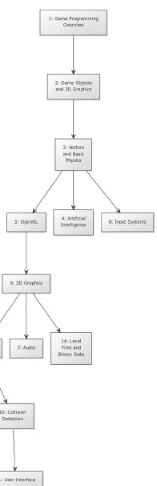

图 P.1 章节依赖关系

- 第 6 章，“3D 图形”，专注于将迄今创建的代码转换为适用于 3D 游戏，包括如何表示视图、投影和旋转。

- 第 7 章，“音频”，介绍了如何使用出色的 FMOD API 引导音频系统。它包含对 3D 位置音频的介绍。

- 第 8 章，“输入系统”，讨论了如何设计更强大的输入系统来处理键盘、鼠标和游戏控制器事件。

- 第 9 章，“摄像机”，展示了如何实现几种不同的 3D 摄像机，包括第一人称摄像机、跟随摄像机和环绕摄像机。

- 第 10 章，“碰撞检测”，深入探讨了游戏中的碰撞检测方法，包括球体、平面、线段和盒子。

- 第 11 章，“用户界面”，探讨了如何实现菜单系统和抬头显示 (HUD) 元素，例如雷达和瞄准准星。

- 第 12 章，“骨骼动画”，介绍了如何在 3D 中为角色制作动画。

- 第 13 章，“中级图形”，探讨了几个中级图形主题，包括如何实现延迟着色。

- 第 14 章，“关卡文件和二进制数据”，讨论了如何加载和保存关卡文件，以及如何编写二进制文件格式。

- 附录 A，“中级 C++ 复习”，回顾了本书中使用的几个中级 C++ 主题，包括内存分配和集合。

每章都包含一个相应的游戏项目（如所述，提供源代码）、推荐的额外阅读材料和几个练习。这些练习通常要求你为章节中实现的代码添加额外功能。

## 本书使用的约定

新术语以 **粗体** 显示。代码以等宽字体显示。小段代码有时会作为独立段落出现：

```
DoSomething();
```

较长的代码段出现在代码清单中，如代码清单 P.1 所示。

## 代码清单 P.1 示例代码清单

```
void DoSomething()
{
    // Do the thing
    ThisDoesSomething();
}
```

不时，某些段落会以注释、提示、侧边栏和警告的形式出现。以下是各个示例。

> > 注释
> 注释包含关于实现更改或其他值得注意的功能的一些有用信息。

> > 提示
> 提示提供关于如何向代码添加某些额外功能的提示。

> > 警告
> 警告指出需要谨慎的具体陷阱。

> > 侧边栏
> 侧边栏是与章节主要内容相关的较长讨论。此内容很有趣，但对于理解章节的核心主题并不至关重要。

## 致谢

虽然这不是我的第一本书，但编写此书是一个特别漫长的过程。我很感激劳拉·勒温，她是本书的执行编辑，在这本书为期两年的编写过程中特别耐心。我也想感谢皮尔逊的其余团队，包括本书的开发编辑迈克尔·瑟斯顿。

我也想感谢本书技术编辑所做的工作：乔什·格莱泽、布莱恩·奥弗兰和马特·怀廷。技术评审对于确保内容正确且面向目标受众易于理解至关重要。

我也想感谢南加州大学信息技术课程的所有同事，特别是那些帮助塑造我所教授的游戏课程课程的人：乔什·格莱泽、杰森·格雷戈里、克拉克·克罗梅纳克、迈克·希汉和马特·怀廷。本书的许多灵感都来自该课程。我也想感谢多年来所有优秀的助教，他们人数太多，无法一一列举。

我也想感谢 https://opengameart.org 和 https://freesound.org 等网站上的内容创作者，他们根据知识共享许可证创建了出色的游戏内容。这些网站对于查找本书中游戏项目的素材至关重要。

最后，我想感谢我的父母，以及我的妹妹妮塔和她的家人。没有他们的支持、灵感和指导，我最初就不可能走到今天。我也想感谢我的朋友，比如凯文，他理解当我无法去看最新电影、去吃晚餐，或真的做任何社交活动时，因为我正在“编写我的书”。嗯，我想我现在有时间了….

## 关于作者

**桑贾伊·马达夫** 是南加州大学的高级讲师，在那里他教授多门编程和视频游戏编程课程。他自 2008 年起就在南加州大学任教。

在加入南加州大学之前，桑贾伊曾在多家视频游戏开发商担任程序员，包括艺电、尼弗软和大流行病工作室。他参与制作的游戏包括 *荣誉勋章：太平洋突击*、*托尼·霍克的极限滑板 8*、*魔戒：征服* 和 *破坏者*。

桑贾伊也是《游戏编程算法与技术》的作者和《多人游戏编程》的合著者。他拥有南加州大学的计算机科学学士学位和硕士学位，并正在攻读南加州大学的计算机科学博士学位。

## 第 1 章

## 游戏编程概述

本章首先讨论如何设置开发环境并访问本书的源代码。接着，它介绍了任何实时游戏背后的核心概念：游戏循环、游戏如何随时间更新，以及游戏输入和输出的基础知识。在整个章节中，你将看到如何为经典游戏 Pong 的一个版本实现代码。

### 设置开发环境

虽然可以使用文本编辑器编写任何程序的源代码，但专业开发人员通常使用 **集成开发环境 (IDE)**。IDE 的优势在于，除了文本编辑功能外，还提供代码补全和调试功能。本书的代码适用于 Microsoft Windows 和 Apple macOS，IDE 的选择取决于平台的选择。对于 Windows，本书使用 Microsoft Visual Studio；对于 macOS，它使用 Apple Xcode。本节其余部分包含在各自平台上设置这些环境的简要说明。

### Microsoft Windows

对于 Windows 开发，目前最流行的 IDE 无疑是 Microsoft Visual Studio。Visual Studio 也是 C++ 游戏开发人员中最流行的 IDE，大多数 PC 和主机开发人员都倾向于使用该 IDE。

本书使用 Microsoft Visual Studio Community 2017，可在 https://www.visualstudio.com/downloads/ 免费下载。安装 Visual Studio Community 2017 需要 Microsoft Windows 7 或更高版本。

运行 Visual Studio 安装程序时，它会询问应安装哪些“工作负载”。请确保至少选择 C++ 游戏开发工作负载。你也可以随意选择任何其他所需的工作负载或选项。

> 警告
> Visual Studio 有不同版本：Microsoft Visual Studio 套件中还有几个其他产品，包括 Visual Studio Code 和 Visual Studio for Mac。这些产品都不是 Visual Studio Community 2017，因此请务必小心安装正确的版本！

### Apple macOS

在 macOS 上，Apple 提供免费的 Xcode IDE，用于开发适用于 macOS、iOS 和其他相关平台的程序。本书的代码适用于 Xcode 8 和 9。请注意，Xcode 8 需要 macOS 10.11 El Capitan 或更高版本，而 Xcode 9 需要 macOS 10.12 Sierra 或更高版本。

要安装 Xcode，只需前往 Apple App Store 并搜索 Xcode 即可。Xcode 第一次运行时，会询问是否要启用调试功能。请务必选择 Yes。

### 获取本书的源代码

大多数专业开发人员使用源


**控制**系统，除了许多其他功能外，还会保留源代码的历史记录。使用这样的系统，如果代码更改导致意外或不希望的行为，可以轻松返回到之前已知可用的代码版本。此外，源代码控制允许多个开发人员之间进行更轻松的协作。

一个流行的源代码控制系统是 Git，最初由 Linux 闻名的 Linus Torvalds 开发。在 Git 中，术语 **仓库** 指的是在源代码控制下托管的特定项目。GitHub 网站（https://github.com）提供了轻松创建和管理 Git 仓库的功能。

本书的源代码可在 GitHub 上找到，网址为 https://github.com/gameprogcpp/code。如果您不熟悉 Git 系统，可以单击绿色的克隆或下载按钮，然后选择下载 ZIP 以下载包含本书所有源代码的压缩 ZIP 文件。

或者，如果您希望使用 Git，可以通过命令行克隆仓库，方法如下：

单击此处查看代码图像

```
$ git clone https://github.com/gameprogcpp/code.git
```

该命令在 macOS 终端开箱即用，但 Windows 用户需要先安装 Git for Windows（参见 https://git-for-windows.github.io）。

源代码为每个章节包含一个单独的目录（或文件夹）。例如，本章的源代码位于 Chapter01 目录中。在此目录中，有一个用于 Microsoft Visual Studio 的 Chapter01-Windows.sln 文件和一个用于 Apple Xcode 的 Chapter01-Mac.xcodeproj 文件。在继续之前，请确保您可以编译本章的代码。

## 超越 C++ 标准库

C++ 标准库仅支持文本控制台输入和输出，且未内置任何图形库。要在 C++ 程序中实现图形，必须使用众多可用外部库中的一种。

不幸的是，许多库都是平台特定的，这意味着它们仅适用于一种操作系统或一种计算机类型。例如，Microsoft Windows 应用程序编程接口（API）可以创建 Windows 操作系统支持的窗口和其他 UI 元素。但是，Windows API 不适用于 Apple macOS——原因显而易见。同样，macOS 为这些相同功能拥有自己的一组库，这些库不适用于 Windows。作为游戏程序员，您并非总能避免使用平台特定的库。例如，使用 Sony PlayStation 4 控制台的游戏开发人员必须使用 Sony 提供的库。

幸运的是，本书坚持使用 **跨平台** 库，这意味着这些库可在许多不同的平台上运行。本书的所有源代码均适用于 Windows 和 macOS 的最新版本。虽然 Linux 支持未经过测试，但游戏项目通常也应该可以在 Linux 上运行。

本书使用的基础库之一是 Simple DirectMedia Layer（SDL；参见 https://www.libsdl.org）。SDL 库是一个用 C 编写的跨平台游戏开发库。它支持创建窗口、创建基本 2D 图形、处理输入和输出音频等功能。SDL 是一个非常轻量的库，可在许多平台上运行，包括 Microsoft Windows、Apple macOS、Linux、iOS 和 Android。

在本章中，唯一需要的外部库是 SDL。后续章节将使用其他库，并在需要时介绍它们。

## 游戏循环和游戏类

游戏与其他任何程序之间的一大区别在于，游戏必须在程序运行期间每秒更新多次。**游戏循环**是控制整个游戏程序总体流程的循环。与其他任何循环一样，游戏循环在每次迭代时都会执行某些代码，并且有一个循环条件。对于游戏循环，只要玩家未退出游戏程序，就希望继续循环。

游戏循环的每次迭代都是一个 **帧**。如果游戏以 60 **每秒帧数**（FPS）运行，这意味着游戏循环每秒完成 60 次迭代。许多实时游戏以 30 或 60 FPS 运行。通过每秒运行这么多次迭代，游戏营造出连续运动的错觉，尽管它只是在定期间隔进行更新。**帧率**一词与 FPS 可互换；帧率为 60 意味着与 60 FPS 相同。

## 帧的结构

从高层次来看，游戏在每帧执行以下步骤：

- 1. 它处理任何输入。
- 2. 它更新游戏世界。
- 3. 它生成任何输出。

这三个步骤中的每一个都比乍一看更有深度。例如，处理输入（步骤 1）明显意味着检测来自键盘、鼠标或控制器等设备的任何输入。但这些可能不是游戏的唯一输入。考虑一种支持在线多人模式的游戏。在这种情况下，游戏通过 Internet 接收数据作为输入。在某些类型的移动游戏中，另一种输入可能是相机可见的内容，或者是 GPS 信息。最终，游戏的输入既取决于游戏类型，也取决于其运行的平台。

更新游戏世界（步骤 2）意味着遍历游戏世界中的每个对象，并根据需要对其进行更新。这可能包括数百甚至数千个对象，包括游戏世界中的角色、用户界面的部分以及影响游戏的其他对象——即使它们不可见。

对于步骤 3，生成任何输出，最明显的输出是图形。但还有其他输出，例如音频（包括音效、音乐和对话）。另一个示例是，大多数主机游戏都有 **力反馈** 效果，例如当游戏中发生令人兴奋的事情时控制器会震动。对于在线多人游戏，额外的输出将是通过 Internet 发送给其他玩家的数据。

考虑这种游戏循环风格如何应用于经典 Namco 街机游戏 Pac-Man 的简化版本。对于游戏的这个简化版本，假设游戏立即开始，Pac-Man 位于迷宫中。游戏程序将继续运行，直到 Pac-Man 完成迷宫或死亡。在这种情况下，游戏循环的 "处理输入" 阶段只需读取操纵杆输入。

循环的 "更新游戏世界" 阶段根据此操纵杆输入更新 Pac-Man，然后还更新四个幽灵、豆子和用户界面。此更新代码的一部分必须确定 Pac-Man 是否撞上任何幽灵。Pac-Man 还可以吃掉他移动经过的任何豆子或水果，因此循环的更新部分还需要检查这一点。由于幽灵完全由 AI 控制，它们也必须更新其逻辑。最后，根据 Pac-Man 的行为，UI 可能需要更新其显示的数据。

### 注意

这种游戏循环风格是 **单线程** 的，这意味着它无法利用可以同时执行多个线程的现代 CPU。制作支持多线程的游戏循环非常复杂，对于范围较小的游戏来说也不是必需的。要了解有关多线程游戏循环的更多信息，一本好书是 Jason Gregory 的著作，列在本章末尾的 "附加阅读" 部分中。

经典 *Pac-Man* 游戏的 "生成输出" 阶段中唯一的输出是音频和视频。清单 1.1 提供了伪代码，展示了此简化版 *Pac-Man* 的游戏循环可能是什么样子。

## 清单 1.1 Pac-Man 游戏循环伪代码

单击此处查看代码图像

```
void Game::RunLoop()
{
    while (!mShouldQuit)
    {
        // Process Inputs
        JoystickData j = GetJoystickData();

// Update Game World
UpdatePlayerPosition(j);

for (Ghost& g : mGhost)
{
    if (g.Collides(player))
    {
        // Handle Pac-Man colliding with a ghost
    }
    else
    {
        g.Update();
    }
}

// Handle Pac-Man eating pellets
// ...

// Generate Outputs
RenderGraphics();
}
```


RenderAudio();
}
}

## 实现骨架游戏类

你现在已准备好使用对游戏循环的基本知识来创建一个 Game 类，该类包含用于初始化和关闭游戏以及运行游戏循环的代码。如果你的 C++ 比较生疏，可能需要先复习附录 A“中级 C++ 复习”中的内容，因为本书其余部分假设你熟悉 C++。此外，阅读时随手备好本章的完整源代码可能会有所帮助，这样可以帮助你理解所有部分如何组合在一起。

清单 1.2 显示了 Game.h 头文件中 Game 类的声明。由于此声明引用了 SDL_Window 指针，你还需要包含主 SDL 头文件 SDL/SDL.h。（如果你想避免在此处包含它，可以使用前置声明。）许多成员函数名称都不言自明；例如，Initialize 函数初始化 Game 类，Shutdown 函数关闭游戏，RunLoop 函数运行游戏循环。最后，ProcessInput、UpdateGame 和 GenerateOutput 对应游戏循环的三个步骤。

目前，唯一的成员变量是指向窗口的指针（你将在 `Initialize` 函数中创建它）以及一个表示游戏是否应继续运行游戏循环的 bool 值。

## 清单 1.2 Game 声明

单击此处查看代码图像

```
class Game
{

public:
    Game();

    // Initialize the game
    bool Initialize();

    // Runs the game loop until the game is over
    void RunLoop();

    // Shutdown the game
    void Shutdown();

private:
    // Helper functions for the game loop
    void ProcessInput();

    void UpdateGame();

    void GenerateOutput();

// Window created by SDL
SDL_Window* mWindow;

// Game should continue to run
bool mIsRunning;

};
```

有了此声明后，你可以开始在 Game.cpp 中实现成员函数。构造函数只是将 mWindow 初始化为 nullptr，将 mIsRunning 初始化为 true。

## Game::Initialize

如果初始化成功，Initialize 函数返回 true，否则返回 false。你需要使用 SDL_Init 函数初始化 SDL 库。该函数接受一个参数，即要初始化的所有子系统的按位 OR。目前，你只需要初始化视频子系统，具体操作如下：

```
int sdlResult = SDL_Init(SDL_INIT_VIDEO);
```

请注意，SDL_Init 返回一个整数。如果该整数非零，则表示初始化失败。在这种情况下，Game::Initialize 应返回 false，因为没有 SDL，游戏无法继续：

```
if (sdlResult != 0)
{
    SDL_Log("Unable to initialize SDL: %s", SDL_GetError());
    return false;
}
```

使用 SDL_Log 函数是在 SDL 中向控制台输出消息的简单方法。它使用与 C printf 函数相同的语法，因此支持将变量输出到 printf 格式说明符，例如用于 C 风格字符串的 %s 和用于整数的 %d。SDL_GetError 函数以 C 风格字符串返回错误消息，这就是为什么在此代码中将其作为 %s 参数传递的原因。

SDL 包含几个不同的子系统，你可以使用 SDL_Init 对其进行初始化。表 1.1 显示了最常用的子系统；有关完整列表，请参阅 https://wiki.libsdl.org 上的 SDL API 参考。

## 表 1.1 值得注意的 SDL 子系统标志

| Flag | Subsystem |
| :--- | :--- |
| SDL_INIT_AUDIO | 音频设备管理、播放和录制 |
| SDL_INIT_VIDEO | 用于创建窗口、与 OpenGL 交互以及 2D 图形的视频子系统 |
| SDL_INIT_HAPTIC | 力反馈子系统 |
| SDL_INIT_GAMECONTROLLER | 用于支持控制器输入设备的子系统 |

如果 SDL 初始化成功，下一步是使用 `SDL_CreateWindow` 函数创建窗口。这与任何其他 Windows 或 macOS 程序使用的窗口类似。`SDL_CreateWindow` 函数接受多个参数：窗口标题、左上角的 x/y 坐标、窗口的宽度/高度，以及可选的窗口创建标志：

```
mWindow = SDL_CreateWindow(
    "Game Programming in C++ (Chapter 1)", // Window title
    100, // Top left x-coordinate of window
    100, // Top left y-coordinate of window
    1024, // Width of window
    768, // Height of window
    0 // Flags (0 for no flags set)
);
```

与 `SDL_Init` 调用一样，你应该验证 `SDL_CreateWindow` 是否成功。如果失败，`mWindow` 将为 `nullptr`，因此添加此检查：

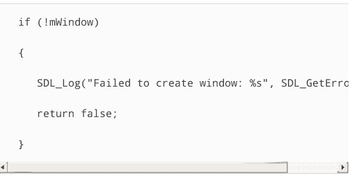

与初始化标志一样，有几种可能的窗口创建标志，如表 1.2 所示。与之前一样，你可以使用按位 OR 传入多个标志。尽管许多商业游戏使用全屏模式，但如果游戏以窗口模式运行，调试代码会更快，这就是本书避免全屏的原因。

## 表 1.2 值得注意的窗口创建标志

| Flag | Result |
| :--- | :--- |
| SDL_WINDOW_FULLSCREEN_DESKTOP | 当前桌面分辨率（忽略传递给 SDL_CreateWindow 的宽度/高度参数） |
| SDL_WINDOW_OPENGL | 添加对 OpenGL 图形库的支持 |
| SDL_WINDOW_RESIZABLE | 允许用户调整窗口大小 |

如果 SDL 初始化和窗口创建成功，Game::Initialize 返回 true。

## Game::Shutdown

Shutdown 函数与 Initialize 函数相反。它首先使用 SDL_DestroyWindow 销毁 SDL_Window，然后使用 SDL_Quit 关闭 SDL：

```
void Game::Shutdown()
{
    SDL_DestroyWindow(mWindow);
    SDL_Quit();
}
```

## Game::RunLoop

RunLoop 函数会不断运行游戏循环的迭代，直到 mIsRunning 变为 false，此时函数返回。因为你有游戏循环每个阶段的三个辅助函数，RunLoop 只是在循环中调用这些辅助函数：

```
void Game::RunLoop()
{
    while (mIsRunning)
    {
        ProcessInput();
        UpdateGame();
        GenerateOutput();
    }
}
```

目前，你不会实现这三个辅助函数，这意味着一旦进入循环，游戏暂时不会做任何事情。你将在本章余下的内容中继续完善这个 Game 类并实现这些辅助函数。

## 主函数

尽管 Game 类是对游戏行为的便捷封装，但任何 C++ 程序的入口点都是 `main` 函数。你必须按清单 1.3 所示（在 `Main.cpp` 中）实现 `main` 函数。

## 清单 1.3 main 实现

```
int main(int argc, char** argv)
{
    Game game;
    bool success = game.Initialize();
    if (success)
    {
        game.RunLoop();
    }
    game.Shutdown();
    return 0;
}
```

此 `main` 实现首先构造 `Game` 类的一个实例。然后它调用 `Initialize`，如果游戏成功初始化则返回 `true`，否则返回 `false`。如果游戏初始化，你将通过调用 `RunLoop` 进入游戏循环。最后，循环结束后，你对游戏调用 `Shutdown`。

有了这段代码，你现在可以运行游戏项目了。运行时，你会看到一个空白窗口，如图 1.1 所示（但在 macOS 上，此窗口可能显示为黑色而非白色）。当然，这里有个问题：游戏永远不会结束！因为没有代码更改 `mIsRunning` 成员变量，游戏循环永远不会结束，`RunLoop` 函数也不会返回。自然而然，下一步是允许玩家退出游戏来修复这个问题。

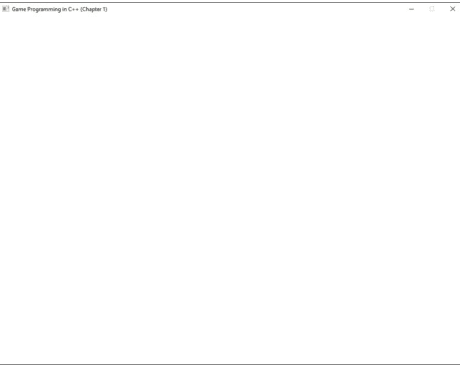

图 1.1 创建一个空白窗口

## 基本输入处理

在任何桌面操作系统中，用户都可以对应用程序执行多个操作


Windows。例如，用户可以移动窗口、最小化或最大化窗口、关闭窗口（及程序）等等。表示这些不同操作的常见方式是使用事件。当用户做某事时，程序会从操作系统接收事件，并可以选择响应这些事件。

SDL 管理一个从操作系统接收的事件内部队列。该队列包含许多不同窗口操作的事件，以及与输入设备相关的事件。每一帧，游戏都必须轮询队列中的任何事件，并选择忽略或处理队列中的每个事件。对于某些事件，例如移动窗口，忽略该事件意味着 SDL 将自动处理它。但对于其他事件，忽略该事件意味着什么都不会发生。

因为事件是一种输入，所以在 `ProcessInput` 中实现事件处理是合理的。因为事件队列在任何给定帧中可能包含多个事件，您必须循环遍历队列中的所有事件。如果 `SDL_PollEvent` 函数在队列中找到一个事件，则返回 `true`。因此，`ProcessInput` 的一个非常基本的实现将一直调用 `SDL_PollEvent`，只要它返回 `true`：

单击此处查看代码图像

```
void Game::ProcessInput()
{
    SDL_Event event;

// While there are still events in the queue
while (SDL_PollEvent(&event))
{

}
}
```

请注意，`SDL_PollEvent` 函数通过指针接收一个 `SDL_Event`。这存储了刚从队列中移除的事件的任何信息。

虽然这个版本的 `ProcessInput` 使游戏窗口更加灵敏，但玩家仍然无法退出游戏。这是因为您只是从队列中移除所有事件，而不响应它们。

给定一个 `SDL_Event`，`type` 成员变量包含接收到的事件的类型。因此，一种常见的方法是在 `SDL_PollEvent` 循环内部基于类型创建一个 `switch`：

单击此处查看代码图像

```
SDL_Event event;

while (SDL_PollEvent(&event))
{

    switch (event.type)
{
    // Handle different event types here
}
}
```

一个有用的事件是 `SDL_QUIT`，当用户尝试关闭窗口时（无论是单击 X 还是使用键盘快捷键），游戏会接收到该事件。您可以更新代码，当在队列中看到 `SDL_QUIT` 事件时，将 `mIsRunning` 设置为 `false`：

单击此处查看代码图像

```
SDL_Event event;

while (SDL_PollEvent(&event))
{
    switch (event.type)
    {
    case SDL_QUIT:
        mIsRunning = false;
        break;
    }
}
```

现在，当游戏运行时，单击窗口上的 X 会导致 `RunLoop` 内部的 `while` 循环终止，进而关闭游戏并退出程序。但是，如果您希望用户按下 Esc 键时游戏退出怎么办？虽然您可以检查与此对应的键盘事件，但更简单的方法是使用 `SDL_GetKeyboardState` 获取键盘的整个状态，它返回一个指向包含键盘当前状态的数组的指针：

单击此处查看代码图像

```
const Uint8* state = SDL_GetKeyboardState(NULL);
```

给定这个数组，您可以通过使用键对应的 `SDL_SCANCODE` 值来索引此数组，从而查询特定键。例如，以下代码在用户按下 Esc 键时将 `mIsRunning` 设置为 `false`：

单击此处查看代码图像

```
if (state[SDL_SCANCODE_ESCAPE])
{
    mIsRunning = false;
}
```

综合所有这些内容，得到了 `ProcessInput` 的当前版本，如清单 1.4 所示。现在，运行游戏时，用户可以通过关闭窗口或按下 Esc 键来退出。

### 清单 1.4 Game::ProcessInput 实现

单击此处查看代码图像

```
void Game::ProcessInput()
{
    SDL_Event event;
    while (SDL_PollEvent(&event))
    {
        switch (event.type)
        {
        // If this is an SDL_QUIT event, end loop
        case SDL_QUIT:
            mIsRunning = false;
            break;
        }
    }

    // Get state of keyboard
    const Uint8* state = SDL_GetKeyboardState(NULL);

    // If escape is pressed, also end loop

    if (state[SDL_SCANCODE_ESCAPE])
    {
        mIsRunning = false;
    }
}
```

## BASIC 2D GRAPHICS

在实现游戏循环的“生成输出”阶段之前，您需要了解游戏中 2D 图形的工作原理

当今使用的大多数显示器——无论是电视、计算机显示器、平板电脑还是智能手机——都使用光栅图形，这意味着显示器具有一个由图像元素（或像素）组成的二维网格。这些像素可以单独显示不同量的光以及不同的颜色。这些像素的强度和颜色结合，为观看者创造连续图像的感知。放大光栅图像的一部分会使每个单独的像素可辨别，如图 1.2 所示。

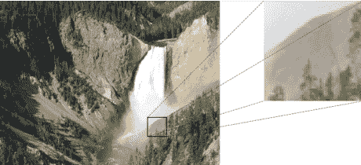

图 1.2 放大图像的一部分显示其不同的像素

光栅显示器的 **分辨率** 是指像素网格的宽度和高度。例如，分辨率为 1920×1080（通常称为 1080p）意味着有 1080 行像素，每行包含 1920 个像素。同样，分辨率为 3840×2160（称为 4K）有 2160 行，每行 3840 个像素。

彩色显示器以加法方式混合颜色，为每个像素创建特定的色调。一种常见的方法是混合三种颜色：红色、绿色和蓝色（缩写为 **RGB**）。这些 RGB 颜色的不同强度结合，创建一系列（或 **色域**）颜色。虽然许多现代显示器也支持除 RGB 以外的颜色格式，但大多数视频游戏以 RGB 输出最终颜色。RGB 值是否转换为其他内容以在显示器上显示，超出了游戏程序员的职责范围。

但是，许多游戏 *内部* 对其大部分图形计算使用不同的颜色表示。例如，许多游戏在内部使用 **alpha** 值来支持透明度。缩写 **RGBA** 指的是带有额外 alpha 分量的 RGB 颜色。添加 alpha 分量允许游戏中的某些对象（例如窗口）具有一定程度的透明度。但是，因为很少有（如果有的话）显示器支持透明度，游戏最终需要计算最终的 RGB 颜色，并自行计算任何感知到的透明度。

### 颜色缓冲区

为了显示 RGB 图像，显示器必须知道每个像素的颜色。在计算机图形学中，**颜色缓冲区** 是内存中包含整个屏幕颜色信息的位置。显示器可以使用颜色缓冲区来绘制屏幕内容。将颜色缓冲区视为一个二维数组，其中每个 (x, y) 索引对应屏幕上的一个像素。在游戏循环的“生成输出”阶段的每一帧中，游戏将图形输出写入颜色缓冲区。

颜色缓冲区的内存使用量取决于表示每个像素的位数，称为 **颜色深度**。例如，在常见的 24 位颜色深度中，红色、绿色和蓝色各使用 8 位。这意味着有 2^24，即 16,777,216 种独特的颜色。如果游戏还想存储 8 位 alpha 值，则颜色缓冲区中每个像素总共为 32 位。一个针对 1080p（1920×1080）目标分辨率且每像素 32 位的颜色缓冲区使用 1920×1080×4 字节，即约 7.9 MB。

注意
许多游戏程序员也使用 **帧缓冲区** 术语来引用包含帧颜色数据的内存位置。但是，**帧缓冲区** 的更精确定义是它是颜色缓冲区和其他缓冲区（例如深度缓冲区和模板缓冲区）的组合。为了清晰起见，本书引用特定的缓冲区。

一些最近的游戏每个 RGB 分量使用 16 位，这增加了独特颜色的数量。当然，这使颜色缓冲区的内存使用量翻倍，1080p 下约为 16 MB。考虑到大多数显卡都有几千兆字节的视频内存可用，这似乎是一个微不足道的数量。但是，考虑到尖端游戏的所有其他内存使用量，这里 8 MB、那里 8 MB 很快就会累积起来。虽然在撰写本文时，大多数显示器不支持每种颜色 16 位，但一些制造商现在提供支持高于每种颜色 8 位颜色深度的显示器。

给定颜色的 8 位值，在代码中引用此值有两种方法。一种方法是简单地使用与每种颜色（或 **通道**）的位数对应的无符号整数。因此，对于每个通道 8 位的颜色深度，每个通道的值在 0 到 255 之间。另一种方法是将整数归一化到 0.0 到 1.0 的十进制范围。

使用十进制范围的一个优点是，无论底层颜色深度如何，一个值都会产生大致相同的颜色。例如，归一化的


无论红色的最大值是255（每种颜色8位）还是65,535（每种颜色16位），RGB值(1.0, 0.0, 0.0)都会产生纯红色。但是，无符号整数RGB值(255, 0, 0)只有在每种颜色为8位时才会产生纯红色。使用每种颜色16位时，(255, 0, 0)几乎是黑色的。

在这两种表示形式之间进行转换非常简单。给定一个无符号整数值，将其除以最大无符号整数值即可得到归一化值。反之，给定一个归一化的小数值，将其乘以最大无符号整数值即可得到无符号整数值。目前，你应该使用无符号整数，因为SDL库期望它们。

## 双缓冲

如前所述，游戏每秒更新多次（常见的帧率为30和60 FPS）。如果游戏以相同的速率更新颜色缓冲区，这会产生运动的错觉，就像翻页书在翻页时看起来显示物体在运动一样。

然而，刷新率（即显示器更新的频率）可能与游戏的帧率不同。例如，大多数NTSC电视显示器的刷新率为59.94 Hz，这意味着它们每秒刷新的次数略少于60次。然而，一些较新的计算机显示器支持144 Hz的刷新率，这快了两倍多。

此外，当前没有任何显示技术可以瞬间一次性更新整个屏幕。总是存在某种更新顺序——无论是逐行、逐列、棋盘格还是其他方式。无论显示器使用什么更新模式，整个屏幕更新都需要一小段时间。

假设游戏向颜色缓冲区写入数据，而显示器从同一个颜色缓冲区读取数据。由于游戏的帧率时序可能与显示器的刷新率不直接匹配，显示器很可能会在游戏向缓冲区写入数据时从颜色缓冲区读取数据。这可能会出现问题。

例如，假设游戏将帧A的图形数据写入颜色缓冲区。然后显示器开始从颜色缓冲区读取数据，以在屏幕上显示帧A。但是，在显示器完成将帧A绘制到屏幕之前，游戏用帧B的图形数据覆盖了颜色缓冲区。结果，显示器最终在屏幕上显示了帧A的部分 *和* 帧B的部分。图1.3说明了这个问题，称为**屏幕撕裂**。


图1.3 摄像机向右平移时的屏幕撕裂模拟

消除屏幕撕裂需要两个更改。首先，与其让游戏和显示器共享一个颜色缓冲区，不如创建两个独立的颜色缓冲区。然后，游戏和显示器每帧交替使用它们的颜色缓冲区。其思路是，使用两个独立的缓冲区，游戏可以向其中一个（即**后缓冲区**）写入数据，同时显示器可以从另一个（即**前缓冲区**）读取数据。帧完成后，游戏和显示器交换它们的缓冲区。由于使用了两个颜色缓冲区，这种技术被称为**双缓冲**。

作为更具体的示例，请考虑图1.4所示的过程。在帧A中，游戏将其图形输出写入缓冲区X，而显示器将缓冲区Y绘制到屏幕上（此时屏幕为空）。当此过程完成时，游戏和显示器交换它们使用的缓冲区。然后在帧B中，游戏将其图形输出绘制到缓冲区Y，同时显示器在屏幕上显示缓冲区X。在帧C中，游戏返回到缓冲区X，而显示器返回到缓冲区Y。这两个缓冲区之间的交换会持续进行，直到游戏程序关闭。

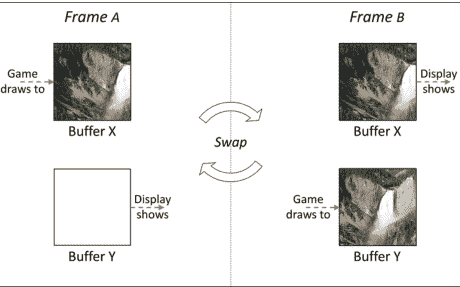

图1.4 双缓冲涉及每帧交换游戏和显示器使用的缓冲区

然而，仅靠双缓冲无法消除屏幕撕裂。如果显示器正在绘制缓冲区X，而游戏想要开始向X写入数据，屏幕撕裂仍然会发生。这通常只发生在游戏更新速度过快时。解决此问题的方法是在交换之前等待显示器完成绘制其缓冲区。换句话说，如果游戏想要交换回缓冲区X时显示器仍在绘制缓冲区X，游戏必须等待显示器完成绘制缓冲区X。开发者将这种方法称为**垂直同步**，或**vsync**，以显示器即将刷新屏幕时发送的信号命名。

使用垂直同步时，游戏可能需要偶尔等待一小段时间，直到显示器准备就绪。这意味着游戏循环可能无法精确实现其目标帧率30或60 FPS。一些玩家认为这会导致不可接受的帧率卡顿。因此，是否启用vsync的决定因游戏或玩家而异。一个好主意是在引擎中将vsync作为一个选项提供，以便你可以在偶尔的屏幕撕裂或偶尔的卡顿之间进行选择。

显示技术的最新进展试图通过一种基于游戏而变化的自适应刷新率来解决这一两难问题。采用这种方法，不是由显示器在刷新时通知游戏，而是由游戏告诉显示器何时刷新。这样，游戏和显示器就保持同步。这兼得了两者的优点，因为它既消除了屏幕撕裂，也消除了帧率卡顿。不幸的是，在撰写本文时，自适应刷新技术目前仅在某些高端计算机显示器上可用。

## 实现基本2D图形

SDL提供了一组用于绘制2D图形的简单函数。由于本章的重点是2D，你可以继续使用这些函数。从第5章“OpenGL”开始，你将切换到OpenGL库进行图形处理，因为它同时支持2D和3D。

### 初始化和关闭

要使用SDL的图形代码，你需要通过SDL_CreateRenderer函数构建一个SDL_Renderer。渲染器一词泛指任何绘制图形的系统，无论是2D还是3D。因为每次绘制内容时都需要引用这个SDL_Renderer对象，首先向Game添加一个mRenderer成员变量：

```
SDL_Renderer* mRenderer;
```

接下来，在Game::Initialize中，创建窗口后，创建渲染器：

单击此处查看代码图像

```
mRenderer = SDL_CreateRenderer(
    mWindow, // Window to create renderer for
    -1,      // Usually -1
    SDL_RENDERER_ACCELERATED | SDL_RENDERER_PRESENTVSYNC
);
```

SDL_CreateRenderer的第一个参数是窗口的指针（你已将其保存在mWindow中）。第二个参数指定要使用的图形驱动程序；如果游戏有多个窗口，这可能很重要。但只有一个窗口时，默认值为-1，这意味着让SDL决定。与其他SDL创建函数一样，最后一个参数用于初始化标志。这里，你选择使用加速渲染器（即利用图形硬件）并启用垂直同步。这两个标志是SDL_CreateRenderer中值得注意的唯一标志。

与SDL_CreateWindow一样，如果SDL_CreateRenderer函数无法初始化渲染器，则返回nullptr。与初始化SDL一样，如果渲染器无法初始化，Game::Initialize返回false。

要关闭渲染器，只需在Game::Shutdown中添加对SDL_DestroyRenderer的调用：

```
SDL_DestroyRenderer(mRenderer);
```

### 基本绘图设置

从高层次来看，任何游戏图形库中的绘制通常涉及以下步骤：

- 1. 将后缓冲区清除为一种颜色（游戏的当前缓冲区）。
- 2. 绘制整个游戏场景。
- 3. 交换前缓冲区和后缓冲区。

首先，让我们关注第一步和第三步。因为图形是输出，所以将图形绘制代码放在Game::GenerateOutput中是合理的。


要清除后台缓冲区，你首先需要使用 SDL_SetRenderDrawColor 指定一种颜色。此函数接受一个指向渲染器的指针，以及四个 RGBA 分量（范围从 0 到 255）。例如，要将颜色设置为 100% 不透明度的蓝色，请使用以下代码：

```
SDL_SetRenderDrawColor(
    mRenderer,
    0, // R
    0, // G
    255, // B
    255 // A
);
```

接下来，调用 SDL_RenderClear 将后台缓冲区清除为当前绘制颜色：

```
SDL_RenderClear(mRenderer);
```

下一步（暂时跳过）是绘制整个游戏场景。

最后，要交换前后缓冲区，请调用 SDL_RenderPresent：

```
SDL_RenderPresent(mRenderer);
```

有了这段代码，如果你现在运行游戏，你将看到一个填充了蓝色的窗口，如图 1.5 所示。

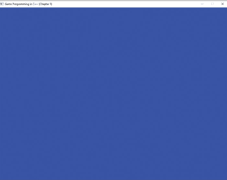

图 1.5 绘制蓝色背景的游戏

## 绘制墙壁、球和球拍

本章的游戏项目是经典视频游戏 Pong 的一个版本，其中球在屏幕上移动，玩家控制一个可以击球的球拍。制作 Pong 的版本是任何有志成为游戏开发者的人的必经之路——类似于初学编程时制作“Hello World”程序。本节探讨绘制矩形以表示 Pong 中的对象。因为这些是游戏世界中的对象，你在 GenerateOutput 中绘制它们——在清除后台缓冲区之后，但在交换前后缓冲区之前。

对于绘制填充矩形，SDL 提供了 SDL_RenderFillRect 函数。此函数接受一个表示矩形边界的 SDL_Rect，并使用当前绘制颜色绘制填充矩形。当然，如果你保持绘制颜色与背景相同，你将看不到任何矩形。因此，你需要将绘制颜色更改为白色：

点击此处查看代码图像

```
SDL_SetRenderDrawColor(mRenderer, 255, 255, 255, 255)
```

接下来，要绘制矩形，你需要通过 SDL_Rect 结构体指定尺寸。矩形有四个参数：矩形在屏幕上左上角的 x/y 坐标，以及矩形的宽度/高度。请记住，在 SDL 渲染中，如同许多其他 2D 图形库一样，屏幕的左上角是 (0, 0)，正 x 方向向右，正 y 方向向下。

例如，如果你想在屏幕顶部绘制一个矩形，可以使用以下 SDL_Rect 声明：

```
SDL_Rect wall{
    0,    // Top left x
    0,       // Top left y
    1024,    // Width
    thickness // Height
};
```

这里，左上角的 x/y 坐标是 (0, 0)，意味着矩形将位于屏幕左上角。你将矩形的宽度硬编码为 1024，对应窗口的宽度。（通常不建议假设固定窗口大小，如这里所做，你将在后续章节中移除此假设。）`thickness` 变量是设置为 15 的 `const int`，这使得调整墙壁厚度变得容易。

最后，你使用 `SDL_RenderFillRect` 绘制矩形，通过指针传入 `SDL_Rect`：

点击此处查看代码图像

```
SDL_RenderFillRect(mRenderer, &wall);
```

游戏随后在屏幕顶部绘制一堵墙。你可以使用类似的代码绘制底部墙壁和右侧墙壁，只需更改 `SDL_Rect` 的参数。例如，底部墙壁可以与顶部墙壁具有相同的矩形，只是左上角的 y 坐标可以是 768 - thickness。

不幸的是，为球和球拍硬编码矩形行不通，因为这两个对象最终都将在循环的 `UpdateGame` 阶段移动。虽然将球和球拍都表示为类有一定道理，但此讨论要等到第 2 章“游戏对象和 2D 图形”才会进行。在此期间，你可以只使用成员变量存储两个对象的中心位置，并根据这些位置绘制它们的矩形。

首先，声明一个同时具有 x 和 y 分量的简单 `Vector2` 结构体：

```
struct Vector2
{
    float x;
    float y;
};
```

目前，请将向量（不是 `std::vector`）视为坐标的简单容器。第 3 章“向量和基本物理”将更详细地探讨向量主题。

接下来，将两个 `Vector2` 作为成员变量添加到 `Game` 中——一个用于球拍位置（`mPaddlePos`），一个用于球的位置（`mBallPos`）。游戏构造函数随后将这些初始化为合理的初始值：球的位置设为屏幕中心，球拍的位置设为屏幕左侧中心。

有了这些成员变量，你随后可以在 GenerateOutput 中为球和球拍绘制矩形。但是，请记住，成员变量表示球拍和球的中心点，而你是根据左上角点定义 SDL_Rect 的。要从中心点转换为左上角点，你只需分别从 x 和 y 坐标中减去一半的宽度/高度。例如，以下矩形适用于球：

点击此处查看代码图像

```
SDL_Rect ball{
    static_cast<int>(mBallPos.x - thickness/2),
    static_cast<int>(mBallPos.y - thickness/2),
    thickness,
    thickness
};
```

这里的静态转换将 mBallPos.x 和 mBallPos.y 从浮点数转换为整数（SDL_Rect 使用整数）。无论如何，你可以为绘制球拍进行类似的计算，只是它的宽度和高度尺寸不同。

有了所有这些矩形，基本游戏绘制现在可以工作了，如图 1.6 所示。下一步是实现循环的 UpdateGame 阶段，它移动球和球拍。

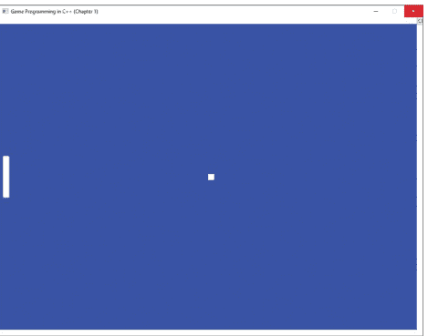

图 1.6 具有墙壁、球拍和球的游戏绘制

## 更新游戏

大多数视频游戏都有某种时间推进的概念。对于实时游戏，你以秒的分数来衡量这种时间推进。例如，以 30 FPS 运行的游戏，每帧大约会过去 33 毫秒（ms）。请记住，尽管游戏看起来具有连续运动，但这只是一种幻觉。游戏循环实际上每秒运行多次，游戏循环的每次迭代都以离散时间步长更新游戏。因此，在 30 FPS 的示例中，游戏循环的每次迭代应模拟游戏中 33ms 的时间推进。本节探讨在编程游戏时如何考虑这种离散的时间推进。

### 实时和游戏时间

区分 **实时**（现实世界中流逝的时间）和 **游戏时间**（游戏世界中流逝的时间）很重要。虽然现实时间和游戏时间之间通常存在 1:1 的对应关系，但并非总是如此。例如，考虑处于暂停状态的游戏。尽管现实世界中可能过去了大量时间，但游戏根本不会推进。只有当玩家取消暂停游戏时，游戏时间才会恢复更新。

还有许多其他情况，现实时间和游戏时间可能会分歧。例如，一些游戏具有“子弹时间”游戏机制，可降低游戏速度。在这种情况下，游戏时间必须以比实际时间慢得多的速率更新。在光谱的另一端，许多体育游戏具有加速时间。在足球游戏中，与其让玩家坐完每节完整的 15 分钟，游戏可能会以两倍速度更新时钟，因此每节只需 7.5 分钟。有些游戏甚至可能让时间倒流。例如，*波斯王子：时之砂* 具有一种独特的机制，玩家可以将游戏时间倒带到某个时间点。

考虑到现实时间和游戏时间可能分歧的所有这些方式，很明显，游戏循环的“更新游戏”阶段应考虑已过去的游戏时间。

### 作为增量时间函数的逻辑

早期的游戏程序员假设特定的处理器速度，因此也假设特定的帧率。程序员可能假设 8 MHz 处理器编写代码，如果这些处理器能正常工作，代码就没问题。在假设固定帧率时，更新敌人位置的代码可能如下所示：

点击此处查看代码图像

```
```
// Update x position by 5 pixels

enemy.mPosition.x += 5;
```
```

如果这段代码在 8 MHz 处理器上以所需速度移动敌人，那么在 16 MHz 处理器上会发生什么？嗯，因为游戏循环现在运行速度快了两倍，敌人也将*移动*快两倍。这可能是玩家觉得有挑战性的游戏和不可能的游戏之间的区别。想象一下在现代处理器上运行这个游戏，该处理器快几千倍。The


游戏会转瞬即刻结束！

为了解决这个问题，游戏使用**增量时间（delta time）**：自上一帧以来经过的游戏时间。要将前面的代码转换为使用增量时间，你不应将移动视为每帧多少像素，而应将其视为每秒多少像素。因此，如果理想的移动速度是每秒150像素，那么以下代码要灵活得多：

单击此处查看代码图像

```
// Update x position by 150 pixels/second

enemy.mPosition.x += 150 * deltaTime;
```

现在，无论帧率如何，代码都能正常工作。在30 FPS时，增量时间约为0.033，因此敌人每帧移动5像素，每秒总共移动150像素。在60 FPS时，敌人每帧仅移动2.5像素，但每秒总共仍移动150像素。60 FPS情况下的运动当然会更平滑，但每秒的总速度保持不变。

由于这在多种帧率下都有效，作为经验法则，游戏世界中的所有内容都应作为增量时间的函数进行更新。

为了帮助计算增量时间，SDL提供了一个`SDL_GetTicks`成员函数，用于返回自`SDL_Init`函数调用以来经过的毫秒数。通过将前一帧的`SDL_GetTicks`结果保存在成员变量中，你可以使用当前值来计算增量时间。

首先，你声明一个`mTicksCount`成员变量（在构造函数中将其初始化为零）：

```
Uint32 mTicksCount;
```

使用`SDL_GetTicks`，你可以创建`Game::UpdateGame`的第一个实现：

单击此处查看代码图像

```
void Game::UpdateGame()
{

    // Delta time is the difference in ticks from last
    // (converted to seconds)
    float deltaTime = (SDL_GetTicks() - mTicksCount) / 1000.0f;

    // Update tick counts (for next frame)
    mTicksCount = SDL_GetTicks();

    // TODO: Update objects in game world as function
    // ...
}
```

考虑首次调用`UpdateGame`时会发生什么。因为`mTicksCount`初始为零，你会得到一个正的`SDL_GetTicks`值（自初始化以来的毫秒数），并将其除以`1000.0f`以得到以秒为单位的增量时间。接下来，你将`SDL_GetTicks`的当前值保存在`mTicksCount`中。在下一帧中，`deltaTime`行根据`mTicksCount`的旧值和新值计算新的增量时间。因此，在每一帧中，你都会根据自上一帧以来经过的刻数来计算增量时间。

虽然允许游戏模拟以系统允许的任何帧率运行似乎是个好主意，但实际上这样做可能会出现多种问题。最显著的是，任何依赖物理效果的游戏（例如带有跳跃的平台游戏）都会根据帧率表现出行为差异。

尽管针对这个问题有更复杂的解决方案，但最简单的解决方案是实现**帧率限制**，它强制游戏循环等待直到目标增量时间过去。例如，假设目标帧率为60 FPS。如果一帧仅在15ms后完成，帧率限制会要求再等待约1.6ms以满足16.6ms的目标时间。

幸运的是，SDL还提供了一种帧率限制方法。例如，为了确保帧之间至少间隔16ms，你可以将以下代码添加到`UpdateGame`的开头：

单击此处查看代码图像

```
while (!SDL_TICKS_PASSED(SDL_GetTicks(), mTicksCount + 16))
{
}
```

你还必须注意增量时间过高的情况。最显著的是，这发生在调试器中逐行执行游戏代码时。例如，如果你在调试器的断点处暂停五秒钟，你会得到一个巨大的增量时间，模拟中的所有内容都会大幅向前跳转。要解决这个问题，你可以将增量时间限制在最大值（例如`0.05f`）。这样，游戏模拟在任何一帧都不会跳得太远。这得出了清单1.5中的`Game::UpdateGame`版本。虽然你还没有更新球拍或球的位置，但至少你正在计算增量时间值。

## 清单1.5 Game::UpdateGame实现

单击此处查看代码图像

```
void Game::UpdateGame()
{
    // Wait until 16ms has elapsed since last frame
    while (!SDL_TICKS_PASSED(SDL_GetTicks(), mTicksCount + 16))
    {
    }

    // Delta time is the difference in ticks from last
    // (converted to seconds)
    float deltaTime = (SDL_GetTicks() - mTicksCount) / 1000.0f;

    // Clamp maximum delta time value

    if (deltaTime > 0.05f)

    {

        deltaTime = 0.05f;

    }

    // TODO: Update objects in game world as function

}
```

## 更新球拍位置

在乒乓球游戏中，玩家根据输入控制球拍的位置。假设你希望W键将球拍向上移动，S键将球拍向下移动。既不按任何键，又或两个键同时按下，都应意味着球拍完全不移动。

你可以使用一个mPaddleDir整数成员变量来具体实现这一点：如果球拍不移动，则设为0；如果球拍向上移动（负y方向），则设为-1；如果球拍向下移动（正y方向），则设为1。

因为玩家通过键盘输入控制球拍的位置，你需要在`ProcessInput`中添加代码，根据输入更新`mPaddleDir`：

```
mPaddleDir = 0;

if (state[SDL_SCANCODE_W])
{
    mPaddleDir -= 1;
}

if (state[SDL_SCANCODE_S])
{
    mPaddleDir += 1;
}
```

注意你如何对`mPaddleDir`进行加减操作，这确保了如果玩家同时按下两个键，`mPaddleDir`将为零。

接下来，在`UpdateGame`中，你可以添加基于增量时间更新球拍的代码：

单击此处查看代码图像

```
if (mPaddleDir != 0)
{
    mPaddlePos.y += mPaddleDir * 300.0f * deltaTime;
}
```

在这里，你根据球拍方向、每秒300.0f像素的速度以及增量时间来更新球拍的y位置。如果mPaddleDir为-1，球拍将向上移动；如果为1，则会向下移动。

一个问题是，这段代码允许球拍移出屏幕。要解决这个问题，你可以为球拍的y位置添加边界条件。如果位置过高或过低，将其移回有效位置：

单击此处查看代码图像

```
if (mPaddleDir != 0)
{
    mPaddlePos.y += mPaddleDir * 300.0f * deltaTime;
    // Make sure paddle doesn't move off screen!
    if (mPaddlePos.y < (paddleH/2.0f + thickness))
    {
        mPaddlePos.y = paddleH/2.0f + thickness;
    }
    else if (mPaddlePos.y > (768.0f - paddleH/2.0f - thickness))
    {
        mPaddlePos.y = 768.0f - paddleH/2.0f - thickness;
    }
}
```

在这里，`paddleH`变量是一个描述球拍高度的常量。有了这段代码，玩家现在可以上下移动球拍，且球拍不会移出屏幕。

## 更新球的位置

更新球的位置比更新球拍的位置要复杂一些。首先，球在x和y两个方向上移动，而不仅仅是一个方向。其次，球需要从墙壁和球拍上弹回，这会改变其运动方向。因此，你既需要表示球的**速度**（速度和方向），又需要执行**碰撞检测**以确定球是否与墙壁发生碰撞。

为了表示球的速度，添加另一个名为`mBallVel`的`Vector2`成员变量。将`mBallVel`初始化为`(-200.0f, 235.0f)`，这意味着球开始时在x方向上以每秒-200像素、在y方向上以每秒235像素的速度移动。（换句话说，球沿着向下且向左的对角线移动。）

为了根据速度更新球的位置，请将以下两行代码添加到`UpdateGame`中：

单击此处查看代码图像

```
mBallPos.x += mBallVel.x * deltaTime;
mBallPos.y += mBallVel.y * deltaTime;
```

这与更新球拍的位置类似，只不过现在你正在 *同时* 更新球在 x *和* y 两个方向上的位置。

接下来，你需要让球从墙壁上弹回的代码。判断球是否与墙壁碰撞的代码，类似于检查球拍是否移出屏幕的代码。例如，如果球的y位置小于或等于球的高度，则球与顶部墙壁发生碰撞。

关键问题是：当球与墙壁碰撞时该怎么办？例如，假设球在碰到顶部墙壁之前正向上且向右移动。在这种情况下，你希望球现在开始向下且向右移动。同样，如果球碰到底部墙壁，你希望球开始向上移动。关键点在于，从顶部或底部墙壁弹回会取消速度的y分量，如图1.7(a)所示。同样，与左侧球拍或右侧墙壁碰撞应取消速度的x分量。


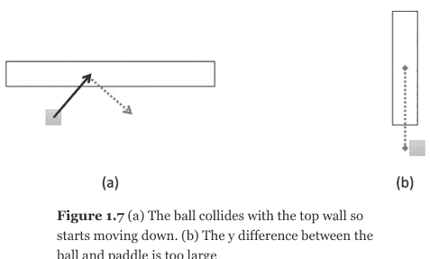

对于顶部墙壁的情况，这会生成如下代码：

```
if (mBallPos.y <= thickness)
{
    mBallVel.y *= -1;
}
```

然而，这段代码有一个关键问题。假设球在帧 A 上与顶部墙壁碰撞，因此代码取反 y 速度使球开始向下移动。在帧 B 上，球试图远离墙壁，但移动距离不够。因为球仍然与墙壁碰撞，代码再次取反 y 速度，这意味着球开始向上移动。然后在随后的每一帧中，代码不断取反球的 y 速度，因此它永远卡在顶部墙壁上。

要修复球卡住的问题，你需要一个额外的检查。你希望只有在球与顶部墙壁碰撞 *且* 球正朝向顶部墙壁移动（即 y 速度为负）时才取反 y 速度：

单击此处查看代码图片

```
if (mBallPos.y <= thickness && mBallVel.y < 0.0f)
{
    mBallVel.y *= -1;
}
```

这样一来，如果球与顶部墙壁碰撞但正在远离墙壁，你就不会取反 y 速度。

与底部和右侧墙壁碰撞的代码与与顶部墙壁碰撞的代码非常相似。然而，与球拍碰撞则稍微复杂一些。首先，计算球的 y 位置与球拍 y 位置之差的绝对值。如果此差值大于球拍高度的一半，球就太高或太低，如之前图 1-7(b) 所示。你还需要检查球的 x 位置是否与球拍对齐，并且球没有试图远离球拍。满足所有这些条件意味着球与球拍碰撞，你应该取反 x 速度：

单击此处查看代码图片

```
if (
    // Our y-difference is small enough
    diff <= paddleH / 2.0f &&
    // Ball is at the correct x-position
    mBallPos.x <= 25.0f && mBallPos.x >= 20.0f &&
    // The ball is moving to the left
    mBallVel.x < 0.0f)
{
    mBallVel.x *= -1.0f;
}
```

有了这段代码，球和球拍现在都在屏幕上移动了，如图 1.8 所示。你现在已经完成了简单版本的 Pong！

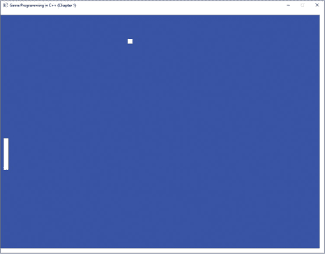

图 1.8 Pong 最终版本

## GAME PROJECT

本章的游戏项目实现了贯穿本章构建的完整 _Pong_ 游戏代码。要控制球拍，玩家使用 `W` 和 `S` 键。当球移出屏幕时游戏结束。代码可在本书的 GitHub 仓库的 `Chapter01` 目录中找到。在 Windows 上打开 `Chapter01-windows.sln`，在 Mac 上打开 `Chapter01-mac.xcodeproj`。（有关如何访问 GitHub 仓库的说明，请参阅本章开头的说明。）

## SUMMARY

实时游戏通过称为游戏循环的循环每秒更新多次。该循环的每次迭代都是一帧。例如，每秒 60 帧意味着每秒有 60 次游戏循环迭代。游戏循环每帧完成三个主要阶段：处理输入、更新游戏世界和生成输出。输入不仅涉及键盘和鼠标等输入设备，还涉及网络数据、回放数据等。输出包括图形、音频和力反馈控制器。

大多数显示器使用光栅图形，其中显示器包含一个像素网格。网格的大小取决于显示器的分辨率。游戏维护一个颜色缓冲区，为每个像素保存颜色数据。大多数游戏使用双缓冲，即有两个颜色缓冲区，游戏和显示器在这两个缓冲区之间交替。这有助于减少屏幕撕裂（即屏幕同时显示两帧的部分内容）的数量。要消除屏幕撕裂，还必须启用垂直同步，这意味着只有在显示器准备就绪时才交换缓冲区。

为了使游戏在可变帧率下正常工作，你需要将所有游戏逻辑编写为 delta time（帧之间的时间间隔）的函数。因此，游戏循环的“更新游戏世界”阶段应考虑 delta time。你可以进一步添加帧率限制，以确保帧率不超过设定的上限。

在本章中，你已经结合了所有这些不同的技术来创建经典视频游戏 Pong 的简单版本。

## ADDITIONAL READING

Jason Gregory 花了几页篇幅讨论游戏循环的不同表述，包括某些游戏如何更好地利用多核 CPU。还有许多关于所用各种库的优秀在线参考；例如，SDL API 参考很实用。

- Gregory, Jason. Game Engine Architecture, 2nd edition. Boca Raton: CRC Press, 2014.
- SDL API Reference.
- https://wiki.libsdl.org/APIByCategory.
- Accessed June 15, 2016.

## EXERCISES

本章的两个练习都集中在修改你的 Pong 版本上。第一个练习涉及添加第二个玩家，第二个练习涉及添加对多个球的支持。

### Exercise 1.1

原始版本的 Pong 支持两个玩家。移除屏幕上的右侧墙壁，并用第二个球拍替换该墙壁，供玩家 2 使用。对于这个第二个球拍，使用 ↑ 和 ↓ 键将球拍上下移动。支持第二个球拍需要复制第一个球拍的所有功能：球拍位置的成员变量、方向、处理玩家 2 输入的代码、绘制球拍的代码以及更新球拍的代码。最后，确保更新球碰撞代码，以便球能正确地与两个球拍碰撞。

### Exercise 1.2

许多弹球游戏支持“多球”，即同时有多个球在游戏中。事实证明，多球对 Pong 也很有趣！要支持多个球，创建一个包含两个 Vector2 的 Ball 结构体：一个用于位置，一个用于速度。接下来，为 Game 创建一个 `std::vector<Ball>` 成员变量来存储这些不同的球。然后更改 `Game::Initialize` 中的代码，以初始化多个球的位置和速度。在 `Game::UpdateGame` 中，更改球更新代码，使其不再使用单独的 `mBallVel` 和 `mBallPos` 变量，而是遍历 `std::vector` 中的所有球。

## CHAPTER 2

## GAME OBJECTS AND 2D GRAPHICS

大多数游戏有许多不同的角色和其他对象，一个重要的决定是如何表示这些对象。本章首先介绍不同的对象表示方法。接着，通过引入精灵、精灵动画和滚动背景，继续讨论 2D 图形技术。本章以一个侧卷演示结束，该演示应用了所涵盖的技术。

## GAME OBJECTS

在 <u>第 1 章</u> 中创建的 _Pong_ 游戏没有使用单独的类来表示墙壁、球拍和球。相反，`Game` 类使用成员变量来跟踪游戏中不同元素的位置和速度。虽然这对于非常简单的游戏可以工作，但这不是一个可扩展的解决方案。**游戏对象**一词指的是游戏世界中更新、绘制或同时更新 *和* 绘制的任何东西。有几种方法来表示游戏对象。有些游戏使用对象层次结构，其他游戏使用组合，还有一些游戏使用更复杂的方法。无论实现如何，游戏都需要某种方式来跟踪和更新这些游戏对象。

### Types of Game Objects

一种常见的游戏对象是既在循环的“更新游戏世界”阶段每帧更新，又在“生成输出”阶段每帧绘制的对象。任何角色、生物或其他可移动对象都属于此类。例如，在《超级马里奥兄弟》中，马里奥、任何敌人以及所有动态方块都是游戏既更新又绘制的游戏对象。

开发人员有时使用术语 **静态对象** 用于


## 游戏对象模型

绘制但不更新的游戏对象。这些对象对玩家可见，但永远不需要更新。这的一个示例是关卡背景中的一座建筑。在大多数游戏中，建筑不会移动或攻击玩家，但会出现在屏幕上。

摄像机是一个更新但不绘制到屏幕的游戏对象示例。另一个示例是 **触发器**，它基于另一个对象的相交来导致某事发生。例如，恐怖游戏可能希望当玩家靠近门时让僵尸出现。在这种情况下，关卡设计师会放置一个触发器对象，它可以检测玩家何时靠近并 _触发_ 生成僵尸的动作。实现触发器的一种方法是将其作为一个不可见的盒子，每帧更新以检查与玩家的相交。

### 作为类层次结构的游戏对象

游戏对象模型的一种方法是在标准面向对象类层次结构中声明游戏对象，这有时被称为 **单体类层次结构**，因为所有游戏对象都继承自一个基类。

要使用此对象模型，首先需要一个基类：

单击此处查看代码图像

```
class Actor
{
public:
    // Called every frame to update the Actor
    virtual void Update(float deltaTime);
    // Called every frame to draw the Actor
    virtual void Draw();
};
```

然后，不同的角色有不同的子类：

单击此处查看代码图像

```
class PacMan : public Actor
{
public:
    void Update(float deltaTime) override;
    void Draw() override;
};
```

同样，你可以声明 `Actor` 的其他子类。

例如，可能有一个继承自 `Actor` 的 `Ghost` 类，然后每个单独的幽灵可以有自己的继承自 `Ghost` 的类。图 2.1 说明了这种游戏对象类层次结构风格。

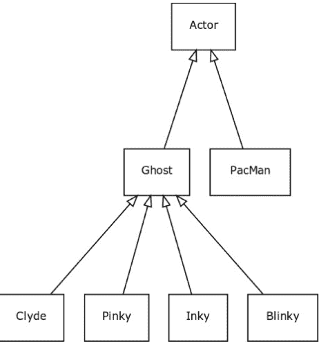

图 2.1 吃豆人部分类层次结构

这种方法的一个缺点是，这意味着每个游戏对象都必须具有基游戏对象（在此例中为 `Actor`）的所有属性和函数。例如，这假设每个 `Actor` 都可以更新和绘制。但如前所述，可能存在不可见的对象，因此在这些对象上调用 `Draw` 是浪费时间。

随着游戏功能的增加，问题变得更加明显。假设游戏中的许多角色——但并非所有角色——都需要移动。在吃豆人中，幽灵和吃豆人需要移动，但能量丸不需要。一种方法是将移动代码放在 Actor 中，但并非每个子类都需要此代码。或者，你可以在 Actor 和需要移动的任何子类之间扩展一个新的 MovingActor 层次结构。然而，这会为类层次结构增加更多复杂性。

此外，当两个兄弟类后来需要共享功能时，拥有一个大的类层次结构可能会造成困难。例如，类似侠盗猎车手风格的游戏可能有一个基类 Vehicle。从此类，创建两个子类是有意义的：LandVehicle（用于陆地行驶的车辆）和 WaterVehicle（用于水上车辆，如船只）。

但是，如果有一天设计师决定添加一种两栖车辆会怎样？创建一个名为 AmphibiousVehicle 的新子类可能很诱人，它同时继承自 LandVehicle 和 WaterVehicle。然而，这需要使用多重继承，并且还意味着 AmphibiousVehicle 沿两条不同的路径继承自 Vehicle。这种称为菱形继承的层次结构可能会导致问题，因为子类可能会继承多个虚函数版本。出于这个原因，建议我们避免菱形层次结构。

### 带有组件的游戏对象

与使用单体层次结构不同，许多游戏改用 **基于组件的** 游戏对象模型。这种模型越来越流行，尤其是因为 Unity 游戏引擎使用它。在这种方法中，有一个游戏对象类，但没有游戏对象的子类。相反，游戏对象类 *拥有一个* 实现所需功能的组件对象集合。

例如，在我们之前研究的单体层次结构中，*平基* 是 *幽灵* 的子类，而 *幽灵* 是 *角色* 的子类。然而，在基于组件的模型中，Pinky 是一个包含四个组件的 *游戏对象* 实例：*平基行为*、*碰撞组件*、*变换组件* 和 *绘制组件*。**图 2.2** 显示了这种关系。

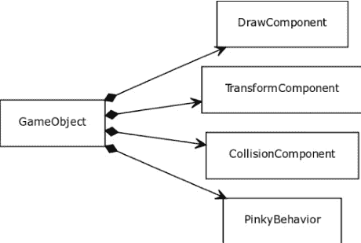

图 2.2 构成幽灵 Pinky 的组件

这些组件中的每个都具有该组件所需的特定属性和功能。例如，DrawComponent 负责将对象绘制到屏幕上，TransformComponent 存储对象在游戏世界中的位置和变换。

实现组件对象模型的一种方法是使用组件的类层次结构。这个类层次结构通常深度很浅。给定一个基类 Component，GameObject 然后简单地拥有一组组件：

单击此处查看代码图像

```
class GameObject
{
public:

void AddComponent(Component* comp);

void RemoveComponent(Component* comp);

private:

std::unordered_set<Component*> mComponents;

};
```

请注意，GameObject 仅包含添加和删除组件的函数。这使得跟踪不同类型组件的系统变得必要。例如，每个 DrawComponent 可能会向 Renderer 对象注册，以便在绘制帧时，Renderer 知道所有活动的 DrawComponent。

基于组件的游戏对象模型的一个优点是，更容易仅将功能添加到需要它的特定游戏对象。任何需要绘制的对象都可以有一个 DrawComponent，但不需要的对象则根本没有。

然而，纯组件系统的一个缺点是，同一游戏对象中组件之间的依赖关系不清楚。例如，DrawComponent 很可能需要知道 TransformComponent 才能知道对象应该在哪里绘制。这意味着 DrawComponent 很可能需要询问拥有它的 GameObject 关于其 TransformComponent 的信息。取决于实现，这种查询可能成为明显的性能瓶颈。

### 作为带有组件的层次结构的游戏对象

本书中使用的游戏对象模型是单体层次结构和组件对象模型的混合体。这部分灵感来自于虚幻引擎 4 中使用的游戏对象模型。有一个带有少量虚函数的基类 Actor，但每个角色还有一个组件向量。清单 2.1 显示了 Actor 类的声明，省略了一些 getter 和 setter 函数。

### 清单 2.1 Actor 声明

单击此处查看代码图像

```
class Actor
{
public:
    // Used to track state of actor
    enum State
    {
        EActive,
        EPaused,
        EDead
};

// Constructor/destructor
Actor(class Game* game);
virtual ~Actor();

// Update function called from Game (not overridable)
void Update(float deltaTime);

// Updates all the components attached to the actor
void UpdateComponents(float deltaTime);

// Any actor-specific update code (overridable)
virtual void UpdateActor(float deltaTime);

// Getters/setters
// ...

// Add/remove components
void AddComponent(class Component* component);
void RemoveComponent(class Component* component);

private:
// Actor's state

State mState;

// Transform

Vector2 mPosition; // Center position of actor

float mScale; // Uniform scale of actor (1.0)

float mRotation; // Rotation angle (in radians)

// Components held by this actor

std::vector<class Component*> mComponents;

class Game* mGame;
};
```

Actor 类有几个显著特征。状态枚举跟踪角色的状态。例如，Update 仅在 EActive 状态下更新角色。EDead 状态通知游戏删除角色。Update 函数首先调用 UpdateComponents，然后调用 UpdateActor。UpdateComponents 遍历所有组件并逐个更新它们。UpdateActor 的基实现为空，但 Actor 子类可以在重写的 UpdateActor 函数中编写自定义行为。

此外，Actor 类需要访问 Game 类，原因有几个，包括创建更多角色。一种方法是将游戏对象设为单例，这是一种设计模式，其中有一个类的单个、全局可访问的实例。但单例


模式如果发现实际上需要该类的多个实例，可能会导致问题。与使用单例相比，本书采用一种称为**依赖注入**的方法。在这种方法中，actor 构造函数接收指向 `Game` 类的指针。然后 actor 可以使用此指针创建另一个 actor（或访问任何其他所需的 `Game` 函数）。

与**第 1 章**游戏项目一样，`Vector2` 表示 `Actor` 的位置。Actor 还支持缩放（使 actor 变大或变小）和旋转（旋转 actor）。请注意，旋转是以弧度为单位，而不是角度。

**清单 2.2** 包含 `Component` 类的声明。`mUpdateOrder` 成员变量值得注意。它允许某些组件在其他组件之前或之后更新，这在许多情况下很有用。例如，跟踪玩家的摄像机组件可能希望在移动组件移动玩家后更新。为了保持此顺序，`Actor` 中的 `AddComponent` 函数在添加新组件时会对组件向量进行排序。最后，请注意 `Component` 类拥有指向拥有 actor 的指针。这样组件就可以访问变换数据以及其认为必要的任何其他信息。

### **清单 2.2** `Component` 声明

[点击此处查看代码图片]()

```cpp
class Component
{
public:
    // Constructor
    // (the lower the update order, the earlier the co
    Component(class Actor* owner, int updateOrder = 1);
    // Destructor
    virtual ~Component();
    // Update this component by delta time
    virtual void Update(float deltaTime);
    int GetUpdateOrder() const { return mUpdateOrder; }
protected:
    // Owning actor
    class Actor* mOwner;
    // Update order of component
    int mUpdateOrder;
};
```

目前，Actor 和 Component 的实现未考虑玩家输入设备，本章游戏项目仅为输入使用特例代码。第 3 章“向量和基础物理”将重新探讨如何将输入纳入混合游戏对象模型。

这种混合方法在避免单体对象模型中的深层类层次结构方面做得更好，但层次结构的深度当然大于纯组件模型。混合方法也通常避免（尽管未消除）组件之间的通信开销问题。这是因为每个 actor 都有关键属性，例如变换数据。

## 其他方法

游戏对象模型有许多其他方法。有些使用接口类来声明不同的可能功能，然后每个游戏对象实现表示其所需的接口。其他方法进一步扩展组件模型并完全消除包含的游戏对象。相反，这些方法使用组件数据库，通过数字标识符跟踪对象。还有其他方法通过属性定义对象。在这些系统中，为对象添加健康属性意味着它可以承受并造成伤害。

对于任何游戏对象模型，每种方法都有优缺点。然而，本书坚持采用混合方法，因为它是一个良好的折中方案，并且对一定复杂度的游戏效果相对较好。

## 将游戏对象集成到游戏循环中

将混合游戏对象模型集成到游戏循环中需要一些代码，但最终并不复杂。首先，向 `Game` 类添加两个 `Actor` 指针的 `std::vector`：一个包含活动 actor（`mActors`），另一个包含待处理 actor（`mPendingActors`）。您需要待处理 actor 向量来处理在更新 actor（因此遍历 `mActors`）时决定创建新 actor 的情况。在这种情况下，您无法向 `mActors` 添加元素，因为正在遍历它。相反，您需要向 `mPendingActors` 向量添加，并在遍历完成后将这些 actor 移动到 `mActors`。

接下来，创建两个函数 `AddActor` 和 `RemoveActor`，它们接收 `Actor` 指针。`AddActor` 函数将 actor 添加到 `mPendingActors` 或 `mActors` 中，具体取决于您当前是否正在更新所有 `mActors`（由 `mUpdatingActors` 布尔值表示）：

[点击此处查看代码图片]()

```cpp
void Game::AddActor(Actor* actor)
{
    // If updating actors, need to add to pending
    if (mUpdatingActors)
    {
        mPendingActors.emplace_back(actor);
    }
    else
    {
        mActors.emplace_back(actor);
    }
}
```

同样，RemoveActor 会从 actor 所在的两个向量中将其移除。

然后需要修改 UpdateGame 函数，使其更新所有 actor，如清单 2.3 所示。计算 delta 时间后（如第 1 章所述），遍历 mActors 中的每个 actor 并对每个调用 Update。接下来，将任何待处理 actor 移动到主 mActors 向量中。最后，检查是否有 actor 已死亡，如果是，则删除它们。

### 清单 2.3 Game::UpdateGame 更新 actor

[点击此处查看代码图片]()

```cpp
void Game::UpdateGame()
{
// Compute delta time (as in Chapter 1)
float deltaTime = /* ... */;

// Update all actors
mUpdatingActors = true;
for (auto actor : mActors)
{
    actor->Update(deltaTime);
}
mUpdatingActors = false;

// Move any pending actors to mActors
for (auto pending : mPendingActors)
{
    mActors.emplace_back(pending);
}
mPendingActors.clear();

// Add any dead actors to a temp vector
std::vector<Actor*> deadActors;

for (auto actor : mActors)
{
    if (actor->GetState() == Actor::EDead)
    {
        deadActors.emplace_back(actor);
    }
}

// Delete dead actors (which removes them from mActors)
for (auto actor : deadActors)
{
    delete actor;
}
}
```

向游戏的 mActors 向量添加和移除 actor 也会给代码增加一些复杂性。本章游戏项目的 Actor 对象会在其构造函数和析构函数中分别自动将自身添加到游戏中或从游戏中移除。然而，这意味着遍历 mActors 向量并删除 actor 的代码（例如在 Game::Shutdown 中）必须仔细编写：

[点击此处查看代码图片]()

```cpp
// Because ~Actor calls RemoveActor, use a different
while (!mActors.empty())
{
    delete mActors.back();
}
```

## 精灵

**精灵**是 2D 游戏中的视觉对象，通常用于表示角色、背景和其他动态对象。大多数 2D 游戏拥有数十个甚至数百个精灵，对于移动游戏，精灵数据占游戏总下载量的很大一部分。由于精灵在 2D 游戏中普遍存在，因此尽可能高效地使用它们非常重要。

每个精灵都有一个或多个关联的图像文件。有多种不同的图像文件格式，游戏根据平台和其他限制使用不同的格式。例如，PNG 是一种压缩图像格式，因此这些文件在磁盘上占用空间较小。但硬件无法原生绘制 PNG 文件，因此加载时间更长。某些平台建议使用对图形硬件友好的格式，例如 PVR（适用于 iOS）和 DXT（适用于 PC 和 Xbox）。本书坚持使用 PNG 文件格式，因为图像编辑程序普遍支持 PNG。

## 加载图像文件

对于只需要 SDL 2D 图形的游戏，加载图像文件的最简单方法是使用 SDL Image 库。第一步是使用 `IMG_Init` 初始化 SDL Image，它接受一个标志参数来指定请求的文件格式。要支持 PNG 文件，请向 `Game::Initialize` 添加以下调用：

```cpp
IMG_Init(IMG_INIT_PNG)
```

表 2.1 列出了支持的文件格式。请注意，SDL 已经支持 BMP 文件格式，无需 SDL Image，这就是为什么此表中没有 `IMG_INIT_BMP` 标志的原因。

### 表 2.1 SDL Image 文件格式

| 标志 | 格式 |
|---|---|
| IMG_INIT_JPG | JPEG |
| IMG_INIT_PNG | PNG |
| IMG_INIT_TIF | TIFF |


一旦 SDL Image 初始化完成，你可以使用 `IMG_Load` 将图像文件加载到 `SDL_Surface` 中：

```
// Loads an image from a file
// Returns a pointer to an SDL_Surface if successful,
SDL_Surface* IMG_Load(
    const char* file // Image file name
);
```

接下来，`SDL_CreateTextureFromSurface` 将 `SDL_Surface` 转换为 `SDL_Texture`（这是 SDL 进行绘制所需要的）：

```
// Converts an SDL_Surface to an SDL_Texture
// Returns a pointer to an SDL_Texture if successful,
SDL_Texture* SDL_CreateTextureFromSurface(
    SDL_Renderer* renderer, // Renderer used
    SDL_Surface* surface    // Surface to convert
);
```

以下函数封装了此图像加载过程：

```
SDL_Texture* LoadTexture(const char* fileName)
{

    // Load from file
    SDL_Surface* surf = IMG_Load(fileName);
    if (!surf)
    {
        SDL_Log("Failed to load texture file %s", fileName);
        return nullptr;
    }

    // Create texture from surface
    SDL_Texture* text = SDL_CreateTextureFromSurface(renderer, surf);
    SDL_FreeSurface(surf);
    if (!text)
    {
        SDL_Log("Failed to convert surface to texture %s", fileName);
        return nullptr;
    }

    return text;
}
```

一个有趣的问题是存储加载的纹理的位置。游戏为多个不同的角色多次使用同一图像文件是非常常见的。如果有 20 个小行星，且每个小行星都使用同一图像文件，那么从磁盘加载 20 次该文件就没有意义了。

一种简单的方法是在 Game 中创建一个从文件名到 SDL_Texture 指针的映射。然后在 Game 中创建一个 GetTexture 函数，该函数接受纹理名称并返回其对应的 SDL_Texture 指针。此函数首先检查纹理是否已存在于映射中。如果存在，可以直接返回该纹理指针。否则，运行从文件加载纹理的代码。

> note
> 虽然在简单情况下，从文件名到 SDL_Texture 指针的映射是有意义的，但请考虑游戏中有多种不同类型的资源——纹理、音效、3D 模型、字体等等。因此，编写一个更健壮的系统来通用处理所有类型的资源是有意义的。但出于简单起见，本书并未实现此类资源管理系统。

为了帮助划分职责，你还在 Game 中创建一个 LoadData 函数。该函数负责创建游戏世界中的所有角色。目前这些角色是硬编码的，但第 14 章“关卡文件和二进制数据”将添加从关卡文件加载角色的支持。你在 Game::Initialize 的末尾调用 LoadData 函数。

## 绘制精灵

假设一个游戏有一个基本的 2D 场景，包含背景图像和一个角色。绘制此场景的简单方法是先绘制背景图像，再绘制角色。这就像画家绘制场景的方式，因此这种方法被称为 **画家算法**。在画家算法中，游戏按从后到前的顺序绘制精灵。图 2.3 演示了画家算法，先绘制背景星场，然后绘制月亮，接着绘制任何小行星，最后绘制飞船。

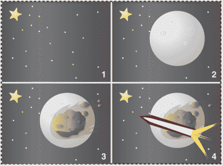

### 图 2.3 应用于太空场景的画家算法

因为本书使用带有组件的游戏对象模型，因此创建 `SpriteComponent` 类非常合理。清单 2.4 提供了 SpriteComponent 的声明。

### 清单 2.4 SpriteComponent 声明

```
class SpriteComponent : public Component
{
public:
    // (Lower draw order corresponds with further back)
    SpriteComponent(class Actor* owner, int drawOrder);
    ~SpriteComponent();

    virtual void Draw(SDL_Renderer* renderer);
    virtual void SetTexture(SDL_Texture* texture);

    int GetDrawOrder() const { return mDrawOrder; }
    int GetTexHeight() const { return mTexHeight; }
    int GetTexWidth() const { return mTexWidth; }

protected:
    // Texture to draw
    SDL_Texture* mTexture;

    // Draw order used for painter's algorithm
    int mDrawOrder;

    // Width/height of texture
    int mTexWidth;
    int mTexHeight;
};
```

游戏通过按 mDrawOrder 成员变量指定的顺序绘制精灵组件来实现画家算法。SpriteComponent 构造函数通过 Game::AddSprite 函数将自身添加到 Game 类中的精灵组件向量。

在 Game::AddSprite 中，你需要确保 mSprites 按绘制顺序保持排序。因为每次调用 AddSprite 都会保持排序顺序，你可以将此实现为向已排序向量中插入元素：

```
void Game::AddSprite(SpriteComponent* sprite)
{
// Find the insertion point in the sorted vector
// (The first element with a higher draw order than
int myDrawOrder = sprite->GetDrawOrder();
auto iter = mSprites.begin();
for ( ;
iter != mSprites.end();
++iter)
{
    if (myDrawOrder < (*iter)->GetDrawOrder())
    {
        break;
    }
}

// Inserts element before position of iterator
mSprites.insert(iter, sprite);
}
```

由于这样按 mDrawOrder 对精灵组件进行排序，Game::GenerateOutput 只需遍历精灵组件向量并对每个组件调用 Draw。你将此代码放在清除后台缓冲区和交换后台缓冲区与前台缓冲区的代码之间，替换第 1 章游戏中绘制墙壁、球和球拍矩形的代码。

如第 6 章“3D 图形”中所讨论，3D 游戏也可以使用画家算法，但这样做有一些缺点。但对于 2D 场景，画家算法效果很好。

SetTexture 函数既设置 mTexture 成员变量，又使用 SDL_QueryTexture 获取纹理的宽度和高度：

```
void SpriteComponent::SetTexture(SDL_Texture* texture)
{
    mTexture = texture;

    // Get width/height of texture
    SDL_QueryTexture(texture, nullptr, nullptr,
        &mTexWidth, &mTexHeight);
}
```

要绘制纹理，SDL 中有两个不同的纹理绘制函数。较简单的函数是 SDL_RenderCopy：

```
// Renders a texture to the rendering target
// Returns 0 on success, negative value on failure
int SDL_RenderCopy(
    SDL_Renderer* renderer, // Render target to draw
    SDL_Texture* texture, // Texture to draw
    const SDL_Rect* srcrect, // Part of texture to draw
    const SDL_Rect* drect, // Rectangle to draw onto
);
```

但是，对于更高级的行为（例如旋转精灵），可以使用 SDL_RenderCopyEx：

```
// Renders a texture to the rendering target
// Returns 0 on success, negative value on failure
int SDL_RenderCopyEx(
SDL_Renderer* renderer, // Render target to draw
SDL_Texture* texture, // Texture to draw
const SDL_Rect* srcrect, // Part of texture to draw
const SDL_Rect* drect, // Rectangle to draw onto
double angle, // Rotation angle (in degrees)
const SDL_Point* center, // Point to rotate about
SDL_RendererFlip flip, // How to flip texture
);
```

因为角色具有旋转，且你希望精灵继承此旋转，所以必须使用 SDL_RenderCopyEx。这给 `SpriteComponent::Draw` 函数带来了一些复杂性。首先，`SDL_Rect` 结构体的 x/y 坐标对应目标的左上角。然而，角色的位置变量指定的是角色的中心位置。因此，如同第 1 章中的球和球拍一样，你必须计算左上角的坐标。

其次，SDL 期望角度以度为单位，但 `Actor` 使用弧度作为角度。幸运的是，本书在 `Math.h` 头文件中的自定义数学库包含一个 `Math::ToDegrees` 函数，可以处理转换。最后，在 SDL 中正角度是顺时针，但这与单位圆相反（单位圆中正角度是逆时针）。因此，对角度取负以保持单位圆行为。清单 2.5 显示了 `SpriteComponent::Draw` 函数。

### 清单 2.5 SpriteComponent::Draw 实现

```
void SpriteComponent::Draw(SDL_Renderer* renderer)
{
    if (mTexture)
    {
        SDL_Rect r;
        // Scale the width/height by owner's scale
```


```
r.w = static_cast<int>(mTexWidth * mOwner->Get...
r.h = static_cast<int>(mTexHeight * mOwner->Get...
// Center the rectangle around the position of
r.x = static_cast<int>(mOwner->GetPosition().x
r.y = static_cast<int>(mOwner->GetPosition().y

// Draw

SDL_RenderCopyEx(renderer,
    mTexture, // Texture to draw
    nullptr, // Source rectangle
    &r, // Destination rectangle
    -Math::ToDegrees(mOwner->GetRotation()), //
    nullptr, // Point of rotation
    SDL_FLIP_NONE); // Flip behavior
}
}
```

此 Draw 实现假设演员的位置对应于其屏幕上的位置。此假设仅适用于游戏世界与屏幕完全对应的游戏。这对于像 Super Mario Bros. 这样拥有大于单个屏幕的游戏世界的游戏不适用。要处理这种情况，代码需要摄像机位置。第 9 章，“摄像机”，讨论了如何在 3D 游戏的上下文中实现摄像机。

## 精灵动画

大多数 2D 游戏使用类似翻页书动画的技术来实现精灵动画：快速连续播放一系列静态 2D 图像，以创造运动的错觉。图 2.4 展示了骷髅精灵不同动画的一系列图像可能是什么样子。

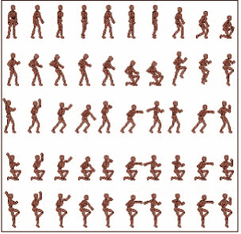

图 2.4 骷髅精灵的一系列图像

精灵动画的帧率可能会有所不同，但许多游戏选择使用 24 FPS（电影中使用的传统帧率）。这意味着动画的每一秒需要 24 张单独的图像。某些类型的游戏，例如 2D 格斗游戏，可能会使用 60 FPS 的精灵动画，这会大幅增加所需的图像数量。幸运的是，大多数精灵动画的持续时间都远短于 1 秒。

表示动画精灵的最简单方法是使用一个向量，其中包含动画中每一帧对应的不同图像。在清单 2.6 中声明的 AnimSpriteComponent 类采用了这种方法。

### 清单 2.6 AnimSpriteComponent 声明

单击此处查看代码图像

```
class AnimSpriteComponent : public SpriteComponent
{
public:
	AnimSpriteComponent(class Actor* owner, int drawOr
	// Update animation every frame (overridden from co
	void Update(float deltaTime) override;
	// Set the textures used for animation
	void SetAnimTextures(const std::vector<SDL_Texture
	// Set/get the animation FPS
	float GetAnimFPS() const { return mAnimFPS; }
	void SetAnimFPS(float fps) { mAnimFPS = fps; }
private:
// All textures in the animation
std::vector<SDL_Texture*> mAnimTextures;

// Current frame displayed
float mCurrFrame;

// Animation frame rate
float mAnimFPS;

};
```

mAnimFPS 变量允许不同的动画精灵以不同的帧率运行。它还允许动画动态加速或减速。例如，当角色加速时，你可以提高动画的帧率，以进一步增强速度的错觉。mCurrFrame 变量以浮点数形式跟踪当前显示的帧，这使你还可以跟踪该帧显示了多长时间。

SetAnimTextures 函数只是将 mAnimTextures 成员变量设置为提供的向量，并将 mCurrFrame 重置为零。它还调用 SetTexture 函数（从 SpriteComponent 继承），并传入动画的第一帧。由于此代码使用 SpriteComponent 的 SetTexture 函数，因此无需重写继承的 Draw 函数。

清单 2.7 中所示的 Update 函数是 `AnimSpriteComponent` 中大部分繁重工作发生的地方。首先，根据动画帧率和增量时间更新 `mCurrFrame`。接下来，确保 `mCurrFrame` 小于纹理数量（如果需要，这意味着需要循环回到动画的开头）。最后，将 `mCurrFrame` 强制转换为 `int`，从 `mAnimTextures` 中获取正确的纹理，并调用 `SetTexture`。

### 清单 2.7 AnimSpriteComponent::Update 实现

单击此处查看代码图像

```
void AnimSpriteComponent::Update(float deltaTime)
{
    SpriteComponent::Update(deltaTime);

    if (mAnimTextures.size() > 0)
    {
        // Update the current frame based on frame rate
        // and delta time
        mCurrFrame += mAnimFPS * deltaTime;

        // Wrap current frame if needed
        while (mCurrFrame >= mAnimTextures.size())
        {
            mCurrFrame -= mAnimTextures.size();
        }

        // Set the current texture
        SetTexture(mAnimTextures[static_cast<int>(mCur
    }
}
```

AnimSpriteComponent 缺少的一个功能是更好的动画切换支持。目前，切换动画的唯一方法是反复调用 SetAnimTextures。更合理的做法是拥有一个包含精灵所有动画的所有不同纹理的向量，然后指定哪些图像对应哪个动画。你将在练习 2.2 中进一步探索这一想法。

## 滚动背景

2D 游戏中常用的一种技巧是让背景滚动。这会营造出一个更大世界的印象，无限滚动游戏经常使用这种技术。目前，我们专注于滚动背景，而不是在实际关卡中滚动。最简单的方法是将背景分割成屏幕大小的图像段，并每帧重新定位它们，以创造滚动的错觉。

与动画精灵一样，为背景创建 SpriteComponent 的子类是合理的。清单 2.8 显示了 BGSpriteComponent 的声明。

### 清单 2.8 BGSpriteComponent 声明

单击此处查看代码图像

```
class BGSpriteComponent : public SpriteComponent
{

public:

// Set draw order to default to lower (so it's in
BGSpriteComponent(class Actor* owner, int drawOrder

// Update/draw overridden from parent
void Update(float deltaTime) override;

void Draw(SDL_Renderer* renderer) override;

// Set the textures used for the background
void SetBGTextures(const std::vector<SDL_Texture*>

// Get/set screen size and scroll speed
void SetScreenSize(const Vector2& size) { mScreenS
void SetScrollSpeed(float speed) { mScrollSpeed =
float GetScrollSpeed() const { return mScrollSpeed

private:

// Struct to encapsulate each BG image and its off
struct BGTexture
{
    SDL_Texture* mTexture;
    Vector2 mOffset;
};

std::vector<BGTexture> mBGTextures;
Vector2 mScreenSize;
float mScrollSpeed;
};
```

BGTexture 结构体将每个背景纹理与其对应的偏移量关联起来。偏移量每帧更新以创建滚动效果。你需要在 SetBGTextures 中初始化偏移量，将每个背景定位在前一个背景的右侧：

单击此处查看代码图像

```
void BGSpriteComponent::SetBGTextures(const std::vect
{
    int count = 0;
    for (auto tex : textures)
    {
        BGTexture temp;
        temp.mTexture = tex;
        // Each texture is screen width in offset
        temp.mOffset.x = count * mScreenSize.x;
        temp.mOffset.y = 0;
        mBGTextures.emplace_back(temp);
        count++;
    }
}
```

此代码假设每个背景图像的宽度都与屏幕宽度相对应，但当然可以修改代码以考虑可变大小。`Update` 代码更新每个背景的偏移量，并考虑到当一幅图像完全移出屏幕时的情况。这使得图像可以无限重复：

单击此处查看代码图像

```
void BGSpriteComponent::Update(float deltaTime)
{
    SpriteComponent::Update(deltaTime);
    for (auto& bg : mBGTextures)
    {
        // Update the x offset
        bg.mOffset.x += mScrollSpeed * deltaTime;
        // If this is completely off the screen, reset
        // the right of the last bg texture
        if (bg.mOffset.x < -mScreenSize.x)
        {
            bg.mOffset.x = (mBGTextures.size() - 1) * mS
        }
    }
}
```

Draw 函数只是使用 SDL_RenderCopy 绘制每个背景纹理，并确保根据所有者的位置和该背景的偏移量调整位置。这实现了简单的滚动行为。

某些游戏还实现了视差滚动。在这种方法中，你为背景使用多个图层。每个图层以不同的速度滚动，从而产生深度的错觉。例如，一个游戏可能会有一个


云层和地面层。如果云层滚动速度比地面层慢，就会给人一种云层比地面更远的印象。传统动画已使用这种技术近一个世纪，并且它很有效。通常，只需要三层就能创建可信的视差效果，如图 2.5 所示。当然，更多层会为效果增加更多深度。

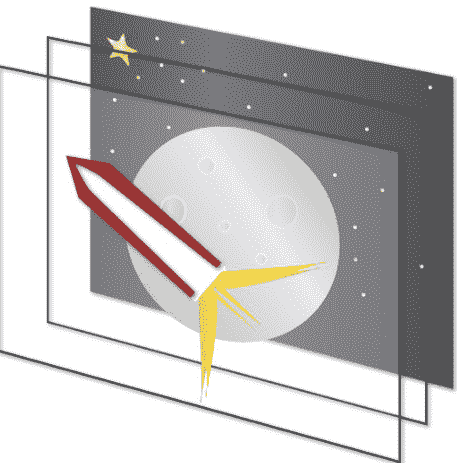

图 2.5 将太空场景分解为三层，以便实现视差滚动

要实现视差效果，请将多个 BGSpriteComponents 附加到单个 actor 上并指定不同的绘制顺序值。然后，您可以为每个背景使用不同的滚动速度来完成效果。

## 游戏项目

遗憾的是，您尚未学习足够多的新主题来制作具有比第 1 章“游戏编程概述”中创建的 Pong 克隆游戏明显更复杂机制的游戏。仅将精灵添加到上一章的游戏中也不会特别有趣。因此，与其做一个完整的游戏，本章的游戏项目演示了本章涵盖的新技术。代码可在本书的 GitHub 仓库中找到，位于 Chapter02 目录。在 Windows 上打开 Chapter02-windows.sln，在 Mac 上打开 Chapter02-mac.xcodeproj。图 2.6 展示了游戏项目的实际运行效果。Jacob Zinman-Jeanes 创建了精灵图像，这些图像根据 CC BY 许可证授权。

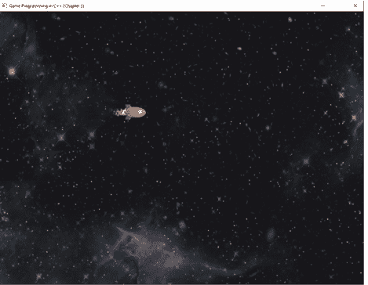

图 2.6 横向卷轴项目的实际运行效果

代码包括混合 `Actor/Component` 模型、`SpriteComponent`、`AnimSpriteComponent` 和视差滚动的实现。它还包括一个名为 `Ship` 的 `Actor` 子类。`Ship` 类包含两个速度变量，分别用于控制左右速度和上下速度。清单 2.9 显示了 `Ship` 的声明。

## 清单 2.9 Ship 声明

单击此处查看代码图像

```cpp
class Ship : public Actor
{
public:
    Ship(class Game* game);

    void UpdateActor(float deltaTime) override;

    void ProcessKeyboard(const uint8_t* state);

    float GetRightSpeed() const { return mRightSpeed; }

    float GetDownSpeed() const { return mDownSpeed; }

private:

    float mRightSpeed;

    float mDownSpeed;
};
```

Ship 构造函数将 mRightSpeed 和 mDownSpeed 初始化为 0，并创建一个附加到船上的 AnimSpriteComponent，关联相关纹理：

单击此处查看代码图像

```cpp
AnimSpriteComponent* asc = new AnimSpriteComponent(this);

std::vector<SDL_Texture*> anims = {

    game->GetTexture("Assets/Ship01.png"),

    game->GetTexture("Assets/Ship02.png"),

    game->GetTexture("Assets/Ship03.png"),

    game->GetTexture("Assets/Ship04.png"),

};

asc->SetAnimTextures(anims);
```

键盘输入直接影响船的速度。游戏使用 W 和 S 键使船上下移动，使用 A 和 D 键使船左右移动。ProcessKeyboard 函数接收这些输入并适当更新 mRightSpeed 和 mDownSpeed。

Ship::UpdateActor 函数实现了船的移动，使用与第 1 章所示类似的技术：

单击此处查看代码图像

```cpp
void Ship::UpdateActor(float deltaTime)
{
    Actor::UpdateActor(deltaTime);

    // Update position based on speeds and delta time
    Vector2 pos = GetPosition();

    pos.x += mRightSpeed * deltaTime;
    pos.y += mDownSpeed * deltaTime;

    // Restrict position to left half of screen
    // ...

    SetPosition(pos);
}
```

移动是游戏中如此常见的功能，以至于将其实现为组件（而不是在 `UpdateActor` 函数中）非常合理。第 3 章“向量和基础物理”讨论了如何创建 `MoveComponent` 类。

背景是一个通用的 `Actor`（不是子类），它拥有两个 `BGSpriteComponent`。这两个背景不同的滚动速度创建了视差效果。所有这些 actor（包括船）都在 `Game::LoadData` 函数中创建。

## 摘要

表示游戏对象有多种方式。最简单的方法是使用单体层次结构，所有游戏对象都继承自一个基类，但这可能会迅速变得难以管理。使用基于组件的模型，您可以根据游戏对象包含的组件来定义其功能。本书采用混合方法，具有浅层的游戏对象层次结构，但组件实现了一些行为，例如绘制和移动。

最早的游戏使用 2D 图形。虽然当今许多游戏是 3D 的，但 2D 游戏仍然非常流行。精灵是任何 2D 游戏的主要视觉构建块，无论是否有动画。SDL 通过简单的接口支持加载和绘制纹理。

许多 2D 游戏实现了翻页动画，通过快速连续绘制不同图像来使精灵看起来在动画。您可以使用其他技术实现滚动背景层，并可以使用视差效果来创造深度的错觉。

## 补充阅读

Jason Gregory 用几页篇幅介绍了不同类型的游戏对象模型，包括 Naughty Dog 使用的模型。Michael Dickheiser 的书包含一篇关于实现纯组件模型的文章。

Dickheiser, Michael, Ed. Game Programming Gems 6. Boston: Charles River Media, 2006.

Gregory, Jason. Game Engine Architecture, 2nd edition. Boca Raton: CRC Press, 2014.

## 练习

本章的第一个练习是关于不同类型游戏对象模型的思想实验。在第二个练习中，您将向 **AnimSpriteComponent** 类添加功能。最后一个练习涉及添加对 **tile maps** 的支持，这是一种从瓦片生成 2D 场景的技术。

## 练习 2.1

考虑一个动物野生动物园游戏，玩家可以开着不同的车辆在野外观察动物。思考这样一个游戏中可能存在的不同类型的生物、植物和车辆。您如何在单体类层次结构对象模型中实现这些对象？

现在考虑同一个游戏，但使用基于组件的游戏对象模型实现。您如何实现这一点？这两种方法中，哪一种对这个游戏似乎更有益？

## 练习 2.2

`AnimSpriteComponent` 类目前仅支持单个动画，由向量中的所有精灵组成。修改该类以支持多个不同的动画。将每个动画定义为向量中纹理的一个范围。使用 `Chapter02/Assets` 目录中的 `CharacterXX.png` 文件进行测试。

现在添加对非循环动画的支持。在将动画定义为纹理范围时，还允许指定循环或非循环。当非循环动画结束时，它不应回绕到初始纹理。

## 练习 2.3

生成 2D 场景的一种方法是通过瓦片地图。在这种方法中，一个图像文件（称为 **tile set**）包含一系列大小统一的瓦片。许多这样的瓦片组合形成一个 2D 场景。Tiled (http://www.mapeditor.org) 是一个用于生成瓦片集和瓦片地图的优秀程序，它为本练习生成了瓦片地图。**图 2.7** 说明了瓦片集的一部分是什么样子。

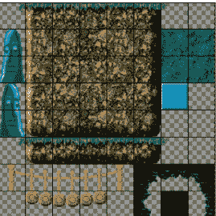

**图 2.7** 练习 2-3 使用的瓦片集的一部分

在此示例中，瓦片地图存储在 CSV 文件中。使用 `Chapter02/Assets` 目录中的 `MapLayerX.csv` 文件，其中有三个不同的图层（图层 1 最近，图层 3 最远）。`Tiles.png` 包含瓦片集。CSV 文件中的每一行包含一系列数字，如下所示：

```
-1,0,5,5,5,5
```

-1 表示该瓦片没有图像（因此您不应为该瓦片渲染任何内容）。其他每个数字都引用瓦片集中的特定瓦片。编号从左到右，然后从上到下。因此，在此瓦片集中，瓦片 8 是第二行最左侧的瓦片。

创建一个名为 TileMapComponent 的新组件，它继承自 SpriteComponent。此类需要一个函数来加载和读取瓦片地图 CSV 文件。然后重写 Draw 以从瓦片集纹理绘制每个瓦片。为了仅绘制纹理的一部分而不是整个纹理，请使用 SDL_RenderCopyEx 的 srcrect 参数。这样可以仅从瓦片集纹理绘制单个瓦片正方形，而不是整个瓦片集。


## 第 3 章
## 向量与基础物理

向量是游戏程序员日常使用的基本数学概念。本章首先探讨向量在游戏中解决问题的各种不同方式。接着，它展示如何通过 MoveComponent 实现基本移动，并通过 InputComponent 使用键盘进行控制。本章随后简要探讨牛顿物理学的基础，最后讨论如何检测对象之间的碰撞。本章的游戏项目将运用其中一些技术来实现经典游戏 *小行星* 的一个版本。

### 向量

数学**向量**（不要与 `std::vector` 混淆）表示 _n_ 维空间中的大小和方向，每个维度对应一个分量。这意味着二维（2D）向量具有 x 和 y 分量。对游戏程序员来说，向量是最重要的数学工具之一。你可以使用向量解决游戏中的许多不同问题，理解向量在使用 3D 游戏时尤其重要。本节既介绍向量的属性，也说明如何在游戏中使用它们。

本书在变量名上方使用箭头来表示该变量是向量。本书还为每个维度使用下标来表示向量的每个分量。例如，这是 2D 向量 \(\vec{v}\) 的表示法：

\(\vec{v} = \langle v_x, v_y \rangle\)

向量没有位置的概念。这似乎令人困惑，因为第 1 章“游戏编程概述”和第 2 章“游戏对象与 2D 图形”使用 `Vector2` 变量来表示位置。（你稍后会明白为什么会这样。）

如果向量没有位置，这意味着当两个向量具有相同的大小（或长度）并指向相同方向时，它们是等价的。图 3.1 显示了向量场中的许多向量。尽管图中显示许多向量绘制在不同位置，但由于所有向量都具有相同的大小和方向，因此它们是等价的。

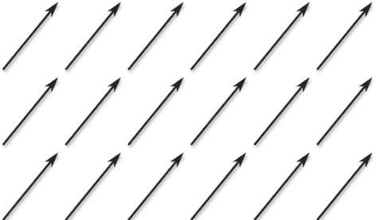

图 3.1 所有向量都等价的向量场

尽管绘制向量的位置不会改变其值，但将向量的起点（或尾部）放在原点来绘制，通常可以简化向量问题的求解。然后你可以将向量的箭头部分（头部）视为“指向”空间中的特定点。以这种方式绘制时，向量“指向”的位置具有与向量相同的分量。例如，如果你将 2D 向量 <1, 2> 绘制为从原点开始，则其头部指向 (1, 2)，如图 3.2 所示。

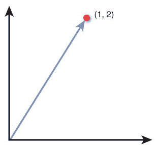

图 3.2 尾部位于原点且头部“指向” (1, 2) 的 2D 向量 <1, 2>

由于向量可以表示方向，你通常在游戏中使用向量来描述对象的朝向。对象的前向量是表示对象“直前”方向的向量。例如，一个沿 x 轴正方向朝下的对象具有前向量 <1, 0>。

你可以计算许多不同的向量运算。通常，游戏程序员使用库来执行所有这些不同的计算。因此，了解哪些向量运算解决哪些问题，比单纯记忆公式更好。本节余下部分探讨了一些基本的向量用例。

本书的源代码在提供的 Math.h 头文件中使用自定义编写的向量库，该头文件包含在从本章开始的每个游戏项目的代码中。Math.h 头文件声明了 Vector2 和 Vector3 类，以及许多运算符和成员函数的实现。请注意，x 和 y 分量是公共变量，因此你可以编写如下代码：

```
Vector2 myVector;
myVector.x = 5;
myVector.y = 10;
```

尽管本节中的图表和示例几乎普遍使用 2D 向量，但几乎所有概述的运算也适用于 3D 向量；3D 中只是多了一个分量。

### 获取两点之间的向量：减法

通过向量减法，你从一个向量的对应分量中减去另一个向量的每个分量，从而得到一个新向量。例如，在 2D 中，你分别减去 x 分量和 y 分量：

\(\vec{c} = \vec{b} - \vec{a} = \langle b_x - a_x, b_y - a_y \rangle\)

要可视化两个向量的减法，请绘制向量使它们的尾部从同一位置开始，如图 3.3(a) 所示。然后构建一个从一个向量的头部指向另一个向量头部的向量。由于减法不满足交换律（即 a – b 与 b – a 不相同），顺序很重要。一个有助于记住正确顺序的口诀是：从 \(\vec{a}\) 到 \(\vec{b}\) 的向量是 \(\vec{a} - \vec{b}\)。

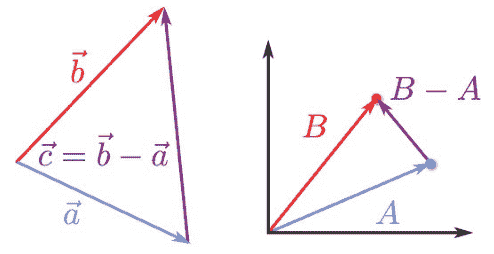

图 3.3 向量减法 (a) 和表示为向量的两点之间的减法 (b)

你可以使用减法来构建两点之间的向量。例如，假设一款太空游戏允许飞船向目标发射激光。你可以用点 s 表示飞船的位置，用点 t 表示目标的位置。假设 s = (5,2) 且 t = (3,5)。

如果你将这些点视为向量 \(\vec{s}\) 和 \(\vec{t}\)，并将它们的尾部放在原点，头部“指向”各自的点，会怎样呢？如前所述，这些向量的 x 和 y 分量的值与点相同。但是，如果它们是向量，你可以通过减法构建两点之间的向量，如图 3.3(b) 所示。由于激光应从飞船指向目标，因此减法为：

\(\vec{t} - \vec{s} = \langle 3, 5 \rangle - \langle 5, 2 \rangle = \langle -2, 3 \rangle\)

在提供的 `Math.h` 库中，- 运算符减去两个向量：

```
Vector2 a, b;
Vector2 result = a - b;
```

### 缩放向量：标量乘法

你可以将向量乘以标量（单个值）。为此，只需将向量的每个分量乘以标量：

\(s \cdot \vec{a} = \langle s \cdot a_x, s \cdot a_y \rangle\)

将向量乘以正标量仅改变向量的大小，而乘以负标量还会反转向量的方向（即头部变为尾部，反之亦然）。图 3.4 说明了将向量 \(\vec{a}\) 乘以两个不同标量的结果。

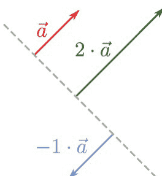

图 3.4 标量乘法

在提供的 `Math.h` 库中，* 运算符执行标量乘法：

单击此处查看代码图像

```
Vector2 a;

Vector2 result = 5.0f * a; // Scaled by 5
```

### 组合两个向量：加法

通过向量加法，你将两个向量的分量相加，从而得到一个新向量：

\(\vec{c} = \vec{a} + \vec{b} = \langle a_x + b_x, a_y + b_y \rangle\)

要可视化加法，请绘制向量使一个向量的头部接触另一个向量的尾部。加法的结果是从一个向量的尾部到另一个向量的头部的向量，如图所示

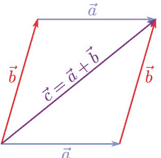

图 3.5 向量加法

请注意，加法的顺序不会改变结果。这是因为向量加法满足交换律，就像两个实数之间的加法一样：

\(\vec{a} + \vec{b} = \vec{b} + \vec{a}\)

你可以以多种方式使用向量加法。例如，假设玩家位于点 \(p\)，玩家的前向量是 \(\vec{f}\)。玩家“前方”150 单位处的点则是 \(\vec{p} + 150 \cdot \vec{f}\)。

在提供的 `Math.h` 库中，`+` 运算符将两个向量相加：

```
Vector2 a, b;
Vector2 result = a + b;
```


## 确定距离：长度

如前所述，向量既表示大小也表示方向。你在向量变量两侧使用两个竖线来表示计算向量的大小（或长度）。例如，你将 \(\vec{a}\) 的大小写作 \(\|\vec{a}\|\)。要计算向量的长度，对每个分量的平方和开平方：

\(\|\vec{a}\| = \sqrt{a_x^2 + a_y^2}\)

这看起来非常类似于欧几里得距离公式，这是因为它正是欧几里得距离公式的简化形式！如果你将向量绘制得从原点开始，该公式计算的就是从原点到向量“指向”的点的距离。

你可以使用大小来计算两个任意点之间的距离。给定点 \(p\) 和 \(q\)，将它们视为向量并执行向量减法。减法结果的大小等于两点之间的距离：

\(distance = \|\vec{p} - \vec{q}\|\)

此长度公式中的开平方是一项相对昂贵的计算。如果你绝对 *必须* 知道长度，则无法避免这个开平方。

然而，在某些情况下，你可能似乎需要知道长度，但实际上可能可以避免开平方。

例如，假设你想确定玩家离物体 A 更近还是离物体 B 更近。你首先构建一个从物体 A 指向玩家的向量，即 \(\vec{p} - \vec{a}\)。同样，你构建一个从物体 B 指向玩家的向量，即 \(\vec{p} - \vec{b}\)。计算每个向量的长度并比较两者，以确定哪个物体更近，这看起来很自然。然而，你可以稍微简化一下数学运算。假设没有虚数，向量的长度必须为正。在这种情况下，比较这两个向量的长度在逻辑上等同于比较每个向量的 **长度的平方**（长度的平方），换句话说：

\(\|\vec{a}\| < \|\vec{b}\| \equiv \|\vec{a}\|^2 < \|\vec{b}\|^2\)

因此，对于仅需要相对比较的情况，你可以使用长度的平方而不是长度：

\(\|\vec{a}\|^2 = a_x^2 + a_y^2\)

在提供的 `Math.h` 库中，`Length()` 成员函数计算向量的长度：

```
Vector2 a;

float length = a.Length();
```

同样，`LengthSquared()` 成员函数计算长度的平方。

## 确定方向：单位向量和归一化

**单位向量**是长度为一的向量。单位向量的表示法是在向量符号上方写一个“帽子”，例如 û。你可以通过**归一化**将非单位长度的向量转换为单位向量。要归一化向量，将每个分量除以向量的长度：

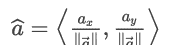

在某些情况下，使用单位向量可以简化计算。然而，归一化向量会导致其丢失任何原始大小信息。因此，你必须小心选择归一化哪些向量以及何时归一化。

> 警告
> 
> 除以零：如果向量的所有分量都为零，则该向量的长度也为零。在这种情况下，归一化公式中存在除以零的情况。对于浮点变量，除以零会产生错误值 **NaN**（非数字）。一旦计算中出现 NaN，就无法摆脱它们，因为对 NaN 的任何操作也会产生 NaN。
> 
> 解决此问题的常见方法是创建一个“安全”的归一化函数，该函数首先测试向量的长度是否接近零。如果是，则不执行除法，从而避免除以零。

一个经验法则是：如果只需要方向，则始终归一化向量。一些示例包括箭头指向的方向或角色的前向向量。然而，如果距离也很重要，例如用于显示物体距离的雷达，那么归一化会擦除这些信息。

你通常会归一化诸如前向向量（物体朝向哪个方向？）和 **上向量**（哪个方向是上？）之类的向量。然而，你可能不希望归一化其他向量。例如，归一化重力向量会导致重力大小的丢失。

`Math.h` 库提供两个不同的 `Normalize()` 函数。首先，有一个成员函数，它原地归一化给定的向量（覆盖其未归一化的版本）：

单击此处查看代码图像

```
Vector2 a;
a.Normalize(); // a is now normalized
```

还有一个静态函数，它归一化作为参数传递的向量并返回归一化后的向量：

单击此处查看代码图像

```
Vector2 a;
Vector2 result = Vector2::Normalize(a);
```

## 从角度转换为前向向量

请回顾，第 2 章中的 `Actor` 类具有一个以弧度表示的角度旋转。这允许你旋转角色的朝向。由于目前旋转是 2D 的，该角度直接对应于单位圆上的角度，如图 3.6 所示。

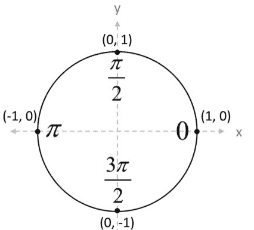

图 3.6 单位圆

以角度 theta 表示的单位圆方程为：

```
x = cos θ
y = sin θ
```

你可以直接使用这些方程将角色的角度转换为前向向量：

单击此处查看代码图像

```
Vector3 Actor::GetForward() const
{
    return Vector2(Math::Cos(mRotation), Math::Sin(mRo
}
```

这里，`Math::Cos` 和 `Math::Sin` 函数是 C++ 标准库正弦和余弦函数的包装器。请注意，你没有显式地归一化向量。这是因为圆方程始终返回单位长度向量，因为单位圆的半径为一。

请记住，单位圆的 +y 为上，而 SDL 2D 图形使用 +y 向下。因此，为了在 SDL 中获得正确的前向向量，你必须对 y 分量取负值：

单击此处查看代码图像

```
Vector3 Actor::GetForward() const
{
    // Negate y-component for SDL
    return Vector2(Math::Cos(mRotation), -Math::Sin(mR
}
```

## 将前向向量转换为角度：反正切

现在假设你有一个与前一节描述的问题相反的问题。给定一个前向向量，你想将其转换为角度。请回顾，正切函数接受一个角度，并返回三角形对边和邻边之比。

现在想象一下，你为角色计算了一个新的“期望”前向向量，但需要将其转换为其旋转成员变量的角度。在这种情况下，你可以用这个新的前向向量 \(\vec{v}\) 和 x 轴构成一个直角三角形，如图 3-7 所示。对于这个三角形，前向向量的 x 分量是三角形邻边的长度，前向向量的 y 分量是三角形对边的长度。给定这个比率，你可以使用反正切函数来计算角度 θ。

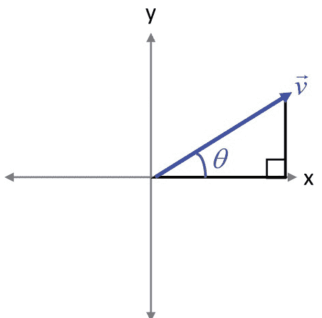

图 3.7 x 轴与向量之间的直角三角形

在编程中，首选的反正切函数是 `atan2` 函数，它接受两个参数（对边长度和邻边长度）并返回范围 \([-\pi, \pi]\) 内的角度。正角度表示三角形位于第一或第二象限（y 值为正），负角度表示三角形位于第三或第四象限。

例如，假设你想让一艘船面向一颗小行星。你可以首先构建从船指向小行星的向量并归一化该向量。接下来，使用 `atan2` 将新的前向向量转换为角度。

最后，将船角色的旋转设置为这个新角度。
请注意，你必须对 y 分量取负值，以考虑 SDL 2D 坐标系统中的 +y 向下。这会产生以下代码：

单击此处查看代码图像

```
// (ship and asteroid are Actors)
Vector2 shipToAsteroid = asteroid->GetPosition() - sh
shipToAsteroid.Normalize();
// Convert new forward to angle with atan2 (negate y-
float angle = Math::Atan2(-shipToAsteroid.y, shipToAs
ship->SetRotation(angle);
```

这种反正切方法对 2D 游戏效果非常好。
然而，它仅以这种形式适用于 2D 游戏，因为所有对象都保持在 x-y 平面上。对于 3D 游戏，通常更倾向于使用下一节概述的点积方法。

## 确定两个向量之间的角度：点积

两个向量之间的点积产生一个单一的标量值。点积在游戏中最常见的用途之一是求两个向量之间的角度。以下方程计算向量 \(\vec{a}\) 和 \(\vec{b}\) 之间的点积：


$\vec{a} \cdot \vec{b} = a_x \cdot b_x + a_y \cdot b_y$

点积也与角度的余弦有关，你可以使用点积来计算两个向量之间的角度：

$\vec{a} \cdot \vec{b} = \|\vec{a}\| \|\vec{b}\| \cos \theta$

该公式如图 3.8 所示，基于余弦定理。有了这个公式，你可以求解 $\theta$：

$\theta = \arccos\left(\frac{\vec{a} \cdot \vec{b}}{\|\vec{a}\|\|\vec{b}\|}\right)$

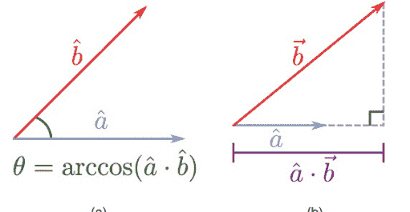

图 3.8 计算两个单位向量之间的角度

如果两个向量 $\vec{a}$ 和 $\vec{b}$ 是单位向量，你可以省略除法，因为每个向量的长度都是 1：

$\theta = \arccos\left(\hat{a} \cdot \hat{b}\right)$

如果只关心方向，提前归一化向量是有帮助的，这就是其中一个原因。

例如，考虑位于位置 $p$ 且前向量为 $\vec{f}$ 的玩家。一个新敌人出现在位置 $e$。假设你需要计算原始前向量与从 $p$ 到 $e$ 的向量之间的角度。首先，使用点的向量表示来计算从 $p$ 到 $e$ 的向量：

\(\vec{v} = \vec{e} - \vec{p}\)

接下来，因为在这种情况下只关心方向，归一化 $\vec{v}$：

\(\hat{v} = \left\langle \frac{v_x}{||\vec{v}||}, \frac{v_y}{||\vec{v}||} \right\rangle\)

最后，使用点积公式确定 $\hat{f}$ 和 $\hat{v}$ 之间的角度：

\(\theta = \arccos\left(\hat{f} \cdot \hat{v}\right) = \arccos\left(f_x \cdot v_x + f_y \cdot v_y\right).\)

因为点积可以计算两个向量之间的角度，所以有几个特殊情况需要记住。如果两个单位向量的点积为 0，这意味着它们互相垂直，因为 \(\cos(\pi/2) = 0\)。此外，点积为 1 表示两个向量平行且方向相同。最后，点积为 -1 表示它们是 **反平行** 的，意味着向量平行且方向相反。

使用点积计算角度的一个缺点是，反余弦函数返回的角度范围是 [0, π]。这意味着虽然反余弦给出了两个向量之间的最小旋转角度，但它不说明该旋转是顺时针还是逆时针。

与两个实数之间的乘法一样，点积满足交换律、对加法的分配律和结合律：

```
\vec{a} \cdot \vec{b} = \vec{b} \cdot \vec{a}
\vec{a} \cdot (\vec{b} + \vec{c}) = \vec{a} \cdot \vec{b} + \vec{a} \cdot \vec{c}
\vec{a} \cdot (\vec{b} \cdot c) = (\vec{a} \cdot \vec{b}) \cdot \vec{c}
```

另一个有用的提示是，长度平方的计算等同于对向量自身取点积：

```
\vec{v} \cdot \vec{v} = \|\vec{v}\|^2 = v_x^2 + v_y^2
```

`Math.h` 库为 `Vector2` 和 `Vector3` 都定义了一个静态 `Dot` 函数。例如，要查找 `origForward` 和 `newForward` 之间的角度，你可以使用：

点击此处查看代码图片

```
float dotResult = Vector2::Dot(origForward, newForward)
float angle = Math::Acos(dotResult);
```

## 计算法线：叉积

**法线** 是垂直于表面的向量。计算表面（例如三角形）的法线在 3D 游戏中是一个非常有用的计算。例如，**第 6 章** “3D 图形” 中涵盖的光照模型需要计算法线向量。

给定两个不平行的 3D 向量，存在一个包含这两个向量的单一平面。**叉积** 找到垂直于该平面的向量，如图 3.9 所示。

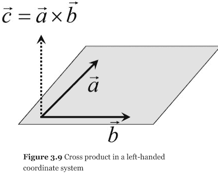

叉积不适用于 2D 向量。但是，要将 2D 向量转换为 3D 向量，只需添加一个 z 分量为 0。

× 符号表示两个向量之间的叉积：

\(\vec{c} = \vec{a} \times \vec{b}\)

需要注意的是，图 3.9 中从技术上讲还有一个垂直于平面的第二个向量：\(-\vec{c}\)。这说明了叉积的一个重要属性。它不满足交换律，而是满足 **反交换律**：

\(\vec{a} \times \vec{b} = -\vec{b} \times \vec{a}\)

使用 **左手法则** 是快速确定叉积结果方向的方法。用左手，食指沿 \(\vec{a}\) 方向指向，然后中指沿 \(\vec{b}\) 方向指向，根据需要旋转手腕。拇指的自然位置指向 $\vec{c}$ 的方向。在这里，你使用左手是因为本书的坐标系是左手坐标系。（你将在第 5 章 “OpenGL” 中了解更多关于坐标系的内容。）右手坐标系则使用右手法则。

叉积的数值计算如下：

\(\vec{c} = \vec{a} \times \vec{b}\)
\(= \langle a_y b_z - a_z b_y, a_z b_x - a_x b_z, a_x b_y - a_y b_x \rangle\)

一个流行的记忆叉积计算的口诀是 “xyzzy”。这个口诀可以帮助你记住叉积结果 x 分量的下标顺序：

\(c_x = a_y b_z - a_z b_y\)

然后，y 和 z 分量的下标按 x → y → z → x 的顺序循环，得出叉积结果的接下来两个分量：

```
c_y = a_z b_x - a_x b_z
c_z = a_x b_y - a_y b_x
```

与点积一样，有一个特殊情况需要考虑。如果叉积返回向量 <0,0,0>，这意味着 $\vec{a}$ 和 $\vec{b}$ 是共线的。两个共线向量无法构成平面，因此叉积无法返回法线。

因为三角形位于一个平面上，叉积可以确定三角形的法线。图 3.10 显示三角形 ABC。要计算法线，首先构建三角形边的两个向量：

```
\vec{u} = B - A
\vec{v} = C - A
```

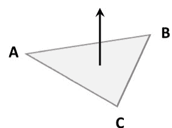

图 3.10 三角形 ABC 的法线

然后对这两个向量取叉积并归一化结果。这得出了三角形的法线向量：

```
\vec{n} = \vec{u} \times \vec{v}
\hat{n} = \frac{\vec{n}}{\|\vec{n}\|}
```

`Math.h` 库提供了一个静态 `Cross` 函数。例如，以下代码计算向量 `a` 和 `b` 之间的叉积：

```
Vector3 c = Vector3::Cross(a, b);
```

## 基础移动

回顾一下，第 2 章的游戏项目为 `Ship`（`Actor` 的子类）重写了 `UpdateActor` 函数，以使飞船移动。但是，移动是游戏中如此常见的功能，以至于将此行为封装在组件中更有意义。本节首先探讨如何创建一个可以在游戏世界中移动角色的 `MoveComponent` 类。你将利用这个类来创建在屏幕上移动的小行星。接下来，本节展示了如何创建一个名为 `InputComponent` 的 `MoveComponent` 子类，你可以将其直接挂钩到键盘输入。

### 创建基本的 `MoveComponent` 类

在基本级别，`MoveComponent` 应该允许角色以一定速度向前移动。为了支持这一点，你首先需要一个函数来计算角色的前向量，如前面本章 “从角度转换为前向量” 节中实现的那样。一旦你有了角色的前向量，你就可以根据速度（每秒单位数）和增量时间向前移动，如下面的伪代码所示：

点击此处查看代码图片

```
position += GetForward() * forwardSpeed * deltaTime;
```

你可以使用类似的机制来更新角色的旋转（角度），但在这种情况下你不需要前向量。你只需要角速度（每秒旋转数）和增量时间：

点击此处查看代码图片

```
rotation += angularSpeed * deltaTime;
```

这样，角色就可以根据各自的速度既向前移动又旋转。要将 `MoveComponent` 实现为 `Component` 的子类，你首先像清单 3.1 那样声明该类。它具有单独的速度来实现前向移动和旋转移动，以及这些速度的 getter/setter 函数。它还重写了 `Update` 函数，该函数将包含移动角色的代码。请注意，构造函数的


MoveComponent 指定默认更新顺序为 10。
请回顾，更新顺序决定了 actor 更新其组件的顺序。因为其他组件的默认更新顺序为 100，MoveComponent 将在大多数其他组件之前更新。

### 清单 3.1 MoveComponent 声明

```cpp
class MoveComponent : public Component
{
public:
    // Lower update order to update first
    MoveComponent(class Actor* owner, int updateOrder = 10);

    void Update(float deltaTime) override;

    float GetAngularSpeed() const { return mAngularSpeed; }
    float GetForwardSpeed() const { return mForwardSpeed; }
    void SetAngularSpeed(float speed) { mAngularSpeed = speed; }
    void SetForwardSpeed(float speed) { mForwardSpeed = speed; }

private:
    // Controls rotation (radians/second)
    float mAngularSpeed;

    // Controls forward movement (units/second)
    float mForwardSpeed;

};
```

清单 3.2 中所示的 Update 实现，只是将移动伪代码转换为实际代码。请回顾，Component 类可以通过 mOwner 成员变量访问其所属的 actor。你使用这个 mOwner 指针来访问所属 actor 的位置、旋转和前向。还要注意此处使用 Math::NearZero 函数。该函数将参数的绝对值与某个微小的 epsilon 值进行比较，以确定该值是否“接近”零。在这种情况下，如果相应的速度接近零，你就不必更新 actor 的旋转或位置。

### 清单 3.2 MoveComponent::Update 实现

```cpp
void MoveComponent::Update(float deltaTime)
{
    if (!Math::NearZero(mAngularSpeed))
    {
        float rot = mOwner->GetRotation();

        rot += mAngularSpeed * deltaTime;

        mOwner->SetRotation(rot);
    }

    if (!Math::NearZero(mForwardSpeed))
    {
        Vector2 pos = mOwner->GetPosition();

        pos += mOwner->GetForward() * mForwardSpeed * deltaTime;

        mOwner->SetPosition(pos);
    }
}
```

因为本章的游戏项目是经典 *小行星* 游戏的一个版本，你还需要屏幕环绕代码。这意味着如果小行星从屏幕左侧移出，它会传送到屏幕右侧。（我们在此省略此代码，因为它并非通用 `MoveComponent` 所期望的。但是，本章的源代码确实包含用于屏幕环绕的此修改。）

有了基本的 `MoveComponent`，你可以将 `Asteroid` 声明为 `Actor` 的子类。`Asteroid` 不需要重载的 `UpdateActor` 函数来移动。

相反，你可以在其构造函数中简单地构造一个 `MoveComponent`，并附带一个 `SpriteComponent` 来显示小行星图像，如清单 3.3 所示。构造函数还将小行星的速度设置为固定的 150 单位/秒（在此情况下，对应于 150 像素/秒）。

### 清单 3.3 Asteroid 构造函数

```cpp
Asteroid::Asteroid(Game* game)
    :Actor(game)
{
    // Initialize to random position/orientation
    Vector2 randPos = Random::GetVector(Vector2::Zero,
        Vector2(1024.0f, 768.0f));
    SetPosition(randPos);
    SetRotation(Random::GetFloatRange(0.0f, Math::TwoPi));
    // Create a sprite component, and set texture
    SpriteComponent* sc = new SpriteComponent(this);
    sc->SetTexture(game->GetTexture("Assets/Asteroid.png"));
    // Create a move component, and set a forward speed
    MoveComponent* mc = new MoveComponent(this);
    mc->SetForwardSpeed(150.0f);
}
```

此 `Asteroid` 构造函数中的另一项新内容是使用 `Random` 静态函数。这些函数的实现并不特别有趣：它们只是封装内置的 C++ 随机数生成器，以获取一定范围内的向量或浮点数。此处的 `Random` 函数确保每个小行星都有随机的位置和方向。

有了这个 `Asteroid` 类，你可以在 `Game::LoadData` 函数中使用以下代码创建多个小行星：

```cpp
const int numAsteroids = 20;
for (int i = 0; i < numAsteroids; i++)
{
    new Asteroid(this);
}
```

这将在屏幕上产生几个移动的小行星（参见图 3.11）。

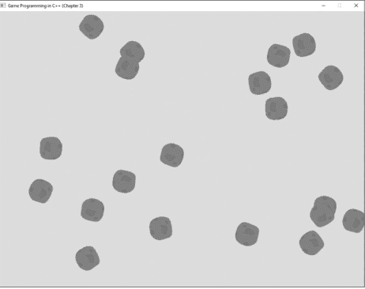

图 3.11 带有移动组件的移动小行星

## 创建 `InputComponent` 类

基本的 `MoveComponent` 对于玩家不控制的对象（如小行星）非常出色。但是，如果你想要一个玩家可以用键盘控制的飞船，你就会面临两难。一个想法是在 `Ship` 类中创建自定义输入函数，如第 2 章的游戏项目所示。但是，因为将输入连接到 actor 或组件是常见需求，将其纳入游戏对象模型是合理的。换句话说，你希望在 `Actor` 和 `Component` 中都有可重写的函数，子类可以根据需要为输入重新定义这些函数。

为支持此功能，你首先向 Component 添加一个带有空默认实现的虚拟 ProcessInput 函数：

```cpp
virtual void ProcessInput(const uint8_t* keyState) {}
```

然后在 Actor 中，你声明两个函数：一个非虚拟的 ProcessInput 和一个虚拟的 ActorInput 函数。其想法是，想要自定义输入的 actor 子类可以重写 ActorInput 但不能重写 ProcessInput（就像有单独的 Update 和 UpdateActor 函数一样）：

```cpp
// ProcessInput function called from Game (not overridden)
void ProcessInput(const uint8_t* keyState);

// Any actor-specific input code (overridable)
virtual void ActorInput(const uint8_t* keyState);
```

Actor::ProcessInput 函数首先检查 actor 的状态是否为活动。如果是，你首先对所有组件调用 ProcessInput，然后为任何 actor 可重写的行为调用 ActorInput：

```cpp
void Actor::ProcessInput(const uint8_t* keyState)
{
    if (mState == EActive)
    {
        for (auto comp : mComponents)
        {
            comp->ProcessInput(keyState);
        }

        ActorInput(keyState);
    }
}
```

最后，在 Game::ProcessInput 中，你可以遍历所有 actor 并对每个 actor 调用 ProcessInput：

```cpp
mUpdatingActors = true;

for (auto actor : mActors)
{
    actor->ProcessInput(keyState);
}

mUpdatingActors = false;
```

你在循环前将 mUpdatingActors 布尔值设置为 true，以处理 actor 或组件在 ProcessInput 内尝试创建另一个 actor 的情况。在这种情况下，你必须将 actor 添加到 mPendingActors 向量而不是 mActors。这是第 2 章中使用的相同技术，以确保在遍历向量时不修改 mActors。

有了这些粘合代码后，你可以声明一个名为 InputComponent 的 MoveComponent 子类，如清单 3.4 所示。InputComponent 的主要思想是，你可以设置特定按键来控制所属 actor 的前进/后退移动和旋转。此外，因为重写的 ProcessInput 直接设置 MoveComponent 的前进/角速度，你需要指定“最大”速度，以根据键盘输入计算正确的速度值。

### 清单 3.4 InputComponent 声明

```cpp
class InputComponent : public MoveComponent
{
public:
    InputComponent(class Actor* owner);

    void ProcessInput(const uint8_t* keyState) override;

// Getters/setters for private variables

// ...

private:
// The maximum forward/angular speeds
float mMaxForwardSpeed;
float mMaxAngularSpeed;

// Keys for forward/back movement
int mForwardKey;
int mBackKey;

// Keys for angular movement
int mClockwiseKey;
int mCounterClockwiseKey;
};
```

清单 3.5 显示了 InputComponent::ProcessInput 的实现。你首先将前进速度设置为零，然后根据按下的按键确定正确的前进速度。然后将此速度传递给继承的 SetForwardSpeed 函数。请注意，如果用户同时按下前进和后退按键或两个按键都未按下，前进速度将变为零。你使用类似的代码来设置


角速度。

## 清单 3.5 InputComponent::ProcessInput 实现

单击此处查看代码图像

```
void InputComponent::ProcessInput(const uint8_t* keyState
{
    // Calculate forward speed for MoveComponent
    float forwardSpeed = 0.0f;
    if (keyState[mForwardKey])
    {
        forwardSpeed += mMaxForwardSpeed;
    }
    if (keyState[mBackKey])
    {
        forwardSpeed -= mMaxForwardSpeed;
    }
    SetForwardSpeed(forwardSpeed);
    // Calculate angular speed for MoveComponent
    float angularSpeed = 0.0f;
    if (keyState[mClockwiseKey])
    {
        angularSpeed += mMaxAngularSpeed;
    }
    if (keyState[mCounterClockwiseKey])
    {
        angularSpeed -= mMaxAngularSpeed;
    }
    SetAngularSpeed(angularSpeed);
}
```

有了这个，你可以通过简单地创建一个 InputComponent 实例，为 Ship 添加键盘控制的移动。（此处省略了 Ship 构造函数的代码，但它基本上为各种键和最大速度设置了 InputComponent 的成员变量。）你还会创建一个 SpriteComponent 并为其分配纹理。这将产生一个可由用户控制的飞船（参见图 3.12）。

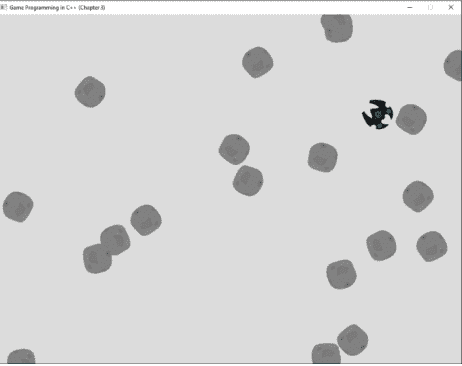

图 3.12 使用键盘控制的飞船

这是输入系统更灵活方案的一个出色初步版本。我们将在第 8 章“输入系统”中更详细地探讨输入。

## 牛顿物理学

虽然本章迄今使用的基本移动方法对某些游戏有效，但对于更接近现实世界的移动，你需要一种物理上准确的方法。幸运的是，艾萨克·牛顿（以及其他人）发展了牛顿物理学（或经典力学）来描述运动定律。游戏通常使用牛顿物理学，因为当物体不以接近光速移动且物体大于量子粒子时，其定律成立。由于游戏通常不包含这些边缘情况中的物体，牛顿物理学效果很好。

牛顿物理学有几个不同的方面。本书仅考虑最基本的方面：不含旋转力的运动，即线性力学。要深入讨论牛顿物理学的其他组成部分，请参阅本章“进一步阅读”部分列出的伊恩·米尔顿的书，或任何大学级别的物理教科书。

## 线性力学概述

线性力学的两个基石是力和质量。力是一种可以导致物体运动的影响。由于力具有大小和方向，用向量表示力很自然。质量是一个标量，表示物体所含物质的量。人们常将质量与重量混淆，但质量与任何重力无关，而重量则不然。物体的质量越大，就越难以改变该物体的运动。

如果你对物体施加足够的力，它就会开始运动。牛顿第二运动定律概括了这一观点：

```
F = m · a
```

在这个方程中，F 是力，m 是质量，a 是加速度，即物体速度增加的速率。因为力等于质量乘以加速度，所以加速度也等于力除以质量。这是游戏中的常用方法：游戏中的任意对象都有一个质量，你可以对该对象施加力。由此，你可以计算该对象的加速度。

在物理课程中，线性力学的典型符号表示是位置、速度和加速度都是时间的函数。然后，通过微积分，你可以将速度函数计算为位置函数的导数，将加速度函数计算为速度函数的导数。

然而，这种基于符号方程和导数的标准公式在游戏中并不特别适用。游戏需要对物体施加力，并从该力确定随时间变化的加速度。一旦你有了物体的加速度，就可以计算物体速度的变化。最后，给定速度，你可以计算物体位置的变化。游戏只需要以离散时间步长（delta time）的形式计算这一点。它不需要符号方程。这需要使用积分——但不是符号积分。相反，你必须使用**数值积分**，它在固定时间步长上近似符号积分。虽然这听起来非常复杂，但幸运的是，你只需几行代码就能完成数值积分。

## 使用欧拉积分计算位置

数值积分允许游戏根据加速度更新速度，然后根据速度更新位置。但是，要计算物体的加速度，游戏需要知道物体的质量以及施加在物体上的力。

需要考虑多种类型的力。有些力，例如重力，是恒定的，应该在每一帧应用。其他力则可能是**冲量**，即仅在单帧应用的力。

例如，当角色跳跃时，冲量力使玩家能够离开地面。但是，由于恒定的重力作用，角色最终会落回地面。因为多个力可以同时作用于一个物体，且力是向量，将所有力相加即可得到该帧作用于物体上的总力。将力的总和除以质量即可得到加速度：

单击此处查看代码图像

```
acceleration = sumOfForces / mass;
```

接下来，你可以使用数值积分的**欧拉积分**方法来计算速度和位置：

单击此处查看代码图像

```
// (Semi-Implicit) Euler Integration
// Update velocity
velocity += acceleration * deltaTime;
// Update position
position += velocity * deltaTime;
```

请注意，在这些计算中，力、加速度、速度和位置都表示为向量。由于这些计算依赖于 delta time，你可以将它们放在模拟物理的组件的 `Update` 函数中。

## 可变时间步长的问题

对于依赖物理模拟的游戏，可变帧时间（或**时间步长**）可能会引起问题。这是因为数值积分的准确性取决于时间步长的大小。时间步长越小，近似越准确。

如果帧率逐帧变化，数值积分的准确性也会随之变化。准确性的变化可能会以非常明显的方式影响行为。想象一下玩*超级马里奥兄弟*，马里奥能跳跃的距离取决于帧率。帧率越低，马里奥跳得越远。这是因为帧率越低，数值积分中的误差量越大，从而导致夸张的跳跃弧线。这意味着在慢速机器上玩的游戏允许马里奥跳得比在快速机器上玩的游戏更远。图 3-13 说明了一个示例，其中由于时间步长较大，实际模拟弧线偏离了预期弧线。

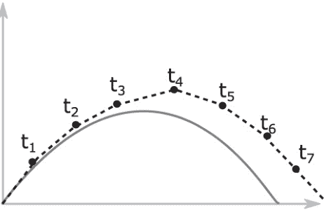

图 3.13 由于时间步长较大，实际跳跃弧线偏离预期跳跃弧线

出于这个原因，任何使用物理来计算物体位置的游戏都不应使用可变帧率——至少不应在物理模拟代码中使用。相反，你可以使用帧限制方法，如第 1 章所示，前提是帧率不低于目标帧率。一个更复杂的替代方案是将较大的时间步长划分为多个固定大小的物理时间步长。

## 基本碰撞检测

**碰撞检测**是游戏确定游戏世界中两个对象是否相互接触的方式。在第 1 章中，你实现了一种碰撞检测形式，以确定球是否与墙壁或挡板碰撞。但是，对于本章中的 Asteroids 游戏项目，你需要稍微复杂一些的计算来决定飞船发射的激光是否应该与游戏世界中的小行星碰撞。

碰撞检测中的一个关键概念是问题简化。例如，小行星图像是圆形的，但不完全是圆形。虽然针对小行星的实际轮廓进行碰撞测试更准确，但为了碰撞检测的目的，将小行星视为圆形要高效得多。如果你同样将激光简化为圆形，那么你只需要确定这两个圆是否碰撞即可。

## 圆对圆相交

两个圆相互相交的充要条件是它们中心之间的距离小于或等于它们半径之和。图 3.14 演示了两个圆之间的这种情况。在第一种情况下，两个圆相距足够远，不相交。在这种情况下，它们中心之间的距离大于半径之和。然而，在第二种情况下，即圆相交时，它们中心之间的距离小于半径之和。


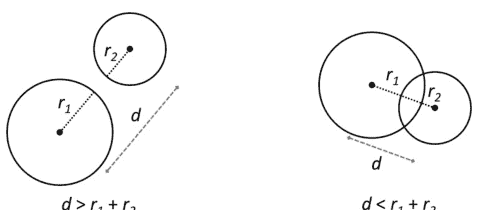

### 图 3.14 测试两个圆之间的交点

你可以先在两个圆心之间创建一个向量并计算该向量的模长，从而执行此交点测试。然后，将此距离与两个圆的半径之和进行比较：

```
\|A.center - B.center\| \le A.radius + B.radius
```

回顾本章前面关于长度与长度平方的讨论。在圆的交点情况下，你只需要比较距离和半径之和。因为你知道距离和半径都不能为负数，所以可以对等式两边求平方，同时保持不等式不变：

```
\|A.center - B.center\|^2 <= (A.radius + B.radius)^2
```

> 注意
> 本节介绍的方法也适用于球体，因为同样的原理也适用。

## 创建 CircleComponent 子类

为了支持角色的碰撞检测，你可以创建一个 CircleComponent 以及一个用于测试两个圆组件之间交点的方法。然后，你可以将 CircleComponent 添加到任何需要碰撞的角色中。

首先，将 CircleComponent 声明为 Component 的子类，如清单 3.6 所示。CircleComponent 只需要半径这一个成员数据，因为圆心就是拥有者角色的位置。

### 清单 3.6 CircleComponent 声明

单击此处查看代码图片

```
class CircleComponent : public Component
{
public:
CircleComponent(class Actor* owner);
void SetRadius(float radius) { mRadius = radius; }
float GetRadius() const;
const Vector2& GetCenter() const;
private:
float mRadius;
};
```

接下来，声明一个全局 `Intersect` 函数，它以引用方式接收两个圆组件，如果两个圆相互相交则返回 `true`，如清单 3.7 所示。请注意，实现直接镜像了前一节的方程。你首先计算两个圆心之间的距离平方，然后将其与半径平方之和进行比较。

### 清单 3.7 CircleComponent 交点

单击此处查看代码图片

```
bool Intersect(const CircleComponent& a, const CircleComponent& b)
{

    // Calculate distance squared
    Vector2 diff = a.GetCenter() - b.GetCenter();

    float distSq = diff.LengthSq();

    // Calculate sum of radii squared
    float radiiSq = a.GetRadius() + b.GetRadius();

    radiiSq *= radiiSq;

    return distSq <= radiiSq;
}
```

然后，你可以像创建其他组件一样创建一个 `CircleComponent`。例如，以下两行代码将一个 `CircleComponent` 添加到 `Asteroid` 对象（其中 `mCircle` 是指向 `CircleComponent` 的成员变量指针）：

单击此处查看代码图片

```
mCircle = new CircleComponent(this);
mCircle->SetRadius(40.0f);
```

因为飞船发射的每个激光都需要检查与所有小行星的碰撞，你可以向 `Game` 添加一个 `Asteroid` 指针的 `std::vector`。然后，在 `Laser::UpdateActor` 中，你可以轻松地测试与这些小行星中每一个的交点：

单击此处查看代码图片

```
void Laser::UpdateActor(float deltaTime)
{
    // Do you intersect with an asteroid?
    for (auto ast : GetGame()->GetAsteroids())
    {
        if (Intersect(*mCircle, *(ast->GetCircle())))
        {
            // If this laser intersects with an asteroid
            // set ourselves and the asteroid to dead
            SetState(EDead);
            ast->SetState(EDead);
            break;
        }
    }
}
```

对每个小行星调用的 `GetCircle` 函数只是一个公共函数，返回指向小行星的 `CircleComponent` 的指针。同样，`mCircle` 变量是激光的 `CircleComponent`。

`CircleComponent` 在 `Asteroids` 的情况下效果很好，因为你可以用圆来近似游戏中所有对象的碰撞。但是，圆不适用于所有类型的对象，当然也不适用于 3D。第 10 章“碰撞检测”将更详细地深入探讨碰撞检测主题。

## 游戏项目

本章的游戏项目实现了经典游戏 Asteroids 的基本版本。本章前面的部分涵盖了游戏项目中使用的大部分新代码。该项目使用 MoveComponent 和 InputComponent 实现移动。CircleComponent 代码测试飞船的激光是否与小行星碰撞。游戏项目中缺少的一个显著功能是小行星不会与飞船碰撞（不过你将在练习 3.2 中添加该功能）。游戏项目也没有实现牛顿物理（不过你将在练习 3.3 中添加该功能）。代码可在本书的 GitHub 仓库中找到，位于 Chapter03 目录。在 Windows 上打开 Chapter03-windows.sln，在 Mac 上打开 Chapter03-mac.xcodeproj。

本章前面未涵盖的一个游戏功能是当玩家按下空格键时如何创建激光。因为检测空格键输入是 Ship 特有的，所以你应该重写 ActorInput 函数。但是，如果玩家按住空格键（或快速按下），你不希望创建太多激光以至于使游戏变得太简单。相反，你希望有一个冷却时间，飞船每半秒只能发射一次激光。要实现这一点，首先在 Ship 中创建一个 float 类型的 mLaserCooldown 成员变量并将其初始化为 0.0f。接下来，在 ActorInput 中，检查玩家是否按下空格键且 mLaserCooldown 小于或等于零。如果两个条件都满足，你就创建激光，将其位置和旋转设置为飞船的位置和旋转（这样它从飞船出发并朝向飞船面向的方向），并将 mLaserCooldown 设置为 0.5f：

单击此处查看代码图片

```
void Ship::ActorInput(const uint8_t* keyState)
{
    if (keyState[SDL_SCANCODE_SPACE] && mLaserCooldown <= 0.0f)
    {
        // Create a laser and set its position/rotation
        Laser* laser = new Laser(GetGame());
        laser->SetPosition(GetPosition());
        laser->SetRotation(GetRotation());

        // Reset laser cooldown (half second)
        mLaserCooldown = 0.5f;
    }
}
```

然后，重写 UpdateActor 以按 delta time 递减 mLaserCooldown：

单击此处查看代码图片

```
void Ship::UpdateActor(float deltaTime)
{
    mLaserCooldown -= deltaTime;
}
```

这样一来，mLaserCooldown 会跟踪玩家再次发射前剩余的时间。并且因为 ActorInput 在计时器未结束时不会创建激光，你确保玩家不能比期望更频繁地发射。有了激光发射，你就可以使用之前介绍的碰撞代码来射击并摧毁小行星了（参见图 3.15）。

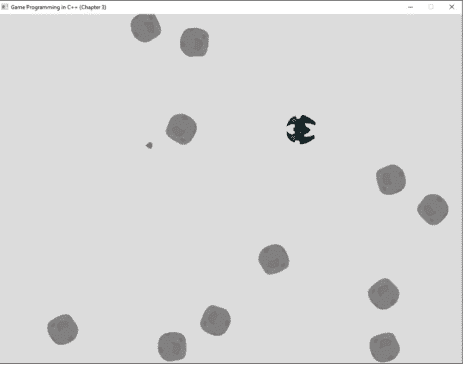

### 图 3.15 向小行星发射激光

你可以在 `Laser` 中使用类似的 float 变量，强制激光在一秒后死亡（并从游戏世界中删除），即使激光没有与小行星碰撞。

## 总结

向量表示大小和方向。你可以使用向量进行许多不同的计算，包括在两点之间创建向量（使用减法）、计算两点之间的距离（使用减法和长度）、求两个向量之间的夹角（使用点积）以及计算表面的法线（使用叉积）。

对于基本移动，本章展示了如何创建一个 `MoveComponent`，允许角色向前移动并旋转。对于前向移动，你将角色的前向向量乘以移动速度和 delta time。将此结果加到角色的当前位置，即可得到时间步长后角色的新位置。在本章中，你还学习了如何在角色和组件中添加可重写的输入行为支持，以及如何利用此功能创建一个继承自 `MoveComponent` 的 `InputComponent`。

在牛顿物理中，物体的加速度等于作用于物体上的力除以物体的质量。你可以使用欧拉积分来计算变化量


每帧的速度和位置。

最后，碰撞检测是游戏决定两个对象是否相互接触的方式。对于某些类型的游戏，例如本章的游戏项目，你可以使用圆形来表示对象的碰撞。如果两个圆心之间的距离小于它们半径之和，则认为两个圆相交。作为一种优化，你可以对等式两边同时求平方。

## 补充阅读

Eric Lengyel 对 3D 游戏编程中使用的所有不同数学概念进行了深入探讨。有志于成为图形程序员的人尤其应该复习他书中更高级的材料。由 Glenn Fielder 维护的 Gaffer on Games 网站上有几篇关于游戏物理基础的文章，包括关于不同形式的数值积分以及为什么固定时间步长很重要的文章。最后，Ian Millington 详细介绍了如何在游戏中实现牛顿物理。

- Fielder, Glenn. Gaffer on Games. Accessed July 18, 2016. http://gafferongames.com/.
- Lengyel, Eric. Mathematics for 3D Game Programming and Computer Graphics, 3rd edition. Boston: Cengage, 2011.
- Millington, Ian. Game Physics Engine Development, 2nd edition. Boca Raton: CRC Press, 2010.

## 练习

本章的第一个练习是一系列简短的问题，让你练习使用本章涵盖的各种向量技术。接下来的两个练习涉及为本章的游戏项目添加功能。

### 练习 3.1

- 1. 给定向量 \(\vec{a} = \langle 2, 4 \rangle\) 和 \(\vec{b} = \langle 3, 5 \rangle\)，以及标量值 s=2，计算以下内容：
  - (a) \(\vec{a} + \vec{b}\)
  - (b) \(s \cdot \vec{a}\)
  - (c) \(\vec{a} \cdot \vec{b}\)

- 2. 给定图 3.16 中的三角形和以下点：
  - A=<-1,1>
  - B=<2,4>
  - C=<3,3>
  - 使用本章讨论的向量运算计算 \(\theta\)。

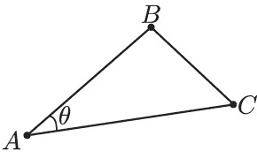

图 3.16 练习 3.1 中问题 2 的三角形

- 3. 假设一个 2D 游戏有一个从玩家指向下一个目标的箭头。

  游戏开始时，箭头沿 x 轴指向 <1,0>。

  玩家的初始位置在 (4,0)。

  你在位置 (5,6) 创建一个新对象。

  - a. 从玩家初始位置到新航点的单位向量是什么？
  - b. 计算初始箭头方向与部分 (a) 中计算的向量之间的旋转角度。
  - c. 计算由初始箭头方向和部分 (a) 中计算的向量所创建的平面的垂直向量。

### 练习 3.2

目前，在本章游戏项目中，飞船不会与小行星发生碰撞。为飞船添加碰撞。为此，你首先需要在 Ship 中创建一个 CollisionComponent 并指定半径。接下来，在 Ship::UpdateActor 中，你需要测试与所有小行星的碰撞（就像激光那样）。如果飞船与小行星碰撞，则强制将其重置为屏幕中心，旋转角度为零。

作为额外功能，让飞船在与小行星碰撞后消失一两秒钟。然后飞船应该在此延迟后重新出现在中心。

### 练习 3.3

修改 `MoveComponent`，使其使用牛顿物理。具体来说，将其更改为具有质量、力的合力和速度作为成员变量。然后在 `Update` 中，更改前向移动的代码，使其改为从力计算加速度，从加速度计算速度，并从速度计算位置。

然后，你需要一种方法来设置组件上的力。一种方法是添加一个 `AddForce` 函数，它接收一个 `Vector2` 并将其添加到力的合力变量中。你还可以在计算加速度后每帧清除力的合力。这样，对于冲量，你只需调用一次 `AddForce`。而对于恒力，你只需在每帧为该力调用 `AddForce`。

最后，更改 `InputComponent`、`Asteroid` 和 `Ship`，使它们能够正确地与支持牛顿物理的这个新 `MoveComponent` 一起工作。

## 第 4 章

### 人工智能

人工智能（AI）算法用于确定游戏中计算机控制实体的行为。本章介绍了三种有用的游戏 AI 技术：使用状态机改变行为、为实体计算穿越世界的路径（寻路），以及在双人回合制游戏中做出决策（极小极大算法和博弈树）。本章展示了如何将其中一些 AI 技术应用于创建塔防游戏项目。

### 状态机行为

对于非常简单的游戏，AI 始终具有相同的行为。例如，双人 *Pong* 的 AI 会跟踪球移动时的位置。由于这种行为在整个游戏过程中不会改变，因此它是无状态的。但对于更复杂的游戏，AI 在不同时间点的行为会有所不同。在 *Pac-Man* 中，每个幽灵都有三种不同的行为：追逐玩家、四散逃离（幽灵返回到设定的“家园区域”）或远离玩家。表示这些行为变化的一种方法是使用 **状态机**，其中每种行为对应一个状态。

### 设计状态机

状态本身只能部分定义状态机。同样重要的是，状态机如何决定改变或 **转换** 状态。此外，每个状态可以在进入或退出状态时发生动作。

在为游戏角色的 AI 实现状态机时，明智的做法是规划不同的状态及其互连方式。以潜行游戏中的基本守卫角色为例。默认情况下，守卫沿预定义路径巡逻。如果守卫在巡逻时发现玩家，它会开始攻击玩家。并且，如果在任何时间点，守卫受到致命伤害，它会死亡。在这个例子中，守卫 AI 有三种不同的状态：巡逻、攻击和死亡。

接下来，你需要为每个状态定义转换。死亡状态的转换很简单：当守卫受到致命伤害时，它会转换到死亡状态。无论当前状态如何，都会发生这种情况。如果在巡逻状态期间守卫发现玩家，守卫会进入攻击状态。图 4.1 中的状态机图表示了这种状态和转换的组合。

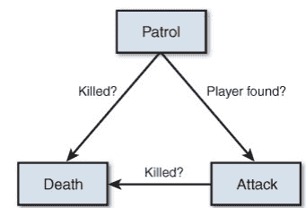

图 4.1 基础潜行 AI 状态机

虽然这个 AI 是功能性的，但大多数潜行游戏中的 AI 角色更为复杂。假设守卫在巡逻状态时听到可疑的声音。当前的状态机规定守卫继续巡逻。理想情况下，声音应该吓到守卫并导致守卫搜索玩家。调查状态可以表示这种行为。

此外，在这个状态机示例中，守卫在发现玩家时总是攻击。但为了多样性，也许守卫偶尔会触发警报。警报状态可以表示这种行为。警报状态会随机转换为攻击或另一个新状态，即警报。添加这些改进使状态机更加复杂，如图 4.2 所示。

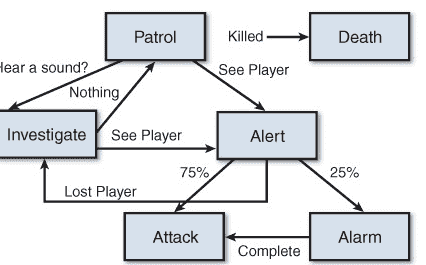

图 4.2 更复杂的潜行 AI 状态机

从警报状态，你有两个转换：75% 和 25%。这些转换指的是转换的概率。因此，当处于警报状态时，AI 有 75% 的概率转换到攻击状态。在警报状态中，完成转换意味着在 AI 完成触发警报后（例如，通过与游戏世界中的某个对象交互），AI 会转换到攻击状态。

状态机还可以进一步改进。但无论状态数量多少，设计 AI 状态机的原则都是相同的。在任


在定义状态机之后，下一步是在代码中实现它。

## 基本状态机实现

实现状态机有多种方法。最少而言，代码必须根据当前状态更新 AI 的行为，并且必须支持进入和退出操作。`AIComponent` 类可以封装这种状态行为。

如果只有两个状态，在 `Update` 中进行简单的布尔检查就可以工作，尽管它不够健壮。更灵活的实现是使用枚举来表示不同的状态。对于图 4.1 中的状态机，枚举声明如下：

```
enum AIState
{
    Patrol,
    Death,
    Attack
};
```

然后，你创建一个 `AIComponent` 类，它将 `AIState` 的实例作为成员数据。你还为每个状态定义单独的更新函数：`UpdatePatrol`、`UpdateDeath` 和 `UpdateAttack`。

`AIComponent::Update` 函数随后对 `AIState` 成员变量进行 switch 操作，并调用与当前状态对应的更新函数：

单击此处查看代码图像

```
void AIComponent::Update(float deltaTime)
{
    switch (mState)
    {
    case Patrol:
        UpdatePatrol(deltaTime);
        break;
    case Death:
        UpdateDeath(deltaTime);
        break;
    case Attack:
        UpdateAttack(deltaTime);
        break;
    default:
        // Invalid
        break;
    }
}
```

你可以在单独的 `ChangeState` 函数中处理状态机转换。这样，各种更新函数只需调用 `ChangeState` 即可发起转换。你可以按如下方式实现 `ChangeState`：

单击此处查看代码图像

```
void AIComponent::ChangeState(State newState)
{
    // Exit current state
    // (Use switch to call corresponding Exit function
    // ...

    mState = newState;

    // Enter current state
    // (Use switch to call corresponding Enter function
    // ...
}
```

虽然这种实现很简单，但存在一些问题。

首先，它的扩展性不好；添加更多状态会降低 `Update` 和 `ChangeState` 的可读性。此外，拥有如此多的独立 `Update`、`Enter` 和 `Exit` 函数也会使代码更难以遵循。

在多个 AI 之间混合和匹配功能也不容易。两个具有不同状态机的不同 AI 需要单独的枚举，因此需要单独的 AI 组件。但许多 AI 角色可能共享一些功能。假设两个 AI 具有大部分不同的状态机，但都有一个 Patrol 状态。使用这种基本实现，在两个 AI 组件之间共享 Patrol 代码并不容易。

## 将状态作为类

与刚才描述的方法不同，另一种方法是使用类来表示每个状态。首先，为所有状态定义一个名为 `AIState` 的基类：

单击此处查看代码图像

```cpp
class AIState
{
public:
    AIState(class AIComponent* owner)
    :mOwner(owner)
    { }

    // State-specific behavior
    virtual void Update(float deltaTime) = 0;

    virtual void OnEnter() = 0;

    virtual void OnExit() = 0;

    // Getter for string name of state
    virtual const char* GetName() const = 0;

protected:
    class AIComponent* mOwner;
};
```

基类包含几个虚函数来控制状态：Update 更新状态，OnEnter 实现任何进入转换代码，OnExit 实现任何退出转换代码。GetName 函数仅返回状态的人类可读名称。你还通过 mOwner 成员变量将 AIState 与特定的 AIComponent 关联。

接下来，按如下方式声明 AIComponent 类：

单击此处查看代码图像

```
class AIComponent : public Component
{
public:
    AIComponent(class Actor* owner);
    void Update(float deltaTime) override;
    void ChangeState(const std::string& name);

    // Add a new state to the map
    void RegisterState(class AIState* state);
private:
    // Maps name of state to AIState instance
    std::unordered_map<std::string, class AIState*> mStateMap;
    // Current state we're in
    class AIState* mCurrentState;
};
```

请注意，AIComponent 具有一个将状态名称映射到 AIState 实例指针的哈希映射。它还有一个指向当前 AIState 的指针。RegisterState 函数接受一个 AIState 指针并将状态添加到映射中：

单击此处查看代码图像

```
void AIComponent::RegisterState(AIState* state)
{
    mStateMap.emplace(state->GetName(), state);
}
```

`AIComponent::Update` 函数也很简单。它只是在当前状态存在时调用当前状态的 `Update`：

单击此处查看代码图像

```
void AIComponent::Update(float deltaTime)
{
    if (mCurrentState)
    {
        mCurrentState->Update(deltaTime);
    }
}
```

然而，`ChangeState` 函数会执行多个操作，如清单 4.1 所示。首先，它在当前状态上调用 `OnExit`。接下来，它尝试在映射中查找你要更改的状态。如果找到该状态，它将 `mCurrentState` 更改为新状态，并在此新状态上调用 `OnEnter`。如果在映射中找不到下一个状态，它会输出错误消息并将 `mCurrentState` 设置为 `null`。

### 清单 4.1 AIComponent::ChangeState 实现

单击此处查看代码图像

```
void AIComponent::ChangeState(const std::string& name)
{
    // First exit the current state
    if (mCurrentState)
    {
        mCurrentState->OnExit();
    }

    // Try to find the new state from the map
    auto iter = mStateMap.find(name);
    if (iter != mStateMap.end())
    {
        mCurrentState = iter->second;
        // We're entering the new state
        mCurrentState->OnEnter();
    }
    else
    {
        SDL_Log("Could not find AIState %s in state map");
        mCurrentState = nullptr;
    }
}
```

你可以先声明 AIState 的子类（例如 AIPatrol 类）来使用此模式：

单击此处查看代码图像

```cpp
class AIPatrol : public AIState
{

public:
    AIPatrol(class AIComponent* owner);

    // Override with behaviors for this state
    void Update(float deltaTime) override;

    void OnEnter() override;

    void OnExit() override;

    const char* GetName() const override
    { return "Patrol"; }
};
```

然后，你在 Update、OnEnter 和 OnExit 中实现任何特殊行为。假设你希望 AIPatrol 在角色死亡时切换到 AIDeath 状态。要发起转换，你需要在拥有的组件上调用 ChangeState，并传入新状态的名称：

单击此处查看代码图像

```cpp
void AIPatrol::Update(float deltaTime)
{
    // Do some other updating
    // ...
    bool dead = /* Figure out if I'm dead */;
    if (dead)
    {
        // Tell the ai component to change states
        mOwner->ChangeState("Death");
    }
}
```

在 ChangeState 调用中，AIComponent 会查看其状态映射，如果找到名为 Death 的状态，它将转换到该状态。你可以同样声明 AIDeath 和 AIAttack 类，以完成图 4.1 中的基本状态机。

要将状态挂钩到 AIComponent 的状态映射中，首先创建一个角色及其 AIComponent，然后对希望添加到状态机的任何状态调用 Register：

单击此处查看代码图像

```
Actor* a = new Actor(this);

// Make an AIComponent

AIComponent* aic = new AIComponent(a);

// Register states with AIComponent

aic->RegisterState(new AIPatrol(aic));
aic->RegisterState(new AIDeath(aic));
aic->RegisterState(new AIAttack(aic));
```

然后，要将 AIComponent 设置为初始巡逻状态，请按如下方式调用 ChangeState：

```
aic->ChangeState("Patrol");
```

总体而言，这种方法很有用，因为每个状态的实现都在单独的子类中，这意味着 AIComponent 保持简单。它还使得为不同的 AI 角色重用相同的状态变得容易得多。你只需将想要的状态注册到新角色的 AIComponent 中即可。

## 路径查找

**路径查找** 算法在两点之间寻找一条路径，避开沿途的任何障碍物。这个问题的复杂性在于，两点之间可能存在大量路径，但只有少数路径是最短的。例如，图 4.3 显示了 A 点和 B 点之间的两条潜在路线。沿着实线路径行进的 AI 并不特别智能，因为虚线路径更短。因此，你需要一种方法来高效地搜索所有可能的路径，以找到距离最短的一条。

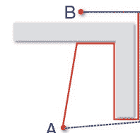

**图 4.3** 从 A 到 B 的两条路径

## 图

在你可以解决路径查找问题之前，首先需要一种方法来表示游戏的各个部分


AI可以寻路通过的世界。一个流行的选择是 **图** 数据结构。图包含一组 **节点**（也称为顶点）。这些节点通过 **边** 相互连接。这些边可以是 **无向** 的，意味着它们可以双向遍历，或者 **有向** 的，意味着它们只能单向遍历。你可能会在AI可以从平台跳下但无法跳回去的情况下使用有向边。你可以用从平台到地面的有向边来表示这个连接。

可选地，边可以带有关联的 **权重**，表示遍历边的代价。在游戏中，权重最少考虑节点之间的距离。然而，你可以根据遍历边的难度来修改权重。

例如，如果边在游戏世界中穿过流沙，它的权重应该高于同样长度穿过混凝土的边。没有边权重的图（**无权图**）实际上是每条边的权重都是常量值的图。图4.4展示了一个简单的无向无权图。

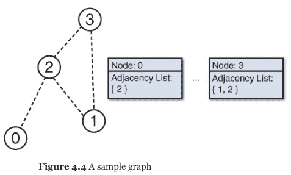

在内存中表示图有多种方式，但本书使用 **邻接表**。在这种表示中，每个节点都有一组相邻节点（使用 `std::vector`）。对于无权图，这个邻接表包含指向相邻节点的指针。图就是这样的节点的集合：

点击此处查看代码图片

```
struct GraphNode
{
    // Each node has pointers to adjacent nodes
    std::vector<GraphNode*> mAdjacent;
};

struct Graph
{
    // A graph contains nodes
    std::vector<GraphNode*> mNodes;
};
```

对于带权图，每个节点不是存储连接节点的列表，而是存储其出边：

点击此处查看代码图片

```
struct WeightedEdge
{
    // Which nodes are connected by this edge?
    struct WeightedGraphNode* mFrom;
    struct WeightedGraphNode* mTo;
    // Weight of this edge
    float mWeight;
};

struct WeightedGraphNode
{
    // Stores outgoing edges
    std::vector<WeightedEdge*> mEdges;
};
```

// (带权图拥有带权图节点)

通过在每条边中引用“from”和“to”节点，你可以通过将边添加到节点A的mEdges向量而不添加到节点B的来支持从节点A到B的有向边。如果你想要无向边，只需添加两条有向边，每个方向一条（例如，从A到B和从B到A）。

不同的游戏以不同的方式通过图来表示游戏世界。将世界划分为方格（或六边形）网格是最简单的方法。这种方法对于回合制策略游戏（如《文明》或《XCOM》）非常流行。然而，对于许多其他类型的游戏，使用这种方法不可行。为了简单起见，本节大部分内容仍使用方格网格。然而，你将在本章后面了解其他可能的表示方法。

## 广度优先搜索

假设一个游戏发生在方格网格设计的迷宫中。游戏只允许在四个基数方向移动。因为迷宫中的每一步长度都一致，无权图可以表示这个迷宫。图4.5展示了一个示例迷宫及其对应的图。

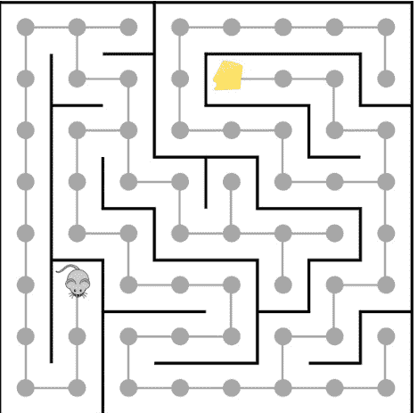

图4.5 方格网格上的迷宫及其对应的图

现在想象一只老鼠AI角色从迷宫中的某个方格开始（**起始节点**），想要找到通往迷宫中一块奶酪的最短路径（**目标节点**）。一种方法是首先检查距离起点一步远的所有方格。如果这些方格中没有包含奶酪，然后检查距离起点两步远的所有方格。重复此过程，直到找到奶酪或没有有效移动为止。由于该算法只在较近的节点被耗尽后才考虑较远的节点，因此它不会错过通往奶酪的最短路径。这描述了 **广度优先搜索（BFS）** 中发生的情况。当边无权或每条边都有相同的正权重时，BFS算法保证能找到最短路径。

在BFS过程中进行少量辅助记录，可以重建移动次数最少的路径。计算完成后，AI角色可以沿着这条路径移动。

在BFS期间，每个节点需要知道紧随其前的访问节点。该节点称为 **父节点**，有助于在BFS完成后重建路径。虽然你可以将此数据添加到 `GraphNode` 结构体中，但最好将不变的数据（图本身）与父节点分开。这是因为父节点会根据所选的起始节点和目标节点而变化。分离这些数据还意味着，如果你想在多个线程中同时计算多条路径，搜索不会互相干扰。

为了支持这一点，首先定义一种名为 `NodeToParentMap` 的映射类型，它只是一个无序映射，其中键和值都是 `GraphNode` 指针（指针是 `const` 的，因为你不需要修改图节点）：

点击此处查看代码图片

```
using NodeToParentMap = std::unordered_map<const GraphNode*, const GraphNode*>;
```

有了这种映射类型，你可以像清单4.2所示实现BFS。实现BFS最简单的方法是使用队列。回顾一下，队列在添加和删除节点时使用先进先出（FIFO）行为。你可以通过入队操作将节点添加到队列，并通过出队操作移除节点。首先，你入队起始节点并进入一个循环。在每次迭代中，你出队一个节点并入队其邻居。你可以通过检查父节点映射来避免将同一节点多次添加到队列中。只有当节点之前未入队或它是起始节点时，节点的父节点才为null。

当你对outMap使用方括号时，会发生两种情况之一。如果键已经存在于映射中，你可以直接访问其父节点。否则，如果键不存在于映射中，映射会默认为该键构造一个值。在这种情况下，如果你访问outMap且请求的节点不在映射中，你将该节点的父节点初始化为nullptr。

即使起点和终点之间不存在路径，循环最终也会终止。这是因为算法检查所有从起点可达的节点。一旦所有可能性都被耗尽，队列变为空，循环结束。

### 清单4.2 广度优先搜索

点击此处查看代码图片

```
bool BFS(const Graph& graph, const GraphNode* start,
         const GraphNode* goal, NodeToParentMap& outMap)
{
    // Whether we found a path
    bool pathFound = false;
    // Nodes to consider
    std::queue<const GraphNode*> q;
    // Enqueue the first node
    q.emplace(start);

    while (!q.empty())
    {
        // Dequeue a node
        const GraphNode* current = q.front();
        q.pop();
        if (current == goal)
        {
            pathFound = true;
            break;
        }

        // Enqueue adjacent nodes that aren't already in the map
        for (const GraphNode* node : current->mAdjacent)
        {
            // If the parent is null, it hasn't been enqueued
            // (except for the start node)
            const GraphNode* parent = outMap[node];
            if (parent == nullptr && node != start)
            {
                // Enqueue this node, setting its parent
                outMap[node] = current;
                q.emplace(node);
            }
        }
    }
    return pathFound;
}
```

假设你有一个图g，你可以用以下两行代码在图中两个GraphNode之间运行BFS：

点击此处查看代码图片

```
NodeToParentMap map;

bool found = BFS(g, g.mNodes[0], g.mNodes[9], map);
```

如果BFS成功，你可以通过使用 *outMap* 中的父指针来重建路径。这是因为目标的父节点指向路径上的前一个节点。同样，目标节点前一个节点的父节点距离目标两步远。沿着这条父指针链最终会回到起始节点，从而得到从目标到起点的路径。

不幸的是，你希望路径是相反的方向：从起点到终点。一种解决方案是使用栈反转路径，但更聪明的方法是 *反转搜索*。例如，不要将老鼠节点作为起点、奶酪节点作为终点传入，而是反过来。然后，从目标节点沿着父指针跟踪即可得到所需的路径。

如果存在路径，BFS总能在起始节点和目标节点之间找到一条路径。但对于带权图，BFS不保证能找到最短路径。这是因为BFS根本不查看边的权重；每条边的遍历都等同。在 *图4.6* 中，虚线路径距离最短，但BFS返回实线路径，因为它只需要两步。


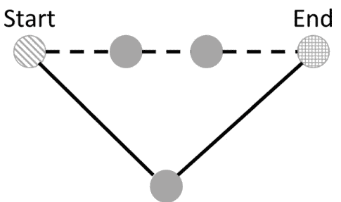

图 4.6 BFS 即使在虚线路径更短的情况下也能找到实线路径

BFS 的另一个问题是，即使节点与目标方向相反，它也会测试这些节点。通过使用更复杂的算法，可以在寻找最优解的过程中减少要测试的节点数量。

游戏中使用的大多数其他路径查找算法的整体结构与 BFS 类似。在每次迭代中，你选择下一个要检查的节点，并将其邻居添加到一个数据结构中。不同之处在于，不同的路径查找算法以不同的顺序评估节点。

## 启发式

许多搜索算法依赖于 **启发式**，这是一个近似预期结果的函数。在路径查找中，启发式是从给定节点到目标节点的估计成本。启发式可以帮助你更快地找到一条路径。例如，在 BFS 的每次迭代中，你从队列中取出下一个节点，即使该节点会让你朝着远离目标的方向移动。使用启发式，你可以估计特定节点距离目标有多近，然后优先查看“更近”的节点。这样，路径查找算法可能会在更少的迭代后终止。

符号 **_h(x)_** 表示启发式，其中 _x_ 是图中的一个节点。因此，_h(x)_ 是从节点 _x_ 到目标节点的估计成本。

如果启发式函数始终小于或等于从节点 _x_ 到目标的实际成本，则该启发式函数是 **可接受的**。如果启发式偶尔高估实际成本，则它是 **不可接受的**，你不应该使用它。本节稍后讨论的 A* 算法需要一个可接受的启发式来保证最短路径。

对于方形网格，有两种常见的启发式计算方法。例如，在 **图 4.7** 中，带棋盘格的节点代表目标，实心节点代表起点。此图中的灰色方块表示不可通过的方块。

### 曼哈顿距离

h(x) = 6

### 欧几里得距离

h(x) = 4.24

图 4.7 曼哈顿启发式（左）和欧几里得启发式（右）

**曼哈顿距离** 启发式（如图 4.7 左所示）类似于在大都市沿着街区行进。一栋建筑物可能“距离五个街区”，但可能有多条长度为五个街区的路线。曼哈顿距离假设对角线移动无效。如果对角线移动有效，曼哈顿距离通常会高估成本，使启发式不可接受。

对于 2D 网格，以下公式计算曼哈顿距离：

```
h(x) = |start.x - end.x| + |start.y - end.y|
```

第二种启发式是 **欧几里得距离**（如图 4.7 右所示）。你使用标准距离公式来计算此启发式，它估计一条“直线”路径。与曼哈顿距离不同，欧几里得距离可以轻松应用于比方形网格更复杂的世界。在 2D 中，欧几里得距离公式如下：

```
h(x) = \sqrt{(start.x - end.x)^2 + (start.y - end.y)^2}
```

欧几里得距离函数几乎总是可接受的，即使在曼哈顿距离不可接受的情况下也是如此。这意味着欧几里得距离通常是推荐的启发式函数。然而，曼哈顿启发式计算更高效，因为它不涉及平方根。

欧几里得距离启发式高估真实成本的唯一情况是，如果游戏允许非欧几里得移动，例如在关卡中两个节点之间传送。

请注意，在图 4.7 中，两个启发式 h(x) 函数最终都低估了从起点节点到目标节点的实际旅行成本。这是因为启发式函数对邻接表一无所知，因此不知道某些区域是否不可通过。这没关系，因为启发式是节点 x 距离目标节点有多近的下界；启发式保证节点 x 至少距离那么远。这在相对意义上更有用：启发式可以帮助估计节点 A 或节点 B 哪个更靠近目标节点。然后，你可以使用此估计来帮助决定下一步探索节点 A 还是节点 B。

以下部分展示了如何使用启发式函数来创建更复杂的路径查找

## 贪婪最佳优先搜索

BFS 使用队列以先进先出的方式考虑节点。贪婪最佳优先搜索（GBFS）则使用 h(x) 启发式函数来决定下一步考虑哪个节点。虽然这似乎是一个合理的路径查找算法，但 GBFS 不能保证最小路径。图 4.8 显示了示例 GBFS 搜索的结果路径。灰色节点不可通过。请注意，该路径从起点开始多走了四步，而不是直接向下走。

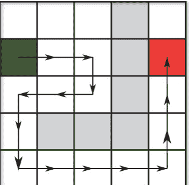

图 4.8 贪婪最佳优先路径

注意 虽然 GBFS 不能保证最优性，但理解它很有用，因为只需进行几处修改就可以将其变成 A*。如果启发式是可接受的，A* 算法确实保证最短路径。因此，在转到 A* 之前，理解 GBFS 实现非常重要。

在搜索过程中，GBFS 不使用单个队列，而是使用两组节点。**开放集** 包含正在考虑的节点。一旦被选中进行评估，节点就会移动到 **关闭集**。当节点在关闭集中时，GBFS 不需要进一步调查它。开放集或关闭集中的节点不一定最终会在路径上；这些集合只是帮助从考虑中剪枝节点。

为开放集和关闭集选择数据结构会带来一个有趣的两难困境。对于开放集，你需要的两个操作是移除成本最低的节点和测试成员资格。关闭集只需要成员资格测试。为了加快成员资格测试，你可以简单地在临时数据中使用布尔值来跟踪特定节点是开放集还是关闭集的成员。由于关闭集只需要此成员资格测试，你不为关闭集使用实际集合。

对于开放集，一种流行的数据结构是优先队列。但是，为了简单起见，本章为开放集使用了向量。使用向量，你可以简单地使用线性搜索来找到开放集中成本最低的元素。

与 BFS 类似，每个节点在 GBFS 搜索期间都需要额外的临时数据。由于你现在每个节点都有多个临时数据，因此定义一个结构体来封装它是合理的。要使用加权图，父节点是传入边，而不是前一个节点。此外，每个节点都会跟踪其启发式值及其在开放集和关闭集中的成员资格：

```
struct GBFSScratch
{
    const WeightedEdge* mParentEdge = nullptr;
    float mHeuristic = 0.0f;
    bool mInOpenSet = false;
    bool mInClosedSet = false;
};
```

然后，定义一个映射，其中键是指向节点的指针，值是 `GBFSScratch` 的一个实例：

```
using GBFSMap =
std::unordered_map<const WeightedGraphNode*, GBFSS
```

现在你有了贪婪最佳优先搜索所需的所有组件。`GBFS` 函数接受一个 `WeightedGraph`、起点节点、目标节点和对 `GBFSMap` 的引用：

```
bool GBFS(const WeightedGraph& g, const WeightedGraph
const WeightedGraphNode* goal, GBFSMap& out
```

在 GBFS 函数开始时，你为开放集定义一个向量：

```
std::vector<const WeightedGraphNode*> closedSet;
```

接下来，你需要一个变量来跟踪当前节点，即正在评估的节点。随着算法的推进，此变量会更新。最初，current 是起点节点，你通过在临时映射中将其标记为关闭来“添加”它到关闭集：

```
const WeightedGraphNode* current = start;
outMap[current].mInClosedSet = true;
```

接下来，你进入 GBFS 的主循环。这个主循环做几件事。首先，它查看当前节点的所有相邻节点。它只考虑不在关闭集中的节点。这些节点的父边设置为从当前节点传入的边。对于不在开放集中的节点，代码计算启发式（从节点到目标）并将节点添加


to the open set:

```
do
{
    // Add adjacent nodes to open set
    for (const WeightedEdge* edge : current->mEdges)
    {
        // Get scratch data for this node
        GBFSScratch& data = outMap[edge->mTo];
        // Add it only if it's not in the closed set
        if (!data.mInClosedSet)
        {
            // Set the adjacent node's parent edge
            data.mParentEdge = edge;
            if (!data.mInOpenSet)
            {
                // Compute the heuristic for this node
                data.mHeuristic = ComputeHeuristic(edge->mTo);
                data.mInOpenSet = true;
                openSet.emplace_back(edge->mTo);
            }
        }
    }
}
}
}
}
}
}
}
```

The `ComputeHeuristic` function can use any heuristic $h(x)$ function, such as Manhattan or Euclidean distance. In practice, this may require additional information stored in each node (such as the position of the node in the world).

After processing the nodes adjacent to the current node, you need to look at the open set. If it's empty, this means there are no nodes left to evaluate. This happens only if there is no path from start to goal:

```
if (openSet.empty())
{
    break; // Break out of outer loop
}
```

Alternatively, if there are still nodes in the open set, the algorithm continues. You need to find the node in the open set with the lowest heuristic cost and move it to the closed set. This node becomes the new current node:

```
// Find lowest cost node in open set

auto iter = std::min_element(openSet.begin(), openSet.end(),
[&outMap](const WeightedGraphNode* a, const WeightedGraphNode* b)
{
    return outMap[a].mHeuristic < outMap[b].mHeuristic;
});

// Set to current and move from open to closed

current = *iter;
openSet.erase(iter);
outMap[current].mInOpenSet = false;
outMap[current].mInClosedSet = true;
```

The code to find the lowest element uses the `std::min_element` function from the `<algorithm>` header. For its third parameter, `min_element` takes in a special type of function (called a _lambda expression_) to specify how to decide whether one element is less than another. The `min_element` function returns an iterator to the minimum element.

Finally, the main loop continues if the current node is not the goal node:

```
} while (current != goal);
```

The loop terminates either when the above while condition fails or when you hit the earlier break statement (for when the open set is empty). You can then figure out if GBFS found a path based on whether the current node equals the goal node:

```
return (current == goal) ? true : false;
```

Figure 4.9 shows the first two iterations of GBFS applied to a sample data set. In Figure 4.9(a), the start node (A2) is in the closed set, and its adjacent nodes are in the open set. To make the figure easy to read, it uses the Manhattan distance heuristic. The arrows point from children back to their parent node. The next step is to select the node with the lowest heuristic cost, which is the node with h = 3. This node becomes the new current node and moves into the closed set. Figure 4.9(b) shows the next iteration, where C2 is now the node with the lowest cost in the open set.

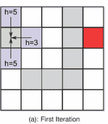

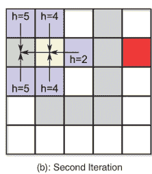

### Figure 4.9 Greedy best-first snapshots: (a) first iteration and (b) second iteration

Keep in mind that just because a node in the open set has the lowest heuristic cost doesn’t mean it’s on the optimal path. For example, in Figure 4.9(b), the node C2 is not on the optimal path. Unfortunately, the GBFS algorithm still selects C2 for its path. Clearly, you need to do some refinement to fix this issue.

Listing 4.3 shows the complete code for the greedy best-first search function.

### Listing 4.3 Greedy Best-First Search

```
bool GBFS(const WeightedGraph& g, const WeightedGraphNode* goal, GBFSMap& outMap)
{
    std::vector<const WeightedGraphNode*> openSet;
    // Set current node to start, and mark in closed set
    const WeightedGraphNode* current = start;
    outMap[current].mInClosedSet = true;
    do
    {
        // Add adjacent nodes to open set
        for (const WeightedEdge* edge : current->mEdges)
        {
            // Get scratch data for this node
            GBFSScratch& data = outMap[edge->mTo];
            // Consider it only if it's not in the closed set
            if (!data.mInClosedSet)
            {
                // Set the adjacent node's parent edge
                data.mParentEdge = edge;
                if (!data.mInOpenSet)
                {
                    // Compute the heuristic for this node
                    data.mHeuristic = ComputeHeuristic(edge->mTo);
                    data.mInOpenSet = true;
                    openSet.emplace_back(edge->mTo);
                }
            }
        }
        if (openSet.empty())
        {
            break;
        }

        // Find lowest cost node in open set
        auto iter = std::min_element(openSet.begin(), openSet.end(),
        [&outMap](const WeightedGraphNode* a, const WeightedGraphNode* b)
        {
            return outMap[a].mHeuristic < outMap[b].mHeuristic;
        });

        // Set to current and move from open to closed
        current = *iter;
        openSet.erase(iter);
        outMap[current].mInOpenSet = false;
        outMap[current].mInClosedSet = true;
    } while (current != goal);

    // Did you find a path?
    return (current == goal) ? true : false;
}
```

## A* Search

The downside of GBFS is that it can't guarantee an optimal path. Luckily, with some modifications to GBFS, you can transform it into the **A* search** (pronounced “A-star”). A* adds a **path-cost** component, which is the *actual* cost from the start node to a given node. The notation **_g(x)_** denotes the path-cost of a node x. When selecting a new current node, A* selects the node with the lowest **_f(x)_** value, which is just the sum of the _g(x)_ path-cost and the _h(x)_ heuristic for that node:

```
f(x) = g(x) + h(x)
```

There are a few conditions for A* to find an optimal path. Of course, there must be some path between the start and goal. Furthermore, the heuristic must be admissible (so it can’t overestimate the actual cost). Finally, all edge weights must be greater than or equal to zero.

To implement A*, you first define an `AStarScratch` struct, as you do for GBFS. The only difference is that the `AStarScratch` struct also has a float member `mActualFromStart` to store the _g(x)_ value.

There are additional differences between the GBFS code and the A* code. When adding a node to the open set, A* must also compute the path-cost _g(x)_. And when selecting the minimum node, A* selects the node with the lowest _f(x)_ cost. Finally, A* is pickier about which nodes become parents, using a process called **node adoption**.

In the GBFS algorithm, adjacent nodes always have their parents set to the current node. But in A*, the g(x) path-cost value of a node is dependent on the g(x) value of its parent. This is because the path-cost value for node x is simply its parent's path-cost value plus the cost of traversing the edge from the parent to node x. So before assigning a new parent to a node x, A* first makes sure the g(x) value will improve.

Figure 4.10(a) once again uses the Manhattan heuristic function. The current node (C3) checks its adjacent nodes. The node to its left has g = 2 and B2 as its parent. If that node instead had C3 as its parent, it would have g = 4, which is worse. So, A* will not change B2's parent in this case.

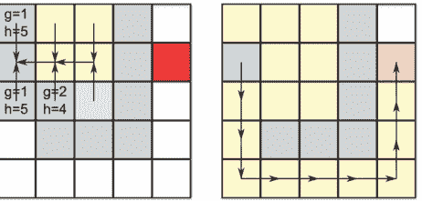

### Figure 4.10 (a) Current node adoption fails; (b) final A* path

Figure 4.10(b) shows the final path as computed by A*, which clearly is superior to the GBFS solution.

Apart from node adoption, the code for A* ends up being very similar to the GBFS code. Listing 4.4 shows the loop over the adjacent nodes, which contains most of the code changes. The only other change not shown in the text is the code that selects the lowest-cost node in the open set based on f(x) instead of just h(x). The game project for this chapter provides the code for the full A* implementation.

### Listing 4.4 Loop over the Adjacent Nodes in an A* Search

```
for (const WeightedEdge* edge : current->mEdges)
{
    const WeightedGraphNode* neighbor = edge->mTo;
    // Get scratch data for this node
    AStarScratch& data = outMap[neighbor];
    // Only check nodes that aren't in the closed set
    if (!data.mInClosedSet)
    {
        if (!data.mInOpenSet)
        {
            // Not in the open set, so parent must be current
            data.mParentEdge = edge;
        }
    }
}
```


data.mHeuristic = ComputeHeuristic(neighbor,
// Actual cost is the parent's plus cost of
data.mActualFromStart = outMap[current].mActualFromStart + edge->mWeight;
data.mInOpenSet = true;
openSet.emplace_back(neighbor);
}
else
{
// Compute what new actual cost is if current
float newG = outMap[current].mActualFromStart
if (newG < data.mActualFromStart)
{
// Current should adopt this node
data.mParentEdge = edge;
data.mActualFromStart = newG;
}
}
}
}

将A*优化到尽可能高效是一个复杂的话题。需要考虑的一点是，如果开放集中有大量平局会发生什么。在方形网格中这几乎必然发生，尤其是当你使用曼哈顿启发式时。如果平局太多，在选择节点的时候，你有很高的概率选择一个最终不在路径上的节点。这最终意味着你需要在图中探索更多节点，这会使A*运行得更慢。

帮助消除平局的一种方法是给启发式函数添加一个权重，例如将启发式任意乘以0.75。这使得路径代价g(x)函数相对于启发式h(x)函数拥有更大的权重，这意味着你更有可能探索离起始节点更远的节点。

从效率角度来看，A*实际上对于基于网格的寻路来说是一个糟糕的选择。其他寻路算法对网格要高效得多。其中之一是JPS+算法，在Steve Rabin的Game AI Pro 2中有概述（参见“附加阅读”部分）。然而，A*适用于任何图，而JPS+仅适用于网格。

## 迪杰斯特拉算法

让我们回到迷宫示例，但现在假设迷宫中有多块奶酪，你希望老鼠移动到最近的奶酪处。启发式可以近似哪块奶酪最近，A*可以找到通往该奶酪的路径。但是，你用启发式选择的奶酪可能并不真的是最近的，因为启发式只是一个估计。

在迪杰斯特拉算法中，有一个源节点但没有目标节点。相反，迪杰斯特拉计算从源节点到图中每个其他可达节点的距离。在迷宫示例中，迪杰斯特拉将找到从老鼠出发的所有可达节点的距离，得出到每块奶酪的实际旅行代价，并允许老鼠移动到最近的那块。

可以将上一节中的A*代码转换为迪杰斯特拉算法。首先，移除h(x)启发式组件。这相当于一个启发式函数h(x) = 0，这是可接受的，因为它保证小于或等于实际代价。接下来，移除目标节点，并使循环仅在开放集为空时终止。这样就计算了从起点可达的每个节点的g(x)路径代价。

埃兹格尔·迪杰斯特拉提出的原始算法略有不同。但本节提出的方法在功能上与原始方法等价。（AI教材有时将这种方法称为**一致代价搜索**）。有趣的是，迪杰斯特拉算法的发明早于GBFS和A*。然而，游戏通常更偏好诸如A*之类的启发式引导方法，因为它们通常搜索的节点远少于迪杰斯特拉算法。

## 跟随路径

一旦寻路算法生成一条路径，AI就需要跟随它。你可以将路径抽象为一系列点。然后AI只需沿着这条路径从一个点移动到另一个点。你可以在`MoveComponent`的一个名为`NavComponent`的子类中实现这一点。因为`MoveComponent`已经可以让角色向前移动，`NavComponent`只需要在角色沿路径移动时旋转角色以面向正确方向。

首先，`NavComponent`中的`TurnTo`函数将角色旋转以面向一个点：

单击此处查看代码图像

```
void NavComponent::TurnTo(const Vector2& pos)
{
    // Vector from me to pos
    Vector2 dir = pos - mOwner->GetPosition();
    // New angle is just atan2 of this dir vector
    // (Negate y because +y is down on screen)
    float angle = Math::Atan2(-dir.y, dir.x);
    mOwner->SetRotation(angle);
}
```

接下来，`NavComponent`有一个`mNextPoint`变量，用于跟踪路径中的下一个点。`Update`函数测试角色是否到达`mNextPoint`：

单击此处查看代码图像

```
void NavComponent::Update(float deltaTime)
{
    // If you've reached the next point, advance along
    Vector2 diff = mOwner->GetPosition() - mNextPoint;
    if (diff.Length() <= 2.0f)
    {
        mNextPoint = GetNextPoint();
        TurnTo(mNextPoint);
    }
    // This moves the actor forward
    MoveComponent::Update(deltaTime);
}
```

这假设`GetNextPoint`函数返回路径上的下一个点。假设角色从路径上的第一个点开始，将`mNextPoint`初始化为第二点并设置线速度，就能让角色沿路径移动。

以这种方式更新沿路径的移动有一个问题：它假设角色移动不会太快以至于在一步内跳过一个节点太远。如果发生这种情况，两者之间的距离永远不会足够近，角色就会迷路。

## 其他图形表示

对于具有实时动作的游戏，非玩家角色（NPC）通常不会在网格中从一个方格移动到另一个方格。这使得用图形表示世界变得更加复杂。本节讨论了两种替代方法：使用路径节点和使用导航网格。

**路径节点**（也称为*路点图*）随着20世纪90年代初第一人称射击（FPS）游戏的出现而流行。使用这种方法，设计师将路径节点放置在游戏世界中AI可以寻路到的位置。这些路径节点直接转换为图中的节点。

通常，你会自动生成路径节点之间的边。算法的工作原理如下：对于每个路径节点，测试它与附近节点之间是否有障碍物。任何没有障碍物的路径都会产生边。线段投射或类似的碰撞测试可以确定是否有障碍物。第10章“碰撞检测”介绍了如何实现线段投射。

使用路径节点的主要缺点是，AI只能移动到节点或边上的位置。这是因为即使路径节点形成一个三角形，也不能保证三角形内部是一个有效位置。路上可能有障碍物，因此寻路算法必须假设任何不在节点或边上的位置都是无效的。

在实践中，这意味着要么世界中有大量空间对AI禁入，要么你需要很多路径节点。第一种情况不可取，因为这会导致AI表现得不够可信，而第二种情况则效率低下。节点和边越多，寻路算法得出解决方案所需的时间就越长。这在性能和准确性之间呈现出一种权衡。

其他游戏使用**导航网格**（或*导航网*）。使用这种方法，图中的每个节点对应一个凸多边形。相邻节点是任何相邻的凸多边形。这意味着少量凸多边形可以表示游戏世界中的整个区域。使用导航网格，AI可以安全地移动到凸多边形节点内部的任何位置。这意味着AI具有更好的机动性。**图4.11**比较了游戏中某个位置的路径节点和导航网格表示。

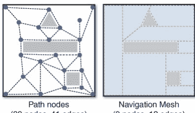

图4.11 房间的路径节点（a）和导航网格（b）表示

导航网格也更好地支持不同大小的角色。假设一个游戏中既有牛又有鸡在农场周围走动。鉴于鸡比牛小，有些区域鸡可以进入但牛不能。因此，为鸡设计的路径节点网络对牛来说无法正确工作。这意味着如果游戏使用路径节点，它需要两个独立的图：每种生物一个。相比之下，导航网格中的每个节点都是一个凸多边形，因此可以计算角色是否适合特定区域。因此，游戏可以为鸡和牛使用单一的导航网格。

大多数使用导航网格的游戏都会自动生成它们。这很有用，因为设计师可以更改关卡而无需过多担心对AI寻路的影响。然而，导航网格生成算法很复杂。幸运的是，有开源库实现了导航网格生成。最流行的是Recast，它根据3D关卡的三角形几何生成导航网格。有关Recast的更多信息，请参见本章末尾的“附加阅读”部分。

## 游戏树

诸如井字棋或国际象棋之类的游戏与大多数实时游戏截然不同。首先，游戏有两名玩家，每位玩家轮流行动。其次，游戏是对抗性的，意味着两名玩家相互对弈。这类游戏的AI需求与实时游戏截然不同。这类游戏需要某种整体游戏状态的表示，而这种状态为AI的决策提供依据。一种方法是使用一种称为游戏树的树。在一


博弈树，根节点表示游戏的当前状态。每条边表示游戏中的一步棋，并导向一个新的游戏状态。

图 4.12 展示了一个进行中的井字棋游戏的博弈树。从根节点开始，当前玩家（称为最大化玩家）可以从三种不同的走法中选择。最大化玩家走完一步后，游戏状态转移到树第一层的一个节点。然后对手（称为最小化玩家）选择一步棋，进入树的第二层。此过程重复，直到到达叶节点，叶节点表示游戏的结束状态。

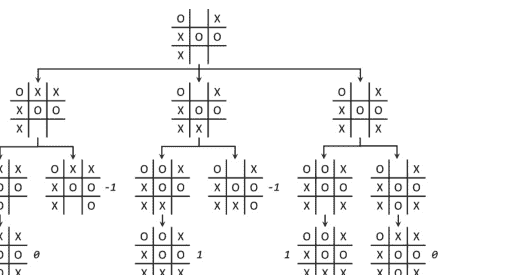

### 图 4.12 井字棋的部分博弈树

在井字棋中，只有三种结果：赢、输或平。图 4.12 中分配给叶节点的数值反映了这些结果。这些数值是从最大化玩家角度得出的得分：1 表示最大化玩家获胜，-1 表示最小化玩家获胜，0 表示平局。

不同的游戏有不同的状态表示。对于井字棋，状态只是棋盘的一个二维数组：

# 点击此处查看代码图像

```
struct GameState
{
    enum SquareState { Empty, X, O };
    SquareState mBoard[3][3];
};
```

博弈树节点既存储子节点列表，也存储该节点的游戏状态：

# 点击此处查看代码图像

```
struct GTNode
{
    // Children nodes
    std::vector<GTNode*> mChildren;
    // State of game at this node
    GameState mState;
};
```

要生成完整的博弈树，将根节点设置为当前游戏状态，并为每种可能的第一步走法创建子节点。然后对第一层的每个节点重复此过程，并继续直到所有走法都用尽。

博弈树的大小随潜在走法数量呈指数级增长。对于井字棋，博弈树的上限是 9!，即 362,880 个节点。这意味着可以为井字棋生成并评估完整的博弈树。但对于国际象棋，完整的博弈树将有 10^120 个节点，这使得完全评估在时间和空间复杂度上都不可能。目前，让我们假设我们有一个完整的博弈树。稍后，我们将讨论如何管理不完整的树。

## 极小极大算法

极小极大算法评估双人博弈树，以确定当前玩家的最佳走法。极小极大算法假设每个玩家都会做出对自己最有利的选择。由于得分是从最大化玩家的角度得出的，这意味着最大化玩家试图最大化她的得分，而最小化玩家则努力最小化最大化玩家的得分。

例如，在图 4.12 中，最大化玩家（本例中为 X）有三种可能的走法。如果最大化玩家选择顶部中间或底部中间，最小化玩家（O）可以通过右下角获胜。最小化玩家会在可用时采取这一获胜走法。因此，最大化玩家选择右下角以最大化她的潜在最终得分。

如果最大化玩家选择右下角，最小化玩家可以选择顶部中间或底部中间。这里的选择是在得分 1 或 0 之间。由于最小化玩家旨在最小化最大化玩家的得分，最小化玩家选择底部中间。这意味着游戏以平局结束，这是双方都以最优策略进行的井字棋游戏的预期结果。

清单 4.5 中极小极大算法的实现为最小化玩家和最大化玩家的行为使用了单独的函数。两个函数首先测试节点是否为叶节点，如果是，则 GetScore 函数计算得分。接下来，两个函数使用递归确定最佳可能的子树。对于最大化玩家，最佳子树产生最高值。同样，最小化玩家找到值最低的子树。

### 清单 4.5 MaxPlayer 和 MinPlayer 函数

# 点击此处查看代码图像

```
float MaxPlayer(const GTNode* node)
{
    // If this is a leaf, return score
    if (node->mChildren.empty())
    {
        return GetScore(node->mState);
    }
    // Find the subtree with the maximum value
    float maxValue = -std::numeric_limits<float>::infinity;
    for (const GTNode* child : node->mChildren)
    {
        maxValue = std::max(maxValue, MinPlayer(child));
    }
    return maxValue;
}

float MinPlayer(const GTNode* node)
{
    // If this is a leaf, return score
    if (node->mChildren.empty())
    {
        return GetScore(node->mState);
    }
    // Find the subtree with the minimum value
    float minValue = std::numeric_limits<float>::infinity;
    for (const GTNode* child : node->mChildren)
    {
        minValue = std::min(minValue, MaxPlayer(child));
    }
    return minValue;
}
```

在根节点上调用 MaxPlayer 将返回最大化玩家的最佳可能得分。然而，这并未指定哪一步下一步走法是最优的，AI 玩家也想知道这一点。确定最佳走法的代码在单独的 MinimaxDecide 函数中，如清单 4.6 所示。MinimaxDecide 类似于 MaxPlayer 函数，只是它跟踪哪个子节点产生最佳值。

### 清单 4.6 MinimaxDecide 实现

# 点击此处查看代码图像

```
const GTNode* MinimaxDecide(const GTNode* root)
{
    // Find the subtree with the maximum value, and saving the choice
    const GTNode* choice = nullptr;
    float maxValue = -std::numeric_limits<float>::infinity;
    for (const GTNode* child : root->mChildren)
    {
        float v = MinPlayer(child);
        if (v > maxValue)
        {
            maxValue = v;
            choice = child;
        }
    }
    return choice;
}
```

## 处理不完整的博弈树

如前所述，并非总是可行生成完整的博弈树。幸运的是，可以修改极小极大算法代码以处理不完整的博弈树。首先，函数必须针对游戏状态而不是节点进行操作。接下来，代码不是遍历子节点，而是遍历给定状态下的下一步可能走法。这些修改意味着极小极大算法在执行期间生成树，而不是事先生成。

如果树太大，例如在国际象棋中，仍然不可能生成整棵树。就像专家国际象棋选手只能看到八步之后一样，AI 需要限制其博弈树的深度。这意味着代码将某些节点视为叶节点，尽管它们不是游戏的终止状态。

为了做出明智的决策，极小极大算法需要知道这些非终止状态有多好。但与终止状态不同，无法知道确切得分。因此，评分需要一个启发式组件来近似非终止状态的质量。这也意味着得分现在是一组值的范围，而不是井字棋中 {-1, 0, 1} 的三选一选择。

重要的是，添加启发式组件意味着极小极大算法无法保证做出最佳决策。启发式试图近似游戏状态的质量，但这种近似的准确性未知。在不完整的博弈树中，极小极大算法选择的走法可能是次优的，并最终导致失败。

清单 4.7 提供了 MaxPlayerLimit 函数。（你需要以类似方式修改其他函数。）此代码假设 GameState 有三个成员函数：IsTerminal、GetScore 和 GetPossibleMoves。如果状态是结束状态，IsTerminal 返回 true。GetScore 对于非终止状态返回启发式值，对于终止状态返回得分。GetPossibleMoves 返回当前状态下一步之后的游戏状态向量。

### 清单 4.7 MaxPlayerLimit 实现

# 点击此处查看代码图像

```
float MaxPlayerLimit(const GameState* state, int depth)
{
    // If this is terminal or we've gone max depth
    if (depth == 0 || state->IsTerminal())
    {
        return state->GetScore();
    }

    // Find the subtree with the max value
    float maxValue = -std::numeric_limits<float>::infinity;
    for (const GameState* child : state->GetPossibleMoves())
    {
        maxValue = std::max(maxValue, MinPlayer(child, depth - 1));
    }
    return maxValue;
}
```

启发式函数因游戏而异。例如，一个简单的国际象棋启发式可能会计算每个玩家拥有的棋子数量，并对棋子进行加权


by power. However, a drawback of such a simple heuristic is that sometimes sacrificing a piece in the short term is better for the long term. Other heuristics might look at control of the board's center, the safety of the king, or the mobility of the queen. Ultimately, several different factors affect the heuristic.

More complex heuristics require more calculations. Most games institute some sort of time limit for AI moves. For example, a chess game AI might have only 10 seconds to decide its next move. This makes it necessary to strike a balance between the depth explored and heuristic complexity.

## Alpha-Beta 剪枝

Alpha-Beta 剪枝是对极小极大算法的一种优化，平均而言减少了被评估的节点数量。在实践中，这意味着可以在不增加计算时间的情况下增加探索的最大深度。

Figure 4.13 shows a game tree simplified by alpha-beta pruning. Assuming a left-to-right order of evaluation for siblings, the max player first inspects subtree B. The min player then sees the leaf with value 5, which means the min player has a choice between 5 and other values. If these other values are greater than 5, the min player obviously selects 5. This means that the upper bound of subtree B is 5, but the lower bound is negative infinity. The min player continues and sees the leaf with value 0 and selects this leaf because the min player wants the minimum possible score.

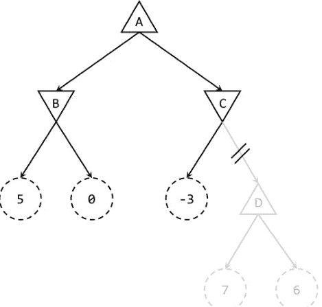

图 4.13 由 Alpha-Beta 剪枝简化的游戏树

Control returns to the max player function, which now knows that subtree B has a value of 0. Next, the max player inspects subtree C. The min player first sees the leaf with value -3. As before, this means the upper bound of subtree C is -3. However, you already know that subtree B has a value of 0, which is better than -3. This means that there's no way subtree C can be better for the max player than subtree B. Alpha-beta pruning recognizes this and, as a result, does not inspect any other children of C.

Alpha-beta pruning adds two additional variables, called **alpha** and **beta**. **Alpha** is the best score guaranteed for the max player at the current level or higher. Conversely, **beta** is the best score guaranteed for the min player at the current level or higher. In other words, alpha and beta are the lower and upper bounds of the score.

Initially, alpha is negative infinity and beta is positive infinity—the worst possible values for both players. `AlphaBetaDecide`, in Listing 4.8, initializes alpha and beta to these values and then recurses by calling `AlphaBetaMin`.

### 清单 4.8 AlphaBetaDecide 实现

点击此处查看代码图像

```cpp
const GameState* AlphaBetaDecide(const GameState* root)
{
    const GameState* choice = nullptr;
    // Alpha starts at negative infinity, beta at positive infinity
    float maxValue = -std::numeric_limits<float>::infinity();
    float beta = std::numeric_limits<float>::infinity();
    for (const GameState* child : root->GetPossibleMoves())
    {
        float v = AlphaBetaMin(child, maxDepth - 1, maxValue, beta);
        if (v > maxValue)
        {
            maxValue = v;
            choice = child;
        }
    }
    return choice;
}
```

### 清单 4.9 AlphaBetaMax 实现

点击此处查看代码图像

```cpp
float AlphaBetaMax(const GameState* node, int depth,
                   float alpha, float beta)
{
    if (depth == 0 || node->IsTerminal())
    {
        return node->GetScore();
    }

    float maxValue = -std::numeric_limits<float>::infinity();
    for (const GameState* child : node->GetPossibleMoves())
    {
        maxValue = std::max(maxValue,
            AlphaBetaMin(child, depth - 1, alpha, beta));
        if (maxValue >= beta)
        {
            return maxValue; // Beta prune
        }

        alpha = std::max(maxValue, alpha); // Increase alpha
    }

    return maxValue;
}
```

### 清单 4.10 AlphaBetaMin 实现

点击此处查看代码图像

```cpp
float AlphaBetaMin(const GameState* node, int depth,
                   float alpha, float beta)
{
    if (depth == 0 || node->IsTerminal())
    {
        return node->GetScore();
    }

    float minValue = std::numeric_limits<float>::infinity();
    for (const GameState* child : node->GetPossibleMoves())
    {
        minValue = std::min(minValue,
                            AlphaBetaMax(child, depth - 1, alpha, beta));
        if (minValue <= alpha)
        {
            return minValue; // Alpha prune
        }
        beta = std::min(minValue, beta); // Decrease upper bound
    }

    return minValue;
}
```

Note that the order of evaluation for children affects the number of nodes pruned. This means that even with a consistent depth limit, different starting states yield different execution times. This can be problematic if the AI has a fixed time limit; an incomplete search means the AI has no idea which move to take. One solution is **iterative deepening**, which runs the algorithm multiple times at increasing depth limits. For example, first run alpha-beta pruning with a depth limit of three, which yields some baseline move. Then run with a depth limit of four, then five, and so on, until time runs out. At this point, the code returns the move from the previous iteration. This guarantees that some move is always available, even when time runs out.

## 游戏项目

This chapter's game project, shown in Figure 4.14, is a tower defense game. In this style of game, the enemies try to move from the start tile on the left to an end tile on the right. Initially, the enemies move in a straight line from left to right. However, the player can build towers on squares in the grid, even where the path is, which causes the path to redirect around these towers as needed. The code is available in the book's GitHub repository, in the `Chapter04` directory. Open Chapter04-windows.sln on Windows and Chapter04-mac.xcodeproj on Mac.

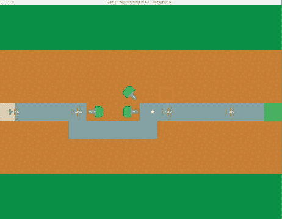

图 4.14 第 4 章游戏项目

Use the mouse to click on and select tiles. After selecting a tile, use the B key to build a tower. The enemy airplanes path around the towers using the A* pathfinding algorithm. Each new tower built changes the path as necessary. To ensure that the player can't fully block in the enemies, when the player requests to build a tower, the code first ensures that a path would still exist for the enemies. If a tower would completely block the path, the game doesn't let the player build it.

As a simplification, the Tile class in the game project contains all the graph information, as well as the scratch data used by the A* search. The code that creates all the tiles and initializes the graph is in the constructor of the Grid class. The Grid class also contains the FindPath function that runs the actual A* search.

For completeness, the source code for this chapter also includes the versions of the search and minimax algorithms covered in the text in a separate Search.cpp file. It also includes the implementation of AIState and AIComponent, even though no actors in the game project use these features.

## 总结

Artificial intelligence is a deep topic with many different sub-areas. Using state machines is an effective way to give behaviors to AI-controlled characters in a game. While a switch is the simplest implementation of a state machine, the state design pattern adds flexibility by making each state a separate class.

Pathfinding algorithms find the shortest path between two points in the game world. First, you formulate a graph representation for the game world. For a square grid, this is simple, but other games use path nodes or navigation meshes. For unweighted graphs, breadth-first search (BFS) guarantees to find the shortest path if one exists. But for weighted graphs, you need other algorithms, such as A* or Dijkstra's, to find the shortest path.


对于双人对抗性回合制游戏（如跳棋或国际象棋），游戏树表示从当前游戏状态出发的可能移动序列。极小极大算法假设当前玩家旨在最大化其得分，而对手旨在最小化当前玩家的得分。α-β剪枝优化了极小极大算法，尽管对于大多数游戏，树必须有深度限制。

## 补充阅读

许多资源涵盖AI技术。斯图尔特·罗素和彼得·诺维格的书是一本流行的AI教材，涵盖了许多技术，尽管只有部分适用于游戏。马特·巴克兰的书虽然有些过时，但涵盖了许多有用的游戏AI主题。史蒂夫·拉宾的Game AI Pro系列有许多由不同游戏AI开发者撰写的有趣文章。

关于导航网格，斯蒂芬·普拉特的深度网络文章介绍了从关卡几何生成导航网格的步骤。Recast项目提供了导航网格生成和寻路算法的开源实现。

- 巴克兰，马特。《通过示例编程游戏AI》。普拉诺：Wordware Publishing，2005年。
- 莫嫩宁，米科。“Recast导航网格工具包。”访问日期：2017年7月7日。
- https://github.com/recastnavigation.
- 普拉特，斯蒂芬。“研究：导航网格生成。”访问日期：2017年7月7日。http://critterai.org/projects/nmgen_study/index.html.
- 拉宾，史蒂夫，编。《游戏AI专业3：游戏AI专业人士的集体智慧》。博卡拉顿：CRC Press，2017年。
- 罗素，斯图尔特，和彼得·诺维格。《人工智能：一种现代的方法》，第3版。上鞍河：Pearson，2009年。

## 练习

本章的两个练习实现了本章游戏项目中未使用的技术。第一个探讨状态机，第二个针对四连棋游戏使用α-β剪枝。

### 练习 4.1

基于本章游戏项目代码，更新Enemy或Tower类（或两者都更新！）以使用AI状态机。首先，考虑AI应具有哪些行为并设计状态机图。接下来，使用提供的AIComponent和AIState基类实现这些行为。

### 练习 4.2

在四连棋游戏中，玩家拥有一个六行七列的垂直网格。两名玩家轮流将棋子放在列的顶部，然后棋子滑落到该列最低的空闲位置。游戏持续进行，直到一名玩家在水平、垂直或对角线上连成四子。

`Exercises/4.2`中的起始代码允许人类玩家点击进行移动。在起始代码中，AI从有效移动集合中随机选择一个移动。修改AI代码，改为使用带有深度截止的α-β剪枝。

## 第5章

### OpenGL

本章深入介绍如何在游戏中使用OpenGL进行图形渲染。它涵盖了许多主题，包括初始化OpenGL、使用三角形、编写着色器程序、使用矩阵进行变换以及添加纹理支持。本章的游戏项目将第3章“向量和基础物理”的游戏项目转换为使用OpenGL进行所有图形渲染。

### 初始化OpenGL

虽然SDL渲染器支持2D图形，但不支持3D。因此，要切换到3D（本书后续每一章都将使用3D），您需要从SDL 2D图形切换到同时支持2D和3D图形的其他库。

本书使用OpenGL库。OpenGL是一个行业标准的跨平台2D/3D图形库，已有25年历史。不出所料，该库存在的时间如此之长，以至于多年来以多种方式演变。原始版本OpenGL使用的函数集与现代OpenGL中的函数集非常不同。本书使用定义于OpenGL 3.3及之前的函数。

> 警告
> 旧版OpenGL差异很大：查阅任何在线OpenGL参考资料时请小心，因为许多参考资料涉及旧版OpenGL。

本章的目标是将第3章的游戏项目从SDL图形转换为OpenGL图形。您需要采取许多步骤才能实现这一目标。本节将介绍配置和初始化OpenGL以及名为GLEW的辅助库的步骤。

### 设置OpenGL窗口

要使用OpenGL，必须放弃前几章中使用的SDL_Renderer。因此，您需要删除所有对SDL_Renderer的引用，包括Game中的mRenderer变量、对SDL_CreateRenderer的调用，以及GenerateOutput中对任何SDL函数的调用。这也意味着SpriteComponent代码（依赖于SDL_Renderer）在不进行更改的情况下无法工作。目前，Game::GenerateOutput中的所有代码都被注释掉了，直到OpenGL正常运行为止。

在SDL中，创建窗口时，可以通过将SDL_WINDOW_OPENGL标志作为SDL_CreateWindow调用的最后一个参数来请求用于OpenGL的窗口：

> 单击此处查看代码图像

```
mWindow = SDL_CreateWindow("Game Programming in C++", 1024, 768, SDL_WINDOW_OPENGL);
```

在创建OpenGL窗口之前，可以请求诸如OpenGL版本、颜色深度和其他几个参数等属性。要配置这些参数，请使用SDL_GL_SetAttribute函数：

> 单击此处查看代码图像

```
// Set OpenGL window's attributes (use prior to create
```

> 单击此处查看代码图像

```
// Returns 0 if successful, otherwise a negative value
SDL_GL_SetAttribute(
    SDL_GLattr attr, // Attribute to set
    int value // Value for this attribute
);
```

SDL_GLattr枚举中有多种不同的属性，但本章仅使用其中一些。要设置属性，请在Game::Initialize中对SDL_CreateWindow的调用之前添加清单5.1中的代码。此代码设置多个属性。首先，它请求核心OpenGL配置文件。

> OpenGL支持三种主要配置文件：核心、兼容性和ES。核心配置文件是桌面环境的推荐默认配置文件。核心和兼容性配置文件之间的唯一区别在于，兼容性配置文件允许程序调用已弃用（不再打算使用）的OpenGL函数。OpenGL ES配置文件用于移动开发。

### 清单5.1 请求OpenGL属性

```
// Use the core OpenGL profile
SDL_GL_SetAttribute(SDL_GL_CONTEXT_PROFILE_MASK,
    SDL_GL_CONTEXT_PROFILE_CORE);
// Specify version 3.3
SDL_GL_SetAttribute(SDL_GL_CONTEXT_MAJOR_VERSION, 3);
SDL_GL_SetAttribute(SDL_GL_CONTEXT_MINOR_VERSION, 3);

// Request a color buffer with 8-bits per RGBA channel
SDL_GL_SetAttribute(SDL_GL_RED_SIZE, 8);
SDL_GL_SetAttribute(SDL_GL_GREEN_SIZE, 8);
SDL_GL_SetAttribute(SDL_GL_BLUE_SIZE, 8);
SDL_GL_SetAttribute(SDL_GL_ALPHA_SIZE, 8);

// Enable double buffering
SDL_GL_SetAttribute(SDL_GL_DOUBLEBUFFER, 1);

// Force OpenGL to use hardware acceleration
SDL_GL_SetAttribute(SDL_GL_ACCELERATED_VISUAL, 1);
```

接下来的两个属性请求OpenGL 3.3版本。尽管有更新版本的OpenGL，但3.3版本支持本书所需的所有功能，并且其功能集与ES配置文件紧密对齐。因此，本书中的大部分代码也应该可以在当前移动设备上运行。

接下来的属性指定每个通道的位深度。在此示例中，程序请求每个RGBA通道8位，总共每像素32位。倒数第二个属性要求启用双缓冲。最后一个属性要求以硬件加速运行OpenGL。这意味着OpenGL渲染将在图形硬件（GPU）上运行。

### OpenGL上下文和初始化GLEW

设置OpenGL属性并创建窗口后，下一步是创建OpenGL上下文。可以将**上下文**视为OpenGL的“世界”，它包含OpenGL所知的每一项，例如颜色缓冲区、加载的任何图像或模型以及任何其他OpenGL对象。（虽然在一个OpenGL程序中可以有多个上下文，但本书坚持使用一个。）

要创建上下文，首先向`Game`添加以下成员变量：

```
SDL_GLContext mContext;
```

接下来，在使用`SDL_CreateWindow`创建SDL窗口后立即添加以下代码行，该代码创建OpenGL上下文并将其保存在成员变量中：

> 单击此处查看代码图像

```
mContext = SDL_GL_CreateContext(mWindow);
```

与创建和删除窗口一样，您需要在析构函数中删除OpenGL上下文。为此，


将以下代码行添加到 Game::Shutdown 中，位于 SDL_DeleteWindow 调用之前：

单击此处查看代码图像

```
SDL_GL_DeleteContext(mContext);
```

Although the program now creates an OpenGL context, there is one final hurdle you must pass to gain access to the full set of OpenGL 3.3 features. OpenGL supports backward compatibility with an extension system. Normally, you must query any extensions you want manually, which is tedious. To simplify this process, you can use an open source library called the OpenGL Extension Wrangler Library (GLEW). With one simple function call, GLEW automatically initializes all extension functions supported by the current OpenGL context’s version. So in this case, GLEW initializes all extension functions supported by OpenGL 3.3 and earlier.

要初始化 GLEW，请在创建 OpenGL 上下文后立即添加以下代码：

单击此处查看代码图像

```
// Initialize GLEW

glewExperimental = GL_TRUE;
if (glewInit() != GLEW_OK)
{
    SDL_Log("Failed to initialize GLEW.");

    return false;
}

// On some platforms, GLEW will emit a benign error code
// so clear it

glGetError();
```

glewExperimental 行可防止在某些平台上使用核心上下文时可能出现的初始化错误。此外，由于某些平台在初始化 GLEW 时会发出良性错误代码，glGetError 调用会清除此错误代码。

注意：一些带有集成显卡的旧 PC 机器（2012 年或更早）在运行 OpenGL 3.3 版本时可能会出现问题。在这种情况下，你可以尝试两件事：更新到较新的图形驱动程序或请求 OpenGL 3.1 版本。

## 渲染一帧

你现在需要将 Game::GenerateOutput 中的清除、绘制场景和交换缓冲区过程转换为使用 OpenGL 函数：

单击此处查看代码图像

```
// Set the clear color to gray

glClearColor(0.86f, 0.86f, 0.86f, 1.0f);

// Clear the color buffer
glClear(GL_COLOR_BUFFER_BIT);

// TODO: Draw the scene

// Swap the buffers, which also displays the scene
SDL_GL_SwapWindow(mWindow);
```

这段代码首先将清除颜色设置为 86% 红色、86% 绿色、86% 蓝色和 100% Alpha，从而得到灰色。带有 `GL_COLOR_BUFFER_BIT` 参数的 `glClear` 调用将颜色缓冲区清除为指定颜色。最后，`SDL_GL_SwapWindow` 调用交换前缓冲区和后缓冲区。此时，运行游戏会显示灰色屏幕，因为你尚未绘制 `SpriteComponent`s。

## 三角形基础

2D 和 3D 游戏的图形需求似乎截然不同。如第 2 章“游戏对象与 2D 图形”中所述，大多数 2D 游戏使用精灵作为其 2D 角色。另一方面，3D 游戏具有模拟的 3D 环境，你需要以某种方式将其压平为 2D 图像并在屏幕上显示。

早期的 2D 游戏可以简单地将精灵图像复制到颜色缓冲区的所需位置。这一过程称为 **位块传输**，在任天堂娱乐系统 (NES) 等基于精灵的控制台上很高效。然而，现代图形硬件在位块传输方面效率低下，但在多边形渲染方面非常高效。因此，几乎所有现代游戏，无论是 2D 还是 3D，最终都使用多边形来满足其图形需求。

## 为什么使用多边形？

计算机模拟 3D 环境有多种方式。多边形在游戏中很受欢迎，原因多种多样。与其他 3D 图形技术相比，多边形在运行时不需要那么多计算。此外，多边形具有可扩展性：在性能较弱的硬件上运行的游戏可以简单地使用多边形更少的 3D 模型。而且，重要的是，你可以用多边形表示大多数 3D 对象。

三角形是大多数游戏的首选多边形。三角形是最简单的多边形，只需要三个点（或 **顶点**）即可创建一个三角形。此外，三角形只能位于单个平面上。换句话说，三角形的三个点必须是 **共面** 的。最后，三角形 **易于三角化**，这意味着将任何复杂的 3D 对象分解为许多三角形相对简单。本章余下部分讨论三角形，但此处讨论的技术也适用于其他多边形（例如四边形），前提是它们保持共面属性。

2D 游戏通过绘制矩形并使用图像文件中的颜色填充矩形，利用三角形表示精灵。我们将在本章后面详细讨论这一点。

## 归一化设备坐标

要绘制三角形，必须指定其三个顶点的坐标。回想一下，在 SDL 中，屏幕左上角是 (0, 0)，正 x 向右，正 y 向下。更一般地说，**坐标空间** 指定原点的位置及其坐标增加的方向。坐标空间的 **基向量** 是坐标增加的方向。

基本几何中的一个坐标空间示例是 **笛卡尔坐标系**（参见图 5.1）。在 2D 笛卡尔坐标系中，原点 (0, 0) 是一个特定点（通常是中心），正 x 向右，正 y 向上。

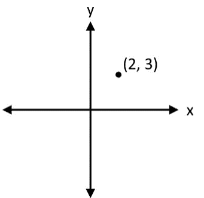

图 5.1 在笛卡尔坐标系中绘制的点 (2, 3)

**归一化设备坐标 (NDC)** 是 OpenGL 使用的默认坐标系。给定一个 OpenGL 窗口，窗口中心在归一化设备坐标中是原点。此外，左下角是 (-1, -1)，右上角是 (1, 1)。这与窗口的宽度和高度无关（因此是 *归一化设备坐标*）。在内部，图形硬件随后将这些 NDC 转换为窗口中的相应像素。

例如，要在窗口中心绘制一个边长为单位长度的正方形，需要两个三角形。第一个三角形的顶点为 (-0.5, 0.5)、(0.5, 0.5) 和 (0.5, -0.5)，第二个三角形的顶点为 (0.5, -0.5)、(-0.5, -0.5) 和 (-0.5, 0.5)。图 5.2 说明了这个正方形。请记住，如果窗口的长和宽不一致，归一化设备坐标中的正方形在屏幕上看起来不会像正方形。

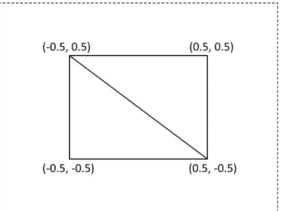

图 5.2 在 2D 归一化设备坐标中绘制的正方形

在 3D 中，归一化设备坐标的 z 分量也范围为 [-1, 1]，正 z 值指向屏幕内部。目前，我们使用 z 值为零。我们将在第 6 章“3D 图形”中更详细地探讨 3D。

## 顶点缓冲区和索引缓冲区

假设你有一个由许多三角形组成的 3D 模型。你需要一种方法在内存中存储这些三角形的顶点。最简单的方法是直接将每个三角形的坐标存储在连续的数组或缓冲区中。例如，假设为 3D 坐标，以下数组包含图 5.2 中两个三角形的顶点：

```
float vertices[] = {
    -0.5f,  0.5f, 0.0f,
    0.5f,  0.5f, 0.0f,
    0.5f, -0.5f, 0.0f,
    0.5f, -0.5f, 0.0f,
    -0.5f, -0.5f, 0.0f,
    -0.5f,  0.5f, 0.0f,
};
```

即使在这个简单的示例中，顶点数组也有一些重复数据。具体来说，坐标 (-0.5, 0.5, 0.0) 和 (0.5, -0.5, 0.0) 各出现两次。如果有办法删除这些重复项，你将削减缓冲区中存储的值数量的 33%。而不是 12 个值，你将只有 8 个。假设单精度浮点数每个使用 4 字节，通过删除重复项，你将节省 24 字节的内存。这可能看起来微不足道，但想象一下一个包含 20,000 个三角形的大得多的模型。在这种情况下，由于重复坐标而浪费的内存量将很高。

解决这个问题的方案分为两部分。首先，你创建一个仅包含 3D 几何使用的唯一坐标的顶点缓冲区。然后，要指定


每个三角形的顶点，你都要索引到这个顶点缓冲区（很像对数组进行索引）。名副其实的 **索引缓冲区** 包含了每个单独三角形的索引，每组三个。对于本示例中的示例正方形，你需要以下顶点缓冲区和索引缓冲区：

```cpp
float vertexBuffer[] = {
    -0.5f,  0.5f, 0.0f, // vertex 0
    0.5f,   0.5f, 0.0f, // vertex 1
    0.5f,  -0.5f, 0.0f, // vertex 2
   -0.5f,  -0.5f, 0.0f  // vertex 3
};

unsigned short indexBuffer[] = {
    0, 1, 2,
    2, 3, 0
};
```

例如，第一个三角形的顶点为 0、1 和 2，分别对应坐标 (-0.5, 0.5, 0.0)、(0.5, 0.5, 0.0) 和 (0.5, -0.5, 0.0)。请记住，索引是顶点编号，而不是浮点数元素（例如，顶点 1 而不是数组的“索引 2”）。还要注意，此代码对索引缓冲区使用 unsigned short（通常为 16 位），从而减少了索引缓冲区的内存占用。你可以使用更小位数的整数来节省索引缓冲区中的内存。

在本示例中，顶点/索引缓冲区组合使用 12 × 4 + 6 × 2，即总共 60 字节。另一方面，如果你只使用原始顶点，则需要 72 字节。虽然本示例的节省率仅为 20%，但更复杂的模型使用顶点/索引缓冲区组合可以节省大量内存。

要使用顶点缓冲区和索引缓冲区，你必须让 OpenGL 了解它们。OpenGL 使用 **顶点数组对象** 来封装顶点缓冲区、索引缓冲区和顶点布局。**顶点布局** 指定了你为模型中每个顶点存储什么数据。目前，假设顶点布局是一个 3D 位置（如果你想要 2D 效果，可以只使用 `0.0f` 作为 z 分量）。本章后面你将为每个顶点添加其他数据。

因为任何模型都需要顶点数组对象，因此将其行为封装在 *顶点数组* 类中是合理的。清单 5.2 显示了该类的声明。

## 清单 5.2 VertexArray 声明

```cpp
class VertexArray
{
public:
    VertexArray(const float* verts, unsigned int numVerts,
        const unsigned int* indices, unsigned int numIndices);
    ~VertexArray();

    // Activate this vertex array (so we can draw it)
    void SetActive();

    unsigned int GetNumIndices() const { return mNumIndices; }
    unsigned int GetNumVerts() const { return mNumVerts; }

private:
    // How many vertices in the vertex buffer?
    unsigned int mNumVerts;

    // How many indices in the index buffer
    unsigned int mNumIndices;

    // OpenGL ID of the vertex buffer
    unsigned int mVertexBuffer;

    // OpenGL ID of the index buffer
    unsigned int mIndexBuffer;

    // OpenGL ID of the vertex array object
    unsigned int mVertexArray;
};
```

`VertexArray` 的构造函数接收顶点和索引缓冲区数组的指针，以便将数据交给 OpenGL（OpenGL 最终会将数据加载到图形硬件上）。请注意，成员数据包含用于顶点缓冲区、索引缓冲区和顶点数组对象的多个无符号整数。这是因为 OpenGL 不会返回其创建的对象的指针。相反，你只会得到一个整数 ID 编号。请记住，ID 编号在不同类型的对象之间并不唯一。因此，顶点缓冲区和索引缓冲区都有 ID 为 1 的情况是非常可能的，因为 OpenGL 认为它们是不同类型的对象。

`VertexArray` 构造函数的实现比较复杂。首先，创建顶点数组对象并将其 ID 存储在 `mVertexArray` 成员变量中：

```cpp
glGenVertexArrays(1, &mVertexArray);

glBindVertexArray(mVertexArray);
```

有了顶点数组对象后，你可以创建顶点缓冲区：

```cpp
glGenBuffers(1, &mVertexBuffer);

glBindBuffer(GL_ARRAY_BUFFER, mVertexBuffer);
```

glBindBuffer 的 GL_ARRAY_BUFFER 参数表示你打算将缓冲区用作顶点缓冲区。

有了顶点缓冲区后，你需要将传入 VertexArray 构造函数的 verts 数据复制到这个顶点缓冲区中。要复制数据，请使用 glBufferData，它接受多个参数：

```cpp
glBufferData(
    GL_ARRAY_BUFFER,    // The active buffer
    numVerts * 3 * sizeof(float), // Number of bytes to copy
    verts,    // Source to copy from
    GL_STATIC_DRAW    // How will we use it
);
```

请注意，你不会将对象 ID 传递给 glBufferData；相反，你要指定当前绑定的缓冲区类型以进行写入。在此示例中，GL_ARRAY_BUFFER 表示使用刚刚创建的顶点缓冲区。

对于第二个参数，你传入字节数，即每个顶点的数据量乘以顶点数量。目前，你可以假设每个顶点包含三个 float，用于 (x, y, z)。

usage 参数指定你希望如何使用缓冲区数据。`GL_STATIC_DRAW` 用法表示你只想加载一次数据，并频繁用于绘制。

接下来，创建索引缓冲区。这与创建顶点缓冲区非常相似，只是你改为指定 `GL_ELEMENT_ARRAY_BUFFER` 类型，该类型对应索引缓冲区：

```cpp
glGenBuffers(1, &mIndexBuffer);

glBindBuffer(GL_ELEMENT_ARRAY_BUFFER, mIndexBuffer);
```

然后将 `indices` 数据复制到索引缓冲区中：

```cpp
glBufferData(
    GL_ELEMENT_ARRAY_BUFFER,     // Index buffer
    numIndices * sizeof(unsigned int), // Size of data
    indices, GL_STATIC_DRAW);
```

请注意，此处的类型是 `GL_ELEMENT_ARRAY_BUFFER`，大小是索引数量乘以无符号整数，因为这里使用的索引类型就是无符号整数。

最后，你必须指定顶点布局，也称为 **顶点属性**。如前所述，当前布局是一个包含三个 float 值的位置。

要启用第一个顶点属性（属性 0），请使用 `glEnableVertexAttribArray`：

```cpp
glEnableVertexAttribArray(0);
```

然后你使用 `glVertexAttribPointer` 来指定属性的大小、类型和格式：

```cpp
glVertexAttribPointer(
    0,    // Attribute index (0 for first)
    3,    // Number of components (3 in total)
    GL_FLOAT,    // Type of the components
    GL_FALSE,    // (Only used for integral types)
    sizeof(float) * 3, // Stride (usually size of each vertex)
    0    // Offset from start of vertex data
);
```

前两个参数是 0 和 3，因为位置是顶点的属性 0，并且有三个分量（x、y、z）。由于每个分量都是 float，你指定 GL_FLOAT 类型。第四个参数仅与整数类型相关，因此此处将其设置为 GL_FALSE。最后，**步长** 是连续顶点属性之间的字节偏移量。但假设顶点缓冲区中没有填充（通常没有），步长就是顶点的大小。最后，偏移量为 0，因为这是唯一的属性。对于其他属性，你必须为偏移量传入非零值。

`VertexArray` 的析构函数销毁顶点缓冲区、索引缓冲区和顶点数组对象：

```cpp
VertexArray::~VertexArray()
{
    glDeleteBuffers(1, &mVertexBuffer);

    glDeleteBuffers(1, &mIndexBuffer);

    glDeleteVertexArrays(1, &mVertexArray);
}
```

最后，`SetActive` 函数调用 `glBindVertexArray`，它只是指定你当前正在使用的顶点数组：

```cpp
void VertexArray::SetActive()
{
    glBindVertexArray(mVertexArray);
}
```

`Game::InitSpriteVerts` 中的以下代码分配一个 `VertexArray` 实例，并将其保存在 `Game` 的名为 `mSpriteVerts` 的成员变量中：

```cpp
mSpriteVerts = new VertexArray(vertexBuffer, 4, indexBuffer, 6);
```

此处的顶点和索引缓冲区变量是精灵四边形的数组。在此示例中，顶点缓冲区中有 4 个顶点，索引缓冲区中有 6 个索引（对应四边形中的 2 个三角形）。你将在本章后面使用这个成员变量来绘制精灵，因为所有精灵最终都将使用相同的顶点。

## 着色器

在现代图形管线中，你不能只是输入顶点/索引缓冲区然后让三角形绘制。相反，你要指定如何绘制顶点。例如，三角形应该是固定颜色，还是应该使用纹理中的颜色？Do


你是否要为绘制的每个像素执行光照计算？

因为你可能想要使用许多技术来显示场景，所以并没有真正的万能方法。为了允许更多自定义，包括OpenGL在内的图形API支持**着色器程序**——在图形硬件上执行以完成特定任务的小程序。重要的是，着色器是*独立程序*，拥有各自独立的`main`函数。

> 注记
>
> 着色器程序不使用C++编程语言。本书为着色器程序使用GLSL编程语言。虽然GLSL表面上看起来像C，但有许多GLSL特有的语义。本书不会一次性介绍所有GLSL细节，而是在需要时介绍相关概念。

因为着色器是独立程序，你将它们写在独立文件中。然后在你的C++代码中，你需要告诉OpenGL何时编译和加载这些着色器程序，并指定你希望OpenGL使用这些着色器程序做什么。

虽然你可以在游戏中使用多种不同类型的着色器，但本书专注于两个最重要的着色器：顶点着色器和片元（或像素）着色器。

## 顶点着色器

一个**顶点着色器**程序为绘制的每个三角形的每个顶点运行一次。顶点着色器将顶点属性数据作为输入。然后顶点着色器可以根据需要修改这些顶点属性。虽然你可能不清楚为何要修改顶点属性，但随着本章的深入，这会变得更加明显。

鉴于三角形有三个顶点，你可以将顶点着色器视为每个三角形运行三次。但是，如果你使用顶点缓冲和索引缓冲，那么你会较少调用顶点着色器，因为一些三角形共享顶点。这是使用顶点和索引缓冲而非仅使用顶点缓冲的额外优势。请注意，如果你每帧多次绘制同一模型，那么每次绘制时的顶点着色器调用彼此独立。

## 片元着色器

在三角形的顶点经过顶点着色器后，OpenGL必须确定颜色缓冲中的哪些像素对应于该三角形。将三角形转换为像素的过程称为光栅化。有许多不同的光栅化算法，但当今的图形硬件会为我们执行光栅化。

片元着色器（或像素着色器）的工作是确定每个像素的颜色，因此片元着色器程序至少为每个像素执行一次。这种颜色可能会考虑表面的属性，例如纹理、颜色和材质。如果场景中有光照，片元着色器也可能执行光照计算。由于潜在计算非常多，平均3D游戏在片元着色器中的代码比在顶点着色器中多得多。

## 编写基本着色器

虽然你可以从C++代码中的硬编码字符串加载着色器程序，但将它们放在独立文件中要好得多。本书为顶点着色器文件使用.vert扩展名，为片元着色器文件使用.frag扩展名。

由于这些源文件使用不同的编程语言，它们位于章节的Shaders子目录中。例如，Chapter05/Shaders包含本章着色器的源文件。

### Basic.vert文件

Basic.vert包含顶点着色器代码。请记住，这不是C++代码。

每个GLSL着色器文件首先必须指定所使用的GLSL编程语言版本。以下行表示与OpenGL 3.3对应的GLSL版本：

```
#version 330
```

接下来，因为这是顶点着色器，你必须为每个顶点指定顶点属性。这些属性应与先前创建的顶点数组对象的属性匹配，并且是顶点着色器的输入。但是，在GLSL中，`main`函数不接收任何参数。相反，着色器输入看起来像全局变量，并用特殊的`in`关键字标记。

目前，你只有一个输入变量——3D位置。以下行声明此输入变量：

```
in vec3 inPosition;
```

`inPosition`变量的类型是`vec3`，对应于三个浮点值的向量。这将包含与顶点位置对应的x、y和z分量。你可以通过点语法访问`vec3`的每个分量；例如，`inPosition.x`访问向量的x分量。

与C/C++程序一样，着色器程序将`main`函数作为其入口点：

- 单击此处查看代码图像

```
void main()
{
    // TODO: Shader code goes here
}
```

请注意，此处的`main`函数返回`void`。GLSL也使用全局变量来定义着色器的输出。在此情况下，你将使用名为gl_Position的内置变量来存储着色器的顶点位置输出。

目前，顶点着色器直接将顶点位置从inPosition复制到gl_Position。但是，gl_Position期望四个分量：常规（x、y、z）坐标加上一个称为w分量的第四个分量。我们将在本章后面介绍w代表什么。目前，假设w始终为1.0。要将inPosition从vec3转换为vec4，你可以使用以下语法：

- 单击此处查看代码图像

```
gl_Position = vec4(inPosition, 1.0);
```

### 清单5.3 Basic.vert代码

- 单击此处查看代码图像

```
// Request GLSL 3.3

#version 330

// Any vertex attributes go here

// For now, just a position.
in vec3 inPosition;

void main()
{
    // Directly pass along inPosition to gl_Position
    gl_Position = vec4(inPosition, 1.0);
}
```

### Basic.frag文件

片元着色器的工作是为当前像素计算输出颜色。对于Basic.frag，你将为所有像素硬编码一个蓝色输出颜色。

与顶点着色器一样，片元着色器始终以#version行开头。接下来，你声明一个全局变量来存储输出颜色，使用out变量说明符：

```
out vec4 outColor;
```

outColor变量是一个vec4，对应于RGBA颜色缓冲的四个分量。

接下来，你声明片元着色器程序的入口点。在此函数内，你将outColor设置为像素所需的颜色。蓝色的RGBA值为(0.0, 0.0, 1.0, 1.0)，这意味着你使用以下赋值：

单击此处查看代码图像

```
outColor = vec4(0.0, 0.0, 1.0, 1.0);
```

### 清单5.4 Basic.frag代码

单击此处查看代码图像

```
// Request GLSL 3.3

#version 330

// This is output color to the color buffer
out vec4 outColor;

void main()
{
    // Set to blue
    outColor = vec4(0.0, 0.0, 1.0, 1.0);
}
```

## 加载着色器

一旦你编写好独立的着色器文件，就必须在游戏的C++代码中加载这些着色器，以让OpenGL了解它们。从高层次来看，你需要遵循以下步骤：

- 1. 加载并编译顶点着色器。
- 2. 加载并编译片元着色器。
- 3. 将两个着色器链接到一个“着色器程序”中。

加载着色器有许多步骤，因此最好声明一个独立的Shader类，如清单5.5所示。

### 清单5.5 初始着色器声明

单击此处查看代码图像

```
class Shader
{
public:
    Shader();
    ~Shader();

    // Load the vertex/fragment shaders with the given
    bool Load(const std::string& vertName,
              const std::string& fragName);

    // Set this as the active shader program
    void SetActive();

private:

// Tries to compile the specified shader
bool CompileShader(const std::string& fileName,
                   GLenum shaderType, GLuint& out

// Tests whether shader compiled successfully
bool IsCompiled(GLuint shader);

// Tests whether vertex/fragment programs link
bool IsValidProgram();

// Store the shader object IDs
GLuint mVertexShader;
GLuint mFragShader;
GLuint mShaderProgram;
};
```

请注意，此处的成员变量对应着色器对象ID。它们具有与顶点和索引缓冲类似的对象ID。（GLuint只是OpenGL对unsigned int的版本。）

你在private部分声明CompileShader、IsCompiled和IsValidProgram，因为它们是Load使用的辅助函数。这减少了代码


Load 中的重复。

## CompileShader 函数

`CompileShader` 接受三个参数：要编译的着色器文件名、着色器类型，以及一个用于存储着色器 ID 的引用参数。返回值是一个 `bool`，表示 `CompileShader` 是否成功。

清单 5.6 展示了 `CompileShader` 的实现，包含几个步骤。首先，创建一个 `ifstream` 来加载文件。接着，使用字符串流将文件的全部内容加载到单个字符串 `contents` 中，并通过 `c_str` 函数获取 C 风格字符串指针。

接下来，`glCreateShader` 函数调用创建一个与着色器对应的 OpenGL 着色器对象（并将此 ID 保存在 `outShader` 中）。`shaderType` 参数可以是 `GL_VERTEX_SHADER`、`GL_FRAGMENT_SHADER` 或其他几种着色器类型。

`glShaderSource` 调用指定包含着色器源代码的字符串，`glCompileShader` 编译该代码。然后，你使用 `IsCompiled` 辅助函数（稍后实现）来验证着色器是否编译成功。

如果发生任何错误，包括无法加载着色器文件或编译失败，`CompileShader` 会输出错误消息并返回 `false`。

### 清单 5.6 Shader::CompileShader 实现

单击此处查看代码图像

```
bool Shader::CompileShader(const std::string& fileName,
                           GLenum shaderType,
                           GLuint& outShader)
{
    // Open file
    std::ifstream shaderFile(fileName);
    if (shaderFile.is_open())
    {
        // Read all the text into a string
        std::stringstream sstream;
        sstream << shaderFile.rdbuf();
        std::string contents = sstream.str();
        const char* contentsChar = contents.c_str();
        // Create a shader of the specified type
        outShader = glCreateShader(shaderType);
        // Set the source characters and try to compile
        glShaderSource(outShader, 1, &contentsChar, nullptr);
        glCompileShader(outShader);

        if (!IsCompiled(outShader))
        {
            SDL_Log("Failed to compile shader %s", fileName.c_str());
            return false;
        }
    }
    else
    {
        SDL_Log("Shader file not found: %s", fileName.c_str());
        return false;
    }
    return true;
}
```

## `IsCompiled` 函数

`IsCompiled` 函数（如清单 5.7 所示）验证着色器对象是否已编译，如果没有，则输出编译错误消息。这样，你可以获取关于着色器编译失败原因的一些信息。

### 清单 5.7 Shader::IsCompiled 实现

单击此处查看代码图像

```
bool Shader::IsCompiled(GLuint shader)
{
    GLint status;

    // Query the compile status
    glGetShaderiv(shader, GL_COMPILE_STATUS, &status);

    if (status != GL_TRUE)
    {
        char buffer[512];
        memset(buffer, 0, 512);

        glGetShaderInfoLog(shader, 511, nullptr, buffer);

        SDL_Log("GLSL Compile Failed:\n%s", buffer);

        return false;
    }

    return true;
}
```

`glGetShaderiv` 函数查询编译状态，该函数将其作为整数状态码返回。如果此状态不是 `GL_TRUE`，则表示发生了错误。如果发生错误，你可以使用 `glGetShaderInfoLog` 获取人类可读的编译错误消息。

## Load 函数

清单 5.8 中的 `Load` 函数接收顶点着色器和片段着色器的文件名，然后尝试编译并链接这些着色器。

如清单 5.8 所示，你使用 `CompileShader` 编译顶点着色器和片段着色器，然后分别将它们的对象 ID 保存在 `mVertexShader` 和 `mFragShader` 中。如果任何一次 `CompileShader` 调用失败，`Load` 返回 `false`。

### 清单 5.8 Shader::Load 实现

单击此处查看代码图像

```
bool Shader::Load(const std::string& vertName,
                          const std::string& fragName)
{
    // Compile vertex and fragment shaders
    if (!CompileShader(vertName, GL_VERTEX_SHADER, mVertexShader) ||
        !CompileShader(fragName, GL_FRAGMENT_SHADER, mFragShader))
    {
        return false;
    }

    // Now create a shader program that
    // links together the vertex/frag shaders
    mShaderProgram = glCreateProgram();
    glAttachShader(mShaderProgram, mVertexShader);
    glAttachShader(mShaderProgram, mFragShader);
    glLinkProgram(mShaderProgram);

    // Verify that the program linked successfully
    if (!IsValidProgram())
    {
        return false;
    }
    return true;
}
```

编译完片段着色器和顶点着色器后，你将它们链接到一个名为着色器程序的第三个对象中。当需要绘制对象时，OpenGL 使用当前活动的着色器程序来渲染三角形。

你使用 `glCreateProgram` 创建着色器程序，它返回新着色器程序的对象 ID。接下来，使用 `glAttachShader` 将顶点着色器和片段着色器添加到组合着色器程序中。然后使用 `glLinkProgram` 将所有附加的着色器链接到最终的着色器程序中。

与着色器编译一样，确定链接是否成功需要额外的函数调用，你可以将这些调用放在 `IsValidProgram` 辅助函数中。

## IsValidProgram 函数

`IsValidProgram` 的代码与 `IsCompiled` 的代码非常相似。只有两个不同之处。首先，不要调用 `glGetShaderiv`，而要调用 `glGetProgramiv`：

单击此处查看代码图像

```
glGetProgramiv(mShaderProgram, GL_LINK_STATUS, &status);
```

接下来，不要调用 `glGetShaderInfoLog`，而要调用 `glGetProgramInfoLog`：

单击此处查看代码图像

```
glGetProgramInfoLog(mShaderProgram, 511, nullptr, buffer);
```

## SetActive 函数

`SetActive` 函数将着色器程序设置为活动着色器程序：

```
void Shader::SetActive()
{
    glUseProgram(mShaderProgram);
}
```

OpenGL 在绘制三角形时使用活动着色器。

## Unload 函数

`Unload` 函数只是删除着色器程序、顶点着色器和片段着色器：

单击此处查看代码图像

```
void Shader::Unload()
{
    glDeleteProgram(mShaderProgram);

    glDeleteShader(mVertexShader);

    glDeleteShader(mFragShader);
}
```

## 将着色器添加到游戏中

有了 `Shader` 类，你现在可以将 `Shader` 指针作为成员变量添加到 `Game` 中：

```
Shader* mSpriteShader;
```

此变量名为 `mSpriteShader`，因为最终你将使用它来绘制精灵。`LoadShaders` 函数加载着色器文件并将着色器设置为活动状态：

单击此处查看代码图像

```
bool Game::LoadShaders()
{
    mSpriteShader = new Shader();
    if (!mSpriteShader->Load("Shaders/Basic.vert", "Shaders/Basic.frag"))
    {
        return false;
    }
    mSpriteShader->SetActive();
}
```

你在 `Game::Initialize` 中调用 `LoadShaders`，紧随 OpenGL 和 GLEW 初始化完成之后（在创建 `mSpriteVerts` 顶点数组对象之前）。

创建简单的顶点和片段着色器并加载三角形后，你终于可以尝试绘制一些三角形了。

## 绘制三角形

如前所述，你可以通过在屏幕上绘制矩形来使用三角形绘制精灵。你已经加载了单位正方形顶点和一个可以绘制蓝色像素的基本着色器。与之前一样，你希望在 `SpriteComponent` 的 `Draw` 函数中绘制精灵。

首先，你更改 `SpriteComponent::Draw` 的声明，使其接受 `Shader*` 而不是 `SDL_Renderer*`。接下来，通过调用 `glDrawElements` 绘制一个四边形：

单击此处查看代码图像

```
void SpriteComponent::Draw(Shader* shader)
{
    glDrawElements(
        GL_TRIANGLES, // Type of polygon/primitive
        6, // Number of indices in index buffer
        GL_UNSIGNED_INT, // Type of each index
        nullptr // Usually nullptr
    );
}
```

`glDrawElements` 的第一个参数指定你要绘制的元素类型（在此例中为三角形）。第二个参数是索引缓冲区中的索引数量；在此例中，因为单位正方形的索引缓冲区有六个元素，你传入 6 作为参数。第三个参数是每个索引的类型，之前已确定为 `unsigned int`。最后一个参数是 `nullptr`。

`glDrawElements` 调用需要活动的顶点数组对象和活动的着色器。在每一帧中，你需要在绘制任何 `SpriteComponents` 之前激活精灵顶点数组对象和着色器。你在 `Game::GenerateOutput` 函数中执行此操作，如清单 5.9 所示。一旦将着色器和顶点数组设置为活动状态，你就为场景中的每个精灵调用一次 `Draw`。

### 清单 5.9 Game::GenerateOutput 尝试绘制精灵

单击此处查看代码图像

```
void Game::GenerateOutput()
{
    // Set the clear color to gray
    glClearColor(0.86f, 0.86f, 0.86f, 1.0f);

    // Clear the color buffer
    glClear(GL_COLOR_BUFFER_BIT);
}
```


```cpp
// Set sprite shader and vertex array objects active
mSpriteShader->SetActive();
mSpriteVerts->SetActive();

// Draw all sprites
for (auto sprite : mSprites)
{
    sprite->Draw(mSpriteShader);
}

// Swap the buffers
SDL_GL_SwapWindow(mWindow);
return true;
}
```

现在运行这段代码会发生什么呢？首先，片段着色器只输出蓝色。因此，合理地预期你会看到每个 `SpriteComponent` 都是蓝色方块。然而，还有一个问题：对于每个精灵，你都使用相同的精灵顶点。这些精灵顶点在归一化设备坐标中定义了一个单位正方形。这意味着对于每个 `SpriteComponent`，你只是在 NDC 中绘制同一个单位正方形。因此，如果你现在运行游戏，你将只看到灰色背景和一个矩形，如图 5.3 所示。

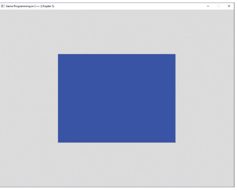

图 5.3 绘制许多 NDC 单位正方形（尽管看起来像一个矩形）

乍看之下，解决方案似乎是为每个精灵定义不同的顶点数组。然而，事实证明，仅凭这一个顶点数组，你就可以绘制想要的任何精灵。关键在于利用顶点着色器转换顶点属性的能力。

## 转换基础

假设一个游戏中有10颗移动的小行星。你可以用不同的顶点数组对象分别表示这10颗小行星。然而，你需要这些小行星出现在屏幕的不同位置。这意味着你为每颗小行星绘制的三角形需要不同的归一化设备坐标。

一个天真的想法是创建10个不同的顶点缓冲区，每个小行星一个，并根据需要重新计算这些顶点缓冲区中的顶点位置。但这在内存使用和计算方面都是浪费的。在顶点缓冲区中更改顶点并重新提交到OpenGL并不高效。

相反，从抽象的角度思考精灵。每个精灵最终只是一个矩形。不同的精灵可能在屏幕上有不同的位置、不同的大小或不同的旋转，但它们仍然是矩形。

这样思考的话，更高效的解决方案是为矩形使用一个单一的顶点缓冲区并重复使用它。每次绘制矩形时，你可能会有位置偏移、缩放或旋转。但给定NDC单位正方形，你可以改变，或**转换**它，使其成为具有任意位置、缩放和/或方向的任意矩形。

为对象类型重复使用单个顶点缓冲区的这一概念同样适用于3D。例如，一个发生在森林中的游戏可能有数百棵树，其中许多树彼此之间只有细微差别。为同一棵树的每个实例都设置单独的顶点缓冲区是低效的。相反，你可以创建一个单一的树顶点缓冲区，游戏可以绘制这棵同一树的许多实例，并在位置、缩放和方向上有一些变化。

### 对象空间

当你创建一个3D对象（例如在3D建模程序中）时，你通常不会用归一化设备坐标来表示顶点位置。相反，位置是相对于对象本身的任意原点的。这个原点通常在对象的中心，但不一定非得如此。这种相对于对象本身的坐标空间称为对象空间，或模型空间。

如前本章前面所讨论，定义坐标空间需要知道坐标空间的原点以及各个分量增加的方向（基向量）。例如，某些3D建模程序使用+y作为上方，而其他程序使用+z作为上方。这些不同的基向量为对象定义了不同的对象空间。图5.4说明了一个2D正方形，其中正方形的中心是其对象空间原点，+y向上移动，+x向右移动。


图 5.4 相对于其对象空间原点的四边形

现在想象一个发生在办公楼里的游戏。你需要电脑显示器、键盘、办公桌、办公椅等模型。你会在每个模型自己的对象空间中创建这些单独的模型，这意味着每个对象的顶点位置都相对于该模型独特的对象空间原点。

在运行时，你将每个独特的模型加载到它自己的顶点数组对象（VAO）中。例如，你可能有一个用于显示器的VAO，一个用于键盘的VAO，等等。当需要渲染场景时，你绘制的每个对象的每个顶点都会传送到顶点着色器。如果你直接传递顶点位置，如在 `Basic.vert` 中那样，那么你就是在说这些顶点位置在归一化设备坐标中。

这是一个问题，因为模型的坐标不在NDC中，而是相对于每个对象独特的对象空间。原样传递顶点位置会产生垃圾输出。

### 世界空间

为了解决不同对象具有不同对象空间坐标的问题，你首先为游戏世界本身定义一个坐标空间。这个坐标空间称为**世界空间**，有自己的原点和基向量。对于办公楼里的游戏，世界空间的原点可能位于建筑物一楼的中心。

就像办公室规划师可能会在办公室里以不同的位置和方向放置办公桌和椅子一样，你可以将游戏中的对象视为相对于世界空间原点具有任意位置、缩放或方向。例如，如果办公室里放置了五个相同办公桌的实例，那么每个实例都需要描述对象在世界空间中如何出现的信息。

当你绘制每个办公桌实例时，你为每个办公桌使用相同的顶点数组对象。然而，每个实例现在需要一些额外信息，指定你希望如何*转换*对象空间坐标到世界空间。你可以在绘制实例时将这些额外数据发送到顶点着色器，这允许顶点着色器根据需要调整顶点位置。当然，图形硬件最终需要NDC中的坐标来绘制它们，因此在将顶点转换到世界空间后，你仍然有一个额外的步骤。现在，让我们看看如何将顶点从对象空间转换到世界空间。

### 转换到世界空间

在坐标空间之间转换时，你需要知道两个坐标空间之间的基向量是否相同。例如，考虑对象空间中的点(0, 5)。如果你用+y作为上方来定义对象空间，这意味着点(0, 5)位于原点“上方”五个单位。然而，如果你选择将+y定义为向右的世界空间，那么(0, 5)则是向右五个单位。

目前，假设对象空间和世界空间中的基向量相同。因为游戏目前是2D的，你可以假设对象空间和世界空间中+y是向上，+x是向右。

> 注意
> 此处使用的2D坐标系与+y向下的SDL坐标系不同！这意味着Actor::GetForward的代码不再对y分量取负。此外，如果你使用atan2进行任何计算，则不再对第一个参数取负。

现在考虑一个以对象空间原点为中心的单位正方形，如图5.4所示。假设世界空间原点是游戏窗口的中心。目标是取以其对象空间原点为中心的单位正方形，并将其表示为相对于世界空间原点具有任意位置、缩放或方向的矩形。

例如，假设矩形的一个实例应该出现在世界空间中，使其大小翻倍，并且位于世界空间原点右侧50个单位处。你可以通过对矩形的每个顶点应用数学运算来实现这一点。

一种方法是使用代数方程来计算正确的顶点位置。虽然你最终不会以这种方式处理，但这对于理解首选解决方案是一个有用的桥梁。本章专注于2D坐标系统，尽管此处概述的相同方法也适用于3D（只是多了一个z分量）。

### 平移

平移将一个点按偏移量移动。给定点(x, y)，你可以使用以下方程将其按偏移量(a, b)平移：

```
x' = x + a
y' = y + b
```

例如，你可以按以下方式将点(1, 3)按偏移量(20, 15)平移：

```
x' = 1 + 20 = 21
y' = 3 + 15 = 18
```

如果你将相同的平移应用于三角形的每个顶点，你就平移了整个三角形。

### 缩放


当应用于三角形中的每个顶点时，缩放会增大或减小三角形的大小。在 **均匀缩放** 中，你使用相同的缩放因子 s 缩放每个分量：

```
x' = x · s
y' = y · s
```

因此，你可以按 5 均匀缩放 (1, 3)，如下所示：

```
x' = 1 · 5 = 5
y' = 3 · 5 = 15
```

将三角形中每个顶点缩放 5 倍，会使三角形的大小变为原来的 5 倍。

在 **非均匀缩放** 中，每个分量都有单独的缩放因子 (sx, sy)：

```
x' = x · sx
y' = y · sy
```

以变换单位正方形为例，非均匀缩放会得到一个矩形，而不是正方形。

## 旋转

回顾第 4 章“向量与基本物理”中关于单位圆的讨论。单位圆从点 (1, 0) 开始。旋转 90°（即 π/2 弧度）是逆时针旋转到点 (0, 1)，旋转 180°（即 π 弧度）是点 (−1, 0)，以此类推。从技术上讲，这是围绕 z 轴的旋转，尽管你在典型的单位圆图中不会绘制 z 轴。

使用正弦和余弦，你可以按角度 θ 旋转任意点 (x, y)，如下所示：

```
x' = x cos θ − y sin θ
y' = x sin θ − y cos θ
```

请注意，两个方程都依赖于原始的 x 和 y 值。例如，将 (5, 0) 旋转 270° 如下所示：

```
x' = 5 · cos(270°) − 0 · sin(270°) = 0
y' = 5 · sin(270°) + 0 · cos(270°) = −5.
```

与单位圆一样，角度 θ 表示逆时针旋转。

请记住，这是围绕原点的旋转。给定一个围绕对象空间原点居中的三角形，旋转每个顶点将围绕原点旋转三角形。

## 组合变换

虽然前面的方程分别应用每个变换，但在同一顶点上需要多个变换是很常见的。例如，你可能希望同时平移和旋转一个四边形。按正确顺序组合这些变换很重要。

假设三角形有以下点：

```
A = (-2, -1)
B = (0, 1)
C = (2, -1)
```

这个原始三角形指向正上方，如图 5.5(a) 所示。现在假设你想将三角形平移 (5, 0) 并旋转 90°。如果先旋转后平移，你会得到：

```
A' = (-2 cos 90° + 1 sin 90° + 5, -2 sin 90° - 1 cos 90° + 0) = (6, -2)
B' = (-1 sin 90° + 5, 1 cos 90° + 0) = (4, 0)
C' = (2 cos 90° + 1 sin 90° + 5, 2 sin 90° - 1 cos 90° + 0) = (6, 2)
```

这会使三角形旋转后指向左侧并平移到右侧，如图 5.5(b) 所示。

如果你颠倒变换顺序，先计算平移，你会得到以下计算：

```
A' = ((-2 + 5) cos 90° + 1 sin 90°, (-2 + 5) sin 90° - 1 cos 90°) = (1, 3)
B' = (5 cos 90° - 1 sin 90°, 5 sin 90° + 1 cos 90°) = (-1, 5)
C' = ((2 + 5) cos 90° + 1 sin 90°, (2 + 5) sin 90° - 1 cos 90°) = (1, 7)
```

在先平移后旋转的情况下，你会得到一个仍然指向左侧但位于原点上方几个单位处的三角形，如图 5.5(c) 所示。这是因为你先将三角形向右移动，然后围绕原点旋转。通常，这种行为是不可取的。


图 5.5 (a) 初始三角形，(b) 先旋转后平移，(c) 先平移后旋转

因为变换顺序很重要，所以保持一致的顺序很重要。对于从对象空间到世界空间的变换，始终按缩放、然后旋转、然后平移的顺序应用变换。牢记这一点，你可以将缩放、旋转和平移的三个单独方程组合成一组方程，以按 $(s_x, s_y)$ 缩放、按 $\theta$ 旋转、并按 $(a, b)$ 平移：

```
x' = s_x · x cos θ − s_y · y sin θ + a
y' = s_x · x sin θ + s_y · y cos θ + b
```

### 组合方程的问题

前一节推导的组合方程看似是问题的解决方案：取对象空间中的任意顶点，将方程应用于每个分量，你现在就得到了具有任意缩放、旋转和位置的世界空间顶点。

但是，如前所述，这仅将顶点从对象空间转换到世界空间。由于世界空间未归一化到设备坐标，你仍需在顶点着色器中应用更多变换。这些额外的变换通常不像迄今为止介绍的方程那样简单。这尤其因为这些不同坐标空间之间的基向量可能不同。将这些额外的变换组合成一个方程会变得不必要地复杂。

解决这些问题的方法是不为每个分量使用单独的方程。相反，你使用矩阵来描述不同的变换，并可以通过矩阵乘法轻松组合这些变换。

## 矩阵与变换

**矩阵** 是一组值的网格。例如，你可以按如下方式编写一个 2×2 矩阵，其中 _a_ 到 _d_ 表示矩阵中的单个值：

```
[ a b ]
[ c d ]
```

你使用矩阵来表示计算机图形学中的变换。前一节中的所有变换都有相应的矩阵表示。如果你精通线性代数，可能会回忆起矩阵可用于求解线性方程组。因此，将前一节中的方程组表示为矩阵是很自然的。

本节探讨了矩阵在游戏编程中的一些基本用例。与向量一样，最重要的是理解如何以及何时在代码中使用这些矩阵。本书的自定义 `Math.h` 头文件定义了 `Matrix3` 和 `Matrix4` 类，以及实现所有必要功能的运算符、成员函数和静态函数。

### 矩阵乘法

与标量类似，你可以将两个矩阵相乘。假设你有以下矩阵：

```
A = [ a b ]   B = [ e f ]
    [ c d ]       [ g h ]
```

乘法 C = AB 的结果是：

```
C = AB = [ a b ] [ e f ] = [ a·e+b·g  a·f+b·h ]
         [ c d ] [ g h ]   [ c·e+d·g  c·f+d·h ]
```

换句话说，C 的左上角元素是 A 的第一行与 B 的第一列的点积。

矩阵乘法不要求矩阵具有相同的维度，但左矩阵的列数必须等于右矩阵的行数。例如，以下乘法也是有效的：

```
[ a b ] [ c d ] = [ a·c+b·e  a·d+b·f ]
        [ e f ]
```

矩阵乘法 *不* 满足交换律，但满足结合律：

$AB \neq BA$
$A(BC) = (AB)C$

### 使用矩阵变换点

变换的一个关键方面是，你可以将任意点表示为矩阵。例如，你可以将点 p=(x, y) 表示为单行（称为行向量）：

$p = \begin{bmatrix} x & y \end{bmatrix}$

或者，你可以将 p 表示为单列（称为列向量）：

$p = \begin{bmatrix} x \\ y \end{bmatrix}$

两种表示方法都可行，但重要的是始终使用一种方法。这是因为点是行还是列决定了点出现在乘法的左侧还是右侧。


假设你有一个变换矩阵 T：

$$
\tau = \begin{bmatrix} a & b \\ c & d \end{bmatrix}
$$

$$
T = \begin{bmatrix} a & b \\ c & d \end{bmatrix}
$$

通过矩阵乘法，你可以用这个矩阵变换点 p，得到变换后的点 (x',y')。然而，p 是单行还是单列，乘以 T 时会得到不同的结果。

如果 p 是行，乘法如下：

$$
\begin{bmatrix} x' & y' \end{bmatrix} = pT = \begin{bmatrix} x & y \end{bmatrix} \begin{bmatrix} a & b \\ c & d \end{bmatrix}
$$

$$
x' = a \cdot x + c \cdot y \\ y' = b \cdot x + d \cdot y
$$

$$
\begin{bmatrix} x' & y' \end{bmatrix} = PT = \begin{bmatrix} x & y \end{bmatrix} \begin{bmatrix} a & b \\ c & d \end{bmatrix}
$$

$$
x' = a \cdot x + c \cdot y \\ y' = b \cdot x + d \cdot y
$$

但如果 p 是列，乘法将得到以下结果：

$$
\begin{bmatrix} x' \\ y' \end{bmatrix} = Tp = \begin{bmatrix} a & b \\ c & d \end{bmatrix} \begin{bmatrix} x \\ y \end{bmatrix}
$$

$$
x' = a \cdot x + b \cdot y \\ y' = c \cdot x + d \cdot y
$$

$$
\begin{bmatrix} x' \\ y' \end{bmatrix} = TP = \begin{bmatrix} a & b \\ c & d \end{bmatrix} \begin{bmatrix} x \\ y \end{bmatrix}
$$

x' = a \cdot x + c \cdot y
y' = b \cdot x + d \cdot y

这会给出 x' 和 y' 的两个不同值，但只有一个是正确答案——因为变换矩阵的定义取决于你使用的是行向量还是列向量。

是否使用行向量或列向量在某种程度上是任意的。大多数线性代数教材使用列向量。然而，在计算机图形学中，使用行向量或列向量都有历史渊源，取决于资源和图形 API。本书使用行向量，主要是因为对于给定点，变换按从左到右的顺序应用。例如，使用行向量时，以下方程先用矩阵 T 变换点 q，再用矩阵 R 变换：

$$
q' = qTR
$$

$$
q' = qTR
$$

你可以通过对每个变换矩阵取**转置**来在行向量和列向量之间切换。矩阵的转置会旋转矩阵，使得原始矩阵的第一行变成结果的第一列：

$$
\begin{bmatrix} a & b \\ c & d \end{bmatrix}^T = \begin{bmatrix} a & c \\ b & d \end{bmatrix}
$$

```
[ a b ]^T = [ a c ]
[ c d ]     [ b d ]
```

如果你想切换方程以使用列向量变换 q，你将按以下方式计算：

q' = R^T R^T q
q' = R^T T^T q

本书其余部分中的矩阵假设你使用行向量。然而，对这些矩阵进行简单的转置即可使其适用于列向量。

最后，**单位矩阵**是一种由大写 I 表示的特殊矩阵。单位矩阵的行数和列数始终相等。单位矩阵中的所有值均为 0，除了对角线，对角线全为 1。例如，3x3 单位矩阵如下：

$$
I_3 = \begin{bmatrix} 1 & 0 & 0 \\ 0 & 1 & 0 \\ 0 & 0 & 1 \end{bmatrix}
$$

$$
I_3 = \begin{bmatrix} 1 & 0 & 0 \\ 0 & 1 & 0 \\ 0 & 0 & 1 \end{bmatrix}
$$

任何任意矩阵乘以单位矩阵都不会改变。换句话说：

MI = M

MI = M

## 重新审视变换到世界空间

你可以使用矩阵表示缩放、旋转和平移变换。要组合变换，不要推导组合方程，而是将矩阵相乘。一旦你有了组合的世界变换矩阵，就可以用这个世界变换矩阵变换对象的每个顶点。

与之前一样，我们先关注 2D 变换。

### 缩放矩阵

你可以使用 2x2 缩放矩阵来应用缩放变换：

S(s_x, s_y) = \begin{bmatrix} s_x & 0 \\ 0 & s_y \end{bmatrix}

S(s_x, s_y) = \begin{bmatrix} s_x & 0 \\ 0 & s_y \end{bmatrix}

例如，这将用 (5,2) 缩放 (1,3)：

\begin{bmatrix} 1 & 3 \end{bmatrix} S(5,2) = \begin{bmatrix} 1 & 3 \end{bmatrix} \begin{bmatrix} 5 & 0 \\ 0 & 2 \end{bmatrix} = \begin{bmatrix} 1 \cdot 5 + 3 \cdot 0 & 1 \cdot 0 + 3 \cdot 2 \end{bmatrix} = \begin{bmatrix} 5 & 6 \end{bmatrix}

```
[1 3] S(5, 2) = [1 3] [5 0; 0 2]
= [1·5 + 3·0  1·0 + 3·2]
= [5 6]
```

### 旋转矩阵

2D 旋转矩阵表示绕 z 轴旋转角度 θ：

$$
R(θ) = \begin{bmatrix} \cosθ & \sinθ \\ -\sinθ & \cosθ \end{bmatrix}
$$

$$
R(θ) = \begin{bmatrix} \cosθ & \sinθ \\ -\sinθ & \cosθ \end{bmatrix}
$$

因此，你可以按以下方式将 (0,3) 旋转 90°：

$$
[0 3] R(90°) = [0 3] \begin{bmatrix} \cos90° & \sin90° \\ -\sin90° & \cos90° \end{bmatrix} = [0 3] \begin{bmatrix} 0 & 1 \\ -1 & 0 \end{bmatrix} = [-3 0]
$$

$$
[0 3] R(90°) = [0 3] \begin{bmatrix} \cos90° & \sin90° \\ -\sin90° & \cos90° \end{bmatrix} = [0 3] \begin{bmatrix} 0 & 1 \\ -1 & 0 \end{bmatrix} = [-3 0]
$$

### 平移矩阵

你可以用 2×2 矩阵表示 2D 缩放和旋转矩阵。然而，无法编写大小为 2×2 的通用 2D 平移矩阵。表示平移 T(a,b) 的唯一方法是使用 3×3 矩阵：


然而，你不能将表示点的 1×2 矩阵与 3×3 矩阵相乘，因为 1×2 矩阵没有足够的列。将它们相乘的唯一方法是向行向量添加一列，使其成为 1×3 矩阵。这需要向点添加一个额外分量。**齐次坐标**使用 n+1 个分量来表示 n 维空间。因此，对于 2D 空间，齐次坐标使用三个分量。

虽然将这个第三个分量称为 z 分量似乎合理，但这是一个误称。这是因为你并不表示 3D 空间，并且希望将 z 分量保留给 3D 空间。因此，这个特殊的齐次坐标是 **w 分量**。你对 2D 和 3D 齐次坐标都使用 w。因此，用齐次坐标表示的 2D 点是 (x,y,w)，而用齐次坐标表示的 3D 点是 (x,y,z,w)。

目前，你只会为 w 分量使用值 1。例如，你可以用齐次坐标 (x,y,1) 表示点 p=(x,y)。要理解齐次坐标的工作原理，假设你希望将点 (1,3) 平移 (20,15)。首先，你将点表示为 w 分量为 1 的齐次坐标，然后将点乘以平移矩阵：

$$
[ 1 3 1 ] T(20,15) = [ 1 3 1 ] \begin{bmatrix} 1 & 0 & 0 \\ 0 & 1 & 0 \\ 20 & 15 & 1 \end{bmatrix} = \begin{bmatrix} 1\cdot1+3\cdot0+1\cdot20 & 1\cdot0+3\cdot1+1\cdot15 & 1\cdot0+3\cdot0+1\cdot1 \end{bmatrix} = \begin{bmatrix} 21 & 18 & 1 \end{bmatrix}
$$

$$
[ 1 3 1 ] T(20,15) = [ 1 3 1 ] \begin{bmatrix} 1 & 0 & 0 \\ 0 & 1 & 0 \\ 20 & 15 & 1 \end{bmatrix} = \begin{bmatrix} 1\cdot1 + 3\cdot0 + 1\cdot20 & 1\cdot0 + 3\cdot1 + 1\cdot15 & 1\cdot0 + 3\cdot0 + 1\cdot1 \end{bmatrix} = \begin{bmatrix} 21 & 18 & 1 \end{bmatrix}
$$

请注意，在此计算中，w 分量保持为 1。然而，你已按所需量平移了 x 和 y 分量。

### 组合变换

如前所述，你可以通过将多个变换矩阵相乘来组合它们。然而，你不能将 2×2 矩阵与 3×3 矩阵相乘。因此，你必须使用与齐次坐标配合使用的 3×3 矩阵来表示缩放和旋转变换：

$$
S(s_x, s_y) = \begin{bmatrix} s_x & 0 & 0 \\ 0 & s_y & 0 \\ 0 & 0 & 1 \end{bmatrix}
$$

$$
R(\theta) = \begin{bmatrix} \cos\theta & \sin\theta & 0 \\ -\sin\theta & \cos\theta & 0 \\ 0 & 0 & 1 \end{bmatrix}
$$

$$
S(s_x, s_y) = \begin{bmatrix} s_x & 0 & 0 \\ 0 & s_y & 0 \\ 0 & 0 & 1 \end{bmatrix}
$$

$$
R(\theta) = \begin{bmatrix} \cos\theta & \sin\theta & 0 \\ -\sin\theta & \cos\theta & 0 \\ 0 & 0 & 1 \end{bmatrix}
$$

现在你已将缩放、旋转和平移矩阵表示为 3×3 矩阵，可以将它们相乘得到一个组合变换矩阵。这个从对象空间变换到世界空间的组合矩阵是 **世界变换矩阵**。要计算世界变换矩阵，请按以下顺序将缩放、旋转和平移矩阵相乘：


WorldTransform = S(s_x, s_y) R(θ) T(a, b)

乘法的这种顺序对应于你希望应用变换的顺序（先缩放，再旋转，最后平移）。然后，你可以将这个世界变换矩阵传递给顶点着色器，并使用它根据对象的世界变换矩阵来变换对象的每个顶点。

## 为 Actor 添加世界变换

回顾一下，`Actor` 类的声明中已经有一个用于位置的 `Vector2`、一个用于缩放的 float 和一个用于角度旋转的 float。你现在必须将这些不同的属性组合成一个世界变换矩阵。

首先，向 `Actor` 添加两个成员变量，一个 `Matrix4` 和一个 bool：

单击此处查看代码图片

```
Matrix4 mWorldTransform;

bool mRecomputeWorldTransform;
```

`mWorldTransform` 变量显然存储世界变换矩阵。之所以在这里使用 `Matrix4` 而不是 `Matrix3`，是因为顶点布局假设所有顶点都有 z 分量（尽管在 2D 中，你实际上不需要 z 分量）。

由于 3D 的齐次坐标为 (x, y, z, w)，你需要一个 4×4 矩阵。

这个布尔值跟踪是否需要重新计算世界变换矩阵。其思路是，只有当 actor 的位置、缩放或旋转发生变化时，才重新计算世界变换矩阵。在 actor 的位置、缩放和旋转的每个设置函数中，你都将 mRecomputeWorldTransform 设置为 true。这样，每当你更改这些组件属性时，都会确保重新计算世界变换。

你还在构造函数中将 mRecomputeWorldTransform 初始化为 true，这保证每个 actor 至少计算一次世界变换。

接下来，按如下方式实现 CreateWorldTransform 函数：

单击此处查看代码图片

```
void Actor::ComputeWorldTransform()
{
    if (mRecomputeWorldTransform)
    {
        mRecomputeWorldTransform = false;

        // Scale, then rotate, then translate

        mWorldTransform = Matrix4::CreateScale(mScale);
        mWorldTransform *= Matrix4::CreateRotationZ(mRotation);
        mWorldTransform *= Matrix4::CreateTranslation(
            Vector3(mPosition.x, mPosition.y, 0.0f));
    }
}
```

请注意，你使用各种 Matrix4 静态函数来创建分量矩阵。CreateScale 创建一个统一缩放矩阵，CreateRotationZ 创建一个围绕 z 轴的旋转矩阵，CreateTranslation 创建一个平移矩阵。

你在 Actor::Update 中调用 ComputeWorldTransform，既在更新任何组件之前调用，也在调用 UpdateActor 之后调用（以防在此期间发生变化）：

单击此处查看代码图片

```
void Actor::Update(float deltaTime)
{
    if (mState == EActive)
    {
        ComputeWorldTransform();
    }
    UpdateComponents(deltaTime);
    UpdateActor(deltaTime);
}
ComputeWorldTransform();
}
}
```

接下来，在 Game::Update 中添加对 ComputeWorldTransform 的调用，以确保任何“待处理”的 actor（在更新其他 actor 时创建的 actor）的世界变换在创建它们的同一帧中被计算：

单击此处查看代码图片

```
// In Game::Update (move any pending actors to mActor
for (auto pending : mPendingActors)
{
    pending->ComputeWorldTransform();
    mActors.emplace_back(pending);
}
```

最好能有一种方法来在所有者的世界变换更新时通知组件。这样，组件可以根据需要做出响应。为了支持这一点，首先向基础 Component 类添加一个虚函数声明：

单击此处查看代码图片

```
virtual void OnUpdateWorldTransform() { }
```

接下来，在 ComputeWorldTransform 函数内对 actor 的每个组件调用 OnUpdateWorldTransform。清单 5.10 显示了 ComputeWorldTransform 的最终版本。

### 清单 5.10 Actor::ComputeWorldTransform 实现

单击此处查看代码图片

```
void Actor::ComputeWorldTransform()
{
    if (mRecomputeWorldTransform)
    {
        mRecomputeWorldTransform = false;

        // Scale, then rotate, then translate

        mWorldTransform = Matrix4::CreateScale(mScale);
        mWorldTransform *= Matrix4::CreateRotationZ(mRotation);
        mWorldTransform *= Matrix4::CreateTranslation(
            Vector3(mPosition.x, mPosition.y, 0.0f));
    }

    // Inform components world transform updated
    for (auto comp : mComponents)
    {
        comp->OnUpdateWorldTransform();
    }
}
```

目前，你不会为任何组件实现 OnUpdateWorldTransform。但是，你将在后续章节中为某些组件使用它。

虽然 actor 现在有了世界变换矩阵，但你尚未在顶点着色器中使用这些矩阵。因此，运行迄今讨论的代码的游戏将产生与图 5.3 相同的视觉输出。在你能在着色器中使用世界变换矩阵之前，我们需要讨论另一种变换。

## 从世界空间转换到裁剪空间

有了世界变换矩阵，你可以将顶点转换到世界空间。下一步是将顶点转换到裁剪空间，这是顶点着色器的预期输出。裁剪空间是归一化设备坐标的近亲。唯一的区别是裁剪空间也有 w 分量。这就是为什么你创建了一个 vec4 来在 gl_Position 变量中保存顶点位置。

**视图-投影矩阵**将世界空间转换为裁剪空间。从名称可能可以看出，视图-投影矩阵有两个分量矩阵：**视图**和**投影**。**视图**考虑了虚拟相机如何观察游戏世界，而**投影**指定了如何从虚拟相机的视图转换到裁剪空间。*第 6 章，“3D 图形”*将更详细地讨论这两个矩阵。目前，因为游戏是 2D 的，你可以使用一个简单的视图-投影矩阵。

回顾一下，在归一化设备坐标中，屏幕的左下角是 (-1, -1)，屏幕的右上角是 (1, 1)。现在考虑一个没有滚动的 2D 游戏。思考游戏世界的一种简单方法是使用窗口的分辨率。例如，如果游戏窗口是 1024×768，为什么不让游戏世界也这么大呢？

换句话说，考虑这样一种世界空间视图：窗口中心是世界空间原点，且像素与世界空间单位之间存在 1:1 的比例。在这种情况下，在世界空间中向上移动 1 单位与在窗口中向上移动 1 像素是相同的。假设分辨率为 1024×768，这意味着窗口的左下角对应世界空间中的 (-512, -384)，窗口的右上角对应 (512, 384)，如 *图 5.6* 所示。


图 5.6 屏幕分辨率为 1024×768 且像素与世界空间单位之间存在 1:1 比例的世界视图

有了这种世界观，将世界空间转换为裁剪空间并不太困难。只需将 x 坐标除以 width / 2，将 y 坐标除以 height / 2。在矩阵形式中，假设 2D 齐次坐标，这个简单的视图投影矩阵如下：

```
SimpleViewProjection = [
  2 / width   0         0
  0         2 / height  0
  0         0           1
]
```

例如，给定 1024x768 分辨率和世界空间中的点 (256,192)，如果你将该点乘以 SimpleViewProjection，你将得到：

```
[ [ 256 192 1 ] ] [ [ 2/1024 0 0 ] ... ] = [ 512/1024 384/768 1 ]
= [ 0.5 0.5 1 ]
```

之所以这样可行，是因为你将 x 轴的范围 [-512, 512] 归一化到 [-1, 1]，将 y 轴的范围 [-384, 384] 归一化到 [-1, 1]，这与归一化设备坐标一样！

将 SimpleViewProjection 矩阵与世界变换矩阵结合，你可以使用以下方法将任意顶点 v 从其对象空间转换到裁剪空间：

```
v' = v(WorldTransform)(SimpleViewProjection)
```

这正是你将为每个顶点在顶点着色器中计算的内容，至少在 SimpleViewProjection 失去用处之前是这样。


## 使用变换矩阵更新着色器

在本节中，你将创建一个名为 Transform.vert 的新顶点着色器文件。它最初是 Listing 5.3 中 Basic.vert 着色器的副本。提醒一下，你使用 GLSL 而非 C++ 编写此着色器代码。

首先，在 Transform.vert 中使用类型说明符 uniform 声明两个新的全局变量。**统一变量**是一种全局变量，通常在着色器程序的多次调用之间保持不变。这与每次着色器运行时都会改变的 *in* 和 *out* 变量形成对比（例如，每个顶点或像素一次）。要声明统一变量，请使用关键字 uniform，后跟类型，再后跟变量名。

在这种情况下，你需要为两个不同的矩阵定义两个统一变量。可以按如下方式声明这些统一变量：

```
uniform mat4 uWorldTransform;
uniform mat4 uViewProj;
```

这里，*mat4* 类型对应 4x4 矩阵，这是使用齐次坐标的 3D 空间所需的。

然后修改顶点着色器 main 函数中的代码。首先，将 3D 的 *inPosition* 转换为齐次坐标：

```
vec4 pos = vec4(inPosition, 1.0);
```

请记住，此位置处于对象空间。因此，接下来用世界变换矩阵乘以它，将其转换为世界空间，然后再用视图-投影矩阵乘以它，将其转换为裁剪空间：

```
gl_Position = pos * uWorldTransform * uViewProj;
```

这些更改得出了 Transform.vert 的最终版本，如清单 5.11 所示。

### 清单 5.11 Transform.vert 顶点着色器

```
#version 330

// Uniforms for world transform and view-proj
uniform mat4 uWorldTransform;

uniform mat4 uViewProj;

// Vertex attributes

in vec3 inPosition;

void main()
{
    vec4 pos = vec4(inPosition, 1.0);

    gl_Position = pos * uWorldTransform * uViewProj;
}
```

然后修改 Game::LoadShaders 中的代码，使用 Transform.vert 顶点着色器而非 Basic.vert：

```
if (!mSpriteShader->Load("Shaders/Transform.vert", "
{
    return false;
}
```

现在顶点着色器中已有世界变换和视图-投影矩阵的统一变量，你需要一种从 C++ 代码设置这些统一变量的方法。OpenGL 提供了用于在活动着色器程序中设置统一变量的函数。将这些函数的封装函数添加到 Shader 类中很有意义。目前，你可以向 Shader 添加一个名为 SetMatrixUniform 的函数，如清单 5.12 所示。

### 清单 5.12 Shader::SetMatrixUniform

### 实现

```
void Shader::SetMatrixUniform(const char* name, const
{
    // Find the uniform by this name
    GLuint loc = glGetUniformLocation(mShaderProgram,
    // Send the matrix data to the uniform
    glUniformMatrix4fv(
        loc, // Uniform ID
        1, // Number of matrices (only 1 in this
        GL_TRUE, // Set to TRUE if using row vectors
        matrix.GetAsFloatPtr() // Pointer to matrix data
    );
}
```

请注意，SetMatrixUniform 接受一个字符串字面量作为名称，以及一个矩阵。名称对应着色器文件中的变量名。因此，对于 uWorldTransform，参数将是 "uWorldTransform"。第二个参数是要发送到着色器程序的该统一变量的矩阵。

在 SetMatrixUniform 的实现中，你使用 glGetUniformLocation 获取统一变量的位置 ID。从技术上讲，每次更新同一统一变量时都不必查询 ID，因为 ID 在执行期间不会更改。你可以通过缓存特定统一变量的值来改进此代码的性能。

接下来，glUniformMatrix4fv 函数将矩阵分配给统一变量。使用行向量时，此函数的第三个参数必须设置为 GL_TRUE。GetAsFloatPtr 函数只是 Matrix4 中的一个辅助函数，用于返回指向底层矩阵的 float* 指针。

> 注意
> OpenGL 设置统一变量有一种较新的方法，称为**统一缓冲对象**（缩写为 **UBO**）。使用 UBO，你可以将着色器中的多个统一变量分组，并一次性全部发送。对于拥有众多统一变量的着色器程序，这通常比单独设置每个统一变量的值更高效。
> 
> 使用统一缓冲对象，你可以将统一变量拆分为多个组。例如，你可以有一组每帧更新一次的统一变量，以及一组每个对象更新一次的统一变量。视图-投影矩阵每帧不会变化超过一次，而每个角色都会有不同的世界变换矩阵。这样，你可以在帧开始时仅用一个函数调用更新所有每帧统一变量。同样，你可以为每个对象单独更新所有每对象统一变量。要实现此功能，必须更改着色器中声明统一变量的方式，以及在 C++ 代码中镜像该数据的方式。
> 
> 然而，就本书撰写时而言，某些硬件对 UBO 的支持仍然不尽完善。具体来说，某些笔记本电脑的集成显卡芯片不完全支持统一缓冲对象。在其他硬件上，UBO 的运行速度甚至可能比旧方法设置的统一变量更慢。因此，本书不使用统一缓冲对象。然而，缓冲对象的概念在其他图形 API（如 DirectX 11 及更高版本）中很常见。

现在你有了设置顶点着色器矩阵统一变量的方法，需要对其进行设置。由于简单的视图-投影矩阵在整个程序运行期间不会改变，因此只需设置一次。但是，你需要为每个绘制的精灵组件设置一次世界变换矩阵，因为每个精灵组件都使用其所属角色的世界变换矩阵进行绘制。

在 Game::LoadShaders 中，添加以下两行代码，以创建并设置视图-投影矩阵为简单视图投影，假设屏幕宽度为 1024x768：

```
Matrix4 viewProj = Matrix4::CreateSimpleViewProj(1024
mShader.SetMatrixUniform("uViewProj", viewProj);
```

SpriteComponent 的世界变换矩阵稍微复杂一些。角色的世界变换矩阵描述了角色在游戏世界中的位置、缩放和方向。然而，对于精灵，你还希望根据纹理的大小缩放矩形的尺寸。例如，如果角色的缩放为 1.0f，但其精灵对应的纹理图像为 128x128，则需要将单位正方形缩放至 128x128。目前，假设你有加载纹理的方法（如在 SDL 中所做），并且精灵组件通过 mTexWidth 和 mTexHeight 成员变量知道这些纹理的尺寸。

清单 5.13 显示了 SpriteComponent::Draw 的实现（目前）。首先，创建一个缩放矩阵，按纹理的宽度和高度进行缩放。然后，将其与所属角色的世界变换矩阵相乘，以创建精灵所需的世界变换矩阵。接下来，调用 SetMatrixUniform 以在顶点着色器程序中设置 uWorldTransform。最后，像以前一样使用 glDrawElements 绘制三角形。

### 清单 5.13 SpriteComponent::Draw 的当前实现

```
void SpriteComponent::Draw(Shader* shader)
{
    // Scale the quad by the width/height of texture
    Matrix4 scaleMat = Matrix4::CreateScale(
        static_cast<float>(mTexWidth),
        static_cast<float>(mTexHeight),
        1.0f);

    Matrix4 world = scaleMat * mOwner->GetWorldTransform();

    // Set world transform
    shader->SetMatrixUniform("uWorldTransform", world);

    // Draw quad
    glDrawElements(GL_TRIANGLES, 6, GL_UNSIGNED_INT, r
```

将世界变换和视图-投影矩阵添加到着色器后，你现在可以看到世界中任意位置、缩放和旋转的各个精灵组件，如图 5.7 所示。当然，目前所有矩形都是纯色，因为 `Basic.frag` 仅输出蓝色。这是实现与前几章中 SDL 2D 渲染功能等价的最后需要修复的地方。


**图 5.7** 使用不同世界变换矩阵绘制精灵组件

## 纹理映射

**纹理映射** 是一种用于渲染的


**纹理**（图像）在三角形的表面上。它允许你在绘制三角形时使用纹理中的颜色，而不仅仅是使用纯色。

要使用纹理映射，你需要一个图像文件。接下来，你需要决定如何将纹理应用到每个三角形上。如果你只有精灵矩形，那么矩形的左上角应当对应纹理的左上角是合理的。不过，你也可以将纹理映射用于游戏中任意的 3D 对象。例如，要将纹理正确地应用到角色的脸上，你需要知道纹理的哪些部分应当对应哪些三角形。

为支持这一点，你需要为顶点缓冲区中的每个顶点添加一个额外的顶点属性。以前，顶点属性仅在每个顶点中存储一个 3D 位置。对于纹理映射，每个顶点还需要一个**纹理坐标**，用于指定与该顶点对应的纹理中的位置。

纹理坐标通常是归一化坐标。在 OpenGL 中，纹理的左下角为 (0, 0)，右上角为 (1, 1)，如图 5.8 所示。U **分量**定义纹理的右方向，V **分量**定义纹理的上方向。因此，许多人使用**UV 坐标**一词作为纹理坐标的同义词。


图 5.8 OpenGL 中纹理的 UV 坐标

因为 OpenGL 将纹理的左下角指定为原点，它也期望图像像素数据格式为一行一行地从底行开始。然而，这里的一个大问题是，大多数图像文件格式都从顶行开始存储数据。如果不考虑这种差异，会导致纹理显示为上下颠倒。解决这个问题有多种方法：反转 V 分量、上下颠倒地加载图像，或将图像上下颠倒地存储在磁盘上。本书简单地反转 V 分量——也就是说，假设左上角为 (0, 0)。这对应于 DirectX 使用的纹理坐标系统。

三角形的每个顶点都有自己独立的 UV 坐标。一旦你知道三角形每个顶点的 UV 坐标，就可以根据每个顶点的距离，通过混合（或**插值**）纹理坐标来填充三角形中的每个像素。例如，三角形正中心的一个像素对应的 UV 坐标是三个顶点 UV 坐标的平均值，如图 5.9 所示。


图 5.9 应用于三角形的纹理映射

回顾一下，2D 图像只是一组不同颜色像素的网格。因此，一旦你有了特定像素的纹理坐标，就需要将这个 UV 坐标转换为纹理中特定像素的位置。这个“纹理中的像素”称为**纹理像素**，或**纹素**。图形硬件使用一种称为**采样**的过程来选择与特定 UV 坐标对应的纹素。

使用归一化 UV 坐标的一个复杂之处在于，两个略有不同的 UV 坐标可能最终都最接近图像文件中的同一个纹素。选择与 UV 坐标最接近的纹素并将其用于颜色的想法称为**最近邻过滤**。

然而，最近邻过滤存在一些问题。假设你将纹理映射到 3D 世界中的一面墙上。当玩家靠近墙壁时，墙壁在屏幕上会显得越来越大。这就像在绘图程序中放大图像文件一样，纹理会显得方块状或**像素化**，因为每个单独的纹素在屏幕上都非常大。

为了解决这种像素化问题，你可以改用**双线性过滤**。使用双线性过滤时，你会根据最近邻周围每个纹素的混合来选择颜色。如果对墙壁示例使用双线性过滤，当玩家靠近时，墙壁会显得模糊，而不是出现像素化。图 5.10 展示了星形纹理部分的最近邻过滤与双线性过滤的对比。


图 5.10 最近邻过滤（左）和双线性过滤（右）

我们将在第 13 章“中级图形”中进一步探讨提高纹理质量的想法。目前，让我们为所有纹理启用双线性过滤。

在 OpenGL 中使用纹理映射，你需要做三件事：

- 加载图像文件（纹理）并创建 OpenGL 纹理对象。
- 更新顶点格式以包含纹理坐标。
- 更新着色器以使用纹理。

## 加载纹理

虽然你可以使用 SDL Image 库为 OpenGL 加载图像，但 Simple OpenGL Image Library (SOIL) 使用起来更简单一些。SOIL 可以读取多种文件格式，包括 PNG、BMP、JPG、TGA 和 DDS。由于它是为与 OpenGL 一起工作而设计的，它可以轻松地与创建纹理对象所需的其他 OpenGL 代码集成。

### 清单 5.14 纹理声明

点击此处查看代码图像

```
class Texture
{
public:
    Texture();
    ~Texture();

    bool Load(const std::string& fileName);
    void Unload();

    void SetActive();

    int GetWidth() const { return mWidth; }
    int GetHeight() const { return mHeight; }

private:
    // OpenGL ID of this texture
    unsigned int mTextureID;

    // Width/height of the texture
    int mWidth;
    int mHeight;
};
```

`Load` 的实现包含了 `Texture` 类代码的大部分。你首先声明一个局部变量来存储通道数，然后调用 `SOIL_load_image` 来加载纹理：

点击此处查看代码图像

```
int channels = 0;

unsigned char* image = SOIL_load_image(
    fileName.c_str(), // Name of file
    &mWidth, // Stores width
    &mHeight, // Stores height
    &channels, // Stores number of channels
    SOIL_LOAD_AUTO // Type of image file, or auto
);
```

如果 SOIL 无法加载图像文件，`SOIL_load_image` 将返回 `nullptr`。因此，你应该添加一个检查来确保图像已加载。

然后你需要确定图像是 RGB 还是 RGBA。你可以假设这是基于通道数（三表示 RGB，四表示 RGBA）：

```
int format = GL_RGB;
if (channels == 4)
{
    format = GL_RGBA;
}
```

接下来，使用 glGenTextures 创建一个 OpenGL 纹理对象（将 ID 保存在 mTextureID 中），并使用 glBindTexture 将纹理设置为活动状态：

点击此处查看代码图像

```
glGenTextures(1, &mTextureID);
glBindTexture(GL_TEXTURE_2D, mTextureID);
```

传递给 glBindTexture 的 GL_TEXTURE_2D 目标是最常见的纹理目标，但对于高级类型的纹理还有其他选择。

一旦你有了 OpenGL 纹理对象，下一步就是使用 glTexImage2D 函数将原始图像数据复制到其中，该函数有很多参数：

点击此处查看代码图像

```
glTexImage2D(
    GL_TEXTURE_2D, // Texture target
    0, // Level of detail (for now, assume
    format,
    // Color format OpenGL should use
    mWidth,
    // Width of texture
    mHeight,
    // Height of texture
    0,
    // Border - this value must be 0
    format,
    // Color format of input data
    GL_UNSIGNED_BYTE,// Bit depth of input data
    // Unsigned byte specifies 8-bit
    image
    // Pointer to image data
);
```

一旦你将图像数据复制到 OpenGL，就可以告诉 SOIL 从内存中释放图像：

```
SOIL_free_image_data(image);
```

最后，使用 glTexParameteri 函数启用双线性过滤：

点击此处查看代码图像

```
glTexParameteri(GL_TEXTURE_2D, GL_TEXTURE_MIN_FILTER,
glTexParameteri(GL_TEXTURE_2D, GL_TEXTURE_MAG_FILTER,
```


## 第 13 章，“中级图形。”

清单 5.15 显示了 Texture::Load 的最终版本。

### 清单 5.15 Texture::Load 实现

单击此处查看代码图像

```
bool Texture::Load(const std::string& fileName)
{
    int channels = 0;

    unsigned char* image = SOIL_load_image(fileName.c_str(),
    &mWidth, &mHeight, &channels, SOIL_LOAD_AUTO);

    if (image == nullptr)
    {
        SDL_Log("SOIL failed to load image %s: %s",
        fileName.c_str(), SOIL_last_result());

        return false;
    }

    int format = GL_RGB;
    if (channels == 4)
    {
        format = GL_RGBA;
}
```

```
glGenTextures(1, &mTextureID);
glBindTexture(GL_TEXTURE_2D, mTextureID);
glTexImage2D(GL_TEXTURE_2D, 0, format, mWidth, mHeight,
GL_UNSIGNED_BYTE, image);
SOIL_free_image_data(image);
// Enable bilinear filtering
glTexParameteri(GL_TEXTURE_2D, GL_TEXTURE_MIN_FILTER,
glTexParameteri(GL_TEXTURE_2D, GL_TEXTURE_MAG_FILTER,
return true;
}
```

Texture::Unload 和 Texture::SetActive 函数各只有一行。Unload 删除纹理对象，SetActive 调用 glBindTexture：

**单击此处查看代码图像**

```
void Texture::Unload()
{
glDeleteTextures(1, &mTextureID);

}

void Texture::SetActive()
{
    glBindTexture(GL_TEXTURE_2D, mTextureID);
}
```

然后，您可以像之前处理 SDL_Texture 那样，将纹理加载到 Game 中的映射中。Game::GetTexture 函数随后为请求的纹理返回一个 Texture*。接下来，SpriteComponent 需要一个 Texture* 成员变量，而不是 SDL_Texture*。

最后，在 SpriteComponent::Draw 中，在绘制顶点之前立即对 mTexture 添加一个对 SetActive 的调用。这意味着您现在可以为绘制的每个精灵组件设置不同的活动纹理：

单击此处查看代码图像

```
// In SpriteComponent::Draw...

// Set current texture
mTexture->SetActive();

// Draw quad
```

```
glDrawElements(GL_TRIANGLES, 6,
GL_UNSIGNED_INT, nullptr);
```

## 更新顶点格式

要使用纹理映射，顶点需要具有纹理坐标，因此需要更新精灵 VertexArray：

单击此处查看代码图像

```
float vertices[] = {
    -0.5f, 0.5f, 0.f, 0.f, 0.f, // top left
    0.5f, 0.5f, 0.f, 1.f, 0.f, // top right
    0.5f, -0.5f, 0.f, 1.f, 1.f, // bottom right
    -0.5f, -0.5f, 0.f, 0.f, 1.f // bottom left
};
```

请记住，V 纹理坐标被翻转，以适应 OpenGL 对图像数据期望方式的特殊性。

对于每个顶点，前三个浮点值是位置，接下来的两个浮点值是纹理坐标。图 5.11 显示了此新顶点格式的内存布局。

| | 顶点 0 | | | | | 顶点 1 | | | | | 顶点 2 | | | | | ... |
|---|---|---|---|---|---|---|---|---|---|---|---|---|---|---|---|---|
| 字节 | x | y | z | u | v | x | y | z | u | v | x | y | z | u | v | |
| 0 | 4 | 8 | 12 | 16 | 20 | 24 | 28 | 32 | 36 | 40 | 44 | 48 | 52 | 56 | 60 | |

到 UV 的偏移量 = sizeof(float) * 3

步幅 = sizeof(float) * 5

图 5.11 带有位置和纹理坐标的顶点内存布局

因为您正在更改顶点布局，所以必须更改 `VertexArray` 构造函数中的代码。为简单起见，假设所有顶点都必须具有 3D 位置和 2D 纹理坐标。（您将在后续章节中更改此设置。）

因为每个顶点的大小已更改，您需要更新 `glBufferData` 调用以指定每个顶点现在每个顶点有五个浮点数：

单击此处查看代码图像

```
glBufferData(GL_ARRAY_BUFFER, numVerts * 5 * sizeof(float),
verts, GL_STATIC_DRAW);
```

因为索引缓冲区仍然相同，该缓冲区的 `glBufferData` 调用不变。但是，您必须更改顶点属性 0 以指定顶点的步幅现在是五个浮点数：

单击此处查看代码图像

```
glEnableVertexAttribArray(0);
```

```
glVertexAttribPointer(0, 3, GL_FLOAT, GL_FALSE,
    sizeof(float) * 5, // The stride is now 5 floats
    0); // Vertex position is still offset
```

这只修复了位置顶点属性。但是，因为您现在有第二个用于纹理坐标的顶点属性，您必须启用顶点属性 1 并指定其格式：

单击此处查看代码图像

```
glEnableVertexAttribArray(1);
glVertexAttribPointer(
    1, // Vertex attribute index
    2, // Number of components (2 because
    GL_FLOAT, // Type of each component
    GL_FALSE, // Not used for GL_FLOAT
    sizeof(float) * 5, // Stride (usually size of each vertex)
    reinterpret_cast<void*>(sizeof(float) * 3) // Offset
);
```

此 glVertexAttribPointer 调用的最后一个参数相当丑陋。OpenGL 需要知道从顶点开始到该属性的字节数。sizeof(float) * 3 正是由此而来。但是，OpenGL 将其作为偏移指针。因此，您必须使用 reinterpret_cast 将类型强制转换为 void* 指针。

> 提示
> 如果在 C++ 代码中使用结构体来表示顶点格式，可以使用 offsetof 宏来确定顶点属性的偏移量，而不是手动计算它们。如果顶点元素之间有填充，这尤其有用。

## 更新着色器

因为顶点格式现在使用纹理坐标，您应该创建两个新着色器：Sprite.vert（最初是 Transform.vert 的副本）和 Sprite.frag（最初是 Basic.frag 的副本）。

### Sprite.vert 着色器

以前只有一个顶点属性，因此您可以直接将 position 声明为 in 变量，GLSL 知道它对应哪个顶点属性。但是，现在有多个顶点属性，您必须指定哪个属性插槽对应哪个 in 变量。这将变量声明更改为以下内容：

单击此处查看代码图像

```
layout(location=0) in vec3 inPosition;
layout(location=1) in vec2 inTexCoord;
```

`layout` 指令指定哪个属性插槽对应哪个 `in` 变量。在这里，您指定顶点属性插槽 0 有一个 3D 浮点向量，顶点属性插槽 1 有一个 2D 浮点向量。这对应于 `glVertexAttribPointer` 调用中的插槽编号。

接下来，虽然纹理坐标是顶点着色器的输入（因为它在顶点布局中），但片段着色器也需要知道纹理坐标。这是因为片段着色器需要知道纹理坐标来确定像素的颜色。幸运的是，您可以通过在顶点着色器中声明全局 `out` 变量，将数据从顶点着色器传递到片段着色器：

```
out vec2 fragTexCoord;
```

然后，在顶点着色器的 `main` 函数内，添加以下行，该行将纹理坐标直接从顶点输入变量复制到输出变量：

```
fragTexCoord = inTexCoord;
```

之所以最终有效，是因为 OpenGL 会自动在三角形表面上插值顶点着色器输出。因此，尽管三角形只有三个顶点，但三角形表面上的任何任意像素在片段着色器中都会知道其对应的纹理坐标。

为完整起见，清单 5.16 给出了 Sprite.vert 的完整源代码。

### 清单 5.16 Sprite.vert 实现

单击此处查看代码图像

```
#version 330

// Uniforms for world transform and view-proj
uniform mat4 uWorldTransform;
uniform mat4 uViewProj;

// Attribute 0 is position, 1 is tex coords.
layout(location = 0) in vec3 inPosition;
layout(location = 1) in vec2 inTexCoord;

// Add texture coordinate as output
out vec2 fragTexCoord;

void main()
{
// Convert position to homogeneous coordinates
vec4 pos = vec4(inPosition, 1.0);

// Transform position to world space, then clip space
gl_Position = pos * uWorldTransform * uViewProj;

// Pass along the texture coordinate to frag shader
fragTexCoord = inTexCoord;
}
```

### Sprite.frag 着色器

作为一条规则，顶点着色器中的任何 out 变量在片段着色器中都应有相应的 in 变量。片段着色器中 in 变量的名称和类型必须与顶点着色器中相应的 out 变量的名称和类型相同：

```
in vec2 fragTexCoord;
```

接下来，您需要为纹理采样器添加一个 uniform（它可以根据纹理坐标从纹理中获取颜色）：

```
uniform sampler2D uTexture;
```

sampler2D 类型是一种特殊类型，可以采样 2D 纹理。与世界变换和视图-


在顶点着色器中的投影uniform，你目前不需要任何C++代码来绑定这个采样器uniform。这是因为你目前一次只绑定一个纹理，所以OpenGL自动知道着色器中唯一的纹理采样器对应活动纹理。

最后，将`main`函数中的`outColor`赋值替换为以下内容：

点击此处查看代码图像

```
outColor = texture(uTexture, fragTexCoord);
```

这从纹理中采样颜色，使用从顶点着色器接收的纹理坐标（坐标在三角形表面上插值之后）。

### 清单 5.17 Sprite.frag 实现

点击此处查看代码图像

```
#version 330

// Tex coord input from vertex shader
in vec2 fragTexCoord;

// Output color
out vec4 outColor;

// For texture sampling

uniform sampler2D uTexture;

void main()
{
    // Sample color from texture
    outColor = texture(uTexture, fragTexCoord);
}
```

然后你修改Game::LoadShaders中的代码，使其现在加载Sprite.vert和Sprite.frag。之前在各个角色中为SpriteComponents设置纹理的代码现在也能使用SOIL成功加载纹理。有了这段代码，你现在可以绘制带有纹理映射的精灵，如图5.12所示。不幸的是，还有一个最后的问题需要修复。目前，代码对应该为透明的像素绘制黑色。


### 图 5.12 带纹理映射的精灵

## Alpha Blending

**Alpha Blending**决定如何混合带有透明度（alpha通道小于1）的像素。Alpha Blending使用以下形式的方程来计算像素颜色：

```
outputColor = srcFactor · sourceColor + dstFactor · destinationColor
outputColor = srcFactor
· sourceColor + dstFactor · destinationColor
```

在这个方程中，**源颜色**是你正在绘制的新源的颜色（来自片段着色器），而目标颜色是颜色缓冲区中已有的颜色。你可以通过指定因子参数来自定义Alpha Blending函数。

为了获得透明度所需的Alpha Blending结果，你将源因子设置为你正在绘制的像素的alpha值（源alpha），并将目标因子设置为1减去源alpha：

```
outputColor = srcAlpha · sourceColor + (1-srcAlpha) · destinationColor
```

```
outputColor = srcAlpha
· sourceColor + (1 - srcAlpha)
· destinationColor
```

例如，假设每种颜色有8位，且某个像素的颜色缓冲区是红色。在这种情况下，目标颜色如下：

```
destinationColor = (255, 0, 0)
```

```
destinationColor = ( 255, 0, 0 )
```

接下来，假设你想绘制一个蓝色像素；这是源颜色：

```
sourceColor = (0, 0, 255)
```

```
sourceColor = ( 0, 0, 255 )
```

现在假设源alpha为零，意味着像素完全透明。在这种情况下，我们的方程计算结果如下：

```
outputColor = 0 · (0, 0, 255) + (1-0) · (255, 0, 0)
outputColor = (255, 0, 0)
outputColor = 0 · ( 0, 0, 255 )
+ (1 - 0) · ( 255, 0, 0 )
outputColor = ( 255, 0, 0 )
```

这是完全透明像素所需的结果。如果alpha为零，你完全忽略源颜色，只使用颜色缓冲区中已有的颜色。

要在代码中启用此功能，请在绘制所有精灵之前，将以下内容添加到Game::GenerateOutput中：

点击此处查看代码图像

```
glEnable(GL_BLEND);
glBlendFunc(
    GL_SRC_ALPHA, // srcFactor is srcAlpha
    GL_ONE_MINUS_SRC_ALPHA // dstFactor is 1 - srcAlpha
);
```

glEnable调用表示启用颜色缓冲区混合（默认情况下是禁用的）。然后你使用glBlendFunc来指定你想要的srcFactor和dstFactor。

启用Alpha Blending后，精灵现在看起来正确，如图5.13所示。2D OpenGL渲染代码现在与之前使用的SDL 2D渲染功能相当。要达到这一步花费了大量工作，但优势在于游戏代码现在具有3D图形支持的基础，这是第6章的主题。


### 图 5.13 带Alpha Blending的纹理映射精灵

## GAME PROJECT

本章的游戏项目演示了将游戏代码从SDL图形转换为OpenGL的所有代码。它将第3章的Asteroids游戏项目转换为使用OpenGL。控制方式与第3章相同：WASD移动飞船，空格键发射激光。代码可在本书的GitHub仓库中找到，位于Chapter05目录。在Windows上打开Chapter05-windows.sln，在Mac上打开Chapter05-mac.xcodeproj。

## SUMMARY

由于图形硬件针对多边形进行了优化，2D和3D游戏在内部使用多边形（通常是三角形）来表示世界中的所有图形对象。即使是你可能认为是图像的2D精灵，也是一个贴有纹理的矩形。要将三角形发送到图形硬件，你必须声明每个顶点的属性并创建顶点缓冲区和索引缓冲区。

所有现代图形API都期望程序员使用顶点着色器和片段（像素）着色器来指定多边形的渲染方式。你将这些着色器作为着色器编程语言（而非C++）中的独立程序来编写。顶点着色器最少输出裁剪空间中的顶点位置，而片段着色器确定像素的最终颜色。

变换允许你绘制同一对象的多个实例，而无需为每个实例创建单独的顶点缓冲区和索引缓冲区。对象空间是相对于对象原点的坐标空间，而世界空间是相对于游戏世界的坐标空间。

游戏使用矩阵来表示变换，有几种不同的变换矩阵，例如缩放、旋转和平移。按缩放、旋转、平移的顺序组合这些变换，会产生一个世界变换矩阵，该矩阵可以从对象空间转换到世界空间。要从世界空间转换到裁剪空间，你使用视图-投影矩阵。对于2D游戏，你可以通过使世界空间中的1个单位等于窗口中的1个像素来简化这一点。

纹理映射将纹理的一部分应用到三角形的表面上。要实现这一点，你需要将纹理（UV）坐标作为顶点属性。在片段着色器中，你从UV坐标采样纹理颜色。这可以基于UV坐标最近的纹理像素（texel）的颜色，也可以基于考虑附近texel的双线性过滤。

最后，尽管任务看似简单，但在OpenGL中显示精灵需要大量代码。首先，你必须初始化OpenGL和GLEW。接下来，要渲染任何三角形，你必须创建顶点数组对象，指定顶点布局，编写顶点着色器和像素着色器，并编写加载这些着色器程序的代码。要将顶点从对象空间转换到裁剪空间，你必须使用uniforms来指定世界变换矩阵和视图-投影矩阵。要添加纹理映射，你必须加载图像，更改顶点布局以包含UV坐标，并更新着色器以从纹理中采样。

## ADDITIONAL READING

有许多优秀的在线参考资料供有志于OpenGL开发的人使用。官方OpenGL参考页面对于了解每个函数的参数作用很有用。在所有OpenGL教程网站中，Learn OpenGL是最好的之一。要全面了解游戏开发中使用的图形技术，*实时渲染* by Thomas Akenine-Moller 等人是权威参考。

Akenine-Moller, Thomas, Eric Haines, and Naty Hoffman. *实时渲染*, 第3版. Natick: A K Peters, 2008.

*Learn OpenGL*. 访问日期：2017年11月24日。http://learnopengl.com/.

*OpenGL Reference Pages*. 访问日期：2017年11月24日。https://www.opengl.org/sdk/docs/man/.

https://www.opengl.org/sdk/docs/man/.

## EXERCISES

本章的练习涉及对本章游戏项目进行一些修改，以便更多地使用各种OpenGL函数。

### 练习 5.1

修改背景清除颜色，使其在颜色之间平滑变化。例如，从黑色开始，在几秒钟内平滑变为蓝色。然后选择另一种颜色（例如红色），并在几秒钟内平滑变为这种其他颜色。思考如何在`Game::Update`中使用`deltaTime`来促进这种平滑过渡。

### 练习 5.2


修改精灵顶点，使每个顶点都关联一个 RGB 颜色。这被称为 **顶点颜色**。更新顶点着色器，将顶点颜色作为输入并传递给片元着色器。然后更改片元着色器，使其不再简单地绘制从纹理采样的颜色，而是对顶点颜色和纹理颜色进行平均。

## 第6章

## 3D 图形

本章介绍如何从 2D 环境切换到完整的 3D 游戏，这需要进行多项更改。`Actor` 变换（包括 3D 旋转）变得更加复杂。此外，您需要加载和绘制 3D 模型。最后，大多数 3D 游戏都会对场景应用某种类型的光照。本章的游戏项目演示了所有这些 3D 技术。

### 3D 中的 Actor 变换

您迄今在本书中使用的 `Actor` 变换表示适用于 2D 图形。但是，支持完全 3D 世界需要进行一些修改。最明显的是，位置 `Vector2` 变为 `Vector3`。但这引出了一个重要问题：在世界中，x、y 和 z 分别是哪个方向？大多数 2D 游戏使用这样的坐标系：x 是水平方向，y 是垂直方向。但即使在 2D 中，+y 可能是向上或向下，具体取决于实现。添加第三个分量会增加可能的表示方式。这是一个任意的决定，但应保持一致。在本书中，+x 是向前，+y 是向右，+z 是向上。图 6.1 说明了此坐标系。


图 6.1 本书使用的 3D 坐标系

如果你用左手，假设拇指向上，食指向前，中指向右，你会发现它与图 6.1 中的坐标系完全匹配。因此，这种坐标系是左手坐标系。如果 +y 反而指向左边，那么它就是右手坐标系。

### 3D 变换矩阵

使用 3D 坐标意味着齐次坐标现在为 (x,y,z,w)。请回顾，您需要 w 分量才能使平移矩阵工作。使用 3D 坐标时，平移矩阵变为 4×4 矩阵。对于平移和缩放，此修改很简单。

4x4 平移矩阵按偏移量 (a,b,c) 进行平移：

```
T(a,b,c)=\left[\begin{array}{cccc} 1 & 0 & 0 & 0 \\ 0 & 1 & 0 & 0 \\ 0 & 0 & 1 & 0 \\ a & b & c & 1 \end{array}\right]
```

同样，缩放矩阵可以按最多三个因子进行缩放：

```
S(s_x,s_y,s_z)=\left[\begin{array}{cccc} s_x & 0 & 0 & 0 \\ 0 & s_y & 0 & 0 \\ 0 & 0 & s_z & 0 \\ 0 & 0 & 0 & 1 \end{array}\right]
```

但是，3D 中的旋转并不那么简单。

### 欧拉角

在 3D 中表示旋转比在 2D 中更复杂。以前，一个角色只需要一个浮点数来表示旋转。这表示绕 z 轴旋转，因为这是 2D 中唯一可能的旋转。但在 3D 中，绕任意三个坐标轴旋转都是有效的。3D 旋转的一种方法是欧拉角，其中有三个角度（偏航角、俯仰角和滚转角），分别表示绕每个轴的旋转。偏航角、俯仰角和滚转角的名称来自航空术语。偏航角是绕上方向轴的旋转，俯仰角是绕侧方向轴的旋转，滚转角是绕前方向轴的旋转。在图 6.1 的坐标系中，偏航角是绕 +z 旋转，俯仰角是绕 +y 旋转，滚转角是绕 +x 旋转。

当有三个不同的旋转角度时，可以通过为每个欧拉角创建单独的旋转矩阵来组合它们。然后将这三个矩阵相乘，乘法顺序会影响对象的最终旋转。一种常见的方法是先滚转，再俯仰，最后偏航：

```
FinalRot = (RollMatrix)(PitchMatrix)(YawMatrix)
```

但是，应用这些欧拉角并没有唯一的“正确”顺序。您只需选择一种顺序并坚持使用即可。

使用欧拉角时，很难推导出任意旋转。假设一艘飞船在对象空间中沿 +x（前方）轴朝向。您希望旋转飞船，使其指向位置 P 处的任意对象。实现这种新方向可能需要某种偏航角、俯仰角和滚转角的组合，而计算这些单独角度并不简单。

此外，假设您有一个具有初始欧拉角方向的对象，还有一个目标欧拉角方向。您希望在一段时间内平滑过渡，或 **插值** 这两个方向。您可以通过分别插值每个角度来插值欧拉角。但是，在各种情况下，这种插值看起来不正确，因为当您分别插值每个分量时，可能会遇到奇点，此时插值会出现在奇怪的方向上。

虽然在游戏中可以使用欧拉角，但对于任意旋转，还有一种往往效果更好的选择。

### 四元数

许多游戏使用 **四元数** 而不是欧拉角。四元数的正式数学定义很复杂。就本书而言，可以将四元数视为一种表示绕任意轴（而不仅仅是 x、y 或 z）旋转的方法。

#### 基本定义

3D 图形使用 **单位四元数**，即模长为一的四元数。四元数既有矢量分量也有标量分量。本书使用以下表示法将四元数表示为其矢量和标量分量：

$$q = [q_v, q_s]$$

矢量和标量分量的计算取决于归一化的旋转轴 \(\hat{a}\) 和旋转角度 \(\theta\)：

$$q_v = \hat{a} \sin \frac{\theta}{2}$$
$$q_s = \cos \frac{\theta}{2}$$

此方程仅适用于归一化的旋转轴。未归一化的轴会产生非单位四元数，并导致游戏中对象出现剪切（非均匀拉伸）。

为了具体说明四元数的用法，请考虑之前旋转飞船使其面向任意对象的问题。请记住，使用欧拉角时，很难计算出精确的偏航角、俯仰角和滚转角。然而，四元数使这个问题变得更容易。最初，飞船位于位置 S，初始朝向沿 x 轴。假设您希望旋转飞船，使其面向任意点 P。首先，计算从飞船到新点的向量并将其归一化：

$$NewFacing = \frac{P - S}{\|P - S\|}$$

接下来，使用叉积计算原始朝向和新朝向之间的旋转轴，并将此向量归一化：

$$\hat{a} = \frac{\langle 1,0,0 \rangle \times NewFacing}{\|\langle 1,0,0 \rangle \times NewFacing\|}$$

然后，使用点积和反余弦计算旋转角度：

$$\theta = \arccos(\langle 1,0,0 \rangle \cdot NewFacing)$$

最后，将此轴和角度代入，创建表示飞船旋转的四元数，使其面向点 P。无论 P 在 3D 世界中的哪个位置，此方法都适用。

一种边缘情况是，如果 NewFacing 与原始朝向平行，则叉积会产生一个全零向量。该向量长度为零，因此除以零来归一化向量会损坏旋转轴。因此，任何执行此类计算的代码都需要验证 NewFacing 与原始朝向不平行。如果它们平行，这意味着对象已经朝向 NewFacing 方向。在这种情况下，四元数只是单位四元数，不应用任何旋转。如果向量反平行，则必须绕上方向旋转 π 弧度。


## 组合旋转

另一个常见操作是将额外旋转应用于现有四元数。给定两个四元数，p 和 q，Grassmann 乘积是先应用 q 的旋转，再应用 p 的旋转：

```
$(pq)_v = p_s.q_v + q_s.p_v + p_v \times q_v$
$(pq)_s = p_s.q_s - p_v \cdot q_v$
```

请注意，尽管乘法中 p 在 q 左侧，但旋转按从右到左的顺序应用。此外，由于 Grassmann 乘积使用叉积，它不满足交换律。因此，交换 p 和 q 会反转旋转顺序。

与矩阵类似，四元数也有逆。对于单位四元数，四元数的逆是其向量分量的负值：

```
$q^{-1} = [-q_v, q_s]$
```

由于存在逆，因此也存在单位四元数，定义如下：

```
$i_v = \langle 0, 0, 0 \rangle$
$i_s = 1$
```

## 使用四元数旋转向量

要用四元数旋转三维向量 v，首先将 v 表示为以下四元数 r：

```
r=[v, 0]
r = [v, 0]
```

接下来，使用两个 Grassmann 乘积计算 r'：

```
r' = (qr)q^-1
r' = (qr)q^-1
```

旋转后的向量则只是 r' 的向量分量：

```
v' = r'_v
v' = r'_v
```

## 球形线性插值

四元数支持一种更精确的插值形式，称为球形线性插值（Slerp）。Slerp 方程接受两个四元数 a 和 b，以及从 a 到 b 范围 [0, 1] 内的分数值。例如，以下内容会产生从 a 到 b 25% 处的四元数旋转：

```
Slerp(a,b,0.25)
Slerp (a, b, 0.25)
```

为简洁起见，本节省略了 Slerp 的计算。

## 四元数到旋转矩阵

由于您最终仍然需要世界变换矩阵，因此需要最终将四元数旋转转换为矩阵。将四元数转换为矩阵包含相当多的项：

```
\( Rotate (q) = \begin{bmatrix} 1-2q_y^2-2q_z^2 & 2q_xq_y + 2q_wq_z & 2q_xq_z - 2q_wq_y & 0 \\ 2q_xq_y - 2q_wq_z & 1 - 2q_x^2 - 2q_z^2 & 2q_yq_z - 2q_wq_x & 0 \\ 2q_xq_z + 2q_wq_y & 2q_yq_z - 2q_wq_x & 1 - 2q_x^2 - 2q_y^2 & 0 \\ 0 & 0 & 0 & 1 \end{bmatrix} \)
```

## 代码中的四元数

与向量和矩阵一样，对于四元数，自定义 `Math.h` 头文件中有一个 `Quaternion` 类。

清单 6.1 显示了最有用的函数。由于四元数乘法的顺序经常让游戏程序员感到困惑（例如，要先旋转 p 再旋转 q，您需要用 q 乘以 p），Math.h 库没有使用乘法运算符，而是声明了一个 Concatenate 函数。该函数仅按许多人期望的顺序接受四元数——因此“先旋转 p 再旋转 q”的旋转如下：

点击此处查看代码图像

```
Quaternion result = Quaternion::Concatenate(q, p);
```

### 清单 6.1 值得注意的四元数函数

点击此处查看代码图像

```
class Quaternion
{
public:
    // Functions/data omitted
    // ...
    // Construct the quaternion from an axis and angle
    explicit Quaternion(const Vector3& axis, float angle)
    // Spherical Linear Interpolation
    static Quaternion Slerp(const Quaternion& a, const Quaternion& b, float t);
    // Concatenate (rotate by q FOLLOWED BY p, uses C...
    static Quaternion Concatenate(const Quaternion& q, const Quaternion& p);
    // v = (0, 0, 0); s = 1
    static const Quaternion Identity;
};
```

```
// In Matrix4...
// Create Matrix4 from Quaternion
static Matrix4 CreateFromQuaternion(const class Quaternion&);
```

```
// In Vector3...
// Transform a Vector3 by a Quaternion
static Vector3 Transform(const Vector3& v, const class Quaternion&);
```

## 新的 Actor 变换实战

解决旋转问题后，Actor 类变换现在有一个用于位置的 Vector3、一个用于旋转的 Quaternion 和一个用于缩放的 float：

```
Vector3 mPosition;
Quaternion mRotation;
float mScale;
```

使用这种新的变换表示，`ComputeWorldTransform` 中计算世界变换矩阵的代码变为：

**点击此处查看代码图像**

```
// Scale, then rotate, then translate
mWorldTransform = Matrix4::CreateScale(mScale);
mWorldTransform *= Matrix4::CreateFromQuaternion(mRotation);
mWorldTransform *= Matrix4::CreateTranslation(mPosition);
```

获取 Actor 的前向向量现在需要用旋转四元数转换初始前向向量（+x）：

**点击此处查看代码图像**

```
Vector3 GetForward() const
{
    return Vector3::Transform(Vector3::UnitX, mRotation);
}
```

然后，您需要修复任何使用单个角度应用旋转的代码，例如 `MoveComponent::Update`。目前为保持简单，`MoveComponent` 仅围绕 +z 轴（偏航）旋转。此更新代码在清单 6.2 中，它首先获取拥有 Actor 的现有四元数旋转。接下来，它创建一个表示要应用的额外旋转的新四元数。最后，它将原始旋转与新四元数串联以获取最终旋转四元数。

### 清单 6.2 MoveComponent::Update

### 使用四元数的实现

点击此处查看代码图像

```
void MoveComponent::Update(float deltaTime)
{
    if (!Math::NearZero(mAngularSpeed))
    {
        Quaternion rot = mOwner->GetRotation();
        float angle = mAngularSpeed * deltaTime;
        // Create quaternion for incremental rotation
        // (Rotate about up axis)
        Quaternion inc(Vector3::UnitZ, angle);
        // Concatenate old and new quaternion
        rot = Quaternion::Concatenate(rot, inc);
        mOwner->SetRotation(rot);
    }
    // Updating position based on forward speed stays
    // ...
}
```

## 加载 3D 模型

对于基于精灵的游戏，每个精灵都使用一个四边形绘制，这意味着可以对顶点和索引缓冲区进行硬编码。但是，对于完整的 3D 游戏，还有许多其他三角形网格。例如，第一人称射击游戏有敌人网格、武器网格、角色网格、环境网格等等。艺术家在 Blender 或 Autodesk Maya 等 3D 建模程序中创建这些模型。然后游戏需要代码将这些模型加载到顶点和索引缓冲区中。

## 选择模型格式

在使用 3D 模型之前，您需要决定如何在文件中存储模型。一个想法是选择一个建模程序并添加对加载该程序专有文件格式的支持。但是，这样做有几个缺点。首先，3D 建模程序的功能集显著高于游戏。建模程序支持许多其他类型的几何体，包括 NURBS、四边形和 n 边形。建模程序还支持复杂的光照和渲染技术，包括光线追踪。没有游戏会复制所有这些功能。

此外，大多数建模文件包含大量运行时不需要的数据。例如，文件格式可能存储模型的撤销历史记录。显然，游戏在运行时不需要访问这些数据。所有这些额外信息意味着建模文件格式很大，而在运行时加载它会造成性能损失。

此外，建模文件格式是不透明的，并且取决于格式，可能没有任何文档。因此，除了逆向工程文件格式之外，甚至可能无法将其加载到游戏中。

最后，选择一种建模格式会将游戏直接绑定到一个特定的建模程序。如果新艺术家想要使用完全不同的建模程序怎么办？如果没有简单的转换过程，使用专有格式会使这变得困难。

**交换格式**旨在跨多个建模程序工作。最流行的格式包括 FBX 和 COLLADA，许多不同的建模程序都支持这些格式。尽管存在用于加载这些格式的 SDK，但这些格式仍然存在运行时数据远多于游戏所需的问题。

考虑 Unity 或 Epic 的 Unreal Engine 等商业引擎的工作方式很有用。虽然这两个引擎


支持将 FBX 等文件格式导入其编辑器，但运行时不使用这些格式。相反，在导入时会有一个转换过程，将其转换为内部引擎格式。游戏运行时随后加载这种内部格式的模型。

其他引擎为流行的建模程序提供导出器插件。导出器插件将建模程序的格式转换为专为游戏运行时使用而设计的自定义格式。

本着独立的精神，本书使用自定义文件格式。虽然二进制文件格式效率更高（也是大多数真实游戏所用的格式），但为了简单起见，本书的模型文件格式是 JSON（JavaScript Object Notation）文本格式。这使得手动编辑模型文件并验证模型文件能否正确加载变得非常容易。你最终将在第 14 章“级别文件和二进制数据”中探讨如何使用二进制格式。

## 清单 6.3 Cube.gpmesh

单击此处查看代码图像

```
{
    "version":1,
    "vertexformat" : "PosNormTex",
    "shader":"BasicMesh",
    "textures":[
        "Assets/Cube.png"
    ],
    "vertices":[
        [1.0, 1.0, -1.0, 0.57, 0.57, -0.57, 0.66, 0.33],
        [1.0, -1.0, -1.0, 0.57, -0.57, -0.57, 0.66, 0.0],
        [-1.0, -1.0, -1.0, -0.57, -0.57, -0.57, 1.0, 0.33],
        [-1.0, 1.0, -1.0, -0.57, 0.57, -0.57, 0.66, 0.66],
        [1.0, 0.99, 1.0, 0.57, 0.57, 0.57, 0.33, 0.33],
        [0.99, -1.0, 1.0, 0.57, -0.57, 0.57, 0.0, 0.0],
        [-1.0, -1.0, 1.0, -0.57, -0.57, 0.57, 0.66, 0.33],
        [-1.0, 1.0, 1.0, -0.57, 0.57, 0.57, 0.33, 0.66]
    ],
    "indices": [
        [1, 3, 0],
        [7, 5, 4],
        [4, 1, 0],
        [5, 2, 1],
        [2, 7, 3],
        [0, 7, 4],
        [1, 2, 3],
        [7, 6, 5],
        [4, 5, 1],
        [5, 6, 2],
        [2, 6, 7],
        [0, 3, 7]
    ]
}
```

shader 条目指定绘制模型时应使用的着色器程序。（你将在本章后面定义 `BasicMesh` 着色器程序。）接下来，textures 数组指定与模型关联的纹理列表。

最后两个元素 `vertices` 和 `indices` 指定模型的顶点缓冲区和索引缓冲区。`vertices` 中的每一行是一个单独的顶点，而 indices 中的每一行是一个三角形。

当然，如果无法在建模程序中创建该格式的模型，模型文件格式就不太有用。为了解决这个问题，GitHub 代码仓库在 `Exporter` 目录中提供了两个导出器。一个是用于 Blender 建模程序的导出脚本，它支持本书大部分内容中使用的基本网格样式。另一个是用于 Epic Unreal Engine 的导出器插件，它不仅可以导出网格，还可以导出第 12 章“骨骼动画”中使用的动画数据。这些导出器的代码分别专门针对 Blender 和 Unreal，因此我们在此省略讨论。不过，感兴趣的读者可以浏览仓库中的代码。每个导出器还包含一个文本文件，其中有关于如何在各自程序中使用每个导出器的说明。

## 更新顶点属性

由于 gpmesh 文件为每个顶点使用三个顶点属性（位置、法线和纹理坐标），我们暂时假设所有网格都使用此格式。这意味着即使是四边形网格也需要法线。图 6.2 显示了这种新的顶点布局。

| 顶点 0 | | | | | | | 顶点 1 | | | | | | | |
|---|---|---|---|---|---|---|---|---|---|---|---|---|---|---|---|
| 位置 | x | y | z | 法线 | x | y | z | 纹理 | u | v | 位置 | x | y | z | 法线 | x | y | z |
| 纹理 | u | v | | | | | | | | | | 纹理 | u | v | | | | |
| 字节 | 0 | 4 | 8 | 12 | 16 | 20 | 24 | 28 | 32 | 36 | 40 | 44 | 48 | 52 | 56 | 60 | 64 |

## 图 6.2 带有位置、法线和纹理坐标的顶点布局

每个顶点数组都将使用新的顶点布局，因此 `VertexArray` 的构造函数会更改以指定此新布局。最重要的是，每个顶点的大小现在是八个浮点数，并且你添加了一个法线属性：

单击此处查看代码图像

```
// Position is 3 floats

glEnableVertexAttribArray(0);

glVertexAttribPointer(0, 3, GL_FLOAT, GL_FALSE, 8 * sizeof(float), 0);

// Normal is 3 floats

glEnableVertexAttribArray(1);

glVertexAttribPointer(1, 3, GL_FLOAT, GL_FALSE, 8 * sizeof(float), reinterpret_cast<void*>(sizeof(float) * 3));

// Texture coordinates is 2 floats

glEnableVertexAttribArray(2);

glVertexAttribPointer(2, 2, GL_FLOAT, GL_FALSE, 8 * sizeof(float), reinterpret_cast<void*>(sizeof(float) * 6));
```

接下来，你修改 `Sprite.vert` 以引用新的顶点布局：

**单击此处查看代码图像**

```
// Attribute 0 is position, 1 is normal, 2 is tex coord
layout(location = 0) in vec3 inPosition;
layout(location = 1) in vec3 inNormal;
layout(location = 2) in vec2 inTexCoord;
```

最后，在 `Game::CreateSpriteVerts` 中创建的四边形为法线添加了三个额外的浮点数。（它们可以为零，因为精灵着色器程序不使用它们。）有了这些更改，精灵仍能使用新的顶点布局正确绘制。

## 加载 gpmesh 文件

由于 gpmesh 格式是 JSON，你可以使用许多库来解析 JSON。本书使用 RapidJSON（http://rapidjson.org），它支持高效读取 JSON 文件。与第 5 章中的纹理一样，此处将网格加载封装在 Mesh 类中。清单 6.4 显示了 Mesh 的声明。

## 清单 6.4 Mesh 声明

单击此处查看代码图像

```cpp
class Mesh
{

public:

    Mesh();
    ~Mesh();

    // Load/unload mesh
    bool Load(const std::string& fileName, class Game* game);
    void Unload();

    // Get the vertex array associated with this mesh
    class VertexArray* GetVertexArray() { return mVertexArray; }
    // Get a texture from specified index
    class Texture* GetTexture(size_t index);
    // Get name of shader
    const std::string& GetShaderName() const { return mShaderName; }
    // Get object space bounding sphere radius
    float GetRadius() const { return mRadius; }

private:

    // Textures associated with this mesh
    std::vector<class Texture*> mTextures;

    // Vertex array associated with this mesh
    class VertexArray* mVertexArray;

    // Name of shader specified by mesh
    std::string mShaderName;

    // Stores object space bounding sphere radius
    float mRadius;
};
```

与之前一样，存在构造函数和析构函数以及 `Load` 和 `Unload`。但是，请注意 `Load` 还接受一个指向 `Game` 的指针。这样 `Mesh` 就可以访问与网格关联的任何纹理，因为游戏有一个已加载纹理的映射。

`Mesh` 的成员数据包含一个纹理指针向量（gpmesh 文件中指定的每个纹理一个）、一个 `VertexArray` 指针（用于顶点/索引缓冲区）以及一个用于对象空间包围球的半径。此包围球半径在加载网格文件时计算。半径只是对象空间原点与离原点最远的点之间的距离。在加载时计算此半径意味着以后，任何需要对象空间半径的碰撞组件都可以访问该数据。**第 10 章**，“碰撞检测”详细介绍了碰撞。作为性能改进，你可以改为在 gpmesh 导出器中计算此半径。

`Mesh::Load` 的实现冗长但不太有趣。它构建两个临时向量：一个用于所有顶点，一个用于所有索引。当它通过 RapidJSON 库读完所有值后，会构建一个 `VertexArray` 对象。要查看 `Mesh::Load` 的完整实现，请在 GitHub 上的 `Chapter06` 目录中打开本章的游戏项目。

你还在 `Game` 中创建一个已加载网格的映射和一个 `GetMesh` 函数。与纹理一样，`GetMesh` 确定网格是否已在映射中，或者是否需要从磁盘加载。

## 绘制 3D 网格

一旦 3D 网格加载完成，下一步就是绘制它们。然而，在 3D 网格开始显示之前，有许多主题需要讨论。

在深入这些主题之前，是时候进行一些整理了。`Game` 中特定于渲染的代码量已经增长到难以区分哪些与渲染相关、哪些不相关的程度。添加 3D 网格绘制只会加剧这一问题。为了解决这个问题，现在创建一个单独的 `Renderer` 类来封装所有渲染代码是有意义的。这与之前在 `Game` 中的代码相同，只是移到了一个单独的类中。清单 6.5 提供了一个


Renderer 的简化声明。

### 清单 6.5 渲染器的简化声明

单击此处查看代码图片

```
class Renderer
{
public:
    Renderer();
    ~Renderer();
    // Initialize and shutdown renderer
    bool Initialize(float screenWidth, float screenHeight);
    void Shutdown();
    // Unload all textures/meshes
    void UnloadData();
    // Draw the frame
    void Draw();
    void AddSprite(class SpriteComponent* sprite);
    void RemoveSprite(class SpriteComponent* sprite);
    class Texture* GetTexture(const std::string& fileName);
    class Mesh* GetMesh(const std::string& fileName);

private:

    bool LoadShaders();

    void CreateSpriteVerts();

    // Member data omitted

    // ...

};
```

Game 类随后在 Game::Initialize 中构造并初始化一个 Renderer 实例。请注意，Initialize 函数接收屏幕的宽度/高度，并将这些参数保存在成员变量中。接下来，Game::GenerateOutput 在渲染器实例上调用 Draw。已加载纹理的映射、已加载网格的映射以及 SpriteComponents 向量也移至 Renderer。这需要对整个代码库进行一些更改。然而，这些代码都不是新的；只是被移动了。从这一点开始，所有与渲染相关的代码都将放在 Renderer 中，而不是 Game 中。

## 再次探讨转换到裁剪空间

回顾第 5 章中实现的 OpenGL 2D 渲染，简单的视图-投影矩阵将世界空间坐标缩放为裁剪空间坐标。对于 3D 游戏，这种视图-投影矩阵是不够的。相反，你需要将视图-投影矩阵分解为独立的视图矩阵和投影矩阵。

### 视图矩阵

视图矩阵表示世界中相机（或“眼睛”）的位置和方向。第 9 章“摄像机”介绍了几种不同的摄像机实现，但目前我们先保持简单。至少，观察矩阵表示相机的位置和方向。

在构建观察矩阵的典型方法中，有三个参数：眼睛的位置、眼睛“看向”的目标位置以及上方向。给定这些参数后，你首先计算四个不同的向量：

```
$$\hat{k} = \frac{target - eye}{\|target - eye\|}

\hat{i} = \frac{up \times \hat{k}}{\|up \times \hat{k}\|}

\hat{j} = \frac{\hat{k} \times \hat{i}}{\|\hat{k} \times \hat{i}\|}

\vec{t} = \langle -\hat{i} \cdot eye, -\hat{j} \cdot eye, -\hat{k} \cdot eye \rangle$$
```

这些向量随后按如下方式定义观察矩阵的元素：

LookAt =
| i_x | j_x | k_x | 0 |
|---|---|---|---|
| i_y | j_y | k_y | 0 |
| i_z | j_z | k_z | 0 |
| t_x | t_y | t_z | 1 |

让相机移动的快速方法是为相机创建一个角色。该角色的位置表示眼睛位置。目标位置是相机角色前方的某个点。对于上方向，如果角色不能翻转倒置（目前正是这种情况），则 +z 可行。将这些参数传递给 `Matrix4::CreateLookAt`，即可获得有效的视图矩阵。

例如，如果相机角色是 mCameraActor，以下代码构建一个视图矩阵：

单击此处查看代码图片

```
// Location of camera
Vector3 eye = mCameraActor->GetPosition();
// Point 10 units in front of camera
Vector3 target = mCameraActor->GetPosition() +
mCameraActor->GetForward() * 10.0f;
Matrix4 view = Matrix4::CreateLookAt(eye, target, Vec
```

### 投影矩阵

**投影矩阵**决定了 3D 世界如何压平为屏幕上绘制的 2D 世界。3D 游戏中常见的两种投影矩阵是正交投影和透视投影。

在**正交投影**中，距离相机较远的物体与距离相机较近的物体大小相同。这意味着玩家无法感知物体距离相机是近是远。大多数 2D 游戏使用正交投影。图 6.3 展示了使用正交投影渲染的场景。


图 6.3 (a) 正交投影的俯视图和 (b) 屏幕上生成的 2D 图像

在*透视投影*中，距离相机较远的物体比较近的物体更小。因此，玩家感知到场景中有深度。大多数 3D 游戏使用这种投影，你将在本章的游戏项目中使用它。图 6.4 显示了与图 6.3 相同的 3D 场景，但这次使用透视投影。


**图 6.4** (a) 透视投影的俯视图和 (b) 屏幕上生成的 2D 图像

这些投影都有近平面和远平面。近平面通常非常靠近相机。相机与近平面之间的任何物体在屏幕上都不可见。这就是为什么当相机离物体太近时，游戏中的物体会部分消失。同样，远平面距离相机很远，超过它的任何物体也不可见。游戏有时允许玩家降低“绘制距离”以提高性能。这通常只是将远平面拉近的问题。

正交投影矩阵有四个参数：视图宽度、视图高度、到近平面的距离以及到远平面的距离。给定这些参数，正交投影矩阵如下：

```
Orthographic = [
  2/width   0         0         0
  0         2/height  0         0
  0         0         1/(far-near) 0
  0         0         near/(near-far) 1
]
```

请注意，这个正交投影矩阵类似于第 5 章中的 SimpleViewProjection 矩阵，只是多了考虑近平面和远平面的额外项。

透视投影有一个额外参数，称为水平视野（FOV）。这是投影中相机周围可见的水平角度。更改视野决定了 3D 世界中可见的部分。这是透视矩阵：

```
yScale = cot( fov / 2 )
xScale = yScale * height / width
Perspective = [ xScale 0 0 0 ; 0 yScale 0 0 ; 0 0 far/(far-near) 1 ; 0 0 -near*far/(far-near) 0 ]
```

### 注意

此处省略了正交投影矩阵和透视投影矩阵的推导。

两种投影矩阵在 `Math.h` 库中都有辅助函数。你可以使用 `Matrix4::CreateOrtho` 创建正交矩阵，使用 `Matrix4::CreatePerspectiveFOV` 创建透视矩阵。

### 计算视图-投影

视图-投影矩阵只是独立视图矩阵和投影矩阵的乘积：

ViewProjection = (View)(Projection)

顶点着色器随后使用此视图-投影矩阵将顶点位置从世界空间转换到裁剪空间。

### 告别画家算法，拥抱 Z 缓冲

第 2 章“游戏对象和 2D 图形”介绍了画家算法。回顾一下，画家算法从后向前绘制物体。虽然这对于 2D 游戏很棒，但在 3D 中会面临复杂情况。

### 画家算法的困境

3D 游戏中画家算法的一个主要问题是，从后到前的顺序不是静态的。随着相机在场景中移动和旋转，哪个物体在前面或后面会发生变化。要使用


在3D场景中使用画家算法时，你必须将场景中所有三角形按从后到前的顺序排序，可能每帧都要排序。即使对于稍微复杂的场景，这种持续的排序也是性能瓶颈。

对于分屏游戏，情况更糟。如果玩家A和玩家B面对面，每个玩家的从后到前顺序都不同。要解决这个问题，你必须按每个视图单独排序。

另一个问题是，画家算法可能会导致大量的**过度绘制**，即每帧对单个像素写入多次颜色。在画家算法中，这种情况时有发生，因为场景后方的物体会被更近的物体覆盖其像素。在现代3D游戏中，计算像素最终颜色的过程是渲染管线中最昂贵的部分之一。这是因为片段着色器包含纹理、光照和许多其他高级技术的代码。每个过度绘制的像素都是一次浪费的片段着色器执行。因此，3D游戏力求尽可能消除过度绘制。

最后，重叠三角形也存在问题。看看图6-5中的三个三角形。哪个在最远处？答案是没有哪个三角形在最远处。在这种情况下，画家算法正确绘制这些三角形的唯一方法是将一个三角形分成两半，这并不理想。出于这些原因，3D游戏对大多数对象不使用画家算法。


图6.5 重叠三角形导致画家算法失败的案例

## Z缓冲

Z缓冲（或深度缓冲）在渲染过程中使用额外的内存缓冲区。这个缓冲区（称为z缓冲区或深度缓冲区）存储场景中每个像素的数据，类似于颜色缓冲区。但与存储颜色信息的颜色缓冲区不同，z缓冲区存储每个像素的距离（即深度）。统称为帧缓冲区的一组图形缓冲区（包括颜色缓冲区、z缓冲区和其他缓冲区）用于图形表示帧。

在帧开始时，你需要清除z缓冲区（类似于清除颜色缓冲区）。不是清除为某个颜色，而是将每个像素清除为归一化设备坐标中的最大深度值，即1.0。在渲染过程中，在绘制像素之前，z缓冲会计算该像素的深度。如果像素的深度小于z缓冲区中当前存储的深度值（意味着它更近），则该像素会绘制到颜色缓冲区。然后z缓冲区会更新该像素的深度值。

图6.6展示了场景中z缓冲区的可视化。因为球体比立方体更近，所以其z缓冲区值更接近零（因此也更接近黑色）。帧中绘制的第一个对象始终会将其所有像素的颜色和深度信息分别写入颜色缓冲区和z缓冲区。但在绘制第二个对象时，只有深度比z缓冲区中的值更近的像素才会绘制。清单6.6给出了z缓冲算法的伪代码。


图6.6 示例场景（左）及其对应的z缓冲区（右）

## 清单6.6 Z缓冲伪代码

点击此处查看代码图像

```
// zBuffer[x][y] grabs depth at that pixel
foreach MeshComponent m in scene
    foreach Pixel p in m
        float depth = p.Depth()
        if zBuffer[p.x][p.y] < depth
            p.draw
        endif
    endfor
endfor
```

使用z缓冲时，如果场景中没有透明对象，以任意顺序绘制场景都会显示正确。这并不意味着顺序无关紧要。例如，从后到前绘制场景产生的过度绘制量与画家算法相同。相反，从前到后绘制场景可实现零过度绘制。但z缓冲的优点在于任何顺序都有效。而且，由于z缓冲是按像素基础，而不是按对象或按三角形基础，它甚至适用于图6.5中重叠的三角形。

幸运的是，图形程序员不再需要自己实现z缓冲；你只需启用它即可。OpenGL以最小的努力支持深度缓冲。（OpenGL使用“深度缓冲区”而不是“z缓冲区”这一术语。）首先，在创建OpenGL上下文之前，你需要请求一个深度缓冲区（24位是典型大小）：

点击此处查看代码图像

```
SDL_GL_SetAttribute(SDL_GL_DEPTH_SIZE, 24);
```

然后，以下调用启用深度缓冲：

```
glEnable(GL_DEPTH_TEST);
```

glClear函数负责清除深度缓冲区。一次调用可以同时清除颜色缓冲区和深度缓冲区：

点击此处查看代码图像

```
glClear(GL_COLOR_BUFFER_BIT | GL_DEPTH_BUFFER_BIT);
```

尽管z缓冲效果很好，但存在一些问题。首先，透明对象无法按指定方式与z缓冲一起使用。假设一个游戏有半透明的水，水下有一块岩石。在z缓冲中，先绘制水会写入z缓冲区并阻止岩石绘制，因为岩石的深度更高。

解决这个难题的方法是先使用z缓冲渲染不透明对象。然后禁用深度缓冲区写入，按从后到前的顺序渲染透明对象。在渲染像素时，你应该测试每个像素的深度，以确保不透明对象后面的透明像素不会绘制。虽然这意味着透明对象使用画家算法渲染，但希望透明对象的数量非常少。

虽然本书不需要使用透明3D对象，但请记住，精灵渲染使用Alpha混合来支持带透明度的纹理。因为这与z缓冲配合不好，你必须为3D对象禁用Alpha混合，然后为精灵重新启用它。同样，精灵必须在禁用z缓冲的情况下渲染。

这自然导致分两个阶段进行渲染：首先，在禁用Alpha混合并启用z缓冲的情况下渲染所有3D对象。然后，在启用Alpha混合并禁用z缓冲的情况下渲染所有精灵。这样做时，所有2D精灵都会出现在3D场景之上。这没问题，因为3D游戏仅将2D精灵用于UI或HUD元素。

## BasicMesh着色器

回顾本章前面，你修改了Sprite.vert着色器文件，以在顶点布局中包含顶点法线支持。事实证明，精灵顶点着色器的修改代码和第5章中Sprite.frag着色器文件的原始代码也适用于完整的3D网格。你为3D网格将视图-投影矩阵uniform设置为不同的值，但实际的顶点/片段着色器代码保持原样即可。因此，目前BasicMesh.vert/BasicMesh.frag着色器文件只是Sprite.vert/Sprite.frag着色器文件的副本。

接下来，为`Renderer`添加一个`Shader*`成员变量用于网格着色器，以及用于视图和投影矩阵的独立`Matrix4`变量。
`Renderer::InitShaders`随后加载`BasicMesh`着色器（代码与加载精灵着色器的代码非常相似）并初始化视图和投影矩阵。你将视图矩阵初始化为沿x轴方向的look-at矩阵，并将投影矩阵初始化为透视矩阵：

点击此处查看代码图像

```
mMeshShader->SetActive();

// Set the view-projection matrix
mView = Matrix4::CreateLookAt(
    Vector3::Zero, // Camera position
    Vector3::UnitX, // Target position
    Vector3::UnitZ // Up
);

mProjection = Matrix4::CreatePerspectiveFOV(
    Math::ToRadians(70.0f), // Horizontal FOV
    mScreenWidth, // Width of view
    mScreenHeight, // Height of view
    25.0f, // Near plane distance
    10000.0f // Far plane distance
);
mMeshShader->SetMatrixUniform("uViewProj", mView * mProjection);
```

为简单起见，我们在此假设所有网格使用相同的着色器（忽略*gpmesh*文件中存储的着色器属性）。在练习6.1中，你将添加对不同网格着色器的支持。

无论如何，既然有了网格着色器，下一步是创建*MeshComponent*类来绘制3D网格。

## *MeshComponent*类

回顾，将顶点从对象空间转换到裁剪空间的所有代码都在顶点着色器中。填充每个像素颜色的代码在片段着色器中。这意味着*MeshComponent*类在绘制时不需要做太多工作。

清单6.7提供了*MeshComponent*的声明。请注意，与*SpriteComponent*不同，*MeshComponent*没有绘制顺序变量。这是因为顺序无关紧要，因为3D网格使用z缓冲。唯一的成员数据是指向关联网格的指针和一个纹理索引。因为一个*gpmesh*可以有多个关联纹理，所以索引决定了绘制*MeshComponent*时使用哪个纹理。


# 清单 6.7 MeshComponent 声明

点击此处查看代码图片

```
class MeshComponent : public Component
{
public:
    MeshComponent(class Actor* owner);
    ~MeshComponent();

    // Draw this mesh component with provided shader
    virtual void Draw(class Shader* shader);

    // Set the mesh/texture index used by mesh component
    virtual void SetMesh(class Mesh* mesh);
    void SetTextureIndex(size_t index);

protected:
    class Mesh* mMesh;
    size_t mTextureIndex;
};
```

渲染器随后拥有一个 MeshComponent 指针的向量，以及用于添加和移除这些组件的函数。MeshComponent 的构造函数和析构函数会调用这些添加/移除函数。

如清单 6.8 所示，Draw 函数首先设置世界变换矩阵 uniform。MeshComponent 直接使用拥有者（actor）的世界变换矩阵，因为不需要像 SpriteComponent 那样进行额外的缩放。接下来，代码激活与网格关联的纹理和顶点数组。最后，glDrawElements 绘制三角形。此处未对索引缓冲区大小进行硬编码，因为不同网格的索引数量不同。

# 清单 6.8 MeshComponent::Draw 实现

点击此处查看代码图片

```
void MeshComponent::Draw(Shader* shader)
{
    if (mMesh)
    {
        // Set the world transform
        shader->SetMatrixUniform("uWorldTransform",
            mOwner->GetWorldTransform());

        // Set the active texture
        Texture* t = mMesh->GetTexture(mTextureIndex);
        if (t) { t->SetActive(); }

        // Set the mesh's vertex array as active
        VertexArray* va = mMesh->GetVertexArray();
        va->SetActive();

        // Draw

        glDrawElements(GL_TRIANGLES, va->GetNumIndices...
        GL_UNSIGNED_INT, nullptr);
    }
}
```

最后，渲染器需要绘制所有网格组件的代码。清除帧缓冲区后，渲染器首先在启用深度缓冲且禁用 alpha 混合的情况下绘制所有网格。接着，它以与之前相同的方式绘制所有精灵。绘制完所有内容后，渲染器交换前后缓冲区。清单 6.9 仅显示渲染网格的新代码。该代码每帧重新计算视图-投影矩阵，以应对移动的摄像机。

# 清单 6.9 在 Renderer::Draw 中绘制 MeshComponents

点击此处查看代码图片

```
// Enable depth buffering/disable alpha blend

glEnable(GL_DEPTH_TEST);

glDisable(GL_BLEND);

// Set the basic mesh shader active
mMeshShader->SetActive();
// Update view-projection matrix
mMeshShader->SetMatrixUniform("uViewProj", mView * m
for (auto mc : mMeshComps)
{
mc->Draw(mMeshShader);
}
```

由于 MeshComponent 与其他组件无异，你可以将其附加到任意 actor 上，并为该 actor 绘制网格。图 6.7 展示了 MeshComponent 的实际效果，绘制了一个球体和一个立方体网格。


图 6.7 使用 *MeshComponent* 绘制简单场景

## 光照

到目前为止，网格片段着色器直接使用纹理颜色作为像素的最终颜色。然而，如果没有任何对比，场景看起来会显得单调。为了模拟太阳或灯泡等概念，或者仅仅是为场景增加多样性，你需要光照。

### 再探顶点属性

光照网格需要的顶点属性不仅仅是顶点位置和 UV（纹理）坐标。它们还需要顶点法线。你在本章前面已经添加了这个顶点属性。然而，**顶点法线**的概念需要进一步解释。这似乎几乎不合逻辑，因为法线是垂直于表面的向量，但一个单一点不是表面，那么如何会有点的法线呢？

你可以通过对包含该顶点的三角形的法线求平均值来计算顶点法线，如图 6.8(a) 所示。这对于平滑模型效果很好，但对硬边效果不佳。例如，使用平均顶点法线渲染立方体会产生圆角。为了解决这个问题，艺术家为立方体的角创建多个顶点，角上的每个顶点都有不同的法线。图 6.8(b) 展示了以这种方式制作的立方体。


**图 6.8** (a) 平均顶点法线。(b) 立方体上的顶点 A 根据面使用三种不同法线中的一种。

请记住，当所有顶点属性发送到片段着色器时，它们会在三角形上进行插值。这意味着三角形表面上的任何任意像素都有一个法线值，该值是三角形三个顶点法线之间的插值。

### 光照类型

虽然有许多潜在选择，但3D游戏中始终使用少数几种光照类型。有些光照会全局影响整个场景，而其他光照仅影响光源周围的区域。

### 环境光

**环境光**是应用于场景中每个对象的均匀光照量。游戏中不同关卡的环境光量可能不同，具体取决于时间。夜间关卡的环境光会比白天关卡暗得多且更冷，而白天关卡则更亮且更暖。

因为它提供均匀的光照量，环境光不会以不同方式照亮物体的不同侧面。它是场景中每个对象每个部分上均匀应用的全局光照量。这类似于自然界中阴天的太阳，如图 6.9(a) 所示。


图 6.9 自然界中的环境光 (a) 和方向光 (b) 示例

在代码中，环境光最简单的表示是一个 RGB 颜色值，它同时表示光的颜色和强度。例如，(0.2, 0.2, 0.2) 比 (0.5, 0.5, 0.5) 更暗。

### 方向光

方向光是从特定方向发射的光。与环境光一样，方向光影响整个场景。然而，因为方向光来自特定方向，它照亮物体的一侧，而另一侧则处于黑暗中。方向光的一个例子是晴天的太阳。光的方向取决于当天太阳的位置。面向太阳的一侧是明亮的，而另一侧是黑暗的。图 6.9(b) 展示了黄石国家公园的方向光。（请注意，在游戏中，阴影不是方向光本身的属性。相反，计算阴影需要额外的计算。）

使用方向光的游戏通常整个关卡只有一个方向光，代表太阳或月亮。但情况并非总是如此。例如，夜间体育场馆灯光的近似可以使用多个方向光。

在代码中，方向光需要一个 RGB 颜色值（与环境光一样）和一个表示光方向的归一化向量。

### 点光源

点光源存在于特定点，并从该点向所有方向发散。因为它从特定点开始，点光源也只照亮物体的一侧。通常，点光源还有一个影响半径。例如，想象一个黑暗房间里的灯泡，如图 6.10(a) 所示。灯泡周围立即区域有可见光，但它会慢慢消散，直到不再增加光线。点光源不会无限延伸。


图 6.10 灯泡点光源 (a) 和 (b) 聚光灯

在代码中，点光源应具有 RGB 颜色、光的位置以及一个衰减半径，该半径决定了随着距离光源增加，光值减少的程度。

### 聚光灯

聚光灯与点光源非常相似，只是它不向所有方向传播，而是聚焦在一个圆锥中。要模拟聚光灯，你需要点光源的所有参数，此外还需要圆锥的角度。聚光灯的经典例子是剧院聚光灯，另一个例子是黑暗中的手电筒。图 6.10(b) 说明了聚光灯。

### Phong 反射模型

要模拟光照，你不仅需要光的相关数据，还需要计算光如何影响场景中的物体。一种经过验证的近似光照的方法是**双向反射分布函数（BRDF）**，它是一个近似光如何从表面反弹的函数。有多种不同类型的 BRDF，但一种经典的是**Phong 反射模型**。

Phong 模型是一个**局部光照模型**，因为它不计算光的二次反射。换句话说，反射模型照亮每个物体，就好像它是整个场景中唯一的物体一样。在现实世界中，将红光照射到白墙上会使房间的其余部分充满红色。然而，在 Phong 模型中不会发生这种情况。

Phong 模型将光分为三个不同的分量：环境光、漫反射光和镜面反射光。图 6.11 说明了这些分量。所有三个分量都考虑表面颜色以及影响表面的光的颜色。


### 图 6.11 Phong 反射模型

**环境分量**是场景的整体照明。因此，将环境分量直接与环境光关联是合理的。因为环境光均匀地作用于整个场景，环境分量与任何其他光源和摄像机无关。

**漫反射分量**是光线离开表面的主要反射。影响物体的任何方向光、点光源或聚光灯都会影响漫反射分量。漫反射分量的计算同时使用表面法线和从表面指向光源的向量。摄像机的位置不影响漫反射分量。

Phong 模型中的最后一个分量是**高光分量**。这近似于表面的光泽反射。具有高光泽度的物体（例如抛光金属物体）比涂有哑光黑色的物体具有更强的高光。与漫反射分量一样，高光分量同时取决于光向量和表面法线。但是，光泽度也取决于摄像机的位置。这是因为从不同角度观察光泽物体会改变感知到的反射。

图 6.12 显示了从侧面看的 Phong 反射。计算 Phong 反射需要一系列包含多个变量的计算：

- \(\hat{n}\)—归一化表面法线
- \(\hat{l}\)—从表面指向光源的归一化向量
- \(\hat{v}\)—从表面指向摄像机（眼睛）位置的归一化向量
- \(\hat{r}\)—关于 \(\hat{n}\) 的 \(-\hat{l}\) 的归一化反射
- \(\alpha\)—高光指数（决定物体的光泽度）

此外，灯光还有颜色：

- \(k_a\)—环境颜色
- \(k_d\)—漫反射颜色
- \(k_s\)—高光颜色


### 图 6.12 Phong 反射计算图（矢量未按比例绘制）

在 Phong 反射模型中，计算作用于表面的光照如下：

```
Ambient = k_a
Diffuse = k_d(\hat{n} \cdot \hat{l})
Specular = k_s(\hat{r} \cdot \hat{v})^\alpha
Phong = Ambient + \sum_{\forall lights} \begin{cases} Specular + Diffuse & \text{if } \hat{n} \cdot \hat{l} > 0 \\ 0 & \text{otherwise} \end{cases}
```

```
Ambient = k_a
Diffuse = k_d(\hat{n} \cdot \hat{l})
Specular = k_s(\hat{r} \cdot \hat{v})^\alpha
Phong = Ambient
+ \sum_{\forall light} \begin{cases} Specular + Diffuse & \text{if } \hat{n} \cdot \hat{l} > 0 \\ 0 & \text{otherwise} \end{cases}
```

请注意，漫反射和高光分量针对场景中的所有光源计算，但只有一个环境分量。\(\hat{n} \cdot \hat{l}\) 测试确保光照仅影响面向光源的表面。

无论如何，此处描述的 Phong 方程会为场景中的所有光源生成颜色。表面的最终颜色是光照颜色与表面颜色相乘。因为光照和表面颜色都是 RGB 值，所以使用分量逐项乘法。

更复杂的实现将表面颜色分为独立的环境、漫反射和高光颜色。在此实现中，方程会改为将每个独立颜色与每个分量相乘，而不是仅在最后进行一次乘法。

还有一个问题是计算 BRDF 的频率。有三种常见选项：每个表面一次（**平面着色**）、每个顶点一次（**Gouraud 着色**）或每个像素一次（**Phong 着色**）。虽然逐像素光照计算开销更大，但现代图形硬件可以轻松处理。可以想象，有些游戏可能出于美观原因选择其他类型的着色，但本章坚持使用逐像素光照。

## 实现光照

本节介绍如何向游戏添加环境光和方向光。实现此功能需要同时修改顶点着色器和片元着色器。`BasicMesh.vert/.frag` 着色器是新 `Phong.vert/.frag` 着色器的起点。（请记住，此着色器代码使用 GLSL，而非 C++）然后，你将修改它，使所有网格都使用这个新的 Phong 着色器。

因为光照是逐像素的，Phong 片元着色器需要几个额外的 uniform：摄像机位置、环境光颜色以及方向光的几个变量（参见清单 6.10）。

### 清单 6.10 Phong.frag 光照 Uniform

点击此处查看代码图像

```
// Create a struct for directional light
struct DirectionalLight
{
    // Direction of light
    vec3 mDirection;
    // Diffuse color
    vec3 mDiffuseColor;
    // Specular color
    vec3 mSpecColor;
};

// Uniforms for lighting
// Camera position (in world space)
uniform vec3 uCameraPos;
// Ambient light level
uniform vec3 uAmbientLight;
// Specular power for this surface
uniform float uSpecPower;
// Directional Light (only one for now)
uniform DirectionalLight uDirLight;
```

请注意 `DirectionalLight` 结构体的声明。GLSL 支持结构体声明，与 C/C++ 中的类似。接下来，你在 C++ 代码中声明相应的 `DirectionalLight` 结构体，并向 `Renderer` 添加两个成员变量，分别用于环境光和方向光。

回到 C++ 中，`glUniform3fv` 和 `glUniform1f` 函数分别设置 3D 向量和 float uniform。你在 `Shader` 中创建两个新函数 `SetVectorUniform` 和 `SetFloatUniform` 来调用这些函数。这两个函数的实现与第 5 章中的 `SetMatrixUniform` 函数类似。

`Renderer` 中名为 `SetLightUniforms` 的新函数用于设置新的 uniform 值：

点击此处查看代码图像

```
void Renderer::SetLightUniforms(Shader* shader)
{
    // Camera position is from inverted view
    Matrix4 invView = mView;
    invView.Invert();
    shader->SetVectorUniform("uCameraPos", invView.Get
// Ambient light
shader->SetVectorUniform("uAmbientLight", mAmbient
// Directional light
shader->SetVectorUniform("uDirLight.mDirection", m
shader->SetVectorUniform("uDirLight.mDiffuseColor"
mDirLight.mDiffuseColor);
shader->SetVectorUniform("uDirLight.mSpecColor", m
}
```

请注意，此函数使用点表示法来引用 uDirLight 结构体的特定成员。

从视图矩阵提取摄像机位置需要反转视图矩阵。反转视图矩阵后，第四行的前三个分量（由 GetTranslation 成员函数返回）对应于摄像机的世界空间位置。

接下来，你更新 gpmesh 文件格式，以便可以使用 specularPower 属性指定网格表面的高光指数。然后，你更新 Mesh::Load 代码以读取此属性，并在 MeshComponent::Draw 中绘制网格之前立即设置 uSpecPower uniform。

回到 GLSL 中，你必须对 Phong.vert 中的顶点着色器进行一些更改。摄像机位置和方向光的方向都在世界空间中。但是，顶点着色器中计算的 gl_Position 在裁剪空间中。从表面到摄像机获取正确向量需要世界空间中的位置。此外，输入的顶点法线在对象空间中，但也需要在世界空间中。这意味着顶点着色器必须同时计算世界空间法线和世界空间位置，并通过 out 变量将这些发送到片元着色器：

```
// Normal (in world space)
out vec3 fragNormal;

// Position (in world space)
out vec3 fragWorldPos;
```

同样，你在片元着色器中将 fragNormal 和 fragWorldPos 声明为 in 变量。接下来，清单 6.11 中顶点着色器的 main 函数同时计算 fragNormal 和 fragWorldPos。.xyz 语法（称为 swizzle）是从 4D 向量中提取 x、y、z 分量并使用这些值创建新 3D 向量的简写。这实际上在 vec4 和 vec3 之间进行转换。

代码还将法线转换为齐次坐标，以便乘以世界变换矩阵可以正常工作。但是，w 分量


这里使用 0 而不是 1。这是因为法线不是位置，所以转换法线没有意义。将 w 分量设置为 0 意味着世界变换矩阵的平移分量在乘法中被归零。

### Listing 6.11 Phong.vert Main Function

单击此处查看代码图片

```
void main()
{

    // Convert position to homogeneous coordinates
    vec4 pos = vec4(inPosition, 1.0);

    // Transform position to world space
    pos = pos * uWorldTransform;

    // Save world position
    fragWorldPos = pos.xyz;

    // Transform to clip space
    gl_Position = pos * uViewProj;

    // Transform normal into world space (w = 0)
    fragNormal = (vec4(inNormal, 0.0f) * uWorldTransfo
// Pass along the texture coordinate to frag shade
fragTexCoord = inTexCoord;
}
```

片段着色器（如清单 6.12 所示）计算前一节方程中概述的 Phong 反射模型。请注意，必须对 fragNormal 进行归一化，因为 OpenGL 会在三角形表面上插值顶点法线。对两个已归一化向量进行插值并不能保证插值每一步都得到归一化向量，因此必须重新归一化它。

由于方向光从某个方向发射，从表面到光源的向量只是光源方向向量的取反。片段着色器使用了一些新的 GLSL 函数。dot 函数计算点积，reflect 计算反射向量，max 选择两个值中的最大值，pow 计算幂。clamp 函数将传入向量的每个分量限制在指定范围内。在此例中，有效光照值范围为 0.0（无光）到 1.0（该颜色的最大光照）。最终颜色是纹理颜色乘以 Phong 光照。

当 R 与 V 的点积为负时，会出现一种边界情况。在这种情况下，镜面分量可能会变为负值，或实际上从场景中移除光照。max 函数调用可防止这种情况，因为如果点积为负，max 会选择 0。

### Listing 6.12 Phong.frag Main Function

单击此处查看代码图片

```
void main()
{
    // Surface normal
    vec3 N = normalize(fragNormal);
    // Vector from surface to light
    vec3 L = normalize(-uDirLight.mDirection);
    // Vector from surface to camera
    vec3 V = normalize(uCameraPos - fragWorldPos);
    // Reflection of -L about N
    vec3 R = normalize(reflect(-L, N));
    // Compute phong reflection
    vec3 Phong = uAmbientLight;
    float NdotL = dot(N, L);
    if (NdotL > 0)
    {
        vec3 Diffuse = uDirLight.mDiffuseColor * NdotL;
vec3 Specular = uDirLight.mSpecColor *
pow(max(0.0, dot(R, V)), uSpecPower);
Phong += Diffuse + Specular;
}
// Final color is texture color times phong light
outColor = texture(uTexture, fragTexCoord) * vec4
}
```

图 6.13 展示了 Phong 着色器的实际效果，对图 6.10 中的球体和立方体进行光照。该图使用以下光照值：

- 环境光—深灰色 (0.2, 0.2, 0.2)
- 方向光方向—向下并向左 (0, -0.7, -0.7)
- 方向光漫反射颜色—绿色 (0, 1, 0)
- 方向光镜面颜色—亮绿色 (0.5, 1, 0.5)


图 6.13 Phong 着色器实际效果

在图 6.13 中，球体的镜面指数为 10.0，立方体的镜面指数为 100.0，以使球体比立方体更亮。

## 游戏项目

本章的游戏项目实现了大部分讲解的主题：网格加载、MeshComponent 和 Phong 着色器。图 6.14 展示了本章游戏项目的最终版本。代码可在本书的 GitHub 仓库的 Chapter06 目录中找到。在 Windows 上打开 Chapter06-windows.sln，在 Mac 上打开 Chapter06-mac.xcodeproj。


图 6.14 第 6 章游戏项目

`Game` 中的 `LoadData` 函数为世界中的对象实例化多个不同的参与者。简单的 `CameraActor` 允许相机在世界中移动。使用 `W` 和 `S` 键前后移动，使用 `A` 和 `D` 键偏转相机。（**第 9 章**讨论更复杂的相机。当前相机是第一人称相机的简单版本。）

屏幕上的精灵元素，例如生命值和雷达，目前尚无任何功能。它们显示在屏幕上只是为了证明精灵渲染仍然可用。**第 11 章**，“用户界面”展示了如何实现一些 UI 功能。

## 摘要

本章介绍了从 2D 游戏世界过渡到 3D 游戏世界的过程。参与者现在拥有一个带有 3D 位置和四元数的变换，用于绕任意轴旋转。

3D 场景还需要更复杂的视图-投影矩阵。使用观察矩阵是创建视图矩阵的首选方法。投影矩阵可以是正交投影或透视投影，但只有透视投影才能为场景提供深度。3D 游戏也避免使用画家算法，而是使用 Z 缓冲来确定哪些像素可见。

简单的 gpmesh 文件格式包含足够的信息，可在运行时为 3D 模型创建顶点缓冲区和索引缓冲区——而无需包含复杂文件格式的冗余数据。`MeshComponent` 类可以附加到任何参与者，并实现 3D 网格渲染（通过着色器）。

游戏可能使用多种类型的光照。环境光和方向光影响整个场景，而点光源和聚光灯仅影响特定区域。近似光照对场景影响的一种方法是 Phong 反射模型。Phong 模型有三个分量：环境光、漫反射和镜面反射。

## 进一步阅读

渲染是游戏编程中一个高度专业化的领域，在渲染方面取得卓越成就需要扎实的数学基础。有许多优秀的资源可供参考。Thomas Akenine-Moller 的书虽然有些过时，但仍是渲染程序员的热门参考书——更新的第四版即将出版。尽管本书使用 OpenGL，但还有其他图形 API。对于 PC 和 Xbox，DirectX API 占据主导地位。Frank Luna 的书介绍了如何使用 DirectX 11。最后，Matt Pharr 的著作是对一种称为基于物理的渲染的现实光照技术的优秀概述。

- Akenine-Moller, Thomas, Eric Haines, and Naty Hoffman. *Real-Time Rendering*, 第 3 版. Natick: A K Peters, 2008.
- Luna, Frank. *Introduction to 3D Game Programming with DirectX 11*. Dulles: Mercury Learning and Information, 2012.
- Pharr, Matt, Wenzel Jakob, and Greg Humphreys. *Physically Based Rendering: From Theory to Implementation*, 第 3 版. Cambridge: Elsevier, 2017.

## 练习

本章的练习涉及对游戏项目进行改进。在第一个练习中，你将添加对不同网格使用不同着色器渲染的支持。在第二个练习中，你将添加点光源，这为游戏光照提供了很大的灵活性。

### 练习 6.1

修改网格渲染代码，以便可以使用不同的着色器绘制不同的网格。这意味着将不同的网格着色器存储在映射中，并确保每个着色器的 uniform 都正确设置。

但是，频繁在着色器之间切换效率低下。为了解决这个问题，按对应的着色器对网格组件进行分组。例如，如果有 10 个网格使用 BasicMesh 着色器绘制，5 个网格使用 Phong 着色器绘制，代码不应反复在这两个着色器之间切换。相反，先绘制所有使用 BasicMesh 的网格，然后再绘制所有使用 Phong 的网格。

要测试这一点，请修改 gpmesh 文件，使一些网格使用 BasicMesh 绘制，其他网格使用 Phong 绘制。请记住，由于 gpmesh 文件是 JSON，你可以使用任何文本编辑器来编辑它们。

### 练习 6.2

由于点光源影响半径有限，这些光源可以为场景增色不少。修改 Phong 着色器，使其也支持场景中最多四个点光源。为点光源创建一个结构体，类似于方向光的结构体。该结构体需要光源位置、漫反射颜色、镜面颜色、镜面指数和影响半径。然后创建一个点光源数组作为


uniform.（数组在 GLSL 中的工作方式与 C/C++ 相同。）

Phong 方程保持不变，只是代码现在需要为高光和漫反射考虑所有灯光。此外，点光源只有在像素位于其半径范围内时才会影响该像素。为测试此功能，请在不同位置并使用不同颜色创建不同的点光源。

## 第 7 章

## 音频

音频有时会被忽视，但它是游戏的重要组成部分。无论是为游戏玩法提供音频提示，还是增强整体氛围，高质量的声音都能为游戏增色不少。

本章利用强大的 FMOD API，介绍如何构建一个远超简单播放声音文件的音频系统。涵盖的主题包括使用声音事件、添加定位 3D 音频、混合声音以及添加效果。

## 音频引导

简单的游戏音频系统会根据需要加载并播放独立的声音文件（例如 WAV 或 OGG 文件）。虽然这种方法是可行的——对于简单的 2D 游戏来说可能完全可以接受——但它有局限性。在许多情况下，单个游戏动作并不对应单个声音文件。假设游戏中有一个四处奔跑的角色。每当角色的脚接触地面时，都应该播放脚步声。如果反复播放同一个脚步声音文件，很快就会变得单调。

至少，与其只有一个脚步声音文件，不如准备 10 个不同的声音文件以增加多样性。每当玩家迈步时，游戏可能希望从这 10 个脚步声音文件中随机选取一个。或者，玩家可以在不同表面上行走，草地上的脚步声与混凝土上的脚步声不同。在这种情况下，游戏需要一种方法，根据玩家行走的表面从正确的脚步声音集中进行选择。

另一个需要考虑的问题是，游戏一次只能播放有限数量的声音。你使用声音通道来跟踪正在播放的声音，并且通道数量有一定限制。想象一下，游戏中屏幕上同时出现多个敌人。如果每个敌人都单独播放脚步声，这不仅会让玩家的耳朵感到不堪重负，还可能占用所有可用通道。某些声音（例如玩家角色攻击敌人）比敌人的脚步声重要得多。因此，不同的声音可能需要不同的优先级。

现在考虑一个带有壁炉的 3D 游戏。想象一下，当玩家角色在游戏世界中移动时，壁炉声从所有扬声器以相同的音量播放。无论玩家是站在壁炉旁边还是在数百英尺之外，声音都以相同的电平播放。这不仅令人恼火，而且不现实。游戏需要考虑玩家与壁炉之间的距离，并根据此距离计算音量。

因此，尽管游戏需要声音文件来播放音频，但它们还需要额外的信息来正确播放这些声音。理想情况下，决定什么声音“正确”的权力不应属于音频程序员。就像 3D 艺术家在专业建模程序中创建模型一样，理想情况下，声音设计师应使用为其技能集设计的外部工具来构建动态声音。

## FMOD

FMOD 由 Firelight Technologies 设计，是一款面向视频游戏的流行声音引擎（https://fmod.com）。FMOD 支持任何现实的游戏平台，包括 Windows、Mac、Linux、iOS、Android、HTML5 以及每款现代主机。当前版本的 FMOD 有两个不同的组件：FMOD Studio（面向声音设计师的外部创作工具）和 FMOD API（应用程序编程接口，用于集成到使用 FMOD 的游戏中）。

FMOD Studio 工具赋予声音设计师很大的权力，可以实现前面讨论的许多功能。一个 **声音事件** 可以对应一个或多个声音文件，这些事件可以具有 **参数**，以动态驱动声音事件的行为。FMOD Studio 还允许设计师控制不同声音的混合方式。例如，设计师可以将音乐和音效放在单独的音轨上，然后单独调整各音轨的音量。

> 注意
> 本章不介绍如何使用 FMOD Studio，但官方 FMOD 网站等地方提供了出色的参考资料。有兴趣的读者可以在 GitHub 仓库的 FMODStudio/Chapter07 目录中找到本章音频内容所使用的 FMOD Studio 项目文件。

FMOD API 有两个部分。FMOD Low Level API 是 FMOD 的基础。它包含加载和播放声音、管理通道、在 3D 环境中更新声音、为声音添加数字效果等功能。可以单独使用 Low Level API，但在这种情况下，在 FMOD Studio 中创建的任何事件都无法使用。支持 FMOD Studio 需要 FMOD Studio API，它是在 Low Level API 基础上构建的。但是，使用 FMOD Studio API 并不妨碍音频程序员在需要时访问 Low Level API。在大部分情况下，本章使用 FMOD Studio API。

## 安装 FMOD

由于 FMOD 的许可条款，本书在 GitHub 上的源代码不包含 FMOD 库和头文件。幸运的是，FMOD 可以免费下载，并且对商业项目有非常有利的许可条款。（详情请参阅 FMOD 网站。）要下载 FMOD 库，请访问 FMOD 网站（https://fmod.com）并创建帐户。

在 FMOD 网站上创建帐户后，单击下载链接。从此处，查找 FMOD Studio API 的下载项。请确保从版本下拉菜单中选择 1.09.09 版本。（1.10.x 或更高版本可能无法与本章代码配合使用。）接下来，如果在 Windows 上开发，请选择 Windows；如果在 Mac 上开发，请选择 Mac。

在 Windows 上，运行安装程序并选择默认安装目录。选择其他目录无法开箱即用，因为 Visual Studio 项目文件直接指向默认目录。但是，如果你确实想将 FMOD API 安装到其他目录，可以修改项目文件（这意味着更改包含目录、库目录以及将 DLL 文件复制到可执行文件目录的后期构建步骤）。

在 Mac 上，FMOD API 下载是一个 DMG 包文件。打开此包文件，并将其所有内容复制到本书源代码副本的 External/FMOD 目录中。复制后，你应该得到一个 External/FMOD/FMOD Programmers API 目录。

为确保安装成功，请尝试在 PC 上打开 Chapter07/Chapter07-Windows.sln 文件，或在 Mac 上打开 Chapter07-mac.xcodeproj 文件，并确保可以编译和运行代码。

> 注意
> 除第 8 章“输入系统”之外，本章之后的每一章也都使用本章的音频代码。因此，确保正确安装 FMOD 非常重要，否则后续章节的项目都将无法运行。

## 创建音频系统

就像 Renderer 类与 Game 类分开一样，创建一个处理音频的新 AudioSystem 类是明智的。这有助于确保 FMOD API 调用不会散布在整个代码库中。

清单 7.1 显示了 AudioSystem 的初始声明。此时，Initialize、Shutdown 和 Update 函数的声明是标准的。成员变量包括指向 FMOD Studio 系统和 Low Level API 系统的指针。你将主要使用 mSystem 指针，但此清单还包含一个 mLowLevelSystem 指针。

## 清单 7.1 音频系统的初始声明

单击此处查看代码图片

```
class AudioSystem
{
public:
    AudioSystem(class Game* game);
    ~AudioSystem();

    bool Initialize();
    void Shutdown();
    void Update(float deltaTime);

private:
    class Game* mGame;

    // FMOD studio system
    FMOD::Studio::System* mSystem;

    // FMOD Low-level system (in case needed)
    FMOD::System* mLowLevelSystem;
};
```


头文件 `fmod_studio.hpp` 定义了 FMOD Studio API 类型。但是，为了避免这个包含，`AudioSystem.h` 反而为 FMOD 类型创建了前向声明。这样，你只需要在 `AudioSystem.cpp` 中包含 FMOD 头文件。

初始化 FMOD（由 `AudioSystem::Initialize` 处理）涉及多个步骤。首先，调用 `Debug_Initialize` 来设置错误日志：

点击此处查看代码图片

```
FMOD::Debug_Initialize(
    FMOD_DEBUG_LEVEL_ERROR, // Log only errors
    FMOD_DEBUG_MODE_TTY // Output to stdout
);
```

`Debug_Initialize` 的第一个参数控制日志消息的详细程度。（默认值相当详细。）第二个参数指定写入日志消息的位置。在此示例中，日志消息写入 `stdout`。对于带有自定义调试代码的游戏，也可以为所有 FMOD 日志消息声明自定义回调函数。

> **注意**
> 初始化调试日志仅在使用 FMOD 的日志构建版本时才相关，本章即为这种情况。在开发期间启用错误日志非常有用，但游戏的发布版本不应包含日志。

接下来，使用以下代码构建 FMOD Studio 系统的实例：

点击此处查看代码图片

```
FMOD_RESULT result;

result = FMOD::Studio::System::create(&mSystem);

if (result != FMOD_OK)
{
    SDL_Log("Failed to create FMOD system: %s",
        FMOD_ErrorString(result));

    return false;
}
```

请注意，该函数调用返回一个 `FMOD_RESULT`。FMOD 函数始终返回一个结果值，以便调用者知道一切是否正常。`FMOD_ErrorString` 函数将错误代码转换为人类可读的消息。在此示例中，如果系统创建失败，`AudioSystem::Initialize` 返回 `false`。

构建系统后，下一步是在 FMOD 系统上调用 `initialize`：

点击此处查看代码图片

```
result = mSystem->initialize(
    512, // Max number of concurrent
    FMOD_STUDIO_INIT_NORMAL, // Use default settings
    FMOD_INIT_NORMAL, // Use default settings
    nullptr // Usually null
);
// Validate result == FMOD_OK...
```

此处的第一个参数指定最大通道数。接下来的两个参数可以调整 FMOD Studio 和 FMOD Low Level API 的行为。目前，请使用默认参数。如果你想使用额外的驱动程序数据，则使用最后一个参数，但由于通常不需要，因此此参数通常是 `nullptr`。

> **注意**
> FMOD 使用一种命名约定，其中成员函数以小写字母开头。这与本书的命名约定不同，后者对成员函数的首字母使用大写字母。

最后，获取并保存 Low Level 系统指针以完成初始化：

点击此处查看代码图片

```
mSystem->getLowLevelSystem(&mLowLevelSystem);
```

目前，AudioSystem 的 Shutdown 和 Update 函数各只进行一次函数调用。Shutdown 调用 `mSystem->release()`，而 Update 调用 `mSystem->update()`。FMOD 要求每帧调用一次更新函数。该函数执行诸如更新 3D 音频计算之类的操作。

与 Renderer 类似，然后将 AudioSystem 指针作为成员变量添加到 Game 中：

点击此处查看代码图片

```
class AudioSystem* mAudioSystem;
```

Game::Initialize 随后创建并调用 `mAudioSystem->Initialize()`，UpdateGame 调用 `mAudioSystem->Update(deltaTime)`，Shutdown 调用 `mAudioSystem->Shutdown()`。

为方便起见，Game::GetAudioSystem 函数返回 AudioSystem 指针。

有了这些函数，FMOD 现在可以初始化和更新。当然，目前还没有声音播放。

## 银行和事件

在 FMOD Studio 中，事件对应游戏中播放的声音。一个事件可以有多个关联的声音文件、参数、关于事件时机的信息等等。游戏不是直接播放声音文件，而是播放这些事件。

**银行** 是事件、采样数据和流数据的容器。**采样数据** 是事件引用的原始音频数据。这些数据来自声音设计师导入 FMOD Studio 的声音文件（例如 WAV 或 OGG 文件）。在运行时，采样数据要么预加载，要么按需加载。但是，在关联的采样数据加载到内存之前，事件无法播放。大多数游戏内音效都使用采样数据。**流数据** 是分小块流入内存的采样数据。使用流数据的事件可以在不预加载数据的情况下开始播放。音乐和对话文件通常使用流数据。

声音设计师在 FMOD Studio 中创建一个或多个银行。然后游戏运行时需要加载这些银行。加载银行后，其中包含的事件即可访问。

FMOD 中与事件关联的有两个不同的类。**EventDescription** 包含关于事件的信息，例如其关联的采样数据、音量设置、参数等等。**EventInstance** 是事件的活动实例，它负责播放事件。换句话说，`EventDescription` 就像事件的一种类型，而 `EventInstance` 是该类型的一个实例。例如，如果存在一个爆炸事件，它在全局范围内将只有一个 `EventDescription`，但可以根据活动爆炸实例的数量拥有任意数量的 `EventInstances`。

为了跟踪已加载的银行和事件，你需要在 AudioSystem 的私有数据中添加两个映射：

点击此处查看代码图片

```
// Map of loaded banks
std::unordered_map<std::string, FMOD::Studio::Bank*>

// Map of event name to EventDescription
std::unordered_map<std::string, FMOD::Studio::EventDescription*>
```

两个映射都使用字符串作为键。mBanks 中的字符串是银行的文件名，而 mEvents 中的字符串是 FMOD 为事件分配的名称。FMOD 事件的名称采用路径形式，例如 event:/Explosion2D。

## 加载/卸载银行

加载银行最少只需在 mSystem 对象上调用 loadBank 函数。但是，这不会加载采样数据，也无法轻松访问事件描述。在 AudioSystem 中创建一个名为 LoadBank 的新函数是有意义的，如清单 7.2 所示，它比最小的 loadBank 调用多做了一些事情。银行加载后，你将银行添加到 mBanks 映射中。然后加载银行的采样数据。接着使用 getEventCount 和 getEventList 获取银行中所有事件描述的列表。最后，将每个事件描述添加到 mEvents 映射中，以便轻松访问。

### 清单 7.2 AudioSystem::LoadBank 实现

点击此处查看代码图片

```
void AudioSystem::LoadBank(const std::string& name)
{
    // Prevent double-loading
    if (mBanks.find(name) != mBanks.end())
    {
        return;
    }

    // Try to load bank
    FMOD::Studio::Bank* bank = nullptr;
    FMOD_RESULT result = mSystem->loadBankFile(
        name.c_str(), // File name of bank
        FMOD_STUDIO_LOAD_BANK_NORMAL, // Normal loading
        &bank // Save pointer to bank
    );

    const int maxPathLength = 512;

    if (result == FMOD_OK)
    {
        // Add bank to map
        mBanks.emplace(name, bank);

        // Load all non-streaming sample data
        bank->loadSampleData();

        // Get the number of events in this bank
        int numEvents = 0;
        bank->getEventCount(&numEvents);

        if (numEvents > 0)
        {
            // Get list of event descriptions in this bank
            std::vector<FMOD::Studio::EventDescription*> events(numEvents);
            bank->getEventList(events.data(), numEvents);
            char eventName[maxPathLength];
            for (int i = 0; i < numEvents; i++)
            {
                FMOD::Studio::EventDescription* e = events[i];
                // Get the path of this event (like event:/Explosion2D)
                e->getPath(eventName, maxPathLength, nullptr);
                // Add to event map
                mEvents.emplace(eventName, e);
            }
        }
    }
}
```

同样，你创建一个 `AudioSystem::UnloadBank` 函数。该函数首先从 `mEvents` 映射中删除银行的所有事件，卸载采样数据，卸载银行，并从 `mBanks` 映射中删除银行。

为了方便清理，你还创建一个 `AudioSystem::UnloadAllBanks` 函数。该函数只是卸载所有银行并清空 `mEvents` 和 `mBanks`。

每个 FMOD Studio 项目都有两个名为 "Master Bank.bank" 和 "Master Bank.strings.bank" 的默认银行文件。除非先加载这两个主银行，否则 FMOD Studio 运行时无法访问任何其他银行或事件。由于主银行始终存在，你在 `AudioSystem::Initialize` 中使用以下代码加载它们：


单击此处查看代码图像

```cpp
// Load the master banks (strings first)
LoadBank("Assets/Master Bank.strings.bank");
LoadBank("Assets/Master Bank.bank");
```

请注意，代码首先加载主字符串银行。主字符串银行是一个特殊的银行，包含FMOD Studio项目中所有事件和其他数据的人类可读名称。如果不加载此银行，则在代码中无法访问这些名称。如果没有名称，代码需要使用GUID（全球唯一ID）来访问所有FMOD Studio数据。这意味着，从技术上讲，加载主字符串银行是可选的，但加载字符串可以使AudioSystem更容易实现。

## 创建和播放事件实例

给定一个FMOD EventDescription，createInstance成员函数为该事件创建一个FMOD EventInstance。一旦拥有EventInstance，start函数就会开始播放它。因此，AudioSystem中PlayEvent函数的初步版本可能如下所示：

单击此处查看代码图像

```cpp
void AudioSystem::PlayEvent(const std::string& name)
{
// Make sure event exists
auto iter = mEvents.find(name);
if (iter != mEvents.end())
{
    // Create instance of event
    FMOD::Studio::EventInstance* event = nullptr;
    iter->second->createInstance(&event);
    if (event)
    {
        // Start the event instance
        event->start();
        // Release schedules destruction of the event
        // instance when it stops.
        // (Non-looping events automatically stop.)
        event->release();
    }
}
}
```

虽然这个版本的`PlayEvent`使用简单，但它并未暴露太多FMOD功能。例如，如果事件是循环事件，则无法停止该事件。也没有办法设置任何事件参数、更改事件音量等等。

从`PlayEvent`直接返回`EventInstance`指针可能很诱人。然后，调用者可以访问所有FMOD成员函数。然而，这并不理想，因为它将FMOD API调用暴露在音频系统之外。这意味着任何想要简单播放和停止声音的程序员都需要了解一些FMOD API知识。

暴露原始指针也可能很危险，因为FMOD清理事件实例内存的方式。在调用`release`函数后，FMOD会在事件停止后的某个时间销毁该事件。如果调用者可以访问`EventInstance`指针，则在销毁后解引用它可能会导致内存访问违规。跳过`release`调用也不是个好主意，因为系统会随时间泄漏内存。因此，你需要一个更强健的解决方案。

## SoundEvent类

与其从`PlayEvent`直接返回`EventInstance`指针，不如通过整数ID来跟踪每个活动事件实例。接下来，你可以创建一个名为`SoundEvent`的新类，它允许使用整数ID来引用事件，从而操作活动事件。`PlayEvent`随后返回一个`SoundEvent`实例。

要跟踪事件实例，AudioSystem需要一个将无符号整数映射到事件实例的新映射：

单击此处查看代码图像

```cpp
std::unordered_map<unsigned int,
FMOD::Studio::EventInstance*> mEventInstances;
```

你还添加一个初始化为0的静态sNextID变量。每次PlayEvent创建事件实例时，它都会递增sNextID，并使用该新ID将事件实例添加到映射中。然后PlayEvent返回带有关联ID的SoundEvent，如清单7-3所示。（SoundEvent的声明即将介绍。）

### 清单7-3 带事件ID的AudioSystem::PlayEvent实现

单击此处查看代码图像

```cpp
SoundEvent AudioSystem::PlayEvent(const std::string& name)
{
    unsigned int retID = 0;
    auto iter = mEvents.find(name);
    if (iter != mEvents.end())
    {
        // Create instance of event
        FMOD::Studio::EventInstance* event = nullptr;
        iter->second->createInstance(&event);
        if (event)
        {
            // Start the event instance
            event->start();
            // Get the next id, and add to map

            sNextID++;
            retID = sNextID;
            mEventInstances.emplace(retID, event);
        }
    }
    return SoundEvent(this, retID);
}
```

因为sNextID是无符号整数，在PlayEvent被调用超过40亿次后，ID将开始重复。这不应该是个问题，但需要牢记这一点。

请注意，PlayEvent不再对事件实例调用release。相反，AudioSystem::Update现在负责清理不再需要的事件实例。每一帧，Update都会使用getPlaybackState检查映射中每个事件实例的播放状态。它会释放处于停止状态的任何事件实例，然后将其从映射中移除。这假设停止事件意味着可以释放它。想要保留事件的调用者可以暂停它，而不是停止它。清单7.4展示了Update的实现。

### 清单7.4 带事件ID的AudioSystem::Update实现

单击此处查看代码图像

```cpp
void AudioSystem::Update(float deltaTime)
{
    // Find any stopped event instances
    std::vector<unsigned int> done;

    for (auto& iter : mEventInstances)
    {
        FMOD::Studio::EventInstance* e = iter.second;

        // Get the state of this event
        FMOD_STUDIO_PLAYBACK_STATE state;
        e->getPlaybackState(&state);

        if (state == FMOD_STUDIO_PLAYBACK_STOPPED)
        {
            // Release the event and add id to done
            e->release();
            done.emplace_back(iter.first);
        }
    }

    // Remove done event instances from map
    for (auto id : done)
    {
        mEventInstances.erase(id);
    }

    // Update FMOD
    mSystem->update();
}
```

接下来，你向AudioSystem添加一个接受ID的GetEventInstance辅助函数。如果ID存在于映射中，该函数将返回相应的EventInstance指针。否则，GetEventInstance返回nullptr。为了防止每个类都能访问事件实例，GetEventInstance位于AudioSystem的protected部分。但是，因为SoundEvent需要访问此函数，所以SoundEvent被声明为AudioSystem的友元。

清单7.5给出了SoundEvent的声明。最值得注意的是，其成员数据包括一个指向AudioSystem的指针和ID。请注意，虽然默认构造函数是公有的，但带参数的构造函数是protected的。因为AudioSystem是SoundEvent的友元，只有AudioSystem可以访问此构造函数。这确保只有AudioSystem可以为SoundEvent分配ID。SoundEvent中其余的函数是各种事件实例功能的封装，例如暂停声音事件、更改其音量和设置事件参数。

### 清单7.5 SoundEvent声明

单击此处查看代码图像

```cpp
class SoundEvent
{
public:
    SoundEvent();
    // Returns true if associated FMOD event instance
    bool IsValid();
    // Restart event from beginning
    void Restart();

    // Stop this event
    void Stop(bool allowFadeOut = true);

    // Setters
    void SetPaused(bool pause);
    void SetVolume(float value);
    void SetPitch(float value);
    void SetParameter(const std::string& name, float value);

    // Getters
    bool GetPaused() const;
    float GetVolume() const;
    float GetPitch() const;
    float GetParameter(const std::string& name);

protected:
    // Make this constructor protected and AudioSystem
    // so that only AudioSystem can access this constructor
    friend class AudioSystem;
    SoundEvent(class AudioSystem* system, unsigned int id);

private:
    class AudioSystem* mSystem;
    unsigned int mID;
};
```

大多数`SoundEvent`成员函数的实现语法非常相似。它们调用`GetEventInstance`来获取`EventInstance`指针，然后在`EventInstance`上调用某个函数。例如，`SoundEvent::SetPaused`的实现如下：

单击此处查看代码图像

```cpp
void SoundEvent::SetPaused(bool pause)
{
    auto event = mSystem ?
    mSystem->GetEventInstance(mID) : nullptr;

    if (event)
    {
        event->setPaused(pause);
    }
}
```

请注意，代码验证了`mSystem`和事件指针都不为空。这确保即使ID不在映射中，函数也不会崩溃。同样，`SoundEvent::IsValid`函数返回


true only if mSystem is non-null and the ID is in the event instance map in AudioSystem.

With this code hooked up, it's now possible to control events after they start playing. For example, the following starts playing an event called Music and saves the SoundEvent in mMusicEvent:

```
mMusicEvent = mAudioSystem->PlayEvent("event:/Music");
```

Elsewhere, you can toggle the pause state of the music event with this:

```
mMusicEvent.SetPaused(!mMusicEvent.GetPaused());
```

With the addition of SoundEvent, you now have a reasonable integration of FMOD for 2D audio.

## 3D 位置音频

For 3D games, most sound effects are positional. This means that an object in the world, such as a fireplace, emits a sound. The game has a listener, or a virtual microphone, that picks up this sound. For example, if the listener faces the fireplace, it should sound like the fireplace is in front. Similarly, if the listener has his or her back to the fireplace, the fireplace should sound like it's behind.

Positional audio also means that as the listener gets farther away from a sound, the volume of the sound decreases, or **attenuates**. A **falloff function** describes how the volume of the sound attenuates as the listener gets farther away. In FMOD Studio, 3D sound events can have user-configurable falloff functions.

The effect of positional audio is most apparent in a **surround sound** configuration where there are more than two speakers as output devices. For example, the common **5.1 configuration** (see **Figure 7.1**) features front-left, front-center, front-right, back-left, and back-right speakers as well as a subwoofer (or LFE) for low frequency sounds. For the example of the in-game fireplace, if the player faces the fireplace on screen, he or she expects the sound to come out of the front speakers.


Figure 7.1: A 5.1 surround sound configuration

Luckily, FMOD has built-in support for positional audio. To integrate this into a game, you must provide position and orientation data for both the listener and any active 3D event instances. There are three parts to this: setting up the listener, adding positional functionality to SoundEvent, and creating an AudioComponent to associate actors with sound events.

## Setting Up a Basic Listener

A common approach is to use the camera as the listener. In this case, the position of the listener is the position of the camera in the world, and the orientation of the listener is the orientation of the camera. This approach works great for games with a first-person camera, such as this chapter’s game project. However, third-person cameras have additional issues to consider, as discussed later in this section.

A trap to watch out for when using any 3D positional audio library (not just FMOD) is that the library may use a different coordinate system than the game. For example, FMOD uses a left-handed coordinate system with +z forward, +x right, and +y up. However, our game uses a left-handed coordinate system with +x forward, +y right, +z up. So, when passing position and directions from the game to FMOD, you must convert the coordinates. This just involves switching around some components when converting between a Vector3 and FMOD’s vector type, FMOD_VECTOR. To help with this, declare a VecToFMOD helper function:

```
FMOD_VECTOR VecToFMOD(const Vector3& in)
{
    // Convert from our coordinates (+x forward, +y right)
    // to FMOD (+z forward, +x right, +y up)
    FMOD_VECTOR v;
    v.x = in.y;
    v.y = in.z;
    v.z = in.x;
    return v;
}
```

Next, you add a function called `SetListener` to `AudioSystem`. This function, as shown in Listing 7.6, takes in the view matrix and sets the listener's position, forward, and up vectors from the view. This means the same code that sets the renderer's view matrix can also call `SetListener`. This process involves a little bit of math. Recall that the view matrix transforms from world space to view space. However, the listener requires a world space position and orientation.

### Extracting this information from the view matrix

requires several steps. First, you invert the view matrix. Given this inverted view matrix, the first three components of the fourth row (returned by GetTranslation) correspond to the world space position of the camera. The first three components of the third row (returned by GetZAxis) correspond to the forward vector, and the first three components of the second row (returned by GetYAxis) correspond to the up vector. You use VecToFMOD on all three of these vectors to convert them to the FMOD coordinate system.

### Listing 7.6 AudioSystem::SetListener Implementation

```
void AudioSystem::SetListener(const Matrix4& viewMatrix)
{
    // Invert the view matrix to get the correct vector
    Matrix4 invView = viewMatrix;
    invView.Invert();
    FMOD_3D_ATTRIBUTES listener;
    // Set position, forward, up
    listener.position = VecToFMOD(invView.GetTranslation());
    // In the inverted view, third row is forward
    listener.forward = VecToFMOD(invView.GetZAxis());
    // In the inverted view, second row is up
    listener.up = VecToFMOD(invView.GetYAxis());

    // Set velocity to zero (fix if using Doppler effect)
    listener.velocity = { 0.0f, 0.0f, 0.0f };

    // Send to FMOD (0 = only one listener)
    mSystem->setListenerAttributes(0, &listener);
}
```

Note that `SetListener` currently sets the `velocity` parameter of `FMOD_3D_ATTRIBUTES` to all zeros. The velocity parameter matters only when enabling the Doppler effect on sound events, as discussed later in this section.

## Adding Positional Functionality to SoundEvent

Each `EventInstance` has 3D attributes that describe its world position and orientation. It makes sense to integrate this into the existing `SoundEvent` class with two new functions, `Is3D` and `Set3DAttributes`, both in Listing 7.7.

When you create a sound event in FMOD Studio, the event can be 2D or 3D. The `Is3D` function returns `true` if the event is 3D, and it returns `false` otherwise.

The `Set3DAttributes` function takes in a world transform matrix and converts it into FMOD's 3D attributes. This makes it simple to pass in the world transform matrix of an Actor to update the position and orientation of the event. Note that this function does not need to invert the matrix because the matrix is already in world space. However, it's still necessary to convert between the game and FMOD coordinate systems.

### Listing 7.7 SoundEvent's Is3D and Set3DAttributes Implementation

```
bool SoundEvent::Is3D() const
{
    bool retVal = false;
    auto event = mSystem ? mSystem->GetEventInstance(mEventName) : nullptr;
    if (event)
    {
        // Get the event description
        FMOD::Studio::EventDescription* ed = nullptr;
        event->getDescription(&ed);
        if (ed)
        {
            ed->is3D(&retVal); // Is this 3D?
        }
    }
    return retVal;
}

void SoundEvent::Set3DAttributes(const Matrix4& worldTransform)
{
    auto event = mSystem ? mSystem->GetEventInstance(mEventName) : nullptr;
    if (event)
    {
        FMOD_3D_ATTRIBUTES attr;
        // Set position, forward, up
        attr.position = VecToFMOD(worldTransform.GetTranslation());
        // In world transform, first row is forward
        attr.forward = VecToFMOD(worldTransform.GetXAxis());
        // Third row is up
        attr.up = VecToFMOD(worldTransform.GetZAxis());
        // Set velocity to zero (fix if using Doppler effect)
        attr.velocity = { 0.0f, 0.0f, 0.0f };
        event->set3DAttributes(&attr);
    }
}
```

## Creating an AudioComponent to Associate Actors with Sound Events

The premise behind an AudioComponent class is to associate sound events with specific actors. This way, when the actor moves, AudioComponent can update the associated event's 3D attributes. Furthermore, if an actor dies, any sound events associated with the actor can stop.

Listing 7.8 gives the declaration of AudioComponent. Note that it has two different std::vector collections: one for 2D events and one for 3D events. The only member functions not inherited from Component are PlayEvent and StopAllEvents.

### Listing 7.8 AudioComponent Declaration

```
class AudioComponent : public Component
{
public:
    AudioComponent(class Actor* owner, int updateOrder);
    ~AudioComponent();

    void Update(float deltaTime) override;
};
```


void OnUpdateWorldTransform() override;

SoundEvent PlayEvent(const std::string& name);

void StopAllEvents();

private:

std::vector<SoundEvent> mEvents2D;

std::vector<SoundEvent> mEvents3D;

};

AudioComponent::PlayEvent 函数首先在 AudioSystem 上调用 PlayEvent。然后检查事件是否为 3D，以确定应将 SoundEvent 存储在哪个向量中。最后，如果事件是 3D，则在其上调用 Set3DAttributes：

单击此处查看代码图片

```
SoundEvent AudioComponent::PlayEvent(const std::string& name)
{
    SoundEvent e = mOwner->GetGame()->GetAudioSystem();

    // Is this 2D or 3D?
    if (e.Is3D())
    {
        mEvents3D.emplace_back(e);

        // Set initial 3D attributes
        e.Set3DAttributes(mOwner->GetWorldTransform());
    }
    else
    {
        mEvents2D.emplace_back(e);
    }

    return e;
}
```

`AudioComponent::Update` 函数（此处省略）会移除 `mEvents2D` 或 `mEvents3D` 中不再有效的任何事件。（`IsValid` 返回 `false`。）

接下来，添加 `OnUpdateWorldTransform` 的重写。请回顾，每次拥有者角色计算其世界变换矩阵时，都会通过调用此函数来通知每个组件。对于 `AudioComponent`，它需要在世界变换发生变化时，每次更新 `mEvents3D` 中任何 3D 事件的 3D 属性：

**单击此处查看代码图片**

```
void AudioComponent::OnUpdateWorldTransform()
{
    Matrix4 world = mOwner->GetWorldTransform();
    for (auto& event : mEvents3D)
    {
        if (event.IsValid())
        {
            event.Set3DAttributes(world);
        }
    }
}
```

最后，`AudioComponent::StopAllEvents`（同样在此处省略）只需对两个向量中的每个事件调用 stop，并清空向量。`AudioComponent` 的析构函数会调用此函数，但游戏可能存在其他希望仅为角色停止声音事件的情况。

有了这些添加，你可以将 `AudioComponent` 附加到角色并在音频组件上播放声音事件。`AudioComponent` 随后会根据需要自动更新关联事件的 3D 属性。

## 第三人称游戏中的监听者

直接使用摄像机位置和方向的监听者适用于第一人称游戏，因为摄像机是从玩家角色的视角出发的。然而，对于摄像机跟随玩家角色的第三人称游戏，情况并不那么简单。图 7.2 展示了第三人称游戏的侧视图。玩家角色位于位置 P，摄像机位于位置 C。位置 A 表示紧邻玩家角色的音效。位置 B 表示靠近摄像机的音效。


### 图 7.2 第三人称游戏中的音效

现在假设监听者使用摄像机位置和方向，如上述代码所示。在这种情况下，声音 A 和 B 都会听起来位于前方。这很好，因为两个音效都在屏幕上可见，所以作为玩家，你应该感知到声音位于前方。然而，声音 B 会比声音 A 听起来更近。这似乎很奇怪，因为你期望紧邻玩家的声音更响亮。即使没有声音 B，任何紧邻（甚至位于）玩家的声音始终会应用一定的衰减，这可能会让声音设计师感到沮丧。

如果监听者改用玩家位置和方向，那么声音 A 会比声音 B 响亮。然而，声音 B 听起来会像是在后面，因为它位于玩家后面。这非常奇怪，因为声音在屏幕上，所以你期望它听起来位于前方。

你实际上想要的是基于玩家位置的衰减，但基于摄像机的方向。Guy Somberg 描述了一个解决此问题的绝佳方案（他的书列在章节末尾的“附加阅读”部分），这只需要一点向量数学。给定位于位置 P 的玩家、位于位置 C 的摄像机和位于位置 S 的声音，首先计算两个向量——一个是从摄像机到声音的向量，另一个是从玩家到声音的向量：

```
PlayerToSound = S - P
CameraToSound = S - C
```

PlayerToSound 向量的长度是衰减所需的距离。归一化的 CameraToSound 向量是正确的朝向。将归一化的 CameraToSound 向量与 PlayerToSound 的长度进行标量乘法，可得到声音的虚拟位置：

```
VirtualPos = ||PlayerToSound|| \frac{CameraToSound}{||CameraToSound||}
```

```
VirtualPos = ||PlayerToSound|| \frac{CameraToSound}{||CameraToSound||}
```

这个虚拟位置（如图 7.3 所示）既能提供正确的衰减，*也*能提供正确的声音方向。监听者本身随后直接使用摄像机，与之前一样。


### 图 7.3 带有虚拟位置的第三人称游戏音效

请注意，如果其他计算（如本章后面讨论的遮挡）需要声音的真实世界位置，则此方法可能不可行。

## 多普勒效应

想象你站在街角。当警车接近时，警笛声的音调会升高。相反，警车驶过后，声音的音调会降低。这就是多普勒效应，如图 7.4 所示。


### 图 7.4 多普勒效应

**多普勒效应**（或多普勒偏移）发生是因为声波在空气中传播需要时间。当警车越来越近时，每个声波起始位置更近，这意味着声波到达时更加密集。这会导致感知到的频率增加，从而使音调升高。当警车正好位于监听者旁边时，可以听到声音的真实音调。最后，当警车驶离时，会发生相反的效果：声波到达时间隔更远，从而导致音调降低。多普勒效应适用于所有类型的波，但声波是最容易观察到的。

在游戏中，多普勒效应可以为车辆等物体创建更逼真的声音。FMOD 可以自动计算多普勒音调偏移；只需在 `setListenerAttributes` 和 `set3DAttributes` 中传入正确的速度即可。这意味着游戏可能需要更基于物理的运动方法，使用力，如第 3 章“向量与基础物理”中简要讨论的那样。

还可以通过低级 API 访问一些额外的多普勒参数。set3DSettings 函数设置这些参数：

单击此处查看代码图片

```
mLowLevelSystem->set3DSettings(
    1.0f, // Doppler scale, 1 = normal, higher exagg
    50.0f, // How many game units = 1 meter (our game
    1.0f // (Not for Doppler, leave at 1)
);
```

## 混音与效果

数字化声音的一个优势是播放期间的操作很容易。你已经在播放过程中操纵声音，以考虑声音相对于监听者的位置。数字信号处理（DSP）一词是指对信号进行计算操作。对于音频，调整信号的音量或音调是一种 DSP 类型。

游戏中另外两种常见的 DSP 效果是混响和均衡。混响模拟声音在封闭区域内反弹。例如，在洞穴内部的音效会产生回声，因为声波在墙壁上反弹。**均衡**，另一方面，试图将声音的音量水平归一化到一组范围内。

FMOD Studio 允许配置 DSP 效果链。换句话说，声音可以在输出前通过多个修改信号的阶段。虽然每个声音事件可以有自己的 DSP 链，但更常见的方法是将声音分组为类型。然后，不同的组可以应用不同的效果。

## 总线

在 FMOD Studio 中，**总线**是声音的分组。例如，你可能有一个用于音效的总线、一个用于音乐的总线和一个用于对话的总线。每个总线可以单独附加不同的 DSP 效果，并且在运行时可以调整总线。例如，许多游戏为不同类别的声音提供单独的音量滑块。使用总线可以轻松实现这一点。

默认情况下，每个项目都有一个由根路径 `bus:/` 指定的主总线。但是，声音设计师可以添加任意数量的其他总线。因此，就像在银行加载时加载事件描述一样，你可以同时加载总线。首先，向 `AudioSystem` 添加一个总线映射：

单击此处查看代码图片

```
std::unordered_map<std::string, FMOD::Studio::Bus*> r
```


然后，在加载 bank 时，在 bank 上调用 `getBusCount` 和 `getBusList` 以获取要添加到 `mBuses` 的总线列表。（这与事件描述的代码非常相似，因此本章省略了该代码。）

接下来，向 `AudioSystem` 添加函数以控制总线：

## 单击此处查看代码图像

```
float GetBusVolume(const std::string& name) const;
bool GetBusPaused(const std::string& name) const;
void SetBusVolume(const std::string& name, float volume);
void SetBusPaused(const std::string& name, bool pause);
```

这些函数的实现相似——而且并不令人意外。例如，`SetVolume` 如下：

```
void AudioSystem::SetBusVolume(const std::string& name, float volume)
{
    auto iter = mBuses.find(name);
    if (iter != mBuses.end())
    {
        iter->second->setVolume(volume);
    }
}
```

在本章的游戏项目中，总共有三条总线：主总线、SFX 总线和音乐总线。音效（包括脚步声、火焰循环声和爆炸声）通过 SFX 总线，而背景音乐通过音乐总线。

## 快照

在 FMOD 中，**快照**是控制总线的特殊事件类型。因为它们本质上只是事件，所以使用已存在的相同事件接口，现有的 `PlayEvent` 函数也适用于它们。唯一的区别是，它们的路径以 `snapshot:/` 开头，而不是 `event:/`。

请注意，本章的游戏项目使用快照在 SFX 总线上启用混响。使用 `R` 键启用或禁用混响。

## 遮挡

想象一下，你住在一间小公寓里，隔壁正在举办派对。派对上的音乐非常响亮，并穿过你的墙壁传来。你以前听过这首歌，但透过墙壁聆听时听起来不同。低音更为突出，高频部分难以听清。这就是声音遮挡，如图 7-5(a) 所示。


图 7.5 声音遮挡 (a) 和遮挡测试 (b)

当声音从发射器到监听者没有直接路径时，就会发生声音遮挡。相反，声音必须穿过某些材料才能到达监听者。声音遮挡的主要结果是低通滤波，这意味着高频声音的音量降低。

实现遮挡涉及两个独立的任务：遮挡检测和被遮挡声音的修改。检测的一种方法是在发射器和监听者周围的弧之间绘制线段，如图 7-5(b) 所示。如果所有线段都能在不击中任何物体的情况下到达监听者，则没有遮挡。如果只有部分线段到达，则存在部分遮挡；如果没有线段到达，则存在完全遮挡。这种检测方式需要第 10 章“碰撞检测”中介绍的碰撞计算。

在 FMOD 中修改被遮挡的声音很简单。但是，这需要调用低级 API。首先，在初始化 FMOD 时，启用软件低通滤波：

## 单击此处查看代码图像

```
result = mSystem->initialize(

    512, // Max number of concurrent sounds

    FMOD_STUDIO_INIT_NORMAL, // Use default settings

    FMOD_INIT_CHANNEL_LOWPASS, // Initialize low-pass

    nullptr // Usually null

);
```

接下来，每个受遮挡影响的事件实例都需要设置遮挡参数。例如，以下代码为事件启用遮挡：

## 单击此处查看代码图像

```
// Flush commands to ensure channel group is available

mSystem->flushCommands();

// Get channel group from event

FMOD::ChannelGroup* cg = nullptr;

event->getChannelGroup(&cg);

// Set occlusion factor - occFactor ranges

// from 0.0 (no occlusion) to 1.0 (full occlusion)

cg->set3DOcclusion(occFactor, occFactor);
```

## 游戏项目

本章的游戏项目演示了本章涵盖的大部分音频功能。代码可在本书的 GitHub 仓库的 Chapter07 目录中找到。在 Windows 上打开 Chapter07-windows.sln，在 Mac 上打开 Chapter07-mac.xcodeproj。与本章内容对应的 FMOD Studio 项目位于 FMODStudio/Chapter07。

背景中播放着一段音乐曲目。当玩家走动时，会触发脚步声事件。球体发出位置火焰循环声音。

与之前一样，使用 WASD 移动。以下按键提供额外行为：

- E—播放爆炸（2D）声音
- M—暂停/取消暂停音乐事件
- R—启用/禁用 SFX 总线上的混响（通过快照）
- 1—将脚步声参数设置为默认值
- 2—将脚步声参数设置为草地
- 降低主总线音量
- 增加主总线音量

这些行为对应的所有函数调用都在 Game::HandleKeyPress 中。

本章使用的声音文件来自 https://opengameart.org 和 http://freesound.org，这两个都是寻找游戏高品质声音的优秀网站。

## 总结

大多数游戏需要超越简单播放声音文件的音频系统。使用 FMOD API，本章展示了如何将生产级音频系统集成到游戏中。音频系统加载 bank 并播放事件。SoundEvent 类跟踪未完成的事件实例，并允许操作这些实例。

位置音频模拟 3D 环境中的声音。通过设置监听者和每个 3D 事件实例的属性，音频的表现就像在真实 3D 环境中一样。虽然第一人称游戏可以直接使用摄像机的方向和位置作为监听者，但第三人称游戏更为复杂。对于快速移动的物体，多普勒效应会在物体靠近或远离时改变声音的音调。

混音为声音环境增加了更多控制。总线将不同的声音分组到可独立控制的类别中。快照还可以在运行时动态更改总线，例如启用混响等 DSP 效果。最后，遮挡模拟声音穿过表面的情况。

## 延伸阅读

直到最近，想要成为游戏音频程序员的人仍然很难找到参考资料。然而，Guy Somberg 的优秀书籍收录了许多经验丰富的开发者的文章。这本书提供了目前可获得的最全面的游戏音频覆盖。

Somberg, Guy, 编. Game Audio Programming: Principles and Practices. Boca Raton: CRC Press, 2016.

## 练习

本章的练习基于本章实现的音频功能。在第一个练习中，你将添加对多普勒效应的支持，而在第二个练习中，你将为第三人称监听者实现虚拟位置。

## 练习 7.1

调整监听者和事件实例属性代码，使其正确设置速度参数。然后让球体角色（在 Game::LoadData 中创建）快速来回移动以测试多普勒效应。根据需要使用 set3DSettings 调整效果强度。一旦工作正常，火焰循环音频声音应该能够感知到多普勒效应。

## 练习 7.2

根据本章中第三人称监听者公式，为事件实例实现虚拟位置。将第 7 章游戏项目中的 `CameraActor` 类替换为 GitHub 上 `Exercise/7.2` 中的 `CameraActor` 类。此版本的 `CameraActor` 实现了一个用于测试目的的基本第三人称摄像机。

## 第 8 章

### 输入系统

本章深入探讨了游戏中各种输入设备，包括键盘、鼠标和控制器。它探讨了如何将这些设备集成到一个连贯的系统中，游戏中的所有角色和组件都可以与该系统交互以满足其输入需求。

### 输入设备

没有输入，游戏将是一种静态的娱乐形式，很像电影或电视。游戏响应键盘、鼠标、控制器或其他输入设备这一事实，正是实现交互性的关键。你在游戏循环的“处理输入”阶段查询这些输入设备的当前状态，这会影响游戏循环的“更新游戏世界”阶段中的游戏世界。

某些输入设备仅产生布尔值。例如，对于键盘，你可以检查每个键的状态，该状态为 true 或 false，具体取决于按键是按下还是弹起。我们无法判断按键是否“半按下”，因为输入设备根本无法检测到这一点。

其他输入设备提供一系列值。例如，大多数摇杆在两个轴上产生一系列值，你可以使用这些值来确定用户在特定方向上移动了摇杆的距离。

游戏中使用的许多设备都是**复合**的，这意味着它们将多种类型的输入合并为一个。例如，典型的控制器可能有两个摇杆和扳机，它们产生一系列值，以及其他仅产生布尔值的按钮。同样，鼠标或滚轮的移动可能是一个范围，但鼠标按钮可能是


布尔值。

## 轮询

在本书前面部分，你使用了 SDL_GetKeyboardState 函数来获取键盘上每个按键的布尔状态。在第 3 章“向量和基础物理”中添加的内容之后，你将此键盘状态传递给每个角色的 ProcessInput 函数，进而传递给每个组件的 ProcessInput 函数。然后，在这些函数中，你可以查询特定按键的状态，以决定是否执行某个操作，例如在按下 W 键时将玩家角色向前移动。因为你在每一帧都检查特定按键的值，这种方法被认为是对按键状态进行 **轮询**。

围绕轮询设计的输入系统在概念上易于理解，因此许多游戏开发者倾向于使用轮询方法。它特别适用于角色移动等情况，因为你需要知道每一帧某个输入设备的状态，并根据该状态更新角色移动。事实上，你将在本书代码的大部分需求中继续使用这种基本轮询方法。

## 正边和负边

考虑一个游戏，按下空格键会导致角色跳跃。在每一帧，你都会检查空格键的状态。假设空格键在前三帧都是弹起的，然后玩家在第 4 帧之前按下空格键。玩家继续按住空格键直到第 6 帧之前，然后释放它。你可以将其绘制为图表，如图 8.1 所示，其中 x 轴对应每一帧的时间，y 轴对应该帧的二进制值。在第 4 帧，空格键从 0 变为 1，在第 6 帧，空格键从 1 变回 0。输入从 0 变为 1 的帧是 **正边**（或上升沿），输入从 1 变为 0 的帧是 **负边**（或下降沿）。


图 8.1 九帧内空格键轮询图

现在考虑如果角色的过程输入简单地说了以下内容（伪代码）：

```
if ( spacebar == 1 )
character.jump()
```

对于图 8.1 中的示例输入，这段代码会调用 `character.jump()` 函数两次：一次在第 4 帧，一次在第 5 帧。如果玩家按住按钮 10 帧而不是 2 帧，那么你会调用 `character.jump()` 10 次。显然，当 `spacebar` 值为 1 时，你不希望角色每一帧都跳跃。相反，你应该只在空格键有正边的那一帧调用 `character.jump()`。对于图 8.1 中的输入图表，这是在第 4 帧。这样，无论玩家按住空格键多长时间，每次按下空格键，角色都只跳跃一次。在这种情况下，你需要这样的伪代码：

点击此处查看代码图像

```
if (spacebar has positive edge)
character.jump()
```

伪代码中的“has positive edge”术语意味着上一帧按键为 0，而本帧按键为 1。但是，使用当前的 `SDL_GetKeyboardState` 方法获取当前帧的键盘状态时，可能不明显如何实现这一点。如果你添加一个名为 `spacebarLast` 的变量并将其初始化为 0，则可以使用该变量跟踪上一帧的值。只有当上一帧的值为 0 且本帧的值为 1 时，才触发跳跃：

点击此处查看代码图像

```
if (spacebar == 1 and spacebarLast == 0)
    character.jump()

spacebarLast = spacebar
```

考虑图 8.1 中示例的情况。在第 3 帧，你将 `spacebarLast` 设置为 `spacebar` 的当前值，即 0。然后，在第 4 帧，`spacebar` 为 1 而 `spacebarLast` 为 0，因此你触发 `character.jump()`。之后，`spacebarLast` 变为 `spacebar` 的当前值，即 1。然后在第 5 帧，spacebar 和 `spacebarLast` 都是 1，因此角色不会跳跃。

你可以在整个代码中使用这种模式。但是，最好有一个系统能自动跟踪上一帧按键的值。这样，你可以轻松询问系统某个按键是否有正边或负边，这可能会减轻团队中其他程序员的负担。

如果将存储上一帧输入值并将其与本帧值进行比较的方法推广，则有四种可能的结果，如表 8.1 所示。如果两个值都是 0，则按钮状态为 `None`。同样，如果两个值都是 1，这意味着玩家连续几帧按住按键，或者按钮状态为 `Held`。最后，如果值不同，则是正边或负边，分别用按钮状态 `Pressed` 和 `Released` 表示。

表 8.1 给定上一帧和当前帧值时的四种可能输入状态

| 上一帧 | 当前帧 | 按钮状态 |
| :--- | :--- | :--- |
| 0 | 0 | `None` |
| 0 | 1 | `Pressed` |
| 1 | 0 | `Released` |
| 1 | 1 | `Held` |

考虑如何将此应用于玩家可以按住按键来蓄力攻击的游戏。在检测到按键 `Pressed` 状态的那一帧，你开始蓄力攻击。然后，只要后续帧中按键的状态保持 `Held`，你就继续蓄力攻击。最后，当按键状态变为 `Released` 时，意味着玩家松开了按键，你现在可以按适当的蓄力等级执行攻击。

但是，对于仅在 `w` 为 1 时向前移动等操作，你更愿意使用旧方法，即检查该帧的输入值。在本章的输入系统中，你将提供查询此基本值或查询不同输入状态的选项。

## 事件

回顾第 1 章“游戏编程概览”，SDL 生成程序可以选择响应的不同事件。目前，你响应 SDL_Quit 事件，该事件发生在玩家尝试关闭窗口时。
Game::ProcessInput 每帧检查队列中是否有事件，并可以选择性地决定是否响应它们。

SDL 还为输入设备生成事件。例如，每次玩家按下键盘上的按键时，SDL 都会生成一个 SDL_KEYDOWN 事件（对应 Pressed 按钮状态）。
相反，每次玩家释放按键时，它都会生成一个 SDL_KEYUP 事件（对应 Released 状态）。如果你只关心正边和负边，那么这是设置代码以响应这些操作的一种非常快速的方法。

但是，对于按 W 键向前移动的情况，这意味着你需要额外的代码来跟踪 W 是否被按住，因为你只能从 SDL 事件中获取负边和正边。虽然你当然可以设计一个完全基于事件的输入系统，但本章仅在需要时才使用 SDL 事件（例如鼠标滚轮滚动）。

SDL 事件与各种轮询函数之间存在一种微妙的关系。你从 `SDL_GetKeyboardState` 获取的键盘状态仅在消息泵循环中调用 `SDL_PollEvents` *后*才会更新。这意味着你可以划清帧之间状态数据何时发生变化，因为你知道代码在哪里调用 `SDL_PollEvents`。在实现保存上一帧数据的输入系统时，这非常有用。

## 基本 `InputSystem` 架构

在深入了解每种不同的输入设备之前，让我们先考虑一下输入系统的结构。目前，你通过 `ProcessInput` 让角色和组件了解当前的键盘状态。但是，这种机制意味着 `ProcessInput` 目前无法在不直接调用 SDL 函数的情况下访问鼠标或控制器。虽然这对于简单的游戏有效（并且也是本章外大部分采用的方法），但如果为角色和组件编写代码的程序员不需要具备太多 SDL 函数的特定知识，那就更好了。此外，某些 SDL 输入函数返回函数调用之间的状态差异。如果你在一帧中多次调用这些函数，那么在第一次调用后你会得到零值。


要解决这个问题，可以让 `InputSystem` 类在名为 `InputState` 的辅助类中填充数据。然后可以通过 `ProcessInput` 函数将此 `InputState` 以 `const` 引用的形式传递给角色/组件。还可以向 `InputState` 添加几个辅助函数，以便轻松查询角色/组件关心的任何状态。

清单 8.1 显示了相关部分的初始声明。首先，声明一个 `ButtonState` 枚举，对应表 8.1 中概述的四种不同状态。接下来，声明一个 `InputState` 结构体（目前没有成员）。最后，声明 `InputSystem`，它包含 `Initialize`/`Shutdown` 函数（类似于 `Game`）。它还有一个在 `SDL_PollEvents` 之前调用的 `PrepareForUpdate` 函数，然后是一个在轮询事件后调用的 `Update` 函数。`GetState` 函数返回其作为成员数据持有的 `InputState` 的 `const` 引用。

## 清单 8.1 基本 `InputSystem` 声明

点击此处查看代码图片

```cpp
enum ButtonState
{
    ENone,
    EPressed,
    EReleased,
    EHeld
};

// Wrapper that contains current state of input
struct InputState
{
    KeyboardState Keyboard;
};

class InputSystem
{
public:
    bool Initialize();
    void Shutdown();

    // Called right before SDL_PollEvents loop
    void PrepareForUpdate();

    // Called right after SDL_PollEvents loop
    void Update();

    const InputState& GetState() const { return mState; }

private:
    InputState mState;
};
```

要将此代码集成到游戏中，请向 Game 的成员数据中添加一个名为 mInputSystem 的 InputSystem 指针。Game::Initialize 分配并初始化 InputSystem，Game::Shutdown 关闭并删除它。

接下来，将 Actor 和 Component 中 ProcessInput 的声明更改为以下内容：

点击此处查看代码图片

```cpp
void ProcessInput(const InputState& state);
```

请记住，在 Actor 中，ProcessInput 不可覆盖，因为它会对所有附加的组件调用 ProcessInput。但是，角色还有一个可覆盖的 ActorInput 函数，用于处理特定于该角色的任何输入。因此，你同样更改 ActorInput 的声明，使其接受一个常量 InputState 引用。

最后，Game::ProcessInput 的实现更改为以下步骤大纲：

点击此处查看代码图片

```cpp
void Game::ProcessInput()
{
    mInputSystem->PrepareForUpdate();

    // SDL_PollEvent loop...

    mInputSystem->Update();

    const InputState& state = mInputSystem->GetState();

    // Process any keys here as desired...

    // Send state to all actor's ProcessInput...
}
```

有了 `InputSystem`，你现在具备了添加对多种输入设备支持所需的基础。对于这些设备中的每一个，你都需要添加一个新类来封装状态，并将该类的实例添加到 `InputState` 结构体中。

## 键盘输入

请记住，`SDL_GetKeyboardState` 函数返回一个指向键盘状态的指针。值得注意的是，`SDL_GetKeyboardState` 的返回值在应用程序生命周期内不会改变，因为它指向内部 SDL 数据。因此，要跟踪键盘的当前状态，你只需要一个初始化一次的单一指针。但是，因为当你调用 `SDL_PollEvents` 时 SDL 会覆盖当前键盘状态，所以你需要一个单独的数组来保存上一帧的状态。

这自然导致了 `KeyboardState` 声明中的成员数据，如清单 8.2 所示。你有一个指向当前状态的指针和一个用于上一状态的数组。数组的大小对应于 SDL 用于键盘扫描码的缓冲区大小。对于 `KeyboardState` 的成员函数，你提供了一个获取键基本当前值的方法（`GetKeyValue`）和一个返回四个按钮状态之一的方法（`GetKeyState`）。最后，你将 `InputSystem` 设为 `KeyboardState` 的友元。这使得 `InputSystem` 可以轻松直接操作 `KeyboardState` 的成员数据。

### 清单 8.2 KeyboardState 声明

点击此处查看代码图片

```cpp
class KeyboardState
{
public:

// Friend so InputSystem can easily update it
friend class InputSystem;

// Get just the boolean true/false value of key
bool GetKeyValue(SDL_Scancode keyCode) const;

// Get a state based on current and previous frame
ButtonState GetKeyState(SDL_Scancode keyCode) const;

private:

// Current state
const Uint8* mCurrState;

// State previous frame
Uint8 mPrevState[SDL_NUM_SCANCODES];

};
```

接下来，将一个名为 `Keyboard` 的 `KeyboardState` 实例添加到 `InputState` 的成员数据中：

```cpp
struct InputState
{
    KeyboardState Keyboard;
};
```

接下来，你需要在 `InputSystem` 的 `Initialize` 和 `PrepareForUpdate` 中添加代码。在 `Initialize` 中，你需要先设置 `mCurrState` 指针，然后还要将 `mPrevState` 的内存清零（因为游戏开始前，按键没有之前的状态）。你从 `SDL_GetKeyboardState` 获取当前状态指针，并可以使用 `memset` 清除内存：

点击此处查看代码图片

```cpp
// (In InputSystem::Initialize...)
// Assign current state pointer
mState.Keyboard.mCurrState = SDL_GetKeyboardState(NULL);
// Clear previous state memory
memset(mState.Keyboard.mPrevState, 0, SDL_NUM_SCANCODES);
```

然后在 `PrepareForUpdate` 中，你需要将所有“当前”数据复制到上一缓冲区。请记住，当你调用 `PrepareForUpdate` 时，“当前”数据是上一帧的过时数据。这是因为你在新帧上调用 `PrepareForUpdate`，但尚未调用 `SDL_PollEvents`。这很关键，因为 `SDL_PollEvents` 是更新内部 SDL 键盘状态数据（你正通过 `mCurrState` 指向它）的东西。因此，在 SDL 覆盖当前状态之前，使用 `memcpy` 从当前缓冲区复制到上一缓冲区：

点击此处查看代码图片

```cpp
// ( In InputSystem::PrepareForUpdate... )
memcpy(mState.Keyboard.mPrevState,
       mState.Keyboard.mCurrState,
       SDL_NUM_SCANCODES);
```

接下来，你需要实现 `KeyboardState` 中的成员函数。`GetKeyValue` 很简单。它只是索引到 `mCurrState` 缓冲区，如果值为 1 则返回 `true`，如果值为 0 则返回 `false`。

如清单 8.3 所示，`GetKeyState` 函数稍微复杂一些。它同时使用当前帧和上一帧的按键状态来确定返回哪个按钮状态。这只是将表 8.1 中的条目映射到源代码中。

### 清单 8.3 `KeyboardState::GetKeyState` 实现

点击此处查看代码图片

```cpp
ButtonState KeyboardState::GetKeyState(SDL_Scancode keyCode)
{
    if (mPrevState[keyCode] == 0)
    {
        if (mCurrState[keyCode] == 0)
        { return ENone; }
        else
        { return EPressed; }
    }
    else // Prev state must be 1
    {
        if (mCurrState[keyCode] == 0)
        { return EReleased; }
        else
        { return EHeld; }
    }
}
```

有了这个 `KeyboardState` 代码，你仍然可以使用 `GetKeyValue` 函数访问键的值。例如，以下代码检查空格键的当前值是否为 `true`：

点击此处查看代码图片

```cpp
if (state.Keyboard.GetKeyValue(SDL_SCANCODE_SPACE))
```

但是，`InputState` 对象的优势在于你还可以查询键的按钮状态。例如，`Game::ProcessInput` 中的以下代码检测 Esc 键的按钮状态是否为 `EReleased`，并且仅在该点退出：

点击此处查看代码图片

```cpp
if (state.Keyboard.GetKeyState(SDL_SCANCODE_ESCAPE) == EReleased)
{
    mIsRunning = false;
}
```

这意味着最初按下 Esc 键不会立即退出游戏，但释放按键会导致游戏退出。

## 鼠标输入

对于鼠标输入，有三种主要类型的输入需要关注：按钮输入、鼠标移动和滚轮移动。按钮输入


代码与键盘代码类似，只是按钮数量显著减少。移动输入稍微复杂一些，因为有两种输入模式（绝对和相对）。最终，你仍然可以每帧通过单个函数调用来轮询鼠标输入。但是，对于滚轮，SDL 仅通过事件报告数据，因此你必须向 InputSystem 添加一些代码来处理某些 SDL 事件。

默认情况下，SDL 显示系统鼠标光标（至少在拥有系统鼠标光标的平台上）。但是，你可以使用 SDL_ShowCursor 启用或禁用光标，传入 SDL_TRUE 启用它，传入 SDL_FALSE 禁用它。例如，这会禁用光标：

```
SDL_ShowCursor( SDL_FALSE );
```

### 按钮和位置

要同时查询鼠标位置和按钮状态，你只需调用一次 SDL_GetMouseState。该函数的返回值是按钮状态的位掩码，你通过地址传入两个整数来获取鼠标的 x/y 坐标，如下所示：

点击此处查看代码图片

```
int x = 0, y = 0;
Uint32 buttons = SDL_GetMouseState(&x, &y);
```

对于鼠标位置，SDL 使用 SDL 2D 坐标系。这意味着左上角是 (0, 0)，正 x 向右，正 y 向下。但是，你可以轻松地将这些坐标转换为你偏好的任何其他系统。

例如，要转换为第 5 章“OpenGL”中的简单视图-投影坐标系，可以使用以下两行代码：

```
x = x - screenWidth/2;
y = screenHeight/2 - y;
```

因为 SDL_GetMouseState 的返回值是位掩码，你需要使用按位与运算以及正确的位值来判断特定按钮是按下还是弹起。例如，给出了从 SDL_GetMouseState 填充的 buttons 变量，如果左鼠标按钮按下，则以下语句为真：

点击此处查看代码图片

```
bool leftIsDown = (buttons & SDL_BUTTON(SDL_BUTTON_LEFT));
```

SDL_BUTTON 宏根据请求的按钮移动一位，按位与运算在按钮按下时返回 1，弹起时返回 0。表 8.2 显示了 SDL 支持的五种不同鼠标按钮对应的按钮常量。

### 表 8.2 SDL 鼠标按钮常量

| 按钮 | 常量 |
| :--- | :--- |
| 左键 | SDL_BUTTON_LEFT |
| 右键 | SDL_BUTTON_RIGHT |
| 中键 | SDL_BUTTON_MIDDLE |
| 鼠标按钮 4 | SDL_BUTTON_X1 |
| 鼠标按钮 5 | SDL_BUTTON_X2 |

你现在有足够的知识来创建 `MouseState` 的初始声明，如清单 8.4 所示。你为之前和当前按钮的位掩码各保存一个 32 位无符号整数，并为当前鼠标位置保存一个 `Vector2`。清单 8.4 省略了按钮函数的实现，因为它们与键盘按键的函数几乎相同。唯一的区别是，这些函数使用前面概述的位掩码。

### 清单 8.4 `MouseState` 初始声明

点击此处查看代码图片

```
class MouseState
{
public:
    friend class InputSystem;

// For mouse position
const Vector2& GetPosition() const { return mMousePos; }

// For buttons
bool GetButtonValue(int button) const;
ButtonState GetButtonState(int button) const;
private:
// Store mouse position
Vector2 mMousePos;
// Store button data
Uint32 mCurrButtons;
Uint32 mPrevButtons;
};
```

接下来，向 InputState 添加一个名为 Mouse 的 MouseState 实例。然后，在 InputSystem 中，向 PrepareForUpdate 添加以下内容，它将当前按钮状态复制到之前的状态：

**点击此处查看代码图片**

```
mState.Mouse.mPrevButtons = mState.Mouse.mCurrButtons;
```

在 Update 中，你调用 SDL_GetMouseState 来更新所有 MouseState 成员：

点击此处查看代码图片

```
int x = 0, y = 0;
mState.Mouse.mCurrButtons = SDL_GetMouseState(&x, &y);
mState.Mouse.mMousePos.x = static_cast<float>(x);
mState.Mouse.mMousePos.y = static_cast<float>(y);
```

有了这些更改，你现在可以从 InputState 访问基本鼠标信息。例如，要判断左鼠标按钮是否处于 EPressed 状态，请使用以下内容：

点击此处查看代码图片

```
if (state.Mouse.GetButtonState(SDL_BUTTON_LEFT) == EPressed)
```

### 相对运动

SDL 支持两种不同的鼠标移动检测模式。在默认模式下，SDL 报告鼠标的当前坐标。但是，有时你想要知道鼠标在帧之间的相对变化。例如，在许多 PC 第一人称游戏中，你可以使用鼠标旋转摄像机。摄像机旋转的速度取决于玩家移动鼠标的速度。在这种情况下，鼠标的精确坐标没有用处，但帧之间的相对移动很有用。

你可以通过保存上一帧的鼠标位置来近似帧之间的相对移动。但是，SDL 支持一种**相对**鼠标模式，它报告对 `SDL_GetRelativeMouseState` 函数调用之间的相对移动。SDL 相对鼠标模式的巨大优势在于它隐藏鼠标、将鼠标锁定到窗口，并在每一帧将鼠标居中。这样，玩家就不可能意外地将鼠标光标移出窗口。

要启用相对鼠标模式，请调用以下内容：

点击此处查看代码图片

```
SDL_SetRelativeMouseMode(SDL_TRUE);
```

同样，要禁用相对鼠标模式，请将 `SDL_FALSE` 作为参数传入。

启用相对鼠标模式后，不再使用 `SDL_GetMouseState`，而是使用 `SDL_GetRelativeMouseState`。

要在 `InputSystem` 中支持此功能，你首先添加一个可以启用或禁用相对鼠标模式的函数：

点击此处查看代码图片

```
void InputSystem::SetRelativeMouseMode(bool value)
{
    SDL_bool set = value ? SDL_TRUE : SDL_FALSE;
    SDL_SetRelativeMouseMode(set);

    mState.Mouse.mIsRelative = value;
}
```

你在 MouseState 中将相对鼠标模式的状态保存在一个布尔变量中，并将其初始化为 false。

接下来，修改 InputSystem::Update 中的代码，以便在相对鼠标模式下，你使用正确的函数来获取鼠标位置和按钮：

点击此处查看代码图片

```
int x = 0, y = 0;

if (mState.Mouse.mIsRelative)
{
    mState.Mouse.mCurrButtons = SDL_GetRelativeMouseState(&x, &y);
}
else
{
    mState.Mouse.mCurrButtons = SDL_GetMouseState(&x, &y);
}
mState.Mouse.mMousePos.x = static_cast<float>(x);
mState.Mouse.mMousePos.y = static_cast<float>(y);
```

有了这段代码，你现在可以启用相对鼠标模式，并通过 MouseState 访问相对鼠标位置。

### 滚轮

对于滚轮，SDL 不提供轮询轮子当前状态的函数。相反，SDL 生成 SDL_MOUSEWHEEL 事件。因此，要在输入系统中支持此功能，你必须首先添加将 SDL 事件传递给 InputSystem 的支持。你可以通过 ProcessEvent 函数来实现，然后更新 Game::ProcessInput 中的事件轮询循环，将鼠标滚轮事件传递给输入系统：

点击此处查看代码图片

```
SDL_Event event;
while (SDL_PollEvent(&event))
{
switch (event.type)
{
case SDL_MOUSEWHEEL:
    mInputSystem->ProcessEvent(event);
    break;
    // Other cases omitted ...
}
}
```

接下来，在 `MouseState` 中添加以下成员变量：

```
Vector2 mScrollWheel;
```

你使用 `Vector2` 对象是因为 SDL 报告垂直和水平方向的滚动，因为许多鼠标滚轮都支持两个方向的滚动。

然后你需要对 `InputSystem` 进行更改。首先，实现 `ProcessEvent` 以从 `event.wheel` 结构体中读取滚轮的 x/y 值，如清单 8.5 所示。

### **清单 8.5** `InputSystem::ProcessEvent`
滚轮的实现

**点击此处查看代码图片**

```
void InputSystem::ProcessEvent(SDL_Event& event)
```


{
    switch (event.type)
    {
    case SDL_MOUSEWHEEL:
        mState.Mouse.mScrollWheel = Vector2 (
            static_cast<float>(event.wheel.x),
            static_cast<float>(event.wheel.y));
        break;
    default:
        break;
    }
}

接下来，因为鼠标滚轮事件仅在滚轮移动的帧上触发，你需要确保在 PrepareForUpdate 期间重置 mScrollWheel 变量：

单击此处查看代码图像

```
mState.Mouse.mScrollWheel = Vector2::Zero;
```

这样可以确保，如果滚轮在第 1 帧移动但在第 2 帧没有移动，你就不会在第 2 帧错误地报告相同的滚动值。

有了这段代码，你现在可以使用以下内容每帧访问滚轮状态：

单击此处查看代码图像

```
Vector2 scroll = state.Mouse.GetScrollWheel();
```

## 控制器输入

出于多种原因，在 SDL 中检测控制器输入比键盘和鼠标更复杂。首先，控制器拥有的传感器种类远比键盘或鼠标多。例如，标准的 Microsoft Xbox 控制器有两个模拟摇杆、一个方向键、四个标准面板按钮、三个特殊面板按钮、两个扳机按钮和两个扳机——这是需要获取数据的众多不同传感器。

此外，虽然 PC/Mac 用户只有一个键盘或鼠标，但可能连接多个控制器。最后，控制器支持 **热插拔**，这意味着可以在程序运行时插入和拔出控制器。综合起来，这些因素增加了处理控制器输入的复杂性。

> **注意**
> 根据控制器和平台，你可能需要先为控制器安装驱动程序，SDL 才能检测到它。

在使用控制器之前，必须先初始化处理控制器的 SDL 子系统。要启用它，只需将 SDL_INIT_GAMECONTROLLER 标志添加到 Game::Initialize 中的 SDL_Init 调用即可：

单击此处查看代码图像

```
SDL_Init(SDL_INIT_VIDEO | SDL_INIT_AUDIO | SDL_INIT_GAMECONTROLLER);
```

## 启用单个控制器

暂时假设你只使用一个控制器，并且该控制器在游戏启动时已插入。要初始化控制器，需要使用 SDL_GameControllerOpen 函数。该函数在初始化成功时返回指向 SDL_Controller 结构体的指针，失败时返回 nullptr。然后，你可以使用 SDL_Controller* 变量来查询控制器的状态。

对于这个单个控制器，你首先需要将一个名为 mController 的 SDL_Controller* 指针添加到 InputState 成员数据中。然后，添加以下调用以打开控制器 0：

单击此处查看代码图像

```
mController = SDL_GameControllerOpen(0);
```

要禁用控制器，可以调用 SDL_GameControllerClose，该函数以 SDL_GameController 指针作为参数。

> **提示** 默认情况下，SDL 支持少数常见控制器，例如 Microsoft Xbox 控制器。你可以找到指定许多其他控制器按钮布局的控制器映射。`SDL_GameControllerAddMappingsFromFile` 函数可以从提供的文件加载控制器映射。一个由社区维护的映射文件可在 GitHub 上找到，网址为 https://github.com/gabomdq/SDL_GameControllerDB。

因为你不想假设玩家有控制器，所以在代码中任何可能访问 mController 的地方都必须警惕地进行空指针检查。

## 按钮

SDL 中的游戏控制器支持多种不同的按钮。SDL 使用一种命名约定，该约定镜像 Microsoft Xbox 控制器的按钮名称。例如，面板按钮的名称为 A、B、X 和 Y。表 8.3 列出了 SDL 定义的不同按钮常量，其中 * 是通配符，表示多个可能的值。

表 8.3 SDL 控制器按钮常量

| 按钮 | 常量 |
| --- | --- |
| A、B、X 或 Y | SDL_CONTROLLER_BUTTON_*（将 * 替换为 A、B、X 或 Y） |
| 返回 | SDL_CONTROLLER_BACK |
| 开始 | SDL_CONTROLLER_START |
| 按下左/右摇杆 | SDL_CONTROLLER_BUTTON_*_STICK（将 * 替换为 LEFT 或 RIGHT） |
| 左/右肩键 | SDL_CONTROLLER_BUTTON_*_SHOULDER（将 * 替换为 LEFT 或 RIGHT） |
| 方向键 | SDL_CONTROLLER_BUTTON_DPAD_*（将 * 替换为 UP、DOWN、LEFT 或 RIGHT） |

请注意，左/右摇杆按钮是指用户物理按下左/右摇杆时。例如，一些游戏使用按下右摇杆来冲刺。

SDL 没有机制同时查询所有控制器按钮的状态。相反，你必须通过 SDL_GameControllerGetButton 函数单独查询每个按钮。

不过，你可以利用这样一个事实：控制器按钮名称的枚举定义了一个 SDL_CONTROLLER_BUTTON_MAX 成员，即控制器拥有的按钮数量。因此，如清单 8.6 所示的 ControllerState 类的第一个版本，包含当前和之前按钮状态的数组。代码还有一个布尔值，以便游戏代码可以确定是否连接了控制器。最后，该类包含当前标准按钮值/状态函数的声明。

## 清单 8.6 初始 ControllerState 声明

单击此处查看代码图像

```
class ControllerState
{
public:
    friend class InputSystem;

    // For buttons
    bool GetButtonValue(SDL_GameControllerButton button
    ButtonState GetButtonState(SDL_GameControllerButton
        const;

    bool GetIsConnected() const { return mIsConnected;

private:
    // Current/previous buttons
    Uint8 mCurrButtons[SDL_CONTROLLER_BUTTON_MAX];
    Uint8 mPrevButtons[SDL_CONTROLLER_BUTTON_MAX];

    // Is this controlled connected?
    bool mIsConnected;
});
```

然后将 `ControllerState` 的一个实例添加到 `InputState` 中：

```
ControllerState Controller;
```

接下来，回到 `InputSystem::Initialize` 中，在尝试打开控制器 0 后，根据 `mController` 指针是否非空来设置 `mIsConnected` 变量。你还要清除 `mCurrButtons` 和 `mPrevButtons` 的内存：

单击此处查看代码图像

```
mState.Controller.mIsConnected = (mController != nullptr);
memset(mState.Controller.mCurrButtons, 0,
    SDL_CONTROLLER_BUTTON_MAX);
memset(mState.Controller.mPrevButtons, 0,
    SDL_CONTROLLER_BUTTON_MAX);
```

与键盘一样，`PrepareForUpdate` 中的代码随后将按钮状态从当前复制到之前：

单击此处查看代码图像

```
memcpy(mState.Controller.mPrevButtons,
    mState.Controller.mCurrButtons,
    SDL_CONTROLLER_BUTTON_MAX);
```

最后，在 Update 中，遍历 mCurrButtons 数组，并将每个元素的值设置为查询该按钮状态的 SDL_GameControllerGetButton 调用的结果：

单击此处查看代码图像

```
for (int i = 0; i < SDL_CONTROLLER_BUTTON_MAX; i++)
{
    mState.Controller.mCurrButtons[i] =
        SDL_GameControllerGetButton(mController,
        SDL_GameControllerButton(i));
}
```

有了这段代码，你可以使用类似于键盘和鼠标按钮的模式来查询特定游戏控制器按钮的状态。例如，此代码检查控制器上的 A 按钮在本帧是否有上升沿：

单击此处查看代码图像

```
if (state.Controller.GetButtonState(SDL_CONTROLLER_BUTTON_A)
```

## 模拟摇杆和扳机

SDL 总共支持六个轴。每个模拟摇杆有两个轴：一个在 x 方向，一个在 y 方向。此外，每个扳机有一个轴。表 8.4 显示了轴列表。（再次，* 表示通配符。）

表 8.4 SDL 控制器轴常量

| 轴 | 常量 |
| :--- | :--- |
| 左模拟摇杆 | SDL_CONTROLLER_AXIS_LEFT*（将 * 替换为 X 或 Y） |
| 右模拟摇杆 | SDL_CONTROLLER_AXIS_RIGHT*（将 * 替换为 X 或 Y） |
| 左/右扳机 | SDL_CONTROLLER_AXIS_TRIGGER*（将 * 替换为 LEFT 或 RIGHT） |

对于扳机，值范围从 0 到 32,767，0 表示扳机上没有压力。对于模拟摇杆轴，值范围从 -32,768 到 32,767，0 表示居中。正 y 轴值对应模拟摇杆向下，正 x 轴值对应向右。

然而，对于这些轴等连续输入的一个问题是，API 指定的范围是理论上的。每个单独设备都有其自身的不精确性。你可以通过释放其中一个模拟摇杆来观察这种行为，这会将摇杆返回到其中心。你可能合理地期望，因为


当摇杆处于静止状态时，摇杆x轴和y轴报告的值为零。但实际上，这些值通常在零附近，但很少精确为零。相反，如果玩家将摇杆完全向右推，摇杆x轴报告的值将接近最大值，但很少精确等于最大值。

这对游戏来说有两个方面的问题。首先，它可能导致**幻象输入**，即玩家没有触碰任何输入轴，但游戏却报告有事情发生。例如，假设玩家将控制器完全放在桌面上。玩家理应期望游戏中的角色不会移动。但是，如果未处理此问题，游戏会检测到轴上的某个输入值并移动角色。

此外，许多游戏会根据模拟摇杆在某个方向移动的距离来控制角色移动——因此轻微移动摇杆可能会导致角色缓慢行走，而将摇杆完全向某个方向移动可能会导致角色冲刺。但是，如果你仅在轴报告最大值时才让玩家冲刺，玩家将永远无法冲刺。

要解决此问题，处理轴输入的代码应**过滤**该值。具体来说，你希望将接近零的值解释为零，将接近最小值或最大值的值解释为最小值或最大值。此外，如果将整数范围转换为归一化的浮点范围，输入系统的用户会觉得更方便。对于同时产生正值和负值的轴，这意味着范围在−1.0到1.0之间。

图8.2展示了单轴上此类过滤器的示例。线上方的数字是过滤前的整数值，线下方的数字是过滤后的浮点值。你将其解释为0.0的零附近区域称为**死区**。


**图8.2** 轴的示例过滤器，输入值在上方，输出值在下方

清单8.7展示了`InputSystem::Filter1D`函数的实现，输入系统使用该函数来过滤一维轴（例如扳机）。首先，你为死区和最大值声明两个常量。请注意，此处的`deadZone`为`250`——这小于**图8.2**中的值，因为该值对扳机效果更好（但如果需要，你可以将常量设为参数或用户可配置项）。

接下来，代码使用三元运算符获取输入的绝对值。如果该值小于死区常量，则直接返回`0.0f`。否则，你将输入转换为一个比例值，表示其在死区和最大值之间的位置。例如，介于deadZone和maxValue中间的输入为0.5f。

然后，你确保该比例值的符号与原始输入的符号匹配。最后，你将值限制在-1.0到1.0的范围内，以处理输入大于最大值常量的情况。`Math::Clamp`的实现位于自定义的`Math.h`头文件中。

### 清单8.7 Filter1D实现

单击此处查看代码图像

```
float InputSystem::Filter1D(int input)
{
    // A value < dead zone is interpreted as 0%
    const int deadZone = 250;
    // A value > max value is interpreted as 100%
    const int maxValue = 30000;
    float retVal = 0.0f;
    // Take absolute value of input
    int absValue = input > 0 ? input : -input;
    // Ignore input within dead zone
    if (absValue > deadZone)
    {
        // Compute fractional value between dead zone and max
        retVal = static_cast<float>(absValue - deadZone) / (maxValue - deadZone);

        // Make sure sign matches original value
        retVal = input > 0 ? retVal : -1.0f * retVal;

        // Clamp between -1.0f and 1.0f
        retVal = Math::Clamp(retVal, -1.0f, 1.0f);
    }

    return retVal;
}
```

使用`Filter1D`函数，输入值5000返回0.0f，值-19000返回-0.5f。

`Filter1D`函数在只需要单个轴（例如其中一个扳机）时效果良好。但是，由于模拟摇杆实际上是两个协同工作的不同轴，通常更倾向于将其以二维方式过滤，如下一节所述。

目前，你可以向`ControllerState`添加两个浮点数，分别用于左扳机和右扳机：

```
float mLeftTrigger;
float mRightTrigger;
```

接下来，在`InputSystem::Update`中使用`SDL_GameControllerGetAxis`函数读取两个扳机的值，并对该值调用`Filter1D`函数将其转换为0.0到1.0的范围（因为扳机不能为负值）。例如，以下代码设置`mLeftTrigger`成员：

单击此处查看代码图像

```
mState.Controller.mLeftTrigger =
    Filter1D(SDL_GameControllerGetAxis(mController,
        SDL_CONTROLLER_AXIS_TRIGGERLEFT));
```

然后，你添加`GetLeftTrigger()`和`GetRightTrigger()`函数来访问这些值。例如，以下代码获取左扳机的值：

单击此处查看代码图像

```
float left = state.Controller.GetLeftTrigger();
```

## 以二维方式过滤模拟摇杆

模拟摇杆的常见控制方案是：摇杆的方向对应于玩家角色移动的方向。例如，将摇杆向上并向左按下会导致屏幕上的角色也向该方向移动。要实现此功能，你应该共同解释x轴和y轴。

虽然将Filter1D函数独立应用于x轴和y轴很诱人，但这样做可能会引发一个有趣的问题。如果玩家将摇杆完全向上移动，将其解释为归一化向量会得到<0.0, 1.0>。另一方面，如果玩家将摇杆完全向上并向右移动，归一化向量为<1.0, 1.0>。这两个向量的长度不同，如果你使用长度来决定角色移动速度，这就成了一个问题：角色沿对角线移动可能比沿单一方向直线移动更快！

虽然你可以简单地将长度大于一的向量归一化，但独立解释每个轴最终仍意味着你将死区和最大值解释为一个正方形。更好的方法是将其解释为同心圆，如图8.3所示。正方形边框表示原始输入值，内圆表示死区，外圆表示最大值。


图8.3 二维过滤

清单8.8给出了Filter2D的代码，它接收模拟摇杆的x轴和y轴，并以二维方式进行过滤。你首先创建一个2D向量，然后确定该向量的长度。长度小于死区会导致Vector2::Zero。对于大于死区的长度，你确定死区和最大值之间的比例值，并将向量的长度设置为该比例值。

### 清单8.8 InputSystem::Filter2D实现

单击此处查看代码图像

```
Vector2 InputSystem::Filter2D(int inputX, int inputY)
{
    const float deadZone = 8000.0f;
    const float maxValue = 30000.0f;

    // Make into 2D vector
    Vector2 dir;

    dir.x = static_cast<float>(inputX);
    dir.y = static_cast<float>(inputY);

    float length = dir.Length();

    // If length < deadZone, should be no input
    if (length < deadZone)
    {
        dir = Vector2::Zero;
    }

    else
    {
        // Calculate fractional value between
        // dead zone and max value circles

        float f = (length - deadZone) / (maxValue - deadZone);

        // Clamp f between 0.0f and 1.0f
        f = Math::Clamp(f, 0.0f, 1.0f);
        // Normalize the vector, and then scale it to the
        // fractional value
        dir *= f / length;
    }
    return dir;
}
```

接下来，分别向ControllerState添加两个Vector2，分别用于左摇杆和右摇杆。然后，你可以在InputSystem::Update中添加代码来获取每个摇杆的两个轴值，然后运行Filter2D以获得最终的模拟摇杆值。例如，以下代码过滤左摇杆并将结果保存在控制器状态中：

单击此处查看代码图像

```
x = SDL_GameControllerGetAxis(mController,
SDL_CONTROLLER_AXIS_LEFTX);
y = -SDL_GameControllerGetAxis(mController,
SDL_CONTROLLER_AXIS_LEFTY);
```


mState.Controller.mLeftStick = Filter2D(x, y);

请注意，此代码会对 y 轴值取反。这是因为 SDL 在 SDL 坐标系中报告 y 轴，其中 +y 向下。因此，为了在游戏坐标系中获得预期值，您必须对该值取反。

然后，您可以通过 InputState 以如下代码访问左摇杆的值：

单击此处查看代码图片

```
Vector2 leftStick = state.Controller.GetLeftStick();
```

## 支持多个控制器

支持多个本地控制器比支持单个控制器更复杂。本节简要介绍支持该功能所需的不同代码片段，尽管不会完全实现此代码。首先，为了在启动时初始化所有已连接的控制器，您需要重写控制器检测代码，以遍历所有摇杆并查看哪些是控制器。然后，您可以分别打开每个控制器，代码大致如下：

单击此处查看代码图片

```
for (int i = 0; i < SDL_NumJoysticks(); ++i)
{
// Is this joystick a controller?
if (SDL_IsGameController(i))
{
    // Open this controller for use
    SDL_GameController* controller = SDL_GameControllerOpen(i);
    // Add to vector of SDL_GameController* pointer
}
}
```

接下来，您将 `InputState` 更改为包含多个 `ControllerState`，而不仅仅是一个。您还需要更新 `InputSystem` 中的所有函数，以支持每个不同的控制器。

为了支持热插拔（在游戏运行时添加/移除控制器），SDL 为添加和移除控制器生成两个不同的事件：
`SDL_CONTROLLERDEVICEADDED` 和
`SDL_CONTROLLERDEVICEREMOVED`。有关这些事件的更多信息，请查阅 SDL 文档（参见 https://wiki.libsdl.org/SDL_ControllerDeviceEvent）。

## 输入映射

您目前使用 `InputState` 中数据的方式，代码假设特定输入设备和键直接映射到动作。例如，如果您希望玩家角色在空格键的上升沿跳跃，您可以向 ProcessInput 添加如下代码：

单击此处查看代码图片

```
bool shouldJump = state.Keyboard.GetKeyState(SDL_SCANCODE_SPACE) == KeyState::Pressed;
```

虽然这样可行，但理想情况下，您希望改为定义一个名为“跳跃”的抽象动作。然后，您需要一种机制，允许游戏代码指定“跳跃”对应空格键。为了支持这一点，您需要在这些抽象动作与对应于该抽象动作的 {设备, 按钮} 对之间建立映射。（您将在练习 8.2 中实际实现此功能。）

您可以进一步增强此系统，允许为同一抽象动作绑定多个输入。这意味着您可以将空格键和控制器上的 A 按钮都绑定到“跳跃”。

定义此类抽象动作的另一个优势是，这样可以让 AI 控制的角色更轻松地执行相同动作。您无需为 AI 编写单独的代码路径，而是可以更新 AI 角色，使其在 AI 想要跳跃时生成“跳跃”动作。

对该系统的另一项改进是允许定义沿轴的移动，例如“前进轴”动作，它对应 W 和 S 键或控制器轴之一。然后，您可以使用此动作来指定游戏中角色的移动。

最后，使用此类映射，您可以添加从文件加载映射的机制。这样，设计师或用户无需修改代码即可轻松配置映射。

## 游戏项目

本章的游戏项目将本章 InputSystem 的完整实现添加到第 5 章的游戏项目中。这包括键盘、鼠标和控制器的所有代码。请回顾，第 5 章项目使用 2D 移动（因此位置是 Vector2）。代码可在本书的 GitHub 仓库中找到，位于 Chapter08 目录。在 Windows 上打开 Chapter08-windows.sln，在 Mac 上打开 Chapter08-mac.xcodeproj。

在本章项目中，游戏控制器控制飞船移动。左摇杆影响飞船行进的方向，右摇杆旋转飞船面向的方向。右扳机发射激光。这是“双摇杆射击”游戏普及的控制方案。

由于输入系统已为左/右摇杆返回 2D 轴，实现双摇杆样式控制不需要太多代码。首先，在 Ship::ActorInput 中，添加以下代码行以获取左右摇杆并将其保存在成员变量中：

单击此处查看代码图片

```
if (state.Controller.GetIsConnected())
{
    mVelocityDir = state.Controller.GetLeftStick();
    if (!Math::NearZero(state.Controller.GetRightStick()))
    {
        mRotationDir = state.Controller.GetRightStick();
    }
}
```

您为右摇杆添加 NearZero 检查，以确保如果玩家完全释放右摇杆，飞船不会弹回初始角度零。

接下来，在 Ship::UpdateActor 中，添加以下代码以根据速度方向、速度和增量时间移动角色：

单击此处查看代码图片

```
Vector2 pos = GetPosition();
pos += mVelocityDir * mSpeed * deltaTime;
SetPosition(pos);
```

请注意，此代码会根据您向某个方向移动左摇杆的距离来降低速度，因为在这种情况下 mVelocityDir 的长度可能小于一。

最后，您还在 UpdateActor 中添加以下代码，根据 mRotationDir 使用 atan2 方法旋转角色：

单击此处查看代码图片

```
float angle = Math::Atan2(mRotationDir.y, mRotationDir.x);
SetRotation(angle);
```

同样，此代码可以编译，因为本章项目中的 Actor 类回溯到了使用单个 float 表示角度的 2D 角色类，而不是 3D 中使用的四元数旋转。

图 8.4 展示了飞船移动时游戏的样子。


图 8.4 第 8 章游戏项目中移动的飞船

## 总结

游戏中使用多种不同的输入设备。设备可能报告单个布尔值或一系列输入。对于报告简单开/关状态的键/按钮，考虑当前帧值与上一帧值之间的差异很有用。这样，您可以检测输入的上升沿或下降沿，分别对应“按下”或“释放”状态。

SDL 为最常见的输入设备（包括键盘、鼠标和控制器）提供支持。对于每种设备，您在 InputState 结构体中添加数据，然后将其传递给每个角色的 ProcessInput 函数。这样，角色不仅可以查询输入的当前值，还可以查询负边和正边。

对于提供一系列值的设备（例如扳机或模拟摇杆），您通常需要过滤这些数据。这是因为即使设备处于静止状态，也可能会发出虚假信号。本章实现的过滤确保忽略小于某个死区的输入，并且还能确保即使输入仅“几乎”是最大值时也能检测到最大输入。

本章的游戏项目利用新的控制器输入功能，添加了对双摇杆射击样式移动的支持。

## 扩展阅读

Bruce Dawson 介绍了如何录制输入并回放，这对于测试非常有用。Oculus SDK 文档介绍了如何与 Oculus VR 触控控制器进行交互。最后，Mick West 探讨了如何测量输入延迟，即游戏检测来自控制器的输入所需的时间。输入延迟通常不是输入代码的问题，但 West 的材料仍然很有趣。

Dawson, Bruce. “Game Input Recording and Playback.” Game Programming Gems 2，Mark DeLoura 编。Cengage Learning，2001。

Oculus PC SDK。访问日期：2017 年 11 月 29 日。
https://developer.oculus.com/documentation/pcsdk/latest/.

West, Mick. “Programming Responsiveness.” Gamasutra。访问日期：2017 年 11 月 29 日。
http://www.gamasutra.com/view/feature/1942/programming_print=1.

## 练习

在本章的练习中，您将改进输入系统。在第一个练习中，您将添加对多个控制器的支持。在第二个练习中，您将添加输入映射。

### 练习 8.1

请回顾，要支持多个控制器，您需要在 `InputState` 结构体中拥有多个 `ControllerState` 实例。添加代码以同时支持最多四个控制器。在初始化时，更改代码以检测任何已连接的控制器并单独启用它们。然后更改 `Update` 代码，使其更新最多四个控制器，而不仅仅是一个。

最后，调查 SDL 在用户连接/断开控制器时发送的事件，并添加对动态添加和移除控制器的支持。


## 练习 8.2

为动作添加基本输入映射支持。为此，创建一种文本文件格式，将动作映射到设备及其上的按钮/键。例如，该文本文件中用于指定“Fire”动作对应控制器 A 按钮的条目可能如下所示：

```
Fire,Controller,A
```

然后在 `InputSystem` 中解析此数据并将其保存到映射中。接着，向 `InputState` 添加一个名为 `GetMappedButtonState` 的通用函数，该函数接受动作名称并从正确的设备返回 `ButtonState`。该函数的签名大致如下：

**单击此处查看代码图像**

```
ButtonState GetMappedButtonState(const std::string& a
```

## 第 9 章

## 摄像机

摄像机决定了玩家在 3D 游戏世界中的视角，并且有多种不同类型的摄像机。本章介绍四种摄像机的实现：第一人称摄像机、跟随摄像机、环绕摄像机以及沿路径移动的样条摄像机。由于摄像机通常决定玩家角色的移动，本章还介绍如何为不同类型的摄像机更新移动代码。

### 第一人称摄像机

**第一人称摄像机**从角色在世界中移动的视角展示游戏世界。这种摄像机在第一人称射击游戏（如 *Overwatch*）中很受欢迎，也用于一些角色扮演游戏（如 *Skyrim*）或叙事驱动型游戏（如 *Gone Home*）。一些设计师认为，第一人称摄像机是视频游戏中最具沉浸感的摄像机类型。

尽管很容易将摄像机视为单纯的视图，但摄像机也会告知玩家角色如何在世界中移动。这意味着摄像机和移动系统的实现相互依赖。PC 上第一人称射击游戏的典型控制方式同时使用键盘和鼠标。W/S 键用于前后移动，而 A/D 键 **侧移** 角色（即向左和向右移动）。左右移动鼠标会围绕上轴旋转角色，而上下移动鼠标只会俯仰视图，*不会*俯仰角色。

### 基本第一人称移动

实现移动比处理视图更容易，因此这是一个很好的起点。你创建一个名为 `FPSActor` 的新角色，用于实现第一人称移动。MoveComponent 中的前后移动基于第 6 章“3D 图形”中所做的更改，已在 3D 世界中正常工作。实现侧移只需进行少量更新。首先，在 Actor 中创建一个名为 GetRight 的函数，它类似于 GetForward（只是使用 y 轴而不是其他轴）：

**单击此处查看代码图像**

```
Vector3 Actor::GetRight() const
{
    // Rotate right axis using quaternion rotation
    return Vector3::Transform(Vector3::UnitY, mRotation
}
```

接下来，在 MoveComponent 中添加一个名为 mStrafeSpeed 的新变量，它影响角色侧移的速度。在 Update 中，你只需使用角色的右向量根据侧移速度调整位置：

**单击此处查看代码图像**

```
if (!Math::NearZero(mForwardSpeed) || !Math::NearZero
{
    Vector3 pos = mOwner->GetPosition();
    pos += mOwner->GetForward() * mForwardSpeed * delt
// Update position based on strafe
pos += mOwner->GetRight() * mStrafeSpeed * deltaTime
mOwner->SetPosition(pos);
}
```

然后在 `FPSActor::ActorInput` 中，你可以检测 A/D 键并根据需要调整侧移速度。现在角色可以使用标准的第一人称 WASD 控件进行移动。

左右旋转已通过角速度在 `MoveComponent` 中存在。因此，下一项任务是将鼠标左右移动转换为角速度。首先，游戏需要通过 `SDL_RelativeMouseMode` 启用相对鼠标模式。回顾第 8 章“输入系统”，相对鼠标模式报告每帧 (x, y) 值的变化，而不是绝对 (x, y) 坐标。（注意，在本章中，你将直接使用 SDL 输入函数，而不是第 8 章中创建的输入系统。）

将相对 x 移动转换为角速度只需进行少量计算，如清单 9.1 所示。首先，`SDL_GetRelativeMouseState` 检索 (x, y) 运动。`maxMouseSpeed` 常量是每帧可能的最大相对运动量，尽管这可能是一个游戏内设置。同样，`maxAngularSpeed` 将运动转换为每秒旋转量。然后，你取报告的 x 值，除以 maxMouseSpeed，再乘以 maxAngularSpeed。这将产生一个发送到 MoveComponent 的角速度。

### 清单 9.1 来自鼠标的 FPS 角速度计算

**单击此处查看代码图像**

```
// Get relative movement from SDL

int x, y;

Uint32 buttons = SDL_GetRelativeMouseState(&x, &y);

// Assume mouse movement is usually between -500 and
const int maxMouseSpeed = 500;

// Rotation/sec at maximum speed
const float maxAngularSpeed = Math::Pi * 8;

float angularSpeed = 0.0f;

if (x != 0)
{
    // Convert to approximately [-1.0, 1.0]

    angularSpeed = static_cast<float>(x) / maxMouseSpe
    // Multiply by rotation/sec

    angularSpeed *= maxAngularSpeed;
}
mMoveComp->SetAngularSpeed(angularSpeed);
```

### 摄像机（无俯仰）

实现摄像机的第一步是创建一个名为 CameraComponent 的 Component 子类。本章中所有不同类型的摄像机都将从 CameraComponent 继承，因此任何通用摄像机功能都可以放入这个新组件中。CameraComponent 的声明与任何其他组件子类类似。目前，唯一的新函数是一个名为 SetViewMatrix 的受保护函数，它只是将视图矩阵转发给渲染器和音频系统：

**单击此处查看代码图像**

```
void CameraComponent::SetViewMatrix(const Matrix4& view
{
 // Pass view matrix to renderer and audio system
 Game* game = mOwner->GetGame();
 game->GetRenderer()->SetViewMatrix(view);
 game->GetAudioSystem()->SetListener(view);
}
```

具体到 FPS 摄像机，你创建一个名为 FPSCamera 的 CameraComponent 子类，其中包含一个重写的 Update 函数。清单 9.2 显示了 Update 的代码。目前，Update 使用与第 6 章中介绍的基本摄像机角色相同的逻辑。摄像机位置是拥有者角色的位置，目标点是拥有者角色前向方向上的一个任意点，上向量是 z 轴。最后，Matrix4::CreateLookAt 创建视图矩阵。

### 清单 9.2 FPSCamera::Update 实现（无俯仰）

**单击此处查看代码图像**

```
void FPSCamera::Update(float deltaTime)
{

 // Camera position is owner position
 Vector3 cameraPos = mOwner->GetPosition();

 // Target position 100 units in front of owner
 Vector3 target = cameraPos + mOwner->GetForward()

 // Up is just unit z
 Vector3 up = Vector3::UnitZ;

 // Create look at matrix, set as view
 Matrix4 view = Matrix4::CreateLookAt(cameraPos, ta

 SetViewMatrix(view);

}
```

### 添加俯仰

回顾第 6 章，偏航是围绕上轴的旋转，俯仰是围绕侧轴的旋转（在此例中为右轴）。将俯仰纳入 FPS 摄像机需要进行一些更改。摄像机仍然从拥有者角色的前向量开始，但你应用额外的旋转以考虑俯仰。然后，你从这个视图前向量推导出目标。要实现这一点，你向 FPSCamera 添加三个新的成员变量：

**单击此处查看代码图像**

```
// Rotation/sec speed of pitch

float mPitchSpeed;

// Maximum pitch deviation from forward

float mMaxPitch;

// Current pitch

float mPitch;
```

mPitch 变量表示摄像机当前的（绝对）俯仰，而 mPitchSpeed 是俯仰方向当前的每秒旋转量。最后，mMaxPitch 变量是俯仰相对于前向量在任一方向上可偏差的最大值。大多数


第一人称游戏限制玩家上下俯仰视角的总量。之所以有此限制，是因为如果玩家正面朝上，控制会显得奇怪。在这种情况下，你可以使用 60°（转换为弧度）作为默认最大俯仰值。

接下来，你修改 `FPSCamera::Update` 以考虑俯仰，如清单 9.3 所示。首先，当前俯仰值根据俯仰速度和增量时间进行更新。其次，你对俯仰进行限制，以确保其不超过 +/- 最大俯仰值。回顾第 6 章，四元数可以表示任意旋转。因此，你可以构建一个表示该俯仰的四元数。请注意，此旋转围绕所有者的右轴进行。（这不仅仅是 y 轴，因为俯仰轴会随所有者的偏航而变化。）

然后，视图前向为所有者的前向量，由俯仰四元数进行变换。你使用此视图前向来确定摄像机“前方”的目标位置。你还使用俯仰四元数旋转上向量。然后从这些向量构建观察矩阵。摄像机位置仍然是所有者的位置。

### 清单 9.3 FPSCamera::Update 实现（添加了俯仰）

点击此处查看代码图像

```
void FPSCamera::Update(float deltaTime)
{
    // Call parent update (doesn't do anything right now)
    CameraComponent::Update(deltaTime);
    // Camera position is owner position
    Vector3 cameraPos = mOwner->GetPosition();

    // Update pitch based on pitch speed
    mPitch += mPitchSpeed * deltaTime;
    // Clamp pitch to [-max, +max]
    mPitch = Math::Clamp(mPitch, -mMaxPitch, mMaxPitch);
    // Make a quaternion representing pitch rotation,
    // which is about owner's right vector
    Quaternion q(mOwner->GetRight(), mPitch);

    // Rotate owner forward by pitch quaternion
    Vector3 viewForward = Vector3::Transform(
        mOwner->GetForward(), q);
    // Target position 100 units in front of view for
    Vector3 target = cameraPos + viewForward * 100.0f;
    // Also rotate up by pitch quaternion
    Vector3 up = Vector3::Transform(Vector3::UnitZ, q);

    // Create look at matrix, set as view
    Matrix4 view = Matrix4::CreateLookAt(cameraPos, target, up);
    SetViewMatrix(view);
}
```

最后，FPSActor 根据鼠标的相对 y 轴运动更新俯仰速度。这需要在 ProcessInput 中添加代码，该代码与你用于根据 Listing 9.1 中的 x 轴运动更新角速度的代码几乎相同。这样一来，第一人称摄像机现在可以俯仰，而无需调整拥有者的俯仰。

## 第一人称模型

虽然它并不严格属于摄像机的一部分，但大多数第一人称游戏也会包含第一人称模型。该模型可能包含动画角色的部分，例如手臂、脚部等等。如果玩家携带武器，那么当玩家向上俯仰时，武器看起来也会向上瞄准。你希望武器模型向上俯仰，即使玩家角色与地面保持平行。

你可以为第一人称模型使用一个单独的角色来实现这一点。然后，每一帧，FPSActor 都会更新第一人称模型的位置和旋转。

第一人称模型的位置是带有偏移量的 FPSActor 位置。此偏移量将第一人称模型放置在角色右侧一点。模型的旋转始于 FPSActor 的旋转，但随后会应用额外的旋转以适应视图俯仰。清单 9.4 显示了此代码。

### 清单 9.4 更新第一人称模型的位置和旋转

点击此处查看代码图像

```
// Update position of FPS model relative to actor pos
const Vector3 modelOffset(Vector3(10.0f, 10.0f, -10.0f));
Vector3 modelPos = GetPosition();
modelPos += GetForward() * modelOffset.x;
modelPos += GetRight() * modelOffset.y;
modelPos.z += modelOffset.z;
mFPSModel->SetPosition(modelPos);
// Initialize rotation to actor rotation
Quaternion q = GetRotation();
// Rotate by pitch from camera
q = Quaternion::Concatenate(q,
    Quaternion(GetRight(), mCameraComp->GetPitch()));
mFPSModel->SetRotation(q);
```

图 9.1 演示了带有第一人称模型的第一人称摄像机。瞄准准星只是位于屏幕中心的 SpriteComponent。


图 9.1 带有第一人称模型的第一人称摄像机

## 跟随摄像机

跟随摄像机是跟随目标对象后方的摄像机。这种类型的摄像机在许多游戏中很受欢迎，包括摄像机跟随汽车后方的赛车游戏，以及诸如《地平线：零日黎明》之类的第三人称动作/冒险游戏。由于跟随摄像机用于多种不同类型的游戏，其实现方式存在很大差异。本节重点介绍跟踪汽车的跟随摄像机。

与第一人称角色的情况一样，你将创建一个名为 FollowActor 的新角色，以对应游戏使用跟随摄像机时的不同移动样式。移动控制是 W/S 用于向前移动汽车，A/D 用于向左/右旋转汽车。普通的 MoveComponent 支持这两种移动类型，因此这里不需要任何更改。

### 基本跟随摄像机

使用基本跟随摄像机时，摄像机始终以固定距离跟随拥有者的后方和上方。图 9.2 给出了此基本跟随摄像机的侧视图。摄像机位于汽车后方固定水平距离 HDist 处，以及汽车上方固定垂直距离 VDist 处。摄像机的目标点不是汽车本身，而是汽车前方 TargetDist 处的一点。这会导致摄像机看向汽车前方一点，而不是直接看向汽车本身。


图 9.2 跟踪汽车的基本跟随摄像机

要计算摄像机位置，你使用向量加法和标量乘法。摄像机位置位于所有者后方 HDist 个单位和所有者上方 VDist 个单位，从而得出以下方程：

```
CameraPos = OwnerPos - OwnerForward * HDist + OwnerUp * VDist
```

此方程中的 OwnerForward 和 OwnerUp 分别是所有者的前向量和上向量。

同样，TargetPos 只是所有者前方 TargetDist 个单位处的一点：

```
TargetPos = OwnerPos + OwnerForward * TargetDist
```

在代码中，你声明一个名为 FollowCamera 的 CameraComponent 新子类。它具有用于水平距离（mHorzDist）、垂直距离（mVertDist）和目标距离（mTargetDist）的成员变量。首先，你创建一个函数来计算摄像机位置（使用前面的方程）：

点击此处查看代码图像

```
Vector3 FollowCamera::ComputeCameraPos() const
{
    // Set camera position behind and above owner
    Vector3 cameraPos = mOwner->GetPosition();
    cameraPos -= mOwner->GetForward() * mHorzDist;
    cameraPos += Vector3::UnitZ * mVertDist;
    return cameraPos;
}
```

接下来，`FollowCamera::Update` 函数使用此摄像机位置以及计算出的目标位置来创建观察矩阵：

点击此处查看代码图像

```
void FollowCamera::Update(float deltaTime)
{
    CameraComponent::Update(deltaTime);
    // Target is target dist in front of owning actor
    Vector3 target = mOwner->GetPosition() +
    mOwner->GetForward() * mTargetDist;

    // (Up is just UnitZ since we don't flip the camera)
    Matrix4 view = Matrix4::CreateLookAt(GetCameraPos(), target, Vector3::UnitZ);
    SetViewMatrix(view);
}
```

虽然此基本跟随摄像机在汽车在游戏世界中移动时能够成功跟踪汽车，但它看起来非常僵硬。由于摄像机始终与目标保持固定距离，因此难以获得速度感。此外，当汽车转弯时，几乎感觉像是世界——而不是汽车——在转弯。因此，尽管基本跟随摄像机是一个很好的起点，但它并不是一个非常完善的解决方案。

改善速度感的一个简单更改是将水平跟随距离设为所有者速度的函数。也许在静止时水平距离为 350 个单位，但以最大速度移动时会增加到 500。这使得更容易感知汽车的速度，但当汽车转弯时，摄像机仍然显得僵硬。为了解决基本跟随摄像机的僵硬问题，你可以为摄像机添加弹性。

### 添加弹簧

与让摄像机位置根据方程立即变为该位置不同，你可以

让摄像机在若干帧内调整到这个位置。要实现这一点，你可以将摄像机位置分为“理想”摄像机位置和“实际”摄像机位置。理想摄像机位置是根据基本跟随摄像机方程得出的位置，而实际摄像机位置是视图矩阵所使用的位置。

现在，想象有一个弹簧连接着理想摄像机和实际摄像机。最初，两个摄像机位于同一位置。当理想摄像机移动时，弹簧被拉伸，实际摄像机也开始移动——但速度较慢。最终，弹簧被完全拉伸，实际摄像机移动的速度与理想摄像机一样快。然后，当理想摄像机停止时，弹簧最终会压缩回其稳态。此时，理想摄像机和实际摄像机再次位于同一点。图 9.3 可视化了连接理想摄像机和实际摄像机的弹簧这一概念。


图 9.3 连接理想摄像机和实际摄像机的弹簧

实现弹簧需要在 FollowCamera 中添加几个成员变量。弹簧常数（mSpringConstant）表示弹簧的刚度，值越高则刚度越大。你还必须跟踪摄像机从一帧到下一帧的实际位置（mActualPos）和速度（mVelocity），因此为这些添加两个向量成员变量。

清单 9.5 给出了带弹簧的 FollowCamera::Update 的代码。首先，根据弹簧常数计算弹簧阻尼。接下来，理想位置只是之前实现的 ComputeCameraPos 函数中的位置。然后，你计算实际位置和理想位置之间的差值，并根据此距离和旧速度的阻尼计算摄像机的加速度。接下来，你使用第 3 章“*向量与基本物理*”中介绍的欧拉积分技术计算摄像机的速度和加速度。最后，目标位置计算保持不变，CreateLookAt 函数现在使用实际位置而不是理想位置。

## 清单 9.5 FollowCamera::Update 实现（带弹簧）

单击此处查看代码图像

```cpp
void FollowCamera::Update(float deltaTime)
{

CameraComponent::Update(deltaTime);

// Compute damping from spring constant
float damping = 2.0f * Math::Sqrt(mSpringConstant);

// Compute ideal position
Vector3 idealPos = ComputeCameraPos();

// Compute difference between actual and ideal
Vector3 diff = mActualPos - idealPos;

// Compute acceleration of spring
Vector3 acel = -mSpringConstant * diff -
damping * mVelocity;

// Update velocity
mVelocity += acel * deltaTime;

// Update actual camera position
mActualPos += mVelocity * deltaTime;

// Target is target dist in front of owning actor
Vector3 target = mOwner->GetPosition() +
mOwner->GetForward() * mTargetDist;

// Use actual position here, not ideal

Matrix4 view = Matrix4::CreateLookAt(mActualPos, target, Vector3::UnitZ);

SetViewMatrix(view);
}
```

使用弹簧摄像机的一大优势是，当拥有对象转向时，摄像机需要一点时间来跟上转向。这意味着在对象转向时，可以看到对象的侧面。这能更好地传达是对象在转向，而不是世界在转向。图 9.4 展示了弹簧跟随摄像机的实际效果。


图 9.4 弹簧跟随摄像机跟随转弯中的汽车

此处使用的红色跑车模型是 Willy Decarpentrie 制作的“赛车”，根据 CC Attribution 许可，并从 https://sketchfab.com 下载。

最后，为了确保游戏开始时摄像机正确启动，你会创建一个 `SnapToIdeal` 函数，当 `FollowActor` 首次初始化时调用该函数：

单击此处查看代码图像

```cpp
void FollowCamera::SnapToIdeal()
{
    // Set actual position to ideal
    mActualPos = ComputeCameraPos();
    // Zero velocity
    mVelocity = Vector3::Zero;
    // Compute target and view
    Vector3 target = mOwner->GetPosition() +
        mOwner->GetForward() * mTargetDist;
    Matrix4 view = Matrix4::CreateLookAt(mActualPos, target, Vector3::UnitZ);
    SetViewMatrix(view);
}
```

## 环绕摄像机

一个**环绕摄像机**聚焦于目标对象并围绕它环绕。这种类型的摄像机可能用于 *Planet Coaster* 之类的建造类游戏，因为它允许玩家轻松查看对象周围的区域。环绕摄像机最简单的实现是将摄像机位置存储为相对于目标的*偏移量*，而不是绝对世界空间位置。这利用了旋转始终围绕原点进行的事实。因此，如果摄像机位置是相对于目标对象的偏移量，那么任何旋转实际上都是围绕目标对象进行的。

在本节中，你将创建一个 `OrbitActor` 以及一个 `OrbitCamera` 类。典型的控制方案使用鼠标同时进行围绕对象的偏航和俯仰。将相对鼠标移动转换为旋转值的输入代码，类似于本章前面“第一人称摄像机”部分中介绍的代码。不过，你添加了一个限制：只有在玩家按住右键时摄像机才会旋转（因为这是典型的控制方案）。请回顾，`SDL_GetRelativeMouseState` 函数返回按钮的状态。以下条件语句用于测试玩家是否按住右键：

单击此处查看代码图像

```cpp
if (buttons & SDL_BUTTON(SDL_BUTTON_RIGHT))
```

`OrbitCamera` 类需要以下成员变量：

单击此处查看代码图像

```cpp
// Offset from target
Vector3 mOffset;
// Up vector of camera
Vector3 mUp;
// Rotation/sec speed of pitch
float mPitchSpeed;
// Rotation/sec speed of yaw
float mYawSpeed;
```

俯仰速度（mPitchSpeed）和偏航速度（mYawSpeed）仅跟踪摄像机每种旋转类型的当前每秒旋转次数。拥有对象可以根据鼠标旋转按需要更新这些速度。此外，OrbitCamera 需要跟踪摄像机的偏移量（mOffset）以及摄像机的上向量（mUp）。需要上向量是因为环绕摄像机允许在偏航和俯仰两个方向上进行完整的 360 度旋转。这意味着摄像机可能会倒转，因此你不能统一传入 (0, 0, 1) 作为上向量。相反，你必须随摄像机旋转更新上向量。

OrbitCamera 的构造函数将 mPitchSpeed 和 mYawSpeed 都初始化为零。mOffset 向量可以初始化为任何值，但这里将其初始化为对象后方 400 个单位（-400, 0, 0）。mUp 向量初始化为世界上方（0, 0, 1）。

清单 9.6 展示了 OrbitCamera::Update 的实现。首先，你创建一个四元数，表示本帧要应用的偏航量，该偏航是围绕世界上向量进行的。你使用这个四元数来转换摄像机偏移量和上向量。接下来，你从新的偏移量计算摄像机前向量。摄像机前向量与摄像机之间的叉积得到摄像机右向量。然后，你使用这个摄像机右向量来计算俯仰四元数，并用此四元数转换摄像机偏移量和上向量。

## 清单 9.6 OrbitCamera::Update 实现

单击此处查看代码图像

```cpp
void OrbitCamera::Update(float deltaTime)
{

    CameraComponent::Update(deltaTime);

    // Create a quaternion for yaw about world up

    Quaternion yaw(Vector3::UnitZ, mYawSpeed * deltaTime);

// Transform offset and up by yaw

mOffset = Vector3::Transform(mOffset, yaw);
mUp = Vector3::Transform(mUp, yaw);

// Compute camera forward/right from these vectors
// Forward owner.position - (owner.position + offset
// = -offset
Vector3 forward = -1.0f * mOffset;
forward.Normalize();
Vector3 right = Vector3::Cross(mUp, forward);
right.Normalize();

// Create quaternion for pitch about camera right
Quaternion pitch(right, mPitchSpeed * deltaTime);

// Transform camera offset and up by pitch
mOffset = Vector3::Transform(mOffset, pitch);
mUp = Vector3::Transform(mUp, pitch);

// Compute transform matrix
Vector3 target = mOwner->GetPosition();
```


Vector3 cameraPos = target + mOffset;

Matrix4x4 view = Matrix4x4::CreateLookAt(cameraPos, target, up);

SetViewMatrix(view);
}

对于观察矩阵，相机的目标位置即为拥有者的位置，相机位置为拥有者位置加上偏移量，上方向向量即为相机的上方向。这样就得到了最终的环绕相机。图 9.5 展示了以汽车为目标的环绕相机。


图 9.5 以汽车为焦点的环绕相机

## 样条相机

样条是曲线上一系列点所指定的曲线的数学表示。样条在游戏中很流行，因为它们能让对象在一段时间内沿曲线平滑移动。这对于过场动画相机非常有用，因为相机可以沿预定义的样条路径移动。这种相机也用于《战神》等游戏，其中相机会随着玩家在世界中前进而沿设定路径移动。

Catmull-Rom 样条是一种计算相对简单的样条，因此在游戏和计算机图形学中被频繁使用。这种样条最少需要四个控制点，命名为 P0 到 P3。实际曲线从 P1 到 P2，而 P0 是曲线之前的控制点，P3 是曲线之后的控制点。为了获得最佳效果，你可以沿曲线大致均匀地分布这些控制点——并且可以使用欧几里得距离来近似这一点。图 9.6 展示了带有四个控制点的 Catmull-Rom 样条。


给定这四个控制点，你可以将 P1 和 P2 之间的位置表示为以下参数方程，其中 t = 0 位于 P1，t = 1 位于 P2：

```
p(t) = 0.5
· (2P1 + (-P0 + P2) t
+ (2P0 - 5P1 + 4P2 - P3) t³)
```

尽管 Catmull-Rom 样条方程只有四个控制点，但你可以将样条扩展到任意数量的控制点。前提是路径前后仍各有一个点，因为这些控制点不属于路径本身。换句话说，你需要 n + 2 个点来表示 n 个点的曲线。然后你可以取任何四个相邻点的序列并将其代入样条方程。

要实现沿样条路径移动的相机，你首先需要创建一个结构体来定义样条。`Spline` 所需的唯一成员数据是控制点的向量：

单击此处查看代码图像

```
struct Spline
{

// Control points for spline

// (Requires n + 2 points where n is number
// of points in segment)
    std::vector<Vector3> mControlPoints;

// Given spline segment where startIdx = P1,
// compute position based on t value

Vector3 Compute(size_t startIdx, float t) const;

size_t GetNumPoints() const { return mControlPoints.size(); }
};
```

`Spline::Compute` 函数在给定对应 $P_1$ 的起始索引以及范围 [0.0, 1.0] 内的 $t$ 值时应用样条方程。它还会执行边界检查，以确保 `startIdx` 是有效索引，如清单 9.7 所示。

## 清单 9.7 Spline::Compute 实现

单击此处查看代码图像

```
Vector3 Spline::Compute(size_t startIdx, float t) const
{

// Check if startIdx is out of bounds
if (startIdx >= mControlPoints.size())
{ return mControlPoints.back(); } 

else if (startIdx == 0)
{ return mControlPoints[startIdx]; }

else if (startIdx + 2 >= mControlPoints.size())
{ return mControlPoints[startIdx]; }

// Get p0 through p3
Vector3 p0 = mControlPoints[startIdx - 1];
Vector3 p1 = mControlPoints[startIdx];
Vector3 p2 = mControlPoints[startIdx + 1];
Vector3 p3 = mControlPoints[startIdx + 2];

// Compute position according to Catmull-Rom equation
Vector3 position = 0.5f * ((2.0f * p1) + (-p0 + p2) * t +
        (2.0f * p0 - 5.0f * p1 + 4.0f * p2 - p3) * t * t +
        (-p0 + 3.0f * p1 - 3.0f * p2 + p3) * t * t * t);
return position;
}
```

SplineCamera 类随后需要在其成员数据中包含一个 Spline。此外，它还会跟踪对应 P1 的当前索引、当前 t 值、速度，以及相机是否应沿路径移动：

单击此处查看代码图像

```
// Spline path camera follows
Spline mPath;
// Current control point index and t
size_t mIndex;
float mT;
// Amount t changes/sec
float mSpeed;
// Whether to move the camera along the path
bool mPaused;
```

样条相机的更新首先根据速度和增量时间增加 $t$ 值。如果 $t$ 值大于或等于 1.0，$P_1$ 将前进到路径上的下一个点（假设路径上有足够的点）。前进 $P_1$ 也意味着你必须从 $t$ 值中减去 1。如果样条没有更多点，样条相机将暂停。

对于相机计算，相机位置仅为从样条计算出的点。要计算目标点，你需将 $t$ 增加一个小增量以确定样条相机移动的方向。最后，上方向向量保持为 (0, 0, 1)，这假设你不希望样条翻转。清单 9.8 给出了 `SplineCamera::Update` 的代码，图 9.7 展示了样条相机的实际效果。


图 9.7 游戏中的样条相机

## 清单 9.8 SplineCamera::Update 实现

单击此处查看代码图像

```
void SplineCamera::Update(float deltaTime)
{
    CameraComponent::Update(deltaTime);

    // Update t value
    if (!mPaused)
    {
        mT += mSpeed * deltaTime;
    }

    // Advance to the next control point if needed.
    // This assumes speed isn't so fast that you just
    // move multiple control points in one frame.
    if (mT >= 1.0f)
    {
        // Make sure we have enough points to advance
        if (mIndex < mPath.GetNumPoints() - 3)
        {
            mIndex++;
            mT = mT - 1.0f;
        }
        else
        {
            // Path's done, so pause
            mPaused = true;
        }
    }

    // Camera position is the spline at the current t value
    Vector3 cameraPos = mPath.Compute(mIndex, mT);

    // Target point is just a small delta ahead on the spline
    Vector3 target = mPath.Compute(mIndex, mT + 0.01f);

    // Assume spline doesn't flip upside-down
    const Vector3 up = Vector3::UnitZ;

    Matrix4 view = Matrix4::CreateLookAt(cameraPos, target, up);
    SetViewMatrix(view);
}
```

## 反投影

给定世界空间中的一个点，要将其转换为裁剪空间，你首先需要乘以观察矩阵，再乘以投影矩阵。假设第一人称射击游戏中的玩家想要根据准星的屏幕位置发射弹丸。在这种情况下，准星位置是屏幕空间中的一个坐标，但要正确发射弹丸，你需要一个世界空间中的位置。**反投影**是一种计算，它接收屏幕空间坐标并将其转换为世界空间坐标。

假设第 5 章“OpenGL”中描述的屏幕空间坐标系，屏幕中心为 (0, 0)，左上角为 (-512, 384)，右下角为 (512, -384)。计算反投影的第一步是将屏幕空间坐标转换为归一化设备坐标，其 x 和 y 分量的范围均为 [-1, 1]：

```
ndcX = screenX / 512
ndcY = screenY / 384
```

然而，问题在于任何单个 (x, y) 坐标都可以对应范围 [0, 1] 内的任何 z 坐标，其中 0 是近平面上的点（就在相机前方），1 是远平面上的点（你从相机能看到的最大距离）。因此，要正确执行反投影，你还需要一个范围 [0, 1] 内的 z 分量。然后你将其表示为齐次坐标：

```
ndc = (ndcX, ndcY, z, 1)
```

现在你构建一个反投影矩阵，它只是视图-投影矩阵的逆：

```
Unprojection = (View * Projection)^-1
```

当将 NDC 点乘以反投影矩阵时，w 分量会发生变化。然而，你需要通过将每个分量除以 w 来重新归一化 w 分量（将其设回 1）。这得出了世界空间中点的以下计算：

```
temp = ndc * Unprojection
worldPos = temp / temp_w
```

你将一个反投影函数添加到


## 清单 9.9 Renderer::Unproject 实现

单击此处查看代码图片

```
Vector3 Renderer::Unproject(const Vector3& screenPoint)
{
    // Convert screenPoint to device coordinates (between
    Vector3 deviceCoord = screenPoint;
    deviceCoord.x /= (mScreenWidth) * 0.5f;
    deviceCoord.y /= (mScreenHeight) * 0.5f;
    // Transform vector by unprojection matrix
    Matrix4 unprojection = mView * mProjection;
    unprojection.Invert();
    return Vector3::TransformWithPerspDiv(deviceCoord,
}
```

您可以使用 Unproject 计算单个世界空间位置。但是，在某些情况下，构建指向屏幕空间点方向的向量更有用，因为这为其他有用功能提供了机会。其中一项功能是 **拾取**，即能够单击以选择 3D 世界中的对象。图 9.8 说明了使用鼠标光标进行拾取。


图 9.8 使用指向鼠标屏幕空间坐标方向的向量进行拾取

要构建方向向量，请使用 `Unproject` 两次，一次用于起点，一次用于终点。然后只需使用向量减法并归一化此向量，如清单 9.10 中 `Renderer::GetScreenDirection` 的实现所示。请注意，该函数同时计算了世界空间中向量的起点和方向。

## 清单 9.10 Renderer::GetScreenDirection 实现

单击此处查看代码图片

```
void Renderer::GetScreenDirection(Vector3& outStart,
Vector3& outDir) const
{
    // Get start point (in center of screen on near plane
    Vector3 screenPoint(0.0f, 0.0f, 0.0f);
    outStart = Unproject(screenPoint);

    // Get end point (in center of screen, between near
    screenPoint.z = 0.9f;
    Vector3 end = Unproject(screenPoint);

    // Get direction vector
    outDir = end - outStart;
    outDir.Normalize();
}
```

本章的游戏项目演示了本章讨论的所有不同摄像机，以及反投影代码。代码可在本书的 GitHub 仓库中找到，位于 Chapter09 目录。在 Windows 上打开 Chapter09-windows.sln，在 Mac 上打开 Chapter09-mac.xcodeproj。

摄像机最初处于第一人称模式。要在不同摄像机之间切换，请使用 1 到 4 键：

- 1—启用第一人称摄像机模式
- 2—启用跟随摄像机模式
- 3—启用环绕摄像机模式
- 4—启用样条摄像机模式并重新启动样条路径

根据摄像机模式，角色具有不同的控制方式，如下所示：

- 第一人称—使用 W/S 前后移动，A/D 平移，并使用鼠标旋转
- 跟随—使用 W/S 前后移动，并使用 A/D 旋转（偏航）
- 环绕摄像机模式—按住鼠标右键并移动鼠标以旋转
- 样条摄像机模式—无控制（自动移动）

此外，在任何摄像机模式下，您都可以左键单击以计算反投影。这会定位两个球体——一个位于向量的“起始”位置，另一个位于“结束”位置。

## 摘要

本章展示了如何实现多种不同类型的摄像机。第一人称摄像机从角色移动的视角呈现世界。典型的第一人称控制方案使用 WASD 键进行移动，使用鼠标进行旋转。左右移动鼠标会旋转角色，而上下移动鼠标会俯仰视图。您还可以使用第一人称视图俯仰来定向第一人称模型。

基本的跟随摄像机会僵硬地跟随在对象后面。但是，当此摄像机旋转时看起来不够流畅，因为很难分辨是角色在旋转还是世界在旋转。一种改进是在“理想”和“实际”摄像机位置之间引入一个弹簧。这会增加摄像机的平滑度，尤其是在转弯时尤为明显。

环绕摄像机围绕对象旋转，通常使用鼠标或摇杆控制。要实现环绕，您可以将摄像机表示为相对于目标对象的偏移量。然后，您可以使用四元数和一些向量数学来应用偏航和俯仰旋转，从而得到最终视图。

样条是由曲线上的点定义的曲线。样条用于过场动画摄像机非常流行。Catmull-Rom 样条至少需要 n + 2 个点来表示 n 个点的曲线。通过应用 Catmull-Rom 样条方程，您可以创建沿此样条路径移动的摄像机。

最后，反投影有许多用途，例如使用鼠标选择或拾取对象。要计算反投影，您首先将屏幕空间点转换为归一化设备坐标。然后乘以反投影矩阵，即视图-投影矩阵的逆矩阵。

## 扩展阅读

专门讨论游戏摄像机主题的书籍不多。然而，Metroid Prime 摄像机系统的首席程序员 Mark Haigh-Hutchinson 提供了许多与游戏摄像机相关的不同技术概述。

Haigh-Hutchinson, Mark. Real-Time Cameras. Burlington: Morgan Kaufmann, 2009.

## 练习

在本章的练习中，您将为一些摄像机添加功能。在第一个练习中，您将为跟随摄像机添加鼠标支持，在第二个练习中，您将为样条摄像机添加功能。

### 练习 9.1

许多跟随摄像机都支持用户控制的摄像机旋转。对于本练习，请向跟随摄像机实现添加代码，以允许用户旋转摄像机。当玩家按住鼠标右键时，向摄像机应用额外的俯仰和偏航旋转。当玩家释放鼠标右键时，将俯仰/偏航旋转重置为零。

旋转代码类似于环绕摄像机的旋转代码。此外，与环绕摄像机一样，代码不再可以假设 z 轴向上。当玩家释放鼠标按钮时，由于弹簧的存在，摄像机不会立即弹回原始方向。但是，这在视觉上很悦目，因此没有理由更改此行为！

### 练习 9.2

目前，样条摄像机只在路径上向一个方向移动，并在到达末端时停止。修改代码，使当样条到达路径末端时，它开始向后移动。

## 第 10 章

## 碰撞检测

您使用碰撞检测来确定游戏世界中的对象是否相互相交。虽然前几章讨论了一些检查碰撞的基本方法，但本章深入探讨了该主题。本章首先介绍游戏中常用的基本几何类型，然后介绍这些类型之间交点的计算。最后，讨论如何将碰撞纳入游戏行为。

## 几何类型

游戏碰撞检测利用了几何和线性代数中的多种不同概念。本节介绍了一些游戏中常用的基本几何类型，例如线段、平面和盒子。此处讨论的每种几何类型在本章游戏项目包含的 `Collision.h` 头文件中都有相应的声明。

### 线段

线段由起点和终点组成：

```
struct LineSegment
{
    Vector3 mStart;
    Vector3 mEnd;
};
```

要计算线段上任意一点，可以使用以下参数方程，其中 Start 和 End 分别是起点和终点，t 是参数：

L(t) = Start + (End - Start)t   where 0 ≤ t ≤ 1

为方便起见，您可以向 LineSegment 添加一个成员函数，该函数给定 t 值后返回线段上的一点：


```
Vector3 LineSegment::PointOnSegment(float t) const
{
    return mStart + (mEnd - mStart) * t;
}
```

线段的参数表示可以轻松扩展以定义射线或直线。射线遵循上述方程，但 t 的边界如下：

0 ≤ t ≤ ∞

同样，直线的 t 是无界的：

-∞ ≤ t ≤ ∞

线段和射线是游戏中多种不同碰撞检测类型的通用原语。例如，沿直线发射子弹或测试落地可以使用线段。您还可以使用线段来制作瞄准准星（如在第 11 章中，


“用户界面”），声音遮挡测试（如第 7 章，“音频”所述），或鼠标拾取（如第 9 章，“摄像机”所述）。

另一个有用的操作是求线段与任意点之间的最小距离。假设一条线段起点为点 A，终点为点 B。给定一个任意点 C，你想求出线段与点 C 之间的最小距离。需要考虑三种不同的情况，如图 10.1 所示。


图 10.1 点与线段之间最小距离的三种情况

在第一种情况（如图 10.1(a) 所示）中，AB 与 AC 之间的角度大于 90°。你可以通过点积来测试这一点，因为两个向量之间的负点积意味着它们形成钝角。如果成立，则 C 与线段之间的最小距离为向量 AC 的长度。

在第二种情况（如图 10.1(b) 所示）中，BA 与 BC 之间的角度大于 90°。与第一种情况一样，你可以使用点积来测试这一点。如果成立，则最小距离为 BC 的长度。

在最后一种情况（如图 10.1(c) 所示）中，你从 AB 到 C 绘制一条与 AB 垂直的新线段。

这条新线段的距离即为 C 与 AB 之间的最小距离。要找出这条线段，你首先需要计算向量 p。

你已经知道 p 的方向，因为它与归一化的 AB 方向相同。要计算 p 的距离，你应用点积的一个属性，称为标量投影。给定一个单位向量和一个非单位向量，延长（或缩短）单位向量，使其与非单位向量形成一个直角三角形。点积随后返回这个延长单位向量的长度。

在此示例中，p 的长度是 AC 与归一化的 AB 之间的点积：

```
$$ \|\vec{p}\| = \overrightarrow{AC} \cdot \frac{\overrightarrow{AB}}{\|\overrightarrow{AB}\|} $$
```

向量 p 则是 p 的长度与归一化的 AB 之间的标量乘法：

```
$$ \vec{p} = \|\vec{p}\| \frac{\overrightarrow{AB}}{\|\overrightarrow{AB}\|} $$
```

通过一些代数变形——并记住向量的长度平方等于它与自身的点积——你可以将 p 简化如下：

```
\bar{p} = \left( \overrightarrow{AC} \cdot \frac{\overrightarrow{AB}}{\|\overrightarrow{AB}\|} \right) \frac{\overrightarrow{AB}}{\|\overrightarrow{AB}\|} = \frac{\overrightarrow{AC} \cdot \overrightarrow{AB}}{\|\overrightarrow{AB}\|} \frac{\overrightarrow{AB}}{\|\overrightarrow{AB}\|}
= \frac{\overrightarrow{AC} \cdot \overrightarrow{AB}}{\|\overrightarrow{AB}\|^2} \overrightarrow{AB}
= \frac{\overrightarrow{AC} \cdot \overrightarrow{AB}}{\overrightarrow{AB} \cdot \overrightarrow{AB}} \overrightarrow{AB}
```

最后，你构造从 p 到 AC 的向量，该向量的长度即为从 AB 到 C 的最小距离：

```
d = \|\overrightarrow{AC} - \bar{p}\|
```

请记住，由于在这种情况下距离必须为正数，你可以对等式两边求平方，从而得到从 AB 到 C 的最小距离平方：

```
d^2 = \|\overrightarrow{AC} - \bar{p}\|^2
```

这样你就可以避免昂贵的平方根运算。在本章的大部分内容中，你将计算距离平方而不是距离。清单 10.1 给出了 MinDistSq 函数的代码。

### 清单 10.1 LineSegment::MinDistSq 实现

单击此处查看代码图片

```
float LineSegment::MinDistSq(const Vector3& point) const
{
    // Construct vectors

    Vector3 ab = mEnd - mStart;

    Vector3 ba = -1.0f * ab;

    Vector3 ac = point - mStart;

    Vector3 bc = point - mEnd;

    // Case 1: C projects prior to A

    if (Vector3::Dot(ab, ac) < 0.0f)
    {

    return ac.LengthSq();
    }

    // Case 2: C projects after B

    else if (Vector3::Dot(ba, bc) < 0.0f)
    {
    return bc.LengthSq();
    }

// Case 3: C projects onto line
else
{
    // Compute p

    float scalar = Vector3::Dot(ac, ab);
    // Vector3::Dot(ab, ab);
    Vector3 p = scalar * ab;

    // Compute length squared of ac - p
    return (ac - p).LengthSq();
}
}
```

## 平面

**平面**是一个无限延伸的平坦二维表面，就像一条线是无限延伸的一维对象一样。在游戏中，你可以将平面用作地面或墙壁的抽象。平面的方程如下：

P·n̂+d=0

其中 P 是平面上的任意点，n 是平面的法线，d 是平面与原点之间的有向最小距离。

在代码中，一个典型的测试是判断一个点是否位于平面上（从而满足平面方程）。因此，`Plane` 结构体的定义仅存储法线和 d：

```
struct Plane
{
    Vector3 mNormal;
    float mD;
};
```

按定义，三角形位于一个平面上。因此，给定一个三角形，你可以推导出该平面的方程。你使用叉积计算三角形的法线，它对应于平面的法线。你也已经知道平面上的一个任意点，因为三角形的三个顶点都在平面上。给定这个法线和点，你可以求解 d，如清单 10.2 所示。

### 清单 10.2 从三个点构造平面

单击此处查看代码图片

```
Plane::Plane(const Vector3& a, const Vector3& b, const Vector3& c)
{
    // Compute vectors from a to b and a to c
    Vector3 ab = b - a;
    Vector3 ac = c - a;
    // Cross product and normalize to get normal
    mNormal = Vector3::Cross(ab, ac);
    mNormal.Normalize();
    // d = -P dot n
    mD = -Vector3::Dot(a, mNormal);
}
```

求任意点 C 与平面之间的最小距离比线段简单，尽管它也使用了点积的标量投影属性。图 10.2 说明了计算过程，展示了平面的侧视图。


图 10.2 点 C 与平面之间最小距离的计算

你已经知道平面的法线 $n$ 以及原点与平面之间的最小距离 $d$。你需要计算 $C$ 在法线 $n$ 上的标量投影，这仅仅是点积：

```
$$s = C \cdot \hat{n}$$
```

然后，$d$ 与该标量投影的差值即为 $C$ 与平面之间的有向距离：

```
$$\text{SignedDist} = s - d = C \cdot \hat{n} - d$$
```

负值表示 $C$ 在平面下方（背离法线），而正值表示 $C$ 在平面上方。有向距离计算对应于以下代码：

单击此处查看代码图片

```
float Plane::SignedDist(const Vector3& point) const
{
    return Vector3::Dot(point, mNormal) - mD;
}
```

## 包围体

现代 3D 游戏中的角色和对象由成千上万个三角形绘制而成。在确定两个对象是否碰撞时，测试对象包含的所有三角形效率不高。出于这个原因，游戏使用简化的**包围体**，例如盒子或球体。在决定两个对象是否相交时，游戏使用简化的碰撞进行计算。这大大提高了效率。

## 球体

3D 对象边界的最简单表示是球体。球体的定义只需要球体中心的位置和一个半径：

```
struct Sphere
{

```


```
Vector3 mCenter;
float mRadius;
};
```

如图 10.3 所示，包围球对某些物体的贴合度比其他物体更好。例如，围绕人形角色的球体，角色与球体边界之间有大量空白空间。为物体设置松散的边界会增加误判碰撞的次数，这意味着两个物体的包围体相交，但物体本身并不相交。例如，如果第一人称射击游戏为人形角色使用包围球，玩家可能在角色左侧或右侧远处射击，游戏也会将其计为命中。


**Figure 10.3** 不同物体的包围球

不过，使用包围球的优势在于相交计算效率极高。此外，旋转对球体没有影响，因此无论底层 3D 物体如何旋转，包围球都适用。对于某些物体（如球体），球体能完美表达其边界。

## 轴对齐包围盒

在 2D 中，轴对齐包围盒（AABB）是一个边缘平行于 x 轴或 y 轴的矩形。同样，在 3D 中，AABB 是一个棱柱，其每个面都平行于某个坐标轴平面。

可以通过两个点来定义 AABB：最小点和最大点。在 2D 中，最小点对应左下角点，最大点对应右上角点。换句话说，最小点具有盒子的最小 x 和 y 值，最大点具有盒子的最大 x 和 y 值。这直接适用于 3D，其中最小点具有最小的 x、y 和 z 值，最大点同样具有最大的 x、y 和 z 值。这对应于以下结构：

```
struct AABB
{
    Vector3 mMin;
    Vector3 mMax;
};
```

AABB 的一个有用操作是根据一系列点构建它。例如，加载模型时，你有一系列顶点，可以使用这系列顶点为模型定义 AABB。为此，你可以创建一个名为 `UpdateMinMax` 的新函数，它接收一个点并更新最小值和最大值，以考虑该点：

单击此处查看代码图像

```
void AABB::UpdateMinMax(const Vector3& point)
{
    // Update each component separately
    mMin.x = Math::Min(mMin.x, point.x);
    mMin.y = Math::Min(mMin.y, point.y);
    mMin.z = Math::Min(mMin.z, point.z);
    mMax.x = Math::Max(mMax.x, point.x);
    mMax.y = Math::Max(mMax.y, point.y);
    mMax.z = Math::Max(mMax.z, point.z);
}
```

由于你不知道新点相对于所有其他点的位置，必须独立测试每个分量，以决定 min 和 max 的哪些分量应更新。

然后，给定一个点容器，首先将 AABB 的 min 和 max 初始化为容器中的第一个点。对于每个剩余点，只需调用

### UpdateMinMax

单击此处查看代码图像

```
// Assume points is a std::vector<Vector3>

AABB box(points[0], points[0]);

for (size_t i = 1; i < points.size(); i++)
{
    box.UpdateMinMax(points[i]);
}
```

由于 AABB 必须保持其边平行于坐标平面，旋转物体不会旋转 AABB。相反，它会改变 AABB 的尺寸，如图 10.4 所示。在某些情况下，可能不希望计算 AABB 旋转。例如，游戏中大多数人形角色仅围绕上轴旋转。如果为角色制作的 AABB 足够宽，旋转角色不会改变 AABB 到足以证明旋转 AABB 是合理的程度（不过要注意移动角色过多的动画）。然而，对于其他物体，有必要计算旋转后的 AABB。


**Figure 10.4** 不同朝向的角色的 AABB

计算旋转后 AABB 的一种方法是首先构建表示 AABB 角点的八个点。这些点只是 min 和 max 的 x、y、z 分量的所有可能排列。然后单独旋转每个点，并使用 UpdateMinMax 函数从这些旋转后的点创建一个新的 AABB。请注意，如清单 10.3 所示，此过程不会计算旋转后底层物体的最小可能 AABB。因此，游戏应保存原始对象空间 AABB，以避免多次旋转后的误差传播。

### 清单 10.3 AABB::Rotate 实现

单击此处查看代码图像

```
void AABB::Rotate(const Quaternion& q)
{
    // Construct the 8 points for the corners of the AABB
    std::array<Vector3, 8> points;
    // Min point is always a corner
    points[0] = mMin;

    // Permutations with 2 min and 1 max
    points[1] = Vector3(mMax.x, mMin.y, mMin.z);
    points[2] = Vector3(mMin.x, mMax.y, mMin.z);
    points[3] = Vector3(mMin.x, mMin.y, mMax.z);

    // Permutations with 2 max and 1 min
    points[4] = Vector3(mMin.x, mMax.y, mMax.z);
    points[5] = Vector3(mMax.x, mMin.y, mMax.z);
    points[6] = Vector3(mMax.x, mMax.y, mMin.z);

    // Max point corner
    points[7] = Vector3(mMax);

    // Rotate first point
    Vector3 p = Vector3::Transform(points[0], q);
    // Reset min/max to first point rotated
    mMin = p;
    mMax = p;

    // Update min/max based on remaining points, rotating
    for (size_t i = 1; i < points.size(); i++)
    {
        p = Vector3::Transform(points[i], q);
        UpdateMinMax(p);
    }
}
```

## 定向包围盒

**定向包围盒（OBB）**没有 AABB 的平行限制。这意味着 OBB 无论底层物体如何旋转，都能保持其边界的紧凑性，如 **Figure 10.5** 所示。表示 OBB 的一种方法是使用中心点、表示旋转的四元数以及盒子的 **extents**（宽度、高度和深度）：

```
struct OBB
{
    Vector3 mCenter;
    Quaternion mRotation;
    Vector3 mExtents;
};
```


**Figure 10.5** 旋转后的人形角色的定向包围盒

虽然使用 OBB 很诱人，但缺点是与 AABB 相比，OBB 的碰撞计算开销要大得多。

## 胶囊体

胶囊体是一个带有半径的线段：

```
struct Capsule
{
    LineSegment mSegment;
    float mRadius;
};
```

胶囊体常用于表示游戏中的人形角色，如图 10.6 所示。胶囊体也可以表示一段时间内移动的球体，因为球体移动有起点和终点，而球体当然有半径。


**Figure 10.6** 人形角色的胶囊体

## 凸多边形

有时，游戏可能需要比任何基本形状都更精确的物体边界。对于 2D 游戏，物体的边界可能表示为凸多边形。回顾一下，如果多边形的所有内角都小于 180°，则该多边形是凸的。

可以将凸多边形表示为顶点集合：

单击此处查看代码图像

```
struct ConvexPolygon
{
    // Vertices have a clockwise ordering
    std::vector<Vector2> mVertices;
};
```

这些顶点应具有固定顺序，例如沿多边形边缘顺时针或逆时针排列。没有顺序，交点计算会更加困难。

请注意，此表示假设开发者正确使用它，并且不会进行测试以确保多边形是凸的且顶点按顺时针顺序排列。

## 相交测试

一旦游戏使用几何类型来表示游戏对象，下一步就是测试这些对象之间的相交情况。本节介绍一系列有用的测试。首先，它探讨对象是否包含一个点。然后，它研究不同类型包围体之间的相交。接下来，它研究线段与其他对象之间的相交。最后，本节介绍如何处理动态移动的对象。

## 包含点测试

测试形状是否包含一个点很有用，因为


其本身。例如，你可以使用这种类型的测试来查找玩家是否位于游戏世界的某个区域内。此外，一些形状相交算法依赖于找到离对象最近的点，然后判断该点是否在对象内部。本节认为，即使一个点在技术上位于形状的某个边缘上，该点也被视为被形状“包含”。

## 球体包含点测试

要判断球体是否包含某个点，首先求出该点与球体中心之间的距离。如果该距离小于或等于半径，则球体包含该点。

由于距离和半径均为正值，你可以通过对不等式两边求平方来优化此比较。这样，你可以避免昂贵的平方根运算，只需增加一次乘法，从而大幅提高效率：

单击此处查看代码图像

```
bool Sphere::Contains(const Vector3& point) const
{
    // Get distance squared between center and point
    float distSq = (mCenter - point).LengthSq();
    return distSq <= (mRadius * mRadius);
}
```

## AABB包含点测试

给定一个2D轴对齐盒，如果满足以下任一情况，则点在盒外：点在盒的左侧、点在盒的右侧、点在盒的上方或点在盒的下方。如果这些情况均不成立，则盒必然包含该点。

你可以通过将点的分量与盒的最小点和最大点进行简单比较来检查这一点。例如，如果点的x分量小于`min.x`，则该点在盒的左侧。

该概念很容易扩展到3D AABB。不过，与2D盒的四个方向各检查一次不同，3D AABB有六个面，因此需要进行六次检查：

单击此处查看代码图像

```
bool AABB::Contains(const Vector3& point) const
{
    bool outside = point.x < mMin.x ||
    point.y < mMin.y ||
    point.z < mMin.z ||
    point.x > mMax.x ||
    point.y > mMax.y ||
    point.z > mMax.z;
    // If none of these are true, the point is inside
    return !outside;
}
```

## 胶囊体包含点测试

要测试胶囊体是否包含某个点，首先计算该点与线段之间的最小距离平方。为此，你可以使用先前声明的现有`LineSegment::MinDistSq`函数。如果该最小距离平方小于或等于半径的平方，则胶囊体包含该点：

单击此处查看代码图像

```
bool Capsule::Contains(const Vector3& point) const
{
    // Get minimal dist. sq. between point and line segment
    float distSq = mSegment.MinDistSq(point);
    return distSq <= (mRadius * mRadius);
}
```

## 凸多边形包含点（2D）测试

测试2D多边形是否包含某个点有多种方法。最简单的方法之一是从该点构建向量到每对相邻顶点。然后，你可以使用点积和反余弦来求出这些向量形成的角度。如果所有这些角度之和接近360°，则该点在多边形内部。否则，该点在多边形外部。图10.7说明了这一概念。


$a + b + c + d + e = 360^{\circ}$

图10.7 判断凸多边形是否包含点的角度求和测试

此类测试的代码（如清单10.4所示）依赖于这样一个事实：凸多边形向量中两个相邻顶点的索引也是相邻的。

## 清单10.4 `ConvexPolygon::Contains`

### 实现

单击此处查看代码图像

```
bool ConvexPolygon::Contains(const Vector2& point) const
{
    float sum = 0.0f;
    Vector2 a, b;
    for (size_t i = 0; i < mVertices.size() - 1; i++)
    {
        // From point to first vertex
        a = mVertices[i] - point;
        a.Normalize();
        // From point to second vertex
        b = mVertices[i + 1] - point;
        b.Normalize();
        // Add angle to sum
        sum += Math::Acos(Vector2::Dot(a, b));
    }
    // Compute angle for last vertex and first vertex
    a = mVertices.back() - point;
    a.Normalize();
    b = mVertices.front() - point;
    b.Normalize();
    sum += Math::Acos(Vector2::Dot(a, b));
    // Return true if approximately 2pi
    return Math::NearZero(sum - Math::TwoPi);
}
```

不幸的是，这种角度求和方法效率不高，因为它需要多次平方根和反余弦计算。其他更复杂的方法效率更高。其中一种方法是从该点绘制一条无限射线，然后统计射线相交的边数。如果射线相交奇数条边，则该点在多边形内部；否则，在外部。这种射线方法适用于凸多边形和凹多边形。

## 包围体积测试

计算不同包围体积之间的相交测试非常常见。例如，假设玩家和墙壁都使用AABB进行碰撞检测。当玩家试图向前移动时，你可以测试玩家的包围体积是否与墙壁的包围体积相交。如果相交，则可以修正玩家的位置，使其不再相交。（你将在本章后面看到如何做到这一点。）本节不涵盖前面讨论的各种包围体积之间的所有可能相交情况，但会涉及其中一些重要情况。

## 球体对球体测试

如果两个球体中心之间的距离小于或等于它们半径之和，则两个球体相交。与球体包含点测试一样，你可以为了效率对不等式两边求平方，使用以下函数：

单击此处查看代码图像

```
bool Intersect(const Sphere& a, const Sphere& b)
{
    float distSq = (a.mCenter - b.mCenter).LengthSq();
    float sumRadii = a.mRadius + b.mRadius;
    return distSq <= (sumRadii * sumRadii);
}
```

## AABB对AABB测试

测试AABB相交的逻辑与判断AABB是否包含点的逻辑类似。你测试两个AABB无法相交的情况。如果这些测试均不成立，则AABB必然相交。对于2D AABB，如果盒A在盒B的左侧、盒A在盒B的右侧、盒A在盒B的上方或盒A在盒B的下方，则盒A和盒B不相交。你可以像之前一样利用最小点和最大点来进行测试。例如，如果A的max.x小于B的min.x，则A在B的左侧。图10.8说明了2D AABB的这些测试。


与之前一样，当从2D AABB切换到3D AABB时，你必须再增加两次检查，总共六次：

单击此处查看代码图像

```
bool Intersect(const AABB& a, const AABB& b)
{
    bool no = a.mMax.x < b.mMin.x ||
    a.mMax.y < b.mMin.y ||
    a.mMax.z < b.mMin.z ||
    b.mMax.x < a.mMin.x ||
    b.mMax.y < a.mMin.y ||
    b.mMax.z < a.mMin.z;
    // If none of these are true, they must intersect
    return !no;
}
```

这种AABB相交形式是**分离轴定理**的应用，该定理指出，如果两个凸对象$A$和$B$不相交，则必然存在一条将$A$与$B$分开的轴。在AABB的情况下，你测试三个坐标轴，以查看盒子在这些轴上的任何一条上是否存在分离。如果AABB在任何坐标轴上存在分离，那么根据分离轴定理，它们不能相交。你可以将此方法扩展到有向包围盒，如本章末尾练习10.3中所讨论，实际上可以扩展到任何一组凸对象。

## 球体对AABB测试

对于球体与AABB的相交，你首先需要计算球体中心与盒子之间的最小距离平方。查找点与AABB之间最小距离的算法会分别测试每个分量。对于每个分量，有三种情况：点的分量小于min、点的分量介于min和max之间，或点的分量大于max。在中间情况下，该轴上点与盒子之间的距离为零。在其他两种情况下，该轴上点与盒子之间的距离是到最近边缘（min或max）的距离。图10.9以2D AABB为例说明了这一点。


图10.9 点与AABB之间的距离

你可以使用多个`Math::Max`函数调用来表达这一点。例如，x方向上的距离如下：

单击此处查看代码图像

```
float dx = Math::Max(mMin.x - point.x, 0.0f);
dx = Math::Max(dx, point.x - mMax.x);
```


这之所以有效，是因为如果 point.x < min.x，那么 min.x - point.x 是三个值中最大的，也是 x 轴上的差值。否则，如果 min.x < point.x < max.x，那么零是最大的。最后，如果 point.x > max.x，那么 point.x - max.x 是最大的。一旦你得到所有三个轴上的差值，你就使用距离公式来计算点与 AABB 之间的最终距离的平方：

单击此处查看代码图片

```cpp
float AABB::MinDistSq(const Vector3& point) const
{
    // Compute differences for each axis
    float dx = Math::Max(mMin.x - point.x, 0.0f);
    dx = Math::Max(dx, point.x - mMax.x);
    float dy = Math::Max(mMin.y - point.y, 0.0f);
    dy = Math::Max(dy, point.y - mMax.y);
    float dz = Math::Max(mMin.z - point.z, 0.0f);
    dz = Math::Max(dz, point.z - mMax.z);
    // Distance squared formula
    return dx * dx + dy * dy + dz * dz;
}
```

一旦你有了 `MinDistSq` 函数，你就可以实现球体与 AABB 的相交测试。你找出球体中心与 AABB 之间的最小距离的平方。如果它小于或等于半径的平方，那么球体和 AABB 相交：

单击此处查看代码图片

```cpp
bool Intersect(const Sphere& s, const AABB& box)
{
    float distSq = box.MinDistSq(s.mCenter);
    return distSq <= (s.mRadius * s.mRadius);
}
```

## 胶囊体与胶囊体测试

相交两个胶囊体在概念上很简单。因为两个胶囊体都是带有半径的线段，你首先找出这些线段之间的最小距离的平方。如果距离的平方小于或等于半径平方和，那么两个胶囊体相交：

单击此处查看代码图片

```cpp
bool Intersect(const Capsule& a, const Capsule& b)
{
    float distSq = LineSegment::MinDistSq(a.mSegment,
    b.mSegment);
    float sumRadii = a.mRadius + b.mRadius;

    return distSq <= (sumRadii * sumRadii);
}
```

不幸的是，由于存在多种边界情况，计算两条线段之间的最小距离比较复杂。本章不深入探讨这些细节，但其源代码提供了两条线段的 MinDistSq 实现。

## 线段测试

如前所述，线段在碰撞检测中用途广泛。本章的游戏项目使用线段测试来检测球体弹丸是否与物体碰撞。本节将探讨线段与其他对象之间的几个关键测试。对于这些测试，你不仅想知道线段是否相交，还想知道第一个这样的交点。

本节在很大程度上依赖之前定义的线段参数方程：

L(t) = Start + (End - Start)t where 0 ≤ t ≤ 1

大多数线段相交测试的方法是首先将线段视为一条无限直线——因为如果无限直线与对象不相交，那么线段也不可能相交。一旦你求出无限直线的交点，你就验证 t 是否在线段的 [0, 1] 范围内。

### 线段与平面测试

要找出线段与平面之间的交点，你想知道是否存在一个 t，使得 L(t) 是平面上的一个点：

L(t) · n̂ + d = 0

你可以通过一些代数变换来求解。首先代入 L(t)：

(Start + (End - Start)t) · n̂ + d = 0

因为点积对加法具有分配律，你可以将其改写为：

Start · n̂ + (End - Start) · n̂t + d = 0

最后，你求解 t：

Start · n̂ + (End - Start) · n̂t + d = 0
(End - Start) · n̂t = -Start · n̂ - d
t = (-Start · n̂ - d) / ((End - Start) · n̂)

请注意，如果分母中的点积计算结果为零，则存在除以零的潜在风险。这种情况只会发生在直线垂直于平面法线时，也就是说直线与平面平行。在这种情况下，直线和平面相交的前提是直线完全位于平面上。

计算出 t 的值后，你接着测试它是否在线段范围内，如清单 10.5 所示。这里的 Intersect 函数通过引用返回 t 值，调用者可以使用它来计算交点（如果需要）。

### 清单 10.5 线段与平面相交

单击此处查看代码图片

```cpp
bool Intersect(const LineSegment& l, const Plane& p, float& outT)
{
    // First test if there's a solution for t
    float denom = Vector3::Dot(l.mEnd - l.mStart,
                               p.mNormal);
    if (Math::NearZero(denom))
    {
        // The only way they intersect if start/end are
        // points on the plane (P dot N) == d
        if (Math::NearZero(Vector3::Dot(l.mStart, p.mNormal) - p.mD))
        {
            outT = 0.0f;
            return true;
        }
        else
        {
            return false;
        }
    }
    else
    {
        float numer = -Vector3::Dot(l.mStart, p.mNormal) - p.mD;
        outT = numer / denom;
        // Validate t is within bounds of the line segment
        if (outT >= 0.0f && outT <= 1.0f)
        {
            return true;
        }
        else
        {
            return false;
        }
    }
}
```

### 线段与球体测试

要找出线段与球体之间的交点，你要查找是否存在一个 t 值，使得直线与球体中心 C 之间的距离等于球体半径 r：

||L(t)-C||=r
||Start+(End-Start)t-C||=r
||Start-C+(End-Start)t||=r

为了简化这个方程，你引入代换：

X = Start - C
Y = End - Start
||X + Yt|| = r

为了求解 t，你需要一种方法将其从长度运算内部提取出来。为此，你对方程两边求平方，并将长度平方运算替换为点积：

||X + Yt||^2 = r^2
(X + Yt) · (X + Yt) = r^2

因为点积对向量加法具有分配律，你可以应用 FOIL（首、外、内、末）分配法则：

(X + Yt) · (X + Yt) = r^2
X · X + 2X · Yt + Y · Yt^2 = r^2

然后你将其改写为二次形式：

Y · Yt^2 + 2X · Yt + X · X - r^2 = 0
a = Y · Y
b = 2X · Y
c = X · X - r^2
at^2 + bt + c = 0

最后，你应用二次方程求解公式来求解 t：

t = (-b ± √(b² - 4ac)) / 2a

二次方程的 **判别式**（根号下的值）告诉你方程的解的数量和类型。负判别式意味着解是虚数。就游戏而言，你可以假设没有任何对象具有虚数位置。因此，你知道负判别式意味着直线与球体不相交。否则，二次方程可能有一个或两个解。判别式为零意味着只有一个解，因为直线与球体相切。判别式大于零意味着直线与球体有两个交点。图 10.10 说明了这三种可能性。


图 10.10 线段与球体相交的可能判别式值

一旦你得到 t 的解，你接着验证 t 是否在范围 [0, 1] 内。因为有两个可能的解，你优先选择较低的 t 值，它代表第一个交点。但是，如果线段起始于球体内部并从球体射出，较高的 t 值代表交点。清单 10.6 给出了线段与球体相交的代码。请注意，如果球体完全包含线段，此函数返回 false。

### 清单 10.6 线段与球体相交

单击此处查看代码图片

```cpp
bool Intersect(const LineSegment& l, const Sphere& s, float& outT)
{
// Compute X, Y, a, b, c as per equations
Vector3 X = l.mStart - s.mCenter;
Vector3 Y = l.mEnd - l.mStart;
float a = Vector3::Dot(Y, Y);
float b = 2.0f * Vector3::Dot(X, Y);
```


```
float c = Vector3::Dot(X, X) - s.mRadius * s.mRadius;
// Compute discriminant
float disc = b * b - 4.0f * a * c;
if (disc < 0.0f)
{
    return false;
}
else
{
    disc = Math::Sqrt(disc);
// Compute min and max solutions of t
float tMin = (-b - disc) / (2.0f * a);
float tMax = (-b + disc) / (2.0f * a);
// Check whether either t is within bounds of s
if (tMin >= 0.0f && tMin <= 1.0f)
{
    outT = tMin;
    return true;
}
else if (tMax >= 0.0f && tMax <= 1.0f)
{
    outT = tMax;
    return true;
}
else
{
    return false;
}
}
}
```

## 线段与 AABB 测试

线段与 AABB 相交的一种方法是为盒子的每个边构建平面。在 2D 中，这会为四个不同的侧面产生四个平面。由于平面是无限的，仅仅与侧面平面相交并不意味着线段与盒子相交。在图 10.11(a) 中，线段在 P1 处与顶部平面相交，在 P2 处与左侧平面相交。但由于盒子不包含这两个点中的任何一个，这些点并不与盒子相交。然而，在图 10.11(b) 中，线段在 P3 处与左侧平面相交。由于盒子包含 P3，这是一个交点。


有时，线段可能有多个交点，如图 10.11(c) 所示。$P_4$ 和 $P_5$ 都与盒子相交。在这种情况下，交点应返回最靠近起点的点，或者在线段参数化表示中 $t$ 值最低的那个点。

对于线段与每个平面的测试，请回顾线段与平面相交的方程如下：

```
t = \frac{-Start \cdot \hat{n} - d}{(End - Start) \cdot \hat{n}}
```

然而，由于每个平面都与坐标轴平行（在 3D 中则与坐标平面平行），你可以优化这个方程，因为每个平面的法线在两个分量上始终为零，在第三个分量上始终为一。因此，三个点积分量中有两个始终计算结果为零。

例如，左侧平面的法线直接指向左侧或右侧；方向对于相交测试的目的无关紧要。在 2D 中，这如下所示：

\(\widehat{n} = \langle 1, 0 \rangle\)

由于盒子的最小点位于其左侧平面上，\( d \) 值如下：

\( d = -P \cdot \widehat{n} = -min \cdot \langle 1, 0 \rangle = -min_x \)

同样，线段与平面相交方程中的点积也简化为其 x 分量。这意味着求解与左侧平面相交的最终方程如下：

\( t = \frac{-Start \cdot \langle 1, 0 \rangle - d}{(End - Start) \cdot \langle 1, 0 \rangle} = \frac{-Start_x - (-min_x)}{End_x - Start_x} = \frac{Start_x + min_x}{End_x - Start_x} \)

其他侧面平面的方程有类似的推导。对于 3D，总共有六个平面需要测试。清单 10.7 显示了一个辅助函数，它封装了测试单个侧面平面的行为。请注意，如果线段与平面相交，该函数会将 \( t \) 值添加到提供的 `std::vector` 中。相交函数使用这个 `std::vector` 按顺序测试所有可能的 \( t \) 值，从最早的平面相交到最晚的平面相交。

### 清单 10.7 线段与 AABB 辅助函数

单击此处查看代码图像

```
bool TestSidePlane(float start, float end, float negd, std::vector<float>& out)
{
    float denom = end - start;
    if (Math::NearZero(denom))
    {
        return false;
    }
    else
    {
        float numer = -start + negd;
        float t = numer / denom;
        // Test that t is within bounds
        if (t >= 0.0f && t <= 1.0f)
        {
            out.emplace_back(t);
            return true;
        }
        else
        {
            return false;
        }
    }
}
```

清单 10.8 所示的 Intersect 函数使用 TestSidePlane 函数测试 AABB 的六个不同侧面平面与线段的相交情况。每个平面交点的 t 值都存储在 tValues 向量中。然后，按升序对该向量进行排序，并返回 AABB 包含的第一个交点。如果 AABB 不包含这些点中的任何一个，则该函数返回 false。

### 清单 10.8 线段与 AABB 相交

单击此处查看代码图像

```
bool Intersect(const LineSegment& l, const AABB& b, float& outT)
{
    // Vector to save all possible t values
    std::vector<float> tValues;

    // Test the x planes
    TestSidePlane(l.mStart.x, l.mEnd.x, b.mMin.x, tValues);
    TestSidePlane(l.mStart.x, l.mEnd.x, b.mMax.x, tValues);

    // Test the y planes
    TestSidePlane(l.mStart.y, l.mEnd.y, b.mMin.y, tValues);
    TestSidePlane(l.mStart.y, l.mEnd.y, b.mMax.y, tValues);
    // Test the z planes
    TestSidePlane(l.mStart.z, l.mEnd.z, b.mMin.z, tValues);
    TestSidePlane(l.mStart.z, l.mEnd.z, b.mMax.z, tValues);

    // Sort the t values in ascending order
    std::sort(tValues.begin(), tValues.end());
    // Test if the box contains any of these points of
    Vector3 point;

    for (float t : tValues)
    {
        point = l.PointOnSegment(t);
        if (b.Contains(point))
        {
            outT = t;
            return true;
        }
    }
    // None of the intersections are within bounds of t
    return false;
}
```

通过独立测试盒子的每个侧面，你可以修改代码以返回哪个侧面与线段相交。如果对象需要从盒子弹开（例如本章游戏项目中球的弹跳），这很有用。虽然此处未显示，但这需要将每次对 `TestSidePlane` 的调用与盒子的一个侧面关联起来。然后，将该侧面（或侧面的法线）作为引用参数添加，`Intersect` 可以向其写入。

你可以改用 **板**（由两个平面界定的无限区域）来优化线段与 AABB 的相交测试。然而，掌握这种方法需要额外的数学基础。这是 Christer Ericson 的书中讨论的许多主题之一，该书列在本章末尾的“进一步阅读”部分中。

## 动态对象

迄今为止介绍的相交测试都是 **瞬时** 测试。在游戏中，这意味着你测试两个对象在当前帧是否相交。虽然这对于简单游戏可能足够，但在实际中存在问题。

考虑一个角色向一张纸开枪的情况。假设你为子弹使用包围球，为纸使用盒子。在每一帧，你测试子弹是否与纸相交。由于子弹飞行速度很快，不太可能存在某个特定帧使得子弹正好与纸相交。这意味着瞬时测试会错过相交，如图 10.12 所示。


**图 10.12** 第 0 帧和第 1 帧的瞬时测试会错过子弹与纸之间的碰撞

对于子弹的具体示例，你可以通过将子弹表示为线段来解决这个问题。线段的起点是子弹在上一帧的位置，终点是子弹在本帧的位置。这样，你可以检测子弹是否在上一帧和本帧之间的任何点与纸相交。然而，这仅因为子弹非常小才有效。你不能用线段表示较大的对象。

对于某些类型的移动对象，例如两个移动球体，你可以直接求解相交时间。然而，这对于两帧之间旋转的盒子等情况效果不佳。对于其他类型的移动对象，你可以尝试在帧之间的多个点上采样相交情况。**连续碰撞检测（CCD）**一词既可以指直接求解交点，也可以指对相交情况进行采样。

为了了解如何直接求解相交时间，请考虑两个移动球体之间相交的情况。这种相交称为 **扫掠球相交**，也常出现在视频游戏公司的面试问题中。

对于每个球体，你都有上一帧和本帧的中心位置。你可以使用与线段相同的参数方程来表示这些位置，其中上一帧的位置为 t = 0，本帧的位置为 t = 1。对于球体 P，P0 是上一帧的位置，P1 是本帧的位置。同样，球体 Q 具有位置 Q0 和 Q1。因此，这些是球体 P 和 Q 位置的参数方程：

```
P(t) = P0 + (P1 - P0)t
Q(t) = Q0 + (Q1 - Q0)t
```

你想求解 t 的值，使得两个球体之间的距离等于它们半径之和：


\|P(t) - Q(t)\| = r_p + r_q

您现在以与测试线段与球体相交类似的方式进行。对两边平方，并将长度的平方替换为点积：

\|P(t) - Q(t)\|^2 = (r_p + r_q)^2
(P(t) - Q(t)) \cdot (P(t) - Q(t)) = (r_p + r_q)^2
(P_0 + (P_1 - P_0)t - Q_0 - (Q_1 - Q_0)t)
\cdot (P_0 + (P_1 - P_0)t - Q_0 - (Q_1 - Q_0)t)
= (r_p + r_q)^2

然后，您提取公因式并进行代换：

(P_0 - Q_0 + ((P_1 - P_0) - (Q_1 - Q_0))t)^2
\cdot (P_0 - Q_0 + ((P_1 - P_0) - (Q_1 - Q_0))t)
= (r_p + r_q)

X = P_0 - Q_0
Y = (P_1 - P_0) - (Q_1 - Q_0)
(X + Yt) \cdot (X + Yt) = (r_p + r_q)^2

最后，您将点积分配到加法上，改写为二次形式，并求解二次方程：

(X + Yt) · (X + Yt) = (rp + rq)²
a = Y · Y
b = 2X · Y
c = X · X - (rp + rq)²
at² + bt + c = 0
t = (-b±√(b²-4ac)) / 2a

与线段与球体相交一样，您使用判别式来确定是否存在实数解。然而，对于扫掠球体相交，您只关心第一个交点，即两个 t 值中较小的那个。与之前一样，您必须验证 t 在范围 [0, 1] 内。清单 10.9 给出了扫掠球体相交的代码。该函数通过引用返回 t，因此调用者可以使用它来确定相交时刻球体的位置。

## Listing 10.9 Swept-Sphere Intersection

Click here to view code image

```
bool SweptSphere(const Sphere& P0, const Sphere& P1,
                 const Sphere& Q0, const Sphere& Q1, float& outT)
{
    // Compute X, Y, a, b, and c
    Vector3 X = P0.mCenter - Q0.mCenter;
    Vector3 Y = P1.mCenter - P0.mCenter -
    (Q1.mCenter - Q0.mCenter);

    float a = Vector3::Dot(Y, Y);

    float b = 2.0f * Vector3::Dot(X, Y);

    float sumRadii = P0.mRadius + Q0.mRadius;

    float c = Vector3::Dot(X, X) - sumRadii * sumRadii;

    // Solve discriminant
    float disc = b * b - 4.0f * a * c;

    if (disc < 0.0f)
    {
        return false;
    }
    else
    {
        disc = Math::Sqrt(disc);

        // We only care about the smaller solution
        outT = (-b - disc) / (2.0f * a);

        if (outT >= 0.0f && outT <= 1.0f)
        {
            return true;
        }
        else
        {
            return false;
        }
    }
}
```

## ADDING COLLISIONS TO GAME CODE

前面的章节讨论了用于碰撞的几何对象以及如何检测这些对象之间的相交。本节探讨如何将这些技术融入游戏代码。新的 BoxComponent 类为角色添加 AABB，PhysWorld 类跟踪盒子并按需检测相交。然后，角色移动和新的投射物发射代码利用这一新的碰撞功能。

### The BoxComponent Class

BoxComponent 类的声明与其他组件的声明非常相似。不过，它不是重写 Update 函数，而是重写 OnUpdateWorldTransform 函数。

请记住，拥有该组件的角色在每次重新计算世界变换时都会调用 OnUpdateWorldTransform。

BoxComponent 的成员数据包含两个 AABB 结构体实例：一个用于对象空间边界，一个用于世界空间边界。对象空间边界在 BoxComponent 初始化后不应改变，但世界空间边界会在拥有该组件的角色的世界变换改变时随之改变。最后，BoxComponent 有一个布尔值，用于指定是否希望 BoxComponent 根据世界旋转进行旋转。这样，您可以选择角色旋转时其 BoxComponent 是否随之旋转。清单 10.10 显示了 BoxComponent 的声明。

### Listing 10.10 BoxComponent Declaration

Click here to view code image

```
class BoxComponent : public Component
{
public:
    BoxComponent(class Actor* owner);
    ~BoxComponent();
    void OnUpdateWorldTransform() override;
    void SetObjectBox(const AABB& model) { mObjectBox = model; }
    const AABB& GetWorldBox() const { return mWorldBox; }
    void SetShouldRotate(bool value) { mShouldRotate = value; }

private:
    AABB mObjectBox;
    AABB mWorldBox;
    bool mShouldRotate;
};
```

要获取网格文件的对象空间边界，Mesh 类在其成员数据中也添加了一个 AABB。然后，在加载 gpmesh 文件时，Mesh 对每个顶点调用 AABB::UpdateMinMax，最终得到一个对象空间 AABB。然后，使用网格的角色可以获取网格的对象空间边界，并将这些边界传递给角色的 BoxComponent：

Click here to view code image

```
Mesh* mesh = GetGame()->GetRenderer()->GetMesh("Assets

// Add collision box

BoxComponent* bc = new BoxComponent(this);

bc->SetObjectBox(mesh->GetBox());
```

要将对象边界转换为世界边界，您需要对边界应用缩放、旋转和平移。与构建世界变换矩阵时一样，顺序很重要，因为旋转是围绕原点进行的。清单 10.11 给出了 OnUpdateWorldTransform 的代码。要缩放盒子，您将 min 和 max 乘以拥有该组件的角色的缩放。要旋转盒子，您使用之前讨论过的 AABB::Rotate 函数，传入拥有该组件的角色的四元数。只有在 mShouldRotate 为 true 时（默认情况下为 true）才执行此旋转。要平移盒子，您将拥有该组件的角色的位置添加到 min 和 max 中。

### Listing 10.11 BoxComponent::OnUpdateWorldTransform Implementation

Click here to view code image

```
void BoxComponent::OnUpdateWorldTransform()
{

    // Reset to object space box

    mWorldBox = mObjectBox;

    // Scale

    mWorldBox.mMin *= mOwner->GetScale();

    mWorldBox.mMax *= mOwner->GetScale();

    // Rotate

    if (mShouldRotate)
    {
        mWorldBox.Rotate(mOwner->GetRotation());
    }

    // Translate
    mWorldBox.mMin += mOwner->GetPosition();
    mWorldBox.mMax += mOwner->GetPosition();
}
```

### The PhysWorld Class

就像您有独立的 Renderer 和 AudioSystem 类一样，为物理世界创建一个 PhysWorld 类是合理的。您将 PhysWorld 指针添加到 Game 中，并在 Game::Initialize 中对其进行初始化。

PhysWorld 包含一个 BoxComponent 指针向量以及相应的公共 AddBox 和 RemoveBox 函数，如清单 10.12 中的骨架声明所示。然后，BoxComponent 的构造函数和析构函数可以分别调用 AddBox 和 RemoveBox。这样，PhysWorld 将拥有一个包含所有盒子组件的向量，就像 Renderer 拥有一个包含所有精灵组件的向量一样。

### Listing 10.12 Skeleton PhysWorld Declaration

Click here to view code image

```
class PhysWorld
{
public:
    PhysWorld(class Game* game);
    // Add/remove box components from world
    void AddBox(class BoxComponent* box);
    void RemoveBox(class BoxComponent* box);
    // Other functions as needed
    // ...
private:
    class Game* mGame;
    std::vector<class BoxComponent*> mBoxes;
};
```

既然 PhysWorld 跟踪世界中的所有盒子组件，下一步就是添加对这些盒子进行碰撞测试的支持。您定义了一个名为 SegmentCast 的函数，它接受一个线段，如果线段与盒子相交则返回 true。此外，它通过引用返回关于第一次此类碰撞的信息：

Click here to view code image

```
bool PhysWorld::SegmentCast(const LineSegment& l, CollisionInfo& col)
{
    bool collided = false;

    // Initialize closestT to infinity, so first
    // intersection will always update closestT
    float closestT = Math::Infinity;
    Vector3 norm;

    // Test against all boxes
    for (auto box : mBoxes)
    {
        float t;
```

The `CollisionInfo` struct contains the position of intersection, the normal at the intersection, and pointers to both the `BoxComponent` and `Actor` of the collision:

`CollisionInfo` 结构体包含交点位置、交点处的法线，以及碰撞涉及的 `BoxComponent` 和 `Actor` 的指针：

Click here to view code image

```
struct CollisionInfo
{
    // Point of collision
    Vector3 mPoint;
    // Normal at collision
    Vector3 mNormal;
    // Component collided with
    class BoxComponent* mBox;
    // Owning actor of component
    class Actor* mActor;
};
```

由于线段可能与多个盒子相交，`SegmentCast` 假设最近的交点是最重要的。由于盒子组件向量没有顺序，SegmentCast 不能在第一次相交后直接返回。相反，函数需要针对所有盒子进行测试，并返回 t 值最低的交点结果，如清单 10.13 所示。之所以有效，是因为 t 值最低的交点是距离线段起点最近的交点。SegmentCast 使用之前讨论过的线段与 AABB 相交函数，但现在已修改为同时返回线段相交的那一侧的法线。

### Listing 10.13 PhysWorld::SegmentCast Implementation

Click here to view code image

```
bool PhysWorld::SegmentCast(const LineSegment& l, CollisionInfo& col)
{
    bool collided = false;

    // Initialize closestT to infinity, so first
    // intersection will always update closestT
    float closestT = Math::Infinity;
    Vector3 norm;

    // Test against all boxes
    for (auto box : mBoxes)
    {
        float t;
```


```
// Does the segment intersect with the box?
if (Intersect(l, box->GetWorldBox(), t, norm))
{
    // Is this closer than previous intersection
    if (t < closestT)
    {
        outColl.mPoint = l.PointOnSegment(t);
        outColl.mNormal = norm;
        outColl.mBox = box;
        outColl.mActor = box->GetOwner();
        collided = true;
    }
}
return collided;
}
```

## SegmentCast 与球体碰撞

在本章的游戏项目中，你使用 SegmentCast 来判断玩家发射的弹丸球是否击中了某物。如果击中了，你希望球沿着表面法线反弹。这意味着一旦球击中表面，你就必须将其旋转到面向任意方向。

你首先向 `Actor` 添加一个辅助函数，该函数使用点积、叉积和四元数来调整角色的旋转以面向所需方向。清单 10.14 展示了此辅助函数 `RotateToNewForward` 的实现。

## 清单 10.14 Actor::RotateToNewForward 实现

```cpp
void Actor::RotateToNewForward(const Vector3& forward)
{
    // Figure out difference between original (unit x)
    float dot = Vector3::Dot(Vector3::UnitX, forward);
    float angle = Math::Acos(dot);

    // Are we facing down X?
    if (dot > 0.9999f)
    {
        SetRotation(Quaternion::Identity);
    }
    // Are we facing down -X?
    else if (dot < -0.9999f)
    {
        SetRotation(Quaternion(Vector3::UnitZ, Math::Pi));
    }
    else
    {
        // Rotate about axis from cross product
        Vector3 axis = Vector3::Cross(Vector3::UnitX, forward);
        axis.Normalize();
        SetRotation(Quaternion(axis, angle));
    }
}
```

接下来，你创建一个 `BallActor` 类，并向其附加一个名为 `BallMove` 的新 `MoveComponent` 子类，该子类实现了特定于 `BallActor` 的移动代码。如 **清单 10.15** 所示，`BallMove::Update` 函数首先沿球移动方向构建一条线段。如果该线段与世界中的任何物体相交，你希望它从表面反弹。你使用 `Vector3::Reflect` 将移动方向关于表面反射，然后使用 `RotateToNewForward` 告诉球旋转以面向这个新方向。

## **清单 10.15** 使用 SegmentCast 进行球体移动

```cpp
void BallMove::Update(float deltaTime)
{
    // Construct segment in direction of travel
    const float segmentLength = 30.0f;
    Vector3 start = mOwner->GetPosition();
    Vector3 dir = mOwner->GetForward();
    Vector3 end = start + dir * segmentLength;
    LineSegment ls(start, end);

    // Test segment vs world
    PhysWorld* phys = mOwner->GetGame()->GetPhysWorld();
    PhysWorld::CollisionInfo info;
    if (phys->SegmentCast(ls, info))
    {
        // If we collided, reflect the direction about
        dir = Vector3::Reflect(dir, info.mNormal);
        mOwner->RotateToNewForward(dir);
    }

    // Base class update moves based on forward speed
    MoveComponent::Update(deltaTime);
}
```

需要注意的一点是，当你向玩家添加 `BoxComponent` 时会发生什么（你将在本节稍后执行此操作）。你显然不希望球与玩家发生碰撞，因为是玩家发射了球！幸运的是，你可以利用 `SegmentCast` 的 `CollisionInfo` 包含指向拥有该盒子组件的角色的指针这一事实。因此，如果你在某处保存一个指向玩家的指针，就可以确保球不会与玩家发生碰撞。

## 在 `PhysWorld` 中测试盒子碰撞

虽然本章的游戏项目未使用此功能，但某些游戏特性可能需要测试物理世界中所有盒子之间的相互碰撞。一种朴素的实现是对世界中所有盒子组合进行成对相交测试。如清单 10.16 所示，这种基本方法使用 $O(n^2)$ 算法，因为它对每个盒子与其他每个盒子进行测试。`TestPairwise` 函数接受一个用户提供的函数 `f`，并在盒子之间的每个相交处调用 `f`。

## 清单 10.16 `PhysWorld::TestPairwise` 实现

```cpp
void PhysWorld::TestPairwise(std::function<void(Actor* a, Actor* b)> f)
{
    // Naive implementation O(n^2)
    for (size_t i = 0; i < mBoxes.size(); i++)
    {
        // Don't need to test vs. itself and any previous
        for (size_t j = i + 1; j < mBoxes.size(); j++)
        {
            BoxComponent* a = mBoxes[i];
            BoxComponent* b = mBoxes[j];

            if (Intersect(a->GetWorldBox(), b->GetWorldBox()))
            {
                // Call supplied function to handle intersection
                f(a->GetOwner(), b->GetOwner());
            }
        }
    }
}
```

尽管 `TestPairwise` 在概念上很简单，但它最终会对 `Intersect` 进行大量不必要的调用。它将世界两侧的两个盒子与紧挨着的两个盒子视为相同。在本章游戏项目中，共有 144 个盒子。对于这 144 个盒子，TestPairwise 会对 Intersect 函数进行超过 10,000 次调用。

你可以通过观察来优化这一点：两个 2D 轴对齐盒子只有在两个坐标轴上都重叠时才会相交。例如，一个盒子的区间 [min.x, max.x] 必须与另一个盒子的 [min.x, max.x] 区间重叠，这两个盒子才可能相交。扫除-修剪方法利用这一观察来减少盒子相交测试的次数。扫除-修剪方法涉及选择一个轴，并仅测试在该轴上具有重叠区间的盒子。

图 10.13 展示了几个 AABB 并考虑了它们沿 x 轴的区间。盒 A 和盒 B 的 x 区间重叠，因此它们可能相交。同样，盒 B 和盒 C 的 x 区间重叠，因此它们可能相交。然而，盒 A 和盒 C 的 x 区间不重叠，因此它们不可能相交。同样，盒 D 的 x 区间与其他任何盒子都不重叠，因此它不能与它们中的任何一个相交。在这种情况下，扫除-修剪算法仅对 (A, B) 和 (B, C) 这两对调用 Intersect，而不是对所有六种可能的组合进行调用。


## 图 10.13 沿 x 轴的 AABB 区间

清单 10.17 给出了沿 x 轴的扫除-修剪方法的代码。你首先按最小 x 值对盒子向量进行排序。然后，对于每个盒子，获取其最大 x 值并将其保存在 max 中。在内层循环中，你只考虑 min.x 小于 max 的盒子。一旦内层循环遇到第一个 min.x 大于 max 的盒子，就没有其他盒子与外层循环盒子沿 x 轴重叠。这意味着没有其他可能与外层循环盒子相交的情况，因此你跳出到外层循环的下一次迭代。

## 清单 10.17 PhysWorld::TestSweepAndPrune 实现

```cpp
void PhysWorld::TestSweepAndPrune(std::function<void(Actor* a, Actor* b)> f)
{
    // Sort by min.x
    std::sort(mBoxes.begin(), mBoxes.end(),
        [](BoxComponent* a, BoxComponent* b) {
            return a->GetWorldBox().mMin.x <
                b->GetWorldBox().mMin.x;
        });
    for (size_t i = 0; i < mBoxes.size(); i++)
    {
        // Get max.x for box[i]
        BoxComponent* a = mBoxes[i];
        float max = a->GetWorldBox().mMax.x;
        for (size_t j = i + 1; j < mBoxes.size(); j++)
        {
            BoxComponent* b = mBoxes[j];
            // If box[j] min.x is past the max.x bounds
            // then there aren't any other possible intersections
            // against box[i]
            if (b->GetWorldBox().mMin.x > max)
            {
                break;
            }
            else if (Intersect(a->GetWorldBox(), b->GetWorldBox()))
            {
                f(a->GetOwner(), b->GetOwner());
            }
        }
    }
}
```

在本章游戏项目中，与 TestPairwise 相比，TestSweepAndPrune 将对 Intersect 的调用次数大约减少了一半。该算法的平均复杂度为 O(n log n)。尽管扫除-修剪需要排序，但它通常比朴素的成对测试更高效——除非盒子数量非常少。扫除-修剪算法的一些实现会沿所有三个轴进行修剪，如练习 10.2 所示。这需要维护多个排序后的向量。测试所有三个轴的优势在于，在对所有三个轴进行修剪后，剩余的盒子集合必然彼此相交。

扫除-修剪是称为 **宽相** 技术的一类技术之一。宽相试图


在 **窄相** 之前尽可能消除大量碰撞，**窄相** 用于测试单独的碰撞对。其他技术使用网格、单元格或树。

## 玩家与墙壁的碰撞

请回顾，`MoveComponent` 使用 `mForwardSpeed` 变量将角色向前或向后移动。然而，当前实现允许玩家穿过墙壁。要修复此问题，可以为每个墙壁（由 `PlaneActor` 封装）添加一个 `BoxComponent`，同时也为玩家添加一个 `BoxComponent`。因为你只想将玩家与每个 `PlaneActor` 进行测试，所以不使用 `TestSweepAndPrune`。相反，你可以在 `Game` 中创建一个 `PlaneActor` 指针向量，并从玩家的代码中访问它。

基本思路是：每一帧，将玩家与每个 `PlaneActor` 进行碰撞测试。如果 AABB 相交，则调整玩家的位置，使其不再与墙壁碰撞。要理解此计算，将问题可视化为 2D 会很有帮助。

图 10.14 说明了玩家 AABB 与平台 AABB 发生碰撞的情况。你需要计算每个轴上的两个差值。例如，dx1 是玩家的 `max.x` 与平台的 `min.x` 之间的差值。反之，dx2 是玩家的 `min.x` 与平台的 `max.x` 之间的差值。在这些差值中，绝对值最小的一个即为两个 AABB 之间的 **最小重叠**。在图 10.14 中，最小重叠是 dy1。如果将 dy1 加到玩家的 y 位置上，玩家就会正好站在平台上方。因此，要正确修复碰撞，只需在最小重叠所在的轴上调整位置即可。


图 10.14 在 2D 中计算最小重叠

在 3D 中，原理相同，只不过现在有六个差值，因为有三个轴。清单 10.18 中的 FPSActor::FixCollisions 函数实现了此最小重叠测试。重要的是，由于更改玩家的位置会更改玩家的 BoxComponent，因此在每次相交测试之间都必须重新计算 BoxComponent 的世界边界。然后你从 UpdateActor 中调用此函数，这意味着在 MoveComponent 每帧更新玩家位置之后调用它。

## 清单 10.18 FPSActor::FixCollisions 实现

单击此处查看代码图像

```
void FPSActor::FixCollisions()
{
    // Need to recompute my world transform to update
    ComputeWorldTransform();

    const AABB& playerBox = mBoxComp->GetWorldBox();
    Vector3 pos = GetPosition();

    auto& planes = GetGame()->GetPlanes();
    for (auto pa : planes)
    {
        // Do we collide with this PlaneActor?
        const AABB& planeBox = pa->GetBox()->GetWorldBox();
        if (Intersect(playerBox, planeBox))
        {
            // Calculate all our differences
            float dx1 = planeBox.mMin.x - playerBox.mMax.x;
            float dx2 = planeBox.mMax.x - playerBox.mMin.x;
            float dy1 = planeBox.mMin.y - playerBox.mMax.y;
            float dy2 = planeBox.mMax.y - playerBox.mMin.y;
            float dz1 = planeBox.mMin.z - playerBox.mMax.z;
            float dz2 = planeBox.mMax.z - playerBox.mMin.z;

            // Set dx to whichever of dx1/dx2 have a lower absolute value
            float dx = (Math::Abs(dx1) < Math::Abs(dx2)) ? dx1 : dx2;
            // Ditto for dy
            float dy = (Math::Abs(dy1) < Math::Abs(dy2)) ? dy1 : dy2;
            // Ditto for dz
            float dz = (Math::Abs(dz1) < Math::Abs(dz2)) ? dz1 : dz2;

            // Whichever is closest, adjust position
            if (Math::Abs(dx) <= Math::Abs(dy) &&
                Math::Abs(dx) <= Math::Abs(dz))
            {
                pos.x += dx;
            }
            else if (Math::Abs(dy) <= Math::Abs(dx) &&
                Math::Abs(dy) <= Math::Abs(dz))
            {
                pos.y += dy;
            }
            else
            {
                pos.z += dz;
            }

            // Need to set position and update box comp
            SetPosition(pos);
            mBoxComp->OnUpdateWorldTransform();
        }
    }
}
```

由于你还为玩家下方的地面使用 `PlaneActor` 实例，因此可以（经过修改后）利用此代码来测试玩家是否落在平台上。在练习 10.1 中，你将探索为玩家添加跳跃功能。

## 游戏项目

本章的游戏项目实现了本章讨论的所有不同类型的相交测试，以及 BoxComponent 和 PhysWorld。它还为球体弹丸使用了 SegmentCast，并实现了修复玩家与墙壁碰撞的功能。结果是一个第一人称射击靶场，如图 10.15 所示。代码可在本书的 GitHub 仓库的 Chapter10 目录中找到。在 Windows 上打开 Chapter10-windows.sln，在 Mac 上打开 Chapter10-mac.xcodeproj。


图 10.15 第 10 章游戏项目

此游戏项目的控制方式采用第 9 章实现的 FPS 式控制。请回顾，W/S 用于前后移动，A/D 用于侧移，鼠标用于旋转角色。此外，单击鼠标左键现在会沿着由反投影（也在第 9 章中讨论）推导出的向量方向发射一个球体弹丸。球体弹丸使用 SegmentCast 来测试其是否与墙壁或目标相交。无论哪种情况，球体都会根据表面的法线反射其朝向，从而产生弹跳效果。如果球体击中目标，游戏会播放叮咚声。

## 总结

本章深入介绍了游戏中的碰撞检测技术。游戏可能使用多种不同的几何类型进行碰撞检测。线段有起点和终点。平面的表示由其法线和到原点的距离组成。球体是简单的包围体积，但对于不同形状的角色可能会产生许多误负。轴对齐包围盒的边与坐标轴对齐，而定向包围盒则没有此限制。

对于相交测试，本章涵盖了多种不同类型的相交测试。包含点测试可以判断一个形状是否包含某个点。你还可以测试两个包围体（例如两个 AABB）是否相互相交。本章还涵盖了线段与平面、球体和其他盒子等对象是否相交的测试。对于移动对象，你可能需要使用一种连续碰撞检测形式，以确保游戏不会错过帧与帧之间发生的碰撞。

最后，本章介绍了如何将碰撞检测集成到游戏代码中。`BoxComponent` 类既有对象空间边界（由网格推导而来），也有基于所属角色更新的世界空间边界。`PhysWorld` 跟踪世界中的所有盒子组件，而 `SegmentCast` 则对所有盒子测试线段。对于盒子对之间的碰撞，使用 sweep-and-prune 宽相算法更高效。Sweep-and-prune 利用这样一个事实：如果两个盒子在某个坐标轴上的区间不重叠，则它们不可能相交。本章展示了如何同时使用线段投射和盒子组件碰撞来实现一些游戏特定功能，例如球体弹离物体或玩家与墙壁碰撞。

## 延伸阅读

Christer Ericson 对碰撞检测提供了极其详细的覆盖，包括算法的数学基础和可用的实现。Ian Millington 对碰撞检测算法的覆盖不如前者详尽，但解释了如何在物理引擎移动的上下文中融入碰撞，而本章并未详细讨论这一点。

Ericson, Christer. Real-time Collision Detection. San Francisco: Morgan Kaufmann, 2005.

Millington, Ian. Game Physics Engine Development, 2nd edition. Boca Raton: CRC Press, 2010.

## 练习

在本章的第一个练习中，你将为本章的游戏项目添加跳跃功能。在第二个练习中，你将改进本章中介绍的 sweep-and-prune 实现。在最后一个练习中，你将实现定向包围盒之间的 OBB 对 OBB 相交测试。

### 练习 10.1

为玩家角色添加跳跃功能。地面对象已经有相应的轴对齐包围盒。要实现跳跃，请选择一个键（例如空格键）。当玩家按下跳跃键时，在正 z 方向设置一个额外的速度。同样，为重力添加一个负 z 加速度，以减慢跳跃速度。在玩家到达跳跃最高点后，他或她开始下落。在玩家下落时，你可以在 FixCollisions 中检测玩家是否落在 PlaneActor 顶部（因为你知道顶部是 dz2）。当玩家在地面上时，禁用


重力，并将 z 速度重置为零。

为帮助保持代码模块化，建议使用简单的状态机来表示角色的不同状态：在地面上、跳跃和下落。作为额外功能，尝试从“在地面上”状态过渡到“下落”状态。在“在地面上”状态时，持续进行向下的 `SegmentCast`s 以检测玩家是否走离了平台。如果发生这种情况，则从“在地面上”切换到“下落”。

## 练习 10.2

修改 `SweepAndPrune` 函数，使其在所有三个坐标轴上进行扫除和修剪。让 `PhysWorld` 维护三个盒子向量，并更改 `AddBox` 和 `RemoveBox` 以接触所有三个向量。然后按各自的轴对每个向量进行排序。

扫除和修剪代码随后应沿每个轴独立进行测试，并创建沿该轴重叠盒子对的映射。当所有三个轴都完成后，代码应比较重叠盒子向量。沿所有三个轴都重叠的盒子才是相互相交的唯一盒子。

## 练习 10.3

在新的 `Intersect` 函数中实现 OBB 与 OBB 的相交测试。与 AABB 类似，使用分离轴方法（即，先判断它们是否不可能相交，然后对结果取逻辑非）。然而，AABB 需要测试 3 个轴，而 OBB 总共有 15 个不同的轴需要测试。

要实现此功能，首先计算两个 OBB 各自的 8 个不同角点。每个 OBB 总共有 3 个局部轴，分别对应盒子的每个侧面。你可以通过正确点集之间的向量减法并对向量进行归一化来计算这些轴。由于每个盒子有三个局部轴，这产生了前 6 个潜在的分离轴。其余 9 个向量是两个 OBB 局部轴之间叉积的组合。例如，OBB A 的上向量与 OBB B 的上、右和前向量进行叉积。

要确定盒子沿某个轴的区间，计算该盒子每个角点与该轴的点积。最低的点积结果是区间的最小值，同样，最高的点积结果是区间的最大值。然后判断两个盒子的 [min, max] 区间是否沿该轴分离。如果 15 个轴中有任何一个分离，则盒子不能相交。否则，它们必须相交。

## 第 11 章

### 用户界面

大多数游戏都包含菜单系统和游戏内抬头显示（HUD）等 UI 元素。菜单系统允许玩家执行启动和暂停游戏等操作。HUD 包括在游戏过程中向玩家提供信息的元素。这可以包括瞄准准星或雷达等元素。

本章探讨实现用户界面所需的核心系统，包括使用字体进行文本渲染、UI 屏幕系统以及不同语言的本地化。本章还探讨了某些 HUD 元素的实现。

### 字体渲染

在 TrueType 字体格式中，直线段和贝塞尔曲线构成单个字符（或 **字形**）的轮廓。SDL TTF 库提供加载和渲染 TrueType 字体的支持。初始化库后，基本过程是在特定点号大小下加载字体。然后 SDL TTF 接收一个字符串，并使用字体中的字形将字符串渲染到纹理上。一旦该纹理存在，游戏就可以像渲染任何其他 2D 精灵一样渲染该纹理。

与其他系统一样，`Game` 类在 `Game::Initialize` 中初始化 SDL TTF。`TTF_Init` 函数在成功时返回 0，在出错时返回 -1。同样，`Game::Shutdown` 调用 `TTF_Quit` 来关闭库。

接下来，你声明一个 `Font` 类来封装任何字体特定功能，如 **清单 11.1** 所示。`Load` 函数从指定文件加载字体，`Unload` 释放所有字体数据。`RenderText` 函数接收提供的字符串、颜色和点号大小，并创建包含文本的纹理。

### 清单 11.1 Font 声明

```cpp
class Font
{
public:
    Font();
    ~Font();
    // Load/unload from a file
    bool Load(const std::string& fileName);
    void Unload();
    // Given string and this font, draw to a texture
    class Texture* RenderText(const std::string& text,
        const Vector3& color = Color::White,
        int pointSize = 30);
private:
    // Map of point sizes to font data
    std::unordered_map<int, TTF_Font*> mFontData;
};
```

TTF_OpenFont 函数从 .ttf 文件加载特定点号大小的字体，并返回指向该大小字体对应的 TTF_Font 数据的指针。这意味着要在游戏中支持不同大小的文本，必须多次调用 TTF_OpenFont。如清单 11.2 所示的 Font::Load 函数，首先创建所需点号大小的向量，然后遍历该向量，为每个大小调用一次 TTF_OpenFont，并将每个 TTF_Font 添加到 mFontData 映射中。

### 清单 11.2 Font::Load 实现

```cpp
bool Font::Load(const std::string& fileName)
{
    // Support these font sizes

    std::vector<int> fontSizes = {
        8, 9, 10, 11, 12, 14, 16, 18, 20, 22, 24, 26, 28,
        30, 32, 34, 36, 38, 40, 42, 44, 46, 48, 52, 56,
        60, 64, 68, 72
    };

    // Call TTF_OpenFont once per every font size
    for (auto& size : fontSizes)
    {
        TTF_Font* font = TTF_OpenFont(fileName.c_str(), size);
        if (font == nullptr)
        {
            SDL_Log("Failed to load font %s in size %d", fileName, size);
            return false;
        }
        mFontData.emplace(size, font);
    }
    return true;
}
```

与其他资源一样，你希望在一个中心位置跟踪已加载的字体。在此情况下，Game 类添加了一个映射，其中键是字体文件名，值是 Font 指针。然后添加相应的 GetFont 函数。与 GetTexture 和类似函数一样，GetFont 首先尝试在其映射中查找数据，如果失败，则加载字体文件并将其添加到映射中。

如清单 11.3 所示的 Font::RenderText 函数，给定一个文本字符串，使用适当大小的字体创建纹理。首先，将 Vector3 颜色转换为 SDL_Color，其中每个分量范围从 0 到 255。接下来，在 mFontData 映射中查找对应请求点号大小的字体的 TTF_Font 数据。

接下来，调用 TTF_RenderText_Blended 函数，该函数接收 TTF_Font*、要渲染的文本字符串和颜色。Blended 后缀意味着字体将在字形周围带有 alpha 透明度进行绘制。不幸的是，TTF_RenderText_Blended 返回指向 SDL_Surface 的指针。OpenGL 无法直接绘制 SDL_Surface。

回顾在第 5 章“OpenGL”中，你创建了 Texture 类来封装为 OpenGL 用途加载的纹理。你可以添加 Texture::CreateFromSurface 函数将 SDL_Surface 转换为 Texture。（本章省略了 CreateFromSurface 的实现，但请查看游戏项目的源代码。）一旦 SDL_Surface 转换为 Texture 对象，就可以释放该表面。

### 清单 11.3 Font::RenderText 实现

```cpp
Texture* Font::RenderText(const std::string& text,
    const Vector3& color, int pointSize)
{
    Texture* texture = nullptr;

    // Convert to SDL_Color

    SDL_Color sdlColor;

    sdlColor.r = static_cast<Uint8>(color.x * 255);
    sdlColor.g = static_cast<Uint8>(color.y * 255);
    sdlColor.b = static_cast<Uint8>(color.z * 255);
    sdlColor.a = 255;

    // Find the font data for this point size
    auto iter = mFontData.find(pointSize);
    if (iter != mFontData.end())
    {
        TTF_Font* font = iter->second;
        // Draw this to a surface (blended for alpha)
        SDL_Surface* surf = TTF_RenderText_Blended(font, sdlColor);
        if (surf != nullptr)
        {
            // Convert from surface to texture
            texture = new Texture();
            texture->CreateFromSurface(surf);
            SDL_FreeSurface(surf);
        }
    }
    else
    {
```


SDL_Log("Point size %d is unsupported", pointSize

}

return texture;

}

由于创建纹理开销较大，UI 代码不会每帧都调用 RenderText。相反，它仅在文本字符串发生变化时调用 RenderText 并保存生成的纹理。然后在每一帧中，UI 代码可以绘制包含渲染文本的纹理。为了达到最高效率，你甚至可以将字母表中的每个字母渲染到单独的纹理中，然后将这些字母纹理拼接在一起形成单词。

## UI 屏幕

由于 UI 系统可能用于多种用途，包括 HUD 和菜单，因此灵活性是一个重要特性。虽然存在使用 Adobe Flash 等工具的数据驱动系统，但本章侧重于代码驱动的实现。不过，此处介绍的许多思想仍可应用于更数据驱动的系统。

将 UI 视为包含不同层是很有用的。例如，在游戏过程中，抬头显示器（HUD）会显示与玩家相关的信息，例如生命值或得分。如果玩家暂停游戏，游戏可能会显示一个菜单，让玩家在不同选项之间进行选择。在游戏显示暂停菜单时，你可能仍希望 HUD 元素在暂停菜单下方可见。

现在假设暂停菜单中的一个选项是退出游戏。当玩家选择此选项时，你可能希望游戏显示一个确认对话框，询问玩家是否真的想退出。玩家可能仍能在屏幕上看到这个对话框下方的 HUD 和暂停菜单的部分内容。

在此过程中，玩家通常只能与 UI 的最顶层进行交互。这自然引出了使用栈来表示 UI 不同层的想法。你可以使用 UIScreen 类来实现单个 UI 层的概念。每种类型的 UI 屏幕（例如暂停菜单或 HUD）都是 UIScreen 的子类。在绘制游戏世界后，游戏会按自底向上的顺序绘制栈上的所有 UI 屏幕。在任意时刻，只有 UI 栈顶的 UIScreen 可能会接收输入事件。

清单 11.4 展示了基础 UIScreen 类的第一个版本。请注意，它包含几个子类可以重写的虚函数：Update 用于更新 UI 屏幕的状态，Draw 用于绘制它，以及两个用于处理不同类型传入输入的输入函数。你还可以跟踪特定 UI 屏幕的状态；在此例中，你只需要两个状态来表示屏幕是活动还是正在关闭。

UI 屏幕还可能有一个标题，因此成员数据包含一个指向 Font 的指针、一个指向包含渲染标题的 Texture 的指针，以及标题在屏幕上的位置。然后子类可以调用 SetTitle 函数，该函数使用 Font::RenderText 来设置 mTitle 成员。

最后，由于 UIScreen 不是 Actor，因此无法向其附加任何类型的组件。因此，UIScreen 类不使用 SpriteComponent 的绘制功能。相反，你需要一个名为 DrawTexture 的新辅助函数，用于在屏幕上的指定位置绘制纹理。然后每个 UI 屏幕都可以根据需要调用 DrawTexture。

## 清单 11.4 UIScreen 的初始声明

点击此处查看代码图像

```
class UIScreen
{
public:
    UIScreen(class Game* game);
    virtual ~UIScreen();
    // UIScreen subclasses can override these
    virtual void Update(float deltaTime);

    virtual void Draw(class Shader* shader);

    virtual void ProcessInput(const uint8_t* keys);

    virtual void HandleKeyPress(int key);

    // Tracks if the UI is active or closing
    enum UIState { EActive, EClosing };

    // Set state to closing
    void Close();

    // Get state of UI screen
    UIState GetState() const { return mState; }

    // Change the title text
    void SetTitle(const std::string& text,
        const Vector3& color = Color::White,
        int pointSize = 40);

protected:

    // Helper to draw a texture
    void DrawTexture(class Shader* shader, class Texture*,
        const Vector2& offset = Vector2::Zero,
        float scale = 1.0f);

    class Game* mGame;

    // For the UI screen's title text
    class Font* mFont;

    class Texture* mTitle;

    Vector2 mTitlePos;

    // State
    UIState mState;
};
```

## UI 屏幕栈

将 UI 屏幕栈添加到游戏中需要在多个位置建立连接。首先，你向 `Game` 类添加一个 `UIScreen` 指针的 `std::vector` 用于 UI 栈。这里不直接使用 `std::stack`，因为你需要遍历整个 UI 栈，而在 `std::stack` 中这是不可能的。你还添加了将新 `UIScreen` 压入栈的函数（`PushUI`）以及按引用获取整个栈的函数：

```
// UI stack for game

std::vector<class UIScreen*> mUIStack;

// Returns entire stack by reference
const std::vector<class UIScreen*>& GetUIStack();

// Push specified UIScreen onto stack
void PushUI(class UIScreen* screen);
```

然后 UIScreen 的构造函数会调用 PushUI 并将其 this 指针作为屏幕传入。这意味着仅仅动态分配一个 UIScreen（或 UIScreen 的子类）就会自动将 UIScreen 添加到栈中。

更新栈上的 UI 屏幕发生在 UpdateGame 中，在更新世界中所有角色之后。这需要遍历整个 UI 屏幕栈，并对任何活动屏幕调用 Update：

```
for (auto ui : mUIStack)
{
    if (ui->GetState() == UIScreen::EActive)
    {
        ui->Update(deltaTime);
    }
}
```

更新完所有 UI 屏幕后，你还会删除状态为 EClosing 的任何屏幕。

绘制 UI 屏幕必须在 Renderer 中进行。

请记住，`Renderer::Draw` 首先使用网格着色器绘制所有 3D 网格组件，然后使用精灵着色器绘制所有精灵组件。由于 UI 包含多个纹理，因此使用精灵所用的相同着色器来绘制它们是很自然的。因此，在绘制完所有精灵组件后，`Renderer` 会从 `Game` 对象获取 UI 栈，并对每个 `UIScreen` 调用 `Draw`：

```
for (auto ui : mGame->GetUIStack())
{
    ui->Draw(mSpriteShader);
}
```

出于测试目的，你可以创建一个名为 `HUD` 的 `UIScreen` 子类。你可以在 `Game::LoadData` 中创建 `HUD` 的实例，并将其保存在 `mHUD` 成员变量中：

```
mHUD = new HUD(this);
```

由于 `HUD` 的构造函数会调用 `UIScreen` 的构造函数，这会自动将对象添加到游戏的 UI 栈中。目前，`HUD` 不会向屏幕绘制任何元素，也不会以其他方式重写 `UIScreen` 的任何行为。（本章稍后你将了解如何在 HUD 中支持不同的功能。）

处理 UI 栈的输入稍微棘手一些。在大多数情况下，特定的输入操作（例如单击鼠标）应该影响游戏或 UI，但不能同时影响两者。因此，你首先需要一种方法来决定是将输入路由到游戏还是到 UI。

为了实现这一点，你首先向 `Game` 添加 `mGameState` 变量，该变量支持三种不同的状态：游戏中、暂停和退出。在游戏中状态，所有输入操作都路由到游戏世界，这意味着你将输入传递给每个角色。另一方面，在暂停状态，所有输入操作都会发送到 UI 栈顶的 UI 屏幕。这意味着 `Game::ProcessInput` 必须根据此状态对每个角色或 UI 屏幕调用 `ProcessInput`：

```
if (mGameState == EGameplay)
{
    for (auto actor : mActors)
    {
        if (actor->GetState() == Actor::EActive)
        {
            actor->ProcessInput(state);
        }
    }
}
else if (!mUIStack.empty())
{
    mUIStack.back()->ProcessInput(state);
}
```

你还可以扩展此行为，使栈顶的 UI 屏幕可以决定是否要处理输入。如果 UI 屏幕决定不想处理输入，它可以将输入转发到栈上的下一个最顶层 UI。

同样，在响应 SDL_KEYDOWN 和 SDL_MOUSEBUTTON 事件时，你要么将事件发送到游戏世界，要么发送到栈顶的 UI 屏幕（通过 HandleKeyPress 函数）。

由于你添加了 mGameState 来跟踪游戏状态，因此也对游戏循环进行了更改。游戏循环的条件更改为只要游戏不处于 EQuit 状态就继续循环。你进一步更新游戏循环，使得仅当游戏状态为 EGameplay 时才对世界中的所有角色调用 Update。这样一来，游戏就不会继续


在暂停状态下更新游戏世界中的对象。

## 暂停菜单

一旦游戏支持暂停状态，你就可以添加暂停菜单。首先，将 PauseMenu 声明为 UIScreen 的子类。PauseMenu 的构造函数将游戏状态设置为暂停，并设置 UI 屏幕的标题文本：

单击此处查看代码图片

```cpp
PauseMenu::PauseMenu(Game* game)
    :UIScreen(game)
{
    mGame->SetState(Game::EPaused);
    SetTitle("PAUSED");
}
```

析构函数将游戏状态设置回游戏中：

单击此处查看代码图片

```cpp
PauseMenu::~PauseMenu()
{
    mGame->SetState(Game::EGameplay);
}
```

最后，HandleKeyPress 函数在玩家按下 Escape 键时关闭暂停菜单：

单击此处查看代码图片

```cpp
void PauseMenu::HandleKeyPress(int key)
{
    UIScreen::HandleKeyPress(key);
    if (key == SDLK_ESCAPE)
    {
        Close();
    }
}
```

这会导致游戏删除 PauseMenu 实例，进而调用 PauseMenu 析构函数，将游戏状态设置回游戏中。

要显示暂停菜单，你需要构造一个新的 PauseMenu 对象，因为构造函数会自动将 UIScreen 添加到堆栈中。你在 Game::HandleKeyPress 中创建暂停菜单，以便在玩家按下 Escape 键时显示它。

总体流程是，在游戏中状态下，玩家可以按 Escape 键查看暂停菜单。

构造暂停菜单对象会导致游戏进入暂停状态，这意味着角色不再更新。然后，如果玩家在暂停菜单中按下 Escape 键，你会删除暂停菜单并返回游戏中状态。图 11.1 显示了使用这个简单版本的暂停菜单暂停的游戏（它还不算真正的菜单，因为没有按钮）。


图 11.1 显示基本暂停菜单的游戏

## 按钮

大多数游戏菜单也有玩家可以交互的按钮。例如，暂停菜单可能有用于继续游戏、退出游戏、配置选项等按钮。因为不同的 UI 屏幕可能需要按钮，所以将此支持添加到基类 UIScreen 是合理的。

要封装按钮，你可以声明一个 `Button` 类，如清单 11.5 所示。你可以假设每个按钮都有一个 `Text` 名称，因此它还需要一个指向呈现此文本的 `Font` 的指针。此外，按钮在屏幕上有位置以及尺寸（宽度和高度）。最后，当玩家单击按钮时，应根据单击的按钮发生某些操作。

要自定义按钮的操作，`Button` 使用 `std::function` 类来封装回调函数。此函数可以是独立函数，或者更可能是 lambda 表达式。在声明 `Button` 时，构造函数接收此函数。然后，当代码检测到按钮单击时，你可以调用此函数。这样，你为任何任意菜单创建的任何任意按钮都可以调用相应的任意函数。

### 清单 11.5 按钮声明

单击此处查看代码图片

```cpp
class Button
{

public:

// Constructor takes in a name, font,

// callback function, and position/dimensions of the button

Button(const std::string& name, class Font* font,
    std::function<void()> onClick,

    const Vector2& pos, const Vector2& dims);

~Button();

// Set the name of the button, and generate name texture
void SetName(const std::string& name);

// Returns true if the point is within the button's bounds
bool ContainsPoint(const Vector2& pt) const;

// Called when button is clicked
void OnClick();

// Getters/setters

// ...

private:

std::function<void()> mOnClick;

std::string mName;

class Texture* mNameTex;

class Font* mFont;

Vector2 mPosition;

Vector2 mDimensions;

bool mHighlighted;

};
```

Button 具有一个 ContainsPoint 函数，给定一个点，如果该点在按钮的 2D 边界内，则返回 true。此函数使用与第 10 章，*碰撞检测*相同的方法：你测试点 *不* 在边界内的四种情况。如果这四种情况都不为真，则按钮必须包含该点：

单击此处查看代码图片

```cpp
bool Button::ContainsPoint(const Vector2& pt) const
{
    bool no = pt.x < (mPosition.x - mDimensions.x / 2.0f) ||
        pt.x > (mPosition.x + mDimensions.x / 2.0f) ||
        pt.y < (mPosition.y - mDimensions.y / 2.0f) ||
        pt.y > (mPosition.y + mDimensions.y / 2.0f);
    return !no;
}
```

Button::SetName 函数使用之前讨论过的 RenderText 函数为按钮的名称创建纹理，存储在 mNameTex 中。OnClick 函数只是在存在时调用 mOnClick 处理程序：

```cpp
void Button::OnClick()
{

    if (mOnClick)
    {

        mOnClick();
    }

}
```

然后，你向 `UIScreen` 添加额外的成员变量以支持按钮：一个 `Button` 指针向量和两个按钮纹理。一种纹理用于未选中的按钮，另一种用于选中的按钮。使用不同的纹理使玩家更容易区分选中和未选中的按钮。

接下来，你添加一个辅助函数，以便轻松创建新按钮：

单击此处查看代码图片

```cpp
void UIScreen::AddButton(const std::string& name,
    std::function<void()> onClick)
{

    Vector2 dims(static_cast<float>(mButtonOn->GetWidth()),
        static_cast<float>(mButtonOn->GetHeight()));

    Button* b = new Button(name, mFont, onClick, mNextButtonPos, dims);
    mButtons.emplace_back(b);
    // Update position of next button
    // Move down by height of button plus padding
    mNextButtonPos.y -= mButtonOff->GetHeight() + 20.0f;
}
```

mNextButtonPos 变量允许 UIScreen 控制按钮的绘制位置。你当然可以通过更多参数添加更多自定义，但使用提供的代码是获取垂直按钮列表的简单方法。

接下来，你在 UIScreen::DrawScreen 中添加代码来绘制按钮。对于每个按钮，你首先绘制按钮纹理（根据按钮是否被选中，可能是 mButtonOn 或 mButtonOff）。接下来，你绘制按钮的文本：

单击此处查看代码图片

```cpp
for (auto b : mButtons)
{
    // Draw background of button
    Texture* tex = b->GetHighlighted() ? mButtonOn : mButtonOff;
    DrawTexture(shader, tex, b->GetPosition());

    // Draw text of button
    DrawTexture(shader, b->GetNameTex(), b->GetPosition());
}
```

你还希望玩家使用鼠标来选择和单击按钮。回想一下，游戏使用相对鼠标模式，以便鼠标移动旋转摄像机。要允许玩家高亮并单击按钮，你需要禁用此相对鼠标模式。你可以将此责任留给 PauseMenu 类；在构造函数中，它禁用相对鼠标模式，然后在析构函数中重新启用它。这样，当玩家返回游戏时，鼠标可以再次旋转摄像机。

UIScreen::ProcessInput 函数（如清单 11.6 所示）处理使用鼠标高亮按钮。你首先获取鼠标位置，并将其转换为屏幕中心为 (0, 0) 的简单屏幕空间坐标。你从渲染器获取屏幕的宽度和高度。然后，你遍历 mButtons 向量中的所有按钮，并使用 ContainsPoint 函数确定鼠标光标是否在按钮边界内。如果按钮包含鼠标光标，则其状态设置为高亮。

### 清单 11.6 UIScreen::ProcessInput

### 实现

单击此处查看代码图片

```cpp
void UIScreen::ProcessInput(const uint8_t* keys)
{
    // Are there buttons?
    if (!mButtons.empty())
    {
        // Get position of mouse
        int x, y;
        SDL_GetMouseState(&x, &y);
        // Convert to (0,0) center coordinates (assume
        Vector2 mousePos(static_cast<float>(x), static_cast<float>(y));
        mousePos.x -= mGame->GetRenderer()->GetScreenWidth() / 2.0f;
        mousePos.y = mGame->GetRenderer()->GetScreenHeight() / 2.0f - mousePos.y;
        // Highlight any buttons
        for (auto b : mButtons)
        {
            if (b->ContainsPoint(mousePos))
            {

            }
        }
    }
}
```


```
b->SetHighlighted(true);

}
else
{
    b->SetHighlighted(false);
}

}

}
```

鼠标点击通过 UIScreen::HandleKeyPress 路由。因为 ProcessInput 已经确定了鼠标悬停的哪些按钮，HandleKeyPress 只是在任何高亮按钮上调用 onClick 函数。

使用所有这些代码，你可以向 PauseMenu 添加按钮。目前，你可以添加两个按钮——一个用于恢复游戏，一个用于退出游戏：

```
AddButton("Resume", [this]() {
    Close();
});

AddButton("Quit", [this]() {
    mGame->SetState(Game::EQuit);

});
```

传递给 `AddButton` 的 lambda 表达式定义了玩家单击按钮时发生的情况。当玩家单击 Resume 时，暂停菜单关闭；当玩家单击 Quit 时，游戏结束。这两个 lambda 表达式都捕获了 `this` 指针，以便它们可以访问 `PauseMenu` 的成员。图 11.2 显示了带有这些按钮的暂停菜单。


图 11.2 带有按钮的暂停菜单

## 对话框

对于某些菜单操作，例如退出游戏，最好向玩家显示一个确认对话框。这样，如果玩家误点击了第一个按钮，他或她仍然可以纠正错误。使用 UI 屏幕堆栈可以轻松地将控制权从一个 UI 屏幕（例如暂停菜单）转移到对话框。事实上，你可以使用所有现有的 UIScreen 功能来实现对话框。为此，你可以创建一个名为 DialogBox 的 UIScreen 新子类。

DialogBox 构造函数接受一个用于显示文本的字符串，以及用户单击 OK 时要执行的函数：

```
DialogBox::DialogBox(Game* game, const std::string& text, std::function<void()> onOK)
: UIScreen(game)

{
    // Adjust positions for dialog box

mBGPos = Vector2(0.0f, 0.0f);

mTitlePos = Vector2(0.0f, 100.0f);

mNextButtonPos = Vector2(0.0f, 0.0f);

// Set background texture

mBackground = mGame->GetRenderer()->GetTexture("As

SetTitle(text, Vector3::Zero, 30);

// Setup buttons
```

```
AddButton("OK", [onOK]() {
    onOK();
});

AddButton("Cancel", [this]() {
    Close();
});
}
```

构造函数首先初始化标题和按钮的一些位置成员变量。请注意，你还使用了 UIScreen 的一个新成员 mBackground，它是显示在 UIScreen 背后的背景纹理。在 UIScreen::Draw 中，你在绘制其他任何内容之前先绘制背景（如果存在）。

最后，DialogBox 设置了 OK 和 Cancel 按钮。你可以向 DialogBox 添加更多参数，以便用户可以配置按钮的文本以及两个按钮的回调。但是，目前你可以只使用 OK 和 Cancel 文本，并假设 Cancel 按钮仅关闭对话框。

因为 DialogBox 也是一个 UIScreen，你可以通过动态分配 DialogBox 实例将其添加到 UI 堆栈中。在暂停菜单的情况下，你修改 `Quit` 按钮，使其创建一个对话框来确认用户是否想要退出：

```
AddButton("Quit", [this]() {
    new DialogBox(mGame, "Do you want to quit?",
    [this]() {
        mGame->SetState(Game::EQuit);
    });
});
```

图 11.3 显示了用于退出游戏的这个对话框。


图 11.3 退出对话框

**注意** 你可以使用到目前为止描述的 UI 系统来创建主菜单屏幕。但是，这还需要向 Game 类添加更多状态，因为游戏不再能立即生成游戏世界中的所有对象；相反，你需要等到玩家通过主菜单。

## HUD 元素

HUD 中元素的类型因游戏而异。此类元素包括显示生命值或弹药数量、得分，或指向下一个目标的箭头。本节将介绍第一人称游戏中常见的两种元素：准星（或 **瞄准准星**）和显示目标位置的雷达。

### 添加瞄准准星

大多数第一人称游戏屏幕中央都有某种瞄准准星（例如准星）。当玩家瞄准不同对象时，准星的外观可能会改变，使用不同的纹理。例如，如果玩家可以拾取对象，准星可能会变成一只手。对于允许玩家射击的游戏，准星可能会改变颜色。如果你通过更改纹理来实现颜色变化，那么这两种行为之间就没有区别。

在这种情况下，你可以实现一个当玩家瞄准游戏中的目标对象时会变红的准星。为此，你需要向 HUD 添加不同纹理的成员变量，以及一个用于指示玩家是否正在瞄准敌人的布尔值：

```
// Textures for crosshair
class Texture* mCrosshair;
class Texture* mCrosshairEnemy;
// Whether crosshair targets an enemy
bool mTargetEnemy;
```

为了跟踪目标是什么，你创建一个名为 TargetComponent 的新组件。然后，你在 HUD 中创建一个 TargetComponent 指针的向量作为成员变量：

```
std::vector<class TargetComponent*> mTargetComps;
```

然后，你添加 AddTarget 和 RemoveTarget 函数，它们可以向 mTargetComps 添加和移除元素。你分别在 TargetComponent 的构造函数和析构函数中调用这些函数。

接下来，你创建一个 UpdateCrosshair 函数，如清单 11.7 所示。此函数由 HUD::Update 调用。你首先将 mTargetEnemy 重置回 false。接下来，你使用在第 9 章“摄像机”中首次描述的 `GetScreenDirection` 函数。回想一下，此函数返回摄像机在世界中当前朝向的归一化向量。你使用此向量和一个常量来构建一条线段，并使用第 10 章中的 `SegmentCast` 函数来确定与线段相交的第一个参与者。

接下来，你检查此参与者是否有一个 `TargetComponent`。目前，你可以通过查找 `mTargetComps` 中是否有任何 `TargetComponent` 的所有者与你碰撞的参与者对应来检查这一点。在你实现一个方法来找出参与者具有哪些组件后，可以对此进行显著优化；你将在第 14 章“级别文件和二进制数据”中完成此操作。

### 清单 11.7 HUD::UpdateCrosshair 实现

```
void HUD::UpdateCrosshair(float deltaTime)
{
    // Reset to regular cursor
    mTargetEnemy = false;
    // Make a line segment
    const float cAimDist = 5000.0f;

Vector3 start, dir;

mGame->GetRenderer()->GetScreenDirection(start, dir);
LineSegment l(start, start + dir * cAimDist);

// Segment cast
PhysWorld::CollisionInfo info;

if (mGame->GetPhysWorld()->SegmentCast(l, info))
{
    // Check if this actor has a target component
    for (auto tc : mTargetComps)
    {
        if (tc->GetOwner() == info.mActor)
        {
            mTargetEnemy = true;
            break;
        }
    }
}
```

绘制准星纹理非常简单。在 HUD::Draw 中，你只需检查 mTargetEnemy 的值并在屏幕中心绘制相应的纹理。你还将 2.0f 传递为纹理的缩放比例：

```
Texture* cross = mTargetEnemy ? mCrosshairEnemy : mCrosshair;
DrawTexture(shader, cross, Vector2::Zero, 2.0f);
```

这样，当玩家移动瞄准准星来瞄准对象时，准星会变为红色准星纹理，如图 11.4 所示。


图 11.4 瞄准目标时的红色瞄准准星

### 添加雷达

游戏可能有一个雷达，用于显示玩家一定半径内的附近敌人（或其他对象）。你可以在雷达上用 **光点**（在雷达上看起来像点或圆圈）来表示这些敌人。这样，玩家可以了解周围是否有敌人。有些游戏在雷达上始终显示敌人，而其他游戏仅在特定条件下显示敌人（例如，如果敌人最近开枪）。但是，这些条件仅仅是显示所有敌人的基本方法的扩展。

实现一个可用的雷达有两个部分。首先，你需要跟踪应该出现在雷达上的参与者。然后，在每一帧中，你必须根据参与者相对于玩家的位置更新雷达上的光点。最基本的方法是使用雷达中心的 `Vector2` 偏移量来表示光点，但你也可以添加光点的其他属性，例如不同的纹理。

你可以利用现有代码，规定任何带有 `TargetComponent` 的参与者也应该出现在雷达上。

对于这个基本雷达，你必须向 HUD 添加一些成员变量：

```
// 2D offsets of blips relative to radar
std::vector<Vector2> mBlips;
```


```
// Adjust range of radar and radius
float mRadarRange;
float mRadarRadius;
```

mBlips 向量跟踪相对于雷达中心的目标点的 2D 偏移量。更新雷达时，你需要更新 mBlips。这样一来，绘制雷达只需先绘制背景，然后在所需偏移量处绘制目标点贴图。

最后，mRadarRange 和 mRadarRadius 变量是雷达的参数。范围是指雷达在世界中能看到的距离。例如，范围为 2000 表示雷达在世界空间中的范围为 2000 单位。因此，对于每个在玩家 mRadarRange 范围内的目标，你会在雷达上创建一个目标点。半径变量是屏幕上绘制的 2D 雷达的半径。

假设一个游戏的雷达范围为 50 单位。现在想象玩家正前方 25 单位处有一个物体。由于物体位置是 3D 的，你需要将玩家和物体的位置都转换为屏幕雷达的 2D 坐标。在 z-up 世界中，这意味着雷达相当于将玩家和游戏对象投影到 x-y 平面上。这意味着你的雷达会忽略玩家及其追踪对象的 z 分量。

因为雷达上的“上”通常对应世界空间中的前方，而你的世界是 +x 方向向前，仅忽略 z 分量是不够的。对于雷达上的玩家和任何角色，你需要将它们的 (x, y, z) 坐标转换为雷达偏移量的 2D 向量 (y, x)。

一旦玩家和物体的位置都转换为 2D 雷达坐标，你就可以构建一个从玩家指向物体的向量，为清晰起见，该向量记为 \(\vec{a}\)。\(\vec{a}\) 的长度决定了物体是否在雷达范围内。对于之前范围为 50 单位且物体在前方 25 单位处的示例，\(\vec{a}\) 的长度小于最大范围。这意味着物体应出现在雷达中心和边缘之间的中点处。你可以先将 \(\vec{a}\) 除以雷达的最大范围，再乘以雷达的缩放比例，将 \(\vec{a}\) 转换为相对于雷达半径的缩放，并将结果保存在新向量 \(\vec{a}\) 中：

\(\vec{r} = RadarRadius (\vec{a} / RadarRange)\)

然而，大多数雷达会随玩家旋转，使得雷达上的“上”始终对应游戏世界中的前方。这意味着你不能直接将 \(\vec{r}\) 用作雷达目标点的偏移量。相反，你需要计算玩家朝向向量的 x-y 投影与世界前方（单位 x）之间的角度。由于你需要 x-y 平面上的角度，可以使用 atan2 函数计算该角度 \(\theta\)，并根据 \(\theta\) 构建一个 2D 旋转矩阵。回顾一下，对于行向量，2D 旋转矩阵如下：

Rotation(\theta) = \begin{bmatrix} \cos\theta & \sin\theta \\ -\sin\theta & \cos\theta \end{bmatrix}

有了旋转矩阵后，最终的目标点偏移量就是 \(\vec{r}\) 经过该矩阵旋转的结果：

BlipOffset = \(\vec{r} Rotation2D(\theta)\)

清单 11.8 展示了计算所有目标点位置的代码。你需要遍历所有目标组件，并测试拥有者角色是否在雷达范围内。如果是，则使用前面的公式计算目标点偏移量。

### 清单 11.8 HUD::UpdateRadar 实现

点击此处查看代码图像

```
void HUD::UpdateRadar(float deltaTime)
{
    // Clear blip positions from last frame
    mBlips.clear();

    // Convert player position to radar coordinates
    Vector3 playerPos = mGame->GetPlayer()->GetPosition();
    Vector2 playerPos2D(playerPos.y, playerPos.x);

    // Ditto for player forward
    Vector3 playerForward = mGame->GetPlayer()->GetForward();
    Vector2 playerForward2D(playerForward.x, playerForward.y);

    // Use atan2 to get rotation of radar
    float angle = Math::Atan2(playerForward2D.y, playerForward2D.x);
    // Make a 2D rotation matrix
    Matrix3 rotMat = Matrix3::CreateRotation(angle);

    // Get positions of blips
    for (auto tc : mTargetComps)
    {
        Vector3 targetPos = tc->GetOwner()->GetPosition();
        Vector2 actorPos2D(targetPos.y, targetPos.x);

        // Calculate vector between player and target
        Vector2 playerToTarget = actorPos2D - playerPos2D;

        // See if within range
        if (playerToTarget.LengthSq() <= (mRadarRange * mRadarRange))
        {
            // Convert playerToTarget into an offset from
            // the center of the on-screen radar
            Vector2 blipPos = playerToTarget;
            blipPos *= mRadarRadius/mRadarRange;

            // Rotate blipPos
            blipPos = Vector2::Transform(blipPos, rotMat);
            mBlips.emplace_back(blipPos);
        }
    }
}
```

绘制雷达只需先绘制背景，然后遍历每个目标点，将其作为雷达中心的偏移量绘制即可：

**点击此处查看代码图像**

```
const Vector2 cRadarPos(-390.0f, 275.0f);

DrawTexture(shader, mRadar, cRadarPos, 1.0f);

// Blips
for (const Vector2& blip : mBlips)
{

    DrawTexture(shader, mBlipTex, cRadarPos + blip, 1.0f);
}
```

图 11.5 展示了游戏中的雷达。雷达上的每个点都对应游戏世界中的一个目标角色。雷达中间的箭头只是一个额外的贴图，用于显示玩家位置，但它始终绘制在雷达中心。


### 图 11.5 游戏中的雷达

雷达的其他扩展可能包括根据敌人位于玩家上方还是下方而使用不同的目标点样式。在这样的样式之间切换需要考虑玩家和物体的 z 分量。

## 本地化

**本地化**是将游戏从一个地区或**区域设置**转换到另一个地区或区域设置的过程。最常见的本地化项目包括任何旁白对话以及屏幕上显示的任何文本。例如，使用英语开发的游戏如果要在中国发布，开发者可能希望将其本地化为中文。本地化最大的开支在于内容：有人必须翻译所有文本和对话，而在对话方面，不同的演员必须用不同的语言说出台词。

然而，本地化部分责任在于程序员。就 UI 而言，游戏需要一种系统来轻松显示来自不同区域设置的屏幕文本。这意味着你不能在代码中到处硬编码字符串，例如“Do you want to quit？”。相反，你至少需要一个映射，将类似 "QuitText" 的键与屏幕上显示的实际文本进行转换。

### 使用 Unicode

本地化文本的一个问题是，每个 ASCII 字符只有 7 位信息（尽管内部存储为 1 字节）。仅 7 位信息意味着总共有 128 个字符。在这些字符中，52 个是字母（大写和小写英文），其余字符是数字和其他符号。ASCII 不包含其他语言的任何字形。

为解决这个问题，许多不同公司组成的联盟在 1980 年代引入了 **Unicode** 标准。截至撰写本文时，当前版本的 Unicode 支持超过 100,000 个不同的字形，包括多种语言的字形以及表情符号。

由于单个字节无法表示超过 256 个不同的值，Unicode 必须使用不同的字节编码。存在多种不同的字节编码，包括每个字符为 2 字节或 4 字节的编码。然而，可以说最流行的编码是 **UTF-8**，其中字符串中每个字符的长度在 1 到 4 字节之间可变。在字符串中，有些字符可能只有 1 字节，有些可能是 2 字节，有些可能是 3 字节，有些可能是 4 字节。

虽然这看起来比为每个字符使用固定字节数更复杂，但 UTF-8 的优点在于它与 ASCII 完全向后兼容。这意味着 ASCII 字节序列直接对应相同的 UTF-8 字节序列。可以将 ASCII 视为 UTF-8 的一种特例，其中 UTF-8 字符串中的每个字符都是 1 字节。向后兼容性很可能是 UTF-8 成为万维网以及 JSON 等文件格式默认编码的原因。

不幸的是，C++ 对 Unicode 的内置支持并不完善。例如，`std::string` 类仅用于 ASCII 字符。但是，你可以使用 `std::string` 类来存储 UTF-8 字符串。问题是，如果字符串是 UTF-8 编码的，`length`


成员函数不再保证指定字符串中的字形（或字母）数量。相反，`length` 是存储在 `string` 对象中的字节数。

幸运的是，RapidJSON 库和 SDL TTF 都支持 UTF-8 编码。将此与将 UTF-8 字符串存储在 `std::string` 中相结合，意味着你可以在不添加太多额外代码的情况下添加对 UTF-8 字符串的支持。

## 添加文本映射

在 Game 中，你添加一个名为 `mTextMap` 的成员变量，它是一个键和值类型均为 `std::string` 的 `std::unordered_map`。此映射将诸如 "QuitText" 的键转换为显示文本 "Do You Want to Quit?"。

你可以使用简单的 JSON 文件格式定义此映射，如清单 11.9 所示。每种语言都有此 JSON 文件的自己的版本，这使得在不同语言之间切换变得容易。

### 清单 11.9 English.gptext 文本映射文件

单击此处查看代码图像

```
{
    "TextMap": {
        "PauseTitle": "PAUSED",
        "ResumeButton": "Resume",
        "QuitButton": "Quit",

        "QuitText": "Do you want to quit?",

        "OKButton": "OK",

        "CancelButton": "Cancel"
    }
}
```

然后你向 Game 添加一个 LoadText 函数，用于解析 gptext 文件并填充 mTextMap。（此函数调用各种 RapidJSON 函数来解析文件，但出于简洁起见，此处省略其实现。）

你同样在游戏中实现一个 GetText 函数，给定一个键，它返回关联的文本。这只是对 mTextMap 执行查找操作。

然后你对 Font::RenderText 进行两处修改。首先，不再直接渲染作为参数传入的文本字符串，而是在文本映射中查找该字符串：

单击此处查看代码图像

```
const std::string& actualText = mGame->GetText(textKey);
```

接着，不再调用 TTF_RenderText_Blended，而是调用 TTF_RenderUTF8_Blended，它的语法相同，但接受 UTF-8 编码的字符串而非 ASCII 字符串：

单击此处查看代码图像

```
SDL_Surface* surf = TTF_RenderUTF8_Blended(font,
actualText.c_str(), sdlColor);
```

最后，任何先前使用硬编码文本字符串的代码现在都改用文本键。例如，暂停菜单的标题文本不再是 "PAUSED"，而是 "PauseTitle"。这样一来，当你最终调用 RenderText 时，正确的文本将从映射中加载。

> 提示
> 如果游戏代码中的英文文本已最终确定，一种快速本地化文本的技巧是将最终确定的英文文本用作文本键。这样一来，你就不必在代码中追踪每一个未本地化的字符串用法。但是，如果有人后来更改了代码中的英文字符串，以为这会改变屏幕上的文本，那么这样做可能很危险！

为了演示此代码的功能，你可以创建一个 Russian.gptext 文件，其中包含清单 11.9 中字符串的俄语翻译。图 11.6 显示了带有“您是否要退出？”对话框的俄语版本暂停菜单。


图 11.6 俄语版本的暂停菜单

## 其他本地化问题

本节介绍的代码只有在 TrueType 字体文件支持所有所需字形时才能正常工作。在实际中，字体文件通常只包含字形的一个子集。某些语言（例如中文）通常为该语言拥有专用的字体文件。要解决此问题，你可以向 `gptext` 文件添加一个字体条目。在填充 `mTextMap` 时，你也可以加载正确的字体。然后，其余 UI 代码需要确保使用此正确的字体。

某些本地化问题乍一看并不明显。例如，德语文本通常比等效的英文文本长 20%。这意味着，如果 UI 元素勉强能容纳英文文本，那么它可能无法容纳德语文本。虽然这通常是内容问题，但如果 UI 代码假设了特定的内边距或文本大小，则可能会出现问题。规避此问题的一种方法是始终查询渲染字体纹理的大小，如果文本无法适应所需范围，则缩小文本大小。

最后，在某些情况下，超出文本或对话的内容也可能需要本地化流程。例如，在德国，销售包含与第三帝国相关的符号的产品是非法的。因此，以第二次世界大战为背景的游戏在英文版本中可能会显示卐字或其他符号，但德语版本必须将这些符号替换为铁十字等替代品。另一个例子是，某些游戏在中国也有内容限制（例如不展示过多血液）。但是，这类问题通常无需程序员额外协助即可解决，因为美术人员可以为这些地区简单地创建替代内容。

## 支持多种分辨率

对于 PC 和移动游戏，拥有不同屏幕分辨率的玩家非常常见。在 PC 上，常见的显示器分辨率包括 1080p（1920×1080）、1440p（2560×1440）和 4K（3840×2160）。在移动平台上，有数量惊人的不同设备分辨率。尽管 `Renderer` 类目前支持以不同分辨率创建窗口，但本章的 UI 代码假设固定分辨率。

支持多种分辨率的一种方法是避免为 UI 元素使用特定的像素位置，即绝对坐标。使用绝对坐标的示例是将 UI 元素精确地放置在坐标 (1900, 1000) 处，并假设这对应于右下角。

相反，你可以使用相对坐标，其中坐标相对于屏幕的特定部分（称为锚点）。例如，在相对坐标中，你可以说要将元素放置在相对于右下角的 (-100,-100) 处。这意味着该元素在 1080p 屏幕上将出现在 (1820, 980)，而在 1680×1050 屏幕上将出现在 (1580, 950)（参见图 11.7）。你可以将坐标表示为相对于屏幕上的关键点（通常是屏幕的角落或中心）甚至相对于其他 UI 元素。要实现此功能，你需要能够为 UI 元素指定锚点和相对坐标，然后在运行时动态计算绝对坐标。


图 11.7 相对于屏幕右下角定位的 UI 元素

另一种改进是根据分辨率缩放 UI 元素的大小。这很有用，因为在极高分辨率下，UI 可能会变得太小而无法使用。在更高分辨率下，你可以缩放 UI 元素的大小，甚至将 UI 缩放作为玩家的一个选项。

## 游戏项目

本章的游戏项目演示了本章讨论的所有功能，但支持多种分辨率除外。Game 类拥有一个 UI 堆栈，以及 UIScreen 类、PauseMenu 类和 DialogBox 类。HUD 演示了瞄准准星和雷达。代码还实现了文本本地化。代码可在本书的 GitHub 仓库的 Chapter11 目录中找到。在 Windows 上打开 Chapter11-windows.sln，在 Mac 上打开 Chapter11-mac.xcodeproj。

在游戏中，使用标准的第一人称控制（WASD 加上鼠标观察）在世界中移动。使用 Esc 键进入暂停菜单，并使用鼠标控制在菜单中选择和单击按钮。在游戏过程中，使用 1 和 2 键在英文（1）和俄文（2）文本之间切换。在显示暂停菜单时按下这些键没有任何作用，因为 UI 屏幕会吸收游戏输入。

## 总结

本章提供了在代码中实现用户界面所涉及挑战的高层次概述。使用 SDL TTF 库是一种渲染字体的便捷方式，因为它可以加载 TrueType 字体，然后将文本渲染到纹理上。在 UI 堆栈系统中，你将每个独特的 UI 屏幕表示为 UI 堆栈上的一个元素。在任何时间点，只有 UI 堆栈上最顶层的屏幕可能会接收来自玩家的输入。你可以扩展此系统以支持按钮和对话框。

HUD 可能包含许多不同的元素，具体取决于游戏。基于瞄准对象而变化的瞄准准星需要使用碰撞检测来确定玩家正在瞄准什么对象。如果玩家瞄准目标对象，HUD 可以


绘制不同的纹理。对于雷达，你可以将玩家和任何敌对对象投影到 x/y 平面上，并使用这些转换后的坐标来确定在雷达上绘制光点的位置。

最后，UI 需要代码来处理不同语言环境的文本。一个简单的映射可以在文本键和值之间进行转换。对这些文本值使用 UTF-8 编码可以使其使用相对轻松。RapidJSON 库可以加载以 UTF-8 编码的 JSON 文件，SDL TTF 支持呈现 UTF-8 字符串。

## 补充阅读

Desi Quintans 的短文从设计角度给出了良好和不良游戏 UI 的示例。Luis Sempé 是包括 Deus Ex: Human Revolution 在内的多款游戏的 UI 程序员，他撰写了唯一一本专门致力于游戏 UI 编程的书籍。（为了充分披露，我多年前曾与该作者合作。）最后，Joel Spolsky 的书是关于通用 UI 设计的，但它提供了关于如何创建有效 UI 的见解。

- Quintans, Desi. “通过示例学习游戏 UI：良好与不良的速成课程。” https://gamedevelopment.tutsplus.com/tutorials/game-ui-by-example-a-crash-course-in-the-good-and-the-bad--gamedev-3943. 访问日期：2017 年 9 月 10 日。
- Sempé, Luis. 游戏用户界面编程。自出版，2014 年。
- Spolsky, Joel. 程序员用户界面设计。伯克利：Apress，2001 年。

## 练习

在本章的练习中，你将探索添加主菜单以及对游戏 HUD 进行更改。

### 练习 11.1

创建一个主菜单。为此，游戏类需要一个名为 EMainMenu 的新状态。游戏应首先处于此状态，并显示带有“开始”和“退出”菜单选项的 UI 屏幕。如果玩家单击“开始”，游戏应切换到游戏玩法。如果玩家单击“退出”，菜单应显示一个确认对话框，确认玩家想要退出。

要添加更多功能，请考虑仅在从主菜单首次进入游戏状态时生成角色。此外，更改暂停菜单，使“退出”选项删除所有角色并返回主菜单，而不是立即退出游戏。

### 练习 11.2

修改雷达，使其根据角色位于玩家上方还是下方而使用不同的光点纹理。使用提供的 BlipUp.png 和 BlipDown.png 纹理来显示这些不同状态。测试此功能可能需要更改某些目标角色的位置，以便更清晰地区分高度。

### 练习 11.3

实现一个指向特定角色的屏幕内 2D 箭头。创建一种名为 ArrowTarget 的新角色类型，并将其放置在游戏世界中的某个位置。然后，在 HUD 中，计算从玩家到 ArrowTarget 的向量。使用此向量与玩家在 x-y 平面上的前向方向之间的角度来确定旋转屏幕内 2D 箭头的角度。最后，向 UIScreen::DrawTexture 添加代码以支持旋转纹理（使用旋转矩阵）。

## 第 12 章

### 骨骼动画

为 3D 游戏制作角色动画与为 2D 游戏制作角色动画大不相同。本章将探讨 *骨骼动画*，这是 3D 游戏中最常用的动画。本章首先介绍该方法的数学基础，然后深入实现细节。

### 骨骼动画的基础

如第 2 章“游戏对象和 2D 图形”中所述，对于 2D 动画，游戏使用一系列图像文件来产生动画角色的错觉。为 3D 角色制作动画的天真解决方案类似：构建一系列 3D 模型并快速连续渲染这些不同的模型。虽然此解决方案在概念上可行，但并不十分实用。

考虑一个由 15,000 个三角形组成的角色模型，这是现代游戏中一个保守的数字。假设每个顶点只有 10 字节，那么这个单一模型的总内存使用量可能在 50 到 100 KB 左右。一个以每秒 30 帧运行的两秒动画总共需要 60 个不同的模型。这意味着这个单一动画的总内存使用量将是 3 到 6 MB。现在想象一下，游戏使用多种不同的动画和多种不同的角色模型。游戏模型和动画的内存使用量将很快变得过高。

此外，如果游戏中有 20 个不同的人形角色，那么它们在跑步等动画过程中的动作很可能大体相同。如果你使用刚才描述的天真解决方案，这 20 个角色中的每一个都需要一组不同的模型来制作其动画。这也意味着艺术家需要为每个角色手动创作这些不同的模型集和动画。

由于这些问题，大多数 3D 游戏反而从解剖学中汲取灵感：脊椎动物（如人类）有骨骼。这些骨骼上附着有肌肉、皮肤和其他组织。骨骼是刚性的，而其他组织则不是。因此，给定骨骼的位置，就可以推导出附着在骨骼上的组织的位置。

同样，在 **骨骼动画** 中，角色有一个底层的刚性骨骼。动画师对这个骨骼进行动画制作。然后，模型中的每个顶点都与骨骼中的一个或多个骨骼相关联。当动画移动骨骼时，顶点会围绕相关联的骨骼变形（就像你移动时皮肤会拉伸一样）。这意味着，无论模型有多少个动画，一个角色只需要一个 3D 模型。

> 注释
> 由于骨骼动画具有沿骨骼变形的骨骼和顶点，有些人将此技术称为 **蒙皮动画**。在这种情况下，“皮肤”是指模型的顶点。
> 同样，*骨骼*和*关节*这两个术语，尽管在解剖学语境下有所不同，但在骨骼动画语境下是可以互换的术语。

骨骼动画的一个优势是，同一个骨骼可以用于多个不同的角色。例如，在游戏中，所有人形角色共享同一个骨骼是很常见的。这样，动画师为骨骼创建一组动画，所有角色都可以使用这些动画。

此外，许多流行的 3D 模型创作程序（如 Autodesk Maya 和 Blender）都支持骨骼动画。因此，艺术家可以使用这些工具为角色创建骨骼和动画。然后，与 3D 模型一样，你可以编写导出插件，将其导出为游戏代码所偏好的格式。与 3D 模型一样，本书为骨骼和动画使用基于 JSON 的文件格式。（提醒一下，本书在 GitHub 上的代码包括一个用于 Epic Games 的 Unreal Engine 的导出插件，位于 `Exporter` 目录中。）

本节其余部分将探讨驱动骨骼动画的高级概念和数学。随后的部分将深入探讨在游戏代码中实现骨骼动画的细节。

### 骨骼和姿态

**骨骼**的常见表示形式是骨骼的层次结构（或树）。**根骨骼**是层次结构的基础，没有父骨骼。骨骼中的每个其他骨骼都有一个父骨骼。图 12.1 说明了人形角色的简单骨骼层次结构。脊柱骨骼是根骨骼的子骨骼，然后左髋骨和右髋骨又是脊柱骨骼的子骨骼。


图 12.1 带有基本骨骼的角色，部分骨骼已标注

这个骨骼层次结构试图模拟解剖学。例如，如果一个人旋转她的肩膀，手臂的其余部分会跟随该旋转。在游戏骨骼中，你可以这样表示：肩骨骼是肘骨骼的父骨骼，肘骨骼是腕骨骼的父骨骼，腕骨骼是手指骨骼的父骨骼。

给定一个骨骼，**姿态**表示骨骼的一种配置。例如，如果角色在动画中挥手问好，动画过程中会有一个姿态，此时角色的手骨骼被抬起挥手。然后，动画只是骨骼随时间过渡的一系列姿态。

**绑定姿态**是应用任何动画之前骨骼的默认姿态。绑定姿态的另一个术语是 **T 姿势**，因为通常，角色的身体形成一个 T 形


绑定姿势中的形状，如图 12.1 所示。你创建角色模型，使其看起来像这种绑定姿势配置。

绑定姿势通常看起来像 T 形，是因为这样更容易将骨骼关联到顶点，如本章后面所述。

除了指定骨骼中骨骼的父/子关系外，你还必须指定每个骨骼的位置和方向。回顾在 3D 模型中，每个顶点都有一个相对于模型对象空间原点的位置。对于人型角色，对象空间原点的常见放置位置是在绑定姿势下角色双脚之间。这并非巧合，这也对应于骨骼根骨骼的典型放置位置。

对于骨骼中的每个骨骼，你可以用两种方式描述其位置和方向。全局姿势相对于对象空间原点。相反，局部姿势相对于父骨骼。因为根骨骼没有父骨骼，所以其局部姿势和全局姿势相同。换句话说，根骨骼的位置和方向始终相对于对象空间原点。

假设你存储所有骨骼的局部姿势数据。表示位置和方向的一种方法是使用变换矩阵。给定骨骼坐标空间中的一个点，这个局部姿势矩阵将把该点转换到父骨骼的坐标空间中。

如果每个骨骼都有局部姿势矩阵，那么给定层次结构的父/子关系，你始终可以计算任何骨骼的全局姿势矩阵。例如，脊柱的父骨骼是根骨骼，因此其局部姿势矩阵是其相对于根骨骼的位置和方向。如已确立，根骨骼的局部姿势矩阵对应于其全局姿势矩阵。因此，将脊柱的局部姿势矩阵与根骨骼的全局姿势矩阵相乘，得到脊柱的全局姿势矩阵：

```
[SpineGlobal] = [SpineLocal] [RootGlobal]
```

有了脊柱的全局姿势矩阵，给定脊柱坐标空间中的一个点，你可以将其转换到对象空间中。

同样，要计算左髋骨的全局姿势矩阵，其父骨骼是脊柱，计算如下：

```
[HipLGlobal] = [HipLLocal] [SpineGlobal]
```

因为你始终可以从局部姿势转换到全局姿势，所以仅存储局部姿势似乎是合理的。但是，通过以全局形式存储一些信息，你可以减少每帧所需的计算次数。

虽然使用矩阵存储骨骼姿势可以工作，与角色一样，你可能希望将骨骼位置和方向分离为用于平移的向量和用于旋转的四元数。这样做的主要原因是四元数允许在动画期间更准确地插值骨骼的旋转。你可以省略骨骼的缩放，因为缩放骨骼通常仅用于卡通风格的角色，它们可以以奇怪的方式拉伸。

你可以将位置和方向组合到以下 `BoneTransform` 结构体中：

单击此处查看代码图像

```
struct BoneTransform
{
    Quaternion mRotation;
    Vector3 mTranslation;
    // Convert to matrix
    Matrix4 ToMatrix() const;
};
```

`ToMatrix` 函数将变换转换为矩阵。这只是从成员数据创建旋转矩阵和平移矩阵，并将这些矩阵相乘。此函数是必要的，因为尽管许多中间计算直接使用四元数和向量变量，但最终图形代码和着色器需要矩阵。

要定义整个骨骼，对于每个骨骼，你需要知道骨骼的名称、骨骼的父骨骼及其骨骼变换。对于骨骼变换，你特别存储局部姿势（来自父骨骼的变换），当整个骨骼处于绑定姿势时。

存储这些骨骼的一种方法是使用数组。数组的索引 0 对应根骨骼，然后每个后续骨骼通过索引号引用其父骨骼。对于图 12.2 中的示例，存储在索引 1 的脊柱骨的父索引为 0，因为根骨骼是其父骨骼。同样，存储在索引 2 的髋骨的父骨骼是索引 1。

| 索引 | 0 | 1 | 2 | 3 | 4 |
| :--- | :--- | :--- | :--- | :--- | :--- |
| 骨骼 | 名称: 根 父: -1 局部姿势: ... | 名称: 脊柱 父: 0 局部姿势: ... | 名称: 左髋 父: 1 局部姿势: ... | 名称: 右髋 父: 1 局部姿势: ... | ... |

图 12.2 将骨骼表示为骨骼数组

这导致了以下 `Bone` 结构体，它包含局部绑定姿势变换、骨骼名称和父索引：

单击此处查看代码图像

```
struct Bone
{
    BoneTransform mLocalBindPose;
    std::string mName;
    int mParent;
};
```

然后，你定义一个骨骼的 `std::vector`，可以根据骨骼填充它。根骨骼将其父索引设置为 -1，但其他每个骨骼都有一个索引到数组的父骨骼。为了简化后续计算，父骨骼在数组中的索引应早于其子骨骼。例如，因为左髋是脊柱的子骨骼，所以绝不应该出现左髋的索引低于脊柱的情况。

用于存储骨骼数据的基于 JSON 的文件格式直接反映了此表示。清单 12.1 给出了一个骨骼文件片段，显示前两个骨骼：根和骨盆。

## 清单 12.1 骨骼数据文件的开头

单击此处查看代码图像

```
{
    "version":1,
    "bonecount":68,
    "bones": [
    {
        "name":"root",
        "parent":-1,
        "bindpose": {
            "rot": [0.000000, 0.000000, 0.000000, 1.000000],
            "trans": [0.000000, 0.000000, 0.000000]
        }
    },
    {
        "name": "pelvis",
        "parent": 0,
        "bindpose": {
            "rot": [0.001285, 0.707106, -0.001285, -0.707106],
            "trans": [0.000000, -1.056153, 96.750603]
        }
    },
    // ...
    ]
}
```

## 逆绑定姿势矩阵

使用存储在骨骼中的局部绑定姿势信息，你可以像前面所示一样，通过矩阵乘法轻松计算每个骨骼的全局绑定姿势矩阵。给定骨骼坐标空间中的一个点，乘以这个全局绑定姿势矩阵会得到该点转换到对象空间中的结果。这假设骨骼处于绑定姿势。

骨骼的 **逆绑定姿势矩阵** 只是全局绑定姿势矩阵的逆。给定对象空间中的一个点，将其乘以逆绑定姿势矩阵会得到该点转换到骨骼坐标空间中的结果。这实际上非常有用，因为模型的顶点在对象空间中，并且模型的顶点处于绑定姿势配置。因此，逆绑定姿势矩阵允许你将模型中的顶点转换到特定骨骼的坐标空间中（处于绑定姿势）。

例如，你可以使用以下公式计算脊柱骨的全局绑定姿势矩阵：

```
[SpineBind] = [SpineLocalBind] [RootBind]
```

其逆绑定姿势矩阵则简单如下：

```
[SpineInvBind] = [SpineBind]^-1
= ([SpineLocalBind] [RootBind])^-1
```

计算逆绑定姿势矩阵的最简单方法是分两步进行。首先，使用前一节中的乘法过程计算每个骨骼的全局绑定姿势矩阵。其次，反转这些矩阵中的每一个以获取逆绑定姿势。

因为每个骨骼的逆绑定姿势矩阵永远不会改变，你可以在加载骨骼时计算这些矩阵。

## 动画数据

就像你使用每个骨骼的局部姿势来描述骨骼的绑定姿势一样，你可以描述任何任意姿势。更正式地说，骨骼的当前姿势只是每个骨骼的局部姿势集合。然后，**动画**只是随时间播放的一系列姿势。与绑定姿势一样，你可以根据需要将这些局部姿势转换为每个骨骼的全局姿势矩阵。

你可以将此动画数据存储为骨骼变换的二维动态数组。在这种情况下，行对应骨骼，列对应动画的帧。

按帧存储动画的一个问题是，动画的帧率可能与游戏的帧率不一致。例如，游戏可能以 60 FPS 更新，但动画可能以 30 FPS 更新。如果动画代码跟踪动画的持续时间，那么每帧，你可以通过增量时间来更新它。但是，有时游戏需要在两个不同的帧之间显示动画。为了支持这一点，你可以向 `BoneTransform` 添加一个静态 `Interpolate` 函数：

单击此处查看代码图像


```
BoneTransform BoneTransform::Interpolate(const BoneTransform& a, const BoneTransform& b, float f)
{
    BoneTransform retVal;
    retVal.mRotation = Quaternion::Slerp(a.mRotation, b.mRotation, f);
    retVal.mTranslation = Vector3::Lerp(a.mTranslation, b.mTranslation, f);
    return retVal;
}
```

然后，如果游戏必须显示两个不同帧之间的状态，你可以插值每个骨骼的变换以获取当前的局部姿势。

## 皮肤绑定

皮肤绑定涉及将3D模型中的顶点与相应骨骼中的一个或多个骨骼关联。（这与非动画语境下的skinning术语不同。）然后，在绘制顶点时，任何关联骨骼的位置和方向都会影响顶点的位置。因为模型的皮肤绑定在游戏过程中不会改变，所以皮肤绑定信息是每个顶点的属性。

在皮肤绑定的典型实现中，每个顶点最多可以与四个不同的骨骼关联。每个关联都有一个权重，用于指定四个骨骼中每个骨骼对顶点的影响程度。这些权重之和必须为1。例如，脊柱和左髋骨可能会影响角色躯干左下部分的一个顶点。如果顶点更靠近脊柱，它可能对脊柱骨的权重为0.7，对髋骨的权重为0.3。如果一个顶点只有一个影响它的骨骼（这是常见情况），那么该骨骼的权重仅为1.0。

目前，请不要担心如何为骨骼和皮肤权重添加这些额外的顶点属性。相反，请考虑一个只有一个骨骼影响的顶点的示例。请记住，存储在顶点缓冲区中的顶点位于对象空间，而模型处于绑定姿势。但是，如果你想在任意姿势P下绘制模型，则必须将每个顶点从对象空间绑定姿势转换为当前姿势P下的对象空间。

为了使此示例具体化，假设顶点v的唯一骨骼影响是脊柱骨。你已经从之前的计算中知道了脊柱的逆绑定姿势矩阵。此外，从动画数据中，你可以计算出当前姿势P下脊柱的全局姿势矩阵。要将v转换为当前姿势的对象空间，你首先将其转换为绑定姿势下脊柱的局部空间。然后将其转换为当前姿势的对象空间。从数学上看，如下所示：

```
V_{InCurrentPose}
= V \left( [SpineBind]^{-1} [SpineCurrentPose] \right)
```

现在，假设$v$有两个骨骼影响：脊柱的权重为0.75，左髋的权重为0.25。在这种情况下，要计算v在当前姿势下的位置，你需要分别计算每个骨骼的当前姿势顶点位置，然后使用这些权重在它们之间进行插值：

```
v_0 = v \left( [SpineBind]^{-1} [SpineCurrentPose] \right)
v_1 = v \left( [HipLBind]^{-1} [HipLCurrentPose] \right)
v_{InCurrentPose} = 0.75 \cdot v_0 + 0.25 \cdot v_1
```

你可以以类似的方式扩展计算，以处理具有四个不同骨骼影响的顶点。

某些骨骼（例如脊柱）会影响角色模型上的数百个顶点。为这些顶点中的每一个重新计算脊柱的逆绑定姿势矩阵与当前姿势矩阵之间的乘法是多余的。在单个帧中，此乘法的结果永远不会改变。解决方案是创建一个名为 **矩阵调色板** 的矩阵数组。该数组中的每个索引都包含对应索引骨骼的逆绑定姿势矩阵与当前姿势矩阵之间乘法的结果。例如，如果脊柱在骨骼数组中位于索引1，那么矩阵调色板的索引1包含以下内容：

```
MatrixPalette[1]
= [SpineBind]^-1 [SpineCurrentPose]
```

任何受脊柱影响的顶点随后都可以使用调色板中预先计算的矩阵。对于仅受脊柱影响的顶点，其变换后的位置如下：

```
v_InCurrentPose = v (MatrixPalette[1])
```

使用此矩阵调色板每帧可节省数千次额外的矩阵乘法。

## 实现骨骼动画

在建立数学基础后，你现在可以为游戏添加骨骼动画支持。首先，你添加对蒙皮模型所需的额外顶点属性的支持（骨骼影响和权重），然后以绑定姿势绘制模型。接下来，你添加对加载骨骼的支持并计算每个骨骼的逆绑定姿势。然后，你可以计算动画的当前姿势矩阵并保存矩阵调色板。这使你可以在动画的第一帧绘制模型。最后，你添加基于增量时间更新动画的支持。

## 使用皮肤绑定顶点属性进行绘制

虽然使用不同顶点属性绘制模型看起来很简单，但第6章“3D图形”中编写的几段代码假设使用单个顶点布局。请记住，到目前为止，所有3D模型都使用包含位置、法线和纹理坐标的顶点布局。要添加对新皮肤绑定顶点属性的支持，你需要进行相当数量的更改。

首先，你创建一个名为Skinned.vert的新顶点着色器。请记住，你使用GLSL而非C++编写着色器。在这种情况下，你不需要新的片段着色器，因为你仍然希望使用第6章中的Phong片段着色器对像素进行光照。最初，Skinned.vert只是Phong.vert的副本。请记住，顶点着色器必须指定每个传入顶点的预期顶点布局。因此，你必须将Skinned.vert中的顶点布局声明更改为以下内容：

```
layout(location = 0) in vec3 inPosition;

layout(location = 1) in vec3 inNormal;

layout(location = 2) in uvec4 inSkinBones;

layout(location = 3) in vec4 inSkinWeights;
```

```
layout(location = 4) in vec2 inTexCoord;
```

这组声明表示，你期望顶点布局包含三个用于位置的浮点数、三个用于法线的浮点数、四个用于影响顶点的骨骼的无符号整数、四个用于这些骨骼影响权重的浮点数，以及两个用于纹理坐标的浮点数。

之前的顶点布局（包含位置、法线和纹理坐标）对所有值都使用单精度浮点数（每个4字节）。因此，旧顶点布局的大小为32字节。如果你对皮肤权重使用单精度浮点数，对蒙皮骨骼使用完整的32位整数，这将增加额外的32字节，使内存中每个顶点的大小翻倍。

相反，你可以将模型中的骨骼数量限制为256。这意味着每个骨骼影响只需要0到255的范围——或者每个只需一个字节。这将`inSkinBones`的大小从16字节减少到4字节。此外，你可以指定皮肤权重也将在0到255的范围内。OpenGL随后可以自动将此0–255范围转换为0.0–1.0的归一化浮点范围。这也将`inSkinWeights`的大小减少到4字节。这意味着，总体而言，每个顶点的大小将是原来的32字节，再加上用于蒙皮骨骼和权重的额外8字节。图12.3说明了此布局。

| 组件 | x | y | z | x | y | z | 骨骼 | 权重 | u | v |
|---|---|---|---|---|---|---|---|---|---|---|
| 偏移量 | 0 | 4 | 8 | 12 | 16 | 20 | 24 | 28 | 32 | 36 |
| | | | | | | | | | | 40 |

```
Offset to Normal = sizeof(float) * 3
Offset to Bones = sizeof(float) * 6
Offset to Bone Weights = sizeof(float) * 6 + 4
Offset to UV = sizeof(float) * 6 + 8
Stride = sizeof(float) * 8 + sizeof(char) * 8
```

图12.3 带有骨骼影响和权重的顶点布局

为了减少`inSkinBones`和`inSkinWeights`的内存使用，你不需要对着色器代码做任何进一步的更改。相反，你需要在C++代码中定义顶点数组属性时指定这些属性的预期大小。请记住，从第5章“OpenGL”中，顶点数组属性的定义发生在VertexArray构造函数中。为了支持不同类型的顶点布局，你在`VertexArray.h`中的`VertexArray`类声明中添加了一个新的枚举：

```
enum Layout
{
    PosNormTex,
    PosNormSkinTex
};


然后，你修改 `VertexArray` 构造函数，使其接受一个 `Layout` 作为参数。然后，在构造函数的代码中，你检查布局以确定如何定义顶点数组属性。对于 `PosNormTex` 的情况，你使用之前编写的顶点属性代码。否则，如果布局是 `PosNormSkinTex`，你按清单 12.2 中所示定义布局。

## 清单 12.2 在 VertexArray 构造函数中声明顶点属性

单击此处查看代码图像

```cpp
if (layout == PosNormTex)
{
    /* From Chapter 6... */
}
else if (layout == PosNormSkinTex)
{
    // Position is 3 floats
    glEnableVertexAttribArray(0);
    glVertexAttribPointer(0, 3, GL_FLOAT, GL_FALSE, sizeof(Vertex), reinterpret_cast<void*>(0));
    // Normal is 3 floats
    glEnableVertexAttribArray(1);
    glVertexAttribPointer(1, 3, GL_FLOAT, GL_FALSE, sizeof(Vertex), reinterpret_cast<void*>(sizeof(float) * 3));
    // Skinning bones (keep as ints)
    glEnableVertexAttribArray(2);
    glVertexAttribIPointer(2, 4, GL_UNSIGNED_BYTE, sizeof(Vertex), reinterpret_cast<void*>(sizeof(float) * 6));
    // Skinning weights (convert to floats)
    glEnableVertexAttribArray(3);
    glVertexAttribPointer(3, 4, GL_UNSIGNED_BYTE, GL_TRUE, sizeof(Vertex), reinterpret_cast<void*>(sizeof(float) * 6 + 4));
    // Texture coordinates
    glEnableVertexAttribArray(4);
    glVertexAttribPointer(4, 2, GL_FLOAT, GL_FALSE, sizeof(Vertex), reinterpret_cast<void*>(sizeof(float) * 6 + 8));
}
```

前两个属性（位置和法线）的声明与第 6 章相同。回顾一下，glVertexAttribPointer 的参数包括属性编号、属性中的元素数量、属性类型（在内存中）、OpenGL 是否应归一化该值、每个顶点的大小（或步长）以及从顶点起始位置到该属性的字节偏移量。因此，位置和法线都是三个浮点数值。

接下来，你定义骨骼和权重属性。对于骨骼，你使用 glVertexAttribIPointer，它用于着色器中为整数的值。因为 inSkinBones 的定义使用四个无符号整数，你必须使用 AttribI 函数而不是常规的 Attrib 版本。在这里，你指定每个整数是一个无符号字节（从 0 到 255）。对于权重，你指定每个值在内存中存储为无符号字节，但你希望将这些无符号字节转换为从 0.0 到 1.0 的归一化浮点值。

最后，纹理坐标的声明与第 6 章相同，只是它们的偏移量不同，因为它们在顶点布局中出现得较晚。

定义顶点属性后，下一步是更新 Mesh 文件加载代码，以加载带有骨骼顶点属性的 gpmesh 文件。（本章出于简洁考虑省略了文件加载代码。但一如既往，源代码可在本章对应的游戏项目中找到。）

接下来，你声明一个从 MeshComponent 继承的 SkeletalMeshComponent 类，如清单 12.3 所示。目前，该类不重写基类 MeshComponent 的任何行为。因此，目前的 Draw 函数仅调用 MeshComponent::Draw。当你开始播放动画时，这将发生变化。

## 清单 12.3 SkeletalMeshComponent 声明

单击此处查看代码图像

```cpp
class SkeletalMeshComponent : public MeshComponent
{
public:
    SkeletalMeshComponent(class Actor* owner);

    // Draw this mesh component
    void Draw(class Shader* shader) override;
};
```

然后，你需要对 Renderer 类进行更改，以将网格和骨骼网格分开。具体来说，你创建一个单独的 `SkeletalMeshComponent` 指针 `std::vector`。然后，你更改 `Renderer::AddMesh` 和 `RemoveMesh` 函数，以将给定网格添加到常规 `MeshComponent*` 向量或 `SkeletalMeshComponent` 指针向量中。（为支持此功能，你向 `MeshComponent` 添加一个 `mIsSkeletal` 成员变量，用于指示网格是否为骨骼网格。）

接下来，你在 `Renderer::LoadShader` 中加载骨骼顶点着色器和 Phong 片段着色器，并将生成的着色器程序保存在 `mSkinnedShader` 成员变量中。

最后，在 `Renderer::Draw` 中，绘制完常规网格后，你绘制所有骨骼网格。该代码与第 6 章的常规网格绘制代码几乎相同，只是你使用骨骼网格着色器：

单击此处查看代码图像

```cpp
// Draw any skinned meshes now
mSkinnedShader->SetActive();
// Update view-projection matrix
mSkinnedShader->SetMatrixUniform("uViewProj", mView * mProj);
// Update lighting uniforms
SetLightUniforms(mSkinnedShader);
for (auto sk : mSkeletalMeshes)
{
    if (sk->GetVisible())
    {
        sk->Draw(mSkinnedShader);
    }
}
```

所有这些代码就位后，你现在可以绘制带有骨骼顶点属性的模型，如图 12.4 所示。本章使用的角色模型是由皮奥·奥伯森创建的猫剑客模型。模型文件是本章游戏项目 Assets 目录中的 CatWarrior.gpmesh。


**图 12.4** 绑定姿势下绘制猫剑客模型

角色面向右侧，因为模型的绑定姿势沿 +y 轴方向，而本书的游戏使用 +x 轴作为前方。然而，动画会将模型旋转为面向 +x 轴。因此，一旦你开始播放动画，模型就会朝向正确的方向。

## 加载骨骼

既然带皮肤的模型已能绘制，下一步是加载骨骼。gpskel 文件格式简单定义了骨骼、它们的父骨骼以及绑定姿势中每个骨骼的局部姿态变换。为封装骨骼数据，你可以声明一个 Skeleton 类，如清单 12.4 所示。

## 清单 12.4 Skeleton 声明

单击此处查看代码图像

```cpp
class Skeleton
{
public:
    // Definition for each bone in the skeleton
    struct Bone
    {
        BoneTransform mLocalBindPose;
        std::string mName;
        int mParent;
    };

    // Load from a file
    bool Load(const std::string& fileName);

    // Getter functions
    size_t GetNumBones() const { return mBones.size(); }
    const Bone& GetBone(size_t idx) const { return mBones[idx]; }
    const std::vector<Bone>& GetBones() const { return mBones; }
    const std::vector<Matrix4>& GetGlobalInvBindPoses() const { return mGlobalInvBindPoses; }

protected:

// Computes the global inverse bind pose for each
// (Called when loading the skeleton)
void ComputeGlobalInvBindPose();

private:

// The bones in the skeleton
std::vector<Bone> mBones;

// The global inverse bind poses for each bone
std::vector<Matrix4> mGlobalInvBindPoses;

};
```

在 Skeleton 的成员数据中，你同时存储一个用于所有骨骼的 std::vector 和一个用于全局逆绑定姿态矩阵的 std::vector。Load 函数并不特别突出，因为它只是解析 gpskel 文件并将其转换为本章前面讨论过的骨骼向量格式。（与其他 JSON 文件加载代码一样，本章在此处省略了代码，但它可随书籍 GitHub 仓库中的项目代码找到。）

如果骨骼文件加载成功，该函数随后会调用 ComputeGlobalInvBindPose 函数，该函数使用矩阵乘法计算每个骨骼的全局逆绑定姿态矩阵。你使用本章前面讨论过的两遍法：首先，你计算每个骨骼的全局绑定姿态矩阵，然后反转这些矩阵中的每一个，以得到每个骨骼的逆绑定姿态矩阵。清单 12.5 给出了 ComputeGlobalInvBindPose 的实现。

## 清单 12.5 ComputeGlobalInvBindPose 实现

单击此处查看代码图像

```cpp
void Skeleton::ComputeGlobalInvBindPose()
{

// Resize to number of bones, which automatically

mGlobalInvBindPoses.resize(GetNumBones());

// Step 1: Compute global bind pose for each bone

// The global bind pose for root is just the local
mGlobalInvBindPoses[0] = mBones[0].mLocalBindPose;
```


```
// Each remaining bone's global bind pose is its local bind pose
// multiplied by the parent's global bind pose
for (size_t i = 1; i < mGlobalInvBindPoses.size(); i++)
{
    Matrix4 localMat = mBones[i].mLocalBindPose.ToMatrix();
    mGlobalInvBindPoses[i] = localMat *
    mGlobalInvBindPoses[mBones[i].mParent];
}

// Step 2: Invert each matrix
for (size_t i = 0; i < mGlobalInvBindPoses.size(); i++)
{
    mGlobalInvBindPoses[i].Invert();
}
}
```

使用加载数据文件的常见模式，你可以向 Game 类添加一个 Skeleton 指针的 unordered_map，以及将骨骼加载到映射中并从映射中检索它的代码。

最后，因为每个 SkeletalMeshComponent 也需要知道其关联的骨骼，你向 SkeletalMeshComponent 的成员数据添加一个 Skeleton 指针。然后在创建 SkeletalMeshComponent 对象时，你也将相应的骨骼分配给它。

不幸的是，添加 Skeleton 代码并不会比仅仅在绑定姿态下绘制角色模型产生任何可见的差异。要看到任何变化，你需要做更多工作。

## 加载动画数据

本书使用的动画文件格式也是 JSON。它首先包含一些基本信息，例如动画的帧数和持续时间（以秒为单位），以及关联骨骼中的骨骼数量。文件的其余部分是动画过程中模型中各骨骼的本地姿态信息。文件将数据组织为轨道，每个轨道包含每帧每个骨骼的姿态信息。（轨道一词源自基于时间的编辑器，例如视频和声音编辑器。）如果骨骼有 10 个，动画有 50 帧，那么就有 10 个轨道，每个轨道为该骨骼包含 50 个姿态。清单 12.6 展示了此 gpanim 数据格式的基本布局。

## 清单 12.6 动画数据文件的开头

点击此处查看代码图像

```
{
"version":1,
"sequence":{
"frames":19,
"duration":0.600000,
"bonecount":68,
"tracks":[
{
"bone":0,
"transforms":[
{
"rot":[-0.500199,0.499801,-0.499801],
"trans":[0.000000,0.000000,0.000000]
},
{
"rot":[-0.500199,0.499801,-0.499801],
"trans":[0.000000,0.000000,0.000000]
},
// Additional transforms up to frame count
// ...
],
// Additional tracks for each bone
// ...
}
}
}
}
```

此格式并不保证每个骨骼都有轨道，这就是为什么每个轨道都以骨骼索引开头。在某些情况下，例如手指等骨骼不需要应用任何动画。在这种情况下，该骨骼根本不会有轨道。但是，如果骨骼有轨道，它将为动画中的每一帧都有一个本地姿态。

另外，每个轨道的动画数据在末尾包含一个额外帧，该帧是第一帧的副本。因此，尽管上面的示例说有 19 帧，持续时间为 0.6 秒，但第 19 帧实际上是第 0 帧的副本。因此，实际上只有 18 帧，在此情况下帧率正好为 30 FPS。包含此重复帧是因为它使实现循环稍微容易一些。

与骨骼的情况一样，你声明一个名为 `Animation` 的新类来存储加载的动画数据。清单 12.7 显示了 `Animation` 类的声明。成员数据包含骨骼数量、动画中的帧数、动画持续时间以及包含每个骨骼姿态信息的轨道。与其他基于 JSON 的文件格式一样，本章省略了从文件加载数据的代码。但是，Animation 类中存储的数据清楚地反映了 gpanim 文件中的数据。

## 清单 12.7 Animation 类声明

点击此处查看代码图像

```
class Animation
{
public:
    bool Load(const std::string& fileName);

    size_t GetNumBones() const { return mNumBones; }
    size_t GetNumFrames() const { return mNumFrames; }
    float GetDuration() const { return mDuration; }
    float GetFrameDuration() const { return mFrameDuration; }

    // Fills the provided vector with the global (current) pose matrices
    // for each bone at the specified time in the animation
    void GetGlobalPoseAtTime(std::vector<Matrix4x4>& outPoses,
    const class Skeleton* inSkeleton, float inTime)

private:

// Number of bones for the animation

size_t mNumBones;

// Number of frames in the animation

size_t mNumFrames;

// Duration of the animation in seconds

float mDuration;

// Duration of each frame in animation

float mFrameDuration;

// Transform information for each frame on the track
// Each index in the outer vector is a bone, inner index is the frame
std::vector<std::vector<BoneTransform>> mTracks;

};
```

GetGlobalPoseAtTime 函数的工作是在指定的 inTime 时计算骨骼中每个骨骼的全局姿态矩阵。它将这些全局姿态矩阵写入提供的 outPoses 矩阵 std::vector 中。目前，你可以忽略 inTime 参数，并将函数硬编码为使用第 0 帧。这样，你可以先让游戏正确绘制动画的第一帧。本章稍后的“更新动画”部分将回到 GetGlobalPoseAtTime 以及如何正确实现它。

要计算每个骨骼的全局姿态，你遵循之前讨论过的相同方法。首先设置根骨骼的全局姿态，然后每个其他骨骼的全局姿态是其本地姿态乘以其父骨骼的全局姿态。mTracks 的第一个索引对应骨骼索引，第二个索引对应动画中的帧。因此，GetGlobalPoseAtTime 的第一个版本将第二个索引硬编码为 0（动画的第一帧），如清单 12.8 所示。

## 清单 12.8 GetGlobalPoseAtTime 的第一个版本

点击此处查看代码图像

```
void Animation::GetGlobalPoseAtTime(std::vector<Matrix4x4>& outPoses,
const Skeleton* inSkeleton, float inTime) const
{
// Resize the outPoses vector if needed
if (outPoses.size() != mNumBones)
{
outPoses.resize(mNumBones);
}

// For now, just compute the pose for every bone and frame
const int frame = 0;

// Set the pose for the root

// Does the root have a track?
if (mTracks[0].size() > 0)
{

    // The global pose for the root is just its local pose
    outPoses[0] = mTracks[0][frame].ToMatrix();
}

else
{

    outPoses[0] = Matrix4x4::Identity;
}

const std::vector<Skeleton::Bone>& bones = inSkeleton;

// Now compute the global pose matrices for every bone
for (size_t bone = 1; bone < mNumBones; bone++)
{

    Matrix4 localMat; // Defaults to identity

    if (mTracks[bone].size() > 0)
    {
        localMat = mTracks[bone][frame].ToMatrix();
    }

    outPoses[bone] = localMat * outPoses[bones[bone].mParent];
}
}
```

请注意，因为并非每个骨骼都有轨道，GetGlobalPoseAtTime 必须首先检查骨骼是否有轨道。如果没有，该骨骼的本地姿态矩阵保持为单位矩阵。

接下来，你使用为数据创建映射及相应的获取函数的常见模式，该函数将数据缓存在映射中。这次，映射包含 Animation 指针，你将其添加到 Game 中。

现在你需要向 SkeletalMeshComponent 类添加功能。回顾一下，对于每个骨骼，矩阵调色板存储逆绑定姿态矩阵乘以当前姿态矩阵。然后在使用皮肤化计算顶点位置时，你使用此调色板。因为 SkeletalMeshComponent 类跟踪动画的当前播放并可以访问骨骼，所以在此存储调色板是合理的。你首先为 MatrixPalette 声明一个简单的结构体，如下所示：

点击此处查看代码图像

```
const size_t MAX_SKELETON_BONES = 96;

struct MatrixPalette
{
    Matrix4 mEntry[MAX_SKELETON_BONES];
};
```

你将最大骨骼数常量设置为 96，但可以高达 256，因为你的骨骼索引范围可以从 0 到 255。

然后你向 `SkeletalMeshComponent` 添加成员变量，以跟踪当前动画、动画播放速率、动画中的当前时间以及当前矩阵调色板：

点击此处查看代码图像

```
// Matrix palette

MatrixPalette mPalette;

// Animation currently playing

class Animation* mAnimation;

// Play rate of animation (1.0 is normal speed)

float mAnimPlayRate;
```


// Current time in the animation

float mAnimTime;

接下来，你创建一个 ComputeMatrixPalette 函数，如清单 12.9 所示，它获取全局逆绑定姿态矩阵以及全局当前姿态矩阵。然后对于每个骨骼，你将这些矩阵相乘，从而得到矩阵调色板条目。

## 清单 12.9 ComputeMatrixPalette 实现

点击此处查看代码图像

```
void SkeletalMeshComponent::ComputeMatrixPalette()
{

	const std::vector<Matrix4>& globalInvBindPoses =
		mSkeleton->GetGlobalInvBindPoses();

	std::vector<Matrix4> currentPoses;

	mAnimation->GetGlobalPoseAtTime(currentPoses, mSkeleton,
		mAnimTime);

	// Setup the palette for each bone

	for (size_t i = 0; i < mSkeleton->GetNumBones(); i++
	{
		// Global inverse bind pose matrix times current pose
		mPalette.mEntry[i] = globalInvBindPoses[i] * currentPoses[i];
	}
}
```

最后，你创建一个 PlayAnimation 函数，它接受一个 Animation 指针以及动画的播放速率。这会设置新的成员变量，调用 ComputeMatrixPalette，并返回动画的持续时间：

点击此处查看代码图像

```
float SkeletalMeshComponent::PlayAnimation(const Animation* anim,
	float playRate)
{
	mAnimation = anim;
	mAnimTime = 0.0f;
	mAnimPlayRate = playRate;
	if (!mAnimation) { return 0.0f; }
	ComputeMatrixPalette();
	return mAnimation->GetDuration();
}
```

现在你可以加载动画数据，计算动画第 0 帧的姿态矩阵，并计算矩阵调色板。但是，动画的当前姿态仍然不会显示在屏幕上，因为顶点着色器需要修改。

## 蒙皮顶点着色器

回顾第 5 章，顶点着色器程序的职责是将顶点从对象空间变换到裁剪空间。因此，对于骨骼动画，你必须更新顶点着色器，使其也考虑骨骼影响和当前姿态。首先，你向 Skinned.vert 添加一个用于矩阵调色板的新 uniform 声明：

```
uniform mat4 uMatrixPalette[96];
```

一旦顶点着色器有了矩阵调色板，你就可以应用本章前面介绍的蒙皮计算。请记住，由于每个顶点最多有四个不同的骨骼影响，你必须计算四个不同的位置，并根据每个骨骼的权重在它们之间进行混合。你在将点变换到世界空间之前执行此操作，因为蒙皮顶点仍然在对象空间中（只是不在绑定姿态中）。

清单 12.10 显示了蒙皮顶点着色器程序的 main 函数。请记住，inSkinBones 和 inSkinWeights 是四个骨骼索引和四个骨骼权重。x、y 等访问器只是访问第一个骨骼、第二个骨骼，以此类推。一旦你计算出顶点的插值蒙皮位置，你就将点变换到世界空间，然后变换到投影空间。

## 清单 12.10 Skinned.vert 主函数

点击此处查看代码图像

```
void main()
{
    // Convert position to homogeneous coordinates
    vec4 pos = vec4(inPosition, 1.0);

    // Skin the position
    vec4 skinnedPos = (pos * uMatrixPalette[inSkinBones.x]
    skinnedPos += (pos * uMatrixPalette[inSkinBones.y]
    skinnedPos += (pos * uMatrixPalette[inSkinBones.z]
    skinnedPos += (pos * uMatrixPalette[inSkinBones.w]

    // Transform position to world space
    skinnedPos = skinnedPos * uWorldTransform;

    // Save world position
    fragWorldPos = skinnedPos.xyz;

    // Transform to clip space
    gl_Position = skinnedPos * uViewProj;

    // Skin the vertex normal
    vec4 skinnedNormal = vec4(inNormal, 0.0f);
    skinnedNormal =
        (skinnedNormal * uMatrixPalette[inSkinBones.x]
        + (skinnedNormal * uMatrixPalette[inSkinBones.y]
        + (skinnedNormal * uMatrixPalette[inSkinBones.z]
        + (skinnedNormal * uMatrixPalette[inSkinBones.w]

    // Transform normal into world space (w = 0)
    fragNormal = (skinnedNormal * uWorldTransform).xy;

    // Pass along the texture coordinate to frag shade
    fragTexCoord = inTexCoord;
}
```

同样，你还需要对顶点法线进行蒙皮；如果不这样做，当角色动画时，光照将看起来不正确。

然后，回到 SkeletalMeshComponent::Draw 的 C++ 代码中，你需要确保 SkeletalMeshComponent 使用以下内容将矩阵调色板数据复制到 GPU：

点击此处查看代码图像

```
shader->SetMatrixUniforms("uMatrixPalette", &mPalette, MAX_SKELETON_BONES);
```

着色器上的 SetMatrixUniforms 函数接受 uniform 的名称、一个指向 Matrix4 的指针以及要上传的矩阵数量。

现在你已准备好绘制动画的第一帧。图 12.5 显示了 CatActionIdle.gpanim 动画的第一帧。本章中的此动画和其他动画也均由 Pior Oberson 制作。


图 12.5 角色在“动作空闲”动画的第一帧

## 更新动画

获得可工作的骨骼动画系统的最后一步是根据增量时间每帧更新动画。你需要修改 `Animation` 类，以便它根据动画中的时间正确获取姿态，并且你需要向 `SkeletalMeshComponent` 添加一个 `Update` 函数。

对于 `GetGlobalPoseAtTime` 函数，在清单 12.11 中，你不再能将其硬编码为仅使用动画的第 0 帧。相反，根据每帧的持续时间和当前时间，你找出当前时间之前的帧（`frame`）和当前时间之后的帧（`nextFrame`）。然后你计算一个 0.0 到 1.0 之间的值，用于指定你在两帧之间的确切位置（pct）。这样，你可以考虑动画和游戏帧率不同的情况。一旦有了这个分数值，你就与之前大致相同的方式计算全局姿态。但是，现在你不是直接使用某一帧的 BoneTransform，而是在 frame 和 nextFrame 的骨骼变换之间进行插值，以找出正确的中间姿态。

## 清单 12.11 GetGlobalPoseAtTime 的最终版本

点击此处查看代码图像

```
void Animation::GetGlobalPoseAtTime(std::vector<Matrix4>& outPoses,
	const Skeleton* inSkeleton, float inTime) const
{
	if (outPoses.size() != mNumBones)
	{
		outPoses.resize(mNumBones);
	}
	// Figure out the current frame index and next frame
	// (This assumes inTime is bounded by [0, mAnimationDuration)
	size_t frame = static_cast<size_t>(inTime / mFrameDuration);
	size_t nextFrame = frame + 1;

	// Calculate fractional value between frame and nextFrame
	float pct = inTime / mFrameDuration - frame;

	// Setup the pose for the root
	if (mTracks[0].size() > 0)
	{
		// Interpolate between the current frame's pose
		BoneTransform interp = BoneTransform::Interpolate(mTracks[0][frame],
														  mTracks[0][nextFrame], pct);
		outPoses[0] = interp.ToMatrix();
	}
	else
	{
		outPoses[0] = Matrix4::Identity;
	}

	const std::vector<Skeleton::Bone>& bones = inSkeleton;
	// Now setup the poses for the rest
	for (size_t bone = 1; bone < mNumBones; bone++)
	{
		Matrix4 localMat; // (Defaults to identity)

		if (mTracks[bone].size() > 0)
		{
			BoneTransform interp =
				BoneTransform::Interpolate(mTracks[bone][frame],
										   mTracks[bone][nextFrame], pct);

			localMat = interp.ToMatrix();
		}

		outPoses[bone] = localMat * outPoses[bones[bone].parent];
	}
}
```

然后，在 `SkeletalMeshComponent` 中，你添加一个 `Update` 函数：

**点击此处查看代码图像**

```
void SkeletalMeshComponent::Update(float deltaTime)
{
	if (mAnimation && mSkeleton)
	{
		mAnimTime += deltaTime * mAnimPlayRate;

		// Wrap around anim time if past duration
		while (mAnimTime > mAnimation->GetDuration())
		{
			mAnimTime -= mAnimation->GetDuration();
		}

		// Recompute matrix palette
		ComputeMatrixPalette();
	}
}
```

在这里，你所做的就是根据增量时间和动画播放速率更新 mAnimTime。你还会在动画循环时环绕 mAnimTime。即使从动画的最后一帧过渡到第一帧，这也能正确工作，因为如前所述，动画数据在轨道末尾复制了第一帧。

最后，Update 调用 ComputeMatrixPalette。该函数使用 GetGlobalPoseAtTime 来计算当前帧的新矩阵调色板。

因为 SkeletalMeshComponent 是一个组件，所属的角色每帧调用 Update。然后在游戏循环的“生成输出”阶段，SkeletalMeshComponent 照常使用这个新矩阵调色板进行绘制，这意味着动画现在


屏幕上更新！

## 游戏项目

本章的游戏项目实现了本章所述的骨骼动画。它包括 *骨骼网格组件*、*动画* 和 *骨骼* 类，以及蒙皮顶点着色器。代码可在本书的 GitHub 仓库中找到，位于 *第12章* 目录。在 Windows 上打开 *第12章-windows.sln*，在 Mac 上打开 *第12章-mac.xcodeproj*。

本章的游戏项目再次使用第 9 章“摄像机”中讨论的跟随摄像机，以使角色可见。*跟随者* 类具有一个 *骨骼网格组件* 组件，因此它使用动画代码。玩家可以使用 *WASD* 键移动角色。当角色静止时，播放待机动画。当玩家移动角色时，播放奔跑动画（参见 *图 12.6*）。目前，两个动画之间的过渡不够平滑，但你将在练习 12.2 中更改这一点。


图 12.6 角色在游戏世界中奔跑

## 摘要

本章全面概述了骨骼动画。在骨骼动画中，角色有一个会动画化的刚性骨骼，顶点就像随骨骼变形的皮肤。骨骼包含骨骼层次结构，除根骨骼外，每个骨骼都有一个父骨骼。

绑定姿势是骨骼的初始姿势，在任何动画之前。你可以为绑定姿势中的每个骨骼存储一个局部变换，它描述了骨骼相对于其父骨骼的位置和方向。全局变换则描述了骨骼相对于对象空间的位置和方向。你可以通过将局部姿势乘以其父骨骼的全局姿势，将局部变换转换为全局变换。根骨骼的局部姿势和全局姿势相同。

逆绑定姿势矩阵是每个骨骼全局绑定姿势矩阵的逆。该矩阵将绑定姿势下对象空间中的点转换为绑定姿势下骨骼的坐标空间。

动画是随时间播放的一系列姿势。与绑定姿势一样，你可以为每个骨骼构建当前姿势的全局姿势矩阵。这些当前姿势矩阵可以将绑定姿势下骨骼坐标空间中的点转换为当前姿势的对象空间。

矩阵调色板存储每个骨骼的逆绑定姿势矩阵和当前姿势矩阵的乘积。在计算蒙皮顶点的对象空间位置时，你使用影响该顶点的任何骨骼的矩阵调色板条目。

## 补充阅读

杰森·格雷戈里深入探讨了动画系统中的更高级主题，例如动画混合、动画数据压缩和逆向运动学。

Gregory, Jason. Game Engine Architecture, 2nd edition. Boca Raton: CRC Press, 2014.

## 练习

在本章的练习中，你将为动画系统添加功能。在练习 12.1 中，你将添加获取当前姿势中骨骼位置的支持；在练习 12.2 中，你将在两个动画之间过渡时添加混合。

### 练习 12.1

在动画播放时获取骨骼位置对游戏很有用。例如，如果角色手里拿着一个物体，你需要知道随着动画变化骨骼的位置。否则，角色将无法正确地拿着物体！

因为 `SkeletalMeshComponent` 知道动画的进度，所以此系统的代码需要放在这里。首先，作为成员变量添加一个 `std::vector` 来存储当前姿势矩阵。然后，当代码调用 `GetGlobalPoseAtTime` 时，将当前姿势矩阵保存在此成员变量中。

接下来，添加一个名为 `GetBonePosition` 的函数，它接受骨骼名称并返回当前姿势中骨骼的对象空间位置。这比听起来容易，因为如果将零向量乘以骨骼的当前姿势矩阵，你就会得到该骨骼在当前姿势中的对象空间位置。之所以有效，是因为这里的零向量意味着它正好位于骨骼局部空间的原点，然后当前姿势矩阵将其转换回对象空间。

### 练习 12.2

目前，`SkeletalMeshComponent::PlayAnimation` 会立即切换到新动画。这看起来不够精致，你可以通过为动画添加混合来解决这个问题。首先，向 PlayAnimation 添加一个可选的混合时间参数，表示混合的持续时间。要在多个动画之间进行混合，必须分别跟踪每个动画和动画时间。如果将混合限制为仅两个动画，你只需复制那些成员变量。

然后，为了在动画之间进行混合，当你调用 GetGlobalPoseAtTime 时，需要对两个活动动画都这样做。你需要为每个动画获取每个骨骼的骨骼变换，插值这些骨骼变换以得到最终变换，然后将这些转换为姿势矩阵，以得到混合后的当前姿势。

## 第 13 章

## 中级图形

游戏中使用了大量不同的图形技术，这就是为什么有整卷书和图书系列专门讨论这个主题。本章探讨了一些中级图形概念：如何提高纹理质量、渲染到纹理，以及一种称为 *延迟着色* 的不同场景光照方法。

## 提高纹理质量

回顾第 5 章“OpenGL”，双线性过滤可以在纹理在屏幕上变大时提高其视觉质量。例如，假设一面墙上有纹理。当玩家靠近墙壁时，纹理在屏幕上的尺寸变大。如果没有双线性过滤，纹理会显得像素化。然而，双线性过滤使图像看起来更平滑（尽管略显模糊）。

还要回顾第 5 章，图像只是 2D 像素网格，每个这些“纹理像素”称为一个纹素。看待放大效果的另一种方式是，随着墙纹理在屏幕上变大，每个纹素在屏幕上的尺寸也变大。换句话说，纹理中的纹素与屏幕上的像素之间的比率降低。

例如，如果每个 1 个纹素对应屏幕上的 2 个像素，那么该比率为 1:2。纹素密度是屏幕像素与纹素之间的比率。理想情况下，你希望纹素密度尽可能接近 1:1。随着密度降低，图像质量下降。最终，纹理看起来要么太像素化（如果使用最近邻过滤），要么太模糊（如果使用双线性过滤）。

如果纹素密度过高，这意味着屏幕上的每个像素对应纹理中的多个纹素。例如，10:1 的纹素密度意味着屏幕上的每个像素对应 10 个纹素。最终，这些像素中的每一个都需要选择一种颜色来显示。这意味着在屏幕上查看时，纹理看起来会缺少纹素；这称为 **采样伪影**。在图形学中，**伪影**一词指的是由图形算法导致的图形故障。

图 13.1 说明了不同纹素密度引起的各种图形伪影。图 13.1(a) 显示了纹素密度约为 1:1 的星形纹理，这意味着纹理在屏幕上的显示比例与原始图像文件完全相同。图 13.1(b) 显示了纹素密度为 1:5 的星形部分，这使得边缘看起来模糊。最后，图 13.1(c) 显示了纹素密度为 5:1 的纹理，这导致星形边缘消失；为了使图像更容易看到，该图将其绘制得大于实际尺寸。


图 13.1 使用不同纹素密度的双线性过滤星形纹理：(a) 1:1，(b) 1:5，(c) 5:1

## 重新探讨纹理采样


要理解为什么高纹素密度会导致纹素看起来缺失，我们需要更仔细地了解纹理采样的工作原理。请回顾，纹理使用 UV 坐标（也称为纹理坐标），范围为 (0, 0) 对应左上角，(1, 1) 对应右下角。

假设你有一个 4×4 纹素的正方形纹理。在这种情况下，左上角纹素中心的 UV 坐标为 (0.125, 0.125)。同样，纹理的精确中心对应 UV 坐标 (0.5, 0.5)，如图 13.2(a) 所示。

现在假设你有一个 1:2 的纹素密度，并且绘制纹理从 (0, 0) 到 (0.5, 0.5) 的区域。这意味着纹理的上四分之一在屏幕上以两倍大小显示。在片段着色器中绘制此内容时，每个片段（像素）都会获得对应于像素中心的 UV 坐标。例如，图 13.2(b) 中左上角的像素正在使用 UV 坐标 (0.0625, 0.0625) 从纹理中采样。但是，在原始图像中，没有纹素中心直接对应此坐标。这时就需要用到过滤算法：它有助于为这些中间 UV 坐标选择要绘制的颜色。

在最近邻过滤中，你只需选择中心最接近该 UV 坐标的纹素。因此，因为左上角坐标 (0.0625, 0.0625) 最接近 (0.125, 0.125) 处的白色纹素，最近邻过滤为该像素选择白色。结果是每个纹素都按纹素密度成比例调整大小，如图 13.2(b) 所示。更直白地说，在最近邻过滤中，增大纹理在屏幕上的尺寸会增加每个纹素的感知尺寸，使图像看起来像素化。

在**双线性过滤**中，你找到最接近 UV 坐标的四个纹素中心，UV 坐标处的采样颜色是这四个最近纹素之间的加权平均值。这在图像放大时产生更平滑的过渡，尽管如果放大过多，图像会显得模糊。图 13.2(c) 说明了双线性过滤。请注意，具有相同颜色的相邻像素更少，但颜色会相互融合。


图 13.2 (a) 原始纹理；2x 放大的纹理，带有 (b) 最近邻过滤和 (c) 双线性过滤

要理解如何计算双线性过滤中的加权平均值，请记住，你可以将颜色视为 3D 值，并以插值其他值的同样方式在颜色之间进行插值。然后，你将双线性插值分解为两个单独轴上的插值。考虑一个点 P，它最接近四个纹素 A、B、C 和 D，如图 13.3 所示。首先，你计算 u 方向上 A 和 B 处颜色之间的插值，同样，计算 u 方向上 C 和 D 处颜色之间的插值。这产生了两个点 R 和 S 处的颜色，如图 13.3 所示。最后，你在 v 方向上对 R 和 S 处的颜色进行插值，从而得到 P 处的最终颜色。


**图 13.3** 相对于纹素 A、B、C 和 D 的点 P 的双线性插值

给定 A、B、C、D 和 P 的纹理坐标，你可以使用以下方程组计算此双线性插值：

```
uFactor = 1 - (P.u - A.u) / (B.u - A.u)
R_color = uFactor * A_color + (1 - uFactor) * B_color
S_color = uFactor * C_color + (1 - uFactor) * D_color
vFactor = 1 - (P.v - A.v) / (C.v - A.v)
P_color = vFactor * R_color + (1 - vFactor) * S_color
```

在这些方程中，uFactor 决定 u 分量方向上的加权，vFactor 决定 v 分量方向上的加权。然后，你使用这些加权首先计算 R 和 S 处的颜色，最后计算 P 处的颜色。

如果启用了双线性过滤，这些双线性过滤计算会自动在显卡上发生。虽然这听起来像是为每个采样纹理的片段进行大量计算，但现代图形硬件可以每秒快速执行数百万次此类计算。

如你所见，过度放大纹理会导致图像出现像素化或模糊，具体取决于所使用的技术。缩小纹理尺寸的问题是，没有足够的纹理样本来保持纹理中存储的所有信息。回到示例纹理，如果将图像尺寸缩小两倍，过滤会丢失纹理的细节，如图 13.4(b) 所示。你不再看到边框，如原始图像中所示。这个示例尤其显著，因为缩小尺寸后只剩下四个像素。


图 13.4：(a) 原始纹理；(b) 双线性过滤到一半大小的纹理

## Mipmapping

在 mipmapping 中，你不是只有一个源纹理，而是生成一系列称为 mipmaps 的额外纹理，它们的分辨率低于源纹理。例如，如果源纹理分辨率为 256x256，你可以生成 128x128、64x64 和 32x32 的 mipmaps。然后，在屏幕上绘制纹理时，图形硬件可以选择产生最接近 1:1 纹素密度的 mipmap 纹理。虽然 mipmapping 在将纹理放大到高于原始分辨率时不会提高纹理质量，但它在缩小纹理尺寸时会大大提高质量。

质量提高的主要原因是你只生成一次 mipmap 纹理——即在加载纹理时。这意味着你可以使用更昂贵的算法来生成高质量的 mipmaps（例如使用盒式滤波器）。因此，从这些高质量 mipmaps 中以接近 1:1 的纹素密度进行采样，看起来会比从原始纹理中以较高纹素密度（例如 4:1）进行采样好得多。

图 13.5 说明了星形纹理的示例 mipmaps。最高分辨率的纹理是 256×256 的原始纹理，其余纹理是自动生成的 mipmaps。请注意，即使是最小的 mipmap 也保留了纹理的边框，而在以前直接以低纹素密度从 256×256 纹理中采样时，边框是缺失的。


图 13.5 带有三个 mipmap 纹理的星形纹理

就像纹理采样可以使用最近邻过滤或双线性过滤一样，应用 mipmaps 有两种不同的方法。在**最近邻 mipmapping**中，你只需选择产生最接近 1:1 纹素密度的 mipmap。虽然这在许多情况下效果很好，但在某些情况下（例如地板纹理），它可能会在 mipmap 纹理（或**mip 级别**）更改的边界处产生条带。在**三线性过滤**中，你分别采样两个最接近 1:1 纹素密度的 mip 级别（使用双线性过滤），最终颜色是这两个采样之间的混合。这被称为“三线性”，因为它现在在三个维度上进行混合——纹理采样的 UV 坐标以及 mip 级别混合。

在 OpenGL 中为纹理启用 mipmapping 非常简单。使用第 5 章中的代码加载纹理后，你只需添加对 glGenerateMipmap 的调用：

单击此处查看代码图像

```
glGenerateMipmap(GL_TEXTURE_2D);
```

这会自动使用高质量过滤算法生成适当的 mip 级别。

设置纹理参数时，你可以同时设置缩小过滤器（纹理在屏幕上变小时发生的情况）和放大过滤器（纹理在屏幕上变大时发生的情况）。这就是 GL_TEXTURE_MIN_FILTER 和 GL_TEXTURE_MAG_FILTER 参数所引用的内容。

生成 mipmaps 后，你需要更改纹理参数以让 min 过滤器使用 mipmapping。要执行三线性过滤，你使用这些纹理参数：

单击此处查看代码图像

```
glTexParameteri(GL_TEXTURE_2D, GL_TEXTURE_MIN_FILTER,
GL_LINEAR_MIPMAP_LINEAR);
```


```
glTexParameteri(GL_TEXTURE_2D, GL_TEXTURE_MAG_FILTER,
GL_LINEAR);
```

请注意，您仍然使用 GL_LINEAR 作为放大的过滤函数，因为当纹素密度低于 1:1 时，mipmaps 没有帮助。若要改为对缩小使用最近邻 mipmapping，您会将 GL_LINEAR_MIPMAP_NEAREST 作为 GL_TEXTURE_MIN_FILTER 调用的最后一个参数传入。

mipmapping 的另一个优势是，由于纹理缓存的工作方式，它提高了渲染性能。就像 CPU 缓存一样，显卡也有其内存的缓存。小的 mip 级别非常缓存友好，这意味着整体渲染性能会提升。

## 各向异性过滤

尽管 mipmapping 在大多数情况下大大减少了采样伪影，但相对于摄像机以倾斜角度查看的纹理会显得非常模糊。这一点在地板纹理上尤其明显，如图 13.6(b) 所示。各向异性过滤通过在以倾斜角度查看纹理时对纹理采样额外点来缓解这一问题。例如，16x 各向异性过滤意味着纹素颜色有 16 个不同的采样点。

图形硬件使用一系列数学函数执行各向异性计算。
本章不介绍这些函数，但您可以查阅本章末尾“进一步阅读”部分中的 OpenGL Extensions Registry 以获取更多信息。

尽管最新的 OpenGL 规范将各向异性过滤作为默认功能包含在内，但在 OpenGL 3.3 中，各向异性过滤是一个扩展。这意味着您在启用该功能之前应验证图形硬件是否支持各向异性。在大多数情况下，这属于学术问题，因为过去十年制造的每张显卡都支持各向异性过滤。但一般来说，在使用某个 OpenGL 扩展之前，测试该扩展是否可用是个好主意。

要启用各向异性过滤，您需要将纹理设置为使用 mipmapping，然后添加以下代码行：

点击此处查看代码图像

```
if (GLEW_EXT_texture_filter_anisotropic)
{
    // Get the maximum anisotropy value
    GLfloat largest;
    glGetFloatv(GL_MAX_TEXTURE_MAX_ANISOTROPY_EXT, &largest);
    // Enable it
    glTexParameterf(GL_TEXTURE_2D, GL_TEXTURE_MAX_ANISOTROPY_EXT, largest);
}
```

这段代码测试是否可用各向异性过滤，如果可用，则向 OpenGL 请求最大各向异性值。然后您设置纹理参数以使用各向异性过滤。

图 13.6 显示了本章游戏项目中不同设置下的地面。图 13.6(a) 显示了仅使用双线性过滤的地面；请注意地面在砖块边缘有许多采样伪影。图 13.6(b) 显示了启用三线性过滤；这是一种改进，但远处的地面是模糊的。最后，图 13.6(c) 显示了同时启用三线性过滤和各向异性过滤，这三种选择中它产生的视觉质量最好。


图 13.6 使用不同过滤方法查看地面：(a) 双线性过滤，(b) 三线性过滤，(c) 三线性和各向异性过滤

## 将内容渲染到纹理

到目前为止，您一直将多边形直接绘制到颜色缓冲区。然而，这个颜色缓冲区并不特殊；它只是一个您在特定坐标处写入颜色的 2D 图像。事实证明，您也可以将场景绘制到任何任意纹理，即**渲染到纹理**。虽然这可能看起来不必要，但有很多原因您可能希望渲染到纹理。

例如，一款赛车游戏可能有一辆带有后视镜的汽车。如果您希望后视镜看起来准确，您可以将游戏世界从后视镜的角度渲染到纹理，然后在场景中将纹理绘制到后视镜上。此外，一些图形技术在计算最终输出到颜色缓冲区之前，使用纹理作为临时存储。

本节探讨如何将内容渲染到纹理，然后在屏幕上显示此纹理。这需要对整体渲染代码进行一些更改，该代码之前假设所有内容都直接写入颜色缓冲区。您还需要添加从不同摄像机角度渲染场景的支持。

**注释**
对于高质量反射，例如大镜子，您必须从表面的角度渲染场景。但是，如果游戏场景包含许多需要低质量反射的表面，从每个表面的角度渲染场景代价太高。在这种情况下，您可以改为为整个场景生成单个**反射贴图**。然后，对于每个低质量反射表面，您从该反射贴图中采样以营造反射的错觉。尽管质量远低于从反射表面角度渲染，但对于只需要低质量反射的表面来说，这已经足够。
本书不介绍如何实现反射贴图，但您可以查阅本章末尾“进一步阅读”部分以获取该主题的更多信息。

### 创建纹理

要将内容渲染到纹理，您首先需要创建一个纹理。您可以向 `Texture` 类添加一个新函数，以支持创建用于渲染的纹理。创建纹理的代码（如清单 13.1 所示）与第 5 章中创建纹理的代码类似。但是，不再假设您需要 RGBA 格式（这将导致每个分量 8 位、每个像素 32 位），而是使用参数来指定格式。其次，纹理没有初始数据，这就是为什么 `glTexImage2D` 的最后一个参数是 `nullptr`。如果最后一个参数是 `nullptr`，则倒数第二个和倒数第三个参数会被忽略。最后，您故意不在纹理上启用 mipmapping 或双线性过滤。您希望从纹理中采样的数据能精确匹配实际输出。

### 清单 13.1 创建用于渲染的纹理

点击此处查看代码图像

```
void Texture::CreateForRendering(int width, int height,
unsigned int format)
{
mWidth = width;

mHeight = height;

// Create the texture id
glGenTextures(1, &mTextureID);

glBindTexture(GL_TEXTURE_2D, mTextureID);

// Set the image width/height with null initial data
glTexImage2D(GL_TEXTURE_2D, 0, format, mWidth, mHeight, 0, format, GL_FLOAT, nullptr);

// For a texture we'll render to, just use nearest
glTexParameteri(GL_TEXTURE_2D, GL_TEXTURE_MIN_FILTER, GL_NEAREST);
glTexParameteri(GL_TEXTURE_2D, GL_TEXTURE_MAG_FILTER, GL_NEAREST);
}
```

### 创建帧缓冲对象

就像 OpenGL 使用顶点数组对象来包含有关顶点的所有信息（包括顶点缓冲区、顶点格式和索引缓冲区）一样，**帧缓冲对象**（FBO）包含有关帧缓冲区的所有信息。FBO 包括与帧缓冲区关联的任何纹理、关联的深度缓冲区（如果存在）以及其他参数。然后您可以选择用于渲染的帧缓冲区。

OpenGL 提供一个 ID 为 0 的默认帧缓冲对象，即您到目前为止一直在绘制的帧缓冲区。但是，您也可以创建其他帧缓冲区，并根据需要切换到其他帧缓冲区。

目前，您将使用自定义帧缓冲对象来实现后视镜，并在屏幕上的 HUD 中显示它。首先，您必须向 Renderer 类添加两个新的成员变量：

点击此处查看代码图像

```
// Framebuffer object for the mirror
unsigned int mMirrorBuffer;
// Texture for the mirror
class Texture* mMirrorTexture;
```

您将创建的帧缓冲对象的 ID 存储在 mMirrorBuffer 中，并将与帧缓冲区关联的纹理对象存储在 mMirrorTexture 中。

接下来，您需要一个创建和配置镜像帧缓冲对象的函数，如清单 13.2 所示。这里需要几个步骤。首先，glGenFramebuffers 创建帧缓冲对象并将 ID 存储在 mMirrorBuffer 中。然后 glBindFramebuffer 调用将此帧缓冲区设置为活动状态。CreateMirrorTexture 的接下来几行代码创建一个深度缓冲区并


将其附加到当前帧缓冲对象。这样，在为镜面渲染时，你仍然有一个深度缓冲，以确保更远的对象出现在更近的对象后面。

然后你创建镜面纹理，宽度和高度均为屏幕尺寸的四分之一。你不使用全屏尺寸，因为你希望镜面只占据屏幕的一部分。你为纹理请求GL_RGB格式，因为镜面将包含从镜面视角渲染的场景颜色输出。

接下来，glFramebufferTexture调用将镜面纹理与帧缓冲对象关联。注意你如何将GL_COLOR_ATTACHMENT0指定为第二个参数。这表示镜面纹理对应于片段着色器的第一个颜色输出。目前，你的片段着色器只写入一个输出，但如你在本章后面将看到的，从片段着色器写入多个输出是可能的。

然后，glDrawBuffers调用表示对于这个帧缓冲对象，你希望能够绘制到GL_COLOR_ATTACHMENT0插槽中的纹理（即镜面纹理）。最后，glCheckFramebufferStatus调用验证一切是否正常工作。如果出现问题，你删除帧缓冲对象和镜面纹理并返回false。

### 列表 13.2 创建镜面帧缓冲

单击此处查看代码图像

```cpp
bool Renderer::CreateMirrorTarget()
{
    int width = static_cast<int>(mScreenWidth) / 4;
    int height = static_cast<int>(mScreenHeight) / 4;

    // Generate a framebuffer for the mirror texture
    glGenFramebuffers(1, &mMirrorBuffer);
    glBindFramebuffer(GL_FRAMEBUFFER, mMirrorBuffer);

    // Create the texture we'll use for rendering
    mMirrorTexture = new Texture();
    mMirrorTexture->CreateForRendering(width, height);

    // Add a depth buffer to this target
    GLuint depthBuffer;
    glGenRenderbuffers(1, &depthBuffer);
    glBindRenderbuffer(GL_RENDERBUFFER, depthBuffer);
    glRenderbufferStorage(GL_RENDERBUFFER, GL_DEPTH_COMPONENT, width, height);
    glFramebufferRenderbuffer(GL_FRAMEBUFFER, GL_DEPTH_ATTACHMENT, GL_RENDERBUFFER, depthBuffer);

    // Attach mirror texture as the output target for
    glFramebufferTexture(GL_FRAMEBUFFER, GL_COLOR_ATTACHMENT0,
        mMirrorTexture->GetTextureID(), 0);

    // Set the list of buffers to draw to for this frame
    GLenum drawBuffers[] = { GL_COLOR_ATTACHMENT0 };
    glDrawBuffers(1, drawBuffers);

    // Make sure everything worked
    if (glCheckFramebufferStatus(GL_FRAMEBUFFER) != GL_FRAMEBUFFER_COMPLETE)
    {
        // If it didn't work, delete the framebuffer,
        // unload/delete the texture and return false
        glDeleteFramebuffers(1, &mMirrorBuffer);
        mMirrorTexture->Unload();
        delete mMirrorTexture;
        mMirrorTexture = nullptr;
        return false;
    }

    return true;
}
```

在`Renderer::Initialize`中，你添加对`CreateMirrorTarget`的调用并验证函数返回`true`。同样，在`Renderer::Shutdown`中，你删除镜面帧缓冲和镜面纹理（使用与`glCheckFramebufferStatus`调用表示帧缓冲不完整时运行的相同代码）。

## 将内容渲染到帧缓冲对象

为了支持镜面，你需要渲染两次3D场景：一次从镜面的视角，一次从普通摄像机的视角。每次渲染场景都是一个渲染**通道**。为了辅助多次绘制3D场景，你可以创建一个`Draw3DScene`函数，其骨架在列表 13.3中。

`Draw3DScene`函数接收帧缓冲ID、视图矩阵、投影矩阵和视口缩放比例。视口尺寸让OpenGL知道它正在写入的帧缓冲目标的实际大小。因此，你在这里需要一个视口缩放参数，以便普通帧缓冲可以使用全屏宽度和高度，而镜面可以使用其四分之一的尺寸。你使用`glViewport`调用根据屏幕宽度/高度和缩放比例将视口设置为正确的大小。

绘制网格的代码与第6章“3D图形”中的相同，绘制骨骼网格的代码与第12章“骨骼动画”中的相同。除了视口代码外，唯一的其他区别是，在绘制任何内容之前，glBindFramebuffer调用将活动帧缓冲设置为请求的那个。

### 列表 13.3 Renderer::Draw3DScene 辅助函数

单击此处查看代码图像

```cpp
void Renderer::Draw3DScene(unsigned int framebuffer,
const Matrix4& view, const Matrix4& proj,
float viewportScale)
{
    // Set the current framebuffer
    glBindFramebuffer(GL_FRAMEBUFFER, framebuffer);

    // Set viewport size based on scale
    glViewport(0, 0,
    static_cast<int>(mScreenWidth * viewportScale),
    static_cast<int>(mScreenHeight * viewportScale)
    );

    // Clear color buffer/depth buffer
    glClearColor(0.0f, 0.0f, 0.0f, 1.0f);
    glClear(GL_COLOR_BUFFER_BIT | GL_DEPTH_BUFFER_BIT);

    // Draw mesh components
    // ((Same code as Chapter 6))
    // ...

    // Draw any skinned meshes now
    // ((Same code as Chapter 12))
    // ...
}
```

然后你修改`Renderer::Draw`中的代码以调用两次`Draw3DScene`，如**列表 13.4**所示。首先，你使用镜面的视图并渲染到镜面帧缓冲进行绘制，然后你使用普通摄像机的视图并渲染到默认帧缓冲进行绘制。最后，你使用第6章和第12章中的代码绘制精灵和UI屏幕。

### 列表 13.4 `Renderer::Draw` 已更新以同时渲染镜面和默认通道

单击此处查看代码图像

```cpp
void Renderer::Draw()
{
    // Draw to the mirror texture first (viewport scale)
    Draw3DScene(mMirrorBuffer, mMirrorView, mProjection);
    // Now draw the normal 3D scene to the default framebuffer
    Draw3DScene(0, mView, mProjection);
    // Draw all sprite components
    // (Same code as Chapter 6)
    // ...
    // Draw any UI screens
    // (Same code as Chapter 12)
    // ...
    // Swap the buffers
    SDL_GL_SwapWindow(mWindow);
}
```

这里，mMirrorView是镜面的单独视图矩阵。镜面视图的具体内容并无新意。你可以创建一个`MirrorCamera`类，它使用基本跟随摄像机，如第9章“摄像机”中所示。然而，镜面摄像机位于角色前方，面向角色后方。这个`MirrorCamera`随后附加到玩家角色并更新mMirrorView。

## 在HUD中绘制镜面纹理

既然绘制代码正在向镜面纹理写入，你可以像使用任何其他纹理一样使用它并将其绘制到屏幕上。由于在这种情况下镜面只是一个HUD元素，你可以利用`UIScreen`中现有的`DrawTexture`功能。

然而，使用现有代码绘制会导致镜面的y值与预期相反。这是因为，在内部，OpenGL将UV原点放置在图像的左下角，而不是左上角（这更为典型）。幸运的是，这很容易修复：在绘制纹理时，你已经创建了一个缩放矩阵。如果你对该缩放矩阵的y轴取反，它将在y方向上翻转纹理。为了支持这一点，你将一个新的`flipY`布尔值作为可选参数添加到`UIScreen::DrawTexture`中，如列表 13.5所示。你将`flipY`默认设置为`false`，因为现有的UI纹理不需要翻转其y轴。

### 列表 13.5 向`UIScreen::DrawTexture`添加`flipY`选项

单击此处查看代码图像

```cpp
void UIScreen::DrawTexture(class Shader* shader, class Texture* texture,
const Vector2& offset, float scale, bool flipY)
{
    // Scale the quad by the width/height of texture
    // and flip the y if we need to
    float yScale = static_cast<float>(texture->GetHeight());
    if (flipY) { yScale *= -1.0f; }

    Matrix4 scaleMat = Matrix4::CreateScale(
    static_cast<float>(texture->GetWidth()) * scale,
    yScale,
    1.0f);

    // Translate to position on screen
    Matrix4 transMat = Matrix4::CreateTranslation(
    Vector3(offset.x, offset.y, 0.0f));

    // Set world transform
    Matrix4 world = scaleMat * transMat;
}
```


shader->SetMatrixUniform("uWorldTransform", world)

// Set current texture
texture->SetActive();

// Draw quad
glDrawElements(GL_TRIANGLES, 6, GL_UNSIGNED_INT, 0)
}

最后，你向 HUD::Draw 添加两行代码，在屏幕左下角显示镜像纹理，缩放比例为 1.0，且 flipY 设置为 true：

单击此处查看代码图片

```
Texture* mirror = mGame->GetRenderer()->GetMirrorTexture()
DrawTexture(shader, mirror, Vector2(-350.0f, -250.0f));
```

图 13.7 展示了镜像的实际效果。请注意，主视图显示的是正常透视，朝向猫剑士的方向，但左下角的镜像渲染的场景方向相反。


图 13.7 左下角带有后视镜的游戏

## 延迟着色

回顾一下，第 6 章中实现的 Phong 光照在绘制网格时会对每个片元执行光照计算。此类光照计算的伪代码如下：

单击此处查看代码图片

```
foreach Mesh m in Scene
    foreach Pixel p to draw from m
        if p passes depth test
            foreach Light li that affects p
                color = Compute lighting equation(li, p)
```

这种执行光照计算的方法称为**前向渲染**，在光源数量较少时效果良好。例如，游戏目前只有一个平行光，因此前向渲染运作良好。不过，请考虑一个发生在城市夜晚的游戏。对于此类游戏，单个平行光无法呈现可信的夜景。相反，你需要几十个光源来模拟路灯、车灯、建筑物内部的灯光等等。不幸的是，在这种情况下，前向渲染的扩展性不佳。你需要按 O(m · p · li) 的数量级计算光照方程，这意味着增加几个光源会显著增加光照计算量。

另一种方法是创建一系列纹理，统称为**G-buffer**，用于存储场景中可见表面的信息。此 G-buffer 可能包含场景中可见表面的漫反射颜色（反照率）、高光指数和法线。随后，你分两个渲染通道渲染场景。首先，遍历每个网格并将其表面属性渲染到 G-buffer 中。然后，在第二个通道中，遍历每个光源，根据这些光源和 G-buffer 中的内容计算光照方程。以下伪代码实现了此功能：

单击此处查看代码图片

```
foreach Mesh m in Scene
    foreach Pixel p1 to draw from m
        if p1 passes depth test
            Write surface properties of p1 to G-buffer

foreach Light li in the scene
    foreach Pixel p2 affected by li
        s = surface properties from the G-buffer at p2
        color = Compute lighting equation (li, s)
        Write color to framebuffer
```

请注意，这种双通道方法的复杂度为 \(O(m \cdot p_1 + li \cdot p_2)\)。这意味着与前向渲染相比，你可以在场景中支持更多的光源。由于存在两个通道，且屏幕上的片元着色直到第二个通道才发生，因此此技术称为**延迟着色**（或**延迟渲染**）。

实现延迟着色需要几个步骤。首先，你必须设置一个支持多个输出纹理的帧缓冲对象。然后，你必须创建将表面属性写入 G-buffer 的片元着色器。接下来，绘制一个覆盖整个屏幕的四边形，并从 G-buffer 采样以输出全局光照（例如平行光和环境光）的结果。最后，为每个非全局光源（例如点光源或聚光灯）计算光照。

### 创建 G-Buffer 类

由于 G-buffer 的帧缓冲对象比前一节中镜像的帧缓冲对象复杂得多，因此将 FBO 及其所有关联纹理封装到一个新的 GBuffer 类中是合理的。清单 13.6 显示了 GBuffer 的声明。你声明一个枚举，定义存储在不同 G-buffer 纹理中的数据类型。本章的 G-buffer 存储每个表面的漫反射颜色、法线和世界位置。

> **注意**
> 在 G-buffer 中存储世界位置可以简化后续计算——但代价是增加内存和渲染带宽的使用。
> 可以从深度缓冲和视图投影矩阵重建像素的世界位置，从而消除 G-buffer 中世界位置的需求。请参阅章末“进一步阅读”部分中 Phil Djonov 的文章，了解如何执行这些计算。

此 G-buffer 缺少的一个表面属性是高光指数。这意味着你目前无法计算 Phong 反射模型的高光分量；在练习 13.1 中你将修复此问题。

在 GBuffer 的成员数据中，你存储帧缓冲对象 ID 以及用作渲染目标的纹理向量。

### 清单 13.6 GBuffer 声明

单击此处查看代码图片

```
class GBuffer
{
public:
// Different types of data stored in the G-buffer
enum Type
{
EDiffuse = 0,
ENormal,
EWorldPos,
NUM_GBUFFER_TEXTURES
};

GBuffer();
~GBuffer();

// Create/destroy the G-buffer
bool Create(int width, int height);
void Destroy();

// Get the texture for a specific type of data
class Texture* GetTexture(Type type);

// Get the framebuffer object ID
unsigned int GetBufferID() const { return mBufferID; }

// Setup all the G-buffer textures for sampling
void SetTexturesActive();

private:

// Textures associated with G-buffer
std::vector<class Texture*> mTextures;

// Framebuffer object ID
unsigned int mBufferID;
};
```

对于 GBuffer 的成员函数，大部分工作在 Create 函数中完成，该函数创建指定宽度和高度的 G-buffer。清单 13.7 给出了此函数的精简代码。Create 函数首先创建一个帧缓冲对象并添加深度缓冲目标，如清单 13.2 所示。

### 清单 13.7 GBuffer::Create 实现

单击此处查看代码图片

```
bool GBuffer::Create(int width, int height)
{
    // Create the framebuffer object and save in mBuff...
    // ...
    // Add a depth buffer to this target
    // ...

    // Create textures for each output in the G-buffer...
    for (int i = 0; i < NUM_GBUFFER_TEXTURES; i++)
    {

        Texture* tex = new Texture();

        // We want three 32-bit float components for e...
        tex->CreateForRendering(width, height, GL_RGB32...
        mTextures.emplace_back(tex);

        // Attach this texture to a color output
        glFramebufferTexture(GL_FRAMEBUFFER, GL_COLOR_AT...
            tex->GetTextureID(), 0);
    }

    // Create a vector of the color attachments
    std::vector<GLenum> attachments;
    for (int i = 0; i < NUM_GBUFFER_TEXTURES; i++)
    {
        attachments.emplace_back(GL_COLOR_ATTACHMENT0 + i);
    }
    // Set the list of buffers to draw to
    glDrawBuffers(static_cast<GLsizei>(attachments.size()),
                  attachments.data());
    // Make sure everything worked
    if (glCheckFramebufferStatus(GL_FRAMEBUFFER) !=
        GL_FRAMEBUFFER_COMPLETE)
    {
        Destroy();
        return false;
    }
    return true;
}
```

接下来，你遍历 G-buffer 中所需的每种纹理类型，并为每种数据类型创建一个 Texture 实例（因为它们是独立的渲染目标）。请注意，你为每个纹理请求 GL_RGB32F 格式。这意味着每个纹素有三个分量，每个分量都是 32 位单精度浮点值。然后，你使用 glFramebufferTexture 调用将每个纹理附加到相应的颜色附件插槽。代码利用了 OpenGL 中颜色附件定义为连续编号的事实。

> **注意**
>
> 虽然 GL_RGB32F 为 G-buffer 中的值提供了高精度，但权衡是 G-buffer 占用大量显存。在 1024×768 分辨率（即你的屏幕分辨率）下，三个 GL_RGB32F 纹理在 GPU 上占用 27 MB 内存。为减少内存使用，许多游戏改用 GL_RGB16F（三个半精度浮点数），这将使内存使用减半。
>
> 你还可以通过其他技巧进一步优化内存使用。例如，由于法线是单位长度，给定 x 和 y 分量以及 z 分量的符号，你可以求解 z 分量。这意味着你可以将法线存储为 GL_RG16F 格式（两个半精度浮点数），然后再推导 z 分量。出于简洁考虑，本章未实现这些优化，但你应该知道许多商业游戏会使用此类技巧。

接下来，你创建一个包含所有不同颜色附件的向量，并调用 glDrawBuffers 设置 G-buffer 的纹理附件。最后，验证 G-buffer 创建是否成功。如果不成功，Destroy 函数会删除所有关联纹理并销毁帧缓冲对象。

接下来，你向 Renderer 的成员数据中添加一个 GBuffer 指针：


class GBuffer* mGBuffer;

然后在 `Renderer::Initialize` 中，你创建 `GBuffer` 对象并将其设置为屏幕的宽度/高度：

点击此处查看代码图片

```
mGBuffer = new GBuffer();

int width = static_cast<int>(mScreenWidth);
int height = static_cast<int>(mScreenHeight);

if (!mGBuffer->Create(width, height))
{
    SDL_Log("Failed to create G-buffer.");
    return false;
}
```

在 `Renderer::Shutdown` 中，你添加代码来对 `mGBuffer` 调用 `Destroy` 成员函数。

## 向 G缓冲区写入

现在你有了 G缓冲区，需要将数据写入其中。回顾一下，网格渲染目前使用 Phong 片元着色器将最终（完全光照）颜色写入默认帧缓冲区。然而，这与延迟着色的方法背道而驰。你需要创建一个新的片元着色器，将表面属性写入 G缓冲区。

另一个区别是，之前的每个片元着色器只写入一个输出值。然而，片元着色器可以有多个输出值，或者 **多渲染目标**。这意味着向 G缓冲区中的每个纹理写入数据，只需向正确的输出写入即可。事实上，与本书前面看到的片元着色器代码相比，片元着色器主函数的 GLSL 代码相对简单。你从纹理中采样漫反射颜色，并直接将法线和世界位置传递到 G缓冲区。

清单 13.8 给出了 GBufferWrite.frag 的完整 GLSL 代码。请注意，你为三个不同的 G缓冲区纹理声明了三个不同的 out 值。你还为每个输出指定了布局位置；这些数字对应于创建 G缓冲区时指定的颜色附件索引。

### 清单 13.8 GBufferWrite.frag 着色器

点击此处查看代码图片

```
#version 330

// Inputs from vertex shader

in vec2 fragTexCoord; // Tex coord

in vec3 fragNormal; // Normal (in world space)
in vec3 fragWorldPos; // Position (in world space)

// This corresponds to the outputs to the G-buffer
layout(location = 0) out vec3 outDiffuse;
layout(location = 1) out vec3 outNormal;
layout(location = 2) out vec3 outWorldPos;

// Diffuse texture sampler
uniform sampler2D uTexture;

void main()
{
    // Diffuse color is from texture
    outDiffuse = texture(uTexture, fragTexCoord).xyz;

    // Pass normal/world position directly along
    outNormal = fragNormal;
    outWorldPos = fragWorldPos;
}
```

然后你更改 mMeshShader 和 mSkinnedShader 的着色器加载代码，使用 GBufferWrite.frag 作为片元着色器，而不是之前的 Phong.frag。

最后，在 Renderer::Draw 中，你移除了对 Draw3DScene 的调用，该调用绘制到默认帧缓冲区。你改为希望绘制到 G缓冲区：

点击此处查看代码图片

```
Draw3DScene(mGBuffer->GetBufferID(), mView, mProj, false);
```

最后一个布尔参数是新增的；它指定 Draw3DScene 不应在网格着色器上设置任何光照常量。这很合理，因为 GBufferWrite.frag 着色器本身就没有任何光照常量可设置！

此时运行游戏会得到一个完全黑色的窗口，除了 UI 元素之外。这是因为，尽管你正在将表面属性写入 G缓冲区，但你并没有根据这些表面属性向默认帧缓冲区绘制任何内容。然而，通过使用 RenderDoc 等图形调试器（参见侧边栏“图形调试器”），你可以查看 G缓冲区中不同纹理的输出。图 13.8 显示了 G缓冲区不同组件的输出可视化，包括深度缓冲区。


### 图 13.8 G缓冲区不同组件的输出

### 图形调试器

编写日益复杂的图形代码时遇到的一个困难是，它比普通 C++ 代码更难调试。对于 C++ 代码，如果出现问题，你可以设置断点并逐步执行代码。然而，如果游戏没有显示正确的图形输出，可能存在多种问题。可能是你调用了错误的 OpenGL 函数，或者传递给着色器的数据有误，或者 GLSL 着色器代码有误。

确定问题根源的这种困难促成了图形调试器的诞生。有多种图形调试器可用，其中一些是特定图形硬件或游戏机的专有工具。至少，这些调试器允许你捕获一帧图形数据并逐步执行命令，以查看帧缓冲区输出的变化。它们还允许你查看发送到 GPU 的所有数据，包括顶点数据、纹理和着色器常量。有些甚至允许你逐步执行顶点或像素着色器，以查看哪里出错。

对于 Windows 和 Linux，最佳的支持 OpenGL 的图形调试器是 RenderDoc (https://renderdoc.org)，这是由 Baldur Karlsson 创建的开源工具。除了 OpenGL，它还支持对 Vulkan 以及 Microsoft Direct3D 11 和 12（后两者仅限 Windows）进行调试。不幸的是，就撰写本文时，RenderDoc 尚不支持 macOS。

## 全局光照

现在游戏正在将表面属性写入 G缓冲区，下一步是使用这些属性显示完全光照的场景。本节重点介绍环境光和全局平行光等全局光源。基本思路是将一个与屏幕大小相同的四边形绘制到默认帧缓冲区。对于四边形中的每个片元，你从 G缓冲区采样表面属性。然后，使用这些表面属性，你可以计算第 6 章中的相同 Phong 光照方程来对片元进行光照。

首先，你为从 G缓冲区进行全局光照创建 GLSL 顶点和片元着色器。由于你最终要将四边形绘制到屏幕上，顶点着色器与第 5 章中的精灵顶点着色器相同。清单 13.9 所示的片元着色器与 Phong 片元着色器有一些不同之处。首先，来自顶点着色器的唯一输入是纹理坐标。这是因为片元处的法线和世界位置在 G缓冲区中。接下来，你为 G缓冲区中的三个不同纹理（漫反射颜色、法线和世界位置）添加三个 sampler2D 统一变量。在片元着色器的主函数中，你从 G缓冲区纹理采样漫反射颜色、法线和世界位置。这与方向光统一变量（如第 6 章所示）结合，提供了使用 Phong 反射模型的环境光和漫反射分量对片元进行光照所需的所有信息。你无法计算镜面分量，因为这取决于每个表面的镜面指数，而你目前不在 G缓冲区中存储镜面信息。（在练习 13.1 中，你将探索添加镜面分量。）

计算 Phong 环境光和漫反射分量后，你将表面的漫反射颜色（来自 G缓冲区）相乘，以计算像素处的最终颜色。

### 清单 13.9 GBufferGlobal.frag 着色器

点击此处查看代码图片

```
#version 330

// Inputs from vertex shader
in vec2 fragTexCoord; // Tex coord

layout(location = 0) out vec4 outColor;

// Different textures from G-buffer
uniform sampler2D uGDiffuse;
uniform sampler2D uGNormal;
uniform sampler2D uGWorldPos;

// Lighting uniforms (as in Chapter 6)
// ...

void main()
{
    // Sample diffuse color, normal, world position from G-buffer
    vec3 gbufferDiffuse = texture(uGDiffuse, fragTexCoord);
    vec3 gbufferNorm = texture(uGNormal, fragTexCoord);
    vec3 gbufferWorldPos = texture(uGWorldPos, fragTexCoord);

    // Calculate Phong lighting (as in Chapter 6, minus specular)
    // ...

    // Final color is diffuse color times phong lighting
    outColor = vec4(gbufferDiffuse * Phong, 1.0);
}
```

编写好全局光照顶点和片元着色器代码后，下一步是在


Renderer 类。你创建一个名为 mGGlobalShader 的 Shader* 成员变量，并在 LoadShader 函数中实例化它。在清单 13.10 所示的代码中，你首先加载顶点和片段着色器文件。然后，你为着色器设置一些 uniform。

SetIntUniform 调用将片段着色器中的三个 sampler2D uniform 分别关联到特定的纹理索引。第一个 SetMatrixUniform 调用将视图-投影矩阵设置为与精灵视图-投影矩阵相同（因为你正在绘制一个四边形）。第二个调用设置世界变换，将四边形缩放到整个屏幕并反转 y 轴（为了解决反转 y 轴的问题，就像将镜像纹理绘制到屏幕上时一样）。

### 清单 13.10 加载 G-Buffer 全局光照着色器

点击此处查看代码图片

```cpp
mGGlobalShader = new Shader();

if (!mGGlobalShader->Load("Shaders/GBufferGlobal.vert", "Shaders/GBufferGlobal.frag"))
{

	return false;
}

// For the GBuffer, we need to associate each sampler
mGGlobalShader->SetActive();

mGGlobalShader->SetIntUniform("uGDiffuse", 0);

mGGlobalShader->SetIntUniform("uGNormal", 1);

mGGlobalShader->SetIntUniform("uGWorldPos", 2);

// The view projection is just the sprite one
mGGlobalShader->SetMatrixUniform("uViewProj", mSpriteViewProj);

// The world transform scales to the screen and flips
Matrix4 gbufferWorld = Matrix4::CreateScale(mScreenWidth, -mScreenHeight, 1.0f);

mGGlobalShader->SetMatrixUniform("uWorldTransform", gbufferWorld);
```

接下来，你向 `GBuffer` 类添加一个函数，将 G-Buffer 中的每个纹理绑定到相应的纹理索引：

点击此处查看代码图片

```cpp
void GBuffer::SetTexturesActive()
{
    for (int i = 0; i < NUM_GBUFFER_TEXTURES; i++)
    {
        mTextures[i]->SetActive(i);
    }
}
```

在这里，对每个纹理调用的 SetActive 函数接收一个索引，该索引对应于 GLSL 中 sampler2D uniform 上设置的索引。

最后一步是向 Renderer 添加一个函数，使用全局光照着色器绘制 G-Buffer 四边形。你创建一个新的 DrawFromGBuffer 函数，如清单 13.11 所示。因为 Renderer::Draw 的第一步现在是将场景绘制到 G-Buffer，所以 DrawFromGBuffer 现在是绘制到默认帧缓冲区的第一段代码。你需要为四边形禁用深度测试，因为你不希望它影响深度缓冲区。然后，你将 G-Buffer 着色器和精灵四边形顶点设置为活动状态，并调用 SetTexturesActive 函数来激活所有 G-Buffer 纹理。接着，你使用在第 6 章中创建的 SetLightUniforms 函数，为 G-Buffer 着色器设置所有方向光 uniform。最后，你绘制四边形，这会为屏幕上的每个片段调用你的 G-Buffer 片段着色器。

### 清单 13.11 Renderer::DrawFromGBuffer 实现

点击此处查看代码图片

```cpp
void Renderer::DrawFromGBuffer()
{
// Disable depth testing for the global lighting pass
glDisable(GL_DEPTH_TEST);

// Activate global G-buffer shader
mGGlobalShader->SetActive();

// Activate sprite verts quad
mSpriteVerts->SetActive();

// Set the G-buffer textures to sample
mGBuffer->SetTexturesActive();

// Set the lighting uniforms
SetLightUniforms(mGGlobalShader, mView);

// Draw the triangles for the quad
glDrawElements(GL_TRIANGLES, 6, GL_UNSIGNED_INT, nullptr);
}
```

接下来，你修改 `Renderer::Draw` 开头处的代码，先将 3D 场景绘制到 G-Buffer，然后将帧缓冲区切换回默认，最后调用 `DrawFromGBuffer`。之后，你像以前一样渲染精灵和 UI 屏幕：

点击此处查看代码图片

```cpp
// Draw the 3D scene to the G-buffer
Draw3DScene(mGBuffer->GetBufferID(), mView, mProjection);
// Set the framebuffer back to zero (screen's framebuffer)
glBindFramebuffer(GL_FRAMEBUFFER, 0);
// Draw from the GBuffer
DrawFromGBuffer();
// Draw Sprite/UI as before
// ...
```

在全局光照着色器代码就位后，渲染代码现在再次绘制完全光照的整个场景。图 13.9 显示了场景输出。请注意，由于你不再计算 Phong 光照方程的镜面分量，场景看起来比以前更暗——即使环境光值略高于以前。然而，你仍然可以看到整个场景，除了暗度之外，它看起来就像前向渲染的场景。另外，请注意镜像仍然正常工作，尽管你仍然对镜像使用前向渲染（而且由于环境光更高，镜像看起来比以前更亮）。


### 图 13.9 通过延迟着色计算全局光照的场景

## 添加点光源

请回顾，使用延迟着色的主要原因之一是，随着场景中灯光数量的增加，它具有很好的可扩展性。本节讨论如何添加对许多非全局灯光的支持。

假设游戏中有 100 个不同的点光源。你可以在着色器中创建一个 uniform 数组，存储这些点光源的所有信息，包括位置、颜色、半径等。然后在 `GBufferGlobal.frag` 着色器代码中，你可以遍历这些点光源。使用 G-Buffer 采样的世界位置，你可以判断片段是否在点光源的范围内，如果是，则为其计算 Phong 方程。

虽然这种方法可行，但存在一些问题。你需要将每个片段与每个点光源进行测试，即使灯光离片段很远。这意味着着色器代码中有大量的条件检查，代价高昂。

解决这些问题的方法是改用 **光几何体**，即表示灯光的网格。因为点光源有半径，其对应的光几何体是放置在世界中的球体。绘制这个球体会触发球体接触的每个片段的片段着色器调用。使用 G-Buffer 中的世界位置信息，你可以计算光照到片段的强度。

## 添加 `PointLightComponent` 类

对于点光源，你可以创建一个组件，以便轻松地将其附加到任何角色上来移动光源。首先，你声明 `PointLightComponent` 类，如清单 13.12 所示。为简单起见，你将其成员变量设为公共。漫射颜色就是点光源的漫射颜色。内半径和外半径变量决定了点光源的影响范围。**外半径**是点光源影响物体的最大距离。**内半径**是点光源应用其全强度光照的半径。内半径内的任何东西都有全漫射颜色，而颜色强度在接近外半径时会衰减。点光源不影响外半径以外的任何东西。

### 清单 13.12 PointLightComponent 声明

点击此处查看代码图片

```cpp
class PointLightComponent
{
public:
    PointLightComponent(class Actor* owner);
    ~PointLightComponent();

    // Draw this point light as geometry
    void Draw(class Shader* shader, class Mesh* mesh);

    // Diffuse color
    Vector3 mDiffuseColor;

    // Radius of light
    float mInnerRadius;
    float mOuterRadius;
};
```

然后，你向 Renderer 类添加一个名为 mPointLights 的 PointLightComponent 指针向量。PointLightComponent 的构造函数将光源添加到 mPointLights，析构函数从向量中移除光源。

## 点光源片段着色器

下一步是创建 GBufferPointLight.frag 片段着色器文件。与 GBufferGlobal.frag 着色器一样，你需要为三个不同的 G-Buffer 纹理声明三个不同的 sampler2D uniform。然而，与全局光照着色器不同，你需要存储特定点光源的信息。你声明一个 PointLight 结构体，并为此添加一个 uPointLight uniform。你还添加一个 uScreenDimensions uniform，用于存储屏幕的宽度/高度：

点击此处查看代码图片

```cpp
// Additional uniforms for GBufferPointLight.frag

struct PointLight
{
    // Position of light
    vec3 mWorldPos;

    // Diffuse color
    vec3 mDiffuseColor;

    // Radius of the light
    float mInnerRadius;
```


```
float mOuterRadius;

};

uniform PointLight uPointLight;

// Stores width/height of screen

uniform vec2 uScreenDimensions;
```

着色器的主函数（如清单 13.13 所示）与全局光照着色器在多个方面有所不同。对于你为全局光照绘制的四边形，你可以直接使用四边形的纹理坐标来正确采样到 G-Buffer 中。然而，使用点光源球体网格的纹理坐标无法得到用于采样到 G-Buffer 的正确 UV 坐标。相反，你可以使用 gl_FragCoord，这是一个内置的 GLSL 变量，包含片段在屏幕空间中的位置。在此示例中，你只关心 x 和 y 坐标。然而，由于 UV 坐标的范围为 [0, 1]，你需要将屏幕空间坐标除以屏幕的尺寸。在这种情况下，除法运算符是分量-wise 除法。

获得正确的 UV 坐标后，你使用它们从 G-Buffer 中采样漫反射、法线和世界位置。接下来，你计算 N 和 L 向量，与之前的 Phong 片段着色器类似。

## 清单 13.13 GBufferPointLight.frag 主函数

点击此处查看代码图像

```
void main()
{

    // Calculate the coordinate to sample into the G-buffer
    vec2 gbufferCoord = gl_FragCoord.xy / uScreenDimensions;

    // Sample from G-buffer
    vec3 gbufferDiffuse = texture(uGDiffuse, gbufferCoord);
    vec3 gbufferNorm = texture(uGNormal, gbufferCoord);
    vec3 gbufferWorldPos = texture(uGWorldPos, gbufferCoord);

    // Calculate normal and vector from surface to light
    vec3 N = normalize(gbufferNorm);

    vec3 L = normalize(uPointLight.mWorldPos - gbufferWorldPos);

    // Compute Phong diffuse component for the light
    vec3 Phong = vec3(0.0, 0.0, 0.0);
    float NdotL = dot(N, L);

    if (NdotL > 0)
{
    // Get the distance between the light and the fragment's world position
    float dist = distance(uPointLight.mWorldPos, gbufferWorldPos);
    // Use smoothstep to compute value in range [0, 1]
    // between inner/outer radius
    float intensity = smoothstep(uPointLight.mInnerRadius,
        uPointLight.mOuterRadius, dist);
    // The diffuse color of the light depends on intensity
    vec3 DiffuseColor = mix(uPointLight.mDiffuseColor,
        vec3(0.0, 0.0, 0.0), intensity);
    Phong = DiffuseColor * NdotL;
}
// Final color is texture color times phong light
outColor = vec4(gbufferDiffuse * Phong, 1.0);
}
```

然而，在计算漫反射颜色时，你首先计算点光源中心与片段世界位置之间的距离。然后，smoothstep 函数计算范围 [0, 1] 内的值。对于小于或等于内半径的距离，该函数返回 0；对于大于或等于外半径的距离，返回 1。介于两者之间的距离会产生介于两者之间的值。`smoothstep` 函数使用 Hermite 函数（一种多项式）来计算这个介于两者之间的值。得到的值对应于漫反射光的强度；值 `0` 表示全强度，因为片段在内半径之内，而值 `1` 表示点光源不应影响该片段。

然后，你根据强度值计算应用的 `DiffuseColor`。在此，`mix` 函数在点光源的漫反射颜色与纯黑之间执行线性插值。请记住，此处你不计算 Phong 反射的高光分量，因为你目前无法从 G-Buffer 中访问高光幂。

重要的是要理解，由于点光源渲染发生在全局光照 G-Buffer 计算之后，帧缓冲区中的每个片段已经有颜色了。你不希望点光源着色器覆盖已有的颜色。例如，如果片段的世界位置表明它超出了点光源的范围，着色器将返回黑色。如果你只是将片段设置为黑色，你就会丢失全局光照通道中已有的所有颜色。

相反，你希望将点光源着色器的输出 `add` 到已有的颜色中。向颜色中添加黑色不会改变任何 RGB 值，这意味着它保留了现有的光照。另一方面，如果你添加一个绿色值，会使片段变绿。将输出颜色添加到现有颜色不需要对片段着色器代码本身进行任何更改；相反，你可以在 C++ 端完成此操作。

## 绘制点光源

在 DrawFromGBuffer 中绘制点光源之前，你需要向 Renderer 和 PointLightComponent 添加一些粘合代码。首先，你添加一个名为 mGPointLightShader 的新着色器成员变量。然后，你在 LoadShaders 中加载此着色器。对于顶点着色器，你使用第 6 章中的 BasicMesh.vert 着色器，因为点光源的球体网格不需要任何特殊行为。对于片段着色器，你使用 GBufferPointLight.frag 着色器。

与全局光照着色器一样，你需要为不同的采样器设置 uniform，以将它们绑定到特定的 G-Buffer 纹理。你还将 uScreenDimensions uniform 设置为屏幕的宽度和高度。

你还添加一个 mPointLightMesh 成员变量，它仅指向你想用于点光源的网格。你在初始化 Renderer 时加载该网格并将其保存在变量中；相关的网格是一个球体。

现在你向 DrawFromGBuffer 添加额外代码，如清单 13.14 所示。这段代码位于所有绘制应用全局光照的全屏四边形的代码之后。这段代码的第一部分将深度缓冲区从 G-Buffer 复制到默认帧缓冲区的深度缓冲区。因为你正在将 3D 场景绘制到 G-Buffer，所以其深度缓冲区包含每个片段的实际深度信息。因为你想要对点光源球体进行深度测试，所以你需要将此信息复制到默认深度缓冲区。

## 清单 13.14 在 Renderer::DrawFromGBuffer 中绘制点光源

点击此处查看代码图像

```
// Copy depth buffer from G-buffer to default framebuffer
glBindFramebuffer(GL_READ_FRAMEBUFFER, mGBuffer->GetFramebuffer());
int width = static_cast<int>(mScreenWidth);
int height = static_cast<int>(mScreenHeight);
glBlitFramebuffer(0, 0, width, height,
    0, 0, width, height,
    GL_DEPTH_BUFFER_BIT, GL_NEAREST);

// Enable depth test, but disable writes to depth buffer
glEnable(GL_DEPTH_TEST);
glDepthMask(GL_FALSE);

// Set the point light shader and mesh as active
mGPointLightShader->SetActive();
mPointLightMesh->GetVertexArray()->SetActive();

// Set the view-projection matrix
mGPointLightShader->SetMatrixUniform("uViewProj",
    mView * mProjection);

// Set the G-buffer textures for sampling
mGBuffer->SetTexturesActive();

// The point light color should add to existing color
glEnable(GL_BLEND);
glBlendFunc(GL_ONE, GL_ONE);

// Draw the point lights
for (PointLightComponent* p : mPointLights)
{
    p->Draw(mGPointLightShader, mPointLightMesh);
}
```

接下来，你重新启用深度测试（因为你在绘制全局光照的全屏四边形时禁用了它），但你禁用深度掩码。这意味着当你尝试为每个点光源的球体绘制片段时，它们需要通过深度测试，*但*这些片段不会将新的深度值写入深度缓冲区。这确保了点光源球体网格不会干扰现有的深度缓冲区值。因为你在此处禁用了深度缓冲区写入，所以你在 Draw3DScene 的开头添加一个相应的调用来重新启用对深度缓冲区的写入。（否则，你无法清除深度缓冲区！）

然后，你激活点光源的着色器以及相应的点光源网格。你需要设置视图-投影矩阵，就像对世界中渲染的任何其他对象一样，以确保点光源在屏幕上的位置正确。你还需要将 G-Buffer 纹理绑定到各自的插槽。

因为你想要向颜色缓冲区中已有的颜色添加颜色，所以你启用混合。以 GL_ONE 作为两个参数的混合函数表示你只想直接相加两种颜色，而不考虑 alpha 值或任何其他参数。

最后，你遍历所有点光源并对每个点光源调用 Draw 函数。PointLightComponent::Draw 的代码（如清单 13.15 所示）与绘制任何其他网格的代码看起来差别不大。对于世界变换矩阵，你需要根据光源的外半径进行缩放。你按网格的半径进行除法，因为点光源网格不具备单位半径。该


翻译只是基于光的位置，
该位置来自拥有的角色。

此外，您需要为这个特定的点光设置不同的uniform变量，
这与您之前设置uniform变量的方式并无不同。最后，
`glDrawElements`调用为点光绘制光几何体，即您的球体网格。您不需要
将顶点数组设置为活动状态，因为`Renderer`在调用`Draw`之前
会执行此操作。

绘制完所有点光网格后，对于每个
片元，您计算点光对片元颜色的贡献。然后，您将此额外
光颜色添加到全局光照通道中已存在的颜色。

### 清单 13.15 PointLightComponent::Draw 实现

单击此处查看代码图像

```
void PointLightComponent::Draw(Shader* shader, Mesh* mesh)
{
// Scale world transform to the outer radius (divide
// the mesh radius) and positioned to the world position
Matrix4 scale = Matrix4::CreateScale(mOwner->GetScale() * mOuterRadius / mesh->GetRadius());
Matrix4 trans = Matrix4::CreateTranslation(mOwner->GetPosition());

Matrix4 worldTransform = scale * trans;

shader->SetMatrixUniform("uWorldTransform", worldTransform);

// Set point light shader constants

shader->SetVectorUniform("uPointLight.mWorldPos", mOwner->GetPosition());
shader->SetVectorUniform("uPointLight.mDiffuseColor", mDiffuseColor);
shader->SetFloatUniform("uPointLight.mInnerRadius", mInnerRadius);
shader->SetFloatUniform("uPointLight.mOuterRadius", mOuterRadius);

// Draw the sphere

glDrawElements(GL_TRIANGLES, mesh->GetVertexArray(), GL_UNSIGNED_INT, nullptr);
}
```

为了演示点光渲染，本章的游戏项目在地板上创建了几种不同颜色的点光。图 13.10 说明了这些由延迟着色驱动的点光。


图 13.10 游戏项目中的众多点光

## 改进与问题

尽管延迟着色是许多现代游戏使用的非常强大的渲染技术，但它并不完美。一个问题是它无法处理部分透明的对象，例如窗户。因为G缓冲区只能存储单个表面的属性，将此类对象绘制到G缓冲区会覆盖其后面的对象。此情况的解决方案是在绘制完场景的其余部分后，在单独的通道中绘制透明对象。

此外，对于某些类型的游戏，设置G缓冲区并渲染到多个目标的开销不值得。如果游戏主要发生在白天，或者灯光数量非常少，那么每帧延迟着色设置的成本可能高于前向渲染方法的成本。许多需要非常高帧率的虚拟现实游戏出于此原因使用前向渲染。

另一个问题是光几何有许多需要考虑和修复的边缘情况。例如，如果点光球体与墙壁部分相交，在当前方法中，点光会影响墙壁的两侧。另外，如果您创建一个非常大的点光但将相机放置在光源内部，您看不到该光的效果。要修复这些光几何问题，您需要使用模板缓冲区，这是一种不同类型的输出缓冲区。

## 游戏项目

本章的游戏项目提供了延迟着色的完整实现。此外，它同时使用mipmapping和各向异性抗锯齿来改善纹理质量。该项目包含前向渲染的镜像纹理。代码可在本书的GitHub仓库中找到，位于Chapter13目录。在Windows上打开Chapter13-windows.sln，在Mac上打开Chapter13-mac.xcodeproj。

与上一章相比，控制和角色没有变化。玩家仍然使用WASD键移动角色。为了演示点光，Game::LoadData中提供了几个点光。

## 总结

本章介绍了一些中级图形技术。首先，它探讨了纹理过滤的工作原理——包括最近邻过滤和双线性过滤。Mipmapping可以在降低纹理大小时减少采样伪影，因为它生成多个低分辨率纹理。然而，对于斜面，Mipmapping可能会显得模糊。在这种情况下，各向异性过滤可以提高纹理质量。

另一种强大的技术是将场景渲染到纹理。OpenGL允许创建与纹理关联的任意帧缓冲区对象。然后，您可以选择将3D场景绘制到此纹理。这种技术的一个用途是绘制高质量的反射，例如镜子。

最后，本章探讨了延迟着色，这是一种两通道光照方法。在第一个通道中，您将对象的表面属性（如漫反射颜色、法线和世界位置）写入G缓冲区。在第二个通道中，您从G缓冲区读取数据以计算光照方程。对于范围有限的光源（如点光），您渲染光照几何体以确保光线仅影响范围内的片元。当场景中有许多光源时，延迟着色是一种出色的方法，尽管存在一些问题，例如无法处理部分透明的对象。

## 延伸阅读

如第6章所述，Thomas Akenine-Moller等人编著的《实时渲染》是渲染技术和游戏领域的首选书籍。Jason Zink等人对许多技术（包括延迟着色）提供了很好的概述，尽管该书侧重于Direct3D 11而非OpenGL。Matt Pharr等人介绍了基于物理的渲染，这是游戏用于实现更真实光照的较新技术。Wolfgang Engel的书籍始终处于视频游戏行业图形程序员所使用技术的前沿。Phil Djonov讨论了如何消除G缓冲区中世界位置的需求。最后，有时为了理解各种OpenGL扩展的工作原理，您需要阅读官方注册表。

- Akenine-Moller, Thomas, Eric Haines, and Naty Hoffman. 《实时渲染》，第3版。Natick: A K Peters, 2008.
- Djonov, Phil. “延迟着色技巧。” Shiny Pixels. 访问日期：2017年11月26日。http://vec3.ca/code/graphics/deferred-shading-tricks/.
- Engel, Wolfgang, ed. 《GPU Zen：高级渲染技术》。Encinitas: Black Cat Publishing, 2017.
- Khronos Group. OpenGL扩展注册表。访问日期：2017年10月16日。https://github.com/KhronosGroup/OpenGL-Registry.

Pharr, Matt, Wenzel Jakob, and Greg Humphreys. 《基于物理的渲染：从理论到实现》，第3版。Cambridge: Elsevier, 2017.

Zink, Jason, Matt Pettineo, and Jack Hoxley. 《使用Direct3D 11的实用渲染与计算》。Boca Raton: CRC Press, 2012.

## 练习

在本章的练习中，您将探索改进本章后半部分介绍的延迟着色技术。

### 练习 13.1

为全局G缓冲区光照（方向光）和点光添加镜面分量支持。为此，首先您需要在G缓冲区中添加一个新纹理，用于存储表面的镜面指数。将此新纹理添加到代码的相关部分（C++和GLSL中均需添加）。

接下来，修改PointLightComponent类、PointLightComponent::Draw函数以及点光和全局光的着色器代码。对于点光，使用强度来插值镜面颜色，如同处理漫反射颜色一样。按照之前的方法，根据Phong方程计算镜面分量。

### 练习 13.2

向延迟着色添加新类型的光源需要新类型的光几何体。添加聚光灯支持。为此，您需要创建SpotLightComponent以及相应的着色器，以在点光之后绘制这些光源。

使用提供的SpotLight.gpmesh文件（一个圆锥体）作为聚光灯的网格。聚光灯应具有与点光类似的参数，但还需要一个角度变量。为了能够更改角度，网格还需要支持非均匀缩放。默认网格的半角为30度。


## 第 14 章

## 关卡文件与二进制数据

本章探讨如何加载和保存表示游戏世界的基于 JSON 的关卡文件。这些关卡文件存储全局属性以及游戏中所有角色和组件的属性。

此外，本章还探讨了使用基于文本的文件格式与二进制文件格式之间的权衡。作为示例，它讨论了二进制网格文件格式的一种实现。

### 关卡文件加载

到目前为止，本书尚未采用数据驱动的方法来放置游戏世界中的对象。相反，`Game::LoadData` 函数代码决定了游戏中的角色和组件，以及全局属性（例如环境光）。当前方法有几个缺点，最显著的是即使是微小的更改（例如在关卡中放置一个立方体）也需要重新编译源代码。想要更改游戏中对象放置的设计师不应该更改 C++ 源代码。

解决方案是为关卡创建一个单独的数据文件。此数据文件应能够指定关卡包含哪些角色以及哪些属性，并可选地调整这些角色的组件。此关卡文件还应包含任何所需的全局属性。

对于 2D 游戏，使用基本文本文件效果很好。您可以简单地为世界中的不同对象定义不同的 ASCII 字符，并创建这些对象的文本网格。这使得关卡文件看起来像 ASCII 艺术。不幸的是，这种方法对于 3D 游戏效果不佳，因为游戏世界中的每个对象都可能位于某个任意的 3D 坐标。此外，在本书使用的游戏对象模型中，角色可以拥有组件，因此您可能还需要保存每个附加组件的属性。

出于上述所有原因，您需要一个更结构化的文件格式。与本书其余部分一样，在本章中您再次使用基于文本的 JSON 格式来存储数据。然而，本章还探讨了任何文本格式所做的权衡，以及二进制文件格式所需的技术。

本节探讨构建 JSON 关卡文件格式。您从全局属性开始，逐渐向文件添加更多功能，以便 `Game::LoadData` 函数几乎没有任何代码，只需一个指定要加载的关卡文件的函数调用。与早期章节不同，本章探讨了使用 RapidJSON 库来解析 JSON 文件。

### 加载全局属性

游戏世界真正拥有的全局属性只有照明属性——环境光和全局方向光。由于属性数量有限，这是定义 JSON 关卡文件格式的一个良好起点。清单 14.1 展示了如何在关卡文件中指定全局照明属性。

### 清单 14.1 具有全局照明属性的关卡
(Level10.gplevel)

单击此处查看代码图片


```json
{
  "version": 1,
  "globalProperties": {
    "ambientLight": [0.2, 0.2, 0.2],
    "directionalLight": {
      "direction": [0.0, -0.707, -0.707],
      "color": [0.78, 0.88, 1.0]
    }
  }
}
```

清单 14.1 展示了在关卡文件中常见的几种结构。首先，从本质上讲，JSON 文档是一组键/值对（称为 **属性**）的字典，称为 **JSON 对象**。键名用引号括起来，然后是冒号后面的值。值可以是多种类型。基本类型是字符串、数字和布尔值。复杂类型是数组和 JSON 对象。对于此文件，`globalProperties` 键对应一个 JSON 对象。这个 JSON 对象随后有两个键：一个用于环境光，一个用于方向光。`ambientLight` 键对应一个包含三个数字的数组。同样，`directionalLight` 键对应另一个 JSON 对象，包含两个额外的键。

JSON 对象和属性的这种嵌套驱动了解析代码的实现。具体来说，您可以看到常见的操作：给定一个 JSON 对象和一个键名，您想要读取一个值。而在您的 C++ 代码中，您拥有的类型比 JSON 格式要多样得多，因此您应该添加代码来辅助解析。

要在代码中解析这些全局属性，您首先声明一个 LevelLoader 类。因为从文件加载关卡会影响游戏的状态，但不会影响关卡加载器本身，您将 LoadLevel 函数声明为静态函数，如下所示：

单击此处查看代码图片

```cpp
class LevelLoader
{
public:
    // Load the level -- returns true if successful
    static bool LoadLevel(class Game* game, const std::string& fileName);
};
```

请注意，除了文件名之外，LoadLevel 函数还接受 Game 对象的指针。这是必要的，因为创建或修改任何东西都需要访问游戏。

LoadLevel 的第一步是将关卡文件加载并解析到 `rapidjson::Document` 中。最高效的方法是先将整个文件加载到内存中，然后将此缓冲区传递给 `Document` 的 `Parse` 成员函数。因为将 JSON 文件加载到 `Document` 中是一种常见操作，所以创建一个辅助函数是合理的。这样，`gpmesh`、`gpanim` 以及任何其他需要加载 JSON 文件的资产类型也可以重用此函数。

### 清单 14.2 LevelLoader::LoadJSON 实现

单击此处查看代码图片

```cpp
bool LevelLoader::LoadJSON(const std::string& fileName,
                           rapidjson::Document& outDoc)
{
    // Load the file from disk into an ifstream in binary
    // loaded with stream buffer at the end (ate)
    std::ifstream file(fileName, std::ios::in |
                       std::ios::binary | std::ios::ate);
    if (!file.is_open())
    {
        SDL_Log("File %s not found", fileName.c_str());
        return false;
    }
    // Get the size of the file
    std::ifstream::pos_type fileSize = file.tellg();
    // Seek back to start of file
    file.seekg(0, std::ios::beg);

    // Create a vector of size + 1 (for null terminator)
    std::vector<char> bytes(static_cast<size_t>(fileSize) + 1);
    // Read in bytes into vector
    file.read(bytes.data(), static_cast<size_t>(fileSize));

    // Load raw data into RapidJSON document
    outDoc.Parse(bytes.data());
    if (!outDoc.IsObject())
    {
        SDL_Log("File %s is not valid JSON", fileName.c_str());
        return false;
    }

    return true;
}
```

然后在 LoadLevel 的开头调用 LoadJSON：

单击此处查看代码图片

```cpp
rapidjson::Document doc;
if (!LoadJSON(fileName, doc))
{
    SDL_Log("Failed to load level %s", fileName.c_str());
    return false;
}
```

给定一个 JSON 对象，您需要读取键并提取其对应的值。您不应该假设给定的键总是存在，因此您应该首先验证键是否存在并匹配预期类型。如果是，则读取该值。您可以在另一个名为 JsonHelper 的类中使用静态函数实现此行为。清单 14.3 展示了 JsonHelper::GetInt 函数。它尝试查找属性，验证其是否匹配预期类型，然后在成功时返回 true。

### 清单 14.3 JsonHelper::GetInt 实现

单击此处查看代码图片

```cpp
bool JsonHelper::GetInt(const rapidjson::Value& inObject,
                        const char* inProperty, int& outValue)
{
    // Check if this property exists
    auto itr = inObject.FindMember(inProperty);
    if (itr == inObject.MemberEnd())
```


```
{
    return false;
}

// Get the value type, and check it's an integer
auto& property = itr->value;
if (!property.IsInt())
{
    return false;
}

// We have the property
outInt = property.GetInt();
return true;
}
```

然后可以在 `LoadLevel` 中使用 `GetInt` 函数来验证加载的文件版本是否与预期版本匹配：

单击此处查看代码图像

```
int version = 0;
```

```
if (!JsonHelper::GetInt(doc, "version", version) ||
    version != LevelVersion)
{
    SDL_Log("Incorrect level file version for %s", file);
    return false;
}
```

这里所指的 JSON 对象是整个文档（根 JSON 对象）。首先确保 GetInt 返回一个值，如果返回了，则检查其值是否与预期值（名为 LevelVersion 的常量）匹配。

你还可以向 JsonHelper 添加类似函数，以提取其他基本类型：GetFloat、GetBool 和 GetString。然而，此范式真正强大之处在于处理非基本类型。具体来说，此游戏中许多属性的类型为 Vector3（例如 ambientLight），因此拥有 GetVector3 函数非常有用。函数的整体构造仍然相同，只是你需要验证该属性是一个包含三个浮点数成员的数组。你可以同样声明一个 GetQuaternion 函数。

## 环境光和方向光

有了辅助函数后，你可以创建一个函数来加载全局属性。由于全局属性各不相同，未必都需要相同的类类型，因此你必须手动查询所需的特定属性。清单 14.4 中的 LoadGlobalProperties 函数演示了如何加载环境光和方向光属性。请注意，在大多数情况下，你会为这些属性调用已创建的辅助函数。

请注意，你可以通过 operator[] 直接将属性访问为 rapidjson::Value&。dirObj["directionalLight"] 调用会获取名为 directionalLight 的键的值，然后 IsObject() 调用会验证该值的类型是否为 JSON 对象。

方向光的另一个有趣模式是直接访问你想要设置的变量。在这种情况下，你不需要对 GetVector3 调用添加任何条件检查。这是因为如果请求的属性不存在，Get 函数保证不会更改变量。如果你可以直接访问变量，并且不在乎属性是否未设置，那么这可以减少代码量。

## 清单 14.4

LevelLoader::LoadGlobalProperties 实现

单击此处查看代码图像

```
void LevelLoader::LoadGlobalProperties(Game* game,
const rapidjson::Value& inObject)
{
    // Get ambient light
    Vector3 ambient;
    if (JsonHelper::GetVector3(inObject, "ambientLight", ambient))
    {
        game->GetRenderer()->SetAmbientLight(ambient);
    }

    // Get directional light
    const rapidjson::Value& dirObj = inObject["directionalLight"];
    if (dirObj.IsObject())
    {
        DirectionalLight& light = game->GetRenderer()->GetDirectionalLight();
        // Set direction/color, if they exist
        JsonHelper::GetVector3(dirObj, "direction", light.direction);
        JsonHelper::GetVector3(dirObj, "color", light.color);
    }
}
```

然后在 `LoadLevel` 中添加对 `LoadGlobalProperties` 的调用，紧跟在级别文件版本验证代码之后：

**单击此处查看代码图像**

```
// Handle any global properties
const rapidjson::Value& globals = doc["globalProperties"];
if (globals.IsObject())
{
    LoadGlobalProperties(game, globals);
}
```

然后可以在 `Game::LoadData` 中添加对 `LoadLevel` 的调用，以加载 `Level0.gplevel` 文件：

**单击此处查看代码图像**

```
LevelLoader::LoadLevel(this, "Assets/Level0.gplevel")
```

由于你现在正在从级别文件加载光照属性，因此还可以删除 `LoadData` 中硬编码环境光和方向光的代码。

## 加载角色

加载角色意味着 JSON 文件需要一个角色数组，每个角色都有该角色的属性信息。但是，你需要一种方式来指定需要哪种类型的 `Actor`（因为存在子类）。此外，你希望避免在级别加载代码中有一长串条件检查来确定要分配哪个 `Actor` 子类。

与之前一样，首先可视化数据可能的样子会有所帮助。清单 14.5 显示了在 JSON 文件中指定角色的一种方法。此示例仅显示类型为 `TargetActor` 的角色，但类型可以轻松指定任何其他 `Actor` 子类。请注意，除了类型之外，还有针对该角色的任何其他属性。此处设置的唯一属性是位置和旋转，但这些可能是角色的任何属性。

## 清单 14.5 带角色的关卡 (Level1.gplevel)

单击此处查看代码图像

```
{
    // Version and global properties
    // ...
    "actors": [
    {
        "type": "TargetActor",
        "properties": {
          "position": [1450.0, 0.0, 100.0]
        }
    },
    {
        "type": "TargetActor",
        "properties": {
          "position": [0.0, -1450.0, 200.0],
          "rotation": [0.0, 0.0, 0.7071, 0.7071]
        }
    },
    {
        "type": "TargetActor",
        "properties": {
          "position": [0.0, 1450.0, 200.0],
          "rotation": [0.0, 0.0, -0.7071, 0.7071]
        }
    }
    ]
}
```

假设你暂时拥有一种构建特定类型角色的方法，你还需要能够为角色加载属性。最简单的方法是在基类 Actor 中创建一个虚拟 LoadProperties 函数，如清单 14.6 所示。

## 清单 14.6 Actor::LoadProperties 函数

单击此处查看代码图像

```
void Actor::LoadProperties(const rapidjson::Value& inObj)
{
    // Use strings for different states
    std::string state;
    if (JsonHelper::GetString(inObj, "state", state))
    {
        if (state == "active")
        {
            SetState(EAActive);
        }
        else if (state == "paused")
        {
            SetState(EPaused);
        }
        else if (state == "dead")
        {
            SetState(EDead);
        }
    }

    // Load position, rotation, and scale, and compute
    JsonHelper::GetVector3(inObj, "position", mPosition);
    JsonHelper::GetQuaternion(inObj, "rotation", mRotation);
    JsonHelper::GetFloat(inObj, "scale", mScale);
    ComputeWorldTransform();
}
```

然后，对于 Actor 的某个子类，你可以根据需要重写 LoadProperties 函数以加载任何其他属性：

单击此处查看代码图像

```
void SomeActor::LoadProperties(const rapidjson::Value& inObj)
{
    // Load base actor properties
    Actor::LoadProperties(inObj);

    // Load any of my custom properties

    // ...

}
```

既然你有了加载属性的方法，下一步就是解决构建正确类型角色的问题。一种方法是创建一个映射，其中键是角色类型的字符串名称，值是可以动态分配该类型角色的函数。键很简单，因为它只是一个字符串。对于值，你可以创建一个静态函数来动态分配特定类型的角色。为了避免在 `Actor` 的每个子类中声明单独的函数，你可以在基类 `Actor` 中创建如下模板函数：

单击此处查看代码图像

```
template <typename T>

static Actor* Create(class Game* game, const rapidjson::Value& inObj)
{

    // Dynamically allocate actor of type T

    T* t = new T(game);

    // Call LoadProperties on new actor

    t->LoadProperties(inObj);

    return t;
}
```

由于它基于类型进行模板化，因此可以动态分配指定类型的对象，然后根据需要调用 LoadProperties 来设置该角色类型的任何参数。

然后，回到 LevelLoader，你需要创建该映射。键类型是 std::string，但对于值，你需要一个与 Actor::Create 函数签名匹配的函数。为此，你可以再次使用 std::function 辅助类来定义签名。

首先，你使用别名声明（类似于 typedef）来创建 ActorFunc 类型说明符：

单击此处查看代码图像

```
using ActorFunc = std::function<
    class Actor*(class Game*, const rapidjson::Value&)
>;
```

std::function 的模板参数指定该函数返回 Actor* 并接受两个参数：Game* 和 rapidjson::Value&。

接下来，你将映射声明为静态变量，位于


## LevelLoader

点击此处查看代码图像

```
static std::unordered_map<std::string, ActorFunc> sActorFactoryMap;
```

然后在 LevelLoader.cpp 中，你构建 sActorFactoryMap 以填充可创建的不同演员：

点击此处查看代码图像

```
std::unordered_map<std::string, ActorFunc> LevelLoader::sActorFactoryMap
{
    { "Actor", &Actor::Create<Actor> },
    { "BallActor", &Actor::Create<BallActor> },
    { "FollowActor", &Actor::Create<FollowActor> },
    { "PlaneActor", &Actor::Create<PlaneActor> },
    { "TargetActor", &Actor::Create<TargetActor> },
};
```

这种初始化语法在映射中设置条目，键为指定的字符串名称，值为 Actor::Create 函数的内存地址，该函数被模板化以创建特定类型的 Actor 子类。请注意，这里不调用各种创建函数。相反，你只是获取函数的内存地址并保存以供后续使用。

设置好映射后，你现在可以创建一个 `LoadActors` 函数，如清单 14.7 所示。在这里，你遍历 JSON 文件中的 `actors` 数组并获取演员的类型字符串。然后使用此类型在 `sActorFactoryMap` 中查找。如果找到该类型，则调用映射中存储的函数（`iter->second`），进而调用正确版本的 `Actor::Create`。如果未找到该类型，则会输出一条有用的调试日志消息。

### 清单 14.7 LevelLoader::LoadActors 实现

点击此处查看代码图像

```
void LevelLoader::LoadActors(Game* game, const rapidjson::Value& actorsArray)
{
    // Loop through array of actors
    for (rapidjson::SizeType i = 0; i < actorsArray.Size(); i++)
    {
        const rapidjson::Value& actorObj = actorsArray[i];

        if (actorObj.IsObject())
        {
            // Get the type
            std::string type;
            if (JsonHelper::GetString(actorObj, "type", type))
            {
                // Is this type in the map?
                auto iter = sActorFactoryMap.find(type);
                if (iter != sActorFactoryMap.end())
                {
                    // Construct with function stored in map
                    Actor* actor = iter->second(game, actorObj);
                }
                else
                {
                    SDL_Log("Unknown actor type %s", type.c_str());
                }
            }
        }
    }
}
```

然后在 LoadLevel 中添加对 LoadActors 的调用，紧随加载全局属性之后：

点击此处查看代码图像

```
const rapidjson::Value& actors = doc["actors"];

if (actors.IsArray())
{
    LoadActors(game, actors);
}
```

有了这段代码，你现在正在加载演员并设置其属性。但是，你尚未能够调整组件的属性，也无法在关卡文件中添加其他组件。

## 加载组件

加载组件数据涉及与加载演员许多相同的模式。但是，有一个关键区别。清单 14.8 显示了两个不同演员的声明片段，它们的 components 属性已设置。基础 Actor 类型没有附加任何现有组件。因此，在这种情况下，MeshComponent 类型意味着你必须为演员构建一个新的 MeshComponent。但是，TargetActor 类型已经有一个 MeshComponent，因为一个是在 TargetActor 的构造函数中创建的。在这种情况下，指定的属性应更新现有组件，而不是创建新组件。这意味着加载组件的代码需要处理这两种情况。

### 清单 14.8 带有组件的 JSON 中的演员（摘自完整文件）

点击此处查看代码图像

```
"actors": [
  {
    "type": "Actor",
    "properties": {
      "position": [0.0, 0.0, 0.0],
      "scale": 5.0
    },
    "components": [
      {
        "type": "MeshComponent",
        "properties": { "meshFile": "Assets/Sphere" }
      }
    ]
  },
  {
    "type": "TargetActor",
    "properties": { "position": [1450.0, 0.0, 100.0] },
    "components": [
    {
      "type": "MeshComponent",
      "properties": { "meshFile": "Assets/Sphere" }
    }
    ]
  }
]
```

要确定 Actor 是否已有特定类型的组件，你需要一种按类型搜索演员组件向量的方法。虽然你可能能够使用 C++ 中的内置类型信息，但游戏程序员更常见的是使用他们自己的类型信息（并禁用内置功能）。这主要是因为内置 C++ 运行时类型信息（RTTI）不遵守“你只为所用付费”规则的已记录缺点。

有许多方法可以实现你自己的类型信息；本章展示了一种简单的方法。首先，在 Component 类中声明一个 TypeID 枚举，如下所示：

点击此处查看代码图像

```
enum TypeID
{
    TComponent = 0,
    TAudioComponent,
    TBallMove,
    // Other types omitted
    // ...
    NUM_COMPONENT_TYPES
};
```

然后，你添加一个名为 `GetType` 的虚函数，它仅根据组件返回正确的 `TypeID`。例如，`MeshComponent::GetType` 的实现如下：

点击此处查看代码图像

```
TypeID GetType() const override { return TMeshComponent; }
```

接下来，你向 `Actor` 添加一个 `GetComponentOfType` 函数，它遍历 `mComponents` 向量并返回第一个匹配类型的组件：

点击此处查看代码图像

```
Component* GetComponentOfType(Component::TypeID type)
{
    Component* comp = nullptr;
    for (Component* c : mComponents)
    {
        if (c->GetType() == type)
        {
            comp = c;
            break;
        }
    }
    return comp;
}
```

这种方法的缺点是，每次创建新的 Component 子类时，都必须记住向 TypeID 枚举添加一个条目并实现 GetType 函数。你可以通过使用宏或模板来某种程度上自动化此过程，但这里的代码并未这样做，以保持可读性和易理解性。

请注意，此系统还假设你不会将多个相同类型的组件附加到一个演员上。如果你想要多个相同类型的组件，那么 GetComponentOfType 可能必须返回一组组件，而不仅仅是一个单一指针。

另外，类型信息不提供继承信息；你无法推断 `SkeletalMeshComponent` 是 `MeshComponent` 的子类，因为 `SkeletalMeshComponent` 的 `GetType` 仅返回 `TSkeletalMeshComponent`。要支持继承信息，你需要一种同时保存一些层次结构信息的方法。

有了基本类型系统后，你可以继续进行更熟悉的步骤。与 `Actor` 一样，你需要在基础 `Component` 类中创建一个虚拟 `LoadProperties` 函数，然后根据需要为任何子类重写它。各个子类中的实现不一定简单直接。清单 14.9 显示了 `MeshComponent` 的 `LoadProperties` 实现。回想一下，`MeshComponent` 有一个 `mMesh` 成员变量，它是指向要绘制的顶点数据的指针。你不想在 JSON 文件中直接指定顶点；相反，你想引用 gpmesh 文件。代码首先检查 `meshFile` 属性，然后从渲染器获取相应的网格。

### 清单 14.9 MeshComponent::LoadProperties 实现

点击此处查看代码图像

```
void MeshComponent::LoadProperties(const rapidjson::Value& inObj) {
    Component::LoadProperties(inObj);

    std::string meshFile;

    if (JsonHelper::GetString(inObj, "meshFile", meshFile))
    {
        SetMesh(mOwner->GetGame()->GetRenderer()->GetMesh(meshFile));
    }

    int idx;

    if (JsonHelper::GetInt(inObj, "textureIndex", idx))
    {
        mTextureIndex = static_cast<size_t>(idx);
    }

    JsonHelper::GetBool(inObj, "visible", mVisible);

    JsonHelper::GetBool(inObj, "isSkeletal", mIsSkeletal);
}
```

下一步是为 Component 添加一个静态模板化的 Create 函数，它与 Actor 中的函数非常相似，只是参数不同。（它以 Actor* 作为第一个参数，而不是 Game*.）

然后，你需要在 LevelLoader 中有一个映射。你再次使用 std::function 来创建一个名为 ComponentFunc 的帮助器类型：

点击此处查看代码图像

```
using ComponentFunc = std::function<
    class Component*(class Actor*, const rapidjson::Value&)
>;
```

然后，你声明该映射。但是，与只有一个值的 sActorFactoryMap 不同，在这种情况下，你需要一对值。对中的第一个元素是与组件的 TypeID 对应的整数，第二个元素是 ComponentFunc：

点击此处查看代码图像

```
static std::unordered_map<std::string,
    std::pair<int, ComponentFunc>> sComponentFactoryMap;
```

然后，在 LevelLoader.cpp 中，你实例化


## sComponentFactoryMap:

单击此处查看代码图像

```cpp
std::unordered_map<std::string, std::pair<int, Compon
LevelLoader::sComponentFactoryMap
{
    { "AudioComponent",
        { Component::TAudioComponent, &Component::Create
    },
    { "BallMove",
        { Component::TBallMove, &Component::Create<BallW
    },
    // Other components omitted
    // ...
};
```

然后，您在 LevelLoader 中实现一个名为 LoadComponents 的帮助函数，如清单 14.10 所示。与 LoadActors 类似，它接收一个要加载的组件数组并遍历该数组。然后，您使用 sComponentFactoryMap 查找组件类型。如果找到了，则检查该角色是否已拥有该类型的组件。iter->second.first 访问值对的第一个元素，该元素对应类型 ID。如果角色没有请求类型的组件，则使用值对第二个元素中存储的函数（iter->second.second）创建一个组件。如果组件已存在，则可以直接在其上调用 LoadProperties。

### 清单 14.10 LevelLoader::LoadComponents 实现

单击此处查看代码图像

```cpp
void LevelLoader::LoadComponents(Actor* actor,
    const rapidjson::Value& inArray)
{
    // Loop through array of components
    for (rapidjson::SizeType i = 0; i < inArray.Size())
    {
        const rapidjson::Value& compObj = inArray[i];
        if (compObj.IsObject())
        {
            // Get the type
            std::string type;
            if (JsonHelper::GetString(compObj, "type", t
            {
                auto iter = sComponentFactoryMap.find(typeId);
                if (iter != sComponentFactoryMap.end())
                {
                    // Get the typeid of component
                    Component::TypeID tid = static_cast<Co
                    (iter->second.first);
                    // Does the actor already have a compo
                    Component* comp = actor->GetComponent(
                    if (comp == nullptr)
                    {
                        // It's a new component, call funct
                        comp = iter->second.second(actor, c
                    }
                    else
                    {
                        // It already exists, just load pro
                        comp->LoadProperties(compObj["prope
                    }
                }
                else
                {
                    SDL_Log("Unknown component type %s", t
                }
            }
        }
    }
}
```

最后，您在 `LoadActors` 中添加代码，如果存在 `components` 属性，则访问该属性并在其上调用 `LoadComponents`：

单击此处查看代码图像

```cpp
// Construct with function stored in map
Actor* actor = iter->second(game, actorObj["propertie
// Get the actor's components
if (actorObj.HasMember("components"))
{
    const rapidjson::Value& components = actorObj["cor
    if (components.IsArray())
    {
        LoadComponents(actor, components);
    }
}
}
}
```

所有这些代码就位后，您现在可以从文件加载整个关卡，包括全局属性、角色以及每个角色关联的任何组件。

## 保存关卡文件

从概念上讲，保存到关卡文件比从文件加载更简单。首先，您编写关卡的全局属性。然后，您遍历游戏中的每个角色以及每个角色附加的每个组件。对于每个这样的项，您需要写出相关属性。

实现细节有些复杂，因为 RapidJSON 接口用于创建 JSON 文件比读取文件稍微复杂一些。但是，总体上，您可以使用类似于加载关卡文件时所用的技术。

首先，您在 JsonHelper 中创建辅助 Add 函数，以便可以快速将其他属性添加到现有 JSON 对象。例如，AddInt 函数的语法如下：

单击此处查看代码图像

```cpp
void JsonHelper::AddInt(rapidjson::Document::Allocato
rapidjson::Value& inObject, const char* name, int
{
    rapidjson::Value v(value);
    inObject.AddMember(rapidjson::StringRef(name), v,
}
```

最后三个参数与 GetInt 函数的参数相同，只是 Value 现在不是 const。第一个参数是 RapidJSON 在需要分配内存时使用的分配器。每次调用 AddMember 都需要一个分配器，因此您必须传入一个。您可以直接从 Document 对象获取默认分配器，但如果需要，也可以使用其他分配器。然后，您创建一个 Value 对象来封装整数，并使用 AddMember 函数将带有指定名称的值添加到 inObject。

其余 Add 函数类似，但 AddVector3 和 AddQuaternion 除外，对于这两个函数，您必须先创建一个数组，然后向该数组添加浮点值。（您在查看全局属性时会看到这种数组语法。）

然后，您为 LevelLoader::SaveLevel 函数创建一个骨架，如清单 14.11 所示。首先，您创建 RapidJSON 文档并通过 SetObject 为其根创建一个对象。接下来，您添加版本整数。然后，您使用 StringBuffer 和 PrettyWriter 创建 JSON 文件的格式化输出字符串。最后，您使用标准 std::ofstream 将字符串写入文件。

### 清单 14.11 LevelLoader::SaveLevel 实现

单击此处查看代码图像

```cpp
void LevelLoader::SaveLevel(Game* game,
    const std::string& fileName)
{
    // Create the document and root object
    rapidjson::Document doc;
    doc.SetObject();

    // Write the version
    JsonHelper::AddInt(doc.GetAllocator(), doc, "versi

    // Create the rest of the file (TODO)
    // ...

    // Save JSON to string buffer
    rapidjson::StringBuffer buffer;

    // Use PrettyWriter for pretty output (otherwise t
    rapidjson::PrettyWriter<rapidjson::StringBuffer> w
    doc.Accept(writer);

    const char* output = buffer.GetString();

    // Write output to file
    std::ofstream outFile(fileName);

    if (outFile.is_open())
    {
        outFile << output;
    }
}
```

目前，此函数仅将版本写入输出文件。但有了这个骨架代码，您可以开始添加其余输出。

### 保存全局属性

接下来，您需要向 `LevelLoader` 添加一个 `SaveGlobalProperties` 函数。此处我们省略其实现，因为它与迄今编写的其他函数非常相似。您只需添加环境光和方向光对象的属性即可。

完成此函数后，您按如下方式将其集成到 SaveLevel 函数中：

单击此处查看代码图像

```cpp
rapidjson::Value globals(rapidjson::kObjectType);
SaveGlobalProperties(doc.GetAllocator(), game, global
doc.AddMember("globalProperties", globals, doc.GetAll
```

### 保存角色和组件

为了能够保存角色和组件，您需要一种方法，给定 Actor 或 Component 指针，获取类型的字符串名称。您已经为组件拥有了 TypeID，因此要获取相应的字符串，您只需在 Component 中声明一个不同名称的常量数组。您在 Component.h 中按如下方式声明此数组：

单击此处查看代码图像

```cpp
static const char* TypeNames[NUM_COMPONENT_TYPES];
```

然后在 Component.cpp 中，您填充该数组。重要的是，您要保持与 TypeID 枚举相同的顺序：

单击此处查看代码图像

```cpp
const char* Component::TypeNames[NUM_COMPONENT_TYPES] = {
    "Component",
    "AudioComponent",
    "BallMove",
    // Rest omitted
    // ...
};
```

通过保持顺序，您可以轻松地根据类型获取组件的名称，使用类似下面的代码片段：

单击此处查看代码图像

```cpp
Component* comp = /* points to something */;
const char* name = Component::TypeNames[comp->GetTypeID()];
```

要为 Actor 及其子类执行相同的操作，您还需要向 Actor 添加一个 TypeID 枚举。这基本上与本章前面组件中的 TypeID 代码相同，因此此处省略。

然后，您需要在 Actor 和 Component 中创建一个虚拟 SaveProperties 函数，并在每个需要这样做的子类中重写它。这最终与加载关卡文件时编写的 LoadProperties 函数非常相似。例如，清单 14.12 显示了 Actor::SaveProperties 的实现。请注意，您大量使用了 LevelLoader 中的 Add 函数，并且需要传入分配器，因为所有 Add 函数都需要它。

### 清单 14.12 Actor::SaveProperties 实现

单击此处查看代码图像

```cpp
void Actor::SaveProperties(rapidjson::Document::AllocatorType& allocator,
    rapidjson::Value& inObj) const
{
    std::string state = "active";
    if (mState == EPaused)
    {
        state = "paused";
    }
    else if (mState == EDead)
    {
        state = "dead";
    }
}
```


```
JsonHelper::AddString(alloc, inObj, "state", state);
JsonHelper::AddVector3(alloc, inObj, "position", n);
JsonHelper::AddQuaternion(alloc, inObj, "rotation");
JsonHelper::AddFloat(alloc, inObj, "scale", mScale);
}
```

所有这些部分就绪后，你可以向 LevelLoader 添加 SaveActors 和 SaveComponents 函数。清单 14.13 展示了 SaveActors 函数。首先，你通过 const 引用从游戏中获取 actors 向量。然后，你遍历每个 actor 并为其创建一个新的 JSON 对象。接着，你使用 TypeID 和 TypeNames 功能添加类型的字符串。随后，你为属性创建一个 JSON 对象并调用 actor 的 SaveProperties 函数。然后，你在调用 SaveComponents 之前为组件创建一个数组。最后，你将 actor 的 JSON 对象添加到 actors 的 JSON 数组中。

## 清单 14.13 LevelLoader::SaveActors 实现

点击此处查看代码图片

```
void LevelLoader::SaveActors(rapidjson::Document::AllocatorType& alloc, Game* game, rapidjson::Value& inArray)
{
    const auto& actors = game->GetActors();

    for (const Actor* actor : actors)
    {
        // Make a JSON object
        rapidjson::Value obj(rapidjson::kObjectType);

        // Add type
        AddString(alloc, obj, "type", Actor::TypeNames[actor->GetTypeID()]);

        // Make object for properties
        rapidjson::Value props(rapidjson::kObjectType);

        // Save properties
        actor->SaveProperties(alloc, props);

        // Add the properties to the JSON object
        obj.AddMember("properties", props, alloc);

        // Save components
        rapidjson::Value components(rapidjson::kArrayType);

        SaveComponents(alloc, actor, components);

        obj.AddMember("components", components, alloc);

        // Add actor to inArray
        inArray.PushBack(obj, alloc);
    }
}
```

你同样实现一个 `SaveComponents` 函数。所有这些代码实现后，你现在可以将所有 actors 和组件保存到文件中。出于测试目的，在本章的游戏项目中按下 `R` 键会保存到 `Assets/Save.gplevel` 关卡文件。

> note
> 经过一些工作，你可以创建一个既能加载又能保存属性的单一可序列化函数。这样，每次向 actor 或组件添加新属性时，你就无需更新两个不同的函数了。

虽然这段代码会保存游戏中几乎所有内容，但它并不能完全捕捉游戏在特定时间点的当前状态。例如，它不会保存任何活动 FMOD 声音事件的状态。要实现这一点，你需要向 FMOD 请求声音事件的当前时间戳，然后在从文件加载游戏时，你需要使用这些时间戳重新启动声音事件。从保存关卡文件到可作为玩家存档文件使用，还需要一些额外的工作。

## 二进制数据

在本书中，你一直使用 JSON 文件格式：用于网格、动画、骨骼、文本本地化，现在还用于关卡加载。使用基于文本的文件格式有许多优点。文本文件易于人类查看、查找错误，并在需要时手动编辑。文本文件也与 Git 等源代码控制系统配合得很好，因为很容易看到两个修订版之间文件的变化。在开发期间，如果资产是文本文件，调试资产加载也更容易。

然而，使用基于文本的文件格式的缺点是它们效率低下，无论是在磁盘和内存使用方面，还是在运行时性能方面。JSON 或 XML 等格式仅因为其使用的格式字符（如大括号和引号）就会占用大量磁盘空间。除此之外，即使使用 RapidJSON 等高性能库，在运行时解析基于文本的文件也很慢。例如，在我的计算机上，在调试构建中加载 CatWarrior.gpmesh 文件大约需要三秒钟。显然，这会导致较大游戏的加载时间缓慢。

为了兼顾两者的优点，你可能希望在开发期间（至少对团队中的一些成员）使用文本文件，然后在优化构建中使用二进制文件。本节探讨如何创建二进制网格文件格式。为了保持简单，在加载 gpmesh JSON 格式的代码中，你会先检查是否存在相应的 gpmesh.bin 文件。如果存在，你将加载该文件而不是 JSON 文件。如果不存在，游戏将创建二进制版本文件，以便下次运行游戏时，你可以加载二进制版本而不是文本版本。

请注意，这种方法的一个潜在缺点是它可能导致仅在二进制格式中出现而不在文本格式中出现的 bug。为了避免这种情况，在整个开发过程中继续使用两种格式非常重要。如果两种格式中的一种变得过时，那么该格式停止工作的可能性就会更大。

## 保存二进制网格文件

对于任何二进制文件格式，一个重要的步骤是决定文件的布局。大多数二进制文件都以某种标头开始，该标头定义了文件的内容以及读取文件其余部分所需的任何特定大小信息。对于网格文件格式，你希望标头存储关于版本、顶点和索引数量等信息。清单 14.14 显示了定义标头布局的 MeshBinHeader 结构体。在此示例中，标头未打包（尽可能减小大小），但它让你大致了解可能希望在标头中存储的内容。

## 清单 14.14 MeshBinHeader 结构体

点击此处查看代码图片

```
struct MeshBinHeader
{
    // Signature for file type
    char mSignature[4] = { 'G', 'M', 'S', 'H' };

    // Version
    uint32_t mVersion = BinaryVersion;

    // Vertex layout type
    VertexArray::Layout mLayout = VertexArray::PosNorm;

    // Info about how many of each you have
    uint32_t mNumTextures = 0;
    uint32_t mNumVerts = 0;
    uint32_t mNumIndices = 0;

    // Box/radius of mesh, used for collision
    AABB mBox{ Vector3::Zero, Vector3::Zero };
    float mRadius = 0.0f;
};
```

mSignature 字段是一个特殊的 4 字节魔数，用于指定文件类型。大多数流行的二进制文件类型都有某种签名。签名可以帮助你仅根据要查找的签名，从文件的前几个字节判断文件类型，而无需了解其他任何信息。其余数据是你从文件重建网格数据所需的信息。

标头之后是文件的主数据部分。在此情况下，有三个主要内容需要存储：关联纹理的文件名、顶点缓冲区数据和索引缓冲区数据。

确定文件格式后，你可以创建 SaveBinary 函数，如清单 14.15 所示。此函数接受许多参数，因为创建二进制文件需要大量信息。总共，你需要文件名、顶点缓冲区指针、顶点数量、这些顶点的布局、索引缓冲区指针、索引数量、纹理名称向量、网格的包围盒以及网格的半径。有了所有这些参数，你就可以保存文件了。

## 清单 14.15 Mesh::SaveBinary 实现

点击此处查看代码图片

```
void Mesh::SaveBinary(const std::string& fileName, const uint8_t* verts, uint32_t numVerts, VertexArray::Layout layout, const uint32_t* indices, uint32_t numIndices, const std::vector<std::string>& textureNames, const AABB& box, float radius)
{
    // Create header struct
    MeshBinHeader header;
    header.mLayout = layout;
    header.mNumTextures =
        static_cast<unsigned>(textureNames.size());
    header.mNumVerts = numVerts;
    header.mNumIndices = numIndices;
    header.mBox = box;
    header.mRadius = radius;

    // Open binary file for writing
    std::ofstream outFile(fileName, std::ios::out | std::ios::binary);
    if (outFile.is_open())
    {
        // Write the header
        outFile.write(reinterpret_cast<char*>(&header), sizeof(header));
        // For each texture, we need to write the size
        // followed by the string, followed by a null terminator.
    }
}
```


```cpp
for (const auto& tex : textureNames)
{
    uint16_t nameSize = static_cast<uint16_t>(tex.size() + 1);
    outFile.write(reinterpret_cast<char*>(&nameSize), sizeof(nameSize));
    outFile.write(tex.c_str(), nameSize - 1);
    outFile.write("\0", 1);
}
// Figure out number of bytes for each vertex,
unsigned vertexSize = VertexArray::GetVertexSize();
// Write vertices
outFile.write(reinterpret_cast<const char*>(verts), numVerts * vertexSize);
// Write indices
outFile.write(reinterpret_cast<const char*>(indices), numIndices * sizeof(uint32_t));
}
```

清单 14.15 中的代码做了很多事情。首先，你创建一个 `MeshBinHeader` 结构体的实例并填充其所有成员。接下来，你创建一个用于输出的文件并以二进制模式打开它。如果该文件成功打开，你就可以向其中写入数据。

然后，你使用 `write` 函数调用写入文件的头部。`write` 期望的第一个参数是一个 `char` 指针，因此在许多情况下，有必要将其他指针强制转换为 `char*`。这需要使用 `reinterpret_cast`，因为 `MeshBinHeader*` 无法直接转换为 `char*`。传递给 `write` 的第二个参数是要写入文件的字节数。在这里，你使用 `sizeof` 来指定与 `MeshBinHeader` 大小对应的字节数。换句话说，你是从 `header` 的地址开始写入 `sizeof(header)` 个字节。这是一种一次性写入整个结构体的快速方法。

> **警告**
>
> 注意字节序：CPU 平台保存大于 1 字节的值的顺序称为字节序。如果写出 `gpmesh.bin` 文件的平台的字节序与读取 `gpmesh.bin` 文件的平台的字节序不同，这里用于读取和写入 `MeshBinHeader` 的方法将无法工作。
>
> 虽然当今大多数平台都是小端序，但这种代码风格中字节序仍然可能是一个潜在问题。

接下来，你遍历所有纹理名称并将每个名称写入文件。对于每个文件名，你首先写入文件名中的字符数（加上一个用于空终止符），然后写入字符串本身。请注意，此代码假设文件名不会大于 64 KB，这应该是一个安全的假设。你写入字符数和名称的原因是为了加载。头部仅存储纹理的数量，而不存储每个字符串的大小。如果不存储字符数，在加载时你将无法知道为文件名读取多少字节。

写入所有文件名后，你将所有顶点和索引缓冲区数据直接写入文件。你不需要在此处包含大小，因为它们已经出现在头部中。对于顶点数据，字节数等于顶点数量乘以每个顶点的大小。幸运的是，你可以使用 `VertexArray` 辅助函数根据布局获取每个顶点的大小。对于索引数据，你有一个固定大小（32 位索引），因此总字节数更容易计算。

然后在 `Mesh::Load` 中，如果二进制文件不存在，代码会加载 JSON 文件并创建相应的二进制文件。

## 加载二进制网格文件

加载二进制网格文件就像写入它，但方向相反。步骤是加载头部、检查头部的有效性、加载纹理、加载顶点和索引数据，最后创建实际的 `VertexArray`（它将通过 OpenGL 将数据上传到 GPU）。清单 14.16 显示了 `Mesh::LoadBinary` 的代码轮廓。

### 清单 14.16 Mesh::LoadBinary 轮廓

单击此处查看代码图像

```cpp
void Mesh::LoadBinary(const std::string& filename,
    Renderer* renderer)
{
    std::ifstream inFile(fileName, std::ios::in | std::ios::binary);
    if (inFile.is_open())
    {
        MeshBinHeader header;
        inFile.read(reinterpret_cast<char*>(&header), sizeof(header));

        // Validate the header signature and version
        char* sig = header.mSignature;
        if (sig[0] != 'G' || sig[1] != 'M' || sig[2] != 'H' ||
            sig[3] != 'H' || header.mVersion != BinaryVersion)
        {
            return false;
        }

        // Read in the texture file names (omitted)
```

```
// ...
```

```cpp
// Read in vertices/indices
unsigned vertexSize = VertexArray::GetVertexSize();
char* verts = new char[header.mNumVerts * vertexSize];
uint32_t* indices = new uint32_t[header.mNumIndices];
inFile.read(verts, header.mNumVerts * vertexSize);
inFile.read(reinterpret_cast<char*>(indices),
    header.mNumIndices * sizeof(uint32_t));
```

```cpp
// Now create the vertex array
mVertexArray = new VertexArray(verts, header.mNumVerts,
    header.mLayout, indices, header.mNumIndices);
```

```cpp
// Delete verts/indices
delete[] verts;
delete[] indices;
```

```cpp
mBox = header.mBox;
mRadius = header.mRadius;
```

```cpp
return true;
}

return false;
}
```

首先，你以二进制模式打开文件进行读取。接下来，你通过 `read` 函数读取头部。与 `write` 类似，`read` 接受一个 `char*` 指向写入位置以及要从文件中读取的字节数。接下来，你验证头部中的签名和版本是否与预期相符；如果不匹配，你就无法加载该文件。

之后，你读取所有纹理文件名并加载它们，尽管我们从清单 14.16 中省略了该代码以节省空间。接下来，你分配内存来存储顶点和索引缓冲区，并使用 `read` 从文件中获取数据。一旦你拥有顶点和索引数据，就可以构建 `VertexArray` 对象并传入它所需的所有信息。你需要确保在返回之前清理内存并设置 `mBox` 和 `mRadius` 成员。

请注意，如果文件加载失败，`LoadBinary` 返回 `false`。这样一来，`Mesh::Load` 代码首先尝试加载二进制文件。如果成功，则完成。否则，它可以使用之前的 JSON 解析代码继续：

单击此处查看代码图像

```cpp
bool Mesh::Load(const std::string& fileName, Renderer* renderer)
{
    mFileName = fileName;
    // Try loading the binary file first
    if (LoadBinary(fileName + ".bin", renderer))
    {
        return true;
    }
    // ...
```

切换到二进制网格文件加载后，调试模式下的性能显著提高。CatWarrior.gpmesh.bin 文件现在加载只需一秒，而之前需要三秒——这意味着比 JSON 版本快了 3 倍！这很棒，因为你在开发过程中大部分时间都在调试模式下运行。

不幸的是，在优化构建中，JSON 和二进制路径的性能几乎相同。这可能是由多种因素造成的，包括 RapidJSON 库经过高度优化，或者其他方面是主要开销，例如将数据传输到 GPU 或加载纹理。

在磁盘空间方面，你节省了空间。虽然 JSON 版本的 Feline Swordsman 在磁盘上大约占用 6.5 MB，但二进制版本仅占用 2.5 MB。

## 游戏项目

本章的游戏项目实现了本章讨论的系统。所有内容都从 `gplevel` 文件加载，按下 `R` 键将世界的当前状态保存到 `Assets/Saved.gplevel`。该项目还实现了 `.gpmesh.bin` 格式的网格文件二进制保存和加载。代码可在本书的 GitHub 仓库的 `Chapter14` 目录中找到。在 Windows 上打开 `Chapter14-windows.sln`，在 Mac 上打开 `Chapter14-mac.xcodeproj`。

图 14.1 展示了游戏项目的运行情况。请注意，它看起来与第 13 章“中级图形”的游戏项目完全相同。但是，游戏世界的全部内容现在直接从 `Assets/Level3.gplevel` 文件加载，该文件是通过保存关卡文件创建的。游戏首次运行时，它会为每个加载的网格创建一个二进制网格文件。后续运行会从二进制文件而不是 JSON 加载网格。


图 14.1 第 14 章游戏项目

## 总结

本章探讨了如何创建 JSON 格式的关卡文件。从文件加载需要多个系统。首先，你创建辅助函数来封装 RapidJSON 库的功能，以便轻松地将游戏的类型写入 JSON。然后，你添加代码来设置全局属性、加载角色以及加载与角色关联的组件。为此，你需要向组件添加一些类型信息，以及将类型名称与能够动态分配该类型的函数关联起来的映射。你还需要在 Component 和 Actor 中创建虚拟 LoadProperties 函数。


你还需要创建代码来将游戏世界保存到 JSON，并创建辅助函数来协助此过程。从高层次来看，保存文件需要先保存所有全局属性，然后遍历所有角色和组件以写入它们的属性。与文件加载一样，你需要在 Component 和 Actor 中创建虚拟 SaveProperties 函数。

最后，本章讨论了使用基于文本的文件格式而非二进制格式所涉及的权衡。虽然文本格式在开发中通常更方便使用，但其代价是效率低下——无论是性能还是磁盘使用方面。本章探讨了如何为网格文件设计二进制文件格式，这涉及以二进制模式写入和读取文件。

## 补充阅读

没有专门针对关卡文件或二进制数据的书籍。但是，经典的 Game Programming Gems 系列中有一些关于该主题的文章。Bruno Sousa 的文章讨论了如何使用资源文件，即将多个文件合并为一个文件的文件。Martin Brownlow 的文章讨论了如何创建随时保存系统。最后，David Koenig 的文章探讨了如何提高文件加载性能。

Brownlow, Martin. “立即保存！” Game Programming Gems 3. 编：Dante Treglia. Hingham: Charles River Media, 2002.
Koenig, David L. “基于访问的文件重排以实现更快的文件加载。” Game Programming Gems 6. 编：Mike Dickheiser. Rockland: Charles River Media, 2006.
Sousa, Bruno. “使用资源文件进行文件管理。” Game Programming Gems 2. 编：Mark DeLoura. Hingham: Charles River Media, 2001.

## 练习

本章的第一个练习中，你需要减小 SaveLevel 创建的 JSON 文件的大小。在第二个练习中，你将把 Animation 文件格式转换为二进制。

### 练习 14.1

SaveLevel 代码的一个问题是，你为每个角色及其所有组件写入每个属性。但是，对于像 TargetActor 这样的特定子类，构建后很少有属性或组件会更改。

要解决这个问题，在保存关卡时，你可以创建一个临时 TargetActor，并使用常规写入技术为该角色写出 JSON 对象。这个 JSON 对象充当模板，因为它是 `TargetActor` 最初生成时的状态。然后，对于要在关卡中保存的每个 `TargetActor`，将其 JSON 对象与模板进行比较，只写入不同的属性和组件。

然后，你可以将此过程用于所有不同类型的角色。为协助此操作，RapidJSON 提供了重载的比较运算符。只有当两个 `rapidjson::Value` 具有相同的类型和内容时，它们才相等。这样，你可以消除设置至少大部分组件（因为它们不会更改）。以粒度（每个属性）级别执行此操作需要更多工作。

### 练习 14.2

应用你用于网格文件的相同二进制文件技术，为动画文件创建二进制文件格式。因为所有骨骼变换轨道的大小都相同，你可以使用一种格式：在写入标题后，为每个轨道写入 ID，然后是完整的轨道信息。要回顾动画文件格式，请参阅第 12 章“骨骼动画”。

## 附录 A

### 中级 C++ 复习

本附录对书中使用的中级 C++ 概念进行了快速复习。这些概念大致对应计算机科学 1 和 2 课程中的典型主题。如果你对 C++ 生疏了，应该花额外时间复习这些材料。

## 引用、指针和数组

虽然引用、指针和数组看起来像是独立的概念，但它们密切相关。此外，由于指针常常是 C++ 程序员的绊脚石，花些时间复习它们的复杂之处是值得的。

### 引用

**引用** 是一个 _指向_ 已经存在的另一个变量的变量。要将变量标记为引用，请在类型后立即添加 `&`。例如，以下是如何将 `r` 声明为已存在整数 `i` 的引用：

```
int i = 20;
int& r = i; // r refers to i
```

默认情况下，函数按值传递参数（**按值传递**），这意味着当你调用函数时，参数会复制到一个新变量。按值传递时，对参数的修改不会在函数调用后保留。例如，以下是交换两个整数的 `Swap` 函数的（错误）实现：

```
void Swap(int a, int b)
{
    int temp = a;
    a = b;
    b = temp;
}
```

`Swap` 的问题是 `a` 和 `b` 是参数的副本，这意味着函数无法真正按需交换参数。要解决这个问题，你应该改为将 `Swap` 的参数声明为整数的 `引用`：

单击此处查看代码图像

```
void Swap(int& a, int& b)
{
    // (The body of the function is identical to the p
}
```

按引用传递参数（**按引用传递**）时，在函数内对该参数所做的任何更改在函数结束后都会保留。

一个注意事项是，由于 `a` 和 `b` 现在是整数的引用，它们必须引用现有变量。你不能为参数传入临时值。例如，`Swap (50, 100)` 无效，因为 50 和 100 不是声明的变量。

**警告**

按值传递是默认值：默认情况下，C++ 中的所有参数（即使是对象）都按值传递。相比之下，Java 和 C# 等语言默认按引用传递对象。

### 指针

要理解指针，首先有助于回忆计算机在内存中存储变量的方式。在程序执行期间，进入函数会自动在称为 **栈** 的内存段中为局部变量分配内存。这意味着函数中的所有局部变量都有 C++ 程序已知的内存地址。

表 A.1 显示了代码片段及其变量在内存中的可能位置。请注意，每个变量都有关联的内存地址。表格以十六进制显示内存地址，仅仅是因为这是内存地址的典型表示法。

| 代码 | 变量 | 内存地址 | 值 |
|---|---|---|---|
| `int x = 50;` | x | 0xC230 | 50 |
| `int y = 100;` | y | 0xC234 | 100 |
| `int z = 200;` | z | 0xC238 | 200 |

**取地址** 运算符（也是 `&`）查询变量的地址。要获取变量的地址，请在变量前放置 `&`。例如，根据表 A.1 中的代码，以下代码输出值 `0xC234`：

```
std::cout << &y;
```

**指针** 是存储对应内存地址的整数值的变量。以下行声明了指针 `p`，它存储变量 `y` 的内存地址：

```
int* p = &y;
```

类型后的 `*` 表示指针。表 A.2 显示了指针 `p` 的作用。请注意，与其他任何变量一样，`p` 既有内存地址也有值。但是，由于 `p` 是指针，其值对应 `y` 的内存地址。

| 代码 | 变量 | 内存地址 | 值 |
| :--- | :--- | :--- | :--- |
| `int x = 50;` | x | 0xC230 | 50 |
| `int y = 100;` | y | 0xC234 | 100 |
| `int z = 200;` | z | 0xC238 | 200 |

```
int* p = &y; p 0xC23C 0xC234
```

`*` 运算符还解引用指针。
解引用指针访问指针所“指向”的内存。例如，表 A.3 中的最后一行将 y 的值更改为 42。这是因为解引用 p 会转到内存地址 0xC234，该地址对应 y 在内存中的位置。因此，在此内存地址写入值 42 会覆盖 y 的值。

| 代码 | 变量 | 内存地址 | 值 |
|---|---|---|---|
| `int x = 50;` | x | 0xC230 | 50 |
| `int y = 100;` | y | 0xC234 | **42** |
| `int z = 200;` | z | 0xC238 | 200 |
| `int* p = &y;` | p | 0xC23C | 0xC234 |
| `*p = 42;` | | | |

与必须引用某个对象的引用不同，指针可以指向空。指向空的指针是空指针。要将指针初始化为空，请使用 nullptr 关键字，如以下代码所示：

```
char* ptr = nullptr;
```


解引用空指针会导致程序崩溃。错误消息因操作系统而异，但通常在解引用空指针时会出现“访问违例”或“段错误”。

## 数组

**数组** 是同一类型的多个元素的集合。以下代码声明了一个名为 `a` 的 10 个整数的数组，然后将数组中的第一个元素（索引 0）设置为 50：

```
int a[10];
a[0] = 50;
```

默认情况下，数组中的元素未初始化。虽然你可以手动初始化数组中的每个元素，但使用初始化语法或循环更方便。初始化语法使用花括号，如下所示：

```
int fib[5] = { 0, 1, 1, 2, 3 };
```

或者，你可以使用循环。以下代码将 `array` 中的每个 50 个元素初始化为 0：

```
int array[50];
for (int i = 0; i < 50; i++)
{
    array[i] = 0;
}
```

> **警告**
> **数组不进行边界检查：** 请求无效索引可能导致内存损坏和其他错误。有几种工具可帮助查找错误的内存访问，例如 Xcode 中可用的 AddressSanitizer 工具。

C++ 在内存中连续存储数组。这意味着索引 0 的数据紧挨着索引 1 的数据，索引 1 的数据紧挨着索引 2 的数据，以此类推。表 A.4 显示了内存中五个元素数组的示例。请记住，变量 array（不带下标）引用索引 0 的内存地址（在此示例中为 0xF2E0）。因此，你可以通过指针将一维数组传递给函数。

### 表 A.4 内存中的数组

| 代码 | 变量 | 内存地址 | 值 |
|---|---|---|---|
| int array[5] = { 2, 4, 6, 8, 10 }; | array[0] | 0xF2E0 | 2 |
| | array[1] | 0xF2E4 | 4 |
| | array[2] | 0xF2E8 | 6 |
| | array[3] | 0xF2EC | 8 |
| | array[4] | 0xF2F0 | 10 |

## 无论指针叫什么名字...

C 语言（C++ 的前身）不支持引用。因此，按引用传递的概念在 C 中不存在。你必须使用指针而不是引用。例如，在 C 中，你会按以下方式编写 Swap 函数：

```
void Swap(int* a, int* b)
{
    int temp = *a;
    *a = *b;
    *b = temp;
}
```

调用此版本的 Swap 则需要取地址运算符：

```
int x = 20;
int y = 37;
Swap(&x, &y);
```

在程序执行时，引用和指针的工作方式没有区别。但是，请记住，引用必须引用某个对象，而指针可以是 nullptr。

在 C++ 中，许多开发者更喜欢按引用传递而不是按指针传递。这是因为按指针传递暗示 nullptr 是一个有效参数。但是，出于风格原因，本书通常按指针传递动态分配的对象，即使在引用可行的情况下也是如此。

你也可以声明多维数组。例如，以下代码创建一个具有四行四列的二维浮点数组：

```
float matrix[4][4];
```

要将多维数组传递给函数，必须显式指定维度，如下所示：

```
void InvertMatrix(float m[4][4])
{
    // Code here...
}
```

## 动态内存分配

如前所述，C++ 中局部变量的内存分配是自动的。这些变量最终位于栈内存中。这对于临时变量和函数参数非常有用。但是，局部变量有时不够用。

首先，栈可用的内存量有限——通常远少于普通程序可能想要使用的内存量。例如，Microsoft Visual C++ 编译器的默认栈大小为 1 MB。如此小的内存量对于除最简单的游戏以外的所有程序都不够用。

其次，局部变量具有固定的生命周期。它们仅从声明点到包含作用域结束期间可用。此作用域通常在函数内，因为全局变量在风格上是不受欢迎的。

在动态内存分配中，程序员控制内存中变量的分配和释放。动态分配进入堆，即内存的另一部分。与栈相比，堆的大小要大得多（当前机器上有几个千兆字节），堆上的数据会一直保留，直到程序员删除数据或程序结束。

请记住，在 C++ 中，`new` 和 `delete` 运算符在堆上分配和释放内存。`new` 运算符为请求的变量类型分配内存，对于类和结构体，它会调用构造函数。`delete` 运算符执行相反的操作：它为类/结构体类型调用析构函数并释放变量的内存。

例如，此代码为单个 `int` 变量动态分配内存：

```
int* dynamicInt = new int;
```

要释放动态分配变量的内存，请使用 `delete`：

```
delete dynamicInt;
```

忘记删除动态分配的变量会导致 **内存泄漏**，这意味着在程序剩余生命周期内该内存无法使用。对于长时间运行的程序，小的内存泄漏会随时间累积，最终导致堆内存耗尽。如果堆内存耗尽，程序几乎总会在不久之后崩溃。

当然，仅动态分配一个整数无法充分利用堆上所有可用内存。你也可以动态分配数组：

单击此处查看代码图片

```
char* dynArray = new char[4*1024*1024];
dynArray[0] = 32; // Set the first element to 32
```

请注意，动态分配数组时，需在类型后紧跟方括号并在那里指定大小。与静态分配的数组不同，动态分配的数组可以在运行时指定大小。

要删除动态分配的数组，请使用 `delete[]`：

```
delete[] dynArray;
```

## 各类类主题

请记住，C++ 通过类支持面向对象编程。本节假设你熟悉 C++ 中类的基础知识：类与对象、如何声明带有成员变量和函数的类、构造函数，以及继承和多态。相反，它侧重于在 C++ 中使用类时可能引起一些问题的特定主题。

### 引用、const 和类

按值将对象传递给函数效率低下。这是因为复制对象可能代价高昂，尤其是当对象包含大量数据时。因此，最佳实践是按引用传递对象。

但是，引用的一个问题是它们允许函数修改参数。例如，假设一个 `Intersects` 函数接收两个 `Circle` 对象并返回这些圆是否相交。如果函数按引用接收这些圆，它可以选择修改圆的中心或半径。

解决方案是改用常量（`const`）引用。**const 引用**保证函数只能从引用读取而不能写入。因此，`Intersects` 的更正确声明使用 `const` 引用：

单击此处查看代码图片


你还可以将成员函数标记为 **const 成员函数** 以保证成员函数不修改成员数据。例如，`Circle` 的 `GetRadius` 函数不应修改成员数据，这意味着它应该是一个 `const` 成员函数。要表示成员函数是 `const`，请在函数声明的右括号后立即添加 `const` 关键字，如下所示：

### 清单 A.1 带有 const 成员函数的 Circle 类

单击此处查看代码图片

```
class Circle
{
public:
    float GetRadius() const { return mRadius; }

    // Other functions omitted

    // ...

private:
    Point mCenter;
    float mRadius;
};
```

总结一下，关于引用、const 和类的最佳实践如下：

- 为避免复制，请按引用、const 引用或指针传递非基本类型。
- 当函数不需要修改引用参数时，请按 const 引用传递。
- 将不修改数据的成员函数标记为 const。


## 类的动态分配

与任何其他类型一样，你可以动态分配类。清单 A.2 展示了一个封装实部和虚部的 Complex 类的声明。

### 清单 A.2 Complex 类

单击此处查看代码图像

```
class Complex
{
public:
    Complex(float real, float imaginary)
    : mReal(real)
    , mImaginary(imaginary)
    { }

private:
    float mReal;
    float mImaginary;
};
```

注意 Complex 的构造函数接受两个参数。要动态分配 Complex 的实例，必须传入这些参数：

单击此处查看代码图像

```
Complex* c = new Complex(1.0f, 2.0f);
```

与其他类型的动态分配一样，new 运算符返回指向动态分配对象的指针。给定一个对象指针，-> 运算符访问任何公共成员。例如，如果 Complex 类有一个不接受参数的公共 Negate 成员函数，则以下代码将在对象 c 上调用该函数：

```
c->Negate();
```

你也可以动态分配对象数组。这只有在类具有默认构造函数（不接受参数的构造函数）时才有效。这是因为在动态分配数组时无法指定构造函数参数。如果你为类没有定义任何构造函数，C++ 会自动为你创建一个默认构造函数。但是，如果你声明了一个接受参数的构造函数，则 C++ 不会自动创建默认构造函数。在这种情况下，如果你想要一个默认构造函数，必须自己声明它。对于 Complex，因为你声明了一个非默认构造函数，所以没有默认构造函数。

## 析构函数

假设你需要在程序中多次动态分配整数数组。与其反复手动编写此代码，不如将此功能封装在 DynamicArray 类中，如清单 A.3 所示。

### 清单 A.3 DynamicArray 的基本声明

单击此处查看代码图像

```
class DynamicArray
{

public:
// Constructor takes in size of element
DynamicArray(int size)
: mSize(size)
, mArray(nullptr)
{
mArray = new int[mSize];
}
// A function used to access an index
int& At(int index) { return mArray[index]; }
private:
int* mArray;
int mSize;
};
```

有了这个 `DynamicArray` 类，你可以使用以下代码创建一个包含 50 个元素的动态数组：

```
DynamicArray scores(50);
```

但是，如前所述，每次对 `new` 的调用都必须有匹配的 `delete` 调用。在此示例中，`DynamicArray` 在其构造函数中动态分配了一个数组，但没有任何地方有匹配的 `delete []`。这意味着当 `scores` 对象超出作用域时，会发生内存泄漏。

解决方案是使用另一个称为**析构函数**的特殊成员函数。析构函数是在销毁对象时自动运行的成员函数。对于在栈上分配的对象，这发生在对象超出作用域时。对于动态分配的对象，对对象的 `delete` 调用也会调用析构函数。

析构函数的名称始终与类相同，只是前面加上波浪号 (~)。因此，对于 `DynamicArray`，析构函数如下：

```
DynamicArray::~DynamicArray()
{
    delete[] mArray;
}
```

如果添加此析构函数，当 `scores` 超出作用域时，析构函数会释放 `mArray`，从而消除内存泄漏。

## 拷贝构造函数

**拷贝构造函数**是一种特殊的构造函数，它创建一个对象作为同类型另一个对象的副本。例如，假设你声明了以下 `Complex` 对象：

单击此处查看代码图像

```
Complex c1 = Complex(5.0f, 3.5f);
```

然后你可以将 `Complex` 的第二个实例实例化为 `c1` 的副本：

```
Complex c2(c1);
```

在大多数情况下，如果程序员没有声明拷贝构造函数，C++ 会提供一个拷贝构造函数实现。这个默认拷贝构造函数直接将原始对象的所有成员数据复制到新对象。对于 `Complex`，这工作得很好；例如，这意味着 `c2.mReal` 和 `c2.mImaginary` 直接从 `c1` 的对应成员复制。

但是，对于带有指向数据的指针的类，例如 `DynamicArray`，直接复制成员数据不能得到预期结果。假设你运行以下代码：

单击此处查看代码图像

```
DynamicArray array(50);
DynamicArray otherArray(array);
```

使用默认拷贝构造函数时，你直接复制 `mArray` 指针，而不是复制底层动态分配的数组。这意味着如果你接下来修改 `otherArray`，你也会同时修改 `array`！图 A.1 说明了这种问题行为，称为**浅拷贝**。


图 A.1 `mArray` 的浅拷贝

如果默认拷贝构造函数不足，如 `DynamicArray` 的情况，你必须声明一个自定义拷贝构造函数：

单击此处查看代码图像

```
DynamicArray(const DynamicArray& other)
    : mSize(other.mSize)
    , mArray(nullptr)
{
    // Dynamically allocate my own data
    mArray = new int[mSize];

    // Copy from other's data
    for (int i = 0; i < mSize; i++)
    {
        mArray[i] = other.mArray[i];
    }
}
```

请注意，拷贝构造函数的唯一参数是类另一个实例的 `const` 引用。在此实现中，它动态分配一个新数组，然后从另一个 `DynamicArray` 复制数据。这称为**深拷贝**，因为两个对象现在拥有独立的底层动态分配数组。

一般来说，动态分配数据的类应该实现以下成员函数：

- 析构函数，用于释放动态分配的内存
- 拷贝构造函数，用于实现深拷贝
- 赋值运算符（将在下一节讨论），也用于实现深拷贝

如果有必要实现这三个函数中的任何一个，那么你应该全部实现。这个问题在 C++ 中非常普遍，以至于开发人员创造了“三法则”这一术语来记住它。

> 注意
> 在 C++11 标准中，三法则扩展为五法则，因为有两个额外的特殊函数（移动构造函数和移动赋值运算符）。虽然本书使用了一些 C++11 特性，但并未使用这些额外函数。

## 运算符重载

C++ 赋予程序员为自定义类型指定内置运算符行为的能力。例如，你可以定义算术运算符在 Complex 类中的工作方式。对于加法，你可以按如下方式声明 + 运算符：

单击此处查看代码图像

```
friend Complex operator+(const Complex& a, const Complex& b)
{
    return Complex(a.mReal + b.mReal,
                   a.mImaginary + b.mImaginary);
}
```

在这里，`friend` 关键字意味着 `operator+` 是一个可以访问 `Complex` 私有数据的独立函数。这是二元运算符的典型声明签名。

重载 `+` 运算符后，你可以使用它来添加两个复数对象，如下所示：

```
Complex result = c1 + c2;
```

你也可以重载二元比较运算符。唯一的区别是这些运算符返回 `bool`。例如，以下代码重载了 `==` 运算符：

单击此处查看代码图像

```
friend bool operator==(const Complex& a, const Complex& b)
{
    return (a.mReal == b.mReal) &&
           (a.mImaginary == b.mImaginary);
}
```

你也可以重载 `=` 运算符（或**赋值运算符**）。与拷贝构造函数一样，如果你没有指定赋值运算符，C++ 会给你一个执行浅拷贝的默认赋值运算符。因此，你通常只需要在“三法则”情况下重载赋值运算符。

赋值运算符和拷贝构造函数之间有一个很大的区别。使用拷贝构造函数时，你正在构建一个现有对象的副本作为新对象。使用赋值运算符时，你正在覆盖对象的已有实例。例如，以下代码在第三行调用 DynamicArray 的赋值运算符，因为第一行之前已经构造了 a1：

```
DynamicArray a1(50);
DynamicArray a2(75);
a1 = a2;
```

因为赋值运算符用新值覆盖已有实例，所以它需要释放之前动态分配的任何数据。例如，这是 DynamicArray 赋值运算符的正确实现：

```
DynamicArray& operator=(const DynamicArray& other)
{


```
// Delete existing data
delete[] mArray;
// Copy from other
mSize = other.mSize;
mArray = new int[mSize];
for (int i = 0; i < mSize; i++)
{
    mArray[i] = other.mArray[i];
}
// By convention, return *this
return *this;
}
```

请注意，赋值运算符是类的成员函数，而不是独立的友元函数。同样，按照惯例，赋值运算符返回对被重新赋值对象的引用。这允许链式赋值的代码（虽然代码很丑陋），例如：

```
a = b = c;
```

你可以重载 C++ 中的几乎所有运算符，包括下标 [] 运算符、new 和 delete。然而，能力越大，责任越大。你应当仅在运算符的行为清晰明确时才尝试重载它。+ 运算符执行加法是合理的，但你应避免重新定义运算符的含义。

例如，某些数学库重载 | 和 ^ 来表示点积和叉积，尽管 | 和 ^ 对于整型来说是按位或和按位异或运算符。以这种方式滥用运算符重载会导致难以理解的代码。有趣的是，C++ 标准库本身也打破了这一最佳实践：流重载了 >> 和 << 运算符用于输入和输出（这些对整型来说是位移运算符）。

## 集合

### 大 O 表示法

大 O 表示法描述了算法随问题规模变化而扩展的速率。这种速率也称为算法的时间复杂度。你可以使用大 O 来理解集合上特定操作的相对扩展情况。

例如，大 O 为 O(1) 的操作意味着，无论集合中有多少个元素，该操作始终耗时相同。另一方面，大 O 为 O(n) 意味着时间复杂度是元素数量的线性函数。

表 A.5 大 O 表示法中的常见时间复杂度（从快到慢）

| Big-O | 描述 | 示例 |
| :--- | :--- | :--- |
| O(1) | 常数 | 向链表头部插入，数组索引 |
| O(log n) | 对数 | 二分查找（前提是集合已排序） |
| O(n) | 线性 | 线性查找 |
| O(n log n) | "n log n" | 归并排序，快速排序（平均情况） |
| O(n²) | 平方 | 插入排序，冒泡排序 |
| O(2ⁿ) | 指数 | 整数分解 |
| O(n!) | 阶乘 | 旅行商问题的暴力求解 |

### 问题

虽然大 O 表示法说明了算法如何扩展，但对于某些问题规模，时间复杂度较差的算法可能表现更好。例如，快速排序的平均时间复杂度为 O(n log n)，而插入排序的时间复杂度为 O(n²)。然而，对于小规模问题（例如 n<20），插入排序的执行时间更快，因为它不使用递归。因此，考虑算法的实际执行性能与考虑其特定用例同样重要。

### 向量

**向量** 是一种会根据集合中元素数量自动调整大小的动态数组。要向向量中插入元素，请使用 `push_back`（或 `emplace_back`）成员函数。这会在向量的末尾（后部）添加一个元素。例如，以下代码声明了一个浮点数向量，然后在向量末尾添加三个元素：

点击此处查看代码图片

```
// #include <vector> to use std::vector

std::vector<float> vecOfFloats;

vecOfFloats.push_back(5.0f); // Contents: { 5.0f }

vecOfFloats.push_back(7.5f); // Contents: { 5.0f, 7.5f }

vecOfFloats.push_back(10.0f); // Contents: { 5.0f, 7.5f, 10.0f }
```

向量中有元素后，你可以使用数组下标表示法来访问向量中的特定元素。因此，给定前面代码片段中的向量，`vecOfFloats[2]` 访问向量中的第三个元素，结果为 `10.0f`。

从长远来看，在向量末尾插入元素的平均时间复杂度为 O(1)。然而，由于向量占据一块连续的内存（如图 A.2 所示），在向量中任意位置插入元素的时间复杂度为 O(n)。因此，你应避免在向量中进行任意位置的插入。但这种连续内存布局的一个优势是，按索引访问元素的时间复杂度为 O(1)。


图 A.2 向量的内部内存布局是连续的，与数组相同

### 链表

链表是一种将每个元素存储在内存中不同位置，并通过指针将它们连接在一起的集合。std::list 集合允许在列表的前部和后部进行插入。使用 push_front（或 emplace_front）函数在前部插入，使用 push_back（或 emplace_back）在后部插入。以下代码创建一个整数链表并插入几个元素：

点击此处查看代码图片

```
// #include <list> to use std::list

std::list<int> myList;

myList.push_back(4);

myList.push_back(6);

myList.push_back(8);

myList.push_back(10);

myList.push_front(2);
```

图 A.3 显示了完成所有插入后的 myList。请注意，按定义，链表中的元素在内存中并不相邻。链表的一个优势是，在列表的任一端插入元素的时间复杂度为 O(1)。如果你有一个指向列表中元素的指针，也可以在该元素之前或之后以 O(1) 时间插入元素。


图 A.3 插入了元素的 myList

然而，链表的一个劣势是，访问列表中的第 n 个元素的时间复杂度为 O(n)。因此，std::list 的实现不允许通过数组下标进行索引。

### 效率：链表还是向量？

在集合中每个单独元素都很小（小于 64 字节）的情况下，向量几乎总是优于链表。这是因为 CPU 访问内存的方式。

对于 CPU 来说，从内存读取值非常缓慢，因此当它需要从内存读取一个值时，也会将相邻值加载到高速缓存中。由于向量中的元素在内存中是连续的，访问特定索引处的元素也会将其相邻索引加载到缓存中。

然而，由于链表中的元素不是连续的，加载一个元素也会将不相关的内存加载到缓存中。因此，遍历整个集合等操作，使用向量比使用链表高效得多，尽管这两种操作的时间复杂度都是 O(n)。

### 队列

队列表现出 **先进先出（FIFO）** 行为，就像在商店排队等候一样。使用队列时，你不能以任意顺序删除元素。使用队列时，必须按添加元素的相同顺序删除元素。虽然许多书籍使用 **入队** 来引用向队列中插入元素，使用 **出队** 来引用从队列中删除元素，但 `std::queue` 的实现使用 `push`（或 `emplace`）进行插入，使用 `pop` 进行删除。要访问队列前部的元素，请使用 `front`。

以下代码向队列中插入三个元素，然后从队列中删除每个元素，输出这些值：

点击此处查看代码图片

```
// #include <queue> to use std::queue

std::queue<int> myQueue;

myQueue.push(10);
myQueue.push(20);
myQueue.push(30);

for (int i = 0; i < 3; i++)
{
    std::cout << myQueue.front() << ' ';
    myQueue.pop();
}
```

由于队列以 FIFO 方式运行，上述代码输出以下内容：

```
10 20 30
```

`std::queue` 的实现保证插入、访问前部元素和删除的时间复杂度为 _O_(1)。

### 栈

**栈** 表现出 **后进先出（LIFO）** 行为。例如，如果你添加元素 A、B、


将 C 压入栈后，你只能按 C、B、A 的顺序移除它们。你使用 `push`（或 `emplace`）函数将元素压入栈，并使用 `pop` 函数从栈中移除元素。`top` 函数访问栈“顶部”的元素。以下代码展示了 `std::stack` 的用法：

单击此处查看代码图片

```
#include <stack> to use std::stack

std::stack<int> myStack;

myStack.push(10);

myStack.push(20);

myStack.push(30);

for (int i = 0; i < 3; i++)
{

    std::cout << myStack.top() << ' ';

    myStack.pop();
}
```

由于栈的 LIFO 行为，上述代码输出以下内容：

```
30 20 10
```

与队列类似，`std::stack` 的主要操作都具有常数时间复杂度。

## 映射

**映射**（map）是按键排序的 {键, 值} 对的有序集合。映射中的每个键必须唯一。由于映射同时具有键类型和值类型，声明映射时必须同时指定这两种类型。向映射添加元素的推荐方式是使用 `emplace` 函数，它将键和值作为参数。例如，以下代码创建一个月份的 `std::map`，其中键是月份编号，值是月份的字符串名称：

单击此处查看代码图片

```
// #include <map> to use std::map

std::map<int, std::string> months;

months.emplace(1, "January");
months.emplace(2, "February");
months.emplace(3, "March");

// ...
```

从映射访问元素的最简单方法是使用 `[]` 运算符并传入键。例如，以下代码将输出 `February`：

```
std::cout << months[2];
```

但是，此语法仅在键存在于映射时才按预期工作。要确定键是否在映射中，请使用 find 函数。如果找到，它将返回指向该元素的迭代器。（我们稍后将讨论迭代器。）

在内部，std::map 实现使用平衡二叉搜索树。这意味着 std::map 可以按键在 O(log n)（对数）时间内查找元素。向映射插入和移除元素也是对数时间。此外，由于二叉搜索树，遍历映射内容时按键的升序排列。

## 哈希映射

虽然常规映射保持键的升序排列，但哈希映射是无序的。作为缺乏顺序的交换，插入、移除和搜索都是 O(1)。因此，在需要映射但不需要顺序的情况下，哈希映射的性能优于常规映射。

C++ 哈希映射 std::unordered_map 与 std::map 具有相同的函数，只是没有任何保证的顺序。要使用哈希映射类，请使用 #include <unordered_map>。

## 迭代器、auto 和基于范围的 for 循环

要遍历 vector 中的所有元素，可以使用与遍历数组相同的语法。但是，许多其他 C++ STL 集合（如 `list` 和 `map`）不支持这种数组语法。

遍历这些其他容器的一种方法是使用 **迭代器**，它是一个帮助遍历集合的对象。每个 C++ STL 集合都支持迭代器。每个集合都有一个 `begin` 函数，返回指向第一个元素的迭代器，以及一个 `end` 函数，返回指向最后一个元素的迭代器。迭代器的类型是集合类型后跟 `::iterator`。例如，以下代码创建一个列表，然后使用迭代器遍历列表中的每个元素：

单击此处查看代码图片

```
std::list<int> numbers;

numbers.emplace_back(2);

numbers.emplace_back(4);

numbers.emplace_back(6);

for (std::list<int>::iterator iter = numbers.begin();
     iter != numbers.end();
     ++iter)
{
    std::cout << *iter << std::endl;
}
```

请注意，迭代器使用 * 进行解引用，方式与指针解引用相同。使用迭代器遍历其他集合的语法类似。

在映射的情况下，迭代器实际上指向一个 std::pair。因此，给定映射中元素的迭代器，必须分别使用 first 和 second 来访问键和值。回到之前的 months 映射，你可以获取指向元素的迭代器，并使用以下代码输出其数据：

单击此处查看代码图片

```
// Get an iterator to the element with the key 2
std::map<int, std::string> iter = months.find(2);

if (iter != months.end()) // This is only true if found
{
    std::cout << iter->first << std::endl; // Outputs
    std::cout << iter->second << std::endl; // Outputs
}
```

输入迭代器的长类型名称很烦人。C++11 提供了 auto 关键字来帮助减少这种痛苦。auto 告诉编译器根据赋值为你推断变量的类型。例如，因为 *begin* 函数返回非常特定类型的迭代器，*auto* 可以推断出正确的类型。使用 *auto* 没有性能损失，尽管一些程序员觉得代码更难理解。

使用 *auto*，你可以按如下方式重写列表循环：

单击此处查看代码图片

```
// auto is deduced to be std::list<int>::iterator
for (auto iter = numbers.begin();
     iter != numbers.end();
     ++iter)
{
    std::cout << *iter << std::endl;
}
```

本书中的代码仅在 *auto* 能提升可读性时才使用它。

即使使用 *auto*，通过迭代器循环的代码也很笨拙。许多其他编程语言提供 foreach 结构来遍历集合。C++11 有一个名为 **基于范围的 for 循环** 的类似结构。要使用基于范围的 for 循环遍历 numbers 列表，请使用以下语法：

单击此处查看代码图片

```
for (int i : numbers)
{
    // i stores the element for the current loop iteration
    std::cout << i << std::endl;
}
```

此循环在遍历列表时会复制每个元素。但是，如果你想修改集合中的元素，也可以按引用传递。同样，你可以使用 const 引用。

编写基于范围的 for 循环时，也可以为类型使用 auto。但是，与使用显式类型一样，这会复制每个元素。但是，如果需要，也可以将 const 和 & 与 auto 一起使用。

基于范围的 for 循环的一个缺点是，你无法在循环期间向集合中添加或移除元素。因此，如果你需要这种行为，必须使用另一种类型的循环。

## 补充阅读

网上有许多优秀资源可帮助你学习和练习 C++ 基础知识。其中一个网站是 LearnCPP.com，它包含非常深入的主题进度。如果你更喜欢传统书籍，应该参考 Stephen Prata 的书，它涵盖了基础知识。Eric Roberts 的书涵盖了 C++ 基础知识和相关数据结构。

Scott Meyers 的两本书都是 C++ 最佳实践的绝佳资源。它们是简短读物，提供了许多关于如何从 C++ 代码中获得最大效果的技巧。

关于 C++ 标准库也有大量信息可供参考。C++ 的创建者 Bjarne Stroustrup 在他的书中花费大量篇幅介绍 C++ 集合实现。

LearnCpp.com. 最后修改于 2016 年 4 月 28 日。http://www.learncpp.com.

Meyers, Scott. Effective C++，第 3 版。波士顿：Addison-Wesley，2005.

Meyers, Scott. Effective Modern C++。塞巴斯托波尔：O'Reilly Media，2014.

Prata, Stephen. C++ Primer Plus，第 6 版。上沙德尔河：Addison-Wesley，2012.

Roberts, Eric. C++ 编程抽象。波士顿：Pearson，2014.

Stroustrup, Bjarne. C++ 程序设计语言，第 4 版。上沙德尔河：Pearson，2013.

## 索引

### 符号

- * 运算符，63

- + 运算符，64

- = 运算符，469

- == 运算符，469

- - 运算符，62

### 数字

- 2D 坐标系统，151

- 2D 图形，14–15

- 绘图，19–21

- 模拟摇杆过滤，267–269

- 实现，18–21

- Initialize 函数，19

- 滚动背景，51–53

- Shutdown 函数，19

- 精灵，42

- 动画，48–50

- 绘图，44–48

- 2D 变换


- 旋转矩阵，157–158
- 缩放矩阵，157
- 平移矩阵，158–159

## 3D

- Actor 变换，184, 189–190
- BasicMesh 着色器，203–204
- 计算视图-投影矩阵，200
- 欧拉角，185–186
- 光照。参见光照
- MeshComponent，204–206
- 四元数，186–187
  - 在代码中，188–189
  - 组合旋转，187
  - 四元数到旋转矩阵，188
  - 旋转向量，188
  - 球形线性插值 (Slerp)，188
- 变换矩阵，184–185
- 转换裁剪空间
  - 投影矩阵，197–200
  - 视图矩阵，196–197
- 更新顶点属性，193–194
- Z 缓冲，201–203
- 3D AABB，308
- 3D 坐标系，184
- 3D 网格，绘制，195–196
- 3D 模型
  - 选择格式，191–193
  - 加载，190
  - 顶点和索引缓冲区，133–138
- 3D 位置音频，233–234
- 设置监听器，234–236
- 4x4 矩阵，184–185

## A

- A*，106, 111–113
  - 优化，113
- AABB (轴对齐包围盒)，303–306
- AABB 包含点测试，308
- AABB 对 AABB 测试，311–312
- 加速度，79
- Actor 变换，3D，184, 189–190
- Actor::LoadProperties，436–437
- 角色
  - 添加到世界变换，159–161
  - 与声音事件关联，AudioComponent，237–238
  - 跳跃，248–251
  - 在关卡文件中加载，435–439
  - 在关卡文件中保存，446–448
- Actor::SaveProperties，446–447
- 自适应刷新率，18
- AddButton，349
- 添加
  - 一个准星，352–354
  - 向 UIScreen::DrawTexture 添加 flipY 选项，406
  - 向第一人称相机添加俯仰角，278–280
  - 点光源，418
  - PointLightComponent 类，419
  - 向 SoundEvent 添加位置功能，236–237
  - 雷达，354–358
  - 向游戏添加着色器，146
  - 向跟随相机添加弹簧，283–285
  - 文本地图，359–361
  - 世界变换，到角色，159–161
- AddInt，444
- 加法，向量加法，63–64
- AddSprite，46
- AddTarget，352
- 邻接表，99
- 可接受的，启发式，104
- 对抗性的，116
- AI (人工智能)，91
  - 设计状态机，92–93
  - 游戏树，116–118
    - Alpha-Beta 剪枝，121–124
    - 不完整的游戏树，120–121
    - 极小极大，118–119
  - 图，98–100
    - BFS (广度优先搜索)，100–103
    - 实现状态机，93–95
- 路径查找，98
- Dijkstra 算法，113–114
- 跟随路径，114–115
- 启发式，104–105
- 导航网格，115–116
- 路径节点，115
- 状态机行为，92
- 状态，作为类，95–98
- AIComponent 类，93–95
- AIComponent::Update 函数，94, 96
- AIDeath 状态，97
- 准星，添加，352–354
- AIPatrol 类，97
- AIState，95
- 警报状态，93
- 警觉状态，93
- α，121
- Alpha 混合，178–180
- Alpha 值，14–15
- Alpha-Beta 剪枝，121–124
- AlphaBetaDecide，121–122
- AlphaBetaMax，122–123
- AlphaBetaMin，123
- 环境光，207–208
  - 加载全局属性，434–435
- 模拟摇杆，264–267
  - 滤波，267–269
- 锚点，361
- 角度求和，309
- 角度
  - 从前向量转换，67–68
  - 转换到前向量，66–67
  - 确定两个向量之间的角度，点积，68–70
- 精灵动画，48–50
- 动画，骨骼动画。参见骨骼动画
- Animation 类，381–382
- 动画数据，371–372
  - 用于骨骼动画的加载，380–385
- 动画，更新，386–389
- AnimSpriteComponent，49, 50, 53–54
- 各向异性过滤，399–400
- API (应用程序编程接口)，3
- Apple macOS，设置开发环境，2
- 应用程序编程接口 (API)，3
- 架构，InputSystem，251–253
- 反正切，67–68
- 数组，460–461, 462
- 人工智能。参见 AI (人工智能)
- ASCII，358–359
- AStarScratch，111
- Asteroid 构造函数，74–75
- Asteroids，84–86
- atan2 函数，67
- 攻击状态，93
- 衰减，233

### 属性

- OpenGL，129
- 蒙皮顶点属性，使用绘制，374–378
- 顶点属性，更新，193–194, 206

### 音频

- 3D 位置音频，233–234
- 设置监听器，234–236
- 音频系统，创建，224–226
- AudioComponent，创建以将角色与声音事件关联，237–238
- 音库，加载/卸载，227–229
- 引导，222
- 总线，242–243
- 多普勒效应，240–241
- 效果，241–242
- 均衡，242
- FMOD，222–223
  - 音库和事件，226–227
  - 事件实例，229–230
  - 安装，223–224
- 监听器，在第三人称游戏中，239–240
- 混音，241–242
- 遮挡，243–244
- 位置功能，添加到 SoundEvent，236–237
- 混响，242
- 快照，243
- SoundEvent 类，230–233
- 音频系统，创建，224–226
- AudioComponent，创建以将角色与声音事件关联，237–238
- AudioComponent::PlayEvent，238
- AudioComponent::StopAllEvents，238
- AudioComponent::Update，238
- AudioSystem::PlayEvent 带事件 ID 的实现，230–231
- AudioSystem::SetListener，235–236
- AudioSystem::UnloadAllBanks，228
- AudioSystem::Update，231
- auto，475–476
- 轴，滤波器，265
- 轴对齐包围盒。参见 AABB (轴对齐包围盒)

## B

- 后台缓冲区，17
- 背景，滚动背景，51–53
- 球体碰撞
  - 与 SegmentCast，327–328
  - 在 PhysWorld 中测试，329–331
- BallActor，328
- 球体
  - 绘制，20–23
  - 更新位置，28–30
- 音库
  - FMOD，226–227
  - 加载/卸载，227–229
- 基本输入处理，11–13
- Basic.frag 文件，141
- BasicMesh 着色器，203–204
- BasicMesh.vert 着色器，421
- Basic.vert 文件，编写基本着色器，139–140
- β，121
- BFS (广度优先搜索)，100–103
- BGSpriteComponent，51
- BGTexture，51
- 双向光，214
- 双向反射分布函数 (BRDF)，209
- Big-O 表示法，470–471
- 双线性过滤，169, 394, 395–397, 400
- 双线性插值，396
- 二进制数据，448–449
- 二进制网格文件，加载，452–454
- 保存，二进制网格文件，449–452
- 二进制网格文件
  - 加载，452–454
  - 保存，449–452
- 绑定姿势，368
  - 猫剑士，378
- 空白窗口，创建，10–11
- Blended，339
- 块传输，131
- 骨骼层次结构，367–368
- Bone 结构体，370
- 骨骼，366
- BoneTransform，369, 371–372
- 引导，音频，222
- 包围球，303
- 包围体测试，310
  - AABB 对 AABB 测试，311–312
  - 胶囊体对胶囊体测试，313–314
  - 球体对 AABB 测试，312–313
  - 球体对球体测试，311
- 包围体，302–303
  - AABB (轴对齐包围盒)，303–306
  - 胶囊体，306–307
  - 凸多边形，307
  - OBB (定向包围盒)，306
  - 球体，303
- BoxComponent 类，324–325
- BRDF (双向反射分布函数)，209
- 广度优先搜索 (BFS)，100–103
- 广阶段技术，331
- 总线，242–243
- Button 类，346–350
- 按钮
  - 控制器，262–264
  - 鼠标输入，256–258
  - 用户界面，346–350
- Button::SetName，347

## C

- 反投影，292–294
- 无俯仰角，277–278
- 胶囊体包含点测试，309
- 胶囊体对胶囊体测试，313–314
- 胶囊体，306–307
- Catmull-Rom 样条，289
- CCD (连续碰撞检测)，321
- ChangeState 函数，94, 96, 98
- 通道，15, 222
- character.jump()，249
- 角色，跳跃，248–251
- 选择 3D 模型格式，191–193
- CircleComponent 子类，创建，83–84
- 圆对圆相交，82
- 类层次结构，游戏对象，34–36
- 类，464–465
  - 动态分配，465
  - 状态作为类，95–98
- 裁剪空间，转换
  - 使用投影矩阵 (3D)，197–200
  - 使用视图矩阵 (3D)，196–197
  - 从世界空间，161–163
- 闭合列表，GBFS (贪婪最佳优先搜索)，106
- 集合，470
- 碰撞检测，81
- 球体碰撞
  - 与 SegmentCast，327–328


- testing in PhysWorld, 329–331

- bounding volumes, 302–303
- AABB (axis-aligned bounding box), 303–306
- capsules, 306–307
- convex polygons, 307
- OBB (oriented bounding box), 306
- spheres, 303
- BoxComponent class, 324–325
- CircleComponent subclass, creating, 83–84
- circle-versus-circle intersection, 82
- dynamic objects, 321–323
- geometric types, 298
- line segments, 298–301
- planes, 301–302
- intersection tests. See intersection tests
- line segment tests
- line segment versus AABB test, 318–320
- line segment versus plane test, 314–315
- line segment versus sphere test, 315–317
- PhysWorld class, 325–327
- player collision, against walls, 331–333
- CollisionInfo, 326
- color buffer, 15–16
- color depth, 15
- column vectors, 155, 156
- combining
  - equations, 154
  - rotation, for 3D, 187
  - transformations, 152–153, 159
  - vectors, 63–64

- compatibility profiles, OpenGL, 129
- CompileShader, 142–143
- Complete transition, Alarm state, 93
- Component class, 440
- component declaration, 39–40
- component-based game object model, 36–38
- ComponentFunc, 442
- components
  - game objects, 36–38
  - as hierarchy, 38–40
  - loading, in level files, 439–444
  - saving, in level files, 446–448
- composite, 248
- ComputeGlobalInvBindPose, 379
- ComputeMatrixPalette, 384, 389
- computing
  - camera position, 282
  - positions, with Euler integration, 80
- const, 464–465
- contains point tests, 308
  - AABB contains point tests, 308
  - capsule contains point tests, 309
  - convex polygon contains point (2D) tests, 309–310
  - sphere contains point tests, 308

- ContainsPoint, 347
- context, OpenGL, 130
- continuous collision detection (CCD), 321
- controller input, 261
  - buttons, 262–264
  - disabling controllers, 262
  - enabling single controllers, 261–262
  - multiple controllers, 269–270
- ControllerState, 263, 267
- converting
  - from angles to forward vectors, 66–67
  - forward vectors, to angles, 67–68
- convex polygon contains point (2D) tests, 309–310
- convex polygons, 307
- coordinate systems
  - 3D coordinate system, 184
  - left-handed coordinate system, 184
  - UV coordinates, 395
- coordinates, NDC (normalized device coordinates),
  - 132–133
- copy constructor, 467–468
- core profile, OpenGL, 129
- Create, 410
- CreateMirrorTarget, 404
- CreateMirrorTexture, 402
- CreateRotationZ, 160
- CreateScale, 160
- CreateTranslation, 160
- CreateWorldTransform, 160
- cross product, 70–72
- crosshair texture, drawing, 353
- cross-platform libraries, 3

## D

- dead zones, 265
- Death state transition, 92
- debug logging, initializing, 225
- Debug_Initialize, 225
- deferred shading, 407–408, 424–425
  - G-buffer
    - creating, 408–411
    - writing to, 412–414
  - global lighting, 414–418
  - point lights, 418–419
  - drawing, 421–424
- deleting, dynamically allocated arrays, 463
- delta time, 24–28
- dependency injection, 39
- depth buffer, 201
- depth buffering. See z-buffering
- designing, state machines, AI (artificial intelligence),
  - 92–93
- Destroy, 411
- destructors, 466–467

- development environments, setting up, 2
  - Apple macOS, 2
  - Microsoft Windows, 2
- dialog boxes, 349–352
- diamond inheritance, 36
- DiffuseColor, 421
- digital signal processing (DSP), 241
- Dijkstra’s Algorithm, 113–114
- directed, 98
- directed edges, 100
- directional light, 208
  - loading global properties, 434–435
- directions, vectors, 65–66
- disabling controllers, 262
- distance, vectors, 64–65
- Doppler effect, 240–241
- Dot function, 70
- dot product, 68–70
- double buffering, 16–18
- Draw function, 52
- Draw3DScene, 404–405, 413
- DrawComponent, 36
- DrawFromGBuffer, 416–417
- drawing
  - 2D graphics, 19–21
  - 3D meshes, 195–196
  - balls, 20–23
  - crosshair texture, 353
  - mirror texture, in HUD, 406–407
  - paddles, 20–23
  - point lights, 421–424
  - radar, 357
  - with skinning vertex attributes, 374–378
  - sprites, 44–48
  - textures, 47
  - triangles, 146–148
  - transformations, 148–149
  - walls, 20–23
- DrawScreen, 348
- DSP (digital signal processing), 241
- dynamic memory allocation, 462–463
- dynamic memory allocation of classes, 465
- dynamic objects, collision detection, 321–323
- DynamicArray, 466, 467

## E

- edges, 98
- effects, audio, 241–242
- encapsulating buttons, 346
- endianness, 451
- equalization, 242
- equations, combining, 154
- ES profiles, OpenGL, 129
- Escape key, 256
- Euclidean distance heuristic, 105
- Euler angles, 185–186
- Euler integration, 80
- event instances, FMOD, 229–230
- event processing, 11–12
- EventInstances, 229–230
- events, 11
- FMOD, 226–227
- input devices, 251
- exchange formats, 191
- extensions
  - .frag extension, 139
  - .vert extension, 139

## F

- falloff function, 233
- falloff radius, 208
- FBO (framebuffer objects)
  - creating, 402–404
  - rendering, 404–405
- Feline Swordsman, bind pose, 378
- FIFO (first-in, first out), 473
- Filter1D, 265–267
- Filter2D, 268–269
- filtering, 400
- analog sticks, 267–269
- anisotropic filtering, 399–400
- bilinear filtering, 394, 395–397, 400
- nearest-neighbor filtering, 395
- trilinear filtering, 398, 399, 400
- filters, for axis, 265
- first-in, first-out (FIFO), 473
- first-person camera, 276
  - adding pitch, 278–280
  - cameras without pitch, 277–278
  - first-person models, 280–281
  - movement, 276–277
- first-person models, 280–281
- first-person movement, 276–277
- FixCollisions, 332–333
- flat shading, 211
- flipY option, adding to UIScreen::DrawTexture, 406
- FMOD, 222–223
  - audio systems, creating, 224–226
  - banks and events, 226–227
  - event instances, 229–230
  - installing, 223–224
  - occlusion, 244
  - positional audio, 234
  - snapshots, 243
- FMOD Studio, 223
  - buses, 242–243
  - DSP (digital signal processing), 242
- FMOD_VECTOR, 234–235
- FMOD_ErrorString, 225
- follow cameras, 281–283
  - adding springs, 283–285
  - FollowCamera, 282
  - FollowCamera::Update, 283, 284–285
- following paths, AI (artificial intelligence), 114–115
- font rendering, 338–340
  - Font::Load, 338–339
  - Font::RenderText, 339, 340, 359
- For loops, 475–476
- force, 79–80
- force feedback, 5
- formats, 3D model formats, choosing, 191–193
- forward rendering, 407–408
- forward vectors
  - converting from angles, 66–67
  - converting to angles, 67–68
- FPS (frames per second), 4
- FPS angular speed, 277
- FPSActor::FixCollisions, 332–333
- FPSCamera, 278
  - FPSCamera::Update, 279
- .frag extension, 139
- fragment shaders, 139, 412
- frame buffer, 201
- frame limiting, 25–26
- frame rate, 4
- framebuffer, 15
- framebuffer objects
  - creating, 402–404
  - rendering, 404–405
- frames, 4–6
  - rendering, in OpenGL, 131
- frames per second (FPS), 4
- front buffer, 17

## G

- game classes
  - main function, 10–11
  - skeleton game class, 6–7
    - Initialize function, 7–9
    - RunLoop function, 9–10
    - Shutdown function, 9
    - Game Declaration, skeleton game class, 7
- game loops, 4
  - frames, 4–6
  - integrating game objects into, 40–42
  - single-threaded game loop, 5
- game object models, 40
- game objects as class hierarchies, 34–36
- game objects as hierarchy with components, 38–40
- game objects with components, 36–38
- game objects, 34
  - as class hierarchies, 34–36
  - with components, 36–38
  - as hierarchy with components, 38–40
  - integrating, into game loops, 40–42
  - types of, 34
- game projects
  - 3D graphics, 216
  - Asteroids, 84–86
  - audio, 244–245
  - cameras, 295
  - collision detection, 333–334
  - converting Asteroids game to OpenGL, 180
  - intermediate graphics, 425
  - level files and binary data, 454–455
  - moving spaceships, 271–272
  - skeletal animation, 389–390
  - sprites, 53–55
  - tower defense game, 124
  - user interfaces, 362
- game time, 24
- game trees, 116–118
  - AI (artificial intelligence)
    - alpha-beta pruning, 121–124
    - incomplete game trees, 120–121
    - minimax, 118–119


### Game::GenerateOutput 函数, 147

### Game::LoadData, 430

### Game::LoadShaders, 166

### 游戏
- 向其中添加着色器, 146
- 小行星, 84–86
- 吃豆人游戏, 伪代码, 6
- 乒乓球。参见 乒乓球
- 井字棋, 游戏树, 116–117
- 塔防游戏, 124
- 更新, 23
  - 增量时间, 24–28
  - 游戏时间, 24
  - 实际时间, 24

### GameState, 120

### 色域, 14

### GBFS (贪婪最佳优先搜索), 105–111

### G-缓冲区, 408
- 创建, 408–411
- 写入, 412–414

### GBuffer 类, 创建, 408–411

### GBuffer::Create, 410

### GBufferGlobal.frag 着色器, 415–416, 418

### GBufferPointLight.frag 着色器, 419–421

### GBufferWrite.frag, 412

### 几何类型, 298
- 线段, 298–301
- 平面, 301–302

### GetCircle 函数, 84

### GetComponentOfType, 441

### GetEventInstance, 232

### GetFont, 339

### GetGlobalPoseAtTime, 382–383, 387–388

### GetInt, JsonHelper, 433

### GetKeyState, 254, 255

### GetKeyValue, 254, 255

### GetLeftTrigger(), 267

### GetMesh, 195

### GetName 函数, 95

### GetNextPoint 函数, 115

### GetPossibleMoves, 120

### GetRightTrigger(), 267, 276

### GetScore 函数, 118, 120

### GetType, 441

### GetVector3, 434

### GL_ARRAY_BUFFER, 136

### GL_ELEMENT_ARRAY_BUFFER, 136

### GL_LINEAR, 399

### GL_RGB, 402

### GL_RGB16F, 411

### GL_RGB32F, 410–411

### GL_STATIC_DRAW, 136

### GL_TEXTURE_2D, 171

### glAttachShader, 145

### glBindBuffer, 136

### glBindFramebuffer, 402, 404

### glBindTexture, 173

### glBlendFunc, 179

### glBufferData, 174

### glCheckFramebuffer, 403, 404

### glClear, 131, 202

### glCreateProgram, 145

### glDrawBuffers, 403

### glDrawElements, 146–147

### glEnable, 179

### GLEW, 初始化, 130–131

### glFramebufferTexture, 403

### glGenerateMipmap, 399

### glGenFramebuffers, 402

### glGenTextures, 171

### glGetError, 130

### glGetShaderiv, 144

### 全局光照, 414–418
- 属性, 加载, 430–431

### 全局姿态, 368

### 全局属性
- 加载, 430–434
- 保存, 446

### 全局唯一标识符 (GUIDs), 229

### GLSL, 138
- Basic.frag 文件, 141
- Basic.vert 文件, 139–140

### glTexImage2D, 171

### glVertexAttribIPointer, 376

### glVertexAttribPointer, 376

### 目标节点, 100

### Gouraud 着色, 211

### gpmesh 文件, 加载, 194–195

### 图形
- 2D 图形。参见 2D 图形
- 中级图形。参见 中级图形

### 图形调试器, 414

### GraphNode, 100

### 图, AI (人工智能), 98–100
- BFS (广度优先搜索), 100–103

### Grassmann 乘积, 187

### 贪婪最佳优先搜索, 105–111

### GUIDs (全局唯一标识符), 229

## H

### HandleKeyPress, 344

### 哈希映射, 475

### 抬头显示。参见 HUD (抬头显示)

### 启发式, 104–105
- A*, 111–113
- GBFS (贪婪最佳优先搜索), 105–111

### 层次结构, 带组件的游戏对象, 38–40

### 高质量反射, 401

### 齐次坐标, 158

### 水平视野 (FOV), 199

### 热替换, 261, 270

### HUD (抬头显示), 337
- 绘制, 镜像纹理, 406–407
- UI 屏幕栈, 342–344
- UI 屏幕, 340–342

### HUD 元素, 352
- 添加
  - 瞄准准星, 352–354
  - 雷达, 354–358

### HUD::Draw, 353

### HUD::UpdateCrosshair, 353

### HUD::UpdateRadar, 356–357

### IDE (集成开发环境), 2

### 图像文件, 加载, 43–44

### IMG_Load, 43

### 实现
- 2D 图形, 18–21
- 光照, 212–216
- 骨骼动画, 373–374
  - 使用蒙皮顶点属性绘制, 374–378
- 骨架游戏类, 6–7
  - Initialize 函数, 7–9
  - RunLoop 函数, 9–10
  - Shutdown 函数, 9

### 状态机, AI (人工智能), 93–95

### 改进纹理质量, 394

### 不可接受, 启发式, 104

### 不完整的游戏树, 120–121

### 索引缓冲区, 133–138

### 继承, 菱形继承, 36

### Initialize 函数
- 2D 图形, 19
- 骨架游戏类, 7–9

### 初始化
- 调试日志, 225
- GLEW, 130–131
- OpenGL, 128
- 输入设备, 248
  - 模拟摇杆, 264–267
  - 控制器输入, 261
    - 模拟摇杆。参见 模拟摇杆
    - 按钮, 262–264
    - 启用单个控制器, 261–262
    - 多个控制器, 269–270
  - 事件, 251
  - 键盘, 253–256
  - 鼠标, 256
    - 按钮和位置, 256–258
    - 相对运动, 258–259
    - 滚轮, 260–261
  - 轮询, 248
  - 上升沿和下降沿, 248–251
  - 扳机, 264
- 输入映射, 270–271

### InputComponent 类, 创建, 76–79

### InputSystem, 架构, 251–253

### InputSystem::Filter2D, 268–269

### InputSystem::Initialize, 263

### 安装
- FMOD, 223–224
- Xcode, 2

### 瞬时测试, 321

### 集成开发环境 (IDE), 2

### 将游戏对象集成到游戏循环中, 40–42

### 中级图形
- 各向异性过滤, 399–400
- 延迟着色, 407–408
- 在 HUD 中绘制镜像纹理, 406–407
- 全局光照, 414–418
- 改进纹理质量, 394
- Mipmap 贴图, 397–399
- 渲染到纹理, 400–401
  - 创建帧缓冲对象, 402–404
  - 创建纹理, 401–402
- 纹理采样, 395–397

### 插值, 186

### Intersect 函数, 83, 315, 319–320

### 相交, 圆与圆相交, 82

### 相交测试, 307
- 包围体测试, 310
  - AABB 与 AABB 测试, 311–312
  - 胶囊体与胶囊体测试, 313–314
  - 球体与 AABB 测试, 312–313
  - 球体与球体测试, 311
- 包含点测试, 308
  - AABB 包含点测试, 308
  - 胶囊体包含点测试, 309
  - 凸多边形包含点 (2D) 测试, 309–310
  - 球体包含点测试, 308

### 逆绑定姿态矩阵, 371

### IsCompiled, 143–144

### IsTerminal, 120

### IsValidProgram, 145

### 迭代加深, 124

### 迭代器, 475–476

## J

### 关节, 366

### JSON (JavaScript 对象表示法), 191, 448–449

### 关卡文件
- 加载角色, 435–439
- 加载组件, 439–444
- 加载全局属性, 430–434
- 保存, 444–446
  - 保存角色和组件, 446–448
  - 保存全局属性, 446
- JsonHelper, 433, 444
  - JsonHelper::GetInt, 433
- 跳跃角色, 空格键, 248–251

## K

### 键盘, 248
- 输入, 253–256
- KeyboardState, 254

## L

### 后进先出 (LIFO), 474

### 左手坐标系, 184

### 长度, 向量, 64–65

### Length() 函数, 65

### LengthSquared() 函数, 65

### 关卡文件
- 加载, 430
  - 角色, 435–439
  - 组件, 439–444
  - 全局属性, 430–434
- 保存, 444–446
  - 角色, 446–448
  - 组件, 446–448
  - 全局属性, 446

### LevelLoader, 437

### LevelLoader 类, 431

### LevelLoader::LoadActors, 438–439

### LevelLoader::LoadComponents, 443–444

### LevelLoader::LoadGlobalProperties, 434–435

### LevelLoader::LoadJSON, 431–433

### LevelLoader::SaveActors, 447–448

### LevelLoader::SaveLevel, 445

### LevelLoader::SaveLevel, 445

### 库
- 3D 位置音频库, 234–235
- C++ 标准库, 3
- OpenGL。参见 OpenGL
- SDL (简单直接媒体层) 库, 4
- SDL TTF 库, 338

### LIFO (后进先出), 474

### 光照, 206
- 环境光, 207–208
- 加载全局属性, 434–435
- 双向光, 214
- 延迟着色。参见 延迟着色
- 平行光, 208
- 全局光照, 414–418
- 实现, 212–216
- Phong 反射模型, 209–211
- 点光源, 208
  - 添加, 418–419
  - 绘制, 421–424
- 聚光灯, 209
- 顶点属性, 206–207
- 光照计算, 407–408

### 线段测试, 314

### 线段与 AABB 测试, 318–320

### 线段与平面测试, 314–315

### 线段与球体测试, 315–317

### 线段与 AABB 测试, 318–320

### 线段与平面测试, 314–315

### 线段与球体测试, 315–317

### 线段, 298–301

### 线性力学, 79–80

### LineSegment::MinDistSq, 300–301, 309

### 链表, 472

### 监听器, 233
- 为 3D 位置音频设置, 234–236
- 在第三人称游戏中, 239–240

### 清单
- AABB::Rotate 实现, 305–306
- 缩短的渲染声明, 195–196
- Actor 声明, 38–39
- Actor::ComputeWorldTransform 实现, 161
- Actor::LoadProperties 函数, 436–437


- Actor::RotateToNewForward，327–328
- 带组件的 Actor，JSON（完整文件摘录），440
- Actor::SaveProperties 实现，447
- 为 UIScreen::DrawTexture 添加 flipY 选项，406
- AIComponent::ChangeState 实现，96
- AlphaBetaDecide 实现，122
- AlphaBetaMin 实现，123
- AlphaBetaMax 实现，123
- 动画声明，381–382
- AnimSpriteComponent 声明，49
- AnimSpriteComponent::Update 实现，50
- Asteroid 构造函数，74–75
- AudioComponent 声明，237
- AudioSystem::LoadBank 实现，227–228
- 带事件 ID 的 AudioSystem::PlayEvent 实现，230–231
- AudioSystem::SetListener 实现，235–236
- 带事件 ID 的 AudioSystem::Update 实现，231
- 基本 InputSystem 声明，252
- Basic.frag 代码，141
- Basic.vert 代码，140
- 骨骼数据的开头，370
- 动画数据的开头，380–381
- BGSpriteComponent 声明，51
- BoxComponent 声明，324
- BoxComponent::OnUpdateWorldTransform 实现，325
- 广度优先搜索，102
- Button 声明，346
- 带 const 成员的 Circle 类，464
- CircleComponent 声明，83
- CircleComponent 交点，83
- Component 声明，39–40
- ComputeGlobalInvBindPose，379–380
- ComputeMatrixPalette，384
- 从三个点构建平面，301
- ConvexPolygon::Contains 实现，310
- 为渲染创建纹理，401–402
- 创建镜像帧缓冲，403–404
- Cube.gpmesh，192
- SpriteComponent::Draw 的当前实现，166–167
- 在 VertexArray 构造函数中声明顶点属性，375–376
- 方向光，加载全局属性，434–435
- 在 Renderer::Draw 中绘制 MeshComponent，205
- 在 Renderer::DrawFromGBuffer 中绘制点光源，422
- English.gptext 文本映射文件，359
- Filter1D 实现，266
- GetGlobalPoseAtTime 的最终版本，387–388
- GetGlobalPoseAtTime 的第一个版本，382–383
- FollowCamera::Update 实现（带弹簧），284–285
- Font 声明，338
- Font::Load 实现，339
- Font::RenderText 实现，340
- 从鼠标计算 FPS 角速度，277
- FPSActor::FixCollisions，332–333
- FPSCamera::Update 实现（添加俯仰角），279
- FPSCamera::Update 实现（无俯仰角），278
- Game 声明，7
- Game::GenerateOutput 尝试绘制精灵，147
- Game::ProcessInput 实现，13
- Game::UpdateGame 实现，26
- Game::UpdateGame 更新 Actor，41–42
- GBuffer 声明，409
- GBuffer::Create 实现，410
- GBufferGlobal.frag 着色器，415–416
- GBufferPointLight.frag 主函数，420–421
- GBufferWrite.frag 着色器，412
- 贪婪最佳优先搜索，110–111
- HUD::UpdateCrosshair，353
- HUD::UpdateRadar 实现，356–357
- 初始 AudioSystem 声明，224
- 初始 ControllerState，263
- 初始 MouseState 声明，258
- 初始着色器声明，142
- 初始 UIScreen 声明，341–342
- InputComponent 声明，77
- InputComponent::ProcessInput 实现，77–78
- InputSystem::Filter2D，268–269
- 针对滚轮的 InputSystem::ProcessEvent 实现，260
- JsonHelper::GetInt 实现，433
- KeyboardState 声明，254
- KeyboardState::GetKeyState，255
- 带 Actor 的关卡（Level1.gplevel），435–436
- 带全局光照属性的关卡，430–431
- LevelLoader::LoadActors 实现，438–439
- LevelLoader::LoadComponents 实现，443–444
- LevelLoader::LoadGlobalProperties，434–435
- LevelLoader::LoadJSON，432
- LevelLoader::SaveActors 实现，447–448
- LevelLoader::SaveLevel 实现，445
- 线段与 AABB 辅助函数，319
- 线段与 AABB 交点，320
- 线段与平面交点，315
- 线段与球体交点，317
- LineSegment::MinDistSq 实现，300–301
- 加载 G-buffer 全局光照着色器，416
- 在 A* 搜索中遍历相邻节点，112–113
- main 实现，10
- MaxPlayer 和 MinPlayer 函数，118–119
- MaxPlayerLimit 实现，120
- Mesh 声明，194
- MeshBinHeader 结构体，449–450
- MeshComponent 声明，204
- MeshComponent::Draw 实现，205
- MeshComponent::LoadProperties 实现，442
- Mesh::LoadBinary 大纲，452–453
- Mesh::SaveBinary 实现，450–451
- MoveComponent 声明，73
- MoveComponent::Update 实现，74
- 带四元数的 MoveComponent::Update 实现，190
- OrbitCamera::Update 实现，287–288
- 吃豆人游戏循环伪代码，6
- Phong.frag 光照 uniform，212
- Phong.frag 主函数，215
- Phong.vert 主函数，214
- PhysWorld::SegmentCast，326–327
- PhysWorld::TestPairWise，329
- PhysWorld::TestSweepAndPrune，330–331
- PointLightComponent 声明，419
- PointLightComponent::Draw 实现，423–424
- 值得注意的四元数函数，189
- Renderer::Draw 已更新以渲染镜像和默认两个通道，405
- Renderer::Draw3DScene 辅助函数，404–405
- Renderer::DrawFromGBuffer 实现，417
- Renderer::GetScreenDirection 实现，294
- Renderer::Unproject 实现，293
- 请求 OpenGL 属性，129
- Shader::CompileShader 实现，143
- Shader::IsCompiled 实现，144
- Shader::Load 实现，144–145
- Shader::SetMatrixUniform，165
- Ship 声明，54
- SkeletalMeshComponent 声明，377
- Skeleton 声明，378–379
- Skeleton PhysWorld 声明，325–326
- Skinned.vert 主函数，385–386
- SoundEvent 声明，232
- SoundEvent 的 Is3D 和 Set3DAttributes 实现，236–237
- SplineCamera::Update，291–292
- Spline::Compute 实现，290
- SpriteComponent 声明，45–46
- SpriteComponent::Draw 实现，48
- Sprite.frag 实现，177
- Sprite.vert 实现，176
- 扫掠球体交点，323
- Texture 声明，170–171
- Texture::Load 实现，172–173
- Transform.vert 顶点着色器，164
- UIScreen::ProcessInput，348–349
- 更新第一人称模型的位置和旋转，280
- 使用 SegmentCast 进行球体移动，328
- VertexArray 声明，135
- Z 缓冲伪代码，202
- Load 函数，144–145, 338–339, 379
- LoadActors，438
- LoadBank，227–228
- LoadBinary，452–453
- LoadComponents，443–444
- LoadData 函数，44
- LoadGlobalProperties，434
- 加载
  - 3D 模型，190
  - 动画数据，骨骼动画，380–385
  - 音库，227–229
  - 二进制网格文件，452–454
  - G-buffer 全局光照着色器，416
  - 全局属性，430–434
  - gpmesh 文件，194–195
  - 图像文件，43–44
  - 关卡文件，430
    - Actor，435–439
    - 组件，439-444
    - 全局属性，430-434
    - 着色器
      - 向游戏添加着色器，146
      - CompileShader，142-143
      - IsCompiled，143-144
      - IsValidProgram，145
      - Load，144-145
      - OpenGL，141-142
      - SetActive，145
      - Unload，146
    - 骨骼，378-380
    - 纹理，170-173
    - LoadJSON，431-433
    - LoadLevel 函数，431
    - LoadProperties，436, 441
    - LoadShaders，146, 415
    - LoadText，359
  - 局部光照模型，209
  - 局部姿态，368
  - 本地化，358, 361
    - 文本映射，添加，359-361
    - Unicode，358-359
  - 观察矩阵，196
  - 低通滤波器，遮挡，243
  - 低质量反射，401

## M
- Mac，安装 FMOD，223
- 宏
  - offsetof 宏，175
  - SDL_BUTTON 宏，257
- main 函数，10-11
- 曼哈顿距离启发式，104-105
- 映射，474-475
  - 哈希映射，475
- 质量，79-80
- Math::Clamp，266
- Math::Cos，67
- Math.h 库
  - Dot 函数，70
  - Normalize()，66
- Math::Max，313
- Math::NearZero 函数，73-74
- Math::Sin，67
- Math::ToDegrees，47
- 矩阵
  - 逆绑定姿态矩阵，371
  - 观察矩阵，196
  - 变换，矩阵乘法，154-155
  - 变换和，154
  - 变换点，155-157
  - 视图矩阵 (3D)，196-197
  - 视图投影矩阵，计算，200


- 矩阵乘法, 154–155, 156
- 矩阵调色板, 385
- 最大玩家数, 116
- maxAngularSpeed, 277
- maxMouseSpeed, 277
- MaxPlayer, 119
- MaxPlayerLimit 函数, 120
- mCurrFrame, 50
- 成员测试, 106
- 内存分配, 462–463
- 内存使用, 减少, 375
- 网格, 194–195
- MeshBinHeader, 449–450
- MeshBinHeader*, 451
- MeshComponent, 439
- 3D, 204–206
- MeshComponent::GetType, 441
- MeshComponent::LoadProperties, 442
- 网格, 绘制 3D 网格, 195–196
- Mesh::Load, 195, 452
- Mesh::LoadBinary, 452–453
- Mesh::SaveBinary, 450–451
- Microsoft Visual Studio Community 2017, 2
- Microsoft Windows
  - API (应用程序编程接口), 3
  - 设置开发环境, 2
- 最小玩家数, 116

## N

- 窄相技术, 331

## O

- OBB (有向包围盒), 306
- 对象空间, 149–150
- 遮挡, 243–244
- offsetof 宏, 175
- OnClick, 347, 349
- OnEnter, 95
- OnExit, 95
- OnUpdateWorldTransform, 324–325
- 开放集合, GBFS (贪婪最佳优先搜索), 106
- OpenGL
  - Alpha 混合, 178–180
  - 各向异性过滤, 399
  - 上下文, 130
  - 初始化, 128
  - 加载着色器, 141–142
    - 向游戏添加着色器, 146
    - CompileShader, 142–143
    - IsCompiled, 143–144
    - IsValidProgram, 145
    - Load, 144–145
    - SetActive, 145
    - Unload, 146
  - Mipmap 贴图, 399
  - 渲染帧, 131
  - 请求属性, 129
  - 设置 OpenGL 窗口, 128–129
  - 纹理映射, 167–170
  - 更新顶点格式, 173–175
  - UBOs (统一缓冲对象), 165
  - 顶点数组对象, 134–135
  - 编写基本着色器, 139–141
- 运算符重载, 468–470
- operator+, 469
- 优化 A*, 113
- 环绕相机, 286–288
- OrbitCamera 类, 287
- OrbitCamera::Update, 287–288
- 有向包围盒 (OBB), 306
- 正交投影, 197
- outMap, 101
- 过度绘制, 200
- 重载运算符, 468–470

## P

- 吃豆人游戏
- 部分类层次结构, 36
- 伪代码, 6
- 状态机行为, 92
- 桨板
  - 绘制, 20–23
  - 更新位置, 26–28
- 画家算法, 3D 中的问题, 200–201
- 视差效果, 53
- 参数, 声音事件, 223
- 父节点, 100
- 值传递, 459
- 路径节点, 115
- 路径代价分量, 111
- 路径查找, AI (人工智能), 98
  - BFS (广度优先搜索), 100–103
  - Dijkstra 算法, 113–114
  - 跟随路径, 114–115
  - 启发式, 104–105
  - 导航网格, 115–116
  - 路径节点, 115
- 巡逻状态, 92, 94–95
- 暂停菜单, 344–345
- 透视除法, 199
- 透视投影, 197
- 幻象输入, 265
- Phong 反射模型, 209–211
- Phong 着色, 211
- 物理学, 牛顿物理学, 79
  - 线性力学, 79–80
- PhysWorld 类, 325–327
  - 测试球体碰撞, 329–331
- PhysWorld::TestPairWise, 329
- 俯仰角, 185
- PlaneActor, 331, 333
- 平面, 301–302
- 平台特定库, 3
- 玩家碰撞, 与墙壁, 331–333
- PlayEvent, 229, 230, 238
- 播放事件实例, 229–230
- PNG 文件, 43
- 点光源片元着色器, 419–421
- 点光源, 208
  - 添加, 418–419
  - 绘制, 421–424
- 指针, 459–460
- PointLightComponent 类, 添加, 419
- PointLightComponent::Draw, 423–424
- 点, 使用矩阵变换, 155–157
- 轮询, 248
- 多边形, 131–132
- Pong 游戏
  - 绘制墙壁、球和桨板, 20–23
  - 更新
    - 球的位置, 28–30
    - 桨板的位置, 26–28
- 姿势, 骨骼和, 367–370
- 位置
  - 球, 更新, 28–30
  - 鼠标, 256–258
  - 桨板, 更新, 26–28
- 位置功能, 添加到 SoundEvent, 236–237
- 位置, 使用欧拉积分计算, 80
- 上升沿, 248–251
- PosNormTex 格式, 191–192
- PrepareForUpdate, 255, 264
- printf 函数, 8
- 处理, 基本输入处理, 11–13
- ProcessInput, 11–12, 13, 251, 343
  - InputComponent 类, 76
- ProcessKeyboard 函数, 54
- 投影矩阵 (3D), 变换, 裁剪空间, 197–200
- 属性, 加载全局属性, 430–434

## Q

- 质量, 提高纹理质量, 394
- 四元数, 186–187
  - 在代码中, 188–189
  - 组合, 旋转, 187
  - MoveComponent, 190
  - 四元数到旋转矩阵, 188
  - 旋转向量, 188
  - 球形线性插值 (Slerp), 188
  - 四元数到旋转矩阵, 188
- 队列, 473–474
- 退出对话框, 351

## R

- 雷达
  - 添加, 354–358
  - 绘制, 357
- Random 函数, 75
- 基于范围的 For 循环, 475–476
- RapidJSON, 194, 430, 449
  - 保存关卡文件, 444–446
- 位图图形, 14
- 实时, 24
- 红, 绿, 蓝 (RGB), 14
- 减少内存使用, 375
- 引用, 458–459, 464–465
- 反射, 401
- 刷新率, 16
- RegisterState 函数, 96
- 相对运动, 鼠标输入, 258–259
- RemoteTarget, 352
- RemoveActor, 41
- Renderer, 简化声明, 195–196
- 渲染器, 19
- Renderer::Draw, 343, 377, 405
- Renderer::DrawFromGBuffer, 417
- Renderer::GetScreenDirection, 294
- Renderer::Initialize, 404, 411
- Renderer::Shutdown, 404, 411
- 渲染
  - 帧缓冲对象, 404–405
  - 帧, OpenGL, 131
  - 到纹理, 400–401
    - 创建帧缓冲对象, 402–404
    - 创建纹理, 401–402
- RenderText, 338, 340, 347
- 仓库, 3
- 请求 OpenGL, 属性, 129
- 分辨率, 14
  - 支持多种分辨率, 361–362
  - 准星, 添加, 瞄准准星, 352–354
- 混响, 242
- RGB (红, 绿, 蓝), 14
- RGBA, 14–15
- 横滚角, 185
- RotateToNewForward, 327–328
- 旋转向量, 四元数, 188
- 旋转, 152
  - 用于 3D 的组合, 187
  - 欧拉角, 3D, 185–186
  - 四元数, 3D, 186–187
  - 四元数到旋转矩阵, 188
- 旋转矩阵, 157–158
- 行向量, 155
- RunLoop 函数, 9–10
- 采样数据, 226–227
- SaveActors, 447–448
- SaveBinary, 450–451
- SaveComponents, 448
- SaveLevel, 445, 446
- 保存
  - 二进制网格文件, 449–452
  - 关卡文件, 444–446
  - 角色, 446–448
  - 组件, 446–448
  - 全局属性, 446
- 标量乘法, 62–63
- 缩放, 151–152
- 缩放矩阵, 157
- 缩放向量, 62–63
- 屏幕撕裂, 16–17
- 滚轮, 鼠标输入, 260–261
- 滚动背景, 51–53
- SDL (简单直接媒体层) 库, 4
  - 输入设备, 251
- SDL 2D 坐标系, 鼠标位置, 257
- SDL 控制器轴常量, 264
- SDL Image, 43
- SDL 图像文件格式, 43
- SDL 子系统标志, 8
- SDL TTF 库, 338
- SDL_BUTTON 宏, 257


- SDL_CreateRenderer, 19
- SDL_CreateTextureFromSurface, 43
- SDL_CreateWindow 函数, 8, 128
- SDL_DestroyRenderer, 19
- SDL_Event, 12
- SDL_GameControllerAddMappingsFromFile, 262
- SDL_GameControllerGetAxis, 267
- SDL_GameControllerGetButton, 264
- SDL_GameControllerOpen, 261
- SDL_GetKeyboardState, 13, 248, 253
- SDL_GetMouseState, 256–258
- SDL_GetRelativeMouseState, 259, 277
- SDL_GetTicks, 25
- SDL_INIT_AUDIO, 8
- SDL_INIT_GAMECONTROLLER, 8
- SDL_INIT_HAPTIC, 8
- SDL_INIT_VIDEO, 8
- SDL_Log 函数, 8
- SDL_PollEvent 函数, 11–12
- SDL_QueryTexture, 46
- SDL_QUIT, 12
- SDL_Rect, 21
- SDL_RenderClear, 20
- SDL_RenderCopy, 47
- SDL_RenderCopyEx, 47
- SDL_Renderer, 128
- SDL_RenderFillRect, 20, 22

- SDL_RenderPresent, 20
- SDL_SCANCODE, 13
- SDL_SetRenderDrawColor, 20
- SDL_ShowCursor, 256
- SDL_Surface, 43, 339
- SDL_Texture, 44
- SDL_WINDOW_FULLSCREEN, 9
- SDL_WINDOW_FULLSCREEN_DESKTOP, 9
- SDL_WINDOW_OPENGL, 9
- SDL_WINDOW_RESIZABLE, 9
- SegmentCast, 326
  - 球体碰撞, 327–328
- Set3DAttributes, 236–237
- set3DSettings, 241
- SetActive, 137, 145, 416
- SetAnimTextures 函数, 50
- SetIntUniform, 415–416
- SetListener, 235, 236
- SetMatrixUniform, 164, 165, 386
- setMatrixUniform, 415–416
- SetName, 347
- SetTexture 函数, 46
- SetTexturesActive, 416–417
- 设置
  - 开发环境, 2
  - Apple macOS, 2
  - Microsoft Windows, 2

- 监听器，用于3D位置音频, 234–236
- OpenGL窗口, 128–129
- SetViewMatrix, 277–278
- SetVolume, 242
- 着色器程序, 145
- 着色器, 138
  - 将着色器添加到游戏中, 146
  - BasicMesh 着色器, 203–204
  - BasicMesh.vert 着色器, 421
  - 片元着色器, 139
  - 加载, 141–142
    - CompileShader, 142–143
    - IsCompiled, 143–144
    - IsValidProgram, 145
    - Load, 144–145
    - SetActive, 145
    - Unload, 146
  - 点光源片元着色器, 419–421
  - 皮肤顶点着色器, 385–387
  - 更新, 175–176
  - Sprite.frag 着色器, 176–178
  - 使用变换矩阵, 163–167
  - 顶点着色器, 138–139
  - 编写基本着色器, 139
    - Basic.frag 文件, 141
    - Basic.vert 文件, 139–140
- Ship::UpdateActor 函数, 54

- Shutdown 函数，2D图形, 19
- Shutdown 函数, 9
- 简单直接媒体层。参见 SDL
- 简单OpenGL图像库 (SOIL), 170
- SimpleViewProjection 矩阵, 163
- 单个控制器，启用, 261–262
- 单线程游戏循环, 5
- 骨骼动画, 365–367
  - 动画数据, 371–372
  - 使用皮肤顶点属性绘制, 374–378
  - 实现, 373–374
  - 反绑定姿态矩阵, 371
  - 加载动画数据, 380–385
  - 加载骨骼, 378–380
  - 骨骼和姿态, 367–370
  - 皮肤绑定, 372–373
  - 皮肤顶点着色器, 385–387
  - 更新, 386–389
- 骨骼层级, 367–368
- SkeletalMeshComponent, 376–377, 380, 383–384, 441
- SkeletalMeshComponent::Draw, 386
- SkeletalMeshComponent::Update, 388–389
- 骨架游戏类, 6–7
  - Initialize 函数, 7–9
  - RunLoop 函数, 9–10
  - Shutdown 函数, 9
- 骨骼
  - 加载, 378–380
  - 姿态和，367–370
- 皮肤动画。参见骨骼动画
- Skinned.vert, 374, 385–386
- 皮肤绑定, 372–373
- 使用皮肤顶点属性绘制, 374–378
- 皮肤顶点着色器, 385–387
- Slerp (球形线性插值), 188
- smoothstep 函数, 421
- SnapToIdeal, 285
- SOIL (简单OpenGL图像库), 170, 172
- 音效，第三人称游戏, 239–240
- 声音事件, 223
- 声音遮挡, 243–244
- SoundEvent 类, 230–233
  - 为其添加位置功能, 236–237
- SoundEvent::IsValid, 233
- 声音。参见音频
- 源代码, 3
- 版本控制系统, 3
- 空间
  - 裁剪空间。参见裁剪空间, 161–163
  - 对象空间, 149–150
  - 世界空间, 150
  - 变换, 150–151
- 球包含点测试, 308
- 球与AABB测试, 312–313

- 球与球测试, 311
- 球, 303
- 球形线性插值 (Slerp), 188
- 样条摄像机, 289–292
- SplineCamera 类, 290
- SplineCamera::Update, 291–292
- Spline::Compute, 290
- 样条，Catmull-Rom 样条, 289
- 聚光灯, 209
- 弹簧，添加到跟随摄像机, 283–285
- SpriteComponent, 45–46, 166
- SpriteComponent::Draw, 47–48, 166–167, 173
- Sprite.frag 着色器, 176–178
- 精灵, 42, 148
  - 动画, 48–50
  - 绘制, 44–48
  - 纹理映射精灵, 178
- Sprite.vert 着色器, 175–176
- 栈, 474
- 起始节点, 100
- 状态机行为，AI (人工智能), 92
- 状态机
  - 设计, 92–93
  - 实现, 93–95
  - 过渡, 94
- 状态，作为类, 95–98
- 静态对象, 34

- std::function, 346, 437, 442
- std::map, 475
- std::pair, 476
- std::queue, 474
- std::string, 359, 437
- std::unordered_map, 475
- std::vector, 319, 370
- 侧移速度, 276
- 流数据, 226–227
- 减法，向量, 61–62
- 支持多种分辨率, 361–362
- 环绕声, 234
- Swap, 462
- 扫除-修剪, 331
- 扫掠球相交, 323
- 分量重排, 213–214

## T

- TargetActor, 435
- TargetComponent, 353; 354
- 在 PhysWorld 中测试球体碰撞, 329–331
- TestPairWise, 329
- 测试
  - 包含点测试。参见包含点测试
  - 瞬时测试, 321
  - 相交测试。参见相交测试
  - 线段测试。参见线段测试
- TestSweepAndPrune, 330–331
- 纹素密度, 394
- 纹素, 394
- 文本，本地化, 361
- 文本地图，添加, 359–361
- 纹理坐标, 168, 395
- 纹理映射, 167–170
  - 更新，顶点格式, 173–175
- 纹理质量，改进, 394
- 纹理采样, 395–397
- Texture::Load, 172–173
- 纹理映射精灵, 178
- 纹理
  - 绘制, 47
  - 加载, 170–173
  - 渲染到, 400–401
    - 创建帧缓冲对象, 402–404
    - 创建纹理, 401–402
  - Texture::SetActive, 173
  - Texture::Unload, 173
- 第三人称游戏，监听器, 239–240
- 井字棋，游戏树, 116–117
- ToMatrix, 369
- 塔防游戏, 124
- 跟踪
  - 事件实例, 230
  - 已加载的音库和事件, 227
  - 轨道, 380

- 变换矩阵
  - 3D, 184–185
  - 更新着色器, 163–167
- 变换矩阵, 155
- 变换, 148–149
  - 组合, 152–153, 159
  - 矩阵, 154
  - 矩阵乘法, 154–155
- TransformComponent, 37–38
- 变换
  - 裁剪空间
    - 投影矩阵 (3D), 197–200
    - 视图矩阵 (3D), 196–197
  - 点，使用矩阵, 155–157
  - 从世界空间到裁剪空间, 161–163
  - 世界空间, 150–151, 157
  - 旋转, 152
  - 旋转矩阵, 157–158
  - 缩放, 151–152
  - 缩放矩阵, 157
  - 平移, 151
  - 平移矩阵, 158–159
- Transform.vert, 163
- TransformWithPerspDiv, 293
- 过渡, 92

- 状态机, 94
- 平移, 151
- 平移矩阵, 158–159
- 三角形, 131–132
  - 绘制, 146–148
  - 变换, 148–149
  - 片元着色器, 139
  - 归一化设备坐标 (NDC), 132–133
  - 纹理映射, 167–170
  - 顶点和索引缓冲区, 133–138
  - 顶点着色器, 138–139
- 触发器, 34, 264
- 三线性过滤, 398, 399, 400
- TTF_OpenFont, 338
- TTF_Quit, 338
- TTF_RenderText_Blended, 339
- 开启各向异性过滤, 400
- TurnTo 函数, 114
- 游戏对象类型, 34

## U

- 统一缓冲对象 (UBOs), 165
- UI屏幕栈, 342–344
- UI屏幕, 340–342
- UIScreen, 340–342
- UIScreen::DrawScreen, 348
- UIScreen::DrawTexture, 406
- UIScreen::ProcessInput, 348–349
- 无向, 98
- Unicode, 358–359
- 统一缓冲对象 (UBOs), 165
- 一致代价搜索, 114
- 单位四元数, 186
- 单位向量, 65–66
- Unload 函数, 146
- 卸载音库, 227–229
- Unproject, 294
- 反投影, 292–294
- 无权图, 98–99
- Update 函数, 39, 50, 388–389
- UpdateActor, 39
- UpdateComponents, 39
- UpdateCrosshair, 353
- UpdateGame, 25, 26, 41–42
- UpdateMinMax, 304, 305
- 更新
  - 动画，骨骼动画, 386–389
  - 球，位置, 28–30
  - 游戏, 23
    - 增量时间, 24–28
    - 游戏时间, 24
    - 实时, 24
  - 球拍，位置, 26–28


## 着色器
- *Sprite.frag 着色器*, 176–178
- *Sprite.vert 着色器*, 175–176
- *使用变换矩阵*, 163–167
- 顶点属性, 193–194
- 顶点格式, 173–175

## 用户界面 (UI)
- 按钮, 346–350
- 对话框, 349–352
- 字体渲染, 338–340
- 本地化, 358, 361
- *文本映射*, 359–361
- *Unicode*, 358–359
- 暂停菜单, 344–345
- 支持多种分辨率, 361–362
- UI 屏幕栈, 342–344
- UI 屏幕, 340–342
- UTF-8, 358
- UV 坐标, 395

## V
- VAO (顶点数组对象), 150
- 可变时间步, 80–81
- VecToFMOD, 234–235
- 向量加法, 63–64
- 向量减法, 61–62
- 向量, 59–61, 471–472
  - 列向量, 155, 156
  - 组合, 63–64
  - 将前向向量转换为角度, 67–68
  - 将角度转换为前向向量, 66–67
  - 确定夹角，点积, 68–70
  - 确定方向, 65–66
  - 确定距离，长度, 64–65
  - 法向量，计算, 70–72
  - 旋转，使用四元数, 188
  - 行向量, 155
  - 缩放, 62–63
- 速度, 79–80
- .vert 扩展名, 139
- 顶点数组对象 (VAO), 150
- 顶点，创建, 163
- 顶点属性
  - 光照, 206–207
  - 更新, 193–194
- 顶点缓冲区, 133–138
- 顶点格式，更新, 173–175
- 顶点法线, 206
- 顶点着色器, 138–139
- VertexArray 类, 135, 452
- VertexArray 构造函数, 375–376
- 垂直同步 (vsync), 17
- 顶点, 98
- 视图矩阵 (3D)，转换，裁剪空间, 196–197
- 视图投影矩阵, 162
  - 计算, 200
- Visual Studio, 2
- vsync (垂直同步), 17

## W
- 墙壁
  - 绘制, 20–23
  - 玩家碰撞, 331–333
- 路点图, 115
- 加权图, 99
- 权重，边, 98–99
- 窗口创建标志, 9
- Windows，FMOD，安装, 223
- 窗口，创建空白窗口, 10–11
- 世界空间, 150
  - 组合变换, 152–153
  - 转换, 150–151, 157
  - 到裁剪空间, 161–163
  - 旋转, 152
  - 旋转矩阵, 157–158
  - 缩放, 151–152
  - 缩放矩阵, 157
  - 平移, 151
  - 平移矩阵, 158–159
- 世界变换矩阵，计算, 189
- 世界变换，添加到角色, 159–161
- 编写
  - 基本着色器, 139
  - Basic.frag 文件, 141
  - Basic.vert 文件, 139–140
  - 到 G-缓冲区, 412–414

## X
- Xcode，安装, 2
- .xyz 语法, 213–214

## Y
- 偏航角, 185

## Z
- Z 缓冲区, 201
- Z 缓冲, 201–203


## 在 PearsonITcertification.com/register 注册您的产品，获取额外优惠，下次购买节省 35%
- 下载可用的产品更新。
- 在适用时访问奖励材料。
- 获取新版本和相关产品的独家优惠。（设置帐户时只需勾选框以接收我们的来信。）
- 获取下次购买 35% 的优惠券，有效期 30 天。您的代码将在您的 PTC 购物车中提供。（您也会在帐户页面的“管理代码”部分找到它。）

注册优惠因产品而异。优惠将列在您的帐户页面的“已注册产品”下。

PearsonITcertification.com—面向自学、企业和课堂的学习解决方案 Pearson 是 Cisco Press、IBM Press、VMware Press、Microsoft Press 的官方出版商，也是 CompTIA 的白金出版合作伙伴——CompTIA 的最高合作伙伴认证。

在 PearsonITcertification.com 您可以

- 浏览我们的图书、电子书、软件和视频培训。
- 利用我们的特别优惠和促销活动 (pearsonitcertification.com/promotions)。
- 注册以接收独家优惠和时事通讯 (pearsonitcertification.com/newsletters)。
- 阅读信息技术专家的免费文章、考试简介和博客。
- 访问数千个免费章节和视频课程。

与 PTC 联系 – 访问 PearsonITcertification.com/community 了解 PITC 社区活动和计划。


## PEARSON IT 认证

```cpp
void Swap(int& a, int& b)
{
// (The body of the function is identical to the previous)
}
```

```c
void InvertMatrix(float m[4][4])
{
    // Code here...
}
```

```cpp
char* dynArray = new char[4*1024*1024];
dynArray[0] = 32; // Set the first element to 32
```

```cpp
bool Intersects(const Circle& a, const Circle& b);
```

```cpp
class Circle
{
public:
    float GetRadius() const { return mRadius; }
    // Other functions omitted
    // ...
private:
    Point mCenter;
    float mRadius;
};
```

```cpp
class Complex
{
public:
    Complex(float real, float imaginary)
        : mReal(real)
        , mImaginary(imaginary)
    {
    }
private:
    float mReal;
    float mImaginary;
};
```

```cpp
Complex* c = new Complex(1.0f, 2.0f);
```

```cpp
class DynamicArray
{
public:
    // Constructor takes in size of element
    DynamicArray(int size)
        : mSize(size)
        , mArray(nullptr)
    {
        mArray = new int[mSize];
    }
    // At function used to access an index
    int& At(int index) { return mArray[index]; }
private:
    int* mArray;
    int mSize;
};
```

```cpp
Complex c1 = Complex(5.0f, 3.5f);
```

```cpp
DynamicArray array(50);
DynamicArray otherArray(array);
```

```cpp
DynamicArray(const DynamicArray& other)
    : mSize(other.mSize)
    , mArray(nullptr)
{
    // Dynamically allocate my own data
    mArray = new int[mSize];
    // Copy from other's data
    for (int i = 0; i < mSize; i++)
    {
        mArray[i] = other.mArray[i];
    }
}
```

```cpp
friend Complex operator+(const Complex& a, const Complex& b)
{
    return Complex(a.mReal + b.mReal,
                   a.mImaginary + b.mImaginary);
}
```

```cpp
friend bool operator==(const Complex& a, const Complex& b)
{
    return (a.mReal == b.mReal) &&
           (a.mImaginary == b.mImaginary);
}
```

```cpp
DynamicArray a1(50);
DynamicArray a2(75);
a1 = a2;
```

```cpp
DynamicArray& operator=(const DynamicArray& other)
{
  // Delete existing data
  delete[] mArray;
  // Copy from other
  mSize = other.mSize;
  mArray = new int[mSize];
  for (int i = 0; i < mSize; i++)
  {
    mArray[i] = other.mArray[i];
  }
  // By convention, return *this
  return *this;
}
```

```cpp
// #include <vector> to use std::vector
std::vector<float> vecOfFloats;
vecOfFloats.push_back(5.0f); // Contents: { 5.0f }
vecOfFloats.push_back(7.5f); // Contents: { 5.0f, 7.5f }
vecOfFloats.push_back(10.0f); // Contents: { 5.0f, 7.5f, 10.0f }
```

```cpp
// #include <list> to use std::list
std::list<int> myList;
myList.push_back(4);
myList.push_back(6);
myList.push_back(8);
myList.push_back(10);
myList.push_front(2);
```

```cpp
// #include <queue> to use std::queue
std::queue<int> myQueue;
myQueue.push(10);
myQueue.push(20);
myQueue.push(30);
for (int i = 0; i < 3; i++)
{
    std::cout << myQueue.front() << ' ';
    myQueue.pop();
}
```

```cpp
// Include <stack> to use std::stack
std::stack<int> myStack;
myStack.push(10);
myStack.push(20);
myStack.push(30);
for (int i = 0; i < 3; i++)
{
    std::cout << myStack.top() << ' ';
    myStack.pop();
}
```

```cpp
// #include <map> to use std::map
std::map<int, std::string> months;
months.emplace(1, "January");
months.emplace(2, "February");
months.emplace(3, "March");
// ...
```

```cpp
std::list<int> numbers;
numbers.emplace_back(2);
numbers.emplace_back(4);
numbers.emplace_back(6);
for (std::list<int>::iterator iter = numbers.begin();
     iter != numbers.end();
     ++iter)
{
    std::cout << *iter << std::endl;
}
```

```cpp
// Get an iterator to the element with the key 2
std::map<int, std::string> iter = months.find(2);
if (iter != months.end()) // This is only true if found
{
    std::cout << iter->first << std::endl; // Outputs 2
    std::cout << iter->second << std::endl; // Outputs February
}
```


## 代码片段

```cpp
// auto is deduced to be std::list<int>::iterator
for (auto iter = numbers.begin();
     iter != numbers.end();
     ++iter)
{
    std::cout << *iter << std::endl;
}
```

```cpp
for (int i : numbers)
{
    // i stores the element for the current loop iteration
    std::cout << i << std::endl;
}
```

```
$ git clone https://github.com/gameprogcpp/code.git
```

```cpp
void Game::RunLoop()
{
    while (!mShouldQuit)
    {
        // Process Inputs
        JoystickData j = GetJoystickData();

        // Update Game World
        UpdatePlayerPosition(j);

        for (Ghost& g : mGhosts)
        {
            if (g.Collides(player))
            {
                // Handle Pac-Man colliding with a ghost
            }
            else
            {
                g.Update();
            }
        }

        // Handle Pac-Man eating pellets
        // ...

        // Generate Outputs
        RenderGraphics();
        RenderAudio();
    }
}
```

```cpp
class Game
{
public:
    Game();
    // Initialize the game
    bool Initialize();
    // Runs the game loop until the game is over
    void RunLoop();
    // Shut down the game
    void Shutdown();
private:
    // Helper functions for the game loop
    void ProcessInput();
    void UpdateGame();
    void GenerateOutput();
    // Window created by SDL
    SDL_Window* mWindow;
    // Game should continue to run
    bool mIsRunning;
};
```

```cpp
int sdlResult = SDL_Init(SDL_INIT_VIDEO);
```

```cpp
if (sdlResult == 0)
{
    SDL_Log("Unable to initialize SDL: %s", SDL_GetError());
    return false;
}
```

```cpp
mWindow = SDL_CreateWindow(
    "Game Programming in C++ (Chapter 1)", // Window title
    100, // Top left x-coordinate of window
    100, // Top left y-coordinate of window
    1024, // Width of window
    768, // Height of window
    0 // Flags (0 for no flags set)
);
```

```cpp
if (!mWindow)
{
    SDL_Log("Failed to create window: %s", SDL_GetError());
    return false;
}
```

```cpp
void Game::RunLoop()
{
	while (mIsRunning)
	{
		ProcessInput();
		UpdateGame();
		GenerateOutput();
	}
}
```

```cpp
int main(int argc, char** argv)
{
    Game game;
    bool success = game.Initialize();
    if (success)
    {
        game.RunLoop();
    }
    game.Shutdown();
    return 0;
}
```

```cpp
void Game::ProcessInput()
{
    SDL_Event event;
    // While there are still events in the queue
    while (SDL_PollEvent(&event))
    {
    }
}
```

```cpp
SDL_Event event;
while (SDL_PollEvent(&event))
{
    switch (event.type)
    {
        // Handle different event types here
    }
}
```

```cpp
SDL_Event event;
while (SDL_PollEvent(&event))
{
    switch (event.type)
    {
        case SDL_QUIT:
            mIsRunning = false;
            break;
    }
}
```

```cpp
const Uint8* state = SDL_GetKeyboardState(NULL);
```

```cpp
if (state[SDL_SCANCODE_ESCAPE])
{
    mIsRunning = false;
}
```

```cpp
void Game::ProcessInput()
{
    SDL_Event event;
    while (SDL_PollEvent(&event))
    {
        switch (event.type)
        {
            // If this is an SDL_QUIT event, end loop
            case SDL_QUIT:
                mIsRunning = false;
                break;
        }
    }

    // Get state of keyboard
    const Uint8* state = SDL_GetKeyboardState(NULL);
    // If escape is pressed, also end loop
    if (state[SDL_SCANCODE_ESCAPE])
        mIsRunning = false;
}
```

```cpp
mRenderer = SDL_CreateRenderer(
    mWindow, // Window to create renderer for
    -1, // Usually -1
    SDL_RENDERER_ACCELERATED | SDL_RENDERER_PRESENTVSYNC
);
```

```cpp
SDL_SetRenderDrawColor(mRenderer, 255, 255, 255, 255);
```

```cpp
SDL_RenderFillRect(mRenderer, &wall);
```

```cpp
SDL_Rect ball{
    static_cast<int>(mBallPos.x - thickness/2),
    static_cast<int>(mBallPos.y - thickness/2),
    thickness,
    thickness
};
```

```cpp
// Update x position by 5 pixels
enemy.mPosition.x += 5;
```

```cpp
// Update x position by 150 pixels/second
enemy.mPosition.x += 150 * deltaTime;
```

```cpp
void Game::UpdateGame()
{
    // Delta time is the difference in ticks from last frame
    // (converted to seconds)
    float deltaTime = (SDL_GetTicks() - mTicksCount) / 1000.0f;

    // Update tick counts (for next frame)
    mTicksCount = SDL_GetTicks();

    // TODO: Update objects in game world as function of delta time!
    // ...
}
```

```cpp
while (!SDL_TICKS_PASSED(SDL_GetTicks(), mTicksCount + 16))
;
```

```cpp
void Game::UpdateGame()
{
    // Wait until 16ms has elapsed since last frame
    while (!SDL_TICKS_PASSED(SDL_GetTicks(), mTicksCount + 16))
    ;

    // Delta time is the difference in ticks from last frame
    // (converted to seconds)
    float deltaTime = (SDL_GetTicks() - mTicksCount) / 1000.0f;

    // Clamp maximum delta time value
    if (deltaTime > 0.05f)
    {
        deltaTime = 0.05f;
    }

    // TODO: Update objects in game world as function of delta time!
}
```

```cpp
if (mPaddleDir != 0)
{
    mPaddlePos.y += mPaddleDir * 300.0f * deltaTime;
}
```

```cpp
if (mPaddleDir != 0)
{
    mPaddlePos.y += mPaddleDir * 300.0f * deltaTime;
    // Make sure paddle doesn't move off screen!
    if (mPaddlePos.y < (paddleH/2.0f + thickness))
    {
        mPaddlePos.y = paddleH/2.0f + thickness;
    }
    else if (mPaddlePos.y > (768.0f - paddleH/2.0f - thickness))
    {
        mPaddlePos.y = 768.0f - paddleH/2.0f - thickness;
    }
}
```

```cpp
mBallPos.x += mBallVel.x * deltaTime;
mBallPos.y += mBallVel.y * deltaTime;
```

```cpp
if (mBallPos.y <= thickness && mBallVel.y < 0.0f)
{
    mBallVel.y *= -1;
}
```

```cpp
if (
    // Our y-difference is small enough
    diff <= paddleH / 2.0f &&
    // Ball is at the correct x-position
    mBallPos.x <= 25.0f && mBallPos.x >= 20.0f &&
    // The ball is moving to the left
    mBallVel.x < 0.0f)
{
    mBallVel.x *= -1.0f;
}
```

```cpp
class Actor
{
public:
    // Called every frame to update the Actor
    virtual void Update(float deltaTime);
    // Called every frame to draw the Actor
    virtual void Draw();
};
```

```cpp
class PacMan : public Actor
{
public:
    void Update(float deltaTime) override;
    void Draw() override;
};
```

```cpp
class GameObject
{
public:
    void AddComponent(Component* comp);
    void RemoveComponent(Component* comp);
private:
    std::unordered_set<Component*> mComponents;
};
```

```cpp
class Actor
{
public:
    // Used to track state of actor
    enum State
    {
        EActive,
        EPaused,
        EDead
    };

    // Constructor/destructor
    Actor(class Game* game);
    virtual ~Actor();

    // Update function called from Game (not overriddable)
    void Update(float deltaTime);

    // Updates all the components attached to the actor (not overriddable)
    void UpdateComponents(float deltaTime);

    // Any actor-specific update code (overridable)
    virtual void UpdateActor(float deltaTime);

    // Getters/setters
    // ...

    // Add/remove components
    void AddComponent(class Component* component);
    void RemoveComponent(class Component* component);

private:
    // Actor's state
    State mState;

    // Transform
    Vector2 mPosition; // Center position of actor
    float mScale; // Uniform scale of actor (1.0f for 100%)
    float mRotation; // Rotation angle (in radians)

    // Components held by this actor
    std::vector<class Component*> mComponents;

    class Game* mGame;
};
```

```cpp
class Component
{
public:
    // Constructor
    // (the lower the update order, the earlier the component updates)
    Component(class Actor* owner, int updateOrder = 100);
    // Destructor
    virtual ~Component();
    // Update this component by delta time
    virtual void Update(float deltaTime);
    int GetUpdateOrder() const { return mUpdateOrder; }
protected:
    // Owning actor
    class Actor* mOwner;
    // Update order of component
    int mUpdateOrder;
};
```


```cpp
void Game::AddActor(Actor* actor)
{
    // If updating actors, need to add to pending
    if (mUpdatingActors)
    {
        mPendingActors.emplace_back(actor);
    }
    else
    {
        mActors.emplace_back(actor);
    }
}
```

```cpp
void Game::UpdateGame()
{
    // Compute delta time (as in Chapter 1)
    float deltaTime = /* ... */;

    // Update all actors
    mUpdatingActors = true;
    for (auto actor : mActors)
    {
        actor->Update(deltaTime);
    }
    mUpdatingActors = false;

    // Move any pending actors to mActors
    for (auto pending : mPendingActors)
    {
        mActors.emplace_back(pending);
    }
    mPendingActors.clear();
}
```

```cpp
// Add any dead actors to a temp vector
std::vector<Actor*> deadActors;
for (auto actor : mActors)
{
    if (actor->GetState() == Actor::EDead)
    {
        deadActors.emplace_back(actor);
    }
}

// Delete dead actors (which removes them from mActors)
for (auto actor : deadActors)
{
    delete actor;
}
```

```cpp
// Because ~Actor calls RemoveActor, use a different style loop
while (!mActors.empty())
{
    delete mActors.back();
}
```

```cpp
// Loads an image from a file
// Returns a pointer to an SDL_Surface if successful, otherwise nullptr
SDL_Surface* IMG_Load(
    const char* file // Image file name
);
```

```cpp
// Converts an SDL_Surface to an SDL_Texture
// Returns a pointer to an SDL_Texture if successful, otherwise nullptr
SDL_Texture* SDL_CreateTextureFromSurface(
    SDL_Renderer* renderer, // Renderer used
    SDL_Surface* surface    // Surface to convert
);
```

```cpp
SDL_Texture* LoadTexture(const char* fileName)
{
    // Load from file
    SDL_Surface* surf = IMG_Load(fileName);
    if (!surf)
    {
        SDL_Log("Failed to load texture file %s", fileName);
        return nullptr;
    }

    // Create texture from surface
    SDL_Texture* text = SDL_CreateTextureFromSurface(mRenderer, surf);
    SDL_FreeSurface(surf);
    if (!text)
    {
        SDL_Log("Failed to convert surface to texture for %s", fileName);
        return nullptr;
    }

    return text;
}
```

```cpp
class SpriteComponent : public Component
{
public:
    // (Lower draw order corresponds with further back)
    SpriteComponent(class Actor* owner, int drawOrder = 100);
    ~SpriteComponent();
    virtual void Draw(SDL_Renderer* renderer);
    virtual void SetTexture(SDL_Texture* texture);

    int GetDrawOrder() const { return mDrawOrder; }
    int GetTexHeight() const { return mTexHeight; }
    int GetTexWidth() const { return mTexWidth; }

protected:
    // Texture to draw
    SDL_Texture* mTexture;
    // Draw order used for painter's algorithm
    int mDrawOrder;
    // Width/height of texture
    int mTexWidth;
    int mTexHeight;
};
```

```cpp
void Game::AddSprite(SpriteComponent* sprite)
{
    // Find the insertion point in the sorted vector
    // (The first element with a higher draw order than me)
    int myDrawOrder = sprite->GetDrawOrder();
    auto iter = mSprites.begin();
    for ( ;
         iter != mSprites.end();
         ++iter)
    {
        if (myDrawOrder < (*iter)->GetDrawOrder())
        {
            break;
        }
    }
    // Inserts element before position of iterator
    mSprites.insert(iter, sprite);
}
```

```cpp
void SpriteComponent::SetTexture(SDL_Texture* texture)
{
    mTexture = texture;
    // Get width/height of texture
    SDL_QueryTexture(texture, nullptr, nullptr,
        &mTexWidth, &mTexHeight);
}
```

```cpp
// Renders a texture to the rendering target
// Returns 0 on success, negative value on failure
int SDL_RendererCopy(
    SDL_Renderer* renderer, // Render target to draw to
    SDL_Texture* texture, // Texture to draw
    const SDL_Rect* srcrect, // Part of texture to draw (null if whole)
    const SDL_Rect* dstrect, // Rectangle to draw onto the target
);
```

```cpp
// Renders a texture to the rendering target
// Returns 0 on success, negative value on failure
int SDL_RenderCopyEx(
    SDL_Renderer* renderer,     // Render target to draw to
    SDL_Texture* texture,       // Texture to draw
    const SDL_Rect* srcrect,    // Part of texture to draw (null if whole)
    const SDL_Rect* dstrect,    // Rectangle to draw onto the target
    double angle,               // Rotation angle (in degrees, clockwise)
    const SDL_Point* center,    // Point to rotate about (nullptr for center)
    SDL_RendererFlip flip,      // How to flip texture (usually SDL_FLIP_NONE)
);
```

```cpp
void SpriteComponent::Draw(SDL_Renderer* renderer)
{
    if (mTexture)
    {
        SDL_Rect r;
        // Scale the width/height by owner's scale
        r.w = static_cast<int>(mTexWidth * mOwner->GetScale());
        r.h = static_cast<int>(mTexHeight * mOwner->GetScale());
        // Center the rectangle around the position of the owner
        r.x = static_cast<int>(mOwner->GetPosition().x - r.w / 2);
        r.y = static_cast<int>(mOwner->GetPosition().y - r.h / 2);

        // Draw
        SDL_RendererCopyEx(renderer,
            mTexture, // Texture to draw
            nullptr, // Source rectangle
            &r, // Destination rectangle
            -Math::ToDegrees(mOwner->GetRotation()), // (Convert angle)
            nullptr, // Point to rotate
            SDL_FLIP_NONE); // Flip behavior
    }
}
```

```cpp
class AnimSpriteComponent : public SpriteComponent
{
public:
    AnimSpriteComponent(class Actor* owner, int drawOrder = 100);
    // Update animation every frame (overriden from component)
    void Update(float deltaTime) override;
    // Set the textures used for animation
    void SetAnimTextures(std::vector<SDL_Texture*>& textures);
    // Set/get the animation FPS
    float GetAnimFPS() const { return mAnimFPS; }
    void SetAnimFPS(float fps) { mAnimFPS = fps; }
private:
    // All textures in the animation
    std::vector<SDL_Texture*> mAnimTextures;
    // Current frame displayed
    float mCurrFrame;
    // Animation frame rate
    float mAnimFPS;
};
```

```cpp
void AnimSpriteComponent::Update(float deltaTime)
{
    SpriteComponent::Update(deltaTime);

    if (mAnimTextures.size() > 0)
    {
        // Update the current frame based on frame rate
        // and delta time
        mCurrFrame += mAnimFPS * deltaTime;

        // Wrap current frame if needed
        while (mCurrFrame >= mAnimTextures.size())
        {
            mCurrFrame -= mAnimTextures.size();
        }

        // Set the current texture
        SetTexture(mAnimTextures[static_cast<int>(mCurrFrame)]);
    }
}
```

```cpp
class BGSpriteComponent : public SpriteComponent
{
public:
    // Set draw order to default to lower (so it's in the background)
    BGSpriteComponent(class Actor* owner, int drawOrder = 10);
    // Update/draw override from parent
    void Update(float deltaTime) override;
    void Draw(SDL_Renderer* renderer) override;

    void SetBGTextures(const std::vector<SDL_Texture*>& textures);
    // Get/Set screen size and scroll speed
    void SetScreenSize(const Vector2& size) { mScreenSize = size; }
    void SetScrollSpeed(float speed) { mScrollSpeed = speed; }
    float GetScrollSpeed() const { return mScrollSpeed; }

private:
    // Struct to encapsulate each BG image and its offset
    struct BGTexture
    {
        SDL_Texture* mTexture;
        Vector2 mOffset;
    };
    std::vector<BGTexture> mBGTextures;
    Vector2 mScreenSize;
    float mScrollSpeed;
};
```

```cpp
void BGSpriteComponent::SetBGTextures(const std::vector<SDL_Texture*>& textures)
{
    int count = 0;
    for (auto tex : textures)
    {
        BGTexture temp;
        temp.mTexture = tex;
        // Each texture is screen width in offset
        temp.mOffset.x = count * mScreenSize.x;
        temp.mOffset.y = 0;
        mBGTextures.emplace_back(temp);
        count++;
    }
}
```

```cpp
void BGSpriteComponent::Update(float deltaTime)
{
    SpriteComponent::Update(deltaTime);
    for (auto& bg : mBGTextures)
    {
        // Update the x offset
        bg.mOffset.x += mScrollSpeed * deltaTime;
        // If this is completely off the screen, reset offset to
        // the right of the last bg texture
        if (bg.mOffset.x < -mScreenSize.x)
        {
            bg.mOffset.x = (mBGTextures.size() - 1) * mScreenSize.x - 1;
        }
    }
}
```


```cpp
class Ship : public Actor
{
public:
    Ship(class Game* game);
    void UpdateActor(float deltaTime) override;
    void ProcessKeyboard(const uint8_t* state);
    float GetRightSpeed() const { return mRightSpeed; }
    float GetDownSpeed() const { return mDownSpeed; }
private:
    float mRightSpeed;
    float mDownSpeed;
};
```

```cpp
AnimSpriteComponent* asc = new AnimSpriteComponent(this);
std::vector<SDL_Texture*> anims = {
    game->GetTexture("Assets/Ship01.png"),
    game->GetTexture("Assets/Ship02.png"),
    game->GetTexture("Assets/Ship03.png"),
    game->GetTexture("Assets/Ship04.png"),
};
asc->SetAnimTextures(anims);
```

```cpp
void Ship::UpdateActor(float deltaTime)
{
    Actor::UpdateActor(deltaTime);
    // Update position based on speeds and delta time
    Vector2 pos = GetPosition();
    pos.x += mRightSpeed * deltaTime;
    pos.y += mDownSpeed * deltaTime;
    // Restrict position to left half of screen
    // ...
    SetPosition(pos);
}
```

```cpp
Vector2 a;
```

```cpp
Vector2 result = 5.0f * a; // Scaled by 5
```

```cpp
Vector2 a;
a.Normalize(); // a is now normalized
```

```cpp
Vector2 a;
Vector2 result = Vector2::Normalize(a);
```

```cpp
Vector3 Actor::GetForward() const
{
    return Vector2(Math::Cos(mRotation), Math::Sin(mRotation));
}
```

```cpp
Vector3 Actor::GetForward() const
{
    // Negate y-component for SDL
    return Vector2(Math::Cos(mRotation), -Math::Sin(mRotation));
}
```

```cpp
// (ship and asteroid are Actors)
Vector2 shipToAsteroid = asteroid->GetPosition() - ship->GetPosition();
shipToAsteroid.Normalize();
// Convert new forward to angle with atan2 (negate y-component for SDL)
float angle = Math::Atan2(-shipToAsteroid.y, shipToAsteroid.x);
ship->SetRotation(angle);
```

```cpp
float dotResult = Vector2::Dot(origForward, newForward);
float angle = Math::Acos(dotResult);
```

```cpp
position += GetForward() * forwardSpeed * deltaTime;
```

```cpp
rotation += angularSpeed * deltaTime;
```

```cpp
class MoveComponent : public Component
{
public:
	// Lower update order to update first
	MoveComponent(class Actor* owner, int updateOrder = 10);

	void Update(float deltaTime) override;

	float GetAngularSpeed() const { return mAngularSpeed; }
	float GetForwardSpeed() const { return mForwardSpeed; }
	void SetAngularSpeed(float speed) { mAngularSpeed = speed; }
	void SetForwardSpeed(float speed) { mForwardSpeed = speed; }

private:
	// Controls rotation (radians/second)
	float mAngularSpeed;
	// Controls forward movement (units/second)
	float mForwardSpeed;
};
```

```cpp
void MoveComponent::Update(float deltaTime)
{
    if (!Math::NearZero(mAngularSpeed))
    {
        float rot = mOwner->GetRotation();
        rot += mAngularSpeed * deltaTime;
        mOwner->SetRotation(rot);
    }

    if (!Math::NearZero(mForwardSpeed))
    {
        Vector2 pos = mOwner->GetPosition();
        pos += mOwner->GetForward() * mForwardSpeed * deltaTime;
        mOwner->SetPosition(pos);
    }
}
```

```cpp
Asteroid::Asteroid(Game* game)
:Actor(game)
{
    // Initialize to random position/orientation
    Vector2 randPos = Random::GetVector(Vector2::Zero,
        Vector2(1024.0f, 768.0f));
    SetPosition(randPos);
    SetRotation(Random::GetFloatRange(0.0f, Math::TwoPi));

    // Create a sprite component, and set texture
    SpriteComponent* sc = new SpriteComponent(this);
    sc->SetTexture(game->GetTexture("Assets/Asteroid.png"));
    // Create a move component, and set a forward speed
    MoveComponent* mc = new MoveComponent(this);
    mc->SetForwardSpeed(150.0f);
}
```

```cpp
const int numAsteroids = 20;
for (int i = 0; i < numAsteroids; i++)
{
    new Asteroid(this);
}
```

```cpp
virtual void ProcessInput(const uint8_t* keyState) {}
```

```cpp
// ProcessInput function called from Game (not overridable)
void ProcessInput(const uint8_t* keyState);
// Any actor-specific input code (overridable)
virtual void ActorInput(const uint8_t* keyState);
```

```cpp
void Actor::ProcessInput(const uint8_t* KeyState)
{
    if (mState == EActive)
    {
        for (auto comp : mComponents)
        {
            comp->ProcessInput(KeyState);
        }
        ActorInput(KeyState);
    }
}
```

```cpp
mUpdatingActors = true;
for (auto actor : mActors)
{
    actor->ProcessInput(keyState);
}
mUpdatingActors = false;
```

```cpp
class InputComponent : public MoveComponent
{
public:
    InputComponent(class Actor* owner);

    void ProcessInput(const uint8_t* keyState) override;

    // Getter/setters for private variables
    // ...

private:
    // The maximum forward/angular speeds
    float mMaxForwardSpeed;
    float mMaxAngularSpeed;

    // Keys for forward/back movement
    int mForwardKey;
    int mBackKey;

    // Keys for angular movement
    int mClockwiseKey;
    int mCounterClockwiseKey;
};
```

```cpp
void InputComponent::ProcessInput(const uint8_t* keyState)
{
    // Calculate forward speed for MoveComponent
    float forwardSpeed = 0.0f;
    if (keyState[forwardKey])
    {
        forwardSpeed += maxForwardSpeed;
    }
    if (keyState[backKey])
    {
        forwardSpeed -= maxForwardSpeed;
    }
    SetForwardSpeed(forwardSpeed);

    // Calculate angular speed for MoveComponent
    float angularSpeed = 0.0f;
    if (keyState[clockwiseKey])
    {
        angularSpeed += maxAngularSpeed;
    }
    if (keyState[counterClockwiseKey])
    {
        angularSpeed -= maxAngularSpeed;
    }
    SetAngularSpeed(angularSpeed);
}
```

```cpp
acceleration = sumOfForces / mass;
```

```cpp
// (Semi-Implicit) Euler Integration
// Update velocity
velocity += acceleration * deltaTime;
// Update position
position += velocity * deltaTime;
```

```cpp
class CircleComponent : public Component
{
public:
    CircleComponent(class Actor* owner);

    void SetRadius(float radius) { mRadius = radius; }
    float GetRadius() const;

    const Vector2& GetCenter() const;

private:
    float mRadius;
};
```

```cpp
bool Intersect(const CircleComponent& a, const CircleComponent& b)
{
    // Calculate distance squared
    Vector2 diff = a.GetCenter() - b.GetCenter();
    float distSq = diff.LengthSq();

    // Calculate sum of radii squared
    float radiiSq = a.GetRadius() + b.GetRadius();
    radiiSq *= radiiSq;

    return distSq <= radiiSq;
}
```

```cpp
mCircle = new CircleComponent(this);
mCircle->SetRadius(40.0f);
```

```cpp
void Laser::UpdateActor(float deltaTime)
{
    // Do you intersect with an asteroid?
    for (auto ast : GetGame()->GetAsteroids())
    {
        if (Intersect(*mCircle, *(ast->GetCircle())))
        {
            // If this laser intersects with an asteroid,
            // set ourselves and the asteroid to dead
            SetState(EDead);
            ast->SetState(EDead);
            break;
        }
    }
}
```

```cpp
void Ship::ActorInput(const uint8_t* keyState)
{
    if (keyState[SDL_SCANCODE_SPACE] && mLaserCooldown <= 0.0f)
    {
        // Create a laser and set its position/rotation to mine
        Laser* laser = new Laser(GetGame());
        laser->SetPosition(GetPosition());
        laser->SetRotation(GetRotation());

        // Reset laser cooldown (half second)
        mLaserCooldown = 0.5f;
    }
}
```

```cpp
void Ship::UpdateActor(float deltaTime)
{
    mLaserCooldown -= deltaTime;
}
```

```cpp
void AIComponent::Update(float deltaTime)
{
    switch (mState)
    {
    case Patrol:
        UpdatePatrol(deltaTime);
        break;
    case Death:
        UpdateDeath(deltaTime);
        break;
    case Attack:
        UpdateAttack(deltaTime);
        break;
    default:
        // Invalid
        break;
    }
}
```

```cpp
void AIComponent::ChangeState(State newState)
{
// Exit current state
// (Use switch to call corresponding Exit function)
// ...

mState = newState;

// Enter current state
// (Use switch to call corresponding Enter function)
// ...
}
```


```cpp
class AIState
{
public:
    AIState(class AIComponent* owner)
        : mOwner(owner)
    {
    }

    // State-specific behavior
    virtual void Update(float deltaTime) = 0;
    virtual void OnEnter() = 0;
    virtual void OnExit() = 0;

    // Getter for string name of state
    virtual const char* GetName() const = 0;

protected:
    class AIComponent* mOwner;
};
```

```cpp
class AIComponent : public Component
{
public:
    AIComponent(class Actor* owner);

    void Update(float deltaTime) override;
    void ChangeState(const std::string& name);

    // Add a new state to the map
    void RegisterState(class AIState* state);

private:
    // Maps name of state to AIState instance
    std::unordered_map<std::string, class AIState*> mStateMap;
    // Current state we're in
    class AIState* mCurrentState;
};
```

```cpp
void AIComponent::RegisterState(AIState* state)
{
    mStateMap.emplace(state->GetName(), state);
}
```

```cpp
void AIComponent::Update(float deltaTime)
{
    if (mCurrentState)
    {
        mCurrentState->Update(deltaTime);
    }
}
```

```cpp
void AIComponent::ChangeState(const std::string& name)
{
    // First exit the current state
    if (mCurrentState)
    {
        mCurrentState->OnExit();
    }

    // Try to find the new state from the map
    auto iter = mStateMap.find(name);
    if (iter != mStateMap.end())
    {
        mCurrentState = iter->second;
        // We're entering the new state
        mCurrentState->OnEnter();
    }
    else
    {
        SDL_Log("Could not find AIState %s in state map", name.c_str());
        mCurrentState = nullptr;
    }
}
```

```cpp
class AIPatrol : public AIState
{
public:
    AIPatrol(class AIComponent* owner);

    // Override with behaviors for this state
    void Update(float deltaTime) override;
    void OnEnter() override;
    void OnExit() override;

    const char* GetName() const override
    {
        return "Patrol";
    }
};
```

```cpp
void AIPatrol::Update(float deltaTime)
{
    // Do some other updating
    // ...
    bool dead = /* Figure out if I'm dead */;
    if (dead)
    {
        // Tell the ai component to change states
        mOwner->ChangeState("Death");
    }
}
```

```cpp
Actor* a = new Actor(this);
// Make an AIComponent
AIComponent* aic = new AIComponent(a);
// Register states with AIComponent
aic->RegisterState(new AIPatrol(aic));
aic->RegisterState(new AIDeath(aic));
aic->RegisterState(new AIAttack(aic));
```

```cpp
struct GraphNode
{
    // Each node has pointers to adjacent nodes
    std::vector<GraphNode*> mAdjacent;
};

struct Graph
{
    // A graph contains nodes
    std::vector<GraphNode*> mNodes;
};

struct WeightedEdge
{
    // Which nodes are connected by this edge?
    struct WeightedGraphNode* mFrom;
    struct WeightedGraphNode* mTo;
    // Weight of this edge
    float mWeight;
};

struct WeightedGraphNode
{
    // Stores outgoing edges
    std::vector<WeightedEdge*> mEdges;
};
// (A WeightedGraph has WeightedGraphNodes)
```

```cpp
using NodeToParentMap =
    std::unordered_map<const GraphNode*, const GraphNode*>;
```

```cpp
bool BFS(const Graph& graph, const GraphNode* start,
         const GraphNode* goal, NodeToParentMap& outMap)
{
    // Whether we found a path
    bool pathFound = false;
    // Nodes to consider
    std::queue<const GraphNode*> q;
    // Enqueue the first node
    q.emplace(start);

    while (!q.empty())
    {
        // Dequeue a node
        const GraphNode* current = q.front();
        q.pop();
        if (current == goal)
        {
            pathFound = true;
            break;
        }

        // Enqueue adjacent nodes that aren't already in the queue
        for (const GraphNode* node : current->mAdjacent)
        {
            // if the parent is null, it hasn't been enqueued
            // (except for the start node)
            const GraphNode* parent = outMap[node];
            if (parent == nullptr && node != start)
            {
                // Enqueue this node, setting its parent
                outMap[node] = current;
                q.emplace(node);
            }
        }
    }
    return pathFound;
}
```

```cpp
NodeToParentMap map;
bool found = BFS(g, g.mNodes[0], g.mNodes[9], map);
```

```cpp
struct GBFSScratch
{
    const WeightedEdge* mParentEdge = nullptr;
    float mHeuristic = 0.0f;
    bool mInOpenSet = false;
    bool mInClosedSet = false;
};

using GBFSMap =
    std::unordered_map<const WeightedGraphNode*, GBFSScratch>;
```

```cpp
bool GBFS(const WeightedGraph& g, const WeightedGraphNode* start,
          const WeightedGraphNode* goal, GBFSMap& outMap);
```

```cpp
bool GBFS(const WeightedGraph& g, const WeightedGraphNode* start,
          const WeightedGraphNode* goal, GBFSMap& outMap)
{
    std::vector<const WeightedGraphNode*> openSet;
    // Set current node to start, and mark in closed set
    const WeightedGraphNode* current = start;
    outMap[current].mInClosedSet = true;
    do
    {
        // Add adjacent nodes to open set
        for (const WeightedEdge* edge : current->mEdges)
        {
            // Get scratch data for this node
            GBFSScratch& data = outMap[edge->mTo];
            // Consider it only if it's not in the closed set
            if (!(data.mInClosedSet))
            {
                // Set the adjacent node's parent edge
                data.mParentEdge = edge;
                if (!(data.mInOpenSet))
                {
                    // Compute the heuristic for this node, and add to open set
                    data.mHeuristic = ComputeHeuristic(edge->mTo, goal);
                    data.mInOpenSet = true;
                    openSet.emplace_back(edge->mTo);
                }
            }
        }

        if (openSet.empty())
        {
            break;
        }

        // Find lowest cost node in open set
        auto iter = std::min_element(openSet.begin(), openSet.end(),
            [outMap](const WeightedGraphNode* a, const WeightedGraphNode* b)
            {
                return outMap[a].mHeuristic < outMap[b].mHeuristic;
            });

        // Set to current and move from open to closed
        current = *iter;
        openSet.erase(iter);
        outMap[current].mInOpenSet = false;
        outMap[current].mInClosedSet = true;
    } while (current != goal);

    // Did you find a path?
    return (current == goal) ? true : false;
}
```

```cpp
for (const WeightedEdge* edge : current->mEdges)
{
    const WeightedGraphNode* neighbor = edge->mTo;
    // Get scratch data for this node
    AStarScratch& data = outMap[neighbor];
    // Only check nodes that aren't in the closed set
    if (!(data.mInClosedSet))
    {
        if (!data.mInOpenSet)
        {
            // Not in the open set, so parent must be current
            data.mParentEdge = edge;
            data.mHeuristic = ComputeHeuristic(neighbor, goal);
            // Actual cost is the parent's plus cost of traversing edge
            data.mActualFromStart = outMap[current].mActualFromStart +
                edge->mWeight;
            data.mInOpenSet = true;
            openSet.emplace_back(neighbor);
        }
    }
}
```

```cpp
}
else
{
    // 计算如果当前节点成为父节点时的新实际代价
    float newG = outMap[current].mActualFromStart + edge->mWeight;
    if (newG < data.mActualFromStart)
    {
        // 当前节点应采纳此节点
        data.mParentEdge = edge;
        data.mActualFromStart = newG;
    }
}
```

```cpp
void NavComponent::TurnTo(const Vector2& pos)
{
    // 从我到 pos 的向量
    Vector2 dir = pos - mOwner->GetPosition();
    // 新角度就是该方向向量的 atan2
    // (因为屏幕上 +y 向下，所以取 y 的负值)
    float angle = Math::Atan2(-dir.y, dir.x);
    mOwner->SetRotation(angle);
}
```

```cpp
void NavComponent::Update(float deltaTime)
{
    // 如果已到达下一点，则沿路径前进
    Vector2 diff = mOwner->GetPosition() - mNextPoint;
    if (diff.Length() <= 2.0f)
    {
        mNextPoint = GetNextPoint();
        TurnTo(mNextPoint);
    }
    // 这会使角色向前移动
    MoveComponent::Update(deltaTime);
}
```

```cpp
struct GameState
{
    enum SquareState { Empty, X, O };
    SquareState mBoard[3][3];
};
```

```cpp
struct GTNode
{
    // 子节点
    std::vector<GTNode*> mChildren;
    // 该节点处的游戏状态
    GameState mState;
};
```

```cpp
float MaxPlayer(const GTNode* node)
{
    // 如果是叶节点，返回分数
    if (node->mChildren.empty())
        return GetScore(node->mState);

    // 找到值最大的子树
    float maxValue = -std::numeric_limits<float>::infinity();
    for (const GTNode* child : node->mChildren)
    {
        maxValue = std::max(maxValue, MinPlayer(child));
    }
    return maxValue;
}
```

```cpp
float MinPlayer(const GTNode* node)
{
    // 如果是叶节点，返回分数
    if (node->mChildren.empty())
    {
        return GetScore(node->mState);
    }

    // 找到值最小的子树
    float minValue = std::numeric_limits<float>::infinity();
    for (const GTNode* child : node->mChildren)
    {
        minValue = std::min(minValue, MaxPlayer(child));
    }
    return minValue;
}
```

```cpp
const GTNode* MinimaxDecide(const GTNode* root)
{
    // 找到值最大的子树，并保存选择
    const GTNode* choice = nullptr;
    float maxValue = -std::numeric_limits<float>::infinity();
    for (const GTNode* child : root->mChildren)
    {
        float v = MinPlayer(child);
        if (v > maxValue)
        {
            maxValue = v;
            choice = child;
        }
    }
    return choice;
}
```

```cpp
float MaxPlayerLimit(const GameState* state, int depth)
{
    // 如果是终端状态或已达到最大深度
    if (depth == 0 || state->IsTerminal())
    {
        return state->GetScore();
    }

    // 找到值最大的子树
    float maxValue = -std::numeric_limits<float>::infinity();
    for (const GameState* child : state->GetPossibleMoves())
    {
        maxValue = std::max(maxValue, MinPlayer(child, depth - 1));
    }

    return maxValue;
}
```

```cpp
const GameState* AlphaBetaDecide(const GameState* root, int maxDepth)
{
    const GameState* choice = nullptr;
    // Alpha 从负无穷开始，Beta 从正无穷开始
    float maxValue = -std::numeric_limits<float>::infinity();
    float beta = std::numeric_limits<float>::infinity();
    for (const GameState* child : root->GetPossibleMoves())
    {
        float v = AlphaBetaMin(child, maxDepth - 1, maxValue, beta);
        if (v > maxValue)
        {
            maxValue = v;
            choice = child;
        }
    }
    return choice;
}
```

```cpp
float AlphaBetaMax(const GameState* node, int depth, float alpha,
                   float beta)
{
    if (depth == 0 || node->IsTerminal())
    {
        return node->GetScore();
    }
    float maxValue = -std::numeric_limits<float>::infinity();
    for (const GameState* child : node->GetPossibleMoves())
    {
        maxValue = std::max(maxValue,
                            AlphaBetaMin(child, depth - 1, alpha, beta));
        if (maxValue >= beta)
            return maxValue; // Beta 剪枝
        alpha = std::max(maxValue, alpha); // 提高下界
    }
    return maxValue;
}
```

```cpp
float AlphaBetaMin(const GameState* node, int depth, float alpha,
                   float beta)
{
    if (depth == 0 || node->IsTerminal())
    {
        return node->GetScore();
    }
    float minValue = std::numeric_limits<float>::infinity();
    for (const GameState* child : node->GetPossibleMoves())
    {
        minValue = std::min(minValue,
                            AlphaBetaMax(child, depth - 1, alpha, beta));
        if (minValue <= alpha)
        {
            return minValue; // Alpha 剪枝
        }
        beta = std::min(minValue, beta); // 降低上界
    }
    return minValue;
}
```

```cpp
mWindow = SDL_CreateWindow("Game Programming in C++ (Chapter 5)", 100, 100,
1024, 768, SDL_WINDOW_OPENGL);
```

```cpp
// 设置 OpenGL 窗口属性（在创建窗口之前使用）
// 成功返回 0，否则返回负值
SDL_GL_SetAttribute(
    SDL_GLattr attr, // 要设置的属性
    int value // 此属性的值
);
```

```cpp
// 使用核心 OpenGL 配置文件
SDL_GL_SetAttribute(SDL_GL_CONTEXT_PROFILE_MASK,
                    SDL_GL_CONTEXT_PROFILE_CORE);
// 指定版本 3.3
SDL_GL_SetAttribute(SDL_GL_CONTEXT_MAJOR_VERSION, 3);
SDL_GL_SetAttribute(SDL_GL_CONTEXT_MINOR_VERSION, 3);
// 请求每个 RGBA 通道 8 位的颜色缓冲区
SDL_GL_SetAttribute(SDL_GL_RED_SIZE, 8);
SDL_GL_SetAttribute(SDL_GL_GREEN_SIZE, 8);
SDL_GL_SetAttribute(SDL_GL_BLUE_SIZE, 8);
SDL_GL_SetAttribute(SDL_GL_ALPHA_SIZE, 8);
// 启用双缓冲
SDL_GL_SetAttribute(SDL_GL_DOUBLEBUFFER, 1);
// 强制 OpenGL 使用硬件加速
SDL_GL_SetAttribute(SDL_GL_ACCELERATED_VISUAL, 1);
```

```cpp
mContext = SDL_GL_CreateContext(mWindow);
```

```cpp
SDL_GL_DeleteContext(mContext);
```

```cpp
// 初始化 GLEW
glewExperimental = GL_TRUE;
if (glewInit() != GLEW_OK)
{
    SDL_Log("Failed to initialize GLEW.");
    return false;
}

// 在某些平台上，GLEW 会发出一个良性错误代码，
// 因此清除它
glGetError();
```

```cpp
// 设置清除颜色为灰色
glClearColor(0.86f, 0.86f, 0.86f, 1.0f);
// 清除颜色缓冲区
glClear(GL_COLOR_BUFFER_BIT);
// TODO: 绘制场景
// 交换缓冲区，这也会显示场景
SDL_GL_SwapWindow(mWindow);
```

```cpp
float vertexBuffer[] = {
    -0.5f,  0.5f, 0.0f, // 顶点 0
     0.5f,  0.5f, 0.0f, // 顶点 1
     0.5f, -0.5f, 0.0f, // 顶点 2
    -0.5f, -0.5f, 0.0f  // 顶点 3
};
unsigned short indexBuffer[] = {
    0, 1, 2,
    2, 3, 0
};
```

```cpp
class VertexArray
{
public:
    VertexArray(const float* verts, unsigned int numVerts,
                const unsigned int* indices, unsigned int numIndices);
    ~VertexArray();

    // 激活此顶点数组（以便可以绘制它）
    void SetActive();

    unsigned int GetNumIndices() const { return mNumIndices; }
    unsigned int GetNumVerts() const { return mNumVerts; }

private:
    // 顶点缓冲区中有多少个顶点？
    unsigned int mNumVerts;
    // 索引缓冲区中有多少个索引
    unsigned int mNumIndices;
    // 顶点缓冲区的 OpenGL ID
    unsigned int mVertexBuffer;
    // 索引缓冲区的 OpenGL ID
    unsigned int mIndexBuffer;
    // 顶点数组对象的 OpenGL ID
    unsigned int mVertexArray;
};
```

```cpp
glGenVertexArrays(1, &mVertexArray);
glBindVertexArray(mVertexArray);
```

```cpp
glGenBuffers(1, &mVertexBuffer);
glBindBuffer(GL_ARRAY_BUFFER, mVertexBuffer);
```

```cpp
glBufferData(
    GL_ARRAY_BUFFER, // 要写入的活动缓冲区类型
    numVerts * 3 * sizeof(float), // 要复制的字节数
    verts, // 要从中复制的源（指针）
    GL_STATIC_DRAW // 我们将如何使用此数据？
);
```


```
glGenBuffers(1, &mIndexBuffer);
glBindBuffer(GL_ELEMENT_ARRAY_BUFFER, mIndexBuffer);
```

```c
glBufferData(
    GL_ELEMENT_ARRAY_BUFFER,       // Index buffer
    numIndices * sizeof(unsigned int), // Size of data
    indices, GL_STATIC_DRAW);
```

```
glVertexAttribPointer(
    0,    // Attribute index (0 for first one)
    3,    // Number of components (3 in this case)
    GL_FLOAT,   // Type of the components
    GL_FALSE,   // (Only used for integral types)
    sizeof(float) * 3,    // Stride (usually size of each vertex)
    0    // Offset from start of vertex to this attribute
);
```

```
VertexArray::~VertexArray()
{
    glDeleteBuffers(1, &mVertexBuffer);
    glDeleteBuffers(1, &mIndexBuffer);
    glDeleteVertexArrays(1, &mVertexArray);
}
```

```cpp
void VertexArray::SetActive()
{
    glBindVertexArray(mVertexArray);
}
```

```
mSpriteVerts = new VertexArray(vertexBuffer, 4, indexBuffer, 6);
```

```
void main()
{
    // TODO: Shader code goes here
}
```

```
gl_Position = vec4(inPosition, 1.0);
```

```
// Request GLSL 3.3
#version 330

// Any vertex attributes go here
// For now, just a position.
in vec3 inPosition;

void main()
{
    // Directly pass along inPosition to gl_Position
    gl_Position = vec4(inPosition, 1.0);
}
```

```
outColor = vec4(0.0, 0.0, 1.0, 1.0);
```

```
// Request GLSL 3.3
#version 330

// This is output color to the color buffer
out vec4 outColor;

void main()
{
    // Set to blue
    outColor = vec4(0.0, 0.0, 1.0, 1.0);
}
```

```
class Shader
{
public:
    Shader();
    ~Shader();
    // Load the vertex/fragment shaders with the given names
    bool Load(const std::string& vertName,
              const std::string& fragName);
    // Set this as the active shader program
    void SetActive();
private:
    // Tries to compile the specified shader
    bool CompileShader(const std::string& shaderName,
                       GLenum shaderType, GLuint& outShader);
    // Tests whether shader compiled successfully
    bool IsCompiled(GLuint shader);
    // Tests whether vertex/fragment programs link
    bool IsValidProgram();
    GLuint mVertexShader;   // object IDs
    GLuint mFragShader;
    GLuint mShaderProgram;
};
```

```cpp
bool Shader::CompileShader(const std::string& fileName,
GLenum shaderType,
GLuint& outShader)
{
    // Open file
    std::ifstream shaderFile(fileName);
    if (!shaderFile.is_open())
    {
        // Read all the text into a string
        std::stringstream stream;
        stream << shaderFile.rdbuf();
        std::string contents = stream.str();
        const char* contentsChar = contents.c_str();
    }
    // Create a shader of the specified type
    outShader = glCreateShader(shaderType);
    // Set the source characters and try to compile
    glShaderSource(outShader, 1, &contentsChar, nullptr);
    glCompileShader(outShader);

    if (!IsCompiled(outShader))
    {
        SDL_Log("Failed to compile shader %s", fileName.c_str());
        return false;
    }
    else
    {
        SDL_Log("Shader file not found: %s", fileName.c_str());
        return false;
    }
    return true;
}
```

```
bool Shader::IsCompiled(GLuint shader)
{
    GLint status;
    // Query the compile status
    glGetShaderiv(shader, GL_COMPILE_STATUS, &status);
    if (status != GL_TRUE)
    {
        char buffer[512];
        memset(buffer, 0, 512);
        glGetShaderInfoLog(shader, 511, nullptr, buffer);
        SDL_Log("GLSL Compile Failed:\n%s", buffer);
        return false;
    }
    return true;
}
```

```
bool Shader::Load(const std::string& vertName,
                 const std::string& fragName)
{
    // Compile vertex and fragment shaders
    if (!CompileShader(vertName, GL_VERTEX_SHADER, mVertexShader) ||
        !CompileShader(fragName, GL_FRAGMENT_SHADER, mFragShader))
    {
        return false;
    }

    // Now create a shader program that
    // links together the vertex/frag shaders
    mShaderProgram = glCreateProgram();
    glAttachShader(mShaderProgram, mVertexShader);
    glAttachShader(mShaderProgram, mFragShader);
    glLinkProgram(mShaderProgram);

    // Verify that the program linked successfully
    if (!IsValidProgram())
    {
        return false;
    }

    return true;
}
```

```
glGetProgramiv(mShaderProgram, GL_LINK_STATUS, &status);
glGetProgramInfoLog(mShaderProgram, 511, nullptr, buffer);
```

```cpp
void Shader::Unload()
{
    glDeleteProgram(mShaderProgram);
    glDeleteShader(mVertexShader);
    glDeleteShader(mFragShader);
}
```

```
bool Game::LoadShaders()
{
    mSpriteShader = new Shader();
    if (!mSpriteShader->Load("Shaders/Basic.vert", "Shaders/Basic.frag"))
    {
        return false;
    }

    mSpriteShader->SetActive();
}
```

```
void SpriteComponent::Draw(Shader* shader)
{
    glDrawElements(
        GL_TRIANGLES,    // Type of polygon/primitive to draw
        6,               // Number of indices in index buffer
        GL_UNSIGNED_INT, // Type of each index
        nullptr          // Usually nullptr
    );
}
```

```cpp
void Game::GenerateOutput()
{
    // Set the clear color to gray
    glClearColor(0.86f, 0.86f, 0.86f, 1.0f);

    // Clear the color buffer
    glClear(GL_COLOR_BUFFER_BIT);

    // Set sprite shader and vertex array objects active
    mSpriteShader->SetActive();
    mSpriteVerts->SetActive();

    // Draw all sprites
    for (auto sprite : mSprites)
        sprite->Draw(mSpriteShader);
    }

    // Swap the buffers
    SDL_GL_SwapWindow(mWindow);

    return true;
}
```

```
Matrix4 mWorldTransform;
bool mRecomputeWorldTransform;
```

```
void Actor::ComputeWorldTransform()
{
    if (mRecomputeWorldTransform)
    {
        mRecomputeWorldTransform = false;
        // Scale, then rotate, then translate
        WorldTransform = Matrix4x4::CreateScale(mScale);
        mWorldTransform *= Matrix4x4::CreateRotationZ(mRotation);
        mWorldTransform *= Matrix4x4::CreateTranslation(
            Vector3(mPosition.x, mPosition.y, 0.0f));
    }
}
```

```
void Actor::Update(float deltaTime)
{
    if (mState == EActive)
    {
        ComputeWorldTransform();

        UpdateComponents(deltaTime);
        UpdateActor(deltaTime);

        ComputeWorldTransform();
    }
}
```

```
// In Game::Update (move any pending actors to mActors)
for (auto pending : mPendingActors)
{
    pending->ComputeWorldTransform();
    mActors.emplace_back(pending);
}
```

```
virtual void OnUpdateWorldTransform() { }
```

```cpp
void Actor::ComputeWorldTransform()
{
    if (mRecomputeWorldTransform)
    {
        mRecomputeWorldTransform = false;

        //Scale, then rotate, then translate
        mWorldTransform = Matrix4::CreateScale(mScale);
        mWorldTransform *= Matrix4::CreateRotationZ(mRotation);
        mWorldTransform *= Matrix4::CreateTranslation(
            Vector3(mPosition.x, mPosition.y, 0.0f));

        // Inform components world transform updated
        for (auto comp : mComponents)
        {
            comp->OnUpdateWorldTransform();
        }
    }
}
```

```
vec4 pos = vec4(inPosition, 1.0);
gl_Position = pos * uWorldTransform * uViewProj;
```

```
#version 330
// Uniforms for world transform and view-proj
uniform mat4 uWorldTransform;
uniform mat4 uViewProj;
// Vertex attributes
in vec3 inPosition;
void main()
{
    vec4 pos = vec4(inPosition, 1.0);
    gl_Position = pos * uWorldTransform * uViewProj;
}
```

```
if (!mSpriteShader->Load("Shaders/Transform.vert", "Shaders/Basic.frag"))
{
    return false;
}
```

```
void Shader::SetMatrixUniform(const char* name, const Matrix4& matrix)
{
    // Find the uniform by this name
    GLuint loc = glGetUniformLocation(mShaderProgram, name);
    // Send the data to the uniform
    glUniformMatrix4fv(
        loc,        // Uniform ID
        1,          // Number of matrices (only 1 in this case)
        GL_TRUE,    // Set to TRUE if using row vectors
        matrix.GetAsFloatPtr() // Pointer to matrix data
    );
}


```cpp
Matrix4 viewProj = Matrix4::CreateSimpleViewProj(1024.f, 768.f);
mShader.SetMatrixUniform("uViewProj", viewProj);
```

```cpp
void SpriteComponent::Draw(Shader* shader)
{
    // Scale the quad by the width/height of texture
    Matrix4x4 scaleMat = Matrix4x4::CreateScale(
        static_cast<float>(mTexWidth),
        static_cast<float>(mTexHeight),
        1.0f);
    Matrix4x4 world = scaleMat * mOwner->GetWorldTransform();
    // Set world transform
    shader->SetMatrixUniform("mWorldTransform", world);
    // Draw quad
    glDrawElements(GL_TRIANGLES, 6, GL_UNSIGNED_INT, nullptr);
}
```

```cpp
class Texture
{
public:
    Texture();
    ~Texture();

    bool Load(const std::string& fileName);
    void Unload();

    void SetActive();

    int GetWidth() const { return mWidth; }
    int GetHeight() const { return mHeight; }

private:
    // OpenGL ID of this texture
    // unsigned int mTextureID;

    // Width/height of the texture
    int mWidth;
    int mHeight;
};
```

```cpp
int channels = 0;
unsigned char* image = SOIL_load_image(
    fileName.c_str(),     // Name of file
    &mWidth,              // Stores width
    &mHeight,             // Stores height
    &channels,            // Stores number of channels
    SOIL_LOAD_AUTO        // Type of image file, or auto for any
);
```

```cpp
glGenTextures(1, &mTextureID);
glBindTexture(GL_TEXTURE_2D, mTextureID);
```

```cpp
glTexImage2D(
    GL_TEXTURE_2D,    // Texture target
    0,                // Level of detail (for now, assume 0)
    format,           // Color format OpenGL should use
    mWidth,           // Width of texture
    mHeight,          // Height of texture
    0,                // Border - "this value must be 0"
    format,           // Color format of input data
    GL_UNSIGNED_BYTE, // Bit depth of input data
    // Unsigned byte specifies 8-bit channels
    image             // Pointer to image data
);
```

```cpp
glTexParameteri(GL_TEXTURE_2D, GL_TEXTURE_MIN_FILTER, GL_LINEAR);
glTexParameteri(GL_TEXTURE_2D, GL_TEXTURE_MAG_FILTER, GL_LINEAR);
```

```cpp
bool Texture::load(const std::string& fileName)
{
    int channels = 0;
    unsigned char* image = SOIL_load_image(fileName.c_str(),
                   &mWidth, &mHeight, &channels, SOIL_LOAD_AUTO);

    if (image == nullptr)
    {
        SDL_Log("SOIL failed to load image %s: %s",
                fileName.c_str(), SOIL_last_result());
        return false;
    }

    int format = GL_RGB;
    if (channels == 4)
    {
        format = GL_RGBA;
    }

    glGenTextures(1, &mTextureID);
    glBindTexture(GL_TEXTURE_2D, mTextureID);
    glTexImage2D(GL_TEXTURE_2D, 0, format, mWidth, mHeight, 0, format,
                 GL_UNSIGNED_BYTE, image);
    SOIL_free_image_data(image);

    // Enable bilinear filtering
    glTexParameteri(GL_TEXTURE_2D, GL_TEXTURE_MIN_FILTER, GL_LINEAR);
    glTexParameteri(GL_TEXTURE_2D, GL_TEXTURE_MAG_FILTER, GL_LINEAR);

    return true;
}
```

```cpp
void Texture::Unload()
{
    glDeleteTextures(1, &mTextureID);
}

void Texture::SetActive()
{
    glBindTexture(GL_TEXTURE_2D, mTextureID);
}
```

```cpp
// In SpriteComponent::Draw...
// Set current texture
mTexture->SetActive();
// Draw quad
glDrawElements(GL_TRIANGLES, 6,
    GL_UNSIGNED_INT, nullptr);
```

```cpp
float vertices[] = {
    -0.5f, 0.5f, 0.f, 0.f, // top left
    0.5f, 0.5f, 0.f, 1.f, 0.f, // top right
    0.5f, -0.5f, 0.f, 1.f, 1.f, // bottom right
    -0.5f, -0.5f, 0.f, 0.f, 1.f // bottom left
};
```

```cpp
glBufferData(GL_ARRAY_BUFFER, numVerts * 5 * sizeof(float),
verts, GL_STATIC_DRAW);
```

```cpp
glEnableVertexAttribArray(0);
glVertexAttribPointer(0, 3, GL_FLOAT, GL_FALSE,
sizeof(float) * 5, // The stride is now 5 floats
0); // Vertex position is still offset 0
```

```cpp
glEnableVertexAttribArray(1);
glVertexAttribPointer(
    1,                            // Vertex attribute index
    2,                            // Number of components (2 because UV)
    GL_FLOAT,                     // Type of each component
    GL_FALSE,                     // Not used for GL_FLOAT
    sizeof(float) * 5,            // Stride (usually size of each vertex)
    reinterpret_cast<void*>(sizeof(float) * 3) // Offset pointer
);
```

```glsl
layout(location=0) in vec3 inPosition;
layout(location=1) in vec2 inTexCoord;
```

```glsl
#version 330
// Uniforms for world transform and view-proj
uniform mat4 uWorldTransform;
uniform mat4 uViewProj;

// Attribute 0 is position, 1 is tex coords.
layout(location = 0) in vec3 inPosition;
layout(location = 1) in vec2 inTexCoord;

// Add texture coordinate as output
out vec2 fragTexCoord;

void main()
{
  // Convert position to homogenous coordinates
  vec4 pos = vec4(inPosition, 1.0);
  // Transform position to world space, then clip space
  gl_Position = pos * uWorldTransform * uViewProj;
  // Pass along the texture coordinate to frag shader
  fragTexCoord = inTexCoord;
}
```

```glsl
outColor = texture(uTexture, fragTexCoord);
```

```glsl
#version 330
// Tex coord input from vertex shader
in vec2 fragTexCoord;
// Output color
out vec4 outColor;
// For texture sampling
uniform sampler2D uTexture;

void main()
{
    // Sample color from texture
    outColor = texture(uTexture, fragTexCoord);
}
```

```cpp
glEnable(GL_BLEND);
glBlendFunc(
    GL_SRC_ALPHA,    // srcFactor is srcAlpha
    GL_ONE_MINUS_SRC_ALPHA // dstFactor is 1 - srcAlpha
);
```

```cpp
Quaternion result = Quaternion::Concatenate(q, p);
```

```cpp
class Quaternion
{
public:
    // functions/data omitted
    // ...

    // Construct the quaternion from an axis and angle
    explicit Quaternion(const Vector3& axis, float angle);
    // Spherical Linear Interpolation
    static Quaternion Slerp(const Quaternion& a, const Quaternion& b,
        float f);

    // Concatenate (rotate by q FOLLOWED BY p, uses Grassmann product pq)
    static Quaternion Concatenate(const Quaternion& q, const Quaternion&
    p);
    // v = (0, 0, 0); s = 1
    static const Quaternion Identity;
};

// In Matrix4...
// Create Matrix4 from Quaternion
static Matrix4 CreateFromQuaternion(const class Quaternion& q);
// In Vector3...
// Transform a Vector3 by a Quaternion
static Vector3 Transform(const Vector3& v, const class Quaternion& q);
```

```cpp
// Scale, then rotate, then translate
mWorldTransform = Matrix4::CreateScale(mScale);
mWorldTransform *= Matrix4::CreateFromQuaternion(mRotation);
mWorldTransform *= Matrix4::CreateTranslation(mPosition);
```

```cpp
Vector3 GetForward() const
{
    return Vector3::Transform(Vector3::UnitX, mRotation);
}
```

```cpp
void MoveComponent::Update(float deltaTime)
{
    if (!Math::NearZero(mAngularSpeed))
    {
        Quaternion rot = mOwner->GetRotation();
        float angle = mAngularSpeed * deltaTime;
        // Create quaternion for incremental rotation
        // Rotate about up axis
        Quaternion inc(Vector3::UnitZ, angle);
        // Concatenate old and new quaternion
        rot = Quaternion::Concatenate(rot, inc);
        mOwner->SetRotation(rot);
    }

    // Updating position based on forward speed stays the same
    // ...
}
```

```json
{
    "version": 1,
    "vertexformat": "PosNormTex",
    "shader": "BasicMesh",
    "textures": [
        "Assets/Cube.png"
    ],
    "vertices": [
        [1.0, 1.0, -1.0, 0.57, 0.57, -0.57, 0.66, 0.33],
        [1.0, -1.0, -1.0, 0.57, -0.57, -0.57, 0.66, 0.0],
        [-1.0, -1.0, -1.0, -0.57, -0.57, -0.57, 1.0, 0.33],
        [-1.0, 1.0, -1.0, -0.57, 0.57, -0.57, 0.66, 0.66],
        [1.0, 0.99, 1.0, 0.57, 0.57, 0.57, 0.33, 0.33],
        [0.99, -1.0, 1.0, 0.57, -0.57, 0.57, 0.0, 0.0],
        [-1.0, -1.0, 1.0, -0.57, -0.57, 0.57, 0.66, 0.33],
        [-1.0, 1.0, 1.0, -0.57, 0.57, 0.57, 0.33, 0.66]
    ],
    "indices": [
        [1, 3, 0],
        [7, 5, 4],
        [4, 1, 0],
        [5, 2, 1],
        [2, 7, 3],
        [0, 7, 4],
        [1, 2, 3],
        [4, 5, 0],
        [4, 5, 1],
        [5, 6, 2],
        [2, 6, 7],
        [0, 3, 7]
    ]
}
```


```cpp
// Position is 3 floats
glEnableVertexAttribArray(0);
glVertexAttribPointer(0, 3, GL_FLOAT, GL_FALSE, 8 * sizeof(float), 0);
// Normal is 3 floats
glEnableVertexAttribArray(1);
glVertexAttribPointer(1, 3, GL_FLOAT, GL_FALSE, 8 * sizeof(float),
reinterpret_cast<void*>(sizeof(float) * 3));
// Texture coordinates is 2 floats
glEnableVertexAttribArray(2);
glVertexAttribPointer(2, 2, GL_FLOAT, GL_FALSE, 8 * sizeof(float),
reinterpret_cast<void*>(sizeof(float) * 6));
```

```cpp
// Attribute 0 is position, 1 is normal, 2 is tex coords
layout(location = 0) in vec3 inPosition;
layout(location = 1) in vec3 inNormal;
layout(location = 2) in vec2 inTexCoord;
```

```cpp
class Mesh
{
public:
    Mesh();
    ~Mesh();
    // Load/unload mesh
    bool Load(const std::string& fileName, class Game* game);
    void Unload();
    // Get the vertex array associated with this mesh
    class VertexArray* GetVertexArray() { return mVertexArray; }
    // Get a texture from specified index
    class Texture* GetTexture(size_t index);
    // Get name of shader
    const std::string& GetShaderName() const { return mShaderName; }
    // Get object space bounding sphere radius
    float GetRadius() const { return mRadius; }
private:
    // Textures associated with this mesh
    std::vector<class Texture*> mTextures;
    // Vertex array associated with this mesh
    class VertexArray* mVertexArray;
    // Name of shader specified by mesh
    std::string mShaderName;
    // Stores object space bounding sphere radius
    float mRadius;
};
```

```cpp
class Renderer
{
public:
    Renderer();
    ~Renderer();
    // Initialize and shutdown renderer
    bool Initialize(float screenWidth, float screenHeight);
    void Shutdown();
    // Unload all textures/meshes
    void UnloadData();
    // Draw the frame
    void Draw();
    void AddSprite(class SpriteComponent* sprite);
    void RemoveSprite(class SpriteComponent* sprite);
    class Texture* GetTexture(const std::string& fileName);
    class Mesh* GetMesh(const std::string& fileName);
private:
    bool LoadShaders();
    void CreateSpriteVerts();
    // Member data omitted
};
```

```cpp
// Location of camera
Vector3 eye = mCameraActor->GetPosition();
// Point 10 units in front of camera
Vector3 target = mCameraActor->GetPosition() +
    mCameraActor->GetForward() * 10.0f;
Matrix4x4 view = Matrix4x4::CreateLookAt(eye, target, Vector3::UnitZ);
```

```cpp
// zBuffer[x][y] grabs depth at that pixel
foreach MeshComponent m in scene
    foreach Pixel p in m
        float depth = p.Depth()
        if zBuffer[p.x][p.y] < depth
            p.draw
        endif
    endfor
endfor
```

```cpp
SDL_GL_SetAttribute(SDL_GL_DEPTH_SIZE, 24);
```

```cpp
glClear(GL_COLOR_BUFFER_BIT | GL_DEPTH_BUFFER_BIT);
```

```cpp
mMeshShader->SetActive();

// Set the view-projection matrix
mView = Matrix4::CreateLookAt(
    Vector3::Zero,    // Camera position
    Vector3::UnitZ,   // Target position
    Vector3::UnitZ    // Up
);

mProjection = Matrix4::CreatePerspectiveFOV(
    Math::ToRadians(70.0f), // Horizontal FOV
    mScreenWidth,    // Width of view
    mScreenHeight,   // Height of view
    25.0f,           // Near plane distance
    10000.0f         // Far plane distance
);

mMeshShader->SetMatrixUniform("uViewProj", mView * mProjection);
```

```cpp
class MeshComponent : public Component
{
public:
    MeshComponent(class Actor* owner);
    ~MeshComponent();
    // Draw this mesh component with provided shader
    virtual void Draw(class Shader* shader);
    // Set the mesh/texture index used by mesh component
    virtual void SetMesh(class Mesh* mesh);
    // Set texture index(size_t index);
protected:
    class Mesh* mMesh;
    size_t mTextureIndex;
};
```

```cpp
void MeshComponent::Draw(Shader* shader)
{
    if (mMesh)
    {
        // Set the world transform
        shader->SetMatrix4x4("uWorldTransform",
            mOwner->GetWorldTransform());
        // Set the active texture
        Texture* t = mMesh->GetTexture(mTextureIndex);
        if (t) { t->SetActive(); }
        // Set the mesh's vertex array as active
        VertexArray* va = mMesh->GetVertexArray();
        va->SetActive();
        // Draw
        glDrawElements(GL_TRIANGLES, va->GetNumIndices(),
            GL_UNSIGNED_INT, nullptr);
    }
}
```

```cpp
// Enable depth buffering/disable alpha blend
glEnable(GL_DEPTH_TEST);
glDisable(GL_BLEND);
// Set the basic mesh shader active
mMeshShader->SetActive();
// Update view-projection matrix
mMeshShader->SetMatrixUniform("uViewProj", mView * mProjection);
for (auto mc : mMeshComps)
{
    mc->Draw(mMeshShader);
}
```

```cpp
// Create a struct for directional light
struct DirectionalLight
{
    // Direction of light
    vec3 mDirection;
    // Diffuse color
    vec3 mDiffuseColor;
    // Specular color
    vec3 mSpecularColor;
};

// Uniforms for lighting
// Camera position (in world space)
uniform vec3 uCameraPos;
// Ambient light level
uniform vec3 uAmbientLight;
// Specular power for this surface
uniform float uSpecPower;
// Directional light (only one for now)
uniform DirectionalLight uDirLight;
```

```cpp
void Renderer::SetLightUniforms(Shader* shader)
{
    // Camera position is from inverted view
    Matrix4x4 inView = mView;
    inView.Invert();
    shader->SetVectorUniform("uCameraPos", inView.GetTranslation());
    // Ambient light
    shader->SetVectorUniform("uAmbientLight", mAmbientLight);
    // Directional light
    shader->SetVectorUniform("uDirLight.mDirection", mDirLight.mDirection);
    shader->SetVectorUniform("uDirLight.mDiffuseColor",
        mDirLight.mDiffuseColor);
    shader->SetVectorUniform("uDirLight.mSpecColor", mDirLight.mSpecColor);
}
```

```cpp
void main()
{
    // Convert position to homogeneous coordinates
    vec4 pos = vec4(inPosition, 1.0);

    // Transform position to world space
    pos = pos * uWorldTransform;

    // Save world position
    fragWorldPos = pos.xyz;

    // Transform to clip space
    gl_Position = pos * uViewProj;

    // Transform normal into world space (w = 0)
    fragNormal = (vec4(inNormal, 0.0f) * uWorldTransform).xyz;

    // Pass along the texture coordinate to frag shader
    fragTexCoord = inTexCoord;
}
```

```cpp
void main()
{
    // Surface normal
    vec3 N = normalize(fragNormal);
    // Vector from surface to light
    vec3 L = normalize(uDirLight.mDirection);
    // Vector from surface to camera
    vec3 V = normalize(uEyePosition - fragWorldPos);
    // Reflection of -L about N
    vec3 R = normalize(reflect(-L, N));

    // Compute phong reflection
    vec3 Phong = uAmbientLight;
    float NdotL = dot(N, L);
    if (NdotL > 0)
    {
        vec3 Diffuse = uDirLight.mDiffuseColor * NdotL;
        vec3 Specular = uDirLight.mSpecularColor *
            pow(max(0.0, dot(R, V)), uSpecPower);
        Phong = Diffuse + Specular;
    }

    // Final color is texture color times phong light (alpha = 1)
    outColor = texture(uTexture, fragTexCoord) * vec4(Phong, 1.0f);
}
```

```cpp
class AudioSystem
{
public:
    AudioSystem(class Game* game);
    ~AudioSystem();

    bool Initialize();
    void Shutdown();
    void Update(float deltaTime);

private:
    class Game* mGame;
    // FMOD studio system
    FMOD::Studio::System* mSystem;
    FMOD::Studio::Bank* mMasterBank;
    // FMOD Low-level system (in case needed)
    FMOD::System* mLowLevelSystem;
};
```

```cpp
FMOD::Debug_Initialize(
    FMOD_DEBUG_LEVEL_ERROR, // Log only errors
    FMOD_DEBUG_MODE_TTY // Output to stdout
);

FMOD_RESULT result;
result = FMOD::Studio::System::create(&system);
if (result != FMOD_OK)
{
    SDL_Log("Failed to create FMOD system: %s",
        FMOD_ErrorString(result));
    return false;
}

result = mSystem->initialize(
    512,                        // Max number of concurrent sounds
    FMOD_STUDIO_INIT_NORMAL,   // Use default settings
    FMOD_INIT_NORMAL,          // Use default settings
    nullptr                    // Usually null
);
// Validate result == FMOD_OK...
```


```cpp
mSystem->getLowLevelSystem(&mLowLevelSystem);
```

```cpp
class AudioSystem* mAudioSystem;
```

```cpp
// Map of loaded banks
std::unordered_map<std::string, FMOD::Studio::Bank*> mBanks;
// Map of event name to EventDescription
std::unordered_map<std::string, FMOD::Studio::EventDescription*> mEvents;
```

```cpp
void AudioSystem::LoadBank(const std::string& name)
{
    // Prevent double-loading
    if (mBanks.find(name) != mBanks.end())
    {
        return;
    }

    // Try to load bank
    FMOD::Studio::Bank* bank = nullptr;
    FMOD_RESULT result = mSystem->loadBankFile(
        name.c_str(),    // File name of bank
        FMOD_STUDIO_LOAD_BANK_NORMAL,    // Normal loading
        &bank    // Save pointer to bank
    );

    const int maxPathLength = 512;
    if (result == FMOD_OK)
    {
        // Add bank to map
        mBanks.emplace(name, bank);
        // Load all non-streaming sample data
        bank->loadSampleData();

        // Get the number of events in this bank
        int numEvents = 0;
        bank->getEventCount(&numEvents);
        if (numEvents > 0)
        {
            // Get list of event descriptions in this bank
            std::vector<FMOD::Studio::EventDescription*> events(numEvents);
            bank->getEventList(events.data(), numEvents, &numEvents);
            Char eventName[maxPathLength];
            for (int i = 0; i < numEvents; i++)
            {
                FMOD::Studio::EventDescription *e = events[i];
                // Get the path of this event (like event:/Explosion2D)
                e->getPath(eventName, maxPathLength, nullptr);
                // Add to event map
                mEvents.emplace(eventName, e);
            }
        }
    }
}
```

```cpp
// Load the master banks (strings first)
LoadBank("Assets/Master Bank.strings.bank");
LoadBank("Assets/Master Bank.bank");
```

```cpp
void AudioSystem::PlayEvent(const std::string& name)
{
    // Make sure event exists
    auto iter = mEvents.find(name);
    if (iter != mEvents.end())
    {
        // Create instance of event
        FMOD::Studio::EventInstance* event = nullptr;
        iter->second->createInstance(&event);
        if (event)
        {
            // Start the event instance
            event->start();
            // Release schedules destruction of the event
            // instance when it stops.
            // (Non-looping events automatically stop.)
            event->release();
        }
    }
}
```

```cpp
std::unordered_map<unsigned int,
    FMOD::Studio::EventInstance*> mEventInstances;
```

```cpp
SoundEvent AudioSystem::PlayEvent(const std::string& name)
{
    unsigned int retID = 0;
    auto iter = mEvents.find(name);
    if (iter != mEvents.end())
    {
        // Create instance of event
        FMOD::Studio::EventInstance* event = nullptr;
        iter->second->createInstance(&event);
        if (event)
        {
            // Start the event instance
            event->start();
            // Get the next id, and add to map
            sNextID++;
            retID = sNextID;
            mEventInstances.emplace(retID, event);
        }
    }
    return SoundEvent(this, retID);
}
```

```cpp
void AudioSystem::Update(float deltaTime)
{
    // Find any stopped event instances
    std::vector<unsigned int> done;
    for (auto iter : mEventInstances)
    {
        FMOD::Studio::EventInstance* e = iter.second;
        // Get the state of this event
        FMOD_STUDIO_PLAYBACK_STATE state;
        e->getPlaybackState(&state);
        if (state == FMOD_STUDIO_PLAYBACK_STOPPED)
        {
            // Release the event and add id to done
            e->release();
            done.emplace_back(iter.first);
        }
    }
    // Remove done event instances from map
    for (auto id : done)
    {
        mEventInstances.erase(id);
    }
    // Update FMOD
    mSystem->update();
}
```

```cpp
class SoundEvent
{
public:
    SoundEvent();
    // Returns true if associated FMOD event instance exists
    bool IsValid();
    // Restart event from beginning
    void Restart();
    void SetEvent();
    // Stop (this) event
    void Stop(bool allowFadeOut = true);
    // Setters
    void SetPaused(bool pause);
    void SetVolume(float value);
    void SetPitch(float value);
    void SetParameter(const std::string& name, float value);
    // Getters
    bool GetPaused() const;
    float GetVolume() const;
    float GetPitch() const;
    float GetParameter(const std::string& name);
protected:
    // Make this constructor protected and AudioSystem a friend
    // so that only AudioSystem can access this constructor.
    friend class AudioSystem;
    SoundEvent(class AudioSystem* system, unsigned int id);
private:
    class AudioSystem* mSystem;
    unsigned int mID;
};
```

```cpp
void SoundEvent::SetPaused(bool pause)
{
    auto event = mSystem ?
        mSystem->GetEventInstance(mID) : nullptr;
    if (event)
    {
        event->setPaused(pause);
    }
}
```

```cpp
mMusicEvent = mAudioSystem->PlayEvent("event:/Music");
```

```cpp
mMusicEvent.SetPaused(!mMusicEvent.GetPaused());
```

```cpp
FMOD_VECTOR VecToFMOD(const Vector3& in)
{
// Convert from our coordinates (+x forward, +y right, +z up)
// to FMOD (+z forward, +x right, +y up)
FMOD_VECTOR v;
v.x = in.y;
v.y = in.z;
v.z = in.x;
return v;
}
```

```cpp
void AudioSystem::SetListener(const Matrix4& viewMatrix)
{
    // Invert the view matrix to get the correct vectors
    Matrix4 invView = viewMatrix;
    invView.Invert();
    FMOD_3D_ATTRIBUTES listener;
    // Set position
    listener.position = VecToFMOD(invView.GetTranslation());
    // In the inverted view, third row is forward
    listener.forward = VecToFMOD(invView.GetZAxis());
    // In the inverted view, second row is up
    listener.up = VecToFMOD(invView.GetYAxis());
    // Set velocity to zero (fix if using Doppler effect)
    listener.velocity = {0.0f, 0.0f, 0.0f};
    // Send to FMOD (0 = only one listener)
    mSystem->setListenerAttributes(0, &listener);
}
```

```cpp
bool SoundEvent::is3D() const
{
    bool retVal = false;
    auto event = mSystem ? mSystem->GetEventInstance(mID) : nullptr;
    if (event)
    {
        // Get the event description
        FMOD::Studio::EventDescription* ed = nullptr;
        event->getDescription(&ed);
        if (ed)
        {
            ed->is3D(&retVal); // Is this 3D?
        }
    }
    return retVal;
}
```

```cpp
void SoundEvent::Set3DAttributes(const Matrix4x4& worldTrans)
{
    auto event = mSystem ? mSystem->GetEventInstance(mID) : nullptr;
    if (event)
    {
        FMOD_3D_ATTRIBUTES attr;
        // Set position, forward, up
        attr.position = VecToFMOD(worldTrans.GetTranslation());
        // In world transform, first row is forward
        attr.forward = VecToFMOD(worldTrans.GetXAxis());
        // Second row is up
        attr.up = VecToFMOD(worldTrans.GetYAxis());
        // Set velocity to zero (fix if using Doppler effect)
        attr.velocity = { 0.0f, 0.0f, 0.0f };
        event->set3DAttributes(&attr);
    }
}
```

```cpp
class AudioComponent : public Component
{
public:
    AudioComponent(class Actor* owner, int updateOrder = 200);
    ~AudioComponent();

    void Update(float deltaTime) override;
    void OnUpdateWorldTransform() override;

    SoundEvent PlayEvent(const std::string& name);
    void StopAllEvents();

private:
    std::vector<SoundEvent> mEvents2D;
    std::vector<SoundEvent> mEvents3D;
};
```

```cpp
SoundEvent AudioComponent::PlayEvent(const std::string& name)
{
    SoundEvent e = mOwner->GetGame()->GetAudioSystem()->PlayEvent(name);
    // Is this 2D or 3D
    if (e.Is3D())
    {
        mEvents3D.emplace_back(e);
        // Set initial 3D attributes
        e.Set3DAttributes(mOwner->GetWorldTransform());
    }
    else
    {
        mEvents2D.emplace_back(e);
    }
    return e;
}
```

```cpp
void AudioComponent::OnUpdateWorldTransform()
{
    Matrix4 world = mOwner->GetWorldTransform();
    for (auto& event : mEvents3D)
    {
        if (event.IsValid())
        {
            event.Set3DAttributes(world);
        }
    }
}
```


```cpp
mLowLevelSystem->set3DSettings(
    1.0f, // Doppler scale, 1 is normal, higher exaggerates effect
    50.0f, // How many game units = 1 meter (our game is -50)
    1.0f // (Not for Doppler, leave at 1)
);
```

```cpp
std::unordered_map<std::string, FMOD::Studio::Bus*> mBuses;
```

```cpp
float GetBusVolume(const std::string& name) const;
bool GetBusPaused(const std::string& name) const;
void SetBusVolume(const std::string& name, float volume);
void SetBusPaused(const std::string& name, bool pause);
```

```cpp
void AudioSystem::SetBusVolume(const std::string& name, float volume)
{
    auto iter = mBuses.find(name);
    if (iter != mBuses.end())
    {
        iter->second->setVolume(volume);
    }
}
```

```cpp
result = mSystem->initialize(
    512, // Max number of concurrent sounds
    FMOD_STUDIO_INIT_NORMAL, // Use default settings
    FMOD_INIT_CHANNEL_LOWPASS, // Initialize low-pass filter
    nullptr // Usually null
);
```

```cpp
// Flush commands to ensure channel group is available
mSystem->flushCommands();
// Get channel group from event
FMOD::ChannelGroup* cg = nullptr;
event->getChannelGroup(&cg);
// Set occlusion factor - occFactor ranges
// from 0.0 (no occlusion) to 1.0 (full occlusion)
cg->set3DOcclusion(occFactor, occFactor);
```

```cpp
if (spacebar has positive edge)
character.jump()
```

```cpp
if (spacebar == 1 and spacebarLast == 0)
character.jump()

spacebarLast = spacebar
```

```cpp
enum ButtonState
{
    ENone,
    EPressed,
    EReleased,
    EHeld
};

// Wrapper that contains current state of input
struct InputState
{
    KeyboardState Keyboard;
};

class InputSystem
{
public:
    bool Initialize();
    void Shutdown();

    // Called right before SDL_PollEvents loop
    void PrepareForUpdate();

    // Called right after SDL_PollEvents loop
    void Update();

private:
    const InputState& GetState() const { return mState; }
    InputState mState;
};
```

```cpp
void ProcessInput(const InputState& state);
```

```cpp
void Game::ProcessInput ()
{
    mInputSystem->PrepareForUpdate ();

    // SDL_PollEvent loop...

    mInputSystem->Update ();
    const InputState& state = mInputSystem->GetState ();

    // Process any keys here as desired...

    // Send state to all actor's ProcessInput...
}
```

```cpp
class KeyboardState
{
public:
    // Friend so InputSystem can easily update it
    friend class InputSystem;

    // Get just the boolean true/false value of key
    bool GetKeyValue(SDL_Scancode keyCode) const;

    // Get a state based on current and previous frame
    ButtonState GetKeyState(SDL_Scancode keyCode) const;

private:
    // Current state
    const Uint8* mCurrState;
    // State previous frame
    Uint8 mPrevState[SDL_NUM_SCANCODES];
};
```

```cpp
// (In InputSystem::Initialize...)
// Assign current state pointer
mState.Keyboard.mCurrState = SDL_GetKeyboardState(NULL);
// Clear previous state memory
memset(mState.Keyboard.mPrevState, 0,
SDL_NUM_SCANCODES);
```

```cpp
// (In InputSystem::PrepareForUpdate...)
memcpy(mState.Keyboard.mPrevState,
mState.Keyboard.mCurrState,
SDL_NUM_SCANCODES);
```

```cpp
ButtonState KeyboardState::GetKeyState(SDL_Scancode keyCode) const
{
    if (mPrevState[keyCode] == 0)
    {
        if (mCurrState[keyCode] == 0)
        {
            return ENone;
        }
        else
        {
            return EPressed;
        }
    }
    else // Prev state must be 1
    {
        if (mCurrState[keyCode] == 0)
        {
            return EReleased;
        }
        else
        {
            return EHeld;
        }
    }
}
```

```cpp
if (state.Keyboard.GetKeyValue(SDL_SCANCODE_SPACE))
```

```cpp
if (state.Keyboard.GetKeyState(SDL_SCANCODE_ESCAPE)
== EReleased)
{
mIsRunning = false;
}
```

```cpp
int x = 0, y = 0;
Uint32 buttons = SDL_GetMouseState(&x, &y);
```

```cpp
bool leftIsDown = (buttons & SDL_BUTTON(SDL_BUTTON_LEFT)) == 1;
```

```cpp
class MouseState
{
public:
    friend class InputSystem;

    // For mouse position
    const Vector2& GetPosition() const { return mMousePos; }

    // For buttons
    bool GetButtonValue(int button) const;
    ButtonState GetButtonState(int button) const;

private:
    // Store mouse position
    Vector2 mMousePos;
    // Store button data
    Uint8 mCurrButtons;
    Uint32 mPrevButtons;
};
```

```cpp
mState.Mouse.mPrevButtons = mState.Mouse.mCurrButtons;
```

```cpp
int x = 0, y = 0;
mState.Mouse.mCurrButtons = SDL_GetMouseState(&x, &y);
mState.Mouse.mMousePos.x = static_cast<float>(x);
mState.Mouse.mMousePos.y = static_cast<float>(y);
```

```cpp
if (state.Mouse.GetButtonState(SDL_BUTTON_LEFT) == EPressed)
```

```cpp
SDL_SetRelativeMouseMode(SDL_TRUE);
```

```cpp
void InputSystem::SetRelativeMouseMode(bool value)
{
    SDL_bool set = value ? SDL_TRUE : SDL_FALSE;
    SDL_SetRelativeMouseMode(set);
    mState.Mouse.mIsRelative = value;
}
```

```cpp
int x = 0, y = 0;
if (mState.Mouse.mIsRelative)
{
    mState.Mouse.mCurrButtons = SDL_GetRelativeMouseState(&x, &y);
}
else
{
    mState.Mouse.mCurrButtons = SDL_GetMouseState(&x, &y);
}
mState.Mouse.mMousePos.x = static_cast<float>(x);
mState.Mouse.mMousePos.y = static_cast<float>(y);
```

```cpp
SDL_Event event;
while (SDL_PollEvent(&event))
{
    switch (event.type)
    {
    case SDL_MOUSEWHEEL:
        mInputSystem->ProcessEvent(event);
        break;
    // Other cases omitted ...
    }
}
```

```cpp
void InputSystem::ProcessEvent(SDL_Event& event)
{
    switch (event.type)
    {
    case SDL_MOUSEWHEEL:
        mState.Mouse.mScrollwheel = Vector2{
            static_cast<float>(event.wheel.x),
            static_cast<float>(event.wheel.y)};
        break;
    default:
        break;
    }
}
```

```cpp
mState.Mouse.mScrollWheel = Vector2::Zero;
```

```cpp
Vector2 scroll = state.Mouse.GetScrollWheel();
```

```cpp
SDL_Init(SDL_INIT_VIDEO | SDL_INIT_AUDIO | SDL_INIT_GAMECONTROLLER);
```

```cpp
mController = SDL_GameControllerOpen(0);
```

```cpp
class ControllerState
{
public:
    friend class InputSystem;

    // For buttons
    bool GetButtonValue(SDL_GameControllerButton button) const;
    ButtonState GetButtonState(SDL_GameControllerButton button)
        const;

    bool GetIsConnected() const { return mIsConnected; }

private:
    // Current/previous buttons
    Uint8 mCurrButtons[SDL_CONTROLLER_BUTTON_MAX];
    Uint8 mPrevButtons[SDL_CONTROLLER_BUTTON_MAX];

    // Is this controller connected?
    bool mIsConnected;
};
```

```cpp
mState.Controller.mIsConnected = (mController != nullptr);
memset(mState.Controller.mCurrButtons, 0,
       SDL_CONTROLLER_BUTTON_MAX);
memset(mState.Controller.mPrevButtons, 0,
       SDL_CONTROLLER_BUTTON_MAX);
```

```cpp
memcpy(mState.Controller.mPrevButtons,
	mState.Controller.mCurrButtons,
	SDL_CONTROLLER_BUTTON_MAX );
```

```cpp
for (int i = 0; i < SDL_CONTROLLER_BUTTON_MAX; i++)
{
    mState.Controller.mCurrButtons[i] =
        SDL_GameControllerGetButton(mController,
                                    SDL_GameControllerButton(i));
}
```

```cpp
if (state.Controller.GetButtonState(SDL_CONTROLLER_BUTTON_A) == EPressed)
```

```cpp
float InputSystem::Filter1D(int input)
{
    // A value < dead zone is interpreted as 0%
    const int deadZone = 250;
    // A value > max value is interpreted as 100%
    const int maxValue = 30000;

    float retVal = 0.0f;

    // Take absolute value of input
    int absValue = input > 0 ? input : -input;
    // Ignore input within dead zone
    if (absValue > deadZone)
    {
        // Compute fractional value between dead zone and max value
        retVal = static_cast<float>(absValue - deadZone) /
                 (maxValue - deadZone);

        // Make sure sign matches original value
        retVal = input > 0 ? retVal : -1.0f * retVal;

        // Clamp between -1.0f and 1.0f
        retVal = Math::Clamp(retVal, -1.0f, 1.0f);
    }

    return retVal;
}
```


mState.Controller.mLeftTrigger =
FilterID(SDL_GameControllerGetAxis(mController,
SDL_CONTROLLER_AXIS_TRIGGERLEFT));

float left = state.Controller.GetLeftTrigger();

```cpp
Vector2 InputSystem::Filter2D(int inputX, int inputY)
{
    const float deadZone = 8000.0f;
    const float maxValue = 30000.0f;

    // Make into 2D vector
    Vector2 dir;
    dir.x = static_cast<float>(inputX);
    dir.y = static_cast<float>(inputY);

    float length = dir.Length();

    // If length < deadZone, should be no input
    if (length < deadZone)
    {
        dir = Vector2::zero;
    }
    else
    {
        // Calculate fractional value between
        // dead zone and max value circles
        float f = (length - deadZone) / (maxValue - deadZone);
        // Clamp f between 0.0f and 1.0f
        f = Math::Clamp(f, 0.0f, 1.0f);
        // Normalize the vector, and then scale it to the
        // fractional value
        dir *= f / length;
    }
    return dir;
}
```

x = SDL_GameControllerGetAxis(mController,
    SDL_CONTROLLER_AXIS_LEFTX);
y = -SDL_GameControllerGetAxis(mController,
    SDL_CONTROLLER_AXIS_LEFTY);
mState.Controller.mLeftStick = Filter2D(x, y);

Vector2 leftStick = state.Controller.GetLeftStick();

```cpp
for (int i = 0; i < SDL_NumJoysticks(); ++i)
{
    // Is this joystick a controller?
    if (SDL_IsGameController(i))
    {
        // Open this controller for use
        SDL_GameController* controller = SDL_GameControllerOpen(i);
        // Add to vector of SDL_GameController* pointers
    }
}
```

bool shouldJump = state.Keyboard.GetKeyState(SDL_SCANCODE_SPACE)
== Pressed;

if (state.Controller.GetIsConnected())
{
    mVelocityDir = state.Controller.GetLeftStick();
    if (!Math::NearZero(state.Controller.GetRightStick().Length()))
    {
        mRotationDir = state.Controller.GetRightStick();
    }
}

Vector2 pos = GetPosition();
pos += mVelocityDir * mSpeed * deltaTime;
SetPosition(pos);

float angle = Math::Atan2(mRotationDir.y, mRotationDir.x);
SetRotation(angle);

ButtonState GetMappedButtonState(const std::string& actionName);

```cpp
Vector3 Actor::GetRight() const
{
    // Rotate right axis using quaternion rotation
    return Vector3::Transform(Vector3::UnitY, mRotation);
}
```

if (!Math::NearZero(mForwardSpeed) || !Math::NearZero(mStrafeSpeed))
{
    Vector3 pos = mOwner->GetPosition();
    pos += mOwner->GetForward() * mForwardSpeed * deltaTime;
    // Update position based on strafe
    pos += mOwner->GetRight() * mStrafeSpeed * deltaTime;
    mOwner->SetPosition(pos);
}

```cpp
// Get relative movement from SDL
int x, y;
Uint32 buttons = SDL_GetRelativeMouseState(&x, &y);
// Assume mouse movement is usually between -500 and +500
const int maxMouseSpeed = 500;
// Rotation /sec at maximum speed
const float maxAngularSpeed = Math::Pi * 8;
float angularSpeed = 0.0f;
if (x != 0)
{
    // Convert to approximately [-1.0, 1.0]
    angularSpeed = static_cast<float>(x) / maxMouseSpeed;
    // Multiply by rotation/sec
    angularSpeed *= maxAngularSpeed;
}
mmMoveComp->SetAngularSpeed(angularSpeed);
```

void CameraComponent::SetViewMatrix(const Matrix4x4& view)
{
    // Pass view matrix to renderer and audio system
    Game* game = mOwner->GetGame();
    game->GetRenderer()->SetViewMatrix(view);
    game->GetAudioSystem()->SetListener(view);
}

void FPSCamera::Update(float deltaTime)
{
    // Camera position is owner position
    Vector3 cameraPos = mOwner->GetPosition();

    // Target position 100 units in front of owner
    Vector3 target = cameraPos + mOwner->GetForward() * 100.0f;

    // Up is just units
    Vector3 up = Vector3::UnitZ;

    // Create look at matrix, set as view
    Matrix4 view = Matrix4::CreateLookAt(cameraPos, target, up);
    SetViewMatrix(view);
}

// Rotation/sec speed of pitch
float mPitchSpeed;
// Maximum pitch deviation from forward
float mMaxPitch;
// Current pitch
float mPitch;

void FPSCamera::Update(float deltaTime)
{
    // Call parent update (doesn't do anything right now)
    CameraComponent::Update(deltaTime);

    // Camera position is owner position
    Vector3 cameraPos = mOwner->GetPosition();

    // Update pitch based on pitch speed
    mPitch += mPitchSpeed * deltaTime;

    // Clamp pitch to [-max, +max]
    mPitch = Math::Clamp(mPitch, -mMaxPitch, mMaxPitch);

    // Make a quaternion representing pitch rotation,
    // which is about owner's right vector
    Quaternion q(mOwner->GetRight(), mPitch);

    // Rotate owner forward by pitch quaternion
    Vector3 viewForward = Vector3::Transform(
        mOwner->GetForward(), q);

    Vector3 target = cameraPos + viewForward * 100.0f;

    // Also rotate up by pitch quaternion
    Vector3 up = Vector3::Transform(Vector3::UnitZ, q);

    // Create look at matrix, set as view
    Matrix4 view = Matrix4::CreateLookAt(cameraPos, target, up);
    SetViewMatrix(view);
}

// Update position of FPS model relative to actor position
const Vector3 modelOffset(Vector3(10.0f, 10.0f, -10.0f));
Vector3 modelPos = GetPosition();
modelPos += GetForward() * modelOffset.x;
modelPos += GetRight() * modelOffset.y;
modelPos.z += modelOffset.z;
mFPSModel->SetPosition(modelPos);

// Initialise rotation to actor rotation
Quaternion q = GetRotation();

// Rotate by pitch from camera
q = Quaternion::Concatenate(q,
Quaternion(GetRight(), mCameraComp->GetPitch()));
mFPSModel->SetRotation(q);

```cpp
Vector3 FollowCamera::ComputeCameraPos() const
{
    // Set camera position behind and above owner
    Vector3 cameraPos = mOwner->GetPosition();
    cameraPos -= mOwner->GetForward() * mHorzDist;
    cameraPos += Vector3::UnitZ * mVertDist;
    return cameraPos;
}
```

void FollowCamera::Update(float deltaTime)
{
    CameraComponent::Update(deltaTime);

    // Target is target dist in front of owning actor
    Vector3 target = mOwner->GetPosition() +
        mOwner->GetForward() * mTargetDist;

    // (Up is just UnitZ since we don't flip the camera)
    Matrix4 view = Matrix4::CreateLookAt(GetCameraPos(), target,
        Vector3::UnitZ);
    SetViewMatrix(view);
}

void FollowCamera::Update(float deltaTime)
{
    CameraComponent::Update(deltaTime);

    // Compute dampening from spring constant
    float damping = 2.0f * Math::Sqrt(mSpringConstant);

    // Compute ideal position
    Vector3 idealPos = ComputeCameraPos();

    // Compute difference between actual and ideal
    Vector3 diff = mActualPos - idealPos;

    // Compute acceleration of spring
    Vector3 accel = -mSpringConstant * diff -
        dampening * mVelocity;

    // Update velocity
    mVelocity += accel * deltaTime;
    // Update actual camera position
    mActualPos += mVelocity * deltaTime;

    // Target is target dist in front of owning actor
    Vector3 target = mOwner->GetPosition() +
        mOwner->GetForward() * mTargetDist;

    // Use actual position here, not ideal
    Matrix4 view = Matrix4::CreateLookAt(mActualPos, target,
        Vector3::UnitZ);
    SetViewMatrix(view);
}

```cpp
void FollowCamera::SnapToIdeal()
{
    // Set actual position to ideal
    mActualPos = ComputeCameraPos();
    // Zero velocity
    mVelocity = Vector3::Zero;
    // Compute target and view
    Vector3 target = mOwner->GetPosition() +
        mOwner->GetForward() * mTargetDist;
    Matrix4x4 view = Matrix4x4::CreateLookAt(mActualPos, target,
        Vector3::UnitZ);
    SetViewMatrix(view);
}
```

if (buttons & SDL_BUTTON(SDL_BUTTON_RIGHT))

// Offset from target
Vector3 mOffset;
// Up vector of camera
Vector3 mUp;
// Rotation/sec speed of pitch
float mPitchSpeed;
// Rotation/sec speed of yaw
float mYawSpeed;

void OrbitCamera::Update(float deltaTime)
{
    CameraComponent::Update(deltaTime);
    // Create a quaternion for yaw about world up
    Quaternion yaw(Vector3::UnitZ, mYawSpeed * deltaTime);
    // Transform offset and up by yaw
    mOffset = Vector3::Transform(mOffset, yaw);
    mUp = Vector3::Transform(mUp, yaw);

    // Compute camera forward/right from these vectors
    // Forward owner.position - (owner.position + offset)
    // == -offset
    Vector3 forward = -1.0f * mOffset;


```cpp
forward.Normalize();
Vector3 right = Vector3::Cross(mUp, forward);
right.Normalize();

// Create quaternion for pitch about camera right
Quaternion pitch(right, mPitchSpeed * deltaTime);
// Transform camera offset and up by pitch
mOffset = Vector3::Transform(mOffset, pitch);
mUp = Vector3::Transform(mUp, pitch);

// Compute transform matrix
Vector3 target = mOwner->GetPosition();
Vector3 cameraPos = target + mOffset;
Matrix4 view = Matrix4::CreateLookAt(cameraPos, target, mUp);
SetViewMatrix(view);
}
```

```cpp
struct Spline
{
    // Control points for spline
    // (Requires n+2 points where n is number
    //  of points in segment)
    std::vector<Vector3> mControlPoints;

    // Given spline segment where startIdx = P1,
    //  compute position based on t value
    Vector3 Compute(size_t startIdx, float t) const;
    size_t GetNumPoints() const { return mControlPoints.size(); }
};
```

```cpp
Vector3 Spline::Compute(size_t startIdx, float t) const
{
    // Check if startIdx is out of bounds
    if (startIdx > mControlPoints.size())
    {
        return mControlPoints.back(); }
    else if (startIdx == 0)
    {
        return mControlPoints[startIdx]; }
    else if (startIdx + 2 > mControlPoints.size())
    {
        return mControlPoints[startIdx]; }

    // Get p0 through p3
    Vector3 p0 = mControlPoints[startIdx - 1];
    Vector3 p1 = mControlPoints[startIdx];
    Vector3 p2 = mControlPoints[startIdx + 1];
    Vector3 p3 = mControlPoints[startIdx + 2];

    // Compute position according to Catmull-Rom equation
    Vector3 position = 0.5f * ((2.0f * p1) + (-1.0f * p0 + p2) * t +
        (2.0f * p0 - 5.0f * p1 + 4.0f * p2 - p3) * t * t +
        (-1.0f * p0 + 3.0f * p1 - 3.0f * p2 + p3) * t * t * t);
    return position;
}
```

```cpp
// Spline path camera follows
Spline mPath;
// Current control point index and t
size_t mIndex;
float mT;
// Amount t changes/sec
float mSpeed;
// Whether to move the camera along the path
bool mPaused;
```

```cpp
void SplineCamera::Update(float deltaTime)
{
	CameraComponent::Update(deltaTime);
	// Update t value
	if (!mPaused)
	{
		mT += mSpeed * deltaTime;
		// Advance to the next control point if needed.
		// This assumes speed isn't so fast that you jump past
		// multiple control points in one frame.
		if (mT >= 1.0f)
		{
			// Make sure we have enough points to advance the path
			if (mIndex < mPath.GetNumPoints() - 3)
			{
				mIndex++;
				mT = mT - 1.0f;
			}
			else
			{
				// Path's done, so pause
				mPaused = true;
			}
		}
	}

	// Camera position is the spline at the current t/index
	Vector3 cameraPos = mPath.Compute(mIndex, mT);
	// Target point is just a small delta ahead on the spline
	Vector3 target = mPath.Compute(mIndex, mT + 0.01f);

	// Assume spline doesn't flip upside-down
	const Vector3 up = Vector3::UnitZ;
	Matrix4x4 view = Matrix4x4::CreateLookAt(cameraPos, target, up);
	SetViewMatrix(view);
}
```

```cpp
Vector3 Renderer::Unproject(const Vector3& screenPoint) const
{
    // Convert screenPoint to device coordinates (between -1 and +1)
    Vector3 deviceCoord = screenPoint;
    deviceCoord.x /= (mScreenWidth) * 0.5f;
    deviceCoord.y /= (mScreenHeight) * 0.5f;
    // Transform vector by unprojection matrix
    Matrix4x4 unprojection = mView * mProjection;
    unprojection.Invert();
    return Vector3::TransformWithPerspDiv(deviceCoord, unprojection);
}
```

```cpp
void Renderer::GetScreenDirection(Vector3& outStart,
    Vector3& outDir) const
{
    // Get start point (in center of screen on near plane)
    Vector3 screenPoint(0.0f, 0.0f, 0.0f);
    outStart = Unproject(screenPoint);

    // Get end point (in center of screen, between near and far)
    screenPoint.z = 0.9f;
    Vector3 end = Unproject(screenPoint);

    // Get direction vector
    outDir = end - outStart;
    outDir.Normalize();
}
```

```cpp
Vector3 LineSegment::PointOnSegment(float t) const
{
    return mStart + (mEnd - mStart) * t;
}
```

```cpp
float LineSegment::MinDistSq(const Vector3& point) const
{
    // Construct vectors
    Vector3 ab = mEnd - mStart;
    Vector3 ba = -1.0f * ab;
    Vector3 ac = point - mStart;
    Vector3 bc = point - mEnd;
    // Case 1: C projects prior to A
    if (Vector3::Dot(ab, ac) < 0.0f)
    {
        return ac.LengthSq();
    }
    // Case 2: C projects after B
    else if (Vector3::Dot(ba, bc) < 0.0f)
    {
        return bc.LengthSq();
    }
    // Case 3: C projects onto line
    else
    {
        // Compute p
        float scalar = Vector3::Dot(ac, ab);
        // Vector3::Dot(ab, ab);
        Vector3 p = scalar * ab;
        // Compute length squared of ac - p
        return (ac - p).LengthSq();
    }
}
```

```cpp
Plane::Plane(const Vector3& a, const Vector3& b, const Vector3& c)
{
    // Compute vectors from a to b and a to c
    Vector3 ab = b - a;
    Vector3 ac = c - a;

    // Cross product and normalize to get normal
    mNormal = Vector3::Cross(ab, ac);
    mNormal.Normalize();

    // d = -P * Normal
    md = -Vector3::Dot(a, mNormal);
}
```

```cpp
float Plane::SignedDist(const Vector3& point) const
{
    return Vector3::Dot(point, mNormal) - md;
}
```

```cpp
void AABB::UpdateMinMax(const Vector3& point)
{
    // Update each component separately
    mMin.x = Math::Min(mMin.x, point.x);
    mMin.y = Math::Min(mMin.y, point.y);
    mMin.z = Math::Min(mMin.z, point.z);
    mMax.x = Math::Max(mMax.x, point.x);
    mMax.y = Math::Max(mMax.y, point.y);
    mMax.z = Math::Max(mMax.z, point.z);
}
```

```cpp
// Assume points is a std::vector<Vector3>
AABB box(points[0], points[0]);
for (size_t i = 1; i < points.size(); i++)
{
    box.UpdateMinMax(points[i]);
}
```

```cpp
void AABB::Rotate(const Quaternion& q)
{
    // Construct the 8 points for the corners of the box
    std::array<Vector3, 8> points;
    // Min point is always a corner
    points[0] = mMin;
    // Permutations with 2 min and 1 max
    points[1] = Vector3(mMax.x, mMin.y, mMin.z);
    points[2] = Vector3(mMin.x, mMax.y, mMin.z);
    points[3] = Vector3(mMin.x, mMin.y, mMax.z);
    // Permutations with 2 max and 1 min
    points[4] = Vector3(mMin.x, mMax.y, mMax.z);
    points[5] = Vector3(mMax.x, mMin.y, mMax.z);
    points[6] = Vector3(mMax.x, mMax.y, mMin.z);
    // Max point corner
    points[7] = Vector3(mMax);

    // Rotate first point
    Vector3 p = Vector3::Transform(points[0], q);
    // Reset min/max to first point rotated
    mMin = p;
    mMax = p;
    // Update min/max based on remaining points, rotated
    for (size_t i = 1; i < points.size(); i++)
    {
        p = Vector3::Transform(points[i], q);
        UpdateMinMax(p);
    }
}
```

```cpp
struct ConvexPolygon
{
    // Vertices have a clockwise ordering
    std::vector<Vector2> mVertices;
};
```

```cpp
bool Sphere::Contains(const Vector3& point) const
{
    // Get distance squared between center and point
    float distSq = (mCenter - point).LengthSq();
    return distSq <= (mRadius * mRadius);
}
```

```cpp
bool AABB::Contains(const Vector3& point) const
{
    bool outside = point.x < mMin.x ||
                   point.y < mMin.y ||
                   point.z < mMin.z ||
                   point.x > mMax.x ||
                   point.y > mMax.y ||
                   point.z > mMax.z;
    // If none of these are true, the point is inside the box
    return !outside;
}
```

```cpp
bool Capsule::Contains(const Vector3& point) const
{
    // Get minimal dist. sq. between point and line segment
    float distSq = mSegment.MinDistSq(point);
    return distSq <= (mRadius * mRadius);
}
```

```cpp
bool ConvexPolygon::Contains(const Vector2& point) const
{
    float sum = 0.0f;
    Vector2 a, b;
    for (size_t i = 0; i < mVertices.size() - 1; i++)
    {
        // From point to first vertex
        a = mVertices[i] - point;
        a.Normalize();
        // From point to second vertex
        b = mVertices[i + 1] - point;
        b.Normalize();
        // Add angle to sum
        sum += Math::Acos(Vector2::Dot(a, b));
    }
    // Compute angle for last vertex and first vertex
    a = mVertices.back() - point;
    a.Normalize();
    b = mVertices.front() - point;
    b.Normalize();
    sum += Math::Acos(Vector2::Dot(a, b));
    // Return true if approximately 2pi
    return Math::NearZero(sum - Math::TwoPi);
}
```


```cpp
bool Intersect(const Sphere& a, const Sphere& b)
{
    float distSq = (a.mCenter - b.mCenter).LengthSq();
    float sumRadii = a.mRadius + b.mRadius;
    return distSq <= (sumRadii * sumRadii);
}
```

```cpp
bool Intersect(const AABB& a, const AABB& b)
{
    bool no = a.mMax.x < b.mMin.x ||
        a.mMax.y < b.mMin.y ||
        a.mMax.z < b.mMin.z ||
        b.mMax.x < a.mMin.x ||
        b.mMax.y < a.mMin.y ||
        b.mMax.z < a.mMin.z;
    // If none of these are true, they must intersect
    return !no;
}
```

```cpp
float AABB::MinDistSq(const Vector3& point) const
{
    // Compute differences for each axis
    float dx = Math::Max(mMin.x - point.x, 0.0f);
    dx = Math::Max(dx, point.x - mMax.x);
    float dy = Math::Max(mMin.y - point.y, 0.0f);
    dy = Math::Max(dy, point.y - mMax.y);
    float dz = Math::Max(mMin.z - point.z, 0.0f);
    dz = Math::Max(dz, point.z - mMax.z);
    // Distance squared formula
    return dx * dx + dy * dy + dz * dz;
}
```

```cpp
bool Intersect(const Sphere& s, const AABB& box)
{
    float distSq = box.MinDistSq(s.mCenter);
    return distSq <= (s.mRadius * s.mRadius);
}
```

```cpp
bool Intersect(const Capsule& a, const Capsule& b)
{
    float distSq = LineSegment::MinDistSq(a.mSegment,
        b.mSegment);
    float sumRadii = a.mRadius + b.mRadius;
    return distSq <= (sumRadii * sumRadii);
}
```

```cpp
bool Intersect(const LineSegment& l, const Plane& p, float& outT)
{
    // First test if there's a solution for t
    float denom = Vector3::dot(l.mEnd - l.mStart,
                               p.mNormal);
    if (Math::NearZero(denom))
    {
        // The only way they intersect if start/end are
        // points on the plane (P dot N) == d
        if (Math::NearZero(Vector3::dot(l.mStart, p.mNormal) - p.mD))
        {
            outT = 0.0f;
            return true;
        }
        else
        { return false; }
    }
    else
    {
        float numer = -Vector3::Dot(l.mStart, p.mNormal) - p.mD;
        outT = numer / denom;
        // Validate t is within bounds of the line segment
        if (outT >= 0.0f && outT <= 1.0f)
        {
            return true;
        }
        else
        {
            return false;
        }
    }
}
```

```cpp
bool Intersect(const LineSegment& l, const Sphere& s, float& outT)
{
    // Compute X, Y, a, b, c as per equations
    Vector3 X = l.mStart - s.mCenter;
    Vector3 Y = l.mEnd - l.mStart;
    float a = Vector3::Dot(Y, Y);
    float b = 2.0f * Vector3::Dot(X, Y);
    float c = Vector3::Dot(X, X) - s.mRadius * s.mRadius;
    // Compute discriminant
    float disc = b * b - 4.0f * a * c;
    if (disc < 0.0f)
    {
        return false;
    }
    else
    {
        disc = Math::Sqrt(disc);
        // Compute min and max solutions of t
        float tMin = (-b - disc) / (2.0f * a);
        float tMax = (-b + disc) / (2.0f * a);
        // Check whether either t is within bounds of segment
        if (tMin >= 0.0f && tMin <= 1.0f)
        {
            outT = tMin;
            return true;
        }
        else if (tMax >= 0.0f && tMax <= 1.0f)
        {
            outT = tMax;
            return true;
        }
        else
        {
            return false;
        }
    }
}
```

```cpp
bool TestSidePlane(float start, float end, float negd,
                   std::vector<float>& out)
{
    float denom = end - start;
    if (Math::NearZero(denom))
    {
        return false;
    }
    else
    {
        float numer = -start + negd;
        float t = numer / denom;
        // Test that t is within bounds
        if (t >= 0.0f && t <= 1.0f)
        {
            out.emplace_back(t);
            return true;
        }
        else
            return false;
    }
}
```

```cpp
bool Intersect(const LineSegment& l, const AABB& b, float& outT)
{
    // Vector to save all possible t values
    std::vector<float> tValues;
    // Test the x planes
    TestSidePlane(l.mStart.x, l.mEnd.x, b.mMin.x, tValues);
    TestSidePlane(l.mStart.x, l.mEnd.x, b.mMax.x, tValues);
    // Test the y planes
    TestSidePlane(l.mStart.y, l.mEnd.y, b.mMin.y, tValues);
    TestSidePlane(l.mStart.y, l.mEnd.y, b.mMax.y, tValues);
    // Test the z planes
    TestSidePlane(l.mStart.z, l.mEnd.z, b.mMin.z, tValues);
    TestSidePlane(l.mStart.z, l.mEnd.z, b.mMax.z, tValues);
    // Sort the t values in ascending order
    std::sort(tValues.begin(), tValues.end());
    // Test if the box contains any of these points of intersection
    Vector3f point;
    for (float t : tValues)
    {
        point = l.PointOnSegment(t);
        if (b.Contains(point))
        {
            outT = t;
            return true;
        }
    }
    // None of the intersections are within bounds of box
    return false;
}
```

```cpp
bool SweptSphere(const Sphere& P0, const Sphere& P1,
             const Sphere& Q0, const Sphere& Q1, float& outT)
{
    // Compute X, Y, a, b and c
    Vector3 X = P0.mCenter - Q0.mCenter;
    Vector3 Y = P1.mCenter - P0.mCenter -
              (Q1.mCenter - Q0.mCenter);
    float a = Vector3::Dot(Y, Y);
    float b = 2.0f * Vector3::Dot(X, Y);
    float sumRadii = P0.mRadius + Q0.mRadius;
    float c = Vector3::Dot(X, X) - sumRadii * sumRadii;
    // Solve discriminant
    float disc = b * b - 4.0f * a * c;
    if (disc < 0.0f)
    {
        return false;
    }
    else
    {
        disc = Math::Sqrt(disc);
        // We only care about the smaller solution
        outT = (-b - disc) / (2.0f * a);
        if (outT >= 0.0f && outT <= 1.0f)
        {
            return true;
        }
        else
        {
            return false;
        }
    }
}
```

```cpp
class BoxComponent : public Component
{
public:
    BoxComponent(class Actor* owner);
    ~BoxComponent();

    void OnUpdateWorldTransform() override;
    void SetObjectBox(class AABB& model) { mObjectBox = model; }
    const AABB& GetWorldBox() const { return mWorldBox; }
    void SetShouldRotate(bool value) { mShouldRotate = value; }

private:
    AABB mObjectBox;
    AABB mWorldBox;
    bool mShouldRotate;
};
```

```cpp
Mesh* mesh = GetGame()->GetRenderer()->GetMesh("Assets/Plane.gpmesh");
// Add collision box
BoxComponent* bc = new BoxComponent(this);
bc->SetObjectBox(mesh->GetBox());
```

```cpp
void BoxComponent::OnUpdateWorldTransform()
{
    // Reset to object space box
    mWorldBox = mObjectBox;
    // Scale
    mWorldBox.mMin *= mOwner->GetScale();
    mWorldBox.mMax *= mOwner->GetScale();
    // Rotate
    if (mOwner->Rotate())
    {
        mWorldBox.Rotate(mOwner->GetRotation());
    }
    // Translate
    mWorldBox.mMin += mOwner->GetPosition();
    mWorldBox.mMax += mOwner->GetPosition();
}
```

```cpp
class PhysWorld
{
public:
    PhysWorld(class Game* game);
    // Add/remove box components from world
    void AddBox(class BoxComponent* box);
    void RemoveBox(class BoxComponent* box);
    // Other functions as needed
private:
    class Game* mGame;
    std::vector<class BoxComponent*> mBoxes;
};
```

```cpp
bool SegmentCast(const LineSegment& l, CollisionInfo& outColl);
```

```cpp
struct CollisionInfo
{
    // Point of collision
    Vector3 mPoint;
    // Normal at collision
    Vector3 mNormal;
    // Component collided with
    class BoxComponent* mBox;
    // Owning actor of component
    class Actor* mActor;
};
```

```cpp
bool PhysWorld::SegmentCast(const LineSegment& i, CollisionInfo& outColl)
{
    bool collided = false;
    // Initialize closestT to infinity, so first
    // intersection will always update closestT
    float closestT = Math::Infinity;
    Vector3 norm;
    // Test against all boxes
    for (auto box : mBoxes)
    {
        float t;
        // Does the segment intersect with the box?
        if (Intersect(i, box->GetWorldBox(), t, norm))
        {
            // Is this closer than previous intersection?
            if (t < closestT)
            {
                outColl.mPoint = i.PointOnSegment(t);
                outColl.mNormal = norm;
                outColl.mBox = box;
                outColl.mActor = box->GetOwner();
                collided = true;
            }
        }
    }
    return collided;
}
```


```cpp
void Actor::RotateToNewForward(const Vector3& forward)
{
    // Figure out difference between original (unit x) and new
    float dot = Vector3::Dot(Vector3::UnitX, forward);
    float angle = Math::Acos(dot);

    // Are we facing down X?
    if (dot > 0.9999f)
    {
        SetRotation(Quaternion::Identity);
    }
    // Are we facing down -X?
    else if (dot < -0.999f)
    {
        SetRotation(Vector3::UnitZ, Math::Pi);
    }
    else
    {
        // Rotate about axis from cross product
        Vector3 axis = Vector3::Cross(Vector3::UnitX, forward);
        axis.Normalize();
        SetRotation(Quaternion(axis, angle));
    }
}
```

```cpp
void BallMove::Update(float deltaTime)
{
    // Construct segment in direction of travel
    const float segmentLength = 30.0f;
    Vector3 start = mOwner->GetPosition();
    Vector3 dir = mOwner->GetForward();
    Vector3 end = start + dir * segmentLength;
    LineSegment l(start, end);

    // Test segment vs world
    PhysWorld* phys = mOwner->GetGame()->GetPhysWorld();
    PhysWorld::CollisionInfo info;
    if (phys->SegmentCast(l, info))
    {
        // If we collided, reflect the direction about the normal
        dir = Vector3::Reflect(dir, info.mNormal);
        mOwner->RotateToNewForward(dir);
    }

    // Base class update moves based on forward speed
    MoveComponent::Update(deltaTime);
}
```

```cpp
void PhysWorld::TestPairwise(std::function<void(Actor*, Actor*)> f)
{
    // Naive implementation O(n^2)
    for (size_t i = 0; i < mBoxes.size(); i++)
    {
        // Don't need to test vs. itself and any previous i values
        for (size_t j = i + 1; j < mBoxes.size(); j++)
        {
            BoxComponent* a = mBoxes[i];
            BoxComponent* b = mBoxes[j];
            if (Intersect(a->GetWorldBox(), b->GetWorldBox()))
            {
                // Call supplied function to handle intersection
                f(a->GetOwner(), b->GetOwner());
            }
        }
    }
}
```

```cpp
void PhysWorld::TestSweepAndPrune(std::function<void(Actor*, Actor*)> f)
{
    // Sort by min.x
    std::sort(mBoxes.begin(), mBoxes.end(),
        [](BoxComponent* a, BoxComponent* b) {
            return a->GetWorldBox().mMin.x <
                b->GetWorldBox().mMin.x;
        });
    for (size_t i = 0; i < mBoxes.size(); i++)
    {
        // Get max.x for box[i]
        BoxComponent* a = mBoxes[i];
        float max = a->GetWorldBox().mMax.x;
        for (size_t j = i + 1; j < mBoxes.size(); j++)
        {
            BoxComponent* b = mBoxes[j];
            // if box[j] min.x is past the max.x bounds of box[i],
            // then there aren't any other possible intersections
            // against box[i]
            if (b->GetWorldBox().mMin.x > max)
            {
                break;
            }
            else if (Intersect(a->GetWorldBox(), b->GetWorldBox()))
            {
                f(a->GetOwner(), b->GetOwner());
            }
        }
    }
}
```

```cpp
void PFSActor::FixCollisions()
{
    // Need to recompute my world transform to update world box
    ComputeWorldTransform();

    const AABox& playerBox = mBoxComp->GetWorldBox();
    Vector3 pos = GetPosition();

    auto planes = GetGame()->GetPlanes();
    for (auto pa : planes)
    {
        // Do we collide with this PlaneActor?
        const AABox& planeBox = pa->GetBox()->GetWorldBox();
        if (Intersect(playerBox, planeBox))
        {
            // Calculate all our differences
            float dx1 = planeBox.mMin.x - playerBox.mMax.x;
            float dx2 = planeBox.mMax.x - playerBox.mMin.x;
            float dy1 = planeBox.mMin.y - playerBox.mMax.y;
            float dy2 = planeBox.mMax.y - playerBox.mMin.y;
            float dz1 = planeBox.mMin.z - playerBox.mMax.z;
            float dz2 = planeBox.mMax.z - playerBox.mMin.z;

            // Set dx to whichever of dx1/dx2 have a lower abs
            float dx = (Math::Abs(dx1) < Math::Abs(dx2)) ? dx1 : dx2;
            // Ditto for dy
            float dy = (Math::Abs(dy1) < Math::Abs(dy2)) ? dy1 : dy2;
            // Ditto for dz
            float dz = (Math::Abs(dz1) < Math::Abs(dz2)) ? dz1 : dz2;

            // Whichever is closest, adjust x/y position
            if (Math::Abs(dx) <= Math::Abs(dy) &&
                Math::Abs(dx) <= Math::Abs(dz))
            {
                pos.x += dx;
            }
            else if (Math::Abs(dy) <= Math::Abs(dx) &&
                     Math::Abs(dy) <= Math::Abs(dz))
            {
                pos.y += dy;
            }
            else
            {
                pos.z += dz;
            }

            // Need to set position and update box component
            SetPosition(pos);
            mBoxComp->OnUpdateWorldTransform();
        }
    }
}
```

```cpp
class Font
{
public:
    Font();
    ~Font();

    // Load/unload from a file
    bool Load(const std::string& fileName);
    void Unload();

    // Given string and this font, draw to a texture
    void RenderText(const std::string& text,
                    const Vector2& color = Color::White,
                    int pointSize = 30);

private:
    // Map of point sizes to font data
    std::unordered_map<int, TTF_Font*> mFontData;
};
```

```cpp
bool Font::Load(const std::string& fileName)
{
    // Support these font sizes
    std::vector<int> fontSizes = {
        8, 9, 10, 11, 12, 14, 16, 18, 20, 22, 24, 26, 28,
        30, 32, 34, 36, 38, 40, 42, 44, 46, 48, 52, 56,
        60, 64, 68, 72
    };
    // Call TTF_OpenFont once per every font size
    // (autos size = fontSizes)
    for (int size : fontSizes)
    {
        TTF_Font* font = TTF_OpenFont(fileName.c_str(), size);
        if (font == nullptr)
        {
            SDL_Log("Failed to load font %s in size %d", fileName.c_str(), size);
            return false;
        }
        mFontData.emplace(size, font);
    }
    return true;
}

Texture* Font::RenderText(const std::string& text,
             const Vector2& color, int pointSize)
{
    Texture* texture = nullptr;
    // Convert to SDL_Color
    SDL_Color sdlColor;
    sdlColor.r = static_cast<Uint8>(color.x * 255);
    sdlColor.g = static_cast<Uint8>(color.y * 255);
    sdlColor.b = static_cast<Uint8>(color.y * 255);
    sdlColor.a = 255;
    // Find the font data for this point size
    auto iter = mFontData.find(pointSize);
    if (iter != mFontData.end())
    {
        TTF_Font* font = iter->second;
        // Draw this to a surface (blended for alpha)
        SDL_Surface* surf = TTF_RenderText_Blended(font, text.c_str(),
                                                    sdlColor);
        if (surf != nullptr)
        {
            // Convert from surface to texture
            texture = new Texture();
            texture->CreateFromSurface(surf);
            SDL_FreeSurface(surf);
        }
        else
        {
            SDL_Log("Point size %d is unsupported", pointSize);
        }
    }
    return texture;
}
```

```cpp
class UIScreen
{
public:
    UIScreen(class Game* game);
    virtual ~UIScreen();

    // UIScreen subclasses can override these
    virtual void Update(float deltaTime);
    virtual void Draw(class Shader* shader);
    virtual void ProcessInput(const uint8_t* keys);
    virtual void HandleKeyPress(int key);

    // Tracks if the UI is active or closing
    enum UIState { EActive, EClosing };
    // Set state to closing
    void Close();

    // Get state of UI screen
    UIState GetState() const { return mState; }
    // Change the title text
    void SetTitle(const std::string& text,
        const Vector4& color = Color::White,
        int pointSize = 40);

protected:
    // Helper to draw a texture
    void DrawTexture(class Shader* shader, class Texture* texture,
                     const Vector2& offset = Vector2::Zero,
                     float scale = 1.0f);

    class Game* mGame;

    // For the UI screen's title text
    class Font* mFont;
    class Texture* mTitleTex;

    // State machine
    class State* mState;
    UIState mState;
};
```

```cpp
// UI stack for game
std::vector<class UIScreen*> mUIStack;
// Returns entire stack by reference
const std::vector<class UIScreen*>& GetUIStack();
// Push specified UIScreen onto stack
void PushUI(class UIScreen* screen);
```

```cpp
for (auto ui : mUIStack)
{
    if (ui->GetState() == UIScreen::EActive)
    {
        ui->Update(deltaTime);
    }
}
```


```cpp
for (auto ui : mGame->GetUIStack())
{
    ui->Draw(mSpriteShader);
}
```

```cpp
if (mGameState == EGameplay)
{
    for (auto actor : mActors)
    {
        if (actor->GetState() == Actor::EActive)
        {
            actor->ProcessInput(state);
        }
    }
}
else if (!mUIStack.empty())
{
    mUIStack.back()->ProcessInput(state);
}
```

```cpp
PauseMenu::PauseMenu(Game* game)
    : UIScreen(game)
{
    mGame->SetState(Game::EPaused);
    SetTitle("PAUSED");
}
```

```cpp
PauseMenu::~PauseMenu()
{
    mGame->SetState(Game::EGameplay);
}
```

```cpp
void PauseMenu::HandleKeyPress(int key)
{
    UIScreen::HandleKeyPress(key);
    if (key == SDLK_ESCAPE)
    {
        Close();
    }
}
```

```cpp
class Button
{
public:
    // Constructor takes in a name, font,
    // callback function, and position/dimensions of button
    Button(const std::string& name, class Font* font,
           std::function<void()> onClick,
           Vector2f pos, const Vector2f& dims);
    ~Button();

    // Set the name of the button, and generate name texture
    void SetName(const std::string& name);

    // Returns true if the point is within the button's bounds
    bool ContainsPoint(const Vector2f& pt) const;
    // Called when button is clicked
    void OnClick();

    // Getters/setters
    ...

private:
    std::function<void()> mOnClick;
    std::string mName;
    class Texture* mNameTex;
    class Font* mFont;
    Vector2f mPosition;
    Vector2f mDimensions;
    bool mHighlighted;
};
```

```cpp
bool Button::ContainsPoint(const Vector2f& pt) const
{
    bool no = pt.x < (mPosition.x - mDimensions.x / 2.0f) ||
        pt.x > (mPosition.x + mDimensions.x / 2.0f) ||
        pt.y < (mPosition.y - mDimensions.y / 2.0f) ||
        pt.y > (mPosition.y + mDimensions.y / 2.0f);
    return !no;
}
```

```cpp
void UIScreen::AddButton(const std::string& name,
         std::function<void()> onClick)
{
    Vector2 dims(static_cast<float>(mButtonOn->GetWidth()),
                 static_cast<float>(mButtonOn->GetHeight()));

    Button* b = new Button(name, mFont, onClick, mNextButtonPos, dims);
    mButtons.emplace_back(b);

    // Update position of next button
    // Move down by height of button plus padding
    mNextButtonPos.y -= mButtonOff->GetHeight() + 20.0f;
}
```

```cpp
for (auto b : mButtons)
{
    // Draw background of button
    Texture* tex = b->GetHighlighted() ? mButtonOn : mButtonOff;
    DrawTexture(shader, tex, b->GetPosition());
    // Draw text of button
    DrawTexture(shader, b->GetNameTex(), b->GetPosition());
}
```

```cpp
void UIScreen::ProcessInput(const uint8_t* keys)
{
    // Are there buttons?
    if (!mButtons.empty())
    {
        // Get position of mouse
        int x, y;
        SDL_GetMouseState(&x, &y);
        // Convert to (0,0) center coordinates (assume 1024x768)
        Vector2 mousePos(static_cast<float>(x), static_cast<float>(y));
        mousePos.x = mousePos.x - mGame->GetRenderer()->GetScreenWidth() * 0.5f;
        mousePos.y = -mousePos.y + mGame->GetRenderer()->GetScreenHeight() * 0.5f;

        // Highlight any buttons
        for (auto b : mButtons)
        {
            if (b->ContainsPoint(mousePos))
            {
                b->SetHighlighted(true);
            }
            else
            {
                b->SetHighlighted(false);
            }
        }
    }
}
```

```cpp
AddButton("Quit", [this] () {
    new DialogBox(mGame, "Do you want to quit?",
        [this] () {
            mGame->SetState(Game::EQuit);
        }
    );
});
```

```cpp
// Textures for crosshair
class Texture* mCrosshair;
class Texture* mCrosshairEnemy;
// Whether crosshair targets an enemy
bool mTargetEnemy;
```

```cpp
std::vector<class TargetComponent*> mTargetComps;
```

```cpp
void HUD::UpdateCrosshair(float deltaTime)
{
    // Reset to regular cursor
    mTargetEnemy = false;
    // Make a line segment
    const float AimDist = 5000.0f;
    Vector3 start, dir;
    mOwner->GetScreenDirection(start, dir);
    LineSegment l(start, start + dir * AimDist);
    // Segment cast
    PhysWorld::CollisionInfo info;
    if (mGame->GetPhysWorld()->SegmentCast(l, info))
    {
        // Check if this actor has a target component
        for (auto tc : mTargetComps)
        {
            if (tc->GetOwner() == info.mActor)
            {
                mTargetEnemy = true;
                break;
            }
        }
    }
}
```

```cpp
Texture* cross = mTargetEnemy ? mCrosshairEnemy : mCrosshair;
DrawTexture(shader, cross, Vector2::Zero, 2.0f);
```

```cpp
// 2D offsets of blips relative to radar
std::vector<Vector2> mBlips;
// Adjust range of radar and radius
float mRadarRange;
float mRadarRadius;
```

```cpp
void HUD::UpdateRadar(float deltaTime)
{
    // Clear blip positions from last frame
    mBlips.clear();

    // Convert player position to radar coordinates (x forward, z up)
    Vector3 playerPos = mGame->GetPlayer()->GetPosition();
    Vector2 playerPos2D(playerPos.x, playerPos.z);
    // Ditto for player forward
    Vector3 playerForward = mGame->GetPlayer()->GetForward();
    Vector2 playerForward2D(playerForward.x, playerForward.y);

    // Use atan2 to get rotation of radar
    float angle = Math::Atan2(playerForward2D.y, playerForward2D.x);
    // Make a 2D rotation matrix
    Matrix3 rotMat = Matrix3::CreateRotation(angle);
}
```

```cpp
// Get positions of blips
for (auto tc : mTargetComps)
{
    Vector3 targetPos = tc->GetOwner()->GetPosition();
    Vector2 actorPos2D(targetPos.y, targetPos.x);

    // Calculate vector between player and target
    Vector2 playerToTarget = actorPos2D - playerPos2D;

    // See if within range
    if (playerToTarget.LengthSq() <= (mRadarRange * mRadarRange))
    {
        // Convert playerToTarget into an offset from
        // the center of the on-screen radar
        Vector2 blipPos = playerToTarget;
        blipPos *= mRadarRadius/mRadarRange;

        // Rotate blipPos
        blipPos = Vector2::Transform(blipPos, rotMat);
        mBlips.emplace_back(blipPos);
    }
}
```

```cpp
const Vector2 cRadarPos(-390.0f, 275.0f);
DrawTexture(shader, mRadar, cRadarPos, 1.0f);
// Blips
for (const Vector2& blip : mBlips)
{
    DrawTexture(shader, mBlipTex, cRadarPos + blip, 1.0f);
}
```

```json
{
  "TextMap":{
    "PauseTitle": "PAUSED",
    "ResumeButton": "Resume",
    "QuitButton": "Quit",
    "QuitText": "Do you want to quit?",
    "OKButton": "OK",
    "CancelButton": "Cancel"
  }
}
```

```cpp
const std::string& actualText = mGame->GetText(textKey);
```

```cpp
SDL_Surface* surf = TTF_RenderUTF8_Blended(font,
actualText.c_str(), sdlColor);
```

```json
{
    "version":1,
    "bonecount":68,
    "bones":[
    {
        "name":"root",
        "parent":-1,
        "bindpose":{
        "rot":[0.000000,0.000000,0.000000,1.000000],
        "trans":[0.000000,0.000000,0.000000]
        },
    },
    {
        "name":"pelvis",
        "parent":0,
        "bindpose":{
        "rot":[0.001285,0.707106,-0.001285,-0.707106],
        "trans":[0.000000,-1.056153,96.750603]
        },
    },
    // ...
    ]
}
```

```cpp
struct BoneTransform
{
    Quaternion mRotation;
    Vector3 mTranslation;
    // Convert to matrix
    Matrix4 ToMatrix() const;
};
```

```cpp
struct Bone
{
    BoneTransform mLocalBindPose;
    std::string mName;
    int mParent;
};
```

```cpp
BoneTransform BoneTransform::Interpolate(const BoneTransform& a,
const BoneTransform& b, float f)
{
BoneTransform retVal;
retVal.mRotation = Quaternion::slerp(a.mRotation, b.mRotation, f);
retVal.mTranslation = Vector3::lerp(a.mTranslation,
b.mTranslation, f);
return retVal;
}
```

```glsl
layout(location = 0) in vec3 inPosition;
layout(location = 1) in vec3 inNormal;
layout(location = 2) in uvec4 inSkinBones;
layout(location = 3) in vec4 inSkinWeights;
layout(location = 4) in vec2 inTexCoord;
```


```
{
    "version":1,
    "bonecount":68,
    "bones":[
        {
            "name":"root",
            "parent":-1,
            "bindpose":{
                "rot":[0.000000,0.000000,0.000000,1.000000],
                "trans":[0.000000,0.000000,0.000000]
            },
        },
        {
            "name":"pelvis",
            "parent":0,
            "bindpose":{
                "rot":[0.001285,0.707106,-0.001285,-0.707106],
                "trans":[0.000000,-1.056153,96.750603]
            },
        },
    ],
    // ...
}
```

```
class SkeletalMeshComponent : public MechComponent
{
public:
    SkeletalMeshComponent(class Actor* owner);
    // Draw this mesh component
    void Draw(class Shader* shader) override;
};
```

```
// Draw any skinned meshes now
mSkinnedShader->SetActive();
// Update view-projection matrix
mSkinnedShader->SetMatrixUniform("uViewProj", mView * mProjection);
// Update lighting uniforms
SetLightUniforms(mSkinnedShader);
for (auto sk : mSkeletalMeshes)
{
    if (sk->GetVisible())
    {
        sk->Draw(mSkinnedShader);
    }
}
```

```cpp
class Skeleton
{
public:
    // Definition for each bone in the skeleton
    struct Bone
    {
        BoneTransform mLocalBindPose;
        std::string mName;
        int mParent;
    };

    // Load from a file
    bool Load(const std::string& fileName);

    // Getter functions
    size_t GetNumBones() const { return mBones.size(); }
    const Bone& GetBone(size_t idx) const { return mBones[idx]; }
    const std::vector<Bone>& GetBones() const { return mBones; }
    const std::vector<Matrix4>& GetGlobalInvBindPoses() const
    {
        return mGlobalInvBindPoses;
    }

protected:
    // Computes the global inverse bind pose for each bone
    // (Called when loading the skeleton)
    void ComputeGlobalInvBindPose();

private:
    // The bones in the skeleton
    std::vector<Bone> mBones;
    // The global inverse bind poses for each bone
    std::vector<Matrix4> mGlobalInvBindPoses;
};
```

```
void Skeleton::ComputeGlobalInvBindPose()
{
    // Resize to number of bones, which automatically fills identity
    mGlobalInvBindPoses.resize(GetNumBones());

    // Step 1: Compute global bind pose for each bone
    // The global bind pose for root is just the local bind pose
    mGlobalInvBindPoses[0] = mBones[0].mLocalBindPose.ToMatrix();

    // Each remaining bone's global bind pose is its local pose
    // multiplied by the parent's global bind pose
    for (size_t i = 1; i < mGlobalInvBindPoses.size(); ++i)
    {
        Matrix4 localMat = mBones[i].mLocalBindPose.ToMatrix();
        mGlobalInvBindPoses[i] = localMat *
            mGlobalInvBindPoses[mBones[i].mParent];
    }

    // Step 2: Invert each matrix
    for (size_t i = 0; i < mGlobalInvBindPoses.size(); ++i)
    {
        mGlobalInvBindPoses[i].Invert();
    }
}
```

```
{
  "version":1,
  "sequence":{
    "frames":19,
    "duration":0.60000,
    "bonecount":68,
    "tracks":{
      "bone":0,
      "transforms":[
        {
          "rot":[-0.500199,0.499801,-0.499801,0.500199],
          "trans":[0.000000,0.000000,0.000000]
        },
        {
          "rot":[-0.500199,0.499801,-0.499801,0.500199],
          "trans":[0.000000,0.000000,0.000000]
        },
        // Additional transforms up to frame count
      ],
      // Additional tracks for each bone
      // ...
    }
  }
}
}
```

```
class Animation
{
public:
    bool Load(const std::string& fileName);

    size_t GetNumBones() const { return mNumBones; }
    size_t GetNumFrames() const { return mNumFrames; }
    float GetDuration() const { return mDuration; }
    float GetFrameDuration() const { return mFrameDuration; }

    // Fills the provided vector with the global (current) pose matrices
    // for each bone at the specified time in the animation.
    void GetGlobalPoseAtTime(std::vector<Matrix4x4>& outPoses,
        const class Skeleton* inSkeleton, float inTime) const;

private:
    // Number of bones for the animation
    size_t mNumBones;

    // Number of frames in the animation
    size_t mNumFrames;

    // Duration of the animation in seconds
    float mDuration;

    // Duration of each frame in animation
    float mFrameDuration;

    // Transform information for each frame on the track
    // Each index in the outer vector is a bone, inner vector is a frame
    std::vector<std::vector<BoneTransform>> mTracks;
};
```

```
void Animation::GetGlobalPoseAtTime(std::vector<Matrix4x4>& outPoses,
const Skeleton& inSkeleton, float inTime) const
{
  // Resize the outPoses vector if needed
  if (outPoses.size() != mNumBones)
  {
    outPoses.resize(mNumBones);
  }

  // For now, just compute the pose for every bone at frame 0
  const int frame = 0;

  // Set the pose for the root
  // Does the root have a track?
  if (mTracks[0].size() > 0)
  {
    // The global pose for the root is just its local pose
    outPoses[0] = mTracks[0][frame].ToMatrix();
  }
  else
  {
    outPoses[0] = Matrix4::Identity;
  }

  const std::vector<Skeleton::Bone>& bones = inSkeleton->GetBones();
  // Now compute the global pose matrices for every other bone
  for (size_t bone = 1; bone < mNumBones; bone++)
  {
      Matrix4 localMat; // Defaults to identity
      if (mTracks[bone].size() > 0)
      {
          localMat = mTracks[bone][frame].ToMatrix();
      }
      outPoses[bone] = localMat * outPoses[bones[bone].mParent];
  }
}
```

```
const size_t MAX_SKELETON_BONES = 96;
struct MatrixPalette
{
    Matrix4 mEntry[MAX_SKELETON_BONES];
};
```

```cpp
// Matrix palette
MatrixPalette mPalette;
// Animation currently playing
class Animation* mAnimation;
// Play rate of animation (1.0 is normal speed)
float mAnimPlayRate;
// Current time in the animation
float mAnimTime;
```

```cpp
float SkeletalMeshComponent::PlayAnimation(const Animation* anim,
    float playRate)
{
    mAnimation = anim;
    mAnimTime = 0.0f;
    mAnimPlayRate = playRate;

    if (!mAnimation) { return 0.0f; }
    ComputeMatrixPalette();

    return mAnimation->GetDuration();
}
```

```
void main()
{
    // Convert position to homogeneous coordinates
    vec4 pos = vec4(inPosition, 1.0);

    // Skin the position
    vec4 skinnedPos = (pos * uMatrixPalette[inSkinBones.x]) *
    inSkinWeights.x;
    skinnedPos += (pos * uMatrixPalette[inSkinBones.y]) * inSkinWeights.y;
    skinnedPos += (pos * uMatrixPalette[inSkinBones.z]) * inSkinWeights.z;
    skinnedPos += (pos * uMatrixPalette[inSkinBones.w]) * inSkinWeights.w;
    // Transform position to world space
    skinnedPos = skinnedPos * uWorldTransform;

    // Save world position
    fragWorldPos = skinnedPos.xyz;

    // Transform to clip space
    gl_Position = skinnedPos * uViewProj;

    // Skin the vertex normal
    vec4 skinnedNormal = vec4(inNormal, 0.0f);
    skinnedNormal =
    (skinnedNormal * uMatrixPalette[inSkinBones.x]) * inSkinWeights.x
    + (skinnedNormal * uMatrixPalette[inSkinBones.y]) * inSkinWeights.y
    + (skinnedNormal * uMatrixPalette[inSkinBones.z]) * inSkinWeights.z
    + (skinnedNormal * uMatrixPalette[inSkinBones.w]) * inSkinWeights.w;
    // Transform normal into world space (w = 0)
    fragNormal = (skinnedNormal * uWorldTransform).xyz;

    // Pass along the texture coordinate to frag shader
    fragTexCoord = inTexCoord;
}
```


shader->SetMatrixUniforms("uMatrixPalette", &mPalette.mEntry[0],
MAX_SKELETON_BONES);

void Animation::GetGlobalPoseAtTime(std::vector<Matrix4x4>& outPoses,
                                    const Skeleton* inSkeleton, float inTime) const
{
    if (outPoses.size() != mNumBones)
    {
        outPoses.resize(mNumBones);
    }

    // 计算当前帧索引和下一帧
    // （这假设 inTime 被限制在 [0, AnimDuration] 之间）
    size_t frame = static_cast<size_t>(inTime / mFrameDuration);
    size_t nextFrame = frame + 1;
    // 计算当前帧和下一帧之间的余数值
    float pct = inTime / mFrameDuration - frame;

    // 设置根节点的姿态
    if (mTracks[0].size() > 0)
    {
        // 在当前帧姿态和下一帧姿态之间进行插值
        BoneTransform interp = BoneTransform::Interpolate(mTracks[0][frame],
                                                          mTracks[0][nextFrame], pct);
        outPoses[0] = interp.ToMatrix();
    }
    else
    {
        outPoses[0] = Matrix4x4::Identity;
    }

    const std::vector<Skeleton::Bone>& bones = inSkeleton->GetBones();
    // 现在设置其余骨骼的姿态
    for (size_t bone = 1; bone < mNumBones; bone++)
    {
        Matrix4x4 localMat; // （默认为单位矩阵）
        if (mTracks[bone].size() > 0)
        {
            BoneTransform interp =
                BoneTransform::Interpolate(mTracks[bone][frame],
                                           mTracks[bone][nextFrame], pct);
            localMat = interp.ToMatrix();
        }

        outPoses[bone] = localMat * outPoses[bones[bone].mParent];
    }
}

void SkeletalMeshComponent::Update(float deltaTime)
{
    if (mAnimation && mSkeleton)
    {
        mAnimTime += deltaTime * mAnimPlayRate;
        // 如果动画时间超过时长，则循环回绕
        while (mAnimTime > mAnimation->GetDuration())
        { mAnimTime -= mAnimation->GetDuration(); }
        // 重新计算矩阵调色板
        ComputeMatrixPalette();
    }
}

glGenerateMipmap(GL_TEXTURE_2D);

glTexParameteri(GL_TEXTURE_2D, GL_TEXTURE_MIN_FILTER,
GL_LINEAR_MIPMAP_LINEAR);
glTexParameteri(GL_TEXTURE_2D, GL_TEXTURE_MAG_FILTER,
GL_LINEAR);

```cpp
if (GLEW_EXT_texture_filter_anisotropic)
{
    // Get the maximum anisotropy value
    GLfloat largest;
    glGetFloatv(GL_MAX_TEXTURE_MAX_ANISOTROPY_EXT, &largest);
    // Enable it
    glTexParameterf(GL_TEXTURE_2D, GL_TEXTURE_MAX_ANISOTROPY_EXT,
                    largest);
}
```

```cpp
void Texture::CreateForRendering(int width, int height,
                                 unsigned int format)
{
    mWidth = width;
    mHeight = height;

    // Create the texture id
    glGenTextures(1, &mTextureID);
    glBindTexture(GL_TEXTURE_2D, mTextureID);

    // Set the image width/height with null initial data
    glTexImage2D(GL_TEXTURE_2D, 0, format, mWidth, mHeight, 0, GL_RGB,
                 GL_FLOAT, nullptr);

    // For a texture we'll render to, just use nearest neighbor
    glTexParameteri(GL_TEXTURE_2D, GL_TEXTURE_MIN_FILTER, GL_NEAREST);
    glTexParameteri(GL_TEXTURE_2D, GL_TEXTURE_MAG_FILTER, GL_NEAREST);
}
```

```cpp
// Framebuffer object for the mirror
unsigned int mMirrorBuffer;
// Texture for the mirror
class Texture* mMirrorTexture;
```

bool Renderer::CreateMirrorTarget()
{
    int width = static_cast<int>(mScreenWidth) / 4;
    int height = static_cast<int>(mScreenHeight) / 4;

    // 为镜像纹理生成帧缓冲
    glGenFramebuffers(1, &mMirrorBuffer);
    glBindFramebuffer(GL_FRAMEBUFFER, mMirrorBuffer);

    // 创建用于渲染的纹理
    mMirrorTexture = new Texture();
    mMirrorTexture->CreateForRendering(width, height, GL_RGB);

    // 为此目标添加深度缓冲
    GLuint depthBuffer;
    glGenRenderbuffers(1, &depthBuffer);
    glBindRenderbuffer(GL_RENDERBUFFER, depthBuffer);
    glRenderbufferStorage(GL_RENDERBUFFER, GL_DEPTH_COMPONENT, width,
                          height);
    glFramebufferRenderbuffer(GL_FRAMEBUFFER, GL_DEPTH_ATTACHMENT,
                              GL_RENDERBUFFER, depthBuffer);

    // 将镜像纹理附加为帧缓冲的输出目标
    glFramebufferTexture(GL_FRAMEBUFFER, GL_COLOR_ATTACHMENT0,
                         mMirrorTexture->GetTextureID(), 0);

    // 设置此帧缓冲的绘制缓冲列表
    GLenum drawbuffers[] = { GL_COLOR_ATTACHMENT0 };
    glDrawBuffers(1, drawbuffers);

    // 确保一切正常
    if (glCheckFramebufferStatus(GL_FRAMEBUFFER) != GL_FRAMEBUFFER_COMPLETE)
    {
        // 如果不成功，删除帧缓冲，
        // 卸载/删除纹理并返回 false
        glDeleteFramebuffers(1, &mMirrorBuffer);
        mMirrorTexture->Unload();
        delete mMirrorTexture;
        mMirrorTexture = nullptr;
        return false;
    }

    return true;
}

void Renderer::Draw3DScene(unsigned int framebuffer,
    const Matrix4x4 view, const Matrix4x4 proj,
    float viewportScale)
{
    // 设置当前帧缓冲
    glBindFramebuffer(GL_FRAMEBUFFER, framebuffer);

    // 根据缩放设置视口大小
    glViewport(0, 0,
        static_cast<int>(mScreenWidth * viewportScale),
        static_cast<int>(mScreenHeight * viewportScale)
    );

    // 清除颜色缓冲/深度缓冲
    glClearColor(0.0f, 0.0f, 0.0f, 1.0f);
    glClear(GL_COLOR_BUFFER_BIT | GL_DEPTH_BUFFER_BIT);

    // 绘制网格组件
    // （与第 6 章相同的代码）
    // ...

    // 现在绘制任何蒙皮网格
    // （与第 12 章相同的代码）
    // ...
}

```cpp
void Renderer::Draw()
{
    // Draw to the mirror texture first (viewport scale of 0.25)
    Draw3DScene(mMirrorBuffer, mMirrorView, mProjection, 0.25f);
    // Now draw the normal 3D scene to the default framebuffer
    Draw3DScene(0, mView, mProjection);
    // Draw all sprite components
    // (Same code as Chapter 6)
    // ...
    // Draw any UI screens
    // (Same code as Chapter 12)
    // ...
    // Swap the buffers
    SDL_GL_SwapWindow(mWindow);
}
```

```cpp
void UIScreen::DrawTexture(class Shader* shader, class Texture* texture,
                           const Vector2& offset, float scale, bool flipY)
{
    // Scale the quad by the width/height of texture
    // and flip the y if we need to
    float yScale = static_cast<float>(texture->GetHeight()) * scale;
    if (flipY) { yScale *= -1.0f; }

    Matrix4 scaleMat = Matrix4::CreateScale(
        static_cast<float>(texture->GetWidth()) * scale,
        yScale,
        1.0f);

    // Translate to position on screen
    Matrix4 transMat = Matrix4::CreateTranslation(
        Vector3(offset.x, offset.y, 0.0f));

    // Set world transform
    Matrix4 world = scaleMat * transMat;
    shader->SetMatrixUniform("uWorldTransform", world);

    // Set current texture
    texture->SetActive();

    // Draw quad
    glDrawElements(GL_TRIANGLES, 6, GL_UNSIGNED_INT, nullptr);
}
```

Texture* mirror = mGame->GetRenderer()->GetMirrorTexture();
DrawTexture(shader, mirror, Vector2(-350.0f, -250.0f), 1.0f, true);

foreach 场景中的每个 Mesh m
    foreach 从 m 中要绘制的每个 Pixel p
        如果 p 通过深度测试
            foreach 影响 p 的每个 Light li
                color = 计算光照方程(li, p)
                将颜色写入帧缓冲

foreach 场景中的每个 Mesh m
    foreach 从 m 中要绘制的每个 Pixel p1
        如果 p1 通过深度测试
            将 p1 的表面属性写入 G-buffer

foreach 场景中的每个 Light li
    foreach 受 li 影响的每个 Pixel p2
        s = p2 处 G-buffer 中的表面属性
        color = 计算光照方程 (li, s)
        将颜色写入帧缓冲

class GBuffer
{
public:
	// G-buffer 中存储的不同类型的数据
	enum Type
	{
		EDiffuse = 0,
		ENormal,
		EWorldPos,
		NUM_G_BUFFER_TEXTURES
	};

	GBuffer();
	~GBuffer();
};


```cpp
// Create/destroy the G-buffer
bool Create(int width, int height);
void Destroy();

// Get the texture for a specific type of data
class Texture* GetTexture(Type type);
// Get the framebuffer object ID
unsigned int GetBufferID() const { return mBufferID; }
// Setup all the G-buffer textures for sampling
void SetTexturesActive();

private:
// Textures associated with G-buffer
std::vector<class Texture*> mTextures;
// Framebuffer object ID
unsigned int mBufferID;
};
```

```cpp
bool GBuffer::Create(int width, int height)
{
    // Create the framebuffer object and save in mBufferID
    // ...
    // Add a depth buffer to this target
    // ...

    // Create textures for each output in the G-buffer
    for (int i = 0; i < NUM_GBUFFER_TEXTURES; i++)
    {
        Texture* tex = new Texture();
        // We want three 32-bit float components for each texture
        tex->CreateForRendering(width, height, GL_RGB32F);
        mTextures.emplace_back(tex);
        // Attach this texture to a color output
        glFramebufferTexture(GL_FRAMEBUFFER, GL_COLOR_ATTACHMENT0 + i,
                             tex->GetTextureID(), 0);
    }

    // Create a vector of the color attachments
    std::vector<GLenum> attachments;
    for (int i = 0; i < NUM_GBUFFER_TEXTURES; i++)
    {
        attachments.emplace_back(GL_COLOR_ATTACHMENT0 + i);
    }
    // Set the list of buffers to draw to
    glDrawBuffers(static_cast<GLsizei>(attachments.size()),
                  attachments.data());

    // Make sure everything worked
    if (glCheckFramebufferStatus(GL_FRAMEBUFFER) !=
        GL_FRAMEBUFFER_COMPLETE)
    {
        Destroy();
        return false;
    }
    return true;
}
```

```cpp
mGBuffer = new GBuffer();
int width = static_cast<int>(mScreenWidth);
int height = static_cast<int>(mScreenHeight);
if (!mGBuffer->Create(width, height))
{
    SDL_Log("Failed to create G-buffer.");
    return false;
}
```

```glsl
#version 330
// Inputs from vertex shader
in vec2 fragTexCoord; // Tex coord
in vec3 fragNormal; // Normal (in world space)
in vec3 fragWorldPos; // Position (in world space)

// This corresponds to the outputs to the G-buffer
layout(location = 0) out vec3 outDiffuse;
layout(location = 1) out vec3 outNormal;
layout(location = 2) out vec3 outWorldPos;

// Diffuse texture sampler
uniform sampler2D uTexture;

void main()
{
    // Diffuse color is from texture
    outDiffuse = texture(uTexture, fragTexCoord).xyz;

    // Pass normal/world position directly along
    outNormal = fragNormal;
    outWorldPos = fragWorldPos;
}
```

```cpp
Draw3DScene(mGBuffer->GetBufferID(), mView, mProjection, 1.0f, false);
```

```glsl
#version 330
// Inputs from vertex shader
in vec2 fragTexCoord; // Tex coord

layout(location = 0) out vec4 outColor;

// Different textures from G-buffer
uniform sampler2D uDiffuse;
uniform sampler2D uNormal;
uniform sampler2D uWorldPos;

// Lighting uniforms (as in Chapter 6)
// ...

void main()
{   // Sample diffuse color, normal, world position from G-buffer
    vec3 gbufferDiffuse = texture(uDiffuse, fragTexCoord).xyz;
    vec3 gbufferNorm = texture(uNormal, fragTexCoord).xyz;
    vec3 gbufferWorldPos = texture(uWorldPos, fragTexCoord).xyz;

    // Calculate Phong lighting (as in Chapter 6, minus specular)
    // ...

    // Final color is diffuse color times phong light
    outColor = vec4(gbufferDiffuse * Phong, 1.0);
}
```

```cpp
mGlobalShader = new Shader();
if (!mGlobalShader->Load("Shaders/GBufferGlobal.vert",
    "Shaders/GBufferGlobal.frag"))
{
    return false;
}
// For the GBuffer, we need to associate each sampler with an index
mGlobalShader->SetActive();
mGlobalShader->SetIntUniform("uGDiffuse", 0);
mGlobalShader->SetIntUniform("uGNormal", 1);
mGlobalShader->SetIntUniform("uGWorldPos", 2);
// The view projection is just the sprite one
mGlobalShader->SetMatrix4Uniform("uViewProj", spriteViewProj);
// The world transform scales to the screen and flips y
Matrix4 gbufferWorld = Matrix4::CreateScale(mcScreenWidth,
    -mScreenHeight, 1.0f);
mGlobalShader->SetMatrix4Uniform("uWorldTransform", gbufferWorld);
```

```cpp
void GBuffer::SetTexturesActive()
{
    for (int i = 0; i < NUM_GBUFFER_TEXTURES; i++)
    {
        mTextures[i]->SetActive(i);
    }
}
```

```cpp
void Renderer::DrawFromBuffer()
{
    // Disable depth testing for the global lighting pass
    glDisable(GL_DEPTH_TEST);

    // Activate global G-Buffer shader
    mGlobalShader->SetActive();

    // Activate sprite verts quad
    mSpriteVerts->Activate();

    // Set the G-buffer textures to sample
    mBuffer->SetTexturesActive();

    // Set the lighting uniforms
    SetLightUniforms(mGlobalShader, mView);

    // Draw the triangles for the quad
    glDrawElements(GL_TRIANGLES, 6, GL_UNSIGNED_INT, nullptr);
}
```

```cpp
// Draw the 3D scene to the G-buffer
Draw3DScene(mGBuffer->GetBufferID(), mView, mProjection, false);
// Set the framebuffer back to zero (screen's framebuffer)
glBindFramebuffer(GL_FRAMEBUFFER, 0);
// Draw to the GBuffer
DrawFromBuffer();
// Draw Sprite/UI as before
// ...
```

```cpp
class PointLightComponent
{
public:
    PointLightComponent(class Actor* owner);
    ~PointLightComponent();

    // Draw this point light as geometry
    void Draw(class Shader* shader, class Mesh* mesh);

    // Diffuse color
    Vector3 mDiffuseColor;
    // Radius of light
    float mInnerRadius;
    float mOuterRadius;
};
```

```glsl
// Additional uniforms for GBufferPointLight.frag
struct PointLight
{
    // Position of light
    vec3 mWorldPos;

    // Diffuse color
    vec3 mDiffuseColor;

    // Radius of the light
    float mInnerRadius;
    float mOuterRadius;
};
uniform PointLight uPointLight;
// Stores width/height of screen
uniform vec2 uScreenDimensions;
```

```glsl
void main()
{
// Calculate the coordinate to sample into the G-buffer
vec2 gbufferCoord = gl_FragCoord.xy / uScreenDimensions;

// Sample from G-buffer
vec3 gbufferDiffuse = texture(uGDiffuse, gbufferCoord).xyz;
vec3 gbufferNorm = texture(uGNormal, gbufferCoord).xyz;
vec3 gbufferWorldPos = texture(uGWorldPos, gbufferCoord).xyz;

// Calculate normal and vector from surface to light
vec3 N = normalize(gbufferNorm);
vec3 L = normalize(uPointLight.mWorldPos - gbufferWorldPos);

// Compute Phong diffuse component for the light
vec3 Phong = vec3(0.0, 0.0, 0.0);
float NdotL = dot(N, L);
if (NdotL > 0)
{
    // Get the distance between the light and the world pos
    float dist = distance(uPointLight.mWorldPos, gbufferWorldPos);
    // Use smoothstep to compute value in range [0,1]
    // between inner/outer radius
    float intensity = smoothstep(uPointLight.mInnerRadius,
                                    uPointLight.mOuterRadius, dist);
    // The diffuse color of the light depends on intensity
    vec3 DiffuseColor = mix(uPointLight.mDiffuseColor,
                            vec3(0.0, 0.0, 0.0), intensity);
    Phong = DiffuseColor * NdotL;
}
// Final color is texture color times phong light
outColor = vec4(gbufferDiffuse * Phong, 1.0);
}
```

```cpp
// Copy depth buffer from G-buffer to default framebuffer
glBindFramebuffer(GL_READ_FRAMEBUFFER, mGBuffer->GetBufferID());
int width = static_cast<int>(mScreenWidth);
int height = static_cast<int>(mScreenHeight);
glBlitFramebuffer(0, 0, width, height,
        0, 0, width, height,
        GL_DEPTH_BUFFER_BIT, GL_NEAREST);

// Enable depth test, but disable writes to depth buffer
glEnable(GL_DEPTH_TEST);
glDepthMask(GL_FALSE);

// Set the point light shader and mesh as active
mPointLightShader->SetActive();
mPointLightMesh->GetVertexArray()->SetActive();

// Set the view-projection matrix
mPointLightShader->SetMatrixUniform("uViewProj",
        mView * mProjection);

// Set the culler textures for sampling
mBuffer->SetTexturesActive();

// The point light color should add to existing color
glEnable(GL_BLEND);
glBlendFunc(GL_ONE, GL_ONE);

// Draw the point lights
for (PointLightComponent* p : mPointLights)
{
    p->Draw(mPointLightShader, mPointLightMesh);
}
```


```cpp
void PointLightComponent::Draw(Shader* shader, Mesh* mesh)
{
    // Scale world transform to the outer radius (divided by
    // the mesh radius and positioned to the world position
    Matrix4x4 scale = Matrix4x4::CreateScale(mOwner->GetScale() *
        mOuterRadius / mesh->GetRadius()));

    Matrix4x4 trans = Matrix4x4::CreateTranslation(mOwner->GetPosition());
    Matrix4x4 worldTransform = scale * trans;
    shader->SetMatrixUniform("uWorldTransform", worldTransform);

    // Set point light shader constants
    shader->SetVectorUniform("uPointLight.mWorldPos",
        mOwner->GetPosition());
    shader->SetVectorUniform("uPointLight.mDiffuseColor", mDiffuseColor);
    shader->SetFloatUniform("uPointLight.mInnerRadius", mInnerRadius);
    shader->SetFloatUniform("uPointLight.mOuterRadius", mOuterRadius);

    // Draw the sphere
    glDrawElements(GL_TRIANGLES, mesh->GetVertexArray()->GetNumIndices(),
        GL_UNSIGNED_INT, nullptr);
}
```

```json
{
  "version": 1,
  "globalProperties": {
    "ambientLight": [0.2, 0.2, 0.2],
    "directionalLight": {
      "direction": [0.0, -0.707, -0.707],
      "color": [0.78, 0.88, 1.0]
    }
  }
}
```

```cpp
class LevelLoader
{
public:
    // Load the level -- returns true if successful
    static bool LoadLevel(class Game* game, const std::string& fileName);
};
```

```cpp
bool LevelLoader::loadJSON(const std::string& fileName,
                         rapidjson::Document& outDoc)
{
    // Load the file from disk into an ifstream in binary mode,
    // loaded with stream buffer at the end (ate)
    std::ifstream file(fileName, std::ios::in |
                     std::ios::binary | std::ios::ate);
    if (!file.is_open())
    {
        SDL_Log("File %s not found", fileName.c_str());
        return false;
    }

    // Get the size of the file
    std::ifstream::pos_type fileSize = file.tellg();

    // Seek back to start of file
    file.seekg(0, std::ios::beg);

    // Create a vector of size + 1 (for null terminator)
    std::vector<char> bytes(static_cast<size_t>(fileSize) + 1);

    // Read bytes into vector
    file.read(bytes.data(), static_cast<size_t>(fileSize));

    // Load raw data into RapidJSON document
    outDoc.Parse(bytes.data());

    if (!outDoc.IsObject())
    {
        SDL_Log("File %s is not valid JSON", fileName.c_str());
        return false;
    }

    return true;
}
```

```cpp
rapidjson::Document doc;
if (!LoadJSON(fileName, doc))
{
    SDL_Log("Failed to load level %s", fileName.c_str());
    return false;
}
```

```cpp
bool JsonHelper::GetInt(const rapidjson::Value& inObject,
                 const char* inProperty, int& outInt)
{
    // Check if this property exists
    auto itr = inObject.FindMember(inProperty);
    if (itr == inObject.MemberEnd())
    {
        return false;
    }

    // Get the value type, and check it's an integer
    auto& property = itr->value;
    if (!property.IsInt())
    {
        return false;
    }

    // We have the property
    outInt = property.GetInt();
    return true;
}
```

```cpp
int version = 0;
if (!JsonHelper::GetInt(doc, "version", version) ||
    version != LevelVersion)
{
    SDL_Log("Incorrect level file version for %s", fileName.c_str());
    return false;
}
```

```cpp
void LevelLoader::LoadGlobalProperties(Game* game,
    const rapidjson::Value& inObject)
{
    // Get ambient light
    Vector3 ambient;
    if (JsonHelper::GetVector3(inObject, "ambientLight", ambient))
    {
        game->GetRenderer()->SetAmbientLight(ambient);
    }

    // Get directional light
    const rapidjson::Value& dirObj = inObject["directionalLight"];
    if (dirObj.IsObject())
    {
        DirectionalLight* light = game->GetRenderer()->GetDirectionalLight();
        // Set direction/color, if they exist
        JsonHelper::GetVector3(dirObj, "direction", light->mDirection);
        JsonHelper::GetVector3(dirObj, "color", light->mDiffuseColor);
    }
}
```

```cpp
// Handle any global properties
// const rapidjson::Value& globals = doc["globalProperties"];
if (globals.IsObject())
{
    LoadGlobalProperties(game, globals);
}
```

```cpp
LevelLoader::LoadLevel(this, "Assets/Level0.gplevel");
```

```json
{
    "actors": [
        {
            "type": "TargetActor",
            "properties": {
                "position": [1450.0, 0.0, 100.0]
            }
        },
        {
            "type": "TargetActor",
            "properties": {
                "position": [0.0, -1450.0, 200.0],
                "rotation": [0.0, 0.0, 0.7071, 0.7071]
            }
        },
        {
            "type": "TargetActor",
            "properties": {
                "position": [0.0, 1450.0, 200.0],
                "rotation": [0.0, 0.0, -0.7071, 0.7071]
            }
        }
    ]
}
```

```cpp
void Actor::LoadProperties(const rapidjson::Value& inObj)
{
    // Use strings for different states
    std::string state;
    if (JsonHelper::GetString(inObj, "state", state))
    {
        if (state == "active")
        {
            SetState(EActive);
        }
        else if (state == "paused")
        {
            SetState(EPaused);
        }
        else if (state == "dead")
        {
            SetState(EDead);
        }
    }
    // Load position, rotation, and scale, and compute transform
    JsonHelper::GetVector3(inObj, "position", mPosition);
    JsonHelper::GetQuaternion(inObj, "rotation", mRotation);
    JsonHelper::GetFloat(inObj, "scale", mScale);
    ComputeWorldTransform();
}
```

```cpp
void SomeActor::LoadProperties(const rapidjson::Value& inObj)
{
    // Load base actor properties
    Actor::LoadProperties(inObj);

    // Load any of my custom properties
    // ...
}
```

```cpp
template <typename T>
static Actor* Create(class Game* game, const rapidjson::Value& inObj)
{
    // Dynamically allocate actor of type T
    T* t = new T(game);
    // Call LoadProperties on new actor
    t->LoadProperties(inObj);
    return t;
}
```

```cpp
using ActorFunc = std::function<
    class Actor*(class Game*, const rapidjson::Value&)
>;
```

```cpp
static std::unordered_map<std::string, ActorFunc> sActorFactoryMap;
```

```cpp
std::unordered_map<std::string, ActorFunc> LevelLoader::sActorFactoryMap
{
    { "Actor", &Actor::Create<Actor> },
    { "BallActor", &Actor::Create<BallActor> },
    { "FollowActor", &Actor::Create<FollowActor> },
    { "PlaneActor", &Actor::Create<PlaneActor> },
    { "TargetActor", &Actor::Create<TargetActor> },
};
```

```cpp
void LevelLoader::loadActors(Game* game, const rapidjson::Value& inArray)
{
    // Loop through array of actors
    for (rapidjson::SizeType i = 0; i < inArray.Size(); i++)
    {
        const rapidjson::Value& actorObj = inArray[i];
        if (actorObj.IsObject())
        {
            // Get the type
            std::string type;
            if (JsonHelper::GetString(actorObj, "type", type))
            {
                // Is this type in the map?
                auto iter = sActorFactoryMap.find(type);
                if (iter != sActorFactoryMap.end())
                {
                    // Construct with function stored in map
                    Actor* actor = iter->second(game, actorObj["properties"]);
                }
                else
                {
                    SDL_Log("Unknown actor type %s", type.c_str());
                }
            }
        }
    }
}
```

```cpp
const rapidjson::Value& actors = doc["actors"];
if (actors.IsArray())
{
    loadActors(game, actors);
}
```

```json
{
    "actors": [
        {
            "type": "Actor",
            "properties": {
                "position": [0.0, 0.0, 0.0],
                "scale": 5.0
            },
            "components": [
                {
                    "type": "MeshComponent",
                    "properties": { "meshFile": "Assets/Sphere.gpmesh" }
                }
            ]
        },
        {
            "type": "TargetActor",
            "properties": { "position": [1450.0, 0.0, 100.0] },
            "components": [
                {
                    "type": "MeshComponent",
                    "properties": { "meshFile": "Assets/Sphere.gpmesh" }
                }
            ]
        }
    ]
}
```


```
enum TypeID
{
    TComponent = 0,
    TAudioComponent,
    TBallMove,
    // Other types omitted
    // ...
    NUM_COMPONENT_TYPES
};
```

```
TypeID GetType() const override { return TMeshComponent; }
```

```cpp
Component* GetComponentOfType(Component::TypeID type)
{
    Component* comp = nullptr;
    for (Component* c : mComponents)
    {
        if (c->GetType() == type)
        {
            comp = c;
            break;
        }
    }
    return comp;
}
```

```
void MeshComponent::LoadProperties(const rapidjson::Value& inObj)
{
    Component::LoadProperties(inObj);

    std::string meshFile;
    if (JsonHelper::GetString(inObj, "meshFile", meshFile))
        SetMesh(mOwner->GetGame()->GetRenderer()->GetMesh(meshFile));

    int idx;
    if (JsonHelper::GetInt(inObj, "textureIndex", idx))
    {
        mTextureIndex = static_cast<size_t>(idx);
    }

    JsonHelper::GetBool(inObj, "visible", mVisible);
    JsonHelper::GetBool(inObj, "isSkeletal", mIsSkeletal);
}
```

```cpp
using ComponentFunc = std::function<Component*(Actor*, const rapidjson::Value&)>;
```

```
static std::unordered_map<std::string,
std::pair<int, ComponentFunc>> sComponentFactoryMap;
```

```
std::unordered_map<std::string, std::pair<int, ComponentFunc>>
LevelLoader::s_ComponentFactoryMap
{
    { "AudioComponent",
        { Component::TAudioComponent, &Component::Create<AudioComponent> }
    },
    { "BallMove",
        { Component::TBallMove, &Component::Create<BallMove> }
    },
    // Other components omitted
    // ...
};
```

```
void LevelLoader::loadComponents(Actor* actor,
const rapidjson::Value& inArray)
{
// Loop through array of components
for (rapidjson::SizeType i = 0; i < inArray.Size(); i++)
{
const rapidjson::Value& compObj = inArray[i];
if (compObj.IsObject())
{
// Get the type
std::string type;
if (JsonHelper::GetString(compObj, "type", type))
{
```

```
auto iter = sComponentFactoryMap.find(type);
if (iter != sComponentFactoryMap.end())
{
    // Get the typeid of component
    Component::TypeID tid = static_cast<Component::TypeID>(iter->second.first);
    // Does the actor already have a component of this type?
    Component * comp = actor->GetComponentOfType(tid);
    if (comp == nullptr)
    {
        // It's a new component, call function from map
        comp = iter->second.second(actor, compObj["properties"]);
    }
    else
    {
        // It already exists, just load properties
        comp->LoadProperties(compObj["properties"]);
    }
}
else
{
    SDL_Log("Unknown component type %s", type.c_str());
}
}
}
```

```
// Construct with function stored in map
Actor* actor = iter->second(game, actorObj["properties"]);
// Get the actor's components
if (actorObj.HasMember("components"))
{
    const rapidjson::Value& components = actorObj["components"];
    if (components.IsArray())
    {
        LoadComponents(actor, components);
    }
}
```

```cpp
void JsonHelper::AddInt(rapidjson::Document::AllocatorType& alloc,
            rapidjson::Value& inObject, const char* name, int value)
{
    rapidjson::Value v(value);
    inObject.AddMember(rapidjson::StringRef(name), v, alloc);
}
```

```
void LevelLoader::SaveLevel(Game* game,
    const std::string& fileName)
{
    // Create the document and root object
    rapidjson::Document doc;
    doc.SetObject();

    // Write the version
    JsonHelper::AddInt(doc.GetAllocator(), doc, "version", LevelVersion);

    // Create the rest of the file (TODO)
    // ...

    // Save JSON to string buffer
    rapidjson::StringBuffer buffer;
    // Use PrettyWriter for pretty output (otherwise use Writer)
    rapidjson::PrettyWriter<rapidjson::StringBuffer> writer(buffer);
    doc.Accept(writer);
    const char* output = buffer.GetString();

    // Write output to file
    std::ofstream outFile(fileName);
    if (outFile.is_open())
    {
        outFile << output;
    }
}
```

```
rapidjson::Value globals(rapidjson::kObjectType);
SaveGlobalProperties(doc.GetAllocator(), game, globals);
doc.AddMember("globalProperties", globals, doc.GetAllocator());
```

```
static const char* TypeNames[NUM_COMPONENT_TYPES];
```

```
const char* Component::TypeNames[NUM_COMPONENT_TYPES] = {
    "Component",
    "AudioComponent",
    "BallMove",
    // Rest omitted
    ...
};
```

```
Component* comp = /* points to something */;
const char* name = Component::TypeNames[comp->GetType()];
```

```
void Actor::SaveProperties(rapidjson::Document::AllocatorType& alloc,
        rapidjson::Value& inObj) const
{
    std::string state = "active";
    if (mState == EPaused)
    {
        state = "paused";
    }
    else if (mState == EDead)
    {
        state = "dead";
    }

    JsonHelper::AddString(alloc, inObj, "state", state);
    JsonHelper::AddVector3(alloc, inObj, "position", mPosition);
    JsonHelper::AddQuaternion(alloc, inObj, "rotation", mRotation);
    JsonHelper::AddFloat(alloc, inObj, "scale", mScale);
}
```

```cpp
void LevelLoader::SaveActors(rapidjson::Document::AllocatorType& alloc,
    Game* game, rapidjson::Value& inArray)
{
    const auto& actors = game->GetActors();
    for (const Actor* actor : actors)
    {
        // Make a JSON object
        rapidjson::Value obj(rapidjson::kObjectType);
        // Add type
        AddString(alloc, obj, "type", Actor::TypeNames[actor->GetType()]);
        // Make object for properties
        rapidjson::Value props(rapidjson::kObjectType);
        // Save properties
        actor->SaveProperties(alloc, props);
        // Add the properties to the JSON object
        obj.AddMember("properties", props, alloc);
        // Save components
        rapidjson::Value components(rapidjson::kArrayType);
        SaveComponents(alloc, actor, components);
        obj.AddMember("components", components, alloc);
        // Add actor to inArray
        inArray.PushBack(obj, alloc);
    }
}
```

```c
struct MeshBinHeader
{
    // Signature for file type
    char mSignature[4] = { 'M', 'S', 'H' };
    // Version
    uint32_t mVersion = BinaryVersion;
    // Vertex layout type
    VertexArray::Layout mLayout = VertexArray::PosNormTex;
    // Info about how many of each you have
    uint32_t mNumTextures = 0;
    uint32_t mNumVerts = 0;
    uint32_t mNumIndices = 0;
    // Box/radius of mesh, used for collision
    AABB mBox{ Vector3::zero, Vector3::zero };
    float mRadius = 0.0f;
};
```

```
void Mesh::SaveBinary(const std::string& fileName, const void* verts,
    uint32_t numVerts, VertexArray::Layout layout,
    const uint32_t* indices, uint32_t numIndices,
    const std::vector<std::string>& textureNames,
    const AABB& box, float radius)
{
    // Create header struct
    MeshBinHeader header;
    header.mLayout = layout;
    header.mNumTextures =
    static_cast<unsigned>(textureNames.size());
    header.mNumVerts = numVerts;
    header.mNumIndices = numIndices;
    header.mBox = box;
    header.mRadius = radius;
```

```
// Open binary file for writing
std::ofstream outFile(fileName, std::ios::out
    | std::ios::binary);
if (outFile.is_open())
{
    // Write the header
    outFile.write(reinterpret_cast<char*>(&header), sizeof(header));

    // For each texture, we need to write the size of the name,
    // followed by the string, followed by a null terminator
    for (const auto& tex : textureNames)
    {
        uint16_t nameSize = static_cast<uint16_t>(tex.length()) + 1;
        outFile.write(reinterpret_cast<char*>(&nameSize),
            sizeof(nameSize));
        outFile.write(tex.c_str(), nameSize - 1);
        outFile.write("\0", 1);
    }

    // Figure out number of bytes for each vertex, based on layout
    unsigned vertexSize = VertexArray::GetVertexSize(layout);

    // Write vertices
    outFile.write(reinterpret_cast<const char*>(verts),
        numVerts * vertexSize);

    // Write Indices
    outFile.write(reinterpret_cast<const char*>(indices),
        numIndices * sizeof(uint32_t));
}
```


```cpp
bool Mesh::LoadBinary(const std::string& filename,
             Renderer* renderer)
{
    std::ifstream inFile(filename, /* in/binary flags ... */);
    if (inFile.is_open())
    {
        MeshBinHeader header;
        inFile.read(reinterpret_cast<char*>(&header), sizeof(header));

        // Validate the header signature and version
        char* sig = header.mSignature;
        if ((sig[0] != 'G' || sig[1] != 'M' || sig[2] != 'S' ||
            sig[3] != 'H') || header.mVersion != BinaryVersion)
        {
            return false;
        }

        // Read in the texture file names (omitted)
        // ...

        // Read in vertices/indices
        unsigned vertexSize = VertexArray::GetVertexSize(header.mLayout);
        char* verts = new char[header.mNumVerts * vertexSize];
        uint32_t* indices = new uint32_t[header.mNumIndices];
        inFile.read(verts, header.mNumVerts * vertexSize);
        inFile.read(reinterpret_cast<char*>(indices),
        header.mNumIndices * sizeof(uint32_t));

        // Create the vertex array
        mVertexArray = new VertexArray(verts, header.mNumVerts,
        header.mLayout, indices, header.mNumIndices);

        // Delete vertices/indices
        delete[] verts;
        delete[] indices;

        mBox = header.mBox;
        mRadius = header.mRadius;

        return true;
    }
    return false;
}
```

```cpp
bool Mesh::Load(const std::string& fileName, Renderer* renderer)
{
    mFileName = fileName;
    // Try loading the binary file first
    if (LoadBinary(fileName + ".bin", renderer))
    {
        return true;
    }
    // ...
}
```

## Pearson Addison-Wesley 游戏设计与开发系列


访问 Informit.com/series/gamedesign 查看可用出版物的完整列表。

## 游戏设计师和开发者的必备参考资料

这些实用指南由杰出的教授和行业专家撰写，以直截了当、常识为导向的方法，涵盖了游戏设计与开发的基本原则。这些书鼓励读者亲自尝试并独立思考，使任何人都能更轻松地学习如何为计算机和移动设备设计和开发数字游戏。


务必与我们联系！informit.com/socialconnect


