# 计算机图形学和计算力学中的广义重心坐标


## Taylor & Francis

Taylor & Francis Group

http://taylorandfrancis.com

## 前言

用一个或多个变量的连续函数对给定离散数据进行插值，是科学与工程多个领域中的基本问题。重心坐标由莫比乌斯于1827年提出[282]，至今仍是对 d 维单纯形顶点处规定数据进行线性插值最便捷的方式之一。重心插值在计算机图形学中应用广泛，而此类插值（基）函数也被采用为有限元法和边界元法中的试函与测试函数。从沃赫斯普于1975年发表的开创性著作[407]开始，重心坐标与重心插值的思想近年来已扩展到平面任意多边形及高维一般多胞形，进而为网格参数化、图像扭曲、网格变形以及有限元法和边界元法等应用带来了新的解决方案。本书总结了广义重心坐标在计算机图形学和计算力学中的最新发展与应用。

2003年平均值坐标[144]的出现，是广义重心坐标持续关注与进一步发展的转折点。这一构造重新引起了对沃赫斯普坐标的关注，并在几何（多边形网格）处理及多边形有限元计算中开辟了许多新途径。意识到这一趋势，我们（与 Gautam Dasgupta 和 Eitan Grinspun 共同）于2012年组织了一场由美国国家科学基金会支持的研讨会，主题为“几何处理与有限/边界元法中的重心坐标”，会议在纽约哥伦比亚大学举行。两个领域的广泛代表参加了研讨会，以促进两个领域之间的协同效应。本书被设想为计算机图形学与计算力学研究者合作的第二步。我们希望本书内容能对初学者（本科生或研究生）以及精通广义重心坐标的资深研究者都有所裨益。

本书分为三个部分：第一部分（第1–5章）介绍广义重心坐标的理论基础；第二部分（第6–10章）和第三部分（第11–15章）分别介绍其在计算机图形学和计算力学中的应用。广义重心坐标存在多种不同的构造；第1章对已知广义重心坐标进行了比较与对比的概述。

- 本书的修订扩增版[406]于2016年出版。


单纯形有限元的数学理论已相当成熟；然而，对于 2D 中的多边形和 3D 中的多面体，多胞体形状与其上的插值性质之间的关系尚未完全理解。第 2 章介绍了这些坐标的理论插值估计，并附有支持性的数值实验。除了多边形域内的插值外，在光滑域上实现连续线性精确插值——即所谓的超有限重心坐标（第 3 章）——也备受关注。在许多计算机图形学应用中，需要简单多胞体之间的双射映射，实现这一点的途径之一是通过复合双射映射，第 4 章对此进行了讨论。流形上的光滑和离散拉普拉斯算子在数学理论和数值计算中有着悠久的历史。在离散网格上保持连续算子的性质是可取的，这构成了基于离散外微积分和拟态方案的许多数值离散化的基础。第 5 章对拉普拉斯算子进行了入门介绍。

广义重心坐标在计算机图形学和几何处理中的应用在第二部分中介绍。提升渲染三角形网格视觉质量的计算机图形学基本概念之一是纹理映射。这要求我们首先在 2D 域上计算 3D 网格的合适网格参数化，这可以使用广义重心坐标高效完成（第 6 章）。复重心坐标自然源于将 R^2 与复平面 C 进行识别，并为通过多边形笼子包围感兴趣区域并移动笼子顶点来直观变形平面形状和图像提供了便捷框架（第 7 章）。S-补片（第 8 章）提供了形状变形的另一种方法，它将参数化贝塞尔曲面的概念从三角形和四边形域推广到任意多边形域，并可扩展到任意维度。广义重心坐标在原-对偶三角剖分的表示中也起着关键作用，应用于网格优化和有限元方法（第 9 章），以及自承式砌体结构的计算设计与分析（第 10 章）。

第三部分重点介绍了新兴多面体公式及其在二阶和四阶椭圆偏微分方程（PDE）中的应用。在固体力学中，使用多面体有限元公式对广泛的断裂和破碎模拟（第 11 章）以及在数值模拟中实现极大变形（第 12 章）颇具吸引力。对于此类应用，多面体网格上的模拟可以优于现有的四面体有限元模拟能力。对于 R^d 中的散点集，存在称为最大熵坐标的无网格广义重心坐标。第 13 章介绍了它们构建的要点及其在固体力学和生物力学模拟中的应用。近年来，已开发出多边形和多面体网格上的新计算方法，这些方法不需要显式计算多胞体内部的基函数：其中，使用 PDE 感知（Trefftz-based）基函数的边界元方法（第 14 章）以及为拟态有限差分方案提供变分基础的虚拟元方法（第 15 章）尤为突出。

关于本书采用的记号，略作说明。为确保统一并便于理解，我们对计算机图形学和计算力学中出现的与广义重心坐标相关的最常用概念采用通用记号。全书中，\(\Omega\) 是 \(\mathbb{R}^d\) 中的一般有界域，\(\partial\Omega\) 是其边界，\(\overline{\Omega}\) 是其闭集。当 \(\Omega\) 具体为 \(\mathbb{R}^d\) 中的有界多胞体时，我们用 \(P\) 表示开集，\(P\) 的顶点为 \(\boldsymbol{v}_1, \dots, \boldsymbol{v}_n\)。\(P\) 中的任一点用 \(\boldsymbol{x}\) 表示，第 \(i\) 个广义重心坐标为 \(\phi_i: P \to \mathbb{R}\)。通常，我们遵循对向量量使用粗体以区别于标量量的惯例；例如，\(\boldsymbol{x} = (x_1, \dots, x_d) \in \mathbb{R}^d\)。

我们谨向 CRC Press 的 Rick Adams 发起本书项目表示感谢，向 CRC Press 的 Jessica Vega 和 Marcus Fontaine 在出版过程各个阶段提供的帮助表示感谢。最重要的是，我们非常感谢所有贡献者，感谢他们辛勤且按时准备章节所付出的时间和精力。他们的贡献塑造了本书。

Kai Hormann
Lugano, Switzerland

N. Sukumar
Davis, CA, USA


## Taylor & Francis

## Taylor & Francis Group

http://taylorandfrancis.com

## Contributors

- **Dmitry Anisimov**
  Università della Svizzera italiana
  Lugano, Switzerland

- **Marino Arroyo**
  Universitat Politècnica de Catalunya
  Barcelona, Spain

- **Alexander G. Belyaev**
  Heriot-Watt University
  Edinburgh, UK

- **Joseph E. Bishop**
  Sandia National Laboratories
  Albuquerque, USA

- **Andrea Cangiani**
  University of Leicester
  Leicester, UK

- **Heng Chi**
  Georgia Institute of Technology
  Atlanta, USA

- **Pierre-Alain Fayolle**
  University of Aizu
  Aizuwakamatsu, Japan

- **Vitaliy Gyrya**
  Los Alamos National Laboratory
  Los Alamos, USA

- **Andrew Gillette**
  University of Arizona
  Tucson, USA

- **Bruno Lévy**
  Inria Nancy Grand Est
  Villers-lès-Nancy, France

- **Oscar Lopez-Pamies**
  University of Illinois
  Urbana-Champaign, USA

- **Gianmarco Manzini**
  Los Alamos National Laboratory
  Los Alamos, USA

- **Pooran Memari**
  LIX, CNRS, École Polytechnique,
  Université Paris Saclay
  Palaiseau, France

- **Glaucio H. Paulino**
  Georgia Institute of Technology
  Atlanta, USA

- **Alexander Rand**
  CD-adapco
  Austin, USA

- **Scott Schaefer**
  Texas A&M University
  College Station, USA

- **Teseo Schneider**
  Università della Svizzera italiana
  Lugano, Switzerland

- **Oliver J. Sutton**
  University of Leicester
  Leicester, UK

- **Cameron Talischi**
  McKinsey & Company
  Chicago, USA

- **Etienne Vouga**
  University of Texas
  Austin, USA

- **Max Wardetzky**
  Georg-August-University
  Göttingen, Germany

- **Ofir Weber**
  Bar-Ilan University
  Ramat Gan, Israel

- **Steffen Weißer**
  Saarland University
  Saarbrücken, Germany

## I

理论基础


## Taylor & Francis

Taylor & Francis Group

http://taylorandfrancis.com

## 重心坐标及其性质

Dmitry Anisimov

Università della Svizzera italiana, Lugano, Switzerland
## 目录


重心坐标（Barycentric coordinates）常用于计算机图形学和计算力学中，以表示单纯形内部一点作为单纯形顶点的仿射组合。我们展示了如何将其推广到任意多面体，并介绍了2D和3D中这些广义重心坐标的最知名构造。

### 1.1 引言

自*逍遥学派*时代起，通常归功于*阿基米德*（约公元前287年-约公元前212年）[116]，已知带有两端分别挂有重量 \(w_1\) 和 \(w_2\) 的杠杆 \((v_1, v_2)\)，当支点放置在点 \(x \in [v_1, v_2]\) 处时是平衡的，使得

```
\(w_1 l_1 = w_2 l_2,\) (1.1)
```

其中 \(l_1 = x - v_1\) 且 \(l_2 = v_2 - x\)（参见图 1.1）。方程 (1.1) 称为*杠杆定律*，平衡点 \(x\) 称为该杠杆的*质心*或其*重心*（源自古希腊语 \(\beta\alpha\rho\upsilon\varsigma\) = "重量" 和 \(\kappa\acute{\epsilon}\nu\tau\rho\omicron\nu\) = "中心"）。重量 \(w_1\) 和 \(w_2\) 通常称为*齐次*，因为将它们乘以一个共同的非零标量 \(\alpha\) 不会改变方程。移项后，(1.1) 可以写成如下形式

```
\(w_1(v_1 - x) + w_2(v_2 - x) = 0\) (1.2)
```

并进一步写为

```
\(w_1 v_1 + w_2 v_2 = Wx, \quad W = w_1 + w_2.\)
```

选择标量 \(\alpha = \frac{1}{W}\)，我们可以定义归一化重量 \(\phi_1 = \alpha w_1\) 和 \(\phi_2 = \alpha w_2\)，并用这些重量将重心 \(x\) 写作杠杆两端的仿射组合，

```
\(\phi_1 + \phi_2 = 1,\) (1.3)
```

```
\(\phi_1 v_1 + \phi_2 v_2 = x.\) (1.4)
```

归一化重量 \(\phi_1\) 和 \(\phi_2\) 称为点 \(x\) 相对于线段 \([v_1, v_2]\) 的*重心坐标*。

虽然上述问题是关于给定重量时求重心 \(x\)，但研究相反的问题也很有趣。给定任意线段的端点 \(v_1\) 和 \(v_2\)

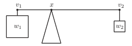

图 1.1 杠杆定律。

沿该线段的某点 \(x\)，我们如何找到 \(x\) 相对于该线段的重心坐标 \(\phi_1\) 和 \(\phi_2\)？结果表明，它们由 (1.3) 和 (1.4) 唯一确定，作为长度比，

```
\(\phi_1 = \frac{l_2}{l}, \quad \phi_2 = \frac{l_1}{l},\)
```

其中 \(l = l_1 + l_2 = v_2 - v_1\) 是线段的长度。

#### 1.1.1 单纯形的重心坐标

1827年，德国数学家奥古斯特·费迪南德·莫比乌斯（August Ferdinand Möbius，1790–1868）[282] 考虑了在 \(d \in \mathbb{N}\) 维中寻找相对于任意 \(d\)-单纯形的重心坐标的问题。例如，1-单纯形是 1D 中的线段，2-单纯形是 2D 中的三角形，3-单纯形是 3D 中的四面体。

给定一个具有 \(d+1\) 个顶点 \(\boldsymbol{v}_1, \dots, \boldsymbol{v}_{d+1} \in \mathbb{R}^d\) 的非退化 \(d\)-单纯形 \(\Delta\)，我们寻找 \(d+1\) 个函数 \(\boldsymbol{\phi} = [\phi_1, \dots, \phi_{d+1}] : \Delta \to \mathbb{R}^{d+1}\)，它们满足*单位分割性质*

```
\(\sum_{i=1}^{d+1} \phi_i(\boldsymbol{x}) = 1 \quad \forall \boldsymbol{x} \in \Delta \quad (1.5)\)
```

和*线性再现性质*

```
\(\sum_{i=1}^{d+1} \phi_i(\boldsymbol{x})\boldsymbol{v}_i = \boldsymbol{x} \quad \forall \boldsymbol{x} \in \Delta. \quad (1.6)\)
```

函数 \(\phi_1, \dots, \phi_{d+1}\) 称为相对于 \(\Delta\) 的*重心坐标*。类似于前一节中的一维情况，结果表明这些重心坐标由 (1.5) 和 (1.6) 唯一确定，莫比乌斯表明它们是体积比，

```
\(\phi_i(\boldsymbol{x}) = \frac{V_i(\boldsymbol{x})}{V}, \quad i = 1, \dots, d+1, \quad (1.7)\)
```

其中 \(V_i(\boldsymbol{x}) = \text{Vol}[\boldsymbol{v}_1, \dots, \boldsymbol{v}_{i-1}, \boldsymbol{x}, \boldsymbol{v}_{i+1}, \dots, \boldsymbol{v}_{d+1}]\) 是相应 \(d\)-单纯形的体积，而 \(V = V_1(\boldsymbol{x}) + \cdots + V_{d+1}(\boldsymbol{x}) = \text{Vol}[\boldsymbol{v}_1, \dots, \boldsymbol{v}_{d+1}]\) 是 \(\Delta\) 的体积，不依赖于 \(\boldsymbol{x}\)。

#### 1.1.2 广义重心坐标

据我们所知，Kalman [221] 是第一个提出将重心坐标推广到凸多面体的人，近年来，对寻找相对于任意多面体的重心坐标问题的兴趣日益浓厚。在本书中，我们考虑一个具有 \(n \ge d+1\) 个顶点 \(\boldsymbol{v}_1, \dots, \boldsymbol{v}_n \in \mathbb{R}^d\) 的非退化多面体 \(P\)，将其视为一个开集。我们用 \(\partial P\) 表示该多面体的边界，用 \(\bar{P}\) 表示其闭集。

### 定义 1.1。

给定多面体 \(P\)，\(n\) 个函数 \(\phi = [\phi_1, \dots, \phi_n]: \bar{P} \to \mathbb{R}^n\) 称为*广义重心坐标*，如果它们满足*单位分割性质*

```
\(\sum_{i=1}^n \phi_i(\boldsymbol{x}) = 1 \quad \forall \boldsymbol{x} \in \bar{P}\) (1.8)
```

和*线性再现性质*

```
\(\sum_{i=1}^n \phi_i(\boldsymbol{x})\boldsymbol{v}_i = \boldsymbol{x} \quad \forall \boldsymbol{x} \in \bar{P}.\) (1.9)
```

当 \(n = d + 1\) 时，满足定义 1.1 中性质的唯一函数是 (1.7) 中的 \(\phi_i\)。然而，当 \(n > d + 1\) 时，\(\phi_i\) 不再被唯一确定，这就是本章余下部分将回顾的不同广义重心坐标构造存在的原因。

除了定义性质 (1.8) 和 (1.9) 之外，通常希望函数 \(\phi_i\) 还具有一些额外性质，

- *非负性*：\(\phi_i(\boldsymbol{x}) \ge 0\) 对于任何 \(\boldsymbol{x} \in \bar{P}\)；（1.10a）
- *拉格朗日性质*：\(\phi_i(\boldsymbol{v}_j) = \delta_{ij}\)，其中 \(\delta_{ij}\) 是克罗内克德尔塔；（1.10b）
- *边界线性性质*：\(\phi_i\) 在 \(P\) 的每个面上是线性的；（1.10c）
- *光滑性*：\(\phi_i \in C^\infty\)。（1.10d）

我们注意到，在 \(n = d + 1\) 的情况下，(1.7) 中的线性函数 \(\phi_i\) 满足所有这些性质。

一般来说，广义重心坐标有两种类型。一方面，存在具有封闭形式的坐标。类似于 (1.2)，封闭形式定义通常基于某些*权重函数* \(\boldsymbol{w} = [w_1, \dots, w_n]: P \to \mathbb{R}^n\)，它们满足

```
\(\sum_{i=1}^n w_i(\boldsymbol{x})(\boldsymbol{v}_i - \boldsymbol{x}) = \boldsymbol{0} \quad \forall \boldsymbol{x} \in P.\) (1.11)
```

这些权重函数也称为*齐次坐标*，因为对它们进行归一化可得到广义重心坐标

```
\(\phi_i(\boldsymbol{x}) = \frac{w_i(\boldsymbol{x})}{W(\boldsymbol{x})}, \quad W(\boldsymbol{x}) = \sum_{j=1}^n w_j(\boldsymbol{x}), \quad i = 1, \dots, n.\) (1.12)
```

另一方面，存在只能通过数值方法获得的计算坐标，例如，通过求解优化问题。

### 1.2 二维坐标

我们首先关注二维情况，考虑一个简单多边形 \(P\)。不失一般性，我们假设该多边形的顶点 \(\boldsymbol{v}_i\) 按逆时针方向给出，并且我们将顶点索引循环处理，即对于 \( i \in \{1, \dots, n\} \) 和 \( k \in \mathbb{Z} \)，有 \(\boldsymbol{v}_{i+kn} = \boldsymbol{v}_i\)。请注意，本节中除 Hermite 和复数坐标外的所有坐标，均按定义 1.1 的意义为广义重心坐标。

二维中最早的重心坐标推广是封闭形式构造，且仅限于凸多边形。在此背景下，关键目标是找到满足 (1.11) 的光滑正权重 \( w_i \)。随后已知 [149]，(1.12) 中的归一化权重 \( \phi_i \) 是相对于 \( P \) 的定义良好的广义重心坐标，并满足 (1.10) 中的所有性质。然而，这些构造中的大多数会导致非凸多边形内部某些点处出现负权重 \( w_i \)。更糟的是，分母 \( W \) 可能消失，因此 \( \phi_i\) 不一定对所有 \( x \in P \) 都定义良好。迄今为止，尚未知晓任意非凸多边形正权重的封闭形式构造，即使存在，所得坐标在凹角处也不会超过 \( C^\alpha \) [10]。我们在 1.2.1–1.2.7 节中讨论不同的封闭形式坐标。

后来人们认识到，\(\phi_i\) 也可以作为满足坐标所需性质所给定约束的优化问题的解，通过数值方法获得。该优化问题可以是全局的或局部的，我们在 1.2.8–1.2.10 节中介绍了不同类型的此类计算坐标。

如果点 \( v_i \) 不是作为多边形的顶点给出，而是作为散点给出，则定义 1.1 和性质 (1.10b) 及 (1.10d) 仍然有意义。在此背景下，我们可以定义相对于 \( n \ge 3 \) 个散点集合 \( \Pi = \{v_1, \dots, v_n\} \in \mathbb{R}^2 \) 的广义重心坐标 \(\phi_i\)，并在 1.2.11–1.2.13 节中回顾三种不同的构造。

我们还简要概述了以其他方式推广定义 1.1 的坐标。特别是，我们在 1.2.14 和 1.2.15 节中简要讨论了 Hermite 和复数坐标。

#### 1.2.1 沃赫斯普坐标

瓦赫斯普 [407] 是最早提出将重心坐标推广到具有 \( n > 3 \) 个顶点的多边形的人之一。后来，Meyer 等人 [275] 提出了这些*瓦赫斯普坐标*的一个简单局部表述，其由权重函数的归一化 (1.12) 给出

\( w_i = \frac{\cot \gamma_{i-1} + \cot \beta_i}{r_i^2}, \quad i = 1, \dots, n, \)

其中 \(\gamma_{i-1}\) 和 \(\beta_i\) 是图 1.2 中所示的角，且 \( r_i = \|v_i - x\| \)。这些坐标是有理函数，分子和分母的次数分别最多为 \( n-2 \) 和 \( n-3 \)，这是可能的最小次数 [412]。

对于严格凸多边形，显然对于任何 \( x \in P \) 都有所有 \( w_i(x) > 0 \)，因此瓦赫斯普坐标定义良好并满足 (1.10) 中的所有性质。它们也是仿射不变的。对于非凸多边形，由于分母 \( W \) 消失，坐标在多边形内部某些点处不定义良好，但它们可以推广到弱凸多边形 [264]。


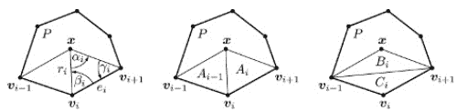

图 1.2 多边形 \( P \) 中有符号角度、距离和有符号面积的记号。

#### 1.2.2 离散调和坐标

离散调和坐标 [136, 309] 源自拉普拉斯方程的标准分段线性有限元近似，由以下权函数给出

\( w_i = \cot \beta_{i-1} + \cot \gamma_i, \quad i = 1, \dots, n, \)

其中 \( \beta_{i-1} \) 和 \( \gamma_i \) 是图 1.2 所示的角度。有趣的是，对于所有顶点位于同一圆上的多边形，这些坐标与瓦赫斯普坐标相同，因此具有相同的性质 [149]。对于其他严格凸多边形，它们仍然定义良好并满足 (1.10) 中的所有性质，除了非负性。对于非凸多边形，这些坐标的分母 \( W \) 在多边形内部的某些点处消失，因此它们没有定义好。

#### 1.2.3 平均值坐标

离散调和坐标的推导表明，可以利用调和函数的不同性质来推导其他广义重心坐标。Floater [144] 考虑了调和函数 \( u: P \to \mathbb{R} \) 的周径平均值性质，该性质指出，对于任何半径 \( r > 0 \)、以 \( x \) 为中心、边界为 \( \partial B \) 的圆盘 \( B = B(x, r) \subset P \)，

\( u(x) = \frac{1}{2\pi r} \int_{y \in \partial B} u(y) dy. \)

他接着表明，将 (1.13) 应用于分段线性函数会得到 *平均值坐标*。这些坐标由以下权函数给出

\( w_i = \frac{\tan(\alpha_{i-1}/2) + \tan(\alpha_i/2)}{r_i}, \quad i = 1, \dots, n, \)

其中 \( \alpha_{i-1} \) 和 \( \alpha_i \) 是图 1.2 所示的角度，且 \( r_i = \|v_i - x\| \)。Hormann 和 Floater [206] 表明，平均值坐标即使对于一组嵌套的简单多边形以及平面上的任何位置也都定义良好。它们在星形多边形的核内为正，并满足性质 (1.10b) 和 (1.10c)。此外，平均值坐标在任何四边形内为正，具有相似不变性且光滑，但在 \( P \) 的顶点处除外，在那里它们仅为 \( C^0 \)。

为了推导非凸多边形的正平均值坐标，Lipman 等人 [251] 使用了平均值坐标的跨有限描述 [217]，并将积分限制在从 \( x \) 可见的 \( \partial P \) 部分上。这些坐标可以通过利用 GPU 进行高效求值，但它们在多边形内部某些线上仅为 \( C^0 \)。

#### 1.2.4 坐标的完整家族

Floater 等人 [149] 表明，对于任意实函数 \( c_i : P \to \mathbb{R} \)，权重

$$
w_i = \frac{c_{i-1}A_i - c_i B_i + c_{i+1}A_{i-1}}{A_{i-1}A_i}, \quad i = 1, \dots, n, \quad (1.14)
$$

与图 1.2 所示的有符号面积 \( A_i \) 和 \( B_i \) 一起，满足性质 (1.11)。因此，寻找广义重心坐标的任务简化为寻找函数 \( c_i \)，使得 (1.14) 中的权重为正，或者，如果不为正，至少求和得到一个非消失的分母 \( W \)，而无需我们担心性质 (1.8) 和 (1.9)（这些性质由构造满足），并且得到的坐标与函数 \( c_i \) 一样光滑。此外，任何一组广义重心坐标都可以通过适当选择 \( c_i \) 来用 (1.14) 中的权重表示。

这个完整坐标家族的一个有趣特例是对于任何 \( p \in \mathbb{R} \)，取 \( c_i = \|v_i - x\|^p \)。在这种情况下，\( p=0 \)、\( p=1 \) 和 \( p=2 \) 的选择分别给出瓦赫斯普坐标、平均值坐标和离散调和坐标。令人惊讶的是，对于这种 \( c_i \) 的选择，在任何凸多边形中非负的唯一坐标是瓦赫斯普坐标和平均值坐标 [149]。对于任何 \( p \)，这些坐标具有相似不变性，并且一个简单的几何解释可以在 [232, Appendix A] 中找到。

对于满足 (1.8) 和 (1.9) 且由构造非负的一般权函数 \( w_i \)，一种替代的几何构造基于幂图 [78]。然而，得到的幂坐标不一定光滑。

#### 1.2.5 度量坐标

Malsch 等人 [265, 375] 构造了所谓的 *度量坐标*，由以下权函数给出

$$
w_i = \frac{A_{i-2}}{C_{i-1}q_i - 2q_{i-1}} - \frac{B_i}{C_i q_i - q_i} + \frac{A_{i+1}}{C_{i+1}q_i q_{i+1}}, \quad i = 1, \dots, n,
$$

其中 \( A_i \)、\( B_i \) 和 \( C_i \) 是图 1.2 所示的面积，并且

$$
q_i = r_i + r_{i+1} - e_i
$$

其中 \( r_i = \|v_i - x\| \) 且 \( e_i = \|v_{i+1} - v_i\| \)。函数 \( q_i \) 在平面上处处非负，这保证了所有简单多边形的分母 \( W \) 不消失 [200]。度量坐标在凸多边形内不一定为正，满足性质 (1.10b) 和 (1.10c)，并且光滑，但在 \( P \) 的顶点处除外，在那里它们仅为 \( C^1 \)。这些坐标对于具有三个连续共线顶点的多边形没有定义好。

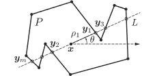

图 1.3 戈登-威克索姆插值器使用的记号。

#### 1.2.6 波森坐标

从平均值坐标的推导中汲取灵感，Li 等人 [247] 从调和函数 \( u: P \rightarrow \mathbb{R} \) 的波森积分公式推导出波森坐标，该公式指出，对于任何半径 \( r > 0 \)、以原点为中心、边界为 \( \partial B \) 的圆盘 \( B = B(r) \subset P \) 以及任何点 \( \boldsymbol{x} \in B \)，

$$
u(\boldsymbol{x}) = \frac{1}{2\pi r} \int_{y \in \partial B} \frac{r^2 - \|\boldsymbol{x}\|^2}{\|\boldsymbol{x} - \boldsymbol{y}\|^2} u(\boldsymbol{y}) d\boldsymbol{y}. \tag{1.15}
$$

波森坐标扩展了平均值坐标，因为周径平均值定理 (1.13) 是 (1.15) 的一个特例，当 \( \boldsymbol{x} \) 位于 \( B \) 的中心时。它们对于任何简单多边形 \( P \) 都定义良好，并具有与平均值坐标相同的性质。此外，遵循特定构造，已证明波森坐标是伪调和的，即它们在 \( n \) 维球上再现调和函数（有关伪调和坐标的更多细节见 [94]）。波森权重 \( w_i \) 的闭式表达式相当冗长，可以在 [247, Section 4.1] 中找到。

#### 1.2.7 戈登-威克索姆坐标

考虑一条通过 \( \boldsymbol{x} \in P \) 沿某个方向且相对于固定轴有给定角度 \( \theta \) 的直线 \( L \)，它在点 \( \boldsymbol{y}_1, \dots, \boldsymbol{y}_m \) 处与 \( \partial P \) 相交（见图 1.3）。对所有 \( m \) 个交点求和，Belyaev 等人 [37, 38] 将戈登-威克索姆坐标 [171] 从凸多边形扩展到任意简单多边形，并表明它们可以作为基函数从跨有限插值器中得到（更多细节见第 3 章）

$$
f(\boldsymbol{x}) = \frac{1}{2\pi} \int_0^{2\pi} \left( \sum_{i=1}^m \frac{\varepsilon_i f(\boldsymbol{y}_i)}{\rho_i} \right) / \left( \sum_{i=1}^m \frac{\varepsilon_i}{\rho_i} \right) d\theta, \tag{1.16}
$$

其中 \( f(y_i) \) 是沿多边形边界给定的分段线性函数 \( f \) 的采样数据，\( \rho_i = \|\boldsymbol{x} - \boldsymbol{y}_i\|\)，且 \( \varepsilon_i \in \{-1, 0, 1\}\)，当从 \( \boldsymbol{x} \) 到 \( \boldsymbol{y}_i \) 的射线从 \( P \) 的外部接近 \( \boldsymbol{y}_i \) 时 \( \varepsilon_i = -1 \)，当它在 \( \boldsymbol{y}_i \) 处与 \( \partial P \) 相切时 \( \varepsilon_i = 0 \)，或当它从 \( P \) 的内部接近 \( \boldsymbol{y}_i \) 时 \( \varepsilon_i = 1 \)。这些坐标满足性质 (1.10b) 和 (1.10c)，但在非凸多边形内部可以为负。Manson 等人 [266] 扩展了 (1.16) 并提出了任何简单多边形内部的 *正戈登-威克索姆坐标*，其光滑度与边界一样。这些坐标的解析表达式相当冗长，我们将读者引向 [266, Section 3.2]。

#### 1.2.8 调和坐标

如 [149] 所观察到的，获得相对于任何简单多边形的广义重心坐标的一种方法是求解拉普拉斯方程

\(\Delta \phi = 0\) (1.17)

由一组分段线性边界条件 \( \boldsymbol{g} = [g_1, \dots, g_n]: \partial P \to \mathbb{R}^n \) 给出，使得每个 \( g_i \) 都具有拉格朗日性质 (1.10b)。这些所谓的 *调和坐标* 满足 (1.10) 中的所有性质。

近似这些坐标的经典方法 [215] 是在 \( P \) 的三角剖分相对于的分段线性函数空间上对 (1.17) 进行离散化。或者，调和坐标也可以使用边界元法 [342]、复变量边界法 [417] 和基本解法 [269] 进行近似。

#### 1.2.9 最大熵坐标

Arroyo 和 Ortiz [15] 以及 Sukumar [372] 独立地表明，广义重心坐标可以作为基于最大熵原理 [211] 的约束优化问题的解得到。这些 *最大熵坐标* 是非负的，但拉格朗日性质 (1.10b) 仅对严格凸多边形成立。后来在 [380] 中意识到，使用先验分布 [212, 230, 357]，约束优化可以修改为

$$
\max_{\phi(\boldsymbol{x}) \in \mathbb{R}_+^n} -\sum_{i=1}^n \phi_i(\boldsymbol{x}) \ln \frac{\phi_i(\boldsymbol{x})}{\omega_i(\boldsymbol{x})}
$$

受 (1.8) 和 (1.9) 约束，其中 \( \omega_i: P \to \mathbb{R}_+ \) 是 \( \phi_i \) 的先验估计，可以视为权函数（更多细节见第 13 章）。

Hormann 和 Sukumar [202] 展示了如何构造 \( \omega_i \)，使得最大熵坐标对于任何简单多边形都满足 (1.10) 中的所有性质，除了光滑性。关于光滑性，已证明这些坐标对于任何 \( k \ge 0 \) 的 \( C^k \) 先验函数集都是 \( C^0 \)-连续 [379]，并假设其光滑度与先验一样。与调和坐标不同，最大熵坐标


不需要求解全局优化问题，而是可以使用牛顿法在任意点 \(\boldsymbol{x} \in P\) 处局部求值，该方法具有二次收敛性。

#### 1.2.10 局部坐标

Zhang et al. [433] 提出最小化坐标函数 \(\phi_i\) 的总变分之和，

\(\min_{\Phi} \sum_{i=1}^n \int_P \|\nabla \phi_i\|,\)

受 (1.8)、(1.9)、(1.10a)、(1.10b) 和 (1.10e) 给出的约束条件约束，其中 \(\phi_i\) 的总变分是在 \(P\) 中 \(\|\nabla \phi_i\|\) 的 \(L_1\)-范数。这个凸最小化问题的解给出了所谓的 _局部坐标_，它们至少是 \(C^0\)。该名称源于这样一个事实：在 \(P\) 的大部分区域内，数值计算的函数值非常接近于零。然而，这些坐标的确切支撑集尚不确定。

#### 1.2.11 仿射坐标

在散点集 \(\Pi\) 相对于的所有广义重心坐标中，Waldron [408] 建议考虑具有最小 \(L_2\)-范数的那些坐标，它们被唯一定义为 _仿射_ 函数

\(\phi_i(\boldsymbol{x}) = (\boldsymbol{x} - \boldsymbol{c}) \cdot ((VV^*)^{-1}(\boldsymbol{v}_i - \boldsymbol{c}))^T + \frac{1}{n}, \quad i = 1, \dots, n,\)

其中 \(\boldsymbol{c} = \frac{1}{n} \sum_{i=1}^n \boldsymbol{v}_i\) 是 \(\Pi\) 的重心，\(V = (\boldsymbol{v}_1 - \boldsymbol{c}, \dots, \boldsymbol{v}_n - \boldsymbol{c})\) 是一个 \(2 \times n\) 矩阵，\(V^*\) 是 \(V\) 的伴随。这些坐标在包含 \(\boldsymbol{c}\) 的凸区域内非负，且在 \(\boldsymbol{c}\) 处等于 \(\frac{1}{n}\)。它们在平面上处处光滑且定义良好，但一般来说，拉格朗日性质 (1.10b) 仅在 \(n=3\) 时成立（参见第 1.1.1 节）。

#### 1.2.12 Sibson 坐标

设 \(V\) 为集合 \(\Pi\) 的 Voronoi 图 [404]，\(C_i\) 为 \(V\) 中包含 \(\boldsymbol{v}_i\) 的 Voronoi 单元。进一步设 \(V_{\boldsymbol{x}}\) 为 \(\Pi \cup \{\boldsymbol{x}\}\) 的 Voronoi 图，\(C_{\boldsymbol{x}}\) 为 \(V_{\boldsymbol{x}}\) 中包含 \(\boldsymbol{x}\) 的 Voronoi 单元（参见图 1.4）。通过将单元 \(C_i\) 与 \(C_{\boldsymbol{x}}\) 相交，我们可以定义权重函数

\(w_i = \text{Area}[C_i \cap C_{\boldsymbol{x}}], \quad i = 1, \dots, n.\)

这些面积最初由 Sibson [360, 361] 提出，侧重于自然邻域插值，其中某个 \(\boldsymbol{x}\) 的自然邻域是 \(\Pi\) 中所有满足 \(w_i(\boldsymbol{x}) \neq 0\) 的点。

通过如 (1.12) 所示对 (1.18) 中的权重进行归一化，定义了 _Sibson 坐标_。这些坐标在 \(\Pi\) 的凸包上定义良好，具有局部支撑，并满足拉格朗日性质 (1.10b)。它们是 $C^1$ 的，但在 $v_i$ 处仅为 $C^0$。Sibson 坐标的简单计算算法可见 [371]，更多细节见 [376]。

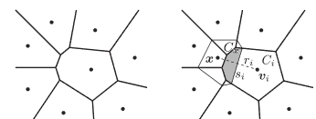

图 1.4 散点集的 Voronoi 图（左）以及用于构建 Sibson 坐标和 Laplace 坐标的符号（右）。

#### 1.2.13 Laplace 坐标

自然邻域的概念（参见第 1.2.12 节）也用于定义所谓的 *Laplace 坐标* [34, 103, 370]，它们由以下权重函数给出：

$$
w_i = \begin{cases} \frac{s_i}{r_i}, & \text{if } i \in I_x, \\ 0, & \text{otherwise,} \end{cases} \quad i = 1, \dots, n,
$$

其中 $s_i$ 是包含在 $C_i$ 中的 $C_x$ 边的长度，$r_i = \|v_i - x\|$，且 $I_x \subset \{1, \dots, n\}$ 是 $x$ 的自然邻域索引子集（参见图 1.4）。

这些坐标与 Sibson 坐标具有相同的性质，但它们在其支撑集的边界上仅为 $C^0$。有趣的是，对于所有顶点都位于圆上的多边形，Sibson、Laplace、Wachspress 和离散调和坐标均相同 [375]。Laplace 坐标的简单计算算法可见 [371]，更多细节见 [377]。

#### 1.2.14 Hermite 坐标

为了不仅插值边界数据，还插值沿边界的导数信息，我们用第二组 $n$ 个函数 $\psi_i$ 补充函数 $\phi_i$，并用 Hermite 性质替换拉格朗日性质 (1.10b)

$$
\begin{aligned} 
\phi_i(v_j) &= \delta_{ij}, & \psi_i(x) &= 0 \quad \forall x \in \partial P, \\ 
\frac{\partial \phi_i}{\partial \nu}(x) &= 0 \quad \forall x \in \partial P, & \frac{\partial \psi_i}{\partial \nu}(x) &= \delta_{ij} \quad \forall x \in [v_j, v_{j+1}], 
\end{aligned} \tag{1.19)
$$

其中 \(\nu\) 是边界 \(\partial P\) 的单位法向量。在此设置下，定义 1.1 中广义重心坐标的关键性质采用如下形式

\(\sum_{i=1}^n \phi_i(\boldsymbol{x}) + \sum_{i=1}^n \psi_i(\boldsymbol{x}) = 1 \quad \forall \boldsymbol{x} \in \bar{P}, \quad (1.20)\)

\(\sum_{i=1}^n \phi_i(\boldsymbol{x})\boldsymbol{v}_i + \sum_{i=1}^n \psi_i(\boldsymbol{x})\boldsymbol{\nu}_i = \boldsymbol{x} \quad \forall \boldsymbol{x} \in \bar{P}, \quad (1.21)\)

其中 \(\nu_i$ 是边 \([\boldsymbol{v}_i, \boldsymbol{v}_{i+1}]\) 的单位法向量。注意 (1.20) 本质上与 (1.8) 相同，因为 \(\psi_i(\boldsymbol{x}) = 0\)。

据我们所知，Lipman et al. [252] 是首个从 Green 第三恒等式推导出满足 (1.20) 和 (1.21) 的这些坐标 \(\phi_i$ 和 \(\psi_i$ 的人。这些 *Green 坐标* 具有闭式解，但不满足 (1.19)。通过将多边形边界上给定的值和导数按加权最小二乘意义拟合二元多项式，Manson and Schaefer [267] 构建了 *moving least squares 坐标*，这些坐标适用于任意（甚至不连通）多边形并具有闭式解。Li et al. [248] 为任意简单多边形具有性质 (1.19) 的 Hermite 坐标提出了另一种闭式解，他们从双调和函数的平均值性质推导出 *cubic mean value 坐标*。Weber et al. [418] 将调和坐标扩展到 *biharmonic 坐标*，这些坐标满足 (1.19)，但不具有闭式解。

#### 1.2.15 复坐标

如果将 \(P\) 解释为 \(\mathbb{C}\) 的子集，并将其顶点 \(\boldsymbol{v}_i = (x_i, y_i)$ 视为复数 \(z_i = x_i + iy_i$，则可以将广义重心坐标重新表述为复函数 [415, 416]。这些 *complex 坐标* 在平面形变场景中非常有用（更多细节见第 7 章）。复数设置还揭示，Green 坐标（参见第 1.2.14 节）也可以从 Cauchy 积分公式 [415] 推导出来。

#### 1.2.16 比较

为了比较本节中的广义重心坐标（Hermite 和复坐标除外），我们在表 1.1 中总结了它们的一些属性，并在图 1.5–1.8 中展示了凸多边形和凹多边形的一些坐标函数的等高线图。

具体来说，表 1.1 列出了坐标定义良好的域，以及它们是否具有闭式定义、是否非负 (1.10a) 以及是否满足拉格朗日性质 (1.10b)。此外，表格还显示了坐标在各自域内部的光滑程度。统一分割性质 (1.8) 和线性再现性质 (1.9) 未包含在表中，因为所有坐标都符合这些性质。此外，我们未包含额外性质 (1.10c)，因为它被所有为多边形定义的坐标满足，且不适用于散点坐标。

| 坐标 (章节) | 有效域 | 闭式解 | 非负性 | 拉格朗日性质 | 光滑度 |
|---|---|---|---|---|---|
| WP (1.2.1) | | ✓ | ✓ | ✓ | C^∞ |
| DH (1.2.2) | | ✓ | | ✓ | C^∞ |
| CF (1.2.4) | | ✓ | | ✓ | C^∞ |
| MV (1.2.3) | | ✓ | | ✓ | C^∞ |
| PM (1.2.3) | | ✓ | ✓ | ✓ | C^0 |
| MT (1.2.5) | | ✓ | | ✓ | C^∞ |
| PS (1.2.6) | | ✓ | | ✓ | C^∞ |
| GW (1.2.7) | | ✓ | | ✓ | C^0 |
| PG (1.2.7) | | ✓ | ✓ | ✓ | C^0 |
| HM (1.2.8) | | | ✓ | ✓ | C^∞ |
| ME (1.2.9) | | | ✓ | ✓ | C^k |
| LC (1.2.10) | | | ✓ | ✓ | C^0 |
| AF (1.2.11) | | ✓ | | | C^∞ |
| SB (1.2.12) | | ✓ | ✓ | ✓ | C^1 |
| LP (1.2.13) | | ✓ | ✓ | ✓ | C^0 |

表 1.1 二维广义重心坐标的属性。

为了更好地比较，我们按前两个属性对所有坐标进行分组。第一组包括 Wachspress (WP)、离散调和 (DH) 和完整家族 (CF) 坐标。这些坐标仅对凸多边形定义良好并具有闭式解。第二组由平均值 (MV)、正平均值 (PM)、度量 (MT)、Poisson (PS)、Gordon-Wixom (GW) 和正 Gordon-Wixom (PG) 坐标组成，它们对任意简单多边形定义良好并具有闭式解。第三组列出了调和 (HM)、最大熵 (ME) 和局部 (LC) 坐标，它们也对任意简单多边形定义良好，但只能通过数值方法获得。最后一组


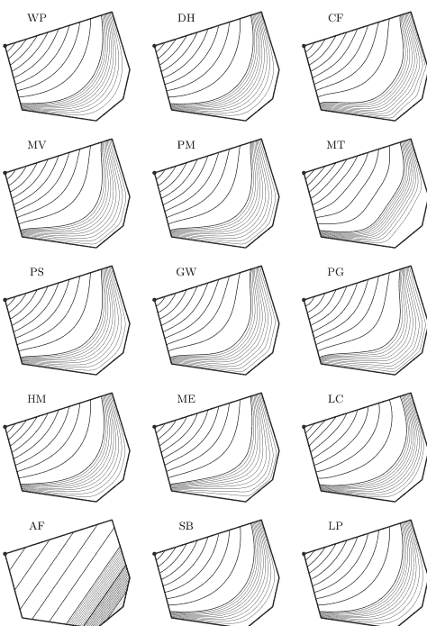

图 1.5 相对于标记顶点的凸多边形的 2D 广义重心坐标。

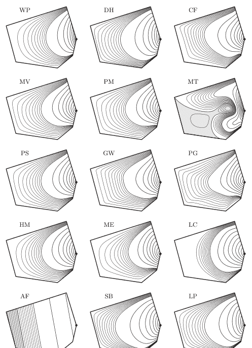

图 1.6 相对于标记顶点的凸多边形的 2D 广义重心坐标。

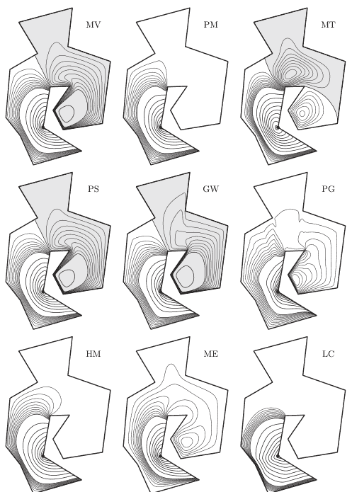

图 1.7 相对于标记顶点的凹多边形的 2D 广义重心坐标。

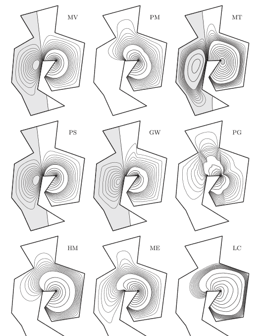

图 1.8 相对于标记顶点的凹多边形的 2D 广义重心坐标。

包括相对于散点集定义的仿射（AF）、Sibson（SB）和 Laplace（LP）坐标。

图 1.5 和 1.6 通过显示凸多边形两个不同基函数的等值线图，对所有坐标进行了可视化比较。图 1.7 和 1.8 给出了所有在凹多边形上定义良好的坐标的类似比较。在所有图中，粗曲线表示函数值 0.0、0.1、...、1.0 的等值线，允许比较坐标函数的一般形状。此外，从细曲线可以推断向零的衰减，细曲线表示值为 0.01、0.02、...、0.09 的等值线。相同的等值线间距也用于负函数值，相应区域以浅灰色阴影表示。同样，函数值大于一的区域以深灰色阴影表示。作为坐标完整家族（CF）的代表，我们选择函数

```
$c_i = 2r_i \frac{\sin \alpha_{i-1} + \sin \alpha_i}{\sin \alpha_{i-1} + \sin \alpha_i + \sin(\alpha_{i-1} + \alpha_i)}$
```

该函数在 [149, Section 5] 中提出。对于仿射、Sibson 和 Laplace 坐标，我们将多边形的顶点视为一组散点，并将图限制在凸包内。图显示，平均值、Poisson 和 Gordon–Wixom 坐标在非凸多边形内部可能变为负值。同样的情况也适用于度量坐标（也适用于凸多边形）以及仿射坐标，后者甚至不一定满足 Lagrange 性质。

### 1.3 3D 坐标

我们现在关注 3D 情况，考虑具有 n 个顶点 v₁, …, vₙ 和 m 个面 f₁, …, fₘ 的多面体 P。我们在此环境下介绍一些广义重心坐标的显式表述，它们是相应 2D 构造的直接扩展。由于这些坐标的性质从 2D 延续到 3D，我们不再明确提及。

#### 1.3.1 Wachspress 坐标

Wachspress 坐标可以推广到所有顶点恰好有三个相邻面的凸多面体 [407, 411, 413]，以及使用极对偶概念的任意凸多面体 [218]。包含原点的有界凸多面体的极对偶本身也是形式为 $P_d = \{ y \in \mathbb{R}^3 \mid y \cdot z \le 1 \forall z \in P \}$ 的凸多面体。由于 P 的每个顶点 $v_i$ 在 $P_d$ 中都有一个对偶多边形锥 $\Delta_i$（2D 示例见图 1.9），将 P 平移使 $x$ 位于原点并令

```
$w_i = \text{Vol}[\Delta_i], \quad i=1, \dots, n$
```

在 (1.12) 中归一化后得到 3D Wachspress 坐标。注意，[411, 413] 中的构造也扩展到更高维度。

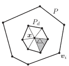

图 1.9 以 $\boldsymbol{x}$ 为中心的六边形 $P$ 的极对偶 $P_d$，其中三角形 $\Delta_i$ 与顶点 $\boldsymbol{v}_i$ 对偶。

#### 1.3.2 离散调和坐标

[276] 首次提到 3D 离散调和坐标存在，但未给出精确公式。后来，Ju 等人 [216] 表明，对于具有三角面的凸多面体，这些坐标由以下权函数给出：

$w_i = \sum_{j \in N_i} h_j \cot \beta_j, \quad i = 1, \dots, n,$

其中 $N_i \subset \{1, \dots, n\}$ 是 $\boldsymbol{v}_i$ 一环邻域中顶点索引的子集，$\beta_j$ 是面 $[\boldsymbol{v}_i, \boldsymbol{v}_j, \boldsymbol{v}_{j+1}]$ 和 $[\boldsymbol{x}, \boldsymbol{v}_j, \boldsymbol{v}_{j+1}]$ 之间的二面角，且 $h_j = \|\boldsymbol{v}_j - \boldsymbol{v}_{j+1}\|$（见图 1.10）。

有趣的是，与它们的 2D 对应物（参见第 1.2.2 节）不同，离散调和坐标和 Wachspress 坐标对于顶点位于共同球面上的多面体并不相同。然而，Ju 等人 [216, Section 3.2.2] 引入了 Voronoi 坐标，在这样的多面体上它们与 Wachspress 坐标相同。

#### 1.3.3 平均值坐标

Floater 等人 [150] 和 Ju 等人 [217] 独立地将平均值坐标推广到具有三角面的任意多面体。考虑 $P$ 的一个面 $f_k = [\boldsymbol{v}_1^k, \boldsymbol{v}_2^k, \boldsymbol{v}_3^k]$。通过将 $f_k$ 投影到以 $\boldsymbol{x}$ 为中心的单位球面上，我们得到一个三角楔

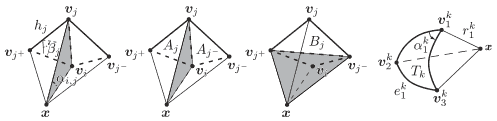

图 1.10 具有三角面的多面体中有符号角度、距离和有符号体积的符号表示。

$T_k$。相对于面 $f_k$ 的顶点 $\mathbf{v}_j^k$ 的 3D 平均值坐标的权函数定义为

$$w_j^k = \frac{e_j^k - e_{j-1}^k \cos \alpha_{j+1}^k + e_{j+1}^k \cos \alpha_{j-1}^k}{r_j^k \sin \alpha_{j+1}^k + \sin \alpha_{j-1}^k}, \quad j=1,\dots,3, \quad k=1,\dots,m,$$

其中角度 $\alpha_j^k$ 和球面边长 $e_j^k$ 如图 1.10 所示，$r_j^k = \|\mathbf{v}_j^k - \mathbf{x}\|$。有关将此构造推广到具有任意面的多面体的详细信息，请参见 [145]。

#### 1.3.4 坐标完整家族

Ju 等人 [216] 表明，对于具有三角面的凸多面体，Wachspress 坐标、离散调和坐标和平均值坐标都可以统一在一个简单的框架中，该框架与第 1.2.4 节中的框架密切相关。这个 *3D 坐标完整家族* 由以下权函数给出：

$$w_i = \sum_{j \in N_i} \frac{c_{i,j}^+}{A_j} + \sum_{j \in N_i} \frac{c_{i,j}^- B_j}{A_i A_j}, \quad i=1,\dots,n,$$

其中 $c_{i,j} : P \to \mathbb{R}$ 是任意实函数，$A_j$ 和 $B_j$ 是图 1.10 中显示的有符号体积，$N_i \subset \{1,\dots,n\}$ 是 $\mathbf{v}_i$ 一环邻域中顶点索引的子集。名称源于这样一个事实：该框架包括具有三角面的多面体的所有可能坐标。例如，给定由 $\mathbf{v}_i - \mathbf{x}$ 和 $\mathbf{v}_j - \mathbf{x}$ 形成的有符号角 $\alpha_{i,j}$，选择

$$c_{i,j} = 2 - \left( \frac{\|\mathbf{v}_i - \mathbf{x}\|}{\|\mathbf{v}_j - \mathbf{x}\|} + \frac{\|\mathbf{v}_j - \mathbf{x}\|}{\|\mathbf{v}_i - \mathbf{x}\|} \right) \cdot \cos \alpha_{i,j},\\
c_{i,j} = \left( (\mathbf{v}_i - \mathbf{x}) \times (\mathbf{v}_j - \mathbf{x}) \right)^2,\\
c_{i,j} = \left( \|\mathbf{v}_i - \mathbf{x}\| \times (\mathbf{v}_j - \mathbf{x}) \right) \cdot \alpha_{i,j}$$

分别导致 Wachspress、离散调和和平均值坐标。

或者，凸多面体的所有非负坐标都可以表示为 *3D 幂坐标* [78]，两种方法都可以扩展到更高维度的凸多胞形。

#### 1.3.5 其他坐标

正平均值 [251]、调和 [215]、最大熵 [202] 和局部 [433] 坐标到 3D 的扩展是直接的，并在各自的论文中提及。Sibson 和 Laplace 坐标扩展到任意更高维度在 [55] 中讨论，扩展到更高连续性在 [194] 中讨论。第 1.2 节中的其他 2D 坐标可能也可以扩展到 3D，但据我们所知，迄今尚未这样做。除了 Wachspress 坐标外，唯一其他已显式扩展到任意更高维度的坐标是仿射坐标 [408]。


## 广义重心插值的形状质量

**安德鲁·吉列特***
亚利桑那大学，图森，美国

**亚历山大·兰德**
CD-adapco，美国

## 目录

| 节 | 标题 | 页码 |
| :--- | :--- | :--- |
| 2.1 | 引言 | 24 |
| 2.2 | 先验误差估计的解构 | 26 |
| 2.3 | 单纯形的形状质量度量 | 29 |
| 2.4 | 多边形和多面体的形状质量度量 | 31 |
| 2.5 | 多边形上的插值误差估计 | 34 |
| 2.5.1 | 三角剖分坐标 | 34 |
| 2.5.2 | 调和坐标 | 35 |
| 2.5.3 | 瓦赫普雷斯坐标 | 37 |
| 2.5.4 | 平均值坐标 | 39 |
| 2.6 | 多面体和多胞体上的插值误差估计 | 39 |
| 2.6.1 | 3D及更高维度中的调和坐标 | 40 |
| 2.6.2 | 3D及更高维度中的瓦赫普雷斯坐标 | 40 |
| 2.7 | 扩展与未来方向 | 41 |

在广义重心坐标在日益扩展的应用场景中越来越流行之时，有必要清晰理解各种坐标类型的插值特性与其定义所在的几何之间的关系。考虑，例如，

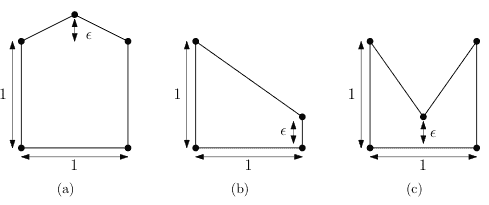

例如，某学术或工业代码在应用于某些多边形或多面体网格时，使用广义重心坐标却无法给出数值输出。是否可以通过更换所使用的坐标来避免仿真过早终止？或者通过某种方式改善网格单元的“质量”？或者两者皆不可？

*部分得到美国国家科学基金会在DMS-1522289资助下的支持。

### 2.1 引言

在本工作中，我们针对广义重心插值可预期成功的各种情况，呈现了实际计算证据和理论数学分析。我们对插值成功的主要替代指标是 $||\nabla\phi_i||_\infty$（即广义重心坐标函数的最大梯度）的一个严格上界，该上界以定义 $\phi_i$ 的多边形或多面体 $P$ 的顶点 $\{v_1, ..., v_n\}$ 的相对位置为准。在计算机图形学应用中，控制梯度对于避免视觉伪影至关重要。在计算力学应用中，偏微分方程解的梯度本身往往是一个感兴趣的量；例如，在泊松方程中，解的梯度有助于能量范数（即 $H^1$-范数），该范数用于衡量误差。此外，我们寻求梯度估计成立的最广泛的多边形或多面体类别，因为这对域几何施加了最不严格的要求。

为了了解此类分析中可能出现的微妙之处，请考虑多边形几何可能变得“退化”的三种方式，如图 2.1 所示：连续顶点共线、相对于直径的短边长度，以及顶点与非相邻边之间的近距离。我们在这些代表性的“低质量几何域”上进行数值实验，以测试五种广义重心坐标。广义重心坐标的边界值由一个简单的二次函数导出，

| ε | HM | WP | MV | DH | LS-1 | LS-2 | LS-3 | ME-T | ME-U |
|---|---|---|---|---|---|---|---|---|---|
| 0.1600 | 1.3e0 | 2.6e-1 | 6.0e-2 | 2.3e-1 | 1.8e-1 | 2.2e-2 | 5.4e-2 | 7.9e-2 | 5.1e-1 |
| 0.0400 | 1.3e0 | 1.3e0 | 1.1e-1 | 1.5e0 | 3.6e-1 | 5.4e-2 | 1.2e-1 | 1.6e-1 | 2.2e0 |
| 0.0100 | 1.3e0 | 3.1e0 | 1.3e-1 | 3.9e0 | 4.4e-1 | 6.5e-2 | 1.4e-1 | 1.9e-1 | 5.1e0 |
| 0.0025 | 1.3e0 | 6.4e0 | 1.3e-1 | 8.3e0 | 4.5e-1 | 6.7e-2 | 1.4e-1 | 2.0e-1 | 9.3e0 |
| 0.0000 | 1.3e0 | — | 1.3e-1 | — | 4.5e-1 | 6.8e-2 | 1.5e-1 | 2.0e-1 | * |

表 2.1 图 2.1a 所示域族上调和（HM）、瓦赫普雷斯（WP）、平均值（MV）、离散调和（DH）、移动最小二乘（LS-*）和最大熵（ME-*）坐标的比较。调和坐标使用精细三角网格近似以提供基准值；报告的是插值的 $H^1$-半范数。对于其他坐标，报告的值是插值与调和插值之差的 $H^1$-半范数。

$u(x, y) = 0.77223(x - 0.331)^2 + 1.1123(y + 0.177344)^2$，其中选择了一些任意系数以在插值过程中避免退化或对称性。首先，我们使用精细三角网格计算调和坐标的近似值（参见第 1.2.8 节）。由于根据狄里克莱原理，调和坐标提供具有最小 $H^1$-半范数的插值，因此这建立了一个良好的基准插值。

然后，我们使用以下坐标计算插值：瓦赫普雷斯、平均值、离散调和、带有线性、二次和三次权重的移动最小二乘，以及带有“三角不等式”先验（由沿多边形每条边消失且在其他地方严格为正的边权重函数构造）和均匀先验的最大熵。所有这些坐标均在第 1.2 节中定义，移动最小二乘坐标除外，其在下面的讨论中描述。

表 2.1 显示了我们针对图 2.1a 所示域族的实验结果。这里，当 $\epsilon = 0$ 时的极限情况看起来像是一个带悬挂节点的正方形，但我们正式将其视为一个具有两条相邻共线边的五边形。第一列报告了调和插值近似的 $H^1$-半范数，表明该值在 $\epsilon \to 0$ 时不会增长。对于其他坐标，报告的是插值与调和插值之差的 $H^1$-半范数。这里，平均值坐标相对于瓦赫普雷斯坐标的众所周知优势显而易见：瓦赫普雷斯梯度随大外角增长，而平均值坐标则不会。离散调和坐标表现出类似行为，因为它们像瓦赫普雷斯坐标一样，当域不是严格凸时定义不明确。

最大熵坐标 [202] 在 $\epsilon \to 0$ 和 $\epsilon = 0$ 时均有定义；然而，先验的选择会影响其在极限下的行为。在均匀先验（ME-U）的情况下，当几何从五边形变为正方形时，峰值顶点处的值从 1 跳变到 1/3，违反了拉格朗日属性。

请注意，如果在整个网格中使用 ME-U 坐标，则得到的插值将是一致的，即全局 C^0。然而，ME-U 插值沿相邻共线边上的值可能与其他类型的广义重心坐标产生的插值不同。我们在表 2.1 中用 * 标记这种特殊情况。另一方面，当使用“三角不等式”先验（ME-T）时，当 \(\epsilon = 0\) 时满足拉格朗日属性，并且数据证实了插值在 \(\epsilon \to 0\) 时的成功。

移动最小二乘坐标 [267] 定义为一个最小化问题，权重由点到边界的距离决定。权重函数 \(W(x, t) = ||p(t)|| / ||p(t) - x||^k\) 确保坐标在每条边上具有由 \(p\) 编码的边界值；指数 \(\alpha\) 越大，相对于域内部的平滑度，就越多地赋予边界附近坐标的平滑度以权重。如表 2.1 的 \(L^\infty\) 列所示，对于 \(\alpha = 1, 2, 3\)，当几何退化为正方形时，移动最小二乘插值相对于调和插值表现出较小的误差，其中 \(\alpha = 2\) 产生最小的误差。从这个角度看，二次权重似乎通过平衡边界要求的平滑强制与内部平滑度，最好地模拟了调和坐标；其他权重选择过度偏好其中一个目标，以牺牲插值误差为代价。请注意，移动最小二乘坐标可能取负值，这在图形应用中可能带来挑战。然而，就此处提出的误差分析而言，不要求插值非负。

图 2.1b 和 2.1c 所示域的实验结果分别载于表 2.2（第 34 页）和表 2.4（第 37 页）。所有结果均在第 2.5 节中更彻底地讨论。

### 2.2 先验误差估计的解构

有限元方法的典型 *先验* 误差分析始于将求解的偏微分方程表征为 \(V \times V\) 上强制连续双线性形式与 \(V\) 上有界线性算子 \(L\) 之间的方程，其中 \(V\) 是寻求 \(u\) 的函数空间 [70, 369]。我们固定常见的设置 \(V = H_0^1(\Omega)\)，即域 \(\Omega\) 上的 $H^1$ 函数空间，在 \(\partial\Omega\) 上具有零边界条件。塞亚引数随后断言存在一个常数 \(C_C\)，使得

\(\|u - u_h\|_{H^1(\Omega)} \le C_C \min_{v_h \in V_h} \|u - v_h\|_{H^1(\Omega)}.\) (2.1)

这里，\(u \in V\) 是问题的未知连续解，\(u_h\) 是有限元方法计算的 \(u\) 的近似值，\(V_h\) 是 \(V\) 的有限维子空间，\(u_h\) 从中寻求。因此，(2.1) 建立了 \(u_h\) 与 \(u\) 之间的误差在寻找 \(V_h\) 中的解时的最佳可能误差的常数倍以内。

分析的下一步是将特定情况下的误差 \(v_h := Iu\) 界定，其中 \(I: V \to V_h\) 是一个插值算子。一个微妙但关键的点是，\(I\) 将整个未知函数 \(u\) 作为输入以产生 \(Iu$，因此


可以在其定义中使用诸如 \(u(v_i)\) 之类的量。另一方面，有限元解 \(u_h\) 是求解算子的输出，其唯一输入是双线性形式、线性算子 \(V_h\) 和边界条件。对于直接由重心坐标或广义重心坐标推导的线性插值，插值误差估计的形式为

\[
\|u - Iu\|_{H^1(\Omega)} \le C_{\text{IE}} h |u|_{H^2(\Omega)},
\tag{2.2}
\]

其中 \(h\) 是 \(\Omega\) 网格中单元的最大直径。(2.2) 中的常数 \(C_{\text{IE}}\) 既取决于插值方法（即 \(Iu\) 的定义），也取决于网格中使用的单元形状。这种依赖性非常微妙，并且经常被误解。

通过两点观察，可简化推导估计 (2.2) 的分析。首先，误差可以分解为单个网格单元，而非整个求解域。其次，假设插值方法是仿射不变的，所有估计都可以重新缩放到直径为 1 的单元。因此，只需建立

\[
\|u - Iu\|_{H^1(P)} \le C_{\text{IE}} |u|_{H^2(P)},
\tag{2.3}
\]

对于 \(\Omega\) 网格中任何与单元相似的直径为 1 的多面体 \(P\) 均成立。

通过一组广义重心坐标 \(\phi\) 进行插值时，插值算子 \(I: H^2(P) \to \text{span}\{\phi\}\) 定义为

\[
Iu := \sum_{i=1}^n u(v_i)\phi_i.
\tag{2.4}
\]

为了证明 (2.3)，我们只需假设 \(u \in H^2(P)\)；然而，(2.4) 中 \(Iu\) 的公式需要 \(u\) 在 \(P\) 的顶点上的点值。我们可以引用索博列夫嵌入定理 [4, 70, 240] 来确保 \(u\) 实际上是一个连续函数，因此 \(u(v_i)\) 有定义。我们陈述该定理的一个特例，也称为 Morrey 不等式，我们已将其针对相关环境进行了调整。

### 定理 2.1（索博列夫嵌入/Morrey 不等式）。设 \(k > d/2\)。对于任何多边形或多面域 \(P\)，存在仅依赖于 \(k\) 和 \(d\) 的常数 \(C_{\text{SE}}\)，使得对任何 \(u \in H^k(P)\)，

\[
\|u\|_{L^\infty(P)} \le C_{\text{SE}} \|u\|_{H^k(P)}.
\]

而且，存在 \(u\) 的 \(L^\infty(P)\) 等价类中的一个连续函数。

一般来说，常数 \(C_{\text{SE}}\) 依赖于 \(P\) 的几何形状，并且可以找到一系列多面体 \(\{P_i\}_{i=1}^\infty\)，其对应的常数序列无界增长。在这些情况下，边界序列 \(\{\partial P_i\}_{i=1}^\infty\) 通常趋向于某种尖点、分形或其他类型的“退化”几何形状。因此，我们要求 \(P\) 属于某个通过形状质量度量控制其几何形状的多面体类，并寻求该类上 \(C_{\text{SE}}\) 的一致界。

我们还将使用 Bramble–Hilbert 引理 [69]，它估计函数 \(u\) 在相关索博列夫范数下被多项式逼近的程度。它可以在凸域上一致建立 [117, 402]，并可扩展到“关于球星形”的非凸域 [70]。我们在此陈述凸版本。

### 定理 2.2（Bramble–Hilbert）。存在仅依赖于 \( d \) 的常数 \( C_{\text{BH}} \)，使得对于任何直径为 1 的凸多面体 \( P \subset \mathbb{R}^d \) 和任何 \( u \in H^2(P) \)，存在一个仿射多项式 \( p_u \)，使得

\[
\|u - p_u\|_{H^1(P)} \le C_{\text{BH}} |u|_{H^2(P)}.
\]

我们现在陈述五个额外的估计，它们在证明 (2.3) 中要么有帮助，要么必不可少。所有这些均针对单位直径域，以空间维度 \( d \) 来表述。

- 一致索博列夫嵌入：\(\sum_{i=1}^n |u(v_i)| \le C_{\text{USE}} \|u\|_{H^2(P)}.\) (2.6)
- \( L^\infty \) 中有界梯度：\(\|\nabla \phi_i\|_{L^\infty(P)} \le C_{\nabla \phi}.\) (2.7)
- \( H^1 \) 中有界梯度：\(\|\phi_i\|_{H^1(P)} \le C_{H^1}.\) (2.8)
- 有界插值：\(\|Iu\|_{H^1(P)} \le C_{\text{BI}} \|u\|_{H^2(P)}.\) (2.9)
- 插值误差：\(\|u - Iu\|_{H^1(P)} \le C_{\text{IE}} |u|_{H^2(P)}.\) (2.10)

当相关常数 \( C \) 可以在某些多边形或多面体类 \( p \) 上一致地被上界界定时，每个估计都具有意义。在这种情况下，我们说该估计“在 \( p \) 上成立”，并具有以下蕴含关系。

### 命题 2.3。设 \( p \) 为单位直径的多边形或多面体类。

- (i) 如果 (2.7) 在 \( p \) 上成立，则 (2.8) 在 \( p \) 上成立。
- (ii) 如果 (2.6) 和 (2.8) 在 \( p \) 上成立，则 (2.9) 在 \( p \) 上成立。
- (iii) 如果 (2.9) 在 \( p \) 上成立，则 (2.10) 在 \( p \) 上成立。

证明。对于 (i)，我们有

\[
\|\phi_i\|_{H^1(P)}^2 = \int_P |\phi_i|^2 + |\nabla \phi_i|^2 \le (1 + \|\nabla \phi_i\|_{L^\infty(P)}^2)|P| \le (1 + C_{\nabla \phi}^2)|P|,
\]

其中 \( |P| \) 表示 \( P \) 的度量。由于 \( |P| \) 必须包含在单位半径的 \( d \) 球内，存在常数 \( C \) 使得 \( |P| \le C \)，从而得出估计。

对于 (ii)，定理 2.1 确保任何 \( u \in H^2(P) \) 都可以视为 \( \bar{P} \) 上的连续函数，因为 \( d = 2 \) 或 3。因此，\( u(v_i) \) 有定义，并且我们有

\[
\|Iu\|_{H^1(P)} \le \sum_{i=1}^n |u(v_i)| \cdot \|\phi_i\|_{H^1(P)} \le C_{H^1} C_{\text{USE}} \|u\|_{H^2(P)}.
\]

对于 (iii)，首先注意，任何广义重心坐标 \(\phi\) 的选择都确保

\[
I\mathbf{p} = \sum_{i=1}^n p(\mathbf{v}_i)\phi_i = p
\tag{2.11}
\]

对于任何线性多项式 \(p: P \to \mathbb{R}\)。现在，给定 \(u\)，令 \(p_u\) 为满足 (2.5) 的一阶多项式。则，

\[
\begin{aligned}
\|u - Iu\|_{H^1(P)}^2 &\le \|u - p_u\|_{H^1(P)}^2 + \|p_u - Iu\|_{H^1(P)} && \text{由三角不等式},\\
&= \|u - p_u\|_{H^1(P)}^2 + \|I(u - p_u)\|_{H^1(P)}^2 && \text{由 (2.11)},\\
&\le \|u - p_u\|_{H^1(P)}^2 + C_{BI}^2 \|u - p_u\|_{H^2(P)}^2 && \text{由 (2.9)},\\
&\le (1 + C_{BI}^2) \|u - p_u\|_{H^1(P)}^2 + C_{BI}^2 \|u - p_u\|_{H^2(P)}^2\\
&\le (C_{BH}^2(1 + C_{BI}^2) + C_{BI}^2) |u|_{H^2(P)}^2 && \text{由 (2.5)}.
\end{aligned}
\]

最后一步还使用了这样一个事实：一阶多项式 \(p_u\) 的 \(H^2\) 半范数为零。

固定任意 \(h > 0\)。刚刚推导的 \(\|u - Iu\|_{H^1(\cdot)}\) 估计可以加强为 \(\|u - Iu\|_{H^1(\Omega)}\) 上的估计，其中 \(\Omega\) 是由 \(p\) 中的单元按最多 \(h\) 缩放组成的网格。得到的估计为

\[
\underbrace{\|u - u_h\|_{H^1(\Omega)}}_{\text{有限元误差}} \le \underbrace{C_c}_{\text{来自 (2.1)}} \underbrace{\|u - Iu\|_{H^1(\Omega)}}_{\text{插值误差}} \le C_c C_{IE} h \underbrace{|u|_{H^2(\Omega)}}_{\text{二阶振荡}}
\tag{2.12}
\]

其中

\[
C_{IE} := (C_{BH}^2(1 + C_{BI}^2) + C_{BI}^2)^{1/2},
\]

\(C_{BH}\) 来自 (2.5)，\(C_{BI}\) 来自 (2.9)。从命题 2.3 的证明可以看出，\(C_{BI}\) 可能又依赖于 (2.8) 中的常数 \(C_{H^1}\) 和 (2.6) 中的 \(C_{\text{USE}}\)，而 \(C_{H^1}\) 可能依赖于 (2.7) 中的常数 \(C_{\nabla \phi}\)。

方程 (2.12) 是线性阶标量值有限元方法的标准*最优收敛估计*。我们现在可以看到，广义重心坐标 \(\phi\) 和多面体类 \(p\) 的选择在分析的两个关键位置是相关的：一致索博列夫嵌入估计 (2.6) 以及更关键的梯度界 (2.7)。我们接下来将研究可以在单纯形和多面体网格上确保这两个基本估计的形状质量度量。

### 2.3 单纯形的形状质量度量

我们分析中最简单的情况是直径为 1 的三角形类。考虑以下两种子类：

- \(t_{\min}\) —— 所有角都远离零：\(\alpha_i > \alpha_* > 0\)。
- \(t_{\max}\) —— 所有角都远离 \(180^\circ\)：\(\alpha_i < \alpha^* < 180^\circ\)。

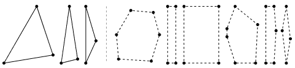

图 2.2 左：展示了满足三种常见质量度量之一的代表性三角形：适中的长宽比、一个小角和一个大角。右：以这种方式对多边形进行分类更具挑战性，因为大角或小角的存在既不意味着也不排除良好的长宽比。

术语*最小角条件*和*最大角条件*（在有限元文献中常见）分别指 \(t_{\min}\) 类型或 \(t_{\max}\) 类型的类。在每种情况下，估计 (2.7) 都可以建立。

### 引理 2.4。(2.7) 中的不等式在 \(t_{\min}\) 上一致成立。

引理 2.4 的证明是直接的，因为最小角界意味着最小高度，进而意味着重心坐标上的最大梯度，如 (2.7) 所要求。

### 定理 2.5。(2.10) 中的不等式在 \(t_{\max}\) 上一致成立。

定理 2.5 的证明更为复杂，因为大角三角形允许小高度，从而可能在局部产生大梯度。相反，证明涉及将大角三角形映射到具有有界长宽比的三角形，并通过该映射跟踪误差估计。关于这类三角形类的插值误差估计起源于 Babuška 和 Aziz [22] 以及 Jamet [209] 的独立工作。

图 2.2 说明了描述三角形质量的另一种方式。左侧显示的三个三角形分别具有适中的长宽比、一个小角和一个大角。回顾，三角形的*长宽比*是其最长边与最小内切圆半径之比。对长宽比的界等同于对三角形中最小角的界，因此任何具有有界长宽比的三角形类都是 \(t_{\min}\) 形式的某个类。此外，任意大的角只会与非常小的角同时出现，因此，作为直径为 1 三角形的子类，任何 \(t_{\min}\) 类型的类都包含在 \(t_{\max}\) 类型的类中。逆命题不成立：每个 \(t_{\max}\) 类型的类都包含一些具有任意小角的三角形，这些三角形不包含在任何 \(t_{\min}\) 类型的类中。

简单示例表明，在允许任意大内角的三角形类上插值误差是无界的 [22]。更准确地说，已经证明插值误差增长的速率与


三角形的外接圆半径 [225, 317]。因此，虽然对外接圆半径的界限意味着对最大角度的界限，反之亦然，但前者与插值误差有更直接的联系。

虽然 t_max 类型的类对于第 2.2 节中概述的插值分析是充分的，但对于有限元方法的收敛性来说并非严格必要，如 [185] 所示。然而，在任意大角度网格上的收敛有限元方法示例中，所使用的形状函数空间包含与形状规则网格对应的子空间。因此，某种形式的形状规则性似乎仍然是成功有限元方法的基础。

这些思想已推广到四面体和更高维单纯形 [7, 209, 231, 318]。在四面体上，最广为人知且使用的形状质量度量是长宽比，对于多面体，它是元素直径与最小内切球半径之比。基于长宽比的误差分析易于进行，但对几何形状过于限制，这与三角形上长宽比界限会排除允许的单小角三角形的情况相同。虽然对外接圆半径的界限与三角形上的插值误差密切相关，但由于斜棱四面体的存在，在四面体上情况并非如此。斜棱四面体是非常扁平的四面体，其顶点均匀分布在一个共同圆附近，使得外接圆半径适中。一种称为共面度的度量 [318] 在减弱的长宽比界限与排除斜棱四面体之间取得平衡；它测量四面体的边离共同平面有多远，从而允许窄元素而不允许斜棱四面体。

### 2.4 多边形和多面体的形状质量度量

对于直径为 1 的三角形类，我们刚刚讨论了许多常见形状质量度量实际上是等价的。然而，对于直径为 1 的多边形类，这些等价关系不再成立，度量之间的关系更为微妙。例如，一个多边形可以具有高长宽比而没有任何小内角，或者可以具有适中的长宽比而内角接近 180°。一些示例性例子如图 2.2 所示。

为了分析多边形情况，设 P 表示一个直径为 1 的通用多边形，其边为 $\{e_i\}_{i=1}^n$，顶点为 $\{v_i\}_{i=1}^n$，内角为 $\{\alpha_i\}_{i=1}^n$，内接圆最大半径为 $r(P)$。我们考虑以下多边形子类：

- p_conv — P 是凸的。
- p_ar — 长宽比有界：diam(P) / r(P) ≤ γ*。
- p_nv — 顶点数量有界：n < n*。
- p_edge — 直径与最短边之比有界：diam(P) / |e_i| < c*。
- p_mina — 所有内角都远离零有界：α_i > α_* > 0。
- p_maxa — 所有内角都远离 180° 有界：α_i < α* < 180°。

$p_{cvx}$、$p_{par}$、$p_{nv}$ 和 $p_{edge}$ 的定义也定义了直径为 1 的多面体和更高维多胞形的子类。如前所述，$p_{mina}$ 和 $p_{maxa}$ 的定义特定于多边形，但可以通过考虑共维为 1 的面之间的二面角来推广到更高维度。在多边形上，我们之前已经展示了这些类之间的一些包含关系，如下面的引理所示；证明见 [164, Proposition 4]。

### 引理 2.6. 对于直径为 1 的多边形类：

- $p_{cvx} \cap p_{par} \subset p_{mina}$。
- $p_{cvx} \cap p_{edge} \subset p_{par}$。
- $p_{cvx} \cap p_{maxa} \subset p_{nv}$。

我们还表明，对于直径为 1 的凸多边形 $P$，长宽比和边界限意味着以任何 $x \in P$ 为中心、某个统一半径 $r_*$ 的球将以以下三种方式之一与 $\partial P$ 相交：在两条相邻边上，在一条单边上，或者不相交。这一非退化结果对我们后续的分析有帮助，并可以更精确地表述如下；证明见 [164, Proposition 9]。

### 引理 2.7. 对于直径为 1 的多边形类，存在 $r_* > 0$，使得对于所有 $P \in p_{cvx} \cap p_{par} \cap p_{edge}$ 和任何 $x \in P$，$B(x, r_*)$ 不与 $P$ 的两条不相邻边相交。

除了这些几何准则之间的直接关系外，Sobolev 嵌入常数的均匀性是我们涉及一些（相对温和）几何限制的分析中的一个基本要素。这一组件是多边形分析所独有的，因为单纯形可以仿射映射到单个参考元素。

### 引理 2.8. 设 $d = 2$。均匀 Sobolev 嵌入估计 (2.6) 在 $p_{cvx} \cap p_{par}$ 上成立。

我们省略了引理 2.8 的完整证明，而是提供关键思想的概要；感兴趣的读者可以在 [164, Proposition 10] 的证明中找到相关技术细节。在数学分析文献中，Sobolev 嵌入定理中的常数通常由“锥条件” [3] 推导而来。该条件要求存在一个锥，使得对于任何点 $x \in P$，该锥可以旋转和平移，使其完全位于 $P$ 内部且顶点位于 $x$。我们可以通过找到一个仅取决于长宽比界限的 *单一* 锥来证明引理 2.8，使得锥条件对 $p_{cvx} \cap p_{par}$ 中的任何域都成立。在多边形情况下，需要最小内角界限，以便特定锥可以放置在顶点附近，而引理 2.6 (i) 提供了这一保证。

各种多胞形元方法最近出现在偏微分方程数值方法文献中，这些方法可以容纳多边形和多面体网格，而无需使用广义重心坐标。这些方法包括拟合方法、虚拟元素（见第 15 章）、弱伽辽林方法、梯度方案以及许多超出本章讨论范围的其他方法。所有这些方法仍然需要对网格元素的形状质量做出假设，以便进行所需的误差分析。典型的假设是每个网格元素“相对于一个球是星形的”，即，存在一个半径为 $r(B_\rho)$ 的 $d$ 球 $B_\rho \subset P$，使得 $\{x\} \cup B_\rho$ 的凸包是 $P$ 的子集 [70]。然后，在一系列网格上，假设 diam$(P)/r(B_\rho)$ 有一个统一的上界。由于 $r(B_\rho) \le r(P)$，这一假设比像 $\mathbf{p}_{\text{ar}}$ 这样的长宽比界限更强。由于许多这些方法实际上使用调和坐标进行误差分析，因此它们的假设很可能相应地被削弱。

Mu、Wang 和 Wang 最近还在不连续伽辽林方法 [288] 的背景下考虑了多边形和多面体网格的形状规则性条件。他们提供了四个形状规则性条件，记为 A1–A4，与这里提出的度量有许多相似之处。条件 A1 确保网格元素具有良好的单纯形分解质量，这与我们关于调和坐标的发现相关；这在第 2.5 节和 [163] 中进一步讨论。条件 A2 要求每个元素存在一条“大”边，但后来这被重新表述为条件 A2'，它与长宽比界限完全相同。条件 A3 允许对两个多边形或多面体在网格中如何相遇进行更一般的解释，而 A4 确保相邻网格元素直径之比有上界；即，网格“分级”合理。

在 Floater 等人 [147] 的工作中，凸多胞形 $P$ 的形状质量由单个参数 $h_*$ 表征，定义为 $P$ 的顶点与包含非关联面的任何超平面之间的最小距离。更正式地，

\(h_*(P) := \min_{f \in F} \min_{v \in V_f} h_f(v),\)

其中 $F, V$ 分别是 $P$ 的面集和顶点集，$V_f \subset V$ 是属于面 $f$ 的顶点集，$h_f(v)$ 是顶点 $v$ 到包含 $f$ 的 $d-1$ 维超平面的距离。考虑相关的多胞形类：

- $\mathbf{p}_{\text{vf}}$ — $h_*$ 的值远离零有界：$h_*(P) \ge h_* > 0$。

在多边形的情况下，固定顶点的逆时针顺序并令 $f := [\mathbf{v}_{i-1}, \mathbf{v}_i]$，则有 $h_f(\mathbf{v}_{i+1}) = \|\mathbf{v}_{i+1} - \mathbf{v}_i\| \sin \alpha_i$，其中 $\alpha_i := \angle(\mathbf{v}_{i-1}, \mathbf{v}_i, \mathbf{v}_{i+1})$。因此，对 $h_*$ 的下界确保了 $P$ 中短边与其相邻角度之间的平衡。精确结果如下。

### 引理 2.9. 在多边形上，$(\mathbf{p}_{\text{cvx}} \cap \mathbf{p}_{\text{edge}} \cap \mathbf{p}_{\text{mina}} \cap \mathbf{p}_{\text{maxa}}) \subset \mathbf{p}_{\text{vf}}$。

引理 2.9 的证明可以在 [147, Corollary 2.4] 的证明中找到。


| \(\epsilon\) | HM* | WP | MV | DH | LS-1 | LS-2 | LS-3 | ME-T | ME-U |
|---|---|---|---|---|---|---|---|---|---|
| 0.1600 | 7.5e-1 | 1.1e-1 | 4.0e-2 | 2.3e-1 | 2.2e-1 | 3.4e-2 | 6.5e-2 | 2.5e-1 | 7.3e-1 |
| 0.0400 | 8.5e-1 | 3.9e-2 | 1.2e-2 | 8.3e-2 | 9.0e-2 | 1.3e-2 | 2.9e-2 | 9.6e-2 | 4.6e-1 |
| 0.0100 | 8.9e-1 | 1.2e-2 | 3.2e-3 | 1.6e-1 | 2.9e-2 | 4.3e-3 | 1.0e-2 | 3.0e-2 | 2.5e-1 |
| 0.0025 | 9.1e-1 | 3.3e-3 | 6.7e-4 | 3.7e-3 | 7.9e-3 | 1.2e-3 | 3.2e-3 | 8.9e-3 | 9.9e-2 |

表 2.2 图 2.1b 所示域族上某些广义重心坐标的比较。坐标和数据与表 2.1 相同；即，谐波坐标报告的是插值的 \( H^1 \)-半范数，其他坐标报告的是相对于谐波插值的 \( H^1 \)-半范数差异。数据表明，在存在小边的情况下，广义重心坐标 *可以* 具有受控的插值误差。

### 2.5 多边形上的插值误差估计

令 \(\phi\) 为一种特定的重心坐标；例如，瓦赫斯普坐标。对于直径为 1 的多边形的哪个充分但不过分限制的子类，估计 (2.7)-(2.9) 中的某一项对 \(\phi\) 保证成立？鉴于第 2.2 节的分析，对该问题的回答，结合一致索博列夫嵌入估计 (2.6)，意味着形式为 (2.12) 的标准 *先验* 误差估计。我们已经针对多种广义重心坐标回答了这个问题，现予以讨论。

我们首先考虑一些简单示例，展示在允许退化几何的多边形族上广义重心插值的鲁棒性或失效。在第 2.1 节中，我们讨论了图 2.1a 中的家族，该家族包含任意大的角度。现在考虑图 2.1b，它描绘了一组包含任意小边长、趋近于三角形几何的四边形。表 2.2 中计算的插值误差表明，这种退化并不构成任何实际问题。数据表明，虽然 \( p_{edge} \) 对分析有用，但对于受控插值并非严格必要。

此外，插值误差可以承受许多短边的存在，即使是在不是 \( p_{vw} \) 类型的多边形类上也是如此。表 2.3 包含了顶点数量越来越多的正多边形上的插值误差；该多边形族属于 \( p_{cvr} \)、\( p_{ar} \) 和 \( p_{mina} \) 类型，但不属于 \( p_{edge} \)、\( p_{maxa} \) 或 \( p_v \) 类型。对于测试的每种坐标，插值误差在实际中是有界的，尽管某些误差可能增长非常缓慢。另一个挑战也随之出现：顶点数量过多会使坐标计算变得越来越昂贵。

### 2.5.1 三角化坐标

在多边形 \( P \) 上构建的最简单的广义重心坐标是 *三角化坐标*，它们需要先对 \( P \) 进行三角化，然后对每个三角形进行分段

| n | HM* | WP | MV | DH | LS-1 | LS-2 | LS-3 | ME-T | ME-U |
|---|---|---|---|---|---|---|---|---|---|
| 4 | 1.5e0 | 0.0e0 | 4.5e-2 | 0.0e0 | 1.1e-1 | 8.3e-3 | 1.2e-2 | 0.0e0 | 0.0e0 |
| 8 | 1.9e0 | 5.0e-2 | 1.0e-2 | 5.0e-2 | 1.3e-1 | 9.9e-3 | 2.3e-2 | 7.5e-2 | 1.3e-1 |
| 16 | 1.9e0 | 7.9e-2 | 4.2e-2 | 7.9e-2 | 1.7e-1 | 5.5e-3 | 4.0e-2 | 8.2e-2 | 1.7e-1 |
| 32 | 2.0e0 | 8.8e-2 | 4.3e-2 | 8.8e-2 | 1.7e-1 | 2.3e-3 | 4.3e-2 | 6.8e-2 | 1.8e-1 |
| 64 | 2.0e0 | 9.1e-2 | 4.3e-2 | 9.1e-2 | 1.7e-1 | 9.7e-4 | 4.3e-2 | 5.2e-2 | 1.8e-1 |
| 128 | 2.0e0 | 9.2e-2 | 4.3e-2 | 9.2e-2 | 1.8e-1 | 5.8e-4 | 4.4e-2 | 3.9e-2 | 1.8e-1 |
| 256 | 2.0e0 | 9.2e-2 | 4.3e-2 | 9.2e-2 | 1.8e-1 | 5.0e-4 | 4.4e-2 | 2.9e-2 | 1.8e-1 |

表 2.3 具有 n 个顶点的正多边形（固定直径）上某些广义重心坐标的比较。坐标和数据与表 2.1 和 2.2 相同。

线性重心插值。当然，三角化的选择对插值质量有显著影响。例如，图 2.1a 中的多边形有三种可能的三角化：一种是中心顶点连接到所有四个顶点，另外两种是顶部三个顶点形成钝角三角形。第一种选择提供了与 \(\epsilon\) 无关的有界插值误差，而后两种在 \(\epsilon\) 缩小时会产生较大误差。

如第 2.3 节所述，对于角度大或等价地外接半径大的三角形，插值误差可能很大。给定一组点（在本例中为 \(P\) 的顶点），《德劳内三角化》定义为外接圆为空的三角形集合。德劳内三角化为任何凸多边形提供有效的三角化，并倾向于避免外接半径大的三角形，因为这将需要存在一个穿过 \(P\) 三个顶点的大空球。更准确地说，德劳内三角化具有许多最优性质：它最大化最小角 [233, 359]，最小化函数 \(\|x\|^2\) 的 \(L^p\) 误差 [92, 112, 327]，并最小化插值的 \(H^1\)-半范数 [312, 326]。

如果 \(P\) 是非凸的，可以使用 *受约束德劳内三角化* [97] 来构建三角化坐标。这种修改后的定义确保 \(P\) 的边存在于三角化中，同时尽可能避免大外接半径。在仅需要分段线性插值的应用中，例如低阶有限元方法，与更复杂的广义重心坐标类型相比，使用（受约束）德劳内三角化的三角化坐标表现相当好。为了理解原因，我们接下来转向最平滑的可能插值：谐波坐标。

### 2.5.2 谐波坐标

由于谐波坐标是简单椭圆偏微分方程的解，标准单纯形有限元理论在三角化坐标（即离散解）和谐波坐标（即连续解）之间提供了联系。具体来说，该理论保证三角化坐标的 \(H^1\)-半范数必须大于谐波坐标的 \(H^1\)-半范数，相差一个取决于多边形直径的常数因子。因此，找到一类使得三角化坐标具有有界插值误差估计的多边形，足以确保谐波坐标中的误差有界。从三角化坐标开始提供了明显的优势：由于对所有类型三角形的插值误差都有非常充分的理解，因此无需将注意力限制在 \(\mathbf{p}_{\text{edge}}\) 或 \(\mathbf{p}_{\text{par}}\) 类型的类上。

这种分析思路可以推广到允许多边形的任何三角化，包括任意数量的内部顶点，只要三角化的边界与多边形的边精确匹配；即，三角化的任何顶点都不位于多边形的边上。其结果是在 \(\mathbf{p}_{\text{par}}\) 类型的类上分析谐波坐标的一种直接方法：使用一个放置在最大内切圆中心的额外顶点进行三角化。证明见 [164, Lemma 4]。

### 引理 2.10.
不等式 (2.9) 对 \(\mathbf{p}_{\text{vex}} \cap \mathbf{p}_{\text{par}}\) 上的谐波坐标一致成立。

尝试放宽有界长宽比限制，会在三角化和谐波坐标之间产生更强的联系。具体来说，我们在 [163] 中表明，每当凸多边形的德劳内三角化包含一个外接半径大的三角形时（这意味着通过三角化坐标得到的插值较差），谐波坐标也会很大（在 \(H^1\)-范数中）。选择德劳内三角化对该分析至关重要。例如，图 2.1a 中的多边形基本上有两种三角化方式：一种是由顶部三个顶点形成钝角三角形，另一种是顶部顶点连接到所有其他顶点。前者在角度趋近于 \(180^\circ\) 时会产生无界插值误差，类似于表 2.1 中的瓦赫斯普坐标，而后者（即德劳内三角化）具有受控的插值误差。

我们首先通过图 2.1c 所示的简单示例的数值实验，研究非凸多边形上的谐波插值。对于 \(\epsilon\) 缩小的情况，该情形的插值误差见表 2.4。然而，这个数值实验有些不确定：随着 \(\epsilon\) 减小，$H^1$ 误差略有增加，但不清楚趋势是趋近于某个固定值还是无界增长。

[163] 中的分析消除了这种歧义。每当多边形族包含这种配置，即多边形顶点可以任意接近非相邻边的内部时，谐波坐标下的插值误差无法有界。因此，理论上，误差 *必须* 在 \(\epsilon \to 0\) 时对表 2.4 中的所有坐标无界。该分析的细节非常微妙，涉及索博列夫嵌入定理中临界情况 \(k = d/2\) 的估计。因此，发散发生得非常缓慢也就不足为奇了。

主要结论如下：多边形受约束德劳内三角化中的低质量三角形会导致插值误差估计失效。然而，这种情况在实际中限制不大，因为误差增长非常缓慢，至少对于谐波坐标而言是如此。


| \(\epsilon\) | HM* | MV | LS-1 | LS-2 | LS-3 | ME-T |
|---|---|---|---|---|---|---|
| 0.1600 | 2.4e0 | 8.2e-1 | 2.3e-0 | 4.2e-1 | 8.9e-1 | 1.4e-0 |
| 0.0400 | 2.2e0 | 7.4e-1 | 2.3e-0 | 3.0e-1 | 8.7e-1 | 1.4e-0 |
| 0.0100 | 2.4e0 | 7.6e-1 | 2.4e-0 | 2.6e-1 | 8.6e-1 | 1.6e-0 |
| 0.0025 | 2.6e0 | 8.2e-1 | 2.6e-0 | 2.4e-1 | 1.1e0 | 1.7e-0 |

表 2.4 非凸域族上一些广义重心坐标的比较，该非凸域族如图 2.1c 所示。坐标和数据与表 2.1 和 2.2 相同，但仅包含在非凸多边形上定义良好的坐标。

### 2.5.3 瓦赫斯普坐标

在分析显式定义的坐标（以瓦赫斯普坐标为起点）时，我们采用一种依赖于推导坐标梯度一致上界的方法。在 \(\mathfrak{p}_{cvx} \cap \mathfrak{p}_{par}\) 内选择一类多边形，根据引理 2.8，一致索博列夫嵌入估计成立。然后，命题 2.3 确保所需的插值误差估计成立。因此，分析中缺失的组成部分在以下结果中得到解决。证明见 [164, 引理 6]。

**引理 2.11.** _不等式 (2.7) 对_ \(\mathfrak{p}_{cvx} \cap \mathfrak{p}_{par} \cap \mathfrak{p}_{edge} \cap \mathfrak{p}_{maxa}\) 上的瓦赫斯普坐标一致成立。_

与其提供完整证明，不如简要说明几何条件为何足以确保梯度界。不失一般性，我们考虑一个一般直径为 1 的多边形，其瓦赫斯普坐标由如下形式的权重构建：

```
\(w_i = A(\mathbf{v}_{i-1}, \mathbf{v}_i, \mathbf{v}_{i+1}) \prod_{j \neq i, i+1} A(\mathbf{v}_{j-1}, \mathbf{v}_j, \mathbf{x}).\) (2.13)
```

此构建中相关的三角形 \([\mathbf{v}_{i-1}, \mathbf{v}_i, \mathbf{v}_{i+1}]\) 和 \([\mathbf{v}_{i-1}, \mathbf{v}_i, \mathbf{x}]\) 如图 2.3 的顶行所示。

在类 \(\mathfrak{p}_{cvx} \cap \mathfrak{p}_{par} \cap \mathfrak{p}_{edge} \cap \mathfrak{p}_{maxa}\) 中，权重可以从上方界定，因为引理 2.6 确保了表达式中项数的上界，且每个三角形都是直径为 1 的多边形的子集。此外，权重的梯度可写为

```
\(\nabla w_i = A(\mathbf{v}_{i-1}, \mathbf{v}_i, \mathbf{v}_{i+1}) \sum_{k \neq i, i+1} \nabla A(\mathbf{v}_{k-1}, \mathbf{v}_k, \mathbf{x}) \prod_{j \neq i+1, k} A(\mathbf{v}_{j-1}, \mathbf{v}_j, \mathbf{x}).\)
```

这些加项可以通过类似的论证从上方界定，即三角形面积关于其某个顶点的梯度范数等于对边长度的一半，在直径为 1 的多边形中这当然是有界的。

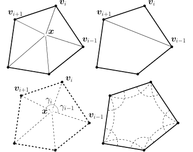

图 2.3 瓦赫斯普（上两幅图）和平均值（下两幅图）坐标的插值误差分析的记号与背景。

瓦赫斯普坐标通过对 (2.13) 中的权重进行归一化来构建。因此，为了确保所需的界，我们还必须证明权重之和从下方有界。首先，我们观察到，最大内角和边长限制确保 $A(v_{j-1}, v_j, x)$ 对于最多 2 个连续顶点可以很小，因为 $x$ 非常接近多边形的最多一个顶点。因此，对于任何 $x$，存在一个仅涉及形式为 $A(v_{j-1}, v_j, x)$ 的非小面积的权重，而剩余项 $A(v_{i-1}, v_i, v_{i+1})$ 也不可能很小，同样归功于几何限制。完整证明见 [164]，但上述讨论概述了几何限制发挥作用的关键点。

[147, 定理 2.3, $d = 2$] 对此结果给出了略有不同的阐述，如下重述。

**引理 2.12.** _不等式 (2.7) 对_ $\mathcal{P}_{\text{cvx}} \cap \mathcal{P}_{\text{ft}}$ 上的瓦赫斯普坐标一致成立。_

请注意，根据引理 2.6 (i)，形式为 $\mathcal{P}_{\text{cvx}} \cap \mathcal{P}_{\text{pt}} \cap \mathcal{P}_{\text{edge}} \cap \mathcal{P}_{\text{mass}}$ 的类可以改写为形式为 $\mathcal{P}_{\text{cvx}} \cap \mathcal{P}_{\text{edge}} \cap \mathcal{P}_{\text{mina}} \cap \mathcal{P}_{\text{maxa}}$ 的类，而根据引理 2.9，该类又可以改写为形式为 $\mathcal{P}_{\text{cvx}} \cap \mathcal{P}_{\text{ft}}$ 的类。因此，引理 2.12 蕴含引理 2.11，尽管逆蕴含似乎也很可能成立。引理 2.12 到维度 $d \ge 3$ 的推广在 2.6 节中讨论。

### 2.5.4 平均值坐标

平均值坐标的分析遵循与瓦赫斯普坐标相同的思路：我们如 (2.7) 所示界定各个坐标梯度的 \(L^\infty\) 范数，这足以推导出插值误差估计。关键区别在于用于构建坐标的权重有新的表达式，并且不再需要排除接近 \(180^\circ\) 的内角。以下结果的证明见 [319, 定理 1]。

**引理 2.13.** 不等式 _(2.7)_ 对 \(\mathcal{P}_{\text{ex}} \cap \mathcal{P}_{\text{in}} \cap \mathcal{P}_{\text{edge}}\) 上的平均值坐标一致成立。

平均值坐标由如下形式的权重构建，

```
\(\displaystyle w_i(\boldsymbol{x}) = \frac{\tan(\frac{\gamma_i(\boldsymbol{x})}{2}) + \tan(\frac{\gamma_{i-1}(\boldsymbol{x})}{2})}{\|\boldsymbol{v}_i - \boldsymbol{x}\|},\)
```

其中，角度 \(\gamma_i(\boldsymbol{x})\) 如图 2.3 左下图所示。[319] 中的后续分析依赖于以下观察：如果 \(\boldsymbol{x}\) 非常接近多边形的一个顶点，或者 \(\boldsymbol{x}\) 接近多边形的一条边，则这些权重会变大。在后一种情况下，角度 \(\gamma_i\) 中有一个接近 \(180^\circ$，导致相关的正切项变大。分析被分为若干情况，取决于哪些项接近退化。图 2.3 右下图显示了一个被划分为不同区域的多边形，这些不同情况适用于这些区域。引理 2.7 有助于简化此分类，因为它确保一个顶点只能靠近有限数量的多边形边和顶点。由于坐标涉及权重函数的归一化，大的权重函数并不妨碍对坐标及其梯度的界定。为了在每种情况下界定梯度，这些大项被证明被分母中更大的项所抵消。分析要求多边形是凸的，以确保覆盖所有可能的情况；非凸情况尚未被考虑。

### 2.6 多面体和多胞形上的插值误差估计

从多边形转向多面体和一般多胞形，量化形状质量的挑战变得复杂得多。涉及多边形内角（即 \(\rho_{\text{mina}}\) 和 \(\rho_{\text{maxa}}\)）的度量在二维分析中至关重要，但没有自然的高维推广；二面角或许是最接近的类比。此外，高维中广义重心坐标的定义较少，部分原因是将此类坐标限制到可能非单纯的边界面时，应以某种预定方式产生较低维的广义重心坐标。为求简单，某些构造（例如，平均值坐标）将其定义限制在具有单纯边界面的多胞形上，而其他构造（例如，调和坐标和最大熵坐标）则没有此限制。调和坐标和瓦赫斯普坐标的插值误差已在某些强几何限制下进行了分析，如下文所述。

### 2.6.1 三维及更高维度中的调和坐标

基于椭圆偏微分方程的非常一般的理论，调和坐标的大部分分析适用于任意维度。只有两个关键区别影响了从多边形设置中得出的最终结论和结果陈述：外接圆半径不再是单纯形质量的良好度量，且索博列夫嵌入定理在更高维度中允许更多种类的不连续函数。我们逐一讨论。

被称为“薄片”的四面体，由四个靠近共同圆的顶点定义，提供了三维及更高维度中插值误差分析挑战的一个简单示例。薄片相对于其直径具有适中的外接圆半径，但具有较差的长宽比，并在线性插值中表现出较大的误差。因此，不能期望将最小化大外接圆半径的三维受限德劳内三角剖分类比物，在插值控制上与调和坐标相当。

广义上讲，索博列夫嵌入定理描述了哪些索博列夫空间允许不连续函数，哪些仅包含连续函数。在这方面，两个关键参数是空间维度 d 和积分中使用的指数 p。当 d > p 时，不连续函数被允许在相关的索博列夫空间 W^{1,p}(Ω) 中，并且随着 d 在 p 固定时增加，更多函数被包含在该空间中。

这些事实对调和坐标意味着什么？虽然调和坐标仍可通过对域的有效四面体化，与三角剖分坐标进行比较来估计，但没有明确的程序来识别“最佳”四面体化。此外，虽然在 d = 2 中，多边形上存在靠近非关联边的顶点会导致插值效果差，但在 3D 中类似的配置仍然允许良好的插值误差。有界长宽比的形状质量度量可以且被用于控制插值误差，尽管这是一个过于限制性的几何假设。3D 中调和坐标的精确度量仍然未知。

### 2.6.2 三维及更高维度中的瓦赫斯普坐标

在多面体上，既相对容易实现又适合误差分析的少数几种广义重心坐标类型之一，是 Warren 等人 [411, 413] 对瓦赫斯普坐标的推广。Floater 等人 [147] 提供了用于在通用凸多面体上计算这些坐标的 MATLAB® 代码，并推导了简单凸多面体子类上的插值误差界。

如果一个 d 维多胞形的每个顶点都恰好与 d 个维度为 d − 1 的面相关联，则称为简单多胞形。特别是，每个多边形都是简单的，每个单纯形


是简单的，并且由Voronoi图生成的多面体如果种子点处于一般位置也是简单的。我们引入相关的多胞体类：
\(\mathfrak{p}_{\text{simp}} \longrightarrow P\) 是简单的。

以下结果是将Lemma 2.12推广到\(d\)维。回顾第2.4节末尾的\(\mathfrak{p}_{\text{rf}}\)定义；以下结果来自[147, Theorem 2.3]。

**定理 2.14.** 固定\(d \ge 2\)。那么(2.7)中的不等式在\(\mathfrak{p}_{\text{cvx}} \cap \mathfrak{p}_{\text{rf}} \cap \mathfrak{p}_{\text{simp}}\)上的Wachspress坐标中一致成立。

证明概要如下。首先，量\(\|\nabla \phi_i(\boldsymbol{x})\|\)被界定为\(O(h_f(\boldsymbol{x})^{-1})\)的项；回顾\(h_f(\boldsymbol{x})\)是点\(\boldsymbol{x}\)到面\(f\)的距离。这些估计量对\(P\)的所有顶点求和并重新分组。由于函数\(h_f(\boldsymbol{x})\)在\(\boldsymbol{x}\)中是仿射的，它可以写成\(\{\phi_i(\boldsymbol{x})\}\)的线性组合，从而允许对估计量进行进一步简化。由于\(P \in \mathfrak{p}_{\text{rf}}\)，我们有\(h_f(\boldsymbol{x}) \ge h_\ell(P) > 0\)，并且由于\(P \in \mathfrak{p}_{\text{simp}}\)，我们可以提取\(2d\)以产生结果。

如上述证明和[147]中的其他结果所强调的，Wachspress坐标的梯度之和大约按\(h_\ell^{-1}\)缩放。因此，如果\(h_\ell\)很小，我们预期Wachspress坐标将具有较差的插值特性。任何具有大二面角的多面体都有较小的\(h_\ell\)值，这意味着任何旨在允许输出网格上Wachspress插值的网格划分方案都应力求避免大二面角。沿着这些思路的进一步分析仍然是未来工作的重要方向。

### 2.7 扩展与未来方向

本章的结果集中于在标量值椭圆偏微分方程的多边形和多面体网格上的线性有限元方法中，广义重心坐标的插值误差估计。在[320]中，我们展示了如何通过取广义重心坐标两两乘积的线性组合来构造多边形上二阶有限元的基函数。此类函数的梯度具有\(\phi_i \nabla \phi_j\)形式的项，因此我们对\(\|\nabla \phi_j\|\)的估计仍然是此类高阶方法误差估计中的关键要素。

在[165]中，我们展示了如何在多边形和多面体上构造线性阶、矢量值、\(H(\text{curl})\)-和 \(H(\text{div})\)-符合元素的基函数。我们的构造使用广义重心函数及其梯度，形式如\(\phi_i \nabla \phi_j - \phi_j \nabla \phi_i》，模仿单纯形上重心坐标的Whitney函数方法。同样，本章解释的\(\|\nabla \phi_j\|\)的界限在该类方法的误差分析中是必要的。

在本章开头，我们提出了这样一个问题：更改网格或选择替代的广义重心坐标类型是否可以修复原本会崩溃的仿真代码。答案是肯定的，这两种方法都可以改进插值的数值方法。特别是，带有均匀先验的Wachspress、离散调和和最大熵坐标已被证明在具有大角度的多边形上提供较差的插值，并且在非凸多边形上未定义。更改坐标类型或重新网格划分以避免大角度和非凸多边形可以避免此故障。

另一方面，我们的数值实验还表明，许多坐标类型对极度退化的多边形几何具有惊人的鲁棒性。例如，四边形坍缩为三角形的元素族（图2.1b）不属于类$\mathfrak{p}_{\text{edge}}$，也不属于类$\mathfrak{p}_V$，这排除了Wachspress和平均值坐标，使其不适用于Lemma 2.11、Lemma 2.12和Lemma 2.13保证的梯度估计。尽管如此，我们在该族上测试的*所有*坐标的插值误差仍然很小。进一步的分析和实验将有助于改进现有的梯度估计和形状质量度量，以提高它们在实际应用场景中的相关性。

## 无限重心坐标

Alexander G. Belyaev
赫里奥特-瓦特大学，爱丁堡，英国
Pierre-Alain Fayolle
会津大学，会津若松，日本

## 目录

- 3.1 引言 .................................................... 44
- 3.2 加权平均值插值 ........................... 45
- 3.2.1 一般构造 ...................................... 45
- 3.2.2 无限三点坐标 ....................... 47
- 3.2.3 无限拉普拉斯坐标 ........................... 48
- 3.2.4 无限Wachspress坐标 ........................ 49
- 3.2.5 圆盘上无限拉普拉斯和Wachspress坐标重合 ..... 51
- 3.3 Gordon–Wixom插值 .................................. 51
- 3.3.1 Lagrange型Gordon–Wixom插值 ................ 51
- 3.3.2 Hermite型Gordon–Wixom插值 ................. 54
- 3.3.3 修正的Hermite型Gordon–Wixom插值 ........ 55
- 3.3.4 用于多调和插值的修正Gordon–Wixom .... 56
- 3.4 广义平均值势和距离函数近似 .................... 57
- 3.4.1 光滑域上的广义平均值势 .... 57
- 3.4.2 多边形的广义势 ....................... 61

在本章中，我们研究无限重心插值方案的性质，这些方案可以被视为广义重心坐标的连续对照物，目前由于其迷人的数学特性以及在计算力学[170, 344]、计算机图形学[247, 248]和几何建模[93, 145, 227, 413]中的众多应用而成为密集研究的课题（另见其中的参考文献）。

我们从无限重心坐标的一般构造开始，该构造是Floater平均值坐标[144, 217]的简单自然推广，并研究了三点坐标连续类似物[149]的性质。我们讨论了Gordon-Wixom插值方法[171]并考虑其推广和修改[37, 38]。最后，我们介绍了广义平均值势，并展示了它们如何用于距离函数近似[40]。

### 3.1 引言

虽然传统的广义重心坐标插值给定于多边形或多面体顶点的函数值，但无限重心插值基于光滑域。无限重心插值方案在重心坐标与用于插值连续数据的方法之间架起了桥梁[38, 77, 93, 133, 151, 153, 171]。此外，研究广义重心坐标的连续版本有助于我们更好地理解其离散对照物[37, 93, 248, 346, 413]。

与离散情况类似（参见第1.1.2节），让我们考虑$\mathbb{R}^d$中的凸域$\Omega$和光滑函数$\phi(x, y)$，其中$x \in \Omega$且$y \in \partial \Omega$，满足以下两个性质：

一致性：$\int_{\partial \Omega} \phi(x, y) \, ds_y = 1, \quad (3.1)$

线性精度：$\int_{\partial \Omega} y \, \phi(x, y) \, ds_y = x, \quad (3.2)$

它们是定义1.1中条件(1.8)和(1.9)的连续类似物。现在，定义在$\partial \Omega$上的某个函数$u(y)$到$\Omega$的无限插值由以下公式给出：

$u(x) = \int_{\partial \Omega} u(y) \phi(x, y) \, ds_y. \quad (3.3)$

在数学术语中，$\phi(x, y)$是由(3.3)右侧定义的积分算子的*核*。

我们的主要任务是在各种重心坐标与由(3.3)描述的一般无限插值构造之间建立联系，该构造带有满足(3.1)和(3.2)的某个核$\phi(x, y)$。

在本章中，我们假设域$\Omega$是凸且有界的。在实践中，当然，我们也希望处理非凸域。一个高效的


一种将重心插值方案扩展到单连通非凸域的简单方法在[200]中提出。处理非凸域的更简单方法在[251]中建议。我们将在3.2节末尾简要讨论这两种方法。

### 3.2 WEIGHTED MEAN VALUE INTERPOLATION

### 3.2 加权平均值插值

#### 3.2.1 General construction

#### 3.2.1 一般构造

Let us start from the transfinite mean value interpolation scheme proposed in [217]. Let \(\Omega\) be a bounded convex domain and \(\mathbf{x}\) be a point inside \(\Omega\). Consider the unit sphere \(S_z\) centered at \(\mathbf{x}\) and assume that \(S_z\) is parameterized by its outer unit normal \(e_\rho\). Let \(\mathbf{y}\) be a point on \(\partial\Omega\) and \(\rho = \|\mathbf{x} - \mathbf{y}\|\). Denote by \(\mathbf{z}\) the intersection point between the ray \([\mathbf{x}, \mathbf{y})\) and \(S_z\) (see Figure 3.1, left). If we assume that we know the values of the function \(u\) on \(\partial\Omega\) and at \(\mathbf{x}\), then we can estimate \(u(\mathbf{z})\) using linear interpolation,

让我们从[217]中提出的超有限平均值插值方案开始。设\(\Omega\)为有界凸域，\(\mathbf{x}\)为\(\Omega$内部的一点。考虑以\(\mathbf{x}$为中心的单位球\(S_z$，并假设\(S_z$由其外单位法线\(e_\rho$参数化。设\(\mathbf{y}$为\(\partial\Omega$上的一点，\(\rho = \|\mathbf{x} - \mathbf{y}\|$。用\(\mathbf{z}$表示射线\([\mathbf{x}, \mathbf{y})\)与\(S_z$的交点（见图3.1，左）。如果假设我们知道函数\(u$在\(\partial\Omega$和\(\mathbf{x}$处的值，则可以使用线性插值来估计\(u(\mathbf{z})$，

```
\(u(\mathbf{z}) \approx \frac{(\rho - 1)u(\mathbf{x}) + u(\mathbf{y})}{\rho}.\)
```

Now, applying S-averaging (circular averaging in the 2D case and spherical averaging in the 3D case) to the left and right sides of the above equation yields

现在，对上述等式左右两边应用S-平均（2D情况下的圆形平均和3D情况下的球形平均）得到

```
\(\int_{S_z} u(\mathbf{z}) d\theta = |S_z|u(\mathbf{x}) - u(\mathbf{x}) \int_{S_z} \frac{d\theta}{\|\mathbf{x} - \mathbf{y}\|} + \int_{S_z} \frac{u(\mathbf{y})d\theta}{\|\mathbf{x} - \mathbf{y}\|}.\)
```

where \(d\theta\) is the area element of the unit sphere \(S_z\) at \(\mathbf{z} \in S_z\) (to distinguish the 2D case we denote the angular element of the unit circle by \(d\theta\)), and \(|S_z|\) is the unit sphere area. Assuming that \(u\) is harmonic, we arrive at the transfinite mean value interpolation scheme

其中\(d\theta$是单位球\(S_z$在\(\mathbf{z} \in S_z$处的面积元素（为区分2D情况，我们用\(d\theta$表示单位圆的角元素），\(|S_z|$是单位球面积。假设\(u$是调和函数，我们得到超有限平均值插值方案

```
\(u(\mathbf{x}) = \int_{S_z} \frac{u(\mathbf{y})d\theta}{\|\mathbf{x} - \mathbf{y}\|} \Big/ \int_{S_z} \frac{d\theta}{\|\mathbf{x} - \mathbf{y}\|}.\) (3.4)
```

It is interesting that instead of mimicking the mean value property of harmonic functions we can derive (3.4) from the simple observation that the spherical (circular

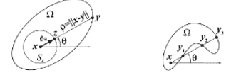

Figure 3.1 Left: notation used to define weighted mean value interpolation. Right: if \(\Omega\) is non-convex, then the rays emitted from \(\mathbf{x} \in \Omega\) may intersect \(\partial\Omega\) in multiple points.

in the 2D case) mean of all the directional derivatives of a given smooth function is equal to zero. Now, approximating the directional derivative of \(u\) in the direction of the ray \([x, y)\) by \((u(y) - u(x))/\|y - x\|\) and averaging with respect to all directions yields

有趣的是，我们不必模仿调和函数的平均值性质，而是可以从一个简单的观察中推导出(3.4)，即给定光滑函数的所有方向导数的球形（圆形


图3.1 左：定义加权平均值插值所用的符号。右：如果\(\Omega$是非凸的，则从\(\mathbf{x} \in \Omega$发出的射线可能与\(\partial\Omega$在多个点相交。

在2D情况下）的平均值为零。现在，将\(u$在射线\([x, y)$方向上的方向导数近似为\((u(y) - u(x))/\|y - x\|$，并对所有方向求平均，得到

\(\int_{S_x} \frac{u(y) - u(x)}{\|x - y\|} d\theta = 0,\)

which is equivalent to (3.4).

这与(3.4)等价。

The interpolation scheme (3.4) allows for a natural generalization

插值方案(3.4)允许自然推广

\(u(x) = \int_{S_x} \frac{u(y)\omega(x, e_\theta)}{\|x - y\|} d\theta \big/ \int_{S_x} \frac{\omega(x, e_\theta)}{\|x - y\|} d\theta, \quad (3.5)\)

where \(\omega(x, e_\theta)\) is a weighting function that may depend on the interpolated location \(x\) and the direction \(e_\theta\). It is easy to see that (3.5) is just another form of (3.3) and we can also consider (3.5) as a transfinite version of the basic Shepard interpolation [354].

其中\(\omega(x, e_\theta)$是一个权函数，可能取决于插值位置\(x$和方向\(e_\theta$。可以看出(3.5)只是(3.3)的另一种形式，我们也可以将(3.5)视为基本Shepard插值[354]的超有限版本。

Let us check when (3.5) satisfies the linear precision property (3.2). Setting \(u(x) \equiv x\) yields \(u(y) \equiv y = x + p e_\theta\). Substituting the latter into (3.5) gives

让我们检查(3.5)何时满足线性精度性质(3.2)。设\(u(x) \equiv x$得到\(u(y) \equiv y = x + p e_\theta$。将后者代入(3.5)得到

\(0 = \int_{S_x} e_\theta \omega(x, e_\theta) d\theta \quad \forall x \in \Omega, \quad (3.6)\)

which is necessary and sufficient for linear precision. One can see that (3.6) is satisfied, if the weighting function is centrally symmetric and coincides at each pair of antipodal points,

这是线性精度的必要且充分条件。可以看出，如果权函数是中心对称的，并且在每对对极点处重合，则满足(3.6)，

\(\omega(x, e_\theta) = \omega(x, -e_\theta).\)

Consider now the case of planar interpolation with \(d = 2\) and \(e_\theta = (\cos \theta, \sin \theta)\),

现在考虑平面插值的情况，\(d = 2$和\(e_\theta = (\cos \theta, \sin \theta)$，

\(u(x) = \int_0^{2\pi} \frac{u(y)\omega(x, \theta)}{\|x - y\|} d\theta \big/ \int_0^{2\pi} \frac{\omega(x, \theta)}{\|x - y\|} d\theta. \quad (3.7)\)

Then, (3.6) becomes

那么，(3.6)变为

\(\int_0^{2\pi} \omega(x, \theta) \cos \theta d\theta = 0 = \int_0^{2\pi} \omega(x, \theta) \sin \theta d\theta \quad \forall x \in \Omega. \quad (3.8)\)

If \(\omega(x, \theta)\) satisfies (3.8), then by using the Fourier series expansion

如果\(\omega(x, \theta)$满足(3.8)，则通过使用傅里叶级数展开

\(\omega(x, \theta) = \sum c_n(x) e^{in\theta}, \quad i = \sqrt{-1},\)

it is easy to show that there exists \(p(x, \theta)\) such that

可以很容易地证明存在\(p(x, \theta)$使得

\(p''_{\theta\theta}(x, \theta) + p(x, \theta) = \omega(x, \theta). \quad (3.9)\)

Here and below we often use prime-notations for the first- and second-order derivatives with respect to \(\theta\):

下文中我们经常使用关于\(\theta$的一阶和二阶导数的素号表示法：

\((\cdot)'_\theta \text{ stands for } \frac{d}{d\theta}(\cdot) \text{ and } (\cdot)''_{\theta\theta} \text{ stands for } \frac{d^2}{d\theta^2}(\cdot).\)

The orthogonality condition (3.8) can be verified by simple integration by parts,

正交性条件(3.8)可以通过简单的分部积分验证，

```
\(\int_0^{2\pi} \omega(x, \theta)e^{il\theta} d\theta = \int_0^{2\pi} \left( \frac{\partial^2}{\partial \theta^2} p + p \right) e^{il\theta} d\theta = \int_0^{2\pi} p(x, \theta) \left( \frac{\partial^2}{\partial \theta^2} e^{il\theta} + e^{il\theta} \right) d\theta = 0.\)
```

Representation (3.9) has an interesting geometric interpretation. Given a curve \(\Sigma\) and a point \(x\), the geometry of \(\Sigma\) is determined by its support function \(p(x, \theta)\), the signed distance from \(x\) to the tangents of \(\Sigma\). The support function satisfies the second-order differential equation

表示式(3.9)有一个有趣的几何解释。给定一条曲线\(\Sigma$和一点\(x$，\(\Sigma$的几何由其支撑函数\(p(x, \theta)$确定，即从\(x$到\(\Sigma$切线的有向距离。支撑函数满足二阶微分方程

```
\(p''_\theta + p = R(\theta) \equiv 1/k(\theta),\)
```

where \(k(\theta)\) is the curvature of \(\Sigma\) and \(R(\theta)\) is the radius of curvature of \(\Sigma\). See, for example, [345] for details.

其中\(k(\theta)$是\(\Sigma$的曲率，\(R(\theta)$是\(\Sigma$的曲率半径。详情见，例如，[345]。

Now we can interpret (3.9) as follows. Each \(x \in \Omega\) defines a closed curve \(\Sigma_x\) with radius of curvature \(R = \omega(x, \theta)\). The orthogonality condition (3.8) then corresponds to

现在我们可以这样解释(3.9)。每个\(x \in \Omega$定义一个曲率半径为\(R = \omega(x, \theta)$的闭曲线\(\Sigma_x$。正交性条件(3.8)对应于

```
\(\int_0^{2\pi} n R d\theta \equiv \int_{\Sigma_x} n dl = 0,\)
```

where \(n = (\cos \theta, \sin \theta)\) is the outer unit normal of \(\Sigma_x\) and \(l\) denotes the arc-length parametrization of \(\Sigma_x\). For example, \(\Sigma_x\) is a unit circle for the 2D transfinite mean value coordinates and it is a unit sphere in \(\mathbb{R}^3\) for the three-dimensional transfinite mean value coordinates.

其中\(n = (\cos \theta, \sin \theta)$是\(\Sigma_x$的外单位法线，\(l$表示\(\Sigma_x$的弧长参数化。例如，\(\Sigma_x$是2D超有限平均值坐标的单位圆，而对于三维超有限平均值坐标，它是\(\mathbb{R}^3$中的单位球。

If \(\Omega\) is not convex, then a ray emitted from \(x \in \Omega\) may intersect \(\partial \Omega\) in multiple points (see Figure 3.1, right). One way to cope with this situation is proposed in [200] and consists of using alternating signs for intersection points. For instance, the example shown in the right image of Figure 3.1 leads to

如果\(\Omega$不是凸的，则从\(x \in \Omega$发出的射线可能与\(\partial\Omega$在多个点相交（见图3.1，右）。处理这种情况的一种方法在[200]中提出，即为交点使用交替符号。例如，图3.1右图所示的例子导致

```
\(\frac{u(y_1)}{\|x - y_1\|} - \frac{u(y_2)}{\|x - y_2\|} + \frac{u(y_3)}{\|x - y_3\|}\)
```

instead of \(u(y)/\|x - y\|\) in (3.5). However, in practice it is often better to follow a simpler approach suggested in [251] and consider only the first intersections: \(u(y_1)/\|x - y_1\|\) instead of \(u(y)/\|x - y\|\) in (3.5). For example, we use such a simplification in our numerical experiments with the so-called Gordon-Wixom coordinates and their extensions (see Section 3.3 and Figure 3.4).

而不是(3.5)中的\(u(y)/\|x - y\|$。然而，在实践中，通常遵循[251]中建议的更简单方法更好，即仅考虑第一个交点：(3.5)中的\(u(y_1)/\|x - y_1\|$而不是\(u(y)/\|x - y\|$。例如，我们在所谓的Gordon-Wixom坐标及其扩展的数值实验中使用这种简化（参见3.3节和图3.4）。

#### 3.2.2 Transfinite three-point coordinates

#### 3.2.2 超有限三点坐标

A general construction for discrete three-point coordinates (see Section 1.2.4) was introduced in [149]. Let \(A(x, y, z)\) denote the signed area of the triangle formed by points \(x\), \(y\), and \(z\). Given a convex polygon with vertices \(v_1, v_2, \dots, v_n\), and some point \(x\) inside the polygon, consider the signed triangle areas \(A_i(x) = A(x, v_i, v_{i+1})\) and \(B_i(x) = A(x, v_{i-1}, v_{i+1})\). Then, according to [149], the three-point coordinates are given by the weights

离散三点坐标的一般构造（参见1.2.4节）在[149]中引入。设\(A(x, y, z)$表示由点\(x$、\(y$和\(z$形成的三角形的有向面积。给定一个具有顶点\(v_1, v_2, \dots, v_n$的凸多边形和多边形内部的某一点\(x$，考虑有向三角形面积\(A_i(x) = A(x, v_i, v_{i+1})$和\(B_i(x) = A(x, v_{i-1}, v_{i+1})$。然后，根据[149]，三点坐标由以下权重给出

```
\(w_i = \frac{F(r_{i+1})A_{i-1} - F(r_i)B_i + F(r_{i-1})A_i}{A_{i-1}A_i},\) (3.10)
```

where \( r_i = \|\boldsymbol{x} - \boldsymbol{v}_i\| \) and \( F(r) \) is an arbitrary function. Following [149], one can also rewrite (3.10) as

其中\(r_i = \|\boldsymbol{x} - \boldsymbol{v}_i\|$和\(F(r)$是任意函数。遵循[149]，还可以将(3.10)改写为

```
\( w_i = \frac{2}{r_i} \left( \frac{f(r_{i+1}) - f(r_i) \cos \theta_i}{\sin \theta_i} + \frac{f(r_{i-1}) - f(r_i) \cos \theta_{i-1}}{\sin \theta_{i-1}} \right), \quad (3.11) \)
```

where \( f(r) = F(r)/r \) and \( \theta_i \) is the angle between the rays \( [\boldsymbol{x}, \boldsymbol{v}_i] \) and \( [\boldsymbol{x}, \boldsymbol{v}_{i+1}] \). Assuming that \( f(r) \) is sufficiently smooth, the number of vertices of the polygon tends to infinity, and all \( \theta_i \) uniformly tend to zero, \( \theta_i \approx d\theta \to 0 \), we then have

其中\(f(r) = F(r)/r$和\(\theta_i$是射线\([\boldsymbol{x}, \boldsymbol{v}_i]$和\([\boldsymbol{x}, \boldsymbol{v}_{i+1}]$之间的角。假设\(f(r)$足够光滑，多边形顶点数趋于无穷，且所有\(\theta_i$一致趋于零，\(\theta_i \approx d\theta \to 0$，则我们有

```
\(\frac{f(r_{i+1}) - f(r_i) \cos \theta_i}{\sin \theta_i} \approx \left[ f(p(\theta))'_{\theta} + f(r_i) \frac{\theta_i}{2} \right]_{p=r_{i+1}}, \quad \frac{f(r_{i-1}) - f(r_i) \cos \theta_{i-1}}{\sin \theta_{i-1}} \approx \left[ -f(p(\theta))'_{\theta} + f(r_i) \frac{\theta_{i-1}}{2} \right]_{p=r_i},\)
```

hence (3.11) is approximately equal to

因此(3.11)近似等于

```
\(\left[ \frac{2}{\rho} \left( f(p(\theta))''_{\theta\theta} + f(p(\theta)) \right) \right]_{p=r_i} d\theta.\)
```

This implies that the continuous or transfinite version of the three-point coordinates is described by (3.7) with

这意味着三点坐标的连续或超有限版本由(3.7)描述，其中

```
\(\omega(\boldsymbol{x}, \theta) = f(p(\theta))''_{\theta\theta} + f(p(\theta)). \quad (3.12)\)
```

#### 3.2.3 Transfinite Laplace coordinates

#### 3.2.3 超有限拉普拉斯坐标

Following [37, 94], let us define transfinite Laplace coordinates as the continuous version of discrete harmonic coordinates [309] (see Section 1.2.2), which are used widely in computational mechanics [375]. As discrete harmonic coordinates correspond to (3.10) with \( F(r) = r^2 \), their continuous version is given by (3.7) with the weight (3.12), where \( f(r) = r \). In other words,

遵循[37, 94]，让我们将超有限拉普拉斯坐标定义为离散调和坐标[309]（参见1.2.2节）的连续版本，后者在计算力学[375]中广泛使用。由于离散调和坐标对应于\(F(r) = r^2$的(3.10)，其连续版本由(3.7)给出，权重为(3.12)，其中\(f(r) = r$。换句话说，

```
\(\omega(\boldsymbol{x}, \theta) = p''_{\theta\theta} + p. \quad (3.13)\)
```

It turns out that (3.13) can also be derived by mimicking the Dirichlet energy minimization property of harmonic functions [37, 346]. Given \( u(\boldsymbol{y}) \), defined for each \( \boldsymbol{y} \in \partial\Omega \), let us choose \( \boldsymbol{x} \in \Omega \) and assume that \( u(\boldsymbol{x}) \) is known. Consider a ruled surface patch generated by straight segments connecting the inner point \( (\boldsymbol{x}, u(\boldsymbol{x})) \) with the boundary points \( (\boldsymbol{y}, u(\boldsymbol{y})) \). Now the value \( u(\boldsymbol{x}) \) is defined such that the Dirichlet energy of the constructed ruled surface attains its minimal value.

结果表明，(3.13)也可以通过模仿调和函数的狄里克莱能量最小化性质[37, 346]来推导。给定对每个\(\boldsymbol{y} \in \partial\Omega$定义的\(u(\boldsymbol{y})$，让我们选择\(\boldsymbol{x} \in \Omega$并假设\(u(\boldsymbol{x})$已知。考虑由连接内点\((\boldsymbol{x}, u(\boldsymbol{x}))$与边界点\((\boldsymbol{y}, u(\boldsymbol{y}))$的直线段生成的决面片。现在，\(u(\boldsymbol{x})$的值被定义为使构造的决面的狄里克莱能量达到最小值。

Let \( (r, \theta) \) be the polar coordinates centered at \( \boldsymbol{x} \). Then \( \partial\Omega \) is described by \( r = \rho(\theta) \). The ruled surface associated with \( \boldsymbol{x} \) is given by

设\((r, \theta)$为以\(\boldsymbol{x}$为中心的极坐标。那么\(\partial\Omega$由\(r = \rho(\theta)$描述。与\(\boldsymbol{x}$相关的决面由

```
\( U_{\boldsymbol{x}}(\boldsymbol{z}) = \frac{(\rho - r)u(\boldsymbol{x}) + ru(\boldsymbol{y})}{\rho},\)
```


其中 \( r = \|\boldsymbol{x} - \boldsymbol{z}\| \) 且 \( \boldsymbol{y} \in \partial\Omega \) 表示 \( \partial\Omega \) 与从 \( \boldsymbol{x} \) 经过 \( \boldsymbol{z} \) 的射线的交点。我们随后得到如下极小化问题

\(\min \int_\Omega |\nabla U_x|^2 dz = \int_0^{2\pi} d\theta \int_0^\rho r dr \left( \left[ \frac{u(\boldsymbol{x}) - u(\boldsymbol{y})}{\rho} \right]^2 + \left[ (u(\boldsymbol{y}) - u(\boldsymbol{x})) \left( \frac{1}{\rho} \right)'_\theta + \frac{1}{\rho} u'_\theta(\boldsymbol{y}) \right]^2 \right) = \frac{1}{2} \int_0^{2\pi} d\theta \left( [u(\boldsymbol{x}) - u(\boldsymbol{y})]^2 + \left[ u'_\theta(\boldsymbol{y}) + (u(\boldsymbol{y}) - u(\boldsymbol{x})) \frac{\rho'_\theta}{\rho} \right]^2 \right),\)

其中最后一个积分是关于 \( u(\boldsymbol{x}) \) 的二次函数。因此 \( u(\boldsymbol{x}) \) 的最优值由下式给出

\( u(\boldsymbol{x}) = \int_0^{2\pi} (\boldsymbol{u}(\boldsymbol{y}) - u'_\theta(\boldsymbol{y})[\rho'_\theta/\rho] + u(\boldsymbol{y})[\rho'_\theta/\rho]^2) d\theta \big/ \int_0^{2\pi} \left( 1 + [\rho'_\theta/\rho]^2 \right) d\theta. \) (3.14)

分部积分得出

\(-\int_0^{2\pi} u'_\theta(\boldsymbol{y})[\rho'_\theta/\rho] d\theta = \int_0^{2\pi} u(\boldsymbol{y})[\rho'_\theta/\rho]'_\theta d\theta = \int_0^{2\pi} u(\boldsymbol{y})[\rho''_\theta/\rho - (\rho'_\theta/\rho)^2] d\theta, \int_0^{2\pi} [\rho'_\theta/\rho]^2 d\theta = \int_0^{2\pi} (\rho''_\theta/\rho - [\rho'_\theta/\rho]'_\theta) d\theta = \int_0^{2\pi} (\rho''_\theta/\rho) d\theta,\)

因此 (3.14) 等于

\(\int_0^{2\pi} u(\boldsymbol{y}) \frac{\rho''_\theta + \rho}{\rho} d\theta \big/ \int_0^{2\pi} \frac{\rho''_\theta + \rho}{\rho} d\theta.\) (3.15)

现在可以看出 (3.15) 与 (3.7) 结合 (3.13) 对应。

#### 3.2.4 超有限 Wachspress 坐标

如文献 [149] 所示，Wachspress 坐标（参见第 1.2.1 节）可由 (3.10) 描述，其中 \( F(r) \equiv 1 \)。这得出 (3.7)，其中

\(\omega(\boldsymbol{x}, \theta) = (1/\rho)''_{\theta\theta} + 1/\rho\) (3.16)

并对应于一条曲线 \( \Sigma_\rho \)，其曲率半径由 (3.16) 给出。\( \Sigma_\rho \) 所围成的域是相对于 \( \boldsymbol{x} \in \Omega \) 的 \( \Omega \) 的极对偶（极互换）[179]（关于极对偶性质的现代证明另见 [307]）。Wachspress 坐标与极对偶之间有趣的关系在 [218, 346] 中得到建立。下面，对于 2D 情况，我们将 (3.16)、极对偶以及在 [413] 中导出的曲率公式联系起来。

令 \( \partial\Omega \) 由尾端位于 \( \boldsymbol{x} \in \Omega \) 的半径向量 \( \boldsymbol{r} \) 描述。用 \( \boldsymbol{t} \) 和 \( \boldsymbol{n} \) 表示构成 Frenet 框架的单位切向量和单位法向量

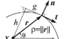

图 3.2 针对 \( \partial\Omega \) 的 Frenet 框架 \( (t, n) \) 是研究相对于 \( x \in \Omega \) 的 \( \partial\Omega \) 几何量的主要工具之一。

用于 \( \partial\Omega \)，如图 3.2 所示。令 \( s \) 为 \( \partial\Omega \) 的弧长参数化。则有

$t' = kn, \quad n' = -kt, \quad r = gt + hn \text{ with } g = r \cdot t \text{ and } h = r \cdot n,\)

其中导数关于弧长 \( s \) 求取，\( k \) 表示 \( \partial\Omega \) 的曲率。

易知 [307]，极互换曲线 \( \Sigma_x \) 由半径向量 \( n/h \) 给出。\( \Sigma_x \) 的一个切向量可由下式得到

\(\binom{n}{h}' = \frac{n'h - nh'}{h^2} = \frac{-kth + nkg}{h^2} = \frac{gn - ht}{\sqrt{g^2 + h^2}} \frac{k\rho}{h^2}.\) (3.17)

其中使用了以下简单观察

$h' = (r \cdot n)' = r' \cdot n + r \cdot n' = r \cdot n' = -kr \cdot t = -kg \quad \text{and} \quad \sqrt{g^2 + h^2} = |r| = \rho$

应用上述观察。将 (3.17) 右侧给出的切向量归一化得到

$dl/ds = k\rho/h^2,\)

现在 \( l \) 是 \( \Sigma_x \) 的弧长。\( \Sigma_x \) 的单位法向量由 \( \mathbf{n}_\Sigma = r/\rho \) 给出。现在我们可以通过对 \( l \) 对其单位法向量 \( \mathbf{n}_\Sigma \) 求导来找到 \( \Sigma_x \) 的曲率 \( k_\Sigma \)，

\(\frac{d}{dl}\mathbf{n}_\Sigma = -k_\Sigma \mathbf{t}_\Sigma \text{ with } \mathbf{n}_\Sigma = \frac{r}{\rho} = \frac{gt + hn}{\sqrt{g^2 + h^2}} \text{ and } \mathbf{t}_\Sigma = -\mathbf{n}_\Sigma^\perp = \frac{ht - gn}{\sqrt{g^2 + h^2}}.\)

其中 \( \perp \) 表示顺时针方向的 \( \pi/2 \) 旋转。此外，

\(\frac{d}{dl} = \frac{ds}{dl} \frac{d}{ds}, \quad \frac{d}{ds} \left[ \frac{r}{\rho} \right] = \frac{r'\rho - r\rho'}{\rho^2} = \frac{t\rho - r\rho g}{\rho^2} = \frac{h^2t - ghn}{\rho^3} = \frac{h}{\rho^2} \frac{ht - gn}{\sqrt{g^2 + h^2}},\)

\(\frac{d}{dl}\mathbf{n}_\Sigma = \frac{ds}{dl} \frac{d}{ds} \left[ \frac{r}{\rho} \right] = \frac{h^2}{k\rho^3} \frac{d}{ds} \left[ \frac{r}{\rho} \right] = \frac{h^3}{k\rho^3} \mathbf{t}_\Sigma = -k_\Sigma \mathbf{t}_\Sigma.\)

因此 \( \Sigma_x \) 的曲率 \( k_\Sigma \) 由下式给出

$k_\Sigma = \frac{h^3}{k\rho^3} = - \frac{[\mathbf{n}(y) \cdot (y - x)]^3}{k(y) \|x - y\|^3}$

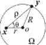

图 3.3 用于证明当 \( \Omega \) 为圆盘时超有限 Laplace 和 Wachspress 坐标重合的符号。

因此

\[
-\frac{d\theta}{k_\Sigma^2} = \frac{k\rho^3}{h^3} d\theta = \frac{k\rho}{h^2} ds, \int_{\partial\Omega} \frac{\kappa}{r} \frac{k ds}{h^2} = \int_{\partial\Omega} \rho \frac{e_{\theta\theta}}{h^2} k ds = -\int_0^{2\pi} \frac{d\theta}{k_\Sigma^2} = 0,
\]

这与 [413] 一致。

#### 3.2.5 当 \( \Omega \) 为圆盘时超有限 Laplace 和 Wachspress 坐标重合

如文献 [149] 所示，离散调和坐标与 Wachspress 坐标对于可外切多边形相同。这一显著结果的连续或超有限版本在 [93] 中得到建立。下面，我们给出了一个不同的初等证明，证明当 \( \Omega \) 为圆盘时超有限 Laplace 和 Wachspress 坐标重合。

采用图 3.3 的符号，有

\[
\cos \theta = \frac{\rho^2 + r^2 - R^2}{2\rho r} = A\rho - B\frac{1}{\rho}
\]

其中 \( A \) 和 \( B \) 为某些与 \( \theta \) 无关的值。因此，

\[
0 = (\cos \theta)'' + \cos \theta = A[\rho''_{\theta\theta} + \rho] - B[(1/\rho)''_{\theta\theta} + 1/\rho].
\]

还需注意，核 \( \rho''_{\theta\theta} + \rho \) 和 \( (1/\rho)''_{\theta\theta} + 1/\rho \) 分别对应于超有限 Laplace 和 Wachspress 坐标。

### 3.3 GORDON–WIXOM 插值

#### 3.3.1 Lagrange 类型 Gordon–Wixom 插值

调和坐标和调和映射为高质量插值和形状变形提供了极其有用的工具 [95, 101, 241]（另见其中的参考文献）。然而，调和映射和坐标通常不允许解析解，计算精确近似需要复杂的数值方案。克服这一困难的一种可能方法是使用可以轻松计算并模仿调和映射和坐标某些性质的映射和坐标。特别是，所谓的伪调和重心坐标 [94, 247] 可被视为

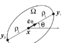

图 3.4 Gordon-Wixom 插值的主要思想是将通过 x 的每条弦上的线性插值与所有方向上的圆形平均相结合，例如

作为调和坐标的潜在良好替代品 [215]。下面，我们考虑最初由 Gordon 和 Wixom [171] 引入，随后由多位研究者 [37, 38, 145, 146, 266] 研究和扩展的伪调和超有限重心插值方案。

遵循 [171]，若超有限重心插值方案在球（2D 情况下为圆盘）中复现调和函数，则称其为伪调和。结果表明，超有限平均值 (3.4)、Laplace (3.13) 和 Wachspress 坐标 (3.16) 并非伪调和。相比之下，Gordon-Wixom 插值方案 [171] 及其一些推广和修改 [37, 38] 是伪调和的。

Gordon 和 Wixom 方法背后的基本思想简单而优雅。给定有限凸域 \( \Omega \subset \mathbb{R}^2 \) 内部的一点 x，考虑一条过 x 的直线，与某个固定方向成 \( \theta \) 角，并在两点 \( y_1 \) 和 \( y_2 \) 处与 \( \partial\Omega \) 相交（见图 3.4）。然后我们使用 \( u(y_1) \) 和 \( u(y_2) \) 之间的线性插值来获得与方向 \( \theta \) 相关的估计 \( u(x, \theta) \)，

\[
\frac{u(y_1)/\rho_1 + u(y_2)/\rho_2}{1/\rho_1 + 1/\rho_2}
\]

对 \( u(x, \theta) \) 关于 \( \theta \) 进行圆形平均，则得到从 \( \partial\Omega \) 到 \( \Omega \) 中 \( x \) 的某个函数 \( u \) 的 Gordon-Wixom 插值，

\[
u(x) = \frac{1}{2\pi} \int_0^{2\pi} \left[ \frac{u(y_1)/\rho_1 + u(y_2)/\rho_2}{1/\rho_1 + 1/\rho_2} \right] d\theta \tag{3.18}
\]

为了证明 Gordon-Wixom 插值方案是伪调和的，我们将 (3.18) 改写为

\[
u(x) = \frac{1}{\pi} \int_0^{2\pi} \frac{\rho_2}{\rho_1 + \rho_2} u(y_1) \, d\theta \tag{3.19}
\]

并假设 \( \Omega \) 为半径为 \( R \) 的圆盘。我们现在回顾，根据弦交定理，

\[
\rho_1 \rho_2 = c(x),
\]

其中 \( c(x) \) 仅依赖于 \( x \)。采用图 3.5 的符号，我们还有

\[
h_1 = \rho_1 \sin \phi, \quad h_2 = \rho_2 \sin \phi, \quad \rho_1 + \rho_2 = 2R \sin \phi,
\]


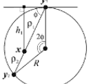

图 3.5. 用于展示若 \(\Omega\) 为圆盘，则 Gordon-Wixom 插值方案 (3.18) 及其修正 (3.22) 可复现调和函数的几何记法。

\(\frac{h_1 h_2}{\sin^2 \varphi} = c(\boldsymbol{x}), \qquad \frac{\rho_2}{\rho_1 + \rho_2} = \frac{h_2}{2R \sin^2 \varphi} = \frac{c(\boldsymbol{x})}{2R} \frac{1}{h_1}.\)

因此，(3.19) 简化为

\(u(\boldsymbol{x}) = \int_0^{2\pi} \frac{u(\boldsymbol{y}) d\theta}{h(\boldsymbol{x}, \boldsymbol{y})} \Big/ \int_0^{2\pi} \frac{d\theta}{h(\boldsymbol{x}, \boldsymbol{y})}, \qquad (3.20)\)

其中 \(h(\boldsymbol{x}, \boldsymbol{y})\) 表示从 \(\boldsymbol{x} \in \Omega\) 到在 \(\boldsymbol{y} \in \partial \Omega\) 处与 \(\partial \Omega\) 相切的直线的距离。不难看出，\(\partial \Omega\) 在 \(\boldsymbol{y} \in \partial \Omega\) 处的长度元 \(ds_y\) 由下式给出

\(ds_y = \rho^2 d\theta / h \quad \text{with} \quad \rho = \|\boldsymbol{x} - \boldsymbol{y}\| \quad \text{and} \quad h = h(\boldsymbol{x}, \boldsymbol{y}).\)

因此，(3.20) 可改写为

\(u(\boldsymbol{x}) = \int_{\partial \Omega} \frac{u(\boldsymbol{y}) ds_y}{\|\boldsymbol{x} - \boldsymbol{y}\|^2} \Big/ \int_{\partial \Omega} \frac{ds_y}{\|\boldsymbol{x} - \boldsymbol{y}\|^2},\)

这相当于从圆盘边界值恢复圆盘内调和函数值的经典 Poisson 积分公式。

Gordon-Wixom 方法与调和插值之间的另一种联系可由以下观察得出。若 \(\rho_1\) 和 \(\rho_2\) 很小，则可写成

\(\frac{\partial^2 u}{\partial \boldsymbol{e}_\varphi^2}(\boldsymbol{x}) \approx \frac{2}{\rho_1 \rho_2} \left( \left[ \frac{u(\boldsymbol{y}_1)}{\rho_1} + \frac{u(\boldsymbol{y}_2)}{\rho_2} \right] \left[ \frac{1}{\rho_1} + \frac{1}{\rho_2} \right] - u(\boldsymbol{x}) \right). \quad (3.21)\)

注意

\(\frac{1}{\pi} \int_0^{2\pi} \frac{\partial^2}{\partial \boldsymbol{e}_\theta^2} d\theta = \frac{1}{\pi} \int_0^{2\pi} \left( \cos \theta \frac{\partial}{\partial x_1} + \sin \theta \frac{\partial}{\partial x_2} \right)^2 d\theta = \Delta,\)

这与 (3.21) 共同蕴含

\(\Delta u \approx \frac{2}{\pi} \int_0^{2\pi} \left( \left[ \frac{u(\boldsymbol{y}_1)}{\rho_1} + \frac{u(\boldsymbol{y}_2)}{\rho_2} \right] \left[ \frac{1}{\rho_1} + \frac{1}{\rho_2} \right] - u(\boldsymbol{x}) \right) \frac{d\theta}{\rho_1 \rho_2}.\)

模仿调和插值从而导致对 Gordon-Wixom 方案 (3.18) 的修正

```
u(\boldsymbol{x}) = \int_0^{2\pi} \left[ \left( \frac{u(\boldsymbol{y}_1)}{\rho_1} + \frac{u(\boldsymbol{y}_2)}{\rho_2} \right) \bigg/ \left[ \frac{1}{\rho_1} + \frac{1}{\rho_2} \right] \right] \frac{d\theta}{\rho_1 \rho_2} \bigg/ \int_0^{2\pi} \frac{d\theta}{\rho_1 \rho_2}, \quad (3.22)
```

该结果见文献 [38]。从某种意义上说，(3.22) 类似于超有限平均值插值方案 (3.4)。

修正后的 Gordon-Wixom 插值方案 (3.22) 也是伪调和的。事实上，若 \(\Omega\) 为圆，则 (3.22) 中的 \(\rho_{1,2}\) 不依赖于积分变量 \(\theta\)，且 (3.22) 退化为 (3.18)，后者为伪调和。修正后的 Gordon-Wixom 方案还具有线性精度。

(3.18) 和 (3.22) 均可视为加权平均值超有限插值 (3.7) 的特例。事实上，两者均可改写为

```
u(\boldsymbol{x}) = \int_0^{2\pi} \left[ \left( \frac{u(\boldsymbol{y}_1)}{\rho_1} + \frac{u(\boldsymbol{y}_2)}{\rho_2} \right) \bigg/ \left[ \frac{1}{\rho_1} + \frac{1}{\rho_2} \right] \right] \bar{\omega}(\boldsymbol{x}, \theta) d\theta \bigg/ \int_0^{2\pi} \bar{\omega}(\boldsymbol{x}, \theta) d\theta, \quad (3.23)
```

其中 (3.23) 中的权函数 \(\bar{\omega}(\boldsymbol{x}, \theta)\) 与 (3.7) 中的 \(\omega(\boldsymbol{x}, \theta)\) 通过下式相关

```
\bar{\omega}(\boldsymbol{x}, \theta) = (1/\rho_1 + 1/\rho_2)\omega(\boldsymbol{x}, \theta).
```

在 (3.23) 中令 \(\bar{\omega}(\boldsymbol{x}, \theta) = (1/\rho_1 + 1/\rho_2)\) 对应超有限平均值插值方案 (3.4)，选取 \(\bar{\omega}(\boldsymbol{x}, \theta) = 1\) 得到 Gordon-Wixom 方案 (3.18)，而 \(\bar{\omega}(\boldsymbol{x}, \theta) = 1/(\rho_1 \rho_2)\) 则给出修正后的 Gordon-Wixom 方案 (3.22)。

在实践中，(3.22) 相比 (3.18) 展现出更高的插值质量。在我们的数值实验中，(3.18) 和 (3.22) 均采用复合梯形法则计算（通常使用 100 个等距方向）。对于非凸域，由单位向量 \(\boldsymbol{e}_\theta\) 定义的射线 \((\boldsymbol{x}, \boldsymbol{y})\) 可与边界相交于多个点。对于两个相反方向 \(\boldsymbol{e}_\theta\) 和 \(-\boldsymbol{e}_\theta\)，我们分别考虑最接近 \(\boldsymbol{x}\) 的交点 \(\boldsymbol{y}_1\) 和 \(\boldsymbol{y}_2\)。图 3.6 比较了在几何复杂域中对调和函数 \(x^3 - 3xy^2\) 使用 Gordon-Wixom 方案 (3.18) 及其修正 (3.22) 得到的近似值。给定函数与其插值之间的绝对误差用于说明 (3.22) 相对于 (3.18) 的优势。

#### 3.3.2 基于埃尔米特的 Gordon–Wixom 插值

Gordon 和 Wixom 在文献 [171] 中将其方案扩展以处理埃尔米特插值。用 \((u(\boldsymbol{y}_1), u'(\boldsymbol{y}_1))\) 和 \((u(\boldsymbol{y}_2), u'(\boldsymbol{y}_2))\) 的三次插值替代线性插值，可得

```
u(\boldsymbol{x}, \theta) = \frac{(3\rho_1 + \rho_2)\rho_2^2}{(\rho_1 + \rho_2)^3} u(\boldsymbol{y}_1) + \frac{(\rho_1 + 3\rho_2)\rho_1^2}{(\rho_1 + \rho_2)^3} u(\boldsymbol{y}_2) - \frac{\rho_1 \rho_2^2}{(\rho_1 + \rho_2)^2} \frac{\partial u}{\partial \boldsymbol{e}_\theta}(\boldsymbol{y}_1) + \frac{\rho_1^2 \rho_2}{(\rho_1 + \rho_2)^2} \frac{\partial u}{\partial \boldsymbol{e}_\theta}(\boldsymbol{y}_2). \quad (3.24)
```

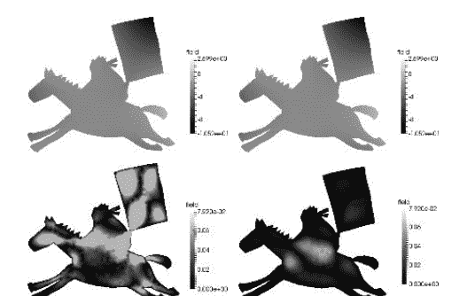

图 3.6 原始（左上）和修正（右上）Gordon-Wixom 插值方案 (3.18) 和 (3.22) 用于在几何复杂域中对多项式进行插值。修正方案（右下）产生的近似误差低于原始方案（左下）。

对 (3.24) 关于 \(\theta\) 进行平均，得到埃尔米特型 Gordon-Wixom 插值方案

```
\(u(\boldsymbol{x}) = \frac{1}{2\pi} \int_0^{2\pi} u(\boldsymbol{x}, \theta) \, d\theta.\) (3.25)
```

超有限插值方案 (3.25) 具有三次精度，且若 \(\Omega\) 为圆盘，则可复现双调和函数。该双调和性质在 [171] 中被提出猜想，并在 [145] 中得到严格证明。

#### 3.3.3 修正后的埃尔米特型 Gordon–Wixom 插值

若 \(\rho_1\) 和 \(\rho_2\) 很小，则 \(u(\boldsymbol{x})\) 沿 \(\boldsymbol{e}_\theta\) 方向的四阶方向导数的近似由下式给出

```
\(\frac{\partial^4 u}{\partial \boldsymbol{e}_\theta^4}(\boldsymbol{x}) \approx \frac{24}{\rho_1^2 \rho_2^2} \left[ u(\boldsymbol{x}) - \frac{(3\rho_1 + \rho_2)\rho_2^2}{(\rho_1 + \rho_2)^3} u(\boldsymbol{y}_1) - \frac{(\rho_1 + 3\rho_2)\rho_1^2}{(\rho_1 + \rho_2)^3} u(\boldsymbol{y}_2) \right.\)
\(\left. + \frac{\rho_1 \rho_2^2}{(\rho_1 + \rho_2)^2} \frac{\partial u}{\partial \boldsymbol{e}_\theta}(\boldsymbol{y}_1) - \frac{\rho_1^2 \rho_2}{(\rho_1 + \rho_2)^2} \frac{\partial u}{\partial \boldsymbol{e}_\theta}(\boldsymbol{y}_2) \right].\) (3.26)
```

将 (3.26) 与

```
\frac{4}{3\pi} \int_0^{2\pi} \left( \frac{\partial^4 u}{\partial \boldsymbol{e}_\theta^4} \right) d\theta = \Delta^2 u \qquad (3.27)
```

并模仿双调和插值，从而得到三次 Gordon-Wixom 插值方案的修正版本，

```
u(\boldsymbol{x}) = \int_0^{2\pi} \left[ \frac{(\rho_1 + \rho_2)\rho_2^3}{(\rho_1 + \rho_2)^3} u(\boldsymbol{y}_1) + \frac{(\rho_1 + 3\rho_2)\rho_1^3}{(\rho_1 + \rho_2)^3} u(\boldsymbol{y}_2) \right. \left. - \frac{\rho_1 \rho_2^2}{(\rho_1 + \rho_2)^2} \frac{\partial u}{\partial \boldsymbol{e}_\theta}(\boldsymbol{y}_1) + \frac{\rho_1^2 \rho_2}{(\rho_1 + \rho_2)^2} \frac{\partial u}{\partial \boldsymbol{e}_\theta}(\boldsymbol{y}_2) \right] \frac{d\theta}{\rho_1^2 \rho_2^2} \bigg/ \int_0^{2\pi} \frac{d\theta}{\rho_1^2 \rho_2^2} \qquad (3.28)
```

与三次 Gordon-Wixom 方案类似，(3.28) 具有三次精度，并在圆盘上复现双调和函数。

#### 3.3.4 用于多调和插值的修正 Gordon-Wixom 方法

此前我们指出

```
\frac{1}{\pi} \int_0^{2\pi} \frac{\partial^2}{\partial \theta^2} d\theta = \frac{1}{\pi} \int_0^{2\pi} \left( \cos \theta \frac{\partial}{\partial x_1} + \sin \theta \frac{\partial}{\partial x_2} \right)^2 d\theta = \Delta.
```

结合 (3.27)，这表明可为多拉普拉斯算子得到类似公式。事实上，直接计算得出

```
\frac{8}{5\pi} \int_0^{2\pi} \frac{\partial^6 u}{\partial e_\theta^6} d\theta = \Delta^3 u
```

更一般地

```
c_n \int_0^{2\pi} \frac{\partial^{2n} u}{\partial e_\theta^{2n}} d\theta = \Delta^n u, \quad \text{where} \quad c_n = 1 \bigg/ \int_0^{2\pi} (\cos \theta)^{2n} d\theta. \qquad (3.29)
```

例如，\(c_1 = 1/\pi\)、\(c_2 = 4/(3\pi)\) 和 \(c_3 = 8/(5\pi)\)。

为了得到用于多调和插值的修正 Gordon-Wixom 方案，我们接下来需要用 \(u(x), u(y_1), u(y_2), \dots, \partial^{n-1}u(y_1)/\partial e_\theta^{n-1}, \partial^{n-1}u(y_2)/\partial e_\theta^{n-1}\) 来表示 \(\partial^{2n}u/\partial e_\theta^{2n}\) 的近似。

若 \(\rho_1\) 和 \(\rho_2\) 很小，则可利用泰勒级数得到 \(u(x)\) 沿 \(e_\theta\) 方向的 \((2n)\) 阶方向导数的近似

```
u(x + \rho_1 e_\theta) = u(x) + \rho_1 \frac{\partial u}{\partial e_\theta}(x) + \dots + \frac{\rho_1^{2n}}{(2n)!} \frac{\partial^{2n} u}{\partial e_\theta^{2n}}(x), \quad u(x - \rho_2 e_\theta) = u(x) - \rho_2 \frac{\partial u}{\partial e_\theta}(x) + \dots + \frac{(-\rho_2)^{2n}}{(2n)!} \frac{\partial^{2n} u}{\partial e_\theta^{2n}}(x),
```

:


\(\frac{\partial^{n-1}u}{\partial e_1^{n-1}}(x + \rho_1 e_\theta) = \frac{\partial^{n-1}u}{\partial e_1^{n-1}}(x) + \rho_1 u^{(n)}(x) + \cdots + \frac{\rho_1^{2n}}{(2n)!} \frac{\partial^{2n}u}{\partial e_\theta^{2n}}(x),\)
\(\frac{\partial^{n-1}u}{\partial e_1^{n-1}}(x - \rho_2 e_\theta) = \frac{\partial^{n-1}u}{\partial e_1^{n-1}}(x) - \rho_2 u^{(n)}(x) + \cdots + \frac{(-\rho_2)^{2n}}{(2n)!} \frac{\partial^{2n}u}{\partial e_\theta^{2n}}(x).\)

消去 \(\partial u(x)/\partial e_\theta, \dots, \partial^{2n-1}u(x)/\partial e_\theta^{2n-1}\) 中的项，我们得到

\(\frac{\partial^{2n}u}{\partial e_\theta^{2n}}(x) = \frac{(2n)!}{\rho_1^n \rho_2^n} [u(x) - \alpha_1 u(y_1) - \alpha_2 u(y_2) - \cdots\)
\(- \alpha_{2n-1} \frac{\partial^{n-1}u}{\partial e_\theta^{n-1}}(y_1) - \alpha_{2n} \frac{\partial^{n-1}u}{\partial e_\theta^{n-1}}(y_2)],\)

其中 \(\alpha_1, \dots, \alpha_{2n}\) 为某些权重。结合 (3.29) 并模仿多调和插值，得到修改后的 Gordon-Wixom 插值方案的高阶推广。

### 3.4 广义平均值势与距离函数近似

在本节中，我们研究广义平均值势的性质，它们是转finite平均值坐标归一化函数的推广，即 (3.4) 中的分母。我们表明，这些广义平均值势在 \(\partial\Omega\) 附近能对距离函数 \(\text{dist}(x, \partial\Omega)\) 提供准确的近似，并可视为光滑距离函数。高效计算光滑距离函数对于许多应用非常重要，包括模式识别 [435]、计算力学 [157]、医学成像 [338] 和计算流体动力学 [332, 399]。

#### 3.4.1 光滑域的广义平均值势

Floater 等人 [77, 133] 观察到平均值归一化函数的一些显著性质

\(\Phi(x) = \int_{S_x} \frac{d\theta}{\|x - y\|},\)

它是 (3.4) 中的分母。特别是，对于 \(\Psi(x) = 1/\Phi(x)\)，他们表明

\(\Psi(y) = 0 \text{ and } \frac{\partial \Psi(y)}{\partial n_y} = \frac{1}{V_{d-1}} \quad \forall y \in \partial\Omega, \quad (3.30)\)

其中 \(n_y\) 是 \(y \in \partial\Omega\) 处 \(\Omega \subset \mathbb{R}^d\) 边界的外单位法向量，\(V_{d-1}\) 是 \(\mathbb{R}^{d-1}\) 中单位球的体积（\(V_1 = 2\) 且 \(V_2 = \pi\)）。根据 (3.30)，函数 \(V_{d-1}\Psi(x)\) 在 \(\partial\Omega\) 附近对距离函数 \(\text{dist}(x, \partial\Omega)\) 提供了准确的近似。

该性质可用于 [77, 133] 中的 Hermite 插值目的。更一般地，距离函数性质在计算机图形学、可视化和建模中也起着重要作用。例如，它在 [51] 中用作材料建模的参数，在 [106] 中用于形状动画，并在 [297] 的水平集方法中使用。另请参见 [214] 及其参考文献，以了解计算机图形学和可视化方面的进一步应用。

考虑 \(\Phi(\boldsymbol{x})\) 和 \(\Psi(\boldsymbol{x})\) 的 \(L^p\) 推广似乎很自然。遵循 [39, 40]，让我们考虑

\(\Phi_p(\boldsymbol{x}) = \int_{S_n} \frac{d\theta}{\|\boldsymbol{x} - \boldsymbol{y}\|^p} \quad \text{and} \quad \Psi_p(\boldsymbol{x}) = 1/\Phi_p(\boldsymbol{x}) \quad (3.31)\)

与 \(p > 0\)。下面，为求简单，我们处理 (3.31) 的二维版本。广义平均值势 \(\Phi_p(\boldsymbol{x})\) 在 3D 情况下的类似研究可见 [39]。

在 2D 情况下，\(\Phi_p(\boldsymbol{x})\) 可写为

\(\Phi_p(\boldsymbol{x}) = \int_{0}^{2\pi} \frac{d\theta}{\rho(\theta)^p}\)

如前所述，\(\theta\) 是向量 \(\boldsymbol{y} - \boldsymbol{x}\) 与固定方向之间的夹角，\(\rho(\theta) = \|\boldsymbol{x} - \boldsymbol{y}\|\)。广义平均值势 \(\Phi_p(\boldsymbol{x})\) 满足一些有趣的性质，包括 [40, Proposition 3]。

\(\Delta \Phi_p(\boldsymbol{x}) = p(p+2)\Phi_{p+2}(\boldsymbol{x}). \quad (3.32)\)

显然，\(\Phi_p(\boldsymbol{x}) > 0\)，并且当 \(\boldsymbol{x}\) 趋近于 \(\partial\Omega\) 时，\(\Phi_p(\boldsymbol{x}) \rightarrow \infty\)。此外，(3.32) 意味着 \(\Phi_p(\boldsymbol{x})\) 在 \(\Omega\) 内部没有局部极大值，因为否则在局部极大值处 \(\Delta \Phi_p > 0\)，且 (3.32) 无法满足。因此，\(\Psi_p(\boldsymbol{x})\) 在 \(\Omega\) 内部为正，在 \(\partial\Omega\) 上消失，并且在 \(\Omega\) 内部没有局部极小值。下面我们研究 \(\Phi_p(\boldsymbol{x})\) 在 \(\partial\Omega\) 附近的渐近性质（或等价地，\(\Psi_p(\boldsymbol{x})\) 在 \(\partial\Omega\) 附近的渐近性质），并表明，在适当的常数重缩后，\(\Psi_p(\boldsymbol{x})\) 在 \(\partial\Omega\) 附近对 \(\text{dist}(\boldsymbol{x}, \partial\Omega)\) 提供了准确的近似。

设 \(\boldsymbol{x}\) 靠近 \(\partial\Omega\)，并令 \(h = \text{dist}(\boldsymbol{x}, \partial\Omega)\) 表示 \(\boldsymbol{x}\) 到 \(\partial\Omega\) 的距离。我们继续遵循 [39]，并现在表明在平面情况（\(d=2\)）中，对于 \(p > 1\)，我们有

\(\Phi_p(\boldsymbol{x}) = \int_{0}^{2\pi} \frac{d\theta}{\rho(\theta)^p} = \frac{c_p}{h^p} + k \frac{c_{p-2}}{2h^{p-2}} + O\left(\frac{1}{h^{p-2}}\right) \quad (3.33)\)

与

\(c_p = \int_{-\pi/2}^{\pi/2} \cos^p \theta \, d\theta,\)

其中 \(k\) 是 \(\boldsymbol{y} \in \partial\Omega\) 处 \(\partial\Omega\) 的曲率。\(p=1\) 的情况（对应平均值归一化函数）给出

\(\Phi_1(\boldsymbol{x}) \sim \frac{2}{h} + \frac{k}{2} \ln \frac{1}{h} + O(1) \quad \text{as} \quad h \rightarrow 0, \quad (3.34),\)

这是 [133] 中主要结果之一的扩展。

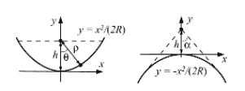

图 3.7. 为分析 \(\Phi_p(x)\) 当 \(x\) 趋近于 \(\partial\Omega\)（\(h \to 0\)）时的渐近行为，我们局部用接触抛物线近似 \(\partial\Omega\)。

让我们演示 (3.33) 和 (3.34)。给定一点 \(x \in \Omega\)，其距 \(\partial\Omega\) 的距离为 \(h \ll 1\)，让我们引入欧几里得坐标和极坐标，如图 3.7 所示，其中坐标原点位于 \(\partial\Omega\) 上离 \(x\) 最近的点，\(y\) 轴与法向方向重合。

让我们从坐标原点处 \(\partial\Omega\) 的正曲率 \(k\) 情况开始。局部地，\(\partial\Omega\) 被接触抛物线近似

\(y = x^2/(2R),\)

其中 \(R = 1/k\) 是曲率半径，如图 3.7（左）所示。在极坐标中

\(x = \rho \sin \theta, \quad y = h - \rho \cos \theta\)

抛物线变为

\(\rho^2 \sin^2 \theta + 2R\rho \cos \theta - 2Rh = 0.\)

对 \(\rho > 0\) 求解这个二次方程得到

\(\rho = \frac{-R\cos \theta + \sqrt{D}}{\sin^2 \theta}, \quad D = R^2 \cos^2 \theta + 2Rh \sin^2 \theta\)

我们可以写成

\(\frac{1}{\rho} = \frac{1}{2Rh} \left( R\cos \theta \sqrt{1 + \frac{2h}{R} \tan^2 \theta + R\cos \theta} \right) = \frac{\cos \theta}{h} + \frac{1}{2R} \frac{\sin^2 \theta}{\cos \theta} + O(h).\)

因此，

\(\Phi_p(x) \sim \int_{-\pi/2}^{\pi/2} \frac{d\theta}{\rho(\theta)^p} = \frac{c_p}{h^p} + \frac{1}{R} \frac{\tilde{c}_p}{h^{p-1}} + O\left( \frac{1}{h^{p-2}} \right),\)

其中

\(c_p = \int_{-\pi/2}^{\pi/2} \cos^p \theta \, d\theta \quad \text{and} \quad \tilde{c}_p = \frac{p}{2} \int_{-\pi/2}^{\pi/2} \cos^{p-2} \theta \sin^2 \theta \, d\theta. \quad (3.35)\)

简单计算表明 \(\tilde{c}_p = c_{p-2}/2\)。

上面我们假设 \(p > 1\)。如果 \(p = 1\)（平均值坐标的情况），那么我们有

\(\Phi_1(x) = \int_{-\pi/2}^{\pi/2} \frac{d\theta}{\rho(\theta)} = \frac{2}{h} + \frac{1}{2R} \int_{-\pi/2}^{\pi/2} \frac{\sin^2 \theta}{\cos \theta} \, d\theta + O(h)\)


积分在 $\pm \pi/2$ 处发散。因此我们需要考虑

$$
\Phi_1(\boldsymbol{x}) \sim \frac{1}{2Rh} \int_{-\pi/2}^{\pi/2} (\sqrt{R^2 \cos^2 \theta + 2Rh \sin^2 \theta} + R \cos \theta) d\theta \quad (3.36)
$$

as \(h \to 0\). Note that

$$
\int_{-\pi/2}^{\pi/2} \sqrt{R^2 \cos^2 \theta + 2Rh \sin^2 \theta} d\theta = 2R \int_0^{\pi/2} \sqrt{1 - \left(1 - \frac{2h}{R}\right) \sin^2 \theta} d\theta
$$
$$
= 2R \mathcal{E}\left(1 - \frac{2h}{R}\right),
$$

where

$$
\mathcal{E}(t) = \int_0^{\pi/2} \sqrt{1 - t \sin^2 \theta} d\theta
$$

is the complete elliptic integral of the second kind. It can be shown that

$$
\mathcal{E}(1 - \varepsilon) = 1 - \frac{\varepsilon}{4} \ln \varepsilon + \cdots \quad \text{as } \varepsilon \to 0.
$$

Thus,

$$
\Phi_1(\boldsymbol{x}) \sim \frac{2}{h} + \frac{1}{2R} \ln \frac{1}{h} + O(1) \quad \text{as } h \to 0,
$$

which completes our proof of (3.34) in the case of positive curvature.

Now let us consider the negative curvature case, shown in Figure 3.7 (right). We have

$$
x = \rho \sin \theta, \quad y = h - \rho \cos \theta, \quad y = -x^2/(2R),
$$
$$
\rho^2 \sin^2 \theta - 2R\rho \cos \theta + 2Rh = 0, \quad \rho = \left(R \cos \theta - \sqrt{R^2 \cos^2 \theta - 2Rh \sin^2 \theta}\right) / \sin^2 \theta,
$$

$$
\frac{1}{\rho} = \frac{1}{2Rh} \left(\sqrt{R^2 \cos^2 \theta - 2Rh \sin^2 \theta} + R \cos \theta\right) = \frac{\cos \theta}{h} - \frac{1}{2R} \sin^2 \theta + O(h).
$$

Thus we arrive at

$$
\frac{1}{\rho(\theta)^p} = \frac{\cos^p \theta}{h^p} - \frac{p}{2R} \frac{\cos^{p-2} \theta \sin^2 \theta}{h^{p-1}} + O\left(\frac{1}{h^{p-2}}\right). \quad (3.37)
$$

Now let us study the asymptotic behavior of

$$
\int_{-\alpha(h)}^{\alpha(h)} \frac{d\theta}{\rho(\theta)^p},
$$

where the integration limits \(\alpha(h)\) and \(-\alpha(h)\) correspond to the two rays originating from \(\boldsymbol{x}\) and the tangent to the osculating parabola \(y = -x^2/(2R)\), as shown in Figure 3.7 (right). Note that \(\alpha(h) = \pi/2 + O(h)\) and \(\cos \theta = O(h)\) for \(|\theta|\) between \(\alpha(h)\) and \(\pi/2\), as \(h \to 0\). Thus, in view of (3.37), we have

$$
\begin{aligned}
\Phi_p(\mathbf{x}) &\sim \int_{-\alpha(h)}^{\alpha(h)} \frac{d\theta}{\rho(\theta)^p} \\
&= \frac{1}{h^p} \int_{-\alpha}^{\alpha} \cos^p \theta \, d\theta - \frac{p}{2Rh^{p-1}} \int_{-\alpha}^{\alpha} \cos^{p-2} \theta \sin^2 \theta \, d\theta + O\left(\frac{1}{h^{p-2}}\right) \\
&= \frac{1}{h^p} \int_{-\pi/2}^{\pi/2} \cos^p \theta \, d\theta - \frac{p}{2Rh^{p-1}} \int_{-\pi/2}^{\pi/2} \cos^{p-2} \theta \sin^2 \theta \, d\theta + O\left(\frac{1}{h^{p-2}}\right) \\
&= \frac{c_p}{h^p} - \frac{1}{R} \frac{\tilde{c}_p}{h^{p-1}} + O\left(\frac{1}{h^{p-2}}\right)
\end{aligned}
$$

with the same \(c_p\) and \(\tilde{c}_p\) as in (3.35) (the case of positive curvature). This completes our proof of (3.33).

Similarly, for \(p=1\), instead of (3.36) we have

$$
\begin{aligned}
\Phi_1(\mathbf{x}) &= \frac{1}{2Rh} \int_{-\alpha(h)}^{\alpha(h)} \left( \sqrt{R^2 \cos^2 \theta - 2Rh \sin^2 \theta} + R \cos \theta \right) d\theta + O(1) \\
&= \frac{1}{2Rh} \int_{-\pi/2}^{\pi/2} \left( \sqrt{R^2 \cos^2 \theta - 2Rh \sin^2 \theta} + R \cos \theta \right) d\theta + O(1) \quad \text{as } h \to 0.
\end{aligned}
$$

Further,

$$
\begin{aligned}
\int_{-\pi/2}^{\pi/2} \sqrt{R^2 \cos^2 \theta - 2Rh \sin^2 \theta} \, d\theta &= 2R\mathcal{E}\left(1 + \frac{2h}{R}\right), \\
\Phi_1(\mathbf{x}) &\sim \frac{2}{h} - \frac{1}{2R} \ln \frac{1}{h} + O(1) \quad \text{as } h \to 0,
\end{aligned}
$$

which completes the proof of (3.34) for the negative curvature case.

#### 3.4.2 多边形的广义势

When the domain boundary \(\partial \Omega\) is approximated by a polygon in 2D, then the potential \(\Phi_p(\mathbf{x})\) at a point \(\mathbf{x}\) is obtained by computing the contribution of each edge of the polygon and summing these contributions.

In the 2D case, given a point \(\mathbf{x}\), an edge \([\mathbf{v}_i, \mathbf{v}_{i+1}]\), and the angle \(\alpha\) between the vectors \(\mathbf{v}_i - \mathbf{x}\) and \(\mathbf{v}_{i+1} - \mathbf{x}\), we need to express the distance \(\rho(\theta)\) between \(\mathbf{x}\) and the point \(\mathbf{y} \in [\mathbf{v}_i, \mathbf{v}_{i+1}]\), where \(\theta\) is the angle between \(\mathbf{v}_i - \mathbf{x}\) and \(\mathbf{y} - \mathbf{x}\). Let \(r_i = \|\mathbf{x} - \mathbf{v}_i\|\) and \(r_{i+1} = \|\mathbf{x} - \mathbf{v}_{i+1}\|\) (see Figure 3.8). The area of the triangle \([\mathbf{x}, \mathbf{v}_i, \mathbf{v}_{i+1}]\) is equal to the sum of the triangles \([\mathbf{x}, \mathbf{v}_i, \mathbf{y}]\) and \([\mathbf{x}, \mathbf{y}, \mathbf{v}_{i+1}]\).

$$
r_i r_{i+1} \sin \alpha = r_i \rho(\theta) \sin \theta + r_{i+1} \rho(\theta) \sin(\alpha - \theta),
$$

giving

$$
\rho(\theta) = \frac{r_i r_{i+1} \sin \alpha}{r_i \sin \theta + r_{i+1} \sin(\alpha - \theta)}.
$$

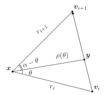

Figure 3.8 Notation used to define the generalized mean value potential induced by the edge \([v_i, v_{i+1}]\).

The potential \(\Phi_p(\boldsymbol{x})\) for the edge \([\boldsymbol{v}_i, \boldsymbol{v}_{i+1}]\) is then given by

$$
\Phi_p(\boldsymbol{x}) = \int_0^\alpha \frac{d\theta}{\rho(\theta)^p} = \frac{1}{(r_i r_{i+1} \sin \alpha)^p} \int_0^\alpha (r_i \sin \theta + r_{i+1} \sin(\alpha - \theta))^p d\theta.
$$

For a given value of \(p\) the integral can be computed symbolically. In particular, when \(p\) is odd, it can be expressed as a polynomial of degree \(p\) of the variable \(t = \tan(\alpha/2)\). The first expressions for \(p = 1, 3\) are given by

$$
\Phi_1(\boldsymbol{x}) = \left( \frac{1}{r_i} + \frac{1}{r_{i+1}} \right) t, \quad \Phi_3(\boldsymbol{x}) = \frac{1}{3} \left( \frac{1}{r_i^3} + \frac{1}{r_{i+1}^3} \right) t + \frac{1}{6} \left( \frac{1}{r_i} + \frac{1}{r_{i+1}} \right)^3 t(1+t^2).
$$

The expression for \(\Phi_1(\boldsymbol{x})\) corresponds to the expression for the mean value weight in [144, 200]. For even \(p\), the resulting expressions are no longer simple anymore, except for the case \(p = 0\), which corresponds to the angle \(\alpha\). The interested reader can find further details in [40].

In the 3D case we need to compute the contribution of the potential induced by a triangle \([\boldsymbol{v}_i, \boldsymbol{v}_j, \boldsymbol{v}_k]\) at \(\boldsymbol{x}\). The case \(p = 0\) corresponds to the solid angle at which the triangle \([\boldsymbol{v}_i, \boldsymbol{v}_j, \boldsymbol{v}_k]\) is seen from \(\boldsymbol{x}\). The case \(p = 1\) corresponds to the mean value weight for which an expression is given in [217]. For other values of \(p\), a closed form expression for the potential \(\Phi_p(\boldsymbol{x})\) induced by one triangle can be obtained as a particular case of the expressions for singular potential integrals derived in [85].

## Barycentric Mappings*

Teseo Schneider

Università della Svizzera italiana, Lugano, Switzerland

## CONTENTS

- 4.1 Introduction .................................... 64
- 4.1.1 Convex polygons ............................... 64
- 4.1.2 Arbitrary polygons ............................ 65
- 4.2 Bijective barycentric mapping ................... 66
- 4.2.1 Perturbed target polygons ..................... 66
- 4.3 Bijective composite barycentric mapping ......... 68
- 4.3.1 Limit of composite barycentric mappings ....... 70
- 4.4 Extensions ...................................... 71
- 4.4.1 Closed planar curves .......................... 71
- 4.4.2 Polyhedra ..................................... 73
- 4.5 Practical considerations ........................ 75
- 4.5.1 Choosing the coordinates ...................... 75
- 4.5.2 Choosing the vertex paths ..................... 75

BARYCENTRIC MAPPINGS allow us to naturally warp a source polygon to a corresponding target polygon, or, more generally, to create mappings between closed curves or polyhedra. Unfortunately, bijectivity of such barycentric mappings can only be guaranteed for the special case of warping between convex polygons. In fact, for any barycentric coordinates, it is always possible to construct a pair of polygons such that the barycentric mapping is not bijective. However, if the two polygons are sufficiently close, the mapping is close to the identity and hence bijective. This fact suggests "splitting" it into several intermediate mappings and creating a composite barycentric mapping, which is guaranteed to be bijective between arbitrary polygons, polyhedra, or closed planar curves.


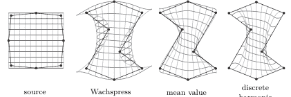

图 4.1 基于不同重心坐标的重心映射示例。对于离散调和映射，我们仅显示 \(\Omega^0\) 内部的图像。

### 4.1 引言

源多边形 \(\Omega^0 \subset \mathbb{R}^2\)（具有 \(n \ge 3\) 个按逆时针排列的源顶点 \(v_i^0, i = 1, \dots, n\)）与目标多边形 \(\Omega^1 \subset \mathbb{R}^2\)（具有相同数量的目标顶点 \(v_i^1\)）之间的重心映射，是一个映射

\(f: \Omega^0 \to \Omega^1, \quad f(x) = \sum_{i=1}^n \phi_i(x) v_i^1, \quad (4.1)\)

其中函数 \(\phi_i: \Omega^0 \to \mathbb{R}, i = 1, \dots, n\) 是相对于 \(\Omega^0\) 的重心坐标（参见第 1 章）。由于 \(f\) 取决于坐标的特定选择，我们用生成该映射的坐标名称来表示映射 \(f\)。例如，Wachspress 映射是基于 Wachspress 坐标的重心映射。

由于拉格朗日性质 (1.10b)，显然 \(f(v_i^0) = v_i^1\)。此外，如果点 \(x = (1 - \mu) v_i^0 + \mu v_{i+1}^0\) 位于边 \([v_i^0, v_{i+1}^0]\) 上，则唯一非零的坐标是 \(\phi_i(x) = 1 - \mu\) 和 \(\phi_{i+1}(x) = \mu\)，因此映射为 \(f(x) = (1 - \mu) v_i^1 + \mu v_{i+1}^1\)，这意味着它在边上也是线性的。最后，映射 \(f\) 总是满射，因为坐标 \(\phi_i\) 是连续的，这意味着 \(f\) 在 \(\Omega^0\) 上是连续的，且边被映射为边。

图 4.1 显示了不同坐标的重心映射示例。我们可以看到，无论坐标选择如何，映射在边上都是线性的，并且它不是双射；也就是说，网格在凹区域会折叠。

#### 4.1.1 凸多边形

凸多边形之间的重心映射仅在 Wachspress 映射的特殊情况下才保证是双射 [152]。图 4.2 显示了两个凸多边形之间重心映射的一个极端示例。在放大图中，我们

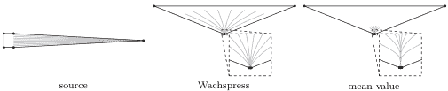

图 4.2 取自 [152] 的具有 5 个顶点的凸源多边形和凸目标多边形示例，其中平均值映射（右侧）不是双射，而 Wachspress 映射（中间）是。

可以看到平均值映射不是双射，而 Wachspress 映射是双射。

#### 4.1.2 任意多边形

对于任何重心坐标的选择，都可以构造一个源多边形和一个目标多边形，使得重心映射不是双射 [208]。为了构造这样的反例，让我们考虑正方形与变形正方形之间的重心映射，如图 4.3 所示。

由于我们只移动 \(v_i^0\)，我们知道对于 \(i = 1, 2, 4\) 有 \(v_i^1 - v_i^0 = 0\)，并且可以将映射 \(f\) 在原点处的值改写为，

\(f(\mathbf{0}) = \sum_{i=1}^4 \phi_i(\mathbf{0})(v_i^1 - v_i^0 + v_i^0) = \sum_{i=1}^4 \phi_i(\mathbf{0})(v_i^1 - v_i^0) = \phi_3(\mathbf{0})(v_3^1 - v_3^0) = \phi_3(\mathbf{0})(v_3^1 + v_1^0),\)

其中我们利用了最后一步中 \(v_3^0 = -v_1^0\) 的事实。

我们首先假设 \(\phi_3(\mathbf{0}) > 0.5\)，并证明存在 \(v_3^1\) 的选择使得 \(f(\mathbf{0}) = v_1^1$，这与映射的双射性矛盾。为此，

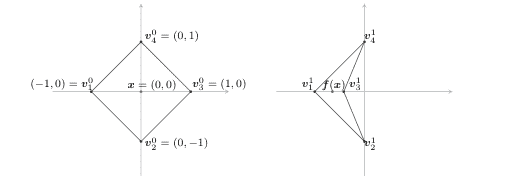

图 4.3 用于构造非双射重心映射的源多边形和目标多边形。

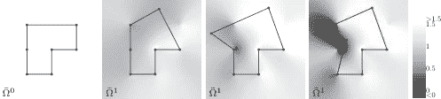

图 4.4 不同目标多边形的平均值映射 \(f: \hat{\Omega}^0 \to \hat{\Omega}^1\) 的 \(J_f\) 颜色编码图，当扰动较小时保持为正，但在大变形下变为负。参见彩色插页。

观察到

\(x = \frac{\phi_2(\mathbf{0}) - 1}{\phi_3(\mathbf{0})} > -1\)

根据假设，并选择 \(v_3^1 = (x, 0) = -xv^0\)。有了这个选择，

\(f(\mathbf{0}) = \phi_3(\mathbf{0})(1-x)v_1^0 = v_1^1\)。

接下来，假设 \(\phi_3(\mathbf{0}) < 0.5$，我们通过类似的考虑得出 \(f(\mathbf{0}) = v_3^1$，这再次与 \(f\) 的双射性矛盾。

最后，考虑 \(\phi_3(\mathbf{0}) = 0.5\) 的情况。将源多边形旋转 90 度，牢记 \(f\) 在旋转下不变，并重复前两种情况中的相同推理，我们得出所有 \(i\) 的 \(\phi_i(\mathbf{0}) = 0.5$，这与分区统一性质矛盾。

### 4.2 双射重心映射

让我们用 \(\partial_k f(\mathbf{x}) = \partial f / \partial x_k, k = 1, 2\) 表示 (4.1) 中重心映射 \(f = (f_1, f_2)\) 在 \(\mathbf{x} = (x_1, x_2) \in \hat{\Omega}^0\) 处的 *偏导数*，并用 \(\nabla f_i = (\partial_1 f_i, \partial_2 f_i)\) 表示其两个分量 \(f_i\) 的 *梯度*。

由于我们仅考虑没有自交的源多边形和目标多边形，并假设重心坐标 \(\phi_i\) 至少是连续可微的，\(f\) 的单射性的一个充分条件是其雅可比行列式

\(J_f = \begin{vmatrix} \partial_1 f_1 & \partial_2 f_1 \\ \partial_1 f_2 & \partial_2 f_2 \end{vmatrix}\)

在 \(\hat{\Omega}^0\) 中严格为正 [272]。由于从 (4.1) 可知，相同源多边形和目标多边形之间的重心映射是恒等映射，且对所有 \(\mathbf{x} \in \hat{\Omega}^0\) 有 \(J_f(\mathbf{x}) = 1$，因此可以合理地期望，目标顶点的小扰动会保持 \(J_f\) 为正且映射为双射，如图 4.4 所示。

#### 4.2.1 扰动目标多边形

首先考虑一个只有一个扰动顶点的目标多边形，如图 4.5 所示。形式上，目标顶点为某个 \(i\) 的 \(v_i^1 = v_i^0 + \mathbf{u}\) 和 \(j \neq i\) 的 \(v_j^1 = v_j^0$。将这些目标顶点 \(\boldsymbol{v}_i^1\) 代入 (4.1) 并回顾线性再现性质 (1.9)，我们得到

$$
f(\boldsymbol{x}) = \boldsymbol{x} + \phi_i(\boldsymbol{x})\boldsymbol{u}
$$

对于任何 \(\boldsymbol{x} \in \bar{\Omega}^0$，并且进一步，

$$
J_f(\boldsymbol{x}) = \left| \begin{matrix} 1 + \partial_1\phi_i(\boldsymbol{x})u_{i,1} & \partial_2\phi_i(\boldsymbol{x})u_{i,1} \\ \partial_1\phi_i(\boldsymbol{x})u_{i,2} & 1 + \partial_2\phi_i(\boldsymbol{x})u_{i,2} \end{matrix} \right| = 1 + \nabla\phi_i(\boldsymbol{x}) \cdot \boldsymbol{u} .
$$

因此，

$$
J_f(\boldsymbol{x}) \ge 1 - \|\nabla\phi_i(\boldsymbol{x}) \cdot \boldsymbol{u}\| \ge 1 - \|\boldsymbol{u}\|\|\nabla\phi_i(\boldsymbol{x})\| ,
$$

当 \(\|\boldsymbol{u}\| < 1/M_i$ 时严格为正，其中

$$
M_i = \sup_{\boldsymbol{x} \in \bar{\Omega}^0} \|\nabla\phi_i(\boldsymbol{x})\| .
$$

这个结果很好地扩展到所有顶点的扰动情况，其中我们考虑具有顶点 \( \boldsymbol{v}_i^1 = \boldsymbol{v}_i^0 + \boldsymbol{u}_i \) 的目标多边形，\( i = 1, \dots, n \)（图 4.5）。再次使用线性再现性质，我们将映射改写为

$$
f(\boldsymbol{x}) = \boldsymbol{x} + \sum_{i=1}^n \phi_i(\boldsymbol{x})\boldsymbol{u}_i
$$

对于任何 \(\boldsymbol{x} \in \bar{\Omega}^0$，因此

$$
J_f(\boldsymbol{x}) = \left| \begin{matrix} 1 + \sum_i \partial_1\phi_i(\boldsymbol{x})u_{i,1} & \sum_i \partial_2\phi_i(\boldsymbol{x})u_{i,1} \\ \sum_i \partial_1\phi_i(\boldsymbol{x})u_{i,2} & 1 + \sum_i \partial_2\phi_i(\boldsymbol{x})u_{i,2} \end{matrix} \right| = 1 + \sum_i \nabla\phi_i(\boldsymbol{x}) \cdot \boldsymbol{u}_i + \sum_i \sum_j \partial_1\phi_i(\boldsymbol{x})\partial_2\phi_j(\boldsymbol{x})(\boldsymbol{u}_i \times \boldsymbol{u}_j) ,
$$

其中 \( \boldsymbol{u}_i = (u_{i,1}, u_{i,2}) \) 且求和范围从 1 到 \( n \)。因此，

$$
J_f(\boldsymbol{x}) \ge 1 - Md - M^2d^2
$$


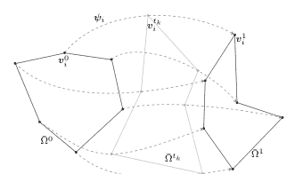

图 4.6 利用路径 $\psi_i$ 构造中间多边形 $\Omega^{t_k}$。

其中 $M = M_1 + \cdots + M_n$ 且 $d = \max_{1 \le i \le n} \|u_i\|$。总体而言，这意味着当
$$d < \frac{\sqrt{5}-1}{2M}.$$
时，映射 $f$ 是单射的。

### 4.3 双射复合重心映射

第 4.2.1 节表明，如果源多边形和目标多边形足够接近，则映射接近恒等映射，因此是双射的。因此，通过将从源多边形到目标多边形的重心映射“拆分”为有限个中间步骤，其中每个步骤仅轻微扰动顶点，应该可以得到双射复合映射。

为此，假设 $\psi_i: [0, 1] \to \mathbb{R}^2, i = 1, \dots, n$ 是一组连续顶点路径，连接每个源向量 $v_i^0 = \psi_i(0)$ 及其对应的目标向量 $v_i^1 = \psi_i(1)$，如图 4.6 所示。令 $\tau = (t_0, t_1, \dots, t_m)$，其中 $t_0 = 0, t_m = 1$，令 $t_k < t_{k+1}$ 对于 $k = 0, \dots, m-1$ 是 $[0, 1]$ 的一个划分，并令 $f_k$ 是基于重心坐标 $\phi_i^{t_k}$ 从 $\Omega^{t_k}$ 到 $\Omega^{t_{k+1}}$ 的重心映射。

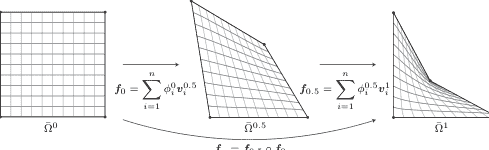

图 4.7 对于 $\tau = [0, 0.5, 1]$ 构造复合重心映射。

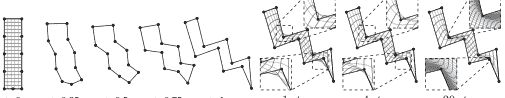

图 4.8 不同数量均匀步数的均匀复合平均值映射示例。

映射
$$
\boldsymbol{f}_{\tau} = \boldsymbol{f}_{m-1} \circ \boldsymbol{f}_{m-2} \circ \cdots \circ \boldsymbol{f}_{0}
$$
被称为从 \(\tilde{\Omega}^0\) 到 \(\tilde{\Omega}^1\) 的 *复合重心映射* [350]。正方形与凹四边形之间的复合重心映射示例见图 4.7。

记 \(\tilde{\Omega}^{t_k}\) 与 \(\tilde{\Omega}^{t_{k+1}}\) 之间的最大位移距离为
$$
d_k = \max_{1 \le i \le n} \left\| \boldsymbol{v}_i^{t_k} - \boldsymbol{v}_i^{t_{k+1}} \right\|,
$$
根据前面的结果，当
$$
d_{\tau} = \max_{0 \le k < m} d_k < \frac{\sqrt{5} - 1}{2nM^*},
$$
时，\(\boldsymbol{f}_{\tau}\) 是双射的，其中
$$
M^* = \max_{1 \le i \le n} \sup_{t \in [0,1]} \sup_{\boldsymbol{x} \in \Omega^t} \left\| \nabla \boldsymbol{\psi}^t_i(\boldsymbol{x}) \right\|.
$$

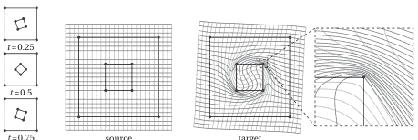

图 4.9 具有 1000 个均匀步数的复合平均值映射示例。放大图中网格的分辨率提高了 4 倍。

对于平均值映射的特殊情况，可以证明该界对于任意凸多边形之间的映射都满足（参见第 2 章）。图 4.8 表明，当有足够多的中间步骤时，映射 $f$ 变为双射。

特别是，存在某个 $m \in \mathbb{N}$，使得均匀划分 $t_k$（其中 $t_k = k/m$）给出双射复合重心映射 $f_{r_m}$。图 4.9 显示了两个嵌套正方形的复合平均值映射示例，其中内部正方形在目标配置中使用均匀划分 1000 旋转了 90 度。

#### 4.3.1 复合重心映射的极限

均匀复合重心映射的想法引出了关于极限行为的有趣问题。为此，我们考虑 *无限复合重心映射* $f_\infty = \lim_{m \to \infty} f_{r_m}$ 及其后向映射 $g_\infty : \Omega^1 \to \Omega^0$。图 4.10 显示了使用均匀复合映射 $f_{r_m}$ 与其后向映射 $g_{r_m} : \Omega^1 \to \Omega^0$（步数相同）对一个五角星进行映射的结果。对 $\Omega^0$ 中一百万个随机点 $x$ 计算最大距离 $\|x - g_{r_m}(f_{r_m}(x))\|$ 表明，该距离趋于零，因此当 $m \to \infty$ 时 $g_{r_m} = f_{r_m}^{-1}$。因此，无限重心映射的逆映射很可能本身也是一个无限重心映射，而这对于标准重心映射则不成立。

这一观察可以通过考虑两个连续步骤之间的差异并取其极限来证明 [145]。对于任意点 $x^0 \in \Omega^0$，我们计算复合映射 $f$ 的第一步 $f_0$，
$$
x^{t_1} = f_0(x^0) = \sum_{i=1}^n \phi_i^{t_0}(x^0) \psi_i(t_1).
$$
由于线性再现性质，
$$
x^0 = \sum_{i=1}^n \alpha_i^0 \phi_i^{t_0}(x^0) \psi_i(t_0),
$$

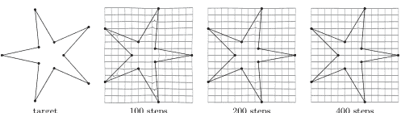

图 4.10 随着均匀步数 $m$ 的增加，映射 $f_{r_m}$ 与后向映射 $g_{r_m}$ 的复合趋于恒等映射。

因此，
$$
x^{t_1} - x^0 = \sum_{i=1}^n \phi_i^{t_0}(x^0)(\psi_i(t_1) - \psi_i(t_0)).
$$
除以 $t_1 - t_0$ 并取 $t_1 \to t_0$ 的极限，得到
$$
x'(t) = \sum_{i=1}^n \phi_i(x(t), t)\psi'_i(t),
$$
这是关于 $x(t)$ 的形式为
$$
x'(t) = F(t, x(t)).
$$
的一阶微分方程，初始条件为 $x(0) = x^0$。

如果重心坐标 $\phi_i$ 是 Lipschitz 连续的，那么 $F$ 也是 Lipschitz 连续的，根据皮卡德-林德勒夫定理 [250, 308]，这是局部唯一解存在的充分条件。该微分方程的解也是全局解，因为 $x(t)$ 始终位于所有中间多边形内部。这是因为映射是双射的，且边被映射为边。

为了证明 $g^{-1} = f$，我们考虑任意点 $x^t = x(1) \in \bar{\Omega}^1$，
$$
y'(t) = \sum_{i=1}^n \phi_i(x(1-t), 1-t)\bar{\psi}'_i(t), \quad \bar{\psi}_i(t) = \psi_i(1-t),
$$
其中 $y(0) = x(1)$ 是将 $x^1$ 从 $\bar{\Omega}^1$ 映射到 $\bar{\Omega}^0$。由于 $\bar{\psi}'_i(t) = -\psi'_i(1-t)$，我们得出 $y(t) = x(1-t)$。因此，$y(1) = x^0$ 且 $g$ 有一个由前一个方程生成的逆映射，满足 $g^{-1} = f$。

### 4.4 扩展

保证多边形之间复合重心映射双射性的充分条件可以自然地扩展到闭合曲线和多面体之间的映射。

#### 4.4.1 闭合平面曲线

我们定义闭合平面源曲线 $\gamma^0(s)$ 与闭合平面目标曲线 $\gamma^1(s)$（其中 $s \in [0, 1]$）之间的 *重心映射* 为
$$
f(x) = \int_0^1 \phi(s, x)\gamma^1'(s)ds,
$$
其中 $\phi(s, x)$ 是相对于 $\gamma^0$ 的跨有限重心坐标（参见第 3 章）。类似于多边形的情况，我们现在考虑受扰目标曲线 \(\gamma^1(s) = \gamma^0(s) + \boldsymbol{u}(s)\) 并假设最大位移距离满足
$$
d = \sup_{s \in [0,1]} \|\boldsymbol{u}(s)\| < \frac{\sqrt{5}-1}{2M},
$$
其中
$$
M = \sup_{s \in [0,1]} \sup_{\boldsymbol{x} \in \gamma^0} \|\nabla \phi(s, \boldsymbol{x})\|.
$$
我们利用线性再现性质重写
$$
\boldsymbol{f}(\boldsymbol{x}) = \boldsymbol{x} + \int_0^1 \phi(s, \boldsymbol{x}) \boldsymbol{u}(s) ds
$$
并计算
$$
J\boldsymbol{f}(\boldsymbol{x}) = \left| \begin{matrix} 1 + \int \partial_1 \phi(s, \boldsymbol{x}) u_1(s) ds & \int \partial_2 \phi(s, \boldsymbol{x}) u_1(s) ds \\ \int \partial_1 \phi(s, \boldsymbol{x}) u_2(s) ds & 1 + \int \partial_2 \phi(s, \boldsymbol{x}) u_2(s) ds \end{matrix} \right| = 1 + \int \nabla \phi(s, \boldsymbol{x}) \cdot \boldsymbol{u}(s) ds + \iint \partial_1 \phi(s, \boldsymbol{x}) \partial_2 \phi(r, \boldsymbol{x}) (\boldsymbol{u}(s) \times \boldsymbol{u}(r)) ds dr,
$$
其中积分范围从零到一。因此，
$$
J\boldsymbol{f}(\boldsymbol{x}) \ge 1 - Md - M^2 d^2,
$$
当 \(Md < (\sqrt{5}-1)/2\) 时，该值严格为正。因此，只要 \(d < \frac{\sqrt{5}-1}{2M}\)，映射就是单射的。值得注意的是，这个界与多边形情况下的相同。

现在假设 \(\boldsymbol{\psi}\) 是源曲线 \(\gamma^0 = \boldsymbol{\psi}(0)\) 与目标曲线 \(\gamma^1 = \boldsymbol{\psi}(1)\) 之间的连续 _闭合曲线_ 插值函数。同样，我们令 \(\tau = (t_0, t_1, \dots, t_m)\)，其中 \(t_0 = 0, t_m = 1\)，且 \(t_k < t_{k+1}$ 对于 \(k = 0, \dots, m-1$ 是 \([0,1]$ 的一个 _划分_，并令 \(\boldsymbol{f}_k\) 是基于重心坐标 \(\phi^k$ 从 \(\gamma^{t_k}$ 到 \(\gamma^{t_{k+1}}$ 的重心映射。映射
$$
\boldsymbol{f}_\tau = \boldsymbol{f}_{m-1} \circ \boldsymbol{f}_{m-2} \circ \cdots \circ \boldsymbol{f}_0,
$$


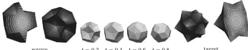

图 4.12 两个多面体之间复合平均值映射示例。颜色显示源多面体的内部如何变形为目标多面体的内部。参见彩色插页。

称为从 \(\gamma^0\) 到 \(\gamma^1\) 的*复合重心映射*。两个闭曲线之间复合重心映射的示例见图 4.11。

令 \(\gamma^{t_k}\) 和 \(\gamma^{t_{k+1}}\) 之间的最大位移距离为

```
\(d_k = \sup_{s \in [0,1]} \|\gamma^{t_k}(s) - \gamma^{t_{k+1}}(s)\|,\)
```

根据前一结果，\(f_{\mathbf{z}}\) 是双射的，当且仅当

```
\(d_r = \max_{0 \le k < m} d_k < \frac{\sqrt{5}-1}{2n M^*},\)
```

其中

```
\(M^* = \sup_{s \in [0,1]} \sup_{t \in [0,1]} \sup_{\mathbf{x} \in \gamma^t} \|\nabla \phi^t(s, \mathbf{x})\|.\)
```

#### 4.4.2 多面体

具有相同顶点数 \(n\) 和相同拓扑的两个多面体之间的重心映射定义为函数

```
\(\mathbf{f}: \bar{\Omega}^0 \to \bar{\Omega}^1, \quad \mathbf{f}(\mathbf{x}) = \sum_{i=1}^n \phi_i(\mathbf{x}) \mathbf{v}_i^1,\)
```

其中 \(\mathbf{v}_i^1\) 是目标多面体的顶点，\(\phi_i(\mathbf{x})\) 是 3D 重心坐标（参见第 1.3 节）。此类映射的示例见图 4.12。

与多边形情况类似，我们首先仅扰动一个顶点，并考虑目标多面体，其顶点为某个 \(i\) 的 \(\mathbf{v}_i^1 = \mathbf{v}_i^0 + \mathbf{u}\) 以及 \(j \neq i\) 时的 \(\mathbf{v}_j^1 = \mathbf{v}_j^0\)。则，

```
\(J_{\mathbf{f}}(\mathbf{x}) = \begin{vmatrix} 1 + \partial_1 \phi_i(\mathbf{x}) u_1 & \partial_2 \phi_i(\mathbf{x}) u_1 & \partial_3 \phi_i(\mathbf{x}) u_1 \\ \partial_1 \phi_i(\mathbf{x}) u_2 & 1 + \partial_2 \phi_i(\mathbf{x}) u_2 & \partial_3 \phi_i(\mathbf{x}) u_2 \\ \partial_1 \phi_i(\mathbf{x}) u_3 & \partial_2 \phi_i(\mathbf{x}) u_3 & 1 + \partial_3 \phi_i(\mathbf{x}) u_3 \end{vmatrix} = 1 + \nabla \phi_i(\mathbf{x}) \cdot \mathbf{u}\)
```

和

```
\(|J_{\mathbf{f}}(\mathbf{x})| \ge 1 - |\phi_i(\mathbf{x}) \cdot \mathbf{u}| \ge 1 - \|\phi_i(\mathbf{x})\| \|\mathbf{u}\|,\)
```

当 \(\|\boldsymbol{u}\| < 1/M_i\) 时为正，其中

\(M_i = \sup_{\boldsymbol{x} \in \Omega} \|\nabla b_i(\boldsymbol{x})\|.\)

同样，我们扰动多面体的所有顶点，并考虑目标多面体，其顶点为 \(i = 1, \dots, n\) 的 \(\boldsymbol{v}'_i = \boldsymbol{v}^0 + \boldsymbol{u}_i\)，以得到

\(J_\boldsymbol{f}(\boldsymbol{x}) = \begin{vmatrix} 1 + \sum_i \partial_1 \phi_i(\boldsymbol{x}) u_{i,1} & \sum_i \partial_2 \phi_i(\boldsymbol{x}) u_{i,1} & \sum_i \partial_3 \phi_i(\boldsymbol{x}) u_{i,1} \\ \sum_i \partial_1 \phi_i(\boldsymbol{x}) u_{i,2} & 1 + \sum_i \partial_2 \phi_i(\boldsymbol{x}) u_{i,2} & \sum_i \partial_3 \phi_i(\boldsymbol{x}) u_{i,2} \\ \sum_i \partial_1 \phi_i(\boldsymbol{x}) u_{i,3} & \sum_i \partial_2 \phi_i(\boldsymbol{x}) u_{i,3} & 1 + \sum_i \partial_3 \phi_i(\boldsymbol{x}) u_{i,3} \end{vmatrix}\)
\(= 1 + \sum_i \nabla \phi_i(\boldsymbol{x}) \cdot \boldsymbol{u} + \sum_i \sum_j \sum_k \partial_k \phi_i(\boldsymbol{x}) \partial_j \phi_j(\boldsymbol{x}) \partial_i \phi_k(\boldsymbol{x}) |(\boldsymbol{u}_i \boldsymbol{u}_j \boldsymbol{u}_k)| + \sum_i \sum_j \left( \partial_i \phi_i(\boldsymbol{x}) \partial_j \phi_j(\boldsymbol{x}) D_3 + \partial_i \phi_i(\boldsymbol{x}) \partial_k \phi_j(\boldsymbol{x}) D_2 + \partial_2 \phi_i(\boldsymbol{x}) \partial_3 \phi_j(\boldsymbol{x}) D_1 \right),\)

其中求和范围为 1 到 \(n\)，且 \(D_k\) 是 \(\boldsymbol{u}_i \times \boldsymbol{u}_j\) 的第 \(k\) 分量，

因此，

\(J_\boldsymbol{f}(\boldsymbol{x}) \ge 1 - Md - 3M^2 d^2 - M^3 d^3,\)

其中

\(d = \max_{1 \le i \le n} \|\boldsymbol{u}_i\| \quad \text{and} \quad M = M_1 + \cdots + M_n,\)

当 \(Md < \sqrt{2} - 1\) 时为正，这意味着当 \(d < \frac{\sqrt{2}-1}{M}\) 时 \(\boldsymbol{f}\) 是单射的。

现在，假设 \(\boldsymbol{\psi}_i: [0, 1] \to \mathbb{R}^3\)，\(i = 1, \dots, n\) 是一组连续的*顶点路径*，介于每个源顶点 \(\boldsymbol{v}^0 = \boldsymbol{\psi}_i(0)\) 及其对应的目标顶点 \(\boldsymbol{v}'_i = \boldsymbol{\psi}_i(1)\) 之间。我们定义从 \(\Omega^0\) 到 \(\Omega^1\) 的*复合重心映射*为

\(\boldsymbol{f}_\tau = \boldsymbol{f}_{m-1} \circ \boldsymbol{f}_{m-2} \circ \cdots \circ \boldsymbol{f}_0,\)

其中 \(\boldsymbol{f}_k: \bar{\Omega}^{t_k} \to \bar{\Omega}^{t_{k+1}}\) 是基于区间 \([0, 1]\) 的划分 \(\tau = (t_0, t_1, \dots, t_m)\) 的重心映射。

令 \(\bar{\Omega}^{t_k}\) 和 \(\bar{\Omega}^{t_{k+1}}\) 之间的最大位移距离为

\(d_k = \max_{1 \le i \le n} \|\boldsymbol{v}^t_i - \boldsymbol{v}^{t_{k+1}}_i\|,\)

可知 \(\boldsymbol{f}_\tau\) 是双射的，当且仅当

\(d_\tau = \max_{0 \le k < m} d_k < \frac{\sqrt{2}-1}{2nM^*},\)

其中

\(M^* = \max_{1 \le i \le n} \sup_{\boldsymbol{x} \in \Omega^0} \sup_{\boldsymbol{x}' \in \Omega^t} \|\nabla \phi'_i(\boldsymbol{x}')\|.\)

复合重心映射 \(\boldsymbol{f}_\tau\) 也可扩展到闭光滑曲面，通过类似推理可得出结论：当 \(d_\tau < (\sqrt{2}-1)/(2nM^*)\) 时，映射 \(\boldsymbol{f}_\tau\) 是双射的。

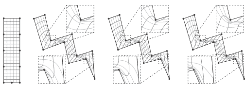

图 4.13 100 个均匀步长下不同类型重心坐标的复合重心映射。

### 4.5 实际注意事项

复合重心映射取决于两个主要选择：底层重心坐标 \(\phi\) 和顶点路径 \(\psi\)。在本节中，我们说明这些选择对复合映射的影响。

#### 4.5.1 选择坐标

一般来说，顶点路径 \(\psi_i\) 会产生任意中间形状，可能是凹形或弱凸形。因此，我们需要对任意简单多边形都有定义的重心坐标。我们建议使用平均值坐标（参见第 1.2.3 节）、调和坐标（参见第 1.2.8 节）或最大熵坐标（参见第 2.2.9 节）。图 4.13 显示了这三种不同坐标的复合重心映射示例。

#### 4.5.2 选择顶点路径

为了创建中间形状，适用于任何维度和任何形状的自然顶点路径是将形状从源线性插值到目标。然而，这种插值对相似变换不变，而映射是变换不变的。此外，在旋转情况下，顶点的线性插值更可能产生自交多边形，这使得映射无效，因为重心坐标仅对非自交多边形有定义。出于这些原因，线性插值不适合用于创建复合重心映射的中间形状。

相反，中间多边形可以通过线性插值转角和边长 [352] 来计算，这比线性插值顶点产生更自然的结果，因为边和角对相似变换不变。图 4.14 显示了当使用此方法而不是线性插值
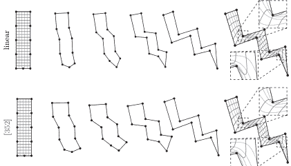

图 4.14 100 个均匀步长下不同顶点路径的复合重心映射示例。

顶点时，复合重心映射如何变化。类似方法可用于闭平面曲线，其中曲率在源曲线和目标曲线之间插值 [343]。另一种方法是创建两个输入曲线（或多边形）的多分辨率表示，并在这些多分辨率表示之间插值以创建中间形状 [168]。

在 3D 中结合这两种想法，我们插值边和二面角，并为了推导全局一致的解，遵循分层形状匹配方法 [428]。另一种更简单的方法是将全局插值分解为局部仿射变换，并将其分解为旋转部分和缩放/剪切部分 [381, 382]。虽然缩放/剪切部分随后可以线性插值，但旋转部分应在对数空间中处理。然而，问题是该方法无法正确处理大的全局旋转。

不幸的是，这些方法都不能保证中间形状没有自交。为了克服二维中的这一限制，早期结果处理具有对应平行边的多边形对 [180]。一种更通用的方法将两个多边形嵌入凸区域，生成一对兼容的三角剖分，并插值其特征向量编码几何的随机矩阵 [173]。另一种想法是通过“展开”源多边形并将其“重新折叠”回目标多边形来创建中间多边形 [206]。


## 拉普拉斯算子入门

**马克斯·瓦德茨基**

*德国哥廷根大学*

## 目录

- 5.1 引言 .................................... 77
- 5.1.1 基本性质 .............................. 78
- 5.2 黎曼流形上的拉普拉斯算子 .............. 79
- 5.2.1 外微分微积分 ............................. 79
- 5.2.2 Hodge 分解 ........................... 81
- 5.2.3 谱 .................................. 82
- 5.3 离散拉普拉斯算子 ............................. 83
- 5.3.1 图上的拉普拉斯算子 .......................... 83
- 5.3.2 谱 .................................. 84
- 5.3.3 单纯形流形上的拉普拉斯算子 ............ 86
- 5.3.4 强定义和弱定义的拉普拉斯算子 ........ 87
- 5.3.5 Hodge 分解 ........................... 88
- 5.3.6 余切拉普拉斯算子及其扩展 ................ 88
- 5.3.7 离散与光滑拉普拉斯算子 ............. 90

本章回顾了拉普拉斯算子（光滑和离散）的一些重要性质。我们特别强调了一种统一框架，用于处理黎曼流形上的光滑拉普拉斯算子，以及图和单纯形流形上的离散拉普拉斯算子。我们将此框架用线性代数的语言表述，旨在使该主题尽可能易于理解。我们在统一框架内结合了光滑几何、离散几何、谱分析、机器学习、数值分析和几何处理的视角。通过插值给定边界条件的调和函数，建立了与广义重心坐标的联系。

### 5.1 引言

拉普拉斯算子或许是*典型*的微分算子，用于各种物理现象。例如，它描述了热扩散、波传播、稳态流体流动，并且是量子力学中薛定谔方程的关键。在欧几里得空间中，光滑函数 \(u: \mathbb{R}^n \to \mathbb{R}\) 的拉普拉斯算子由沿坐标轴的二阶偏导数之和给出，

```
\(\Delta u = - \left( \frac{\partial^2 u}{\partial x_1^2} + \frac{\partial^2 u}{\partial x_2^2} + \cdots + \frac{\partial^2 u}{\partial x_n^2} \right),\)
```

此处我们采用使用负号的几何视角。

### 5.1.1 基本性质

拉普拉斯算子具有许多引人入胜的性质。在本文余下部分中，考虑一个开有界域 \(\Omega \subset \mathbb{R}^n\) 以及 \(\Omega\) 上平方可积函数线性空间的 \(L^2\) 内积

```
\((f, g) = \int_\Omega fg\)
```

设 \(u, v: \Omega \to \mathbb{R}\) 为两个（足够光滑）在 \(\Omega\) 边界上消失的函数。那么，相对于此内积，拉普拉斯算子 \(\Delta\) 是一个 _对称的_（或者更准确地说，是一个形式自伴的）线性算子，因为分部积分给出

```
(Sym) \((u, \Delta v) = \int_\Omega \nabla u \cdot \nabla v = (\Delta u, v).\)
```

此处 \(\nabla\) 表示标准梯度算子，\(\nabla u \cdot \nabla v\) 表示 \(\mathbb{R}^n\) 中向量的标准内积。在拉普拉斯算子定义中选用负号使得该算子是正半定的，因为

```
(PSD) \((u, \Delta u) = \int_\Omega \nabla u \cdot \nabla u \ge 0.\)
```

如果只考虑在 \(\Omega\) 边界上消失的函数，则 (PSD) 意味着拉普拉斯算子核（\(\Delta u = 0\)）中仅包含那些在整个定义域上消失的函数。此外，性质 (Sym) 和 (PSD) 意味着拉普拉斯算子可以对角化，且其特征值非负，

```
\(\Delta u = \lambda u \Rightarrow \lambda \ge 0.\)
```

光滑拉普拉斯算子的另一个突出性质是 _最大原理_。设 \(u: \Omega \to \mathbb{R}\) 为 _调和的_；即，\(\Delta u = 0\)。最大原理断言

```
(MAX) \(u\) 是调和的 \(\Rightarrow u\) 在 \(\Omega\) 中没有严格局部最大值，
```

此处不再假设 \(u\) 在 \(\Omega\) 边界上消失。同样，没有调和函数可以在 \(\Omega\) 中具有局部最小值。

最大原理可以从调和函数的另一个重要性质——_平均值性质_——推导出来。考虑一点 \(\boldsymbol{x} \in \Omega\) 和一个半径为 \(r\)、以 \(\boldsymbol{x}\) 为圆心且完全包含在 \(\Omega\) 内的闭球 \( B(\boldsymbol{x}, r) \)。每个调和函数都具有这样的性质：值 \( u(\boldsymbol{x}) \) 可以从球 \( B(\boldsymbol{x}, r) \) 上 \( u \) 的值的平均值中恢复：

\( u(\boldsymbol{x}) = \frac{1}{\text{vol}(B(\boldsymbol{x}, r))} \int_{B(\boldsymbol{x}, r)} u(\boldsymbol{y}) d\boldsymbol{y}.\)

一个简单的反证法论证表明，平均值性质蕴含性质 (MAX)。

迄今提到的性质在应用中起着重要作用；具体来说，在重心坐标的背景下，它们产生了平均值坐标（参见第 1.2.3 节）和调和坐标（参见第 1.2.8 节）。下面我们将讨论拉普拉斯算子的其他性质。有关进一步阅读，我们参考书籍 [43, 140, 333] 和讲义 [83, 109]。

### 5.2 黎曼流形上的拉普拉斯算子

\(\mathbb{R}^n\) 上的标准拉普拉斯算子可表示为

\( \Delta u = -\text{div } \nabla u,\)

此处 div 是作用于 \(\mathbb{R}^n\) 向量场的通常散度算子。以积分形式写成，负散度算子是梯度的（形式）伴随：如果 \( X \) 是一个向量场，\( u: \Omega \to \mathbb{R} \) 是一个在 \(\Omega\) 边界上消失的函数，那么

\( \int_\Omega \nabla u \cdot X = \int_\Omega u (-\text{div } X).\)

这一视角可以推广到黎曼流形，后者引入了曲率的概念。拉普拉斯算子在研究这些弯曲空间中起着重要作用。

### 5.2.1 外微分微积分

虽然梯度和散度可以很容易地在黎曼流形上定义，但使用微分（或外微分）\( d \) 代替梯度、使用共微分 \( d^* \) 代替散度更为方便。

微分 \( d\) 类似于（但不等同于）梯度。确实，给定一个函数 \( u: \Omega \to \mathbb{R} \)，对于每个向量场 \( X \)，都有

\( du(X) = \nabla u \cdot X\)

特别是，微分不需要度量的概念，而梯度需要。共微分 \( d^* \) 被定义为 \( d \) 的形式伴随，就像散度是梯度的伴随一样。与作用于向量场的散度算子不同，共微分 \( d^* \) 作用于 1-形式。1-形式是在 \(\Omega\) 的每一点上的一个余向量；也就是说，如果 \( X \) 是 \(\Omega\) 上的向量场，\(\alpha\) 是一个 1-形式，那么 \(\alpha(X)\) 是 \(\Omega\) 上的一个实值函数。为了定义共微分 \(d^*\)，考虑一个 1-形式 \(\alpha\) 和一个在 \(\Omega\) 边界上消失的函数 \(u: \Omega \to \mathbb{R}\)。那么

\(\int_\Omega du \cdot \alpha = \int_\Omega u d^* \alpha,\)

此处点积是由向量之间的内积诱导的余向量之间的内积。请注意，不同于微分 \(d\)，共微分 \(d^*\) 需要度量的概念。函数 \(u\) 的拉普拉斯算子可表示为

\(\Delta u = d^* du,\)

这与上面给出的表示 \(\Delta u = -\text{div}\nabla u\) 等价。

为了将此框架推广到流形上，设 \(M\) 为具有光滑黎曼度量 \(g\) 的光滑可定向流形。为简单起见，假设 \(M\) 是紧致且边界为空。黎曼度量诱导了 \(M\) 上切向量之间的点向内积，类似于上述讨论，这进一步诱导了 1-形式之间的内积。更一般地，人们使用 \(k\)-形式，其中 \(k \ge 0\)。按惯例，0-形式是 \(M\) 上的一个实值函数。1-形式可以被视为一个有向 1-体积，即将 1-形式作用于向量场会在每一点返回一个实值。同样，对于 \(k > 1\) 的 \(k\)-形式可以被视为一个有向 \(k\)-体积，即当作用于切向量的有序 \(k\)-元组（平行六面体）时在每一点返回一个实数。因此，\(k\)-形式可以在维度为 \(k\) 的（子）流形上积分。在后续内容中，我们用 \(\Lambda^k\) 表示 \(M\) 上 \(k\)-形式的线性空间。

类似于 \(\mathbb{R}^n\) 上函数之间的 \(L^2\) 内积，设

\((\alpha, \beta)_k = \int_M g(\alpha, \beta) \text{vol}_g\)

表示 \(M\) 上 \(k\)-形式 \(\alpha\) 和 \(\beta\) 之间的 \(L^2\) 内积，此处稍作滥用记号，用 \(g(\alpha, \beta)\) 表示由黎曼度量诱导的（点向）内积。

微分 \(d: \Lambda^k \to \Lambda^{k+1}\) 将 \(k\)-形式映射为 \((k+1)\)-形式，其中 \(0 \le k \le \dim M\)，对于任何 \(k = \dim M\) 的 \(k\)-形式，令 \(d\alpha = 0\)。可以通过假设斯托克斯定理来定义作用于 \(k\)-形式的微分，

\(\int_U d\alpha = \int_{\partial U} \alpha,\)

对于每个 \(k\)-形式 \(\alpha\) 和每个维度为 \((k+1)\)、边界为 \(\partial U\) 的足够光滑子流形 \(U \subset M\)。如果将此等式作为微分 \(d\) 的定义性质，那么立即可得 \(d \circ d = 0\)，因为流形的边界的边界是空集（\(\partial(\partial U) = \emptyset\)）。

共微分 \(d^*\)，将 \((k+1)\)-形式映射回 \(k\)-形式，是相对于 \(k\)-形式和 \((k+1)\)-形式上的 \(L^2\) 内积的 \(d\) 的（形式）伴随。它通过要求

\((d\alpha, \beta)_{k+1} = (\alpha, d^*\beta)_k\)


对所有 \(k\)-形式 \(\alpha\) 和所有 \((k+1)\)-形式 \(\beta\)。最后，作用于 \(k\)-形式上的 \(Laplace-Beltrami\) 算子 \(\Delta: \Lambda^k \to \Lambda^k\) 定义为

\(\Delta \alpha = dd^* \alpha + d^* d \alpha.\)

请注意，该表达式在 \(M\) 上的 0-形式（函数）中简化为 \(\Delta u = d^* du\)。从拉普拉斯算子的定义几乎可以立即得出，一个 \(k\)-形式 \(\alpha\) 是 \(harmonic\)（\(\Delta \alpha = 0\)）当且仅当它是闭合的（\(d\alpha = 0\)）且共闭合的（\(d^* \alpha = 0\)）。

从结构角度来看，需要注意的是，前面提到的性质 (Sym)、(PSD) 和 (MAX) 在黎曼流形的设置中依然成立（还有其他各种性质）。关于外微分算子和 Laplace–Beltrami 算子的更多细节，我们参考 [333]。

### 5.2.2 Hodge 分解

在 \(M\) 上每个足够光滑的 \(k\)-形式 \(\alpha\) 都允许一个唯一的分解

\(\alpha = d\mu + d^* \nu + h,\)

称为 \(Hodge\) 分解（或 Hodge–Helmholtz 分解），其中 \(\mu\) 是一个 \((k-1)\)-形式，\(\nu\) 是一个 \((k+1)\)-形式，而 \(h\) 是一个谐波 \(k\)-形式。该分解是唯一的，并且关于 \(k\)-形式上的 \(L^2\) 内积是正交的，

\(0 = \langle d\mu, d^* \nu \rangle_k = \langle h, d\mu \rangle_k = \langle h, d^* \nu \rangle_k,\)

这立即源于 \(d \circ d = 0\) 的事实以及谐波形式满足 \(dh = d^* h = 0\) 的事实。Hodge 分解可以看作是线性代数中众所周知事实的（形式化）应用：线性算子的核的正交补等于其伴随（转置）算子的值域。

通过向量场与 1-形式之间的对偶性，1-形式的 Hodge 分解可推广为向量场的相应分解，分为无旋分量和无散度分量，这在流体力学 [13] 和电磁学的麦克斯韦方程 [155] 中有应用。

从几何角度看，Hodge 分解建立了拉普拉斯算子与流形全局性质之间的关系。确实，对于紧流形，谐波 \(k\)-形式的线性空间是有限维的，并且与 \(M\) 的第 \(k\) 个上同调群 \(H^k(M; \mathbb{R})\) 同构。作为这一事实的应用，考虑一个没有边界的紧可定向曲面。那么谐波 1-形式空间的维数等于曲面亏格的两倍；也就是说，对于 2-球面该维数为零，对于二维环面为二，对于亏格为二的曲面（脆饼面）为四，依此类推。因此，拉普拉斯算子提供了关于底层空间拓扑的全局信息。

关于 Hodge 分解的详细处理，包括带边界的流形的情况，我们参考 [351]。

### 5.2.3 谱

离开谱就无法谈论拉普拉斯算子。在没有边界的紧可定向流形上，从不等式

$$(\Delta u, u)_0 = (du, du)_1 \ge 0$$

可以得出谱是非负的，并且拉普拉斯算子核中的唯一函数是常数函数。因此，零是拉普拉斯算子的一个平凡特征值，其特征函数空间是一维的。下一个（非平凡）特征值 \(\lambda_1 > 0\) 更加有趣。根据最小-最大原理，该特征值满足

$$
\lambda_1 = \min_{(u,1)_0=0} \frac{(du, du)_1}{(u, u)_0},
$$

其中对所有与常数 \(L^2\)-正交的函数取最小值。更高的特征值可以通过依次将最小-最大原理应用于较低特征值的特征空间的正交补来得到。

第一个非平凡特征值已经揭示了关于底层黎曼流形几何的大量信息。例如，考虑 Cheeger 的等周常数

$$
\lambda_C = \inf_N \left\{ \frac{\text{vol}_{n-1}(N)}{\min(\text{vol}_n(M_1), \text{vol}_n(M_2))} \right\},
$$

其中 \(N\) 遍历所有紧 codimension-1 子流形，它们将 \(M\) 划分为两个不相连的开集 \(M_1\) 和 \(M_2\)，且 \(N = \partial M_1 = \partial M_2\)。直观地讲，使 \(\lambda_C\) 达到最优的 \(N\) 将 \(M\) 划分为具有最大体积和最小周长的两个集合。例如，假设 \(M\) 具有光滑哑铃表面的形状。那么 \(N\) 是一条绕过哑铃轴的曲线，位于哑铃最细的地方。

Cheeger 常数与拉普拉斯算子第一个非平凡特征值之间的关系由 Cheeger 不等式给出

$$
\frac{\lambda_C^2}{4} \le \lambda_1 \le c(K\lambda_C + \lambda_C^2),
$$

其中常数 \(c\) 仅依赖于维度，\(K \ge 0\) 提供了 \(M\) 上 Ricci 曲率的下界，意义为 \(\text{Ric}(M,g) \ge -K^2(n-1)\)；参见 [79, 89]。回顾对于曲面，Ricci 曲率与 Gauß 曲率重合。因此，拉普拉斯算子的第一个非平凡特征值与最小割的度量问题相关——从而在分析量（第一个特征值）和纯几何量（Cheeger 常数）之间提供了关系。直观地讲，如果 \(\lambda_1\) 很小，那么 \(M\) 必须有一个狭窄的瓶颈；反之，如果 \(\lambda_1\) 很大，那么 \(M\) 相当厚实。

配备 Laplace-Beltrami 算子的完整特征函数集 \(\{\varphi_i\}\)，可以通过将任何平方可积函数 \(u\) 分解为其模态来在流形上进行傅里叶分析，

$$
u = \sum_i (u, \varphi_i)_0 \varphi_i,
$$

前提是选择特征函数使得 \((\varphi_i, \varphi_j)_0 = \delta_{ij}\)。（请注意，属于不同特征值的特征函数 \((\varphi_i, \varphi_j)_0 = 0\) 是自动成立的。）

傅里叶视角在信号和几何处理中具有重要意义。

在保持对几何的谱视角的同时，自然会问逆问题：从关于拉普拉斯算子的信息中，可以重建多少 *几何的* 信息？如果在光滑流形上知道整个拉普拉斯算子，那么可以重建度量，例如，通过使用 \(\Delta\) 在局部坐标中的表达式。然而，如果“只”知道谱，那么一般来说能说的就少了。例如，Kac 著名的问题 *能否听出鼓的形状？* [220]，即是否可以仅从谱中推断出整个几何，答案是否定的：存在同谱但非等度的流形 [169, 383]。

### 5.3 离散拉普拉斯算子

离散拉普拉斯算子可以定义在单纯流形上，或者更一般地，定义在图上。我们先处理图的情况，并在下面进一步讨论单纯流形。

### 5.3.1 图上的拉普拉斯算子

考虑一个无向图 \(\Gamma = (V, E)\)，其中 \(V\) 为顶点集，\(E\) 为边集。为简单起见，此处仅考虑有限图。假设每条连接顶点 \(i \in V\) 和 \(j \in V\) 的边 \(e \in E\) 都带有一个实数权重 \(\omega_e = \omega_{ij} = \omega_{ji} \in \mathbb{R}\)。我们将在下面讨论如何选择权重；暂时假设已经做出了这样的选择。作用于函数 \(u: V \to \mathbb{R}\) 的离散拉普拉斯算子定义为

$$
(Lu)_i = \sum_{j \sim i} \omega_{ij}(u_i - u_j), \quad (5.1)
$$

其中求和对所有与顶点 \(i\) 通过边相连的顶点 \(j\) 进行。这允许将线性算子 \(L\) 表示为矩阵

$$
L_{ij} = \begin{cases} -\omega_{ij}, & \text{if there is an edge between } i \text{ and } j, \\ \sum_{k \sim i} \omega_{ik}, & \text{if } i = j, \\ 0, & \text{otherwise.} \end{cases}
$$

矩阵 \(L\) 称为离散拉普拉斯矩阵。这个定义看起来可能有点突兀。为了了解它与光滑拉普拉斯算子的关系，请再次考虑光滑情况和量

$$
E_D[u] = \frac{1}{2} \int_\Omega \|\nabla u\|^2,
$$


which is known as the *狄利克雷能量* of $u$. In the discrete setup, one may discretize the gradient $\nabla u$ along an edge $e = (i, j)$ as the finite difference $(u_i - u_j)$. Accordingly, one defines discrete Dirichlet energy as

```
$E_D[u] = \frac{1}{2} \sum_{e \in E} \omega_{ij} (u_i - u_j)^2,$
```

where the sum ranges over all edges. Then one has

```
(discrete) $E_D[u] = \frac{1}{2} u^T L u$ vs. (smooth) $E_D[u] = \frac{1}{2} (u, \Delta u)_0,$
```

which justifies calling $L$ a Laplace matrix. Due to this representation (and using the language of partial differential equations [140]) we call discrete Laplacians of the form (5.1) *弱定义* instead of *强定义*. We return to this distinction below.

Weakly defined discrete Laplacians of the form (5.1) are always symmetric— they satisfy (SYM) due to the assumption that $\omega_{ij} = \omega_{ji}$. However, whether or not a discrete Laplacian satisfies (at least some of) the other properties of the smooth setting heavily depends on the choice of weights.

The simplest choice of weights is to set $\omega_{ij} = 1$ whenever there is an edge between vertices $i$ and $j$. This results in the so-called *图拉普拉斯*. The diagonal entries of the graph Laplacian are equal to the degree of the respective vertex, that is, the number of edges adjacent to that vertex. The graph Laplacian is just a special case of what we call a *图上的拉普拉斯* here.

Positive edge weights are a natural choice if weights resemble transition probabilities of a random walker. Discrete Laplacians with positive weights are always positive semidefinite (PSD) and, just like in the smooth setting, they only have the constant functions in their kernel provided that the graph is connected. As a word of caution we remark that positivity of weights is *不* necessary to guarantee (PSD). Below we discuss Laplacians that allow for (some) negative edge weights but still satisfy (PSD).

Laplacians with positive edge weights always satisfy the mean value property since every harmonic function $u$ (a function for which $Lu = 0$) satisfies

```
$u_i = \sum_{j \sim i} l_{ij} u_j \quad \text{with} \quad l_{ij} = \frac{\omega_{ij}}{L_{ii}} > 0.$
```

Therefore, discrete Laplacians with positive weights also satisfy the maximum principle (Max) since $\sum_{j \sim i} l_{ij} = 1$ and thus $u_i$ is a convex combination of its neighbors $u_j$ for discrete harmonic functions. This convex combination property establishes a connection between Laplacians and barycentric coordinates via the partition of unity property (1.8).

#### 5.3.2 谱

As in the smooth case, one cannot discuss discrete Laplacians without mentioning their spectrum and their eigenfunctions, which provide a fingerprint of the structure of the underlying graph.

As an example, consider again Cheeger's isoperimetric constant. In order to define this constant in the discrete setting, consider a partitioning of \(\Gamma\) into two disjoint subgraphs \(\Gamma_1\) and \(\bar{\Gamma}_1\) such that the vertex set \(V\) of \(\Gamma\) is the disjoint union of the vertex sets \(V_1\) of \(\Gamma_1\) and \(\bar{V}_1\) of \(\bar{\Gamma}_1\). Here a subgraph of \(\Gamma\) denotes a graph whose vertex set is a subset of the vertex set of \(\Gamma\) such that two vertices in the subgraph are connected by an edge if and only if they are connected by an edge in \(\Gamma\). For positive edge weights, the discrete Cheeger constant (sometimes called *传导率* of a weighted graph) is defined as

```
\(\lambda_C = \min \left\{ \frac{\text{vol}(\Gamma_1, \bar{\Gamma}_1)}{\min(\text{vol}(\Gamma_1), \text{vol}(\bar{\Gamma}_1))} \right\},\)
```

where

```
\(\text{vol}(\Gamma_1, \bar{\Gamma}_1) = \sum_{i \in V_1, j \notin V_1} \omega_{ij} \quad \text{and} \quad \text{vol}(\Gamma_1) = \sum_{i \in V_1} \omega_{ii},\)
```

and similarly for \(\text{vol}(\bar{\Gamma}_1)\). Here, \(\omega_{ii} := L_{ii}\). Notice that for the case of the graph Laplacian, \(\text{vol}(\Gamma_1, \bar{\Gamma}_1)\) equals the number of edges with one vertex in \(\Gamma_1\) and another vertex in its complement.\(^1\)

Similar to the smooth case, one then obtains the Cheeger inequalities

```
\(\frac{\lambda_C^2}{2} \le \tilde{\lambda}_1 \le 2\lambda_C,\)
```

where \(\tilde{\lambda}_1\) is the first nontrivial eigenvalue of the rescaled Laplace matrix

```
\(\tilde{L} = SLS,\)
```

where \(S\) is a diagonal matrix with \(S_{ii} = 1/\sqrt{\omega_{ii}}\). This rescaling is necessary since \(\lambda_C\) is invariant under a uniform rescaling of edge weights (and so is \(\tilde{L}\)), whereas \(L\) scales linearly with the edge weights. A proof of the discrete Cheeger inequalities for the case of the graph Laplacians (\(\omega_{ij} = 1\)) can be found in [104]; the proof for arbitrary positive edge weights is nearly identical.

The Cheeger constant—and alongside, the corresponding partitioning of \(\Gamma\) into the two disjoint subgraphs \(\Gamma_1\) and \(\bar{\Gamma}_1\)—has applications in graph clustering, since the edges connecting \(\Gamma_1\) and \(\bar{\Gamma}_1\) tend to “cut” the graph along its bottleneck [222].

Any discrete Laplacian (having positive edge weights or not) that satisfies (SYM) and (PSD) can be used for Fourier analysis on graphs. Indeed, let \(\{\varphi_i\}\) be the eigenfunctions of \(L\), chosen such that \(\varphi_i^T \varphi_j = \delta_{ij}\). Then one has

```
\(u = \sum_i (u^T \varphi_i) \varphi_i,\)
```

just like in the smooth setting. This decomposition of discrete functions on graphs into their Fourier modes has a plethora of applications in geometry processing; see [242] and references therein.

As in the smooth setting, it is natural to ask the inverse question of how much geometric information can be inferred from information about the Laplacian. Recall that in the smooth case, knowing the full Laplacian allows for recovering the Riemannian metric. Similarly, in the discrete case it can be shown that for simplicial surfaces the knowledge of the cotan weights for discrete Laplacians (covered below) allows for reconstructing edge lengths (i.e., the discrete metric) of the underlying mesh up to a global scale factor [432]. If, however, only the spectrum of the Laplacian is known, then there exist isospectral but non-isomorphic graphs [76]. In fact, for the case of the cotan Laplacian (see below), the exact same isospectral domains considered in [169] that were originally proposed for showing that “One cannot hear the shape of a drum” for smooth Laplacians work in the discrete setup.

A curious fact concerning the connection between discrete Laplacian and the underlying geometry is *Rippa’s theorem* [326]: The Delaunay triangulation of a fixed point set in $\mathbb{R}^n$ minimizes the Dirichlet energy of any piecewise linear function over this point set. In [96], this result is taken a step further, where the authors show that the spectrum of the cotan Laplacian obtains its minimum on a Delaunay triangulation in the sense that the $i$-th eigenvalue of the cotan Laplacian of any triangulation of a fixed point set in the plane is bounded below by the $i$-th eigenvalue resulting from the cotan Laplacian associated with the Delaunay triangulation of the given point set.

#### 5.3.3 Simplicial 流形上的拉普拉斯算子

Recall that in the smooth case, Laplacians acting on $k$-forms take the form

```
$\Delta = dd^* + d^*d.$
```

In order to mimic this construction in the discrete setting, one requires a bit more structure than just an arbitrary graph. To this end, consider a simplicial manifold, such as a triangulated surface. We keep referring to this manifold as $M$. As in the smooth case, for simplicity, suppose that $M$ is orientable and has no boundary.

Simplicial manifolds allow for a natural definition of discrete $k$-forms as duals of $k$-cells. Indeed, every 0-form is a function defined on vertices, a 1-form $\alpha$ is dual to edges, that is, $\alpha(e)$ is a real number for any oriented 1-cell (oriented edge), a 2-form is dual to oriented 2-cells, and so forth. In the sequel, let the linear space of discrete $k$-forms (better known as simplicial cochains) be denoted by $\mathcal{C}^k$.

As in the smooth case, the discrete differential $\delta$ (better known as the coboundary operator) maps discrete $k$-forms to discrete $(k+1)$-forms, $\delta: \mathcal{C}^k \to \mathcal{C}^{k+1}$. Again as in the smooth case, the discrete differential can be defined by *假设* Stokes’s formula: Let $\alpha$ be a discrete $k$-form. Then one requires that

```
$\delta \alpha(\sigma) = \alpha(\partial \sigma)$
```

for all $(k+1)$-cells $\sigma$, where $\partial$ denotes the simplicial boundary operator. The simplicial boundary operator, when applied to a vertex returns zero (since vertices do


没有边界）。当应用于有向边时，边界算子返回边的顶点之差。同样，\(\partial\) 作用于有向 2-胞 \(\sigma\) 返回 \(\sigma\) 的有向边之和（方向由 \(\sigma\) 的方向诱导）。由于边界的边界为空（\(\partial \circ \partial = 0\)），因此有 \(\delta \circ \delta = 0”，与光滑情况一样。注意，\(\delta\) 的定义不需要内积的概念。

为了定义离散共微分 \(\delta^*\)，还需要为每个 \(k\) 在 \(k\)-形式的线性空间上定义一个内积 \((\cdot, \cdot)_k\)。下面我们讨论此类内积的构造。给定离散 \(k\)-形式上固定的内积选择后，共微分通过要求

\((\delta \alpha, \beta)_{k+1} = (\alpha, \delta^* \beta)_k\)

对所有 \(k\)-形式 \(\alpha\) 和所有 \((k+1)\)-形式 \(\beta\) 成立，而作用于 \(k\)-形式的离散 *强定义* 拉普拉斯亚人取形式

\(\mathrm{L} = \delta \delta^* + \delta^* \delta.\) (5.2)

这种观点即 *离散外微积分*（DEC）[109, 118]，其中——略有滥用记号——内积被称为“离散霍奇星”。

强定义拉普拉斯亚人相对于离散 \(k\)-形式上的内积 \((\cdot, \cdot)_k\) 是自伴的，因为

\((\mathrm{L}\alpha, \beta)_k = (\delta \alpha, \delta \beta)_{k+1} + (\delta^* \alpha, \delta^* \beta)_{k-1} = (\alpha, \mathrm{L}\beta)_k.\)

此外，强定义拉普拉斯亚人总是正半定的（PSd），因为

\((\mathrm{L}\alpha, \alpha)_k = (\delta \alpha, \delta \alpha)_{k+1} + (\delta^* \alpha, \delta^* \alpha)_{k-1} \ge 0.\)

特别是，离散 \(k\)-形式是谐波的（\(\mathrm{L}\alpha = 0\)）当且仅当 \(\delta \alpha = \delta^* \alpha = 0”，与光滑设置一样。

#### 5.3.4 强定义和弱定义拉普拉斯亚人

作用于 0-形式的每个强定义拉普拉斯亚人都有一个作用于离散函数 \(u\) 的弱定义“表亲” \(L\)。弱版本是通过要求在每个顶点 \(i\) 处得到的函数 \(Lu\) 等于

\((Lu)_i = (Lu, 1_i)_0 = (\delta^* \delta u, 1_i)_0 = (\delta u, \delta 1_i)_1,\)

得到，其中 \(1_i\) 是顶点 \(i\) 的指示函数。特别是，设 \(M_0\) 和 \(M_1\) 为分别对 0-形式和 1-形式之间内积进行编码的对称正定矩阵，

\((u, v)_0 = u^T M_0 v \quad \text{且} \quad (\alpha, \beta)_1 = \alpha^T M_1 \beta.\)

那么弱定义和强定义拉普拉斯亚人分别满足

\(L = \delta^T M_1 \delta \quad \text{和} \quad \mathbb{L} = M_0^{-1} L.\)

例如，考虑 0-形式和 1-形式上的对角内积，

\((u, v)_0 = \sum_{i \in V} m_i u_i v_i \quad \text{且} \quad (\alpha, \beta)_1 = \sum_{e \in E} \omega_e \alpha(e) \beta(e),\)

其中顶点权重 \(m_i > 0\) 和边权重 \(\omega_e > 0\) 为正。作用于 0-形式（函数）的结果强定义拉普拉斯亚人取形式

\((\mathbb{L}u)_i = \frac{1}{m_i} \sum_{j \sim i} \omega_{ij} (u_i - u_j)\)

而其关联的弱定义“表亲”是 (5.1) 中定义的图上的拉普拉斯亚人。

#### 5.3.5 霍奇分解

给定单形流形上 \(k\)-形式的内积选择，总能得到离散霍奇分解。确实，对于每个离散 \(k\)-形式 \(\alpha\)，都有

\(\alpha = \delta \mu + \delta^* \nu + h,\)

其中 \(\mu\) 是 \((k-1)\)-形式，\(\nu\) 是 \((k+1)\)-形式，\(h\) 是谐波 \(k\)-形式（\(\mathbb{L}h = 0\)）。与光滑情况一样，这种分解不仅唯一，而且相对于 \(k\)-形式上的内积也是正交的，

\(0 = (\delta \mu, \delta^* \nu)_k = (h, \delta \mu)_k = (h, \delta^* \nu)_k,\)

这直接源于 \(\delta \circ \delta = 0\) 以及谐波形式满足 \(\delta h = \delta^* h = 0\) 的事实。

与光滑情况类似，霍奇分解建立了与单形流形全局性质的联系，因为谐波 \(k\)-形式的线性空间与单形流形 \(M\) 的第 \(k\) 单形共同调形同构。再次，作为这一事实的应用，考虑一个没有边界的紧单形曲面。那么谐波 1-形式空间的维数等于曲面亏格的两倍——与 \(k\)-形式上内积的具体选择无关。

#### 5.3.6 余切拉普拉斯亚人及其扩展

我们通过提供内积的一个重要示例，结束对单形流形上拉普拉斯亚人的讨论。在 [426] 中，Whitney 构造了从单形 \(k\)-形式（\(k\)-共链）到分段线性微分 \(k\)-形式的映射。简而言之，其思想是在全维胞上对单形 \(k\)- 形式进行线性插值。作为最简单的示例，考虑顶点上 0-形式（函数）的线性插值。这种插值可以扩展到任意 \(k\)-形式。得到的映射

\(W : C^k \to L^2 \Lambda^k\)

将单形 \(k\)-形式映射到单形流形上的平方可积 \(k\)-形式，其中我们假设每个单形带有标准欧几里得结构。Whitney 映射是所谓的 de Rham 映射的右逆，

\(\alpha(\sigma) = \int_\sigma W(\alpha)\)

对所有离散 \(k\)-形式 \(\alpha\) 和所有 \(k\)-胞 \(\sigma\) 成立。详情见 [426]。Whitney 映射 \(W\) 是链映射——它与微分对易（\(dW = W\delta\)），因此诱导到共同调形。

Dodzuki 和 Patodi [124] 使用 Whitney 映射来定义离散 \(k\)-形式（\(k\)-共链）上的内积，方法为

\((\alpha, \beta)_k = \int_M g(W\alpha, W\beta)\text{vol}_g,\)

其中（在我们的情况中）\(g\) 表示单形流形上的分段欧几里得度量。从 *有限元方法*（FEM）的角度来看，Whitney 的构造是构造稳定有限元的一个特例；见 [12]。

对于三角网格，作用于 0-形式（函数）的结果强定义拉普拉斯亚人由

\(\mathbb{L} = \mathbb{M}_0^{-1} L,\)

给出，其中 \(\mathbb{M}_0\) 是 *质量矩阵*，由

\((\mathbb{M}_0)_{ij} = \begin{cases} \frac{A_{ij}}{12}, & \text{if } i \sim j, \\ \frac{A_i}{6}, & \text{if } i = j, \\ 0, & \text{otherwise.} \end{cases}\)

给出。这里 \(A_{ij}\) 表示与边 \((i, j)\) 相关的两个三角形的总面积，\(A_i\) 是与顶点 \(i\) 相关的所有三角形的总面积。相应的弱定义拉普拉斯亚人 \(L\) 是 *刚度矩阵*，其项为

\(L_{ij} = \begin{cases} -\frac{1}{2}(\cot \alpha_{ij} + \cot \beta_{ij}), & \text{if } i \sim j, \\ -\sum_{j \sim i} L_{ij}, & \text{if } i = j, \\ 0, & \text{otherwise,} \end{cases}\)

其中 \(\alpha_{ij}\) 和 \(\beta_{ij}\) 是与边 \((i, j)\) 相对的两个角。矩阵 \(L\) 通常被称为 *余切拉普拉斯亚人*。

余切拉普拉斯亚人在不同情境下被多次重新发现 [130, 134, 309]；最早的明确提及似乎可以追溯到 MacNeal [262]，但也许在 Courant 时代就已经为人所知。余切拉普拉斯亚人在几何处理中享有广泛的应用（见 [109, 242, 341] 及其中的参考文献），包括重心坐标（特别是见本书第 1.2.2 节）、网格参数化、网格压缩、整形、去噪、谱指纹、形状聚类、形状匹配、薄结构物理模拟以及测地距离计算。

基于内积的离散拉普拉斯亚人构造可以从单形曲面扩展到具有（不一定是平面的）多边形面的网格；见 [8] 了解此类扩展，它与 [73, 74] 中针对平面多边形考虑的方法类似。余切拉普拉斯亚人还扩展到了半离散曲面 [84] 以及细分曲面 [114]。

#### 5.3.7 离散与光滑拉普拉斯亚人

离散拉普拉斯亚人的结构性质对计算起着重要作用；例如，在求解泊松问题

\(\mathbb{L}u = f\)

时，给定右端项 \(f\) 和未知函数 \(u\) 并带有 Dirichlet 边界条件。为求解此问题，人们通常倾向于使用问题的弱式（\(Lu = M_0 f\)）而非强式（\(Lu = f\)），因为强定义拉普拉斯亚人的弱定义“表亲”满足性质 (Sym) 和 (PSP)，这使得该问题能够使用高效的线性求解器。

我们现在转向这样一个问题：在 (Sym) 和 (PSD) 之上，离散拉普拉斯亚人还应具备哪些可取性质，并且是否还能在离散情况下恢复光滑拉普拉斯亚人的 *所有* 性质。我们遵循 [410]，本节在很大程度上基于该文献。

光滑拉普拉斯亚人是 *局部* 作用的微分算子。局部性可以在离散情况下通过基于边权重的（弱）定义离散拉普拉斯亚人来体现：

> (Loc) 顶点 \(i\) 和 \(j\) 不共享一条边 \(\Rightarrow \omega_{ij} = 0\)。

该性质通过确保如果顶点 \(i\) 和 \(j\) 不通过一条边相连，则改变顶点 \(j\) 处的函数值 \(u_j\) 不会改变顶点 \(i\) 处的值 \((Lu)_i\)，从而体现作用的局部性。性质 (Loc) 导致稀疏矩阵，这些矩阵在计算中可以高效处理。

考虑到离散拉普拉斯亚人与重心坐标之间的关系，要求 *线性再现* 是可取的（甚至是强制性的）；见第 1 章中的要求 (1.9)。在光滑设置中，线性再现对应于 \(\mathbb{R}^n\) 上的线性函数位于欧几里得域上标准拉普拉斯亚人的核这一事实。对于图 \(\Gamma\) 上的离散拉普拉斯亚人，线性再现意味着：每当 \(\Gamma\) 以直线边嵌入平面，且 \(u\) 是平面上的 *线性* 函数并在 \(\Gamma\) 的顶点处采样时，每个内部顶点处都有 \((Lu)_i = 0\)。

> (Lin) \(\Gamma \subset \mathbb{R}^2\) 嵌入且 \(u: \mathbb{R}^2 \to \mathbb{R}\) 为线性 \(\Rightarrow\) 内部顶点处 \((Lu)_i = 0\)。

在应用中，该性质对于表面网格去噪 [120] 是可取的（其中人们期望仅去除法向噪声而不引入切向顶点


漂移)，网格参数化 [148]（预期在参数化下平面区域保持不变），以及板弯曲能量 [341]（对于平整配置必须消失）。

此外，要求边权为正通常是自然而理想的：

(Pos) 顶点 $i$ 和 $j$ 共享一条边 $\Rightarrow \omega_{ij} > 0$。

此要求蕴含 (PSD)，并且是离散最大原理 (MAX) 的充分（但绝非必要）条件。在对应于 $u_t = -\Delta u$ 的扩散问题中，(Pos) 确保流从高电位区域流向低电位区域。此外，如上文所述，正边权与重心坐标建立了联系。

组合 (Loc)+(Sym)+(Pos) 与平面图的 Tutte 嵌入定理 [172, 400] 相关：与边相关的正权重为给定的凸边界多边形上的抽象平面图产生直线嵌入。对于给定的正边权集合，Tutte 嵌入是唯一的，并且按构造满足 (Lin)，因为每个内部顶点（及其 x 和 y 坐标）都是相对于给定边权的相邻顶点的凸组合。

自然会问，迄今考虑的离散拉普拉斯算子满足哪些属性 (LOC)、(SYM)、(POS) 和 (LIN)。

作为最简单的例子，再次考虑图拉普拉斯算子 ($\omega_{ij} = 1$)。该拉普拉斯算子显然满足 (Loc)+(Sym)+(Pos)，但通常不满足 (Lin)。接下来，考虑 cotan 拉普拉斯算子。cotan 拉普拉斯算子的边权被证明是源自正交对偶的权重的一种特例。为定义这些权重，考虑一个嵌入平面且具有不相交直线边的图。正交对偶是平面中对偶图的一种实现，具有与原始边（视为平面中的向量）正交的直线边。然后可以将边权构造为对偶边有向长度与原始边无向长度之比，

$\omega_e = \frac{|*e|}{|e|}$。

这里，$|e|$ 表示通常的欧几里得长度，而 $|*e|$ 表示对偶边的有向欧几里得长度。符号的获取方式如下。对偶边 $*e$ 连接两个对偶顶点 $*f_1$ 和 $*f_2$，分别对应原始面 $f_1$ 和 $f_2$。如果沿着从 $f_1$ 到 $*f_2$ 的射线方向，原始面 $f_1$ 位于 $f_2$ 之前，则 $|*e|$ 的符号为正；否则为负。

对于 cotan 拉普拉斯算子，对偶图是通过用直线边连接（原始）三角形的外心获得的；参见图 5.1（左）。更一般地，[166] 考虑了在任意（包括非平面）三角曲面上源自正交对偶的离散拉普拉斯算子。这些拉普拉斯算子对于平面原始图的情况始终满足 (LOC)+(SYM)+(LIN)，但通常不满足 (Pos)。确实，对于 cotan 拉普拉斯算子，当且仅当 $(\alpha_{ij} + \beta_{ij}) < \pi$ 时才有 $(\cot \alpha_{ij} + \cot \beta_{ij}) > 0$。当且仅当三角剖分是 Delaunay 三角剖分时，这对所有边 $(i, j)$ 都成立。可以通过连续的边翻转（从而改变

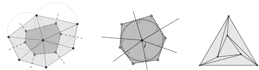

图 5.1 左：原始图（实线）和正交外心对偶图（虚线），用于定义 cotan 拉普拉斯算子。中：平均值权重对应于围绕原始顶点的单位圆的切线对偶边。右：Schönhardt 多面体的投影不允许存在满足 (Sym)+(Loc)+(Lin)+(Pos) 的离散拉普拉斯算子。

拓扑结构）直到得到一个 Delaunay 三角剖分 [57]。不幸的是，从任意给定的三角剖分得到 Delaunay 三角剖分所需的边翻转次数无法事先界定。因此，这种方法通常无法满足局部性。

更一般地，所谓的加权 Delaunay 三角剖分被证明是唯一具有正交正对偶并因此允许满足 (Loc)+(Sym)+(Lin)+(Pos) 的离散拉普拉斯算子的三角剖分。如同 Rippa 定理（见上文）一样，这一事实展示了离散微分算子（拉普拉斯算子）性质与纯几何性质（加权 Delaunay 三角剖分）之间复杂联系的一个实例。

最后，如果放弃对称边权的要求，则进入重心坐标的领域。在这种情况下，仍可为每个原始顶点获得一个正交对偶面，但这些对偶面不再构成一个一致的对偶图；参见图 5.1（中）。因此，对于对偶边长度为正的情况，得到的边权满足 (Loc)+(Lin)+(Pos) 但不满足 (Sym)。Floater 等人 [149] 探讨了这种情况的一个子空间：一参数线性精度重心坐标族，包括平均值坐标和 Wachspress 坐标（参见第 1.2.4 节）。Langer 等人 [232] 表明，该家族的每个成员都对应于每个原始顶点的特定正交对偶面选择。

没有离散拉普拉斯算子能同时满足所有所需属性，这并非巧合。可以证明，一般单纯形网格不允许存在满足 (Loc)+(Sym)+(Lin)+(Pos) 的离散拉普拉斯算子；有关此主题的更多信息见 [410]，简单示例见图 5.1（右）。这一限制为现有文献提供了一种分类学，并解释了大量现有离散拉普拉斯算子的存在：由于并非所有所需属性都能同时满足，因此设计针对具体问题特定需求的离散拉普拉斯算子取决于手头的应用。

另一个重要的期望属性是收敛性：在逼近光滑流形的单纯形流形细化极限中，人们寻求用一系列离散拉普拉斯算子来逼近光滑拉普拉斯算子。对于应用而言，这对于获得尽可能独立于网格的离散算子很重要——对给定形状进行重网格化不应导致截然不同的拉普拉斯算子。

与收敛性密切相关的概念是一致性。如果对于所有适当选择的函数 $u$ 都有 $\Delta_n u \to \Delta u$，则称离散拉普拉斯算子序列 $(\Delta_n)_{n \in \mathbb{N}}$ 为一致的。例如，可以证明点云上的拉普拉斯算子（如 [35] 中考虑的那些）是一致的；参见 [122]。

与一致性相比，收敛性更难证明，因为它还要求泊松问题 $\Delta_n u_n = f$ 的解 $u_n$（在适当范数下）收敛到 $\Delta u = f$ 的解 $u$。详细讨论收敛性超出了本简短综述的范围。粗略地说，如果用于定义单纯形拉普拉斯算子的离散 $k$-形式上的内积收敛到光滑 $k$-形式上的内积，则单纯形流形上的拉普拉斯算子（在适当算子范数下）收敛到其光滑对应物。在这种情况下，可以得到泊松问题解的收敛、Hodge 分解分量的收敛、特征值和特征函数的收敛 [124, 134, 191, 409, 427]，以及（使用不同技术）Cheeger 割的收敛 [398]。


## 泰勒和弗朗西斯

泰勒和弗朗西斯集团

http://taylorandfrancis.com

## II

## 计算机图形学中的应用


## 泰勒和弗朗西斯

## 泰勒和弗朗西斯集团

http://taylorandfrancis.com

## 网格参数化

**布鲁诺·列维**

Inria Nancy Grand Est, Villers-lès-Nancy, 法国

## 目录

- 6.1 引言 .................................................... 97
- 6.2 网格参数化的应用 ....................... 98
- 6.3 拓扑概念 ........................................... 100
- 6.4 Tutte 的重心映射定理 ......................... 102
- 6.5 求解线性系统 .................................. 106
- 6.6 选择权重 ........................................ 108

本章介绍网格参数化，这是广义重心坐标的一种应用。通过将曲面“展开”到 2D 空间，网格参数化有许多可能的应用，例如纹理映射。本章将介绍一些基本的拓扑概念，用于表征允许参数化的曲面类。然后，我们将重点放在特定情况上：拓扑圆盘及其边界映射到凸多边形。在此背景下，Tutte 的重心映射定理不仅给出了充分条件，还给出了计算参数化的实用算法。我们概述了 Gortler、Gotsman 和 Thurston [172] 对 Tutte 定理的简单而优雅的证明的主要论点。值得注意的是，他们的证明仅使用基本拓扑概念结合计数论证。最后，我们提到权重对结果质量的重要性，并展示如何使用平均值坐标来减少失真。

### 6.1 引言

在深入形式定义之前，我们先对什么是网格参数化给出直观解释。直观地说，给定一个三角化网格（见图 6.1，左），参数化将网格在 2D 中“展开”（见图 6.1，右）。这种“展开”是一种有趣的表示，可以被视为 3D 对象的“地图”，并可被多种应用利用。


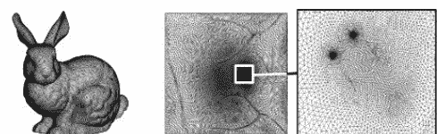

图 6.1 左：一个3D网格。（模型由斯坦福大学提供。）右：3D网格的2D参数化及对头部区域的放大。

更正式地说，如果我们用 p_i = (x_i, y_i, z_i) 表示网格顶点 v_i 的3D位置，i = 1, ..., n，其中 n 表示顶点的数量，那么网格的参数化就是与每个网格顶点关联的一组两个额外坐标 u_i = (u_i, v_i)。

此外，这些坐标需要满足2D三角形之间没有相交。本章介绍了一种生成此类 (u_i, v_i) 坐标的方法。在进入核心内容之前，为了激发读者兴趣，我们介绍了网格参数化的几个应用。我们暂时假设 (u_i, v_i) 坐标已经给出，如何计算它们将在后面解释。

### 6.2 网格参数化的应用

纹理映射，即将图像“包裹”到3D物体周围，是网格参数化的主要应用之一（参见图 6.2）。纹理映射使用3D网格与2D域（称为参数空间）之间的一一对应关系。可以通过线性插值与三角化中每个顶点关联的 (u_i, v_i) 坐标来定义这种对应关系。假设你想知道参数空间中给定点 u = (u, v) 对应的3D点。如果点 u 对应于顶点 u_i = (u_i, v_i) 之一，则它映射到 p_i = (x_i, y_i, z_i)。如果点 u 是任意的，则它按以下方式映射：

- 1. 确定包含点 u = (u, v) 的具有2D顶点 u_i = (u_i, v_i)、u_j = (u_j, v_j)、u_k = (u_k, v_k) 的三角形；
- 2. 确定点 u 相对于三角形 [u_i, u_j, u_k] 的重心坐标（参见第 1.1.1 节）phi_1(u)、phi_2(u)、phi_3(u)；
- 3. 然后 u 映射到 phi_1(u)p_i + phi_2(u)p_j + phi_3(u)p_k。

反之，对于网格上任意的3D点 p = (x, y, z)，位于三角形 t = [p_i, p_j, p_k] 中，可以通过在 t 的支撑平面上工作来检索其相对于 t 的重心坐标 phi_1(p)、phi_2(p)、phi_3(p)，并将其映射到

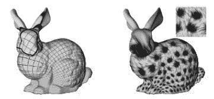

图 6.2 网格参数化可用于用图像“包裹”3D物体。使用的图像是常规网格（左）和“毛皮”纹理（右）。（模型由斯坦福大学提供，毛皮纹理由 www.myfreetextures.com 提供，在知识共享许可下使用。）

点 \(\boldsymbol{u} = \phi_1(\boldsymbol{p})\boldsymbol{u}_i + \phi_2(\boldsymbol{p})\boldsymbol{u}_j + \phi_3(\boldsymbol{p})\boldsymbol{u}_k\)。可以检查，此过程定义了上面定义的 \((u, v) \rightarrow (x, y, z)\) 映射的逆映射。

配备这种扩展的线性插值映射，我们现在在曲面的所有3D点与参数域的所有2D点之间建立了一一对应关系。这种对应关系可用于许多不同的应用。例如，*纹理映射*包括在参数空间中绘制图像，并通过线性插值映射将其传输到曲面上。图 6.2 显示了一个示例。该技术在电影行业和交互式3D图形（可视化、视频游戏）中均被广泛使用。在后一种情况下，图形处理单元（GPU）具有非常高效的优化硅，用于计算重心坐标并线性插值 (u, v) 坐标。纹理映射还可用于将高分辨率属性关联到粗网格上，如图 6.3 所示。通过对细尺度

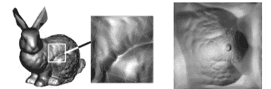

图 6.3 网格参数化的应用：法线贴图。粗网格（左，与图 6.1 对比）被纹理映射了一张图像，该图像编码了初始高分辨率网格的精细几何细节（右）。

图像中的几何细节（这里是法向量），可以“用像素替换三角形”，并大幅降低渲染成本和时间。

### 6.3 拓扑概念

显然，并非所有曲面都允许参数化。例如，球体不能在不切割或打孔的情况下映射到平面上（参见图 6.4，左侧）。因此，曲面具有边界是必要条件。然而，这不是充分条件。考虑图 6.4（右侧）中的曲面：由于有柄，无法将其展开到2D而不产生相交。因此，有必要能够确定给定网格是否有柄。曲面的柄数称为其属。球体（参见图 6.5 A,B）的属为0，环面（参见图 6.5 C）的属为1，双环面（参见图 6.5 E）的属为2。

属（以下用 g 表示）是曲面的一个全局性质，乍看之下确定起来并非平凡。幸运的是，对于闭合连通曲面，它可以从欧拉-庞特列雅特征 $\chi$ 推导出来，$\chi$ 是另一个非常容易计算的量，由 $\chi = n_v - n_e + n_f$ 给出，其中 $n_v$ 表示顶点数，$n_e$ 表示边数，$n_f$ 表示面数。欧拉-庞特列雅特征和属都是拓扑不变量，既不依赖于曲面的形状，也不依赖于其被分解为多边形的方式。例如，考虑图 6.5 (A) 中的球体，以立方体方式分解为 8 个顶点、12 条边和 6 个面。其欧拉-庞特列雅特征为 $\chi = 8 - 12 + 6 = 2$。现在考虑图 6.5 (B) 中球体的四面体式分解，再次得到 $\chi = 4 - 6 + 4 = 2$。无论考虑球体的哪种分解，总是得到 $\chi = 2$。现在让我们看看环面（参见图 6.5 C），按图 6.5 (D) 所示分解。它有 16 个顶点、32 条边和 16 个面，因此 $\chi = 16 - 32 + 16 = 0$。

现在我们想知道双环面（参见图 6.5 E）的欧拉-庞特列雅特征，即属 g = 2 的曲面。一种可能性是对双环面进行“网格化”并计算元素数量。另一种更有趣的方法是分析当创建一个柄时欧拉-庞特列雅特征 $\chi$ 如何变化，如图 6.6 所示。该操作会导致顶点数量的变化 $\Delta n_v$ 以及边数和面数的变化 $\Delta n_e$、$\Delta n_f$。进而，$\chi$ 变为 $\chi + \Delta\chi$，其中 $\Delta\chi = \Delta n_v - \Delta n_e + \Delta n_f$。在

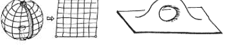

图 6.4 某些曲面无法在不切割的情况下展开到平面上。

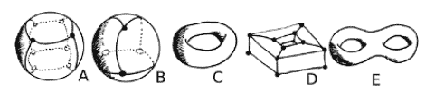

图 6.5 使用欧拉-庞特列雅特征确定属（柄数）。

第一步 (A)，删除两个面，因此 $n_t$ 减少了两次 ($\Delta n_t = -2$)，$\chi = n_v - n_e + n_t$ 也随之减少。第二步 (B)，删除两个面所创建的两个边界分量被合并。这合并了边界分量上的顶点和边，因此 $n_v$ 和 $n_e$ 都减少了相同的数量（两个边界分量上的顶点和边数量相同；在当前示例中为四个）。在计算 $\Delta\chi$ 时，$n_v$ 和 $n_e$ 的变化相互抵消，因此第二步不改变 $\chi$。总结来说，此操作使 $\chi$ 减少两个。请注意，这与被移除的两个面中的顶点数量完全无关；它们只需要匹配即可。因此，从属为零且欧拉-庞特列雅特征 $\chi = 2$ 的球体开始（参见图 6.5），每次创建一个柄时，$g$ 增加一个（根据 $g$ 的定义）且 $\chi$ 减少两个。总结来说，对于没有任何边界的连通曲面，我们有

$\chi = n_v - n_e + n_t = 2 - 2g.$

例如，对于双环面（参见图 6.5E），我们有 $g = 2$，因此 $\chi = 2 - 2g = -4$。

现在让我们转向具有多个连通分量和边界的曲面。很容易看出公式变成什么：因为对于拓扑球体，$\chi = 2$，每个连通分量给欧拉-庞特列雅特征增加两个。现在考虑通过删除一个面来创建边界的“拓扑手术”操作。它减少 $n_t$，因此也减少 $\chi$。总结来说，对于具有多个连通分量和多个边界分量的曲面，我们有

$\chi = n_v - n_e + n_t = 2n_{cc} - 2g - n_{bc}.$

其中 $n_{cc}$ 表示连通分量的数量，$n_{bc}$ 表示边界分量的数量。

在以下内容中，我们考虑拓扑盘，即属为零、单个连通分量和单个边界分量的曲面。它们的特征是

$g = 0, n_{cc} = 1, n_{bc} = 1.$

使用前面的恒等式，对于拓扑盘，很容易检查 $\chi = 1$。要测试给定曲面网格是否为拓扑盘，我们首先测试 $\chi = n_v - n_e + n_t$ 的值。然后我们需要确定曲面是否连通。一个


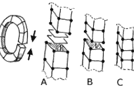

图 6.6 通过“拓扑手术”增加亏格。A：删除两个面（\(\Delta n_t = -2\)）；B：粘合两个孔（\(\Delta n_v = -4\)；\(\Delta n_e = -4\)）；C：结果（\(\Delta \chi = \Delta n_v - \Delta n_e + \Delta n_t = -2\)）。

可以使用从任意面出发的递归遍历算法，并测试是否访问了所有面。最后，为了确定边界分量的数量，可以沿着与任意边界边相连的边界分量上的边进行迭代，并测试是否存在未访问的另一条边界边。

### 6.4 图特的重心映射定理

我们现在专注于图特的重心映射定理 [400]，它不仅刻画了一类网格参数化，还可以作为计算算法用于创建参数化 [143]。简单形式下，该定理可表述如下。

### 定理 6.1.
考虑一个拓扑盘且顶点位于 2D 中的 3 连通网格。如果边界顶点位于一个（不一定是严格）凸多边形上，并且每个内部顶点是其邻居的凸组合，那么边之间没有交叉，且每个面都是严格凸的。

如果网格在删除任意两个顶点（及其关联边）后仍保持连通，则称其为 3 连通。此条件是为了避免某些退化情况（例如塌陷三角形），例如当一条长内部边连接边界上的两个顶点时就会发生这种情况。

更正式地说，每个内部顶点是其邻居的线性组合，如果

```
\(\sum_{j \in N_i} w_{ij} u_j = u_i, \quad i = 1, \dots, (n_v - n_{bv}),\)
\(\sum_{j \in N_i} w_{ij} v_j = v_i, \quad i = 1, \dots, (n_v - n_{bv}),\)
\(u_i = b_i^u, \quad i = (n_v - n_{bv} + 1), \dots, n_v,\)
\(v_i = b_i^v, \quad i = (n_v - n_{bv} + 1), \dots, n_v,\)
(6.1)
```

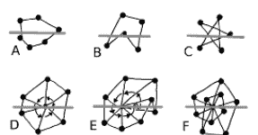

图 6.7 凸面（A）和非凸面（B、C）；轮辐顶点（D）和非轮辐顶点（E、F）。

其中 \(N_i\) 表示顶点 \(i\) 的邻居（即所有通过边与 \(i\) 相连的顶点），\(n_{bv}\) 是边界顶点的数量，且顶点的排序方式使得内部顶点排在前面。与半边 \((i, j)\) 关联的给定系数 \(w_{ij}\) 为正，且满足 \(\sum_j w_{ij} = 1\)。系数 \(w_{ij}\) 不要求对称（通常 \(w_{ij} \neq w_{ji}\)）。换句话说，条件 (6.1) 意味着每个顶点位于其邻居的凸包内部（因此称为*凸组合*）。

根据给定的边界顶点位置 \((u_i, v_i)\)，\(i = 1, \dots, n_v - n_{bv}\) 和权重 \(w_{ij}\)，可以通过求解 (6.1) 中的两个线性系统来构建参数化，如 [143] 所建议并在下一节中解释。在解释如何操作之前，本节其余部分讨论图特定理的证明。

图特 [400] 的原始证明需要相当深厚的图论背景。后来，Gortler 等人 [172] 提出了另一种证明。后一种证明简单得多，只需要基础概念。为了更好地掌握证明结构的直觉，我们在此采用自顶向下的方法（从结论开始），并跳过细节，仅保留主要论点。

证明的主要论点（后文将阐述）是，如果满足 (6.1)，则每个面都是严格凸的，且每个内部顶点都是轮辐顶点。那么很容易推断出没有两个面可以相交。*轮辐顶点* v 是指从 v 发出的每对连续有向边之间的有向角均为正且总和为 \(2\pi\)。非轮辐顶点的示例见图 6.7(E)（其中一个角为负）和图 6.7(F)（该顶点是双轮辐顶点，角度和为 \(4\pi\) 而非 \(2\pi\)）。任何通用位置的直线（粗灰色）与凸多边形的交点为零条或两条边（A）。任何经过轮辐顶点中心的直线都与两个扇形相交（D）。对于非凸面（分别为非轮辐顶点），存在交点数量更多的直线。

我们现在证明，如果满足 (6.1)，则所有多边形都是凸的，且所有顶点都是轮辐顶点，方法是研究具有方向向量 \((\alpha, \beta)\) 的直线与多边形和顶点邻域之间的关系，并表明 B、C、E、F 等配置不会出现。

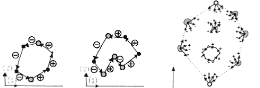

图 6.8。左和中：多边形与直线之间的最大交点数由符号变化次数界定。右：满足图特定理条件的网格中具有 (u, v) 坐标的顶点和面的符号变化的全局结构。

考虑图 6.8 中描绘的配置，直线的方向向量为 \((\alpha, \beta)\)。请注意，图形已旋转，使有向直线方向 \((\alpha, \beta)\) 水平。我们将每条有向边 \((i, j)\) 根据点积 \((u_j - u_i) \cdot n\) 的符号分类为递增（+）或递减（-），其中 \(n = (-\beta, \alpha)\) 表示直线的法向量。

直线相交的边以（+，-）对出现，因此其数量由符号变化次数界定（对应符号变化的顶点在图中以灰色突出显示）。对于任何通用位置的 \((\alpha, \beta)\)（不与边共线），凸多边形恰好有两个符号变化，而非凸多边形允许具有更多符号变化的 \((\alpha, \beta)\) 方向。同样的推理可以应用于顶点的邻域。

我们现在考虑一个拓扑盘，并通过添加一个封闭其边界的面将其转换为拓扑球面。证明的主要论点表明，如果 \((u_i, v_i)\) 坐标满足图特定理的条件（边界顶点位于凸多边形上且内部顶点满足 (6.1)），那么对于任何直线方向 \((\alpha, \beta)\)，整个网格中符号变化的结构如图 6.8（右）所示：所有内部顶点和面都有两个符号变化，两个边界顶点没有符号变化（最顶部和最底部），其余所有 \(n_{bv} - 2\) 个顶点都有两个符号变化。在图中，我们采用了与 [172] 不同的约定：箭头对应从每个顶点发出的有向边以及构成面边界的有向边。符号变化以灰色突出显示。请注意，存在一个无限外部面（即用于将拓扑盘转换为拓扑球面的那个面），因此一些符号变化的扇形位于边界的外部。

为了证明由 (6.1) 的解诱导的结构与该配置匹配，Gortler 等人 [172] 观察到，附加到网格有向半边上的值集 \(n \cdot (u_j - u_i)\) 可以被视为离散向量场（或 1-形式），并且它服从庞加莱-霍夫定理 [181] 的离散等价形式，该定理将向量场的拓扑（此处由符号变化表示）与底层曲面的拓扑（此处为拓扑球面）联系起来。简而言之，该定理指出向量场的奇点数等于曲面的欧拉-庞加莱特征数。在本例中，我们有一个具有 \(\chi = 2\) 和两个奇点（最顶部和最底部顶点）的球面。已提出该定理的几种离散版本 [323, 324]。[172] 中的离散庞加莱-霍夫定理可表述如下。

### 定理 6.2.
对于附加到具有亏格 \(g\) 且无边界的有向网格的半边上的任何一组非消失标量值 \(z_{ij}\)，且满足 \(z_{ji} = -z_{ij}\)，我们有

\(\sum_{i=1}^{n_v} \text{ind}(\mathbf{v}_i) + \sum_{j=1}^{n_f} \text{ind}(\mathbf{f}_j) = \chi = 2 - 2g.\)

整数量 \(\text{ind}(\mathbf{v}) = (2 - \text{sc}(\mathbf{v}))/2\) 和 \(\text{ind}(\mathbf{f}) = (2 - \text{sc}(\mathbf{f}))/2\) 分别称为 \(z\) 中顶点 \(\mathbf{v}\) 和面 \(\mathbf{f}\) 的*指数*。整数量 \(\text{sc}(\mathbf{v})\) 和 \(\text{sc}(\mathbf{f})\) 分别表示遍历从 \(\mathbf{v}\) 发出的半边和绕过 \(\mathbf{f}\) 的半边时 \(z\) 的*符号变化*次数。指数可以取以下值：

- ind = 1: \(z_{ij}\) 对顶点/面的所有半边都具有相同的符号。指数为一的顶点称为*源*（+）或*汇*（-）。指数为一的面称为*涡旋*；
- ind = 0: 指数为零的顶点或面称为*非奇异*；
- ind < 0: 指数为负的顶点或面称为*鞍点*。

*证明。* 最后一项结论成立，因为

\(\sum_{i=1}^{n_v} \text{ind}(\mathbf{v}_i) + \sum_{j=1}^{n_f} \text{ind}(\mathbf{f}_j) = \frac{1}{2} \sum_{i=1}^{n_v} (2 - \text{sc}(\mathbf{v}_i)) + \frac{1}{2} \sum_{j=1}^{n_f} (2 - \text{sc}(\mathbf{f}_j))\)
\(= n_v + n_f - \frac{1}{2} \left( \sum_{i=1}^{n_v} \text{sc}(\mathbf{v}_i) + \sum_{j=1}^{n_f} \text{sc}(\mathbf{f}_j) \right)\)
\(= n_v + n_f - n_e.\)

上述推导的最后一步使用了以下观察：每个半边在顶点中引入恰好一个符号变化，在面中引入恰好一个符号变化：考虑图 6.9 中的半边 \(h_1\) 及其相反半边 \(h_2\)（符号相反）。有两种情况：要么 \(h_1\) 和 \(h_2\) 符号相同，则楔形 \(h_2, h_3\) 是顶点 \(\mathbf{v}\) 中的符号变化，要么 \(h_1\) 和 \(h_2\) 符号相反，则角 \(h_1, h_2\) 是面 \(\mathbf{f}\) 中的符号变化。

借助这一离散庞加莱-霍夫定理，我们可以检查由附加到半边上的一组值 \(\mathbf{n} (\mathbf{u}_j - \mathbf{u}_i)\) 所诱导的符号变化结构


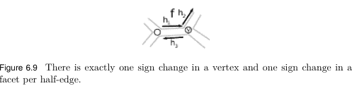

$(i, j)$ 处的网格点，其中 $\boldsymbol{u}_i = (u_i, v_i)$ 由 (6.1) 中 Tutte 方程的解给出。注意，面不能是顶点（即索引为 1），因为这意味着绕着一个面转一圈后无法回到原始位置。

由于 $\boldsymbol{u}_i$ 满足 Tutte 方程，很容易验证从内部顶点 $\mathbf{v}_i$ 出发的半边所关联的值 $z_{ij}$ 满足条件

$$
\sum_{j \in N_i} w_{ij} z_{ij} = 0.
$$

由于所有 $w_{ij}$ 系数均为正且 $z_{ij}$ 不为零，$z_{ij}$ 的符号需要改变，因此 $\mathbf{v}_i$ 既不能是源点也不能是汇点。总结如下，

\(\text{ind}(v_i) \le 0, \quad i = 1, \dots, n_v - n_{bv},\)
\(\text{ind}(f_j) \le 0, \quad j = 1, \dots, n_f.\)

现在，请记住索引的最大可能值为 1，要由 Poincaré-Hopf 定理（当 $\chi = 2$ 时）规定的总值为 2，唯一的可能性是：所有面和所有内部顶点的索引为 0，两个边界顶点的索引为 1，其余所有边界顶点的索引为 0。

请注意，在整个证明中，我们假设所有考虑的几何对象都处于通用位置。最初的文章包括处理边与相交直线方向 $(\alpha, \beta)$ 共线的情况的扰动引理。原始文章还包括多个可能非凸边界和高类对象的结果，这里不作描述。在本章范围内，我们将自己限制在具有一个凸边界的单个拓扑盘的情况。对于更一般的情况，读者可参考原始文章 [172] 以及 [61, 66, 201]。

### 6.5 求解线性系统

给定一个拓扑盘、其边界顶点的 2D 位置以及权重 $w_{ij}$，可以通过求解 (6.1) 得到参数化。这里我们解释求解此类线性系统的几种方法。Tutte 方程的原始形式对应于以下线性系统

```
u_i = \sum_{j \in N_i} w_{ij} u_j \qquad i = 1, \dots, n_v - n_{bv},
v_i = \sum_{j \in N_i} w_{ij} v_j \qquad i = 1, \dots, n_v - n_{bv}.
```

请注意，右边包含未知数（与内部顶点相关的 \(u_i\) 和 \(v_j\)）与固定值（与边界顶点相关的 \(u_i\) 和 \(v_j\)）的混合物。为了将方程重新组织成将固定值收集到右边的形式，可以使用以下约定扩展 \(w_{ij}\) 的定义：\(w_{ii} = -1\)，且如果 \(j \notin N_i\) 则 \(w_{ij} = 0\)。我们有

```
\sum_{j=1}^{n_v - n_{bv}} w_{ij} u_j = - \sum_{j=n_v - n_{bv} + 1}^{n_v} w_{ij} u_j \qquad i = 1, \dots, n_v - n_{bv},
\sum_{j=1}^{n_v - n_{bv}} w_{ij} v_j = - \sum_{j=n_v - n_{bv} + 1}^{n_v} w_{ij} v_j \qquad i = 1, \dots, n_v - n_{bv}.
```

以矩阵形式，这两个线性系统可以写成

```
W \mathbf{X}^u = \mathbf{Y}^u,
W \mathbf{X}^v = \mathbf{Y}^v,
```

其中 \(W\) 是一个 \((n_v - n_{bv}) \times (n_v - n_{bv})\) 矩阵，\(\mathbf{X}^u, \mathbf{X}^v, \mathbf{Y}^u, \mathbf{Y}^v\) 是 \((n_v - n_{bv})\)-维向量。

我们现在概述求解此类线性系统的几种方法。考虑形式为 \(W \mathbf{X} = \mathbf{Y}\) 的系统，其中 \(n = n_v - n_{bv}\)，Gauss-Seidel 松弛法是一种实现非常简单的方法。直观上，可以通过考虑线性系统的形式来理解它

```
w_{1,1}x_1 + w_{1,2}x_2 + \dots + w_{1,n}x_n = y_1,
\vdots
w_{i,1}x_1 + w_{i,2}x_2 + \dots + w_{i,i}x_i + \dots + w_{i,n}x_n = y_i,
\vdots
w_{n,1}x_1 + w_{n,2}x_2 + \dots + w_{n,n}x_n = y_n.
```

该算法反复遍历 n 个方程。对于每个方程 \(i\)，它“假设”所有 \(j \neq i\) 的变量 \(x_j\) 已知，并相应地更新 \(x_i\) 为

```
x_i \leftarrow \frac{1}{w_{ii}} \left( y_i - \sum_{j=1}^{n_v - n_{bv}} w_{ij} x_j \right).
```

将右边分量 \( y_i \) 替换为表达式 \( -\sum_{j=n_v - n_{bv} + 1}^{n_v} w_{ij} x_j \)，并将 \( w_{ii} \) 替换为 \( -1 \)，我们得到更新

```
\( x_i \leftarrow - \left( - \sum_{j=n_v - n_{bv} + 1}^{n_v} w_{ij} x_j - \sum_{j=1}^{n_v - n_{bv}} w_{ij} x_j \right) \)
```

或者简单地

```
\( x_i \leftarrow \sum_{j \in N_i} w_{ij} x_j \)。
```

总结来说，对 Tutte 方程应用 Gauss-Seidel 松弛法，简单来说就是反复将每个内部顶点移动到其邻居的加权重心。这种方法非常简单实现，对于小网格（包含几千个元素）可以在合理时间内给出结果。如果需要处理更大的网格，可以考虑使用更高效的迭代方法，例如双共轭梯度法，如 [143] 所建议。如果内存消耗不是问题，SuperLU [246] 等稀疏直接求解器可以是更高效的替代方案。另请参见 [66] 中关于数值方面的章节。

### 6.6 选择权重

根据应用情况，通常希望创建一种参数化，以最小化 2D 参数空间与 3D 曲面之间的变形。使用均匀权重 \( w_{ij} = 1/|N_i| \)，其中 \( |N_i| \) 表示顶点 \( v_i \) 的邻居数量，得到的参数化是有效的，但可能会高度扭曲。图 6.10（左）通过在 2D 参数空间中绘制常规网格并将其变换到 3D 曲面上来显示变形。

或者，可以使用平均值坐标 [144, 200] 作为权重 \( w_{ij} \)，它们考虑了输入曲面的几何形状，并且如 Tutte 定理所要求的是正的（参见第 1.2.3 节）。请注意，为了满足 Tutte 定理的要求，它们需要如 (1.12) 那样进行归一化。得到的参数化显示在图 6.10（右）。

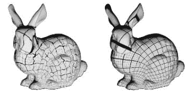

图 6.10 均匀权重（左）和平均值坐标（右）。

## 平面形状变形

Ofir Weber

巴伊兰大学，拉马特甘，以色列

## 目录

- 7.1 引言 .................................................... 110
- 7.2 复重心坐标 ............................ 111
- 7.2.1 全纯函数 .................................... 113
- 7.2.2 复重心坐标的一般构造 118
- 7.2.3 魔法坐标 ........................................ 121
- 7.3 变分重心坐标 ........................ 123
- 7.3.1 基于点的重心映射 ........................... 123
- 7.3.2 点到点重心坐标 ................. 124
- 7.4 共形映射 ............................................... 127
- 7.4.1 对数导数构造 .............................. 127
- 7.4.2 形状插值 ...................................... 130
- 7.4.3 变分共形映射 ............................... 131
- 7.5 实现细节 ....................................... 132
- 7.5.1 平面映射可视化 .................................. 132

重心坐标对于变形形状非常有用。它们能产生平滑的变形，计算简单且效率极高。在本章中，我们关注 *平面* 形状变形的特殊情况，其中重心映射可以解释为复值函数。我们将重心坐标从实值推广到复值，并引入复重心坐标的概念。复坐标可以产生具有独特形状保持特性的平面重心映射。我们提供了复重心坐标的一般构造（第 7.2.2 节），并展示如何设计定制的复坐标（第 7.2.3 节）。我们推导了全纯坐标（第 7.2.1 节），依赖于复分析的丰富理论，并探讨了它们与共形映射的内在关系（第 7.4 节）。


### 7.1 简介

交互式形变是计算机图形学和几何处理中的一个基本问题。它对于设计和建模形状的变体以及生成可信的动画序列至关重要。在本章中，我们关注平面形变的特殊情况，其中待变形的域 \(\Omega\) 是平面的一个开连子集。为简化起见，我们假设该域由一个简单多边形 \(P\) 界定。陪域同样是平面的一个子集，在某些场景中（如第 4 章所示），用户明确指定其形状（例如，也为多边形），而在其他场景中，则允许更多自由度，形状可以自由演变。更正式地说，我们的目标是计算一个映射（向量函数）\(f(\boldsymbol{x}): \Omega \rightarrow \mathbb{R}^2\)，将域中的点映射到陪域中的点，使得 \(f\) 满足某些边界约束，同时具备某些理想属性。某些属性，例如 \(f\) 的光滑性，更容易实现，而其他属性，例如局部单射性，则更难保证。随着本章讨论的深入，完整的期望属性列表将逐渐揭晓。不过，我们下面简要提及并阐述最重要的属性和要求。

域 \(\Omega\) 配备了彩色纹理，我们有兴趣通过渲染陪域的高质量图像来可视化映射 \(f\)。我们考虑用于计算底层映射 \(f\) 的算法对这种纹理的选择不敏感。这些算法仅基于几何考虑；然而，为了使结果从图形应用角度具有价值，必须添加一些要求。高质量结果应保留底层纹理的精细细节。因此，通常要求映射具有光滑性。幸运的是，在使用重心坐标时，这相对容易实现，因为它由坐标本身的光滑性所蕴含。除了光滑性之外，我们通常还希望映射诱导的度量畸变尽可能小。我们同时考虑共形畸变和等距畸变，其中共形畸变是指任意相交曲线之间的角度在映射作用下改变的程度，而等距畸变是指任意曲线长度的变化量。如果映射在所有地方的共形畸变为零，则称其为共形映射。共形映射的雅可比矩阵 \(J_f\) 是相似变换，仅允许带有各向同性缩放的旋转，但它可能具有任意高的等距畸变。理想情况下，映射应为等距映射，其雅可比矩阵仅限于旋转（无缩放）。不幸的是，与共形映射空间不同，\(\mathbb{R}^2\) 中的等距映射空间相当受限，仅包含刚体运动（全局旋转和平移）和反射。因此，我们只能期望得到接近等距的映射，具有较低的等距和共形畸变。

为了控制最终结果，提供了一个用户界面，其中可以为映射 \(f\) 规定某些边界条件。例如，用户可以规定整个目标边界的形状。由于目标边界是一个具有无限自由度的曲线，在实践中常见的选择是假设映射的像由一个多边形界定。用户只确定顶点位置，并隐式假设映射沿多边形边是线性的。尽管如此，固定整个边界可能过于限制。它需要用户提供超过最低限度的输入，并可能导致视觉上不太令人愉悦的形变，其中底层映射 \(f\) 具有过度的映射畸变。缓解这一点的一种方法是使用限制较少的约束，并允许算法通过求解变分问题（第 7.3 节）自动推断缺失的自由度。例如，用户可以在一组稀疏的内部点上而非整个边界上规定映射 \(f\) 的行为（第 7.3.2 节）。

另一个要求是底层算法需要相对高效地计算。这使用户能够交互式地探索有价值的形变空间，并通过试错达到其设想的艺术设计。用户界面的交互性和简单性也使新手用户能够使用该应用程序。正如我们将看到，许多涉及的计算可以在预处理步骤中完成，在与系统交互的运行时仅需进行少量计算。此外，形变通常可以并行计算，利用图形硬件，其计算时间与渲染时间本身处于同一数量级（第 7.5 节）。

处理从 R^2 到 R^2 的映射的特殊情况使我们能够通过将 R^2 与复平面 C 识别来使用替代表示。点 x = (x, y) ∈ R^2 通过 z = x + iy 与复数 z ∈ C 识别。映射 f 变成单个复变量的复值函数 f : Ω → C。使用复数表示法通常会导致简化的表达式，并使我们能够依赖复分析丰富理论中的强大数学结果。当底层复函数是全纯（复解析）和/或调和时，这一点尤其明显，由于其光滑性和其他数学特性，它们在形变中特别有价值。

### 7.2 复重心坐标

设 z1, ..., zn ∈ C 为简单多边形 P（不一定是凸多边形）的顶点，按逆时针方向排列（参见图 7.1）。我们有时将 P 称为笼子，因为它封装了我们希望变形的平面部分。P 的内部被视为一个开放域，记为 Ω。一组复值函数 φi, Ω → C，i = 1, ..., n 称为复重心坐标 [415]，如果它们满足定义 1.1 中属性 (1.8) 和 (1.9) 的复数类比，

\sum_{i=1}^n \phi_i(z) = 1, (7.1)
\sum_{i=1}^n \phi_i(z)z_i = z (7.2)

对所有点 z ∈ Ω 成立。

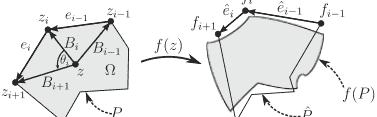

图 7.1 复重心映射中使用的符号。左：源多边形 $P$。注意 $B_i(z) = z_i - z$ 是 $z$ 的函数，而边向量 $e_i = z_{i+1} - z_i$ 与 $z$ 无关。右：目标多边形 $\hat{P}$ 以及复全纯重心映射 $f : \Omega \to \mathbb{C}$ 的像。注意 $f(z)$ 不插值目标多边形。

复重心映射是表示为复值函数 $f : \Omega \to \mathbb{C}$ 的平面映射，形式为

$f(z) = \sum_{i=1}^n \phi_i(z)f_i,$

其中 $f_i \in \mathbb{C}$ 是一些复系数。类似于实数情况，属性 (7.1) 称为 _常数精度_ 属性（有时也称为一元性属性）。它要求坐标的实部之和为 1，并且虚部之和为 0。从代数上讲，它意味着如果 $g$ 是 $\Omega$ 上的 _复_ 常数函数，且 $f_i = g(z_i)$，则 $f(z) = g(z)$。换句话说，$f$ 从顶点值复现复常数函数。从几何上讲，(7.1) 意味着重心映射对施加到笼子顶点的平移不变。属性 (7.2) 称为 _线性精度_ 属性。从代数上讲，它意味着 $f$ 从顶点值复现 $\Omega$ 上的 _复_ 线性函数。特别是，它复现（线性）恒等函数 $g(z) = z$，因此有时被称为恒等复现属性。合起来，属性 (7.1) 和 (7.2) 意味着 $f$ 复现复仿射函数，即形式为 $\psi(z) = \alpha z + \beta$ 的函数 $\psi : \mathbb{C} \to \mathbb{C}$，其中 $\alpha, \beta \in \mathbb{C}$ 是复常数。但是，需要注意的是，与实重心映射不同，复重心映射通常不复现平面仿射映射，即形式为 $g(\mathbf{x}) = \mathbf{Ax} + \mathbf{b}$ 的映射 $g : \mathbb{R}^2 \to \mathbb{R}^2$，其中 $\mathbf{A}$ 是一个 $2 \times 2$ 实矩阵，$\mathbf{x}, \mathbf{b} \in \mathbb{R}^2$ 是实向量（参见图 7.2）。虽然这最初可能被视为一种局限性，但对于平面形变这一特定应用来说，这大多是一种优势。矩阵 $\mathbf{A}$ 编码了旋转、各向同性缩放和剪切，而在复数情况下，乘法 $\alpha z$ 相当于将 $\mathbf{x}$ 乘以相似矩阵 $\begin{pmatrix} \alpha_x & -\alpha_y \\ \alpha_y & \alpha_x \end{pmatrix}$，其中 $\alpha = \alpha_x + i\alpha_y$。换句话说，复重心映射复现相似变换（平移、旋转和各向同性缩放），但通常不复现各向异性缩放和剪切，这些会导致角度畸变。


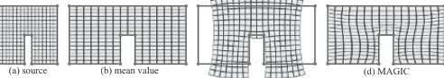

图 7.2 实重心坐标与复重心坐标的比较。(a) 中裤子形状的笼子在 (b-d) 中通过仿射变换 \(g: (x, y) \mapsto (2x, y)\) 进行变换。在 (b) 中，平均值重心映射复现了 \(g\)。在 (c) 和 (d) 中，柯西和魔法复重心坐标生成的映射不复现 \(g\)。(c) 中的映射是共形映射。参见彩色插页。

除了常数精度和线性精度外，还需要光滑性，即，

\[
\phi_i \in C^k(\Omega), \quad i = 1, \dots, n,
\]

其中 \(k\) 至少为 1（连续可微），但通常我们使用 \(C^\infty\)（无限可微）函数。

请注意，与其实数对应物不同，复重心坐标没有符号，因此省略了正性属性。拉格朗日属性（边界数据的插值）是可以实现的，但我们将看到它可能会干扰其他（稍后定义）的属性，如全纯性，因此它不被视为强制属性。

首先想到的问题是，如何找到一组满足 (7.1) 和 (7.2) 的函数 \(\phi_i\)？本节 7.2.2 对此问题给出了详尽解答。然而，我们首先推导一种特殊的复重心坐标，称为柯西坐标。与所有实重心坐标不同，这些坐标具有全纯函数的特殊属性。

### 7.2.1 全纯函数

全纯函数（又称复解析函数）具有显著的数学性质，是复分析这一数学领域的核心研究对象。下面我们简要介绍全纯函数及其一些迷人的性质，并引用读者参阅 [5] 以进行深入回顾。全纯函数 \(f: \Omega \to \mathbb{C}\) 是一个复值函数，在 \(\Omega\) 中每一点 \(z\) 的某个邻域内复可微。复可微性是一个强条件，意味着 \(f\) 是无限可微的。此外，全纯函数（在单连通域上）可以积分无数次，这些导数和反导数同样也是全纯的。全纯函数构成一个线性空间，因此全纯函数的和以及全纯函数与复标量的乘积仍为全纯。此外，全纯函数的乘积和复合也是全纯的，两个全纯函数的商只要分母不为零也是全纯的。

如果复函数 \(f(x+iy) = u(x, y) + iv(x, y)\) 是全纯的，则其实部和虚部 \(u\) 与 \(v\) 对 \(x\) 和 \(y\) 的一阶偏导数满足柯西–黎曼方程

\[
\frac{\partial u}{\partial x} = \frac{\partial v}{\partial y}, \quad \frac{\partial u}{\partial y} = -\frac{\partial v}{\partial x}.
\]

在非常温和的假设下，逆命题也成立；即，如果 \(f\) 的偏导数连续且满足柯西–黎曼方程，则 \(f\) 是全纯的。将 \(f\) 视为平面映射，我们可以将 \(f\) 的雅可比矩阵表示为

\[
J_f = \begin{pmatrix} \frac{\partial u}{\partial x} & \frac{\partial u}{\partial y} \\ \frac{\partial v}{\partial x} & \frac{\partial v}{\partial y} \end{pmatrix} = \begin{pmatrix} \frac{\partial u}{\partial x} & -\frac{\partial v}{\partial x} \\ \frac{\partial v}{\partial x} & \frac{\partial u}{\partial x} \end{pmatrix} = \begin{pmatrix} a & -b \\ b & a \end{pmatrix},
\]

其中第二个等式源于柯西–黎曼方程。全纯函数对 \(z\) 的第一个复导数通常记为 \(f'\) 且满足 \(f' = a + ib\)。如上所述，全纯函数（作为平面映射时）的雅可比矩阵具有相似矩阵的结构。其行列式为 \(\det(J_f) = a^2 + b^2\)，且始终非负；因此，全纯映射不能改变方向。如果全纯映射 \(f\) 在 \(\Omega\) 中每一点 \(z\) 处都有非零导数 \(f'(z) \neq 0\)（这等价于 \(\det(J_f) > 0\)），则该映射 \(f\) 称为 *共形映射*。对于共形映射，上述雅可比矩阵可表示为

\[
J_f = r \begin{pmatrix} \cos \theta & -\sin \theta \\ \sin \theta & \cos \theta \end{pmatrix}, \quad (7.3)
\]

其中 \(r = |f'| = \sqrt{a^2+b^2} = \sqrt{\det(J_f)}\) 是复导数的模（长度），\(\theta = \text{Arg } f'\) 是其复数辐角，即将复数视为向量时与正实轴的夹角。方程 (7.3) 为共形映射提供了几何诠释，即局部进行各向同性缩放、旋转和平移的映射。因此，共形映射保持相交曲线之间的夹角：如果两条相交曲线在点 \(z_0 \in \Omega\) 处的切线夹角为 \(\alpha\)，则这些曲线在 \(f(z_0)\) 处的像的夹角也为 \(\alpha\)。共形性还意味着小（无穷小）圆被映射为小圆（而非椭圆）。一般来说，共形映射不是等距映射，因为它们会扭曲曲线的长度。(7.3) 中的参数 \(r\) 表征了共形映射对原始度量引起的变化量。量 \(r^2\) 被称为 *拉回度量*，量 \(\ln r\) 被称为 *共形尺度因子*。共形映射在点 \(z \in \Omega\) 处的等距扭曲 \(r(z)\) 以对称的方式测量缩小和扩张的量。常用定义为：\(\ln|r|\)、\(\max(r, \frac{1}{r})\) 或 \(r + \frac{1}{r}\)。

实值函数 \(u(x, y)\) 如果满足拉普拉斯方程

\[
\Delta u = \frac{\partial^2 u}{\partial x^2} + \frac{\partial^2 u}{\partial y^2} = 0,
\]

则称为调和函数。复值函数 \(f(x + iy) = u(x, y) + i v(x, y)\) 如果 \(u\) 和 \(v\) 都是调和的，则称为调和函数。可以轻松验证（通过求导并使用柯西–黎曼方程），如果 \(f\) 是全纯的，则 \(u\) 和 \(v\) 都是调和的。因此，全纯映射也是调和映射。逆命题通常不成立，许多调和平面映射并非全纯。

### 超有限复重心坐标

全纯复重心坐标的推导可以通过将复重心坐标的概念推广到超有限情况来获得。多边形区域被由简单轮廓 \(\partial \Omega\) 界定的任意形状域 \(\Omega\) 所取代。实超有限重心坐标在第 3 章中详细讨论。这里我们关注其复数对应物。

为此，我们使用核函数 \(\phi: \partial \Omega \times \Omega \rightarrow \mathbb{C}\) 的概念。通俗地说，连续轮廓可以被视为具有无限多个顶点的多边形，复核 \(\phi(w, z)\) 被视为第 \(i\) 个坐标的类比，其中边界点 \(w\) 替代了第 \(i\) 个顶点。类比于离散多边形情况中的 (7.1) 和 (7.2)，如果性质

\[
\int_{\partial \Omega} \phi(w, z) \, dw = 1, \quad (7.4)
\]

\[
\int_{\partial \Omega} \phi(w, z) w \, dw = z \quad (7.5)
\]

对每一点 \(z \in \Omega\) 成立，则我们称 \(\phi(w, z)\) 为 *复重心核*。然后，*超有限复重心映射* 是形式为

\[
f(z) = \int_{\partial \Omega} \phi(w, z) f(w) \, dw, \quad (7.6)
\]

的复值函数 \(f: \Omega \rightarrow \mathbb{C}\)，其中 (7.4)、(7.5) 和 (7.6) 的轮廓积分中的微分 \(dw\) 是复数。

有些令人惊讶的是，存在一个相当简单的核 \(\phi(w, z)\) 选择，它满足 (7.4) 和 (7.5)，称为柯西核 [36]

\[
\phi_C(w, z) = \frac{1}{2\pi i} \frac{1}{w - z}.
\]

要了解为什么这是正确的，让我们回顾柯西积分公式，这是复分析中最基本的陈述之一。该陈述断言，全纯函数 \(h: \Omega \rightarrow \mathbb{C}\) 在点 \(z \in \Omega\) 处的值完全由其在边界上的值决定，并可以通过计算轮廓积分显式表示，

\[
h(z) = \frac{1}{2\pi i} \int_{\partial \Omega} \frac{h(w)}{w - z} \, dw. \quad (7.7)


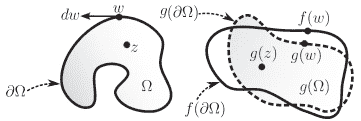

图 7.3 柯西变换。左侧域通过柯西变换（7.8）全纯映射到右侧域。但是，请注意 \(g(w) \neq f(w)\)。

将柯西积分公式应用于全纯函数 \(h(z) = 1\) 和 \(h(z) = z\)，分别得到 (7.4) 和 (7.5)。柯西公式成立的基本假设是 (7.7) 中的函数 \(h\) 是全纯的。此时，一个有趣的问题出现了。如果我们将 (7.7) 右侧的 \(h(w)\) 替换为任意非全纯复值函数 \(f: \Omega \to \mathbb{C}\) 会怎样？换句话说，让我们来看看关于函数 \(g: \Omega \to \mathbb{C}\) 我们可以说什么，其中

\(g(z) = \frac{1}{2\pi i} \int_{\partial \Omega} f(w) \frac{dw}{w-z}.\) (7.8)

显然，在 \(f\) 在边界附近的光滑性方面有非常温和的假设下，函数 \(g\) 在 \(\Omega\) 上是全纯的，因此 (7.8) 可以被视为作用于任意函数 \(f\) 并返回全纯函数 \(g\) 的投影算子。该算子有时被称为 _柯西变换_ [36]。需要注意的是，如果 (7.8) 中的 \(f\) 不是全纯的，那么全纯函数 \(g\) 通常不会在边界上插值 \(f\)，即 \(g(w) \neq f(w)\)，\(w \in \partial \Omega\)（见图 7.3）。换句话说，人们不能期望在 \(\partial \Omega\) 上指定函数 \(f\) 的值，并通过 (7.8) 在 \(\Omega\) 中得到一个具有这些边界值的全纯函数 \(f\)。总之，如果 \(f\) 的边界值使得存在一个实现它们的全纯函数，那么 (7.8) 精确地复现它们。否则，如果不存在具有这样的边界值的全纯函数，(7.8) 显然不会复现它，但仍然得到一个全纯函数。需要注意的是，全纯函数的一个局限是，不存在具有任意指定边界值的全纯函数。

#### 柯西坐标的推导

推导复重心坐标的下一步是假设 \(f\) 是属于有限维函数空间的函数，从而对柯西变换（7.8）进行离散化。在边界元方法（BEM）的语言中，这样的 \(f\) 称为 _试函数_。虽然有许多选择，但一个简单的选择是假设 \(f\) 是复分段仿射连续函数，即 $f$ 是每个多边形边上的（不同的）相似变换。$P$ 边界上分段仿射连续函数空间可以由一组复系数 $f_i, i = 1, ..., n$ 参数化。从几何上看，可以将 $f_i$ 视为目标多边形 $\hat{P}$ 的顶点，它与源多边形 $P$ 一一对应。然后，源多边形的每条边 $(z_i, z_{i+1})$ 通过相似变换映射到目标多边形中的对应边 $(f_i, f_{i+1})$（见图 7.1）

$$S_i(z) = \frac{B_{i+1}(z)f_i - B_i(z)f_{i+1}}{e_i},$$ (7.9)

其中 $B_i(z) = z_i - z_{i-1}$ 且 $e_i = z_{i+1} - z_i$。然后将 (7.8) 中的轮廓积分拆分为多边形边上积分的和，

$$g(z) = \frac{1}{2\pi i} \sum_{i=1}^n \int_{z_i}^{z_{i+1}} \frac{S_i(w)}{w - z} dw,$$ (7.10)

其中每条边上的积分具有简单的闭式表达式，

$$\int_{z_i}^{z_{i+1}} \frac{S_i(w)}{w - z} dw = S_i(z) \text{Log} \left( \frac{B_{i+1}(z)}{B_i(z)} \right) + \hat{e}_i,$$ (7.11)

其中 $\hat{e}_i = f_{i+1} - f_i$，且 Log 是复对数的主支。在对所有边求和时，(7.11) 中的项 $\hat{e}_i$ 消失，因为目标多边形是闭合的。将表达式 $S_i(z) \text{Log} \left( \frac{B_{i+1}(z)}{B_i(z)} \right)$ 代入 (7.10) 并重排项，得到 $f_i$ 的离散柯西变换，

$$g(z) = \sum_{i=1}^n C_i(z) f_i,$$ (7.12)

其中函数 $C_i(z)$ 称为柯西重心坐标，并具有闭式表达式

$$C_i(z) = \frac{1}{2\pi i} \left( \frac{B_{i+1}(z)}{e_i} \text{Log} \left( \frac{B_{i+1}(z)}{B_i(z)} \right) - \frac{B_{i-1}(z)}{e_{i-1}} \text{Log} \left( \frac{B_i(z)}{B_{i-1}(z)} \right) \right).$$ (7.13)

可以用 (7.8) 中的其他类型试函数 $f$ 获得类似的推导。例如，可以使用每条边上的高阶多项式，以及不连续分段光滑函数。这些选择通常提供更好的近似能力并导致更准确的结果 [414, 417]，但为了保持讨论简单，此处不予采用。

[415, Theorem 3] 中表明柯西坐标等价于 Lipman 的 Green 坐标 [252]。Green 坐标是实重心坐标的推广，其中重心映射表示为两项之和，第一项混合目标顶点位置，第二项混合目标边的法向量。Green 坐标的推导是通过将 Green 第三积分恒等式应用于谐函数完成的，这在 2D 中等价于柯西积分公式 [5]。与 (7.13) 相比，Green 坐标的（实值）表达式更复杂，使用复数是一个巨大的优势；然而，与柯西坐标不同，Green 坐标有自然的 3D 推广，从而导致体积谐映射 [42, 252]。

#### 7.2.2 复重心坐标的一般构造

在上一节中，我们推导了柯西复重心坐标。我们的构造基于柯西核，它在跨有限情况下复现全纯函数。由于全纯函数与保角映射有关，因此在平面形变形上下文中极其宝贵。然而，全纯映射构成了复值映射广阔空间中相当小的子空间。特别是，它们不允许 Lagrange（插值）性质成立。非全纯复重心坐标显然存在，因为任何实重心坐标也是复重心坐标。正如我们接下来将看到的，存在既不是实也不是全纯的复重心坐标，并且与柯西坐标不同，其中一些具有 Lagrange 性质。

将复重心坐标视为与笼子顶点相关联的一种特殊复基函数是很方便的。然而，与任意基函数不同，额外的要求 (7.1) 和 (7.2) 使得设计此类坐标变得具有挑战性。为了克服这个问题，我们遵循与第 1.1.2 节相同的方法。

### 定义 7.1.

一组满足

\(\sum_{i=1}^n w_i(z)(z_i - z) = 0 \quad (7.14)\)

在每一点 \(z \in \Omega$ 处的复值函数 \(w_i : \Omega \to \mathbb{C}\)，\(i = 1, \dots, n\) 称为 *复齐次坐标*。

归一化这些权重函数即可得到复重心坐标。

### 提议 7.2.

设 \(w_i(z)\) 为复齐次坐标，使得它们在每一点 \(z \in \Omega$ 处的和非零。那么归一化函数

\(\phi_i(z) = \frac{w_i(z)}{\sum_{j=1}^n w_j(z)} \quad (7.15)\)

是复重心坐标。

### 证明.

单位分割性质 (7.1) 直接由 (7.15) 中的归一化得出。线性精度性质 (7.2) 归因于

\(\sum_{i=1}^n \phi_i(z)z_i = \sum_{i=1}^n \frac{w_i(z)z_i}{\sum_{j=1}^n w_j(z)} = \frac{1}{\sum_{j=1}^n w_j(z)} \sum_{i=1}^n w_i(z)z_i = \frac{1}{\sum_{j=1}^n w_j(z)} \sum_{i=1}^n w_i(z)z = z,\)

其中第三个等式源自 (7.14)。

提议 7.2 很有用，因为寻找复齐次坐标比寻找复重心坐标更简单。与其考虑基于顶点的权重函数，不如考虑从概念上与第 \(i\) 条边相关联的权重函数 \(\gamma_i\)。

### 提议 7.3.

设 \(\gamma_i : \Omega \to \mathbb{C}, i = 1, ..., n\) 为任意权重函数，那么函数

\(w_i(z) = \gamma_i(z) \frac{B_{i+1}(z)}{e_i} - \gamma_{i-1}(z) \frac{B_{i-1}(z)}{e_{i-1}} \quad (7.16)\)

是复齐次坐标。

### 证明.

证明直接通过将 (7.16) 代入 (7.14) 得出，

\(\sum_{i=1}^n w_i(z)(z_i - z) = \sum_{i=1}^n w_i(z)B_i(z) = \sum_{i=1}^n \gamma_i(z) \frac{B_{i+1}(z)B_i(z)}{e_i} - \gamma_{i-1}(z) \frac{B_{i-1}(z)B_i(z)}{e_{i-1}}\)
\(= \sum_{i=1}^n \gamma_i(z) \frac{B_{i+1}(z)B_i(z)}{e_i} - \sum_{i=1}^n \gamma_{i-1}(z) \frac{B_{i-1}(z)B_i(z)}{e_{i-1}}\)
\(= \sum_{i=1}^n \gamma_i(z) \frac{B_{i+1}(z)B_i(z)}{e_i} - \sum_{i=1}^n \gamma_i(z) \frac{B_i(z)B_{i+1}(z)}{e_i} = 0,\)

在第三行中，我们将右侧的求和索引平移了一位。

### 提议 7.4.

域中每一点处权重函数 \(\gamma_i$ 的和与 (7.16) 中齐次坐标 \(w_i$ 的和相同。

### 证明.

\(\sum_{i=1}^n w_i(z) = \sum_{i=1}^n \gamma_i(z) \frac{B_{i+1}(z)}{e_i} - \gamma_{i-1}(z) \frac{B_{i-1}(z)}{e_{i-1}}\)
\(= \sum_{i=1}^n \gamma_i(z) \frac{B_{i+1}(z)}{e_i} - \sum_{i=1}^n \gamma_{i-1}(z) \frac{B_{i-1}(z)}{e_{i-1}}\)
\(= \sum_{i=1}^n \gamma_i(z) \frac{B_{i+1}(z)}{e_i} - \sum_{i=1}^n \gamma_i(z) \frac{B_i(z)}{e_i}\)
\(= \sum_{i=1}^n \gamma_i(z) \frac{B_{i+1}(z) - B_i(z)}{e_i} = \sum_{i=1}^n \gamma_i(z) \frac{z_{i+1} - z - (z_i - z)}{e_i}\)
\(= \sum_{i=1}^n \gamma_i(z) \frac{z_{i+1} - z_i}{e_i} = \sum_{i=1}^n \gamma_i(z).


作为命题 7.4 的直接推论，如果 \(\gamma_i\) 的和非零，则 (7.16) 的齐次坐标 \(w_i\) 也有非零和。

我们基本上已经表明，对于任意一组和非零的复数权函数 \(\gamma_i\)，存在对应的一组复重心坐标。从权函数构造重心坐标是直接的。只需将 \(\gamma_i\) 权函数代入 (7.16) 以获得齐次坐标 \(w_i\)（命题 7.3），并通过 \(\sum_{i=1}^n w_i\) 或 \(\sum_{i=1}^n \gamma_i\) 归一化（命题 7.2）以获得复重心坐标 \(\phi_i\)。因此，我们将构造复重心坐标的任务简化为寻找和非零的任意权函数的任务。此外，上述构造从意义上说覆盖了复重心坐标的整个空间，即对于任何复重心坐标 \(\phi_i\)，如果应用上述构造，则存在（不一定唯一）权重 \(\gamma_i\) 使其得到 \(\phi_i\)。证明是通过任意选择 \(\gamma_i\) 并使用 (7.16) 递归计算所有其他 \(\gamma_i\) 来完成的 [415]。

我们现在为权函数 \(\gamma_i\) 提供一种替代解释。域内任何地方和非零的任意一组复数值权函数 \(\gamma_i\) 对应于复重心映射 [416]

```
\(f(z) = \sum_{i=1}^n S_i(z)\gamma_i(z), \quad (7.17)\)
```

其中 \(S_i\) 是将源笼边缘映射到目标笼边缘的唯一相似变换（回顾 (7.9) 以获取其表达式），而 \(\bar{\gamma}_i = \gamma_i / \sum_{j=1}^n \gamma_j\) 是归一化权重。逆命题也成立。即，任何复重心映射都可以表示为边到边相似变换的（归一化）混合。特别是，很容易验证选择 \(\gamma_i = \text{Log}(\frac{B_{i+1}}{B_i})\) 会导致柯西坐标。这种替代观点在几何上比 (7.16) 稍微更直观一些。它强调权函数可以与边缘相关联，并且对于推导自定义重心坐标（第 7.2.3 节）很有用。此外，它允许我们以两种可能的方式扩展重心映射的概念。首先，我们可以对不一定构成闭合多边形的任意线段集合使用 (7.17)，从而允许我们定义“部分”笼子或通过额外的内部线段增强给定的笼子以获得额外的用户控制。第二种可能的扩展是将 (7.17) 中的相似变换 \(S_i\) 替换为更一般的边到边仿射变换 \(A_i\)，

```
\(f(z) = \sum_{i=1}^n A_i(z)\gamma_i(z).\)
```

请注意，此类平面映射通常不能表示为实或复重心映射。然而，它们的求值是直接的，并且与重心映射的求值一样计算高效，因为权重 \(\bar{\gamma}_i\) 可以在预处理步骤中计算和存储。

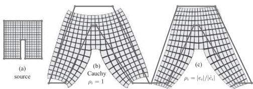

图 7.4 边到边仿射映射的混合。(a) 中的裤子形状源笼在 (b) 和 (c) 中以相同方式变形，以创造腿部伸展的效果。在 (b) 中，边到边仿射映射被选择为相似变换。从 (a) 到 (b) 的映射是全纯柯西重心映射。在 (c) 中，边到边仿射映射仅沿边缘方向伸展而不沿正交方向伸展，从而产生一个非全纯映射，具有更自然的外观并更好地逼近目标笼子。参见彩色插页。

平面仿射映射 $A(z) = az + b\bar{z} + c$ 有三个复数自由度 $a, b, c \in \mathbb{C}$。其中两个由将源边端点映射到目标端点的要求所确定，$A(z_i) = f_i$ 和 $A(z_{(i+1)}) = f_{(i+1)}$。第三个自由度控制映射在边缘正交方向上的行为。令 $e_i = z_{i+1} - z_i$ 和 $\hat{e}_i = f_{i+1} - f_i$，则源边和目标边的（未归一化）法向量为 $n_i = ie_i$ 和 $\hat{n}_i = i\hat{e}_i$。我们要求 $A_i$ 将向量 $n_i$ 变换为向量 $\rho \hat{n}_i$，其中 $\rho_i \in \mathbb{C}$，结果表明边到边仿射映射可以表示为

```
$A_i(z) = f_i - \frac{(\rho_i + 1)\hat{e}_i B_i(z)}{2e_i} + \frac{(\rho_i - 1)\hat{e}_i \overline{B_i}(z)}{2\hat{e}_i}$.
```

如果 $\rho_i = 1$，则上述右侧的反全纯项消失，且 $A_i(z) = S_i(z)$。另一种选择是使用 $\rho_i = |e_i|/|\hat{e}_i|$，它将源法向量映射为与目标边正交且保持长度的向量。这鼓励映射仅允许沿边界切向方向伸展。图 7.4 展示了两种具有 $\gamma_i = \text{Log}(\frac{\rho \hat{e}_i}{e_i})$ 的映射之间的比较。第一个映射使用 $\rho_i = 1$，因此与柯西坐标相同，而第二个映射使用 $\rho_i = |e_i|/|\hat{e}_i|$。

#### 7.2.3 魔法坐标

在上一节中，我们展示了如何基于任意权函数 \(\gamma_i\) 构造复重心坐标。由于相似变换 \(S_i\) 是全纯函数，很明显如果 \(\gamma_i\) 是全纯的，则复重心映射 (7.17) 也是全纯的。显然，存在非全纯的复重心坐标，因为实重心坐标是复重心坐标的特例，其中虚部为 0。例如，著名的瓦赫斯普、平均值和离散调和坐标可以使用以下权重推导：

```
$$\gamma_i(z) = \frac{e_i}{\text{Im}(B_i B_{i+1})} \left( \frac{|B_{i+1}|^p}{|B_{i+1}|^p} - \frac{|B_i|^p}{B_i} \right), \quad (7.18)$$
```

分别取 p = 0、p = 1 和 p = 2。很容易验证，对于 p = 2，(7.18) 中的 \(\gamma_i\) 是实值函数，否则为复值函数。事实上，根据 [416, Theorem 3]，离散调和坐标是具有实值 \(\gamma_i\) 函数的唯一实值重心坐标。

全纯性是一种强条件，与插值边界数据的需求相冲突。虽然所有全纯重心坐标都是非插值的，但几乎所有实重心映射都是插值的。因此，探索既是插值的又不是纯实的新型复重心坐标很有趣。这些显然不是全纯的。

[416] 中讨论了复重心坐标插值的充分条件。粗略地说，每个权函数 \(\gamma_i\) 应该在其对应的边（包括其端点）上趋向无穷，而在其他地方保持有限。这确保了当从域内部趋近于开放第 i 边（即不包括端点）上的一点时，归一化权重 \(\gamma_i\) 的极限为 1，而所有其他权重 \(\gamma_j, j \neq i\) 趋近于零。因此，重心映射 \(f = \sum_{i=1}^n S_i \gamma_i\) 将开放第 i 边映射为 \(S_i\)。关于精确的充分条件以及插值顶点的条件，参见 [416, Section 3.1]。

让我们演示如何设计具有理想属性的“自定义”坐标，特别是拉格朗日属性。为了插值顶点，我们在权函数 \(\gamma_i\) 中包含项 \(1/|B_i(z) B_{i+1}(z)|\)，该项在第 i 边端点处趋向无穷，并随距离边缘的距离增加而衰减。该项在边缘本身上是有限的，因此我们包含项 \(1 / (\pi - \theta_i(z))\)，其中 \(\theta_i(z) = \text{Im}(\text{Log}(B_{i+1}(z) / B_i(z)))\) 是三角形 \([z, z_i, z_{i+1}]\) 在 z 处的有向角（参见图 7.1）。当 z 从笼子内部趋近于开放边 \((z_i, z_{i+1})\) 时，角度 \(\theta_i(z) \in (-\pi, \pi)\) 趋近于 \(\pi\)，导致权函数爆炸，从而提供插值。最后，我们添加第三项，根据每条边的长度 \(|e_i|\) 对其贡献进行加权。结合三项得到了定制角度引导插值坐标（MAGIC）的权函数

```
$$\gamma_i(z) = \left| \frac{e_i}{B_i(z) B_{i+1}(z)} \right| \frac{1}{\pi - \theta_i(z)}.$$
```

由于这些权函数在任何地方都严格为正，显然它们的和非零，因此它们对应于重心坐标。此外，\(\gamma_i\) 在边缘处除外是 \(C^\infty\) 的，在边缘处存在跳跃不连续，因此魔法坐标在笼子内部是光滑的，但不能平滑地扩展到笼子外部。图 7.5 提供了魔法坐标与（实）调和坐标 [215] 的比较。


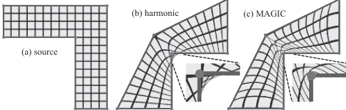

图 7.5 魔法坐标与调和坐标对比。(a) 中笼子的上半部分向右弯曲。(b) 调和坐标的结果。注意图像在非双射角点附近的笼子外溢出（参见放大图像）。(c) 使用魔法坐标的结果。参见彩色插页。

### 7.3 变分重心坐标

迄今为止，我们已构造出具有解析表达式的复重心坐标。此类坐标计算高效、实现简单，且具有高数值精度。我们现在介绍其他类型的坐标，它们具有在平面形状变形语境下非常理想的额外属性。不幸的是，这些坐标不具有解析表达式，而是通过数值逼近获得。虽然它们的推导更为复杂，但额外的计算工作可以在预处理步骤中完成。一旦坐标计算完成，在运行时，重心映射的求值与其他任何重心映射一样高效。这种新型坐标遵循某些变分原理，并被认为相对于这些原理是最优的。此类坐标通过求解数值优化问题得到。

### 7.3.1 基于点的重心映射

全纯映射的一个局限在于，它们通常无法在_每个_边界点上满足位置边界条件，因此全纯重心映射不具有拉格朗日性质。尽管如此，我们总能找到一个在_有限_点集上具有某些期望值的全纯映射。在这样的点上规定映射的确切行为，允许用户更好地控制变形并实现其设计目标。令 \( r_j \in \Omega, j = 1 \dots p \) 为域内的一组用户定义点。我们希望找到一个全纯函数 \( g: \Omega \to \mathbb{C} \)，将 \( r_j \) 映射到指定的目标位置 \( q_j \)。为了保证映射是全纯的，我们使用 (7.12) 中的离散柯西变换 \( g(z) = \sum_{i=1}^n C_i(z)f_i \)，其中对于系数 \( f_i \) 的任何选择，映射 \( g \) 由构造即为全纯。我们的目标是设计一个以 \(f_i\) 为未知数的优化问题。直观地说，与其手动重新定位目标笼子顶点 \(f_i\)，不如设计一个自动重新定位 \(f_i\) 的过程，使得相应的全纯映射 \(g\) 满足期望的要求。

将位置约束添加到我们的优化中归结为满足

\(g(r_j) = \sum_{i=1}^n C_i(r_j)f_i = q_j.\)

由于 \(r_j\) 是常数，\(C_i(r_j)\) 也是常数。因此，上述等式约束在变量 \(f_i\) 中是仿射的，且易于强制执行。设置 \(p = n\)，此类约束对应于具有唯一解的非奇异线性方程组。一种可能的选择是使用 \(r_j = z_j\)，即设计插值笼子顶点的全纯复重心坐标。不过，边本身不会被插值。

尝试添加超过 \(n\) 个约束会导致无解的超定系统。一种可能的补救措施是获得一个最小二乘解，以最小化衡量点 \(r_j\) 的图像与其期望目标位置 \(q_j\) 之间欧氏距离的能量。

\(\min_{f_1, \dots, f_n} \sum_{j=1}^p \|q_j - g(r_j)\|^2 = \min_{f_1, \dots, f_n} \sum_{j=1}^p \left\| q_j - \sum_{i=1}^n C_i(r_j)f_i \right\|^2. \quad (7.19)\)

在 [415] 中，点 \(r_j\) 取为源笼子上的稠密均匀样本，\(q_j\) 是目标笼子上的相应样本。最小二乘问题 (7.19) 的解通过求解线性系统得到，从而产生一种称为塞格ő坐标的新型重心坐标。由于能量通常不为零，塞格ő重心映射一般不插值目标笼子。然而，与具有更高能量 (7.19) 的柯西重心映射相比，它提供了更好的近似。

### 7.3.2 点对点重心坐标

到目前为止，用户通过操纵笼子的顶点与变形系统进行交互。在许多情况下，用户不关心规定变形形状边界的确切形状。特别是对于由数百个顶点组成的复杂边界的形状，单独操纵每个顶点非常耗时。相反，规定一小组 \(p < n\) 点（也称为 P2P 句柄）的位置更有意义，这些点不一定是边界的一部分，同时允许边界自由变形。在这种情况下，相应的线性系统是欠定的，并具有无穷多个解。这提供了一个机会来选择具有额外期望几何特性的特定解。一种简单而强大的选择是对解进行正则化，使重心映射尽可能平滑。这可以通过最小化某些累积微分量来实现。更具体地说，我们希望求解优化问题

\(\min_{f_1, \dots, f_n} \frac{1}{2} \int_{\Omega} |g''(w)|^2 ds,\)
\(\text{s.t. } g(r_j) = q_j, \quad j = 1, \dots, p,\)
(7.20)

其中 \(f_i \in \mathbb{C}\) 是变量，\(g(z)\) 是离散柯西变换，\(g''(z) = \sum_{k=1}^n C''_k(z)f_i\) 是其二阶复导数。在 (7.20) 中选择 \(g''\) 而非 \(g'\) 是因为相似变换 \(S(z) = \alpha z + \beta\) 的二阶复导数处处为零。因此，如果用户使用相似变换 \(S(z)\) 变换 P2P 句柄，则优化的解为 \(f_i = S(z_i)\)，相应的映射 \(g(z) = S(z)\) 具有零能量。特别是，如果 P2P 句柄固定，即如果 \(g(r_j) = r_j, j = 1, \dots, p\)，则 \(g(z) = z\)，映射 \(g\) 复现恒等映射。幸运的是，柯西坐标的导数具有简单的解析表达式 [414, 附录 C-E]。特别是，二阶导数由以下给出

\(C''_k(z) = \frac{1}{2\pi i} \left( \frac{1}{B_{k-1}(z)B_k(z)} - \frac{1}{B_k(z)B_{k+1}(z)} \right).\)
(7.21)

然而，(7.20) 中的边界积分是通过数值逼近得到的。逼近积分的最简单方法是用对 \(\mathbb{K} \gg n\) 边界样本的稠密集合求和来替代它，采样应尽可能均匀。这使我们可以假设微分 \(ds\) 近似为常数。虽然柯西坐标在顶点处有明确定义的极限 [414, 附录 B]，但 (7.21) 中的二阶导数在顶点处是奇异的。避免这些奇异性有两种可能的方法。一种是从样本集中排除笼子顶点（注意 (7.21) 在开放边上定义良好）。第二种选择是将源笼子沿外法线方向偏移非常小的量，并使用外偏移笼子作为我们的新笼子。然后对原始笼子（严格位于偏移笼子内部）进行采样。这种选择也使柯西坐标本身的求值更加简单。将积分近似为求和后，我们可以将 (7.20) 表示为矩阵形式

\(\min_{\boldsymbol{f}} \frac{1}{2} \|\boldsymbol{E}\boldsymbol{f}\|^2,\)
\(\text{s.t. } \boldsymbol{A}\boldsymbol{f} = \boldsymbol{q},\)
(7.22)

其中 \(\boldsymbol{f} \in \mathbb{C}^{n \times 1}\) 是以 \(f_i\) 为元素的复列向量，\(\boldsymbol{E} \in \mathbb{C}^{\mathbb{K} \times n}\) 是在样本处求值的柯西坐标二阶复导数矩阵，\(\boldsymbol{A} \in \mathbb{C}^{p \times n}\) 是在 P2P 句柄处求值的柯西坐标矩阵，\(\boldsymbol{q} \in \mathbb{C}^{p \times 1}\) 是用户指定的目标 P2P 位置向量。

方程 (7.22) 是一个线性约束最小二乘问题。其解可以使用拉格朗日乘数法求得。令 \(\boldsymbol{\lambda} \in \mathbb{C}^{p \times 1}\) 为额外变量（拉格朗日乘数），则 (7.22) 的解可以通过以下方式获得


求解线性方程组

$$
\begin{pmatrix} M & A^H \\ A & 0 \end{pmatrix} \begin{pmatrix} f \\ \lambda \end{pmatrix} = \begin{pmatrix} 0 \\ q \end{pmatrix},
$$

其中 \((\cdot)^H\) 表示共轭转置矩阵，矩阵 \(M \in \mathbb{C}^{n \times n}\) 由 \(E^H E\) 给出。令 \(B \in \mathbb{C}^{n+p \times n+p}\) 为 (7.23) 左侧的块矩阵。令块矩阵 \(B^{-1} = (\cdot \ T)\) 为 \(B\) 的逆，其中 \(T \in \mathbb{C}^{n \times p}\)，则 (7.22) 的解由 \(f = Tq\) 给出。矩阵 \(T\) 表示一种线性变换，它将用户指定的 P2P 句柄目标位置 \(q\) 映射到（未知的）目标笼顶点 \(f_\ell\)。计算 \(T\) 归结为求解 \(B\) 并对其求逆。求解 \(B\) 具有极高的并行性，可以使用现代 GPU 高效计算。由于 \(B\) 通常较小，求逆所需时间通常较短，对于复杂形状计算 \(T\) 的典型运行时间不到一秒。更重要的是，此计算在预处理阶段仅执行一次。

在典型的变形应用中，重心坐标也在预处理步骤中对 \(\Omega\) 内的一组 \(m\) 个点进行求解，我们希望在这些点上求解重心映射。令 \(C \in \mathbb{C}^{m \times n}\) 为在这些点上求解的柯西坐标矩阵，然后在与系统交互时，唯一进行的计算是变形点向量 \(d \in \mathbb{C}^{m \times 1}\)，它由矩阵向量乘法 \(d = Cf\) 给出。由于 \(f = Tq\)，我们有 \(d = Pq\)，其中 \(P = CT\) 在 \(\mathbb{C}^{m \times p}\) 中。矩阵 \(P\) 也可以在预处理中计算，因此在交互期间我们只需要计算乘法 \(Pq\)，这比 \(Cf\) 更高效，因为 P2P 句柄的数量 \(p\) 通常远小于笼中顶点的数量 \(n\)。

最后，\(P\) 的列可以解释为一种特殊的复数重心坐标，其中重心映射中的笼顶点被 P2P 句柄替代。我们称它们为 P2P-Cauchy 坐标。称它们为重心坐标是有道理的，因为它们具有常数精度 (7.1) 和线性精度 (7.2)。图 7.6 展示了使用 P2P-Cauchy 坐标制作的两个图像变形示例。P2P 坐标的另一种推导方法是用软约束 [415] 替换 (7.20) 的等式约束。这会导致更平滑的变形，代价是仅近似 P2P 句柄。

需要注意的是，像 Szegő 和 P2P-Cauchy 坐标这样的变分坐标的质量可以通过更长的预处理时间来大幅提高。离散柯西变换总是产生全纯函数，但与平滑柯西变换 (7.8) 相比，离散变换仅覆盖全纯函数的有限维子空间。随着笼顶点数量的增加，子空间变得更加丰富。丰富该子空间的一种简单方法是在笼边上插入“虚拟”顶点，而不改变笼的几何形状。通常，笼尽可能均匀地上采样，使得顶点总数至少为 200。也可以采用非均匀采样策略，实际顶点数量取决于形状的复杂度和预期效果。

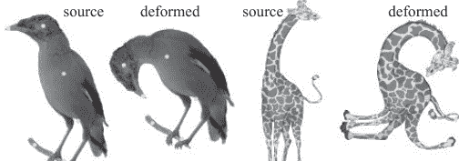

图 7.6 使用 P2P-Cauchy 坐标的变形。P2P 句柄由青色圆盘表示。参见彩色插页。

### 7.4 符合映射

一个常见的错误是将全纯函数与平面符合映射等同起来。虽然平面符合映射可以表示为全纯函数，但反之不一定成立。全纯函数 \( f : \Omega \rightarrow \mathbb{C} \) 仅当其一阶复导数 \( f' \) 在定义域内处处非零时才是符合映射。如果 \( f \) 是全纯函数且对于某点 \( z_0 \in \Omega \) 有 \( f'(z_0) = 0 \)，则 \( z_0 \) 处相交曲线之间的角度不再保持。此外，该映射诱导的等距扭曲在奇异点 \( z_0 \) 处无限大，在其邻域内也很大。边界曲线像的转数增加，且映射在 \( z_0 \) 处不是局部单射的。对于平面形状变形，我们主要关注低扭曲的局部单射映射，应避免出现此类伪影。

### 7.4.1 对数导数构造

如前几节所示，生成全纯映射非常简单，但不幸的是，符合映射不构成线性子空间且更难控制。如果 \( f \) 是表示为 \( f(z) = \sum_{i=1}^n C_i(z)f_i \) 的柯西重心映射，则保证 \( f \) 在 \( z_0 \) 处为符合映射的附加条件 \( |f'(z_0)| > 0 \) 是一个非凸约束。非凸约束对数值优化构成巨大挑战，通常无法高效强制执行。我们可以通过使用替代变量对符合映射空间进行参数化来解决这一难题。在单连通域 \( \Omega \in \mathbb{C} \) 上，符合映射空间与全纯映射空间之间存在一一对应关系 [241, 417]。如果 \( f \) 是符合映射，则它也是全纯函数。全纯映射的导数也是全纯的，这意味着如果 \( f \) 是符合映射，则 \( l(z) = \log(f'(z)) \) 是全纯函数。基于这一观察，我们基于全纯函数 \( l \) 来表示我们的符合映射。对 \( l \) 不需要特殊的非凸约束。我们将根据某些标准设计一个全纯函数 \( l \)，对于每个这样的 \( l \)，都会重构出唯一对应的符合映射。重构过程是成功的关键，描述如下。首先，我们计算函数 \( e^{(l)} \)，它是全纯的，因为复指数是全纯的，且全纯函数的复合也是全纯的。这样的全纯函数按构造是非零的，因为 \( |e^{(l(z))}| = e^{l(z)} \neq 0 \)。我们将 \( e^{(l)} \) 解释为我们的（未知）符合映射的（非零）导数，并计算其原函数以最终恢复映射 \( f \)。这是可能的，因为在单连通域上，全纯函数是可积的，且其原函数也是全纯的。

有了这些观察，计算符合映射的问题就变成了计算一个有意义的全纯函数 \( l \)，然后进行重构步骤。回顾第 7.2.1 节中关于全纯函数导数的讨论以及复对数的定义，我们有函数 \( l \) 分别在其实部和虚部中编码了局部缩放和旋转的量，

$$
l(z) = \log(f'(z)) = \ln(|f'(z)|) + i \arg f'(z).
$$

我们将函数 \( l \) 离散化为

$$
l(z) = \sum_{i=1}^n D_i(z)l_i, \quad (7.24)
$$

伴随基函数

$$
D_i(z) = \frac{1}{2\pi i} \gamma_{l_i}^{\text{Cauchy}}(z) = \frac{1}{2\pi i} \text{Log}\left(\frac{B_{i+1}(z)}{B_i(z)}\right).
$$

离散化的其他选择也是可能的，包括高阶近似 [417]，但为了讨论起见，这种简单的选择就足够了。(7.24) 中的系数 \( l_i \) 可以解释为笼边上 \( \log(f'(z)) \) 的分段常数值，我们的目标是从用户提供的数据（即目标笼的形状）中估计它们。我们的简单选择是设计一个符合映射 \( f \)，使其在每条边上作为（不同的）相似变换起作用。鉴于从 (7.9) 将源边映射到目标边的唯一相似变换 \( S_i \)，其导数由 \( S(z) = \hat{e}_t / \hat{e}_i \) 给出，我们使用 \( l_i = \log(\hat{e}_t / \hat{e}_i) \)。

在实际计算 \( l_i \) 时，计算复对数时应小心，因为它是一个多值函数。标准 C++/MATLAB 软件实现仅产生单值主分支，并在每条边上独立使用它可能导致编码边弧度旋转的虚部分配错误。相反，我们建议采用以下策略来恢复正确的角度。第一条边的旋转计算为 \( l_1 = \text{Log}(\hat{e}_1 / e_1) \)，其中 Log 是标准主分支实现，虚部值在范围 \((-\pi, \pi]\) 内。要计算后续的 \( l_i \)，我们首先计算源笼和目标笼之间角顶点角度的差值，

$$
d_i = \text{Log}\left(\frac{\hat{e}_t}{\hat{e}_{i-1}}\right) - \text{Log}\left(\frac{e_i}{e_{i-1}}\right),


图 7.7. 全纯映射与共形映射的比较。左：源域。中：使用柯西坐标的变形。注意消失的导数，这一点在放大图像中被强调。右：从同一目标笼获得的共形映射。参见彩色插页。

然后累加这些值以获取边的正确旋转，

$l_i = l_{i-1} + d_i, \quad i = 2, \dots, n.$

我们假设目标笼的转数为 1，或者说 $\sum_{i=1}^n d_i = 0$。这很合理，因为任何映射（特别是共形映射）局部单射的必要条件是，边界曲线在映射下的像形成一条自重叠曲线（这意味着转数为 1）[419]。

将 $l_i$ 代入 (7.24) 可得到我们共形映射 $f(z)$ 在任意点 $z \in \Omega$ 处导数对数的封闭式表达式。此外，导数由单值函数 $e^{l(z)}$ 给出，它也具有封闭形式。然而，为了得到实际映射 $f$，我们需要原函数 $\int e^{l(\zeta)}$，它无法以直接的方式表示。这个原函数是全纯的（因此可以精确积分），但通常不属于离散柯西变换所张成的有限维空间。为了缓解这一问题，我们可以将 $\int e^{l(\zeta)}$ 投影到柯西的有限维空间 [417]（这归结为求解一个小型稠密线性系统），或者对积分进行数值近似 [101, 241]。这两种替代方案计算都非常高效。

从导数重建共形映射仅在对应于全局平移的复常数意义下是唯一的。消除这一自由度的最简单方法是允许用户选择一个锚点 $z_0 \in \Omega$，并设置 $f(z_0) = \sum_{i=1}^4 \phi_i(z_0)f_i$，其中 $\phi_i$ 是重心坐标（我们在图 7.7 中使用了柯西坐标），$f_i$ 是目标笼顶点。由于重建的共形映射不插值目标笼，一个稍微更复杂的替代方案是求解平移（甚至可能是相似变换），以最小化目标笼与边界像之间的距离。图 7.7 提供了基于笼的柯西坐标得到的全纯映射与我们描述的简单基于笼的共形方法之间变形的比较。两种方法计算都非常高效，因为它们在运行时不需要求解数值优化问题。

### 7.4.2 形状插值

平面形状插值是计算机图形学中的一个经典问题。它对于创建动画序列和探索形状空间非常重要。一种天真且广泛使用的插值方法是线性混合输入映射。如果 $f^1(z)$ 和 $f^2(z)$ 是共形的，那么对于 $t \in [0, 1]$，$f^t(z) = (1-t)f^1(z) + t f^2(z)$ 是全纯的，但通常不是共形的。然而，基于导数对数生成共形映射（参见第 7.4.1 节）也为插值两个或多个共形映射提供了一种自然的方法。其思路是线性混合对数导数而非映射本身，然后重建映射（该映射由构造即为共形）。为了简洁，让我们考虑最常见的情况，即将给定的共形映射 $f$ 与恒等映射进行混合。由于恒等映射的导数对数为 0，我们有 $l'(z) = t l(z)$，其中 $l(z)$ 是 $f(z)$ 的对数导数。线性混合 $l$ 会产生自然且视觉上令人愉悦的结果，因为旋转（$l$ 的虚部）是线性混合的。图 7.8 显示了这样的结果，其中我们使用第 7.4.1 节描述的简单技术计算了 $l$。然后我们像以前一样重建了共形映射，并用 $0.5 l(z)$ 作为输入重复了重建过程。

### 7.4.3 变分共形映射

从 $l$ 构建共形映射的简单策略可以通过使用变分方法进行扩展，设计一个数值优化，其中 (7.24) 中 $l_i$ 的实部和虚部是变量。例如，我们可以在一些用户定义的点 $r_j$ 上对 $l(r_j)$ 的实部和/或虚部添加等式约束，用户可以在这些点上精确控制映射引起的缩放和/或旋转量。这些约束在变量中是线性的，可以轻松强制执行。事实上，在连续情况下，可以在（单连通域的）*整个*边界上规定缩放或旋转（但不能两者都规定）。在 [417] 中，旋转在边界上被完全规定，并求解线性系统以恢复 $l$。此外，[241] 的方法可以用于强制执行额外的*不等式*约束，以界定等距畸变（回顾第 7.2.1 节），

\(\tau(w) = |\ln |f'(w)||.\)

目标是将点 $y_j$ 处的畸变界定为某个用户定义的正常数 $\Gamma$。该约束可以表示为

```
\(\tau(y_j) \le \Gamma \Leftrightarrow\)
\(-\Gamma \le \ln |f'(y_j)| \le \Gamma \Leftrightarrow\)
\(-\Gamma \le \text{Re}(\log(f(y_j))) \le \Gamma \Leftrightarrow\)
\(-\Gamma \le \text{Re}(l(y_j)) \le \Gamma,\)
```

可以轻松看出，最后一行对应于在我们的变量中是*线性*的两个不等式。这些不等式是凸的，可以在实践中使用凸规划 [67] 高效地强制执行。此外，由于 $\text{Re}(l(z))$ 是全纯函数的实部，它是谐波的，因此其最小值和最大值在边界上取得。因此，在边界上界定共形映射的等距畸变意味着在整个域上有一个全局界定，这保证了手头的共形映射质量很高。在边界上界定畸变仍然具有挑战性，因为边界点仍然有无限多个。然而，由于基函数的平滑性，可以通过对有限密集的边界样本 $y_j$ 强制界定来实现这一点 [95]。

本节介绍的计算共形映射的方法实现简单且相当高效。然而，它不允许规定位置约束（P2P 句柄），因为位置在 $l_i$ 变量中是高度非线性的表达式。[95] 引入了一种基于非凸规划的复杂方法。与这里介绍的方法相比，该方法慢几个数量级，但它能产生显著的结果，并且仍然可以以交互速率运行。

### 7.5 实现细节

在本节中，我们提供了一些关于高效实现平面变形系统的方向，并指出一些应考虑的实际方面。

### 7.5.1 可视化平面映射

对重心映射进行准确且高效的可视化是我们形状变形系统的重要组成部分。为此，我们应努力在预处理中尽可能多地进行计算，以便在交互期间进行更快的计算。此外，建议利用并行性，并在可能时将计算转移到图形处理器。

可视化映射最简单且最高效的方法是利用 GPU 高效对三角网格进行纹理映射的能力。用户提供定义源域的多边形笼以及在预处理中（一次）计算的域的密集三角剖分（网格）。我们发现 [355] 的代码很有用，尽管存在其他高质量且高效的三角剖分算法。在运行时，映射在此网格的顶点上被求值，GPU 使用原始顶点位置作为 (u, v) 纹理坐标来渲染变形后的网格。由于 GPU 的光栅化器假设映射在三角形上是分段线性的，因此最好使用高密度网格以获得平滑的结果。

下一步是计算重心坐标并将其存储在一个大型稠密矩阵中。对于某些类型的坐标（如柯西坐标）应格外小心，因为它们的表达式 (7.18) 在边界上是奇异的。从笼内部接近边缘或顶点时的极限存在 [414]，但需要根据顶点的位置进行特殊分类。这使得实现变得复杂，并且不太适合在 GPU 上实现，因为在 GPU 上规律性至关重要。避免此问题的一个简单“技巧”是沿外法线方向偏移笼，并使用偏移后的笼来推导坐标。偏移量应足够小以避免视觉伪影，并且足够大以避免在求值位于边界上的顶点时出现数值错误。我们使用的默认值为 0.0001，而我们使用的笼直径为 10 个单位。

求值基函数是一个非常容易并行的过程。对于每个网格内部顶点 $v_j$ 和每个笼顶点 $z_i$，坐标函数 $C_i(v_j)$ 可以独立计算。此外，规则的内存访问模式非常适合 GPU 实现。算法 1 显示了我们用于计算柯西坐标矩阵的 MATLAB 代码。在配备 Nvidia Quadro K6000 处理器的机器上，对于图 7.2 的裤子形状的 125,000 个顶点网格，运行时间为 17 毫秒。

最关键的计算是重心映射的求值，因为这是在交互期间完成的。同样，这里有利用并行性的空间，因为每个内部顶点 $v_j$ 的 $f(v_j) = \sum_{i=1}^n C_i(v_j)f_i$ 求值是独立的。这个计算可以表示为矩阵-向量乘法，


## 算法 1

用于计算柯西坐标的并行 MATLAB 代码。z 是内部网格顶点的复向量，z_1 是偏移笼顶点的复向量。输出是坐标矩阵 C。该代码在 CPU 上并行运行。此外，如果可用 CUDA 启用的 GPU，且 z 为 gpuArray 类型，则计算会自动在 GPU 上执行。

```
e_1_i = z_1_i([2:end 1]) - z_1_i;
e_1_m = e_1_i([end 1:end-1], :);
B_1_i = bsxfun(@minus, z_1_i.', z_1_i.');
B_1_p = B_1_i(:, [2:end 1]);
B_1_m = B_1_i(:, [end 1:end-1]);
C = (1/(2*pi*1i))*(B_1_p.*bsxfun(@rdivide, log(B_1_p./B_1_i), e_1_i.')
- B_1_m.*bsxfun(@rdivide, log(B_1_i./B_1_m), e_1_m.'));
```

为此有许多高效的并行实现可供广泛使用。如果使用 GPU，最好在 GPU 上（在预处理期间）计算并存储坐标矩阵，而不将其传输到 CPU，并直接在 GPU 上执行矩阵-向量乘法。执行此操作的 Matlab 代码简单如 d=C*f，其中 C 是算法 1 中计算的矩阵，f 是目标笼顶点，d 是变形后的顶点位置。为了最大效率，可以指示 GPU 直接根据驻留在 GPU 内存中的 d 执行网格渲染，从而避免 GPU 和 CPU 之间冗余的数据传输。

泰勒与弗朗西斯
泰勒与弗朗西斯集团
http://taylorandfrancis.com


图 4.4 不同目标多边形的平均值映射 $f: \tilde{\Omega}^0 \to \tilde{\Omega}^1$ 的 $J_f$ 颜色编码图。当扰动较小时，该值保持为正，但在大变形下会变为负。


图 4.12 两个多面体之间复合平均值映射示例。颜色显示源多面体的内部如何变形为目标多面体的内部。


图 7.2 实重心坐标与复重心坐标的比较。(a) 中裤子形状的笼在 (b-d) 中通过仿射变换 $g: (x, y) \to (2x, y)$ 进行变换。在 (b) 中，平均值重心映射复现了 $g$。在 (c) 和 (d) 中，柯西和魔法复重心坐标生成不复现 $g$ 的映射。(c) 中的映射是共形的。


图 7.4 边到边仿射映射的混合。(a) 中裤子形状的源笼在 (b) 和 (c) 中以相同方式变形，以产生腿部拉伸的效果。在 (b) 中，边到边仿射映射被选择为相似变换。从 (a) 到 (b) 的映射是全纯柯西重心映射。在 (c) 中，边到边仿射映射仅沿边方向拉伸而不沿正交方向拉伸，从而产生一个非全纯映射，外观更自然，更好地近似目标笼。


图 7.5 魔法坐标与调和坐标的比较。(a) 中笼的上部向右弯曲。(b) 调和坐标的结果。请注意，在映射非双射的角附近，图像溢出笼外（参见放大图）。(c) 魔法坐标的结果。


图 7.6 使用 P2P-柯西坐标进行变形。P2P 句柄由青色圆盘表示。


图 7.7 全纯映射与共形映射的比较。左：源域。中：使用柯西坐标的变形。请注意消失的导数，在放大图中得到强调。右：从同一目标笼获得的共形映射。


图 7.8 共形映射的插值。左侧域共形映射到右侧域。将导数的对数与 t=0.5 进行线性混合，得到中间的共形映射。


图 8.10 使用 S-补片进行图像变形。左侧图像显示图像及一个用于评估变形的点，其中每个控制点列出其使用瓦赫斯普坐标的二次 S-补片的基函数。中间图像显示评估基函数后与评估点相关的权重。移动控制点会在右侧显示的图像上诱导变形。


图 8.11 使用线性 S-补片进行曲面变形的示例。马的初始曲面被一个称为笼的低分辨率近似包围（左侧）。右侧两幅图像显示不同的变形，其中头部和躯干保持相同大小，但颈部和腿部被压缩或拉伸。


图 9.3 在 Bimba con Nastrino 的高质量优化 Delaunay 网格中，我们展示了加权外心与重心之间的距离大于阈值的四面体集合，在 HOT 优化 [289] 之前（左侧）和之后（右侧）。原始三角剖分相同，此显著优化仅在对偶上使用权重进行。


图 10.1 左：由刚性非钢筋砌块组成的自由形式砌体结构。（图片由 Mathias Höbinger 提供，经许可使用。）中：推力网络，证明该砌体结构在自重下是 *稳定* 的。每条边的半径与边所承受的压缩力大小成正比。右：2D 拱，带有自重和证明其稳定性的推力线，均已图示。


图 11.3 (a) 图 11.1 所示 I 梁在施加扭转牵引力下的有限元分析应力场（von Mises），(b) 截面视图。（经许可从 [48] 转载。）


图 11.6 大变形示例，受扭转载荷的超弹性梁。一端固定，而对一端施加完整的 360° 旋转。(a) 原始多面体网格（具有最大泊松种子的 Voronoi 铺砌），(b) 变形形状和 von Mises 应力场。


图 11.8 使用重心细分进行多面体网格划分示例（参见图 11.7(a)）：(a) 图 11.1(c) 所示四面体网格的重心对偶；(b) 每个多面体单元用不同颜色表示。


图 12.1 标准四面体单元大变形能力有限的示例。实验表明，填充 20% 体积分数随机分布的二氧化硅颗粒的合成橡胶在单轴拉伸下可伸长至原长四倍以上（\(\lambda = 4\)）而不发生内部损伤 [315]。相比之下，基于具有线性压力的标准 10 节点混合单元的有限元模型只能变形到宏观拉伸 \(\lambda = 1.5\) [174]。


图 12.2 (a) 凹多边形上平均值基 \(\phi_1^{(1)}\) 的等值线图。(b) 与顶点关联的凹多边形上二次基 \(\phi_1^{(2)}\) 的等值线图。(c) 与中边节点关联的凹多边形上二次基 \(\phi_1^{(2)}\) 的等值线图。


图 12.11 (a) 问题中考虑的单元。(b) 由 58,814 个 CPE6MH 单元和总共 118,141 个节点组成的二次三角网格，其中基相中有 71,179 个节点。(c) 由 39,738 个单元和总共 76,020 个节点组成的线性多边形网格，其中基相中有 66,095 个节点。(d) 由 20,205 个单元和总共 95,233 个节点组成的二次多边形网格，其中基相中有 67,325 个节点。此图改编自 [100]。


### (a) \(\mathcal{M}_2 - \mathcal{M}_1\) 单元: \(\lambda_{max}=2.9132\)


### (b) \(\mathcal{M}_2 - \mathcal{P}_t^p\) 单元: \(\lambda_{max}=2.6456\)


### (c) \(\mathcal{M}_1 - \mathcal{P}_0^p\) 单元: \(\lambda_{max}=2.2615\)


### (d) CPE6MH 单元: \(\lambda_{max}=1.4308\)


图 12.12 对于加载条件 (i)，显示纯剪切，平均变形梯度 \(\langle \boldsymbol{F} \rangle = \lambda \mathbf{e}_1 \otimes \mathbf{e}_1 + \lambda^{-1} \mathbf{e}_2 \otimes \mathbf{e}_2, \lambda \ge 1\)，图示了由 (a) \(\mathcal{M}_2 - \mathcal{M}_1\) 单元、(b) \(\mathcal{M}_2 - \mathcal{P}_t\) 单元、(c) \(\mathcal{M}_1 - \mathcal{P}_0\) 单元和 (d) CPE6MH 单元（在ABAQUS中求解）达到的最终变形配置。本图改编自 [100]。


### (a) \(\mathcal{M}_2 - \mathcal{M}_1\) 单元: \(\gamma^{max}=1.48\)


### (b) \(\mathcal{M}_2 - \mathcal{P}_0^D\) 单元: \(\gamma^{max}=1.55\)


### (c) \(\mathcal{M}_1 - \mathcal{P}_0^D\) 单元: \(\gamma^{max}=1.55\)


### (d) CPE6MH 单元: \(\gamma^{max}=0.6\)

图 12.14. 对于加载条件 (ii)，显示 \(\langle \boldsymbol{F} \rangle = \boldsymbol{I} + \gamma \boldsymbol{e}_1 \otimes \boldsymbol{e}_2, \gamma \ge 0\)，图示了由 (a) \(\mathcal{M}_2 - \mathcal{M}_1\) 单元、(b) \(\mathcal{M}_2 - \mathcal{P}_0^D\) 单元、(c) \(\mathcal{M}_1 - \mathcal{P}_0^D\) 单元和 (d) CPE6MH 单元（在ABAQUS中求解）达到的最终变形配置。基体和相界均被视为典型的硅橡胶。


图 13.1 二维顶点集 $V$ 及其凸包 $P$。


图 13.3 局部最大熵（LME）基函数。(a) 一维顶点集选定的基函数，具有变化的长宽比参数 $\gamma_i = \beta_i h^2$，参见正文。(b) 二维顶点集中内部节点的基函数及不同长宽比参数，以及 (c) 边界节点的代表性基函数。


图 13.4 最大熵逼近的扩展。(a) 代表性二阶最大熵基函数，与移动最小二乘函数相比，后者在某些点处会振荡并取负值。(b) 标准LME基函数与基于三角剖分的单元最大熵基函数的比较，后者产生结构化邻接关系，并能以可比精度更高效地计算以逼近PDEs。(c) LME逼近子与基于B样条的边界表示的组合。


图 13.5 LME逼近子在高阶PDEs中的应用。(a) 在生物膜相场模型中，定义移动界面形状的未知场受四阶PDE控制。因此，Galerkin方法需要光滑基函数（具有平方可积的二阶导数）。相场会发展出陡峭梯度，需要自适应求解和无吉布斯现象的逼近方案。所有这些条件均由LME逼近满足。(b) 显示了动态模拟中的两个快照，跟踪由具有曲率弹性的流体膜组成的变形囊泡的形状，以及周围流体的流体动力学。顶点集的分辨率遵循相场的陡峭变化。


图 13.6 使用光滑LME参数化图集对流形进行逼近。(a) 定义局部参数化的方法论，将由点集定义的曲面分区映射出来。(b) 将此方法应用于求解非线性Kirchhoff-Love壳体的高阶PDE。(c) 将该方法应用于描述小分子丙氨酸二肽的分子构象。该分子构象集合采样了与托鲁斯同胚的底层态构型流形，采用(a)中提出的方法，该流形被分为四块，每块均使用LME逼近子进行参数化。该方法允许我们为该系统定义光滑集体变量，这对于增强分子动力学模拟中的采样是必需的。


图 15.1 方形单元上 k = 2 的顶点（左）、边（中）和内部（右）多边形基函数。

## 基于重心坐标的多边补丁

Scott Schaefer

Texas A&M University, College Station, USA

### 目录

- 8.1 引言 ........................ 136
  - 8.1.1 曲线的Bézier形式 ............. 136
  - 8.1.2 求值 ........................ 137
  - 8.1.3 次数升高 .................. 137
- 8.2 高维中的多边Bézier补丁 ... 138
  - 8.2.1 S-补丁的索引 ............ 139
  - 8.2.2 求值 ........................ 141
  - 8.2.3 次数升高 .................. 142
- 8.3 应用 ........................ 143
  - 8.3.1 曲面补丁 ................. 143
  - 8.3.2 空间变形 ............. 144

第1章介绍了重心坐标的若干构造及其性质。在本章中，我们探讨了重心坐标与任意维度中曲线、曲面和体积的高阶参数表示之间的深层联系。在曲线的情况下，这些曲线称为Bézier曲线，用于从字体表示到动画控制的各种应用。扩展到凸曲面补丁，称为S-补丁[257]，是较近期的发展。如最初提出的那样，S-补丁是限于凸域的参数化多边曲面补丁。然而，这些限制更多地是当时可用的广义重心坐标（即Wachspress坐标）集合有限的结果。今天我们拥有不需要凸性并可扩展到任意维度的广义重心坐标函数。因此，我们将在现代重心坐标（具有广义域且适用于任意维度）所赋予的完全一般性范围内研究S-补丁。

### 8.1 引言

#### 8.1.1 曲线的 Bézier 形式

首先，我们考虑重心坐标的最简单实例之一。考虑由区间 [0, 1] 定义的域。该区间产生重心坐标函数

\[
\phi_0(x) = (1 - x),
\phi_1(x) = x,
\]
(8.1)

它们能复现常数函数和线性函数，

\[
\phi_0(x) + \phi_1(x) = 1,
0 \cdot \phi_0(x) + 1 \cdot \phi_1(x) = x.
\]

如果我们检查 \((\phi_0(x) + \phi_1(x))^m\) 二项式展开的各项，我们得到如下形式的函数

\[
B_j^m(x) = \binom{m}{j} (1 - x)^{m-j} x^j,
\]
(8.2)

其中 \(m\) 是函数 \(B_j^m(x)\) 的次数。这些特殊函数称为Bernstein基函数。将这些函数与控制点 \(f_j\) 关联，得到一条Bézier曲线

\[
F(x) = \sum_{j=0}^m B_j^m(x) f_j.
\]

请注意，由于 \(\phi_0\) 和 \(\phi_1\) 构成一元划分，\(F(x)\) 平凡地复现常数函数。例如，如果 \(f_j = c$，则

\[
c = \sum_{j=0}^m B_j^m(x)c = c((1 - x) + x)^m.
\]

此外，\(F(x)\) 还能复现次数不超过 \(m\) 的所有多项式函数。最后这一性质直接源于重心坐标的线性复现性质。特别是，为了复现函数 \(x^k\)（其中 \(k \le m\)），存在系数 \(f_j$ 使得

\[
F(x) = (\phi_0(x) + \phi_1(x))^{m-k} (0 \cdot \phi_0(x) + 1 \cdot \phi_1(x))^k = 1^{m-k} x^k = x^k,
\]

其中系数 \(f_j$ 由上述多项式展开中 \(B_j^m(x)$ 的系数收集得到。例如，为了复现函数 \(x$，系数由 \(f_j = j/m$ 给出。这些性质也直接源自萌发理论和极式形式 [316]，但这超出了本章的范围。

此外，重心坐标函数 \(\phi_i$ 还赋予生成的Bézier曲线若干有用的几何性质。例如，由于重心坐标的Lagrange性质，Bézier曲线对其端点进行插值。在区间 \([0, 1]$ 上，Bézier曲线也落在其控制点的凸包内，因为对于所有 \(x \in [0, 1]$ 都有 \(0 \le \phi_i(x) \le 1$。这些曲线也是仿射的


图 8.1 一个三次 Bézier 曲线的示例（左）以及次数升至四次的曲线（右）。


图 8.2 一个金字塔图示示例。底部的数值乘以箭头上的常数并求和，以产生金字塔顶点的结果。

不变；也就是说，将每个控制点通过仿射变换 T 进行变换，相当于将 Bézier 曲线通过 T 进行变换。图 8.1 显示了一个 Bézier 曲线的示例，其中 f_j 是 $\mathbb{R}^2$ 中的点。

### 8.1.2 求值

虽然我们可以通过在 Bernstein 基函数中求值多项式表达式来求值 Bézier 曲线，但通过 de Casteljau 算法存在一种更优雅的解决方案。为此，我们引入了一种针对两个控制点线性组合的图形表示法。图 8.2 显示了一个简单的金字塔图。箭头表示取箭头底部的值与沿箭头列出的标量值的乘积。然后将该乘积的结果加到箭头末尾的总和中。因此，此图表示取 f_0 和 f_1，并分别将这些值乘以 a 和 b，以形成结果 af_0 + bf_1。使用此表示法，de Casteljau 算法可以写成一种非常优雅的金字塔图形式，如图 8.3 所示 [167]。请注意，金字塔的每一层都会生成较低阶的 Bézier 函数，曲线的值出现在金字塔的顶点。

### 8.1.3 次数升高

Bézier 曲线的次数升高，简单来说就是寻找一个次数为 m + 1 的 Bézier 曲线来表示一个次数为 m 的 Bézier 曲线。执行次数升高的一个好处是，该过程引入了一个额外的控制点，可用于控制曲线的形状。此外，添加这个新控制点不会改变曲线的形状。这种次数升高始终是可能的，因为每个次数为 m 的 Bézier 曲线也是一个次数为 m + 1 的 Bézier 曲线。

推导次数升高时，注意到不同次数的 Bernstein 基函数之间存在联系很有用。使用 (8.2)，我们可以证明：

```
\( B_j^{m+1}(x) = \frac{m+1-j}{m+1} \phi_0(x) B_j^m(x) = \frac{m+1}{j} \phi_1(x) B_{j-1}^m(x). \)
```

因此，我们可以通过将一个次数为 m 的 Bézier 曲线乘以 \( (\phi_0(x) + \phi_1(x)) \) 来简单地提升其次数，使得

```
\( F(x) = \left( \sum_{j=0}^m B_j^m(x) f_j \right) (\phi_0(x) + \phi_1(x)) \\
= \sum_{j=0}^{m+1} B_j^{m+1}(x) \left( \frac{j}{m+1} f_{j-1} + \frac{m+1-j}{m+1} f_j \right). \)
```

图 8.1（右侧）展示了提升 Bézier 曲线次数的一个示例。

### 8.2 高维多边形 Bézier 补片

第 8.1.1 节提供了一些提示，说明我们如何通过使用广义重心坐标，将一元曲线构造扩展到多边形甚至更高维多面体等域。特别是，我们使用 (8.1) 扩展到更广义域的方法。给定一个具有顶点 $v_i \in \mathbb{R}^d$ 的多边形 \( P \)，广义重心坐标函数 $\phi_i$ 满足

\(\sum_{i=1}^n \phi_i(x) = 1,\)
\(\sum_{i=1}^n \phi_i(x)v_i = x\)
(8.3)

对于所有点 $x \in \mathbb{R}^d$（尽管对于某些重心坐标构造，$x$ 可能被限制在 \( P \) 内）。

构建 S-补片时，我们考察由重心基函数的多项式展开产生的函数

\(\left( \sum_{i=1}^n \phi_i(x) \right)^m = \sum_{|\ell|=m} \binom{m}{\ell} \prod_{i=1}^n \phi_i(x)^{\ell_i},\)

其中索引 $\ell = (\ell_1, \dots, \ell_n)$ 是一个由 $n$ 个非负整数组成的向量，$|\ell|$ 是 $\ell$ 的各项之和，而 \(\binom{m}{\ell}\) 是多项式系数 \(\binom{m}{\ell} = \frac{m!}{\ell_1! \ell_2! \dots \ell_n!}\)。将 \( B_\ell^m(x) \) 设为此展开中的相应项，可得

\( B_\ell^m(x) = \binom{m}{\ell} \prod_{i=1}^n \phi_i(x)^{\ell_i}.\)
(8.4)

这些基函数是第 8.1.1 节中 Bézier 基函数的推广。事实上，如果我们使用 (8.1) 中的重心基函数，我们将得到完全相同的曲线，只是索引方案不同。如果我们将值 $f_\ell$ 与每个这样的基函数相关联，我们将得到一个多边形 Bézier 函数

\( f(x) = \sum_{|\ell|=m} B_\ell^m(x) f_\ell,\)

这也被称为 S-补片。与一元 Bézier 曲线一样，S-补片可以再现所有总次数不超过 $m$ 的多项式，这直接从 (8.3) 得出。例如，要再现 $x$，控制点由以下给出

\( f_\ell = \sum_{i=1}^n \frac{\ell_i}{m} v_i.\)
(8.5)

与一元曲线不同，(8.3) 中的重心坐标函数不一定是多项式。尽管如此，我们将把 S-补片基函数 \( B_\ell^m(x) \) 称为次数为 $m$ 的函数，以指示各个重心坐标函数 $\phi_i$ 的总次数。

### 8.2.1 S-补片的索引

对于曲线，索引控制点是微不足道的，因为每个基函数仅根据 Bernstein 基函数的排序被赋予一个索引 $j = 0, \dots, m$。然而，这种简单的索引方案不扩展到更高维度。正如已经


图 8.4 使用指定的连接规则对二次五边形 S-补片进行索引。

提到的 (8.4)，S-补片使用多索引来引用控制点。每个控制点 \( f_\ell \) 都与一个长度为 $n$ 的非负整数索引向量相关联，其和为补片的次数 $m$。给定一个多边形 \( P \)，我们通常以规范位置绘制控制点，使得 \( f_\ell \) 的放置满足 \( F(x) = x \)。幸运的是，这种组合仅是 \( P \) 的函数，与我们选择的重心基无关，并由 (8.5) 给出。

此外，有一个简单的规则用于绘制简单 2D S-补片的连接性。如果存在一个索引 \( 1 \le j \le n \)，使得

```
\ell_i = h_i, \quad i \neq j, j+1
|\ell_j - h_j| = 1
|\ell_{j+1} - h_{j+1}| = 1
```

其中对 \( j \) 的运算模 \( n\) 进行。图 8.4 展示了二次五边形 S-补片的这种索引示例。虽然绘制这种连接性对 2D 域有意义，但 S-补片扩展到更高维度的多面体。在那里，2D 中用于识别连接性的索引的循环顺序不推广到更高维度。虽然我们可以将连接规则推广到更高维度，但更高维度中连接性传达的信息变得更难以辨别。这种连接性对更高维度的 S-补片求值算法或其他属性并非必不可少，因此我们简单地省略它。

请注意，对于某些多边形，S-补片控制点会发生一些有趣的事情。图 8.5 展示了两个二次四边形补片的示例。一个示例有 10 个控制点，而另一个似乎有 9 个控制点。问题是，根据 (8.5)，左侧示例中对应 (1010) 和 (0101) 索引的两个控制点重叠，而右侧示例中不重叠。为了再现多项式函数，这些控制点必须具有相同的值，这导致自由度的损失。然而，在更一般的


图 8.5 S-补片歧义索引示例。左侧显示两个控制点在参数域中重叠的示例。右侧显示不同基多边形的相同索引，其中重叠的控制点分开。

使用 S-补片建模形状时，这两个控制点可能具有不同的值，尽管它们被绘制在同一位置。值得注意的是，在图左侧的情况下，如果我们要求重叠控制点具有相同的函数值，这实际上将控制点数量减少到 9 个，那么当使用 Wachspress 坐标作为重心坐标函数时，S-补片与张量积 Bézier 补片相同。因此，张量积 Bézier 补片以及三角形 Bézier 补片（具有单纯形域的 S-补片）都是 S-补片的特例 [257]。确实，在此示例中，Wachspress 坐标的基函数对于 (1010) 和 (0101) 控制点是相同的。然而，两个重叠控制点的基函数不必相同，而且在一般情况下很少相同。

### 8.2.2 求值

与 Bézier 曲线类似，求值 S-补片的一种可能方法是简单地将控制点乘以在问题点处求值的相应基函数（来自 (8.4)）。然而，还存在一种类似于 de Casteljau 的算法，它利用控制点之间的层次关系。给定一个求值点 \(\boldsymbol{x}\)，我们使用多面体 \( P \) 计算求值点处的重心基函数 \(\phi_i(\boldsymbol{x})\) 的值。现在，我们以递归方式进行。设 \( f_j \) 为层级 \( k - 1 \) 处的控制点，其中 \( |j| = k - 1 \)，并设 \( |\ell| = m \) 的 \( f_\ell \) 为初始控制点。然后，我们对所有 \( |j| = k - 1 \) 计算 \( f_j \)

```
f_j = \sum_{i=1}^n \phi_i(\boldsymbol{x}) f_j + f_j^n
```


图 8.6 对二次五边形 S-patch 应用 de Casteljau 算法。左图描绘了算法第一级中一点的计算。右图显示了最终评估点的计算。

其中 \(\Gamma^n\) 是 \(n \times n\) 单位矩阵的第 \(i^{th}\) 行。S-patch 的值随后由 \(f_0\) 给出。图 8.6 描绘了这种分层评估算法。

#### 8.2.3 次数提升

虽然 Loop 和 DeRose [257] 提到了 S-patch 的次数提升，但作者未提供显式公式。不过，次数提升并不难推导。设 \(f_\ell\) 为次数为 \(|\ell| = m\) 的 S-patch 函数的控制点值，\(f_j\) 为同一 S-patch 函数次数为 \(|j| = m + 1\) 的控制点。则，

```
\(\left( \sum_{|\ell|=m} B_\ell^m(\boldsymbol{x}) f_\ell \right) \left( \sum_{i=1}^n \phi_i(\boldsymbol{x}) \right) = \sum_{|j|=m+1} B_j^{m+1}(\boldsymbol{x}) \hat{f}_j. \quad (8.6)\)
```

请注意，不同次数的基函数通过以下方式相互关联：

```
\(B_j^{m+1}(\boldsymbol{x}) = B_{j-r_i}^m(\boldsymbol{x}) \frac{m+1}{j_i} \phi_i(\boldsymbol{x}) \quad (8.7)\)
```

对于 \(j_i > 0\)，展开 (8.6) 的左侧并使用 (8.7) 可得到 \(m+1\) 次控制点 \(\hat{f}_j\) 的公式，

```
\(\hat{f}_j = \sum_{j_i > 0} \frac{j_i}{m+1} f_{j-r_i}.\)
```


图 8.7 具有凸域的 S-patch 示例。从左到右：灰色阴影的基多边形 P、二次 S-patch 的控制点结构以及 3D 中的 S-patch 示例。

### 8.3 应用

虽然 S-patches 的原始定义 [257] 使用了凸多边形域，但这一限制更多是当时可用的重心坐标 [407] 的结果，而非构造本身的局限。自那时以来，已开发出多种不同类型的重心坐标（参见第 1 章）。这些构造中的大多数不限制域的特定维度，也不要求凸域。虽然可以使用这些构造中的任何一种来创建 S-patches，但我们在此示例中采用均值坐标 [144, 150, 200, 217]。

### 8.3.1 曲面补片

也许 S-patches 最常用的应用是填充曲面中的多边形孔。图 8.7 展示了使用凸域的此类多边形补片示例。由于重心坐标的插值特性，域边界沿线的曲线仅由该边界沿线的控制点决定，并形成贝塞尔曲线。在此例中，六边形补片由六条二次贝塞尔曲线界定。

鉴于 S-patches 的原始定义 [257] 使用了瓦赫斯普坐标 [407]，S-patch 域曾被要求必须是凸的。在许多重心坐标构造中，凸性不再是要求，尽管关于 S-patches 此要求的误解仍然存在。图 8.8（右）展示了具有凹域的二次 S-patch 示例。图 8.8（中）展示了该补片控制点结构的 2D 图像。与凸域不同，具有凹域的 S-patch 的控制点可能位于原始多胞体之外。

S-patches 可以使用比这些凸域或凹域示例更通用的域来构建。事实上，S-patches 可以支持近乎任意形状的域，甚至可能包含一个或多个孔。对域的限制直接源自用于构建 S-patch 的重心坐标。对于均值坐标等重心坐标构造，域甚至可以包含孔，如图 8.9 所示。


图 8.8 具有凹域的 S-patch 示例。从左到右：灰色阴影的基多边形 P、二次 S-patch 的控制点结构以及 3D 中的 S-patch 示例。请注意，与图 8.7 的示例不同，控制点并不全位于域 P 内。


图 8.9 域包含孔的 S-patch 示例。从左到右：灰色阴影的基多边形 P、二次 S-patch 的控制点结构以及 3D 中的 S-patch 示例。

### 8.3.2 空间变形

S-patches 还可用于填充曲面多边形孔之外的其他应用。虽然鲜有人如此考虑，但 S-patches 也可用于图像和曲面变形。事实上，自由形式变形 [353]（FFD）和笼式变形 [215, 217] 都是使用 S-patches 进行变形的特例。

要执行此类空间变形，我们使用 S-patches 构建一个映射 $F: \mathbb{R}^d \rightarrow \mathbb{R}^d$，其中图像的 $d = 2$，曲面和体积的 $d = 3$。$F$ 随后由以下给出：

```
$F(\boldsymbol{x}) = \sum_{|\boldsymbol{l}|=m} B_{\boldsymbol{l}}^m(\boldsymbol{x}) \boldsymbol{p}_{\boldsymbol{l}}.$
```

因此，我们通过操纵控制点 $\boldsymbol{p}_{\boldsymbol{l}} \in \mathbb{R}^d$ 来控制变形。创建有用于变形的映射的关键是构造一个能产生恒等变换的函数；即，对于某些控制点配置，$F(\boldsymbol{x}) = \boldsymbol{x}$。幸运的是，(8.5) 已经提供了复现该函数的控制点位置。我们将这种控制点配置称为 *绑定姿态*。

现在，给定一个形状，对于形状中的每个点 \(\boldsymbol{x}\)，我们将 \(\boldsymbol{x}\) 计算为控制点 \(\boldsymbol{p}_{\boldsymbol{\ell}}\) 的加权组合，权重仅由基函数 \(B_i^m(\boldsymbol{x})\) 的值给出。请注意，每个点 \(\boldsymbol{x}\) 的权重 \(B_i^m(\boldsymbol{x})\) 都是常数，可以预先计算，从而得到一个快速的变形函数。当 \(\boldsymbol{p}_{\boldsymbol{\ell}}\) 满足 (8.5) 时，$F(\boldsymbol{x})$ 是恒等映射。然而，当用户将控制点从绑定姿态移开时，该映射会对底层形状产生平滑变形。

使用此函数，变形图像等形状非常简单。给定如图 8.10 所示的图像，我们用某个基多边形 \(P\) 包围图像。在此示例中，我们使用矩形并利用二次 S-patch 计算变形。然后，我们在图像上使用规则网格对变形进行采样。对于每个网格点，我们计算变形函数的权重。当用户操纵控制点时，我们只需将权重应用于变形后的控制点位置，即可生成变形网格。在每个网格单元内双线性插值变形可生成最终变形。请注意，在此例中，网格可以像输入图像的像素一样精细，尽管通常不需要如此高的分辨率来创建平滑的变形。

图 8.10 显示了此类变形的结果。在此例中，当使用瓦赫斯普坐标时，该变形等同于使用张量积贝塞尔补片，这被称为自由形式变形 [353]（S-patch 的一种特例）。

曲面变形遵循类似的路径。在此例中，我们通常给定一个希望用顶点 \(\boldsymbol{x}_j\) 进行变形的三角化曲面。图 8.11（左）


图 8.11 使用线性 S-补片进行表面变形的示例。马的初始表面被一个称为笼子（cage）的低分辨率近似体包围（左侧）。右侧两幅图显示了不同的变形，其中头部和躯干保持相同大小，但颈部和腿部被压缩或拉伸。参见彩色插页。

显示了一个包含 48,485 个此类顶点的马的 3D 模型示例。首先，我们构建一个多面体来包围马，通常使用的顶点 $v_i$ 比实际马少。在本示例中，如图左侧所示的笼子仅包含 51 个控制点。接下来，我们将每个 $x_j$ 计算为 $v_i$ 的加权组合。当用户操作控制点时，我们将每个顶点的恒定权重应用于变形后的控制点位置，以创建表面变形顶点的位置，如图 8.11 中间和右侧所示。

与依赖于立方域中各种次数的张量积 Bézier 函数的原始自由形式变形定义不同，基于笼子的变形可以适应对象的形状。而且，虽然基于笼子的变形通常不被这样看待，但这些变形显然是次数为 1 的 S-补片变形。这一洞察意味着我们也可以构建更高次数的体积基于笼子的变形。不幸的是，这些变形的控制点数量增长非常迅速。例如，图 8.11 中的笼子作为线性 S-补片具有 51 个控制点。二次 S-补片将包含 1,326 个控制点。此外，这些控制点中的大部分存在于笼子的内部，这将使用户难以操作这些点。因此，从用户界面角度来看，更高次数的基于笼子的变形并不实用。一种替代方案是使用选择性次数提升 [364]，以避免在补片次数提升时按需插入更多控制点。但是，这种方法超出了本章的范围，我们将有兴趣的读者引向相应的参考文献。

## 广义三角剖分

Pooran Memari

LIX, CNRS, École Polytechnique, Université Paris Saclay, Palaiseau, France

## 目录

- 9.1 引言 .................................................... 147
- 9.2 广义原-对偶三角剖分 ........................ 148
  - 9.2.1 一些经典示例 .................................... 149
  - 9.2.2 原-对偶三角剖分 (PDT) ........................... 150
- 9.3 一个特征定理 ...................................... 151
  - 9.3.1 组合正则三角剖分 (CRT) ............... 151
  - 9.3.2 PDT 与 CRT 之间的等价性 ............................ 152
  - 9.3.3 原-对偶三角剖分的参数化 .............. 152
- 9.4 使用广义三角剖分的离散表示 ...... 153
  - 9.4.1 离散外微积分框架 ....................... 153
  - 9.4.2 网格优化中的应用 .......................... 154

重心坐标的主要概念与原复形和对偶复形之间的对偶性密切相关。本章在 R^d 中提出了一个通用框架，用于为给定的三角剖分定义一族兼容的对偶复形。我们推导了一个组合特征定理，适用于允许兼容（可能非正交）对偶复形的三角剖分。我们展示了几何建模中的网格优化方法如何从广义三角剖分空间的参数化中受益。

### 9.1 引言

三角网格是使用单纯形（2D 中的三角形，3D 中的四面体）对有界域进行划分，使得任意两个单纯形要么不相交，要么共享一个面。由此产生的三角剖分（在 3D 中也称为四面体化）通过其原（单纯形）元素和对偶（单元）元素对空间进行离散化。这两种类型的元素对各种数值技术都至关重要。数值模拟中日益增长的趋势是同时使用原网格和对偶网格：Petrov-Galerkin 有限元/有限体积方法 [24, 271, 298] 和基于外微积分的方法 [65, 119, 176] 利用在原元素和对偶元素上存储量的能力来强制（共）同调关系，例如在 Hodge 理论中出现的关系。然而，由对偶顶点位置定义的对偶选择并非事先指定。重心对偶使用重心代替外心，用于某些有限体积计算，但它无法在一般三角剖分上同时满足正交性和凸性条件。R^d 中三角剖分的一个非常常见的对偶是使用每个 d-单纯形的外心作为对偶顶点的单元复形。在 Delaunay 三角剖分的情况下，它对应于 Voronoi 图 [137, 313]。外心 Delaunay-Voronoi 对偶已在多个领域广泛应用。在代数和计算几何的若干结果基础上，可以定义更一般的原-对偶复形对 [274]，我们将在本章前几节中简要描述。然后，将原-对偶三角剖分的重心表示作为广义三角剖分空间的参数化来介绍。

经典方法，如 *重心 Voronoi 铺砌* [127]，会产生“良好”的单连通域对偶元素，而 *最优 Delaunay 三角剖分* [9] 优化原元素的形状。如今，网格上的最近数值方法可以同时从原复形和对偶复形的优化中受益。在本章末尾，我们提出了一种网格质量的统一方法 [289]，该方法基于原 *和* 正交对偶元素相互之间的放置，例如，以制作正交重心对偶。

### 9.2 广义原-对偶三角剖分

我们首先回顾本主题上的重要概念。更详细的定义可以在 [289] 和 [274] 中找到。

### 复形和三角剖分

R^d 中的单元复形是满足两个条件的凸多面体（称为单元）集合 K：

- 1. K 中每个单元的每个面也是 K 中的一个单元。
- 2. 如果 C 和 C' 是 K 中的单元，则它们的交集要么为空，要么是两者的公共面。

单纯复形是其所有单元均为单纯形的单元复形。

对于 R^d 中点集 {x_i}_{i=1,...,|X|}，X 的三角剖分是一个单纯复形 K，其中 K 的每个顶点都在 X 中，且 K 中所有单元的并集是 X 的凸包。请注意，我们考虑的三角剖分通常来自点集，因此划分 R^d 中的一个单连通域（对应于点集的凸包）。

此外，在 X 的三角剖分定义中，我们不要求 X 中的所有点都用作顶点；X 中如果未在三角剖分中使用的点 x_i 称为隐藏点。

### 对偶单元复形

R^d 中的两个单元复形 K 和 K' 被称为互为对偶，如果存在一个从 K 到 K' 的对偶映射 *，它将 K 中维为 i（0 ≤ i ≤ d）的任何单元 σ 关联到 K' 中维为 d-i 的单元 *σ，对于所有 0 ≤ i, j ≤ d，σ_i ⊂ σ_j ↔ *σ_j ⊃ *σ_i。

### 9.2.1 一些经典示例

### 功率图和加权 Delaunay 三角剖分

对于给定的点 p ∈ R^d 和标量 ω ∈ R，从任何点 x ∈ R^d 到所谓加权点 (p, ω) 的功率距离通过对欧氏度量的加性修改定义为 ||x - p||^2 - ω（也称为 Laguerre 距离）。

就功率距离而言，分隔任意一对加权点 (p, ω_p) 和 (q, ω_q) 的垂直平分线是一个超平面，其中点 x 满足 ||x - p||^2 - ω_p = ||x - q||^2 - ω_q。因此，权重差异起到将垂直平分线向较小权重侧移动的作用。这导致了一个称为功率图的广义 Voronoi 图的定义。设 (X, ω) = {(x_i, ω_i)}_{i ∈ I} 为 R^d 中的加权点集。对于每个 x_i，我们关联其加权 Voronoi 区域

V(x_i, ω_i) = { x ∈ R^d : ||x - x_i||^2 - ω_i ≤ ||x - x_j||^2 - ω_j ∀ j }.

请注意，权重之间的巨大差异可能导致空功率单元，从而隔离没有邻居的站点。我们将与零体积单元关联的站点表示为隐藏站点 [20]。此外，当所有权重都相等时，功率图与 X 的欧氏 Voronoi 图重合。虽然存在许多其他 Voronoi 图的推广，但它们不形成直边凸多面体，因此与本节无关。

(X, ω) 的功率图的对偶是 (X, ω) 的加权 Delaunay 三角剖分。当且仅当 V(x_{i_0}, ω_{i_0}) ∩ ... ∩ V(x_{i_k}, ω_{i_k}) ≠ ∅，∀ k ≥ 0 时，该三角剖分包含顶点为 x_{i_0}, x_{i_1}, ..., x_{i_k} 的 k-单纯形。

### 正则三角剖分

请注意，对于单连通域（即 X ⊂ R^d 的凸包），加权 Delaunay 三角剖分与所谓的正则三角剖分重合，后者定义为提升点集 F(X) 的下壳体的投影，其中 F 是 X 到 R^{d+1} 的某种提升。如 [113] 所示，对于具有非平凡拓扑的域，这种等价性不再成立。


### 加权外心

对于加权 Delaunay 三角剖分的任意单纯形 \(\sigma\)，令 \(\mathbf{c}(\sigma)\) 表示 \(\sigma\) 的*加权外心*，即原单纯形 \(\sigma^k\) 及其加权对偶 \(*\sigma^k\)（由相互正交的仿射空间支撑）的唯一交点。加权外心的位置可以从顶点位置和对应单纯形的权重中显式计算得出 [289, Equation 7]。

特别重要的是，\(\mathbb{R}^d\) 中网格 \(\mathcal{T}\) 的 \(d\)-单纯形的加权外心；它们构成其对偶复形 \(\mathcal{D}\) 的顶点。支撑 \(d\)-单纯形 \(\sigma\) 的仿射空间中的任意点，都可以通过对相应顶点选择一组权重，成为 \(\sigma\) 的加权外心。正如我们将看到的，这可以被视为对偶复形空间的一种参数化。

### 计算

构建功率图的算法采用与 Voronoi 图相同的策略，其中欧氏距离被功率距离取代。因此，在 \(\mathbb{R}^2\) 中生成含 \(n\) 个加权点的功率图的最坏时间复杂度为 \(O(n \log n)\)，在 \(\mathbb{R}^d\) 中为 \(O(n^{\lceil \frac{d}{2} \rceil})\)。这些算法的高效实现（例如在 CGAL 库 [86] 中）报告称，在共面站点的情况下通常会达到复杂度上界，而一般情况下的性能接近于站点数量的线性。

### 9.2.2 原-对偶三角剖分（PDT）

### 三角剖分的兼容对偶复形

我们现在表明，网格对偶性的概念可以被扩展，使得对偶复形在几何上独立于三角剖分进行定义——同时保持三角剖分与其对偶之间的组合兼容性。

**定义 9.1**（简单胞复形）。\(\mathbb{R}^d\) 中的胞复形 \(K\) 称为*简单*，如果 \(K\) 的每个顶点都与 \(d+1\) 条边相关联。如果 \(K\) 的每个 \(d\)-维胞都被赋予唯一标签，则称 \(K\) 为*标记*；在这种情况下，我们写 \(K = \{C_1, \dots, C_n\}\)，其中 \(n\) 是 \(K\) 中 \(d\)-维胞的数量，\(C_i\) 是第 \(i\) 个 \(d\)-维胞。

**定义 9.2**（兼容对偶复形）。设 \(T\) 是 \(\mathbb{R}^d\) 中点集 \(X = \{x_1, \dots, x_n\}\) 的一个三角剖分，设 \(K = \{C_1, \dots, C_n\}\) 是一个标记的简单胞复形，即 \(x_p\) 与 \(C_{i_p}\) 之间存在一一对应关系。如果对于在 \(T\) 中相连的每对点 \(x_p\) 和 \(x_q\)，胞 \(C_{i_p}\) 和 \(C_{i_q}\) 共享一个面，则我们称 \(K\) 为 \(T\) 的*兼容对偶复形*。

\(K\) 与 \(T\) 之间的这种兼容性纯粹是组合性的，也就是说，它仅指出 \(K\) 诱导的点之间的连接性与 \(T\) 诱导的连接性一致。请注意，与点 \(x_p\) 关联的胞 \(C_i\) 不一定包含 \(x_p\) 在其内部。此外，边 \([x_p, x_q]\) 及其对偶 \(C_{i_p} \cap C_{i_q}\) 不一定彼此*正交*，这与大多数常规几何对偶结构不同。因此，我们可以推广网格对偶性的概念。


图 9.1 一个正则三角剖分（左），一旦变形（右），就变成了组合正则但本身不正则的三角剖分。（图片取自 [237]。）

**定义 9.3**（原-对偶三角剖分（PDT））。如果 \(T\) 是 \(\mathbb{R}^d\) 中的一个三角剖分且 \(K\) 是 \(T\) 的兼容对偶复形，则称对 \((T, K)\) 构成一个 \(d\)-维原-对偶三角剖分。如果每条边 \([\boldsymbol{x}_p, \boldsymbol{x}_q]\) 及其对偶 \(C_{i_p} \cap C_{i_q}\) 彼此正交，则称对 \((T, K)\) 构成一个*正交原-对偶三角剖分*。

### 9.3 一个特征化定理

让我们考虑 \(\mathbb{R}^d\) 中的一组点 \(X\)。对于任意一组权重 \(\boldsymbol{\omega}\)，\((X, \boldsymbol{\omega})\) 的功率图及其对应的对偶正则三角剖分构成 \(X\) 凸壳的一个 PDT。换句话说，任何正则三角剖分都承认一个兼容对偶复形，并可以成为 PDT 的一部分。此外，在 [274] 中我们表明，对于单连通域，任何承认兼容对偶复形的三角剖分实际上在扰动下是正则的。为了更正式的陈述，我们需要以下定义。

### 9.3.1 组合正则三角剖分（CRT）

**定义 9.4**（组合等价）。两个三角剖分 \(T\) 和 \(T'\) 被称为*组合等价*，如果存在一个标记，将 \(T\) 中的每个点 \(\boldsymbol{x}_i\) 关联到 \(T'\) 中的一个点 \(\boldsymbol{x}'_i\)，使得 \(T\) 诱导的 \(\boldsymbol{x}_i\) 之间的连接性与 \(T'\) 诱导的 \(\boldsymbol{x}'_i\) 之间的连接性相匹配。

**定义 9.5**（组合正则三角剖分（CRT））。\(d\)-维点集 \(X\) 的一个三角剖分 \(T\) 被称为*组合正则三角剖分*，如果存在一个 \(d\)-维点集 \(X'\)，它承认一个正则三角剖分 \(T'\)，使得 \(T\) 和 \(T'\) 组合等价。

这些 CRT 三角剖分在 [237] 中以*弱*正则三角剖分的名称被引入，因为移动其顶点就足以使它们正则。图 9.1 展示了一个组合正则但本身不正则的三角剖分的示例。

### *2D 中 PDT 的存在性。*

2D 情况相当简单，这是由于以下结果，该结果主要基于 Steinitz 的经典定理 [368]，并在 [237, 274] 中也有提及。

**命题 9.6.** 任何 2 维三角剖分都是组合正则的。

因此，每个 2D 三角剖分 \(T\) 都可以成为 PDT 对 \((T, K)\) 的一部分。然而，在更高维度（\(d \ge 3\)）中，情况则截然不同 [274]。

**命题 9.7.** 对于 \(d \ge 3\)，存在不承认任何兼容对偶复形的 \(d\)-维三角剖分。

这等同于存在不是组合正则的三角剖分这一事实。最简单的非组合正则示例是 Brucker 球和 Barnette 球 [141]。

### 9.3.2 PDT 与 CRT 的等价性

如 [274] 所示，组合正则三角剖分是唯一承认兼容对偶复形的三角剖分。证明围绕 Aurenhammer 的一个定理展开。

\(\mathbb{R}^d\)（\(d \ge 3\)）中的每个简单胞复形都与一个正则三角剖分对偶。

该定理在 [18] 中通过一种在任何维度 \(d \ge 3\) 中都有效的迭代构造得到证明。在 [274] 中，我们使用该定理证明了以下定理，该定理出人意料地意味着在更高维度中存在不承认对偶复形的三角剖分。

**定理 9.8**（PDT 特征化）。\(d\)-维三角剖分 \(T\) 承认一个兼容（不一定正交）的对偶复形，当且仅当 \(T\) 是组合正则的。

### 9.3.3 原-对偶三角剖分的参数化

我们确立了，对于单连通域，原-对偶三角剖分的空间覆盖了 \(d \ge 3\) 中的所有对偶复形。它也覆盖了所有 2D 三角剖分，但在 \(d \ge 3\) 中仅覆盖组合正则三角剖分。定理 9.8 的证明自然导致了承认兼容对偶复形的所有三角剖分的参数化 [274]。

**定义 9.9。** 参数化原-对偶三角剖分是由三元组集合 $(\mathbf{x}_i, \omega_i, \mathbf{v}_i)$ 参数化的原-对偶三角剖分，其中 $\mathbf{x}_i$ 是第 \(i\) 个节点在 \(\mathbb{R}^d\) 中的*位置*，$\omega_i$ 是一个称为 $\mathbf{x}_i$ 的*权重*的实数，$\mathbf{v}_i$ 是一个称为 $\mathbf{x}_i$ 的*位移向量*的 \(d\)-维向量。与三元组 $(\mathbf{x}_i, \omega_i, \mathbf{v}_i)$ 关联的三角剖分定义如下：其对偶复形 \(K\) 是加权点 $(\mathbf{p}_i, \omega_i)$ 的功率图，其中 $\mathbf{p}_i = \mathbf{x}_i + \mathbf{v}_i$。


对偶复形 $K$ 可以看作是关于距离 $d(\boldsymbol{x}, \boldsymbol{x}_i) = \|\boldsymbol{x} - \boldsymbol{x}_i\|^2 - \omega_i$ 的点 $\boldsymbol{x}_i$ 的广义 Voronoi 图。如果向量 $\boldsymbol{v}_i$ 全为零，则参数化原-对偶三角剖分 $\mathcal{T}$ 是正规的，因此与其对偶 $K$ 垂直，且对 $(\mathcal{T}, K)$ 构成正交原-对偶三角剖分。这证明了加权 Delaunay 三角剖分足以参数化单连通域上所有正交原-对偶三角剖分的集合（另见 [166]）。位移向量扩展了我们可以参数化的三角剖分和对偶类型。

通过刻画参数化同一 PDT 的等价三元组类，并补充参数约束以避免等价三元组之间的冗余，在 [274] 中证明了以下定理。

**定理 9.10**（PDT 参数化）。$\mathbb{R}^d$ 中所有原-对偶三角剖分与三元组集合 $(\boldsymbol{x}_i, \omega_i, \boldsymbol{v}_i)$，$1 \le i \le n$ 之间存在双射，其中 $\boldsymbol{x}_i, \boldsymbol{v}_i \in \mathbb{R}^d$，$\omega_i \in \mathbb{R}$，且满足 $\sum_i \omega_i = 0$、$\sum_i \boldsymbol{v}_i = 0$ 以及 $\sum_i \|\boldsymbol{x}_i + \boldsymbol{v}_i\|^2 = \sum_i \|\boldsymbol{x}_i\|^2$。

使用此参数化，点集 $\{\boldsymbol{x}_i\}_{i=1, \dots, n}$ 的 Delaunay 和 Voronoi PDT 的特殊情况自然由三元组 $(\boldsymbol{x}_i, 0, \boldsymbol{0})$ 参数化。

我们现在采用此参数化来推导一种新的微积分离散化，该离散化验证结构几何性质，例如梯度和拉普拉斯算子的线性精度，这些在几何处理和图形应用中很有用（另见 [115]）。

### 9.4 使用广义三角剖分的离散表示

### 9.4.1 离散外微积分框架

离散外微积分理论（参见第 5.2.1 节）提供了微分几何的一种可能离散化，该离散化已被证明在改进和分析有限元方法方面非常成功。

这些计算方法所基于的几何原理非常直观。在此框架中，离散微分形式被视为在每个离散元素（单纯形和单元）上积分的连续形式。一旦定义了离散形式和向量场，就可以通过定义离散算子来发展微积分。

例如，梯度、散度和旋度的经典运算，以及格林、高斯和斯托克斯定理，都可以用两个微分形式简洁地表达：离散外微分（d）和 Hodge 星（*）。关于离散外微积分框架的更多细节可以在各种来源 [118, 192] 中找到，也可以在最近的 Siggraph 课程 [109] 中找到。

这里，我们特别关注离散 Hodge 星 *，它通过编码原元素上的积分度量如何转移到其关联对偶元素来考虑几何。更具体地说，离散 $p$-形式的离散对角 Hodge 星定义为一个对角矩阵，其条目为


图 9.2 余切公式的符号。

每个维度为 $p$ 的原元素 \(\sigma\) 给定为 \(*_\sigma = *||\sigma|/\sigma|\)，其中 \(|\sigma|\) 表示 \(\sigma\) 的有符号度量。

在二维网格及其外心对偶的经典情况下，该量是对偶边长与原边长之比。如第 5.3.6 节所述，该量与著名的余切公式 [262] 一致：\((\cot \alpha_{ijk} + \cot \alpha_{jli})/2\)（参见图 9.2）。

在二维正交原-对偶网格的一般情况下，我们利用原体积和对偶体积的封闭式表达式来定义离散 Hodge 星算子的加权版本，从而得到

```
\(\frac{1}{2} \left( \begin{aligned} &\cot \alpha_{ikj} + \cot \alpha_{jli} + (\omega_i - \omega_k) \frac{\cot \alpha_{ikj}}{\|x_i - x_j\|^2} + (\omega_j - \omega_k) \frac{\cot \alpha_{jik}}{\|x_i - x_j\|^2} \\ &+ (\omega_i - \omega_l) \frac{\cot \alpha_{jil}}{\|x_i - x_j\|^2} + (\omega_j - \omega_l) \frac{\cot \alpha_{lij}}{\|x_i - x_j\|^2} \right). \end{aligned} \),\)
```

请注意，恒定权重的对偶结构对应于外心对偶，因此在恒定权重的情况下，一形式的 Hodge 星简化为余切公式。

这样一来，图形中的大多数离散外微积分方法（包括关于拉普拉斯、拉普拉斯-贝尔特拉米和离散共形参数化的文献）都可以通过包含权重贡献来直接调整。

### 9.4.2 网格优化中的应用

在前几节中，我们推导了 \(\mathbb{R}^d\) 中单连通域所有原-对偶结构的自然参数化。该参数化尤其可以改进网格优化算法，因为它提供了一种探索大量原-对偶结构空间的便捷方式。我们已经通过设计利用我们的参数化优化微分算子精度界的原-对偶结构对，在此方向上迈出了第一步 [289]，从而扩展了旨在改进原结构（最优 Delaunay 三角剖分 [397]）或对偶结构（重心 Voronoi 铺砌）的变分方法。在那项工作中，引入了 Hodge 优化三角剖分（HOT），作为一组专为计算机图形学中快速准确计算而设计的形状良好的原-对偶复形对。其他现有工作最常使用重心或外心对偶。虽然重心对偶保证每个单纯形的对偶位于单纯形内部，但外心对偶通常因其在原复形和对偶复形之间诱导的正交性而被优先选用。这种新方法相反地提倡使用加权对偶（幂图），并在保持原-对偶正交性的同时，允许对偶顶点位置具有更大的灵活性。这仅通过为每个原顶点添加一个额外标量，就为通常的对偶选择提供了宝贵的扩展。此外，在那项工作中，我们引入了一组复形对上的泛函，这些泛函源自常用于离散计算的对角 Hodge 星引起的误差界。这些泛函的最小化器，称为 HOT 网格，被证明是重心 Voronoi 铺砌和最优 Delaunay 三角剖分的推广，并为各种计算目的提供了更高的精度和灵活性 [289]。

遵循此框架，可以在现有网格优化代码中无缝容纳小的更改，以允许更大的灵活性。例如，可以优化权重（无论连接性是否固定），通过最小二乘拟合将对偶顶点局部“位移”到浸没边界 [26] 上。顶点也可以优化，例如，在需要局部或全局重网格化以保持良好数值分析的应用中。

在某种程度上，这种方法甚至可以帮助处理原三角剖分已给出且无法安全更改的情况。例如，在 R^3 中移动顶点和/或更改三角网格的连接性可能是有害的，因为它会影响表面形状。尽管如此，优化权重以驱动对偶网格选择的能力非常有用。我们可以通过最小化关于权重的泛函（能量）来轻松优化原-对偶三角剖分（网格）。无论权重如何，连接性都保持完好——只优化兼容对偶的位置和形状。

如 [289] 所示，即使是具有异常高质量四面体的优化 Delaunay 三角剖分，也可以通过这种简单的权重优化变得显著更居中（对偶顶点更靠近其关联原单纯形的内部）（参见图 9.3）。


图 9.3 在 Bimba con Nastrino 的高质量优化 Delaunay 网格中，我们展示了加权外心与重心之间的距离大于阈值的四面体集合，在 HOT 优化前（左）和后（右）[289]。原始三角剖分相同，这一显著优化仅在对偶上使用权重进行。参见彩色插页。

## 自支撑曲面

Etienne Vouga

德克萨斯大学奥斯汀分校，美国

## 目录

- 10.1 简介与历史概述 ........................ 158
- 10.1.1 什么是砌体结构？ ............................ 158
- 10.1.2 Heyman 安全定理 ................................... 159
- 10.1.3 Gaudí 与悬挂网 .................................. 160
- 10.1.4 Maxwell 互解图 ........................... 161
- 10.2 光滑理论 ............................................... 162
- 10.2.1 平衡方程 ................................... 163
- 10.2.2 Airy 应力势 ................................... 164
- 10.2.3 相对曲率 ..................................... 164
- 10.2.4 平衡的曲率诠释 ................. 165
- 10.3 离散理论 ............................................. 166
- 10.3.1 推力网络分析 ................................. 166
- 10.3.2 作为块网络的推力网络 ....................... 167
- 10.3.3 离散 Airy 应力势 .......................... 167
- 10.3.4 Airy 应力的 FEM 离散化 ....................... 169
- 10.3.5 平衡的离散曲率诠释 ....... 169
- 10.4 针对稳定性优化 .................................... 170
- 10.4.1 交替优化 ................................ 170
- 10.4.2 作为顶点权重的对偶公式 ...................... 172
- 10.4.3 完美拉普拉斯优化 .......................... 172
- 10.4.4 基于相对曲率的平滑 ...................... 173
- 10.4.5 钢玻璃结构与 PQ 面 ...................... 174
- 10.4.6 来自稳定曲面的块布局 ...................... 175
- 10.5 结论与未解决问题 ................................ 175
- 10.5.1 砌体结构的灵敏度分析 .............. 176
- 10.5.2 渐进稳定结构 ........................... 176

砌体结构的研究自古以来就令建筑师、几何学家和工程师着迷。罗马万神殿和哥特式大教堂等文物，在没有现代机械工程和材料科学研究的情况下屹立了几个世纪，证明了砌体建筑技术的力量与优雅。本章勾勒了砌体结构力学与光滑和离散几何如何不可分割地交织在一起，首先概述了稳定结构的设计历史，涵盖了一些基本理论，然后探讨了计算机图形学中关于砌体结构计算设计与分析的近期工作。定义广义重心坐标的权重函数作为这一分析的关键组成部分出现，其中它们代表了流经结构的力。

### 10.1 简介与历史概述

研究拱或穹顶是否屹立或倒塌，就是研究几何。这是支撑 *平衡分析* 或极限分析的关键洞见，其原理已被寻求理解砌体结构力学的建筑师利用了几个世纪。

### 10.1.1 什么是砌体结构？

砌体结构是由未加固混凝土、砖或石头组成的人造结构，例如大教堂、穹顶和拱顶。特别是，我们考虑 *自由形式砌体结构*，它们由体积块组装而成，但具有一个薄维度（因此类似于表面）。图 10.1（左）展示了一个自由形式砌体结构的示例。


图 10.1. 左：自由形式砌体结构，由刚性未加固块组成。（图片由 Mathias Höbinger 提供，经许可使用。）中：证明该砌体结构在自重下 *稳定* 的推力网络。每条边的半径与边所承受的压缩力大小成正比。右：2D 拱，带有自载和证明其稳定性的推力线，均已图示。参见彩色插页。

遵循 Heyman [189]，我们对所考虑的砌体结构做出以下假设：

- 1. 材料具有有效无限的抗压强度（合理，因为石头的屈服应力远超过实际结构中的工作应力）。
- 2. 相比之下，结构没有抗拉强度：砂浆可能存在于块界面处，但这种砂浆很薄且由于沉降和风化而容易开裂，因此不能假设具有任何结构强度。
- 3. 结构通过滑动失效是不可能的（要么由块界面的方向防止，要么由足够的摩擦力防止）。失效只能由于结构的铰接分离而发生。

关于抗压和抗拉强度的假设是砌体几何分析的关键要素，因为它们消除了对材料失效的担忧：当一块块网络崩塌时，不是由于块本身的屈曲或碎裂，而是仅仅由于块排列的几何失效。因此，我们无需对块的成分、密度、尺寸或其他物理特性做进一步假设。

### 10.1.2 Heyman 安全定理

Heyman 在 Kooharian [226] 思想的基础上，将塑性理论中的极限定理应用于制定 2D 砌体结构的安全定理：

> 如果能找到一条与外部载荷平衡且完全位于砌体内部的推力线，则该结构是安全的。

推力线是流经砌体结构的力的几何表示。更具体地，考虑一个刚性块网络（见图 10.1，右）。对于每个块 i，我们关联一个外部载荷 Fi ∈ R2；通常这个载荷是块的自重，因此与重力方向平行。我们还将块分类为锚固边界块，如果它们植入地面，因此可以支撑来自任意方向的任意载荷；以及自由边界块或内部块，如果它们必须被支撑。

推力线是块网络的对偶图 G（因此每个块 i 对应 G 的一个顶点 vi），以及 G 边上的一组关联权重 wij > 0（与 wij = wji），使得进入内部或自由边界顶点 vi 的所有边向量的加权和正好平衡外部载荷：

```
Fi = sum_{j > i} wij(vi - vj), (10.1)
```

其中求和是对所有与 i 相邻的顶点 j 进行。


图 10.2 Gaudí 用于设计巴塞罗那圣家堂教堂形式的悬挂网和权重。（图片由 Flickr 用户 ralmonline alm 提供，并在 CC-BY-2.0 许可下复制；颜色已转换为灰度并进行了白平衡。）

直观地，推力线可以解释为由 G 的顶点处铰接连接的无穷小梁网络，边的加权长度 \(w_{ij}/\|v_j - v_i\|\) 是每根梁内压缩力的大小。安全定理保证，如果存在这样一个在作用于砌体结构的外部载荷下处于平衡的梁网络，且该梁网络完全包含在结构体积内，则结构本身是稳定的。安全定理将确定稳定性的问题降低一个维度的能力，使得推力线分析作为分析砌体拱、拱顶和穹顶的实用技术变得非常有价值 [190, 203]。

### 10.1.3 Gaudí 与悬挂网

虽然通过考虑 2D 横截面中的推力线对穹顶和拱顶进行了分析，但安全定理也适用于三维块结构，(10.1) 不变，G 的顶点（现在是推力网络）和载荷向量是 \(\mathbb{R}^3\) 的元素。

推力网络同样可以被视为由铰接连接的梁网络，并在受到外部载荷时处于平衡状态。这一类比已被 Frei Otto、Heinz Isler 和 Antoni Gaudí 等建筑师和工程师利用，他们使用悬挂链和膜模型来寻找建筑形式 [228]。例如，Gaudí 的杰作圣家堂是使用悬挂网和权重设计的（见图 10.2）。注意，当推力网络平衡方程 (10.1) 取反时，描述了受拉弦网络的平衡；因此，悬挂网的形状倒置后，会产生一个根据安全定理稳定的砌体结构。这一观察至少可以追溯到 Hooke（他在著名的字谜中发表了“如同它以连续柔性形式悬挂，倒置后就会以连续刚性形式屹立”的观察，并使用悬挂网和权重设计了圣保罗大教堂的穹顶 [210]）。


图 10.3. 左：受百合塔顶部形状启发的推力网络及其顶视图。中：顶视图允许一个互易图，证明水平平衡。右：与该互易图对应的离散Airy应力面S。

虽然砌体结构中存在推力网络足以保证结构的稳定性，但推力线不一定编码流经结构的真实力：砌体体积内可能存在许多可能的推力网络，其中任何一个都能证明结构的稳定性。例如，考虑一个四腿凳：移去任何一条腿后凳子仍能站立，仅凭检查凳子的几何形状无法确定流经四条腿的真实力。在实践中，这种静态不确定性很常见。

### 10.1.4 麦克斯韦互易图

给定图 G 和顶点载荷 Fi，何时存在边权重使推力网络处于平衡？为解决这个问题，我们首先对结构做出额外假设：外部载荷纯垂直，即平行于 z 轴（这是合理的，因为结构自重通常主导其他大部分外部载荷，如风载等）。因此我们可以写 Fi = Fi ẑ，其中 Fi 为标量载荷。将 G 的顶点 vi 投影到 xy 平面也很有用，从而得到带有顶点 ũi 的顶视图 G̃，并将其关联高度 zi（见图 10.3）。平衡方程 (10.1) 于是分解为下列一对

```
0 = \(\sum_{j \sim i} w_{ij}(\vec{u}_j - \vec{u}_i)\) (10.2)

\(-F_i = \sum_{j \sim i} w_{ij}(z_j - z_i)\) (10.3)
```

分别是每个内部或自由边界顶点 i 的水平和平衡方程。请注意，只有垂直方程涉及 G 顶点的载荷或高度；满足水平方程的权重存在性纯粹是顶视图几何的属性。请注意，(10.2) 正是定义广义重心坐标 (1.11) 满足线性精度 [149] 的齐次权重，针对由多边形 P 组成的 $\bar{\mathbf{v}}_i$ 的一环。重叠一环上权重的额外对称条件 $w_{ij} = w_{ji}$ 反映了这样一个事实：梁两端施加的力必须大小相等、方向相反（牛顿第三定律）。垂直平衡要求一环的垂直高度的重心插值与 $z_i$ 相差 $F_i/W$，具体取决于顶点 i 处的载荷。

A polygonal complex $G^*$ in the plane is called a *reciprocal (dual) diagram* of the top view $G$ if it is a dual complex of $G$, and every edge of $G^*$ is orthogonal to its dual edge on $G$ (see Figure 10.3).¹ Reciprocal diagrams and their relationship to static equilibrium have been studied extensively, starting with James Maxwell [270], who observed the following fact.

**Theorem 10.1.** *Given a top view* $\bar{G}$*, edge weights* $w_{ij}$ *exist satisfying horizontal equilibrium* (10.2) *if* $\bar{G}$ *possesses a reciprocal diagram, and only if every simply connected subcomplex of* $\bar{G}$ *possesses a reciprocal diagram.*

Indeed, observe that if weights exist satisfying (10.2), the edges surrounding a vertex $\bar{\mathbf{v}}_i$ can be scaled by $w_{ij}$ and rotated by ninety degrees to form a dual face (sometimes called the *force polygon*) on the reciprocal diagram, and similarly, given a dual face, edge weights can be computed by taking edge length ratios.

For simplicity of exposition, in what follows we assume that a global reciprocal diagram can always be constructed from edge weights; the fact that the reciprocal diagram can only be pieced together locally when $\bar{G}$ has higher genus is not important in practice.

Finally, notice that the compression-only constraint $w_{ij} \ge 0$ has a natural geometric analogue on the reciprocal diagram: none of the dual edges in $G^*$ may be inverted.

### 10.2 平滑理论

Before we continue analyzing the stability of thrust networks, we take a detour to study the properties of the *continuum limit* of a surface-like masonry structure made of infinitesimally small blocks, so that the geometry of the masonry structure can be represented as a smooth surface $M$ embedded in $\mathbb{R}^3$. In this setting, external load magnitude (we again assume loads are only vertical) is represented by a scalar density function $F : M \to \mathbb{R}$ on the surface, and static equilibrium of $M$ under these loads can be characterized using the classical theory of elasticity [178]. To simplify the analysis we will assume that $M$ has no overhangs, that is, it is a graph over the plane, though such overhangs do occur in some practical masonry structures (such as the oculus in the dome of the Pantheon).


图 10.4 小补丁上的力平衡。

### 10.2.1 平衡方程

Consider a point \(\boldsymbol{x}\) on \(M\), and \(\Omega\) a small neighborhood of \(\boldsymbol{x}\). As above, we project \(\Omega\) onto the \(xy\)-plane to yield a _top view_ \(\Omega \subset \mathbb{R}^2\), and parameterize \(\Omega\) by a height function \(z: \Omega \to \mathbb{R}\). The embedding of the patch is then given by \(\boldsymbol{r}(x,y) = (x,y,z(x,y))\) and the induced metric on \(\Omega\) is \(\mathsf{g} = I d\boldsymbol{x} \otimes d\boldsymbol{x}\).

Internal forces acting through a boundary of \(\Omega\) are characterized by the stress tensor \(\boldsymbol{\sigma}: \Omega \to GL(2;\mathbb{R})\); for a tangent vector \(\boldsymbol{v}\) at a point on the top view, \(\boldsymbol{\sigma}\boldsymbol{v}\) measures the internal force that would result from making a small cut in \(\Omega\) in the tangent direction perpendicular to \(d\boldsymbol{v}\). Balance of forces on \(\Omega\) means that the internal forces integrated along \(\partial\Omega\) must exactly cancel the total external load on \(\Omega\) (see Figure 10.4), \(\int_\Omega F\hat{z} dA = \int_{\partial\Omega} d\boldsymbol{r}\sigma\mathsf{g}^{-1}\hat{n} ds,\)

where \(dA = \sqrt{\det \mathsf{g}} dx dy\) is the area element on \(\Omega\), \(\hat{n}\) is the outward-pointing unit normal (with respect to the metric \(\mathsf{g}\)) on the boundary \(\partial\Omega\), and \(ds\) is the differential on \(\partial\Omega\). Applying Stokes's theorem and contracting \(\Omega\) to a point yields the pointwise equilibrium condition \(F\hat{z}\sqrt{\det \mathsf{g}} = \nabla \cdot [(\sqrt{\det \mathsf{g}})\mathsf{g}^{-1}\sigma\nabla \mathsf{r}],\)

where the divergence operator \(\nabla \cdot\) is understood to act on matrices by producing a vector whose entries are the divergences of the columns of the matrix. Equilibrium conditions also exist on the free boundaries: the traction on these boundaries must be zero, that is, \(\sigma\mathsf{g}^{-1}\hat{n} = 0\), where \(\hat{n}\) is the boundary normal on \(\partial M\).

Since the stress tensor is self-adjoint with respect to \(\mathsf{g}\), \(\boldsymbol{S} = (\sqrt{\det \mathsf{g}})\mathsf{g}^{-1}\boldsymbol{\sigma}\) is a symmetric matrix; the fact that \(M\) supports only compressive, and not tensile, internal forces becomes the constraint that \(\boldsymbol{S}\) is positive semidefinite. Therefore \(M\) is in static equilibrium if there exists a section of matrices \(\boldsymbol{S} \succeq 0\) over \(\Omega\) with \(F\hat{z}\sqrt{\det \mathsf{g}} = \nabla \cdot [\boldsymbol{S}\nabla \mathsf{r}] \quad (10.4)\) at every point on the interior of \(\Omega\).


图 10.5 函数 z(x, y) 及其极对偶。切平面映射到点。

### 10.2.2 Airy 应力势

We can again decompose the equilibrium equation (10.4) into horizontal and vertical components,

```
0 = \nabla \cdot S
```

```
F \sqrt{\det g} = \nabla \cdot [S \nabla z].
```

The first set of equations, together with symmetry of S, are precisely the local integrability conditions required for existence of a scalar function, the Airy stress potential s, with

```
S = \begin{bmatrix} s_{yy} & -s_{xy} \\ -s_{xy} & s_{xx} \end{bmatrix} = J^T[\mathbf{H}_s]J,
```

where H_s is the Hessian of s and J is the ninety-degree rotation matrix.

In direct analogy to the discussion above on reciprocal diagrams, if M is simply connected, s exists globally, and we have the following theorem.

**Theorem 10.2.** The surface M with simply connected top view \bar{M} is in compressive static equilibrium if there exists a convex function s: M \rightarrow \mathbb{R} with

```
F \sqrt{\det g} = \nabla \cdot J^T[\mathbf{H}_s]J \nabla z
```

at every point on the interior of \bar{M}, and

```
[\mathbf{H}_s]J\hat{\mathbf{n}} = \mathbf{0}
```

on the free boundary, where \hat{\mathbf{n}} is the normal to \partial \bar{M}.

### 10.2.3 相对曲率

The standard Gauss map \xi maps every point on a surface z(x, y) to the corresponding point on the unit sphere with matching tangent plane. This idea can be generalized: given a second, convex surface s(x, y), we define the relative Gauss


将映射 $\xi^*: \mathbb{R}^2 \to \mathbb{R}^2$ 定义为将 $z$ 上的每一点映射到 $s$ 上具有相同切平面的点 $^\dagger$ 的函数，

[\nabla z](x, y) = [\nabla s](\xi^*(x, y)).

从这个相对高斯映射，我们可以定义相对形状算子 $d\xi^*(x, y) = [\mathbf{H}_z(x, y)][\mathbf{H}_s(\xi^*(x, y))]^{-1}$，以及 $z$ 相对于 $s$ 的平均曲率和高斯曲率，分别为 $\frac{1}{2} \text{tr}(d\xi^*)$ 和 $\det(d\xi^*)$。

曲面 $z(x, y)$ 的各向同性对偶极对偶 $z^*$ 通过如下映射构成：

$[x, y, z(x, y)] \mapsto [z_x(x, y), z_y(x, y), -z + xz_x(x, y) + yz_y(x, y)]; \quad (10.5)$

注意 (a) 当 $z$ 严格凸时，该映射是一个对合映射；(b) 它将平面映射为点；(c) 它将具有平行切平面的点映射为在垂直方向上偏移的点，即当投影到 $xy$ 平面时重合的点 [310]。有关曲面及其对偶的示例，请参见图 10.5。因此，在对偶曲面 $z^*$ 和 $s^*$ 上表示的高斯映射简单地是恒等映射：它将 $z^*$ 上的点映射到 $s^*$ 上具有相同 $(x, y)$ 坐标的点。因此，对偶相对曲率具有特别简单的公式

$K_z^{z^*} = \frac{\det(\mathbf{H}_z)}{\det(\mathbf{H}_s)},$

$H_z^{z^*} = \frac{1}{2} \text{tr}([\mathbf{H}_z]^{-1}[\mathbf{H}_s]).$

特别值得注意的是麦克斯韦双曲面 $h(x, y) = \frac{1}{2}(x^2 + y^2)$，其对偶仅仅是关于 $xy$ 平面的反射，且满足 $K_h^{z^*} = \det(\mathbf{H}_z)$；相对于 $h$ 的曲率在各向同性几何中自然出现，其中双曲面扮演标准单位球的角色 [310]。

### 10.2.4 平衡的曲率诠释

如上述符号所示，平衡曲面的 Airy 应力函数 $s(x, y)$ 可解释为定义凸曲面的高度场。这给出了平衡的*几何*诠释，用曲面 $z$ 及其 Airy 应力势 $s$ 的对偶相对曲率来表征；要理解这一点，请注意 $J^T[\mathbf{H}_s]J = \det(\mathbf{H}_s)[\mathbf{H}_z]^{-1}$；因此

$H_z^{z^*} = \frac{1}{2\det(\mathbf{H}_s)} \text{tr}(J^T[\mathbf{H}_s]J[\mathbf{H}_z]) = \frac{1}{2\det(\mathbf{H}_s)} \nabla \cdot J^T[\mathbf{H}_s]J\nabla z$

且曲面 $M$ 处于平衡状态，当且仅当存在一个定义在与 $z$ 相同的俯视图 $\tilde{M}$ 上的凸曲面 $s(x, y)$，使得

$2K_s^{s^*} H_z^{z^*} = F \sqrt{\det g} \quad (10.6)$

在 $\bar{M}$ 的每个内部点上，且在自由边界上 $[\mathbf{H}_s]J\mathbf{n} = 0$ [405]。

该关系的重要性在于，它仅用两个高度场 $z$ 和 $s$ 的几何来度量平衡；我们将看到，这种关系可以直接移植到离散设置中，其中这两个曲面变成分段仿射网格。离散化还与麦克斯韦和高迪的互易图重新建立了联系。

### 10.3 离散理论

我们现在转向垂直离散平衡方程 (10.3)。该方程采用非常熟悉的离散 Laplace–Beltrami 算子形式；我们可以将其重写为

-F_i/A_i = \frac{1}{A_i^*} \sum_{j \sim i} w_{ij}(z_j - z_i) = (L_w z)_i, \quad (10.7)

其中 $A_i$ 是 $v_i$ 的双重 Voronoi 面积*（平面上更靠近 $v_i$ 而非 $G$ 中任何其他顶点的区域的面积），$L_w$ 表示离散 Laplace-Beltrami 算子，其中 $w_{ij}$ 取代通常的余切权重（参见第 1.2.2 节）。$L_w v = 0$ 的水平平衡对应线性精度性质（参见第 1.1.2 节）；结合仅受压约束 $w_{ij} \ge 0$，水平平衡保证这种所谓的应力拉普拉斯算子 $L_w$ 是一个完美的离散 Laplace-Beltrami 算子，即满足第 5.3.7 节讨论的四个性质，这最初由 Wardetzky 等人研究 [410]。因此，我们又有了一种平衡的表征：推力网络在载荷 $F_i$ 作用下处于平衡状态，当且仅当存在 $G$ 上的完美 Laplace-Beltrami 算子 $L_w$，使得高度满足泊松方程 (10.7)（自由边界处为 Neumann 边界条件，锚固边界处为 Dirichlet 边界条件）。右侧 $F_i/A_i$ 可解释为载荷密度（相对于俯视图上的面积），将应用于砌体结构。

### 10.3.1 推力网络分析

Philippe Block 在其关于推力网络分析的开创性著作 [52, 54] 中，利用上述观察制定了设计平衡推力网络的算法。造型查找分四步进行：

- 1. 首先，在所需形式的轮廓内构建俯视图 \(\bar{G}\)。
- 2. 接下来，为 \(\bar{G}$ 找到一个互易图。对于规则四边形网格，可以以扫描方式完成。如下文所述，互易图很少是唯一的，后续工作 [53, 273] 探索了可能图表的大空间以提高设计灵活性。
- 3. 从互易图中提取边权重 $w_{ij}$。
- 4. 给定外部载荷，求解泊松方程 (10.7) 以确定网络顶点的高度 \( z \)。

用户可以通过交互式更改俯视图、互易图和/或施加的外部载荷来探索可能形式的空间。

### 10.3.2 作为块网络的推力网络

安全定理保证，如果一个块网络在其体积内包含一个平衡的推力网络，那么该块网络本身是稳定的。这种关系可以逆转：一旦构建了平衡的推力网络，就可以设计一个包围推力网络的砌体结构，根据安全定理，该结构是稳定的。这种方法在实践中有两个细微之处：首先，结构上的载荷必须与施加在推力网络上的载荷相同（尽管允许将所有载荷按常数因子缩放，因为平衡方程 (10.1) 是尺度不变的，这一事实自古以来就被用来利用比例模型分析全尺寸砌体结构）。其次，砌块只有有限的摩擦系数和抗滑能力，因此不能完全忽略块界面的取向。

尽管如此，每个平衡的推力网络 \( G \) 都对应一组无摩擦平衡的块 [356]。首先，在 \( G \) 上计算一个*内在* Voronoi 图（使得与顶点 \( \mathbf{v}_i$ 对应的单元是分段仿射的，并包含与 \( \mathbf{v}_i$ 相邻的所有面的部分）。每个单元可以通过法向挤出“加厚”，以得到完全包围推力网络的块网络，块界面垂直于推力网络的双重边。现在可以修改每个块（通过添加或移除材料，同时保持其与所有邻接块接触），使其总质量等于施加在推力网络上的载荷 \( F_i$，且其质心位于 \( \mathbf{v}_i$。

然后，推力网络和外部载荷分别可解释为作用于每个块质心的接触力和外部力网络；推力网络的平衡保证每个块的力和力矩平衡，从而保证块网络是稳定的 [425]。

### 10.3.3 离散 Airy 应力势

在光滑设置中，我们能够用俯视图上的标量 Airy 应力势来表征平衡；到目前为止，在离散设置中，我们有边权重，或者等价地，互易图，或者等价地，完美的 Laplace–Beltrami 算子。我们现在对 Airy 应力势 [405] 进行离散化，并展示它如何与上述其他表征相关联。

给定俯视图 \( G \)，如果在 \( \mathbb{R}^3 \) 中的多边形 2-复形 \( S \) 相对于 \( G$ 是一个*离散 Airy 应力曲面*，则满足：

- \( S \) 的俯视图 \( \bar{S}$（通过将 \( S \) 的所有顶点投影到平面上形成）与 \( \bar{G}$ 相同；
- \( S \) 的面是平面的；


图 10.6 $S^*$ 与 $\bar{G}$ 的互易图之间的关系

- 当被解释为在 $\bar{G}$ 上的函数时，$S$ 是凸的。

请参见图 10.3（右侧）了解这样的 $S$ 的示例。离散 Airy 应力面（如同推力网络本身）可以通过给 $\bar{G}$ 的顶点分配高度 $s_i \in \mathbb{R}$ 来编码；然而，并非所有这样的分配都编码有效的离散 Airy 应力面，因为生成的点 $(\bar{v}_i, s_i) \in \mathbb{R}^3$ 不一定总能由平面面插值。

对 $S$ 应用各向同性极对偶性 (10.5) 会为 $S$ 的每个面产生一个对偶点；用 $S^*$ 表示这个双重离散 Airy 应力面的顶视图。$S^*$ 与 $S$ 在平面上作为多边形复形是对偶的。此外，它们是 *互易对偶*：设 $S_a^*$ 和 $S_b^*$ 为 $S^*$ 的两个相邻顶点，$f_a(x, y)$、$f_b(x, y)$ 为描述 $S$ 上对应面的仿射高度函数。则 $S_a^* = \nabla f_a$，连接 $S_a^*$ 和 $S_b^*$ 的对偶边与 $\nabla f_a - \nabla f_b$ 平行。因为，

```
\(\nabla f_a \cdot (\bar{v}_i - \bar{v}_j) = \nabla f_b \cdot (\bar{v}_i - \bar{v}_j) = s_i - s_j,\)
```

其中原始边 $ij$ 是面 $a$ 和 $b$ 的公共边，$S^*$ 与 $S_a^*$ 的对应边正交（参见图 10.6）。

因此，可以从任何离散 Airy 应力面构造互易图。反之亦然：给定一个互易图，为任意面 $a$ 的顶点分配任意 $s$ 值。然后，所有相邻面的 *梯度* 可以通过在面 $a$ 上的 $S$ 的梯度基础上，加上互易图上连接两个面对偶顶点的对偶边所对应的向量来计算。通过以这种方式粘合面，可以构造出全部 $S$。$S$ 的局部可积性直接源自互易图上力多边形的闭合，

```
\(\sum_i (\nabla f_{i+1} - \nabla f_i) = \sum_i (\bar{v}_{i+1}^* - \bar{v}_i^*) = 0,\)
```

其中求和对围绕 $\bar{G}$ 顶点循环的面进行索引。

离散 Airy 应力面不是唯一的，因为 $S$ 第一个面的梯度是任意选择的。同一图的不同应力面将通过向 $S$ 添加一个线性函数而有所不同。上述构造还要求 $\bar{G}$ 是单连通的；否则，$S$ 只能局部组装。

### 10.3.4 Airy 应力的 FEM 离散化

根据上述构造，互易图上的长度对应于在相邻面之间移动时 $S$ 的梯度跳变的幅值。Fraternali [156] 也观察到了这一关系，他在砖石拱顶裂缝有限元分析的背景下推导了它。从光滑设置出发，推力面 $z(x, y)$ 和 Airy 应力势 $s(x, y)$ 都可以使用在顶视图 $\bar{G}$ 上的分段线性形函数进行离散化。这样做，并使用 Galerkin 有限元离散化水平平衡，得出 $S$ 的梯度跳变与 $\bar{G}$ 边之间的正交关系。

### 10.3.5 平衡的离散曲率诠释

Bobenko 等人 [56] 研究了相对于第二个多面体表面，多面体表面在顶点处的相对曲率，并用顶点邻域的混合面积进行了表述。该概念可以扩展到双重各向同性相对曲率 [311]，以给出离散表面 $G$ 在顶点 $\mathbf{v}_i$ 处的双重相对平均曲率公式。

```
$$H_{\bar{G}^*}^{S^*}(\mathbf{v}_i) = \frac{A_i(G^*, S^*)}{A_i(S^*, S^*)},$$
$$A_i(G^*, S^*) = \frac{1}{4} \sum_j [\det(\vec{v}_j^*, \vec{s}_j^*) + \det(\vec{s}_j^*, \vec{v}_j^*)],$$
```

其中混合面积项 $A_i$ 中的求和是对 $\mathbf{v}_i$ 的一环面进行的。可以证明 [405]，分子中的混合面积是

```
$$2A_i(G^*, S^*) = \sum_{j \sim i} w_{ij}(z_j - z_i),$$
```

其中权重 $w_{ij}$ 是与从 $S$ 构造的互易图相对应的。此外，相对于 Maxwell 抛物面的双重高斯曲率是

```
$$K_{\bar{G}^*}^h(\mathbf{v}_i) = \frac{A_i(S^*, S^*)}{A_i},$$
```

其中 $A_i$（无参数）如前所述，是顶视图中 $\bar{\mathbf{v}}_i$ 的 Voronoi 面积。将所有部分组合起来并与 (10.3) 结合，我们得到与 (10.6) 直接类比的以下定理。

### 定理 10.3.

具有单连通顶视图 $\bar{G}$ 的推力网络 $G$ 处于平衡状态，当且仅当存在一个在 $\bar{G}$ 上的离散 Airy 应力面 $S$，使得

```
-F_i/A_i = 2K_g^S(v_i) H \vec{G}_S^\nabla(v_i) \quad (10.8)
```

在内部顶点 $v_i$ 处，且 $S$ 的面与连续的自由边界片段共面。

这里，$F_i/A_i$ 如同 (10.6) 中的 $F/\sqrt{\det g}$，应被解释为顶视图上的荷载密度，而非推力面本身。

### 10.4 针对稳定性的优化

我们现在拥有制定一些与稳定砖石相关的逆问题求解算法所需的理论组件。以最简单的形式，逆问题询问：给定一个推力网络 $M$，它是否处于平衡状态？如果不是，必须对 $M$ 做出哪些更改才能使其处于平衡状态？一旦找到这样的网络，就可以构建一种适应推力网络形状的砖石结构，如第 10.3.2 节所述。

第一个问题可以通过寻找满足方程 (10.1) 的非负边权重 $w_{ij}$ 来回答。如果不存在这样的权重，则必须对 $M$ 的组合结构或其几何形状进行某些修改，以使其变得稳定。

### 10.4.1 交替优化

如果推力网络不稳定，仍可以寻找尽可能满足平衡的权重，即最小化推力网络每个节点处的剩余力，

```
\(\arg \min_{w_{ij} \ge 0} \sum_i \left\| \mathbf{F}_i - \sum_{j \sim i} w_{ij} (v_i - v_j) \right\|^2, \quad (10.9)\)
```

其中求和对 $M$ 的所有内部和自由边界顶点进行。这种优化相当于求解带有变量非负性约束的最小二乘问题，为此存在专用求解器 [234]。

现在可以固定权重 $w_{ij}$ 并求解使力残差最小化的推力网络顶点位移；由于这是一个线性方程组，通常有解。虽然得到的推力网络 $M'$ 处于平衡状态，但不能保证 $M'$ 在形状上与 $M$ 相似，实际上通常不相似，特别是当初始网络 $M$ 远离平衡时。Vouga 等人 [405] 提出了一种 *交替最小化*，它反复求解 $w_{ij}$，同时允许推力网络远离 $M$ 缓慢松弛：


图 10.7. 左：初始不稳定的推力网络 $M$ 及其顶视图。中：多次交替优化迭代使网络达到平衡。右：证明稳定性的 Airy 应力面 $S$。由于 $M$ 不是单连通的，$S$ 仅局部存在；为了可视化，它被切割以降低其亏格。

- 1. 从 $k=0$ 开始迭代，以 $M_k = M$ 作为稳定推力网络的初始猜测。
- 2. 估计 $M_k$ 顶点上的荷载 $\boldsymbol{F}_i$。
- 3. 固定 $M_k$ 并求解使力残差最小化的权重 $w_{ij}$；参见 (10.9)。
- 4. 固定 $w_{ij}$ 并改进顶点 $M_k$ 的位置，以产生更接近平衡的新推力网络 $M_{k+1}$。
- 5. 从第 1 步重复，直到收敛。

每次迭代都需要重新计算荷载，因为荷载通常取决于 $M_k$ 面的表面积，而这些表面积在每次迭代中都会变化。在第 4 步中，新推力网络 $M_{k+1}$ 可以通过求解一个最小二乘问题从 $M_k$ 计算得出，该问题包含一个惩罚力残差的目标项和一个惩罚 $M_{k+1}$ 顶点远离其在 $M_k$ 中位置的位移项；Vouga 等人建议对沿 $M_k$ 法向的运动比沿切向滑动施加更严厉的惩罚，因为只有前者会影响最终砖石结构的美观性。

上述算法虽然在实践中简单有效（参见图 10.7），但存在几个局限性。首先，它不能保证终止；尽管步骤 3 和 4 都保证严格减小力残差，但步骤 2 可能会增加它。在实践中，当施加合理的边界条件和荷载时，终止不是问题。其次，优化通过位移顶点来修改 $M$，但不考虑通过重划分 $M$ 或进行其他组合编辑来改善平衡。第三，该算法不考虑更改边界条件（例如，在网络不稳定区域内部添加一个受支撑的柱子），尽管此类操作对人类建筑师来说相当自然。最后，步骤 3 中的约束优化可能成为性能瓶颈和数值不稳定性的来源：(10.9) 可能存在许多解，其中一些解的边权重可能具有极大或极小的幅值。


#### 10.4.2 作为顶点权重的对偶公式

与其通过边权重的视角来审视平衡，不如从离散 Airy 应力面 S 的角度来攻击这个问题。这里我们可以做一个重要的观察：当推力网络的顶视图 M 是单连通且具有纯三角形面时，则 M 上的所有离散凸函数 S 都是 M 上的有效离散 Airy 应力面，因为 S 自动具有平面面。对于每个这样的 S，都必须关联一个互易图，在此情况下是幂图 [19]（参见第 9.2.1 节），在 $\bar{\mathbf{v}}_i$ 处具有顶点权重 $r_i$，给出为

$$r_i = \frac{1}{2} \| \mathbf{v}_j \|^2 - \frac{1}{2} s_i.$$

某些边权重集不对应有效的互易图，因此也不对应 Airy 应力面（如果它们不满足 (10.2)），且许多边权重集可以给出相同的 Airy 应力面。另一方面，顶点权重 $s_i$ 构成了有效 Airy 应力面的约简基，de Goes 等人 [113] 和 Liu 等人 [255] 利用这一观察开发了高效算法，用于寻找逼近设计网络 M 的平衡推力网络 $M'$。

给定 M，该算法寻求满足垂直平衡条件 (10.3) 的 $S_i$ 和高度 $z_i$，同时使 $z_i$ 尽可能接近其设计值；de Goes 等人 [113] 提议对最初更接近平衡的顶点的 $z_i$ 位移施加更大的惩罚。仅压缩约束，即 S 是凸的，变成了一组线性不等式约束，编码 S 的每条边都是凸边。该算法可以轻松修改以处理 M 具有孔洞且 S 仅局部存在的更一般情况。它还可以扩展以允许顶视图顶点滑动，使用边翻转来保持 M 为正则三角剖分 [255]。

#### 10.4.3 完美拉普拉斯优化

回顾，M 的平衡等价于在顶视图 $\bar{M}$ 上存在完美拉普拉斯 (10.2)，其网络顶点的垂直高度满足泊松方程 (10.3)。Herholz 等人 [187] 研究了多边形网格上的完美拉普拉斯，并开发了一种不同的方法，在给定猜测 M 的情况下寻找平衡推力网络 $M'$。关键洞察是，对权重 $w_{ij}$ 的当前猜测，连同指定的受支撑边界顶点位置和外部载荷，通过 (10.3) 唯一确定平衡推力网络 $M'$ 的高度 $z_i$，其中 $\bar{M} = \bar{M}'$。将 $M'$ 的边长与 M 进行比较表明，边权重应按以下方式更新

$$u_{ij}^{k+1} = u_{ij}^k \frac{\| \mathbf{v}_i^k - \mathbf{v}_j^k \|}{\| \mathbf{v}_i - \mathbf{v}_j \|},$$

其中 $u_{ij}^k$ 和 $\mathbf{v}_i^k$ 是算法第 k 次迭代的边权重和顶点位置。此过程重复直到 $M'$ 收敛。


图 10.8. 左：直接优化推力网络可能导致应力在表面上快速变化的地方出现“尖峰”。针对恒定双各向同性平均曲率进行优化可产生表现更好的推力网络。（此图数据由 Yang Liu 和 Hao Pan 提供。）右：作为设计过程的最后一步，通过四边形面的交错分组在推力面上布置块。（图片由 Daniele Panozzo 提供，经许可使用。）

值得注意的是，即使顶视图 \(\tilde{M}\) 具有挑战性的几何（如薄斜三角形或非凸多边形面，远离允许完美拉普拉斯的情况），此优化也能很好地工作。此外，\(M\) 和 \(w_{ij}\) 的更新规则不需要第 10.4.1 节交替算法的约束优化，而只需要求解稀疏线性系统。另一方面，此方法收敛的形式 \(M'\) 可能与初始设计 \(M\) 相当不同。

#### 10.4.4 基于相对曲率的平滑

迄今所介绍的优化方法的一个缺点是，它们不能保证最终平衡推力网络 \(M'\) 的质量；事实上，一个常见问题是平衡网络中存在“尖峰”，这是由顶点星周边权重剧烈变化引起的（或等价地，小邻域内应力不平滑变化）。参见图 10.8，左侧。Liu 等人 [255] 开发了一种方法来解决这个问题，即坚持 \(M\) 相对于其 Airy 应力面 \(S\) 具有恒定双各向同性相对平均曲率：\(H_{ij}^r = H\)，其中 \(H\) 为常数（取为输入网络中 \(H_{ij}^r\) 的中位数）。如果此假设成立，则按 (10.8) 中曲率理解的平衡将简化为

$$-F_i = 2A_i K_g^h H = 24 A_i (S^*, S^*) H,$$

其中双胞面积 \(A_i(S^*, S^*)\) 依赖于应力面高度 \(s_i\)。Liu 等人使用牛顿法求解这些量，并注意保持 \(S\) 保持凸（通过计算凸壳并在牛顿迭代之间将任何违反顶点投影到凸壳上来完成）。这种曲率平滑操作显著改善了推力网络的公平性。


图 10.9. 左：初始推力网络和 Airy 应力面。中间：[H₁]⁻¹[H₂] 的特征向量描出与两个表面共轭的曲线网络。右：同时对推力网络和应力面进行重网格化，作为平面四边形网格。（图片由 Mathias Höbinger 提供，经许可使用。）

#### 10.4.5 钢玻璃结构和平面四边形面

钢玻璃结构是实现自由形式结构的石砌结构的流行替代方案，由支撑在钢骨架内的玻璃面板组成。在假设玻璃面板不承重且不承载载荷的前提下，钢玻璃结构的平衡与推力网络的平衡相同，例外是钢梁只能承受有限的压缩载荷，并确实承受一些张力。

然而，钢玻璃结构引入了新的美学考量。四边形玻璃面板优于三角形面板，因为在前一种情况下梁相遇的节点价数较低，因此更容易制造，且结构需要更少的钢梁，使结构更具通光性。平面玻璃面板远优于曲面面板，因为从大块玻璃板上切割平面面板比热弯定制面板形状要容易得多。

因此，我们面临一个几何问题：给定平衡推力网络 M，它能否由具有平面四边形面的推力网络 N 逼近？设 S 为证明 M 稳定性的 Airy 应力面。可以简单地对 M 进行重网格化，然后重采样 S 以产生 Ψ，其中 Ψ = N。虽然 Ψ 仍然是凸的，但不能保证 Ψ 的面是平面的，因此 Ψ 不再必然是有效的应力面。因此，需要同时对 M 和 S 进行重网格化，使两个重网格化表面具有相同的顶视图和平面四边形面（参见图 10.9）。

任何逼近 M 的平面四边形网格的边都遵循 M 上的共轭曲线网络 [347]。更具体地说，如果 M 逼近光滑表面 $z: \bar{M} \to \mathbb{R}$，则可以先在平面上找到两组曲线 $\mathbf{a}(s,t), \mathbf{b}(s,t)$，使得 $a^T[\mathbf{H}_s]\mathbf{b} = 0$，从而将 M 重网格化为平面四边形网格。由于对逼近 $s$ 的 $S$ 也必须满足相同条件，我们需要满足
$a^T[\mathbf{H}_s]\mathbf{b} = a^T[\mathbf{H}_s]\mathbf{b} = 0$，

我们可以通过将 $\mathbf{a}$ 和 $\mathbf{b}$ 取为沿 $[\mathbf{H}_s]^{-1}[\mathbf{H}_s]$ 特征向量的流线来找到这些曲线。可以沿这些线描出新的顶视图，然后使用 Schifter [347] 的过程将其提升为 $M$ 和 $S$ 的平面四边形重网格化 $N$ 和 $\Psi$。由于重网格化不改变表面的粗略几何，$\Psi$ 接近于凸并接近满足曲率平衡方程 (10.8)；$N$ 和 $\Psi$ 可以进一步使用牛顿法进行精修，以精确满足平衡和平面性。

上述内容的意外结果是以下定理 [405]。

**定理 10.4.** 如果表面 $z(x,y)$ 可以由处于压缩平衡中的推力网络 $M$ 逼近，那么它也可以由处于压缩平衡且具有平面四边形面的推力网络 $N$ 逼近。

然而，面的质量没有保证，其规模可能在表面上剧烈变化。

#### 10.4.6 稳定表面的块布局

一旦找到平衡推力网络，就可以在其周围构建石砌结构，根据安全定理，该结构保证稳定，如第 10.3.2 节所述。然而，一个实际问题仍然存在：通过直接对偶推力网络排列的块倾向于形成长“链”或“条”，在风化或水平载荷下容易分离。Panozzo 等人 [301] 开发了一种后处理算法，将推力网络重网格化为矩形且交错的块，类似于普通砖墙中看到的情况。该算法首先将表面重网格化为四边形网格。如果四边形网格没有奇点，可以通过简单地删除每隔一条“垂直”边来找到交错块图案。一般而言，非平凡的自由形式表面具有复杂几何，重网格化后存在多个奇点，因此边是通过求解 2-着色问题来删除的，这保证了块是交错的且由最多两个四边形组成（参见图 10.8，右侧）。

### 10.5 结论与未解决问题

尽管稳定自由形式石砌结构的计算分析和造型寻形目前已是一个深入研究的课题，但仍有若干未解决问题未被任何先前工作所涉及。回答这些问题将需要显著扩展我们对稳定石砌数学及其与离散和光滑几何联系的理解。


### 10.5.1 砌体结构灵敏度分析

在上文中，我们假设荷载是已知的（要么是规定的，要么是作为砌体结构表面积的函数指定的）。我们知道在已知荷载作用下结构稳定的多种表征。然而，如果荷载发生变化（例如在暴风雪、风暴或地震期间很容易发生这种情况），结构还能保持稳立吗？能否证明界限，以保证如果荷载变化不超过某个容差，结构仍能保持稳立？必须如何修改结构以提高其对额外荷载的韧性？

应对荷载变化的主要挑战在于，由于静态不确定性，荷载与内力（或 \(w_{ij}\)）之间没有简单的关系。相反，如果结构能承受额外荷载，它通常可以以无数种方式做到这一点。对能承受给定荷载的可能应力空间及其随荷载变化而变化的方式的更完整理解，仍然难以捉摸。

### 10.5.2 渐进稳定结构

本章提出的分析仅适用于完整的砌体结构。当然，这些结构仍必须一块砖一块砖地建造，最终结构的稳定性绝不能说明结构在部分状态下的稳定性（考虑一下，拱在放置拱心石之前是不稳定的）。砌体结构何时可以逐步建造，使得在每个时刻结构都保持稳定？可以修改设计以消除或至少减轻对脚手架或模板的需求吗？一些类似的工作 [121] 研究了使用连接到固定垂直锚点的链条从上方支撑块体，以及如何放置锚点以尽量减少必须添加或移除的链条数量。

## III 计算力学中的应用


## Taylor & Francis

Taylor & Francis Group

http://taylorandfrancis.com

## 固体力学中多面体有限元的应用*

约瑟夫·E·毕晓普

美国阿尔伯克基桑迪亚国家实验室

## 目录

- 11.1 引言 .................................................... 180
- 11.2 固体力学控制方程 .................... 183
- 11.3 多面体有限元公式 ....................... 184
- 11.3.1 控制方程的弱形式 ........................ 185
- 11.3.2 形函数 ........................................... 185
- 11.3.3 单元积分 ....................................... 186
- 11.4 快速工程分析 .................................. 187
- 11.5 破碎建模 ...................................... 191
- 11.5.1 断裂方法学 ...................................... 192
- 11.5.2 随机沃罗诺伊网格 ..................................... 193
- 11.5.3 破碎 ............................................. 194
- 11.6 总结与展望 ......................................... 195

自50多年前诞生以来，有限元方法通过使几何复杂结构的计算机分析成为可能，彻底改变了结构分析。有限元方法的主要要求是首先创建待分析结构的适当划分或网格。划分的单元通常具有标准形状，如六面体、五面体、

* 谨感谢桑迪亚国家实验室的研究支持。桑迪亚国家实验室是一家多任务实验室，由National Technology and Engineering Solutions of Sandia, L.L.C.管理和运营，该公司是霍尼韦尔国际公司（Honeywell International, Inc.）的全资子公司，根据合同DE-NA0003525为美国能源部国家核安全管理局工作。


图 11.1 示例结构（a）由标准单元形状组成的有限元网格：（b）六面体网格，（c）四面体网格。

和四面体。虽然这组标准单元形状的小型库对许多应用来说已足够，但对更通用的多面体形状的需求日益增长，这些形状可以具有任意数量的顶点、边和面，并且可以是非凸的。在本章中，我们讨论了多面体有限元在固体力学中的当前及可能未来的应用。这些应用包括通过新型网格划分和离散化技术进行快速工程分析，以及断裂和破碎建模。已经开发出几种通用多面体的有限元公式。在本章中，我们使用基于谐波形函数的多面体公式。谐波形函数是几种可能的广义重心坐标的一个示例，如第1章所述。

### 11.1 引言

机械零件或结构中应力和应变的分析对整体工程设计和开发过程至关重要。有限元方法通过使几何复杂、非线性结构在一般荷载条件下的计算机分析成为可能，彻底改变了固体力学中的分析。此外，有限元方法可以纳入一般材料本构模型、界面模型和约束，使其成为一种极其通用的工程分析工具 [41]。有限元方法的主要要求是首先创建域的近似划分或网格，如图11.1所示。域的划分通常由标准有限元形状组成，如六面体和四面体，分别如图11.2(a)和11.2(b)所示。一旦有限元网格创建完成，就可以使用标准计算技术获得结构对施加荷载的响应，起点是固体力学控制场方程的弱形式 [41]。图11.3显示了对图11.1所示I型梁施加扭转牵引力后产生的应力场（von Mises）。这种结构分析现在已成为工程实践中不可或缺的工具。


虽然由六面体、五面体和四面体组成的单元形状小型库对许多应用来说已足够，但对通用多面体形状的有限元公式的需求日益增长，这些形状可以具有任意数量的顶点、边和面（见图11.2(c)）。为了增加灵活性，还希望能够处理翘曲多边形面并允许非凸形状的公式。（请注意，六面体有限元的常规公式，使用从父单元映射的三线性形函数，允许翘曲面。）虽然现在存在几种通用多面体的有限元公式（例如，参见[27, 47, 322]），但在本章中使用基于谐波形函数的公式。谐波形函数是几种可能的广义重心坐标的一个示例，如本书所述。一种不同的多面体公式，基于虚单元方法，在第15章中给出。

通用多面体有限元在固体力学中的一个驱动应用是快速工程分析。尽管对网格生成进行了几十年的研究，但几何复杂形状的网格划分过程，尽管已大大改进，仍然耗时且劳动密集。虽然自动四面体网格


图 11.4. 汽车气缸头部分的常规网格划分技术。气缸头包含大量机械特征，如孔、圆角、过渡圆角和倒角：（a）混合六面体/五面体网格，（b）四面体网格。（改编自[45]。）

技术似乎绕过了手动网格划分过程，但几何去特征化和清理、用于最小化求解误差的先验网格自适应以及维度表示（例如，梁单元与壳单元与连续体单元）仍然涉及大量经验法则。现实域网格划分的挑战如图11.4所示。汽车气缸头具有多个几何尺度和大量机械特征，如孔、圆角、过渡圆角和倒角。展示了两种常规网格划分技术的示例。将在第11.4节中讨论使用多面体有限元加速网格划分过程的几种可能用途。

多面体有限元的另一个应用是使用动态变化的网格连接性而无需重新网格划分来建模普遍的断裂和破碎过程 [46, 49]。在此方法中，允许断裂表面仅沿单元间面核化和传播。图11.15对此进行了演示，其中一座准脆性柱以倾斜角度撞击刚性表面。这种断裂建模技术通常会导致一种网格依赖性。使用随机多面体网格可以缓解这种网格依赖性，并恢复随网格细化收敛的概念。本应用和仿真的详细信息在第11.5节中给出。

多面体有限元的其他优势已在使用有限体技术建模流体动力学 [207] 和拓扑优化 [390] 中得到探讨。这些应用将不在此讨论。多面体有限元在固体力学中用于极大变形的应用在第12章中讨论。


本章的组织如下。固体力学的控制方程在 11.2 节中回顾。11.3 节概述了基于谐波形函数的有限元公式。11.4 节讨论了几种快速网格划分/分析方法。11.5 节讨论了多面体单元在断裂和碎片化建模中的应用。11.6 节提供了本章的总结和展望。

### 11.2 GOVERNING EQUATIONS OF SOLID MECHANICS

在本节中，固体力学的控制方程被简要回顾。考虑一个受体力 $\boldsymbol{b}$ 和作用面牵引力 $\boldsymbol{t}$ 作用的具有内部域 $\Omega$ 和边界 $\Gamma$ 的体 $\mathcal{B}$ 的运动。采用对 $\mathcal{B}$ 运动的拉格朗日描述。体的初始配置由具有边界 $\Gamma_0$ 的 $\Omega_0$ 表示。在初始配置中，质点的位置向量用 $\boldsymbol{X}$ 表示。在变形配置中，质点的位置用 $\boldsymbol{x}$ 表示。位移向量 $\boldsymbol{u}$ 由 $\boldsymbol{u} = \boldsymbol{x} - \boldsymbol{X}$ 给出。当前位置 $\boldsymbol{x}$ 相对于原始位置 $\boldsymbol{X}$ 的（材料）导数由 $\partial \boldsymbol{x} / \partial \boldsymbol{X}$ 给出。这个向量导数称为变形梯度，用 $\boldsymbol{F}$ 表示，并用位移表示为

\(\boldsymbol{F} = \frac{\partial \boldsymbol{u}}{\partial \boldsymbol{X}} + \boldsymbol{I},\)

其中 $\boldsymbol{I}$ 是单位张量。从变形梯度可以定义应变量度，例如工程应变、对数应变、拉格朗日应变和欧拉应变 [63]。拉格朗日应变张量 $\boldsymbol{E}$ 定义为

\(\boldsymbol{E} := \frac{1}{2}(\boldsymbol{C} - \boldsymbol{I}),\)

其中

\(\boldsymbol{C} := \boldsymbol{F}^T \boldsymbol{F}\)

是右 Cauchy–Green 张量。

为了描述材料的动力学，需要推导应力量度以及应力与应变之间的本构关系。在超弹性背景下，人们假设应变张量的势能函数 $W$，

$W = W(\boldsymbol{E}).$

对 $W$ 施加某些限制，以获得与观测者无关（客观性）且材料稳定的本构模型。第一 Piola–Kirchhoff 应力张量 $\boldsymbol{P}$ 定义为与 $W$ 相对于变形梯度 $\boldsymbol{F}$ 的导数工作共轭，

\(\boldsymbol{P} = \frac{\partial W}{\partial \boldsymbol{F}}\) (11.1)

因此

$dW = \boldsymbol{P} : d\boldsymbol{F}.$

一种用于演示有限元公式大变形行为的理想化材料模型是各向同性 neo-Hookean 模型。对于该材料模型，势能形式为 [63]

$$W(\boldsymbol{F}) = \frac{\mu}{2} \boldsymbol{C} : \boldsymbol{I} - \mu \log J + \frac{\lambda}{2} (\log J)^2,$$ (11.2)

其中 \(\mu\) 和 \(\lambda\) 是材料常数，且 \(J^2 = \det \boldsymbol{C}\)。将 (11.2) 代入 (11.1) 得到第一 Piola–Kirchhoff 应力 \(\boldsymbol{P}\) 与变形梯度 \(\boldsymbol{F}\) 之间的以下本构关系，

$$\boldsymbol{P} = [\mu(\boldsymbol{F}\boldsymbol{F}^T - \boldsymbol{I}) + \lambda(\log J)\boldsymbol{I}]\boldsymbol{F}^{-T}.$$ (11.3)

该材料模型用于图 11.6 所示的仿真结果中。在小变形极限下，(11.3) 变为标准线性弹性方程，其中 \(\mu\) 和 \(\lambda\) 分别为剪切模量和拉梅参数。大变形塑性也存在超弹性公式 [139]，此时应力张量是变形整个历史的函数。

最后，需要控制平衡方程（线性动量守恒）。在 11.3 节中，广义重心坐标用于直接在域的初始配置中形成有限元形函数。此外，平衡方程的弱形式将在参考配置中积分。因此，控制方程的 *总*-拉格朗日公式是合适的（相对于 *更新*-拉格朗日公式）。线性动量守恒由 [41] 给出

$$\frac{\partial \boldsymbol{P}}{\partial \boldsymbol{X}} \cdot \boldsymbol{I} + \rho_0 \boldsymbol{b} = \rho_0 \ddot{\boldsymbol{u}}$$ (11.4)

位移边界条件为

$$\boldsymbol{u} = \bar{\boldsymbol{u}} \text{ on } \Gamma_u$$ (11.5)

牵引边界条件为

$$\boldsymbol{P} \cdot \boldsymbol{N} = \boldsymbol{t}_0 \text{ on } \Gamma_t,$$ (11.6)

其中 \(\rho_0\) 为初始密度，\(\boldsymbol{b}\) 为单位质量体力向量，\(\ddot{\boldsymbol{u}}\) 为加速度向量，\(\boldsymbol{N}\) 为 \(\Gamma_0\) 上的外向单位法向量，\(\boldsymbol{t}_0\) 为单位初始面积牵引向量，且 \(\Gamma_u \cup \Gamma_t = \Gamma_0\) 且 \(\Gamma_u \cap \Gamma_t = \emptyset\)。

### 11.3 POLYHEDRAL FINITE ELEMENT FORMULATION

一般多面体有限元（具有任意数量顶点和面，包括凸和非凸）的公式是一个活跃的研究领域。Rashid 和 Selimotic [322] 已经实现了适用于非线性固体力学的具有平面面的多面体有限元公式。形函数是通过使用为平滑性优化的多项式基构建的，同时满足网格收敛所需的其他约束。然而，形函数在单元面上仅弱相容。更近期，Rashid 和 Sadri [321] 提出了一种用于固体力学的多边形有限元公式，其中形函数及其导数在积分点上的离散值仅基于满足线性一致性、积分一致性以及平滑性和可计算性的综合度量来确定。最近的虚拟单元法（VEM）[27, 161] 为多面体提供了一种平均梯度公式，并具有必要的稳定性以实现网格细化时的收敛 [81]。该方法在第 15 章中讨论。最近，作者开发了一种基于谐波形函数的通用多面体位移基有限元公式，用于非线性固体力学应用 [47]。后一种公式在此简要回顾。其他类型的广义重心坐标，例如第 1 章中描述的那些，也可能被使用。

### 11.3.1 Weak form of governing equations

(11.4) 至 (11.6) 的弱形式由以下变分问题 [41] 给出：求 \(\mathbf{u} \in \mathbf{H}^1(\Omega_0)\)，其中 \(\mathbf{H}^1(\Omega_0) := [H^1(\Omega_0)]^d\)，且在 \(\Gamma_u\) 上 \(\mathbf{u} = \bar{\mathbf{u}}\)，使得

\(\int_{\Gamma_t} \mathbf{t}_0 \cdot \delta \mathbf{u} d\Gamma_0 + \int_{\Omega_0} \rho_0 \mathbf{b} \cdot \delta \mathbf{u} d\Omega_0 - \int_{\Omega_0} \mathbf{P} : (\partial(\delta \mathbf{u})/\partial \mathbf{X}) d\Omega_0 - \int_{\Omega_0} \rho_0 \ddot{\mathbf{u}} \cdot \delta \mathbf{u} d\Omega_0 = 0\) (11.7)

对所有试函数 \(\delta \mathbf{u} \in \mathbf{H}_0^1(\Omega_0)\) 成立。这里，\(H^1(\Omega_0)\) 是一阶 Sobolev 函数空间，包含具有平方可积弱导数的函数，Sobolev 空间 \(\mathbf{H}_0^1(\Omega_0) = \{ \mathbf{u} \in \mathbf{H}^1(\Omega_0) : \mathbf{u} = 0 \text{ on } \Gamma_u \}\)。任何 \(\mathbf{u} \in \mathbf{H}^1(\Omega_0)\) 称为 *试函数*。Bubnov-Galerkin 过程用于求解 (11.7) 的近似解，采用 \(\mathbf{H}^1(\Omega_0)\) 的有限维近似，记为 \(\mathbf{V}^h\)，其中 \(\mathbf{V}^h \subset \mathbf{H}^1(\Omega_0)\) 且 \(\mathbf{V}_0^h = \{ \mathbf{u}^h \in \mathbf{V}^h : \mathbf{u}^h = 0 \text{ on } \Gamma_u \}\)。设 \(\{\psi_I, I = 1, \dots, N\}\) 为 \(\mathbf{V}^h\) 的一组基，因此任何 \(\mathbf{u}^h \in \mathbf{V}^h\) 可写为 \(\mathbf{u}^h(\mathbf{X}) = \sum_{I=1}^n \mathbf{u}_I \psi_I(\mathbf{X})\)。有限元近似涉及选择由网格定义局部支撑的基函数。设 \(\Omega_e\) 表示具有顶点（节点）坐标 \(\{\mathbf{v}_i, i = 1, \dots, n\}\) 的有限元域。基函数 \(\psi(\mathbf{X})\) 分解为元素形函数，记为 \(\{\phi_i(\mathbf{X}), i = 1, \dots, n\}\)，其中 \(n\) 是多面体单元中的顶点数量。

### 11.3.2 Shape functions

对于多面体的有限元公式，可采用多种重心坐标作为单元形函数，包括谐波 [215]、最大熵 [202, 375] 和再现核 [46]。这些重心坐标在第 1 章中与其他几种类型一起描述。此处使用谐波形函数。形函数 \(\phi_i(\mathbf{X})\) 在参考（原始）配置中定义，因此不存在像标准单元那样映射到父坐标系统。单元内部的积分点，用于 in-


图 11.5 (a) 基于谐波坐标的带有单元形函数的示例多面体 (b-d)。显示了三个顶点的形函数。(改编自 [47]。)

(11.7) 中体积积分贡献的积分也在参考配置中定义。

谐波函数满足拉普拉斯方程 (1.17)。为了定义多面体有限单元的形函数，(1.17) 在适当边界条件下的解具有分一性 (1.8) 和线性再现性 (1.9) 等必要性质。这些性质导致了一种基于位移的等参数有限单元公式，具有最优收敛率，前提是 (11.7) 给出的弱形式以一致的方式进行积分 [47]。形函数在节点处还具有克罗内克-三角性质。该性质大大简化了有限单元解中位移边界条件的强制施加。

多面体有限单元上 (1.17) 求解的适当边界条件是分层发展的。方程 (1.17) 首先应用于每条边，并采用适当的端点边界条件（零或一）。然后对每个面求解方程 (1.17)，将之前的边解作为边界条件。然后在多面体内部求解方程 (1.17)，将之前的面解作为边界条件。示例形函数如图 11.5 所示。在 [47] 中，(1.17) 的解使用带有单元子四面体网格的有限元方法进行了近似。通过假设单元形状相对于顶点平均质心是星形凸的，促进了该子四面体网格的构建。这些近似解仍然提供了前面描述的有限单元形函数所需的性质。

### 11.3.3 单元积分

多面体有限单元的积分点基于 Rashid 和 Selimovic [322] 的方法定义。在此方法中，积分点被放置在与每个多面体顶点相关的所谓支流体积中。因此，积分点的数量等于顶点的数量。在实践中，这种积分方法足以防止任何零能量变形模式。然而，这种积分方案仅具有线性精度（可以精确积分线性函数）。由于谐波形函数本质上是非多项式的，这种低阶积分方案会引入显著误差。此外，这种误差导致无法通过补片测试（单元公式中多项式完备性的测试）。为了绕过这一困难，谐波形函数的导数被略微修改，以满足离散散度定理，同时保持其他必要的相容性性质 [47]。这种导数修正已在 [393] 中进一步阐述。


图 11.6. 大变形示例，受扭转载荷的高弹性梁。一端固定，而对一端施加完整的 360° 旋转。(a) 原始多面体网格（具有最大波森 seeding 的 Voronoi 铺砌），(b) 变形形状和 von Mises 应力场。参见彩色插页。

图 11.6 显示了一个大变形示例。尺寸为 100 × 100 × 500 的梁一端固定，而对一端施加完整的 360° 旋转。使用在 (11.3) 中定义的高弹材料模型，λ = 57.7 × 10⁸，μ = 38.4 × 10⁸。使用在第 11.5 节中描述的带有随机 seeding 的 Voronoi 铺砌，对梁进行多面体单元网格划分。

### 11.4 快速工程分析

如在第 11.1 节中所述，对于工程化机械结构，对现实域进行网格划分的过程可能极具挑战性。地质 [154, 219]、生物 [68, 365, 434] 和微机械结构 [238, 249, 363] 也是如此。几种最近的离散化范式专注于减少固体力学中的网格划分任务。这些包括 (1) 无网格方法 [91, 245]、(2) 等几何方法 [108] 和 (3) 虚拟域方法（也称为嵌入域和浸没边界方法）[45, 132, 348, 349]。

此外，使用多面体有限单元有多种可能的方法可以显著减轻网格划分的负担。直接多面体网格生成的一种方法是使用 Voronoi 构造 [295]。虽然在简单凸域上使用幽灵技术 [60] 很简单，但在几何复杂结构上生成 Voronoi 网格具有挑战性。一种更实用的方法是使用四面体单元向六面体的重心细分。在此方法中，每个四面体单元使用边中点和单元质心被细分为四个六面体单元。图 11.7(a) 显示了一个二维示例。这种全六面体网格划分方法通常会导致高度畸变的六面体单元，这些单元可能不适合在有限元分析中作为单个单元使用。然而，可以通过聚合附着在四面体网格原始节点上的六面体单元集合来创建多面体单元。该过程在图 11.7(b,c) 中以二维方式为内部顶点演示。图 11.8 显示了一个三维示例。此外，形成多面体的子六面体为单元积分和形函数构建提供了方便的结构。


图 11.7. 使用三角网格重心细分构建多边形单元的示例：(a) 使用边中点和单元质心进行重心细分的三角形单元，(b) 三角形单元补片的重心细分，(c) 将子四边形聚合为多边形单元。

多面体网格划分的另一种方法是首先创建一个高度精细的四面体网格，它捕获所有几何细节，但过于精细而不具备计算实用性。然后可以自适应地将四面体聚合为更大的多面体单元，从而产生一个计算可行且仍然捕获几何细节的网格。可以使用标准的域分解技术来形成聚合体。这种方法已在不连续 Galerkin 有限元的背景下进行了研究 [25]。然而，大量四面体单元的聚合会导致具有大量顶点的多面体单元。可以通过创建具有减少几何表示的“虚拟网格”来减少顶点数量。基于原始三角网格但在更大单元聚合体上使用最大熵坐标的离散化技术最近已被调查 [281]。

与虚拟域方法类似的一种方法中，剪切单元方法将几何复杂域嵌入边界框的结构化六面体网格中。然后通过


图 11.8. 使用重心细分进行多面体网格划分的示例（参见图 11.7(a)）：(a) 图 11.1(c) 所示四面体网格的重心对偶；(b) 每个多面体单元用不同颜色表示。参见彩色插页。

“平滑”切割与域边界相交的六面体单元以形成多面体。然后在内部和外部保留六面体。外部六面体和多面体被丢弃。这种技术已在带有有限体离散化的计算流体动力学中使用 [162, 207, 430]。Rashid 和 Selimovic [322] 还曾将其用于固体力学的研究，最近 Sohn 和同事 [224, 365, 366] 也进行了研究，取得了有希望的结果。Song 和同事 [256, 387] 开发了一种类似的方法，使用所得剪切单元多面体的“缩放边界”有限元公式。在实践中，由任意表面切割六面体并非易事，特别是因为切割操作需要产生连续表面并保留原始域的拓扑。

简化计算几何问题的一种方法是使用经典的 marching cubes 算法 [261, 291]。该算法通常用于构建场量的等值面。在此方法中，六面体的每个顶点被识别为给定域的内部或外部。对于六面体，存在 2⁸ = 256 种可能情况，可以通过旋转和对称操作减少为 15 种基本配置。图 11.9 显示了这 15 种基本配置。通过这种顶点分类，与域表面相交的六面体边则已知。如果为每个顶点分配标量场（例如有符号距离函数），则可以通过线性插值确定边内的实际交点。然后可以


图 11.9 行进方块三角化表的 15 种基础配置。其他情况可通过旋转或对称性得到。（改编自 [291]。）


图 11.10 使用切割单元过程修剪的六面体元素：（a）切割过程，前后对比，（b）带有顶点处节点的修剪六面体元素。（改编自 [224]。）

可在每个六面体内基于此三角化表面构建，如图 11.10 所示。在实践中，创建的多面体可能是非凸的。此外，由于小边引起的公差问题是一个主要关注点，拓扑问题可能需要消歧技术 [283, 401]。这些技术可扩展到自适应细化（2D 中的四叉树或 3D 中的八叉树）叠加网格 [358, 424]。


图 11.11 连续介质中断裂过程的示例，其中不受限制的断裂增长可能导致建模困难：（a）两个断裂从表面传播并在任意小角度处接触，（b）断裂任意启动和分支，（c）三个断裂从表面传播并相交，形成一个任意小的碎片。

### 11.5 破碎建模

固体失效和断裂的建模是理论和计算固体力学中的主要挑战之一。当固体中出现多个裂纹核化、传播、分支和汇合时，这种断裂程度被称为广泛断裂。广泛断裂的高度非线性、多尺度问题难以模拟。广泛断裂的模拟还因可能伴随新裂纹表面产生的广泛自接触而变得更加复杂，尤其是在破碎过程中。

多种计算断裂方法致力于使用断裂表面的显式表示来建模连续介质中的不受限制断裂增长，例如显式网格 [290]、扩展有限元法 [374] 和嵌入不连续性 [213]。然而，在考虑多个断裂核化、分支和相交的广泛断裂增长过程时，不受限制断裂增长的目标很快就会变得计算上不可行。图 11.11 给出了连续介质中不受限制断裂过程的三个示例。图 11.11(a) 显示两个断裂从表面启动并在任意小角度处相互接近。图 11.11(b) 显示一个断裂从表面启动，具有任意分支、自相交和远离表面的启动。图 11.11(c) 显示三个断裂从表面启动，然后相交并形成一个任意小的碎片。为了实现广泛断裂过程的稳健模拟，允许的断裂路径必须在某种程度上受到限制。这可以被视为对广泛断裂问题的正则化。这种正则化的一种方法是事先对所有可能断裂路径的空间进行离散化，并对最小碎片尺寸、分叉位置等施加约束。


图 11.12 动态网格连接性，用于沿多边形网格的面网络表示新断裂表面。

### 11.5.1 断裂方法论

正则化广泛断裂问题的一种方法是仅允许断裂表面在有限元网格的单元间面上形成，如图 11.12 所示。在导致断裂的材料软化开始时，修改网格的连接性以反映新表面，并动态插入具有软化行为的粘聚牵引。粘聚牵引是外在形式，与事先在有限元网格面网络中播种的内在牵引-分离关系相对 [303]。仅允许新表面在单元间面上形成的限制，为所得域和表面拓扑提供了必要的正则化，以获得稳健的模拟。这种建模广泛断裂过程的方法已被多位研究人员采用 [46, 239, 299, 300, 339, 340]。与在材料软化开始时插入新断裂表面不同，也可以使用梯度损伤或相场计算方法论 [64, 277, 278, 331] 来建模材料软化的物理过程，然后在材料承载能力降低到某个阈值以下时更改网格连接性。

这种断裂建模技术通常会导致裂纹路径中的一种网格依赖性。使用没有首选方向的随机网格，在弱意义上恢复了这一类断裂方法中的模拟客观性。作者倡导的一种随机网格是随机紧密堆积（RCP）Voronoi 网格 [46]。这种网格在下一小节中有更详细的描述。RCP Voronoi 网格为表示断裂表面提供了一个随机面网络。RCP Voronoi 网格的多面体单元被表述为有限元。关于哪种类型的网格最适合这种断裂方法论的更广泛问题是活跃的研究领域 [302, 304, 325]。

在此建模广泛断裂的计算方法中，有多种控制断裂启动和增长的可能性。例如，在一个极端，新断裂表面可以仅限于在现有断裂尖端核化。在另一个极端，可以允许新断裂表面在任何单元面上核化。对于准静态应用，仅允许新断裂从现有断裂表面形成的方法似乎更现实。然而，这种限制可能过于严格，因为它不允许新断裂表面在现有断裂前方或附近形成。允许断裂表面在现有断裂前方或附近形成，有助于缓解将裂纹增长限制在预定义表面上所引起的人工韧性。实际上，在裂纹前沿周围形成一个损伤带，类似于亚尺度损伤机制


图 11.13 示例，展示从随机紧密堆积的点排列开始生成 Voronoi 铺砌（或网格）。（a）点在域内随机分配，并受最小距离约束（红色圆圈）。（b）与由 (11.8) 定义的构造及点子集对应的 Voronoi 单元。（c）一个三维示例。域边界通过将内部点关于域边界反射来复制。（经许可复制自 [48]。）

在材料中。在本文展示的模拟中，允许在模拟期间的任何时间在任何面上进行断裂启动和增长。

### 11.5.2 随机 Voronoi 网格

Voronoi 铺砌（或镶嵌）在数学和科学中有着丰富的历史，并具有许多有趣的特性 [295]。给定有限点集 \(x_i\)（站点），Voronoi 铺砌定义为区域或单元 \(V_i\) 的集合，其中

\(V_i = \bigcap_{i \neq j} \{x \in \Omega \mid d(x_i, x) < d(x_j, x)\}.\) (11.8)

这里，\(\Omega\) 表示给定域，函数 \(d(x, y)\) 是两点 \(x\) 和 \(y\) 之间的欧几里得度量（距离）。属于 Voronoi 单元 \(V_i\) 的每个空间点都比所有其他站点 \(j \neq i\) 更靠近站点 \(i\)。每个 Voronoi 单元是一组半空间的交集，因此形成一个凸多面体。二维 Voronoi 单元的示例见图 11.13(b)。三维 Voronoi 铺砌的示例见图 11.13(c)。

虽然 Voronoi 铺砌可以由任何有限点集形成，但等大小硬球的紧密堆积会产生一种特殊结构 [431]。将硬球落入相对较大的容器中的经典实验会产生一种称为随机紧密堆积（RCP）的结构。面心立方（FCC）结构具有 0.740 的最优堆积因子，而 RCP 结构表现出 0.637 的最大堆积因子。二维随机紧密堆积的示例见图 11.13(a)。RCP 结构及其相关 Voronoi 图的统计几何方面已被研究


由 Finney [142]。对于 RCP 结构，每个 Voronoi 单元的平均长宽比约为 1。RCP Voronoi 结构的每个连接点或节点的取向是随机的，仅与相邻节点具有短程相关性。图 11.6(a) 和 11.13(c) 所示的三维 Voronoi 分割源于 RCP 点分布。

生成 RCP 点的常用方法基于泊松过程的一个变体，称为随机序列吸附（random sequential adsorption），或最大泊松采样（MPS）。在此方法中，点被随机且依序放置在一个域中，并受到点间最小距离约束 [60]。点间距离约束通过仅丢弃违反该约束的新点来强制执行。当最大堆积阈值在容差范围内达到时，种子过程停止。生成 RCP 种子的这种方法可能效率低下，且没有可量化的停止时间。最近，提出了一种具有有限停止时间的非常高效的 MPS 方法 [135]。

在实际应用中，Voronoi 分割可能包含大量相对较小的边，这些边不适合有限元分析，特别是对于显式动力学时间积分。可以通过简单删除尺寸低于相对容差的边来对 Voronoi 网格进行正则化，以用于有限元计算。在三维中，这种边坍缩操作会产生非平面面，如果正则化过于激进，还可能产生缠绕的多面体。

#### 11.5.3 破碎化

为说明断裂方法学，提出了两个破碎化示例：(1) 刚性球体撞击准脆性梁，以及 (2) 三维准脆性梁以倾斜角度撞击刚性表面。这些示例说明了动态演变的断裂网络以及此类问题所需的自接触能力。[46] 中使用的 Mohr–Coulomb 断裂启动模型、粘聚力牵引-分离模型和材料属性也用于这些示例。粘聚力模型代表具有相对较大裂尖粘聚区尺寸的准脆性材料。对于断裂启动准则，应力场首先使用体积加权平均值插值到每个面上，该平均值基于两个相连单元中的应力。然后使用面上的牵引矢量来评估断裂准则。

图 11.14 显示了刚性球体撞击准脆性梁的模拟。球体直径为 100 mm，速度为 100 m/s，密度为钢的密度（7800 kg/m³）。梁的尺寸为 100 mm × 100 mm × 1000 mm。RCP Voronoi 网格与图 11.6(a) 所示的类似。模拟显示了撞击位置下的破碎化，以及撞击位置之外由弯曲引起的断裂。

图 11.15 显示了尺寸为 100 mm × 100 mm × 500 mm 的准脆性梁以 45 度角撞击刚性表面的模拟，撞击速度垂直于刚性平面，为 70.7 m/s。模拟中使用了图 11.6(a) 所示的 RCP Voronoi 网格。变形状态在三个时间点显示。初始断裂从梁中截面附近的表面发起，然后生长并汇合成众多碎片。此模拟表明需要一种高效且鲁棒的断裂算法。


图 11.14 刚性球体撞击准脆性梁的广域断裂模拟。此处使用的 Voronoi 网格与图 11.6(a) 所示的类似。


图 11.15 准脆性梁以倾斜角度撞击刚性表面的广域断裂模拟。显示了不同时间的断裂生长：(a) t = 0.2 ms，(b) t = 0.4 ms，(c) t = 1.0 ms。模拟中使用了图 11.6(a) 所示的 Voronoi 网格。

### 11.6 总结与展望

在本章中，我们讨论了多面体有限元在固体力学中的几种应用。这些应用包括几何复杂结构的快速网格划分，以及使用随机紧密堆积 Voronoi 网格进行广域断裂建模。这些应用中的每一种都需要一种能够处理非凸多面体和具有翘曲面的多面体的有限元公式。回顾了基于谐波形函数（一种广义重心坐标）的位移基有限元公式，以用于这些应用。

随着对多面体网格划分工具和有限元公式的持续研究，多面体有限元在工业结构分析中的使用预计将变得普遍。开发利用多面体元素多功能性的新型离散化技术（例如，剪切单元方法）将使一种迄今无法实现的快速设计到分析范式成为可能。

所提出的广域断裂建模方法中的一项主要挑战是网格细化收敛的定义与验证。实现网格细化收敛的一种可能方法是采用概率或分布视角的收敛。这与使用随机网格、随机非均匀材料以及广域断裂现象本质上对初始条件敏感的事实相一致。每次广域断裂模拟提供一个实现，多次模拟的结果提供了一种采样，用于近似工程感兴趣量（如断裂路径或碎片体积）的真实分布。作者已使用分布收敛概念来测量具有随机材料属性的薄延性环的颈部间距收敛性 [50]。

## 多边形和多面体元素的极大变形*

Glaucio H. Paulino, Heng Chi
乔治亚理工学院，亚特兰大，美国

Cameron Talischi
麦肯锡公司，芝加哥，美国

Oscar Lopez-Pamies
伊利诺伊大学厄巴纳-香槟分校，美国

## 目录

- 12.1 引言 .................................................................... 198
- 12.2 有限弹性公式 .................................... 200
- 12.2.1 基于位移的公式 ............................ 201
- 12.2.2 一般双场混合变分公式 ....... 201
- 12.3 多边形和多面体近似 ..................... 203
- 12.3.1 二维多边形上的位移空间 .................... 203
- 12.3.2 三维多面体上的位移空间 ................... 204
- 12.3.3 二维多边形上的压力空间 .......................... 204
- 12.4 积分规则与精度要求 ................ 205
- 12.5 梯度修正方案及其性质 ............... 208
- 12.5.1 标量问题的梯度修正 ................. 208
- 12.5.2 矢量问题的梯度修正 .............. 212
- 12.6 符合加勒金近似 ............................ 213
- 12.7 数值示例 ........................ 214
- 12.7.1 基于位移的多边形和多面体单元 . 214
- 12.7.2 双场混合多边形单元 ................... 217
- 12.8 充填弹性体研究应用 ............ 221
- 12.8.1 充填新胡克弹性体的结果 ............. 222
- 12.8.2 充填硅橡胶弹性体的结果 ............... 223

* 衷心感谢美国国家科学基金会通过拨款 CMMI #1624232（原 #1437535）提供的研究支持。本章中呈现的信息仅为作者的观点，不一定反映资助机构的观点。

软有机材料具有重大的工程价值，但使用标准有限元进行建模具有挑战性。挑战主要源于：其非线性弹性响应由非凸存储能函数表征，它们不可压缩或近乎不可压缩，并且通常具有复杂的微观结构。最近，研究发现多边形有限元在有限变形下研究此类材料力学时相较于标准有限元具有多项优势。本章总结了一种新方法，即在涉及极大且非均匀变形的非线性弹性问题中使用多边形和多面体单元。我们介绍了有限弹性的基于位移和双场混合变分原理，以及相应的低阶和高阶多边形及多面体有限元近似。我们还利用了一种梯度修正方案，该方案在单元层面对梯度场添加最小扰动，以恢复多项式一致性，并在使用积分规则计算弱形式积分时恢复（预期的）最优收敛率。通过梯度修正方案，有限弹性中若干边值问题的数值研究证实，基于位移和混合公式的数值解在低阶和高阶位移插值下均能实现最优收敛。为演示目的，我们采用所提出的多边形离散化来研究考虑指间效应的充满刚性颗粒随机分布的橡胶的非线性弹性响应。这些受物理启发的示例说明了多边形有限元在有限变形下模拟具有复杂微观结构的软有机材料非线性弹性响应的潜力。

### 12.1 引言

许多有机材料的特征在于其能够响应各种刺激（包括机械力、电场和磁场以及温度变化）而发生大的可逆变形。尽管这些材料长期以来已被应用于众多工程领域，但材料科学的现代进步表明，软有机材料（如电-和磁-活性弹性体、凝胶和形状记忆聚合物）具有巨大的潜力来实现新技术，特别是新一代传感器和执行器。从力学角度来看，尽管这些材料中的大多数可以简单地近似为非线性弹性，但它们通常包含高度非均-


异质, 复杂微结构。微结构的非均匀性使得底层局部变形本质上是复杂的。

计算微观研究对于非线性弹性材料，尤其是具有复杂微结构的材料，有助于定量理解这些材料的复杂行为。这些研究还对指导非线性弹性材料的优化至关重要，从而使其能够实现新的技术应用。长期以来已认识到，标准有限元，尤其是单纯形（三角形和四面体）有限元，在模拟涉及现实大变形的过程方面是不充分的——一个示例见图 12.1。相比之下，最近的研究表明，多边形单元在有限变形下的非线性弹性材料研究中具有显著潜力。首先，这些单元非常适合建模复杂微结构（例如，颗粒微结构和涉及不同长度尺度的微结构），并能无缝纳入周期性边界条件。其次，发现多边形单元对大局部变形更具耐受性，并且在弯曲和剪切方面比标准有限元产生更准确的结果。采用混合公式时，低阶混合多边形单元也被证明在 Voronoi 类型网格上具有数值稳定性，而无需任何额外的稳定项。同样，多边形有限元的数值稳定性在拓扑优化 [160, 389, 392] 和流体力学 [394] 问题中也得到了证明。

多边形有限元方法的一大挑战是弱形积分的精确数值积分。多边形单元的有限元空间包含非多项式（例如，有理）函数，因此，使用现有的求积方案（通常设计用于多项式函数的积分）会导致非消失的相容性误差 [268, 388]，进而在网格细化下产生次优甚至不收敛的有限元解。在实践中，使用足够多的积分点可以降低二维线性多边形单元的相容性误差。已证明，每个三角形三个积分点的三角剖分方案对于实际问题和网格尺寸足够准确 [99, 388]。然而，对于高阶多边形单元，此类方案所需的积分点数可能变得极大 [100]。三维多面体单元也是如此 [268, 393]。在实际应用中，随着单元数量的增加，多边形离散化相关的计算成本可能变得极其高昂。

文献中已做出多次尝试来解决数值求积问题。例如，在标量扩散问题的背景下，受虚拟单元法（VEM）[33, 72, 161]的启发，Talischi 等人 [388] 提出了一种多项式投影方法，以确保双线性形式的多项式一致性，从而确保线性和二次多边形单元都满足补片测试并实现最优收敛。Manzini 等人 [268] 也采用了类似的方法来求解多边形网格上的 Poisson 问题。然而，这些方法要求双线性形式存在，因此，推广到一般非线性问题是非平凡的，仍然是一个开放问题。借用无网格文献 [229] 中伪导数的思想，Bishop 提出了一种修正形函数导数的方法，以在一般多边形和多面体网格上强制执行线性一致性属性 [46, 47]。通过此修正，通过了线性补片测试并实现了最优收敛。虽然适用于一般非线性场景，但推广到高阶情况（例如，二次多边形有限元）并不简单。更近期地，Talischi 等人 [393] 提出了一种通用梯度修正方案，适用于任意阶多边形和多面体单元上的线性和非线性问题。通过要求数值求积中最小精度阶，该修正方案被证明能恢复线性和非线性问题的最优收敛 [393]。在本章中，我们将梯度修正方案应用于有限弹性问题的多边形和多面体有限元，并证明该梯度修正方案可以有效且高效地实现最优收敛的多边形和多面体有限元方法。


图 12.1. 标准四面体单元承受大变形能力有限的示意图。实验表明，填充 20% 体积分数随机分布二氧化硅颗粒的合成橡胶在单轴拉伸下可伸长至其原始长度的四倍以上（\(\lambda = 4\)）而不发生内部损伤 [315]。相比之下，基于具有线性压力的标准 10 节点混合单元的有限元模型只能变形到宏观拉伸 \(\lambda = 1.5\) [174]。参见彩色插页。

### 12.2 有限弹性公式

本节简要回顾了应用于超弹性材料的静弹性方程。提出了两种变分公式：(i) 标准位移基公式 [63, 294, 429]，以及 (ii) 涉及位移场和类压力标量场作为试探场的一般混合公式。在整个本章中，我们采用场的拉格朗日描述。

考虑一个处于无应力、未变形构型的物体，其占据开放域 \(\Omega \subset \mathbb{R}^d\) 且边界为 \(\partial \Omega\)。在其边界上，在 \(\Gamma^u\) 上施加规定位移场 \(u^0\)，在 \(\Gamma^t\) 上施加牵引力 \(t\)（单位未变形表面），使得 \(\Gamma^u \cup \Gamma^t = \partial \Omega\) 且 \(\Gamma^u \cap \Gamma^t = \varnothing\)。还假设该物体在 \(\Omega\) 中受到体力 \(f\)（单位未变形体积）。使用存储能量函数 \(W\) 来表征物体的本构行为，该函数被假设为变形梯度 \(F\) 的客观函数。就 \(W\) 而言，每个材料点 \(x \in \Omega\) 处的第一 Piola-Kirchhoff 应力张量 \(P\) 由以下关系给出：

\(P(x) = \frac{\partial W}{\partial F}(x, F),\)

该关系在本章中被用作首选的应力度量。

### 12.2.1 位移基公式

众所周知的最小势能原理断言，平衡位移场 \(u\) 在所有运动学可接受的位移场中使势能 \(\Pi\) 最小：

\(\Pi(u) = \min_{v \in \mathcal{K}} \Pi(v),\quad (12.1)\)

其中

\(\Pi(v) = \int_{\Omega} W(x, F(v)) \, dx - \int_{\Omega} f \cdot v \, dx - \int_{\Gamma^t} t \cdot v \, ds.\quad (12.2)\)

在上述表达式中，\(\mathcal{K}\) 代表足够大的位移集，使得 \(v = v^0\) 在 \(\Gamma^e\) 上。

与变分问题 (12.1) 相关的欧拉-拉格朗日方程的弱形式如下：

\(G(v, \delta v) = \int_{\Omega} \frac{\partial W}{\partial F}(x, F(v)) : \nabla(\delta v) \, dx - \int_{\Omega} f \cdot \delta v \, dx\)
\(- \int_{\Gamma^t} t \cdot \delta v \, ds = 0 \quad \forall \delta v \in \mathcal{K}^0,\) (12.3)

其中试探位移场 \(\delta v\) 是 \(v\) 的变分，\(\mathcal{K}^0\) 表示所有在 \(\Gamma^e\) 上消失的运动学可接受位移场的集合。

### 12.2.2 一般双场混合变分公式

对于近似不可压缩的非线性弹性材料，已知 (12.1)-(12.2) 中的变分原理在用标准有限元方法近似时表现不佳 [204]。作为标准补救措施，采用不仅涉及变形，还涉及压力场的混合变分原理 [17, 75, 87, 90, 99, 188, 362, 385]。基于乘积分割的


变形梯度，混合变分公式分为两类，即 \( F \)-公式和 \( \bar{F} \)-公式 [99]。在本节中，我们回顾 \( F \)-公式；对于 \( \bar{F} \)-公式，读者可参阅 [17, 99, 188] 及其中的参考文献。

基本思想是引入一个函数 \( \widehat{W} \)，使得当 \( J = \det F \) 时有 \( W(x, F) = \widehat{W}(x, F, J) \)，以及其部分Legendre变换，

```
\(\widehat{W}^*(x, F, \bar{q}) = \max_{\bar{q}} \{ \bar{q}(J - 1) - \widehat{W}(x, F, J) \}.\)
```

只要 \( \widehat{W} \) 关于自变量 \( J \) 是凸的，则以下对偶关系成立：

```
\(\widehat{W}(x, F, J) = \max_{\bar{q}} \{ \bar{q}(J - 1) - \widehat{W}^*(x, F, \bar{q}) \}.\) (12.4)
```

将关系 (12.4) 直接代入最小势能原理 (12.1)-(12.2)，得到以下替代混合变分原理：

```
\(\widehat{\Pi}(u, \bar{p}) = \min_{v \in \mathcal{K}} \max_{\bar{q} \in \mathcal{Q}} \widehat{\Pi}(v, \bar{q}),\) (12.5)
```

其中

```
\(\begin{aligned} \widehat{\Pi}(v, \bar{q}) &= \int_{\Omega} \{ -\widehat{W}^*(x, F(v), \bar{q}) + \bar{q}[\det F(v) - 1] \} \, dx \\ &\quad - \int_{\Omega} f \cdot v \, dx - \int_{\Gamma^u} t \cdot v \, ds. \end{aligned}\) (12.6)
```

在上述表达式中，\( \mathcal{Q} \) 表示平方可积标量函数的集合，极大化标量场 \( \bar{p} \) 通过 [99] 与平衡柯西静水压力场 \( p := \text{tr } \sigma \) 直接相关：

```
\( p = \bar{p} - \frac{1}{3 \det F} \frac{\partial \widehat{W}^*}{\partial F}(x, F, \bar{p}) : F.\)
```

与变分原理 (12.5)-(12.6) 相关的欧拉-拉格朗日方程的弱形式如下：

```
\(\begin{aligned} G^u(v, \bar{q}; \delta v) = \int_{\Omega} \left[ -\frac{\partial \widehat{W}^*}{\partial F}(x, F(v), \bar{q}) + \bar{q} \, \text{adj}(F^T(v)) \right] : \nabla(\delta v) \, dx \\ \quad - \int_{\Omega} f \cdot \delta v \, dx - \int_{\Gamma^u} t \cdot \delta v \, ds = 0 \quad \forall \delta v \in \mathcal{K}^0, \end{aligned}\)
```

```
\( G^{\bar{q}}(v, \bar{q}; \delta \bar{q}) = \int_{\Omega} \left[ \det F(v) - 1 - \frac{\partial \widehat{W}^*}{\partial \bar{q}}(x, F(v), \bar{q}) \right] \delta \bar{q} \, dx = 0 \quad \forall \delta \bar{q} \in \mathcal{Q},\)
```

其中，试验场 \( \delta \bar{q} \) 是 \( \bar{q} \) 的变分，\( \text{adj}(\cdot) \) 表示伴随算子。

### 12.3 多边形和多面体近似

本节讨论多边形和多面体有限元近似的位移空间和压力空间。在2D中，我们介绍线性和二次多边形有限元的符合有限维位移空间和压力空间的构造。在3D中，我们介绍凸多面体上的线性位移有限元空间的构造。

### 12.3.1 2D多边形上的位移空间

让我们从2D设置开始，考虑在未变形配置中具有n条边和顶点 v1, ..., vn 的一般多边形 P。我们使用广义重心坐标作为P上线性多边形有限元空间的基，记为 V1(P)，自由度与P的顶点相关联。

文献中可以找到相当多的重心坐标 [15, 34, 149, 193, 215, 265, 275, 372]（详情见第1章），其中本章采用了平均值坐标 [144]。平均值坐标，记为 phi_1^(1), ..., phi_n^(1)，可以在任意多边形上构造。定义在非凸多边形上的平均值坐标的等值线图如图 12.2(a) 所示。

P上的二阶空间，记为 V2(P)，可以通过广义重心坐标的两两乘积构造 [380]。V2(P) 是一个 2n 维空间，在P的每个顶点以及每条边的中点处具有自由度。其插值函数 phi_i^(2) ... phi_2n^(2) 表示为：

```
\phi_i^{(2)}(\boldsymbol{x}) = \sum_{j=1}^n \sum_{l=1}^n c_{jl}^i \phi_j^{(1)}(\boldsymbol{x}) \phi_l^{(1)}(\boldsymbol{x}),
```

其中 \phi_j^{(1)} 是平均值坐标。系数 c_{jl}^i 的计算方式使得


图 12.2 (a) 凹多边形上平均值基 \phi_i^{(1)} 的等值线图。(b) 凹多边形上与顶点相关的二次基 \phi_i^{(2)} 的等值线图。(c) 凹多边形上与中边节点相关的二次基 \phi_i^{(2)} 的等值线图。参见彩色插页。

使得任何二次函数都可以由 $\phi_i^{(2)}$ 精确插值：

$q(\boldsymbol{x}) = \sum_{i=1}^n [q(\boldsymbol{v}_i)\phi_i^{(2)}(\boldsymbol{x}) + q(\dot{\boldsymbol{v}}_i)\phi_{i+n}^{(2)}(\boldsymbol{x})] \quad \forall q \in \mathcal{P}_2(E),$

以及克罗内克-德尔塔性质

$\phi_i^{(2)}(\boldsymbol{v}_j) = \phi_{i+n}^{(2)}(\dot{\boldsymbol{v}}_j) = \delta_{ij}, \quad \phi_i^{(2)}(\dot{\boldsymbol{v}}_j) = \phi_{i+n}^{(2)}(\boldsymbol{v}_j) = 0 \quad \forall i,j = 1, \dots, n,$

得到满足，其中 $\dot{\boldsymbol{v}}_i = (\boldsymbol{v}_i + \boldsymbol{v}_{i+1})/2$ 表示中边节点。

虽然上述构造是基于多边形元素严格凸的假设推导出来的 [320]，但我们也发现，当从平均值坐标构造时，它在凹多边形上也是有效的。凹多边形上顶点节点和中边节点的基函数图分别见图 12.2(b) 和 12.2(c)。

### 12.3.2 3D多面体上的位移空间

设 $P \in \mathbb{R}^3$ 为一个多面体，其边界在未变形配置中由平面多边形面组成，其 $n$ 个顶点位于 $\boldsymbol{v}_1, \dots, \boldsymbol{v}_n$。与2D情况一样，可以定义广义重心坐标 $\phi_1^{(1)}, \dots, \phi_n^{(1)}$ 作为基于顶点自由度的 $P$ 上线性多面体有限元空间的基。

本章考虑了在 [413] 中定义并在 [147] 中分析的瓦赫斯普坐标，这些坐标适用于简单多面体。这意味着对于每个 $i = 1, \dots, n$，包含 $\boldsymbol{v}_i$ 的面集恰好由三个面组成。与之前一样，我们用 $\mathcal{V}_i(P) = \text{span}\{\phi_i^{(1)}, \dots, \phi_n^{(1)}\}$ 表示 $P$ 上的有限元空间，由于瓦赫斯普坐标的线性精度，该空间包含 $\mathcal{P}_1(P)$。我们指出，本章后面描述的梯度修正方案也适用于线性和二次多面体上的其他类型坐标，尽管其实现和数值模拟中的性能的某些方面需要单独研究。

### 12.3.3 2D多边形上的压力空间

关于双字段混合有限元，需要近似额外的压力场。本章仅考虑2D中的混合多边形元素；我们将混合多面体元素留作未来工作的主题。对于 $\mathcal{Q}$ 的符合近似，可以采用不连续或连续近似。对于不连续近似，离散压力空间 $\mathcal{Q}_{h,k-1}^D$ 可定义为：

$\mathcal{Q}_{h,k-1}^D = \{ \hat{q}_h \in \mathcal{Q} : \hat{q}_h|_P \in \mathcal{P}_{k-1}(P) \forall P \in \Omega_h \},$

其中 $k$ 是元素的阶次。如上述定义所示，近似压力场可能在元素边界处不连续。这种类型


图 12.3 不同混合多边形元素的位移场和压力场自由度示意图。(a) \(M_1 - \mathcal{P}_0^D\) 元素，(b) \(M_2 - \mathcal{P}_1^D\) 元素，(c) \(M_2 - M_1\) 元素。

的混合元素与流体问题中的Crouzeix-Raviart (C-R) 元素相似 [110]。在本章余下部分，我们采用 [100] 的缩写，并将这一族混合元素表示为 \(\mathcal{M}_k - \mathcal{P}_{k-1}^D\) 元素。因此，\(M_1 - \mathcal{P}_0^D\) 元素的压力空间由分段常数函数组成，即在每个元素上为常数。同样，\(M_2 - \mathcal{P}_1^D\) 元素的压力空间包含分段线性函数，在每个元素上线性变化。或者，压力空间的连续近似可以定义如下：

\(\mathcal{Q}_{h,k-1}^C = \{ \hat{q}_h \in C^0(\Omega) : \hat{q}_h|_P \in \mathcal{M}_{k-1}(P) \forall P \in \Omega_h \}.\)

这一类元素类似于流体问题中的Taylor-Hood (T-H) 元素 [395]，此后表示为 \(\mathcal{M}_k - \mathcal{M}_{k-1}\) 元素 (\(k \ge 2\))。这里我们考虑最高到二阶的两种混合多边形有限元。作为示例，这些混合多边形元素的位移场和压力场的自由度（DOFs）如图 12.3 所示。

### 12.4 积分规则与精度要求

在一般多边形和多面体元素上，广义重心坐标通常是非多项式函数。如 [100, 388, 393] 中所讨论，使用现有积分方案计算涉及重心坐标及其梯度的弱形积分会导致在网格细化下持续存在的误差。为了控制积分误差并恢复多项式


一致性，采用 Talischi 等人 [393] 的梯度修正方案要求所采用的求积方案满足某些最低精度要求，这些要求以其多项式精度来表达。在本节中，我们对一般单元 $P$ 上的体积和表面求积规则提出了这些要求，并接着介绍所使用的数值求积方案。

给定一个多边形或多面体有限元 $P$，我们用 $\oint_P$ 表示使用求积法计算的体积（面积）积分 $\int_P$。同样，我们用 $\oint_{\partial P}$ 表示表面（线）积分 $\int_{\partial P}$ 的数值计算。在整个文中，我们假设有限元空间 $\mathcal{V}_k(P)$ 的阶数 $k$ 是固定的。

在 Talischi 等人 [393] 的梯度修正方案中，当被积函数为阶数为 $2k-2$ 的多项式场时，体积求积 $\oint_P$ 被假定为精确的。这意味着当 $k=1$ 时，求积可以精确积分常数场；当 $k=2$ 时，可以精确积分二次场。这一要求保证了积分

$$\int_P \boldsymbol{p} \cdot \nabla q \, d\boldsymbol{x}, \quad \int_P q \nabla \cdot \boldsymbol{p} \, d\boldsymbol{x},$$

在 $\boldsymbol{p} \in [\mathcal{P}_{k-1}(P)]^d$ 且 $q \in \mathcal{P}_k(P)$ 时是精确的。此外，对体积求积规则做了一个隐含假设，即其足够丰富，以消除可能影响所得离散方案稳定性的伪单元零能模态的出现。例如，对于 $k=1$，由 $P$ 质心上的一个积分点组成的一点规则（体积 $|P|$ 作为权重）满足上述精度要求，但会导致伪零能模态。

另一方面，边界求积 $\oint_{\partial P}$ 要求对单元每个边/面上的阶数为 $2k-1$ 的多项式场进行积分。因此，1点（$k=1$）和2点（$k=2$）求积分别足以对分段线性场和分段三次场进行积分。这一要求确保了形式为

$$\int_{\partial P} q (\boldsymbol{p} \cdot \boldsymbol{n}) ds$$

的积分在 $\boldsymbol{p} \in [\mathcal{P}_{k-1}(P)]^d$ 且 $q$ 为 $\partial P$ 上分段 $k$ 阶多项式、$\boldsymbol{n}$ 为边界单位法向量时是精确的。对于2D单元，由于 $\mathcal{V}_k(P)$ 中的函数在 $\partial P$ 上具有 $k$ 阶多项式变化，所假定的精度确保了精确积分：

$$\oint_{\partial P} v (\boldsymbol{p} \cdot \boldsymbol{n}) ds = \int_{\partial P} v (\boldsymbol{p} \cdot \boldsymbol{n}) ds,$$

对任意 $v \in \mathcal{V}_k(P)$ 和 $\boldsymbol{p} \in [\mathcal{P}_{k-1}(P)]^d$ 成立。

接下来，我们描述数值研究中使用的求积方案。对于2D情况，我们采用一种三角剖分方案，通过将质心连接到每个顶点将每个多边形单元划分为三角形，并在每个细分三角形中应用 Dunavant 规则 [131]。根据上述要求，


图 12.4. 物理域中一般多边形的“三角剖分”方案示意图。(a) 一阶三角剖分方案，(b) 二阶三角剖分方案，(c) 三阶三角剖分方案。

而不是使用一点规则，对线性单元采用每个细分三角形有一个积分点的一阶三角剖分方案，以避免伪能量模态。对于二次单元，采用二阶三角剖分方案，该方案每个细分三角形包含三个积分点。此外，还使用三阶三角剖分方案来研究积分阶数增加对梯度修正方案结果精度的影响。这些方案的图示见图 12.4(a)–12.4(c)。顺便提及，三角剖分方案要求多边形单元相对于其质心为星形凸，这确实是本文所呈现的所有示例的情况。其他求积方案也可以与梯度修正方案结合使用，例如专门用于在任意多边形域上积分多项式函数的方案 [102, 285, 286]，只要它们满足本节所述的要求即可。

对于3D情况的体积积分，一种可能性是将单元分割为四面体，并在这些子域上使用可用的求积方案。对于满足多项式精度要求的线性多面体，[322] 中提出了一种更经济的替代方案，并在 [47, 393] 中被采用。该方案如图 12.5 所示，可以精确积分常数场和线性场。[102] 中还指出了其他选项，该方案专为一般多边形域设计。

关于边界求积，2D中采用一维Gauss-Lobatto求积规则，线性单元每条边使用两个积分点，二次单元每条边使用三个积分点。至于3D中的边界求积，每个面上的积分是通过顶点求积规则进行的，该规则只需要在面的顶点处计算被积函数。通过将面的质心连接到面边的中点，将面分割为与其顶点相关的四边形区域。The


图 12.5. 用于3D线性多面体的体积积分规则示意图。与顶点 \(v_i\) 关联的权重是由与连接到 \(v_i\) 的面相关的锥体形成的深灰色多面体的体积。与面 \(F_i^j\) 相关的锥体由单元质心 \(x_P\)、面质心 \(x_{F_i^j}\) 以及连接到 \(v_i\) 的 \(F_i^j\) 边的中点组成。该图取自 [393]。

### 12.5 梯度修正方案及其性质

在本节中，介绍了 Talischi 等人 [393] 的梯度修正方案。首先，我们回顾标量问题的方案，然后展示其对向量问题的扩展。

### 12.5.1 标量问题的梯度修正

给定单元 \(P\)，梯度修正方案的基本思想是用最小扰动修正局部空间 \(\mathcal{V}_k(P)\) 中函数的梯度，从而满足离散散度定理。对于标量问题，\(v \in \mathcal{V}_k(P)\) 的*修正*梯度，以下记为 $\nabla_{P,k}v$，被取为在 \(P\) 上求解以下优化问题的向量场：

$$\min_{\xi} \oint_P \|\xi - \nabla v\|^2 dx,$$
(12.7)

受约束于

$$\oint_P p \cdot \xi \, dx = -\oint_P \nabla v \cdot p \, dx + \oint_{\partial P} v(p \cdot n) \, ds \quad \forall p \in [\mathcal{P}_{k-1}(P)]^d.$$
(12.8)

上述受约束最小化是在 \(P\) 上所有足够光滑的向量场上进行的，使得所使用的求积有意义。修正梯度

$$\nabla_{P,k}v = [(\nabla_{P,k}v)_x, (\nabla_{P,k}v)_y]^T \text{ in 2D}$$
$$\nabla_{P,k}v = [(\nabla_{P,k}v)_x, (\nabla_{P,k}v)_y, (\nabla_{P,k}v)_z]^T \text{ in 3D}$$

因此是满足针对所有 $k$ 阶多项式的离散散度定理的、与 $\nabla v = [(\nabla v)_x, (\nabla v)_y]^T$（或3D中的 $\nabla v = [(\nabla v)_x, (\nabla v)_y, (\nabla v)_z]^T$）“最接近”的场。

为了协助标量问题梯度修正方案的正式定义，我们考虑 $[\mathcal{P}_{k-1}(P)]^d$ 的一个基 $\{\zeta_1, \dots, \zeta_n\}$，并用等价约束集替换等式约束 (12.8)：

$$\oint_P \zeta_a \cdot \xi \, dx = -\int_P v \nabla \cdot \zeta_a \, dx + \oint_{\partial P} v(\zeta_a \cdot n) \, ds, \quad a = 1, \dots, n$$

引入乘数 $\lambda_1, \dots, \lambda_n$，得到拉格朗日函数：

$$\mathcal{L}(\xi, \lambda_1, \dots, \lambda_n) = \oint_P \|\xi - \nabla v\|^2 \, dx + \sum_{a=1}^n \lambda_a \left[ \oint_P \zeta_a \cdot \xi \, dx + \int_P v \nabla \cdot \zeta_a \, dx - \oint_{\partial P} v(\zeta_a \cdot n) \, ds \right].$$

$\nabla_{P,k}v$ 的最优性要求对于任何变分 $\eta$，

$$D_\xi \mathcal{L}(\nabla_{P,k}v, \lambda_1, \dots, \lambda_n)[\eta] = 2 \oint_P (\nabla_{P,k}v - \nabla v) \cdot \eta \, dx + \sum_{a=1}^n \lambda_a \oint_P \zeta_a \cdot \eta \, dx = 0,$$

因此

$$\oint_P \left( \nabla_{P,k}v - \nabla v + \sum_{a=1}^n \frac{1}{2} \lambda_a \zeta_a \right) \cdot \eta \, dx = 0.$$

这表明扰动 $\nabla_{P,k}v - \nabla v$ 在求积点位置与 $[\mathcal{P}_{k-1}(P)]^d$ 的一个元素重合，因为优化问题 (12.7)-(12.8) 只能规定 $\nabla_{P,k}v$ 在求积点处的值。因此，我们可以正式定义修正梯度 $\nabla_{P,k}v$ 为满足以下两个条件的场：

- \(\nabla_{P,k}v - \nabla v \in [\mathcal{P}_{k-1}(P)]^d.\)
- 对所有 $p \in [\mathcal{P}_{k-1}(P)]^d$，

$$\oint_P p \cdot \nabla_{P,k}v \, dx = -\oint_P v \nabla \cdot p \, dx + \oint_{\partial P} v(p \cdot n) \, ds. \quad (12.9)$$

从这两个条件可以看出，$\nabla_{P,k}$ 是一个线性映射，因此在实践中只需计算 $\nabla_{P,k}$ 在 $\mathcal{V}_k(P)$ 基上的作用。这里，我们介绍了计算任意 $k$ 的基函数修正梯度的系统程序的详细信息。我们将 $\{\phi_1^{(k)}, \dots, \phi_{n(k)}^{(k)}\}$ 表示为 $\mathcal{V}_k(P)$ 的基，


其中 $n\mathcal{V}$ 是空间 $\mathcal{V}_k(P)$ 的维度。我们的目标是找到一个系数矩阵 $S$，使得

$$
\nabla_{P,k}\phi_i^{(k)} = \nabla\phi_i^{(k)} + \sum_{a=1}^{n_P} S_{ia}\zeta_a \quad \forall i = 1, \dots, n\mathcal{V}.
$$

为了显式计算 $S$，我们进一步定义大小为 $n\mathcal{V} \times n_P$ 的矩阵 $R$ 和大小为 $n_P \times n_P$ 的矩阵 $M$，形式如下：

$$
R_{ia} = \oint_{\partial P} (\zeta_a \cdot n) \phi_i^{(k)} ds - \int_P \phi_i^{(k)} \nabla \cdot \zeta_a dx - \int_P \zeta_a \cdot \nabla \phi_i^{(k)} dx,
$$

和

$$
M_{ab} = \oint_{\partial P} \zeta_a \cdot \zeta_b dx.
$$

将 (12.9) 中的 $v$ 和 $p$ 替换为 $\phi_i^k$ 和 $\zeta_a$，得到线性方程组

$$
\sum_{a=1}^{n_P} S_{ia} M_{ab} = R_{ib} \quad \forall i = 1, \dots, n\mathcal{V} \quad \text{and} \quad b = 1, \dots, n_P.
$$

因此，系数矩阵可表示为 $S = RM^{-1}$。

为了更好地理解梯度修正方案，我们用 $p_v$ 表示给出修正梯度的 $\nabla v$ 的扰动，即，

$$
\nabla_{P,k}v = \nabla v + p_v.
$$

将上述内容代入 (12.9)，对于任意 $p \in [\mathcal{P}_{k-1}(P)]^d$，得到

$$
\int_P p_v \cdot p_v dx = \left[ -\int_P v \nabla \cdot p \, dx + \oint_{\partial P} v (p \cdot n) ds \right] - \int_P p \cdot \nabla v \, dx. \quad (12.10)
$$

可以作出以下几点观察。首先，上述方程左侧的积分由所使用的求积公式精确计算（回顾，我们要求求积公式对最高阶为 $2k-2$ 的多项式函数精确）。其次，请注意上述表达式右侧表示 $\int_P p \cdot \nabla v \, dx$ 的两个求积近似值之差（这两个求积近似值分别是括号内的项和最后一项）。因此，(12.10) 表明，扰动 $p_v$ 捕捉了 $\nabla v$ 在与 $k-1$ 阶多项式积分时的两个近似值之间的差异。事实上，$p_v$ 是 $[\mathcal{P}_{k-1}(P)]^d$ 中按 $L^2$ 范数“最小”的元素，根据 (12.7)–(12.8) 可满足上述条件。第三，离散散度定理（即 (12.10) 的右侧）满足误差越小，对梯度的扰动就越小。该误差取决于求积公式的精度以及局部空间 $\mathcal{V}_k(P)$ 中函数的性质。最后但同样重要的是，通过在 (12.10) 中设置 \(\boldsymbol{p} = \nabla_{P,k}q - \nabla q = \boldsymbol{p}_q\)，我们有

$$
\begin{aligned}
\int_P (\nabla_{P,k}q - \nabla q)^2 d\boldsymbol{x} &= -\int_P q \nabla \cdot \boldsymbol{p}_q d\boldsymbol{x} + \oint_{\partial P} q (\boldsymbol{p}_q \cdot \boldsymbol{n}) ds - \int_P \boldsymbol{p}_q \cdot \nabla q d\boldsymbol{x} \\
&= - \int_P q \nabla \cdot \boldsymbol{p}_q d\boldsymbol{x} + \oint_{\partial P} q (\boldsymbol{p}_q \cdot \boldsymbol{n}) ds - \int_P \boldsymbol{p}_q \cdot \nabla q d\boldsymbol{x} \\
&= 0,
\end{aligned}
$$

这表明，修正梯度在作用于 $k$ 阶多项式时与精确梯度一致，即，

$$
\nabla_{P,k}q = \nabla q \quad \forall q \in \mathcal{P}_k(P). \qquad (12.11)
$$

修正方案的这一性质在确保所得离散化具有多项式一致性并满足补片测试方面起着重要作用。

为了更好地理解 (12.11)，我们考虑线性空间 \(\mathcal{V}_1(P)\) 的情况，此时可轻易得到修正梯度的显式表达式。设 \(\boldsymbol{p} \in [\mathcal{P}_0(P)]^d\) 且 \(v \in \mathcal{V}_1(P)\)，修正梯度的表达式如下：

$$
\nabla_{P,1}v = \nabla v + \frac{1}{|P|} \left( \oint_{\partial P} v \boldsymbol{n} ds - \int_P \nabla v d\boldsymbol{x} \right),
$$

从该表达式可以看出，扰动是一个常数场，与体积和表面求积方案满足恒等式 \(\int_P \nabla v d\boldsymbol{x} = \oint_{\partial P} v \boldsymbol{n} ds\) 的误差成正比。这意味着，如果 \(v \in \mathcal{P}_1(P)\)，则其梯度无需修正，即 \(\nabla_{P,1}v = \nabla v\)。此外，在 2D 情况下，回顾 \(v\) 在 \(\partial P\) 上的变化是分段线性的，且边界梯度是精确的。在这种情况下，\(\oint_{\partial P} v \boldsymbol{n} ds = \oint_{\partial P} v \boldsymbol{n} ds = \int_P \nabla v d\boldsymbol{x}\)，随后

$$
\nabla_{P,1}v = \nabla v + \frac{1}{|P|} \left( \int_P \nabla v d\boldsymbol{x} - \oint_P \nabla v d\boldsymbol{x} \right). \qquad (12.12)
$$

扰动仅仅是 \(\nabla v\) 的体积平均值与其通过求积得到的近似值之间的差异。从 (12.12) 可以立即得出

$$
\int_P \nabla_{P,1} v dx = \int_P \nabla v dx.
$$

这表明，在求积作用下，修正梯度 \(\nabla_{P,1}v\) 的行为类似于精确积分下的 \(\nabla v\)。

一般来说，根据修正的定义，预期

$$
\int_P \psi \cdot \nabla_{P,k} v dx - \int_P \psi \cdot \nabla v dx = O(h_P^k) \|\nabla v\|_{L^2(P)^d}
$$

当 \(v \in \mathcal{V}_k(P)\) 且 \(\psi\) 为足够光滑的向量场时成立。这里，\(h_P\) 是单元 \(P\) 的直径。

#### 12.5.2 向量问题的梯度修正

前一小节为标量问题定义的梯度修正方案可以轻易扩展到向量问题。对于向量场 $\mathbf{v} = [v_x, v_y]^T$（或 3D 中的 $\mathbf{v} = [v_x, v_y, v_z]^T$）$\in [\mathcal{V}_k(P)]^d$，梯度修正方案采用如下形式

$$
\nabla_{P,k} \otimes \mathbf{v} = \begin{bmatrix} (\nabla_{P,k} v_x)^T \ (\nabla_{P,k} v_y)^T \end{bmatrix} \text{ in 2D}, \quad \nabla_{P,k} \otimes \mathbf{v} = \begin{bmatrix} (\nabla_{P,k} v_x)^T \ (\nabla_{P,k} v_y)^T \ (\nabla_{P,k} v_z)^T \end{bmatrix} \text{ in 3D}.
$$

与标量情况类似，修正梯度满足离散散度定理，

$$
\int_P \mathbf{p} : \nabla_{P,k} \otimes \mathbf{v} \, d\mathbf{x} = \int_{\partial P} (\mathbf{p} \cdot \mathbf{n}) \cdot \mathbf{v} \, ds - \int_P \mathbf{v} \cdot (\nabla \cdot \mathbf{p}) \, d\mathbf{x} \quad \forall \mathbf{p} \in [\mathcal{P}_{k-1}(P)]^{d \times d},
$$

而且，对于任何足够光滑的二阶张量场 $\boldsymbol{\psi}$，单元层面的一致性误差满足

$$
\int_P \boldsymbol{\psi} : \nabla_{P,k} \otimes \mathbf{v} \, d\mathbf{x} - \int_P \boldsymbol{\psi} : \nabla \mathbf{v} \, d\mathbf{x} = O(h_P^k) \|\nabla \mathbf{v}\|_{L^2(P)^{d \times d}}.
$$

在 2D 问题的计算实现中，设 $[\mathcal{V}_k(P)]^2$ 的基函数集合 $\{\boldsymbol{\phi}_1^{(k)}, \dots, \boldsymbol{\phi}_{2n\mathcal{V}}^{(k)}\}$ 形式如下

$$
\boldsymbol{\phi}_{2i-1} = [\phi_i^{(k)}, 0]^T, \quad \boldsymbol{\phi}_{2i} = [0, \phi_i^{(k)}]^T
$$

其中 $i=1, \dots, n\mathcal{V}$，且 $n\mathcal{V}$ 是空间 $\mathcal{V}_k(P)$ 的维度。向量问题的修正方案实际上是按如下方式修正每个基函数：

$$
\nabla_{P,k} \otimes \boldsymbol{\phi}_{2i-1}^{(k)} = \begin{bmatrix} (\nabla_{P,k} \phi_i^{(k)})^T \ \mathbf{0} \end{bmatrix}, \quad \nabla_{P,k} \otimes \boldsymbol{\phi}_{2i}^{(k)} = \begin{bmatrix} \mathbf{0} \ (\nabla_{P,k} \phi_i^{(k)})^T \end{bmatrix}
$$

其中 $i=1, \dots, n\mathcal{V}$，且 $\nabla_{P,k} \boldsymbol{\phi}_i^{(k)}$ 是根据标量问题概述的程序计算得到的形函数修正梯度。

同样，设 3D 空间 $[\mathcal{V}_k(P)]^3$ 的基函数集合 $\{\boldsymbol{\phi}_1^{(k)}, \dots, \boldsymbol{\phi}_{3n\mathcal{V}}^{(k)}\}$ 形式如下

$$
\boldsymbol{\phi}_{3i-2}^{(k)} = [\phi_i^{(k)}, 0, 0]^T, \quad \boldsymbol{\phi}_{3i-1}^{(k)} = [0, \phi_i^{(k)}, 0]^T, \quad \text{and} \quad \boldsymbol{\phi}_{3i}^{(k)} = [0, 0, \phi_i^{(k)}]^T
$$

其中 $i=1, \dots, n\mathcal{V}$。3D 向量问题的梯度修正方案按如下方式修正每个基函数：

$$
\nabla_{P,k} \otimes \boldsymbol{\phi}_{3i-2}^{(k)} = \begin{bmatrix} (\nabla_{P,k} \phi_i^{(k)})^T \ \mathbf{0} \ \mathbf{0} \end{bmatrix}, \quad \nabla_{P,k} \otimes \boldsymbol{\phi}_{3i-1}^{(k)} = \begin{bmatrix} \mathbf{0} \ (\nabla_{P,k} \phi_i^{(k)})^T \ \mathbf{0} \end{bmatrix}, \quad \nabla_{P,k} \otimes \boldsymbol{\phi}_{3i}^{(k)} = \begin{bmatrix} \mathbf{0} \ \mathbf{0} \ (\nabla_{P,k} \phi_i^{(k)})^T \end{bmatrix} \quad (i=1, \dots, n\mathcal{V}).


### 12.6 符合伽勒金近似

令 $\Omega_h$ 为域 $\Omega$ 划分为不重叠多边形或多面体的有限元分解，其中 $h$ 为平均单元尺寸。网格边界记为 $\Gamma_h$，假设其与施加的边界条件兼容。换言之，$\Gamma_h^u$ 和 $\Gamma_h^t$ 均为网格边的并集。

我们在 $\Omega_h$ 上定义数值积分 $\oint_{\Omega_h}$ 为各单元 $P$ 的数值积分 $\oint_P$ 贡献之和，遵循标准装配规则，即 $\oint_{\Omega_h} = \sum_{P \in \Omega_h} \oint_P$，并将 $\oint_{\Gamma_h^t}$ 定义为 $\Gamma_h^t$ 上的数值积分。同样，我们在全局层面定义梯度修正映射 $\nabla_{h,k} : \mathcal{K}_{h,k} \to [L^2(\Omega_h)]^{d \times d}$，使其在单元层面与梯度修正映射 $\nabla_{P,k}$ 一致，

$(\nabla_{h,k} \mathbf{v}_h)|_P = \nabla_{P,k} \otimes (\mathbf{v}_h|_P) \quad \forall P \in \Omega_h \quad \text{and} \quad \mathbf{v}_h \in \mathcal{K}_{h,k}.$

基于位移的公式的伽勒金近似则包括求解 $\mathbf{u}_h \in \mathcal{K}_{h,k}$，使得

$G_h(\mathbf{u}_h, \delta \mathbf{v}_h) = 0 \quad \forall \delta \mathbf{v}_h \in \mathcal{K}_{h,k}^0,$

其中 $\mathcal{K}_{h,k}^0 = \mathcal{K}_{h,k} \cap \mathcal{K}^0$，且 $G_h(\mathbf{u}_h, \delta \mathbf{v}_h)$ 为将 (12.3) 中的 $G(\mathbf{u}, \delta \mathbf{w})$ 用精确梯度算子 $\nabla$ 替换为 $\nabla_{h,k}$ 后的离散化与数值积分求值，其形式为

$G_h(\mathbf{u}_h, \delta \mathbf{v}_h) = \int_{\Omega_h} \frac{\partial W}{\partial \mathbf{F}}(\mathbf{x}, \mathbf{I} + \nabla_{h,k} \mathbf{u}_h) : \nabla_{h,k}(\delta \mathbf{v}_h) \, d\mathbf{x} - \oint_{\Omega_h} \mathbf{f}_h \cdot \delta \mathbf{v}_h \, d\mathbf{x} - \oint_{\Gamma_h^t} \mathbf{t}_h \cdot \delta \mathbf{v}_h \, ds, \quad (12.13)$

其中项 $\mathbf{f}_h$ 和 $\mathbf{t}_h$ 分别为近似体力和边界牵引力。

对于双字段混合公式，若引入额外的有限元空间 $\mathcal{Q}_{h,k}^D$（或 $\mathcal{Q}_{h,k-1}^C$）$\subseteq \mathcal{Q}$，则伽勒金近似包括求解 $(\mathbf{u}_h, \widehat{p}_h) \in \mathcal{K}_{h,k} \times \widehat{\mathcal{Q}}_{h,k-1}^C$（或 $\mathcal{Q}_{h,k-1}^C$），使得

$G_h^R(\mathbf{u}_h, \widehat{p}_h, \delta \mathbf{v}_h) = 0 \quad \forall \delta \mathbf{v}_h \in \mathcal{K}_{h,k}^0, \quad G_h^R(\mathbf{u}_h, \widehat{p}_h, \delta \widehat{q}_h) = 0 \quad \forall \delta \widehat{q}_h \in \widehat{\mathcal{Q}}_{h,k-1}^C \text{ (or } \mathcal{Q}_{h,k-1}^C),$

其中 $G_h^R(\mathbf{u}_h, \widehat{p}_h, \delta \mathbf{v}_h)$ 和 $G_h^R(\mathbf{u}_h, \widehat{p}_h, \delta \widehat{q}_h)$ 的形式为

$G_h^R(\mathbf{u}_h, \widehat{p}_h, \delta \mathbf{v}_h) = \int_{\Omega_h} \left[ -\frac{\partial \widehat{W}^*}{\partial \mathbf{F}}(\mathbf{x}, \mathbf{I} + \nabla_{h,k} \mathbf{u}_h, \widehat{p}_h) + \widehat{p}_h \text{adj}(\mathbf{I} + (\nabla_{h,k} \mathbf{u}_h)^T) \right] : \nabla_{h,k}(\delta \mathbf{v}_h) \, d\mathbf{x} - \oint_{\Omega_h} \mathbf{f}_h \cdot \delta \mathbf{v}_h \, d\mathbf{x} - \oint_{\Gamma_h^t} \mathbf{t}_h \cdot \delta \mathbf{v}_h \, ds, \quad (12.14)$

$$
G_h^Q(\mathbf{u}_h, \tilde{p}_h, \delta \tilde{q}_h) = \oint_{\Omega_h} \left[ \det(\mathbf{I} + \nabla_{h,k} \mathbf{u}_h) - 1 - \frac{\partial \tilde{W}^*}{\partial \tilde{p}}(\mathbf{x}, \mathbf{I} + \nabla_{h,k} \mathbf{u}_h, \tilde{p}_h) \right] \delta \tilde{q}_h \, d\mathbf{x}. \quad (12.15)
$$

请注意，由于我们在 (12.13)、(12.14) 和 (12.15) 中将 $\mathbf{u}_h$ 和 $\delta \mathbf{v}_h$ 中的梯度算子 $\nabla$ 替换为 $\nabla_{h,k}$，因此所得近似产生对称线性化。此外，上述两种有限元近似均通过一阶补片测试 [100]。这意味着当精确位移场为线性场时，上述有限元近似给出精确结果。

### 12.7 数值示例

本节将介绍一系列数值测试，以评估基于位移和双字段混合多边形及多面体有限元方法的性能。对于二维问题，考虑了高达二阶的基于位移和混合多边形单元；而对于三维情况，仅研究了一阶基于位移的多面体单元。我们通过两个边值问题的收敛性研究表明，梯度修正方案能够确保有限弹性中多边形和多面体单元的最优收敛性。对于混合多边形单元，我们还提供了数值评价，并讨论了不同压力近似选择下的 inf-sup 稳定性。

本节考虑新胡克材料模型。对于可压缩新胡克材料，表征材料行为的存储能函数形式为

$$
W(\mathbf{F}) = \frac{\mu}{2}[\mathbf{F} : \mathbf{F} - 3] - \mu(\det \mathbf{F} - 1) + \frac{3\kappa + \mu}{6}(\det \mathbf{F} - 1)^2,
$$

其中 $\mu$ 和 $\kappa$ 分别表示材料响应的初始剪切模量和体积模量。在不可压缩极限（$\kappa \to \infty$）下，上述可压缩新胡克材料退化为标准新胡克存储能函数

$$
W(\mathbf{x}, \mathbf{F}) = \begin{cases} \frac{\mu}{2}[\mathbf{F} : \mathbf{F} - 3], & \text{if } \det \mathbf{F} = 1, \\ +\infty, & \text{otherwise.} \end{cases} \quad (12.16)
$$

采用标准牛顿-拉夫逊法求解非线性方程组，并假设当每个加载步的残差范数低于初始残差的 $10^{-8}$ 倍时即满足收敛条件。

### 12.7.1 基于位移的多边形和多面体单元

本小节介绍了采用梯度修正方案的基于位移的多边形和多面体有限元单元的收敛性研究。具体而言，我们考虑如图 12.6(a) 所示的边值问题，其中一个尺寸为 \(1 \times 1 \times \pi\) 的矩形块被弯曲成半圆形。相应的解析位移解 \(\mathbf{u}\) 由

$$
u_x = -1 + (1+x)\cos(z) - x, \quad u_y = 0, \quad u_z = (1+x)\sin(z) - z,
$$

给出，而相应的体力 \(\boldsymbol{f} = [f_x, f_y, f_z]^T\) 读为
\(f_x = -\frac{(1+x)\cos(z)(3\kappa - 2\mu)}{3}, \quad f_y = 0, \quad f_z = -\frac{(1+x)\sin(z)(3\kappa - 2\mu)}{3}.\)

全文中，我们将初始剪切模量和体积模量 $\mu$ 和 $\kappa$ 设置为 3 和 10，并考虑两个误差度量，即位移误差的 \(L^2\)-范数和 \(H^1\)-半范数。更具体地说，\(L^2\)-范数和 \(H^1\)-半范数分别由
\(E_{0,\boldsymbol{u}} = \|\boldsymbol{u} - \boldsymbol{u}_h\| \quad \text{and} \quad E_{1,\boldsymbol{u}} = \|\nabla \boldsymbol{u} - \nabla \boldsymbol{u}_h\|,\)

给出，其中 \(L^2\)-范数 \(\|\cdot\|\) 使用五阶三角化规则进行求值。

由于 $u_y$ 方向不发生变形，该问题可简化为图 12.6(b) 所示的平面应变问题。我们使用结构化


图 12.6. (a) 三维边值问题示意图。(b) (a) 的相关简化二维平面应变问题。(c) 由 120 个单元组成的挤压结构化六边形网格示例。(d) 含 40 个单元的挤压 CVT 网格示例。(e) 含 28 个单元的二维结构化六边形网格示例。(f) 含 50 个单元的二维 CVT 网格示例。


图 12.7. 结构化六边形网格中误差范数与平均网格尺寸 h 的关系图，(a) 线性多边形单元，(b) 二次多边形单元。

六边形网格来离散化域，示例如图 12.6(e) 所示。同时考虑线性和二次多边形单元，它们使用所需最小单元阶数的三角化方案（线性单元为 1 阶，二次单元为 2 阶）。为了研究提高积分阶数对收敛性和结果精度的影响，我们还考虑比所需最小阶数高一阶的三角化规则（线性和二次单元分别为 2 阶和 3 阶）。线性和二次多边形单元的收敛性研究结果分别汇总于图 12.7(a) 和 12.7(b)。对于线性多边形单元，从图中可以清楚地看出，如果没有梯度修正，1 阶三角化本身不足以确保最优收敛。然而，即使不采用梯度修正方案，2 阶三角化规则对于所考虑的网格尺寸范围似乎也足以确保足够的精度和最优收敛。不过，我们应当注意，随着网格进一步细化，一致性误差预计将变得占主导地位，收敛率将下降。相比之下，对于二次单元，如果没有梯度修正方案，2 阶和 3 阶三角化规则均不足以确保有限元结果的最优收敛。

当应用梯度修正方案时，线性和二次多边形单元在采用所需最小阶数的三角化方案时，有限元结果的最优收敛性得以恢复。我们还观察到，梯度修正方案允许使用所需最小积分阶数来达到与高阶积分相同的精度水平。如果使用梯度修正方案，线性多边形单元的 1 阶和 2 阶三角化规则以及二次多边形单元的 2 阶和 3 阶三角化规则的位移误差是相同的。这表明


图 12.8. 针对 (a) 挤压结构六边形网格和 (b) 挤压 CVT 网格，误差范数与平均网格尺寸 h 的关系图。

该梯度修正方案可以在不牺牲精度的情况下，允许更高效的有限元实现。

我们还评估了基于位移的多面体计算的收敛性。为此，我们采用图 12.6(a) 所示的原始 3D 问题，并考虑两种多面体网格，即挤压结构六边形网格和挤压中心 Voronoi 分割 (CVT) 网格，如图 12.6(c) 和 12.6(d) 所示。位移误差范数作为平均网格尺寸函数的收敛结果如图 12.8 所示。挤压 CVT 网格的每个数据点均为五组网格的平均值。同样，初步研究表明，梯度修正方案可以确保多面体单元的最优收敛性。

#### 12.7.2 双场混合多边形单元

在本小节中，结合梯度修正方案，对 2D 情况下混合多边形单元在满足 inf-sup 稳定性和收敛性方面的性能进行了数值评估。除了前一小节考虑的位移误差范数外，我们定义压力误差的 L2-范数

$$E_{0,p} := \|\tilde{p}_h - \bar{p}\|,$$

该范数采用五阶求积方案进行评估。

### 多边形离散化的 inf-sup 稳定性

满足 inf-sup 稳定性条件对于保证混合有限元收敛性至关重要 [58, 235, 293]。对于有限弹性问题，inf-sup 稳定性由广义 inf-sup 条件 [235, 293] 正式定义，即

$$
\beta_h(\boldsymbol{u}_h) = \inf_{\widehat{q}_h \in Q_h^{0,c}} \sup_{h^{-c} \boldsymbol{v} \in K_{h,k}} \frac{\int_\Omega \widehat{q}_h \text{adj}(I + (\nabla \boldsymbol{u}_h)^T) : \nabla \boldsymbol{v}_h \, d\boldsymbol{x}}{\|\nabla \boldsymbol{v}_h\| \|\widehat{q}_h\|} \ge C_0. \quad (12.17)
$$

对于任何可接受的位移场 \(\boldsymbol{u}_h \in K_{h,k}\)。由于上述广义 inf-sup 条件依赖于变形且难以验证，我们仅在线性弹性语境下考虑 inf-sup 条件，

$$
\beta_h^0 = \inf_{\widehat{q}_h \in Q_h^{0,c}} \sup_{h^{-c} \boldsymbol{v} \in K_{h,k}} \frac{\int_\Omega \widehat{q}_h \nabla \cdot \boldsymbol{v}_h \, d\boldsymbol{x}}{\|\nabla \boldsymbol{v}_h\| \|\widehat{q}_h\|} \ge C_0, \quad (12.18)
$$

这本质上是 (12.17) 在 \(\boldsymbol{u}_h = 0\) 时的特例。本示例聚焦于 2D 中多边形离散化的 inf-sup 稳定性（类似于图 12.6(b)）。众所周知，2D 中大多数低阶标准混合有限元不满足 inf-sup 稳定性，而 Beirão da Veiga 等人 [30] 已推导出一个几何条件，若网格中每个内部顶点节点连接的边数不超过三条，则可保证满足 (12.18)。然而，对于高阶混合多边形单元的多边形离散化，类似条件仍未知。对于 3D 问题，即使采用低阶位移和分段常压力多面体单元，多面体网格的 inf-sup 稳定性仍是一个开放问题，需要进一步研究。在此，我们采用所谓的 inf-sup 测试 [88] 来数值评估多种多边形离散化中线性和二次多边形单元的 inf-sup 稳定性。我们指出，虽然通过 inf-sup 测试仅构成满足 inf-sup 条件的必要条件，但 inf-sup 测试已被证明能可靠预测许多著名混合有限元的稳定性特性 [88, 391]。我们考虑一个单位正方形域，施加如图 12.9(a) 所示的边界条件，并考虑三种 Voronoi 类型离散化：结构六边形网格、CVT 网格和随机 Voronoi 网格，示例如图 12.9(b)–(d) 所示。一般来说，低阶单元的 Voronoi 类型离散化满足 Beirão da Veiga 等人 [30] 的几何条件，但有几种限制性特例除外，例如 Voronoi 种子沿 Cartesian 网格排列，形成 Cartesian 网格的情况。在 inf-sup 测试中，我们计算图 12.9(e)–(g) 中考虑的所有离散化族的稳定性指数 \(\beta_h^0\) 作为平均网格尺寸 \(h\) 的函数。CVT 和随机 Voronoi 网格的每个点代表五个结果的平均值。图示表明，所有三种多边形离散化在不连续和连续压力近似下均满足 inf-sup 稳定性，至少在线性弹性体系中是如此。相比之下，虽然带有连续压力近似（T-H 族）的标准线性和二次混合单元是无条件稳定的 [58]，但大多数带有不连续压力近似（C-R 族）的单元，例如低阶混合三角形和四边形单元，则 inf-sup 不稳定 [58, 88, 204]。


图 12.9. (a) inf-sup 测试采用的尺寸和边界条件。(b) 含 56 个单元的结构六边形主导网格示例。(c) 含 50 个单元的随机生成 CVT 网格示例。(d) 含 50 个单元的随机 Voronoi 网格示例。(e) 结构六边形主导网格的稳定性指数计算值作为平均网格尺寸 h 的函数图。(f) CVT 网格的稳定性指数计算值作为平均网格尺寸 h 的函数图。(g) 随机 Voronoi 网格的稳定性指数计算值作为平均网格尺寸 h 的函数图。本图改编自 [100]。

### 收敛性研究

接下来，我们通过一个 2D 边值问题对双场混合单元进行收敛性研究，其中一个尺寸为 $1 \times 1$ 的不可压缩矩形块被弯曲成半圆，如图 12.6(b) 所示。此类问题的闭式位移和压力解读为

$$u_x = -r(-0.5) + r(x) \cos(y) - 0.5 - x, \quad u_y = r(x) \sin(y) - y,$$

和

$$\widehat{p} = \frac{2\mu(4x^2 - 3)x - \sqrt{2}}{8x^2 - 4},$$

其中函数 $r(x)$ 由 $r(x) = \sqrt{2x + \sqrt{2}}$ 给出。为避免表面不稳定性的产生 [44] 并保证有限元解的唯一性，位移边界条件规定在块的左侧以及顶部和底部，使块的右侧保持无牵引。与前一小节不同，我们考虑一族 CVT 网格，示例如图 12.6(f) 所示，并将所有三种混合多边形有限元的收敛结果绘制在图 12.10(a)–(f) 中。图中每个数据点代表五个网格结果的平均值。我们观察到，当采用梯度修正方案时，线性和二次混合多边形有限元在位移场和压力场中均恢复了最优收敛性。同样，使用最小和高阶三角化规则，位移场和压力场均实现了相同的精度水平。


图 12.10. CVT 网格的位移误差，采用 (a) $\mathcal{M}_1 - \mathcal{P}_0^D$ 单元，(b) $\mathcal{M}_2 - \mathcal{P}_1^D$ 单元，和 (c) $\mathcal{M}_2 - \mathcal{M}_1$ 单元。CVT 网格的压力误差，采用 (d) $\mathcal{M}_1 - \mathcal{P}_0^D$ 单元，(e) $\mathcal{M}_2 - \mathcal{P}_1^D$ 单元，和 (f) $\mathcal{M}_2 - \mathcal{M}_1$ 单元。


### 12.8 充填弹性体研究的应用

实验表明，典型的充填弹性体包围其包含物具有刚性“相界”或刚性“结合胶”层 [236]。当填料尺寸为亚微米时，这种相界区域的存在会显著影响充填弹性体的宏观响应 [175, 260]。在本节中，通过多边形有限元，研究了由随机各向同性分布的圆形刚性颗粒增强、通过有限尺寸相界连接的不可压缩弹性体的非线性弹性响应。我们旨在展示多边形有限元模拟具有极大局部变形的非线性弹性材料复杂行为的能力。在本节中，我们将每个颗粒视为无限刚性，并使用 Chi 等人 [98] 提出的变分法对其进行建模。这种变分法将每个颗粒的存在视为位移自由度上的运动学约束集。

我们通过在 $e_1$ 和 $e_2$ 方向上周期性重复单元来近似颗粒的真正随机各向同性分布。单元包含总共 50 个等尺寸刚性颗粒，面积分数为 $c_p = 25\%$。每个颗粒通过相界与基体连接，该相界比基体硬十倍，其厚度假设为颗粒半径的 20%，从而导致总面积分数为 $c_i = 11\%$。本示例采用混合 F-公式，并考虑了具有线性和二次混合单元的多边形网格，如图 12.11(c) 和 (d) 所示。为进行比较，还包含了使用常用 6 节点混合二次三角单元（称为 CPE6MH）的有限元网格，如图 12.11(b) 所示。为进行公平比较，所有网格的生成方式使其在基体相中具有相近的节点数。

在以下研究中，我们对两种加载条件考虑周期性边界条件 [100, 260]：(i) 平均变形梯度为 $\langle \boldsymbol{F} \rangle = \lambda \boldsymbol{e}_1 \otimes \boldsymbol{e}_1 + \lambda^{-1} \boldsymbol{e}_2 \otimes \boldsymbol{e}_2$ 的纯剪切，以及 (ii) $\langle \boldsymbol{F} \rangle = \boldsymbol{I} + \gamma \boldsymbol{e}_1 \otimes \boldsymbol{e}_2$ 的简易剪切，其中 $\lambda \ge 1$ 和 $\gamma \ge 0$ 分别表示施加的伸长量和剪切量。我们指出，在使用混合有限元时，通常无法强制压力场的周期性。无论如何，即使我们使用压力场连续的 T-H 混合单元（如 [100] 所示），强制施加周期性压力边界条件对解的影响也可忽略不计。此外，基体、相界和包含物之间剪切模量的不连续性会产生不连续的压力场，一般而言，这种压力场无法由对压力场采用连续近似的混合单元（即 T-H 单元）捕获。然而，[100] 表明，使用 T-H 单元（基体与相界之间存在轻微不连续性，例如 $\mu_i = 10\mu_m$）仍可产生足够准确的解，前提是刚性包含物使用 Chi 等人 [98] 提出的刚体约束 formulation 独立处理。


图 12.11 (a) 问题中考虑的单元。(b) 由 58,814 个 CPE6MH 单元和总共 118,141 个节点组成的二次三角网格，其中基体相中有 71,719 个节点。(c) 由 39,738 个单元和总共 76,020 个节点组成的线性多边形网格，其中基体相中有 66,095 个节点。(d) 由 20,205 个单元和总共 95,233 个节点组成的二次多边形网格，其中基体相中有 67,325 个节点。本图改编自 [100]。参见彩色插页。

### 12.8.1 充填新胡克弹性体的结果

在本小节中，基体被假设为不可压缩新胡克材料，由存储能量函数 (12.16) 描述。基体的初始剪切模量 $\mu_m$ 取为 $\mu_m = 1$ MPa，相界的初始剪切模量设为 $\mu_i = 10\mu_m = 10$ MPa。图 12.12(a)-(d) 绘制了在加载条件 (i) 下，由 $\mathcal{M}_2-\mathcal{M}_1$、$\mathcal{M}_2-\mathcal{P}_1^D$、$\mathcal{M}_1-\mathcal{P}_0^D$ 和 CPE6MH 单元获得的单元变形构型，对应的最大全局伸长量分别为 $\lambda_{\max} = 2.9132, 2.6456, 2.2515$ 和 $1.4308$。变形构型中的彩色等标对应于每个单元的最大主伸长量（代表局部变形水平），值为 8 或以上的区域以红色表示。每个网格达到的最大全局和局部伸长量也汇总于表 12.1。作为额外的定量比较，图 12.13(a)–(b) 显示了加载条件 (i) 和 (ii) 下，宏观第一 Piola–Kirchhoff 应力（\(\boldsymbol{P}\)）的相关分量作为施加全局伸长量 \(\lambda\) 或剪切量 \(\gamma\) 的函数。模拟的宏观响应与文献中可用于考虑相界效应、由随机各向同性分布的多分散圆形颗粒增强的新胡克弹性体的解析解进行了比较 [175, 258]。

可以得出若干观察和结论。首先，在加载条件 (i) 和 (ii) 下，所有三种网格获得的宏观响应均与解析解吻合良好。其次，多边形网格的结果达到的全局变形状态显著大于二次三角网格。由于本示例中考虑的充填弹性体的有效体积分数较高（\(c_p + c_i = 36\%\)），导致极度非均匀和大的局部变形场，重网划策略可能无法进一步拉伸三角网格 [284]。第三，二次多边形网格的性能优于线性网格，因为它们可以达到更大的全局变形状态，尤其是在加载条件 (i) 下。特别是，这是因为二次多边形单元具有更丰富的近似能力，使它们能够更好地捕捉高度伸长区域的曲率（例如，参见图 12.12 中的区域）。此外，尽管产生几乎相同的宏观响应，本示例中使用 \(\mathcal{M}_2 - \mathcal{M}_1\) 单元的二次多边形网格在加载条件 (i) 下似乎能达到比使用 \(\mathcal{M}_2 - \mathcal{P}_0^D\) 单元更大的全局伸长量（\(\lambda_{\max} = 2.91\) 对比 \(\lambda_{\max} = 2.65\)）。

### 12.8.2 充填硅橡胶弹性体的结果

本小节研究了基体和相界均为典型硅橡胶的充填弹性体的大变形响应，其特征由以下

| | 最大全局变形 | | 最大局部变形 | |
|---|---|---|---|---|
| | 纯剪切 | 简易剪切 | 纯剪切 | 简易剪切 |
| \(\mathcal{M}_1 - \mathcal{P}_0^D\) 单元 | 2.9132 | 1.086 | 13.8016 | 6.4693 |
| \(\mathcal{M}_2 - \mathcal{P}_0^D\) 单元 | 2.6456 | 1.091 | 11.1457 | 6.6314 |
| \(\mathcal{M}_2 - \mathcal{M}_1\) 单元 | 2.2615 | 1.078 | 10.2077 | 6.9639 |
| CPE6MH 单元 | 1.4308 | 0.622 | 4.4819 | 3.6324 |

表 12.1 不同单元类型在最终变形构型中获得的最大全局变形和最大局部变形（最大主伸长量）比较。基体和相界均为新胡克材料。


图 12.12 对于加载条件 (i)，展示平均变形梯度为 $\langle \boldsymbol{F} \rangle = \lambda \boldsymbol{e}_1 \otimes \boldsymbol{e}_1 + \lambda^{-1} \boldsymbol{e}_2 \otimes \boldsymbol{e}_2, \lambda \ge 1$ 的纯剪切，该图说明了通过 (a) $\mathcal{M}_2 - \mathcal{M}_1$ 单元、(b) $\mathcal{M}_2 - \mathcal{P}_1$ 单元、(c) $\mathcal{M}_1 - \mathcal{P}_0$ 单元和 (d) CPE6MH 单元（在 ABAQUS 中求解）达到的最终变形构型。本图改编自 [100]。参见彩色插页。

以下存储能量函数 [259]

```
W(F) = \begin{cases} \frac{3^{1-\alpha_1}}{2\alpha_1} \mu_1 [I_1^{\alpha_1} - 3^{\alpha_1}] + \frac{3^{1-\alpha_2}}{2\alpha_2} \mu_2 [I_2^{\alpha_2} - 3^{\alpha_2}], & \text{if } \det F = 1, \\ +\infty, & \text{otherwise,} \end{cases}
```

其中 $I_1 = F_{ij}F_{ij}, \mu_1 = 0.032$ MPa, $\mu_2 = 0.3$ MPa, $\alpha_1 = 3.837, \alpha_2 = 0.559$。因此，基体的初始剪切模量为 $\mu_m = \mu_1 + \mu_2 = 0.332$ MPa，相界的初始剪切模量为 $\mu_i = 3.32$ MPa。再次，加载条件 (i) 和 (ii) 均予以考虑。


图 12.13 不同类型单元在施加拉伸/剪切下的宏观 Piola–Kirchhoff 应力函数图，适用于 (a) 纯剪切（\(\lambda \ge 1\)）和 (b) 简易剪切。

图 12.14(a)–(d) 显示了单元在加载条件 (ii) 下各自最大全局变形状态时，由 \(\mathcal{M}_2 - \mathcal{M}_1\)、\(\mathcal{M}_2 - \mathcal{P}_D^D\)、\(\mathcal{M}_1 - \mathcal{P}_D^D\) 和 CPE6MH 单元获得的最终变形构型。每个构型中的颜色标尺对应各单元的最大主伸长，值为 4 及以上的用红色表示。各网格达到的最大全局和局部伸长汇总于表 12.2。此外，各类型单元在加载条件 (i) 和 (ii) 下预测的宏观响应，分别作为施加全局伸长 \(\lambda\) 或剪切 \(\gamma\) 的函数，在图 12.15(a) 和 (b) 中给出。与前一小节类似，我们得出结论：在加载条件 (i) 和 (ii) 下，多边形离散化（线性和二次段）在全局和局部层面都能达到比二次三角形单元大得多的伸长。然而，与前一小节不同，采用 \(\mathcal{M}_2 - \mathcal{P}_1^D\) 单元的二次多边形网格在达到的最大全局伸长/剪切方面，达到的全局伸长大于采用 \(\mathcal{M}_2 - \mathcal{M}_1\) 单元的网格。结果的这一差异表明，\(\mathcal{M}_2 - \mathcal{P}_1^D\) 单元与 \(\mathcal{M}_2 - \mathcal{M}_1\) 单元的性能比较可能取决于具体问题。

| | 最大全局变形 | | 最大局部变形 | |
|---|---|---|---|---|
| | 纯剪切 | 简易剪切 | 纯剪切 | 简易剪切 |
| \(\mathcal{M}_1 - \mathcal{P}_D^D\) 元素 | 1.911 | 1.482 | 4.256 | 4.545 |
| \(\mathcal{M}_2 - \mathcal{P}_D^D\) 元素 | 2.064 | 1.548 | 4.543 | 4.562 |
| \(\mathcal{M}_2 - \mathcal{M}_1\) 元素 | 1.910 | 1.551 | 4.257 | 4.799 |
| CPE6MH 元素 | 1.349 | 0.595 | 2.777 | 2.699 |

表 12.2 不同类型单元获得的最终变形构型中最大全局变形和最大局部变形（最大主伸长）的比较。基体和间相均被视为典型的硅橡胶。


图 12.14. 对于加载条件 (ii)，显示 \((F = I + \gamma e_1 \otimes e_2, \gamma \ge 0)\)，图示了由 (a) \(\mathcal{M}_2 - \mathcal{M}_1\) 元素、(b) \(\mathcal{M}_2 - \mathcal{P}_D^D\) 元素、(c) \(\mathcal{M}_1 - \mathcal{P}_D^D\) 元素和 (d) CPE6MH 元素（在 ABAQUS 中求解）达到的最终变形构型。基体和间相均被视为典型的硅橡胶。参见彩色插页。


图 12.15 不同类型单元在 (a) 纯剪切（\(\lambda \ge 1\)）和 (b) 简易剪切下，宏观第一 Piola–Kirchhoff 应力作为施加拉伸/剪切的函数图。基体和间相均被视为典型的硅橡胶。


## 泰勒与弗朗西斯

## 泰勒与弗朗西斯集团

http://taylorandfrancis.com

## 计算力学中的最大熵网格自由坐标

马里诺·阿罗约

加泰罗尼亚理工大学，巴塞罗那，西班牙

### 目录

- 13.1 引言 ........................ 230
- 13.2 通过熵最大化选择重心坐标 .... 231
- 13.3 引入局部性：局部最大熵逼近 ... 234
- 13.4 进一步扩展 ... 238
- 13.5 应用 ... 240
  - 13.5.1 高阶偏微分方程 ... 240
  - 13.5.2 流形逼近 ... 241
- 13.6 展望 ... 243

**常规重心坐标**相对于定义多胞体边界的顶点而定义。在此，我们开发相对于顶点云的重心坐标，该顶点云不仅采样边界，还采样 \(\mathbb{R}^d\) 中区域的内部，目的是将这些重心坐标用作基函数来近似偏微分方程或参数化曲面。我们表明，熵最大化提供了一种定义平滑重心坐标的合理方法，但为了使得到的基函数具有局部性，从而在计算力学中导致稀疏矩阵，熵最大化需要由合适的局部性概念来偏置。由此方法得到的基函数是平滑的、能复现多项式、围绕其对应顶点局部化，且其定义不依赖于底层网格或网格，而依赖于顶点之间较少结构化的邻域关系。因此，它们可以被视为网格自由基函数 [159, 245, 380]。

接下来将回顾这些基函数背后的理论和实际评估，并介绍计算力学中的选定应用。

### 13.1 引言

在域 \(\Omega \subset \mathbb{R}^d\) 上对函数 \(u\) 进行数值表示的标准方法是将其展开为一组有限基函数，即

$u^h(\boldsymbol{x}) = \sum_{i=1}^n \phi_i(\boldsymbol{x}) u_i, \quad (13.1)$

其中 \(\phi_i : \Omega \to \mathbb{R}\) 是第 \(i\) 个基函数，\(u_i\) 是其对应的系数。这种表示是求解偏微分方程（PDE）的加勒金方法的基础，参见 [204]。在此，我们不是 *先验* 选择一组基函数，例如定义在网格上的分段多项式，而是最初保留其定义的开放性，然后阐明并明确导致最大熵网格自由基函数的具体选择。

为了表明由加勒金方法获得的数值解收敛于精确解，基函数需要满足所谓的可复现性条件。这些条件确保次数不超过 \(p\) 的多项式能被基函数精确表示。对于热方程等二阶 PDE 以及流体和固体力学中出现的最常见系统，在所有点 \(\boldsymbol{x} \in \Omega\) 处都需要满足次数不超过 \(p=1\) 的一致性条件，即

$\sum_{i=1}^n \phi_i(\boldsymbol{x}) = 1, \quad (13.2a)$

$\sum_{i=1}^n \phi_i(\boldsymbol{x}) \boldsymbol{v}_i = \boldsymbol{x}, \quad (13.2b)$

对于某些向量系数 \(\boldsymbol{v}_i \in \mathbb{R}^d\)。如果满足这些条件，则任何仿射函数 \(w(\boldsymbol{x}) = \boldsymbol{a} \cdot \boldsymbol{x} + b\)（其中 \(\boldsymbol{a}\) 是 \(\mathbb{R}^d\) 中的向量，\(\cdot\) 表示标量积）都可以在 \(\Omega\) 中精确表示为 \(w(\boldsymbol{x}) = \sum_{i=1}^n \phi_i(\boldsymbol{x})(\boldsymbol{a} \cdot \boldsymbol{v}_i + b)\)。

将系数 \(\boldsymbol{v}_i\) 解释为点或顶点的坐标，我们可以自然地将每个基函数与一个顶点关联，并将顶点集合 \(V = \{\boldsymbol{v}_1, \boldsymbol{v}_2, \dots, \boldsymbol{v}_n\}\) 视为对域 \(\Omega\) 进行采样的点。根据这一解释，我们只需要要求基函数非负，

$\phi_i(\boldsymbol{x}) \ge 0 \quad \forall \boldsymbol{x} \in \Omega, \ i = 1, 2, \dots, n \quad (13.3)$

并回顾 (13.2) 以认识到函数 \(\phi_i(\boldsymbol{x}), \ i = 1, 2, \dots, n\) 定义了一组相对于 \(V\) 的广义重心坐标。与前几章的不同之处在于，现在我们允许域内部有顶点，并允许域面上沿有多个顶点。


图 13.1 二维顶点集 V 及其凸包 P。参见彩色插页。

因为广义重心坐标在 x 处是生成 x 的顶点凸组合的系数，参见 (13.2b)，可立即得出：此类基函数只能在 V 的凸包内定义，因此 Omega subset conv V。此外，利用凸几何的基本事实，可以表征 V（即定义在顶点集 V 上的重心坐标）的凸逼近方案在多面体 P = conv V 边界上的行为 [15]。特别是，可以证明：若 F 表示凸几何意义下 P 的一个面（在 R^d 中，0 维面为极点，1 维面为边，2 维面为真面），且 v_i 不属于 F，则相应的基函数 phi_i 在 F 上消失 [15]。

这一事实的直接后果是：
- 内部顶点（参见图 13.1）的基函数在 P 的边界上消失，
- P 的极点 v_i 的基函数满足克罗内克-德尔塔性质，phi_i(v_j) = delta_ij，且
- 在给定面 F（参见图 13.1）上，仅位于 F 上的顶点的基函数在 F 中非零。

由于 (3)，若记 I_F 为位于 F 上的节点索引集，则 (13.2a, 13.2b) 变为 sum_{i in I_F} phi_i(x) = 1 和 sum_{i in I_F} phi_i(x) v_i = x，对所有 x in F 成立，即，面上节点的基函数在该面上保持完整的逼近性质。此外，(3) 还意味着，面上的基函数可以在不引用更高维环境空间信息的情况下定义。这些性质可称为弱克罗内克-德尔塔性质，有助于在偏微分方程数值逼近中施加边界条件。

### 13.2 通过熵最大化选择重心坐标

检查 (13.2a) 和 (13.3) 可知，对于 P 中的每一点 x，重心坐标 {phi_1(x), phi_2(x), ..., phi_n(x)} 可视为 n 个事件的离散概率分布。定义重心坐标便成为统计推断问题。在没有额外信息且试图避免任何偏差的情况下，拉普拉斯的充分理由原则会建议选择 \(\phi_i(\boldsymbol{x}) = 1/n\) 对 \(i = 1, \dots, n\)。然而，我们确实拥有额外信息，因为 (13.2b) 指出顶点位置的平均值为 \(\boldsymbol{x}\)。我们如何在尽可能不带偏见地选择概率（重心坐标）的同时，融入这一信息？

信息理论中对此问题的一个经典答案是 Jaynes 的最大熵原理 [211]。让我们先通过抛硬币来介绍与有限概率分布相关的信息熵。在此情况下，有两个事件（正面或反面），对于一枚完全平衡的硬币，它们具有相等的概率，\(p_1 = p_2 = 1/2\)。相反，我们可以设想一枚极度不平衡的硬币，其概率为 \(p_1 = 0.99, p_2 = 0.01\)。信息理论的一个基本问题是如何量化概率分布的不确定性，换句话说，如何量化通过抛硬币所获得的信息量。显而易见，平衡硬币导致的结果不确定性要大得多，而对于不平衡硬币，我们抛掷时几乎学不到什么，因为我们知道结果很可能是正面。可以证明，不确定性或信息的一个标准度量由香农熵函数给出，

```
\(H(p_1, p_2, \dots, p_n) = - \sum_{i=1}^n p_i \log p_i, \quad (13.4)\)
```

其中函数 \(x \log x\) 在零处通过连续性扩展，即 \(0 \log 0 = 0\)。有关该信息度量及其性质的详细动机，参见 [223]。通过对前两个概率分布评估香农熵，我们发现第一枚硬币比第二枚硬币的不确定性大约大 12 倍。事实上，可以证明 (13.4) 中的函数是严格凹的，在均匀分布 \(p_i = 1/n, i = 1, 2, \dots, n\) 处取得最大值。这一最后事实表明，最大化熵与拉普拉斯的充分理由原则一致。

现在让我们用另一个简单例子介绍 Jaynes 原理，即一个有六个面 \(A_1, A_2, \dots, A_6\) 的骰子。考虑将给定面分配其数值的随机函数，\(f(A_i) = i\)。对于完全平衡的骰子，\(f\) 的平均值为 \(\sum_{i=1}^6 i/6 = 7/2\)。然而，假设在大量试验后对该量计算出准确的样本均值，结果为 4。显然，这一新信息与我们对完全平衡骰子所期望的均匀概率不一致。我们希望将此信息纳入与骰子每个面相关的概率 \(p_1, p_2, \dots, p_6\) 的推断中，但显然这不足以唯一确定这些概率。Jaynes 的做法是考虑最不确定的概率分布，即在与已知部分信息一致的前提下最大化熵的分布 [211]。从数学上讲，此陈述可表述为带约束的优化规划

```
max \(- \sum_{i=1}^6 p_i \log p_i\)
subject to \(p_i \ge 0, \sum_{i=1}^6 p_i = 1, \sum_{i=1}^6 i p_i = 4,\)
```

其中最后一个约束编码了关于系统的额外信息。该约束优化问题的解为 \(p_1 = 0.103, p_2 = 0.123, p_3 = 0.146, p_4 = 0.174, p_5 = 0.207, \text{and } p_6 = 0.247\)，表明 \(f\) 的较高期望值将概率偏向数值较高的面。

回到推断广义重心坐标的问题，现在很明显，应用 Jaynes 的最大熵原理会在每一点 \(\boldsymbol{x} \in P\) 处导出一个优化规划，其形式为

```
\(\max_{\phi_1, \dots, \phi_n} - \sum_{i=1}^n \phi_i \log \phi_i\)
\(\text{subject to } \phi_i \ge 0, \sum_{i=1}^n \phi_i = 1, \sum_{i=1}^n \phi_i \boldsymbol{v}_i = \boldsymbol{x},\)
(13.5)
```

其中对 \(\boldsymbol{x}\) 的依赖仅通过最后一个向量约束引入。该规划的解是由熵最大化在 \(\boldsymbol{x}\) 处选取的重心坐标值，\(\phi_i(\boldsymbol{x}), i = 1, 2, \dots, n\)。由于熵函数是严格凹的，当且仅当该规划可行时，即每当 \(\boldsymbol{x} \in \bar{P}\) [67] 时，才存在唯一解。该方法在 1.2.9 节中回顾，并在 [372] 中引入，用于为多边形生成基函数。

图 13.2 显示了由熵最大化定义的基函数，适用于一组不仅定义多边形，还对其内部和面进行采样的顶点。可以观察到，与前面提到的凸逼近方案的一般结果一致，与极点 \(\boldsymbol{v}_1\) 关联的基函数在 \(\boldsymbol{v}_1\) 处为 1，因此所有其他基函数在此点均为零。同样与一般结果一致，内部顶点 \(\boldsymbol{v}_3\) 的基函数在 \(P\) 的边界上消失，且基函数 \(\phi_2\) 不满足克罗内克-德尔塔性质，因为 \(\boldsymbol{v}_2\) 在边界上但不是极点。然而，当用于一般函数逼近，特别是偏微分方程解的逼近时，这一组基函数存在一个显著缺点：基函数完全非局部。最极端的情况是内部节点（如 \(\phi_3\)）的基函数，它们扩散到整个域，并尽可能均匀地受优化规划的凸结构限制。这不是在 \(P\) 上逼近函数的理想特性，因为有了这样的基，就无法定义局部特征（例如围绕顶点 \(\boldsymbol{v}_i\)），并将该特征与 (13.1) 中的节点值 \(u_i\) 关联起来。除了缺乏局部分辨率外，这种全局基函数集在用于伽辽金方法逼近偏微分方程时会导致稠密刚度矩阵 [204]。

这一讨论表明，在仅通过熵最大化定义广义坐标时，我们“过于不带偏见”了。我们忽略了局部性这一基本要求，即在给定点 \(\boldsymbol{x}\) 处的逼近 (13.1) 应更强烈地依赖于与 \(\boldsymbol{x}\) 附近顶点相关的系数 \(\boldsymbol{u}_i\)。局部基函数应将其“质量”集中在关联顶点附近，在那里其值应比例如图 13.2 中的 \(\phi_3\) 更接近 1。


图 13.2 通过熵最大化为 (a) 中所示顶点集选取的基函数。(b) 位于 \(P\) 极端位置的顶点、(c) 沿 \(P\) 的面以及 (d) 位于 \(P\) 内部的顶点的选定基函数。

### 13.3 引入局部性：局部最大熵近似

显然，局部性与熵最大化是相互冲突的目标。对于给定点 \(\boldsymbol{x}\)，局部性意味着只有少数基函数（对应于更接近 \(\boldsymbol{x}\) 的顶点 \(\boldsymbol{v}_i\)）的值显著大于 0，而其他基函数则接近 0。相比之下，熵最大化得到的 \(\phi_i(\boldsymbol{x})\) 尽可能均匀。有趣的是，与 \(V\) 关联的另一组广义重心坐标可以通过与 (13.5) 类似的优化规划来表征：即与 \(V\) 的 Delaunay 三角剖分关联的分段线性基函数。确实，如果 \(V\) 中的顶点处于 *一般位置*（\(V\) 中不存在 \(d+1\) 个共球顶点），则存在具有顶点 \(V\) 的唯一 Delaunay 三角剖分，且受约束优化问题

$$
\begin{aligned}
\min_{\phi_1, \dots, \phi_n} & \sum_{i=1}^n \phi_i \|\boldsymbol{x} - \boldsymbol{v}_i\|^2 \\
\text{subject to } & \phi_i \ge 0, \quad \sum_{i=1}^n \phi_i = 1, \quad \sum_{i=1}^n \phi_i \boldsymbol{v}_i = \boldsymbol{x},
\end{aligned}
\tag{13.6}
$$

是 \(\boldsymbol{x}\) 所属的 \(d\) 维 Delaunay 三角剖分中单纯形的重心坐标 [314]。因此，每个点最多有 \(d+1\) 个非零基函数。关于顶点不处于一般位置的情况的讨论，请参见 [5, 315]。可以说，这些是与 \(\boldsymbol{v}\) 关联的最局部的广义重心坐标。

对 (13.5) 和 (13.6) 的比较表明，应结合两个目标函数来定义以下优化问题

$$
\begin{aligned}
\min_{\boldsymbol{\phi}_1, \dots, \boldsymbol{\phi}_n} & \sum_{i=1}^n \beta_i \phi_i \|\boldsymbol{x} - \boldsymbol{v}_i\|^2 + \sum_{i=1}^n \phi_i \log \phi_i \\
\text{subject to} & \quad \phi_i \ge 0, \quad \sum_{i=1}^n \phi_i = 1, \quad \sum_{i=1}^n \phi_i \boldsymbol{v}_i = \boldsymbol{x},
\end{aligned}
\tag{13.7}
$$

该问题定义了协调两个冲突目标（信息论最优性和局部性）的 Pareto 最优解。根据 \(\beta\) 或其无量纲对应量 \(\gamma = \beta h^2\)（其中 \(h\) 为顶点间的典型间距），基函数将更接近非局部近似（如图 13.2 所示），或高度局部的分段仿精确重心坐标（支撑于 Delaunay 三角剖分上）。事实上，控制基函数长宽比的局部性参数 \(\beta\) 可以通过考虑 (13.7) 中的以下目标函数在局部定义

$$
\sum_{i=1}^n \beta_i \phi_i \|\boldsymbol{x} - \boldsymbol{v}_i\|^2 + \sum_{i=1}^n \phi_i \log \phi_i,
$$

其中 \(\beta_i\) 是与顶点 \(i\) 关联的长宽比参数。我们称通过优化规划 (13.7) 得到的一组基函数 \(\phi_i(\boldsymbol{x}), i=1, 2, \dots, n\) 为局部 *最大熵* (LME) 近似。图 13.3 说明了一维和二维中的 LME 基函数，尽管该公式原则上可以在任何维度中实现。平滑基函数与其他无网格基函数（如移动最小二乘法生成的基函数 [380]）非常相似。然而，关键区别在于，这些替代方法通常不会产生广义重心坐标，因为基函数可能为负。LME 函数为非负数，因此是具有弱 Kronecker-三角性质的凸近似，这有助于在 PDE 数值求解中施加本质边界条件。

请注意，虽然 (13.6) 是仅在顶点处于一般位置时才具有唯一解的线性规划，但 (13.7) 中的一参数优化规划族由于熵函数的作用是非线性的且严格凸的。因此，由于它对所有 \(\boldsymbol{x} \in P\) 都可行，它具有唯一解。因此，在某种意义上，熵泛函对 (13.6) 中的线性规划进行了正则化。事实上，如 [15] 所示，熵正则化在 \(\beta \to +\infty\) 的极限下导致一组唯一且明确定义的广义 Delaunay 重心坐标。

(13.7) 中熵泛函的另一个重要后果是，与 (13.6) 产生的坐标相比，得到的 LME 重心坐标具有光滑性。虽然 Delaunay 重心坐标在 \(P\) 中仅为 \(C^0\)，


图 13.3 局部最大熵 (LME) 基函数。(a) 一维顶点集的选定基函数，具有变化的无量纲长宽比参数 $\gamma_i = \beta_i h^2$，参见正文。(b) 二维顶点集中内部节点的基函数及不同长宽比参数，以及 (c) 边界节点的代表性基函数。参见彩色插页。

由于它们在 Delaunay 单纯形的面上具有不连续的导数，可以利用隐函数定理证明 LME 近似在 \(P\) 中关于 \(\boldsymbol{x}\)（也关于 \(\beta_i\)）是 $C^\infty$ 的。

迄今，LME 基函数一直是通过一个与 \(V\) 中顶点数量一样多的未知数的凸受约束优化规划隐式定义的。然而，通过标准对偶方法，可以获得基函数的近乎显式形式。为此，让我们首先定义分区函数

$$
Z(\boldsymbol{x}, \boldsymbol{\lambda}) = \sum_{i=1}^n \exp \left[ -\beta_i \| \boldsymbol{x} - \boldsymbol{v}_i \|^2 + \boldsymbol{\lambda} \cdot (\boldsymbol{x} - \boldsymbol{v}_i) \right] . \quad (13.8)
$$

然后，LME 基函数可以在任意点 $x \in P$ 处表示为

$$
\phi_i(x) = \frac{1}{Z(x, \lambda^*(x))} \exp \left[ -\beta_i \|x - v_i\|^2 + \lambda^*(x) \cdot (x - v_i) \right]. \quad (13.9)
$$

这个表达式并非完全显式，因为要计算 $\lambda^*(x)$，必须求解一个无约束优化问题：即严格凸函数 $\log Z(x, \lambda)$ 的最小化。可以观察到，这些函数可以看作是以顶点 $v_i$ 为中心的高斯函数、一个归一化因子（$Z$，使所有函数之和为一）以及一个依赖于强制执行线性再现条件的拉格朗日乘数 $\lambda^*$ 的指数因子的乘积。检查 (13.9) 表明，严格来说，这些基函数具有全局支撑集。然而，由于高斯函数的快速衰减，在所有实际目的下，它们可以被视为紧支撑。此外，(13.8) 中计算 $Z$ 的求和实际上仅涉及少数与 $x$ 邻域内的顶点对应的项，这使得基函数的求值高效。

我们强调 $\lambda^*$ 对位置的依赖，以突出这样一个事实：在每个求评点，都必须求解一个无约束非线性优化问题。然而，这个问题仅为 $d$ 维，具有唯一解，并可以使用牛顿法高效地进行数值求解。关于数学和计算细节，以及计算基函数一阶和二阶空间导数的显式表达式，请参见 [15, 279, 335]；关于计算 $P$ 边界上基函数梯度的方法，请参见 [177]。

本节最后介绍了一种将局部性引入最大熵框架的替代方法，该方法还提供了一种定义有限严格紧支撑基函数的手段。相对于 \(V\) 定义一组非负平滑基函数 \(\psi_i(x)\) 非常容易，这些函数局部化于相应的顶点周围，并且仅满足零阶再现条件 $\sum_{i=1}^n \psi_i(x) = 1$。例如，考虑一个标量、非负且平滑的窗函数 $w : [0, +\infty) \to \mathbb{R}$，当自变量远大于 1 时它会衰减，并且在 0 处所有奇数阶导数（直到 \(k\) 阶）都消失（以保证 \(w\) 到 \(\mathbb{R}\) 的偶延拓是 \(C^k\)）。那么，对于足够大的 \(\rho\)，函数

$$
\psi_i(x) = \frac{w(\|x - v_i\|/\rho)}{\sum_{j=1}^n w(\|x - v_j\|/\rho)}
$$

显然是非负的，围绕其对应的顶点 $v_i$ 局部化（典型宽度为 \(\rho\)），平滑，并且和为一。此外，如果 \(w\) 是紧支撑的，那么函数 \(\psi_i(x)\) 也是紧支撑的。因此，在每个点，数字 $\psi_1(x), \psi_2(x), \dots, \psi_n(x)$ 定义了一个离散概率分布，它包含局部性信息（如果 $x$ 更接近 $v_i$，则 $\psi_i(x)$ 更大），但不满足一阶再现约束 (13.2b)。可以使用 *相对熵*（也称为 Kullback–Leibler 距离）的概念来恢复此约束，它衡量从先验分布获得离散概率分布所需的信息量。将 \(\psi_i(x), i = 1, \dots, n\) 视为先验


分布，相对熵可以写为

```
\(D(\phi||\psi(x)) = \sum_{i=1}^n \phi_i \log \frac{\phi_i}{\psi_i(x)}.\)
```

关于 \(\phi_i, i=1,\dots,n\) 的该函数最小化，在满足 (13.2) 和 (13.3) 的条件下，将从信息理论角度产生与先验最接近的一组重心坐标，即引入最少的额外信息 [16, 202, 380]。使用对偶方法的直接计算表明，得到的基函数 \(\phi_i\) 可以写成 \(\psi_i\) 与另一个强制执行线性再现条件的因子的乘积，因此先验和相对最大熵函数具有相同的支撑集。特别是，如果 \(w(r) = e^{-r^2}\) 和 \(\rho = 1/\sqrt{\beta}\)，则这些函数与 LME 基函数重合。

### 13.4 进一步扩展

接下来我们总结由 LME 优化程序生成的无网格和凸基函数的扩展。一个显而易见的问题是，这些近似是否可以扩展到更高阶，也就是说，除了由于 (13.2) 而精确再现仿射函数外，是否可以设计为精确再现更高阶多项式。这将在近似 PDE 时带来更高的收敛率。为简单起见，专注于 1D 情况，一个天真的扩展将是最大化 LME 目标函数，同时满足

```
\(\sum_{i=1}^n \phi_i = 1, \quad \sum_{i=1}^n \phi_i v_i = x, \quad \sum_{i=1}^n \phi_i v_i^2 = x^2, \quad (13.10)\)
```

这些是例如由二次有限元空间满足的一组条件。然而，如 [15] 所指出，(13.10) 中的条件连同非负性约束 \(\phi_i \ge 0\) 对于 \(P\) 中的几乎所有点都是不可行的。乍一看这似乎是矛盾的，因为存在可以再现二次和更高阶函数的非负近似示例，特别是 B 样条。一个选择是放弃非负性，并考虑有符号概率分布的熵概念，但这会破坏近似方案的凸结构，不会产生广义重心坐标，并可能导致振荡基函数 [62, 373]。坚持非负性，上述明显的矛盾可以通过注意到，为了使二阶一致性条件成立，乘以广义重心坐标的系数不需要是 \(v_i^2\)。通过设计适当的系数，可以恢复可行性，从而在多维中定义二阶最大熵近似 [111, 336]，参见图 13.4(a)。然而，构建更高阶再现条件的可行约束仍是一个开放问题。

当用 Galerkin 方法对 PDE 进行数值求解时，使 LME 近似的实现复杂化并降低其效率的一个方面是基函数的“不受控”支撑集。这一点很重要


图 13.4 最大熵近似的扩展。(a) 代表性二阶最大熵基函数，与移动最小二乘函数相比，后者在某些点上是振荡且为负的。(b) 标准 LME 基函数与基于三角剖分的单元最大熵基函数的比较，后者产生结构化邻接关系，并以可比精度更有效地计算 PDE 近似。(c) LME 近似与基于 B 样条的边界表示相结合。参见彩色插页。

因为任何两个支撑集重叠的基函数都会在 Galerkin 方法产生的刚度矩阵中生成一个条目。由于 LME 基函数具有完全无结构的支撑集，决定矩阵结构的底层邻接结构相当稠密，但包含许多非常小的条目 [305]。为了缓解这一问题，提出了一种 LME 基函数的修改，称为单元最大熵近似，其中先验函数（前一节中的 \(\psi_i(\boldsymbol{x})\)）被设计为在三角剖分中 \(\boldsymbol{v}_i\) 周围的 \(k\)-环单纯形上受支撑，参见图 13.4(b)。这样，刚度矩阵的邻接结构直接由三角剖分的拓扑给出，并且要稀疏得多，从而带来更高效的计算，而精度几乎没有任何下降 [281]。在该参考文献中，平滑且紧支撑的先验函数是使用近似距离函数和 R-函数计算的，但其他技术可能会产生更好的先验。

最后，我们报告了一种使用 LME 近似来表示具有复杂几何和光滑边界的域的方法。如前所述，定义 LME 近似的自然域是 P 的凸包。对于 P 的子集，近似在边界上不满足弱 delta-Kronecker 条件。然而，工程计算中几何保真度的重要性日益受到重视 [205]。事实上，将最大熵近似与任何其他凸近似方案（例如计算机图形学中使用的近似方法）相结合是非常自然的。只需考虑一个如 (13.7) 这样的优化程序，其中一些重心坐标被视为数据（已知的凸方案），其余的是问题的未知数 [334]。例如，在图 13.4(c) 中，从 B 样条边界表示挤出的一层张量积 B 样条基函数与 LME 函数相结合。

### 13.5 应用

LME 近似及其扩展已被采用为 Galerkin 方法中的试函数和测试函数，以求解各种 PDE，包括线性和非线性弹性 [15, 334, 335, 336]、不可压缩固体 [296] 和流体流动问题 [243, 292, 306]。在这些通常表现出平滑解的问题中，与标准 \(C^0\) 有限元相比，LME 近似使用相对稀疏的点集就能提供高精度的数值近似。此外，无网格基函数可以容纳拉格朗日大变形模拟中的非常大的网格畸变 [243, 306]。然而，某些应用确实受益于 LME 近似对一般无结构点集的平滑性。我们接下来概述两个例子：高阶 PDE 的数值近似和由散点集定义的流形的近似。

### 13.5.1 高阶偏微分方程

科学和工程中许多感兴趣的物理现象都使用高阶 PDE 进行建模。例如，薄壳的 Kirchhoff-Love 方程是四阶 PDE。同样，许多涉及演化不连续性的问题可以使用相场模型进行建模，其中不连续性被涂抹并由受 PDE 约束的场进行跟踪。在许多情况下，这样的 PDE 是四阶，包括裂纹扩展 [64]、晶体生长 [396] 或流体膜力学 [128] 的模型。使用 \(C^0\) 有限元对这类问题进行数值处理是繁琐的，涉及对场及其梯度进行独立插值 [129]。相比之下，如果使用平滑基函数，Galerkin 方法是直接的。LME 不仅平滑，而且易于适应自适应方法，并具有单调性特性，有助于它们准确描述相场解特征的剧烈变化。参见图 13.5，了解 LME 近似应用于相场模型的示例


图 13.5 LME 近似在高阶 PDE 中的应用。(a) 在生物膜的相场模型中，定义移动界面形状的未知场受四阶 PDE 约束。因此，Galerkin 方法需要平滑基函数（具有平方可积的二阶导数）。相场会发展出剧烈梯度，需要自适应解和无吉布斯现象的近似方案。LME 近似满足所有这些条件。(b) 显示了动态模拟中的两个快照，跟踪由具有曲率弹性的流体膜组成的变形囊泡的形状，连同周围流体的流体动力学。顶点集的分辨率遵循相场的剧烈变化。参见彩色插页。

关于囊泡动力学 [306, 337]，LME 近似也已应用于断裂的相场模型 [244]，以及其他高阶 PDE，例如薄壳力学 [280] 或柔电材料耦合电机力学 [1, 2] 中出现的 PDE。

### 13.5.2 流形近似

最后，LME 近似已被用于以自动化方式且无需网格，利用部分重叠图集的图表平滑参数化由点云采样的流形 [280]。参见 [263] 了解这方面的最新工作，其中回顾了计算机图形学中类似的方法。图 13.6(a) 说明了该过程，其中 d 维上的点集


图 13.6 使用平滑 LME 参数化图集对流形进行近似。(a) 定义局部参数化的方法论，将由点集定义的表面分区映射为局部参数化。(b) 将此方法应用于求解非线性 Kirchhoff–Love 壳体的高阶 PDE。(c) 将该方法应用于描述丙氨酸二肽（一种小分子）的分子构象。该分子构象集合对底层构型流形进行采样，该流形与托鲁斯同胚。利用 (a) 中提出的方法，将该流形分为四块，每块均由 LME 近似子参数化。该方法允许我们为该系统定义平滑集体变量，这是分子动力学模拟中增强采样所必需的。参见彩色插页。

流形被系统地分区，直到每个分区与 R^d 中的开集同胚。然后，使用非线性降维方法将每个分区嵌入 R^d，并将此嵌入作为分区局部参数化的务实域。相邻分区的参数化通过分区统一函数“粘合”在一起。这种自然但强大的程序已被用于建模复杂几何的薄壳，参见图 13.6(b)；对微小游动细胞的步态进行参数化 [14]；或基于参数化所谓的分子柔性底层内在流形来定义分子系统的集体变量 [186]，参见图 13.6(b)。

#### 13.6 展望

总结而言，最大熵原理是为点云定义广义重心坐标的一种概念吸引人且计算实用的方法。所得的重心坐标可视为无网格基函数，并用于计算力学，利用其平滑性和实施自适应策略的相对便捷性。这些基函数是重心坐标这一事实使得施加边界条件更加容易，同时也为将最大熵基函数与多元样条技术耦合提供了自然框架。我们通过将最大熵近似与 B-spline 边界表示相混合来证明了这一点，但另一个有吸引力的想法是利用这种混合来解决样条补片中不规则顶点相关的问题 [263]。未解决的问题包括在多维中系统地制定可行的高阶一致性条件（参见 (13.10) 后的讨论），以及 Galerkin 方法中出现的积分的准确高效数值求积，这些积分涉及非多项式 LME 基函数导数的乘积。最后，LME 方法在高于三维的空间维度中的适用性尚未在应用中被利用。


## 基于 BEM 的 FEM

Steffen Weißer
萨尔兰大学，萨尔布吕肯，德国

## 目录

- 14.1 引言 .................................... 246
- 14.2 二维高阶基于 BEM 的 FEM .................... 247
- 14.2.1 基函数构造 ................. 248
- 14.2.2 有限元方法 ........................... 249
- 14.2.3 边界元方法简介 ........ 250
- 14.2.4 数值示例 .............................. 252
- 14.3 二维自适应基于 BEM 的 FEM ...................... 253
- 14.3.1 自适应 FEM 策略 ........................... 254
- 14.3.2 基于残差的多边网格误差估计 .... 255
- 14.3.3 数值示例 .............................. 256
- 14.4 发展与展望 .......................... 258
- 14.4.1 三维问题的分层构造 ....... 259
- 14.4.2 三维对流适应基函数 ........ 261

基于边界元法（BEM）的有限元方法（FEM）是一种在多边形和多面体网格上近似边值问题解的方法。近似空间在多边形或多面体单元上隐式定义。在扩散问题的特殊情况下，最低阶近似可恢复调和坐标。因此，该方法可视为将调和坐标推广到高阶近似。详细讨论了基函数的定义和处理以及有限元公式。此外，基于 BEM 的 FEM 在自适应 FEM 策略的背景下应用，产生局部细化的多边形网格。提出了理论证据和数值实验，证明了均匀和自适应网格细化策略的最优收敛率。

### 14.1 引言

在本章中，我们研究了在多边形和多面体网格上的连续-加勒金有限元公式，该公式应用于边值问题。该方法在 [107] 中提出，并在一系列论文 [195, 196, 329, 330, 420, 421, 423] 中得到确立。首先，在引言中描述了一般情况，随后将泊松问题作为简单的模型问题来解释该方法。

设 \(\Omega \subset \mathbb{R}^d, d=2,3\) 为具有 Lipschitz 边界 \(\partial \Omega = \Gamma_D \cup \Gamma_N\) 的有界多边形或多面体域，该边界分别由 \(\Gamma_D\) 和 \(\Gamma_N\) 表示的狄利克雷部分和诺伊曼部分组成。我们寻求函数 \(u : \Omega \to \mathbb{R}\)，求解以下二阶对流-扩散-反应边值问题：

\(Lu = -\text{div}(A\nabla u) + b \cdot \nabla u + cu = f \quad \text{in } \Omega,\)
\(u = g_D \quad \text{on } \Gamma_D,\)
\(\frac{\partial u}{\partial n} = g_N \quad \text{on } \Gamma_N,\)

其中 \(n\) 表示 \(\Omega\) 的外向单位法向量。\(A \in \mathbb{R}^{d \times d}, b \in \mathbb{R}^d, c \in \mathbb{R}\) 为某些系数，\(f\) 为源项，\(g_D, g_N\) 为边界数据。我们假设算子 \(L\) 是椭圆的，且边值问题具有唯一解。这由系数和数据的通常假设保证。

为了获得未知解 \(u\) 的近似，域 \(\Omega\) 由非重叠的多边形或多面体单元离散化，并应用有限元公式。基于 BEM 的 FEM 的思想是使用类 Trefftz 近似空间。其基函数定义为在每个单元 \(P\) 上满足与微分算子 \(L\) 相关的某些局部边值问题。在这些局部问题中，\(L\) 的系数被选为常数。通过在 \(\partial P\) 上规定边界数据来确保基函数的全局连续性。由于基函数的特殊选择，可以重新表述有限元公式，使得有限元矩阵中仅出现对 \(\partial P\) 的积分，并且我们不必在 \(P\) 的内部显式评估基函数。然而，此过程涉及边界积分算子，在实现中通过 BEM 进行处理。

所有这些步骤在后续章节中进行更精确的处理。为简化表述，我们限制于 \(L = -\Delta\) 且在 \(\Gamma_D\) 上为零狄利克雷数据且 \(|\Gamma_D| > 0\) 的情况。因此，我们考虑问题

\(-\Delta u = f \quad \text{in } \Omega, \quad u = 0 \quad \text{on } \Gamma_D, \quad \frac{\partial u}{\partial n} = g_N \quad \text{on } \Gamma_N. \quad (14.1)\)

众所周知的变分表述为：求 \(u \in V\) 使得

\(b(u, v) = (f, v)_{L_2(\Omega)} + (g_N, v)_{L_2(\Gamma_N)} \quad \forall v \in V, \quad (14.2)\)

其中

\(b(u, v) = \int_\Omega \nabla u \cdot \nabla v \, dx \quad \text{且} \quad V = \{v \in H^1(\Omega) : v = 0 \text{ on } \Gamma_D\}.\)


对于 \( f \in L_2(\Omega) \) 和 \( g_N \in L_2(\Gamma_N) \)，根据拉克斯-米尔格朗引理，问题 (14.2) 存在唯一解，因为双线性形式 \( b(\cdot, \cdot) \) 在 \( V \) 上是有界且强制的。为了得到离散有限元解，我们用有限维符合子空间 \( V_h \subset V \) 替换 (14.2) 中的 \( V \)，该子空间由一些基函数张成，即 \( V_h = \text{span}\{\boldsymbol{\varphi}_1, \dots, \boldsymbol{\varphi}_m\} \)。令 \( u_h = \sum_{i=1}^m u_i \boldsymbol{\varphi}_i \)，则得到有限元线性方程组

\(\boldsymbol{K}\boldsymbol{u} = \boldsymbol{f} \quad \text{for} \quad \boldsymbol{u} = (u_1, ..., u_m) \in \mathbb{R}^m, \quad (14.3)\)

其中

\(\boldsymbol{K} = (b(\boldsymbol{\varphi}_j, \boldsymbol{\varphi}_i))_{i,j=1}^m \in \mathbb{R}^{m \times m}, \quad \boldsymbol{f} = ((f, \boldsymbol{\varphi}_i)_{L_2(\Omega)} + (g_N, \boldsymbol{\varphi}_i)_{L_2(\Gamma_N)})_{i=1}^m \in \mathbb{R}^m.\)

基函数 \(\boldsymbol{\varphi}_i\) 在多边形或多面体网格 \(\mathcal{T}_h\) 上定义，使其具有局部支撑。因此，有限元刚度矩阵 \(\boldsymbol{K}\) 是稀疏的，并且由于 \( b(\cdot, \cdot) \) 的性质，它既是对称的也是正定的。因此，可以使用基于共轭梯度法等高效数值求解器来求解 (14.3)。

在本章的第一部分，我们考虑二维情况 \( d=2 \)。我们已经提到，在基于 BEM 的有限元法中，基函数 \(\boldsymbol{\varphi}_i\) 在每个多边形元 \( P \) 上借助微分算子 \( L = -\Delta \) 局部定义。对于一阶近似空间，我们在 \( \partial P \) 上规定线性数据，并在 \( P \) 中使用 \( -\Delta \varphi_i = 0 \)。因此，我们恢复了谐波坐标，该坐标最初在 [215] 中提出用于计算机图形学应用，另见第 1.2.8 节。这些谐波坐标属于广义重心坐标类，该类坐标也应用于多边形有限元方法，另见第 11 章。基于 BEM 的有限元法中高阶近似空间基函数的一般构造在第 14.2 节中讨论。该方法将谐波坐标推广到高阶基函数，并与虚拟单元法（VEM）显示出相似之处。VEM 首次在 [27] 中引入，并在第 15 章中讨论。在第 14.2 节中，我们还讨论了局部隐式基函数的处理和有限元矩阵 \(\boldsymbol{K}\) 的计算。这涉及局部应用 BEM，为此我们给出了简要介绍。多边形网格的一个有前景的应用领域是自适应网格细化，其中可以利用网格中使用不同元素形状的灵活性。在第 14.3 节中，回顾了一种自适应 FEM 策略，该策略使用基于 BEM 的有限元法和基于残差的 *事后* 误差估计器。介绍了数值实验，以展示多边形网格在求解二维边值问题中的应用。最后，在第 14.4 节中，我们展示了 2D 和 3D 进一步发展的展望。

### 14.2 二维高阶基于 BEM 的有限元方法

在本节中，我们讨论有限元公式，并给出基于 BEM 的有限元法在均匀细化网格序列上的理论和数值收敛率。首先，域 \( \Omega \subset \mathbb{R}^2 \) 分解为有限个非重叠多边形元 \( P \)，使得 \( \Omega = \bigcup \{P : P \in \mathcal{T}_h\} \)。这里，\( \mathcal{T}_h \) 是所有这些多边形元的集合，称为多边形网格。我们假设 \(\mathcal{T}_h\) 是规则的，即，所有多边形元 \(P \in \mathcal{T}_h\) 相对于一个圆都是星形的，使得其直径 \(h_P\) 与圆半径 \(\rho_P\) 的长宽比 \(h_P/\rho_P\) 对所有元素均一有界，并且 \(P\) 的边长 \(h_{[\mathbf{v}_i, \mathbf{v}_{i+1}]}\) 可以从下方一致有界，使得对于固定常数 \(c_T\) 有 \(c_T h_P \le h_{[\mathbf{v}_i, \mathbf{v}_{i+1}]}\)。

### 14.2.1 基函数的构造

全局近似空间 \(V_h = \text{span}\{\varphi_1, \dots, \varphi_n\}\) 也记作 \(V_h^k\) 以指定其近似阶 \(k \in \mathbb{N}\)。它通过在单个元 \(P \in \mathcal{T}_h\) 上规定其基函数 \(\varphi_l\) 来构造，使得 \(V_h^k = \{v \in V : v|_P \in V_h^k(P) \forall P \in \mathcal{T}_h\},\)

并且我们只需为 \(V_h^k(P)\) 给出一个局部基。

设 \(\mathcal{P}^k(\omega)\) 为 \(\omega\) 上次数小于或等于 \(k\) 的多项式空间，其中 \(\omega\) 可以是元 \(P\) 或边 \([\mathbf{v}_i, \mathbf{v}_{i+1}]\)。在讨论 \(V_h^k(P)\) 之前，我们在 \(\partial P\) 上引入一个辅助空间。设 \(\mathcal{P}_{pw}^k(\partial P) = \{v \in C(\partial P) : v|_{[\mathbf{v}_i, \mathbf{v}_{i+1}]} \in \mathcal{P}^k([\mathbf{v}_i, \mathbf{v}_{i+1}]), i=1, \dots, n\}\)

为 \(\partial P\) 上的分段函数空间，这些函数在每条边 \([\mathbf{v}_i, \mathbf{v}_{i+1}]\) 上是次数小于或等于 \(k\) 的多项式，并且在顶点 \(\mathbf{v}_i\) 处连续。此外，设 \(\{\lambda_i : i=1, \dots, kn\}\) 为 \(\mathcal{P}_{pw}^k(\partial P)\) 的一组基，其中 \(\lambda_i, i=1, \dots, n\) 在每条边 \([\mathbf{v}_j, \mathbf{v}_{j+1}]\) 上是线性的，并满足 \(\lambda_i(\mathbf{v}_j) = \delta_{ij}\)。对于 \(i > n\)，\(\lambda_i\) 被选为多项式泡函数，它们在顶点处消失并在一条边上具有局部支撑。例如，\(\lambda_i, i=n+1, \dots, 2n\) 是 \([\mathbf{v}_i, \mathbf{v}_{i+1}]\) 上的二次多项式，\(\lambda_i, i=2n+1, \dots, 3n\) 是 \([\mathbf{v}_i, \mathbf{v}_{i+1}]\) 上的三次多项式，依此类推。

接下来，通过规定其基函数来给出空间 \(V_h^k(P)\)。如在引言中所述，它们在 \(P\) 上满足某些边值问题。由于模型问题中 \(L = -\Delta\)，我们将 \(\phi_i, i=1, \dots, kn\) 定义为 \(-\Delta \phi_i = 0 \text{ in } P, \quad \phi_i = \lambda_i \text{ on } \partial P.\) (14.4) 的唯一解。

对于最低阶情况 \(k=1\)，我们恢复谐波重心坐标，另见第 1.2.8 节。对于 \(k > 1\)，我们在 \(\partial P\) 上具有多项式数据的额外谐波基函数。此外，对于 \(k > 1\)，我们引入元素泡函数 \(\phi_{i,j}\)，其中 \(i=0, \dots, k-2\) 和 \(j=0, \dots, i\)，作为 \(-\Delta \phi_{i,j} = p_{i,j} \text{ in } P, \quad \text{and} \quad \phi_{i,j} = 0 \text{ on } \partial P,\) (14.5) 的唯一解，

其中 \(p_{i,j}(\mathbf{x}) = (x-\tilde{x})^i - (y-\tilde{y})^j\) 且 \(\tilde{\mathbf{x}} = (\tilde{x}, \tilde{y})\) 是 \(P\) 的质心。后来，将元素泡函数 \(\phi_{i,j}\) 的局部边值问题重新表述为拉普拉斯问题很方便。之后，\(\phi_{i,j}\) 可以用谐波基函数 \(\phi_i\) 表示。这产生形式 \(\phi_{i,j} = q_{i,j} - \sum_{\ell=1}^n \alpha_\ell \phi_\ell,\) (14.6)

其中 \( q_{i,j} \in \mathcal{P}^k(P) \) 满足 \( -\Delta q_{i,j} = p_{i,j} \)。多项式 \( q_{i,j} \) 始终可构造且不唯一。系数 \( \alpha_\ell \) 根据 \( q_{i,j}|_{\partial P} = \sum_{\ell=1}^n \alpha_\ell \lambda_\ell = 0 \) 选择。

由于基函数定义为边值问题的解，偏微分方程理论提供了正则性结果。已知对于凸元 \( P \)，(14.4) 和 (14.5) 的解属于 \( C^2(P) \cap C(P) \)。在非凸元的情况下，经典的光滑性概念丢失，微分方程必须在弱意义下理解。尽管如此，基函数仍然属于 \( H^1(P) \cap C(P) \)，这足以确保符合性。

最后，空间 \( V_h^k(P) \) 定义为函数 \( \phi_i \) 和 \( \phi_{i,j} \) 的张成。由于 \( \{p_{i,j} : i = 0, \dots, k-2 \text{ and } j = 0, \dots, i\} \) 是 \( \mathcal{P}^{k-2}(P) \) 的一组基，我们得到

\( V_h^k(P) = \{v \in H^1(P) : -\Delta v \in \mathcal{P}^{k-2}(P) \text{ and } v|_{\partial P} \in \mathcal{P}_{\text{pw}}^k(\partial P)\}.\) (14.7)

此外，我们观察到 \( \mathcal{P}^k(P) \subset V_h^k(P) \)。这是狄利克雷边值条件的泊松问题唯一可解性的结果。对于 \( p \in \mathcal{P}^k(P) \)，显然 \( p|_{\partial P} \in \mathcal{P}_{\text{pw}}^k(\partial P) \) 且 \( -\Delta p \in \mathcal{P}^{k-2}(P) \)，因此 \( p \in V_h^k(P) \)。

第 15 章中的 VEM 也使用在 (14.7) 中定义的局部空间。因此，基于 BEM 的有限元法和 VEM 在同一离散空间中寻求泊松方程 (14.1) 边值问题解的近似。VEM 将所有计算归结为精心选择的自由度和局部投影到多项式空间。相比之下，基于 BEM 的有限元法利用基函数的显式知识，从而能够在元内部评估近似。两种方法都依赖于巧妙的重新表述以避免体积积分。由于基于 BEM 的有限元法应用 Trefftz 类基函数，这些基函数与全局问题的微分方程相关，因此一旦考虑更一般的边值问题，基于 BEM 的有限元法和 VEM 的离散空间就会不同。

### 14.2.2 有限元方法

符合近似空间 \( V_h^k \subset H^1(\Omega) \) 可用于 FE 计算。模型问题的变分公式已在 (14.2) 中给出，其近似产生线性方程组 (14.3)。加勒金公式的近似性质已在 [329, 421] 中研究。空间 \( V_h^k \) 产生与三角剖分上经典近似空间已知的相同误差估计，但在更一般的网格上。

定理 14.1. 设 \(\mathcal{T}_h\) 为规则多边形网格，\(u \in V\) 为 (14.2) 的解，\(u_h \in V_h^k\) 为由 (14.3) 得到的加勒金近似。那么，

\( \|u - u_h\|_{H^1(\Omega)} \le c h^{k+1-\ell} |u|_{H^{k+1}(\Omega)} \quad \text{for } u \in H^{k+1}(\Omega) \text{ and } \ell = 0, 1,\)

其中常数 \(c\) 仅取决于网格规则性，并且对于 \(\ell = 0\) 假设对偶问题具有一些额外的正则性。


尚需讨论 (14.3) 的设置以及如何计算相关积分。矩阵 \(\mathbf{K}\) 和右端项 \(\mathbf{f}\) 的构建与 FEM 中一样，通过汇集局部（单元级）刚度矩阵完成。因此，我们写出

\(b(\varphi_j, \varphi_i) = \sum_{P \in \mathcal{T}_h} \int_P \nabla \varphi_i \cdot \nabla \varphi_j \, d\mathbf{x}.\) (14.8)

困难在于将双线性形式应用于隐式定义的基函数，以及计算右端项上的积分 \((f, \varphi_i)_{L_2(P)}\)。边界积分 \((g_N, \varphi_i)_{L_2(\Gamma_N)}\) 的计算比较直接，因为基函数 \(\varphi_i\) 在边上是显式已知的。因此，这些积分通过在 \(\Gamma_N\) 上的每条边进行数值求积来处理。

为了计算 (14.8) 中的积分，我们区分三种情况，并在每个单元 \(P \in \mathcal{T}_h\) 上局部应用 Green 第一恒等式。详细内容留给读者。如果 \(\varphi_i|_P\) 和 \(\varphi_j|_P\) 对应谐波基函数 \(\phi_i\) 和 \(\phi_j\)，则得到

\(\int_P \nabla \phi_i \cdot \nabla \phi_j \, d\mathbf{x} = \int_{\partial P} \frac{\partial \phi_i}{\partial \mathbf{n}_P} \phi_j \, d\mathbf{s}_{\mathbf{x}}.\) (14.9)

如果 \(\varphi_i|_P\) 和 \(\varphi_j|_P\) 对应单元气泡函数 \(\phi_{i,j}\) 和 \(\phi_{i',j'}\)，则可以利用 (14.6) 得到

\(\int_P \nabla \phi_{i,j} \cdot \nabla \phi_{i',j'} \, d\mathbf{x} = \int_{\partial P} \frac{\partial \phi_{i,j}}{\partial \mathbf{n}_P} \phi_{i',j'} \, d\mathbf{s}_{\mathbf{x}} - \sum_{\ell=1}^n \alpha_\ell \int_{\partial P} \frac{\partial \phi_{i,j}}{\partial \mathbf{n}_P} \phi_{i',j'} \, d\mathbf{s}_{\mathbf{x}} + \int_P p_{i,j} \phi_{i',j'} \, d\mathbf{x}.\)

如果 \(\varphi_i|_P\) 对应谐波基函数，而 \(\varphi_j|_P\) 对应单元气泡函数，则得到 \(\int_P \nabla \varphi_i \cdot \nabla \varphi_j \, d\mathbf{x} = 0\)。因此，在 FE 计算中，线性方程组解耦。此外，除了未知项 \(\partial \phi_i / \partial \mathbf{n}_P\) 外，其余均为（分段）多项式，因此上述公式中的第一个和第三个积分可以解析计算。对 \(\partial \phi_i / \partial \mathbf{n}_P\) 的近似将在下一小节中讨论。

对于 \((f, \phi_i)_{L_2(\Omega)}\) 的计算，我们如同 (14.8) 那样进行。然后，我们通过对多边形单元进行数值求积来近似局部积分 \(\int_P f \phi_i \, d\mathbf{x}\)。具体做法是将多边形划分为三角形，并在其上应用标准求积规则，参见 [378]。或者，也可以直接在多边形上应用求积规则，例如参见 [102]。如果 \(\varphi_i|_P\) 对应谐波基函数 \(\phi_i\)，则我们使用表示公式

\(\phi_i(\mathbf{x}) = -\frac{1}{2\pi} \int_{\partial P} \ln|\mathbf{x}-\mathbf{y}| \frac{\partial \phi_i(\mathbf{y})}{\partial \mathbf{n}_P} \, d\mathbf{s}_{\mathbf{y}} - \frac{1}{2\pi} \int_{\partial P} \frac{\mathbf{n}_P \cdot (\mathbf{x}-\mathbf{y})}{|\mathbf{x}-\mathbf{y}|^2} \phi_i(\mathbf{y}) \, d\mathbf{s}_{\mathbf{y}}\) (14.10)

其中 \(\mathbf{x} \in P\)，参见下文。如果 \(\varphi_i|_P\) 对应单元气泡函数，则我们应用 (14.6)。我们再次强调，了解 \(\partial \phi_i / \partial \mathbf{n}_P\) 非常重要。

### 14.2.3 边界元方法简介

表示公式 (14.10) 对边界元方法至关重要，边界元方法用于近似边界积分公式。为了在数学上严谨，参见 [367]，我们记 \(\gamma_0 : H^1(P) \to H^{1/2}(\partial P)\) 为通常的迹算子，对连续函数满足 \(\gamma_0 v = v|_{\partial P}\)。此外，令 \(\gamma_1 v \in H^{-1/2}(\partial P)\) 为函数 \(v \in H^1(\Omega)\)（其中 \(\Delta v\) 属于 \(H^1(\Omega)\) 的对偶空间）的共法线导数，也称为 Neumann 迹。Neumann 迹 \(\gamma_1 v\) 由 Green 恒等式定义

\(\int_P \nabla v \cdot \nabla w \, dx = \int_{\partial P} \gamma_1 v \, \gamma_0 w \, ds_x - \int_P w \Delta v \, dx\)

其中 \(w \in H^1(P)\)，且对于足够正规的函数，它与 \(\partial v / \partial n_P\) 重合。因此，我们对谐波函数 \(v\) 在 \(P\) 内用边界积分算子表示 (14.10) 为 \(v = \tilde{\mathcal{V}}(\gamma_1 v) - \mathcal{W}(\gamma_0 v)\)。将迹算子 \(\gamma_0\) 和 \(\gamma_1\) 应用于表示公式，得到 Calderon 投影算子

\(\begin{pmatrix} \gamma_0 v \\ \gamma_1 v \end{pmatrix} = \begin{pmatrix} \frac{1}{2}\mathcal{I} - \mathcal{K} & \mathcal{V} \\ \mathcal{D} & \frac{1}{2}\mathcal{I} + \mathcal{K}' \end{pmatrix} \begin{pmatrix} \gamma_0 v \\ \gamma_1 v \end{pmatrix}, \quad (14.11)\)

其中 \(\mathcal{I}\) 为单位算子。单层势、双层势、伴随双层势以及超奇异积分算子具有如下映射性质

\(\mathcal{V}: H^{-1/2}(\partial P) \to H^{1/2}(\partial P), \quad \mathcal{K}: H^{1/2}(\partial P) \to H^{1/2}(\partial P),\)
\(\mathcal{K}': H^{-1/2}(\partial P) \to H^{-1/2}(\partial P), \quad \mathcal{D}: H^{1/2}(\partial P) \to H^{-1/2}(\partial P).\)

关于这些算子的详细研究，参见 [367]。(14.11) 中的第一个方程给出了边界积分方程 \(\mathcal{V}(\gamma_1 v) = (\frac{1}{2}\mathcal{I} + \mathcal{K})(\gamma_0 v)\)。因此，如果 \(\gamma_0 v\) 已知，Neumann 迹 \(t = \gamma_1 v\) 由以下 Galerkin 公式的解给出

\((\mathcal{V}t, \tau)_{L_2(\partial P)} = ((\frac{1}{2}\mathcal{I} + \mathcal{K})\gamma_0 v, \tau)_{L_2(\partial P)} \quad \forall \tau \in H^{-1/2}(\partial P).\)

该公式承认唯一解，因为已知当 \(h_P < 1\) 时 \(\mathcal{V}\) 可逆。为了获得 \(t \in H^{-1/2}(\partial P)\) 的近似，我们应用 BEM。我们用 \(\mathcal{P}^k_{pwd}(\partial P)\) 离散 \(H^{1/2}(\partial P)\)，并用 \(\mathcal{P}^{k-1}_{pwd}(\partial P)\) 离散 \(H^{-1/2}(\partial P)\)，其中

\(\mathcal{P}^k_{pwd}(\partial P) = \{ v \in L_2(\partial P) : v|_{[w_i, w_{i+1}]} \in \mathcal{P}^{k-1}([v_i, v_{i+1}]), i = 1, \dots, n \}\)

这是次数小于等于 \(k-1\) 且允许在 \(P\) 的顶点处不连续的分段多项式空间。令 \(\{\tau_i : i = 1, \dots, kn\}\) 为 \(\mathcal{P}^{k-1}_{pwd}(\partial P)\) 的一组基函数，其构造方式与 \(\{\lambda_i : i = 1, \dots, kn\}\) 类似。对于多项式数据 \(\gamma_0 v = \sum_{i=1}^{kn} v_i \lambda_i \in \mathcal{P}^k_{pwd}(\partial P)\)，采用试解 \(t = \sum_{i=1}^{kn} t_i \tau_i \in \mathcal{P}^{k-1}_{pwd}(\partial P)\)，得到线性方程组

\(\mathcal{V}t = (\frac{1}{2}\mathcal{M} + \mathcal{K})v, \quad (14.12)\)

其中 \(t = (t_1, \dots, t_{kn})\) 和 \(v = (v_1, \dots, v_{kn})\)，且

\(\mathcal{V} = ((\langle \mathcal{V}\tau_j, \tau_i \rangle_{L_2(\partial P)})_{i,j=1}^{kn}, \quad \mathcal{M} = ((\lambda_j, \tau_i)_{L_2(\partial P)})_{i,j=1}^{kn},\)
\(\mathcal{K} = ((\mathcal{K}\lambda_j, \tau_i)_{L_2(\partial P)})_{i,j=1}^{kn}, \quad \mathcal{D} = ((\mathcal{D}\lambda_j, \lambda_i)_{L_2(\partial P)})_{i,j=1}^{kn}.\)

如果我们类似地对 (14.11) 中的第二个方程应用 Galerkin 公式，并在右端项中将 \(\gamma_1 v\) 替换为 \(t_h\)，则得到矩阵

\(\mathcal{S} = \mathcal{D} + (\frac{1}{2}\mathcal{M}^\top + \mathcal{K}^\top)\mathcal{V}^{-1}(\frac{1}{2}\mathcal{M} + \mathcal{K}).\)

由于 \(\gamma_0 \phi_i = \lambda_i\)，矩阵项是以下量的良好近似

\(\mathcal{S} \approx ((\gamma_1 \phi_j, \gamma_0 \phi_i)_{L_2(\partial P)})_{i,j=1}^{kn}.\) (14.13)

矩阵 \(\mathcal{V}\)、\(\mathcal{K}\) 和 \(\mathcal{D}\) 的项是在 \(\partial P\) 上的二重积分。内层积分对应边界积分算子对基函数的作用，可以以封闭形式计算。外层积分对应 \(L_2\)-内积，通过数值求积近似。

在此我们强调，在上述描述中，边界元方法直接应用于多边形单元 \(P\) 天然给定的离散化上。例如，如果我们有一个五边形且关注 \(k=1\)，则 Dirichlet 迹在 \(\partial P\) 上由五个自由度精确描述，而 Neumann 迹由每条边上的一个常数近似。一般来说，BEM 使用 \(\partial P\) 的更细离散化，但就我们的目的而言，最粗且天然给定的离散化已足够。

最后，我们建立与基于 BEM 的全局 FEM 的联系。如果将 (14.13) 与 (14.8) 和 (14.9) 进行比较，我们看到 \(\mathcal{S}\) 是有限元公式中局部刚度矩阵的良好近似。此外，通过 (14.12) 得到的 \(\gamma_1 v = \partial_\nu \phi\) 的近似 \(t_h\) 用于表示公式 (14.10) 中，以求多边形单元 \(P\) 内部的基函数 \(\phi_i\)。在基于 BEM 的 FEM 模拟中，所有边界元矩阵对每个单元仅设置一次，并用于所有基函数。由于每个单元的顶点数量有限且我们不对单元边界进行进一步离散化，局部 BEM 矩阵规模较小，\(\mathcal{V}\) 的逆可以使用 LAPACK 子程序高效计算。

### 14.2.4 数值示例

定理 14.1 的理论结果在一个模型问题上得到说明。基于 BEM 的 FEM 应用于一系列均匀细化的多边形网格。在每次细化步骤中，求解边值问题

\(-\Delta u = f \text{ in } \Omega = (0, 1)^2, \quad u = 0 \text{ on } \Gamma\)

求解，其中 \(f\) 被选取使得 \(u(\boldsymbol{x}) = \sin(\pi x) \sin(\pi y)\) 是唯一解。初始网格及一些细化网格如图 14.11 所示。逐次细化的网格通过如 [420] 所述划分每个多边形单元得到，另见下一节。Galerkin 误差 \(\|u - u_h\|_{H^\ell(\Omega)}\) 分别针对 \(H^\ell\)-范数（\(\ell = 1\)）和 \(L_2\)-范数（\(\ell = 0\)）进行计算。在图 14.2 中，相对误差以网格尺寸 \(h = \max\{h_P : P \in \mathcal{T}_h\}\) 为横坐标，在对数坐标下绘制。曲线的斜率反映了近似阶 \(k = 1, 2, 3\) 的理论收敛率。


图 14.1 初始网格（左），两步后的细化网格（中），四步后的细化网格（右）。*


图 14.2 相对于网格尺寸 h 的 H^1-范数（左）和 L^2-范数（右）中的相对误差。

### 14.3 二维自适应 BEM-基 FEM

在均匀细化策略中，网格中的每个元素被分割为两个新元素，以获得下一个更细的网格。这种分割过程按下文所述执行。为了根据定理 14.1 获得最优收敛率，解必须是光滑的。这一假设在实际应用中经常被违反，其中奇异性可能由于不连续的材料参数或几何中的重入角而产生。因此，均匀细化的收敛速度会变慢。因此，必须根据问题调整网格，以恢复最优收敛率。对于自适应

*转载自《Numerische Mathematica》，多边形网格上 BEM-基 FEM 的残差误差估计，第 118 卷，2011 年，第 765-788 页，S. Weißer，© Springer-Verlag 2011，经 Springer 许可。†转载自《Computers & Mathematics with Applications》，第 67(7) 卷，S. Weißer，多边形网格上任意阶 Trefftz 类基函数及其在 BEM-基 FEM 中的实现，第 1390-1406 页，版权 (2014)，经 Elsevier 许可。

BEM-基 FEM，我们采用一种常用策略，即在每个步骤中仅选择若干元素进行细化，参见 [403]。关键要素是逐元素误差指示器 \(\eta_P\)，用于监测单个元素上的近似质量。在以下内容中，我们假设这些指示器在所需范数中界定真实误差，使得

```
\(\|u - u_h\| \le c \eta_R = c \left( \sum_{P \in \mathcal{T}_h} \eta_P^2 \right)^{1/2} . \quad (14.14)\)
```

在第 14.3.2 节中，我们介绍了一种基于残差的误差估计器，用于界定能量范数中的误差。

### 14.3.1 自适应 FEM 策略

自适应 BEM-基 FEM 依次细化对误差贡献最大的元素。该策略在四个步骤的循环中进行：

- **求解** 边值问题 (14.1) 通过在当前多边形网格上使用近似空间 \(V_h^k\) 的 BEM-基 FEM 进行近似。

- **估计** 在离散化 \(\mathcal{T}_h\) 上计算误差估计器 \(\eta_R\) 以及逐元素误差指示器 \(\eta_P\)（参见第 14.3.2 节）。

- **标记** 根据 Dörfler 策略 [125] 标记所有元素的一个最小子集 \(\mathcal{M}_h \subset \mathcal{T}_h$，使得

```
\(\left( \sum_{P \in \mathcal{M}_h} \eta_P^2 \right)^{1/2} \ge (1 - \theta) \eta_R,\)
```

其中 \(0 \le \theta < 1\) 是用户定义的参数。为了获得最小集 \(\mathcal{M}_h\)，可以根据指示器 \(\eta_P\) 对元素进行排序并标记指示器最大的元素。相反，我们实现了 [125] 中给出的标记算法以实现线性复杂度。此外，在数值实验中我们选择 \(\theta = 0.5\)。

- **细化** 每个标记元素都会被细化，从而为循环的下一个周期获得新网格。对于元素 \(P\) 的细化，我们通过其重心 \(\bar{\boldsymbol{x}}\) 且正交于其特征方向对 \(P\) 进行二等分，参见图 14.3，该方向由矩阵

```
\(M_{\text{Cov}} = \int_P (\boldsymbol{x} - \bar{\boldsymbol{x}})(\boldsymbol{x} - \bar{\boldsymbol{x}})^\top d\boldsymbol{x}, \quad \bar{\boldsymbol{x}} = \frac{1}{|P|} \int_P \boldsymbol{x} \, d\boldsymbol{x}.\)
```

有关更多详情，参见 [420]。此外，我们检查网格的规则性，如果对于任何 \(i = 1, \dots, n\) 都违反了 \(c_T h_P \le h|_{u_i, u_{i+1}}\)，则使用用户定义的参数 \(c_T\) 细化额外元素。


自适应网格细化过程保持非常局部。在细化过程中，只有标记元素和退化元素被二等分。不需要处理悬挂节点并保持网格可接受，例如三角网格的红-蓝-绿细化程序中，参见 [403]。这一优势归功于具有非常灵活元素的多边形网格。

### 14.3.2 多边形网格的基于残差的误差估计

基于残差的事后误差估计界定了与双线性形式相关的能量范数中精确解与加勒金近似之间的差异。该估计中包含元素边上共法线导数的跳跃等。设 \(P \in \mathcal{T}_h\) 为具有边 \([v_i, v_{i+1}]\) 的多边形元素，\(P' \in \mathcal{T}_h\) 为包含该边的相邻元素。那么，在 \((v_i, v_{i+1})\) 上的跳跃由以下给出：

> \([u_h] = \frac{\partial u_h|_P}{\partial n_P} + \frac{\partial u_h|_{P'}}{\partial n_{P'}}.\)

我们定义所谓的边残差为

> \(R_{P,i} = \begin{cases} 0 & \text{for } (v_i, v_{i+1}) \subset \Gamma_D, \\ g_N - \frac{\partial u_h}{\partial n_P} & \text{for } (v_i, v_{i+1}) \subset \Gamma_N, \\ -\frac{1}{2}[u_h] & \text{for } (v_i, v_{i+1}) \subset \Omega. \end{cases}\)

现在所有要素都已具备，可以给出满足 (14.14) 的能量范数 \(\|\nabla \cdot \|_{L_2(\Omega)}\) 的基于残差的误差估计。

### 定理 14.2（可靠性）

设 \(\mathcal{T}_h\) 为规则网格。此外，设 \(u \in V\) 和 \(u_h \in V_h^k\) 分别为 (14.2) 和由 (14.3) 得到的加勒金近似的解。那么，基于残差的误差估计是可靠的，即，

```
\|\nabla(u - u_h)\|_{L_2(\Omega)} \le c \eta_R \quad \text{with} \quad \eta_R^2 = \sum_{P \in \mathcal{T}_h} \eta_P^2,
```

其中误差指示器定义为

```
\eta_P^2 = h_P^2 \|f + \Delta u_h\|_{L_2(P)}^2 + \sum_{i=1}^n h_{[v_i, v_{i+1}]} \|R_{P,i}\|_{L_2([v_i, v_{i+1}])}^2.
```

常数 \(c > 0\) 仅取决于网格的规则性参数和近似阶数 k。

根据前一定理，能量范数中的误差至少以误差估计器 \(\eta_R\) 相同的速率减小。为了获得一个可用于有效估计真实误差的良好估计器，重要的是误差不应减小得比 \(\eta_R\) 更快。这种行为在下一定理中显示，其中误差指示器 \(\eta_P\) 被界定为误差加上一些数据振荡的形式。对于下界，估计涉及元素 \(P\) 的邻域 \(\omega_P\)。该元素补片由 \(\bar{\omega}_P = \bigcup \{P' : P' \in \mathcal{T}_h, P \cap P' \neq \emptyset\}\) 给出。

### 定理 14.3（效率）

在定理 14.2 的假设下，基于残差的误差指示器是高效的，即，

```
\eta_P \le c \left( \|\nabla(u - u_h)\|_{L_2(\omega_P)}^2 + h_P^2 \|f - \bar{f}\|_{L_2(\omega_P)}^2 + \sum_{\substack{i=1, \dots, n, \\ [v_i, v_{i+1}] \subset \Gamma_D}} h_{[v_i, v_{i+1}]} \|g_N - \bar{g}_N\|_{L_2([v_i, v_{i+1}])}^2 \right)
```

其中 \(\bar{f}\) 和 \(\bar{g}_N\) 分别是数据 \(f\) 和 \(g_N\) 的分段多项式近似。常数 \(c > 0\) 仅取决于网格的规则性参数和近似阶数 k。

术语 \(\|f - \bar{f}\|_{L_2(\omega_P)}\) 和 \(\|g_N - \bar{g}_N\|_{L_2([v_i, v_{i+1}])}\) 通常称为数据振荡。它们通常是高阶项。

### 14.3.3 数值示例

设 \(\Omega = ((-1, 1) \times (-1, 1)) \setminus ([0, 1] \times [0, -1])\) 和 \(\Gamma_D = \partial \Omega\)。使用极坐标 \((r, \varphi)\) 对 \(x = (r \cos \varphi, r \sin \varphi)\)，边界数据 \(g_D\) 选择使得

```
u(r \cos \varphi, r \sin \varphi) = r^{2/3} \sin \left( \frac{2\varphi}{3} \right)
```

是边值问题的解

```
-\Delta u = 0 \quad \text{in } \Omega, \quad u = g_D \quad \text{on } \Gamma.
```


图 14.4 初始网格（左），五步后的自适应细化网格（中间），十步后的自适应细化网格（右）。†

非齐次 Dirichlet 数据通常通过离散扩展来处理，这与有限元方法中的做法一致。边值问题使用一阶近似空间 $V_h^1$ 在均匀和自适应细化网格上进行离散化。由于几何中存在重入角，解不满足定理 14.1 的正则性假设。$u$ 的导数在坐标系原点处具有奇异性，因此，均匀细化会产生次优收敛率。然而，我们仍然期望自适应 BEM-based FEM 计算具有最优收敛率。

在一系列均匀细化网格上，以下最优收敛率成立：

$$\text{DOFs} = \mathcal{O}(h^{-2}),$$

其中 DOFs 表示自由度的数量。由于自适应细化策略中网格尺寸 $h$ 并非严格单调递减，我们研究相对于自由度数量的收敛性。图 14.4 显示了初始网格以及五步和十步细化后的自适应网格。自适应算法检测奇异性，并将网格调整到坐标系原点附近。由于悬挂节点无需通过额外细化来处理，因此细化保持非常局部。图 14.5 中的收敛图证实了预期的行为。而均匀细化的收敛变慢，自适应算法则恢复了线性收敛，这对应于斜率为 $-1/2$。此外，基于残差的误差估计器 $\eta_P$ 给出了真实误差的界限，并很好地表示了误差的减小，参见图 14.5。

为了进一步强调多边形网格在自适应计算中的应用和灵活性，我们分析前两个细化步骤。因此，前三个网格的误差分布在图 14.6 中进行了可视化。每个单元 $P$ 根据值 $\|\nabla(u-u_h)\|_{L^2(P)}$ 进行着色。自适应算法显然会标记并细化误差贡献最大的单元。在直边上引入的节点（经典网格中的悬挂节点）未


图 14.5 弧上奇异解的收敛，参见图 14.4，对数坐标。¹


图 14.6 前三个网格的误差分布 \(\|\nabla(u - u_h)\|_{L_2(P)}^2$。¹

处理。这些节点中的每一个都对应于 FE 计算中的一个自由度，从而改善了相邻单元内的近似。例如，图 14.6 中靠近重入角的右上角三角形未被细化。但是，由于左边上额外节点的存在，误差减小了，即，该三角形在最右侧网格中变成了五边形。

### 14.4 发展与展望

基于 BEM 的 FEM 思想已应用于时相关问题 [422] 以及多边形网格上 div(h)-符合近似空间的离散化 [138]。多面体网格上三维问题的应用在原始工作 [107] 中进行了讨论，并在 [330] 中给出了推广。此外，开发了一种有限元撕裂与互连（FETI）类型求解器来处理大型线性方程组 [198]。在本节中，我们介绍了 3D 问题的要点，并提供了对流主导边值问题的应用。

### 14.4.1 3D 问题的层次化构造

在若干关于基于 BEM 的 FEM 的出版物中，该方法被应用于三维问题。为简单起见，以下我们将限制在一阶方法（$k=1$）。一旦假设多面体单元的面是三角形，基函数的构造就很简单。在原始方法中，基函数的定义与二维情况类似。对于每个顶点 $\boldsymbol{v}_i$，我们有一个函数 $\phi_i$，使得 $\phi_i(\boldsymbol{v}_j) = \delta_{ij}$，它在三角形面上是线性的，并且 $\phi_i$ 在多面体单元内部是调和的。此外，可用三维边界元方法。在这里，边界积分算子仅在其核函数以及当然在积分方面有所不同，积分是在多面体的二维表面上进行，而不是在多边形的一维边界上。在处理由此产生的边界积分方程时，为了近似 Neumann 痕迹，Sobolev 空间 $H^{1/2}(\partial P)$ 和 $H^{-1/2}(\partial P)$ 分别由表面三角形上的连续分段线性多项式函数和分段常数函数进行离散化。2D 中关于有限元矩阵组装的所有考虑都可转移到 3D 情况。

对于具有多边形面的一般多面体单元，可以做什么？一个简单而实用的想法是首先对多面体单元 $P$ 的表面 $\partial P$ 进行三角剖分，然后应用上述策略。然而，这会向多面体单元引入额外（人工）顶点，从而在有限元计算中导致额外的自由度。[330] 中提出了一种适用于一般多边形面的替代方法。

为了激励 3D 中的构造，我们再次分析 2D 中的一阶基函数 $\phi_i$（$i=1, \dots, n$），或者等价地，第 1.2.8 节中的调和坐标。这些函数满足 $\phi_i(\boldsymbol{v}_j) = \delta_{ij}$，在一维边上是线性的，并且在二维多边形单元内部是调和的。我们观察到线性函数的二阶导数消失。因此，如果我们对边进行线性参数化并将 $\phi_i$ 视为沿边的一元函数，则可以看到 $\phi_i'' = 0$。因此，线性函数 $\phi_i$ 在边上的 1D 中是调和的，可以解释为拉普拉斯问题的解，其边界数据分别对应 0 和 1。从这个角度来看，3D 中构造的下一步很清楚。设 $\Delta_1$ 和 $\Delta_2$ 分别表示边和面的线性参数空间中的一维和二维拉普拉斯算子，并让 $\Delta_3$ 为三维中的常规拉普拉斯算子。


图 14.7 五棱柱 P 的 3D 基函数构造以及表面 \(\partial P\) 的辅助三角剖分。

然后，基函数定义如下

```
\phi_i(v_j) = \delta_{ij} \quad j = 1, \dots, n,
-\Delta_1 \phi_i = 0 \quad \text{on each edge},
-\Delta_2 \phi_i = 0 \quad \text{on each face},
-\Delta_3 \phi_i = 0
```

该过程在图 14.7 中可视化，其中定义时可以忽略 \(\partial P\) 的辅助三角剖分。我们在顶点处规定值。之后，我们在边上使用顶点处的给定数据作为边界值求解 1D 拉普拉斯问题，这相当于用线性函数连接这些值。接下来，在每个多边形面上使用先前在边上定义的数据作为边界值求解 2D 拉普拉斯问题。最后，面上的数据被用作单元中 3D 拉普拉斯问题的 Dirichlet 数据。因此，我们从顶点处的定义开始，经过边到面，最后到单元，构建了基函数的层次化结构。对于具有三角形面的多面体单元 \(P\)，两种策略产生相同的基函数。然而，如果具有多边形面，层次化策略通常比原始策略具有更少的基函数。

在该方法的实现中，我们需要处理面和单元上基函数的隐式定义。为了处理这些二维和三维边值问题，[330] 中提出了引入 \(P\) 表面的辅助三角剖分。因此，每个面的顶点与该面的质心相连。由此得到的三角剖分可以逐步细化，从而获得多个层级的嵌套三角形网格。我们用 \(\mathcal{T}_h(\partial P)$ 表示表面 \(\partial P$ 的三角形网格。在图 14.7 中，显示了 \(\mathcal{T}_h(\partial P)$ 的一次逐步细化。之后，Sobolev 空间 \(H^{1/2}(\partial P)\) 和 \(H^{-1/2}(\partial P)$ 通常在表面三角剖分 \(\mathcal{T}_h(\partial P)$ 上进行离散化，参见上文。来自 3D BEM 的在 \(\mathcal{T}_h(\partial P)$ 上的离散空间中的分段线性连续函数可用于每个面上的 2D 有限元方法，以近似那里的基函数 \(\phi_i$。因此，标准 2D FEM 工具用于处理在...上的边值问题


面和标准的 3D BEM 工具应用于单元上的问题。这种方法在 3D 多面体网格上实现了最优收敛率，参见 [330]。

### 14.4.2 3D 中的对流适应型基函数

在以下内容中，我们偏离模型拉普拉斯方程，讨论对流-扩散方程

$Lu = -\varepsilon \Delta u + b \cdot \nabla u = 0$ (14.15)

在有界多面体域 $\Omega \subset \mathbb{R}^3$ 上，其中 $\varepsilon > 0, b \in \mathbb{R}^3, b \neq 0$ 为常数，并给定某些边界条件。如前言中已提及，基函数 $\phi_i$ 现在是为微分算子 $L$ 构造的。最低阶基函数在每个多面体单元中满足 $L\phi_i = 0$，而非 $-\Delta \phi_i = 0$。虽然对于拉普拉斯算子，在三角形和四面体网格上恢复了分段线性函数，但我们现在将微分算子 $L$ 的一些非线性特征内置到函数 $\phi_i$ 中。

基于 BEM 的 FEM 的原始版本在 [197] 中应用于 3D 固定四面体网格上的 (14.15)。因此，基函数 $\phi_i$ 依赖于四面体单元的表面三角形，并在单元内部满足微分方程 (14.15)。对 $\varepsilon \to 0$ 的情况进行了数值分析。没有额外稳定的标准方法在小 $\varepsilon$ 时会出现振荡，因为方程退化为一阶问题。然而，没有显式稳定的原始基于 BEM 的 FEM 公式由于内置特征而表现出较少的振荡。前一小节中描述的分层构造进一步改善了这一效果。在这种情况下，基函数 $\phi_i$ 在四面体的边和面上满足某些投影对流-扩散方程，参见图 14.7，并用 $L$ 替换 $-\Delta$。与具有显式稳定以处理对流主导情况的流线上风/彼得-加勒金 (SUPG) 有限元法相比，[199] 中提出的结果甚至更有希望。


Taylor & Francis

Taylor & Francis Group

http://taylorandfrancis.com

## 多边形网格椭圆问题虚拟元素方法

Andrea Cangiani, Oliver J. Sutton
英国莱斯特大学，莱斯特

Vitaly Gyrya, Gianmarco Manzini
美国洛斯阿拉莫斯国家实验室，洛斯阿拉莫斯

### 目录

- 15.1 引言 .................................................... 264
- 15.2 虚拟元素空间和 GBC ............................ 265
- 15.2.1 一般性 ................................................ 265
- 15.2.2 最低阶离散空间 ............................. 265
- 15.2.3 任意阶离散空间推广 .... 266
- 15.2.4 自然基 ........................................... 267
- 15.2.5 方便基 ........................................ 269
- 15.2.6 基之间的联系 ................................ 271
- 15.2.7 三维扩展 ........................... 273
- 15.3 椭圆 PDE 虚拟元素方法 ................ 273
- 15.3.1 模型问题 ............................................. 273
- 15.3.2 符合 VEM 概述 ........................ 274
- 15.4 与其他方法的联系 ............................. 276
- 15.4.1 多边形和多面体有限元法 ...... 276
- 15.4.2 节点 MFD 方法 ........................................ 276
- 15.4.3 基于 BEM 的 FEM ........................................... 278

本章建立了谐波广义重心坐标 (GBC) 与最低阶虚拟元素方法之间的联系，这是因为两种方法的离散函数空间相同。这种联系使我们能够将高阶虚拟元素空间视为二维和三维空间中谐波 GBC 的进一步推广。我们还讨论了如何使用虚拟元素方法计算 PDE 的近似解，而无需对局部离散空间中的函数进行任何求值，这些空间通过局部边值问题隐式定义。

### 15.1 引言

虚拟元素方法 (VEM) 最初在 [27] 中引入，作为任意阶拟模拟有限差法 [31, 71] 的变分重构；另见 [32] 和综述论文 [253]。VEM 是有限元法 (FEM) 的推广，在利用具有（几乎）任意多边形单元的网格方面提供了极大的灵活性，并有可能构建包含任意单元间连续程度的离散空间 [33]。

在每个多边形网格单元上，最低阶符合虚拟元素方法使用的离散空间简单地是谐波 GBC 空间。该空间中的函数通过局部狄利克雷问题隐式定义。这些问题必须先求解，然后才能在标准谐波 GBC 方法 [215] 中使用。然而，虚拟元素方法的表述方式使得这些局部问题 *不* 需要求解。相反，计算函数到多项式子空间的投影，这些投影不依赖于局部函数的求值，并且这些投影在方法中被使用。

虚拟元素方法还提供了任意阶谐波 GBC 的推广，即它们包含指定次数的多项式子空间。这些空间仍然通过局部狄利克雷问题隐式定义函数，但通过仔细选择作为空间基的函数集，虚拟元素方法仍然可以在不求解（甚至不近似）局部问题的情况下进行计算。确实，该方法只需要知道局部有限元空间的一个多项式子空间，即可提供稳定且准确的计算方法。这是通过引入合适的投影算子，将多项式子空间的贡献与互补的非多项式虚拟子空间的贡献分离来实现的，这些投影算子仅使用 VEM 自由度即可计算。多项式 *一致性* 项（负责方法的收敛性）被准确计算。剩余项仅用于确保方法的 *稳定性*，因此可以从自由度中粗略估计。

我们在此介绍了局部离散空间的 *自然* 基（与局部狄利克雷问题数据的参数化相关）与实际中使用的 *虚拟* 基之间的联系。这种构造还解决了一个常见问题：当虚拟元素空间的正式定义本身不包含对矩的任何显式引用时，如何使用多项式矩作为自由度。

在本章余下部分，我们将从广义重心坐标的角度讨论局部函数空间的构造（第 15.2 节），对椭圆问题的节点 VEM 进行简要概述（第 15.3 节），并概述与类似方法的联系，如节点拟模拟有限差法和第 14 章的基于 BEM 的 FEM（第 15.4 节）。

### 15.2 虚拟元素空间和 GBC

#### 15.2.1 一般性

设 $\Omega$ 为 $\mathbb{R}^2$ 中的一个开放多边形域，由由有限网格 $\Omega_h$ 划分，该网格由 *简单多边形单元* 组成。这里“简单”是指每个多边形网格单元 $P$ 的边界 $\partial P$ 不自相交，并由一致有界数量的直线段组成。我们进一步假设，$\Omega_h$ 中任何两个不同单元的交集要么为空，要么是一组网格顶点，要么是一组网格边。特别是，允许相邻单元共享多条（可能共面）边。我们用 $\mathcal{E}_P$ 表示单元 $P$ 的所有边的集合。我们还引入符号 $\mathbb{P}_k(P)$ 表示单元 $P$ 上总次数 $\le k$ 的物理框架多项式空间。

#### 15.2.2 最低阶离散空间

网格单元 $P$ 上的最低阶局部虚拟元素函数空间与 $P$ 上的谐波广义重心坐标空间重合，并由满足以下属性的函数组成：

- * 它们在 $P$ 上是谐波的，
- * 它们在每条边上是线性的，
- * $P$ 上的线性多项式空间 $\mathbb{P}_1(P)$ 作为子空间包含。

具体而言，该空间定义为

```
V_P^1 := \left\{ v_h \in H^1(P) : \Delta v_h = 0 \text{ in } P, \right.
\left. v|_e \in \mathbb{P}_1(e) \text{ for each edge } e \text{ of } \partial P, \right.
\left. v_h|_{\partial P} \in C^0(\partial P) \right\},
```

我们可以为该空间定义自然拉格朗日基，作为函数集 $\{\phi_j\}_{j=1}^n$，使得对 $P$ 的每个顶点 $\mathbf{v}_j$ 都有 $\phi_i(\mathbf{v}_j) = \delta_{ij}$。此定义确保这些基函数线性无关，并为我们提供了一种自然的方式，通过将 $n$ 个数字的向量与函数在 $P$ 的 $n$ 个顶点上的值相关联，将 $V_P^1$ 与空间 $\mathbb{R}^n$ 识别起来。这些值将被称为


空间的自由度。使用此基，任何函数 \( v \in V_P^1 \) 都可以表示为：

```
\( v(\boldsymbol{x}) = \sum_{i=1}^n v(\boldsymbol{v}_i) \phi_i(\boldsymbol{x}) \quad \forall \boldsymbol{x} \in P. \quad (15.1) \)
```

特别是，使用 (15.1) 令 \( v=1,x,y \)，我们得到分解：

```
\( \sum_{i=1}^n \phi_i = 1, \quad \sum_{i=1}^n x_i \phi_i = x, \quad \sum_{i=1}^n y_i \phi_i = y, \quad (15.2) \)
```

其中 \( x_i \) 和 \( y_i \) 分别是顶点 \( \boldsymbol{v}_i \) 的 \( x \) 和 \( y \) 坐标。(15.2) 中的第一个恒等式是重心坐标的 *分区统一* 性质，连同其他恒等式共同表达了 \( V_P^1 \) 的 *线性完备性*。

全局函数空间由局部空间构造如下

```
\( V_h^k = \left\{ v \in H^1(\Omega) \cap C^0(\overline{\Omega}) : v_{|P} \in V_P^1 \right\}, \)
```

和作为全局自由度，我们可以取函数在网格顶点处的值，从而确保环境空间的连续性性质。

虽然（在此情况下）虚拟单元和谐离散 GBC 空间是相同的，但方法之间的关键区别在于如何使用这些函数。特别是，虚拟单元方法的设计使得定义空间的局部 PDE 问题 *永远不需要求解*，因为该方法不需要求解基函数（参见第 15.3 节）。

### 15.2.3 推广到任意阶离散空间

虚拟单元技术提供了局部谐波 GBC 空间的推广，以包含任意次数 \( k \) 的多项式空间。扩展到比 \( C^0(\Omega) \）更高的任意全局正则性也是可能的 [33]。这些额外的多项式可用于提高方法的精度和收敛速度，就像在标准有限元方法中一样。

一般阶局部离散空间 \( V_P^k \) 在元素 \( P \) 上为任何整数 \( k \ge 1 \) 构造，作为具有多项式右端项和连续分段 Dirichlet 边界数据的局部 Poisson 问题的解，使得

```
\( V_P^k := \left\{ v_h \in H^1(P) : \begin{array}{l} \Delta v_h \in \mathbb{P}_{k-2}(P), \\ v_{|e} \in \mathbb{P}_k(e) \text{ for each edge } e \text{ of } P, \\ v_{h|\partial P} \in C^0(\partial P) \end{array} \right\}, \quad (15.3) \)
```

我们采用约定 \( \mathbb{P}_{-1}(P) = \{0\} \)。当 \( k=1 \) 时，此定义简单地产生前一节中描述的空间。此外，该空间将包含 \( P \) 上次数 \( k \) 的物理框架多项式空间 \( \mathbb{P}_k(P) \)。与之前一样，全局空间由局部空间构造如下

```
\( V_h^k = \left\{ v \in H^1(\Omega) \cap C^0(\overline{\Omega}) : v_{|P} \in V_P^k \right\}. \quad (15.4) \)
```


图 15.1 方形元素上 \(k=2\) 的顶点（左）、边（中）和内部（右）多边形基函数。参见彩色插页。

**备注 15.1.** 在局部定义 (15.3) 中使用诺伊曼类型边界条件会导致另一类虚拟单元空间，称为 *非符合虚拟单元* [21, 82]。在此设置中，(15.4) 中的正式定义必须更改，因为非符合函数在 \(\Omega\) 上可以是不连续的，因此不属于 \(H^1(\Omega) \cap C^0(\overline{\Omega})\)。然而，我们在此不再深入探讨此方法。

### 15.2.4 自然基

为一般局部空间 \(V_P^k\) 选择基的直观方法是使用定义每个元素 \(P\) 上 Dirichlet 问题的数据的自由度。这产生了一组基函数

```
\(\psi = \left\{ \{ \psi_{v_i} \}_{i=1}^n, \{ \psi_{e,\alpha} \}_{\alpha=1}^{\mathcal{N}_e} \text{ for each } e \in \mathcal{E}_P, \{ \psi_{P,\alpha} \}_{\alpha=1}^{\mathcal{N}_P} \right\},\)
```

其中每个函数是与顶点、边或 \(P\) 的内部相关的独立问题的正式解。图 15.1 显示了方形元素上 \(k=2\) 的这些基函数示例。从 VE 空间的定义中，我们可以注意到 \(k=2\) 是存在边和内部基函数的最低阶情况。确实，对于 \(k=1\) 我们只有顶点基函数，它们对每个 \(k>1\) 也相同。这里，\(n\) 仍然表示 \(P\) 的顶点数量，并且

```
\(\mathcal{N}_e := \dim(\mathbb{P}_{k-2}(e)) = k-1;\quad \mathcal{N}_P := \dim(\mathbb{P}_{k-2}(P)) = k(k-1)/2.\)
```

### 顶点基函数 \(\psi_{\mathbf{v}_i}\)

对于每个顶点 \(\mathbf{v}_i\)，我们定义函数 \(\psi_{\mathbf{v}_i} \in V_P^k\) 为以下 Poisson 问题的唯一解：

```
\(\left\{ \begin{array}{ll} -\Delta \psi_{\mathbf{v}_i} = 0 & \text{in } P, \\ \psi_{\mathbf{v}_i}(\mathbf{v}_j) = \delta_{ij} & \text{for } i,j=1,\dots,n, \\ \psi_{\mathbf{v}_i}|_e \in \mathbb{P}_1(e) & \forall e \in \bar{\mathcal{E}}_P. \end{array} \right. \quad (15.5)\)
```

**备注 15.2.** 我们也可以通过假设 \(\psi_{b|e}\) 是 \(e\) 上特定局部坐标系下的谐函数，从而等价地制定边界条件。这样我们就有以下递归构造：从顶点值开始，我们将 \(\partial P\) 上每条边的边界数据设置为边向谐提升，然后定义 \(\psi_{b_v}\) 为 \(P\) 中此类边界函数的谐提升。

这些顶点基函数与第 15.2.2 节中考虑的函数一致，尽管对于 \(k > 1\) 它们与额外的边和内部多边形基函数一起包含。从这个意义上说，这个自然基可以被视为谐波 GBC 空间标准基的扩展。

### 边基函数 \(\psi_{e,\alpha}\)

如果 \(k > 1\)，对于每条边 \(e \in \mathcal{E}_P\)，令 \(\{q_{e,\alpha}\}_{\alpha=1}^{\mathcal{N}_e}\) 成为多项式空间 \(\mathbb{P}_k(e)/\mathbb{P}_1(e)\) 的基，使得每个 \(q_{e,\alpha}\) 在 \(e\) 的端点处为零。对于每个索引 \(\alpha = 1, \dots, \mathcal{N}_e\)，函数 \(\psi_{e,\alpha} \in V_P^k\) 是以下问题的解：

```
\begin{cases}
-\Delta \psi_{e,\alpha} = 0 & \text{in } P, \\
\psi_{e,\alpha}|_{\partial P} = \begin{cases} q_{e,\alpha} & \text{on } e, \\ 0 & \text{otherwise.} \end{cases}
\end{cases}
```

关键在于，边基函数 \(q_{e,\alpha}\) 连同定义顶点基函数 (15.5) 的线性多项式构成 \(\mathbb{P}_k(e)\) 的基，这意味着有了这两组基函数，我们就参数化了定义空间的局部问题的所有可能的 Dirichlet 数据选择。

### 内部基函数 \(\psi_{P,\alpha}\)

令 \(\{q_{P,\alpha}\}_{\alpha=1}^{\mathcal{N}_P}\) 成为多项式空间 \(\mathbb{P}_{k-2}(P)\) 的基。对于每个索引 \(\alpha = 1, \dots, \mathcal{N}_P\)，我们定义 \(\psi_{P,\alpha} \in V_P^k\) 为以下问题的解：

```
\begin{cases}
-\Delta \psi_{P,\alpha} = q_{P,\alpha} & \text{in } P, \\
\psi_{P,\alpha}|_{\partial P} = 0 & \text{in } \partial P.
\end{cases}
```

合起来，函数 \(\psi_{P,\alpha}, \psi_{e,\alpha}\) 和 \(\psi_{b_v}\) 是线性无关的，并构成 \(V_P^k\) 的基。通过计数它们，我们得出 \(V_P^k\) 的大小由以下给出

```
\dim(V_P^k) = n + n(k-1) + \mathcal{N}_P.
```

如上所述，顶点和边基函数完全确定了 \(V_P^k\) 函数在 \(\partial P\) 上的行为，因为内部多边形基函数 \(\psi_{P,\alpha}\) 满足零 Dirichlet 边界条件。


图 15.2 \(k=1,\dots,4\) 时 \(V_h^k\) 的自由度示意图。

##### 15.2.5 方便的基

虽然前一节介绍的基为离散空间提供了直观的分割，但在实际求解 PDE 时使用它需要（近似）求解每个基函数相关的 Dirichlet 问题，以评估全局问题的双线性形式。相反，我们现在描述前一节中引入的虚拟单元空间的另一种基。有了这个新基，我们可以在不直接求解函数的情况下获取 \( V_h^k \) 中函数的部分信息，从而无需求解局部边值问题。从自由度出发，我们将能够在每个网格元素上计算局部多项式投影。在 PDE 离散化的背景下，这些分段多项式投影可用于构建离散双线性形式，使得 \( V_h^k \) 的函数永远不需要被求解。因此，这个基为我们提供了一种使用广义谐波函数空间的方法，使我们甚至不需要近似求解局部边值问题。

对于 \(k=1\) 的特殊情况，我们仍将采用熟悉的谐波 GBC 标准顶点基函数。然而，我们仍以虚拟方式构建离散双线性形式，避免在元素内部求解基函数，从而避免求解局部 Dirichlet 问题。

另一方面，一般阶空间的基与 *自然* 基的构造方式不同。我们不是参数化局部 Dirichlet 问题的数据，而是通过函数在元素顶点处的值、每条边上的矩以及元素内部的矩来直接参数化空间中的函数。虽然这种自由度选择并不特别直观，但 [27] 使用形式论证表明它对该空间是可唯一确定的。在第 15.2.6 节中，我们展示了该基与前一节自然基之间的对应关系，这可以被视为建设性可唯一确定性证明。

具体来说，该基被选择为相对于自由度的拉格朗日基，如图 15.2 所示：


##### 定义 15.3. 函数 \( v \in V_P^k, k \ge 1 \) 的自由度，如图 15.2 所示，为：

- 函数 \( v \) 在 \( P \) 的顶点处的值；
- 对于 \( k > 1 \)，
  - 每条边 \( e \in \mathcal{E}_P \) 上 \( v \) 到 \( k-2 \) 阶的矩；
  - 元素 \( P \) 内部 \( v \) 到 \( k-2 \) 阶的矩：

```
\frac{1}{|e|} \int_e v m_\alpha dS \quad \forall m_\alpha \in \mathcal{M}_{k-2}(e); (15.8)
```

```
\frac{1}{|P|} \int_P v m_\alpha dS \quad \forall m_\alpha \in \mathcal{M}_{k-2}(P). (15.9)
```

其中 \(\mathcal{M}_k(P)\) 和 \(\mathcal{M}_k(e)\) 是次数为 \( k \) 的缩放单项式集合，分别构成 \(\mathbb{P}_k(P)\) 和 \(\mathbb{P}_k(e)\) 的基，并定义如下：

```
\mathcal{M}_k(P) = \bigcup_{\ell \le k} \mathcal{M}_k^\ell(P), \text{ with } \mathcal{M}_k^\ell(P) := \left\{ \left( \frac{\boldsymbol{x} - \boldsymbol{x}_P}{h_P} \right)^{\boldsymbol{s}}, |\boldsymbol{s}| = \ell \right\},
```

其中 \(\boldsymbol{s} = (s_1, s_2)\) 是一个 2-索引，采用常用记号 \(|\boldsymbol{s}| = s_1 + s_2\) 和 \(\boldsymbol{x}^{\boldsymbol{s}} = x_1^{s_1} x_2^{s_2}\)。缩放单项式 \(\mathcal{M}_k(e)\) 类似地通过将前一维定义缩放回一维空间来定义。

相对于这些自由度的基将表示为

```
\boldsymbol{\phi} = \left\{ \{ \phi_{v,i}^v \}_{i=1}^n, \{ \phi_{e,\alpha}^e \}_{\alpha=1}^{k-1} \text{ for each } e \in \mathcal{E}_P, \{ \phi_{P,\alpha}^P \}_{\alpha=1}^{N_P} \right\},
```

分别与顶点、边和内部自由度相关联。虽然在最低阶情况 \( k=1 \) 中，顶点基函数与自然基的基函数重合，但对于 \( k > 1 \) 则不成立，因为这些基函数在每条边上可能不再是线性的。

这种自由度的选择特别有用，因为它允许我们直接从函数的自由度计算 \( V_P^k \) 中函数到多项子子空间 \(\mathbb{P}_k(P)\) 的几种不同投影，只需了解多项子子空间。这些投影算子对于第 15.3 节所介绍的方法至关重要。

例如，我们可以计算 \( H^1(P)\)-正交投影算子 \(\Pi_k^\nabla : V_P^k \to \mathbb{P}_k(P)\)，对 \( v \in V_P^k \) 定义如下：

```
\begin{cases} (\nabla(v - \Pi_k^\nabla v), \nabla p)_P = 0 & \forall p \in \mathbb{P}_k(P), \\ \int_{\partial P} (v - \Pi_k^\nabla v) \, dS = 0 \end{cases}
```

其中 \((\cdot, \cdot)_P\) 表示 \( L^2(P) \) 内积。通过分部积分，可以改写为

```
(\nabla \Pi_k^\nabla v, \nabla p)_P = \int_{\partial P} v \boldsymbol{n} \cdot \nabla p \, dS - (v, \Delta p)_P,
```

其中 \(\boldsymbol{n}\) 表示法向于 \(\partial P\) 的单位法向量。上述方程右边的项可以通过 \(v\) 的自由度来表示。第一项可以精确计算，因为 \(\boldsymbol{n} \cdot \nabla p\) 是 \(P\) 每条边上次数为 \(k-1\) 的多项式，而 \(\Delta p\) 是 \(P\) 内部次数为 \(k-2\) 的多项式，因此第一项和第二项分别只是 \(v\) 的边自由度和内部自由度的和。然而，显然，使用第 15.2.4 节的自然基来计算这种投影并不那么直接。将 \(\Pi_k^\nabla v\) 在 \(\mathbb{P}_k(P)\) 的基中展开，并让 \(p\) 遍历 \(\mathbb{P}_k(P)\) 的基，可以清楚地看出，这提供了一个线性方程组，可用于求解 \(\Pi_k^\nabla v\) 的系数。

类似地，我们可以计算梯度到多项式的 \(L^2(P)\)-正交投影，定义如下：

```
\((\nabla v - \Pi_{k-1}^0 \nabla v, p)_P = 0 \quad \forall p \in (\mathbb{P}_{k-1}(P))^2,\)
```

其中 \((\mathbb{P}_{k-1}(P))^2\) 表示次数为 \(k-1\) 的向量值多项式空间。这种投影以类似的方式计算，通过分部积分可得

```
\((\Pi_{k-1}^0 \nabla v, p)_P = \int_{\partial P} v \boldsymbol{n} \cdot p \, dS - (v, \nabla \cdot p)_P,\)
```

并观察到右边的项与之前一样可以精确计算。

### 15.2.6 基之间的联系

我们现在建立第 15.2.4 节的自然基 \(\boldsymbol{\psi}\) 与第 15.2.5 节的虚基 \(\boldsymbol{\phi}\) 之间的对应关系。为此，我们定义一个将 \(\psi\) 基映射到 \(\phi\) 基的线性变换：

```
\(\phi_{P,\alpha} = \sum_{1 \le \gamma \le N_P} C_{P,\gamma}^{P,\alpha} \psi_{P,\gamma} \quad 1 \le \alpha \le N_P,\) (15.10)
```

```
\(\phi_{e,\alpha} = \sum_{1 \le \gamma \le N_P} C_{P,\gamma}^{e,\alpha} \psi_{P,\gamma} + \sum_{1 \le \epsilon \le k-1, \epsilon \le \gamma \le k-1} C_{\epsilon,\gamma}^{e,\alpha} \psi_{\epsilon,\gamma} \quad \forall e \in \mathcal{E}_P, 1 \le \alpha \le k-1,\) (15.11)
```

```
\(\phi_{v_i} = \sum_{1 \le \gamma \le N_P} C_{P,\gamma}^{v_i} \psi_{P,\gamma} + \sum_{1 \le \epsilon \le k-1, \epsilon \le \gamma \le k-1} C_{\epsilon,\gamma}^{v_i} \psi_{\epsilon,\gamma} + \psi_{v_i} \quad 1 \le i \le n.\) (15.12)
```

系统 (15.10)-(15.12) 可按以下段落中解释的三个连续步骤求解 "C" 系数。请注意此构造的逆序：我们先求解内部基函数 \(\phi_{P,\alpha}\)，然后求解边基函数 \(\phi_{e,\alpha}\)，最后求解顶点基函数 \(\phi_{v_i}\)。这一推导也可以被视为定义 15.3 中自由度可解性的另一种构造性证明。

### 内部基函数 \(\phi_{P, \alpha}\)

这些是与 (15.9) 中内部自由度相关联的基函数。我们通过明确要求

\(\int_P \phi_{P, \alpha} q_{P, \beta} dV = \delta_{\alpha, \beta}, \quad 1 \le \alpha, \beta \le \mathcal{N}_P.\)

来确定 (15.10) 中 \(1 \le \alpha, \gamma \le \mathcal{N}_P\) 的系数 \(C_{P, \gamma}^{P, \alpha}\)。

### 边基函数 \(\phi_{e, \alpha}\)

这些是与 (15.8) 中边自由度相关联的基函数。在 (15.11) 中，我们通过明确要求

\(\int_{e'} \phi_{e, \alpha} q_{e', \beta} dS = \begin{cases} \delta_{\alpha, \beta}, & \text{for } e = e', \\ 0, & \text{otherwise} \end{cases} \quad \forall e, e' \in \mathcal{E}_P, \quad 1 \le \alpha, \quad \beta \le k-1,\)

来确定系数 \(C_{e', \gamma}^{e, \alpha}\)，并通过明确要求

\(\int_P \phi_{e, \alpha} q_{P, \beta} dV = 0 \quad \forall e \in \mathcal{E}_P, \quad 1 \le \alpha \le k-1, \quad 1 \le \beta \le \mathcal{N}_P.\)

来确定系数 \(C_{P, \gamma}^{e, \alpha}\)。

### 顶点基函数 \(\phi_{\mathbf{v}_i}\)

这些是根据定义 15.3 与单元顶点相关联的基函数。规范条件 \(\phi_{\mathbf{v}_i}(\mathbf{x}_j) = \delta_{ij}\) 由 (15.12) 给出的定义自动满足，因为 \(\psi_{\mathbf{v}_i}(\mathbf{x}_j) = \delta_{ij}\)，而对于每个 \(e \in \mathcal{E}_P\) 和 \(1 \le \gamma \le k-1\)，\(\psi_{\mathbf{e}, \gamma}(\mathbf{x}_j) = 0\)，且对于每个 \(1 \le \gamma \le \mathcal{N}_P\)，\(\psi_{P, \gamma}(\mathbf{x}_j) = 0\)。因此，必须确定 (15.12) 右边的系数 "C"，使得每个 \(\phi_{\mathbf{v}_i}\) 的所有内部矩和边矩均为零。为此，我们要求 (15.12) 的系数 \(C_{e, \gamma}^{\mathbf{v}_i, \gamma}\) 满足条件

\(\int_e \phi_{\mathbf{v}_i} q_{e, \beta} dS = 0 \quad \forall \mathbf{v}_i \in \partial P, \quad \forall e \in \mathcal{E}_P, \quad 1 \le \beta \le k-1,\)

并且系数 \(C_{P, \gamma}^{\mathbf{v}_i}\) 满足条件：

\(\int_P \phi_{\mathbf{v}_i} q_{P, \beta} dV = 0 \quad \forall \mathbf{v}_i \in \partial P, \quad 1 \le \beta \le \mathcal{N}_P.\)

很容易证明上述条件集是可解的，因此两个基表示同一空间。然而，我们强调 VEM 通过相应的自由度直接使用虚基，在实践中从不计算或评估任何局部基函数。


### 15.2.7 扩展到三维

我们现在简要考虑当 \(\Omega\) 是 \(\mathbb{R}^3\) 的子集时的情况。在这种情况下，\(\Omega_h\) 被假设为由具有平面面和直边的非常一般形状的多面体组成的网格，虚拟空间（15.13）通过取

\[
\begin{aligned}
V_h^P := \left\{ v_h \in H^1(P) : \Delta v_h \in \mathbb{P}_{k-2}(P); \right.\\
\left. v|_e \in V_h^f \text{ for each face } f \text{ of } P; \right.\\
\left. v_h|_{\partial P} \in C^0(\partial P) \right\},
\end{aligned}
\tag{15.13}
\]

其中 \(V_h^f\) 是面 \(f\) 上的二维离散空间，在 15.2.3 节中引入（约定 \(\mathbb{P}_{-1}(P) = \{0\}\)）。

与二维情况一样，可以考虑该空间的两个等价基：自然基，通过空间定义（15.13）的一组狄利克雷问题定义；虚拟基，通过与顶点值以及边、面和单元 \(P\) 内部上的矩相关的自由度定义。然而，在 3D 情况下，15.2.5 节的正交投影不能直接使用这些自由度计算，因为这将要求了解单元面上阶数高达 \(k-1\) 和 \(k\) 的矩，而这些矩无法从（15.13）中获得。

为绕过此问题，必须以这样的方式修改空间，使这些额外矩可用。一种方法是通过放松其定义中要求的条件来简单地扩展空间，以便可以将额外矩作为自由度。然而，这会导致空间维度的显著增加，因此最终矩阵的大小也会增加。相反，一种称为 *VEM 增强* 的过程已被开发（参见 [6, 82]），以产生与 \(V_h^P\) 具有相同虚拟自由度的空间，但其中这些矩可以计算。我们指出，尽管虚拟自由度保持不变，但 \(V_h^P\) 的自然基对于增强空间不再有效。

### 15.3 椭圆PDE的虚拟单元方法

### 15.3.1 模型问题

考虑标量变量 \(u\) 的扩散，它满足以下泊松问题（关于更一般椭圆问题的处理，我们参考 [29, 82]）：

\[
\begin{aligned}
-\text{div}(K\nabla u) &= f \text{ in } \Omega, \tag{15.14}\\
u &= g \text{ on } \partial\Omega. \tag{15.15}
\end{aligned}
\]

其中 \(K\) 是扩散张量，\(f\) 是强迫项，\(g\) 定义了（通常是非齐次的）狄利克雷边界条件。我们假设：

- (H1) \(\Omega\) 是 \(\mathbb{R}^2\) 的一个有界、开的多胞形子集；
- (H2) 扩散张量 \( K : \Omega \to \mathbb{R}^{d \times d} \) 是一个 \( d \times d \) 有界、可测且对称的张量。此外，我们假设 \( K \) 是强椭圆的，即，存在两个正常数 \( C_* \) 和 \( C^* \)，使得对几乎每个 \( \boldsymbol{x} \in \Omega \),

  \( C_* \|\boldsymbol{\xi}\|^2 \leqslant \boldsymbol{K}(\boldsymbol{x})\boldsymbol{\xi} \leqslant C^* \|\boldsymbol{\xi}\|^2 \quad \forall \boldsymbol{\xi} \in \mathbb{R}^d,\)

  其中 \( \|\boldsymbol{\xi}\|^2 = \boldsymbol{\xi} \cdot \boldsymbol{\xi} \) 是 \( \boldsymbol{\xi} \) 的欧几里得2-范数的平方；
- (H3) 两个函数 \( f \) 和 \( g \) 分别属于 \( L^2(\Omega) \) 和 \( H^{\frac{1}{2}}(\partial\Omega) \)。

问题（15.14）-（15.15）的变分形式为：

求 \( u \in H_g^1(\Omega) \)，使得

\( \mathcal{A}(u, v) := \int_\Omega K \nabla u \cdot \nabla v \, dV = \int_\Omega f v \, dV \quad \forall v \in H_0^1(\Omega), \quad (15.16) \)

其中

\( H_g^1(\Omega) := \{ u \in H^1(\Omega) \mid u|_{\partial\Omega} = g \}.\)

在假设（H1）-（H3）下，（15.16）存在唯一弱解，这源于双线性形式 \( \mathcal{A}(\cdot, \cdot) \) 的连续性和强制性。

### 15.3.2 符合性VEM概述

在符合性虚拟单元方法中，我们用对称双线性形式 \( \mathcal{A}_h(\cdot, \cdot) \) 近似对称双线性形式 \( \mathcal{A}(\cdot, \cdot) \)，该形式可以 *精确* 计算而无需评估虚拟空间的函数。此外，当其至少一个条目是次数 \( k \geqslant 1 \) 的多项式时，\( \mathcal{A}_h(\cdot, \cdot) \) 应该精确评估 \( \mathcal{A}(\cdot, \cdot) \)。此属性称为 *多项式一致性*，可表述为：

\( \mathcal{A}_h(v, p) = \mathcal{A}(v, p),\)

该性质对任何 \( v \in V_h \) 和在 \( \Omega_h \) 上定义的分段 \( k \) 次多项式函数 \( p \) 成立。多项式一致性属性决定了方法的精度。除此之外，当试函数和测试函数不是多项式时，我们仅要求 \( \mathcal{A}_h(\cdot, \cdot) \) 相对于 \( \mathcal{A}(\cdot, \cdot) \) 是 *稳定* 的。（15.16）的右侧也通过类似过程离散化。最后，原始问题的狄利克雷边界条件在虚拟单元公式中通过定义 \( V_{h,g}^k \) 为 \( V_h^k \) 的仿射子空间来施加，其函数在 \( \partial\Omega \) 上插值边界条件 \( g \)。在实际实现中，\( V_h^k \) 的虚拟函数上的边界条件通过限制其与 \( \partial\Omega \) 上的顶点和边相关的自由度，使其与 \( g \) 的顶点值和边界矩重合来施加。

（15.16）的虚拟单元近似为：求 \( u_h \in V_{h,0}^k \)，使得：

\( \mathcal{A}_h(u_h, v_h) = (f, v_h)_h \quad \forall v_h \in V_{h,0}^k. \quad (15.17) \)

该问题的良好设置性质通过上述稳定性属性从（15.16）的良好设置性质得出。（15.17）中的离散双线性形式定义为局部贡献之和

\[
\mathcal{A}_h(u_h, v_h) = \sum_{P \in \Omega_h} \mathcal{A}_h^P(u_h, v_h),
\]

其中每个单元项都是一致性项和稳定性项之和，

\[
\mathcal{A}_h^P(u_h, v_h) = \mathcal{A}_{cons}^P(u_h, v_h) + \mathcal{A}_{stab}^P(u_h, v_h),
\]

其中

\[
\mathcal{A}_{cons}^P(u_h, v_h) = \int_P K \Pi_{k-1}^\nabla \nabla u_h \cdot \Pi_{k-1}^\nabla \nabla v_h \, dV,
\]

\[
\mathcal{A}_{stab}^P(u_h, v_h) = \overline{\kappa}_P S_P((I - \Pi_k^\nabla) u_h, (I - \Pi_k^\nabla) v_h),
\]

其中 \(\Pi_{k-1}^\nabla\) 和 \(\Pi_k^\nabla\) 如 15.2.5 节中定义。这里，\(\overline{\kappa}_P\) 是 \(K\) 在 \(P\) 上的常数近似，例如其单元平均值或单元重心处的值，而 \(S_P: V_h^k \times V_h^k \to \mathbb{R}\) 是双线性形式

\[
S_P(u_h, v_h) := \sum_{r=1}^n \text{dof}_r(u_h) \text{dof}_r(v_h),
\]

其中，对于 \(w_h \in V_h^k\)，我们使用 \(\text{dof}_r(u_h)\) 表示 \(w_h\) 的第 \(r\) 个自由度的值，相对于局部自由度的某个任意但固定的顺序。这个双线性形式只是自由度向量空间 \(\mathbb{R}^n\) 上的欧几里得内积。右侧离散化为

\[
(f, v_h)_h := \sum_{P \in \Omega_h} \int_P f \Pi_{k-2}^0 v_h \, dV.
\]

**备注 15.4.** 这种近似在 \(k=1, 2\) 时在 \(L^2\)-范数中是次优的。然而，对于这些情况，可以构建右侧的替代近似，从而使方法最优。

在相当一般的网格假设 [82] 下，可以证明存在一个与 \(h\) 和 \(P\) 无关的常数 \(C\)，使得

\[
C^{-1} \mathcal{A}^P(v_h, v_h) \le \mathcal{A}_h^P(v_h, v_h) \le C \mathcal{A}^P(v_h, v_h)
\]

对所有 \(v_h \in V_h^k\)，这提供了方法的 *稳定性* 并确保存在唯一离散解。此外，当 \(u_h\) 或 \(v_h\) 中任何一个是多项式时，\(\mathcal{A}_h^P(\cdot, \cdot)\) 的第一项将非零，当两者都是多项式时，双线性形式将精确评估 \(\mathcal{A}^P(\cdot, \cdot)\)。

所有项都可以仅使用自由度以及评估和积分多项式的能力来计算。实现细节可见 [28, 386]。特别是，除了多项式子空间之外，永远不需要对虚拟函数进行点值评估。鉴于该方法的虚拟性质，数值解以其自由度的形式已知，即节点值和矩，从中通过插值获得全局连续解。


### 15.4 与其他方法的联系

近年来，对在一般多边形和多面体网格上求解偏微分方程（PDEs）的数值方法的兴趣日益浓厚。例如，我们提到模拟有限差分（MFD）方法 [32, 253]、复合有限元（CFEs）的符合 [184] 版本和不连续加勒金（dG）[11] 版本（与团簇 dG 方法 [25] 相关）、hp-dG [80]、HDG [105]、弱加勒金方法 [287]、混合高阶（HHO）方法 [123]、多边形有限元方法 [378]、基于 BEM 的 FEM [421]、扩展有限元方法 [158] 和梯度方案 [126]，仅举几例。在本节中，我们讨论上述列表中与 VEM 相关的方法。特别是，PFEM 和基于 BEM 的 FEM 基于相似的离散空间。VEM 方法也可以被视为 MFD 方法的变分类比。

### 15.4.1 多边形和多面体有限元方法

假设我们知道如何在 \( P \) 的任意点计算基函数，那么多边形和多面体单元的有限元公式现成可用。对于最低阶情况（即 \( k=1 \)），这种方法与 PFEM 方法的一个实例重合。如需更详细的讨论，参见，例如，综述 [268, 378]。对于 \( k > 1 \)，刚度矩阵和右端项的积分计算将非常昂贵，这将使该方法与其他方法（尤其是 VEM）相比缺乏竞争力。可以通过将提供基函数的泊松问题重新表述为边界元问题 [421]，来制定一种基于近似这些泊松问题的不同策略。更多细节在 15.4.3 节中讨论。

### 15.4.2 节点 MFD 方法

在本节中，我们将符合 VEM 的公式与 15.3.1 节所介绍模型问题的模拟有限差分方法 [32, 253] 的公式进行比较。为简化叙述，我们假设扩散张量 \( K \) 在 \( \Omega_h \) 上是分段常数，并用 \( K_P \) 表示其在 \( P \) 上的限制。两种公式的主要区别在于，MFD 方法遵循类似于有限体积法的离散方法，而 VEM 则依赖于类似于有限元法的连续变分公式。事实上，符合 VEM 是 [31, 71] 中提出的节点 MFD 方法的变分重述，两种方案族在稳定项方面是等价的。

为了在牺牲少量一致性的代价下简化记号，我们将使用符号 \( \mathcal{A}_h \) 和 \( \mathcal{A}_h^P \) 来表示 MFD 方法提供的全局和局部离散算子。我们还将继续将它们称为“_双线性形式_”，尽管这些算子是通过矩阵-向量乘积直接作用于自由度的矩阵。此外，在本节中，\( u_h, v_h \) 既表示连续函数，也表示相关的“_网格函数_”，其值与顶点、边、面和单元等几何对象相关联。我们将 \( u_h \) 和 \( v_h \) 分别表示为 $N_{\text{dofs}}$ 大小的列向量 $U_h$ 和 $V_h$，其中 $N_{\text{dofs}}$ 是自由度的总数。

与 VEM 方法一样，全局双线性形式 $\mathcal{A}_h$ 是作为局部贡献 $\mathcal{A}_h^P(u_h, v_h)$ 的和进行组装的。元素双线性形式 $\mathcal{A}_h^P(\cdot, \cdot)$ 现在被构建以显式满足以下两个条件：

- (S1) 多项式一致性：对于任何 $p \in \mathbb{P}_k(P)$ 和任何网格函数 $u_h$，都有

$\mathcal{A}_h^P(u_h, p) = \mathcal{A}(u_h, p). \quad (15.18)$

- (S2) 稳定性：存在两个与网格无关的常数 $\alpha^* > \alpha_* > 0$，使得对于任何 $u_h$ 都有

$\alpha_* \mathcal{A}(u_h, u_h) \le \mathcal{A}_h^P(u_h, u_h) \le \alpha^* \mathcal{A}(u_h, u_h). \quad (15.19)$

条件 (S1)-(S2) 在 VEM 中也得到满足。然而，这些条件是 MFD 构建过程的显式部分，而在 VEM 中它们是该方法公式的结果。

模拟双线性形式在 $u_h$ 和 $v_h$ 的自由度上的作用表示为

$\mathcal{A}_h^P(v_h, u_h) = V_h^T \mathbf{A}^P U_h,$

其中 $\mathbf{A}^P$ 是一个正半定矩阵。分部积分后，多项式一致性条件 (15.18) 可以重述为

$$U_h^T \mathbf{A}^P N_\alpha = \int_P \nabla u_h \cdot K_P \nabla m_\alpha \, dV$$
$$= - \int_P u_h \, \text{div}(K_P \nabla m_\alpha) \, dV + \sum_{e \in \mathcal{E}_P} \int_e u_h \, \mathbf{n}_e \cdot K_P \nabla m_\alpha \, dS$$
$$= U_h^T R_\alpha, \quad (15.20)$$

其中 $m_\alpha$ 是 $\mathcal{M}_k(P)$ 的一个缩放单项式，$N_\alpha$ 是其自由度的列向量，$R_\alpha$ 是由 (15.20) 确定的相应系数列向量。将所有列向量 $N_\alpha$ 和 $R_\alpha$ 组装成列分块矩阵 $\mathbf{N} = (N_\alpha)$ 和 $\mathbf{R} = (R_\alpha)$，并注意到 $U_h$ 是任意的，我们可以将一致性条件 (15.20) 重写为矩阵形式

$\mathbf{A}^P \mathbf{N} = \mathbf{R}. \quad (15.21)$

在一般 $d$ 维多面体上，(15.21) 提供了一个欠定线性系统，其解不唯一。(15.21) 的一个可能解是：

$\mathbf{A}_{\text{cons}}^P := \mathbf{R}(\mathbf{R}^T \mathbf{N})^\dagger \mathbf{R}^T, \quad (15.22)$

其中 \((\mathbf{R}^T \mathbf{N})^\dagger\) 表示 \((\mathbf{R}^T \mathbf{N})\) 的伪逆（注意矩阵 \(\mathbf{R}^T \mathbf{N}\) 是缩放单项式 \(\mathcal{M}_k(P)\) 的刚度矩阵，因此是奇异的）。

由 (15.22) 定义的矩阵 \(\mathbf{A}^P_{cons}\) 由于核增大而不满足稳定性条件 (15.19)。因此必须添加一个稳定项，其由以下给出

\(\mathbf{A}^P_{stab} := \mathbf{N}_\perp \mathbf{S} \mathbf{N}_\perp^T,\)

其中 \(\mathbf{S}\) 是一个对称正定矩阵，\(\mathbf{N}_\perp$ 的列与 \(\mathbf{N}$ 的列正交，并且 \(\mathbf{N}$ 和 \(\mathbf{N}_\perp$ 的张力覆盖 \(\mathbb{R}^{n_{dof}}$。从正交性 \(\mathbf{N}_\perp^T \mathbf{N} = 0$ 可得出 \(\mathbf{A}^P_{stab} \mathbf{N} = 0$。因此，对于 \(\mathbf{S}$ 的任何选择，组合矩阵

\(\mathbf{A}^P = \mathbf{A}^P_{cons} + \mathbf{A}^P_{stab}$

仍然满足一致性条件 (15.21)。通过取 \(\mathbf{S}$ 与 \(\mathbf{A}^P_{cons}$ 的非零部分谱等价，可以满足稳定性条件。\(\mathbf{S}$ 的一个特别简单但相当有效的选择是标量矩阵 \(\text{tr}(\mathbf{A}^P_{cons})|P|I$，其中 \(\text{tr}(\mathbf{A}^P_{cons})$ 是矩阵 \(\mathbf{A}^P_{cons}$ 的迹。

\(\mathbf{S}$ 的选择可以针对特定的一组标准进行优化 [183]。这种优化过程被称为“模拟自适应”或“m-自适应”，并可以带来方案的某些改进，例如实现最大/最小原理的离散形式 [254] 或在结构化网格上将波问题的数值色散降低几个数量级 [59, 182]。

### 15.4.3 基于 BEM 的 FEM

对于 \(k > 1$，直接评估 \(V_k^P$ 的基函数将需要近似在 \(P$ 上定义它们的变分问题。沿着这个方向，有人通过对每个单元进行网格划分并通过局部有限元近似求解泊松问题，做出了一些尝试。然而，这种直接方法由于其复杂性和相关的计算成本而不切实际。一个有趣的替代方案见于在 [107] 中首次引入并在第 14 章中报道的基于 BEM 的 FEM。我们还参考 [421] 了解二维情况和 [330] 了解三维情况。

在二维情况下，基于 BEM 的 FEM 所考虑的基函数集恰好是 15.2.4 节中针对所有多项式次数的集合，参见第 14 章。因此，基函数的评估可以通过将泊松边值问题 (15.5)、(15.6) 和 (15.7) 重新表述为定义在单元边界上的共法线导数的边界元问题来处理。随后，该问题通过标准有限元方法求解，因此该方法被称为基于 BEM 的 FEM。由于近似是一维的，计算成本和复杂性得以降低。确实，尽管边界元公式导致全矩阵，但这些矩阵非常小，因为不需要对边界进行额外的更细离散化。

在这里，我们总结如何使用 BEM 方法近似 15.2.4 节中的局部基（与每个顶点、边或面相关联），以及它们在基于 BEM 的 FEM 中的应用。内部基的问题总是可以


通过将其转换为具有齐次右端项和非齐次边界数据的问题来处理（参见 [421]）。

因此，我们只需考虑顶点或边基函数的情况，它求解如下问题：

```
\begin{cases} -\Delta \phi = 0 & \text{in } P, \\ \phi_{\partial P} = g, \end{cases} \quad (15.23)
```

其中 \( g \in C(\partial P) \) 在每条边上是多项式。

令 \( \gamma_0^P \phi \) 和 \( \gamma_1^P \phi = \boldsymbol{n}_P \cdot \gamma_0^P \nabla \phi \) 分别表示 \( \phi \) 的迹和Neumann迹。众所周知，(15.23) 的解算子可以看作将迹映射到Neumann迹的映射（Dirichlet-to-Neumann或Steklov-Poincaré算子）。形式上，

```
\gamma_1^P \boldsymbol{\phi} = \boldsymbol{S}_P \gamma_0^P \boldsymbol{\phi}. \quad (15.24)
```

Steklov-Poincaré算子是通过考虑(15.23)解的表示公式得到的：

```
\phi(x) = \int_{\partial P} U^*(x,y)\gamma_1^P \phi(y) ds_y - \int_{\partial P} \gamma_{1,y}^P U^*(x,y) \gamma_0^P \phi(y) ds_y \quad (15.25)
```

对于 \( x \in P \)，其中 \( U^*(x,y) := -\frac{1}{2\pi} \ln |x-y| \) 是二维负拉普拉斯算子的基本解。对上述取迹，得到 \( \gamma_1^P \phi \) 的以下问题：

```
\boldsymbol{V}_P \gamma_1^P \phi = (\frac{1}{2}\boldsymbol{I} + \boldsymbol{K}_P) \gamma_0^P \phi, \quad (15.26)
```

其中 \( \boldsymbol{V}_P \) 和 \( \boldsymbol{K}_P \) 分别是单层势和双层势算子，\( \boldsymbol{I} \) 是单位算子，(15.24) 由此导出；详情见第14章或 [367]。现在BEM包括：(1) 使用有限元方法对问题(15.26)进行离散化，以计算 \( \gamma_1^P \phi \) 的数值近似，以及 (2) 通过表示公式(15.25)在 \( P \) 内部评估近似解 \( \widehat{\phi} \)。关于边界积分方程快速数值方法的指南见 [328]。

现在，假设我们要寻求问题(15.16)的数值解。这里我们假设扩散系数是一个分段常数标量，记为 \( \kappa \)。那么基于BEM的FEM操作如下。首先，遵循上述方法，在每个 \( P \in \Omega_h \) 上计算(15.5)、(15.6)和(15.7)中每个基函数的数值近似。其次，求解离散问题(15.17)，其中

```
\mathcal{A}_h(u_h, v_h) = \sum_{P \in \Omega_h} \mathcal{A}_h^P(u_h, v_h) = \sum_{P \in \Omega_h} \int_{\partial P} \widehat{\gamma_1^P u_h} \gamma_0^P v_h ds - \int_P \Delta u_h \widehat{v_h} dV
(f, v_h)_h = \sum_{P \in \Omega_h} \int_P f \widehat{v_h} dV.
```

这种方法的优点是不需要单元级子网格，尽管仍需要某种形式的体积求积来计算前面方程中的体积项。


## Taylor & Francis

## Taylor & Francis Group

http://taylorandfrancis.com

## 参考文献

- [1] A. Abdollahi, D. Millán, C. Peco, M. Arroyo, 和 I. Arias. 重新审视金字塔压缩以量化挠电效应：一项三维模拟研究. 《物理评论B》, 91(10):文章 104103, 8页, 2015.

- [2] A. Abdollahi, C. Peco, D. Millán, M. Arroyo, G. Catalan, 和 I. Arias. 由挠电效应诱导的断裂韧化和韧性非对称性. 《物理评论B》, 92(9):文章 094101, 6页, 2015.

- [3] R. A. Adams 和 J. Fournier. 锥条件与Sobolev空间的性质. 《数学分析与应用杂志》, 61(3):713–734, 1977.

- [4] R. A. Adams 和 J. J. F. Fournier. Sobolev空间, 纯粹与应用数学第140卷. Academic Press, 阿姆斯特丹, 第2版, 2003.

- [5] L. V. Ahlfors. 复分析. 纯粹与应用数学国际系列. McGraw-Hill, 纽约, 第3版, 1979.

- [6] B. Ahmad, A. Alsaedi, F. Brezzi, L. D. Marini, 和 A. Russo. 虚拟元方法的等效投影机. 《计算机与数学及其应用》, 66(3):376–391, 2013.

- [7] N. Al Shenk. 某些窄Lagrange有限元的均匀误差估计. 《计算数学》, 63(207):105–119, 1994.

- [8] M. Alexa 和 M. Wardetzky. 一般多边形网格上的离散拉普拉斯算子. 《ACM图形学汇刊》, 30(4):文章 102, 10页, 2011.

- [9] P. Alliez, D. Cohen-Steiner, M. Yvinec, 和 M. Desbrun. 变分四面体网格划分. 《ACM图形学汇刊》, 24(3):617–625, 2005.

- [10] D. Anisimov, C. Deng, 和 K. Hormann. 重心坐标细分. 《计算机辅助几何设计》, 43:172–185, 2016.

- [11] P. F. Antonietti, S. Giani, 和 P. Houston. 复杂域椭圆问题的hp版复合不连续Galerkin方法. 《SIAM科学计算杂志》, 35(3):A1417–A1439, 2013.

- [12] D. N. Arnold, R. S. Falk, 和 R. Winther. 有限元外微积分、同调技术及其应用. 《数学年刊》, 15:1–155, 2006.

- [13] V. I. Arnold 和 B. A. Khesin. 流体力学拓扑方法, 应用数学科学第125卷. Springer, 纽约, 1998.

- [14] M. Arroyo, L. Heltai, D. Millán, 和 A. DeSimone. 优鞭虫运动的逆向工程. 《美国国家科学院院刊》, 109(44):17874–17879, 2012.

- [15] M. Arroyo 和 M. Ortiz. 局部最大熵近似方案：有限元与无网格方法之间的无缝桥梁. 《工程数值方法国际期刊》, 65(13):2167–2202, 2006.

- [16] M. Arroyo 和 M. Ortiz. 局部最大熵近似方案. 在 M. Griebel 和 M. A. Schweitzer (编), 《偏微分方程无网格方法III》, 计算科学与工程讲义第57卷, 第1–16页. Springer, 柏林, 2007.

- [17] S. N. Atluri 和 E. Reissner. 关于涉及体积约束的变分定理的表述. 《计算力学》, 5(5):337–344, 1989.

- [18] F. Aurenhammer. R$^d$ 中细胞复形与 R$^{d+1}$ 中凸多面体的仿射等价性判据. 《离散与计算几何》, 2(1):49–64, 1987.

- [19] F. Aurenhammer. 功率图：性质、算法与应用. 《SIAM计算杂志》, 16(1):78–96, 1987.

- [20] F. Aurenhammer. 识别多胞体细胞复形并构造投影多面体. 《符号计算杂志》, 3(3):249–255, 1987.

- [21] B. Ayuso de Dios, K. Lipnikov, 和 G. Manzini. 非拟合虚拟元方法. 《ESAIM：数学建模与数值分析》, 50(3):879–904, 2016.

- [22] I. Babuška 和 A. K. Aziz. 关于有限元法中的角度条件. 《SIAM数值分析杂志》, 13(2):214–226, 1976.

- [23] K. Bagi. 当刚块体系的Heyman安全定理失效时：砌体结构的非Heymanian崩溃模式. 《固体与结构国际期刊》, 51(14):2696–2705, 2014.

- [24] B. R. Baliga 和 S. V. Patankar. 二维流体流动与传热的控制体积有限元法. 《数值传热》, 6(3):245–261, 1983.

- [25] F. Bassi, L. Botti, A. Colombo, D. Di Pietro, 和 P. Tesini. 基于团聚的物理空间不连续Galerkin离散化的灵活性. 《计算物理学期刊》, 231(1):45–65, 2012.

- [26] C. Batty, S. Xenos, 和 B. Houston. 用于精确灵活自适应流体的四面体嵌入边界方法. 《计算机图形学论坛》, 29:695–704, 2010.

- [27] L. Beirão da Veiga, F. Brezzi, A. Cangiani, G. Manzini, L. D. Marini, 和 A. Russo. 虚拟元方法的基本原理. 《应用科学中的数学模型与方法》, 23(1):199–214, 2013.

- [28] L. Beirão da Veiga, F. Brezzi, L. D. Marini, 和 A. Russo. 虚拟元方法搭车者指南. 《应用科学中的数学模型与方法》, 24(8):1541–1573, 2014.

- [29] L. Beirão da Veiga, F. Brezzi, L. D. Marini, 和 A. Russo. 多边形网格上一般二阶椭圆问题的虚拟元方法. 《应用科学中的数学模型与方法》, 26(4):729–750, 2016.

- [30] L. Beirão da Veiga 和 K. Lipnikov. 带有选定边气泡的Stokes问题拟态离散化. 《SIAM科学计算杂志》, 32(2):875–893, 2010.

- [31] L. Beirão da Veiga, K. Lipnikov, 和 G. Manzini. 多边形网格上椭圆问题的任意阶节点拟态离散化. 《SIAM数值分析杂志》, 49(5):1737–1760, 2011.


- [32] L. Beirão da Veiga, K. Lipnikov, and G. Manzini. 椭圆问题的模拟有限差分法, MSE\(\alpha\) - 建模、仿真与应用, 第 11 卷. Springer, Cham, 2014.

- [33] L. Beirão da Veiga and G. Manzini. 具有任意正则性的虚拟元方法. IMA 数值分析杂志, 34(2):759–781, 2014.

- [34] V. V. Belikov, V. D. Ivanov, V. K. Kontorovich, S. A. Korytnik, and A. Y. Semenov. 非西比森插值：在任意点集上插值函数值的新方法. 计算数学与数学物理, 37(1):9–19, 1997.

- [35] M. Belkin, J. Sun, and Y. Wang. 从 \(\mathbb{R}^d\) 中的点云构造拉普拉斯算子. 在第 20 届年度 ACM-SIAM 离散算法研讨会 (SODA 2009) 论文集中, 页码 1031–1040, 2009.

- [36] S. R. Bell. 柯西变换、势论与共形映射. 高等数学研究. CRC Press, Boca Raton, 1992.

- [37] A. Belyaev. 关于超有限重心坐标. 在第 4 次 Eurographics 几何处理研讨会 (SGP 2006) 论文集中, 页码 89–99, 2006.

- [38] A. Belyaev and P.-A. Fayolle. 关于超有限 Gordon-Wixom 插值方案及其扩展. 计算机与图形, 51:74–80, 2015.

- [39] A. Belyaev and P.-A. Fayolle. 关于基于变分和 PDE 的距离函数近似. 计算机图形学论坛, 34(8):104–118, 2015.

- [40] A. Belyaev, P.-A. Fayolle, and A. Pasko. 有符号 Lp 距离场. 计算机辅助设计, 45(2):523–528, 2013.

- [41] T. Belytschko, W. K. Liu, B. Moran, and K. I. Elkhodary. 连续体与结构的非线性有限元. Wiley, Chichester, 第 2 版, 2014.

- [42] M. Ben-Chen, O. Weber, and C. Gotsman. 用于空间变形的变分调和映射. ACM 图形学汇刊, 28(3):文章 34, 11 页, 2009.

- [43] M. Berger. 黎曼几何全景. Springer, Berlin, 2003.

- [44] M. Biot. 压缩下橡胶的表面不稳定性. 应用科学研究 A 部分, 12(2):168–182, 1963.

- [45] J. E. Bishop. 使用隐式网格对几何复杂域进行快速应力分析. 计算力学, 30(5):460–478, 2003.

- [46] J. E. Bishop. 使用随机紧密堆积的 Voronoi 铺砖模拟材料和结构的广泛断裂. 计算力学, 44(4):455–471, 2009.

- [47] J. E. Bishop. 使用调和形函数的一般多面体位移基有限元公式. 工程数值方法国际期刊, 97(1):1–31, 2014.

- [48] J. E. Bishop, M. M. Emery, R. V. Field, C. R. Weinberger, and D. J. Littlewood. 固体力学中的直接数值模拟，用于理解微观材料变异的宏观效应. 应用力学与工程计算机方法, 287:262–289, 2015.

- [49] J. E. Bishop, M. Martinez, and P. Newell. 使用随机有限元网格在无序介质中模拟破碎和流体诱导断裂. 多尺度计算工程国际期刊, 14(4):349–366, 2016.

- [50] J. E. Bishop and O. E. Strack. 一种用于蒙特卡洛模拟中验证网格收敛性的统计方法，并应用于破碎. 工程数值方法国际期刊, 88(3):279-306, 2011.

- [51] A. Biswas, V. Shapiro, and I. Tsukanov. 基于距离场的异质材料建模. 计算机辅助几何设计, 21(3):215-242, 2004.

- [52] P. Block. 推力网络分析：探索三维平衡. 博士论文, 麻省理工学院, 2009.

- [53] P. Block and L. Lachauer. 自由形式壳体的最佳贴合、仅受压解. 在 IASBE 第 35 届年会和 IASS 第 55 届年会联合组织会议论文集中, 2011.

- [54] P. Block and J. Ochsendorf. 推力网络分析：一种三维平衡的新方法. 国际壳体与空间结构协会期刊, 48(3):167-173, 2007.

- [55] T. Bobach, M. Hering-Bertram, and G. Unlauf. 基于 Voronoi 的散点数据插值方案比较. 在可视化、成像和图像处理 (VIP 2006) 论文集中, 页码 342-349, 2006.

- [56] A. I. Bobenko, H. Pottmann, and J. Wallner. 基于网格平行性的离散曲面曲率理论. 数学年鉴, 348(1):1-24, 2010.

- [57] A. I. Bobenko and B. A. Springborn. 单纯形曲面的离散 Laplace-Beltrami 算子. 离散与计算几何, 38(4):740-756, 2007.

- [58] D. Boffi, F. Brezzi, and M. Fortin. 混合有限元方法及其应用, Springer 计算数学丛书, 第 44 卷. Springer, Heidelberg, 2013.

- [59] V. A. Bokil, N. L. Gibson, V. Gyrya, and D. A. McGregor. 电矢量波方程边缘离散的色散缩减方法. 计算物理学报, 287:88-109, 2015.

- [60] J. E. Bolander and S. Saito. 使用随机几何弹簧网络进行断裂分析. 工程断裂力学, 61(5-6):569-591, 1998.

- [61] D. Bommes, B. Lévy, N. Pietroni, E. Puppo, C. Silva, M. Tarini, and D. Zorin. 四边网格生成与处理：综述. 计算机图形学论坛, 32(6):51-76, 2013.

- [62] A. Bompadre, L. E. Perotti, C. J. Cyron, and M. Ortiz. 任意阶和光滑度的收敛无网格近似方案. 应用力学与工程计算机方法, 221-222:85-103, 2012.

- [63] J. Bonet and R. D. Wood. 有限元分析的非线性连续介质力学. 剑桥大学出版社, 剑桥, 第 2 版, 2008.

- [64] M. J. Borden, T. J. R. Hughes, C. M. Landis, and C. V. Verhoosel. 一种用于脆性断裂的高阶相场模型：在等几何分析框架内的公式与分析. 应用力学与工程计算机方法, 273:100-118, 2014.

- [65] A. Bossavit. 计算电磁学. 电磁学. Academic Press, San Diego, 1998.

- [66] M. Botsch, L. Kobbelt, M. Pauly, P. Alliez, and B. Lévy. 多边形网格处理. A K Peters, Natick, 2010.

- [67] S. Boyd and L. Vandenberghe. 凸优化. 剑桥大学出版社, 剑桥, 2004.

- [68] S. K. Boyd and R. Muller. 从 3D 图像数据自动生成有限元模型的光滑表面网格化. 生物力学期刊, 39(7):1287-1295, 2006.

- [69] J. H. Bramble and S. R. Hilbert. Sobolev 空间上线性泛函的估计及其在傅里叶变换和样条插值中的应用. SIAM 数值分析期刊, 7(1):112-124, 1970.

- [70] S. C. Brenner and L. R. Scott. 有限元方法的数学理论, 应用数学教材, 第 15 卷. Springer, New York, 第 3 版, 2008.

- [71] F. Brezzi, A. Buffa, and K. Lipnikov. 椭圆问题的模拟有限差分. ESAIM：数学建模与数值分析, 43(2):277-295, 2009.

- [72] F. Brezzi, R. S. Falk, and L. D. Marini. 混合虚拟元方法的基本原理. ESAIM：数学建模与数值分析, 48(4):1227-1240, 2014.

- [73] F. Brezzi, K. Lipnikov, and M. Shashkov. 多面网格上扩散问题的模拟有限差分方法的收敛性. SIAM 数值分析期刊, 43(5):1872-1896, 2005.

- [74] F. Brezzi, K. Lipnikov, and V. Simoncini. 多边形和多面网格上的一类模拟有限差分方法. 应用科学中的数学模型与方法, 15(10):1533-1551, 2005.

- [75] U. Brink and E. Stein. 关于不可压缩和近乎不可压缩有限弹性的一些混合有限元方法. 计算力学, 19(1):105-119, 1996.

- [76] R. Brooks. 同谱图与同谱曲面. 光谱理论与几何研讨会, 15:105-113, 1996-1997.

- [77] S. Brouvell and M. S. Floater. 一般维度中的超有限平均值插值. 计算与应用数学期刊, 233(7):1631-1639, 2010.

- [78] M. Budinskiy, B. Liu, Y. Tong, and M. Desbrun. 幂坐标：凸多面体上重心坐标的几何构造. ACM 图形学汇刊, 35(6):文章 241, 11 页, 2016.

- [79] P. Buser. 关于等周常数的说明. 高等师范学院科学年鉴, 15(2):213-230, 1982.

- [80] A. Cangiani, E. H. Georgoulis, and P. Houston. 多边形和多面网格上的 hp 版本不连续加勒金方法. 应用科学中的数学模型与方法, 24(10):2009-2041, 2014.

- [81] A. Cangiani, G. Manzini, A. Russo, and N. Sukumar. 沙漏稳定与虚拟元方法. 工程数值方法国际期刊, 102(3-4):404-436, 2015.

- [82] A. Cangiani, G. Manzini, and O. J. Sutton. 椭圆问题的符合和非符合虚拟元方法. IMA 数值分析杂志, 2016. DOI: https://doi.org/10.1093/imanum/drw036.


- [83] Y. Canzani. 基于拉普拉斯亚的流形分析. 课程笔记，Math 253，哈佛大学，2013. http://canzani.web.unc.edu/files/2016/08/Laplacian.pdf.

- [84] W. Carl. 半离散面上的拉普拉斯算子. 计算数学基础, 16(5):1115-1150, 2015.

- [85] M. J. Carley. 三角形上势积分的解析公式. 应用力学期刊, 80(4):文章 041008, 7页, 2013.

- [86] CGAL. 计算几何算法库（发行版 4.9），2016. http://www.cgal.org.

- [87] T. Y. P. Chang, A. F. Saleeb, 和 G. Li. 基于扰动拉格朗日变分原理的类橡胶材料大应变分析. 计算力学, 8(4):221-233, 1991.

- [88] D. Chapelle 和 K. J. Bathe. inf-sup 检验. 计算机与结构, 47(4-5):537-545, 1993.

- [89] I. Chavel. 黎曼几何中的特征值. 纯粹与应用数学第115卷. Academic Press, 奥兰多, 1984.

- [90] J. S. Chen, W. Han, C. T. Wu, 和 W. Duan. 关于近不可压缩和不可压缩超弹性的扰动拉格朗日公式. 应用力学与工程计算机方法, 142(3-4):335-351, 1997.

- [91] J.-S. Chen, M. Hillman, 和 M. Rüter. 加勒金无网格方法的任意阶变分一致积分. 工程数值方法国际期刊, 95(5):387-418, 2013.

- [92] L. Chen 和 J. Xu. 最优德劳内三角剖分. 计算数学期刊, 22(2):299-308, 2004.

- [93] R. Chen 和 C. Gotsman. 具有相似核的复共圆跨有限映射. 计算机图形学论坛, 35(5):41-53, 2016.

- [94] R. Chen 和 C. Gotsman. 关于伪调和重心坐标. 计算机辅助几何设计, 44:13-55, 2016.

- [95] R. Chen 和 O. Weber. 平面内有限畸变调和映射. 图形学ACM事务, 34(4):文章 73, 12页, 2015.

- [96] R. Chen, Y. Xu, C. Gotsman, 和 L. Liu. 德劳内三角剖分的谱特征. 计算机辅助几何设计, 27(4):295-300, 2010.

- [97] L. P. Chew. 受约束德劳内三角剖分. Algorithmica, 4(1):97-108, 1989.

- [98] H. Chi, O. Lopez-Pamies, 和 G. H. Paulino. 具有刚体约束的有限弹性变分公式：理论、有限元实现与应用. 计算力学, 57(2):325-338, 2016.

- [99] H. Chi, C. Talischi, O. Lopez-Pamies, 和 G. H. Paulino. 有限弹性多边形有限元. 工程数值方法国际期刊, 101(4):305-328, 2015.

- [100] H. Chi, C. Talischi, O. Lopez-Pamies, 和 G. H. Paulino. 有限弹性中高阶多边形元素的范式. 应用力学与工程计算机方法, 306:216-251, 2016.

- [101] E. Chien, R. Chen, 和 O. Weber. 有限畸变调和形状插值. 图形学ACM事务, 35(4):文章 105, 15页, 2016.

- [102] E. B. Chin, J. B. Lasserre, 和 N. Sukumar. 凸和非凸多边形及多面体上齐次函数的数值积分. 计算力学, 56(6):967–981, 2015.

- [103] N. H. Christ, R. Friedberg, 和 T. D. Lee. 随机格中链和板块的权重. 核物理B, 210(3):337–346, 1982.

- [104] F. Chung. 切格不等式和图分区算法的四个证明. 在 L. Ji, K. Liu, L. Yang, 和 S.-T. Yau 编, 第四届中国数学家国际大会, AMS/IP先进数学研究第48卷, 页 331–349. 美国数学学会/国际出版社, 普罗维登斯/萨默维尔, 2010.

- [105] B. Cockburn, W. Qiu, 和 M. Solano. HDG方法利用子域扩展实现边界一致性的先验误差分析. 计算数学, 83(286):665–699, 2014.

- [106] D. Cohen-Or, A. Socolinsky, 和 D. Levin. 三维距离场变形. 图形学ACM事务, 17(2):116–141, 1998.

- [107] D. Copeland, U. Langer, 和 D. Pusch. 从边界元域分解方法到多面体网格上的局部Trefftz有限元方法. 在 M. Bercovier, M. Gander, R. Kornhuber, 和 O. Widlund 编, 科学与工程中的域分解方法XVII, 计算科学与工程讲义第70卷, 页 315–322. Springer, 柏林, 2009.

- [108] J. A. Cottrell, T. J. R. Hughes, 和 Y. Bazilevs. 等几何分析：迈向CAD与FEA的集成. Wiley, 奇切斯特, 2009.

- [109] K. Crane, F. de Goes, M. Desbrun, 和 P. Schröder. 离散外微积分数字几何处理. SIGGRAPH 2013课程笔记第7号. ACM, 纽约, 2013.

- [110] M. Crouzeix 和 P.-A. Raviart. 求解静态Stokes方程的符合和非符合有限元方法I. 法国自动化、信息学、运筹研究期刊. 数值分析, 7(3):33–76, 1973.

- [111] C. J. Cyron, M. Arroyo, 和 M. Ortiz. 由最大熵选取的光滑二阶非负无网格近似. 工程数值方法国际期刊, 79(13):1605–1632, 2009.

- [112] E. F. D’Azevedo 和 R. B. Simpson. 关于最优插值三角形位置. 工业与应用数学期刊. 科学与统计计算, 10(6):1063–1075, 1989.

- [113] F. de Goes, P. Alliez, H. Owhadi, 和 M. Desbrun. 关于单纯形砌体结构的平衡. 图形学ACM事务, 32(4):文章 93, 10页, 2013.

- [114] F. de Goes, M. Desbrun, M. Meyer, 和 T. DeRose. 几何处理的细分外微积分. 图形学ACM事务, 35(4):文章 133, 11页, 2016.

- [115] F. de Goes. 通过原偶网格的几何离散化. 博士论文, 加州理工学院, 2014.

- [116] H. de Monathueil. 亚里士多德《力学》. Jeremias Perier, 巴黎, 1599. 希腊文，经校订，译成拉丁文并附有注释.

- [117] S. Dekel 和 D. Leviatan. 凸域上的Bramble-Hilbert引理. 工业与应用数学期刊. 数学分析, 35(5):1203–1212, 2004.

- [118] M. Desbrun, A. N. Hirani, M. Leok, 和 J. E. Marsden. 离散外微积分. arXiv:math/0508341 [math.DG], 2005. https://arxiv.org/pdf/math/0508341.pdf.

- [119] M. Desbrun, E. Kanso, 和 Y. Tong. 用于计算建模的离散微分形式. 在 A. I. Bobenko, J. M. Sullivan, P. Schröder, 和 G. M. Ziegler 编, 离散微分几何, Oberwolfach研讨会第38卷, 页 287–324. Birkhäuser, 巴塞尔, 2008.

- [120] M. Desbrun, M. Meyer, P. Schröder, 和 A. H. Barr. 利用扩散和曲率流对不规则网格进行隐式整平. 在 第26届计算机图形与交互技术年会(SIGGRAPH 1999)论文集中, 页 317–324, 1999.

- [121] M. Douss, D. Panozzo, E. Whiting, Y. Liu, P. Block, O. Sorkine-Hornung, 和 M. Pauly. 自支撑结构的装配. 图形学ACM事务, 33(6):文章 214, 10页, 2014.

- [122] T. K. Dey, P. Ranjan, 和 Y. Wang. 拉普拉斯谱的收敛性、稳定性和离散近似. 在 第21届年度ACM-SIAM离散算法研讨会(SODA 2010)论文集中, 页 650–663, 2010.

- [123] D. A. Di Pietro 和 A. Ern. 一般网格上可变扩散问题的混合高阶方法. 数学学报, 353(1):31–34, 2015.

- [124] J. Dodziuk 和 V. K. Patodi. 黎曼结构与流形三角剖分. 印度数学会杂志, 40:1–52, 1976.

- [125] W. Dörfler. 泊松方程的收敛自适应算法. 工业与应用数学期刊. 数值分析, 33(3):1106–1124, 1996.

- [126] J. Droniou, R. Eymard, 和 R. Herbin. 梯度方案：扩散方程数值分析的通用工具. 2015. https://hal.archives-ouvertes.fr/hal-01150517v2/document.

- [127] Q. Du, V. Faber, 和 M. Gunzburger. 质心Voronoi镶嵌：应用与算法. 工业与应用数学评论, 41(4):637–676, 1999.

- [128] Q. Du, C. Liu, 和 X. Wang. 囊泡膜弯曲弹性能数值研究中的相场方法. 计算物理学期刊, 198(2):450–468, 2004.

- [129] Q. Du 和 L. Zhu. 囊泡膜变形相场弯曲弹性模型的混合有限元方法分析. 计算数学期刊, 24(3):265–280, 2006.

- [130] R. J. Duffin. 分布式和集总网络. 数学与力学期刊, 8(5):793–826, 1959.

- [131] D. A. Dunavant. 三角形高效对称高斯求积规则的高阶. 工程数值方法国际期刊, 21(6):1129–1148, 1985.

- [132] A. Düster, J. Parvizian, Z. Yang, 和 E. Rank. 固体力学三维问题的有限单元法. 应用力学与工程计算机方法, 197(45–48):3768–3782, 2008.

- [133] C. Dyken 和 M. S. Floater. 跨有限平均值插值. 计算机辅助几何设计, 26(1):117–134, 2009.


- [134] G. Dziuk. 任意曲面上 Beltrami 算子的有限元法。在 S. Hildebrandt 和 R. Leis 编, 《偏微分方程与变分法》, Lecture Notes in Mathematics 第 1357 卷, 第 142–155 页。Springer, 柏林, 1988.

- [135] M. S. Ebeida, S. A. Mitchell, A. Patney, A. A. Davidson, 和 J. D. Owens. 高维最大 Poisson-盘采样的简单算法。计算机图形学论坛, 31(2):785–794, 2012.

- [136] M. Eck, T. DeRose, T. Duchamp, H. Hoppe, M. Lounsbery, 和 W. Stuetzle. 任意网格的多分辨率分析。在第 22 届计算机图形学与交互技术年会 (SIGGRAPH 1995) 论文集中, 第 173–182 页, 1995.

- [137] H. Edelsbrunner. 组合几何中的算法。EATCS 理论计算机科学专著第 10 卷。Springer, 柏林, 1987.

- [138] Y. Efendiev, J. Galvis, R. Lazarov, 和 S. Weiher. 基于 BEM 空间的多边形网格上二阶椭圆问题的混合有限元法。在 I. Lirkov, S. Margenov, 和 J. Wasniewski 编, 《大规模科学计算》, Lecture Notes in Computer Science 第 8353 卷, 第 331–338 页。Springer, 海德堡, 2014.

- [139] A. L. Eterovic 和 K.-J. Bathe. 基于对数应力和应变度量的超弹性大应变弹塑性本构模型, 采用各向同性-运动混合强化。工程数值方法国际期刊, 30(6):1099–1114, 1990.

- [140] L. C. Evans. 偏微分方程。数学研究生教材第 19 卷。美国数学学会, 普罗维登斯, 1998.

- [141] G. Ewald. 组合凸性与代数几何。数学研究生教材第 168 卷。Springer, 纽约, 1996.

- [142] J. L. Finney. 随机堆积与简单液体结构。I. 随机密堆积的几何。伦敦皇家学会学报。A 系列, 数学与物理科学, 319(1539):479–493, 1970.

- [143] M. S. Floater. 表面三角剖分的参数化与光滑近似。计算机辅助几何设计, 14(3):231–250, 1997.

- [144] M. S. Floater. 平均值坐标。计算机辅助几何设计, 20(1):19–27, 2003.

- [145] M. S. Floater. 广义重心坐标及其应用。数值数学年刊, 24:161–214, 2015.

- [146] M. S. Floater. 凸多边形上广义重心坐标的单调性。计算机辅助几何设计, 42:34–39, 2016.

- [147] M. S. Floater, A. Gillette, 和 N. Sukumar. 多面体上 Wachspress 坐标的梯度界。工业与应用数学期刊: 数值分析, 52(1):515–532, 2014.

- [148] M. S. Floater 和 K. Hormann. 表面参数化: 教程与综述。在 N. A. Dodgson, M. S. Floater, 和 M. A. Sabin 编, 《几何建模多分辨率进展》, 数学与可视化, 第 157–186 页。Springer, 柏林, 2005.

- [149] M. S. Floater, K. Hormann, 和 G. Kós. 凸多边形上重心坐标的一般构造。计算数学进展, 24(1–4):311–331, 2006.

- [150] M. S. Floater, G. Kós, 和 M. Reimers. 3D 中的平均值坐标。计算机辅助几何设计, 22(7):623–631, 2005.

- [151] M. S. Floater 和 J. Kosinka. 光滑凸域上的重心插值与映射。在第 14 届 ACM 实体与物理建模研讨会 (SPM 2010) 论文集中, 第 111–116 页, 2010.

- [152] M. S. Floater 和 J. Kosinka. 凸多边形间 Wachspress 与平均值映射的单射性。计算数学进展, 32(2):163–174, 2010.

- [153] M. S. Floater 和 C. Schulz. 点向径向最小化: 任意域上的 Hermite 插值。计算机图形学论坛, 27(5):1505–1512, 2008.

- [154] H. Florez, R. Manzanilla-Morillo, J. Florez, 和 M. F. Wheeler. 基于样条的水库几何重建与网格生成, 用于耦合流固仿真。计算地球科学, 18(6):949–967, 2014.

- [155] T. Frankel. 物理几何: 导论。剑桥大学出版社, 剑桥, 第 2 版, 2004.

- [156] F. Fraternali. 基于多面体应力函数的无筋砌体拱顶平衡问题推力网络方法。力学研究通讯, 37(2):198–204, 2010.

- [157] M. Freytag, V. Shapiro, 和 I. Tsukanov. 原位有限元分析。有限元分析与设计, 47(9):957–972, 2011.

- [158] T.-P. Fries 和 T. Belytschko. 扩展/广义有限元法: 方法及其应用概述。工程数值方法国际期刊, 84(3):253–304, 2010.

- [159] T.-P. Fries 和 H.-G. Matthies. 无网格方法的分类与概述。技术报告 2003-3, 不伦瑞克工业大学科学计算研究所, 2004 年 7 月.

- [160] A. L. Gain, G. H. Paulino, L. S. Duarte, 和 I. F. M. Menezes. 使用多面体的拓扑优化。应用力学与工程计算机方法, 293:411–430, 2015.

- [161] A. L. Gain, C. Talischi, 和 G. H. Paulino. 任意多面体网格上三维线性弹性问题的虚拟单元法。应用力学与工程计算机方法, 282:132–160, 2014.

- [162] F. Gao, D. M. Ingram, D. M. Causon, 和 C. G. Mingham. 不可压缩粘性流的笛卡尔切割单元方法的开发。流体数值方法国际期刊, 54(9):1033–1053, 2007.

- [163] A. Gillette 和 A. Rand. 多面体上调和坐标的插值误差估计。ESAIM: 数学建模与数值分析, 50(3):651–676, 2016.

- [164] A. Gillette, A. Rand, 和 C. Bajaj. 广义重心坐标的误差估计。计算数学进展, 37(3):417–439, 2012.

- [165] A. Gillette, A. Rand, 和 C. Bajaj. 多边形和多面体网格上标量和向量有限元族的构造。应用数值计算方法, 16(4):667–683, 2016.

- [166] D. Glickenstein. 流形上的几何三角剖分与离散拉普拉斯算子。arXiv:math/0508188 [math.MG], 2005. https://arxiv.org/pdf/math/0508188.pdf.

- [167] R. Goldman. 金字塔算法: 几何建模中曲线与曲面的动态规划方法。Morgan Kaufmann 计算机图形学与几何建模系列。Morgan Kaufmann 出版社, 阿姆斯特丹, 2003.

- [168] E. Goldstein 和 C. Gotsman. 基于多分辨率表示的多边形变形。在 Graphics Interface (GI 1995) 论文集中, 第 247–254 页, 1995.

- [169] C. Gordon, D. L. Webb, 和 S. Wolpert. 无法听出鼓的形状。美国数学学会公报, 27(1):134–138, 1992.

- [170] W. J. Gordon 和 C. A. Hall. 超有限元法: 任意曲面单元域上的混合函数插值。数值数学, 21(2):109–129, 1973.

- [171] W. J. Gordon 和 J. A. Wixom. 凸域上的准调和插值。工业与应用数学期刊: 数值分析, 11(5):909–933, 1974.

- [172] S. J. Gortler, C. Gotsman, 和 D. Thurston. 网格上的离散一阶微分形式及其在 3D 网格参数化中的应用。计算机辅助几何设计, 23(2):83–112, 2006.

- [173] C. Gotsman 和 V. Surazhsky. 保证无交叉的多边形变形。计算机与图形学, 25(1):67–75, 2001.

- [174] T. Goudarzi. 填充弹性体的迭代与变分均质化方法。博士论文, 伊利诺伊大学厄巴纳-香槟分校, 2014.

- [175] T. Goudarzi, D. W. Spring, G. H. Paulino, 和 O. Lopez-Pamies. 填充弹性体: 基于流体动力学和界面效应的填充增强理论。固体力学与物理学期刊, 80:37–67, 2015.

- [176] L. J. Grady 和 J. R. Polimeni. 离散微积分: 面向计算科学的图上应用分析。Springer, 伦敦, 2010.

- [177] F. Greco 和 N. Sukumar. 边界上最大熵基函数的导数: 理论与计算。工程数值方法国际期刊, 94(12):1123–1149, 2013.

- [178] A. E. Green 和 W. Zerna. 弹性理论。Clarendon 出版社, 牛津, 第 2 版, 1968.

- [179] B. Grünbaum. 凸多面体。数学研究生教材第 221 卷。Springer, 纽约, 第 2 版, 2003.

- [180] L. Guibas, J. Hershberger, 和 S. Suri. 简单多边形变形。离散与计算几何, 24(1):1–34, 2000.

- [181] V. Guillemin 和 A. Pollack. 微分拓扑。Prentice-Hall, Englewood Cliffs, 1974.

- [182] V. Gryaa 和 K. Lipnikov. 方形网格上声波方程的 M-自适应方法。计算声学期刊, 20(4):文章 1250022, 23 页, 2012.


- [183] V. Gryra, K. Lipnikov, G. Manzini, and D. Svyatskiy. 拟模态有限差分法中的M-自适应. 应用科学中的数学模型与方法, 24(8):1621–1663, 2014.

- [184] W. Hackbusch and S. A. Sauter. 用于复杂微结构域上PDEs近似的复合有限元. 数值数学, 75(4):447–472, 1997.

- [185] A. Hannukainen, S. Korotov, and M. Křížek. 最大角条件不是有限元方法收敛的必要条件. 数值数学, 120(1):79–88, 2012.

- [186] B. Hashemian, D. Millán, and M. Arroyo. 利用集体变量图集绘制分子自由能量景观. 化学物理学报, 145(17):文章 174109, 13页, 2016.

- [187] P. Herholz, J. E. Kyprianidis, and M. Alexa. 多边形网格的完美拉普拉斯算子. 计算机图形学论坛, 34(5):211–218, 2015.

- [188] L. R. Herrmann. 基于变分定理的不可压缩和近不可压缩材料的弹性方程. AIAA期刊, 3(10):1896–1900, 1965.

- [189] J. Heywood. 石骨架. 固体与结构国际期刊, 2(2):249–279, 1966.

- [190] J. Heyman. 石骨架：砌体建筑结构工程. 剑桥大学出版社, 剑桥, 1995.

- [191] K. Hildebrandt, K. Polthier, and M. Wardetzky. 关于多面体表面度量和几何性质收敛性的研究. 致几何, 123(1):89–112, 2006.

- [192] A. N. Hirani. 离散外微积分. 博士论文, 加州理工学院, 2003.

- [193] H. Hiyoshi and K. Sugihara. 基于Voronoi图的插值的两种推广. 形状建模国际期刊, 5(2):219–231, 1999.

- [194] H. Hiyoshi and K. Sugihara. 高连续性Voronoi插值. 在第16届年度计算几何研讨会(SCG 2000)论文集中, 第242–250页, 2000.

- [195] C. Hofreither. 多面体网格上非标准有限元方法的L2误差估计. 数值数学期刊, 19(1):27–39, 2011.

- [196] C. Hofreither, U. Langer, and C. Pechstein. 基于边界积分算子的非标准有限元方法分析. 数值分析电子事务, 37:413–436, 2010.

- [197] C. Hofreither, U. Langer, and C. Pechstein. 多面体网格上对流-扩散-反应问题的非标准有限元方法. 在M. D. Todorov和C. I. Christov(编), 技术与自然科学中的数学应用, AIP会议论文集第1404卷, 第397–404页. 美国物理学会, Melville, 2011.

- [198] C. Hofreither, U. Langer, and C. Pechstein. 基于边界积分算子的非标准有限元方程FETI求解器. 在J. Erhel, M. J. Gander, L. Halpern, G. Pichot, T. Sassi, and O. Widlund(编), 科学与工程中的领域分解方法XXVI, 计算科学与工程讲义第98卷, 第729–737页. Springer, Cham, 2011.

- [199] C. Hofreither, U. Langer, and S. Weißer. 对流自适应基于边界元的有限元法. ZAMM, 96(12):1467–1481, 2016.

- [200] K. Hormann and M. S. Floater. 任意平面多边形的平均值坐标. ACM图形学事务, 25(4):1424–1441, 2006.

- [201] K. Hormann, B. Lévy, and A. Sheffer. 网格参数化：理论与实践. SIGGRAPH 2007课程笔记第2号. ACM, New York, 2007.

- [202] K. Hormann and N. Sukumar. 任意多胞形的最大熵坐标. 计算机图形学论坛, 27(5):1513–1520, 2008.

- [203] S. Huerta. 砌体拱顶力学：平衡方法. 在第3届历史建筑结构分析国际会议(SAHC 2001)论文集中, 第47–69页, 2001.

- [204] T. J. R. Hughes. 有限元法：线性静态和动态有限元分析. Dover Publications, Mineola, 2000.

- [205] T. J. R. Hughes, J. A. Cottrell, and Y. Bazilevs. 等几何分析：CAD、有限元、NURBS、精确几何和网格细化. 应用力学与工程计算机方法, 194(39–41):4135–4195, 2005.

- [206] H. N. Iben, J. F. O’Brien, and E. D. Demaine. 平面多边形重折. 离散与计算几何, 41(5):444–460, 2009.

- [207] D. M. Ingram, D. M. Causon, and C. G. Mingham. 笛卡尔切割单元方法的进展. 数学与计算机仿真, 61(3–6):561–572, 2003.

- [208] A. Jacobson. 广义重心坐标的双射映射：一个反例. 图形工具期刊, 17(1–2):1–4, 2013.

- [209] P. Jamet. 几乎退化直有限元的误差估计. 法国自动化、信息学与运筹学期刊. 数值分析, 10(1):43–60, 1976.

- [210] L. Jardine. 纪念碑与显微镜：早期皇家学会的宏大科学思维. 伦敦皇家学会笔记与记录, 55(2):289–308, 2001.

- [211] E. T. Jaynes. 信息论与统计力学. 物理评论, 106(4):620–630, 1957.

- [212] E. T. Jaynes. 信息论与统计力学. 在K. W. Ford(编), 统计物理, 布兰代斯大学暑期研究所理论物理讲座第3卷, 第181–218页. W. A. Benjamin, New York, 1963.

- [213] M. Jiřásek. 嵌入不连续有限元比较研究. 应用力学与工程计算机方法, 188(1–3):307–330, 2000.

- [214] M. W. Jones, J. A. Baerentzen, and M. Sramek. 3D距离场：技术与应用综述. IEEE可视化与计算机图形学汇刊, 12(4):581–599, 2006.

- [215] P. Joshi, M. Meyer, T. DeRose, B. Green, and T. Sanocki. 角色动画的调和坐标. ACM图形学事务, 26(3):文章 71, 9页, 2007.

- [216] T. Ju, P. Liepa, and J. Warren. 凸单纯形多胞形中坐标的一般几何构造. 计算机辅助几何设计, 24(3):161–178, 2007.

- [217] T. Ju, S. Schaefer, and J. Warren. 封闭三角网格的平均值坐标. ACM图形学事务, 24(3):561–566, 2005.

- [218] T. Ju, S. Schaefer, J. Warren, and M. Desbrun. 使用极对偶构造凸多面体坐标的几何方法. 在第3届欧洲图形学几何处理研讨会(SGP 2005)论文集中, 第181–186页, 维也纳, 奥地利, 2005.

- [219] M. Juntunen and M. F. Wheeler. 复杂几何中的两相流：使用改进计算网格对Friio数据进行建模. 计算地球科学, 17(2):259–274, 2013.

- [220] M. Kac. 有人能听到鼓的形状吗? 美国数学月刊, 73(4, Part 2):1–23, 1966.

- [221] J. A. Kalman. 凸多面体中投影和重心坐标的连续性与凸性. 太平洋数学杂志, 11(3):1017–1022, 1961.

- [222] R. Kannan, S. Vempala, and A. Vetta. 关于聚类：好、坏与谱. ACM期刊, 51(3):497–515, 2004.

- [223] A. Y. Khinchin. 信息论数学基础. Dover Publications, New York, 1957.

- [224] H.-G. Kim and D. Sohn. 使用修剪六面体单元求解三维问题的新型有限元方法. 工程数值方法国际期刊, 102(9):1527–1553, 2015.

- [225] K. Kobayashi and T. Tsuchiya. 外接半径条件的Babuška–Aziz类型证明. 日本工业与应用数学杂志, 31(1):193–210, 2014.

- [226] A. Kohaniar. 拱楔石（分段）和混凝土拱的极限分析. 美国混凝土学会论文集, 49(12):317–328, 1952.

- [227] J. Kosinka and M. Bartoň. 重心坐标向重心核的收敛. 计算机辅助几何设计, 43:200–210, 2016.

- [228] T. Kotnik and M. Weinstock. 材料、形式与力. 建筑设计, 82(2):104–112, 2012.

- [229] Y. Krongauz and T. Belytschko. 无网格方法中的一致伪导数. 应用力学与工程计算机方法, 146(3–4):371–386, 1997.

- [230] S. Kullback and R. A. Leibler. 关于信息与充分性. 数理统计年刊, 22(1):79–86, 1951.

- [231] M. Křížek. 关于线性四面体单元的最大角条件. SIAM数值分析杂志, 29(2):513–520, 1992.

- [232] T. Langer, A. Belyaev, and H.-P. Seidel. 球面重心坐标. 在第4届欧洲图形学几何处理研讨会(SGP 2006)论文集中, 第81–88页, 2006.

- [233] C. L. Lawson. C^1曲面插值软件. 在J. R. Rice(编), 数学软件III, 威斯康星大学麦迪逊分校数学研究中心出版物第39卷, 第161–194页. Academic Press, New York, 1977.

- [234] C. L. Lawson and R. J. Hanson. 最小二乘问题求解, 应用数学经典第15卷. SIAM, Philadelphia, 1995.


- [235] P. Le Tallec. 非线性混合问题的存在性与近似结果：应用于不可压缩有限弹性. 数值数学, 38(3):365–382, 1982.

- [236] J. L. Leblanc. 充填聚合物：科学与工业应用. CRC Press, 博卡拉顿, 2010.

- [237] C. W. Lee. 凸多胞形的规则三角剖分. 收录于《应用几何与离散数学：Victor Klee 纪念文集》，DIMACS 离散数学与理论计算机科学系列 第4卷，页码 443–456. 美国数学学会/计算机协会，普罗维登斯/巴尔的摩, 1991.

- [238] S.-B. Lee, G. S. Rohrer, and A. D. Rollett. 多晶中晶界网络的三维数字近似. 材料科学与工程中的建模与仿真, 22(2):文章 025017, 21页, 2014.

- [239] S. E. Leon, D. W. Spring, and G. H. Paulino. 使用自适应多边形有限元分割减少动态断裂中的网格偏差. 工程数值方法国际期刊, 100(8):555–576, 2014.

- [240] G. Leoni. 索博列夫空间导论. 数学研究生教材 第105卷. 美国数学学会，普罗维登斯, 2009.

- [241] Z. Levi and O. Weber. 关于有限畸形谐波映射问题的凸性与可行性. ACM 图形学事务, 35(4):文章 106, 15页, 2016.

- [242] B. Lévy and H. Zhang. 光谱网格处理. SIGGRAPH 2010 课程笔记 第8号, ACM, 纽约, 2010.

- [243] B. Li, F. Habbal, and M. Ortiz. 流体与塑性流动的最优传输网格无关近似方案. 工程数值方法国际期刊, 83(12):1541–1579, 2010.

- [244] B. Li, C. Peco, D. Millán, I. Arias, and M. Arroyo. 具有强各向异性表面能脆性材料断裂的相场建模与模拟. 工程数值方法国际期刊, 102(3–4):711–727, 2015.

- [245] S. Li and W. K. Liu. 网格无关与粒子方法及其应用. 应用力学评论, 55(1):1–34, 2002.

- [246] X. S. Li. SuperLU 概述：算法、实现与用户界面. ACM 数学软件事务, 31(3):302–325, 2005.

- [247] X.-Y. Li and S.-M. Hu. 泊松坐标. IEEE 可视化与计算机图形学事务, 19(2):345–352, 2013.

- [248] X.-Y. Li, T. Ju, and S.-M. Hu. 立方平均值坐标. ACM 图形学事务, 32(4):文章 126, 10页, 2013.

- [249] H. Lim, F. Abdeljawad, S. J. Owen, B. W. Hanks, J. W. Foulk, and C. C. Battaile. 在材料建模中融入基于物理的微观结构：连接相场与晶体塑性框架. 材料科学与工程中的建模与仿真, 24(4):文章 045016, 19页, 2016.

- [250] E. Lindelöf. 关于将逐次逼近法应用于一阶常微分方程. 科学院院报, 118(9):454–457, 1894.

- [251] Y. Lipman, J. Kopf, D. Cohen-Or, and D. Levin. GPU 辅助网格变形的正平均值坐标. 收录于《第5届欧洲图形学协会几何处理研讨会 (SGP 2007) 论文集》，页码 117–123, 2007.

- [252] Y. Lipman, D. Levin, and D. Cohen-Or. Green 坐标. ACM 图形学事务, 27(3):文章 78, 10页, 2008.

- [253] K. Lipnikov, G. Manzini, and M. Shashkov. 拟态有限差分法. 计算物理学期刊, 257, B部分:1163–1227, 2014.

- [254] K. Lipnikov, G. Manzini, and D. Svyatskiy. 椭圆问题拟态有限差分法中单调性条件的分析. 计算物理学期刊, 230(7):2620–2642, 2011.

- [255] Y. Liu, H. Pan, J. Snyder, W. Wang, and B. Guo. 通过规则三角剖分计算自支撑曲面. ACM 图形学事务, 32(4):文章 92, 10页, 2013.

- [256] Y. Liu, A. A. Saputra, J. Wang, F. Tin-Loi, and C. Song. STL 模型的自动多面体网格生成与缩放边界有限元分析. 应用力学与工程中的计算机方法, 313:106–132, 2017.

- [257] C. T. Loop and T. D. DeRose. 多边 Bézier 曲面的推广. ACM 图形学事务, 8(3):204–234, 1989.

- [258] O. Lopez-Pamies. 颗粒增强新胡克固体宏观响应的精确结果. 应用力学期刊, 77(2):文章 021016, 5页, 2010.

- [259] O. Lopez-Pamies. 基于 I 的橡胶弹性材料新超弹性模型. 科学院院报：力学, 338(1):3–11, 2010.

- [260] O. Lopez-Pamies, T. Goudarzi, and K. Danas. 橡胶中刚性包含物悬浮液的非线性弹性响应：II——有限浓度悬浮液的简单显式近似. 固体力学与物理期刊, 61(1):19–37, 2013.

- [261] W. Lorensen and H. Cline. marching cubes：一种高分辨率 3D 曲面构造算法. ACM SIGGRAPH 计算机图形学, 21(4):163–169, 1987.

- [262] R. MacNeal. 利用电网求解偏微分方程. 博士论文，加州理工学院, 1949.

- [263] M. Majeeed and F. Cirak. 使用基于流形的光滑基函数进行等几何分析. 应用力学与工程中的计算机方法, 316(1):547–567, 2017.

- [264] E. A. Malsch and G. Dasgupta. 温度分布的插值：适用于所有非凹多边形的方法. 固体与结构国际期刊, 41(8):2165–2188, 2004.

- [265] E. A. Malsch, J. J. Lin, and G. Dasgupta. 光滑二维插值：适用于所有多边形的配方. 图形工具期刊, 10(2):27–39, 2005.

- [266] J. Manson, K. Li, and S. Schaefer. 正 Gordon–Wixom 坐标. 计算机辅助设计, 43(11):1422–1426, 2011.

- [267] J. Manson and S. Schaefer. 移动最小二乘坐标. 计算机图形学论坛, 29(5):1517–1524, 2010.

- [268] G. Manzini, A. Russo, and N. Sukumar. 多边形与多面体有限元方法的新视角. 应用科学中的数学模型与方法, 24(8):1665–1699, 2014.

- [269] S. Martin, P. Kaufmann, M. Botsch, M. Wicke, and M. Gross. 使用谐波基函数的多面体有限元. 计算机图形学论坛, 27(5):1521–1529, 2008.

- [270] J. C. Maxwell. 关于互易图、框架与力图. 爱丁堡皇家学会学报, 26:1–40, 1870.

- [271] S. F. McCormick. 偏微分方程的多级自适应方法. 应用数学前沿 第6卷. 工业与应用数学学会，费城, 1989.

- [272] G. H. Meisters and C. Oelech. 局部一一映射与关于 schlicht 函数的经典定理. 杜克数学期刊, 30(1):63–80, 1963.

- [273] T. V. Mele and P. Block. 混凝土壳体织物模板的一种新型造型方法. 国际壳体与空间结构协会期刊, 52(4):217–224, 2011.

- [274] P. Meraimi, P. Mullen, and M. Desbrun. 广义原偶三角剖分的参数化. 收录于 W. R. Quadros 编，《第20届国际网格圆桌会议论文集》，页码 237–253. Springer, 柏林, 2012.

- [275] M. Meyer, A. Barr, H. Lee, and M. Desbrun. 不规则多边形上的广义重心坐标. 图形工具期刊, 7(1):13–22, 2002.

- [276] M. Meyer, M. Desbrun, P. Schröder, and A. H. Barr. 三角化二维流形的离散微分几何算子. 收录于 H.-C. Hege 和 K. Polthier 编，《可视化与数学 III，数学与可视化系列》，页码 35–57. Springer, 柏林, 2003.

- [277] C. Miehe, M. Hofacker, L.-M. Schänzel, and F. Aldakheel. 多物理场问题中断裂的相场建模。第二部分。热弹塑性固体中脆性到延性失效准则与裂纹扩展的耦合. 应用力学与工程中的计算机方法, 294(1):486–522, 2015.

- [278] C. Miehe, L.-M. Schänzel, and H. Muler. 多物理场问题中断裂的相场建模。第一部分。热弹性固体中脆性裂纹扩展的裂纹表面平衡与失效准则. 应用力学与工程中的计算机方法, 294(1):449–485, 2015.

- [279] D. Millán, A. Rosolen, and M. Arroyo. 基于最大熵近似的散点薄壳分析. 工程数值方法国际期刊, 65(6):723–751, 2011.

- [280] D. Millán, A. Rosolen, and M. Arroyo. 网格无关有限变形薄壳分析的非线性流形学习. 工程数值方法国际期刊, 93(7):685–713, 2013.

- [281] D. Millán, N. Sukumar, and M. Arroyo. 基于单元的最大熵近似. 应用力学与工程中的计算机方法, 284:712–731, 2015.

- [282] A. F. Möbius. 重心计算. J. A. Barth, 莱比锡, 1827.

- [283] C. Montani, R. Scateni, and R. Scopigno. 用于 Marching Cubes 隐式消歧的修改查找表. 可视化计算机, 10(6):353–355, 1994.


- [284] J. Morelada, J. Segurado, and J. Llorca. 不可压缩纤维增强弹性体的有限变形：一种计算微观力学方法。固体力学与物理学期刊, 57(9):1596-1613, 2009.

- [285] S. E. Mousavi 和 N. Sukumar. 不规则凸多边形和多面体上多项式和不连续函数的数值积分。计算力学, 47(5):535-554, 2011.

- [286] S. E. Mousavi, H. Xiao, 和 N. Sukumar. 任意多边形上的广义高斯求秩则。工程数值方法国际期刊, 82(1):99-113, 2010.

- [287] L. Mu, J. Wang, 和 X. Ye. 多胞形网格上的弱加勒金有限元方法。数值分析与建模国际期刊, 12(1):31-53, 2015.

- [288] L. Mu, X. Wang, 和 Y. Wang. 多边形/多面体网格的形状规则性条件：以不连续加勒金离散为例。偏微分方程数值方法, 31(1):308-325, 2015.

- [289] P. Mullen, P. Memari, F. de Goes, 和 M. Desbrun. HOT：霍奇优化三角剖分。ACM 图形学事务, 30(4):文章 103, 12 页, 2011.

- [290] J. B. C. Neto, P. A. Wawrzynek, M. T. M. Carvalho, L. F. Martha, 和 A. R. Ingraffea. 用于带裂纹任意区域的三维网格生成算法。计算机辅助工程, 17(1):75-91, 2001.

- [291] T. S. Newman 和 Y. Hong. 行进立方体算法综述。计算机与图形, 30(5):854-879, 2006.

- [292] K. Nissen, C. J. Cyron, V. Gravemeier, 和 W. A. Wall. 信息通量法：一种包含稳定有限元方法的网格自由最大熵 Petrov-Galerkin 方法。应用力学与工程计算机方法, 241-244:225-237, 2012.

- [293] J. T. Oden. 非线性弹性中边值问题有限元近似理论的最新进展。应用力学与工程计算机方法, 17-18(1):183-202, 1979.

- [294] R. W. Ogden. 非线性弹性变形。Dover, Mineola, 1997.

- [295] A. Okabe, B. Boots, K. Sugihara, 和 S. N. Chiu. 空间镶嵌：Voronoi 图的概念与应用。概率与统计 Wiley 系列。Wiley, Chichester, 第 2 版, 2000.

- [296] A. Ortiz, M. A. Puso, 和 N. Sukumar. 可压缩和近不可压缩弹性的最大熵网格自由方法。应用力学与工程计算机方法, 199(25-28):1859-1871, 2010.

- [297] S. Osher 和 R. Fedkiw. 水平集方法与动态隐式曲面，应用数学科学丛书第 153 卷。Springer, Berlin, 2003.

- [298] A. Paluszny, S. K. Matthäi, 和 M. Hohmeyer. 复杂地质结构的混合有限元-有限体离散化及在裂隙岩石上演示的新模拟工作流。地质流体, 7(2):186-208, 2007.

- [299] A. Pandolfi, P. Krysl, 和 M. Ortiz. 环扩张和破碎的有限元模拟：通过破裂的粘聚模型捕捉长度和时间尺度。断裂国际期刊, 95(1):279-297, 1999.

- [300] A. Pandolfi 和 M. Ortiz. 三维破碎模拟的高效自适应程序。计算机辅助工程, 18(2):148–159, 2002.

- [301] D. Panozzo, P. Block, 和 O. Sorkine-Hornung. 设计无钢筋砌体模型。ACM 图形学事务, 32(4):文章 91, 12 页, 2013.

- [302] K. D. Papoulia, S. A. S. Vavasis, 和 P. Garguly. 基于风车网格上粘聚有限元模型的裂纹核化空间收敛性。工程数值方法国际期刊, 67(1):1–16, 2006.

- [303] K. Park, G. H. Paulino, 和 J. R. Roesler. 混合模式断裂的统一势基粘聚模型。固体力学与物理学期刊, 57(6):891–908, 2009.

- [304] G. H. Paulino, K. Park, W. Celes, 和 R. Espinha. 使用节点扰动和边交换算子的自适应动态粘聚断裂模拟。工程数值方法国际期刊, 84(11):1303–1343, 2010.

- [305] C. Peco, D. Millán, A. Rosolen, 和 M. Arroyo. 大规模问题中强调最大熵逼近的加勒金网格自由方法的高效实现。计算机与结构, 150:52–62, 2015.

- [306] C. Peco, A. Rosolen, 和 M. Arroyo. 生物膜相场模型的自适应网格自由方法。第二部分：粘性流体中膜的拉格朗日方法。计算物理学期刊, 249:320–336, 2013.

- [307] D. Peng, S. Osher, B. Merriman, 和 H.-K. Zhao. Wulff 晶体形状的几何及其与黎曼问题的关系。载于 G.-Q. Chen 和 E. DiBenedetto (编), 非线性偏微分方程，当代数学第 238 卷，第 251–303 页。美国数学学会, Providence, 1999.

- [308] É. Picard. 关于将连续逼近方法应用于研究某些常微分方程。纯粹与应用数学期刊, 9:217–271, 1893.

- [309] U. Pinkall 和 K. Polthier. 计算离散最小曲面及其共轭曲面。实验数学, 2(1):15–36, 1993.

- [310] H. Pottmann, P. Grohs, 和 N. J. Mitra. Laguerre 最小曲面、各向同性几何与线性弹性。计算数学进展, 31(4):391–419, 2009.

- [311] H. Pottmann 和 Y. Liu. 各向同性几何中的离散曲面。载于 R. Martin, M. Sabin, 和 J. Winkler (编), 曲面数学 XII，计算机科学讲义第 4647 卷，第 341–363 页。Springer, Berlin, 2007.

- [312] P. L. Powar. Delaunay 三角剖分的最小粗糙度性质：一种更短的方法。计算机辅助几何设计, 9(6):491–494, 1992.

- [313] F. P. Preparata 和 M. I. Shamos. 计算几何：导论。计算机科学教材与专著。Springer, New York, 1985.

- [314] V. Rajan. R^d 中 Delaunay 三角剖分的最优性。离散与计算几何, 12(1):189–202, 1994.

- [315] J. Ramier. 载体弹性体的力学行为，填料–聚合物粘附的影响，形态的影响。博士论文，里昂应用科学国家学院, 2004.

- [316] L. Ramshaw. 样条的连点成形方法：Blossoming。技术报告 19，数字设备公司，系统研究中心，Palo Alto, 1987 年 6 月.

- [317] A. Rand. *数值方法的 Delaunay 细化算法*。博士论文，卡内基梅隆大学, 2009.

- [318] A. Rand. 最大角条件下的平均插值。*工业与应用数学期刊数值分析*, 50(5):2538–2559, 2012.

- [319] A. Rand, A. Gillette, 和 C. Bajaj. 凸多边形上平均值坐标的插值误差估计。*计算数学进展*, 39(2):327–347, 2013.

- [320] A. Rand, A. Gillette, 和 C. Bajaj. 使用广义重心坐标的多边形上的二次幸运有限元。*计算数学*, 83(290):2691–2716, 2014.

- [321] M. M. Rashid 和 A. Sadr. 计算固体力学中的分区元素方法。*应用力学与工程计算机方法*, 237–240:152–165, 2012.

- [322] M. M. Rashid 和 M. Selimotic. 具有任意多面体单元的三维有限元方法。*工程数值方法国际期刊*, 67(2):226–252, 2006.

- [323] N. Ray, B. Vallet, L. Alonso, 和 B. Lévy. 感知几何的方向场处理。*ACM 图形学事务*, 29(1):文章 1, 11 页, 2009.

- [324] N. Ray, B. Vallet, W. C. Li, 和 B. Lévy. N-对称方向场设计。*ACM 图形学事务*, 27(2):文章 10, 13 页, 2008.

- [325] J. J. Rímoli 和 J. J. Rojas. 粘聚元素模型中缓解网格诱导效应的网格划分策略。*断裂国际期刊*, 193(1):29–42, 2015.

- [326] S. Rippa. Delaunay 三角剖分的最小粗糙度性质。*计算机辅助几何设计*, 7(6):489–497, 1990.

- [327] S. Rippa. 长而瘦的三角形可用于线性插值。*工业与应用数学期刊数值分析*, 29(1):257–270, 1992.

- [328] S. Rjasanow 和 O. Steinbach. *边界积分方程的快速求解*。工程应用的数学与分析技术。Springer, New York, 2007.

- [329] S. Rjasanow 和 S. Weißer. 多边形网格上的高阶基于 BEM 的 FEM。*工业与应用数学期刊数值分析*, 50(5):2537–2578, 2012.

- [330] S. Rjasanow 和 S. Weißer. 多面体单元上的 Trefftz 试函数 FEM。*计算与应用数学期刊*, 263:202–217, 2014.

- [331] A. Rodríguez-Ferran, T. Bennett, H. Askes, 和 E. Tamayo-Mas. 基于梯度弹性的软化正则化通用框架。*固体与结构国际期刊*, 48(9):1382–1394, 2011.

- [332] B. Roget 和 J. Sitaraman. 使用体素化行进球的壁距离搜索算法。*计算物理学期刊*, 241:76–94, 2013.

- [333] S. Rosenberg. *黎曼流形上的拉普拉斯算子*，伦敦数学学会学生教材第 31 卷。剑桥大学出版社, Cambridge, 1997.


- [334] A. Rosolen 和 M. Arroyo. 混合等几何分析与局部最大熵网格无网格逼近. 应用力学与工程中的计算方法, 264:95–107, 2013.

- [335] A. Rosolen, D. Millán, 和 M. Arroyo. 关于网格无网格方法中最优支撑尺寸：基于最大熵逼近的变分自适应方法. 工程数值方法国际期刊, 82(7):868–895, 2010.

- [336] A. Rosolen, D. Millán, 和 M. Arroyo. 二阶凸最大熵逼近及其在高阶偏微分方程中的应用. 工程数值方法国际期刊, 94(2):150–182, 2013.

- [337] A. Rosolen, C. Peco, 和 M. Arroyo. 生物膜相场模型的自适应网格无网格方法. 第一部分：基于最大熵逼近的逼近. 计算物理学报, 249:303–319, 2013.

- [338] Y. Rouchdy 和 L. D. Cohen. 测地线投票方法：概述、扩展及其在血管分割中的应用. 生物力学与生物医学工程中的计算方法：成像与可视化, 1(2):79–88, 2013.

- [339] G. Ruiz, M. Ortiz, 和 A. Pandolfi. 混凝土圆柱体动态巴西试验的三维有限元模拟. 工程数值方法国际期刊, 48(7):963–994, 2000.

- [340] G. Ruiz, A. Pandolfi, 和 M. Ortiz. 动态混合模式断裂的三维粘聚建模. 工程数值方法国际期刊, 52(1–2):97–120, 2001.

- [341] M. Rumpf 和 M. Wardetzky. 从弹性视角进行几何处理. GAMM通报, 37(2):184–216, 2014.

- [342] R. M. Rustamov. 谐波坐标的边界元公式. 技术报告, 普渡大学数学系, 2008年11月.

- [343] M. Saba, T. Schneider, K. Hormann, 和 R. Scateni. 基于曲率的封闭平面曲线混合. 图形模型, 76(6):263–272, 2014.

- [344] M. Sabin. 超越曲面插值. 载于：第6届IMA表面数学会议论文集，第517–534页，1996.

- [345] L. A. Santaló. 积分几何与几何概率. 剑桥数学图书馆. 剑桥大学出版社, 剑桥, 第2版, 2004.

- [346] S. Schaefer, T. Ju, 和 J. Warren. 封闭曲线上坐标的统一积分构造. 计算机辅助几何设计, 24(8–9):481–493, 2007.

- [347] A. Schiffler. 基于相对主曲率线的平面四边形网格. 硕士论文, 维也纳工科大学, 2007.

- [348] D. Schillinger, L. Dedè, M. A. Scott, J. A. Evans, M. J. Borden, E. Rank, 和 T. J. R. Hughes. 基于NURBS、浸入边界方法和T-spline CAD曲面的自适应分层细化的等几何设计-分析一体化方法. 应用力学与工程中的计算方法, 249–252:116–150, 2012.

- [349] D. Schillinger 和 M. Ruess. 有限单元法：在CAD和基于图像的几何模型高阶结构分析背景下的综述. 工程计算方法档案, 22(3):391–455, 2015.

- [350] T. Schneider, K. Hormann, 和 M. S. Floater. 双射复合平均值映射. *计算机图形学论坛*, 32(5):137–146, 2013.

- [351] G. Schwarz. *霍奇分解：求解边值问题的方法*, *数学讲义* 第1607卷. 施普林格出版社, 柏林, 1995.

- [352] T. W. Sederberg, P. Gao, G. Wang, 和 H. Mu. 2D形状混合：顶点路径问题的内在解. 载于：*第20届年度计算机图形学与交互技术会议(SIGGRAPH 1993)论文集*, 第15–18页, 1993.

- [353] T. W. Sederberg 和 S. R. Parry. 实体几何模型的自由变形. *ACM SIGGRAPH计算机图形学*, 20(4):151–160, 1986.

- [354] D. Shepard. 不规则间距数据的二维插值函数. 载于：*第23届ACM全国会议论文集*, 第517–524页, 1968.

- [355] J. R. Shewchuk. Triangle：构建二维高质量网格生成器和Delaunay三角剖分. 在 M. C. Lin 和 D. Manocha（编），《计算几何：迈向几何工程》，《计算机科学讲义》第1148卷，第203–222页. 施普林格出版社, 柏林, 1996.

- [356] H. V. Shin, C. F. Forst, E. Vouga, J. Ochsendorf, 和 F. Durand. 静力学分析中弹性方法与平衡方法的协调. *ACM图形学汇刊*, 35(2):文章13, 16页, 2016.

- [357] J. E. Shore 和 R. W. Johnson. 最大熵原理和最小交叉熵原理的公理化推导. *IEEE信息论汇刊*, 26(1):26–37, 1980.

- [358] R. Shu, C. Zhou, 和 M. S. Kankanhalli. 自适应行进立方体. *可视化计算机*, 11(4):202–217, 1995.

- [359] R. Sibson. 局部等角三角剖分. *计算机期刊*, 21(3):243–245, 1978.

- [360] R. Sibson. 狄里克莱分割的向量恒等式. *剑桥哲学会数学论文集*, 87(1):151–155, 1980.

- [361] R. Sibson. 自然邻域插值简述. 在 V. Barnett（编），《解释多元数据》，概率与数理统计威利丛书，第21–36页. 威利出版社, 奇切斯特, 1981.

- [362] J. C. Simo, R. L. Taylor, 和 K. S. Pister. 有限变形弹塑性中体积约束的变分法与投影法. *应用力学与工程中的计算方法*, 51(1–3):177–208, 1985.

- [363] I. Simonovski 和 L. Cizelj. 复杂空间结构有限元网格的自动并行生成. *计算材料科学*, 50(5):1606–1618, 2011.

- [364] J. Smith 和 S. Schaefer. 多边Bézier补片的选择性度提升. *计算机图形学论坛*, 34(2):609–615, 2015.

- [365] D. Sohn, Y.-S. Choo, 和 S. Im. 生成具有六面体元素和多面体金字塔元素网格的新方案：雕刻技术. *应用力学与工程中的计算方法*, 201–204:208–227, 2012.

- [366] D. Sohn, J. Han, Y.-S. Choo, 和 S. Im. 结合平滑积分的新雕刻技术辅助的有限元方案. *应用力学与工程中的计算方法*, 254:42–60, 2013.

- [367] O. Steinbach. 椭圆边值问题的数值逼近方法：有限元与边界元. 施普林格出版社, 纽约, 2008.

- [368] E. Steinitz. 多面体与空间划分. 在 W. F. Meyer 和 H. Mohrmann（编），《包含其应用的数学科学百科全书》，第三卷，第一部分，下半部，第12章，第1–139页. 托布纳出版社, 莱比锡, 1922.

- [369] G. Strang 和 G. J. Fix. 有限元方法分析. 自动计算Prentice-Hall丛书. Prentice-Hall, 恩格伍德克利夫斯, 1973.

- [370] K. Sugihara. 基于新局部坐标的曲面插值. 计算机辅助设计, 31(1):51–58, 1999.

- [371] N. Sukumar. 任意非结构网格上扩散算子的Voronoi单元有限差分法. 工程数值方法国际期刊, 57(1):1–34, 2003.

- [372] N. Sukumar. 多边形插值的构造：最大熵方法. 工程数值方法国际期刊, 61(12):2159–2181, 2004.

- [373] N. Sukumar. 任意平面多边形的二阶最大熵塞伦迪皮蒂形函数. 应用力学与工程中的计算方法, 263:27–41, 2013.

- [374] N. Sukumar, J. E. Dolbow, 和 N. Moës. 计算断裂力学中的扩展有限元方法：回顾性考察. 国际断裂期刊, 196(1):189–206, 2015.

- [375] N. Sukumar 和 E. A. Malsch. 多边形有限元插值构造的最新进展. 工程计算方法档案, 13(1):129–163, 2006.

- [376] N. Sukumar, B. Moran, 和 T. Belytschko. 固体力学中的自然元法. 工程数值方法国际期刊, 43(5):839–887, 1998.

- [377] N. Sukumar, B. Moran, A. Y. Semenov, 和 V. V. Belikov. 自然邻域Galerkin方法. 工程数值方法国际期刊, 50(1):1–27, 2001.

- [378] N. Sukumar 和 A. Tabarraei. 一致多边形有限元. 工程数值方法国际期刊, 61(12):2045–2066, 2004.

- [379] N. Sukumar 和 R. J.-B. Wets. 通过变分分析推导最大熵基函数的连续性. SIAM优化期刊, 18(3):914–925, 2007.

- [380] N. Sukumar 和 R. W. Wright. 网格无网格基函数的概述与构造：从移动最小二乘到熵逼近. 工程数值方法国际期刊, 70(2):181–205, 2007.

- [381] R. W. Sumner 和 J. Popović. 三角网格变形迁移. ACM图形学汇刊, 23(3):399–405, 2004.

- [382] R. W. Sumner, M. Zwicker, C. Gotsman, 和 J. Popović. 基于网格的逆运动学. ACM图形学汇刊, 24(3):488–495, 2005.


- [383] T. Sunada. 黎曼覆叠与同频流形. 《数学年刊》, 121(1):169–186, 1985.

- [384] T. Sunada. 离散几何分析. 在 P. Exner, J. P. Keating, P. Kuchment, T. Sunada, 和 A. Teplyaev 编, 《图及其应用上的分析》, 纯数学研讨会论集第 77 卷, 第 51–83 页. 美国数学学会, 普罗维登斯, 2008.

- [385] T. Sussman 和 K.-J. Bathe. 非线性不可压缩弹性和非弹性分析的有限元公式. 《计算机与结构》, 26(1–2):357–409, 1987.

- [386] O. J. Sutton. 50 行 MATLAB 中的虚拟单元法. arXiv: 1604.06021 [math.NA], 2016. https://arxiv.org/pdf/1604.06021.pdf.

- [387] H. Talebi, A. Saputra, 和 C. Song. 使用缩放边界多边形有限元对 3D 复杂几何进行应力分析. 《计算力学》, 58(4):697–715, 2016.

- [388] C. Talischi 和 G. H. Paulino. 通过多项式投影解决多边形有限元积分误差问题：补片测试关联. 《应用科学中的数学模型与方法》, 24(8):1701–1727, 2014.

- [389] C. Talischi, G. H. Paulino, 和 C. H. Le. 用于结构拓扑优化的蜂窝 Wachspress 有限元. 《结构与多学科优化》, 37(6):569–583, 2009.

- [390] C. Talischi, G. H. Paulino, A. Pereira, 和 I. F. M. Menezes. 用于拓扑优化的多边形有限元：一个统一范式. 《工程数值方法国际期刊》, 82(6):671–698, 2010.

- [391] C. Talischi, G. H. Paulino, A. Pereira, 和 I. F. M. Menezes. PolyMesher: 用于多边形元素的通用网格生成器，用 Matlab 编写. 《结构与多学科优化》, 45(3):309–328, 2012.

- [392] C. Talischi, G. H. Paulino, A. Pereira, 和 I. F. M. Menezes. PolyTop: 使用非结构多边形有限元网格的通用拓扑优化框架的 Matlab 实现. 《结构与多学科优化》, 45(3):329–357, 2012.

- [393] C. Talischi, A. Pereira, I. F. M. Menezes, 和 G. H. Paulino. 多边形和多面体有限元的梯度修正. 《工程数值方法国际期刊》, 102(3–4):728–747, 2015.

- [394] C. Talischi, A. Pereira, G. H. Paulino, I. F. M. Menezes, 和 M. S. Carvalho. 不可压缩流体流动的多边形有限元. 《流体数值方法国际期刊》, 74(2):134–151, 2014.

- [395] C. Taylor 和 P. Hood. 使用有限元技术求解纳维-斯托克斯方程的数值解. 《计算机与流体》, 1(1):73–100, 1973.

- [396] S. Torabi 和 J. Lowengrub. 使用扩展 Cahn–Hilliard 模型模拟薄膜生长中的界面各向异性. 《物理评论 E》, 85(4):文章 041603, 16 页, 2012.

- [397] J. Tournois, C. Wormser, P. Alliez, 和 M. Desbrun. 交错 Delaunay 细化与优化以实现实用各向同性四面体网格生成. 《ACM 图形学事务》, 28(3):文章 75, 9 页, 2009.

- [398] N. G. Trillos, D. Slepčev, J. von Brecht, T. Laurent, 和 X. Bresson. Cheeger 和比率图割的一致性. 《机器学习研究杂志》, 17:文章 181, 46 页, 2016.

- [399] P. G. Tucker. 混合 Hamilton–Jacobi–Poisson 壁距函数模型. 《计算机与流体》, 44(1):130–142, 2011.

- [400] W. T. Tutte. 如何绘制图. 《伦敦数学学会论文集》, 13(3):743–767, 1963.

- [401] A. van Gelder 和 J. Wilhelms. 等值面生成中的拓扑考虑. 《ACM 图形学事务》, 13(4):337–375, 1994.

- [402] R. Verfürth. 索博列夫空间中多项式逼近简述. 《ESAIM: 数学建模与数值分析》, 33(4):715–719, 1999.

- [403] R. Verfürth. 有限元方法的事后误差估计技术. 数值数学与科学计算. 牛津大学出版社, 牛津, 2013.

- [404] G. Voronoi. 连续参数在二次型理论中的新应用. 《纯粹与应用数学期刊》, 134:198–287, 1908.

- [405] E. Vouga, M. Höbinger, J. Wallner, 和 H. Pottmann. 自承载表面的设计. 《ACM 图形学事务》, 31(4):文章 87, 11 页, 2012.

- [406] E. Wachspress. 有理基与广义重心坐标. 施普林格, 查姆, 2016.

- [407] E. L. Wachspress. 有理有限元基. 科学与工程中的数学第 114 卷. 学术出版社, 纽约, 1975.

- [408] S. Waldron. 仿射广义重心坐标. 《哈恩近似杂志》, 3(2):209–226, 2011.

- [409] M. Wardetzky. 多面体表面上的离散微分算子：收敛与逼近. 博士论文, 柏林自由大学, 2006.

- [410] M. Wardetzky, S. Mathur, F. Kälberer, 和 E. Grinspun. 离散拉普拉斯算子：没有免费的午餐. 在第 5 次 Eurographics 几何处理研讨会 (SGP 2007) 论文集中, 第 33–37 页, 2007.

- [411] J. Warren. 凸多胞体的重心坐标. 《计算数学进展》, 6(1):97–108, 1996.

- [412] J. Warren. 关于重心坐标的唯一性. 在 R. Goldman 和 R. Krasauskas 编, 《代数几何与几何建模专题》, 当代数学第 334 卷, 第 95–100 页. 美国数学学会, 普罗维登斯, 2003.

- [413] J. Warren, S. Schaefer, A. N. Hirani, 和 M. Desbrun. 凸集的重心坐标. 《计算数学进展》, 27(3):319–338, 2007.

- [414] O. Weber. 交互式形状操作的混合方法. 博士论文, 以色列理工学院, 2010.

- [415] O. Weber, M. Ben-Chen, 和 C. Gotsman. 具有平面形状变形应用的复重心坐标. 《计算机图形学论坛》, 28(2):587–597, 2009.

- [416] O. Weber, M. Ben-Chen, C. Gotsman, 和 K. Hormann. 重心映射的复数视角. 《计算机图形学论坛》, 30(5):1533–1542, 2011.

- [417] O. Weber 和 C. Gotsman. 用于形状变形和插值的可控共形映射. 《ACM 图形学事务》, 29(4):文章 78, 11 页, 2010.

- [418] O. Weber, R. Poranne, 和 C. Gotsman. 双谐重心坐标. 《计算机图形学论坛》, 31(8):2409–2422, 2012.

- [419] O. Weber 和 D. Zorin. 具有任意固定边界的局部单射参数化. 《ACM 图形学事务》, 33(4):文章 75, 12 页, 2014.

- [420] S. Weißer. 基于多边形网格的 BEM-based FEM 的残差误差估计. 《数值数学》, 118(4):765–788, 2011.

- [421] S. Weißer. 多边形网格上任意阶 Trefftz 类基函数及其在 BEM-based FEM 中的实现. 《计算机与数学及其应用》, 67(7):1390–1406, 2014.

- [422] S. Weißer. 面向时相关问题的 BEM-based 有限元方法. 在联合组织的第 11 届世界计算力学大会 (WCCM XI)、第 5 届欧洲计算力学会议 (ECCM V) 和第 6 届欧洲计算流体动力学会议 (ECFD VI) 论文集中, 第 4420–4427 页, 2014.

- [423] S. Weißer. 用于高阶 BEM-based FEM 的基于残差的误差估计和多边形网格上的准插值. 《计算机与数学及其应用》, 73(2):187–202, 2017.

- [424] R. Westermann, L. Kobbelt, 和 T. Ertl. 通过自适应等值面重建对常规体数据进行实时探索. 《可视化计算机》, 15(2):100–111, 1999.

- [425] E. Whiting, J. Ochsendorf, 和 F. Durand. 结构稳健砌体建筑的程序化建模. 《ACM 图形学事务》, 28(5):文章 112, 9 页, 2009.

- [426] H. Whitney. 几何积分理论. 普林斯顿数学系列第 21 号. 普林斯顿大学出版社, 普林斯顿, 1957.

- [427] S. O. Wilson. 流形上的共链代数与细化下的收敛. 《拓扑及其应用》, 154(9):1889–1920, 2007.

- [428] T. Winkler, J. Driesberg, M. Alexa, 和 K. Hormann. 多尺度几何插值. 《计算机图形学论坛》, 29(2):309–318, 2010.

- [429] P. Wriggers. 非线性有限元方法. 施普林格, 柏林, 2008.

- [430] G. Yang, D. M. Causon, 和 D. M. Ingram. 使用三维笛卡尔切割单元法计算复杂移动几何周围的可压缩流动. 《流体数值方法国际期刊》, 33(8):1121–1151, 2000.

- [431] R. Zallen. 非晶体固体物理学, 第 2 章. 威利, 纽约, 1983.

- [432] W. Zeng, R. Guo, F. Luo, 和 X. Gu. 离散热核决定离散黎曼度量. 《图形模型》, 74(4):121–129, 2012.

- [433] J. Zhang, B. Deng, Z. Liu, G. Patané, S. Bouaziz, K. Hormann, 和 L. Liu. 局部重心坐标. 《ACM 图形学事务》, 33(6):文章 188, 12 页, 2014.

- [434] Y. Zhang, C. Bajaj, 和 B.-S. Sohn. 基于成像数据的 3D 有限元网格划分. 《应用力学与工程中的计算机方法》, 194(48–49):5083–5106, 2005.


- [435] S. W. Zucker. 距离图像与围场：中级计算机与生物视觉中的应用。在 M. Breuß, A. Bruckstein, 和 P. Maragos 编辑，形状分析创新：模型与算法，数学与可视化，第 301–323 页。Springer，纽约，2013.


## Taylor & Francis

## Taylor & Francis Group

http://taylorandfrancis.com

## Index

### A
- Affine coordinates, 12 -> 仿射坐标，12
- Airy stress potential, 164 -> 艾里应力势，164
- Arbitrary polygons (mappings), 65–66 -> 任意多边形（映射），65–66

### B
- Barycentric coordinates and their properties, 3–22 -> 重心坐标及其性质，3–22
- barycentric coordinates for simplices, 5 -> 单纯形的重心坐标，5
- generalized barycentric coordinates, 5–6 -> 广义重心坐标，5–6
- 2D coordinates, 6–20 -> 2D 坐标，6–20
- 3D coordinates, 20–22 -> 3D 坐标，20–22
- Barycentric interpolation, see Shape quality for generalized barycentric interpolation -> 重心插值，参见 广义重心插值的形状质量
- Barycentric mappings, see Mappings -> 重心映射，参见 映射
- Bézier curves, 136–137 -> 贝塞尔曲线，136–137
- Bijective barycentric mapping, 66–68 -> 双射重心映射，66–68
- Bijective composite barycentric mapping, 68–71 -> 双射复合重心映射，68–71
- Bind pose, 145 -> 绑定姿势，145
- Boundary Element Method (BEM)-based Finite Element Method (FEM), 245–261, 278–279 -> 基于边界元法的有限元方法 (BEM-based FEM)，245–261, 278–279
- adaptive BEM-based FEM in 2D, 253–258 -> 2D 中自适应 BEM-based FEM，253–258
- construction of basis functions, 248–249 -> 基函数构造，248–249
- convection-adapted basis functions in 3D, 261 -> 3D 中对流自适应基函数，261
- developments and outlook, 258–261 -> 发展与展望，258–261
- hierarchical construction for 3D problems, 259–261 -> 3D 问题的分层构造，259–261
- high-order BEM-based FEM in 2D, 247–252 -> 2D 中高阶 BEM-based FEM，247–252
- residual-based error estimate for polygonal meshes, 255–256 -> 基于残差的多边形网格误差估计，255–256

### C
- Cauchy kernel, 115 -> 柯西核，115
- Cauchy transform, 116 -> 柯西变换，116

- CFEs, see Composite finite elements -> CFEs，参见 复合有限元
- Combinatorially regular triangulations (CRT), 151–152 -> 组合正则三角剖分 (CRT)，151–152
- Complete family of coordinates, 9, 22 -> 完整坐标族，9, 22
- Complex barycentric coordinates (planar shape deformation), 111–122 -> 复重心坐标（平面形状变形），111–122
  - boundary element methods, 116 -> 边界元法，116
  - Cauchy kernel, 115 -> 柯西核，115
  - Cauchy transform, 116 -> 柯西变换，116
  - conformal map, 114 -> 共形映射，114
  - conformal scale factor, 114 -> 共形尺度因子，114
  - constant precision property, 112 -> 常精度性质，112
  - general construction of, 118–121 -> 一般构造，118–121
  - harmonic functions, 113–118 -> 谐函数，113–118
  - holomorphicity, 122 -> 全纯性，122
  - identity reproduction property, 112 -> 恒等式再现性质，112
  - linear precision property, 112 -> 线性精度性质，112
  - magic coordinates, 121–122 -> 魔术坐标，121–122
  - pullback metric, 114 -> 拉回度量，114
  - trial function, 116 -> 试函数，116
- Complex coordinates, 2D coordinates, 14 -> 复坐标，2D 坐标，14
- Complex barycentric mapping, 69, 73 -> 复重心映射，69, 73
- Composite finite elements (CFEs), 276 -> 复合有限元 (CFEs)，276
- Computational mechanics, see Maximum-entropy meshfree coordinates in computational mechanics -> 计算力学，参见 计算力学中的最大熵无网格坐标
- Conformal maps, 114, 127–131 -> 共形映射，114, 127–131
  - log derivative construction, 127–130 -> 对数导数构造，127–130
  - shape interpolation, 130 -> 形状插值，130
  - variational conformal maps, 131 -> 变分共形映射，131
- Conformal scale factor, 114 -> 共形尺度因子，114
- Constant precision property, 112 -> 常精度性质，112
- Cotan Laplacian, 88–90 -> 余切拉普拉斯，88–90
- CRT, see Combinatorially regular triangulations -> CRT，参见 组合正则三角剖分

### D
- Delaunay triangulation, 35, 86, 234 -> 德劳内三角剖分，35, 86, 234
- Dirichlet energy, 84 -> 狄利克雷能量，84
- Discrete exterior calculus (DEC), 87 -> 离散外微分微积分 (DEC)，87
  - Discrete Hodge stars, 87 -> 离散霍奇星，87
  - Discrete Laplacians, 83-93 -> 离散拉普拉斯，83-93
    - cotan Laplacian and beyond, 88-90 -> 余切拉普拉斯及其扩展，88-90
    - discrete Hodge stars, 87 -> 离散霍奇星，87
    - discrete versus smooth Laplacians, 90-93 -> 离散与光滑拉普拉斯，90-93
  - Hodge decomposition, 88 -> 霍奇分解，88
  - Laplacians on graphs, 83-84 -> 图上的拉普拉斯，83-84
  - Laplacians on simplicial manifolds, 86-87 -> 单纯形流形上的拉普拉斯，86-87
    - spectrum, 84-86 -> 谱，84-86
    - strongly and weakly defined Laplacians, 87-88 -> 强弱定义的拉普拉斯，87-88
- Discrete harmonic coordinates, 8, 21 -> 离散谐坐标，8, 21
- Discrete theory (self-supporting surfaces), 166-170 -> 离散理论（自承面），166-170
  - discrete Airy stress potential, 167-169 -> 离散艾里应力势，167-169
  - discrete curvature interpretation of continuum mechanics, 169-170 -> 连续介质力学的离散曲率诠释，169-170
  - FEM discretization of Airy stress, 169 -> 艾里应力的 FEM 离散化，169
  - thrust network analysis, 166-167 -> 推力网络分析，166-167
  - thrust networks as block networks, 167 -> 推力网络作为块网络，167

### E
- Elliptic problems on polygonal meshes, see Virtual element methods (VEMs) for elliptic problems on polygonal meshes -> 多边形网格上的椭圆问题，参见 多边形网格上椭圆问题的虚拟元方法 (VEMs)
- Entropy maximization, see Maximum-entropy meshfree coordinates in computational mechanics -> 熵最大化，参见 计算力学中的最大熵无网格坐标
- Equilibrium analysis, 158 -> 平衡分析，158
- Extremely large deformation with polygonal and polyhedral elements, 197-227 -> 多边形和多面体单元的极大变形，197-227
  - conforming Galerkin approximations, 213-214 -> 符合伽勒金近似，213-214
  - displacement-based formulation, 201 -> 基于位移的公式，201
  - displacement-based polygonal and polyhedral elements, 214-217 -> 基于位移的多边形和多面体单元，214-217
  - displacement space on polygons in 2D, 204-205 -> 2D 多边形上的位移空间，204-205
  - displacement space on polyhedra in 3D, 204 -> 3D 多面体上的位移空间，204
  - filled elastomers, application to the study of, 212-227 -> 充填弹性体，其研究应用，212-227
  - finite elasticity formulations, 200-202 -> 有限弹性公式，200-202
  - general two-field mixed variational formulation, 201-202 -> 一般双场混合变分公式，201-202
  - gradient correction scheme and its properties, 208-212 -> 梯度修正方案及其性质，208-212
    - numerical examples, 214-220 -> 数值示例，214-220
    - polygonal and polyhedral approximations, 203-205 -> 多边形和多面体近似，203-205
    - pressure space on polygons in 2D, 204-205 -> 2D 多边形上的压力空间，204-205
    - quadrature rules and accuracy requirements, 205-208 -> 积分规则与精度要求，205-208
    - scalar problems, gradient correction for, 208-211 -> 标量问题的梯度修正，208-211
    - two-field mixed polygonal elements, 217-220 -> 双场混合多边形单元，217-220
    - vectorial problems, gradient correction for, 212 -> 向量问题的梯度修正，212

### F
- Face-centered cubic (FCC) structure, 193 -> 面心立方 (FCC) 结构，193
- Finite Element Method (FEM), 89, 264, see also Boundary Element Method-based Finite Element Method -> 有限元方法 (FEM)，89, 264，另参见 基于边界元法的有限元方法
- Finite element tearing and interconnecting (FETI), 259 -> 有限元撕裂与互连 (FETI)，259
- Force polygon, 162 -> 力多边形，162
- Free-form deformations (FFDs), 144 -> 自由变形 (FFDs)，144

### G
- Generalized barycentric coordinates (GBCs), 6, 264 -> 广义重心坐标 (GBCs)，6, 264
- Generalized barycentric interpolation, see Shape quality for generalized barycentric interpolation -> 广义重心插值，参见 广义重心插值的形状质量
- Generalized triangulations, see Triangulations (generalized) -> 广义三角剖分，参见 三角剖分 (广义)
- Gordon-Wixom coordinates, 2D coordinates, 10-11 -> Gordon-Wixom 坐标，2D 坐标，10-11
- Gordon-Wixom interpolation, 51-57 -> Gordon-Wixom 插值，51-57
  - Hermite-type, 54-55 -> Hermite 型，54-55
  - Lagrange-type, 51-54 -> Lagrange 型，51-54
  - modified Hermite-type, 55-56 -> 改进的 Hermite 型，55-56
  - for polygonic interpolation, 56-57 -> 用于多边形插值，56-57
- Graphics processing units (GPUs), 99 -> 图形处理单元 (GPUs)，99
- Graph Laplacian, 84 -> 图拉普拉斯，84

### H
- Hanging nets, 160-161 -> 悬挂网，160-161
- Harmonic coordinates, 11 -> 谐坐标，11
  - interpolation error estimates on polygons, 35-36 -> 多边形上的插值误差估计，35-36
  - polygons, 35-36 -> 多边形，35-36
  - polyhedra and polytopes, 40 -> 多面体和多胞体，40
  - 2D coordinates, 11 -> 2D 坐标，11
- Hermite coordinates, 2D coordinates, 13-14 -> Hermite 坐标，2D 坐标，13-14
- Heyman's safe theorem, 159-160 -> Heyman 安全定理，159-160
- Hodge decomposition, 81, 88 -> 霍奇分解，81, 88
- Hodge-optimized triangulations (HOT), 155 -> 霍奇优化三角剖分 (HOT)，155
- Holomorphic functions, 113-118 -> 全纯函数，113-118
- Homogeneous coordinates, 6 -> 齐次坐标，6
- HOT, see Hodge-optimized triangulations -> HOT，参见 霍奇优化三角剖分

### I
- Identity reproduction property, 112 -> 恒等式再现性质，112
- Interpolation error estimates on polygons, 35-36 -> 多边形上的插值误差估计，35-36

### K
- Kronecker-delta property, 231 -> 克罗内克三角性质，231

### L
- Laplace coordinates, 13, 48-49 -> 拉普拉斯坐标，13, 48-49
- Laplacians, 77-93 -> 拉普拉斯，77-93
  - basic properties, 78-79 -> 基本性质，78-79
  - cotan Laplacian, 88-90 -> 余切拉普拉斯，88-90
  - Dirichlet energy, 84 -> 狄利克雷能量，84
  - discrete Hodge stars, 87 -> 离散霍奇星，87
  - discrete Laplacians, 83-93 -> 离散拉普拉斯，83-93
  - discrete versus smooth Laplacians, 90-93 -> 离散与光滑拉普拉斯，90-93
  - graphs, Laplacians on, 83-84 -> 图，图上的拉普拉斯，83-84
  - Hodge decomposition, 88 -> 霍奇分解，88
  - Rham map, 89 -> De Rham 映射，89
  - Riemannian manifolds, Laplacians on, 79-83 -> 黎曼流形，黎曼流形上的拉普拉斯，79-83
  - simplicial manifolds, Laplacians on, 86-87 -> 单纯形流形，单纯形流形上的拉普拉斯，86-87
  - strongly and weakly defined Laplacians, 87-88 -> 强弱定义的拉普拉斯，87-88
- Law of the lever, 4 -> 杠杆定律，4
- Linear precision property, 112 -> 线性精度性质，112
- Local coordinates, 12 -> 局部坐标，12
- Local maximum-entropy (LME) approximants, 235 -> 局部最大熵 (LME) 逼近，235

### M
- Made-to-order Angle Guided Interpolating Coordinates (MAGIC), 122 -> 定制角度引导插值坐标 (MAGIC)，122
- Mappings, 63-76 -> 映射，63-76
  - arbitrary polygons, 65-66 -> 任意多边形，65-66
  - bijective barycentric mapping, 66-68 -> 双射重心映射，66-68
  - bijective composite barycentric mapping, 68-71 -> 双射复合重心映射，68-71
  - choosing the coordinates, 75 -> 坐标选择，75
  - choosing the vertex paths, 75-76 -> 顶点路径选择，75-76
  - closed planar curves, 71-73 -> 闭平面曲线，71-73
  - composite barycentric mappings, limit of, 70-71 -> 复合重心映射的极限，70-71
  - convex polygons, 64-65 -> 凸多边形，64-65
  - extensions, 71-74 -> 扩展，71-74
  - perturbed target polygons, 66-68 -> 扰动目标多边形，66-68
  - polyhedra, 73-74 -> 多面体，73-74
  - practical considerations, 75-76 -> 实际考虑，75-76
- Masonry structure, 159-185 -> 砌体结构，159-185
- Maximal Poisson solution (MPS), 194 -> 最大泊松解 (MPS)，194
- Maximum-entropy coordinates, 2D coordinates, 11-12 -> 最大熵坐标，2D 坐标，11-12
- Maximum-entropy meshfree coordinates in computational mechanics, 229-243 -> 计算力学中的最大熵无网格坐标，229-243
  - applications, 240-243 -> 应用，240-243
  - further extensions, 238-240 -> 进一步扩展，238-240
  - high-order partial differential equations, 240-241 -> 高阶偏微分方程，240-241
  - locality (local maximum-entropy approximants), 234-238 -> 局部性（局部最大熵逼近），234-238
  - manifold approximation, 241-243 -> 流形逼近，241-243
  - outlook, 243 -> 展望，243
  - selecting barycentric coordinates through entropy maximization, 231-233 -> 通过熵最大化选择重心坐标，231-233
- Mean value coordinates -> 平均值坐标
  - interpolation error estimates on polygons, 39 -> 多边形上的插值误差估计，39
  - polygons, 2D coordinates, 8-9 -> 多边形，2D 坐标，8-9
  - 3D coordinates, 21-22 -> 3D 坐标，21-22
- Mesh parameterization, 97-108 -> 网格参数化，97-108
  - applications, 98-100 -> 应用，98-100
  - choosing the weights, 108 -> 权重选择，108
  - convex combination, 103 -> 凸组合，103
  - genus, 100 -> 属，100
  - parametric space, 98 -> 参数空间，98
  - sign changes, 105 -> 符号变化，105
  - solving the linear systems, 106-108 -> 求解线性系统，106-108
  - texture mapping, 99 -> 贴图映射，99
  - topology, notions of, 100-102 -> 拓扑，拓扑概念，100-102


## T

### 图特重心映射定理，102-106

## M

### 度量坐标，9-10
### 拟模有限差分 (MFD)，276
### MPS，参见最大波森采样
### 基于重心坐标的多边补丁，135-146
- 应用，143-146
- 贝塞尔曲线，136-137
- 绑定姿态，145
- 次数提升，137-138, 142
- 自由变形，144
- 高维多边贝塞尔补丁，138-142
- S-补丁，索引，139-141
- 空间变形，144-146
- 表面补丁，143-144

## N

### 新胡克弹性体，222-223
### 非符合虚单元，267

## P

### 偏微分方程 (PDEs)，230, 269
### 补丁，参见基于重心坐标的多边补丁
### PDT，参见原-对偶三角剖分
### 平面形状变形，109-133
- 边界元方法，116
- 柯西变换，116
- 复重心坐标，111-122
- 共形映射，114, 127-131
- 常数精度性质，112
- 全纯函数，115-118
- 恒等再现性质，112
- 实现细节，132-133
- 线性精度性质，112
- 平均值性质，121-122
- 拉回度量，114
- 平凡函数，116
- 变分重心坐标，123-126
- 平面映射可视化，132-133
### 泊松坐标，二维问题，10
### 多边形网格上的椭圆问题，参见多边形网格上椭圆问题的虚单元方法
### 多边形上的插值误差估计，34-39
### 固体力学中的多面体有限元，应用，179-196
- 单元积分，186-187
- 断裂方法学，192-193
- 破碎建模，191-195
- 最大波森采样，194
- 展望，195-196
- 多面体有限元公式，184-187
- 随机沃罗诺伊网格，193-194
- 快速工程分析，187-190
- 形函数，185-186
- 固体力学，控制方程，183-184
- 试函数，185
- 控制方程的弱形式，185
### 多面体和多胞体上的插值误差估计，39-41
### 幂坐标，9
### 原-对偶三角剖分 (PDT)，150-151
### 原-对偶三角剖分（广义），148-151
- 细胞复形，148
- 经典示例，149-150
- 对偶细胞复形，149
- 原-对偶三角剖分的参数化，152-153
- 幂图和加权德劳内三角剖分，149
- 正则三角剖分，149
- 单纯复形，148
- 加权外心，150
### 伪调和重心坐标，51
### 拉回度量，114

## R

### 随机密堆积 (RCP) 结构，193
### 沃罗诺伊网格，192
### 互易图，161-162
### 德拉姆映射，89
### 黎曼流形上的拉普拉斯算子，79-83
- 外微分微积分，79-81
- 霍奇分解，81
- 谱，82-83
- 里帕定理，86

## S

### 自承载表面，157-176
- 艾里应力势，164
- 交替优化，170-171
- 稳定表面的块布局，175
- 连续极限，162
- 平衡的曲率诠释，165-166
- 离散艾里应力势，167-169
- 平衡的离散曲率诠释，168-170
- 离散理论，166-170
- 链式法则作为顶点权重，172
- 平衡分析，158
- 平衡方程，163
- 艾里应力的 FEM 离散化，169
- 力多边形，162
- 高迪与悬挂网，160-161
- 海曼安全定理，159-160
- 历史概述，158-162
- 砌体结构，158-159
- 麦克斯韦互易图，161-162
- 开放问题，175-176
- 针对稳定性的优化，170-175
- 完美拉普拉斯优化，172-173
- 渐进稳定结构，176
- 基于相对曲率的平滑，173-174
- 相对曲率，164-165
- 砌体结构灵敏度分析，176
- 平滑理论，162-166
- 钢玻璃结构和 PPQ 面，174-175
- 推力网络分析，166-167
- 作为块网络的推力网络，167
### 广义重心插值的形状质量，23-42
- 先验误差估计的解构，26-29
- 扩展与未来方向，41-42
- 多边形上的插值误差估计，34-39
- 多面体和多胞体上的插值误差估计，39-41
- "低质量几何域"，24
- 多边形和多面体的形状质量度量，31-34
- 单纯形的形状质量度量，29-31
### 西布森坐标，二维坐标，12-13
### 硅弹性体，223-227
### 平滑理论（自承载表面），162-166
- 艾里应力势，164
- 连续极限，162
- 平衡的曲率诠释，165-166
- 平衡方程，163
- 相对曲率，164-165
### 固体力学，参见固体力学中的多面体有限元，应用
### 钢玻璃结构，174-175

## T

### 纹理映射，99
### 三维坐标，20-22
- 完整坐标族，22
- 离散调和坐标，21
- 平均值坐标，21-22
- 沃赫斯普坐标，20
### 推力网络，160
### 超有限重心坐标，43-62
- 光滑域的广义平均值势，57-61
- 多边形的生成势，61-62
- 戈登-威克索姆插值，51-57
- 拉普拉斯坐标，48-49
- 圆盘上拉普拉斯坐标与沃赫斯普坐标重合，51
- 三点坐标，47-48
- 沃赫斯普坐标，49-51
- 加权平均值插值，45-51
### 试函数，116, 185
### 三角剖分坐标
- 多边形上的插值误差估计，34-35
### 三角剖分（广义），147-156
- 特征定理，151-153
- 组合正则三角剖分，151-152
- 离散外微分微积分框架，153-154
- 离散表示，153-156
- PDT 与 CRT 之间的等价性，152
- 霍奇优化三角剖分，155
- 网格优化，154-156
- 原-对偶三角剖分的参数化，152-153
- 原-对偶三角剖分，148-151
### 图特（广义）映射定理，102-106
### 二维坐标，6-20
- 仿射坐标，12
- 比较，14-20
- 复坐标族，9
- 复坐标，14
- 离散调和坐标，8
- 戈登-威克索姆坐标，10-11
- 调和坐标，11
- 埃尔米特坐标，13-14
- 拉普拉斯坐标，13
- 局部坐标，12
- 最大熵坐标，11-12
- 平均值坐标，8-9
- 度量坐标，9-10
- 泊松坐标，10
- 西布森坐标，12-13
- 沃赫斯普坐标，7

## V

### 变分重心坐标（平面形状变形），123-126
- 基于点的重心映射，123-124
- 点到点重心坐标，124-126
### 虚单元法 (VEM)，185, 199, 247
### 多边形网格上椭圆问题的虚单元方法 (VEMs)，263-279
- 基于 BEM 的 FEM，278-279
- 符合 VEM，274-275
- 与其他方法的联系，276-279
- 方便基，269-271
- 空间的自由度，266
- 椭圆偏微分方程，273-275
- 扩展到三维，273
- 推广到任意阶离散空间，266-267
- 网格函数，276
- 基之间的联系，271-272
- 最低阶离散空间，265-266
- 自然基，267-268
- 节点 MFD 方法，276-278
- 非符合虚单元和多边形有限元，276
- VEM 增强，273
- 虚单元空间和 GBC，265-273
### 沃罗诺伊镶嵌，193

## W

### 沃赫斯普坐标
- 多边形上的插值误差估计，37-38
- 多面体和多胞体，40-41
- 超有限，49-51
- 二维坐标，7
- 三维坐标，20
### 加权质心，150
### 加权德劳内三角剖分，92
### 加权平均值插值（超有限重心坐标），45-51
- 一般坐标，45-47
- 超有限拉普拉斯坐标，48-49
- 圆盘上超有限拉普拉斯坐标与沃赫斯普坐标重合，51
- 超有限三点坐标，47-48
- 超有限沃赫斯普坐标，49-51
### 权函数，6

