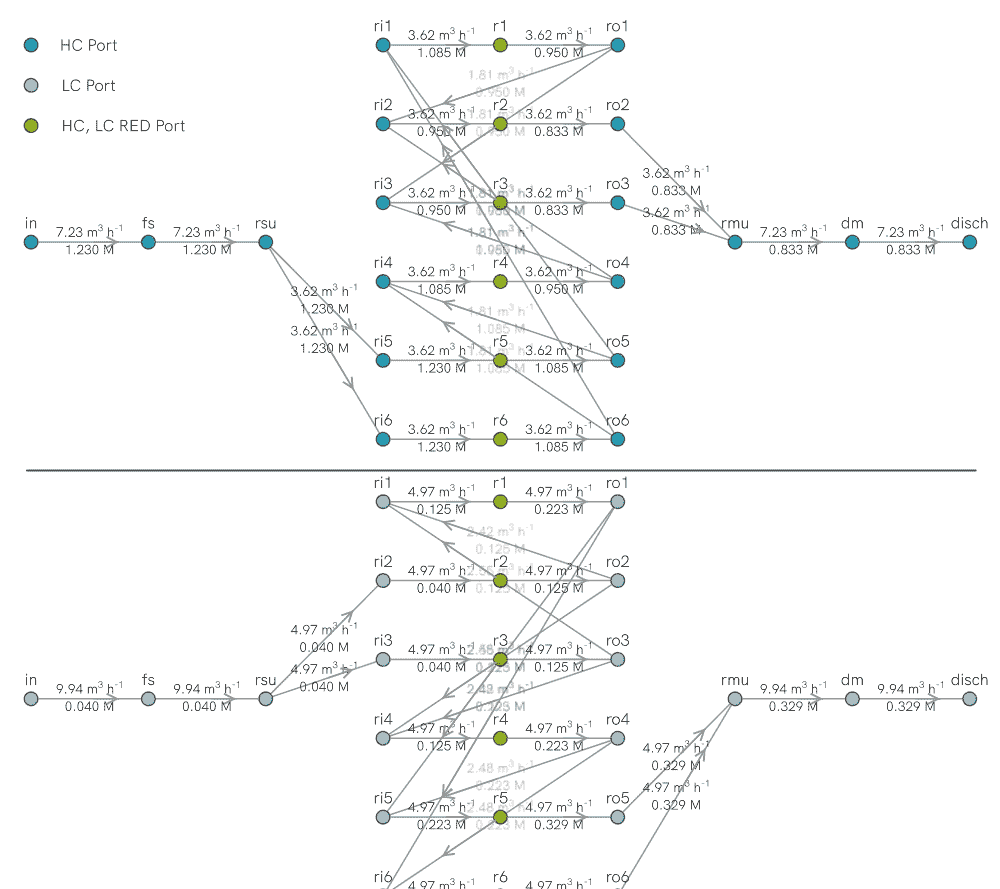

# 反电渗析过程优化的广义析偶规划模型


* 桑坦德尔大学化学与生物医学工程系，La Los 456, 39005 Santander, Spain (电子邮箱: [tristanc, fallanzana, ortiz, ibanez]@ucan.com)。

** 卡内基梅梅隆大学化学工程系，Pittsburgh, PA 15233, USA. (电子邮箱: grossmann@cmu.edu)

**摘要：** 反电解（RED）是一种新兴电化学技术，它利用离子选择膜从溶液之间的盐度差（即盐度梯度能量，SGE）产生电，具有作为清洁且稳定的再生资源来扩大水资源和能源供应的潜力。尽管 RED 已取得显著进展，但全规模的 RED 过程需要更多的经济和环境评估，以考虑从模型到系统的完整设计和运行决策空间。本工作提出了一个构建为广义析取规划（Generalized Disjunctive Programming）的优化模型，用于定义不同部署下的 RED 过程。我们使用了在研究中验证的 RED 电池堆预测模型，以充分捕捉系统行为。所解决的问题是确定 RED 电厂的拓扑结构以及每个 RED 电池堆设计的运行条件，从而为定义的问题和场景实现最优成本。我们的结果表明，通过基于模拟的方法，数学规划技术是提供可靠结果并支持真实场景中早期规模 RED 实施的有效方法。


**关键词：** 可再生能源、蓝能、过程合成、Pyomo、Gurobi、全局优化

## 1. 引言

从传统排放向需水量更低的去中心化再生能源逐步转变，将对可持续的水和能源供应具有决定性意义。反电解（RED）是一种电化学技术，利用离子选择膜从两种溶液混合时释放的化学能中发电，即盐度梯度能量（SGE），具有成为清洁且稳定的再生资源的潜力，通过水的嵌入能为该部门提供动力。

基于全球的 RED 能量回收系统应用于中大型海水淡化厂中（参考 Tristán, Marcus Fallanzana, 等人）。如果利用了所有的 SGE，RED 将占据几乎所有地点海水淡化厂能量需求的的 40%。然而，能量损耗和未经处理的盐水排放仍然是挑战。我们的结果表明，热力学与初始 RED 能量系统过程之间存在需要弥合的差距。多个变量影响 RED 过程，增加了试错评估定义最优系统设计的复杂性。我们提出了一个构建为广义析取规划（GDP）问题的优化模型，以定义不同部署下的最优 RED 过程。

以往的研究已经证明，基于废水淡化或处理后出水的发电更具经济和环境优势，需要考虑从电池堆到系统的完整设计和运行决策空间。我们的研究正在开发一个模型，为早期应用研究提供设计支持，并为现实中全规模 RED 的实施提取并设计指南。

我们开发并验证了一个 RED 电池堆的预测模型，以确定影响 RED 性能的最相关运行条件和设计参数（Ortiz-Medínez 等，2019；Tristán, Fallanzana, 等，2020）。这项研究使我们能够解决

## 2. 优化模型

### 2.1 问题陈述与超结构定义

RED 过程系统的构建可以表述如下：特定场地的运行条件（例如，高盐 HC 和低盐 LC 进料流的浓度、流量和温度）以及电池堆属性（功率、厚度），决定了 RED 电厂的拓扑结构（. ）以及 RED 单位中每个 RED 电池堆的运行条件（即 HC 和 LC 的浓度和流量、电流），在最大化净功率输出和净产量的同时，最小化定义问题和场景的 RED 过程成本。

备方案结构遵循 Pyosyn 图（PSG）（Chen, Liu, 等，2021）。图 1 所示 RED 过程包含：

RED 过程单元

(a) RED 过程单元（RPU），在其中对选择做出离散决策，(a.i) RED 单元集 r ∈ R；(a.ii) 源 r ∈ RSU 和汇 r ∈ RMU；(a.iii) 高浓度和低浓度排放单元，即 {HC, LC}。

### 2.2 广义析取规划 (GDP) 模型

我们使用 Python 中的 Pyomo 将备方案结构编码为广义析取规划（GDP）问题（Hart 等，2017）。基于图 1 的优化模型由以下集定义：

```
min obj = f(x)
s.t. g(x) ≥ 0
γ_r(x) ≤ 0 ∀ r ∈ R
(Y_r) = True
x ∈ X
```

(b) 进料集 FSU 和排放单元 DMU。(c) 入口和出口端口 p ∈ P = P_out ∪ P_in —— 混合器和分流器——材料可能放置在单元界面处。目标函数 f(x) 在不等式约束（例如来自工艺规范）和等式约束（例如来自物料平衡）的下，最小化 RED 过程的能量成本（COL）。

(d) 流路或可行对集 s ∈ S_out ∪ S_in，定义了以下约束：

(i) 来自单元进料 FSU 的进入 RED 过程单元（RPU）的浓缩和蒸馏进料，其中排放 DMU 收集失效的高低浓度排放单元，以及来自进料 FSU 的未使用流路。变量描述了所有可行流路的连续决策（例如摩尔浓度、体积流量）以及 RED 的电流。

(ii) 单元内部，辅助汇单元 RMU 来自进料 FSU 进入一个或多个活跃 RED 单元的浓缩和蒸馏流。一旦 RPU 利用进料流中的 SG，排放物可以回收或处置在汇单元 RMU。来自 RMU 的 RPU 排放物在排放单元 DMU 中处置。全局约束 g(x) ≤ 0 是等式和不等式，适用于超结构中所有配置的规范和物理关系，例如进料、源、汇和排放单元的质量平衡——入口和出口端口，变量（浓度和流量）的上下界。

(iii) RSU 和 RMU 之间不允许流动

析取（考虑逻辑异或关系，即 RED 过程单元内每个活跃 RED 单元最多有一个析取）描述了 RED 单元的存在与否。二元变量 Yr 表示是否存在（Y_r = True）。约束 g(x) ≤ 0 强制执行 RED 单元内部发生的质量和能量平衡、热力学、动力学或其他物理/化学现象。当单元不存在时，否定（¬Y_r）将其设为零


连续变量的子集，并通过 $B'x = 0$ 约束影响目标函数中的成本。

当端口在线性约束 $r_i(x) \le 0$ 内及线性约束 $B'x = 0$ 外被提取时，采用混合和分裂计算法。我们采用了建模缺失单元的方法，确保如果流体没有出口，则在出口-进口端口之间不会产生流量。

当 RED 单元激活时（$r_i = True$），边界条件规定了进入和离开 RED 单元的流体连接和流率，包括与 RED 单元的进口端口（即 $x=0$）以及来自单元的出口（即 $x=L$）。当单元不存在时（$Y_i = 0$），我们强制执行无流量和最小性约束，并将目标函数中的净功率输出和成本设为零。

其他类型的逻辑约束（$Y_i = True$）使用逻辑命题描述。

### 2.3 流量与质量平衡公式

我们考虑了总流量（体积流量；$q$，单位为 $m^3/h$）以及高、低品质流体中氯化钠的浓度函数 $C$，制定了流量和质量平衡方程。

混合器应用于排放单元、处理单元以及激活 RED 单元的进进口（即当 $Y_i = True$ 时）。由于体积流量与浓度乘积产生的双线性项，混合方程是非线性且非凸的，这为寻找全局最优带来了挑战。

分裂器应用于进料单元、源单元以及激活 RED 单元的出口（即当 $Y_i = True$ 时）。分裂方程是线性的且凸的。

### 2.4 变量边界

每个 RED 单元对流量都有限制，根据制造商规格跨越 RED 堆栈长度的最大流速。低盐度单元中速度和流量的下限由设计者选择。

物种浓度的上限可以高到进料流的最大浓度（如果存在多个备进料），而对于稀释流，其浓度可以达到浓缩液和稀释流完全混合达到热学平衡后的浓度。浓缩液和稀释流浓度下限的情况相反。

### 2.5 RED 堆栈模型建模

我们使用了研究中 RED 严谨模型的简化版本（Tristán, M. Fallanza, A., et al., 2020），以便在模型保真度和可处理性之间取得平衡。

半严谨模型是一个微分代数方程系统，定义了从单元到模块的 RED 性能。单元对是串联的重复单元，形成 RED，由阳离子和阴离子交换膜（分别为 CEM 和 AEM）组装，带有两个相邻的隔板密封室，包含浓缩水流和稀释水流。

单元对描述了单元对内部的主要传输机制、质量平衡、分布压力、能量产和电学变量；即电位和内阻。

在 RED 堆栈尺度上，模型计算了整个单元对的整体值（电位、电流、内阻、压力），这些值分布在流方向（对长度 $m$ 积分）。模型还计算了净输出和功率输出（从组功率输出中减去功耗），根据功率密度、能量产和每个堆栈的效率来定义性能。RED 模型计算堆栈的净功率输出。

关于 RED 模型的更多细节，请参考（Tristán, M. Fallanza, et al., 2020）。

由于非线性求解器无法处理后向有限差法和梯形法则来重构一阶常微分方程并将其整合代数方程，

### 2.6 假设

我们假设：

- (a) 进料流为纯氯化钠、理想水溶液（即活性度系数为 1），忽略了溶液的非理想性以及会限制 RED 性能的其他物种的存在。
- (b) 内部损失中没有由于单元内和稀释膜-溶液界面的浓度极化以及由于主流中随浓度变化的衰减所导致的非离子贡献。我们只考虑由于溶液离子电导率和膜离子电阻引起的贡献。
- (c) 不存在从低盐流到高盐流的渗透性水分传输。
- (d) 膜相中的渗透性是常数，与浓度和温度无关。
- (e) 所有单元对的行为相同，因为我们假设 RED 堆栈流道中没有流体泄漏或短路。
- (f) 高盐流的共流。
- (g) RED 系统在等温和绝热条件下运行。

### 2.7 目标函数：平准化能源成本 (LCOE)

问题的目标是最小化 LCOE (USD/kWh)，这是衡量技术的常用指标，用于估算每单位发电的平均成本。假设在工厂运行寿命期间产生的能量是恒定的，使用折扣率 $r$，从而定义总功率输出 TNP，单位为 kW。

$$LCOE = \frac{CAPEX + OPEX}{r}$$
$$CRF = \frac{r}{(1 + r)^{-LT}}$$
$$TNP = \frac{NP}{YEARU}$$

为了估计投资，我们确定了 RED 单元、泵和土木基础设施的成本。

$$CAPEX = CAPEX_{stack} + CAPEX_{pump} + CAPEX_{civil}$$
$$OPEX = OPEX_{pump} + OPEX_{rem} + 0.2 \times CAPEX$$

需要时，所有成本根据相应的年份汇率转换为 USD_{2010}

2.8 求解策略

对于非凸 GDP 的求解，我们使用基于 Pyomo 的逻辑求解器 Gdp，它是基于 Pyomo 代数语言开发的 GDP 模型生态系统（Chen, Johnson, et al., 2021）。

我们应用基于逻辑的外逼近法（Lee and Grossmann, 2021）来求解 GDP 问题。该策略将 GDP 分解为简化的 NLP 子问题和主 MILP，以避免单元或流体消失时的非线性设计问题。

GAMS/COMPLEX MILP 求解器和 GAMS/MSNLP(IPOPT) NLP 求解器通过 Pyomo-GAMS 接口使用。

## 3. 案例研究：海水化能量回收

我们考虑了全球海水渗透（SWRO）海水化厂的改造，配备基于 RED 的回收系统。RED 单元从与不同低盐源混合的浓缩液中回收电能（例如，废水、海水）。高、低进料流的浓度、温度和体积流量数据来自（Tristán, M. Fallanza, et al., 2020）。

该研究限制在一个并行分支上设置流率，并将 RED 单元的出口流输入到泵，使其等于第一个 RED 单元的运行工况：

并行分支之间的连接使得表面积成为离散函数。

考虑并行分支的上限是 RED 系统完全处理海水化浓缩液，确保低盐进料流不短缺。RED 系统的净功率输出随并行分支的数量而扩大。

该方法指的是一个具有工业级堆栈指定单元对的化学 RED 单元。RED 堆栈的工艺和规格可以在 Tristan, Marcos Fallanza, et al., 2020 中找到。

## 4. 结果与讨论

优化模型为所有场景提供了优化的 RED 流程图设计，提高了串并布局的竞争力。作为一个说明性示例，我们展示了巴塞罗那-L 海化厂 RED 改造的优化结果（Sanz y Miguel, 2013; Tristan, Marcos Fallanza, et al., 2020）。


固定配置的 RED 过程具有 8749 个约束（其中 187 个是非线性约束）。

在运行 Windows 10 (x64) 并配备 6 核处理器（®Core™ i7-8700 CPU @3.2 GHz）和 16 GB 内存机器上，求解这两项（见表 3）的 CPU 时间分别为 471 s 和 581 s。



图 2 RED 过程最优流程设计中并行分支的端口连接。案例研究：Nr=15；堆栈工作条件（HC/LC）：1.23/0.04 M, 7.24/9.94 m³/h, 19 °C（GDP 决策）：EMS 价格 = $1.12。

表 1 RED 系统中 RED 单元固定与灵活安排下并行分支的优化结果，以及当前和乐观成员价格。

| 布局 | EMS ($/m²) | #-RED 单元 | TNP (kW) | LCOE ($/MWh) | CAPEX (kS) | OPEX (k/year) |
|---|---|---|---|---|---|---|
| 串联（固定） | 98 | 5 | 2.99 | 162 | 21.32 | 1.73 |
| GDP（决策） | 1.12 | 1 | 0.35 | 369 | 27.77 | 2.09 |
| | 98 | 1 | 0.45 | 369 | 27.77 | 2.09 |

案例研究：Nr=15；堆栈工作条件（HC/LC）：1.23/0.04 M, 7.24/9.94 m³/h, 19 °C


GDP 选项模型反映了一种流程设计（图 2），该设计使 LCOE 降低了 9% 并增加了 RED 系统的净输出。如果膜成本降低两个数量级，当地电网可能会减少淡水化厂约 16% 的比能耗。

Chen, Q., 等人 (2018) "Pomo.GDP: Disjunctive Optimization", in Computer Aided Engineering. Elsevier, vol. 89, pp. 889–904, doi: 10.1016/B/978-0-444-64241-5.10143-9.

Chen, Q., Johnson, E. S., 等人 (2021) "Pyno GDP optimization for ecosystem-based modeling and development option", in Optimization, pp. 1–36; doi: 10.1007/s10081-021-09601-7.

# 5. 结论

在在这项工作中，我们提出了一种 GDP 优化模型，用于对盐梯度能发电的 RED 进行合成和优化。目标是定义水力拓扑结构，即候选 RED 单元的水力及工作条件和堆栈，以最小化 LCOE，并作为衡量给定场景下工艺竞争能力的方法。基于模拟的概念设计可以处理复杂系统并可能导致次优解决方案。因此，为了说明数学工程技术如何比传统的试错程序增强 RED 回收，我们评估了以下情况：(i) RED 单元的固定堆栈配置，无论包含或不包含阶段回收后处理后水的重复利用替代方案，以及 (ii) 可行的重复利用和循环方案。与我们之前的研究相比，该方法提供了一个稳健的框架，提高了该系统在所有场景下的成本竞争力。

Chen, Q., Liu, Y., 等人 (2021) "Pynos: a new framework for conceptual design and optimization", Computers & Chemical Engineering, p. 107414; doi: 10.1016/j.chem.2021.107414.

Gómez-Cara, L., 等人 (2020) "Blue energy for sustainable water reclamation in WPS", Journal of Process Engineering, 33, p. 101020; doi: 10.1016/j.jpe.2019.101020.

Hart, W. E., 等人 (2017) "Optimization Modeling in Python. Second Ed. Cham: Springer International Publishing (Springer Integration and its Applications), doi: 10.1007/978-3-319-58821-6.

Lee, S. Y., Ibrahim, I. (2001) "A global optimization approach for nonconvex design", Computers and Chemical Engineering, 25(11-12), pp. 1675–1683; doi: 10.1011-X.

未来的工作将解决计算效率和模型稳健性问题。该工作还将通过更多离散决策变量扩展超结构（例如电池对数量和隔板设计）以及 RED 系统（例如增加 DC-AC 逆变器作为预处理），通过多目标优化引入环境约束。

Ortiz-Medínez, R. (2019) "Comparative performance of Salinity Gradient-Reverse Electrolysis under different operating conditions", Desalination, 457, pp. 8–21; doi: 10.1016/j.desal.2019.01.005.

Ortiz-Martinez, V. M., 等人 (2020) "A comprehensive study on the effects of operation variables on reverse electrodialysis", Desalination, 482, p. 114389; doi: 10.1016/j.desal.2020.114389.

# 感谢

LIFE ENV/000143 项目由欧盟 LIFE 计划资助。PDC2021-12786-100 由 MCIN/AEI/10.1039/501100133 资助，来自 ESF “欧盟复一代/PRTR”。

San, M. A. Miguel, 等人 (2020) "The Role of SW Barcelona-Litoral in the water supply system of Barcelona Area", Desalination and Water Treatment, 51(1-3), pp. 111–123; doi: 10.1080/19443994.2019.669520.

Tristan, C., Fallanza, M., (2020) "Recovery of salinity gradient in desalination plants by reverse electrodialysis", Desalination, 459, pp. 114699; doi: 10.1016/j.desal.2020.114699.

