# 广义网络设计问题：建模与优化（De Gruyter 离散数学与应用丛书 第1卷）


## 前言

组合优化是一个引人入胜的课题。组合优化问题出现在交通、电信、计算机网络、选址、规划、分销问题等众多重要领域。在过去几十年中，理论、算法和应用方面取得了重要且显著的成果。

在组合优化中，许多网络设计问题可以通过考虑聚类图上的相关问题，以自然的方式进行推广，其中原问题的可行性约束以簇（即节点集合而非单个节点）的形式表达。这类问题通常被称为广义网络设计问题（GNDPs）或广义组合优化问题。

本书的明确目的是以统一的方式，描述一系列源自广义网络设计问题、在近年来发展起来的数学模型、方法、命题和算法。本书共七章。除引言章外，以下广义网络设计问题被制定和考察：

- 广义最小生成树问题；
- 广义旅行商问题；
- 铁路旅行商问题；
- 广义车辆路径问题；
- 广义固定费用网络设计问题；
- 广义最小顶点双连通网络问题。

虽然这些主题将在广义组合优化问题的框架内描述，但我的意图是使每章相对独立，以便每章都可以单独阅读。

本书将对运筹学、优化、应用数学和计算机科学领域的研究人员、从业人员和研究生有所帮助。由于所介绍的一些问题具有重要的实际意义，其他领域的研究人员也会发现本书有用。

我谨向 Georg Still、Gunther Raidl、Walter Kern、Andrei Horbat Marc 以及许多其他同事（包括此处引用文章的合著者）表示感谢。

最后，我特别感谢我的妻子 Corina 和我们的女儿 Ana Maria，在撰写本专著期间给予的支持。

2011 年 9 月，巴亚马雷

Petričă C. Pop


## 第 1 章

### 引言

### 1.1 组合优化与整数规划

组合优化是应用数学的一个活跃领域，它结合了组合数学、线性规划和计算理论的技术，用于求解离散结构上的优化问题。组合优化的主要挑战之一是开发高效算法，其相应的运行时间由与其表示大小相同的多项式界定。

组合优化的研究部分得益于现代数字计算机的出现。目前大多数被接受的求解组合优化问题的方法，30 年前几乎不会被认真对待，原因很简单：没有人能够执行所涉及的计算。此外，数字计算机的存在也导致了大量具有组合特征的技术问题。在过去几十年中，我们求解大型重要组合优化问题的能力有了显著提高。可靠软件、极快且廉价的硬件，以及使复杂问题建模速度大大加快的高级语言的可用性，导致对优化工具的需求大幅增加。

组合优化模型的多功能性源于这样一个事实：在许多实际问题中，机器、飞机和人员等活动和资源是不可分割的。此外，许多问题（例如调度）具有定义有限数量可选方案的规则，因此可以使用将逻辑替代描述转换为线性约束描述的程序来适当地制定，其中某些变量子集被要求取特定值。

组合优化模型通常被称为整数规划模型，其中一些或所有变量被要求取离散值。在大多数情况下，这些值是整数，从而得名于这一类模型。在本书中，我们考虑目标函数和约束均为线性且变量为整数的组合优化问题。这些问题称为整数规划问题：

```
min c^T x
(IP) s.t. Ax <= b,
    x \in Z^n_+ ,
```

其中 $\mathbb{Z}^n$ 是积分 $n$ 维向量的集合，$x = (x_1, \dots, x_n)$ 是整数 $n$ 维向量，$c$ 是 $n$ 维向量。此外，我们令 $m$ 表示不等式约束的数量，$A$ 为 $m \times n$ 矩阵，$b$ 为 $m$ 维向量。如果允许某些变量 $x_i$ 为实数而非整数，即 $x_i \in \mathbb{R}$ 而非 $x_i \in \mathbb{Z}$，则得到一个 *混合整数规划问题*，记为 (MIP)。为方便起见，我们讨论的是具有 *二元* 变量的 *最小化* 整数线性规划问题，即整数变量被限制为 0 或 1 的值。

求解整数规划问题可能是一项艰巨的任务。困难源于这样一个事实：与线性规划不同，线性规划的可行域是凸集，而在整数问题中，必须搜索可行点的格点，或者在混合整数情况下，搜索一组不相交的半直线或线段，以找到最优解。因此，与线性规划不同，由于问题的凸性，我们可以利用任何局部解都是全局最优解这一事实，而整数规划问题可能有许多“局部最优解”，找到问题的全局最优解需要证明某个特定解支配所有可行点，其论证方式不同于凸规划中基于微积分的导数方法。

在优化组合问题时，计算工作量（即算法的运行时间）与所得解的质量之间始终存在权衡。我们可以尝试使用 *精确算法* 求解优化问题，或者选择 *近似算法* 或 *启发式算法*，后者使用更少的运行时间，但不保证解的最优性。

因此，求解整数规划问题的算法主要有三类：

- **精确算法**，保证能找到最优解，但可能需要指数级的迭代次数。在实践中，由于高复杂度导致运行时间长，它们通常仅适用于小规模实例。它们包括：分支定界法、分支切割法、切割平面法和动态规划算法。

- **近似算法**在多项式时间内提供次优解，并附带关于次优程度的界限约束。

- **启发式算法**提供次优解，但不对其质量做出任何保证。尽管运行时间不保证是多项式的，但经验证据表明，其中一些算法能够快速找到良好解。这些算法特别适用于优化问题的大规模实例。

正如我们所见，存在处理整数规划的通用技术，但通常更好的做法是利用特定整数规划问题的结构，并开发专门方法来利用这种特定结构。

由于整数规划是 NP-hard 的，原则上，每个 NP 问题都可以表述为整数线性规划。事实上，此类问题通常允许不同的整数规划表述。找到一个特别合适的表述，往往是求解组合优化问题的关键步骤。

因此，熟悉各种不同类别的整数规划表述非常重要。由于同一个问题通常有不同的数学表示方法，而且在合理的计算时间内求解大型整数规划问题的最优解，很大程度上可能取决于其表述方式，因此大量近期研究致力于组合优化问题的重新表述。在这方面，有时增加（而非减少）整数变量的数量、约束的数量或两者都是有利的。

当我们讨论“良好”表述的概念时，通常是指创建一个更容易求解的问题，该问题能对原问题的目标函数值提供良好的近似。由于决策变量上的整数性限制破坏了可行域的凸性，最广泛使用的近似方法是移除这一限制。这种近似称为线性规划（LP）松弛。然而，仅仅移除这些整数性限制就可能显著改变问题结构，以至于最优 LP 解通常与最优整数解相去甚远。

### 1.2 复杂性理论

研究组合问题的第一步是找出该问题是“易”还是“难”。这种分类是复杂性理论的任务。在本节中，我们总结了复杂性理论中最重要的概念。大部分方法来源于 Grötschel, Lovász 和 Schrijver 的著作 [60]。

算法是一组指令，用于在有限步数内求解问题的每个实例。（这也意味着算法能够检测问题的某个特定实例是否无解。）

问题的大小是表示实例所需的信息量。假设实例由一串符号描述（编码）。因此，实例的大小等于字符串中的符号数量。

组合优化算法的运行时间通过对任何有效输入所需的基本算术运算（加法、减法、乘法、除法和比较）次数的上界来衡量，并表示为输入大小的函数。输入是用于表示问题实例的数据。如果输入大小用 s 衡量，则算法的运行时间表示为 O(f(s))，前提是存在常数 b 和 s0，使得对于任何 s >= s0 的实例，步骤数从上方由 bf(s) 界定。我们说这种算法的运行时间是 f(s) 阶。


当一个算法的运行时间被多项式函数 f(s) 所界定时，该算法被称为 *多项式时间算法*。当一个算法的运行时间被指数函数（例如，O(2^(s))）所界定时，该算法被称为 *指数时间算法*。

复杂性理论首先关注决策问题。一个 *决策问题* 是只能用 "yes" 或 "no" 回答的问题。例如，在整数规划问题（IP）的情况下，决策问题为：

> 给定 (IP) 的一个实例和一个整数 L，是否存在可行解 x，使得 c^T x <= L？

对于组合优化问题，有以下结论：如果可以高效地解决决策问题，那么也可以高效地解决相应的优化问题。

可在多项式时间内求解的决策问题被认为是 "易" 的，这类问题的类用 P 表示。P 包括，例如，线性规划和最小生成树问题。

可在指数时间内求解的决策问题类用 EXP 表示。大多数组合优化问题属于此类。如果一个问题在 EXP \ P 中，求解该问题的大规模实例将会很困难。为了区分 "易" 问题和 "难" 问题，我们首先描述一个包含 P 的类。

复杂性类 NP 被定义为由所谓的非确定性算法可求解的决策问题的类。如果对于任何导致肯定答案的输入，都存在一个证书，从中可以在多项式时间内推导出该答案的正确性，则称该决策问题在 NP 中。

显然，P subseteq NP 成立。普遍认为 P = NP 的可能性非常小。类 NP 包含一个被认为是 NP 中最难问题的子类。这些问题被称为 NP-完全问题。在给出 NP-完全决策问题的定义之前，我们先解释将一个问题多项式地转换为另一个问题的技术。设 Pi_1 和 Pi_2 为两个决策问题。

**定义 1.1.** 一个 *多项式变换* 是一种算法 A，它对 Pi_1 的每个实例 sigma_1，在多项式时间内生成 Pi_2 的一个实例 sigma_2，使得以下结论成立：对于 Pi_1 的每个实例 sigma_1，sigma_1 的答案为 "yes" 当且仅当 Pi_2 的 sigma_2 的答案为 "yes"。

**定义 1.2.** 如果决策问题 Pi 在 NP 中，且每个其他 NP 决策问题都可以多项式地转换为 Pi，则称决策问题 Pi 为 NP-*完全*。

显然，如果一个 NP-*完全* 问题可以在多项式时间内求解，那么 NP 中的所有问题都可以在多项式时间内求解，因此 P = NP。这解释了为什么 NP-完全问题被认为是 NP 中最难的问题。

注意，多项式可变换性是一种传递关系，即，如果 \(\Pi_1\) 可多项式地变换为 \(\Pi_2\) 且 \(\Pi_2\) 可多项式地变换为 \(\Pi_1\)，则 \(\Pi_1\) 可多项式地变换为 \(\Pi_3\)。因此，如果我们想要证明一个决策问题 \(\Pi\) 是 \(\mathcal{NP}\)-完全的，我们只需证明：

- (i) \(\Pi\) 在 \(\mathcal{NP}\) 中。
- (ii) 一个已知为 \(\mathcal{NP}\)-完全的决策问题可以多项式地变换为 \(\Pi\)。

我们现在希望专注于组合优化问题。因此，我们扩展了多项式可变换性的概念。设 \(\Pi_1\) 和 \(\Pi_2\) 为两个问题（不一定是决策问题）。

**定义 1.3.** 从 \(\Pi_1\) 到 \(\Pi_2\) 的 **多项式归约** 是一种算法 \(\mathcal{A}_1\)，它通过使用针对 \(\Pi_2\) 的算法 \(\mathcal{A}_2\) 作为子程序来求解 \(\Pi_1\)，使得如果 \(\mathcal{A}_2\) 是 \(\Pi_2\) 的多项式时间算法，那么 \(\mathcal{A}_1\) 就是 \(\Pi_1\) 的多项式时间算法。

**定义 1.4.** 如果存在一个 \(\mathcal{NP}\)-**完全** 的决策问题可以多约化到 \(\Pi\)，则优化问题 \(\Pi\) 称为 \(\mathcal{NP}\)-**难**。

显然，如果相应的决策问题是 \(\mathcal{NP}\)-**完全** 的，则优化问题是 \(\mathcal{NP}\)-**难** 的。

### 1.3 启发式与松弛方法

正如我们所见，一旦确定一个组合问题是 \(\mathcal{NP}\)-**难** 的，那么它不太可能由多项式算法求解。过去曾提出过不同的方法来解决这类问题。原则上，它们可以分为精确算法、近似算法、松弛方法或启发式方法。

在尝试为组合优化中的难最小化问题寻找良好解时，必须考虑两个问题：

- 计算尽可能接近最优解的上界；
- 计算尽可能接近最优解的下界。

计算机科学的一个基本目标是找到既具有可证明的良好运行时间，又具有可证明的良好或最优解质量的算法。

启发式是一种放弃某一方面的算法，例如，它通常能找到相当好的解，但没有证明解不会变得任意差。另一方面，该算法可能运行得相当快，但没有论证表明这总是如此。通常，在给定约束（时间、空间等）下没有已知方法可以找到最优解，或者根本无法找到最优解时，会使用启发式。

已为解决组合优化问题提出了几类启发式算法，可分为两大类：经典启发式和元启发式。第一类包含大多数标准构造和改进过程。此外，对于任何特定问题，我们可能拥有针对所求解问题的特定技术。

“元启发式”一词最早由 Glover [51] 提出，指的是可用于定义启发式方法的一系列高层策略或概念，这些方法可应用于一组广泛的不同优化问题。换句话说，元启发式可被视为一种通用算法框架，可通过相对较少的修改应用于不同的优化问题，以使其适应特定问题。元启发式的示例包括模拟退火（SA）、禁忌搜索（TS）、迭代局部搜索（ILS）、遗传算法（EC）、变邻域搜索（VNS）、蚁群优化（ACO）、模因算法（MA）、遗传编程（GP）等。我们还指出，几种领先方法是混合方法，它们结合了不同的求解技术 [174]。近年来对它们进行了一些研究，所得出版物记录了混合算法在各种应用领域中的成功。然而，仍需大量工作，以找到元启发式与其他优化技术的熟练组合，从而实现更高效的行为和更高的灵活性。

在整本书中，将特别关注选定 GNDP 的混合算法，这些算法将基于整数线性规划的精确方法与基于局部搜索的元启发式相结合。两种技术各有其特定的优缺点，在很大程度上可以被视为互补。分析之后，将它们结合起来以获得更有效的算法似乎是自然而然的事。

关于下界问题，最著名的技术有：

- **线性规划（LP）松弛。**
  在 LP 松弛中，我们采用问题的整数（或混合整数）规划公式，并放松变量上的整数性要求。这得到一个线性规划，可以使用标准算法（单纯形法或内点法）精确求解，也可以使用启发式（对偶上升）求解。该线性规划得到的解值为原最小化问题最优解提供一个下界。

- **拉格朗日松弛。**
  拉格朗日松弛的一般思想是通过使用拉格朗日乘数将一些（或全部）约束“松弛”（对偶化）并加入目标函数。在实践中，拉格朗日松弛问题比原问题更容易求解。最大化拉格朗日函数的问题


拉格朗日对偶变量（拉格朗日乘数）称为拉格朗日对偶问题。为拉格朗日乘数选择“良好”的值对于生成的下界的质量至关重要。有关此技术的更多详细信息，请参阅 [110]。

- 半定规划。（SDP）松弛。组合优化问题通常涉及二进制（0、1 或 +1、-1）决策变量，这些变量可以分别使用二次约束 x^2 - x = 0 和 x^2 = 1 进行建模。使用正半定矩阵 X = xx^T，我们可以将问题提升到更高维的矩阵空间，并通过忽略 X 上的秩一限制来获得半定规划松弛问题，参见 [115]。这些半定松弛为许多类难题提供了紧的边界。此外，它们可以通过内点法高效求解。

### 1.4 广义网络设计问题

在组合优化中，许多网络设计问题可以通过考虑聚类图上的相关问题来自然地推广，其中原始问题的可行性约束以簇（即节点集）而非单个节点来表达。这类问题通常称为广义网络设计问题（GNDPs）或广义组合优化问题。

在文献中，已经考虑了多种 GNDPs，例如广义最小生成树问题、广义旅行商问题、广义车辆路由问题、广义（子集）指派问题、广义固定费用网络设计问题等。所有此类问题都属于 NP 完全问题类，在实践中通常比其原始问题更难求解。如今，由于其有趣的特性以及在电信、网络设计、资源分配、运输问题等方面的重要实际应用，它们受到广泛研究。尽管如此，许多从业者仍不愿将其用于建模和求解实际问题，因为寻找最优或近似最优解的复杂性。

在本书中描述的所有广义网络设计问题中，给定一个 n 节点无向加权图 G = (V, E)，其中 V 为节点集，E 为边集。节点被划分为给定数量的节点集，称为簇（即，$V = V_1 \cup V_2 \cup \dots \cup V_m$ 且对于所有 $i, j \in \{1, \dots, m\}$ 与 $i \neq j$ 有 $V_i \cap V_j = \emptyset$），并且对于每条边 $e \in E$，我们关联一个非负成本 $c_e$。设 $e = (i, j)$ 为一条边，其中 $i \in V_j$ 且 $j \in V_k$。如果 $i \neq k$，则 $e$ 称为簇间边；否则，$e$ 称为簇内边。

求解这些问题的目标是找到 $G$ 的一个子图 $F = (S, T)$，其中节点子集 $S = \{v_1, \dots, v_m\} \subseteq V$ 从每个簇中恰好包含一个节点，边子集 $T \subseteq E$ 需要满足不同的要求，具体取决于实际优化问题。子图 $S$ 的成本由其总边成本给出，$c(S) = \sum_{e \in T} c_e$，目标是找到成本最小的解。

另一类 GNDP 旨在找到一个包含每个簇中至少一个节点的子图 $F$。有关更多详细信息，请参阅 [39]。在本书中，除了铁路旅行商问题外，我们将自己限制在从每个簇中选择恰好一个节点的 GNDP 上，具体要求取决于实际优化问题。

在本书中，我们将基于最近的发展以及研究人员日益关注，研究以下广义网络设计问题：

- 广义最小生成树问题（GMSTP）；
- 广义旅行商问题（GTSP）；
- 广义车辆路由问题（GVRP）；
- 铁路旅行商问题（RTSP）；
- 广义固定费用网络设计问题（GFCNDP）；
- 广义最小边双连通网络问题（GMEBCNP）。

除了其他一些 GNDP 之外，广义最小完美匹配问题 [39]、广义最短路径问题 [111]、广义最小团问题 [99]、广义 Steiner 树问题 [176]、广义中国邮递员问题 [29] 等已在文献中得到考虑。

Dror 等人 [29] 还在更广泛的框架内重新表述并制定了一些其他经典组合优化问题，例如广义（子集）指派问题、广义机器调度问题、广义背包和装箱问题等。Demange 等人 [21] 引入了经典图着色问题的一种推广，称为选择性图着色问题。

## 第 2 章

### 广义最小生成树问题（GMSTP）

最小生成树（MST）问题在组合优化领域有着悠久的历史。该问题最早由 Boruvka 于 1926 年提出，据说他在南摩拉维亚农村电气化过程中了解到该问题，并为寻找电力线网络最经济布局提供了解决方案。MST 问题的重要性和流行程度源于几个事实：它允许高效求解，这使得该问题在大型图上实际可求解。Kruskal [100]、Prim [171]、Dijkstra [25] 和 Sollin [189] 开发了一些求解 MST 问题的多项式时间算法，并已应用于许多组合优化问题，如运输问题、电信网络设计、分配系统等。

然而，在过去十年中，许多研究人员最感兴趣的是 MST 问题的扩展，例如 Narula 和 Ho [130] 的度约束最小生成树问题（dc-MST）、Bertsimas [11] 的概率最小生成树问题（p-MST）、Ishii 等人 [89] 的随机最小生成树问题（s-MST）、Xu [204] 的二次最小生成树问题（q-MST）、Maculan [117] 的最小 Steiner 树（MStT）问题，以及 Myung、Lee 和 Tcha [128] 的广义最小生成树问题（GMSTP）等。MST 问题的扩展通常是 NP-hard 问题，因此不存在多项式时间解。

在本节中，我们关注最小生成树问题（MST）的广义版本，即广义最小生成树问题（GMSTP）。给定一个无向图，其节点被划分为若干子集（簇），GMSTP 的目标是找到一棵最小成本树，覆盖一个节点子集，该子集从每个簇中恰好包含一个节点。因此，MST 问题是 GMSTP 的一个特例，其中每个簇恰好包含一个节点。

GMSTP 由 Myung 等人 [128] 提出，并在城域网 [47] 和区域网 [173] 的设计、区域服务中心选址 [142]、能源运输 [135]、农业灌溉 [30] 等方面具有多种实际应用。

文献中考虑了广义最小生成树问题的两个变体：在第一个变体中，除了边附带的成本外，节点也附带成本。这称为奖金收集广义最小生成树问题，参见 [54, 151]。第二个变体是寻找一棵最小成本树，覆盖每个簇中至少一个节点，记为 L-GMSTP，由 Dror 等人 [30] 提出。同一作者已证明 L-GMSTP 是 NP-hard 的。Pop 等人 [149] 提出了 L-GMSTP 的整数规划公式。

### 2.1 GMSTP 的定义与复杂性

广义最小生成树问题（GMSTP）要求找到一棵最小成本树 T，覆盖一个节点子集，该子集从每个簇 $V_i$（$i \in \{1, \dots, m\}$）中恰好包含一个节点。我们将此类树称为广义生成树。在下一幅图中，我们展示了一个广义生成树示例。

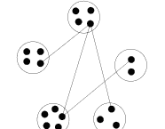

图 2.1. 广义生成树示例。

Myung 等人 [128] 通过将顶点覆盖问题归约，证明了 GMSTP 是 NP-hard 问题。

Garey 和 Johnson [45] 已表明，对于某些组合优化问题，树的简单结构可以为高效求解提供算法优势。确实，许多在一般图上表述为 NP 完全的问题，当图为树时变为可多项式求解。不幸的是，GMSTP 不是这种情况。我们将证明一个关于问题复杂性的更强结果，即即使在树上定义的 GMSTP 也是 NP-hard 的。

为了证明树上的 GMSTP 是 NP-hard 的，我们引入了所谓的集合覆盖问题，该问题已知是 NP 完全的（参见 [45]）。

给定一个有限集 $X = \{x_1, \dots, x_a\}$，一个子集集合 $S_1, \dots, S_b \subseteq X$ 和一个整数 $k < |X|$，集合覆盖问题在于确定是否存在一个子集 $Y \subseteq X$，使得 $|Y| \le k$ 且

$S_c \cap Y \neq \emptyset, \quad \forall c \text{ with } 1 \le c \le b.$

我们称这样的集合 Y 为 X 的一个集合覆盖。


### 定理 2.1 (Pop [142]). 树上的广义最小生成树问题是 $\mathcal{NP}$-难的。

证明。为了证明树上的 GMSTP 是 $\mathcal{NP}$-难的，只需证明存在一个可以多项式归约到 GMSTP 的 $\mathcal{NP}$-完全问题。

我们考虑给定有限集 $X = \{x_1, ..., x_a\}$、$X$ 的子集集合 $S_1, ..., S_b \subseteq X$ 以及整数 $k < |X|$ 的集合覆盖问题。

我们表明可以构造一个具有树结构的图 $G = (V, E)$，使得存在集合覆盖 $Y \subseteq X, |Y| \le k$ 当且仅当 $G$ 中存在代价不超过 $k$ 的广义生成树。

构造的图 $G$ 包含以下 $m = a+b+1$ 个簇 $V_1, ..., V_m$：

- $V_1$ 由单个节点 $r$ 组成
- $V_2, ..., V_{a+1}$ 节点集（对应于 $x_1, x_2, ..., x_a \in X$），每个集包含两个节点：一个“昂贵”节点（见边的构造，记为 $\overline{x_t}$），和一个“非昂贵”节点，记为 $\hat{x}_t$，其中 $t = 2, ..., a$，以及
- $b$ 个节点集，$V_{a+2}, ..., V_m$，其中 $V_v = S_{v-(a+1)}$，对于 $v = a+2, ..., m$。

图 $G$ 中的边构造如下：

- (i) 对于所有 $t = 2, ..., a+1$，$V_t$ 中的每个“昂贵节点”（记为 $\overline{x_t}$）通过代价为 1 的边与 $r$ 相连，且对于所有 $t = 2, ..., a+1$，$V_t$ 中的每个“非昂贵节点”（记为 $\hat{x}_t$）通过代价为 0 的边与 $r$ 相连。
- (ii) 对于任意 $t \in \{a+2, ..., m\}$，任选节点 $j \in V_t$。由于 $V_t \subset X$，则 $j$ 与 $X$ 中的某个节点重合，记为 $j = x_t$。我们在 $j$ 与（昂贵节点）$\overline{x_l} \in V_t$ 之间构造一条边，其中 $l \in \{2, ..., a\}$。以这种方式构造的边的代价为 0。

按设计，图 $G = (V, E)$ 具有树结构。

现在假设 $G$ 中存在代价不超过 $k$ 的广义生成树，则通过选取

$Y := \{x_t \in X | \text{与 } x_t \text{ 对应的昂贵顶点 } \overline{x_t} \in V_{t+1} \text{ 是 } G \text{ 中广义生成树的顶点}\}$

我们可以看出 $Y$ 是 $X$ 的一个集合覆盖。

另一方面，如果存在集合覆盖 $Y \subseteq X, |Y| \le k$，则根据 $G$ 的构造，$G$ 中存在代价不超过 $k$ 的广义生成树。

### 2.2 GMSTP 的精确算法

令 G' 为由 G 通过将每个簇 V_i 的所有节点替换为表示 V_i 的超级节点而得到的图。我们将图 G' 称为全局图。为方便起见，我们将 V_i 与表示它的超级节点识别。图 G' 的边定义在图顶点 V_1, ..., V_m 的每对之间。

GMSTP 的局部-全局方法旨在区分全局连接（簇之间的连接）和局部连接（不同簇节点之间的连接）。正如我们将看到的，拥有簇的全局树连接使得寻找最小代价广义生成树变得相当容易。

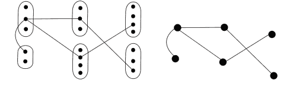

图 2.2. 显示与全局生成树对应的广义生成树的示例。

每个全局生成树对应多个广义生成树。在这些广义生成树中，存在一个称为最佳广义生成树（关于代价最小化）的树，它可以通过动态规划或求解线性整数规划来确定。

接下来，基于局部-全局方法并利用动态规划，我们将提出一个精确的指数时间算法。

给定全局图 G' 的一棵生成树（我们将其称为全局生成树），我们使用动态规划来找到相应的最佳（关于代价最小化）广义生成树。

将任意簇 V_root 固定为全局生成树的根，并根据全局生成树将所有边定向为远离 V_root 顶点的方向。G' 中的有向边 (V_k, V_l) 源自全局生成树边的定向，为边 (i, j) ∈ E 的定向 (i, j) 提供了自然定义，其中 i ∈ V_k 且 j ∈ V_l。设 v 为某个 1 ≤ k ≤ m 的簇 V_k 的顶点。所有此类节点 v 都是全局生成树边端点的潜在候选者。

在图 G 上，我们用 T(v) 表示根于该顶点 v 的子树。T(v) 包含从 v 可达的所有顶点，基于全局生成树边定向所诱导的 G 边的上述定向。v ∈ V_k 的子节点，记为 C(v)，是定向中有向边 \(\{u, v\}\) 的头顶点 u ∈ V_l。树的叶子是没有子节点的顶点。

令 \(W(T(v))\) 表示根于 \(v\) 的广义子树的最小权重。我们希望计算

```
\(\min_{r \in V_{root}} W(T(r)).\)
```

我们现在准备好介绍求解子问题 \(W(T(v))\) 的动态规划递推关系。初始化为：

```
\(W(T(v)) = 0. \quad \text{if } v \in V_k \text{ and } V_k \text{ is a leaf of the global spanning tree.}\)
```

要计算簇内部顶点 \(v \in V\) 的 \(W(T(v))\)，即找到子问题 \(W(T(v))\) 的最优解，我们需要查看所有来自满足 \(C(v) \cap V_l \neq \emptyset\) 的簇 \(V_l\) 的顶点。如果 \(u\) 表示内部顶点 \(v\) 的一个子节点，则 \(v\) 的递推关系如下：

```
\(W(T(v)) = \sum_{l, C(v) \cap V_l \neq \emptyset} \min_{u \in V_l} [c(v, u) + W(T(u))].\)
```

因此，对于固定的 \(v\)，我们最多需要检查 \(n\) 个顶点。因此，对于给定的全局生成树，该动态规划算法的总复杂度为 \(O(n^2)\)。由于根据凯莱公式，所有不同全局生成树的数量为 \(m^{m-2}\)，我们得出以下结论：

### 定理 2.2. 存在一个动态规划算法，可在 \(O(m^{m-2}n^2)\) 时间内为 GMSTP 提供精确解，其中 \(n\) 是输入图中的节点数，\(m\) 是簇数。

显然，上述算法是指数时间算法，除非簇数 \(m\) 是固定的。

类似的动态规划算法可以为奖金收集广义最小生成树问题提供精确解，区别在于求解节点 \(v \in G\) 的子问题 \(W(T(v))\) 的动态规划递推关系应视为如下：

```
\(W(T(v)) = \sum_{l, C(v) \cap V_l \neq \emptyset} \min_{u \in V_l} [c(v, u) + d(u) + W(T(u))].\)
```

其中 \(d(u)\) 表示与节点 \(u\) 相关的代价。

### 2.3 GMSTP 的数学模型

为了将 GMSTP 表述为整数规划，我们引入以下二元变量：

```
x_e = x_{ij} = \begin{cases} 1 & \text{if the edge } e = \{i, j\} \in E \text{ is included in the selected subgraph} \\ 0 & \text{otherwise} \end{cases},
z_i = \begin{cases} 1 & \text{if the node } i \in V \text{ is included in the selected subgraph} \\ 0 & \text{otherwise} \end{cases},
w_{ij} = \begin{cases} 1 & \text{if the arc } (i, j) \in A \text{ is included in the selected subgraph} \\ 0 & \text{otherwise} \end{cases}.
```

我们使用向量记号 \(x = (x_{ij})\)、\(z = (z_i)\)、\(w = (w_{ij})\) 以及记号 \(x(E') = \sum_{(i,j) \in E'} x_{ij}\)，对于 \(E' \subseteq E\)，\(z(V') = \sum_{i \in V'} z_i\)，对于 \(V' \subseteq V\)，以及 \(w(A') = \sum_{(i,j) \in A'} w_{ij}\)，对于 \(A' \subseteq A\)。

#### 2.3.1 基于树性质的表述

**广义子回路消除表述** (Myung et al. [128])

GMSTP 的可行解可以看作是一个无环图，具有 \(m - 1\) 条边，连接所有簇，且每个簇中选择一个节点。因此，GMSTP 可以表述为以下整数规划问题：

```
\(\min \sum_{e \in E} c_e x_e\)
\(\text{s.t.} \quad x(E(V_k)) = 1, \quad \forall k \in K = \{1, \dots, m\}, \quad (2.1)\)
\(\quad x(E(S)) \le z(S - \{i\}), \quad \forall i \in S \subset V, 2 \le |S| \le n - 1, \quad (2.2)\)
\(\quad x(E) = m - 1, \quad (2.3)\)
\(\quad x_e \in \{0, 1\}, \quad \forall e \in E, \quad (2.4)\)
\(\quad z_i \in \{0, 1\}, \quad \forall i \in V. \quad (2.5)\)
```

在上述表述中，约束 (2.1) 保证从每个簇中恰好选择一个节点，约束 (2.2) 消除所有子回路，最后约束 (2.3) 保证所选子图具有 \(m - 1\) 条边。该表述由 Myung [128] 引入，称为广义子回路消除表述，因为约束 (2.2) 消除所有环。

我们用 \(P_{sub}\) 表示该表述线性规划松弛的可行域，其中将约束 (2.4) 和 (2.5) 替换为 \(0 \le x_e, z_i \le 1\)，对于所有 \(e \in E\) 和 \(i \in V\)。


### 广义割集公式 (Myung et al. [128])

我们可以用连通性约束替换子回路消除约束 (2.2)，从而得到在 [128] 中引入的所谓的 *广义割集公式*：

```
min \(\sum_{e \in E} c_e x_e\)
s.t. (2.1), (2.3), (2.4), (2.5) and
\(x(\delta(S)) \ge z_i + z_j - 1, \forall i \in S \subset V, j \notin S\) (2.6)
```

其中，对于所有 \(S \subset V\)，割集 \(\delta(S)\) 通常定义为：

```
\(\delta(S) = \{e = \{i, j\} \in E \mid i \in S, j \notin S\}.\)
```

我们用 \(P_{cut}\) 表示该公式线性规划松弛的可行集。Myung et al. [128] 证明了以下关系成立：\(P_{sub} \subset P_{cut}\)。

### 广义多割公式 (Pop [142])

我们的下一个模型，即所谓的 *广义多割公式*，是通过用多割替换简单割集得到的。给定节点的一个划分 \(V = C_0 \cup C_1 \cup \dots \cup C_k\)，我们将多割 \(\delta(C_0, C_1, \dots, C_k)\) 定义为连接不同 \(C_i\) 和 \(C_j\) 的边集。GMSTP 的广义多割公式为：

```
\(\sum_{e \in E} c_e x_e\)
s.t. (2.1), (2.3), (2.4), (2.5) and
\(x(\delta(C_0, C_1, \dots, C_k)) \ge \sum_{j=0}^k z_{ij} - 1,\)
\(\forall C_0, C_1, \dots, C_k \text{ node partitions of } V \text{ and } \forall i \in C_j \text{ for } j = 0, 1, \dots, k.\) (2.7)
```

令 \(P_{mcut}\) 表示该模型线性规划松弛的可行集。显然，\(P_{mcut} \subseteq P_{cut}\)，此外，可以证明以下结果成立：

### 提议 2.3 (Pop [142])。\(P_{sub} = P_{mcut}\)。

证明。令 \((x, z) \in P_{sub}\)，且 \(C_0, C_1, \dots, C_k\) 为 \(V\) 的一个节点划分。

Since

```
\(E = E(C_0) \cup E(C_1) \cup \dots \cup E(C_k) \cup \delta(C_0, C_1, \dots, C_k),\)
```

我们得到

```
\(x(\delta(C_0, C_1, \dots, C_k) = x(E) - x(E(C_0)) - x(E(C_1)) - \dots - x(E(C_k)).\)
```

对于所有 \(j = 0, 1, \dots, k\) 和 \(i \in C_j\)，我们有：

\(x(E(C_j)) \le z(C_j) - z_{ij}\)。

因此我们得到：

\(x(\delta(C_0, C_1, \dots, C_k) \ge z(V) - 1 - \sum_{j=0}^k [z(C_j) - z_{ij}] = \sum_{j=0}^k z_{ij} - 1\)。

反之，令 \((x, z) \in P_{mcut}\)，\(i \in S \subset V\)，并考虑不等式 (2.7)，其中 \(C_0 = S\)，而 \(C_1, \dots, C_k\) 为并集为 \(V \setminus S\) 的单元素集。则

\(x(\delta(S, C_1, \dots, C_k)) \ge \sum_{j=0}^k z_{ij} - 1 = z_i + z(V \setminus S) - 1\)，

其中 \(i \in S \subset V\)。因此

\(x(E(S)) = x(E) - x(\delta(S, C_1, \dots, C_k)) \le z(V) - 1 - z_i - z(V \setminus S) + 1 = z(S) - z_i\)。

### 簇子打包公式 (Feremans [37])

我们可以通过用簇子打包约束替换子回路消除约束 (2.2) 来加强 GMSTP 的广义子回路公式：

\(x(E(S)) \le z(S \setminus V_k), \quad \forall S \subset V, 2 \le |S| \le n - 1, k \in K\)

我们观察到这些约束被以下约束所支配：

\(x(E(S')) \le z(S' \setminus V_k) = z(S') - 1\)

其中 \(S' = S \cup V_k\)。因此，我们得到了由 Feremans [37] 引入的 GMSTP 的簇子打包公式：

```
min \(\sum_{e \in E} c_e x_e\)
s.t. (2.1), (2.3), (2.4), (2.5) and
\(x(E(S)) \le z(S) - 1, \forall S \subset V, 2 \le |S| \le n - 1, |\{k : V_k \subseteq S\}| \neq 0 \quad (2.8)\)
```

簇子打包约束 (2.8) 保证，从任何节点子集 S（\(2 \le |S| \le n - 1\)）中选取的边数不能大于从该集合中选取的节点数减 1。我们将用 \(P_{spack}\) 表示簇子打包公式线性规划松弛的可行集。

#### 2.3.2 基于树形图性质的公式

考虑有向图 \(D = (V, A)\)，它是通过将每条边 \(e = (i, j) \in E\) 替换为 \(A\) 中的反向弧 \((i, j)\) 和 \((j, i)\) 得到的，这些弧的权重与边 \((i, j) \in E\) 相同。由 Myung et al. [128] 引入的 GMSTP 的有向版本，称为广义最小生成树形图问题，定义在有向图 \(D = (V, A)\) 上，根设在给定的簇上，此处不失一般性地选择为 \(V_1\)，并由确定一棵最小成本树形图组成，该树形图包含每个簇中的恰好一个节点。

本节将介绍的接下来两个公式由 Feremans et al. [37] 引入。

### 有向广义外集公式 (Feremans [37])

我们首先考虑 GMSTP 的有向广义外集公式。在此模型中，我们考虑有向图 \(D = (V, A)\)，簇 \(V_1\) 不失一般性地被选为根，并记 \(K_1 = K \setminus \{1\}\)。

```
min \sum_{e \in E} c_e x_e
s.t. \quad z(V_k) = 1, \quad \forall k \in K = \{1, \dots, m\}
x(E) = m - 1
w(\delta^-(S)) \ge z_i, \quad \forall i \in S \subseteq V \setminus V_1 \quad (2.9)
w_{ij} \le z_i \quad \forall i \in V_1, j \notin V_1 \quad (2.10)
w_{ij} + w_{ji} = x_e \quad \forall e = (i, j) \in E \quad (2.11)
x, z, w \in \{0, 1\}. \quad (2.12)
```

在此模型中，约束 (2.9) 和 (2.10) 保证从选定的根节点到任何其他选定节点存在一条仅包含选定节点的路径。令 \(P_{rcut}\) 表示该模型线性规划松弛可行集投影到 \((x, z)\)-空间。

Myung et al. 在 [128] 中考虑的另一种可能的有向广义外集公式，是通过用以下约束替换 (2.3) 得到的：

```
w(\delta^-(V_1)) = 0 \quad (2.13)
w(\delta^-(V_k)) \le 1, \quad \forall k \in K_1. \quad (2.14)
```

### 有向子打包公式 (Feremans [37])

我们现在介绍一种基于分支的 GMSTP 公式。如同之前的公式一样，考虑有向图 \(D = (V, A)\)，其中 \(V_1\) 被选为簇根。

GMSTP 的有向子打包公式定义如下：

```
min \sum_{e \in E} c_e x_e
s.t. z(V_k) = 1, \forall k \in K = \{1, \dots, m\}
x(E) = m - 1
w(A(S)) \le z(S - i), \forall i \in S \subset V, 2 \le |S| \le n - 1 (2.15)
w(\delta^-(j)) = z_j, \forall j \in V \setminus V_1 (2.16)
w_{ij} + w_{ji} = x_e, \forall e = (i, j) \in E
x, z, w \in \{0, 1\}.
```

令 \(P_{dbsub}\) 表示该模型线性规划松弛可行集投影到 \((x, z)\)-空间。显然，\(P_{dbsub} \subseteq P_{sub}\)。Feremans [37] 建立了以下结果：\(P_{dbsub} = P_{dcut} \cap P_{sub}\)。在此，我们现在给出该结果的另一个证明，参见 Pop [142]。

### 提议 2.4。\(P_{branch} = P_{dcut} \cap P_{sub}\)。

**证明。** 首先，我们证明 \(P_{dcut} \cap P_{sub} \subseteq P_{branch}\)。令 \((x, z) \in P_{dcut} \cap P_{sub}\)。利用关系 (2.13) 和 (2.14)，可以轻松看出约束 (2.16) 得到满足。因此，\((x, z) \in P_{branch}\)。

我们证明 \(P_{branch} \subseteq P_{dcut} \cap P_{sub}\)。显然 \(P_{branch} \subseteq P_{sub}\)。因此，只需证明 \(P_{branch} \subseteq P_{dcut}\)。

令 \((x, z) \in P_{branch}\)。对于所有 \(i \in V_1\) 和 \(j \notin V_1\)，取 \(S = \{i, j\} \subset V\)。那么根据 (2.14)，我们有 \(w_{ij} + w_{ji} \ge z_i$，这蕴含 (2.9)。

我们现在证明，对于 \(l \in V_k, k \in K_1\)，有 \(w(\delta^-(l)) \le z_l\)。取 \(V^l = \{i \in V \mid (i, l) \in \delta^-(l)\}\) 和 \(S^l = V^l \cup \{l\}\)，则 \(w(\delta^-(l)) = w(A(S^l))\)，并选择 \(i_l \in V^l\)。

```
1 = \sum_{l \in V_k} w(\delta^-(l)) = \sum_{l \in V_k} w(A(S^l)) \le \sum_{l \in V_k} z(S^l \setminus \{i_l\})
= \sum_{l \in V_k} z_l + \sum_{l \in V_k} \sum_{j \in V \setminus \{i_l\}} z_j = 1 + \sum_{l \in V_k} \sum_{j \in V \setminus \{i_l\}} z_j.
```

因此，对于所有 \(l\)，只有一个 \(i_l \in V^l\) 满足 \(z_{i_l} \neq 0$，且

```
w(\delta^-(l)) = w(A(S^l)) \le z(S^l \setminus \{i_l\}) = z_l.
```

对于每个 \(i \in S \subset V \setminus V_1\)

```
w(A(S)) = \sum_{i \in S} w(\delta^-(i)) - w(\delta^-(S)) \le z(S \setminus \{i\}).
```


这意味着

$$w(\delta^-(S)) \ge \sum_{i \in S} w(\delta^-(i)) - z(S) + z_i$$
$$= \sum_{i \in S} \left[ 1 - \sum_{l \in V_k \setminus \{i\}} w(\delta^-(l)) \right] - z(S) + z_i$$
$$\ge \sum_{i \in S} \left[ 1 - \sum_{l \in V_k \setminus \{i\}} z_l \right] - z(S) + z_i = z(S) - z(S) + z_i = z_i.$$

## 定向簇子打包公式 (Feremans [37])

GMSTP 的簇子打包公式的定向对偶如下：

$$\min \sum_{e \in E} c_e x_e$$
$$\text{s.t. } z(V_k) = 1, \quad \forall k \in K = \{1, \dots, m\}$$
$$x(E) = m - 1$$
$$w(A(S)) \le z(S) - 1, \quad \forall S \subset V, 2 \le |S| \le n - 1, |\{k : V_k \subseteq S\}| \neq 0$$
$$w(\delta^-(j)) = z_j \quad \forall j \in V \setminus V_1$$
$$w_{ij} + w_{ji} = x_e. \quad \forall e = (i, j) \in E$$
$$x, z, w \in \{0, 1\}.$$

令 \( P_{dspack} \) 表示该模型线性规划松弛可行集投影到 \( (x, z) \)-空间的结果。显然，\( P_{dspack} \subseteq P_{spack} \) 且 \( P_{spack} = P_{dspack} \)（参见 [37]）。这意味着，即使变量更少，简单的无向公式也可以与定向公式一样紧。MST 问题和 Steiner Tree 问题也是如此。

#### 2.3.3 基于流的公式

目前为止描述的所有公式都有指数数量的约束。接下来我们将考虑的公式只有多项式数量的约束，但额外增加了变量数量。为了提供 GMSTP 的紧凑公式，一种可能是在自然的二元边变量和节点变量之外引入“辅助”流变量。

我们希望在网络节点之间发送流，并将边变量 \( x_e \) 视为指示边 \( e \in E \) 是否能承载任何流。我们考虑四种这样的流公式：单商品模型、多商品模型、双向流模型和流切割公式。在这些模型中，流变量将是定向的，尽管边是无向的。也就是说，对于每条边 \(\{i, j\} \in E\)，我们将有从 \(i\) 到 \(j\) 和从 \(j\) 到 \(i\) 两个方向的流。

### 单商品流公式 Pop [142]

在 *单商品模型* 中，源簇 \(V_1\) 向每个其他簇发送一个单位的流。令 \(f_{ij}\) 表示边 \(e = \{i, j\}\) 上从 \(i\) 到 \(j\) 方向的流。这导出了以下公式：

```
\(\min \sum_{e \in E} c_e x_e\)
\(\text{s.t. } z(V_k) = 1, \quad \forall k \in K = \{1, \dots, m\}\)
\(x(E) = m - 1\)
\(\sum_{e \in \delta^+(i)} f_e - \sum_{e \in \delta^-(i)} f_e = \begin{cases} (m-1)z_i & \text{for } i \in V_1 \\ -z_i & \text{for } i \in V \setminus V_1 \end{cases} \quad (2.17)\)
\(f_{ij} \le (m-1)x_e, \quad \forall e = \{i, j\} \in E \quad (2.18)\)
\(f_{ji} \le (m-1)x_e, \quad \forall e = \{i, j\} \in E \quad (2.19)\)
\(f_{ij}, f_{ji} \ge 0, \quad \forall e = \{i, j\} \in E \quad (2.20)\)
\(x, z \in \{0, 1\}.\)
```

在这个模型中，流量平衡方程 (2.17) 意味着由任何解 \((x, z)\) 定义的网络必须是连通的。由于约束 (2.1) 和 (2.3) 说明由任何解定义的网络包含 \(m - 1\) 条边和每个簇中的一个节点，每个可行解必须是广义生成树。因此，当投影到 \((x, z)\) 变量空间时，该公式正确地建模了 GMSTP。我们令 \(P_{\text{flow}}\) 表示该模型线性规划松弛可行集投影到 \((x, z)\)-空间的结果。

### 多商品流公式 (Myung et al. [118])

通过考虑多商品流，可以获得更强的松弛。这个 *定向多商品流模型* 由 Myung et al. 在 [128] 中引入。在这个模型中，每个节点集 \(k \in K_1\) 定义一种商品。一种商品 \(k\) 从 \(V_1\) 发出，必须送达节点集 \(V_k\)。令 \(f^k_{ij}\) 表示商品 \(k\) 在弧 \((i, j)\) 上的流，我们得到以下公式：

```
\(\min \sum_{e \in E} c_e x_e\)
\(\text{s.t. } z(V_k) = 1, \quad \forall k \in K = \{1, \dots, m\}\)
\(x(E) = m - 1\)
\(\sum_{a \in \delta^+(i)} f_a^k - \sum_{a \in \delta^-(i)} f_a^k = \begin{cases} z_i, & i \in V_1 \\ -z_i, & i \in V_k, k \in K_1 \\ 0, & i \notin V_1 \cup V_k \end{cases} \quad (2.21)\)
\(f_{ij}^k \le w_{ij}, \quad \forall a = (i, j) \in A, k \in K_1 \quad (2.22)\)
\(w_{ij} + w_{ji} = x_e, \quad \forall e = \{i, j\} \in E \quad (2.23)\)
\(f_a^k \ge 0, \quad x, z \in \{0, 1\}.\)
```

在 [128] 中，Myung et al. 提出了一种用于求解 GMSTP 的分支定界过程。这种过程的计算效率很大程度上取决于它生成良好下界和上界的速度。他们的下界过程基于定向多商品流模型，因为其线性规划松弛不仅提供紧下界，还具有良好的结构，在此基础上可以构建高效的对偶上升算法。他们还开发了一种启发式算法，通过使用得到的对偶解来为 GMSTP 找到可行解。

我们令 \(P_{mflow}\) 表示该模型线性规划松弛可行集投影到 \((x, z)\)-空间的结果。Pop [142] 展示了单商品流模型和多商品流模型线性规划松弛可行集之间的以下关系：

### **命题 2.5.** \(P_{mflow} \le P_{sflow}\).

*证明.* 令 \((w, x, z, f) \in P_{mflow}\)，则

\(0 \le \sum_{k \in K_1} f_{ij}^k \le |K_1| w_{ij} \le (m-1) x_e.\)

令 \(f_{ij} = \sum_{k \in K_1} f_{ij}^k\) 对每条 \(e = \{i, j\} \in E\) 成立，我们得到

\(\sum_{a \in \delta^+(i)} f_a^k - \sum_{a \in \delta^-(i)} f_a^k = \sum_{k \in K_1} (\sum_{a \in \delta^+(i)} f_a^k - \sum_{a \in \delta^-(i)} f_a^k)\)

\(= \begin{cases} (m-1)z_i & \text{for } i \in V_1 \\ -z_i & \text{for } i \in V \setminus V_1. \end{cases} \quad \square\)

### **双向流公式** (Pop [142])

通过消除变量 \(w_{ij}\)，我们得到一个密切相关的公式。所得公式由约束 (2.1)、(2.3)、(2.21)、(2.23) 加上以下内容组成：

\(f_{ij}^h + f_{ij}^k \le x_e, \quad \forall h, k \in K_1 \text{ and } \forall e \in E. \quad (2.24)\)

我们将此模型称为 GMSTP 的双向流公式，并令 \( P_{bidflow} \) 表示其在 \( (x, z) \)-空间中的可行解集。请注意，由于在构建双向流公式时我们消除了变量 \( w_e \)，该模型定义在无向图 \( G = (V, E) \) 上，尽管对于每种商品 \( k \)，我们允许在边 \( e = \{i, j\} \) 上双向流动 \( f_{ij}^k \) 和 \( f_{ji}^k \)。

在双向流公式中，约束 (2.24)（称为双向流不等式）将在边 \(\{i, j\}\) 上不同方向流动的不同商品的流联系起来。这些约束模拟了以下事实：在任何可行的广义生成树中，如果我们删除边 \(\{i, j\}\) 并将节点分为两个集合，那么任何其关联节点与根节点在同一集合中的商品都不会在边 \(\{i, j\}\) 上流动。此外，任何两个其关联节点都在不含根节点的集合中的商品，都会在同一方向上在边 \(\{i, j\}\) 上流动。因此，每当两种商品 \( h \) 和 \( k \) 都在边 \(\{i, j\}\) 上流动时，它们都朝同一方向流动，因此 \( f_{ij}^h \) 和 \( f_{ij}^k \) 中有一个等于零。

### **命题 2.6** (Pop [142]). \( P_{mcflow} = P_{bidflow} \).

证明. 如果 \( (w, x, z, f) \in P_{mcflow} \) 则，使用约束 (2.11) 我们有

```
\( f_{ij}^h + f_{ji}^k \le w_{ij} + w_{ji} = x_e, \quad \forall e = \{i, j\} \in E \text{ and } \forall h, k \in K_1. \)
```

另一方面，假设 \( (x, z, f) \in P_{bidflow} \)。从约束 (2.24) 我们得到

```
\( \max_h f_{ij}^h + \max_k f_{ji}^k \le x_e \quad \forall e = \{i, j\} \in E. \)
```

因此，我们可以选择 \( w \) 使得 \( \max_h f_{ij}^h \le w_{ij} \) 且对所有 \( e = \{i, j\} \in E \) 都有 \( x_e = w_{ij} + w_{ji} \)。例如，取

```
\( w_{ij} = \frac{1}{2}(x_e + \max_h f_{ij}^h - \max_k f_{ji}^k). \)
```

显然，\( (w, x, z, f) \in P_{mcflow} \)。\(\square\)

通过将不等式 (2.22) 替换为较弱的约束，我们得到另一种公式，称为无向多商品流模型：

```
\( f_{ij}^k \le x_e \text{ for every } k \in K_1 \text{ and } e \in E. \)
```

### **流切割公式** (Feremans [37])

流切割公式与多商品流公式密切相关。两者的主要区别在于流平衡约束 (2.21) 和

约束 (2.22) 被一个有向割集约束所取代，该约束使用 Gale 的 [44] 关于可行流存在的必要充分可行性条件。

\[
\begin{array}{ c c }
\min \sum_{e \in E} c_e x_e &  \\
\text{s.t. } z(V_k) = 1, & \forall k \in K = \{1, \dots, m\} \\
w_{ij} + w_{ji} = x_e, & \forall e = \{i, j\} \in E \\
w^{\delta^-}(V_1) = 0 &  \\
w^{\delta^-}(V_k) \le 1, & \forall k \in K_1 \\
w^{\delta^-(S)} \ge z(V_k \cap S) - z(V_1 \cap S), & \forall S \subset V, 1 \le |S| \le n - 1, \\
 & k \in K_1 \\
x, z \in \{0, 1\}. & 
\end{array}
\]

有向割集约束 (2.27) 与约束 (2.1)、(2.11)、(2.25) 和 (2.26) 共同保证了树形设计以及所有簇之间的连通性。我们将此模型称为 GMSTP 的 *流割公式*，并令 \(P_{fcut}\) 表示其在 \((x, z)\)-空间中的可行解集。

GMSTP 流割公式线性松弛所定义的多面体与相应公式线性松弛的某些多面体之间的关系如下（参见 [37]、[142]、[192]）：

\(P_{spack} = P_{diskpack} = P_{fcut} = P_{mflow} = P_{bdflow}\)

#### 2.3.4 基于斯坦纳树属性的模型

Raghavan [175] 和 Duin 等人 [31] 已将 GMSTP 转化为一个斯坦纳树问题，该问题可以使用为该问题开发的任何专用算法求解。

### 斯坦纳树公式 (Raghavan [175])

由 Raghavan [175] 引入的 *斯坦纳树公式* 是 GMSTP 的多商品流公式，前提是 GMSTP 已被转化为带有度约束的斯坦纳树问题。将 GMSTP 转化为斯坦纳树问题的步骤如下：令 \(s_r\) 为一个人工根节点，\(T = \{t_1, t_2, \dots, t_k\}\) 为一组人工汇节点，我们要求这些节点包含在斯坦纳树中。人工节点 \(s_r\) 通过零成本弧 \((s_r, i)\) 与每个节点 \(i \in V\) 相连，给定簇 \(k = 1, \dots, m\) 的所有节点 \(i \in V_k\) 通过零成本弧 \((i, t_k)\) 与相应的人工节点 \(t_k\) 相连。在这个新图中，还定义了一组商品 \(H\)，使得对于每个 \(k = 1, \dots, m\)，恰好存在一个商品 \(h \in H\)，起始于节点 \(s_r\) 并终止于节点 \(t_k\)。GMSTP 的斯坦纳树公式描述如下：

```
min \sum_{e \in E} c_e x_e
s.t. \sum_{(i,j) \in A: i \in \bar{V}_k, j \in V_k} w_{ij} = 1, \quad \forall k \in K_1 \quad (2.28)
w_{ij} + w_{ji} \le 1, \quad \forall (i,j) \in A \quad (2.29)
\sum_{a \in \delta^+(i)} f_a^h - \sum_{a \in \delta^-(i)} f_a^h = \begin{cases} -1, & \text{if } i = O(h) \\ 1, & \text{if } i = D(h) \\ 0, & \text{otherwise} \end{cases} \quad \forall i \in V \text{ and } h \in H \quad (2.30)
0 \le f_{ij}^h \le w_{ij}, \quad w \in \{0, 1\}. \quad \forall (i,j) \in A, h \in H \quad (2.31)
```

GMSTP 的斯坦纳树公式随后成为斯坦纳树问题的标准多商品流模型，并附加了度约束 (2.28)，以确保每个簇（\(k \in K\)）的入度为 1。该公式确保设计一棵最小成本有向斯坦纳树，包含根节点 \(s_r\)、\(T\) 中的所有节点以及每个簇中恰好一个节点。

我们用 \(P_\text{steiner}\) 表示该公式在 \((x, z)\)-空间中的可行解集。在 [175] 中，Raghavan 已证明斯坦纳树公式与多商品流公式等价，其中节点变量用于指示某个节点是否被选中以进入广义生成树。

#### 2.3.5 GMSTP 的局部-全局公式

我们的最后一个公式由 Pop [142] 引入，旨在区分 *全局* 连接（即簇间连接）和 *局部* 连接（即不同簇节点之间的连接）。

我们引入变量 \(y_{ij}\)（\(i, j \in \{1, \dots, m\}\)）来描述全局连接。因此，如果簇 \(V_i\) 与簇 \(V_j\) 相连，则 \(y_{ij} = 1\)，否则 \(y_{ij} = 0\)，并且我们假设 \(y\) 表示一棵生成树。

所有这些 y-向量的凸壳通常称为生成树多面体（在顶点集为 \(\{V_1, \dots, V_m\}\) 的收缩图上，我们假设该图是完全图）。

遵循 Yannakakis [205]，这个多面体（记为 \(P_\text{MST}\)）可以由以下多项式数量的约束表示：

```
\sum_{\{i,j\}} y_{ij} = m - 1
y_{ij} = \lambda_{kij} + \lambda_{jii}, \quad \text{for } 1 \le k, i, j \le m \text{ and } i \neq j \quad (2.32)
\sum_j \lambda_{kij} = 1, \quad \text{for } 1 \le k, i, j \le m \text{ and } i \neq k \quad (2.33)
\lambda_{kki} = 0, \quad \text{for } 1 \le k, j \le m \quad (2.34)
y_{ij}, \lambda_{kij} \ge 0, \quad \text{for } 1 \le k, i, j \le m.
```

其中，变量 \(\lambda_{kij}\) 对于每组节点三元组 \(k, i, j\) 定义，且 \(i \neq j \neq k\)，其在生成树中的值为：

\(\lambda_{kij} = \left\{ \begin{array}{ll} 1 & \text{if } j \text{ is the parent of } i, \text{ when we root the tree at } k \\ 0 & \text{otherwise.} \end{array} \right.\)

约束 (2.32) 表示边 \((i, j)\) 在生成树中当且仅当 \(i\) 是 \(j\) 的父节点或 \(j\) 是 \(i\) 的父节点。约束 (2.33) 表示，如果将生成树以 \(k\) 为根，则除节点 \(k\) 以外的每个节点都有一个父节点。最后，约束 (2.34) 表示根 \(k\) 没有父节点。

如果向量 \(y\) 描述了收缩图上的一棵生成树，则相应的最佳（就成本最小化而言）局部解 \(x \in \{0, 1\}^{|E|}\) 可以通过 Pop [142] 描述的以下两种方法之一获得，即使用动态规划（参见第 2.2 节）或整数线性规划。

如果 0-1 向量 \(y\) 描述了收缩图上的一棵生成树，则可以通过求解以下整数线性规划问题来获得成本最小的相应局部解 \(x \in \{0, 1\}^{|E|}\)：

\[
\begin{aligned}
\min & \sum_{e \in E} c_e x_e \\
\text{s.t. } & z(V_r) = 1 && \forall k \in K = \{1, \dots, m\}, \\
& x(V_r, V_r) = y_{lr} && \forall l, r \in K = \{1, \dots, m\}, l \neq r, \\
& x(i, V_r) \le z_i && \forall r \in K, \forall i \in V \setminus V_r, \\
& x_e, z_i \in \{0, 1\} && \forall e = \{i, j\} \in E, \forall i \in V.
\end{aligned}
\]

其中 \(x(V_r, V_r) = \sum_{i \in V_r, j \in V_r} x_{ij}\) 且 \(x(i, V_r) = \sum_{j \in V_r} x_{ij}\)。

对于给定的 \(y\)，我们用 \(P_{local}(y)\) 表示该规划线性规划松弛的可行域。以下结果成立（Pop 等人 [150]）：

**提议 2.7.** 如果 \(y\) 是收缩图上生成树的 0-1 关联向量，那么多面体 \(P_{local}(y)\) 是整的。

**证明.** 假设 0-1 向量 \(y\) 描述了收缩图上的一棵生成树 \(T\)。那么，为了证明多面体 \(P_{local}(y)\) 是整的，只需证明线性规划松弛的每个解都可以写成对应于生成树的解的凸组合：

\((x, z) = \sum \lambda_T (x_T, z_T).\)

证明通过对 x 的支撑集进行归纳，记为 supp(x) 并定义如下：

$$supp(x) := \{x_e \mid x_e \neq 0, e \in E\}.$$

假设簇 \(V_l\) 和 \(V_r\) 之间存在全局连接（即 \(y_{lr} = 1\)），则

$$1 = x(V_l, V_r) = \sum_{i \in V_l} x(i, V_r) \le \sum_{i \in V_l} z_i = 1,$$

这意味着 \(x(i, V_r) = z_i\)。

我们声称 \(supp(x) \subseteq E\) 包含一棵连接所有簇的树。假设相反的情况成立，并令 \(T^1 \subseteq E\) 成为 supp(x) 中的一个极大树。由于 \(T^1\) 不连接所有簇，因此存在某条边 \((l, r)\)，其中 \(y_{lr} = 1\)，使得 \(T^1\) 有一些顶点 \(i \in V_l\) 但在 \(V_r\) 中没有顶点。

那么 \(z_i > 0\)，因此 \(x(i, V_r) = z_i > 0\)，所以 \(T^1\) 可以通过某条边 \(e = (i, j)\) 扩展，其中 \(j \in V_r\)，这产生了矛盾。

现在，令 \(x^{T^1}\) 成为 \(T^1\) 的关联向量，并令

$$\alpha := \min\{x_e \mid e \in T^1\}.$$

如果 \(\alpha = 1\)，则 \(x = x^{T^1}\) 且证明完成。否则，令 \(z^{T^1}\) 成为这样一个向量：如果 \(T^1\) 覆盖 \(i \in V\)，则 \(z_i^{T^1} = 1\)，否则 \(z_i^{T^1} = 0\)。那么

$$(\tilde{x}, \tilde{z}) := ((1 - \alpha)^{-1}(x - \alpha x^{T^1}), (1 - \alpha)^{-1}(z - \alpha z^{T^1}))$$

这再次位于 \(P_{local}(y)\) 中，并可以通过归纳写成树解的凸组合。我们的主张现在得证。

类似的论证表明，多面体 \(P_{local}(y)\) 是整的，即使在 0-1 向量 \(y\) 描述收缩图中无环子图的情况下也是如此。如果 0-1 向量 \(y\) 包含收缩图中的一个环，那么 \(P_{local}(y)\) 通常不是整的。为了表明这一断言成立，我们考虑以下示例，如图 2.3 所示。

如果图中绘制的线（即 \(\{1, 3\}, \{2, 4\}\) 等）的成本为 1，而所有其他线（即 \(\{1, 4\}, \{2, 3\}\) 等）的成本为 \(M \gg 1\)，那么绘制线上的 \(z \equiv \frac{1}{2}\) 和 \(x \equiv \frac{1}{2}\) 是 \(P_{local}(y)\) 的一个最优解，表明多面体 \(P_{local}(y)\) 不是整的。

### 局部-全局公式 (Pop [142])

迄今所提出的观察导致了我们的最终公式，称为 GMSTP 的 _局部-全局公式_，作为一个 0-1 混合整数规划问题，其中仅


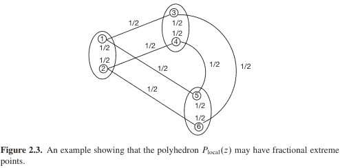

```
min \sum_{e \in E} c_e x_e
s.t. z(V_k) = 1, \forall k \in K = \{1, ..., m\},
x(E) = m - 1,
x(V_l, V_r) = y_{lr}, \forall l, r \in K = \{1, ..., m\}, l \neq r.
x(i, V_r) \le z_i, \forall r \in K, \forall i \in V \setminus V_r,
y_{ij} = \lambda_{kij} + \lambda_{kji}, \forall 1 \le k, i, j \le m \text{ and } i \neq j.
\sum_j \lambda_{kij} = 1, \forall 1 \le k, i, j \le m \text{ and } i \neq k,
\lambda_{kkj} = 0, \forall 1 \le k, j \le m,
\lambda_{kij} \ge 0, \forall 1 \le k, i, j \le m,
x_e, z_i \ge 0, \forall e = (i, j) \in E, \forall i \in V,
y_{lr} \in \{0, 1\}, \forall 1 \le l, r \le m.
```

GMSTP 的这一新表述是通过将刻画 \( P_{MST} \) 的约束（其中 \( y \in \{0, 1\} \)）纳入 \( P_{local}(y) \) 中得到的。GMSTP 的局部-全局表述使用三种类型的变量来定义图中簇之间的连接。第一组变量（我们在之前的表述中已经使用过）是指示边变量 \( x_{ij} \)。这些变量定义图中节点之间特定边的使用。另一方面，另外两组变量 \( y_{lr} \) 和 \( \lambda_{klr} \) 定义图中簇之间的连接。\( y_{lr} \) 变量指示解是否包含直接连接簇 $l$ 和 $r$ 的任何边。$\lambda_{klr}$ 变量用于定义 $|K|$ 棵有向树，每棵树对应图中的一个簇。

GMSTP 的这一新模型具有若干良好特性，可用于开发精确求解算法 [142, 150]、元启发式算法 [76, 77]、启发式算法 [143] 以及针对 PC-GMSTP 的启发式和精确算法 [192, 54]。在所描述的整数规划表述中，局部-全局表述是最紧凑的，从变量数量和约束数量来看。

请注意，尽管所提出的表述是为 GMSTP 定义的，但这些表述对 PC-GMSTP 也有效。我们只需将从簇中选择节点的代价添加到目标函数中。

所描述的 GMSTP 表述的线性松弛所定义的多面体之间的关系如下图所示：

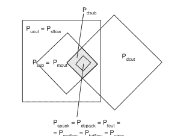

图 2.4. 对应 GMSTP 表述的线性松弛所定义的多面体之间的关系。

### 2.4 GMSTP 的近似结果

在本节中，我们将区分所谓的 *正结果*，即建立某些近似算法存在性的结果，和所谓的 *负结果*，即在假设 $\mathcal{P} \neq \mathcal{NP}$ 的前提下，反驳某些组合优化问题存在良好近似结果的结果。

我们从 Goemans [57] 和 Schuurman 与 Woeginger [183] 的描述中出发，介绍近似理论的一些基本结果。

#### 2.4.1 引言

我们希望求解的许多优化问题都是 $\mathcal{NP}$-难问题。因此，这些问题很难通过多项式时间算法求解。然而，这些问题在实践中仍然需要求解。为此，我们需要放宽一些要求。一般来说，有三种不同的可能性。

- **超多项式时间算法：** 尽管一个优化问题是 $\mathcal{NP}$-难问题，但存在用于精确求解它的“好”和“不太好”的算法。“不太好”的算法当然包括大多数简单的枚举方法，即枚举所有可行解并选择目标函数取最优值的那个解。这类方法的时间复杂度非常高。“好”的算法包括分支定界等方法，即在考虑可行解之前，利用对手头问题的分析来排除大多数可行解。这些方法可以求解问题的相当大规模实例的精确解，但其运行时间仍取决于问题规模的指数函数。

- **平均情况多项式时间算法：** 对于某些问题，存在这样的算法：仅在少数实例上需要超多项式时间，而其他实例则在多项式时间内运行。一个著名的例子是用于求解线性规划问题的单纯形法。

- **近似算法：** 我们也可以放宽获得优化问题精确解的要求，而满足于一个“离最优解不太远”的解。这一点部分得到了以下事实的证明：在实践中，通常只需获得一个略微次优的解即可。

显然，存在好坏之分的近似算法。我们需要一些手段来确定近似算法的质量，并有一种比较不同算法的方法。需要考虑几个标准：

**平均情况性能：** 在这里，我们考虑给定问题所有可能实例集上的某个概率分布。基于这一假设，可以求得性能的期望。此类结果高度依赖于初始分布的选择，并不能提供关于特定实例性能的任何信息。

**实验性能：** 这种方法基于在少数“典型”实例上运行算法。它主要用于比较多个近似算法的性能。当然，结果取决于“典型”实例的选择，并且可能因实验而异。

**最坏情况性能：** 这通常通过建立近似解相对于最优值的上界和下界来完成。对于最小化问题，我们试图建立上界；对于最大化问题，我们希望找到下界。

近似算法性能最坏情况界限的优势在于，给定优化问题的任何实例，我们都能保证近似解落在这些界限之内。还应注意，近似算法通常找到的解比最坏情况界限所暗示的要更接近最优解。因此，查看每个算法性能界限有多紧（即近似解实际上可能有多差）本身就是一项有意义的工作。这通常通过提供特定实例的例子来完成，在这些实例中，近似解与最优解相差很远。

即使对于简单的算法，建立最坏情况性能界限也通常需要对手头问题有非常深入的理解，并使用线性规划、组合数学、图论、概率论等领域的强大理论方法。

我们考虑一个 NP-难优化问题，正如我们所见，在多项式时间内找到精确最优解是困难的。通过放宽一些要求来牺牲解的质量，我们通常可以在复杂度上获得相当大的加速。这引出了以下定义：

#### 定义 2.8（近似算法）。

设 X 为一个最小化问题，且 \(\alpha > 1\)。如果算法 APP 对于 X 的所有实例 I，在多项式时间内输出一个可行解，其目标值 APP(I) 满足

```
APP(I) \(\le\) \(\alpha\)OPT(I), (2.35)
```

其中，APP(I) 和 OPT(I) 分别表示实例 I 的近似解值和最优解值。

值 \(\alpha\) 被称为近似算法 APP 的性能保证或最坏情况比率。\(\alpha\) 越接近 1，算法越好。

#### 2.4.2 正结果：近似算法的设计

关于近似，正结果涉及多项式时间近似算法的设计与分析。本节专注于此类正结果；我们将概述主要策略。

假设我们需要为一个 NP-难优化问题 X 找到一个近似算法。我们该如何进行？在以下内容中，我们将专注于最小化问题，但这些想法同样适用于最大化问题。

在以下内容中，给定一个优化问题的实例 I 及其某个近似算法，我们将用 OPT = OPT(I) 表示最优解的值，并用 APP = APP(I) 表示由 the 产生的解的值


近似算法。我们关注一个 \(\alpha\)-近似算法，即一个算法 APP，使得

APP \(\le \alpha\)OPT.

直接将 APP 与 OPT 关联可能比较困难。因此，我们尝试寻找最优解的一个下界，记为 LB，满足以下条件：

- 1. LB \(\le\) OPT，
- 2. APP \(\le \alpha\)LB。

现在考虑以下优化问题：

OPT = \(\min_{x \in S} f(x)\)。

OPT 的一个下界可以通过所谓的 *松弛* 获得。考虑以下相关优化问题：

LB = \(\min_{x \in R} g(x)\)。

### 定义 2.9（下界）

如果满足以下两个条件，则 LB 称为 OPT 的下界，该优化问题称为原问题的松弛：

\(S \subseteq R\)

对所有 \(x \in S\)，\(g(x) \le f(x)\)。

上述条件蕴含以下结论：

LB = \(\min_{x \in R} g(x) \le \min_{x \in S} f(x) = \text{OPT}\)。

这表明 LB 是 OPT 的一个下界。

许多组合优化问题可以表述为整数或混合整数规划，这些规划的线性规划松弛为最优解提供了一个下界。稍后，我们将展示如何使用 GMSTP 整数规划表述的线性规划松弛，为具有有限簇大小的 GMSTP 得到一个 \(\alpha\)-近似算法。

从松弛问题的解中推导近似最优解存在两种主要技术：

### 1. 舍入法

其思想是求解线性规划松弛，然后将得到的分数解转换为整数解。近似保证通过比较整数解和分数解的代价来建立。

因此，我们找到松弛问题的一个最优解 \(x^*\)，并将 \(x^* \in R\) "舍入" 为 \(S\) 中的一个元素 \(x'\)。然后，我们证明 \(f(x') \le \alpha g(x^*)\)，这意味着

\(f(x') \le \alpha LB \le \alpha OPT\)。

通常，随机化很有帮助。在这种情况下，\(x^* \in R\) 被随机舍入为 \(S\) 中的某个元素 \(x'\)，使得 \(E[f(x')] \le \alpha g(x^*)\)。这些算法有时可以去随机化，在这种情况下，人们找到一个 \(x''\) 使得 \(f(x'') \le E[f(x')]\)。

舍入技术的应用示例由最小权顶点覆盖问题提供，结果归功于 Hochbaum [75]。

### 2. 原偶数法

我们考虑原始规划的线性规划松弛。该方法迭代构造原始规划的一个整数解和对偶规划的一个可行解，\(max\{h(y) : y \in D\}\)。近似保证通过比较两个解来建立。

松弛的弱对偶性质蕴含：

\(max\{h(y) : y \in D\} \le min\{g(x) : x \in R\}\)。

我们从 \(y \in D\) 构造 \(x \in S\)，使得：

\(f(x) \le \alpha h(y) \le \alpha h(y_{max}) \le \alpha g(x_{min}) \le \alpha OPT\)。

注意，\(y\) 可以是 \(D\) 的任意元素，不一定必须是对偶问题的最优解。

关于原偶数技术的更多细节可见 [7] 和 [203]。

#### 2.4.3 GMSTP 的一个负面结果

对于某些难的组合优化问题，可以证明它们不存在近似算法，除非 \(\mathcal{P} = \mathcal{NP}\)。为了得到这种形式的结果，只需证明存在一个 \(\alpha\)-近似算法将允许在多项式时间内解决某个已知为 \(\mathcal{NP}\)-完全的决策问题。

将此方案应用于 GMSTP，我们得到一个不可近似性结果。这个结果是 Myung 等人 [128] 提供的结果的另一种表述，用近似算法的术语来说，即即使为 GMSTP 找到一个近似最优解也是 \(\mathcal{NP}\)-难的。我们的证明与 [128] 中提供的证明略有不同。

### 定理 2.10. 在假设 $\mathcal{P} \neq \mathcal{NP}$ 下，不存在 GMSTP 的 \(\alpha\)-近似算法

证明。假设存在一个 GMSTP 的 \(\alpha\)-近似算法 APP，其中 \(\alpha\) 是一个大于或等于 1 的实数。这意味着

$\text{APP}(I) \le \alpha \text{OPT}(I)$，

对于每个实例 $I$，其中 OPT($I$) 和 APP($I$) 分别是最优解和算法 APP 找到的解的值。

然后，我们可以证明 APP 也能求解给定图 $G = (V, E)$ 和整数 $k$（其中 $k < |V|$）的节点覆盖问题。这一结果与假设 \(\mathcal{P} \neq \mathcal{NP}\) 矛盾。

我们构造一个图 $G' = (V', E')$ 和边代价函数，使得算法 APP 找到一个值不超过最优代价 \(\alpha\) 倍的可行解，当且仅当 G 包含 C，其中 C 是 G 的一个节点覆盖，即 V 的一个子集，使得 G 的所有边都与 C 中至少一个节点相邻。

图 $G'$ 包含以下 \(m = |E| + k + 1\) 个节点集（簇），$V'_1, \dots, V'_m$：

- $V'_1$ 由一个单节点组成，记为 $r$，
- $V'_2, \dots, V'_{k+1}$ 是相同的节点集，每个都有 $|V|$ 个节点，对应于 $V$ 的节点，以及
- $|E|$ 个节点集，$V'_{k+2}, \dots, V'_m$，每个都包含一个对应于边 $e \in E$ 的单节点。

$G'$ 中的边构造如下：

- (i) 对于所有 $l = 2, \dots, k + 1$，$V'_l$ 的每个节点通过一条边与 $r$ 相连。由这些边组成的集合记为 $E'_1$。
- (ii) 设 $i$ 为任何 $l \in \{2, \dots, k + 1\}$ 的 $V'_l$ 的一个节点，设 $j$ 为任何 $r \in \{k + 2, \dots, m\}$ 的 $V'_r$ 的一个节点。如果与 $j$ 对应的 $G$ 的边与与 $i$ 对应的 $G$ 的节点相关联，则在 $i$ 和 $j$ 之间构造一条边，我们将这些边的集合记为 $E'_2$。
- (iii) 我们还在 $i$ 和 $j$ 之间构造一条边，即使与 $j$ 对应的 $G$ 的边与与 $i$ 对应的 $G$ 的节点不相关联，并让 $E'_3$ 表示这些边的集合。

我们令 $E' = E'_1 \cup E'_2 \cup E'_3$。

每条边的代价定义如下：

| 条件 | 代价 $c_{ij}$ |
|------|---------------|
| 对所有 $i, j \in E'_1$ | 0 |
| 对所有 $i, j \in E'_2$ | 1 |
| 对所有 $i, j \in E'_3$ | $(|E| + 1)\alpha$ |

我们声称 G 包含 C 当且仅当

APP(I) \le \alpha|E|，

其中实例 I 对应于 G' 及其代价函数。

请注意，G' 中总是存在一个广义生成树：除了相同的簇 $V'_2, \dots, V'_{k+1}$ 之外，所有簇都只有一个节点，如果我们从 $V'_2, \dots, V'_{k+1}$ 中选择 k 个节点，每个簇取一个节点，使得 C 中的每个节点都被包含，那么这些 k 个节点连同所选的其余节点，根据 G' 的定义，总是唯一地形成一个使用 $E'_1 \cup E'_2$ 中边的 G' 的广义生成树。

假设现在 G' 包含一个广义生成树，并设 C 为从树中的簇 $V'_2, \dots, V'_{k+1}$ 选取的一组不同节点，那么 C 是 G 的一个节点覆盖。

因此，我们已经证明，G' 中仅使用 $E'_1 \cup E'_2$ 中边的广义生成树存在，当且仅当 G 包含一个节点覆盖 C。

如果 G 包含 C，则 OPT(I) = |E|。此外，如果 G 不包含 C，那么 G' 的任何广义生成树都应至少使用 $E'_3$ 中的一条边，因此

OPT(I) \ge |E| - 1 + \alpha(|E| + 1) > \alpha|E|。

特别是，如果 G 包含一个节点覆盖 C，那么近似算法 APP 将产生一个值为

APP(I) \le \alpha|E| = \alpha OPT(I)，

的解，即该解不使用 $E'_3$ 中的任何边，并且 APP 识别出一个节点覆盖。

然而，在下一节中，在做出一些进一步假设后，我们将为 GMSTP 提出一个正面结果。

#### 2.4.4 具有有限簇大小的 GMSTP 的一个近似算法

正如我们在上一节中所见，在假设 \(\mathcal{P} \neq \mathcal{NP}$ 下，不存在 GMSTP 的 \(\alpha\)-近似算法。


然而，在以下假设下：
- A1: 图具有有限簇大小，即 \(|V_k| \le \rho\)，对所有 \(k = 1, \dots, m\)，
- A2: 成本函数严格为正且满足三角不等式，即 \(c_{ij} + c_{jk} \ge c_{ik}\) 对所有 \(i, j, k \in V\)，

GMSTP 存在多项式近似算法。

在上述假设下，本节提出了一种性能比为 \(2\rho\) 的 GMSTP 近似算法。该近似算法遵循 Slavik [187] 的思想构建，该思想用于处理广义旅行商问题和团 Steiner 树问题。

## GMSTP 的整数规划公式

我们考虑以下 GMSTP 的整数规划公式：

### 问题 IP1:

```
\(Z_1 = \min \sum_{e \in E} c_e x_e,\)

s.t. \(z(V_k) = 1, \quad \forall k \in K = \{1, \dots, m\},\) (2.36)

\(x(\delta(S)) \ge z_i, \quad \forall i \in S, \forall S \subset V \text{ such that for some cluster } V_k, \text{ with } k \in K, S \cap V_k = \emptyset,\) (2.37)

\(x(E) = m - 1,\) (2.38)

\(x_e \in \{0, 1\}, \quad \forall e \in E,\) (2.39)

\(z_i \in \{0, 1\}, \quad \forall i \in V.\) (2.40)
```

在此，我们使用了第 2.3 节中引入的标准记法。

在上述公式中，条件 (2.36) 保证可行解包含每个簇中恰好一个顶点。条件 (2.37) 保证任何可行解诱导出一个连通子图。条件 (2.38) 简单地保证任何可行解有 \(m - 1\) 条边，并且由于成本函数严格为正，该约束是冗余的。

现在，我们考虑 GMSTP 整数规划公式的线性规划松弛。为此，我们只需用新条件替换 IP1 中的条件 (2.39) 和 (2.40)：

\(0 \le x_e \le 1, \quad \text{for all } e \in E,\) (2.41)

\(0 \le z_i \le 1, \quad \text{for all } i \in V.\) (2.42)

我们假设假设 A1 和 A2 成立。

近似 GMSTP 最优解的算法如下：

### 算法 2.11 ("近似 GMSTP").

- **输入:** 一个完全图 \( G = (V, E) \)，其边上的成本函数严格为正，满足三角不等式，且节点被划分为大小有限的簇 \( V_1, \dots, V_m \)，\( |V_k| \le \rho \)。
- **输出:** 一棵树 \( T \subset G \)，覆盖一些顶点 \( W' \subset V \)，其中包含每个簇中恰好一个顶点，并近似 GMSTP 的最优解。
- 1. 求解问题 IP1 的线性规划松弛，并令 \( (z^*, x^*, Z_1^*) = ((z_k^*)_{k=1}^m, (x_e^*)_{e \in E}, (Z_k^*)_k) \) 为最优解。
- 2. 令 \( W^* = \{i \in V \mid z_i^* \ge \frac{1}{\rho}\}\)，并考虑 \( W' \subset W^* \)，使得 \( W' \) 包含每个簇中恰好一个顶点，并在由 \( W' \) 生成的子图 \( G' \) 上找到一棵最小生成树 \( T \subset G \)。
- 3. 输出 APP = cost(\( T \)) 和广义生成树 \( T \)。

尽管问题 IP1 的线性规划松弛具有指数数量的约束，但可以使用椭球法（配合最小割-最大流 oracle [59]）或 Karmarkar 算法 [96] 在多项式时间内求解，因为线性规划松弛可以使用流变量以“紧凑”形式（约束数量多项式有界）来表述；参见第 2.3 节。

### 辅助结果

本小节首先介绍由 Goemans 和 Bertsimas [58] 建立并被称为“节俭性质”的结果。

给定一个完全无向图 \( G = (V, E) \)，我们为每条边 \( (i, j) \in E \) 关联一个成本 \( c_{ij} \)，并且对于任意顶点对 \( (i, j) \)，令 \( r_{ij} \) 为 \( i \) 和 \( j \) 之间的连通性要求（假设 \( r_{ij} \) 是对称的，即 \( r_{ij} = r_{ji} \)。如果一个网络在任意顶点对 \( (i, j) \) 之间至少有 \( r_{ij} \) 条边不相交的路径，则称其为可生存网络。

可生存网络设计问题旨在寻找最小成本的可生存网络。该问题可以表述为以下整数规划：

```
\((\text{IP}_g(r)) \quad IZ_g(r) = \min \sum_{e \in E} c_e x_e\)

\(\text{s.t.} \quad x(\delta(S)) \ge \max_{(i,j) \in \delta(S)} r_{ij}, \quad S \subset V, S \neq \emptyset, \quad (2.43)\)

\(0 \le x_e, \quad e \in E.\)

\(x_e \quad \text{integral}, \quad e \in E.\)
```

我们用 \(IZ_\emptyset(r)\) 表示上述整数规划的最优值。令 (\(P_\emptyset(r)\)) 表示 (IP\(_\emptyset(r)\)) 的线性规划松弛，即去掉整数性限制后得到，并令 \(Z_\emptyset(r)\) 为其最优值。

按定义，对于任何可行解 \( x \)（无论是 (IP\(_\emptyset(r)\)) 还是 (\(P_\emptyset(r)\))），顶点 \( i \in V \) 的度为 \( d_x(i) = x(\delta(i)) \)。由于约束 (2.43)，当 \( S = \{i\} \) 时，顶点 \( i \) 的度至少等于 \( \max_{j \in V \setminus \{i\}} r_{ij} \)。如果 \( d_x(i) = \max_{j \in V \setminus \{i\}} r_{ij} \)，则称 \( x \) 在顶点 \( i \) 处是节俭的。如果我们要求解 \( x \) 在集合 \( D \subseteq V \) 的所有顶点处都是节俭的，则得到 (IP_D(r)) 和 (P_D(r)) 的一些有趣变体，分别记为 (IP_D(r)) 和 (P_D(r))。 (IP_D(r)) 作为整数规划的表述如下：

```
\(\text{(IP}_D(r)\text{)} \quad IZ_D(r) = \min \sum_{e \in E} c_e x_e.\)
\(\text{s.t. } x(\delta(S)) \ge \max_{(i,j) \in \delta(S)} r_{ij}. \quad S \subset V, S \neq \emptyset,\)
\(x(\delta(i)) = \max_{j \in V \setminus \{i\}} r_{ij}, \quad i \in D, D \subseteq V,\)
\(0 \le x_e, \quad e \in E,\)
\(x_e \text{ integral}, \quad e \in E.\)
```

我们用 $IZ_D(r)$ 表示上述整数规划的最优值。令 ($P_D(r)$) 表示 (IP_D(r)) 的线性规划松弛，即去掉整数性限制后得到，并令 $Z_D(r)$ 为其最优值。

### 定理 2.12 (节俭性质，Goemans 和 Bertsimas [58]).

如果成本 \( c_{ij} \) 满足三角不等式，则

```
\( Z_\emptyset(r) = Z_D(r) \)
```

对所有子集 \( D \subseteq V \) 成立。

该定理的证明基于 Lovász [114] 关于欧拉多重图连通性性质的结果。现在令 \( W \subset V \) 并考虑以下线性规划：

### 问题 LP2:

```
\( Z_2^*(W) = \min \sum_{e \in E} c_e x_e. \)
\(\text{s.t. } x(\delta(S)) \ge 1, \quad S \subset V, \text{ s.t. } W \cap S \neq \emptyset \neq W \setminus S, \quad (2.44)\)
\(x(\delta(i)) = 0, \quad i \in V \setminus W, \quad (2.45)\)
\(0 \le x_e \le 1, \quad e \in E. \quad (2.46)\)
```

将约束 (2.46) 替换为整数性约束 \(x_e \in \{0, 1\}\)，我们得到覆盖节点子集 \(W \subset V\) 的最小树的表述。考虑问题 LP2 的以下松弛。

### 问题 LP3:

```
\(Z_3^*(W) = \min \sum_{e \in E} c_e x_e\)
\(\text{s.t. } x(\delta(S)) \ge 1, \quad S \subset V, \text{s.t. } W \cap S \neq \emptyset \neq W \setminus S,\)
\(0 \le x_e, \quad e \in E. \quad (2.47)\)
```

因此，我们省略了约束 (2.45) 并放松了约束 (2.46)。

以下结果是节俭性质的直接推论，当我们选择 \(r_{ij} = 1\) 若 \(i, j \in W\)，否则为 0，且 \(D = V \setminus W\) 时成立。

### 引理 2.13.

问题 LP2 和 LP3 的最优解值相同，即

```
\(Z_2^*(W) = Z_3^*(W).\)
```

考虑以下问题：

### 问题 IP4:

```
\(Z_4 = \min \sum_{e \in E} c_e x_e,\)
\(\text{s.t. } x(\delta(S)) \ge 1, \quad S \subset V, \text{s.t. } S \neq \emptyset \neq V,\) (2.48)
\(x_e \in \{0, 1\}, \quad e \in E.\) (2.49)
```

显然，这是 MST（最小生成树）问题的整数规划表述。令 LP4 为该表述的 LP 松弛，即我们只需将约束 (2.49) 替换为约束 \(0 \le x_e \le 1\)，对所有 \(e \in E\)。

用 \(Z_4^*\) 表示 LP4 最优解的值。对于最小生成树，有以下已知结果：

### 提议 2.14.

```
\(L^T(V) \le \left( 2 - \frac{2}{|V|} \right) Z_4^*,\)
```

其中 \(L^T(V)\) 表示在 \(V\) 上的最小生成树的成本。

证明。参见例如 [187]。


令 \( W \subset V \)，则可轻松修改命题 2.14 以获得：

## 命题 2.15.

\( L^T(W) \le \left(2 - \frac{2}{|W|}\right) Z_2^W(W). \)

证明。令 \( (x_e) \) 为 LP2 的一个可行解。若 \( e \notin E(W) = \{(i, j) \mid i, j \in W\} \)，则蕴含 \( x_e = 0 \)，利用命题 2.14 我们便可证明该不等式。\(\square\)

## 性能界限

令 \( (z^*, x^*, Z_1^*) = ((z_i^*)_{i=1}^n, (x_e^*)_{e \in E}, Z_1^*) \) 为 GMSTP 的线性规划松弛的最优解。定义

\(\widehat{x}_e = \rho x_e^*\)
\(\widehat{z}_i = \begin{cases} 1 & \text{if } z_i^* \ge \frac{1}{\rho} \\ 0 & \text{otherwise.} \end{cases}\)

\( W^* = \left\{ i \in V \mid z_i^* \ge \frac{1}{\rho} \right\} = \{ i \in V \mid \widehat{z}_i = 1 \} \)。由于我们只需要每个簇中的一个顶点，我们从 \( W^* \) 中删除多余顶点，并考虑 \( W' \subset W^* \)，使得 \( |W'| = m \) 且 \( W' \) 由每个簇中恰好一个顶点组成。

由于 LP1 是问题 IP1 的线性规划松弛，我们有

\( Z_1^* \le Z_1. \)

现在，让我们证明 \( (\widehat{x}_e)_{e \in E} \) 是带有 \( W = W' \) 的 LP3 的一个可行解。确实，对所有 \( e \in E \)，\( \widehat{x}_e \ge 0 \)，因此条件 (2.47) 得到满足。令 \( S \subset V \) 使得 \( W' \cap S \neq \emptyset \neq W' \setminus S \) 并选取某个 \( i \in W' \cap S \)。故 \( \widehat{z}_i = 1 \) 且 \( z_i^* \ge \frac{1}{\rho} \)。则我们有

\(\widehat{x}(\delta(S)) = \sum_{e \in \delta(S)} \widehat{x}_e = \rho \sum_{e \in \delta(S)} x_e^* \ge \rho z_i^* \ge \rho \frac{1}{\rho} = 1,\)

根据 \( \widehat{x}_e \) 的定义以及 \( (x^*) \) 求解 LP1 的事实。故 \( (\widehat{x}_e) \) 满足 LP3 中的约束 (2.44)。因此，对于 GMSTP 的近似算法 APP，以下成立：

APP = \( L^T(W') \le \left(2 - \frac{2}{|W'|}\right) Z_2^W(W') = \left(2 - \frac{2}{|W'|}\right) Z_3^*(W') \)
\(\le \left(2 - \frac{2}{|W'|}\right) \sum_{e \in E} c_e \widehat{x}_e = \left(2 - \frac{2}{|W'|}\right) \rho \sum_{e \in E} c_e x_e^* = \left(2 - \frac{2}{|W'|}\right) \rho Z_1^* \)
\(\le \left(2 - \frac{2}{|W'|}\right) \rho Z_1 = \left(2 - \frac{2}{|W'|}\right) \rho \text{OPT}.\)

并且由于 \( W' \subset V \)，即 \( m = |W'| \le |V| = n \)，我们已证明如下。

## 定理 2.16. 算法“近似 GMSTP”针对 GMSTP 最优解近似的近似比满足:

\(\frac{\text{APP}}{\text{OPT}} \le \left( 2 - \frac{2}{n} \right) \rho.\)

接下来，我们将“近似 GMSTP”算法及其分析推广到以下情况：除了与每条边 \(e = (i, j) \in E\) 相关联的成本 \(c_{ij}\) 之外，还与每个顶点 \(i \in V\) 相关联一个成本，记为 \(d_i\)。

在这种情况下，GMSTP 可表述为以下整数规划:

\(\text{OPT} = \min \sum_{e \in E} c_e x_e + \sum_{i \in V} d_i z_i\) \\ \(\text{s.t. (2.36)--(2.40).}\)

假设 \((\bar{x}, \bar{z})\) 是一个最优解。那么，该整数规划的最优值 OPT 由两部分组成:

\(L_{\text{OPT}} := \sum_{e \in E} c_e \bar{x}_e \quad \text{and} \quad V_{\text{OPT}} := \sum_{i \in V} d_i \bar{z}_i.\)

在相同假设 A1 和 A2 下，本情况下近似 GMST 问题最优解的算法如下:

- 1. 求解前一整数规划的线性规划松弛，并令 \((z^*, x^*) = ((z_i^*)_{i=1}^n, (x_e^*)_{e \in E})\) 为最优解。
- 2. 令 \(W^* = \{ i \in V | z_i^* \ge \frac{1}{2} \}\) 并考虑 \(W' \subset W^*\)，使得 \(W'\) 包含每个簇中恰好一个顶点，并在由 \(W'\) 生成的子图 \(G'\) 上找到一棵最小生成树 \(T\)。
- 3. 输出 \(\text{APP} = \text{ecost}(T) + \text{vcost}(T)\) 和广义生成树 \(T\)。

其中，\(\text{ecost}(T)\) 和 \(\text{vcost}(T)\) 分别表示树 \(T\) 关于边和节点的成本。

关于该近似算法的性能界限，使用相同的辅助结果，并如本小节开头所定义 \((\bar{\Sigma}_e, \bar{\Sigma}_i)\)，以下不等式成立:

\(L^T(W') \le \rho \left( 2 - \frac{2}{n} \right) L_{\text{OPT}},\) \\ \(V^T(W') \le \rho V_{\text{OPT}}.\)

其中 \(L^T(W'), V^T(W')\) 分别表示树 \(T\) 覆盖 \(W'\) 节点关于边和节点的成本，且如前所述，\(W' \subset W^* = \{i \in V | z_i^* \ge \frac{1}{\rho}\}\)，使得 \(|W'| = m\) 且 \(W'\) 由每个簇中恰好一个顶点组成。

对于本情况中提出的近似算法，以下成立:

APP = \(L^T(W') + V^T(W') \le \rho \left(2 - \frac{2}{n}\right) L_{OPT} + \rho V_{OPT}\)
\(\le \rho \left(2 - \frac{2}{n}\right) (L_{OPT} + V_{OPT}) = \rho \left(2 - \frac{2}{n}\right) OPT.\)

在“至少广义最小生成树问题”情况下，Femermans 等人 [41] 考虑了该问题的一个几何案例，其中图是完全图，所有顶点都位于平面上，且顶点之间的欧几里得距离定义边成本。该问题的特殊情况，其聚类结构按指定方式组织，称为网格聚类。

对于网格聚类情况，相同作者证明该问题是强 NP 难的，他们提供了一个精确的指数时间动态规划算法，并基于该算法，他们开发了一个多项式时间近似方案，即如果 \(T^{APPX}\) 是使用动态规划算法在多项式时间内构建的广义生成树，则以下结果成立:

## 定理 2.17 (Feremans et al. [41]).

\(\frac{c(T^{APPX}) - c(T^{OPT})}{c(T^{OPT})} \le \epsilon.\)

### 2.5 求解 GMSTP

Myung 等人 [128] 使用分支定界过程来求解 GMSTP。他们的下界过程是一种启发式方法，用于近似与 GMSTP 多商品流公式的对偶相关的线性规划松弛。他们还开发了一种启发式算法，利用得到的对偶解为 GMSTP 找到一个原始可行解，并报告了最多 100 个顶点的实例的精确解。GMSTP 由 Femermans [37] 使用分支切割算法求解了最多 200 个节点的最优解。更近期地，Pop 等人 [150] 提出了一种基于局部变量和全局变量区分的 GMSTP 新整数规划公式，以及一种在最多 240 个顶点的实例上找到最优解的求解过程。

求解 GMSTP 最优解的困难促使了多种元启发式的发展。最早的此类算法是 Femermans [37] 的禁忌搜索 (TS) 启发式和 Pop [142] 的模拟退火 (SA) 启发式。[154] 描述了一种改进的 SA 版本。随后，Ghosh [49] 设计了两种 TS 启发式变体和一种基于四变量邻域搜索 (VNS) 的启发式。Hu 等人 [76] 提出了另一种针对 GMSTP 的 VNS 算法。作者报告，他们的 VNS 方法可以产生与 Ghosh [49] 的 TS 启发式第二种变体所得解相当的解。相同作者通过将其与整数线性规划相结合 [77] 提出了一种改进的 VNS 算法。Golden 等人 [53] 为 GMSTP 设计了一种局部搜索启发式 (LSH) 和一种遗传算法 (GA)。两种算法都在大小介于 198 ≤ n ≤ 225 之间的 TSPLIB 实例上取得了改进。LSH 在这些实例中没有一项优于 GA。Wang 等人 [206] 设计了另一种针对 GMSTP 的 TS 启发式。作者指出，他们的 TS 启发式产生的解略好于 Golden 等人 [53] 的 GA 所得解。Oncan 等人 [135] 提出了一种基于属性的禁忌搜索启发式，采用新的邻域。作者提到，他们的基于 TS 的启发式在所有实例上都取得了最佳结果。最近，Pop 等人 [164] 描述了一种模因算法，而 Hu 和 Raidl [81] 提出了一种带有解档案的进化算法来求解 GMSTP，其中已考虑的解被存储在适当的数据结构中，以便快速检测重复解。

本节将描述四种求解广义最小生成树问题的算法方法:

- 基于无向集群子打包公式的分支切割算法；
- 基于局部-全局方法的启发式方法；
- 基于 GMSTP 局部-全局整数规划公式的根化过程；
- 用于求解 GMSTP 的改进模拟退火。

#### 2.5.1 求解 GMSTP 的分支切割算法

分支切割是一种用于求解整数线性规划的组合优化方法。该方法是分支定界和切割平面方法的混合体，在求解 LP 松弛后，若基于 LP 解未能剪枝该节点，则我们尝试寻找一个被违反的切割。如果找到一个或多个被违反的切割，则将它们添加到公式中并重新求解 LP。如果没有找到，则我们进行分支。有关该方法的更多信息，我们参考 [123]。

接下来，我们介绍由 Feremans 等人 [40] 开发的求解 GMSTP 的分支切割算法。该算法基于在小节 2.3.1 中描述的 GMSTP 无向集群子打包公式。


### 算法 2.18（分支切割算法）.

- 步骤 1：（初始化）将 GMSTP 的无向聚类子打包公式的 LP 松弛（仅包含约束 (2.1) 和 (2.3)）插入列表 $L$ 中。最佳已知值（记为 $opt_{best}$）通过禁忌搜索启发式获得，该启发式搜索解空间。

- 步骤 2：（终止检查和子问题选择）如果 $L$ 为空，则停止；否则，根据最佳优先规则从列表中提取一个子问题。

- 步骤 3：（子问题求解）使用 LP 求解器求解子问题，并将其最优值记为 $opt$。如果 $opt \ge opt_{best}$，转至步骤 2。否则，如果该解可行，则调用局部改进过程。如果该解是分数解，则调用舍入过程以改进它。

- 步骤 4：（分离过程）搜索广义子回路消除约束的违反：

```
$x(E(S)) \le z(S) - 1, \quad \forall S \subset V, 2 \le |S| \le n - 1, |\{k : V_k \subseteq S\}| \neq 0$
```

具有以下两个特例：

```
\(\begin{aligned} x(E(\{i\} : V_k)) &\le z_i, & i \in V \setminus (W \cup V_k), \ x(\delta(i)) &\ge z_i, & i \in V. \end{aligned}\)
```

其中 $W$ 表示簇为单例的顶点集合，并且我们对 $S, T \subseteq V$ 定义了

```
$$E(S : T) = \{e = \{i, j\} \in E \mid i \in S, j \in T\}. \quad (2.50)$$
```

如果发现违反，则将相应的约束引入子问题并转至步骤 3。

- 步骤 5：（分离过程：其他有效不等式）搜索奇环不等式的违反：

```
$$\sum_{k=1}^m E(V_k^1 : V_{(k \mod m) + 1}^2) \le \lfloor m/2 \rfloor \quad (2.51)$$
```

其中我们假设每个簇 $V_k, k = 1, \dots, m$ 被划分为两个非空子集 $V_k^1$ 和 $V_k^2$，并且对于奇洞不等式的违反，

```
$$x(F) \le |F|/2 \quad (2.52)$$
```

其中 $F \subseteq E$，具有 $|F|$ 为奇数、$|F| \ge 3$ 的性质，并且在相应的冲突图 $G_C = (V_C, E_C)$ 中诱导一个无弦环，其中 $E$ 的每条边是 $G_C$ 的一个顶点，且 $E$ 中 $e_1$ 和 $e_2$ 之间的 $E_C$ 边仅当 $e_1$ 和 $e_2$ 冲突时定义。连接同一簇中不同顶点的两条边被认为是冲突的。

如果发现违反，则将相应的约束引入子问题并转至步骤 3。

- 步骤 6：（分支）通过对约束 \( z(V_k) = 1 \) 进行分支创建两个新子问题。将这两个子问题添加到列表 \( L \) 中并转至步骤 2。

对约束的分支按照 Williams [207] 进行。假设存在至少一个顶点 \( i \in V \)，使得 $z_i^* > 0$，其中 \( G^* = (V^*, E^*) \) 表示与分数解 \( (x^*, z^*) \) 关联的支撑图，且 \( V^* = \{i \in V \mid z_i^* > 0\} \) 以及 \( E^* = \{(i, j) \in E \mid x_{ij}^* > 0\} \)，我们可以按如下方式创建当前子问题的两个后代：令 \( V_k^* \) 为至少包含一个顶点 \( i \)（满足 \( 0 < z_i^* < \frac{1}{2} \)）的簇。该簇被划分为两个集合 \( V_k^1 \) 和 \( V_k^2 \)，使得 \( z^*(V_k^1) \) 和 \( z^*(V_k^2) \) 接近 \( \frac{1}{2} \)。然后通过向当前子问题分别添加 \( z^*(V_k^1) = 0 \) 和 \( z^*(V_k^2) = 1 \) 来生成两个子问题。

刚才描述的分支定割算法由 Feremans 等人 [40] 用 C++ 编码，并使用了 ABACUS 2.3 库（参见 Thiel [198]），以 CPLEX 7.0 作为 LP 求解器（参见 ILOG [85]）。测试在 Generic sun4u sparc SUNW, Ultra-510 工作站（360 MHz，128 MB RAM）上运行 SunOS 5.8 操作系统进行。该算法在随机生成的实例和其他实例上进行了测试。所得结果在表 2.1 中给出。

#### 2.5.2 求解 GMSTP 的启发式算法

基于 Prim、Kruskal 和 Sollin 最小生成树算法的简单构造性启发式算法已由 Feremans [37] 提出用于 GMSTP。在本节中，我们将描述一种基于局部-全局方法的更好的启发式算法。

我们先介绍一些符号。令 \( F^{\text{global}} \) 表示完整全局图中的当前边集，$S^{\text{global}}$ 表示完整全局图中的当前节点集，$F$ 表示图 $G$ 中的当前边集，$S$ 表示图 $G$ 中的当前节点集。

给定连接某些簇的全局子树，我们用 \( T \) 表示与给定的簇连接对应的最小广义子树。该最小广义子树可以使用第 2.2 节描述的动态规划方法轻松确定。

可以轻松观察到 \( |F| = |F^{\text{global}}| \) 和 \( |S| = |S^{\text{global}}| \) 成立。

表 2.1. 非欧几里得问题的计算结果（每种实例类型五次试验的平均值）。

| 问题规模 m | n | 根化过程 LB/OPT | CPU | 分支定割 LB/UB | CPU | Myung 结果 LB/OPT | CPU | 启发式结果 OPT/UB | CPU |
|---|---|---|---|---|---|---|---|---|---|
| 8 | 24 | 100 | 0.0 | 100 | 0.0 | 100 | 0.0 | - | - |
| | 32 | 100 | 0.0 | 100 | 0.2 | 100 | 0.2 | - | - |
| | 48 | 100 | 0.2 | 100 | 1.4 | 94.3 | 3.2 | - | - |
| | 80 | 100 | 0.6 | 100 | 4.2 | 94.9 | 17.6 | - | - |
| 10 | 30 | 100 | 0.1 | 100 | 1.0 | 89.1 | 0.0 | 85.10 | 0 |
| | 40 | 100 | 0.7 | 100 | 1.0 | - | - | 92.74 | 0 |
| | 60 | 100 | 0.9 | 100 | 3.2 | 87.8 | 3.2 | 89.98 | 0.004 |
| | 100 | 100 | 3.5 | 100 | 8.8 | 91.3 | 17.6 | 96.34 | 0.008 |
| 12 | 36 | 100 | 0.1 | 100 | 1.8 | 89.6 | 6.0 | 90.06 | 0.002 |
| | 48 | 100 | 1.6 | 99.2 | 3.2 | 91.3 | 54.9 | 93.30 | 0.006 |
| | 72 | 100 | 5.6 | 100 | 6.8 | 100 | 6.8 | 94.17 | 0.006 |
| | 120 | 100 | 14.5 | - | - | - | - | 92.77 | 0.022 |
| 15 | 45 | 100 | 0.2 | 100 | 3.6 | 89.0 | 17.4 | 95.74 | 0.002 |
| | 90 | 100 | 5.9 | 100 | 21.4 | - | - | 89.64 | 0.010 |
| | 150 | 100 | 40.5 | 98.8 | 42.4 | - | - | 92.70 | 0.044 |
| 18 | 54 | 100 | 0.5 | 99.5 | 7.6 | - | - | 89.23 | 0.002 |
| | 108 | 100 | 9.4 | - | - | - | - | 93.38 | 0.016 |
| | 180 | 100 | 193.8 | - | - | - | - | 91.83 | 0.076 |
| 20 | 60 | 100 | 3.8 | - | - | - | - | 86.81 | 0.004 |
| | 120 | 100 | 11.4 | 96.3 | 39.8 | - | - | 89.05 | 0.024 |
| | 200 | 100 | 407.6 | 94.6 | 191.4 | - | - | 89.53 | 0.104 |
| 25 | 75 | 100 | 21.6 | - | - | - | - | 87.99 | 0.012 |
| | 150 | 100 | 25.1 | 88.3 | 178.8 | - | - | 88.99 | 0.084 |
| | 200 | 100 | 306.6 | 97.8 | 140.6 | - | - | 93.75 | 0.146 |
| 30 | 90 | 100 | 40.0 | - | - | - | - | 86.32 | 0.025 |
| | 180 | 100 | 84.0 | 96.6 | 114.6 | - | - | 90.63 | 0.032 |
| | 240 | 100 | 341.1 | - | - | - | - | 89.64 | 0.068 |
| 40 | 120 | 100 | 71.6 | 100 | 92.6 | - | - | 88.13 | 0.062 |
| | 160 | 100 | 1713.2 | 94.2 | 288.6 | - | - | 89.68 | 0.080 |

启发式算法的工作方式如下：

### 算法 2.19（求解 GMSTP 的启发式算法）。

```
F^{\text{global}} := \emptyset; S^{\text{global}} := \{V_r\}, where V_r is an arbitrary cluster;
F := \emptyset; S := \{v_{i_0}\}, where v_{i_0} \in V_r;
while |S| < m do
  From among all global edges with exactly one end in S^{\text{global}}, find a
  global edge (V_k, V_l) \in E^{\text{global}} that minimizes the cost of the corre-
  sponding generalized vertex tree;
  F^{\text{global}} := F^{\text{global}} \cup \{(V_k, V_l)\};
  S^{\text{global}} := S^{\text{global}} \cup \{(V_k, V_l) \setminus S^{\text{global}}\};
  F := \{(v_i, v_j) | (v_i, v_j) \in T\};
  S := \{v_i | v_i \in V_k \cap T, V_k \in S^{\text{global}}\};
end while
```

其中当前广义树的成本由所选边的成本之和加上所选节点的成本给出。

以下结果成立：

定理 2.20. 前述算法生成 G 的一个广义生成树，近似 GMSTP 的最优解，其运行时间为 O(m^2 n^2)，其中 m 是簇的数量，n 是 G 的节点数量。

该结果的证明由 Pop 和 Zelina [145] 给出。在同一文中，还介绍了一些计算实验，表明基于局部-全局方法的启发式算法相较于基于 Prim、Kruskal 和 Sollin 算法的构造性启发式算法具有更高的效率。

#### 2.5.3 求解 GMSTP 的根化过程

基于局部-全局公式，我们提出了一种称为根化过程的求解过程，如下所述。

与其考虑 0-1 局部-全局混合整数规划问题，不如仅对固定 k（1 \le k \le m）考虑表征多面体 P_{MST} 的约束。然后我们得到一个松弛，将其记为 P^k。

使用 Yannakakis 对全局生成树多面体的描述，这种情况对应于我们随机选择一个簇 V_k 并对其进行根化


仅在根节点 k 处的全局树。

min \sum_{e \in E} c_e x_e
s.t. z(V_k) = 1, \quad \forall k \in K = \{1, ..., m\},
x(E) = m - 1,
x(V_l, V_r) = y_{lr}, \quad \forall l, r \in K = \{1, ..., m\}, l \neq r,
x(i, V_r) \le z_i, \quad \forall r \in K, \forall i \in V \setminus V_r,
(P^k y)_{ij} = \lambda_{kij} + \lambda_{kji}, \quad \forall 1 \le k, i, j \le m \text{ and } i \neq j, k \text{ fixed},
\sum_j \lambda_{kij} = 1, \quad \forall 1 \le k, i, j \le m \text{ and } i \neq k, k \text{ fixed},
\lambda_{kji} = 0, \quad \forall 1 \le k, j \le m, k \text{ fixed},
\lambda_{kij} \ge 0, \quad \forall 1 \le k, i, j \le m, k \text{ fixed},
x_e, z_i \ge 0, \quad \forall e = (i, j) \in E, \forall i \in V,
y_{lr} \in \{0, 1\}, \quad \forall 1 \le l, r \le m.

如果该松弛问题的最优解（使用 CPLEX 求解）生成了一棵广义生成树，那么我们就得到了 GMSTP 的最优解。否则，我们得到一个包含至少一个环的子图，并添加相应的约束（来自 P_{MST} 的刻画），以打破该环（即也在环中包含的第二个簇上扎根全局树），并按此方式继续，直到得到 GMSTP 的最优解。我们将此过程称为扎根过程。

我们的算法用 C 语言编写，并使用 HP-UX cc 编译器编译。为求解线性和混合整数规划问题，我们使用了 CPLEX 6.5。计算实验在一台配备 125 MHz 处理器和 144 MB 内存的 HP 9000/735 计算机上进行。

根据边权重的生成方法，生成的问题被分为两类：欧氏情况和非欧氏情况。在两种情况下，簇都是随机的，并且我们假设每个簇具有相同数量的节点。

对于结构化欧氏情况的实例，m 个正方形（簇）“被装入一个正方形”中，并且在这些 m 个簇中的每一个中随机选择 n_c 个节点。节点之间的权重由节点之间的欧氏距离给出。因此，在这个模型中，簇可以被解释为物理簇。在其他模型中，这种解释不成立。

对于非结构化欧氏情况，n = mn_c 个节点在 [0, 100]^2 中随机生成，权重由欧氏距离给出。然后，簇从这些点中随机选择。最后，在非欧氏模型中，边权重在区间 [0, 100] 上随机生成。

对于每种类型的实例，我们考虑了五次试验。

这里，我们比较了非欧氏模型的计算结果，这些结果是使用我们的扎根过程和启发式算法求解问题时获得的，并与 Myung 等人在 [128] 中以及 Feremans 等人 [40] 使用其分支切割算法给出的计算结果进行比较。计算结果在下一个表中呈现。

表格中的前两列指定问题的规模：簇的数量 ($m$) 和节点的数量 ($n$)。接下来的列描述扎根过程，并包含作为 GMSTP 最优值百分比得到的下界 (LB/OPT)，以及求解 GMSTP 的计算时间 (CPU)（秒）。此外，第二个表格显示了扎根过程为获得 GMSTP 最优解所选择的最小根数。第一个表格的最后几列包含作为 GMST 问题上界百分比的下界 (LB/UB)、使用分支切割算法求解 GMSTP 的计算时间 (CPU)（秒）、作为 GMSTP 最优值百分比的下界 (LB/OPT)、Myung 得到的计算时间 (CPU)、上界占最优值的百分比，以及使用所提启发式算法得到的计算结果。在表格中，符号 ‘-’ 表示未提供相应信息。

可以看出，在我们考虑的所有实例中，对于节点数量多达 240 的图，使用我们的扎根过程找到了 GMSTP 的最优解。值得注意的是，对于表中考虑的实例，为了获得问题的最优解，被选择为根的簇的最大数量为 5。我们还可以从表中看到，所提启发式算法为所有考虑的实例提供了良好的 GMSTP 次优解，并且计算时间非常好。

#### 2.5.4 使用模拟退火求解 GMSTP

模拟退火 (SA) 是一种通用的概率元启发式方法，用于应用数学中的全局优化问题，即在大搜索空间中定位给定函数全局最小值的良好近似。它受到统计力学中蒙特卡洛方法的启发。名称和灵感来自冶金中的退火，这是一种涉及材料加热和受控冷却的技术，以增加其晶体尺寸并减少缺陷。热量导致原子从其初始位置（内部能量的局部最小值）脱离，随后它们开始在更高能量的状态中随机游走。缓慢冷却使它们更有机会找到比初始状态具有更低内部能量的配置。当搜索空间是离散的（例如，访问给定城市集合的所有巡回路线）时，它经常被使用。对于某些问题，如果目标仅仅是在固定时间内找到一个可接受的解，而不是找到最佳解，则模拟退火可能比穷举枚举更有效。

构成模拟退火基础的想法最初由 Metropolis 等人 [121] 发表，作为模拟材料在热浴中冷却的算法，该过程称为退火。

Kirkpatrick 等人 [97] 和 Cerny [16] 提出，这种模拟可用于搜索优化问题的可行解。他们的方法可以被视为局部搜索技术的一种变体。

局部搜索的一个核心问题是局部最优解的出现，即搜索空间中没有任何邻域解在代价函数方面对当前解构成严格改进，但又不是全局最优解的节点。在模拟退火启发式中，允许非改进性的局部移动以克服局部最优解，但其频率由随算法进展而变化的概率函数控制。已经表明（参见 [52]），只要初始温度“足够大”且冷却计划合适，SA 就能保证得到全局最优解。然而，这一理论结果尤其有用，因为确保显著成功概率所需的退火时间通常会超过对解空间进行完全搜索所需的时间。

对于具有解空间 S、目标函数 c 和邻域结构 N 的最小化问题，退火算法可表述如下：

### 算法 2.21。

```
Select a starting solution s0 \in S, an initial temperature T0 > 0, a temperature reduction function \alpha and a number of iterations per temperature L;
Repeat
  Repeat
    Randomly select s \in N(s0) and compute \delta = c(s) - c(s0);
    If \delta < 0
      then s0 = s
    else generate random p, uniformly distributed over the range (0, 1);
    if p < exp(-\delta/T) then s0 = s
  Until iterationcount = L;
Set T = \alpha(T);
Until the stopping condition is true.
s0 is the approximation of the optimal solution.
```

这里，L 表示每个温度下的重复次数，即在当前解邻域中随机选择的候选解的评估次数。因此，在每个阶段，我们评估当前解邻域中 L 个随机选择的候选解。如果候选解改进


在当前解上，它被接受。否则，它以概率 \(p(T, \delta) = \exp(-\delta/T)\) 被接受，该概率取决于控制参数 \(T\)（物理等价中的温度）以及移动使当前解变差的程度 \(\delta\)。该关系确保接受移动到非常差解的概率非常小。每个阶段完成后，温度会降低。降低温度的方式称为 *冷却计划*。在过程开始时给定相对较高的温度 \(T\)，接受非改进移动的概率相当高。随着过程继续，温度降低，非改进移动的可能性变小。

搜索继续进行，直到有证据表明改进迄今找到的最佳解的概率非常低。此时，系统被认为已冻结。

给定一个邻域结构，模拟退火可以被视为一种不断尝试将当前配置转换为其邻居之一的算法。

将迭代改进与模拟退火进行比较，很明显，当模拟退火算法中的控制参数设置为 0 时，对应于迭代改进的一个版本。相反，模拟退火是迭代改进的一种推广，因为它以非零但逐渐降低的概率接受成本函数的恶化。然而，尚不清楚它是否比重复应用迭代改进（针对多个不同的初始配置）表现更好：两种算法都渐近地收敛到当前问题的全局最小配置。

为了为 GMSTP 实现模拟退火算法，必须做出许多决策。这些决策可分为两类：*通用决策*，涉及退火算法本身的参数，包括初始温度、冷却计划（由参数 \(L\) 控制，即重复次数和温度降低函数 \(\alpha\) 的选择）以及 *停止条件*；和 *特定于问题的决策*，涉及解空间的选择、成本函数的形式（初始化）以及所采用的邻域结构。

在我们为 GMSTP 实现的模拟退火算法中，我们选择以下冷却计划：

- **控制参数的初始值，\(T_0\)。** 遵循 Johnson 等人 [90]，我们通过计算若干随机转移的平均成本增加 \(\delta^+\) 来确定 \(T_0\)：

\(T_0 = \frac{\delta^+}{\ln(\chi_0^{-1})}\)

其中 \(\chi_0 = 0.8\) 是给定的接受率。

- **控制参数的最终值。** 我们使用的停止准则（决定控制参数的最终值）是通过固定算法将要执行的 \(T_k\) 值的数量来指定的，最终达到一个适当较低的温度。

- **每个温度的重复次数。** 每个温度的迭代次数与邻域大小有关，可能随温度而变化。在较低温度下停留较长时间很重要，以确保可能的局部最优已被充分探索。因此，我们以等差方式增加 \( L \) 的值（通过添加一个常数因子）。

- **递减控制参数。** 我们使用了以下递减规则：

\(\alpha(T) = rT\)

其中 \( r \) 是一个小于但接近 1 的常数，称为冷却率。

如 [90] 中所述，我们使用了 \( r = 0.95 \)。这对应于一个相当缓慢的冷却过程。

接下来，我们将介绍特定于问题的决策。

### 解空间

我们将解空间定义为所有可行解的集合。假设图 \( G = (V, E) \) 由 \( n \) 个节点组成，这些节点被划分为 \( m \) 个簇 \( V_1, \dots, V_m \)，所有簇都有相同数量的节点，即

\( |V_1| = \dots = |V_m| = \frac{n}{m} \).

根据凯莱公式，我们知道全局生成树（即连接簇的树）的总数等于 \( m^{m-2} \)。给定一个全局生成树，有 \( (\frac{n}{m})^m \) 个可能的广义生成树（GMSTP 的可行解）。

因此，GMSTP 的解空间包含

\( m^{m-2} \cdot \left( \frac{n}{m} \right)^m = n^m \cdot m^{-2} \)

个元素。解空间中的元素数量呈指数级增长，因此无法穷举探索。

### 目标函数

我们将考虑第 2.3 节中描述的 GMSTP 整数规划公式的目标函数。

### 初始化

模拟退火是一种改进启发式算法，需要一个初始解。最好从一个相对较好的解开始（例如，与随机生成的解相比），否则将花费大量精力才能达到第一个局部最小值。

在我们的情况中，GMSTP 的一个初始可行解是通过以下贪心算法找到的：

### 算法 2.22。

- 输入：一个连通图 G = (V, E)，节点被划分为 m 个簇，不同簇的节点之间定义了正成本的边。
- 输出：G 的一个广义生成树 T = (W, F)。

```
F := \emptyset (F is the edge set of the current tree T)
```

```
W := {v_i, v_i \in V_k, 1 \le k \le m} (W is the node set of T)
```

```
while |S| < m do
```

在所有恰好一端在 W 中的边中，找到成本最小的边 (v_i, v_j)，并且每当我们从一个簇中选择一个节点时，删除该簇中的所有其他节点以及与被删除节点相邻的所有边；

```
F := F \cup {(v_i, v_j)}
```

```
W := W \cup ({v_i, v_j} \\ W)
```

```
end; (while).
```

如果我们从 G 的一个广义树 T = (W, F)（|W| < m）开始，而不是从随机簇中随机选择一个节点，则可以应用类似于贪心算法的算法来寻找 GMSTP 的可行解（即 G 的一个广义生成树）。我们将此算法称为局部贪心算法。

### 邻域结构

邻域是设计模拟退火算法时最重要的因素之一。应设计使得在应用邻域操作后，良好解中共有的结构得以保留。

在 GMSTP 的情况下，我们定义邻域结构如下：给定的任何广义生成树 T 的邻域定义为对 T 的任何子树使用局部贪心算法得到的所有广义生成树的集合。给定的任何广义生成树 T 的邻域大小由子树的数量给出。具有 m 个节点的树的最大子树数出现在节点恰好分布在一层（根除外，根的度为 m - 1）的树中。因此，在这种情况下，邻域的最大大小为 2^{m-1} + m - 1，参见 [195]。给定 GMSTP 的当前解，即广义生成树 T，对于 T 的任何子树 U，使用局部贪心算法，我们在当前解的邻域中获得模拟退火的一个候选解。下图显示了一个当前解和一个修改后的解。

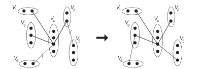

图 2.5. GMSTP 的一个当前解和一个修改后的解。

在前一图中，我们考虑了一个节点被划分为 6 个簇的图 G 和一个当前解 T。随机选择 T 的一个子树 U（例如，通过丢弃连接簇 V4 与 V5 以及 V2 与 V5 的节点的边），我们应用局部贪心算法，以便在给定子树 U 的情况下获得 T 邻域中的最佳修改解。

## 实现细节与计算结果

我们的计算实验是在一台配备双 Intel Pentium III 处理器（1000 MHz）和 512 MB 内存的计算机上进行的。结合模拟退火和局部贪心方案的过程是用 Java 编写的。

经过一些初步测试后，我们选择了以下冷却计划：我们从温度 T0 = 100 开始，冷却率 r = 0.95 将用于在每个步骤中降低温度，并且在每个阶段中评估 L = 30 次移动。

我们考虑了一个具有 n 个节点的无向图 G = (V, E)，这些节点被划分为 m 个簇，每个簇包含相同数量的节点。不同簇的所有节点之间定义了边，边的成本在区间 [1,100] 中随机生成。对于每种类型的实例 (n, m)，我们随机生成了五个不同的问题，即具有不同边成本的问题。我们使用的实例与 Myung [128] 和 Feremans [37] 考虑的实例类似。

在下一个表中，我们比较了使用结合模拟退火和局部贪心算法求解 GMSTP 得到的计算结果，与 Feremans [37] 和 Pop [142, 150] 给出的计算结果。

表中的前两列列出了问题的大小，即簇的数量 (m) 和节点的数量 (n)。接下来的两列描述了模拟退火过程，包含作为 GMSTP 最优值百分比得到的上界 (UB/OPT)，以及求解 GMSTP 的计算时间 (CPU)（秒）。最后几列包含作为 GMSTP 问题最优值百分比的下界 (UB/OPT)，使用根化过程求解 GMSTP 的计算时间 (CPU)（秒）（参见 [142, 150]），以及


作为GMSTP上界百分比的下界（LB/UB），以及使用分支切割算法求解GMSTP的计算时间（CPU，单位：秒）（参见[37]）。在最后两列中，“-”表示对于那些实例，[37]未提供计算结果。

需要注意的是，我们使用模拟退火结合局部贪婪算法，能够获得所考虑所有实例的GMSTP最优解。

从表2.2可以看出，对于最多140个节点的实例，模拟退火的计算时间比其他方法更长。然而，对于较大的实例，虽然根化过程的计算时间呈指数增长，但模拟退火的计算时间是合理的。

对于中型和大型GMSTP实例（包含超过50个簇和200个节点的图），我们将我们的SA结果与变邻域搜索（VNS）（Hu, Leitner和Raidl [77]）、具有近期和频率记忆的禁忌搜索（TS）（Ghosh [49]）进行比较，对于TSPlib实例，还与Golden, Raghavan和Stanojevic的遗传算法（GA）[53]进行比较。

算法在两种类型的实例上进行了测试。一种由Ghosh [49]引入，他创建了三种名为分组欧几里得、随机欧几里得和非欧几里得随机实例的基准实例；另一种则对TSPlib实例应用地理聚类（参见Fischetti et al. [43]）。对于分组欧几里得实例，边长为span的正方形与簇相关联，并在大小为col x row的网格上规则分布。每个簇的节点在相应的正方形内随机分布。对于第二种基准实例，属于同一簇的节点不一定彼此接近，因为它们在1000 x 1000大小的正方形内随机生成，并随机化簇分配。在这两种情况下，边的成本由节点之间的欧几里得距离给出。最后，对于非欧几里得随机基准实例，边的成本在整数区间[0, 1000]中随机选择。所有考虑的图都具有完整的边集。这些基准实例的详细信息列于表2.3和2.4中。

在接下来的两个表格（表2.5和2.6）中，我们展示了实例名称、节点数、（平均）每簇节点数，以及不同算法得到的最终解的（平均）目标值。最佳值以粗体打印。对于SA和VNS，我们还提供目标值的相应标准差，用$\sigma$表示。

在表2.5中，我们将我们的SA与TS、VNS和VNDS在分组欧几里得实例、随机欧几里得实例和非欧几里得实例上进行比较。

分析表2.5和2.6中的结果，我们观察到，在所考虑的方法中，VNS和TS总体上是最强大的算法。

## 表2.2. 求解GMSTP的计算结果。

| 问题规模 | | SA算法 | | 根化过程 | | 分支切割 | |
|---|---|---|---|---|---|---|---|
| m | n | UB/OPT | CPU | LB/OPT | CPU | LB/UB | CPU |
| 8 | 24 | 100 | 2.6 | 100 | 0.0 | 100 | 0.0 |
| | 32 | 100 | 3.7 | 100 | 0.0 | 100 | 0.2 |
| | 48 | 100 | 5.6 | 100 | 0.3 | 100 | 1.4 |
| | 80 | 100 | 10.2 | 100 | 2.2 | 100 | 4.2 |
| 10 | 30 | 100 | 4.8 | 100 | 0.2 | 100 | 1.0 |
| | 40 | 100 | 6.7 | 100 | 0.3 | 100 | 1.0 |
| | 60 | 100 | 10.8 | 100 | 0.7 | 100 | 3.2 |
| | 100 | 100 | 20.6 | 100 | 1.9 | 100 | 8.8 |
| 12 | 36 | 100 | 8.3 | 100 | 0.7 | 100 | 1.8 |
| | 48 | 100 | 11.6 | 100 | 0.9 | 99.2 | 3.2 |
| | 72 | 100 | 19.1 | 100 | 3.7 | 100 | 6.8 |
| | 120 | 100 | 39.0 | 100 | 9.3 | - | - |
| 15 | 45 | 100 | 16.6 | 100 | 1.3 | 100 | 3.6 |
| | 60 | 100 | 21.6 | 100 | 1.7 | 97.1 | 6.2 |
| | 90 | 100 | 39.7 | 100 | 9.6 | 100 | 21.4 |
| | 150 | 100 | 80.2 | 100 | 34.1 | 98.8 | 42.4 |
| 18 | 54 | 100 | 27.2 | 100 | 2.6 | 99.5 | 7.6 |
| | 108 | 100 | 68.1 | 100 | 13.8 | - | - |
| | 180 | 100 | 143.8 | 100 | 150.4 | - | - |
| 20 | 60 | 100 | 37.5 | 100 | 7.2 | - | - |
| | 120 | 100 | 181.9 | 100 | 33.2 | 96.3 | 39.8 |
| | 200 | 100 | 219.8 | 100 | 203.8 | 94.6 | 191.4 |
| 25 | 75 | 100 | 80.8 | 100 | 17.5 | - | - |
| | 150 | 100 | 221.7 | 100 | 266.4 | 88.3 | 178.8 |
| | 200 | 100 | 331.1 | 100 | 284.5 | 97.8 | 140.6 |
| 30 | 90 | 100 | 150.4 | 100 | 60.2 | - | - |
| | 180 | 100 | 412.0 | 100 | 721.8 | 96.6 | 114.6 |
| | 240 | 100 | 627.4 | 100 | 1948.9 | - | - |
| 40 | 120 | 100 | 382.1 | 100 | 142.6 | 100 | 92.6 |
| | 160 | 100 | 561.0 | 100 | 572.3 | 94.2 | 288.6 |
| | 280 | 100 | 691.2 | 100 | 25672.3 | - | - |

## 表2.3. 从Ghosh [49]采用的基准实例。每个实例具有恒定的每簇节点数。

| 实例集 | |V| | |E| | r | |V|/r | col | row | sep | span |
|---|---|---|---|---|---|---|---|---|---|---|
| 分组欧几里得 125 | 125 | 7750 | 25 | 5 | 5 | 5 | 10 | 10 |
| 分组欧几里得 500 | 500 | 124750 | 100 | 5 | 10 | 10 | 10 | 10 |
| 分组欧几里得 600 | 600 | 179700 | 20 | 30 | 5 | 4 | 10 | 10 |
| 分组欧几里得 1280 | 1280 | 818560 | 64 | 20 | 8 | 8 | 10 | 10 |
| 随机欧几里得 250 | 250 | 31125 | 50 | 5 | - | - | - | - |
| 随机欧几里得 400 | 400 | 79800 | 20 | 20 | - | - | - | - |
| 随机欧几里得 600 | 600 | 179700 | 20 | 30 | - | - | - | - |
| 非欧几里得 200 | 200 | 19900 | 20 | 10 | - | - | - | - |
| 非欧几里得 500 | 500 | 124750 | 100 | 5 | - | - | - | - |
| 非欧几里得 600 | 600 | 179700 | 20 | 30 | - | - | - | - |

## 表2.4. 具有地理聚类的TSPlib实例，来自Feremans [37]。每个簇的节点数各不相同。

| 实例名称 | |V| | |E| | r | |V|/r | d_min | d_max |
|---|---|---|---|---|---|---|---|---|
| gr137 | 137 | 9316 | 28 | 5 | 1 | 12 |
| kroa150 | 150 | 11175 | 30 | 5 | 1 | 10 |
| d198 | 198 | 19503 | 40 | 5 | 1 | 15 |
| kroB200 | 200 | 19900 | 40 | 5 | 1 | 8 |
| gr202 | 202 | 20301 | 41 | 5 | 1 | 16 |
| ts225 | 225 | 25200 | 45 | 5 | 1 | 9 |
| pr226 | 226 | 25425 | 46 | 5 | 1 | 16 |
| gil262 | 262 | 34191 | 53 | 5 | 1 | 13 |
| pr264 | 264 | 34716 | 54 | 5 | 1 | 12 |
| pr299 | 299 | 44551 | 60 | 5 | 1 | 11 |
| lin318 | 318 | 50403 | 64 | 5 | 1 | 14 |
| rd400 | 400 | 79800 | 80 | 5 | 1 | 11 |
| fl417 | 417 | 86736 | 84 | 5 | 1 | 22 |
| gr431 | 431 | 92665 | 87 | 5 | 1 | 62 |
| pr439 | 439 | 96141 | 88 | 5 | 1 | 17 |
| pcb442 | 442 | 97461 | 89 | 5 | 1 | 10 |

## 表2.5. Ghosh [49]实例集上的结果。

| 集合 | |V| | r | |V|/r | TS C(T) | VNDS C(T) | SA C(T) | σ | VNS C(T) | σ |
|---|---|---|---|---|---|---|---|---|---|---|---|
| 分组欧几里得 125 | 125 | 25 | 5 | 141.1 | 141.1 | 152.3 | 0.52 | 141.1 | 0.00 |
| | 125 | 25 | 5 | 133.8 | 133.8 | 150.9 | 0.74 | 133.8 | 0.00 |
| | 125 | 25 | 5 | 143.9 | 145.4 | 156.8 | 0.00 | 141.4 | 0.00 |
| 分组欧几里得 500 | 500 | 100 | 5 | 566.7 | 577.6 | 642.3 | 0.00 | 567.4 | 0.57 |
| | 500 | 100 | 5 | 578.7 | 584.3 | 663.3 | 1.39 | 585.0 | 1.32 |
| | 500 | 100 | 5 | 581.6 | 588.3 | 666.7 | 1.81 | 583.7 | 1.82 |
| 分组欧几里得 600 | 600 | 20 | 30 | 85.2 | 87.5 | 93.9 | 0.00 | 84.6 | 0.11 |
| | 600 | 20 | 30 | 87.9 | 90.3 | 99.5 | 0.28 | 87.9 | 0.00 |
| | 600 | 20 | 30 | 88.6 | 89.4 | 99.2 | 0.17 | 88.5 | 0.00 |
| 分组欧几里得 1280 | 1280 | 64 | 20 | 327.2 | 329.2 | 365.1 | 0.46 | 315.9 | 1.91 |
| | 1280 | 64 | 20 | 322.2 | 322.5 | 364.4 | 0.00 | 318.3 | 1.78 |
| | 1280 | 64 | 20 | 332.1 | 335.5 | 372.0 | 0.00 | 329.4 | 1.29 |
| 随机欧几里得 250 | 250 | 50 | 5 | 2285.1 | 2304.9 | 2584.3 | 23.82 | 2300.9 | 40.27 |
| | 250 | 50 | 5 | 2183.4 | 2343.3 | 2486.7 | 0.00 | 2201.8 | 23.30 |
| | 250 | 50 | 5 | 2048.4 | 2263.7 | 2305.0 | 16.64 | 2057.6 | 31.58 |
| 随机欧几里得 400 | 400 | 20 | 20 | 557.4 | 725.9 | 665.1 | 3.94 | 615.3 | 10.8 |
| | 400 | 20 | 20 | 724.3 | 839.0 | 662.1 | 7.85 | 595.3 | 0.00 |
| | 400 | 20 | 20 | 604.5 | 762.4 | 643.7 | 14.54 | 587.3 | 0.00 |
| 随机欧几里得 600 | 600 | 20 | 30 | 541.6 | 656.1 | 491.8 | 7.83 | 443.5 | 0.00 |
| | 600 | 20 | 30 | 540.3 | 634.0 | 542.8 | 25.75 | 573.0 | 10.2 |
| | 600 | 20 | 30 | 627.4 | 636.5 | 469.5 | 2.75 | 469.0 | 11.9 |
| 非欧几里得 200 | 200 | 20 | 10 | 71.6 | 94.7 | 76.9 | 0.21 | 71.6 | 0.00 |
| | 200 | 20 | 10 | 41.0 | 76.6 | 41.1 | 0.02 | 41.0 | 0.00 |
| | 200 | 20 | 10 | 52.8 | 75.3 | 86.9 | 5.38 | 52.8 | 0.00 |
| 非欧几里得 500 | 500 | 100 | 5 | 143.7 | 203.2 | 200.3 | 4.44 | 152.5 | 3.69 |
| | 500 | 100 | 5 | 132.7 | 187.3 | 194.3 | 1.20 | 148.6 | 4.27 |
| | 200 | 20 | 10 | 162.3 | 197.4 | 205.6 | 0.00 | 166.1 | 2.89 |
| 非欧几里得 600 | 600 | 20 | 30 | 14.5 | 59.4 | 22.7 | 1.49 | 15.6 | 1.62 |
| | | 20 | 30 | 5 | 17.7 | 23.7 | 22.0 | 0.82 | 16.1 | 1.24 |
| | | 600 | 20 | 30 | 15.1 | 29.5 | 22.1 | 0.44 | 16.0 | 1.66 |


## 表 2.6. 带有地理聚类的 TSPLib 实例结果.

| 名称 | |V| | r | 时间 | TS C(T) | VNDS C(T) | SA C(T) | SA 标准差 | GA C(T) | VNS C(T) | VNS 标准差 |
|---|---|---|---|---|---|---|---|---|---|---|---|
| gr137 | 137 | 28 | 150 s | 329.0 | 330.0 | 352.0 | 0.00 | 329.0 | 329.0 | 0.00 |
| kroA150 | 150 | 30 | 150 s | 9815.0 | 9815.0 | 10885.6 | 25.63 | 9815.0 | 9815.0 | 0.00 |
| d198 | 198 | 40 | 300 s | 7062.0 | 7169.0 | 7468.73 | 0.83 | 7044.0 | 7044.0 | 0.00 |
| kro200 | 200 | 40 | 300 s | 11245.0 | 11353.0 | 12532.0 | 0.00 | 11244.0 | 11244.0 | 0.00 |
| gr202 | 202 | 41 | 300 s | 242.0 | 249.0 | 258.0 | 0.00 | 243.0 | 244.0 | 0.00 |
| ts225 | 225 | 45 | 300 s | 62366.0 | 63139.0 | 67195.0 | 34.49 | 62315.0 | 62268.5 | 0.51 |
| p226 | 226 | 54 | 300 s | 55515.0 | 55715.0 | 56286.6 | 40.89 | 55515.0 | 55515.0 | 0.00 |
| gil262 | 262 | 53 | 300 s | 942.0 | 979.0 | 1022.8 | 0.00 | - | 942.3 | 1.02 |
| pr264 | 264 | 54 | 300 s | 21886.0 | 22115.0 | 23445.8 | 68.27 | - | 21886.5 | 1.78 |
| p299 | 299 | 60 | 450 s | 20399.0 | 20578.0 | 22989.4 | 11.58 | - | 20322.6 | 14.67 |
| lin318 | 318 | 64 | 450 s | 18521.0 | 18533.0 | 20268.0 | 0.00 | - | 18506.8 | 11.58 |
| rd400 | 400 | 80 | 600 s | 5943.0 | 6056.0 | 6440.8 | 3.40 | - | 5943.6 | 9.69 |
| fl417 | 417 | 84 | 600 s | 1034.0 | 1036.0 | 1080.5 | 0.51 | - | 1033.0 | 0.18 |
| p439 | 439 | 88 | 600 s | 51852.0 | 52104.0 | 55694.1 | 45.88 | - | 51847.9 | 40.92 |
| pcb442 | 442 | 89 | 600 s | 19627.0 | 19961.0 | 21515.1 | 5.15 | - | 19702.8 | 52.11 |

## 2.6 注释

广义最小生成树问题（GMSTP）由 Myung 等人 [128] 于 1995 年提出。此后，出现了多篇研究论文，探讨该问题的不同方面，如复杂性、近似结果、整数规划公式，以及使用精确算法、启发式算法、元启发式算法和混合算法求解该问题。该问题在设计都市域网 [47] 和区域网 [173]、确定区域服务中心位置 [142]、能源运输 [135]、农业灌溉 [30] 等方面具有多种重要应用。

在本章中介绍了以下结果：

- 对 GMSTP 的（混合）整数规划公式的综述；
- 针对该问题的局部-全局方法，促进了 GMSTP 及其他广义网络设计问题的精确求解过程、启发式和元启发式算法的发展；
- 针对 GMSTP 的精确算法
- 针对该问题的近似算法，适用于簇大小有界的情况；
- 四种算法方法：基于 GMSTP 无向簇子装填公式的分支定界算法、基于局部-全局方法的启发式算法、基于局部-全局整数规划公式的生根过程，以及用于求解 GMSTP 的模拟退火启发式算法。

本章所呈现的材料主要基于 Pop [142, 143, 151]、Feremans 等人 [40] 以及 Pop 等人 [149, 154] 发表的结果。

## 第 3 章

### 广义旅行商问题（GTSP）

旅行商问题（TSP）无疑是组合优化问题中最经典、研究最深入的代表之一，拥有大量求解方法，并在物流、运输、规划、微芯片制造、DNA 测序等多个领域有应用。

与 TSP 相关的一些数学问题在 1800 年代由 W.R. Hamilton 研究，TSP 在 19 世纪初已出现在文献中。它于 1930 年代在维也纳由数学家和经济学家卡尔·门格尔 [120] 发表，后来由 H. Whitney 和 M. Flood 在普林斯顿学术圈推广，并被命名为旅行商问题。

与其他组合优化问题相比，TSP 的主要区别在于存在非常强大的问题特定方法，例如 Lin–Kernighan 算法 [113] 和有效的分支定界方法，这些方法能够在非常高的问题维度上实现全局最优解。

文献中考虑了 TSP 的多种扩展：时间相关 TSP、瓶颈 TSP、带利润 TSP、带混合交付和收集的 TSP、带回程的 TSP、单一商品拾取与配送 TSP、多 TSP 等。

本章讨论的是旅行商问题（TSP）的一种扩展，称为广义旅行商问题（GTSP）。给定一个完全无向图，其节点被划分为若干子集（簇），边带有非负成本，GTSP 包括寻找一条最小成本的哈密顿回路，该回路恰好包含每个簇的一个节点。因此，TSP 是 GTSP 的一个特例，其中每个簇恰好包含一个节点。

GTSP 的一个变体是寻找一条最小成本哈密顿回路的问题，该回路包含每个簇的至少一个顶点。该问题由 Laporte 和 Nobert [103] 以及 Noon 和 Bean [133] 提出。

GTSP 在位置问题、电信问题、铁路优化、规划、邮政路由、微芯片制造、物流、计算机文件排序等方面有多种应用。关于该问题及其应用的更多信息可参见 Fischetti、Salazar 和 Toth [42, 43]、Laporte、Asef-Vaziri 和 Sriskandarajah [105]、Laporte 和 Nobert [103] 等。

### 3.1 GTSP 的定义与复杂性

广义旅行商问题（GTSP）旨在寻找一条最小成本的回路 H，覆盖节点的一个子集，使得 H 恰好包含每个簇 V_i（i ∈ {1, ..., m}）的一个节点。

我们将此类回路称为广义哈密顿回路。图 3.1 展示了一个节点划分为 6 个簇的图中广义哈密顿回路的示例。

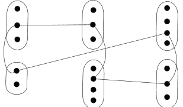

图 3.1. 广义哈密顿回路示例。

GTSP 涉及两个相关决策：

- 选择一个节点子集 S ⊆ V，使得对所有 k = 1, ..., m 均有 |S ∩ V_k| = 1。
- 在由 S 诱导的 G 的子图中寻找一条最小成本哈密顿回路。

GTSP 及其至少版本均为 NP-hard，因为当每个簇恰好包含一个节点时，它们可归约为旅行商问题。

### 3.2 GTSP 到 TSP 的高效转换

由于广义网络设计问题的复杂性，将这些问题高效转换为经典组合优化问题似乎是一种合适的方法。此外，对于经典组合优化问题，存在许多启发式和最优求解方法。鉴于存在大量针对 TSP 的精确算法和启发式算法（参见例如 [64, 109]），已经开发出多种将广义旅行商问题高效转换为 TSP 的方法：

- Noon 和 Bean [134] 描述了 GTSP 的第一种转换。他们采用两阶段方法，将 GTSP 转换为具有相同节点数的标准非对称 TSP：第一阶段将 GTSP 转换为聚类 TSP，然后再将其转换为标准非对称 TSP。Ben-Arieh 等人 [10] 在计算实验中研究了 Noon 和 Bean 的转换。
- Lien、Ma 和 Wah [112] 提出了一种将 GTSP 转换为经典 TSP 的方法，其中转换后的 TSP 节点数量相当多，实际上是相关 GTSP 节点数量的三倍多。
- Dimitrijević 和 Saric [26] 开发了另一种转换方法，减小了相应 TSP 的规模。在他们的方法中，TSP 的节点数是原始 GTSP 节点数的两倍。
- Behzad 和 Modarres [8] 提出了一种高效的转换方法，其中转换后的 TSP 节点数不超过原始 GTSP 的节点数。

以下，我们将描述由 Behzad 和 Modarres [8] 提出的 GTSP 到 TSP 的高效转换，这是对 Dimitrijević 和 Saric [26] 开发的转换的一种修改。应当指出，尽管在该转换中，底层 TSP 由有向图表示，但与 GTSP 相关的图不一定是有向图。

令 \(v_i^f\) 表示簇 \(V_r\) 的第 i 个节点。我们在与 \(G\) 相关的有向图 \(G'\) 上定义 TSP 如下：

- 1. G 和 G' 的节点集相同。
- 2. 每个簇的所有节点在 G' 中通过弧连接成一个环。我们用 \(v_{i(t)}^f\) 表示环中紧随 \(v_i^f\) 之后的节点。
- 3. 转换后的图 G' 的弧成本定义如下：

\(c'(v_i^f, v_{t(o)}^f) = 0\)

and

\(c'(v_i^f, v_j^f) = c(v_{t(o)}^f, v_j^f) + M . \quad r \neq t\)

其中 M 必须是一个足够大的数，例如 \(\sum_{(i,j) \in E} c(i,j)\)。


在有向图 \( G' \) 中，如果一条路径包含了簇的所有节点，则称为 *簇路径*。代价小于 \( (m + 1)M \) 的哈密顿回路称为 *簇化哈密顿回路*。

### 引理 3.1. (Behzad and Modarres [8]) 在 \( G' \) 中的每个簇化哈密顿回路都恰好进入并离开每个簇一次。

**证明。** 从有向图 \( G' \) 中的代价定义来看，从一个簇移动到另一个簇的代价至少为 \( M \)。由于每个哈密顿回路都访问所有 \( m \) 个簇，其代价至少为 \( mM \)。如果 \( G' \) 中的簇化哈密顿回路不沿着簇路径遍历，这意味着它进入并离开每个 \( m \) 个簇的次数超过一次。因此，回路的代价不能小于 \( (m + 1)M \)，这产生了矛盾。\(\square\)

我们现在可以定义 \( G' \) 中簇化哈密顿回路与 \( G \) 中广义哈密顿回路之间的一一对应关系：

- 1. 考虑 \( G' \) 中的一个簇化哈密顿回路，并按照其对应簇的顺序将其簇路径的首节点连接起来，那么结果就是 \( G \) 中的一个广义哈密顿回路。

- 2. 考虑 \( G \) 中包含以下节点的广义哈密顿回路 \(\cdots \rightarrow v'_i \rightarrow v''_i \rightarrow \cdots, r \neq t\)。将节点 \( v'_i \) 替换为以 \( v'_i \) 开头的第 \( V_i \) 个簇路径，然后将该路径的末节点连接到以 \( v'_j \) 开头的下一个簇路径，我们就得到 \( G' \) 中的一个簇化哈密顿回路。

显然，\( G \) 中访问 \( m \) 个簇的广义哈密顿回路的代价等于 \( G' \) 中对应簇化哈密顿回路的代价减去 \( mM \)。

在图 3.2 中，我们展示了定义在图 \( G \) 上的 GTSP 的一个最优解，以及定义在图 \( G' \) 上的对应 TSP。每个簇的节点在 \( G' \) 中由实弧构成环，如图所示。TSP 的最优解及其在 GTSP 中对应的解由点划弧说明。

尽管将 GTSP 转换为 TSP 的想法似乎非常有前景，但这种方法的应用非常有限，因为它要求得到 TSP 实例的精确解。即使是这样的 TSP 的近似最优解，也可能对应一个不可行的 GTSP 解。

### 3.3 广义旅行商问题的精确算法

在本节中，我们提出一个寻找广义旅行商问题精确解的算法。

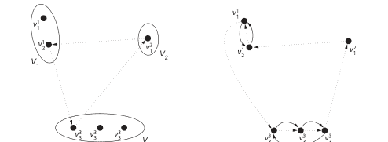

图 3.2. 带有最优解的 GTSP 及其关联 TSP 的示意图。

令 \( G' \) 为由 \( G \) 通过将簇 \( V_i \) 的所有节点替换为代表 \( V_i \) 的超级节点而得到的图。为方便起见，我们将 \( V_i \) 与代表它的超级节点识别。我们假设 \( G' \)（顶点集为 \( \{V_1, ..., V_m\} \)）是完全图。

给定簇的访问序列 \( (V_{k_1}, ..., V_{k_m}) \)，我们希望找到最佳可行哈密顿回路 \( H^* \)（关于代价最小化），按照给定序列访问簇。这可以在多项式时间内完成，通过求解 \( |V_{k_1}| \) 个最短路径问题，如下文所述。

我们构建一个分层网络，如图 3.3 所示，包含 \( m + 1 \) 个层，分别对应簇 \( V_{k_1}, ..., V_{k_m} \)。此外，我们复制簇 \( V_{k_1} \)。分层网络包含 \( G \) 的所有节点，以及每个 \( v \in V_{k_1} \) 的一些额外节点 \( v' \)。对于每个 \( i \in V_{k_l} \) 和 \( j \in V_{k_{l+1}} \)（\( l = 1, ..., m - 1 \)），存在一条边 \( \{i, j\} \)，代价为 \( c_{ij} \)。此外，对于每个 \( i \in V_{k_m} \) 和 \( j' \in V_{k_1} \)，存在一条边 \( \{i, j'\} \)，代价为 \( c_{ij}' \)。

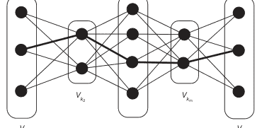

图 3.3. 构建的分层网络 LN 中广义哈密顿回路的示例。

对于任何给定的 \( v \in V_{k_1} \)，我们考虑从 \( v \) 到 \( v', w' \in V_{k_1} \) 的路径，这些路径恰好访问每个簇 \( V_{k_2}, \dots, V_{k_m} \) 中的一个节点，从而给出一个可行的广义哈密顿回路。

反之，每个按照序列 \( (V_{k_1}, \dots, V_{k_m}) \) 访问簇的广义哈密顿回路都对应于分层网络中从某个节点 \( v \in V_{k_1} \) 到 \( w' \in V_{k_1} \) 的路径。

因此，按照给定序列访问簇的最佳广义哈密顿回路 \( H^* \)（关于代价最小化）可以通过确定从每个 \( v \in V_{k_1} \) 到对应的 \( v' \in V_{k_1} \) 的所有最短路径来找到，这些路径恰好访问簇 \( (V_{k_2}, \dots, V_{k_m}) \) 中的每一个节点。

总的时间复杂度为 \( |V_{k_1}| (O(|E| + \log n)) \)，即最坏情况下为 \( O(n|E| + n \log n) \)。我们可以通过选择基数最小的簇作为 \( |V_{k_1}| \) 来减少时间。

请注意，上述过程导致了一个针对 GTSP 的 \( O((m-1)!(n|E| + n \log n)) \) 时间精确算法，通过尝试所有 \( (m-1)! \) 个可能的簇序列获得。因此，我们建立了以下结果：

### 定理 3.2. 上述过程在 \( O((m-1)!(n|E| + n \log n)) \) 时间内为广义旅行商问题提供精确解，其中 \( n \) 是节点数，\( |E| \) 是边数，\( m \) 是输入图中的簇数。

显然，所提出的算法是一个指数时间算法，除非簇数 \( m \) 是固定的。

### 3.4 GTSP 的整数规划公式

#### 3.4.1 基于哈密顿回路性质的公式

为了将 GTSP 问题表述为整数规划，我们引入二进制变量 \( x_e \in \{0, 1\} \)，\( e \in E \) 和 \( z_i \in \{0, 1\} \)，\( i \in V \)，以指示边 \( e \) 以及节点 \( i \) 是否包含在哈密顿回路中。GTSP 的一个可行解可以看作是一条包含 \( m \) 条边的回路，连接所有簇以及每个簇中恰好一个节点。因此，GTSP 可以表述为以下整数规划问题：

```
min \(\sum_{e \in E} c_e x_e\)
s.t. \(x(V_k) = 1, \quad \forall k \in K = \{1, \dots, p\},\) (3.1)
\(x(\delta(i)) = z_i, \quad \forall i \in V,\) (3.2)
\(x(E(S)) \le z(S - \{i\}), \quad \forall i \in S \subset V, 2 \le |S| \le n - 2.\) (3.3)
$x_e \in \{0, 1\}, \quad \forall e \in E, \qquad (3.4)$
$z_i \in \{0, 1\}, \quad \forall i \in V. \qquad (3.5)$
```

这里，我们使用了与第 2 章中广义最小生成树问题相同的记号。

在此公式中，目标函数清楚地描述了最优广义回路的代价。约束 (3.1) 保证我们从每个簇中恰好选择一个节点，约束 (3.2) 是 _度约束_。它们规定，如果选择了 $G$ 的一个节点，则它被恰好进入并离开一次。约束 (3.3) 是 _子回路消除约束_，禁止形成子回路，即少于 $n$ 个节点的子集上的回路。由于度约束，单个节点（因此也是 $n-1$ 个节点）上的子回路不可能发生。因此，仅为 $2 \le |S| \le n-2$ 定义约束 (3.3) 是有效的。最后，约束 (3.4) 和 (3.5) 对变量施加二进制条件。

该公式由 Fischetti 等人 [43] 提出，称为 _广义子回路消除公式_，因为约束 (3.3) 消除了少于 $n$ 个节点的子集上的所有回路。

由于在 GTSP 中，必须恰好访问每个簇中的一个节点，我们可以去除簇内边。考虑到这一简化，约束 (3.2) 等价于

$x(\delta(V_k)) = 2, \quad \forall k \in K = \{1, \dots, m\},$

且约束 (3.3) 等价于

$x(E(S)) \le r - 1, \quad \forall S = \cup_{j=1}^r V_j \quad \text{and} \quad 2 \le r \le m - 2.$

我们可以用连通性约束替换子回路消除约束 (3.3)，从而得到 _广义割集公式_，该公式也在 [43] 中提出

\(\begin{aligned}
\min \quad & \sum_{e \in E} c_e x_e, \\
\text{s.t.} \quad & (3.1), (3.4), (3.5), \\
& x(\delta(S)) \ge 2(z_i + z_j - 1), \quad \forall S \subset V, \quad 2 \le |S| \le n - 2, \\
& \quad \quad \quad i \in S, \quad j \notin S. \qquad (3.6)
\end{aligned}\)

迄今我们描述的两种公式都有指数数量的约束。接下来我们将考虑的公式只有多项式数量的约束，但我们将添若干变量。

#### 3.4.2 基于流的公式

为了给出 GTSP 的紧凑公式，一种可能性是在自然的二进制边和节点变量之外引入“辅助”流变量。


我们希望在网络的节点之间发送流量，并将边变量 \(x_e\) 视为指示边 \(e \in E\) 是否能够承载流量。我们考虑三种此类流量模型：单商品模型、多商品模型和双向流量模型。在这些模型中，尽管边是无向的，但流量变量将是有向的。也就是说，对于每条边 \(\{i, j\} \in E\)，我们将有从 \(i\) 到 \(j\) 和从 \(j\) 到 \(i\) 两个方向的流量。

在单商品模型中，源簇 \(V_1\) 向每个其他簇发送一个单位的流量。令 \(f_{ij}\) 表示边 \(e = \{i, j\}\) 上从 \(i\) 到 \(j\) 方向的流量。这导出了以下模型：

\[
\begin{aligned}
\min & \sum_{e \in E} c_e x_e \\
\text{s.t.} & \quad (3.1), (3.2), \\
 & \Delta(f_e) = \mu, \quad (3.7) \\
 & f_{ij} + f_{ji} \le (m-1)x_e, \quad \forall e = \{i, j\} \in E, \quad (3.8) \\
 & f_{ij} \ge 0, \quad (3.9) \\
 & x, z \in \{0, 1\},
\end{aligned}
\]

where \(\Delta(f_e) = \sum_{e \in \delta^+(i)} f_e - \sum_{e \in \delta^-(i)} f_e\) and
\[
\mu = \begin{cases} (m-1)z_i & \text{对于 } i \in V_1 \\ -z_i & \text{如果 } i \notin V_1 \end{cases}.
\]

在此模型中，约束 (3.7) 将 \(m-1\) 个单位的单商品流量限制在簇 \(V_1\) 中，并将 1 个单位的流量从每个其他簇流出。这些约束称为 *质量平衡方程*，并暗示由任何解定义的网络包含每个簇的一个节点并满足度约束，每个可行解必须是广义哈密顿回路。因此，当投影到 \((x, z)\) 变量的空间时，该模型正确地建模了 GTSP。

我们令 \(\mathcal{P}_{flow}\) 表示该模型线性规划松弛可行集投影到 \((x, z)\)-空间。

通过考虑多商品流量，可以获得更强的松弛。在此模型中，每个节点集 \(k \in K_1 = \{2, \dots, m\}\) 定义一种商品。一个单位的商品 \(k\) 起源于 \(V_1\) 并必须送达节点集 \(V_k\)。令 \(f_{ij}^k\) 表示弧 \((i, j)\) 上商品 \(k\) 的流量，我们得到以下模型：

\[
\begin{aligned}
\min & \sum_{e \in E} c_e x_e. \\
\text{s.t.} & \quad (3.1), (3.2), \\
 & \Delta(f_a^k) = \mu_k, \quad \forall k \in K_1, \quad (3.10) \\
 & f_{ij}^k \le w_{ij}, \quad \forall a = (i, j) \in A, k \in K_1, \quad (3.11) \\
 & w_{ij} + w_{ji} = x_e, \quad \forall e = \{i, j\} \in E, \quad (3.12) \\
 & f_a^k \ge 0, \quad \forall a = (i, j) \in A, k \in K_1, \quad (3.13) \\
 & x, z \in \{0, 1\},
\end{aligned}
\]

where
\[
\mu_k = \begin{cases} z_i & \text{对于 } i \in V_1 \\ -z_i & \text{如果 } i \in V_k \\ 0 & \text{如果 } i \notin V_1 \cup V_k \end{cases}.
\]

and the binary variables \(w_{ij}, (i, j) \in A\) indicate whether an arc \((i, j)\) is contained in the Hamiltonian tour. The directed graph \(D = (V, A)\) is obtained by replacing each edge \(e = \{i, j\} \in E\) with the opposite arcs \((i, j)\) and \((j, i)\) in \(A\), with the same weight as the edge \(\{i, j\} \in E\).

我们令 \(P_{\text{mcflow}}\) 表示该模型线性规划松弛可行集投影到 \((x, z)\)-空间。

## 提议 3.3. \(P_{\text{mcflow}} \subseteq P_{\text{flow}}\).

*Proof.* Let \((w, x, z, f) \in P_{\text{mcflow}}\), then

\[
0 \le \sum_{k \in K_1} f_{ij}^k \le |K_1| w_{ij} \le (m-1)x_e.
\]

With \(f_{ij} = \sum_{k \in K_1} f_{ij}^k\), for every \(e = \{i, j\} \in E\), we find

\[
\Delta(f) = \sum_{k \in K_1} \left( \sum_{a \in \delta^+(i)} f_a^k - \sum_{a \in \delta^-(i)} f_a^k \right) = \mu.
\]

We obtain a closely related formulation by eliminating the variables \(w_{ij}\). The resulting formulation consists of the constraints (3.1), (3.2), (3.4), (3.5), (3.10), (3.13) plus

\[
f_{ij}^h + f_{ji}^k \le x_e, \quad \forall h, k \in K_1 \quad \text{和} \quad \forall e \in E. \quad (3.14)
\]

We refer to this model as the *bidirectional flow formulation* of the GTSP with \(P_{\text{bidflow}}\) denoting its set of feasible solutions in \((x, z)\)-space.

In the bidirectional flow formulation, the constraints (3.14), which are called the *bidirectional flow inequalities*, link the flow of different commodities flowing in different directions on the edge \(\{i, j\}\). These constraints model the following fact: in any feasible generalized spanning tree, if we eliminate the edge \(\{i, j\}\) and divide the nodes in two sets, any commodity whose associated node lies in the same set as the root node set, does not flow on edge \(\{i, j\}\). Any two commodities, whose associated nodes both lie in the set without the root, both flow on edge \(\{i, j\}\) in the same direction. So, whenever two commodities \(h\) and \(k\) both flow on edge \(\{i, j\}\), they flow in the same direction and hence, one of \(f_{ij}^h\) and \(f_{ji}^k\) equals zero.

## 提议 3.4. \(P_{\text{mcflow}} = P_{\text{bidflow}}\).

*Proof.* If \((w, x, z, f) \in P_{\text{mcflow}}\), using the constraints (3.11) and (3.12), we have

\[
f_{ij}^h + f_{ji}^h \le w_{ij} + w_{ji} = x_e,
\]

for all \(e = \{i, j\} \in E\) and for all \(h, k \in K_1\).

If, on the other hand, we assume that \((x, z, f) \in P_{\text{bidflow}}\), then, using the constraints (3.14), we get

\[
\max_h f_{ij}^h + \max_k f_{ji}^k \le x_e, \quad \forall e = \{i, j\} \in E.
\]

Hence, we can choose \(w\) such that \(\max_h f_{ij}^h \le w_{ij}\) and \(x_e = w_{ij} + w_{ji}\) for all \(e = \{i, j\} \in E\). For example, take

\[
w_{ij} = \frac{1}{2}(x_e + \max_h f_{ij}^h + \max_k f_{ji}^k).
\]

Clearly, we obtain \((w, x, z, f) \in P_{\text{mcflow}}\).

#### 3.4.3 局部-全局模型

Our last model arises from discriminating between global variables and local ones. Recall the construction of the graph \(G'\), obtained by shrinking each cluster of \(G\) into a single node.

We introduce the variables \(y_{ij}\) (\(i, j \in \{1, \dots, m\}\)) to describe the inter-cluster (global) connections. Hence, \(y_{ij} = 1\) if the cluster \(V_i\) is connected to the cluster \(V_j\) and \(y_{ij} = 0\) otherwise. We assume that \(y\) represents a Hamiltonian tour. The convex hull of all these \(y\)-vectors is generally known as the Hamiltonian tour polytope on the global graph \(G'\).

Following Miller et al. [122] this polytope, denoted by \(P_{\text{TSP}}\), can be represented by the following polynomial number of constraints:

\[
\sum_{j=1, j \neq i}^m y_{ij} = 1, \quad \forall i \in \{1, \dots, m\},
\]
\[
\sum_{i=1, i \neq j}^m y_{ij} = 1, \quad \forall j \in \{1, \dots, m\},
\]
\[
u_i - u_j + (m-1)y_{ij} \le m-2, \quad \forall i, j \in \{2, \dots, m\} \quad \text{和} \quad i \neq j. \quad (3.15)
\]
\[
1 \le u_i \le m-1, \quad \forall i \in \{2, \dots, m\}. \quad (3.16)
\]

where the additional variables \(u_i\) represent the sequence in which city \(i\) is visited, with \(i \neq 1\).

The constraints (3.15) ensure that the solution contains no subtour on a set of nodes \(S\) with \(|S| \le m-1\) and hence, that no solution involves less than \(m\) nodes. The constraints (3.16) ensure that the \(u_i\) variables are uniquely defined for any feasible tour.

If the vector \(y\) describes a Hamiltonian tour on the global graph \(G'\), the corresponding best *generalized Hamiltonian tour* (w.r.t. cost minimization) \((x, z) \in \{0, 1\}^{|E| \times |V|}\) can be obtained either by determining all shortest paths from each node \(v \in V_{k_1}\) to each \(w' \in V_{k_1}\) that visit exactly one node from clusters \((V_{k_2}, \dots, V_{k_m})\), or by solving the following 0 - 1 programming problem:

\[
\begin{aligned}
\min & \sum_{e \in E} c_e x_e, \\
\text{s.t. } & z(V_k) = 1, \quad \forall k \in K = \{1, \dots, m\}, \\
& x(V_l, V_r) = y_{lr}, \quad \forall l, r \in K = \{1, \dots, m\}, \\
& x(i, V_r) \le z_i, \quad \forall r \in K, \forall i \in V \setminus V_r, \\
& x_e, z_i \in \{0, 1\}, \quad \forall e = \{i, j\} \in E, \forall i \in V.
\end{aligned}
\]

For a given \(y\), we denote the feasible set of the linear programming relaxation of this program by \(P_{local}(y)\).

Pop et al. [150] proved that if \(z\) is the 0 - 1 incidence vector of a spanning tree of the contracted graph, the polyhedron \(P_{local}(y)\) is integral. But, as we will show in the next example, a similar result does not hold when \(y\) is the incidence vector of the Hamiltonian tour, because if \(y\) is the 0 - 1 incidence vector of a Hamiltonian tour on the contracted graph, \(P_{local}(y)\) may not be integral.

If the lines drawn in Figure 3.4 (i.e., \(\{1, 4\}, \{2, 3\}\), etc.) have cost \(M \gg 1\), then \(y = \frac{1}{2}\) and \(x = \frac{1}{2}\), on the drawn lines, is an optimal solution of \(P_{local}(y)\), showing that the polyhedron \(P_{local}(y)\) is not integral.

The observations presented so far lead to our final formulation, called the local-global formulation of the GTSP, as a 0-1 mixed integer programming problem:

\[
\begin{aligned}
\min & \sum_{e \in E} c_e x_e. \\
\text{s.t. } & z(V_k) = 1, \quad \forall k \in K = \{1, \dots, m\}, \\
& x(V_l, V_r) = y_{lr}, \quad \forall l, r \in K = \{1, \dots, m\},
\end{aligned}


\(x(i, V_r) \le z_i, \quad \forall r \in K, \forall i \in V \setminus V_r,\)
\(y \in P_{TSP},\)
\(y_{lr} \in \{0, 1\}, \quad 1 \le l, r \le m.\)

GTSP的这一新表述是通过将表征\(P_{TSP}\)的约束（其中\(y \in \{0, 1\}\)）纳入\(P_{local}(y)\)中得到的。

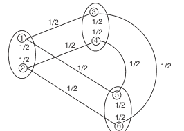

**图 3.4.** 示例，表明如果\(y\)是收缩图上哈密顿回路的0-1关联向量，则\(P_{local}(y)\)可能具有分数极点。

### 3.5 求解广义旅行商问题

研究人员对求解GTSP给予了高度关注。如前一节所示，已有多种将GTSP转换为TSP的方法被提出。已经开发出两种GTSP近似算法。Slavik [187]为GTSP开发了一种\(3\rho/2\)近似算法，其中\(\rho\)是最大簇中的节点数，即\(\rho = \max_{i=1,\dots,m}(|V_i|)\)，并额外假设距离矩阵满足三角不等式。由于\(\rho\)可能相当大，最坏情况界限可能相对较弱。Garg和Konjevod [46]描述了一种群Steiner问题的近似算法，该算法为GTSP提供了一个\(O(\log^2(n) \log(\log(n)) \log(m))\)近似算法。

Fischetti等人 [43] 提出了一种高效的精确算法，该算法基于分支定界法，可求解多达89个簇和442个节点等实例的最优解。该方法是求解GTSP的最先进的精确算法。Noon和Bean [133] 描述了一种拉格朗日松弛方法，用于计算GTSP最优解总成本的下界。

获得GTSP最优解的困难导致了多种启发式和元启发式算法的开发。Noon [132]描述了几种GTSP启发式算法，其中最有希望的是对TSP著名的最近邻启发式算法的改编。Fischetti等人 [43] 提出了类似的最远插入、最近插入和最便宜插入启发式算法的改编。Renaud和Boctor [178] 开发了迄今发表的最复杂的启发式算法，他们称之为GI³（广义初始化、插入和改进）。它包含三个阶段，是Renaud等人 [179] 提出的I³启发式算法的推广。最近，Cacchiari等人 [14] 提出了一种多启动启发式算法，该算法从随机选择的顶点集合开始迭代，并应用分解方法，结合改进程序。Karapetyan和Gutin [95] 研究了GTSP的特定邻域以及可以快速探索这些邻域的算法。

已为求解GTSP提出了多种元启发式方法，包括一种使用随机键编码的遗传算法，该编码确保通过交叉和变异算子构造的解是可行的，该算法由Snyder和Daskin [188] 引入。Pinto等人 [139] 开发了一种基于蚁群系统的元启发式算法，称为强化蚁群系统（RACS）算法，因为它使用新的信息素规则和信息素挥发技术。Silberholz和Golden [184] 描述了一种具有多种新特性的遗传算法，包括孤立的初始种群和基于TSP有序交叉算子的新繁殖机制。Tasgetiren等人 [197] 开发了一种带有并行种群的差分进化算法集成。Shi等人 [185] 和Tasgetiren等人 [196] 开发了基于粒子群优化的算法。Gutin等人 [65, 66]。Bontoux等人 [13] 提出了模因算法，该算法将遗传算法的能力与局部搜索过程相结合。

最近，Pop等人 [161, 166] 开发了两种混合算法，其中遗传算法或顾问引导搜索技术与局部-全局方法相结合，以高效求解GTSP。Gutin和Karapetyan [65] 通过将遗传算法与强大的局部搜索过程相结合获得的模因算法，可以被视为迄今发表的最具竞争力的算法。

在本节中，我们将描述两种求解广义旅行商问题的算法方法：

- 强化蚁群系统
- 将顾问引导搜索技术与GTSP的局部-全局方法相结合获得的混合启发式技术

#### 3.5.1 求解GTSP的强化蚁群系统

在本节中，我们描述了一种称为强化蚁群系统（RACS）的新算法，该算法基于蚁群系统（ACS），用于求解广义旅行商问题。

该新算法强制构建（ACS）中使用的有效解，采用如[140]中的信息素更新规则以及Stützle和Hoos [194]中的信息素挥发。

令\( V_k(v) \)表示来自簇\( V_k \)的节点\( v \)。GTSP的RACS算法工作如下：

- 初始时，蚂蚁被放置在图的节点上，随机选择*簇*，并从所选簇中随机选择一个节点。
- 在迭代\( t+1 \)时，每只蚂蚁移动到未访问*簇*中的一个新节点，并更新控制算法的参数。

每条边都标记有信息素浓度。令\( \tau_{ij}(t) \)表示时间\( t \)时边\( (i, j) \)的信息素浓度。当蚂蚁决定移动到哪个节点时，它基于到该节点的距离（即边的成本）以及连接边上的信息素浓度量，以一定概率进行选择。

从一个节点到下一个节点的距离的倒数称为*能见度*，\( \eta_{ij} = \frac{c_{ij}}{d_{ij}} \)。

- 在每个时间单位内，会发生挥发，以防止信息素浓度无限增加。挥发率用\( \rho \)表示，其值在0和1之间。

为了防止蚂蚁在同一回路中访问同一个*簇*，会维护一个禁忌表。这防止蚂蚁访问之前访问过的*簇*。蚂蚁禁忌表在每次完成回路后清空。

- 为了偏好选择具有高信息素值\( \tau \)和高能见度\( \eta \)的边，考虑概率函数\( p^k_{iu} \)。用\( J^k_i \)表示蚂蚁\( k \)未访问的节点\( i \)的邻居，并令\( u \in J^k_i \)，\( u = V_k(v) \)为来自未访问簇\( V_k \)的节点\( v \)，该概率函数定义如下：

```
\( p^k_{iu}(t) = \frac{[\tau_{iu}(t)][\eta_{iu}(t)]^\beta}{\sum_{o \in J^k_i} [\tau_{io}(t)][\eta_{io}(t)]^\beta}.\) (3.17)
```

其中\( \beta \)是用于调整选择下一个节点时边成本相对重要性的参数。

如果\( q > q_0 \)，\( p^k_{iu} \)是选择\( j=u \)的概率，其中\( u = V_k(v) \)是下一个节点（当前节点是\( i \)）。

如果\( q \le q_0 \)，下一个节点\( j \)按以下方式选择：

```
\( j = \arg\max_{u \in J^k_i} \{ [\tau_{iu}(t)][\eta_{iu}(t)]^\beta \}\) (3.18)
```

其中\( q \)是在区间\( [0, 1] \)上均匀分布的随机变量，\( q_0 \)是一个类似于模拟退火中温度的参数，且\( 0 \le q_0 \le 1 \)。

参数\( q_0 \)起着重要作用，有机会改进算法。在RACS算法中，参数\( q_0 \)的值在每次迭代时都会改变。例如，对于接近1的初始\( q_0 \)值，\( q_0 \)的值会减小一个小值\( c_0 \)，例如\( c_0 = 0.1 \)。如果\( q_0 \le c_0 \)，则修改\( q_0 \)。

- 每次转移后，使用[140]中的修正规则更新信息素浓度：

```
\(\tau_{ij}(t+1) = (1-\rho)\tau_{ij}(t) + \rho \frac{1}{n \cdot L^+}.\) (3.19)
```

其中\( L^+ \)是最佳回路的成本。

- 在蚁群系统中，只有生成最佳回路的蚂蚁才被允许全局更新信息素。全局更新规则应用于属于*最佳回路*的边。修正规则是

```
\(\tau_{ij}(t+1) = (1-\rho)\tau_{ij}(t) + \rho \Delta \tau_{ij}(t).\) (3.20)
```

其中\( \Delta \tau_{ij}(t) \)是最佳回路成本的倒数。

- 为了避免停滞，我们使用了Stützle和Hoos [194] 引入的信息素挥发技术。当信息素轨迹高于上限\( \tau_{max} \)时，信息素轨迹会被重新初始化。

信息素挥发在全局信息素更新规则之后使用。

RACS算法在给定时间\( time_{max} \)内计算一个次优解，并可表述如下：

算法3.5（GTSP强化蚁群系统算法）。

```
For every edge \((i, j)\) do \(\tau_{ij}(0) = \tau_0\)
for \(k = 1\) to \(m\) do
  place ant k on a randomly chosen node
  from a randomly chosen cluster
  let \(T^+\) be the shortest tour found and \(L^+\) its length
  while \((t < time_{max})\) do
    for \(k = 1\) to \(m\) do
      build tour \(T^k(t)\) by applying n-1 times
      choose the next node \(j\) from an unvisited cluster,
      \(j = \left\{ \begin{array}{ll} \arg\max_{u \notin J_k^t} [\tau_{iu}(t)] \cdot [\eta_{iu}]^\beta & \text{if } q \le q_0 \\ J & \text{if } q > q_0 \end{array} \right.\)
```


其中 \( J \in J_i^k \) 按以下概率选择：

\( p^k_{ij}(t) = \frac{[\tau_{ij}(t)] \cdot [\eta_{ij}(t)]^\beta}{\Sigma_{l \in J_i^k} [\tau_{il}(t)] \cdot [\eta_{il}(t)]^\beta} \)

且其中 \( i \) 为当前节点

应用新的局部更新规则

\( \tau_{ij}(t + 1) = (1 - \rho) \cdot \tau_{ij}(t) + \rho \cdot \frac{1}{nL^+} \)

end for

for \( k=1 \) 到 \( m \) 执行

计算路径 \( T^k(t) \) 的长度 \( L^k(t) \)

如果找到更优路径，则更新 \( T^k(t) \) 和 \( L^k(t) \)

对于每条边 \( (i, j) \in T^+ \) 执行

通过应用规则更新信息素轨迹：

\( \tau_{ij}(t + 1) = (1 - \rho) \cdot \tau_{ij}(t) + \rho \cdot \Delta \tau_{ij}(t) \)

其中 \( \Delta \tau_{ij}(t) = \frac{1}{L^+} \)

如果 \( (\tau_{ij}(t) > \tau_{max}) \) 则 \( \tau_{ij}(t) = \tau_0 \)

end for

end while

打印最短路径 \( T^+ \) 及其长度 \( L^+ \)

#### 3.5.2 计算结果

为评估我们算法的性能，将 RACS 与文献中的其他三种启发式算法进行了比较。在数值实验中，我们使用了 TSPLIB 库 [177] 中的问题，该库为每个问题提供了最优目标值。已考虑了涉及欧氏距离的多个问题。

最初，在这些问题中，节点集未划分为簇。为了将其划分为子集，我们使用了 Fischetti 等人 [43] 提出的名为 Clustering 的过程。该过程设置簇的数量 \( nc = \lceil n/5 \rceil \)，识别彼此最远的 \( nc \) 个节点（称为中心），并将每个剩余节点分配给其最近的中心。显然，一些现实世界问题可能具有不同的簇结构，但本文提出的求解过程能够处理任何簇结构。

所有信息素轨迹的初始值 \(\tau_0\) 为

\(\tau_0 = \frac{1}{n \cdot L_{nn}}.\) (3.21)

其中 \(L_{nn}\) 是最近邻（NN）算法的结果。NN 可能是 TSP 最自然的启发式算法。在 NN 算法中，路径始终前往最近的尚未访问的位置。相应的路径按构建顺序遍历节点。

对于信息素挥发阶段，令 \(\tau_{max}\) 表示上界

\(\tau_{max} = \frac{1}{1-\rho} \cdot \frac{1}{L_{nn}}.\) (3.22)

给定区间 [0, 1] 中的随机值 \(q_0\)，参数 \(q_0\) 的值按以下方式修改：

\(q_0 = q_0 - 0.1; \text{ if } q_0 < 0.1 \text{ then } q_0 = 0.9.\) (3.23)

与所有其他蚁群系统一样，算法中参数的选择至关重要。迄今尚未开发出能够在每种情况下给出最优参数的数学分析。

在所提出的 RACS 算法中，基于初步实验，参数值选择如下：\(\beta \in \{2, 5\}\), \(\rho \in (0.1, 0.5)\), \(q_0 \in \{0.9, 0.5\}\), \(c_0 = 0.1\) 且 \(m = 2\)。

在下一个表格（表 3.1）中，我们比较了使用 RACS 算法求解 GTSP 的计算结果，与使用经典最近邻（NN）启发式算法 [178]、复合启发式算法 \(GI^3\) [178] 和随机键遗传算法 [188] 获得的计算结果。

对于每个问题，所有解均为算法连续运行五次的平均值。终止标准由用户设置的最大计算时间 \(time_{max}\) 给出。在我们的情况中，\(time_{max} = 5\) 分钟。

表格中的列如下：

- 实例：测试问题的名称。名称开头的数字给出簇的数量（\(nc\)）。名称末尾的数字给出节点的数量（\(n\)）；
- 最优值：问题的最优目标值，如 [188] 所示。
- RACS、NN、\(GI^3\)、GA：RACS 返回的目标值、来自 [178] 的经典最近邻启发式算法、来自 [178] 的 \(GI^3\) 启发式算法以及来自 [188] 的随机键遗传算法。

从表 3.1 可以看出，强化蚁群系统算法表现良好，在许多情况下找到了最优解。强化系统在预设的时间间隔内找到良好解：在 36 个实例中的 18 个实例中，

表 3.1. 用于求解 GTSP 的强化蚁群系统（RACS）与其他算法的对比。

| 实例 | 最优值 | RACS | NN | GI³ | GA |
|---|---|---|---|---|---|
| 11EIL51 | 174 | 174 | 181 | 174 | 174 |
| 14ST70 | 316 | 316 | 326 | 316 | 316 |
| 16EIL76 | 209 | 209 | 234 | 209 | 209 |
| 16PR76 | 64 925 | 64 925 | 76 554 | 64 925 | 64 925 |
| 20RAT99 | 497 | 497 | 551 | 497 | 497 |
| 20KROA100 | 9 711 | 9 711 | 10 760 | 9 711 | 9 711 |
| 20KROB100 | 10 328 | 10 328 | 10 328 | 10 328 | 10 328 |
| 20KROC100 | 9 554 | 9 554 | 11 025 | 9 554 | 9 554 |
| 20KROD100 | 9 450 | 9 450 | 10 040 | 9 450 | 9 450 |
| 20KROE100 | 9 523 | 9 523 | 9 763 | 9 523 | 9 523 |
| 20RD100 | 3 650 | 3 650 | 3 966 | 3 653 | 3 650 |
| 21EIL101 | 249 | 249 | 260 | 250 | 249 |
| 21LIN105 | 8 213 | 8 213 | 8 225 | 8 213 | 8 213 |
| 22PR107 | 27 898 | 27 898 | 28 017 | 27 898 | 27 898 |
| 22PR124 | 36 605 | 36 607.2 | 38 432 | 36 762 | 36 605 |
| 26BIER127 | 72 418 | 72 418 | 83 841 | 76 439 | 72 418 |
| 28PR136 | 42 570 | 42 570 | 47 216 | 43 117 | 42 570 |
| 29PR144 | 45 886 | 45 925.6 | 46 746 | 45 886 | 45 886 |
| 30KROA150 | 11 018 | 11 021.2 | 11 712 | 11 018 | 11 018 |
| 30KROB150 | 12 196 | 12 197.2 | 13 387 | 12 196 | 12 196 |
| 31PR152 | 51 576 | 51 588.4 | 53 369 | 51 820 | 51 576 |
| 32U159 | 22 664 | 22 707 | 26 869 | 23 254 | 22 664 |
| 39RAT195 | 854 | 854 | 1 048 | 854 | 854.2 |
| 40D198 | 10 557 | 10 559.2 | 12 038 | 10 620 | 10 557 |
| 40KROA200 | 13 406 | 13 407.2 | 16 415 | 13 406 | 13 406 |
| 40KROB200 | 13 111 | 13 114.2 | 17 945 | 13 111 | 13 113.4 |
| 45TS225 | 68 345 | 69 056.2 | 72 691 | 68 756 | 68 435.2 |
| 46PR226 | 64 007 | 64 028 | 68 045 | 64 007 | 64 007 |
| 53GIL262 | 1 013 | 1 021.2 | 1 152 | 1 064 | 1 016.2 |
| 53PR264 | 29 549 | 29 549.6 | 33 552 | 29 655 | 29 549 |
| 60PR299 | 22 615 | 22 726.2 | 27 229 | 23 119 | 22 631 |
| 64LIN318 | 20 765 | 20 790.2 | 24 626 | 21 719 | 20 836.2 |
| 80RD400 | 6 361 | 6 416.2 | 7 996 | 6 439 | 6 509 |
| 84FL417 | 9 651 | 9 730.2 | 10 553 | 9 697 | 9 653 |
| 88PR439 | 60 099 | 60 898 | 67 428 | 62 215 | 60 316.8 |
| 89PCB442 | 21 657 | 22 022.8 | 26 756 | 22 936 | 22 134 |

我们获得了 GTSP 的已知最优值，对于其余实例，已知最优值与使用我们 RACS 方法获得的值之间的百分比差距最多为 1.5%。

通过选择更长的执行时间或更好的参数选择，有可能改进结果。如果使用精细调整的参数值，用于广义旅行商问题的 RACS 算法可能会得到改进。此外，与其他算法的高效组合可能会改进结果。

#### 3.5.3 求解 GTSP 的混合启发式方法

我们首先简要描述顾问引导搜索（CGS）元启发式算法。有关详细介绍，请参阅 [86]。

CGS 是一种用于求解困难组合优化问题的新型群体智能技术，其灵感来源于真实人士基于顾问建议做出决策的方式。它已成功应用于经典旅行商问题（TSP）[87] 和二次赋值问题 [88]。

CGS 是一种基于种群的方法。CGS 种群中的个体是一个虚拟人，可以同时充当客户和顾问。作为客户，虚拟人在每次迭代中构建问题的一个解。作为顾问，虚拟人根据其策略向客户提供建议。通常，在解构建的每个步骤中，客户可以从多个变体中选择。顾问推荐的变体被选中的概率更高，但客户可以选择其他变体之一，该变体将基于某些启发式方法进行选择。

在每次迭代开始时，客户根据个人偏好和顾问的声誉选择顾问。顾问的声誉随其客户取得的成功数量而增加。如果客户构建的解优于截至该时间点由同一顾问指导的任何客户找到的所有其他解，则该客户取得成功。每次客户取得成功时，顾问会调整其策略，以反映客户所做的决策序列。由于声誉会随时间而消退，顾问需要其客户不断取得成功，以维持其声誉。如果顾问的声誉低于最小值，他将休假，在此期间他将停止向客户提供建议，而是开始为未来使用寻找新策略。

在本小节中，我们描述了一种用于 GTSP 的算法，该算法将顾问引导搜索技术与局部-全局方法相结合，并通过使用局部搜索过程改进解。最具实际重要性的 GTSP 实例是具有欧氏距离的对称问题，其中簇由空间上彼此接近的节点组成。我们设计算法以利用这些实例的结构。


## 算法

在每次迭代中，客户构建一个全局巡回路径，即全局图中的哈密顿回路。顾问的策略也由一个全局巡回路径表示，顾问将其宣传给他的客户。算法应用局部搜索过程，以改进代表客户的全局解或处于休假模式的顾问策略的全局巡回路径。然后，使用第 3.2 节中描述的簇优化过程，算法找到最佳广义巡回路径，它对应于局部搜索过程返回的全局巡回路径。

为了比较休假期间构建的策略，顾问使用每个策略对应的广义巡回路径的成本。同样，客户的成功基于广义解的成本进行评估。我们算法的伪代码如算法 3.6 所示。

虚拟人员可能处于正常模式或休假模式之一。在初始化阶段（第 2-5 行），创建虚拟人员并将其置于休假模式。基于其模式，在算法的每次迭代中（第 7-31 行），虚拟人员构建问题的全局解（第 19 行）或全局顾问策略（第 9 行）。在本小节后面，我们将描述构建全局解或策略所涉及的操作，以及客户为当前迭代选择顾问所使用的方法（第 17 行）。

全局策略和全局解通过应用局部搜索过程得到改进（第 10 行和第 20 行）。然后使用第 3.2 节中描述的 clusterOptimization 过程，找到与当前全局策略对应的最佳广义策略（第 11 行）或与当前全局解对应的最佳广义解（第 21 行）。构建全局策略后，处于休假模式的虚拟人员检查对应的广义策略是否是自休假开始以来找到的最佳广义策略（第 12-15 行）。同样，构建全局解后，客户检查对应的广义解，以决定他是否取得了成功，如果是，他会更新其顾问的策略（第 22-26 行）。每次迭代结束时，每个虚拟人员的声誉和行动模式都会被更新（第 30-31 行）。

算法 3.7 详细说明了如何根据客户取得的成功来更新顾问的声誉。

声誉随时间以恒定速率衰减，该速率由参数 fadingRate 给出（第 4 行）。顾问的声誉随其每个客户取得的每一次成功而增加（第 5 行），并且为找到迄今最佳解而获得额外 10 分的奖励（第 6-9 行）。

顾问的声誉不能超过最大值（第 10-12 行），并且算法防止最佳顾问（即找到迄今最佳解的顾问）的声誉低于给定值（第 13-17 行）。

常量参数 initialReputation 表示在休假结束时分配给顾问的声誉。

算法 3.8 详细说明了如何更新每个虚拟人员的行动模式。声誉低于最低水平的顾问被置于休假模式，而休假期结束的顾问被置于正常模式。

算法 3.9 显示了将虚拟人员置于休假或正常行动模式所采取的操作。

## 算法 3.6 (CGS-GTSP 算法)。

```
procedure CGS-GTSP()
   create the set P of virtual persons
   foreach p ∈ P do
setSabbaticalMode(p)
   end foreach
   while (termination condition not met) do
     foreach virtual person p do
       if actionMode[p] = sabbatical then
         currStrategy[p] ← constructStrategy(p)
         applyLocalSearch(currStrategy[p])
         genStrategy ← clusterOptimization(currStrategy[p])
         if cost(genStrategy) < bestStrategyCost then
           bestStrategy[p] ← currStrategy[p]
           bestStrategyCost[p] ← cost(currStrategy[p])
         end if
       else
         c ← chooseConsultant(p)
         if c ≠ null then
           currSol[p] ← constructSolution(p,c)
           applyLocalSearch(currSol[p])
           currGenSol[p] ← clusterOptimization(currSol[p])
           if currGenSol[p] is better than all solutions found by a client
             of c since last sabbatical then
             successCount[c] ← successCount[c] + 1
             strategy[c] ← currSol[p]
           end if
         end if
       end if
     end foreach
   end while
   updateReputations()
   updateActionModes()
end procedure
```

## 算法 3.7 (更新声誉的过程)。

```
procedure updateReputations()
    foreach p ∈ P do
        if actionMode[p] = normal then
            rep[p] ← rep[p] * (1 - fadingRate)
            rep[p] ← rep[p] + successCount[p]
        if cost(currGenSol[p]) < cost(bestSoFarSol) then
            bestSoFarSol ← currGenSol[p]
            rep[p] ← rep[p] + 10    // reputation bonus
        end if
        if rep[p] > 10 * initialReputation then
            rep[p] ← 10 * initialReputation
        end if
        if p is the best consultant then
            if rep[p] < initialReputation then
                rep[p] ← initialReputation
            end if
        end if
    end foreach
end procedure
```

## 算法 3.8 (更新行动模式的过程)。

```
procedure updateActionModes()
    foreach p ∈ P do
        if actionMode[p] = normal then
            if rep[p] < 1 then
                setSabbaticalMode(p)
            end if
        else
            sabbaticalCountdown ← sabbaticalCountdown - 1
            if sabbaticalCountdown = 0 then
                setNormalMode(p)
            end if
        end if
    end foreach
end procedure
```

## 算法 3.9 (设置休假和正常模式的过程)。

```
procedure setSabbaticalMode(p)
    actionMode[p] ← sabbatical
    bestStrategy[p] ← null
    bestStrategyCost[p] ← infinity
    sabbaticalCountdown ← 20
end procedure
procedure setNormalMode(p)
    actionMode[p] ← normal
    rep[p] ← initialReputation
    strategy(p) ← bestStrategy[p]
end procedure
```

## 策略与解的构建

休假期间用于构建新策略的启发式方法基于全局图中超节点之间的虚拟距离。我们将两个超节点之间的虚拟距离计算为两个对应簇质心之间的距离。选择此启发式方法的理由是，我们的算法设计用于一类问题，即具有欧几里得距离的对称实例，其中簇内的节点在空间上彼此靠近。

通过在簇之间引入虚拟距离，我们有可能使用候选列表，以限制每个构建步骤中可用的选择数量。对于每个簇 \( V_i \)，我们考虑一个包含最接近的 \( cand \) 个簇的候选列表，其中 \( cand \) 是一个参数。这样，簇 \( V_i \) 中人员 \( k \) 的可行邻域表示簇 \( V_i \) 的候选列表中该人员 \( k \) 尚未访问的簇集合。几种 TSP 的启发式算法在解构建阶段使用候选列表（参见 [13]，作为其在蚁群优化算法中应用的示例），但候选列表尚未广泛用于构建 GTSP 的解。我们的算法在策略解的构建过程中都使用候选列表。

使用候选列表可能会显著提高算法所需的时间，但也可能导致遗漏良好解。因此，选择适当的候选列表大小和元素对于算法的工作至关重要。在 TSP 的情况下，大小为 20 的候选列表经常被使用，但 10 到 40 之间的其他值也很常见 [91]。对于 GTSP，由空间上彼此靠近的节点组成的簇的实例，适当的候选列表大小要小得多。我们的实验表明，在这种情况下，4 或 5 的值是足够的。


在休假期间，顾问使用随机比例规则来决定下一步访问哪个簇。对于顾问 $k$，当前位于簇 $V_i$，选择簇 $V_j$ 的概率由以下公式给出：

$$p_{ij}^k = \frac{1/d_{ij}}{\sum_{l \in \mathcal{N}_i^k} (1/d_{il})}$$ (3.24)

其中 $\mathcal{N}_i^k$ 是人员 $k$ 在簇 $V_i$ 时的可行邻域，$d_{il}$ 是簇 $V_i$ 和簇 $V_j$ 之间的虚拟距离。

如前所述，可行邻域 $\mathcal{N}_i^k$ 包含簇 $V_i$ 的候选列表中人员 $k$ 尚未访问的簇集合。如果候选列表中的所有簇都已访问，顾问可以使用类似于公式 (3.24) 给出的随机比例规则，从不在候选列表中的簇中选择一个。

在休假期间，将簇之间的虚拟距离作为启发式方法使用，可以得到相当好的初始策略。然而，一般来说，在应用簇优化过程后，相对于簇之间虚拟距离最优的全局巡回路线，并不能产生最优的广义巡回路线。因此，在解构造阶段，算法不依赖于簇之间的距离，尽管它仍然使用候选列表来确定簇的可行邻域。

在每一步中，客户会收到下一步应访问簇的推荐。该推荐基于顾问宣传的全局巡回路线。设 $V_i$ 为客户 $k$ 在当前迭代的构造步骤中访问的簇。为了决定下一步推荐哪个簇，顾问找到簇 $V_i$ 在其宣传的全局巡回路线中出现的位置，并识别该巡回路线中 $V_i$ 的前驱簇和后继簇。如果这两个簇都未被客户访问过，顾问会随机推荐其中一个。如果只有一个未被访问，则选择该簇作为推荐。最后，如果这两个簇都已被访问，顾问无法为下一步提出推荐。

客户并不总是遵循顾问的推荐。选择下一步移动到的簇 $V_j$ 的规则由以下公式给出：

$$V_j = \begin{cases} V_p & \text{if } V_p \neq null \land q \le q_0 \\ \text{random}(\mathcal{N}_i^k) & \text{otherwise.} \end{cases}$$ (3.25)

其中：
- $V_p$ 是顾问为下一步推荐的簇；
- $q$ 是在 [0,1] 上均匀分布的随机变量，$q_0$ ($0 \le q_0 \le 1$) 是一个参数；
- $\mathcal{N}_l^k$ 是人员 $k$ 在簇 $V_l$ 时的可行邻域；
- random 是一个函数，从给定的集合中随机选择一个元素。

同样，如果候选列表中的所有簇都已访问，可行邻域 $\mathcal{N}_l^k$ 为空。在这种情况下，忽略顾问推荐的客户可以使用类似于公式 (3.24) 给出的随机比例规则，从不在候选列表中的簇中选择一个。

客户对特定顾问的个人偏好被计算为与顾问宣传的全局巡回路线对应的广义巡回路线成本的倒数。结合声誉，客户使用个人偏好来计算选择特定顾问 $k$ 的概率：

$$p_k = \frac{(\text{reputation}_k \times \text{preference}_k)^2}{\sum_{c \in \mathcal{C}} (\text{reputation}_c \times \text{preference}_c)^2} \quad (3.26)$$

其中 $\mathcal{C}$ 是所有可用顾问的集合。

在每次迭代中，顾问 $k$ 的声誉以恒定速率 $r$ 衰减：

$$\text{reputation}_k \leftarrow \text{reputation}_k(1 - r) \quad (3.27)$$

当顾问的声誉降至最低水平以下时，该顾问进入休假模式。在我们的算法中，此最低声誉值设为 1，休假时长设为 20 次迭代。休假结束时，顾问的声誉将重置为由参数 $initialReputation$ 指定的给定值。

此外，算法防止最佳顾问的声誉低于此初始值。我们将策略导致构建迄今最佳解的顾问指定为最佳顾问。

每当客户取得成功时，其顾问的声誉会增加。如果客户构建了迄今最佳解，顾问的声誉将获得额外 $bonus$。顾问的声誉不能超过参数 $maxReputation$ 给定的最大值。

## 使用置信度的算法变体

在此，我们提出一种基于文献 [87] 介绍的方法的算法变体，该方法将顾问的推荐与一定的置信度水平相关联。顾问宣传的全局巡回路线中的每条弧都有关联的强度。每当顾问调整其策略时，强度都会更新。如果新宣传巡回路线中的某条弧也存在于旧宣传巡回路线中，则其强度会增加。否则，其强度设为 0。弧的强度可以解释为顾问向客户推荐该弧的置信度。客户更有可能接受置信度更高的推荐。

这一想法在我们的算法中体现为：在每个构造步骤中，允许公式 (3.25) 中参数 \( q_0 \) 的值在给定范围内变化：

$$q_0 = \begin{cases} q_{\min} + s \cdot \frac{q_{\max}-q_{\min}}{s_{\max}} & \text{if } s < s_{\max} \\ q_{\max} & \text{otherwise} \end{cases}, \quad (3.28)$$

其中 \( s \) 是推荐弧的强度，\( q_{\min} \)、\( q_{\max} \) 和 \( s_{\max} \) 是常数参数。使用置信度在某种程度上弥补了解构造阶段缺乏启发式方法的不足。

## 局部搜索

在策略构造和解构造阶段构建的全局巡回路线，通过使用局部搜索过程进行改进，其通用描述见算法 3.10。

### 算法 3.10（局部搜索过程）。

```
procedure applyLocalSearch(H_G)
  H <- clusterOptimization(H_G)
  foreach H'_G \in tourNeighborhood(H_G) do
    if quickCheck(H'_G) then
      H' <- partialClusterOptimization(H'_G, H_G)
      if cost(H') < cost(H) then
        H_G <- H'
        H <- H'
      end if
    end if
  end foreach
end procedure
```

\( H_G \) 和 \( H'_G \) 表示全局哈密顿巡回路线，即簇图中的巡回路线，而 \( H \) 和 \( H' \) 表示广义哈密顿巡回路线。我们的算法可以与任何符合上述算法结构的局部搜索过程相结合。\( clusterOptimization \) 函数（第 2 行）的工作原理已在第 3.2 节中解释。

第 6 行中的 \( cost \) 函数计算广义哈密顿巡回路线的成本。算法 3.10 中引用的其他函数仅以通用形式指定，必须由局部搜索过程的每个具体实现来实现。

\( tourNeighborhood \) 函数（第 3 行）应返回一组全局巡回路线，表示作为其参数提供的全局巡回路线 \( H_G \) 的邻域。\( quickCheck \) 函数（第 4 行）旨在通过快速拒绝不太可能带来改进的候选全局巡回路线来加快局部搜索，从而避免进行部分簇优化。

\( partialClusterOptimization \) 函数（第 5 行）从按照全局巡回路线 \( H'_G \) 中簇的顺序遍历 \( H \) 的节点所得到的广义巡回路线开始。然后，它在得到的广义巡回路线中重新分配一些顶点，并尝试改进其成本。通常，该函数仅考虑有限数量的顶点进行重新分配，其复杂度通常低于 \( clusterOptimization \) 函数。

由 \( partialClusterOptimization \) 函数构建的广义巡回路线仅在其成本优于当前广义巡回路线的成本时才被接受（第 6–9 行）。

我们提供了算法 3.10 中所示通用局部搜索过程的两个实例化：一个基于 2-opt 局部搜索，另一个基于 3-opt 局部搜索。此处仅描述基于 2-opt 的变体。除了考虑 3 条弧之间的交换外，基于 3-opt 的局部搜索与基于 2-opt 的变体非常相似。

在基于 2-opt 的局部搜索中，\( tourNeighborhood \) 函数返回一组全局巡回路线，这些路线是通过将原始全局巡回路线中的一对弧 \( (C_a, C_\beta) \) 和 \( (C_\gamma, C_\delta) \) 替换为一对弧 \( (C_a, C_\gamma) \) 和 \( (C_\beta, C_\delta) \) 得到的。为了减少必须考虑的交换数量，我们的 \( tourNeighborhood \) 函数返回的集合仅包含 \( \gamma \) 在 \( \alpha \) 的候选列表中的巡回路线。换句话说，只有当簇 \( \gamma \) 的质心靠近簇 \( \alpha \) 的质心时，才会考虑一对弧进行交换。

在此情况下使用的 \( partialClusterOptimization \) 函数类似于文献 [43] 中介绍的 RP1 过程。设 \( (C_a, C_\beta) \) 和 \( (C_\gamma, C_\delta) \) 为原始全局巡回路线 \( H_G \) 中的两条弧，它们已被替换为邻域全局巡回路线 \( H'_G \) 中的 \( (C_a, C_\gamma) \) 和 \( (C_\beta, C_\delta) \)，如图 3.5 所示：

然后可以重新分配簇 \( C_\alpha \)、\( C_\beta \)、\( C_\gamma \) 和 \( C_\delta \) 中的顶点，以最小化广义巡回路线的成本。为此，我们必须确定两个节点对 \( (a', w') \) 和 \( (v', z') \)，使得：

$$
\begin{aligned}
d_{a'w'} + d_{w'w} + d_{w'h} &= \min\{d_{ia} + d_{ab} + d_{bh} \mid a \in C_\alpha, b \in C_\gamma\} \\
d_{jv'} + d_{v'z'} + d_{z'k} &= \min\{d_{ja} + d_{ab} + d_{bk} \mid a \in C_\beta, b \in C_\delta\}
\end{aligned}
\quad (3.29)
$$

此计算需要 \( |C_\alpha||C_\gamma| + |C_\beta||C_\delta| \) 次比较。为了加快局部搜索，我们首先执行快速拒绝测试。仅当以下不等式成立时，才计算公式 (3.29) 中的量：

$$
d_{\min}(C_\rho, C_\alpha) + d_{\min}(C_\alpha, C_\gamma) + d_{\min}(C_\gamma, C_\alpha) + d_{\min}(C_\alpha, C_\beta) +
d_{\min}(C_\beta, C_\delta) + d_{\min}(C_\delta, C_\tau) < d_{iw} + d_{wv} + d_{vj} + d_{hw} + d_{wz} + d_{zk} \quad (3.30)
$$

其中 \( d_{\min}(C_\alpha, C_\beta) \) 是簇 \( C_\alpha \) 和 \( C_\beta \) 之间每对顶点的最小距离。这些最小距离仅在启动算法时计算一次。


## 实验设置

我们将算法作为用 Java 编写的软件包的一部分实现，可在 http://swarmst.sourceforge.net/ 在线获取。在此地址，我们提供复现实验所需的所有信息。

在所有实验中，我们使用长度为 4 的候选列表。算法的其他参数已使用 paramILS 配置框架 [83] 进行调优。我们生成了一组包含 100 个欧几里得 TSP 实例，n 个城市均匀分布在区间 [200, 500] 内，坐标均匀分布在 10000 x 10000 维空间中。

随后，通过应用 [43] 中引入的 CLUSTERING 过程，将这些实例转换为 GTSP。该过程设置聚类数量 s = ceil(n/5)，识别彼此最远的 s 个节点，并将每个剩余节点分配给其最近的中心。我们将得到的 GTSP 实例用作 paramILS 的训练数据。

在开始调优过程之前，我们使用默认配置在训练集中的每个实例上运行了算法 10 次。每次运行在 n/10 秒后终止，我们存储了每个 GTSP 实例获得的最佳结果。在调优过程中，这些最佳已知结果被用作算法的终止条件。

每次 paramILS 针对给定实例评估一个参数配置时，我们确定我们的算法

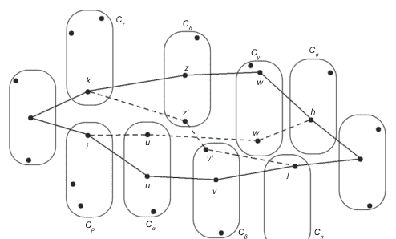

图 3.5. 广义 2-opt 交换。

使用给定参数配置，获得至少与该实例的最佳已知结果一样好的结果所需的平均时间（在 10 次试验中平均）。

表 3.2. 标准算法的参数配置。

| 参数 | 值 | 描述 |
|---|---|---|
| \( m \) | 8 | 虚拟人数 |
| \( q_0 \) | 0.8 | 参见公式 3.25 |
| \( initialReputation \) | 6 | 休假后的声誉；参见算法 3.6 和算法 3.8 |
| \( reputationFadingRate \) | 0.003 | 声誉衰减率；参见算法 3.6 |
| \( candidateListSize \) | 5 | 候选列表中的聚类数量 |

表 3.3. 使用置信度的算法变体的参数配置。

| 参数 | 值 | 描述 |
|---|---|---|
| \( q_{min} \) | 0.7 | 用于计算的参数 |
| \( q_{max} \) | 0.98 | \( q_0 \) 的值； |
| \( s_{max} \) | 3 | 参见公式 (3.25)、(3.28) |

经过 10 次 paramILS 迭代找到的最佳参数配置如表 3.2 所示。

对于使用置信度的算法变体，我们采用了与标准算法相同的程序，但仅调优了参数 \( q_{min} \)、\( q_{max} \) 和 \( s_{max} \) 的值。对于参数 \( m \)、initialReputation、reputationFadingRate 和 candidateListSize，我们使用了表 3.2 中的值。

经过 10 次 paramILS 迭代，找到的使用置信度的算法变体的最佳参数配置如表 3.3 所示。

#### 3.5.4 计算结果

所提算法的性能已在 18 个由对称欧几里得 TSP 实例生成的 GTSP 问题上进行了测试。这些包含 198 到 442 个节点的 TSP 实例源自 TSPLIB [209] 基准库。相应的 GTSP 问题通过应用 [43] 中引入的 CLUSTERING 过程获得。对于这 16 个 GTSP 实例，Fischetti 等人 [43] 已确定了最优目标值。对于其余 2 个实例，最佳已知结果被推测为最优。

目前，Gutin 和 Karapetyan [65] 的模因算法明显优于所有已发表的 GTSP 启发式算法。因此，我们使用该算法作为评估我们算法不同变体性能的基准。我们使用以下缩写来标识实验中使用的算法：

- GK: Gutin 和 Karapetyan [65] 的模因算法。
- CGS-2: 我们算法的标准变体，结合 2-opt 局部搜索。
- CGS-3: 我们算法的标准变体，结合 3-opt 局部搜索。
- CGS-C-2: 使用置信度的我们算法的变体，结合 2-opt 局部搜索。
- CGS-C-3: 使用置信度的我们算法的变体，结合 3-opt 局部搜索。

对于每个 GTSP 实例，我们运行每个算法 25 次，并报告获得最优解所需的平均时间。对于 GK 算法，我们使用其作者提供的 C++ 实现。GK 的运行时间与 [65] 中报告的值不同，因为我们在 32 位平台上使用 Intel Core2 Duo 2.2 GHz 处理器运行实验，而 [65] 中展示的结果是在 64 位平台上使用更快的处理器（AMD Athlon 64 X2 3.0 GHz）获得的。计算结果如表 3.4 所示。每个问题的名称以聚类数量为前缀，以节点数量为后缀。优于 GK 算法获得的时间的平均时间以粗体显示。对于每个问题和每个 CGS 算法变体，我们还报告单侧 Wilcoxon 秩和检验的 p值，用于原假设（H0），即对于给定问题，所考虑的算法变体的运行时间与 GK 算法的运行时间没有差异，以及备择假设（H1），即所考虑的算法对于给定问题优于 GK 算法。应用多重比较的 Bonferroni 校正，我们得到调整后的 α水平：0.05/18 = 0.00278。粗体的 p值表示在此显著性水平下拒绝原假设的情况。

可以看出，CGS-C-3 在 18 个实例中的 9 个上优于 GK，且在 7 种情况下结果显著更好。CGS-C-2 在 18 个实例中的 8 个上优于 GK，且在某些情况下结果显著更好。不使用置信度的变体性能较差，对于少数实例，它们需要花费更多的时间来找到最优解。

对于几对算法，我们使用单侧 Wilcoxon 符号秩检验来计算原假设（H0）的 p值，即第一个算法的运行时间与第二个算法的运行时间没有差异，以及备择假设（H1），即第一个算法的运行时间优于第二个算法的运行时间。p值如表 3.5 所示，其中显著的 p值（p < 0.05）以粗体显示。

可以看出，GK 优于我们的算法。然而，在 CGS-C-3 的情况下，差异不具有统计显著性。同样，CGS-C-3 优于 CGS-C-2，但数字不具有统计显著性。3-opt lo-

表 3.4.

| 问题实例 | 最优成本 | GK 时间 | CGS-C-3 时间 | CGS-C-3 p值 | CGS-C-2 时间 | CGS-C-2 p值 | CGS-3 时间 | CGS-3 p值 | CGS-2 时间 | CGS-2 p值 |
|---|---|---|---|---|---|---|---|---|---|---|
| 40d198 | 10,557 | 0.46 | 0.36 | 0.0004 | 0.33 | 0.0012 | 0.47 | 0.0034 | 0.45 | 0.0050 |
| 40krA200 | 13,406 | 0.38 | 0.33 | 0.0000 | 0.25 | 0.0000 | 0.37 | 0.5711 | 0.30 | 0.0001 |
| 40krB200 | 13,111 | 0.48 | 0.60 | 0.9460 | 0.37 | 0.0008 | 0.59 | 0.9689 | 0.60 | 0.6156 |
| 41gr202 | 23,301 | 0.71 | 0.64 | 0.0141 | 0.91 | 0.4674 | 1.35 | 1.0000 | 1.10 | 0.9101 |
| 45si225 | 68,340 | 0.61 | 3.32 | 1.0000 | 4.06 | 0.9957 | 1.92 | 0.9999 | 2.67 | 1.0000 |
| 49n226 | 1,612 | 0.51 | 4.83 | 1.0000 | 3.25 | 0.9994 | 4.07 | 1.0000 | 2.28 | 0.9967 |
| 46gr229 | 71,972 | 0.81 | 0.36 | 0.0000 | 0.33 | 0.0000 | 0.39 | 0.0000 | 0.37 | 0.0000 |
| 53gl262 | 1,013 | 0.83 | 1.22 | 0.1071 | 2.63 | 0.9999 | 1.63 | 1.0000 | 3.49 | 1.0000 |
| 59pr264 | 29,549 | 0.67 | 0.57 | 0.0070 | 0.49 | 0.0005 | 0.94 | 0.9482 | 1.08 | 0.9406 |
| 56a280 | 1,079 | 0.94 | 1.79 | 0.8215 | 3.71 | 0.9999 | 2.02 | 0.9998 | 4.46 | 1.0000 |
| 60np299 | 22,615 | 1.10 | 3.54 | 0.9992 | 2.91 | 0.9992 | 3.23 | 1.0000 | 4.74 | 0.9999 |
| 64lin318 | 20,765 | 1.16 | 0.85 | 0.0000 | 2.68 | 0.9929 | 1.28 | 0.8946 | 3.81 | 1.0000 |
| 80rl400 | 6,361 | 2.57 | 10.30 | 0.9996 | 13.27 | 1.0000 | 87.96 | 1.0000 | 270.04 | 1.0000 |
| 84rl417 | 9,651 | 1.91 | 7.10 | 0.0000 | 7.59 | 0.0001 | 7.51 | 0.0012 | 2.27 | 0.0512 |
| 87gr431 | 101,946 | 6.01 | 8.16 | 0.8361 | 12.86 | 0.9916 | 477.38 | 1.0000 | 866.53 | 1.0000 |
| 89nr439 | 60,099 | 4.07 | 7.56 | 0.0000 | 1.32 | 0.0000 | 3.68 | 0.0104 | 10.71 | 0.9999 |
| 89pbc442 | 21,657 | 4.24 | 11.11 | 0.9980 | 13.53 | 1.0000 | 395.93 | 1.0000 | 1430.13 | 1.0000 |


表 3.5. 使用单侧 Wilcoxon 符号秩检验的性能比较。

| 第一个算法 | 第二个算法 | p 值 |
|---|---|---|
| GK | CGS-C-3 | 0.1061 |
| GK | CGS-C-2 | 0.0368 |
| GK | CGS-3 | 0.0069 |
| GK | CGS-2 | 0.0005 |
| CGS-C-3 | CGS-C-2 | 0.0708 |
| CGS-C-3 | CGS-3 | 0.0152 |
| CGS-C-2 | CGS-2 | 0.0028 |

cal search 对 2-opt 局部搜索所得结果的显著改进可能是 3-opt 复杂度更大的后果。然而，使用置信度与不使用置信度的 CGS 变体之间的运行时间存在显著差异。由于某些算法变体在不使用置信度的情况下在某些情况下获得了非常差的结果，这些差异不仅在统计上，而且在实际意义上都显著，从而表明置信度组件的重要性。

Figure 3.6 显示候选列表大小如何影响 CGS-C-3 找到问题实例 64lin318 的最优解所需的时间。结果在 25 次试验中取平均值。

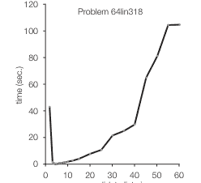

图 3.6. 候选列表大小对查找问题 64lin318 的最优解所需时间的影响。

可以看出，候选列表的大小对算法查找最优解所需的时间有巨大影响。因此，使用候选列表是有助于我们算法成功的关键组件。

对于大小为 4 或 5 的候选列表，可获得最佳结果，但我们应注意，即使只有 2 个元素的候选列表，算法也能找到最优解。然而，在这种情况下，所需时间会显著增加。这是因为，当使用只有 2 个元素的候选列表时，在当前簇的候选列表中找到最优巡回的下一个簇的概率显著较小。

对于 64lin318 实例，当使用包含 2 个元素的候选列表时，只有 64 个簇中的 44 个出现在其前驱簇的候选列表中。相比之下，当使用包含 5 个元素的候选列表时，有 59 个簇出现。即使对于非常小的候选列表，算法也能找到最优解，因为在构建阶段，客户可以访问当前候选列表中不在的簇，如果候选列表中的所有簇都已被访问，或者当顾问推荐时。

对于包含大量元素的候选列表，算法在运行时间方面的性能会变差，这是因为在局部搜索期间考虑的交换数量增加。

为结束本节，我们指出，所得计算结果表明，我们使用置信度的算法变体与 Gutin 和 Karapetyan (GK) [65] 的模因算法之间没有统计学上的显著差异，后者目前是 GTSP 最好的已发表启发式算法。GK 算法使用一种复杂的局部改进策略，结合了许多局部搜索启发式。我们未来研究的一个目标是采用类似的方法来处理我们算法的局部改进部分，同时仍为每个考虑的局部搜索启发式使用候选列表。

Pintea 等人 [138] 已考虑 GTSP 的动态版本。同一作者提出了一种蚁群系统来求解这种 GTSP 变体，在每次迭代中阻塞一个簇。

### 3.6 钻孔问题

在本节中，我们介绍了一种名为敏感机器人元启发式 (SRM) 的新元启发式算法，旨在求解钻孔问题。

大型钻孔问题是广义旅行售货员问题的一个实际应用，涉及大型图，目标是在大规模印刷电路板上寻找钻孔的最小巡回。该问题在印刷电路板制造的经济过程中起着重要作用。印刷电路板用于通过导电路径、走线或信号痕迹来机械支撑和电气连接电子元件。

印刷电路板的制造过程困难且复杂，其特点是有许多层需要通过钻小孔来连接，使用最短的连接路线。这些孔需要精度，并由计算机程序控制的自动钻孔机完成。一个层被识别为节点簇，可行路径必须包含每个簇中的一个节点。为了最小化钻孔时间，必须检测连接所有层的最优路线（参见图 3.7）。

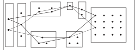

图 3.7. 印刷电路板上钻孔问题的示意图。

图 3.8 中展示了一个印刷电路板示例。

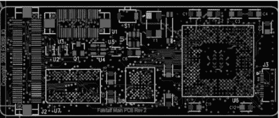

图 3.8. 印刷电路板。

接下来，我们介绍拟肌自主机器人的概念，并描述用于求解钻孔问题的拟议元启发式。

#### 3.6.1 拟肌与自主机器人

拟议元启发式结合了拟肌通信和自主机器人搜索的概念。当一个昆虫的行为由另一个昆虫先前行为的后果决定或影响时，就会发生拟肌现象 [12]。拟肌提供了一种将个体行为与群体层面行为联系起来的一般机制。个体行为修改环境，进而修改其他个体的行为。社会性昆虫的自组织 [15] 可以由于个体间的拟肌相互作用而出现。

基于行为的智能系统设计方法在包括军事应用、采矿、太空探索、农业、工厂自动化、服务业、废物管理、医疗保健和灾害干预在内的广泛领域取得了有希望的结果。自主机器人可以在不被告知确切如何执行的情况下完成现实世界任务。

研究人员试图使感知与行动之间的耦合尽可能直接。这一目标仍然是基于行为的机器人学的区别特征。拟议的 SRM 技术试图以智能、拟肌的方式实现这一目标。

#### 3.6.2 敏感机器人

拟肌机器人行为由其他机器人先前行为引起的环境修改决定。定量拟肌将刺激视为连续变量。该变量的值调制未来行为的强度或概率。定性拟肌 [32] 涉及离散刺激。在这种情况下，行为不被调制。相反，代理切换到不同的行为 [32]。

定性拟肌机制更适合我们的目标，因为机器人拟肌通信不依赖于化学沉积。机器人通信依赖于可以触发特定行为的局部环境修改。“微规则”为机器人定义行为-刺激对。同质拟肌机器人群使用的所有微规则集定义了它们的行为库，并确定机器人将创建的结构类型 [32]。

在拟议模型中，敏感机器人一词指具有拟肌敏感度水平 (SSL) 的人工实体，由单位区间 [0, 1] 中的实数表示。极端情况为：

- SSL = 0 表示机器人完全忽略拟肌信息（是“非拟肌”机器人）；
- SSL = 1 表示机器人具有最大拟肌敏感度。

SSL 值较小的机器人高度独立，可以被视为环境探索者。它们有潜力自主发现搜索空间中新的有希望区域。因此，可以维持搜索多样化。

SSL 值较高的机器人能够密集地开发已识别的有希望搜索区域。在这种情况下，机器人行为强调搜索强化。SSL 值可以根据机器人先前经验中编码的搜索空间拓扑而增加或减少。

#### 3.6.3 用于求解钻孔问题的敏感机器人元启发式

拟议的敏感机器人元启发式 (SRM) 可以使用两支敏感机器人团队来实现。第一支团队的机器人具有小 SSL 值。这些敏感-探索机器人称为小 SSL 机器人 (sSSL)，可以维持搜索多样化。第二支团队的机器人具有高 SSL 值。这些敏感-


被称为高SSL机器人（hSSL）的开发机器人大量开发第一团队已识别的有前景的搜索区域。

SRM被应用于求解一种称为钻孔问题的机器人旅行问题。该问题可视为广义旅行商问题的一个实例。

为求解所考虑的钻孔问题而应用SRM，机器人被放置在起点，并在特定区域内搜索对象。假设每个簇都有特定对象且机器人能够识别这一点，它们每次都会选择不同的簇。拟偶素值引导机器人走向更短路径——即机器人旅行问题的一个解。

## 使用SRM求解钻孔问题

初始时，机器人随机放置在搜索空间中。在每次迭代中，机器人移动到一个新节点，控制算法的参数会被更新。

机器人根据到候选节点的距离和连接边上的拟偶素强度以一定概率选择下一步移动，并且每次都会发生单位蒸发，以防止拟偶素强度无界增加。

为防止机器人在同一巡回中两次访问同一簇，维护一个禁忌表。边的拟偶素值用\(\tau\)表示，能见度值为\(\eta\)。

令\(J^k_i\)表示机器人k从节点i的未访问后继节点，且\(u \in J^k_i\)。sSSL机器人以概率方式选择下一节点。令i为机器人当前位置（当前节点）。

类似于ACS技术[28]，选择u作为下一节点的概率由以下公式给出：

```
\(p^k_{iu}(t) = \frac{[\tau_{iu}(t)][\eta_{iu}(t)]^\beta}{\sum_{u \in J^k_i} [\tau_{iu}(t)][\eta_{iu}(t)]^\beta}, \quad (3.31)\)
```

其中\(\beta\)是正参数，\(\tau_{iu}(t)\)是拟偶素强度，\(\eta_{iu}(t)\)是时间t时边(i, u)上距离的倒数。

机器人隶属于两个团队之一由一个在[0, 1]上均匀分布的随机变量调制。令q为该随机变量的一个实现，q0为常数，\(0 \le q_0 \le 1\)（一个类似于模拟退火中温度的参数）。

sSSL机器人由不等式\(q > q_0\)表征，而对于hSSL机器人则成立\(q \le q_0\)。

hSSL机器人使用sSSL机器人提供的信息。hSSL机器人以确定性方式选择新节点j，根据以下规则：

```
\(j = \text{argmax}_{u \in J^k_i} \{[\tau_{iu}(t)][\eta_{iu}(t)]^\beta\}, \quad (3.32)\)
```

其中\(\beta\)的值决定了拟偶素与启发式信息的相对重要性。

路径拟偶素强度使用局部拟偶素修正规则进行更新：

```
\(\tau_{ij}(t+1) = q_0^2 \tau_{ij}(t) + (1-q_0)^2 \cdot \tau_0. \quad (3.33)\)
```

只有生成最佳中间解的精英机器人才被允许全局更新拟偶素值。精英机器人可以利用迄今找到的最佳巡回的全局知识并加强该巡回，以便更有效地聚焦未来搜索。

全局更新规则是：

```
\(\tau_{ij}(t+1) = q_0^2 \tau_{ij}(t) + (1-q_0)^2 \cdot \Delta \tau_{ij}(t), \quad (3.34)\)
```

其中\(\Delta \tau_{ij}(t)\)是最佳巡回长度的倒数。在更新规则中，q0被重新解释为蒸发率。

算法的一次运行返回找到的最短巡回。

令n表示输入图中的节点数，e表示边数，m表示簇数，r表示机器人数，NC表示周期数。该算法的复杂度为\(O(m \cdot n \cdot r \cdot NC)\)，[28]。对于通过尝试所有\((m-1)!\)种可能的簇序列[153]得到的精确算法，其复杂度为\(O((m-1)!(ne+n \log n))\)。

求解钻孔问题的敏感机器人元启发式的描述如下算法所示：

```
Algorithm 3.11 (Sensitive Robot Algorithm).
Begin
  Set parameters, initialize stigmergic values of the trails;
Loop
  Place robot k on a randomly chosen node
  from a randomly chosen cluster;
Loop
  Each robot incrementally builds a solution
  based on autonomous search sensitivity;
  sSSL robots are characterized by the inequality
  q > q0 while for hSSL robots q <= q0 holds;
  The sSSL robots probabilistically
  choose the next node using (3.24)
  A hSSL-robot uses the information supplied by
  the sSSL robots to find the new node j using (3.25);
  A local stigmergic updating rule (3.26);
Until end_condition;
  A global updating rule is applied by the elitist robot (3.27);
Until end_condition
End
```

#### 3.6.4 数值实验

SRM的验证涉及最小化印刷电路板上的钻孔操作时间。数值实验基于四个钻孔问题，其欧氏距离取自TSPLIB [209]，该库为每个问题提供最优目标值。

与所有其他元启发式一样，参数选择对算法至关重要。目前尚未开发出能给出每种情况下最优参数的数学分析。

基于初步实验，SRM算法中的参数值选取为β = 5，τ0 = 0.01，q0 = 0.9。参数选择基于[28, 137]。考虑的机器人总数为25。hSSL机器人的敏感度q被认为分布在区间(q0, 1)中，而sSSL机器人的敏感度在区间(0, q0)中。

该程序用Java实现，并在AMD Athlon 2600+、333MHz、2 GB内存的机器上运行。

对于所有算法，解代表每个问题五次连续运行的平均值。终止准则为最多200次试验和100次巡回。

下表（表3.6）展示了算法五次连续运行后的SRM结果。为将节点集划分为子集，我们采用了[43]中提出的程序。该程序设置簇数nc = ⌊n/5⌋，识别彼此最远的nc个节点（称为中心），并将每个剩余节点分配给其最近的中心。

表3.6. 五次运行的敏感机器人元启发式结果。

| 钻孔问题 | 报告最优值 | 最优值数量 | 平均值 | 最小值 | 最大值 |
| :--- | :--- | :--- | :--- | :--- | :--- |
| 32U159 | 22 664 | 5 | 22 664 | 22 664 | 22 664 |
| 40D198 | 10 557 | 5 | 10 557 | 10 557 | 10 557 |
| 84FL417 | 9 651 | 1 | 9 654.4 | 9 651 | 9 657 |
| 89PCB442 | 21 657 | 2 | 21 659.6 | 21 657 | 21 662 |

该表显示了[209]报告的最优值，以及SRM在五次运行后的最小值、最大值和平均值。还显示了在指定运行次数内的最优值数量。

为评估所提算法的性能，SRM与最近邻（NN）[178]、复合启发式（GI^3）[178]、随机键遗传算法（RKGA）[188]以及GTSP的强化蚁群系统（RACS）[137]进行了比较，后者在3.4节中描述。

对每个问题，已检查了五次连续运行得到的平均值，比较结果如表3.7所示。

表3.7. 敏感机器人元启发式（SRM）与其他算法的比较：最近邻（NN）、复合启发式GT3 [178]、随机键遗传算法（RKGA）[188]以及GTSP的蚁群系统（ACS）（平均值）。

| 钻孔问题 | 报告最优值 | NN | GT3 | RKGA | RACS | SRM |
|---|---|---|---|---|---|---|
| 32U159 | 22 664 | 26 869 | 23 254 | 22 664 | 22 729.2 | 22 664 |
| 40D198 | 10 557 | 12 038 | 10 620 | 10 557 | 10 575.2 | 10 557 |
| 84FL417 | 9 651 | 10 553 | 9 697 | 9 656 | 9 766.2 | 9 654.4 |
| 89PCB442 | 21 657 | 26 756 | 22 936 | 22 026 | 22 137.8 | 21 659.6 |

分析表3.7中报告的结果后，我们观察到所提SRM算法提供了良好的解。对于实例32U159和40D198，我们得到了最优解，而对于另外两个实例，已知最优值与使用我们SRM方法得到的值之间的百分比差距最多为0.03%。

接下来，我们进行统计分析。采用预期效用法[56]技术来确定最准确的启发式。令x为给定问题中特定启发式的启发式解与最佳已知解之间的百分比偏差：

\( x = \frac{\text{heuristic solution} - \text{best known solution}}{\text{best known solution}} \times 100. \)

预期效用函数可以是：\( \gamma - \beta(1 - \overline{b}\overline{t})^{-\overline{x}} \)，其中\(\gamma = 500\)，\(\beta = 100\)，\(t = 0.05\)。\(\overline{b}\)和\(\overline{\tau}\)是伽马函数的估计参数。由于测试使用了四个问题，表3.8中使用了以下符号：

\( \overline{x} = \frac{1}{4} \sum_{j=1}^4 x_j, s^2 = \frac{1}{4} \sum_{j=1}^4 (x_j - \overline{x})^2, \overline{b} = \frac{s^2}{\overline{x}}, \overline{\tau} = \left(\frac{\overline{x}}{s}\right)^2. \)

最后一列提供了条目的1到5名排名。如表3.8所示，SRM排名第一，是比较算法中最准确的算法。

表3.8中呈现的结果表明，新颖的SRM算法优于其他考虑的启发式。

该新模型在执行时间方面可以得到改进。潜在的改进涉及参数值或与其他算法采用高效组合。改进算法的另一种方法是完全并行化算法内循环中的机器人。


表 3.8. 统计分析。对比启发式的期望效用函数计算。

| Heuristic | \(\overline{x}\) | \(s^2\) | \(\overline{b}\) | \(\overline{c}\) | \(y - \beta(1 - \overline{b}\overline{r})^{-\overline{c}}\) | Rank |
|---|---|---|---|---|---|---|
| NN | 16.5 | 31.25 | 1.8939 | 8.7122 | 262.0747 | 5 |
| \(GI^3\) | 2.3956 | 4.8206 | 2.0123 | 1.1905 | 386.5441 | 4 |
| RKGA | 0.4385 | 0.5558 | 1.2675 | 0.3459 | 397.7087 | 2 |
| ACS | 0.97 | 0.6783 | 0.6993 | 1.3871 | 394.9359 | 3 |
| SRM | 0.01 | 0.0001 | 0.01 | 1.0000 | 399.9499 | 1 |

### 3.7 注释

广义旅行商问题（GTSP）是著名旅行商问题的扩展，在定位问题、电信问题、铁路优化、规划、邮政路由、微芯片制造、物流、计算机文件排序、带序列相关过程时间的调度等方面有多种应用。

在本章中，我们描述了关于GTSP的以下方面：

- 该问题的精确指数时间算法；
- GTSP的整数规划公式；
- 求解该问题的两种方法：一种是强化蚁群系统，另一种是混合启发式技术，后者通过将顾问引导搜索技术与GTSP的局部-全局方法相结合而获得；
- GTSP的一个实际应用：钻孔问题，即在大规模印刷电路板上寻找最小钻孔回路；
- 一种用于求解钻孔问题的敏感机器人元启发式算法，其特征是具有诱导敏感性水平，有助于探索（由低敏感机器人执行）以及利用（由高敏感机器人执行）搜索空间。

本章所呈现的材料基于Pop [152]、Pop et al. [161, 166]和Pintea et al. [137, 139, 141]发表的结果。

## 第 4 章

### 铁路旅行商问题（RTSP）

在本章中，我们考虑铁路优化中一个核心问题，即铁路旅行商问题（RTSP）。该问题是经典旅行商问题的实际扩展，考虑了铁路网络和列车时刻表，由Hadjicharalambous et al. [67]提出。

此外，我们介绍了RTSP的一种变体，称为动态RTSP，其中我们假设城市之间的距离被解释为旅行时间且不再固定。在现实生活中，当由于维护工作、事故等原因可能出现延误时，我们会面临这个问题，这会导致旅行时间可能发生变化。

### 4.1 RTSP的定义

我们假设给定一组车站、连接这些车站的列车时刻表、一个初始车站、车站的一个子集B以及一个起始时间。一名推销员希望从初始车站出发，出发时间不早于指定时间，前往B中的每个车站，最后返回初始车站，受限于他在B中每个车站必须花费必要的时间来处理业务。目标是找到一组列车连接，使整个行程的总时间最小化。这个问题称为铁路旅行商问题，由Hadjicharalambous et al. [67]提出。

RTSP与广义旅行商问题（GTSP）相关，GTSP中给出一个聚类图，并希望找到一条最小长度的环路，恰好连接每个聚类中的一个节点。由于TSP的关系，GTSP是一个NP-hard问题。可以轻易看出，TSP也可以在多项式时间内归约到RTSP。对于每对存在连接的城市，考虑一列从第一个城市开往第二个城市的列车，其旅行时间等于TSP中对应连接的成本。这种归约将RTSP归入NP-hard问题类。

考虑由Schulz et al. [182]引入的所谓时间扩展有向图G，它是根据时刻表信息构建的。在该图中，每个车站的每个事件（出发或到达）都有一个节点，节点之间的边表示两个事件之间的基本连接（即由不停靠列车服务），或者车站的等待时间。边的权重是其端点关联的时间事件之间的时间差。粗略地说，将属于特定车站的每组节点视为一个节点聚类，RTSP归约为寻找一条最小权重环路，该环路从特定聚类的特定节点开始，访问B中每个聚类的至少一个节点，并结束于初始聚类的一个节点。尽管表面上相似，RTSP与GTSP在至少三个方面有所不同：

- 1. GTSP通常通过将其转换为TSP的一个实例来求解。转换是通过修改权重完成的，使得集群间边被“惩罚”（即向其添加大权重）。因此，环路必须在转到下一个集群之前访问集群内的所有节点。
- 2. RTSP从特定集群的特定节点开始，而GTSP可以从任何集群中的任何节点开始。
- 3. GTSP要求访问所有集群，而RTSP只要求访问其中的一个子集。

### 4.2 预备知识

在本节中，我们描述RTSP实例的输入，提供一些定义，并介绍时间扩展图。

在以下内容中，我们假设铁路系统中的时刻表信息，但将要描述的建模和求解方法可以应用于任何其他公共交通系统，前提是它具有相同的特征。

时刻表包含关于以下方面的数据：车站（或公交车站、港口等）、列车（或公交车、渡轮等）、连接车站，以及列车在车站的出发和到达时间。更正式地说，我们给定一组列车Z、一组车站S和一组基本连接C，其元素为形式为(z, o1, o2, td, ta)的5元组。这样的元组（基本连接）被解释为列车z在时间td离开车站o1，且列车z的最近下一站是o2，时间为ta。出发时间td和到达时间ta是区间Tday = [0, 1439]中的整数，表示午夜后的分钟数。

给定两个时间值t和t'，t <= t'，它们的循环差分cycle-difference(t, t')是满足t = l' - t (modulo 1440)的最小非负整数l。

我们还给定一个起始车站$\sigma_0 \in S$，一个时间$t_0 \in T_{day}$，表示从车站$\sigma_0$最早可能的出发时间，以及一组车站$B \subseteq S - \sigma_0$，这代表推销员必须访问的车站（城市）集合。函数$f_B : B \longrightarrow T_{day}$用于建模推销员在每个城市$b \in B$必须花费的时间，即推销员必须在车站$b \in B$停留至少$f_B(b)$分钟。

我们自然假设推销员不会连续旅行（即通过过夜连接），如果她/他晚些到达某个车站，她/他必须休息并过夜。此外，推销员第二天的业务可能不需要从该车站乘坐第一班可能的连接列车。因此，我们假设推销员从不乘坐在夜间太晚或清晨太早出发的列车。

RTSP的公式基于由Schulz et al. [182]引入的所谓时间扩展有向图。这样的图G = (V, E)使用提供的时刻表信息按以下方式构建：

- 每个车站的每个时间事件（出发或到达）都有一个节点，并且有四种类型的边。
- 对于时刻表中的每个基本连接(z, σ1, σ2, td, ta)，图中有一条列车边，它连接属于车站σ1且关联时间td的出发节点，与属于车站σ2且关联时间ta的到达节点。换句话说，列车边的端点诱导出图的节点集合。
- 对于每个车站σ ∈ S，属于σ的所有出发节点按其时间值排序。我们用v1, v2, ..., vk表示σ的节点，按该顺序。
- 存在一组停留边，表示为Stay(σ)，即(vi, vi+1)，1 ≤ i ≤ k − 1，以及(vk, v1)，连接车站内的时间事件，表示在该车站停留；
- 此外，对于车站中的每个到达节点，都有一条到达边，连接到同一车站中时间值上最近的出发节点。

边(u, v)的成本是循环差分(tu, tv)，其中tu和tv分别是与u和v关联的时间值。

在下一幅图，图4.1中，我们展示了时间扩展图中两个车站的示例，以说明我们的构建。

为了制定RTSP，我们对时间扩展有向图引入以下修改：

- 首先，我们不包括任何出发时间晚于最晚可能出发时间或早于最早出发时间的基本连接。
- 其次，我们通过引入一组忙碌边，表示为Busy(b)，明确建模推销员在每个车站b ∈ B必须至少等待fB(b)时间的事实。我们从车站b ∈ B中的每个到达节点引入一条忙碌边，连接到同一车站中时间值至少相差fB(b)的第一个可能出发节点。
- 第三，为了建模推销员在某个车站σ0和时间t0开始旅程的事实，我们在车站σ0中引入一个时间值为t0的源节点s0。节点s0通过一条边（称为源边）连接到σ0的第一个出发节点d0，该节点的时间值大于或等于t0，该边的成本为


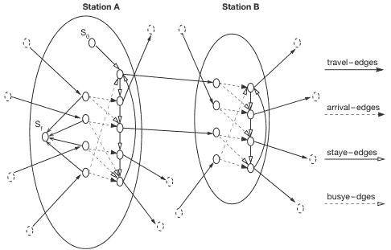

图4.1. 时间扩展图中两个车站的示例，其中A是起始车站

等于周期差(t0, td0)。此外，我们在同一车站引入一个汇节点$s_f$，并将$\sigma_0$的每个到达节点通过零成本边（称为汇边）连接到$s_f$。

### 4.3 求解RTSP的方法

已有四种方法被提出用于求解RTSP，其中三种是精确方法，一种是启发式方法，我们将在本章余下部分进行描述。

#### 4.3.1 通过最短路径进行规模缩减

Hadjidimalalambous et al. [67] 提出了一种预处理算法，用于缩减时间扩展图的规模。其思想是：对于集合$B$中的每个车站$\sigma$，添加一个新的汇节点$s_\sigma$，并将$\sigma$中的所有到达节点通过零成本边连接到$s_\sigma$。然后，对于$\sigma$中的所有出发节点$d$，计算到$B$中所有其他车站的汇节点的最短路径。对于每条路径，将一条从$d$到该路径最后一个到达节点的边添加到$G$中。该边的成本等于相应最短路径的成本。然后，再次移除所有汇节点及其入边，以及所有不在$B$中的车站及其节点。未被任何最短路径使用的到达节点以及所有到达边也将被移除。

规模缩减程序之后，$G$仅由车站$\sigma \in B$、它们的到达节点和出发节点、连接它们的边以及新添加的最短路径边组成。

### 整数线性规划表述

RTSP的目标是找到从节点$s_0$到节点$s_f$的一条环路，该环路经过每个车站$b \in B$，且总成本最小。

为了将RTSP问题建模为整数线性规划（ILP），我们为每条边$(u, v)$引入一个变量$x_{(u,v)} \in \mathbb{N}_0$，该变量表示推销员使用边$(u, v)$的次数。如果$c(u, v)$表示边$(u, v)$的成本，则ILP变为：

```
\begin{align*}
\min \sum_{(u,v) \in E} c(u, v) x_{(u,v)}, \qquad & (4.1) \\
s.t. \sum_{(v,u) \in E} x_{(v,u)} - \sum_{(u,v) \in E} x_{(u,v)} = 0, \qquad & \forall u \in V \setminus \{s_0, s_f\} \quad (4.2) \\
x_{(s_0, d_0)} = \sum_{(v, s_f) \in E} x_{(v, s_f)} = 1 \qquad & (4.3) \\
\sum_{e \in Busy(b)} x_e \ge 1, \qquad & \forall b \in B \quad (4.4) \\
x_e \in \mathbb{N}_0, \qquad & \forall e \in E. \quad (4.5)
\end{align*}
```

约束(4.2)和(4.3)是流守恒约束，它们构成了从节点$s_0$到节点$s_f$的一条路径，而约束(4.4)确保推销员在每个车站$b \in B$花费所需的时间。

目前表述的问题是，它允许包含与路径其余部分不相连的环路（子环路）的可行解。为了解决这个问题，我们必须添加更多约束，这些约束将强制解不使用任何子环路。

假设选定的车站编号从0到$|B| - 1$。对于每个这样的车站$i$，我们引入一个新节点$f_i$，称为该车站的*汇节点*。此外，我们为车站$i$的第$k$个出发节点$d_k^i$创建一个副本，该节点有一个或多个入忙边。我们将这个新节点通过零成本边连接到原始节点。所有忙边现在指向$d_k^i$而不是$d_k^i$，而所有其他边保持不变。我们还添加一条边$(d_k^i, f_i)$，对于所有$k$，使得$d_k^i \in V$。示例见图4.2。

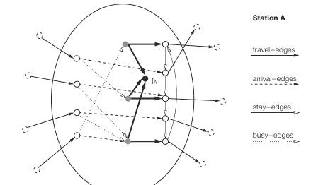

图4.2. 图4.1中的车站A，在引入用于子环路消除约束的新节点和边之后。为简化起见，未显示节点$s_0$和$s_f$。灰色节点是带有入忙边的出发节点的副本，而黑色节点是A的汇节点。粗黑边是新添加到图中的边。

我们现在为每条边\(e \in E\)引入一组新变量\(y_e^i, 0 \le i \le |B|\)以及以下约束：

```
\(\sum_{(v,u) \in E} y^i_{(v,u)} - \sum_{(u,v) \in E} y^i_{(u,v)} = 0, \quad \forall u \in V \setminus \{s_0, f_i\} \quad (4.6)\)
\(y^i_{(s_0, d_0)} = \sum_{(v,f_i) \in E} y^i_{(v,f_i)} = 1 \quad (4.7)\)
\(y_e^i \le x_e, \quad \forall e \in E \setminus \{(u, f_i) \in E\}. \quad (4.8)\)
```

上述约束构成一个多商品流问题，为每个选定的车站引入一种商品，并要求每种商品\(i \in [0, |B| - 1]\)的一个单位流从源节点路由到相应选定车站的汇节点\(f_i\)。对y变量施加的额外条件是，任何边\(e \in E\)上商品\(i\)的流\(y_e^i\)不能大于\(x_e\)。这意味着，如果某条边\(e\)上的x流为零，那么该边上的y流也都将为零。

约束(4.6)-(4.8)强制x变量被适当赋值，以便对于每个选定的车站，存在一条从$s_0$到该车站中某个出发节点的路径，且仅使用对应x变量非零的边。

由于现在到达\(f_i\)的唯一方式是通过车站\(i\)的忙边，因此由\(x\)变量建模的流被强制为每个选定车站使用某条忙边，这使得约束(4.4)变得冗余。

变量\(x_{(u,v)}\)（\((u, v) \in E\)）不被限制为0-1变量的原因是，推销员被允许多次通过同一车站\(\sigma\)，无论\(\sigma\)是否属于\(S\)，或属于\(B\)，或是起始车站$s_0$。

知道变量\(x_{(u,v)}\)的值后，我们可以使用流分解定理（见例如[1, Chap. 3]）轻松检索路径。设\(n\)（分别\(m\)）为时间扩展图\(G\)的节点数（分别边数）。我们将流分解为最多\(m\)个简单环路和一条简单路径（从\(s_0\)到\(s_f\)），时间复杂度为\(O(nm)\)。然后我们可以构建最小成本环路，作为边的链表，时间复杂度为\(O(nm)\)。最初，我们将环路设置为路径，然后通过与具有公共边的环路合并来迭代扩展它。这可以在与最终环路长度成线性关系的时间内完成，最终环路长度最多为\(O(nm)\)。

## 通过最短路径进行规模缩减

时间扩展图可能非常大。在本节中，我们提出了一种缩减图规模的方法，这在推销员希望访问的车站数量相对于车站总数相对较少的情况下可能有益。我们通过将时间扩展图\(G\)转换为一个新图\(G_{sh}\)（称为*缩减时间扩展图*）来缩减问题规模。图\(G_{sh}\)可以通过预先计算属于\(B\)的车站之间的最短路径来构建，如下所示。

再次让$\sigma_0$表示起始车站。对于$B \cup \{o_0\}$中的每个车站$o$，我们引入一个汇节点$s_o$，并将$\sigma$的每个到达节点通过零成本边连接到$s_o$。然后，对于$\sigma \in B \cup o_0$的每个出发节点$d$，我们计算到$B \cup o_0$中每个其他车站的汇节点的最短路径。如果这样的最短路径不经过$B \cup o_0$中的某个其他车站，那么我们从$d$到该路径最后一个到达节点插入一条*最短路径边*。该边的成本等于相应最短路径的成本。

我们现在可以按以下方式转换$G$。首先，我们移除先前引入的汇节点（及其入边）。接下来，我们从$G$中删除所有属于不在$B \cup o_0$中的车站的节点和边。剩余的到达节点（属于某个车站$\sigma \in B \cup o_0$），如果未被先前计算的任何最短路径使用，也将被删除，连同剩余的旅行边。此过程得到缩减时间扩展图$G_{sh}$。

## 实现细节与实验

为了加速计算（通过尝试减少整数程序使用的变量数量），当不使用最短路径缩减时，我们尝试消除图中不必要的节点。更准确地说，我们移除所有


所有车站的到达节点 $\sigma \notin B$。这些节点只有一条入边（来自对应的出发节点），和一条出边（指向同一车站的某个出发节点），而从它们出发没有繁忙边。因此，我们可以消除这些节点（以及它们的相邻边），并引入一条新的虚拟边，连接入边的源出发节点和出边的目标出发节点，其成本为两条被消除边的成本之和。这样，我们可以减少图中边和节点的数量，从而减少整数规划中的变量和约束数量。

图的构建既基于合成数据，也基于现实世界数据。对于合成情况，我们考虑了网格图（节点代表车站）。每个节点与其所有邻接节点（双向）都有连接，即网格中其行或列紧邻它的车站。

请注意，连接数等于节点数的一半，因为两个节点形成一个连接，边数是节点数的两倍。边数不包括 $s_f$ 的入边和 $s_0$ 的出边，也不包括任何其他人工节点或边。

车站之间的连接在相邻车站之间随机放置，使得每对相邻车站（双向）至少有一个连接，且每个车站的基本连接平均数为10。每个基本连接的出发时间和到达时间之间的时间差是独立的均匀随机变量，在区间 [20, 60] 中选择（表示分钟），而出发时间是在最早和最晚可能出发时间之间的时间区间内的随机变量。我们创建了车站数量从20到80不等的图。

现实世界数据代表荷兰铁路网络的一部分。第一个数据集称为 $nd\_ic$，包含荷兰较大城市之间的城际列车连接，这些列车只在主要火车站停靠，因此被认为比普通列车更快。这些列车至少每半小时运行一次，车站数量为21。第二个现实世界数据集 $nd\_loc$ 包含仅连接一个地区内城市的列车时刻表，包括一些主要车站，而列车在两个主要车站之间的每个中间车站都停靠。在这种情况下，车站总数为23。

我们使用的所有图（无论是真实数据还是合成数据）的特性均显示在表4.1中。

对于每个数据集，创建了每个问题的多个实例，改变选定车站的数量 $|B|$，即旅行商必须访问的车站集合。对于基于真实和合成数据的图，我们使用了 $|B|$ 的两个值，即5和10。请注意，$|B|$ 不包含起始车站。因此，当 $|B|$ 设置为车站总数时，实际使用的值将是 $|B| - 1$，因为必须有一个车站作为起始车站。

## 表4.1. 每个数据集中时间扩展图的图参数

| 数据集 | 车站数 | 节点数 | 边数 | 连接数 | 连接/车站 |
|---|---|---|---|---|---|
| nd_ic | 21 | 684 | 1 368 | 342 | 16.29 |
| nd_loc | 23 | 778 | 1 556 | 389 | 16.91 |
| synthetic 1 | 20 | 400 | 800 | 200 | 10 |
| synthetic 2 | 30 | 600 | 1 200 | 300 | 10 |
| synthetic 3 | 40 | 800 | 1 600 | 400 | 10 |
| synthetic 4 | 50 | 1 000 | 2 000 | 500 | 10 |
| synthetic 5 | 60 | 1 200 | 2 400 | 600 | 10 |
| synthetic 6 | 70 | 1 400 | 2 800 | 700 | 10 |
| synthetic 7 | 80 | 1 600 | 3 200 | 800 | 10 |

对于每个数据集和B值的组合，我们随机选择了属于B的车站，彼此独立。车站选择重复了多次，并计算了所有相应实例的平均值。对于我们创建的每个实例，相应的整数规划作为输入提供给GLPSOL v4.6（GNU线性规划工具包LP/MIP求解器，版本4.6）。测量了GLPSOL为每个案例找到最优解所需的时间。

我们测试了时间扩展图的原始版本（带有我们的修改）以及基于预计算最短路径的缩减版本。此预计算的时间也已测量。

## 计算结果与结论

实验结果报告在表4.2和表4.3中（图形比较在图4.3中说明）。

测量值是50组不同选定车站的平均值。GLPSOL为相同参数的实例提供的运行时间标准差很大，显示出对图结构的强烈依赖。

可以轻易看出，当使用原始图时，|B|的值极大地影响运行时间。|B|越大，运行时间越长。

基于预计算最短路径的尺寸缩减方法产生的图比原始图小得多。表4.2显示了使用尺寸缩减技术得到的缩减图的特性。

此外，从表4.3可以清楚地看出，尺寸缩减方法相对于使用原始时间扩展图来找到最优（或接近最优）解所需的时间，带来了巨大的加速。而且，|B|的值越小，加速比越大。

## 表4.2. 所有数据集缩减图的图参数（平均值）

### (a) 真实图

| 数据集 | |S| | |B| = 5 节点 | |B| = 5 边 | |B| = 10 节点 | |B| = 10 边 |
|---|---|---|---|---|---|
| nd_loc | 23 | 209.4 | 415.2 | 343.9 | 698.1 |
| nd_ic | 21 | 181.6 | 385 | 303.6 | 708.7 |

### (b) 合成图

| 数据集 | |S| | |B| = 5 节点 | |B| = 5 边 | |B| = 10 节点 | |B| = 10 边 |
|---|---|---|---|---|---|
| 1 | 20 | 95.75 | 209.35 | 197.7 | 420.3 |
| 2 | 30 | 91.3 | 204.7 | 181.1 | 430.4 |
| 3 | 40 | 95.7 | 213.0 | 188.3 | 437.8 |
| 4 | 50 | 92.7 | 205.2 | 184.6 | 440.3 |
| 5 | 60 | 94.8 | 216.2 | 181.9 | 456.8 |
| 6 | 70 | 93.0 | 215.4 | 184.0 | 491.7 |
| 7 | 80 | 91.2 | 207.2 | 174.6 | 457.7 |

## 表4.3. 真实和合成数据集的结果。时间以秒为单位。

### (a) 真实数据集的运行时间

#### 缩减图

| |B| | 5 | 10 |
|---|---|---|---|
| nd_ic | 319.0 | 9 111.9 |
| nd_loc | 29.1 | 6 942.6 |

### (b) 合成数据集的运行时间

#### 原始图

| |S| | 20 | 30 | 40 |
|---|---|---|---|---|
| |B|=5 | 13.12 | 32.24 | 72.06 |
| |B|=10 | 781.12 | 1 287.00 | 16 239.80 |

#### 缩减图

| |S| | 20 | 30 | 40 | 50 | 60 | 70 | 80 |
|---|---|---|---|---|---|---|---|---|
| |B|=5 | 1.12 | 1.12 | 1.50 | 0.80 | 1.45 | 1.30 | 1.00 |
| |B|=10 | 214.76 | 369.59 | 244.18 | 181.85 | 257.96 | 431.80 | 233.26 |

### (c) 合成数据集的最短路径计算时间

| |S| | 20 | 30 | 40 | 50 | 60 | 70 | 80 |
|---|---|---|---|---|---|---|---|---|
| |B|=5 | 0.13 | 0.18 | 0.24 | 0.29 | 0.35 | 0.41 | 0.46 |
| |B|=10 | 0.28 | 0.38 | 0.48 | 0.59 | 0.69 | 0.79 | 0.88 |

### (a)

### 合成数据集，|B| = 5

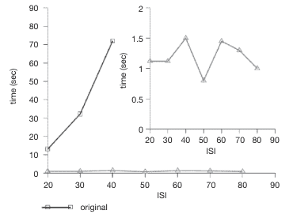

### (b)

### 合成数据集，|B| = 10

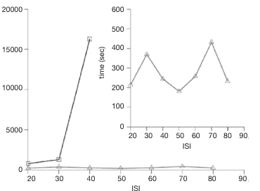

图4.3. 合成数据集运行时间的图形比较。

对于固定大小的B，如果不使用最短路径技术，运行时间似乎随S的增加而迅速增长，与使用该技术的情况形成对比。在这种情况下，当考虑合成数据时，运行时间会波动。尽管如此，很明显时间主要取决于B的大小，而不是S的大小。

#### 4.3.2 针对RTSP的切平面方法

基于时间扩展图，我们可以看到RTSP归结为在由S诱导的G的子图中寻找最小成本的哈密顿回路H，其中S ⊆ V，且S包含每个簇中恰好两个节点。这导致了广义旅行商问题的一个变体，我们将其表示为2-GTSP。显然，2-GTSP的解是RTSP的解。

在以下部分，我们将介绍一种求解RTSP的高效切平面方法（参见[157]）。

### 2-GTSP的定义

2-广义旅行商问题（2-GTSP）旨在寻找覆盖节点子集的最小成本回路H，使得H包含每个簇Vi（i ∈ {1, ..., m}）中恰好两个节点。该问题涉及两个相关决策：

- 选择一个节点子集 S ⊆ V，使得对于所有 k = 1, ..., m，|S ∩ Vk| = 2。
- 在由S诱导的G的子图中寻找最小成本哈密顿循环。

我们将这样的循环称为2-广义哈密顿回路。下一个图展示了一个节点被划分为6个簇的图中2-广义哈密顿回路的示例。

### 2-GTSP的整数规划公式

为了将2-GTSP表述为整数规划，我们引入以下二元变量：

```
\( x_e = \left\{ \begin{array}{ c c } 1 & \text{if edge } e = \{i, j\} \in E \text{ is included in the selected subgraph} \\ 0 & \text{otherwise} \end{array} \right. , \quad z_i = \left\{ \begin{array}{ c c } 1 & \text{if node } i \text{ is included in the selected subgraph} \\ 0 & \text{otherwise} \end{array} \right. . \)
```

对于 \( F \subseteq E \) 和 \( S \subseteq V \)，定义 \( E(S) = \{e = \{i, j\} \in E \mid i, j \in S\} \)、\( x(F) = \sum_{e \in F} x_e \) 和 \( z(S) = \sum_{i \in S} z_i \)。另外，定义 \( x(V_k, V_k) = \sum_{i,j \in V_k, i < j} x_{ij} \)，其中 \( k \in \{1, ..., m\} \)。


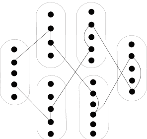

图 4.4. 2-广义哈密顿回路示例。

2-GTSP 的一个可行解可以看作是一个无环子图，包含 $2m - 1$ 条边，连接所有簇，且每个簇中恰好选择两个节点。

因此，2-GTSP 可以表述为以下 0-1 整数规划问题：

```
min \sum_{e \in E} c_e x_e.
s.t. z(V_k) = 2, \quad \forall k \in \{1, ..., m\}, (4.9)
x(\delta(i)) = 2z_i, \quad \forall i \in V \setminus V_1, (4.10)
x(E) = 2m - 1, (4.11)
x(V_k, V_k) = 1, \quad \forall k \in \{2, ..., m\}, (4.12)
x(E(S)) \le 2r - 1, \quad \forall S = \cup_{j=1}^r V_j, 2 \le r \le m - 1, (4.13)
x_e \in \{0, 1\}, \quad \forall e \in E,
z_i \in \{0, 1\}, \quad \forall i \in V.
```

在上述表述中，约束 (4.9) 保证我们从每个簇中恰好选择两个节点。约束 (4.10) 要求与节点 $i$ 关联的边数要么为 2（如果访问节点 $i$），要么为 0（否则）。约束 (4.11) 保证所选子图有 $2m - 1$ 条边，约束 (4.12) 保证我们从每个簇（起始簇除外）中选择一条边。最后，约束 (4.13) 消除所有连接最多 $m - 1$ 个簇的环。

将消除子回路约束 (4.13) 替换为连通性约束，我们得到所谓的广义割集表述：

\(\min \sum_{e \in E} c_e x_e.\)
\(s.t. (1), (3) - (5) \text{ and }\)
\(x(\delta(S)) \ge 2(z_i + z_j - 1), \forall S \subset V,\)
\(\text{with } 2 \le |S| \le m - 1\)
\(\text{and } \forall i \in S, j \in V \setminus S,\)
\(x_e, z_i \in \{0, 1\}, \forall e \in E, i \in V.\)
(4.14)

其中，与通常对 \(S \subseteq V$ 的做法一样，我们用 \(\delta(S)$ 表示割集。

在上述表述中，约束 (4.14) 是连通性约束，指出分隔两个已访问节点（$i$ 和 $j$）的每个割集必须至少被跨越两次。

除了之前表述中出现的约束外，我们还考虑以下专门针对铁路旅行商问题的约束：

\(t_d z_d - t_a z_a \ge t_k, \forall a, d \in V_k, 2 \le k \le m. \quad (4.15)\)

上述约束指出，出发时间与到达时间的差值必须至少为指定的时间段 \(t_k$（取决于城市）。这意味着旅行商必须在每个城市停留一段时间，以完成业务。如果差值太小，旅行商可能无法做到这一点。另一方面，如果差值太大，车站的等待时间将不方便。

所述整数规划表述的缺点在于其约束数量呈指数级（我们需要选择 \(V$ 的子集，即约束 (4.13) 和 (4.14)）。这些约束可以省略，并可根据需要由 *分离算法* 生成：可以先不加约束 (4.13)，求解相应的松弛问题，然后生成被当前解违反的子回路不等式。子回路约束的分离算法基于网络流技术。有关详细信息请参见 [43]。

## 解决方案过程与计算结果

我们使用了以下 *切平面算法* 来求解 2-GTSP：

- 1. 令整数规划 (IP) 表述包含约束 (4.9)–(4.12)、(4.15) 以及整体性约束。
- 2. 求解 IP，并假设最优解由 \(r\) 个子回路组成：\(S_1, \dots, S_r\)。
- 3. 如果 \(r = 1$，则停止。2-GTSP 的解是最优的。否则，将消除回路 \(S_1, \dots, S_r$ 的相应约束添加到 IP 表述中，并转到步骤 2。

该算法使用 C 语言实现，对于每个实例，我们创建了相应的整数规划模型，并使用 CPLEX 6.5 求解。

我们算法的测试数据来自荷兰铁路公司 Nederlandse Spoorwegen 的真实网络。前三个数据集包含荷兰较大城市之间的城际列车连接，仅在主要火车站停靠，因此被认为比普通列车更快。这些列车至少每半小时一班。第二个真实世界数据集包含城际列车和区域列车的时刻表。区域列车仅连接一个地区内的城市，包括一些主要车站，并在两个主要车站之间的每个中间车站停靠。

用于真实世界数据集的图的一些特征与使用切平面算法获得的计算结果一起显示在下一个表中。

表格中的前四列给出了问题的名称和规模，即车站数、节点数和边数。接下来的两列描述了切平面过程，包含作为 RTSP 最优值百分比得到的下界 (LB/OPT)，以及求解 RTSP 至最优所需的计算时间 (CPU)。

### 表 4.4. 求解 RTSP 的计算结果。

| 问题名称 | 车站数 | 节点数 | 边数 | LB/OPT | 求解时间 |
|---|---|---|---|---|---|
| NS1 (IC) | 5 | 394 | 4 240 | 100 | 14.08 s |
| NS2 (IC) | 7 | 674 | 9 754 | 100 | 64.57 s |
| NS3 (IC) | 9 | 926 | 16 271 | 100 | 206.52 s |
| NS4 (IC+IR) | 12 | 1 470 | 23 850 | 100 | 39.30 min |
| NS5 (IC+IR) | 12 | 1 586 | 27 383 | 100 | 72.28 min |
| NS6 (IC+IR) | 15 | 1 722 | 28 200 | 100 | 1.05 h |
| NS7 (IC+IR) | 15 | 1 946 | 34 450 | 100 | 5.45 h |
| NS8 (IC+IR) | 18 | 2 182 | 38 650 | 100 | 4.52 h |

#### 4.3.3 通过转换为经典 TSP 求解 RTSP

如前所述，RTSP 与 GTSP 相关。由于存在多种高效的 GTSP 求解算法，例如遗传算法 [184, 188]、分支与切割 [43]、第 3.5 节中描述的算法，或利用将 GTSP 转换为 TSP 的方法 [8, 26]，因此将 RTSP 转换为 TSP 似乎是一个合理的想法。Hu 和 Raidl [78] 描述了这种方法。

### 将 RTSP 转换为非对称 TSP

借鉴 Behzad 等人 [8] 的类似思想（他们提出了一种将 GTSP 转换为经典 TSP 的高效方法），Hu 等人提出了一种方案，将缩减的 RTSP 转换为定义在图 \(G' = (V', E')$ 上的非对称 TSP。转换过程如下：对原始缩减图中的每个车站 \(\sigma \in B$，应用以下过程以获得相应的新车站 \(\sigma' \in V'$。

令 \(a'_1, ..., a'_k \in \sigma'$ 成为到达节点 \(a_1, ..., a_k \in \sigma$ 的精确副本，按其时间排序。我们用零成本边 \((a'_1, a'_2), ..., (a'_{k-1}, a'_k), (a'_k, a'_1)$ 将它们连接成一个环。对出发节点 \(d'_1, ..., d'_l$ 也应用相同的过程，它们用零成本边 \((d'_1, d'_2), ..., (d'_{l-1}, d'_l), (d'_l, d'_1)$ 连接。令 \(pred(v)$ 表示根据这些环的循环前驱节点 \(v$。每个到达节点 \(a'_i, i=1,...,k$ 与每个出发节点 \(d'_j, j=1,...,l$ 相连。对于初始车站，\(c(a'_i, d'_j)$ 设置为 \(t_{d'_j} - t_{d'_i}$，这不依赖于 \(t(a'_i)$。

选择此值的原因是，旅行商必须在初始车站结束他的行程，但不一定在初始时间。因此，只有他开始旅程的时间才有影响，因此

\(c(a'_i, d'_j) = t_{d'_j} - t_{d'_i},\)

其中 \(t(d'_i)$ 是从初始车站出发的最早可能时间。对于 \(B$ 中的所有其他车站，成本设置为

\(c(a'_i, d'_j) = [1440 + t_{d'_j} - t_{pred(a'_i)} - f_B(\sigma)] \mod 1440 + f_B(\sigma).\)

请注意，由于并非所有原始停留边都存在，因此它们的成本已包含在这些新边中。例如，在图 4.5 中，从 \(a_1$ 到 \(d_4$ 意味着走繁忙边 \((a_1, d_3)$ 和停留边 \((d_3, d_4)$。成本为 \(t_{d_4} - t_{a_1}$，等于新边 \((a'_2, d'_4)$ 的成本。

最后，从 \(d'_j, j=1,...,l$ 出发的边也进行了调整。对于每个原始旅行边 \((d_j, v)$，引入一条边 \((pred(d'_j), v)$，其成本为

\(c(pred(d'_j), v) = c(d_j, v) + M.\)

其中 \(M$ 必须是一个足够大的数，例如 \(\sum_{(u,v) \in E} c(u, v)$，以便最优解中不包含多于一条旅行边。

该转换将在图 4.5 中说明，并额外展示一条路线如何适应新图的示例。我们可以注意到，得到的图是有向图，因此 TSP 是非对称的。


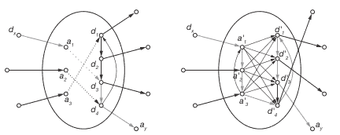

图 4.5. 将反对称TSP中的原始车站 $\sigma$ 转换为车站 $\sigma'$。灰色路径标记了原始车站 $\sigma$ 和转换后车站 $\sigma'$ 中从 $d_x$ 到 $a_y$ 的旅行路线。

## 将RTSP转换为对称TSP

由于之前的转换产生了一个非对称TSP，Hu 等人 [78] 提出了一种生成对称TSP的替代程序，定义在图 $G' = (V', E')$ 上。他们的方法遵循与之前转换相同的基本思路，并观察到在过程中节点数量必须翻倍。

令 $a'_1, ..., a'_k \in \sigma'$ 再次成为到达节点 $a_1, ..., a_k \in \sigma$ 的精确副本，按其到达时间排序。这些节点再次复制，从而产生节点 $a''_1, ..., a''_k$。然后，这些节点通过零成本边 $(a'_2, a''_1), (a'_3, a''_2), ..., (a'_k, a''_{k-1}), (a'_1, a''_k)$ 以及高成本 $M$ 的边 $(a'_i, a''_i), i = 1, ..., k$ 连接成一个环。边 $(a'_i, a''_i)$ 上的高成本使得解中尽可能少地包含这些边。

例如，在图 4.6 中，当旅行边指向 $a_1$ 时，有两条可能的路径经过 $(a'_1, a'_2, a'_3) \cup \{a''_1, a''_2, a''_3\}$，一条以 $a''_3$ 结束，另一条以 $a'_1$ 结束。后者更便宜，因为高成本边 $(a'_1, a''_1)$ 被忽略。

相同的程序应用于节点 $d'_1, ..., d'_l$ 及其副本 $d''_1, ..., d''_l$。然后，所有节点 $a''_i, i = 1, ..., k$ 连接到节点 $d''_j, j = 1, ..., l$，边 $(a''_i, d''_j)$ 的成本设置为

$c(a''_i, d''_j) = [1440 + t_{d'_j} - t_{a''_i} - f_B(\sigma)] \mod 1440 + f_B(\sigma)$。

与之前的转换类似，原始停留边的成本隐含地包含在这些边中。

最后，对于每个原始旅行边 $(d_j, v)$，添加一条新边 $(d''_j, v)$，其成本由以下给出

$c(d''_j, v) = c(d_j, v) + M'$。

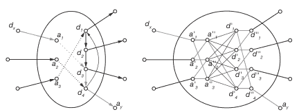

图 4.6. 将对称TSP中的原始车站 $\sigma$ 转换为车站 $\sigma'$。灰色路径标记了原始车站 $\sigma$ 和转换后车站 $\sigma'$ 中从 $d_x$ 到 $a_y$ 的旅行路线。

由于 $M$ 已经被 $\sigma'$ 内部的边 $(a'_i, a''_i)$ 和 $(d'_j, d''_j)$ 使用，因此为 $M'$ 选择了一个更大的值，以确保在 $G'$ 上的解中只包含一条旅行边，即 $M' = M \cdot |B|$。

### 计算结果

为了测试所提出的TSP转换方案，作者使用了基于两个铁路时刻表的实例，包含荷兰列车时刻表的真实世界数据。实例 \(nd\_loc\) 包含23个城市，代表一个本地区域的列车，而实例 \(nd\_ic\) 包含荷兰21个较大的城市，这些城市由城际列车连接。

旅行商的要求是随机生成的。通过让旅行商访问5个或10个城市来创建，每个地点的停留时间在10到240分钟之间选择。由于 [46, 92] 也为访问相同数量城市的旅行商使用了随机生成的数据，结果至少应该大致可比。然而，未提及停留时间。

基于两个时刻表的时间扩展有向图包含超过2000个节点和约4000条边（取决于旅行人员）。在缩减图之后，执行了生成对称TSP实例的转换程序，并使用Concorde库中的分支切割（B&C）算法求解。

实验在一台配备4 GB内存的Intel Core 2 Quad 2.4 GHz PC上进行，B&C使用ILOG CPLEX 9.0作为求解器。

表4.5和4.6显示了转换实例上Concorde分支切割（B&C）算法的性能。对于每个实例，进行了30次运行，因为B&C使用随机种子来决定其分支顺序，从而导致运行时间可变。列出了实例索引、旅行商必须访问的城市数量、

| 索引 | |B| | 节点数 | 时间 | 标准偏差 |
|---|---|---|---|---|---|
| 1 | 5 | 348 | 1.14 s | 0.35 |
| 2 | 5 | 514 | 1.02 s | 0.12 |
| 3 | 5 | 514 | 0.98 s | 0.07 |
| 4 | 5 | 688 | 7.14 s | 3.42 |
| 5 | 5 | 852 | 2.65 s | 0.45 |
| 6 | 5 | 762 | 2.41 s | 0.34 |
| 7 | 5 | 1 312 | 56.81 s | 22.89 |
| 8 | 5 | 782 | 4.03 s | 1.20 |
| 9 | 5 | 854 | 2.84 s | 0.73 |
| 10 | 5 | 456 | 0.84 s | 0.11 |
| 11 | 10 | 1 786 | 15.48 s | 6.57 |
| 12 | 10 | 1 562 | 8.67 s | 4.04 |
| 13 | 10 | 1 960 | 36.29 s | 13.39 |
| 14 | 10 | 1 260 | 5.17 s | 1.07 |
| 15 | 10 | 1 410 | 7.89 s | 3.03 |
| 16 | 10 | 1 478 | 219.67 s | 267.30 |
| 17 | 10 | 2 276 | 52.95 s | 13.69 |
| 18 | 10 | 1 748 | 24.64 s | 13.40 |
| 19 | 10 | 2 252 | 20.77 s | 4.88 |
| 20 | 10 | 1 342 | 6.20 s | 2.98 |

必须访问的城市数量、应用图缩减和转换后TSP中的节点数量、B&C查找和证明最优解所需的平均运行时间以及运行时间的标准偏差。

对于表4.6中的实例12、14和18，当B&C仍无法证明最优性时，所有30次运行在10000秒后终止。然而，在这些情况下，剩余差距都小于0.1%。

在分析结果时，我们观察到实例之间运行时间存在较大差异，尤其是nd_ic实例。在B大小相同的实例中，行程包含的节点数量可能有很大不同。这是由于B中车站的随机选择造成的。查看铁路时刻表的数据，有些只包含少量到达和出发节点，而其他则节点齐全。这种不平衡在时刻表nd_ic中表现得更为明显，其中一些车站包含的节点少至2个，而其他则多达254个。这可能就是为什么这些实例对Concorde B&C来说似乎更难求解的原因。

表4.6. 实例nd_ic的计算结果。

| 索引 | |B| | 节点数 | 时间 | 标准偏差 |
|---|---|---|---|---|---|
| 1 | 5 | 422 | 3.35 s | 1.35 |
| 2 | 5 | 542 | 5.50 s | 1.93 |
| 3 | 5 | 712 | 6.19 s | 1.36 |
| 4 | 5 | 364 | 0.52 s | 0.04 |
| 5 | 5 | 1 178 | 30.26 s | 9.38 |
| 6 | 5 | 450 | 0.77 s | 0.06 |
| 7 | 5 | 516 | 3.47 s | 1.09 |
| 8 | 5 | 1 140 | 10.16 s | 3.57 |
| 9 | 5 | 324 | 29.68 s | 16.17 |
| 10 | 5 | 568 | 8.50 s | 3.29 |
| 11 | 10 | 1 786 | 1 907.47 s | 990.37 |
| 12 | 10 | 1 562 | 10 000.00 s | 0.00 |
| 13 | 10 | 1 960 | 45.68 s | 27.39 |
| 14 | 10 | 1 260 | 10 000.00 s | 0.00 |
| 15 | 10 | 1 410 | 71.29 s | 48.41 |
| 16 | 10 | 1 478 | 1 471.14 s | 781.79 |
| 17 | 10 | 2 276 | 239.52 s | 72.94 |
| 18 | 10 | 1 748 | 10 000.00 s | 0.00 |
| 19 | 10 | 2 252 | 1 071.12 s | 377.63 |
| 20 | 10 | 1 342 | 346.39 s | 134.51 |

#### 4.3.4 求解RTSP的基于蚁群的启发式

由于RTSP的复杂性，该问题无法在多项式有界计算时间内通过精确方法求解。尽管如此，次优解有时容易找到。因此，专注于元启发式算法似乎是合理的，这些算法可以在合理的运行时间内找到近似最优解。Pop等人 [156] 描述了一种基于蚁群优化的此类方法。

### 求解RTSP的蚁群算法

在 [137] 中，Pineo 等人提出了一种基于蚁群系统的新算法，称为强化蚁群系统（RACS），以求解广义旅行商问题。

为了求解RTSP，必须根据铁路问题的特点修改RACS算法。旅行商从特定车站（簇）出发，必须访问给定数量的车站（城市），在每个车站停留最少时间，最后必须返回起始车站。


接下来，我们介绍一种名为铁路蚁群（Railway Ant Colony, RAC）算法的新算法，用于解决铁路旅行商问题。

在RAC算法中，m只蚂蚁独立地分别构建候选解。巢穴节点的选择基于两个主要组成部分：信息素轨迹和一种称为能见度（visibility）的启发式值。

该算法的工作方式与第3.5.1节中用于求解GTSP的增强型蚁群系统类似。我们采用了相同的概率函数，该函数倾向于选择信息素值（\(\tau\)）高且能见度值（\(\eta\)）高的边，并采用相同的局部和全局修正规则来更新轨迹强度。

起初，蚂蚁位于它们的巢穴，并将在特定区域内开始寻找食物。一只蚂蚁恰好经过给定数量的簇（\(B\)）一次，然后返回巢穴。蚂蚁在每个簇中停留一段时间，以寻找理想的食物，之后，从另一个节点出发，继续巡回。下一个节点的选择是概率性的。某条道路（边）上的信息素越多，选择这条特定道路的机会就越大。因此，信息素轨迹将引导蚂蚁走向更短的路径，即RTSP的解。

当每只蚂蚁完成一次巡回后，信息素的量会被更新。在每条道路（边）上，一部分信息素在路途中会蒸发。新的信息素会沉积在至少有一只蚂蚁访问过的道路上。目前为止最佳巡回中的所有道路都会获得额外的信息素。这被称为精英蚂蚁方法——最优秀的蚂蚁会进一步加强其关联的巡回。

该过程持续进行，直到达到某个条件，例如特定的迭代次数、CPU时间或解的质量。

铁路蚁群（RAC）算法可以如下描述：

### 算法4.1（用于RTSP的铁路增强系统算法）。

```
For every edge (i, j) do \(\tau_{ij}(0) = \tau_0\)
for k = 1 to m do
    place ant k on a specified chosen node from a specified cluster
end for
let T* be the shortest tour found and L+ its length
for iter = 1 to N_iter do
    for k = 1 to m do
        build tour T^k(t) by applying |B| - 1 times
        choose the next arrival node j from an unvisited cluster,
        j = \begin{cases} \arg\max_{u \in J^k_i} [\tau_{iu}(t)]^\alpha [\eta_{iu}(t)]^\beta & \text{if } q \le q_0 \\ J & \text{if } q > q_0 \end{cases}
```

where \( J \in J_t^k \) is chosen with probability:

\( p_{in}^k(t) = \frac{[\tau_{iu}(t)]^\alpha [\eta_{iu}(t)]^\beta}{\sum_{o \in J_t^k} [\tau_{io}(t)]^\alpha [\eta_{io}(t)]^\beta} \)

and where \( i \) is the current starting node, update pheromone trails by applying the local rule:

\( \tau_{ij}(t+1) = (1-\rho) \cdot \tau_{ij}(t) + \rho \cdot \tau_0 \)

end for

for \( k=1 \) to \( m \) do

compute the length \( L^k(t) \) of the tour \( T^k(t) \)

if an improved tour is found, then update \( T^k(t) \) and \( L^k(t) \)

for every edge \( (i, j) \in T^k \) do

update pheromone trails by applying the global rule:

\( \tau_{ij}(t+1) = (1-\rho) \cdot \tau_{ij}(t) + \rho \cdot \Delta \tau_{ij}(t) \)

where \( \Delta \tau_{ij}(t) = \frac{1}{L^+} \)

end for

end for

Print the shortest tour \( T^+ \) and its length \( L^+ \)

whereby we denoted the number of iterations.

To evaluate the performance of the proposed algorithm, we compared our results with the results obtained by Hadjicharalambous et al. in [67]. The computational results are reported in the next section, where we also compare them with those obtained in the case of the Dynamic Railway Traveling Salesman Problem.

### 4.4 动态铁路旅行商问题

After an initial emphasis on static problems, part of our focus now shifts towards dynamic variants of combinatorial optimization problems. Recently, research has been done on ACO for dynamic problems, see [61, 62, 63, 108].

The Dynamic Railway Traveling Salesman Problem, denoted DR TSP, and introduced by Pop et al., is a variation on the RTSP in the sense that it is assumed that the distances between cities, determined as the travel times, are no longer fixed. In real life, this situation is encountered when delays due to maintenance work, accidents, etc., may occur. Therefore, the travel times may vary.

In the definition given below, we verbally define what we mean when we talk about a static RTSP.

### 静态铁路旅行商问题

- 假设在过程开始之前，销售员已知所有与巡回规划相关的信息。
- 巡回构建完成后，与巡回规划相关的信息不会发生变化。

The information that is assumed to be relevant includes all attributes of the customers in different cities, such as the geographical location of the customers and times spent within each of the visited cities in order to carry out his/her business. Furthermore, system information as for example travel times of the trains between the cities must be known by the salesman.

### 动态铁路旅行商问题

- 假设在过程开始之前，销售员并非已知所有与巡回规划相关的信息。
- 巡回构建完成后，与巡回规划相关的信息可能会发生变化。

We mention that several other dynamic variants for combinatorial optimization problems may be considered, such as variants resulting from insertion or deletion of cities, see [61, 63, 108].

#### 4.4.1 动态RTSP的蚁群方法

The combination of positive and negative reinforcement, as mentioned in the case of the static RTSP, works well for static problems. In the beginning, there is relatively much exploration. After a while all non-promising connections will be slowly excluded from the search space, because they do not get any positive reinforcement and the associated pheromones have evaporated over time.

In the dynamic case, solutions that are bad before a change in the environment occurs, may be good afterward. Now, if the ant system has converged to a state where those solutions are ignored, very promising connections will be lost and the result will be a suboptimal solution. We have considered two ways to overcome this effect:

- 我们使用一种称为“摇动”（shaking）的技术，以某种方式平滑所有信息素水平。如果某条边上的信息素量远高于所有其他边，那么这条边将始终被选择。这样，在静态情况下，可以确保始终遵循良好的连接，但如果良好的连接被阻塞，这会阻止蚂蚁选择另一条连接。摇动中使用的公式是一种新的局部更新规则:

\(\tau_{ij} (t + 1) = \tau_0 \cdot \left( 1 + \log \left( \frac{\tau_{ij}(t)}{\tau_0} \right) \right).\) (4.16)

This formula will cause pheromone values close to \(\tau_0\) to move a little towards \(\tau_0\) and causes higher values to move relatively closer to \(\tau_0\):

- 启发式信息通常取决于问题，并且在算法的每次单次运行过程中保持静态。但是，通过限制信息素轨迹的影响，可以轻松避免在算法运行过程中信息素轨迹之间的相对差异变得过于极端。为了实现这一目标，我们的算法使用一个最小限度（例如 \(\tau_0\)）作为动态情况下每条边上信息素量的下限，如[193]中所述。这防止了蚂蚁选择特定边的概率在某个点之后趋近于零。

\(if \quad \tau_{ij}(t) < \tau_0 \quad then \quad \tau_{ij}(t+1) = \tau_0.\) (4.17)

In the dynamic RTSP, at each iteration of the RAC algorithm, one station is blocked, which means that no trains are going in or out of that station.

The dynamic Railways Ant Colony algorithm can be stated as follows:

### 算法4.2（用于动态RTSP的动态铁路蚁群算法）。

```
For every edge $(i, j)$ do $\tau_{ij}(0) = \tau_0$
for $k = 1$ to $m$ do
    place ant k on a specified chosen node from a specified cluster
    let $T^+$ be the shortest tour found and $L^+$ its length
    for $i = 1$ to $N_{iter}$ do
        choose a cluster at random and set the cluster to visited
        for $k = 1$ to $m$ do
            build tour $T^k(t)$ by applying $B - 1$ times
            choose the next arrival node $j$ from an unvisited cluster (1)(2)
            update pheromone trails by applying the local rule (5)
        end for
    for $k = 1$ to $m$ do
        compute the length $L^k(t)$ of the tour $T^k(t)$
        if an improved tour is found, then update $T^k(t)$ and $L^k(t)$
        for every edge $(i, j) \in T^+$ do
            update pheromone trails by applying the global rule (4)
```


```
if the amount of pheromone is lower than the lower-bounded value, then
apply the pheromone correction phase (6)
end for
end while
Print the shortest tour T+ and its length L+
```

#### 4.4.2 实现细节与计算结果

所有信息素痕迹的初始值为 $\tau_0 = 0.1$。与其他所有蚁群系统一样，算法所选参数至关重要。目前，尚未发展出能够在每种情况下给出最优参数值的数学分析。在我们的算法中，对于静态和动态 RTSP，参数值分别选取为 $\alpha = 1, \beta = 2, \rho = 0.001, q_0 = 0.5$。考虑的蚂蚁数量为 $B = 5$ 时 $m = 10$，$B = 10$ 时 $m = 100$。每只蚂蚁进行 100 次巡回，以找到一条好的路径。

实验在合成数据和真实世界数据上均进行了。我们使用了与 [67] 中相同的真实世界数据，代表荷兰部分铁路网络。

对于合成情况，我们考虑在 [67] 中构建的网格图，其中图的每个节点与其所有相邻节点相连，即网格中其所在行或列紧邻它的车站，不同之处在于在我们的情况中车站数量在 20 到 200 之间变化。车站之间的连接在相邻车站之间随机放置，使得每对相邻车站（双向）至少有一个连接，并且每个车站的基本连接平均数量为 10。每个基本连接的出发时间和到达时间之间的时间差是独立、均匀的随机变量，选取自区间 [20, 60]（表示分钟），而出发时间是介于最早和最晚可能出发时间之间的随机变量。

用于合成数据的所有新图的特征，对应车站数量在 100 到 200 之间，如表 4.7 所示。

表 4.7. 每个数据集的时间扩展图的图参数

| 数据集 | 车站数 | 节点数 | 边数 | 连接数 | 连接/车站 |
|---|---|---|---|---|---|
| 合成 8 | 100 | 2 000 | 4 000 | 1 000 | 10 |
| 合成 9 | 125 | 2 500 | 5 000 | 1 250 | 10 |
| 合成 10 | 150 | 3 000 | 6 000 | 1 500 | 10 |
| 合成 11 | 175 | 3 500 | 7 000 | 1 750 | 10 |
| 合成 12 | 200 | 4 000 | 8 000 | 2 000 | 10 |

对于每个数据集，创建了若干问题实例，其中选定车站的数量 |B|，即旅行商必须访问的车站数量，有所变化。对于基于真实数据和合成数据的两种图，我们使用了 |B| 的两个值，即 5 和 10。请注意，|B| 不包含起始车站。属于 |B| 的车站是随机且相互独立地选定的。

对于每个数据集和 B 值的组合，我们随机且相互独立地选定了属于 B 的车站。

车站选择重复了多次，并计算了所有相应实例的平均值。

我们创建的每个实例都使用 RAC 算法求解了 RTSP 的静态和动态变体。该算法使用 Java 编写。我们获得的解与 Hadjicharalambous et al. 使用 GLPSOL v.4.6 求解相应整数线性规划所获得的最优解进行了比较。

在表 4.8 中，我们将使用 RAC 算法求解 RTSP 的计算结果与 Hadjicharalambous et al. 来自 [67] 的计算结果进行了比较，适用于原始图和缩减图的情况。此外，我们还展示了动态 RTSP 情况下获得的结果。

表 4.8 中的第一列包含我们实验中使用的数据集。以下列包含必须包含在巡回中的选定车站（簇）数量 |B|，以及相应的运行时间。前两行，称为 nd_ic 和 nd_loc，是代表荷兰部分铁路网络的真实数据。最后几行代表基于网格图构建的合成数据。在表中，符号“–”表示相应信息在 [67] 中未提供。

表 4.8. 使用 RAC 算法的静态和动态 RTSP 的计算结果。

| 数据集 | |B| = 5 | | | | |B| = 10 | | | |
|---|---|---|---|---|---|---|---|---|---|
| | RAC | CPU [67] | CPU 缩减 | DRTSP | RAC | CPU [67] | CPU 缩减 | DRTSP |
| nd_ic | 16.60 | – | 29.1 | 22.36 | 374.28 | – | 6 942.6 | 375.04 |
| nd_loc | 18.68 | – | 319.0 | 22.53 | 677.36 | – | 9111.9 | 390.71 |
| 合成 1 | 5.43 | 13.12 | 1.12 | 4.33 | 78.04 | 781.12 | 214.76 | 49.1 |
| 合成 2 | 5.51 | 32.24 | 1.12 | 5.46 | 99.95 | 1 287.00 | 369.59 | 50.4 |
| 合成 3 | 8.38 | 72.06 | 1.50 | 6.67 | 119.54 | 16 239.80 | 214.18 | 79.98 |
| 合成 4 | 6.47 | – | 0.80 | 7.87 | 132.66 | – | 181.85 | 105.9 |
| 合成 5 | 8.11 | – | 1.45 | 9.14 | 132.66 | – | 257.96 | 160.1 |
| 合成 6 | 8.74 | – | 1.30 | 10.32 | 189.80 | – | 431.80 | 168.02 |
| 合成 7 | 9.95 | – | 1.00 | 11.48 | 196.76 | – | 233.26 | 229.82 |
| 合成 8 | 34.04 | – | – | 32.27 | 499.90 | – | – | 501.82 |
| 合成 9 | 40.56 | – | – | 41.08 | 613.42 | – | – | 611.37 |
| 合成 10 | 48.20 | – | – | 45.63 | 746.09 | – | – | 720.29 |
| 合成 11 | 54.48 | – | – | 53.20 | 845.28 | – | – | 860.45 |
| 合成 12 | 61.02 | – | – | 61.87 | 986.46 | – | – | 991.77 |

对于两种图（基于真实数据和合成数据），我们使用了 |B| 的两个值，即 5 和 10。对于每个数据集和 B 值的组合，我们提供了使用 RAC 算法获得的运行时间，并与 Hadjicharalambous et al. 来自 [67] 的运行时间进行了比较，适用于原始图和缩减图。计算值是 RAC 算法 50 次连续运行的平均结果。终止准则由迭代总数给出，N_iter = 2 500。

在下一图中，我们展示了铁路蚁群（RAC）针对真实数据（nd_ic 数据文件）从不同簇出发的平均时间值示例。

如表 4.8 所示，铁路蚁群算法与 Hadjicharalambous [67] 使用 CPLEX 求解问题整数规划公式的方法相比，表现非常好。

铁路旅行商问题的 RAC 算法可以通过使用更合适的参数值来改进。此外，RAC 与其他算法的高效组合可能改进结果。

### 4.5 注释

铁路旅行商问题（RTSP）是经典旅行商问题的一个实际扩展，考虑了铁路网络和列车时刻表，并与广义旅行商问题相关。它由 Hadjicharalambous [67] 引入。

在本章中，我们关于 RTSP 提出了以下结果：

- 基于 Schulz et al. [182] 引入的时刻表信息构建的时间扩展有向图 G 的问题模型。
- 四种求解 RTSP 的方法：通过最短路径的尺寸缩减方法、切平面方法、基于将 RTSP 转换为经典 TSP 的方法，以及基于蚁群的启发式。
- 称为动态铁路旅行商问题的 RTSP 变体，其中我们假设城市之间的距离（视为旅行时间）不再固定。
- 用于求解动态铁路旅行商问题的蚁群方法。

本章所呈现的材料主要基于 Hadjicharalambous [67]、Hu et al. [78] 和 Pop et al. [155, 156, 157] 发表的结果。

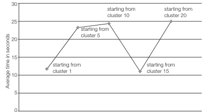

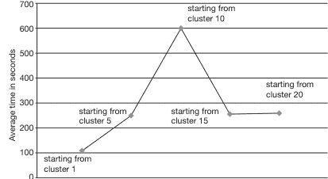

图 4.7. nd_ic 数据文件从不同簇出发的铁路蚁群（RAC）平均时间值。第一组为 B = 5，第二组为 B = 10。


## 第 5 章

### 广义车辆路径问题（GVRP）

确定从一个或多个配送中心到一组地点/客户的车辆最优路径的问题称为车辆路径问题（VRP）。它们在分销和物流领域有许多实际应用。关于该问题的文献非常丰富（有关详细参考文献，请参见 Laporte 和 Osman [104]、Laporte [107] 以及由 Ball 等人编辑的书籍 [6]）。

给定一组车辆、一组包含配送中心位置以及每对地点之间距离的地点，VRP 旨在为每辆车辆寻找最小成本巡回路线，使得所有地点都被访问，且每辆车辆返回配送中心。由于 VRP 的简单性，在基本 VRP 基础上增加额外功能的 VRP 变体被证明对许多研究者最具吸引力

- 带容量限制的 VRP [201]，其中每辆车辆具有有限容量，每个地点具有有限需求。
- 带时间窗的 VRP [24, 190]，其中每个地点都有指定的时间窗口可供访问。
- 多配送中心 VRP [19]，它推广了配送中心的概念，使得存在多个配送中心，每个客户都可以从其中一个配送中心获得服务。
- 多商品 VRP [180]，其中每个地点都有不同商品的相关需求，每辆车辆都有一组隔间，每个隔间只能装载一种商品。问题因此变成决定将哪些商品放入哪些隔间，以最小化行驶距离。
- 广义车辆路径问题（GVRP）[48] 是从给定配送中心到若干预定义的、互斥且完备的节点集（簇）设计最优配送或收集路线的问题，受容量限制约束。GVRP 可以被视为一种特定的位置-路由问题（例如，参见 Laporte [101]、Nagy 和 Salhi [129]），对于该问题存在多种算法，主要是启发式算法。

在本节中，我们关注 Ghiani 和 Improta [48] 引入的 GVRP。他们通过将 GVRP 转换为带容量限制的弧路由问题来提出求解方法，文献中报道了针对该问题的精确算法和多种近似方法。

### 5.1 GVRP 的定义与复杂性

设 G = (V, A) 为有向图，其中 V = {0, 1, 2, ..., n} 为顶点集，A = {(i, j) | i, j ∈ V, i ≠ j} 为弧集。每条弧 (i, j) ∈ A 关联一个非负成本 cij。顶点（节点）集被划分为 m + 1 个互斥的非空子集，称为簇，即 V0, V1, ..., Vm。簇 V0 只有一个顶点 0，代表配送中心，其余 n 个节点属于其余 m 个簇，代表地理上分散的客户。每个簇 Vk，k ∈ {1, ..., m} 有一个非负需求，记为 qk，且 q0 = 0。每个客户 i ∈ V \ {0} 有一定需求，记为 di，每个簇的总需求可以通过其任意节点得到满足。共有 K 辆相同的车辆，每辆容量为 Q。

GVRP 包括寻找从配送中心出发并返回配送中心的最小总成本巡回路线，使得每个簇被恰好访问一次，每个簇的进入节点和离开节点相同，且任何巡回路线（路径）的所有需求之和不超过车辆容量 Q。

GVRP 的示意图如下图所示，并附带一个可行巡回路线。

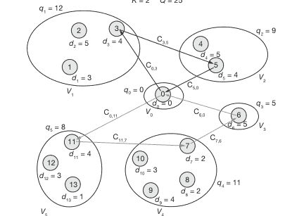

图 5.1. GVRP 的一个可行解示例。

当所有簇均为单元素集时，GVRP 退化为经典车辆路径问题（VRP）；当 K = 1 且 Q = ∞ 时，退化为广义旅行商问题（GTSP）。

GVRP 是 NP-hard 的，因为它将广义旅行商问题作为 \(K = 1\) 和 \(Q = \infty\) 时的特例包含在内。

多种现实场景可以建模为 GVRP。Laporte 等人 [102] 描述的邮箱收集问题，如果需要多于一辆车辆，则成为非对称 GVRP。此外，GVRP 可以建模为群岛（如菲律宾、新西兰、印度尼西亚、意大利、希腊和克罗地亚）中多个客户的海上货物分销。在此应用中，为每个岛屿选择若干个潜在港口，并需要一支船队恰好访问每个岛屿的一个港口。

GTSP 的若干应用（Laporte 等人 [105]）可以自然地扩展到 GVRP。此外，还有其他几种情况可以建模为 GVRP，包括

- 带利润的旅行商问题（TSP）（Feillet 等人 [36]）。
- 若干 VRP 扩展：带选择性回程的 VRP、覆盖 VRP、周期性 VRP、带容量限制的通用多风路由问题等。
- 自动导引车辆的串联配置设计（Baldacci 等人 [5]）。

### 5.2 将 GVRP 转换为带容量限制的弧路由问题的高效方法

正如我们在第 3.2 节中所见，将广义网络设计问题转换为存在高效求解方法的经典组合优化问题，似乎是一种非常有前景的方法。

对于 GVRP，Ghiani 和 Improta [48] 表明该问题可以转换为带容量限制的弧路由问题（CARP），Baldacci 等人 [5] 证明逆变换也成立。

给定一个无向图 \(G = (V, E)\)，一个位于顶点 \(v_0 \in V\) 的配送中心（一组给定车辆驻扎于此），一个边的子集 \(R \subseteq E\)，称为*必需边*（如果由车辆服务），每条边 \(e \in E\) 关联一个非负成本 \(c_e\)，以及每条边 \(e \in R\) 附加一个正需求 \(d_e\)，则 CARP 包括寻找一组最短巡回路线，使得：

- 每条路线从配送中心出发并返回配送中心；
- 每条必需边至少被遍历一次，且恰好由一辆车辆服务；
- 任何车辆服务的总需求不超过车辆容量 \(Q\)。

CARP 由 Golden 和 Wong [55] 引入，该问题有许多有趣的应用，包括街道垃圾收集、邮件投递、冬季撒盐、电表抄表员路由等。同一作者证明该问题是强 NP-hard 的。然而，对于图、需求或成本的特殊结构，存在求解 CARP 特殊类别的高效多项式算法，参见 Assad 等人 [4]。由于 CARP 的复杂性，已开发出多种近似方法（参见 Assad 和 Golden [3]、Eiselt 等人 [33, 34]）和启发式算法（参见 Chapelat 等人 [17]、Hertz 等人 [74] 等）来求解该问题。

接下来，我们将描述由 Ghiani 和 Improta [48] 引入的将 GVRP 转换为 CARP 的高效方法。

为简单起见，我们假设 GVRP 是对称的（即，对于所有客户 i, j ∈ V，cij = cji）。很容易证明上述假设并不具有限制性，每个 GVRP 都可以转换为我们问题的一个实例。

Assad 和 Golden [3] 以及 Eiselt [33] 证明，对于 CARP 的每个可行解，每个顶点都由偶数条边的副本进入。为简单起见，奇偶性条件使用“边”一词而不是“边的副本”来表述。

令 GR 表示由 R 中的边诱导的子图，Nh 表示 GR 的第 h 个连通分量的节点集，h = 1, ..., m，NR 表示节点 vi 的集合，使得存在边 (vi, vj) 属于 R，即 VR = ∪h={1,...,m} Nh。

在此情况下，将 GVRP 转换为 CARP 定义如下：

- 1. 对于 h = 1, ..., m，使用簇 Vh 的顶点 v(h), ..., v(r(h))h 创建一组“非常昂贵”的必需边环，其中 r(h) 表示属于簇 Vh 的客户数量。将以下边 (v(i)h, v(i mod r(h))+1h)（i = 1, ..., r(h)，成本等于一个较大的正数 M）插入 R。特别是，如果 r(h) = 1，则引入必需环 v(h)1, v(h)1。这些环创建 m 个必需边的连通分量。其余边为非必需边。
- 2. 移除簇内的非必需边。
- 3. 如果端点与配送中心重合，每条簇间边的成本增加 M/2，否则增加 M。
- 4. 将严格正需求（总和等于 dh）分配给对应于 Vh 的环的边，h = 1, ..., m。

在下图中，我们说明上述转换过程，并展示属于图 5.1 所示 GVRP 可行解的转换图上的相应 CARP 解。

以下结果成立：

命题 5.1. (Ghiani 和 Improta [48]) 转换图上 CARP 的最优解对应于原始图上 GVRP 的最优解。


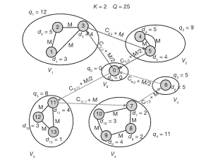

图 5.2. 转换图上的相应 CARP 解。

**命题 5.2.** (Ghiani 和 Improrota [48]) 如果 $M$ 设置为 $2 \cdot c_{MAX}$，则最优 CARP 解对应于 GVRP 的解。

这里，我们用 $c_{MAX}$ 表示 GVRP 图中最大的簇内边成本。

### 5.3 GVRP 的整数线性规划公式

在本节中，我们首先提出 GVRP 的一般半封闭公式，然后指定其显式形式并提出问题的四个公式（另见 [9, 94, 163]）。

#### 5.3.1 一般公式

我们定义与 GVRP 相关的集合、决策变量和参数如下

**集合：**
- $V = \{0, 1, 2, ..., n\}$ 对应于客户的节点集合，其中 0 表示原点（配送中心）。
- $V_0, V_1, ..., V_m$ 是 $V$ 的一个划分，分为互斥且完备的非空子集，每个子集代表一组客户，其中 $V_0 = \{0\}$ 表示原点（本城市，配送中心）。
- $C = \{0, 1, 2, ..., m\}$ 簇集合。
- $A = \{(i, j) | i, j \in V, i \neq j\}$ 弧集。

### 决策变量：

我们定义以下二元变量：

$$
x_{ij} = \begin{cases} 1 & \text{如果弧 } (i, j) \in A \text{ 包含在车辆的路径中} \\ & i \in V_p, j \in V_r, p, r \in C \\ 0 & \text{否则} \end{cases}
$$

$$
w_{pr} = \begin{cases} 1 & \text{如果存在从簇 } V_p \text{ 到簇 } V_r \text{ 的路径}, p, r \in C \\ 0 & \text{否则} \end{cases}
$$

### 参数：

$c_{ij}$ 是从节点 $i$ 到节点 $j$ 的旅行成本，$i \neq j, i \in V_p, j \in V_r, p \neq r, p, r \in C$；
$d_i$ 是客户 $i$ 的需求，$i = 1, 2, ..., n$；
$q_r$ 是簇 $V_r$ 的需求，$q_r = \sum_{i \in V_r} d_i, r \in C$；
$K = \{1, ..., s\}$ 是统一车辆（路径）的集合；
$Q$ 是每辆车的容量。

在本文中，我们假设 $m \ge s$。

问题的约束如下，在相应的标题下给出：

### 簇度约束

对于每个簇，不包括 $V_0$，只能有一条指向其他簇中任何其他节点的出弧。此条件由以下约束隐含：

$$
\sum_{i \in V_p} \sum_{j \in V \backslash V_p} x_{ij} = 1, \quad p \neq 0, \quad p \in C \quad (5.1)
$$

只能有一条来自其他簇中任何其他节点的入弧到达一个簇，不包括 $V_0$。此条件由以下约束隐含：

$$
\sum_{i \in V \backslash V_p} \sum_{j \in V_p} x_{ij} = 1, \quad p \neq 0, \quad p \in C \quad (5.2)
$$

从原点（家城市）应有 $s$ 条出弧和最多 $s$ 条入弧，此条件由以下约束隐含：

\(\sum_{i=1}^n x_{0i} = s \quad (5.3)\)

\(\sum_{i=1}^n x_{i0} = s \quad (5.4)\)

### 簇连通约束

每个簇的入节点和出节点应相同，这由以下公式满足：

\(\sum_{i \in V_p} x_{ij} = \sum_{i \in V_p} x_{ji}, \quad j \in V_p, \quad p \in C \quad (5.5)\)

从簇 \( V_p \) 到簇 \( V_r \) 的流由 \( w_{pr} \) 定义。因此，\( w_{pr} \) 必须等于从 \( V_p \) 到 \( V_r \) 的 \( x_{ij} \) 之和。因此，我们写：

\( w_{pr} = \sum_{i \in V_p} \sum_{j \in V_r} x_{ij} \quad (5.6)\)

根据上述定义和约束，GVRP 的一般整数规划公式可以给出为：

最小化 \(\sum_{i=1}^n \sum_{j=1}^n x_{ij}\)
受约束于 (5.1)–(5.6)
容量边界约束 (5.7)
子回路消除约束 (5.8)
\( x_{ij} \in \{0, 1\}, \forall (i, j) \in A. \)

注意，由于 (5.1)、(5.2)、(5.3) 和 (5.4) 给出的度约束，\( w_{pr} \) 将自动为 0 或 1。因此，我们不需要对 \( w_{pr} \) 强加整数约束。

给出的约束 (5.1)–(5.5) 与 Noon 和 Bean [133] 为 GTSP 给出的约束类似。给出的约束 (5.6) 由 Kara 和 Bektas [92] 引入。

GVRP 的模型公式可能彼此不同，取决于上述 (5.7) 和 (5.8) 中给出的“容量边界”和/或“子回路消除”约束。

在整数规划公式的情况下，如果公式的约束数量随图中节点数量呈指数增长，则称为 *指数规模公式*。如果约束数量随节点数量呈多项式增长，则称为 *多项式规模公式*。此外，如果公式有额外的辅助决策变量，则可以根据新的决策变量进行分类：如果额外变量相对于图的节点，则为 *基于节点的公式*；如果新变量相对于图的弧，则为 *基于流的公式*。

在以下小节中，我们通过定义新的辅助变量，为 GVRP 提出整数规划公式。

#### 5.3.2 基于节点的公式

除了之前定义的决策变量外，让我们定义以下辅助变量：

设 \(u_p\) 为车辆离开簇 \(V_p\) 后的负载（收集情况）或车辆离开簇 \(V_p\) 后交付的货物量（交付情况），\(p \neq 0, p \in C\)。

### 容量边界约束

以下提议给出了基于节点的公式的容量边界约束。

**命题 5.3.** 以下不等式是 GVRP 的有效容量边界约束：

$$
u_p - \sum_{r \in C, r \neq p} q_r w_{pr} \ge q_p \quad p \neq 0, \quad p \in C \quad (5.9)
$$

$$
u_p + (Q - q_p)w_{0p} \le Q \quad p \neq 0, \quad p \in C \quad (5.10)
$$

$$
u_p + \sum_{r \in C, r \neq p} q_r w_{pr} \le Q \quad p \neq 0, \quad p \in C \quad (5.11)
$$

其中 \(q_0 = 0\)。

**证明.** 任何簇 \(V_p\) 可能位于车辆路径的第一个、最后一个或中间位置，即，要么 \(w_{0p} = 1\) 和/或 \(w_{p0} = 1\)，要么存在簇 \(V_s\) 和 \(V_t\)，使得 \(w_{sp} = w_{pt} = 1\)。如果 \(w_{0p} = 1\)（或 \(w_{p0} = 1\)），不等式 (5.10)、(5.11) 和 (5.12) 蕴含 \(u_p = q_p\)，如果 \(w_{p0} = 1\)，边界约束蕴含 \(q_p = u_p = Q\)。如果车辆从簇 \(V_s\) 来，到达簇 \(V_p\) 然后从 \(V_p\) 到达簇 \(V_t\)，这意味着对于所有 \(r \neq s\) 和 \(r \neq t\)，\(w_{rp} = 0\) 和 \(w_{pr} = 0\)，那么从边界约束我们得到 \(q_p + q_s \le u_p \le Q - q_t\)。

### 子回路消除约束

不允许在不包括 \(V_0\) 的簇之间形成任何子回路，由以下约束禁止：

\(u_p - u_r + Qw_{pr} + (Q - q_p - q_r)w_{rp} \le Q - q_r \quad p \neq r \neq 0, p, r \in C \quad (5.12)\)

其中，当 \(q_p + q_r > Q\) 且 \(p \neq r\) 与 \(p, r \in C\) 时，\(w_{pr} = 0\)。

这些约束改编自容量 VRP 的子回路消除约束（参见 Desrochers 和 Laporte [23] 以及 Kara et al. [93]）。

注意，给出的约束 (5.10) 保证对于所有 \(p \in C\)，\(u_p \ge 0\)。因此，我们不需要非负约束。

GVRP 的第一个整数线性规划公式如下：

\(\text{(NB) 最小化 } \sum_{i=1}^n \sum_{j=1}^n x_{ij}\)
受约束于 (5.1)–(5.6) 和 (5.9)–(5.12),
\(x_{ij} \in \{0, 1\}, \forall(i, j) \in A.\)

其中，当 \(i, j \in V_r, r \in C\) 时 \(x_{ij} = 0\)，并且当 \(q_p + q_r > Q\) 时 \(w_{pr} = 0\)。

在上述公式中，二元变量的总数为 \(n(n + 1)\)，即 \(O(n^2)\)。变量 \(w_{pr}\) 自动取二元值。由 (5.1)、(5.2)、(5.3)、(5.4)、(5.5)、(5.6)、(5.9)、(5.10)、(5.11) 和 (5.12) 隐含的约束数量分别为 \(m, m, 1, 1, (n + 1), m(m + 1), n, m, m\) 和 \(m(m - 1)\)，其中 \(n\) 是客户数量，\(m\) 是簇数量，且 \(m \le n\)。因此，约束总数为 \(2m^2 + n + 5m + 3\)，即 \(O(m^2) = O(n^2)\)。

(NB) 基于节点的 GVRP 公式在结构上与 Kara-Bektas [92] 公式相似，但它包含完全不同的边界约束。我们将在下面展示，基于节点的公式产生的下界比 Kara 和 Bektas [92] 描述的公式更强。

我们用 \(P_{NB}\) 表示基于节点的 GVRP 公式的线性规划松弛的可行集，其中我们将整数约束 \(x_{ij} \in \{0, 1\}\) 替换为 \(0 \le x_{ij} \le 1\)。如果我们用 \(P_{K-B}\) 表示 Kara-Bektas 公式的线性规划松弛的可行集，则以下结果成立：

**命题 5.4.** \(P_{NB} \subseteq P_{K-B}\)。

**证明.** 两个公式的度约束、子回路消除约束和路径连续性约束相同。它们在边界约束方面有所不同。正如我们在前一个提议的证明中讨论的那样，任何簇 \(V_p\) 可能位于车辆路径的第一个、最后一个或中间位置，即，要么 \(w_{0p} = 1\) 或 \(w_{p0} = 1\)，或者存在一些簇 \(V_s\) 和 \(V_t\)，使得 \(w_{sp} = w_{pt} = 1\)。


如果 \(w_{0p} = 1\) 或 \(w_{p0} = 1\)，两种公式都会产生相同的 \(u_p\) 值。如果一辆车从簇 \(V_s\) 行驶到 \(V_p\)，然后从 \(V_p\) 行驶到簇 \(V_t\)，这意味着对于所有 \(r \neq s\) 和 \(r \neq t\)，\(w_{rp} = 0\) 且 \(w_{pr} = 0\)，则根据 (5.10)、(5.11) 和 (5.12) 给出的边界约束，我们得到：

\(q_p + q_s \le u_p \le Q - q_t\).

对于同样的情况，Kara 和 Bektaş [92] 描述的公式意味着

\(q_p + \overline{q}_p \le u_p \le Q - \overline{q}_p\),

其中 \(\overline{q}_p = \min \{q_r \mid r \in C, r \neq p\}\)。

由于 \(q_s \ge \overline{q}_p\) 且 \(q_t \ge \overline{q}_p\)，我们的公式为辅助变量产生了更窄的边界。因此，所提出的基于节点的模型的每个可行解也是 Kara-Bektaş 模型的可行解。

#### 5.3.3 基于流量的公式

除了已定义的决策变量外，让我们定义以下辅助变量：

\(y_{pr}\) 是车辆在路线上，刚离开簇 \(V_p\) 后，如果车辆从簇 \(V_p\) 前往簇 \(V_r\)，则为拾取（或在配送情况下配送）的货物量，否则为零。

### **命题 5.5.** 以下不等式是 GVRP 的有效容量边界和子回路消除约束：

\(y_{rp} \le (Q - q_p)w_{rp} \quad r \neq p, r, p \in C \quad (5.13)\)
\(y_{rp} \ge q_r w_{rp} \quad r \neq p, r, p \in C \quad (5.14)\)
\(\sum_{p=1}^m y_{p0} = \sum_{p=1}^m q_p \quad (5.15)\)
\(\sum_{p=1}^m y_{rp} - \sum_{p=1}^m y_{pr} = q_r \quad r \neq 0, r, p \in C \quad (5.16)\)

其中，对于所有 \(p \in C\)，\(y_{0p} = 0\)，且 \(q_0 = 0\)。

证明。当任何弧 \((r, s)\) 在车辆的路线上时，即 \(w_{rs} = 1\)，(5.13) 和 (5.14) 给出的约束意味着

\(q_r \le y_{rs} \le Q - q_s\)。

如果弧 \((r, s)\) 是车辆路线的最后一条弧，即 \(w_{r0} = 1\)，则 \(q_r \le y_{rs} \le Q\)。这些约束还保证，如果没有从簇 \(V_r\) 到簇 \(V_p\) 的流量，则 \(y_{rp} = 0\)。因此，约束 (5.13) 和 (5.14) 为流量变量提供了上界和下界。

(5.15) 给出的约束保证流入原点的流量之和等于总需求。

最后，(5.16) 中的约束是经典的流量守恒方程，也消除了非法路线，这些约束对应于基于流量的公式的子回路消除约束。

GVRP 的第二个整数线性规划公式如下：

```
(FF) minimize \(\sum_{i=1}^n \sum_{j=1}^n x_{ij}\)
subject to (5.1)–(5.6) and (5.13)–(5.16),
\(x_{ij} \in \{0, 1\}, \forall (i, j) \in A\)
```

其中，当 \(i, j \in V_r, r \in C\) 时 \(x_{ij} = 0\)，且当 \(q_p + q_r > Q\) 时 \(w_{pr} = 0\)。此外，对于所有 \(p \in C\)，\(y_{0p} = 0\)，且 \(q_0 = 0\)。请注意，(5.14) 给出的约束保证对于所有 \(p \neq r, p, r \in C\)，\(y_{pr} \ge 0\)。

在这个公式中，正如我们在前一个公式中观察到的那样，二进制变量的总数为 n(n+1)，即 \(O(n^2)\)。变量 \(w_{pr}\) 会自动采用二进制值。(5.1)–(5.6) 和 (5.13)–(5.16) 分别隐含的约束数量分别为 \(m, m, 1, 1, (n+1)m, m(m+1), m(m+1)m, m(m+1), 1\) 和 \(m\)，其中 \(n\) 是客户数量，\(m\) 是簇数量，且 \(m \le n\)。因此，约束总数为 \(3m^2 + n + 6m + 4\)，即 \(O(m^2) \le O(n^2)\)。

Bektaş 等人 [9] 提供了一个名为紧凑单商品公式的等效流量公式：

```
(F1) minimize \(\sum_{(i,j) \in A} c_{ij} x_{ij}\)
subject to \(x(\delta^+(V_k)) = 1 \quad \forall k \in C \setminus \{0\}, \quad (5.17)\)
\(x(\delta^-(V_k)) = 1 \quad \forall k \in C \setminus \{0\}, \quad (5.18)\)
\(x(\delta^+(V_0)) = s, \quad (5.19)\)
\(x(\delta^+(\{i\})) = x(\delta^-(\{i\})) \quad \forall i \in V, \quad (5.20)\)
\(\sum_{p \in C \setminus \{r\}} y_{rp} = \sum_{p \in C \setminus \{r\}} y_{pr} + q_r \quad \forall r \in C \setminus \{0\}, \quad (5.21)\)
\(0 \le y_{pr} \le Q x(V_p, V_r) \quad \forall p, r \in C, p \neq r, \quad (5.22)\)
\(x_{ij} \in \{0, 1\} \quad \forall (i, j) \in A.\)
```

在这个公式中，约束 (5.17) 和 (5.18) 对应于每个簇恰好被访问一次的限制，与约束 (5.1)–(5.2) 相同。约束 (5.19) 确保恰好有 \(s\) 辆车从配送中心出发，与约束 (5.3) 和 (5.4) 相同。约束 (5.20) 模拟路线的连续性，与约束 (5.5) 相同，但使用了不同的符号。

通过考虑弧 \((i, j) \in A\) 两端簇的需求，约束 (5.22) 可以加强如下：

```
$q_p \le y_{pr} \le (Q - q_p)x(V_p, V_r) \quad \forall p, r \in C. \quad (5.23)$
```

在模型 \(F_1\) 中，我们将使用约束 (5.23) 代替约束 (5.22)。

考虑到上述观察，并基于这样一个事实：模拟车辆沿路线行驶时流量增加的约束 (5.21) 与约束 (5.16) 相同，而约束 (5.23) 与约束 (5.13) 和 (5.14) 相同，我们可以得出结论，我们的流量模型与 Bektaş 等人 [9] 描述的紧凑单商品公式是等价的。

Bektaş 等人 [9] 描述的一个较弱的公式是通过考虑每对顶点（而非每对簇）的流量变量得到的。定义连续变量 \(f_{ij}\)，其中 \(\forall(i, j) \in A\) 表示车辆从顶点 \(i\) 到顶点 \(j\) 运载的量，GVRP 的单商品公式为：

```
$(F_2)$ minimize $\sum_{(i,j) \in A} c_{ij} x_{ij}$
subject to (5.17)-(5.20),
$f(\delta^+(\{i\}) - f(\delta^-(\{i\})) = \frac{1}{2}q(a(i))(x(\delta^-(\{i\}) - x(\delta^+(\{i\})))$
$\forall i \in V \setminus \{0\}, \quad (5.25)$
$0 \le f_{ij} \le Q x_{ij} \quad \forall (i, j) \in A,$
$x_{ij} \in \{0, 1\} \quad \forall (i, j) \in A. \quad (5.26)$
```

其中，对于每个 \(i \in V\)，\(\alpha(i)\) 表示顶点 \(i\) 所属簇的索引。

与前一个公式的情况一样，考虑到弧 \((i, j)\) 两端簇的需求，约束 (5.26) 可以加强如下：

```
$q(a(i)) \le f_{ij} \le (Q - q(a(i)))x_{ij} \quad \forall (i, j) \in A. \quad (5.27)$
```

以下命题比较了公式 \(FF\)、\(F_1\) 和 \(F_2\) 的线性规划松弛的可行集：

### **命题 5.6.** \(P_{FF} = P_{F_1} \le P_{F_2}.\)

证明。证明 \(P_{F_1} \le P_{F_2}\) 可见 Bektaş 等人 [9]。\(\square\)

### 5.4 数值示例

在本节中，我们使用我们新颖的 GVRP 整数规划公式，对 Ghiani 和 Improta [48] 描述的数值示例进行了最优求解。该示例源自 Araque 等人 [2] 引入的 VRP 实例，即测试问题 7，包含 50 个顶点、25 个簇和 4 辆车。该实例是一个随机生成的问题，通过在正方形区域内随机放置客户生成。配送中心的顶点坐标为 (50, 50)。客户的坐标如下：

| 1. (10, 42) | 2. (23, 6) | 3. (8, 46) | 4. (51, 29) | 5. (64, 24) |
| --- | --- | --- | --- | --- |
| 6. (28, 6) | 7. (30, 69) | 8. (87, 3) | 9. (13, 56) | 10. (80, 87) |
| 11. (95, 41) | 12. (92, 21) | 13. (86, 10) | 14. (39, 45) | 15. (76, 44) |
| 16. (30, 34) | 17. (47, 3) | 18. (84, 70) | 19. (65, 5) | 20. (98, 18) |
| 21. (3, 13) | 22. (52, 98) | 23. (73, 17) | 24. (48, 82) | 25. (28, 32) |
| 26. (16, 86) | 27. (50, 56) | 28. (53, 72) | 29. (75, 89) | 30. (41, 38) |
| 31. (11, 28) | 32. (76, 57) | 33. (86, 18) | 34. (34, 19) | 35. (70, 25) |
| 36. (79, 50) | 37. (25, 13) | 38. (55, 94) | 39. (4, 33) | 40. (8, 66) |
| 41. (51, 70) | 42. (3, 22) | 43. (93, 17) | 44. (96, 45) | 45. (71, 85) |
| 46. (39, 32) | 47. (37, 71) | 48. (79, 45) | 49. (96, 66) | 50. (69, 92) |

客户之间的距离为欧氏距离，并已四舍五入以获得整数值。顶点集划分为 25 个簇，如下所示：

\(V_0 = \{0\}\) \(V_1 = \{22, 38\}\) \(V_2 = \{26\}\) \(V_3 = \{24\}\)
\(V_4 = \{10, 29, 45, 50\}\) \(V_5 = \{40\}\) \(V_6 = \{7, 47\}\) \(V_7 = \{28, 41\}\)
\(V_8 = \{18, 49\}\) \(V_9 = \{1, 3, 9\}\) \(V_{10} = \{14\}\) \(V_{11} = \{32\}\)
\(V_{12} = \{21, 42, 39, 31\}\) \(V_{13} = \{16, 25\}\) \(V_{14} = \{30, 46\}\) \(V_{15} = \{4\}\)
\(V_{16} = \{15, 36, 48\}\) \(V_{17} = \{11, 44\}\) \(V_{18} = \{2, 6, 37\}\) \(V_{19} = \{34\}\)
\(V_{20} = \{5, 23, 35\}\) \(V_{21} = \{12, 20, 33, 43\}\) \(V_{22} = \{17\}\) \(V_{23} = \{8, 13, 19\}\)
\(V_{24} = \{27\}\)

在图 5.3 中，我们表示顶点（客户）及其划分为簇的情况。

每个客户的需求量为单位。簇的需求量由该簇的基数给出。每辆车的容量等于 15。

Ghiani 和 Improta [48] 报告的解是通过将 GVRP 转换为容量弧路由问题（CARP），然后使用 Hertz 等人 [74] 提出的启发式方法求解，从而得到目标值 532.73。

Kara 和 Bektaş [92] 使用他们提出的整数规划公式，在 Pentium 1100MHz PC 上配备 1 GB 内存，使用 CPLEX 6.0 在 17,600.85 CPU 秒内对同一实例求得了最优解。

使用我们提出的 GVRP 公式，我们使用 CPLEX 12.2 对同一实例求得了最优解，得到与 Kara 和 Bektaş [92] 报告的相同值。所需计算时间为基于节点的公式 1210.01 CPU 秒，基于流量的公式 1002.87 CPU 秒。计算在 Intel Core 2 Duo 2.00 GHz 处理器，配备 2 GB 内存的机器上进行。


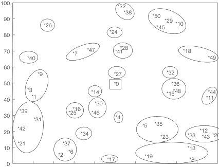

图 5.3. 51个顶点及其划分为25个簇的表示。

在下一张图中，我们指出了Ghiani和Improta [48]所描述实例的最优解。

这些结果证明我们能够处理所考虑的实例，并表明与现有模型相比，我们新型紧凑整数规划模型具有优越性。

### 5.5 拟定公式的特殊情况

在本节中，我们表明可以将GVRP的拟定公式作为某些路由问题的特殊情况，得到整数线性规划公式。

#### 5.5.1 广义多旅行商问题

在GVRP中，设每个簇的总需求等于1。车辆容量没有限制。我们将把GVRP的这个版本称为广义多旅行商问题（GmTSP）。

对于GmTSP，辅助变量\(u_i\)和\(y_{rp}\)以及模型参数的含义如下：

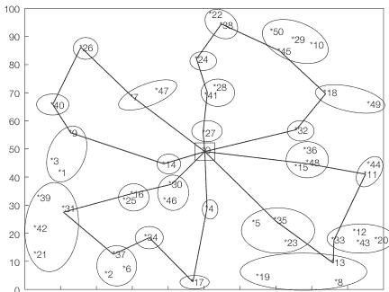

图 5.4. Ghiani和Improta描述的GVRP实例的最优解。

$u_p$是车辆路线上簇$V_p$的顺序（访问编号），$p \in C$；

$\gamma_{pr}$是车辆刚离开簇$V_p$后在其路线上行驶的弧总数，如果车辆从簇$V_p$前往簇$V_r$，否则为零。

$q_p = 1$，对所有$p \in C$成立，其中$q_0 = 0$，且$m - s + 1$为车辆可访问的最大簇数。

将这些条件代入基于节点的公式（NB）的约束(5.9)、(5.10)和(5.11)中，我们得到GmTSP的基于节点的多项式大小公式，并将这些条件代入基于流的公式（FF）的(5.13)、(5.14)、(5.15)和(5.16)中，我们得到GmTSP的基于流的多项式大小公式，如下所示：

```
minimize \(\sum_{i=1}^n \sum_{j=1}^n c_{ij} x_{ij}\)
subject to (5.1)-(5.6),
\(u_p - \sum_{r=1, r \neq p}^m w_{rp} \ge 1, \quad \forall p \in C, \ p \neq 0, \quad (5.28)\)
\( u_p + (m-s)w_{0p} \le m - s + 1, \quad \forall p \in C, \quad p \neq 0, \)
\( u_p - u_r + (m-s+1)w_{pr} + (m-s-1)w_{rp} \le m - s \)
\( \forall p, r \in C, \quad p \neq r \neq 0, \)
\( x_{ij} \in \{0, 1\}, \quad \forall (i, j) \in A. \)
```

其中\(m - s - 1 \ge 0\)，且当$i, j \in V_r, r \in C$时，$x_{ij} = 0$。

minimize \( \sum_{i=1}^n \sum_{j=1}^n c_{ij} x_{ij} \)
subject to (5.1)-(5.6),
\( y_{rp} \le (m-s)w_{rp}, \quad \forall r, p \in C, r \neq p \)
\( y_{rp} \ge w_{rp}, \quad \forall r, p \in C, r \neq p \)
\( \sum_{p=1}^m y_{p0} = m \)
\( \sum_{p=1}^m y_{rp} - \sum_{p=1}^m y_{pr} = 1, \quad \forall r \in C \)
\( x_{ij} \in \{0, 1\}, \quad \forall (i, j) \in A. \)

其中\(k \ge m\)，且当$i, j \in V_r, r \in C$时，$x_{ij} = 0$。此外，对所有$p \in C$，$y_{0p} = 0$，且$q_0 = 0$。

这种新的TSP变体，称为广义多旅行商问题（GmTSP），以及上述整数规划公式由Kara和Pop [94]提出。

#### 5.5.2 广义旅行商问题

当\(m = 1\)时，即只有一名旅行者时，GmTSP退化为广义旅行商问题（GTSP）。

如果在前两个公式中代入\(s = 1\)，我们得到GTSP的两个多项式大小整数线性规划模型，如下所示：

minimize \( \sum_{i=1}^n \sum_{j=1}^n c_{ij} x_{ij} \)
subject to (5.1), (5.2), (5.5), (5.6), (5.28),
\( \sum_{i=1}^n x_{i0} = 1, \)
\( \sum_{i=1}^n x_{0i} = 1, \)
$$u_p + (m-1)w_{0p} \le m, \quad p \neq 0, \quad p \in C, \quad (5.37)$$
$$u_p - u_r + m w_{pr} + (m-2)w_{rp} \le m-1,$$
$$p \neq r \neq 0, \quad p, r \in C, \quad (5.38)$$
$$x_{ij} \in \{0, 1\}, \quad \forall (i, j) \in A,$$

其中，当$i, j \in V_r, r \in C$时，$x_{ij} = 0$，且$m \ge 2$。

```
minimize $\sum_{i=1}^n \sum_{j=1}^n c_{ij} x_{ij}$
subject to (5.1), (5.2), (5.5), (5.6), (5.28), (5.35), (5.36)
$$y_{rp} \le (m-1)w_{rp}, \quad \forall p, r \in C, \quad p \neq r, \quad (5.39)$$
$$x_{ij} \in \{0, 1\}, \quad \forall (i, j) \in A,$$
```

其中，当$i, j \in V_r, r \in C$时，$x_{ij} = 0$。

在大多数先前的研究中，GTSP是在没有固定配送点的情况下引入的。上述公式可以轻松适应非固定配送点情况，即选择任何簇作为起始和结束簇（配送点），记为$V_0$（$|V_0| > 1$），然后重写约束(5.1)和(5.2)，包括簇$V_0$，并省略约束(5.35)和(5.36)。

#### 5.5.3 聚类广义车辆路径问题

考虑GTSP，限制旅行者必须连续访问每个簇的所有节点。根据Laporte和Palekar [106]，GTSP的这一变体由Chisman [18]定义为累积旅行商问题，我们将其记为CTSP。Laporte和Palekar [106]概述了CTSP的几种应用。最近，Ding等人 [27] 为CTSP提出了一种两级遗传算法。

据我们所知，GVRP没有这样的扩展。

接下来，我们定义GVRP的一个类似扩展，称为聚类广义车辆路径问题，记为CGVRP，其中每个簇的所有节点必须在车辆的路线上连续访问。因此，对于CGVRP的情况，我们感兴趣的是找到一组$s$条最小成本的巡回路线，起点和终点均在配送点，使得整个图中的每个节点恰好被访问一次，即在每个簇内执行一条哈密顿路径。每个簇应由恰好一辆车在其任一节点访问，且每辆车的载荷不超过其容量$Q$。

图5.5展示了一个聚类GVRP及其可行解。

通过向每个公式添加额外约束，拟议的GVRP公式可以轻松适应CGVRP，如下所示。无需

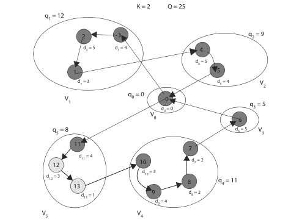

图 5.5. CGVRP的一个可行解示例。

为CGVRP定义新参数和新决策变量。只需对所有$i \neq j, i, j \in V$重新定义成本参数\(c_{ij}\)即可。

### CGVRP的节点度约束

在CGVRP的情况下，每个节点都应包含在车辆的巡回路线中。因此，除了(5.1)和(5.2)中给出的簇度约束外，我们还必须为所有节点编写度约束。因此，我们省略(5.5)中给出的连通性约束，并向两个公式添加以下节点度约束：

```
\(\sum_{i=0}^n x_{ij} = 1, \quad j=1, \dots, n\) (5.40)

\(\sum_{j=0}^n x_{ij} = 1, \quad i=1, \dots, n\) (5.41)
```

接下来，我们介绍聚类广义车辆路径问题的基于节点和基于流的公式。

### CGVRP的基于节点公式

我们定义新变量\(v_i\)为节点\(i\)在车辆巡回路线上的顺序，$i \in \{1 \dots n\}$。然后，CGVRP可以按以下方式建模为整数规划：

```
minimize \(\sum_{i=1}^n \sum_{j=1}^n c_{ij} x_{ij}\)
subject to (5.1)-(5.4), (5.6), (5.9)-(5.12), (5.40), (5.41)
\(v_i - v_j + |V_p| x_{ij} + (|V_p| - 2) x_{ji} \le |V_p| - 1, \quad \forall p \in C, i, j \in V_p\) (5.42)
\(v_i \ge 1, \quad \forall i \in V_p, p \in C\) (5.43)
\(x_{ij} \in \{0, 1\}, \quad \forall (i, j) \in A,\)
```

与其他基于节点的公式一样，当$i \neq j$时，若$q_i + q_j > Q$，则\(x_{ij} = 0\)，且对所有$i \in V$，\(c_{ii} = 0\)。

(5.42)中提出的约束由Desrochers和Laporte [23]为旅行商问题提出，旨在消除子回路。这些约束避免在每个簇中形成任何子回路。约束(5.43)初始化每个簇的变量\(v_i\)。

### CGVRP的基于流公式

我们引入一个新的流变量\(t_{ij}\)，表示车辆刚离开第\(i\)个节点后，若车辆从节点\(i\)前往节点\(j\)，则在给定簇内访问的弧的数量，否则为零。

```
minimize \(\sum_{i=1}^n \sum_{j=1}^n c_{ij} x_{ij}\)
subject to (5.1)-(5.4), (5.13)-(5.16), (5.40), (5.41)
\(\sum_{j=0}^n t_{ij} - \sum_{j=0}^n t_{ji} = 1, \quad \forall i \in V_p, p \in C\) (5.44)
\(t_{ij} \le (|V_k| - 1) x_{ij}, \quad \forall i, j \in V_k, k \in C\) (5.45)
\(x_{ij} \in \{0, 1\}, \quad \forall (i, j) \in A,\)
```

其中\(m \ge s\)。

在上述公式中，(5.44)中提出的约束是标准的流守恒方程，在每个节点之后将任何路径的连续弧的\(t_{ij}\)增加1。因此，它们是公式的子回路消除约束。(5.45)中给出的约束是流变量的边界约束。它们保证，如果弧\((i, j)\)不在任何路线上，即\(x_{ij} = 0\)，则相应的流变量\(t_{ij} = 0\)。


### 5.6 求解广义车辆路径问题

尽管广义车辆路径问题（GVRP）在现实世界中很重要，并且有许多有趣的应用，但直到最近才对该问题进行了大量研究。Ghiani 和 Improta [48] 提出了一种解决方案，将 GVRP 转换为带容量弧路由问题，文献中报道了针对该问题的精确算法和多种近似算法。

最近，一些针对求解 GVRP 的特定算法已被提出，包括 Pop 等人 [158] 描述的基于蚁群的算法、Pop 等人 [162] 提出的遗传算法、Bektaş 等人 [9] 提出的分支定界算法和自适应大邻域搜索、Moccia 等人 [126] 描述的增量禁忌搜索启发式算法，以及 Pop 等人 [168] 提出的改进遗传算法。

在本节中，我们将描述两种用于求解广义车辆路径问题的算法方法：

- 一种基于全局图应用遗传算法的混合算法。
- 一种新型模因算法，它将遗传算法（GA）与强大的局部搜索（LS）过程相结合。

#### 5.6.1 求解 GVRP 的改进混合算法

在本节中，我们描述了一种混合启发式算法，它将遗传算法（GA）与问题的局部-全局方法以及强大的局部搜索（LS）过程相结合。所提启发式算法的一些优势在于，通过相对于全局图使用 GA，我们大大缩小了搜索空间，并具备局部搜索启发式算法的强大性和多样性。

### GVRP 的局部-全局方法

在 GVRP 的情况下，与其他广义网络设计问题一样，局部-全局方法旨在区分全局连接（集群之间的连接）和局部连接（属于不同集群的节点之间的连接）。

我们用 G' 表示从 G 得到的图，其中将集群 Vi 的所有节点替换为表示 Vi 的超级节点，Vi ∈ {1, ..., m}，集群 V0（配送中心）已经由一个顶点组成。我们将图 G' 称为全局图。为方便起见，我们将 Vi 与表示它的超级节点等同，并假设图 G' 的边在每对图顶点 V0, V1, ..., Vm 之间定义。

给定全局图中的一个解，即一组按给定形式 (V0, Vk1, ..., Vkn) 访问集群的 r 条全局路径，我们希望找到最佳可行路径 R*（关于成本最小化），即一组按给定序列访问集群的 r 条广义路径。

这可以通过求解以下 $r$ 个最短路径问题在多项式时间内完成。

对于每条全局路径 $(V_0, V_{k_1}, ..., V_{k_p})$，可以通过构建一个具有 $p + 2$ 层的分层网络（LN）来确定按给定序列访问集群的最佳广义路径，该过程可在多项式时间内完成，各层对应集群 $V_0, V_{k_1}, ..., V_{k_p}$。此外，我们复制集群 $V_0$。分层网络包含集群 $V_0, V_{k_1}, ..., V_{k_p}$ 的所有节点以及一个额外节点 $o' \in V_0$，弧定义如下：对于每个 $i \in V_{k_1}$，弧 $(0, i)$ 的成本为 $c_{0i}$；对于每个 $i \in V_{k_l}$ 和 $j \in V_{k_{l+1}}$（$l = 1, ..., p - 1$），弧 $(i, j)$ 的成本为 $c_{ij}$；对于每个 $i \in V_{k_p}$，弧 $(i, o')$ 的成本为 $c_{io'}$。

在下图中，我们展示了构建的分层网络。粗线表示按给定序列 $(V_0, V_{k_1}, ..., V_{k_p})$ 访问集群的路径。

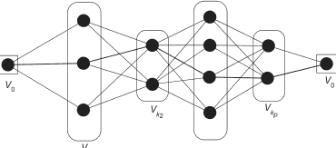

图 5.6. 在构建的分层网络 LN 中显示访问集群 $V_0, V_{k_1}, ..., V_{k_p}$ 路径的示例。

我们考虑从 0 到 $0'$ 的路径，每个集群 $V_{k_1}, ..., V_{k_p}$ 中恰好访问一个节点，从而得到一个可行的广义路径。

相反，每条按序列 $(V_0, V_{k_1}, ..., V_{k_p})$ 访问集群的广义路径，都对应于分层网络中从 $0 \in V_0$ 到 $o' \in V_0$ 的一条路径。

因此，最佳（关于成本最小化）路径集合 $R^*$ 可以通过确定从 $0 \in V_0$ 到相应的 $o' \in V_0$ 的 $r$ 条最短路径来找到，这些路径的属性是每个集群 $(V_{k_1}, ..., V_{k_p})$ 中恰好访问一个节点。

所提出的求解该问题的计算模型是一种相对于全局图应用的遗传算法，它大大减小了解空间的大小。

遗传算法倾向于优化一般组合问题，因此是求解 GVRP 的严肃候选方法。然而，已知 GA 不太适合对接近最优解的结构进行精细调整。因此，我们使用局部搜索优化来改进 GA 探索的解。我们的混合启发式算法的一般方案如下：

### 算法 5.7.

- 步骤 1. 初始化。构建第一代全局解，即全局路径集合。
- 步骤 2. 创建下一代。使用遗传算子（交叉和变异）产生下一代全局解。父代从上一代中选择。
- 步骤 3. 生成相应的最佳 GVRP 代。使用第 5.2 节描述的过程，对于每个全局解，确定其最佳对应的 GVRP 解。
- 步骤 4. 改进下一代。使用局部搜索过程将当前代的每个解替换为局部最优解。消除重复解。
- 步骤 5. 终止条件。重复步骤 3、4 和 5，直到达到停止条件。

### 遗传算法

### 遗传编码

在我们的算法中，我们使用了求解域的以下遗传表示：染色体表示为集群列表

```
\((V_0, V_{l_1}^{(1)}, V_{l_2}^{(1)}, \dots, V_{l_p}^{(1)}, V_0, \dots, V_0, V_{l_1}^{(r)}, V_{l_2}^{(r)}, \dots, V_{l_p}^{(r)}) \quad (5.46)\)
```

表示一组 \(r\) 条全局路径 \(V_0 - V_{l_1}^{(1)} - V_{l_2}^{(1)} - \dots - V_{l_p}^{(1)} - V_0, \dots, V_0 - V_{l_1}^{(r)} - V_{l_2}^{(r)} - \dots - V_{l_p}^{(r)} - V_0\)，其中 \(p, t \in N\) 且 \(1 \le p, t \le k\)。

对于图 5.7 中所示的 GVRP 可行解，相应的染色体为：(1 2 0 3 4 5 0 6)，它表示 3 条全局路径的集合，按以下顺序通过集群：

```
\((V_1 V_2 V_0 V_3 V_4 V_5 V_0 V_6). \quad (5.47)\)
```

值 {1,...,6} 表示集群，而由 {0} 表示的配送中心是路径分隔符。路径 1 从配送中心出发，然后访问集群 \(V_1, V_2\) 并返回配送中心。路径 2 从配送中心出发并访问集群 \(V_3 - V_4 - V_5\)。最后，在路径 3 中仅访问集群 \(V_6\)。

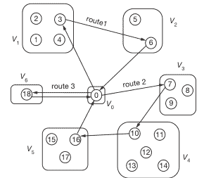

图 5.7. GVRP 可行解的示例。

给定的全局路径集合对应多组广义路径，图 1 中表示的那组包含以下节点：3 ∈ V1，6 ∈ V2，7 ∈ V3，10 ∈ V4，16 ∈ V5 和 18 ∈ V6。关于成本最小化的最佳广义路径集合可以使用本节开头描述的方法来确定。

可以看出，我们描述的表示具有可变长度，并且通过简单地将两个路径分隔符放在一起（中间没有客户）来允许空路径。染色体中的某些路径可能导致车辆超过其容量。当这种情况发生时，为了确保解释始终是一个有效的候选解，我们通过将任何超过车辆容量的路径拆分为多条路径来对其进行修改。

### 适应度值

适应度函数定义在遗传表示上，用于衡量所表示解的质量。在我们的情况中，可行解（即全局路径集合）的适应度值由最佳对应广义路径集合（关于成本最小化）的成本给出，该集合通过构建分层网络并求解给定数量的最短路径问题来确定。

### 初始种群

初始种群的构建对 GA 的性能至关重要，因为它包含构成最终最佳解的大部分材料。实验采用了随机生成的初始种群和结构化解的初始种群。为了生成种群的


在构建结构化解决方案时，我们采用了基于蒙特卡洛的方法。然而，通过实验我们发现，用于生成初始种群的蒙特卡洛方法并未带来任何改进。随机生成初始种群的优势在于，它能代表搜索空间的任何区域。

## 遗传算子

### 交叉

通过二元锦标赛方法从种群中选择两个亲本。后代由两个亲本解生成，采用两点顺序交叉程序，该程序创建的后代保留一个亲本子序列中符号的顺序和位置，同时保留另一个亲本中其余符号的相对顺序。该程序通过选择两个随机切点来实现，这些切点定义了一系列复制操作的边界。

两组全局路径的重组需要进一步说明。首先，切点之间的符号从第一个亲本复制到后代。然后，从第二个切点之后开始，符号从第二个亲本复制到后代，跳过任何已从第一个亲本复制的符号。当到达第二个亲本序列的末尾时，该过程继续使用第二个亲本的第一个符号，直到所有符号都已复制到后代。第二个后代通过交换亲本，然后使用相同的程序来生成。

接下来，我们展示了在包含8个切割点和一个仓库的问题中，所提两点顺序交叉的应用。我们假设随机选择两个结构良好的亲本，切点分别位于节点3和4之间，以及6和7之间：

```
P1 = 6 8 1 | 0 2 7 | 0 5 4 3
P2 = 8 2 1 | 6 0 4 | 3 5 7
```

请注意，每个个体的长度根据路径数量而有所不同。

两个切点之间的序列被复制到两个后代中

```
O1 = x x x | 0 2 7 | x x x x
O2 = x x x | 6 0 4 | x x x .
```

如果后代O2不包含亲本P1的簇，则将亲本P1的节点复制到后代O2，因此后代O2为

```
O2 = 8 1 2 | 6 0 4 | 7 0 5 3 .
```

然后以同样的方式将亲本P2的节点复制到后代O1。不存在于O1中的簇的节点被复制到剩余位置

```
O1 = 8 1 6 | 0 2 7 | 0 4 3 5 .
```

### 变异

在我们的遗传算法中，我们使用以下随机变异算子，称为路径间变异算子，它是一个交换算子。它在解向量中随机选择两个位置并交换它们的值。

假设亲本解为(6 8 1 | 0 2 7 | 0 5 4 3)。路径间变异算子随机选择两个簇，例如V5和V3，并交换它们的值，得到新的染色体：(6 5 1 | 0 2 7 | 0 8 4 3)。

### 选择

选择是遗传算法的一个阶段，从种群中选择个体以进行后续繁殖（交叉或变异）。选择过程是确定性的。

在我们的算法中，我们研究并使用了(μ, λ)选择的特性，其中μ个亲本产生λ个后代（λ > μ），且只有后代经过选择。换句话说，每个个体的寿命仅限于一代。有限的寿命使我们能够忘记不合适的内部参数设置。这可能导致短期衰退，但避免了由于策略参数不适应而导致的长期停滞阶段。

### 遗传参数

遗传参数对算法的成功至关重要，与其他方面（如个体表示、初始种群和遗传算子）同样重要。最重要的参数是种群大小μ，设置为簇数量的10倍；中间种群大小λ，选择为种群大小的十倍，λ = 10 · μ；以及变异概率，设置为5%。我们算法中使用的时代数设置为2000。

### 局部搜索改进

我们在此介绍了局部搜索过程中使用的五种路径计划改进。其中两种在路径内运行（路径内2-opt和3-opt算子），其余在路径之间运行，称为重定位、交换和交叉算子。这些最后的算子是van Breedam [202]在经典VRP中描述的算子的扩展。

- 1. 2-opt。两点交换过程用于改进单车辆路径，包括消除两条弧并以不同方式重新连接由此产生的两条路径，以获得新路径。在图5.8中，展示了两点交换算子，可以看到有不同的方式重新连接路径以产生不同的巡回路径。在所有2-opt交换减少长度的边对中，我们选择产生最短巡回路径的那对。然后重复此过程，直到找不到这样的边对。

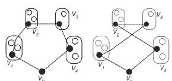

图5.8. 可能的2-opt交换示例。

- 2. 3-opt。三点交换过程扩展了2-opt，涉及在路径中删除3条弧，并以所有其他可能的方式重新连接网络，然后评估每种重新连接方法以找到最优方法。

- 3. 交换算子：两条最多包含k个顶点的字符串在两条路径之间交换。通过从一条路径中选择k个顶点并将其与另一条路径中的k个顶点交换，从当前解中获得新解。只有当交换产生可行解时，该交换才可接受。如图5.9所示。

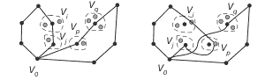

图5.9. k=1时可能的字符串交换示例。

- 4. 重定位算子：重定位算子只是将客户访问从一条路径移动到另一条路径。如下图所示。

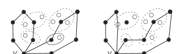

图5.10. 可能的重定位示例。

- 5. 交叉算子。该算子包括通过用两条其他弧替换两条弧所获得的所有可行解。给定两条不同的路径r1和r2，从每条路径中删除一条弧，将路径分为两个组件，这些组件被组合，使得一条新路径由r1的第一个组件和r2的第二个组件组成，另一条新路径由r2的第一个组件和r1的第二个组件组成。

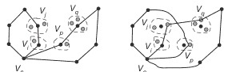

图5.11. 可能的字符串交叉示例。

#### 5.6.2 求解GVRP的高效模因算法

模因算法由Moscato [127]引入，用于表示一类强调使用基于种群的方法，并配有独立的个体学习或局部改进程序进行问题搜索的元启发式算法。因此，模因算法是一种与局部搜索程序混合的遗传算法（GA），以加强搜索空间。

遗传算法不适合对接近最优解的结构进行精细调整。因此，将局部改进算子纳入GA的重组步骤中至关重要，以获得具有竞争力的GA。

我们用于求解GVRP的高效启发式算法是一种模因算法，它结合了遗传算法和局部搜索的优势。我们启发式算法的一般方案是

模因算法已被公认为进化计算的一种强大算法范式，并已成功应用于求解组合优化问题，如VRP（车辆路径问题）[119, 131]、CARP（容量弧路径问题）[172]、广义旅行商问题 [13]等。

### 遗传算法

### 解编码

我们采用了一种流行、紧凑且高效的GVRP解编码，类似于Pop等人[162]描述的编码。具体来说，0代表仓库，每个客户都标记为从1到n的不重复自然数。我们表示一个染色体


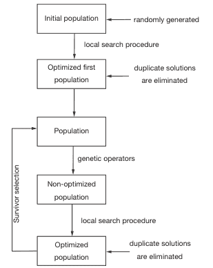

图 5.12. 我们模仿算法的通用形式.

by a variable length array, so that the gene values correspond to the nodes selected to form the collection of routes which are delimited by 0 representing the depot.

The corresponding chromosome representation of the feasible solution of the GVRP presented in Figure 5.7 is:

```
(3 6 0 7 10 16 0 18)
```

where the values {1, ..., 18} represent the customers, and the depot denoted by 0 is the route splitter. Route 1 begins at the depot, then visits customers 3 and 6, belonging to the clusters V1, respectively V2, and returns to the depot. Route 2 starts at the depot and visits the customers 7–10–16 belonging to the clusters V3 – V4 – V5. Finally, in route 3 only customer 18 from the cluster V6 is visited.

The described representation allows empty routes to simply placing two route splitters together without clients between them.

Suppose we have given a representation of a solution of the GVRP. Then we first have to check whether it satisfies the constraints of the problem. If some routes in the chromosome may cause the vehicle to exceed its capacity, we modify the route that exceeds the vehicle capacity by splitting it in several ones. Assuming that the original route is composed of the following ordered set of nodes $\langle i_1, \dots, i_k, i_{k+1}, \dots, i_p \rangle$, and that the vehicle capacity is exceeded at node $i_{k+1}$, then it will be divided in two parts $\langle i_1, \dots, i_k \rangle$ and $\langle i_{k+1}, \dots, i_p \rangle$. If necessary, further divisions can be made in the second part.

## Initial population

The first step in any genetic algorithm is to generate a set of possible solutions as an initial generation or population to the problem. Although it seems simple, the convergence, performance and the ability of the GA to provide the best possible solutions are critically affected by the initial generation.

In the case of the GVRP, we carried out experiments with the initial population generated randomly and with an initial population of structured solutions.

The initial randomly generated population has the advantage that it is representative from any area of the search space.

In order to generate the population of structured solutions, we used a Monte Carlo based method. Based on computational experiments, we observed that this method assures an initial population with an average fitness which is 20% better than a population generated entirely at random, but the major drawback was that such a population lacks the diversity needed to obtain near-optimal solutions.

Analyzing the advantages and disadvantages of these ways of generating the initial population, and based on computational experiments we decided to choose the initial population randomly.

## The fitness value

In order for genetic algorithms to work effectively, it is necessary to be able to evaluate how “good” a potential solution is, relative to other potential solutions. The “fitness function” is responsible for performing this evaluation and returning a positive number, or “fitness value”, that reflects how optimal the solution is. The higher the number, the better the solution. The fitness values are then used in a process of natural selection to choose which potential solutions will continue on to the next generation, and which will die out.

In our case, the fitness value of a feasible solution, i.e. collection of routes, is given by the sum of the costs of the arcs selected in the routes. The aim is to find the minimum cost collection of routes.

## Crossover operator

The crossover operator requires some strategy to select two parents from the previous generation. In our algorithm, we used an elitist approach: the parents are chosen randomly from among the best 40% of all solutions in the previous generation.

We randomly select two solutions from the best 40% of all the solutions of the previous generation, assign the cheapest (w.r.t. cost minimization) to parent 1, and repeat the procedure to select parent 2.

Offspring are produced from two parents, using the 2-point order standard crossover procedure, which creates offspring that preserves the order and position of symbols in a subsequence of one parent, while preserving the relative order of the remaining symbols from the other parent. It is implemented by selecting two random cut points which define the boundaries for a series of copying operations. First, the symbols between the cut points are copied from the first parent to the offspring. Then, starting just after the second cut point, the symbols are copied from the second parent to the offspring, omitting any symbols that were copied from the first parent. When the end of the second parent sequence is reached, this process continues with the first symbol of the second parent, until all symbols have been copied to the offspring. The second offspring is produced by swapping the parents and then using the same procedure.

Next, we present the application of the proposed 2-point order crossover in the case of the problem presented in Figure 5.7. We assume two well-structured parents, chosen at random, with the cutting points between nodes 2 and 3, respectively 5 and 6:

```
P₁ = 18 0 | 3 6 0 | 7 10 16
P₂ = 5 2 | 18 0 15 | 13 8
```

Note that the length of each individual differs according to the number of routes. According to Figure 5.7, the cluster representation of the previously selected parents is:

```
C₁ = 6 0 | 1 2 0 | 3 4 5
C₂ = 2 1 | 6 0 5 | 4 3
```

The sequences between the two cutting points are copied to the two offspring:

```
O₁ = x x | 3 6 0 | x x x
O₂ = x x | 18 0 15 | x x x
```

The nodes of parent P₁ are copied to the offspring O₂ if O₂ does not already contain nodes in the same clusters as the nodes of P₁. The sequence of nodes of P₁ is 18-0-3-6-0-7-10-16, and the clusters are 6-0-1-2-0-3-4-5. Note that cluster 6 is already represented in O₂ by node 18 and cluster 5 by node 15. The depot (0) is kept anyway, since it is a splitter. Therefore, the remaining sequence of nodes in P₁ is 0-3-6-0-7-10.

```
O₂ = 0 3 | 18 0 15 | 6 0 7 10
```

Following this, the nodes of the parent P₂ are copied to the offspring O₁ in the same manner. The nodes of the clusters not present in O₁ are copied to the remaining positions:

```
O₁ = 18 0 | 3 6 0 | 15 13 8
```

## Mutation operators

The mutation operator is a genetic operator that alters one or more gene values in a chromosome from its initial state. This can result in entirely new gene values being added to the gene pool. With these new gene values, the genetic algorithm may be able to arrive at better solution than was previously possible. Mutation is an important part of the genetic search as it helps to prevent the population from stagnating at any local optima.

In our GA, we use two random mutation operators. The first one (intra-route mutation) randomly selects a cluster to be modified and replaces its current node by another one randomly selected from the same cluster. The second one (inter-route mutation) is a swap operator, it picks two random locations in the solution vector and swaps their values. The new chromosome is accepted immediately if it results in a feasible GVRP. If not, the route that exceeds the vehicle capacity is decomposed into several ones as described before.

In the following mutation example, let the parent solution be as in Figure 5.7:

```
P = 18 0 | 3 6 0 | 7 10 16
```

with the corresponding cluster representation

```
C = 6 0 | 1 2 0 | 3 4 5
```

in this case, the intra-route mutation operator randomly selects a cluster, for example V4, and replaces its current node 10 with another random node from V4, for example 13 obtaining the new chromosome

```
(18, 0, 3, 6, 0, 7, 13, 16) (5.48)
```

and the inter-route mutation picks two random locations, for example 3 and 10 and swaps their values obtaining the new chromosome

```
(18, 0, 10, 6, 0, 7, 3, 16). (5.49)
```

As in the case of the crossover operator, we used an elitist strategy, where the parent is randomly selected from among 60% of all solutions in the previous generation.

The choice of which of the operators described above should be used to create an offspring is a probabilistic one. The probabilities for each operator to be applied are called operator rates. Typically, crossover is applied with highest probability, the crossover rate being 90% or higher. In contrast, the mutation rate is much smaller, typically being in the region of 10%.

## Selection

The selection process is deterministic. In our algorithm, we use the \((\mu + \lambda)\) selection, where \(\mu\) parents produce \(\lambda\) offspring. The new population of \((\mu + \lambda)\) is reduced again to \(\mu\) individuals by a selection based on the “survival of the fittest” principle. In other words, parents survive until they are suppressed by better offspring. It might be possible for very well adapted individuals to survive forever.


### 遗传参数

遗传参数对遗传算法（GA）的成功至关重要，与其他方面（如个体的表示、初始种群和遗传算子）同等重要。最重要的参数如下：

- 种群规模 \(\mu\) 设置为簇数量的 2 倍。这被证明是每代中最佳的个体数量。
- 中间种群规模 \(\lambda\) 选择为种群规模的两倍：\(\lambda = 2 \cdot \mu\)。
- 突变概率设置为 10%。

### 终止准则

当满足某些条件时，染色体生成循环终止。当满足终止准则时，精英染色体将作为迄今找到的最佳解返回。在我们的算法中，我们使用了基于代数的终止条件，即 \(10^4\) 代，这似乎是充分探索解空间所必需的。

### 局部改进过程

对于某些组合优化问题，经典遗传算法不够激进。获得更具竞争力的启发式算法的一种可能性是将遗传算法与局部搜索过程相结合。

对于当前代中的每个解，我们使用一个局部改进过程，依次运行多个局部搜索启发式算法。一旦找到改进移动，立即执行。

在我们的算法中，我们使用了五个局部搜索启发式算法。其中两个，即 2-opt 路径内优化和簇路径优化（在给定簇顺序时，使用最短路径算法从每个簇中找到最佳节点），在路径内运行，其余的在路径之间运行，称为邻域交叉、邻域交换和邻域搬迁。这些局部搜索启发式算法在前一小节中已描述。

我们的改进过程循环应用所有描述的局部搜索启发式算法。

#### 5.6.3 计算实验

在本节中，我们展示了大量计算结果，以评估我们提出的算法求解 GVRP 的有效性。

我们在一组通过改编 CVRP 库中现有实例生成的实例上进行了实验，该库可于 http://branchandcut.org/VRP/data/ 获取。生成实例的命名遵循在线可用的 CVRP 实例的一般惯例，并遵循一般格式 \(X - nY - kZ - C\Omega - V\Phi\)，其中 $X$ 对应实例类型，$Y$ 指顶点数量，$Z$ 对应原始 CVRP 实例中的车辆数量，$\Omega$ 是簇数量，$\Phi$ 是 GVRP 实例中的车辆数量。这些实例已被 Bektaş 等人 [9] 和 Moccia 等人 [126] 用于他们的计算实验。

最初，这些问题中的节点集未划分为簇。Fischetti 等人 [43] 提出的 CLUSTERING 过程将数据划分为节点集。该过程设置簇数量 $s = \lceil \frac{n}{2} \rceil$，识别彼此最远的 $s$ 个节点，并将每个剩余节点分配给其最近的中心。Fischetti 等人 [43] 使用了 $\theta = 5$，但根据 Bektaş 等人 [9] 的说法，创建的 GVRP 实例求解过于容易。

对于我们的实例，我们参考 [9, 126] 考虑了两个聚类过程。一个使用 $\theta = 2$，另一个使用 $\theta = 3$。然而，所提出的求解方法能够处理任何簇结构。

测试机器为 Intel 双核 1.6GHz 处理器和 1 GB 内存。操作系统为 Windows XP Professional。算法使用 Java 开发，配合 JDK 1.6。

在表 5.1 和 5.2 中，我们汇总了所有方法在所有 148 个小型到中型测试实例（$\theta = 2$ 和 $\theta = 3$）上的结果。表格的第一列给出实例名称，第二列提供分支切割树 [11] 中的最佳下界值。接下来的四列包含使用自适应大邻域搜索（ALNS）[9]、增量禁忌搜索（ITS）[126] 以及我们提出的方法（混合算法和模因算法）获得的最佳解值。

如果分析表 5.1（第 1 和 2 部分）和表 5.2（第 1 和 2 部分）中报告的计算结果，可以观察到，与所有其他方法相比，我们提出的模因算法在求解小型和中型实例方面表现略好。我们改进了 148 个实例中 6 个实例的最佳已知解。在一个实例 P-n55-k15-C28-V8 中，我们的算法返回的解与 ALNS 提供的最佳已知解之间存在 0.01% 的差距。对于其余已知最优解的实例，我们使用算法得到了最优解。就解的质量而言，所提出的混合算法与其他现有求解 GVRP 的方法相当。

接下来，我们在表 5.3 和 5.4 中分别展示了使用 $\theta = 2$ 和 $\theta = 3$ 生成的大规模实例的计算实验结果。

分析表 5.3 和 5.4 可以看出，总体而言，对于大规模实例，与 ALNS 和 ITS 启发式算法相比，我们的模因算法表现更好，而混合算法在 10 个实例中有 7 个提供了与 ALNS 和 ITS 启发式算法相同的解。在其余 3 个实例中，我们的算法返回的解与所提供的最佳已知解之间的差距最多为 0.0089%。

表 5.1. 小型和中型实例的计算结果（\(\theta = 2\)）（第 1 部分）。

| 实例 | 下界 [9] | ALNS [9] | ITS [126] | 混合算法 | 模因算法 |
|---|---|---|---|---|---|
| A-n32-k5-C16-V2 | 519 | 519 | 519 | 519 | 519 |
| A-n33-k5-C17-V3 | 451 | 451 | 451 | 451 | 451 |
| A-n33-k6-C17-V3 | 465 | 465 | 465 | 465 | 465 |
| A-n34-k5-C17-V3 | 489 | 489 | 489 | 489 | 489 |
| A-n36-k5-C18-V2 | 505 | 505 | 505 | 505 | 505 |
| A-n37-k5-C19-V3 | 432 | 432 | 432 | 432 | 432 |
| A-n37-k6-C19-V3 | 584 | 584 | 584 | 584 | 584 |
| A-n38-k5-C19-V3 | 476 | 476 | 476 | 476 | 476 |
| A-n39-k5-C20-V3 | 557 | 557 | 557 | 557 | 557 |
| A-n39-k6-C20-V3 | 544 | 544 | 544 | 544 | 544 |
| A-n44-k6-C22-V3 | 608 | 608 | 608 | 608 | 608 |
| A-n45-k6-C23-V4 | 613 | 613 | 613 | 613 | 613 |
| A-n45-k7-C23-V4 | 674 | 674 | 674 | 674 | 674 |
| A-n46-k7-C23-V4 | 593 | 593 | 593 | 593 | 593 |
| A-n48-k7-C24-V4 | 667 | 667 | 667 | 667 | 667 |
| A-n53-k7-C27-V4 | 603 | 603 | 603 | 603 | 603 |
| A-n54-k7-C27-V4 | 690 | 690 | 690 | 690 | 690 |
| A-n55-k9-C28-V5 | 699 | 699 | 699 | 699 | 699 |
| A-n60-k9-C30-V5 | 769 | 769 | 769 | 769 | 769 |
| A-n61-k9-C31-V5 | 638 | 638 | 638 | 638 | 638 |
| A-n62-k8-C31-V4 | 740 | 740 | 740 | 740 | 740 |
| A-n63-k10-C32-V5 | 801 | 801 | 801 | 801 | 801 |
| A-n63-k9-C32-V5 | 900.3 | 912 | 912 | 912 | 908 |
| A-n64-k9-C32-V5 | 763 | 763 | 763 | 763 | 763 |
| A-n65-k9-C33-V5 | 682 | 682 | 682 | 682 | 682 |
| A-n69-k9-C35-V5 | 680 | 680 | 680 | 680 | 680 |
| A-n80-k10-C40-V5 | 957.4 | 997 | 997 | 1004 | 997 |
| B-n31-k5-C16-V3 | 441 | 441 | 441 | 441 | 441 |
| B-n34-k5-C17-V3 | 472 | 472 | 472 | 472 | 472 |
| B-n35-k5-C18-V3 | 626 | 626 | 626 | 626 | 626 |
| B-n38-k6-C19-V3 | 451 | 451 | 451 | 451 | 451 |
| B-n39-k5-C20-V3 | 357 | 357 | 357 | 357 | 357 |
| B-n41-k6-C21-V3 | 481 | 481 | 481 | 481 | 481 |
| B-n43-k6-C22-V3 | 483 | 483 | 483 | 483 | 483 |
| B-n44-k7-C22-V4 | 540 | 540 | 540 | 540 | 540 |
| B-n45-k5-C23-V3 | 497 | 497 | 497 | 497 | 497 |
| B-n45-k6-C23-V4 | 478 | 478 | 478 | 478 | 478 |
| B-n50-k7-C25-V4 | 449 | 449 | 449 | 449 | 449 |
| B-n50-k8-C25-V5 | 916 | 916 | 916 | 916 | 916 |

表 5.1. 小型和中型实例的计算结果（\(\theta = 2\)）（第 2 部分）。

| 实例 | 下界 [9] | ALNS [9] | ITS [126] | 混合算法 | 模因算法 |
| :--- | :--- | :--- | :--- | :--- | :--- |
| B-n51-k7-C26-V4 | 651 | 651 | 651 | 651 | 651 |
| B-n52-k7-C26-V4 | 450 | 450 | 450 | 450 | 450 |
| B-n56-k7-C28-V4 | 486 | 486 | 486 | 486 | 486 |
| B-n57-k7-C29-V4 | 751 | 751 | 751 | 751 | 751 |
| B-n57-k9-C29-V5 | 942 | 942 | 942 | 942 | 942 |
| B-n63-k10-C32-V5 | 816 | 816 | 816 | 816 | 816 |
| B-n64-k9-C32-V5 | 509 | 509 | 509 | 509 | 509 |
| B-n66-k9-C33-V5 | 808 | 808 | 808 | 808 | 808 |
| B-n67-k10-C34-V5 | 673 | 673 | 673 | 673 | 673 |
| B-n68-k9-C34-V5 | 704 | 704 | 704 | 704 | 704 |
| B-n78-k10-C39-V5 | 803 | 803 | 803 | 803 | 803 |
| P-n16-k8-C8-V5 | 239 | 239 | 239 | 239 | 239 |
| P-n19-k2-C10-V2 | 147 | 147 | 147 | 147 | 147 |
| P-n20-k2-C10-V2 | 154 | 154 | 154 | 154 | 154 |
| P-n21-k2-C11-V2 | 160 | 160 | 160 | 160 | 160 |
| P-n22-k2-C11-V2 | 162 | 162 | 162 | 162 | 162 |
| P-n22-k8-C11-V5 | 314 | 314 | 314 | 314 | 314 |
| P-n23-k8-C12-V5 | 312 | 312 | 312 | 312 | 312 |
| P-n40-k5-C20-V3 | 294 | 294 | 294 | 294 | 294 |
| P-n45-k5-C23-V3 | 337 | 337 | 337 | 337 | 337 |
| P-n50-k10-C25-V5 | 410 | 410 | 410 | 410 | 410 |
| P-n50-k7-C25-V4 | 353 | 353 | 353 | 353 | 353 |
| P-n50-k8-C25-V4 | 378.4 | 392 | 421 | 392 | 392 |
| P-n51-k10-C26-V6 | 427 | 427 | 427 | 427 | 427 |
| P-n55-k10-C28-V5 | 415 | 415 | 415 | 415 | 415 |
| P-n55-k15-C28-V8 | 545.3 | 555 | 565 | 560 | 558 |
| P-n55-k7-C28-V4 | 361 | 361 | 361 | 361 | 361 |
| P-n55-k8-C28-V4 | 361 | 361 | 361 | 361 | 361 |
| P-n60-k10-C30-V5 | 433 | 443 | 443 | 443 | 443 |
| P-n60-k15-C30-V8 | 553.9 | 565 | 565 | 565 | 565 |
| P-n65-k10-C33-V5 | 487 | 487 | 487 | 487 | 487 |
| P-n70-k10-C35-V5 | 485 | 485 | 485 | 485 | 485 |
| P-n76-k4-C38-V2 | 383 | 383 | 383 | 383 | 383 |
| P-n76-k5-C38-V3 | 405 | 405 | 405 | 405 | 405 |
| P-n101-k4-C51-V2 | 455 | 455 | 455 | 455 | 455 |


| 实例 | 下界 [9] | ALNS [9] | ITS [126] | 混合算法 | 模因算法 |
|---|---|---|---|---|---|
| A-n32-k5-C11-V2 | 386 | 386 | 386 | 386 | 386 |
| A-n33-k5-C11-V2 | 315 | 318 | 315 | 315 | 315 |
| A-n33-k6-C11-V2 | 370 | 370 | 370 | 370 | 370 |
| A-n34-k5-C12-V2 | 419 | 419 | 419 | 419 | 419 |
| A-n36-k5-C12-V2 | 396 | 396 | 396 | 396 | 396 |
| A-n37-k5-C13-V2 | 347 | 347 | 347 | 347 | 347 |
| A-n37-k6-C13-V2 | 431 | 431 | 431 | 431 | 431 |
| A-n38-k5-C13-V2 | 367 | 367 | 367 | 367 | 367 |
| A-n39-k5-C13-V2 | 364 | 364 | 364 | 364 | 364 |
| A-n39-k6-C13-V2 | 403 | 403 | 403 | 403 | 403 |
| A-n44-k6-C15-V2 | 503 | 503 | 503 | 503 | 503 |
| A-n45-k6-C15-V3 | 474 | 474 | 474 | 474 | 474 |
| A-n45-k7-C15-V3 | 475 | 475 | 475 | 475 | 475 |
| A-n46-k7-C16-V3 | 462 | 462 | 462 | 462 | 462 |
| A-n48-k7-C16-V3 | 451 | 451 | 451 | 451 | 451 |
| A-n53-k7-C18-V3 | 440 | 440 | 440 | 440 | 440 |
| A-n54-k7-C18-V3 | 482 | 482 | 482 | 482 | 482 |
| A-n55-k9-C19-V3 | 473 | 473 | 473 | 473 | 473 |
| A-n60-k9-C20-V3 | 595 | 595 | 595 | 595 | 595 |
| A-n61-k9-C21-V4 | 473 | 473 | 473 | 473 | 473 |
| A-n62-k8-C21-V3 | 596 | 596 | 596 | 596 | 596 |
| A-n63-k10-C21-V4 | 593 | 593 | 593 | 593 | 593 |
| A-n63-k9-C21-V3 | 625.6 | 642 | 643 | 643 | 642 |
| A-n64-k9-C22-V3 | 536 | 536 | 536 | 536 | 536 |
| A-n65-k9-C22-V3 | 500 | 500 | 500 | 500 | 500 |
| A-n69-k9-C23-V3 | 520 | 520 | 520 | 520 | 520 |
| A-n80-k10-C27-V4 | 679.4 | 710 | 710 | 710 | 710 |
| B-n31-k5-C11-V2 | 356 | 356 | 356 | 356 | 356 |
| B-n34-k5-C12-V2 | 369 | 369 | 369 | 369 | 369 |
| B-n35-k5-C12-V2 | 501 | 501 | 501 | 501 | 501 |
| B-n38-k6-C13-V2 | 370 | 370 | 370 | 370 | 370 |
| B-n39-k5-C13-V2 | 280 | 280 | 280 | 280 | 280 |
| B-n41-k6-C14-V2 | 407 | 407 | 407 | 407 | 407 |
| B-n43-k6-C15-V2 | 343 | 343 | 343 | 343 | 343 |
| B-n44-k7-C15-V3 | 395 | 395 | 395 | 395 | 395 |
| B-n45-k5-C15-V2 | 410 | 422 | 410 | 410 | 410 |
| B-n45-k6-C15-V2 | 336 | 336 | 336 | 336 | 336 |
| B-n50-k7-C17-V3 | 393 | 393 | 393 | 393 | 393 |
| B-n50-k8-C17-V3 | 598 | 598 | 598 | 598 | 598 |
| B-n51-k7-C17-V3 | 511 | 511 | 511 | 511 | 511 |
| B-n52-k7-C18-V3 | 359 | 359 | 359 | 359 | 359 |
| B-n56-k7-C19-V3 | 356 | 356 | 356 | 356 | 356 |
| B-n57-k7-C19-V3 | 558 | 558 | 558 | 558 | 558 |
| B-n57-k9-C19-V3 | 681 | 681 | 681 | 681 | 681 |
| B-n63-k10-C21-V3 | 599 | 599 | 599 | 599 | 599 |
| B-n64-k9-C22-V4 | 452 | 452 | 452 | 452 | 452 |
| B-n66-k9-C22-V3 | 609 | 609 | 609 | 609 | 609 |
| B-n67-k10-C23-V4 | 558 | 558 | 558 | 558 | 558 |
| B-n68-k9-C23-V3 | 523 | 523 | 523 | 523 | 523 |
| B-n78-k10-C26-V4 | 606 | 606 | 606 | 606 | 606 |
| P-n16-k8-C6-V4 | 170 | 170 | 170 | 170 | 170 |
| P-n19-k2-C7-V1 | 111 | 111 | 111 | 111 | 111 |
| P-n20-k2-C7-V1 | 117 | 117 | 117 | 117 | 117 |
| P-n21-k2-C7-V1 | 117 | 117 | 117 | 117 | 117 |
| P-n22-k2-C8-V1 | 111 | 111 | 111 | 111 | 111 |
| P-n22-k8-C8-V4 | 249 | 249 | 249 | 249 | 249 |
| P-n23-k8-C8-V3 | 174 | 174 | 174 | 174 | 174 |
| P-n40-k5-C14-V2 | 213 | 213 | 213 | 213 | 213 |
| P-n45-k5-C15-V2 | 238 | 238 | 238 | 238 | 238 |
| P-n50-k10-C17-V4 | 292 | 292 | 292 | 292 | 292 |
| P-n50-k7-C17-V3 | 261 | 261 | 261 | 261 | 261 |
| P-n50-k8-C17-V3 | 262 | 262 | 262 | 262 | 262 |
| P-n51-k10-C17-V4 | 309 | 309 | 309 | 309 | 309 |
| P-n55-k10-C19-V4 | 301 | 301 | 301 | 301 | 301 |
| P-n55-k15-C19-V6 | 378 | 378 | 378 | 378 | 378 |
| P-n55-k7-C19-V3 | 271 | 271 | 271 | 271 | 271 |
| P-n55-k8-C19-V3 | 274 | 274 | 274 | 274 | 274 |
| P-n60-k10-C20-V4 | 325 | 325 | 325 | 325 | 325 |
| P-n60-k15-C20-V5 | 379.2 | 382 | 382 | 382 | 382 |
| P-n65-k10-C22-V4 | 372 | 372 | 372 | 372 | 372 |
| P-n70-k10-C24-V4 | 385 | 385 | 385 | 385 | 385 |
| P-n76-k4-C26-V2 | 309 | 320 | 309 | 309 | 309 |
| P-n76-k5-C26-V2 | 309 | 309 | 309 | 309 | 309 |
| P-n101-k4-C34-V2 | 370 | 374 | 370 | 370 | 370 |

### 表 5.3. 大规模实例的计算结果，\(\theta = 2\)。

| 实例 | 下界 [9] | ALNS [9] | ITS [126] | 混合算法 | 模因算法 |
|---|---|---|---|---|---|
| M-n101-k10-C51-V5 | 542 | 542 | 542 | 542 | 542 |
| M-n121-k7-C61-V4 | 707.7 | 719 | 720 | 720 | 720 |
| M-n151-k12-C76-V6 | 629.9 | 659 | 659 | 659 | 659 |
| M-n200-k16-C100-V8 | 744.9 | 791 | 805 | 791 | 791 |
| G-n262-k25-C131-V12 | 2 863.5 | 3 249 | 3 319 | 3 278 | 3 176 |

### 表 5.4. 大规模实例的计算结果，\(\theta = 3\)。

| 实例 | 下界 [9] | ALNS [9] | ITS [126] | 混合算法 | 模因算法 |
|---|---|---|---|---|---|
| M-n101-k10-C34-V4 | 458 | 458 | 458 | 458 | 458 |
| M-n121-k7-C41-V3 | 527 | 527 | 527 | 527 | 527 |
| M-n151-k12-C51-V4 | 465 | 483 | 483 | 483 | 483 |
| M-n200-k16-C67-V6 | 563.13 | 605 | 605 | 609 | 605 |
| G-n262-k25-C88-V9 | 2 102 | 2 476 | 2 463 | 2 484 | 2 476 |

关于计算时间，很难在算法之间进行公平比较，因为它们是在不同的计算机上评估的，并且使用不同的语言实现。我们描述的方法的运行时间与代数成正比。从计算实验来看，\(10^4\) 代似乎足以探索GVRP的解空间。我们提出的启发式算法似乎比ALNS慢，与ITS相当。因此，我们可以得出结论，当执行速度不是关键因素时，我们的方法是合适的。

### 5.7 注释

广义车辆路由问题（GVRP）是车辆路由问题的扩展，包括从给定配送中心到若干预定义的、互斥且完备的簇设计最优配送或收集路线，并受容量限制。GVRP由Ghiani和Improta [48]提出，如果车辆容量没有限制，则它退化为广义旅行商问题。

在本章中，我们描述了关于GVRP的以下结果：

- 将GVRP高效转化为经典容量弧路由问题。
- 基于混合整数规划的四种问题公式。
- 所提公式的特例：广义多旅行商问题、广义旅行商问题和聚类广义车辆路由问题；
- 求解GVRP的两种算法方法：一种是基于全局图应用遗传算法的混合算法，另一种是将遗传算法（GA）与强大的局部搜索（LS）过程相结合的新型模因算法。

本章所呈现的材料基于Bektaş等人 [9]、Ghiani和Improta [48] 以及Pop等人 [163, 165, 168] 发表的结果。

## 第 6 章

### 广义固定费用网络设计问题（GFCNDP）

电信应用中出现的网络设计问题在组合优化领域带来了新的挑战。分层电信网络是通信设施的物理组织，每个更高级别覆盖的运行区域比下一级更广或更一般。分层网络由网络层组成，非常适合应对不断变化和增长的需求。分层电信网络出于历史原因而存在，并使中央高速网络（即骨干网络）能够实现规模经济。

网络由节点和互连节点的链路组成。分层网络由称为簇的不相交节点集组成。此外，每个簇至少包含一个枢纽节点。骨干网由通过骨干链路互连的枢纽节点组成。同样，每个簇中的节点通过簇链路互连。

在处理分层网络设计问题时，必须求解以下相互关联的子问题 [199]：

- 枢纽选址。
- 节点聚类。
- 骨干网络和簇网络中节点的互连。
- 路由。

这四个子问题常被考虑，但大多是独立求解的。只有少数子问题被同时考虑。以集成方式处理所有上述子问题的问题称为分层网络设计问题。有关分层网络设计的更多信息，我们参考 [20, 98, 199]。

图 6.1 展示了一个分层网络示例。

在上图中，每个簇包含一个枢纽，由实心方块标记。骨干链路是互连枢纽的链路，簇链路是在簇内部互连节点的链路。请注意，不同簇中的非枢纽节点之间没有链路。

本章讨论的是设计互连给定数量簇的骨干网状网络的问题。该问题在构建分层电信网络时是一个重要的子问题。它被称为广义


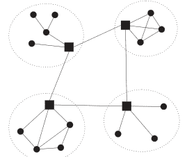

图 6.1. 分层网络设计示例。

固定费用网络设计（GFCND）问题，由 Thomadsen 和 Stidsen [200] 引入。

GFCND 问题属于广义网络设计问题类，这类问题通过考虑相对于图节点划分为节点集的给定划分的相关问题，从经典网络设计问题自然得出。

### 6.1 GFCNDP 的定义

给定一个 n 节点无向图 G = (V, E) 以及 V 划分为 m 个簇 V1,...,Vm，我们假设每个簇内的节点通过簇网络内部连接，而簇之间则未连接，但必须通过骨干网络连接，以便进行通信。我们还假设，不同簇中任意两个选定节点（枢纽）之间存在一条带有正成本的跨簇边。除了边建立成本之外，每条跨簇边都有一个所需容量，该容量取决于通信需求以及需求的路由方式。

GFCNDP 旨在寻找连接每个给定簇中恰好一个枢纽的最便宜骨干网络。该问题涉及两个相关决策

- 从每个簇 |Vi| 中选择一个枢纽，对所有 i = 1, ..., m。
- 寻找连接恰好所选枢纽的最便宜骨干网络。

在图 6.2(a) 中展示了五个节点集（簇）。各簇的节点数量可能不同。我们假设每个簇中的所有节点都通过跨簇网络连接。

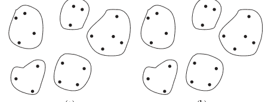

图 6.2. 广义固定费用网络设计 (a) 节点集（簇），(b) 骨干网络。

另一方面，簇之间未连接，但必须通过骨干网络连接，以便进行通信。在图 6.2 b) 中展示了这样一种可能的骨干网络。

### 6.2 GFCNDP 的整数规划公式

给定一个无向图 \( G = (V, E) \)，相关的有向图是通过将每条边 \( e = \{i, j\} \in E \) 替换为反向弧 \( (i, j) \) 和 \( (j, i) \) 得到的，这些弧的权重与边 \( \{i, j\} \in E \) 相同。为了将 GFCND 问题建模为混合整数规划问题，我们定义以下相关集合、参数和决策变量

### 集合和符号：

- \( V \) – 所有节点的集合，\( i \in V \)。
- \( V_1, \dots, V_m \) – \( V \) 划分为 \( m \) 个称为 *簇* 的子集。
- \( E \) – 边的集合（无序节点对），\( e \in E \)。
- \( A \) – 弧的集合（有序节点对），\( a \in A \)。
- \( D \) – 商品集合，表示任何无序簇对之间需要满足的需求，\( d \in D \)。
- \( s_a \) 和 \( t_a \) – 分别表示弧 \( a \) 的起始节点和终止节点。
- \( s_d \) 和 \( t_d \) – 分别表示需求 \( d \) 的起始簇和终止簇。

### 参数：

- $c_e$ – 边 $e$ 的固定成本，$e \in E$。
- $g_a$ – 弧 $a$ 的容量成本，即使用该弧的每单位需求的成本。
- $b_d$ – 需求 $d$ 的通信需求量。

### 决策变量：

- 二进制决策变量

\( z_i = \left\{ \begin{array}{ll} 1 & \text{如果节点 } i \text{ 被选为枢纽节点} \\ 0 & \text{否则} \end{array} \right. \) ,
\( x_e = \left\{ \begin{array}{ll} 1 & \text{如果边 } e \in E \text{ 在两个枢纽节点之间被选中} \\ 0 & \text{否则} \end{array} \right. \) ,
\( w_a = \left\{ \begin{array}{ll} 1 & \text{如果弧 } a \in A \text{ 在两个枢纽节点之间被选中} \\ 0 & \text{否则} \end{array} \right. \) .

- 分数连续流变量：\( f_{ij}^d \) 反映每条弧 \( (i, j) \in A \) 和商品 \( d \in D \) 的运输决策。

我们的第一个模型使用上述定义的二进制决策变量和多商品流变量 \( f_a^d \)。

```
\(\min \sum_{e \in E} c_e x_e + \sum_{d \in D, a \in A} g_a b_d f_a^d\)
\(s.t.\)
\( z(V_k) = 1, \quad \forall k \in K = \{1, \dots, m\}, \) (6.1)
\( \sum_{a \in \delta^+(i)} f_a^d - \sum_{a \in \delta^-(i)} f_a^d = \left\{ \begin{array}{ll} z_i, & i \in s_d \\ -z_i, & i \in t_d \\ 0 & \text{otherwise} \end{array} \right. \quad d \in D, i \in V, \) (6.2)
\( x_e \le z_i, \quad \forall e \in E \text{ and } i \in e, \) (6.3)
\( f_{ij}^d \le w_{ij}, \quad \forall a = (i, j) \in A, d \in D, \) (6.4)
\( w_{ij} + w_{ji} = x_e, \quad \forall e = \{i, j\} \in E, \) (6.5)
\( f_a^d \ge 0, \quad \forall a = (i, j) \in A, d \in D, \) (6.6)
\( x, z, w \in \{0, 1\}. \) (6.7)
```

在上述 GFCNDP 的混合整数规划公式中，目标函数表示边建立成本和边容量需求成本的组合，约束 (6.1) 保证从每个簇中恰好选择一个枢纽节点，流守恒约束 (6.2) 保证每个源-目的簇对之间的需求得到满足。右侧如果需求源自簇 $s_d$ 则为 $z_i$，如果需求结束于簇 $t_d$ 则为 $-z_i$，否则为 0。限制 (6.3) 保证仅在选定枢纽之间建立边。限制 (6.4) 不仅确保尊重弧容量，而且如果弧在设计中未被选中，则强制任何商品的流量为 0，约束 (6.5) 关联附加到边上的变量与附加到弧上的变量之间的连接。最后，约束 (6.7) 和 (6.8) 定义变量的定义域。

我们将此模型称为定向多商品流模型。我们令 $P_{\text{mcflow}}$ 表示该模型线性规划松弛可行集投影到 $(x, z)$-空间。

通过消除二进制变量 $w_{ij}$，我们得到一个密切相关的公式。所得公式由约束 (6.1)、(6.2)、(6.3)、(6.6)、(6.7) 加上

```
$f_{ij}^d + f_{ji}^{d'} \le x_e, \quad \forall d \in D \text{ and } \forall e \in E. \quad (6.8)$
```

我们将此模型称为 GFCNDP 的 *双向流公式*，并令 $P_{\text{bidflow}}$ 表示其在 $(x, z)$-空间中的可行解集。请注意，由于在构建双向流公式时我们消除了变量 $w_a$，因此该模型定义在无向图 $G = (V, E)$ 上，尽管对于每个需求 $d \in D$，我们在边 $e = \{i, j\}$ 上两个方向都执行流量 $f_{ij}^d$ 和 $f_{ji}^d$。该模型由 Thoradsen 和 Stidsen [200] 引入，基于此，作者提出了一种用于求解 GFCNDP 的分支-切割-定价算法。

在双向流公式中，我们称之为双向流不等式的约束 (6.8) 关联了在边 $\{i, j\}$ 上不同方向流动的不同需求的流量。

以下结果成立：

### 提议 6.1。

$P_{\text{mcflow}} = P_{\text{bidflow}}$。

**证明。** 如果 $(w, x, z, f) \in P_{\text{mcflow}}$，那么，使用约束 (6.4) 我们有

```
$f_{ij}^d + f_{ji}^{d'} \le w_{ij} + w_{ji} = x_e, \quad \forall e = \{i, j\} \in E \text{ and } \forall d, d' \in D.$
```

另一方面，假设 $(x, z, f) \in P_{\text{bidflow}}$。从约束 (6.8) 我们得到

```
$\max_d f_{ij}^d + \max_{d'} f_{ji}^{d'} \le x_e. \quad \forall e = \{i, j\} \in E.$
```

因此，我们可以选择 $w$ 使得 $\max_d f_{ij}^d \le w_{ij}$ 且对所有 $e = (i, j) \in E$ 有 $x_e = w_{ij} + w_{ji}$。例如，取

```
$w_{ij} = \frac{1}{2}(x_e + \max_d f_{ij}^d - \max_{d'} f_{ji}^{d'}).$
```

显然，$(w, x, z, f) \in P_{\text{mcflow}}$。

令 \( G' \) 为由 \( G \) 通过将簇 \( V_i \) 的所有节点替换为表示 \( V_i \) 的超级节点而得到的图。为方便起见，我们将 \( V_i \) 与表示它的超级节点识别。我们将此图称为全局图，并假设顶点集为 \( \{V_1, ..., V_m\} \) 的 \( G' \) 是完全图。我们将此全局图的节点集表示为 \( V_g \)，\( V_g = \{1, ..., m\} \)，边集表示为 \( E_g \)，\( E_g = \{e_g = (i, j) \mid i, j \in \{1, ..., m\} \} \)，弧集表示为 \( A_g \)。

我们的最后一个公式旨在区分全局（即跨簇）连接和局部（即不同簇节点之间）连接。Pop [142] 引入的局部-全局方法已成功应用于广义最小生成树问题 [160, 150] 和广义旅行商问题 [79] 的强整数规划公式、精确算法和求解程序。

我们引入二进制变量 \( y_{ij} \) (\( i, j \in \{1, ..., m\} \)) 来描述全局连接，因此如果簇 \( V_i \) 连接到簇 \( V_j \) 则 \( y_{ij} = 1 \)，否则 \( y_{ij} = 0 \)。这个由 \( P_{FCND} \) 表示的多面体可以由以下多项式数量的约束表示：

```
\sum_{a_g \in \delta^+(i)} F_{a_g}^d - \sum_{a_g \in \delta^-(i)} F_{a_g}^d = \begin{cases} 1, & i \in s_{gd} \\ -1, & i \in t_{gd} \\ 0, & \text{otherwise} \end{cases} \quad \forall d \in D, i \in V_g, \quad (6.9)
F_{ij}^d + F_{ji}^d \leq y_e \kappa_e, \quad \forall e_g = (i, j) \in E_g, d \in D. \quad (6.10)
y_{ij} \in \{0, 1\}, \quad \forall i, j \in V_g. \quad (6.11)
F_{a_g}^d \geq 0, \quad \forall a_g \in A_g, d \in D. \quad (6.12)
```

其中连续决策变量 \( F_{a_g}^d \) 对应于在弧 \( a_g \) 上路由的需求 \( d \) 的分数，其与决策变量 \( f_a^d \) 的关系由 \( F_{a_g}^d = \sum_{(a=(i,j)) \in A \mid i \in V_k, j \in V_l} f_a^d \) 给出。\( \kappa_e = (k,l) \in A_g \)。

如果 0-1 向量 \( y \) 对应于收缩图上的固定费用网络设计问题，则可以通过求解以下整数线性规划问题来获得成本最小化的相应局部解 \( x, z \in \{0, 1\}^{|E|} \)：

```
\min \sum_{e \in E} c_e x_e
s.t.
z(V_k) = 1, \quad \forall k \in K = \{1, ..., m\},
x(V_l, V_r) = y_{lr}, \quad \forall l, r \in K = \{1, ..., m\}, l \neq r,
x(i, V_r) \leq z_i, \quad \forall r \in K, \forall i \in V \setminus V_r,
x_e, z_i \in \{0, 1\}, \quad \forall e = \{i, j\} \in E, \forall i \in V,
```

其中 \( x(V_l, V_r) = \sum_{i \in V_l, j \in V_r} x_{ij} \) 且 \( x(i, V_r) = \sum_{j \in V_r} x_{ij} \)。


迄今所提出的观察引出了我们的最终公式，称为GFCND问题的*局部-全局公式*，作为一个0-1混合整数规划问题：

```
min \sum_{e \in E} c_e x_e + \sum_{d \in D, a \in A} g_a b_d f_a^d
s.t.
z(V_k) = 1, \quad \forall k \in \{1, \dots, m\},
\sum_{a_s \in \delta^+(i)} F_{a_s}^d - \sum_{a_s \in \delta^-(i)} F_{a_s}^d = \left\{\begin{array}{ c c }
1, & i \in s_{gd} \\
-1, & i \in t_{gd} \\
0 & \text{otherwise}
\end{array}\right. \quad \forall d \in D, i \in V_g
F_{ij}^d + F_{ji}^d \le y_{eg}, \quad \forall e_g = (i, j) \in E_g, d \in D
F_{a_s}^d = \sum_{\{a \in (i, j) \in A | i \in V_k, j \in V_l\}} f_a^d, \quad \forall a_g = (k, l) \in A_g
x(V_l, V_r) = y_{lr}, \quad \forall l, r \in K = \{1, \dots, m\}, l \neq r \tag{6.13}
x(i, V_r) \le z_i, \quad \forall r \in K, \forall i \in V \backslash V_r \tag{6.14}
f_a^d \ge 0, \quad \forall a = (i, j) \in A, d \in D
x, z, y \in \{0, 1\}.
```

决策变量z上的整数性限制可以放宽，并替换为限制 z_i \ge 0, i \in V。显然，如果决策变量 x, y \in \{0, 1\}，则限制(6.13)和(6.14)意味着 z \in \{0, 1\}。

我们还观察到，GFCND问题的局部-全局模型具有多项式数量的限制和变量，与问题的其他MIP模型相比，整数决策变量的数量较少。

### 6.3 求解GFCNDP

尽管GFCND问题在网络设计中很重要，但对该问题的研究并不多。据我所知，只有两种方法被开发用于求解GFCND问题，即Thomadsen和Stidsen [200]提出的分支-切割-定价算法，以及Pop和Pop Sitar [160]开发的基于问题局部-全局公式的求解过程。

由于GFCNDP双向流公式中出现了大量的决策变量和约束，Thomadsen和Stidsen [200]描述了一种分支-切割-定价算法，该算法利用只有少量非零变量和少量约束性约束的事实。

然而，求解MIP最广泛使用的方法是分支-切割算法，大多数最先进的MIP求解器都采用该算法。尽管用户可以通过添加特定于问题的插件来扩展现有的分支-切割求解器，但这些求解器具有非常有效的通用算法，可以在无需进一步问题知识的情况下求解许多通用MIP。

如今，分支-定价是解决大规模且极其困难的组合优化问题的一种成熟方法。其成功依赖于利用分解中包含的问题结构，并能够用特定于问题的算法相当高效地求解出现的定价问题。已经提出了几种分支-定价过程的通用加速策略 [22, 116]。

分支-切割-定价是分支-定价和分支-切割的组合。变量是隐式给出的，并且仅在需要时才添加到问题中。此外，在求解过程中会向问题添加切割平面，以加强LP松弛。变量和切割平面是交替生成的。

接下来给出了Thomadsen和Stidsen [200]提出的分支-切割-定价算法。

```
**Algorithm 6.2** (The branch-cut-and-price algorithm for solving the GFCNDP (Thomadsen and Stidsen [200])).
1 VARS = initial set of variables
2 CONS = initial set of constraints
3 BRANCHES = set consisting of an initial branch
4 INCUMBENT = +∞
5 do
6   Select and remove BRANCH ∈ BRANCHES
7   do
8     LP-lowerbound = SOLVE LP (CONS, VARS, BRANCH)
9     Add variables with negative reduced cost to VARS
10    Add violated constraints to CONS
11  while variables or constraints added
12  if LP solution is integer and LP-lowerbound < INCUMBENT:
13    Update incumbent: INCUMBENT = LP-lowerbound
14    Fathom
15  else if LP-lowerbound ≥ INCUMBENT:
16    Fathom
17  else
18    Select branching variable v
19    Add the two branchings v = 1 and v = 0 to BRANCHES
20 while BRANCHES ≠ ∅
```

### 6.4 计算结果

为了使用分支-切割-定价算法求解GFCND问题，Thomadsen和Stidsen [200]生成了包含50–300个节点（每步25个节点）和10–30个簇（每步10个簇）的测试实例。

每个测试实例由若干随机位于单位正方形 [0, 1] × [0, 1] 中的节点组成。簇的创建方式与[43]相同，使用名为CLUSTERING的过程，如下所述。该过程设置簇的数量 m = [k/4]，识别彼此最远的m个节点，并将每个剩余节点分配给其最近的中心。显然，一些现实世界的问题可能具有不同的簇结构。然而，本文提出的解决方案能够处理任何簇结构。

边 ce, e = (i, j) ∈ E 的成本设置为节点 i 和 j 之间的欧几里得距离，并且对于每对簇 Vk 和 Vl, k, l ∈ {1, ..., m}，定义了一个需求 d。通信需求 bd 的值设置为0到两个簇中节点数乘积的20倍之间均匀分布的随机变量。

测试在运行Solaris 9的1000 MHz SUN Fire V440上进行，使用CPLEX作为LP求解器。所得结果见表6.1。

表6.1. 分支-切割-定价算法计算结果 [200]。

| m | n | 平均簇度 | 总计 | 根LP | 分支 |
|---|---|---|---|---|---|
| 10 | 50 | 2.4 | 42 | 40 | 2 |
| 10 | 75 | 2.8 | 73 | 73 | 0 |
| 10 | 100 | 3.4 | 234 | 234 | 0 |
| 10 | 125 | 2.6 | 605 | 604 | 0 |
| 10 | 150 | 3.8 | 654 | 653 | 0 |
| 10 | 175 | 3.8 | 767 | 767 | 0 |
| 10 | 200 | 4.2 | 2785 | 2784 | 0 |
| 10 | 225 | 3.6 | 3318 | 3281 | 37 |
| 10 | 250 | 3.2 | 5499 | 5497 | 0 |
| 10 | 275 | 4.0 | 4658 | 4656 | 0 |
| 10 | 300 | 3.4 | 7510 | 7508 | 0 |
| 20 | 50 | 2.9 | 1499 | 1182 | 317 |
| 20 | 75 | 2.8 | 4904 | 4903 | 0 |
| 20 | 100 | 3.2 | 11978 | 11976 | 0 |
| 20 | 125 | 3.5 | 34385 | 29799 | 4586 |
| 20 | 150 | 3.5 | 34361 | 34358 | 0 |
| 30 | 50 | 2.6 | 23511 | 16108 | 7404 |

表6.2. 求解GFCND问题的计算结果。

| 问题规模 | | 局部-全局MIP | 分支-切割-定价 |
|---|---|---|---|
| m | n | CPU | CPU |
| 10 | 40 | 0.15 s | – |
| | 60 | 0.47 s | – |
| | 80 | 1.00 s | – |
| | 100 | 1.90 s | 234 s |
| | 120 | 5.58 s | – |
| | 140 | 2.93 s | – |
| | 160 | 6.19 s | – |
| | 180 | 6.13 s | – |
| | 200 | 6.60 s | 2 785 s |
| 20 | 40 | 1.72 s | – |
| | 60 | 8.82 s | – |
| | 80 | 5.78 s | – |
| | 100 | 5.96 s | 11 978 s |
| | 120 | 48.08 s | – |
| | 140 | 12.92 s | – |
| 30 | 50 | 9.75 s | 23 511 |
| | 90 | 106.25 s | – |

分析计算结果可以观察到，分支-切割-定价算法可以找到最多包含10个簇和300个节点、20个簇和150个节点、30个簇和50个节点的测试实例的GFCND问题的最优解。同样清楚的是，大部分计算时间都花在求解根LP问题上。

利用GFCND问题局部-全局公式的优势，即其紧凑形式和减少的变量和约束数量，我们使用CPLEX作为MIP求解器求解了该问题。由于作者Thomadsen和Stidsen [200]未提供其实例，我们生成了测试实例，如同GMSTP的情况一样，包含40–200个节点（每步20个节点）和10–30个簇（每步10个簇）。

测试在配备4GB内存的Intel Core 2四核处理器上进行。使用CPLEX求解GFCND问题的MIP局部-全局模型的计算结果在表6.2中报告，并与Thomadsen和Stidsen [200]获得的结果进行了比较。

前两列包含给定测试实例的簇数和节点数，第三和第四列包含使用局部-全局MIP分别求解问题至最优所需的总计算时间，以及使用


由[200]提出的分支-切割-定价（branch-cut-and-price）算法。在最后一列中，‘-’表示对于那些实例，[200]未提供计算结果。

通过对比常见实例的计算结果，我们可以看出，使用CPLEX求解该问题的局部-全局混合整数规划公式所需时间，少于分支-切割-定价（branch-cut-and-price）算法所需时间。

### 6.5 注释

GFCNDP由寻找连接给定数量集群中一个枢纽的最便宜骨干网状网络组成。该问题在构建分层电信网络时是一个重要的子问题，由Thomadsen和Stidsen [200]提出。

本章介绍了以下结果：

- 基于整数规划的GFCNDP的两种新公式：一个有向多商品流模型，从中我们得到了一个密切相关的公式，即由Thomadsen和Stidsen [200]描述的双向流公式，以及局部-全局模型；
- 求解GFCND问题的两种方法：由Thomadsen和Stidsen [200]提出的分支-切割-定价（branch-cut-and-price）算法，以及基于Pop和Pop Sitar [169]开发的问题局部-全局公式的求解过程。

本章所呈现的材料基于Pop和Pop Sitar [169]以及Thomadsen和Stidsen [200]发表的结果。

未来工作可致力于设计求解GFCND问题的精确方法和元启发式算法。

### 广义最小边双连网络问题（GMEBCNP）

如第2章所示，在设计通信网络时，最小生成树通常是允许给定站点集进行通信的最便宜网络。然而，这种网络对故障不具鲁棒性，因为它可能无法承受即使单个链路或站点的中断。对于许多通信结构，除了最小化连接成本外，可靠性是一个重要问题。网络应对连接故障或交换节点故障具有鲁棒性，即在同时故障数量不超过某个最大值的情况下，任何两个节点都不会失去连接。为了实现这一点，任何一对节点之间都必须存在冗余通信路径。

为了处理这个问题，图论中引入了顶点连通度和边连通度的术语，以描述这种鲁棒性。

经典的边双连增补（E2AUG）问题包括识别最便宜的增补边集，使得删除单条边不会导致图不连通。该问题由Eswaran和Tarjan [35]提出并研究。他们还通过从哈密顿回路问题的归约证明了该问题是NP-hard的。

本节关注的是边双连增补（E2AUG）问题的广义版本，即广义最小边双连网络问题（GMEBCNP）。给定一个无向图，其节点被划分为若干集群，GMEBCNP旨在找到一个最小成本子图，该子图恰好包含每个集群中的一个节点，并以边双连方式连接。

GMEBCNP由Huygens [84]提出，并在大型通信网络骨干设计中出现。

一个类似的问题是广义最小顶点双连网络问题（GMVBCNP），其目标是找到一个最小成本子图，该子图恰好包含每个集群中的一个节点并满足顶点双连约束。有关该问题的更多信息，请参阅[136]。

### 7.1 GMEBCNP的定义与复杂度

给定一个n节点带权无向图G = (V, E)，其边关联非负成本，且V1, ..., Vm为V划分为m个集群，广义最小边双连网络问题（GMEBCNP）旨在寻找一个最小成本子图S，连接一个节点子集，该子集恰好包含每个集群\(V_i, i \in \{1, \dots, m\}\)中的一个节点且不含桥。连通图的桥是指删除后会导致图不连通的图边。更一般地，桥（也称为割边cut-edge、割弧cut arc或地峡isthmus）是指删除后会增加连通分量数量的边，更多细节请参见[72]。我们将称这样的子图为广义边双连子图。

下图展示了GMEBCNP的一个可行解示例。

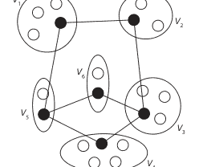

图7.1. GMEBCNP解示例。

GMEBCNP是一个\(\mathcal{NP}\)-hard问题，因为在特殊情况下，当\(|V_i| = 1, \forall i = 1, \dots, m\)时，寻找覆盖图中所有节点的最小成本双连网络的问题是一个\(\mathcal{NP}\)-hard问题。参见Garey和Johnson [45]。

广义最小边双连网络问题与其他一些广义网络设计问题密切相关，例如广义旅行商问题（GTSP）。由于GTSP的每个解显然都是边双连的，因此也是GMEBCNP的解，其解值可以被视为GMEBCNP的上界。

### 7.2 GMEBCNP的混合整数规划模型

本节介绍了Hu等人 [82]描述的混合整数规划公式。该模型是一种基于局部-全局方法的多商品流混合整数规划公式，我们最初为GMSTP提出了该方法（参见第2章，第2.3.5节）。考虑以下决策二元变量

```
x_{ij} = \begin{cases} 1 & \text{if edge } e = (i, j) \in E \text{ is included in the selected subgraph} \\ 0 & \text{otherwise} \end{cases}, \quad z_i = \begin{cases} 1 & \text{if the node } i \in V \text{ is included in the selected subgraph} \\ 0 & \text{otherwise} \end{cases}, \quad y_{lr} = \begin{cases} 1 & \text{if cluster } V_l \text{ is connected to cluster } V_r \text{ in the global graph} \\ 0 & \text{otherwise} \end{cases}, \quad f_{lr}^k = \begin{cases} 1 & \text{if a flow } f \text{ of commodity } k \text{ exists from cluster } V_l \text{ to cluster } V_r \\ 0 & \text{otherwise} \end{cases}
```

其中\( l, r \in \{1, \dots, m\} \)且\( k \in \{2, \dots, m\} \)。

该公式由两部分组成。第一部分称为多商品流部分，在全局图上运行，基于从根集群\( V_1 \)向每个其他集群发送两个单位的流\( f \)，使用边不相连的路径。不同集群的流由其商品\( k \)区分。第二部分称为局部-全局部分，如第2.5.3节所述，将局部变量\( x_{ij} \)和\( z_i \)与全局变量\( y_{lr} \)关联，描述集群之间的连接。

```
\begin{aligned}
\min \sum_{e \in E} c_e x_e \\
s.t. \quad \sum_{l=1}^m f_{lr}^k - \sum_{r=1}^m f_{rp}^k = \begin{cases} -2 & \text{if } r=1 \\ 2 & \text{if } r=k, \quad \forall r \in \{1, \dots, m\}, \\ 0 & \text{else} \end{cases} \quad \forall k \in \{2, \dots, m\}, \quad (7.1) \\
f_{lr}^k + f_{rl}^k \le 1 \quad \forall l, r \in \{1, \dots, m\}, \forall k \in \{2, \dots, m\} \quad (7.2) \\
\sum_{i \in V_k} z_i = 1, \quad \forall k \in K = \{1, \dots, m\}, \quad (7.3) \\
x(V_l, V_r) = y_{lr}, \quad \forall l, r \in K = \{1, \dots, m\}, l \neq r \quad (7.4) \\
x_{ij} \le z_i, \quad \forall i \in V_l, \forall j \in V \setminus V_l, \forall l \in \{1, \dots, m\}, \quad (7.5) \\
y_{lr} \ge f_{lr}^k, \quad \forall l, r \in \{1, \dots, m\} l \neq r \quad \forall k \in \{2, \dots, m\}, \quad (7.6) \\
f_{lr}^k \ge 0, \quad \forall l, r \in \{1, \dots, m\}, \forall k \in \{2, \dots, m\}, \quad (7.7) \\
y_{lr} \in \{0, 1\}, \quad \forall l, r \in \{1, \dots, m\}, \quad (7.8) \\
x_e, z_i \in \{0, 1\}, \quad \forall e = (i, j) \in E, \forall i \in V, \quad (7.9)
\end{aligned}
```

其中\( x(V_l, V_r) = \sum_{i \in V_l, j \in V_r} x_{ij} \)。


在这个模型中，约束 (7.1) 确保两种商品 k 的流 f 在根簇 V1 中生成，在未分配给它们的任何其他簇中保留，并由簇 Vk 消耗。为了实现边双连通性，约束 (7.2) 禁止将分配给同一簇的两种商品通过同一连接进行运输。约束 (7.3) 保证从每个簇中恰好选择一个节点，限制 (7.4) 强制我们仅选择属于在全局结构中连接的簇的节点之间的边，不等式 (7.5) 确保仅选择与所选节点关联的边。有效的全局结构由不等式 (7.6) 得到，它们确保如果某条边上存在活跃流，则全局连接将包含在解中。最后，限制 (7.7) 和 (7.8) 是整体性约束。

### 7.3 求解 GMEBCNP

尽管 GMEBCNP 在现实世界中非常重要，尤其是在大型通信网络骨干设计等应用中，但对该问题的研究并不多。Huygens [84] 提出了该问题的整数规划公式，以及定义面的不等式，据我们所知，迄今为止仅开发了一种专门用于求解 GMEBCNP 的算法，即改进的变邻域搜索（VNS）方法 [82]，其中提出了几种变体，我们将在本节中描述这些变体。

变邻域搜索（VNS）是一种元启发式算法，由 Mladenovic [124] 提出用于求解组合优化和全局优化问题。其基本思想是在局部搜索中系统地改变邻域。VNS 得到了非常快速的发展，已有十余篇关于该主题的论文发表。关于 VNS 及其扩展和应用的综述，我们参考 [70, 71, 125]。

Hu 等人 [82] 提出了四种邻域类型，侧重于 GMEBCNP 的不同方面。为了创建高质量的初始解，他们考虑了 Christofides 启发式的一种改编。它首先使用基于 Kruskal 的启发式构建广义最小生成树问题（GMSTP）的解。接下来，广义生成树被增强，直到成为 GMEBCNP 的可行解。

#### 7.3.1 简单节点优化邻域（SON）

简单节点优化邻域包含所有与当前解仅相差一个覆盖节点的解。该邻域内的移动是通过用集群中的另一个节点交换一个节点来实现的，同时也会移除初始节点的连接，并向新节点添加相应的边。在下图中，我们展示了这样的移动，将 V2 中的覆盖节点 v2 与同一簇中属于另一个节点 v'2 进行交换。

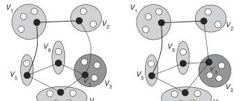

图 7.2. 一个 SNON 移动，将覆盖节点 \(v_3 \in V_3\) 更改为同一簇中属于另一个节点。

#### 7.3.2 节点重排邻域（NRAN）

节点重排邻域包含所有与当前解仅相差交换两个节点的解。这种情况在下图中有所说明。

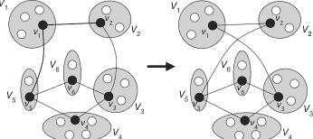

图 7.3. 一个 NRAN 移动，交换节点 \(v_1\) 和 \(v_2\)。

#### 7.3.3 边增强邻域

边增强邻域主要考虑边的修改，包含所有与当前解仅相差添加一条新边并移除现在冗余的其他边的解。该邻域内的这种移动在下图中展示。

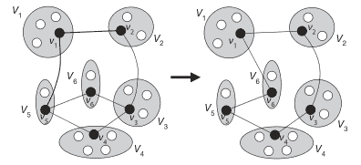

图 7.4. 一个 EAN 移动，添加边 (v1, v6) 并移除冗余边 (v1, v5) 和 (v3, v6)。

#### 7.3.4 节点交换邻域

节点交换邻域是简单节点优化邻域和边增强邻域的组合，涉及覆盖节点及其连接边的修改。该邻域包含所有与当前解仅相差一个覆盖节点和任意数量边的解。这种情况在图 7.5 中有所说明。

#### 7.3.5 变邻域下降

在他们提出的 VNS 方案中，Hu 等人 [82] 使用变邻域下降（VND）作为局部改进。他们提供了三种 VND 变体。第一种，记为 VND1，应用先前描述的邻域结构。第二种，记为 VND2，应用上述提到的邻域，并额外应用基于图缩减技术 [82] 的两个邻域。最后，最后一种变体称为自适应变邻域下降（SAVND），应用与 VND2 相同的邻域结构，但不是给定的静态顺序，邻域在搜索过程中会自动重新排列。通用 VNS 的伪代码在算法 7.1 中给出。

### 算法 7.1（用于求解 GMEBCNP 的 VNS 算法）。

```
1 Create initial solution S
2 repeat
3   k = 0
4   repeat
5     S' = S
6     if k > 0 then
7       Shaking(S', k): add k randomly chosen edges from E \ T
8       remove the redundant edges
9       VND1 (S') or VND2 (S') or SAVND (S')
10      if solution S' is better than S then
11        S = S'
12        k = 1
13      else
14        k = k + 1
15    until k = k_max
16  until a termination criterion is met
17  return solution S
```

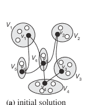

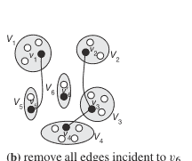

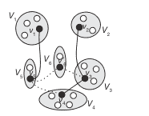

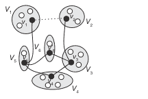

图 7.5. 一个 NEN 移动，更改覆盖节点 $v_6 \in V_6$，移除所有相邻边并重新增强子图以获得双连通性。

### 7.4 计算结果

Hu 等人 [82] 在两种类型的实例上测试了他们用于求解 GMEBCNP 的 VNS 变体，即基于 [43] 的地理中心聚类的欧几里得 TSPlib 实例，以及 Ghosh [49] 引入的随机实例（最初用于 GMSTP 的情况）。关于这些实例的更多信息，我们参考第 2.6 节或 [82]。

实验在一台配备 Pentium 4、2.6 GHz 处理器和 1 GB 内存的 PC 上进行，为了计算平均值和标准差，Hu 等人对每个实例和算法变体进行了 30 次独立运行。

在分析表 7.1 和 7.2 中呈现的计算结果后，我们观察到，对于 TSPlib 实例，在测试的 VNS 变体中 SAVNS 表现最好，而对于随机实例，结果不明确。对于欧几里得和非欧几里得实例组，SAVNS 表现最好，而在随机欧几里得的情况下，VNS2 变体表现最好。

### 7.5 注释

广义最小边双连通网络问题（GMEBCNP）是边双连通增强问题的扩展，包括寻找包含每个簇中恰好一个节点并以边双连通方式连接的最小成本子图。GMEBCNP 由 Huygens [84] 引入，并在大型通信网络骨干设计中出现。

在本章中，我们介绍了该问题的整数规划模型和一种改进的变邻域搜索（VNS）方法，其中提出了几种变体。

本章所呈现的材料基于 Hu 等人 [82] 发表的结果。

### 表 7.1. 带有地理聚类的 TSPlib 实例结果。

| 实例 | 时间 | C(T_best) | C(T) | 标准差 | 时间 | C(T_best) | C(T) | 标准差 | 时间 | C(T_best) | C(T) | 标准差 | 时间 | p | p |
| :--- | :--- | :--- | :--- | :--- | :--- | :--- | :--- | :--- | :--- | :--- | :--- | :--- | :--- | :--- | :--- |
| gr137 | 150s | 440.0 | 440.8 | 2.4 | 6.4s | 440.0 | 440.0 | 0.0 | 31.7s | 440.0 | 440.0 | 0.0 | 16.2s | 0.12 | 0.12 |
| kroA150 | 150s | 11532.0 | 11532.8 | 2.4 | 6.4s | 11532.0 | 11532.0 | 0.0 | 56.1s | 11532.0 | 11532.0 | 0.0 | 12.8s | 0.12 | 0.12 |
| kroB200 | 300s | 13177.0 | 13309.4 | 79.9 | 75.5s | 13177.0 | 13210.2 | 22.2 | 1376.1s | 13377.0 | 13206.4 | 23.8 | 120.4s | <0.01 | <0.01 |
| ts225 | 300s | 68346.0 | 68769.7 | 305.9 | 72.4s | 68346.0 | 68581.8 | 212.2 | 14076.6s | 68346.0 | 68563.7 | 166.3 | 123.8s | 0.08 | <0.01 |
| pr226 | 300s | 1078.0 | 1157.4 | 54.9 | 146.5s | 1059.0 | 1076.3 | 15.9 | 192.7s | 1059.0 | 1070.8 | 10.1 | 168.3s | <0.01 | <0.01 |
| gi262 | 300s | 29948.0 | 31639.6 | 1449.3 | 138.0s | 29810.0 | 30434.8 | 725.5 | 238.3s | 29810.0 | 29879.3 | 56.0 | 226.4s | <0.01 | <0.01 |
| pr299 | 450s | 22853.0 | 23953.9 | 792.4 | 331.1s | 22644.0 | 22829.6 | 215.9 | 3077.7s | 22644.0 | 22659.1 | 12.7 | 300.7s | <0.01 | <0.01 |
| lin318 | 450s | 21506.0 | 23101.1 | 840.3 | 409.4s | 21220.8 | 21750.4 | 444.4 | 338.5s | 20795.0 | 21321.0 | 228.7 | 299.4s | <0.01 | <0.01 |
| d400 | 600s | 6846.0 | 7275.4 | 238.0 | 414.3s | 6755.0 | 6961.7 | 103.2 | 425.8s | 6745.0 | 6833.2 | 42.0 | 427.6s | <0.01 | <0.01 |
| d417 | 600s | 10234.0 | 10636.4 | 268.8 | 198.7s | 10085.0 | 10547.9 | 234.2 | 329.8s | 9708.0 | 9881.9 | 160.8 | 431.2s | <0.01 | <0.01 |
| gr431 | 600s | 1337.0 | 1408.2 | 508.7s | 434.3s | 16072.8 | 607.0 | 372.2 | 2224.0 | 6216.6 | 325.9 | 468.4 | <0.01 | <0.01 | <0.01 |
| pr439 | 600s | 65831.0 | 72752.3 | 5857.2s | 4972.3s | 60727.8 | 36018.1 | 66042.0 | 18071.7s | 47173s | <0.01 | <0.01 | <0.01 | <0.01 | <0.01 |
| pcb442 | 600s | 25545.0 | 26051.2 | ... | 1972.5 | 570.5 | ... | 974.0 | 2322.3 | ... | 325.9 | 468.4 | <0.01 | <0.01 | <0.01 |


## 表 7.2. Ghosh 实例在 600 秒 CPU 时间下的结果

| 实例 | 时间 | C(Tbest) | C(Tstd) | VNS1 (I) 标准差 | VNS1 (I) 最佳 | VNS2 (II) C(Tbest) | VNS2 (II) C(Tstd) | VNS2 (II) 标准差 | VNS2 (II) 最佳 | SAVNS (A) C(Tbest) | SAVNS (A) C(Tstd) | SAVNS (A) 标准差 | SAVNS (A) 最佳 | Wilcoxon 检验 Tbest | Wilcoxon 检验 Tstd | Wilcoxon 检验 T1/4 | Wilcoxon 检验 T3/4 |
|---|---|---|---|---|---|---|---|---|---|---|---|---|---|---|---|---|---|
| 欧几里得组 125 | 600s | 163.5 | 163.5 | 0.0 | 29.8 | 159.5 | 159.5 | 0.0 | 93.1 | 159.5 | 159.5 | 0.0 | 38.2 | 38.2 s | NA | NA | NA |
| 欧几里得组 125 | 600s | 166.1 | 166.1 | 0.0 | 25.1s | 163.5 | 163.5 | 0.0 | 35.9s | 163.5 | 163.5 | 0.0 | 14.4s | 14.4 s | NA | NA | NA |
| 欧几里得组 125 | 600s | 166.1 | 166.1 | 0.0 | 9.8s | 166.1 | 166.1 | 0.0 | 27.0s | 166.1 | 166.1 | 0.0 | 6.5s | 6.5 s | NA | NA | NA |
| 欧几里得组 500 | 600s | 684.4 | 717.6 | 25.8 | 432.8 s | 640.4 | 678.5 | 17.8 | 379.9 s | 629.8 | 644.8 | 9.4 | 1460.2 s | <0.01 | <0.01 | <0.01 | <0.01 |
| 欧几里得组 500 | 600s | 765.1 | 799.0 | 35.4 | 805.4 s | 657.4 | 698.9 | 24.2 | 438.2 s | 645.3 | 663.8 | 11.9 | 2720.5 s | <0.01 | <0.01 | <0.01 | <0.01 |
| 欧几里得组 500 | 600s | 747.3 | 761.7 | 37.2 | 332.8 s | 651.7 | 693.7 | 25.4 | 486.3 s | 643.0 | 655.6 | 8.9 | 5905.8 s | <0.01 | <0.01 | <0.01 | <0.01 |
| 欧几里得组 600 | 600s | 105.1 | 105.1 | 0.0 | 44.9 s | 105.1 | 105.5 | 1.9 | 515.3 s | 105.1 | 105.1 | 0.0 | 40.7 s | 0.50 | 0.50 | NA | NA |
| 欧几里得组 600 | 600s | 105.2 | 105.2 | 0.0 | 10.7 s | 105.2 | 105.9 | 2.7 | 398.4 s | 105.2 | 105.2 | 0.0 | 8.3 s | 0.01 | 0.01 | NA | NA |
| 欧几里得组 600 | 600s | 107.5 | 107.5 | 0.0 | 3.3 s | 107.5 | 107.5 | 0.0 | 48.0 s | 107.5 | 107.5 | 0.0 | 1.5 s | NA | NA | NA | NA |
| 随机欧几里得 250 | 600s | 3571.1 | 3746.6 | 123.2 | 1562.4 s | 2995.1 | 3226.6 | 116.9 | 903.4 s | 3235.2 | 3449.3 | 145.7 | 546.2 s | <0.01 | <0.01 | <0.01 | <0.01 |
| 随机欧几里得 250 | 600s | 3309.5 | 3461.8 | 166.9 | 1561.4 s | 2662.1 | 2968.7 | 189.4 | 491.2 s | 2750.2 | 3299.3 | 161.4 | 550.2 s | <0.01 | <0.01 | <0.01 | <0.01 |
| 随机欧几里得 250 | 600s | 3051.9 | 3303.2 | 270.1 | 126.9 s | 2698.9 | 2888.1 | 98.4 | 500.1 s | 2793.2 | 3111.9 | 255.0 | 560.1 s | <0.01 | <0.01 | <0.01 | <0.01 |
| 随机欧几里得 400 | 600s | 943.8 | 1027.2 | 71.5 | 99.9 s | 841.0 | 926.9 | 61.2 | 401.9 s | 943.8 | 1024.8 | 48.7 | 59.9 s | <0.01 | <0.01 | <0.01 | 0.28 |
| 随机欧几里得 400 | 600s | 813.3 | 1059.5 | 138.3 | 93.0 s | 813.3 | 875.7 | 56.8 | 810.9 s | 813.3 | 1043.2 | 109.0 | 89.1 s | <0.01 | <0.01 | <0.01 | 0.20 |
| 随机欧几里得 400 | 600s | 814.9 | 858.7 | 40.5 | 53.7 s | 794.4 | 836.1 | 39.8 | 385.2 s | 814.9 | 860.7 | 27.8 | 100.0 s | <0.01 | <0.01 | <0.01 | 0.15 |
| 随机欧几里得 600 | 600s | 599.8 | 725.1 | 103.9 | 183.5 s | 599.8 | 605.1 | 7.5 | 371.2 s | 599.8 | 699.2 | 90.4 | 77.3 s | <0.01 | <0.01 | <0.01 | 0.47 |
| 随机欧几里得 600 | 600s | 785.4 | 823.7 | 55.3 | 226.7 s | 643.1 | 762.0 | 50.6 | 428.7 s | 643.1 | 813.4 | 53.9 | 151.4 s | <0.01 | <0.01 | <0.01 | 0.40 |
| 随机欧几里得 600 | 600s | 695.3 | 778.9 | 60.1 | 256.1 s | 596.5 | 674.3 | 52.3 | 399.4 s | 695.3 | 743.7 | 94.2 | 88.3 s | <0.01 | <0.01 | <0.01 | <0.01 |
| 非欧几里得 200 | 600s | 180.1 | 244.9 | 34.4 | 335.7 s | 172.6 | 224.5 | 23.4 | 232.2 s | 179.8 | 219.0 | 31.0 | 329.8 s | 0.01 | 0.06 | <0.01 | <0.01 |
| 非欧几里得 200 | 600s | 133.8 | 216.7 | 33.8 | 189.5 s | 140.2 | 198.3 | 31.1 | 251.2 s | 179.3 | 215.9 | 19.0 | 139.7 s | 0.02 | 0.01 | 0.48 | 0.48 |
| 非欧几里得 200 | 600s | 156.0 | 179.8 | 28.4 | 424.8 s | 135.5 | 190.6 | 29.0 | 272.0 s | 154.4 | 175.6 | 20.1 | 298.3 s | <0.01 | <0.01 | 0.38 | 0.38 |
| 非欧几里得 500 | 600s | 902.6 | 1121.3 | 123.3 | 206.1 s | 830.5 | 996.7 | 88.5 | 243.0 s | 771.0 | 960.2 | 99.3 | 387.8 s | <0.01 | <0.01 | <0.01 | <0.01 |
| 非欧几里得 500 | 600s | 897.5 | 1008.2 | 128.9 | 175.2 s | 860.7 | 1016.4 | 87.2 | 220.7 s | 734.3 | 921.2 | 106.9 | 340.7 s | 0.27 | <0.01 | 0.01 | 0.01 |
| 非欧几里得 500 | 600s | 785.3 | 1025.8 | 109.5 | 242.0 s | 844.0 | 990.8 | 83.0 | 186.4 s | 710.4 | 929.0 | 120.8 | 832.4 s | <0.01 | <0.01 | <0.01 | <0.01 |
| 非欧几里得 600 | 600s | 102.9 | 138.6 | 25.1 | 130.8 s | 93.0 | 129.9 | 14.2 | 315.2 s | 91.6 | 125.0 | 20.7 | 801.0 s | 0.09 | 0.02 | <0.01 | <0.01 |
| 非欧几里得 600 | 600s | 107.3 | 132.0 | 19.0 | 77.3 s | 102.3 | 130.2 | 13.6 | 532.8 s | 94.6 | 118.5 | 19.9 | 725.7 s | 0.45 | <0.01 | <0.01 | <0.01 |
| 非欧几里得 600 | 600s | 85.4 | 119.4 | 19.0 | 800.4 s | 94.8 | 133.1 | 17.8 | 404.7 s | 79.5 | 113.4 | 18.5 | 523.6 s | <0.01 | <0.01 | <0.01 | 0.13 |

## 参考文献

- [1] R. Ahuja, T. Magnanti, J. Orlin, 网络流, Prentice-Hall, Englewood Cliffs, 1993.
- [2] J. R. Araque, G. Kudva, T. L. Morin 和 J. F. Pekny, 车辆路由问题的分支切割算法, 运筹学年鉴, Vol. 50(1), pp. 37–59, 1994.
- [3] A. A. Assad 和 B. L. Golden, 弧路由方法与应用, 载于 M. G. Ball, T. L. Magnanti, C. L. Monma, G. L. Nemhauser (编), 网络路由, 运筹学与管理科学手册第 8 卷, 第 5 章, pp. 375–483, Elsevier, 1995.
- [4] A. A. Assad, B. L. Golden, W. Peam, 带容量中国邮差问题: 下界与可求解案例, 美国数学与管理科学杂志, Vol. 7(1,2), pp. 63–88, 1987.
- [5] R. Baldacci, E. Bartolini 和 G. Laporte, 广义车辆路由问题的若干应用, 运筹学学会杂志, Vol. 61(7), pp. 1072–1077, 2010.
- [6] M. O. Ball, T. L. Magnanti, C. L. Monma, G. L. Nemhauser (编), 网络路由, 运筹学与管理科学手册 8, Elsevier, Amsterdam, 1995.
- [7] R. Bar-Yehuda 和 S. Even, 加权顶点覆盖问题的线性时间近似算法, 算法期刊, Vol. 2(2), pp. 198–203, 1981.
- [8] A. Behzad 和 M. Modarres, 广义旅行商问题到旅行商问题的一种新的高效变换, 载于第 15 届系统工程国际会议论文集, 2002.
- [9] T. Bektas, G. Erdoğan 和 S. Ropke, 广义车辆路由问题的公式与分支切割算法, 交通科学, Vol. 45 (3), pp. 299–316, 2011.
- [10] D. Ben-Arieh, G. Gutin, M. Penn, A. Yeo 和 A. Zverovich, 广义 ATSP 到 ATSP 的变换, 运筹学快报, Vol. 31(3), pp. 357–365, 2003.
- [11] D.J. Bertsimas, 概率最小生成树问题, 网络, Vol. 20(3), pp. 245–275, 1990.
- [12] E. Bonabeau, M. Dorigo, G. Theraulaz, 从自然到人工系统的群体智能, 英国牛津, 牛津大学出版社, 1999.
- [13] B. Bontoux, C. Artigues 和 D. Feillet, 广义旅行商问题的大邻域交叉算子模因算法, 计算机与运筹学, Vol. 37(11), pp. 1844–1852, 2010.
- [14] V. Cacchiani, A. E. F. Muritiba, M. Negreiros 和 P. Toth, 等式广义旅行商问题的多启动启发式算法, 网络, Vol. 57(3), pp. 231–239, 2011.
- [15] S. Camazine, J. L. Deneubourg, N. R. Franks, J. Sneyd, G. Theraulaz 和 E. Bonabeau, 生物系统中的自组织, 普林斯顿, 普林斯顿大学出版社, 2001.
- [16] V. Černý, 旅行商问题的热力学方法: 一种高效的模拟退火算法, 优化理论与应用期刊, Vol. 45, pp. 41–55, 1985.
- [17] L. Chapleau, J. A. Ferland, G. Lapalme, J.-M. Rousseau, 带容量弧路由问题的并行插入方法, 运筹学快报, Vol. 3(2), pp. 95–99, 1984.
- [18] J. A. Chisman, 聚类旅行商问题, 计算机与运筹学, Vol. 2, pp. 115–119, 1975.
- [19] B. Crevier, J.-F. Cordeau 和 G. Laporte, 带站间路线的多仓库车辆路由问题, 欧洲运筹学期刊, Vol. 176(2), pp. 756–773, 2007.
- [20] J. R. Current, C. S. ReVelle 和 J. L. Cohon, 分层网络设计问题, 欧洲运筹学期刊, Vol. 27(1), pp. 57–66, 1986.
- [21] M. Demange, J. Monnot, P.C. Pop 和 B. Ries, 某些特殊图类中的选择性图着色, 载于 ISCO 2012 论文集, 计算机科学讲义 (即将出版).
- [22] G. Desaulniers, J. Desrosiers 和 M. M. Solomon, 车辆路由与乘务排班问题列生成方法中的加速策略, 载于 C. C. Ribeiro 和 P. Hansen (编), 元启发式论文与综述, 页 309–324, Kluwer, Boston, 2001.
- [23] M. Desrochers 和 G. Laporte, Miller-Tucker-Zemlin 次环消除约束的改进与扩展, 运筹学快报, Vol. 10(1), pp. 27–36, 1991.
- [24] M. Desrochers, J. K. Lenstra, M. W. P. Savelsbergh 和 F. Soumis, 带时间窗车辆路由: 优化与近似, 载于 车辆路由: 方法与研究, B. L. Golden 和 A. A. Assad (编), Elsevier, 1998.
- [25] E. W. Dijkstra, 关于图论中两个问题的简述, 数值数学, Vol. 1, pp. 269–271, 1959.
- [26] V. Dimitrijević 和 Z. Šarić, 广义旅行商问题到有向图上旅行商问题的高效变换, 信息科学, Vol. 102(1–4), pp. 105–110, 1997.
- [27] C. Ding, Y. Cheng 和 M. He, 大规模 TSP 中聚类旅行商问题的两级遗传算法, 清华科学与技术, Vol. 12(4), pp. 459–465, 2007.
- [28] M. Dorigo 和 L. M. Gambardella, 蚁群系统: 旅行商问题的协作学习方法, IEEE 进化计算交易汇刊, Vol. 1(1), pp. 53–66, 1997.


- [29] M. Dror 和 M. Haouari, 广义 Steiner 问题及其他变体, 组合优化杂志, Vol. 4(4), pp. 415–436, 2000.

- [30] M. Dror, H. Haouari 和 J. Chaouachi, 广义生成树, 欧洲运筹学期刊, Vol. 120(3), pp. 583–592, 2000.

- [31] C. W. Duin, A. Volgenant 和 S. Voss, 将组 Steiner 问题作为 Steiner 问题求解, 欧洲运筹学期刊, Vol. 154(1), pp. 323–329, 2004.

- [32] K. Easton, A. Martinoli 和 R. Goodman, 使用自主机器人构建二维结构的分布式集体方法, 技术报告, 加州理工学院神经形态系统工程中心, 2001.

- [33] H. A. Eiselt, M. Gendreau 和 G. Laporte, 弧路由问题，第 1 部分：中国邮递员问题, 运筹学, Vol. 43(2), pp. 231–242, 1995.

- [34] H. A. Eiselt, M. Gendreau 和 G. Laporte, 弧路由问题，第 1 部分：中国邮递员问题, 运筹学, Vol. 43(3), pp. 399–414, 1995.

- [35] K. P. Eswaran 和 R. E. Tarjan, 增广问题, SIAM 计算期刊, Vol. 5(4), pp. 653–665, 1976.

- [36] D. Feillet, P. Dejax 和 M. Gendreau, 带利润的旅行商问题, 交通运输科学, Vol. 39(2), pp. 188–205, 2005.

- [37] C. Feremans, 广义生成树及其扩展, 博士论文, 布鲁塞尔自由大学, 2001.

- [38] C. Feremans, M. Labbé 和 G. Laporte, 广义最小生成树问题多种表述的比较分析, 网络 Vol. 39(1), pp. 29–34, 2002.

- [39] C. Feremans, M. Labbé 和 G. Laporte, 广义网络设计问题, 欧洲运筹学期刊, Vol. 148, pp. 1–13, 2003.

- [40] C. Feremans, M. Labbé 和 G. Laporte, 广义最小生成树问题：多面体分析与分支切割算法, 网络, Vol. 43(2), pp. 71–86, 2004.

- [41] C. Feremans, A. Grigoriev 和 R. Sitters, 带网格聚类的几何广义最小生成树问题, 4OR, Vol. 4(4), pp. 319–329, 2006.

- [42] M. Fischetti, J. J. Salazar 和 P. Toth, 对称广义旅行商多面体, 网络, Vol. 26, pp. 113–123, 1995.

- [43] M. Fischetti, J. J. Salazar 和 P. Toth, 对称广义旅行商问题的分支切割算法, 运筹学, Vol. 45(3), pp. 378–394, 1997.

- [44] D. Gale, 网络流定理, 太平洋数学杂志 Vol. 7, pp. 1073–1082, 1957.

- [45] M. R. Garey 和 D. S. Johnson, 计算机与不可处理性：NP-完全性理论指南, 弗里曼出版社, 旧金山, 加利福尼亚, 1979.

- [46] N. Garg 和 G. Konjevod, 组 Steiner 树问题的多对数近似算法, 算法期刊, Vol. 37, pp. 66–84, 2000.

- [47] M. Gerla 和 L. Frata, 树状光纤城域网, IEEE 通信选区期刊 SAC Vol. 6, pp. 934–943, 1988.

- [48] G. Ghiani, G. Improta, 广义车辆路由问题的高效转换, 欧洲运筹学期刊, Vol. 122(1), pp. 11–17, 2000.

- [49] D. Ghosh, 求解中大规模欧氏广义最小生成树问题, 技术报告 NEP-CMP-2003-08-02, 印度艾哈迈达巴德印度管理学院研究与出版部, 印度, 2003.

- [50] D. Ghosh, 广义最小生成树问题的概率禁忌搜索算法, 技术报告 NEP-CMP-2003-07-02, 印度艾哈迈达巴德印度管理学院研究与出版部, 印度, 2003.

- [51] F. Glover, 整数规划的未来路径及其与人工智能的联系, 决策科学, Vol. 8, pp. 156–166, 1977.

- [52] F. W. Glover 和 G. A. Kochenberger, 元启发式手册, 库卢韦学术出版社, 2002.

- [53] B. Golden, S. Raghavan 和 D. Stanojevic, 广义最小生成树问题的启发式搜索, INFORMS 计算期刊. Vol. 17(3), pp. 290–304, 2005.

- [54] B. Golden, S. Raghavan 和 D. Stanojevic, 带奖金收集的广义最小生成树问题, 启发式期刊, Vol. 14(1), pp. 69–93, 2008.

- [55] B. L. Golden 和 R. T. Wong, 容量弧路由问题, 网络, Vol. 11, pp. 305–315, 1981.

- [56] B. L. Golden 和 A. A. Assad, 比较启发式的决策论框架, 欧洲运筹学期刊, Vol. 18, pp. 167–171, 1984.

- [57] M. X. Goemans, 课程笔记：近似算法, 1994.

- [58] M. X. Goemans 和 D. J. Bertsimas, 可生存网络、线性规划与节约性质, 数学规划, Vol. 60(1–3), pp. 145–166, 1993.

- [59] M. Grotzl, L. Lovász 和 A. Schrijver, 椭球法及其在组合优化中的后果, 组合数学, Vol. 1, pp. 169–179, 1981.

- [60] M. Grötschel, L. Lovász 和 A. Schrijver, 几何算法与组合优化, 施普林格-维拉出版社, 柏林, 1988.

- [61] M. Guntsch, J. Branke, M. Middendorf, H. Schmeck, 动态 TSP 的蚁群策略, ANTS 2000 摘要论文集, pp. 59–62, 2000.

- [62] M. Guntsch 和 M. Middendorf, 应用于动态 TSP 的蚁群算法信息素修改策略, 在《进化计算应用》中, EvoWorkshops 论文集, 施普林格出版社 2001.

- [63] M. Guntsch, M. Middendorf 和 H. Schmeck, 动态 TSP 的蚁群优化方法, 在 GECCO 2001 论文集中, pp. 860–867, 2001.

- [64] G. Gutin, A. P. Punnen (编), 旅行商问题及其变体, 库卢韦学术出版社, 多德雷赫特, 2002.

- [65] G. Gutin 和 D. Karapetyan, 广义旅行商问题的模因算法, 自然计算, Vol. 9(1), pp. 47–60, 2010.

- [66] G. Gutin, D. Karapetyan 和 N. Krasnogor, 广义旅行商问题的模因算法, 在 NICSO 2007 论文集中, pp. 199–210, 2007.

- [67] G. Hadjicharalambous, P. C. Pop, E. Pyrga, G. Tsaouroglou 和 C. D. Zaroliagis, 铁路旅行商问题. 铁路优化算法方法, 计算机科学讲义, Vol. 4359, pp. 264–275, 2007.

- [68] M. Haouari, J. Chaouachi 和 M. Dror, 通过分支定界算法求解广义最小生成树问题, 运筹学会期刊, Vol. 56(4), pp. 382–389, 2005.

- [69] M. Haouari 和 J.S. Chaouachi, 广义最小生成树问题的上下界策略, 欧洲运筹学期刊, Vol. 172(2), pp. 632–647, 2006.

- [70] P. Hansen 和 N. Mladenović, 变邻域搜索：原理与应用, 欧洲运筹学期刊, Vol. 130(3), pp. 449–467, 2001.

- [71] P. Hansen 和 N.Mladenović, 变邻域搜索, 在 F. W. Glover 和 G. A. Kochenberger, 编, 元启发式手册, 多德雷赫特, 2003. 库卢韦.

- [72] F. Harary, 图论, 麻省里丁: 艾迪生-韦斯利, 1994.

- [73] P. Henry-Labordère, 记录平衡问题：广义旅行商问题的动态规划解, RAIRO 运筹学, B2, pp. 43–49, 1969.

- [74] A. Hertz, G. Laporte 和 M. Mittaz, 容量弧路由问题的禁忌搜索启发式, 运筹学, Vol. 48(1), pp. 129–135, 2000.

- [75] D. Hochbaum, 集合覆盖和顶点覆盖问题的近似算法, SIAM 计算期刊, Vol. 11, pp. 555–556, 1982.

- [76] B. Hu, M. Leitner 和 G. R. Raidl, 利用变邻域搜索计算广义最小生成树, 在第 18 届变邻域搜索小型欧洲会议论文集中, P. Hansen, N. Mladenović, J. A. M. Perez, B. M. Batista, J. M. Moreno-Vega, 编. 西班牙特内里费, 2005.

- [77] B. Hu, M. Leitner 和 G. R. Raidl, 将变邻域搜索与整数线性规划相结合求解广义最小生成树问题, 启发式期刊, Vol. 14(5), pp. 473–499, 2008.

- [78] B. Hu 和 G. Raidl, 通过转化为经典旅行商问题求解铁路旅行商问题, 在 Fatos Xhafa, Francisco Herrera, Ajith Abraham, Mario Koppen, Jose Manuel Benitez, 编, 第 8 届混合智能系统国际会议 - HIS 2008, pp. 73–77, 西班牙巴塞罗那, 2008.

- [79] B. Hu 和 G. Raidl, 广义旅行商问题的有效邻域结构, 在《进化计算在组合优化中的应用 - EvoCOP 2008》论文集中, LNCS, Vol. 4972, pp. 36–47, 2008.

- [80] B. Hu, 广义网络设计问题的混合元启发式, 博士论文, 维也纳工业大学, 2008.


- [81] B. Hu 和 G. R. Raidl, 针对广义最小生成树问题的带解存档的进化算法, 在 Alexis Quesada-Arencibia 等人(编) 中, EUROCAST 2011 - 第13届计算机辅助系统理论国际会议论文集, 西班牙拉斯帕尔马斯德格兰卡纳里亚, 2011年2月6–11日, 第256–259页, 2011.

- [82] B. Hu, M. Leitner, G.R. Raidl, 广义最小边双连网络问题：面向变邻域搜索的高效邻域结构, Networks, 卷55(3), 第256–275页, 2010.

- [83] F. Hutter, H.H. Hoos, K. Leyton-Brown 和 T. Stützle, ParamILS：自动算法配置框架, 人工智能研究杂志(JAIR), 卷36, 第267–306页, 2009.

- [84] D. Huygens, 2-边连通搜索设计问题的广义版本, 硕士论文, 布鲁塞尔自由大学, 2002.

- [85] ILOG CPLEX 7.0, 2000.

- [86] S. Iordache, 顾问引导搜索 - 组合优化问题的一种新元启发式, 在 第12届遗传与进化计算会议论文集中, ACM Press, 2010.

- [87] S. Iordache, 面向旅行商问题的带局部搜索的顾问引导搜索算法, 在 GPSI XI - 自然并行问题求解国际会议中, LNCS, 卷6239, 波兰克拉科夫, Springer, 2010, 第81–90页.

- [88] S. Iordache, 二次指派问题的顾问引导搜索算法, 在 混合元启发式 - 第7届国际研讨会, HM 2010, LNCS, 卷6373, 奥地利维也纳, Springer, 2010, 第148–159页.

- [89] H. Ishii, S. Shiodo, T. Nishida 和 Y. Namasuya, 随机生成树问题, 离散应用数学, 卷3(4), 第263–273页, 1981.

- [90] D. Johnson, C. Aragon, L. McGeoch 和 C. Schevon, 基于模拟退火的优化：实验评估，第一部分，图划分, 运筹学, 卷37(6), 第865–892页, 1989.

- [91] D. S. Johnson 和 L. McGeoch, STSP启发式的实验分析, 在: Gutin, G., Punnen, A. (编), 旅行商问题及其变体, Kluwer, 荷兰多德雷赫特, 2002.

- [92] I. Kara, T. Bektas, 广义车辆路由问题的整数线性规划模型, 第5届EURO/INFORMS联合国际会议, 2003年7月6–10日, 土耳其伊斯坦布尔.

- [93] I. Kara, G. Laporte 和 T. Bektas, 关于容量车辆路由问题中提升的Miller-Tucker-Zemlin消子回路约束的简要说明, 欧洲运筹学期刊, 卷158(3), 第793–795页, 2004.

- [94] I. Kara 和 P. C. Pop, 广义车辆路由问题及其扩展的新数学模型, 在 应用数学规划与建模会议(APMOD 2008)论文集中, 斯洛伐克布拉提斯拉瓦, 2008年5月28–31日.

- [95] D. Karapetyan 和 G. Gutin, 广义旅行商问题中已知和新邻域的高效局部搜索算法, 欧洲运筹学期刊, 卷219(2), 第234–251页, 2012.

- [96] N. Karmarkar, 线性规划中的一种新多项式时间算法, Combinatorica, 卷4, 第373–395页, 1984.

- [97] S. Kirkpatrick, C. D. Gelatt 和 M. D. Vecchi, 基于模拟退火的优化, 科学, 卷220, 第4598期, 第671–680页, 1983.

- [98] J. G. Klincewicz, 骨干/支流网络设计中的枢纽选址：综述, 位置科学, 卷6(1–4), 第307–335页, 1998.

- [99] A. M. C. A. Koster, 频率分配模型与算法, 博士论文, 马斯特里赫特大学, 1999.

- [100] J. B. Kruskal, 关于图的最短生成子树与旅行商问题, 美国数学学会会议录, 卷7, 第48–50页, 1956.

- [101] G. Laporte, 选址路由问题, 在: B. L. Golden 和 A. A. Assad (编), 车辆路由：方法与研究, North-Holland, 阿姆斯特丹, 第163–197页, 1988.

- [102] G. Laporte, S. Chaupeau, P. E. Landry 和 H. Mercure, 城市地区邮箱收集路线设计算法, 运输研究B辑, 卷23(4), 第271–280页, 1989.

- [103] G. Laporte 和 Y. Nobert, 通过n组节点的广义旅行商问题：一种整数规划方法, INFOR, 卷21(1), 第61–75页, 1983.

- [104] G. Laporte 和 I. H. Osman, 路由问题：参考文献, 运筹学年鉴, 卷61(1), 第227–262页, 1995.

- [105] G. Laporte, A. Asef-Vaziri 和 C. Sriskandarajah, 广义旅行商问题的一些应用, 运筹学学会杂志, 卷47(12), 第1461–1467页, 1996.

- [106] G. Laporte 和 U. Palekar, 聚类旅行商问题的一些应用, 运筹学学会杂志, 卷53(9), 第972–976页, 2002.

- [107] G. Laporte, 关于车辆路由问题你应该知道的事, 海军研究后勤, 卷54(8), 第811–819页, 2007.

- [108] A. Larsen, O. B. G. Madsen 和 M. Solomon, 部分动态车辆路由 – 模型与算法, 运筹学学会杂志, 卷53(6), 第637–646页, 2002.

- [109] E. L. Lawler, J. K. Lenstra, A. H. G. Rinnooy Kan, D. B. Shmoys (编), 旅行商问题：组合优化导引, Wiley, 奇切斯特, 1985.

- [110] C. Lemaréchal, 拉格朗日松弛, 计算机科学讲义, 卷2241, 第112–156页, 2001.

- [111] W.-J. Li, J. Tso 和 O. Ulular, 串联/并联簇中每个簇最多包含l个节点的最短路径, Networks, 卷26, 第263–271页, 1995.

- [112] Y. Lien, E. Ma 和 B. W. Wah, 广义旅行商问题向标准旅行商问题的转换, 信息科学, 卷74(1–2), 第177–189页, 1993.

- [113] S. Lin 和 B. W. Kernighan, 旅行商问题的一种有效启发式算法, 运筹学, 卷21, 第498–516页, 1973.

- [114] L. Lovász, 关于欧拉图的一些连通性性质, 匈牙利科学院数学期刊, 卷28, 第129–138页, 1976.

- [115] L. Lovász 和 A. Schrijver, 矩阵与集合函数的锥及0-1优化, SIAM优化期刊, 1(2), 第166–190页, 1991.

- [116] M. E. Lübbecke 和 J. Desrosiers, 列生成选题, 运筹学, 卷53(6), 第1007–1023页, 2005.

- [117] N. Maculan, 图中的Steiner树问题, 在: S. Martello, G. Laporte, M. Minoux, C. C. Ribeiro (编), 组合优化综述, 离散数学年鉴, 卷31, 第185–212页, 1987.

- [118] T. L. Magnanti 和 L. A. Wolsey, 最优树, 在: M. O. Ball, T. L. Magnanti, C. L. Monma, G. L. Nemhauser (编), 运筹学与管理科学手册, Elsevier Science, 阿姆斯特丹, 卷7, 第9章, 第503–615页, 1995.

- [119] J. E. Mendoza, B. Castanier, C. Guéret, A. L. Medaglia 和 N. Velasco, 面向随机需求的多仓车辆路由问题的模因算法, 计算机与运筹学, 卷37(11), 第1886–1898页, 2010.

- [120] K. Menger, “信使问题”, 在: K. Menger (编), 数学 colloquium 成果 2, Teubner, 莱比锡, 第11–12页, 1932.

- [121] N. Metropolis, A. W. Rosenbluth, M. N. Rosenbluth, A. H. Teller 和 E. Teller, 基于快速计算机的状态方程计算, 化学物理学杂志, 卷21(6), 第1087–1092页, 1953.

- [122] C. E. Miller, A. W. Tucker 和 R. A. Zemlin, 旅行商问题的整数规划模型, 计算机协会杂志, 卷7(4), 第326–329页, 1960.

- [123] J. E. Mitchell, 组合优化问题的分支定界算法, 在: 应用优化手册, 第65–77页, 牛津大学出版社, ISBN: 0–19–512594–0, 2002年1月.

- [124] N. Mladenović, 变邻域算法 - 组合优化的一种新元启发式, 在: 优化天会议论文摘要, 蒙特利尔, 第112页, 1995.

- [125] N. Mladenović 和 P. Hansen, 变邻域搜索, 计算机与运筹学, 卷24, 第1097–1100页, 1997.

- [126] L. Moccia, J-F. Cordeau 和 G. Laporte, 广义带时间窗车辆路由问题的增量邻域禁忌搜索启发式, 运筹学学会杂志, 卷63, 第232–244页, 2012.

- [127] P. Moscato, 关于进化、搜索、优化、遗传算法与武术：走向模因算法, 加州理工学院并行计算程序, 报告826, 1989.


- Y. S. Myung, C.H. Lee and D. W. Tcha, 关于广义最小生成树问题, 网络, Vol. 26(4), pp. 231–241, 1995.

- G. Nagy and S. Salhi, 位置路由问题：模型与方法, 欧洲运筹学期刊, Vol. 177(2), 649–672, 2007.

- S. C. Narula and C. A. Ho, 度约束最小生成树, 计算机与运筹学, Vol. 7, pp. 239–249, 1980.

- S. U. Ngueveu, C. Prins and R. W. Calvo, 针对累积容量车辆路由问题的有效模因算法, 计算机与运筹学, Vol. 37(11), pp. 1877–1885, 2010.

- C. E. Noon, 广义旅行商问题, 博士论文, 密歇根大学, 1988.

- C. E. Noon and J. C. Bean, 基于拉格朗日方法的非对称广义旅行商问题, 运筹学, Vol. 39, pp. 623–632, 1991.

- C. E. Noon and J. C. Bean, 广义旅行商问题的高效变换, 技术报告 91–26, 1991.

- T. Öncan, J.-F. Cordeau and G. Laporte, 广义最小生成树问题的禁忌搜索启发式, 欧洲运筹学期刊 191(2), pp. 306–319, 2008.

- A. Pagacz, B. Hu, G. R. Raidl, 针对广义最小顶点双连网络问题的带种群管理的模因算法, in, F. Xhafa 等, 编, 第2届智能网络与协作系统国际会议, 信息网络设计研讨会, pp. 356–361, 会议出版服务, 2010.

- C. Pintea, P.C. Pop and C. Chira, 针对广义旅行商问题的增强蚁群系统, in 生物启发计算-理论与应用国际会议 (BIC-TA) 论文集, 中国武汉, Vol. 进化计算分册, pp. 245–252, 2006.

- C. Pintea, P.C. Pop and D. Dumitrescu, 动态广义旅行商问题的基于蚁群的技术, in 第7届系统理论与科学计算国际会议论文集, 希腊雅典, 8月24–26日, pp. 255–259, 2007.

- C. M. Pintea, P.C. Pop, C. Chira, 基于蚁群算法的广义旅行商问题求解, 通用计算机科学杂志, Vol. 13, pp. 1065–1075, 2007.

- C. Pintea and D. Dumitrescu, 在基于蚂蚁的系统中使用局部优化求解组合问题, 技术报告, 1274, 优化在线, 2006.

- C.-M. Pintea, C. Chira, D. Dumitrescu and P.C. Pop, 求解大规模优化问题的敏感元启发式, in SOFSEM 会议论文集, 斯洛伐克高塔特拉山新斯莫科韦茨, 计算机科学讲义, Vol. 4910, pp. 551–559, 2008.

- P. C. Pop, 广义最小生成树问题, 特文特大学出版社, 荷兰, 2002.

- [143] P. C. Pop, 广义最小生成树问题的新模型, 数学建模与算法期刊, Vol. 3(2), pp. 153–166, 2004.

- [144] P. C. Pop and C. Pop Sitar, 关于广义最小生成树问题复杂性的简述, 巴贝什-博利亚大学学报，信息学系列, Vol. XLIX, Number 2, pp. 75–80, 2004.

- [145] P. C. Pop and I. Zelina, 广义最小生成树问题的启发式方法, 阿普伦西大学学报, Vol. 8, pp. 385–396, 2004.

- [146] P. C. Pop, 运筹学研究, 里斯普林特出版社, 克卢日-纳波卡, 2005.

- [147] P. C. Pop, 组合优化中的近似理论：广义最小生成树问题的应用, 数值分析与近似评论, Tome 34(1), pp. 93–102, 2005.

- [148] P. C. Pop, G.J. Still, 在线性、线性半定义和线性半无限规划中获得强对偶性结果的简便方法, 数学, Vol. 47 (70), No. 1, pp. 105–112, 2005.

- [149] P. C. Pop, A. Horvât Marc and C. Pop Sitar, 广义最小生成树问题的“至少”版本, 喀尔巴阡数学期刊, Vol. 22(1–2), pp. 129–135, 2006.

- [150] P. C. Pop, W. Kern and G. J. Still, 广义最小生成树问题的新松弛方法. 欧洲运筹学期刊, Vol. 170(3), pp. 900–908, 2006.

- [151] P. C. Pop, 关于奖金收集型广义最小生成树问题, 运筹学年鉴, Vol. 150(1), 193–204, 2007.

- [152] P. C. Pop, 广义旅行商问题的新整数规划表述, 应用科学美国期刊, Vol. 4(11), pp. 932–937, 2007.

- [153] P. C. Pop, C. Pop Sitar, I. Zelina and I. Tascu, 广义组合优化问题的精确算法, 计算机科学讲义, vol. 4616, pp. 154–162, 2007.

- [154] P. C. Pop, C. Sabo, C. Pop Sitar and M. Crăciun, 基于模拟退火的广义最小生成树问题求解方法, 创造性数学与信息学, Vol. 16, pp. 42–53, 2007.

- [155] P. C. Pop, C. Pintea, C. Pop Sitar and D. Dumitrescu, 动态铁路问题的生物启发方法, IEEE 第9届科学计算符号与数值算法国际研讨会论文集, pp. 449–453, IEEE 计算机学会出版社, 罗马尼亚特米什瓦拉, 9月26–29日, 2007.

- [156] P. C. Pop, C. Pintea and C. Pop Sitar, 铁路旅行商问题的基于蚁群的方法, in Evo 会议论文集, 西班牙瓦伦西亚, 计算机科学讲义, Vol. 4448, pp. 702–711, 2007.

- [157] P. C. Pop, C. Zaroagiş and G. Hadjicharalambous, 求解铁路旅行商问题的切平面方法. 巴贝什-博利亚大学学报，数学, Vol. LIII, No.1, pp. 63–73, 2008.

- [158] P. C. Pop, C. M. Pintea, I. Zelina and D. Dumitrescu, 基于ACS算法的广义车辆路由问题求解, 美国物理学会, Vol. 1117, pp. 157–162, 2009.

- [159] P. C. Pop, 广义组合优化问题向经典变体的高效变换, in 第9届巴尔干运筹学会议论文集, 罗马尼亚康斯坦察, 2009年9月2–6日.

- [160] P. C. Pop, 广义最小生成树问题不同整数规划表述的综述, 喀尔巴阡数学期刊, Vol. 25(1), pp. 104–118, 2009.

- [161] P. C. Pop, O. Matei and C. Sabo, 求解广义旅行商问题的新方法, in HM 2010 论文集, 编辑 M. J. Blesa 等, 计算机科学讲义, 施普林格, Vol. 6373, pp. 62–72, 2010.

- [162] P. C. Pop, O. Matei, C. Pop Sitar and C. Chira, 求解广义车辆路由问题的遗传算法, in HAIS 2010 论文集, 第二部分, 编辑 E. S. Corchado Rodriguez 等, 人工智能讲义, 施普林格, Vol. 6077, pp. 119–126, 2010.

- [163] P. C. Pop, I. Kara and A. Horvat Marc, 广义车辆路由问题的新数学模型及其扩展, 应用数学建模, Vol. 36(1), pp. 97–107, 2012.

- [164] P. C. Pop, O. Matei and C. Sabo, 求解广义最小生成树问题的模因算法, 智能与软计算进展, 施普林格, Vol. 96, pp. 187–194, 2011.

- [165] P. C. Pop, C. Pop Sitar, I. Zelina, V. Lupșe and C. Chira, 求解广义车辆路由问题的启发式算法, 计算机、通信与控制国际期刊, Vol. 6(1), pp. 158–166, 2011.

- [166] P. C. Pop and S. Iordache, 求解广义旅行商问题的混合启发式方法, in GECCO 2011 论文集, 计算机协会, pp. 481–488, 2011, ISBN: 978-1-4503-0557-0.

- [167] P. C. Pop, O. Matei and H. Valean, 广义车辆路由问题的高效软计算方法, 智能与软计算进展, 施普林格, Vol. 87, pp. 281–289, 2011.

- [168] P. C. Pop, O. Matei and C. Pop Sitar, 求解广义车辆路由问题的改进遗传算法, 即将发表于 神经计算, 2012.

- [169] P. C. Pop and C. Pop Sitar, 广义固定费用网络设计问题的新模型, 喀尔巴阡数学期刊, Vol. 28 (1), pp. 143–150, 2012.

- [170] P. C. Pop and C. Pop Sitar, 广义车辆路由问题向经典车辆路由问题的新高效变换, 南斯拉夫运筹学期刊, Vol. 21, No. 2, 2011.

- [171] R. C. Prim, 最短连接网络及其推广, 贝尔系统技术期刊, Vol. 36, pp. 1389–1401, 1957.


- [172] C. Prins and S. Bouchenoua, 解决VRP、CARP及含节点、边和弧的一般路由问题的模因算法, Studies in Fuzziness and Soft Computing, Vol. 166, pp. 65–85, 2005.

- [173] J. J. Prisco, 纽约和达拉斯的光纤区域网, IEEE Journal on Selected Areas in Communications SAC-4, pp. 750–757, 1986.

- [174] G. R. Raidl, J. Puchinger, C. Blum, 元启发式混合方法, 在 M. Gendreau and J. Y. Potvin 编: Handbook of Metaheuristics, 第2版, International Series in Operations Research & Management Science, Vol. 146, Springer, pp. 469–496, 2010.

- [175] S. Raghavan, 关于广义最小生成树的建模, 技术报告, University of Maryland, 2002.

- [176] G. Reich and P. Widmayer (Eds.), 超越Steiner问题：面向VLSI的推广, Graph Theoretic Concepts in Computer Science WG’89, Lecture Notes in Computer Science, Vol. 411, Springer, pp. 196–210, 1990.

- [177] G. Reinelt, TSPLIB - 旅行商问题库, ORSA Journal on Computing, Vol. 3(4), pp. 376–384, 1991.

- [178] J. Renaud and F. F. Boctor, 对称广义旅行商问题的高效复合启发式, European Journal of Operational Research, Vol. 108(3), pp. 571–584, 1998.

- [179] J. Renaud, F. F. Boctor and G. Laporte, 对称旅行商问题的快速复合启发式, INFORMS Journal on Computing, Vol. 8(2), pp. 134–143, 1996.

- [180] P. P. Repoussis, C. D. Tarantilis and G. Ioannou, 实际车辆路由问题的混合元启发式, 在 Numerical Methods and Applications, Lecture Notes in Computer Science, Vol. 4310, pp. 247–254, 2007.

- [181] J. P. Saskena, 通过福利机构安排客户的数学模型, Journal of the Canadian Operational Research Society, Vol. 8, pp. 185–200, 1970.

- [182] F. Schulz, D. Wagner and K. Weihe, Dijkstra算法在线：来自公共铁路运输的实证案例研究, ACM Journal of Experimental Algorithmics, Vol. 5(12), pp. 571–584, 2000.

- [183] P. Schuurman and G. J. Woeginger, 近似方案 - 教程, 报告, TU Graz, Austria, 2001.

- [184] J. Silberholz and B. Golden, 广义旅行商问题：一种新的遗传算法方法, Extending the Horizons, Advances in Computing, Optimization and Decision Technologies, Vol. 37(4), pp. 165–181, 2007.

- [185] X. H. Shi, Y. C. Liang, H. P. Lee, C. Lu, Q. X. Wang, 基于粒子群优化的TSP和广义TSP算法, Information Processing Letters, Vol. 103, pp. 169–176, 2007.

- [186] S. J. Shyu, P. Y. Yin, B. M. T. Lin and M. Haouari, Ant-tree：广义最小生成树问题的蚁群优化方法, Journal of Experimental & Theoretical Artificial Intelligence 15(1), pp. 103–112, 2003.

- [187] P. Slavik, 关于广义旅行商问题的近似, 工作论文, University of Buffalo, 1997.

- [188] L. V. Snyder and M. S. Daskin, 广义旅行商问题的随机键遗传算法, European Journal of Operational Research, Vol. 174(1), pp. 38–53, 2006.

- [189] G. Sollin, 最小树问题 (未发表的手稿，为C. Berge的巴黎研讨会准备，1961年2月8日).

- [190] M.M. Solomon, 带时间窗车辆路由问题的算法, Transportation Science, Vol. 29(2), pp. 156–166, 1995.

- [191] Srivastava, S. S. S Kumar, R.C. Garg, P. Sen, 通过n组节点的广义旅行商问题, CORS Journal, Vol. 7, pp. 97–101, 1969.

- [192] D. Stanojevic, 当代电信网络优化：广义生成树和WDM光网络, 博士论文, University of Maryland, 2005.

- [193] T. Stützle and H. H. Hoos, Max-Min蚁系统, Future Generation Computer Systems, Elsevier Science Publishers, Vol. 16(9), pp. 889–914, 2000.

- [194] T. Stützle and H. H. Hoos, 旅行商问题的Max-Min蚁系统与局部搜索, 在 T. Bäck, Z. Michalewicz and X. Yao 编, 1997年IEEE进化计算国际会议论文集 (ICEC’97), IEEE Press, Piscataway, NJ, pp. 309–314, 1997.

- [195] L. A. Szekely and H. Wang, 关于树的子树, 研究报告, University of Carolina, 2004.

- [196] M.F. Tasgetiren, P.N. Suganthan and Q.-K. Pan, 广义旅行商问题的离散粒子群优化算法, 在 第9届年度遗传与进化计算会议论文集, pp. 158–167, 2007.

- [197] M.F. Tasgetiren, P.N. Suganthan and Q.-K. Pan, 求解广义旅行商问题的离散差分进化算法集成, Applied Mathematics and Computation, Vol. 215(9), pp. 3356–3368, 2010.

- [198] S. Thieln, ABACUS，一种分支切割系统, 博士论文, Universität zu Köln, 1995.

- [199] T. Thomadsen, 分层网络设计, 博士论文, Technical University of Denmark, 2005.

- [200] T. Thomadsen and T. Stidsen, 广义固定费用网络设计问题, Computers & Operations Research, Vol. 34(4), pp. 997–1007, 2007.

- [201] P. Toth and D. Vigo, 车辆路由问题, SIAM, Philadelphia, 2002.

- [202] A. van Bredam, 车辆路由问题启发式行为分析：针对一组问题，包含车辆相关、客户相关和时间相关约束, 博士论文, University of Antwerp, Belgium, 1994.

- [203] V. V. Vazirani, 近似算法, Springer Verlag, Berlin, 2001.

- [204] W. Xu, 二次最小生成树问题及相关主题, 博士论文, University of Maryland, 1984.

- [205] M. Yannakakis, 用线性规划表达组合优化问题, Journal of Computer and System Sciences, Vol. 43(3), pp. 441–466, 1991.

- [206] Z. Wang, C. H. Che and A. Lim, 广义最小生成树问题的禁忌搜索, Q. Yang and G. Webb 编, PRICAI 2006, LNAI, Springer-Verlag Berlin Heidelberg, Vol. 4099, pp. 918–922, 2006.

- [207] H. P. Williams, 数学规划中的模型求解, Wiley, Chichester, 1992.

- [208] http://www.iwr.uni-heidelberg.de/groups/comopt/software/TSPLIB95/vrp/, (2008).

- [209] http://nls.cs.rice.edu/softlib/catalog/tsplib.html

## Index

- 2-opt局部搜索 86
- 3-opt局部搜索 86
- 算法 3
- 蚁群 119
- 分支-切割-定价 173
- 遗传 147
- 混合 147
- Lin–Kernighan 60
- 模因 147
- 非确定性 4
- 多项式时间 4
- 算法
  - 近似 2, 29
  - 平均情况多项式时间 29
  - 精确 2
  - 遗传 6
  - 启发式 2
  - 模因 6
  - 元启发式 6
  - 超多项式时间 29
- 蚁群优化 6
- 双向流公式 22
- 子节点 12
- 聚类广义车辆路由问题 144
- 组合优化 1
- 冲突图 43
- 顾问引导搜索 78
- 割平面法 111
- 有向广义割集公式 17
- 有向多商品流模型 20
- 有向子打包公式 18
- 动态规划 12
- 动态铁路旅行商问题 121
- 广义
  - 组合优化问题 7
  - 割集公式 15
  - 边双连子图 179
  - 固定费用网络设计问题 8
  - 最小边双连网络问题 8, 179
  - 最小生成树形图问题 17
  - 最小生成树问题 8, 9
  - 最小顶点双连网络问题 178
  - 多割公式 15
  - 多旅行商问题 141
  - 网络设计问题 7
  - 生成树 10
  - 子回路消除公式 14, 66
  - 旅行商问题 8
  - 车辆路由问题 8, 128
- 广义固定费用网络设计 168
- 广义哈密顿回路 61
- 遗传编程 6
- 全局连接 12
- 全局树 12
- 分层电信网络 167
- 混合启发式 78
- 整数规划 2
- 迭代局部搜索 6
- 拉格朗日松弛 6
- 分层网络 64


- 叶子 13
- 线性规划 1
- 松弛 3
- 局部连接 12
- 局部搜索 147
- 局部-全局方法 12
- 局部-全局公式化 26, 70
- 下界 31
- 最小生成树问题 9
- 简约性质 37
- 性能
  - 平均情况 29
  - 实验 29
  - 最坏情况 29
- 个人偏好 78
- 多项式
  - 归约 5
  - 转换 4
- 原偶对方法 32
- 奖金收集广义最小生成树问题 13
- 问题
  - 带容量弧路由 140
  - 决策 4
  - 钻孔 92
  - 边双连通增广 178
  - 二次指派 78
  - 集合覆盖 10
  - 铁路旅行商问题 8, 100
  - 强化蚁群系统 72
  - 松弛 31
  - 根化过程 46
  - 舍入 32
  - 运行时间 3
  - 带薪休假 78
  - 半定规划 7
  - 敏感机器人元启发式 92
  - 集合覆盖 10
  - 集合覆盖问题 10
  - 模拟退火 6, 48
  - 规模缩减方法 103
  - 生成树多面体 24
  - 静态铁路旅行商问题 122
  - 支持图 44
  - 禁忌搜索 6, 43
  - 时间展开有向图 100
  - 旅行商问题 60
  - 无向多商品流模型 22
  - 变邻域下降 183
  - 变邻域搜索 6, 181
  - 车辆路由问题 128
