# 基因组注释 (Chapman & Hall／CRC 数学与计算生物学系列第 46 )


## 目标与范围

本系列旨在捕捉整个数学、计算生物学及医学领域的新进展，并总结相关知识。我们致力于通过出版广泛的教科书、参考著作和手册，鼓励将数学、统计和计算方法整合到生物学中。该系列收录的作品旨在吸引数学、统计和计算科学、基础生物学和生物工程领域的学生、研究人员和专业人士，以及该领域的跨学科研究人员。非常鼓励包含具体的案例、应用，以及编程技术和示例。

# 系列主编

- N. F. Britton
  巴斯大学数学科学系
- 林希洪 (Xihong Lin)
  哈佛大学生物统计系
- Hershel M. Safer
  特拉维夫大学计算机学院
- Maria Victoria Schneider
  欧洲生物信息学研究所
- Mona Singh
  普林斯大学计算机科学系
- Anna Tramontano
  罗马大学生物科学系

系列建议书应提交给上述任一系列主编，或直接发送至：

Michael Small

Wing-Kun Sung

Chris. Myers

Shui Qing Ye

Sergei V. Petrovskii and Bai-Lian Li

Ehad Lamm and Ron Unger

Hinrich Göhlmann and Willem Taenlo

Andreas Gogol-Doring and Kurt Reinert

Jong Suh, Paul M.K. Gordon, and Christopher W. Sensen

Luigi Preiezzi

Kyokoko F. Aoki-Kinoshita

Edwin Wang

Arnaud Chauviere, Luigi Preiezzi, and Claude Verlier

Martin Gallery

John D. MacCuisch and Norah E. MacCuisch

Anna Tramontano

Gabriel Valiente

Peter N. Robinson and Sebastian Bauer

Ralf Blossey

C. Pozorikidis

Amit Kessel and Ben-Tal

- 计算神经科学：综合方法 (Computational Neuroscience: A Comprehensive Approach)
  Jianfeng Feng
  Uri Alon
  Emmanuel Barillot, Laurence Calzone, Philippe Hupe, Jean-Philippe Vert, and Andrei Zovinyev
  Oleg Demin and Igor Goryanin
  Igor Juridis and Weiner Weiss
  Rudy Gerna and Darlene R. Goldstein
  Sorin Dragichi

- 医学信息学方法：使用 Perl, Python 和 Ruby 进行医疗保健的基础 (Methods in Medical Informatics: Fundamentals of Healthcare Programming in Perl, Python, and Ruby)
  Jules J. Berman
  D.S. Jones, M.J. Plank, and B.D. Sleeman
  C. Pozoridiki
  David Stockwell
  Qiang Cui and Ivet Bahar
  Suzanne Lenhart and John T. Workman
  Laxmi Parida
  Sebastian Bassi
  Sebastian Bassi
  Stephen Cantrell, Chris Cosner, and Shigui Ruan
  Horst Malchow, Sergei V. Petrovskii, and Ezio Venturino
  Sorin Drăghichi
  Darren J. Wilkinson
  Forbes J. Burkowski
  Anna Tramontano

作者, xix

贡献者, xxi

- 5.3.5 Staden 软件包 75
- 8.2.2 结构注释 128
- 8.3.3 功能注释 136
- 参考文献 143
- 10.4.1 设计接口 180
- 10.6 结论 192
- 11.3.1 16S rRNA 分析 200

1995年迎来了首批完成绘制的基因组（*流感嗜杆菌*和*无支原肺炎体*）。

将所有信息整合到一个单一模型中，将是个体化医疗、先进农作物开发和食品的可持续生产、医学研发以及新型可持续能源开发成功的先决条件。

本书尝试介绍自动化基因组分析与注释这一主题。前面的章节将带领读者回顾过去的 16 年，解释了当前的分析策略是如何开发的。随后介绍了代表当今尖端水平的最新工具。作者们还讨论了针对下一代 DNA 测序数据的分析和注释策略。本书旨在供兴趣进入该领域的专业人士和学生使用。

我们感谢 Hershel Safer 以及 CRC Press/Taylor & Francis 编辑团队在本书创作期间所给予的耐心支持。

# 作者


Jung Soh（苏永俊）是加拿大阿尔伯塔省卡尔加大学的一名研究副员。他出生于韩国首尔，在纽约州州立大学布法罗分获得计算机科学博士学位，并在期间于文档分析与识别卓越中心（CEDAR）工作。1992 年至 2004 年，他在韩国大田的电子与通信研究研究院（ETRI）担任首席研究科学家，涉及生物特征识别、机器人技术、视频分析、模式识别和文档分析等领域。Soh 博士于 2005 年搬往卡尔加。他目前的研究兴趣包括生物信息学、机器学习和生物医学数据可视化。

Paul Gordon 是卡尔加大学阿尔伯塔省儿童医院研究所的生物信息学支持专家。他出生于加拿大新斯科舍亚省的哈利法克斯。他在达尔豪斯大学（哈利法克斯）[Dalhousie University]获得了理学学士学位（一等荣誉）和计算机科学硕士学位。他曾在加拿大国家研究委员会信息技术研究院和海洋生物科学工作工作。


（1996–2001）在搬到卡尔加之前。2002 年至 2011 年期间，他在卡尔加大学的支持下，担任多个由加拿大基因组计划资助项目的首席程序员。在 1000 美元基因组的新时代，Gordon 目前的工作专注于开发个性化医疗的生物信息学技术。


**Christoph W. Sensen** 是加拿大阿尔伯塔省卡尔加大学的生物信息学教授。他出生于德国奥伯豪森-施特克拉德，在美因茨、杜塞尔多夫和科隆学习生物学。1992 年 10 月至 1993 年 11 月，他在德国海德堡堡的欧洲分子生物学实验室（EMBL）担任访问科学家。2001 年 2 月搬到卡尔加之初，他在加拿大国家研究委员会海洋生物科学研究所（NRC-IMB）担任研究员。他的研究兴趣包括基因组研究和生物信息学。

# 贡献者

Stephen Strain 出生于匈利塞格德。他在德布勒森森、塞格德和布达佩斯学习过视觉艺术和音乐。1981 年，他移民到加拿大阿尔伯塔省卡尔加，在那里作为艺术家生活和工作。他以对弗拉门戈音乐（`www.flamencelegante.com`）的解读以及画家身份闻名。

他的画《喜鹊》（Magpie）被用作封面。

# DNA 测序策略

## 1.1 DNA 测序技术的演变

DNA 测序方法被发明了多次，首先通过化学方法（Maxam and Gilbert, 1977），随后使用生物化学方法（Sanger and Coulson, 1975）。最初，使用放射性标记物来产生 DNA 片段（bp），并通过电泳进行分离。一个重大进展是 1980 年代转用荧光标记，这可以通过电泳进行分离并由计算机记录，而不是人工读取放射性胶。由于手动编辑 DNA 序列的引入导致了高错误率，这种方法通常需要从公共数据库（如 `GenBank`）中下载序列。

早期的自动化 DNA 测序机使得每天能够产生数千碱基对的序列。今天，通过将工作站整合到测序工作流，这种能力极大地增强。现在，通过下一代测序技术的发明，每天可以产生数百万碱基对。Roche 的 454 系统（`www.454.com`）目前是主流，但其平均读取长度最多约为 450 bp。最后，这种限制被又一代测序设备打破，来自 Pacific Biosciences 的新系统 PacBio RS（`www.pacificbiosciences.com`）已经达到这种长读取水平，但在准确性上存在权衡。

# 2 基因注释

无论使用何种 DNA 测序技术，所有方法最终都会创建一个所谓的迹图文件（trace file），它捕获了基因组的一部分碱基对。迹图本质上是 DNA 测序进的图形表示，表现为按大小分离的 DNA 片段，或者是在芯片或流式中随时间进行的合成。DNA 序列可以从迹图文件中提取为字符文件。通常，字符文件的格式为 `FASTA` 格式，它包含包含 DNA 序列（每行 60 个字符）和一行描述信息，描述行以“-”开头。多个序列文件可以合并到一个文件中，包含多对描述行和序列，每对对应一个序列，并以“>”开头，这形成了所谓的多序列 `FASTA` 文件。

## 1.2 DNA 序列组装策略

直到现在，还没有一种 DNA 测序技术可以通过单次测序直接获得完整的基因组。在所有情况下，完整的连续序列（即 contigs）必须由单个序列读取构建而成，这些读取的长度从 30 到几百碱基对不等。必要的序列组装可以使用三种基本的组装策略进行：引物法（primer walking）、散弹法组装（shotgun assembly）或混合策略。

最初，大部分 DNA 序列生产是通过所谓的引物法完成的（Voss et al., 1993）。这基本上意味着每次测序运行后，一旦新的 DNA 序列整合到组装项目项目中，都要计算一组寡核酸（以获取下一次 DNA 测序引物），从而扩展现有的 contigs。

## DNA 测序策略 ■ 3

对于单链 DNA 序列，情况尤为如此，通常的测序错误会导致计算出的引物由于内置错误而无法正确引物。引物行走策略（primer-walking strategy）的优势在于所需的覆盖率较低，即使对两条 DNA 链进行完全测序。在许多情况下，最终覆盖率在基因组等量的三到四倍之间。图 1.1 显示了引物行走测序策略的概述。

基因组研究中心（TIGR）的 Craig Venter 及其团队被发明了“散枪测序”（shotgun sequencing）方法（Venter et al., 1996）。在这种 DNA 测序策略的早期版本中（仍然基于克隆片段），仅使用通用引物对克隆的 DNA 插入片段进行测序，其冗余度远高于引物行走法（6–10 倍基因组覆盖）。一旦获得了足够的末端序列，它们就会组装成重叠群（contigs）。图 1.2 显示了散枪测序策略的概述。

如果基因组的所有区域都同样易于克隆，那么这种策略可以快速产生基因组序列，因为在序列生产过程中只需要通用引物等标准组件，但情况通常并非如此。以纯形式应用这种策略可以几乎完全测序基因组，但以微生物基因组为例，仍然留有许多缺口，通常有数百个缺口，跨越 2 到 3 mega bp 的基因组序列。此外，在大多数情况下，基因组内的许多区域仅在一条 DNA 链上进行测序（这可能也是由于克隆伪影）。

## 定向测序策略

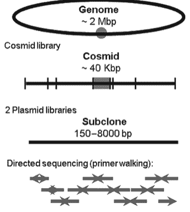

图 1.1 引物行走 DNA 测序策略概述。

## 全基因组散枪测序


图 1.2 散枪 DNA 测序策略概述。

这种方法增加了完成基因组的错误率，因为序列中单碱基的多次实例通常通过两条 DNA 链的测序得到最好的解决。散枪测序基因组的冗余度通常高于引物行走法，达到 8 到 10 倍，但有时报告的超过 20 倍。最终，所有尝试测序完整基因组的小组都采用了混合策略，基因组的大部分通过散枪测序完成，缺口通过一组大插入克隆来弥补。图是混合策略的概述。

这种方法产生的基因组序列成本比引物行走法低得多，因为只需要非常少的专用引物即可获得相同的序列准确性。通常，对于大小为 2 到 3 mega bp 的微生物基因组，需要弥补的缺口通过使用大插入库（如质粒体、丝粒体或噬菌体克隆）来开发，这可以有效地补充散枪测序的结果。今天

## DNA 测序策略 ■ 5

## 混合测序策略

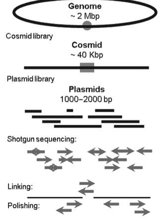

图 1.3 混合测序策略概述。

大部分已经是历史，由于二代测序技术取代了大部分。上述技术导致产生了数千个基因组，许多质量非常好（每 10,000 bp 或更少错误）。早期完整基因组为今天的测序实验提供了模板。

### 1.3 二代测序

最新的测序技术正在影响当前的 DNA 测序策略，并导致了生物化学和生物技术的新方法。正在开发两种主要的二代测序技术：读长约为 100 bp 的短读系统，以及平均读长至少为 300 bp、潜在读长达几碱基对的长读系统。目前正在探索许多不同的二代测序技术，其中 Illumina、SOLiD 和 Roche 454 测序方法领先。最新的测序技术不需要克隆 DNA，因此测序可以极大加速。单次运行可以产生数百万个读段，对于微生物基因组的散枪组装已经足够。

## 6 基因注释

到目前，包括人类基因组在内的数百个基因组已完全测序，数千个具有不同质量的基因组已完成，现在通常对完全的基因组不再感兴趣。与旧的毛细测序技术相比（人类基因组等量可以在 2012 年以前少于 $10,000 生成，并且很快可能少于 $1,000 生成），序列冗余可以大大增加到 30-40 倍甚至更高。这通常在微生物基因组的序列中只留下 20 到 50 个缺口，这些缺口可能或可能通过传统的引物策略关闭。通常，新的基因组序列与现有的完全基因组相似性足够，可以使用完全的基因组作为“脚架”来对齐新生成的序列。缺口数量很少意味着基因组中少于 1% 的基因未被完全注释。这对于几乎所有的基因组研究都是足够的。

正在开发的分析策略取代了老的分子生物学技术，包括 PCR 实验、DNA 制图技术和基因芯片。现在可以对生物的“总基因组”进行完全测序。对于人类情况，这意味着不仅生成人类染色体的 DNA 序列，还测序人体液（如血液和肠道）中所有含 DNA 的生物和病毒。人类的总 DNA 含量。

## 测序偏性与错误率

在我们看来，到为止还没有人类注释过“完全且无错误”的基因组序列。存在许多错误源，导致所有提交到公共数据库的 DNA 序列都有特定的错误率。通常，新序列的产生涉及许多单独步骤，从分离原始 DNA 到准备 DNA 测序，再到实际的测序操作，最后是组装。这可以通过同时使用至少两种测序来实现。目标应该是使用尽可能好的输入。这有助于消除每种测序技术引入的偏性。某些机器无法像处理低 GC（鸟嘌呤-胞嘧啶）含量片段那样处理高 GC 含量片段，某些机器在序列中的同聚物区域处出现问题，某些机器在测序过程中很大程度上丢失了准确性，导致最终碱基的准确率不超过 70%。在未来，短读段（约 100 bp）、DNA 片段两端产生的读段（双端测序）和极长读段（超过 1000 bp）的组合可能会成为从头测序（de novo sequencing）的主流，如果已经存在或类似的模板（例如人类基因组的情况）。

## DNA 测序策略 ■ 7

## 参考文献

- Florea, L., Souvorov, A., Kalbisch, T., Salzburg, S. 2011. 基因组组装对基因内容有重大影响：牛基因组组装中注释的比较。*PLoS One* 6:21400.
- Maxam, A.M., Gilbert, W. 1997. 一种测序 DNA的方法。*Proc. Natl. Sci. USA* 74(2):560–564.
- Meacham, F., Boffelli, D., Jahhabi, J., Martin, D.I., Singer, M., Pachter, L. 2011. 高通量测序数据系统性错误的识别与纠正。*BMC Bioinformatics* 21:2451.
- Sanger, F., Coulson, A.R. 1975. 通过引物合成确定 DNA 的方法。*J. Mol. Biol.* 94(3):441–448.
- Semple, C.A., Morris, S.W., Porteous, D.J., Evans, K.L. 2002. 人类染色体区域基因组序列组装的计算划分。*Genome Res.* 12:424–429.
- Venter, J.C., Smith, H.O., Hood, L. 1996. 基因组测序的新策略。*Nature* 381(6581):364–366.
- Hoss, W., Wienack, S., Groethus, D., et al. 1993. 通过引物行走进行自动化低冗余大规模 DNA 测序。*Biotechniques* 15:714–721.

## 编码序列预测

### 2.1 引言

基因结构预测是基因组注释的首要任务，因此人们在开发准确进行这些预测的方法方面投入了大量工作。蛋白质编码序列 (CDS) 的预测方法极其多样，其适用性取决于许多因素，例如生物物理参数（如 DNA 的鸟嘌呤-胞嘧啶 G+C 含量）、物种的进化位置、可用序列的类型和质量以及预期的新基因数量。在原核和真核生物中，编码序列的三大主要方法在很大程度上被取代：基因结构的统计建模和同源性建模。在真核生物中，额外的考虑因素是对预测的 CDS 进行可变剪接实例的预测。本文从算法设计或序列特征的角度讨论了每种方法，以提供适用于许多类型基因组数据的知识。鼓励读者查阅原始文献的引用，以了解软件实现这些方法的细节。

### 2.2 信使 RNA (mRNA) 的比对


由于 CDS 由其编码的蛋白质定义，而蛋白质是从信使 RNA (mRNA) 翻译而，因此 mRNA 转录本被认为是基因序列阐明的金标准。过去主要涉及对 mRNA 生成的 cDNA（所谓的表达序列标签 ESTs）进行 Sanger 测序。这在很大程度上是通过使用 454（焦光）测序实现的。454 测序生成的序列数据可以使用与 Sanger 序列类似的组装算法进行组装，因为它们的长度通常相似（在 300 到 500 bp 之间）。然而，由于量巨大，存在专门的组装软件包来处理涉及大量的 reads。受欢迎的软件包包括传统的 Phrap (`www.phrap.org`) 和 CAP3 (Huang and Madan, 1999)，高量的 MIRA (Chevreux et al., 2004) 和 SeqMan (`www.dnastar.com`) 组装包，以及 454 机器制造商提供的 Newbler (`www.454.com`)。另一种以极快速度著称的商业组装器是 CLE Bio 组装器 (`www.cldcenovo.com`)。

最近，样品制备的便利性和短读转录组测序（例如 Illumina RNA-Seq）的低成本使得有效揭示任何物种的转录组成为可能。通过 RNA-Seq 数据获得的覆盖深度大大增强了原核和真核生物的转录组学，证明了位点是差异表达的，在真核生物的情况下，它们的可变剪接情况远超通过生成 ESTs 的结果所知的。短读可以使用计算密集型软件组装成转录本，例如 ALLPATHS (Butler et al., 2008)、PEACE (Rao et al., 2010)、Trans-Abyss (Robertson et al., 2010) 或 SOAPDenovo (`soap.genomics.org.cn`) 和 Velvet/Oases (Zerbino and Birney, 2008) 组装包。虽然这些软件包最初是为了基因组组装设计的，但已经增强以处理转录组的可变覆盖（这在鸟枪法基因组测序中通常不是问题），如下文所述。

将短转录本组装成准确的全长编码序列的过程尚不是标准过程。由于各种因素导致转录本沿 read 覆盖率的变化以及转录本丰度的巨大差异，意味着从头组装（de novo assemblies）需要尝试并结合多次运行，使用不同的参数值以合理的计算成本同时捕捉丰富基因和低覆盖基因。

从头组装提供的价值在于它即使可以在没有基因组序列的情况下进行，并且可以自动识别剪接变体。如果转录本一致序列可以映射回基因组序列，外显子的边界就会变得清晰。

基因组/转录组组装器的列表在不断增长，因此最好参考在线论坛以学习最新的工具。最受欢迎的论坛之一是 SEQanswers.com。结合在邮件列表存档中搜索工具，大多数工具的适用性和参数化问题都可以得到快速回答。

一旦组装了代表 mRNA 的连续序列，就可以将它们与已有的参考基因组进行比对。通过使用双仿射型（double-affine，也称为内含子容性）比对算法 (Garber et al., 2011)，可以揭示基因的内含子-外显子结构。双仿射搜索对小间隔（插入、删除或测序错误）惩罚较高，对大间隔（内含子）惩罚较低。这促进了 cDNA 序列的正确比对。

跨内含子的比对可能会导致轻微的错位。例如，给定如下形式的比对：

```
CATTGTGGTACACGCTGCTGGAGAATGCATCCACTAGAAGCAACATCAGGATC
|||||||||||||||||||||||||||||||||||||||||||||||||||||||||
CATCTTGGTACACGGCGTGC---------------------------------------
ACATTCAAAAAAAAAAAAAAAAAAAAGAGAAGAAGAATTAGCAAGAAAGGCGTATGC
||||||||||||||||||||||||||||||||||||||||||||||||||||||||
----------------GCAAGAGGCGTATGC
```

该 read 也可以同样容易地比对到第一个外显子的第二个外显子起始处的 G 处，而不会干扰蛋白质翻译。这将保持在该研究物种中几乎是通例的剪接受体位点 AG。良好的软件应该考虑物种的优选剪接位点，以提供准确的比对。

或者，可以使用快速短读比对工具将短读段映射回基因组。虽然存在许多比对工具，但特别值得注意的是那些持续更新并支持流行的 SAM（序列比对/映射）文件格式进行 read 映射的工具，特别是 BFAST (Homer et al., 2009)、BowTie (Meaghed et al., 2009) 和 MosaicAligner (`http://code.google.com/pmosaik-aligner`)。短读比对工具的一个子类对于映射多个基因非常重要，是间隙比对工具，如 Burrows-Wheeler Aligner (Li and Durbin, 2010)、GEM split-mapper (`http://gemlibrary.sf-net`)、Karma (`http://genome.sph.umich.edu/wiki/Karma`) 和 TopHat (Trapnell et al., 2009)。跨内含子 read 映射器是一个较新的类别，映射的 reads 数量在不同程序之间可能很大。这些程序通常对所使用的输入参数非常敏感，并且在速度和准确性之间存在权衡。成熟的 mRNA 到基因组映射器（如 BLAT (Kent, 2002)）也可以使用，只要数据集足够小或处理时间不是关键因素。大多数将短读数据整合到基因预测和可视化中的现代工具都将 SAM 格式文件作为输入，因此也必须考虑这些其他 GB 级文件转换的需求。

将 reads 直接映射到基因组是简单的，只需考虑几个参数，如允许的错配数以及是否考虑碱基的质量值。例外是跨内含子 reads 和多拷贝基因。执行此类类型映射的软件工具对给定的参数非常敏感。命中“锚点”的长度应小于映射 reads 的长度，以便捕捉内含子。必须指定参数，如最小和最大内含子大小，以及是否存在非标准剪接位点。需要对该物种生物学可行性的背景知识，以最大化剪接读预测的准确性和相关性。

read 映射也是高度可并行的，因此几种短读比对工具已适应于计算机集群，并被称为云，在其中可以按小时租赁处理器时间。云计算的日益普及意味着即使是自己没有多少基础设施的个人研究人员也可以进行 分析。正如名称所示，用于映射的 CloudBurst (Schatz, 2009) 和用于从头组装的 Contrail (`http://contrail-bio.sf.net`) 是专门为使用云计算构建的。在某些情况下，使用 OpenMPI 并化库的工具可以无缝过渡到 Amazon EC2 云，正如已报告的那样。需要对所执行组装类型的资源需求有一定的了解；某些工具可以使用超过 30GB 的内存，并需要租用配备适当的机器的时间。

虽然这里提到了一些短读映射工具和基因预测工具，但这是一个不断发展的领域，目前正在产生许多新工具。此类工具的基准测试通过 rGASP 系列竞赛 (`www.sanger.ac.uk/PostGenomics/`) 进行。

encode/RGASP.html)。此项比赛的结果为每个程序的相对强度提供了一个良好的参考点。

虽然将短读段或组装的 mRNA 回比到基因组对于确定正确的内含子和显子边界非常有帮助，但这只是整个基因预测过程中的一个组成部分。这是因为(1) 不可能获得所有基因的全长 mRNA 序列；(2) 在某些物种中，转录本可能编码多个基因的操纵子；(3) 由于存在多个翻译框和影响翻译的因素，仅凭 mRNA 无法确定起始和终止密码子。因此，大多数基因预测软件通过基因特征序列的统计模型来补充转录信息。

## 2.3 统计模型

大多数从头（ initio）基因预测模型基于一种名为广义隐藏马尔可夫模型（GHMM）的数据结构。从概念上来说，它可以被看作一个图，节点代表基因表达中的事件，连接节点的箭头代表对序列的扫描，如图 2.1 所示。需要注意的是，预测程序中实际实际 GHMM 的状态（节点）和转移（箭头）比本示例多得多。

每个基因模型通过逐步扫描基因组序列的每个碱基来计算，寻找从一个状态转移到下一个状态的信号。在转录起始的情况下，寻找的信号并不一定是精确的字符串 GCCCTA，而可能是如 `(G/C) CCXTA` 这样的模式。（注意：G，鸟嘌呤；C，胞嘧啶；T，胸嘧啶；A，腺嘌呤；X，任何

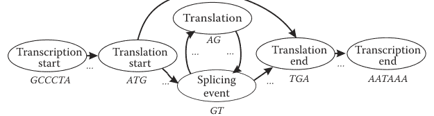

图 2.1 简单的广义隐藏马尔可夫模型，用于基因预测算法。模型的第一个节点消耗 DNA 序列直到找到预期的序列，图中的下一个节点消耗序列，此过程持续。基因的边界和特征由这些转移点定义。

单核苷酸。这些搜索模式的配置通过向预预测工具提供一组已知转录起始点的训练集来实现。同样，真实的密码子并不一定是遇到的第一个 ATG，因此已知全长编码序列的训练集可以有助于构建真实起始密码子周围 DNA 序列的模型。转录起始与翻译起始之间的序列可能也具有某些统计特征，内含子中 GT 和 AG 之间的序列也是如此。从训练数据集中得出的概率决定了后续预测的准确性。

基因特征在基因预测系统中通常以缩写形式称为。在本文介绍它们时，记住它们是值得的。统计模型可能包括接下来描述的特征，大致按基因组顺序排列。

### 2.3.1 5’ 非翻译区

5’ 非翻译区（5’ UTR）是转录起始位点与翻译起始密码子之间的区域。许多真基因预测预测可以利用用户识别的 5’ UTR 序列来训练它们的统计模型。当有足够的对齐 mRNA 或比对短读段，且通过蛋白质同源性已知起始密码子时，5’ UTR 的识别可以基于经验证据用于训练。5’ UTR 区域包含几个翻译信号，详见下文。转录因子结合位点的识别是一个复杂的问题。通常情况下，转录因子结合位点的位置并不用于辅助基因结构的预测。它们的发现和潜在用途将在第 3 章中进行讨论。

### 2.3.2 –35 信号

–35 信号位于原核生物起始密码子上游约 35 个碱基处。它可以用于辅助识别转录过程中起始复合物的正确结合位点。该信号具有共有序列 TTGACA（Rosenberg and Court, 1979），与其他原核 UTR 信号相比较弱，因此一个基因通常存在多个候选者。

### 2.3.3 B 识别元件

B 识别元件（BRE）存在于许多古菌和真核基因中（Qureshi and Jackson, 1998），位于 TATA 盒上游，由七个核苷酸组成。BRE 序列的前两个核苷酸是 G 或 C，随后是 G 或 A。最后四个核苷酸是 CGCC。转录因子 IIB (TIIB) 结合在 DNA 主沟的 BRE 。

### 2.3.4 TATA 盒

在原核生物中，TATA 盒被称为 Pribnow 盒或 -10 信号，因为它通常位于起始密码子上游 10 个碱基中心。尽管有 TATAAT 共有序列（Pribnow, 1975），但它并非通用。更重要的是该区域富含腺嘌呤和苏氨酸键。与 -35 信号一起，这些模式为转录起始提供了适用性。由于 -10 和 -35 信号长度短且变异性大，观察到多个候选起始位点是常见的，因此预测的模式及其假设位置主要用于支持而非定义编码序列的起始。

在真核生物中，TATA 盒只是可能的起始因子之一。核心启动子，如起始元件（Inr）、GC 盒或 CAAT 盒可以替换或增强真核 TATA 盒。其他针对特定基因和组织类型的起始元件由于其稀有性，通常不用于基因的统计预测。

### 2.3.5 核糖体结合位点

Shine–Dalgarno 序列（Shine and Dalgarno, 1975）代表原核生物中的核糖体结合位点（RBS），因此是翻译的起始。它通常位于起始密码子上游 8 个碱基内。在真核生物中，核糖体结合位点被称为 Kozak 序列（Kozak, 1986）。该位点不像原核生物那样有强共有序列，并且它重叠了起始密码子。由于这种重叠，起始密码子位于 +1，而 5' 碱基位置为 -1。共有序列随物种而异；因此需要训练数据集。

### 2.3.6 起始密码子

在真核生物中，该序列几乎无不是 ATG。在原核生物中，ATG 在大多数情况下是起始密码子（约 80%），但也按频率顺序使用 GTG 和 TTG。尽管某些物种的这些起始密码子存在异常或替换，但由于频率，没有基因预测系统会考虑它们。起始密码子的证据通常来自质谱数据或从测序，并在配置基因组分析流程时手动输入。

### 2.3.7 蛋白质编码

蛋白质编码序列（CDS）的确定一直是每个基因预测系统的核心。由于序列受到密码子表和产生蛋白质的限制，存在可以预测基因组中 CDS 区域的强信号。预测程序使用的 CDS 不同特征大致分为两类：碱基组成和密码子使用偏好。许多原核生物的碱基组成可预测基因组中的编码链，其中 A+G 含量超过 50% 的链通常是蛋白质编码实例（据我们所知只有逆录病毒除外）。异常的 GC 组成可用于过滤可能从另一个物种水平的基因以及转座元件。这些序列都不会遵循给定物种读取序列的一般统计分布。

对于真核生物，还建议根据 GC 含量将编码序列集分箱。原因是这些分箱中的序列在其他序列统计上表现出细微差异，如果不显式建模，会导致某些 CDS 的系统性漏报。这些百分比 GC 分箱（称为等基因岛）可以手动或通过某些程序定义，例如 IsoFinder（Oliver et al., 2004）。

即使不与已知蛋白质数据库对比，也可以某种程度上根据稀有密码子的低发生率来预测编码序列。这对于确定 CDS 的正确起始密码子特别有用，它是物种特异的。密码子适应指数（Sharp and Li, 1987）是另一种密码子使用的统计量，它捕捉了编码氨基酸的密码子的事实。

## 编码序列预测 ■ 17

氨基酸与其 5' 端紧邻的密码子高度相关。由于某些尚未完全清楚的原因，某些同义密码子对比其他密码子更常见，且其频率与翻译效率成反比。

给定一组特征良好且理想上已证编码序列训练集，可以使用基因预测工具在新序列中选择最拟合训练序列组成和密码子统计模型的读码框。对于原核生物，重要的是训练集应源于整个基因组，并且通常具有强烈的 GC 偏斜 [C+G]/(C–G)，这通常与复制起点相对应。

对于任何统计模型，都会出现假阳性和假阴性的命中结果。训练集越具有代表性，结果就越好。此外，被错误识别为 CDS 的假基因数量可能会很高。正因如此，通常会对多个信号特征进行加权并用于预测，而不是仅仅依赖序列统计。

### 2.3.8 供体剪接位

标准内含子以 GT开头并 AG 结尾。根据物种的不同，1% 到 2% 的剪接位可能偏离此模型，通常显示为 GC–AG 序列，或者更罕见的 AT–AC（Clark and Thanaraj, 2002）。大多数软件包假设内含子供体是 GT，因此不会报告非标准的剪接位点。通过将短读段或 mRNA 序列映射到基因组序列，可以识别出另一种，或所谓的隐性剪接供体位。供体和受体位点周围会发生组成偏向（Hertel, 2008）。基因预测软件可能会根据提供的初始基因模型训练数据考虑这一点。

### 2.3.9 内含子序列

内含子受体上游的区域通常富含 CT（所谓的多聚嘧啶链），即在受体上 20 到 50 个碱基之前处有一个腺嘌呤（内含子的分支点）。通常情况下，大多数内含子的碱基组成或密码子使用不符合 CDS 模型。在 CDS 训练集中准确识别内含子对于正确预测内含子至关重要。对于内含子保留或隐性剪接位，内含子的组成可能是不典型的，这降低了仅通过密码子使用或组成分析自动检测到它的概率。

### 2.3.10 受体剪接位

内含子的受体位点几乎总是 AG（除了之前提到的罕见 AC 外），隐性剪接受体位与隐性供体一样常见。受体后外显子的共识序列比供体位点常见。

### 2.3.11 终止密码子

三个“无义”或终止密码子是 TGA、TAG 和 TAA。该信号非常直接。在建立读码框之前该信号非常直接。一个罕见的异常是序列中的移码，这与复制起点对应。另一个异常发生在线粒体中，TGA 被用作色氨酸的密码子（Smith et al., 1999）。在叶绿体内，解码被用于识别解码的。越来越多的证据表明，解码在真核生物中的分布比以前认为的更广泛。这种解码被解码和基因组数据使用。

### 2.3.12 3’ 非翻译区

许多基因预测工具使用 3' 非翻译区来提高准确性。许多基因预测工具使用 3' 非翻译区来提高准确性。许多基因预测工具使用 3' 非翻译区来提高准确性。许多基因预测工具使用 3' 非翻译区来提高准确性。许多基因预测工具使用 3' 非翻译区来提高准确性。许多基因预测工具使用 3' 非翻译区来提高准确性。许多基因预测工具使用 3' 非翻译区来提高准确性。许多基因预测工具使用 3' 非翻译区来提高准确性。许多基因预测工具使用 3' 非翻译区来提高准确性。许多基因预测工具使用 3' 非翻译区来提高准确性。许多基因预测工具使用 3' 非翻译区来提高准确性。许多基因预测工具使用 3' 非翻译区来提高准确性。许多基因预测工具使用 3' 非翻译区来提高准确性。许多基因预测工具使用 3' 非翻译区来提高准确性。许多基因预测工具使用 3' 非翻译区来提高准确性。许多基因预测工具使用 3' 非翻译区来提高准确性。许多基因预测工具使用 3' 非翻译区来提高准确性。许多基因预测工具使用 3' 非翻译区来提高准确性。许多基因预测工具使用 3' 非翻译区来提高准确性。许多基因预测工具使用 3' 非翻译区来提高准确性。许多基因预测工具使用 3' 非翻译区来提高准确性。许多基因预测工具使用 3' 非翻译区来提高准确性。许多基因预测工具使用 3' 非翻译区来提高准确性。许多基因预测工具使用 3' 非翻译区来提高准确性。许多基因预测工具使用 3' 非翻译区来提高准确性。许多基因预测工具使用 3' 非翻译区来提高准确性。许多基因预测工具使用 3' 非翻译区来提高准确性。许多基因预测工具使用 3' 非翻译区来提高准确性。

### 2.3.13 终止子

在原核生物中，终止信号是一个发夹结构（也称为终止子）。在真核生物中，它不是发夹结构，而是 3' 非翻译区。

## 2.4.1 核苷酸同源

如果有相关物种的良好注释基因组，就可以利用该物种的基因模型。

## 2.4.2 蛋白质同源

纯蛋白质同源性方法在基因预测中非常流行，仅是因为公共领域有大量的蛋白质数据。即使亲缘物种已经有了全基因组，人们也可以预计新生物的大部分基因与已知基因具有同源性。

重排、基因重复或缺失、倒位以及独特 DNA 的插入。

内框终止密码子的选择可以通过与*从头开始*(ab initio)*预测相同的技术支持：稀有密码子的缺失以及 -35 和 -10 信号的存在。


在真核生物中，需要双仿射搜索（double-affine search）。蛋白质与基因组的双仿射搜索参数化比人工 mRNA 到基因组的比对更为微妙。这是由于蛋白质进化会导致蛋白质对齐不可避免地产生小空隙，而较大的空隙则代表内子。这些空隙的数量和大小取决于同源基因的进化距离以及该物种的特征内子大小。智能对齐工具会尝试在基因组序列的受体位点和供体位点引入长（不惩罚）空隙。一个更进一步的对齐工具是 `GeneWise` (`Birney et al., 2004`)。`GeneWise` 将两对匹配算法与类似于`从头开始`预测器的马尔可夫模型相结合，帮助将内子正确对齐到序列中。这在蛋白质同源性较弱时特别有用，因为它为长空隙的插入产生了模糊的选择。

某些对齐工具（包括 `GeneWise`）会提供全局或局部比对的选项。如果确定基因结构的唯一来源是蛋白质同源性，那么全局比对可以确保整个蛋白质被正确建模。如果存在外显子结构的其他来源（例如短读段），局部比对可以帮助转移蛋白质结构域信息，而不仅仅是将由于移码产生的更严格的基因正源物信息转移到公共数据库中。补偿基因组组装错误的蛋白质比对工具在阐明基因结构时也会表现更好。

另一个考虑因素是用于蛋白质级匹配的相似性矩阵。默认情况下，大多数搜索方法使用 `BLOSUM62` 矩阵 (`Henikoff and Henikoff, 1992`)，该矩阵对各种氨基酸之间的替换较为宽松，可将其视为“匹配”。如果数据库包含关系较密的物种，可以使用 `BLOSUM80` 或 `BLOSUM90` 矩阵生成更好的比对和统计结果。正如第 7 章进一步解释的，较高的数字对氨基酸替换更为严格。

关于蛋白质同源性搜索的另一个注意事项是所用蛋白质数据库的质量。随着下一代 DNA 测序技术导致物种数量爆炸式增长，不可避免地导致质量较差的基因模型被提交并被数据库接受，特别是像 `GenBank` 这样的公共数据仓库（提交者对数据库提交的质量负全责任），由于没有或没有花时间手动检查自动方法在序列中预测的每个基因的证据。虽然这一注意事项在功能基因组注释中广为人知（本章稍后部分将讨论），但由于组装错误导致的嵌合真核基因数量则较少为人知，即在注释中两个或多个相邻基因被融合到一个基因模型中。这个问题可能由基因组组装流水线的配置错误引起。另一个原因可能是许多基因组区域剪接位点与起始-终止模式之间的统计差异。为了应对将某些基因结构带入相关基因组的风险，考虑所有显著的蛋白质匹配而不仅仅是数据库搜索工具输出中的顶部结果结果。

## 2.4.3 结构域同源性

与蛋白质同源性泛领域相关的是更微妙的技术，称为结构域搜索（domain search）。当基因查询与已知基因仅关系较远时，这些搜索的结果比蛋白质同源性搜索提供更好的统计匹配。在结构域搜索中，搜索对象是一组隐隐马尔可夫模型（HMMs），如 `Pfam` 或整个 `InterPro` 数据库的内容 (`Hunter et al., 2009`)。在这些模型中，蛋白质家族由矩阵表示，结构域中每个位置都有单独氨基酸替换率。这与使用 `BLOSUM` 矩阵的双对蛋白质搜索不同，后者基于替换率在整个蛋白质中相同的假设。位置特异性搜索的优势在于它能更准确地反映特定蛋白质家族的进化历史，且匹配统计将优于对该家族中每个单独成员的双对搜索。当然，在搜索真核序列时，需要双仿射搜索。

关于结构域搜索的两个注意事项是部分匹配和虚假提示。部分匹配意味着在真核生物中，结构域搜索不太阐明基因的整个结构，因为大多数蛋白质结构域只覆盖基因总长度的一部分。例如，`Pfam` 中的 ATP 结合盒蛋白 (`ABC`) 蛋白质结构域匹配通常只覆盖基因的 60%，这使得比对可能漏掉外显子（外显子专门覆盖剩余的 40% 序列）。因此，结构域匹配是补充而非替代蛋白质级搜索。如果基因组的小部分与蛋白质结构域的高度保守区域匹配，尽管整体相似性较低，也会发生虚假匹配。因此，建议判断结构域命中不仅要使用 E 值（期望值），还要考虑结构域长度的覆盖百分比。

## 2.5 结合基因预测

另一类基因预测程序是将多个预测工具的证据结合为一个共识结果的程序。这些大多数是真核生物预测工具，可以分为两类：显式评分和自动评分。对于显式评分，用户提供其偏好作为输入，以加权/排名证据，这些证据来自多个来源，例如人工策化、`从头开始`预测工具、启动子搜索以及来自 EST 等信息。示例包括 `AUGUSTUS` (`Stanke et al., 2006`)、`JIGSAW` (`Allen and Salzburg, 2005`)、`Eugene` (`Foissac et al., 2008`) 和 `Gene` (`Blanc and April, 2009`)。这些程序通常需要一个训练阶段，在此期间会创建一个投票系统、决策树或权重矩阵。这种方法的优势是评分系统相对透明，并且可以由引擎进行调整。另一方面，自动评分系统通常很少或不需要训练，依赖机器学习技术通过动态规划或支持向量机等来优化权重。使用这些工具的权衡是评分系统对用户端相对不透明，使得如果结果不符合预期，调整结果将更加困难。此类程序包括 `mGene` (`Schweikert et al., 2009`)、`GeneMark` (`Ter-Hovhanniyan et al., 2008`)、`Evigan` (`Liu et al., 2008`) 和 `fgene` (`www.software.com`)。

通常，采用多个工具的共识预测方法比所使用的任何单个基因预测程序都准确。文献中引用的准确性主要指标是 `Sn`（敏感性，或 1 – 假阴性率）和 `Sp`（特异性，或 1 – 假阳性率），通常平均为整体准确性测量。比较预测工具性能的表格可能会令人困惑，因为这些指标可以在核苷酸、外显子和转录本水平上计算（按准确性降序）。为了获得最佳结果，人工策化基因模型仍然必要的，因为要捕捉底层知识非常困难，预测案例研究将在第 11 章探讨。

## 2.6 剪接变异

对于许多真核基因，事实上并不只有一个正确的结构，而是多个版本都是真实的，至少由于变异。剪接事件的大类包括（按频率降序）跳过的外显子、可选供体和受体、内子保留和新内子。许多基因预测程序可用于生成替代转录本模型，其中某些将对应真实的剪接变异。变异模型的验证（与主模型一样）涉及将 mRNA 数据映射到基因组。传统上这是使用 EST 序列完成的。为了提高轨迹覆盖深度以发现稀有的剪接事件，可以将相关物种的 EST 映射到目标基因组，当基因高度保守时。这种变异的解析现在可以通过将短代测序 mRNA 数据映射到基因组得到极大增强。

跳过的外显子分为两大类：内部和外部的。跳过的外显子会导致蛋白质在 N 端或 C 端被截断，有时蛋白质翻译保持不变，只有 UTR 受到影响。图 2.2 说明了两个程序在基因结构上的分歧，但两者都可能是正确的。`GeneMark` 捕捉了跳过外显子的基因形式（终止密码通常是内子）。`AUGUSTUS` 识别了包含外显子的更常见形式。可选的剪接供体和受体产生较短或较长的蛋白质版本，有时差异巨大，因为不同剪接位点导致阅读框变化。对于跳过的内部外显子情况也是如此，如果它们的长度不是 3 的倍数。可选的受体和供体是由有效的内子结构引起的，剪接体可以移除它们。虽然已知剪接抑制蛋白，但在各种环境下偏好剪接某一种形式的完整机制尚未被完全理解。有时，可选剪接外显子与跳过外显子之间的区分可能是困难的。图 2.3 显示了基因的两种形式。一种由具有供体位点 A 的外显子 x 和外显子 y 组成，但 y 从剪接 C 开始。另一种由 x，随后是跨越剪接位点 B 到 D 的 y，然后是从 E 开始的外显子 z 组成。


图 2.2 映射到基因组的拼接读取的 GBrowse 视图。`AUGUSTUS` 根据读取结果预测了一个额外的 3' 外显子，但 `GeneMark` 也有一些读取支持内含子早期基因终止（跳过的外显子）。

`ab initio` 预测器识别出了强受体位点（C）和供体位点（D），但未能确定它们属于不同的剪接变体。`z` 的较长形式应该被视为具有跳过外显子 `y` 的剪接变体，还是内含子保留？这种区别仅仅是标记的问题。

当剪接机制设计上未能移除内含子序列时，就会发生内含子保留。这些内含子的长度通常是三倍数，这样后续外显子的阅读框就不会受到内含子翻译的干扰。图 2.4 显示了一个两种变体表达量大致相同的案例，但只有 `ab initio` 模型 `AUGUSTUS` 和 `GeneMark` 预测了其中一种。

新内含子和保留内含子之间的区别主要是视角问题。如果最丰富的 mRNA 包含内含子，那么其他版本就是保留的。如果将该序列视为 mRNA 的一部分更为常见，那么它的跳过就使其成为一个新内含子。

| X | | z |

|---|---|---|

| X | | z |

| exon: 使用 RNA 读取进行基因预测 | | | |

| exon: 亨廷顿舞蹈 H1852 蛋白 | y | z |

| | A B | C D | E |

图 2.3 基因的可变外显子结构。基因存在两种可能的剪接形式（顶部）。显示了映射到基因组的拼接读取的 GBrowse 视图（底部），上方的 `ab initio` 预测错误地捕捉了 (C–D)，即两种可变剪接形式的受体和供体。

在某些情况下，基因的可变剪接形式会产生所谓的无义转录，这些转录永远不会翻译成蛋白质。剪接变体蛋白质表达的最终验证可以通过绿色荧光蛋白 (`GFP`) 融合、质谱法以及其他各种手段来实现。某些变体仅在非常特定的条件下表达的事实使得这一确认步骤变得更加困难。


映射读取

带有 RNA 提示的 Augustus 基因预测

GenMark HMM 预测

UTL. g

图 2.4 映射读取和基因预测的 GBrowse 视图。显然，内含子在某些转录本版本中被保留了，正如来自 `AUGUSTUS` 和 `GenMark` 预测内含子中的大量未拼接读取所证明的那样。

- 1000 Genomes Project Consortium. 2010. 基于群体规模测序的人类基因组变异图。Nature 467:1061–1073.

- Allen, J.E., Salzberg, S.L. 2005. JIGSAW: 基因预测的多源证据整合。 Bioinformatics, 21(18):3596–3603.

- Altschul, S.F., Madden, T.L., Schäfer, A., et al. 1997. Gapped BLAST 和 BLAST: 新一代数据库搜索程序。Nucleic Acids Res 25(17):3389–3402.

- An, J., Gharami, K., Liao, G., et al. 2008. 3’ UTR BDNF mRNA 在海马神经元形态和突触塑性中的独特作用。Cell 134(1):175–187.

- Arumagai, M., Wei, C., Brown, R., Brent, M.R. 2006. Pairon+N-SCAN_EST: 基于模型的基因注释流水线。Genome Biol. 7(Suppl. 1):S5.

- Beaudoing, E., Freier, S., Wyatt, J.R., Claverie, J.M., Gutheret, D. 2000. 人类基因中变异多聚腺酰化信号的使用模式。Genome Res. 10:1001–1010.

- Birney, E., Clamp, M., Durbin, R. 2004. GeneWise 和基因组级。Genome Res. 14(5):988–995.

- Blanco, E., April, J.F. 2009. 使用 Geneid 在新基因组组装中计算基因组注释。Methods Mol. Biol. 537:243–261.

- Butler, J., MacCallum, I., Kleber, M., et al. 2008. ALLPATHS: 全基因组鸟枪法微读取的从组装。Genome Res. 18(5):810–820.

- Chevreux, B., Pfisterer, T., Drescher, B., et al. 2004. 使用 miraEST 组装器对测序 EST 进行可靠且更新的 mRNA 转录本组装和 SNP 检测。Genome Res. 14(6):1147–1159.

- Clark, F., Tanaraj, T.A. 2002. 人类转录本确认和交替剪接内含子及外显子的分类与表征。Hum. Mol. Gen. 11:451–464.

- Coin, L., Durbin, R. 2004. 假基因的鉴定。Bioinformatics 20(Supp.1):94–i100.

- Garber, M., Grabherr, M., Guttman, M., Trapnell, C. 2011. 使用 RNA-seq 进行转录本注释和定量。Nat. Methods 8:469–477.

- Henikoff, S., Henikoff, J.G. 1992. 来自蛋白的氨基酸矩阵。Proc. Natl. Sci. 89(22):10915–10919.

- Hertel, K. J. 2008. 外显子的组合控制。J. Biol. Chem. 283:2211–2215.

- Homer, N., Verman, M., Nelson, S. 2009. 用于基因组测序的 BAST。PLoS 4(11):e767.

- Huang, X., Madan, A. 1999. CAP: DNA 序列组装。Genome Res. 9:868–877.

- Hunter, S., Apweiler, R., Attwood, T.K., et al. 2009. InterPro: 蛋白质签名数据库。Nucleic Acids Res 37(Database issue):D211–D215.

- Iceli, J., Congnel, C.V., Bücher, P. 1999. ESTScan: 检测、评估和重建 EST 中编码区的程序。Proc. Int. Conf. Syst. Mol. Biol. 138–148.

- Jacobs, G., Chen, A., Stevens, S.G., et al. 2009. TransBase: 辅助分析 mRNA 调节序列的数据库。Nucleic Acids Res 37(Database issue):D72–D76.

- Kent, W. 2002. BLAST—类 BLAST 比对工具。Genome Res. 12(4):656–664.

- Kozak, M. 1986. 序列 AUG 密码调节翻译。Cell 44(2):283–292.

- Langmead, B., Trapnell, C., Salzberg, S. 2009. TopHat: 使用 RNA-seq 发现剪接位点。 Bioinformatics 25(9):1105–1111.

- Li, H., Zien, A. 2010. 使用 Burrows-Wheeler 变换进行快速比对。Genome Res. 19(11):2133–2143.

- Liu, Q., Mackey, A., Roos, J. 2008. Megate: 基于 SVM 的准确基因预测。 Bioinformatics 24(5):597–605.

- Oliver, J., Congnel, C.V., Bücher, P. 1999. ESTScan: 检测、评估和重建 EST 中编码区的程序。Proc. Int. Conf. Syst. Mol. Biol. 138–148.

- Qureshi, A., Jackson, S., Hayes, A. 1998. 细菌核糖体的密码子特异性。Nature 254(5495):34–38.

- Rao, G., Chiu, M., Liang, Y. 2010. RNA-seq 数据的从组装。Methods 7(11):909–912.

- Rosenberg, M. 2007. 参与 RNA 过程和终止的调节序列。Annu. Rev. Genet. 13:319–353.

- Schatz, M., Durbin, R. 2009. CloudBurst: 使用 MapReduce 高敏感比对。 Bioinformatics 25(1):1363–1369.

- Schurr, T., Nadir, E., Margalit, H. 1993. 通过自由能计算核糖体结合位点的保守性。Nucleic Acids Res 21:409–423.

- Schweigbert, G., Zeller, A., Kelly, G. 2009. Megate: 应用于线虫基因组的基于 SVM 的准确基因发现。Genome Res. 18(12):1979–1990.

- Sharp, M., Li, W.H. 1987. 密码子适应指数——同义密码子使用偏好的衡量标准及其潜在应用。Nucleic Acids Res 15:1281–1295.

- Shine, J., Dargo, I., Hayes, A., Waack, S., Morgenstern, B. 2006. 细菌核糖体的密码子特异性。Nature 254(5495):34–38.

- Stanke, M., Keller, O., Gunduz, I., Waack, S. 2006. AUGUSTUS: 变异转录本的新从预测。Nucleic Res 34(Web Server issue):W435–W439.

- Ter-Hhovnian, V., Lomsadze, A., Chernoff, Y.O., Borodovsky, M. 2008. 使用带有无监督训练的 ab算法在新型真菌基因组中进行基因预测。Genome Res. 18(12):1979–1990.

- Trapnell, C., Pachter, L., Salzberg, S.L. 2009. TopHat: 使用 RNA-seq 发现剪接位点。 Bioinformatics 25(9):1105–1111.

- Unniraman, S., Prakash, R., Nagaraja, V. 2002. 真细菌转录的保守性。Nucleic Acids Res 30(3):675–684.


- `Zerbino, D.R., Birney, E.` 2008. Velvet: 使用 Bruijn 图短读从组装的算法。Genome Res. 18(5):821–829.

## 第3章

## 基因之间

### 3.1 引言

在基因组研究的大部分历史中，人类及其他生物基因组中大多数不编码蛋白质的序列被标记为“垃圾 DNA”。除了像结构性 RNA 基因（如 `tRNA` 编码区）以及转录因子结合位点等明显的例外外，这些无法翻译成蛋白质的巨大基因组信息无法赋予任何功能，而且它们还具有高度的重复性，进一步降低了其信息潜力。然而，随着人类基因组的阐明，人们逐渐发现高等动物的基因数量并不比植物等进化程度较低的生物得多。在标记为“垃圾 DNA”的区域发现的新类 RNA 帮助揭示新的基因调节机制。今天，我们知道高等生物的基因组复杂性不仅仅仅取决于基因结构，还取决于转录因子、剪接因子、调控 RNA、`DNA` 甲基化和染色质重组以及可能尚未发现的其他机制之间复杂的相互作用。因此，如果不对“基因之间”的基因组区域进行彻底表征，基因组注释就不能认为是完整的。

### 3.2 转录因子

转录因子（`TFs`）通常是调节蛋白，它们单独结合基因组 `DNA` 或与其他蛋白结合，用以增强或抑制基因转录的速率。这些增强或抑制活动也可以以级联的方式运行，分别极大放大或消除特定基因组的转录，或严格维持转录稳态。转录因子与基因组 `DNA` 的结合是复杂的，取决于蛋白复合物的三维结构，以及基因组转录因子结合位点（`TFBS`，也称为响应元件）的空间位阻和生物化学特性。主导这些相互作用的静电力和范德华力倾向于允许 `TF` 识别几种 `DNA` 序列变异体，而被识别序列的通用方案被称为 `TFBS` 基序（`motif`）。更重要的是，仅凭 `TFBS` 基序的存在本身并不足以断定一个基因受到特定转录因子的调控。为了减少假阳性 `TF` 预测的数量，应该综合考虑匹配评分、假定 `TFBS` 的位置、序列邻近区域以及跨物种的 `TFBS` 保守性。

#### 3.2.1 转录因子结合位点 (`TFBS`) 基序

由于任何 `TF` 都可以结合到多个相似的 `DNA` 序列，识别基序在计算上通常表示为位置特异性权重矩阵。给定特定 `TF` 的实验确认的 `TFBS` 集合，这些序列被对齐以形成一个侧向于保守核苷酸位置的权重矩阵。例如，图 3.1 显示了 `CREBI` 转录因子已知结合位点的对齐（Bartsch et al., 1998）。下方是基于加权矩阵列和的位置特异性矩阵权重，被称为 `WebLogo`（Crooks et al., 2004）。直观上，标签的高度与其在扫描的基因组序列中实现基序匹配的重要性成正比。

经过验证的 `TFBS` 序列、其对齐情况以及保留列的选择对最终矩阵都有任何影响。图 3.1 代表了 `JASPAR` 数据库中 `CREBI` `TF` 的这些选择（Sandelin and Wasserman, 2004）。`JASPAR` 是最流行的、完全公开的真核生物 `TF` 权重评分矩阵数据库。许多 `TFBS` 取自真核生物启动子数据库（Schmid et al., 2006），该数据库记录了经实验验证的元件。`PAZER` 网站（Portales-Casmar et al., 2007）也充当了 `TF` 信息的聚合门户。`TransFac` 数据库（Matys et al., 2006）既有公共版本（自2005年后未更新）也有商业版本，后者包含了更多矩阵，这些大多基于文献挖掘。`MatBase`（Genomatix Software GmbH, 德国慕尼黑）是一个商业数据库，也包含许多 `TF` 评分矩阵，这些也基于深度的文献挖掘。

```
agatctttgccatgg
agatctcggcatgg
agttagttcatgg
agatatacgccatg
ccatatggggatct
agatctagagcatgg
10 other validated TFBSs...
```

CTTCGTGACGTT

GGCAGTCACGTGA

AGCTTTGACGTA

CTTGATGACGCA

CCCGCTACGTA

CGTAGTGACGTCTC


```

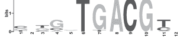

如果 TF注释对于特定的基因组项目至关重要，则不应低估商业数据集更大的深度。在订阅 MatInspector 软件库时，可以搜索 MatBase（Cartharius et al., 2005）。可以使用 TOUCAN（Aerts et al., 2005）或类似的软件搜索 JASPAR。TOUCAN 的优势在于还整合了小型物种特有的矩阵库。

TF 匹配可能会产生许多假阳性。减少匹配数量的一种简单方法是将使用的矩阵库限制为仅适用于。例如，大多数搜索工具允许用户仅搜索矩阵子集，例如植物 TF 矩阵。来自 TF 矩阵到基因组匹配的一些统计数据也有助于注释者排除可能的假阳性。首先，任何搜索工具都会为匹配生成一个原始分（M）。

它还会分配一个 p 值矩阵匹配，表示随机发现 M 的概率。较低的 $p$ 值越可能具有显著性。

$p$ 值基于对查询中核苷酸背景频率的一些（也许有时是不正确的）假设。通过对随机样本序列使用相同的矩阵进行搜索，并确定与原始分 M 一优的匹配频率，可以获得更准确的 $p$ 值。在基因组注释的情况下，随机样本将来自所有已知非翻译区（UTRs）。即使具有准确的匹配 $p$ 值，由于仅仅因为除了序列识别之外的许多其他因素可能影响 TF 结合，也不能假设其具有功能。

### 3.2.2 TFBS 位置
转录因子基于与细胞转录机器的相互作用产生转录调节。这意味着 TFBS 通常位于转录起始位点附近（近端 TFBS），或者通过基因组 DNA 的三维折叠靠近起始位点（远端 TFBS）。在大多数近端 TFBS 中有许多“基于位置的线索”，有助于它们的正确识别。首先，通过将 mRNA 数据映射到基因组已知转录起始位点（TSS）（见第2章）。这在进行深度短读测序的地方尤为如此。大多数近端 TFBS 倾向于位于该位点上下100个碱基内（Xie et al., 2005）。此外，由于广泛的 DNA 甲基化，TFBS 倾向于富含胞啶和鸟嘌呤。因此，当 TSS 的实际位置未知时，靠近约 200 bp 的鸟嘌呤区域（也称为 CpG 岛）可以作为矩阵匹配找到真实 TFBS 的线索。CpG 岛是 DNA 甲基化的热点，这是另一层转录控制（见第4章）。

CpG 岛的位置通常在起始密码子 1000 bp 以内（Shimizu et al., 1997），然而，正确的起始密码子预测（见第2章）对于可能的 TFBS 注释也同样重要。因此，具有多个真实起始密码子的基因（基因异构体）可能具有多组 TFBS 预测。

### 3.2.3 TFBS 邻域
转录因子可能与转录辅助因子协同作用，以实现对某些基因转录的特定激活或抑制。在这种情况下，预计发现特定的组合

位于相应基因相对较小的 5’ 区域内的 TFBS。存在多种软件工具，可以在给定已知辅助因子组合（也称为顺式调控模块或 CRMs）的情况下，用于执行此类搜索。例如，Comet（Frith et al., 2002）使用用户选择的 TRANSFAC 匹配共现的联合概率，为最可能的 TFBS 生成一个期望 值（e-value）。此类及类似程序的困难在于，基序（motif）的检测高度依赖于输入参数的选择，例如 TFBS 之间的预期间隙，以及序列背景特征等因素。Cluster-Buster（Frith et al., 2003）提供了一个参数优化脚本，可以帮助减轻终端用户注释 TFBS 的负担。RSAT（Thomas-Chollier et al., 2008） 使用了独特的统计方法，例如自适应背景模型和 p 值的马尔可夫链估计。在大多数情况下，用户必须预先选择较小的 TFBS 矩阵列表进行扫描。相比之下，TOUCAN 包含了发现基因组中任何 TFBS 过度表组合的能力，通过运行内置的 MotifScanner+Statistics 工具来从头发现（de novo）辅助因子，随后可以使用 MotifSearch CisModule（Zhou and Wong, 2004）在没有参考 TFBS 数据集的情况下检测模块，但是这种方法可能会产生假阳性。

### 3.2.4 TFBS 保守

鉴于转录因子对基因表达正常调控的重要性，理认为 TFBS 在亲缘关系物种之间应该是保守的。尽管识别位点的序列变异可能会增加任务难度，但其保守率仍然高于一般的 5’ UTR 保守率。EEL（Hallikas et al., 2006）是一种流行的 CRM 扫描器，它利用这种速率差异，仅对包含 TFBS 基序的物种片段（按基因组顺序）进行对齐。oPOSSUM（Ho Sui et al., 2007）也可以利用跨物种保守性检测预计算的物种对，例如秀线虫（Caenorhabditis elegans）和巴西秀线虫（Caenorhabditis brasca），或人类和小鼠基因组。

TFBS 的从头检测可以分为两大类：种内挖掘和跨物种挖掘。种内挖掘依赖这样一个事实：一个转录因子可能被用于调节多个基因，因此在多个基因的上游可能会发现相似的 TFBS。用于检测重复基序的经典软件是 MEME 套件（Bailey et al., 2009）。基序发现的基本技术需要生成一组序列，这些序列被假设由同一个转录因子共同调节。Weeder（Pavesi et al., 2004）更专门地针对 TFBS，并根据自动扫描具有不同参数的许多可能相互作用提供统计“建议”。*De novo*发现 TFBS 在原核基因组注释或低等真核生物中可能尤为重要，因为大多数现有的数据库偏向于真核生物模型。

这些从头算法的计算强度使得它们目前在全基因组 TFBS 预测中是不切行的，但可以使用其他数据源来缩小搜索范围。特别是，染色质免疫沉淀测序（ChIP-Seq）数据可以作为多种 TFBS发现工具的额外输入。Hybrid Sampler (HMS (Hu et al., 2010)) 可用于搜索具有高 ChIP 序深度的区域（即缺乏染色质的区域），并考虑簇基序的相互依赖性。ChIPMunk（Kulakovskiy et al., 2010）使用 ChIP-Seq 数据加上新的基序启发式算法，大幅缩短了计算时间但产生的结果与 HMS 的性能相似。从全基因组的角度来看，这优于基序搜索（Conlon et al., 2003），后者的增加的预测能力仅限于与给定实验条件相关的转录因子。

利用物种间的保守性进行 *de novo* 序列预测被称为系统发育足迹（phylogenetic footprinting）。Sandelin 等人（2004）是实现跨物种 TFBS 过滤的主要工具之一。包括 ConSite 在内的大多数工具都依赖于用户提供同源基因的准确映射制图作为输入，因此，准确的基因结构建模（见第 2 章）是此类分析的前提。

## 3.3 RNA

核糖核核酸（RNA）多年来一直认为是 DNA 的表兄弟。虽然基因组 DNA 载有生命的蓝图，但 RNA 被认为是细胞的单一信使和结构成分。除了这些传统角色外，对 RNA-RNA 和 RNA-DNA 之间序列特异性相互作用的测量揭示了真核生物中以及在古菌中较复杂的遗传调节机制。尽管我们目前对 RNA 相互作用伙伴的知识尚不完整，但描述的计算工具对于预测相关的特定 RNA 序列应大部分适用。涵盖大多数类别的已知非编码 RNA 的综合数据库是 Rfam（Gardner et al., 2011）。

### 3.3.1 核糖体 RNA

核糖体 RNA（rRNA）基因是核糖体的结构在。它们在生命分支基因组中可能被编码多次。通常，rRNA 序列显示出高 G+C 含量（约 65%）。RNA 基因的分布和总数取决于研究的生命分支。它们根据沉降特性命名（S 或 Svedberg 单位）。在原核生物中，三种 rRNA（5S、16S 和 23S）通常组织在一个操纵子上（共同转录）。鉴定 16S rRNA序列对于预测核糖体结合位点结构至关重要（见第 2 章）。在真核生物中，四种 rRNA（5S、8S、18S 和 28S）通常以多个拷贝形式存在。5S 位于由 RNA 聚合酶 III 转录的位置。18S 和 28S 之间被称为内部转录间隔区（ITS）。ITS 序列常用于亲缘关系物种的系统发育指纹，因此受到研究人员关注。几乎所有真核生物也包含线粒体基因。 rRNA 序列并不反映核糖体的结构元件，因为前体分子在转录后会经历切割和核苷酸修饰。或者，可以使用序列同源性识别 rRNA 基因。

### 3.3.2 转运 RNA

转运 RNA（tRNA）是一种约为 76 bp 的 RNA 分子，负责在蛋白质合成将氨基酸连接到肽链末端。每个 DNA 密码子都有自己的 tRNA，但第三密码碱基的“漂移”允许生物拥有少于 61 个（终止密码子）的 tRNA。在原核生物中，每个 tRNA 通常有一个拷贝，而在某些高等真核生物中可能存在数百个拷贝。tRNA 具有典型的二级结构，如图3.2 所示，因此 tRNA 预测算法主要基于寻找这种二级结构的序列段。折叠自由能计算是预测这些结构的常用方法，但由于非规范碱基对的影响变得复杂。

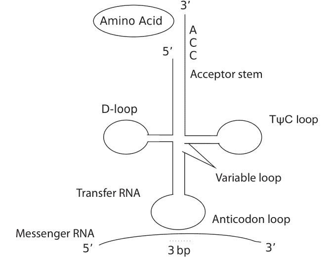

图 3.2 转运 RNA 的标准二维结构图，带有一个交叉的柄、环和凸起，位于受体环中。另一种预期的序列特征（在真核生物中）是位于起始处一半处的 RNA 聚合 III 结合位点。成熟的 tRNA 衍生自 pre-tRNA 序列，这些序列位于基因组中。这种修改既有助于辅助预测过程。有利方面，pre-tRNA 转录本由四个或多个胸腺酸终止。不利方面，pre-tRNA 可能包含内子。细菌中的内子通常是自剪切核酶。在古菌中，内子包含凸起-螺旋-环（BHB）二级结构，它由剪切酶识别。这种长度可能在 11 到 175 bp 之间的基序可以发生在 pre-tRNA 的任何位置。某些 tRNA 可能包含 BHB 基序，但通常在反密码子旁有一个内子，由真核生物剪切酶识别。BHB 基序共识具有特定性且差异很大，因此许多预测程序将输入的分类划分作为参数。经典的基因组 tRNA 预测工具是 tRNAScan（Lowe and Eddy, 1997）。

(Laslett and Canbäck, 2004) 利用与现有 tRNA 的同源性以及启发式算法来检测 tRNA 和转运-信息 RNA（细菌中的 tRNA 类结构，其包含一个可以有效截断蛋白质合成的内部开放阅读框）。

所谓“分裂型 tRNA”（split tRNAs）的发现，要求为古菌创建新的 tRNA 搜索算法。分裂型 tRNA 由两部分组成，随后合并成成熟的先-tRNA。这两个部分位于基因组中物理分离的不同位置，并独立进行转录。侧翼完全互补的 G+C 富序列（分别位于第一部分的 3' 端和第二部分的 5' 端）结合形成一个类似于 BHB 的基序，该基序随后像典型的 tRNA 内含子一样被切除。SPLITS (Sugahara et al., 2006) 能够检测可能的分裂型和包含 BHB 的 tRNA，移除中间序列，然后执行标准的 tRNAScan 以进行最终预测。

最近，在古菌和细菌中发现了“置换型 tRNA”（permuted tRNAs），其 tRNA 的第一部分和第二部分之间反转了7 到 74 个中间碱基。这些先-tRNA 形成环形分子，并在反密码子附近被切割以形成成熟的 tRNA。分裂型和置换型 tRNA 可以使用改进版本的 tRNAScan (Chan et al., 2011) 进行检测。

线粒体 tRNA 往往不遵循经典的交叉结构，因此会被传统的 tRNA 扫描器漏掉。ARWEN 软件包 (Laslett and Canbäck, 2004) 专门设计用于检测这些异常的基因结构。虽然经典的 tRNA 结构相对严格，但在进行 tRNA 注释时，必须考虑真核中存在大量的伪 tRNA 基因。反密码子是否已经由基因组中另一个评分更高的预测结果覆盖？某些物种可能具有分裂型或置换型 tRNA，但这些尚未被广泛搜索。

### 3.3.3 小核仁 RNA

核仁 RNA（snoRNAs）引导其他 RNA 序列（主要是核糖 RNA）的化学修饰。snoRNA 的 RNA 目标基于 snoRNA 序列中11 到 20 bp 识别模式的互补性。根据折叠模式，snoRNAs 分为两大类：H/ACA 或 C/D 盒。H/ACA sno 的长度从 70 到 250 个碱基不等，其特征是多三个螺旋-内部环-螺旋顶端环单元。图 3.3 显示了其中一个单元的结构。由于目标 RNA 穿过

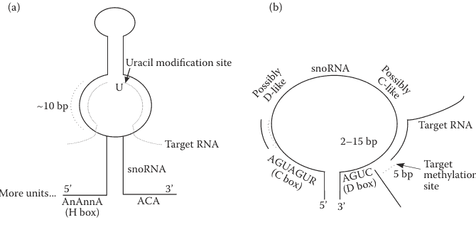

图 3.3 (a) H/ACA snoRNA 的经典二维结构图，具有多个呈螺旋-内部环-螺旋-顶端环形式的单元。(b) C/D snoRNA 的二维结构图，具有一个小的茎和一个大的内部环。结构中，识别位点被分为两部分，修饰位点（通常导致假尿苷化）位于识别位点下游 10 个碱基处。化学修饰是由 snoRNA 在真核生物和古菌中与四个高度保守蛋白组成的复合物中完成的。除了 rRNA 的聚尿嘧啶化外，H/ACA 复合物还已知可以修饰 snRNAs 和端粒酶核糖蛋白复合物。人类基因组中已知有100多个 snoRNA 目标，而没有明显 RNA 目标的 snoRNA 被称为孤立 snoRNA。

对 H/ACA 结构的搜索计算开销较大，因为必须分段处理基因组才能成功执行此类预测。snoRNA 预测软件的输入是待搜索的基因段、可能的 RNA 目标序列集，在某些情况下，古菌和真核 snoRNA 之间输入序列的进化关系可以进行不同的建模。snoGPS (Sattner et al., 2004) 使用特殊的靶对齐算法和结构预测启发式来预测 H/ACA snoRNAs。Frey (Freyt et al., 2008) 使用自由能最小化法来预测 H/ACA 类结构。在任何情况下，微小的分裂目标 RNA 识别位点都可能导致大量的假阳性预测。RNAsoftware (Tafer et al., 2010) 通过称为支持向量机（SVM）的统计方法过滤其初始预测，减少假阳性预测。目标聚尿嘧啶化的证据或针对性的 snoRNA 测序可用于确认此类预测。排除实验因素，支持 snoRNAs 预测的序列证据可以通过在预测基序上游存在 RNA 聚合酶 II 或 III 结合位点获得，或者更常见的，预测基序的位置位于活跃转录基因的内含子内部。

第二类 snoRNAs 是 C/D 盒家族。这些 snoRNAs 与四个蛋白形成复合物，并通常导致目标分子的甲基化。C 盒（共性 RUGAUGA）位于 snoRNA 的 5' 端，而 D 盒（共性 CUGA）位于 3' 端 (Kiss, 2002)。通用的二级结构是一个带有大内部环的小茎。与它们的 H/ACA 亲缘物相比，目标 RNA 识别位点的连续性使得正确识别 C/D 盒 snoRNAs 变得相对容易。最初原始的 C/D 盒 snoRNA 预测工具是 snoscan (Lowe and Eddy, 1999)，目前仍被广泛使用。它是基于概率模型的。

搜索 H/ACA 结构在计算上相当昂贵，因为基因组需要分段处理才能成功执行这种预测。snoRNA 预测软件的输入是待搜索的基因段、可能的 RNA 目标序列集，在某些情况下，古菌和真核 snoRNA 之间输入序列的进化关系可以进行不同的建模。snoGPS (Sattner et al., 2004) 使用特殊的靶对齐算法和结构预测启发来预测 H/ACA snoRNAs。Frey (Freyt et al., 2008) 使用自由能最小化法来预测 H/ACA 类结构。在任何情况下，微小的分裂目标 RNA 识别位点都可能导致大量的假阳性预测。RNAsoftware (Tafer et al., 2010) 通过称为支持向量机（SVM）的统计方法过滤其初始预测，减少假阳性预测。目标聚尿嘧啶化的证据或针对性的 snoRNA 测序可用于确认此类预测。排除实验因素，支持 snoRNAs 预测的序列证据可以通过在预测基序上游存在 RNA 聚合酶 II 或 III 结合位点获得，或者更常见的，预测基序的位置位于活跃转录基因的内含子内部。

第二类 snoRNAs 是 C/D 盒家族。这些 snoRNAs 与四个蛋白形成复合物，并通常导致目标分子的甲基化。C 盒（共性 RUGAUGA）位于 snoRNA 的 5' 端，而 D 盒（共性 CUGA）位于 3' 端 (Kiss, 2002)。通用的二级结构是一个带有大内部环的小茎。与他们的 H/ACA 亲缘物相比，目标 RNA 识别位点的连续性使得正确识别 C/D 盒 snoRNAs 变得相对容易。原始的 C/D 盒 snoRNA 预测工具是 snoscan (Lowe and Eddy, 1999)，目前仍被广泛使用。它是基于概率模型的。

（注：由于原文中存在部分重复内容（关于 H/ACA 搜索和 C/D 盒描述），译文已按照原文逻辑进行完整翻译并保持格式一致。）


```
if (cond(x)) {f(x)} else {g(x)}

if (cond(x.member1)) {f(x.member2)} else {g(x.member2)}

if (cond(f(x))) {g(x)}
```

搜索条件可以是普通字符串格式或正则表达式（一种带有通配符的强大模式匹配语法）。

## 基于 Web的工作流 ■ 187


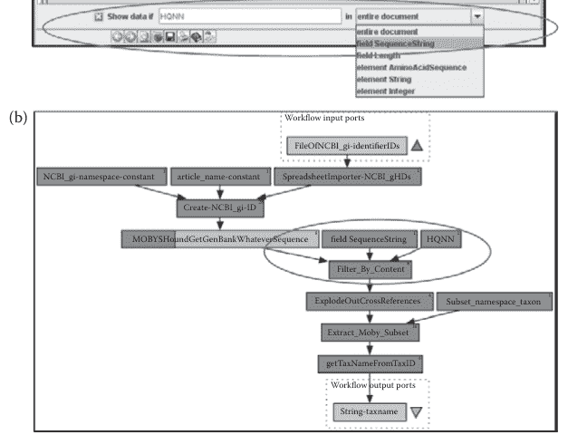

图 10.10 Seahawk 通过搜索/过滤小部件进行的条件服务评估。(a) Seahawk GUI 中的过滤条件和 (b) 运行中的 Taverna 工作流中相应的过滤过程。（参见彩色插图。）

过滤器与 Seahawk 中的特定文档绑定。在每个浏览步骤中都可以给出不同的条件。“else”条件是选择反转，基于在过滤小部件中将关键词“if”切换为“unless”（除非）(图 10.10a，左下角）。这满足了上述列出的第 1 类条件。在等效工作流方面，具有两个输出端口的过滤器处理器将对工作流进行分叉（图 10.1b）。在演示中，分叉是通过在新的标签页中调用服务（Shift+点击）完成的。

## 188 基因组注释

(a)

| ID | Name | Service type | Result type |
|---|---|---|---|
| 6 | NCBI:gi1599252 | 之前输入的服务 | gi15992258 添加到剪贴板 | Analysis |
| 7 | NCBI:gi1599509 | NCBI_gi 的服务 | Bioinformatics | GO_Term |
| 8 | NCBI:gi1599508 | 每个（总计）NCBI_gi 的服务 | Conversion | KO_Term |
| 9 | NCBI:gi1599834 | | | Parsing | D |
| 10 | NCBI:gi1599500 | | | | String |
| 11 | NCBI:gi1599500 | | | | TaxonScientificName |
| 12 | NCBI:gi1599546 | | | | rotid |
| 13 | NCBI:gi1599503 | | | | |
| 14 | NCBI:gi1599487 | | | | |
| 15 | NCBI:gi1599501 | | | | |
| 16 | NCBI:gi1598776 | | | | | |
| 17 | NCBI:gi1598771 | | | | | |
| 18 | NCBI:gi1598297 | | | | | |
| 19 | NCBI:gi1599503 | | | | | |
| 20 | NCBI:gi1599501 | | | | | |
| 21 | NCBI:gi1599503 | | | | | |
| 22 | NCBI:gi1599512 | | | | | |
| 23 | NCBI:gi1599838 | | | | | |
| 24 | NCBI:gi1599838 | | | | | |
| 25 | | | | | | |
| 26 | | | | | | |
| 27 | NCBI:gi1599707 | | | VirtualSequence |

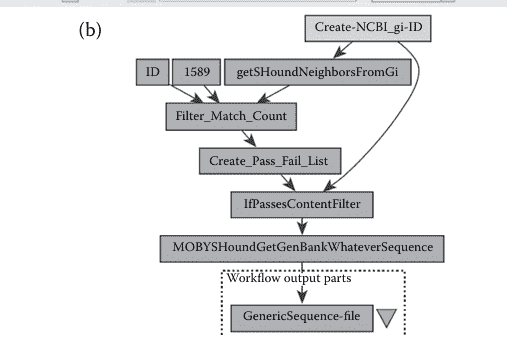 (b)

图 10.11 Seahawk 的“之前的输入”工作流。(a) 使用数据过滤器时，“之前的输入”服务选择项可用，且且 (b) 工作流组件允许使用此选项。第 2 类条件过滤基于数据对象的特定成员 (`x.member1`) 的值。这是通过在搜索短语末尾从特定特定的下拉列表中选择实现的（图 10.10a，右下角）。文档中的任何数据成员 (`x.member2`) 都可以使用数据显示中的超链接进行进一步处理，除非它们被过滤器置灰而无法访问。第 3 类条件的演示要求用户从 `f(x)` 的输出中引用 `x`。在 Seahawk 中，这是通过在对服务结果（即 `f(x)`）应用过滤器时提供一个“之前的输入”服务菜单项来实现的。在图 10.11a 中，选择菜单项“`MobyGetGenbankSequence`”逻辑等同于以下伪代码：

```
if (MobyGetNeighborsFromGi(1592258) contains "1589") {

  MobyGetGenbankSequence(1592258)

}
```


如果没有激活的过滤器，“之前的输入”选项将不会显示，因为这是服务历史的默认解释。实现第 3 类所需的 Taverna 工作流并非易事（图 10.11b）。这些过程包含了 Java 代码，几乎肯定超出了初学者通过编程创建它们的能力。Seahawk 中搜索/过滤行为的其他某些不寻常方面是页面特定和作业级的过滤。页面特定意味着小部件与通用文档绑定。这意味着当用户离开页面时，小部件会消失。重新进入给定页面时，它将重新出现。隐藏搜索/过滤小部件会禁用过滤，而小部件将启用最后一个过滤标准。这种状态特定的页面特定的行为对于在工作流的不同阶段应用不同的条件至关重要。状态性意味着一个服务的输出可以被多种方式过滤。这种选项分叉是 if–else 概念的变体。它是通过应用搜索后在新标签页中启动后续序列完成的。作业级过滤反映了 Seahawk 中的 for-each 功能。在包含输入结果（即“作业”）的文档中，过滤决策是允许或不允许对每个作业单独进行后续处理；它们是独立的结果。拥有作业列表有助于引导分析，因为用户可以获得关于正例和反例正确性的即时反馈。这与传统的编程策略形成对比，后者用户必须为任意数据提交过滤表达式。

### 10.5.3 数据过滤器和标签

Seahawk 生成的工作流中的数据过滤器用于确保数据类型安全，而 Taverna 通常不会这样做。例如，在图 10.9 中，“Extract_Moby_Subset”处理器确保只有包含在分类单元空间中的数据从“ExplodeCrossReferences”传递到“GetTaxNameFromTaxId”服务。如果没有这个过滤器，“GetTaxNameFromId” 也可以接收 NCBI_gi ID 作为输入（图 10.8 中的另一个交叉引用）。由于服务完全无法解释 NCBI-gi，Seahawk 协调努力确保工作流的数据安全，以减少用户在 Taverna 中执行工作流时遇到的问题。

### 10.5.4 Taverna 执行 Seahawk 生成的工作流

在通过演示编程的系统中，Seahawk 的一个独特功能是在保存工作流之前生成该工作流的预览。工作流预览图像目前是通过自动调用远程服务器生成的。在在无需下载和运行 Taverna 的情况下，预览允许用户在工作流不符合其意图时快速调整他们的 Seahawk 浏览或过滤。

例如，查看图 10.9 的用户如果所有分析都在一个标签页中完成，将很快发现自己的错误。通常情况下，有

# 基于 Web 的工作流 ■ 191

工作流中的输出端口数量与打开的 Seahawk 标签页数量一样多。在示例中，工作流预览将包含一个输出而不是两个。为了修复这个问题，用户可以返回，并转而在一个新标签页中启动交叉引用搜索。这将实现一个具有两个预期输出的工作流。一旦用户对该工作流感到满意，就可以将其保存，并在随后加载到 Taverna 中。

大规模基因组数据分析通常具有某种程度的尝试性；因此，在 Taverna 中轻松修改参数对新手用户来说将非常有用。例如，这些参数可能会影响数据过滤和分解等行为。为此，行为参数在 Seahawk 工作流中被清晰地标记为外部常量。最小化处理器的冗余可以帮助缓解工作流的拥挤。这涉及 Seahawk 的跟踪：

1. 当输入被使用多次以上时；2. 当过滤器被多次应用时；3. 当同一对象方法被多次提取以进行进一步处理时；以及 4. 对于过滤取反（if-else）。

由于数据在语义上是关联的，Seahawk 可以为工作流中原本匿名的节点（如输入和输出）生成有意义的标签。从演示中获得的输出值也作为元数据添加到工作流中。通过在工作流预览中提供额外的元数据字段（例如图 10.9），Seahawk 提高了生成的工作流的可读性和重用性。

工作流的实际范围在很大程度上并非完全不受 Seahawk 的控制，因为工作流最终是通过 Taverna 运行的。由于 Taverna 对大数据不敏感，用户无法向生成的工作流中输入数据可能成为成功的严重障碍。为了解决这一障碍，Seahawk 在工作流中包含了额外的处理器，简化了数据输入。例如，电子表格导入器（位于图 10.12 顶部）允许用户在 Excel 熟悉的行和列环境中指定其输入列表。

Taverna 的“端口描述（Port description）”中提供了提示，告诉用户在哪些列中放入什么数据（图 10.12）。如果没有这个导入器，工作流将需要 Mobi XML 作为输入，有时用户可能手头没有他们感兴趣的数据的这种格式。电子表格可能包含一个 GI 标识符列表，工作流将应用于该列表。例如，此输入列表可能是对 Ensembl 基因组注释页面人类基因组进行 BioMart 查询的结果。Taverna 工作流允许用户对大量基因增强 Ensembl 注释，而无需手动通过每个 GI 运行一系列 Web 表单。

# 192 · 基因注释


图 10.12 由 Seahawk 生成的 Tavern 工作流的输入对话框。预计在“端口描述”框中使用电子表格格式。

导入电子表格的能力还为用户提供了一个应用他们所掌握任何电子表格编程知识的机会。这可以用于补充演示或工作流中的分析数据。这种电子表格加演示的分析自动化混合方法，为终端用户提供了一种以实用方式学习基因组分析自动化的途径。

# 10.6 结论

基因注释工具倾向于产生一组相当固定的分析输出。根据手头的研究问题，可用数据可能不足以正确回答该研究问题。通过工作流和基于示例的工作流工具的演进，非程序员对基因组规模数据的自定义分析正变得可行。任何人都都可以使用基于 Web的工作流工具，而不需要大型本地信息学基础设施，尽管某些工具提供了本地安装选项。这可以提高效率（Taverna），并允许包含某些公开版本中可能不可用的工具（Galaxy）。与手动分析相比，工作流具有几个优势：效率、研究交流、过程记录、可重复性、保持结果更新，以及相关任务组件的潜在重用和修改。

## 参考文献

Bhagat, J., Tanoh, F., Nzuobontane, E., et al. 2010. Catalogue: A universal catalogue of web services for the life sciences. Nucleic Acids Res. 38:W689–W694.

BiMobyoby Consortium, Wilkinson, M.D., Senger, G. 2008. Interoperability with Moby 1.0–It’s better than sharing your toothbrush! Brief. Bioinform. 9(3):220–231.

Chagoyen, M., Kurul, M.E., De-Alarcon, Carazo, J.M., Gupta, A. 2004. Designing and executing scientific workflows with a programmable integration. Bioinformatics 20(13):2092–2100.

de Knicker, R., Guo, Y., Li, J., et al. 2004. A web services choreography scenario for interoperating bioinformatics applications. BMC Bioinformatics 5:25.

Fielding, R.T., Taylor, R. 2002. Principles design of the modern web architecture. ACM Trans. Internet Technol. 2(2):115–150.

Flice, P., Aken, B., Ballester, B., et al. 2010. Ensembl’s 10th year. Nucleic Acids 38(Database issue):D557–D5562.

Goble, C.A., De, R.C. 2007. myExperiment: Social networking for workflow-flowing-e-scientists. In Second Workshop on Workflows in Support of Large-Scale Science, eds D. Eelman, I. Taylor, 1–2; New York: ACM Press.

Goeks, J., Nekurko, A., Taylor, J. 2010. Seahawk: Moving beyond HTML. Future Gen. Comput. Syst. 23(3):497.

Gordon, P., Sen, C. 2007. Seahawk: A universal catalogue of web services for the life sciences. BMC Bioinformatics 8:20.

Hoon, S., Chua, C.L., Ho, Y.-Y., Lim, Y., Issac, P., Krishna, A. 2005. The Kepler system. BMC Bioinformatics 6:69.

Lee, S., Wang, D., Hashmi, N., Cummings, M. 2006. Pegasus: Software for executing and integrating of biological.... 511–1018.

Ludescher, B., Altinas, I., Berkeley, C. 2006. Wildfire: grid-enabled workflow. Curr... Exp. 18:1039–1065.

Oinn, T., Madd, R., Ferris, J. 2004. Tavern: A tool for the composition and enactment of workflows. Bioinformatics 20(17):3045–3550.

Pautasso, C., Alonso, G. 2005. The Kepler visual language. J. Vis. Lang. 16(1–2):119–150.

Rice, P., Longden, I., Bleasby, A. 2000. EMBOSS: The European Biology Open Suite. Trends Gen. 16(6):276–277.

Shah, S., D., Dawkins, J., et al. 2004. Biopie: A flexible framework for. Bioinformatics 5:40.

Stajich, J.E., Block, D., Boulez, K., et al. 2002. The BioPer toolkit: Perl modules for the life sciences. Genome Res. 12:1611–1618.

Tang, F., Ratapu, K., Ji, J. 2003. Seahawk: A universal catalogue of web services for the life sciences. Nucleic Gen. 3:88.

# 下代测序数据分析流水线

## 11.1 引言

高通量測序技術的近期進步以及下一代測序（NGS）機器的可用，使得在短期內產生了大量的測序數據。到2012年初，最廣泛使用的三種測序平台是Roche 454 Life Sciences Genome Sequencer (`www.454.com`)、Illumina Solexa Genome Analyzer (`GA`) (`www.illumina.com`) 以及 Applied Biosystems (`ABI`) SOLID 系統 (`www.appliedbiosystems.com`)。還有較新的平台，例如 Polonator G007 (`www.polonator.org`)、Helicos Biosciences Heliscope (`www.helicosbio.com`) 以及 Pacific Biosciences RS (`www.pacificbiosciences.com`)，作為另一組大規模並行測序機正受到歡迎。這些測序方法在生物化學、成本、處理速度、優缺點方面的在近期已進行了回顧和比較（Mardis, 2008; Metzker 2010; Petterson et al., 2009; Sheure and Ji, 2008）。

這些新測序技術的幾項特點對數據分析有顯著影響，從基因組重構開始。最重要的是，454 測序儀產生的是範圍約 400 個鹼基的短讀長，以及 100 個鹼基或更少。

# 196 基因组注释

来自 Solexa 和 SOLID 机器。这些短读段（short reads）每个提供的信息很少，导致组装困难，特别是在处理那些来自基因组内重复区域的 reads 时。为了弥补这一缺陷，NGS 测序读取相对于待组装基因组的大小需要高覆盖度，这导致任何特定基因组产生的 reads 数量剧增。现在单次机器运行即可产生 5 亿条单独的序列 reads！

已知某些新技术会产生一些特征性的系统性错误，例如难以估计同质聚物区域（即单碱基重复）的长度，以及向 reads 的 3' 端碱基识别错误率增加。所有上述测序技术都包含每个碱基识别的置信度估计值作为质量值。这些 NGS 数据的特征可以总结为：组装过程中歧义性的增加，以及下游处理信息总量的指数级增长，这为 NGS 数据分析流水线带来了计算挑战。需要更具计算密集型的算法来应对这种歧义性，同时还需要更多的计算能力和充足的存储空间来容纳序列和其他类型的基因组数据。最近对 NGS 分析的计算挑战进行了回顾（Li et al., 2011; Pop, 2009）。

## 11.2 基因组重组

大多数 NGS 数据分析工作流的首要任务是从短的个体 reads 开始重组出尽可能完整的基因组序列，而这些 reads 本身几乎没有意义。当已知测序 reads 来自哪个物种时，如果存在同种或极近缘物种的参考基因组，可以将它们比对到先先测序并注释的参考基因组。比对过程的目标是确定每个 read 在参考基因组序列中可能的可能的来源位置。比对方法仅适用于对特定物种内的近缘物种进行重测序（resequencing）或遗传图谱比较。例如，通过 NGS reads 比对已进行了一项关于拟南芥（Arabidopsis thaliana）菌株间遗传变异的研究（Ossowski et al., 2008）。

当被测序的物种与任何现有测序基因组都不相似时，必须从 reads 集合从头（de novo）重组其基因组序列。虽然这在计算上并不可逾越，但在算法复杂性和计算资源方面，从头基因组组装比比对的要求高得多。由于这种困难，短 reads 的从头组装主要应用于细菌基因组重组（Butler et al., 2008; Chaisson and Pevner, 2008）或哺乳动物人工染色体（Zerbino and Birney, 2008）。还需要注意的是，比对和组装方法并不总是以互斥的方式使用的。如果新基因组的某些区域无法比对到参考基因组的任何地方，则这些区域需要从头组装。

### 11.2.1 比对到参考基因组

尽管早期的比对工具如 `BLAST`（Altschul et al., 1990）、`Clustal`（Chenna et al., 2003）和 `T-Coffee`（Notredame et al., 2000）多年来一直很流行且仍在广泛使用，但它们的主要目的是在大型数据库中搜索较小的同源序列，或者对给定的序列集进行比对以研究其演化关系。相比之下，NGS 数据的短 reads 比对需要将这些 reads 映射到同种或极近缘物种的参考基因组，目标是检测结构变异或引导基因组重组。因此，与经典比对算法不同，大多数短 reads 比对算法假设非匹配碱基源于特定序列内的变异而非演化突变。这种底层假设上细微但重要的差异允许为 NGS reads 实现较快的比对算法，因为通常情况下允许的错配较少，且参考序列中的初始候选位置可以迅速缩小到可处理的数量。

大多数短 reads 比对力求在处理速度和比对准确性之间取得平衡。结果，这些算法通常采用两步策略：第一步通过采用简单的启发式方法（例如在 read 开头预设数量的碱基中进行精确匹配）在参考基因组中寻找数量较少的潜在位置以映射每个 read。一旦确定了候选映射位置，就会在第二步中将更准确但较慢的比对算法（例如 `Smith–Waterman` 算法的变体，Smith and Waterman, 1981）应用于序列集。第一步中采用的启发式方法的严格性通常可以由用户通过一组参数进行控制，例如匹配的碱基数量和这些碱基中允许的错配数量。

最近，出现了许多用于 NGS 短 reads 比对的新软件工具。这一波发展的动力主要是传统比对算法无法高效处理海量短 reads，以及所开展测序项目的基因组尺寸不断增大。上一代工具大多设计用于处理较少量的 reads。一些最常用的 NGS 比对工具包括 `Bowtie`（Langmead et al., 2009）、`SOAP`（Lin et al., 2009）、`BWA`（Li and Durbin, 2009）、`SHRiMP`（Rumble et al., 2009）、`mrFAST`（Alkan et al., 2009）、`mrfFAST`（Hach et al., 2010）、`ZOOM`（Lin et al., 2008）、`SSAHA2`（https://www.sager.uk/resources/software/ssaha2）（（Ning et al., 2001）以及 `Mosaik`（http://bioinformatics.bc.edu/Mosaik）。最近对这些算法中的几种进行了性能比较，标准是基于正确映射和错误映射 reads 以及未映射 reads 数量的准确性（Ruffalo et al., 2011）。

### 11.2.2 从头组装

从短 reads 重组基因组序列最大的挑战之一是在没有参考基因组的情况下处理重复序列，特别是当 reads 短于重复长度时。增加 reads 的覆盖度是解决这一困难的主要策略，NGS 组装算法利用了这一点。例如，对于 454、Illumina 和 SOLID 技术，覆盖度分布是不均匀的（Sheendure et al., 2009）。由于这些覆盖度模式取决于特定的测序技术，对多种技术进行组装的研究已经进行并得到了结果（Aury et al., 2008; Reinhardt et al., 2009）。NGS 组装算法使用计算策略来应对大量 reads 的复杂度。在穷尽重比较的情况下，每个 read 都需要与其他所有 reads 进行比较，导致组合爆炸。为了效率，大多数从头组装算法在某种程度上利用了 k-mer 的概念。与其寻找 reads之间的重叠，不如寻找具有相同 k-mer 的 reads 并对其进行比较。然而，k 值必须仔细选择，以防漏掉真实的重叠并减少假阳性重叠。此外，大多数组装算法还使用紧凑图作为 reads、contigs 及其关系的表示。

在过去几年中发布了许多从头组装工具。第一类组装工具被称为贪心算法，其中通过添加得分最高的重叠来扩展给定的 read，这种基本操作用于连接 contigs。这一类的工具包括 `SSAKE`（Warren et al., 2007）、`SHARCGS`（Dohm et al., 2007）和 `VKACE`（Jeck et al., 2007）。下一种主要的组装策略是布局-共识（OLC），它包含三个步骤：(1) 计算所有 reads 之间的重叠；(2) 将它们布局在图中，连接重叠的节点；(3) 最后通过分析图生成共识序列。例如，`Newbler`（Margulies et al., 2005）、`Celera Assembly`（Myers et al., 2000）及其针对 454 数据的扩展 `CABOG`（Miller et al., 2008）、`ARACHNE`（Batzoglou et al., 2002）和 `Edena`（Hernandez et al., 2008）都是基于德布罗因图（DBGs）的组装工具，其中 reads 首先被切割成 k-mer，使用这些 k-mer 构建 DBG，然后从 DBG 中推导出基因组序列。组装软件如 `EULER-USR`（Chaisson et al., 2009）、`Velvet`（Zerardino and Binney, 2008）、`AByss`（Simpson et al., 2009）、`ALLPATHS-LG`（Gnerrea et al., 2011）和 `SOAPdenovo`（Li et al., 2010）属于最后一类。关于组装算法和工具的几篇回顾已经发表（Flicek and Binney, 2009；Li et al., 2011; Miller et al., 2010; Sheendure and Ji, 2008）。

## 200 ■基因组注释

## 11.3 分析流水线：案例研究

在过去的几年里，卡尔加大学的视觉基因组中心（Visual Genomics Centre）开发了多条 NGS 数据分析流水线。这些流水线本质上是为特定基因组项目及其分析需求身定制的工具集成系统，展示了解决具有高社会经济影响且需要 NGS数据的问题的不同基因组分析应用。

### 11.3.1 16S rRNA 分析

开发了一种小亚基核糖RNA（SSU rRNA）数据分析流水线，用于油层和砂煤层中的微生物群落分析。该流水线遵循第4.3节概述的宏基因组分析原理。图11.1显示了流水线中的数据流。原始 16S rRNA 454 reads 经过严格的系统检查，以去除质量读数并尽可能减少测序误差的影响（Huse et al., 2007）。过滤后的序列包括：(1) 与接头和引物序列不完全匹配；(2) 包含模糊碱基；(3) 平均质量分低于27；(4) 包含长度大于8的同聚物；以及 (5) 在剪切引子后短于200碱基对。

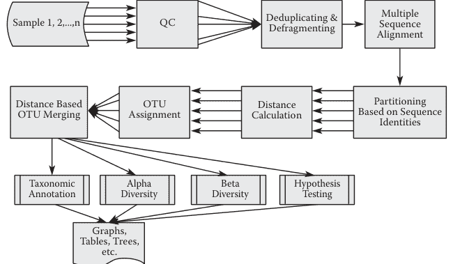

图11.1 在卡尔加大学视觉基因组中心开发的16S rRNA 分析流水线。对16S rRNA样本进行质量检查，根据唯一序列创建分区，通过聚类生成 OTU，并生成了多种多样性指数和分类注释。（感谢 Xiaoli Dong 提供。）

下一代测序数据分析流水线 ■ 201

随后的微生物群落分析主要基于 `Mothur`（Schloss et al., 2009），这是一种广泛使用的 16S rRNA 数据分析包。由于 Mothur 本身无法处理 NGS 数据，因此为流水线开发了两个主要步骤以处理更大的数据集。在第一步中，在序列比对之前对数据集进行整理，仅包含唯一序列。冗余重叠序列的聚类通过 `CD-HIT-EST` 程序（Li and Godzik, 2006）在 99% 的一致性阈值下完成。`CD-HIT-EST` 程序在每个簇中生成的代表序列包含在最终比对中。在第二步中，剩余的唯一序列再次使用 80% 的一致性阈值通过 `CD-HIT-EST` 进行预聚类，将数据集划分为一系列较小的子集。然后在较小数据集上执行距离计算和聚类，而不是整个数据集，因为这一步形成了 Mothur 中的主要处理瓶颈。

流水线随后使用 Mothur，利用平均联动法算法（Schloss and Westcott, 2011）在 3% 和 5% 距离处生成操作分类单元（OTUs）。在将序列分组为 OTU 后，为每个样本计算了多种 alpha 多样性指数（Whitaker, 1972）以及 OTU 的总数。为了探索不同环境微生物群落之间的潜在关系，计算了相似性并构建了树，随后可以对其进行可视化。还通过排序分析（ordination analysis）探索差异和相似性，该分析将待比较的数据维度从生成的 OTU 数量减少到易于可视化的少量数量。非度量多尺度尺度（Prentice, 1977）和主成分分析（Wold et al., 1987）是流水线中为此目的使用的两种方法。

最后，使用三种方法对 OTU 进行分类注释。在 TimeLogic DeCipher 系统（Active Motif, Inc.）上使用 Tera-BLAST 算法对 SILVA102 的非冗余 SSU 参考数据集（Pruesse et al., 2007）进行 BLAST 搜索，以识别相似序列。还使用 RDP 分类器（作为 Mothur 的一部分）分别在 RDP 数据库和 SILVA 参考数据库（www.mur.org/wiki/Taxonomy_outline）中对序列进行搜索。这些分类分类方法的结果以纯文本文件格式提供，并以 MEGAN 兼容文件格式提供，以便使用 MEGAN 进行可视化（Huson et al., 2007）。

202 ■基因组注释

### 11.3.2 目标 EST 装装

为了分析植物遗传材料以确定特定基因序列，并选择在其代谢途径中起关键作用的候选或目标基因，开发了目标表达序列标签（EST）组装。EST 是从 cDNA 库测序中获得的序列读数（Nagaraj et al., 2006）。由于 cDNA 与 mRNA 是互补的，因此 EST 表征了特定组织在特定发育阶段的表达基因。EST 已成为研究有关不同发育阶段和各种环境因素的组织基因表达的重要工具。它们已用于大规模转录组学研究，以辅助基因发现、增强基因组注释、确定基因结构并发现剪接模式（Wang et al., 2009）。

使用 EST 序列时的通用转录组分析流水线包括 mRNA 制备、cDNA 库构建、从测序仪重读、质量修剪和过滤、reads 聚类、组装以及组装程序生成的重叠群（contigs）注释。由于 reads 的数量巨大，组装 reads 以产生所有表达基因的完整表示仍然是一个巨大的挑战。为了提高 EST 分析的计算效率，使用了目标限制组装方法来在低覆盖序列中重建序列同源区域（Brainbridge et al., 2007）以及与系统发育重建相关的基因的 Illumina 单通道序列。目标限制组装

使用 EST 序列时的通用转录组分析流水线包括 mRNA 制备、cDNA 库构建、从测序仪重读、质量修剪和过滤、reads 聚类、组装以及组装程序生成的重叠群（contigs）注释。

由于 reads 的数量巨大，组装 reads 以产生所有表达基因的完整表示仍然是一个巨大的挑战。为了提高 EST 分析的计算效率，使用了目标限制组装方法来在低覆盖序列中重建序列同源区域（Brainbridge et al., 2007）以及与系统发育重建相关的基因的 Illumina 单通道序列。目标限制组装

在目标限制组装中，目标蛋白质编码序列首先被识别并建立数据库。然后通常使用 `BLAST` 算法检索与蛋白质编码序列相关的 reads。这些 reads 随后被重新组装以生成感兴趣基因的全序列。

除了 BLAST 工具外，基于隐马尔可夫模型（HMM）的搜索算法也被广泛用于序列比对和基因发现。`HMMER`（http://hmmer.janelia.org）（Finn et al., 2011）是一种基于 HMM 的序列工具，用于搜索蛋白质序列的同源物。相比 BLAST，HMMER 能更准确地检测远源同源物（Finn et al., 2011）。通过结合 BLAST 和 HMMER，开发了一种计算廉价的组装流水线来识别和组装目标

下一代测序数据分析流水线 ■ 203


图11.2 在卡尔加大学视觉基因组中心开发的目标 EST 装流水线。感兴趣的蛋白质序列用于构建 HMM 和 BLAST 数据库，原始 reads 作为查询，命中结果组装成重叠群作为参考组装，原始 reads 再次与参考进行组装。（感谢向晓和叶珍提供。）蛋白质编码

通过 NGS 技术生成的 cDNA 序列中感兴趣的蛋白质编码区域。

图11.2 显示了组装流水线，目标是细胞色素 P450 蛋白序列。为了使用 HMMER 搜索 454 reads，我们首先使用 `T-Coffee`（Notredame et al., 2000）对所有 P450 蛋白序列进行多序列比对。比对后的蛋白序列输入 HMMER 以构建基于谱 HMM 的数据库。原始 454 reads 被用于搜索谱 HMM 数据库。除了基于 HMM 的搜索外，我们还提取 P450 蛋白序列的 blast 查询并构建了 BLAST 数据库。原始 454 reads 再次作为查询，使用 `tblastx` 程序通过翻译后的核苷酸查询搜索我们的蛋白质数据库。

那些

## 204 基因组注释

再次使用重组群（contigs）作为参考，并第二次使用 `MIRA` 将原始的 454 reads 数据与参考数据集进行组装。

## 11.3.3 基因预测

为了寻找能够将植物材料分解为生物燃料 Better酶，需要预测新测序以及已发表真菌基因组中蛋白质编码基因的准确位置、外显子结构和功能。开发了一种整合了从头开始（ab initio）预测工具与 RNA-Seq 及同源证据的基因预测流水线，用于预测真菌基因组中的基因模型。该流水线的设计便于添加或移除单个预测工具或证据源。通过测试多种可能的组合，选择了一组最小组件集合，它们能够在在一周内通过基因组序列和 RNA-Seq reads 产生高质量的基因模型。

两个在真菌基因组中表现良好的从头开始预测工具 `GeneMark ES` (Ter-Hhovanyan et al., 2008) 和 `AUGUSTUS` (Stanke et al., 2008) 被用作基因预测流水线的主要工具。这两个工具互为补充：GeneMark ES 不需要目标基因组的基因训练集，而 AUGUSTUS 需要目标基因组或密切相关基因组的基因训练模型。GeneMark ES 在基因组序列上使用迭代训练策略来预测一组基因模型。AUGUSTUS 的训练集可优化 HMM 的转移和发射概率，以及该预测工具的其他几个参数。关于基因位置的实验提示也可以用于 AUGUSTUS 以提高其预测准确性，例如来自蛋白质、EST 或 RNA-Seq 比对的提示。事实上，RNA-Seq 信息被用于流水线的多个步骤。它被用于生成初始模型（用于 AUGUSTUS 中 HMM 的训练），以及在创建预测基因模型集时为 AUGUSTUS 提供额外提示。流水线的最后一步——对输出模型进行评分并选择最佳模型也使用了这些信息。

图 11.3 显示了流水线的数据流。该流水线使用全长转录本，转录本是通过 `Velvet` (Zerbino and Birney, 2008) 从 RNA-Seq reads 组装成的重组群，用于生成初始基因模型（重组群训练集），以训练基于 HMM 的基因预测器 AUGUSTUS (Stanke and Waack, 2003)。AUGUSTUS 的训练是使用 `exonerate` (Slater and Birney, 2005) 将 RNA-Seq 重组群与基因组比对完成的。生成的预测基因模型一致集如下

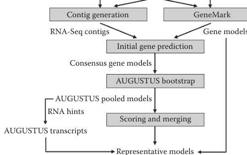

图 11.3 在卡尔加里大学视觉基因组中心开发的基因预测流水线。GeneMark 生成的模型和 RNA-Seq read 重组群被用于创建预测集，用于训练*从头*基因预测器 AUGUSTUS。对 AUGUSTUS 的预测结果进行评分和筛选，以产生最终的基因模型集。（由 Mostafa Abdallahee 提供。）

AUGUSTUS 使用训练集和自训练预测器 GeneMark。该集合再次用于训练 AUGUSTUS，为第二阶段预测做准备。基于 RNA-Seq 数据的提示也用于此阶段，以提高 AUGUSTUS 预测的质量。此阶段产生的基因模型根据内含子位置（从 RNA-Seq 数据推断得出）进行评分。此评分阶段测试了翻译为预测蛋白质的可转化性，以及预测蛋白质与已知蛋白质的同源性。得分最高且不重叠的模型集构成了流水线的最终结果。

## 11.4 下一代基因组浏览器

## 11.4.1 不同类型基因组数据的整合

到目前为止描述的大多数浏览器只能显示基因组序列及其来自多个来源的各种注释。尽管这些浏览器可以可视化多个轨道的信息轨道，但人们越来越需要同时可视化不同类型的数据，以获得直观的理解。例如，随着微阵实验产生海量数据集，越来越需要在一个共同的视觉语文中生成基因组数据和表达数据的视图，并进行视觉引导的数据判读。传统的基因表达可视化工具通常使用热图显示表达值，并用颜色渐变来表示表达的强弱。例如，TIGR MultiExperiment Viewer (`MeV`) (Saeed et al., 2003) 是一个公开的基因表达分析和可视化工具。然而，通过这种可视化方式，研究人员很难在基因组背景内查看和解释基因表达谱，因为每个基因都仅表示为一个文本符号。

类似地，癌症基因组学涉及寻找导致癌症细胞发育的基因及其突变，以便分析患者细胞基因组中发生的变化。使用微阵和高通量 DNA 测序技术对肿瘤样本进行分析，以产生具有临床意义的基因组数据，如插入、缺失和基因拷贝数。此类大型临床试验产生了大量的不同类型的分子数据，需要进行组织，以提供一个统一视图，将基因组数据与临床数据（特别是基因表达数据和癌症基因组数据）整合起来。这些浏览器能够相对于基因组坐标同时显示一组样本的基因组临床测量值。

例如，TIGR MeV 已在源集成到 Bluejay (Soh et al., 2012; Soh et al., 2008) 中，以扩展其功能，能够在基因组背景内显示基因表达。Bluejay 内部将基因组数据以及表达值表示为一个文档对象。TIGR MeV 执行的聚类分析结果也可以在整个基因组上显示，每个聚类用独特的颜色表示。

图 11.4 展示了可视化基因组序列和基因表达数据之间的相互作用。Bluejay 中的微阵列数据整合提供了在整个基因组内并排显示表达值和基因的能力，使得基因与其表达之间的关联变得目而易见。对于生物学家来说，比结果显示在基因组背景之外（如表达图像、热图或数值表格）时，解释基因表达结果变得容易得多。

加州大学圣克鲁（UCSC）癌症基因组浏览器（Zhu et al., 2009）是 UCSC 基因组浏览器的扩展，它在并行轨道上显示数据和注释。

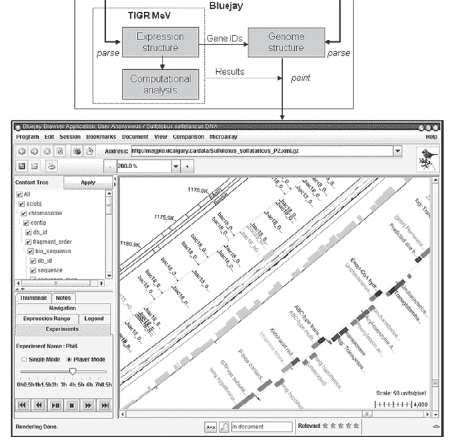

FIGURE 11.4 Bluejay 中基因表达分析与基因组数据的整合。基因表达和数据分析与 TIGR MeV 结合产生统一的视觉表示，其中基因与其表达/分析值并排显示。（参见彩色插图）。

## 208 基因组注释

(http://genome-cancer.ucsc.edu) 托管了大量的公共可用癌症基因组数据。

整合基因组视视器 (`IGV`; www.broadinstitute.org/igv (Robinson et al., 2011)) 由博德研究所开发，其目标是帮助用户通过将不同的基因组数据整合到一个视图中同时进行可视化和分析。在基因组序列之上，还可以显示额外的数据层，包括基因表达、序列变异或突变以及拷贝数变异。图 11.5 显示了使用 IGV 的示例，其中两个不同的比对结果垂直排列在一起。上部分描述了片段（contigs）的比对，下部分显示了原始读取（raw reads）的比对，使用户户能够在相同的基因组背景下查看参考基因组、组装的片段和原始读取。用户有多种显示选项可用，例如以热图、直方图、散点图或其他选择格式查看。IGV 的设计是通用的，因此它可以整合任何类型的基因组数据，而不是一个用于显示特定类型数据的专用工具。用户还可以在任何视图比例下进行缩放和滚动，并根据选定的区域和基因组特征重新组织显示轨道。可以根据数据类型以各种常用的文件格式输入数据。

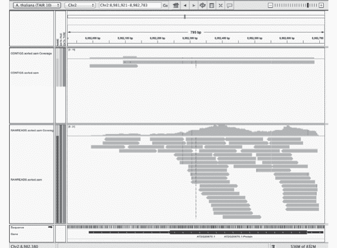

图 11.5 整合基因组视器 (IGV) 显示的比对到拟南芥基因组的片段和原始读取，分为染色体直图、基因表达样本数据轨道和基因特征轨道。通常情况下，每个水平数据轨道代表单个样本或实验，其值在垂直方向上与其他数据轨道进行比较，并比对到特征轨道上。

## 11.4.2 去中心化

大多数基于 Web 的基因组浏览器都基于集中化服务器模型，其中主要使用服务器端处理进行数据库访问和图像渲染。在用户请求下，信息从基因组浏览器流出，浏览器生成显示图像并将其传输给用户查看。随着数据集增大和浏览器功能的进步，服务器端与客户端之间的这种通信可能会成为整个基因组浏览体验的瓶颈，并导致服务器过载。解决这个问题有两种方法：更多的客户端处理和分布式资源的使用。

可以增加客户端处理量以减轻服务器的计算负担并最小化网络流量。这的一个例子是增加异步 JavaScript 和 XML (`AJAX`; http://ajax.org) 技术的使用，这是一组相互连接的客户端 Web 开发技术。AJAX 允许基因组浏览器分发负载，因为它允许 Web 应用程序异步从服务器检索数据，而不中断客户端显示的行为。这通常会导致基因组导航的更加平顺流畅。JBrowse (Skinner et al., 2009) 是基于 AJAX 的 GBrowse 版本。JBrowse 使用 AJAX 减少服务器负载、实现平滑滚动和直观缩放。JBrowse 包含了 GBrowse 的所有功能，同时利用客户端 Web 浏览器完成大部分的图像渲染和显示。其他基因组浏览器，包括 Annotation (www.annoj.org)、X:map (Yates et al., 2008) 和 Genome Projector (Arakawa et al., 2009)，使用了类似的技术来提高服务器响应时间并允许在基因组中进行平滑导航。

生物学家可以访问许多分布式资源，例如生物数据库、软件应用程序和 Web 服务。然而，当他们需要研究特定的生物体或一组相关生物体时，只有当这些资源以有利于研究的方式进行整合和链接时，它们才能证明是有用的。已经有成熟的方法可以单独分析各种类型的数据，但挑战在于将这些统一到一个连贯的生物体模型中。例如，Bluejay 提供了一个视觉引导的数据探索环境，它可以与其他计算工具协同工作，并利用其统一的视觉表示整合异类型的生物信息。Seahawk 是一个提供符合 Mobi 标准 Web 服务的应用程序 (Gordon and Sensen, 2007)，在第 10 章中进行了更详细的描述。Seahawk 作为单个 Java 包文件集成到 Bluejay 中，不需要专门设计的 API 来从 Bluejay 启动它以访问 Web 服务。当 Seahawk 发布新版本时，可以替换 JAR 文件。这种方法按需有效利用分布式计算资源，而不是在基因组服务器浏览器上集中安装所有服务。

## 参考文献

Alkan, C., Kidd, J.M., Marques-Bonet, T., et al. 2009. Personalized copy number and segmental duplication maps using next-generation sequencing. Nat. Genet. 41:1061–1067.
Altschul, S.F., G, W., Miller, Myers, E.W., Lipman, D.J. 1990. Basic local alignment tool. J. Mol. Biol. 25(3):403–410.
Arakawa, A., Tamaki, S., Kono, N., et al. 2009. Genome Project: Zoomable genome map with multiple views. BMC Bioinformatics 10:31.
Aury, J.M., Cruaud, C., Barbe, V., et al. 2008. High quality data sequences for prokaryotic genomes using a mix of new technologies. BMC Genomics 9:603.
Ashbridge, M.N., Warren, R., He, A., Bilenky, M., Robertson, A., Jones, A. 2007. Targeted high-throughput. Bioinformatics 23:2922–2924.
Batzoglou, S., Jaffe, D., Stanley, K. 2002. Whole-genome assembler. Genome Res. 12(1):177–189.
Chaisson, M., Mainz, D., Pevner, A. 2009. Short read. Genome Res. 19:336–346.
Chaisson, M., Pevner, A. 2008. Bacterial genomes. Genome Res. 18(2):324–330.
Chen, R., Sugawara, H., Koike, T. 2003. Multiple sequence using Clustal. Nucleic Acids 31(13):3497–3500.
Chevreux, B., Pfister, T., Drescher, B. 2004. ESTs. Genome Res. 14(6):1147–1159.
Dohm, J., Lotaz, C., Borodina, T. 2007. DNA sequences. Genome Bio. 8(7):R143.
Finn, R., Clements, J., Eddy, S. 2011. Interactive search. Nucleic Acids Res. 39:W29–W37.
Garcia, S., Trapp, C., M., Salzberg, S. 2009. The human genome. Genome Bio. 10(3):R25.
Gordon, P., Jenkins, C. 2007. Seahawk.
Harisem, O., Ng, P., Strauss, R. 2009. Targeted sequences. Genome Bio. 10:R32.
Hernandez, D., François, P., M. 2008. Assembly on a desktop computer. Genome Res. 15(8):802–809.
Huse, S., Huber, J., Morrison, H. 2007. Quality of massively parallel DNA pyrosequencing. 20:8.
Hush, D., A, F., J., Schuster, S.C. 2007. Metagenomic data. Genome Res. 17:377–386.
Weck, J.R., Reichardt, J., Baltrus, D.A., et al. 2007. To handle error. Bioinformatics 23(21):2942–2944.
Johnson, K.P., Walden, K.O., Robertson, H.M. 2010. A target restricted assembly method (TRAM) for phylogenomics. Nature Precedings, http://dl.han-de/10.1011/npre.2010.462.1.
Langbe, P., Trapp, C., M., Salzberg, S. 2009. Of DNA sequences to the human genome.
Li, R., Yu, C., Li, Y., et al. 2009. An improved ultrafast tool for short read alignment. Bioinformatics 25:1996–1997.
Li, R., Zhu, H., Huan, J., et al. 2010. De novo assembly of human genomes with massively parallel short-read sequencing. Genome Res. 20(2):265–272.
Li, Z., Chen, Y., Mu, D., et al. 2011. Comparison of the two classes of assembly algorithms: Overlap-layout-consensus and de-Bruijn-graph. Brief. Funct. Genomics 11(1):25–37.
Lin, H., Zhang, Z., Zhang, M.Q., Ma, B., Li, M. 2008. ZOOM! Zillions of oligos mapped. Bioinformatics 24(21):2431–2437.

## 212 基因注释

Lin, Y., Li, Z., Shen, H., Zhang, L., Papasian, C.J., Deng, H.W. 2011. 下一代测序技术从头组装工具的比较研究。Bioinformatics 27(15):2031–2037.

Mardis, E.R. 2008. 下一代 DNA 测序方法。Annu. Rev. Genome Hum. 9:387–402.

Margules, M., Egholm, M., Altman, W.E. 2005. 微加工高密度微升转子中的基因组测序。Nature 437(7057):376–380.

Metzker, M.L. 2010. 测序技术——下一代。Nat. Rev. Genet. 11:31–46.

Miller, J., Delcher, A.L., Koren, S., et al. 2008. 带有双端序列的焦酸测序读段进性组装。Bioinformatics 24(24):2818–2824.

Miller, J., Koren, S., Sutton, G. 2010. 下一代测序数据的组装算法。Genomics 95:315–327.

Myers, E.W., Sutton, G.G., Delcher, A.L., et al. 2000. 亚洲果蝇的全基因组组装。Science 287(5471):2196–2204.

Nagaraj, S.H., Gasser, B.R., Ranganathan, S. 2006. Aitchiker 表达测序标签 (EST) 分析指南。Bioinformatics 8:6–21.

Ning, Z., Cao, AJ., Mullikin, J.C. 2001. SASAH: 一种 DNA 数据库快速搜索方法。Genome Res. 11(1):1725–1729.

Notedame, C., Higgins, D.G., Heringa, J. 2000. T-Coffee: 一种精确多序列比对的新方法。J. Mol. Biol. 302(1):205–217.

Ossowski, S., Schneeberg, K., Lark, R. M., Lanz, C., Warthmann, N., Weigel, D. 2008. 用短读段测序拟南芥的天然菌株。Genome Res. 18(12):2024–2033.

Pettersson, E., Lundeberg, J., Ahmadian, A. 2009. 测序技术的测序。Genomics 93:105–111.

Pop, M. 2009. 基因组组装重运行：近期计算挑战。Brief. Bioinformatics 10(4):354–366.

Prentice, I.C., Knittel, K. 2007. 生态学中的非度量方法。J. Ecol. 65(1):85–94.

Queest, E., Quant, C. 2007. SILVA: 兼容 Arctic 的质量检查和比对核糖 RNA 序列综合在线资源。Nucleic Acids Res. 35:7188–7199.

Reinhardt, J.A., Baltrus, D., Nishimura, M.T., Jeck, W.R., Jones, C.D., Dangl, J.L. 2009. 使用水稻病原菌水稻角苔 Pseudomonas syringae pv. oryzae 的低覆盖短读段数据从头组装。Genome Res. 19(2):294–305.

Robinson, J.T., Thorvaldsottir, H., Winckler, W., et al. 2011. 集成基因组浏览器视器。Nat. Biotechnol. 29(1):24–26.

Ruffalo, M., La Framboise, T., Kuyort, M. 2011. 下一代测序读段比对算法的比较分析。Bioinformatics 27(20):2790–2796.

Rumble, S.M., Lacorte, P., Palca, A.V., Fiume, M., Sidow, A., Brudo, M. 2009. SHRIMP: 短颜色空间读段的精确制图。PLoS Comput. Biol. 5(5):e1000386.

Saeed, A.I., Sharov, V., White, J., et al. 2003. TM4: 一种用于微阵数据管理和分析的开源系统。Biotechniques 34(2):374–378.

## 下一代测序数据分析流水线

Schloss, P.D., Westcott, S.L. 2011. 评估和改进基于操作分类单元的方法用于 16S rRNA 基因序列分析。Appl. Environ. Microbiol. 77:3219–3226.

Schloss, P.D., Westcott, S.L., Ryabin, T., et al. 2009. 引入 mothur: 一种描述和比较微生物群的开源、平台无关、社区支持的软件。Appl. Environ. Microbiol. 75:7537–7541.

Shendure, J., Ji, H. 2008. 下一代 DNA 测序。Nat. Biotechnol. 26(10):1135–1145.

Simpson, J.T., Wong, K., Jackman, S.D., Schein, J.E., Jones, S.J., Birney, I. 2009. Velvet: 一种短读段数据的组装器。Genome Res. 19(6):1117–1123.

Mayer, E., Uzilov, A.V., Stein, D., Mungal, C. 2009. JBase: 一种一代基因组浏览器。Genome Res. 19:1630–1638.

Slater, G., Birney, E. 2005. 生物比较自动生成的启发式算法。Bioinformatics 21:57.

Smith, T., Waterman, M.S. 1981. 常见序列的识别。J. Mol. Biol. 147:195–197.

Soh, J., Gordon, P.M., Sens, C. 2012. Bluejay 基因组。Curr. Bioinformatics 10:9–10.

Soh, J., Gordon, P.M., Taschuk, M., et al. 2008. Bluejay 1.0: 动态链接基因组测序。Bioinformatics 24:450.

Stanke, M., Diekhans, M., Baertsch, R., Hausler, D. 2008. 使用合成比对的 cDNA 寻找基因组。Bioinformatics 25:637–644.

Stanke, M., Waack, S. 2003. 使用隐马尔可夫模型进行基因组预测。Bioinformatics 19:215–225.

Terhannian, Y., Lomsadze, A., Chernoff, Y., Borodovsky, M. 2008. 使用从头算法基因组预测。Wang, Z., Reine, N., Snyder, M. 2009. RNA-Seq: 用于转录组学的革命性工具。Nat. Rev. Genet. 10(1):57–63.

Warren, R.L., Sutton, G.G., Jones, S.J., Holt, R.A. 2007. 使用 SSAKE 组装数百万 DNA 序列。Bioinformatics 23(5):500–501.

Whittaker, R.T. 1972. 物种多样性的进化与测量。taxon 21:213–251.

Wol, S., Ebersen, K., Geladi, P. 1987. 主成分分析。Chem. Lab. Phys. 22:3–57.

Yates, T., Okonkowski, M., Miller, C.J. 2008. X-Map: Affymetrix 矩阵基因组结构的注释与可视化。Nucleic Acids Res. 36:780–786.

erbini, D., Birney, E. 2008. Velvet: 使用 Bruijn 图的从头短读段组装算法。Genome Res. 18(5):821–829.

Zhu, J., Sanborn, J., Sens., et al. 2009. UCSC 基因组浏览器。Nat. Methods 6:239–240.

## Gap 编辑器

文件 编辑 视图 偏移量 常用 搜索 设置 链接/退出

| | 200 | 220 | 240 | 260 | 280 | 300 | 320 | 340 | 360 | 380 | 400 | 420 | 440 | 460 | 480 | 500 | 520 | 540 | 560 | 580 | 600 | 620 | 640 | 660 | 680 | 700 | 720 | 740 | 760 | 780 | 800 |
|---|---|---|---|---|---|---|---|---|---|---|---|---|---|---|---|---|---|---|---|---|---|---|---|---|---|---|---|---|---|---|
| spP30350.ADHD1_AKAF1-375 | MVARLCHYNYVGVFAIFPMLLFGSFVGSVVALY | | | | | | | | | | | | | | | | | | | | | | | | | | | | | | |
| spP17453.QCT1_CCT1-375 | MAARLACLCGDNNYVGVFAIFPMLLFGSFVGSVVALY | | | | | | | | | | | | | | | | | | | | | | | | | | | | | | |
| spP22223.ALB1_ALB1-374 | MAARLACLCGDNNYVGVFAIFPMLLFGSFVGSVVALY | | | | | | | | | | | | | | | | | | | | | | | | | | | | | | |
| spP22022.ADHD2_ADHD2-374 | MAARLACLCGDNNYVGVFAIFPMLLFGSFVGSVALY | | | | | | | | | | | | | | | | | | | | | | | | | | | | | | |
| spP29005.ADHD3_ADHD3-374 | MAARLACLCGDNNYVGVFAIFPMLLFGSFVGSVALY | | | | | | | | | | | | | | | | | | | | | | | | | | | | | | |
| spQ21263.GEHD1_GEHD1-376 | KVALALACCGDNNYVGVFAIFPMLLFGSGSVALY | | | | | | | | | | | | | | | | | | | | | | | | | | | | | | |
| spP69004.ADHD4_ADHD4-374 | MAARLACLCGDNNYVGVFAIFPMLLFGSGSVVALY | | | | | | | | | | | | | | | | | | | | | | | | | | | | | | |
| spP69005.ADHD5_ADHD5-374 | MAARLACLCGDNNYVGVFAIFPMLLFGSGSVVALY | | | | | | | | | | | | | | | | | | | | | | | | | | | | | | |
| spP69006.GEHD2_GEHD2-375 | MAARLACLCGDNNYVGVFAIFPMLLFGSGSVVALY | | | | | | | | | | | | | | | | | | | | | | | | | | | | | | |

FIGURE 6.1 编辑用的 Gap 环境。比较两个 contig 以进行可能的连接，所有读段的原始低质量碱基显示为灰色，不匹配碱基用标记显示（顶部）。还显示了对应于 contig 部分的轨迹有助于寻找连接位置（底部）。

## Jalview 2.7

文件 工具 窗口 导出/home/jproteins_clustal.msf

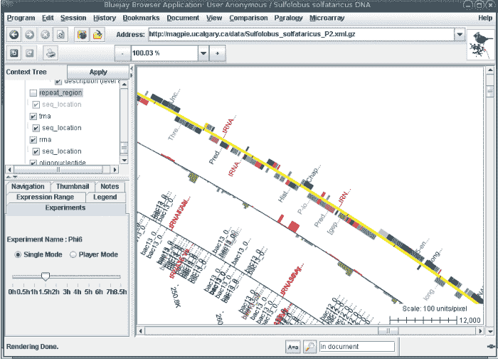

图 6.8 沿基因组基因表达数据的 Bluejay 显示。内圈的红色和绿色条形分别代表上调和下调的基因，条形高度表示基因表达水平。条形与外圈所示相应基因的径向位置对。

## 脊椎动物：48 个同源基因

海苔 (Pteromyzon marinus)：2 个同源基因

## 劳亚蹄目：13 个同源基因

- 鼠目：部分猴形
- VNNL: Homo sapiens
- VNNL: Gorilla bouldei
- VNNL: Gorilla gorilla
- VNNL: Pongo abololesis
- VNNL: Macaca mulatta
- VNNL: Callithrix satura
- VNNL: Callithrix jachus
- Tamarsius scryries

- VNNL: Loxodonta africana
- VNNL: Loxodonta africana
- VNNL: Equus capensis
- VNNL: Equus caball
- VNNL: Equus quagga

鸭嘴兽 (Ornithorhynchus anatus)：2 个同源基因

有袋类动物：3 个同源基因

胎盘动物：25 个同源基因

四足动物：8 个同源基因

图例：
- x 分支长度
- x10 分支长度
- x100 分支长度

基因 ID 当前基因
基因 ID 物种内空缺

- 氨基酸匹配/不匹配
- 氨基酸一致性 > 60%（最小/不匹配）
- 氨基酸空缺（旁系基因）

- 折叠的子树
- 折叠（当前基因）
- 折叠（旁系基因）

- 物种形成节点
- 复制节点
- 复制空缺

图 7.3 Ensembl 中 VNNL 的基因树可视化描绘。尽管大多数物种只有一个直系基因的拷贝，但但非洲象 (Loxodonta africana) 有两个，表明直系基因并不一定是一一对应的。


图 8.2 MAGPIE 基因组序列结构概述。每个箭头代表其中一条链上的基因。上方的虚线显示了每个转录物的显子结构，并标记了基因的起始和终止（垂直帽线）。m RNA-Seq 密度以红色（亮度不同）显示在中心轴线上。元素和轮廓颜色见图像顶部的图例说明。

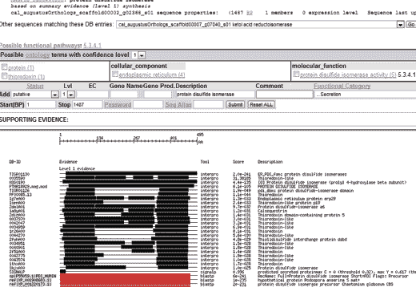

图 8.4 MAGPIE 功能注释视图。从上到下：基于所有证据综合的文本描述、可能的旁系基因/同源基因列表、生化通路信息、基因本体 (Gene Ontology) 术语、功能注释的编辑功能、起始/停止编辑以及分析证据。点击分析证据显示原始工具，点击 ID 则跳转至公共数据库条目。

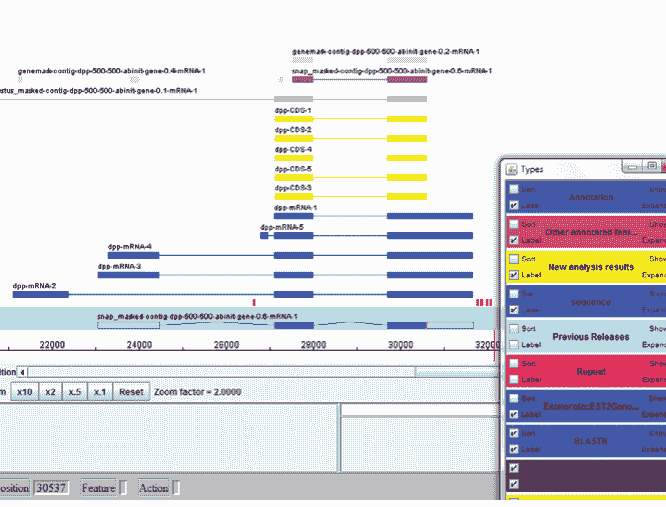

图 8.7 Apollo 基因组浏览器查看的 MAKER 基因组结构注释。底部显示共性基因结构（浅蓝色背景），贡献证据堆叠在上方（根据右侧图例，不同来源显示不同颜色）。Apollo 允许对模型边界进行图形化编辑，并导出为 GFF 文件格式。

图 8.9 Ensembl 功能证据摘要。（顶部）显子结构，用交替的浅紫色和深紫色显示边界。（中间）两条生化特征和六条结构域同源性证据线。（底部）已知序列变异（可用时）。

| 蛋白质 (片段) | 卷螺旋 (注释) | 超家族 | START 结构域 | Prints 结构域 | Palm 结构域 | Zinc RING | PROSITE 特性 | PRSF 结构域 | 序列变异 | 比例尺 | 变异图例 |
|---|---|---|---|---|---|---|---|---|---|---|---|
| BRCA1 | | | | | | | | | | | 200 | * 非同义编码 |
| BRCA2 | | | | | | | | | | | 400 | |
| BRCA5 | | | | | | | | | | | | 600 | |
| BRCA6 | | | | | | | | | | | | | 800 | |
| BRCA7 | | | | | | | | | | | | | 1000 | |
| BRCA8 | | | | | | | | | | | | | 1200 | |
| BRCA9 | | | | | | | | | | | | | 1400 | |
| BRCA13 | | | | | | | | | | | | | 1600 | |

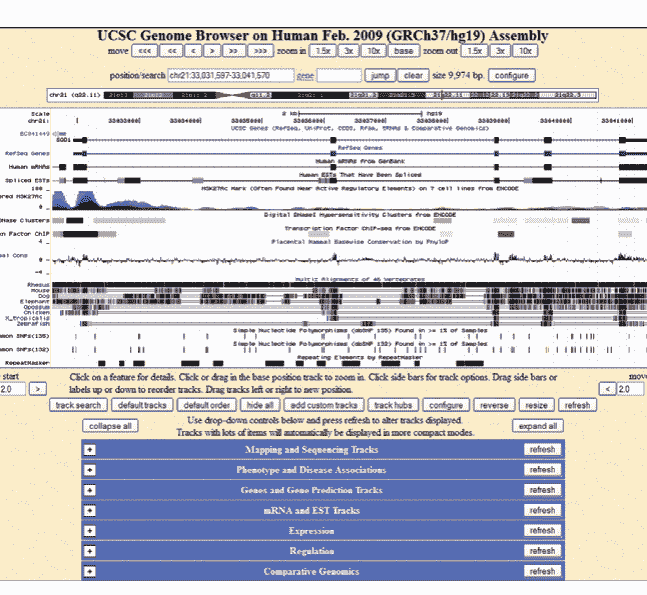

图 9.1 UCSC 基因组浏览器显示的人类基因组组装。顶部包含缩放控制，中间部分显示各种注释，底部包含特征。

## Ensembl 基因组浏览器

- 全基因组
- 比较基因组学
- 遗传变异
- 变异数据
- 基因组学
- 连锁
- 标记
- 变异数据
- Ensembl
- 位置
- 特征
- 染色体
- 组装版本
- 组装片段
- Chromr38
- h19
- 组装片段
- 小鼠 (Mus musculus)
- RNA
- 基因
- 变异特征
- 变异
- 关于 Ensembl
- 特征
- 位置

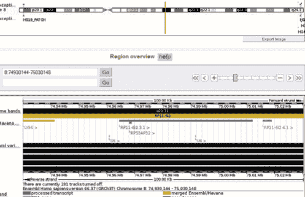

图 9.2 UCSC 基因组浏览器。顶部包含缩放控制，中间部分显示各种注释，底部包含特征。

## Bluejay_Browser/Application

- 中间部分显示基因组特征。
- 底部包含特征。
- 顶部包含缩放控制。
- 底部包含特征。

- 全基因组
- 比较基因组学
- 遗传变异
- 变异数据
- 基因组学
- 连锁
- 标记
- 变异数据
- Ensembl
- 位置
- 特征
- 染色体
- 组装版本
- 组装片段
- Chromr38
- h19
- 组装片段
- 小鼠 (Mus musculus)
- RNA
- 基因
- 变异特征
- 变异
- 关于 Ensembl
- 特征
- 位置

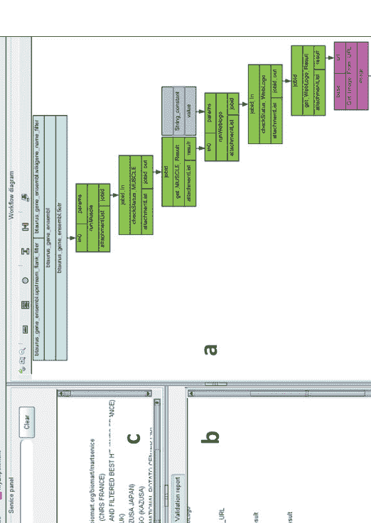

图 10.5 设计模式下的 Taverna 接口。主要组件包括 (a) 交互式图形工作流图；(b) 工作流浏览器，工作流输入、工作流输出、带有端口的处理器以及端口之间数据链接的层级列表；以及 (c) 用于纳入工作流的可用处理器列表。


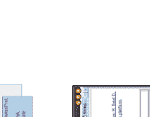


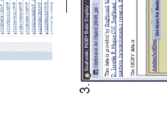
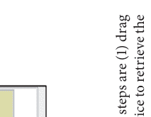


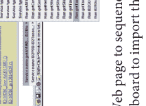
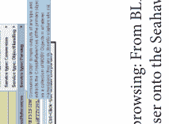
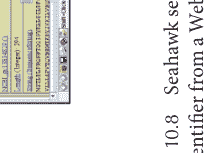

图 10.8 Seahawk 服务浏览：从 BLAST 网页到 Seahawk 中的序列和物种名称标签页。步骤为：(1) 从 Web 浏览器将标识符拖动到 Seahawk 剪贴板进行导入；(2) 点击 ID 链接并选择服务以检索记录；(3) Shift+点击选择交叉引用工具（结果在新标签页中打开）以 (4) 点击分类单元 ID 以获取物种名称，以及 (5) 查看结果。

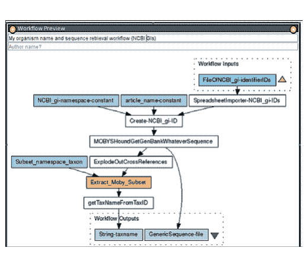

图 10.9 针对图 10.8 分析演示的 Seahawk 工作流预览。


图 10.10 通过搜索/过滤小组件执行的 Seahawk 条件服务执行。(a) Seahawk GUI 中的过滤条件和 (b) 运行中的 Taverna 工作流中对应的过滤处理器。

## 基因表达数据

## 基因组序列数据


图 11.4 Bluejay 中基因表达分析与基因组数据的整合。基因表达数据的解析和分析由 TIGR MeV 完成。表达和分析数据与基因组数据结合，生成统一的视觉化表示，其中基因及其表达/分析值并排显示。

# Chapman & Hall/CRC
数学与计算生物系列

个体化医疗、先进作物和可持续能源的成功需要详尽注释的基因组信息，并将这些信息整合到一个连贯的模型中。该领域的详尽概述《基因组注释》（Genome Annotation）探讨了自动化基因组分析和注释从起源到下一代测序数据挑战的发展。

本书首先带你回顾自测测第一个完整微生物基因组以来的最后 16 年。它解释了当前的分析策略是如何开发的，包括测序策略、统计模型和早期注释系统。随后，作者介绍了展示整合结果的可视化技术，以及先进的注释工具，包括 MAGPIE、Ensembl、Bluejay 和 Galaxy。他们还讨论了复杂的下一代 DNA 测序数据的分析和注释流程。每一章都包含了参考文献和相关工具的提示。

由于极少数基因组注释流程能够处理海量的 DNA 序列信息，必须开发新策略以适应当基因组研究人员的需求。《基因组注释》详细介绍了这一主题，为你应对这一充满挑战性且不断发展的领域提供了基础和工具。本书适用于该领域的新手以及工作中处理基因组信息的专业人士，附带的 CD-ROM 提供两个基因组注释系统。


```
