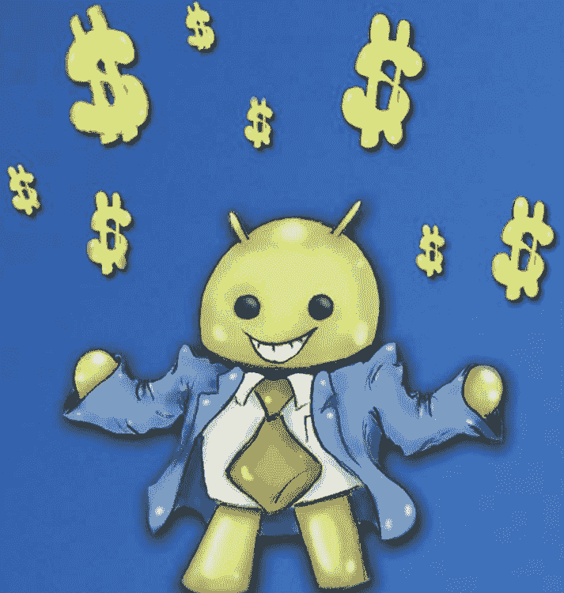

# 进入 Android！Android 赚钱终极指南

## 献给

Natt（我的私人铁杆粉丝）、朋友和家人 :)

## 特别感谢

Emily、Edu、T，以及还有很多、很多其他人...

## 作者简介

Jano Cafiero (j...@getintoandroid.com)

## 21 世纪的 Android：机遇之地

**进入 Android！**
http://www.getintoandroid.com
如有任何问题，请通过 j...@getintoandroid.com 联系我
“进入 Android”为个人、公司和组织提供信息服务。

## 达到临界点

各位，好消息！终于，Android——由 Google 开发的智能手机和平板电脑操作系统——开始为个人和公司带来钱财，真金白银了。

Android 自 2003 年以来就已存在，为什么花了这么长时间？简单来说，我们必须等到移动平台上的消费者数量足够庞大，达到产生足够收入所需的临界点。

就在你阅读这些文字的此刻，**个人和公司正在利用 Android 通过广告、免费和付费应用程序以及其他服务提供的收入流。**

不仅仅是开发者——那些为这种新型移动操作系统制作软件的男孩和女孩——还有那些将移动性视为充满希望的领域，并认为未来几年商业将会是这种模式的人。

我们读到 Android 正在占据全球智能手机市场 50% 的份额。这意味着地球上每两部智能手机中就有一部运行着 Android！我们为什么不应该感到兴奋呢？

小绿机器人——或称“机器人”——的崛起得到了 **三星、亚马逊、HTC、LG、东芝、摩托罗拉、索尼和华为** 的推动，这些都是领先的移动品牌，决定将其设备交由 Google 和开放手持设备联盟创建的操作系统。

亚马逊的全新 Kindle Fire（iPad 的直接竞争对手）内部运行着 Android 的分叉版本，而这家出版巨头已为该操作系统开设了专属市场。甚至 Facebook 据说也在制造一款基于 Android 的“Facebook 智能手机”！

而这仅仅是制造商方面的情况。

迪士尼等娱乐公司，T-Mobile 和 Sprint 等运营商，以及无数其他公司都在加入 Android 市场，因为每个人都认为 Android 是真正且毋庸置疑的关键参与者。

你想错过这场持续的移动狂潮吗？如果你的答案是否定的，那就继续读下去。**加入 Android 革命，进入 Android。**

你可能是下一个 Edward Kim，他宣布他的汽车定位器应用程序（我在“应用程序有什么用？”中解释了什么是应用程序）每月赚取 **13,000 美元**！他的故事现在在开发者中很流行，他甚至在一本名为《如何推广你的 Android 应用程序的最佳书籍》的书中写到了此事。

Kim 的“成功故事”是我们每天听到的众多故事之一，由于 Android 和移动平台非常年轻，我们可以期待它增长到超出最乐观的预期。在一篇文章中，Kim 表示：“Android 只是它最终将成长为的东西的一小部分”。

我认为，这一点至关重要。如果今天 Android 还没有为开发者带来巨额收益，那是因为我们尚未达到消费者数量足以支付巨额分红的点。在我写下这些文字时，Android 提供的收入不错，但未来会更好。

我询问了 James Lamberti（移动公司 In-Mobi 的全球研究与营销副总裁）他对此事的看法，他回答说：

> 我们对 Android 看好，并且确实相信它最终将为开发者带来更多收益。关键在于 Android 现在正在开放的全球市场。这可能需要一两年时间，但有几种趋势指向这一结论。首先，显而易见的是，销售的 Android 设备数量比 iOS 设备多。这个开放的、多制造商、多运营商的平台现在正在带来分红。

Android 的增长令人惊叹，移动市场的增长也是如此。据估计，三年内将有 25 亿用户通过手机访问互联网*。移动行业简直是在爆炸式增长！

在此背景下，Android 最近在智能手机之战中推翻了诺基亚的移动操作系统 Symbian，并且正在迅速追赶 Apple 的 iOS。最新数据告诉我们，全球市场同比增长了 73%，2011 年第二季度出货量超过 1.077 亿部*。

2011 年底，Android 达到了 2 亿次激活（即新设备上线），每天 50 万次激活的速度丝毫没有放缓的迹象。

Android 已内置于 15 个不同品牌的 300 款机型中，而且还在增加。有基于 Android 的智能手机、平板电脑、上网本、超极本、电子书阅读器等等。

全球各地的人们都在称赞该操作系统，相比于智能手机领域的其他替代方案，它更加开放、灵活，并且对最终用户更友好。

想想这个市场已经有多大，以及未来还能变得多大。想象一下，你可以向真正的全球受众提供的所有新产品、服务和事物。可能性是无限的。

* * *

一个移动技术为王的新世界秩序正在我们眼前展开。是否加入，取决于你自己的选择。如果你想加入，我的书将向你展示通过 Android 赚钱的众多方式，包括：

- 关于正在进行的 Android 淘金热的提示。
- 应用程序开发。应用程序有什么用，以及为什么人们如此热议它们。如何为新应用程序获取创意并将其实现，即使你对计算机世界一无所知。
- 如何销售你的应用程序，教授有效的方法来触达全球市场，并通过你的应用程序每月赚取数千美元。什么是成功的应用程序，涵盖了 Android 市场上最受赞誉——且最盈利——软件背后的故事。
- 移动时代的营销将向你展示传递信息并与世界沟通的最有效方式，不仅是你的应用程序，还有你想要推广的任何产品或服务。
- 最后，我们分析更多从 Android 获利的可能方式。一个充满可能性的全新世界正在此时敞开！

所有章节都提供资源和参考点，以便继续探索。正如我在网站上所述，我的意图是使本指南尽可能全面，我会经常对其进行扩展！

请注意：

本书不是开发者的技术书籍；它是一本面向每一个想要在这个蓬勃发展的移动通信新行业中赚钱的普通人的指南。

如果你愿意，可以将“进入 Android”视为一本面向大众的入门作品，旨在让人们了解 Android 世界。

如果你是开发者，这当然会有帮助，但如果你在寻找编程方面的具体建议，我推荐你阅读外面众多优秀的书籍（例如《Hello, Android》[ISBN 978-1934356173] 和《Android for Dummies》[ISBN 978-1118027707]）。

请考虑购买电子书

仅需 $ 3,99 ;)

http://getintoandroid.com/makemoney

