# LLVM 核心库入门指南


封面图片设计：Aniket Sawant (aniket_sawant_photography@hotmail.com)

## 致谢

### 作者

Bruno Cardoso Lopes

Rafael Auler

### 项目协调员

Priyanka Goel

### 校对

Simran Bhogal

### 审核员

Eli Bendersky, Mario Cecere, Logan Chien, Jonathan Todd, Jia Liu, John Szakmeister

### 索引员

Hemangini Bari

### 策划编辑

Mariammal Chettiyar, Mary Jasmine Nadar, Tejal Soni

### 征稿编辑 / 图形

Kevin Colaco, Ronak Dhruv, Abhinash Sahu

### 内容开发编辑

Arun Nadar

### 制作协调员

Saiprasad Kadam

### 技术编辑

Conidon Miranda, Pramod Kumavat, Pratik More

### 封面设计

Manu Joseph

### 英文编辑

Saiprasad Kadam, Dipti Kapadia, Insiya Morbiwala, Aditya Nair, Alfida Paiva, Stuti Srivastava

## 作者简介

`Bruno Cardoso Lopes` 获得巴西坎皮纳大学（University of Campinas）的计算机科学博士学位。他从 2007 年起一直是 `LLVM` 的贡献者，从零开始实现了 `MIPS` 后端，并对其维护了多年。

在他的其他贡献中，他还编写了 `x86 AVX` 支持并改进了 `ARM` 汇编器。他的研究兴趣包括代码压缩技术和低位宽指令集架构（`ISA`）。过去，他还为 `Linux` 和 `FreeBSD` 操作系统开发过驱动程序。

`Rafael Auler` 是巴西坎皮纳大学的博士候选生。他拥有该大学的计算机科学硕士学位和计算机工程学士学位。在硕士研究期间，他编写了一个概念验证工具，能够根据架构描述文件自动生成 `LLVM` 后端。

目前，他的博士研究课题包括动态二进制翻译、即时编译（`JIT`）和计算机架构。Rafael 曾获得微软研究院 2013 年度研究奖学金。

## 审核员简介

`Eli Bendersky` 担任了 15 本的职业程序员，在系统编程方面（包括编译器、链接器和调试器）拥有丰富经验。自 2012 年初初以来，他一直是 `LLVM` 项目的核心贡献者。

`Logan Chien` 获得国立台湾大学的计算机科学硕士学位。他的研究兴趣包括编译器设计、编译器优化和虚拟机。他是一名软件开发者，一直参与多个开源项目，包括 `LLVM`、`Android` 等。

他曾编写过多个补丁来修复 `ARM` 零成本异常处理机制，并增强了 `LLVM ARM` 集成汇编器。他曾于 2012 年在 Google 担任软件工程师实习。在 Google，他将 `LLVM` 工具链与 `Android NDK` 集成在一起。

`Jia Liu` 在大学期间就开始接触 `GNU/Linux` 相关的开发，毕业后一直从事开源相关的开发工作。他现在负责 `China-DSP` 的所有软件相关工作。

他对编译器技术感兴趣，并已研究多年。在空余时间，他还参与了 `LLVM`、`QEMU` 和 `GCC/Binutils` 等开源项目。

他就职于一家中国处理器厂商——格伦科技（`Glarun Technology`）——你可以直接称它为 `China-DSP`。`China-DSP` 是一家高性能 `DSP` 厂商；该公司的核心业务是处理器设计、系统软件和嵌入式并行处理平台，为电力、电信、汽车、制造设备、仪器仪表和消费电子提供独立的知识支持。

`John Szakmeister` 拥有约翰霍普金斯大学的电气工程硕士学位，是 `Intelesys Corporation`（`www.intelesyscorp.com`）的联合创始人。John 职业编写软件已超过 15 年，热衷于编译器、操作系统、复杂算法以及任何相关的工作。

# 前言

# 第 1 章：编译与安装 LLVM

7. 配置完成后，点击 `Generate` 按钮。Visual Studio 解决方案文件 `LLVM.sln` 将被写入指定的构建目录。进入该目录并双击此文件；它将在 Visual Studio 中打开 LLVM 解决方案。

8. 为了自动构建并安装 `LLVM/Clang`，在左侧的 `tree view` 窗口中，导航到 `CMakePredefinedTargets`，右键点击 `INSTALL` 并选择 `Build` 选项。预定义的 `INSTALL` 目标指示系统构建并安装所有 `LLVM/Clang` 工具和库，如下截图所示：

[ 24 ]

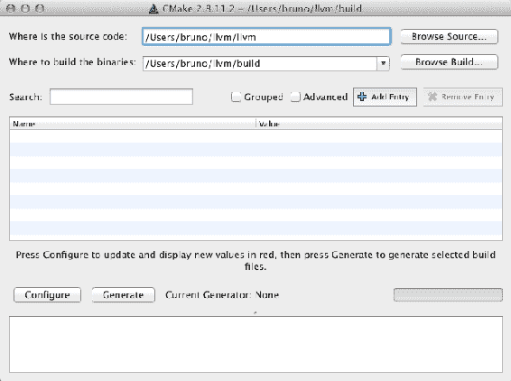

9. 若要选择性地构建和安装特定工具或库，请在左侧的树列表窗口中选择相应的项，右键点击该项并选择 `Build` 选项。

10. 将 `LLVM` 二进制文件的安装目录添加到系统的 `PATH` 环境变量中。

在我们的示例中，安装目录是 `C:\Program Files (x86)\LLVM\install\bin`。为了在不更新 `PATH` 环境变量的情况下直接测试安装，请在命令提示窗口中执行以下命令：

```
C:>"C:\Program Files (x86)\LLVM\install\bin\clang.exe" –v
```

`clang version 3.4…`

## Mac OS X 和 Xcode

虽然可以通过常规 Unix 指令为 Mac OS X 编译 LLVM，但也可以使用 Xcode：

1. 获取一个 Xcode 副本。

2. 下载并安装 `CMake` 工具的官方二进制发行版 [可访问 `http://www.cmake.org`](http://www.cmake.org)]。在安装期间，确保勾选 `Add CMake to the system PATH for all users`。

[ 25 ]

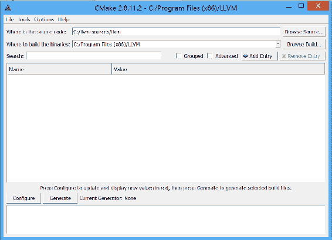

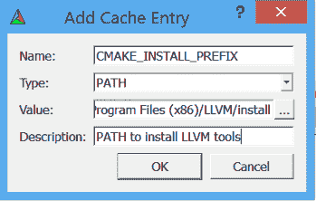

### 构建并安装 LLVM

3. `CMake` 将生成 Xcode 所需的项目文件。首先，运行 `cmake-gui` 图形工具。然后，如下截图所示，点击 `Browse Source` 按钮并选择 LLVM 源码目录。接下来，点击 `Browse Build` 按钮并选择一个目录来存放 `CMake` 生成的文件，这些文件稍后将被使用。

4. 点击 `Add Entry` 并定义 `CMAKE_INSTALL_PREFIX` 以包含 LLVM 工具的安装路径。

5. 此外，支持的目标集可以使用 `LLVM_TARGETS_TO_BUILD` 定义。你可以可选地添加任何定义我们之前讨论过的 `CMake` 参数的其他条目。

[ 26 ]

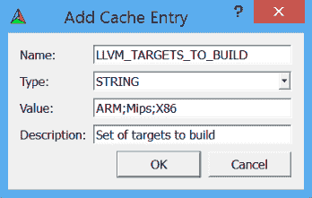

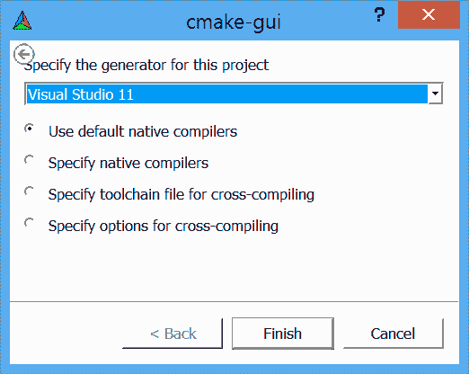

6. Xcode 不支持生成位置无关代码（`PIC`）库。点击 `Add Entry` 添加 `LLVM_ENABLE_PIC` 变量，其类型为 `BOOL`，并保持取消勾选状态，如下截图所示：

7. 点击 `Configure` 按钮。弹出的窗口会询问项目的生成器以及要使用的编译器；选择 `Use default native compilers`。点击 `Finish` 完成过程，如下截图所示：

[ 27 ]

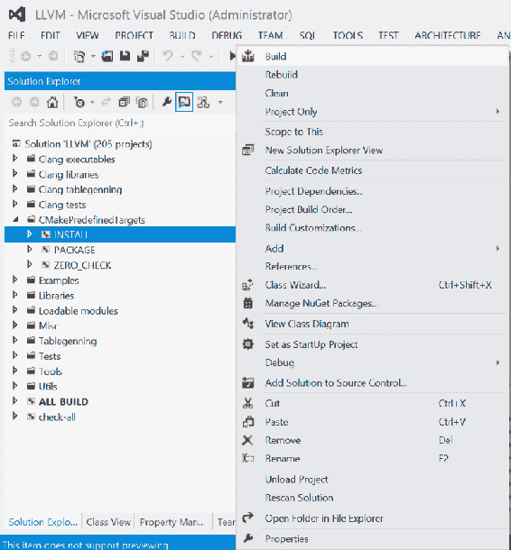

### 构建并安装 LLVM

8. 配置完成后，点击 `Generate` 按钮。`LLVM.xcodeproj` 文件将被写入之前指定的构建目录。进入该目录并双击此文件将在 Xcode 中打开 LLVM 项目。

9. 为了构建并安装 `LLVM/Clang`，选择 `install` 方案。

10. 接下来，点击 `Product` 菜单并选择 `Build` 选项，如下截图所示：

[ 28 ]


11. 将 LLVM 二进制文件的安装目录添加到系统的 `PATH` 环境变量中。

在我们的示例中，安装二进制文件的文件夹是 `/Users/Bruno/llvm/install/bin`。要测试安装，请如下所示从安装目录使用 `clang` 工具：

```
$ /Users/Bruno/llvm/install/bin/clang –v
```

`clang version 3.4…`

[ 29 ]

### 构建并安装 LLVM

## 总结

本章提供了如何安装 LLVM 和 Clang 的详细说明，展示了如何通过官方构建的包、第三方包管理器以及每日快照使用预编译二进制文件。此外，我们还详细介绍了如何在不同的操作系统环境下使用标准的 Unix 工具和 IDE 从源码构建项目。

在下一章节中，我们将介绍如何安装其他对你可能非常有用的基于 LLVM 的项目。这些外部项目通常实现了在主 LLVM SVN 仓库之外开发的工具，并独立发布。

# 外部项目

位于核心 LLVM 和 Clang 仓库之外的项目需要单独下载。在本章中，我们将介绍其他多种官方 LLVM 项目，并解释如何构建和安装它们。只对核心 LLVM 工具感兴趣的读者可以跳过本章，或在需要时回来。在本章中，我们将涵盖以下项目的定义以及如何安装它们：

- `Clang extra` 工具
- `Compiler-RT`
- `DragonEgg`
- `LLDB`
- `libc++`

除了本章涵盖的项目外，还有两个在本书范围之外的官方 LLVM 项目：多面体优化器 `Polly`，以及 LLVM 链接器 `lld`（后者目前正在开发中）。因此，与上一章不同，我们只涵盖涉及下载源代码并由我们构建的技术。不要期望所有这些项目都能达到与核心 LLVM/Clang 项目同等的成熟度。

## 介绍 Clang extras

LLVM 最显著的设计决策是将其后端和前端作为两个独立的项目分离。LLVM 起于一组围绕 LLVM 中间表示（`IR`）运行的工具，并依赖 GCC 将高级语言程序翻译成其特定的 `IR`（存储在 `bitcode` 文件中）。LLVM 项目的一个重要里程碑是 Clang 的出现，它是 LLVM 团队专门设计的第一个前端，它带来了与核心 LLVM 相同的质量、清晰的文档和库组织结构。它不仅能够将 C 和 C++ 程序转换为 `IR`，还能作为一个灵活的编译器驱动程序监督整个编译过程，并努力保持与 GCC 兼容。从现在起，我们将 Clang 称为前端而非驱动程序，负责将 C 和 C++ 程序翻译为 `IR`。Clang 库的令人兴奋的方面在于，可以使用它们来编写强大的工具，例如 C++ 代码源码分析工具。Clang 预装了一些工具，这些工具可以让你了解使用其库可以做什么：

- `Clang Check`：它能够执行语法检查，应用快速修复（quick fixes）来解决常见问题，还可以导出任何程序的内部 Clang 抽象语法树（`AST`）表示。
- `Clang Format`：它包含一个工具和一个库 `LibFormat`，不仅能够缩进代码，还能对任何 C++ 代码进行格式化，以符合 LLVM 编码标准、Google 风格指南、Chromium 风格指南、Mozilla 风格指南和 WebKit 风格指南。
- `Clang Modernizer`：它是一个代码重构工具，可以扫描 C++ 代码并将旧式构造改为符合新标准（如 C++11 标准）提出的更现代风格。
- `Clang Tidy`：它是一个 linter 工具，用于检查违反 LLVM 或 Google 编码标准的常见编程错误。
- `Modularize`：它帮助你识别适合组成模块（module）的 C++ 头文件，模块是 C++ 标准化委员会正在讨论的一个新概念（更多信息请参阅 `Clang Tools with LibTooling`）。
- `PPTrace`：它是一个跟踪 Clang C++ 预处理器活动的简易工具。

关于如何使用这些工具以及如何构建你自己的工具的更多信息，请参阅 `Clang Tools with LibTooling`。

## 构建和安装 Clang extra 工具

你可以在 `http://llvm.org/releases/3.4/clang-tools-extra-3.4.src.tar.gz` 获取该项目的 3.4 版本官方快。如果你想扫描所有可用版本，请检查 `http://llvm.org/releases/download.html`。

为了顺利编译这组工具，请依赖 LLVM 构建系统将其与核心 LLVM 和 Clang 的源码一起构建。要做到这一点，你必须如下所示将源码目录放入 Clang 源码树：

```bash
wget http://llvm.org/releases/3.4/clang-tools-extra-3.4.src.tar.gz
tar xzf clang-tools-extra-3.4.src.tar.gz
mv clang-tools-extra-3.4 llvm/tools/clang/tools/extra
```

你也可以直接从官方 LLVM Subversion 仓库获取源码：

```bash
cd llvm/tools/clang/tools
svn co http://llvm.org/svn/llvm-project/clang-tools-extra/trunk extra
```

回想章，如果你想获取 3.4 版本的稳定源码，可以将 `trunk` 替换为 `tags/RELEASE_34/`。或者，如果你倾向于使用 GIT 版本控制软件，可以使用以下命令行下载：

```bash
cd llvm/tools/clang/tools
git clone http://llvm.org/git/clang-tools-extra.git
```

将源码放入 Clang 树后，你必须使用 CMake 或 autotools 生成的脚本继续编译。要测试安装是否成功，请如下所示运行 `clang-modernize` 工具：

```bash
clang-modernize --version
```

## Compiler-RT

`Compiler-RT` (runtime) 项目为硬件不支持的低级功能提供了特定目标的支持。例如，32 位目标缺少支持 64 位除法的指令。`Compiler-RT` 通过提供特定目标且优化的函数来解决这个问题，该函数使用 32 位指令实现 64 位除法。它提供了相同的功能，因此是 LLVM 的 `libgcc`。此外，它还为地址检测器和内存检测器工具提供了运行时支持。你可以在 `http://llvm.org/releases/3.4/compiler-rt-3.4.src.tar.gz` 下载 Compiler-RT 3.4 版本，或在 `http://llvm.org/releases/download.html` 查找更多版本。

由于它是运行的 LLVM 编译器工具链的关键组件，我们已经在上一章中介绍了如何安装 `Compiler-RT`。如果你还没有它，请记住将其源码放入 LLVM 源码树的 `projects` 文件夹中，如下命令所示：

```bash
wget http://llvm.org/releases/3.4/compiler-rt-3.4.src.tar.gz
tar xzf compiler-rt-3.4.src.tar.gz
mv compiler-rt-3.4 llvm/projects/compiler-rt
```

如果你愿意，也可以改为依赖它的 SVN 仓库：

```bash
cd llvm/projects
svn checkout http://llvm.org/svn/llvm-project/compiler-rt/trunk compiler-rt
```

你也可以通过 GIT 镜像作为 SVN 的替代方案下载它：

```bash
cd llvm/projects
git clone http://llvm.org/git/compiler-rt.git
```

`x86_64`、`PowerPC`、`SPARC64` 以及 `ARM`。

## 观察 Compiler-RT 的运行

为了观察编译器运行时库介入的典型场景，你可以编写一个执行 64 位除法的 C 程序来完成一个简单的实验：

```c
#include <stdio.h>
#include <stdint.h>
#include <stdlib.h>

int main() {
    // [ 34 ]
    // 第 2 章
    uint64_t a = 0ULL, b = 0ULL;
    scanf ("%lld %lld", &a, &b);
    printf ("64-bit division is %lld\n", a / b);
    return EXIT_SUCCESS;
}
```

## 下载示例代码

你可以从 `http://www.packtpub.com` 账户中下载你购买的所有 Packt 书籍的示例代码文件。如果你是在其他地方购买的这本书，可以访问 `http://www.packtpub.com/support` 并注册，以便将文件直接通过电子邮件发送给你。

如果你使用的是 64 位 x86 系统，请使用你的 LLVM 编译器尝试以下两个命令：

```
$ clang -S -m32 test.c -o test-32bit.S
$ clang -S test.c -o test-64bit.S
```

`-m32` 标志指示编译器生成一个 32 位 x86 程序，而 `-S` 标志则为该程序生成 `test-32bit.S` x86 汇编语言文件。

如果你查看该文件，每当程序需要执行除法时，你会看到一个奇怪的调用：

```
call ___udivdi3
```


该函数由 `Compiler-RT` 定义，并展示了该库被使用的地方。然而，如果你省略 `-m32` 标志并使用 64 位 x86 编译器（如生成 `test-64bit.S` 汇编语言文件的第二个编译器命令所示），你将不再看到需要 `Compiler-RT` 协助的程序，因为可以使用单条指令轻松完成此除法：

```
divq -24(%rbp)
```

[ 35 ]

## 外部项目

## 使用 DragonEgg 插件

如前所述，当 LLVM 尚缺少自己的 C/C++ 前端时，它是作为一个依赖 GCC 的项目启动的。在情况下，为了使用 LLVM，你需要下载一个名为 `llvm-gcc` 的过的 GCC 源码树并对其完整编译。

由于编译涉及整个 GCC 软件包，这是一项非常耗时且棘手的任务，需要了解所有必要的 GNU 知识才能自己构建 GCC。DragonEgg 项目的出现是一个巧妙的解决方案，它利用了 GCC 插件系统，将 LLVM 逻辑分离到它自己的、小得多的树中。通过这种方式，用户不再需要重新构建整个 GCC 软件包，只需要构建一个插件并将其加载到 GCC 中。DragonEgg 也是 LLVM 项目体系下唯一 get GPL 协议许可的项目。

尽管 Clang 已经兴起，DragonEgg 直在今天依然存在，因为 Clang 只处理 C 和 C++ 语言，而 GCC 能够解析更广泛的语言。

通过使用 DragonEgg 插件，你可以将 GCC 作为 LLVM 编译器的前端，能够编译 GCC 支持的大多数语言：Ada、C、C++ 和 FORTRAN，并对 Go、Java、Obj-C 和 Obj-C++ 提供部分支持。

该插件的作用原理是将 GCC 的中间后端替换为 LLVM 的后端，并自动执行所有的编译步骤，正如你对一个一流编译器驱动程序的预期的那样。这种新场景的编译流水线如图所示：

```
GCC 预处理器，程序源码 -> LLVM IR 优化器 -> 词法分析和解析器 -> LLVM 后端 -> LLVM 集成汇编器 -> GCC 链接器 -> 程序二进制
```

如果你愿意，可以使用 `-fplugin-arg-dragonegg-emit-ir -S` 参数组将编译流水线停止在 LLVM IR 生成阶段，并使用 LLVM 工具分析研究前端的结果，或者使用 LLVM 工具自己完成编译。我们将很快看到一个示例。

由于它是 LLVM 的侧项目，维护者更新 DragonEgg 的速度与 LLVM 主项目不同。在本文期间，DragonEgg 最新的稳定版本是 3.3 版本，它与 LLVM 3.3 的工具集绑定。

因此，如果你生成了 LLVM 位码（即使用 LLVM IR 在磁盘上编写程序），你无法使用 3.3 其他版本的 LLVM 工具来分析该文件、优化或继续编译。你可以在 http://dragonegg.llvm.org 找到官方 DragonEgg 网站。

[ 36 ]

## 第 2 章

## 构建 DragonEgg

要编译并安装 DragonEgg，首先从 http://llvm.org/releases/3.3/dragonegg-3.3.src.tar.gz 获取源码。对于 Ubuntu，使用以下命令：

```
$ wget http://llvm.org/releases/3.3/dragonegg-3.3.src.tar.gz
$ tar xzvf dragonegg-3.3.src.tar.gz
$ cd dragonegg-3.3.src
```

如果你想探索来自 SVN 当前但不稳定的源码，请使用以下命令：

```
$ svn checkout http://llvm.org/svn/llvm-project/dragonegg/trunk dragonegg
```

对于 GIT 镜像，使用以下：

```
$ git clone http://llvm.org/git/dragonegg.git
```

要编译并安装，你需要提供 LLVM 安装路径。假设安装路径为 `/usr/local/llvm`（见第 1 章安装 LLVM），并假设 GCC 4.6 存在于你的 `PATH` 变量中，你应该使用以下命令：

```
$ GCC=gcc-4.6 LLVM_CONFIG=/usr/local/llvm/bin/llvm-config make
$ cp -a dragonegg.so /usr/local/llvm/lib
$ gcc-4.6 -fplugin=/usr/local/llvm/lib/dragonegg.so hello.c -o hello.s
```

注意项目缺少 autotools 或 CMake 文件。你应该直接使用 `make` 命令构建。插件是名为 `dragonegg.so` 的共享库，你可以通过以下命令行调用它。考虑到你正在编译经典的“Hello, World!” 代码。

尽管 DragonEgg 理论上支持 GCC 4.5 及以上版本，但建议使用 4.6。

[ 37 ]

## 外部项目

## 使用 DragonEgg 和 LLVM 工具理解流水线

如果你想看到前端的运行，使用 `-S -fplugin-arg-dragonegg-emit-ir` 标志，这将输出一个易读的 LLVM IR 文件：

```
$ gcc-4.6 -fplugin=/usr/local/llvm/lib/dragonegg.so -S -fplugin-arg-dragonegg-emit-ir hello.c -o hello.ll
$ cat hello.ll
```

在编译器将程序翻译 IR 后停止编译并将内存表示序列化到磁盘的能力是 LLVM 的一个特点。大多数其他编译器无法做到。在欣赏了 LLVM IR 如何表示你的程序后，可以使用多个 LLVM 工具手动继续编译过程。以下命令调用了一个特殊的汇编器，将文本形式的转换为二进制形式，仍存储在磁盘上：

```
$ llvm-as hello.ll -o hello.bc
$ file hello.bc
hello.bc: LLVM bitcode
```

如果你愿意，可以使用特殊的 IR 反汇编器（`llvm-dis`）将其转换回可读格式。以下工具将应用目标无关的优化，同时向你显示成功转换的统计数据：

```
$ opt -stats hello.bc -o hello.bc
```

`-stats` 标志是可选的。之后，可以使用 LLVM 后端工具将其转换为机器汇编语言：

```
$ llc -stats hello.bc -o hello.S
```

LLVM 默认使用你的系统链接器，因为 LLVM 链接器项目 `lld` 目前正处于开发阶段，尚未集成到 LLVM 核心项目中。

因此，如果你没有 `lld`，你可以使用常规的编译器驱动程序来完成编译，这将激活你的系统链接器：

```
$ gcc hello.o -o hello
```

**[ 38 ]**

# 第 2 章

请记住，出于性能考虑，真正的 LLVM 编译器驱动程序在任何阶段都永远将程序表示序列化到磁盘（对象文件除外），因为它仍然缺乏一个集成的链接器。它使用内存中的表示，并协调多个 LLVM 组件来进行编译。

## 理解 LLVM 测试套件

LLVM 测试套件包含了一组官方的程序和基准测试程序，用于测试 LLVM 编译器。该测试套件对 LLVM 开发者非常有用，它可以通过编译和运行这些程序来验证优化和编译器的改进。如果你正在使用不稳定的 LLVM 版本，或者你修改了 LLVM 源码并怀疑某些功能运行不正常，那么亲自运行测试套件将非常有帮助。不过，请记住，更简单的 LLVM 回归测试和单元测试位于 LLVM 主树中，你可以通过 `make check-all` 轻松地运行它们。测试套件与经典的回归和单元测试不同之处在于它包含了整个基准测试。

你必须将 LLVM 测试套件放在 LLVM 源码树中，以便让 LLVM 构建系统识别它。你可以在 [`llvm.org/releases/3.4/test-suite-3.4.src.tar.gz`](http://llvm.org/releases/3.4/test-suite-3.4.src.tar.gz) 版本 3.4 的源码。

获取源码，请使用以下命令：

```
$ wget http://llvm.org/releases/3.4/test-suite-3.4.src.tar.gz
$ tar xzf test-suite-3.4.src.tar.gz
$ mv test-suite-3.4 llvm/projects/test-suite
```

如果你更喜欢通过 SVN 下载以获取最新且可能不稳定的版本，请使用以下：

```
$ cd llvm/projects
$ svn checkout checkout://llvm.org/svn/llvm-project/test-suite/trunk test-suite
```

如果你更偏于 GIT，请使用以下命令：

```
$ cd llvm/projects
$ git clone http://llvm.org/git/llvm-project/test-suite.git
```

你需要重新生成 LLVM 的构建文件以使用测试套件。在这种特殊情况下，你不能使用 `CMake`。你必须坚持经典的 `configure` 脚本来配合测试套件。请重复*第 1 章，构建与安装 LLVM* 中描述的配置步骤。

**[ 39 ]**

## 外部项目

测试套件有一组用于测试和检查基准测试的 Makefile。你也可以提供一个评估自定义程序的自定义 Makefile。使用命名模板 `llvm/projects/test-suite/TEST.<custom>.Makefile` 将自定义 Makefile 放在测试套件的源码目录下，其中 `<custom>` 标签必须替换为你想要的任何名称。示例查看 `llvm/projects/test-suite/TEST.example.Makefile`。

你需要重新生成 LLVM 构建文件，以便自定义或修改 Makefile。

在配置期间，LLVM 对象目录中会创建一个测试套件目录，程序和基准测试将在其中运行。要运行并测试示例 Makefile，进入*第 1 章，构建与安装 LLVM* 中的对象目录路径，并执行以下命令行：

```
$ cd your-llvm-build-folder/projects/test-suite
$ make TEST="example" report
```

## 使用 LLDB

LLDB（低级调试器）项目是一个用 LLVM 基础设施构建的调试器，正在活跃开发，并作为 Mac OS X 上 Xcode 5 的调试器发布。自 2011 年在 Xcode 范围之外开始开发以来，到本文写作时，LLDB 尚未发布稳定版本。你可以在 [`llvm.org/releases/3.4/lldb-3.4.src.tar.gz`](http://llvm.org/releases/3.4/lldb-3.4.src.tar.gz) 获取 LLDB 源码。像许多依赖 LLVM 的项目一样，你可以通过集成到 LLVM 构建系统中来轻松构建它。要实现这一点，只需将其源码放在 LLVM tools 文件夹中，如下例：

```
$ wget http://llvm.org/releases/3.4/lldb-3.4.src.tar.gz
$ tar xvf lldb-3.4.src.tar.gz
$ mv lldb-3.4 llvm/tools/lldb
```

你也可以使用它的 SVN 仓库获取最新修订版本：

```
$ cd llvm/tools
$ svn checkout http://llvm.org/svn/llvm-project/lldb/trunk lldb
```

如果你愿意，可以使用它的 GIT 镜像：

```
$ cd llvm/tools
$ git clone http://llvm.org/git/llvm-project/lldb.git
```

**[ 40 ]**

# 第 2 章

LLDB 对于 GNU/Linux 系统来说仍然处于实验性阶段。

在构建它之前，请注意 LLDB 有一些软件前提：Swig、libedit（仅限 Linux）和 Python。在 Ubuntu 系统上（例如），你可以通过以下命令解决这些依赖关系：

```
$ sudo apt-get install swig libedit-dev python
```

记住，像其他项目一样，在编译 LLVM 时需要重新生成文件。按照*第 1 章，构建与安装 LLVM*中提到的步骤操作，以 LLDB 启动。为了查看其版本，只需带上 `-v` 标志运行它：

```
$ lldb -v
```

## 在 LLDB 中进行调试会话

为了看到 LLDB 如何工作，我们启动一个调试会话来分析 Clang。如果你熟悉 GDB，可能会对 [`llvm.org/lldb-gdb.html`](http://llvm.org/lldb-gdb.html) 中的表格感兴趣。与 GDB 相同，我们通过作为命令行传递可执行文件路径来启动 LLDB：

```
$ lldb where-llvm-is-folder/clang
Current executable set to 'where-llvm-is-folder/clang'
(x86_64).
(lldb) break main
Breakpoint 1: where = clang`main + 48 at driver.cpp:293, address = 0x000000010001e0
```

**[ 41 ]**

## 外部项目

为了开始调试，我们为 Clang 提供命令行参数。我们将使用 `-v` 参数，它应该打印版本：

```
(lldb) run -v
```

在 LLDB 命中断点后，可以可以使用 `next` 命令逐行执行 C++ 代码。像 GDB 一样，LLDB 接受任何命令缩写，例如用 `n` 代替 `next`，只要没有歧义：

```
(lldb) n
```

为了查看 LLDB 如何打印 C++ 对象，执行到声明 `argv` 或 `ArgAllocator` 对象之后的行并打印它：

```
(lldb) n
(lldb) p ArgAllocator
(llvm::SpecificBumpPtrAllocator<char>) $0 = {
Allocator = {
SlabSize = 4096
SizeThreshld = 4096
DefaultSlabAllocator = (Allocator::MallocAllocator @ 0x00007f85f1497f68)
Allocator = 0x0000007fffbff200
CurSlab = 0x0000000000000000
CurPtr = 0x0000000000000000
End = 0x0000000000000000
BytesAllocated = 0
}
}
```

当你满意后，使用 `q` 命令退出调试器：

```
(lldb) q
Quitting LLDB will kill one or more processes. Do you really want to
proceed: [Y/n] y
```

`libc++` 库是 LLVM 项目伞下的一个 C++ 标准库重写版本，它支持最新的 C++ 标准（包括 `C++11` 和 `C++1y`），并采用 MIT 许可证和 UIUC 许可证双重许可。`libc++` 库是 `Compiler-RT` 的重要伴侣，它是 `Clang++` 构建最终 C++ 可执行文件时使用的运行时库的一部分，必要时还会配合 `libclc`（OpenCL 运行时库）。它与 `Compiler-RT` 的不同在于，构建 `libc++` 对你并不是必需的。`Clang` 并不局限于它，在缺少 `libc++` 的情况下，可能会将你的程序与 GNU 的 `libstdc++` 链接。如果你同时拥有两者，可以通过 `-stdlib` 切换开关来选择 `Clang++` 使用哪个库。`libc++` 库支持 `x86` 和 `x86_64` 处理器，被设计为 Mac OS X 和 GNU/Linux 系统上 GNU `libstdc++` 的替代方案。

GNU/Linux 的 `libc++` 支持仍在进行中，不如 Mac OS X 的版本稳定。

根据 `libc++` 开发者的说法，继续在 GNU `libstdc++` 上工作的主要障碍之一是，支持新的 C++ 标准需要进行大规模的代码重写，而且主线 `libstdc++` 开发切换到了 GPLv3 许可证，某些支持 LLVM 项目的公司无法使用该许可证。

请注意，LLVM 项目经常用于商业产品，其使用方式与 GPL 哲学不兼容。面对这些挑战，LLVM 社区决定开发一个主要针对 Mac OS X 并支持 Linux 的新 C++ 标准库。

在你的 Apple 电脑上获取 `libc++` 最简单的方法是安装 `4.2` 或更高版本的 `Xcode`。

如果你打算为你的 GNU/Linux 机器自行构建库，请记住 C++ 标准库由库本身以及一个实现异常处理和**运行时类型信息**（**RTTI**）功能的低层结构组成。这种关注点分离使得 C++ 标准库更容易移植到其他系统上。它也在构建 C++ 标准库时为你提供了不同的选项。你可以构建 `libc++` 并链接到 `libsupc++`（该低层结构的 GNU 实现）或 `libc++abi`（LLVM 团队的实现）。然而，`libc++abi` 目前仅支持 Mac OS X 系统。

**[ 43 ]**

## 外部项目

要在 GNU/Linux 机器上使用 `libsupc++` 构建 `libc++`，首先下载源码包：

```
$ wget http://llvm.org/releases/3.4/libcxx-3.4.src.tar.gz
$ tar xvf libcxx-3.4.src.tar.gz
$ mv libcxx-3.4 libcxx
```

在本文编写时，你仍然无法依靠 LLVM 构建系统来为你构建该库（就像我们处理其他项目时那样）。因此，请注意，我们这次没有将 `libc++` 源码放入 LLVM 源码树。


或者，可以使用包含实验性顶端（`top-of-trunk`）版本的 SVN 仓库：

```bash
$ svn co http://llvm.org/svn/llvm-project/libcxx/trunk libcxx
```

你也可以使用 GIT 镜像：

```bash
$ git clone http://llvm.org/git/llvm-project/libcxx.git
```

一旦你拥有了可用的基于 LLVM 的编译器，你就需要生成专门使用你新的基于 LLVM 编译器的 `libc++` 构建文件。在这个示例中，我们假设路径中有一个可用的 LLVM `3.4` 编译器。

要使用 `libsupc++`，我们首先需要找到它的头文件在系统中的安装位置。由于它是 GNU/Linux 常规 GCC 编译器的一部分，你可以通过以下命令发现它：

```bash
$ echo | g++ -Wp,-v -x c++ - -fsyntax-only
```

`#include "..."` 搜索从开始：

`#include <...>` 搜索从开始：

`/usr/include/c++/4.7.0`

`/usr/include/c++/4.7.0/x86_64-pc-linux-gnu`

**(后续项目省略)**

通常，前两个路径指示了 `libsupc++` 头文件的位置。要确认这一点，请查找是否存在类似 `bits/exception_ptr.h` 的 `libsupc++` 头文件：

```bash
$ find /usr/include/c++/4.7.0 | grep bits/exception_ptr.h
```

随后，生成 `libc++` 构建文件以用你基于 LLVM 的编译器进行编译。

要执行此操作，请覆盖 shell 环境变量 `CC` 和 `CXX`（它们分别定义系统的 C 和 C++ 编译器），以使用你想要嵌入 `libc++` 的 LLVM 编译器。要使用 `CMake` 用 `libsupc++` 构建 `libc++`，你需要定义 CMake 参数 `LIBCXX_CXX_ABI`（定义要使用的低层库）和 `LIBCXX_LIBSUPCXX_INCLUDE_PATHS`（这是一个由分号分隔的路径列表，指向你刚刚发现的包含 `libsupc++` 文件的文件夹）：

```bash
$ mkdir where-you-want-to-build
$ cd where-you-want-to-build
$ CC=clang CXX=clang++ cmake -DLIBCXX_CXX_ABI=libstdc++ -DLIBCXX_LIBSUPCXX_INCLUDE_PATHS="/usr/include/c++/4.7.0;/usr/include/c++/4.7.0/x86_64-pc-linux-gnu" -MAKE_INSTALL_PREFIX=/usr/libcxx
```

使用 GCC 将高级语言（如 C）翻译为 LLVM `intermediate representation`（`IR`）。今天，LLVM 设计的一个核心方面是其 `IR`。它使用了`单静态赋值`（`SSA`），并具有两个重要特性：

- 代码被组织为三地址指令

- 它具有无限数量的寄存器

### 工具与设计

然而，这并不意味着 LLVM 只有一种表示程序的形式。在整个编译过程中，其他的中间数据结构持有程序逻辑，并帮助其在跨越主要检查点进行翻译。从技术上讲，它们也是程序表示的中间形式。例如，LLVM 在将 C 或 C++ 翻译为 LLVM `IR` 时，`Clang` 会使用`抽象语法树`（`AST`）结构（`TranslationUnitDecl` 类）在内存中表示程序；在将 LLVM `IR` 翻译为特定机器的汇编语言时，`LLVM` 会先将程序转换为有向无环图（`DAG`）形式，以便于指令选择（`SelectionDAG` 类），然后将其转换回三地址表示，以便进行指令调度（`MachineFunction` 类）。

为了实现汇编器和链接器，`LLVM` 使用了第四种中间数据结构（`MCModule` 类），在对象文件的上下文中持有程序表示。

除了 LLVM 中的其他程序表示形式外，LLVM `IR` 是最重要的一个。它的特殊之处在于不仅是内存中的表示，而且还存储在磁盘上。LLVM `IR` 拥有一种特定的编码以存在于外部世界，这是项目生命周期早期做出的另一个重要决策，它反映了当时学术界对研究终身程序优化的兴趣。

在这种哲学下，编译器超越了在编译时应用优化的限制，探索了安装时、运行时和空闲时间（程序未运行时）的优化机会。通过这种方式，优化发生在整个生命周期中，从而解释了该概念的名称。例如，当用户没有运行程序且计算机处于空闲状态时，操作系统可以启动编译器守护进程，处理在运行时收集的分析数据，为该用户的特定用例重新优化程序。

请注意，由于能够存储在磁盘上，LLVM `IR` 作为终身程序优化的关键推动因素，提供了一种编码整个程序的替代方法。

当整个程序以编译器 `IR` 的形式存储时，也可以执行一系列新的非常有效的过程间优化，这些优化跨越了单个翻译单元或 C 文件的边界。因此，这也允许了强大的链接时优化发生。

另一方面，在终身程序优化成为现实之前，程序分发需要在 LLVM `IR` 级别进行，但目前还没有发生。这意味着 LLVM 将作为一个平台或虚拟机运行，并与 Java 竞争，而后者同样面临严峻的挑战。例如，LLVM `IR` 不像 Java 那样与目标无关。`LLVM` 还没有投资于安装后时间的强大反馈引导优化。对于感兴趣阅读更多关于这些技术挑战的读者，我们建议阅读一个非常有用的 `LLVMdev` 讨论线程，位于 `http://lists.cs.uiuc.edu/pipermail/llvmdev/2011-October/043719.html`。

随着项目的成熟，维护编译器 `IR` 磁盘表示的设计决策作为链接时优化的推动因素保留了下来，而对终身程序优化原始想法关注较少。最终，`LLVM` 的核心库通过放弃 `Low Level Virtual Machine` 这一缩写，正式表达了它们对成为平台缺乏兴趣，出于历史原因仅保留了 `LLVM` 的名称，这明确了 LLVM 项目旨在成为一个强大且实用的 C/C++ 编译器，而不是 Java 平台的竞争者。

尽管如此，除了链接时优化外，磁盘表示本身也具有极具前景的应用前景，某些小组正努力将其引入现实世界。例如，FreeBSD 社区希望将程序可执行文件与其 `LLVM` 程序表示嵌入在一起，以允许安装时或离线的微架构优化。在这种情况下，即使程序被编译为通用的 `x86`，当用户安装程序时（例如，在特定的 `Intel Haswell x86` 处理器上），`LLVM` 基础设施可以使用二进制文件的 `LLVM` 表示并将其专门化，以使用 `Haswell` 支持的新指令。尽管这是一个目前正在评估的新想法，但它证明了磁盘上的 LLVM 表示允许产生激性的新解决方案。人们的预期是微架构优化，因为在 Java 中看到的完全平台无关性在 LLVM 中看起来是不现实的，这种可能性目前仅在外部项目中探索（参见 `PNaCl`、`Chromium's Portable Native Client`）。

作为编译器 `IR`，引导核心库开发的 LLVM `IR` 两个基本原则如下：

- `SSA` 表示和无限寄存器允许快速优化

- 通过将整个程序存储在磁盘上的 `IR` 表示中，实现简易的链接时优化

### 了解今天的 LLVM

如今，LLVM 项目已经成长，并拥有海量的编译器相关工具集。事实上，`LLVM` 的名称可能指代以下任何一种：

- **LLVM 项目/基础设施**：这是多个项目的统称，它们共同构成了一个完整的编译器：前端、后端、优化器、汇编器、链接器、`libc++`、`compiler-rt` 以及 JIT 引擎。“LLVM”这个词具有这种含义，例如在句子“LLVM 由多个项目组成”。

- **基于 LLVM 的编译器**：这是使用 LLVM 基础设施部分或完全构建的编译器。例如，一个编译器可能使用 `LLVM` 进行前端和后端，但使用 `GCC` 和 GNU 系统库执行最终链接。“LLVM”的这种含义出现在句子“我使用 LLVM 将 C 程序编译到 MIPS 平台”。

- **LLVM 库**：这是 LLVM 基础设施中的可重用代码部分。例如，“LLVM”的这种含义出现在句子“我的项目通过 LLIT 编译框架生成代码”。

- **LLVM 核心**：在中间语言层发生的优化和后端算法构成了 LLVM 核心，这也是该项目的起点。“LLVM”的这种含义出现在句子“LLVM 和 Clang 是两个不同的项目”。

- **LLVM IR**：这是 LLVM 编译器中间表示。“LLVM”在如“我构建了一个将我自己的语言翻译为 LLVM 的前端”等句子中这种含义。

为了理解 LLVM 项目，你需要了解该架构最重要的部分：

- **前端**：这是将 C、C++ 和 Objective-C 等编程语言翻译为 LLVM 编译器 `IR` 的编译步骤。这包括词法分析器、语法解析器、语义分析器和 LLVM IR 代码生成器。`Clang` 项目实现了所有前端相关的步骤，并提供了插件接口和独立的静态分析工具以允许深度分析。详细信息可以参阅*第 4 章，前端*、*第 9 章，Clang 静态分析器*以及*第 10 章，使用 LibTooling 的开发 Clang 工具*。

- **IR**：LLVM 的 `IR` 同时具有人类可读和二进制编码的表示。工具和库提供了用于 IR 构建、汇编和反汇编的接口。LLVM 优化器同样在 `IR` 上运行，大部分优化都在这里应用。我们将在*第 5 章：LLVM 中间表示*中详细解释 IR。

- **后端（Backend）**：这是负责代码生成的步骤。它将 LLVM `IR` 转换为目标特定的汇编代码或目标代码二进制文件。寄存器分配、循环变换、汇编优化器以及目标特定的优化/变换都属于后端。我们将在*第 6 章：后端*中对其进行深度分析。

接下来的图展示了各个组件，并在特定配置下使用时为我们提供了整个架构的概述。请注意，我们可以重新组织这些组件并以不同的方式利用它们，例如，如果我们不想探索链接时优化，就可以不使用 LLVM `IR` 链接器。

```
Libc++ standard
Clang frontend or Compiler-RT runtime
System libraries
Program source library
GCC with DragonEgg libraries
Clang frontend or GCC linker or LLD
Program source
GCC with DragonEgg
LLVM IR linker
LLVM IR optimizer
LLVM backend
LLVM integrated assembler (under development)
Program binary
Clang frontend or Program source
GCC with DragonEgg
```

这些编译器各个部分之间的交互可以通过以下两种方式之一发生：

- **在内存中**：这是通过单个主控工具（如 `Clang`）实现的，该工具将每个 LLVM 组件作为库使用，并依赖于内存中分配的数据结构，将上一个阶段的输出传递给下一个阶段的输入。

- **通过文件**：这是通过用户启动较小的独立工具来实现的，这些工具将特定组件的结果写入磁盘上的文件，并依赖用户使用该文件作为输入来启动下一个工具。

因此，高层工具（如 `Clang`）可以通过链接实现其功能的库，来整合对多个其他较小工具的使用。

这之所以可行，是因为 LLVM 使用了一种强调最大化代码重用的设计，而这些代码存在于库中。此外，封装了少数库的独立工具也是很有用的，因为它们允许用户通过命令行直接与特定的 LLVM 组件交互。

例如，考虑下面的图。我们在方框中用粗体显示工具名称，用普通字体在分开的框中显示它们实现功能时使用的库。在这个示例中，LLVM 后端工具 `llc` 使用 `libLLVMCodeGen` 库来实现其部分功能，而仅启动 LLVM `IR` 级优化器的 `opt` 命令则使用另一个库（称为 `libLLVMipa`）来实现与目标无关的跨过程优化。然而，我们看到 `clang` 是一个更大的工具，它同时使用了这两个库来重写 `llc` 和 `opt`，并为用户提供了一个更简单的接口。因此，由此类高层工具执行的任何任务都可以分解为一系列低层工具链，同时产生相同的结果。接下来的章节将说明这一概念。在实践中，`Clang` 能够完成整个编译，而不仅仅是 `opt` 和 `llc` 的工作。这解释了为什么在静态构建中，`Clang` 二进制文件通常最大，因为它链接并运行了整个 LLVM 生态系统。

```
libLLVMipa
libLLVMCodeGen
opt
llc
clang
```

### 与编译器驱动程序交互

编译器驱动程序类似于汉堡店的店员，他与你对接，识别你的订单，将其传递给制作汉堡的后端，然后带着可乐和可能还有番茄酱包交给你，从而完成你的订单。驱动程序负责整合所有必要的库和工具，以便为用户提供更友好的体验，使用户无需需要使用单个编译阶段（如前端、后端、汇编器和链接器）。一旦你将程序源代码交给编译器驱动程序，它就能生成可执行文件。在 LLVM 和 `Clang` 中，编译器驱动程序就是 `clang` 工具。

考虑简单的 C 程序 `hello.c`：

```c
#include <stdio.h>

int main() {
    printf("Hello, World!\n");
    return 0;
}
```

要为这个简单的程序生成可执行文件，请使用以下命令：`$ clang hello.c –o hello`

参考*第 1 章：编译与安装 LLVM*中的指令来获取可用的 LLVM 版本。

对于熟悉 `GCC` 的人员，请注意上述命令与用于 `GCC` 的命令非常相似。事实上，`Clang` 编译器驱动程序的设计旨在兼容 `GCC` 标志和命令结构，允许 LLVM 在许多项目中替代 `GCC`。对于 Windows，`Clang` 还有一个名为 `clang-cl.exe` 的版本，它模仿 Visual Studio C++ 编译器的命令行界面。`Clang` 编译器驱动程序隐式地调用从前端到链接器的所有其他工具。

为了查看驱动程序完成你的订单而调用的所有后续工具，请使用 `-###` 命令参数：

`$ clang -### hello.c –o hello`

```
clang version 3.4 (tags/RELEASE_34/final)
Target: x86_64-apple-darwin11.4.2
Thread model: posix
"/bin/clang" -cc1 -triple x86_64-apple-macosx10.7.0 … -main-file-name hello.c /examples/hello/hello.o -x c hello
"/opt/local/bin/ld" (...) -o hello
```

驱动程序调用的第一个工具是带有 `-cc1` 参数的 `clang` 工具，该参数禁用了驱动模式而启用了编译器模式。它还使用了大量的参数来微调 C/C++ 选项。由于 LLVM 组件是库，clang cc1 本身链接了 IR 生成、目标代码生成器和汇编器。因此，在解析之后，Clang 驱动程序（区别于 cc1）调用链接器生成可执行文件，如之前的输出所示。它使用系统链接器完成编译，因为 LLVM 链接器 `lld` 仍在开发中。注意，使用内存比磁盘快得多，因此中间文件并不吸引人。这解释了为什么 Clang 负责在内存中进行剩余的编译，而不是写入输出文件。

### 使用独立工具

我们也可以通过使用 LLVM 独立工具来练习之前描述的工作流，将一个工具的输出链接到另一个工具的输出。虽然由于使用磁盘写入中间文件会减慢编译速度，但观察编译流水是一个有趣的教学练习。这允许你精调传递给中间工具的参数。其中一些工具如下：

- `opt`：这是一个在 IR 层级优化程序的工具。输入必须是 LLVM 位码文件（编码的 IR），生成的输出文件必须具有相同类型。

- `llc`：这是一个通过特定后端将 LLVM 位码转换为目标机器汇编文件或对象文件的工具。你可以传递参数来选择优化级别、开启调试选项并启用或禁用特定优化。

- `llvm-mc`：该工具能够汇编指令并为多种对象格式（如 ELF、MachO 和 PE）生成对象文件。它还可以反汇编指令。

相同的对象，转储等效汇编信息以及此类指令的内部 LLVM 机器指令数据结构。

- `lli`：该工具为 LLVM IR 实现了解释器和 JIT 编译器。

- `llvm-link`：该工具将多个 LLVM 位码链接成一个包含所有输入的单个 LLVM 位码。

- `llvm-as`：该工具将人类可读的 LLVM IR 文件（称为 LLVM 汇编文件）转换为 LLVM 位码。

- `llvm-dis`：该工具将 LLVM 位码解码为 LLVM 汇编文件。

让我们考虑一个由多个源文件中函数组成的简单 C 程序。第一个源文件是 `main.c`，其内容如下：

```c
#include <stdio.h>

int sum(int x, int y);

int main() {
    int r = sum(3, 4);
    printf("r = %d\n", r);
    return 0;
}
```

第二个文件是 `sum.c`，其内容如下：

```c
int sum(int x, int y) {
    return x+y;
}
```


我们可以使用以下命令编译这个 C 程序：

```bash
clang main.c sum.c –o sum
```

然而，我们可以使用独立工具实现相同的结果。首先，我们将 `clang` 命令更改为每个 C 源文件生成 LLVM 位位码文件并停止，而不是继续整个编译过程：

```bash
clang -emit-llvm -c main.c -o main.bc
clang -emit-llvm -c sum.c -o sum.bc
```

`–emit-llvm` 标志告诉 `clang` 根据 `-c` 或 `-S` 标志生成 LLVM 位位码或 LLVM 汇编文件。在前面的示例中，`-emit-llvm` 配合 `–c` 标志告诉 `clang` 生成 LLVM 位位码格式的对象文件。使用 `-flto -c` 标志组合产生相同的结果。如果你打算生成人类可读的 LLVM 汇编，请使用以下一对命令：

```bash
clang -emit-llvm –S -c main.c -o main.ll
clang -emit-llvm –S -c sum.c -o sum.ll
```

注意，如果没有 `-emit-llvm` 或 `-flto` 标志，`-c` 标志会生成目标机器语言的对象文件，而 `-S` 会生成目标汇编语言文件。这种行为与 GCC 兼容。

`.bc` 和 `.ll` 分别用于 LLVM 位位码和汇编文件的文件扩展名。为了继续编译，我们可以通过以下两种方式进行：

- 从每个 LLVM 位位码生成特定目标的对象文件，并通过系统链接器链接它们以构建程序可执行文件（下图 A 部分）：

```bash
llc -filetype=obj main.bc -o main.o
llc -filetype=obj sum.bc -o sum.o
clang main.o sum.o -o sum
```

- 首先，将两个 LLVM 位位码链接成最终的 LLVM 位位码。然后，从最终位位码生成特定目标的对象文件，并通过调用系统链接器生成程序可执行文件（下图 B 部分）：`llvm-link main.bc sum.bc -o sum.linked.bc`

```bash
llc -filetype=obj sum.linked.bc -o sum.linked.o
clang sum.linked.o -o sum
```

`-filetype=obj` 参数指定输出对象文件而不是目标汇编文件。我们使用 Clang 驱动程序 `clang` 来调用链接器，但如果你知道系统链接器链接系统库时所需的所有参数，也可以直接使用系统链接器。

在调用后端（`llc`）之前链接 IR 文件，允许最终生成的 IR 通过 `opt` 工具提供的链接时优化进行进一步优化（示例请参见第 5 章“LLVM 中间表示”）。或者，`llc` 工具可以生成汇编，可以使用 `llvm-mc` 进一步汇编。我们将在第 6 章“后端”中为您展示此接口的更多细节。

## 深入 LLVM 内部设计

为了将编译器解耦为多个工具，LLVM 设计通常强制组件交互在抽象抽象层次上进行。它将不同的组件分离到单独的库中；使用 C++ 使用面向对象的范式编写，并提供了可插拔的 pass 接口，允许在整个编译流水线中轻松集成转换和优化。

## 了解 LLVM 的基本库

LLVM 和 Clang 的逻辑被仔细组织在以下库中：

- `libLLVMCore`：包含所有与 LLVM IR 相关的逻辑：IR 构建（数据布局、指令、基本块和函数）以及 IR 验证器。它还提供了 pass manager。
- `libLLVMAnalysis`：组了若干 IR 分析 pass，例如别名分析、依赖性分析、常量折叠、循环信息、内存依赖分析和指令简化。
- `libLLVMCodeGen`：实现了目标无关的代码生成以及机器级（LLVM IR 的低级版本）分析和转换。
- `libLLVMTarget`：通过通用目标抽象访问目标机器信息。这些高级抽象为在 `libLLVMCodeGen` 中实现的通用后端算法与留给下一个库的特定逻辑之间提供了通信网关。
- `libLLVMX86CodeGen`：包含 x86 目标特定的代码生成信息、转换和分析 pass，它们构成了 x86 后端。注意，每个机器目标都有不同的库，例如 `LLVMARMCodeGen` 和 `LLVMMipsCodeGen` 分别实现 ARM 和 MIPS 后端。
- `libLLVMSupport`：由一组通用工具组成。错误、整数和浮点处理、命令行解析、调试、文件支持和字符串操作都是该库中实现的算法示例，它们在 LLVM 所有组件中通用。
- `libclang`：实现了 C 接口而非 C++（这是 LLVM 代码的默认实现语言），以访问 Clang 的大部分前端功能——诊断报告、AST 遍历、代码补全、光标与源代码之间的映射。由于是 C 接口，它更简单，允许用其他语言（如 Python）编写的项目更方便地使用 Clang 功能，尽管 C 接口设计得更稳定并允许外部项目依赖它。这仅涵盖了内部 LLVM 组件所使用的 C++ 接口的一部分。
- `libclangDriver`：包含编译器驱动工具使用的类 set，用于理解类似 GCC 的命令行参数以准备作业，并为外部工具完成编译的不同步骤组织相应的参数。它可以根据目标平台管理不同的编译策略。
- `libclangAnalysis`：这是 Clang 提供的一系列前端级分析。它具有 CFG 和调用图构建、可达代码、格式化字符串安全等。

作为如何使用这些库组成 LLVM 工具的示例，图 3.3 显示了 `llc` 工具对 `libLLVMCodeGen`、`libLLVMTarget` 等库的依赖，以及这些库对其他库的依赖。尽管如此，注意上述列表并不完整。我们将在本概述中省略的其他库留到后续章节。

`libLLVMAsmParser`

`libLLVMSupport`

`llc`

`libLLVMIRReader`

`libLLVMAnalysis`

...

`libLLVMX86CodeGen`

`libLLVMCodeGen`

...

...

`libLLVMTarget`

...

...

# 介绍 LLVM 的 C++ 实践

LLVM 库和工具使用 C++ 编写，以利用面向对象的范式并增强各个部分之间的交互性。此外，还强制执行良好的 C++ 编程实践，尽量避免代码中的低效之处。

**[ 58 ]**

第 3 章

## 实践中的多态

继承和多态通过将通用的代码生成算法留给基类，抽象了后端的常见任务。在这种方案中，每个特定的后端可以通过编写较少的覆盖父类通用操作必要方法，专注于实现其特定特性。`LibLLVMCodeGen` 包含了通用算法，而 `LibLLVMTarget` 包含了抽象单个机器的接口。下面的代码片段（来自 `llvm/lib/Target/Mips/MipsTargetMachine.h`）展示了如何将 MIPS 目标机器描述类声明为 `LLVMTargetMachine` 类的子类，并说明了这个概念。

这段代码是 `LLVMMipsCodeGen` 库的一部分：

```cpp
class MipsTargetMachine : public LLVMTargetMachine {
MipsSubtarget Subtarget;
const DataLayout DL;
...
```

为了进一步明确这一设计选择，我们展示了另一个后端示例，其中目标无关的寄存器分配器（所有后端共有的）需要知道哪些寄存器是被保留且不能用于分配的。这些信息取决于特定的目标，无法编码到通用的父类中。它通过使用 `MachineRegisterInfo::getReservedRegs()` 执行此任务，这是一个必须由每个目标覆盖的通用方法。下面的代码片段（来自 `llvm/lib/Target/Sparc/SparcRegisterInfo.cpp`）展示了 SPARC 目标如何覆盖该方法的示例：

```cpp
BitVector SparcRegisterInfo::getReservedRegs(…) const {
  BitVector Reserved(getNumRegs());
  Reserved.set(SP::G1);
  Reserved.set(SP::G2);
  ...
}
```

在这段代码中，SPARC 后端通过构建一个位向量，单独选择哪些寄存器不能用于通用寄存器分配。

## 在 LLVM 中引入 C++ 模板

LLVM 频繁使用 C++ 模板，尽管会特别小心地控制由于滥用模板的 C++ 项目中常见的长时间编译时间。尽可能的情况下，它采用模板特化来实现允许快速且频繁使用的通用任务的实现。作为 LLVM 代码中的模板示例，让我们展示检查作为参数传递的整数是否符合给定的位宽的函数，位宽是模板参数（代码来自 `llvm/include/llvm/Support/MathExtras.h`）：

```cpp
template<unsigned N>
inline bool isInt(int64_t x) {
```

**[ 59 ]**

工具与设计

```cpp
return N >= 64 ||
(-(INT64_C(1)<<(N-1)) <= x && x < (INT64_C(1)<<(N-1)));
}
```

在这段代码中，注意模板如何包含处理所有位宽值 `N` 的代码。它包含一个早期比较，当位宽大于 64 位时返回 true。如果不是，它会构建两个表达式（即该位宽的上下边界），并检查 `x` 是否在这些边界之间。将此代码与下面的模板特化进行比较，后者用于为位宽为 8 的常见情况获取更快的代码：

`llvm/include/llvm/Support/MathExtras.h`：

```cpp
template<>
inline bool isInt<8>(int64_t x) {
  return static_cast<int8_t>(x) == x;
}
```

这段代码将比较次数从三次减少到一次，从而证明了特化的合理性。

## 在 LLVM 中强制执行 C++ 实践

在编程时无意中引入 bug 是常见的，但区别在于你管理 bug 的方式。LLVM 建议建议尽可能使用在 `libLLVMSupport` 中实现的断言机制。

注意，调试编译器可能特别困难，因为编译的产物是另一个程序。因此，如果你能在编写一个复杂的、并非显而易见的输出以确定其正确性之前检测到异常行为，你就能节省大量时间。例如，让我们看看一个 ARM 后端通道（pass）的代码，它改变常量池的布局，将它们重新分配到跨越函数的几个较小的池“岛屿”中。这种策略在 ARM 程序中常用于通过具有限制的 PC 相对寻址机制加载大常量，因为单个较大的池可能被放置距离使用它的指令太远的位置。这段代码位于 `llvm/lib/Target/ARM/ARMConstantIslandPass.cpp`，我们接下来展示它的片段：

```cpp
const DataLayout &TD = *MF->getTarget().getDataLayout();
for (unsigned i = 0, e = CPs.size(); i != e; ++i) {
  unsigned Size = TD.getTypeAllocSize(CPs[i].getType());
  assert(Size >= 4 && "Too small constant pool entry");
  unsigned Align = CPs[i].getAlignment();
  assert(isPowerOf2_32(Align) && "Invalid alignment");
  // 验证所有常量池条目都是其对齐方式的倍数
  // 如果不是，我们将对其进行填充以确保指令对齐。
```

**[ 60 ]**

第 3 章

```cpp
assert((Size % Align) == 0 && "CP Entry multiple of 4 bytes!");
```

## 在 LLVM 中使字符串引用轻量化

LLVM 项目拥有丰富的支持常用算法的数据结构库，而字符串在 LLVM 库中具有特殊地位。它们属于 C++ 中的一个类，这引发了热烈的讨论：我们何时应该使用简单的 `char*` 还是 C++ 标准库的 `string` 类？在 LLVM 的背景下讨论这个问题，考虑 LLVM 库中密集使用字符串引用来引用 LLVM 模块、函数和值的名称等。在某些情况下，LLVM 处理的字符串可能包含空字符，这使得通过 `const char*` 指针传递常量字符串引用的方法变得不可能，因为空字符会终止 C 风格字符串。另一方面，使用 `const std::string&` 经常会引入额外的堆分配，因为字符串类需要拥有字符缓冲区。我们在下面的示例中看到了这一点：

```cpp
bool hasComma (const std::string &a) {
```

```cpp
// code

}

void myfunc() {

**[ 61 ]**

*工具与设计*

char buffer [40];

// code to create our string in our own buffer

hasComma(buffer); // C++ compiler is forced to create a new string object, duplicating the buffer
hasComma("hello, world!"); // Likewise
}
```

注意，每当我们尝试在自己的缓冲区中创建字符串时，我们都会花费一次额外的堆分配（heap allocation），将此字符串拷贝到字符串对象的内部缓冲区，而字符串对象必须拥有自己的缓冲区。在第一种情况下，我们拥有一个栈上分配的字符串；而在第二种情况下，字符串是作为全局常量持有的。对于这些情况，C++ 缺失的是一种简单的类，以便在仅需要字符串的引用时避免不必要的分配。即使我们严格地与字符串对象一起工作，减少不必要的堆分配，这通常是有益的，但对字符串对象的引用会引入两次间接访问。

由于字符串类已经使用内部指针来持有其数据，因此在访问实际数据时，传递一个字符串对象的指针会引入双重引用的开销。

我们可以通过一个 LLVM 类来处理字符串引用以提高效率：`StringRef`。这是一个轻量级类，可以像 `const char*` 一样通过值传递，但它还存储了字符串的大小，允许空字符（null characters）。

然而，与字符串对象不同，它不拥有缓冲区，因此永远不会分配堆空间，而仅仅引用存在于其外部的字符串。这一概念在其他 C++ 项目中也有涉及，例如，Chromium 使用 `StringPiece` 类来实现相同的理念。

LLVM 还引入了另一个字符串处理类。为了通过多次拼接构建新字符串，LLVM 提供了 `Twine` 类。它通过只存储将组成最终产物的字符串引用，推迟了实际的拼接操作。这是在 C++11 时代创建的，在那个时代字符串拼接的开销是非常昂贵的。

如果你兴趣了解 LLVM 提供的其他其他以帮助其程序员的通用类，你应该收藏在书签中的一个非常重要的文档是《LLVM 程序员手册》（LLVM Programmer's Manual），它讨论了可能对任何代码都有用的 LLVM 通用数据结构。该手册位于 `http://llvm.org/docs/ProgrammersManual.html`。

## 演示可插式 pass 接口（pluggable pass interface）

pass 是一种变换分析或优化。LLVM API 允许你在程序编译生命期的不同阶段轻松注册任何 pass，这是 LLVM 设计中备受好评的一点。管理器（pass manager）用于注册、调度和声明 pass 之间的依赖关系。因此，`PassManager` 实例在不同的编译器阶段都可用。

**[ 62 ]**

*第 3 章*

例如，目标（targets）可以在代码生成期间的几点应用自定义优化，例如在寄存器分配之前或汇发射之前。为了说明这一点，我们展示了一个示例，其中 X86 目标在汇发射之前条件地注册一对自定义 pass（来自 `lib/Target/X86/X86TargetMachine.cpp`）：

```cpp
bool X86PassConfig::addPreEmitPass() {
...
  if (getOptLevel() != CodeGenOpt::None && getX86Subtarget().hasSSE2()) {
    addPass(createExecutionDependencyFixPass(&X86::VR128RegClass));
    ...
  }
  if (getOptLevel() != CodeGenOpt::None && getX86Subtarget().padShortFunctions()) {
    addPass(createX86PadShortFunctions());
  }
...
}
```

注意后端如何通过特定的目标信息来判断是否应该添加该 pass。在添加第一个 pass 之前，会检查 X86 目标是否支持 SSE2 媒体扩展扩展。对于第二个 pass，它会检查是否被特别要求进行填充（padding）。

下图部分 **A** 向你展示了如何在 `opt` 工具中插入优化 pass 的示例，部分 **B** 则说明了代码生成过程中几个目标钩子（hooks），可以在这些处插入自定义目标优化。注意，插入点分布在不同的代码生成阶段。当你编写第一个 pass 并需要决定在哪里运行它们时，此图特别有用。`PassManager` 接口在*第 5 章：LLVM 中间表示*中进行了详细描述。

A)

`opt`

B)

`Backend`

Hook where target-specific

`AddStandardCompilePasses()`

`AddCodeGenPrepare()`

optimization

`AddStanardLinkPasses()`

`addPrelSel()`

passes can be added

`CreateGlobalOptimizerPasses()`

`AddInstSelector()`

...

`AddILPOpts()`


Custom passes can be added via... command line

`AddPreRegAlloc()`

`AddOptimizedRegAlloc()`

`AddPostRegAlloc()`

...

`AddPreEmitPass()`

**[ 63 ]**

*工具与设计*

## 编写你的第一个 LLVM 项目

在本节中，我们将展示如何编写第一个使用 LLVM 库的项目。在之前的章节中，我们介绍了了如何使用 LLVM 工具生成与程序对应的中间语言文件，即位码文件（bitcode file）。现在我们将创建一个读取此位码文件并打印其中定义的函数名称及其基本块（basic blocks）数量的程序，展示 LLVM 库有多简单。

## 编写 Makefile

与 LLVM 库链接需要使用长命令行，如果没有构建系统的帮助，编写这些命令行是不切行的。我们在下面的代码中展示了一个基于 DragonEgg 中使用的 Makefile 来完成此任务，并在展示时解释其每个部分的内容。如果你复制并粘贴这段代码，你将丢失制表符（tab character）；请记住 Makefile 依赖于制表符。

```makefile
# This part defines the first variables to be used in the compiler.
LLVM_CONFIG?=llvm-config

# The first variable determines the location of llvm-config.
# In this case, it needs to be in your path.
SRC_DIR=$(PWD)

# This part defines the flags for the linker.
LDFLAGS+=$(shell $(LLVM_CONFIG) --ldflags)

# When defining the set of flags used in the compiler, for instance,
# notice that we ask the llvm-config cxxflags shell line,
# This way, we make the compilation of sources compatible with LLVM sources.
CXXFLAGS+=$(shell $(LLVM_CONFIG) --cxxflags)

# The preprocessor flags are passed to the compiler.
CPPFLAGS+=$(shell $(LLVM_CONFIG) --cppflags) -I$(SRC_DIR)

# Common flags used for the compiler.
COMMON_FLAGS=-Wall -Wextra

# The last variable defines the executable.
HELLO=helloworld
HELLO_OBJECTS=hello.o

# If VERBOSE is defined, we don't hide the command line.
ifndef VERBOSE
QUIET:=@
endif

# The llvm-config tool is a program that prints a variety of
# information to build with LLVM libraries.
# This part defines the set of flags to be linked.

# The rule for compiling files into objects.
%.o : $(SRC_DIR)/%.cpp
	@echo Compiling $*.cpp
```

Wait, this is the rule for linking the executable.

# The default target.

default: $(HELLO)

**[ 64 ]**

*第 3 章*

```makefile
default: $(HELLO)

%.o : $(SRC_DIR)/%.cpp

	@echo Compiling $*.cpp

	$(QUIET)$$(CXX) -c $(CPPFLAGS) $(CXXFLAGS) $<

$(HELLO) : $(HELLO_OBJECTS)

	@echo Linking $@

	$(QUIET)$$(CXX) -o $@ $(CXXFLAGS) $(LDFLAGS) $^ `$(LLVM_CONFIG) --libs
```

在第二个片段中，我们定义了 Makefile 规则。第一条总是默认规则，我们将其绑定到构建我们的 hello-world 可执行文件。第二条是一个通用规则，将我们所有的 C++ 文件编译为对象文件。我们向它传递了预处理器标志和 C++ 编译器标志。我们还使用 `QUIET` 变量避免在屏幕上显示完整的命令行，但如果你想要详细的构建日志，可以在运行 GNU Make 时定义 `VERBOSE`。

最后一条规则链接所有对象文件（在本例中只有一个）以构建与 LLVM 库链接的项目的可执行文件。这部分由链接器完成，但某些 C++ 标志也可能生效。因此，我们将 C++ 标志和链接器标志都传递给命令行。我们通过 `command` 结构结束此

使用 shell 将此部分替换为 `command` 的输出。在我们的情况下，命令是 `llvm-config --libs bitreader core support`。`--libs` 标志要求 `llvm-config` 为我们提供用于链接请求的 LLVM 库的链接器标志。在这里，我们请求了 `libLLVMBitReader`、`libLLVMCore` 和 `libLLVMSupport`。

由 `llvm-config` 返回的标志列表是一系列 `-l` 链接器参数，例如 `-lLLVMCore` `-lLLVMSupport`。但请注意，传递给链接器的参数顺序很重要，这要求你将依赖于其他库的库放在前面。例如，由于 `libLLVMCore` 使用了 `libLLVMSupport` 提供的通用功能，正确的顺序是 `-lLLVMCore` `-lLLVMSupport`。

顺序之所以重要是因为库是对象文件的集合，当将项目与某个库进行链接时，链接器只会选择那些已知可以解析目前为止看到的未定义符号的对象文件。因此，如果它正在处理命令行参数中的最后一个库，而该库恰好使用了已处理过的库中的符号，大多数链接器（包括 `GNU ld`）将不会回溯去包含可能缺失的对象文件，从而破坏构建。

[ 65 ]

### 工具与设计

如果你想避免这种责任，并强制链接器迭代访问每个库，直到所有必要的对象文件都被解析，你必须在库列表的开始和结束使用 `--start-group` 和 `--end-group` 标志，但这会减慢链接器的速度。为了避免在构建整个依赖图以确定链接器参数顺序时的麻烦，你可以简单地使用 `llvm-config --libs` 并让它为你完成这一切，正如我们之前做的那样。

Makefile 的最后部分定义了一个清理规则来删除所有编译器生成的文件，允许我们从头开始构建。`clean` 规则编写如下：

```make
clean::

$(QUIET)rm -f $(HELLO) $(HELLO_OBJECTS)
```

## 编写代码

我们完整展示了 pass 的代码。它相对短，因为它构建在 LLVM pass 基础设施之上，该基础设施为我们完成了大部分工作。

```cpp
#include "llvm/Bitcode/ReaderWriter.h"

#include "llvm/IR/Function.h"

#include "llvm/IR/Module.h"

#include "llvm/Support/CommandLine.h"

#include "llvm/Support/MemoryBuffer.h"

#include "llvm/Support/raw_os_ostream.h"

#include "llvm/Support/system_error.h"

#include <iostream>

using namespace llvm;

static cl::opt<std::string> FileName(cl::Positional, cl::desc("Bitcode file"), cl::Required);

int main(int argc, char** argv) {

    cl::ParseCommandLineOptions(argc, argv, "LLVM hello world\n");

    LLVMContext context;

    std::string error;

    OwningPtr<MemoryBuffer> mb;

    MemoryBuffer::getFile(FileName, mb);

    Module *m = ParseBitcodeFile(mb.get(), context, &error);

    if (m == 0) {

        std::cerr << "Error reading bitcode: " << error << std::endl;

        return -1;

    }

    raw_os_ostream O(std::cout);
```

[ 66 ]

# 第 3 章

```cpp
for (Module::const_iterator i = m->getFunctionList().begin(),

     e = m->getFunctionList().end(); i != e; ++i) {

    if (!i->isDeclaration()) {

        O << i->getName() << " has " << i->size() << " basic block(s).\n";

    }

}

return 0;

}
```

我们的程序使用了 `cl` 命名空间（cl 代表 command line）中的 LLVMset 来为我们实现命令行界面。我们只需调用 `ParseCommandLineOptions` 函数并声明一个 `cl::opt<string>` 类型的全局变量，以表明我们的程序接收单个参数，该参数是一个持有位码文件名的字符串类型。

随后，我们实例化了一个 `LLVMContext` 对象来持有与 LLVM 编译相关的所有数据，允许 LLVM 成为线程安全的。`MemoryBuffer` 类定义了内存块的只读接口。`ParseBitcodeFile` 函数将使用此来读取输入文件的内容并解析该文件中 LLVM IR 的内容。在执行错误检查并确保一切正常后，我们遍历了该文件中 module 的所有函数。LLVM module 是类似于编译单元（translation unit）的概念，包含了编码进位码文件中的一切，它是 LLVM 层级结构中的最高实体，随后是函数，然后基本块，最后是指令。如果函数只是一个声明，我们会丢弃它，因为我们想要检查函数定义。

当我们找到这些函数定义时，打印它们的名称以及它们拥有的基本块数量。

编译此程序并使用 `-help` 运行，查看为你的程序准备了哪些 LLVM 命令行功能。之后，寻找一个你想转换为 LLVM IR 的 C 或 C++ 文件，将其转换并使用你的程序进行分析：

```bash
$ clang -c -emit-llvm mysource.c -o mysource.bc

$ helloworld mysource.bc
```

如果你想进一步探索可以从函数中提取什么内容，请参考 [`llvm.org/`](http://llvm.org/) 上关于 `llvm::Function` 类的 LLVM doxygen 文档。

[ 67 ]

### 工具与设计

### 导航 LLVM 源码 – 通用

在继续学习更多 LLVM 之前，请注意有些点是值得理解的，特别是对于开源世界的新手来说。如果你在公司内部的一个闭源项目中工作，你可能会从比你年长的同事那里获得很多帮助，他们对许多对你来说可能很晦涩的设计决策有更深的理解。如果你遇到问题，组件的作者可能愿意向你口头解释。他口头解释的成效在于，在这样做时，他甚至能够观察你的面部表情，判断你何时不理解某一点，并调整他的讲解以为你创建一个定制的解释。

然而，在远程工作时（如大多数社区项目那样），没有物理上的接触，因此口头交流较少。因此，开源社区有更有动力编写更强大的文档。另一方面，文档可能不是人们通常预期的那种类型，即一份清晰说明所有设计决策的英文文档。很多文档就是代码本身，从这个意义上说，存在编写清晰代码以帮助他人理解的压力。

#### 将代码视为文档

尽管 LLVM 最重要的部分都有英文文档，且我们在书中反复引用了它们，但我们的最终目标是让你能够直接阅读代码，因为这是深入研究 LLVM 基础设施的前提。我们将为你提供必要的各种概念，帮助你理解 LLVM 是如何工作的，通过它你将发现理解 LLVM 代码的乐趣，而无需阅读英文文档，或阅读那些完全没有任何英文文档的 LLVM 部分。尽管这可能具有挑战性，但当你开始这样做时，你内心会对该项目产生更深层次的理解，并对进行开发变得越来越有信心。在你意识到之前，你已经成为一个拥有 LLVM 内部高级知识的程序员，并在邮件列表中帮助他人。

#### 向社区寻求帮助

邮件列表的存在提醒着你并不孤单。它们是 Clang 前端的 `cfe-dev` 列表和 LLVM 核心的 `llvmdev` 列表。请花时间在以下地址订阅这些列表：

- [Clang 前端开发者列表 (http://lists.cs.uiuc.edu/mailman/listinfo/cfe-dev)](http://lists.cs.uiuc.edu/mailman/listinfo/cfe-dev)
- [LLVM 核心开发者列表 (http://lists.cs.uiuc.edu/mailman/listinfo/llvmdev)](http://lists.cs.uiuc.edu/mailman/listinfo/llvmdev)

该项目有许多人正在工作，他们尝试实现你可能感兴趣的功能。因此，你很有可能会问到一些别人已经处理过的问题。

在寻求帮助之前，最好先动动脑筋，尝试在没有帮助的情况下自己攻克代码。看看自己独立能飞多高，并尽力完善你的知识。如果你遇到了令你感到困惑的问题，请向列表发送封邮件，并明确说明你在寻求帮助之前已经调查过该问题。通过遵循这些指南，你会有更大的机会获得解决问题的最佳答案。

## 处理更新——使用 SVN 日志作为文档

LLVM 项目在不断变化，实际上，你可能会遇到一种非常常见的场景：更新了 LLVM 版本后，发现软件中与 LLVM 库接口的部分损坏了。在尝试重新阅读代码查看发生了什么变化之前，请使用对你有利的代码修订版本。

为了看看这在实践中如何运作，让我们练习将前端 Clang 从 3.4 更新到 3.5。假设你为静态分析器编写了代码，实例化了一个 `BugType` 对象：

```cpp
BugType *bugType = new BugType("This is a bug name", "This is a bug category name");
```

[ 69 ]

### 工具与设计

该对象用于使你自己的检查器（更多细节见第 9 章《Clang 静态分析器》）报告特定类型的错误。现在，我们将整个 LLVM 和 Clang 代码库更新到 3.5 版本并编译这些行。我们得到了如下输出：

```
error: no matching constructor for initialization of 'clang::ento::BugType'

BugType *bugType = new BugType("This is a bug name",

^ ~~~~~~~~~~~~~~~~~~~~
```


这个错误的发生是因为`BugType`构造方法从一个版本到另一个版本发生了变化。如果你在思考如何将代码适配到新版本时遇到困难，你需要访问变更日志，这是一份重要的文档，记录了从特定时期开始的代码更改。幸运的是，对于每个使用代码修订系统的开源项目，我们都可以通过查询代码修订服务器上影响特定文件的提交消息来轻松获取。在 LLVM 的情况下，你甚至可以通过浏览器使用`ViewVC` [位于 http://llvm.org/viewvc](http://llvm.org/viewvc) 来实现这一点。

在这种情况下，我们感兴趣的是查看定义该构造方法的头文件中发生了什么变化。我们查看 LLVM 源码树，并在`include/clang/StaticAnalyzer/Core/BugReporter/BugType.h`找到了它。

如果你使用的是文本模式编辑器，请务必使用可以帮助你在 LLVM 源码中进行导航的工具。例如，花点时间看看如何在编辑器中使用`CTAGS`。你可以轻松地找到 LLVM 源码树中定义你感兴趣的类的每个文件。如果你非常固执，想在没有`CTAGS`或任何其他帮助导航大型 C/C++ 项目的工具（如 Visual Studio 的 IntelliSense 或 Xcode）的情况下生存，你始终可以诸助于`grep -re "keyword" *`这样的命令，该命令在项目根目录下执行，列出所有包含关键字的文件。通过使用智能关键词，你可以轻松找到定义文件。

要查看影响此特定头文件的提交消息，我们可以访问[`llvm.org/viewvc/llvm-project/cfe/trunk/include/clang/StaticAnalyzer/Core/BugReporter/BugType.h?view=log`](http://llvm.org/viewvc/llvm-project/cfe/trunk/include/clang/StaticAnalyzer/Core/BugReporter/BugType.h?view=log)，它将在我们的浏览器中打印日志。现在，我们看到了在写本书时三个月前的某个特定修订，当时 LLVM 正在更新到 v3.5 版本：

`Revision 201186 - (view) (download) (annotate) - [select for diffs]`  
`Modified Tue Feb 11 15:49:21 2014 CST (3 months, 1 week ago) by alexfh`  
`File length: 2618 byte(s)`  
`Diff to previous 198686 (colored)`

[ 70 ]

# 第 3 章

### 暴露产生每个诊断信息的检查器名称

摘要：在`clang-tidy`中，我们想知道产生诊断信息的检查器名称。

编译器前端在生成目标特定代码之前，会将源代码转换为编译器的中间表示。由于不同的编程语言具有不同的语法和语义领域，前端通常只处理单种语言或一组相似的语言。例如，Clang 可以处理 C、C++ 和 Objective-C 源码。在本章中，我们将涵盖以下主题：

- 如何将程序与 Clang 库链接并使用`libclang`
- Clang 诊断和 Clang 前端阶段
- 使用`libclang`示例进行词法、语法和语义分析
- 如何编写一个使用 C++ Clang 库的简化编译器驱动程序

# 介绍 Clang

Clang 项目被认为是 C、C++ 和 Objective-C 的官方 LLVM 前端。你可以访问 [Clang 官方网站（`http://clang.llvm.org`），我们将在](http://clang.llvm.org)`第 1 章`，`LLVM 的构建与安装`中介绍介绍 Clang 的配置、构建和安装。

与人们对 LLVM 名称因其多重含义而产生的困惑类似，Clang 也可能指代三个不同的实体：

1. 前端（在`Clang`库中实现）。
2. 编译器驱动程序（在`clang`命令和`Clang Driver`库中实现）。
3. 实际编译器（在`clang -cc1`命令中实现）。`clang -cc1`中的编译器并非仅用`Clang`库实现，还大量使用 LLVM 库来实现编译器的中间段、后端，以及集成汇编器。

## 前端

在本章中，我们重点关注 Clang 库以及用于 LLVM 的 C 家族前端。为了理解驱动程序和编译器如何工作，我们首先分析对 clang 编译器驱动程序的命令行调用：

```bash
$ clang hello.c –o hello
```

在解析命令行参数后，Clang 驱动程序会通过启动另一个带有`-cc1`选项的自身实例来调用内部编译器。通过在编译器驱动程序中使用`-Xclang <option>`，你可以向该工具传递特定的参数，而该工具与驱动程序不同，它没有义务模仿 GCC 的命令行界面。例如，`clang -cc1`工具有一个特殊选项，用于打印 Clang 抽象语法树（AST）。要激活它，你可以使用以下命令结构：

```bash
$ clang -Xclang -ast-dump hello.c
```

你也可以直接调用`clang -cc1`而不是驱动程序：

```bash
$ clang -cc1 -ast-dump hello.c
```

然而，请记住编译器驱动程序的任务之一是使用所有必要的参数初始化编译器调用。使用`-###`标志运行驱动程序，查看它使用哪些参数调用`clang -cc1`编译器。例如，如果你手动调用`clang -cc1`，你还需要通过`-I`标志自行提供所有系统头文件的位置。

### 前端操作

`clang -cc1`工具的一个重要方面（也是困惑的来源）是它不仅实现了编译器前端，还通过 LLVM 库实例化了执行编译所需的所有其他 LLVM 组件，直到进行到 LLVM 能够处理的程度。因此，它实现了一个*几乎*完整的编译器。

通常，对于 x86 目标，`clang -cc1`会停止在对象文件边界，因为 LLVM 链接器仍处于实验阶段且尚未集成。此时，它会将控制权交回驱动程序，由驱动程序调用外部工具来链接项目。`-###`标志显示了 Clang 驱动程序调用的程序列表并说明了这一点：

```bash
$ clang hello.c -###
```

```text
clang version 3.4 (tags/RELEASE_34/final 211335)

Target: i386-pc-linux-gnu

Thread model: posix

"clang" "-cc1" (...parameters) "hello.c" "-o" "/tmp/hello-dddafc1.o"

"/usr/bin/ld" (...parameters) "/tmp/hello-ddafc1.o" "-o" "hello"
```

`第 4 章`

我们省略了驱动程序使用的完整参数列表。第一行显示`clang -cc1`从 C 源文件开始一直编译到目标代码发射。随后，最后一行显示 Clang 仍然依赖系统链接器来完成编译。

内部，每次`clang -cc1`的调用都由一个主前端操作控制。完整的操作集定义在源码`include/clang/Frontend/FrontendOptions.h`中。下表包含了几个示例，并描述了`clang -cc1`工具可能执行的不同任务：

| Action | Description |
| :--- | :--- |
| ASTView | 解析 AST 并在 Graphviz 中查看 |
| EmitBC | 产生 LLVM bitcode .bc 文件 |
| EmitObj | 产生目标特定的 .o 文件 |
| FixIt | 解析并应用源码的任何修复（fixits） |
| PluginAction | 运行插件操作 |
| RunAnalysis | 运行一个或多个源代码分析 |

`-cc1`选项触发`cc1_main`函数的执行（详情查看源码文件`tools/driver/cc1_main.cpp`）。例如，当通过`clang hello.c -o hello`间接调用`-cc1`时，该函数初始化目标特定信息，设置诊断基础设施并执行`EmitObj`操作。

此操作在`CodeGenAction`中实现，它是`FrontendAction`的子类。该代码实例化所有 Clang 和 LLVM 组件并编排它们以构建对象文件。不同前端操作允许 Clang 运行编译之外的流水线，例如静态分析。然而，取决于你通过命令行参数`-target`为 clang 指定的目标，它将加载不同的`ToolChain`对象。这将通过执行不同的前端操作来更改`-cc1`应执行的任务。例如，给定的目标可能会使用 GNU 汇编器和 GNU 链接器完成编译，而另一个目标可能使用 LLVM 集成汇编器。如果你怀疑 Clang 为你的目标使用了哪些外部工具，始终可以使用`-###`开关来打印驱动命令。

## 库

从现在开始，我们将关注作为库集的 Clang。意义上说，Clang 设计是模块化的，由多个库组成。[libclang](http://clang.llvm.org/doxygen/group__CINDEX.html) 是 Clang 用户最重要的接口之一，通过 C API 提供了广泛的前端功能。它包含了几个 Clang 库，这些库也可以单独使用并链接到你的项目中。本章最相关的库列表如下：

- `libclangLex`：用于预处理和词法分析，处理宏、标记和 pragma 构造。
- `libclangAST`：增加构建、操作和遍历抽象语法树的功能。
- `libclangParse`：用于使用词法阶段的结果进行解析逻辑。
- `libclangSema`：用于语义分析，提供 AST 验证的操作。
- `libclangCodeGen`：使用目标特定信息处理 LLVM IR 代码生成。
- `libclangAnalysis`：包含静态分析的资源。
- `libclangRewrite`：允许支持代码重写并为构建代码重构工具提供基础设施。
- `libclangBasic`：提供一组工具——用于内存分配抽象、源位置和诊断等。

在本章中，我们将解释 Clang 前端的部分内容，并通过`libclang` C 接口为您提供示例。尽管它不是直接访问 Clang 内部类的 C++ API，但使用`libclang`的一个大优势在于其它的稳定性；由于许多客户端依赖于它，Clang 团队在设计它时考虑了与以前版本的向下兼容性。然而，你可以根据需要随时使用标准的 C++ LLVM 接口，就像你在`第 3 章`、`工具与设计`的示例中那样，使用标准的 C++ LLVM 接口来读取位码函数名一样。

[ 76 ]

# 第 4 章

在你的 LLVM 安装文件夹的`include`子文件夹中，检查是否存在`clang-c`子文件夹，即`libclang` C 头文件所在的位置。要运行本章中的示例，你需要包含`Index.h`头文件，它是 Clang C 接口的主入口点。最初，开发者创建此接口是为了帮助集成开发环境（如`Xcode`）导航 C 源文件，并生成快速的代码修复、代码补全和索引，因此主头文件被命名为`Index.h`。我们还将演示如何结合 C++ 接口使用 Clang，但我们将其留到章末。

与`第 3 章`、`工具与设计`中的示例不同（在那里我们使用`llvm-config`来帮助构建要链接的 LLVM 库列表），对于 Clang 库，我们没有这样的工具。要链接`libclang`，你可以将`第 3 章`、`工具与设计`中的`Makefile`修改为以下列表。与上一章相同，请手动插入制表符字符以允许`Makefile`正常工作。由于这是一个适用于所有示例的通用`Makefile`，请注意我们使用了`llvm-config --libs`标志而不带任何参数，它会返回完整的 LLVM 库列表。

```makefile
LLVM_CONFIG?=llvm-config

ifndef VERBOSE

QUIET:=@

endif

SRC_DIR?=$(PWD)

LDFLAGS+=$(shell $(LLVM_CONFIG) --ldflags)

COMMON_FLAGS=-Wall -Wextra

CXXFLAGS+=$(COMMON_FLAGS) $(shell $(LLVM_CONFIG) --cxxflags)

CPPFLAGS+=$(shell $(LLVM_CONFIG) --cppflags) -I$(SRC_DIR)

CLANGLIBS = \

-Wl,--start-group\

-lclang\

-lclangFrontend\

-lclangDriver\

-lclangSerialization\

-lclangParse\

-lclangSema\

-lclangAnalysis\

-lclangEdit\

-lclangAST\

-lclangLex\

-lclangBasic\

-Wl,--end-group
```

[ 77 ]

## 前端

```makefile
LLVMLIBS=$(shell $(LLVM_CONFIG) --libs)

PROJECT=myproject

PROJECT_OBJECTS=project.o

default: $(PROJECT)

%.o : $(SRC_DIR)/%.cpp

@echo Compiling $*.cpp

$(QUIET)$(CXX) -c $(CPPFLAGS) $(CXXFLAGS) $<

$(PROJECT) : $(PROJECT_OBJECTS)

@echo Linking $@

$(QUIET)$(CXX) -o $@ $(CXXFLAGS) $(LDFLAGS) $^ $(CLANGLIBS)

$(LLVMLIBS)

clean::

$(QUIET)rm -f $(PROJECT) $(PROJECT_OBJECTS)
```

如果你正在使用动态库并将 LLVM 安装在非标准位置，请记住，仅配置`PATH`环境变量是不够的，你的动态链接器和加载器也需要知道 LLVM 共享库所在的位置。否则，当你运行项目时，如果它链接了任何库，它将找不到请求的共享库。按照以下方式配置库路径：

```bash
export LD_LIBRARY_PATH=$(LD_LIBRARY_PATH):/your/llvm/installation/lib
```

将`/your/llvm/installation`替换为在`第 1 章`、`构建与安装 LLVM`中安装 LLVM 的完整路径。

### 理解 Clang 诊断信息

诊断信息（Diagnostics）是编译器与用户交互的至关重要的部分。它们是编译器给用户、用于指示错误、警告或建议的消息。Clang 具有非常优秀的编译诊断信息，带有精美打印和可读性改进的 C++ 错误消息。在内部，Clang 按类型划分诊断信息：每个不同的前端阶段都有不同的类型以及其各自的诊断集。例如，它在`include/clang/Basic/DiagnosticParseKinds.td`文件中定义了解析阶段的诊断信息。Clang 还根据报告问题的严重程度对诊断信息进行分类：`NOTE`、`WARNING`、`EXTENSION`、`EXTWARN`和`ERROR`。它将这些严重程度映射为`Diagnostic::Level`枚举。

[ 78 ]

# 第 4 章

通过在`include/clang/Basic/Diagnostic*Kinds.td`文件中添加新的 TableGen 定义并编写能够检查所需条件发出相应的诊断信息的代码，你可以引入新的诊断信息。LLVM 源码中所有的`.td`文件都是使用 TableGen 语言编写的。

TableGen 是 LLVM 构建系统中的工具，用于为编译器中可以机械合成的部分生成 C++ 代码。这个想法始于 LLVM 后端（拥有大量可以根据目标机器描述生成的代码），现在存在于整个 LLVM 项目中。TableGen 旨在以直接的方式表示信息：通过记录（records）。例如，`DiagnosticParseKinds.td`包含了表示诊断信息的记录定义：

```tablegen
def err_invalid_sign_spec : Error<"cannot be signed or unsigned">

def err_invalid_short_spec : Error<"short is invalid">
```

在这个示例中，`def`是定义记录的 TableGen 关键字。传递哪些字段取决于使用哪个后端。TableGen 的输出始终是一个包含在另一个文件中的`inc`文件。`err_invalid_sign_spec`和`err_invalid_short_spec`是记录标识符，而`Error`是一个 TableGen 类。注意其语义与 C++ 有微不同，并不完全对应于 C++ 实体。每个 TableGen 类都是定义字段信息的记录。与 C++ 类似，TableGen 也允许类层次级。使用类似于模板的语法来指定`Error`类的参数，它接收单个字符串作为参数。

[ 79 ]

## 前端

### 读取诊断信息

我们现在展示一个使用`libclang` C 接口的 C++ 示例，用于读取并打印 Clang 读取给定源文件时产生的所有诊断信息。

```cpp
extern "C" {
#include "clang-c/Index.h"
}

#include "llvm/Support/CommandLine.h"

#include <iostream>

using namespace llvm;

static cl::opt<std::string>
FileName(cl::Positional, cl::desc("Input file"), cl::Required);
```


```cpp
int main(int argc, char** argv)

{

  cl::ParseCommandLineOptions(argc, argv, "Diagnostics Example");

  CXindex index = clang_createIndex(0, 0);

  const char *args[] = {

    "-I/usr/include",

    "-I."

  };

  CXTranslationUnit translationUnit = clang_parseTranslationUnit

    (index, FileName.c_str(), args, 2, NULL, 0,

    CXTranslationUnit_None);

  unsigned diagnosticCount = clang_getNumDiagnostics(translationUnit);

  for (unsigned i = 0; i < diagnosticCount; ++i) {

    CXDiagnostic diagnostic = clang_getDiagnostic(translationUnit, i);

    CXString category = clang_getDiagnosticCategoryText(diagnostic);

    CXString message = clang_getDiagnosticSpelling(diagnostic);

    unsigned severity = clang_getDiagnosticSeverity(diagnostic);

    CXSourceLocation loc = clang_getDiagnosticLocation(diagnostic);

    CXString fName;

    unsigned line = 0, col = 0;

    clang_getPresumedLocation(loc, &fName, &line, &col);

    std::cout << "Severity: " << severity << " File: "

    << clang_getCString(fName) << " Line: "

    << line << " Col: " << col << " Category: \""

    << clang_getCString(category) << "\" Message: "

    << clang_getCString(message) << std::endl;

    clang_disposeString(fName);

    clang_disposeString(message);

    clang_disposeString(category);

    clang_disposeDiagnostic(diagnostic);

  }

  clang_disposeTranslationUnit(translationUnit);

  clang_disposeIndex(index);

  return 0;

}
```

[80]

# 第 4 章

在此 C++ 源文件中包含 `libclang` C 头文件之前，我们使用 `extern "C"` 环境来允许 C++ 编译器将该头文件编译为 C 代码。

我们重复使用了上一章中的 `cl` 命名空间，来帮助解析程序的命令行参数。然后，我们使用了 `libclang` 接口的几个函数（[`clang.llvm.org/doxygen/group__CINDEX.html`](http://clang.llvm.org/doxygen/group__CINDEX.html)）。

首先，通过调用 `clang_createIndex()` 函数创建一个 `index`，这是 `libclang` 使用的顶层上下文结构。它接收两个整数编码的布尔值作为参数：如果我们想从预编译头文件（PCH）中排除声明，则第一个为真；如果我们想显示诊断信息，则第二个为真。我们将两者都设置为 `false`（零），因为我们想自己显示诊断信息。

接下来，我们要求 Clang 通过 `clang_parseTranslationUnit()` 解析翻译单元（参阅 [`clang.llvm.org/doxygen/group__CINDEX__TRANSLATION__UNIT.html`](http://clang.llvm.org/doxygen/group__CINDEX__TRANSLATION__UNIT.html)）。它接收的参数是待解析的源文件名，我们从 `FileName` 全局变量中获取。该变量对应于启动我们工具时使用的字符串参数。我们还需要指定一组两个参数，来定义查找包含文件的位置——你可以根据自己的系统调整这些参数。

实现我们自己的 Clang 工具最困难的部分在于缺乏驱动程序的参数猜测能力（该能力本可以提供处理系统中源文件的适当参数）。例如，如果你是在创建一个 Clang 插件，你就不需要担心这个问题。

为了解决这个问题，你可以使用编译命令数据库（这在第 10 章《使用 LibTooling 的 Clang 工具》中讨论过），它提供了处理你想要分析的每个输入源文件所需的精确参数集。在这种情况下，我们可以用 CMake 生成数据库。

[81]

## 前端

在解析并将所有信息放入 `CXTranslationUnit` C 数据结构后，我们实现了一个循环，遍历 Clang 生成的所有诊断信息并将其打印到屏幕上。这样做，我们首先使用 `clang_getNumDiagnostics()` 获取解析此文件时生成的诊断信息数量，并确定循环的边界（参阅 [`clang.llvm.org/doxygen/group__CINDEX__DIAG.html`](http://clang.llvm.org/doxygen/group__CINDEX__DIAG.html)）。

其次，对于每次循环迭代，我们使用 `clang_getDiagnostic()` 获取当前诊断信息，使用 `clang_getDiagnosticCategoryText()` 获取描述该诊断类型的字符串，使用 `clang_getDiagnosticSpelling()` 获取要给用户显示的消息，并使用 `clang_getDiagnosticLocation()` 获取其发生的精确代码位置。我们还使用 `clang_getDiagnosticSeverity()` 获取表示该诊断严重程度的枚举成员（`NOTE`、`WARNING`、`EXTENSION`、`EXTWARN` 或 `ERROR`），但为了简单起见，将其转换为无符号值并以数字形式打印。

由于这是一个缺乏 C++ 字符串类的 C 接口，在处理字符串时，这些函数通常返回一个特殊的 `CXString` 对象，它要求你调用 `clang_getCString()` 来访问内部 `char` 指针以便打印，并在稍后调用 `clang_disposeString()` 删除它。

请记住，你的输入源文件可能包含其他文件，这要求诊断引擎除了记录行号和列号外，还要记录文件名。文件、行号和列号的三元组属性允许你定位所引的代码部分。一个特殊对象 `CXSourceLocation` 代表这组三元组。要将其转换为文件名、行号和列号，你必须使用 `clang_getPresumedLocation()` 函数，并将 `CXString` 和 `int` 作为引用参数，它们将被相应地填充。

完成后，我们通过 `clang_disposeDiagnostic()`、`clang_disposeTranslationUnit()` 和 `clang_disposeIndex()` 删除我们的对象。

让我们用 `hello.c` 文件进行测试：

```c
int main() {

    printf("hello, world!\n")

}
```

这个 C 源文件有两个错误：它缺少包含正确的头文件，并且缺少一个分号。让我们构建项目并运行它，看看 Clang 将为我们提供哪些诊断信息：

`$ make`

`$ ./myproject hello.c`

[82]

# 第 4 章

要将源代码程序转换为 LLVM IR 字节码，源代码必须经过几个中间步骤。底图说明了所有这些步骤，它们是本节的主题：

前端（Clang）-> 词法分析 -> 语法分析 -> 语义分析 -> LLVM IR 生成器

## 学习 Clang 的前端阶段

前端的第一步处理源代码的文本输入，将其拆分为一组单词和标记，同时移除注释、空格和制表符。每个单词或标记必须是语言子集的一部分，关键字被转换为内部表示。保留关键字定义在 `include/clang/Basic/TokenKinds.def` 中。例如，参见 `while` 关键字和 `<` 符号的定义，这两个是已知的 C/C++ 标记，位于下面的 `TokenKinds.def` 摘录中：

```cpp
TOK(identifier) // abcde123

TOK(utf32_string_literal) // U"foo"

PUNATOR(r_paren, ")")

PUNCTATOR(l_brace, "{")

PUNCTATOR(r_brace, "}")

PUNCTATOR(starequal, "*=")

PUNCTATOR(plus, "+")

PUNCTATOR(plusplus, "++")

PUNCTATOR(arrow, "->")

PUNCTATOR(minusminus, "--")

PUNCTATOR(less, "<")
```

该文件的定义填充了 `tok` 命名空间。通过这种方式，每当编译器在词法处理后需要检查关键字的存在时，都可以通过该命名空间访问。例如，`{`、`<`、`goto` 和 `while` 结构可以通过枚举元素 `tok::l_brace`、`tok::less`、`tok::kw_goto` 和 `tok::kw_while` 访问。

考虑 `min.c` 中的以下 C 代码：

```c
int min(int a, int b) {

    if (a < b)

        return a;

    return b;

}
```

每个标记都包含一个 `SourceLocation` 类的实例，该类用于保存程序源码中的位置。请记住你处理的是对应的 C 端 `CXSourceLocation`，但它们指向相同的数据。我们可以通过使用以下 `clang -cc1` 命令行来导出词法分析的标记及其 `SourceLocation` 结果：

```bash
$ clang -cc1 -dump-tokens min.c
```

例如，高亮显示的 if 语句的输出如下：

```text
if 'if' [StartOfLine] [LeadingSpace] Loc=<min.c:2:3>

l_paren '(' [LeadingSpace] Loc=<min.c:2:6>

identifier 'a' Loc=<min.c:2:7>

less '<' [LeadingSpace] Loc=<min.c:2:9>

identifier 'b' [LeadingSpace] Loc=<min.c:2:11>

r_paren ')' Loc=<min.c:2:12>

return 'return' [StartOfLine] [LeadingSpace] Loc=<min.c:3:5>

identifier 'a' [LeadingSpace] Loc=<min.c:3:12>

semi ';' Loc=<min.c:3:13>
```

注意，每个语言构造都带有其类型前缀：`r_paren` 代表 `)`，`less` 代表 `<`，`identifier` 代表不匹配保留字的字符串，等等。

[84]

## 练习词法错误

让我们考虑源代码 `lex-err.c`：

```c
int a = 08000;
```

上述代码中的错误源于八进制常数的拼写错误：八进制常量不能包含高于 7 的数字。这触发了词法错误，如下所示：

```text
$ clang -c lex.c

lex.c:1:10: error: invalid digit '8' in octal constant

int a = 08000;

^

1 error generated.
```

现在，让我们用在诊断部分构建的项目运行这个相同的示例：`$ ./myproject lex.c`。

`Severity: 3 File: lex.c Line: 1 Col: 10 Category: "Lexical or Preprocessor Issue" Message: invalid digit '8' in octal constant`

我们看到我们的项目将其识别为词法器问题，这正是我们所预期的。

## 编写使用词法分析器的 libclang 代码

我们在这里展示一个使用 `libclang` 进行标记的示例，它使用 `LLVM` 词法分析器处理源文件前 60 个字符的流：

```cpp
extern "C" {

#include "clang-c/Index.h"

}

#include "llvm/Support/CommandLine.h"

#include <iostream>

using namespace llvm;

static cl::opt<std::string>

FileName(cl::Positional ,cl::desc("Input file"),cl::Required);

int main(int argc, char** argv)

{
```

[85]

## 前端

```cpp
cl::ParseCommandLineOptions(argc, argv, "My tokenizer\n");

CXIndex index = clang_createIndex(0,0);

const char *args[] = {

    "-I/usr/include",

    "-I."

};

CXTranslationUnit translationUnit = clang_parseTranslationUnit(index, FileName.c_str(), args, 2, NULL, 0, CXTranslationUnit_None);

CXFile file = clang_getFile(translationUnit, FileName.c_str());

CXSourceLocation loc_start = clang_getLocationForOffset(translationUnit, file, 0);

CXSourceLocation loc_end = clang_getLocationForOffset(translationUnit, file, 60);

CXSourceRange range = clang_getRange(loc_start, loc_end);

unsigned numTokens = 0;

CXToken *tokens = NULL;

clang_tokenize (translationUnit, range, &tokens, &numTokens);

for (unsigned i = 0; i < numTokens; ++i) {

    enum CXTokenKind kind = clang_getTokenKind(tokens[i]);

    CXString name = clang_getTokenSpelling(translationUnit, tokens[i]);

    switch (kind) {

        case CXToken_Punctuation:

            std::cout << "PUNCTUATION(" << clang_getCString(name) << ") "; break;

        case CXToken_Keyword:

            std::cout << "KEYWORD(" << clang_getCString(name) << ") "; break;

        case CXToken_Identifier:

            std::cout << "IDENTIFIER(" << clang_getCString(name) << ") "; break;

        case CXToken_Literal:

            std::cout << "COMMENT(" << clang_getCString(name) << ") "; break;

        default:

            std::cout << "UNKNOWN(" << clang_getCString(name) << ") "; break;

    }

    clang_disposeString(name);

}
```

[86]

## 第 4 章

```cpp
std::cout << std::endl;

clang_disposeTokens (translationUnit, tokens, numTokens);

clang_disposeTranslationUnit(translationUnit);

return 0;

}
```


为了构建此代码，我们从与上例相同的样板代码开始，以初始化命令行参数并调用`clang_createIndex()`/`clang_parseTranslationUnit()`。区别在于后续部分。我们不是查询诊断信息，而是准备`clang_tokenize()`函数的参数，它将运行`Clang`词法分析器并为我们返回标记流。

为了做到这一点，我们必须构建一个`CXSourceRange`对象，指定我们想要运行词法分析器的源代码范围（起始和结束）。该对象由两个`CXSourceLocation`对象组成，一个用于起始，另一个用于结束。该对象可以通过`clang_getLocationForOffset`获取`CXSourceLocation`，该位置通过`clang_getFile`获取`CXFile`，然后通过`clang_getRange`获取`CXSourceRange`。

为了构建`CXSourceRange`，我们使用`clang_getRange`，它通过两个`CXSourceLocation`构建。由于它在语义分析之前工作，我们通过`clang_getLocationForOffset`获取`CXSourceLocation`，该位置通过`clang_getFile`获取`CXFile`。

为了获取标记流，我们使用`clang_tokenize()`，其参数包括一个`CXToken*`指针以及一个`unsigned`类型的标记数量。有了这些，我们可以构建一个循环来遍历所有标记。对于每个标记，我们通过`clang_getTokenKind`获取其类型，并通过`clang_getTokenSpelling`获取其对应的文本。我们使用`switch`结构来根据标记类型打印输出。最后，我们使用`clang_disposeString`释放内存。

## MacroDirective: MD_Define

**范围：`["/examples/pp.c:3:10", "/examples/pp.c:3:10"]`**

**参数：`(null)`**

- 回调：`EndOfMainFile`

[89]

## 前端

我们省略了`pp-trace`在开始处理实际文件之前列出的长串内置宏列表。事实上，如果你想知道编译器驱动程序在构建源码时默认定义了哪些宏，这个列表将非常有用。

`pp-trace`工具是通过重写预处理器回调函数来实现的，这意味着你可以在你的工具中实现每当预处理器出现时都会执行的功能。在我们的示例中，它执行了两次：一次是读取`EXIT_SUCCESS`宏的定义，另一次是在第3行中对其进行展开。

`pp-trace`工具还会打印如果你的工具实现了`MacroDefined`回调时将接收到的参数。该工具也非常非常小，如果你想实现预处理器回调函数，阅读它的源代码是一个很好的第一步。

## 语法分析

在词法分析将源代码分词为标记（token）之后，会进行语法分析，并将标记组合在一起形成表达式、语句和函数体等。它会检查一组标记相对于其物理布局是否合逻辑，但尚未对代码的句意进行分析，这就像英语的语法分析并不关心你的文本表达了什么，而是关心句子是否正确。

这种分析也被称为解析（parsing），它接收标记流作为输入并输出一个抽象语法树（AST）。

## 理解 Clang AST 节点

AST节点表示声明、语句和类型。因此，有三个核心类来表示AST节点：`Decl`、`Stmt`和`Type`。每个C或C++语言结构在Clang中由一个C++类表示，该类必须继承自这些核心类之一。

下面的图说明了部分类层次结构。例如，`IfStmt`类（表示一个完整的if语句体）直接继承自`Stmt`类。另一方面，`FunctionDecl`和`VarDecl`类——用于持有函数和变量的声明或定义——继承自多个类，并且间接地到达`Decl`。

```text
Decl

Stmt

NamedDecl

Type

IfStmt

WhileStmt

ValueDecl

LabelDecl

FunctionType

PointerType

ComplexType

DeclaratorDecl

...

...

FunctionDecl

VarDecl
```

要查看完整图表，请导航到每个类的Doxygen页面。例如，对于`Stmt`，访问[`clang.llvm.org/doxygen/classclang_1_1Stmt.html`](http://clang.llvm.org/doxygen/classclang_1_1Stmt.html)；点击子类发现它们的直接派生类。

顶层AST节点是`TranslationUnitDecl`。它是所有其他AST节点的根，代表了整个翻译单元。以`min.c`源码为例，记住我们可以使用`-ast-dump`参数来转储它的AST节点：

```text
$ clang -fsyntax-only -Xclang -ast-dump min.c

TranslationUnitDecl …

|-TypedefDecl … __int128_t '__int128'

|-TypedefDecl … __uint128_t 'unsigned __int128'

|-TypedefDecl … __builtin_va_list '__va_list_tag [1]'

`-FunctionDecl … <min.c:1,1, line:5:1> min 'int (int, int)'

|-ParmVarDecl … <line:1:7, col:11> a 'int'

|-ParmVarDecl … <col:14, col:18> b

`-CompoundStmt … <col:21, line:5:1>

...
```

[91]

## 前端

注意顶层翻译单元声明`TranslationUnitDecl`以及由`FunctionDecl`表示的`min`函数声明。`CompoundStmt`声明包含了其他语句和表达式。

它在下图AST的图形化视图中进行了说明，该视图是通过以下命令获取的：`$ clang -fsyntax-only -Xclang -ast-view min.c`

```text
CompoundStmt

IfStmt

ReturnStmt

BinaryOperator

ReturnStmt

ImplicitCastExpr

ImplicitCastExpr

ImplicitCastExpr

ImplicitCastExpr

DeclRefExpr

DeclRefExpr

DeclRefExpr

DeclRefExpr

Function body AST from min.c
```

AST节点`CompoundStmt`包含了`if`和`return`语句，即`IfStmt`和`ReturnStmt`。根据C标准的要求，对`a`和`b`的每次使用都会生成一个`int`类型的`ImplicitCastExpr`表达式。

`ASTContext`类包含了整个翻译单元的AST。任何AST节点都可以从顶层的`TranslationUnitDecl`实例开始，通过`ASTContext::getTranslationUnitDecl()`接口访问。

## 使用调试器理解解析器

在词法阶段生成的标记集在解析期间被处理和消耗，每当看到一组所需的标记组合在一起时，就会生成一个AST节点。例如，每当发现`tok::kw_if`标记时，就会调用`ParseIfStatement`函数，消耗属于if体的所有标记，同时生成所有必要的子AST节点以及它们的`IfStmt`根节点。

参见来自文件`lib/Parse/ParseStmt.cpp`的以下代码片段（行212）：

[92]

# 第4章

```cpp
…

case tok::kw_if: // C99 6.4.1: if-statement

return ParseIfStatement(TrailingElseLoc);

case tok::kw_switch: // C99 6.4.2: switch-statement

return ...

;
```

我们可以通过调试器转储调用堆栈（calltrace）来更好地理解Clang如何到达`IfStatement`方法：

```text
$ gdb clang

$ b ParseStmt.cpp:213

$ r -cc1 -fsyntax-only min.c

...

213 return ParseIfStatement(TrailingElseLoc);

(gdb) backtrace

#0 clang::Parser::ParseStatementAfterAttributes

#1 clang::Parser::StatementOrDeclaration

#2 clang::Parser::ParseCompoundStatement

#3 clang::Parser::ParseStatementBody

#4 clang::Parser::ParseFunctionDefinition

#5 clang::Parser::ParseDeclGroup

#6 clang::Parser::DeclOrFunctionInternal

#7 clang::Parser::DeclarationOrFunctionDefinition

#8 clang::Parser::ParseExternalDeclaration

#9 clang::Parser::ParseTopLevelDecl

#10 clang::Parser::ParseAST

#11 clang::ASTFrontendAction::ExecuteAction

#12 clang::FrontendAction::Execute

#13 clang::CompilerInstance::ExecuteAction

#14 clang::ExecuteCompilerInvocation

#15 cc1_main

#16 main
```

`ParseAST()`函数通过读取`ParseTopLevelDecl()`开始翻译单元。然后，它处理所有后续AST节点并消耗标记，将每个新的AST节点附加到其父节点。只有当解析器消耗了所有标记后才会返回`ParseAST()`。

## 测试解析器错误

考虑`parse.c`中的以下for语句：

```c
void func() {

  int n;

  for (n = 0 n < 10; n++);

}
```

代码中的错误来自于`n = 0`缺少分号。这是Clang在编译时输出的诊断信息：

```text
$ clang -c parse.c

parse.c:3:14: error: expected ';' in 'for' statement specifier

for (n = 0 n < 10; n++);

^

1 error generated.
```

现在我们运行我们的诊断项目：

```text
$ ./myproject parse.c

Severity: 3 File: parse.c Line: 3 Col: 14 Category: "Parse Issue"

Message: expected ';' in 'for' statement specifier
```

由于在这个示例中所有标记都是正确的，词法器成功结束且没有产生任何诊断。然而，在组合标记检查它们在构建AST时是否逻辑时，解析器发现for结构缺少分号。在这种情况下，我们的诊断类别是`Parse Issue`。

`libclang`接口允许你通过游标（cursor）对象来遍历Clang AST，该游标指向当前AST的一个节点。要获取顶层游标，你可以使用`clang_getTranslationUnitCursor()`函数。

在这个示例中，我们将编写一个工具，输出C或C++源文件中包含的所有C函数或C++方法的名称：

```cpp
extern "C" {

#include "clang-c/Index.h"

}

#include "llvm/Support/CommandLine.h"

#include <iostream>

using namespace llvm;

static cl::opt<std::string>

FileName(cl::Positional, cl::desc("Input file"), cl::Required);

enum CXChildVisitResult visitNode (CXCursor cursor, CXCursor parent, CXClientData client_data) {

  if (clang_getCursorKind(cursor) == CXCursor_CXXMethod ||

      clang_getCursorKind(cursor) == CXCursor__FunctionDecl) {

    CXString name = clang_getCursorSpelling(cursor);

    CXSourceLocation loc = clang_getCursorLocation(cursor);

    CXString fName;

    unsigned line = 0, col = 0;

    clang_getPresumedLocation(loc, &fName, &line, &col);

    std::cout << clang_getCString(fname) << ":"

              << line << ":"<< col << " declares "

              << clang_getCString(name) << std::endl;

    return CXChildVisit_Continue;

  }

  return CXChildVisit_Recurse;

}

int main(int argc, char** argv) {

  cl::ParseCommandLineOptions(argc, argv, "AST Traversal Example");

  CXindex index = clang_createIndex(0, 0);

  const char *args[] = {

    "-I/usr/include",

    "-I."

  };

  CXTranslationUnit translationUnit = clang_parseTranslationUnit(

      index, FileName.c_str(), args, 2, NULL, 0, CXTranslationUnit_None);

  CXCursor cur = clang_getTranslationUnitCursor(translationUnit);

  clang_visitChildren(cur, visitNode, NULL);

  clang_disposeTranslationUnit(translationUnit);

  clang_disposeIndex(index);

  return 0;

}
```


此示例中最重要的函数是`clang_visitChildren()`，它会递归访问作为参数传递的游标的所有子节点，并在每次访问时调用回调函数。我们在代码开头定义了这个回调函数，并将其命名为`visitNode()`。该函数必须返回一个`CXChildVisitResult`枚举中的成员值，这只提供了三种可能性：

- 当我们希望`clang_visitChildren()`通过访问我们当前所在节点的子节点来继续其AST遍历时，返回`CXChildVisit_Recurse`。
- 当我们希望它继续访问，但跳过我们当前所在节点的子节点时，返回`CXChildVisit_Continue`。
- 当我们已经满意并希望`clang_visitChildren()`不再访问任何后续节点时，返回`CXChildVisit_Break`。

我们的回调函数接收三个参数：代表我们当前正在访问的AST节点的`cursor`；另一个代表该节点父节点的`cursor`；以及一个`CXClientData`对象（它是指向void指针的类型定义）。该指针允许你传递任何想要在跨回调调用中维护状态的数据结构。这在你想要构建分析时非常有用。

虽然这种代码结构可以用于构建分析，但如果你觉得分析更加复杂，并且需要像控制流图（`CFG`）这样的结构，请不要使用游标或`libclang`——将你的分析实现为Clang插件并直接使用Clang C++ API从AST创建`CFG`更为合适（参见`http://clang.llvm.org/docs/ClangPlugins.html`和`CFG::buildCFG`方法）。

直接从AST构建分析通常比使用`CFG`困难得多。你应该查看第9章，*Clang静态分析器*，它解释了如何构建强大的Clang静态分析。

在我们的示例中，我们忽略了`client_data`和`parent`参数。我们仅通过`clang_getCursorKind()`函数询问当前`cursor`是否指向C函数声明（`CXCursor__FunctionDecl`）或C++方法（`CXCursor_CXXMethod`）。当确定我们正在访问正确的`cursor`时，我们使用几个函数从游标中提取信息：`clang_getCursorSpelling()`获取对应于此AST节点的代码片段，`clang_getCursorLocation()`获取与之关联的`CXSourceLocation`对象。之后，我们以类似于实现诊断项目时使用的方式打印它们，并通过返回`CXChildVisit_Continue`完成函数。我们使用此选项是因为我们确信没有嵌套的函数声明，而且通过访问此游标的子节点来继续遍历并没有意义。

如果`cursor`不是我们预期的类型，我们通过返回`CXChildVisit_Recurse`直接继续AST递归遍历。

在实现了`visitNode`回调函数后，其余代码非常简单。我们使用初始的样板代码来解析命令行参数并解析输入文件。之后，我们使用顶层游标调用`visitChildren()`。最后一个参数是由于未使用的客户端数据，我们设置为`NULL`。

我们将在以下输入中运行此项目：

```cpp
#include <stdio.h>

int main() {
  printf("hello, world!");
}
```

输出如下：
`./myproject hello.c`
`hello.c:2:5 declares main`

该项目还通过指出stdio.h文件的每一行输出了大量信息，但为了简洁起见，在这里省略了。

### 使用预编译头文件序列化AST

我们可以将Clang AST序列化并保存到PCH文件中。此功能通过避免每次包含时处理相同的头文件来加速编译时间。当选择使用PCH时，所有头文件都会被预编译成单个PCH文件，在翻译单元的编译期间，从预编译头获取的信息是延迟加载的。

例如，要为C生成PCH文件，你应该使用与GCC预编译头相同的语法，它依赖于`-x c-header`标记，如下：

`clang -x c-header myheader.h -o myheader.pch`

要使用新的PCH文件，应如下使用`-include`标记：

`clang -include myheader.h myproject.c`

### 语义分析

语义分析通过符号表确保代码不违反类型系统。该表存储了标识符（符号）与其相应类型之间的映射。类型检查的一种直观方法是在解析后通过遍历AST并从符号表中收集类型信息。

然而，Clang并不会解析后遍历AST。相反，它在生成AST节点的同时进行类型检查。让我们回到min.c解析示例。在这种情况下，`ParseIfStatement`函数调用语义动作`ActOnIfStmt`对if语句进行语义检查，产生相应的诊断。在`lib/Parse/ParseStmt.cpp`第1082行，我们可以观察到为了语义分析的转移：

```cpp
return Actions.ActOnIfStmt(IfLoc, FullCondExp, ...);
```

为了辅助语义分析，`DeclContext`基类包含了每个作用域从第一个到最后一个`Decl`节点的引用。这简化了语义分析，因为为了执行符号查找并检查符号类型以及符号是否存在，语义分析引擎可以通过查看派自`DeclContext`的AST节点来查找符号声明。此类示例包括`TranslationUnitDecl`、`FunctionDecl`和`LabelDecl`。

使用min.c示例，你可以使用Clang打印声明上下文：

```bash
clang -fsyntax-only -Xclang -print-decl-contexts min.c
```

```
[translation unit] 0x7faf320288f0
<typedef> __int128_t
<typedef> __uint128_t
<typedef> __builtin_va_list
[function] f(a, b)
<parameter> a
<parameter> b
```

注意，只有`TranslationUnitDecl`和`FunctionDecl`内部的声明出现在结果中，因为它们是唯一派自`DeclContext`的节点。

### 练习语义错误

以下`sema.c`文件包含两个使用标识符`a`的定义：

```c
int a[4];
int a[5];
```

前面的错误源于对两个具有不同类型的的变量使用了相同的名称。此错误必须在语义分析期间捕获，`Clang`会据此报告该问题：

```bash
$ clang -c sema.c
sema.c:3:5: error: redefinition of 'a' with a different type
int a[5];
^
sema.c:2:5: note: previous definition is here
int a[4];
^
1 error generated.
```

如果我们运行自己的诊断项目，将得到以下输出：

```bash
$ ./myproject sema.c
Severity: 3 File: sema.c Line: 2 Col: 5 Category: "Semantic Issue"
Message: redefinition of 'a' with a different type: 'int [5]' vs 'int [4]'
```

## 生成LLVM IR代码

在合并解析和语义分析之后，`ParseAST`函数会调用`HandleTranslationUnit`方法来触发任何感兴趣的消费最终AST的客户端。如果编译器驱动程序使用了`CodeGenAction`前端动作，则该客户端将是`BackendConsumer`，它将在遍历AST的同时生成LLVM IR，以实现与树中所表示的完全相同的行为。到LLVM IR的转换从顶层声明`TranslationUnitDecl`开始。

如果我们继续使用`min.c`示例，`if`语句会在`lib/CodeGen/CGStmt.cpp`文件第130行通过`EmitIfStmt`函数转换为LLVM IR。使用调试器回溯（backtrace），我们可以看到从`ParseAST`函数到`EmitIfStmt`的调用路径：

```bash
$ gdb clang
(gdb) b CGStmt.cpp:130
(gdb) r -cc1 -emit-obj min.c
...
130 case Stmt::IfStmtClass: EmitIfStmt(cast<IfStmt>(*S));
break;
(gdb) backtrace
#0 clang::CodeGen::CodeGenFunction::EmitStmt
#1 clang::CodeGen::CodeGenFunction::EmitCompoundStmtWithoutScope
#2 clang::CodeGen::CodeGenFunction::EmitFunctionBody
#3 clang::CodeGen::CodeGenFunction::GenerateCode
#4 clang::CodeGen::CodeGenModule::EmitGlobalFunctionDefinition
#5 clang::CodeGen::CodeGenModule::EmitGlobalDefinition
#6 clang::CodeGen::CodeGenModule::EmitGlobal
#7 clang::CodeGen::CodeGenModule::EmitTopLevelDecl
#8 (anonymous namespace)::CodeGeneratorImpl::HandleTopLevelDecl
#9 clang::BackendConsumer::HandleTopLevelDecl
#10 clang::ParseAST
```

随着代码被转换为LLVM IR，我们完成了前端之旅。如果我们按照常规流水线继续，接下来将使用LLVM IR库来优化LLVM IR代码，并由后端执行目标代码生成。如果你想为自己的语言实现一个前端，*Kaleidoscope*前端教程是一个极佳的阅读：`http://llvm.org/docs/tutorial`。在下一节中，我们将介绍如何编写一个简化的`Clang`驱动程序，它将利用我们在之旅中过的相同前端阶段。

## 整合在一起

在这个示例中，我们将机会向你介绍`Clang` C++接口，并且不再依赖`libclang` C语言接口。我们将创建一个程序，通过使用内部`Clang` C++类将词法分析器、解析器语义分析应用于输入文件；因此，我们将有机会执行简单`FrontendAction`对象的工作。你可以继续使用我们在本章开头介绍的`Makefile`。不过，你可能感兴趣关闭`-Wall` `-Wextra`编译器标志，因为它们会针对`Clang`头文件中的未使用参数生成大量警告。

此示例的源代码复制如下：

```cpp
#include "llvm/ADT/IntrusiveRefCntPtr.h"
#include "llvm/Support/CommandLine.h"
#include "llvm/Support/Host.h"
#include "clang/AST/ASTContext.h"
#include "clang/AST/ASTConsumer.h"
#include "clang/Basic/Diagnostic.h"
#include "clang/Basic/DiagnosticOptions.h"
#include "clang/Basic/FileManager.h"
#include "clang/Basic/SourceManager.h"
#include "clang/Basic/LangOptions.h"
#include "clang/Basic/TargetInfo.h"
#include "clang/Basic/TargetOptions.h"
#include "clang/Frontend/ASTConsumers.h"
#include "clang/Frontend/CompilerInstance.h"
#include "clang/Frontend/TextDiagnosticPrinter.h"
#include "clang/Lex/Preprocessor.h"
#include "clang/Parse/Parser.h"
#include "clang/Parse/ParseAST.h"
#include <iostream>

using namespace llvm;
using namespace clang;

static cl::opt<std::string> FileName(cl::desc("Input file"), cl::Required);

int main(int argc, char **argv) {
    cl::ParseCommandLine(argc, argv, "My simple front end");
    CompilerInstance CI;
    DiagnosticOptions diagnosticOptions;
    CI.createDiagnostics();
    IntrusiveRefPtr<TargetOptions> PTO(new TargetOptions());
    PTO->Triple = sys::getDefaultTriple();
    TargetInfo *PTI = TargetInfo::CreateTargetInfo(CI.getDiagnostics(), PTO);
    CI.setTarget(PTI);
    CI.createFileManager();
    CI.setSourceManager(CI.getFileManager());
    CI.createPreprocessor();
    CI.getPreprocessorOpts().UsePredefines = false;
    CI.setASTConsumer(NULL);
    const FileEntry *pFile = CI.getFileManager().getFile(FileName);
    if (!pFile) {
        std::cerr << "File not found: " << FileName << std::endl;
        return 1;
    }
    CI.getSourceManager().createMainFileID(pFile);
    CI.getDiagnostics().BeginSourceFile(CI.getLangOpts(), 0);
    ParseAST(CI.getSema());
    CI.getASTContext().PrintStats();
    CI.getASTContext().Idents();
    return 0;
}
```

上述代码执行了以下步骤：
1. `CompilerInstance`类管理整个编译基础设施（参见`clang.llvm.org/doxygen/classclang_1_CompilerInstance.html`）。第一步将其实例化并保存。
2. 通常，`clang -cc1`工具会实例化特定的`FrontendAction`，它将执行这里涵盖的所有步骤。由于我们想向你展示这些步骤，我们没有使用`FrontendAction`；而是自己配置`CompilerInstance`。我们使用`CompilerInstance`方法创建诊断引擎，并通过系统默认三组设置目标。
3. 我们现在实例化三个新资源：文件管理器、源管理器和预处理器。
4. 要执行任何你感兴趣的前端分析（可以从查看`lib/Frontend/ASTConsumers.cpp`开始，其中包含一些实现示例）。
5. 我们创建了一个供解析器使用的新`ASTContext`，以及一个供语义分析使用的`Sema`，并将它们推送到我们的CI对象中。我们还初始化了`diagnostics`消费者（在这种情况下，我们的标准消费者也将仅仅仅仅是将诊断信息打印到屏幕上）。
6. 我们调用`ParseAST`来执行词法和语法分析，它随后将通过`HandleTranslationUnit`函数调用调用我们的`ASTConsumer`。如果在任何前端阶段出现严重错误，Clang还会打印诊断并中断流水线。
7. 我们将AST统计信息打印到标准输出。

在以下文件中测试我们简单的的前端工具：

```cpp
int main() {
  char *msg = "Hello, world!\n";
  write(1, msg, 14);
  return 0;
}
```

生成的输出如下：

```
$ ./myproject test.c
int main() {
  char *msg = "Hello, world!\n";
  write(1, msg, 14);
```


```cpp
return 0;
}
```

## AST Context Stats

- 39 types total
- 31 Builtin types
- 3 Complex types
- 3 Pointer types
- 1 ConstantArray types
- 1 FunctionNoProto types
- Total bytes = 544
- 0/0 implicit default constructors created
- 0/0 implicit copy constructors created
- 0/0 implicit copy assignment operators created
- 0/0 implicit destructors created
- Number of memory regions: 1
- Bytes used: 1594
- Bytes allocated: 4096
- Bytes wastes: 2502 (includes alignment, etc)

## 总结

在本章中，我们描述了 Clang 前端。我们解释了 Clang 前端库、编译器驱动程序与 `clang -cc1` 工具中实际编译器之间的。我们还讨论了诊断信息，并引入了一个小型 `libclang` 程序来转储它们。接下来，我们游览了前端的所有步骤：词法分析器、解析器、语义分析和代码生成，展示了 Clang 如何实现这些阶段。最后，我们通过一个示例展示了如何编写一个激活所有前端阶段的简单编译器驱动。如果你对阅读更多关于 AST 的内容感兴趣，很好的社区文档位于 `http://clang.llvm.org/docs/IntroductionToTheClangAST.html`。如果你对阅读更多关于 Clang 设计感兴趣，在深入研究源码之前，你应该查看 `http://clang.llvm.org/docs/InternalsManual.html`。

在下一章中，我们将进入编译流水线的下一个阶段：LLVM 中间表示。

**[ 104 ]**

# LLVM 中间表示

LLVM **中间表示 (IR)** 是连接前端和后端的骨干，允许 LLVM 能够解析多种源语言并为多个目标生成代码。前端产生 IR，而后端消耗它。IR 也是大多数 LLVM 目标无关优化发生的地方。在本章中，我们将涵盖以下主题：

- LLVM IR 的特性
- LLVM IR 语言语法
- 如何编写生成 LLVM IR 的工具
- LLVM IR pass 结构
- 如何编写你自己的 IR pass

## 概述

选择编译器 IR 是一个非常重要的决定。它决定了优化程序将拥有多少信息来使代码运行得更快。一方面，非常高层次的 IR 允许优化器轻松地提取原始源代码的意图。另一方面，低层次的 IR 允许编译器更容易地生成针对特定硬件调优的代码。你对目标机器的信息越多，你探索机器特异性的机会就越多。

此外，低层级的任务必须谨慎完成。随着编译器将程序转换为更接近机器指令的表示，将程序片段映射到原始源代码变得越来越困难。此外，如果编译器设计由于使用非常紧密表示特定目标机器的表示而变得夸大，那么为具有不同构造的其他机器生成代码将变得很笨拙。

### LLVM 中间表示

这种设计权衡导致了编译器之间存在不同的选择。例如，某些编译器不支持为多个目标生成代码，仅关注于一种机器架构。这使得它们能够在整个流水线中使用专门的 IR，从而使编译器在单一架构上非常高效，Intel C++ 编译器 (`icc`) 就是此类情况。然而，如果你的目标是支持多个目标，那么编写为单一架构生成代码的编译器是一个昂贵的解决方案。在这些情况下，为每种架构编写不同的编译器是不可行的，最好的方法是设计一个在多种目标上表现良好的单一编译器，这也是 GCC 和 LLVM 等编译器的目标。

对于这些被称为可重目标编译器 (retargetable compilers) 的项目，协调多个目标的代码生成面临着多得挑战。减少构建可重目标编译器努力的关键在于使用通用的 IR，即不同的后端对源程序共享相同的理解，并将其翻译为一组不同的机器集。通过使用通用的 IR，可以在多个后端之间共享一组目标无关的优化，但这给设计者带来了压力，要求他们不要过度表示单台机器。由于在较高层次工作阻止了编译器探索目标特定的技巧，因此可重目标编译器在不同层级也使用了其他的 IR。

LLVM 项目始于一种运行在比 Java 字节码更低层次的 IR，因此最初的缩写是 Low Level Virtual Machine（低级虚拟机）。该想法是探索低级优化机会并采用链接时优化。链接时优化通过将 IR 写入磁盘（类似于字节码）成为可能。字节码允许用户在同一个文件中合并多个模块，然后应用过程间优化。通过这种方式，优化将作用于多个编译单元，就像它们在同一个模块中一样。

在 *3，工具与设计* 中，我们解释了 LLVM 现在既不是 Java 的竞争对手，也不是虚拟机，它有其他中间表示来实现效率。例如，除了作为目标无关优化工作的通用 IR LLVM IR 之外，当程序用 `MachineFunction` 和 `MachineInstr` 类表示时，每个后端都可能应用依赖于于的优化。这些类使用目标机器指令来表示程序。

另一方面，`Function` 和 `Instruction` 类是迄为止最重要的类，因为它们代表了跨多个目标共享的通用 IR。为了避免混淆，虽然 LLVM 有其他层级来表示程序（这在技术上使它们也是 IR），但我们不称它们为 LLVM IR；然而，我们将此名称留给由 `Instruction` 类等表示的官方、通用的中间表示。这一术语也被 LLVM 文档所采用。

**[ 106 ]**

# 第 5 章

LLVM 项目始于一组围绕 LLVM IR 运行的工具，这证明了在该层级起作用的优化器的成熟程度以及优化器的数量。这种 IR 有三种等效形式：

- 一种内存表示（包括 `Instruction` 类等）
- 一种以空间高效形式编码的磁盘表示形式（位码文件 code）
- 一种以人类可读文本形式表示的磁盘表示形式（LLVM 汇编文件）

LLVM 提供了工具和库，允许你以各种形式操作和处理 IR（中间表示）。因此，这些工具可以在内存与磁盘之间相互转换 IR，并应用优化，如下所示：变换传递（Transform passes）、分析传递（Analysis passes）、前端（Frontend）、LLVM IR、后端（Backend）、磁盘（Disk）。

## 理解 LLVM IR 目标

### 依赖性

LLVM IR 设计为尽可能与目标无关，但它仍然传达了某些特定目标的属性。大多数人将其归咎于 C/C++ 语言固有的依赖性。为了理解这一点，请考虑例如当你在 Linux 系统中使用标准 C 头文件时，你的程序隐式地从 bits Linux headers 文件夹导入了某些头文件。该文件夹包含了依赖于目标的头文件，包括宏定义，这些定义限制某些实体具有特定的类型，以匹配该内核机器预期的 `syscalls`。此后，当前端解析你的源代码时，它还需要对 `int` 使用不同的大小，例如，这取决于该代码将运行的目标目标机器。

**[ 107 ]**

## LLVM 中间表示

因此，库头文件和 C 类型都已依赖于目标，这使得生成一个后续可以翻译到不同目标的 IR 具有挑战性。如果你只考虑依赖于目标的 C 标准库头文件，那么在翻译为 LLVM IR 之前，给定编译单元解析出的 AST（抽象语法树）就已经依赖于目标。此外，前端使用类型大小、调用约定和特殊库调用来生成 IR 代码，这些都与每个目标 ABI（应用二进制接口）定义的相匹配。尽管如此，LLVM IR 仍然非常通用，能够以抽象的方式处理不同的目标。

# 练习操作基础的基础工具

### IR 格式

我们提到 LLVM IR 可以以两种格式存储在磁盘上：位码（bitcode）和汇编文本。现在我们来学习如何使用它们。考虑 `sum.c` 源代码：

```c
int sum(int a, int b) {
    return a+b;
}
```

要让 `Clang` 生成位码，你可以使用以下命令：

`$ clang sum.c -emit-llvm -c -o sum.bc`

要生成汇编表示，可以使用以下命令：

`$ clang sum.c -emit-llvm -S -c -o sum.ll`

你还可以汇装 LLVM IR 汇编文本，这将创建一个位码：

`$ llvm-as sum.ll -o sum.bc`

要从位码转换为 IR 汇编（反相反），你可以使用反汇编器：

`$ llvm-dis sum.bc -o sum.ll`

`llvm-extract` 工具允许提取 IR 函数、全局变量，并从 IR 模块中删除全局变量。例如，以下命令从 `sum.bc` 中提取 `sum` 函数：

`$ llvm-extract -func=sum sum.bc -o sum-fn.bc`

在这个特定的示例中，`sum.bc` 和 `sum-fn.bc` 之间没有任何变化，因为 `sum` 已经是该模块中唯一的函数。

**[ 108 ]**

## 介绍 LLVM IR 语言语法

观察 LLVM IR 汇编文件 `sum.ll`：

```assembly
target datalayout = "e-p:64:64:64-i1:8:8-i8:8:8-i16:16:16-i32:32:32-i64:64:64-f32:32:32-f64:64:64-v64:64:64-v128:128:128-a0:0:64-s0:64:64-f80:128:128-n8:16:32:64-S128"

target triple = "x86_64-apple-macosx10.7.0"

define i32 @sum(i32 %a, i32 %b) #0 {
entry:
  %a.addr = alloca i32, align 4
  %b.addr = alloca i32, align 4
  store i32 %a, i32* %a.addr, align 4
  store i32 %b, i32* %b.addr, align 4
  %0 = load i32* %a.addr, align 4
  %1 = load i32* %b.addr, align 4
  %add = add nsw i32 %0, %1
  ret i32 %add
}

attributes #0 = { nounwind ssp uwtable ... }
```

整个 LLVM 文件（无论是汇编还是位码）的内容被定义为一个 LLVM 模块（module）。模块是 LLVM IR 的顶层数据结构。每个模块包含一个函数序列，函数包含一个基本块（basic blocks）序列，基本块又包含一个指令序列。模块还包含支持此模型的外围实体，例如全局变量、目标数据布局、外部函数原型以及数据结构声明。

LLVM 本地值（local values）类似于汇编语言中的寄存器，可以是任何以 `%` 符号开头的名称。因此，`%add = add nsw i32 %0, %1` 将将本地值 `%0` 与 `%1` 相加。

函数声明中的 `#0` 标签映射到一组函数属性，这与 C/C++ 函数和方法使用的属性非常相似。属性集合定义在文件的末尾：

```llvm
attributes #0 = { nounwind ssp uwtable "less-precise-fpmad"="false" "no-frame-pointer-elim"="true" "no-frame-pointer-elim-non-leaf"="true" "no-infs-fp-math"="false" "no-nans-fp-math"="false" "unsafe-fp-math"="false" "use-soft-float"="false" }
```

例如，`nounwind` 标记函数或方法不抛出异常，而 `ssp` 告诉代码生成器使用 `stack smash protector`（栈保护），试图提高此代码抵御攻击的安全性。

函数体被显式地划分为 `basic blocks`（`BB`），并使用标签来开始一个新的 `BB`。标签与基本块的关系与值标识符与指令的关系相同。如果省略了标签声明，LLVM 汇编器将使用其自身的命名方案自动生成一个。基本块是一个指令序列，在第一条指令处有单一入口点，在最后一条指令处有单一出口点。通过这样，当代码跳转到对应基本块的标签时，我们知道它将执行该基本块中的所有指令，直到最后一条指令，该指令将通过跳转到另一个基本块来改变控制流。基本块及其关联标签需要满足以下条件：

- 每个 `BB` 都需要一个终止指令（terminator instruction）结束，即跳转到其他 `BBs` 或从函数返回。
- 第一个 `BB`（称为 `entry BB`）在 LLVM 函数中是特殊的，不能作为任何分支指令的目标。

我们的 LLVM 文件 `sum.ll` 只有一个 `BB`，因为它没有跳转、循环或调用。

函数起始用入口标签标记，并以返回指令 `ret` 结束：

```llvm
entry:
  %a.addr = alloca i32, align 4
  %b.addr = alloca i32, align 4
  store i32 %a, i32* %a.addr, align 4
  store i32 %b, i32* %b.addr, align 4
  %0 = load i32* %a.addr, align 4
  %1 = load i32* %b.addr, align 4
  %add = add nsw i32 %0, %1
  ret i32 %add
```

**[ 111 ]**

## LLVM 中间表示

`alloca` 指令在当前函数的栈帧上预留空间。

空间大小由元素类型的大小决定，并遵循指定的对齐方式。第一条指令 `%a.addr = alloca i32, align 4` 分配了一个 4 字节的栈元素，它遵循 4 字节对齐。指向该栈元素的指针存储在局部标识符 `%a.addr` 中。`alloca` 指令通常用于表示局部（自动）变量。

参数 `%a` 和 `%b` 通过 `store` 指令存储在栈位置 `%a.addr` 和 `%b.addr` 中。这些值通过 `load` 指令从相同的内存位置加载回来，并被用于加法运算 `%add = add nsw i32 %0, %1`。最后，加法结果 `%add` 由函数返回。`nsw` 标志指定该 `add` 操作“无符号溢出”（no signed wrap），这表示指令已知不会溢出，从而允许某些优化。如果你对 `nsw` 标志背后的历史感兴趣，Dan Gohman 写的 LLVMdev 帖子 [`lists.cs.uiuc.edu/pipermail/llvmdev/2011-November/045730.html`](http://lists.cs.uiuc.edu/pipermail/llvmdev/2011-November/045730.html) 值得一。

事实上，`load` 和 `store` 指令是冗余的，函数参数可以直接在 `add` 指令中使用。Clang 默认使用 `-O0`（无优化），不会移除不加载和存储。如果我们使用 `-O1` 编译，结果将是简单得的代码，在此还原：

```llvm
define i32 @sum(i32 %a, i32 %b) ... {
entry:
  %add = add nsw i32 %b, %a
  ret i32 %add
}
...
```


在编写小型示例来测试目标后端以及作为学习基础 LLVM 概念的手段时，直接使用 LLVM 汇编非常方便。然而，对于前端开发者来说，推荐使用库构建 LLVM IR，这是下一节的主题。你可以在[`llvm.org/docs/LangRef.html`](http://llvm.org/docs/LangRef.html)找到 LLVM IR 汇编语法的完整参考。

**[ 112 ]**

*第 5 章*

## 介绍 LLVM IR 内存模型

内存表示紧密模拟了我们刚刚介绍的 LLVM 语言语法。表示 IR 的 C++ 类头文件位于`include/llvm/IR`。以下是最重要的类列表：

- `Module`类聚合了整个编译单元中使用的所有数据，这在 LLVM 术语中是“模块”的同义词。它声明了`Module::iterator`类型定义，作为遍历该模块内函数的简方法。你可以通过`begin()`和`end()`方法获取这些迭代器。
- `Function`类包含所有与函数定义或声明相关的对象。在声明的情况下（使用`isDeclaration()`方法检查其是否为声明），它只包含函数原型。在两种情况下，它都包含函数参数列表，可以通过`getArgumentList()`方法或`arg_begin()`和`arg_end()`对进行访问。如果你的`Function`对象表示函数定义，并且你通过`for (Function::iterator i = function.begin(), e = function.end(); i != e; ++i)`遍历其内容，你将遍历它的基本块。
- `BasicBlock`类封装了序列 LLVM 指令，可以通过`begin()/end()`惯用法访问。你可以直接使用`getTerminator()`方法访问其最后一条指令，你还有几个辅助方法来导航 CFG（控制流图），例如当基本块只有一个前驱时，通过`getSinglePredecessor()`访问前驱基本块。然而，如果它没有单一前驱，你需要自己计算出前驱列表，如果你通过遍历基本块并检查它们的终止指令的目标，这也不困难。
- `Instruction`类表示 LLVM IR 中的计算原子，即单条指令。它具有一些方法来访问高层谓词，例如`isAssociative()`、`isCommutative()`、`isIdempotent()`或`isTerminator()`，但其精确功能可以通过`getOpcode()`获取，该方法返回`llvm::Instruction`枚举的成员，该成员代表 LLVM IR 操作码。你可以通过`op_begin()`和`op_end()`方法对访问其操作数，这些方法继承自我们很快就会介绍的父类`User`。

我们尚未介绍 LLVM IR 最强大的特性（由 SSA 形式启用）：`Value`和`User`接口；这些接口允许你轻松遍历使用-定义（use-def）和定义-使用（def-use）链。在 LLVM 内存 IR 中，继承自`Value`的类意味着它定义了一个可以被其他使用的结果，而`User`的子类则意味着该实体使用了一个或多个`Value`接口。`Function`和`Instruction`都是`Value`和`User`的子类，而`BasicBlock`仅是`Value`的子类。为了理解这一点让我们深入分析这两个类：

- `Value`类定义了`use_begin()`和`use_end()`方法，允许你遍历`Users`，从而提供了一种访问其定义-使用链的简单方法。对于每个`Value`类，你还可以通过`getName()`方法访问它的名称。这模拟了任何 LLVM 值都可以关联一个独特标识符的事实。例如，`%add1`可以识别一个`add`指令的结果，`BB1`可以识别一个基本块，而`myfunc`可以识别一个函数。`Value`还有一个强大的方法名为`replaceAllUsesWith(Value *)`，它会遍历该值的所有用户并将其替换为其他值。这是 SSA 形式如何允许你轻松替换指令并编写快速优化的良好示例。你可以在[http://llvm.org/docs/doxygen/html/classllvm_1_1Value.html]查看完整接口。

- `User`类拥有`op_begin()`和`op_end()`方法，允许你快速访问它所使用的所有`Value`接口。注意，这代表了使用-定义链。你还可以使用一个名为`replaceUsesOfWith(Value *From, Value *To)`的辅助方法来替换它所使用的任何值。你可以在[http://llvm.org/docs/doxygen/html/classllvm_1_1User.html]查看完整接口。

## 编写自定义 LLVM IR 生成器

可以使用 LLVM IR 生成器 API 程序化地构建用于`sum.ll`的 IR（在`-O0`优化级别创建，即不进行优化）。在本节中，你将看到如何一步步地它。首先，查看需要哪些头文件：

- `#include <llvm/ADT/SmallVector.h>`：这用于使`SmallVector<>`模板可用，该数据结构用于在元素数量不大时帮助我们构建高效的向量。请查看[http://llvm.org/docs/ProgrammersManual.html]获取关于 LLVM 数据结构的帮助。
- `#include <llvm/Analysis/Verifier.h>`：验证器传递（verifier pass）是一种重要的分析，用于检查你的 LLVM 模块相对于 IR 规则是否是正确的。
- `#include <llvm/IR/BasicBlock.h>`：这是声明`BasicBlock`类的头文件，我们已经介绍过的重要 IR 实体。
- `#include <llvm/IR/CallingConv.h>`：此头文件定义了函数调用中使用的 ABI 规则，例如存储函数参数的位置。
- `#include <llvm/IR/Function.h>`：此头文件声明了`Function`类，这是一个 IR 实体。
- `#include <llvm/IR/Instructions.h>`：此头文件声明了`Instruction`类的所有子类，它是 IR 的一种基础数据结构。
- `#include <llvm/IR/LLVMContext.h>`：此头文件存储 LLVM 库的全局范围数据，允许多线程实现通过在每个线程中使用不同的上下文。
- `#include <llvm/IR/Module.h>`：此头文件声明了`Module`类，它是 IR 层级结构中的顶层实体。
- `#include <llvm/Bitcode/ReaderWriter.h>`：此头文件包含允许我们读写 LLVM 位码文件的代码。
- `#include <llvm/Support/ToolOutputFile.h>`：此头文件声明了一个用于输出文件的辅助类。

在这个示例中，我们还从 llvm 命名空间导入了符号：

```cpp
using namespace llvm;
```

现在，是分步骤编写代码了：

1. 我们将编写的第一段代码定义一个名为`makeLLVMModule`的新辅助函数，它返回我们的`Module`实例的指针，这是包含所有其他 IR 对象的顶层 IR 实体：

```cpp
Module *makeLLVMModule() {
    Module *mod = new Module("sum.ll", getGlobalContext());
    mod->setDataLayout("e-p:64:64:64-i1:8:8-i8:8:8-i16:16:16-i32:32:32-i64:64:64-f32:32:32-f64:64:64-v64:64:64-v128:128:128-a0:0:64-s0:64:64-f80:128:128-");
    mod->setTriple("x86_64-apple-darwin11.0");
    return mod;
}
```

**[ 114 ]**

*第 5 章*

### LLVM IR 生成细节

（注：提供的文本源中包含显著的重复/乱码片段。我已根据提供的核心技术指令清理了逻辑流。）

```cpp
>getContext(), 32), "a.addr", labelEntry);
```

`ptrA->setAlignment(4);`

```cpp
AllocaInst *ptrB = new AllocaInst(IntegerType::get(mod-
>getContext(), 32), "b.addr", labelEntry);
```

另一种方法，你也可以使用一个名为`IRBuilder<>`的辅助模板类来构建 IR 指令（参见[`llvm.org/docs/doxygen/html/classllvm_1_1IRBuilder.html`](http://llvm.org/docs/doxygen/html/classllvm_1_1IRBuilder.html)）。

然而，我们选择不使用它，以便向你展示原始接口。如果你想使用它，只需要包含`llvm/IR/IRBuilder.h`头文件，用 LLVM 上文对象实例化它，并调用`SetInsertPoint()`方法来定义你想要放置新指令的位置。之后，只需调用任何指令创建方法，如`CreateAlloca()`。

7. 我们使用通过`alloca`指令返回的指针`ptrA`和`ptrB`将函数参数`int32_a`和`int32_b`存储到栈位置。虽然在随后的代码中通过`st0`和`st1`引用了存储指令，但这些指针在示例中从未被使用，因为存储指令没有结果。第三个`StoreInst`参数指定了这是否为易失存储（volatile），在本示例中为`false`：

```cpp
StoreInst *st0 = new StoreInst(int32_a, ptrA, false, labelEntry);
st0->setAlignment(4);
StoreInst *st1 = new StoreInst(int32_b, ptrB, false, labelEntry);
st1->setAlignment(4);
```

**[ 117 ]**

*LLVM 中间表示*

8. 我们还创建了非易失（nonvolatile）加载指令，从`ld0`和`ld1`中的栈位置加载这些值。然后将这些值作为`add`指令的参数，并将加法结果`addRes`设置为`sum`函数的返回值。接下来，`makeLLVMModule`函数返回带有我们创建的`sum`函数的 LLVM IR 模块：

```cpp
LoadInst *ld0 = new LoadInst(ptrA, "", false, labelEntry);
ld0->setAlignment(4);
LoadInst *ld1 = new LoadInst(ptrB, "", false, labelEntry);
ld1->setAlignment(4);
BinaryOperator *addRes = BinaryOperator::Create(Instruction::Add, ld0, ld1, "add", labelEntry);
ReturnInst::Create(mod->getContext(), addRes, labelEntry);
return mod;
}
```

每个指令创建函数都有许多变体。请参考`include/llvm/IR`中的头文件或`doxygen`文档以检查所有可能的选项。

9. 为了让 IR 生成程序成为独立的工具，它需要一个`main()`函数。在`main()`函数中，我们通过调用`makeLLVMModule`创建模块并使用`verifyModule()`验证 IR 的构建。如果验证失败，`PrintMessageAction`枚举成员会将错误信息设置到`stderr`。最后，通过`WriteBitcodeToFile`函数将模块字节码写入磁盘，如下代码所示：

```cpp
int main() {
    Module *Mod = makeLLVMModule();
    verifyModule(*Mod, PrintMessageAction);
    std::string ErrorInfo;
    OwningPtr<tool_output_file> Out(new tool_output_file("./sum.bc", ErrorInfo, sys:fs::F_None));
    if (!ErrorInfo.empty()) {
        errs() << ErrorInfo << '\n';
        return -1;
    }
    WriteBitcodeToFile(Mod, Out->os());
    Out->keep(); // 声明成功
    return 0;
}
```

**[ 118 ]**

*第 5 章*

## 构建并运行 IR 生成器

要构建此工具，你可以使用第 3 章 *工具与设计* 中相同的相同的 Makefile。Makefile 中最关键的部分是`llvm-config --libs`调用，它定义了你的项目将与哪些 LLVM 库链接。在这个项目中，你将使用`bitwriter`组件，而不是第 3 章 *工具与设计* 中使用的`bitreader`组件。因此，将`llvm-config`调用改为`llvm-config --libs bitwriter core support`。要构建、运行并检查生成的 IR，请使用以下命令：

**$ make && ./sum && llvm-dis < sum.bc**

```llvm
define i32 @sum(i32 %a, i32 %b) {
  entry:
  %a.addr = alloca i32, align 4
  %b.addr = alloca i32, align 4
  store i32 %a, i32* %a.addr, align 4
  store i32 %b, i32* %b.addr, align 4
  %0 = load i32* %a.addr, align 4
  %1 = load i32* %b.addr, align 4
  %add = add i32 %0, %1
  ret i32 %add
}
```

## 学习使用 C++ 后端生成任何 IR 构造的代码

在第 6 章 *后端* 中详细介绍的`llc`工具有一个有趣的特性。（*注：原文此处存在大量重复句子，已处理核心逻辑*）

```bash
$ opt -std-link-opts all.bc -o all-stdl.bc
```

也可以使用`opt`应用单个通过（pass）。一个非常重要的 LLVM 通过是`mem2reg`，它会将`allocas`提升为 LLVM 局部值，如果这些值在转换为局部值时接收了多次赋值，则可能将它们转换为 SSA 形式。在这种情况下，转换涉及到`phi functions`的使用（参考[`llvm.org/doxygen/classllvm_1_1PHINode.html`](http://llvm.org/doxygen/classllvm_1_1PHINode.html)——在生成 LLVM IR 时由你自己构建这些函数*非常麻烦*），但它们对于启用 SSA 是至关重要的。

出于这个原因，最好编写依赖于`alloca`、`load`和`store`的次优代码，将具有持久局部值的 SSA 版本留给`mem2reg`通过来处理。这就是负责优化我们上一节中`sum.c`示例的通过。例如，为了按顺序运行`mem2reg`并在统计模块中每条指令的数量，我们可以使用以下命令（通过参数的顺序非常重要）：

```bash
$ opt sum.bc -mem2reg -instcount -o sum-tmp.bc -stats
```

----------------------------------------------------------------------
===
... Statistics Collected ...
----------------------------------------------------------------------
===
`1 instcount - Number of Add insts`
`1 instcount - Number of Ret insts`
`1 instcount - Number of basic blocks`
`2 instcount - Number of instructions (of all types)`
`1 instcount - Number of non-external functions`
`2 mem2reg - Number of alloca's promoted`
`2 mem2reg - Number of alloca's promoted with a single store`
`[ 121 ]`

*LLVM 中间表示*

我们使用`-stats`标志强制 LLVM 打印每个通过的统计信息。否则，指令计数通过将静默完成而不报告指令数量。

使用`-time-passes`标志，我们还可以从总执行时间查看每个优化耗用了多少执行时间：

```bash
$ opt sum.bc -time-passes -domtree -instcount -o sum-tmp.bc
```


完整的 LLVM 分析、变换和实用通过列表可以在 [`llvm.org/docs/Passes.html.`](http://llvm.org/docs/Passes.html) 处找到。

阶段排序问题指出，用于优化代码的顺序会极大影响其性能收益，且每个程序都有一个最佳顺序。使用带有 `-Ox` 标志的预定义优化序列，你会明白这个流水线可能对你的程序并不是最好的。如果你想运行一个暴露优化之间复杂相互作用的实验，请尝试在代码中运行两次 `opt -O3`，并查看其性能与仅运行一次 `opt -O3` 相比会有何不同（不一定更好）。

### 发现哪些通过是重要的

优化通常由 `analysis`（分析）和 `transform`（变换）通过组成。前者识别属性和优化机会，同时生成必要的数据结构，供后者后续消费。两者都实现为 LLVM 通过，并可以存在依赖链。

在我们的 `sum.ll` 示例中，我们看到在优化级别 `-O0` 下使用了若干条 `alloca`、`load` 和 `store` 指令。然而，当使用 `-O1` 时，所有冗余指令都消失了，因为 `-O1` 包含了 `mem2reg` 通过。但是，如果你不知道 `mem2reg` 是重要的，你如何发现哪些通过对你的程序产生了影响呢？为了理解这一点，我们将未优化的版本称为 `sum-O0.ll`，将优化版本称为 `sum-O1.ll`。为了构建后者，你可以使用 `-O1`：

```bash
$ opt -O1 sum-O0.ll -S -o sum-O1.ll
```

[ 122 ]
*第 5 章*

然而，如果你想获得关于哪组变换对结果产生影响的更详细的信息，可以向 `clang` 前端传递 `-print-stats` 选项（或向 `opt` 传递 `-stats`）：

```bash
$ clang -Xclang -print-stats -emit-llvm -O1 sum.c -c -o sum-O1.bc
```

----------------------------------------------------------------------
===
... Statistics Collected ...
----------------------------------------------------------------------
===
`1 cgscc-passmgr - Maximum CGSCCPassMgr iterations on one SCC`
`1 functionattrs - Number of functions marked readnone`
`2 mem2reg - Number of alloca's promoted with a single store`
`1 reassociate - Number of insts reassociated`
`1 sroa - Maximum number of partitions per alloca`
`2 sroa - Maximum number of uses of a partition`
`4 sroa - Number of alloca partition uses rewritten`
`2 sroa - Number of alloca partitions formed`
`2 sroa - Number of allocas analyzed for replacement`
`2 sroa - Number of allocas promoted to SSA values`
`4 sroa - Number of instructions deleted`

此输出表明 `mem2reg` 和 `sroa`（聚合标量替换）都参与了冗余 `allocas` 的移除。要查看每一个是如何作用的，尝试只运行 `sroa`：

```bash
$ opt sum-O0.ll -stats -sroa -o sum-O1.ll
```

----------------------------------------------------------------------
===
... Statistics Collected ...
------------------------------------------------------
===
`1 cgscc-passmgr - Maximum CGSCCPassMgr iterations on one SCC`
`1 functionattrs - Number of functions marked readnone`
`2 mem2reg - Number of alloca's promoted with a single store`
`1 reassociate - Number of insts reassociated`
`1 sroa - Maximum number of partitions per alloca`

[ 123 ]
*LLVM 中间表示*

`2 sroa - Maximum number of uses of a partition`
`4 sroa - Number of alloca partition uses rewritten`
`2 sroa - Number of alloca partitions formed`
`2 sroa - Number of allocas analyzed for replacement`
`2 sroa - Number of allocas promoted to SSA values`
`4 sroa - Number of instructions deleted`

注意 `sroa` 也采用了 `mem2reg`，即使你没有在命令行指定它。如果你只激活 `mem2reg` 通过，你也会看到同样的改进：

```bash
$ opt sum-O0.ll -stats -mem2reg -o sum-O1.ll
```

----------------------------------------------------------------------
===
... Statistics Collected ...
----------------------------------------------------------------------
===

### 理解通过依赖关系

变换通过和分析之间存在两种主要的依赖类型：

- **显式依赖**：变换通过请求一种分析，通过管理器会自动调度它依赖的分析在它之前运行。如果你尝试运行一个依赖于其他通过的通过，管理器将静默调度所有必要的通过在它之前运行。**循环信息**（Loop Info）和支配树（Dominator Tree）是提供信息的分析示例。支配树是允许 SSA 构建算法确定 phi 函数位置的关键数据结构。通过这种方式，例如 `mem2reg` 在实现中请求了 `domtree`，从而建立了这两个通过之间的依赖关系：

```cpp
DominatorTree &DT = getAnalysis<DominatorTree>(Func);
```

- **隐式依赖**：某些变换或分析通过依赖于 IR 代码使用特定的用法。通过这种方式，它可以轻松识别模式，尽管 IR 有许多其他方式来表达相同的计算。这种隐式依赖可能会出现，例如如果一个通过被专门设计为在另一个变换通过之后运行。因此，该通过可能倾向于处理遵循特定用法的代码（从上一个 pass）。在这种情况下，由于这种细微的依赖是基于变换传递（transform pass）而不是分析传递（analysis），你需要通过命令行工具（`clang` 或 `opt`）或使用管理器按正确的顺序将 pass 手动添加到 pass 队列中。如果 IR 没有使用该 pass 预期的惯用法，该 pass 将由于无法匹配代码而静地跳过其变换。特定优化级别中包含的 pass 集合已经是自包含的，不会出现依赖性问题。

使用 `opt` 工具，你可以获取关于 pass 管理如何调度 pass 以及正在使用哪些依赖 pass 的信息。例如，要发现当你仅请求 `mem2reg` pass 时使用的完整 pass 列表，可以执行以下命令：

```bash
$ opt sum-O0.ll -debug-pass=Structure -mem2reg -S -o sum-O1.ll
```

Pass Arguments: -targetlibinfo -datalayout -notti -basictti -x86tti
-domtree -mem2reg -preverify -verify -print-module

目标库信息
数据布局
无目标信息
目标无关代码生成器的 TTI
X86 目标变换信息
模块 Pass 管理器
函数 Pass 管理器
支配树构建
内存提升到寄存器
初步模块验证
模块验证器
将模块打印到 stderr

[ 125 ]
*LLVM 中间表示*

在 Pass Arguments 列表中，我们可以看到 pass 管理器大幅扩展了 pass 的数量，以实现 `mem2reg` 的正确执行。例如，`domtree` pass 是 `mem2reg` 请求的，因此被 pass 管理器自动包含。接下来，输出详细介绍了运行每个 pass 使用的结构；层级中紧接在 `ModulePass Manager` 之后的 pass 是按模块应用的，而 `FunctionPass Manager` 下的层级中的 pass 是按函数应用的。我们还可以看到 pass 执行的顺序，其中 `Promote Memory to Register` pass 在其依赖项：`Dominator Tree Construction` pass 之后运行。

### 理解 pass API

`Pass` 类是实现优化的主要资源。然而，它从不被直接使用，而是通过著名的子类来使用。在实现 pass 时，你应该选择最适合你的 pass 工作最佳粒度的子类，例如针对每个函数、每个模块、每个循环和每个强连通分量等。此类子类的常见示例如下：

*   `ModulePass`: 这是最通用的 pass；它允许对整个模块进行分析，而没有特定的函数顺序。它也不保证为用户提供任何属性，允许删除函数和其他更改。要使用它，你需要编写一个继承自 `ModulePass` 的类并重载 `runOnModule()` 方法。
*   `FunctionPass`: 此子类允许一次处理一个函数，没有特定顺序。它是最流行的 pass 类型。它禁止更改外部函数、删除函数以及删除全局变量。要使用它，请编写一个重载 `runOnFunction()` 方法的子类。
*   `BasicBlockPass`: 它使用基本块作为粒度。在 `FunctionPass` 类中被禁止的修改在这里也是禁止的。禁止更改或删除外部基本块。用户需要编写一个继承自 `BasicBlockPass` 的类并重载其 `runOnBasicBlock()` 方法。

重载的入口点 `runOnModule()`、`runOnFunction()` 和 `runOnBasicBlock()` 如果被分析单元（模块、函数和基本块）保持不变，则返回 `false` 值，否则返回 `true` 值。你可以在 http://llvm.org/docs/WritingAnLLVMPass.html 找到 Pass 子类的完整文档。

[ 126 ]
*第 5 章*

### 编写自定义 pass

假设我们想统计程序中每个函数的参数数量，并输出函数名。让我们写一个 pass 来完成此工作。首先，我们需要选择正确的 Pass 子类。`FunctionPass` 看起来是合适的，因为我们不需要特定的函数顺序，也不需要删除任何内容。

我们将 pass 命名为 `FnArgCnt` 并将其置于 LLVM 源码树下：

```bash
$ cd <llvm_source_tree>
$ mkdir lib/Transforms/FnArgCnt
$ cd lib/Transforms/FnArgCnt
```

位于 `lib/Transforms/FnArgCnt` 的 `FnArgCnt.cpp` 文件需要包含 pass 的实现，在此复制：

```cpp
#include "llvm/IR/Function.h"
#include "llvm/Pass.h"
#include "llvm/Support/raw_ostream.h"

using namespace llvm;

namespace {
class FnArgCnt : public FunctionPass {
public:
  static char ID;
  FnArgCnt() : FunctionPass(ID) {}
  virtual bool runOnFunction(Function &F) {
    errs() << "FnArgCnt --- ";
    errs() << F.getName() << ": ";
    errs() << F.getArgumentList().size() << '\n';
    return false;
  }
};
}

char FnArgCnt::ID = 0;
static RegisterPass<FnArgCnt> X("fnargcnt", "Function Argument Count Pass", false, false);
```

首先，我们包含必要的头文件并从 `llvm` 命名空间收集符号：

```cpp
#include "llvm/IR/Function.h"
#include "llvm/Pass.h"
#include "llvm/Support/raw_ostream.h"

using namespace llvm;
```

[ 127 ]
*LLVM 中间表示*

接下来，我们声明 `FnArgCnt`——我们的 FunctionPass 子类——并在 `runOnFunction()` 中实现。在每个函数文中，我们打印函数名和参数数量。该方法返回 `false` 是因为没有发生更改。该子类的代码如下：

```cpp
namespace {
struct FnArgCnt : public FunctionPass {
public:
  static char ID;
  FnArgCnt() : FunctionPass(ID) {}
  virtual bool runOnFunction(Function &F) {
    errs() << "FnArgCnt --- ";
    errs() << F.getName() << ": ";
    errs() << F.getArgumentList().size() << '\n';
    return false;
  }
};
}
```

`ID` 由 LLVM 内部确定以识别 pass，可以声明任何值：

```cpp
char FnArgCnt::ID = 0;
```

最后，我们处理 pass 注册，在加载期间将其进行注册：

```cpp
static RegisterPass<FnArgCnt> X("fnargcnt", "Function Argument Count Pass", false, false);
```

第一个参数 `fnargcnt` 是 `opt` 用于识别 pass 的名称，第二个参数包含其扩展名称。第三个参数告诉我们 pass 是否更改 CFG，最后一个如果它实现分析 pass 则返回 true。

### 使用 LLVM 构建并运行你的 pass

**构建系统**

为了编译和安装 pass，我们需要在源码所在的目录下创建一个 Makefile。与我们之前的项目不同，我们不再构建独立的工具，而是这个 Makefile 集成在 LLVM 构建系统中。由于它依赖于 LLVM 的主 Makefile（后者实现了大量的规则），其内容比独立的 Makefile 简单得多。参考以下代码：

```makefile
# FnArgCnt pass 的 Makefile
# 到 LLVM 层级顶层的路径
LEVEL = ../../..

# 要构建的库名称
LIBRARYNAME = LLVMFnArgCnt

# 使共享库成为可加载模块，以便工具可以
# dlopen/dlsym 生成的库
LOADABLE_MODULE = 1

# 包含 Makefile 实现内容
include $(LEVEL)/Makefile.common
```

Makefile 中的注释自言易懂，并使用通用的 LLVM Makefile 创建共享库。使用这种基础设施，我们的 pass 将与其他标准 pass 一起安装，并可以被 `opt` 直接加载，但这需要你重新构建 LLVM 安装。

我们也希望将 pass 编译在对象目录中，并且我们需要将 pass 包含在 `Transforms` 目录的 `Makefile` 中。因此在 `lib/Transforms/Makefile` 中，需要修改 `PARALLEL_DIRS` 变量以包含 `FnArgCnt` pass：

```makefile
PARALLEL_DIRS = Utils Instrumentation Scalar InstCombine IPO
Vectorize Hello ObjCARC FnArgCnt
```

按照*第 1 章**编译与安装 LLVM*中的说明，需要对 LLVM 项目进行重新配置：

```bash
$ cd path-to-build-dir
$ /PATH_TO_SOURCE/configure --prefix=/your/installation/folder
```

现在，从对象目录内部进入新的 pass 目录并运行 make：

```bash
$ cd lib/Transforms/FnArgCnt
$ make
```


一个共享库将被放置在构建树的 `Debug+Asserts/` 目录下。

`lib.Debug+Asserts` 应该替换为你的配置模式，例如，如果你配置了发布版本，则使用 `Release`。现在，使用自定义 pass 调用 `opt`（在 Mac OS X 上）：

```
$ opt -load <path_to_build_dir>/Debug+Asserts/lib/LLVMFnArgCnt.dylib -fnargcnt < sum.bc >/dev/null

FnArgCnt --- sum: 2
```

在 Linux 中需要使用相应的共享库扩展名（`.so`）。正如预期，`sum.bc` 模块只有一个带有两个整数参数的函数，如上一个输出所示。

[ 129 ]
*LLVM 中间表示*

或者，你可以重新构建整个 LLVM 系统并重新安装。构建系统将安装一个新的 `opt` 二进制文件，它无需通过 `-load` 命令行参数即可识别你的 pass。

## 使用你自己的 Makefile 构建并运行你的新 pass

对 LLVM 构建系统的依赖可能会令人困恼，例如需要重新配置整个项目，或者使用我们的新代码重新构建所有 LLVM 工具。

然而，我们可以创建一个独立的 `Makefile`，在 LLVM 源码树之外编译我们的 pass，这与我们之前构建项目的方式相同。独立于 LLVM 源码树的便利性有时值得为了编写自己的 `Makefile` 而付出额外努力。

我们将基于*第 3 章**工具与设计*中用于构建工具的 Makefile 创建我们独立的 `Makefile`。现在的挑战是，我们不再是在构建工具，而是构建一个包含我们 pass 代码的共享库，它将由 `opt` 工具按需加载。

首先，我们为项目创建一个不位于 LLVM 源码树内的独立文件夹。我们将 `FnArgCnt.cpp` 文件放入该文件夹中，该文件包含 pass 的实现代码。其次，我们如下所示创建 `Makefile`：

```makefile
LLVM_CONFIG?=llvm-config

ifndef VERBOSE
QUIET:=@
endif

SRC_DIR?=$(PWD)
LDFLAGS+=$(shell $(LLVM_CONFIG) --ldflags)
COMMON_FLAGS=-Wall -Wextra
CXXFLAGS+=$(COMMON_FLAGS) $(shell $(LLVM_CONFIG) --cxxflags)
CPPFLAGS+=$(shell $(LLVM_CONFIG) --cppflags) -I$(SRC_DIR)

ifeq ($(shell uname),Darwin)
LOADABLE_MODULE_OPTIONS=-bundle -undefined dynamic_lookup
else
LOADABLE_MODULE_OPTIONS=-shared -Wl,-O1
endif

FNARGPASS=fnarg.so
FNARGPASS_OBJECTS=FnArgCnt.o
```

[ 130 ]

*第 5 章*

```makefile
default: $(FNARGPASS)

%.o : $(SRC_DIR)/%.cpp
	@echo Compiling $*.cpp
	$(QUIET)$$(CXX) -c $(CPPFLAGS) $(CXXFLAGS) $<

$(FNARGPASS) : $(FNARGPASS_OBJECTS)
	@echo Linking $@
	$(QUIET)$(CXX) -o $@ $(LOADABLE_MODULE_OPTIONS) $(CXXFLAGS)
	$(LDFLAGS) $^

clean::
	$(QUIET)rm -f $(FNARGPASS) $(FNARGPASS_OBJECTS)
```

与*第 3 章**工具与设计*中的一个相比，这个 `Makefile` 的新之处（如前面的代码所示）是变量 `LOADABLE_MODULE_OPTIONS` 的条件条件定义，该变量用于链接我们共享库的命令行。它定义了依赖于平台的编译器标志集，指示编译器生成共享库而不是可执行文件。例如，对于 Linux，它使用 `-shared` 标志来创建共享库，并使用 `-Wl,-O1` 标志，该标志将 `-O1` 传递给 GNU `ld`。此标志请求 GNU 链接器执行符号表优化，缩短库加载时间。如果你未使用 GNU 链接器，可以省略此标志。

我们还从链接器命令行中删除了 `llvm-config --libs` shell 命令。该命令曾用于提供我们的项目链接的库。由于我们知道 `opt` 可执行文件已经包含了我们使用的所有必要符号，我们只需不包含任何冗余的库，从而加快链接速度。

要构建你的项目，请使用以下命令行：

```
$ make
```

运行在 `fnarg.so` 中构建的 pass，请使用以下命令行：

```
$ opt -load=fnarg.so -fnargcnt < sum.bc > /dev/null
FnArgCnt --- sum: 2
```

[ 131 ]

*LLVM 中间表示*

## 总结

LLVM IR 是前端和后端之间的中间点。

LLVM IR 是进行目标无关优化的位置。在本章中，我们探索了操作 IR 的工具，然后展示了 pass 接口如何工作，并提供了编写 pass 的示例。在下一章中，我们将讨论后端如何工作以及我们如何构建自己的后端。

[ 132 ]

后端

后端由一组将 LLVM **中间表示**（**IR**）转换为代码生成的分析和转换 pass 组成。LLVM 支持广泛的目标：ARM, AArch64, Hexagon, MSP430, MIPS, Nvidia PTX, PowerPC, R600, SPARC, SystemZ, X86 和 XCore。所有这些后端共享一个通用接口，它是目标无关代码生成器的一部分，通过通用 API 抽象了后端任务。每个目标必须特化代码生成器的通用类来实现特定的行为。在本章中，我们将涵盖许多对编写新后端、维护现有后端或编写后端 pass 感感兴趣的读者非常有用的概述。我们将涵盖以下主题：

- 后端结构的概述
- 如何解释描述后端的 TableGen 文件
- 什么是指令选择
- 指令调度和寄存器分配阶段的作用
- 代码发射是如何工作的
- 如何编写自己的 pass

*后端*

**概述**

将 LLVM IR 转换为目标汇编代码涉及多个步骤。IR 被转换为后端友好的指令、函数和全局变量的表示。随着程序在后端阶段的推进，这种表示会发生变化，并越来越接近实际的目标指令。下面的图显示了从 LLVM IR 到对象代码所需的步骤概述，同时用白框标出了在哪里可以通过额外的优化 pass 发作用以进一步提高翻译质量。

**指令选择**阶段将内存中的 IR 表示转换为目标特定的 `SelectionDAG` 节点。最初，该阶段将转换

将 LLVM IR 的三地址结构转换为 `Directed Acyclic Graph`（`DAG`）形式，即使用有向无环图的表示。每个 `DAG` 都能表示单个基本块的计算，这意味着每个基本块都对应一个不同的 `DAG`。节点通常表示指令，而边则编码了它们之间的数据流依赖关系，但不限于此。转换为 `DAG` 的转换至关重要，因为这允许 LLVM 代码生成器库采用基于树的模式匹配指令选择算法，这些算法在经过某些适配后也可以适用于 `DAG`（而不仅仅是树）。在这一阶段结束时，`DAG` 的所有 LLVM IR 节点已转换为目标机器节点，即代表机器指令而非 LLVM 指令的节点。

[ 134 ]

# 第 6 章

- 在指令选择之后，我们已经对使用哪些目标指令来执行每个基本块的计算有了良好的了解。这被编码在 `SelectionDAG` 类中。然而，我们需要返回三地址表示以确定基本块内部指令的顺序，因为 `DAG` 并不意味着互不依赖的指令之间存在顺序。第一次“指令调度”（`Instruction Scheduling`），也称为“前寄存器分配（RA）调度”（Pre-register Allocation(RA) Scheduling），会在对指令排序的同时尽可能探索指令级并行性。随后，指令被转换为 `MachineInstr` 三地址表示。

- 回忆 LLVM IR 拥有无限寄存器集。这一特性一直保留到我们进入“寄存器分配”（`Register Allocation`），它会将无限的虚拟寄存器引用转换为有限的目标特定寄存器，并在需要时生成溢出（spills）。

- 第二次“指令调度”，也称为“后寄存器分配（RA）调度”（Post-register Allocation(RA) Scheduling）会发生。由于此时已经获得了真实的寄存器信息，可以利用某些类型寄存器相关的额外危害和延迟来优化指令顺序。

- “代码发射”（`Code Emission`）阶段将指令从 `MachineInstr` 表示转换为 `MCInst` 实例。在一种更适合汇编器和链接器的新表示中，有两种选项：发射汇编代码或将二进制块发射到特定的目标代码格式中。

因此，整个后端流水线使用了四种不同的指令表示级：内存中的 LLVM IR、`SelectionDAG` 节点、`MachineInstr` 和 `MCInst`。

## 使用后端工具

`llc` 是作为后端端的主要工具。如果我们继续上一章中 `sum.bc` 字节码的之旅，可以使用以下命令生成其汇编代码：

```bash
$ llc sum.bc -o sum.s
```

或者，为了生成目标代码，我们使用以下命令：

```bash
$ llc sum.bc -filetype=obj -o sum.o
```

[ 135 ]

## 后端

如果你使用上述命令，`llc` 将尝试选择与 `sum.bc` 字节码中指定的目标三元组匹配的后端。要覆盖此设置并选择特定的后端，请使用 `-march` 选项。例如，使用以下命令生成 MIPS 目标代码：

```bash
$ llc -march=mips -filetype=obj sum.bc -o sum.o
```

执行 `llc -version` 命令，`llc` 将显示所有支持的 `-march` 选项列表。注意，此列表与 LLVM 配置期间使用的 `--enable-targets` 选项兼容（详情请参见*第 1 章*，*编译与安装 LLVM*）。

然而，请注意我们刚刚强制 `llc` 使用不同的后端来为原本为 x86 编译的字节码生成代码。在*第 5 章**LLVM 中间表示*中，我们解释了尽管 IR 设计为所有后端的通用语言，但它仍然具有依赖目标的方面。由于 C/C++ 语言具有目标相关的属性，这种依赖性反映在 LLVM IR 上。

因此，在使用 `llc` 处理与 `-march` 目标不匹配的字节码目标三元组时必须小心。这种情况可能导致 ABI 不匹配、程序行为异常，在某些情况下代码生成器失败。但在大多数情况下，代码生成器并不会失败，而是生成带有细微 bug 的，这要糟糕得多。

为了理解 IR 目标依赖在实践中如何出现，让我们来看一个例子。假设你的程序分配了一个 char 指针向量来存储不同的字符串，并且你使用常用的 C 语言惯用法 `malloc(sizeof(char*)*n)` 为你的字符串向量分配内存。如果你向前端指定目标为例如 32 位 MIPS 架构，它将生成字节码，要求 `malloc` 分配 `n * 4` 字节内存，因为 32 位 MIPS 中的每个指针占用 4 字节。然而，如果你将此字节码作为 `llc` 的输入并强制其在 x86_64 架构上编译，将生成一个损坏的程序。在运行时会发生潜在的段错误，因为 x86_64 每个指针使用 8 字节，这导致我们的 `malloc` 调用尺寸不足。针对 x86_64 的正确 `malloc` 调用应该分配 `n * 8` 字节。

[ 136 ]

# 第 6 章

### 学习后端代码结构

后端实现分布在 LLVM 源码树的不同目录中。代码生成的主要库位于 `lib` 目录及其子文件夹 `CodeGen`、`MC`、`TableGen` 和 `Target`：

- `CodeGen` 目录包含所有通用生成算法的实现文件和头文件：指令选择、调度、寄存器分配以及它们的所有分析。

- `MC` 目录持有汇编器（汇编解析器）、反汇编器以及特定目标文件格式（如 ELF、COFF、MachO）实现。

- `TableGen` 目录持有 `TableGen` 工具的完整实现，该工具根据 `.td` 文件中的高级描述生成 C++ 代码。

- 每个目标都实现在 `Target` 文件夹下的不同子文件夹（例如 `Target/Mips`），包含多个 `.cpp`、`.h` 和 `.td` 文件。实现相似功能的文件通常名称相似。

如果你编写一个新的后端，你的代码将完全位于 `Target` 的子文件夹中。例如，让我们使用 `Sparc` 来说明 `Target/Sparc` 文件夹的结构：

| 文件名 | 说明 |
| :--- | :--- |
| `SparcInstrInfo.td` | 指令格式定义 |
| `SparcInstrFormats.td` | |
| `SparcRegisterInfo.td` | 寄存器和寄存器类定义 |
| `SparcDAGToDAG.cpp` | 指令选择 |
| `SparcISelLowering.cpp` | SelectionDAG 节点降低 |
| `SparcTargetMachine.cpp` | 关于目标特定属性，如数据布局和 ABI |
| `Sparc.td` | 特性、CPU 变体和扩展特性定义 |
| `SparcAsmPrinter.cpp` | 汇编代码发射 |
| `SparcCallingConv.td` | ABI 定义的约定 |

[ 137 ]

## 后端

由于后端通常遵循这种代码组织，开发者可以轻松映射一个后端的特定问题在另一个目标是如何实现的。例如，如果你在 `SparcRegisterInfo.td` 中编写 Sparc 后端的寄存器信息，并好奇 x86 后端是如何实现的，只需查看 `Target/X86` 文件夹下的 `X86RegisterInfo.td` 文件即可。

### 了解后端库

`llc` 非共享代码非常小（见 `tools/llc/llc.cpp`），其大部分功能作为可重用库实现，与其他 LLVM 工具相同。对于 `llc` 来说，其功能是由代码生成器库提供的。

这组库由一个依赖目标的部分和一个与目标无关的部分组成。代码生成器依赖目标库与目标无关的库位于不同的文件中，这允许你链接一组限制的所需的特定后端。例如，在配置 LLVM 时，使用 `--enable-targets=x86,arm`，则只有 x86 和 ARM 后端库会被链接到 `llc` 中。

记住，所有 LLVM 库都以 `libLLVM` 为前缀。为了清晰起见，我们在这里省略该前缀。目标无关的代码生成器库如下：

- `AsmParser.a`: 该库包含用于解析汇编文本和实现汇编器的代码。

- `AsmPrinter.a`: 该库包含打印汇编语言并实现生成汇编文件后端的代码。

- `CodeGen.a`: 该库包含代码生成算法。

- `MC.a`: 该库包含 `MCInst` 类及相关类，用于在 LLVM 允许的最低层次表示程序。

- `MCDisassembler.a`: 该库包含实现反汇编器的代码，它可以读取机器码并将字节解码为 `MCInst` 对象。

- `MCJIT.a`: 该库包含即时代码生成器的实现。

- `MCParser.a`: 该库包含指向 `MCAsmParser` 类的接口，用于实现一个解析汇编文本并执行汇编器部分工作的组件。

- `SelectionDAG.a`: 该库包含 `SelectionDAG` 及相关类。

- `Target.a`: 该库包含允许目标无关的算法请求依赖于目标的功能的接口，尽管这些功能*其本身*是在其他库（依赖目标的库）中实现的。

**[ 138 ]**

*第 6 章*

另一方面，特定于目标的库如下：

- `<Target>AsmParser.a`: 该库包含 `AsmParser` 库中特定于目标的部分，负责为目标机器实现汇编器。

- `<Target>AsmPrinter.a`: 该库包含打印目标指令的功能，并允许后端生成汇编语言文件。

- `<Target>CodeGen.a`: 该库包含后端大部分依赖于目标的功能，包括特定的寄存器处理规则、指令选择和调度。

- `<Target>Desc.a`: 该库包含关于低层 MC 基础设施的目标机器信息，并负责注册特定目标的 MC 对象（如 `MCCodeEmitter`）。

- `<Target>Disassembler.a`: 该库通过依赖目标的功能补充了 `MCDisassembler` 库，以构建一个能够读取字节并将其解码为 `MCInst` 目标指令的系统。

- `<Target>Info.a`: 该库负责在 LLVM 代码生成器系统中注册目标，并提供*外壳 (façade)* 类，允许目标无关的代码生成器库访问特定目标的功能。

在这些库名称中，`<Target>` 必须替换为目标名称，例如，`X86AsmParser.a` 是 X86 后端解析器库的名称。完整的 LLVM 安装在 `<LLVM_INSTALL_PATH>/lib` 目录下包含这些库。

### 学习如何为 LLVM 使用 TableGen

#### 后端 (backends)

LLVM 使用面向记录的语言 `TableGen` 来描述在多个编译阶段中使用的信息。例如，在*第 4 章*，*前端*中，我们简要讨论了 `TableGen` 文件（扩展名为 `.td`）如何用于描述前端不同的诊断信息。`TableGen` 最初由 LLVM 团队编写，旨在帮助程序员编写 LLVM 后端。尽管代码生成器库的设计强调了目标特性之间关注点的清晰分离（例如，使用不同的类来反映寄存器信息，使用另一个类反映指令），但后端程序员最终仍然需要编写在多个不同文件中反映相同机器方面的代码。这种方法的问题在于，尽管为编写后端代码付出了额外努力，但它在代码中引入了信息冗余，且这些信息必须手动同步。

**[ 139 ]**

*后端 (The Backend)*


例如，如果你想更改后端处理寄存器的方式，需要更改代码的几个不同部分：寄存器分配器，以显示该寄存器支持的类型；汇编器打印器，以反映寄存器如何打印；汇编器解析器，以反映它在汇编语言代码中如何被解析；以及反汇编器，它需要知道寄存器的编码。因此，维护后端的代码变得复杂。

为了缓解这个问题，`TableGen` 被创建为一种声明式编程语言，用于描述作为目标信息中央仓库的文件。其思想是在单个位置声明机器属性，例如在 `<Target>InstrInfo.td` 中描述机器指令，然后使用带有特定目标的 `TableGen` 后端来使用该仓库，例如生成模式匹配指令选择算法，而手动编写这些算法会非常冗长且乏味。

如今，`TableGen` 被用于描述各种特定目标信息，例如指令格式、指令、寄存器、模式匹配 DAG、指令选择匹配顺序、调用约定和目标 CPU 属性（支持的**指令集架构**（`ISA`）特性和处理器家族）。

完全自动地生成处理器的后端、仿真器和硬件综合描述文件，一直是体系结构研究中长期追求的目标，并且仍然是一个未解决的问题。典型方法是将所有机器信息放在声明式描述语言中（类似于 `TableGen`），然后使用工具尝试推导出评估和测试处理器架构所需的各种软件（和硬件）。正如预期的，这非常具有挑战性，而且生成的工具的质量逊于手写的工具。LLVM 使用 `TableGen` 的方法是辅助程序员完成较小的代码编写任务，同时允许使用 C++ 代码实现任何自定义逻辑。

## 语言（The language）

`TableGen` 语言由定义（definitions）和类（classes）组成，用于形成记录。`def` 关键字用于从类和多类实例化记录。这些记录会被 `TableGen` 后端进一步处理，为代码生成器、Clang 诊断、Clang 驱动和静态分析检查器生成领域信息。因此，记录的实际意义由后端给出，而记录仅持有信息。

**[ 140 ]**

*第 6 章*

让我们通过一个简单的示例来说明 `TableGen` 如何工作。假设你想为一个假设架构定义 `ADD` 和 `SUB` 指令，其中 `ADD` 有以下两种形式：所有操作数都是寄存器，或操作数为寄存器和一个立即数。`SUB` 指令只有第一种形式。参见我们的 `insns.td` 文件示例代码：

```cpp
class Insn<bits <4> MajOpc, bit MinOpc> {
  bits<32> insnEncoding;
  let insnEncoding{15-12} = MajOpc;
  let insnEncoding{11} = MinOpc;
}

multiclass RegAndImmInsn<bits <4> opcode> {
  def rr : Insn<opcode, 0>;
  def ri : Insn<opcode, 1>;
}

def SUB : Insn<0x00, 0>;

defm ADD : RegAndImmInsn<0x01>;
```

`Insn` 类代表普通指令，`RegAndImmInsn` 多类代表上述形式的指令。`def SUB` 结构定义了 `SUB` 记录，而 `defm ADD` 定义了两个记录：`ADDrr` 和 `addi`。通过使用 `llvm-tblgen` 工具，你可以处理 `.td` 文件并检查生成的记录：

```bash
$ llvm-tblgen -print-records insns.td
```

**Classes**

```cpp
class Insn<bits<4> Insn:MajOpc = { ?, ?, ?, ? }, bit Insn:MinOpc = ?> {
  bits<5> insnEncoding = { Insn:MinOpc, Insn:MajOpc{0},
  Insn:MajOpc{1}, Insn:MajOpc{2}, Insn:MajOpc{3} };
  string NAME = ?;
}
```

**定义**

```cpp
def ADDri { // Insn ri
  bits<5> insnEncoding = { 1, 1, 0, 0, 0 };
  string NAME = "ADD";
}

def ADDrr { // Insn rr
  bits<5> insnEncoding = { 0, 1, 0, 0, 0 };
  string NAME = "ADD";
}
```

**[ 141 ]**

### 后端（Backend）

```cpp
def SUB { // Insn
  bits<5> insnEncoding = { 0, 0, 0, 0, 0 };
  string NAME = ?;
}
```

`TableGen` 后端也可以在 `llvm-tblgen` 工具中运行；输入 `llvm-tblgen --help` 可以列出所有后端选项。注意，我们的示例没有使用任何 LLVM 特有的领域（domain），将无法在后端上工作。有关 `TableGen` 语言的更多信息，请参考 `http://llvm.org/docs/TableGenFundamentals.html` 页面。

## 了解代码生成器 `.td` 文件

如前所述，代码生成器广泛使用 `TableGen` 记录（records）来表示特定于目标的信息。在本小节中，我们将介绍用于代码生成的 `TableGen` 文件概览。

### 目标属性（Target properties）

`<Target>.td` 文件（例如 `X86.td`）定义了支持的 `ISA` 特性和处理器族。例如，`X86.td` 定义了 `AVX2` 扩展：

```cpp
def FeatureAVX2 : SubtargetFeature<"avx2", "X86SSELevel", "AVX2",
"Enable AVX2 instructions",
[FeatureAVX]>;
```

`def` 关键字定义了从记录类类型 `SubtargetFeature` 得到的记录 `FeatureAVX2`。最后一个参数是已经包含在定义中的其他特性列表。因此，带有 `AVX2` 的处理器包含了所有的 `AVX` 指令。

此外，我们还可以定义处理器类型并包含它提供的 `ISA` 扩展或特性：

```cpp
def : ProcessorModel<"corei7-avx", SandyBridgeModel,
[FeatureAVX, FeatureCMPXCHG16B, ...,
FeaturePCLMUL]>;
```

`<Target>.td` 文件还包含了所有其他 `.td` 文件，它是目标特定领域信息的主文件。`llvm-tblgen` 工具必须始终使用它来获取目标的任何 `TableGen` 记录。例如，要导出 `x86` 的所有可能记录，请使用以下命令：

```bash
$ cd <llvm_source>/lib/Target/X86
$ llvm-tblgen -print-records X86.td -I ../../../include
```

**[ 142 ]**

# 第 6 章


`X86.td` 文件包含了 TableGen 用于生成 `X86GenSubtargetInfo.inc` 文件的部分信息，但不仅限于此，通常单个 `.td` 文件与单个 `.inc` 文件之间没有直接映射。为了理解这一点，请考虑 `<Target>.td` 是一个重要的顶层文件，它通过 TableGen 的 `include` 指令包含了其他文件。因此，在生成 C++ 代码时，TableGen 总是解析所有的后端 `.td` 文件，这让你可以将记录存放在任何你认为最合适的地方。尽管 `X86.td` 包含了所有其他后端 `.td` 文件，但该文件的内容（`include` 指令外）与 `Subtarget x86` 子类的定义一致。

如果你检查实现 `x86Subtarget` 类的 `X86Subtarget.cpp` 文件，你会发现一个名为 `#include "X86GenSubtargetInfo.inc"` 的 C++ 预处理器指令，这就是我们将 TableGen 生成的 C++ 代码嵌入常规代码库的方式。该包含文件包含了处理器特性常量、一个将特性与其字符串描述关联的处理器特性向量以及其他相关资源。

### 寄存器（Registers）

寄存器和寄存器类定义在 `<Target>RegisterInfo.td` 文件中。寄存器类在后续的指令定义中使用，将指令操作数绑定到特定的寄存器组。例如，16 位寄存器定义在 `X86RegisterInfo.td` 中，使用如下惯用法：

```cpp
let SubRegIndices = [sub_8bit, sub_8bit_hi], ... in {
def AX : X86Reg<"ax", 0, [AL,AH]>;
def DX : X86Reg<"dx", 2, [DL,DH]>;
def CX : X86Reg<"cx", 1, [CL,CH]>;
def BX : X86Reg<"bx", 3, [BL,BH]>;
...
```

`let` 构造用于定义一个额外的字段（在本例中为 `SubRegIndices`），它被放置在以 `{` 开始并以 `}` 结束的环境的所有记录中。16 位寄存器定义派生自 `X86Reg` 类，为每个寄存器持有其名称、编号和 8 位子寄存器的列表。寄存器类的定义如下：

```cpp
let SubRegIndices = [sub_8bit, sub_8bit_hi], ... in {
def AX : X86Reg<"ax", 0, [AL,AH]>;
```

### 指令（Instructions）

指令格式定义在 `<Target>InstrFormats.td` 中，而指令定义在 `<Target>InstrInfo.td` 中。指令格式包含了以二进制形式写入指令所需的编码，而指令记录代表每一条指令。你可以创建中间指令类，即使用 TableGen 类来派生指令记录，以提取共同特性，例如相似指令的共同编码。然而，每个指令或格式必须是 `include/llvm/Target/Target.td` 中 `Instruction` 的直接或间接子类。其字段向我们展示了 TableGen 的期望：

```cpp
class Instruction {
dag OutOperandList;
dag InOperandList;
string AsmString = "";
list<dag> Pattern;
list<Register> Uses = [];
list<Register> Defs = [];
list<Predicate> Predicates = [];
bit isReturn = 0;
bit isBranch = 0;
...
```

[144]

# 第 6 章

`dag` 是一种特殊的 TableGen 类型，用于持有 SelectionDAG 节点。这些节点在指令选择阶段表示操作码、寄存器或常量。

代码中的字段具有以下作用：

- `OutOperandList` 字段存储结果节点，允许后端识别代表指令的 DAG 节点。例如，在 MIPS ADD 指令中，该字段定义为 `(outs GP32Opnd:$rd)`。在这个示例中：
  - `outs` 是特殊的 DAG 节点，表示其子节点是输出操作数。
  - `GP32Opnd` 是 MIPS 特定的 DAG 节点，表示 MIPS 32 位通用寄存器的实例。
  - `$rd` 是用于标识该节点的任意寄存器名。
- `InOperandList` 字段持有输入节点，例如在 MIPS ADD 指令中，`(ins GP32Opnd:$rs, GP32Opnd:$rt)`。
- `AsmString` 字段代表指令汇编字符串，例如在 MIPS ADD 指令中，`"add $rd, $rs, $rt"`。
- `Pattern` 是用于在指令选择阶段执行模式匹配的 `dag` 对象列表。如果匹配到模式，指令选择阶段将与匹配的节点替换为该指令。例如，在 MIPS `ADD` 指令的 `[(set GPR32Opnd:$rd, (add GPR32Opnd:$rs, GPR32Opns:$rt))]` 模式中，`[` 和 `]` 表示仅包含一个 `dag` 元素的列表内容，该元素在类 LISP 的表示法中用括号定义。
- `Uses` 和 `Defs` 记录了在执行此指令期间隐式使用和定义的寄存器列表。例如，`RISC` 处理器的返回指令会隐式使用返回地址寄存器，而 `call` 指令会隐式地定义返回地址寄存器。
- `Predicates` 字段存储了一个前提列表，在指令选择尝试匹配指令之前会进行检查。如果检查失败，则没有匹配。例如，某个谓词可能规定指令仅对特定的子目标（subtarget）有效。如果你使用选择另一个子目标的目标三元组（target triple）运行代码生成器，该谓词将结果为假，且指令永远不会匹配。
- 其他字段包括 `isReturn` 和 `isBranch` 等，它们为代码生成器提供了有关指令行为的信息。例如，如果 `isBranch = 1`，代码生成器知道该指令是分支指令，必须位于基本块的末尾。

[145]

### 后端（Backend）

在下面的代码块中，我们可以看到 `SparcInstrInfo.td` 中 `XNORrr` 指令的定义。它使用了 `F3_1` 格式（在 `SparcInstrFormats.td` 中定义），该格式涵盖了 SPARC V8 架构手册中 `F3` 格式的一部分：

```cpp
def XNORrr : F3_1<2, 0b000111,
(outs IntRegs:$dst), (ins IntRegs:$b, IntRegs:$c),
"xnor $b, $c, $dst",
[(set i32:$dst, (not (xor i32:$b, i32:$c)))]>;
```

`XNORrr` 指令有两个 `IntRegs`（一个表示 SPARC 32 位整数寄存器类的特定目标 DAG 节点）操作数和一个 `IntRegs` 结果，如 `OutOperandList = (outs IntRegs:$dst)` 和 `InOperandList = (ins IntRegs:$b, IntRegs:$c)` 所示。

`AsmString` 汇编通过 `$` 标记引用指定的操作数：`"xnor $b, $c, $dst"`。`Pattern` 列表元素 `(set i32:$dst, (not (xor i32:$b, i32:$c)))` 包含了应该匹配到指令的 `SelectionDAG` 节点。例如，当 `xor` 结果位被 `not` 反转且两个 `xor` 操作数都是寄存器时，`XNORrr` 指令就会匹配。

要检查 `XNORrr` 指令记录字段，可以使用以下命令序列：

```bash
$ cd <llvm_sources>/lib/Target/Sparc
$ llvm-tblgen -print-records Sparc.td -I ../../../include | grep XNORrr -A 10
```

多个 TableGen 后端利用指令记录的信息来完成它们的工作，从相同的指令记录生成不同的 `.inc` 文件。这与 TableGen 的目标一致，即创建一个中央仓库，用于生成到后端多个部分的代码。以下每个文件都由不同的 TableGen 后端生成：

- `<Target>GenDAGISel.inc`：该文件使用指令记录中 `patterns` 字段的信息来发射选择 SelectionDAG 数据结构指令的代码。该文件包含在 `<Target>ISelDAGtoDAG.cpp` 文件中。
- `<Target>GenInstrInfo.inc`：该文件包含一个列出目标中所有指令的枚举，以及其他描述指令的表。该文件包含在 `<Target>InstrInfo.cpp`、`<Target>InstrInfo.h`、`<Target>MCTargetDesc.cpp` 和 `<Target>MCTargetDesc.h` 中。但在包含 TableGen 生成的文件之前，每个文件都定义了特定的宏，从而改变了文件在每个文件中解析和使用的方式。
- `<Target>GenAsmWriter.inc`：该文件包含用于打印每条指令汇编的字符串映射。它包含在 `<Target>AsmPrinter.cpp` 文件中。
- `<Target>GenCodeEmitter.inc`：该文件包含映射每条指令发射的二进制代码的函数，从而生成填充目标文件的机器码。它包含在 `<Target>CodeEmitter.cpp` 文件中。
- `<Target>GenDisassemblerTables.inc`：该文件实现了能够解码字节序列并识别其代表哪个目标指令的表和算法。它用于实现反汇编工具，并包含在 `<Target>Disassembler.cpp` 文件中。
- `<Target>GenAsmMatcher.inc`：该文件实现了目标指令汇编器的解析器。它在 `<Target>AsmParser.cpp` 文件中包含了两次，每次使用一组不同的预处理器宏，从而改变了文件的解析方式。

### 理解指令选择

#### 阶段（phase）

指令选择是将 LLVM IR 转换为代表目标指令的 SelectionDAG 节点（`SDNode`）的过程。第一步是从 LLVM IR 指令构建 DAG，创建一个 `SelectionDAG` 对象。

无论是整数、浮点数、向量或指针，通过其操作数计算出新值的数据处理节点是该类的示例。类型可以是 `i32`、`i64`、`f32`、`v2f32`（带有两个 `f32` 元素的向量）以及 `iPTRTR` 等。当另一个节点消费此值时，生产者—消费者关系在 LLVM 图中用普通的黑色实线表示。

- `Other` 类型是一种抽象标记，用于表示链式值（图中的 `ch`）。当另一个节点消费一个 `Other` 类型值时，连接两个节点的边在 LLVM 图中以蓝色虚线的形式打印。
- `Glue` 类型表示胶结（glues）。当另一个节点消费 `Glue` 类型值时，连接两个节点的边在 LLVM 图中显示为红色。

`SelectionDAG` 对象具有一个特殊的 `EntryToken` 来标记基本块入口，它提供一个 `Other` 类型的值，允许链式节点通过消费第一个标记来开始。`SelectionDAG` 对象还包含一个紧邻最后一条指令的图根的引用，其关系也被编码为 `Other` 类型值的链。

在此阶段，由于初步步骤（如下调 lowering 和合法化 legalization，为指令选择准备 DAG）的努力，目标无关节点和目标特定节点可以共存。然而，在指令选择结束时，所有被目标指令匹配的节点都将是目标特定的。在之前的图中，我们有以下目标无关节点：`CopyToReg`、`CopyFromReg`、`Register(%vreg0)`、`add` 和 `Constant`。此外，我们还有以下已经预处理且目标特定的节点（尽管它们在指令选择后仍可能变化）：`TargetConstant`、`Register(%EAX)` 和 `X86ISD::RET_FLAG`。

我们还可以从图中的示例中观察到以下语义：

- `Register`：此节点可能引用虚拟或物理（目标特定）寄存器。
- `CopyFromReg`：此节点拷贝在当前基本块范围外的寄存器，允许我们在当前上下文中使用它——在我们的示例中，它拷贝了一个函数参数。

[149]

### 后端（The Backend）

- `CopyToReg`：此节点将值拷贝到特定寄存器，而不为其他节点提供任何具体的数值供消费。然而，此节点产生一个链值（类型为 `Other`），用于与不产生具体值的其他节点成链。例如，为了使用写入 `EAX` 的值，`X86ISD::RET_FLAG` 节点使用 `Register(%EAX)` 节点提供的 `i32` 结果，并消费由 `CopyToReg` 产生的链，从而保证 `%EAX` 被 `CopyToReg` 更新，因为链强制要求 `CopyToReg` 在 `X86ISD::RET_FLAG` 之前调度。

要深入了解 `SelectionDAG` 类的细节，请参阅 `llvm/include/llvm/CodeGen/SelectionDAG.h` 头文件。对于节点结果类型，应参考 `llvm/include/llvm/CodeGen/ValueTypes.h` 头文件。`llvm/include/llvm/CodeGen/ISDOpcodes.h` 头文件包含了目标无关节点的定义，而 `lib/Target/<Target>/<Target>ISelLowering.h` 定义了目标特定的节点。

## 下调（Lowering）

在上一个子节中，我们展示了一个目标特定节点和目标无关节点共存的图。你可能会问自己，如果这是指令选择的输入，为什么某些目标特定节点已经存在 `SelectionDAG` 类中了呢？为了理解这一点，我们首先在下面的图中展示指令选择之前所有步骤的概览，从左上角的 LLVM IR 步骤开始：

```text
SelectionDAGBuilder
Map IR
LLVM instructions to SelectionDAG DAG
IR
SelectionDAG nodes
combine 1 nodes
Legalize type 1
Target lowering
Instruction selection DAG
combine DAG DAG DAG
Legalize Legalize Legalize
combine 2 legalize
combine type 2 vectors
```

[150]

# 第 6 章

首先，`SelectionDAGBuilder` 实例（详细信息见 `SelectionDAGISel.cpp`）访问每个函数，并为每个基本块创建一个 `SelectionDAG` 对象。在此过程中，某些特殊的 IR 指令集（如 `call` 和 `ret`）已经需要目标特定的惯用表示法——例如，如何传递调用参数以及如何从函数返回——以便转换为 `SelectionDAG` 节点。为了解决这个问题，第一次使用了 `TargetLowering` 类中的算法。该类是每个目标必须实现的抽象接口，但也包含了在所有后端中使用的许多通用功能。

为了实现此抽象接口，每个目标都声明了一个名为 `<Target>TargetLowering` 的 `TargetLowering` 子类。每个目标还重载了方法，实现一个特定的目标无关高层节点如何被下调到接近该机器的水平。正如预期的，只有一部分节点必须通过这种方式下调，而大多数其他节点在指令选择时被匹配并替换。例如，在 `sum.bc` 的 `SelectionDAG` 中，`X86TargetLowering::LowerReturn()` 方法（见 `lib/Target/X86/X86ISelLowering.cpp`）被用于下调 IR `ret` 指令。在此过程中，它生成了 `X86ISD::RET_FLAG` 节点，将函数结果拷贝到 `EAX`。

## DAG 合并与合法化（DAG combine and legalization）

`SelectionDAGBuilder` 输出的 `SelectionDAG` 尚未准备好进行指令选择，必须通过额外的转换——如前面所示。在指令选择之前应用的转换序列如下：

- DAG 合并通过匹配一组节点并将其替换为更简单的构造来优化次优的 SelectionDAG 构建。例如，子图 `add (Register X)` 可以被折叠。同样，目标特定的合并方法可以识别节点模式，并决定合并它们是否能提高指令选择的质量。你可以在 `lib/CodeGen/SelectionDAG/DAGCombiner.cpp` 中找到 LLVM 通用的 DAG 合并实现，并在 `lib/Target/<Target_Name>/<Target>ISelLowering.cpp` 中找到目标特定的合并。例如，MIPS 后端尝试合并加法——见 `lib/Target/Mips/MipsISelLowering.cpp` 中的 `setTargetDAGCombine(ISD::ADD)` 和 `performADDCombine()`。

这是一种目标特定的处理函数返回的方式。

DAG 合并在每个合法化阶段后运行，以减少任何 SelectionDAG 冗余。此外，DAG 合并知道自己在传递链中的位置（例如，在类型合法化或向量合法化之后），并可以利用这些信息更加精确。


- 类型合法化传递保证了指令选择只需要处理合法类型。合法类型是目标原生支持的类型。例如，对于只支持 `i32` 类型的目标，带有 `i64` 操作数的加法是非法的。在这种情况下，类型合法化操作整数扩展会将一个 `i64` 操作数拆分为两个 `i32` 操作数，同时生成相应的节点来处理它们。目标定义了与每个类型关联的寄存器类，显式声明支持的类型。因此，必须检测并相应处理非法类型：标量类型可以提升、扩展或软化，向量类型可以拆分、标量化或宽化——解释见 `llvm/include/llvm/Target/TargetLowering.h`。此外，目标也可以设置自定义方法来合法化类型。类型合法化运行两次，分别在第一次 DAG 合并之后和向量合法化之后。

- 在某些情况下，向量类型被后端直接支持，这意味着它有一个对应的寄存器类，但对给定向量类型的特定操作不支持。例如，带有 SSE2 的 x86 支持 `v4i32` 向量类型。然而，没有 x86 指令支持在 `v4i32` 类型上的 `ISD::OR`，仅支持 `v2i64`。因此，向量合法化器（vector legalizer）会处理这些情况，并使用合法类型对操作进行提升（promote）或扩展。目标端也可以以自定义的方式处理合法化。

在上述的 `ISD::OR` 案例中，操作被提升为使用 `v2i64` 类型。请查看 `lib/Target/X86/X86ISelLowering.cpp` 中的以下代码片段：

```cpp
setOperationAction(ISD::OR, v4i32, Promote);
AddPromotedToType(ISD::OR, v4i32, MVT::v2i64);
```

对于某些类型，展开（expansion）将移除向量并改用标量。这可能会导致目标不支持的标量类型。不过，后续的类型合法化实例会清理这些内容。

**[ 152 ]**

*第 6 章*

- DAG 合法化器的作用与向量合法化器相同，但它处理任何剩余的带有不支持类型（标量或向量）的操作。它支持相同的操作：提升、扩展以及对自定义节点的处理。

例如，x86 不支持以下三个项：针对 `i8` 类型的有符号整数转浮点数操作（`ISD::SINT_TO_FP`），并要求合法化器提升该操作；针对 `i32` 标量的有符号除法（`ISD::SDIV`），并发出展开请求，通过发布库调用来处理除法；以及针对 `f32` 操作数的浮点绝对值操作（`ISD::FABS`），并使用自定义处理器生成具有等效效果的代码。x86 按照以下方式执行此类操作（参见 `lib/Target/X86/X86ISelLowering.cpp`）：

```cpp
setOperationAction(ISD::SINT_TO_FP, MVT::i8, Promote);
setOperationAction(ISD::SDIV, MVT::i32, Expand);
setOperationAction(ISD::FABS, MVT::f32, Custom);
```

## DAG-to-DAG 指令选择

DAG-to-DAG 指令选择的目的是通过模式匹配将与目标无关的节点转换为目标特定的节点。指令选择算法是局部的，一次处理一个 `SelectionDAG`（基本块）实例。

例如，接下来展示的是指令选择后的最终 `SelectionDAG` 结构。`CopyToReg`、`CopyFromReg` 和 `Register` 节点未被触动，并一直保留到寄存器分配阶段。事实上，指令选择阶段甚至会产生额外的节点。在指令选择之后，我们的 `ISD::ADD` 节点被转换为 X86 指令 `ADD32ri8`，而 `X86ISD::RET_FLAG` 被转换为 `RET`。

**[ 153 ]**

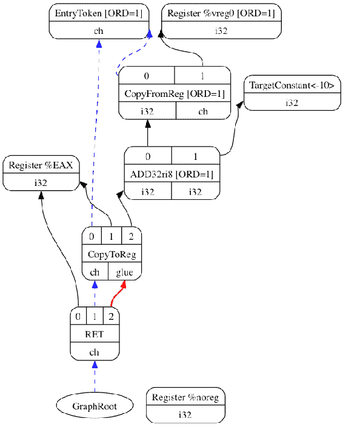

*后端 (The Backend)*

注意，在同一个 DAG 中可能同时存在三种类型的指令表示：通用的 LLVM ISD 节点（如 `ISD::ADD`）、目标特定的 `<Target>ISD` 节点（如 `X86ISD::RET_FLAG`）以及目标物理指令（如 `X86::ADD32ri8`）。

## 模式匹配

每个目标通过实现其 `SelectionDAGISel` 子类中的 `Select` 方法来处理指令选择，该子类名为 `<Target_Name>DAGToDAGISel`，例如 SPARC 中的 `SparcDAGToDAGISel::Select()`（参见文件 `lib/Target/Sparc/SparcISelDAGToDAG.cpp`）。该方法接收一个待匹配的 `SDNode` 参数并返回一个表示物理指令的 `SDNode` 值；否则将发生错误。

**[ 154 ]**

*第 6 章*

`Select()` 方法提供了两种匹配物理指令的方法。最直接的方法是调用从 TableGen 模式中生成的匹配代码，如下列表的第 1 步所示。然而，模式可能不够灵活，无法应对某些指令的奇异行为。在这种情况下，必须在该方法中编写自定义的 C++ 匹配逻辑实现，如下列表的第 2 步所示。具体方法如下：

1. `Select()` 方法调用 `SelectCode()`。TableGen 为每个目标生成 `SelectCode()` 方法，在这些代码中，TableGen 还会生成 `MatcherTable`，将 `ISD` 和 `<Target>ISD` 节点映射到物理指令节点。匹配表是从 `.td` 文件中的指令定义（通常是 `<Target>InstrInfo.td`）生成的。`SelectCode()` 方法通过调用 `SelectCodeCommon()` 结束，这是一个与目标无关的方法，使用目标匹配表来匹配节点。TableGen 有一个专门的指令选择后端来生成这些方法和该表：

```bash
$ cd <llvm_source>/lib/Target/Sparc
$ llvm-tblgen -gen-dag-isel Sparc.td -I ../../../include
```

相同的输出出现在每个目标生成的 C++ 文件中，文件位于 `<build_dir>/lib/Target/<Target>/<Target>GenDAGISel.inc`；例如，在 SPARC 中，这些方法和表位于 `<build_dir>/lib/Target/Sparc/SparcGenDAGISel.inc` 文件。

2. 在调用 `SelectCode` 之前在 `Select` 中提供自定义匹配代码。例如，`i32` 节点 `ISD::MULHU` 执行两个数的乘法。

**[ 155 ]**

`Select()` 方法调用 `SelectCode()`。TableGen 为每个目标生成 `SelectCode()` 方法，在这些代码中，TableGen 还会生成 `MatcherTable`，将 `ISD` 和 `<Target>ISD` 节点映射到物理指令节点。匹配表是从 `.td` 文件中的指令定义（通常是 `<Target>InstrInfo.td`）生成的。`SelectCode()` 方法通过调用 `SelectCodeCommon()` 结束，这是一个与目标无关的方法，使用目标匹配表来匹配节点。

（此处省略代码块内容）

在调用 `SelectCode` 之前在 `Select` 中提供自定义匹配代码。例如，`i32` 节点 `ISD::MULHU` 执行两个数的乘法。

```cpp
case ISD::MULHU: {
  SDValue MulLHS = N->getOperand(0);
  SDValue MulRHS = N->getOperand(1);
  SDNode *Mul = CurDAG->getMachineNode(SP::ULrr, MVT::i32, Glue, MulLHS, MulRHS);
  return CurDAG->SelectToTo(N, SPRDYY
```

（此处省略代码块内容）

**[ 155 ]**

*后端 (The Backend)*

这里，`N` 是待匹配的 `SDNode`，在此上下文中，`N` 等于 `ISD::MULHU`。由于在此之前已经进行了类型检查，我们通过调用 `CurDAG->getMachineNode()` 创建了物理指令 `SP::ULrr`。接下来，通过使用 `CurDAG->SelectNodeTo()`，我们创建一个 `SP::RDY` 指令节点。下图显示了指令选择前后的 SelectionDAG 结构。之前的 C++ 代码是 `lib/Target/Sparc/SparcISelDAGToDAG.cpp` 的简化版本。

```text
...
...
...
...
0
1
0
1
ULrr
ISD::MUL
i32
glue
i32
...
0
1
RDY
i32
指令选择前
指令选择后
add
i32
0
1
ADDrr
i32
```

## 可视化指令选择过程

有多个 `llc` 选项允许在指令选择阶段可视化 `SelectionDAG`。如果你使用这些选项中的任何一个，`llc` 将生成与本文早期所示类似的 `.dot` 图，但你需要使用 `dot` 程序进行显示，或使用 `dotty` 进行编辑，它们都可以在 [Graphviz 包](http://www.graphviz.org) 中找到。下表按执行顺序排序了每个选项：

### `llc` 选项

| `llc` 选项 | 阶段 |
|---|---|
| `-view-dag-combine1-dags` | DAG 合 1 之前 |
| `-view-legalize-types-dags` | 类型合法化之前 |
| `-view-dag-combine-lt-dags` | 类型合法化 2 之后、DAG 合 2 之前 |
| `-view-legalize-dags` | 合法化之前 |
| `-view-dag-combine2-dags` | DAG 合 2 之前 |
| `-view-isel-dags` | 指令选择之前 |
| `-view-sched-dags` | 指令选择之后、调度之前 |

**[ 156 ]**

*第 6 章*

## 指令选择

LLVM 还支持另一种指令选择实现，称为快速指令选择（在 `FastISel` 类中，该类位于 `<llvm_source>/lib/CodeGen/SelectionDAG/FastISel.cpp` 文件）。快速指令选择的目标是以代码质量为代价提供快速的代码生成，这符合 `-O0` 优化级别流水线的哲学。速度的提升是因为避免了复杂的折叠和降低逻辑。`-O0` 流水线还使用了一个快速但非最优的寄存器分配器和调度器，以编译速度换取代码质量。我们将在接下来的子节中介绍它们。

### 调度器 (Scheduler)

在指令选择之后，`SelectionDAG` 结构包含了代表物理指令的节点——即处理器直接支持的指令。下一个阶段是一个处理 `SelectionDAG` 节点（`SDNodes`）的预寄存器分配调度器。有几种不同的调度器可供选择，每一个都是 `ScheduleDAGSDNodes` 的子类（参见文件 `<llvm_source>/lib/CodeGen/SelectionDAG/ScheduleDAGSDNodes.cpp`）。可以在 `llc` 工具中使用 `-pre-RA-sched=<scheduler>` 来选择调度器类型。`<scheduler>` 的可能值如下：

- `list-ilp`、`list-hybrid`、`source` 和 `list-burr`：这些选项指向 `ScheduleDAGRRList` 类实现的列表调度算法（参见文件 `<llvm_source>/lib/CodeGen/SelectionDAG/ScheduleDAGRRList.cpp`）。
- `fast`：`ScheduleDAGFast` 类（位于 `<llvm_source>/lib/CodeGen/SelectionDAG/ScheduleDAGFast.cpp` 中）实现了一个虽非最优但快速的调度器。
- `vliw-td`：由 `ScheduleDAGVLIW` 类实现的特定 VLIW 调度器（参见文件 `<llvm_source>/lib/CodeGen/SelectionDAG/ScheduleDAGVLIW.cpp`）。

默认选项会为目标选择最佳预定义的调度器，而 `linearize` 选项则不执行调度。可用的调度器可以使用指令行程（instruction itineraries）和冲突识别器（hazard recognizers）的信息来更好地调度指令。

代码生成器中有三种不同的调度器执行：两次在寄存器分配之前，一次在之后。第一个作用于 `SelectionDAG` 节点，而另外两个作用于机器指令，本文将在后续详细说明。

### 指令行程 (Instruction itineraries)

某些目标提供了指令行程来表示指令延迟和硬件流水线信息。调度器在调度决策期间使用这些属性以最大化吞吐量并避免性能惩罚。

这些信息描述在每个目标目录的 TableGen 文件中，通常名为 `<Target>Schedule.td`（例如 `X86Schedule.td`）。LLVM 在 `<llvm_source>/include/llvm/Target/TargetItinerary.td` 中提供了 `ProcessorItineraries` TableGen 类，如下：

```cpp
class ProcessorItineraries<list<FuncUnit> fu, list<Bypass> bp, list<InstrItinData> iid> {
  ...
}
```

目标可以为芯片或处理器系列定义处理器行程。为了描述这些行程，目标必须提供功能单元（`FuncUnit`）、流水线旁路（`Bypass`）和指令行程数据（`InstrItinData`）的列表。例如，ARM Cortex A8 指令的行程位于 `<llvm_source>/lib/Target/ARM/ARMScheduleA8.td` 中，如下：

```cpp
def CortexA8Itineraries : ProcessorItineraries<
  [A8_Pipe0, A8_Pipe1, A8_LSPipe, A8_NPipe, A8_NLSPipe],
  [], [
  ...
  InstrItinData<IIC_iALUi, [InstrStage<1, [A8_Pipe0, A8_Pipe1]>], [2, 2]>,
  ...
  ]>;
```

在这里，我们看到没有旁路。我们还看到了该处理器的功能单元列表（`A8_Pipe0`、`A8_Pipe1` 等）以及来自 `IIC_iALUi` 类型指令的行程数据。该类型是形式为 `reg = reg + immediate` 的二进制指令类，例如 `ADDri` 和 `SUBri` 指令。这些指令需要一个机器周期来完成涉及 `A8_Pipe0` 和 `A8_Pipe1` 功能单元的阶段，如 `InstrStage<1, [A8_Pipe0, A8_Pipe1]>` 定义。

随后，列表 `[2, 2]` 代表指令发射后，每个操作数被读取或定义所需的周期数。在这种情况下，目标寄存器（索引 0）和源寄存器（索引 1）在 2 个周期后均可用。

### 冲突检测 (Hazard detection)

冲突识别器通过使用处理器行程的信息计算冲突。`ScheduleHazardRecognizer` 类为冲突识别器的实现提供了接口，`ScoreboardHazardRecognizer` 子类实现了记板冲突识别器（参见文件 `<llvm_source>/lib/CodeGen/ScoreboardHazardRecognizer.cpp`），它是 LLVM 的默认识别器。

目标允许提供自己的识别器。这是非常有必要的，因为 TableGen 可能无法表达特定的约束，在这种情况下必须提供自定义实现。例如，ARM 和 PowerPC 都提供了 `ScoreboardHazardRecognizer` 的子类。

### 调度单元 (Scheduling units)

调度器在寄存器分配之前和之后运行。然而，`SDNode` 指令表示仅在前者中可用，而后者使用 `MachineInstr` 类。为了同时妥善处理 `SDNodes` 和 `MachineInstrs`，`SUnit` 类（参见文件 `<llvm_source>/include/llvm/CodeGen/ScheduleDAG.h`）将底层的指令表示抽象为指令调度期间使用的单元。

`llc` 工具可以通过 `-view-sunit-dags` 选项导出调度单元。

### 机器指令 (Machine instructions)

寄存器分配器基于 `MachineInstr` 类（简写为 `MI`）给出的指令表示工作，定义在 `<llvm_source>/include/llvm/CodeGen/MachineInstr.h` 中。`InstrEmitter` 传递在调度后运行，将 `SDNode` 格式转换为 `MachineInstr` 格式。顾名义，这种表示比 IR 指令更接近目标。与 `SDNode` 格式和它们的 DAG 形式不同，`MI` 格式是指令序列而不是 DAG，这允许编译器高效地表示特定的调度决策。每个 `MI` 都持有一个操作码数字和一个操作数列表。

即使在 `MIs` 这样更低层级，保留这些重要的元信息也是至关重要的，因为运行在 `InstrEmitter` 之后且代码发射之前的传递依赖于这些字段来执行分析。

寄存器分配的基本任务是将无限数量的虚拟寄存器转换为物理（有限）寄存器。由于目标的物理寄存器数量有限，某些虚拟寄存器会被分配到内存位置，即 `spill slots`（溢槽）。然而，在寄存器分配之前，某些机器指令（MI）片段可能在使用物理寄存器。这发生在机器指令需要使用特定寄存器写入结果，或者是因为 ABI 要求。对于这些情况，寄存器分配器会尊重之前的分配，并将其他物理寄存器分配给剩余虚拟寄存器。


LLVM 寄存器分配器的另一个角色是解构 IR 的 SSA 形式。在此之前，机器指令可能包含从原始 LLVM IR 复制的 phi 指令，这些指令对于支持 SSA 形式是必要的。通过这种方式，你可以在 SSA 的便利下实现特定机器的优化。然而，将 phi 指令转换为普通指令传统方法是将其替换为拷贝指令。因此，SSA 解构不能推迟到寄存器分配之后，因为那时是分配寄存器并消除冗余拷贝操作的阶段。

LLVM 有四种寄存器分配实现，可以在`llc`中通过`-regalloc=<regalloc_name>`选项进行选择。`<regalloc_name>`选项如下：`pbqp`、`greedy`、`basic`和`fast`。

- `pbqp`：该选项将寄存器分配映射为`分区布尔二次规划`（`PBQP`）问题。使用 PBQP 求解器将问题的结果映射回寄存器。
- `greedy`：该选项提供了一种高效的全局（函数范围）寄存器分配实现，支持活跃范围划分同时最小化减少溢出。你可以在[`blog.llvm.org/2011/09/greedy-register-allocation-in-llvm-30.html`](http://blog.llvm.org/2011/09/greedy-register-allocation-in-llvm-30.html) Read 到关于该算法的精彩解释。
- `basic`：该选项使用一个非常简单的分配器并提供扩展接口。因此，它为开发新的寄存器分配器提供了基础，并被作为寄存器分配效率的基准。你也可以在上述链接中与 greedy 算法相同的博客文章中阅读其算法。
- `fast`：此分配器选项是局部的（按基本块 BB 方式操作），其工作原理是将值保持在寄存器中尽可能地重用它们。

默认分配器映射到四个选项之一，并根据当前的优化级别（`-O`选项）进行选择。

**[ 161 ]**

## 后端

尽管无论选择什么算法，寄存器分配都是单次遍历中实现的，但它仍然依赖于其他分析，构成了分配器框架。分配器框架中使用了几次遍历，我们在这里暴露寄存器合并器（register coalescer）和虚拟寄存器重写（virtual register rewrite）以说明它们的概念。下图图说明了这些遍历是如何相互作用的：

```text
Virtual registers
Register
MachineInstr
Passes
coalescer
Passes
Virtual
Register
MachineInstr
Passes
rewrite
allocation
Physical registers
```

### 寄存器合并器（Register coalescer）

寄存器合并器通过合并区间消除冗余的拷贝指令（`COPY`）。合并实现在`RegisterCoalescer`类中（参见`lib/CodeGen/RegisterCoalescer.cpp`——这是一个机器函数遍历。机器函数遍历类似于按函数操作的 IR 遍历，但处理的不是 IR 指令，而是`MachineInstr`指令。在合并期间，`joinAllIntervals()`方法遍历拷贝指令的工作列表。`joinCopy()`方法从拷贝机器指令创建`CoalescerPair`实例，并尽可能地消除拷贝。

区间是两个程序点（起始和结束）的对，它在值产生时开始，并在该值处于临时位置期间持续，直到它被最终使用（即被杀死/killed）。让我们看看当合并器在我们的`sum.bc`字节码示例运行时会发生什么。

我们通过使用`llc`中的`regalloc`调试选项检查合并器的调试输出：

```text
$ llc -march=sparc -debug-only=regalloc sum.bc 2>&1 | head –n30
Computing live-in reg-units in ABI blocks.
0B BB#0 I0#0 I1#0
*********** INTERVALS ************
```

**[ 162 ]**

## 第 6 章

```text
I0 [0B,32r:0) [112r,128r:1) 0@0B-phi 1@112r
I1 [0B,16r:0) 0@0B-phi
%vreg0 [32r,48r:0) 0@32r
%vreg1 [16r,96r:0) 0@16r
%vreg2 [80r,96r:0) 0@80r
%vreg3 [96r,112r:0) 0@96r
RegMasks:
************ MACHINEINSTRS ************
# Machine code for function sum: Post SSA
Frame Objects:
fi#0: size=4, align=4, at location[SP]
fi#1: size=4, align=4, at location[SP]
Function Live Ins: $vreg0
0B BB#0 I0#0 I1#0
*********** INTERVALS ************
```

```text
I0 [0B,32r:0) [112r,128r:1) 0@0B-phi 1@112r

I1 [0B,16r:0) 0@0B-phi

%vreg0 [32r,48r:0) 0@32r

%vreg1 [16r,96r:0) 0@16r

%vreg2 [80r,96r:0) 0@80r

%vreg3 [96r,112r:0) 0@96r

RegMasks:

************ MACHINEINSTRS ************

# Machine code for function sum: Post SSA

Frame Objects:

fi#0: size=4, align=4, at location[SP]

fi#1: size=4, align=4, at location[SP]

Function Live Ins: $vreg0

0B BB#0 I0#0 I1#0
```

以及`%I1`，它们已在使用中。这样做是为了遵守 ABI 调用约定，该约定要求函数参数位于这些寄存器中。由于活跃变量分析阶段（live variable analysis pass）在合并（coalescing）之前运行，代码还标注了活跃变量信息，显示了每个寄存器在何时被定义（defined）和杀死（killed），这对于我们观察哪些寄存器之间存在冲突（即它们同时活跃并且需要在不同的物理寄存器中）非常有帮助。

寄存分配器的结果如何，合并器（coalescer）只是在寻找寄存器拷贝。在寄存器到寄存器的拷贝中，合并器会尝试将源寄存器的区间与目标寄存器的区间合并，使它们存在同一个物理寄存器中，从而避免产生拷贝指令，就像索引 16 和 32 中的拷贝一样。

`*** INTERVALS ***`之后的第一条消息来自另一个合并器依赖的分析：活跃区间分析（live interval analysis，不同于活跃变量分析），它实现在`lib/CodeGen/LiveIntervalAnalysis.cpp`中。合并器需要知道每个虚拟寄存器活跃的区间，以便推理哪些区间可以合并。例如，我们可以从输出中看到虚拟寄存器`%vreg0`的区间被确定为`[32r:48r:0)`。

**[ 164 ]**

## 第 6 章

这意味着这是一个半开区间，其中`%vreg0`在 32 处定义并在 48 处杀死。`48r`之后的数字 0 是表示该区间第一个定义位置的代码，其含义打印在区间之后：`0:32r`。因此，定义 0 位于索引 32，这一点我们已经知道了。然而，如果区间被拆分，这有助于跟踪原始定义。最后，`RegMasks`显示了会破坏（clobber）大量寄存器的调用点，这是冲突的一个大源。由于我们在这个函数中没有任何调用，因此没有 RegMask 位置。

在读取完这些区间后，我们可以观察到一些非常有前景的区间：`%I0`寄存器的区间是`[0B,32r:0)`，`%vreg0`寄存器的区间是`[32r,48r:0)`，在 32 处，我们有一条拷贝指令将`%I0`拷贝到`%vreg0`。这些是合并发生的决条件：将区间`[0B,32r:0)`与区间`[32r:48r:0)`合并，并将相同的寄存器分配给`%I0`和`%vreg0`。

现在，让我们打印其余调试输出看看发生了什么：

```text
$ llc -march=sparc -debug-only=regalloc sum.bc

...

entry:

16B %vreg1<def> = COPY %I1; IntRegs:%vreg1

Considering merging %vreg1 with %I1

Can only merge into reserved registers.

32B %vreg0<def> = COPY %I0; IntRegs:%vreg0

Considering merging %vreg0 with %I0

Can only merge into reserved registers.

64B %I0<def> = COPY %vreg2; IntRegs:%vreg2

Considering merging %vreg2 with %I0

Can only merge into reserved registers.

....
```

我们看到合并器考虑了像我们所希望那样将`%vreg0`与`%I0`合并。然而，当其中一个寄存器是物理寄存器（如`%I0`）时，它执行了特殊规则。物理寄存器必须是*预留的（reserved）*才能合并合并。这意味着该物理寄存器不能被分配给其他活跃范围，而`%I0`情况*并非如此*。因此，合并器放弃了这次机会，担心过早地将`%I0`分配给整个范围从长远来看可能并无益，并将此决定留给了寄存器分配器。

因此，`sum.bc`程序没有提供合并机会。尽管它尝试将虚拟寄存器与函数参数寄存器合并，但它失败了，因为在这个阶段它只能将虚拟寄存器与预留的（而非常规可分配的）物理寄存器合并。

**[ 165 ]**

## 后端

### 虚拟寄存器重写

寄存器分配阶段为每个虚拟寄存器选择要使用的物理寄存器。随后，`VirtRegMap`持有寄存器分配的结果，包含一个从虚拟寄存器到物理寄存器的映射。接下来，虚拟寄存器重写阶段——由实现在`<llvm_source>/lib/CodeGen/VirtRegMap.cpp`中的`VirtRegRewriter`类表示——使用`VirtRegMap`将虚拟寄存器引用替换为物理寄存器。相应的生成填充代码（spill code）。此外，剩余的恒等拷贝`reg = COPY reg`被删除。例如，让我们分析分配器和重写器如何使用`-debug-only=regalloc`选项处理`sum.bc`。首先，贪心分配器输出以下文本：

```text
assigning %vreg1 to %I1: I1

...

assigning %vreg0 to %I0: I0

...

assigning %vreg2 to %I0: I0
```

虚拟寄存器 1、0 和 2 分别被分配到物理寄存器`%I1`、`%I0`和`%I0`。相同的输出出现在`VirtRegMap`的转储中，如下：

```text
[%vreg0 -> %I0] IntRegs

[%vreg1 -> %I1] IntRegs

[%vreg2 -> %I0] IntRegs
```

随后，重写器将所有虚拟寄存器替换为物理寄存器并删除：

```text
> %I1<def> = COPY %I1

> %I0<def> = COPY %I0
```

我们可以看到，尽管合并器未能移除拷贝，但寄存器分配器能够将相同的寄存器分配给两个范围并删除拷贝。最后，sum 函数生成的机器指令显著减少：

```text
0B BB#0: Live Ins %I0 %I1

48B %I0<def> = ADDrr %I1<kill>,%I0<kill>

80B RETL 8, %I0<kill>
```

注意拷贝指令已被移除且不再存在虚拟寄存器。`llc`选项`-debug`或`-debug-only=<name>`仅在 LLVM 以调试模式编译时可用，即在配置时使用`--disable-optimized`。

**[ 166 ]**

## 第 6 章

### 目标钩子

在合并过程中，虚拟寄存器需要来自兼容寄存器类才能成功合并。代码生成器通过抽象方法从特定的描述中获取这类信息。分配器可以在`TargetRegisterInfo`的子类中（例如`X86GenRegisterInfo`）获取与寄存器相关的所有信息；这些信息包括它是否被预留、它的父寄存器类以及它是物理的还是虚拟的。

**[ 167 ]**

## 后端

- `COPY`指令在重写器（rewriter）之后可能仍然存在，因为它们没有被合并且并非相同的副本。在这种情况下，使用`copyPhysReg()`方法来生成特定目标的寄存器拷贝，在必要时即使跨不同的寄存器类也是如此。来自`SparcInstrInfo::copyPhysReg()`的示例如下：

```cpp
if (SP::IntRegsRegClass.contains(DestReg, SrcReg))
  BuildMI(MBB, I, DL, get(SP::ORrr), DestReg).addReg(SP::G0)
    .addReg(SrcReg, getKillRegState(KillSrc));
```

`BuildMI()`方法在代码生成器到处用于生成机器指令。在这个示例中，使用`SP::ORrr`指令将一个 CPU 寄存器复制到另一个 CPU 寄存器。

### 序言与结尾（Prologue and epilogue）

函数需要序言和结尾才能保持完整。前者在函数开始时设置栈帧和调用者保存的寄存器，而后者在函数返回前清理栈帧。在我们的`sum.bc`示例中，当为 SPARC 编译时，插入序言和结尾后的机器指令如下：

```text
%O6<def> = SAVEri %O6, -96

%I0<def> = ADDrr %I1<kill>, %I0<kill>

%G0<def> = RESTORErr %G0, %G0

RETL 8, %I0<imp-use>
```

在这个示例中，`SAVEri`指令是序言，`RESTORErr`是结尾，执行与栈帧相关的设置和清理。序言和结尾的生成是特定目标的，并定义在`<Target>FrameLowering::emitPrologue()`和`<Target>FrameLowering::emitEpilogue()`方法中（参见`<llvm_source>/lib/Target/<Target>/<Target>FrameLowering.cpp`）。

### 帧索引（Frame indexes）

LLVM 在代码生成期间使用虚拟栈帧，并使用帧索引引用栈元素。序言的插入分配了栈帧，并为代码生成器提供了足够的特定目标信息，以便用真实的（特定目标的）栈引用替换虚拟帧索引。

**[ 168 ]**

## 第 6 章

`<Target>RegisterInfo`类中的`eliminateFrameIndex()`方法通过将所有包含栈引用的机器指令（通常是加载和存储）的帧索引转换为真实的栈偏移来实现这种替换。

当需要额外的栈偏移算术时，也会生成额外的指令。参见文件`<llvm_source>/lib/Target/<Target>/<Target>RegisterInfo.cpp`中的示例。

## 理解机器码

### 框架（framework）

`machine code`（简称`MC`）类组成了一个完整的框架，用于对函数和指令进行低级操作。与其他后端组件相比，这是一个全新的框架，旨在辅助创建基于 LLVM 的汇编器和反汇编器。在此之前，LLVM 缺乏集成的汇编器，编译只能到汇编语言发射步骤，该步骤会生成汇编文本文件作为输出，并依赖外部工具完成剩余的编译（汇编器和链接器）。

### MC 指令（MC instructions）

在 MC 框架中，机器码指令（`MCInst`）替换了机器指令（`MachineInstr`）。定义在`<llvm_source>/include/llvm/MC/MCInst.h`文件中的`MCInst`类定义了指令的轻量级表示。与 MI 相比，`MCInst`携带的关于程序的信息较少。例如，`MCInst`实例不仅由后端创建，还可以由反汇编器直接从二进制代码创建，而这种环境关于指令上下文的信息非常少。事实上，它编码了汇编器的视图，即一种工具，其目的不是应用丰富的优化，而是组织目标文件中的指令。

每个操作数可以是一个寄存器、立即数（整数或浮点数）、一个表达式（由`MCExpr`表示）或另一个`MCInst`实例。表达式用于表示标签计算和重定位。MI 指令在代码发射阶段早期就会转换为`MCInst`实例，这是我们下一个小节的主题。

**[ 169 ]**

## 后端

### 代码发射（Code emission）

代码发射阶段发生在所有寄存器分配传递之后。虽然命名看起来可能令人困惑，但代码发射是从汇编打印器（`AsmPrinter`）遍历开始的。从 MI 指令到`MCInst`，再到汇编或二进制指令的所有步骤如如下所示：

```text
MI -> MCInstLowering (1) -> (2) -> Binary instruction

AsmPrinter -> MCInst (3) -> (6) -> ARMAsmPrinter -> MCStreamer -> Assembler -> MCCodeEmitter ... (5) EmitInstuction() -> MCAsmSteamer -> MCObjectSteamer -> ARMMCCodeEmitter ... EmitInstuction() (4) -> MCInstPrinter -> MCELFStreamer -> MCCOFFStreamer -> Assembly -> ARMMCInstPrinter -> ARMELFStreamer instruction
```


让我们逐步回顾图中步骤：

1. `AsmPrinter` 是一个机器函数传递，它首先发射函数头，然后遍历所有的基本块，一次将一个 MI 指令调度到 `EmitInstruction()` 方法进行进一步处理。每个目标都提供一个 `AsmPrinter` 子类来重载此方法。
2. `<Target>AsmPrinter::EmitInstruction()` 方法接收一个 MI 指令作为输入并将其转换为 `MCInst`。
3. 此时，有两种选择：发射汇编或二进制指令。`MCStreamer` 处理 `MCInst` 并通过两个子类发射它们：`AsmStreamer` 和 `MCObjectStreamer`。
4. 如果生成汇编指令，`AsmStreamer::EmitInstruction()` 被调用并使用特定目标的 `MCInst` 子类打印汇编。

# 第 6 章

5. 如果生成二进制指令，特定目标的 `MCObjectStreamer::EmitInstruction()` 调用 LLVM 汇编器。
6. 汇编器使用 `MCCodeEmitter::EncodeInstruction()` 方法，该方法能够将 `MCInst` 实例编码为二进制数据到文件。

你也可以使用 `llc` 工具导出 `MCInst` 片段。例如，将 `MCInst` 编码为汇编，可以使用以下命令：

```bash
llc sum.bc -march=x86-64 -show-mc-inst -o
```

`pushq %rbp <MCInst #2114>`

然而，如果你想在汇编注释中显示每条指令的二进制编码，可以使用以下命令：

```bash
llc sum.bc -march=x86-64 -show-mc-encoding -o
```

`pushq %rbp encoding: [55]`

`llvm-mc` 工具允许你测试和使用 MC 框架。例如，要发现特定指令的汇编编码，使用 `--show-encoding` 选项。以下是一个 x86 指令的示例：

```bash
echo "movq 48879(,%riz), %rax" | llvm-mc -triple=x86_64 --show-encoding
```

`# encoding: [48,8b,04,25,ef,be,00,00]`

该工具还提供反汇编功能：

```bash
echo "0x8d 0x4c 0x24 0x04" | llvm-mc --disassemble -triple=x86_64
```

`leal 4(%rsp), %ecx`

此外，`--show-inst` 选项显示反汇编或汇编指令的 `MCInst` 实例：

```bash
echo "0x8d 0x4c 0x24 0x04" | llvm-mc --disassemble -show-inst -triple=x86_64
```

`leal 4(%rsp), %ecx # <MCInst #1105 LEA64_32r`  
`# <MCOperand Reg:46>`  
`# <MCOperand Reg:115>>`

MC 框架允许 LLVM 提供对经典对象文件读取器的替代工具。例如，默认的 LLVM 构建版本目前会安装 `llvm-objdump` 和 `llvm-readobj` 工具。它们都使用 `MC` 反汇器库，并实现了与 GNU Binutils 包（`objdump` 和 `readelf`）相似的功能。

## 编写你自己的机器 pass（machine pass）

在本节中，我们将展示如何编写一个自定义的机器 pass，以便在代码发射之前，统计每个函数包含多少条机器指令。与 IR pass 不同，你无法使用 `opt` 工具运行此 pass，也无法通过命令行加载并调度其执行。机器 pass 是由后端代码决定的。因此，我们将通过修改一个现有的后端来运行我们的自定义 pass，以便在实践中看到效果。我们将选择 `SPARC` 作为目标。

回想第 3 章“工具与设计”中“演示可插式 pass 接口”章节的内容，以及本章第一张图中的白框部分，我们有许多选项来决定我们的 pass 应该在何处运行。要使用这些方法，我们应该查找后端实现的 `TargetPassConfig` 子类。如果你使用 `grep`，你会在 `SparcTargetMachine.cpp` 中找到它：

```bash
$ cd <llvmsource>/lib/Target/Sparc
$ vim SparcTargetMachine.cpp # 使用你偏好的编辑器
```

查看派生自 `TargetPassConfig` 的 `SparcPassConfig` 类，我们可以看到它重写了 `addInstSelector()` 和 `addPreEmitPass()`，但如果我们想将 pass 添加到其他位置，还有许多方法可以重写（参见链接 [`llvm.org/doxygen/html/`](http://llvm.org/doxygen/html/classllvm_1_1TargetPassConfig.html)）。我们将在代码发射之前运行 pass；因此，我们将在 `addPreEmitPass()` 中添加代码：

```cpp
bool SparcPassConfig::addPreEmitPass() {
  addPass(createSparcDelaySlotFillerPass(getSparcTargetMachine()));
  addPass(createMyCustomMachinePass());
}
```

我们添加的额外行在前面的代码中已突出显示，并通过调用 `createMyCustomMachinePass()` 函数添加了我们的 pass。然而，该函数尚未定义。我们将添加一个包含 pass 代码的新源文件，并借此机会定义该函数。要做到这一点，请创建一个名为 `MachineCountPass.cpp` 的新文件并填入以下内容：

```cpp
#define DEBUG_TYPE "machinecount"

#include "Sparc.h"

#include "llvm/Pass.h"

#include "llvm/CodeGen/MachineBasicBlock.h"

#include "llvm/CodeGen/MachineFunction.h"

#include "llvm/CodeGen/MachineFunctionPass.h"

#include "llvm/Support/raw_ostream.h"

using namespace llvm;

namespace {

class MachineCountPass : public MachineFunctionPass {
public:
  static char ID;

  MachineCountPass() : MachineFunctionPass(ID) {}

  virtual bool runOnMachineFunction(MachineFunction &MF) {
    unsigned num_instr = 0;

    for (MachineFunction::const_iterator I = MF.begin(), E = MF.end(); I != E; ++I) {
      for (MachineBasicBlock::const_iterator BBI = I->begin(), BBE = I->end(); BBI != BBE; ++BBI) {
        ++num_instr;
      }
    }

    errs() << "mcount --- " << MF.getName() << " has " << num_instr << " instructions.\n";

    return false;
  }
};

}

FunctionPass *llvm::createMyCustomMachinePass() {
  return new MachineCountPass();
}

char MachineCountPass::ID = 0;

static RegisterPass<MachineCountPass> X("machinecount", "Machine Count Pass");
```

在第一行中，我们定义了宏 `DEBUG_TYPE`，允许我们稍后通过 `-debug-only=machinecount` 标志来调试 pass；但在本示例中，这段代码并没有使用调试输出。代码的其他部分与我们在上一章中编写的 IR pass 代码非常相似。区别在于以下几点：

- 在包含文件中，我们包含了 `MachineBasicBlock.h`、`MachineFunction.h` 和 `MachineFunctionPass.h` 头文件，这些头文件定义了我们用于提取 `MachineFunction` 信息的类，并允许我们统计其中机器指令的数量。我们还包含了 `Sparc.h` 头文件，因为我们将在那里声明 `createMyCustomMachinePass()`。
- 我们创建了一个派生自 `MachineFunctionPass` 的类，而不是 `FunctionPass`。
- 我们重写了 `runOnMachineFunction()` 方法而不是 `runOnFunction()`。此外，我们的方法实现非常不同。我们遍历当前 `MachineFunction` 的所有 `MachineBasicBlock` 实例。然后，对于每个 `MachineBasicBlock`，我们同样采用 `begin()`/`end()` idiom 来统计它所有的机器指令。
- 我们定义了函数 `createMyCustomMachinePass()`，允许此 pass 在我们修改的 `SPARC` 后端文件中作为预发射 pass 创建并添加。

由于我们已经定义了 `createMyCustomMachinePass()` 函数，我们必须在头文件中声明它。让我们编辑 `Sparc.h` 文件来完成此操作。在 `createSparcSlotFillerPass()` 之后添加我们的声明：

```cpp
FunctionPass *createSparcISel(SparcMachine &TM);

FunctionPass *createSparcDelaySlotFillerPass(SparcMachine &TM);

FunctionPass *createMyCustomMachinePass();
```

现在是使用 LLVM 构建系统构建后端了。如果你还没有机会配置 LLVM 构建，请参考第 1 章“构建与安装 LLVM”。如果你已经有一个配置好的构建文件夹，进入该文件夹并运行 `make` 来编译后端。之后，你可以直接从构建文件夹运行新的 `llc`，无需运行 `install`：

```bash
$ cd <llvm-build>
$ make
$ Debug+Asserts/bin/llc -march=sparc sum.bc

mcount --- sum has 8 instructions.
```

如果我们想查看我们的 pass 被插入到流水线的什么位置，执行以下命令：

```bash
$ Debug+Asserts/bin/llc -march=sparc sum.bc -debug-pass=Structure
```


**分支概率放置**

**SPARC 延迟槽填充**

**机器计数 pass**

**机器支配树构建**

**机器循环构建**

**Sparc 汇编打印器**

**mcount --- sum has 8 instructions.**

## 总结

在本章中，我们介绍了 LLVM 后端工作的概述。我们看到了代码生成阶段以及在编译过程中变化的内部指令表示。我们讨论了指令选择、调度、寄存器分配、代码发射，并介绍了读者使用 `llvm` 工具实验这些阶段的方法。在本章结束，你应该能够阅读 `llc -debug` 输出（它会打印后端的详细日志），并对内部发生的一切有良好的理解。如果你对构建自己的后端，下一步是参考官方教程 [`llvm.org/docs/WritingAnLLVMBackend.html`](http://llvm.org/docs/WritingAnLLVMBackend.html)。如果你对阅读后端设计感兴趣，应该参考 [`llvm.org/docs/CodeGenerator.html`](http://llvm.org/docs/CodeGenerator.html)。

在下一章中，我们将介绍 LLVM 即时（JIT）编译框架，它允许你按需生成代码。

**[ 175 ]**

## 即时编译器

**LLVM 即时**（**JIT**）编译器是一个基于函数的动态翻译引擎。为了理解什么是 JIT 编译器，让我们回到原始术语。

这个术语源于即时制（Just-in-Time manufacturing），这是一种工厂按需制造或购买供应而不是根据库存工作的商业策略。

在编译领域，这个类比非常合适，因为 `JIT` 编译器并不将程序二进制文件存储在磁盘上（库存），而是在你需要时（在运行时）开始编译程序部分。尽管这个商业术语很成功，但你可能还会遇到其他名称，例如延迟编译（late compilation）或懒惰编译（lazy compilation）。

`JIT` 策略的优势在于知道程序将运行的精确机器架构和微架构。这使得 `JIT` 系统能够针对你的特定处理器对代码进行调优。此外，某些编译器只有在运行时才知道其输入，在这种情况下，除了实现 `JIT` 系统外没有其他选择。例如，`GPU` 驱动程序即时编译着色器语言，网页浏览器处理 `JavaScript` 时也是如此。在本章中，我们将探索 `LLVM JIT` 系统并涵盖以下主题：

- `llvm::JIT` 类及其基础架构
- 如何使用 `llvm::JIT` 类进行 `JIT` 编译
- 如何使用 `GenericValue` 简化函数调用
- `llvm::MCJIT` 类及其基础架构
- 如何使用 `llvm::MCJIT` 类进行 `JIT` 编译

## 即时编译器 (Just-in-Time Compiler)

## 了解 LLVM JIT 引擎

### 基础知识

`LLVM JIT` 编译器是基于函数的，因为它能够一次编译一个函数。这定义了编译器的工作粒度，是 `JIT` 系统的一项重要决策。通过按需编译函数，系统将仅对本次程序调用中实际使用的函数进行处理。例如，如果你的程序有几个函数，但你在启动它时提供了错误的命令行参数，基于函数的 `JIT` 系统将只会编译打印帮助信息的函数，而不是整个程序。

在理论上，我们可以将粒度进一步推向，并只编译轨迹（traces），即函数的特定路径。通过这种方式，你已经在利用 `JIT` 系统的一项重要优势：知晓在给定输入的程序调用中，哪些程序路径比其他路径值得投入更多的编译努力。然而，`LLVM JIT` 系统并不支持基于轨迹的编译（trace-based compilation），而这在通常的研究领域中受到了更多关注。`JIT` 编译是一个无休止的话题，有许多不同的权衡值得仔细研究，要指出哪种策略效果最好并非易事。目前，计算机科学界在 `JIT` 编译方面已积累了约 20 年的研究，该领域每年都有新论文发表，试图解决尚未解决的问题。

`JIT` 引擎通过在运行时编译并执行 `LLVM IR` 函数来工作。在编译阶段，`JIT` 引擎将使用 `LLVM` 代码生成器生成带有特定二进制指令的二进制块（binary blobs）。系统会返回指向编译后函数的指针，然后就可以执行该函数。

你可以阅读一篇博客文章，其中比较了 `JIT` 编译的开源解决方案：`http://eli.thegreenplace.net/2014/01/15/some-thoughts-on-llvm-vs-libjit`，它分析了 `LLVM` 和 `libjit`（后者是一个旨在 `JIT` 编译的小型开源项目）。`LLVM` 作为静态编译器而非 `JIT` 系统而更加闻名，因为对于 `JIT` 编译来说，在每个阶段（pass）花费的时间非常重要，并且会被计入程序执行开销。`LLVM` 基础架构更强调支持与 `GCC` 相当的缓慢但强大的优化，而不是构建具有竞争力的 `JIT` 系统所需的快速但平庸的优化。尽管如此，`LLVM` 已成功用于 `JIT` 系统，形成了 `Webkit JavaScript` 引擎的第四层 LLVM (`FTL`) 组件（详见 `http://blog.llvm.org/2014/07/ftl-webkits-llvm-based-jit.html`）。由于第四层仅用于长时间运行的 `JavaScript` 应用，即使激取的 `LLVM` 优化没有低层那么快也能有所帮助。其原理是，如果应用程序运行时间很长，我们可以花费更多时间在昂贵的优化上。要了解更多关于这种权衡的内容，请查看 *Modeling Virtual Machines Misprediction Overhead, by César et al.*（发表于 `IISWC 2013`），这项研究揭示了 `JIT` 系统在不值得投入的代码中错误使用昂贵代码生成时会损失多少性能。这在你的 `JIT` 系统浪费了大量时间去优化一个仅执行几次的片段时就会发生。

## 介绍执行引擎

`LLVM JIT` 系统采用执行引擎来支持 `LLVM` 模块的执行。在 `<llvm_source>/include/llvm/ExecutionEngine/ExecutionEngine.h` 中定义的 `ExecutionEngine` 类设计用于通过 `JIT` 系统或解释器支持执行。通常，执行引擎负责管理整个客体程序的执行，分析需要运行的下一个程序片段，并采取适当行动执行它。在执行 `JIT` 编译时，必须有一个执行管理器来编排编译决策并运行客体程序（一次一个片段）。在 `LLVM's ExecutionEngine` 类的情况下，`ExecutionEngine` 类将执行部分交给了你（即客户端）。它可以运行编译流水线并产生存储在内存中的代码，但是否执行这些代码取决于你的决定。

除了持有要执行的 `LLVM` 模块外，该引擎还支持以下几种场景：

- **懒惰编译 (Lazy compilation)**：引擎仅在函数被调用时对其进行编译。禁用懒惰编译，引擎会在你请求函数指针时立即进行编译。
- **外部全局变量的编译**：这包括当前 `LLVM` 模块之外的符号解析和内存分配。
- **通过 dlsym 对外部符号进行查找和符号解析**：这在运行时加载**动态共享对象** (`DSO`) 时使用的是相同的过程。

`LLVM` 中有两种 `JIT` 执行引擎实现：`llvm::JIT` 类和 `llvm::MCJIT` 类。通过 `ExecutionEngine::EngineBuilder()` 方法并传入 `IR Module` 参数可以实例化 `ExecutionEngine` 对象。接下来，使用 `ExecutionEngine::create()` 方法创建 `JIT` 或 `MCJIT` 引擎实例，每种实现都显著不同——这一点将在本章中得到阐明。

解释器采用另一种策略来执行客体代码，即不被硬件平台（主机平台）原生支持的代码。例如，在 `x86` 平台上，`LLVM IR` 被视为客体代码，因为 `x86` 处理器无法直接执行 `LLVM IR`。与 `JIT` 编译不同，解释的任务是读取单个指令、解码并执行其行为，并在软件中模拟物理处理器的功能。尽管解释器没有通过启动编译器来翻译客体代码而浪费时间，但解释器通常慢得多，除非编译客体代码所需的时间无法抵消解释的高开销。

### 内存管理

通常情况下，JIT 引擎通过向内存写入二进制大块（binary blobs）来工作，这由 `ExecutionManager` 类完成。之后，你可以通过跳转到分配的内存区域来执行这些指令，这通过调用 `ExecutionManager` 返回给你的函数指针来实现。在此背景下，内存管理对于执行常规任务至关重要，例如分配、释放、为库加载提供空间以及内存权限处理。

# [ 180 ]

# 第 7 章

`JIT` 和 `MCJIT` 类分别实现了一个派自 `RTDyldMemoryManager` 基基的自定义内存管理类。任何 `ExecutionEngine` 客户端也可以提供自定义的 `RTDyldMemoryManager` 子类，以指定不同的 JIT 组件应该放在内存的什么位置。你可以在 `<llvm_source>/include/llvm/ExecutionEngine/RTDyldMemoryManager.h` 文件找到此接口。

例如，`RTDyldMemoryManager` 类声明了以下方法：

- `allocateCodeSection()` 和 `allocateDataSection()`：这些方法分配内存来存储给定大小和对齐方式的可执行代码和数据。内存管理客户端可以使用内部分段标识符参数来跟踪已分配的分段。
- `getSymbolAddress()`：此方法返回当前链接库中可用符号的地址。注意，这并不用于获取 JIT 编译生成的符号。你必须提供一个持有符号名称的 `std::string` 实例来使用此方法。
- `finalizeMemory()`：此方法应在对象加载完成后调用，此时可以最终设置内存权限。例如，在调用此方法之前，你无法运行生成的代码。正如本章进一步解释的，该方法针对 `MCJIT` 客户端而非 `JIT` 客户端。

尽管客户端可以提供自定义的内存管理实现，但 `JITMemoryManager` 和 `SectionMemoryManager` 分别是 `JIT` 和 `MCJIT` 的默认子类。

### 引入 llvm::JIT 框架

`JIT` 类及其框架代表了旧的引擎，是通过使用 LLVM 代码生成器的不同部分实现的。它将在 LLVM 3.5 之后被移除。

尽管该引擎大部分与目标无关，但每个目标必须为其特定指令实现二进制指令发射步骤。

### 将大块写入内存

`JIT` 类通过使用 `JITCodeEmitter`（一个 `MachineCodeEmitter` 子类）来发射二进制指令。`MachineCodeEmitter` 类用于与新的**机器码** (**MC**) 框架无关的机器码发射——尽管它是旧的，但它仍然存在以支持 `JIT` 类的功能。其局限性是仅支持少数目标，并且对于支持的目标，并不是所有的特性都可用。

# [ 181 ]

## 即时编译器

`MachineCodeEmitter` 类具有辅助以下任务的方法：

- 为即将发射的当前函数分配空间（`allocateSpace()`）
- 将二进制大块写入内存缓冲区（`emitByte()`、`emitWordLE()`、`emitWordBE()`、`emitAlignment()` 等）
- 跟踪当前缓冲区地址（即指向将发射下一条指令的地址的指针）
- 在此缓冲区中添加相对于指令地址的重定位（relocations）

将字节写入内存的任务由 `JITCodeEmitter` 执行，它是另一个参与代码发射过程的类。它是一个 `JITCodeEmitter` 子类，实现了特定的 JIT 功能和管理。虽然 `JITCodeEmitter` 非常简单且仅向缓冲区写入字节，但 `JITEmitter` 类具有以下改进：

- 前述提到的专用内存管理器 `JITMemoryManager`（也是下一节的主题）。
- 一个解析器（`JITResolver`）实例，用于跟踪并解析尚未编译函数的调用点。这对于延迟函数编译（lazy function compilation）非常重要。

### 使用 JITMemoryManager

`JITMemoryManager` 类（见 `<llvm_source>/include/llvm/ExecutionEngine/JITMemoryManager.h`）实现了低级内存处理，并提供了上述类可以工作的缓冲区。除了 `RTDyldMemoryManager` 的方法外，它还提供了特定方法来帮助 `JIT` 类，例如 `allocateGlobal()`，它为单个全局变量分配内存；以及 `startFunctionBody()`，当 `JIT` 需要分配标记为读/写/可执行的内存以发射指令时会调用该方法。

在内部，`JITMemoryManager` 类使用 `JITSlabAllocator` 内存分配器（`<llvm_source>/lib/ExecutionEngine/JIT/JITMemoryManager.cpp`）和 `MemoryBlock` 单元（`<llvm_source>/include/llvm/Support/Memory.h`）。

# [ 182 ]

# 第 7 章

### 代码发射器

每个目标都实现一个名为 `<Target>CodeEmitter` 的机器函数传递（见 `<llvm_source>/lib/Target/<Target>/<Target>CodeEmitter.cpp`），它在大块中编码指令并使用 `JITCodeEmitter` 写入内存。

例如，`MipsCodeEmitter` 遍历所有函数基本块，并为每个机器指令（MI）调用 `emitInstruction()`：

```
MCE.startFunction(MF);

for (MachineFunction::iterator MBB = MF.begin(), E = MF.end(); MBB != E; ++MBB){

  MCE.StartMachineBasicBlock(MBB);

  for (MachineBasicBlock::instr_iterator I = MBB->instr_begin(), E = MBB->instr_end(); I != E;)

  emitInstruction(*I++, *MBB);

}
```

`MIPS32` 是固定长度 4 字节 ISA，这使得 `emitInstruction()` 的实现变得直观：

```
void MipsCodeEmitter::emitInstruction(MachineBasicBlock::instr_iterator MI, MachineBasicBlock &MBB) {

  ...

  MCE.processDebugLoc(MI->getDebugLoc());

  emitWord(getBinaryForInstr(*MI));

  ++NumEmitted; // 跟踪已发射的数量

  ...

}
```

`emitWord()` 方法是 `JITCodeEmitter` 的封装，而 `getBinaryForInstr()` 是 TableGen 通过读取 .td 文件的指令描述为每个目标生成的。`<Target>CodeEmitter` 类还必须实现自定义方法来对操作数和其他特定于目标的实体。例如，在 MIPS 中，`mem` 操作数必须使用 `getMemEncoding()` 方法才能被正确编码（见 `<llvm_source>/lib/Target/Mips/MipsInfo.td`）：

```td
def mem : Operand<iPTR> {

  ...

  let MIOperandInfo = (ops ptr_rc, simm16);

  let EncoderMethod = "getMemEncoding";

  ...

}
```

# [ 183 ]

## 即时编译器

因此，`MipsCodeEmitter` 必须实现 `MipsCodeEmitter::getMemEncoding()` 方法以匹配此 TableGen 描述。图显示了多个代码发射器与 JIT 框架之间的关系：

```
MipsCodeEmitter

MachineCodeEmitter

RTDyldMemoryManager

ARMCodeEmitter

JITCodeEmitter

JITMemoryManager

...

JITEmitter
```


### 目标信息

为了支持即时编译，每个目标还必须提供一个 `TargetITInfo` 子类（见 `include/llvm/Target/TargetITInfo.h`），例如 `MipsJITInfo` 或 `X86JITInfo`。`TargetITInfo` 类为目标需要的通用 JIT 功能提供了接口。接下来我们展示此类功能的示例列表：

- 为了支持执行引擎需要重新编译函数的情况（可能是因为函数被修改了），每个目标实现 `TargetITInfo::replaceMachineCodeForFunction()` 方法，并在旧函数的位置填充跳转或调用新版本的指令。这对于自修改代码是必要的。
- `TargetITInfo::relocate()` 方法修复当前发射函数中的每个符号引用，使其指向正确的内存地址，类似于动态链接器所做的。
- `TargetITInfo::emitFunctionStub()` 方法发射一个存根（stub）：一个调用给定地址处另一个函数的函数。每个目标还提供自定义的 `TargetITInfo::StubLayout` 信息，包括发射存根的字节大小和对齐方式。此存根信息被用于 `JITEmitter` 在发射存根（stub）之前为新的存根分配空间。

尽管 `TargetJITInfo` 方法的目标不是像生成函数体那样发射常规指令，但它们仍然需要为存根生成发射特定的指令并调用新的内存位置。然而，在 JIT 框架建立时，并没有接口可以依赖以简化生成位于 `MachineBasicBlock` 之外的独立指令的任务。

这正是 `MCInsts` 现在为 `MCJIT` 所做的。如果没有 `MCInsts`，旧的 JIT 框架强制目标必须手动编码指令。

**188**

*第 7 章*

为了展示 `<Target>JITInfo` 实现如何手动发射指令，让我们来看 `MipsJITInfo::emitFunctionStub()` 的代码（参见 `<llvm_source>/lib/Target/Mips/MipsJITInfo.cpp`），它使用以下代码生成四条指令：

```cpp
...

// lui $t9, %hi(EmittedAddr)

// addiu $t9, $t9, %lo(EmittedAddr)

// jalr $t8, $t9

// nop

if (IsLittleEndian) {
    JCE.emitWordLE(0xf << 26 | 25 << 16 | Hi);
    JCE.emitWordLE(9 << 26 | 25 << 21 | 25 << 16 | Lo);
    JCE.emitWordLE(25 << 21 | 24 << 11 | 9);
    JCE.emitWordLE(0);
}

...
```

### 学习使用 JIT 类

`JIT` 是一个声明在 `<llvm_source>/lib/ExecutionEngine/JIT/JIT.h` 中的 `ExecutionEngine` 子类。`JIT` 类是通过 JIT 基础设施编译函数的入口点。

`ExecutionEngine::create()` 方法调用 `JIT::createJIT()`，并使用默认的 `JITMemoryManager`。接下来，`JIT` 构造函数执行以下任务：

- 创建一个 `JITEmitter` 实例
- 初始化目标信息对象
- 添加用于代码生成的 pass（passes）
- 添加将在最后运行的 `<Target>CodeEmitter` pass

引擎持有一个 `PassManager` 对象，每当被要求 JIT 编译一个函数时，就会调用所有的代码生成和 JIT 发射 pass。

为了说明这一切是如何发生的，我们描述了如何 JIT 编译 `sum.bc` 位码文件的函数，该文件贯穿了*第 5 章*、*LLVM 中间表示*以及*第 6 章*、*后端*。我们的目标是获取 `Sum` 函数，并使用 JIT 系统使用运行时参数计算两个不同的加法。

执行以下步骤：

1. 首先，创建一个名为 `sum-jit.cpp` 的新文件。我们需要包含 JIT 执行引擎资源：

```cpp
#include "llvm/ExecutionEngine/JIT.h"
```

**185**

*即时编译器*

2. 包含其他用于读写 LLVM 位码、上下文接口等头头文件，并导入 LLVM 命名空间：

```cpp
#include "llvm/ADT/OwningPtr.h"
#include "llvm/Bitcode/ReaderWriter.h"
#include "llvm/IR/LLVMContext.h"
#include "llvm/IR/Module.h"
#include "llvm/Support/FileSystem.h"
#include "llvm/Support/MemoryBuffer.h"
#include "llvm/Support/ManagedStatic.h"
#include "llvm/Support/raw_ostream.h"
#include "llvm/Support/system_error.h"
#include "llvm/Support/TargetSelect.h"
using namespace llvm;
```

3. `InitializeNativeTarget()` 方法设置主机目标并确保 JIT 使用的目标库已链接。按照 usual，我们需要一个每个线程的上下文 `LLVMContext` 对象和一个 `MemoryBuffer` 对象来从磁盘读取位码文件，如下代码所示：

```cpp
int main() {
    InitializeNativeTarget();
    LLVMContext Context;
    std::string ErrorMessage;
    OwningPtr<MemoryBuffer> Buffer;
}
```

4. 我们使用 `getFile()` 方法从磁盘读取内容，如下代码所示：

```cpp
if (MemoryBuffer::getFile("./sum.bc", Buffer)) {
    errs() << "sum.bc not found\n";
    return -1;
}
```

5. `ParseBitcodeFile` 函数从 `MemoryBuffer` 读取数据并生成对应的 `LLVM Module` 类来表示它，如下代码所示：

```cpp
Module *M = ParseBitcodeFile(Buffer.get(), Context, &ErrorMessage);
if (!M) {
    errs() << ErrorMessage << "\n";
    return -1;
}
```

**186**

*第 7 章*

6. 首先使用 `EngineBuilder` 工厂创建 `ExecutionEngine` 实例，然后调用其 `create` 方法，如下代码所示：

```cpp
OwningPtr<ExecutionEngine> EE(EngineBuilder(M).create());
```

该方法默认创建一个 JIT 执行引擎并是 JIT 的设置点；它间接调用 `JIT` 构造函数，该构造函数创建 `JITEmitter`、`PassManager` 并初始化所有的代码生成和目标特定的发射 pass。到为止，尽管引擎感知到了 `LLVM Module`，但还没有函数被编译。

要编译函数，你仍然需要调用 `getPointerToFunction()`，它获取指向原生 JIT 编译函数的指针。如果函数尚未被 JIT 编译，

7. 通过 `getFunction()` 方法获取代表 `sum` 的 `Function` 对象：

```cpp
Function *SumFn = M->getFunction("sum");
```

`runFunction()` 方法根据由 `GenericValue` 向量确定的参数来编译并运行函数——它不需要在获取 `getPointerToFunction()` 之前进行调用。

`GenericValue` 结构体定义在 `<llvm_source>/include/llvm/ExecutionEngine/GenericValue.h` 中，能够持有任何通用类型。让我们修改上一个示例，改用 `runFunction()` 替替 `getPointerToFunction()` 和类型转换。

首先，创建 `sum-jit-gv.cpp` 文件来存放此新版本，并在顶部添加 `GenericValue` 头文件：

```cpp
#include "llvm/ExecutionEngine/GenericValue.h"
```

从 `sum-jit.cpp` 复制其余内容，让我们关注修改部分。在 `SumFn` 函数指针初始化后，创建 `FnArgs`——一个 `GenericValue` 向量——并使用 `APInt` 接口（`<llvm_source>/include/llvm/ADT/APInt.h`）用整数值填充它。使用两个 32 位的整数以符合原始原型 `sum(i32 %a, i32 %b)`：

```cpp
Function *SumFn = M->getFunction("sum");
std::vector<GenericValue> FnArgs(2);
FnArgs[0].IntVal = APInt(32,4);
FnArgs[1].IntVal = APInt(32,5);
```

传入函数参数和参数向量调用 `runFunction()`。在这里，函数被 JIT 编译并执行。结果也是 `GenericValue`，可以相应地访问（`i32` 类型）：

```cpp
GenericValue Res = EE->runFunction(SumFn, FnArgs);
outs() << "Sum result: " << Res.IntVal << "\n";
```

我们对第二次加法重复相同的过程：

```cpp
FnArgs[0].IntVal = Res.IntVal;
FnArgs[1].IntVal = APInt(32,6);
Res = EE->runFunction(SumFn, FnArgs);
outs() << "Sum result: " << Res.IntVal << "\n";
```

**189**

*即时编译编译器*

## 引入 `llvm::MCJIT` 框架

`MCJIT` 类是一个用于 LLVM 的新颖 JIT 实现。它与在*第 6 章后端*中探索的基于 `MC` 框架的老 JIT 实现不同。`MC` 为指令提供了统一的表示，它是汇编器、反汇编器、汇编打印机和 `MCJIT` 共享的框架。

使用 `MC` 库的第一个优势是目标只需要指定一次指令编码，因为这些信息会被所有子系统使用。因此，在编写 LLVM 后端时，如果你为目标实现了目标代码发射，你也就拥有了 JIT 功能。

`llvm::JIT` 框架将在 LLVM 3.5 之后移除，并完全被 `llvm::MCJIT` 框架取代。那么，我们为什么要研究旧的 JIT 呢？尽管它们的实现不同，但 `ExecutionEngine` 类是通用的，大多数概念适用于这两个引擎。最重要的是，正如 LLVM 3.4 发布一样，`MCJIT` 设计不支持懒性编译等功能，并且仍然不是旧 JIT 的无缝替代品。

### MCJIT 引擎

`MCJIT` 引擎的创建方式与旧 JIT 引擎相同，通过调用 `ExecutionEngine::create()`。该方法调用 `MCJIT::createJIT()`，从而执行 `MCJIT` 构造函数。`MCJIT` 类声明在 `<llvm_source>/lib/ExecutionEngine/MCJIT/MCJIT.h`。`createJIT()` 方法和 `MCJIT` 构造函数实现在 `<llvm_source>/lib/ExecutionEngine/MCJIT/MCJIT.cpp`。

`MCJIT` 构造函数创建一个 `SectionMemoryManager` 实例；将 LLVM 模块添加到其内部模块容器 `OwningModuleContainer` 中；初始化目标信息。

### 学习模块的状态

`MCJIT` 类为构建引擎期间插入的初始 LLVM `Module` 实例指定状态。这些状态代表模块的编译阶段。它们如下：

- **Added（已添加）**：这些模块包含尚未编译但已添加到执行引擎的模块。此状态的存在允许模块向其他模块暴露函数定义，并将编译延迟到需要时。

**190**

*第 7 章*

- **Loaded（已加载）**：这些模块处于 JIT 编译状态，但尚未准备好执行。重定位尚未应用，内存页仍需赋予适当的权限。愿意在内存中重映射 JIT 编译函数的客户端可以使用加载状态的模块来避免重复编译。
- **Finalized（已完成）**：这些模块包含已准备好执行的函数。在此状态下，函数无法被重映射，因为重定位已经应用。

JIT 和 MCJIT 之间的一个主要区别在于模块状态。在 `MCJIT` 中，整个模块在请求符号地址（函数和其他全局变量）之前必须完成化。

`MCJIT::finalizeObject()` 函数将已添加模块转换为加载模块，然后完成它们。首先，通过调用 `generateCodeForModule()` 生成加载模块。接下来，通过 `finalizeLoadedModules()` 方法完成所有模块。

与旧 JIT 不同，`MCJIT::getPointerToFunction()` 函数在调用之前需要 `Module` 对象已完成化。因此，在调用 `getPointerToFunction()` 之前必须对 `Module` 进行完成化。LLVM 3.4 引入的新方法在在使用 `MCJIT` 时通过 `finalizeObject()` 消除了这种限制。注意，在旧 JIT 中，函数是单独 JIT 编译并执行的；在 `MCJIT` 中，整个模块（所有函数）在执行之前必须 JIT 编译。由于这种粒度的增加，我们不再说它是基于函数的，而是基于模块的。

## 理解 `MCJIT` 如何编译

代码生成发生在 `Module` 对象加载阶段，由 `<llvm_source>/lib/ExecutionEngine/MCJIT/MCJIT.cpp` 中的 `generateCodeForModule()` 方法触发。该方法执行以下任务：

- 创建持有 `Module` 对象的 `ObjectBuffer` 实例。如果 `Module` 对象已加载，则使用 `ObjectCache` 避免重复编译。
- 假设不存在缓存，代码发射由 `MCJIT::emitObject()` 执行。结果是一个 `ObjectBufferStream` 对象（`ObjectBuffer` 的子类）。
- `RuntimeDyld` 动态链接器加载生成的 `ObjectBuffer` 对象并通过 `loadObject()` 构建符号表。该方法返回一个 `ObjectImage` 对象。
- 模块被标记为加载。

## 对象缓冲区、缓存和镜像

`ObjectBuffer` 类（`<llvm_source>/include/llvm/ExecutionEngine/ObjectBuffer.h`）对 `MemoryBuffer` 类（`<llvm_source>/include/llvm/Support/MemoryBuffer.h`）进行了封装。`MemoryBuffer` 类被 `MCObjectStreamer` 子类用于向内存发射指令和数据。此外，`ObjectCache` 类直接引用 `MemoryBuffer` 实例并从它们检索 `ObjectBuffer`。

`ObjectBufferStream` 类是 `ObjectBuffer` 的子类，带有额外的 C++ 流运算符（例如 `>>` 和 `<<`），从实现的角度便于内存缓冲器的读写操作。

`ObjectImage` 对象（`<llvm_source>/include/llvm/ExecutionEngine/ObjectImage.h`）用于保留加载的模块，并可以直接访问 `ObjectBuffer` 和 `ObjectFile` 引用。`ObjectFile` 对象（`<include/llvm/Object/ObjectFile.h`）根据特定的目标对象文件类型（如 ELF、COFF 和 MachO）进行特化。`ObjectFile` 对象能够直接从 `MemoryBuffer` 对象检索符号、重定位和段。

下图说明了每个类之间的相互关系——实线箭头表示协作，虚线箭头表示继承：

- `ObjectCache`
- `ObjectImage`
- `ObjectBuffer`
- `MemoryBuffer`
- `ObjectFile`
- `ObjectBufferStream`
- `MCObjectStreamer`
- `MatchOObjectFile`
- `ELFObjectFile`

# 第 7 章

### 动态链接

`MCJIT` 加载的模块对象由 `ObjectImage` 实例表示。如前所述，它通过目标无关的 `ObjectFile` 接口透明地访问内存缓冲区。因此，它可以处理符号、段和重定位。

为了生成 `ObjectImage` 对象，`MCJIT` 使用了由 `Runtime` 类提供的动态链接设施。该类提供了一个用于访问这些设施的公共接口，而由每个文件类型特化的 `RuntimeImpl` 对象则提供了实际的实现。

因此，`Runtime::loadObject()` 方法负责从 `ObjectBuffer` 生成 `ObjectImage` 对象，它会首先创建一个特定于目标的的 `RuntimeImpl` 对象，然后调用 `RuntimeImpl::loadObject()`。在此过程中，还会创建一个 `ObjectFile` 对象，并可以通过 `ObjectImage` 获取它。接下来的图展示了这一过程：


```text
ObjectBuffer
ObjectImage
loadObject()
loadObject()
Runtime
RuntimeImpl
```

`Runtime` 动态链接器在 `Module` 对象的最终化（finalization）期间用于解析重定位并为 `Module` 对象注册异常处理帧。请记住，执行引擎方法 `getFunctionAddress()` 和 `getPointerToFunction()` 需要引擎知道符号（函数）地址。为了解决这个问题，`MCJIT` 还使用 `Runtime` 通过 `Runtime::getSymbolAddress()` 请求任何符号地址。

### 内存管理器

`LinkingManager` 类是另一个 `Runtime` 子类，它是 `MCJIT` 引擎使用的实际内存管理器。它聚合了 `SectionManager` 实例并向其发送代理请求。

## 即时编译器

当 `Runtime` 动态链接器通过 `LinkingManager::getSymbolAddress()` 请求符号地址时，它有两种选择：如果符号在编译后的模块中可用，则从 `MCJIT` 获取地址；否则，它向由 `SectionManager` 实例加载并映射的外部库请求地址。接下来的图展示了这一机制。

详情请参考 `lib/ExecutionEngine/MCJIT/MCJIT.cpp` 中的 `LinkingManager::getSymbolAddress()`。`SectionManager` 实例是一个简单的管理器。作为 `Runtime` 子类，`SectionManager` 继承了所有的库查找方法，但通过直接处理低级内存块（`include/llvm/Support/Memory.h`）来实现代码段和数据段的分配。

```text
Runtime
MCJIT
getSymbolAddress()
getSymbolAddress()
getSymbolAddress()
```

## MC 代码发射

`MCJIT` 通过调用 `MCJIT::emitObject()` 执行 MC 代码发射。该方法执行以下任务：

1. 创建一个 `PassManager` 对象。
2. 添加目标布局传递（layout pass）并调用 `addPassesToEmitMC()` 添加所有的代码生成传递和 MC 代码发射。
3. 通过 `PassManager::run()` 方法运行所有传递。生成的代码存储在 `ObjectBufferStream` 对象中。
4. 将编译后的对象添加到 `ObjectCache` 实例并返回。

`MCJIT` 中的代码发射比旧的 JIT 更具一致性。`MCJIT` 不再为 JIT 提供自定义的发射器和目标信息，而是透明地使用现有 MC 基础设施的所有信息。

## 对象最终化

最后，在 `MCJIT::finalizeLoadedModules()` 中最终化的 `Module` 对象：重定位被解析，加载的模块被移动到最终化模块组，并调用 `LinkingManager::finalizeMemory()` 来更改内存页权限。对象最终化后，`MCJIT` 编译的函数即准备好执行。

## 使用 MCJIT 引擎

下面的 `sum-mcjit.cpp` 源码包含了使用 `MCJIT` 框架 JIT 编译 `Sum` 函数所需的代码，而不是旧的 JIT。为了说明它与之前的 JIT 示例有多相似，我们保留了旧代码并使用 `UseMCJIT` 布尔值来决定使用旧的 JIT 还是 MC-JIT。由于代码与 `sum-jit.cpp` 中的代码非常相似，我们将避免详细介绍上一个示例中已经暴露的代码片段。

1. 首先，包含 `MCJIT` 头文件，如下代码所示：

```cpp
#include "llvm/ExecutionEngine/MCJIT.h"
```

2. 包含所有其他必要的头文件，并导入 `llvm` 命名空间：

```cpp
#include "llvm/ADT/OwningPtr.h"
#include "llvm/Bitcode/ReaderWriter.h"
#include "llvm/ExecutionEngine/JIT.h"
#include "llvm/IR/LLVMContext.h"
#include "llvm/IR/Module.h"
#include "llvm/Support/MemoryBuffer.h"
#include "llvm/Support/ManagedStatic.h"
```

3. 将 `UseMCJIT` 布尔值设为 true 以测试 MCJIT，如下代码所示：

```cpp
bool UseMCJIT = true;
```

使用 `clang` 生成 `sum-main.bc` 字节码文件：

```bash
$ clang -emit-llvm -c sum-main.c -o sum-main.bc
```

现在，使用旧的 JIT 编译引擎通过 `lli` 运行字节码：

```bash
$ lli sum-main.bc
```

**sum: 12**

或者，使用 MCJIT 引擎：

```bash
$ lli -use-mcjit sum-main.bc
```

**sum: 12**

还有一个用于使用解释器的标志，它的速度通常要慢得多：

```bash
$ lli -force-interpreter sum-main.bc
```

**sum:12**

## 使用 `llvm-rtdyld` 工具

`llvm-rtdyld` 工具（`<llvm_source>/tools/llvm-rtdyld/llvm-rtdyld.cpp`）是一个非常简单的工具，用于测试 MCJIT 对象加载和链接框架。该工具能够从磁盘读取二进制对象文件，并执行由命令行指定的函数。它不执行 JIT 编译和执行，但允许你测试和运行对象文件。

**[ 198 ]**

*第 7 章*

考虑以下三个 C 源文件：`main.c`、`add.c` 和 `sub.c`：

- `main.c`

```c
int add(int a, int b);
int sub(int a, int b);
int main() {
  return sub(add(3,4), 2);
}
```

- `add.c`

```c
int add(int a, int b) {
  return a+b;
}
```

- `sub.c`

```c
int sub(int a, int b) {
  return a-b;
}
```

将这些源码编译为对象文件：

```bash
$ clang -c main.c -o main.o
$ clang -c add.c -o add.o
$ clang -c sub.c -o sub.o
```

使用 `llvm-rtdyld` 工具结合 `-entry` 和 `-execute` 执行 `main` 函数：

```bash
$ llvm-rtdyld -execute -entry=_main main.o add.o sub.o; echo $?
```

**loaded '_main' at: 0x104d98000**

**5**

另一种选项是使用 `-printline` 选项为带有调试信息的编译函数打印行信息。例如，让我们下面的代码：

```bash
$ clang -g -c add.c -o add.o
$ llvm-rtdyld -printline add.o
```

**Function: _add, Size = 20**

**Line info @ 0: add.c, line:2**

**Line info @ 10: add.c, line:3**

**Line info @ 20: add.c, line:3**

**[ 199 ]**

## 即时编译（JIT）编译器

我们可以在 `llvm-rtdyld` 工具中实际看到 MCJIT 框架中的对象抽象。`llvm-rtdyld` 工具的工作原理是将二进制对象文件列表读取到 `ObjectBuffer` 对象中，并使用 `RuntimeDyld::loadObject()` 生成 `ObjectImage` 实例。在加载所有对象文件后，它使用 `RuntimeDyld::resolveRelocations()` 解析重定位位。接下来，通过 `getSymbolAddress()` 解决入口点并调用该函数。

`llvm-rtdyld` 工具还使用了自定义的内存管理器 `TrivialMemoryManager`。它是一个简单的 `RTDyldMemoryManager` 子类实现，易于理解。

这个极好的概念验证工具帮助你理解涉及 MCJIT 框架的基本概念。

## 其他资源

通过在线文档和示例，还有其他资源可以学习 LLVM JIT。在 LLVM 源码树中，`<llvm_source>/examples/HowToUseJIT` 和 `<llvm_source>/examples/ParallelJIT` 包含了简单的源码示例，对于学习 JIT 基础很有帮助。

位于 `http://llvm.org/docs/tutorial` 的 [LLVM 迷宫亭教程包含了一个[关于如何使用 JIT 的特定章节](http://llvm.org/docs/tutorial/LangImpl4.html)]。

关于 MCJIT 设计和实现的更多信息可以在 `http://llvm.org/docs/MCJITDesignAndImplementation.html` 中找到。

## 总结

JIT 编译是存在于多个虚拟机环境中的运行时编译功能。在本章中，我们通过展示不同的可用实现（旧的 JIT 和 MCJIT）探索了 LLVM JIT 执行引擎。此外，我们还检查了两种方法的实现细节，并提供了如何构建工具来使用 JIT 引擎的真实示例。

在下一章中，我们将涵盖交叉编译、工具链以及如何创建一个基于 LLVM 的交叉编译器。

**[ 200 ]**

# 跨平台编译

传统的编译器将源码转换为原生可执行文件。在这种背景下，“原生”意味着它运行在编译器相同的平台上，而平台是硬件、操作系统、`应用程序二进制接口`（`ABI`）和系统接口选择的组合。这些选择定义了一种用户级程序可以用来与底层系统通信的机制。因此，如果你在 GNU/Linux x86 机器上使用编译器，它将生成与你的系统库链接并为在该特定平台运行定制的可执行文件。

跨平台编译是指使用编译器为不同平台生成可执行文件的过程。因此，如果你在 GNU/Linux x86 机器上使用编译器，它将生成与你的系统库链接并为在该特定平台运行定制的可执行文件。然而，如果你需要为与目标平台不兼容的系统生成代码，通常可以使用特定的标志来解决此问题。当你需要为不同的架构、操作系统、ABI 或对象文件生成代码时，就需要交叉编译。对于开发资源受限的系统（例如嵌入式系统），交叉编译器是至关重要的，因为编译过程非常耗费 CPU 和内存，在这些系统中运行缓慢。在本章中，我们将涵盖以下主题：

- `Clang` 与 `GCC` 的交叉编译方法
- 什么是工具链？
- 使用 `Clang` 进行交叉编译
- 常见的 `Clang` 模拟器和硬件平台

### 跨平台编译

### 比较 `GCC` 和 LLVM

像 `GCC` 这样的编译器必须经过特殊配置以支持交叉编译，需要为每个目标安装不同的 `GCC`。一种常见的做法是在 `gcc` 命令前加上目标名称，例如 `arm-gcc` 表示用于 ARM 的 `GCC` 交叉编译器。然而，`Clang/LLVM` 允许通过切换目标、库路径、链接器和汇编器的命令行选项来生成目标代码。因此，同一个 `Clang` 驱动适用于所有目标。

然而，某些 LLVM 发行版由于可执行文件大小等考虑并不包含所有目标。另一方面，如果你自己构建 LLVM，你可以选择支持哪些目标；参见*第 1 章，*构建和安装 LLVM*。

`GCC` 是一个比 LLVM 老得多、因此也更成熟的项目。它支持超过 50 个后端，并广泛用作这些平台的交叉编译器。然而，`GCC` 的设计限制了其驱动程序只能处理单个目标库。这就是为什么为了生成其他目标代码必须安排不同的 `GCC` 安装。

相比之下，所有的目标库在默认构建中都与 `Clang` 驱动一起编译和链接。在运行时，尽管 `Clang` 需要了解多个目标特性，但 `Clang/LLVM` 组件可以使用用于提供命令行指定目标信息的无关接口来访问它们所需的任何目标信息。这种方法为驱动程序提供了灵活性，避免了为每个目标需要特定的 `Clang` 安装。

下面的图展示了 LLVM 和 GCC 如何为不同目标编译源码：前者动态为不同的处理器生成代码，而后者对每个处理器都需要不同的交叉编译器。

- `GCC ARM` | 驱动 | `ARM` | 汇编
- `GCC MIPS` | 驱动 | `MIPS` | 汇编
- `C/C++` | 源码
- `GCC x86` | 代码 | 驱动 | `X86` | 汇编
- `Clang` | 驱动

# 第 8 章

你也可以构建一个像 GCC 一样的专用 `Clang` 交叉编译器驱动程序。

尽管这种选择需要花费更多精力构建独立的 `Clang/LLVM` 安装，但它可以带来更易用的命令行界面。在配置期间，用户可以为目标库、头文件、汇编器和链接器提供固定路径，避免在每次需要交叉编译时向驱动程序传递大量的命令行选项。

在本章中，我们将向你展示如何使用 `Clang` 的命令行选项为多个平台生成代码，以及如何生成特定的 `Clang` 交叉编译器驱动程序。

## 理解目标三元组（target triples）

我们将首先介绍以下三个重要的定义：

- `Build` 是构建交叉编译器的平台。
- `Host` 指交叉编译器将运行的平台。
- `Target` 指交叉编译器生成的可执行文件或库将运行的平台。

在标准的交叉编译器中，build 和 host 平台是相同的。你通过目标三元组定义 build、host 和 target。这些三元组唯一地标识了一个目标变体，包含了处理器架构、操作系统变体和版本、C 库类型以及对象文件类型的信息。

三元组没有严格的格式。例如，GNU 工具可能接受由 `<arch>-<sys/vendor>-<other>-<other>` 格式的两个、三个甚至四个字段组成的三元组，诸如 `arm-linux-eabi`、`mips-linux-gnu`、`x86_64-linux-gnu`、`x86_64-apple-darwin11` 和 `sparc-elf`。Clang 保持与 GCC 的兼容，因此识别这种格式，但它会在内部将任何三元组规范化为自己的三元组模式 `<arch><sub>-<vendor>-<sys>-<abi>`。

## 交叉编译

下表包含了每个 LLVM 三元组字段的可能选项列表；不包含 `<sub>` 字段，因为它代表架构变体，例如 `armv7` 架构中的 `v7`。三元组的详情请参见 `<llvm_source>/include/llvm/ADT/Triple.h`：

### 架构（`<arch>`）

`arm`、`aarch64`、`hexagon`、`unknown`、`mips`、`mipsel`、`mips64`、`mips64el`、`msp430`、`scei`、`bgp`、`dragonfly`、`freebsd`、`gnueabihf`、`ppc`、`ppc64`、`ppc64le`、`bgq`、`fsl`、`ios`、`kfreebsd`、`linux`、`gnueabi`、`r600`、`sparc`、`sparcv9`、`ibm`、`lv2`、`macosx`、`mingw32`、`gnux32`、`systemz`、`tce`、`thumb`、`nvidia`、`netbsd`、`openbsd`、`eabi`、`macho`、`x86`、`x86_64`、`xcore`、`solaris`、`win32`、`haiku`、`android`、`nvptx`、`nvptx64`、`minix` 等。

### 厂商（`<vendor>`）

`unknown`、`auroraux`、`apple`、`pc`、`cygwin`、`darwin`、`gnu`。

### 操作系统（`<sys>`）

`unknown`。

### 环境（`<abi>`）

`unknown`。

（注：提供的表格文本是碎片化的；上述内容根据提供的标题重构了类别。）

## 准备你的工具链

下表包含了每个 LLVM 三元组字段的可能选项列表；不包含 `<sub>` 字段，因为它代表架构变体，例如 `armv7` 架构中的 `v7`。三元组的详情请参见 `<llvm_source>/include/llvm/ADT/Triple.h`：

（文本继续后续关于交叉编译、目标三元组和库要求的各种描述。）

交叉编译器需要知道目标 C/C++ 库和头文件的路径，以便搜索正确的函数原型并在稍后进行正确的链接。头文件在版本和实现上都与编译的库匹配是非常重要的。例如，配置不当的交叉编译器可能会查找原生系统头文件，从而导致编译错误。

### 运行时库

每个目标都需要使用特殊函数来模拟原生不支持的底层操作。例如，32 位目标通常缺少 64 位寄存器，无法直接与 64 位类型进行工作。因此，目标可能会使用两个 32 位寄存器并调用特定函数来执行简单的算术运算（加、减、乘、除）。

代码生成器发出对这些函数的调用，并期望在链接时找到它们。驱动程序必须提供必要的库，而不是由用户提供。在 GCC 中，此功能由运行时库 `libgcc` 实现。LLVM 提供了一个名为 `compiler-rt` 的替代方案（参见*第 2 章*，*外部项目*）。因此，Clang 驱动程序使用 `-lgcc` 或 `-lclang_rt`（与 `compiler-rt` 链接）调用链接器。再次，目标特定的运行时库必须在路径中才能被正确链接。


汇编器和链接器通常由独立的工具提供，并由编译器驱动程序调用。例如，GNU Binutils 提供的汇编器和链接器支持多个目标平台，对于本地目标（native target），它们通常在系统路径中找到，名称分别为`as`和`ld`。此外还有一个基于 LLVM 但仍处于实验阶段的链接器，名为`lld`（[http://lld.llvm.org](http://lld.llvm.org)）。

**[ 206 ]**

# 第 8 章

要调用此类工具，会在汇编器和链接器的名称前使用目标三组（target triple），并在系统的`PATH`变量中查找。例如，在为`mips-linux-gnu`生成代码时，驱动程序可能会搜索`mips-linux-gnu-as`和`mips-linux-gnu-ld`。Clang 可能会根据目标三组信息以不同的方式执行搜索。

某些目标在 Clang 中不需要调用外部汇编器。由于 LLVM 通过 MC 层直接输出对象代码，驱动程序可以使用`-integrated-as`选项使用集成的 MC 汇编器，该选项对特定目标默认开启的。

## Clang 前端

在*第 5 章：LLVM 中间表示*中，我们解释了 Clang 输出的 LLVM IR 并不是目标无关的，因为 C/C++ 语言本身也不是独立的。除了后端，前端也必须实现特定于目标的约束。因此，你必须意识到，尽管 Clang 支持特定的处理器，但如果目标三组没有严格匹配该处理器，前端可能会生成不完美的 LLVM IR，这可能导致 ABI 不匹配和运行时错误。

## Multilib（多库支持）

Multilib 是一种解决方案，允许用户在同一平台上运行为不同 ABI 编译的应用程序。只要有一个交叉编译器可以访问每个 ABI 变体库和头文件的编译版本，这种机制就可以避免使用多个交叉编译器。例如，multilib 允许软浮点（soft-float）和硬浮点（hard-float）库共存，即依赖于软件模拟浮点算术的库与依赖于处理器 FPU 处理浮点数的库可以并存。例如，GCC 为每个版本的 multilib 提供了多个版本的`libc`和`libgcc`。

在 MIPS GCC 中，multilib 库的目录结构组织如下：

- `lib/n32`：此文件夹持有`n32`库，支持`n32` MIPS ABI。
- `lib/n32/EL`：此文件夹持有小端序版本的`libgcc`、`libc`和`libstdc++`。
- `lib/n32/msoft-float`：此文件夹持有`n32`软浮点库。
- `lib/n64`：此文件夹持有`n64`库，支持`n64` MIPS ABI。
- `lib/n64/EL`：此文件夹持有小端版本的`libgcc`、`libc`和`libstdc++`。
- `lib/n64/msoft-float`：此文件夹持有`n64`软浮点库。

**[ 207 ]**

# 跨平台编译

只要提供了库和头文件的正确路径，Clang 就支持 multilib 环境。然而，由于某些目标目标可能会为不同的 ABI 生成不同的 LLVM IR，因此双检你的路径和目标三组以确保它们匹配并避免运行时错误，是一个良好的习惯。

## 使用 Clang 命令行参数进行交叉编译

现在你已经了解每个工具链组件，我们将展示如何通过使用适当的驱动参数将 Clang 作为交叉编译器。

本节中的所有示例均在运行 Ubuntu 12.04 的 x86_64 机器通过测试。我们使用了 Ubuntu 特有的工具下载某些依赖项，但 Clang 相关的命令在任何其他操作系统环境中无需（或只需少量）修改即可工作。

### 目标的驱动选项

Clang 使用`-target=<triple>`驱动选项来动态选择需要生成代码的目标三组。除了三组之外，还可以其他选项来使目标选择更准确：

- `-march=<arch>`选项选择目标基础架构。`<arch>`值的示例包括 ARM 的`armv4t`、`armv6`、`armv7`和`armv7f`，以及 MIPS 的`mips32`、`mips32r2`、`mips64`和`mips64r2`。该选项本身还会选择代码生成器使用的默认基础 CPU。
- 要选择特定的 CPU，使用`-mcpu=<cpu>`。例如，`cortex-m3`和`cortex-a8`是 ARM 特有的 CPU，而`pentium4`、`athlon64`和`corei7-avx2`是 x86 CPU。每个 CPU 都有由目标定义的基础`<arch>`值并供驱动程序使用。
- `-mfloat-abi=<abi>`决定使用哪种寄存器存储浮点值：软或硬。如之前，这决定了是否使用软件浮点仿真。这还意味着调用约定和其他 ABI 规范的变化。还可以使用`-msoft-float`和`-mhard-float`别名。注意，如果不指定，ABI 类型将符合所选 CPU 的默认类型。

要查看其他特定目标的开关，请使用`clang --help-hidden`，这将向你显示传统帮助信息中隐藏的选项。

**[ 208 ]**

# 第 8 章

## 依赖项

我们将使用 ARM 交叉编译器作为运行示例，演示如何使用 Clang 进行交叉编译。第一步是在系统中安装一个完整的 ARM 工具链。

要安装带有硬浮点 ABI 的 ARM GCC 交叉编译器，使用以下命令：

```bash
apt-get install g++-4.6-arm-linux-gnueabhf
```

要安装带有软浮点 ABI 的 ARM GCC 交叉编译器，使用以下命令：

```bash
apt-get install g++-4.6-arm-linux-gnueabi
```

**[ 209 ]**

# 跨平台编译

### 交叉编译

虽然我们对 GCC 交叉编译器本身感兴趣，但上一节的命令安装了*我们的*交叉编译器所需的组件：链接器、汇编器、库和头文件。你可以使用以下命令为`arm-linux-gnueabihf`平台编译`sum.c`程序（来自*第 7 章：即时编译器*）：

```bash
clang --target=arm-linux-gnueabihf sum.c -o sum
```

```bash
file sum
```

**sum: ELF 32-bit LSB executable 文件, ARM, version 1 (SYSV), 动态链接**

**(使用了共享库)...**

Clang 从 GNU 的`arm-linux-gnueabihf`找到了所有必要组件工具链并生成最终的可执行文件。在这个示例中，使用的默认架构是`armv6`，但我们可以通过提供特定的`--target`值更加具体，并使用`-mcpu`来实现更精确的代码生成：

```bash
$ clang --target=armv7a-linux-gnueabihf -mcpu=cortex-a15 sum.c -o sum
```

### 安装 GCC

`--target`中的三元组（triple）被`Clang`用于搜索具有相同或相似前缀的`GCC`安装。如果发现了多个候选者，`Clang`会选择它认为与目标最匹配的一个：

```bash
$ clang --target=arm-linux-gnueabihf sum.c -o sum -v
```

```text
clang version 3.4 (tags/RELEASE_34/final)
Target: arm--linux-gnueabihf
Thread model: posix
Found candidate GCC installation: /usr/lib/gcc/arm-linux-gnueabihf/4.6
Found candidate GCC installation: /usr/lib/gcc/arm-linux-gnueabihf/4.6.3
Selected GCC installation: /usr/lib/gcc/arm-linux-gnueabihf/4.6
(...)
```

由于`GCC`安装通常附带汇编器、链接器、库和头文件，`Clang`会使用它们来获取所需的工具链组件。通过提供一个与系统中现有工具链名称完全匹配的三元组，通常可以轻松地获取此类路径。然而，如果我们提供了一个不同或不完整的三元组，驱动程序会搜索并选择它认为最匹配的项：

```bash
$ clang --target=arm-linux sum.c -o sum -v
```

```text
...
Selected GCC installation: /usr/lib/gcc/arm-linux-gnueabi/4.7
clang: warning: unknown platform, assuming -mfloat-abi=soft
[ 210 ]
```

*第 8 章*

请注意，尽管我们为`arm-linux-gnueabi`和`arm-linux-gnueabihf`安装了`GCC`工具链，但驱动程序选择了前者。在本示例中，由于所选平台是未知的，因此假设使用了`soft-float` ABI。

### 潜在问题

如果我们添加`-mfloat-abi=hard`选项，驱动程序会省略警告，但仍会继续选择`arm-linux-gnueabi`而不是`arm-linux-gnueabihf`。这导致最终的可执行文件可能因为运行时错误而失败，因为硬浮点对象与软浮点库链接在了一起：

```bash
$ clang --target=arm-linux -mfloat-abi=hard sum.c -o sum
```

尽管传递了`-float-abi=hard`，但没有选择`arm-linux-gnuebihf`的原因是，我们没有明确要求`clang`使用`arm-linux-gnueabihf`工具链。如果你将此决定留给驱动程序，它将选取找到的第一个工具链，而这可能并不合适。这个示例很重要，它向你展示了如果你使用诸如`arm-linux`这样模糊或不完整的三元组，驱动程序可能不会选择最佳选项。

了解正在使用的底层工具链组件非常重要，以确认是否选择了正确的工具链，例如，可以使用`-###`标志，它会打印出`Clang`编译、汇编和链接你的程序时使用的工具调用。

让我们尝试对三元组变得更加模糊，看看会发生什么。我们将只使用`--target=arm`选项：

```bash
$ clang --target=arm sum.c -o sum
```

```text
/tmp/sum-3bbfbc.s: Assembler messages:
/tmp/sum-3bbfbc.s:1: Error: unknown pseudo-op: `.syntax`
/tmp/sum-3bbfbc.s:2: Error: unknown pseudo-op: `.cpu`
/tmp/sum-3bbfbc.s:3: Error: unknown pseudo-op: `.eabi_attribute`
```

通过从三元组中移除操作系统，驱动程序会感到困惑并产生错误。发生的情况是驱动程序尝试使用原生（x86_64）汇编语言。由于三元组不完整且缺少操作系统，`arm-linux`工具链并不是满意的匹配。

**[ 211 ]**

### 交叉编译

### 修改系统根

驱动程序通过检查具有给定三元组的`GCC`交叉编译器来查找目标支持（参见`<llvm_source>/tools/clang/lib/Driver/ToolChains.cpp`）。

在其他情况下——格式错误或缺失`GCC`交叉编译器——必须向驱动程序传递特殊选项以使用工具链组件。例如，`--sysroot`选项会更改基础目录，同样你也可以使用`--gcc-toolchain=<value>`来指定你想使用的工具链文件夹。

在系统中安装的 ARM 工具链中，`arm-linux-gnueabi`三元组选中的`GCC`安装路径是`/usr/lib/gcc/arm-linux-gnueabi/4.6.3`。从该目录，`Clang`能够获取...

## 生成 Clang 交叉编译器

...有理由生成一个针对特定目标的 Clang 交叉编译器：

- 如果用户希望避免使用长命令行调用驱动程序。
- 如果制造商希望向其客户提供特定平台的 Clang 工具链。

### 配置选项

LLVM 配置系统具有以下辅助交叉编译器的选项：

- `--target`：此选项指定`Clang`交叉编译器生成代码的默认目标三元组。这与我们之前定义的目标、主机和构建概念有关。`--host`和`--build`选项可用，但它们是由配置脚本猜测的——都指向原生平台。
- `--enable-targets`：此选项指定此安装支持的目标。如果省略，将支持所有目标。记住，你必须使用之前说明的命令行来选择与默认（通过`--target`标志指定）不同的目标。
- `--with-c-include-dirs`：此选项指定交叉编译器搜索头文件的目录列表。使用此选项可以避免过度使用`-I`来定位目标库。此外，这些目录的搜索优先级高于系统默认目录。
- `--with-gcc-toolchain`：此选项指定系统中已存在的目标 GCC 工具链。工具链组件通过此选项定位，并像永久的`--gcc-toolchain`选项一样被硬编码在交叉编译器中。
- `--with-default-sysroot`：此选项为交叉编译器执行的所有编译器调用添加`--sysroot`选项。

[ 213 ]

## 跨平台编译

请参阅`<llvm_source>/configure --help`以获取所有 LLVM/Clang 配置选项。可以使用额外的配置选项（隐藏选项）来探索特定于目标的特性，例如`--with-cpu`、`--with-float`、`--with-abi`和`--with-fpu`。

## 构建并安装你的基于 Clang 的交叉编译器

配置、构建和安装交叉编译器的指令与*第 1 章，构建与安装 LLVM*中解释的编译 LLVM 和 Clang 的传统方法非常相似。

因此，假设源码已就绪，你可以通过以下命令生成一个针对 Cortex-A9 的 LLVM ARM 交叉编译器：

```bash
$ cd <llvm_build_dir>
$ <PATH_TO_SOURCE>/configure --enable-targets=arm --disable-optimized --prefix=/usr/local/llvm-arm --target=armv7a-unknown-linux-gnueabi
$ make && sudo make install
$ export PATH=$PATH:/usr/local/llvm-arm
$ armv7a-unknown-linux-gnueabi-clang sum.c -o sum
$ file sum
```

```text
sum: ELF 32-bit LSB executable, ARM, version 1 (SYSV), dynamically linked (uses shared libs)...
```

回想*目标三元组 (target triples)*章节，我们兼容 GCC 的目标三元组最多可以包含四个元素，但某些工具接受元素较少的三元组。对于 LLVM 使用的`configure`脚本（由 GNU autotools 生成），它期望目标三元组包含所有四个元素，其中厂商信息位于第二个元素中。由于我们的平台没有特定的厂商，我们将三元组扩展为`armv7a-unknown-linux-gnueabi`。如果我们在这里坚持使用只有三个元素的三元组，`configure`脚本将失败。

不需要额外的选项来检测工具链，因为 Clang 会像通常一样执行 GCC 安装查找。

假设你分别在`/opt/arm-extra-libs/include`和`/opt/arm-extra-libs/lib`目录下编译并安装了额外的 ARM 库和头文件。

通过使用`--with-c-include-dirs=/opt/arm-extra-libs/include`你可以将此目录永久添加到 Clang 头文件搜索路径中；但仍需添加`-L/opt/arm-extra-libs/lib`以进行正确的链接。

```bash
$ <PATH_TO_SOURCE>/configure --enable-targets=arm --disable-optimized --prefix=/usr/local/llvm-arm --target=armv7a-unknown-linux-gnueabi --with-c-include-dirs=/opt/arm-extra-libs/include
```

[ 214 ]

*第 8 章*

同样，我们可以添加 sysroot（`--sysroot`）标志并指定驱动程序始终使用的 GCC 工具链（`--with-gcc-toolchain`）。对于所选的 ARM 三元组来说，这是多余的，但对于其他目标可能有用：

```bash
$ <PATH_TO_SOURCE>/configure --enable-targets=arm --disable-optimized --prefix=/usr/local/llvm-arm --target=armv7a-unknown-linux-gnueabi --with-gcc-toolchain=arm-linux-gnueabi --with-default-sysroot=/usr/arm-linux-gnueabi
```

## 替代构建方法

有其他工具可以生成基于 LLVM/Clang 的工具链，或者我们可以使用 LLVM 中的其他构建系统。另一种替代方法是创建一个封装器来方便这一过程。

### Ninja

生成交叉编译器的另一种替代方案是使用`CMake`和`Ninja`。`Ninja`项目旨在成为一个小型且快速的构建系统。


与其使用传统的`configure`和构建步骤来生成交叉编译器，你可以使用特殊的`CMake`选项为`Ninja`生成相应的构建指令，然后由`Ninja`为所需目标构建并安装交叉编译器。

关于如何实现这种方法的说明和文档可见[`llvm.org/docs/HowToCrossCompileLLVM.html.`](http://llvm.org/docs/HowToCrossCompileLLVM.html)。

### ELLCC

`ELLCC`工具是一个基于`LLVM`的框架，用于为嵌入式目标生成工具链。

它旨在为生成和使用交叉编译器提供简的资源。它是可扩展的，支持新的目标配置，并且开发者很容易对其程序进行多目标编译。

`ELLCC`还会编译并安装多个工具链组件，包括调试器和用于平台测试的`QEMU`（如果可用）。

`ecc`工具是最终使用的交叉编译器。它的工作原理是在`Clang`交叉编译器之上创建一个层，并接受兼容`GCC`和`Clang`的命令行选项，以便为任何支持的目标进行编译。你可以在[`ellcc.org/`](http://ellcc.org/)阅读更多信息。

[ 215 ]

*跨平台编译*

### EmbToolkit

嵌入式系统工具包是另一个为嵌入式系统生成工具链的框架。它支持生成基于`Clang`或`LLVM`的工具链，同时提供根文件系统。它提供了用于组件选择的`ncurses`和GUI接口。你可以在[`www.embtoolkit.org.`](https://www.embtoolkit.org/)找到更多细节。

## 测试

测试交叉编译是否成功的最合理方法是在真实目标上运行生成的可执行文件。然而，当真实目标不可用或昂贵时，可以使用几种模拟器。

## 开发板

针对许多平台有多种开发板。如今，它们价格低廉并可以在网上购买。例如，你可以找到从简单的`Cortex-M`系列到多核`Cortex-A`系列的各种`ARM`开发板。外围组件各异，但在这些板上发现以太网、Wi-Fi、USB和内存卡非常常见。因此，交叉编译的应用程序可以通过网络、USB发送，或者写入闪存中。

| 名称 | 特性 | 架构 | 链接 | 处理器 |
| :--- | :--- | :--- | :--- | :--- |
| Panda Board | Linux, | ARM, 双核 | [`pandaboard.org/`](http://pandaboard.org/) | Android, Cortex A9 |
| Beagle Board | Linux, | ARM, Cortex8 | [`beagleboard.org/`](http://beagleboard.org/) | Android, Ubuntu |
| SEAD-3 | Linux | MIPS M14K | [`www.timesys.com/`](http://www.timesys.com/supported/processors/mips) | |
| Carambola-2 | Linux | MIPS 24K | [`8devices.com/`](http://8devices.com/carambola-2) | |

## 模拟器

制造商通常为他们的处理器开发模拟器，因为软件开发周期在物理平台准备好之前就开始了。带有模拟器的工具链分发给客户或内部测试产品。然而，也有针对多种架构和处理器的开源模拟器。`QEMU`是一个支持用户模拟和系统模拟的开源模拟器。

在用户模拟模式下，`QEMU`能够模拟为其他平台编译的独立执行文件。例如，在前节中使用`Clang`编译并链接的`ARM`可执行文件，可能可以在`ARM-QEMU`用户模拟器中直接运行。

系统模拟器重现整个系统的行为，包括外设和多处理器。由于整个启动过程是模拟的，因此需要一个操作系统。`QEMU`模拟了完整的开发板。它对于测试裸机目标或与外设接口的程序也是理想选择。

`QEMU`支持`ARM`、`MIPS`、`OpenRISC`、`SPARC`、`Alpha`和`MicroBlaze`等具有不同处理器版本的架构。你可以在[`qemu-project.org.`](http://qemu-project.org)了解更多信息。

### 额外资源

官方`Clang`文档包含了关于使用[Clang作为交叉编译器的相关信息。请参阅http://clang.llvm.org/docs/CrossCompilation.html](http://clang.llvm.org/docs/CrossCompilation.html)[html](http://clang.llvm.org/)。

**[ 217 ]**

#### 跨平台编译

## 总结

交叉编译器是在或其他平台开发应用程序的重要资源。`Clang`的设计使得交叉编译成为一项免费功能，并可以由驱动程序动态执行。

在本章中，我们将介绍哪些元素构成了交叉编译环境，以及`Clang`如何与它们交互以生成目标可执行文件。我们还将看到`Clang`交叉编译器在某些场景下仍然有用，并提供如何构建、安装和使用交叉编译器的说明。

在下一章中，我们将介绍`Clang`静态编译器，并展示你如何在大型代码库中搜索常见bug。

**[ 218 ]**

### Clang 静态分析器

人类在规划抽象结构的构建时非常困难，因为无法容易衡量其规模和量化工作量。并不意外的是，软件项目由于复杂性未处理的而表现出显著的失败历史。如果构建复杂的软件需要异常数量的协调和组织，那么维护它可能是一个更艰难的挑战。

尽管如此，软件越老，维护起来就越困难。它通常反映了具有不同观点的几代程序员的努力。

当一个新程序员负责维护旧软件时，常见的做法是简单地紧密封装难以理解的旧代码段，隔离软件并将其变成一个不可触碰的库。

此类复杂的代码库需要一类新的工具来帮助程序员驯服晦涩的bug。`Clang Static Analyzer`的目的是提供一种自动化方法来分析大型代码库，并帮助人类在编译之前检测其C、C++或Objective-C项目中广泛的常见bug。在本章中，我们将涵盖以下主题：

- 经典编译器工具发出的警告与`Clang Static Analyzer`发出的警告之间有何区别
- 如何在简单项目中使用`Clang Static Analyzer`
- 如何使用`scan-build`工具覆盖大型真实的项目
- 如何使用你自己的bug检查器来扩展`Clang Static Analyzer`

*Clang Static Analyzer*

#### 理解静态分析器的作用

在整体的`LLVM`设计中，如果一个项目在原始源代码层级（C/C++）上运行，那么它就属于`Clang`前端，因为在`LLVM IR`处恢复源码级信息是挑战性的。基于`Clang`最有趣的工具之一是`Clang Static Analyzer`，该项目利用一组`checkers`来构建详细的bug报告，类似于传统的*编译器警告*在较小规模上所做的事情。

每个`checker`都测试特定的规则违规。

与经典警告一样，静态分析器帮助程序员在开发周期的早期发现bug，而无需将bug检测推迟到运行时。分析是在解析之后、进一步编译之前完成。另一方面，该工具可能需要大量时间来处理大型代码库，这就是它没有被集成到典型的编译流中的良好理由。例如，仅静态分析器就可能花费数小时来处理整个`LLVM`源代码并运行其所有的`checkers`。

`Clang Static Analyzer`至少有两个知的竞争对手：`Fortify`和`Coverity`。惠尔士惠普（HP）提供前者，而Synopsys提供后者。每个工具都有自己的优势和局限性，但只有`Clang`是开源的，允许我们对其进行修改并理解其工作原理，这正是本章的目标。

**[ 220 ]**

#### 第 9 章

为了说明符号执行引擎如何帮助程序员找到复杂的bug，让我们首先展示一个大多数编译器都能轻松检测并发出警告的非常简单的bug。看以下代码：

```c
#include <stdio.h>

void main() {
int i;
printf ("%d", i);
}
```

在这段代码中，我们使用了一个*未初始化*的变量，这会导致程序的输出取决于我们无法控制或预测的参数，例如程序执行之前的内存内容。

因此，简单的自动化检查可以节省大量的头疼。如果你熟悉编译器分析技术，你可能注意到我们可以通过使用正向数据流分析来实现这种检查，该分析利用`union`合并运算符来传播变量的状态，无论其是否初始化。正向数据流分析从函数的第一个基本块开始传播每个基本块的状态信息，并将其推送到基本块。合并运算符决定如何合并来自多个前驱块的信息。`union`合并运算符会将每个前驱块的并集结果归给基本块。

在这种分析中，如果未初始化的定义到达使用处，我们应该触发编译器警告。为此，我们的数据流框架将程序中的每个变量分配以下状态：

- `⊥`符号表示我们对其一无所知（未知状态）
- `initialized`标签表示已知变量已初始化
- `uninitialized`标签表示我们确定它没有初始化
- `⊤`符号表示变量可能已初始化，也可能未初始化（这意味着我们不确定）

**[ 221 ]**

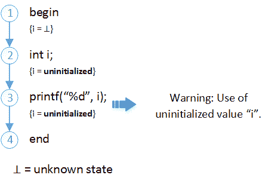

*Clang Static Analyzer*

下面的图展示了我们刚刚演示的简单C程序的数据流分析：

我们看到这些信息很容易跨代码行进行传播。当它到达`printf`语句时，框架检查我们对`i`了解什么，答案是未初始化，提供了足够的证据来发出警告。

```c
#include <stdio.h>

void my_function(int unknownvalue) {
```

```c
int schroedinger_integer;

if (unknownvalue)
    schroedinger_integer = 5;

printf("hi");

if (!unknownvalue)
    printf("%d", schroedinger_integer);
}
```

现在让我们来看看我们的数据流框架是如何计算此程序的变量状态的：

**[ 222 ]**

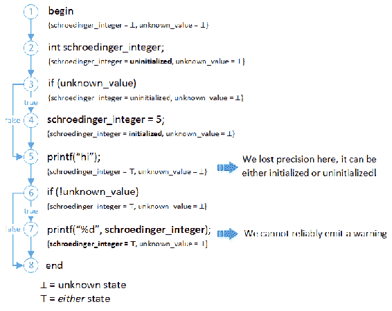

*第 9 章*

我们看到在节点4中，变量第一次被初始化（以粗体显示）。

然而，有两个不同的路径到达了节点5：即来自节点3的`if`语句的真、假分支。在一条路径中，变量`schroedinger_integer`是未初始化的，而在另一条路径它是初始化的。汇合运算符（confluence operator）决定了如何汇总前驱节点的结果。我们的并运算符（union operator）将尝试保留这两个数据，将`schroedinger_integer`声明为⊤（任意）。

当检测器检查使用`schroedinger_integer`的节点7时，它不确定代码中是否存在bug，这是因为根据此数据流分析，`schroedinger_integer`可能已初始化也可能未初始化。

换句话说，它确实处于初始化和未初始化状态的叠加态中。

我们简单的检测器可以尝试警告人们某个值可能在未初始化的情况下被使用，在这种情况下，它会正确指向bug。然而，如果Joe代码中最后一次检查使用的条件更改为`if (unknownvalue)`，那么发出警告将是一个假误报，因为现在它执行的是`schroedinger_integer`确实已经初始化的路径。

我们检测器中这种精度的丢失是因为数据流框架不是路径敏感的（path-sensitive），无法精确建模每种可能的执行路径上发生的情况。

**[ 223 ]**

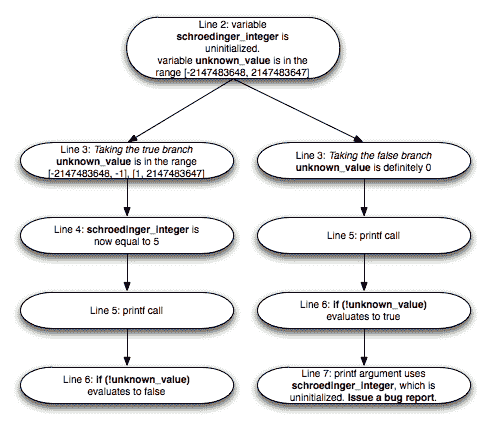

*Clang静态分析器*

误报是非常不可接受的，因为它们会用一系列针对不包含实际bug代码的警告来让程序员感到困惑，并掩盖了包含实际bug的警告。实际上，如果检测器即使只产生少量的误报，程序员也可能忽略所有的警告。

## 符号执行引擎的威力

当简单的数据流分析不足以提供关于程序的准确信息时，符号执行引擎可以提供帮助。它构建了一个可达程序状态图，并能够对程序运行时可能采取的所有可能的代码执行路径进行推理。记住，当你运行程序进行调试时，你只执行了一条路径。当你使用像`valgrind`这样强大的虚拟机调试程序以寻找内存泄漏时，你也只执行了一条路径。

相反，符号执行引擎能够在不实际运行代码的情况下执行所有路径。这是一个非常强大的功能，但它需要庞大的运行时开销来处理程序。

与经典的数据流框架一样，引擎会在按照执行每个语句的顺序遍历程序时，为发现的每个变量分配初始状态。区别在于遇到改变控制流的结构时：引擎将路径一分为二，并对每条路径分别继续进行分析。这种图被称为可达程序状态图，接下来的图展示了一个简单的示例，揭示了引擎如何对Joe的代码进行推理：

**[ 224 ]**

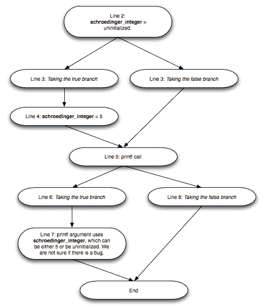

*第 9 章*

在这个示例中，第6行的第一个`if`语句将可达状态图分成了两个不同的路径：在一条路径中，`unknown_value`不为零，而在另一条路径中，`unknown_value`确定为零。从这里开始，引擎带有`unknown_value`的这一重要约束运行，并用它来决定是否进入下一个分支。

通过这种策略，符号执行引擎得出结论：图中左侧路径永远不会评估`schroedinger_integer`，尽管在该路径中它被定义为5。另一方面，它还得出图中右侧路径将评估`schroedinger_integer`并将其作为`printf()`参数传递。然而，在该路径中，该值未被初始化。通过使用该图，它精确地报告了bug。

让我们将达程序状态图与显示相同代码控制流的图进行对比，即**控制流图**（**CFG**），以及数据流方程为我们提供的典型推理。参见下图图：

**[ 225 ]**

*Clang静态分析器*

你首先会注意到，CFG可能会分叉以表示控制流的变化，但它也会合并节点以避免在可达程序状态图中看到的组合爆炸。当它合并时，数据流分析可以使用并集或交集决策来合并来自不同路径的信息（第5行的节点）。如果使用并集，我们得出结论`schroedinger_integer`既未初始化又等于5，正如我们的上一个例子一样。如果使用交集，我们最终没有任何关于`schroedinger_integer`的信息（未知状态）。

在典型的数据流分析中合并数据的必要性是符号执行引擎并不具备的局限性。这允许获得更精确的结果，与你通过多个输入测试程序得到的结果相当，但代价是运行时间和内存消耗的增加。

### 测试静态分析器

在这一节中，我们将探索如何在实践中使用`Clang`静态分析器。

### 使用驱动程序（driver）对比直接使用编译器（compiler）

在测试静态分析器之前，你应该始终记住，命令行`clang -cc1`直接指向编译器，而`clang`则触发驱动程序。驱动程序负责协调所有LLVM程序的执行，但也负责提供系统的参数。

虽然某些开发者倾向于直接使用编译器，但有时它可能找不到只有驱动程序才知道的系统头文件。相反，编译器可能提供允许我们查看情况的专用选项。让我们检查如何使用两者来检查单个文件。

编译器方式：

```
clang -cc1 -analyze -analyzer-checker=<package> <file>
```

驱动程序方式：

```
clang --analyze -Xanalyzer -analyzer-checker=<package> <file>
```

我们使用`<file>`表示要分析的源代码，使用`<package>`选择一组头文件。

**[ 226 ]**

*第 9 章*

在使用驱动程序时，注意`--analyze`标志触发静态分析器。然而，`-analyzer`标志会将后续标志直接传递给编译器，允许你传递特定标志。由于驱动程序是中间件，我们在整个示例中直接使用编译器。此外，在我们的简单示例中，直接使用编译器就足够了。如果你觉得需要驱动程序按照官方方式使用checker，请记住在传递给编译器的每个标志之前使用`-analyzer`。

### 了解可用的 checker

Checker是静态分析器可以在代码中执行的单一分析单元。每个checker寻找特定的bug类型。静态分析器允许你选择任何你需要的checker子集，也可以启用所有checker。

如果你没有安装`Clang`，请参阅*第1章构建与安装LLVM*以获取安装说明。要获取已安装checker的列表，运行以下命令：

```
$ clang -cc1 -analyzer-checker-help
```

它将列出长长的已安装checker列表，显示你通过`Clang`开箱即的所有分析可能性。现在让我们检查`-analyzer-checker-help`命令的输出：

```
OVERVIEW: Clang 静态分析器 Checker 列表

USAGE: -analyzer-checker <CHECKER or PACKAGE,...>

# 检查器 (CHECKERS):

## alpha.core.BoolAssignment 就向 `Boolean` 变量赋值非-{{0,1} 值发出警告
```

检查器的名称遵循规范格式`<package>.<subpackage>.<checker>`，为用户提供了一种运行特定一组相关检查器的便捷方法。

### [ 227 ]

*Clang静态分析器*

在下表中，我们展示了最重要的包列表，以及每个包包含的检查器示例列表。

| 包 | 内容 | 示例 |
| :--- | :--- | :--- |
| alpha | 正在开发中的检查器 | `alpha.core.BoolAssignment`、`alpha.security.MallocOverflow`和`alpha.unix.cstring.NotNullTerminated` |


| core | 通用的基础检查器 | `core.NullDereference`、`core.DivideZero` 和 `core.StackAddressEscape` |
| cplusplus | 用于 C++ 内存分配的检查器（其他处于 alpha 阶段） | `cplusplus.NewDelete` |
| debug | 输出静态分析器调试信息的检查器 | `debug.DumpCFG`、`debug.DumpDominators` 和 `debug.ViewExplodedGraph` |
| llvm | 检查代码是否遵循 LLVM 编码标准的检查器 | `llvm.Conventions` |
| osx | 针对为 Mac OS X 开发程序的检查器 | `osx.API`、`osx.cocoa.ClassRelease`、`osx.cocoa.NonNilReturnValue` 和 `osx.coreFoundation.CFError` |
| security | 针对引入安全漏洞代码的检查器 | `security.FloatLoopCounter`、`security.insecureAPI.UncheckedReturn`、`security.insecureAPI.gets` 和 `security.insecureAPI.strcpy` |
| unix | 针对为 UNIX 系统开发的程序的检查器 | `unix.API`、`unix.Malloc`、`unix.MallocSizeof` 和 `unix.MismatchedDeallocator` |

运行 Joe 的代码，这段代码旨在欺骗大多数编译器所使用的简单分析。首先，我们尝试经典的警告方法。为了做到这一点，我们只需运行 `clang` 驱动程序并要求它不要继续编译，只执行语法检查：

```bash
$ clang -fsyntax-only joe.c
```

### [ 228 ]

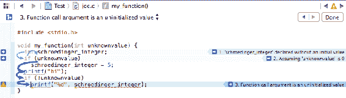

*第 9 章*

仅限语法标志旨在打印警告并检查语法错误，它未能检测出其中的任何问题。现在是时候测试符号执行如何处理这种情况了：

```bash
$ clang -cc1 -analyze -analyzer-checker=core joe.c
```

或者，如果前面的命令行要求你指定头文件位置，请按如下所示使用驱动程序：

```bash
$ clang --analyze –Xanalyzer –analyzer-checker=core joe.c
```

```bash
./joe.c:10:5: warning: 函数调用参数是一个未初始的值
printf("%d", schroedinger_integer);
^~~~~~~~~~~~~~~~~~~~~~~~~~~~~~~~~~
1 warning generated.
```

正到位！记住，`-analyzer-checker` 标志期望检查器的完全限定名称，或整个检查器包的名称。我们选择使用整个 `core` 检查包，但也可以只使用特定的检查器 `core.CallAndMessage`，它检查函数调用的参数。

注意，所有静态分析器命令都将以 `clang -cc1 -analyzer` 开头；因此，如果你想知道分析器提供的所有命令，可以执行以下命令：

```bash
$ clang -cc1 -help | grep analyzer
```

## 在 Xcode IDE 中使用静态分析器

如果你使用 Apple Xcode IDE，可以从内部使用静态分析器。你首先需要打开一个项目，然后选择 **Product** 菜单中的 **Analyze** 菜单项。你会发现 Clang 静态分析器提供了 bug 发生的准确路径，允许 IDE 像下面的截图所示向程序员突出显示它：

### [ 229 ]

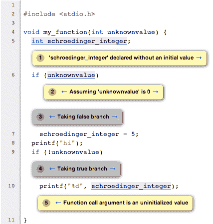

*Clang 静态分析器*

分析器能够使用 `plist` 格式导出信息，然后由 Xcode 解析并以用户友好的方式显示。

## 在 HTML 中生成图形化报告

静态分析器还能导出 HTML 文件，以图形方式指出代码中执行危险行为的程序路径，方式与 Xcode 相同。我们还使用 `-o` 参数配合文件夹名称，指示报告存储的位置。例如，查看以下命令行：

```bash
$ clang -cc1 -analyze -analyzer-checker=core joe.c -o report
```

或者，你可以如下所示使用驱动程序：

```bash
$ clang --analyze –Xanalyzer –analyzer-checker=core joe.c –o report
```

使用此命令行，分析器将处理 `joe.c` 并生成一个与 Xcode 中看到的类似的报告，将 HTML 文件放在 `report` 文件夹中。命令完成后，检查文件夹并打开 HTML 文件以查看 bug 报告。

你应该看到一个与下方截图所示类似的报告：

### [ 230 ]

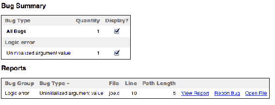

*第 9 章*

## 处理大型项目

如果你想让静态分析器检查一个大型项目，你可能不想编写一个 Makefile 或 bash 脚本来为每个项目源文件调用分析器。静态分析器带有一个为此设计的方便工具，称为 `scan-build`。

`scan-build` 通过替换你的 `CC` 或 `CXX` 环境变量来工作。最后，它生成可以在浏览器中查看的 HTML 报告。基本的命令行结构非常简单：

```bash
$ scan-build <your command>
```

`scan-build` 打印的最后一行指向一个包含所有报告的临时文件夹。你应该看到一个格式良好的网站，其中包含每个报告的错误报告，如下方所示：

### [ 231 ]

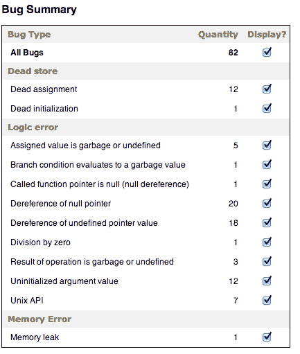

*Clang 静态分析器*

## 真实世界示例——在 Apache 中寻找 bug

在这个示例中，我们将探索检查大型项目中的 bug 是多容易。为了练习这一点，请访问 [httpd.apache.org/download.cgi](http://httpd.apache.org/download.cgi) 并获取最新 Apache Server 的源码压缩包。在本文写作时，它是 2.4.9 版本。在我们的示例中，我们将通过控制台下载并在当前文件夹解压文件：

```bash
$ wget http://archive.apache.org/dist/httpd/httpd-2.4.9.tar.bz2
$ tar -xjvf httpd-2.4.9.tar.bz2
```

为了检查这个源码库，我们将依靠 `scan-build`。为了做到这一点，我们需要复制生成构建脚本的步骤。注意，你需要所有的依赖项来编译 Apache 项目。在确认你拥有所有依赖项后，使用以下命令序列：

```bash
$ mkdir obj
$ cd obj
$ scan-build ../httpd-2.4.9/configure -prefix=$(pwd)/../install
```

我们使用 `-prefix` 参数为此项目指定一个新的安装路径，并避免了在机器上拥有管理员权限的需求。然而，如果你并不打算安装 Apache，只要你不运行 `make install`，就不需要提供任何额外参数。在我们案例中，我们将安装路径定义为名为 `install` 的文件夹，它将在下载压缩源码的相同目录下创建。注意我们还在该命令前缀了 `scan-build`，这将覆盖 `CC` 和 `CXX` 环境变量。

在配置脚本创建了所有的 Makefiles 后，是时候启动实际构建过程了。但我们不是直接运行 `make`，而是用 `scan-build` 拦截它：

```bash
$ scan-build make
```

### [ 232 ]


# 第 9 章

由于 Apache 代码非常庞大，我们花费了几分钟时间完成分析，并发现了 82 个漏洞。这是一个扫描视图报告示例：

[ 233 ]

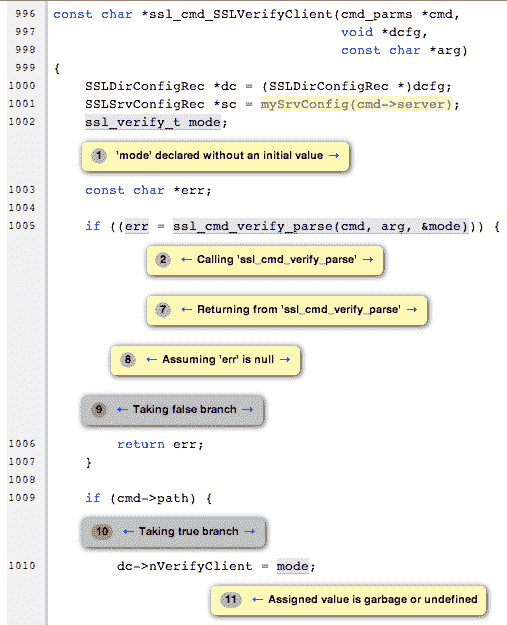

## Clang 静态分析器

在著名的“血溢”（heartbleed）漏洞冲击所有 OpenSSL 实现并引起全网关注后，有趣的一点是，静态分析器仍然在 Apache SSL 实现文件 `modules/ssl/ssl_util.c` 和 `modules/ssl/ssl_engine_config.c` 中发现了六个可能的漏洞。请注意，这些出现可能指的是在实践中从不执行的路径，并且可能不是真实的漏洞，因为静态分析器在有限的范围内工作，以便在接受的时间范围内完成分析。因此，我们并不声称这些是漏洞。我们在这里展示了一个分配垃圾值或未定义值的示例：

在这个示例中，我们看到静态分析器展示了一个通过给 `dc->nVerifyClient` 赋值未定义值来结束的执行路径。路径的一部分通过对 `ssl_cmd_verify_parse()` 函数的调用，展示了分析器检查同一编译模块内复杂的跨过程路径的能力。在这个辅助函数中，静态分析器显示了一条路径，其中 `mode` 没有被分配任何值，因此保持未初始化状态。

[ 234 ]

## 第 9 章

这可能不是一个真实的漏洞，是因为 `ssl_cmd_verify_parse()` 中的代码可能正确处理了该程序实际发生的所有输入 `cmd_parms` 的情况（注意上下文依赖性），并在所有这些情况下都正确初始化了 `mode`。`scan-build` 发现的是，该模块在孤立状态下会导致这条错误路径，但我们没有证据表明该模块的用户使用了这些错误的输入。静态分析器并不强大到足以在整个项目的上下文中分析该模块，因为这种分析将花费无法实现的时间才能完成（记住算法的指数级复杂度）。

虽然这条路径有 11 步，但我们在 Apache 中发现的最长路径有 42 步。该路径发生在 `modules/generators/mod_cgid.c` 模块中，并违反了标准的 C API 调用：它使用空指针参数调用了 `strlen()` 函数。

如果你好奇想查看所有报告的详情，请尽管亲自运行这些命令。

## 使用你自己的检查器扩展静态分析器

得益于其设计，我们可以轻松地使用自定义检查器扩展静态分析器。记住，静态分析器的优劣取决于它的检查器，如果你想分析任何代码是否以非预期的方式使用了你的某个 API 之一，你需要学习如何将这些领域知识嵌入到 Clang 静态分析器中。

### 熟悉项目架构

Clang 静态分析器的源码位于 `llvm/tools/clang`。头文件位于 `include/clang/StaticAnalyzer`，源代码可以在 `lib/StaticAnalyzer` 找到。如果你查看文件夹内容，你会发现项目被分为三个不同的子文件夹：`Checkers`、`Core` 和 `Frontend`。

核心层（core）的任务是在源码级别模拟程序执行，并使用访问模式（visitor pattern）在每个程序点（重要语句之前后）调用已注册的检查器，以强制给定的不变性。例如，如果你的检查器确保同一分配内存区域不会被释放两次，它将观察对 `malloc()` 和 `free()` 的调用，并在检测到双释放（double free）时生成漏洞报告。

[ 235 ]

## Clang 静态分析器

符号引擎无法使用精确的程序值（如你在程序运行时看到的那些值）来模拟程序。如果你要求用户输入一个整数值，你会在特定的运行中明确知道这个值是 5，例如。符号引擎的威力在于推断程序每种可能结果发生的情况，为了实现这一高尚目标，它使用符号（`SVals`）而不是具体的值。一个符号可以对应整数范围内的任何数字、任何浮点数，甚至是一个完全未知的值。它关于该值的信息越多，它就越强大。

理解项目实现关键的三个重要数据结构是 `ProgramState`、`ProgramPoint` 和 `ExplodedGraph`。第一个表示相对于当前状态的当前执行上下文。例如，在分析 Joe 的代码时，它会标记给定变量的值为 5。第二个表示程序流中的特定点，在语句之前或之后，例如，在将 5 赋值给整数变量之后的点。最后一个表示所有可达程序状态的图。此外，该图的节点由 `ProgramState` 和 `ProgramPoint` 的元组表示，这意味着每个程序点都有与其相关的特定状态。例如，将 5 赋值给整数变量之后的点具有将该变量与数字 5 关联的状态。

正如本章开头指出的，`ExplodedGraph` 或者说可达状态图，相对于经典的 CFG（控制流图）是一个显著的扩展。注意，一个具有两个连续非嵌套 `if` 语句的小型 CFG 在可达状态图表示中将爆炸为四条不同的路径——这是一种组合爆炸。为了节省空间，该图被折叠（folded），这意味着如果你创建一个与另一个节点表示相同程序点和状态的节点，它不会分配新节点，而是重用现有的节点，并可能构建循环。为了实现这种行为，`ExplodedNode` 继承自 LLVM 库超类 `llvm::FoldingSetNode`。LLVM 库已经包含了此类这些情况的通用类，因为折叠在编译器的中间后端被广泛使用。

静态分析器的整体设计可以分为以下部分：引擎，负责跟踪路径并管理其他组件；状态管理器负责 `ProgramState` 对象；约束管理器负责推断由跟随程序路径引起的 `ProgramState` 约束；以及存储管理器负责程序存储模型。

[ 236 ]

## 第 9 章

分析器实现了 Xu 等人在论文中描述的区域内存模型（参见本章末尾引用），该模型甚至能够区分数组每个元素的状态。Xu 等人提出了内存区域的层次结构，例如，数组元素是数组的子区域，而数组是栈的子区域。C 中的每个左值（lvalue），或者说每个变量或解引用，都有一个相应的区域来模拟它们处理的内存。另一方面，每个内存区域的内容通过绑定（bindings）进行建模。每个绑定将符号值与内存区域关联。我们知道这些信息很难吸收，所以让我们用最好的方式来消化它们——编写代码。

### 编写你自己的检查器

假设你正在开发一个控制核反应堆的特定嵌入式软件，它依赖于具有两个基础调用的 API：`turnReactorOn()` 和 `SCRAM()`（关闭反应堆）。反应堆包含燃料（反应发生的地方）和控制棒（包含中子吸收剂，用于减缓反应并使反应堆属于电站类别而非核弹类别）。

你的客户告知你，调用两次 `SCRAM()` 可能会导致控制棒卡住，而调用两次 `turnReactorOn()` 则会导致反应失控。这是一个具有严格使用规则的 API，你的任务是在代码上线前对大型代码库进行审计，以确保它绝不会违反这些规则：

- 任何代码路径在没有中间调用 `turnReactorOn()` 的情况下调用 `SCRAM()` 的次数超过一次。

- 任何代码路径在没有中间调用 `SCRAM()` 的情况下调用 `turnReactorOn()` 不超过一次。

例如，考虑以下代码：

```cpp
int SCRAM();

int turnReactorOn();

void test_loop(int wrongTemperature, int restart) {
    turnReactorOn();
    if (wrongTemperature) {
        SCRAM();
    }
    if (restart) {
        SCRAM();
    }
    turnReactorOn();
    // code to keep the reactor working
    SCRAM();
}
```

如果 `wrongTemperature` 和 `restart` 均不为零，则该代码违反了 API，因为这将导致在没有任何中间 `turnReactorOn()` 调用的情况下调用了两次 `SCRAM()`。如果两个参数都为零，该代码也违反了 API，因为代码将在没有任何中间 `SCRAM()` 调用的情况下调用了两次 `turnReactorOn()`。

### 使用自定义检查器解决问题

你可以尝试肉眼检查代码，这非常枯燥且容易出错，或者使用如 Clang Static Analyzer 等工具。问题是，它并不理解核电站 API。我们将通过实现一个特殊的检查器来克服这个问题。

我们的第一步是为我们的状态模型建立概念，关于我们想要在不同程序状态之间传播的信息。在这个问题中，我们关注反应堆是开启还是关闭。我们可能不知道反应堆是开启还是关闭；因此，我们的状态模型包含三个可能的状态：未知、开启和关闭。

现在，我们对检查器如何作用于状态有了一个相当的思路。

### 编写状态类

让我们将其付诸实践。我们将基于 `SimpleStreamChecker.cpp` 编写代码，这是 Clang 树中提供的一个示例检查器。

在 `lib/StaticAnalyzer/Checkers` 中，我们应该创建一个新文件 `ReactorChecker.cpp`，并开始编写我们自己的类，该类表示我们感兴趣的跟踪的状态：


```cpp
#include "ClangSACheckers.h"
#include "clang/StaticAnalyzer/Core/BugReporter/BugType.h"
#include "clang/StaticAnalyzer/Core/Checker.h"
#include "clang/StaticAnalyzer/Core/PathSensitive/CallEvent.h"
#include "clang/StaticAnalyzer/Core/PathSensitive/CheckerContext.h"

using namespace clang;
using namespace ento;

class ReactorState {
private:
    enum Kind {On, Off} K;

public:
    ReactorState(unsigned InK): K((Kind) InK) {}
    bool isOn() const { return K == On; }
    bool isOff() const { return K == Off; }
    static unsigned getOn() { return (unsigned) On; }
    static unsigned getOff() { return (unsigned) Off; }
    bool operator==(const ReactorState &X) const {
        return K == X.K;
    }
    void Profile(llvm::FoldingSetNodeID &ID) const {
        ID.AddInteger(K);
    }
};
```

我们类的数据部分被限制为`Kind`的单实例。注意，`ProgramState`类将管理我们正在写入的状态信息。

### 理解`ProgramState`的不可变性

关于`ProgramState`的一个有趣观察是它被设计为不可变的。一旦构建，它永远不应该改变：它代表了在给定执行路径上为给定程序点计算的状态。与处理 CFG 的数据流分析不同，在这种情况下，我们处理的是可达程序状态图，它具有不同的节点。

我们还想通知 Clang 基础设施我们正在处理一种新类型的 bug。为了做到，我们必须为每个要报告的新 bug 创建新的`BugType`实例：一个是当程序员调用两次`SCRAM()`时发生的 bug，另一个是当程序员调用两次`turnReactorOn()`时发生的 bug。我们还使用`LLVM`的`OwningPtr`类来封装我们的对象，它只是自动指针的一种实现，用于在我们的`ReactorChecker`对象被销毁时自动释放该对象的内存。

你应该将刚刚编写的两个类`ReactorState`和`ReactorChecker`封装在一个匿名命名空间中。这可以防止链接器导出这两个数据结构，因为我们知道它们会被局部使用。

### 编写 Register 宏

在深入实现类实现之前，我们必须调用一个宏，用分析引擎使用的`ProgramState`实例扩展为我们的自定义状态：

```cpp
REGISTER_MAP_WITH_PROGRAMSTATE(RS, int, ReactorState)
```

注意，这个宏末尾没有分号。它为每个`ProgramState`实例关联了一个新映射。第一个参数可以是你以后用来引用该数据的任何名称，第二个参数是映射的键类型，第三个参数是我们将存储的对象类型（在本例中，是我们的`ReactorState`类）。

**[ 241 ]**

*The Clang Static Analyzer*

检查器通常使用映射来存储它们的状态，因为将新状态与特定资源关联是很常见的，例如，从本章开始，我们在检测器中每个变量的状态（已初始化或未初始化状态）。在这种情况下，映射的键将是变量名，而存储的值将是一个模拟未初始化或已初始化状态的自定义类。要了解更多向程序状态中注册信息的方法，请查看`CheckerContext.h`中的宏定义。

注意，我们并不真正需要映射，因为我们始终对每个程序点只存储一个状态。因此，我们将始终使用键`1`来访问我们的映射。

### 实现 Checker 子类

我们的检查器类构造函数实现如下：

```cpp
ReactorChecker::ReactorChecker() : IIturnReactorOn(0), IISCRAM(0) {
    // 初始化 bug 类型。
    DoubleSCRAMBugType.reset(
        new BugType("Double SCRAM",
        "Nuclear Reactor API Error"));
    DoubleONBugType.reset(new BugType("Double ON",
        "Nuclear Reactor API Error"));
}
```

Clang 版本说明——从 Clang 3.5 开始，我们的`BugType`构造函数调用需要改为`BugType(this, "Double SCRAM", "Nuclear Reactor API Error")`和`BugType(this, "Double ON", "Nuclear Reactor API Error")`，添加`this`关键字作为第一个参数。

我们的构造函数通过`OwningPtr`的`reset()`成员函数实例化新的`BugType`对象，并为我们的新类型 bug 提供描述。我们还初始化了`IdentifierInfo`指针。接下来，是时候让我们的辅助函数来缓存这些指针的结果：

```cpp
void ReactorChecker::initIdentifierInfo(ASTContext &Ctx) const {
    if (IIturnReactorOn)
        return;
    IIturnReactorOn = &Ctx.Idents.get("turnReactorOn");
    IISCRAM = &Ctx.Idents.get("SCRAM");
}
```

**[ 242 ]**

*Chapter 9*

`ASTContext`对象持有特定的 AST 节点，这些节点包含了用户程序中使用的类型和声明，我们可以利用它来找到我们感兴趣监控的函数的精确标识符。现在，我们实现访问者模式函数`checkPostCall`。记住这是一个`const`函数，不应该修改检查器的状态：

```cpp
void ReactorChecker::checkPostCall(const CallEvent &Call,
    CheckerContext &C) const {
    initIdentifierInfo(C.getASTContext());
    if (!Call.isGlobalCFunction())
        return;
    if (Call.getCalleeIdentifier() == IIturnReactorOn) {
        ProgramStateRef State = C.getState();
        const ReactorState *S = State->get<RS>(1);
        if (S && S->isOn()) {
            reportDoubleON(Call, C);
            return;
        }
        State = State->set<RS>(1, ReactorState::getOn());
        C.addTransition(State);
        return;
    }
    if (Call.getCalleeIdentifier() == IISCRAM) {
        ProgramStateRef State = C.getState();
        const ReactorState *S = State->get<RS>(1);
        if (S && S->isOff()) {
            reportDoubleSCRAM(Call, C);
            return;
        }
        State = State->set<RS>(1, ReactorState::getOff());
        C.addTransition(State);
        return;
    }
}
```

第一个参数类型为`CallEvent`，它保留了程序在此程序点之前调用的确切函数信息（参见`CallEvent.h`），因为我们注册了调用后访问者。第二个参数类型为`CheckerContext`，是关于该程序点当前状态的唯一信息来源，因为我们的检查器被强制为无状态的。我们使用它来获取`ASTContext`并初始化检查正在监控的函数所需的`IdentifierInfo`对象。我们查询`CallEvent`对象以检查它是否是对`turnReactorOn()`函数的调用。如果是，我们需要处理到“开启”状态的状态转换。

**[ 243 ]**

*The Clang Static Analyzer*

在执行此操作之前，我们首先检查状态查看它是否已经开启，如果是开启，则我们发现了一个 bug。注意，在`State->get<RS>(1)`语句中，`RS`只是我们在程序状态中注册新特性时给出的名称，而`1`是访问映射的固定整数。虽然在这种情况下我们并不真正需要映射，但通过使用映射，如果你愿意，将能够扩展我们的检查器来监控更复杂的状态。我们以`const`指针恢复存储的状态，因为它是不可变的。首先需要检查它是否为空，空代表了我们不知道反应堆是开启还是关闭的情况。如果非空，我们创建一个新状态并将此新状态提供给`addTransition()`成员函数，该函数将记录信息并在`ExplodedGraph`中创建一个新边。边只有在状态实际发生变化时才会创建。我们采用类似的逻辑来处理 SCRAM 情况。

我们如下所示呈现 bug 报告成员函数：

```cpp
void ReactorChecker::reportDoubleON(const CallEvent &Call,
    CheckerContext &C) const {
    ExplodedNode *ErrNode = C.generateSink();
    if (!ErrNode)
        return;
    BugReport *R = new BugReport(*DoubleONBugType,
    "Turned on the reactor two times", ErrNode);
    R->addRange(Call.getSourceRange());
    C.emitReport(R);
}

void ReactorChecker::reportDoubleSCRAM(const CallEvent &Call,
    CheckerContext &C) const {
    ExplodedNode *ErrNode = C.generateSink();
    if (!ErrNode)
        return;
    BugReport *R = new BugReport(*DoubleSCRAMBugType,
    "Called a SCRAM procedure twice", ErrNode);
    R->addRange(Call.getSourceRange());
    C.emitReport(R);
}
```

`TableGen`文件包含一个检查器（checkers）的表格。它相对于 Clang 源码目录的路径为`lib/StaticAnalyzer/Checkers/Checkers.td`。在编辑此文件之前，我们需要为我们的检查器选择一个所在的包。我们将将其放入`alpha.powerplant`。

由于该包尚不存在，我们将创建它。打开`Checkers.td`，并在所有现有包定义之后添加一个新定义：

```cpp
def PowerPlantAlpha : Package<"powerplant">, InPackage<Alpha>;
```

接下来，加上我们新写的检查器：

```cpp
let ParentPackage = PowerPlantAlpha in {

def ReactorChecker : Checker<"ReactorChecker">,

HelpText<"Check for misuses of the nuclear power plant API">, DescFile<"ReactorChecker.cpp">;

} // end "alpha.powerplant"
```

如果你使用`CMake`来编译 Clang，你应该将你的新源文件添加到`lib/StaticAnalyzer/Checkers/CMakeLists.txt`中。如果你使用 GNU autotools `configure`脚本编译 Clang，则不需要修改任何其他文件，因为 LLVM 的`Makefile`会扫描`Checkers`文件夹中的新源文件并将其链接到静态分析器检查器库中。

[ 245 ]

*The Clang Static Analyzer*

### 编译与测试

进入编译 LLVM 和 Clang 的文件夹并运行`make`。构建系统现在会检测你的新代码，将其编译并链接到 Clang 静态分析器。

完成编译后，命令`clang -cc1 -analyzer-checker-help`将会将我们的新检查器列为一个有效选项。

我们检查器的一个测试用例是`managereactor.c`，列如下（与之前所示）：

```c
int SCRAM();

int turnReactorOn();

void test_loop(int wrongTemperature, int restart) {

turnReactorOn();
if (wrongTemperature) {
SCRAM();
}
if (restart) {
SCRAM();
}
turnReactorOn();
// 保持反应堆运行的代码
SCRAM();
}
```

使用我们的新检查器对其进行分析，我们使用以下命令：

```bash
$ clang --analyze -Xanalyzer -analyzer-checker=alpha.powerplant
```

**managereactor.c**

检查器将显示它能找到的错误路径并退出。如果你请求 HTML 报告，将看到一个类似于下面截图所示的错误报告：

[ 246 ]

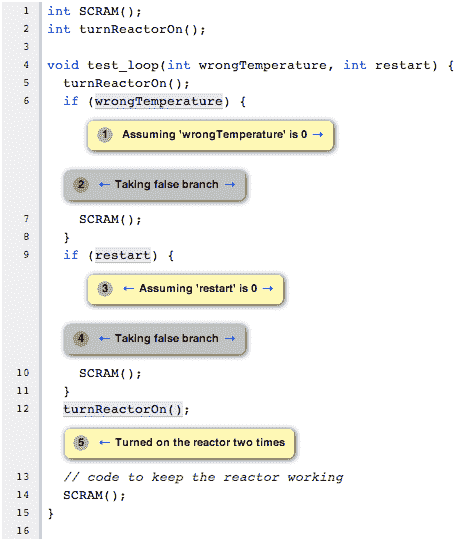

*第 9 章*

你的任务现在已完成：你成功开发了一个程序，能够通过路径敏感性自动检查特定 API 规则的违反情况。如果你愿意，可以检查其他检查器的实现以学习更多如何在复杂场景下工作，或者查看后续章节中的资源以获取更多信息。

[ 247 ]

*The Clang Static Analyzer*

### 更多资源

你可以查看以下资源以获取更多项目和其他信息：

- [http://clang-analyzer.llvm.org](http://clang-analyzer.llvm.org)：Clang 静态分析器项目页面。
- [http://clang-analyzer.llvm.org/checker_dev_manual.html](http://clang-analyzer.llvm.org/checker_dev_manual.html)：一本实用的手册，为想要开发新检查器的人提供更多信息。
- [http://lcs.ios.ac.cn/~xzx/memmodel.pdf](http://lcs.ios.ac.cn/~xzx/memmodel.pdf)：徐中兴、Ted Kremenek 和 Jian Zhang 写的论文 *A Memory Model for Static Analysis of C*。它详细说明了分析器核心中实现的内存模型的理论方面。
- [http://clang.llvm.org/doxygen/annotated.html](http://clang.llvm.org/doxygen/annotated.html)：Clang doxygen 文档。
- [http://llvm.org/devmtg/2012-11/videos/Zaks-Rose-Checker24Hours.mp4](http://llvm.org/devmtg/2012-11/videos/Zaks-Rose-Checker24Hours.mp4)：一场关于如何快速构建检查器的讲座，由静态分析器开发者 Anna Zaks 和 Jordan Rose 在 2012 年 LLVM 开发者会议上提供。

## 总结

在本章中，我们探索了 Clang 静态分析器与运行在编译器前端的简单漏洞检测工具之间的不同之处。我们提供了静态分析器更准确的示例，并解释了准确性与计算时间之间的权衡，以及为什么指数级时间的静态分析器算法因为完成分析所需的时间，而无法集成到常规编译器流水线中。我们还展示了如何使用命令行接口在简单项目上运行静态分析器，以及使用一个名为`scan-build`的辅助工具来分析大型项目。我们通过介绍如何使用你自己的路径敏感漏洞检查器来扩展静态分析器，结束了本章内容。

在下一章中，我们将介绍构建在`LibTooling`基础之上的 Clang 工具，这将简化构建代码重构工具的流程。

# 使用`LibTooling`的 Clang 工具

在本章中，我们将看到有多少工具使用 Clang 前端作为库，为了不同的目的操作 C/C++ 程序。特别是，所有这些工具都依赖于`LibTooling`，这是一个允许编写独立工具的 Clang 库。在这种情况下，你不是编写一个为了适应 Clang 流水线的插件，而是设计一个使用 Clang 能力的自己的工具。本章介绍的工具可以在*第 2 章*、*外部项目*中找到有关如何安装它们的信息。我们将通过一个如何创建你自己的代码重构工具的运行示例来结束本章。我们将涵盖以下主题：


理解并使用几个依赖于 `LibTooling` 的 Clang 工具，例如 `Clang Tidy`、`Clang Modernizer`、`Clang Apply Replacements`、`ClangFormat`、`Modularize`、`PPTrace`。

## 生成编译数据库

通常情况下，编译器是从构建脚本（例如 `Makefiles`）调用的，并带有一系列配置参数。这些参数允许前端对输入进行词法分析和解析。然而，在本章中，我们将学习独立运行的工具，而不是作为 Clang 流水线的一部分。因此，理论上，我们需要一个特定的脚本来为每个源文件运行我们的工具。

为了让工具轻松处理源文件，任何使用 `LibTooling` 的项目都接受命令数据库作为输入。该数据库包含特定项目中每个源文件的编译器参数。为了方便，如果在调用 `CMake` 时带有 `-MAKE_EXPORT_COMPILE_COMMANDS` 标志，它可以为你生成该数据库。例如，假设你想运行

*使用 LibTooling 的 Clang 工具*

例如，下面的命令显示了 Make 调用编译器编译典型文件的完整命令行：

```bash
$ /usr/bin/c++ -DNDEBUG -D__STDC_CONSTANT_MACROS -D__STDC_FORMAT_MACROS -D__STDC_LIMIT_MACROS -fPIC -fvisibility-inlines-hidden -Wall -Wno-unused-parameter -Wwrite-strings -Wmissing-field-initializers -pedantic -Wno-long-long -Wcovered-switch-default -Wnon-virtual-dtor -fno-rtti -I/Users/user/p/llvm/llvm-3.4/cmake-scripts/utils/TableGen -I/Users/user/p/llvm/llvm-3.4/llvm/utils/TableGen -I/Users/user/p/llvm/llvm-3.4/cmake-scripts/include -I/Users/user/p/llvm/llvm-3.4/llvm/include -fno-exceptions -o CMakeFiles/llvm-tblgen.dir/DAGISelChecker.cpp.o -c /Users/user/p/llvm/llvm-3.4/llvm/utils/TableGen/DAGISelChecker.cpp
```

这是一个基于 `LibTooling` 的针对 Apache 项目特定源文件的工具。为了避免你无需传递正确解析该文件所需的精确编译器标志，你可以如下所示使用 `CMake` 生成命令数据库：

```bash
$ cd httpd-2.4.9
$ mkdir obj
$ cd obj
$ cmake -DCMAKE_EXPORT_COMPILE_COMMANDS=ON ../
$ ln -s $(pwd)/compile_commands.json ../
```

这与你使用 `CMake` 构建 Apache 时发出的构建命令类似，但它并不是实际进行构建，而是通过 `-DCMAKE_EXPORT_COMPILE_COMMANDS=ON` 指示它生成一个 JSON 文件，其中包含了编译每个 Apache 源文件时将使用的编译器参数。我们需要创建一个该 JSON 文件的链接并将其放在 Apache 源码根目录下。然后，当我们运行任何 `LibTooling` 程序来解析 Apache 的源文件时，它将向上查找父目录，直到找到 `compile_commands.json`，从而找到解析该文件所需的适当参数。

或者，如果你不想在运行工具之前构建编译命令数据库，可以使用双横杠（`--`）直接传递你处理该文件时使用的编译器命令。这在你的项目不需要许多编译参数时非常有用。例如，看以下命令行：

```bash
$ my_libtooling_tool test.c -- -Iyour_include_dir -Dyour_define
```

## clang-tidy 工具

在本节中，我们将介绍 `clang-tidy` 作为 `LibTooling` 工具的示例，并解释如何使用它。所有其他 Clang 工具将具有类似的界面和体验，从而让你能够舒适地探索它们。

`clang-tidy` 工具是一个基于 Clang 的静态分析器（linter）。通常，linter 是一种分析代码并指出不符合最佳实践部分的工具。它可以检查特定的特征，例如：

- 代码是否可以在不同编译器之间具有移植性
- 代码是否遵循特定的惯用法或代码规范
- 代码是否因为滥用危险的语言特性导致 Bug

在 `clang-tidy` 的特定情况下，该工具能够运行两种类型的检查器：来自原始 Clang Static Analyzer 的检查器以及专门为 `clang-tidy` 编写的检查器。

尽管能够运行静态分析检查，但请注意 `clang-tidy` 和其他基于 `LibTooling` 的工具是基于源代码分析的，这与前章节描述的详尽静态分析引擎非常不同。

这些检查并不是模拟程序执行，而是仅仅遍历 Clang AST（抽象语法树），而且速度快得多。与 Clang Static Analyzer 的检查不同，为 `clang-tidy` 编写的检查通常针对对特定编码规范的遵循情况。特别是，它们会检查 LLVM 编码规范和 Google 编码规范，以及其他通用检查。

如果你遵循特定的代码规范，你会发现 `clang-tidy` 对于定期检查你的代码非常有用。通过一些努力，你甚至可以配置它直接从某些文本编辑器运行。然而，该工具目前还处于起步阶段，仅实现了少数几个测试。

## 使用 clang-tidy 检查你的代码

在这个示例中，我们将展示如何使用 `clang-tidy` 来检查我们在第 9 章“Clang 静态分析器”中编写的代码。由于我们为静态分析器写了一个插件，如果我们想将此检查器提交到官方 Clang 源码树，我们需要严格遵守 LLVM 编码规范。现在是检查我们是否真的遵循了它的时候了。`clang-tidy` 的通用命令行接口如下：

```bash
$ clang-tidy [options] <source0> [... <sourceN>] [-- <compiler command>]
```

你可以通过 `-checks` 参数按名称仔细地激活每个检查器，但你也可以使用通配符 `*` 来选择许多以相同子串开头的检查器。当你需要禁用某个检查器时，只需在检查器名称前加一个减号。例如，如果你想运行所有属于 LLVM 编码规范的检查器，你应该使用以下命令：

```bash
$ clang-tidy -checks="llvm-*" file.cpp
```

本章描述的所有工具只有在安装 Clang 的同时安装 Clang Extra Tools 仓库时才可用，该仓库与 Clang 树是分开的。如果你尚未安装 `clang-tidy`，请阅读第 2 章“外部项目”，了解如何构建和安装 Clang Extra Tools。

由于我们的代码与 Clang 一起编译的，我们需要一个编译器命令数据库。我们将从生成它开始。进入你 LLVM 源码所在的文件夹，使用以下命令创建一个独立的兄弟文件夹来存放 CMake 文件：

```bash
$ mkdir cmake-scripts
$ cd cmake-scripts
$ cmake -DCMAKE_EXPORT_COMPILE_COMMANDS=ON ../llvm
```

如果你遇到未知源文件错误，该错误指向你在上一章中创建的检查器代码，你需要用你的检查器源文件名更新 `CMakeLists.txt` 文件。使用以下命令行编辑此文件然后再次运行 CMake：

```bash
$ vim ../llvm/tools/clang/lib/StaticAnalyzer/Checkers/CMakeLists.txt
```

然后，在 LLVM 根目录下创建一个指向编译器命令数据库文件的链接：

```bash
$ ln -s $(pwd)/compile_commands.json ../llvm
```

现在，我们终于可以运行 `clang-tidy` 了：

```bash
$ cd ../llvm/tools/clang/lib/StaticAnalyzer/Checkers
$ clang-tidy -checks="llvm-*" ReactorChecker.cpp
```

你应该看到许多关于头文件的投诉，因为它们没有严格遵循 LLVM 规则。好消息是，我们工具的代码（排除头文件）并没有违反规则。

## 重构工具

在本节中，我们将介绍许多其他利用 Clang 解析能力执行代码分析和源到源转换的工具。你应该习惯类似于 `clang-tidy` 的方式使用它们，并依赖你的命令数据库来简化用法。

### Clang Modernizer

Clang Modernizer 是一个革命性的独立工具，帮助用户将旧的 C++ 代码适配到最新标准，例如 C++11。它通过执行以下转换来实现这一目标：

- Loop convert（循环转换）：将旧的 C 风格 `for(;;)` 循环转换为新的范围循环，格式为 `for(auto &...:..)`。
- Use-nullptr：将旧的表示空指针的 C 风格 `NULL` 或 `0` 转换为新的 C++11 关键字 `nullptr`。
- Use-auto：在特定情况下将某些类型声明转换为 `auto` 关键字，这可以提高代码的可读性。
- Add-override：为重写基类函数的虚成员函数声明添加 `override` 饰符。
- Pass-By-Value（按值传递）：使用值传递惯用法替换常量引用后加拷贝的操作。
- Replace-auto_ptr：将已弃的 `std::auto_ptr` 替换为 `std::unique_ptr`。

Clang Modernizer 是一个由 Clang LibTooling 基础设施实现的引人的源到源转换工具。要使用它，请参考以下模板：

```bash
$ clang-modernize [<options>] <source0> [... <sourceN>] [-- <compiler command>]
```

注意，如果你除了源文件名外没有提供任何额外选项，该工具将直接对源文件进行所有转换。使用 `-serialize-replacements` 标志用于强制将建议写入磁盘，允许你在应用之前对其进行读取。有一个专门的工具来应用这些在磁盘上的补丁，我们将在下文中介绍。

### Clang Apply Replacements

Clang Modernizer（以前称为 `C++ migrator`）的发展引发了关于如何在大型代码库上协调源到源转换的讨论。例如，在分析不同的编译单元时，同一个头文件可能会被分析多次。

处理此种问题的一种方法是将替换建议序列化并将它们写入文件。第二个工具将负责读取这些建议文件，丢弃冲突的和重复的建议，并将替换建议应用到源文件中。这正是 `Clang Apply Replacements` 的目的，它的诞生就是为了辅助 `Clang Modernizer` 完成修复大型代码库的任务。

产生替换建议的 `Clang Modernizer` 和消耗这些建议的 `Clang Apply Replacements` 都与 `clang::tooling::Replacement` 类的序列化版本一起。这种序列化使用了 `YAML` 格式，它可以被定义为 `JSON` 的超集，并且更易人类阅读。

代码修订工具使用的补丁文件（patch files）实际上就是建议的一种序列化形式，但 Clang 开发者选择使用 `YAML` 直接与 `Replacement` 类的序列化版本工作，以避免解析补丁文件。

因此，`Clang Apply Replacements` 工具并不是一个通用的代码补丁工具，而是一个专门的工具，专注于提交由依赖 `tooling` API 的 Clang 工具所做的更改。注意，如果你正在编写一个源到源转换工具，只有当你希望协调具有去重能力的多个建议时，才需要使用 `Clang Apply Replacements`。否则，你只需直接对源文件进行补丁。

为了看到 `Clang Apply Replacements` 的运行，我们首先需要使用 `Clang Modernizer` 并强制其将其建议序列化。假设我们想要将 C++ 源文件 `test.cpp` 转换为新的 C++ 标准：

```cpp
int main() {
  const int size = 5;
  int arr[] = {1,2,3,4,5};
  for (int i = 0; i < size; ++i) {
    arr[i] += 5;
  }
  return 0;
}
```

根据 `Clang Modernizer` 用户手册，将此循环转换为使用新的 `auto` 迭代器是安全的。为了这一点，我们需要使用 `Clang Modernizer` 的循环转换功能：

```bash
$ clang-modernize -loop-convert -serialize-replacements test.cpp --serialize-dir=./
```

最后一个参数是可选的，它指定使用当前文件夹来存储替换文件。如果我们不指定它，工具将创建一个临时文件夹，供后续 `Clang Apply Replacements` 使用。由于我们已将所有替换内容导出到当前文件夹，你可以自由地分析生成的 `YAML` 文件。

要应用更改，只需运行 `clang-apply-replacements` 并将当前文件夹作为唯一参数：

```bash
$ clang-apply-replacements ./**
```

运行此命令后，如果你收到错误信息“遍历目录 ./ 出错：符号链接层数过深”（trouble iterating over directory ./: too many levels of symbolic links），你可以尝试使用 `/tmp` 作为存储替换文件的文件夹重试最后两个命令。或者，你可以创建一个新目录来存放这些文件，以便你轻松地分析它们。

除了这个简单的例子外，这些工具通常是为了在大型代码库工作而设计的。因此，`Clang Apply Replacements` 不会询问任何问题，而是直接开始解析你指定文件夹中的所有 `YAML` 文件，分析并应用转换。

你甚至可以指定工具在打补丁时遵循特定的编码规范，即向源文件中写入新代码。这就是 `-style=<LLVM|Google|Chromium|Mozilla|Webkit>` 标志的作用。此功能归功于 `LibFormat` 库，它允许任何重构工具按照特定的格式或编码规范编写新代码。我们下一节介绍关于这一显著特性的更多细节。

### ClangFormat

想象你是一场类似于**国际混淆 C 代码大赛**（**IOCCC**）比赛的评判。为了让你对比赛有一个直观感受，我们将重现第二届获奖者 Michael Birken 的代码。请记住，这段代码根据 Creative Commons 署名-相同共享 3.0 许可协议授权，这意味着只要你保持许可和对 IOCCC 的致谢，就可以自由地修改它。

[如果你在好奇，是的，这是合法的 C 代码。访问 http://www.ioccc.org/2013/birken 下载它。] 现在，让我们在这个例子中展示 `ClangFormat` 为你做了什么：

```bash
$ clang-format -style=llvm obf.c --
```

接下来的截图显示了结果：

效果更好，对吧？在现实生活中，你幸运地不需要审查混淆的代码段，但修复格式以遵守特定的编码规范也并非人类特别梦想从事的工作。这正是 `ClangFormat` 的目的。它不仅是一个工具，还是一个库 `LibFormat`，它可以按照特定的格式或编码规范编写新代码。这样，如果你创建一个生成 C 或 C++ 代码的工具，可以将格式交给 `ClangFormat`，而你专注于项目。

除了这个显而易见的例子和执行代码缩进，`ClangFormat` 还是一个精心设计的工具，用于将代码格式化为八十列。如果你曾停下来思考如何拆分长句子，你将会欣赏 `ClangFormat` 在这方面的表现。通过将其设置为你喜爱的编辑器的外部工具并配置快捷键来尝试它。

代码格式、组织和清晰度的主题也带我们了 C 和 C++ 代码中的棘手问题：头文件的滥用以及如何协调它们。

我们在下一节专门讨论针对该问题的进展方案，以及 Clang 工具如何帮助你采用这种新方法。

### Modularize

为了理解 `Modularize` 项目的目标，我们首先需要向你介绍 C 和 C++ 中的模块概念，这需要离开本章的主题。在本文写作时，模块尚未正式标准化。对于 Clang 如何已经实现这一新想法感兴趣的读者，鼓励跳过本节继续后续内容。

## 理解 C/C++ API 定义

目前，C 和 C++ 程序分为头文件（例如以 `.h` 结尾的文件）和实现文件（例如以 `.c` 或 `.cpp` 结尾的文件）。编译器将每个实现文件与其包含的头部组合解释为独立的编译单元。

然而，如果你确实想在多个编译单元之间共享一个实体，问题就开始了。为了清晰起见，我们将导出实体的编译单元命名为导出者（exporters），将这些实体的使用者命名为导入者（importers）。我们假设假设名为 `gamelogic.c` 的导出者想要向名为 `screen.c` 的导入者导出一个名为 `num_lives` 的简单整数变量。

## 链接器的工作


首先，我们将展示链接器在示例中是如何处理符号导入的。

编译并汇编`gamelogic.c`后，我们将得到一个名为`gamelogic.o`的对象文件，其符号表显示符号`num_lives`大小为 4 字节，并且可供任何其他编译单元使用。

```bash
$ gcc -c gamelogic.c -o gamelogic.o
```

```bash
$ readelf -s gamelogic.o
```

| Num | Value | Size | Type | Bind | Vis | Index | Name |
| :--- | :--- | :--- | :--- | :--- | :--- | :--- | :--- |
| 7 | 00000000 | 4 | OBJECT | GLOBAL | DEFAULT | 3 | num_lives |

此表仅展示了感兴趣的符号，省略了其余部分。`readelf`工具仅适用于依赖 ELF 格式的使用的 Linux 平台。如果你使用其他平台，可以使用`objdump -t`打印符号表。我们以以下方式读取此表：我们的符号`num_lives`被分配在表的第七位置，并相对于索引为 3 的段（.bss 段）占据地址（零）。.bss 段包含将进行零初始的数据实体。要验证段名称与其索引之间的对应关系，可以使用`readelf -S`或`objdump -h`打印段头。我们还可以从表中看出，我们的`num_lives`符号是一个 4 字节大小的（数据）对象，并且全局可见（全局绑定）。

同样，`screen.o`文件也将有一个符号表，显示该编译单元依赖于符号`num_lives`，它属于另一个编译单元。

为了分析`screen.o`，我们将使用与处理`gamelogic.o`相同的命令：

```bash
$ gcc -c screen.c -o screen.o
```

```bash
$ readelf -s screen.o
```

| Num | Value | Size | Type | Bind | Vis | Index | Name |
| :--- | :--- | :--- | :--- | :--- | :--- | :--- | :--- |
| 10 | 00000000 | 0 | NOTYPE | GLOBAL | DEFAULT | UND | num_lives |

该条目与在导出者看到的类似，但包含的信息较少。它没有大小或类型，且显示包含此符号的 ELF 段的索引被标记为`UND`（未定义），这会将该编译单元刻画为一个导入者。如果该编译单元被包含在最终程序中，如果不解析此依赖关系，链接将无法成功。

[ 259 ]

*带有 LibTooling 的 Clang 工具*

链接器接收这两个文件作为输入，并用导出者中请求符号的地址来补丁导入者。

```bash
$ gcc screen.o gamelogic.o -o game
```

```bash
$ readelf -s game
```

| Num | Value | Size | Type | Bind | Vis | Index | Name |
| :--- | :--- | :--- | :--- | :--- | :--- | :--- | :--- |
| 60 | 0804a01c | 4 | OBJECT | GLOBAL | DEFAULT | 25 | num_lives |

该值现在反映了程序加载时变量的完整虚拟内存地址，为导入者的代码段提供了符号的位置，并完成了两个不同编译单元之间的导出-导入协议。

我们得出结论：在链接器端，在多个编译单元之间的实体共享是简单且高效的。

## 前端对应项

在处理对象文件时看到的简单性并没有在语言中体现。在导入者的实现中（这与链接器不同），编译器不能仅依赖导入实体的名称，因为它需要验证该编译单元的语义没有违反语言的类型系统；它需要知道`num_lives`是一个整数。因此，编译器还期望在拥有导入实体名称的同时拥有类型信息。在历史上，C 通过要求头文件来解决这个问题。

头文件包含了类型声明以及将在不同编译单元之间使用的实体名称。在这种模型中，导入者使用包含指令（include directive）来加载其将导入的实体的类型信息。然而，头文件可以比所需的灵活得多，实际上还可以携带任何 C 或 C++ 代码，而不仅仅是声明。

### 依赖 C/C++ 预处理器的问题

与 Java 等语言中的导入指令不同，`include`指令的语义并不限于为编译器提供导入符号所需的必要信息，而是实际上通过更多需要解析的 C 或 C++ 代码来扩展它。这种机制由预处理器实现，预处理器会在实际编译之前盲目地复制和修补代码，它并不比一个文本处理工具更灵明。

[ 260 ]

*第 10 章*

这种代码规模的膨胀在 C++ 代码中变得更加复杂，因为模板的使用鼓励在头文件中描述一个完整的类实现，这会导致大量的额外的 C++ 代码被注入到使用该头文件的所有导入者（用户）中。

这对于依赖许多库（或外部定义的实体）的 C 或 C++ 项目的编译造成了沉重负担，因为编译器需要多次解析许多头文件，每个使用这些头文件的编译单元都要解析一次。

回溯来看，可以通过扩展符号表解决的实体导入和导出，现在需要仔细解析数千行由人工编写的头文件。

大型编译器项目通常使用预编译头文件方案来避免再次词法分析每个头文件，例如带有 PCH 文件的 Clang。然而这仅仅缓解了问题，因为编译器仍然需要根据可能的新的宏定义重新解释整个头文件，并且会影响当前编译单元查看此头文件的方式。

例如，假设我们的游戏如下所示实现`gamelogic.h`：

```cpp
#ifdef PLATFORM_A
extern uint32_t num_lives;
#else
extern uint16_t num_lives;
#endif
```

当`screen.c`包含此文件时，导入实体`num_lives`的类型取决于`screen.c`上文中是否定义了`PLATFORM_A`。此外，这种上下文对于另一个编译单元并不一定相同。这迫使编译器每次包含头文件时加载额外的代码。

为了规范 C/C++ 导入以及库接口的编写，模块（modules）提出了一种描述这种接口的新方法，并且是正在进行标准的一部分。此外，Clang 项目已经实现了对模块的支持。

## 理解模块的工作原理

与其包含头文件，你的编译单元可以导入一个模块，为使用特定库定义清晰且无歧的接口。导入指令将加载库出的实体，而不会向你的编译单元注入额外的 C 或 C++ 代码。

[ 261 ]

*带有 LibTooling 的 Clang 工具*

然而，目前还没有定义的导入语法，这仍然 C++ 标准委员会正在讨论的内容。目前，Clang 允许你传递名为`-fmodules`的额外标志，当你包含属于启用模块库的头文件时，它会将`include`解释为模块的导入指令。

## 使用模块

要将一组头文件映射到特定模块，你可以定义一个名为`module.modulemap`的单独文件，它提供了这些信息。该文件应该放置在定义库 API 的头文件所在的文件夹中。如果存在此文件并且在调用 Clang 时使用了`-fmodules`参数，则编译将使用模块。

让我们扩展之前的简单游戏示例来使用模块。假设游戏 API 定义在两个头文件`gamelogic.h`和`screenlogic.h`中。主文件`game.c`导入了这两个文件中的实体。我们游戏 API 源代码的内容如下：

- `gamelogic.h`文件的内容：

```c
extern int num_lives;
```

- `screenlogic.h`文件的内容：

```c
extern int num_lines;
```

- `gamelogic.c`文件的内容：

```c
int num_lives = 3;
```

- `screenlogic.c`文件的内容：

```c
int num_lines = 24;
```

此外，在我们的游戏 API 中，每当用户包含`gamelogic.h`头文件时，它也希望包含`screenlogic.h`以在屏幕上打印游戏数据。因此，我们将逻辑模块化以表达这种依赖关系。我们项目的`module.modulemap`文件定义如下：

```
module MyGameLib {
  explicit module ScreenLogic {
    header "screenlogic.h"
  }
  explicit module GameLogic {
    header "gamelogic.h"
    export ScreenLogic
  }
}
```

`module`关键字后面跟着你希望用于标识它的名称。在我们的案例中，将其命名为`MyGameLib`。每个模块都可以包含一个嵌套子模块列表。

`explicit`关键字用于告诉 Clang，只有在显式包含其中一个头文件时才导入该子模块。随后，我们使用`header`关键字来命名哪些 C 头文件组成该子模块。你可以列出许多头文件来表示单个子模块，但在这里，每个子模块只使用了一个。

由于我们正在使用模块，可以利用它们让我们的生活更简单，包含指令更简洁。注意，在`GameLogic`子模块的作用范围内，通过使用`export`关键字后跟`ScreenLogic`子模块的名称，我们表示每当用户导入`GameLogic`子模块时，我们也使`ScreenLogic`的符号可见。

为了演示，我们将如下编写`game.c`（该 API 的用户）：

```c
// File: game.c
#include "gamelogic.h"
#include <stdio.h>

int main() {
  printf("lives= %d\nlines=%d\n", num_lives, num_lines);
  return 0;
}
```

注意，我们正在使用定义在`gamelogic.h`中的符号`num_lives`和定义在`screenlogic.h`中的`num_lines`，它们并没有被显式包含。然而，当带有`-fmodules`标志的`clang`解析此文件时，会将第一个包含指令转换为对`GameLogic`子模块导入指令的效果，从而使`ScreenLogic`中定义的符号可用。因此，以下命令行应该可以正确编译此项目：

```bash
$ clang -fmodules game.c gamelogic.c screenlogic.c -o game
```

另一方面，在不使用模块系统的情况下调用`clang`将导致它报告缺少符号定义：

```bash
$ clang game.c gamelogic.c screenlogic.c -o game
screen.c:4:50: error: use of undeclared identifier 'num_lines'; did you mean 'num_lives'?
printf("lives= %d\nlines=%d\n", num_lives, num_lines);
^~~~~~~~~
num_lives
```

然而，请记住，你可能希望项目尽可能具有可移植性，因此，避免这种在有模块时正确编译但在没有模块时无法编译的情况是有意义的。采用模块的最佳场景是简化库 API 的使用，并加速依赖许多公共头文件的编译单元的编译。

# 理解模块化

一个很好的例子是将现有的大型项目适配为使用模块而不是包含头文件。通过这种方式，请记住，在模块框架中，属于每个子模块的头文件是独立编译的。许多依赖于（例如）在包含之前在其他文件中定义的宏的项目将无法迁移到使用模块的模式。

`modularize`的目的是帮助你完成这项任务。它分析一组头文件，并报告它们是否提供了重复的变量定义、重复的宏定义，或者根据预处理器状态可能评估出不同结果的宏定义。它可以帮助你诊断从一组头文件创建模块的常见障碍。它还能检测你的项目是否在命名空间块内部使用包含指令，这也会迫使编译器在与模块概念不兼容的范域内解释包含文件。

在此，头文件中定义的符号不能依赖于包含头文件的上下文。

# 使用 Modularize

要使用`modularize`，你必须提供一个头文件列表，以便它们进行相互检查。继续我们的游戏项目示例，我们将编写一个名为`list.txt`的新文本文件：

```
gamelogic.h
screenlogic.h
```

然后，我们只需带上列表运行`modularize`：

```bash
$ modularize list.txt
```

如果你更改其中一个头文件以定义另一个的符号，`modularize`将报告你依赖于不安全的行为，并建议你在编写`modulemap`文件之前修复头文件。

# 模块映射检查

Clang 的`Module Map Checker`工具允许你检查`modulemap`文件以确保它涵盖了文件夹中的所有头文件。我们在上一节的示例中使用以下命令调用它：

```bash
$ module-map-checker module.modulemap
```

预处理器是我们关于包含指令与模块讨论的核心。在下一节中，我们将介绍一个帮助你跟踪此前端组件活动的工具。

## PPTrace

参考 Clang 文档中关于`clang::preprocessor`的以下引用（[`clang.llvm.org/doxygen/class_11Preprocessor.html`](http://clang.llvm.org/doxygen/class_11Preprocessor.html)）：

`classclang11Preprocessor.html`: *与词法器密切配合，以高效处理令牌。*

正如第 4 章 前端所指出的，Clang 中的词法类执行分析源文件的第一步。它将文本分组为稍后由器解释的类别。词法类没有语义信息（这是解析器的职责），也没有包含头文件和宏展开的信息（这是预处理器的职责）。

`pp-trace` Clang 独立工具输出预处理器动作的轨迹。它通过实现`clang::PPCallbacks`接口的回调来实现这一点。

```
write(1, "Hello, ", 7);

write(1, WORLD, 5);

write(1, "!\n", 2);

return 0;

}
```

在上述代码的前几行中，我们使用了一个始终求值为`false`的预处理器指令`#if`，这迫使编译器忽略到下一个`#endif`指令为止的源码块内容。接下来，我们使用`#ifdef`指令来检查`CAPITALIZE`宏是否已经定义。根据其是否被定义，宏`WORLD`将定义为包含`world`的大写或小写字符串。最后，代码通过了一系列对`write`系统调用的调用在屏幕上输出消息。

我们运行`pp-trace`的方式就像运行其他类似的源码分析 Clang 独立工具一样：

```bash
$ pp-trace hello.c
```

结果是一系列关于宏定义的预处理器事件，这些事件甚至在我们实际处理源文件之前就已经发生了。最后几个事件涉及我们特定的文件，显示如下：

- Callback: `If`

  Loc: `"hello.c:1:2"`

  ConditionRange: `["hello.c:1:4", "hello.c:2:1"]`

  ConditionValue: `CVK_False`

- Callback: `Endif`

  Loc: `"hello.c:3:2"`

[ 266 ]

*第 10 章*

- IfLoc: `"hello.c:1:2"`

- Callback: `SourceRangeSkipped`

  Range: `["hello.c:1:2", "hello.c:3:2"]`

- Callback: `Ifdef`

  Loc: `"hello.c:5:2"`

  MacroNameTok: `CAPITALIZE`

  MacroDirective: `(null)`

- Callback: `Else`

  Loc: `"hello.c:7:2"`

  IfLoc: `"hello.c:5:2"`

- Callback: `SourceRangeSkipped`

  Range: `["hello.c:5:2", "hello.c:7:2"]`

- Callback: `MacroDefined`

  MacroNameTok: `WORLD`

  MacroDirective: `MD_Define`

- Callback: `Endif`

  Loc: `"hello.c:9:2"`

  IfLoc: `"hello.c:5:2"`

- Callback: `MacroExpands`

  MacroNameTok: `WORLD`

  MacroDirective: `MD_Define`

  Range: `["hello.c:13:14", "hello.c:13:14"]`

  Args: `(null)`

- Callback: `EndOfMainFile`

第一个事件指的是我们的第一个`#if`预处理器指令。该区域触发了三个回调：`If`、`Endif`和`SourceRangeSkipped`。注意内部的`#include`指令没有被处理，而是跳过了。同样，我们看到了与`WORLD`宏定义相关的事件：`IfDef`、`Else`、`MacroDefined`和`EndIf`。最后，`pp-trace`报告我们在`MacroExpands`事件中使用`WORLD`宏，然后到达文件末尾并调用`EndOfMainFile`回调。

预处理之后，前端的后续步骤是词法分析（lex）和语法分析（parse）。在下一节中，我们将介绍一个工具，使我们能够研究解析器的结果，即 AST 节点。

## Clang Query


`Clang Query` 工具在 LLVM 3.5 中引入，允许你读取源文件并交互式查询与其相关的 Clang AST 节点。它是检查和学习前端如何表示每段代码的极佳工具。然而，它的主要目标不仅是允许你检查程序的 AST，还为了测试 AST 匹配器（AST matchers）。

[ 267 ]

## 使用 LibTooling 的 Clang 工具

在编写重构工具时，你会对 AST 匹配器库感兴趣，该库包含了若干个谓词，它们可以匹配你感兴趣的 Clang AST 片段。`Clang Query` 是帮助你完成这部分开发的工具，因为它允许你检查哪些 AST 节点匹配了特定的 AST 匹配器。关于所有可用 AST 匹配器的列表，你可以检查 Clang 头文件 `ASTMatchers.h`，但一个很好的猜测是使用驼峰命名法（camel case）作为表示你感兴趣的 AST 节点的类名。例如，`functionDecl` 将匹配所有 `FunctionDecl` 节点，这些节点代表函数声明。在测试出哪些匹配器精确返回了你感兴趣的节点后，你可以在你的重构工具中使用它们，构建一种自动化方法来为了特定目的转换这些节点。我们将在本章稍后部分解释如何使用 AST 匹配器库。

作为 AST 检查的一个示例，我们将在最后在 PPTrace 中使用的“hello world”代码中运行 `clang-query`。`Clang Query` 期望你有一个编译命令数据库（compile command database）。如果你正在检查一个缺少编译命令数据库的文件，请在双横线之后提供编译命令，或者如果不需要特殊的编译器标志，则将其留空，如下方的命令行所示：

```bash
$ clang-query hello.c --
```

执行此命令后，`clang-query` 将显示一个交互式提示符，等待你的命令。你可以在 `match` 命令后输入任何 AST 匹配器的名称。例如，在下面的命令中，我们要求 `clang-query` 显示所有为 `CallExpr` 的节点：

```bash
clang-query> match callExpr()
```

**Match #1:**

**hello.c:12:5: note: "root" node binds here**

**write(1, "Hello, ", 7);**

**^~~~~~~~~~~~~~~~~~~~~~**

**...**

该工具亮出了程序中与 `CallExpr` AST 节点相关的第一个标记的对应的精确位置。`Clang Query` 理解的命令列表如下：

- `help`：打印命令列表。
- `match <matcher name>` 或 `m <matcher name>`：此命令遍历 AST。

[ 268 ]

## 第 10 章

- `set output <diag | dump>`：此命令更改节点被匹配后的打印方式。

```bash
clang-query> set output dump
clang-query> match functionDecl()
```

它将向你显示组成函数体语句和表达式的所有类实例。另一方面，请记住，这种详尽的 AST 转储可以通过使用 `Clang Check` 更容易地获得，我们将在下一节中介绍它。`Clang Query` 更适合编写 AST 表达式并检查其结果。

## Clang Check

`Clang Check` 工具是一个非常基础的工具；它的代码寥寥，这使其易于研究。然而，由于它链接了 LibTooling，它拥有整个 Clang 的解析能力。`Clang Check` 允许你解析 C/C++ 源文件并转储 AST 或执行基础检查。它还可以应用 Clang 建议的“修复”修改，利用为 Clang Modernizer 构建的重写基础设施。

例如，假设你想转储 `program.c` 的 AST，你可以执行以下命令：

```bash
$ clang-check program.c -ast-dump --
```

注意 `Clang Check` 遵循 LibTooling 读取源文件的方式，你应该使用命令数据库文件，或者在双横线之后提供足够的参数。

[ 269 ]

## 使用 LibTooling 的 Clang 工具

### 移除 `c_str()` 调用

`remove-cstr-calls` 工具是一个简单的源到源转换工具，例如，一个重构工具。它的工作原理是识别 `std::string` 对象对 `c_str()` 的冗余调用并在特定情况下重写代码以避免这些调用。

这种冗余调用可能出现在以下情况：首先通过使用另一个字符串对象的 `c_str()` 结果来构建新的字符串对象，例如 `std::string(myString.c_str())`。这可以简化为直接使用字符串拷贝构造函数，例如 `std::string(myString)`。

从字符串对象提取特定的类 `StringRef` 和 `Twine`。在这些情况下，最好使用字符串对象本身而不是 `c_str()` 的结果，例如使用 `StringRef(myString)` 而不是 `StringRef(myString.c_str())`。

整个工具包含在单个 C++ 文件中，这使其成为另一个优秀的、易于学习的示例，展示了如何使用 `LibTooling` 构建重构工具，而这也是我们下一个的话题。

## 编写你自己的工具

Clang 项目提供了三个用户可以依赖的接口来利用 Clang 的功能及其解析能力，包括句法分析和语义分析。

首先是 `libclang`，它是与 Clang 交互的主要方式，提供了一个稳定的 `C API`，并允许外部项目将其接入并实现对整个框架的高级访问。这个稳定的接口旨在保持与旧版本的向后兼容性，避免在发布新版本的 `libclang` 时破坏你的软件。也可以从其他语言使用 `libclang`，例如使用 Clang Python 绑定。例如，Apple Xcode 就是通过 `libclang` 与 Clang 交互的。

其次是 `Clang Plugins`（Clang 插件），它们允许你在编译期间添加自己的 pass，而不是像 `Clang Static Analyzer` 等工具那样执行离线分析。当你需要在每次编译翻译单元时执行它时，它非常有用。因此，你需要关注执行此类分析所需的时间，以确保频繁运行的可行性。另一方面，将你的分析集成到构建系统中就像向编译器添加标志一样简单。

最后一种替代方案是我们将探索的，即通过 LibTooling 使用 Clang。它是一个允许你轻松构建类似于本章介绍的独立工具的库，针对代码重构或语法检查。与 `libclang` 相比，`LibTooling` 对向后兼容性的妥协较少，但它允许你完全访问 Clang AST 结构。

## 问题定义：编写一个 C++ 重构工具

在本章的剩余部分，我们将处理一个示例。假设你正在创办一家虚拟的初创公司来推广一种名为 `Izzy++` 的新 C++ IDE。你的商业计划是吸引那些厌倦于无法自动重构代码的用户。你将使用 `LibTooling` 构建一个简单但引胜的 C++ 重构工具；它将接收一个完全限定名和一个替换名称作为参数。它的任务是找到该函数的定义，将其更改为替换名称，并相应地更改所有调用。

## 配置你的源码位置

第一步是确定你的工具代码所在地。在 LLVM 源码文件夹中，我们将在 `tools/clang/extra` 创建一个名为 `izzyactor` 的新文件夹来存放我们项目的所有文件。稍后扩展 `extra` 文件夹中的 `Makefile` 以包含你的项目。只需查找 `DIRS` 变量并将 `izzyactor` 添加到其他 Clang 工具旁即可。如果你使用 CMake，可能还想编辑 `CMakeLists.txt` 文件并包含新行：

```cmake
add_subdirectory(izzyactor)
```

进入 `izzyactor` 文件夹并创建一个新的 `Makefile`，告知 LLVM 构建系统你正在构建一个独立于其他二进制文件运行的工具。使用以下内容：

```make
CLANG_LEVEL := ../..
TOOLNAME = izzyactor
TOOL_NO_EXPORTS = 1
include $(CLANG_LEVEL)/../../Makefile
LINK_COMPONENTS := $(TARGETS_TO_BUILD) asmparser bitreader support
USEDLIBS = clangTooling.a clangFrontend.a clangSerialization.a clangDriver.a clangRewriteFrontend.a clangRewriteCore.a clangParse.a clangSema.a clangAnalysis.a clangAST.a clangASTMatchers.a clangEdit.a clangLex.a clangBasic.a
include $(CLANG_LEVEL)/Makefile
```

该文件对于指定所有与你的代码链接所需的库至关重要，以便你能够构建此工具。你可以在 `TOOL_NO_EXPORTS` 之后之后可选地添加 `NO_INSTALL=1` 行，如果你不想在运行 `make install` 时将你的新工具与其他 LLVM 工具一起安装的话。我们使用 `TOOL_NO_EXPORTS = 1` 是因为你的工具不会使用任何插件，因此不需要导出某些符号，从而减小最终二进制文件动态符号表的大小，并减少了动态链接和加载程序的时间。注意，我们最后包含了 Clang 主 `Makefile`，它定义了编译我们项目所需的所有规则。

如果你使用 CMake 而不是 autotools 脚本，请也创建一个新的 `CMakeLists.txt` 文件，内容如下：

```cmake
add_clang_executable(izzyactor IzzyRefactor.cpp)
target_link_libraries(izzyactor clangEdit clangTooling clangBasic clangAST clangASTMatchers)
```

或者，如果你不想在 Clang 源码树内部构建此工具，也可以将其作为独立工具构建。只需使用第 4 章末尾为驱动工具提供的相同 `Makefile` 并进行微小的修改。注意我们在前面的 `Makefile` 的 `USEDLIBS` 变量中使用了哪些库，以及我们在第 4 章的 `Makefile` 的 `LIBS` 变量中使用了哪些库。它们指的是相同的库，只是 `USEDLIBS` 包含了 `clangTooling`，它包含了 `LibTooling`。因此，在第 4 章的 `Makefile` 中的 `-lclang` 行之后添加 `-lclangTooling` 行即可完成。

## 解析工具模板代码

你所有的代码都将位于 `IzzyRefactor.cpp` 中。创建此文件并向其中添加初始模板代码，如下所示：

```cpp
int main(int argc, char **argv) {
  cl::ParseCommandLineOptions(argc, argv);
  string ErrorMessage;
  OwningPtr<CompilationDatabase> Compilations (
    CompilationDatabase::loadFromDirectory(BuildPath, ErrorMessage));
  if (!Compilations)
    report_fatal_error(ErrorMessage);
  //...
}
```

你的主代码从 `llvm::cl` 命名空间的 `ParseCommandLineOptions` 函数开始。该函数将为你完成解析 `argv` 中每个单独标志的繁琐工作。

基于 LibTooling 的工具通常使用 `CommonOptionsParser` 对象来简化解析所有重构工具共享的常用选项（代码示例参见 [`clang.llvm.org/doxygen/class_clang_1_1tooling_1_1CommonOptionsParser.html`](http://clang.llvm.org/doxygen/class_clang_1_1tooling_1_1CommonOptionsParser.html)）。在本示例中，我们使用较低层次的 `ParseCommandLineOptions()` 函数是为了向你准确展示我们要解析哪些参数，并训练你将其用于不使用 LibTooling 的其他工具。不过，请尽管使用 `CommonOptionsParser` 来减轻你的工作（并将其作为以另一种方式编写此工具的练习）。

```cpp
cl::desc("Name of the class that has this method"),

cl::ValueRequired);

cl::opt<string> NewMethodName("newname",

cl::desc("New method name"),

cl::ValueRequired);
```

在 `main` 函数定义之前声明这五个全局变量。

我们根据期望作为参数读取的数据类型来对 `opt` 类型进行特化。例如，如果你需要读取一个数字，你会声明一个新的 `cl::opt<int>` 全局变量。

**[ 273 ]**

## 使用 LibTooling 的 Clang 工具

为了读取这些参数的值，你首先需要调用 `ParseCommandLineOptions`。之后，你只需要在期望关联数据类型的代码中引用与参数关联的全局变量名即可。例如，如果你的代码期望一个字符串（如 `std::out << NewMethodName`），`NewMethodName` 将评估该参数的用户提供的字符串。

这之所以有效，是因为 `opt_storage<>` 模板（`opt<>` 的父类）定义了一个继承自它所管理的数据类型（在本例中为 `string`）的类。通过继承，`opt<string>` 变量也是一个字符串，可以直接使用。如果 `opt<>` 类模板无法继承自封装的数据类型（例如，没有 `int` 类），它将定义一个转换运算符，例如针对 `int` 数据类型的 `operator int()`。这在你的代码中具有相同的效果；当你引用 `cl::opt<int>` 变量时，它可以自动转换为整数并返回它持有的由用户在命令行提供的数字。

我们还可以为参数指定不同的特性。在我们的示例中，我们通过指定 `cl::Positional` 使用了位置参数，这意味着用户不会通过名称显式指定它，而是将根据它在命令行中的相对位置进行推断。我们还向 `opt` 构造函数传递了一个 `desc` 对象，它定义了当用户使用 `-help` 参数打印帮助信息时显示的描述。

我们还有一个使用 `cl::list` 类型的参数，它与 `opt` 不同，允许传递多个参数，在这种情况下是要处理的文件列表。这些功能需要包含以下头文件：

```cpp
#include "llvm/Support/CommandLine.h"
```

作为 LLVM 编码标准的一部分，你应该组织包含语句，将本地头文件放在前面，然后是 Clang 和 LLVM API 头文件。当两个头文件属于同一类别时，按字母顺序排序。一个有趣的项目是编写一个新的独立的工具来自动为你完成此工作。

最后三个全局变量允许必需选项使用我们的重构工具。第一个是名为 `-method` 的参数。第一个字符串参数声明了参数名（不带横线），而 `cl::RequiredValues` 通知命令行解析器，该值是运行此程序所必需的。该参数将提供我们的工具将查找的方法名称，然后将其更改为 `-newname` 参数提供的名称。`-class` 参数提供了拥有该方法的类的名称。

**[ 274 ]**

## 第 10 章

来自样板代码的下一段代码片段管理了一个新的 `CompilationDatabase` 对象。首先，我们需要包含定义 `OwningPtr` 类的头文件，它是 LLVM 库中使用的一种智能指针，即当包含的指针到达作用域结束时，它会自动释放所包含的指针。

```cpp
#include "llvm/ADT/OwningPtr.h"
```

### Clang 版本说明

从 Clang/LLVM 3.5 版本开始，`OwningPtr<>` 模板已被弃用，取而代之的是 C++ 标准的 `std::unique_ptr<>` 模板。

其次我们需要包含 `CompilationDatabase` 类的头文件，这是我们使用的第一个，它正式是 LibTooling 的一部分：

```cpp
#include "clang/Tooling/CompilationDatabase.h"
```

该类负责管理编译数据库，其配置在本章开头已经过。它是一个强大的列表，包含了处理用户感兴趣的用工具分析的每个源文件所需的编译命令。要初始化此对象，我们使用一个名为 `loadFromDirectory` 的工厂方法，它将从特定的构建目录加载编译数据库文件。这就是将构建路径声明为我们工具参数的目的；用户需要指定他们的源代码以及编译数据库文件所在的位置。

注意，我们向此工厂成员函数传递了两个参数：`BuildPath`（我们代表命令行对象的 `cl::opt` 对象）以及一个最近声明的 `ErrorMessage` 字符串。如果引擎加载编译数据库失败，`ErrorMessage` 字符串将填充错误消息，如果工厂成员函数没有返回任何 `CompilationDatabase` 对象，我们会立即显示该消息。

`llvm::report_fatal_error()` 函数将触发任何已安装的 LLVM 错误处理程序并以错误代码 `1` 退出我们的工具。它需要包含头文件：

```cpp
#include "llvm/Support/ErrorHandling.h"
```

在我们的示例中，由于我们缩写了许多类的完全限定名，我们还需要在全局作用域添加几个 `using` 声明，但如果你愿意，也可以使用完全限定名：


```cpp
using namespace clang;

using namespace std;
```

**[ 275 ]**

*使用 LibTooling 的 Clang 工具*

```cpp
using namespace llvm;

using clang::tooling::Refactoring;
using clang::tooling::Replacement;
using clang::tooling::CompilationDatabase;
using clang::tooling::newFrontendAction;
```

## 使用匹配器

AST 匹配器在 *Clang Query* 部分简要介绍，但我们在这里详细分析它们，因为它们对于编写重构工具至关重要。AST 匹配器库允许用户轻松匹配 Clang AST 中符合特定谓词的子树，例如表示调用函数的 AST 节点。寻找特定的 AST 节点并修改它们是每个重构工具共同的基础任务。为了帮助我们为案例找到正确的匹配器，我们将依赖 Clang Query 以及 [`clang.llvm.org/docs/ASTMatchers.html`](http://clang.llvm.org/docs/ASTMatchers.html) 中的 AST 匹配器文档。

我们将为你的工具编写一个名为 `wildesim.cpp` 的用例。这是一个复杂的二维生命模拟器，动物可以沿着线任何方向行走：

```cpp
class Animal {
int position;

public:
Animal(int pos) : position(pos) {}
// 返回新位置
int walk(int quantity) {
return position += quantity;
}
};

class Cat : public Animal {

public:
Cat(int pos) : Animal(pos) {}
void meow() {}
void destroySofa() {}
bool wildMood() {return true;}
};

int main() {
Cat c(50);

c.meow();
if (c.wildMood())
c.destroySofa();
c.walk(2);
return 0;
}
```

我们希望你的工具能够重命名，例如将 `walk` 成员函数重命名为 `run`。让我们开始 Clang Query 并调查此例中的 AST 是什么样的。

我们将使用 `recordDecl` 匹配器并导出所有 `RecordDecl` AST 节点的内容，它们负责表示 C 结构体和 C++ 类：

```text
clang-query wildesim.cpp --
clang-query> set output dump
clang-query> match recordDecl()
(...)
|-CXXMethodDecl 0x(...) <line:6:3, line 8:3> line 6:7 walk 'int (int)'
(...)
```

在代表 `Animal` 类的 `RecordDecl` 对象内部，我们观察到 `walk` 被表示为 `CXXMethodDecl` AST 节点。通过查看 AST 匹配器文档，我们发现它被 `methodDecl` AST 匹配器匹配。

AST 匹配器的威力源于组合。如果我们只想找到声明名为 `walk` 的成员函数的 `MethodDecl` 节点，可以从匹配所有名称为 `walk` 的命名声明开始，稍后对其进行细化，以仅匹配那些也是方法声明的节点。`hasName("input")` 匹配器返回所有名称为 `"input"` 的命名声明。你可以在 Clang Query 中测试 `methodDecl` 和 `hasName` 的组合：

```text
clang-query> match methodDecl(hasName("walk"))
```

你会发现，它并没有返回代码中可用的所有 8 个不同的方法声明，而是只返回了一个，即 `walk` 的声明。太棒了！

尽管如此，请注意，仅在 `Animal` 类上更改 `walk` 方法的定义是不够的，因为派生类可能会对其进行重载。我们不希望重构工具重写父类中的方法，而让派生类中的其他重载保持不变。

**[ 277 ]**

*使用 LibTooling 的 Clang 工具*

我们需要找到所有名为 `Animal` 或派生自它的且定义了 `walk` 方法的类。为了找到所有名为 `Animal` 或派生自它的类，我们使用匹配器 `isSameOrDerivedFrom()`，它期望接收 `NamedDecl` 作为参数。该参数将通过与一个选择所有具有特定名称的 `NamedDecl` 的匹配器 `hasName()` 组合来提供。因此，我们的查询看起来如下：

```text
clang-query> match recordDecl(isSameOrDerivedFrom(hasName("Animal")))
```

我们还需要选择那些重载了 `walk` 方法的派生类。`hasMethod()` 谓词返回包含特定方法的类声明。将其与我们的第一个查询组合形成以下内容：

```text
clang-query> match recordDecl(hasMethod(methodDecl(hasName("walk"))))
```

为了以 `and` 运算符的语义连接两个谓词（即所有谓词都必须有效），我们使用 `allOf()` 匹配器。它确保所有作为其操作数传递的匹配器都必须是有效的。现在我们准备好构建最终查询，以定位我们将要重写的所有声明：

```text
clang-query> match recordDecl(allOf(hasMethod(methodDecl(hasName("walk"))), isSameOrDerivedFrom(hasName("Animal"))))
```

通过此查询，我们能够精确定位到名为 `Animal` 或派生自它的类中所有的 `walk` 方法声明。它允许我们更改所有声明名称，但我们仍然需要更改方法调用。为了做到这一点，我们将开始关注 `CXXMemberCallExpr` 节点及其匹配器 `memberCallExpr`。尝试一下：

```text
clang-query> match memberCallExpr()
```

Clang Query 返回了四个个匹配项，因为我们的代码中恰好有四个方法调用：`meow`、`wildMood`、`destroySofa` 和 `walk`。我们只感兴趣定位最后一个。我们已经知道如何使用 `hasName()` 匹配器来选择特定的命名声明，但如何将命名声明映射到成员调用表达式呢？答案是使用 `member()` 匹配器仅选择与方法关联的命名声明，然后使用 `callee()` 匹配器将其与调用表达式关联。完整的表达式如下：

```text
clang-query> match memberCallExpr(callee(memberExpr(member(hasName("walk")))))
```

**[ 278 ]**

*第 10 章*

然而，通过这样做，我们盲目地选择了所有对 `walk()` 的调用。我们只想选择那些真正映射到 `Animal` 或派生类的 `walk` 调用。`memberCallExpr()` 匹配器接受第二个匹配器作为参数。我们将使用 `thisPointerType()` 匹配器来仅选择调用对象为特定类的方法调用。利用这一原理，我们构建了完整的表达式：

```text
clang-query> match memberCallExpr(callee(memberExpr(member(hasName("walk")))), thisPointerType(recordDecl(isSameOrDerivedFrom(hasName("Animal")))))
```

### 在代码中放置 AST 匹配器谓词

在我们决定了哪些谓词可以捕获正确的 AST 节点之后，是时候将其放入工具的代码中了。首先，为了使用 AST 匹配器，我们需要添加新的包含指令：

```cpp
#include "clang/ASTMatchers/ASTMatchers.h"
#include "clang/ASTMatchers/ASTMatchFinder.h"
```

我们还需要添加一个新的 `using` 指令，以便于引用这些类（将其放在其他 `using` 指令旁边）：

```cpp
using namespace clang::ast_matchers;
```

第二个头文件对于使用实际的查找器机制是必要的，我们稍后会介绍。继续在中断的地方编写 `main` 函数，我们开始添加剩余的代码：

```cpp
RefactoringTool Tool(*Compilations, SourcePaths);
ast_matchers::MatchFinder Finder;
ChangeMemberDecl DeclCallback(&Tool.getReplacements());
ChangeMemberCall CallCallback(&Tool.getReplacements());
Finder.addMatcher(
  recordDecl(
    allOf(hasMethod(id("methodDecl",
    methodDecl(hasName(OriginalMethodName)))),
    isSameOrDerivedFrom(hasName(ClassName)))),
  &DeclCallback);
Finder.addMatcher(
  memberCallExpr(
    callee(id("member",
    memberExpr(member(hasName(OriginalMethodName))))),
    thisPointerType(recordDecl(
```

**[ 279 ]**

*使用 LibTooling 的 Clang 工具*

```cpp
isSameOrDerivedFrom(hasName(ClassName))))),
  &CallCallback);
return Tool.runSave(newFrontendAction(&Finder));
```

Clang 版本注意：在 3.5 中，你需要将最后一行代码改为 `return Tool.runSave(newFrontendAction(&Finder));` 以便其工作。这完成了 `main` 函数的所有代码。我们稍后会介绍回调的代码。代码的第一行实例化了一个 `RefactoringTool` 对象。这是我们从 LibTooling 使用的第二个类，它需要额外的包含语句：

```cpp
#include "clang/Tooling/Refactoring.h"
```

`RefactoringTool` 类实现了协调基本任务的所有逻辑，例如打开文件、解析文件、运行匹配器、调用你的回调并应用修改。这就是为什么在初始化所有必要对象后，我们在 `main` 函数结束处调用 `RefactoringTool::runSave()`。我们将控制权交给该类，让它执行所有任务。

接下来，我们在已包含的头文件中声明了一个 `MatchFinder` 对象。该类负责在 Clang AST 上执行匹配，你已经在 Clang Query 中练习过它。`MatchFinder` 期望配置匹配器和一个回调，当 AST 节点匹配提供的匹配器时，就会调用回调。在回调中，你将有机会更改源代码。回调被实现为 `MatchCallback` 的子类，我们稍后会进行探讨。

然后我们继续声明回调对象并使用 `MatchFinder::addMatcher()` 方法将特定的 AST 匹配器与回调关联。我们声明了两个独立的回调，一个用于重写方法声明，另一个用于重写方法调用。我们将这两个回调命名为 `DeclCallback` 和 `CallCallback`。我们使用了在上一节中设计的两个 AST 匹配器组合，但我们将类名 `Animal` 替换为 `ClassName`，这是用户将用于提供要重构类类的命令行参数。同样，我们将方法名 `walk` 替换为 `OriginalMethodName`，这也是命令行参数。

我们还策略性地引入了新的匹配器 `id()`，它并没有改变表达式匹配哪些节点，但它将一个名称与特定节点绑定。这对于允许回调生成替换非常重要。`id()` 匹配器接受两个参数，第一个是用于检索该节点的名称，第二个是捕获该命名 AST 的匹配器。

在第一个负责定位成员定义的 AST 组合中，我们对标识方法的 `MethodDecl` 节点进行了命名。在第二个负责定位成员函数调用的 AST 组合中，我们对被调用的成员函数关联的 `CXXMemberExpr` 节点进行了命名。

### 编写回调函数

你需要定义在匹配到 AST 节点时要执行的动作。我们通过创建两个派自 `MatchCallback` 的新类来实现这一点，每个匹配项一个类。

```cpp
class ChangeMemberDecl : public ast_matchers::MatchFinder::MatchCallback{
  tooling::Replacements *Replace;
public:
  ChangeMemberDecl(tooling::Replacements *Replace) :
  Replace(Replace) {}
  virtual void run(const ast_matchers::MatchFinder::MatchResult &Result) {
    const CXXMethodDecl *method =
    Result.Nodes.getNodeAs<CXXMethodDecl>("methodDecl");
    Replace->insert(Replacement(
      *Result.SourceManager,
      CharSourceRange::getTokenRange(
      SourceRange(method->getLocation())), NewMethodName));
  }
};

class ChangeMemberCall : public ast_matchers::MatchFinder::MatchCallback{
  tooling::Replacements *Replace;
public:
  ChangeMemberCall(tooling::Replacements *Replace) :
  Replace(Replace) {}
  virtual void run(const ast_matchers::MatchFinder::MatchResult &Result) {
    const MemberExpr *member =
    Result.Nodes.getNodeAs<MemberExpr>("member");
    Replace->insert(Replacement(
      *Result.SourceManager,
      CharSourceRange::getTokenRange(
      SourceRange(member->getMemberLoc())), NewMethodName));
  }
};
```

这两个类都私有地存储了对 `Replacements` 对象的引用，该对象仅仅是 `std::set<Replacement>` 的别名。`Replacement` 类存储了哪些行需要补丁、在哪个文件中以及使用什么文本的信息。其序列化在我们在 Clang Replacements 工具的介绍中讨论过。`RefactoringTool` 类在内部管理 `Replacement` 对象的集合，这就是为什么我们使用 `RefactoringTool::getReplacements()` 方法来获取该集合并在主函数中初始化我们的回调函数。

我们定义了一个基础构造函数，接收一个指向我们将稍后使用的 `Replacements` 对象的指针。我们将通过重写 `run()` 方法来实现回调的动作，其代码再次如意料地简单。我们的函数接收一个 `MatchResult` 对象作为参数。`MatchResult` 类为给定的匹配存储了按我们的 `id()` 匹配器请求的绑定到名称上的所有节点。

这些节点在 `BoundNodes` 类中管理，该类在 `MatchResult` 对象中以 `Nodes` 命名公开。因此，我们在 `run()` 函数中的第一个动作是通过调用专用方法 `BoundNodes::getNodeAs<CXXMethodDecl>` 获取我们感兴趣的节点。结果，我们获得了一个只读版本的 `CXXMethodDecl` AST 节点的引用。

在访问此节点后，为了确定如何补丁代码，我们需要一个 `SourceLocation` 对象，它告诉我们关联的标记在源文件中占据的确切行和列。`CXXMethodDecl` 继承自父类 `Decl`，该类表示通用的声明。这个通用类提供了 `Decl::getLocation()` 方法，该方法返回的正是我们需要的 `SourceLocation` 对象。有了这些信息，我们准备好创建第一个 `Replacement` 对象并将其插入到工具建议的源更改列表中。

我们使用的 `Replacement` 构造函数需要三个参数：对 `SourceManager` 对象的引用、对 `CharSourceRange` 对象的引用，以及包含在前两个参数指向的位置写入的新文本的字符串。`SourceManager` 类是一个通用的 Clang 组件，用于管理加载到内存中的源代码。`CharSourceRange` 类包含实用的代码，用于分析标记并推导出包含该标记的源范围（文件中的两点），从而确定需要从源文件中删除的确切字符以为新文本留出空间。


有了这些信息，我们创建了一个新的`Replacement`对象并将其存储在由`RefactoringTool`管理的集合中，然后就完成了。`RefactoringTool`将负责实际应用这些补丁，或者移除冲突的补丁。不要忘记将所有局部声明封装在匿名命名空间中；这是避免该编译单元导出本地符号的良好实践。

### 测试你的新重构工具

我们将使用我们的野生动物模拟器代码示例作为你新创建工具的测试用例。你现在应该运行`make`并等待 LLVM 完成你新工具的编译和链接。完成后，可以随意尝试该工具。检查我们声明为`cl::opt`对象的参数如何在命令行界面中显示：

```bash
$ izzyrefactor -help
```

要使用该工具，我们仍然需要编译命令数据库。为了避免创建 CMake 配置文件并运行它，我们将手动创建一个。将其命名为`compile_commands.json`并输入以下代码。将标记`<FULLPATHTOFILE>`替换为你放置野生动物模拟器源代码文件夹的完整路径：

```json
[
  "directory": "<FULLPATHTOFILE>",
  "command": "/usr/bin/c++ -o wildlifesim.cpp.o -c <FULLPATHTOFILE>/wildlifesim.cpp",
  "file": "<FULLPATHTOFILE>/wildlifesim.cpp"
]
```

保存好`compile_commands.json`后，现在是测试工具了：

```bash
$ izzyrefactor -class=Animal -method=run ./wildlifesim.cpp
```

现在你可以检查源码，查看工具是否重命名了所有方法定义和调用。这结束了我们的指南，但你可以在后续章节查看更多资源。

### 更多资源

你可以在以下链接找到更多资源：

- [`clang.llvm.org/docs/HowToolingForLLVM.html`](http://clang.llvm.org/docs/HowToolingForLLVM.html)：该链接包含了关于如何设置命令数据库的说明。有了这个文件，你甚至可以配置你喜欢的编辑器来运行工具。

- [`clang.llvm.org/docs/Modules.html`](http://clang.llvm.org/docs/Modules.html)：该链接提供了关于 Clang 实现 C++ 模块的更多信息。

- [`clang.llvm.org/docs/LibASTMatchersTutorial`](http://clang.llvm.org/docs/LibASTMatchersTutorial)：这是关于使用 AST 匹配器的另一个工具教程。

- [`clang.llvm.org/extra/clang-tidy.html`](http://clang.llvm.org/extra/clang-tidy.html)：这里有 Clang Tidy 用户手册以及其他工具的手册。

- [`clang.llvm.org/docs/ClangFormat.html`](http://clang.llvm.org/docs/ClangFormat.html)：这包含了 ClangFormat 用户手册。

- [`www.youtube.com/watch?v=yuIOGfc0k`](http://www.youtube.com/watch?v=yuIOGfc0k)：这包含了 Chandler Carruth 在 C++Now 的演讲，解释了如何构建重构工具。

## 总结

在本章中，我们介绍了构建在 LibTooling 基础上的 Clang 工具，它允许你轻松编写操作在 C/C++ 源码层面的工具。我们介绍了以下工具：Clang Tidy，它是 Clang 的静态检查工具；Clang Modernizer，自动将旧的 C++ 编程实践替换为新的；Clang Apply Replacements，应用其他重构工具创建的补丁；ClangFormat，自动缩进和格式化你的 C++ 代码；Modularize，简化使用尚未标准化的 C++ 模块框架的任务；PPTrace，记录预处理器的活动；以及 Clang Query，允许你测试 AST 匹配器。最后，我们通过展示如何创建自己的工具结束了本章。

本书到此结束，但这绝不是你学习的终点。

互联网上有许多关于 Clang 和 LLVM 的额外材料，可以是教程或正式文档。此外，Clang/LLVM 始终在不断演进，并引入了值得学习的新功能。要了解这些内容，请访问 LLVM [博客页面 http://blog.llvm.org](http://blog.llvm.org)。

祝黑客愉快！

# [284]

## 目录

## 符号

### autotools 生成的配置脚本

- `--enable-assertions` 选项 16
- `#0 tag` 111
- `--enable-jit` 选项 16
- `--analyze` 标记 227
- `--enable-optimized` 选项 16
- `-m32` 标记 35
- `--enable-shared` 选项 16
- `<Target>GenAsmMatcher.inc` 文件 147
- `--enable-targets` 选项 16
- `<Target>GenAsmWriter.inc` 文件 [147]
- `--prefix` 选项 16
- `<Target>GenCodeEmitter.inc` 文件 [147]（用于构建 LLVM 15, 16）
- `<Target>GenDAGISel.inc` 文件 146
- `<Target>GenDisassemblerTables.inc` 文件 [147]
- `<Target>GenInstrInfo.inc` 文件 146

### B

#### 后端 (backend)

- `<Target>InstrFormats.td` 文件 [144], 146, [147]（关于 [133]）
- `<Target>InstrInfo` 类 167（代码结构 [137]）
- `<Target>InstrInfo.td` 文件 144-[147]（实现，使用了 TableGen 139, 140）
- `<Target>RegisterInfo.td` 文件 [143], [144]

#### 后端库 (backend libraries)

- `<Target>.td` 文件 [142, 143]（关于 [138], 139）
- `-Xanalyzer` 标记 227
- 依赖目标的库 138
- 独立目标的库 [138]

### A

- 基础块 (BBs) 111
- 骨架板 (Beagle Board)
- 抽象语法树 (AST) [48] (URL 216)
- 替代构建方法
- 位字节码 (bitcode) 32
- 基于 LLVM/Clang 的工具链
- `BuildMI()` 方法 168（关于 [215]）
- ELLCC [215]

### C

- EmbToolkit 216
- Ninja 215
- 加拿大交叉编译器 204
- 分析检查器 (analyzer-checker) 标记 229
- C++ 后端
- 应用二进制接口 (ABI) [201]（关于 [120]）
- ARM 交叉编译器 204（用于生成 IR 119）

#### AST 匹配器 (AST matchers)

- C/C++ API 组合 277-279（定义 258-281）
- 谓词 (predicates)，添加 279-
- 前端对应项 260（文档 URL 276）
- 链接器任务 259, 260（使用 276, 277）

#### C/C++ 预处理器

- 问题 260, 261

#### 检查器 (checkers)

- `clang_visitChildren()` 函数 95（关于 [220]）

#### 经典警告 (classic warnings)

- 静态分析器，测试 227-229（对比静态分析器 220-224）

#### Clang

- `cl` 命名空间关于 [32, 33] (URL 273)
- Clang Check 32
- Clang Format 32

#### CMake

- Clang Format 32
- 构建错误，解决于 LLVM 20
- Compiler-RT 34 (URL 18)
- 前端阶段 83（用于构建 LLVM 18）
- 工具 251（用于在 Unix 19, 20 构建 LLVM）(URL 73)
- 代码发射 135, 170-172

#### `clang::preprocessor`

- 代码生成目录 137 (URL，用于文档 265)

#### 代码生成阶段 (code generator phases)

- Clang 应用替换 254, 255
- 代码发射 135

#### Clang AST 节点

- 指令选择 134（概述 [90, 92]）
- 寄存器分配后调度 135

#### 基于 Clang 的交叉编译器

- 寄存器分配前调度 135（构建 215）
- 寄存器分配 135

#### 代码生成文件

- `<Target>InstrFormats.td` 文件 144
- `<Target>InstrInfo.td` 文件 144
- `<Target>RegisterInfo.td` 文件 143
- `<Target>GenAsmMatcher.inc` 文件 147
- `<Target>GenAsmWriter.inc` 文件 147
- `<Target>GenCodeEmitter.inc` 文件 147
- `<Target>GenDAGISel.inc` 文件 146
- `<Target>GenInstrInfo.inc` 文件 146
- `<Target>.td` 文件 [142, 143]

#### Clang 交叉编译器

- `依赖目标的库` 138
- `独立目标的库` [138]
- ARM 交叉编译器 204
- 加拿大交叉编译器 204

#### Clang 诊断 (Clang diagnostics)

- 代码结构 137
- 代码发射 135, 170-172
- 构建错误 20
- 编译 213
- 分析器 229
- 链接器任务 259, 260
- 静态分析器 227-229
- 静态分析器 220-224

#### Clang 命令数据库

- `cl` 命名空间 32, 33
- Clang Check 32
- Clang Format 32
- Clang Modernizer 32
- Clang 应用替换 254, 255

#### Clang 驱动程序 (Clang driver)

- 前端阶段 83
- 前端对应项 260
- 前端列表 52
- `clang_visitChildren()` 95
- `clang::preprocessor` 267

#### Clang 前端列表

- 交互 52, 53

#### Clang 项目

- 使用 34

## Compiler-RT

- Compiler-RT 34
- Compiler-RT 版本 3.4

# Clang 查询 [267]-[269]

## Clang 静态分析器

查看*静态分析器*

- `--enable-targets` [213]

## clang-tidy 工具

- `--target` 213
- 关于 32, 251
- `--with-c-include-dirs` 213
- 使用 252, 253
- `--with-default-sysroot` 213

## clang-tools-extra 仓库

- `--with-gcc-toolchain` [213]
- 关于 32

## 控制流图 (CFG) [96], 225

- 工具 32
- `copyPhysReg()` 方法 168
- URL 33

## [286]

## C++ 编程实践

### 自定义工具

- 强制执行，在 LLVM 60, 61 中
- AST 匹配器，使用 276, 277
- 多态 59
- 模板代码，剖析 272-275
- 字符串引用，在 LLVM 61, 62 中创建
- 回调函数，定义 281-283
- 模板，使用 59, 60
- C++ 代码重构工具，创建 271
- URL 61
- C++ 代码重构工具，测试 283

### 交叉编译，测试

- 创建 270
- 关于 216
- 源码位置，配置 271, 272
- 开发板 216
- 模拟器 217

### D

#### 使用 Clang 命令行参数进行交叉编译

##### DAG 合并 [151]-[153]

- 关于 208, 210
- `DAG legalization` 151-153
- 依赖关系 209

##### DAG-to-DAG 指令选择

- 驱动程序选项，针对目标 208
- 关于 153
- GCC 安装 210, 211
- 模式匹配 154-156
- 潜在问题 211

#### 调试会话

- 系统根目录，修改 212
- 练习，使用 LLDB 41, 42

#### 从头开始交叉编译 Linux

- 默认值，配置脚本 URL 209
- `BUILD_SHARED_LIBS` 19
- 跨平台编译 201
- `CMAKE_BUILD_TYPE` 18

### 自定义检查器

- `CMAKE_ENABLE_ASSERTIONS` 18
- 构建 246
- `CMAKE_INSTALL_PREFIX` 19
- 检查器子类，定义 240, 241
- `LLVM_TARGETS_TO_BUILD` 19
- 检查器子类，实现 242-245
- 静态分析器，扩展 235

### 开发板

- 注册宏，写入 241
- 216
- 注册代码，添加 245
- 216
- 状态类，创建 238
- 216
- 静态 235
- 216
- 测试 246

### 有向无环图 (DAG) [48], 134

- 用于构建的 URL 48
- `支配树` 124
- 开发 48

### Dragon

- 237, 238

### 自定义 LLVM Generator

- 使用 LLVM 工具 38, 39
- 头文件 114
- 安装 37
- 写入 114-118
- LLDB，使用 40, 41

### 自定义 Makefile

- LLVM 测试套件 39, 40
- 用于构建 pass 130, 131
- URL 36
- 用于运行 pass 130, 131
- 使用 36

### 自定义 pass

#### 驱动程序

- 使用自定义 Makefile 构建 130, 131
- 用于静态分析器 226, 227
- 使用 LLVM 构建 128
- `动态链接, MCIT 引擎` 130
- `动态对象 (DSO)` 130
- 使用 LLVM 构建 128, 129

### E

## GCC

- 关于 215, 216

## Git 镜像

- 关于 216
- 获取来源 15

## Graphviz 包

- `emitWord()` 方法 183

## 可执行格式 259

### H

#### 执行引擎

- 关于 179, 180
- `危险检测` 159
- 外部全局变量，编译

#### 头文件，自定义 LLVM Generator

- 懒编译 180
- `#include <llvm/ADT/SmallVector.h>` 114
- 外部符号的查找 180
- `#include <llvm/Analysis/Verifier.h>` 115
- 符号符号的解析 180

#### `显式依赖` 124

- `#include <llvm/Bitcode/ReaderWriter.h>` 115

#### 指数级复杂度 [220]

- `#include <llvm/IR/BasicBlock.h>` 115
- `#include <llvm/IR/CallingConv.h>` 115

### F

- `#include <llvm/IR/Function.h>` 115
- `#include <llvm/IR/Instructions.h>` 115

#### 快速指令选择 [157]

- `#include <llvm/IR/LLVMContext.h>` 115

# 第四级 LLVM 组件。参见`FTL`

```cpp
#include <llvm/IR/Module.h>
```

115

## component

```cpp
#include <llvm/Support/
```

## 帧索引 [168]

```cpp
ToolOutputFile.h
```

115

## FreeBSD [9]

## HTML

## frontend

- 图形化报告，生成于 230
- 使用，用于测试静态分析器 226, 227

## frontend actions, Clang

### I

关于 74

`ASTView` 75

`implicit dependency` 125

`EmitBC` 75

`Industry Standard Architecture (ISA)` 140

`EmitObj` 75

## infrastructure, LLVM project

`FixIt` 75

`backend` 51

`PluginAction` 75

`frontend` 50

`RunAnalysis` 75

`IR` 51

## frontend phases, Clang

`InitializeNativeTarget()` 方法 186

about 83

## installation, Clang-based


实现 100-103

`cross-compiler` 214

词法分析 83, 84

## installation, clang-tools-extra

LLVM IR 代码，生成于 99, 100

## repository tools [33]

语义分析 98

`installation, DragonEgg` 37

句法分析 90

## installation, LLVM

## FTL component

包管理器，使用 12

about 179

预构建包，使用 10

URL 179

## 指令路线 158, 159

## JIT 编译成本分析

寄存分配后调度 135

URL，用于技术报告 147

寄存分配前调度 135

## JIT compiler

## 指令选择

关于 177

关于 134, 147

优势 177

`DAG combine` 151-153

执行引擎 179, 180

DAG 类型化 151-153

内存管理 180, 181

`DAG-to-DAG instruction selection` 153

快速选择 157

概述 178, 179

降层 150, 151

工具 197

`SelectionDAG` 148-150

`JITMemoryManager`

可视化 156, 157

使用 182

## interaction, compiler

`Just-In-Time Compilation` 16

内存中 51

通过文件 51

## L

中间表示。参见 `IR`

## 国际混淆代码

大型项目，静态分析器 `Contest (IO)` 88, 256

处理 231

## 解释器工具。参见 `lli` 工具

真实示例 232-235

## IR

URL，用于真实示例 232

关于 47, 133

`lazy compilation` 180

转换，为汇编代码 134, 135

## 词法分析

## IR 构造

关于 83, 84

使用 C++ 后端生成 119

词法错误，85

### IR 格式

libclang 代码，写入 85-87

使用基本工具处理 108

预处理 88, 90

## IR 生成器

## libc++

构建 119

URL 206

运行 119

## libclang

## IR 级级优化

关于 57

关于 120

URL 76

编译时优化 120-122

使用 76-78

自定义 pass，写入 127, 128

`libclangAnalysis` 58, 76

链接时优化 120-122

`libclangAST` 50

`libclangBasic` 76

`libclangDriver` 124-126

`libclangParse` 76

`libclangRewrite` 76

`libclangSemantic` 76

`libclangStore` 76

`libclangType` 76

`libclangUtils` 76

`libclangIndexing` 76

`libclangCodeGen` 76

`libclangAnalysis` 76

`libclangTransform` 76

`libclangTarget` 76

`libclangSupport` 76

`LLVMAnalysis` 57

`LLVMCodeEmitter` 57

`LLVMCore` 57

`LLVMSupport` 57

`LLVMTarget` 57

`LLVMX86CodeGen` 57

## libraries, Clang

使用 Unix 构建，使用 CMake 19, 20

使用 Unix 构建，使用 Ninja 19, 20

# libclangLex

- 安装中

# libclangParse

- 安装中，已使用的包管理器

# libclangRewrite

- 安装中，使用了预构建包

# libclangSema

- 系统要求，用于编译

## 库，LLVM

- URL，用于文档

- 关于

- URL，用于前端教程

- libclang

- 对比 GCC

# libclangAnalysis

## `llvm::Function` 类

# libclangDriver

- URL，用于文档

# libLLVMAnalysis

## `llvm::JIT` 框架

# libLLVMCodeGen

- 关于

# libLLVMCore

- 二进制大文件，写入内存

# libLLVMSupport

- JIT 类

# libLLVMTarget

- `JITMemoryManager` 类，使用

# libLLVMX86CodeGen

- 目标代码发射器

- URL

- 目标信息

# LibTooling

## `llvm::MCJIT` 框架

### 可链接格式

- 关于

### Linux 9

- MCJIT 引擎

### `llc` 工具

- MCJIT 引擎，编译模块

- 关于

- MCJIT 引擎，使用

- 使用

- URL，用于设计和实现

### `lld`

### `llvm-as` 工具

- URL

### 基于 LLVM 的编译器

# LLDB

## LLVM 构建系统

- URL

- 用于构建 pass

- 用于练习调试会话

- 用于运行 pass

- 使用中

- LLVM 核心

### `lli` 工具

## LLVM 核心开发者列表

- 关于

- URL

- 使用

## LLVMdev

## LLVM

- URL

- 编译

- `llvm-dis` 工具

- `llvm-extract` 工具

- 脚本

## LLVM 中间表示。参阅 LLVM IR

- 从源码编译

- 内部设计

- 编译，使用了 Ninja

- C++ 编程实践

- 深入研究

- 库

- LLVM 版本

- 可插拔接口

- `loadRegFromStack()`

## LLVM IR Loop Info

- 关于

- 降级，指令选择

- 汇编文本格式

## 低级调试器。参阅 LLDB

- 基本原理

- 基本工具，用于操作 IR

- 格式

- 位码格式

## 机器码。参阅 MC

- 基本属性

### `MachineCodeEmitter`

- 概述

## LLVM IR 内存模型

- `allocateSpace()`

- `Alignment()`

- `BasicBlock` 类

- `emitByte()`

- `Function` 类

- `emitWordBE()`

- `Instruction` 类

- `emitWordLE()`

- `Module` 类

## 机器指令

- `User` 类

## 机器 pass

- `Value` 类

- 写入

## LLVM IR 语言语法

## Mac OS X

## LLVM 目标依赖

- 关于

- LLVM 即时编译器。参阅 LLVM，在...上编译

# JIT 编译器

## Makefile

## LLVM kaleidoscope 教程

## MC

### LLVM 库

- 关于

- `llvm-link` 工具

- `llvm-mc` 工具

- MC 代码发射

# LLVM 项目

## MC 目录

- 关于

- MC 指令

- 基础设施

### MCJIT 引擎

- 理解

- 关于

- LLVM 项目/基础设施

- 动态链接

### `llvm-rtd` 工具

MC 代码发射

- 关于

- `MemoryBuffer` 类

- 使用

- 内存管理器

# LLVM 源代码

- 模块，编译

- 社区，用于帮助

- 模块，状态

- 结论

## `ObjectBuffer` 类

- 文档

- 对象最终化

- 导航

## `ObjectImage` 类

更新，SVN 日志使用了 [69]-[71]

使用 [195]-[197]

## LLVM 支持的平台

### `MemoryBuffer` 类 192

URL，更新列表 13

内存管理 [180, 181]

### LLVM 测试套件

### 内存管理器 193-194

关于 [39, 40]

## [ 291 ]

## Microsoft Visual Studio

## Panda Board

LLVM，在 21-25 上编译

URL 216

## 模块化 (Modularize)

### pass API 126

关于 [32, 258]

### pass 依赖，IR 层优化

C/C++ API，定义 258

关于 [124, 126]

C/C++ 预处理器，问题 [260, 261]

显式依赖 [124]

模块 261, 262

隐式依赖 125

模块，使用 262, 263

### pass manager 62

使用 [264]

## Pass 子类

与 264 配合

`BasicBlockPass` 126

### Module Map Checker 265

`FunctionPass` 126

### 模块

`ModulePass` 126

添加状态 190

URL，文档 126

编译，通过 MCJIT 引擎 191

### 可插式 pass 接口 62, 63

最终状态 191

### 多态性 59

加载状态 191

## 位置无关代码 (PIC)

使用 [262-264]

## 库 27

与 [261, 262] 工作

### 寄存器分配调度 135

## Multilib

### `PPTrace` 33, 265-267

关于 207

## 预编译包

目录结构 207

获取 10

官方预编译二进制文件，获取 [11, 12]

## N

包管理器，使用 [12]

URL，下载 11

### Ninja

用于安装 LLVM 10

关于 215

## 预编译头文件 (PCH) 81

构建错误，为 LLVM 20

### 寄存器分配调度 135

URL 18

## 项目，LLVM

用于构建 LLVM 18

编码 [66, 67]

用于在 Unix 上构建 LLVM 19, 20

Makefile, 64, 65

## O

写入 64

### 项目，静态分析器

`ObjectBuffer` 类 192

架构 [235-237]

### 对象最终化 195

URL 248

## 官方二进制分发

### 序言

URL，下载 [21, 25]

关于 168

### 官方预编译二进制文件

帧索引 168

获取 [11, 12]

`opt` 工具 54, 125

## Q

## P

### QEMU

关于 217

### 包管理器

URL 217

快照包，使用 2

用于安装 LLVM 12

## R

使用 12

## 重构工具

关于 253

## 292

`Clang` Apply Replacements 254, 255

Windows 13

`Clang` Check 269

## 源码

`ClangFormat` 256-258

LLVM，从 13 构建

`Clang` Modernizer 253, 254

获取 14

`Clang` Query 267, 268

获取，从 Git 镜像 15

模块化 258

获取，从 SVN 仓库 14

Module Map Checker 265

URL，下载 14

`PPTrace` 265-267

## 独立工具

`llc` 54

`lli` 54

`llvm-as` 54

`llvm-dis` 54

`llvm-link` 54

`llvm-mc` 54

### `remove-cstr-calls` 工具 270

`opt` 54

## 寄存器分配

关于 [135, 161, 162]

寄存器合并 [162-165]

目标钩子 167, 168

虚拟寄存器重写 166, 167

## 资源，Clang 工具 284

使用 54-56

## 可重目标编译器 106

## 状态类，自定义检查

### `RTDyldMemoryManager` 类

代码，检查 239, 240

关于 181

`ProgramState`，作为不可变对象创建 239

`allocateCodeSection()` 方法 181

`finalizeMemory()` 方法 181

`getSymbolAddress()` 方法 181

### `runFunction()` 方法 189

### `RuntimeDyld` 动态链接器 192, 193

## 静态分析器

关于 220

扩展，使用自定义检查 235

生成 HTML 格式的图形化报告 230

处理大型项目 231

项目，架构 235-237

测试 226

测试，驱动程序使用 226, 227

测试，前端使用 226, 227

### `Scan-build` 231

使用检查器测试 227-229

# 调度器

在 Xcode IDE 229 中使用

关于 157, 158

对比经典警告 220-224

危害检测 159

指令轨迹 158,, 159

调度单元 159

# 静态单赋值 (SSA) 形式 109

`storeRegToStackSlot()` 方法 167

# 引用

`SCRAM()` 函数 237

创建 61,, 62

# SEAD-3

# SVN 仓库

URL 216

来源，获取自 14

# SelectionDAG 类 148-150

URL 15

# `Select()` 方法 155

# 符号执行引擎

### 语义分析

关于 220

关于 98

优势 224-226](#index_split_002.html_241)

语义错误，练习 99

## 语法分析

`setDataLayout()` 函数 [116

关于 90

`setTargetTriple()` 函数 116

AST，使用预编译序列化

# 模拟器 217

头文件 97

# 快照包

Clang AST 节点 90-92

Linux 13

代码，编写遍历的

# [ 293 ]

Clang AST 94-97

# 目标三元组

解析器动作，使用调试器理解

概述 203

ger 92, 93

# 工具链，准备

解析器错误，练习 94

关于 205

仅语法标记 229

汇编器 206

# 系统调用 107

前端 207

# 系统要求，LLVM

链接器 206

用于编译 13, 14

运行时库 206

标准 C 和 C++ 库 205, 206

# T 工具，后端

`llc` 工具 135, 136

# TableGen 工具，Clang

关于 79

`clang-tidy` 工具 251

代码生成器 `.td` 文件 142

重构工具 253

URL 142

资源 284

用于实现后端 139, 140

# 工具，clang-tools-extra 仓库

工作 140, 142

构建 33

# TableGen 目录 137

Clang Modernizer 32

# 目标代码发射器 183, 184

Clang Tidy 32

# 目标数据布局构造 110

安装 33

# 目标依赖库

模块化 32

`AsmParser.a` 139

`PPTrace` 33

`CodeGen.a` 139

# 工具，JIT 编译器

`Desc.a` 139

`lli` 工具 198

`Disassembler.a` 139

`llvm-ryld` tool 197, 200

`Info.a` 139

# 变换，Clang Modernizer

关于 138, 139

覆盖转换 253

# 目标文件夹 137

循环转换 253

# 目标无关库

按值传递 253

`AsmParser.a` 138

替换 auto_ptr 转换 253

`AsmPrinter.a` 138

`use-nullptr` 转换 253

`CodeGen.a` 138

`use-nullptr` 转换 253

2010 年，Packt 推出了两个新品牌：Packt Open Source 和 Packt Enterprise，以继续其对专业化的关注。本书是 Packt Open Source 品牌的一部分，该品牌专注于基于开源许可构建的软件书籍，并为从高级开发者到初级网页设计师的任何人提供信息。Open Source 品牌还运行 Packt 的开源版税计划，通过该计划，Packt 会向每本销售其软件相关书籍的开源项目支付版税。

## 为 Packt 写作

我们欢迎所有对撰书感兴趣的人士咨询。书稿提案应发送至 `author@packtpub.com`。如果您的书籍想法仍处于早期阶段，并希望在编写正式书籍提案之前先进行讨论，请联系我们；我们的约稿编辑将与您联系。

我们不仅仅是在寻找已出版的作者；如果你拥有过硬的技术技能但没有写作经验，我们丰富的编辑可以帮助你开启写作生涯，或者简单地为你的专业知识获得额外的奖励。

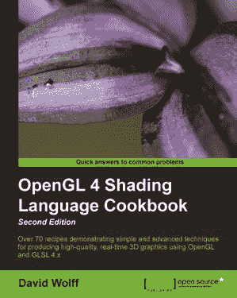

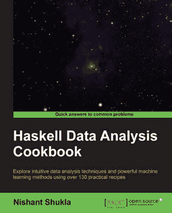

## OpenGL 4 着色语言指南

### 第二版

ISBN: 978-1-78216-702-0 平装本：394 页

超过 70 个示例，演示了使用 `OpenGL` 和 `GLSL` `4.x` 产生高质量实时 3D 图形的简单和高级技术。

1. 发现利用现代 `OpenGL` 和 `GLSL` 的简单和高级技术。
2. 学习如何使用 `GLSL` 的最新功能，包括计算着色器、几何着色器和细分着色器。
3. 掌握使用阴影图、阴影体积等实现的广泛技术。

## Haskell 数据分析指南

ISBN: 978-1-78328-633-1 平装本：334 页


通过 130 多个实战示例，探索直观的数据分析技术和强大的机器学习方法。

1. 在掌握数据分析时使用 `Haskell` 的实用且简洁的指南。
2. 涵盖数据分析每个阶段（从采集到可视化）的示例。
3. 展示各种工具、解决方案和技术的深度示例。

请查看 `www.PacktPub.com` 获取有关我们书目的信息。

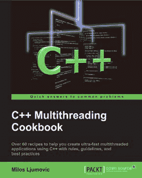

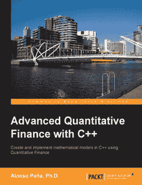

## C++ 多线程指南

ISBN: 978-1-78328-979-0 平装本：422 页

超过 60 个示例，帮助你利用规则、指南和最佳实践使用 `C++` 创建超快速多线程应用程序。

1. 利用 `C++` 的力量创建多线程应用程序。
2. 通过易懂的步骤使用并行执行升级你的应用程序。
3. 跟进新的 `Windows 8` 并发任务。
4. 避免经典的同步问题。

## C++ 高级量化金融

ISBN: 978-1-78216-722-8 平装本：124 页

使用量化金融在 `C++` 中创建并实现数学模型。

1. 描述用于股票定价、货币、利率和信用衍生品的关键数学模型。
2. 逐逐步解释复杂模型，并附带每个实现的流程图。
3. 通过完全解决的 `C++` 示例（包括基础和高级）说明每种资产类别，以支持并补充文本。

请查看 `www.PacktPub.com` 获取有关我们书目的信息。

# 文档目录

- 封面
- 目录
- 序言
- 第 1 章：构建与安装 LLVM
  - 理解 LLVM 版本
  - 获取预构建包
    - 获取官方预构建二进制文件
    - 使用包管理器
      - 保持快照包的更新
  - 从源码构建
    - 系统要求
    - 获取源码
      - SVN
      - Git
    - 构建并安装 LLVM
      - 使用 autotools 生成的配置脚本
      - 使用 CMake 和 Ninja
      - 使用其他 Unix 方法
    - Windows 和 Microsoft Visual Studio
    - Mac 和 Xcode
  - 总结
- 第 2 章：外部
  - 引入 Clang
  - 构建 Clang
  - 理解 RT
  - 查看 RT
  - 使用工具
  - 构建 LLVM
  - 理解流水线
  - 使用 LLDB
  - 调试练习
  - 总结
- 第 3 章：工具与设计
  - 理解 LLVM 的设计
  - 今天的 LLVM
  - 与编译器交互
  - 使用工具
  - 深入 LLVM 内部
  - 熟悉 LLVM 基础库
  - 引入 C++
  - 在实践中应用多态
  - LLVM 中的 C++ 实践
  - LLVM 中的字符串引用
  - 演示插件式接口
  - 编写你的第一个 LLVM 项目
  - 编写 Makefile
  - 编写代码
  - 导航 LLVM 源码——通用建议
  - 代码作为文档
  - 向社区寻求帮助
  - 应对更新——使用 SVN 日志作为文档
  - 结语
  - 总结
- 第 4 章：前端
  - 引入 Clang
  - 前端操作
  - 库
  - 使用 libclang
  - 理解 Clang 诊断信息
  - 读取诊断信息
  - 通过 Clang 学习前端阶段
    - 词法分析
    - 练习词法错误
    - 编写使用词器的 libclang 代码
    - 预处理
  - 语法分析
  - 理解 Clang AST 节点
    - 使用调试器理解解析器行为
    - 练习解析器错误
    - 编写遍历 Clang AST 的代码
    - 使用预编译头文件序列化 AST
    - 语义分析
    - 练习语义错误
  - 生成 LLVM IR 代码
  - 整合汇总
  - 总结
- 第 5 章：LLVM 中间表示
  - 概述
    - 理解 LLVM IR 的目标依赖
  - 练习操作 IR 格式的基础工具
  - 介绍 LLVM IR 语言语法
  - 介绍 LLVM IR 内存模型
  - 编写自定义 LLVM IR 生成器
  - 构建并运行 IR 生成器
    - 学习如何使用 C++ 后端编写代码生成任何 IR 结构
  - 在 IR 层进行优化
    - 编译时和链接时优化
    - 发现哪些 pass 是关重要的
    - 理解 pass 之间的依赖关系
    - 理解 pass API
    - 编写自定义 pass
    - 使用 LLVM 构建系统构建并运行你的新 pass
  - 使用你自己的 Makefile 构建并运行你的新 pass
  - 总结
- 第 6 章：后端 (Backend)
  - 概述
  - 使用后端工具
    - 学习后端代码结构
    - 了解后端库
  - 学习如何使用 TableGen 开发 LLVM 后端
    - 语言
    - 了解代码生成器 `.td` 文件
    - 目标属性
    - 寄存器
    - 指令
  - 理解指令选择阶段
    - `SelectionDAG` 类
    - 降低 (Lowering)
    - DAG 合并与合法化 (Legalization)
  - DAG-to-DAG 指令选择
  - 模式匹配
    - 可视化指令选择过程
    - 快速指令选择
    - 调度器 (Scheduler)
    - 指令行程 (Instruction itineraries)
    - 冲突检测
    - 调度单元
  - 机器指令 (Machine instructions)
  - 寄存器分配
    - 合并器 (coalescer)
    - 虚拟寄存器重写
    - 目标钩子 (Target hooks)
  - 序言与尾言 (Prolog and epilogue)
    - 栈帧索引
  - 理解机器框架 (Machine framework)
    - MC 指令
    - 代码发射 (Code emission)
  - 编写你的机器 pass
  - 总结
- 第 7 章：即时编译器 (JIT Compiler)
  - 了解 LLVM JIT 引擎基础
    - 介绍执行引擎
    - 内存管理
  - 介绍 `llvm::JIT` 框架
    - 将二进制写入内存
    - 使用 `JITManager`
    - 目标代码发射器
    - 目标信息
    - 学习如何使用 `JIT` 类
    - 通用值 (generic value)
  - 介绍 `llvm::MCJIT` 框架
    - MCJIT 引擎
    - 学习模块的状态
    - 理解 MCJIT 如何编译模块
    - 对象缓冲区 (Object buffer)、缓存和镜像 (image)
    - 动态链接
    - 内存管理器
    - MC 代码发射
    - 对象终结
  - 使用 MCJIT 引擎
  - 使用 LLVM JIT 编译工具
    - 使用 `lli` 工具
    - 使用 `llvm-rd` 工具
  - 其他资源
  - 总结
- 第 8 章：跨平台编译
  - GCC 和 LLVM
  - 理解目标三元组 (target triples)
  - 准备你的工具链
    - 标准 C 和 C++ 库
    - 运行时库
    - 汇编器和链接器
  - 前端
  - 多库 (Multilib)
  - 使用 Clang 命令行参数进行交叉编译
    - 目标的驱动选项
    - 依赖关系
    - 交叉编译
    - 安装 GCC
    - 可能的问题
    - 更改系统根目录 (system root)
  - 生成 Clang 交叉编译器
    - 配置选项
  - 构建并安装基于 Clang 的交叉编译器
    - 备用构建方法
    - `Ninja`
    - `ELLCC`
    - `EmbToolkit`
  - own
  - 开发板
  - 模拟器
  - 附加资源
  - 总结
- 第 9 章：Clang 静态分析器
  - 理解静态分析器的作用
    - 经典警告与 Clang 静态分析器的对比
    - 符号执行引擎的力量
    - 测试静态分析器
    - 使用驱动程序（driver）与使用编译器
    - 了解可用检查器（checkers）
  - 在 Xcode IDE 中使用静态分析器
    - 生成 HTML 图形化报告
  - 处理大型项目
    - 真实世界案例 – 在 Apache 中寻找 bug
  - 使用自定义检查器扩展静态分析器
    - 熟悉项目架构
    - 编写你自己的检查器
    - 使用自定义检查器解决问题
    - 更多资源
  - 总结
- 第 10 章：使用 LibTooling 的 Clang 工具
  - 生成编译命令数据库
  - `clang-tidy` 工具
    - 使用 `clang-tidy` 检查你的代码
  - 重构工具
    - `Clang Modernizer`
    - `Clang Apply Replacements`
    - `ClangFormat`
    - `Modularize`
      - 理解 C/C++ API 的定义
      - 理解模块的工作原理
  - 使用模块
    - 理解 `Modularize`
    - 使用 `Modularize`
    - `Module Map Checker`
    - `PPTrace`
    - `Clang Query`
    - `Clang Check`
    - 移除 `c_str()` 调用
  - 编写你自己的工具
    - 问题定义 – 编写一个 C++ 代码重构工具
    - 配置你的源码位置
    - 解析工具的模板代码
    - 使用 `AST` 匹配器（matchers）
      - 组合匹配器
      - 将 `AST` 匹配器谓词放入代码中
    - 编写回调函数
    - 测试你的新重构工具
    - 更多资源
  - 总结

# 索引
