# SAP HANA Cloud Platform 入门指南


## 亲爱的读者，

如果您之前购买过 SAP PRESS 出版的编程图书，我猜您已经熟悉詹姆斯·伍德的作品。很高兴欢迎您阅读他的最新力作：SAP HANA Cloud Platform 入门。能找到一位才华横溢、始终专业且从不错过截止日期的作者实属罕见——而詹姆斯·伍德具备所有这些品质。（顺便说一句，他还做一碗地道的得克萨斯辣椒炖肉。）我很荣幸能担任他的编辑。

当然，向约翰·多恩致歉，没有哪本书是孤岛。如果没有几位合作者的帮助，这本书也不会问世，尤其是 SAP HANA Cloud Platform 的积极倡导者、而且总体来说也是一位冠军的马蒂亚斯·施泰纳。我谨向所有参与者表示感谢和谢意。

好了，致谢就到这里，对吧？是时候深入阅读了。读完后，请告诉我们您对 SAP HANA Cloud Platform 入门的看法。毕竟，您的评论和建议是帮助我们将图书打造得尽善尽美的最有用工具！我们鼓励您访问 www.sap-press.com 网站并分享您的反馈。

感谢您购买 SAP PRESS 的图书！

凯莉·格雷斯·韦弗

SAP PRESS 编辑

Rheinwerk 出版社

波士顿，马萨诸塞州

kellyw@rheinwerk-publishing.com

www.sap-press.com


## 马蒂亚斯·施泰纳前言

我们生活在一个变化加速的时代，在这个世界里，公司为全球市场份额而竞争。在这个竞争环境中，企业比以往任何时候都更需要专注于核心业务，使自己与竞争对手区分开来，并为客户提供能够立即创造价值的产品和服务。软件已成为关键推动力，帮助公司通过简化和重塑内部流程以及赋能其开发创新解决方案来适应不断变化的市场趋势。因此，作为开发人员，由我们来引领这场数字演进，塑造一个由软件驱动的世界。

作为一名软件架构师，我谋生已超过十年，我深知开发企业级软件解决方案绝非易事。复杂的系统环境、不断变化的业务需求以及紧迫的时间表并非例外，而是常态。因此，开发人员需要一流的工具来支持他们的日常工作，并使他们能够专注于自己的工作：将业务需求转化为可行的软件解决方案。

这就是 SAP HANA Cloud Platform 所要解决的问题领域：它是一个从零开始设计的设计和运行时环境，旨在赋能开发人员在云中构建、扩展和运行下一代业务应用程序。基于 SAP HANA（SAP 的内存技术平台），这种平台即服务（PaaS）产品为客户和合作伙伴提供了高效开发业务解决方案所需的全面服务和功能，以应对日益互联的世界。

如今，从人们（社交媒体）到公司（商业网络），再到单个设备（物联网）都相互连接，云已成为全球数字化业务转型的催化剂。它是移动运动的支柱，也是需要大量计算能力的大数据场景的推动者。借助 SAP HANA Cloud Platform，SAP 提供了一个云平台，使开发人员能够支持其公司——并最终支持其客户——利用这场转型带来的机遇。

在本书中，James、Krassi、John 和 Riley 对 SAP HANA Cloud Platform 及其相关技术进行了全面概述，并说明它们如何支持公司将业务扩展到云中。基于过去十年作为开发顾问积累的丰富经验，James 和 John 能够全面解决这些问题，涵盖业务和技术两个角度。他们的专业知识由我的同事 Krassi 和 Riley 提供的内部视角完美补充，两人都一直在 SAP 内部推动各自的主题。他们合起来的领域知识无与伦比。

本书侧重于具体的开发场景，因此主要面向有兴趣了解如何开发在混合 IT 环境中表现出色的软件解决方案的解决方案架构师和开发人员，该环境包含本地系统和云解决方案。作者从云计算和 SAP HANA Cloud Platform 的一般概述入手，逐步介绍从入门到关键技术，再到开发本地解决方案和云应用程序扩展等高级主题的所有内容。

阅读本书后，您将了解 SAP PaaS 产品的全部潜力以及如何根据自己的需求加以利用。此外，您将掌握一套优秀的示例，以便基于 SAP HANA Cloud Platform 启动您自己的开发项目。因此，我希望您喜欢阅读本书——并且我最终期待欢迎您加入快速增长的云开发人员社区。

祝编码愉快！

马蒂亚斯·施泰纳
云平台布道师和 SAP 导师
SAP HANA Cloud Platform

## 前言

自 2012 年底首次发布以来，SAP HANA Cloud Platform（SAP HCP）在 SAP 社区中许多人眼中一直默默无闻。然而，随着新版 SAP S/4HANA 业务套件的发布，以及持续整合最近的云软件收购（如 SuccessFactors、Ariba 和 Concur），SAP HCP 已开始成为 SAP 整体云战略中的关键组件之一。本质上，您可以将 SAP HCP 视为现代 SAP 技术环境的中心。

话虽如此，如果您拿起本书是因为想了解 SAP HCP 的相关内容，那么时机再好不过了。在未来的几个月和几年里，SAP HCP 技能无疑将非常抢手。无论您是希望转型技能的资深 SAP 开发人员，还是希望加入 SAP 云浪潮的非 SAP 开发人员，我们都认为您来对地方了。

## 目标读者和先决条件

本书面向有兴趣学习如何在 SAP HCP 上开发应用程序的开发人员。请注意，我们并非特指 Java 开发人员或 ABAP 开发人员。因为 SAP HCP 是一个开放平台，提供自带语言（BYOL）的开发方式，欢迎各行各业的开发人员加入。

话虽如此，要浏览本书涵盖的材料，仍有一些重要的先决条件。由于这是一本关于云应用程序开发的书，读者自然需要合理熟悉核心概念，例如 Web 应用程序开发、互联网技术等。尽管我们尽可能在各处提供对新技术的温和介绍，但本书不可能以成功开发云应用程序所需的深度来涵盖这些主题。


## 图书结构

从许多方面来看，我们发现编写本书最大的挑战在于为其构建一些结构。从我们踏上这段旅程之时起，直到数月后最终定稿，SAP HCP 都经历了惊人的增长。最终，我们不得不将重点缩小到代表 SAP HCP 精髓的核心概念和技术上。

### 第一部分：基础

在本部分中，我们将介绍 SAP HCP 并向您展示如何快速上手该平台。这份简要介绍为本书的实践部分奠定了基础。

- 第 1 章：SAP HANA Cloud Platform 简介

在本章中，我们将向您介绍云计算现象及 SAP 的云战略。在此，我们试图确立 SAP HCP 在云和 SAP 环境中的定位。

- 第 2 章：快速上手

本章介绍了各种 SAP HCP 账户类型，并向您展示如何设置免费开发者账户（我们将使用该账户开发示例应用程序）。我们还将向您展示如何安装和配置相关的 SAP HCP 开发工具。

### 第二部分：核心开发概念

在本部分中，我们将卷起袖子，演示如何在 SAP HCP 上创建自定义 Web 应用程序。在此过程中，我们将介绍关键物流概念，并考虑可用于完善生产级应用程序设计的关键启用服务。

- 第 3 章：开发 Java 应用程序

在本章中，我们将向您展示如何使用核心 Java EE API（Servlet、JavaServer Pages (JSP) 和 Enterprise JavaBeans (EJB)）创建基于 Java 的 Web 应用程序。在此过程中，我们将熟悉 Eclipse IDE 和 SAP HCP SDK，并演示如何使用这些工具来测试和调试 Java 应用程序。

### 第 4 章：管理和部署 Java 应用程序

本章探讨了开发 Java 应用程序时需要考虑的一些重要物流问题。具体感兴趣的主题包括源代码管理、自动化构建、部署和持续集成。本章还介绍了使用 Git 进行源代码管理的概念——我们将在第 7 章考虑 HTML5 应用程序开发时再次回到这一概念。

### 第 5 章：开发原生 SAP HANA 应用程序

在本章中，我们将向您展示如何基于原生 SAP HANA 编程模型创建自定义应用程序。我们首先展示如何在 SAP HCP 账户中设置 SAP HANA 实例，然后深入介绍创建新 SAP HANA XS 应用程序和开发 SAP HANA 特定开发对象的具体内容。到本章结束时，我们将完成一个功能齐全的移动应用程序的开发，该应用程序可用于浏览虚构在线书店中的书目。

### 第 6 章：使用云服务

在本章中，我们将教您如何使用 SAP HCP 包含的一些关键启用服务：持久性服务、连接性服务和文档服务。为了更好地演示这些服务的使用方式，我们开发了一个自定义 Java 应用程序，该应用程序集成了所有这些服务的功能，以创建一个生产级应用程序的近似版本。

### 第 7 章：开发 HTML5 应用程序

本章探讨了基于 SAP HCP 中相对较新的 HTML5 编程模型创建轻量级 HTML5 应用程序。在此，我们提供了一个逐步演示，向您展示如何创建新的 HTML5 应用程序、同步其 Git 存储库以及开发自定义 HTML5 应用程序内容。在此过程中，我们将向您介绍新的 SAP Web IDE，并向您展示如何将 SAPUI5 技术集成到 HTML5 应用程序中。

### 第 8 章：保护云应用程序

本章通过向您展示如何保护 SAP HCP 应用程序，为本书的核心开发部分画上句号。在此，我们采取整体方法，审查受支持的 SAP HCP 编程模型提供的各种安全相关库和服务。在本章的后半部分，我们还将探讨身份服务的关键组件，同时考虑如何使用 SAML 实现身份验证和使用 OAuth 实现授权。

### 第三部分：高级概念

在本书的最后一部分中，我们将探讨 SAP HCP 的一些更高级功能和服务。在此，我们将向您展示如何将第二部分中学到的基本概念应用于大规模集成和/或扩展场景、移动访问等。

- 第 9 章：使用 SAP HANA Cloud Portal

在本章中，我们将向您介绍 SAP HANA Cloud Portal，这是一款与 SAP HCP 捆绑的轻量级门户服务。在此，我们将向您展示如何创建自定义门户/混搭站点，并使用 OpenSocial API 集成不同的内容类型。

- 第 10 章：SAP HANA Cloud Integration 简介

本章概述了内置于 SAP HCP 中的 SAP HANA Cloud Integration (HCI) 服务。在此，我们对 SAP HCI 进行了基础级别的介绍，并了解其如何用于集成场景。

- 第 11 章：SAP HANA Cloud Platform 的扩展场景

在印刷书的最后一章中，我们将演示如何使用 SAP HCP 为 SAP 的现有云产品（例如 SuccessFactors）构建扩展应用程序。我们概述了当前存在的集成点，然后解释本书中涵盖的大部分不同功能如何协同工作以创建复杂的扩展场景。

- 第 12 章：SAP HANA Cloud Platform Mobile Services 简介（仅在线）

本在线章节介绍了 SAP HCP Mobile Services，这是一款可用于开发自定义移动应用程序的 SAP HCP 服务。具体感兴趣的主题包括服务使用、SMP SDK 概述以及将 SAPUI5 应用程序捆绑为混合应用程序。本章可从 www.sap-press.com/3638 下载。

## 约定

本书包含许多演示语法、功能等的代码示例。为了区分这些部分，我们使用了一种类似于许多集成开发环境中使用的字体，以提高代码可读性（请参见清单 1）。在引入新语法概念时，我们将使用粗体清单字体突出显示这些语句（请参见清单 1）。

```
public class MyClass {
    public void someMethod() {
        try {
            InitialContext ctx = new InitialContext();
            ...
        } catch (NamingException ne) {
        }
    }
}
```

清单 1 代码语法格式示例

## 使用代码示例

在本书的过程中，我们将开发许多示例应用程序，以在上下文中演示关键概念。为了方便下载这些应用程序的可用副本，我们在 GitHub 上为本书的代码包创建了一个公共存储库。存储库 URL 是 https://github.com/bowdark/hcpbook。此信息也可以从 www.sap-press.com/3638 下载。

在适当的地方，我们为各种示例包含了 readme 文件，以向您展示如何将其配置为使用您自己的 SAP HCP 试用账户进行部署。否则，您通常可以在涵盖这些应用程序的章节中找到安装和部署这些应用程序的说明。

如果在示例中遇到任何问题，可以直接通过 jwood@bowdark.com 给作者发电子邮件。

## 致谢

编写这样一本书比看起来要困难得多，如果没有许多关键人士的协助，这将是不可能的。这些人慷慨地贡献了他们的时间和专业知识，使本书尽可能完善，对此我们深表感激。

## 特别贡献者

名单上的第一位是 Matthias Steiner，他不仅为本书撰写了前言，还就产品的长期发展方向等提供了大量有用的反馈。Matthias 在帮助组建完整的作者团队方面也起到了非常重要的作用。

同样，我们要感谢 Rui Nogueira 和 Thomas Grassl，感谢他们帮助我们与 SAP HCP 开发团队建立联系，以及感谢 Sujit Hemachandran 和 Vivek Mangaonkar 在回答 SAP HCI 查询方面提供的支持。

最后，向 SAP SCN 上的 SAP HCP 开发社区致谢，感谢他们在我们制作示例应用程序和试用新功能时提供有用的反馈。每当我们遇到问题时，这些论坛上总有人会以创纪录的速度做出回应。这真正证明了 SCN 社区已经走得多远。

## 朋友和家人

如果没有家人和亲人的支持和鼎力相助，要承担这样一个项目是很困难的。话虽如此，作者们想表达以下感谢：

- James Wood 想感谢他的妻子 Andrea、他的儿子 Andersen、Parker 和 Xander，以及他的女儿 Paige，感谢他们容忍他许多熬夜加班的夜晚。James 还想感谢他的狗 Kirby，感谢它不停的打鼾声，这成了本书的主要背景音乐。
- John Mutumba Biyal 想感谢他的妻子 Hermien 和他的儿子 Ralph、Luc 和 Ruben，感谢他们的鼓励和无条件的爱。John 还想感谢他在 Rojo Consultancy 的同事，感谢他们的支持和反馈。
- Krasimir Semerdzhiev 想感谢分布在德国、保加利亚和以色列的完整 SAP HCP 开发团队，感谢他们让 SAP HCP 成为可能。他还想感谢他在 SuccessFactors 和 SAP Jam 的产品管理和工程同事，感谢他们如此可靠的合作伙伴。最后但同样重要的是，他想提及他的同伙——Filip Misovski、Stanimir Ivanov 和 Segev Lev，感谢他们共同开创 SAP HCP 扩展故事的未来。


## 最后致谢

最后，但绝非最不重要的是，我们都想向我们的编辑 Kelly Grace Weaver 表示感谢。Kelly 简直是世界上最优秀的编辑，也是一个更好的人。她的圣人般品质在这个项目中无疑经受住了考验，没有她，我们不可能也不会取得成功。这也适用于 SAP PRESS 的其余团队，他们幕后不知疲倦地工作，使这本书成为现实。

# 第一部分

# 基础

在本章中，我们将向您介绍 SAP HANA Cloud Platform，并描述其在不断发展的 SAP 技术格局中的定位。

## 1 SAP HANA Cloud Platform 简介

自 1992 年 SAP R/3 初次发布以来，SAP 环境主要以孤立形式存在，安全地安置在企业防火墙的呵护范围内。然而，近年来随着云计算和移动性的爆发，这一状况开始发生变化。现在，客户希望扩展其 SAP 环境的边界，以支持与云应用程序（由 SAP 或其他提供商提供）、移动访问以及物联网 (IoT) 的集成。

为解决这一日益扩大的差距，SAP 推出了 SAP HANA Cloud Platform（SAP HCP）。在本章中，我们将了解 SAP HCP，并学习它在未来几年内将在 SAP 技术格局中发挥核心作用。

### 进一步资源

SAP HCP 的主产品页面是 hcp.sap.com，作为 SAP HCP 材料（包括试用系统、文档等）的宝贵资源。

### 1.1 SAP HANA Cloud Platform 简介

根据 SAP 帮助文档，SAP HCP 是“一个开放的、基于标准的、模块化的平台即服务，用于快速开发按需应用程序。”这个定义有点拗口，让我们逐点分析：

- 首先，我们发现 SAP HCP 是 SAP 提供的平台即服务（PaaS）产品。尽管我们将在 1.2 节中详细探讨这一区别，但目前只需注意，SAP HCP 是一个可用于（快速）在云中开发和部署 Web 应用程序的平台。

- SAP HCP 是一个开放环境，为开发者在编程语言和模型、开发工具等方面的选择提供了大量机会。

- 除了开放之外，SAP HCP 还高度基于标准，从一开始就开发用于支持来自 W3C 等领先标准组织的标准。

- 最后，我们了解到 SAP HCP 是一个模块化平台，可以定制以满足所有客户类型和用例的需求。

简单来说，您可以将 SAP HCP 视为客户可以从 SAP 租用访问权限以在云中开发和部署应用程序的平台。从技术角度来看，这个平台与安装在本地的应用系统（例如 SAP Composition Environment）并无太大不同。主要区别在于，SAP 承担采购和维护硬件、软件及其他基础设施相关事宜的责任，以便客户可以专注于应用程序开发事宜。

### 简史

尽管 SAP HCP 直到 2014 年下半年才更正式地崭露头角，但它实际上已经存在相当长一段时间了。2011 年底，我们接触到了该产品的第一个版本，当时它使用过几个不同的名称：SAP NetWeaver Cloud、SAP NetWeaver NEO，以及在许多圈子里简称为 NEO。当时，该产品的提供范围相当有限，主要包括一个 Java 应用服务器和一系列基本的云使能服务。在接下来的 18 到 24 个月中，这一状况发生了相当大的变化，新功能和新服务似乎几乎每周都在推出。

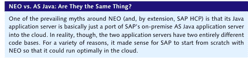

到 2013 年中期，NEO 已达到足够成熟的程度，SAP 开始悄悄将其定位为其长期云战略的一部分。大约在同一时间，SAP 决定放弃 NetWeaver/NEO 命名，改用我们今天认识的名称：SAP HANA Cloud Platform。从此，该产品开始真正获得动力，因为我们看到平台范围扩大到包括对原生 SAP HANA 开发、HTML5 应用程序等的支持。

到 2014 年底一年一度的 SAP TechEd/d-code 会议召开之时，SAP HCP 终于作为 SAP 云战略和愿景的关键组成部分登上舞台中央。在许多方面，这一里程碑标志着 SAP HCP 婴儿期的结束。现在，我们展望 SAP HCP 作为可投入生产的平台，用于部署云应用程序。在 SAP 的重大承诺和支持下，SAP HCP 的未来确实前景光明。

### 1.2 云计算革命

尽管它已经是一个流行语相当长一段时间了，但许多人仍然很难理解云究竟是什么。对有些人来说，它是一个神奇的地方，他们的音乐文件存放在那里。对另一些人来说，云是一个边疆，其安全性太低，不足以托管宝贵的 IT 资源。在所有这些喧嚣中，有一个如此简单却又如此强大的想法，以至于你几乎会想为什么我们之前没有想到它。考虑到这一点，在本节中，我们将了解云计算革命。

#### 1.2.1 什么是云计算？

在很大程度上，云计算是一种意识流思想，其起源难以追溯到任何特定的个人或组织（参见后文的方框注释）。像许多经济趋势一样，它是一个概念，由于几个关键市场条件的汇合而有机地演变：

- 低价硬件组件（例如多核 CPU、主内存和磁盘存储）的大量普及

- 高速网络访问的可用性扩大

- 硬件虚拟化领域的持续进步和创新

**注释**
在某种程度上，Antonio Regalado 在一篇 2011 年的文章《谁创造了“云计算”一词？》（MIT Technology Review，2011）中厘清了云计算的起源。在这里，他将该术语的起源追溯到 Compaq Computer Corporation 于 1996 年 11 月发布的一份内部业务战略文档。

随着这些技术和市场条件相互汇合，许多技术公司意识到，可以将计算机资源的访问权限打包，并使用按需、按量付费的订阅模式将这种访问权限出售给客户。

这一想法本身并非新概念。事实上，服务器资源的托管和代托管在 IT 界已经是成功的商业模式相当长一段时间了。云计算的区别在于，提供商公司并不是在这里那里搭建几台服务器来满足特定客户的需求。相反，提供商正在构建巨大的服务器农场，由于其整体规模和计算能力，可以同时扩展以满足数百甚至数千客户的需求。这种规模经济使提供商能够以远低于在本地部署相同资源所需成本的价格提供计算机资源访问权限。

总而言之，我们可以简单地说，“云计算”是一个用来描述将计算资源作为商品进行打包和分发的术语。当然，与大多数商业产品一样，这些资源的打包方式可能大相径庭。因此，在下一节中，我们将考虑云计算领域中出现的一些更突出的服务模型。

#### 1.2.2 了解云计算服务模型

随着云计算理念在 2000 年代中期开始成形，人们很快意识到，不存在一种“一刀切”的服务模型能够满足渴望加入云计算大潮的客户的需求和要求。因此，不久之后，许多专业服务商纷纷涌现，提供点菜式服务，例如在线数据存储和备份、应用程序托管等。当这一切尘埃落定后，三大服务模型类别已经出现：


- 基础设施即服务 (IaaS)

基础设施即服务 (IaaS) 是一种服务模型，提供商通过该模型提供对基础计算资源的访问：服务器、磁盘存储等。尽管这些资源本身通常是虚拟化的，但最终产品对消费者而言，在外观和行为上与本地配置的基础设施资源几乎完全相同。截至撰写本文时，市场上一些更知名的 IaaS 提供商包括 Amazon、Microsoft 和 Google。

- 平台即服务 (PaaS)

顾名思义，PaaS 服务模型为客户提供功能齐全的计算平台。在此模型中，除了虚拟化硬件资源（作为 IaaS 产品的一部分）之外，PaaS 还包括已安装的操作系统 (OS)、一个或多个编程环境，以及通用服务，例如数据库访问。这些平台资源合计为开发人员提供了在云中开发应用程序所需的一切。截至撰写本文时，市场上一些更知名的 PaaS 解决方案包括 Amazon Web Services (Amazon AWS)、Force.com、Google App Engine 和 Microsoft 的 Windows Azure。

- 软件即服务 (SaaS)

软件即服务 (SaaS) 就是指：作为服务提供给客户的软件。在此模型中，与客户历史上在本地安装的商业现成软件包 (COTS) 不同，SaaS 解决方案的安装和维护完全由软件提供商管理。这使客户免受维护的麻烦，但也限制了他们定制软件的能力。尽管大多数 SaaS 解决方案在某种程度上是可配置的，但与之相比，可增强的范围相当有限。

这三种服务模型在云计算范式中的定位如图 1.1 所示。这个服务栈为客户提供了选择最适合自己的模型所需的灵活性。需要注意的是，从下往上看，服务栈越高，产品越抽象化。例如，当客户购买 SaaS 解决方案的许可证时，他们不仅购买了对软件本身的访问权限；该产品还包括软件部署所依赖的底层平台和基础设施资源。除了简化购买体验之外，这还使客户能够在几分钟内即可开始使用特定的软件包，而无需像在本地部署新服务器并安装软件包那样花费数天、数周甚至数月。

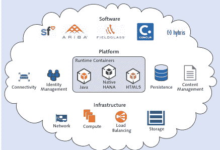

图 1.1 理解云计算服务模型

由于这是一本关于 SAP 软件的书，您可能想知道 SAP 的各种基于云的产品如何融入图 1.1 所示的服务模型图中。这些关系在图 1.2 中得到突出显示。

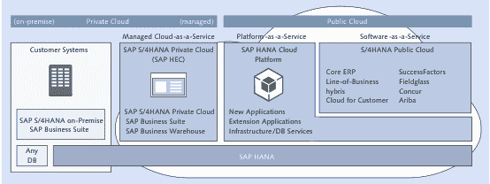

图 1.2 SAP 云战略概览

考虑到图 1.2 中包含的概览图，让我们关注构成 SAP 云战略的各个组件：

### IaaS

与传统 IaaS 产品不同，传统 IaaS 产品提供对硬件资源的通用访问，SAP 的 IaaS 产品主要由托管服务组成。这始于 SAP HANA Enterprise Cloud (SAP HEC)，这是一项托管服务，允许客户在由 SAP 管理的私有云上运行其 SAP Business Suite 和/或 SAP Business Warehouse (SAP BW) 系统。

除了 SAP HEC，SAP 还作为 SAP HCP 的一部分提供 SAP HANA 相关的基础设施服务。对于之前购买过 SAP HANA 许可证的客户，SAP 提供 SAP HANA 基础设施服务。新客户可以选择订阅 SAP HANA DB 服务，该服务将基础设施和许可证订阅捆绑在一起。无论哪种情况，SAP 都提供在公有云中部署 SAP HANA 实例所需的硬件基础设施。

### PaaS

如前所述，SAP HCP 是 SAP 的 PaaS 产品。如图 1.2 所示，SAP HCP 运行在公有云中，并通过提供一套丰富的应用程序服务来支撑 SAP 的 SaaS 解决方案，这些服务可用于开发扩展应用程序等。

### SaaS

在过去几年中，SAP 建立了一个相当庞大的云应用程序组合，将核心 ERP 功能与通过收购获得的应用程序（例如 SuccessFactors、Concur、Ariba 等）相结合。2015 年初，这组应用程序被赋予了一个通用名称：SAP S/4HANA。SAP S/4HANA 是 SAP Business Suite 的下一代产品，并最终将这些应用程序统一为一个完整规模的云应用程序套件。如图 1.2 所示，SAP S/4HANA 客户可以选择在本地、公有云上部署 SAP S/4HANA，或作为托管云解决方案的一部分进行私有部署。这种灵活性使客户能够逐步迁移到云端，并选择希望在维护方面将多少控制权委托给 SAP。

尽管 SAP S/4HANA 代表了 SAP SaaS 产品的未来，我们也应该提及撰写本文时面向中小型企业的另一种 SaaS 产品：SAP Business ByDesign 是一个集成的交钥匙产品，允许小型企业在公有云中部署轻量级的 SAP Business Suite。

在本书过程中，我们的重点将放在 SAP HCP 上，更具体地说，是整体 SAP HCP 服务产品中的 SAP HANA App Services 部分。这一区别在图 1.3 和图 1.4 中得到突出显示。如您所见，SAP HANA App Services 在前述 SAP HANA 基础设施服务和 SAP HANA DB 服务提供的基础设施服务之上构建，包括您在 PaaS 产品中预期找到的所有服务：应用程序容器、使能服务等等。

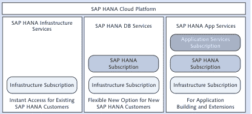

图 1.3 SAP HCP 服务模型概览（© 2015 SAP SE 版权所有。）

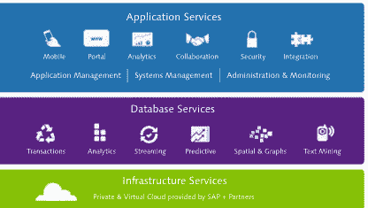

图 1.4 SAP HCP 服务模型详情（© 2015 SAP SE 版权所有。）

#### 1.2.3 历史视角

在他的书《大转换：从爱迪生到谷歌的世界重塑》（*The Big Switch: Rewiring the World from Edison to Google*，W. W. Norton & Co., 2013）中，Nicholas Carr 讲述了 Samuel Insull 的故事，他是一位杰出的商人，是最早看到将电能包装并作为商品出售的实际好处的人之一。这一概念在现代可能显而易见，但在 20 世纪初，这一概念却遭到了相当多的反对。事实上，这些反对者中就有 Thomas Edison，他是 Insull 的前老板和长期导师。Edison 认为直流电 (DC) 是可靠传输电力的唯一方式，因此他认为尝试大规模分发是不切实际的，因为直流电无法传输很远。

Insull 看法截然不同。随着不断改进的电气发电机和尼古拉·特斯拉的交流电 (AC) 的出现，他认为建立大规模发电厂并可靠地传输数英里电力的所有基础条件都已具备。Insull 付诸实践，成立了 Commonwealth Edison Company，这是美国现代电力公用事业公司的原型，后来在世界各地也得到了推广。

在建立起基础设施后，Insull 最初发现推动客户采用很困难。当时，电力供应系统大多由客户内部建设和管理。由于即使是最小的停电也被视为对生产运营的巨大风险，客户自然非常关注稳定性，并普遍认为最好在内部管理这种风险。经过一些精明的营销和谈判，Insull 最终说服了几家战略客户尝试他的服务。一旦成功的消息传开，其他客户很快就看到了该模式的可行性并加入进来。

在接下来的大约 30 年里，这一趋势一直持续，以至于美国几乎没有任何公司自己运营电力供应系统。通过集中化和规模经济，电力公用事业公司能够以成本的一小部分生产出更高效、更可靠的电力。随着时间推移，公司再也无法独自运营了。

快进大约 100 年，我们发现云计算正在经历电力公用事业行业在 20 世纪初所面临的一些成长阵痛。作为一个相对较新且有些抽象的概念，


许多客户对云软件和基础设施提供商的承诺感到恐惧和怀疑。在安装和维护大型复杂IT系统多年之后，将该基础设施的控制权交给第三方供应商的想法似乎不可思议。

尽管存在这些（合理的）担忧，但云计算的经济效益无可否认。就像电力一样，IT基础设施注定会成为一种商品。问题不再是“是否”，而是“何时”。对于足够大胆迈出这一步的公司，云计算提供了广泛的潜在好处：

- **降低运营成本**

  运营IT基础设施是一项非常昂贵的业务——考虑到机架和堆叠服务器、房地产、电力消耗、维持一支称职的支持团队等成本时，很难完全量化。云计算并不能消除这些成本，但它确实在很大程度上有助于整合和降低这些成本。此外，重要的是要记住，我们谈论的不是短期收益。从长远来看，云计算提供商将变得更加高效，因此也更加经济。

- **可靠性**

  由于云提供商专注于提供少量服务，因此在构建可靠基础设施方面投入了大量的研究和精力。确实，当你阅读描述亚马逊和谷歌等提供商为提供近乎100%正常运行时间所付出的努力的文章时，大多数IT组织在灾难恢复、故障转移等方面内部能够管理的情况，与之相比真的不值一提。

- **降低进入门槛**

  对于小型初创公司，云计算降低了进入门槛，因为它消除了通常与构建数据中心、采购硬件、安装和配置软件等相关的资本支出。借助弹性服务，大多数云提供商提供可以随业务增长而扩展的订阅模式。

- **更快的周转时间**

  通常，采购服务器、安装、配置其软件并使其运行所需的时间以周计，有时甚至以月计。另一方面，云提供商通常可以在几分钟内启动功能齐全的实例。对于希望立即进行创新的客户来说，这根本无法比拟。

- **普遍访问**

  由于数据中心分布在世界各地，大多数云提供商使客户的用户群能够从世界任何地方访问IT资源。通常，用户只需要一个公共互联网连接。

如果历史是任何指标，这些好处最终将超过负面影响，以至于客户觉得他们再也无法承受维持现状。目前，大多数公司从事IT业务的程度不亚于从事制造和/或销售商品和服务。这是一种不可持续的模式，必然会改变。在此期间，我们可能会看到大量混合模式，允许客户花时间向云迁移。

### 1.3 SAP的战略“胶水”组件

由于SAP拥有如此广泛的客户群，不可能一夜之间停止其本地产品并转型为基于云的解决方案提供商。出于各种原因，许多SAP客户将缓慢向公共云产品迁移，有些可能永远不会到达那里。认识到这一点，SAP制定了一种云采用策略，支持混合环境，将基于云的产品与本地解决方案混合搭配。

这一策略的核心是SAP HCP，它实际上是将一切联系在一起的“胶水”。在本节中，我们将简要探讨SAP HCP如何在SAP的云策略中满足这一重要角色。

#### 1.3.1 混合环境的挑战

虽然混合环境为客户提供了按自己的节奏向云解决方案迁移的灵活性，但它也带来了许多挑战。为了更好地理解这一点，让我们考虑一个客户，该客户历史上一直在本地使用SAP ERP人力资本管理（HCM）模块运行其人力资源（HR）部门。现在，让我们想象一下，客户决定使用SAP的SuccessFactors SaaS解决方案来改善其人才获取能力。此时，客户的HR解决方案分布在公共云中运行的SuccessFactors和本地运行的SAP ERP HCM之间。

为了取得成功，这两个解决方案需要以不同的方式相互协作。不言而喻，它们需要相互交换数据，但集成实际上远不止于几个接口。真正的流程集成需要简化的流程，以自动化不同用户组之间的任务流，这些用户可能在不同时间在不同模块中工作。

从功能和生产力的角度来看，HR部门内的用户需要拥有统一的体验。如果你曾经（冗余地）同时在两个或更多系统中维护数据，那么你可能对我们在这里讨论的内容有所了解。对于最终用户来说，软件是来自云中的SuccessFactors还是本地的SAP ERP HCM并不重要；用户只需要一套简化的工具来完成自己的工作。

#### 1.3.2 SAP HANA云平台的定位

如果你考虑上一节讨论的挑战，很明显客户需要对云和/或本地应用程序进行某些扩展才能取得成功。由于这些应用程序扩展的性质可能因客户的业务需求而有很大差异，因此需要一个通用开发平台。

随着你阅读本书的进展，我们认为你会发现SAP HCP非常好地填补了这一角色。为了更好地理解这一点，以下是SAP HCP的一些用途亮点：

- 使用各种运行时容器，你可以使用Java、本机SAP HANA和HTML5编程模型构建和部署自定义或扩展应用程序。
- 使用SAP Cloud Connector组件，你可以以安全可靠的方式与本地和第三方服务进行连接。
- 你可以设计聚合SaaS应用程序、扩展应用程序和第三方应用程序内容的混合门户网站。
- 你可以构建接口以在云和本地系统之间交换数据。
- 你可以创建自定义移动应用程序，以安全的方式利用来自云和本地系统的数据。

在考虑这些可能性时，我们应该指出，部署在SAP HCP上的解决方案范围不仅限于客户开发的自定义应用程序。由于SAP HCP是一个开放平台，SAP合作伙伴生态系统（甚至SAP本身）也可以将SAP HCP作为开发和分发扩展应用程序的手段。

由于其灵活性，SAP环境中许多行业特定的创新很可能会转移到SAP HCP。随着越来越多的SaaS产品关闭定制开发，SAP HCP将成为客户和合作伙伴开发应用程序扩展的唯一场所。对于喜欢使用SAP HCP的开发人员来说，这是一个令人兴奋和引人入胜的可能性。

### 1.4 总结

在本章中，你能够更好地了解SAP HCP是什么以及它在下一代SAP技术环境中的作用。具体来说，你了解了SAP HCP如何作为SAP云策略中的PaaS产品进行定位。随着你阅读本书的其余部分，我们将扩展本章回顾的高级概念，以了解它们如何应用于实际实施场景。

不过，在深入细节之前，我们首先需要处理一些行政事项。因此，在下一章中，我们将向你展示如何获取SAP HCP账户的访问权限、设置开发工具，并开始使用SAP HCP。


在本章中，我们将探讨使用 SAP HCP 进行应用程序开发所需的条件。到本章结束时，您将拥有开始在该平台上开发实时应用程序所需的一切。

## 2 快速入门

既然您已经从概念上了解了 SAP HCP 是什么，您可能已经迫不及待地想要试用一下，看看它能做什么。我们将在第 3 章中有机会这样做。不过，在此之前，有几项管理事项需要我们处理。

首先，要在 SAP HCP 上进行任何实际工作，我们需要获取一个 SAP HCP 开发者账户。该账户将用于登录平台、分配和指派资源、部署应用程序等。我们将在第 2.1 节中探讨账户配置流程。在第 2.2 节中，我们将快速查看 SAP HCP 账户中包含的内容。最后，在第 2.3 节中，我们将向您展示如何在本地计算机上设置 SAP HCP 开发工具。有了这些工具，您将在第 3 章中准备好立即投入应用程序开发工作。

### 2.1 获取 SAP HCP 账户

要访问 SAP HCP，我们必须向 SAP 申请一个账户。在本节中，我们将查看 SAP 提供的各种账户类型，并了解它们之间的区别。我们还将向您展示如何设置一个免费开发者账户，您可以使用它来试用 SAP HCP。

#### 2.1.1 了解 SAP HCP 账户概念

从很多方面来说，SAP HCP 账户与您在公用事业公司（例如当地电力或互联网服务提供商）设置的账户并无太大区别。如果您曾经设置过此类账户，那么您无疑熟悉基本流程：

- 1. 首先，您在服务提供商提供的各种账户类型和/或服务计划中进行选择。
- 2. 然后，您签订某种形式的合同协议，作为客户，您同意支付一定费用，而提供商同意根据合同中规定的服务级别协议（SLA）提供所请求的服务。

在 SAP HCP 的语境下，账户用于确定客户希望从 SAP 采购的资源/服务范围。一旦客户注册了账户，该账户就成为访问平台、部署应用程序等的关键。

在撰写本文时，SAP 提供三种不同的账户类型：开发者、客户和合作伙伴。这些账户类型在定价模型、分配的云资源数量和使用条件方面有所不同。让我们详细了解一下每种可用的账户类型。

### 开发者账户

我们将首先介绍的账户类型是免费开发者账户。此账户类型提供给希望探索 SAP HCP 并了解其功能的开发者。与您过去可能使用过的其他 SAP 试用账户不同，SAP HCP 开发者账户永不过期，因此您可以无限期地将其用作试用或沙箱账户。

在大多数情况下，开发者账户提供对 SAP HCP 提供的大多数功能和服务的访问权限。但是，由于这是一个免费账户，SAP 确实限制了您使用此账户可以消耗的资源量。特别是，在撰写本文时，开发者账户有以下限制：

- 您一次只能运行有限数量的应用程序。
- 仅提供 1 GB 的数据库存储和 1 GB 的文档存储。
- 每个账户只能存在一个用户。

### 客户账户

顾名思义，客户账户是客户从 SAP 购买的账户，用于在云端托管生产应用程序。与功能更有限的开发者账户不同，客户账户提供对 SAP HCP 生产服务的完全访问权限，以及 SAP 的 24/7 支持。

为了支持各种类型的客户，SAP 提供了大量配置选项，允许客户选择最能满足其需求的配置。您可以登录 SAP HANA Marketplace（网址：http://marketplace.saphana.com/New-SAP-HANA-App-Services/p/1808）获取定价表并浏览各种配置选项。在大多数情况下，您可以直接在 SAP HANA Marketplace 中选择目标配置并购买客户账户。初始购买后，客户可以根据需要随时从 SAP 购买更多资源。

> **提示**
> 为了确保生产应用程序的快速响应时间，客户账户托管在靠近目标用户群的区域数据中心中。在撰写本文时，SAP 拥有三个数据中心，覆盖美洲、欧洲和亚太地区。

### 合作伙伴账户

此账户类型提供给有兴趣构建基于云的应用程序并将其销售给客户的 SAP 合作伙伴。从访问权限来看，合作伙伴账户与客户账户类似，它们都可以访问完整的 SAP HCP 生产服务集。但是，由于此类账户通常用于开发和原型设计，分配的资源量往往少于普通客户账户。尽管如此，SAP 将允许合作伙伴根据需要购买更多资源。

有关此账户类型和 SAP PartnerEdge 计划的更多信息，请登录 https://www.sapappsdevelopmentpartnercenter.com。

#### 2.1.2 注册免费开发者账户

如果本书是您初次涉足 SAP HCP 的世界，那么注册一个免费开发者账户可能是开始您旅程的明智之举。注册开发者账户所需的步骤如下：

- 1. 登录 SAP HCP 试用账户登录页面 https://account.hanatrial.ondemand.com，如图 2.1 所示。

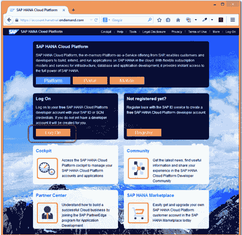

图 2.1 注册免费 SAP HCP 开发者账户：第 1 部分

- 2. 从登录页面，单击 Log On 按钮。这将打开图 2.2 所示的 Log On 页面。从此处，您有两种选择之一。如果您已有 SAP ID 或 SAP SCN 账户，则可以将账户凭据输入 Log On 表单，并单击 Log On 按钮将此账户与您的 SAP HCP 开发者账户关联。快速接受许可协议后，您就可以开始使用了。

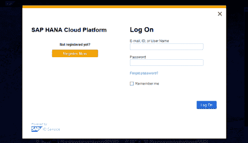

图 2.2 注册免费 SAP HCP 开发者账户：第 2 部分

- 3. 如果您还没有 SAP ID 和/或 SAP SCN 账户，则需要单击图 2.2 屏幕左侧显示的 REGISTER Now 按钮来创建一个。这将打开图 2.3 所示的 REGISTRATION 窗口。在此处，您必须指定少量联系信息并同意条款和条件才能注册。提交表单后，您将收到一封确认电子邮件，通过该邮件您可以确认注册并激活您的账户。

## 注册

要注册 SAP HANA Cloud Platform，请提供以下所需信息。

### 告诉我们您的个人信息

- 名 * Andrea
- 姓 * Wood
- 电子邮件 *
- 电话

### 设置密码

您的密码必须至少包含八个字符，并包含以下三项：

- 大写字母
- 小写字母
- 数字
- 符号

- 密码 *
- 再次输入密码 *

我确认我已阅读 SAP 的隐私声明，并同意按照隐私声明的条款处理我的个人数据。这包括，但不限于，SAP 可以收集、存储和处理我自愿在本网站上提供的任何个人数据，并将其与 SAP 从其他来源收集的关于我的其他信息汇总。此类数据将被处理的目的在隐私声明和本网站上有所描述。根据隐私声明和本网站的条款，SAP 还可以进一步跟踪我对 SAP 网站的使用，并将其与我的个人数据汇总。我确认，我可以随时请求 SAP 持有的我的个人数据信息，并可以要求 SAP 更新和更正此类数据，以及通过联系 SAP（account@sap.com）撤回我在此给予的同意。

图 2.3 注册免费 SAP HCP 开发者账户：第 3 部分

无论您采用哪种方法，账户创建过程都以您登录图 2.4 所示的 SAP HCP Cockpit 应用程序结束。可以想象，在开发和部署应用程序、配置资源等过程中，我们将在该驾驶舱中花费大量时间。因此，最好将驾驶舱页面加入书签以供将来使用：https://account.hanatrial.ondemand.com/cockpit。另外，如果这是您第一次访问 SAP HCP，我们鼓励您浏览一下驾驶舱，熟悉各个选项卡页面，这将让您了解 SAP HCP 账户中包含的内容。


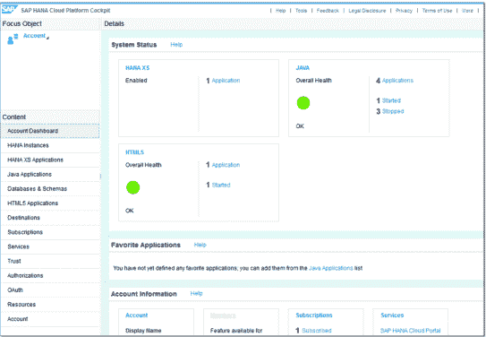

图 2.4 首次登录 SAP HCP 驾驶舱

### 2.2 盒子里有什么？

既然你已经拿到了崭新的 SAP HCP 账户，让我们花点时间拆开包装，看看 SAP HCP 开箱即用包含了哪些内容。除了帮助你更多地了解 SAP HCP 在技术层面提供的内容之外，这份简要分析还能帮助你识别出开始开发 SAP HCP 应用程序所需安装和配置的工具类型。

#### 2.2.1 应用程序运行时容器

如在第 1 章中所述，SAP HCP 从设计之初就旨在支持多种编程模型。这种 BYOL（自带语言）方法通过允许开发团队在迁移到平台时利用现有技能，降低了 SAP HCP 的入门门槛。

为了支持多种编程语言，SAP HCP 采用了一系列模块化且轻量级的运行时容器。这些容器为基于特定编程模型（例如 Java）运行的应用程序提供了安全且可扩展的运行时环境。

接下来，我们将更仔细地查看 SAP HCP 包含的运行时容器类型。我们还将稍微展望一下，了解 SAP 在近期路线图中有哪些其他容器类型。

### Java 运行时

回溯到代号为“NEO”的日子，SAP HCP 一直为基于 Java 的应用程序开发提供出色的支持。从技术角度来看，我们开发的 Java 应用程序部署在一个名为 Java 运行时的专用运行时容器中。图 2.5 展示了 Java 运行时的基本架构。如您所见，该运行时环境的基础是计算单元。作为 SAP HCP 的消费者，我们可以将计算单元视为配备自己的 CPU、主内存、磁盘空间和已安装操作系统的虚拟化主机。

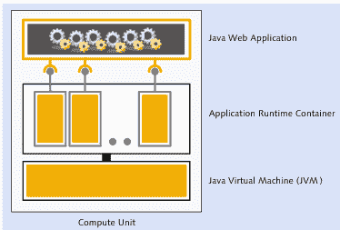

图 2.5 Java 运行时架构

从 Java 开发角度来看，计算单元的基础是 Java 虚拟机 (JVM)。在此，SAP 使用一种名为 SAP JVM 的专有 JVM，它源自 Oracle 的 HotSpot JVM。与 Oracle 提供的默认 JVM 相比，SAP JVM 提供了许多与调试、内存分析和插桩相关的有用功能。

在 SAP JVM 之上，我们有应用程序运行时容器，如图 2.5 所包含的架构图中间所示。如果您熟悉企业 Java 开发，那么可以将应用程序运行时容器视为类似于您可能使用过的 Web 容器，例如 Apache Tomcat 或市场上众多领先的 Java EE 应用容器。本质上，应用程序运行时容器为我们的基于 Java 的 Web 应用程序提供了完成工作所需的所有库和服务。

截至撰写本文时，SAP 允许我们根据三种不同的配置文件配置应用程序运行时容器：

- **Java EE 6 Web**
  此配置文件提供 Java EE 6 Web 配置文件提供的完整 API 集。在此，除了 Servlet 和 JavaServer Pages (JSP) 之外，我们还可以使用 Enterprise JavaBeans (EJB)、Java Transaction API (JTA)、Java Persistence API (JPA) 等。这些 API 通过承担较低级别的技术问题（例如事务管理、对象关系持久性等）的所有权，简化了企业应用程序开发过程。有关 Java EE 6 Web 配置文件的更多信息，请参见前面的框式注释。

- **Java Web**
  根据在线帮助文档，Java Web 配置文件提供“典型独立 Java Web 容器的 Java EE 标准 API 子集”。典型 Web 容器的示例是流行的 Apache Tomcat 容器。此类容器支持使用 Servlet、JSP 等开发 Java Web 应用程序。另一方面，它们不支持整个 Java EE API。这意味着您无法在 Java Web 容器上使用其他基于 Java EE 的技术（例如 EJB）。当然，您仍然可以访问完整的 Java SE 库，以及所有自定义 SAP HCP 服务 API。

- **Java Web Tomcat 7**
  此配置文件（截至撰写本文时为 Beta 版）提供与 Java Web 配置文件类似的功能。主要区别在于，此配置文件的 Web 容器在未经修改的情况下利用 Apache Tomcat 7 Web 服务器。这意味着某些基于云的服务在运行时将不可用。

### 什么是 Java EE 6 Web 配置文件？

Java EE 6 Web 配置文件是与 Java EE 6 规范一起引入的。从概念上讲，您可以将 Java EE 6 Web 配置文件视为 Java EE 堆栈的精简版。在此，用于开发基于 Java 的 Web 应用程序的常用 API 子集被分组到一个单独的配置文件中，应用服务器供应商可以使用该配置文件构建更轻量级的应用容器。自然，此类配置文件对于 SAP 这样的基于云的软件提供商来说非常有意义。

作为开发人员，自然会认为“精简”意味着“功能减少”。然而，在此情况下，我们认为您会发现被移除的 API 与基于云的应用程序开发关系不大。例如，在云端开发 Web 应用程序时，您不太可能需要访问基于 RMI/CORBA 的远程调用。在其他情况下，您会发现有基于云的服务提供了与缺失的 Java EE API 相似（或许更好）的功能。随着本书的深入，我们将找到此类示例。

此处应做的最后一个区别是关于 Java EE 6 Web 配置文件中的 EJB 支持。虽然该配置文件确实包含对 EJB 开发的支持，但它使用一种名为 EJB Lite 的专用规范。EJB Lite 是 EJB 3.1 规范的一个子集，支持会话 Bean（有状态和无状态）、单例 Bean 以及相关的容器管理功能。此处显著缺失的是消息驱动 Bean、JAX-WS 端点、远程调用以及与 EJB 2 的向后兼容性。由于这些功能在 Web 应用程序开发中并不常用，因此此遗漏对我们处理应用程序设计的方式影响不大，但了解这些差异仍然很重要。

我们将从第 3 章开始有机会深入探讨基于 Java 的应用程序开发。

### 进一步资源

您可以在 http://help.hana.ondemand.com 在线访问 Java Web 帮助文档。在 SAP HANA CLOUD PLATFORM 部分中，导航至 JAVA DEVELOPMENT • RUNTIME FOR JAVA，以了解该领域的最新创新。

## SAP HANA 运行时

SAP HCP 的一个显著特点是其对 SAP HANA 内存计算的内置支持。这种支持存在于两个层面：

### 基本数据库访问

在此场景中，应用程序使用通用编程语言（例如 Java）开发，SAP HANA 数据库用作底层数据库。在此，SAP HANA 数据库就像任何其他关系数据库管理系统 (RDBMS) 一样使用，通过标准 SQL 提供访问。

### 全规模原生 SAP HANA 开发

在此场景中，应用程序从零开始使用基于原生 SAP HANA 的开发工件（例如，基于 SQLScript 的存储过程、服务器端 JavaScript 和自定义视图类型）构建。这种方法非常适合开发处理大量数据的分析应用程序。

在后一种使用场景中，原生 SAP HANA 开发对象部署在 SAP HANA 运行时上，这本质上是一个基于云的 SAP HANA 扩展应用服务 (SAP HANA XS) 实例。

### 什么是 SAP HANA XS？

如果您不熟悉 SAP HANA XS，那么有必要进行简要介绍。本质上，SAP HANA XS 引入了一个功能齐全的应用服务器，该服务器直接位于 SAP HANA 数据库之上。此应用服务器可用于基于 SAPUI5、服务器端 JavaScript 和原生 SAP HANA 开发对象（例如，SQLScript 过程和分析视图）等技术开发 Web 应用程序。由于 SAP HANA XS 位于 SAP HANA 数据库之上（并与其紧密集成），因此部署在此应用服务器上的原生应用程序可以享受本地化数据访问的好处。通过消除将数据从数据库层传输到应用程序层的开销，原生应用程序可以非常快速地处理大量数据。出于此原因，SAP HANA XS 非常适合构建分析应用程序等。

在 SAP HCP 中，SAP HANA XS 应用服务器的作用与 Java 运行时类似。它提供了一个我们可以用来创建 Web 应用程序的应用服务器。在此，我们可以构建 SAP HANA 原生应用程序，方式与在本地开发此类应用程序大致相同。

为了更全面地了解这一切，请考虑部署在 SAP HCP 上的 SAP HANA 原生应用程序的基本架构。如图 2.6 所示，该应用程序的客户端层基于 SAPUI5 技术。SAPUI5 内容由 SAP HANA XS 引擎提供给客户端，该引擎包含一个内置 Web 服务器。由于 HTML5 的普遍性，此类内容可以


consumed by PCs, tablets, or smartphones without requiring the installation of any client software (e.g., the SAP GUI client).

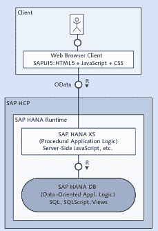

图 2.6 SAP HANA原生应用程序的基本架构

从服务器端来看，我们可以看到应用程序逻辑是如何在SAP HANA XS引擎和底层SAP HANA数据库之间分配的。我们选择实现逻辑的层(层)在很大程度上取决于需求。例如，如果我们只是执行简单的CRUD（创建、删除、更新和显示）操作，那么基本的SQL/SQLScript通常就足够了。另一方面，如果需求要求大量过程逻辑，那么我们将需要访问更通用的语言，例如服务器端JavaScript。在这种情况下，利用SAP HANA XS引擎的功能并与纯SQL/SQLScript结合使用是有意义的。

客户端层与SAP HANA XS后端之间的通信通道主要使用OData协议定义。这种基于REST的协议用于创建轻量级Web服务，这些服务可以通过JavaScript和SAPUI5小部件轻松消费。我们将在第5章中了解这一切是如何结合在一起的。

## HTML5应用程序容器

对于以UI为中心的应用程序场景，SAP HCP还提供对HTML5应用程序部署的支持。这些轻量级应用程序部署到Git存储库中，其静态资源（例如，HTML、JavaScript和CSS）通过嵌入在SAP HCP本身中的共享调度程序服务提供。我们将在第7章中了解更多关于这一切如何工作的信息。

## 未来更多运行时容器

截至撰写本文时，SAP已表明，基于与Cloud Foundry和Docker的战略合作伙伴关系，有计划大幅扩大SAP HCP语言支持的范围。一旦此集成到位，SAP HCP将通过一系列更通用的新运行时容器真正支持BYOL。目前，对大多数流行的云开发语言的支持必须通过Runtime for Java通过第三方实现（例如JRuby、Jython等）来部署。

#### 2.2.2 SAP HCP使能服务

作为真正的PaaS解决方案，SAP HCP提供的远不止是一系列独立的运行时容器。它包括一系列使能服务，这些服务围绕云资源的访问和消费提供抽象。表2.1列出了截至撰写本文时SAP HCP提供的更突出的服务。在阅读本文时，请记住服务产品仍在不断扩展，因此定期查看SAP HANA Cloud文档以了解最新动态绝对是个好主意。

| 服务 | 描述 |
| :--- | :--- |
| 持久性服务 | 该服务在云中部署的关系型数据库实例之上提供抽象。这种抽象为开发人员提供访问数据库实例的通用接口，同时保护他们免受云中数据库扩展的底层复杂性的影响。 |
| 连接性服务 | 该服务为开发人员提供一种透明地与远程服务通信的手段，这些远程服务可能托管在本地或互联网上的其他位置。 |
| 文档服务 | 该服务提供对内容存储库的访问，用于存储非结构化内容。它还可根据需要用于实现一种虚拟化文件系统。 |
| 身份服务 | "身份服务"一词是集成到SAP HCP的一系列安全相关服务或功能的名称。该产品的一些亮点包括支持单点登录（SSO）场景、使用安全断言标记语言（SAML）进行身份联合，以及基于OAuth协议的授权。 |
| 反馈服务 | 该服务为在云应用程序中实现用户反馈场景提供框架。 |

表 2.1 SAP HCP的使能服务

#### 2.2.3 高级别服务

除了第2.2.2节中描述的核心服务之外，SAP HCP PaaS产品还由一系列高级别应用程序服务补充，这些服务提供某些基于云的应用程序场景所需的专用功能。接下来，我们将重点介绍此产品中包含的几个更突出的服务。

### SAP HANA Cloud门户

SAP HANA Cloud门户是一种基于云的门户解决方案，可以轻松创建轻量级门户网站，这些门户网站结合了云应用程序、云应用程序扩展和本地内容，以创建无缝的UI体验。通过使用HTML5和OpenSocial等开放标准，SAP HANA Cloud门户可以轻松集成来自不同来源的内容，而无需重新造轮子。我们将在第9章中亲眼看到这一切是如何工作的。

### SAP HANA Cloud集成

从许多方面来看，您可以将SAP HANA Cloud集成（SAP HCI）视为SAP本地SOA中间件工具SAP Process Integration（PI）的基于云的版本。也就是说，SAP HCI是一种基于云的中间件服务，允许您在云中开发集成场景。这些场景可能用于本地数据的一次性上传或对本地系统的持续实时查找。我们将在第10章中更详细地讨论SAP HCI。

### SAP HCP移动服务

此服务用于帮助开发人员推出移动应用程序。SAP HCP移动服务提供的一些更突出的功能包括以下内容：

- 支持用户引导
- 安全性和授权服务
- 支持实现原生推送通知
- 支持实现移动应用程序的脱机支持
- 移动应用程序的管理和监控

我们将在第12章中更详细地了解SAP HCP移动服务，该章节可在www.sap-press.com/3638下载。

### 2.3 安装SAP HCP开发工具

在上一节中，我们了解到SAP确实专注于将SAP HCP定位为一个对开发人员开放且友好的平台。尽管这种开放性无疑是一件好事，但它确实使设置开发环境的任务变得稍微复杂一些，因为我们必须考虑许多类型的开发对象。

在本节中，我们将了解典型工具设置的样子，以便您拥有必要的工具来完成本书中描述的示例。我们在这里强调“典型”一词，因为开发人员之间的工具配置往往会以微妙的方式有所不同。幸运的是，由于SAP HCP围绕可扩展的Eclipse集成开发环境（IDE）进行标准化，这些差异通常仅在于在此处或那里安装几个插件。

#### 2.3.1 设置Eclipse IDE

SAP选择围绕开源Eclipse IDE标准化SAP HCP工具集。这种方法使SAP能够利用核心Eclipse IDE的内置开发功能，并仅根据需要补充SAP HCP特定功能。此外，由于Eclipse可以说是世界上最流行的IDE，它还提供了对普通开发人员几乎无需介绍的额外好处。

在本节中，我们将了解如何设置新的Eclipse实例并从SAP HCP Tools库安装相关插件。

### 安装Java SDK

在安装Eclipse之前，您首先需要确保本地计算机上安装了适当版本的Java。尽管现代版本的Eclipse只需要安装更轻量级的Java运行时环境（JRE），但我们建议您直接安装完整的Java SE软件开发工具包（SDK），该工具包可在www.oracle.com/technetwork/java/javase/downloads/index.html在线获取。这将确保您拥有执行各种开发任务所需的完整编译器工具。

安装Java SDK时，您需要下载最适合您计划在Runtime for Java中使用的目标应用程序运行时容器配置文件的版本（请参阅第2.2.1节）。例如，截至撰写本文时，可用的容器配置文件基于Java EE版本6和7。因此，如果您使用的是Java Web Tomcat 7配置文件，那么您需要下载并配置Java SE版本7。

### 下载和安装Eclipse

为了最大限度地提高灵活性，SAP开发了SAP HCP Tools以与大多数最新版本的Eclipse IDE配合使用。因此，如果您已经有一个最近版本的Eclipse，如果您选择，应该可以在该实例之上安装SAP HCP Tools。但是，考虑到与SAP HCP Tools实例关联的大量插件，我们建议您下载并配置一个单独的Eclipse实例用于SAP HCP开发。


要下载 Eclipse，请在 Web 浏览器中访问 www.eclipse.org/downloads。从主 DOWNLOADS 页面，下载适用于目标操作系统的最新版本 Eclipse IDE for Java Developers，如图 2.7 所示。

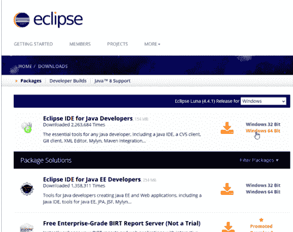

图 2.7 下载适用于 Java 开发者的 Eclipse IDE

你下载的安装包将是一个压缩存档，你可以将其解压到自己选择的目录中。解压安装包后，打开 Eclipse 文件夹并运行可执行的 eclipse 文件（例如，eclipse.exe），即可首次启动 Eclipse。

首次加载 Eclipse 时，你很可能会看到图 2.8 所示的工作区启动器对话框。在此对话框中，你必须选择本地计算机上的一个目录，供 Eclipse 用于存储项目工件等内容。通常，最好选择“将此设为默认值且不再询问”复选框，以便 Eclipse 将所选目录用作默认位置。这样一来，Eclipse 每次启动时都不会反复提示你选择位置，而且你知道在哪里可以找到从 IDE 中创建的开发工件。

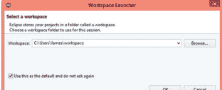

图 2.8 在 Eclipse 中选择默认工作区位置

如果一切顺利，Eclipse 最终将加载到类似于图 2.9 所示的窗口中。如果你是 Eclipse 新手，我们建议浏览一两个教程，以熟悉 IDE 布局、Eclipse 特定的术语和功能等。总体而言，我们认为你会发现 Eclipse 相当直观，但和大多数 IDE 一样，它也有一些独特之处。

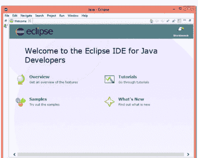

图 2.9 首次启动 Eclipse

在继续之前，我们可能需要提及一项你应当了解的小型维护任务，特别是当你在代理或防火墙后面工作时。因为 Eclipse 通过 HTTP 连接接收其更新，所以你必须配置代理设置，以便将 Eclipse 扩展为与 SAP HCP 一起使用。要配置代理服务器连接，请执行以下步骤：

- 1. 在 Eclipse 内部，从顶级菜单栏中选择 WINDOW • PREFERENCES 菜单选项，然后深入 GENERAL • NETWORK CONNECTIONS。
- 2. 从图 2.10 所示的网络连接面板中，在代理条目表中选择适当的架构（例如，HTTP 和/或 HTTPS），然后单击 EDIT... 按钮。

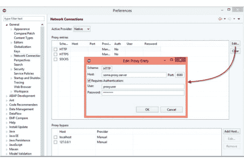

图 2.10 在 Eclipse 中配置代理服务器访问

- 3. 然后，在编辑代理条目子对话框中，输入代理主机名和端口，以及必要的身份验证详细信息。单击 OK 按钮以确认你的选择。
- 4. 最后，如有必要，你可以使用 PROXY BYPASS 表来配置要绕过代理服务器访问的主机列表。

## 安装 SAP 开发工具

此时，你的本地计算机上应该已经安装了原生版本的 Eclipse。虽然此 Eclipse 实例功能齐全，但它不带任何 SAP 或 SAP HCP 特定功能。要添加这些功能，我们必须从 SAP 下载并安装必要的插件。可以通过执行以下步骤来实现：

- 1. 首先，我们需要登录 SAP Development Tools for Eclipse 安装站点，该站点在线可用，网址为 https://tools.hana.ondemand.com/#cloud。如图 2.11 所示，该站点提供了几个最近 Eclipse 发行版的安装站点（例如，撰写时的 Eclipse Luna 4.4 和 Eclipse Kepler 4.3）。将适用于你 Eclipse 版本的 URL 复制到剪贴板。

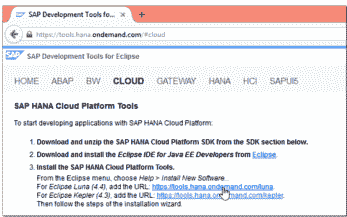

图 2.11 定位 SAP HCP 工具安装站点

- 2. 接下来，打开 Eclipse IDE，从顶级菜单栏中选择 HELP • INSTALL NEW SOFTWARE...。
- 3. 这将打开图 2.12 所示的安装对话框。在此屏幕上，将步骤 1 中复制的安装站点 URL 粘贴到 Work with 输入字段中，然后单击 Add... 按钮。在添加存储库对话框中，为存储库命名，然后单击 OK 按钮。通过命名存储库，我们可以稍后使用同一存储库来检查更新并根据需要更新软件。

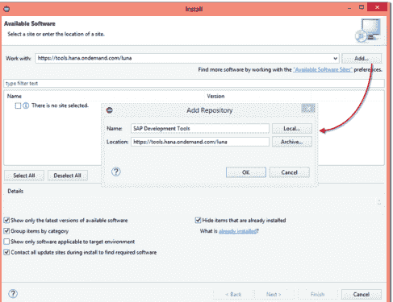

图 2.12 在 Eclipse 中添加可用软件站点

- 4. 定义存储库后，单击 NEXT > 按钮进入安装向导的下一步。此时，Eclipse 将连接到安装 URL 并搜索可安装的可用插件。
- 5. 在图 2.13 所示的可用软件步骤中，你将获得一份可安装的可用软件项目列表。就本书而言，主要感兴趣的项目将是 SAP HANA Cloud Platform Tools、SAP HANA Tools 和 UI DEVELOPMENT TOOLKIT FOR HTML5。这些项目将确保我们具备开发基于 SAP HCP 的 Java 应用程序、原生 SAP HANA 应用程序以及基于 SAPUI5 技术的 HTML5 应用程序所需的组件。当然，你也可以根据需要选择其他感兴趣的项目。

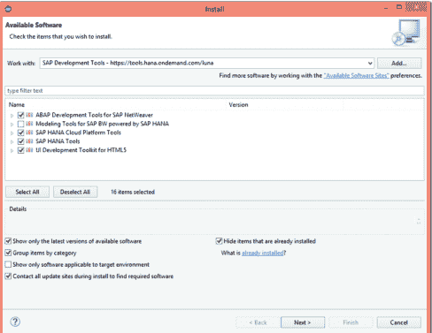

图 2.13 选择要安装的软件项目

- 6. 最后，选择要安装的相关项目后，你可以接受所有默认设置并继续进行安装向导。此时，Eclipse 将下载并安装相关插件。

在运行安装过程时，请记住，如果选择了大量项目和/或网络连接缓慢，此步骤可能需要相当长的时间。如果一切顺利，Eclipse 将完成插件安装，并通知你必须重启才能使更改生效。重启完成后，你应该会看到一个修订后的欢迎页面，类似于图 2.14 所示的页面。在这里，你会注意到欢迎页面上添加了几个新的 SAP 和 SAP HCP 相关项目。

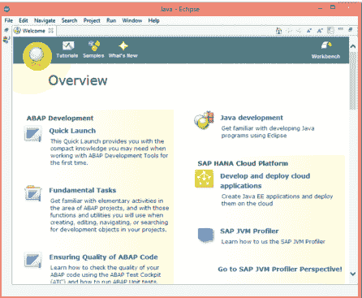

图 2.14 安装 SAP HCP 工具后修订的欢迎页面

#### 2.3.2 下载 SAP HCP SDK

除了集成到 Eclipse 中的 SAP HCP 相关插件之外，SAP 还提供了一个独立的 SDK，其中包含一系列有用的工具和示例，以启动开发过程。其中，此 SDK 包含以下内容：

- Platform API Java Archive (JAR) 文件
- API 文档
- 可用于离线测试的本地 SAP HCP 运行时实例
- 可用于管理 SAP HCP 实例的命令行工具
- 大量带有带注释源代码和文档的全规模示例项目

SAP HCP SDK 可从我们用于查找 SAP HCP 工具 Eclipse 安装站点的同一站点下载：https://tools.hana.ondemand.com/#cloud。如图 2.15 所示，SAP 提供了单独的 SDK 以支持 Runtime for Java 中可用的不同应用程序运行时容器配置文件。出于各种原因，我们强烈建议你选择与所选配置文件相匹配的 SDK 版本。就本书而言，我们将下载 Java EE 6 Web 配置文件的 SDK，因为它包含我们演示所需的全面功能集。

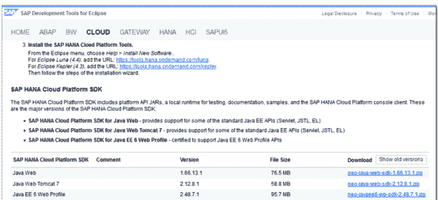

图 2.15 下载 SAP HCP SDK

下载适合你的 SDK 版本后，你会想将 ZIP 压缩包解压到本地计算机上易于访问的目录中。解压 ZIP 文件后，我们强烈建议你浏览 SDK 文件夹结构，查看 SAP 提供的所有有用资源。

> **提示**
>
> 出于各种原因，我们建议你避免将 SDK 文件夹嵌套得过深于本地文件系统中。这样做可能会由于文件名异常长而导致本地运行时出现问题。


## 设置本地运行时环境

如前所述，SAP HCP SDK 包含一个本地运行时环境，允许您在本地计算机上测试 SAP HCP 应用程序。虽然您可以从命令行管理此本地运行时环境，但将本地运行时环境作为 Eclipse 中可用的服务器运行时环境进行安装要方便得多。可以通过执行以下步骤实现此集成：

- 1. 启动 Eclipse，选择 WINDOW • PREFERENCES 菜单选项，并展开 SERVERS 子菜单。
- 2. 在 Server 子菜单中，选择 SAP HANA Cloud Platform 节点。这将打开图 2.16 所示的 SAP HANA Cloud Platform 面板。在此面板中，您需要按如下方式配置相关属性：
- **景观主机**
  此属性需要指向目标 SAP HCP 实例的主机。如果您使用的是免费开发者帐户，则景观主机将为 hanatrial.ondemand.com。否则，它将为 hana.ondemand.com。
- **SDK 位置**
  在此字段中，您需要指定解压 SAP HCP SDK 的目录。
- **帐户名**
  此属性用于跟踪您的 SAP HCP 帐户名，以便 SAP HCP Tools 在您执行需要指定 SAP HCP 帐户的操作时可以自动建议此值。
- **用户名**
  此属性用于跟踪您的用户名，以便 SAP HCP Tools 在您执行提示您与服务器端 SAP HCP 实例进行身份验证的操作时可以自动建议此值。

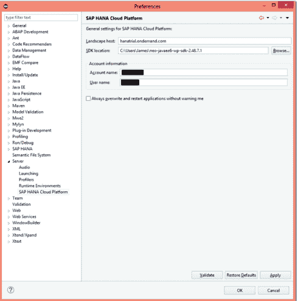

图 2.16 将 SDK 位置添加到 SAP HCP 常规设置

- 3. 配置好 SAP HCP SDK 的目录位置后，您需要切换到 SERVER • RUNTIME ENVIRONMENTS 节点。从此处，您可以通过单击 添加... 按钮来配置 SAP HCP 本地运行时环境。这将打开图 2.17 所示的 新建服务器运行时环境 向导。

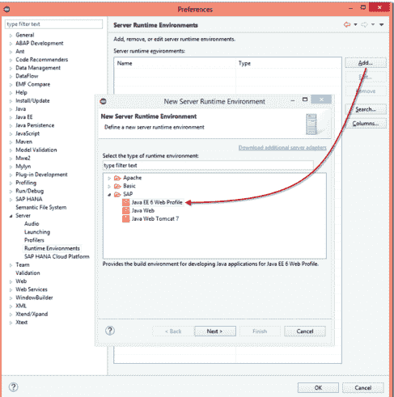

图 2.17 设置 SAP HCP 本地运行时环境：第 1 部分

- 4. 从向导的初始页面，展开 SAP 文件夹，并根据您选择的 Java 配置文件选择相应的本地运行时环境（参见图 2.17）。单击 下一步 > 按钮继续。
- 5. 在下一屏幕（如图 2.18 所示），您有机会从本地计算机选择本地运行时环境的位置。因为您之前已配置 SDK 位置，因此此目录将自动建议，只需单击 完成 按钮确认选择即可。

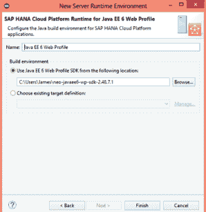

图 2.18 设置 SAP HCP 本地运行时环境：第 2 部分

#### 2.3.3 安装 SAP JVM

在设置开发环境时，我们建议您安装的最后一项是 SAP JVM。正如我们在第 3 章和第 4 章中将学到的，这一可选步骤允许我们在调优 Java 应用程序时利用 SAP JVM 的一些强大分析功能。

SAP JVM 可以从我们用来下载 SAP HCP SDK 的同一下载页面下载：https://tools.hana.ondemand.com/#cloud。在页面的 SAP JVM 部分，只需下载适合您操作系统配置的相应软件包即可。您可以在 https://help.hana.ondemand.com/help/frameset.htm 在线提供的 SAP HANA Cloud 文档中找到特定操作系统的安装说明。在此，浏览至 Java Development • 入门 • 为 Eclipse 和 SDK 安装 Java 工具 • 安装 SAP JVM。

安装 SAP JVM 后，您可以通过执行以下步骤将其与 Eclipse 中已安装的 JRE 集关联：

- 1. 打开 Eclipse，并从主菜单中选择 WINDOW • PREFERENCES。
- 2. 展开 JAVA • 已安装的 JRE 文件夹，并单击 添加... 按钮。
- 3. 这将打开图 2.19 所示的 添加 JRE 安装向导。接受默认的 标准 VM 选项，并单击 下一步 > 按钮继续。

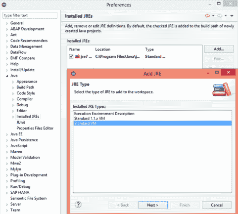

图 2.19 将 SAP JVM 添加为 Eclipse 中的已安装 JRE：第 1 部分

- 4. 在下一屏幕上，您必须浏览到安装 SAP JVM 的目录位置。选择目录后，JRE 名称和系统库将自动配置。要确认配置，请单击 完成 按钮。
- 5. 最后，在将 SAP JVM 配置为 JRE 后，您需要通过单击 名称 列旁边的复选框将其选为默认 JRE（参见图 2.21）。启用此设置后，所有新的基于 Java 的项目都将自动配置为使用 SAP JVM 作为目标 JRE。

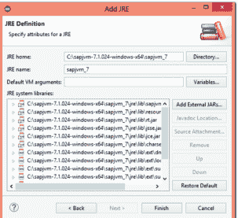

图 2.20 将 SAP JVM 添加为 Eclipse 中的已安装 JRE：第 2 部分

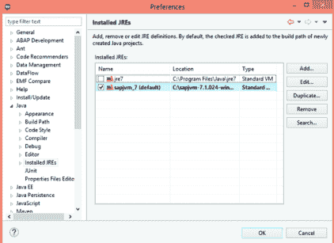

图 2.21 将 SAP JVM 添加为 Eclipse 中的已安装 JRE：第 3 部分

### 2.4 总结

在本章中，我们完成了在 SAP HCP 上开发基于云的应用程序所需的所有先决条件。这些管理任务完成后，我们准备进行一些实际开发练习。我们将在第 3 章中学习如何开发基于 Java 的 Web 应用程序，从而开始实际操作。

# 第二部分

# 核心开发概念

在本章中，我们将向您展示如何为 SAP HCP 开发基于 Java 的应用程序。这一温和的入门将作为本书后续章节中更高级主题的基础。

## 3 开发 Java 应用程序

尽管 SAP HCP 在基于云的应用程序开发方面宣扬一种开放的自带语言（BYOL）方法，但它与 Java 确实有着密切的联系。就核心语言支持而言，Java 是存在时间最长的语言（可追溯到 SAP HCP 曾使用代号 "NEO" 的时代）。因此，不难理解 Java 是 SAP HCP 中最成熟的语言选项。

仅凭这一历史本身，并不能使 Java 成为比 SAP HCP 支持的其他语言更好的语言选择。然而，这意味着在启动自己的开发项目时，有更多基于 Java 的应用程序示例和资源可供在线浏览。因此，即使您不打算在日常工作中使用 Java，了解 Java 在 SAP HCP 上的使用方式也并非坏主意，这样您至少可以跟上进度，并了解如何将这些示例调整为您选择的语言。

在本章中，我们将演示如何为 SAP HCP 开发基于 Java 的 Web 应用程序。尽管本章的意图是提供一个温和的入门，但我们应该指出，本章不应被视为 Java 编程语言的入门。如果您是一位经验相当丰富的程序员，那么您可能能够跟上本章提供的示例，但如果您计划在 SAP HCP 上进行严肃的 Java 开发，我们强烈建议您阅读第 3.5 节中描述的一些参考资料。

### 3.1 概述

在第 2 章中，我们花了一些时间分析了部署在 SAP HCP 上的 Java 应用程序的应用程序运行时容器，*Java 运行时*。我们注意到，Java 运行时 可以根据客户的需求或偏好按多个配置文件进行配置。从开发人员的角度来看，配置文件选择的影响在于他们可以使用多少 Java EE API。在所有情况下，基础都是由核心 Java SE 和 Java Servlets/JSP API 设置的。然而，只有在 Java EE 6 Web 配置文件配置的情况下，开发人员才能访问 EJB，例如。

在 Java SE/EE API 之上，SAP HCP 提供了一系列服务（例如持久性服务和连接性服务），可用于填补 SAP HCP 中不可用的 Java EE 库所暴露的空白。正如我们在第 6 章中将学到的，这些服务在许多方面比核心 Java EE 库/服务在云环境中更易于使用。

Java 开发拼图的第三个（或许也是最重要的）部分是庞大的开源项目和库社区，这些项目和库可以轻松集成到部署在 SAP HCP 上的 Java Web 应用程序中。这意味着，基于 Spring MVC、Struts 等框架构建的现有 Java Web 应用程序可以基本原样部署在 SAP HCP 上。

当我们将所有这些部分组合在一起时，我们最终得到一块可以以多种不同方式填充的空白画布。例如，以 UI 为中心的应用程序可以使用 HTML5 与 Servlets/JSP、SAPUI5 或 Java 领域中任何数量的可用开源 UI 框架的混合来构建。同样，API 可以使用 EJB 或普通旧 Java 对象 (POJO) 来构建。

由于我们几乎无法枚举各种库和框架的排列组合，更不用说演示它们了，因此本章的方法是坚持要点，向您展示如何使用 Java Servlets/JSP API 构建基本 Web 应用程序。在随后的章节中，我们将在此基础上，向您展示如何集成第三方库和框架、云服务等。


### 3.2 创建 Java Web 应用程序

归根结底，我们开发的任何基于 Java 的 SAP HCP 应用程序都必须作为 Java Web 存档（或 WAR 文件）进行部署。在这个 WAR 文件中，我们可以包含各种各样的资源，包括 Java 类文件、Servlets/JSPs 和静态 HTML 工件。尽管在后续内容中我们会介绍许多不同的资源类型，但我们认为，以一个基于 Servlets 和 JSPs 的非常简单的 Java Web 应用程序作为起点是合适的。

为了指导我们的演示，我们将开发一个简单的应用程序，用户可以通过该应用程序维护阅读列表。在这里，我们将创建一个简单的 JSP 表单来显示阅读列表并添加更多书目。在后端，我们将开发一个基于 Servlet 的无界面控制器类，用于收集和跟踪阅读列表条目。虽然这个应用程序很简单，但它将为我们提供学习如何使用 Eclipse IDE 并观察 Java Web 应用程序如何打包的机会。此外，它还将让我们有机会稍微尝试一下随 SAP HCP SDK 一起打包的本地运行时环境。废话不多说，让我们开始吧。

#### 3.2.1 在 Eclipse 中创建动态 Web 项目

要开始，我们需要打开 Eclipse IDE 并创建一个新的动态 Web 项目。此项目类型是构建基于 Java 的 Web 应用程序的默认项目类型，并作为 Eclipse Java EE 开发工具的一部分包含在内。要创建一个新的动态 Web 项目，我们必须执行以下步骤：

- 1. 打开 Eclipse，并切换到 Java EE 透视图。如果您以前从未访问过此透视图，可以通过在顶级菜单栏中选择 Window • Open Perspective • Other... 并选择 Java EE 列表选项来实现。

- 2. 打开 Java EE 透视图后，通过选择 FILE • NEW • DYNAMIC WEB PROJECT 菜单选项创建一个新的动态 Web 项目，如图 3.1 所示。

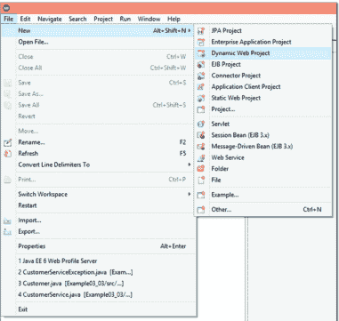

图 3.1 在 Eclipse 中创建动态 Web 项目：第 1 部分

- 3. 这将打开 NEW DYNAMIC WEB PROJECT 向导，如图 3.2 所示。在第一步中，指定项目的基本坐标，包括以下内容：

  - 项目名称（例如，EXAMPLE03_01）。

  - 您希望在本地文件系统中存储项目工件的位置。通常，保持选中 Use DEFAULT LOCATION 复选框是合理的，因为这将确保项目工件存储在默认的 Eclipse 工作区中。

  - 目标运行时环境（即，您下载 SAP HCP SDK 时设置的本地运行时环境）。

  - 您希望创建的动态 Web 模块版本。在这里，动态 Web 模块版本列表中的数字对应 Java Servlet API 的版本。除非您有充分理由进行其他配置，否则我们强烈建议您选择版本 3.0，如图 3.2 所示。

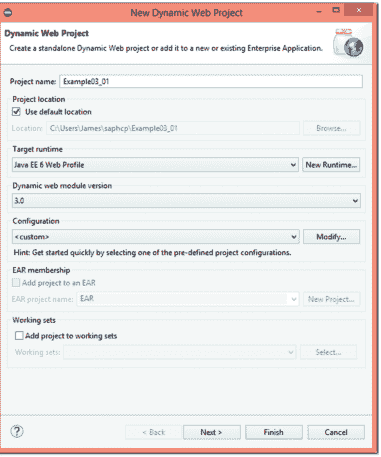

图 3.2 在 Eclipse 中创建动态 Web 项目：第 2 部分

- 4. 设置基本项目坐标后，通过单击 **下一步 >** 按钮继续项目创建向导。在大多数情况下，您可以接受中间步骤中提出的默认值。但是，在 **Web 模块** 步骤中，我们建议您选择 **生成 WEB.XML 部署描述符** 复选框，因为这将自动创建 Web 项目的 web.xml 文件，并确保它与 Eclipse Java EE 工具集关联。

- 5. 最后，配置完所有设置后，单击 **完成** 以确认您的选择并创建项目。此时，Eclipse 将创建项目文件夹结构并生成相关项目文件，例如上述的 web.xml 文件。

图 3.3 显示了项目创建后在 Eclipse 项目资源管理器视图中的样子。在这里，我们可以看到项目创建向导为我们提供了开始开发所需的一切，包括以下内容：

- 1. 在 Java Resources 节点下，您可以看到已创建一个名为 src 的文件夹，用于存储我们的 Java 源代码文件。

- 2. 项目还包含构建基于 Java 的 Web 应用程序所需的所有库的引用。这包括基本的 Java SE 库、Java EE 库和 SAP HCP 特定的库。

- 3. WebContent 文件夹镜像将用于部署我们 Web 文件夹的 WAR 文件的结构。如您所见，这包括上述预构建的 web.xml 部署描述符。

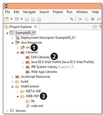

图 3.3 Eclipse 中动态 Web 项目的基本结构

项目设置过程的最后一步涉及创建一个 Java 包来存储我们的 Java 源文件。要创建新包，只需右键单击 src 文件夹并选择 New • PACKAGE 菜单选项，如图 3.4 所示。然后，在 New JAVA PACKAGE 对话框中，使用基于反向 Internet 域名的熟悉 Java 包命名约定指定包名称（参见图 3.5）。

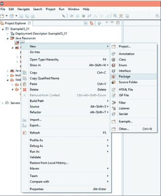

图 3.4 创建 Java 包：第 1 部分

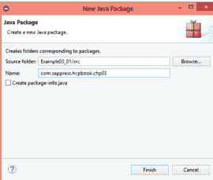

图 3.5 创建 Java 包：第 2 部分

#### 3.2.2 构建基于 Servlet 的控制器

现在我们的动态 Web 项目已就绪，可以开始开发实际的应用程序工件了。遵循传统的模型-视图-控制器（MVC）范式，我们将从底向上开始开发，创建一个混合模型-控制器层。如前所述，我们将使用无界面的 Java Servlet 类来实现此层。

要创建 Servlet，请右键单击第 3.2.1 节中创建的开发包，并选择 NEW > SERVLET 菜单选项，如图 3.6 所示。然后，在 CREATE SERVLET 对话框（图 3.7）中，指定 Servlet 类名（ReadingListServlet），并单击 **完成** 按钮以确认您的选择并创建新的 Servlet 类。

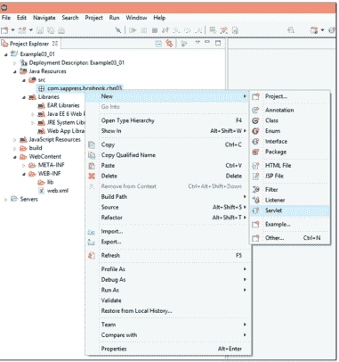

图 3.6 创建 Servlet 控制器类：第 1 部分

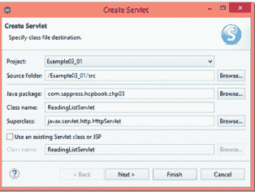

图 3.7 创建 Servlet 控制器类：第 2 部分

创建 Servlet 类后，我们希望将自定义应用程序逻辑插入 doPost() 方法中，如清单 3.1 所示。这里的逻辑非常简单：

- 1. 首先，创建一个名为 readingList 的 java.util.List 类型变量。该变量将用于存储用户阅读列表中的书籍条目。由于我们的简单应用程序没有数据库支持，我们将简单地将这个临时集合存储在用户的会话上下文中。请注意，一旦创建了此列表实例，我们将在后续调用中从会话上下文中获取它，以模拟对持久化存储的访问。

- 2. 接下来，通过使用 Servlet 容器传递的 HttpServletRequest 变量的 getParameter() 方法，检索用户想要添加到列表中的书籍名称。这里，我们通过名为 book 的 HTTP 请求参数检索书籍名称。

- 3. 然后，通过调用 readingList 列表对象的 add() 方法将书籍添加到阅读列表中。在此过程中，我们还使用名为 itemCount 的另一个属性更新会话上下文，以便跟踪阅读列表中的书籍数量。

- 4. 最后，使用 javax.servlet.RequestDispatcher 类将用户（重定向）回到 JSP 表单，以便他或她可以浏览和/或对阅读列表进行进一步更新。

```
public class ReadingListServlet extends HttpServlet
{
    ...
    protected void doPost(HttpServletRequest request,
            HttpServletResponse response)
            throws ServletException, IOException
    {
        // Retrieve the current list from the user's session:
        List<String> readingList = null;
        HttpSession session = request.getSession();
        Object o = session.getAttribute("readingList");
        if (o == null)
        {
            readingList = new ArrayList<String>();
            session.setAttribute("readingList", readingList);
        }
        else
        {
            readingList = (List<String>) o;
        }
        // Add the selected item to the list:
        String book = request.getParameter("book");
        if (book != null)
            readingList.add(book);
        // Also keep track of the number of items in the list:
        session.setAttribute("itemCount", readingList.size());
        // Reroute the user back to the main reading list form:
        RequestDispatcher rd =
                request.getRequestDispatcher("index.jsp");
        rd.forward(request, response);
    }
}
```

清单 3.1 实现 Servlet 控制器逻辑

#### 3.2.3 使用 JSP 创建视图层

如前所述，我们应用程序的视图层是使用 JSP 实现的。要创建 JSP 表单，请执行以下步骤：

- 1. 右键单击 WebContent 文件夹并选择 New • JSP File 菜单选项，如图 3.8 所示。

- 2. 在 New JSP File 对话框（图 3.9）中，输入 JSP 文件名（例如，index.jsp），并单击 **完成**。


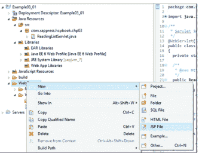

图 3.8 创建基于 JSP 的视图：第 1 部分

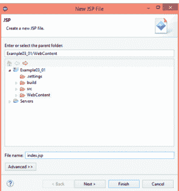

图 3.9 创建基于 JSP 的视图：第 2 部分

如清单 3.2 所示，表单 UI 是使用一些基本的 HTML5 兼容标记和几个位置合适的 JSTL 标签实现的。这些标签用于简化动态读取列表数据的处理。在读取列表下方，我们包含了一个 HTML 表单，允许用户向列表中添加更多图书。如您所料，此表单链接回我们的 ReadingListServlet 以更新读取列表。

```
<%@ page language="java" contentType="text/html; charset=UTF-8"
    pageEncoding="UTF-8"%>
<%@ taglib prefix="c" uri="http://java.sun.com/jsp/jstl/core" %>
<jsp:useBean id="readingList" scope="session"
    class="java.util.ArrayList" />

<!DOCTYPE html>
<html>
<head>
    <meta http-equiv="Content-Type"
        content="text/html; charset=UTF-8">
    <title>HCP Book : Chapter 3 : My HCP Reading List</title>
    <link href="css/style.css" rel="stylesheet">
</head>
<body>
    <h1>My HCP Reading List</h1>
    <table class="readingList">
        <tr>
            <th>Book Title</th>
        </tr>
        <c:forEach var="book" items="${readingList}">
            <c:forEach var="title" value="${book}">
                <td>${title}</td>
            </c:forEach>
        </c:forEach>
    </table>
    <section>
        <form method="post" action="ReadingListServlet">
            <label for="inpBook">
                Book: <input id="inpBook" name="book" />
            </label>&nbsp;
            <button type="submit">Add</button>
        </form>
    </section>
</body>
</html>
```

### 清单 3.2 实现基于 JSP 的视图层

#### 3.2.4 在本地测试应用程序

所有代码现已就绪，我们可以测试应用程序了。由于我们处理的是纯 Java 基础的 Web 应用程序，从技术上讲，可以在几乎任何 Java Web 服务器上测试此应用程序。但是，由于目标运行时最终是 SAP HCP，因此使用与 SAP HCP SDK 捆绑的 SAP HCP 本地运行时来运行测试是合理的。在本地运行时上测试我们的应用程序所需的步骤如下：

- 1. 在 Eclipse 中右键单击项目文件夹并选择“运行方式 > 在服务器上运行”菜单选项，以创建新的运行配置，如图 3.10 所示。

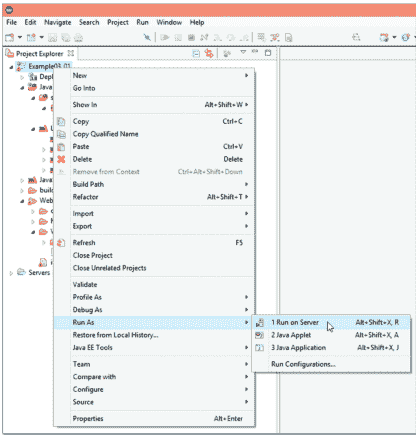

图 3.10 测试读取列表应用程序：第 1 部分

- 2. 这将打开“在服务器上运行”对话框（图 3.11）。在此处，选择要在其上运行应用程序的服务器实例。由于这是您第一次在 SAP HCP 本地运行时上运行应用程序，请选择“手动定义新服务器”单选按钮选项，以便您可以将 SAP HCP 本地运行时配置为 Eclipse 中的服务器。此配置相当于从 SAP 服务器类型选择列表中选择相应的运行时环境（图 3.11）。单击“下一步 >”按钮继续。

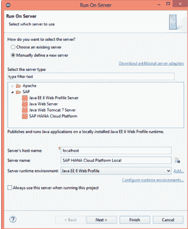

### 图 3.11 测试读取列表应用程序：第 2 部分

- 3. 在下一屏幕上，为新的本地服务器实例选择目标 HTTP 端口。通常，您会希望在本地计算机上为此选择一个可用的 8000 系列端口（例如，8080），因此通常最好直接采用 Eclipse 提出的默认端口选择。

- 4. 最后，通过单击“完成”按钮触发部署/测试。此时，Eclipse 将尝试将您的应用程序部署到目标 SAP HCP 本地运行时实例上。如果 SAP HCP 本地运行时环境尚未启动，则会将其启动。假设部署成功，默认的 index.jsp 文件将加载到嵌入式浏览器窗口中，如图 3.13 所示。

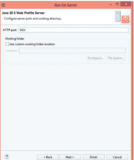

图 3.12 测试读取列表应用程序：第 3 部分

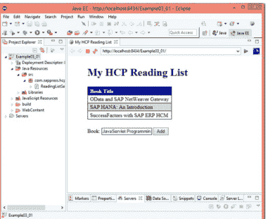

图 3.13 测试读取列表应用程序：第 4 部分

应用程序部署完成后，您可以试用读取列表并测试应用程序流程，以查看 Servlet 和 JSP 组件如何相互交互。我们还应指出，在测试过程中，您可以从 Eclipse 的嵌入式浏览器窗口复制 URL，并将其粘贴到您喜欢的浏览器（例如，Google Chrome、Mozilla Firefox 等）的地址栏中，以便更好地模拟最终用户体验。

### 3.3 使用 EJB

如我们在第 2 章中所述，Java EE 6 Web 配置文件支持使用会话 Bean 进行 EJB 开发。这使我们能够将业务逻辑从表示层（即 Servlet 和 JSP）中分离出来，转移到一系列会话 Bean 中。虽然我们可以使用 POJOs 实现相同的设计，但使用 EJB 可以带来多种好处，包括内置的事务管理、安全性、池化等。考虑到这一点，本节将演示如何将 EJB 集成到我们的基于 Java 的 Web 应用程序中。

#### 3.3.1 为 EJB 重构

为了说明如何使用 EJB，我们将重构在第 3.2 节中开发的读取列表应用程序，将所有业务逻辑从 Java Servlet 层移至会话 EJB。由于我们尚未有持久层，因此将通过将 EJB 定义为无状态会话 EJB 来近似实现这一点。这样，我们的 EJB 可以跟踪各个读取列表，而我们的 Servlet/JSP 层可以专注于呈现 UI 内容和控制页面流。

为启动重构工作，我们选择创建一个全新的动态 Web 项目，然后从原始读取列表应用程序复制所有资源。有了这个新项目后，我们就可以着手开发新的 EJB 组件。创建 EJB 的步骤如下：

- 1. 右键单击主项目节点，并选择“新建 > 其他...”菜单路径，如图 3.14 所示。

- 2. 在向导选择对话框（图 3.15）中，展开 EJB 文件夹并选择“会话 Bean (EJB 3.x)”条目。单击“下一步 >”按钮继续。

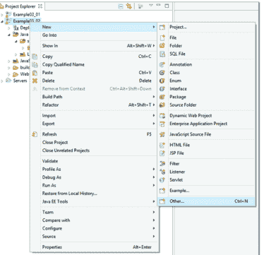

图 3.14：在动态 Web 项目中创建 EJB：第 1 部分

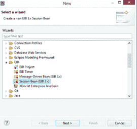

图 3.15：在动态 Web 项目中创建 EJB：第 2 部分

- 3. 这将打开“创建 EJB 3.x 会话 Bean”对话框（图 3.16）。在此屏幕中，有几个重要属性需要为您的 EJB 配置：

  - 目标 JAVA 包和类名。
  - 在 Java 类型列表中，您需要选择会话 EJB 是有状态还是无状态。就我们的示例而言，我们选择了无状态选项，因为我们希望 EJB 跟踪应用程序状态。不过，大多数情况下，我们更倾向于使用默认的无状态选项，因为它更高效。
  - 因为您希望将 EJB 方法调用纳入 Servlet/JSP 层，因此需要为 EJB 配置本地业务接口。这是通过在“创建业务接口”部分中选择“本地”复选框来实现的。

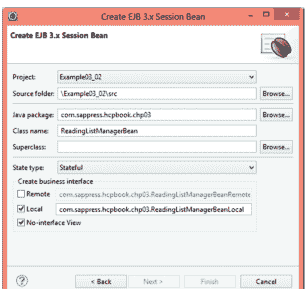

### 图 3.16 在动态 Web 项目中创建 EJB：第 3 部分

- 4. 确认选择后，单击“完成”按钮以创建会话 Bean。

向导完成后，我们可以看到项目中添加了两个新源文件：一个用于会话 Bean 本身，另一个用于本地业务接口。在下一节中，我们将学习如何将业务逻辑添加到这些源文件中。

#### 3.3.2 在 EJB 中实现业务逻辑

要开始开发业务逻辑，我们从本地业务接口入手。此接口将定义公开给 Servlet/JSP 层的业务方法。就我们的读取列表应用程序而言，我们创建了清单 3.3 中所示的四个方法。这些方法将允许用户从读取列表中添加和删除标题、获取读取列表的实时副本，并确定列表中的条目总数。

```
@Local
public interface ReadingListManagerBeanLocal
{
    public void addTitle(String title);
    public boolean removeTitle(String title);
    public int getCount();
    public List<String> getReadingList();
}
```

### 清单 3.3 定义 EJB 的本地业务接口

如清单 3.3 所示，本地业务接口看起来与任何其他 Java 接口几乎一样。唯一的 EJB 相关元素是 @Local 注解，它允许 EJB 容器将该接口标识为本地业务接口。

保存业务接口后，您会注意到会话 Bean 类在 Eclipse 中被标记了一个小红色错误图标。由于我们的会话 Bean 实现了本地业务接口，该错误表明我们的会话 Bean 包含未实现的方法。要修复此问题，只需单击类定义语句左侧边距中的错误图标，并选择“添加未实现的方法”选项，如图 3.17 所示。这将向我们的会话 Bean 添加每个业务方法的空版本。


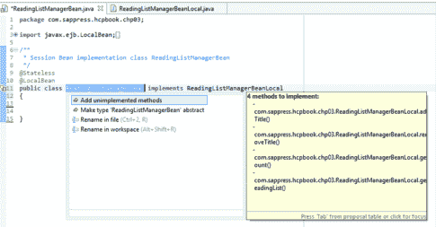

### 图 3.17 向会话 Bean 添加业务方法

就我们这个相当简单的应用程序而言，会话 Bean 本身的实现逻辑非常直接。如清单 3.4 所示，业务方法基本上利用 java.util.List 集合的功能来维护阅读列表。得益于 EJB 3.x 规范的极简设计，这里唯一真正与 EJB 相关的内容是 @Stateful 和 @LocalBean 注解。这些注解为 EJB 容器提供了确定如何部署 Bean（例如，作为有状态 Bean）所需的元数据。

```
@Stateful
@LocalBean
public class ReadingListManagerBean
implements ReadingListManagerBeanLocal
{
    private List<String> readingList = new ArrayList<String>();

    @Override
    public void addTitle(String title)
    {
        readingList.add(title);
    }

    @Override
    public boolean removeTitle(String title)
    {
        return readingList.remove(title);
    }
}

@Override
public int getCount()
{
return readingList.size();
}

@Override
public List<String> getReadingList()
{
return readingList;
}
}
```

### 清单 3.4 在会话 Bean 中实现业务逻辑

#### 3.3.3 将 EJB 集成到 Servlet 和 JSP 中

现在我们已经创建了 EJB，让我们看看如何将其集成到 Servlet/JSP 应用层。首先，我们将重构在第 3.2.2 节中介绍的 ReadingListServlet，以使用我们的有状态会话 Bean。

在正常情况下，我们会使用依赖注入将 EJB 注入到我们的 Servlet 中，如清单 3.5 所示。但是，这种方法不适用于我们的特定用例。这是因为我们需要为每个用户提供一个单独的有状态会话 EJB 实例。这意味着我们需要在用户的会话作用域中创建和存储有状态会话 EJB 实例。

```
import javax.ejb.EJB;
public class ReadingListServlet extends HttpServlet
{
@EJB
ReadingListManagerBeanLocal readingListManager;
protected void doGet(HttpServletRequest request...
...}
```

### 清单 3.5 利用依赖注入访问 EJB 资源

为了处理我们独特的 EJB 访问要求，我们引入了一个名为 getListManager() 的帮助器方法，如清单 3.6 所示。该方法执行以下步骤：

- 1. 首先，它检查用户会话中是否存在有状态会话 Bean 的实例。
- 2. 如果不存在，它会通过 JNDI 查找请求创建一个新实例，并将其存储在用户的会话上下文中。我们稍后将看到查找字符串在哪里配置。
- 3. 最后，将派生的会话 EJB 句柄传回，以便可以用来执行业务操作。

```
private ReadingListManagerBeanLocal getListManager(
    HttpSession session)
{
    // Access/create the reading list manager EJB from the
    // session context:
    ReadingListManagerBeanLocal readingListManager = null;
    readingListManager = (ReadingListManagerBeanLocal)
        session.getAttribute("readingListManager");
    if (readingListManager == null)
    {
        try
        {
            // If the EJB hasn't been created yet, go ahead
            // and create it:
            InitialContext ctx = new InitialContext();
            readingListManager = (ReadingListManagerBeanLocal)
                ctx.lookup("java:comp/env/ejb/ReadingListManager");
            session.setAttribute("readingListManager",
                readingListManager);
        }
        catch (NamingException ne)
        {
            ne.printStackTrace();
        }
    }
    return readingListManager;
}
```

### 清单 3.6 在用户会话中访问和存储会话 EJB 句柄

为了执行 JNDI 查找，我们需要修改 web.xml 部署描述符文件以包含 <ejb-local-ref> 标签，如清单 3.7 所示。在这里，我们通过使用 <ejb-ref-name> 子元素来指定查找字符串。

```
<?xml version="1.0" encoding="UTF-8"?>
<web-app ...>
...
<ejb-local-ref>
    <ejb-ref-name>ejb/ReadingListManager</ejb-ref-name>
    <ejb-ref-type>Session</ejb-ref-type>
    <local>
    <com.sappress.hpbook.ch03.ReadingListManagerBeanLocal>
    </local>
</ejb-local-ref>
</web-app>
```

### 清单 3.7 将 EJB 引用添加到 web.xml 部署描述符

有了基于会话的 Bean 实例查找机制后，Servlet 中 doPost() 表单处理器方法的实现就变得非常直接。如清单 3.8 所示，我们只是使用 getListManager() 方法获取会话 Bean 的引用，然后调用其 addTitle() 业务方法将新标题添加到阅读列表中。

```
protected void doPost(HttpServletRequest request, HttpServletResponse response
 throws ServletException, IOException
{
 // Fetch the EJB List manager:
 ReadingListManagerBeanLocal readingListManager =
 getListManager(request.getSession());

 // Add the selected title to the list:
 String title = request.getParameter("title");
 if (title != null && !title.equals(""))
 readingListManager.addTitle(title);

 // Reroute the user back to the main reading list form:
 ...
}
```

### 清单 3.8 在阅读列表 Servlet 中调用 EJB 业务方法

如果我们需要从 JSP 层访问 EJB，可以直接从用户会话中检索它，如清单 3.9 中包含的脚本片段代码所示。通常，这种访问会由中间 Servlet 控制器类来代理，该类从 EJB 层获取相关数据并将其存储在请求上下文中，以便在 JSP 中读取。但是，在某些罕见情况下，直接访问 EJB 是合理的，所以如果你需要，知道它就在那里是件好事。

```
<%@ page language="java" contentType="text/html; charset=UTF-8"
 pageEncoding="UTF-8"%>
...
<%
try
{
ReadingListManagerBeanLocal readingListManager =
(ReadingListManagerBeanLocal)
request.getSession().getAttribute("readingListManager");
java.util.List<String> readingList = null;
if (readingListManager != null)
readingList = readingListManager.getReadingList();
else
readingList = new java.util.ArrayList<String>();
request.setAttribute("readingList", readingList);
}
catch(Exception ex)
{
out.println("EJB Exception: " + ex.getMessage());
}
%>
...
```

### 清单 3.9 从 JSP 层访问 EJB

你可以在本书的源代码包中找到此应用程序的完整版本，可在 www.sap-press.com/3638 下载。在那里，你会发现我们实现了其他功能，例如 remove，以使应用程序更具交互性。显然，这仍然只是触及了 SAP HCP 支持的核心 Java EE API 可能性的表面，但至少它向你展示了入门所需的内容。在下一节中，我们将了解如何调试和优化 Java Web 应用程序。

### 3.4 调试和优化 Java 应用程序

对于像我们在本章中创建的这样简单的演示应用程序，通常不会出什么大问题。但是，当你开始开发更大的生产质量应用程序时，你无疑会遇到难以定位导致应用程序错误、性能不佳或两者兼有的代码位置的情况。考虑到这一点，在本节中，我们将介绍一些可用于对代码进行根本原因分析的工具。

#### 3.4.1 调试 Java Web 应用程序

由于大多数应用程序错误都是由无意的错误引起的，因此很难确定导致问题的语句或语句。在这种情况下，使用调试器运行应用程序可能会有所帮助，这样你就可以逐行查看代码，看看哪里出了问题。虽然在某些环境中调试 Java Web 应用程序可能是一项挑战，但 SAP HCP 使按需启动调试会话变得容易。

无论你是调试部署在本地 SAP HCP 实例还是基于云的 SAP HCP 实例上的 Web 应用程序，在调试会话中启动 Java Web 应用程序的步骤如下：

- 1. 在启动调试器之前，你首先需要在怀疑可能出问题的代码区域设置断点。这可以在 Eclipse 的普通源代码编辑器窗口中通过双击要停止的代码行旁边的灰色面板来实现（参见图 3.18）。

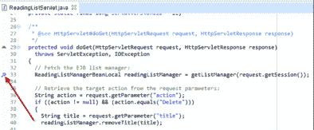

### 图 3.18 在 Java 源代码编辑器中设置断点

- 2. 设置好断点后，通过右键单击项目节点并选择“调试方式 • 在服务器上调试”菜单选项来启动调试器，如图 3.19 所示。这类似于你用于以正常模式部署/启动应用程序的“运行方式”菜单选项。

- 3. 这将启动“在服务器上调试”向导屏幕（图 3.20）。在这里，只需选择你预先存在的服务器（或根据需要创建一个新服务器），然后单击“完成”按钮。


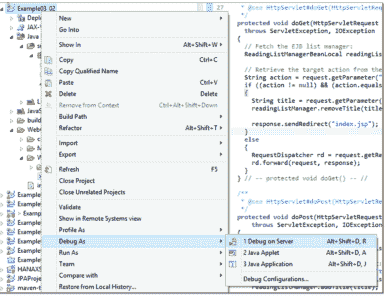

图 3-19 调试 Java Web 应用程序：第 1 部分

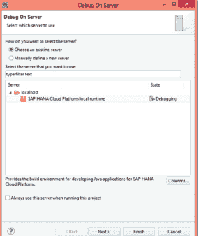

图 3-20 调试 Java Web 应用程序：第 2 部分

4. 如果目标服务器未以调试模式运行（这里应该就是这种情况），您可能会遇到图 3.21 所示的对话框。此提示基本上是在告知您，服务器将以调试模式重新启动。显然，对于本地 SAP HCP 实例来说这无关紧要，但对于其他用户正在进行测试的共享云端实例来说，这可能是一件更大的事，因此请谨慎操作。为了演示目的，请单击“确定”按钮接受模式切换。

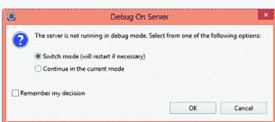

图 3.21 调试 Java Web 应用程序：第 3 部分

5. 服务器以调试模式（重新）启动后，Eclipse 将像往常一样在本地浏览器窗口中启动您的 Web 应用程序。但是，具体取决于您设置断点的位置，应用程序最终将被调试器会话抢占，后者将接管处理控制权。此时，您可能会被提示切换到 Eclipse 调试透视图，如图 3.22 所示。从此，您可以调试应用程序并尝试定位代码中的问题区域。

如图 3.22 所示，DEBUG 透视图被分为多个内容区域。具体取决于您的配置，屏幕上应显示以下视图：

- **调试**：在此视图中，您可以查看运行应用程序线程的当前堆栈跟踪。
- **变量**：此视图可用于浏览您正在调试的代码部分中当前可见的变量内容。
- **断点**：此视图用于管理源代码中当前设置的断点。您还可以根据需要使用此视图创建新的临时断点。

### 代码视图

此修改后的源代码视图允许您根据需要逐行跟踪代码。

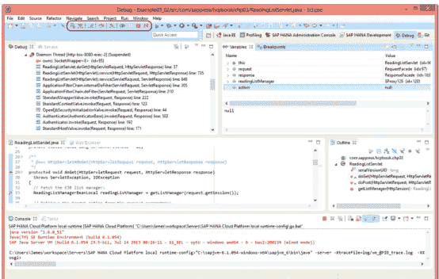

图 3.22 在 Eclipse 中使用调试透视图

在工具栏区域（如图 3.22 中突出显示），提供了许多函数来控制您逐步执行代码的方式（例如，逐行执行、逐过程执行、从方法返回等等）。在大多数情况下，检测层是纯 Eclipse 的，因此所有基本调试规则都适用于此。有关可用函数的更多信息，我们建议您阅读 Eclipse 帮助文档，该文档可以通过在顶级菜单栏中选择“帮助 > 帮助内容”来访问。

#### 3.4.2 分析 Java Web 应用程序

SAP HCP 工具集中另一个有用的工具是 SAP JVM 分析器。此工具用于构建运行中 JVM（它是 SAP HCP 实例的支柱）的分析配置文件，并定位性能瓶颈。在本节中，我们将观察如何使用 SAP JVM 分析器来识别消耗大量内存、I/O 资源等的代码段。

### 使用 SAP JVM 分析器的先决条件

正如名称所示，SAP JVM 分析器构建在 SAP 专有版本的 JVM（称为 SAP JVM）之上。在此，SAP 超出了默认 JVM 规范的要求，为从运行中 JVM 实例收集性能跟踪提供了第一类支持。

尽管 SAP JVM 在基于云的 SAP HCP 实例中默认使用，但从技术上讲，可以使用任何符合规范的 JVM 实现来运行 SAP HCP 本地运行时。但是，如果您计划在本地 SAP HCP 实例上运行 SAP JVM 分析器，则必须配置该实例以使用 SAP JVM。出于此原因（以及其他原因），我们强烈建议您围绕 SAP JVM 进行标准化，以便尽可能保持 SAP HCP 实例的一致性。如果您在最初安装 SAP HCP SDK 时跳过了此步骤，则可以事后使用第 2 章，第 2.3.3 节中描述的步骤重新配置环境。

### 使用 SAP JVM 分析器

与我们在第 3.4.1 节中探索的调试器工具类似，SAP JVM 分析器是一种基于服务器的功能，可以从 Eclipse IDE 中的“服务器”视图进行控制。如图 3.23 所示，我们可以通过右键单击服务器节点并选择相应的菜单选项（例如，以分析模式重新启动）来控制 SAP JVM 分析器。再次提醒，在分析共享 SAP HCP 实例时，您需要小心不要打扰其他用户。

一旦服务器节点以分析模式（重新）启动，我们就可以通过在 Eclipse 中打开分析透视图来启动 SAP JVM 分析器。默认情况下，此透视图将显示图 3.24 中所示的 VM 资源管理器视图。从此，我们可以通过双击 VM 资源管理器表中的记录来深入运行中的分析。

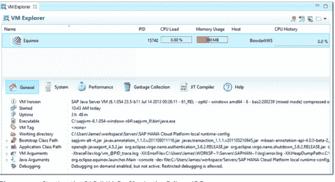

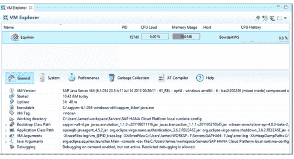

这将显示图 3.25 中所示的分析器仪表板。在此仪表板中，您可以通过单击“可用分析”面板（图 3.25）中的链接来打开各种类型的跟踪。例如，如果您想跟踪代码中运行时间较长的方法，则可以通过单击相应的“性能热点分析”链接来激活性能热点分析。

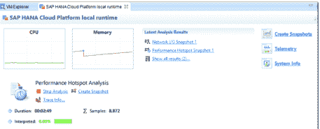

图 3.25 启动分析会话

一旦分析开始，仪表板将调整为包含运行中的分析信息以及停止分析、定期快照等控件。在运行期间，您可以切换到浏览器并运行各种应用程序场景，以便在分析中捕获运行缓慢的进程。完成后，您可以返回分析视图并单击“停止分析”链接来停止分析（参见图 3.26）。最后，分析器收集结果后，您应该会在“最新分析结果”面板（图 3.26）中看到一个新的分析结果链接出现。


图 3.26 在分析透视图中监控分析

具体取决于您创建的分析类型，分析结果视图自然会略有不同。例如，在图 3.27 中，您可以查看我们创建的性能热点分析会话的分析概览。在此，各种统计措施被组织成类别，使您轻松找到所需内容。


图 3.27 评估分析结果：第 1 部分

随着您深入挖掘，您可以查看数据的各种汇总，例如图 3.28 中所示的方法运行时间汇总。在此，提供了根据需要对数据进行排序、分组和筛选的功能。您还可以将结果导出到 Microsoft Excel 和其他桌面文件类型。


图 3.28 评估分析结果：第 2 部分

### 3.5 后续步骤

希望，本节对 Java 应用程序开发的简要介绍能帮助您了解基于 Java 的 Web 应用程序在 SAP HCP 上是如何构建的。尽管我们将在后续章节中扩展其中的许多概念，但我们的处理将更加集中于特定感兴趣的主题（例如，持久性或云服务的使用）。因此，如果您是 Java 新手或需要进一步的资源来帮助您入门，以下是一些推荐的书目供您参考：

- Java 入门：
  - Java 编程语言，第 4 版（Arnold, Gosling, Holmes, Addison-Wesley, 2005）
  - Java 编程思想，第 4 版（Eckel, Prentice Hall, 2006）
- Servlets 和 JSP
  - Java Servlet 编程，第 2 版（Hunter, Crawford, O'Reilly, 2010）
  - JavaServer Pages，第 3 版（Bergsten, O'Reilly, 2009）
- Enterprise JavaBeans
  - Enterprise JavaBeans 3.1（Rubinger, Burke, O'Reilly, 2010）

除了标准 Java SE 和 EE API 之外，我们还鼓励您探索各种旨在简化 Java 应用程序开发的开源框架，例如 Spring MVC。您通常可以在网上找到与这些框架相关的优秀资源。

最后，在进行应用程序开发时，还值得考虑的另一个宝贵资源是 SAP HCP SDK 中包含的各种示例应用程序。在那里，您会发现许多有用的示例，可用作执行常见开发任务的模板。

### 3.6 总结

在本章中，您学习了在 SAP HCP 上进行 Java 应用程序开发的一些基础知识。总体而言，本章获得的技能将作为我们在书中逐步深入时，处理更高级主题的基础。总的来说，我们认为您会发现，所有 SAP HCP 应用程序，无论


其复杂性，源于同样的卑微起点。从这里开始，随着你学习如何使用云服务并执行更复杂的任务，我们将不断添加层次。

在下一章中，我们将通过展示如何在 SAP HCP 上部署 Java 应用程序来将这场演出带到现场。在此过程中，我们将探讨在开发实际 SAP HCP 应用程序时应牢记的关键软件物流概念。

为了开发生产级 SAP HCP 应用程序，我们需要建立必要的工具和流程来管理从开始到结束的软件开发生命周期。在本章中，我们将探讨可用于管理和部署基于 Java 的 SAP HCP 应用程序的一些工具和流程。

## 4 管理和部署 Java 应用程序

在上一章中，我们观察到 SAP HCP 工具如何使在 Eclipse IDE 内开发、部署和测试基于 Java 的 Web 应用程序变得轻松。在开发的早期阶段，这些工具为我们提供了完成工作所需的一切。然而，随着我们在软件开发生命周期中稍微深入一步，事情变得复杂得多。

考虑到这一点，本章将探讨如何为 SAP HCP 开发构建软件物流基础设施。尽管本章的重点主要放在基于 Java 的开发上，但介绍的许多概念和工具也适用于其他类型 SAP HCP 应用程序的开发（例如，HTML5 应用程序）。事实上，无论您使用何种语言开发 SAP HCP 应用程序，都会发现 SAP 已提供了一个开放环境，使您能够利用市场上几乎任何可用的物流工具。这使组织能够轻松地根据企业标准和最佳实践定制您的 SAP HCP 开发。

### 4.1 概述

说实话：软件物流是软件工程领域中较为枯燥的话题之一。对许多开发人员来说，仅仅提到这个主题就会让人联想到一堆繁文缛节、乏味的工作，以及开发经理发来的试图让所有人遵守纪律的令人不快的电子邮件。尽管如此，尽管名声不佳，软件物流绝非可以轻视之事。毕竟，如果没有适当的方法和程序，我们可能会无意中导致应用程序中断、数据损坏或其他各种可能给组织带来巨大损失的错误。

即使您有幸成为 SAP HCP 宇宙中自己小天地的主人，跟踪随时间积累的所有源代码文件也并非易事。对于在大型组织中工作的开发人员来说，这一问题因开发任务通常分布在全球各地的开发人员之间而变得更加复杂。在此，开发人员拥有某种集中式存储库来跟踪团队成员之间创建和共享的各种工件至关重要。我们将在第 4.3 节中探讨创建此类存储库的一些选项。

除了跟踪源代码之外，还有几个同样重要的物流问题需要我们考虑：应用程序构建、传输和长期支持。为了将这些问题放在合适的角度来看待，请考虑图 4.1 中描绘的软件开发生命周期图。在这个（简化的）图中，我们可以观察软件开发过程的高级阶段。


在迄今为止考虑的简单示例中，我们的重点主要放在初始开发阶段。如图 4.1 所示，生命周期中的下一个主要阶段是集成/测试阶段。在此阶段，目标是将我们的源代码集成到可部署的应用程序中（例如，作为 WAR 文件），并将其安装在测试环境中，以便最终用户/测试人员可以运行更复杂的测试场景。此任务的复杂性取决于多个因素：

- **系统景观差异**
  
  各个组织可能会以不同方式配置其 SAP HCP 系统景观。有些组织可能拥有专用的整合/测试实例，而其他组织可能更倾向于使用本地实例和/或试用版系统景观实例来运行测试。

- **应用程序复杂性**
  
  对于简单的基于 Java 的 Web 应用程序，我们已经看到在 Eclipse IDE 内创建 WAR 文件是多么容易。另一方面，大型多模块应用程序的构建和部署可能要困难得多。在此，通常需要多个步骤才能完成构建。

- **环境差异**
  
  根据上述系统景观差异，我们可能还需要考虑环境差异。例如，如第 6 章中将学到的，使用本地实例与远程云实例时，使用 SAP HCP 服务所需的设置可能大不相同。

尽管我们无法避免此类复杂性，但有一些工具可以自动化并简化此过程。我们将在第 4.4 节中探讨此领域中几种工具的使用。

集成/测试阶段完成后，我们就可以进入部署阶段，在此阶段我们将应用程序部署到生产 SAP HCP 实例。在第 4.2 节中，我们将了解 SAP HCP 工具如何使执行此任务变得相当容易。然而，与集成/测试阶段类似，此步骤可能会因环境差异等因素而变得复杂。

或许更具挑战性的是，许多组织实行的典型“分工”要求，该要求阻止开发人员部署自己的应用程序。从物流角度来看，这可能具有挑战性，因为大多数管理员不习惯进入 Eclipse IDE 来组装或部署代码。出于此原因（以及其他原因），通常使用提供自动化和持续集成的工具是有意义的。我们将分别在第 4.4 节和第 4.5 节中更详细地考虑这些概念。

### 4.2 部署 Java 应用程序

为了了解软件物流在 SAP HCP 景观中的工作原理，最好从最终目标开始：应用程序部署。然后，一旦您了解应用程序如何部署，您就会更清楚剩余的物流环节如何就位。

在本节中，我们将学习部署基于 Java 的 Web 应用程序的各种技术。在此，我们将区分本地部署和部署到远程 SAP HCP 云实例。在此过程中，我们将探讨监控部署的方法以及实现应用程序日志记录或跟踪的技术，以便您可以查看幕后发生的情况。

#### 4.2.1 使用 Eclipse IDE 进行部署

如我们在第 3 章中（简要）观察到的，从 Eclipse IDE 内部署基于 Java 的 Web 应用程序非常容易。此过程由 Eclipse Web Tools Platform (WTP) 提供的内置服务器管理功能简化。其中，Eclipse WTP 包含用于与各种 Java EE 兼容的应用程序服务器（Apache Tomcat、JBoss 等）进行开箱即用服务器集成的扩展。安装 SAP HCP Tools 插件后，此服务器列表将扩展到包括 SAP HCP 服务器类型。

在本节中，我们将学习如何配置 SAP HCP 服务器节点，以及如何使用这些服务器节点通过 Eclipse WTP 部署应用程序。

#### 创建服务器节点

您可以通过打开 SERVERS 视图（在图 4.2 中突出显示）来查看 Eclipse IDE 中配置的服务器列表。如果此视图在您的 IDE 配置中不可见，您可以通过菜单选项 WINDOW • SHOW VIEW • OTHER... 访问它。然后，在 Show View 弹出窗口中，展开 Server 节点，选择 Servers 视图，然后单击 OK 按钮。


如图 4.2 所示，SERVERS 视图工具栏包含许多有用功能，可用于启动或停止服务器实例、开启调试模式等等。这些相同的功能也可以从给定服务器节点的上下文菜单中访问，如图 4.3 所示。在此上下文菜单中，您还会找到一系列与部署相关的功能，这些功能可让您直接在控制台内轻松部署或取消部署应用程序。


图 4.2 在 Eclipse IDE 中访问 Servers 视图


图 4.3 在 Servers 视图中访问服务器功能

与 Eclipse 中的大多数事物一样，服务器节点可以通过几种不同的方式创建。在 SERVERS 视图本身中，您可以通过在视图空白处右键单击并选择“新建 > 服务器”上下文菜单选项来创建新服务器节点，如图 4.4 所示。


图 4.4 在 Servers 视图中创建新服务器节点：第 1 部分

这将打开图 4.5 所示的“新建服务器”对话框窗口。从此处，您可以展开 SAP 文件夹以找到配置的 SAP 服务器类型。如图 4.5 所示，您可以从以下不同的 SAP HCP 服务器类型中进行选择：

- **JAVA EE 6 Web 配置文件服务器**
  此服务器类型指向基于 Java EE 6 Web 配置文件的本地运行时环境。请注意，仅在下载并安装了相应的 SAP HCP SDK 时，此服务器类型才可用。

- **JAVA Web 服务器**
  此服务器类型指向基于 Java Web 服务器配置文件的本地运行时环境。请注意，仅在下载并安装了相应的 SAP HCP SDK 时，此服务器类型才可用。

- **JAVA Web Tomcat 7 服务器**
  此服务器类型指向基于 Java Web Tomcat 7 配置文件的本地运行时环境。请注意，仅在下载并安装了相应的 SAP HCP SDK 时，此服务器类型才可用。

## SAP HANA 云平台

此服务器类型指向基于云的 SAP HCP 服务器实例。在此处，您可以配置对客户或合作伙伴帐户实例以及试用帐户实例的访问。


图 4.5 在 Servers 视图中创建新服务器节点：第 2 部分

如图 4.5 所示，在基于本地运行时配置文件之一定义服务器节点时，需要配置的内容不多。只需提供服务器主机名（通常为默认 localhost）、服务器名称以及目标服务器运行时环境即可。

另一方面，基于云的服务器节点需要多做一些工作。在此处，我们并非真正创建服务器实例，而是创建与特定云实例的连接。要指定哪个云实例，我们必须在“LANDSCAPE Host”字段中输入目标服务器 URL。如图 4.6 所示，Eclipse 已方便地为我们填入了试用环境的 URL。您可以在图 4.7 所示的 Eclipse 首选项窗口中配置此处弹出的默认 URL。


图 4.6 定义基于云的服务器节点：第 1 部分

创建服务器节点的另一种替代方法是将其作为 Eclipse 运行配置的一部分来创建，就像我们在第 3 章中创建第一个基于 Java 的 Web 应用程序时所演示的那样。要回忆此过程，这是通过右键单击项目节点或可执行应用程序工件（例如，Servlet 或 JSP）并选择“运行方式 • 在服务器上运行”菜单选项来实现的，如图 4.8 所示。


图 4.7 定义基于云的服务器节点：第 2 部分


图 4.8 通过运行配置创建服务器节点：第 1 部分

从此处，您将看到图 4.9 所示的“在服务器上运行”对话框。在此屏幕中，您可以配置 SAP HCP 服务器节点实例，就像您直接从 Servers 视图中创建它一样。


图 4.9 通过运行配置创建服务器节点：第 2 部分

我们将把“在服务器上运行”向导中接下来发生的情况的详细描述推迟到“将应用程序部署到服务器节点”部分，在该部分中我们将探讨如何将应用程序部署到服务器节点。出于本讨论的目的，我们只是想向您展示如何创建服务器节点。无论您决定在 Servers 视图中创建服务器节点，还是在“在服务器上运行”向导中临时创建，这纯粹是个人偏好的问题。两种选项都能让您达到相同的目的。从此处，部署轻而易举。

## 将应用程序部署到服务器节点

配置服务器节点后，我们可以利用标准 Eclipse WTP 功能来促进部署。再次，我们有几种方法来执行此任务。

在交互式开发和测试应用程序时，您可能更喜欢使用上述的“在服务器上运行”向导以临时方式部署应用程序。可以通过执行以下步骤启动此向导：

- 1. 右键单击要部署的项目的顶级项目节点，或右键单击其中包含的可执行应用程序工件（例如，Servlet 或 JSP）。
- 2. 在弹出的上下文菜单中，选择“运行方式 • 在服务器上运行”菜单选项（图 4.8）。
- 3. 这将打开图 4.10 所示的“在服务器上运行”对话框。从此处，您可以选择定义新服务器节点（如前一节所述）或选择现有节点。选择适当的选项，然后单击 Next > 按钮继续。


图 4.10 从 Eclipse IDE 内部部署：第 1 部分

- 4. 如果所选服务器节点指向基于云的 SAP HCP 实例，则下一步将要求您为要部署的应用程序指定名称。如图 4.11 所示，此步骤还要求您指定部署期间用于连接到实例的帐户凭据。单击 NEXT >> 按钮继续。


图 4.11 从 Eclipse IDE 内部部署：第 2 部分

- 5. 在下一步中，选择要添加到服务器或从服务器移除的项目资源（参见图 4.12）。
- 6. 设置好资源后，您可以通过单击 Finish 按钮触发部署。此时，Eclipse WTP 插件将启动并与 SAP HCP 工具协同工作，与目标服务器节点通信并执行部署。如果部署顺利，您应该会看到 Web 应用程序加载到内部 Eclipse 浏览器中。我们将在第 4.2.3 节中探讨部署失败时应采取的措施。


图 4.12 从 Eclipse IDE 内部部署：第 3 部分

触发部署的另一个位置是在上述的 Servers 视图中。在此处，部署步骤如下：

- 1. 在 Servers 视图中，选择目标服务器节点，右键单击，然后选择“添加和移除...”菜单选项（参见图 4.13）。
- 2. 这将打开图 4.14 所示的“添加和移除...”对话框。如果此屏幕看起来很熟悉，那是因为它几乎与图 4.12 所示的“在服务器上运行”向导中的“添加和移除”步骤完全相同。在此屏幕中，我们可以通过提供的 ADD > 和 < REMOVE 按钮来暂存应用程序的添加或移除。单击 Finish 按钮以启动部署。


图 4.13 从 Servers 视图内部触发部署：第 1 部分


图 4.14 从 Servers 视图内部触发部署：第 2 部分

## 与服务器同步更改

应用程序初始部署后，Eclipse WTP 工具集将跟踪对项目所做的更改，并记录哪些应用程序需要


已重新部署。您可以在图 4.15 的 SERVERS 视图中看到此高亮显示。例如，您可以看到项目 EXAMPLE04_01 已标记为脏，需要重新部署（或重新发布）。


图 4.15 将更改发布到应用程序：第 1 部分

要从此视图重新发布应用程序，请右键单击目标服务器节点并选择“发布”菜单选项。这将在后台重新触发部署，并在完成时更新 SERVERS 视图中服务器和应用程序的状态。您可以想象，在早期的代码-部署-测试-重复开发阶段，此功能非常实用。

#### 4.2.2 使用控制台客户端进行部署

在上一节中，我们了解了从 Eclipse IDE 内部部署应用程序是多么容易。但是，通过 Eclipse 进行部署有时可能不可取，甚至不可行。此类情况的示例包括：

- 向受控环境部署

- 向生产实例甚至受控 QA 实例部署时，许多组织都会制定政策，以确保部署由管理员而非开发人员执行。虽然此类管理员当然可以安装 Eclipse IDE 和相应的 SAP HCP 工具来执行此类部署，但大多数管理员更愿意使用外部部署工具。这对于不熟悉 Eclipse 和 Java 开发的管理员尤其如此。

- 系统复制或构建

- 对于更复杂的环境，可能会出现需要作为系统复制或构建的一部分批量部署代码的情况。在这些情况下，部署自动化至关重要。

### 与外部构建工具集成

对于使用标准构建工具（例如 Apache Maven）的组织来说，将部署步骤纳入这些工具非常重要。

出于这些原因（以及许多其他原因），SAP 提供了一个名为控制台客户端的命令行工具，可用于执行管理任务，例如从命令行进行部署。在本节中，我们将了解如何使用此工具来促进部署。

### 开始使用控制台客户端

在开始了解如何使用控制台客户端来促进部署之前，我们先花点时间了解它是什么，以及从管理角度来看它能提供什么。简而言之，控制台客户端是一个可执行文件，它会启动一个命令提示符，我们可以在其中发出各种命令以与 SAP HCP 服务器实例进行交互。在这方面，它的作用与 MS Windows 中的命令（DOS）提示符或 Unix、Linux 或 Mac OS 系统中的终端相同。

在大多数情况下，控制台客户端是 Eclipse IDE 和在线 SAP HCP 驾驶舱中提供的基于 UI 的工具的命令行等价物。也就是说，它提供了用于执行大多数基本管理任务的命令，例如启动和停止服务器实例、维护帐户、触发部署等。除了方便偏好通过命令提示符工作的管理员之外，此功能还通过 shell 脚本等方式为自动化打开了各种机会。

要访问控制台客户端，请打开命令提示符并导航到 SAP HCP SDK 安装文件夹的 roots 子目录。在此目录中，您会找到名为 neo.bat（Windows）或 neo.sh 的可执行文件。从此处，您可以通过清单 4.1 所示的语法启动命令。

```
$ neo <Command name> <mandatory parameters> [optional parameters]
```

清单 4.1 在控制台客户端内执行命令的语法

> 注意
> 或者，您可以将控制台客户端可执行文件添加到操作系统的路径变量中，以便从任何位置启动客户端。

例如，如果我们想了解 SAP HCP 云实例上应用程序的状态，则可以发出 status 命令，如清单 4.2 所示。

```
$ neo status --account p1234567 --application example0401 --host hanatrial.ondemand.com --user abc@123.com
```

清单 4.2 示例命令测试

您可以想象，如果在控制台客户端中花费大量时间，则输入发出特定命令所需的所有参数可能会变得非常乏味。认识到这一点，SAP 允许您将反复使用的一些参数（即用户名、帐户名和环境主机）外部化到 .properties 文件中。这样，您无需为每个命令输入这些属性，只需使用类似清单 4.3 所示的语法发出命令即可。

```
$ neo <command name> [properties] <properties file location>
```

清单 4.3 使用属性文件简化命令

如果您有兴趣了解控制台客户端提供的各种命令的更多信息，我们强烈建议您查看在线 SAP HANA Cloud 文档中可用的“控制台客户端 • 控制台客户端命令”部分，网址为 http://help.hana.ondemand.com。在那里，您将找到受支持命令及其调用语法的完整列表。还有一个指向视频教程的链接，演示了如何与客户端进行交互。

### 触发本地部署

使用控制台客户端向本地 SAP HCP 实例触发部署通常是一个三步过程：

- 1. 使用 install-local 命令在 `<SDK installation folder>/server` 目录中对本地服务器实例执行一次性安装。
- 2. 为要部署的应用程序生成 WAR 文件。
- 3. 使用 deploy-local 命令热部署目标 WAR 文件。

严格来说，本地部署过程的第一步是可选的。在内部，控制台客户端假设它控制的本地服务器实例位于 `<SDK INSTALLATION FOLDER>/SERVER` 目录中。如果您更愿意将服务器安装在其他位置，或者宁愿使用 Eclipse IDE 中定义的相同默认本地服务器实例，则可以使用 `--location` 参数指定服务器的主目录。更好的做法是，您可以使用 .properties 文件预先指定此设置，从而节省一些冗余的按键操作。

一旦确定要部署到哪个本地服务器实例，下一步就是获取与要部署的应用程序对应的 WAR 文件。在 Eclipse IDE 中，可以通过右键单击 Web 项目的根节点并选择“导出 • WAR 文件”菜单选项来实现此操作，如图 4.16 所示。


图 4.16 在 Eclipse IDE 中创建 WAR 文件：第 1 部分

这将打开“导出”对话框（图 4.17）。在此处，您只需提供生成的 WAR 文件的目录和文件名，然后单击“完成”。如果您仔细查看图 4.17，还会注意到有一个选项可针对 SAP HANA Java Cloud 服务器运行时优化存档。除非您有非常充分的理由不这样做，否则通常最好保留此默认设置。

要启动部署过程，请打开命令提示符并导航到 `<SDK installation folder>/tools` 目录。然后，如果尚未启动，您将需要使用 `start-local` 命令启动本地服务器实例，其语法如清单 4.4 所示。

```
neo start-local [--location <target server directory>]
```

清单 4.4. 通过控制台客户端启动本地服务器实例


图 4.17 在 Eclipse IDE 中创建 WAR 文件：第 2 部分

服务器启动并运行后，您可以使用 deploy:local 命令触发部署，其语法如清单 4.5 所示。如果一切顺利，控制台客户端将返回一条消息，指示应用程序已成功部署。从此处，您可以通过在 Web 浏览器中打开应用程序来测试结果。除非您在服务器安装过程中明确更改了端口配置，否则 URL 将采用 http://localhost:8080/path/to/your/application 的形式。

```
neo deploy:local --source c:/users/james/desktop/example04_01.war
--location <target server directory>
```

清单 4.5 通过控制台客户端触发本地部署

### 触发远程部署

在很大程度上，使用控制台客户端部署到云的过程与执行本地部署所用的过程非常相似。在此，我们收集上一节所示的 WAR 文件，然后使用 deploy 命令触发部署。此命令的语法如清单 4.6 所示。

```
neo deploy --host <landscape_host> --account <account_name>
--application <application_name>
--source <path_to_war_file>
--user <email_or_user>
```

清单 4.6 调用 deploy 命令的语法


图 4.18 展示了此过程在命令提示符下的运行情况。此处，我们将名为 EXAMPLE0401 的应用程序部署到托管于 hanatrial.ondemand.com 的试用账户中。与所有 Console Client 命令的情况一样，我们本可以将这些参数外部化到属性文件中。但是，出于演示目的，我们认为在屏幕上查看输入的参数会更有帮助。


图 4.18 通过 Console Client 触发远程部署

如图 4.18 所示，一旦发出 deploy 命令，Console Client 将要求输入用于促进部署的用户账户密码。假设凭据匹配，部署过程将随之启动，如果一切顺利，您将看到“Deployment FINISHED SUCCESSFULLY”消息，这表明部署已完成。接下来，我们将探讨如果部署未按计划进行时可以采取的步骤。

#### 4.2.3 监控部署

偶尔，部署过程可能会失败，让您困惑问题出在哪里。此处，Eclipse IDE 和 Console Client 通常只会提供一个通用的“your deployment failed”消息，而不会提供更多信息。接下来，就需要您自行深入排查，找出幕后出了什么问题。在本节中，我们将探讨一些排查此类问题的实际步骤。

### 排查本地部署错误

每当本地部署失败时，首先要查看的位置是 <SERVER_DIRECTORY>/logs 文件夹。此处，您会找到一个名为 jls_trace.log 的文件，其中包含服务器在部署过程中生成的详细跟踪消息。自然，跟踪消息的性质将因发生的错误类型而异。不过，如图 4.19 所示，通常有相当多的信息可供使用：信息消息、堆栈跟踪等等。


图 4.19 在 jls_trace.log 文件中调查部署错误

通常，您可以将异常消息的根源粘贴到您喜欢的搜索引擎中，找到许多解释问题性质和适当补救措施的讨论帖。此处，由于 SAP HCP 本地运行时基于与 Apache Tomcat 和 Eclipse Equinox/Virgo 相同的代码库，您有幸将搜索范围扩展到包括非 SAP 特定的网站和消息讨论帖。

如果错误条件的性质不太明显，那么下一个选择是删除应用程序，将其精简，然后开始逐步重新组装各个部分，直到您能够定位错误。可以通过执行以下步骤来实现：

- 1. 如果服务器未崩溃，则需要将其停止。可以通过使用 Eclipse 中 Servers 视图的工具栏功能或 Console Client 的 `stop -local` 命令来实现。
- 2. 服务器停止后，您需要打开服务器安装目录并导航到 webapps 文件夹。从此处，找到应用程序的归档文件夹并将其删除。
- 3. 接下来，您需要复制有故障的应用程序，并开始移除应用程序副本中您认为可能导致错误的任何元素。
- 4. 应用程序副本准备就绪后，您可以重新启动服务器并部署精简版的应用程序。如果部署成功，则可以以战略方式逐步替换之前移除的元素，并重新尝试部署。
- 5. 最后，经过几次这样的迭代后，您应该能够定位有故障的元素并将其移除。如果运气好，也许应用程序就能正常工作，也许一开始错误条件只是个异常；怪事也有发生过。

### 排查云部署错误

为了排查云部署错误，您必须打开 SAP HCP Cockpit 并找到应用程序日志。可以通过执行以下步骤来实现：

- 1. 从 SAP HCP Cockpit 登录页面，在 Content 面板中选择 JAVA APPLICATIONS 链接。
- 2. 在 Details 面板中，单击 NAME 列中目标应用程序的链接。
- 3. 这将导致 Details 面板被替换为类似图 4.20 所示的应用程序详细信息屏幕。从此处，您可以通过向下滚动到 MOST RECENT LOGGING 面板来找到应用程序的日志文件，该面板包含应用程序日志文件列表。


图 4.20 访问 Java 应用程序的默认跟踪文件

- 4. 可能出现的任何部署问题都将记录在默认跟踪日志文件中（图 4.20 中由箭头指示）。您可以通过 Actions 列中包含的操作链接访问此日志。在此，您可以选择在线查看日志文件或将其下载到本地计算机。出于演示目的，请考虑前者选项。
- 5. 当您单击 Show 链接时，日志文件将在浏览器的单独窗口或选项卡中显示，如图 4.21 所示。在此，您可以滚动查看每个日志条目，执行基于条件的搜索，等等。
- 6. 一旦找到描述错误条件的日志条目，您可以在线研究该错误条件，并像前一节中描述的那样迭代尝试重构代码。如果部署错误被证明是严重的，您可以使用 Java Application Dashboard 中 STATE 面板内的功能来停止或删除应用程序。在纠正问题后，您可以重新部署应用程序并再次尝试。


图 4.21 在 SAP HCP Cockpit 中查看默认跟踪文件

#### 4.2.4 日志记录和跟踪概念

有时，应用程序可能会部署，但可能存在阻止其实际启动的资源相关问题。在这些情况下，能够写出一系列提供问题线索的跟踪消息会很有用。事实证明，SAP HCP 使 Java 应用程序的日志记录和跟踪变得轻而易举。在本节中，我们将探讨实现此目标所需的内容。

### 开始使用 Java Simple Logging Façade API

SAP HCP Java 应用程序的简化日志记录和跟踪访问是通过 Java Simple Logging Façade (SLF4J) 提供的，顾名思义，它是建立在多个基于 Java 的日志记录框架（如 log4j、java.util.logging 包等）之上的门面或抽象层。Java 应用程序可以访问 SLF4J API，而无需添加专用引用或将第三方 JAR 文件复制到 WEB-INF/lib 文件夹中。

清单 4.7 中包含的代码片段演示了如何使用 org.slf4j.LoggerFactory 工厂类获取日志记录器句柄。请注意，我们在 Java 中使用 static 修饰符定义了此句柄，以减少资源消耗。遗憾的是，在实例级别定义日志记录器句柄并没有真正的优势。

```
import org.slf4j.Logger; import org.slf4j.LoggerFactory;
public class EnvReadServlet extends HttpServlet
{
    // Create a Logger instance:
    private static Logger getLogger =
    LoggerFactory.getLogger(EnvReadServlet.class);
    ...
}
```

### 清单 4.7 使用 SLF4J 获取日志记录器引用

一旦定义了 org.slf4j.Logger 实例，我们就可以使用它通过表 4.1 中描述的各种输出方法创建日志和跟踪消息。请注意，所述的每个方法都有多个重载，允许您使用不同类型的参数调用它们。例如，您可以使用字符串、java.lang.Throwable 等调用 error() 方法。您可以在 SLF4J 在线帮助文档中找到支持的方法及其签名的完整列表，该文档可在 www.slf4j.org 上在线查阅。

| 方法名称 | 描述 |
|---|---|
| debug() | 此方法用于输出有助于调试逻辑错误等的消息。 |
| error() | 此方法用于输出可能发生的任何类型的错误消息，包括异常。 |
| info() | 此方法用于根据需要输出信息消息。 |
| trace() | 此方法用于输出跟踪消息，这些消息有助于确定代码序列、跟踪程序逻辑等。 |
| warn() | 此方法用于输出警告消息。 |

### 表 4.1 org.slf4j.Logger 接口的输出方法

清单 4.8 中包含的代码片段演示了这些方法在代码中的使用方式。此处，我们使用 debug() 方法来跟踪 Servlet 生命周期


和 `info()` 方法用于输出服务器环境变量（例如，服务器主机）。
如你所见，这里的内容基本上可以是我们想要的任何东西。
当然，最好不要过度，因为如果我们不小心，与 I/O 相关的性能问题可能会开始出现。

```
public class EnvReadServlet extends HttpServlet
{
    // Create a logger instance:
    private static Logger logger =
    LoggerFactory.getLogger(EnvReadServlet.class);

    @Override
    public void init() throws ServletException
    {
        logger.debug("Servlet EnvReadServlet has been initialized.");
    }

    protected void doGet(HttpServletRequest request,
    HttpServletResponse response)
    throws ServletException, IOException
    {
        response.setContentType("text/plain");

        response.getWriter().println(
        "Server Environment Variables:\n\n");

        Map<String, String> envVarMap = System.getenv();
        for (String key : envVarMap.keySet())
        {
            String msg =
            "Variable [" + key + "]: " + envVarMap.get(key);
            response.getWriter().println(msg);
            logger.info(msg);
        }
    }

    public void destroy()
    {
        logger.debug("Servlet EnvReadServlet is being destroyed.");
    }
}
```

清单 4.8 通过 SLF4J 记录日志和跟踪消息

## 访问和配置日志文件

诸如清单 4.8 中所示的日志和跟踪消息，可以通过第 4.2.3 节描述的相同默认跟踪文件查看。不过，这里有一点需要注意。默认情况下，特定记录器的有效日志级别默认为 ERROR。这意味着，除非我们相应地配置有效日志级别，否则具有较低有效日志级别（例如，INFO 或 DEBUG）的日志消息不会显示。

这是什么意思？在默认 ERROR 日志级别的情况下，只有具有 ERROR 级别严重性的消息才会添加到日志中。如果我们将日志级别更改为 WARN，那么警告消息和错误消息都会显示。如果我们将日志级别再调高一级到 INFO，那么除了警告和错误消息外，我们还会看到信息消息。如果我们只想查看所有消息，无论严重性如何，则可以将有效级别设置为 ALL。

具有这种可配置性的价值在于，我们可以根据需要动态调整日志级别。例如，在生产环境中，我们可能会将日志级别设置为 ERROR，以免产生写入跟踪或调试消息等的所有开销。但是，如果我们被分配了一个特别复杂的缺陷，我们可能会暂时调高日志级别以排查问题。如你所想象，这是一个非常好的功能，因为它使我们能够在不触及源代码的情况下，快速获取有关应用程序错误的更多信息。

## 性能提示

从性能角度来看，我们应该指出，调用日志方法会带来一些最小开销，即使在有效日志级别过滤掉日志中消息的情况下也是如此。你可以通过使用 org.slf4j.Logger 接口的各种 isLogging-Level-Enabled() 布尔方法来消除这种开销。典型用法如下：

```
if (logger.isDebugEnabled()) {
	logger.debug("Debugging message...");
}
```

由于许多开发人员已经觉得日志语句会使代码变得杂乱，因此是否要为每条日志消息都加上 if 语句，取决于你。有关更多详细信息和其他有用的性能提示，请查看 SLF4J 常见问题解答页面，可在线访问 www.slf4j.org/faq.html#Logging_performance。

从配置角度来看，有几个地方可以调整应用程序的有效日志级别：

- 在 Eclipse IDE 中，你可以通过在 Servers 视图中双击目标服务器，然后导航到 Loggers 选项卡来配置记录器，如图 4.22 所示。请注意，此配置面板适用于本地服务器实例和基于云的实例；两种情况的过程相同。


图 4.22 在 Eclipse IDE 中配置记录器

在 Loggers 表中，你可以搜索或滚动列表以找到要配置的目标记录器实例。找到要查找的记录器后，你可以使用 LEVEL 列中的下拉列表来指定记录器的有效级别。如图 4.22 所示，你可以在类级别或包级别配置记录器的有效级别。包级别配置的优势在于，设置会自动向下传播到较低级别的包和类。另一方面，如果你需要精确配置，则可以选择仅配置类本身或子包。

- 对于部署在云中的应用程序，你还可以在 SAP HCP Cockpit 中配置记录器的有效级别。要访问此配置选项，只需打开应用程序的 Java 应用程序仪表板，然后单击图 4.23 所示的 Configure Loggers... 链接。这将打开图 4.24 所示的对话框。


图 4.23 在 SAP HCP Cockpit 中配置日志记录：第 1 部分

- 如你所见，此 UI 与 Eclipse IDE 的 UI 几乎相同，可以以完全相同的方式用于配置应用程序或包的有效日志级别。

- 配置日志级别的第三个选项是使用 Console Client 的 set-log-level 命令。有关此选项的更多详细信息，请查看可在线访问的在线帮助文档 http://help.hana.ondemand.com。


图 4.24 在 SAP HCP Cockpit 中配置日志记录：第 2 部分

### 4.3 源代码管理

SAP HCP 非常出色的一点在于其开放性。从使用行业标准库和 API 到开放的 Eclipse 平台，开发人员基本上可以自由使用任何可用工具来构建基于云的应用程序。这种开放性也延伸到源代码管理（SCM）工具的选择。在这里，开发团队可以自由使用市场上几乎任何 SCM 工具：Git、Subversion、Perforce 以及更多。

虽然这对开发团队来说是个好消息，但也使得编写这样的书变得困难得多。事实上，即使我们想，也无法合理地涵盖所有可能用于管理 SAP HCP 应用程序源代码的 SCM 工具。话虽如此，本节的方法是使用该领域中较突出的 SCM 工具之一：Git 来演示源代码管理概念。此选择绝非旨在规定性。相反，我们只是想在演示如何从 Eclipse IDE 内管理 SAP HCP 应用程序源代码时，为你提供一个实际示例。

大部分情况下，本节将回顾的概念通常也适用于其他 SCM 工具。这种重叠很大程度上得益于核心 Eclipse 框架，它定义了用于与各种存储库类型集成的基本接口。有了这种基本基础架构，将 Eclipse 与你选择的 SCM 工具连接起来通常只需安装一个存储库提供程序插件（如果尚未安装的话）。

#### 4.3.1 Git 和 GitHub 简介

到此为止，我们已经确定 Git 是一种 SCM 工具。然而，对许多人来说，Git 不仅仅是另一种 SCM 工具。Git 由 Linus Torvalds（Linux 的创建者）从零开始开发为一种分布式 SCM 工具，目标是简化与全球开发人员协调 Linux 内核开发。特别强调了速度、分布式开发和高效处理大型项目。

再次说明，本书无意规定使用 Git（或任何其他 SCM 工具）；然而，值得注意的是，过去几年 Git 的使用量呈指数级增长，其影响力仍在扩大。截至撰写本文时，这种增长也已扩展到 SAP HCP，因为 Git 已被选为 HTML5 应用程序的首选存储库（我们将在第 7 章中讨论这一主题）。出于这些原因，我们建议你至少熟悉 Git，以便对其使用方式有一个大致了解。如果你希望获得更深入的覆盖，我们推荐《Git 版本控制》第 2 版（Loeliger, McCullough, O'Reilly, 2012）。

虽然当然可以在本地以各种配置安装和维护 Git 存储库，但许多组织已开始使用 GitHub 等基于 Web 的托管服务，因为它们成本相对较低，并为项目管理提供增值服务。出于演示目的，我们将使用基于 GitHub 的存储库，让你了解使用 Git 进行分布式开发是什么样子。

#### 4.3.2 EGit 入门

尽管有多种方式可以与 Git 交互，但本节将重点放在使用 EGit 存储库提供程序从 Eclipse IDE 内访问 Git。如果你按照第 2 章中描述的 Eclipse 安装步骤操作，那么 EGit 应该已经安装。如果你不确定，可以通过打开 HELP • ABOUT ECLIPSE 菜单选项并查找 Eclipse EGit 功能来验证安装（参见图 4.25）。如果未安装 EGit，则可以通过打开 HELP • INSTALL NEW SOFTWARE... 菜单选项快速安装它。


并插入 EGit 更新站点（http://download.eclipse.org/egit/updates，如图 4.26 所示）。


图 4.25 在 Eclipse 中验证 EGit 团队提供程序的安装


图 4.26 在 Eclipse 中安装 EGit 团队提供程序

安装 EGit 后，通常可以立即使用。不过，在开始之前，你可能需要留意默认设置，并在此处或那里做一些微调。这些设置在 Eclipse 首选项（PREFERENCES）的 TEAM • GIT 下维护。如图 4.27 所示，此处维护的属性决定了本地仓库的存储位置、连接建立方式等等。


图 4.27 验证 EGit 首选项：第 1 部分

无论你是否选择调整默认的 EGit 首选项，最好至少花点时间定义你的 Git 用户配置文件。在使用 EGit 时，此配置文件将用于标注对仓库所做的更改，以便其他用户知道谁更改了什么。如图 4.28 所示，这些设置在 Eclipse 首选项（PREFERENCES）的 TEAM • GIT • CONFIGURATION 部分中建立。

你可以在“用户设置”（USER SETTINGS）选项卡中，通过单击“添加条目...”（ADD ENTRY...）按钮来配置个性化设置。


图 4.28 验证 EGit 首选项：第 2 部分

#### 4.3.3 在 GitHub 上定义 Git 仓库

现在我们已经完成了基本的 Eclipse 设置步骤，可以开始进行演示了。这从定义 Git 仓库开始。从 Git 的角度来看，仓库基本上是一个数据库，包含 Git 跟踪项目历史记录所需的所有信息。每当我们启动一个新的开发项目时，创建或定位合适的 Git 仓库通常是流程中的第一步。

为了演示此过程，我们将在 GitHub 上创建一个新仓库。只需登录 https://github.com 并单击“新建仓库”（New REPOSITORY）链接，几分钟内即可完成（图 4.29）。


图 4.29 在 GitHub 上创建仓库：第 1 部分

## 设置 GitHub 账户

如果你希望跟随本演示操作，可以通过 GitHub 主页上的注册链接创建免费试用账户。创建试用账户后，我们建议你学习 GitHub Bootcamp 教程，了解 GitHub 的工作原理以及可以下载的各种客户端工具，以简化和/或自动化某些 Git 相关任务。

这将打开图 4.30 所示的仓库创建页面。如你所见，除了仓库名称、描述和总体可见性之外，前期无需指定太多内容。为了演示目的，我们将仓库命名为 hcbook。因为我们希望向全世界的读者公开仓库，所以也选择将仓库设置为公开可见。大多数开发组织出于安全考虑会更倾向于选择私有可见性选项。无论如何，一旦这些基本参数设置完毕，我们就可以单击“创建仓库”（CREATE REPOSITORY）按钮来确认选择。


图 4.30 在 GitHub 上创建仓库：第 2 部分

仓库创建完成后，我们可以导航到概览屏幕，以在线浏览仓库内容、查看先前版本等等。因为我们最终希望在 Eclipse 中管理此仓库，所以需要通过右侧操作面板中的“复制到剪贴板”（Copy to Clipboard）功能复制仓库的克隆 URL（如图 4.31 中突出显示）。在下一节中，我们将了解如何使用此 URL 将仓库与 Eclipse 同步。


图 4.31 在 GitHub 中编辑仓库

#### 4.3.4 在 Eclipse 中克隆 Git 仓库

一旦我们的 Git 仓库建立完成，下一步是在本地机器上创建仓库的副本。在 Git 术语中，此过程通过克隆仓库来实现。正如术语所暗示的，此操作会创建目标仓库的完整快照，一次性复制所有源代码工件的最新版本以及所有先前版本。有了所有这些信息，我们就拥有从远程仓库断开连接并独立进行项目开发任务所需的一切。

为了在 Eclipse 中克隆我们的示例仓库，我们首先需要启用 Git 仓库视图（图 4.32）。可以通过打开 Window • Show View • Other... 菜单选项，展开 Git 文件夹，并选择 Git 仓库视图来实现。顺便提一下，启用 Git 暂存视图也是个好主意，因为我们也会在那里花费不少时间。


图 4.32 在 Eclipse 中克隆 Git 仓库：第 1 部分

在 Git 仓库视图中，克隆 Git 仓库的步骤如下：

- 1. 要启动克隆过程，请触发相应的视图功能。如果你是第一次访问 Git 仓库视图，可以通过单击图 4.32 中突出显示的“克隆 Git 仓库”（CLONE A GIT REPOSITORY）链接来启动该过程。否则，可以单击 Git 仓库视图工具栏中的“克隆 Git 仓库”（CLONE A GIT REPOSITORY）按钮。

- 2. 这将打开图 4.33 所示的“克隆 Git 仓库”（CLONE GIT REPOSITORY）向导。在第一步中，指定你计划克隆的源 Git 仓库。如图 4.33 所示，Eclipse 已自动获取你通过 GitHub 仓库编辑器页面复制到剪贴板的克隆 URL。


图 4.33 在 Eclipse 中克隆 Git 仓库：第 2 部分

如果 URL 不在剪贴板中，你可以手动将其键入 URI 字段。单击 Next > 继续。

- 3. 在下一步中，你可以指定影响仓库复制方式的设置。大多数情况下，你可以接受这些默认设置，因为它们通常是正确的。不过，这里值得注意的一个设置是“克隆完成后导入所有现有项目”（IMPORT ALL EXISTING PROJECTS AFTER CLONE FINISHES）复选框（见图 4.34）。每当选中此复选框时，仓库中包含的任何 Eclipse 项目都会自动导入本地 Eclipse 工作区。如你所想象的，当开发人员克隆仓库以增强或修改现有项目时，此设置非常方便。确认选择后，单击“完成”（Finish）按钮启动克隆过程。


图 4.34 在 Eclipse 中克隆 Git 仓库：第 3 部分

克隆过程完成后，我们手头基本上有一个空仓库。在下一节中，我们将学习如何将项目资源复制到此仓库，以便与开发团队的其他成员共享。

#### 4.3.5 将项目添加到变更控制

为了演示如何将项目资源添加到 Git 仓库，让我们看看将本章中一直在使用的 Web 项目签入版本控制需要什么。使用 EGit，此处所需的步骤如下：

- 1. 选择要共享的目标项目，右键单击它，然后选择上下文菜单选项 TEAM > SHARE PROJECT...（图 4.35）。


图 4.35 将项目添加到仓库：第 1 部分

- 2. 这将打开图 4.36 所示的“共享项目”（Share Project）对话框。在此，请注意，你可以选择将项目与除 Git 之外的多个仓库提供程序共享。因此，如果你的组织，比如说，是 Subversion 用户，那么你可以插入一个 Subversion 仓库提供程序，体验基本相同。单击 NEXT > 继续。


图 4.36 将项目添加到存储库：第 2 部分

- 在下一步中，选择要同步项目到的目标 Git 存储库（参见图 4.37）。确认源位置和目标位置后，可以单击“完成”将项目签入变更控制。此时，项目目录及其所有文件将从源目录移动到 Git 存储库目录中，以便文件可以由 Git 管理。


图 4.37 将项目添加到存储库：第 3 部分

- 一旦项目共享，您就会注意到项目资源管理器中项目可视化方式的一些细微差别。如图 4.38 所示，每个项目工件现在都带有图标和标签，用于说明其在存储库中的状态。在修改和/或增强项目时，这是跟踪进行中更改的一种便捷方式。除了这些次要的 UI 变化外，从 Eclipse 的角度来看，基本上照常营业。


图 4.38 Eclipse 中共享项目的可视化差异

#### 4.3.6 签入更改

为了维护存储库中工件的完整性，Git 不会自动将更改提交到数据库。确实，当我们将项目与 Git 共享时，我们所做的只是将项目文件放在 Git 关心的一个目录中。此时，Git 通常知道文件的存在，但选择忽略它们，直到有人明确告诉它开始跟踪特定文件。在 Git 术语中，此类命令将文件移动到存储库暂存区（或索引）。

一旦文件移动到暂存区，它就准备好提交到存储库数据库了。当然，即使到了这一步，我们仍然可以改变主意并还原文件。这种两阶段提交协议确保文件更改不会意外进入数据库；如果添加了更改，那是因为有人明确暂存了它，然后事后触发了提交。

- 要了解此过程的工作原理，让我们看看如何对示例 Web 项目执行初始签入。为此任务，我们需要打开图 4.39 所示的 Git 暂存视图。在此视图的左侧，可以看到两个列表框：

- 未暂存的更改

在“未暂存的更改”列表框中，有一个文件列表，这些文件位于 Git 存储库目录中，但尚未在 Git 中跟踪。Git 当然知道这些文件的存在，但直到我们明确告诉它之前，它不会对这些文件做任何处理。

- 已暂存的更改

此列表框包含已移动到 Git 数据库暂存区的工件。要向 Git 添加、更新或删除文件，必须先在暂存区中暂存更改。


图 4.39 为提交暂存更改

如图 4.40 所示，在 EGit 中暂存或取消暂存更改的过程就像在这两个列表框之间拖放文件一样简单。一旦对暂存区中的更改感到满意，下一步就是触发提交。在 Git 暂存视图中，可以通过输入简短的提交消息，然后单击“提交并推送”按钮（参见图 4.40）来实现。此操作将强制 Git 提交添加到暂存区的更改，并将其推送到托管在 GitHub 上的存储库数据库。


图 4.40 对一组更改发出提交：第 1 部分

在图 4.41 所示的推送结果对话框中，我们可以看到，我们的（初始）提交已按预期添加到默认 master 分支。简而言之，此确认告诉我们操作成功，并且我们有了存储库的新版本（或快照）。


图 4.41 对一组更改发出提交：第 2 部分

随着时间的推移，存储库将积累许多提交或快照，这些可以用作逻辑节点，将项目恢复到稳定版本，或将项目分叉到不同的分支，以便开发人员可以同时处理项目的不同版本。

从此处开始，对项目的其他更改的处理方式与我们在此处演示的初始提交基本相同。例如，如果其他开发人员想要检出项目并进行一些更改，他们基本上只需从 GitHub 存储库克隆最新提交，暂存他们的更改，然后使用本节概述的步骤将它们提交回存储库。

在大多数情况下，这一切中唯一可能出错的情况是，两个或多个开发人员尝试向同一工件签入冲突的更改。幸运的是，Git 非常擅长检测此类冲突，并会取消提交，直到冲突得到调解且更改合并为止。然后（只有那时）才能将文件的新版本签入存储库。

#### 4.3.7 后续方向

希望，这个简短的演示有助于描绘 SAP HCP 开发领域中源代码管理的样子。显然，我们这里是大笔一挥，因为维护源代码版本有很多选择。确实，您根本不必使用 SCM 工具；一些刚开始进行云应用程序开发的组织可能更愿意将源代码存储在网络文件共享上一段时间，直到他们想出更好的长期策略。

无论您最终使用 Git 还是其他工具，本节的主要收获是，制定跟踪源代码的计划非常重要，而不仅仅是将其存储在本地 Eclipse 工作区中。暂不谈备份可靠性问题，请相信我们，没有真正的源代码管理计划就是走向灾难的配方。

### 4.4 使用 Apache Maven 和 Ant 进行构建自动化

在第 4.2.2 节中，我们提到许多组织都有政策，防止开发人员将自己的代码部署到生产环境。在实践中，这些政策通常还规定开发人员甚至不能构建自己的代码。毕竟，如果开发人员能够操纵构建并将恶意代码偷偷放入由系统管理员不加区分地部署的文件中，建立这样的制衡机制对公司也没什么好处。

建立此类政策的缺点和潜在风险在于，它将应用程序构建的负担完全放在可能对所构建应用程序一无所知的人员身上。确实，根据您现在对 Eclipse IDE 中源代码管理和部署的了解，很明显，检出代码并执行构建并不是任何人都能完成的任务。

为解决此类问题，许多公司选择使用构建自动化工具。使用这些工具，管理员可以从他们喜欢的命令行界面 (CLI) 中快速轻松地构建甚至最复杂的应用程序。在本节中，我们将简要了解实现此类构建所需的条件。

#### 4.4.1 Apache Maven 入门

我们将要介绍的第一个构建自动化工具，可以说是 Java 开发领域中最流行的工具：Apache Maven。在接下来的章节中，我们将尝试解释 Maven 是什么，以及如何使用它来自动化 Java 应用程序构建。出于简洁起见，我们无法在本书范围内对 Maven 进行全面的讲解。相反，我们的目标是简单地描绘基于 Maven 的项目开发的样子。要更详细地了解 Maven，我们强烈推荐《Maven: 权威指南，第 2 版》（Sonatype 公司，O'Reilly，2014）。

### 什么是 Apache Maven？

根据 Webster 词典，maven 被定义为经验丰富或知识渊博的人、专家，甚至是怪人。就软件项目管理（更具体地说是项目构建）而言，Apache Maven 是一个名副其实的软件包。也就是说，Maven 在几乎不需要监督的情况下执行自动化构建方面，极其擅长。


Maven 如何实现这一点？与其他构建自动化工具不同，Maven 中的基本配置单元不是构建脚本。相反，Maven 使用一种名为项目对象模型文件（或 POM 文件）的特殊 XML 配置文件。在 POM 文件中，我们的目标是构建项目的概念模型。在此，我们可以指定（除其他外）以下内容：

- 项目的唯一标识符，包含目标版本号
- 关于项目、参与人员等的描述性详细信息
- 对其他项目或库的定义依赖

此处明显缺少的是低级构建详细信息，例如从哪个文件夹复制源代码、编译详细信息等等。

之所以我们可以（通常）避免指定这些详细信息，是因为 Apache Maven 遵循“约定大于配置”的格言。也就是说，它对构建应如何工作相当有主见。例如，Maven 并不强制开发者每次都指定源代码位置，而是按惯例假设源代码位于项目根目录下的 SRC/MAIN 目录中。当然，这些规则并非一成不变；如果你绝对想要，Maven 会允许你覆盖这些设置。然而，我们越配合，Maven 就越能替我们推断构建详细信息。

遵循惯例的另一大优势是，它使我们能够利用社区中开发的大量插件来执行特定任务。除了更明显的编译和归档插件外，我们还可以找到用于生成项目文档、捕获源代码度量和执行单元测试的有用插件。在 SAP HCP 开发领域，SAP 提供了一个 Maven 插件，可用于从帮助构建中调用控制台客户端命令。您可以在 https://help.hana.ondemand.com/mavenSite/index.html 在线查看有关此插件的详细信息。

最终，使用 Maven 有助于项目维护的一致性。项目呈现出相似的外观和感觉，这通常使开发者更容易浏览项目工件并找到所需内容。从管理角度来看，Maven 使项目构建中的许多猜测工作变得多余。管理员不必操作构建脚本、下载共享库或进行任何前期准备工作，因为 Maven 通常能够自行处理这些任务。即使管理员对可能要构建的项目一无所知，他们通常也可以通过在命令提示符下简单输入命令 `mvn install` 在几秒钟内构建它。

## 在 Eclipse 中使用 Maven

虽然 Apache Maven 是一个独立工具，可以下载并从命令行运行，但对于 SAP HCP 开发，我们通常更倾向于在 Eclipse IDE 内与其交互。如果您按照第 2 章中描述的 IDE 安装说明操作，那么您应该会发现 Maven 已包含在您的 Eclipse 安装中。

Eclipse 中的 Maven 插件允许您以两种方式创建 Maven 项目。您可以从头开始创建 Maven 项目，也可以事后将现有项目转换为 Maven 项目。在日常开发中采用哪种方法是个人偏好的问题。然而，由于大多数 SAP HCP 教程都基于 Eclipse 动态 Web 项目的使用，我们认为演示如何转换现有项目更有益，因为这将是更典型的场景。步骤如下：

- 1. 选择要转换的项目，右键单击它，并选择 CONFIGURE • CONVERT TO MAVEN PROJECT 菜单选项，如图 4.42 所示。
- 2. 这将打开图 4.43 所示的创建新 POM 对话框。在此，您必须通过指定组件/工件 ID 和版本号来输入 Maven“项目坐标”。集体而言，这些属性在 Maven 仓库中唯一标识您的项目。这反过来允许其他项目在后续创建对您的项目的定义依赖。除这些关键属性外，您需要指定打包类型并为项目提供有意义的名称。如图 4.43 所示，我们选择了 WAR 打包类型，因为我们正在转换一个动态 Web 项目，该项目最终将生成 WAR 文件。
- 3. 指定所有 POM 详细信息后，单击“完成”按钮以完成项目转换过程。


图 4.42 将 Eclipse 项目转换为 Maven 项目：第 1 部分


图 4.43 将 Eclipse 项目转换为 Maven 项目：第 2 部分

项目转换过程尘埃落定后，您会发现从 Eclipse 角度来看，变化不大。确实，在项目资源管理器视图中唯一真正可见的区别是添加了一个名为 pom.xml 的文件。这不出所料，就是项目的 POM 配置文件。我们将在下一节中更详细地了解此文件的内容和用途。

## 维护 Maven POM 文件

默认情况下，Eclipse 生成的 POM 文件不足以构建项目。确实，如清单 4.9 所示，除了通过 Maven 插件派生的一些特定于构建的详细信息外，那里没有多少内容。

```
<project xmlns=...>
<modelVersion>4.0.0</modelVersion>
<groupId>Example4.0</groupId>
<artifactId>Example4.0</artifactId>
<version>0.0.1-SNAPSHOT</version>
<packaging>war</packaging>
<name>HCP Book :: Chapter 4 :: Example 1</name>
<build>
...
</build>
</project>
```

清单 4.9 生成的 pom.xml 文件摘录

生成的 POM 文件中明显缺少的是项目依赖。例如，在我们的示例中，我们正在构建基于 Java Servlet 和 SLF4J API 的动态 Web 项目。为了构建项目，我们需要告诉 Maven 去哪里找到相应的库。

要将这些依赖项添加到 POM 中，我们可以使用 Dependencies 选项卡上提供的图形编辑器，也可以在 pom.xml 源代码中键入相应的 XML 标记。为了演示目的，我们选择了前一种方法，如图 4.44 所示。在此，在选择依赖项对话框中，只需输入要为其定义依赖项的项目或库的坐标，以指定依赖项的范围（在此情况下为 provided），然后单击“确定”按钮。清单 4.10 显示了我们示例项目的最终产品。


图 4.44 向 POM 添加依赖项

```
<project...>
    <modelVersion>4.0.0</modelVersion>
    <groupId>Example04_01</groupId>
    <artifactId>Example04_01</artifactId>
    <version>0.0.1-SNAPSHOT</version>
    ...
    <dependencies>
        <dependency>
            <groupId>org.slf4j</groupId>
            <artifactId>slf4j-api</artifactId>
            <version>2.1.7</version>
            <scope>provided</scope>
        </dependency>
        <dependency>
            <groupId>com.sap.cloud</groupId>
            <artifactId>neo-javaee6-wp-api</artifactId>
            <version>${sap.cloud.sdk.version}</version>
            <scope>provided</scope>
        </dependency>
        <dependency>
            <groupId>javax.servlet</groupId>
            <artifactId>javax.servlet-api</artifactId>
            <version>3.0.1</version>
            <scope>provided</scope>
        </dependency>
    </dependencies>

    <build>
        <plugins>
            <plugin>
                <groupId>org.apache.maven.plugins</groupId>
                <artifactId>maven-war-plugin</artifactId>
                <configuration>
                    <webXml>WebContent\\WEB-INF\\web.xml</webXml>
                </configuration>
            </plugin>
        </plugins>
    </build>
</project>
```

清单 4.10 带有依赖项定义的修订版 POM 文件

## 理解 Maven 仓库概念

查看清单 4.10 中包含的 POM 文件时，您可能会想知道我们是如何得出精确的组件/工件 ID 和版本的。不幸的是，这并非一门精确的科学，需要稍作解释。

从历史上看，实现自动化构建的挑战之一是弄清楚如何跟踪库依赖项。开发者传统上不得不想出巧妙的方法将库文件夹附加到他们的项目中，以便在构建时可用。

遵循“约定大于配置”的格言，Maven 以更抽象的术语定义此类依赖项。因为 Maven 中的每个项目都在其 POM 中定义了一个唯一的项目 ID，Maven 可以使用这些坐标在其全局仓库中创建库索引。在构建时，`<dependency>` 元素中指定的组件/工件 ID 和版本为 Maven 提供了一个键，用于从远程仓库获取指定的库并将其无缝合并到构建中。

在配置时，我们可以使用相同的信息扫描 Maven 仓库并搜索我们需要指定项目依赖项的库。用于执行此类搜索的一个有用网站是 www.mvnrepository.com。该网站提供了一个灵活的搜索引擎，允许您使用组件/工件 ID 甚至自由形式的文本描述来搜索库。

为了进一步提高可移植性，您可以调整附加到 Maven 安装的用户设置文件，以包含自定义属性，例如


我们使用 `${sap.cloud.sdk.version}` 属性来获取 Java EE 6 API 的目标版本。通过不对该值进行硬编码，我们可以轻松地将项目交给其他开发人员，他们可能需要配置不同的版本矩阵。

通常，您可以通过编辑主目录下 .m2 子文件夹中包含的 settings.xml 文件来调整用户设置。您可以在 Eclipse 首选项中展开 Maven • 用户设置来验证确切路径。从此处，浏览到用户设置输入字段中指定的 settings.xml 文件。可以通过在 XML 的 settings/profiles/profile/properties 元素下添加 XML 标记来添加自定义属性。

一旦定义了所有必需的项目依赖项，我们就可以在 Eclipse 中右键单击 pom.xml 文件并选择“运行方式 • Maven 安装”菜单选项来触发构建，如图 4.45 所示。


图 4.45 在 Eclipse 中触发 Maven 构建

初次运行时，您会在控制台输出中注意到，Maven 预先执行了多个步骤来预获取所需的插件、库等。再说一次，Maven 的一大优点是它（通常）能够自行完成所有这些工作。

### 从命令行使用 Maven

对于偏好从命令行运行 Maven 的管理员来说，构建过程本质上包含两个步骤：

- 1. 首先，管理员需要从某个源代码仓库（例如 Git）将项目文件夹下载到本地计算机。
- 2. 下载源代码后，可以通过打开命令提示符、导航到项目文件夹并输入命令 mvn install 来启动构建，如图 4.46 所示。当然，这假设用户的本地计算机上已安装某个版本的 Maven。


图 4.46 从命令行运行 Maven 构建

#### 4.4.2 使用 Apache Ant

在 Apache Maven 变得流行之前，Java 社区中事实上的构建工具是 *Apache Ant*。在很大程度上，Ant 是 C/C++ 社区中用于执行构建的流行 make 工具的 Java 版本。也就是说，Ant 为执行构建脚本提供了运行时环境。

在本节中，我们将简要了解此类构建脚本是如何构建的以及如何用于自动化构建。有关 Apache Ant 项目的更多信息，请参阅在线项目文档：*http://ant.apache.org/*。

### 了解 Ant 构建模型

与 Maven 不同，Ant 对项目的结构或构建方式不做任何实际假设。相反，它为我们提供了一张空白画布，可用于定义构建的每一个细节：源代码从哪里提取、如何调用 Java 编译器、如何构建 Java 归档文件等等。此类细节在名为 build.xml 的 XML 构建文件中指定。

清单 4.11 包含一个示例 Ant 构建文件，用于构建我们的示例项目。即使构建文件的确切语法是新的，您也通常可以根据描述性的 XML 元素名称了解文件中的内容。首先，我们指定各种构建属性，然后是一系列 *目标*，它们基本上是 Ant 构建文件中的可执行步骤。使用 `<target>` 元素的 `depends` 属性，我们可以将步骤串联起来以定义构建序列——例如，先 `clean`，然后 `init`，接着是 `compile`，最后是 `dist`。

```
<project name="Example4_01" default="dist" basedir=".">
<!-- Set global properties for this build -->
<property environment="env" />
<property name="src.dir" location="src" />
<property name="classes.dir"
location="WebContent/WEB-INF/classes" />
<property name="lib.dir" location="WebContent/WEB-INF/lib" />
<property name="war.dir" location="WebContent" />
<property name="cloud.host" value="hanatrial.ondemand.com" />
<property name="app.name" value="example401" />

<path id="class.path">
<fileset dir="${env.HCP_SDK_HOME}/repository/plugins">
<include name="**/*.jar" />
</fileset>
<fileset dir="${lib.dir}">
<include name="**/*.jar" />
</fileset>
</path>

<target name="init" depends="clean">
<tstamp/>
<mkdir dir="${classes.dir}" />
</target>

<target name="compile" depends="init"
description="Compile the source files">
<!-- Compile the java code from ${src} -->
<javac srcdir="${src.dir}" destdir="${classes.dir}">
<classpath refid="class.path" />
</javac>
</target>

<target name="dist" depends="compile"
description="Generate the WAR file">
<!-- Create the WAR file -->
<jar jarfile="${ant.project.name}.war"
basedir="${war.dir}" />
</target>

<target name="clean" description="Clean up previous builds">
<!-- Cleanup prior builds -->
<delete dir="${classes.dir}" />
</target>
...
</project>
```

清单 4.11 示例 Ant 构建文件

目标本身是使用一系列 Ant 任务定义的，这些任务执行执行特定构建任务所需的步骤。查看清单 4.11 中包含的摘录，您可以看到我们正在使用许多标准 Ant 任务来添加和删除目录、编译 Java 代码以及构建最终的 WAR 文件。Ant 提供了典型构建所需的大多数主要任务，开箱即用。但是，如果您需要更自定义的任务，则可以创建自己的任务，或利用 exec 任务调用外部程序或脚本。

例如，在使用 SAP HCP 应用程序构建时，此任务为我们提供了调用 Console Client 命令所需的钩子。

在使用 Ant 的过程中，您会发现通常可以为 build.xml 文件定义一个基本模板，每次重复使用时只需稍作调整（例如，不同的项目名称、不同的归档文件等）。这种复制粘贴的方法可能不如 Maven 方便，但肯定比每次都要从头重写构建脚本要好。

### 触发构建

与我们观察到的 Maven 类似，Ant 构建可以在 Eclipse IDE 内部或通过命令行触发。在 Eclipse 中，您可以右键单击 build.xml 文件并选择“运行方式 • Ant 构建”菜单选项来触发构建。从命令行，您只需导航到包含 build.xml 文件的目录并执行 ant 命令。

### 4.5 使用 Jenkins 进行持续集成

软件物流演进的下一步是持续集成 (CI)。正如其名称所示，CI 旨在简化集成流程并避免与集成冲突相关的昂贵返工。实际上，CI 迫使开发人员提前解决此类冲突，以便在集成问题失控之前得到很好的解决。

在实践中，CI 是使用监控项目源代码仓库（例如 Git）的工具来实现的。每当有更改检入仓库时，CI 工具会通过自动构建和测试应用程序来做出反应。如果构建或测试失败，则会立即通知相关开发人员，并且出现的任何集成冲突都可以迅速解决。这种即时反馈确保了项目不会随着时间的推移而偏离轨道太远。

在本节中，我们将简要了解如何在 SAP HCP 应用程序开发环境中使用 Java 开发领域中更流行的 CI 工具之一 Jenkins 来实现 CI。

#### 4.5.1 Jenkins 简介

Jenkins（以前称为 Hudson）是一个用 Java 编写的开源 CI 工具。除了执行本节前面描述的核心 CI 任务外，Jenkins 还配备了许多增值功能，包括以下功能：

- 与许多代码质量分析工具集成
- 项目经理可用于跟踪软件项目整体健康状况的广泛报告功能
- 与测试工具集成，并具备执行测试覆盖率分析的能力
- 一个强大的作业调度工具
- 通过 REST API 进行外部集成

此外，由于在软件社区中拥有广泛的追随者，大量有用的插件使得与各种 SCM 工具、构建工具等的连接变得容易。您可以通过项目网站 http://jenkins-ci.org 了解这些功能及其他功能的更多信息。另一个有用的资源是《Jenkins 权威指南》（Smart, O'Reilly, 2011）。

#### 4.5.2 在 SAP HCP 上安装 Jenkins

大多数情况下，Jenkins 非常容易安装和配置。确实，如果您只是进行本地安装，则可以从项目网站下载相应的安装包，并在几分钟内启动并运行。但是，在 SAP HCP 上安装 Jenkins 时，事情会变得稍微复杂一些。这是因为 Jenkins 设计为在文件系统级别存储其创建的各种工件。由于我们无法从 SAP HCP 内部访问文件系统，因此需要一种变通方法，以允许 Jenkins 在 SAP HCP 上平稳运行。

幸运的是，SAP 提供了正是这样一种变通方法，并将其上传到 GitHub，以便开发人员可以创建与 SAP HCP 兼容的 Jenkins 发行版。该解决方案有效地将任何基于文件的 I/O 重定向到我们将在第 6 章中介绍的文档服务。您可以在 https://github.com/SAP/cloud-jenkins 上在线找到有关此项目的更多信息。在那里，除了项目源代码外，您还会找到项目首席开发人员（伟大的 Stephan Weber 先生）在 SCN 上撰写的一篇优秀博客文章的链接。


那句话说完后，基于云的 Jenkins 安装的基本步骤如下：

- 1. 使用 Git 下载（克隆）SAP Cloud Jenkins 项目。可以通过登录 https://github.com/SAP/cloud-jenkins 上的 SAP Cloud Jenkins 项目网站，复制克隆 URL，并执行第 4.3 节中描述的步骤来实现。

- 2. 项目文件下载后，可以使用 Maven 构建安装文件。关于此构建的具体详细信息，我们将向您推荐前述 SCN 博客，因为它描述了特定构件存储在哪个 Maven 仓库中等等。

- 3. Maven 安装完成后，您会发现已创建一个可用于将 Jenkins 部署到 SAP HCP 的 WAR 文件。该文件可以通过第 4.2 节中描述的任何方法进行部署。

- 4. Jenkins 部署后，您可以像启动任何其他 Java 应用程序一样从 SAP HCP 驾驶舱中启动它。但是，在开始使用之前，需要执行一些安装后步骤，以便在您的 SAP HCP 帐户中配置其使用。由于这些步骤的性质因您是在试用帐户还是客户帐户上部署 Jenkins 而异，我们将再次向您推荐前述 SCN 博客，因为它为您提供了针对特定场景所需的详细信息。

#### 4.5.3 迈向持续集成

Jenkins 启动并运行后，下一步是开始构建作业配置。可以通过单击“新建作业”链接来创建此类作业，如图 4.47 所示。这将启动一个向导，允许您指定重要的作业详细信息，例如：

- 项目构建类型
  在这里，我们告诉 Jenkins 我们正在构建什么类型的项目。如图 4.47 所示，我们在此处有几个选项可供选择：自由风格项目、Maven 项目等等。

- SCM 集成
  在这一步，我们指定 Jenkins 将如何连接到项目的源代码仓库。在这里，Jenkins 提供了插件，允许我们连接到几乎任何 SCM 系统。

- 构建触发器/计划详细信息
  配置到 SCM 仓库的连接后，我们可以指定构建触发器和/或计划详细信息，以确定何时触发构建作业。

- 构建步骤
  在这一步，我们告诉 Jenkins 我们希望它如何构建我们的项目。在这里，我们可以添加 Maven/Ant 构建步骤等。

- 构建后操作
  最后，在构建步骤就位后，我们可以选择指定一个或多个构建后操作。此类操作可能包括发布 JavaDoc 或单元测试结果、报告生成、电子邮件通知等等。


图 4.47 在 Jenkins UI 控制台中创建构建作业

配置作业定义后，Jenkins 将承担构建责任并确保应用程序保持同步。这使开发人员和管理人员能够专注于更重要的问题，例如应用程序功能和性能。

### 4.6 总结

在本章中，我们介绍了 SAP HCP 开发环境中基于 Java 的软件物流的方方面面。您通过了解基于 Java 的应用程序部署的各种选项以及部署出错时该怎么做，开始了这段旅程。在此基础上，我们探讨了源代码管理和构建自动化的一些不同技术。最后，我们展示了如何利用这些工具来实施持续集成场景。

总体而言，本章中描述的工具和技术应该为您提供所需的基础，以组织 SAP HCP 应用程序开发过程中创建的大量开发对象。我们在后续章节中也将看到许多这些概念的体现，届时我们将探讨 SAP HCP 上原生 SAP HANA 和 HTML5 应用程序的软件物流。

在下一章中，我们将稍微转换一下思路，了解原生 SAP HANA 应用程序开发概念。

SAP HCP 更具吸引力的功能之一是其对云中原生 SAP HANA 开发的支持。在本章中，我们将了解这些功能，并学习如何在此平台上开发新应用程序。

## 5 开发原生 SAP HANA 应用程序

在相对较短的生命周期中，SAP HCP 经历了多次重大变革。从 2011 年 SAP HCP 还名为 SAP NetWeaver Cloud（或 NEO）的早期阶段，到今天出现的成熟解决方案，我们在过去几年中确实看到了许多新功能的出现。

2013 年底，SAP 首次宣布对 SAP HCP 中原生 SAP HANA 开发提供（有限）支持，这是 SAP HCP 工具集中更值得注意的新增功能之一。正是在这一点上，SAP HCP 从一个功能集与当时其他领先 PaaS 解决方案（例如 Google App Engine 和 Amazon Web Services）相似的通用 PaaS 解决方案，超越为行业内真正独特的东西。毕竟，确实没有其他平台可以与 SAP HANA 相比。

在本章中，我们将了解在 SAP HCP 上开发原生 SAP HANA 应用程序所需的条件。虽然我们不太可能涵盖 SAP HANA 平台提供的所有工具和服务，但我们的目标是充分涵盖基础知识，使您了解 SAP HANA 技术如何集成到 SAP HCP 中，以便您能够利用其他 SAP HANA 特定资源来填补所需的空白。确实，一旦您了解 SAP HANA 技术如何集成到 SAP HCP 中，我们认为您会发现基于云的开发体验与本地体验非常相似。如果您已经有在本地开发原生 SAP HANA 应用程序的经验，那么您会发现过渡到云端开发非常简单。

> **注意**
> 
> 虽然本章探讨了使用免费 SAP HCP 开发者帐户进行原生 SAP HANA 开发的可能性，但请记住——尽管非常灵活——免费帐户有一些功能受到限制。例如，您无法获得完整的数据库管理员权限（您只能管理自己的模式）并且无法安装软件分发单元（SDU）。
> 
> 要获得功能齐全的 SAP HANA 实例，您需要一个商业 SAP HCP 帐户，通常配备专用的 SAP HANA 实例。这使软件开发人员能够开发多租户云应用程序，并利用后续 SAP HANA 版本中的所有功能（同时仍在本地决定在不同租户之间共享什么和隔离什么）。

### 5.1 概述

在第二章中，我们简要介绍了 SAP HANA 技术在 SAP HCP 中的定位。我们确定了两个主要使用场景：

- **基础数据库访问**

  在这种情况下，SAP HANA 数据库用作使用通用语言（例如 Java）开发的应用程序的后端数据库。在这里，SAP HANA 数据库的作用与其他 SAP HCP 支持的数据库（例如 SAP MaxDB）类似。

- **全面的原生 SAP HANA 开发**

  在这种情况下，应用程序是从头开始使用原生 SAP HANA 开发对象（例如服务器端 JavaScript 文件、分析视图、存储过程等）开发的。这些应用程序部署到随 SAP HCP 帐户提供的虚拟化 SAP HANA 实例上。此类应用程序的基本架构如图 5.1 所示。


图 5.1 SAP HANA 原生应用程序的基本架构

在本章中，我们将重点介绍原生 SAP HANA 应用程序的开发（我们将在第 6 章中介绍基础数据库访问场景）。您将学习如何设置（试用）SAP HANA XS 实例、创建新的 SAP HANA XS 应用程序并部署成品。在学习过程中，我们将努力使本入门内容足够浅显，即使您是 SAP HANA 开发新手也能跟上。话虽如此，我们也应指出，本章绝非旨在全面探讨 SAP HANA 开发概念。为此，您可以参考多种资源，包括以下资源：

- SAP HANA：简介，第 3 版（Berg, Silvia, SAP PRESS, 2014）
- 实施 SAP HANA，第 2 版（Haun 等，SAP PRESS, 2015）
- SAP HANA 软件开发简介（SAP openSAP 学习平台上托管的 SAP HANA 开发在线入门课程，可在 https://open.sap.com/courses/hana1-1 在线查看）


- SAP HANA 软件开发的后续步骤（open-SAP 上的一门继续课程，探讨更多高级 SAP HANA 相关开发主题，可在线访问 https://open.sap.com/courses/hana2）

- SAP HANA 开发者指南（可在线访问 http://help.sap.com/hana_platform）

## 介绍书店示例应用程序

为了演示 SAP HANA 开发对象如何协同工作以创建全规模 Web 应用程序，在本章过程中，我们将开发一个应用程序，用户可以通过该应用程序浏览书店目录、搜索图书并查找特定书名的更多信息。这个简单的演示应用程序将允许我们将数据建模并加载到自定义数据库架构中，通过 OData 服务公开数据，并从 SAPUI5 和服务器端 JavaScript 中使用它。

您可以在图书的源代码包中找到该应用程序的所有源代码，该包可从 www.sap-press.com/3638 下载。我们还包含了一系列 CSV 文件，我们将使用这些文件用一些示例数据填充数据模型。如果您是 SAP HANA 开发新手，我们强烈建议您在阅读本章的同时浏览源代码，因为这样做将帮助您更好地了解全局。

### 5.2 开始使用

稍后，我们将卷起袖子，开始动手进行 SAP HANA 应用程序开发任务。但是，在开始之前，我们需要处理一些管理任务。在本节中，我们将回顾这些任务，并向您展示如何设置本地计算机以进行 SAP HANA 开发。

#### 5.2.1 创建试用 SAP HANA 实例

在试用环境中开发 SAP HANA XS 应用程序时，我们需要做的第一件事是创建一个试用 SAP HANA 实例。此类试用实例是普通 SAP HANA 实例的抽象，代表架构和表、存储库对象、用户等的逻辑分组。SAP 使用此抽象将托管在 SAP HCP 上的物理 SAP HANA 实例拆分为许多针对试用账户的小型分区，以节省资源。从开发角度来看，这一切的影响是双重的：

- 1. 在试用环境中提供给我们的共享实例带有一些内置限制和有限的访问权限。正如您所料，这些限制的设立是为了确保共享 SAP HANA 实例中数据和用户的隔离。

- 2. 出于技术原因，预先设置试用实例是在试用环境中开发 SAP HANA XS 应用程序的先决条件。

注意

您可以在 SAP HCP 帮助文档中找有关试用 SAP HANA 实例的限制和约束的具体详细信息，该文档可在线访问 http://help.hana.ondemand.com。浏览至标题为“使用试用 SAP HANA 实例”的部分。1

尽管与试用实例相关的幕后细节相当复杂，但在 SAP HCP 驾驶舱中设置实例的过程相对简单：

- 1. 从 SAP HCP 驾驶舱登录页，导航至 HANA INSTANCES 选项卡。

- 2. 单击新建试用实例链接以显示图 5.2 中所示的新建试用实例面板。

- 3. 为新实例命名（我们将其命名为 hcpbook），然后单击保存按钮以创建实例。


图 5.2 在 SAP HCP 驾驶舱中创建试用 SAP HANA XS 实例

#### 5.2.2 使用 Eclipse 和 SAP HANA 工具

开发 SAP HANA XS 应用程序时，我们可以选择使用两种不同的开发环境：第 2 章中介绍的熟悉的 Eclipse IDE，以及新的 SAP HANA Web-Based 开发工作台（也称为 Web IDE——但不要与第 7 章和第 10 章中讨论的其他 Web IDE 混淆）。在本节中，我们将了解如何为云中的 SAP HANA 开发设置 Eclipse IDE。

### 设置 SAP HANA 工具

为了能够连接到 SAP HANA 实例并在 Eclipse 中创建特定于 SAP HANA 的开发工件，我们必须安装一系列统称为 SAP HANA 工具的插件。SAP HANA 工具插件可以安装到现有的 Eclipse 实例或全新的 Eclipse 安装中。在云中进行 SAP HANA 开发时，我们建议将 SAP HANA 工具与 SAP HCP 工具及其他 SAP HCP 相关插件一起安装，以便所有相关的基于云的开发功能都在一个地方。

如果您按照第 2 节第 2.3.1 节中概述的安装说明进行操作，那么您的本地 Eclipse 实例上应该已经安装了 SAP HANA 工具插件。否则，我们建议您重新阅读该节，并/或查阅可在线访问的安装指南 https://tools.hana.ondemand.com/#hanatools。

> **SAP HANA Studio 怎么样？**
> 
> 如果您已经有在 SAP HANA 平台上开发的经验，那么您可能会想知道我们为 SAP HCP 设置的 Eclipse IDE 实例与独立的 SAP HANA Studio 之间有什么关系。事实证明，功能上其实差别不大。这是因为 SAP HANA Studio 基本上只是一个预打包的 Eclipse 安装，默认包含上述的 SAP HANA 工具。
> 
> 如果您的本地计算机上已经安装了 SAP HANA Studio，那么您当然可以使用它来代替这里描述的 Eclipse IDE 实例；两个 IDE 的工作方式相同。我们只是将本书中的示例标准化为围绕通用 Eclipse 实例，基于这样的假设：SAP HCP 开发者更愿意使用用于其余 SAP HCP 开发的同一 IDE。

### 建立与远程 SAP HANA 实例的连接

安装 SAP HANA 工具后，我们就可以启动 Eclipse 并连接到我们将要针对其进行开发的远程 SAP HANA 实例。无论这是试用实例还是客户实例，设置连接的过程都是一样的：

- 1. 在 Eclipse 中切换到 SAP HANA 管理控制台透视区。

- 2. 在图 5.3 所示的 Systems 视图中，右键单击空白区域，然后选择添加云系统...菜单选项。


图 5.3 使用 Eclipse IDE 连接到 SAP HANA 实例：第 1 部分

- 3. 此时，将出现图 5.4 所示的添加 SAP HANA 云平台系统对话框。输入适当的 LANDSCAPE 主机、账户名和登录凭据以连接到目标 SAP HANA 实例。单击下一步 > 按钮继续。


图 5.4 使用 Eclipse IDE 连接到 SAP HANA 实例：第 2 部分

- 4. 在图 5.5 所示的下一步中，您可以选择在试用账户上配置的实例或生产实例。在此，选择您在第 5.2.1 节中创建的试用实例。


图 5.5 使用 Eclipse IDE 连接到 SAP HANA 实例：第 3 部分

- 5. 单击完成按钮确认您的选择。此时，Eclipse 将连接到远程 SAP HANA 实例，并在 SYSTEMS 视图下创建一个系统节点。

**提示**

建立系统连接后，您可以展开新创建的系统节点，浏览远程 SAP HANA 存储库中所有可用的内容。尽管内容目录基本上是空的，只有 SAP 提供的一些标准内容，但您仍然可以看到服务器上的最新快照。

### 将存储库内容组织到子包中

在第 5.3 节中，我们将开始在 Eclipse 中创建自定义 SAP HANA 工件。但是，在踏上这条道路之前，花些时间预先确定我们希望如何组织开发对象是个好主意。毕竟，如果把所有东西都扔到根包中，最终将很难分辨各自是什么。

在 SAP HANA 存储库中，您可以将相关开发对象分组到包中。除了提供整洁的文件夹结构外，包还允许您在宏观级别为开发对象分配相关权限（类似于操作系统或内容存储库系统中的访问控制列表）。关于这一点及其他与组织相关的上下文的详细信息在 SAP HANA 帮助文档中有详细描述。

为了演示目的，我们将在第 5.2.1 节中创建的 hcpbook（试用）实例下创建一个子包。可以通过执行以下步骤来实现：

- 1. 从您在上一节中用于建立存储库连接的同一 Systems 视图中，展开 Content 文件夹，直到找到与您在第 5.2.1 节中创建的 SAP HANA 实例匹配的包。

- 2. 找到目标文件夹/包后，右键单击它，然后选择新建 • 包...菜单选项，如图 5.6 所示。

- 3. 在图 5.7 所示的新建包对话框中，为新包指定名称和可选描述。请注意，您为包指定的名称必须是完全限定的。如果您想将子包命名为 bookstore，则需要使用相关父包对名称进行限定（例如，[account_name].hcpbook.bookstore）。


图 5.6 创建子包：第 1 部分


图 5.7 创建子包：第 2 部分

- 4. 当您对选择满意后，单击 OK 按钮以创建子包。

取决于您构建的应用程序的复杂程度，创建其他子包来组织特定的模型对象、实用程序等可能是合理的。在构建包层次结构时，值得注意的是，如果您最终出错，SAP HANA 存储库相当宽容。在这种情况下，您可以根据需要重新组织包层次结构并移动相关的开发对象。

## 设置存储库工作区

尽管 Eclipse 与远程 SAP HANA 存储库保持实时连接，但需要注意的是，您在 Eclipse 中对工件所做的更改将在本地应用。也就是说，这些文件将保存在本地计算机的某个目录中，您需要定期将这些文件与远程 SAP HANA 存储库进行同步。

与其让我们自己协调这些更改，不如 SAP HANA 工具使我们能够在存储库工作区中跟踪这些更改。在即将到来的章节中，我们将发现存储库工作区极大地简化了将更新签入 SAP HANA 存储库的任务。

在 Eclipse 中设置存储库工作区，请执行以下步骤：

- 1. 在 Eclipse 中切换到 SAP HANA 开发透视区。
- 2. 从图 5.8 所示的 REPOSITORIES 视图中，右键单击您的远程系统连接，并选择 CREATE REPOSITORY WORKSPACE 菜单选项。


图 5.8 创建存储库工作区：第 1 部分

- 3. 在图 5.9 所示的 CREATE NEW REPOSITORY WORKSPACE 对话框中，为您的工作区指定名称和根目录位置。后者是指本地计算机上的一个目录，您将在开发期间存储所有与存储库相关的对象。
- 4. 所有适当设置就位后，单击 Finish 按钮创建工作区。

目前，就这些。稍后，我们将看到如何使用此存储库来跟踪 SAP HANA XS 项目工件，并在 SAP HANA 存储库中执行远程激活。


图 5.9 创建存储库工作区：第 2 部分

#### 5.2.3 使用 SAP HANA Web-Based 开发工作台

虽然如今大多数 SAP HANA 开发者更喜欢在更成熟的 Eclipse IDE 中工作，但需要注意的是，在原生 SAP HANA 开发方面，Eclipse 并非唯一选择。如我们在第 5.2.2 节中所述，SAP 还提供了一种名为 SAP HANA Web-Based 开发工作台的基于 Web 的开发环境。此基于 Web 的工具可用于直接访问和编辑远程 SAP HANA 存储库中的开发对象。

与 Eclipse IDE 不同，SAP HANA Web-Based 开发工作台无需预先安装。事实上，要启动该工具，我们只需在浏览器中打开工作台 URL 即可。您可以在 SAP HCP 驾驶舱的 HANA Instances 选项卡上找到工作台 URL，如图 5.10 所示。

图 5.11 显示了工作台编辑器屏幕在浏览器窗口中的外观。在这里，我们可以浏览远程 SAP HANA 存储库的内容，并创建新文件夹或包，甚至 SAP HANA XS 应用程序。在后一种情况下，我们可以参考模板项目创建 SAP HANA XS 应用程序，这些模板项目预定义了许多我们通常需要手动创建的常见源文件。出于这个原因，许多开发者更喜欢在基于 Web 的工作台中启动开发项目，然后切换到 Eclipse 进行更深入的开发任务。


图 5.10 启动 SAP HANA Web-Based 开发工作台


图 5.11 使用基于 Web 的开发工作台：第 1 部分

如图 5.12 所示，基于 Web 的工作台具有一些内置的源代码编辑器功能，例如语法高亮、工作保护等。截至撰写本文时，其功能与大多数常见文本编辑工具大致相当，但功能集正在不断扩展。


图 5.12 使用基于 Web 的开发工作台：第 2 部分

使用基于 Web 的工作台时，您会注意到的一件好事是，您不需要将更改与 SAP HANA 存储库同步。这是因为工作台本身与 SAP HANA 存储库保持实时连接。您可以想象，当管理员需要执行紧急更新等操作时，此功能非常有用。

在本章余下的内容中，我们将重点关注 Eclipse IDE，因为它为我们的示例书店应用程序开发提供了更简化的方法。但是，如果时间允许，我们鼓励您尝试使用基于 Web 的工作台，并探索它带来的一些功能。SAP 指出，它将随着时间的推移不断扩展基于 Web 的工具集的功能，以便最终基于 Web 的工作台与 Eclipse IDE 达到功能等同。

### 5.3 在 Eclipse 中创建 SAP HANA XS 项目

既然我们已为 SAP HANA 开发准备好了 Eclipse IDE（第 5.2.2 节），我们就可以开始开发示例应用程序了。从后勤角度来看，这始于在 Eclipse 中创建 SAP HANA XS 项目。要设置新的 SAP HANA XS 项目，请执行以下步骤：

- 1. 打开 SAP HANA DEVELOPMENT 透视区。
- 2. 从 REPOSITORIES 视图中，展开您的包结构，并右键单击在第 5.2.2 节中创建的 bookstore 子包。这将打开图 5.13 所示的上下文菜单。选择 New > Project... 菜单选项以创建新项目。


图 5.13 在 Eclipse 中创建 SAP HANA XS 项目：第 1 部分

- 3. 在图 5.14 所示的 New PROJECT 对话框中，打开 SAP HANA 文件夹，并选择 XS PROJECT 类型。单击 Next > 按钮继续。


图 5.14 在 Eclipse 中创建 SAP HANA XS 项目：第 2 部分

- 4. 这将打开图 5.15 所示的 New XS PROJECT 对话框。为您的项目命名（我们将其命名为 STOREFRONT），并指定本地计算机上将存储所有项目工件的位置。重要的是，您要映射到在第 5.2.2 节中用于创建存储库工作区的同一文件夹。这样，您就可以让 Eclipse 负责跟踪您在项目中创建的所有各种工件。


图 5.15 在 Eclipse 中创建 SAP HANA XS 项目：第 3 部分

- 5. 相关设置就位后，单击 Finish 按钮创建项目。

## 将项目与存储库工作区关联

在继续项目创建之前，还有一项最后的清理工作需要您处理：您需要正式将项目与在第 5.2.2 节中创建的存储库工作区共享或关联。实现此目的所需的步骤如下：

- 1. 右键单击新创建的 SAP HANA XS 项目，并选择 TEAM • SHARE PROJECT... 菜单选项，如图 5.16 所示。


图 5.16：设置与 SAP HANA XS 项目的共享：第 1 部分

- 2. 这将打开图 5.17 所示的 SHARE PROJECT 对话框。在此步骤中，系统会提示您选择存储库类型。选择 SAP HANA Repository 类型，然后单击 NEXT >。
- 3. 如果您正确设置了 SAP HANA XS 项目，那么您将看到图 5.18 所示的确认屏幕。此屏幕基本上是在确认项目内容已存储在所选的存储库工作区中，因此不需要进一步操作。要确认更改，请单击 Finish 按钮。


图 5.17 设置与 SAP HANA XS 项目共享：第 2 部分


图 5.18 设置与 SAP HANA XS 项目共享：第 3 部分

### 5.4 构建应用程序数据模型

在本节中，你将开始构建应用程序的数据模型。这里，我们将从定义将存储书店数据的数据库表开始。

然后，在配置这些表之后，我们将探讨将此数据暴露给客户端层的方法。

#### 5.4.1 使用核心数据服务定义持久性模型

作为完全符合 SQL 标准的数据库，使用数据定义语言 (DDL) 从 SQL 命令行创建应用程序的数据库表相当容易。然而，事实证明，SAP HANA 提供了多种定义表的替代方案，这些方案在将应用程序推广到系统环境时大大简化了物流工作。本质上，这些替代方案要求创建 SAP HANA 特定的元文件，这些元文件以逻辑术语定义表。每当我们将这些元文件部署到 SAP HANA 存储库时，SAP HANA 都会使用元数据自动为我们创建相应的物理表。如果你熟悉 ABAP 编程环境，这种行为类似于 ABAP 数据字典中的透明表定义。

如今，在 SAP HANA 中定义表或视图的新兴标准是核心数据服务 (CDS)。从概念上讲，你可以将 CDS 视为一种 SAP HANA 特定的元语言，它允许我们以通用方式定义可重用的类型、实体、视图等。出于我们的目的，我们将使用 CDS 来构建图 5.19 所示的表架构。这个简单的模型引入了一对实体（Books 和 Authors），它们通过关联表（BookAuthors）相互链接。


图 5.19 书店数据模型的实体-关系 (E-R) 图

要使用 CDS 创建图 5.19 所示的数据模型，必须在项目中创建一个新的 DDL 源文件。可以通过执行以下步骤来实现：

- 1. 在 SAP HANA XS 项目文件夹中，创建一个子文件夹，用于存储所有与模型相关的对象。在我们的项目中，我们将此子文件夹命名为 MODEL。可以通过在 Eclipse 中右键单击项目文件夹并选择 New > FOLDER 菜单选项来创建此文件夹。

- 2. 创建子文件夹后，通过右键单击子文件夹并选择 New > OTHER... 菜单选项来创建 DDL 文件。这将打开图 5.20 所示的新建对话框。从这里，目标对象类型包含在 SAP HANA > DATABASE DEVELOPMENT 文件夹结构中。单击 Next > 按钮继续。


图 5.20 创建 DDL 源文件：第 1 部分

- 3. 在下一屏幕（如图 5.21 所示），为文件命名（Bookstore-Model.hdbdd）并单击 FINISH 按钮以创建工件。


图 5.21 创建 DDL 源文件：第 2 部分

清单 5.1 包含我们用于创建书店数据模型的 CDS 内容。虽然对本摘要中使用的 CDS 语法进行详尽介绍超出了本书的范围，但弄清楚这里发生的事情并不太困难。基本上，我们希望基于图 5.19 中包含的 E-R 图定义的三个表被表示为实体类型。除了实体本身之外，我们还有一个名为 ISBN 的可重用类型和一个名为 BookAuthorsView 的视图，我们将稍后使用它来查询与给定书籍关联的作者。

```
namespace (account_name).hcpbook.bookstore.storefront.model;

@Schema: 'SYS_BIC'
context Bookstore {
    type ISBN: String(13);

type AmountType {
    amount: Decimal(5,2);
    currencycode: String(3);
};
};

entity Books {
  key isbnNumber: ISBN;
  title: String(100);
  publicationYear: Integer;
  pageCount: Integer;
  listprice: AmountType;
  currency: String(255);
  coverImageURL: String(255);
};

entity Authors {
  key Id: Integer;
  firstName: String(50);
  lastName: String(50);
};

entity BookAuthors {
  key isbnNumber: ISBN;
  key author: Association to Authors;
};

define view BookAuthorsView as SELECT FROM BookAuthors {
  isbnNumber,
  author.firstName,
  author.lastName
};
```

清单 5.1 使用 CDS 定义书店数据模型

> **注意**
> 
> 有关 CDS 及规范中定义的各种语法选项的更多信息，我们强烈建议你下载一份 SAP HANA Core Data Services (CDS) 参考指南，可在 http://help.sap.com/hana_platform 在线获取。

#### 5.4.2 将数据模型作为 OData 服务公开

如我们在第 5.1 节中所述，我们书店应用程序的用户界面将基于 SAPUI5 技术。从集成角度来看，这意味着我们必须通过某种 REST-based 服务来公开数据模型。由于 SAPUI5 非常适合使用 OData-based 服务，让我们看看将数据模型作为 OData 服务公开需要什么。

事实证明，SAP HANA 使将第 5.4.1 节中构建的数据模型作为 OData 服务公开变得异常容易。为此，我们使用 XS OData 对象类型，它定义了一种抽象语法，用于将 SAP HANA 数据库中的表或视图映射到 OData 服务定义中的实体。

要创建 XS OData 文件，请右键单击模型文件夹并选择 New > XS OData File 菜单选项，如图 5.22 所示。然后，在图 5.23 所示的 NEW XS ODATA SERVICE 对话框中，为服务文件指定名称（BookstoreService.xsodata）并单击 Finish 按钮。


图 5.22 创建 XS OData 文件：第 1 部分

清单 5.2 包含我们为示例应用程序创建的 XS OData 文件的摘录。这里，[namespace] 标记指的是我们在第 5.4.1 节中创建的 CDS 文件中用于定义实体/视图的同一命名空间。标记中的 as “[Entity_Name]” 部分将选定的表或视图分配给 OData 服务定义文件中的实体。除了实体定义本身之外，我们还在 Books 和 BookAuthors 实体之间混合了一个关联，以便我们的 SAPUI5 应用程序能够在运行时浏览此关联以读取与所选书籍关联的作者。


图 5.23 创建 XS OData 文件：第 2 部分

```
service namespace "hcpbook.bookstore" (
  "namespace":Bookstore.Books"
  as "Books" navigates ("Book_Authors" as "Authors");
  "namespace":Bookstore.BookAuthorsView"
  as "BookAuthors" key ("isbnNumber","firstName","lastName");
  association "Book_Authors" principal "Books"("isbnNumber")
  multiplicity "1"
  dependent "BookAuthors"("isbnNumber") multiplicity "*";
)
```

清单 5.2 示例 XS OData 文件

尽管在开始使用 SAP HANA XS OData 文件语法时存在一定的学习曲线，但这一切的主要收获是，我们可以在几行代码中在基于 SAP HANA 的持久性模型之上开发只读 OData 服务。在需要时，我们还可以通过用 SAP HANA 的专有 SQLScript 语言或服务器端 JavaScript 编写的自定义退出，将服务范围扩展到执行其他 CRUD 操作（例如，创建、更新和删除）。所有这些背后的细节都包含在 SAP HANA 开发者指南中。

#### 5.4.3 从服务器端 JavaScript 消费数据模型

虽然基于 OData 的访问将是我们 SAPUI5 应用程序的首选数据消费方法，但值得注意的是，SAP HANA 编程模型还提供了另一种将数据模型暴露给客户端层的替代方案：服务器端 JavaScript。

在本书的源代码包中，你会找到一个名为 booklist.xsjs 的文件，它演示了如何使用 SQL 查询从 Books 表获取数据，然后以 HTML 表的形式返回结果。从概念上讲，你会发现这里的语法/流程与 Java Servlet/JSP 类似（请参阅清单 5.3）。也就是说，服务器端 JavaScript 文件是一个可寻址的 HTTP 对象，可用于提供各种内容：HTML、XML、JSON 等等。有关服务器端 JavaScript 的更多信息，请参阅 SAP HANA 开发者指南。

```
// Build the HTML5 output string:
$.response.contentType = "text/html";
var output =
    '<!DOCTYPE html><head><meta charset="UTF-8">' +
    '<title>HCP Book HANA XS App Demo</title></head><body>' +
    '<table><thead><tr><th>ISBN Number</th><th>Title</th><th>Year Published</th><th>Page Count</th></tr></thead>' +
    '</tbody></table>';

// Fetch the book catalog from the Books table:
var sql =
    "SELECT * FROM " +
    "\"SYS_BIC\".\"\\"account\\"\\"hcpbook.bookstore.storefront.model\\"\"" +
    ".\"BookStore.Books\"";
var conn = $.db.getConnection();
var pstmt =
    conn.prepareStatement(sql);
var rs = pstmt.executeQuery();

while (rs.next()) {
    output += '<tr>';
    output += '<td>' + rs.getString(1) + '</td>';
    output += '<td>' + rs.getString(2) + '</td>';
    output += '<td>' + rs.getString(3) + '</td>';
    output += '<td>' + rs.getString(4) + '</td>';
    output += '</tr>';
}
```


```java
rs.close();
pstmt.close();
conn.close();
// Display the results:
output += '</table></body></html>';
$.response.setBody(output);
```

### 清单 5.3 服务器端 JavaScript 示例

### 5.5 开发应用程序 UI

有了在第 5.4.2 节中创建的 OData 服务，使用 SAPUI5 开发用户界面并无特别之处，因为我们不需要引入任何 SAP HANA 特定的内容。确实，如果你浏览本书的源代码包，你会发现我们创建的 UI 照常包含 SAPUI5 内容。

图 5.24 对此进行了说明，你可以看到我们如何在 SAP HANA XS 项目的一个名为 ui 的文件夹中定义了大量 SAPUI5 相关内容文件。HTML 引导文件 (index.htm) 存储在项目根级别。


### 图 5.24 在 SAP HANA XS 项目中嵌入 SAPUI5 内容

在 SAPUI5 内容本身中，所有资源引用都相当自包含。从 SAP HANA 角度来看，这里值得一提的唯一显著项目是 SAPUI5 库文件的位置和目标 OData 服务。

在清单 5.4 中，你可以看到 SAPUI5 核心库文件正在从相对 URL /sap/ui5/1/resources/sap-ui-core.js 加载。这里的 1 代表部署在 SAP HANA XS 引擎上的 SAPUI5 库的最新版本。只要我们的应用程序指向这里，我们就不必担心长期修改资源链接。

```html
<!DOCTYPE html>
<html>
<head>
	<meta http-equiv="X-UA-Compatible" content="IE=edge" />
	<meta http-equiv="Content-Type" content="text/html;charset=UTF-8" />

	<script src="/sap/ui5/1/resources/sap-ui-core.js"
		id="sap-ui-bootstrap"
		data-sap-ui-libs="sap.m"
		data-sap-ui-theme="sap_bluecrystal">
	</script>
	...
</html>
```

### 清单 5.4 从 SAP HANA XS 应用程序访问 SAPUI5 库

要访问 OData 服务，只需插入在第 5.4.2 节中创建的 XS OData 文件的相对路径（例如，/model/BookService.xsodata）。如你所料，这意味着我们可以通过将 SAP HANA XS 应用程序的物理路径添加到 XS OData 文件的相对 URL 前面，直接在浏览器中访问 OData 服务。我们将在第 5.6 节中解释如何运行此类测试。

为了简洁起见，我们在这里确实没有更多关于 SAPUI5 内容琐碎细节的内容要说。如果你有兴趣了解更多有关 SAPUI5 技术的信息，我们建议你查看《SAPUI5 入门》（Antolovic, SAP PRESS, 2014）。你还可以在 https://sapui5.netweaver.ondemand.com/sdk 上的官方 SAPUI5 文档中找到大量信息。

### 5.6 收尾工作

在完成大部分繁重工作后，只需进行少量收尾工作即可完成我们的示例应用程序。在本节中，我们将查看几个用于将应用程序配置为外部使用的重要描述符文件。

#### 5.6.1 创建应用程序描述符文件

我们将查看的第一个描述符文件是主应用程序描述符文件。此文件必须存在，以便部署我们的 SAP HANA XS 应用程序。要在示例项目中创建应用程序描述符文件，请执行以下步骤：

- 1. 右键单击项目根节点并选择“新建 • 文件”菜单选项，如图 5.25 所示。


### 图 5.25 创建应用程序描述符文件：第 1 部分

- 2. 这将打开图 5.26 所示的新建向导对话框。在此对话框中，你可以通过展开“SAP HANA • 应用程序开发”文件夹并选择“XS 应用程序描述符文件”节点来启动文件创建。单击“下一步 >”继续。

- 3. 在图 5.27 所示的确认屏幕上，通过单击“完成”按钮创建应用程序描述符。请注意，你不需要指定文件名；向导已自动为你处理此事。


### 图 5.26 创建应用程序描述符文件：第 2 部分


### 图 5.27 创建应用程序描述符文件：第 3 部分

应用程序描述符创建向导完成后，你会注意到在根文件夹中创建了一个名为 .xsapp 的新文件。如果在文本编辑器中打开此文件，你会发现它是完全空的——这正是它应该有的样子。根据 SAP HANA 帮助文档，此文件旨在为空（至少目前是这样）。

#### 5.6.2 定义应用程序访问文件

我们将查看的下一个描述符文件是应用程序访问文件。此文件可以使用与在第 5.6.1 节中为 .xsapp 文件演示的相同过程来创建；唯一的区别是，在启动文件创建向导时，你需要选择“XS 应用程序访问文件”选项（见图 5.28）。


### 图 5.28 创建应用程序访问文件

与第 5.6.1 节中描述的 .xsapp 应用程序描述符文件类似，生成的应用程序访问文件（名为 .xsaccess）最初也是空的。但这次，有一些内容我们想要填写。具体来说，我们想要指定以下内容：

- > 由于 SAP HANA XS 应用程序默认对公众隐藏，我们希望将 `exposed` 属性设置为 `true`，以便我们能够从外部访问该应用程序（例如，通过 Web 浏览器）。
- > 为强制实施一定的安全措施，我们希望启用基本或基于表单的身份验证，以便用户在访问 SAP HANA XS 应用程序之前必须登录。
- > 为了更轻松地启动应用程序，我们将 `index.htm` 指定为应用程序的默认内容文件。这样，用户可以导航到应用程序根目录，SAP HANA XS 引擎将自动加载登陆页面。

清单 5.5 显示了我们如何为示例应用程序指定这些属性。如你所见，.xsaccess 文件使用基于简单名称-值对的 JSON 语法。你可以在在线帮助文档中找到此文件的完整语法图。

```json
{
  "exposed" : true,
  "authentication" : {"method": "Basic"},
  "default_file" : "index.htm"
}
```

### 清单 5.5 定义应用程序访问文件

#### 5.6.3 为显示访问定义安全角色

在开发生产质量的 SAP HANA XS 应用程序时，我们必须制定一个全面的安全模型，以确保应用程序的每个方面都是安全的。在这里，我们可能需要定义一系列角色和特权，这些角色和特权决定了提供给特定用户组的访问范围。

为了支持特定开发项目中可能出现的各种要求，SAP HANA 安全模型非常细粒度，允许我们定义多种不同类型的特权。但是，为了我们的演示应用程序的目的，我们将只使用一种特权类型：应用程序特权。这种特权类型用于向最终用户提供应用程序级访问权限。

要在我们的 SAP HANA XS 应用程序中创建应用程序特权，我们创建一个名为 .xsprivileges 的新文件。如清单 5.6 所示，此文件也使用 JSON 来指定一个或多个特权。每个特权记录由一个 name 属性和一个 description 属性组成。为了我们的演示应用程序的目的，我们创建了一个名为 Basic 的通用特权，我们将把它分配给任何授权用户。

```json
{ "privileges" :
  [ { "name" : "Basic",
      "description" : "Default User Privilege" } ]
}
```

### 清单 5.6 为演示应用程序定义简单的应用程序特权

尽管 SAP HANA 安全模型允许我们将特权直接分配给用户，但首选的交付方式是通过角色分配。因此，一旦我们创建了特权文件，下一步就是创建新的角色定义。这是通过执行以下步骤来实现的：

- 1. 右键单击项目根文件夹并选择“新建 • 其他”菜单选项。

- 2. 在图 5.29 所示的新建对话框中，选择“SAP HANA • 数据库开发 • 角色”选项。单击“下一步 >”继续。


### 图 5.29 定义安全角色：第 1 部分

- 3. 在确认屏幕上，为你的角色命名并单击“完成”（图 5.30）。对于我们的演示，我们创建了一个名为 display_access 的角色。正如名称所示，此角色将用于向最终用户提供对我们的应用程序的基本显示访问权限。


图 5.30 定义安全角色：第 2 部分

向导完成后，我们将得到一个名为 (role_name).hdbrole 的空文件。清单 5.7 演示了填充角色详细信息所需的语法。在此，角色是通过初始角色子句定义的。{acct} 标记指向目标 SAP HCP 账户，而 package 是用于定义角色的完全限定包名（例如，hcpbook.bookstore.storefront）。在角色定义本身中，我们将在本节中创建的应用程序权限分配给该角色，以及一些对象权限，这些权限将允许用户查询我们书店数据模型中的条目。后者是处理来自 SAPUI5 客户端应用程序的 OData 请求所必需的。

```
role ({acct} :package):display_access {
    application privilege: {acct}.{package}::Basic;
    catalog sql object "_SYS_"
    BIC:"{acct}.{package}.model::Bookstore.Books": SELECT;
    catalog sql object "_SYS_"
    BIC:"{acct}.{package}.model::Bookstore.Authors": SELECT;
    catalog sql object "_SYS_"
    BIC:"{acct}.{package}.model::Bookstore.BookAuthors}":
    SELECT;
    catalog sql object "_SYS_"
    BIC:"{acct}.{package}.model::Bookstore.BookAuthorsView}":
    SELECT;
}
```

清单 5.7 为演示应用程序定义只读角色

目前，我们需要定义的就是这些。在下一节中，您将学习如何部署此角色并将其分配给最终用户。

### 5.7 部署与测试

现在，我们已创建构成示例应用程序的所有相关存储库工件，准备好部署应用程序并开始测试。在本节中，我们将了解如何使用 Eclipse IDE 和 SAP HCP 驾驶舱工具执行这些任务。

#### 5.7.1 激活 SAP HANA XS 项目

如在第 5.3 节中所述，在 Eclipse IDE 开发过程中创建的所有源代码工件最初都保存到本地计算机的工作区文件夹中。因此，在测试 SAP HANA XS 应用程序之前，必须先将此工作区文件夹的内容与远程 SAP HANA 存储库同步。

如果您已按照第 5.3 节中概述的 SAP HANA XS 项目设置步骤操作，那么触发此同步过程所需的所有配置都应已就绪。在此，您可以使用在第 5.2.2 节中创建的存储库工作区来打开远程 SAP HANA 存储库连接并同步文件。在 Eclipse IDE 中，执行此任务的步骤如下：

- 1. 右键单击 SAP HANA XS 项目根文件夹，并选择 TEAM • ACTIVATE ALL... 菜单选项，如图 5.31 所示。
- 2. 这将打开图 5.32 所示的 ACTIVATE INACTIVE OBJECTS 对话框。在此，选择或取消选择要同步的工件，然后单击 OK 按钮以触发激活。此时，文件将被复制到远程 SAP HANA 存储库，并且如果没有语法错误，则会被激活。


图 5.31 在远程 SAP HANA 存储库中激活项目：第 1 部分

请注意，在对应用程序进行单元测试和应用缺陷修正时，将使用相同的过程来执行增量同步。或者，如果您愿意，可以通过右键单击特定存储库文件并直接激活它来执行一次性激活。


图 5.32 在远程 SAP HANA 存储库中激活项目：第 2 部分

#### 5.7.2 将显示角色分配给用户帐户

一旦您的 SAP HANA XS 项目被激活，您应该会在 SAP HANA 存储库中看到几个新安装的对象：在第 5.4 节中定义的表和视图、SAP HANA XS 应用程序本身等等。存储库工件列表中包含在第 5.6.3 节中创建的安全角色。在测试 SAP HANA XS 应用程序之前，您需要将此角色分配给您想要用于测试应用程序的用户帐户。

要执行此角色分配，必须在目标 SAP HANA 实例中执行一个存储过程。使用 SAP HCP 试用帐户时，执行此过程所需的步骤如下：

- 1. 在 Eclipse IDE 中，打开 SAP HANA DEVELOPMENT 透视图，并切换到 Systems 选项卡。
- 2. 选择远程 SAP HANA 实例的连接节点，并单击顶级工具栏上的 SQL 按钮（参见图 5.33）。


图 5.33 将显示角色分配给测试用户

- 3. 这将打开图 5.33 右侧所示的 SQL CONSOLE 窗口。在此编辑器中，您需要使用清单 5.8 中包含的语法构建对 HCP_GRANT_ROLE_TO_USER 过程的调用。
- 4. 构建好 CALL 过程语句后，单击 Execute 按钮以执行分配。

```
CALL "HCP"."HCP_GRANT_ROLE_TO_USER"(
 'acct_name', {pk_gname} := '{role_name}',
 '{user_name}');
```

清单 5.8 将显示角色授予最终用户

如果您使用的是客户或合作伙伴帐户，角色分配过程与试用帐户类似，但需要使用一组不同的存储过程。有关应调用哪些过程以及具体调用语法的详细信息，请参阅 SAP HANA 安全指南，可在线查阅 http://help.sap.com/hana_platform。

#### 5.7.3 导入测试数据

完成角色分配后，我们的书店应用程序即可正式投入运营。但是，由于我们创建的表是空的，该应用程序实际上并不能发挥多大作用。因此，为了让应用程序运行起来，我们需要将一些测试数据加载到数据模型中。

虽然在 SAP HANA 中完成数据加载有多种方法，但一个方便的选择是使用 Eclipse IDE 中安装的 SAP HANA Tools 插件包含的数据导入向导。在此，我们可以选择从 CSV 文件、Excel 文件等上传测试数据。

为演示目的，我们随书源代码包（可从 www.sap-press.com/3638 下载）中包含了一系列 CSV 文件，您可以使用这些文件用一些示例数据预填充书店数据模型。要将这些文件导入到自定义书店架构中，请执行以下步骤：

- 1. 在 Eclipse IDE 中，打开 SAP HANA DEVELOPMENT 透视图，并从顶级菜单栏中选择 File > IMPORT... 菜单选项。
- 2. 这将打开图 5.34 所示的 IMPORT 对话框。在此，展开 SAP HANA Content 文件夹并选择 DATA FROM LOCAL FILE 选项。单击 NEXT > 继续。


图 5.34 从 Eclipse 导入测试数据：第 1 部分

- 3. 在下一步中，系统将提示您选择要上传数据的目标 SAP HANA 系统（参见图 5.35）。选择目标系统，并单击 NEXT >。


图 5.35 从 Eclipse 导入测试数据：第 2 部分

- 4. 选择要上传的源 CSV 文件以及要加载数据的目标表。如图 5.36 所示，此步骤还允许您指定字段分隔符、要上传的文件中的记录范围等。为演示目的，我们将选择默认文件编码、默认记录分隔符（逗号）和 IMPORT ALL DATA 复选框，因为我们希望一次性导入源文件中包含的所有测试数据。单击 NEXT > 按钮继续。
- 5. 在管理表定义和数据映射步骤（图 5.37）中，将源 CSV 文件中的字段映射到目标表中的相应字段。由于测试文件已完全填充，您可以选择图 5.37 中突出显示的 One to One 菜单选项以自动映射字段。在定义映射的同时，您可以在 IMPORT 对话框的底部面板中预览导入（参见图 5.37）。所有映射就位后，单击 Finish 按钮以启动导入过程。


图 5-36 从 Eclipse 导入测试数据：第 3 部分


图 5-37 从 Eclipse 导入测试数据：第 4 部分

- 6. 一旦你掌握了这个过程，就会希望对第 5.4 节中创建的三个实体分别重复此操作。在源代码包中，你会发现源 CSV 文件与实体本身的名称相匹配，因此导入过程应该相当简单。

#### 5.7.4 启动应用程序

现在，所有条件都已具备，可以测试我们的示例应用程序了。要查看最终成品，请登录 SAP HCP 驾驶舱，然后单击 HANA XS 应用程序 选项卡。接着，在图 5.38 所示的 HANA XS 应用程序 仪表板中，你可以通过单击 URL 列中包含的应用程序 URL 来启动应用程序。


图 5.38 从 SAP HCP 驾驶舱启动 SAP HANA XS 应用程序

每次启动应用程序时，我们最初都会被引导至熟悉的 SAP ID 服务 登录屏幕。如你可能还记得的那样，在第 5.6.2 节中，此身份验证提示是我们应用于应用程序 .xsaccess 文件的身份验证配置的结果。成功身份验证后，我们最终到达应用程序主屏幕，如图 5.39 所示。


图 5.39 在桌面浏览器中测试书店应用程序

由于我们的书店应用程序基于 SAPUI5 框架中的 sap.m 库，因此在桌面浏览器中启动应用程序时，其外观和手感会与移动设备等有所不同。例如，图 5.40 和图 5.41 中的屏幕截图展示了书店应用程序在 Android 设备上的显示效果。


图 5.40 使用移动设备测试书店应用程序：第 1 部分


图 5.41 使用移动设备测试书店应用程序：第 2 部分

在使用应用程序时，我们建议你打开浏览器的开发者工具控制台，观察幕后正在执行的 XS OData 服务调用流量。例如，在图 5.42 中，你可以看到每当我们在图书列表中选择某个特定标题时，书店应用程序如何向 OData 服务发出一对请求。在排查数据或连接问题时，这些跟踪信息对于查明代码或配置缺陷非常有用。


### 5.8 总结

在本章中，我们展示了在 SAP HCP 上进行原生 SAP HANA 开发的一些内外门道。你学习了如何创建和部署 SAP HANA XS 应用程序，并对其进行端到端测试。掌握这些技能后，你应该能够查阅各种 SAP HANA 特定的开发资源，填补知识空白，并开始在云中构建工业级 SAP HANA 应用程序。

在结束本次讨论时，我们应该指出，SAP HANA 编程模型在 SAP HCP 支持的编程模型集合中是且应被视为一等公民。虽然 SAP HANA 自然适合创建以数据为中心的分析型应用程序，但所有条件也已具备，可以开发通用应用程序。当然，你是否选择以这种方式利用 SAP HANA，仍然是个人偏好的问题。

在下一章中，我们将重点介绍 SAP HCP 提供的一些关键使能服务。在那里，你将学习如何利用这些服务来实现应用程序持久化、外部连接以及更多功能。

构建工业级云应用程序不仅仅需要一个运行时环境。现实世界中的应用程序需要可靠的持久层、访问外部或本地数据源，以及偶尔的内容仓库。在本节中，我们将了解 SAP HCP 提供的核心服务，以满足这些要求。

## 6 使用云服务

在第 3 章中，你学习了如何使用 Java 编程模型创建一些基本 Web 应用程序。我们在此强调 basic 这个词，因为仔细想想，这些应用程序缺少一些生产级应用程序常见的基本功能：持久化、访问外部资源或 API 等等。在本章中，我们将通过探索提供给 SAP HCP 应用程序的核心云服务来填补这些空白。

### 6.1 概述

鉴于我们即将涵盖的材料性质相对较为高级，我们决定，对云服务及其相应 API 进行简单的技术概述不足以让你真正理解这些服务能做什么。因此，为了更好地展示这些功能，我们决定创建一个功能齐全的 Java Web 应用程序，它近似于你在现实世界中可能创建的东西。在这里，我们不仅向你展示如何使用这些服务，还展示这些服务如何融入基于云的应用程序开发的更大图景中。

虽然此演示有意以 Java 为中心，但请记住，本章中介绍的相同基本概念通常也适用于 SAP HANA XS 应用程序。除了 Java 与服务器端 JavaScript 之间明显的语法差异之外，我们认为你会发现使用模式基本相同。

在开始阅读本章之前，我们建议你下载本书的源代码包 (www.sap-press.com/3638)，并将本章的示例应用程序导入到本地 Eclipse 实例中。虽然我们将深入介绍每个相关主题，但我们认为你将通过将书中涵盖的概念与示例代码中的应用程序进行交叉引用而获益良多。

构建我们的演示应用程序的标准之一，是找到一个应用程序领域，让我们有机会了解各种基于云的服务在现实环境中是如何使用的。经过仔细考虑，我们最终选择了一个从要求角度通常会突破极限的应用程序：事件管理。这里，我们指的是企业可能用于记录公司内部可能发生的事件（例如，员工在湿滑地板上滑倒）的通用应用程序。

在不深入领域特定细枝末节的情况下，我们有意设计事件管理应用程序以包含以下功能：

- 支持详细事件记录，以便我们可以演示 Java 持久化 API (JPA; 见第 6.2.3 节) 中的复杂实体关系
- 支持动态查询，允许我们展示如何在持久化服务中使用 JDBC API（见第 6.2.4 节）
- 支持使用远程函数调用 (RFC) 函数从 SAP Business Suite 系统加载本地数据（见第 6.3.3 节）
- 调用托管在 Internet 上的 RESTful Web 服务（见第 6.3.4 节）
- 电子邮件功能，展示如何使用连接服务与电子邮件提供商通信（见第 6.3.5 节）
- 附件文档的上传和检索（见第 6.4 节）

在此过程中，我们还将涉及其他功能，向你展示各个部分如何从应用程序角度契合在一起。

图 6.1 中包含的模型图展示了事件管理应用程序的高级实体模型。在这里，我们有一个 Incident 实体，用于存储单个事件记录，以及许多支持实体，用于跟踪事件发生地点、涉及人员以及存在哪些附件等详细信息。当我们在第 6.2 节中查看如何创建应用程序的数据库架构时，将使用此数据模型作为参考。


图 6.1 事件管理应用程序的数据模型图

为简单起见，我们选择保持 UI 层相当简单，基于少量简单的 Servlet 和 JSP。做出这一设计选择是为了说明目的，以便我们能将注意力集中在应用层。一旦你了解各种基于云的服务如何为 Java Web 应用程序的业务层开发做出贡献，我们认为你会发现将这个基本 UI 层替换为更合适的东西（例如 SAPUI5）的练习相当简单。

### 6.2 使用持久性服务

企业应用程序，或许比任何其他类别的应用程序都更依赖于可靠且可访问的持久性层。的确，企业应用程序与其底层数据库之间的联系通常非常紧密，以至于大多数企业应用程序在数据库不可用时甚至无法启动。认识到这一关键要求，SAP 从头开始设计了 SAP HCP，以包含对关系型数据库持久性的一流支持。这种支持以名为持久性服务（Persistence Service）的核心服务形式提供。

#### 6.2.1 概念概述

在 Java 世界中，持久性服务是构建在应用程序运行时容器（Application Runtime Container）中的抽象层，用于访问托管在云中的虚拟化数据库。因此，它更多地扮演幕后角色，处理数据库备份和恢复、负载均衡和缩放、连接管理等低级技术细节。

> 注意
> 对于 SAP HANA XS 应用程序，不需要单独的持久性服务，因为 SAP HANA XS 应用程序自然与后端 SAP HANA 数据库具有直接连接。

图 6.2 中包含的架构图说明了持久性服务如何融入应用程序运行时容器。在这里，你可以看到如何使用行业标准的 JPA 和 JDBC API 抽象数据库访问。从开发角度来看，这非常重要；它允许已经习惯使用这些 API 的 Java 开发人员立即开始使用持久性服务。


图 6.2 了解持久性服务的定位

截至撰写本文时，持久性服务仅支持两个数据库平台：SAP HANA 数据库和 SAP MaxDB。选择哪个平台是个人偏好问题；你可以选择 SAP HANA 的强大性能，或 SAP MaxDB 的经济效率。取决于应用程序的复杂性，你可能决定混合使用实例。在下一节中，我们将看到 SAP HCP 使在这两个数据库平台上设置架构并将其绑定到新的或现有的 Java 应用程序变得非常容易。

#### 6.2.2 管理数据库架构

如前一节所述，持久性服务提供了一个抽象层，位于云中托管的虚拟化数据库实例之上。从概念角度来看，这种抽象的基础是所谓的数据库架构。

在 SAP HCP 中，数据库架构是与特定 SAP HCP 账户关联的逻辑数据库。换句话说，你可以将数据库架构视为云中等同于你可能为本地解决方案设置的数据库实例。因此，设置数据库架构是在 SAP HCP 中实现持久性场景的重要第一步。

考虑到这一点，在本节中，我们将探讨如何创建架构并将其与 Java Web 应用程序关联。这将为从程序员角度在第 6.2.3 节和第 6.2.4 节中探索持久性场景奠定基础。

### 创建数据库架构

在 SAP HCP 中，数据库架构有三种创建方式：

- 通过 SAP HCP 驾驶舱交互式创建
- 使用控制台客户端（Console Client）的 create-schema 命令
- 在应用程序部署过程中自动创建

为了了解创建数据库架构涉及的内容，让我们看看在 SAP HCP 驾驶舱中创建架构需要什么。如图 6.3 所示，可以通过打开 DATABASES & SCHEMAS 选项卡并单击 DATABASES & SCHEMAS 表中的新建工具栏按钮来执行此任务。这将显示图 6.3 屏幕下半部分的新建数据库/架构面板。在这里，只有两个属性是你必须指定的：

- 架构 ID

对于架构 ID，你必须分配一个在 SAP HCP 账户中唯一标识架构的 ID。ID 值必须以字母开头，可以包含字母、数字以及特殊字符 _ 和 -。

- 数据库系统

如图 6.3 所示，数据库系统属性允许你指定希望在架构定义中使用的受支持数据库类型：SAP HANA 或 SAP MaxDB。


图 6.3 在 SAP HCP 驾驶舱中创建架构

在创建过程中，明显缺少一些用于设置物理数据库实例的典型安装和配置参数：主机名、端口、磁盘分配等等。在 SAP HCP 中，所有这些低级细节都由持久性服务抽象掉了。这使你能够在几秒钟内创建数据库架构，而无需像在本地设置数据库实例那样花费数天或数周。

大部分情况下，使用控制台客户端创建架构遵循我们通过 SAP HCP 驾驶舱演示的内容（例如，使用 create-schema 命令）。但是，自动创建过程则完全是另一回事。在应用程序部署过程中，如果应用程序在部署或首次启动时没有绑定架构，系统将自动创建一个架构。尽管我们迄今为止有点忽略了这种回退行为，但你可以通过查看 SAP HCP 驾驶舱（如图 6.3 所示）来找到证据。在那里，你会找到为早期章节中创建的演示应用程序隐式创建的架构。这些自动生成架构的命名约定是 `{account}.application_name.web`。

尽管动态架构创建是 SAP HCP 本身的固有行为，但你至少可以通过单击 DATABASES & SCHEMAS 表工具栏中的更改按钮（如图 6.4 所示），来确定系统在创建过程中为你选择哪种数据库类型。在这里，你可以在相应命名的默认数据库下拉列表中选择默认数据库类型。


图 6.4 设置自动架构创建的默认数据库

### 将架构与 Java 应用程序绑定

最初，数据库架构只是没有任何数据或表定义的空分区。要让数据库架构发挥作用，你需要将架构与 Java Web 应用程序绑定。此步骤允许你使用 JPA 或 JDBC API 创建表并向其中填充数据。

与架构创建过程类似，架构可以显式或隐式绑定。你可以使用 SAP HCP 驾驶舱或通过 `bind-schema` 命令使用控制台客户端，将数据库架构显式绑定到应用程序。在 SAP HCP 驾驶舱中，你可以在最初用于创建架构的同一 DATABASES & SCHEMAS 选项卡中绑定架构。在这里，只需在主内容区顶部的 DATABASES & SCHEMAS 面板中选择目标架构，然后通过单击下方架构编辑器面板中的新建绑定按钮来创建绑定。这将打开图 6.5 中所示的新建绑定对话框。


图 6.5 在 SAP HCP 驾驶舱中创建应用程序绑定

在这里，必须配置两个主要属性：

- **数据源**

为了让你的 Java 应用程序能够寻址和访问绑定，你必须为绑定分配一个数据源名称。如图 6.5 所示，数据源的命名约定与用于创建 JDBC 数据源的典型 JNDI 命名约定一致，即 `jdbc/DataSourceName-InCamelCase`。在第 6.2.4 节中，你将看到这个名称如何允许你在 Java Web 应用程序的 web.xml 文件中将 JDBC 数据源定义为资源。该名称还可用于使用依赖注入分配数据源。

- **Java 应用程序**

在 Java 应用程序下拉列表中，选择你希望为其定义绑定的目标应用程序。此列表会根据当前在账户中部署的 Java 应用程序（活动或非活动）自动填充。


在先前描述的两个主要属性之外，绑定到生产型 SAP HANA 实例还要求我们指定数据库用户凭据，以便我们可以使用具有适当权限访问目标 SAP HANA 数据库架构中目录对象的用户帐户来绑定到该实例。有关此步骤的更多信息，请参阅在线帮助文档中名为“Binding Productive SAP HANA Instances to Applications”的部分。

在应用程序部署过程中隐式创建数据库架构的情况下，架构会被隐式绑定，如前一节所述。在此，自动生成的架构成为正在部署的应用程序的“默认”数据源。要删除此默认数据源绑定，必须在 SAP HCP Cockpit 中打开目标 Java 应用程序并选择 Data Source Bindings 子选项卡。在主内容区域中，您可以通过查找目标数据源并单击 DELETE 按钮来删除架构绑定，如图 6.6 所示。此处还提供创建新绑定或导航到相应架构定义的选项。


图 6.6 从 Java 应用程序中删除架构绑定

## 使用多个架构

大多数情况下，Java 应用程序绑定到单个数据库架构。然而，这并不意味着给定的应用程序不能同时绑定到多个架构。确实，如图 6.7 所示，Java 应用程序可以绑定到跨数据库类型的许多架构。


图 6.7 了解应用程序与架构之间的关系

这会导致各种有趣的场景。例如，如果多个应用程序恰好共享同一组数据库实体，那么您可以定义一个单一架构并将每个相应的应用程序指向（绑定）到它，或者您可以定义一个或多个架构来存储可重用实体，然后为特定应用程序要求创建自定义架构。

## 在帐户之间共享架构

如图 6.7 所示，Java 应用程序与数据库架构之间的关系通常在 SAP HCP 帐户的上下文中定义。但是，我们应当指出，如果我们希望这样做，从技术上讲在帐户之间共享架构是可行的（不过，截至撰写本文时，此功能仅适用于使用 SAP HANA DB 定义的数据库架构）。有关授予此访问权限所需的安全相关步骤的更多详细信息，请阅读在线帮助文档中名为“Accessing Schemas Across Accounts”的部分。

所有这些架构的混合和匹配在应用程序级别是如何工作的？在一定程度上，当我们分别在第 6.2.3 节和第 6.2.4 节中探索 JPA 和 JDBC API 时，这些问题将得到解答。然而，简短的答案是，您可以使用架构绑定定义中创建的基于 JNDI 的数据源名称，在 JNDI 查找中从 Java EE 应用程序容器的 JNDI 上下文中获取各种数据源。此步骤可以在部署描述符中以声明方式执行，也可以在运行时使用 JNDI API 以交互方式执行。

#### 6.2.3 使用 Java 持久性 API

根据 SAP HCP 在线帮助文档，JPA 被“视为为 SAP HANA Cloud Platform 开发应用程序的标准方法”。因此，即使您是个不墨守成规的人，更喜欢编写自己的 SQL，至少了解如何使用 JPA 实现持久性场景也是很重要的——这是一个我们将在本节中尝试解决的概念。除此之外，这些知识至少将帮助您了解如何排查由 SAP 和/或其他开发人员交付的基于 JPA 的应用程序。

### JPA 概述

对于可能初次接触 JPA 的开发人员，花点时间了解它究竟是什么会很有帮助。从高层次来看，JPA 是一个 Java API，它使开发人员能够轻松实现对象关系映射（ORM）。什么是 ORM？顾名思义，ORM 是一种将对象中存储的数据与关系数据库表进行同步的技术。在此，Java 对象和数据库行成为同一数据的等效表示，对 Java 对象执行的操作会自动反映到数据库中，反之亦然。

从开发角度来看，使用 ORM 工具而非手动执行此类转换的优势在于，开发人员不需要从面向对象（OO）世界跨越到 SQL 和关系数据库的过程式世界。除了节省时间之外，这种技术还使代码更加灵活且易读。

图 6.8 说明了 JPA 在实现 ORM 场景中所起的作用。在此，我们可以看到 JPA 由两部分组成：

- 接口/API 层

在接口层，JPA 为 Java 开发人员提供了一个通用库，可用于定义、查找和操作实体。构成此库的类和接口包含在 javax.persistence 包中，该包同时可用于 Java SE 和 Java EE API。

- 实现/提供程序层

底层数据库转换和操作在实现（或提供程序）层中执行。在此，外部 JPA 持久性提供程序提供将数据从关系数据库表同步到 Java 对象（反之亦然）所需的功能。


图 6.8 了解 ORM 和 JPA 的目的

从历史角度来看，JPA 的当前版本（撰写本文时为 2.1）代表了在 Java 世界中实现 ORM 的无数之前尝试的集大成者。因此，JPA 吸收了之前在 ORM 标准化方面尝试所学到的许多重要经验，例如 EJB 2.x 和 JDO。从开发人员的角度来看，这意味着该 API 比之前的方法要少侵入性得多。在即将到来的章节中，我们将多次看到这一特性。

### JPA 中的对象关系映射概念

在 JPA 中，与数据库表对应的 Java 类称为实体。在此，实体类的实例属性映射到表列，如图 6.9 所示。


图 6.9 可视化实体的 ORM

在 JPA 中创建实体时，几乎任何 Java 类（或普通旧 Java 对象 [POJO]）都可以使用。这意味着您不需要从 API 特定的类继承，甚至不需要实现一个包含大量您很少使用的回调方法的接口。使用 JPA，您只需使用 javax.persistence.Entity 注解为类注解，如清单 6.1 所示。

```
import javax.persistence.Entity; @Entity

public class Incident {
 private String title;
 ...
 }
```

清单 6.1 使用 JPA 定义实体

定义实体类（或在预存在类的情况下识别它们）后，下一步是将它们映射到关系数据库表。对于此任务，您通常有两种选择之一。您可以使用注解描述属性到列的映射，也可以使用 XML 部署描述符在代码之外指定映射。两种方法都能达到相同的目的，因此选择哪种方法在很大程度上是个人偏好的问题。但是，为了本书的目的，我们将重点放在基于注解的方法上，因为它在社区中是迄今为止最流行的方法。

清单 6.2 演示了针对名为 Address 的实体的基于注解的方法。在此示例中，您可以看到如何使用 javax.persistence.Table 注解将实体映射到特定表名（ADDRESSES）。同样，javax.persistence.Column 注解允许您将实例属性映射到目标表中的特定列。对于指定约束，存在诸如 javax.persistence.Id 注解之类的注解，它将 id 属性标识为 Address 实体的主键。

```
@Entity @Table(name="ADDRESSES")
public class Address {
    @Id
    @Column(name="ADDRESS_ID")
    private String id;
    private String street;
    private String city;
    ...
}
```

清单 6.2 使用注解实现 ORM

### 了解 JPA 对“约定优于配置”的使用

如您所想象，处理包含许多实体的复杂数据库架构时，映射过程可能会变得非常繁琐。幸运的是，JPA 具有一些内置智能，可让您在许多情况下跳过映射步骤。例如，如果您仔细查看清单 6.2 中的 Address 实体，您会注意到 street 和 city 属性没有附加任何注解。通过省略这些详细信息，我们实际上是在告诉 JPA 持久性提供程序，这些属性与名称和数据类型相同的表列相匹配。对于新开发的数据库架构，您甚至可以让 JPA 持久性提供程序根据映射的实体为您创建底层数据库表。这是 JPA 使用“约定优于配置”技术来最大限度减少开发时间的一个经典示例。

除了用于配置单个实体的注解之外，JPA 还包含许多可用于指定实体之间关系的注解。清单 6.3 中的代码片段以 Incident 实体类为例对此进行了演示。在此，我们使用 javax.persistence.OneToOne 和 javax.persistence.OneToMany 注解来描述与 Location 和 InvolvedPerson 实体类型的一对一和一对多关系，


分别。使用这些注解（及其对应的属性），您可以指定外键关系、关系基数、级联行为（例如，删除父级时删除所有子级），等等。

```
public class Incident {
    @Id
    private String id;
    @Basic
    private String title = "";

    ...

    @OneToOne(cascade=CascadeType.PERSIST)
    @JoinColumn(name="LOCATION_ID", referencedColumnName="ID")
    private Location location = new Location();

    @OneToMany(mappedBy="incident", cascade=CascadeType.ALL)
    private List<InvolvedPerson> involvedPersons =
        new ArrayList<InvolvedPerson>();

    ...
}
```

### 清单 6.3 定义实体之间的关系

定义完所有相关实体后，下一步是将它们全部组合在 JPA 称为持久化单元的东西中。持久化单元定义在一个名为 persistence.xml 的专用 XML 文件中。此 XML 文件为 JPA 提供实体类的逻辑分组以及较低级别的数据库配置详细信息。

清单 6.4 说明了 persistence.xml 文件的基本结构。在此，配置详细信息组织成特定的部分：

- 1. 在 `<persistence-unit>` 元素中，您必须指定持久化单元的名称和事务类型。在 SAP HCP 等托管环境中，默认将使用 Java Transaction API (JTA) 选项。
- 2. 接下来，使用 `<provider>` 元素告知 JPA 您计划使用哪个持久化提供程序。在此，您必须插入 JPA 持久化提供程序类的完全限定类名。在清单 6.4 所示的示例中，我们提议了流行的 EclipseLink 持久化提供程序。EclipseLink 通常是 SAP HCP 中使用的首选持久化提供程序。
- 3. 虽然未在清单 6.4 中描绘，但持久化架构中的下一个元素是可选的 `<jta-data-source>` 元素。在此元素中，您可以指定要用于定义持久化单元的目标 JTA 数据源。在此，数据源名称是根据创建架构绑定时分配的 JNDI 数据源名称来定义的。如果省略此元素，则将隐式使用应用程序的默认数据源。
- 4. 下一部分用于标识将包含在持久化单元中的实体类。在此，您可以选择插入带注解的实体类的完全限定类名，或指向单独的基于 XML 的 ORM 映射文件。在前一种情况下，此列表通常是可选的，因为大多数持久化提供程序能够自动检测实体类的存在。
- 5. 最后，在 `<properties>` 元素中，您可以指定用于配置 JPA 持久化提供程序、基于 JDBC 的底层数据源或两者的自定义属性。在清单 6.4 中包含的示例文件中，我们指定了 EclipseLink 持久化提供程序的一个名为 `eclipselink.ddl-generation` 的自定义属性。此属性迫使 EclipseLink 在部署时根据持久化单元中包含的定义实体自动创建数据库表。您可以想象，在需要传输应用程序时，此属性非常有用。

```
<persistence>
  <persistence-unit name="examplePU" transaction-type="JTA">
    <provider>
      <!-- Class name of persistence provider -->
      org.eclipse.persistence.jpa.PersistenceProvider
    </provider>

    <!-- Entity Classes/ORM Mapping Files Section -->
    <class>com.sappress.hcbook.ch06.Persistence.Incident</class>
    <class>...</class>

    <!--mapping-file>META-INF/orm.xml</mapping-file>-->

    <!-- Custom Properties Section -->
    <properties>
      <property name="eclipselink.ddl-generation"
        value="create-tables" />
    </properties>
  </persistence-unit>
</persistence>
```

### 清单 6.4 定义持久化单元

您可以想象，此简要介绍仅涉及 JPA 中可用的众多 ORM 选项的表面。为了获得更全面的参考，我们强烈建议您获取 Java Persistence with JPA 2.1 (Yang, Outskirts Press, 2013) 的一本副本。您还可以在 Java EE 6 API 文档中在线查找有关特定注解类型的详细信息，网址为 http://docs.oracle.com/javaee/6/api。

## 以编程方式操作实体

从开发工作量来看，为 JPA 映射实体是迄今为止最困难的部分。定义实体后，JPA 使在运行时访问和操作实体实例变得容易。在此，您只需获取一个 javax.persistence.EntityManager 实例，即可开始。

在 SAP HCP 等托管环境中，EntityManager 实例通常通过在无状态会话 Bean 内部的依赖注入获得，如清单 6.5 所示。这种方法可让您利用 Java EE 应用程序容器的容器托管持久化 (CMP) 功能。在此，您允许应用程序容器管理实体管理器的生命周期以及针对其执行的事务。

```
import javax.persistence.EntityManager;
import javax.persistence.PersistenceContext;

@Stateless
@LocalBean
public class IncidentBean {
    @PersistenceContext private EntityManager em;
    ...
}
```

### 清单 6.5 通过注入获取 JPA Entity Manager 实例

由于注入确保在 Bean 分配过程中创建 EntityManager 实例，您可以立即开始使用它在 EJB 业务方法中执行 CRUD 操作。例如，在清单 6.6 中，您可以看到我们如何使用 EntityManager 接口的 persist() 方法来创建新的事件记录。在此场景中，Incident 实例（基本上只是一个 POJO）使用 new 运算符实例化，并通过一系列 setter 方法填充，就像任何其他 Java 对象一样。但是，当传递给 persist() 方法时，Incident 实例会变成托管的实体实例——至少在 EJB 容器生成的 JTA 事务持续时间内是这样。addIncident() 方法完成后，JTA 事务会自动提交，实体实例变为“游离”状态。也就是说，Incident 实例实际上变成了一个普通对象，可以通过不同的应用程序层传递，而无需担心线程安全或事务完整性问题。

```
public class IncidentBean {
public Incident addIncident(Incident incident) {
return em.persist(incident);
}
}
```

### 清单 6.6 使用 JPA 创建实体记录

创建实体记录后，您可以使用 EntityManager 接口的 merge() 方法对其进行更新，如清单 6.7 所示。正如方法名称所暗示的那样，此方法有效地将传递的实体对象的状态与持久化上下文合并。

```
public class IncidentBean {
public Incident updateIncident(Incident incident) {
return em.merge(incident);
}
}
```

### 清单 6.7 使用 JPA 更新实体记录

要删除实体记录，可以使用 EntityManager 接口的 remove() 方法。但是，如清单 6.8 所示，调用此方法有一个诀窍。在删除游离实体之前，必须先将其合并到持久化上下文中。因此，首先使用 merge() 合并实体，然后可以将结果传递给 remove()。

```
public class IncidentBean {
public void removeIncident(Incident incident) {
em.remove(em.merge(incident));
}
}
```

### 清单 6.8 使用 JPA 删除实体记录

在获取实体实例时，您有两种选择之一：

- 如果您碰巧知道目标实体记录的主键，可以使用 EntityManager 接口的 find() 方法进行查找。
- 对于更高级的查找，可以利用一种称为 JPA 查询语言 (JPQL) 的类 SQL 查询语言来处理查询。

清单 6.9 演示了如何使用 find() 方法按主键查找实体记录。在此，您必须传入两个参数：实体类和主键，主键可以是任何对象类型，以支持复合键。

```
public class IncidentBean {
    public Incident getIncidentById(String id) {
        return em.find(Incident.class, id);
    }
}
```

### 清单 6.9 通过主键获取实体记录

如果手头有实体的主键，那么 find() 方法无疑是最简单、最高效的方法。不过，大多数情况下，您可能不知道主键。这对于使用自动生成键的数据库架构尤其如此。在这些场景中，您可以使用 JPQL 创建临时查询，以基于备选条件查找实体记录。例如，在清单 6.10 中，您可以看到我们如何使用 JPQL 搜索从给定日期到现在创建的事件记录。在此，您可以使用 EntityManager 实例的 createQuery() 方法定义查询，然后对查询进行参数化并执行。请注意，结果集以包装在 java.util.List 集合中的一系列实体形式返回。自然，集合中的实体是游离的，可根据需要在不同的应用程序层之间传递。

```
public class IncidentBean {
    public List<Incident> getIncidentsByDate(Date fromDate) {
        TypedQuery<Incident> query =
            em.createQuery("SELECT i FROM Incident i WHERE i.ReportedOn BETWEEN ?1 and ?2.",
            Incident.class);
        query.setParameter(1, fromDate);
        query.setParameter(2, new Date(System.currentTimeMillis()));
        return query.getResultList();
    }
}
```

### 清单 6.10 使用 JPQL 搜索实体记录


总的来说，使用 CMP 进行 JPA 开发基本上就是这些。因为 EJB 容器负责数据源和事务配置，你可以直接使用 javax.persistence.EntityManager 接口的 API 方法执行 CRUD 操作，而无需关心记录锁定等低级细节。当然，如果你需要控制这些细节，那么 CMP 的替代方案是应用程序管理的持久性（AMP）。

使用 AMP 时，你需要负责获取数据源引用、将其与实体管理器绑定以及管理事务。为什么要这样做？开发者选择 AMP 最常见的原因之一是，他们的 SAP HCP Application Runtime Container 基于 Java Web 配置文件，且无法访问 EJB 容器。在这种情况下，Servlet/JSP 应用程序的模型层完全基于 POJO，而 AMP 是唯一的选择。如果你遇到这种情况，可以在在线帮助文档中找到实现 AMP 的详细分步说明，位于标题为“使用应用程序管理的持久性”的章节下。

## 在 Eclipse 中使用 JPA

现在你已经了解 JPA 在概念层面的工作原理，让我们看看如何将这些概念应用于在 Java Web 应用程序中实现持久性场景。我们将通过以下步骤，先分析在 Eclipse 中将 CMP 集成到动态 Web 项目中所需的操作：

- 1. 总的来说，项目创建过程照常开始。但是，在第一个项目向导屏幕（如图 6.10 所示），你需要确保目标运行时指向默认的 SAP HANA Cloud 设置，并且动态 Web 模块版本下拉列表设置为 3.0 版。后一项设置可确保项目基于 JPA 集成所需的 Servlet 3.0 和 Java EE 6 标准。


图 6.10 在 Eclipse 中创建启用 JPA 的项目：第 1 部分

- 2. 选择 DYNAMIC WEB MODULE VERSION 后，单击图 6.10 中 Configuration 下拉列表旁边的 Modify... 按钮来修改项目配置。这将打开图 6.11 所示的 PROJECT FACETS 对话框。在此处，选择 JPA 复选框，将 JPA Facet 集成到你的动态 Web 项目中。


图 6.11 在 Eclipse 中创建启用 JPA 的项目：第 2 部分

- 3. JPA 项目 Facet 就位后，单击 Next > 按钮继续进行项目创建向导。总的来说，你可以接受默认设置，就像处理其他动态 Web 项目一样。但是，当你进入 JPA Facet 步骤时，还需要配置一些其他属性（请参阅图 6.12）：
  - 1 在 PLATFORM 下拉列表中，为你的应用程序选择合适的 JPA 提供程序。在 SAP HCP 环境中，EclipseLink 是首选库，因此请确保选择了默认的 ECLIPSELINK 2.4.x/2.5.x 值，如图 6.12 所示。
  - 2 在 JPA IMPLEMENTATION 部分，从下拉列表中选择 DISABLE LIBRARY CONFIGURATION 选项。该选项允许你明确确定哪个 JPA 实现库被添加到类路径中——在部署到 SAP HCP 环境时需要此操作。在此处，插入适当的 EclipseLink 库文件，以确保为 SAP HANA 数据库提供适当的支持。
  - 3 在 PERSISTENT CLASS MANAGEMENT 部分，选择 DISCOVER ANNOTATED CLASSES automatically 单选按钮，以便 Eclipse 自动检测使用注解定义的实体类。


图 6.12 在 Eclipse 中创建启用 JPA 的项目：第 3 部分

JPA Facet 完全配置完成后，单击 FINISH 按钮创建项目。

图 6.13 显示了完成后的项目外观。在此处，你需要定义和配置三个与 JPA 相关的元素：

- 1. 在 JPA CONTENT 节点下方（如 4 所示），你可以找到 Eclipse 项目创建向导生成的默认 persistence.xml 文件。在此文件中，你需要配置 JPA 持久性单元以及与你的项目相关的任何数据库特定属性。
- 2. 要创建实体类，只需像往常一样在 Java Resources 节点下的 src 文件夹（如 2 所示）中创建 Java 源文件。在此处，你还可以定义用于在运行时代理 JPA 持久性访问的无状态会话 Bean。
- 3. 最后，你需要将 EclipseLink 库复制到 WebContent/WEB-INF/lib 文件夹（如 3 所示），以便在运行时它可用于应用程序类路径。你可以从 EclipseLink 下载页面在线下载此库，网址为 www.eclipse.org/eclipselink/downloads。从登陆页面，你需要单击链接以下载目标 EclipseLink 版本（编写时为 2.5.x）的安装程序 ZIP 文件。解压 ZIP 文件后，你可以在存档包的 jlib 目录中找到 eclipselink.jar 文件。从此处，你可以在 Eclipse 的 Project Explorer 视图中或通过文件系统复制和粘贴该文件。


图 6.13 在动态 Web 项目中使用 JPA 配置 CMP

如果你查看本书源代码包中包含的本章示例项目（可从 www.sap.press.com/3638 下载），你可以看到我们如何在 com.sappress.hcbook.chp06.persistence 包中构建了事件管理应用程序的基于 JPA 的持久性模型。在那里，你将找到与图 6.1 所示数据模型图中识别的实体相匹配的实体类。我们还定义了几个用于管理持久性上下文的无状态会话 Bean。

在部署过程中，EclipseLink 将根据项目中定义的实体自动创建表。（注意：此生成过程仅在首次部署应用程序时发生。换句话说，每次重新部署应用程序时，数据库都不会被删除并重新创建。）此行为通过在 persistence.xml 文件中配置的自定义 EclipseLink 架构生成属性来定义（该文件位于项目的 src/META-INF 文件夹中）。应用程序部署完成后，你可以启动应用并立即开始访问持久性上下文。如前所述，这是由持久性服务的动态数据库架构分配功能实现的。

## 将 JPA 实体公开为 OData 服务

除了提供执行实体基本 CRUD 操作所需的方法之外，javax.persistence.EntityManager 接口还公开了一个名为 getMetamodel() 的方法，可用于内省持久性单元并获取其定义实体的元数据。虽然这种功能对普通开发者可能不感兴趣，但它确实为可重用持久性框架的开发者提供了各种有趣的功能。

这样一个深受 SAP HCP 开发者关注的框架是 Apache Olingo 框架。该框架提供了一组可用于构建和使用 OData 服务的 Java 库。此库集合中包含 Olingo OData JPA Processor 库，它可以轻松地将 JPA 模型公开为 OData 服务。

为了演示如何使用 Olingo JPA Processor 库，让我们看看如何在此部分所使用的事件数据模型之上创建 OData 服务。步骤如下：

- 1. 下载 OData Processor 库以及创建服务所需的一些开源配套库。一次性获取所有所需库的最简单方法是打开 Olingo 下载页面 http://olingo.apache.org/download.html 并下载 Olingo OData 参考场景包。在此包中，你应该能找到一个名为 olingo-data2-jpa-processor-ref-web-2.x.x.war 的文件。如果你解压此 WAR 文件中的 lib 文件夹，你将找到入门所需的所有 JAR 文件。出于演示目的，只需将这些文件复制到 Web 项目的 /WEB-INF/lib/ 文件夹中。
- 2. 将所有相关库添加到类路径后，下一步是创建一个继承自 org.apache.olingo.odata2.jpa.processor.api.ODataJPAServiceFactory 类的自定义类。在此处，你需要重写


initializeODataJPAContext() 方法是 Olingo 用于与目标 JPA 持久化单元关联的方法。你可以通过查看 com.sap.press.hcbook.chp06.persistence 包中的 ODataServiceFactory 类，了解我们在示例应用程序中是如何实现这个类的。这里唯一的真正诀窍是想出如何为 ODataJPAContext 实例提供一个 jaxrs-persistence.EntityManagerFactory 实例。由于示例应用程序使用 CMP，我们不得不引入一个 JPAUtilities 类来存储一个从名为 BootstrapServlet 的无界面 Servlet 中加载的 EntityManagerFactory，该 Servlet 在启动时加载。

- 3. 一旦定义了 OData 服务工厂，你就拥有了设置服务所需的一切。对于这项最后的任务，只需打开 web.xml 文件并配置一个在步骤 1 中复制的库中包含的 Servlet 类：org.apache.cxf.jaxrs.servlet.CXFNonSpringJaxrsServlet。清单 6.11 包含示例应用程序中 web.xml 文件的摘录。通过最少的配置，Olingo 就拥有了引导服务所需的一切。

```xml
<web-app>
...
<servlet>
    <servlet-name>IncidentODataProviderServlet</servlet-name>
    <servlet-class>
        org.apache.cxf.jaxrs.servlet.CXFNonSpringJaxrsServlet
    </servlet-class>
    <init-param>
        <param-name>
            javax.ws.rs.Application
        </param-name>
        <param-value>
            com.sap.press.hcbook.chp06.persistence.rest.app.ODataApplication
        </param-value>
    </init-param>
    <init-param>
        <param-name>
            org.apache.olingo.odata2.service.factory
        </param-name>
        <param-value>
            com.sap.press.hcbook.chp06.persistence.ODataServiceFactory
        </param-value>
    </init-param>
    <load-on-startup>2</load-on-startup>
</servlet>
...
<servlet-mapping>
    <servlet-name>IncidentODataProviderServlet</servlet-name>
    <url-pattern>/IncidentProcessing.svc/*</url-pattern>
</servlet-mapping>
...
</web-app>
```

### 清单 6.11 使用 Apache Olingo 公开 OData 服务

要测试最终产品，请打开示例应用程序，然后单击图 6.14 中显示的“测试 ODATA 服务”链接。这将打开 OData 服务文档。从此处，你可以在 Web 浏览器中测试服务，或通过网上提供的大量免费 OData 客户端和测试工具进行测试。


图 6.14 测试 Incident OData 服务

## Apache Olingo 类型系统的局限性

截至撰写本文时，Apache Olingo 项目正在致力于提供对 OData 4.0 标准的支持。在此期间，我们应当指出，Olingo 类型系统存在某些你应当了解的局限性。一般来说，该库的当前版本不支持可用于在 JPA 中定义实体属性的所有各种数据类型。这尤其适用于原始类型或时间类型，例如 java.sql.Date 或 java.sql.Time 类型。

#### 6.2.4 使用 Java 数据库连接

尽管易于使用，但从技术角度来看，JPA 持久化方法确实带来了一定的开销。对于一次处理少量对象的应用场景，这种微小的臃肿可能不易察觉。另一方面，如果你正在构建报告或分析应用程序，即使是微小的开销也可能对应用程序性能产生重大影响。

出于这些以及其他原因，SAP 允许你使用熟悉的 Java 数据库连接（JDBC）API 对数据访问过程进行更直接的控制。在本节中，我们将学习如何将基于 JDBC 的持久化场景纳入 Java Web 应用程序。

### JDBC 入门

如果你以前没有使用过 JDBC，那么有必要进行简要介绍。从组织角度来看，构成 JDBC API 的核心类和接口包含在 Java SE 库的 java.sql 和 javax.sql 包中。浏览这些包时，你会发现大约 90% 的 API 是使用接口定义的。做出这种设计选择是为了将核心 JDBC 接口与特定于各种数据库供应商（例如 Oracle 与 Microsoft SQL Server）的实现细节分开。较低级别的实现细节以供应商特定的 JDBC 驱动程序库的形式提供，打包为一个或多个 JAR 文件。

在 SAP HCP 等托管环境中，数据库连接以 javax.sql.DataSource 对象的形式进行抽象，该对象通常使用在 Servlet 或 EJB 组件中注入技术进行分配。从此处，你可以获取数据库连接、准备语句，并以过程化方式执行查询或更新。

这里的替代方案是手动在 Java EE 容器的 JNDI 上下文中查找数据源，使用作为架构绑定定义一部分提供的数据源名称，如第 6.2.2 节所述。

为了演示此过程，让我们看看我们在事件管理应用程序中是如何实现一个稍微高级的查询的。在这里，在我们的 IncidentBean EJB 外观中，我们定义了一个名为 getIncidentsByInvolvedPerson() 的业务方法。该方法使用 JDBC API 构建一个包含模糊搜索逻辑的动态查询，以便更轻松地按相关人员搜索事件。该方法的摘录包含在清单 6.12 中。

```java
@Stateless
@LocalBean
public class IncidentBean {

@Resource(mappedName="java:comp/env/jdbc/DefaultDB")
private javax.sql.DataSource dataSource;

...

public List<Incident> getIncidentsByInvolvedPerson(
String firstName, String lastName)
throws java.sql.SQLException
{
java.sql.Connection conn = null;
List<Incident> incidents = new ArrayList<Incident>();
try
{
// Build the dynamic SQL query to fetch the incidents:
StringBuffer query = new StringBuffer();
String fname = (firstName == null) ? "" :
firstName.replaceAll("\\*", "%");
String lname = (lastName == null) ? "" :
lastName.replaceAll("\\*", "%");
...
query.append(
"SELECT i.id, i.title, i.reportedon, i.reportedat " +
"FROM Incident AS i INNER JOIN involvedperson AS p ");
query.append("ON i.id = p.incident_id");
...
// Create a database connection:
conn = dataSource.getConnection();
// Create a statement object to encapsulate the query:
PreparedStatement ps =
conn.prepareStatement(query.toString());
if (! fname.equals(""))
{
ps.setString(1, fname);
if (! lname.equals(""))
ps.setString(2, lname);
}
else
{
if (! lname.equals(""))
ps.setString(1, lname);
}
// Execute the query:
ResultSet rs = ps.executeQuery();
// Copy the results into DTOs to be transferred to
// the frontend:
while (rs.next()) {
Incident incident = new Incident();
incident.setId(rs.getString(1));
incident.setTitle(rs.getString(2));
incident.setReportedOn(rs.getDate(3));
incidents.add(incident);
}
}
finally
{
// Always remember to release the connection to
// conserve resources!!!
if (conn != null) {
try { conn.close(); } catch (SQLException se) {}
}
}
return incidents;
}
...
```

### 清单 6.12 使用 JDBC API 使用持久化服务

如清单 6.12 所示，JDBC 数据库访问方法高度过程化：

- 1. 使用注入的 javax.sql.DataSource 的 getConnection() 方法创建或获取数据库连接。在 SAP HCP 等托管环境中，连接以池化的方式进行管理，从而将此步骤的性能开销降至最低。

- 2. 创建 java.sql.Statement 接口的一个实例，它大约是 JDBC 对数据库命令行提示符的等效物。在清单 6.12 包含的代码摘录中，我们使用了 java.sql.PreparedStatement 子接口，因为它提供了语句缓存和预编译等优化。作为我们的 Statement 基础，我们提供了一个动态生成的 SQL SELECT 语句。

- 3. 要处理查询，我们使用了 java.sql.Statement 接口的 executeQuery() 方法。如果你查看此接口的 JavaDoc，可以找到许多其他 execute() 方法，可用于处理 DML 语句等等。

- 4. 查询结果以 java.sql.ResultSet 对象的形式返回。该对象提供一个可用于滚动数据的光标。在这里，你可以使用接口定义中包含的大量 getter 方法来访问选定的列。

- 5. 查询完成后，使用 java.sql.Connection 句柄的 close() 方法关闭连接非常重要。请注意，在 SAP HCP 等托管环境中，这个方法名称有点


误称，因为你并未实际关闭连接。相反，你基本上只是将连接实例返回到连接池中。

大多数JDBC访问场景与清单6.12中描述的场景非常相似。当然，根据你的场景，你可能会在逻辑工作单元（LUW）中将多个语句批处理在一起，但无论哪种情况，相同的一般处理流程都将适用。

## 配置数据源

在6.2.2节中，我们描述了给定Java应用程序在技术上如何引用多个数据库架构。基于你现在对JDBC DataSource对象的了解，你可能可以猜到这在应用程序级别是如何实现的。在这里，你使用与各种架构绑定相关联的基于JNDI的数据源名称作为键，以获取在Java EE容器的JNDI上下文中绑定的相应javax.sql.DataSource对象。

为了更全面地了解这一点，让我们考虑一个使用两个数据源的Java应用程序，这两个数据源分别绑定为jdbc/MainDS和jdbc/AltDS。为了在Java应用程序中引用这些数据源，你必须使用web.xml文件的<resource-ref>元素来定义对使用相同JNDI数据源名称创建的架构绑定的资源引用（参见清单6.13）。

```
<web-app>
...
<resource-ref>
    <res-ref-name>jdbc/MainDS</res-ref-name>
    <res-type>javax.sql.DataSource</res-type>
</resource-ref>
<resource-ref>
    <res-ref-name>jdbc/AltDS</res-ref-name>
    <res-type>javax.sql.DataSource</res-type>
</resource-ref>
</web-app>
```

### 清单6.13 在web.xml文件中定义JDBC数据源引用

一旦在web.xml文件中定义了资源引用，你就可以使用它们以两种方式之一查找相应的数据源：手动使用JNDI API，或通过使用javax.annotation.Resource注解进行注入。这两种技术都在清单6.14包含的代码片段中演示。

```
public class DataSourceTest extends HttpServlet {
private DataSource mainDataSource;

@Resource(name="jdbc/AltDS")
private DataSource altDataSource;

private void initMainDataSource()
{
try
{
javax.naming.InitialContext ctx =
new javax.naming.InitialContext();

mainDataSource = (DataSource)
ctx.lookup("java:comp/env/jdbc/MainDS");
}
catch (Exception ex)
{
}
}
...
```

### 清单6.14 在Java Web应用程序中使用多个数据源

## 使用JDBC而非JPA的优势

与JPA所提供的易用性相比，确实无法回避这样一个事实：基于JDBC的持久性场景实现起来很繁琐。尽管如此，使用JDBC方法进行持久性仍有许多合理的理由。其中一些理由包括以下内容：

- 资源利用最小化

在许多情况下，JPA从数据库中拉取的信息比你需要的更多。例如，在本节演示的简单查询场景中，我们仅从Incident和Involved-Person实体中拉取了选定的列。这种SQL投影的使用大大减少了查询结果的内存占用。当你想象一个拥有数千条记录的生产系统时，你可以看到这种内存占用的减少会对应用程序性能产生重大影响。可以肯定的是，有时你确实希望控制查询的内容和时间。

- 与旧版或第三方应用程序/框架的兼容性

由于SAP HCP完全符合Java EE标准，可能存在你希望部署基于JDBC的现有应用程序或框架的情况。在这里，无需使用JPA重新发明轮子。

- 访问数据库特定功能

在性能至关重要的情况下，使用JDBC作为实现数据库下推技术的机制可能是有意义的。例如，你可以利用SAP HANA数据库的SQLScript语言创建存储过程，将相关的数据库操作捆绑在数据附近。然后，你可以在运行时使用JDBC API访问这些存储过程，以最大限度地减少通过网络交换的数据量，并充分利用SAP HANA数据库引擎的原始计算能力。

当然，没有理由说你不能根据需要混合使用各种技术。例如，你可以使用JPA来定义实体模型并处理基本CRUD操作，然后挑选你希望使用JDBC API来提高性能的位置。

#### 6.2.5 数据库管理概念

如你在本节中所见，持久性服务负责处理本地数据库实例所需的大部分低级数据库管理任务。然而，尽管你不必担心执行备份或（重新）分配磁盘空间，但仍有一些管理任务需要你不时执行。因此，在本节中，你将学习如何执行云中托管的数据库架构的一些常见管理任务。

## 远程访问数据库架构

出于安全考虑，云中的数据库实例受到网络防火墙的保护。此防火墙旨在防止外界未经授权访问敏感数据。虽然所有这些对运行在防火墙内部的云应用程序来说无关紧要，但在你有合法需求远程访问数据库实例的情况下，这确实带来了一定的挑战。幸运的是，SAP HCP使建立安全数据库隧道成为可能，以便你可以使用Eclipse和SAP HANA Studio中提供的熟悉数据库工具连接到远程数据库实例。

如果目标数据库架构运行在SAP HANA数据库上，那么连接到实例的最简单方法是使用SAP HANA Studio的SAP HANA Authentication Console透视图来创建云系统连接。如果你在本地Eclipse实例中安装了SAP HANA Tools插件，则可以按以下方式建立此连接：

- 1. 在Eclipse中打开SAP HANA ADMINISTRATION CONSOLE透视图。

- 2. 在页面左侧的Systems视图中，在空白处右键单击并选择Add Cloud System...菜单选项（图6.15）。


图6.15：连接到远程SAP HANA数据库实例：第1部分

- 3. 这将打开图6.16中显示的Add SAP HANA CLOUD PLATFORM SYSTEM对话框。在此对话框中，指定目标景观主机（例如，对于试用帐户输入“hanatrial.ondemand.com”）、SAP HCP帐户名和登录凭据以建立连接。单击Next >按钮继续。


图6.16 连接到远程SAP HANA数据库实例：第2部分

- 4. 成功身份验证后，下一步将打开一个屏幕，你可以在其中选择要连接的目标数据库实例。在这里，TRIAL INSTANCES或PRODUCTION INSTANCES下拉列表将填充在所选SAP HCP帐户下创建的数据库架构。一旦你确定目标实例，请单击Finish按钮以确认你的选择。


图6.17 连接到远程SAP HANA数据库实例：第3部分

## 更多资源

有关安装这些工具的更多信息，请查看在线工具安装页面 https://tools.hana.ondemand.com/#hanatools。

建立系统连接后，你可以使用SAP HANA Tools的内置功能执行各种有用的操作。例如，在图6.18中，你可以看到与INCIDENTS表相关联的上下文菜单选项，该表是根据6.2.3节中介绍的Incidents实体创建的。这里提供了查看和/或更新表定义、浏览表内容，甚至执行表数据导入或导出的选项。如果你更喜欢从SQL命令提示符访问此数据，则可以通过单击SYSTEMS视图工具栏上的SQL按钮打开一个（参见图6.18）。


图6.18 在Eclipse中访问SAP HANA Tools功能


对于云端数据库实例（包括基于 SAP MaxDB 的实例）的通用访问，可以使用 Console Client 的 open-db-tunnel 命令在本地主机上打开数据库隧道。清单 6.15 演示了运行此命令所需的语法。

```
neo open-db-tunnel -h <host> -u <user> -a <account> --id <schema>
```

清单 6.15 使用 Console Client 打开数据库隧道

隧道打开后，Console Client 将显示类似于图 6.19 所示的输出窗口。在此窗口中，您将获得可用于在基于 JDBC 的工具或用 Java 编写的独立加载或测试程序中建立连接的 JDBC 连接详细信息。在会话保持打开期间，您可以使用数据库隧道连接到目标数据库架构。


图 6.19 使用 Console Client 创建数据库隧道

为了演示如何利用数据库隧道连接进行管理操作，让我们看看如何使用 Eclipse 数据工具平台（DTP）设置连接。步骤如下：

- 1. 打开 DATA SOURCE EXPLORER 视图，如图 6.20 所示。此视图与 Eclipse DTP 共同提供，默认情况下应在您的 Eclipse 环境中可用。
- 2. 在 DATA SOURCE EXPLORER 视图中，右键单击 DATABASE CONNECTIONS 节点并选择 NEW... 菜单选项来创建新连接（图 6.21）。


图 6.20 打开 Eclipse 数据源资源管理器视图


图 6.21 在数据源资源管理器中打开连接：第 1 部分

- 3. 这将打开图 6.22 所示的新 CONNECTION PROFILE 对话框。在此对话框中，有一系列针对热门数据库（例如 Oracle、IBM DB2 等）预配置的连接配置文件。在此示例中，我们主要关注用于连接 SAP MaxDB 实例的 MaxDB 选项以及可用于建立与 SAP HANA 实例连接的 Generic JDBC 配置文件。除配置文件选择外，您还必须指定连接名称和可选描述。设置这些参数后，单击 Next > 按钮继续。


图 6.22 在数据源资源管理器中打开连接：第 2 部分


图 6.23 在数据源资源管理器中打开连接：第 3 部分

请记住，要执行此步骤，必须在本地计算机上安装 SAP MaxDB 和 SAP HANA 数据库驱动程序。这些驱动程序与相关数据库的客户端工具打包在一起，可根据需要从 SAP Service Marketplace 下载。

- 5. 设置参数后，单击 Finish 按钮建立连接。

图 6.24 显示了在数据源资源管理器视图中建立的连接的外观。在此视图中，您可以钻取到相应的架构并访问目录对象，如图 6.25 所示。此处提供的上下文菜单选项允许您执行与本节前面为 SAP HANA 工具演示的类似操作。


图 6.24 使用 Eclipse DTP 访问 SAP HANA 实例：第 1 部分


图 6.25 使用 Eclipse DTP 访问 SAP HANA 实例：第 2 部分

## 运行 SQL 跟踪

无论您使用 JPA、JDBC 还是两者的组合来实现持久性场景，从运行时角度来看，最终结果是将针对 Java 应用程序绑定的数据库实例发出一系列 SQL 命令。有时，如果不小心，这些 SQL 命令在运行时的性能可能不符合您的预期。例如，在开发环境中运行良好的查询，如果目标表的大小呈指数级增长，则在生产环境中可能运行得相当糟糕。在这种情况下，能够跟踪 SQL 命令的性能非常重要，以便您可以识别性能瓶颈。

在 SAP HCP 驾驶舱中，您可以通过 JAVA APPLICATION DASHBOARD 的日志记录器配置屏幕打开 SQL 跟踪，如第 4 章第 4.2.4 节中所述。此处，目标日志记录器为 com.sap.core.persistence.sql.trace，如图 6.26 所示。通过将 LOG LEVEL 设置为 Debug 或更高级别，您可以立即为选定的 Java 应用程序打开 SQL 跟踪。同样，您可以通过降低日志记录级别来关闭 SQL 跟踪。


图 6.26 在 SAP HCP 驾驶舱中打开 SQL 跟踪

启用 SQL 跟踪后，默认跟踪日志将填充有关 JDBC 数据源或连接分配以及语句处理指标的详细信息。例如，在图 6.27 中，您可以看到跟踪如何显示从事件管理应用程序内部发出的 SQL 命令。除了显示实际执行的 SQL 语句外，跟踪还将显示命令完成所需的时间、跨网络传输的字节数等等。


图 6.27 在默认跟踪文件中浏览 SQL 跟踪记录

从性能跟踪或调试角度来看，SQL 跟踪的一大好处是，您可以随时为任何应用程序启用它。在您可能需要排查自己一无所知的第三方应用程序的问题时，这尤其有用。在此情况下，至少您可以确定是哪些表或查询导致了问题，并从那里开始回溯。

## 使用 Apache Derby 定义本地测试环境

大多数在 SAP HCP 环境中工作的开发人员更倾向于使用本地运行时环境进行代码-测试-修复开发周期的早期阶段。虽然这当然可以理解，但在实现持久性场景时，这确实带来了一些后勤挑战。毕竟，您不可能只是在笔记本电脑上快速启动一个 SAP HANA 实例。相反，在使用本地运行时环境时，您只能使用更小、更轻量的东西：Apache Derby。

Apache Derby 是一种使用纯 Java 编写的轻量级开源 RDBMS。它默认嵌入在 SAP HCP 本地运行时环境中，因此您无需执行任何安装操作。确实，如果您的应用程序场景很简单，并且仅使用默认数据源通过 JPA/JDBC 进行持久性操作，那么 Apache Derby 可以开箱即用。但是，如果您计划使用多个数据源等进行测试，则需要进行额外配置。

可以在 Eclipse IDE 中通过在 Project Explorer 视图中打开 SAP HCP 本地运行时配置来执行此配置，如图 6.28 所示。在 CONFIG_MASTER • CONNECTION_DATA 文件夹中，目标配置文件名为 CONNECTION_PROPERTIES。默认情况下，此属性文件将包含“demo”数据源的配置设置。您可以使用此模板根据需要创建其他数据源。重新启动服务器后，新数据源将显示出来。从应用程序角度来看，您可以像往常一样绑定新数据源。

> **注意**
> 
> 从技术角度来说，也可以在此处针对其他 RDBMS（例如本地 MySQL 实例）配置数据源。但是，SAP 通常不支持这种方法，因此请自行承担风险。


图 6.28 配置用于 Apache Derby 的数据源


### 6.3 使用连接服务

与之前的 SAP Composition Environment (CE) 类似，SAP HCP 非常适合在企业内构建复合应用程序（也称为 XApps 或 mashups）。在此，您可以将基于 Internet 的服务与本地托管的服务编织在一起，创建许多组织以前可能无法实现的强大应用场景。从技术角度来看，使 SAP HCP 中这一切成为可能的引擎是连接服务。

在本节中，我们将探讨连接服务，并解释如何使用它通过各种应用程序协议将基于 Java 的 Web 应用程序连接到托管在不同网络段中的服务。在此过程中，您还将有机会熟悉 SAP HANA Cloud Connector，它用于在基于 Java 的 Web 应用程序与本地系统之间建立安全链接。

#### 6.3.1 概念概览

什么是连接服务？与第 6.2 节中描述的持久性服务类似，连接服务是 SAP HCP 的内置服务，它为 Web 应用程序提供以安全可靠的方式连接到外部基于 Internet 的服务和/或本地系统的能力。此类连接基于 HTTP、RFC、SMTP 和 POP3/IMAP 等标准化协议。

图 6.29 从在 SAP HCP 帐户中运行的 Java Web 应用程序的角度说明了连接服务的定位。在此，Java 应用程序可以使用 SAP HCP SDK 提供的名为连接和目标 API（Connectivity and Destination API）的 API 来利用连接服务的功能。（您可以在 https://help.hana.ondemand.com/javadoc/index.html 在线查看此 API 的 JavaDocs。）此 API 使得可以基于名为目标（destination）的特定于连接服务的配置对象以抽象方式创建连接。在目标定义中，您可以指定建立与基于 Internet 或本地服务的连接所需的所有参数（例如，目标主机/端口、安全凭据等）。在运行时，连接服务将使用这些连接详细信息创建连接对象并将其交还给应用程序。从此，Java 应用程序可以利用该连接访问远程服务、发送或检索电子邮件消息等等，就像它在本地运行时一样。在幕后，连接服务将根据需要介入以代理连接请求、实现安全隧道，并通常填充确保无缝通信流所需的低级技术要求。


### 图 6.29 了解连接服务的定位

仔细观察图 6.29，您可以看到对本地系统的调用是通过名为 SAP HANA Cloud Connector 的单独软件组件代理的。此软件组件在本地系统与在云中运行的 SAP HCP 实例之间建立安全 SSL VPN 隧道。在幕后，连接服务与 Cloud Connector 紧密协作以建立与本地系统的连接。从应用程序角度来看，所有这些都方便地抽象在前述的连接和目标 API 之后。

在即将到来的章节中，您将看到这些通信通道是如何从技术角度建立的。但是，在继续之前，我们认为展示一些可能需要使用连接服务的应用场景可能会很有用。我们在表 6.1 中突出了一些更常见的场景。在浏览此列表时，我们还应指出，连接服务并非旨在用作通用中间件。相反，它旨在用于集成到复合应用程序等中的较小的、临时的服务调用。对于大规模数据加载和更高级的集成场景，我们建议您查看 SAP HANA Cloud Integration (SAP HCI)，它旨在处理此类要求。SAP HCI 在第 10 章中介绍。

| 服务位置 | 协议 | 描述 |
| :--- | :--- | :--- |
| Internet | HTTP(s) | 调用由 Internet 上的第三方供应商托管的 Web 服务。示例是对 Yahoo!、Google 等提供的服务进行基于 REST 的服务调用。 |
| On-premise | HTTP | 调用托管在本地可用系统上的 Web 服务。在 SAP 应用场景中，此类服务通常通过名为 SAP Gateway 的产品代理，该产品使将预先存在的 ABAP API 公开为 RESTful Web 服务变得容易。当然，使用 SAP Gateway 并非强制要求；可以使用独立的 RESTful 服务、基于 SOAP 的服务，甚至非 SAP 系统上公开的服务。 |
| On-premise | RFC | 在此场景中，您使用连接服务通过 RFC 协议调用 ABAP 系统上的启用远程的函数模块。在此，您可以根据需要调用自定义 RFC 函数或预先存在的 RFC/BAPI。 |
| Internet | SMTP | 在此场景中，您可以使用连接服务通过 SMTP 协议连接到外部邮件服务器并发送电子邮件消息。 |
| Internet | POP3/IMAP | 在此场景中，您可以使用连接服务通过 POP3 或 IMAP 协议连接到邮件服务器以获取电子邮件消息并对其进行处理。此功能可用于实现一种发布-订阅消息模式。 |

表 6.1 连接服务的使用场景

#### 6.3.2 使用目标

连接服务的主要功能是从应用程序中抽象低级通信详细信息，以便更容易实现服务调用。连接服务实现这一点的方式之一是使用目标。

如前一节所述，目标在应用程序与外部应用程序或服务之间提供了一层间接层。这一间接层使应用程序更容易专注于调用服务，而无需担心服务所在的位置（例如，本地与 Internet）。

### 创建目标

从配置角度来看，目标可以在多个不同级别上建立：

- ▶ **应用程序级别**

  如果您需要建立特定于特定应用程序的连接，则可以直接在应用程序定义中配置目标。

- ▶ **客户帐户级别**

  如果连接可能在多个应用程序之间重复使用，则可以在客户帐户级别（即 SAP HCP Cockpit 的根目录）配置可重复使用的目标。

- ▶ **订阅级别**

  此级别在配置应用程序订阅场景的情况下定义，该主题超出了本书的范围。

在大多数情况下，无论您选择在哪个级别定义目标，定义过程都是相同的。主要区别在于您去哪里定义目标（例如，从帐户仪表板或应用程序仪表板）。如果您在应用程序级别定义目标，则可以选择直接在 Eclipse IDE 中定义目标。否则，您可以使用 SAP HCP Cockpit 或 Console Client 工具在所有三个级别配置目标。

由于目标通常在 SAP HCP Cockpit 中管理，我们将在此工具中演示目标创建过程。在此，您可以通过以下两种方式之一访问目标编辑器屏幕：

- ▶ 在客户帐户级别，您可以单击内容面板中的 Destinations 链接来访问编辑器（图 6.30）。

- ▶ 在应用程序级别，您可以打开目标 Java 应用程序并从内容面板中选择 DESTINATIONS 链接来访问编辑器（图 6.31）。


## 图 6.30 在客户账户级别配置目标


## 图 6.31 在应用程序级别配置目标

在这两种情况下，您最终会进入一个包含表格控件的编辑器屏幕，该控件允许您创建新目标，或编辑、克隆或删除现有目标。要创建新目标，您可以单击“新建目标”按钮从头开始创建目标，也可以使用“从文件导入”按钮从文件导入之前配置的目标。后一种场景可用于使用导出/导入语义在账户之间传输目标。

图 6.32 显示了单击“新建目标”按钮时编辑器屏幕的外观。在这里，您将看到一个屏幕，必须在其中为目标指定唯一名称、协议类型（例如 HTTP、RFC 或 Mail），以及连接到目标端点所需的特定于连接的参数（例如主机名/URL、端口、安全凭据等）。如果您熟悉这些应用程序协议，那么大多数参数都会感觉相当直观。但是，如果您需要关于特定参数类型的进一步澄清，可以在 SAP HCP 开发者指南的“使用连接服务”部分和“目标”小节中找到所需的文档。


## 图 6.32 在 SAP HCP 驾驶舱中创建目标

根据身份验证要求的性质，您还可以使用“证书”按钮以上传形式为 JKS 文件的客户端证书。然后，上传的证书可以与“身份验证”属性结合使用，例如，以定义客户端证书身份验证。

鉴于连接服务支持的众多连接选项和场景，这里不可能逐一介绍每个配置选项。但是，在即将到来的案例研究部分中，我们将查看一些典型的配置场景，以便您可以看到相应的目标是在配置时建立的。

## 从 Java 应用程序访问目标

创建目标对象后，其连接详细信息将被封装在一个对象中，该对象可以在运行时使用基于名称的查找语义引用（例如，对 HTTP 和 Mail 目标使用 JNDI，对 RFC 目标使用 JCoDestinationManager 库）。从应用程序角度来看，这意味着您可以使用典型的资源分配技术（例如 JNDI 查找和资源注入）来分配连接对象。

清单 6.16 中的代码摘录演示了如何使用资源注入技术，根据名为 GoogleGeocodeDest 的 HTTP 目标创建 com.sap.core.connectivity.api.http.HttpDestination 对象。在运行时，每当注入 HttpDestination 对象时，HTTP 目标定义中包含的所有配置设置都会随之复制。从此，您可以使用 createHttpClient() 方法创建 HTTP 客户端请求并调用目标服务。

```
@Stateless
@LocalBean
public class IncidentBean
{
  ...
  @Resource(mappedName="GoogleGeocodeDest")
  private HttpDestination geocodeDestination;
  ...
}
```

清单 6.16 使用资源注入创建 HTTP 目标

连接和目标 API 的一大好处是，它仅在必要时引入专有元素。例如，在清单 6.16 的代码摘录中，com.sap.core.connectivity.api 库仅用于提供一种便捷的方式来访问 HTTP 连接详细信息，因为它在 Java SE 或 EE API 中未标准化。但是，传回的连接请求基于 Apache HttpComponents 项目（以前称为 Apache Commons HttpClient）捆绑的 HTTP 库。因此，如果您已经在 Apache 库之上构建了 RESTful 客户端，则可以轻松地将其集成到这里，而无需处理大量专有限制。在 RFC 或 Mail 目标的情况下，间接层更少，因为您可以使用目标直接分配 com.sap.comm.jco.JCoDestinationManager 和 javax.mail.Session 对象。此后，一切照常进行，使用 SAP Java 连接器 (JCo) 和 javax.mail 库。

#### 6.3.3 案例研究：调用本地 RFC 函数

现在您已经了解了连接服务从概念角度的定位，让我们转换思路，看看它在 Java 应用程序中使用的一些实际示例。在我们的第一个演示中，您将看到如何在本地 AS ABAP 系统上调用 RFC 函数。

### 设计方法和初始设置

图 6.33 说明了您将构建的 RFC 调用的机制。实现集成场景需要几个步骤：

- 1. 首先，您需要在本地某处安装 SAP HANA 云连接器。出于本演示的目的，我们假设 SAP HANA 云连接器安装在与我们将在其上调用 RFC 函数的 AS ABAP 系统相同的应用程序服务器主机上。
- 2. 接下来，在 SAP HANA 云连接器和您希望集成的目标 SAP HCP 账户之间建立 SSL VPN 隧道。
- 3. 连接建立后，下一步是创建到后端 AS ABAP 系统的系统映射并配置访问控制。在这里，您必须声明希望向目标 SAP HCP 实例公开的 RFC 函数。
- 4. 最后，使用虚拟系统映射（如 ① 所示）作为在 SAP HCP 驾驶舱中创建 RFC 目标的基础。在调用代码中，您可以使用此目标获取 JCo 连接并调用目标 RFC 函数。
- 5. 要开始，您必须先安装 SAP HANA 云连接器。虽然这通常是系统管理员执行的步骤，但如果您想使用本地 SAP 实例尝试一下，在本地设置起来也相当简单。基本上，您只需通过 https://tools.hana.ondemand.com/#cloud 下载适用于您操作系统的安装文件，然后解压发行版或运行安装程序（Microsoft Windows）。SAP HANA 云连接器本身非常小，安装只需几分钟。


## 图 6.33 配置本地 RFC 函数调用

- 6. SAP HANA 云连接器安装并首次启动后，您可以通过打开浏览器窗口并导航到 https://<hostname>:8443 来访问其管理控制台。（请注意，实际端口号可能因连接器的安装方式而异。）在这里，您将经历一系列安装后步骤，这些步骤会配置您的 SAP HANA 云连接器管理帐户，并将 SAP HANA 云连接器与云中的 SAP HCP 账户绑定。这些步骤的具体详细信息在 SAP HANA 云连接器安装指南中有详细说明。
- 7. 这些设置就位后，您就完成了图 6.33 中概览图中的 ① 和 ②。接着从 ③ 开始，下一项任务是在 SAP HANA 云连接器和后端 AS ABAP 系统之间配置连接。在 SAP HANA 云连接器管理控制台中，可以通过打开“内容”窗格中的“访问控制”链接并映射内部系统来完成此任务。可以通过单击“添加...”按钮来实现，如图 6.34 所示。


图 6.34 在 SAP HANA 云连接器管理控制台中映射内部系统：第 1 部分

- 8. 这将打开图 6.35 所示的“添加系统映射”对话框。在此对话框中，您可以将内部 AS ABAP 系统映射到云中用于寻址该系统的虚拟主机和端口。您在此处定义的虚拟主机名称完全是任意的；您只需要在目标配置中有某个可绑定的具体内容即可。


图 6.35 在 SAP HANA 云连接器管理控制台中映射内部系统：第 2 部分


- 9. 创建系统映射后，下一步是指定您希望暴露给 SAP HCP 的 RFC 或 BAPI 函数。如图 6.36 所示，您可以通过单击屏幕底部 RESOURCES ACCESSIBLE ON HOST 面板中的 ADD... 按钮来实现这一点。在 ADD RESOURCE 对话框中，您可以选择指定完整的函数名或函数模式（例如，Z*）。您在此处选择哪个选项取决于您希望强制执行的安全级别。作为一条规则，强烈建议您将其锁定为仅包含您实际计划从云端使用的函数。


**图 6.36 在 SAP HANA Cloud Connector 管理控制台中映射内部系统：第 3 部分**

完成内部系统映射后，您现在可以将注意力转向在 SAP HCP Cockpit 中配置 RFC 目标。为了演示目的，我们将在应用程序级别创建目标，尽管您也可以同样轻松地在客户帐户级别创建它。无论如何，图 6.37 显示了名为 ABAPOnPremise 的 RFC 目标的最终效果。如您所见，您在此处提供的详细信息与您在 jco-properties 文件或在 AS ABAP 系统（即，在事务 SM59 中）内配置的 RFC 目标所见内容一致：应用程序服务器主机、客户端、系统号、用户名和密码，等等。在应用程序服务器主机/端口属性的情况下，请注意，我们使用的是在 SAP HANA Cloud Connector 管理控制台中定义的系统映射内配置的虚拟主机/端口。这对于建立连接至关重要，因为云实例无法看到实际的内部系统主机或端口；所有内容都在 SAP HANA Cloud Connector 内虚拟化。


**图 6.37 在 SAP HCP Cockpit 中配置 RFC 目标**

配置好 RFC 目标后，您现在可以开始将 RFC 调用纳入示例 Java 应用程序中。因此，接下来我们将开始本练习的编码部分。

## 在 Java 应用程序中调用 RFC 函数

由于 RFC 协议是 SAP 的专有协议，您不能简单地使用 Java SE 或 Java EE API 来调用 RFC 函数。相反，您必须使用 SAP 提供的名为 SAP Java Connector (JCo) 的专用连接器库。在许多方面，JCo 库的使用方式与您使用 JDBC 库连接数据库系统的方式非常相似。提供了类和接口来创建连接、构建 RFC 函数调用、解析结果等等。

在 SAP HCP 的上下文中，JCo 库基本上已内置到 Connectivity Service 中。这意味着您不必担心将库捆绑到 Web 应用程序中，也不必确保库在运行时位于应用程序类路径上。这也意味着您不必担心连接分配，就像使用 JCo 的独立版本时那样。在这里，您不必对连接参数进行硬编码或将其外部化到 jco.properties 文件中，而是可以使用在 SAP HCP Cockpit（或其他位置）中创建的 RFC 目标对象作为创建连接对象的起点。

安装在 SAP HCP 上的 JCo 库版本是从独立版本精简而来的。如果您熟悉 JCo 编程概念，SAP HCP 版本的 JCo 中缺少的一些显著项目包括对服务器端编程、IDoc 消费以及动态连接配置和分配的支持。

清单 6.17 中包含的代码片段说明了连接分配过程。在此，您使用 com.sap.conn.jco.JCoDestinationManager 类的 getDestination() 方法来获取与指定目标名称匹配的 JCo 目标。如您所见，您使用的目标名称与您在上一节中在 SAP HCP Cockpit 内创建的名称匹配。在运行时，Connectivity Service 将使用此目标名称作为键来获取配置的目标属性，并分配一个 com.sap.conn.jco.JCoDestination 对象，该对象表示与后端的 JCo 连接。从此开始，就是常规的 JCo 编程了。

```
@import com.sap.conn.jco.*;
@Stateless
@LocalBean
public class RfcProxyBean
{
private static final String DEFAULT_DESTINATION =
"ABAPOnPremise";
public List<Country> getCountries()
throws AbapException, JCoException
{
try
{
JCoDestination jcoDest =
JCoDestinationManager.getDestination(DEFAULT_DESTINATION);
...
```

**清单 6.17 在 Java 类中创建 JCo 目标对象**

清单 6.18 中的代码片段演示了如何使用已分配的 JCoDestination 对象来调用 RFC 函数。在此，您调用一个名为 Z_RFC_GET_COUNTRIES 的自定义 RFC 函数，该函数随书的源代码包提供（可从 www.sap-press.com/3638 下载）。此简单函数提供后端 AS ABAP 系统中配置的国家列表。

```
public class RfcProxyBean
{
public List<Country> getCountries()
throws AbapException, JCoException
{
List<Country> countryList =
new ArrayList<Country>();
try
{
// Access the default JCo destination:
JCoDestination jcoDest =
JCoDestinationManager.getDestination(DEFAULT_DESTINATION);
// Call Z_RFC_GET_COUNTRIES to fetch the country list:
JCoRepository jcoRepository = jcoDest.getRepository();
JCoFunction jcoFunction =
jcoRepository.getFunction("Z_RFC_GET_COUNTRIES");
jcoFunction.execute(jcoDest);
// Copy the results into the country list:
JCoTable tabCountries =
jcoFunction.getTableParameterList().getTable("COUNTRIES");
for (int row = 0; row < tabCountries.getNumRows();
row++, tabCountries.nextRow())
countryList.add(
new Country(tabCountries.getString("LAND1"),
    tabCountries.getString("LANDX")));
}
catch (AbapException ae) {
}
catch (JCoException je) {
    throw je;
}

// Return the result set:
return countryList;
} // -- public List getCountries() --
}
```

**清单 6.18 调用 RFC 函数并处理结果**

在本章中我们一直在开发的事件管理示例应用程序中，您使用 Z_RFC_GET_COUNTRIES 函数来构建用于指定事件位置的国家代码选择列表。此查找封装在名为 com.sappress.hcbook.chp06.connectivity.RfcProxyBean 的 EJB 会话 bean 中。您可以通过从应用程序登录页面单击 OPEN CONFIGURATION MANAGER 链接来在示例应用程序中测试此代码（参见图 6.38）。


**图 6.38 在示例应用程序中测试 RFC 函数调用**

#### 6.3.4 案例研究：使用 RESTful Web 服务

作为下一个演示，我们将了解如何使用托管在 Internet 上的 RESTful Web 服务。虽然有许多有用的服务可供选择，但我们选择了 Google Geocoding API，因为它易于使用，并且与我们的事件管理应用程序集成良好。在此，您将使用该 API 查找事件位置的精确地理坐标。

### 设计方法与设置

由于 Google 的 Geocoding API 实际上不涉及敏感信息，因此您需要考虑的复杂身份验证要求不多。一般来说，您需要传递给该服务的唯一身份验证令牌是您可以在 Google 帐户中创建的 API 密钥。有关如何设置此密钥的更多信息，请查看 https://developers.google.com/maps/documentation/geocoding/#api_key。创建密钥后，您应该能够在 Google APIs Console 的 API Access 选项卡下找到它，如图 6.39 所示。


**图 6.39 查找 Geocoding API 访问的 API 密钥**


为简单起见，我们设计了示例应用程序，以便在运行时从使用 web.xml 部署描述符文件的 Servlet 上下文中获取 API 密钥。有关如何设置此功能的更多信息，请查看本章源代码包中的 readme 文件以及 web.xml 文件本身中的注释。

拿到 API 密钥后，您基本上就拥有了开始所需的一切。因为您将使用 Connectivity Service 来代理连接，所以必须创建一个 HTTP 目标来指向 API 端点。图 6.40 显示了我们创建的目标。如您所见，我们将目标命名为 GoogleGeocodeDest，并将其指向 Geocoding API URL https://maps.googleapis.com/maps/api/geocode/json。请注意，代理类型设置为 INTERNET，因为这是一次外部调用。如果您要调用托管在本地的 API，那么您将选择 OnPREMISE 选项。


图 6.40 为 Geocoding API 创建 HTTP 目标

在此特定场景中，所需的设置仅此而已。在更高级的场景中，您的工作只会稍微困难一些，因为您可能需要配置更高级的身份验证属性，以支持使用证书、OAuth/SAML 断言等进行相互身份验证。有关每种身份验证类型的具体详细信息，请参阅在线帮助文档。

## 在 Java 应用程序中调用 RESTful 服务

HTTP 目标就位后，在事件管理应用程序中设置对 Geocoding API 服务调用所需的步骤如下：

- 1. 在应用程序的 web.xml 文件中定义对 HTTP 目标的资源引用：

```
<web-app>
    ...
    <res-ref>
        <res-ref-name>GoogleGeocodeDest</res-ref-name>
        <res-type>com.sap.core.connectivity.api.http.HttpDestination
        </res-type>
        <res-auth>Application</res-auth>
    </res-ref>
</web-app>
```

- 2. 使用依赖注入在运行时分配 HttpDestination 对象：

```
public class IncidentBean
{
    @Resource(mappedName="GoogleGeocodeDest")
    private HttpDestination geocodeDestination;
    ...
}
```

- 3. 使用 HttpDestination 类的 createHttpClient() 实例方法获取对 org.apache.http.client.HttpClient 实例的引用。从这一点开始，您可以使用此 HTTP 客户端连接来调用服务，就像在 SAP HCP 之外一样。

为简洁起见，本节不会包含详细的 HTTP 请求处理逻辑。但是，如果您有兴趣了解其工作原理，请查看 com.sappress.hcbook.chp06.persistence.IncidentBean 类的 loadGeoCoordinates() 方法。在那里，您可以看到我们如何对位置地址进行编码以进行传输、解析 JSON 结果，并将坐标数据存储在 Address 实体对象中。您可以通过在“编辑事件”屏幕中单击“获取坐标”链接来测试此功能，如图 6.41 所示。


图 6.41 在事件编辑器中触发 Geocoding API 调用

#### 6.3.5 案例研究：发送电子邮件消息

在我们的最后一个案例研究中，我们将演示如何使用 Connectivity Service 发送电子邮件消息。在此，您将增强事件管理应用程序，以包含一个链接，允许用户根据需要向相关方发送事件通知消息。

### 设计方法和初始设置

从很多方面来看，此场景的初始设置与我们在第 6.3.4 节中演示的 RESTful 服务调用设置步骤相似。您基本上需要收集要连接的邮件服务器的连接参数，然后创建一个 Mail 目标来封装这些参数。为了演示目的，我们将使用 SMTP 协议连接到 Google 的 Gmail 服务器。


图 6.42 在 SAP HCP Cockpit 中创建 Mail 目标

每当保存目标时，参数将用于创建 javax.mail.Session 对象，该对象存储在 Java EE 容器的 JNDI 上下文中，上下文路径为 mail/<目标名称>（例如，在我们的示例中为 mail/Session）。在下一节中，您将看到 Java 应用程序如何获取此对象并使用它来发送电子邮件消息。

### 使用 javax.mail 库

因为 Connectivity Service 代为我们创建 javax.mail.Session 对象，所以发送（或接收）电子邮件消息的任务相当简单。清单 6.19 中包含的代码片段通过一个名为 sendMessage() 的简单方法演示了这一点，该方法可用于向特定收件人发送电子邮件消息。基本 API 调用序列如下：

- 1. 首先，该方法创建一个 MimeMessage 对象，用于封装您将要发送的电子邮件消息。此消息实例与 Session 对象相关联，该 Session 对象使用注入技术加载到上下文中，每当封装 EJB 实例化时。

- 2. 接下来，您绑定消息的发送方和接收方，并定义消息主题行。

- 3. 然后，因为您的示例场景发送基于 HTML 的消息，您创建一个 MIME 正文部分，并将 HTML 消息有效载荷附加到其中。

- 4. 最后，您可以使用 Session 实例打开连接并发送消息。在此，Mail 目标中指定的连接参数用于连接到用于传输消息的目标 SMTP 服务器。

```
@Stateless
@LocalBean
public class EmailAgentBean
{

@Resource(name="mail/Session")
private Session mailSession;

public void sendMessage(String sender,
                        String receiver,
                        String subject,
                        String body)
    throws MessagingException
{
    Transport transport = null;

    try
{
    MimeMessage message = new MimeMessage(mailSession);

InternetAddress[] recipients = {
    InternetAddress.parse(receiver),
    InternetAddress.parse(sender)};
message.setFrom(new InternetAddress(sender));
message.setRecipients(RecipientType.TO, recipients);
message.setSubject(subject, "UTF-8");

Multipart multipart = new MimeMultipart("alternative");
MimeBodyPart htmlPart = new MimeBodyPart();
htmlPart.setContent(body, "text/html");
multipart.addBodyPart(htmlPart);
message.setContent(multipart);

transport = mailSession.getTransport();
transport.connect();
transport.sendMessage(message, message.getAllRecipients());
}
catch (Exception ex)
{
    logger.error(ex.getMessage());
    throw new MessagingException(ex.getMessage(), ex);
}
finally
{
    if (transport != null)
    {
        try
        {
            transport.close();
        }
        catch (MessagingException me) { }
    }
} // -- public void sendMessage() -- //
...
```

清单 6.19 使用 javax.mail 库发送电子邮件消息

您可以在示例应用程序中测试此功能，方法是单击 INCIDENT WORKLIST 屏幕 Actions 列中可用的 EMAIL 图标（信封），如图 6.43 所示。如果遇到问题，可以通过将 mail.debug 属性设置为 true 来为 Mail 目标启用调试。调试输出将由 System.out 日志记录器提供。您可能需要调整日志记录器的日志级别，以便在运行时显示日志输出。


图 6.43 在示例应用程序中测试电子邮件通知功能

### 6.4 使用文档服务

在第 6.2 节中，您学习了如何使用 Persistence Service 将结构化数据存储在关系数据库中。结构化数据是指性质高度组织化且可预测的数据。此类数据非常适合存储在二维表中，并且可以使用 SQL 等查询语言轻松分析。

虽然许多企业应用程序几乎完全使用结构化数据，但有时应用程序也需要处理原始非结构化数据，例如文档附件、社交媒体信息流等。虽然您从技术上讲可以将此原始数据与其他所有数据一起存储在数据库中，但这样做就相当于在档案室里堆放箱子；没有人会再次看到这些数据。为了能够对这些非结构化数据进行有成效的操作，您需要的不仅仅是一个简单的数据存储。您需要的是一个内容存储库。

除了提供数据存储功能外，内容存储库还提供几项其他重要的增值功能，包括：

- 版本控制
- 使用访问控制列表 (ACL) 进行安全控制
- 索引
- 高级查询和搜索功能

总体而言，这些功能使您能够从非结构化数据中获得更多价值。


#### 6.4.1 概念概览

在 SAP HCP 中，你可以使用 Document Service 创建内容存储库。在本节中，我们将简要了解 Document Service 及其提供的一些核心功能。

在 SAP HCP 中，Document Service 扮演着内容存储库的角色。它可用于存储和检索非结构化或半结构化数据。在内部，这些非结构化数据可以通过各种属性进行丰富，这些属性有助于对数据进行分类，并使其日后更易于挖掘。

从概念上讲，Document Service 中的内容组织方式与文件系统中的内容组织方式大致相同。你可以将文件组织成层次结构文件夹，这会隐式定义内容分类法。你如何组织这些内容由你决定；Document Service 并不在意具体方式。

### 使用 Document Service 创建模拟文件系统

虽然 Document Service 主要旨在用作全规模内容存储库，但当你有绝对需要使用文件系统的应用场景时，它实际上可以用作模拟文件系统。当你尝试将第三方或旧版 Java 应用程序安装到 SAP HCP 时，此类场景经常出现。确实，如你可能还记得第 4 章中所述，Cloud Jenkins 项目使用 Document Service 为 Jenkins 提供可用于存储配置文件等内容的文件系统。因此，尽管以这种方式广泛使用 Document Service 可能并非理想，但这当然是可行的。

与 SAP HCP 的开放性保持一致，Document Service 的功能是使用 OASIS 联盟定义的行业标准内容管理互操作性服务（CMIS）协议公开的。SAP 并没有从头开始构建协议处理程序，而是围绕 Apache Chemistry 项目提供的开源 OpenCMIS 库进行了标准化。（有关 Apache Chemistry 项目的更多信息，请查看 http://chemistry.apache.org。）该库会自动包含在 SAP HCP 应用程序的类路径中，因此我们无需事先安装它。除了易于使用之外，使用 OpenCMIS 还可以重用可用于同步内容等的库和框架。

#### 6.4.2 使用 OpenCMIS API

为了了解如何利用 Document Service 的功能，查看如何使用 OpenCMIS API 与其交互会很有帮助。因此，在本节中，我们将向你展示如何使用此 API 连接到存储库、添加和删除内容，以及事后搜索内容。一旦掌握这些概念，你将更容易了解如何在应用场景中利用 Document Service 的一些增值功能。

为了指导本次讨论，我们建议你打开本章源代码包中 com.sappress.hcbook.chp06.document 包内的 AttachmentProcessorBean.java 文件（可从 www.sap-press.com/3638 下载）。此会话 EJB 在事件管理应用程序中用于处理为特定事件上传的附件（参见图 6.44）。因此，它提供了一个相当典型的示例，说明如何从应用程序角度使用 Document Service。


### 建立 CMIS 会话

在开始使用 Document Service 进行任何有用操作之前，你首先需要建立一个 CMIS 会话。此会话基本上将你与希望交互的应用程序特定内容存储库连接起来。

清单 6.20 中的代码片段演示了如何使用 OpenCMIS 库创建 CMIS 会话。代码首先通过 JNDI 上下文查找 Document Service 提供的核心 com.sap.ecm.api.EcmService 服务门面。尽管此服务由 Document Service 管理，但你确实需要在应用程序的 web.xml 文件中为其创建资源引用。

```
import org.apache.chemistry.opencmis.client.api.*;

@Stateless
@LocalBean
public class AttachmentProcessorBean
{
    private static final String UNIQUE_NAME = "IncidentRepository";
    private static final String SECRET_KEY = "IncidentAttachments";

    private Session getCmisSession()
    {
        EcmService ecmService = null;

        try
        {
            InitialContext ctx = new InitialContext();
            ecmService = (EcmService)
            ctx.lookup("java:comp/env/EcmService");
            return ecmService.connect(UNIQUE_NAME, SECRET_KEY);
        }
        catch (NamingException ne)
        {
            throw new CmisRuntimeException(ne.getMessage(), ne);
        }
        catch (CmisObjectNotFoundException confe)
        {
            RepositoryOptions options = new RepositoryOptions();
            options.setUniqueName(UNIQUE_NAME);
            options.setRepositoryKey(SECRET_KEY);
            options.setVisibility(Visibility.PROTECTED);
            ecmService.createRepository(options);

            return ecmService.connect(UNIQUE_NAME, SECRET_KEY);
        }
    }
}
```

### 清单 6.20 在会话 Bean 中建立 CMIS 会话

一旦获得 EcmService 句柄的引用，你可以使用其 connect() 方法连接到目标存储库，该存储库由 API 中分别描述为唯一名称和密钥的两个字符串标记进行索引。由于第一次调用会失败，因为相关存储库尚不存在，因此代码设计为捕获 CmisObjectNotFoundException 类型的异常，以便你可以根据需要即时创建存储库。

### 在存储库中创建和删除内容

每当最初创建存储库时，它都会预先分配一个根级文件夹。从这个根级文件夹开始，你可以通过定义子文件夹并用文档填充它们来进行扩展。这些操作是使用 org.apache.chemistry.opencmis.client.api.Folder 接口提供的方法执行的。

清单 6.21 演示了如何使用 createFolder() 方法在根文件夹下创建名为 MyFolder 的新子文件夹。如你所见，文件夹本身的详细信息被捕获在一个 java.util.Map 对象中，该对象将一系列属性名称映射到唯一属性值。从概念上讲，你可以将这些属性视为在存储库中存储文件夹时分配给文件夹的标签。这些相同的标签可以用于查询以定位特定内容等等。

```
Session session = getCmisSession();
Folder rootFolder = session.getRootFolder();

Map<String, String> folderProps =
new HashMap<String, String>();
folderProps.put(PropertyIds.OBJECT_TYPE_ID, "cmis:folder");
folderProps.put(PropertyIds.NAME, "MyFolder");

Folder folder = rootFolder.createFolder(folderProps);
```

### 清单 6.21 在 CMIS 存储库中创建文件夹

要创建新文件，请使用 Folder 接口的 createDocument() 方法。此重载方法定义三个主要参数：

- 与 createFolder() 方法类似，你必须传递一个 java.util.Map 集合对象来定义文件的属性。
- 正在创建的文件的内容以 org.apache.chemistry.opencmis.commons.data.ContentStream 对象的形式传递。该对象围绕一个 java.io.InputStream，并带有额外的文件元数据，例如文件名、MIME 类型和字节数。
- 由于文档可以存在版本，你必须在一开始就指定文档的版本状态。如果需要，你还可以选择关闭文件的版本控制。

一旦存储库中填充了文档和文件夹，你可以使用 org.apache.chemistry.opencmis.client.api.Session 接口的方法遍历存储库并搜索内容。这里，如果你碰巧知道要查找的对象的 ID，可以使用 getObject() 方法直接获取该对象。否则，你可以通过两种方式之一搜索内容：

- 你可以使用 Session 接口的 query() 方法，使用一种称为 CMISQL 的类 SQL 查询语言来搜索内容。这种查询语言允许你根据分配的属性（例如 cmis:name、cmis:createdBy 等）搜索文档。
- 如果你不确定要查找什么，则可以使用 Folder 接口的 getChildren() 方法递归搜索文件夹结构。

无论你如何获取内容，随后都可以使用 Folder 和 Document 接口提供的方法对其进行操作。在这些接口中，你会发现许多重载方法，它们使更新和删除内容、创建文件副本、使用版本控制等变得容易。

有关可执行的操作类型的更多信息，我们强烈建议你阅读 http://chemistry.apache.org 上提供的在线帮助文档。可以肯定的是，这里提供了执行几乎任何可想象的内容管理操作的功能。

#### 6.4.3 外部使用 Document Service

大多数情况下，存储在 Document Service 中的内容旨在由 SAP HCP 应用程序直接使用。话虽如此，也有可能需要外部使用此内容。例如，你可能需要在基于云的存储库与本地托管的存储库之间实现某种形式的内容分发，或者，如果你正在构建独立的 HTML5 应用程序（我们将在第 7 章中介绍），那么你可能希望为这些应用程序代理文档访问。

虽然你可以构建自己的应用程序来外部公开此内容，但事实证明，SAP 已在 SAP HCP SDK 中为此目的提供了一个（大部分）功能齐全的 Servlet 类。此类的名称是 com.sap.ecm.api.AbstractCmisProxyServlet。正如名称所示，此类在 CMIS 提供程序（即 Document Service）和 CMIS 之间提供了一个代理（或桥接）。


clients。有了此功能，您可以将 Apache Chemistry Workbench 等流行工具连接到远程仓库，并按需消费内容。

如果需要，您可以使用随事件管理应用程序捆绑的 com.sappress.hcp-book.chp06.document.CMISProxyServlet 类来测试此功能。您可以从 Apache Chemistry 开发工具页面下载 Apache Chemistry Workbench，网址为 http://chemistry.apache.org/java/developing/tools/dev-tools-workbench.html。

### 6.5 摘要

在本章中，您得以动手实践 SAP HCP 提供的几项核心服务。这些服务通过为开发者提供持久化数据并在云环境中连接外部服务所需的工具，极大地完善了 Java 应用程序设计。没有这些服务，这些任务将要复杂得多，甚至对经验较少的开发者来说可能遥不可及。

在下一章中，我们将探讨 SAP HCP 新增的一种相当新颖的应用模型：HTML5 应用模型。您将发现，SAP HCP 可以轻松创建轻量级 HTML5 应用程序，而无需通过 Java 或 SAP HANA XS 等服务器端模型部署 HTML5 内容。

本章介绍了 SAP HCP 支持的编程模型列表中相对较新的一个成员：HTML5 应用模型。正如我们将学到的，这种应用模型可以轻松快速地开发和部署轻量级 HTML5 应用程序。

## 7 开发 HTML5 应用程序

在前几章中，您学习了如何使用服务器端编程模型（例如 Java 和原生 SAP HANA 编程模型）创建 Web 应用程序。您探索了多种公开和/或生成 HTML 内容的方法，并将其与自定义服务器端组件关联，以创建复杂的应用程序场景。

虽然随时拥有一整套可用的服务器端组件和服务固然不错，但有时更轻量级的应用模型就足够了。例如，如果您构建的应用程序仅仅是一个或多个基于 REST 的服务的消费者，那么您可能只需使用客户端 HTML5 内容来构建应用程序即可。这时，SAP HCP HTML5 应用模型就派上用场了。

在本章中，我们将向您介绍 HTML5 应用模型，并展示如何使用它来开发轻量级 Web 应用程序。在此过程中，我们还将向您介绍 SAP Web IDE，顾名思义，这是一个基于 Web 的开发环境，专为开发基于 HTML5/SAPUI5 的应用程序而优化。

### 7.1 概述

如前所述，HTML5 应用模型是一种轻量级模型，允许开发者构建基于 HTML5 的应用程序。这些应用程序完全由客户端 HTML5 资源组成，例如 HTML、JavaScript 和 CSS 源文件。在运行时，这些静态内容通过内置于 SAP HCP 的共享调度程序服务提供给用户。

图 7.1 中的框图突出了构成 HTML5 应用模型的主要元素。要了解这些元素如何相互作用，我们必须从设计时和运行时两个角度探索该应用模型：

#### 设计时

在设计时，开发者使用 SAP HCP Cockpit 创建和管理 HTML5 应用程序。每当创建新的 HTML5 应用程序时，系统会在后台创建一个特定于应用程序的 Git 仓库。开发者使用此仓库上传和维护 HTML5 应用程序的资源文件。

#### 运行时

在运行时，客户端通过上述调度程序服务访问 HTML5 应用程序。该服务从相应的 Git 仓库获取 HTML5 应用程序内容，并将其发送回客户端。如果应用程序依赖于基于 REST 的服务的数据，则这些调用也通过调度程序服务进行代理。您可以使用连接服务来代理对外部或本地托管的基于 REST 的服务的访问。


图 7.1 理解 HTML5 应用模型

如果这一切看起来相对简单，那是因为它确实很简单。诚然，除了我们稍后将要讨论的几个后勤事项之外，HTML5 应用程序开发几乎只是将一些 HTML5 资源文件上传到托管在 SAP HCP 上的 Git 仓库。SAP 故意不干预，允许开发者以他们觉得合适的方式创建 HTML5 内容，并使用他们选择的编辑器或 IDE 工具。在下一节中，我们将看到这一切在实践中是如何运作的。

### 7.2 入门

现在您已经大致了解 HTML5 应用程序的工作原理，我们准备将注意力转向更实际的问题，看看创建和部署全新 HTML5 应用程序需要什么。在接下来的章节中，我们将逐步引导您完成此过程。

#### 7.2.1 定义新 HTML5 应用程序

如第 7.1 节所述，HTML5 应用程序在 SAP HCP Cockpit 中进行管理。要访问管理控制台，请从主登录页面单击 HTML5 APPLICATIONS 选项卡。这将打开一个包含您的帐户中定义的 HTML5 应用程序表格的面板。如图 7.2 所示，此表格中提供了控件，用于深入查看应用程序定义，并根据需要启动、停止或删除应用程序。


图 7.2 在 SAP HCP Cockpit 中管理 HTML5 应用程序

要创建新应用程序，只需单击表格工具栏中的 NEW APPLICATION... 按钮。这将打开图 7.3 所示的 NEW HTML5 APPLICATION 对话框。在此处，系统会提示您为新的 HTML5 应用程序命名。命名规则如下：

- 名称只能包含小写字母和数字。
- 名称长度不能超过 30 个字符。
- 名称必须以字母开头。


图 7.3 创建 HTML5 应用程序

确认名称后，您可以单击 CREATE 按钮（见图 7.3）来创建应用程序。这会在后台触发多项操作；最显著的是创建一个特定于应用程序的 Git 仓库，用于存储应用程序工件。

#### 7.2.2 访问 Git 仓库

HTML5 应用程序创建过程完成后，您将拥有一个空 Git 仓库，可用于开始上传 HTML5 应用程序内容。要访问此仓库，您需要开始深入查看应用程序定义。如图 7.4 所示，可以通过单击 HTML5 APPLICATIONS 表格中 NAME 列的链接来实现。


图 7.4 访问 HTML5 应用程序的 Git 仓库：第 1 部分

这将打开 HTML5 应用程序仪表板屏幕，其中包含应用程序状态的总体概览。要访问 Git 仓库，请导航到 DEVELOPMENT 选项卡，如图 7.5 所示。从此处，您可以找到 Git 仓库 URL，其形式为 `https://git.landscape.hot(account_name)/html5_app_name`。由于您需要克隆此仓库才能继续开发，因此最好将此 URL 复制到剪贴板。


图 7.5 访问 HTML5 应用程序的 Git 仓库：第 2 部分

#### 7.2.3 使用 SAP Web IDE

一旦您获得 HTML5 应用程序的 Git 仓库 URL，就可以以多种不同的方式继续开发。例如，在第 4 章中，您学习了如何使用 Eclipse IDE 内置的 EGit 客户端克隆 Git


仓库和管理仓库资源，因此如果你愿意，可以在 Eclipse 中开发 HTML5 内容。另一种选择是使用命令行 Git 客户端克隆仓库，然后使用首选编辑器工具（如 Adobe Dreamweaver、Mercury Editor 等）开发 HTML5 内容。这里的可能性是无限的。

除了这些常见的选择之外，SAP 最近又引入了另一种编辑器选项：SAP Web IDE。SAP Web IDE（以前称为 SAP River RDE）是一种 100% 基于 Web 的 IDE，无需在本地计算机上安装自定义组件。

尽管对 SAP Web IDE 功能的详细介绍超出了本书的范围，但以下是使其特别适合开发 HTML5 应用程序的功能和特性的快速概述：

- 对编辑基于 HTML5 的资源提供出色支持，包括 JavaScript 代码补全、SAPUI5 开发的 Intellisense 等等
- 内置 Git 客户端，可跟踪应用程序资源的更改并轻松同步更改
- 使用模板和/或示例项目创建项目的向导
- 实时预览功能和模拟数据测试支持

接下来，我们将向您展示如何使用 SAP Web IDE 开发和维护 HTML5 应用程序。

## 访问 SAP Web IDE

从技术角度来看，SAP Web IDE 通过订阅方式提供给 SAP HCP 帐户。订阅用于授予访问由 SAP HCP 提供商帐户托管的应用程序的权限。在 SAP Web IDE 的情况下，提供商帐户是 sapwebide，这是由 SAP 自身托管的帐户。

您可以在 SAP HCP Cockpit 中访问此已订阅的应用程序，方法是单击图 7.6 所示的 Subscriptions 选项卡，然后单击“Subscribed HTML5 Applications”表中 Application 列中的链接。这将打开图 7.7 所示的 HTML5 SUBSCRIPTION DASHBOARD 屏幕。从那里，您可以通过单击应用程序 URL 来启动 SAP Web IDE。


图 7.6 访问 SAP Web IDE：第 1 部分


图 7.7 访问 SAP Web IDE：第 2 部分

或者，您可以通过将应用程序 URL 插入浏览器窗口来直接启动 IDE。URL 语法是 https://webide-(account_name).dispatcher.(landscape_host)。

无论哪种情况，一旦 IDE 启动，您将看到类似于图 7.8 所示的屏幕。


图 7.8 首次打开 SAP Web IDE

## 连接到 HTML5 应用程序的 Git 仓库

与许多 IDE 类似，SAP Web IDE 将您创建的开发工件组织为项目。虽然在本地工作区中创建项目在技术上是可行的，但在开发 HTML5 应用程序时，您会希望确保项目资源与应用程序的 Git 仓库关联。为此，您需要克隆应用程序的 Git 仓库，以便 SAP Web IDE 的 Git 客户端可以跟踪应用程序资源的更改。可以通过执行以下步骤来实现：

- 1. 从顶级菜单栏中，选择 File • Git • Clone Repository，如图 7.9 所示。
- 2. 这将打开图 7.10 所示的 CLONE REPOSITORY 对话框。在此，您需要将仓库 URL 粘贴到 Location 部分的 Location 字段中。如果您随后切换到下一个字段，您会看到屏幕会解析 URL 并自动填充 HOST 和 REPOSITORY PATH 字段。填写这些信息后，剩下的就是填写 AUTHENTICATION 部分中的 User 和 Password 字段。在此部分，您需要输入您的 SAP HCP 帐户凭据。


图 7.9 克隆 HTML5 应用程序的 Git 仓库：第 1 部分


图 7.10 克隆 HTML5 应用程序的 Git 仓库：第 2 部分

- 3. 设置好所有参数后，可以通过单击 OK 按钮完成克隆过程。此时，SAP Web IDE 将连接到目标 Git 仓库并同步可能存在的任何内容（初始为空）。完成后，您将得到一个与 HTML5 应用程序名称匹配的文件夹。

## 创建应用程序内容

克隆 HTML5 应用程序的 Git 仓库后，您就可以开始开发应用程序内容了。要开始，请先创建一个新项目。所需步骤如下：

- 1. 右键单击 Git 仓库克隆过程中创建的根文件夹，并选择 New > Project from Template 菜单选项。


图 7.11 在 SAP Web IDE 中创建项目：第 1 部分

- 2. 这将启动图 7.12 所示的 NEW PROJECT 向导屏幕。在此，您可以从定义不同项目类型的各种模板中进行选择：SAPUI5 项目、SAP Fiori 入门项目、移动应用程序等等。出于演示目的，请选择 SAPUI5 APPLICATION PROJECT 模板。选择合适的模板后，单击 Next 按钮继续。

> **注意**
>
> 撰写本文时，所有可用模板均基于 SAPUI5 框架。话虽如此，请记住，选择特定模板并不会将您绑定到 SAPUI5。如果您愿意，可以在项目最初创建后删除模板内容并创建常规基于 HTML5 的内容。


图 7.12 在 SAP Web IDE 中创建项目：第 2 部分

- 3. 在图 7.13 所示的 BASIC INFORMATION 步骤中，您需要为项目输入名称。我们建议输入您在 SAP HCP Cockpit 中创建 HTML5 应用程序时所用的相同项目名称。单击 Next 继续。


图 7.13 在 SAP Web IDE 中创建项目：第 3 部分

- 4. 根据您选择的模板类型，下一步将允许您自定义各种项目设置。由于在此示例中您选择了 SAPUI5 APPLICATION PROJECT 模板，因此您到达的自定义屏幕（图 7.14）允许您自定义 SAPUI5 应用程序详细信息。出于演示目的，请按如下方式配置这些详细信息：

  - APPLICATION TYPE: 选择 DESKTOP。
  - VIEW TYPE: 选择 XML。
  - NAMESPACE: 输入 "hcpbook.chp07.demo"。
  - VIEW NAME: 输入 "App"。

完成后，单击 Next 按钮继续。


图 7.14 在 SAP Web IDE 中创建项目：第 4 部分


图 7.15 在 SAP Web IDE 中创建项目：第 5 部分

项目向导完成后，您应该会在应用程序文件夹中看到一些默认内容。从此，您可以通过创建新文件和/或编辑项目向导创建的一些模板文件来继续开发。根据您正在编辑的文件类型，特定于内容的语法高亮显示和特定于工具的功能将自动启用。例如，在图 7.16 中，您可以看到 XML 编辑器如何突出显示 XML 标记。在该编辑器中键入时，您会发现编辑器会自动关闭标签并突出显示语法错误。


图 7.16 编辑应用程序资源：第 1 部分

图 7.17 显示了 JavaScript 编辑器屏幕的外观。在此，您可以看到 IDE 强大的 Intellisense 功能。您可以通过将光标放置在所需位置，然后同时按下 `Ctrl` + `Space` 键来访问这些功能。如果发生语法错误，则会在错误源头所在的行出现一个小红方块。您可以将鼠标光标悬停在红色方块上，以了解有关错误性质的更多信息。

归根结底，我们认为您会发现该体验相当直观。但是，如果您在某件事情上卡住了，请放心，有大量资源可以帮助您。两个更值得注意的选项包括 IDE 本身中可用的 Help 菜单包含的各种选项，以及可在 https://help.hana.ondemand.com 在线访问的在线帮助文档。在后一种情况下，请选择 SAP Web IDE 链接以转到 SAP 提供的官方帮助文档。


图 7.17 编辑应用程序资源：第 2 部分

### 运行本地单元测试

在开发周期中，您可能希望定期运行一些单元测试，以验证开发方向是否正确。虽然您可以将内容签入 Git，并在 SAP HCP 帐户中运行应用程序，但 SAP Web IDE 提供了一个更快速的替代方案：内置测试工具。

在尝试启动此工具之前，我们会让您向模板应用程序添加一些内容，以便有可测试的内容。如果您已按照上一节中概述的项目创建步骤操作，那么您应该在 view 文件夹中有一个名为 App.view.xml 的文件。打开此文件并修改 XML，如清单 7.1 中所示。进行此更改后，您现在应该在应用程序屏幕上看到文本“Hello, World”。

```
<mvc:View ...>
<mvc:Text text="Hello, World" style="Bold" />
</mvc:View>
```

清单 7.1 在 HTML5 演示应用程序中创建一些示例内容

进行此更改后，您可以通过选择应用程序的 index.html 文件并单击应用程序工具栏中的“运行”按钮来运行测试（见图 7.18）。这将打开图 7.19 中所示的测试工具。如您所见，该测试工具的一个好处是，它允许您在不同分辨率设置下预览应用程序。每当您需要开发响应式 Web 应用程序，并且希望这些应用程序在通过平板电脑、移动设备等访问时提供一致的体验时，此功能非常有用。


图 7.18 在本地测试应用程序：第 1 部分


图 7.19 在本地测试应用程序：第 2 部分

### 将更改签入 Git 存储库

在本地完成应用程序测试后，下一步是将内容签入 HTML5 应用程序的 Git 存储库。不过，在执行此任务之前，您需要配置 Git 设置。这可以通过从顶级菜单栏中选择“工具” > “Git 设置”来实现。这将打开图 7.20 中所示的 Git 设置面板。在此处，您需要指定 Git 电子邮件地址和用户名，以跟踪更改。

> **提示**
> 您在此部分中维护的用户名/电子邮件地址将存储在 IDE 首选项中，与您正在使用的任何特定 HTML5 应用程序无关。这意味着，对于使用 SAP Web IDE 维护的后续应用程序，您无需再次设置此信息。


图 7.20 在 SAP Web IDE 中配置 Git 设置

要签入更改，您需要打开 Git 视图（如果尚未打开）。您可以通过从顶级菜单栏中选择“视图” > “Git 窗格”来访问此视图。如图 7.21 所示，SAP Web IDE 中内置的 Git 客户端一直在跟踪您对克隆的 Git 存储库所做的所有更改。


图 7.21 使用 Git 视图

要将更改签入 Git，您必须执行以下步骤：

- 1. 暂存要签入存储库的所有文件。您可以逐个暂存每个文件，也可以选择“全部暂存”复选框一次性暂存所有文件。
- 2. 输入提交描述，然后单击“提交”按钮。
- 3. 通过选择“推送 • origin/MASTER”菜单选项，将更改推送到远程 Git 存储库。在此处，您将再次被提示使用 SAP HCP 帐户进行身份验证，如图 7.22 所示。


图 7.22 将更改推送到基于 SAP HCP 的远程 Git 存储库

### 7.2.4 在 SAP HCP 驾驶舱中激活 HTML5 应用程序内容

在上一节中，我们通过向您展示如何将对 HTML5 应用程序所做的更改推送到托管在 SAP HCP 上的远程 Git 存储库，来结束 SAP Web IDE 开发体验的演示。虽然此步骤负责将内容同步到 SAP HCP，但它不会激活更改。为了激活最新的更改，您必须返回 SAP HCP 驾驶舱并执行以下步骤：

- 1. 在 HTML5 应用程序仪表板中，单击“开发”选项卡。在“分支 MASTER”历史记录部分中，您可以在提交历史记录中找到最新的更改（见图 7.23）。


图 7.23 管理 HTML5 应用程序的版本

- 2. 为了将更改捆绑在一起以便激活它们，您需要创建一个应用程序版本。这是通过单击“创建版本”按钮来实现的（见图 7.23）。然后，在“新建版本”对话框中，您可以分配一个新版本号，并单击“保存”按钮来确认更改。在 Git 术语中，此版本定义为一个标记。

- 3. 创建版本后，您需要切换到“版本管理”选项卡，并在“可用版本”面板中通过单击带有火柴图标的按钮来激活新创建的版本（图 7.24）。


图 7.24：激活 HTML5 应用程序

从概念角度来看，此激活步骤代表了 HTML5 应用程序 Git 存储库与由 SAP HCP 托管的共享调度程序服务之间的交接。在此处，一个版本将应用程序内容的特定快照捆绑在一起，并使调度程序轻松知道在运行时应加载什么内容。随着时间的推移，您可以在存储库中累积多个版本，并根据需要在版本之间前后回滚。

### 7.2.5 测试成品

既然您已在上一节中激活了应用程序，您可以通过多种不同的方式测试成品：

- 从主“HTML5 仪表板”选项卡中，您可以单击“活动版本”面板中的“应用程序 URL”链接来启动应用程序。
- 从“版本管理”选项卡中，您可以通过单击“可用版本”面板中“版本”列的链接来启动任何可用版本（见图 7.25）。
- 您可以通过插入直接应用程序 URL 来访问和/或书签（活动）版本的应用程序。在此处，URL 语法是 https://html5_application_name.<account_name>.[landscape_host]。


图 7.25 使用 SAP HCP 驾驶舱测试 HTML5 应用程序

无论您采用哪种方式，HTML5 应用程序内容都将通过 SAP HCP 调度程序服务提供，您将像往常一样使用 Web 浏览器来测试和/或调试应用程序。

### 7.3 高级概念

在第 7.2 节中，我们向您展示了在 SAP HCP 中创建 HTML5 应用程序的基础知识。现在您已掌握这些基础知识，我们将更深入地探讨一些高级概念，这些概念将帮助您完善应用程序设计。

#### 7.3.1 使用应用程序描述符

尽管 HTML5 应用程序模型主要是客户端模型，但 SAP HCP 后端中存在一些服务器端功能，您可以利用这些功能来影响应用程序的行为。例如，在第 7.3.3 节中，您将看到如何使用连接服务来代理连接到外部或本地托管的基于 REST 的服务。同样，在第 7.3.4 节中，您将学习如何在后端配置 HTML5 应用程序的安全性。

为了配置此类功能，您必须填写 HTML5 应用程序的描述符文件。在运行时，SAP HCP 调度程序服务将使用此描述符文件来确定何时以及在哪里介入并影响应用程序的行为。

根据 HTML5 应用程序模型，应用程序描述符文件必须命名为 neo-app.json，并且必须在应用程序文件夹结构的根目录下提供。正如 .json 文件类型所暗示的那样，应用程序描述符内容是使用 JSON 表示法指定的。

清单 7.2 包含通过我们在第 7.2.3 节中回顾的项目创建向导创建的默认应用程序描述符文件。在此处，您可以看到项目向导为 HTML5 应用程序定义了几个属性：

- welcomeFile 属性指定在加载应用程序时要加载的默认 HTML 文件。


routes 属性指定了一组路由定义，共享调度程序服务将使用这些定义将外部资源（在此情况下为 SAPUI5 相关资源）映射到简单路径，例如 /resources。

```json
{
  "welcomeFile": "index.html",
  "routes": [
    {
      "path": "/resources",
      "target": {
        "type": "service",
        "name": "sapui5",
        "entryPath": "/resources"
      },
      "description": "SAPUI5 Resources"
    },
    {
      "path": "/test-resources",
      "target": {
        "type": "service",
        "name": "sapui5",
        "entryPath": "/test-resources"
      },
      "description": "SAPUI5 Test Resources"
    }
  ]
}
```

### 列表 7.2 neo-app.json 应用程序描述符文件示例

我们将在即将到来的章节中更详细地查看您可以指定的其他一些属性类型。除了此概述之外，您可以在 SAP HANA Cloud 文档中找到应用程序描述符文件架构的完整大纲，该文档可在线访问 http://help.hana.ondemand.com。从登录页面，展开 HTML5 应用程序开发 • 开发者指南 • 应用程序描述符文件 以访问详细的语法图和概述。

#### 7.3.2 集成 SAPUI5 内容

尽管 SAP HCP 允许您使用所选的框架来开发 HTML5 应用程序内容，但围绕 SAPUI5 进行标准化有很多充分的理由。如果您使用 SAP Web IDE，那么通常无需为 SAPUI5 开发做任何准备工作；每当您创建开发项目时，SAP Web IDE 都会预先处理所有这些事项。另一方面，如果您使用外部 IDE，那么将 SAPUI5 内容纳入应用程序有一个诀窍。

出于各种技术原因，访问 SAPUI5 库文件的首选方法是通过名为 sapui5 的共享服务。您可以在应用程序的部署描述符中指定路由定义，以在 HTML5 应用程序内访问此服务。指定此类路由的语法在列表 7.3 中演示。在此，path 属性指示任何包含 /resources 路径的请求都将由 sapui5 服务处理，该服务将动态提供 SAPUI5 内容。

```json
{
  ...
  "routes": [
    {
      "path": "/resources",
      "target": {
        "type": "service",
        "name": "sapui5",
        "entryPath": "/resources"
      },
      "description": "SAPUI5 Resources"
    }
  ]
}
...
```

### 列表 7.3 在应用程序描述符中定义指向 SAPUI5 库的路由

一旦在应用程序描述符中定义了路由，您就可以在 HTML 标记中使用配置的路径，如列表 7.4 中的摘录所示。在运行时，每当触发此 HTTP 请求时，共享调度程序服务将通过 sapui5 服务代理该请求并自动交付库内容。

```html
<html>
<head>
  <script src="resources/sap-ui-core.js"
    id="sap-ui-bootstrap"
    data-sap-ui-libs="sap.ui.commons"
    data-sap-ui-theme="sap_bluecrystal">
  </script>
  ...
</head>
<...>
</html>
```

### 列表 7.4 通过配置的路由定义访问 SAPUI5 库

除了前期路由设置之外，此后的一切都是照常进行的 SAPUI5 开发。正如您所料，这种透明度在需要将预先存在的 SAPUI5 应用程序或内容移植到 SAP HCP 时非常有用。

#### 7.3.3 访问外部资源

大多数时候，您在 SAP HCP 上开发的 HTML5 应用程序需要从公共互联网无法直接访问的 RESTful 服务中消费数据。您可能想要访问的服务类型示例包括以下内容：

- 使用 SAP HCP 支持的其他应用程序模型（例如 Java 或 SAP HANA XS）开发的 OData 服务
- 由第三方合作伙伴或服务提供商托管的 RESTful 服务
- 通过 SAP HANA Cloud Connector 或 SAP HANA Cloud Integration (SAP HCI) 公开的本地服务

为了便于此类请求，您可以再次求助于我们在第 6 章中介绍的连接服务。为了了解其工作原理，查看一个演示如何将所有部分组合在一起的示例会很有帮助。考虑到这一点，在即将到来的章节中，我们将引导您完成一个场景，在该场景中，您将把 SAPUI5 应用程序连接到托管在官方 OData 网站上的名为“Northwind”的示例 OData 服务。该服务定义了一些直观的实体类型，例如客户、销售订单等等。您将使用这些实体创建一个简单的应用程序，允许用户浏览客户的销售订单。

### 创建 HTTP 目标

要开始，您首先需要创建一个指向目标 OData 服务的 HTTP 目标。如第 6 章所示，可以通过打开 SAP HCP 驾驶舱并单击 DESTINATIONS 选项卡来实现。从此处，您可以单击 NEW DESTINATION... 按钮并填写详细信息来创建新目标，如图 7.26 所示。为方便起见，我们还在图书源代码包中准备了一个名为 northwind.http 的目标文件，您可以上传该文件。如果您希望手动配置目标，则可以通过插入服务 URL 来完成：http://services.odata.org/V3/Northwind/Northwind.svc。


### 图 7.26：定义指向 Northwind 服务的 HTTP 目标

### 在应用程序描述符文件中定义指向 HTTP 目标的路由

定义 HTTP 目标后，下一步是打开 HTML5 应用程序的描述符文件，并创建一个将资源路径绑定到目标的路由。在运行时，共享调度程序服务将使用此路由定义来确定何时以及在哪里通过连接服务重新路由服务请求。

列表 7.5 中的描述符摘录显示了如何定义将 HTTP 目标与资源路径绑定的路由。如您所见，此路由定义与您用于访问 sapui5 服务的定义非常相似。但是，在此情况下，路由目标的 type 属性被赋值为 destination，因为您指向的是 HTTP 目标。

```json
{
  ...
  "routes": [
    {
      "path": "/resources",
      "target": {
        "type": "service",
        "name": "sapui5",
        "entryPath": "/resources"
      },
      "description": "SAPUI5 Resources"
    },
    {
      "path": "/Northwind.svc",
      "target": {
        "type": "destination",
        "name": "northwind_http"
      },
      "description": "HTTP Destination to Northwind"
    }
  ],
  ...
}
```

### 列表 7.5 定义指向 HTTP 目标的路由

### 使用路由定义访问后端服务

建立路由定义后，您可以使用配置的资源路径来代理访问后端服务。列表 7.6 中的 SAPUI5 代码摘录演示了此过程。在此，您正在创建一个 sap.ui.model.odata.ODataModel 对象以封装对 Northwind 服务的访问。在应用程序中浏览实体时，您可以在相对 /Northwind.svc 路径末尾附加各种查询选项，就像直接通过浏览器访问该服务一样。在运行时，调度程序服务将翻译这些请求并自动通过后端服务代理它们。

```javascript
sap.ui.core.UIComponent.extend("hcbook.chp07.demo.Component", {
  init: function() {
    ...
  }
});

// Define the application's data model:
var oModel =
new sap.ui.model.odata.ODataModel("/Northwind.svc", true);
this.setModel(oModel);
});
```

### 列表 7.6 在 SAPUI5 OData 模型中使用路由定义

#### 7.3.4 配置应用程序安全性

如您在本章中所观察到的，大部分 HTML5 应用程序内容本质上是静态的。尽管这在许多方面简化了开发过程，但也在应用程序安全性方面带来了一些挑战。毕竟，如果用户可以获取代码，他们就可以了解幕后发生的情况，并可能发现安全漏洞。

为了防止此类漏洞，您需要确保锁定对敏感资源的访问。这始于确定用户是谁（身份验证），然后确保用户有权访问特定资源（授权）。在建立这两个约束后，您可以确保只有授权用户可以访问 HTML5 内容，以及 HTML5 应用程序幕后访问的更敏感资源（例如，基于 REST 的服务）。

在 HTML5 编程模型中，此类检查在应用程序描述符文件中配置。在此，使用几行代码，您可以声明式地定义适当的约束。例如，列表 7.7 显示了如何在 HTML5 应用程序中启用身份验证。激活此更改后，用户将需要使用其 SAP HCP 用户帐户登录才能访问应用程序。

```json
{
"authenticationMethod": "saml",
"welcomeFile": "index.html",
...
```

### 列表 7.7 在应用程序描述符文件中启用身份验证


要保护对特定资源（URL）的访问，您需要定义一个或多个安全约束。如清单 7.8 所示，安全约束定义由权限名称、可选描述以及要保护的 (URL) 路径列表组成。此处，我们定义了一个安全约束，以防止访问应用程序的部署描述符文件。由于该文件定义了应用程序的所有安全设置，因此防止最终用户浏览此文件非常重要。

```
{
    "authenticationMethod": "saml",
    ...
    "securityConstraints": [
        {
            "permission": "AccessApplicationDescriptor",
            "description": "Access application descriptor",
            "protectedPaths": ["/neo-app.json"]
        }
    ]
}
```

### 清单 7.8 定义安全约束

如果您只是定义一个如清单 7.8 所示的安全约束，而不做其他处理，那么只有拥有内置 AccountDeveloper 角色的 SAP HCP 账户中的用户才有权浏览 neo-app.json 文件。虽然这可能正是您对部署描述符所期望的，但您定义的大多数约束都将指向您希望更广泛公开的资源。要向用户提供此访问权限，您必须将这些约束映射到分配给最终用户的角色。可通过执行以下步骤来实现：

- 1. 登录 SAP HCP Cockpit 并进入目标 HTML5 应用程序的仪表板（如第 7.2.4 节所示）。从此处，导航到 Roles 选项卡（图 7.27）。
- 2. 在 Roles 选项卡上，您可以定义新角色并将这些角色分配给最终用户或用户组。要创建新角色，请单击图 7.28 所示的 NEW ROLE... 按钮。在此处，您只需指定角色名称，然后单击 SAVE。

### 图 7.27 定义新 HTML5 应用程序角色：第 1 部分


### 图 7.28 定义新 HTML5 应用程序角色：第 2 部分


- 3. 创建角色定义后，您可以单击返回 HTML5 APPLICATION DASHBOARD 选项卡并编辑应用程序权限，从而将应用程序约束映射到角色。如图 7.29 所示，这是通过在目标权限记录的 ASSIGNED ROLE 列中选择相应角色来实现的。


### 图 7.29 将应用程序权限映射到角色

- 4. 将应用程序权限映射到相应角色后，您可以通过将角色分配给用户帐户和/或用户组，向用户授予这些角色的访问权限（请参阅图 7.27）。

本节所述的配置选项总体上可大大有助于加固您的应用程序。在第 8 章中，我们将探讨如何在此基础上进行扩展，并防范更高级的安全攻击。

#### 7.3.5 将所有内容整合在一起

现在您已了解所有组件如何协同工作，让我们来看看成品，该成品包含在图书的源代码包中（可从 www.sap-press.com/3638 下载）。要将此内容导入到您在本章过程中一直在使用的示例应用程序中，请执行以下步骤：

- 1. 右键单击顶级项目文件夹，并选择 IMPORT • ARCHIVE 菜单选项，如图 7.30 所示。


### 图 7.30 将示例客户项目导入 SAP Web IDE：第 1 部分

- 2. 这将打开图 7.31 所示的 Import Archive 对话框。在此处，您需要单击 Browse... 按钮来导航到 Example07_01.zip 文件（该文件包含在图书的源代码包中）。单击 Import 按钮以启动导入过程。


### 图 7.31 将示例客户项目导入 SAP Web IDE：第 2 部分

- 3. 导入运行时，您将遇到图 7.32 所示的确认对话框。该对话框提示您，归档文件包含将覆盖您在应用程序中定义的当前文件的文件。您需要单击 OK 按钮以继续导入。


### 图 7.32 将示例客户项目导入 SAP Web IDE：第 3 部分

归档导入后，您将看到一些新的 SAPUI5 内容，用于显示后端 OData 服务中的相关数据。要测试此功能，请重复第 7.2.3 节和第 7.2.4 节中概述的部署步骤。也就是说，您需要在 Git 仓库中检查修订后的代码，并在 SAP HCP Cockpit 中激活更改。

图 7.33 显示了在浏览器窗口中运行的成品。在测试应用程序时，您可以使用浏览器中的开发者工具来监控网络流量，并查看幕后发生的 OData 服务调用。图 7.34 演示了此过程。

### 图 7.33 测试客户应用程序：第 1 部分


### 图 7.34 测试客户应用程序：第 2 部分


### 7.4 总结

本章向您展示了如何使用 HTML5 应用程序模型构建轻量级、以 UI 为中心的应用程序。尽管此应用程序模型不如先前审查过的 Java 和 SAP HANA XS 服务器端模型功能强大，但对于希望利用内部 Web 开发团队创建新应用程序或将现有应用程序迁移到云端的客户而言，它提供了巨大的好处。

在下一章中，我们将把注意力转向基于云的应用程序开发中最重要的主题之一：安全。在那里，您将发现 SAP HCP 拥有许多有用的工具和服务，您可以使用它们为应用程序实施整体安全模型。

## 8 保护云应用程序

尽管云计算带来了诸多好处，但许多企业仍然出于一个原因而对加入云计算持犹豫态度：安全。虽然某些安全顾虑可能是没有根据的，但事实是安全威胁是真实存在的，必须加以应对。在本章中，我们将解释如何为 SAP HCP 应用程序应用适当的安全措施。

在一个新闻周期内，不难发现多篇关于针对云中运行的应用程序发起的恶意攻击的报道。因此，许多组织对将处理敏感数据的企业应用程序部署到公有云感到相当犹豫，这并不奇怪。然而，仅仅因为这些攻击很普遍，并不意味着我们无法在云中运行安全的应用程序；我们只需多花一点精力即可。

在本章中，我们将介绍一些可用于保护在 SAP HCP 上运行的应用程序的工具和服务。您将发现，SAP 从各种开放标准（例如 SAML 和 OAuth）中融合了安全概念，为开发人员提供了一个强大的基础设施，以应对即使是最艰巨的安全要求。

### 8.1 概述

长期以来，大多数 SAP 环境都孤立地存在于本地，安全地嵌套在安全的企业防火墙范围内。尽管这种设置并不能完全消除安全风险，但它确实减少了开发人员花在担心安全问题上的时间。的确，在该类环境中工作的大多数 SAP 开发人员很少费心防范常见的安全漏洞，因为坦率地说，此类漏洞在防火墙内部被利用的可能性相当低。

然而，在云中，情况完全不同。在此，您必须采用一种整体安全模型，以确保应用程序的各个方面都免受恶意攻击。尽管此安全模型的性质会根据应用程序的要求而变化，但通常有三个主要问题需要您关注：

- **身份验证**
  身份验证的核心在于验证将访问您应用程序的用户的身份。本质上，您需要想出一种可靠的方法来确定用户是否就是他们声称的那个人。

- **授权**
  确定用户身份后，下一步是确定用户在应用程序中有权执行哪些功能。这里的一般经验法则是将用户的访问权限限制在该用户日常工作所需的功能上——既不多也不少。

- **机密性和完整性**
  当用户在应用程序中导航时，您需要确保用户与应用程序之间交换的数据安全传输。这意味着没有人可以窃听应用程序的通信。它还意味着您必须采取措施，确保数据包在客户端和服务器之间传输时不会被篡改。

在接下来的章节中，我们将探讨 SAP 为 SAP HCP 提供的大量工具和服务，以解决这些关键安全问题。如您所料，这些工具和服务的使用方式在不同编程环境（例如 Java 与原生 SAP HANA）之间差异很大。因此，由于我们无法现实地涵盖环境特定安全模型的每一个细微差别，我们选择使用 Java 编程语言开发本章的实践示例。当然，这绝非旨在规定性；我们只是觉得使用 Java 更容易阐述某些与 SAP HCP 相关的安全概念。

总体而言，本章的目标是聚焦于适用于各种编程模型的主要 SAP HCP 安全概念。一旦您掌握这些概念，我们认为您会发现将它们与您选择的编程模型相关联相当容易。为此，我们一定会指出相关的参考资料


一路上，你可以使用这些方法来深入探讨并更详细地解决特定要求。

### 8.2 Java EE 安全概念简介

尽管大多数安全概念本质上是通用的，但这些概念在特定编程环境中的应用往往差异很大。因此，在本节中，我们将通过考察 Java EE 安全模型的内置功能，为本章后面将要开发的一些基于 Java 的示例做铺垫。随着本章的深入，你会发现这些基本功能为 SAP 实现 SAP HCP 中一些更高级的安全相关功能奠定了基础。

#### 8.2.1 理解 Java EE 安全模型

在考虑 Java EE 安全概念时，重要的是要记住，Java EE 规范并非针对任何特定的应用服务器设计。为了实现这种可移植性，Java EE 规范的编写者定义了一个抽象层，用通用术语描述安全实现细节。图 8.1 突出了构成此抽象安全模型的基本元素，在这里你可以识别以下内容：

- 用户

在 Java 安全模型中，用户被称为用户主体。根据规范，用户主体由唯一的主体名称（即用户名）标识，并可以使用某种形式的身份验证数据进行身份验证。规范对这些用户主体存储在何处或如何维护没有任何规定；这些实现细节留给服务器供应商。

- 角色

根据上下文，Java EE 安全模型中的“角色”一词可能有多种含义。一般来说，角色旨在模拟用户执行的业务角色。例如，在创建采购应用程序时，你可以定义 Buyer 角色、PurchasingManager 角色等等。

从技术角度来看，角色将 Java（Web）应用程序中一系列相关的授权分组在一起。例如，前面提到的 Buyer 角色可能会提供访问采购订单维护应用程序及相关功能的授权。本质上，该角色将包含在该业务角色下运行的用户执行其工作所需的所有授权。从功能上讲，角色可以用于定义粗粒度授权、细粒度授权或两者兼而有之。

在部署时，用户使用特定 Java 服务器提供商的各种专有功能映射到特定角色。在 SAP HCP 中，此类分配通常在 SAP HCP 驾驶舱中定义。

- 组

组用于简化各种用户组的角色管理。例如，如果一家公司有一个庞大的采购组，那么可能会有许多买家。因此，与其将相关的买家角色分配给每个用户，不如将角色分配给 Buyer 组，然后将用户分配到该组。这不仅可以节省前期时间，还可以更轻松地以后为该用户组添加或删除角色。


图 8.1 理解 Java EE 安全模型

从开发角度来看，你可以以两种方式利用 Java EE 安全模型的元素：

- 声明式

如果你的安全要求足够粗粒度，你可以利用 Java Web 应用程序的 web.xml 部署描述符，根据用户角色分配声明式地定义安全约束。例如，你可以定义一个安全约束，根据用户的角色分配限制对一组 Web 资源（即 URL）的访问。我们将在第 8.3 节中展示如何实现这一点。

- **以编程方式**

如果你希望在应用程序中断言更多条件性或细粒度的访问控制，你还可以选择使用 Servlet 和 Java 身份验证与授权服务（JAAS）API 的功能，在应用程序代码中检查用户的授权。我们将在第 8.4 节中探讨这些功能。

#### 8.2.2 技术基础

从技术层面来看，Java EE 安全模型由服务器提供商（例如 SAP）定义的特定于实现的功能来完善。为了将这些功能放在合适的位置来看待，请考虑图 8.2 中包含的技术概览图。在这里，你可以看到，Web 应用程序的 Java EE 安全堆栈本质上由三个主要组件组成：

- **Servlet/Web 容器**

该容器为运行 Servlets/JSPs 提供了一个安全环境。从安全角度来看，值得注意的是，Java EE 规范要求 Java EE 产品提供商使用 HTTP 和 HTTPS 协议定义对 Servlets/JSPs 的访问。这意味着像 SAP HCP 这样的 Java EE 实现提供了开箱即用的支持，使用 SSL/TLS 协议进行数据加密，满足第 8.1 节中描述的机密性和完整性安全要求。

- **基于 JAAS 的模块化身份验证/授权**

如图 8.2 所示，Servlet 容器通常不直接连接到身份验证/授权提供商。相反，大多数 Servlet 容器将此类请求委托给使用 JAAS 开发的模块。这种间接层使开发人员免受低级安全实现细节的影响，并为实现以编程方式的安全要求提供了统一的 API。我们将在第 8.4.3 节中展示其工作原理。

- **身份验证/授权提供商**

在堆栈底部，你有一个或多个身份验证或授权提供商，它们提供存储和维护用户、角色分配和组的功能。在第 8.5 节和第 8.6 节中，你将看到 SAP HCP 如何使你能够在 SAP HCP 内部、通过第三方身份提供商（例如 SAP ID 服务），甚至通过本地管理的预先存在的提供商来混合和匹配提供商。


图 8.2 Web 应用程序的 Java EE 安全模型元素

### 8.3 使用 Java 实现声明式安全

在第 8.2.1 节中，我们指出 Java EE 规范支持声明式安全模型，其中应用程序的安全机制是使用 web.xml 部署描述符定义的。在本节中，我们将看看使用此声明式安全模型可以实现什么。

> **注意**
>
> 阅读本节时，请记住，我们在这里描述的许多概念也通常适用于本机 SAP HANA 应用程序，以及在较小程度上适用于 HTML5 应用程序。例如，你在 web.xml 部署描述符中为 Java 应用程序定义的角色和约束，与你在第 5 章中学习为本机 SAP HANA 应用程序创建的角色和特权是可比的。你还将看到与在 neo-app.json 描述符文件中为 HTML5 应用程序定义的安全约束的相似之处（请回顾第 7 章）。

#### 8.3.1 配置身份验证

根据 Java EE 平台规范，所有符合规范的 Java Web 容器都必须提供一定程度的内置身份验证支持。确实，至少，服务器提供商必须包括对三种身份验证方法的支持：HTTP 基本身份验证、HTTPS 客户端身份验证（即客户端证书）和基于表单的身份验证。在 SAP HCP 的情况下，还有许多其他身份验证方法在起作用。

在大多数情况下，开发人员可以通过在 web.xml 部署描述符中指定所需的方法来利用这些内置身份验证方法。这是通过使用 `<login-config>` 元素实现的，如清单 8.1 所示。

```
<web-app>
...
<login-config>
<auth-method>FORM</auth-method>
</login-config>
...
</web-app>
```

清单 8.1 为 Java Web 应用程序配置身份验证方法

在清单 8.1 中包含的 web.xml 摘录中，你可以看到我们如何在 Web 应用程序中启用基于表单的身份验证。在运行时，此设置的处理方式如下：

- 如果用户出于某种原因需要进行身份验证（例如，如果用户尝试访问安全资源），则将使用基于表单的身份验证方法。

- 默认情况下，用户用于身份验证的表单是 SAP ID 服务提供的默认登录表单（图 8.3）。你将在第 8.5 节中了解有关 SAP ID 服务定位的更多信息。

- 如果用户成功进行身份验证，则有关已验证用户的详细信息将存储在 Servlet 请求上下文中。

除了（默认的）基于表单的身份验证方法外，SAP HCP 还支持许多其他授权方法。表 8.1 包含了编写时 SAP HCP 支持的身份验证方法的综合列表。要将特定身份验证方法纳入你自己的 Java Web 应用程序中，你只需将相应的身份验证方法名称插入到 `<auth-method>` 标记中，如清单 8.1 所示。当然，具体取决于你选择的身份验证方法，可能还有其他


在您的 SAP HCP 实例中配置身份验证所需的步骤，在客户端上，或两者皆可。有关特定身份验证方法所需的其他配置步骤的更多信息，我们建议您查阅在线可用的 SAP HANA Cloud 文档，网址为 https://help.hana.ondemand.com。


图 8.3 使用基于表单的身份验证

| 身份验证方法 | 说明 |
| --- | --- |
| FORM | 在 SAP HCP 中，此身份验证方法用于使用安全断言标记语言 (SAML) 2.0 协议配置基于表单的身份验证。我们将在第 8.5 节中详细探讨 SAP HCP 内的这种首选身份验证方法。 |
| BASIC | 此方法启用使用 HTTP 基本身份验证进行身份验证，如 RFC 2617 中所述。这种质询-响应方案将用户的登录凭据以嵌入在 HTTP 请求标头中的 base64 编码字符串形式传递给服务器。在服务器端，SAP HCP 将身份验证请求委托给在 SAP HCP 驾驶舱中配置的默认标识提供程序 (IdP)。通常，这意味着请求由 SAP ID Service 处理，但有些客户可能更喜欢使用本地 IdP。无论如何，不建议使用基本身份验证，因为它不如其他受支持的身份验证方法安全。 |
| CERT | 此方法允许用户使用客户端证书（例如 X.509 证书）登录。 |
| BASICCERT | 这种混合身份验证方法支持在企业网络内使用客户端证书进行身份验证，在网络外使用基本身份验证。 |
| OAUTH | 此身份验证方法用于使用 OAuth 2.0 协议保护 Web API。在此过程中，客户端通过传递 OAuth 访问令牌进行身份验证。我们将在第 8.6 节中更深入地了解 OAuth。 |
| SAML2 | 此身份验证方法的行为与 FORM 身份验证方法相同。 |

表 8.1 SAP HCP 支持的身份验证方法

#### 8.3.2 定义安全角色和约束

查看图 8.2 中的 Java EE 安全模型图，您可以看到安全角色是在 Java Web 应用程序的上下文中定义的。（在第 8.5.3 节中，您会发现 SAP HCP 还允许您在 SAP HCP 驾驶舱中定义临时安全角色。）在 web.xml 部署描述符中，安全角色使用 `<security-role>` 元素定义，如清单 8.2 所示。在此，您可以看到角色定义由角色名称和可选描述组成。

```
<web-app>
...
<security-role>
    <description>Buyer Role</description>
    <role-name>buyer</role-name>
</security-role>
<security-role>
    <description>Manager Role</description>
    <role-name>manager</role-name>
</security-role>
...
</web-app>
```

清单 8.2 在部署描述符文件中定义安全角色

您在应用程序中定义的角色的粒度（或划分）基本上由您决定；Java EE 规范对角色的定义或使用方式没有任何规定。因此，您可以配置大量微小的细粒度角色、几个粗粒度角色，或两者的混合。

定义角色后，下一步是弄清楚如何使用它们来保护敏感的应用程序资源。如果您的目标是控制对特定 URL 的访问，那么一种可行的方法是使用角色在应用程序的部署描述符中声明式地定义安全约束。图 8.4 中的 web.xml 摘录演示了这种方法。在此，您可以按如下方式解读 XML 标记：

- `<security-constraint>` 元素将 web.xml 文件中的安全约束定义分组在一起。您可以定义任意数量的 `<security-constraint>` 元素。
- 使用子元素 `<web-resource-collection>`，您可以定义一系列希望保护的基于 Web 的资源。此类资源使用一个或多个 `<url-pattern>` 元素标识，这些元素可以指向特定的 Servlet 或 JSP URL，或指向匹配某种通配符模式的通用 URL。
- 在 `<web-resource-collection>` 中，您还可以指定要限制访问的 HTTP 方法（例如 GET 或 POST）。

定义 `<web-resource-collection>` 后，您可以使用 `<auth-constraint>` 元素确定获准访问它的角色。如图 8.4 所示，您在此处的 `<role-name>` 元素中指定的角色名称与 `<security-role>` 元素中定义的角色相对应。


图 8.4 在部署描述符文件中定义安全约束

使用安全约束，您可以有效地锁定各种应用程序屏幕的前门，防止用户甚至导航到他们无权查看的页面或屏幕。这对于安全要求非黑即白的情况非常理想。但是，有时您需要考虑用户被授予对 Web 资源部分访问权限的情况。例如，用户可能被授予访问特定页面的权限，但被限制查看包含敏感数据的选定内容区域。在第 8.4.1 节中，您将学习如何使用自定义 Java 代码处理此类更微妙的安全要求。

#### 8.3.3 SAP HCP 驾驶舱中的角色分配

现在您已经了解了如何在上一节中定义安全角色和约束，让我们转换一下思路，看看如何在 SAP HCP 驾驶舱中将角色分配给用户。可以通过打开 SAP HCP 驾驶舱并单击“授权”选项卡来实现。默认情况下，这将打开“用户”子选项卡上的“授权管理”内容页面，如图 8.5 所示。


图 8.5 在 SAP HCP 驾驶舱中执行角色分配

从图 8.5 所示的“用户”子选项卡页面来看，执行用户角色分配所需的步骤如下：

- 1. 选择要维护的用户记录。可以通过在“用户”字段中输入目标用户帐户名，然后单击“显示分配”按钮来实现（参见图 8.5）。
- 2. 在页面左侧的角色表中，单击“分配”按钮添加新角色。
- 3. 这将打开图 8.6 中所示的“为用户分配角色...”对话框。在此对话框中，通过指定托管 SAP HCP 帐户和定义角色的 Java 应用程序来定位目标角色。


图 8.6 在 SAP HCP 驾驶舱中为用户分配角色

- 4. 单击“保存”按钮完成角色分配。

> **SAP HCP 从何处获取其用户帐户？**
>
> 在尝试这些角色分配时，您可能会问自己用户帐户本身是在哪里定义的。与许多使用其自身（专有）用户存储的 Java 服务器实现不同，SAP HCP 旨在使用在外部 IdP 系统上维护的用户帐户。默认情况下，SAP HCP 将 SAP ID Service 作为其主 IdP，尽管您也可以配置使用其他附加 IdP。我们将在第 8.5 节中更详细地探讨所有这些内容的影响，但目前主要结论是用户帐户在 SAP HCP 之外定义。

为了进一步简化角色分配过程，SAP HCP 还允许您定义自定义*组*，将多个角色组合在一起，以便一次性分配给特定类别的用户。在大多数情况下，将用户分配给组的过程与分配角色的过程相同。当然，在执行此操作之前，您必须先定义组本身。

与在外部 IdP 中维护的用户帐户不同，组是在 SAP HCP 驾驶舱中 SAP HCP 帐户的上下文中定义的。从顶级“授权”选项卡页面，您可以通过单击“组”子选项卡（图 8.7）进入组编辑器。


图 8.7 在 SAP HCP 驾驶舱中定义组

要创建新组记录，只需将组名称输入“组”字段，然后单击“显示分配”按钮。在新组记录准备就绪后，您可以开始使用显示的角色表向组添加角色，如所示


组编辑器页面的左侧（图 8.7）。从此处，您可以通过单击 Assign 按钮向组添加新角色。这将触发一个类似的弹出窗口，如图 8.6 所示，用于用户角色分配。

定义组后，您可以开始在 Groups 选项卡页面右侧的用户分配面板中分配用户（参见图 8.7），或从图 8.6 所示的 Users 选项卡页面进行分配。两种方法都能达到相同目的，因此选择哪条路径取决于个人偏好。

尽管组可以简化批量角色分配，但无法回避这样一个事实：在处理大量用户时，此类分配仍然需要大量的管理工作。考虑到这一点，在第 8.5 节中，我们将重新探讨组分配流程，并了解如何使用 SAML 来自动化组分配。

### 8.4 在 Java 中实现编程式安全

在上一节中，我们演示了几种声明式指定安全约束的技术。虽然这些方法对定义基本安全约束很有效，但并非没有局限性。确实，如果您想实现条件安全逻辑等，那么就不得不编写一些自定义 Java 代码。在本节中，我们将向您展示如何做到这一点。

#### 8.4.1 以编程方式检查授权

在第 8.3.2 节中，您学习了如何声明式定义安全约束，以防止未经授权的用户浏览选定的 Web 资源。虽然这种一刀切的安全方法当然是可取的，但有时您需要向用户提供对 Web 资源的条件访问。

例如，假设您正在构建一个员工目录应用程序，允许公司内的员工查找同事的信息。在此应用程序中，假设有一个员工详情页面（可能编写为 JSP），它显示基本员工联系信息以及更敏感的信息，例如员工的个人联系电话、紧急联系人等。虽然公司里的每个员工都应该能够访问基本联系信息，但您需要将对敏感信息的访问权限限制给选定的授权用户，例如员工的人力资源经理。

如果使用声明式方法来实现此类功能，您最终将不得不创建多个页面：一个面向最终用户，一个面向经理。您可以想象，从维护角度来看，这种方法可能会变得非常繁琐。

一种更经济的方法是创建一个单页面，并根据用户的角色分配有条件地限制对特定内容部分的访问。使用 Servlets/JSPs 时，您可以使用 `javax.servlet.http.HttpServletRequest` 接口的布尔 `isUserInRole()` 方法来实现此类条件逻辑。清单 8.3 中的 JSP 代码片段演示了此方法。在此，JSP `<%= %>` 脚本标签内的 `<div>` 内容仅在用户映射到 manager 角色时显示。

```
<%@ page language="java"%>
<!DOCTYPE HTML>
<html>
<body>
...
<div id="BasicData">...</div>
<% if (request.isUserInRole("manager")) { %>
<div id="PersonalData">...</div>
<% } %>
</body>
</html>
```

### 清单 8.3 以编程方式检查用户角色分配

清单 8.4 中包含的代码片段展示了如何在 Java Servlet 中使用相同的 `isUserInRole()` 方法。在此，该方法允许您在经典模型-视图-控制器（MVC）架构中实现智能路由，其中 Servlet 扮演控制器角色，JSP 页面提供视图层。

```
public class RoutingServlet extends HttpServlet
{
    protected void doGet(HttpServletRequest request,
    HttpServletResponse response)
    throws ServletException, IOException
    {
    RequestDispatcher rd = null;
    if (request.isUserInRole("manager"))
    {
    rd = request.getRequestDispatcher("ManagerLaunchpad.jsp");
    rd.forward(request, response);
    }
    else
    {
    rd = request.getRequestDispatcher("EmployeeLaunchpad.jsp");
    rd.forward(request, response);
    }
    }
}
```

### 清单 8.4 使用编程式授权检查

#### 8.4.2 使用用户管理 API

默认情况下，Java Servlet API 提供了两个方法，您可以使用它们来确定登录到应用程序的用户名。这两个方法都包含在 javax.servlet.http.HttpServletRequest 接口中，分别名为 getRemoteUser() 和 getUserPrincipal()。

虽然能够确定已登录用户的用户名很有用，但通常您还希望了解用户的其他信息，包括以下内容：

- 用户的基本属性，例如用户的名和姓、电子邮件地址等
- 用户的区域设置和偏好（例如，原产国、所用语言等）
- 用户分配的所有角色和组的集合
- 用户的有效日期（如果适用）

尽管此类数据的很大一部分可用性取决于底层 IdP 的功能，但您可以通过使用包含在 com.sap.security.um.* 包层次结构中的 SAP HCP 用户管理 API 来获取可用的数据。

> 注意
> 您可以在 https://help.hana.ondemand.com/javadoc/index.html 在线找到用户管理 API 中可用 API 函数的完整概述。

清单 8.5 中包含的代码片段演示了如何与用户管理 API 进行交互。在此，API 访问通过 com.sap.security.um.user.UserProvider 接口提供，该接口可用于查找用户信息。应当注意，您查询信息的用户不一定非得是当前登录用户；您也可以查找其他用户的信息。无论如何，一旦您获得 com.sap.security.um.user.User 实例，就可以利用其各种 getter 方法来获取 IdP 提供的有关用户的尽可能多的信息。

```
import com.sap.security.um.user.User;
import com.sap.security.um.user.UserProvider;
import com.sap.security.um.service.UserManagementAccessor;
...
try {
    // Assumption: Only query the attributes for a logged-on user:
    if (request.getUserPrincipal() != null) {
        // Use the UserManagementAccessor factory to obtain an
        // instance of the UserProvider:
        UserProvider userProvider =
            UserManagementAccessor.getUserProvider();
    }
    // Then, lookup the User record:
    User user =
        userProvider.getUser(request.getUserPrincipal().getName());
    // Enumerate the attributes assigned to the user:
    for (String attr : user.listAttributes()) {
        response.getWriter().println(
            attr + " : " + user.getAttribute(attr));
    }
    // List the user's role assignments:
    for (String role : user.getRoles()) {
        response.getWriter().println(role);
    }
}
catch (Exception ex) { }
```

### 清单 8.5 使用用户管理 API

尽管清单 8.5 中包含的代码片段展示了如何通过 UserManagementAccessor 工厂获取 UserProvider 实例，但实际上还有几种其他方法可以获取此实例。一种方法是在 web.xml 部署描述符中将 UserProvider 声明为资源引用，如清单 8.6 所示。定义资源引用后，您可以在应用程序中使用 JNDI 查找来查找 UserProvider。

```
<web-app>
...
<resource-ref>
<res-ref-name>user/Provider</res-ref-name>
<res-type>com.sap.security.um.user.UserProvider</res-type>
</resource-ref>
</web-app>
```

### 清单 8.6 将用户提供程序声明为资源引用

或者，如果您正在使用的 SAP HCP 实例基于 Java EE 6 Web 配置文件，则可以使用 @Resource 注解注入 UserProvider 实例，如清单 8.7 所示。

```
@Resource
private UserProvider userProvider;
```

### 清单 8.7 注入 UserProvider 实例

除了提供特定用户的信息外，UserProvider 接口还包含一个名为 searchUser() 的强大搜索方法，可用于根据各种搜索条件搜索用户。例如，每当您想要识别用户类别时，此功能都非常有用。

#### 8.4.3 使用身份验证 API

在第 8.2.2 节中，我们提到大多数 Java EE 服务器供应商倾向于将身份验证和授权处理逻辑外部化到一系列使用 JAAS 构建的模块中。虽然此类细节通常对开发人员进行了抽象，但这不一定意味着开发人员无法接触这些模块以直接与该功能进行交互。

在 SAP HCP 中，对 JAAS 模块和回调处理程序的访问以包含在 com.sap.security.auth.login 包中的身份验证 API 形式提供。使用此 API，您可以根据需要以编程方式触发用户登录或注销。

清单 8.8 中包含的代码片段演示了如何使用身份验证 API 在用户尚未进行身份验证的情况下动态触发基于表单的登录。在此，对 javax.security.auth.login.LoginContext 接口的 login() 方法的调用起到了关键作用，它会暂时将用户重定向到类似图 8.3 所示的表单登录页面。用户进行身份验证后，程序将携带已登录用户的信息，从中断处继续执行。


```java
import javax.security.auth.login.*;
import com.sap.security.auth.login.LoginContextFactory;

public class LoginServlet extends HttpServlet {
    protected void doGet(HttpServletRequest request,
                         HttpServletResponse response)
            throws ServletException, IOException {
        // Trigger a form-based login as necessary:
        if (request.getUserPrincipal() == null) {
            try {
                LoginContext ctx =
                        LoginContextFactory.createLoginContext("FORM");
                ctx.login();
            } catch (LoginException le) {
                // TODO: Error handling...
            }
        }

        response.getWriter().println("Hello, " +
                request.getUserPrincipal().getName());
    }
}
```

### 列表 8.8 使用身份验证 API 触发表单登录

要注销用户，只需调用 `LoginContext` 接口的 `logout()` 方法，如列表 8.9 所示。基本上就这些。但是，如果你

```java
            throws ServletException, IOException {
        try {
            LoginContext ctx =
                    LoginContextFactory.createLoginContext();
            ctx.logout();
        } catch (LoginException le) {
            // TODO: Error handling...
        }
    }
}
```

### 列表 8.9 通过身份验证 API 注销用户

#### 8.4.4 使用密码存储 API

虽然 SAP HCP 的设计旨在尽量减少您在平台本身上存储的敏感用户数据量，但有时您可能希望持久化一段机密数据，以便日后访问。例如，当您在第 8.6 节了解 OAuth 授权协议时，您会发现身份验证服务器会向客户端颁发几个访问令牌，这些令牌可用于获取选定 Web 资源的访问权限。出于便利起见，将这些访问令牌存储在安全位置是有意义的，以便您可以在其整个生命周期内重复使用它们（生命周期可能持续数天甚至数周）。

虽然您从技术上讲可以使用持久性服务将此信息存储在关系数据库表中，但最好将数据存储在更安全的位置，以防恶意用户获得系统访问权限。在 SAP HCP 中，您可以使用密码存储 API 获取安全存储位置的访问权限。

列表 8.10 中包含的代码摘录演示了如何使用密码存储 API。如您在代码中所见，您可以通过 JNDI 查找访问此 API。这假设您已在 web.xml 部署描述符中定义了资源引用——我们稍后将对此进行介绍。一旦您获得 PasswordStorage 实例，就可以使用其密码相关方法根据需要设置、获取和删除密码。在这里，密码由密码存储中唯一的某个别名字符串引用。

```java
import com.sap.cloud.security.password.*;
public class PasswordServlet extends HttpServlet {
 protected void doGet(HttpServletRequest request,
 HttpServletResponse response)
 throws ServletException, IOException
{
 try {
 // Obtain a security access token, etc.
 String accessToken = ...

// Obtain a reference to the Password Storage API:
InitialContext ctx = new InitialContext();
PasswordStorage storage = (PasswordStorage)
ctx.lookup("java:comp/env/PasswordStorage");

// Define an alias that's used to reference the
// stored token:
String alias =
request.getUserPrincipal().getName() + "_Token";

// Store the token in the secure store:
storage.setPassword(alias, accessToken.getBytes("UTF-8"));

// Refetch the token:
String readToken =
new String(storage.getPassword(alias), "UTF-8");

// Delete the token from the secure store:
storage.deletePassword(alias);
} catch (Exception ex) {
}
}
```

### 列表 8.10 使用密码存储 API

要在 Java 代码中通过 JNDI 查找访问密码存储 API，您必须定义资源引用，如列表 8.11 中包含的 web.xml 摘录所示。

```xml
<web-app>
...
<resource-ref>
<res-ref-name>PasswordStorage</res-ref-name>
<res-type>
com.sap.cloud.security.password.PasswordStorage
</res-type>
</resource-ref>
</web-app>
```

### 列表 8.11 将密码存储 API 添加为资源引用

#### 8.4.5 防范跨站点脚本攻击

跨站点脚本（XSS）是存在于基于动态 HTML 的 Web 应用程序中的一类漏洞的名称。尽管攻击者使用的方法往往各不相同，但 XSS 攻击的基本目标是找到在 Web 应用程序中注入 HTML 和/或 JavaScript 标记的方法，以使其无法使用、执行恶意操作等等。

为了防范此类攻击，良好的做法是将任何动态生成的内容通过输出编码库进行过滤，该库可清理数据并防范 XSS 漏洞。SAP 在 SAP HCP SDK 中提供了一个强大的库，无需您自行构建此类工具。

要将此 XSS 输出编码库集成到您的 Java Web 应用程序中，请执行以下步骤：

- 1. 在 Eclipse PROJECT EXPLORER 视图中，展开 WebContent/WEB-INF/lib 文件夹，右键单击它，然后选择“导入...”菜单选项（图 8.8）。


图 8.8 导入 XSS 输出编码库：第 1 部分

- 2. 在弹出的导入对话框中，展开 GENERAL 文件夹并选择 FILE SYSTEM 选项，如图 8.9 所示。单击“下一步 >”按钮继续。


图 8.9 导入 XSS 输出编码库：第 2 部分

- 3. 在下一屏幕上，单击“浏览...”按钮打开图 8.10 所示的“从目录导入”窗口。从此处，导航到 SAP HCP SDK 文件夹的 repository/plugins 子目录，然后单击“确定”按钮。

- 4. 浏览 PLUGINS 目录中的 JAR 文件列表，找到 com.sap.security.core.server.cis_1.x.y.jar 存档文件，如图 8.11 所示。选择该存档文件并单击“完成”按钮，将库导入您的应用程序。


图 8.10 导入 XSS 输出编码库：第 3 部分


图 8.11 导入 XSS 输出编码库：第 4 部分

库导入后，您可以通过获取 com.sap.security.core.server.csi.IXSSEncoder 接口的实例来访问 XSS 输出编码 API，如列表 8.12 中包含的代码摘录所示。在此，您通过调用 com.sap.security.core.server.csi.XSSEncoder 类的 getInstance() 工厂方法来获取此接口。有了此实例，您可以使用各种 encode(...) 方法对内容进行编码，如列表 8.12 所示。

```java
import com.sap.security.core.server.csi.*;
...
try {
 IXSSEncoder encoder = XSSEncoder.getInstance();
 // Encode HTML markup:
 String rawHTML = ...;
 String encodedHTML = encoder.encodeHTML(rawHTML).toString();
 // Encode JavaScript code:
 String rawJS = ...;
 String encodedJS = encoder.encodeJavaScript(rawJS);
 ...
} catch (UnsupportedEncodingException uee) {
```

### 列表 8.12 使用 XSS 输出编码库

您可以在上述 API 文档中找到此库定义的编码方法的完整列表。在此，您将找到用于编码 HTML/XML、JavaScript、CSS、URL 等的方法。

### 8.5 使用 SAML 2.0 进行身份验证和授权

在第 8.2.2 节中，我们提到 SAP HCP 能够与各种身份验证提供程序集成。与您可能使用过的其他 Java EE 服务器（例如 SAP AS Java）不同，在后者中此类功能被视为“锦上添花”，而事实证明，此功能实际上是 SAP HCP 安全基础架构的重要组成部分。这是因为 SAP HCP 从设计之初就不维护任何永久用户存储。


你可能会问，为什么要采用这种方法？如果考虑到大多数客户对采用云解决方案最大的顾虑是安全性，那么SAP尽可能从混合中移除潜在安全风险就很有道理了。采用联合身份验证方法可以降低云中敏感用户信息被泄露的威胁。此外，它还能让客户利用其内部已有的IdP解决方案，带来额外好处。

在本节中，你将学习如何使用行业标准的安全断言标记语言（SAML）2.0协议来配置和利用联合身份验证。该协议是SAP HCP用于身份验证和单点登录（SSO）的主要协议。

#### 8.5.1 SAML概述

在开始研究如何配置基于SAML的身份验证场景之前，了解SAML是什么（以及不是什么）会很有帮助。顾名思义，SAML定义了一种基于XML的词汇表，用于在各方之间交换身份验证和授权数据。在行话中，谈判各方分别被称为身份提供者（IdP）和服务提供者。

除了其定义的基于XML的消息之外，SAML 2.0标准还指定了一系列协议，用于描述用户、IdP和服务提供者之间如何交换消息。通过SAP HCP处理的SAML身份验证请求的典型消息流如图8.12所示。

在图8.12包含的流程图中，你可以观察到以下内容：

- 1 该过程始于用户尝试访问托管在服务提供者上的安全Web应用程序。如图8.12所示，SAP HCP在此场景中扮演服务提供者的角色。
- 2 收到请求后，SAP HCP服务器通过应用程序web.xml文件中定义的声明性约束确定，用户需要先进行身份验证，服务器才能决定用户是否有权访问该应用程序。假设身份验证方法设置为FORM（请回顾第8.3.1节），请求将移交给基于JAAS的登录模块。该模块将生成SAML身份验证请求（即SAML AuthnRequest消息），并通过HTTP 302重定向消息将其发送回用户。
- 3 浏览器随后遵循重定向，并将SAML身份验证请求转发到IdP定义的SSO登录页面。默认情况下，这会将用户路由到SAP ID Service的登录页面，如图8.3所示。当然，如果使用替代IdP，页面的外观和感觉会有所不同。
- 4 一旦用户填写其用户凭据并提交登录表单，登录请求将转发到IdP。
- 5 收到登录请求后，IdP将处理该请求并将SAML响应消息返回到用户的浏览器。
- 6 从此处，SAML响应将转发到服务提供者，在那里将其解包以确定用户是否已通过身份验证。假设身份验证成功，Web容器将授予访问目标Web应用程序的权限。


图8.12 在SAP HCP中跟踪典型SAML身份验证流程

大多数情况下，开发人员无需真正关心图8.12中所示授权流程的复杂性，因为这些细节由SAP HCP的JAAS登录模块自动处理。话虽如此，我们还是应该指出，SAML响应消息不仅包含指示用户是否获授权的标志。响应消息还包含一系列断言（因此得名），其中包含用户属性（例如，名和姓、电子邮件地址、电话号码等），有时还包含授权决策语句，可用于确定用户授权。我们将在第8.5.3节中探讨这些属性的一些用途。

#### 8.5.2 配置受信任的身份提供者

如前所述，SAP HCP默认配置为使用SAP ID Service作为其受信任的IdP。此SAP ID Service与用户访问SCN和其他SAP相关网站所使用的相同。虽然此默认IdP适合快速上手，但大多数客户更倾向于连接其内部已有的IdP（例如，Microsoft Active Directory Services）。此IdP可以由第三方在Internet或本地提供；对SAP HCP来说，这并不重要。

为了在SAP HCP中利用另一个IdP，你必须在SAP HCP（扮演服务提供者角色）和目标IdP之间配置信任关系。为了演示此过程，让我们看看如何配置与SAP HCP SDK中包含的本地运行时环境所附带的简化（但完全符合SAML标准）IdP的信任关系。配置步骤如下：

- 1. 打开SAP HCP Cockpit并访问Trust选项卡。这将打开图8.13所示的TRUST MANAGEMENT页面。要创建新的信任关系，请在CONFIGURATION TYPE下拉列表中选择Custom配置类型。


图8.13 配置访问本地身份提供者：第1部分

- 2. 选择自定义配置类型后，屏幕将刷新以显示SAP HCP服务提供者的详细信息（例如，提供者名称、其签名密钥和证书等）。虽然你可以在此处替换默认值，但目前只需接受默认值并单击Get Metadata超链接（图8.14中突出显示）。此操作将触发下载包含服务提供者元数据的XML文件。（此元数据在EntityDescriptor消息中编码，如SAML 2.0标准所定义。）目前，只需将文件保存到本地，以便稍后使用。


图8.14：配置访问本地身份提供者：第2部分


图8.15：配置访问本地身份提供者：第3部分

- 3. 在交换的IdP一端，你需要生成包含IdP信息的元数据文件。要执行此步骤，请启动本地SAP HCP运行时，并在浏览器窗口中打开http://localhost_hcp_instance_host}:{port}/saml2/localidp/metadata，如图8.15所示。同样，你需要保存生成的XML文件，以便在后续步骤中导入。

- 4. 拿到IdP元数据后，你可以返回SAP HCP Cockpit并导航到TRUSTED IDENTITY PROVIDER子选项卡（图8.16）。在此处，单击Add TRUSTED IDENTITY PROVIDER链接以创建新的受信任IdP配置。


图8.16 配置访问本地身份提供者：第4部分

- 5. 图8.17显示了创建新受信任IdP时打开的弹出框。虽然要定义信任关系需要填写许多属性，但好消息是你不需要手动输入属性。相反，你可以通过单击META-DATA FILE字段旁边的BROWSE...按钮并选择本地IdP生成的XML文件，从步骤3中创建的元数据文件复制此信息。属性复制完成后，你可以通过单击SAVE & Close按钮保存受信任IdP配置。

- 6. 最后一步是打开本地IdP上的服务器配置，以插入SAP HCP服务提供者生成的元数据文件。这可以通过将步骤2中创建的XML文件复制并粘贴到CONFIG_MASTER/com.sap.core.j2ee.security.saml2.cfg/LOCALIDP文件夹来实现，如图8.18所示。


图 8.17 配置对本地标识提供程序的访问：第 5 部分


图 8.18 配置对本地标识提供程序的访问：第 6 部分

一旦这些配置步骤就绪，更改将立即生效。对最终用户而言，这一切都是透明的，只不过登录页面看起来会略有不同（参见图 8.19）。


图 8.19 访问 SAP HCP 本地运行时的 SSO 登录页面

大部分情况下，与另一个符合 SAML 标准的 IdP 建立信任关系所需的配置步骤，与用于连接本地测试 IdP 的步骤基本相同。主要区别在于如何生成 IdP 元数据，以及如何在 IdP 内部配置到服务提供程序的信任关系。幸运的是，SCN 上有可用的操作指南，描述了 IdP 特定的要求。

在继续之前，我们应该指出，从技术上讲，可以同时配置和运行多个 IdP。在此场景中，您有一个默认 IdP（由您选择）和一个或多个备用 IdP。在运行时，身份验证请求将像往常一样继续通过默认 IdP 路由。但是，您可以通过将查询字符串参数 `saml2idp=<idp_name>` 添加到应用程序 URL 末尾，强制通过其中一个备用 IdP 进行身份验证。

#### 8.5.3 实现基于断言的组映射

在第 8.3.3 节中，我们观察到为用户分配角色或组是多么繁琐——尤其是当您需要维护大量用户时。幸运的是，有一种更简单的方法。在本节中，您将学习如何使用 SAML 身份验证响应消息中返回的断言属性，通过映射来定义灵活的角色或组分配。

要开始，让我们来看看您在第 8.5.2 节中配置的本地 IdP 上的一些用户主记录。在图 8.20 中，您可以看到我们如何在 Eclipse 中的 SAP HCP 本地运行时服务器管理页面内创建用户记录。在这里，您指定用户 ID 和一些基本联系信息（例如，名、姓和电子邮件地址）。


图 8.20 在 SAP HCP 本地运行时的 IdP 上创建用户帐户：第 1 部分

除了这些默认属性外，大多数 IdP 还允许您根据需要定义自定义用户属性。例如，在图 8.21 中，您可以看到我们如何为在图 8.20 中创建的用户记录创建一个名为 skillset 的自定义用户属性。最终，我们的目标是使用此属性来确定应将用户分配到哪个组或角色。

为了让我们的用户属性发挥作用，我们在图书源代码包中准备了一个名为 EXAMPLE08_01 的示例应用程序。该应用程序在其 web.xml 文件中定义了两个通用角色：magician 和 actor（参见图 8.22）。

目前，我们不会将这些角色分配给我们在本地 IdP 上创建的任何用户。


图 8.21 在 SAP HCP 本地运行时的 IdP 上创建用户帐户：第 2 部分


图 8.22 查看示例应用程序的预定义角色

为了使事情更加有趣，我们将用示例应用程序部署的预定义角色补充一个名为 manager 的新自定义角色。通过单击 JAVA 应用程序仪表板画面的“角色”选项卡中“角色”表工具栏上的“新建角色...”按钮来创建此角色（图 8.22）。只需指定角色名称并单击“保存”按钮即可创建角色（参见图 8.23）。


图 8.23 在 SAP HCP 驾驶舱中创建自定义角色

为了简化管理，将这些角色合并为组分配，如图 8.24 所示。稍后，我们将向您展示这一额外步骤如何使将用户映射到其正确的角色分配变得更加容易。


图 8.24 将角色分配给组

一旦组分配就绪，下一步是导航到 SAP HCP 驾驶舱的顶级“信任”选项卡，并为您的本地 IdP 配置基于断言的属性映射。这些映射基本上将 SAML 响应中来自本地 IdP 的断言属性映射到您可以通过用户管理 API 访问的用户主体对象的属性（请回顾第 8.4.2 节）。

要创建这些映射，您需要打开本地 IdP 的信任配置并选择“属性”子选项卡屏幕（图 8.25）。从此处，您可以通过单击图 8.25 中显示的“添加基于断言的属性”链接来创建基于断言的属性。请注意，尽管断言属性的名称必须与 IdP 中定义的属性保持一致，但您通常可以随意命名相应的主体属性。从开发人员的角度来看，您只需记住您选择的名称，因为这些名称将是您使用用户管理 API 以编程方式访问属性时所使用的名称（请回顾清单 8.5 以了解此工作原理的复习）。


图 8.25 将断言属性映射到用户主体属性

最后，一旦基于断言的属性就绪，您可以通过导航到“组”选项卡来继续进行组映射。在此处，您可以通过单击图 8.26 中显示的“添加基于断言的组”链接来定义基于断言的组映射。映射规则配置如下：

- 在 Group 列中，指定要映射到的目标用户组。
- 然后，在接下来的三列中，通过在第一列中指定断言属性的名称、在第二列中指定运算符、在第三列中指定目标值来定义映射规则表达式。


图 8.26 应用基于断言的组映射

仔细观察图 8.26，您可以看到我们定义了三个不同的映射规则。前两个规则使用 equals 运算符来构建简单的相等表达式。例如，在规则 1 中，我们说如果 skillset 断言属性等于 acting，则应将用户映射到 actors 组。同样，在规则 2 中，我们将 illusions skillset 与 magicians 组匹配。规则三稍微复杂一些，因为我们使用正则表达式模式语言来匹配任何 skillset 中包含字符序列 manage 的用户。此模式将与拥有 manager skillset、management skillset 等用户的 managers 组匹配。

> **进一步资源**
> 
> 如果您不熟悉正则表达式，我们强烈推荐《精通正则表达式（第 3 版）》（Friedl, O'Reilly, 2006）。

### 构建复杂的映射规则

如果需要，您可以通过定义一个映射规则，然后单击旁边带有 + 号的圆形图标，将映射规则链接在一起。使用此方法定义的任何规则都将使用逻辑 OR 运算符进行求值。也就是说，如果对 *任意* 表达式匹配，则将用户分配到目标组。

一旦映射规则就绪，您可以启动示例应用程序以查看角色分配的效果。在与应用程序交互时，请注意程序化的基于角色的访问检查会导致应用程序显示针对用户角色分配定制的消息。

### 8.6 使用 OAuth 2.0 保护 Web 资源

如果您花很多时间在智能手机或平板电脑上，那么您可能已经体会到无需每次都进行身份验证即可打开应用程序是多么方便。虽然您以前可能没有过多考虑这种行为，但请放心，您的移动应用程序并未发现安全漏洞。身份验证和授权检查仍在幕后进行；唯一的区别是，它们以一种不同且不那么侵入性的方式进行。

使这一切得以实现的引擎是 OAuth 协议。在本节中，我们将探讨此协议，并解释如何使用它来保护部署在 SAP HCP 上的基于 Web 的 API 或资源。

#### 8.6.1 什么是 OAuth？

在他的书 *OAuth 2.0 入门*（O'Reilly, 2012）中，Ryan Boyd 将 OAuth 协议描述为有点像那些允许车主为代客泊车员、儿童等提供有限访问权限的花哨新车钥匙。使用智能钥匙，车主可以授予代客泊车员停车所需的最低访问权限。也就是说，钥匙将授予代客泊车员驾驶汽车的权限（当然，以合理的速度），但限制对后备箱、手套箱等的访问。


在数字世界中，OAuth 密钥（或 *令牌*）旨在保护数字资源，例如个人数据或账户信息。交换过程中涉及几个关键角色：

- **资源服务器**
  资源服务器是托管受 OAuth 保护的数据和资源的服务器。就我们的讨论而言，资源服务器即 SAP HCP 本身。

- **资源所有者**
  资源所有者是拥有资源服务器上托管的数据和资源权利的用户。

- **客户端**
  在此上下文中，客户端是指试图访问资源服务器上数据和资源的应用程序。此类应用程序可以是，例如，原生移动应用程序或 Web 应用程序。

- **授权服务器**
  授权服务器负责协商客户端应用程序与资源所有者之间的访问权限。每当客户端应用程序希望获取特定资源的访问权限时，必须向授权服务器提交请求以获取访问权限。此请求随后转交给资源所有者，由其最终决定是否批准该请求。

为便于理解这些角色，让我们考虑一个现实世界中的示例：原生移动应用程序利用用户的 Google 账户登录用户并访问其账户。在此场景中，客户端应用程序是移动应用，资源服务器是 Google+，授权服务器是 Google 的 OAuth 提供程序。

每当资源所有者（即用户）首次尝试登录移动应用时，系统会提示其登录 Google 账户。用户通过身份验证后，将看到类似图 8.27 所示的授权屏幕。

查看图 8.27 所示的授权屏幕，您可以看到 Google+ 正在提示用户决定是否愿意授予客户端应用程序访问其基本个人资料信息、圈子等的权限。如果用户单击 SIGN IN 按钮，则请求将得到验证，客户端应用程序将获得一个访问令牌，该令牌授予其代表资源所有者执行授权屏幕上描述的特定功能集的权限。


图 8.27 使用 Google 账户授权移动设备上的移动应用程序访问权限

回到之前的代客泊车示例，这种批准有点像车主把钥匙交给代客泊车员，因为用户正在授予客户端应用程序访问其 Google+ 个人资料信息所需的权限。对资源所有者或用户而言，这是一种便利，因为现在客户端应用程序每次需要执行此任务时都不会打扰用户。

在结束对 OAuth 的基本介绍之前，我们应该从一般安全角度指出 OAuth 的几个要点：

1. 由于存在中介授权服务器，客户端应用程序永远无法获取用户的账户凭据。

2. OAuth 访问令牌旨在为客户端提供完成工作所需的最小访问量。因此，如果客户端获准使用访问令牌查看基本信息，则不能使用此令牌查看其他隐藏数据、修改数据等等。

3. 通常，OAuth 访问令牌具有过期日期，这确保它们不会成为长期安全风险。

4. OAuth 访问令牌可以随时撤销，以阻止特定客户端的访问等等。此撤销过程可以在不干扰资源所有者账户的情况下执行（例如，强制用户更改密码）。

总体而言，这些原则构成了一个非常安全的授权协议，为许多现代应用程序客户端所需的灵活性和便利性提供了保障。

#### 8.6.2 了解 OAuth 授权流程

既然我们已经回顾了围绕 OAuth 的基本概念，现在让我们稍微缩小关注范围，考虑 OAuth 如何融入 SAP HCP 开发环境。查看图 8.28 中的流程图，您可以识别与 SAP HCP 相关的 OAuth 组件的位置。在此，您可以观察到以下内容：

- SAP HCP 配备了自己的 OAuth 授权服务器，可用于处理令牌请求等等。

- SAP HCP 还承担资源服务器的角色，托管许多您可能希望通过 OAuth 提供委托访问权限的 Web 资源和 API。SAP HCP Servlet/Web 容器为基于 OAuth 的安全配置提供了出色的支持。

- SAP HCP 授权服务器组件能够将用户身份验证请求委托给环境中可能配置的任何受信任的基于 SAML 的 IdP。


图 8.28 追踪 OAuth 授权流程

有了这些基本组件，您就拥有使用 OAuth 保护托管在 SAP HCP 上的 Web 资源所需的一切。为便于理解，假设您想要将托管在 SAP HCP 上的 REST API 公开给外部客户端应用程序。沿着图 8.28 中的流程图，您可以看到流程如下：

1. 流程始于用户打开客户端应用程序。

2. 如果客户端应用程序手头没有访问令牌，则其下一步将是向 OAuth 授权服务器提交授权请求。

3. 为了处理授权请求，授权服务器必须首先确定客户端应用程序希望获取其资源的用户身份。此授权请求通常使用第 8.5 节中描述的 SAML 协议进行处理。

4. 一旦用户身份得到验证，授权服务器将向用户显示一个提示，询问用户是否希望授予应用程序请求的资源的访问权限。

5. 假设用户决定向客户端提供访问权限，授权服务器将在客户端上调用回调服务，提供一个临时授权码。客户端随后将此授权码交换为更永久的访问令牌。

6. 最后，拿到访问令牌后，客户端应用程序可以通过在 HTTP 请求头中传递访问令牌，开始访问资源服务器上的目标资源。资源服务器将使用此令牌执行必要的身份验证和授权检查以访问资源。

既然我们了解 OAuth 授权流程的工作原理，就可以转换思路，了解此过程在实践中如何实现。在接下来的两个部分中，我们将了解如何实现类似图 8.28 所示的实际场景。在第 8.6.3 节中，我们将首先了解公开基于自定义 Java Servlet 构建的简单 REST API 所需的条件。然后，在第 8.6.4 节中，我们将向您展示如何从在 SAP HCP 本地运行时上运行的客户端应用程序使用此服务。您可以在图书源代码包中找到客户端和服务器应用程序的完整版本（可从 www.sap-press.com/3638 下载）。

> **注意**
> 从技术角度讲，OAuth 协议支持图 8.28 所示之外的几种其他流程场景。但是，截至撰写本文时，并非所有这些场景都受 SAP HCP OAuth 实现的支持。话虽如此，就本节讨论目的而言，我们将专注于图 8.28 中所示的授权码流程。

#### 8.6.3 使用 OAuth 保护 Web 资源

追踪图 8.28 中描绘的 OAuth 授权流程，您可以看到大部分艰苦工作都发生在客户端的前期。在此，客户端必须与 OAuth 授权服务器进行协议握手以获取访问令牌。一旦获得此令牌，客户端即可开始向资源服务器提交请求以访问各种 Web 资源。

由于 SAP 为 SAP HCP 提供了功能齐全的授权服务器，服务器端开发的范围基本上局限于保护目标


Web 资源。从 Java 开发角度来看，这可以通过两种方式之一实现：

- **声明式**

采用声明式方法时，Web 资源受随 SAP HCP SDK 提供的 Servlet 过滤器类保护：com.sap.cloud.security.oauth2.OAuthAuthorizationFilter。可在 web.xml 部署描述符中配置此过滤器类，以拦截传入的 HTTP 请求并确保提供 OAuth 访问令牌。这样一来，下游 Web 资源无需修改即可提供 OAuth 支持。

- **编程式**

声明式方法的替代方案是使用 com.sap.cloud.security.oauth2.OAuthAuthorized 类中定义的 isAuthorized() 方法的各种重载版本。在此，Web 应用程序资源本身会即时执行授权检查，并相应作出响应。有关此方法的更多信息，我们建议您查阅在线 SAP HCP API 文档 https://help.hana.ondemand.com/javadoc/index.html。

大多数情况下，采用声明式方法更合理，因为它提供了逻辑上的关注点分离，因此让我们来看看它是如何工作的。清单 8.13 包含为我们的示例航班搜索 API 创建的 web.xml 部署描述符摘录。（此内容包含在图书源代码包中的 EXAMPLE08_02 应用程序内，可从 www.sap-press.com/3638 下载。）在此，您可以看到我们定义了一个名为 TravelAgentAPIServlet 的自定义 Servlet 类，以及基于 OAuthAuthorizationFilter 类的相应 Servlet 过滤器定义。将过滤器与 Servlet 资源关联的粘合剂是 Servlet/过滤器定义中包含的 <url-pattern> 元素。由于 URL 模式匹配，SAP HCP Web 容器会自动将指向此 URL 的传入请求路由到 OAuthAuthorizationFilter 类，以便验证 OAuth 访问令牌的存在。如果未提供令牌，则请求会失败，客户端永远无法访问受保护的 Web 资源。

```
<web-app>
<servlet>
<servlet-name>TravelAgentAPIServlet</servlet-name>
<servlet-class>
com.sapress.hcpbook.chp08.TravelAgentAPIServlet
</servlet-class>
</servlet>
<servlet-mapping>
<servlet-name>TravelAgentAPIServlet</servlet-name>
<url-pattern>/api/v1/flights/</url-pattern>
</servlet-mapping>
<filter>
<display-name>OAuth Scope for Flight Lookups</display-name>
<filter-name>TravelAgentFlightsFilter</filter-name>
<filter-class>
com.sap.cloud.security.oauth2.OAuthAuthorizationFilter
</filter-class>
<init-param>
<param-name>scope</param-name>
<param-value>get-flights</param-value>
</init-param>
<init-param>
<param-name>http.method</param-name>
<param-value>get</param-value>
</init-param>
</filter>
<filter-mapping>
<filter-name>TravelAgentFlightsFilter</filter-name>
<url-pattern>/api/v1/flights/</url-pattern>
</filter-mapping>
</web-app>
```

### 清单 8.13 在 web.xml 文件中配置 OAuth 授权过滤器

仔细查看清单 8.13 中包含的过滤器定义，您会发现包含多个初始化参数：

- scope

此参数用于指定在授权处理期间检查的 OAuth 范围。您很快就会了解 OAuth 范围的相关内容。

- http.method

此可选参数允许您指定要为其提供授权的 HTTP 方法（例如，在此情况下为 GET）。如果省略此参数（经常会发生这种情况），则将不加区分地检查所有 HTTP 方法。

- user-principal

此参数决定 OAuth 过滤器在成功身份验证或授权后是否会映射资源所有者的用户 ID。如果设置为 true，则您可以像往常一样使用 Servlet API 获取用户 ID。

信不信由你，从开发角度来看，为基于 Java 的 Web 资源启用基于 OAuth 的授权就只需做这些。但是，在将资源交给客户端之前，服务器端还有一项最后需要配置的内容。

应用程序部署后，您需要进入 SAP HCP 驾驶舱并配置一个或多个 OAuth 范围。从概念上讲，您可以将范围视为客户端从 OAuth 授权服务器请求访问权限的命名授权。例如，在我们的航班 API 示例中，我们定义了一个名为 get-flights 的单个范围，该范围在清单 8.13 所示的 web.xml 文件中被引用。此范围为客户端提供查找航班信息的访问权限。如果我们的 API 支持其他航班操作，那么我们可能还会定义 create-flight、update-flight 等范围。

要为 Java 应用程序定义 OAuth 范围，只需打开应用程序仪表板并导航到 OAUTH SCOPES 选项卡页面。从此处，您可以通过单击范围表中的 New Scope 按钮来定义任意数量的范围。这将打开图 8.29 底部所示的表单编辑器。在此表单中，您需要指定范围 ID 和范围的长文本描述。在第 8.6.4 节中，您将看到此描述将显示在类似于图 8.27 中所示的 Google+ 授权屏幕的基于 SAP HCP 的授权屏幕上。

最终，为应用程序定义的范围相当随意，取决于 API 提供者的偏好。基于范围的授权可以是粗粒度或细粒度；OAuth 并不在意。OAuth 唯一关心的是确保范围 ID 根据规范进行配置。


图 8.29 为已部署的 Java 应用程序定义 OAuth 范围

#### 8.6.4 开发和配置 OAuth 客户端

在我们的 OAuth 演示服务器部分就绪后，现在让我们将注意力转向将使用航班查询服务的客户端应用程序。在此，虽然您可能不打算从事客户端应用程序开发，但至少了解客户端如何使用 OAuth 与受保护的资源进行交互是有帮助的。此外，这也让我们有机会了解如何在 SAP HCP 驾驶舱中配置和维护客户端。

为了保持简单，我们决定将客户端应用程序实现为托管在 SAP HCP 本地运行时实例上的服务器端 Java Web 应用程序。当然，我们也可以同样轻松地使用 .NET 技术、PHP 等开发此应用程序。的确，OAuth 的一大优点是它是一个开放标准，几乎可以由任何可想象的客户端设备支持。


图 8.30 航班客户端应用程序的流程

图 8.30 是一个流程图，描绘了客户端应用程序的高级流程。在此，流程分解如下：

- 1. 无论何时用户在其 Web 浏览器或用户代理中启动客户端应用程序，客户端首先要做的是确定自己是否已有 OAuth 访问令牌。

- 2. 如果没有，则用户的浏览器将被重定向到 SAP HCP 授权服务器的授权端点，以请求访问代码。

- 3. 授权端点首先会对用户进行身份验证（使用 SAML），然后显示提示，允许用户决定是否希望授予客户端应用程序访问航班查询服务的权限。

- 4. 假设用户批准请求，控制权将转移到 SAP HCP 授权服务器，该服务器生成授权代码并调用原始授权请求中提供的 OAuth 回调 URL。

- 5. 客户端应用程序上的 OAuth 回调服务将接收授权代码，并调用 SAP HCP 授权服务器的令牌端点，以用授权代码换取访问令牌。

- 6. 接收访问令牌后，客户端应用程序将用户的浏览器重定向到应用程序起始页面，用户可在该页面开始搜索航班。

- 7. 最后，无论何时用户提交航班查询，客户端都会格式化 REST 调用并将访问令牌嵌入 HTTP 请求标头。如果一切顺利，航班 API 将返回所需航班，结果将由客户端应用程序解析并在结果列表中显示。

仔细查看图 8.31，您可以看到客户端应用程序与 SAP HCP 授权服务器上的几个端点进行交互，以获取 OAuth 访问令牌。这就引出了一个问题：开发客户端应用程序时，如何知道要访问哪些 URL？与大多数与 SAP HCP 相关的配置项目一样，您必须前往 SAP HCP 驾驶舱才能找到此信息。从主登陆页面，您可以通过打开 OAuth 选项卡来找到 OAuth URL，如图 8.31 所示。


图 8.31 访问 OAuth 授权服务器端点


由于任何 SAP HCP 环境的 OAuth URL 语法都是可预测的，我们实现客户端应用程序的方式是只将 SAP HCP 账户名和主机作为参数；完全限定的 URL 会从此处动态生成。您可以通过查看应用程序 web.xml 文件中 ClientBootstrapServlet 的初始化参数，在 EXAMPLE08_03 示例应用程序中了解此工作原理。

除 OAuth URL 之外，OAuth SETTINGS 选项卡页面还允许您上传自定义徽标图像，以便在 OAuth 授权页面上应用自定义品牌。出于演示目的，我们上传了 SAP PRESS 徽标，以便您可以看到这对授权页面外观和体验的影响。

配置 OAuth URL 后，您几乎就可以启动客户端应用程序了。但是，在继续之前，还需要执行一个配置步骤：您需要将客户端注册到 OAuth 授权服务器。此注册过程是必需的，以便授权服务器拥有一组具体的凭据，以确保传入请求的真实性。

如您所料，客户端是通过主 OAUTH SETTINGS 选项卡页面中包含的 CLIENTS 子选项卡进行注册的（请参见图 8.32）。要注册新客户端，您必须指定以下一些或全部属性：

- **NAME**
  此必填属性定义客户端的名称。名称在 SAP HCP 实例中必须是唯一的。

- **DESCRIPTION (可选)**
  在此处，您可以指定客户端的长文本描述。

- **ID**
  此属性由 SAP HCP Cockpit 作为客户端 ID 生成。当向授权端点或令牌端点提交授权请求时，此令牌将在运行时使用。

- **CONFIDENTIAL**
  如果选中此复选框，则必须填写一个密码，该密码将在授权握手过程中在运行时交换。在 OAuth 术语中，此密码称为 client_secret。

- **REDIRECT URI**
  在此属性中，您必须指定将在运行时调用的 OAuth 回调 URI。虽然 OAuth 协议支持在运行时动态交换此 URI，但在此处指定有助于降低请求伪造的风险。

- **TOKEN LIFETIME**
  此属性用于定义分配给客户端的访问令牌的生存期（以天为单位）。如果留空，则持续时间为无限。

- **REFRESH TOKEN LIFETIME**
  虽然我们迄今为止有点轻描淡写地带过了这一点，但实际上授权服务器响应授权请求会生成两个令牌：访问令牌和刷新令牌。当旧访问令牌已过期时，刷新令牌用于（快速）重新获取访问令牌。

  话虽如此，REFRESH TOKEN LIFETIME 属性可用于定义刷新令牌的生存期。如果留空，则持续时间为无限。


图 8.32: 在 SAP HCP Cockpit 中注册 OAuth 客户端

配置 OAuth 客户端后，您需要将生成的客户端 ID 插入到客户端应用程序的 web.xml 文件中，以便它可以在运行时的授权请求中包含 client_id 属性。从此处，您可以部署应用程序并在本地 SAP HCP 运行时上启动它。如图 8.33 所示，您将立即被提示进行身份验证，然后授权客户端通过云端 SAP HCP 实例上部署的 EXAMPLE08_02 应用程序中创建的示例 API 查询航班信息。尽管此场景有点牵强，因为您同时扮演资源所有者和资源提供者的角色，但不难想象此授权握手将在例如移动客户端和您在 SAP HCP 上部署的 Web API 之间进行。


图 8.33 授权示例客户端查询航班信息

客户端获授权后，应用程序将重定向到图 8.34 所示的 FLIGHT SEARCH 页面。从此页面，您可以通过填写选择参数并单击 Go 按钮，向航班搜索 API 提交各种查询。

在服务器端，您可以打开 SAP HCP Cockpit 并单击 AUTHORIZATIONS 选项卡，来管理由授权服务器分配的 OAuth 访问令牌。从图 8.35 所示的 Token 子选项卡中，您可以查看已分配的访问令牌，并根据需要撤销它们。


图 8.34: 从 OAuth 客户端应用程序访问航班服务


图 8.35: 管理 OAuth 访问令牌

### 8.7 总结

在本章中，您学习了各种保护云应用程序的技术。从 SAML 和 OAuth 到 Java EE 安全概念和 SAP HCP API，可以清楚地看出，安全性有很多环节。因此，无论如何，我们希望您从本章中汲取一个重要教训：安全开发需要一种全面的方法，涵盖应用程序的所有方面。虽然这起初可能令人不知所措，但我们认为，如果您在开发过程开始时就规划安全性，本章中描述的方法会相当自然地就位。否则，在应用程序构建后再考虑安全性可能是一件非常棘手的事情。

本章结束了我们对 SAP HCP 应用程序开发的深入探讨。从现在开始，我们将稍微扩大关注范围，了解 SAP HCP 支持的一些关键使能服务。在第 9 章中，我们将首先了解 SAP HANA Cloud Portal，这是一项功能齐全的门户服务，可用于构建客户门户网站、混搭站点等。

# 第三部分

# 高级概念

当我们积累了不少 Web 应用程序后，我们面临的主要物流挑战之一就是想办法将应用程序交到最终用户手中。在本章中，我们将探讨如何使用 SAP HANA Cloud Portal 来简化此交付过程。

## 9 使用 SAP HANA Cloud Portal

到目前为止，我们开发的示例应用程序一直孤立存在。但在实际中，情况很少如此。相反，我们创建的 SAP HCP 应用程序通常会成为用户协同使用以执行各项职责的更大型应用程序套件的一部分。此应用程序套件包括定制开发的 SAP HCP 应用程序、从 SAP 的某个软件即服务（SaaS）产品（例如 SuccessFactors）中利用的应用程序，以及有时来自 SAP 环境之外的 Web 应用程序。

对最终用户来说，这些应用程序来自哪里或如何实现并不重要；用户只需要一个简单、精简的界面来登录并完成工作。在这些情况下，我们需要一个用于整合应用程序内容的平台，以便为用户提供统一的、特定于角色的访问点。在 SAP 云环境中，我们可以利用 SAP HANA Cloud Portal 来实现这些要求。在本章中，我们将了解 SAP HANA Cloud Portal 以及如何使用它来构建精美的混搭站点，从而无缝集成各种类型的内容。

### 9.1 简介

在开始深入了解 SAP HANA Cloud Portal 的详细信息之前，我们先花点时间解释一下它是什么（以及不是什么）。在接下来的章节中，我们将向您介绍 SAP HANA Cloud Portal 及其在 SAP HCP 环境中的定位。

#### 9.1.1 什么是 SAP HANA Cloud Portal？

如果您过去使用过企业门户解决方案（例如 SAP Enterprise Portal 或 Microsoft SharePoint），那么您可能对 SAP HANA Cloud Portal 的用途有相当不错的了解。但是，对于不熟悉门户概念的读者来说，做一些阐释是有价值的。

一般来说，像 SAP HANA Cloud Portal 这样的门户解决方案用于构建混搭站点，以提供对相关应用程序或内容的集中访问。在此处使用“混搭”一词是合适的，因为（如图 9.1 所示）门户站点是将来自四面八方的应用程序内容拼接在一起的集合体。对最终用户来说，所有这些都抽象在门户服务器背后，门户服务器从不同位置获取相关内容，并将其编织成客户端通过 Web 浏览器像往常一样访问的整合 HTML 标记。


图 9.1 门户内容聚合的简化视图

现在我们已经掌握了门户技术的基础知识，可以将注意力转向 SAP HANA Cloud Portal 本身。根据 SAP 帮助文档，SAP HANA Cloud Portal 被定义为“一种用于轻松站点创建和消费的基于云的解决方案，具有卓越的用户体验。它主要为移动消费而设计，运行在 SAP HANA Cloud 之上，并构建为与 SAP HANA 协同工作，以进行内存计算。”基于此定义，我们可以得出关于 SAP HANA Cloud Portal 的几个重要结论：

- 从软件物流角度来看，我们发现 SAP HANA Cloud Portal 不那么像是一个独立的应用程序，而更像是 SAP HCP 的扩展或服务。


- 由于 SAP HANA Cloud Portal 构建在 SAP HCP 之上，它能够轻松集成部署在主机 SAP HCP 平台上的 Web 应用程序。它还能够利用 SAP HCP 的其他功能，例如安全性、主题等。

- 作为“主要为移动端消费而设计”，SAP HANA Cloud Portal 采用基于响应式 Web 设计技术的轻量级内容模型。仅凭这一点本身并不能保证在不同外形规格之间获得无缝体验，但它确实为朝着这个方向发展奠定了基础。

- 除了提供“卓越的用户体验”之外，SAP HANA Cloud Portal 还致力于为内容管理员类型提供简化和快速的站点开发体验。

总而言之，我们可以说 SAP HANA Cloud Portal 是一种构建在 SAP HCP 之上的（精简）门户解决方案，定位为一种可用于构建混搭站点的服务。如果这看起来过于简单化，那是因为它本就应当如此；该工具旨在易于使用和易于消费。

| SAP HANA Cloud Portal 与 SAP Enterprise Portal 的对比 |
| :--- |
| 如果您在 SAP 软件领域工作了很长时间，那么您可能会想知道 SAP HANA Cloud Portal 与 SAP Enterprise Portal 之间有何关系。简而言之，除了两者都属于*企业门户*这一类别之外，这两种解决方案其实关系不大。SAP Enterprise Portal 是一种严格的本地门户产品，最适合在内联网站点内集成内容；SAP HANA Cloud Portal 是 SAP HCP 的扩展，体现了精简门户的概念。也就是说，SAP HANA Cloud Portal 提供了一种更简单、更轻量的内容模型，更容易通过各种设备类型在 Web 上消费。 |

#### 9.1.2 架构概览

从功能角度来看，SAP HANA Cloud Portal 具备您从市场上任何精简门户产品中所期望的所有功能：用于内容聚合的运行时容器、所见即所得（WYSIWYG）创作环境、一系列使能服务和 API，以及大量可重用内容。然而，如我们在第 9.1.1 节中所述，SAP 决定将这些组件作为 SAP HCP 的一项服务进行捆绑，而不是将其作为独立产品进行打包。

图 9.2 中的框图从技术角度说明了这一切是如何运作的。在这里，您可以看到 SAP HANA Cloud Portal 的组件和服务直接部署在 SAP HCP 本身之上。正如您所料，正是这种紧密关系使得 SAP HANA Cloud Portal 能够轻松集成应用程序内容，并利用关键使能服务，例如 Identity Service。


图 9.2 SAP HANA Cloud Portal 在 SAP HCP 中的定位

驱动 SAP HANA Cloud Platform 运行的引擎是图 9.2 中所示的 OpenSocial 容器。在运行时，该容器主要负责聚合门户内容并生成交付给最终用户的综合站点页面（参见图 9.3）。

如果您将图 9.3 中的内容流图与更通用的流图（图 9.1）进行比较，您会发现 OpenSocial 容器在 SAP HANA Cloud Portal 中扮演着门户服务器的角色。SAP 选择使用开源的 Apache Shindig 容器来构建此服务器，而不是从头开始构建，该容器是 W3C OpenSocial 规范的主要参考实现（参见以下框式注释）。


图 9.3 了解如何使用 OpenSocial 聚合内容

### OpenSocial 是什么？

OpenSocial 是一项 W3C 标准，最初由 Google 开发，旨在简化社交网络应用程序（即混搭应用）的开发。该规范定义了构建组件容器的框架，这些组件包括可重用的 UI 组件（称为小部件），并提供了一组通用 API。

OpenSocial 框架中的开发单元是上述的小部件（或 Google 术语中的小工具）。从概念上讲，您可以将小部件视为围绕某种基于 HTML 的内容的薄型包装器或容器。该容器由基于 XML 的描述符文件定义，用于指定从何处加载 HTML 内容、小部件计划使用哪些 OpenSocial API 等详细信息。

在运行时，每当用户访问门户站点时，传入的请求都会通过 OpenSocial 容器，该容器为每个嵌入的小部件组件动态生成 HTML 内容，然后将其编织成一段综合的 HTML 标记（参见图 9.3）。这种方法提供了几个重要好处：

- 它允许开发人员和门户管理员从几乎任何地方集成内容。确实，只要内容可以通过 OpenSocial 容器的 URL 寻址，基本上就可以随意使用。

- 引入规范 XML 允许开发人员定义对常用库和 API 的依赖，而无需担心库版本、资源路径等问题。

- 集中的 OpenSocial 容器解决了开发人员经常遇到的跨域问题，因为所有请求（例如 AJAX 调用等）最终都源自生成的 HTML 中的同一域。

截至撰写本文时，OpenSocial 规范最近已被纳入 W3C 社交 Web 工作组。根据该组织的章程，此举旨在帮助扩大 OpenSocial 在企业中的覆盖范围，并扩展其范围。随着时间的推移，我们很可能会看到这些创新逐渐应用于 SAP HANA Cloud Portal。

图 9.4 中的框图更详细地展示了 OpenSocial 框架如何集成到 SAP HANA Cloud Portal 架构中。在这里，除了核心 Apache Shindig 容器之外，您还可以看到 SAP HANA Cloud Portal 还定义了辅助服务，用于代理来自小部件到服务器端资源（例如 RESTful 服务）的请求，协助小工具的呈现，等等。小工具组件通过一个或多个小工具提供程序提供。大多数时候，唯一的小工具提供程序就是 SAP HCP 本身，但也可以集成部署在其他 SAP HCP 帐户甚至外部服务器上的小工具；对 SAP HANA Cloud Portal 来说，这并没有太大区别。


图 9.4 SAP HANA Cloud Portal 的内容流

在总结本架构部分时，我们认识到您可能对 SAP HANA Cloud Portal 的 OpenSocial 实现中各个部分如何协同工作有很多疑问。确实，由于许多 SAP 开发人员可能第一次接触 OpenSocial，早期有很多内容需要消化。随着我们逐步深入本章，并且您有机会创建一些小部件，我们认为许多概念将开始自然地被理解。幸运的是，即使它们没有，好消息是 SAP 对技术基础进行了很好的抽象，以至于您 99% 的时间几乎意识不到它们的存在。对于开发人员来说，重点在于创建小部件和布局站点；Apache Shindig 和 SAP HANA Cloud Platform 会处理琐碎的技术细节。

#### 9.1.3 SAP HANA Cloud Portal 如何使用？

既然您知道 SAP HANA Cloud Portal 是什么，您可能会想知道它在现实世界中用于什么。简短的回答是，SAP HANA Cloud Portal 可用于几乎任何需要某种内容聚合的场景。您可以集成的内容类型列表包括以下内容：

- 部署在 SAP HCP 上的自定义 Web 应用程序（例如 Java、原生 SAP HANA 或 HTML5 应用程序）
- SAP 标准应用程序，例如 SAP 较新 SaaS 产品中提供的应用程序（例如 SuccessFactors、Concur 等）
- 第三方应用程序和/或外部网站
- SAP Jam 源
- 非结构化内容（例如列表、文档、图像和视频）
- 自定义小部件，用于完善用户体验并促进应用程序间通信

通过将这些不同的内容类型编织在一起，您可以为用户提供一个执行相关任务的一站式商店。虽然您从技术上可以从头开始构建此类混搭应用，但通过使用 SAP HANA Cloud Portal，您可以利用内置功能，例如站点范围的品牌和主题、预构建的小部件以及一系列通用 API，这些 API 允许您以可移植和可重用的方式实现某些站点范围的功能。

您将在即将到来的章节中看到许多这些服务和功能的展示，最终体现在第 9.4 节中，我们将在该节中演示创建一个自定义站点定义，该定义聚合了书中前面示例开发的一些内容。随着您逐步完成练习，我们鼓励


让你思考如何将这些概念应用到你可能希望与 SAP HCP 应用开发相结合的实际网站中。

### 9.2 了解 SAP HANA Cloud Portal 的内容模型

在 SAP HANA Cloud Portal 中进行有效的网站设计，首先要了解其底层的 _内容模型_。这里，我们讨论的是构成站点定义的基本构建块：页面、小部件等等。集体而言，这些元素用于将门户内容组织成一个连贯且直观的站点布局。

图 9.5 显示了构成 SAP HANA Cloud Portal 内容模型的主要元素。如您所见，门户网站包含以下内容：

- 在层次结构的顶部，有 _站点定义_，其中包含关于整个站点的详细信息。在这里，您可以指定站点的主题（即其外观和感觉）、结构、安全设置等。

- 站点的结构是通过将一个或多个 _页面_ 组装成页面层次结构来定义的。在很大程度上，门户内容模型中的页面与您在传统网站中找到的页面类似。

- 页面的内容区域由一个或多个 OpenSocial 小部件定义。此处可供选择的小部件列表包括许多开箱即用的小部件，以及您导入到 SAP HANA Cloud Portal 内容目录中的第三方或自定义小部件。

查看图 9.5 中所示的模型图，可以很清楚地看到所有各个部分是如何组合在一起的。因此，很容易被诱惑直接跳入站点设计器工具并开始添加内容。但是，我们建议您保持一些克制，花些时间提前规划站点布局并收集相关的 OpenSocial 小部件。因为站点设计的关键在于为用户提供简单直观的体验，因此思考如何在此内容模型中最好地组织您的内容是非常值得的。


### 9.3 为 SAP HANA Cloud Portal 开发内容

在上一节中，您了解到 OpenSocial 小部件构成了门户网站的主要内容区域。从开发角度来看，这意味着您必须将计划集成到门户网站的每一块内容都打包为 OpenSocial 小部件。在接下来的章节中，我们将探讨使用熟悉的 SAP HCP 开发工具实现此目标的方法。

#### 9.3.1 创建 OpenSocial 小部件

如我们在第 9.1.2 节中所述，OpenSocial 小部件本质上是 Web 应用程序的包装器。在最简单的情况下，将给定的 Web 应用程序转换为 OpenSocial 小部件所需的全部操作是在应用程序的根文件夹中包含一个 XML 部署描述符。此 XML 描述符文件称为小部件的规范 XML（或 spec XML）。

清单 9.1 包含一个示例 spec XML 文件，可用于创建显示 SAP PRESS 主页的小部件。如您所见，此标记中发生的唯一事情是在相应命名的 <Content> 元素中指定小部件的内容。此最小信息是 OpenSocial 容器在运行时呈现小部件所需的全部内容。

```
<?xml version="1.0" encoding="UTF-8"?>
<Module>
<ModulePrefs title="Sample Widget" />
<Content type="url" href="www.sap.press.com" />
</Module>
```

清单 9.1 示例规范 XML 文件

仔细查看清单 9.1 中提供的 spec XML 示例，您可以看到，用于指定小部件内容的 <Content> 标记具有一个 type 属性，该属性决定小部件将从何处获取其内容。尽管清单 9.1 中给出的示例指向一个 URL，但您创建的大多数自定义小部件都将引用托管应用程序本身中包含的某处内容。

在接下来的两个章节中，我们将通过向您展示如何从部署在 SAP HCP 上的 HTML5 应用程序创建 OpenSocial 小部件来演示此过程。在这里，您将创建一个小部件来显示用户特定位置的当前温度。为了第一次保持简单，我们将使用纯 HTML5 内容。然后我们将在第 9.3.3 节中介绍基于其他 SAP HCP 应用程序类型的一些示例。

### 在 SAP Web IDE 中为小部件开发做准备

从技术角度讲，在构建自定义小部件源代码时，您将维护的唯一 OpenSocial 特定源代码文件是上述 spec XML 文件。因为您可以使用任何文本编辑器编辑此文件，所以您可以使用几乎任何可以想象的 IDE 或编辑器来开发 OpenSocial 小部件。在 SAP HCP 中，选项列表包括 Eclipse IDE 和 SAP Web IDE。

虽然这两个 IDE 都不会出错，但使用 SAP Web IDE 有一个优势，因为它包含一个与 SAP HANA Cloud Portal 相关的插件，可用于引导小部件开发过程。考虑到这一点，您将使用 SAP Web IDE 开发我们的简单天气小部件，以便您可以看到此插件在实践中是如何使用的。

要在 SAP Web IDE 实例中启用 SAP HANA Cloud Portal 插件，请从顶级菜单栏中选择“工具 + 外部插件”菜单选项，然后打开 sap.hcp.widget 插件，如图 9.6 所示。确认您的选择后，单击“确定”按钮将小部件集成到 IDE 中。从现在起，小部件将在 IDE 启动时启用。


图 9.6 在 SAP Web IDE 中启用 SAP HANA Cloud Portal 小部件插件

### 使用 SAP HANA Cloud Portal 小部件插件创建小部件组件

设置好 SAP Web IDE 后，创建新小部件组件的过程与我们在第 7 章中回顾的 HTML5 应用程序创建过程几乎相同。像往常一样，我们首先在 SAP HCP 驾驶舱中创建一个新的 HTML5 应用程序，并在 SAP Web IDE 工具中克隆 HTML5 应用程序的 Git 存储库。从此，您可以使用 SAP HANA Cloud Portal 小部件插件通过执行以下步骤来创建小部件组件：

- 1. 通过右键单击 HTML5 应用程序的根文件夹并选择“新建 • 从模板创建项目”菜单选项来创建新项目（参见图 9.7）。

- 2. 这将打开图 9.8 中所示的新 PROJECT 创建向导。在初始步骤中，选择 Cloud Portal SAPUI5 STARTER 小部件模板类型（在图 9.8 中突出显示）。如果您仔细查看，您会注意到还有几个其他与 SAP HANA Cloud Portal 相关的模板类型可供选择。单击“下一步”按钮继续。


图 9.7 从 HTML5 应用程序创建 OpenSocial 小部件：第 1 部分


图 9.8 从 HTML5 应用程序创建 OpenSocial 小部件：第 2 部分

- 3. 在下一步中，像往常一样为您的项目命名（图 9.9），并通过单击“下一步”按钮继续。


图 9.9 从 HTML5 应用程序创建 OpenSocial 小部件：第 3 部分

- 4. 在“选择功能”步骤（图 9.10）中，选择您希望与小部件一起包含的所有相关 OpenSocial 功能。我们将在第 9.3.2 节中探讨这些功能及其使用场景。


图 9.10 从 HTML5 应用程序创建 OpenSocial 小部件：第 4 部分

- 5. 选择相关的 OpenSocial 功能后，您可以继续完成向导并创建新项目。

项目创建过程尘埃落定后，您会发现向导已创建了两个主要源代码文件来定义您的小部件内容：一个名为 index.html 的 HTML 文件，其中包含 HTML5 标记，以及一个包含 OpenSocial 特定模块定义的 spec XML 文件。虽然您当然可以使用这些生成的文件作为小部件开发的基准，但出于演示目的，我们实际上将使用随书源代码包中包含的一些预开发内容来覆盖这些文件（可从 www.sap-press.com/3638 下载）。这样，您可以避免浏览大量不需要的内容，直接进入小部件开发的核心。

要导入预开发的天气小部件内容，请执行以下步骤：

- 1. 右键单击项目根文件夹并选择“导入 • 存档”菜单选项，如图 9.11 所示。


图 9.11 导入天气小部件内容：第 1 部分

- 2. 在“导入存档”对话框中，浏览到源代码包中包含的 example0901.zip 文件，如图 9.12 所示。单击“确定”按钮导入内容。


图 9.12 导入天气小部件内容：第 2 部分

导入内容后，您应该会看到（其中包括）两个新文件：weather.html 和 weather.spec.xml。有了这些文件，您就可以删除原始 HTML 和规范 XML 文件，因为它们已被导入的文件取代。

## 开发天气小部件的内容

如果您打开包含天气小部件内容的 weather.html 文件，您会发现它看起来与其他任何 HTML5 源文件差不多。除了 JavaScript 脚本内容（我们将在 9.3.2 节中再次讨论）之外，您会发现 HTML <body> 部分由两个 <div> 标签组成，用于呈现图 9.13 所示的内容。如您所见，内容区域的左侧显示当前温度，而右侧包含一个 REFRESH 按钮，允许用户刷新其位置的当前温度值。


图 9.13 在门户站点定义中使用小部件的演示

清单 9.2 包含 weather.spec.xml 文件的摘录，该文件从 OpenSocial 角度定义了小部件。查看突出显示的 `<Content>` 元素，您可以看到如何将 OpenSocial 容器指向包含小部件内容的 weather.html 文件。此文件中的其余标记配置了各种 SAP HANA Cloud Portal 功能的使用——我们将在 9.3.2 节中继续讨论该主题。

```
<?xml version="1.0" encoding="UTF-8"?>
<Module>
<ModulePrefs title="Weather Widget"
description="HCP Book : Chapter 9 : Weather Widget">
<Require feature="opensocial-0.9" />
</ModulePrefs>
...
<Content type="html" href="weather.html"
view="authoring, consumption, mobile, default" />
</Module>
```

## 清单 9.2 天气小部件的规范 XML 文件

#### 9.3.2 利用 SAP HANA Cloud Portal 功能

如前所述，OpenSocial 规范的重要部分是其对可重用库 API（或行话中的功能）的支持。这些库 API 基于 JavaScript，为小部件开发人员面临的典型问题提供了解决方案。

在 SAP HANA Cloud Portal 中，您可以访问由 OpenSocial 规范定义的核心功能以及许多 SAP HANA Cloud Portal 特定功能。通过围绕这些功能进行标准化，您可以开发出更轻量、更可移植的小部件。在开发包含多种不同类型内容的混合应用程序时，这是一项重要功能。在此，即使底层技术堆栈在应用程序之间截然不同，开发人员也可以围绕 OpenSocial 或 SAP HANA Cloud Portal 功能进行标准化，以实现小部件间通信、导航等。表 9.1 描述了撰写时可用的 SAP HANA Cloud Portal 特定功能。

| 功能 | 描述 |
| :--- | :--- |
| 站点上下文（发布-订阅）API | 此 API 用于使用熟悉的发布-订阅集成模式实现小部件间通信。使用此 API，小部件可以将消息发布到通道，感兴趣的小部件可以将自身注册为监听器。由于消息交换的解耦特性，设置通信时无需硬连线。此功能对 SAP 等 SaaS 厂商特别有用，例如，可能需要广播 SuccessFactors 应用程序中发生的事件。 |
| 上下文对象 API | 此 API 提供围绕称为上下文对象的包状数据结构的 getter 和 setter 方法。上下文对象通常用于实现共享数据场景。 |
| GadgetPrefs API | 此 API 用于实现小部件的个性化。在此，您可以定义自定义属性，站点管理员和/或最终用户在自定义小部件时可以维护这些属性。这些属性可以是您想到的任何内容：小部件的背景颜色、区域设置信息等等。 |
| 小部件导航 API | 此 API 用于实现从小部件到站点定义中特定页面的动态导航。在此，而不是硬编码 URL，导航参数被通用定义，以便导航场景 100% 可移植。 |
| 小部件菜单 API | 此 API 可用于在小部件中创建自定义菜单。 |
| 打开弹出窗口 API | 此 API 可用于在弹出框中打开小部件视图。 |
| 小部件动态高度 API | 此 API 可用于调整小部件的高度。特别是，它可以用于定义小部件高度与周围内容区域的比例。 |
| 站点层次结构 API | 此 API 可用于检视当前 SAP HANA Cloud Portal 站点定义中的页面层次结构。 |
| 登录/注销 API | 此 API 可用于在 SAP HCP 中触发登录和注销请求。 |
| 忙碌指示器 API | 此 API 可用于在小部件执行长时间运行任务时显示或隐藏忙碌指示器。 |
| 自定义富文本编辑器 API | 此 API 可用于动态创建富文本编辑器小部件。 |
| 站点属性 API | 此 API 可用于查找站点作者在总体站点定义中定义的属性。这些属性可用于初始化小部件内容或执行其他此类任务。 |

## 表 9.1 SAP HANA Cloud Portal 小部件的 OpenSocial API（续）

虽然对每个 SAP HANA Cloud Portal 功能进行完整和彻底的处理超出了本书的范围，但我们的简单天气小部件在其设计中确实包含了其中几个功能：

- 为了使我们的小部件更具可定制性，我们利用了 GadgetPrefs API，允许站点管理员在嵌入小部件时指定用户位置，以便用户获得个性化的温度读数。
- 由于我们的小部件可能在许多不同的上下文中使用，我们正在使用动态高度 API 来动态计算小部件内容区域的高度。
- 为了使小部件对最终用户来说更具响应性，我们正在利用忙碌指示器 API，在小部件从其目标 REST 服务获取当前温度时向用户显示小部件正在工作。

要利用这些功能，您首先必须在规范 XML 文件中正式声明使用这些功能的意图。如清单 9.3 所示，此类声明在 `<ModulePrefs>` 元素中使用突出显示的 `<Require>` 元素指定。实际功能 ID 在 SAP HANA Cloud Portal 文档中描述，该文档可在线访问 `https://help.hana.ondemand.com/cloud_portal/frameset.htm`。如果您碰巧事先知道希望使用哪些功能，那么 SAP Web IDE 的 SAP HANA Cloud Portal 小部件插件可以为您自动化此操作（如 9.3.1 节中所示）。

```
<?xml version="1.0" encoding="UTF-8"?>
<Module>
<ModulePrefs title="Weather Widget">
<Require feature="opensocial-0.9" />
<Require feature="opensocial-jquery" />
<Require feature="gadgetprefs" />
<Require feature="sap-xhrwrapper" />
<Require feature="sap-theme" />
<Require feature="sap-busy-indicator" />
<Require feature="sap-dynamic-height" />
</ModulePrefs>
...
</Module>
```

## 清单 9.3 在规范 XML 文件中声明对 SAP HANA Cloud Portal 功能的使用

在运行时，每当 OpenSocial 容器评估小部件的规范 XML 时，它都会使用一组 `<Require>` 元素来确定要加载到生成的小部件标记上下文中的适当 JavaScript 库。由于所有这些都在 OpenSocial 容器中抽象化，您无需担心使用 HTML <script> 标签等加载库。相反，您可以直接在代码中开始利用相关 API，并假设库引用将由 OpenSocial 容器在运行时提供。

清单 9.4 中包含的 HTML 代码摘录演示了这种现象。在此，请注意我们如何在没有任何初始化代码的情况下调用相关 API。在此提供给您的库范围还扩展到更通用的库，例如 jQuery。自然，这使您的小部件代码随着时间的推移变得更加可移植，因为库版本管理在 OpenSocial 容器中处理，而不是在单个小部件组件中处理。

```
<!DOCTYPE html>
<html>
<head>
<meta charset="UTF-8">
<title>HCP Book :: Chapter 9 :: Weather Widget</title>
<script type="text/javascript">
function init() {
// Set the dynamic height of the widget:
gadgets.sap.dynamicHeight.adjustHeight();
// Register event handlers for the toolbar buttons:
$("#linkRefresh").click(function() {
getWeather();
});
// Load the current temperature into context:
```


getWeather();
}
...
gadgets.util.registerOnLoadHandler(init);
</script>
</head>
<body>
</body>
</html>

### 清单 9.4 在小部件 HTML 内容中利用 SAP HANA Cloud Portal 功能

天气小部件的大部分繁重工作由名为 getWeather() 的函数处理，该函数在小部件初始化或刷新时触发。如清单 9.5 所示，getWeather() 函数利用 GadgetPrefs API 确定用户偏好的城市和国家，然后利用这些值构建指向 OpenWeatherMap 托管的免费 REST 天气查询服务的服务 URL。与直接调用该服务不同，URL 会传递给名为 callWeatherService() 的单独回调函数，该函数通过 Busy Indicator API 触发。然后由 parseWeatherResults() 函数解析结果，该函数将当前温度复制到主 HTML 内容区域。

```
<!DOCTYPE html>
<html>
<head>
    <meta charset="UTF-8">
    <title>HCP Book :: Chapter 9 :: Weather Widget</title>
<script type="text/javascript">
function init() {
    ...
    getWeather();
}
}
function getWeather() {
    // Fetch the target city/country to load weather
    // information for from the user preferences:
    var userPrefs = new gadgets.GadgetPrefs();
    var city = userPrefs.getPreference("City");
    var country = userPrefs.getPreference("Country");
    // Use this data to construct the service URL:
    var serviceUrl =
    "http://api.openweathermap.org/data/2.5/find?q=" +
    city + ", " + country + "&units=metric";
// Trigger the service and open up a busy indicator:
gadgets.sap.busyIndicator.show(
    callWeatherService(serviceUrl), true);
}

function callWeatherService(serviceUrl) {
    // Trigger the service call:
    $.get(serviceUrl, parseWeatherResults);
}

function parseWeatherResults(data, status, xhr) {
    // Update the content area with the service call results:
    var userPrefs = new gadgets.GadgetPrefs();
    var city = userPrefs.getPreference("City");

    $("#weather").html(city + "&nbsp;" +
        data.list[0].main.temp + "&nbsp;deg;C");

    // Hide the busy indicator:
    gadgets.sap.busyIndicator.hide();
}

...
gadgets.util.registerOnLoadHandler(init);
</script>
</head>
<body>
...
</body>
</html>
```

### 清单 9.5 实现天气查询功能

在 9.4.3 节中，您将了解站点管理员如何个性化您的天气小部件以获取特定位置的天气。在此期间，最好先用合理的默认值对这些参数进行预设，以便用户了解应填写什么样的数据。如清单 9.6 所示，您可以在 spec XML 文件中使用 <UserPref> 元素来完成此操作。

```
<?xml version="1.0" encoding="UTF-8"?>
<Module>
<ModulePrefs title="Weather Widget">
...
</ModulePrefs>
<UserPref name="City" display_name="City" datatype="string"
    default_value="Dallas" />
<UserPref name="Country" display_name="Country"
datatype="string" default_value="US" />
<Content type="html" href="weather.html" />
</Module>
```

### 清单 9.6 定义天气小部件偏好设置的初始值

尽管我们本可以将更多功能融入小部件的设计中，但我们希望这个简单的演示能让您大致了解 SAP HANA Cloud Portal 功能的可能性。使用此类功能并非小部件开发的强制性要求，但值得一试，尤其是当您发现自己正在为小部件创建大量自定义库时。当然，话虽如此，我们应该指出，自定义库开发并非小部件开发的禁区。在某些情况下，将自定义或第三方库与 SAP HANA Cloud Portal 功能相结合是有意义的，等等。这里的经验法则只是尽可能使用标准功能。

#### 9.3.3 改造现有 Web 应用程序

既然您已经了解了如何改造 HTML5 应用程序（9.3.1 节），您可能已经很好地了解了如何将 Java 或原生 SAP HANA 应用程序改造为 OpenSocial 小部件。这里与 HTML5 应用程序的情况一样，您只需将小部件的 spec XML 文件放入应用程序根文件夹，然后像往常一样部署应用程序即可。

改造现有应用程序唯一的真正诀窍在于处理跨源请求。例如，在改造 SAPUI5 应用程序时，您可能需要从内容分发网络 (CDN) 获取最新版本的 SAPUI5 库，或者在调用 RESTful 服务时，可能需要访问托管在不同服务器上的 URL 端点。

为解决这些问题，SAP 提供了一项 SAP HANA Cloud Portal 特定功能，可访问 SAP HANA Cloud Portal 代理。从开发角度来看，要利用此功能，您只需定义对 sap-xhrwrapper 功能的引用，如清单 9.7 所示。在代码本身中，您无需修改 URL 或将其通过某个 API 函数过滤；OpenSocial 容器会自动为您代理请求。

```
<?xml version="1.0" encoding="UTF-8"?>
<ModulePrefs title="Weather Widget">
<Require feature="sap-xhrwrapper" />
...
</ModulePrefs>

<Content type="html" href="weather.html" />
</Module>
```

### 清单 9.7 访问 SAP HANA Cloud Portal 代理功能

#### 9.3.4 将小部件添加到门户内容目录

完成小部件应用程序开发后，您会希望将其发布到内容目录，以便站点设计师可以开始将小部件插入站点定义中。一般来说，小部件发布是一个简单直接的过程，遵循以下步骤：

- 1. 像往常一样将托管应用程序部署到 SAP HCP。例如，要部署在 9.3.1 节和 9.3.2 节中开发的天气小部件，只需使用第 7 章中演示的相同步骤部署 HTML5 应用程序即可。
- 2. 应用程序部署完成后，打开 SAP HANA Cloud Portal Authoring Space。您可以通过 SAP HCP Cockpit 导航到 Services 选项卡，然后单击 SAP HANA Cloud Portal 的 Go to SERVICE 链接来访问此 Authoring Space（图 9.14）。


图 9.14 打开 SAP HANA Cloud Portal Authoring Space

- 3. 在 SAP HANA Cloud Portal Authoring Space 中，小部件在 CONTENT 选项卡上进行维护。从此选项卡，您可以单击图 9.15 中显示的 Add WIDGET 链接来添加新小部件。


图 9.15 将小部件添加到内容目录：第 1 部分

- 4. 这将打开图 9.16 中显示的 Add WIDGET 对话框。在此，您必须指定小部件的类型（在此示例中为 OpenSocial）、名称、可选的描述和用于标识小部件的图标，以及最重要的是，小部件 spec XML 文件的 URL。


图 9.16 将小部件添加到内容目录：第 2 部分

- 5. 所有小部件属性就位后，单击 Save 按钮将小部件添加到目录中。

小部件上传过程完成后，您将在内容目录中看到您的新小部件与 SAP 提供的所有标准小部件类型一起可用。在下一节中，您将了解如何使用这些小部件，届时我们将演示如何创建新站点定义。

### 9.4 案例研究：构建自定义门户站点

一旦您积累了计划纳入站点定义的各种小部件组件，开发站点本身的过程就非常简单。为了演示这有多容易，在本节中，我们将引导您创建一个站点，该站点展示一个作品集，展示您在本书过程中在 SAP HCP 上开发的一些示例应用程序。

#### 9.4.1 在站点目录中创建站点

如您所料，站点开发过程的第一步是创建站点本身。此任务可以在 SAP HANA Cloud Portal Authoring Space 中执行，该空间在 9.3.4 节中简要介绍过。在此，您有两个选项来创建新站点定义。

第一个也是最直接的选项是在图 9.17 所示的 Site Directory 选项卡上从头开始创建站点。


图 9.17 创建新站点定义：第 1 部分


您可以点击带有大号加号图标的磁贴来创建新的站点定义。单击此按钮后，磁贴将刷新以显示图 9.18 中包含的简单输入表单。在此表单中，为您的站点命名并添加可选描述，然后单击“保存”按钮或“创建并打开”按钮来创建站点。


图 9.18 创建新站点定义：第 2 部分

图 9.19 显示了从头开始创建站点时新创建站点的外观。如您所见，创建的本质上是一个带有默认主题和布局的站点外壳。虽然您可以更改“主题”选项卡中选定的默认主题，但您对创建过程的影响大约就到此为止。从这一点开始，您需要在“创作空间”中手动定义所有各种内容元素。

从头开始创建站点的替代方案是利用“创作空间”内“市场”选项卡中提供的模板站点之一。如图 9.20 所示，有多个模板站点可供选择，并且不断有新模板添加。要将其中一个模板添加到站点目录，只需单击相关站点模板的“获取此站点”按钮，然后站点将自动下载。


图 9.19 站点创建向导创建的初始站点定义


图 9.20 从市场导入站点定义

无论您采用哪种方式创建站点，都可以通过“站点目录”选项卡选择站点并单击图 9.21 所示的“编辑”按钮来维护站点。这将在单独的窗口中打开站点，如图 9.19 所示。从此，您可以开始添加新内容或根据需要定制模板内容。


图 9.21 编辑站点定义

为了本案例研究的目的，我们将使用手动创建的站点进行操作。尽管您很快就会向此站点添加内容，但您需要在站点定义级别执行一些管理任务。

## 配置站点设置

首先，您应该查看站点设置。可以在“创作空间”中单击页面右侧带齿轮图标的工具栏按钮来实现。这将打开图 9.22 所示的站点设置飞出面板。对于此简单演示，请保留默认设置，但值得花点时间查看您可以配置的设置类型：

- 站点停机时的 URL 重定向
- 您可以使用此设置在站点停机或不可用时将用户重定向到不同的 URL。

### Web 分析

此设置允许您使用 Google Analytics 或 SAP Web Analytics 等 Web 分析服务来捕获站点流量分析。

### 智能手机友好型站点

如果您需要为不同的外形规格（例如，桌面与移动设备）维护单独的站点，则可以使用此设置来指定一个备用站点，以便用户通过移动设备访问站点时加载该站点。

### 站点语言

此设置可用于维护站点将支持的各种语言的翻译。

### 站点属性

此设置可用于创建属性（即键值对），这些属性可以通过站点属性 API 由小部件读取（请参阅第 9.3.2 节）。


图 9.22 调整站点设置

## 定义站点的主题和布局

配置整体站点设置后，接下来需要处理站点的*主题设计*。这里，我们指的是站点在配色方案、图像背景和页面布局方面的外观和感觉。可以通过单击带有艺术家调色板图标的工具栏按钮来配置这些设置（参见图 9.23）。在“设计设置”飞出窗格中，您可以通过以下不同方式调整站点的外观和感觉：

- 在“小部件设置”部分，您可以确定嵌入的小部件是否带有边框。

- 在“页面模板”部分，您可以配置和/或维护用于在站点内嵌入页面的（默认）页面模板。这些模板决定了页面内内容的组织方式（例如，三列布局等）。

- 在“主题”部分，您可以选择站点的*主题*。此选择决定了站点的基本配色方案、背景图像等。


图 9.23 配置站点的设计设置

为了本案例研究的目的，请保留默认页面模板并将主题更改为 SAP BLUE CRYSTAL（即通常在 SAPUI5 应用程序中看到的主题）。在配置站点主题时，请牢记您不仅限于现成的主题。如果需要，您还可以将自己的主题文件上传到 SAP HANA Cloud Portal。这可以在“主题”选项卡上完成，如图 9.24 所示。在此，主题元素在 LESS 文件的上下文中定义（请参见前面的框式注释），该文件使用“添加主题”链接上传到主题目录。


图 9.24 在 SAP HANA Cloud Portal 创作空间中维护主题

### 什么是 LESS？

LESS 是一种动态样式表语言，会被编译和解析为层叠样式表（CSS）内容。如果您熟悉 XSLT，则可以将 LESS 与 CSS 的关系类比为 XSLT 与 XML 的关系。与静态 CSS 内容相比，LESS 为开发人员提供了一个编程上下文，可用于自动化某些任务并加快设计过程。LESS 文件可以使用任何文本编辑器进行编辑，尽管有一些 IDE 插件可提供一定程度的语法高亮显示和代码补全。为了简洁起见，我们在此不详细介绍 LESS。但是，作为一种开放标准，您会在网上找到大量资源。另外，如果您想快速深入了解 LESS，我们推荐《LESS CSS 预处理器操作指南》（Libby 著，Packt Publishing 出版，2013 年）。

仔细查看“主题”选项卡页面（图 9.24），您会注意到还有一系列功能可让您编辑和/或下载现有主题。这些功能在您只想微调现有主题（例如，更改按钮的可视化效果）的情况下很有用。在此，您可以下载主题的 LESS 文件，在本地文本编辑器中进行相应更改，然后将文件作为新主题上传。此过程在在线帮助文档中有更详细的定义。

## 布局站点页眉

在基本站点设计和主题设计就绪后，您接下来可以将注意力转向站点页眉区域的配置。对于您的示例站点，您将在此配置两个项目：

- 首先，您将用更合适的标题替换默认的“站点名称”标题。
- 然后，仅为了好玩，您将插入在第 9.3.1 节和第 9.3.2 节中创建的天气小部件，以便用户可以快速查看办公室外的天气状况。

为了执行这些任务，您需要编辑站点使用的页面模板（默认情况下为标准模板）。可以通过将鼠标悬停在页眉上，直到图 9.25 所示的 EDR 按钮出现来实现。单击 EDR 按钮后，编辑器的外观和感觉将发生变化，以指示您正在编辑页面模板。


图 9.25 编辑站点页眉

要编辑站点的标题栏，请执行以下步骤：

- 1. 将鼠标光标悬停在“站点名称”文本区域上，直到图 9.26 所示的齿轮图标出现。


图 9.26 编辑站点标题：第 1 部分

- 2. 单击齿轮图标将打开一个包含多个编辑选项的下拉菜单。要更改文本，请选择 EDIT... 菜单选项，如图 9.26 所示。

- 3. 这将打开图 9.27 所示的文本编辑器窗口。在此处，输入新的站点文本，将文本颜色更改为黑色，然后单击 SAVE AND CLOSE 按钮保存更改。


图 9.27 编辑站点标题：第 2 部分

由于您已在第 9.3.4 节中配置了天气小部件，因此将此小部件放置到页眉中非常简单。执行以下步骤：

- 1. 单击带有加号 (+) 图标的工具栏按钮打开内容目录（参见图 9.28）。

- 2. 在内容目录飞出窗格中，向下滚动以找到天气小部件（参见图 9.28）。


图 9.28 将天气小部件添加到页眉中：第 1 部分

- 3. 当您将鼠标光标悬停在小部件上方时，会发现磁贴可视化会更改为显示类似图 9.29 所示的网格。此网格允许您确定小部件在页面布局中的位置。因为您希望将小部件放置在页眉区域，所以请单击网格中的该部分以插入小部件。

- 4. 将小部件放置在页眉上后，您需要调整其大小并将其移动到屏幕右侧，如图 9.30 所示。可以通过在将鼠标光标悬停在小部件上方时出现的拖动柄来实现此操作。


图 9.29 将天气小部件添加到页眉中：第 2 部分


图 9.30 调整天气小部件的位置

如图 9.30 所示，天气小部件最初显示小部件 spec XML 中指定的默认位置的温度。您可以通过在小部件的 SETTINGS 菜单中选择 Edit... 菜单选项来重新配置此位置。这将打开图 9.31 所示的 Edit 菜单。在此处，您可以指定新位置并单击 OK 按钮以确认选择。在内部，天气小部件将使用 GadgetPrefs API 获取新配置的值，如第 9.3.2 节中所述。


图 9.31 编辑天气小部件首选项

#### 9.4.2 设置站点的页面层次结构

在站点定义就绪后，您现在可以开始规划站点的页面层次结构了。在此上下文中，“页面层次结构”一词是指添加到站点定义中的页面集合。对于您的作品集站点，您将创建三个页面来展示使用 Java、SAP HANA XS 和 HTML5 编程模型开发的 SAP HCP 应用程序。您还将创建一些补充页面来展示内置的 SAP HANA Cloud Portal 功能。

要在站点定义中创建新页面，请单击带有合并页面图标的工具栏按钮以访问 PAGE MANAGEMENT 飞出窗格。如图 9.32 所示，示例站点预装了一个名为 NEW PAGE 的默认页面。因为站点定义必须始终包含至少一个页面定义，所以您无法删除此页面。

为绕过此限制，您可以通过更改页面标签来简单地重新品牌化页面。这是通过单击 PAGE MANAGEMENT 窗格中的页面定义来实现的，如图 9.33 所示。在此处，除了更改页面标签外，您还可以选择备用页面模板并指定页面别名。这些别名由 Widget Navigation API 使用，以便在小部件和页面之间促进逻辑导航场景。


要为站点定义其他页面，请使用 PAGE MANAGEMENT 窗格顶部的 ADD PAGE 按钮，如图 9.34 所示。单击此按钮后，您将获得可以像编辑默认页面一样编辑的新页面实例。重复此步骤三次，以创建图 9.35 中所示的 ONLINE BOOKSTORE、CUSTOMER WORKLIST 和 SCRATCH PAD 页面。如您所见，您创建的每个新页面都会在站点的导航选项卡条中添加另一个选项卡。


图 9.34 创建新页面


图 9.35 构建页面层次结构

为完善页面层次结构，添加一个可用于查找有关 SAP HANA Cloud Portal 更多信息的链接。这些链接通过在 Add Page 按钮上选择下拉菜单并选择 Add Link 菜单选项来创建（参见图 9.36）。这将打开图 9.37 所示的编辑器窗格。在此处，我们已插入 SCN 上 SAP HANA Cloud Portal 内容空间的 URL：http://scn.sap.com/community/hana-cloud-portal。


图 9.36 将链接添加到页面层次结构中：第 1 部分


图 9.37 将链接添加到页面层次结构中：第 2 部分

#### 9.4.3 向页面添加内容

现在您已就位页面，站点定义正在逐渐成形。此时，您可以开始进行有趣的部分：向页面添加小部件内容。在此处，您将使用标准小部件和自定义交付小部件的组合来布置页面的内容区域。

### 为基于 Java 的事件管理应用程序创建小部件

在开始编辑页面之前，您首先需要为要在作品集站点中展示的 SAP HCP 应用程序创建自定义小部件。您将通过为在第 6 章中创建的基于 Java 的事件管理应用程序创建小部件来启动此过程。如在第 9.3.3 节中所学，为此所需的只是在应用程序的根文件夹中包含 spec XML（参见图 9.38）。


图 9.38 将 Spec XML 文件添加到事件管理应用程序

清单 9.8 包含我们为事件管理小部件创建的 spec XML 文件的摘录。在此处，请注意 `<Content>` 标记指向应用程序的基于 JSP 的入口页面：IncidentWidgetList.jsp。

```
<?xml version="1.0" encoding="UTF-8"?>
<Module>
	<ModulePrefs title="Incident Widget">
		<Require feature="opensocial-0.9" />
		<Require feature="opensocial-jquery" />
		<Require feature="sap-zhrwrapper" />
		<Require feature="sap-theme" />
		<Require feature="sap-dynamic-height" />
	</ModulePrefs>
	<Content type="html" href="IncidentWorklist.jsp" view="authoring, consumption, mobile, preview, default" /> </Module>
```

清单 9.8 事件管理小部件的 Spec XML 文件

重新部署 Java 应用程序后，您将看到 SAP HANA Cloud Portal 已检测到小部件的 spec XML 并自动在内容目录中创建了一个新小部件（参见图 9.39）。


图 9.39 在内容目录中查找自动发现的小部件

### 为 SAP HANA XS 和 HTML5 应用程序创建小部件

截至撰写本文时，自动发现功能不适用于使用 SAP HANA XS 和 HTML5 编程模型开发的应用程序。因此，您为这些应用程序创建的小部件需要手动创建。在此处，您基本上重复第 9.3.4 节中概述的步骤，只不过这次是指向应用程序的 URL，而不是 spec XML 文件。图 9.40 显示了我们创建的两个小部件的最终效果。如您所见，我们创建了小部件来公开在第 5 章中创建的基于 SAP HANA 的在线书店应用程序以及在第 7 章中创建的基于 HTML5 的客户维护应用程序。


| 名称 | 描述 | 类别 | 类型 | 需要身份验证 | URL |
|---|---|---|---|---|---|
| HTML Viewer | 用于上传和显示 HTML 文件的小部件 | 随 proc 交付 | 可选 | | https://example.com/... |
| 社交网络小部件 | 用于显示常见社交网络的小部件 | 随 proc 交付 | 可选 | | https://example.com/... |
| 视频播放器小部件 | 用于将视频内容发布到网页的小部件 | 随 proc 交付 | 可选 | | https://example.com/... |
| 文档小部件 | 用于显示文档的小部件 | 随 proc 交付 | 可选 | | https://example.com/... |
| 图像小部件 | 用于显示图像的小部件 | 随 proc 交付 | 可选 | | https://example.com/... |
| URL 小部件 | 用于显示外部网页的小部件 | 随 proc 交付 | 可选 | | https://example.com/... |
| 列表生成器 | 用于显示自定义列表或项目的小部件，将 | 随 proc 交付 | 可选 | | https://example.com/... |
| 水平菜单 | 用于显示水平站点导航的小部件 | 随 proc 交付 | 可选 | | https://example.com/... |
| 天气 | 天气小部件 | | 可选 | | https://example.com/... |
| 事件小部件 | HCP 图书 - 第 4 章 - 事件编辑器小部件 | 自动发现 | 可选 | 是 | https://example.com/... |
| Bootstrap 应用程序 | Bootstrap 应用程序 | URL | | 是 | https://example.com/... |
| 客户维护小部件 | 客户维护小部件 | URL | | 是 | https://example.com/... |

图 9.40 为 SAP HANA XS 和 HTML5 应用程序创建小部件

#### 嵌入应用程序小部件

将应用程序小部件就位后，您即可开始构建页面的内容区域。对于基于应用程序的页面，放入应用程序小部件所需的步骤如下：

- 1. 导航到要编辑的页面，并通过页面右侧带有加号 (+) 图标的工具栏按钮打开 CONTENT CATALOG 窗格。
- 2. 找到目标小部件并将其拖动到页面的内容区域（参见图 9.41）。
- 3. 调整小部件大小有两种选择：使用小部件周围的拖动柄（参见图 9.41）移动和调整小部件大小，或配置小部件以扩展至匹配页面内容区域的大小。在此情况下，选择后一种方法，打开小部件的设计面板。方法是从小部件的菜单栏中选择 DESIGN... 菜单选项（参见图 9.42）。


图 9.41 将应用程序小部件添加到页面：第 1 部分


图 9.42 将应用程序小部件添加到页面：第 2 部分

- 4. 这将打开图 9.43 所示的设计弹出窗口。要扩展小部件大小，请单击 SET AS FULL PAGE 按钮。


图 9.43 将应用程序小部件添加到页面：第 3 部分

#### 使用预交付的小部件类型

嵌入基于应用程序的小部件后，从内容方面讲，剩下需要配置的就是我们创建的 SCRATCH PAD 页面，用于演示 SAP HANA Cloud Portal 某些开箱即用小部件的功能。

您将嵌入的第一个小部件是列表生成器小部件。顾名思义，此小部件类型用于创建列表。出于此演示的目的，请创建一个待办事项列表，突出显示本书中涵盖的某些 SAP HANA Cloud Portal 相关技术。图 9.44 显示了此小部件的编辑器视图外观。如您所见，编辑器视图提供了类似 Microsoft Word 等文字处理应用程序常见的大多数文本编辑功能。因此，润色列表内容是一项相当简单的任务。

您将嵌入的下一个小部件是视频播放器小部件。此小部件提供了一个绝佳的容器，用于显示可能已上传至 YouTube、Vimeo 等平台的视频。如图 9.45 所示，配置此小部件时只需指定要显示的视频的 URL。


图 9.44 向站点添加列表


图 9.45 向站点添加视频

显然，这个简单的演示仅涉及了这些预交付小部件类型功能的冰山一角。有关可用小部件类型及其特定功能的更多信息，我们建议您查阅在线帮助文档。

### 9.4.4 发布和测试站点

此时，您已完成内容开发，准备测试站点定义。不过，在测试站点之前，您首先需要发布它。

要发布站点，请单击带有行星图标的工具栏按钮。这将打开图 9.46 所示的发布选项飞出窗格。在此处，只需单击发布按钮即可发布站点。发布选项窗格中还值得注意的有“恢复为上次已发布站点”和“脱机”按钮。正如标签所示，这些按钮可用于撤销意外更改和/或彻底下线站点。


图 9.46 发布演示站点：第 1 部分

每当您单击发布按钮时，都会出现图 9.47 所示的确认提示。如果您选择继续（通过单击发布按钮），则将发布站点的最新版本，最终您应会到达图 9.48 所示的完成屏幕。


图 9.47 发布演示站点：第 2 部分


图 9.48 发布演示站点：第 3 部分

站点发布后，您可以通过单击发布选项窗格中的“已发布站点”链接来访问它，如图 9.49 所示。

这将在单独的浏览器窗口或选项卡中打开站点，如图 9.50 所示。从此处，您可以浏览各个页面并验证所有内容是否正确显示。还建议将站点 URL 输入到其他设备类型（例如，平板电脑、手机等）中，以查看站点在该设备上的外观。由于我们并未真正将演示站点针对移动访问进行定制，这里的剧透是，站点在小型外形上看起来可能不太出色，但那是另一天的挑战了。


图 9.49 启动已发布站点：第 1 部分


图 9.50 启动已发布站点：第 2 部分

### 9.5 后续步骤

尽管 SAP HANA Cloud Portal 被定位为 SAP HCP 内的一项服务，但完全可以认为它本身就是一个独立的产品。的确，由于功能如此强大，在像本章这样的入门章节中很难充分介绍 SAP HANA Cloud Portal。不过，我们希望已为您提供了足够的基础，以便在您的旅程中迈出下一步。

您可能会问，这些后续步骤是什么？对于开发人员，显然重点在于学习用于小部件开发的 OpenSocial 标准、用于主题设计的 LESS 等等。不过，在可预见的未来，开发人员熟悉 SAP HANA Cloud Portal 的管理工具也至关重要。这是因为，随着 SAP HANA Cloud Portal 的成熟，内容开发人员和内容管理员之间的界限可能会在一段时间内变得模糊。

日常管理任务在在线帮助文档中有说明，位于标题为“SAP HANA Cloud Portal–用户指南”的章节下。在本指南中，您可以找到有关如何配置站点安全、翻译站点内容以及配置使用标准交付小部件的详细信息。即使您从不打算执行 SAP HANA Cloud Portal 管理任务，这也是值得掌握的知识，因为它可以帮助您与平台协作而非对抗开发。

### 9.6 总结

在本章中，我们为您提供了 SAP HANA Cloud Portal 的快速介绍。如我们所观察到的，这项 SAP HCP 服务为构建混搭站点提供了快速开发环境。因此，它是 SAP HCP 中大量扩展应用程序开发的核心。

在下一章中，我们将探讨 SAP HCP 内的另一项有用服务：SAP HANA Cloud Integration (SAP HCI)。在此，我们将了解如何使用此服务在云端托管的应用程序与本地应用程序之间构建复杂的集成场景。


SAP HANA Cloud Integration 是 SAP Process Integration 的云端姊妹产品。本章将向您展示它的相关内容。

## 10 Introduction to SAP HANA Cloud Integration

作为 SAP HCP 一部分提供的组件之一是 SAP HANA Cloud Integration（SAP HCI）。本章将向您介绍该解决方案是什么（第 10.1 节）以及它可以用于什么（第 10.2 节）。然后，我们将带您了解设置 Eclipse（第 10.3 节）的主要步骤，Eclipse 是我们在本章示例开发场景中将使用的集成开发环境（IDE）。一旦这些基础知识讲完，我们将在第 10.4 节中深入探讨更多细节，该节描述了如何实现一个简单场景，其中 SAP HCI 使用 SOAP 适配器。最后，虽然本章的重点是使用 Eclipse IDE 进行 SAP HCI 开发，但我们将以对另一种可能开发环境的简要介绍来结束：Web UI，也称为 SAP HCI Spaces（第 10.5 节）。

### 10.1 Overview

自云计算技术引入以来，组织在软件许可证上的投资水平发生了转变。组织正在迅速从软件所有权概念转向软件租赁。因此，SAP 目前也在扩展其云产品组合，涵盖人力资源（例如 SuccessFactors）、营销、销售、服务、采购、供应链管理和财务等产品。我们相信，该产品组合将继续增长。

您现在可能在思考 SAP 如何整合这支云应用舰队的方案。部分答案在于 SAP 发布并提供 SAP HCI 作为其最新的企业和 B2B 集成解决方案的集成平台即服务（iPaaS）。

SAP HCI 旨在处理云到云以及本地到云之间的数据和流程集成。它可连接到应用程序、数据库和文件，并促进 SAP 与非 SAP 系统之间的集成。它可以连接的应用程序示例包括 SAP Business Suite、SAP 销售与运营规划（S&OP）和 SuccessFactors。它可以连接的数据库示例包括 SAP HANA、Oracle、DB2、SQL Server 和 MySQL。

SAP HCI 有两种版本：用于流程集成的 SAP HCI 和用于数据服务的 SAP HCI。当 SAP HCI 用于数据服务时，它通过实现本地应用程序与云应用程序之间的数据迁移，支持 ETL（提取-/转换-/加载）类型的集成。用于流程集成的 SAP HCI 涉及创建集成流，以实现本地解决方案与云解决方案之间的端到端消息传递和连接。（注意：本章中的示例侧重于使用 SAP HCI 进行流程集成。）


Figure 10-1. SAP HCI 在 SAP HCP 上下文中的位置

如图 10.1 所示，SAP HCI 是 SAP HCP 的一部分。SAP HCI 可被归类为应用服务模块的集成组件。

与使客户和开发人员能够在云端 SAP HANA 上构建、扩展和运行应用程序的 SAP HCP 不同，SAP HCI 被定位为运行在 SAP HCP 之上的集成平台或企业服务总线（ESB）。从这个角度来看，SAP HCP 提供的不同应用程序可以使用 SAP HCI 进行集成。

原则上，SAP HCI 的许可证与 SAP HCP 分开。但是，也可以将其作为 SAP HCP 许可证的一部分使用。主要有三种许可证版本：应用程序版、独立集成平台版和开发者版。这种版本选择为客户提供了灵活性，以便选择最适合其需求的模型。这三种版本选项均基于订阅，可描述如下：

### Application edition

此版本可供使用其他 SAP 云应用程序（例如 SAP Cloud for Customer、SuccessFactors 和 SAP 财务服务网络（FSN））的客户使用。此版本配备了预打包的内容和流程，无需深厚的技术知识即可直接使用。这些内容可以在名为 Integration Content Catalog 的 Web 应用程序中找到。Integration Content Catalog 可通过 https://cloudintegration.hana.ondemand.com 访问。

### Standalone integration platform edition

这是 SAP HCI 的一个版本，可让您将任何应用程序集成到您的环境中（包括 SAP 和第三方应用程序）。在此背景下，有两个不同的级别：SAP HCI 标准包和专业包。标准版是入门级包。它具有完整的集成功能，但每月可使用的总带宽有限。另一方面，专业包提供更多带宽。专业包有更多级别可供客户根据其需求选择。

### Developer edition

此版本面向 SAP 合作伙伴，用于开发自定义应用程序，例如适配器开发工具包（ADK）、集成流和其他集成工件。此版本于 2015 年初发布。

### 10.2 Use Cases

此时，您可能会问自己，在哪些情况下 SAP HCI 可能适用或相关。

假设您有一个场景，需要集成两个在 SAP HCP 之上构建的不同应用程序。您可能会想使用 SAP HCP 连接服务促进的自建解决方案，在不同应用程序之间构建直接连接。乍一看，这可能是一个简单快捷的解决方案，尤其是连接的应用程序较少时。但是，随着组织的云应用环境变得更加复杂和庞大，其缺点会变得明显。点对点方法形成了应用程序连接的蜘蛛网，如图 10.2 所示。随着更多系统引入环境，这种连接面条将继续呈指数级增长。


Figure 10.2 点对点集成：云应用程序直接相互连接

使用点对点集成方法时，每个系统都了解交换另一侧系统的连接和消息详细信息。每当特定系统发生更改或需要更换时，所有与其通信的其他系统都会感受到影响。如果在其中一个系统中发现易受攻击的安全连接，那么当前与其连接的所有应用程序都需要更改、调整，并且可能长时间不可用，所有这些都会导致长期更高的开发和维护成本。

这时，像 SAP HCI 这样的 ESB 就能解决问题。SAP HCI 通过承担中央集成中心的角色，消除了并补救了使用点对点集成时造成的问题，该角色促进了集成中涉及的系统不同结构的路由和转换，如图 10.3 所示。


Figure 10.3 SAP HCI 集成本地和按需应用程序

SAP HCI 是将基于云的应用程序和本地应用程序粘合在一起的粘合剂。SAP HCI 以简单且经济高效的方式集成这些应用程序——尤其是针对某些特定场景，因为它为不同的 SAP 云解决方案提供了众多预打包的集成内容选项。

尽管 SAP HCI 涵盖了广泛的用例，但下一节将仅关注少数示例性和更常用的案例。可以考虑以下案例：

- 与 SAP Cloud for Customer 集成
- 当前使用 SAP Cloud for Customer 解决方案的客户可以通过 SAP HCI 中提供的预打包解决方案，轻松将其与本地 SAP CRM 或 SAP ERP 解决方案集成。


- **集成 SuccessFactors**

  使用 SuccessFactors 平台的客户可以使用 SAP HCI 中提供的特定预打包解决方案，快速将其与本地 SAP ERP 解决方案集成。此外，SAP HCI 中还提供了一个特殊的 SuccessFactors 适配器，以便与 SuccessFactors 无缝集成，以防您决定开发自己的自定义集成流。

- **与 SAP FSN 集成**

  SAP FSN 将 SAP HCI 用作其 ESB，以促进不同公司和金融机构之间的集成。

- **集成任何云到云场景**

  如果不同的基于云的应用程序需要集成并交换数据，则可以使用 SAP HCI 来促进自定义集成流的构建。

- **集成任何其他云到本地应用程序**

  除了使用 SAP 提供的云应用程序（例如 SuccessFactors）之外，您可能会遇到这种情况：构建在 SAP HCP 之上的自定义应用程序需要与其本地对应应用程序交换数据。在这种情况下，可以使用 SAP HCI 来促进自定义集成流的构建。在这种情况下，集成流可能需要从头开始开发，因为针对此类场景现有预打包集成内容的可能性较小。

### 10.3 开始使用 Eclipse IDE

为了执行 SAP HCI 的开发活动，您需要使用 IDE，例如 Eclipse。SAP HCI 使用 Eclipse 来包含支持 SAP HCI 开发所需的透视图。

要使用 Eclipse 进行 SAP HCI 开发，您需要安装一些特定于 SAP HCI 的插件，并确保 Eclipse 已正确配置。在本节中，我们将逐步介绍这些步骤。

#### 10.3.1 安装 SAP HANA Cloud Integration 插件

SAP HCI 目前支持 Eclipse Kepler（Eclipse 的特定版本）。其他 Eclipse 平台目前不支持 SAP HCI。Eclipse Kepler 可从 https://www.eclipse.org/downloads/packages/release/kepler/sr2 下载。

安装 Eclipse Kepler 后，您需要在 Eclipse 中安装适当的 SAP HCI 插件，以便拥有创建、设计和监控集成流所需的工件。按以下步骤添加插件：

- 1. 从主菜单中，选择 帮助 • 安装新软件...
- 2. 在安装向导的 AVAILABLE SOFTWARE 页面上，添加更新站点 URL：https://tools.HANA.ondemand.com/kepler.
- 3. 从以下三个选项中选择：
  - 仅显示 AVAILABLE SOFTWARE 的最新版本
  - 按类别分组项目
  - 安装期间联系所有更新站点以查找所需软件
- 4. 选择 SAP HANA CLOUD INTEGRATION TOOLS 类别。
- 5. 单击 NEXT。
- 6. 检查选定要安装的功能，然后单击 NEXT。
- 7. 接受许可协议条款，然后单击 FINISH。
- 8. 重新启动 Eclipse IDE。

Eclipse 插件包含以下功能：

- SAP HCI 设计器

  此功能包含用于开发和配置集成流的插件。

- SAP HCI 运维

  此功能包含用于执行与 SAP HCI 运行时集群相关的管理任务以及监控集成流的插件。

- 证书和安全工件

  取决于您考虑的场景类型，在 SAP HCI 租户上设计和部署集成流时需要考虑安全方面。可能需要包含不同类型的安全工件。这可能包括 SSL（证书颁发机构、私钥和公钥）和 SSH（私钥和公钥）。请注意，目前支持许多 CA（包括 SAP Passport CA），并且随着时间的推移会添加更多。由于 SAP HCI 目前支持 SOAP、IDoc、SFTP、OData 和 SuccessFactors 连接选项，因此先前列出的安全工件可以用于其中大多数选项。

### 租户帐户

您需要租户帐户才能部署 SAP HCI 开发内容。租户详细信息包括租户 ID 和操作服务器。需要这些详细信息才能配置 Eclipse 环境。有关如何申请租户帐户的更多信息，请联系您的 SAP 代表。租户将促进不同集成操作的执行，包括集成流的部署和正在运行的流的运行时监控。

#### 10.3.2 配置 Eclipse

在为 SAP HCI 环境配置 Eclipse 时，您需要在 Eclipse 中配置两个不同的首选项方面：操作服务器和 ESR。

操作服务器是将 SAP HCI 集成流部署到服务器所必需的。要设置操作服务器，请执行以下操作：

- 1. 从 Eclipse IDE 中，导航到 窗口 • 透视图 • SAP HANA CLOUD INTEGRATION。
- 2. 从那里，根据租户详细信息输入连接到操作服务器所需的详细信息（请参见图 10.4）。
- 3. 您可以使用 TEST CONNECTION 按钮测试连接。测试成功后，单击 OK 按钮。

REPOSITORY CONNECTION 通常将指向 Enterprise Service Repository (ESR)。此配置将启用导入 SAP PI/SAP PO 对象和工件，例如消息映射、操作映射和 WSDL 文件。此功能非常有用，并有助于使用现有 SAP PI 对象。您需要在 REPOSITORY CONNECTION 部分下输入所需的详细信息（请参见图 10.5）。


图 10.4. 在 Eclipse 中设置操作服务器


图 10.5. 配置存储库连接详细信息以指向 SAP PO 的 ESR

### 10.4 实现简单的 SOAP 到 SOAP 场景

在 10.2 节中，我们讨论了 SAP HCI 的不同用例。如您所记得，这样的一个用例是集成云应用程序与本地应用程序的能力。要更详细地了解此用例，请考虑一个示例：基于云的自定义应用程序需要与本地应用程序交换数据，并且两个应用程序都可以使用 SOAP 适配器进行接口连接。在这种情况下，SAP HCI 可以用作 ESB，以使用简单的 SOAP 到 SOAP 集成流执行集成。

实现此类 SOAP 到 SOAP 场景的一般步骤如下：

- 1. 创建初始集成流。
- 2. 配置发送方系统、接收方系统（发送方和接收方系统的名称；这是可选的）以及发送方授权（这是公钥对）。
- 3. 从 SAP PI 存储库或本地文件系统导入 WSDL 文件。
- 4. 创建包含可从通信通道引用的属性和元数据的参数文件。
- 5. 在发送方和接收方系统之间创建映射，或从 SAP PI 存储库导入现有映射对象。
- 6. 创建发送方和接收方通信通道。
- 7. 部署集成项目。
- 8. 监控项目以确保一切运行顺畅。

接下来将更详细地讨论每个步骤。

#### 10.4.1 创建集成流

要创建初始集成流，请执行以下步骤：

- 1. 通过 窗口 • 打开透视图 切换到 Integration Designer 透视图。选择 其他，然后选择 Integration Designer。
- 2. 单击 Project Explorer 面板并选择 新建 • 其他 来创建集成项目。
- 3. 然后，从 SAP HANA CLOUD INTEGRATION 文件夹中选择 Integration Project（请参见图 10.6）。


图 10.6 指定集成流及其模式模板的详细信息

- 4. 单击下一步，然后为集成流命名。
- 5. 继续使用向导，并提供要创建的集成流的详细信息。除了为其命名之外，您还需要指定用于创建它的模式。每个提供的模式模板都包含其用途的说明。为简单起见，请选择 Point-to-Point CHANNEL（请参见图 10.7）。


图 10.7 指定集成流及其模式模板的详细信息


**注意**
您可以定义自己的一组集成流模式；这些就是所谓的用户定义模板。

6. 单击“完成”按钮以完成初始创建步骤。

从点对点通道模板生成的集成流看起来如图 10.8 所示。


图 10.8 来自点对点通道模式模板的基本集成流

现在是时候扩展这个空集成流并对其进行进一步配置了。

#### 10.4.2 配置发送方和接收方系统

要正确配置发送方和接收方系统，请执行以下步骤：

- 1. 从图 10.8 所示的集成流中，单击发送方系统（位于图表左侧），检查属性区域，并为您的发送方系统输入一个不含空格的适当名称。
- 2. 在“发送方授权”（SENDER AUTHORIZATION）下，单击“浏览”（Browse）选项以导入您的公共 SSL 密钥（参见图 10.9）。添加 SSL 密钥是基于证书的身份验证所必需的。


- 3. 重复上述步骤来配置接收方系统名称。请注意，接收方无需浏览公共密钥。

#### 10.4.3 从 SAP PI 或本地文件系统导入 WSDL 文件

为简单起见，我们假设您将在此场景中重用现有服务接口。然后您需要从 ESR 导入它们。要导入服务接口，请执行以下操作：

- 1. 在 PROJECT EXPLORER 面板中右键单击集成项目的名称，选择“导入 PI 内容”（IMPORT PI CONTENT）选项，并选择要导入的工件类型。系统会要求您从 MESSAGE MAPPING、OPERATION MAPPING 和 INTERFACE 中进行选择。对于本示例，请选择 INTERFACE 选项，这将加载服务接口列表供您选择。选择所需的服务接口后，单击“完成”（FINISH）按钮。
- 2. 同样为接收方系统导入 WSDL/服务接口。这两个服务接口（用于发送方和接收方）将在映射过程中使用。请注意，WSDL 文件也可以从本地文件系统而非 ESR 导入。

#### 10.4.4 创建参数文件

参数文件包含集成流中要使用的引用参数。可以为各种属性创建参数。典型示例包括 WSDL 文件的位置以及在配置通信通道期间要使用的端点。要创建参数文件，请执行以下操作：

- 1. 右键单击集成项目，选择“新建” > “其他”（New > Other）。在随后的屏幕中，选择“常规”（GENERAL），然后选择“文件”（FILE）。将文件名输入为“parameters.prop”。
- 2. 按照向导操作，并确保新创建的文件保存在 src/main/resources 目录中。
- 3. 单击“完成”按钮。
- 4. 用不同的参数及其对应的值填充新创建的文件（示例配置文件请参见图 10.10）。


图 10.10 参数文件

在配置通信通道时引用这些参数时，= 号左侧的值用双大括号括起来——例如，{{SOAP_soapWsdlURL}}。

#### 10.4.5 发送方和接收方系统之间的映射

实现发送方和接收方之间映射有两种可能的方法：

  - 重用现有映射。
  - 在 SAP HCI 设计器中创建新映射。

如果您选择创建新映射，请执行以下操作：

- 1. 右键单击集成项目并选择“新建” > “其他”（New > Other）。在 SAP HANA CLOUD INTEGRATION 下，选择“消息映射”（MESSAGE MAPPING），然后按照向导操作。
- 2. 指定消息映射的名称，并单击“完成”（FINISH）。
- 3. 新创建映射的“概述”（Overview）屏幕将打开。选择“定义”（DEFINITION）选项卡以选择映射中要使用的源结构和目标结构。
- 4. 在源结构和目标结构之间创建映射。结构需要从先前导入的 WSDL 文件中选择（参见图 10.11）。在此，映射功能配备了许多可用于定义映射逻辑的预定义函数。


图 10.11 源结构和目标结构之间的映射定义

- 5. 返回集成流并添加映射工件。可以通过在 INTEGRATION PROCESS 框内的 START 和 End 图标之间的水平线上使用上下文菜单来实现。选择“添加映射”（ADD MAPPING）选项。将放置一个新的映射工件。
- 6. 对新添加的映射工件使用上下文菜单，并选择“分配映射”（ASSIGN MAPPING）选项。在生成的选择屏幕上，选择先前创建的消息映射。

#### 10.4.6 配置发送方和接收方通信通道

通信通道需要配置为所需的适配器类型。要配置通信通道，请执行以下操作：

- 1. 右键单击发送方侧的通道工件。这是发送方与 INTEGRATION PROCESS 框之间的水平线。选择“配置通道”（CONFIGURE CHANNEL）选项。
- 2. 集成流将跳转到“通道”（CHANNELS）选项卡。在那里，为通信通道提供名称并选择所需的适配器类型。在此情况下，选择 SOAP 适配器。
- 3. 您还需要转到“适配器特定”（ADAPTER SPECIFIC）选项卡以指定进一步的适配器详细信息。要指定的详细信息包括端点和指向 WSDL URL 的链接。parameters.prop 文件中定义的参数可在此处使用。
- 4. 您需要对接收方通信通道执行相同的配置步骤。

集成流的最终配置如图 10.12 所示。


图 10.12 在 SAP HCI 中配置的最终简单集成流

保存后如果集成项目上出现红色标记，则表示配置未完成。请检查问题控制台以了解有关错误的更多详细信息。

#### 10.4.7 部署集成项目

完成所有配置并保存所有更改后，是时候将集成流部署到您的 SAP HCI 租户了。要将项目部署到云端，请右键单击项目并选择“部署集成内容”（DEPLOY INTEGRATION CONTENT）选项。弹出窗口将要求输入租户 ID。提供 ID 后，将执行部署。

#### 10.4.8 监控

要直接从 Eclipse IDE 监控您的流，请切换到“集成操作”（INTEGRATION OPERATION）透视图。图 10.13 显示了 SAP HCI 接收的示例消息及进一步详细信息；可以从监控工具使用不同的搜索功能。


图 10.13 来自 Eclipse IDE 的消息监控

在消息监控中，您可以根据不同的过滤条件搜索消息。监控屏幕显示服务器接收的不同消息。您还可以查看它们的状态。请注意，此透视图还提供“已部署工件”（DEPLOYED ARTIFACTS）选项卡。顾名思义，此选项卡列出已部署到 SAP HCI 服务器的所有工件——包括集成流。

现在您已经很好地了解了将 Eclipse 用作 SAP HCI 开发 IDE 所需的条件，是时候查看 Web UI 了。

### 10.5 SAP HANA Cloud Integration Web UI 简介

作为 Eclipse IDE 的替代方案，您可以使用 SAP HCI 的 Web UI 客户端。SAP HCI Web UI 是一种基于 Web 的 IDE，也称为 SAP HCI Spaces。与 Eclipse IDE 相比，它具有许多优势。最重要的优势之一是开发人员不需要在本地安装任何东西；无需担心本地 IDE 与服务器之间的版本一致性。开发人员只需要一个浏览器和 Internet 连接即可开始开发活动。仅此一点就能减少开发工作量并节省成本。

在本节中，我们将探讨构成 Web UI 开发平台的不同工具。Web UI 的登录页可通过 http://<operations server url>/<spaces> 访问。

如图 10.14 左侧所示，SAP HCI Web UI 由以下四个主要部分组成：

  - 发现（DISCOVER）
  - 设计（DESIGN）
  - 运行（RUN）
  - 监控（MONITOR）


图 10.14 Web UI 登录页

接下来将更详细地探讨这些部分中的每一个。


#### 10.5.1 探索部分（集成内容目录）

借助 SAP HCI，SAP 提供了预打包的集成内容，可以通过名为集成内容目录的基于 Web（SAPUI5）的应用程序查找和访问（参见图 10.15）。


图 10.15 集成内容目录

SAP HCI Web UI 可以通过左侧菜单中的 DISCOVER 部分访问，如图 10.14 所示。或者，集成内容目录可以通过 https://cloudintegration.HANA.ondemand.com 公开访问和探索。您需要使用 SCN 用户名和密码登录。

此预打包内容包含值映射、映射、数据集成流和其他集成工件。此内容可以由合作伙伴和客户直接使用，也可以修改以满足您的特定需求。

图 10.15 所示登录页面上呈现的内容包括多个内容包，例如 SAP SUPPLIER Relationship Management、Banking Services、SuccessFactors 等等。选择其中一个包后，您将被重定向到包含更多详细信息的页面。

如图 10.16 所示，将呈现包的名称和描述。您还可以找到以下内容：

### 工件

包括构成该包的值映射、映射、数据集成流和其他集成工件的列表。

### 文档

包括指南和链接，以提供更多关于集成内容的文档和信息，以进一步帮助用户。

### 标记

提供不同的标记来帮助分类内容，包括行业、业务线、关键字、支持的平台等等。


图 10.16 集成内容列表

单击工件下列出的项目以查看其图形表示。在图 10.17 中，您可以看到单击集成流后的示例。可以选择集成流图形表示的任何部分，以在屏幕底部查看更多详细信息（如图 10.17 所示）。


图 10.17 集成内容目录中的集成流透视图

查看图 10.17 中显示的图形表示，您可以看到集成流包含一个映射。单击此映射时，映射名称将显示在屏幕底部区域。单击此名称以打开显示映射详细信息的视图，如图 10.18 所示。


图 10.18 Web UI 中的映射表示

在探索部分中呈现的集成包列表可以被视为模板。要对这些模板进行更改，您需要探索设计部分。

#### 10.5.2 设计部分

来自探索部分的包模板可以复制到客户自己的工作区中以进行进一步修改和增强，客户可以选择使用包中包含的模板作为基础，以进行适合其业务要求的更改。图 10.19 显示了按钮（在图中圈出），该按钮允许您将包模板复制到自己的工作区。


图 10.19 将模板复制到您自己的工作区

复制模板后，复制的工件将出现在设计部分中，现在可以进行增强。图 10.20 显示了客户工作区中可用的已复制包（参见页面左侧）。


图 10.20 带有已复制模板的设计组件

图 10.20 中呈现的包内容可以通过以下步骤进行修改：

- 1. 单击左侧菜单上的包名称（参见图 10.18 中的 OVERVIEW 部分）。
- 2. 菜单将填充模板包中包含的所有工件的完整列表。请注意，工件可以由集成流、数据流、值映射、文件和 URL 的混合组成（参见图 10.21 中的左侧菜单）。
- 3. 选择您选择的集成流，以图形方式显示其内容，如图 10.21 所示。
- 4. 要更改集成流的任何方面，您需要单击右下角的 Edit 图标（参见图 10.21）以使集成流可修改。请注意，当您处于 Edit 模式时，集成包编辑器会锁定对象并防止任何其他用户更改它。
- 5. 完成所需更改后，单击 Save 按钮（参见图 10.22 右下角）。或者，单击 SAVE AS VERSION 按钮以保存集成流的新版本。系统会要求您为新版本提供注释。请注意，版本号也会自动递增。


图 10.21 显示集成流内容

- 6. 保存上一步中的工作后，您现在可以选择使用 Deploy 选项将集成流部署到服务器，如图 10.22 右下角所示。


图 10.22 向现有集成流模板添加不同项目

- 7. 您将被带到包的新概览页面，在该页面中，您可以看到集成流的版本已更新（参见图 10.23 中的 VERSION 列）。


图 10.23 已更新包的概览

图 10.23 还显示可以下载集成流的内容。内容以下载存档文件（ZIP 文件）的形式下载到本地计算机，该文件包含整个集成流项目。然后可以将此集成流项目 ZIP 文件导入到另一个包中，或在 Eclipse 中使用。

请注意，还可以创建自己的内容包。您需要使用 DESIGN 部分中可用的 CREATE 按钮（请参阅图 10.20）。

#### 10.5.3 运行部分

运行部分使开发人员或操作员可以查看租户上部署的所有工件列表，包括集成流（参见图 10.24）。


图 10.24 运行部分视图，带有已部署工件列表

对于列出的任何集成流，可以执行以下操作：

- 查看详细信息

单击任何呈现的集成流的名称将带您进入一个页面，在该页面中可以查看集成流的详细信息。

- 配置

此选项提供快速修改某些属性的功能。

- 取消部署

此选项从 SAP HCI 服务器取消部署（或删除）所选工件。

#### 10.5.4 监控部分

监控部分使用户或操作员可以使用 Web UI 监控已处理的消息。从此页面，您需要从菜单中单击 Monitor 链接。然后您将进入一个页面，该页面看起来与图 10.25 中呈现的页面类似。


图 10.25 Web UI 中的运行时状态

此页面呈现消息和工件及其状态的高级概览。您可以单击图 10.25 中呈现的数字（在 INTEGRATION ARTIFACTS 框中），以获取有关相关对象的更多详细信息。详细信息页面如图 10.26 所示。此新页面呈现实例、时间和端点等详细信息。该页面提供根据不同状态筛选条目的可能性。


图 10.26 使用 Web UI 监控详细信息

还可以通过单击 Messages 框下呈现的数字来查看消息的详细信息。然后您将看到有关已通过 SAP HCI 租户处理的消息的更多详细信息，如图 10.27 所示。从此消息监控页面，可以找到处理时间、状态和相关集成流等信息。


图 10.27 消息监控页面


消息监控页面中表格的每条消息行均可点击，以获取详细的运行时信息和处理日志，如图 10.28 所示。


图 10.28 消息处理日志

请注意，“消息处理日志”页面还允许您执行全文本搜索，如图 10.28 所示。

### 10.6 摘要

本章介绍了 SAP HCI，并概述了其提供的可能性和功能。我们还探索了 SAP HCI 的不同开发工具，并提供了分步指南，帮助您在 SAP HCI 中构建第一个集成流和内容。随着下一版本中计划更多功能和特性，祝您在使用 SAP HCI 的云端之旅中愉快！

在印刷书的下一章也是最后一章中，我们将汇总迄今所学的所有信息，演示如何使用 SAP HCP 为 SAP 现有的云产品构建扩展应用程序。

本章介绍了使用 SAP HCP 应用程序扩展 SAP 现有云产品的多种选项。我们将探讨不同的集成选项、涉及的技术方面以及端到端解决方案所需的基础架构。

## 11 使用 SAP HANA Cloud Platform 的扩展场景

在前几章中，您了解了 SAP HCP 的核心功能，以及如何在本地开发服务器和云上创建和部署真实应用程序。在本章中，我们将探讨如何将这些知识用于扩展某些 SAP 云产品。我们首先解释为什么需要扩展应用程序（第 11.1 节），从而开始使用 SAP HCP 扩展应用程序的讨论。之后，我们将深入探讨细节：扩展的架构（第 11.2 节）以及可使用的特定集成点（第 11.3 节）。本章最后概述了使用 SAP HCP 扩展 SuccessFactors 的流程（第 11.4 节）。

SAP 对每个 SAP HCP 扩展集成项目都遵循三个关键原则：

- 为为所有 SAP 云产品创建扩展的 SAP 合作伙伴提供统一的体验：相同的开发流程、入职、支持和运维
- 为利用和管理扩展的 SAP 客户提供统一的体验：紧密集成的管理体验、内置扩展目录以及针对认证扩展的可选试用
- 在现有 SAP 云解决方案旁运行 SAP HCP 应用程序的零集成成本

> **注意**
> 
> 本章主要关注 SuccessFactors Employee Central 产品及其扩展的特定事项，但本章概述的原则足够通用，也可应用于其他 SAP 云产品，例如 Ariba、SAP Fieldglass、hybris、Concur 等。因此，当我们在本章中使用“扩展的 SAP 云解决方案”这一短语时，是将其作为通用术语来指代这些产品中的任何一种。尽管如此，请记住，在使用不同解决方案的 API 时，始终需要考虑特定事项。

### 11.1 软件即解决方案扩展的必要性

软件即服务（SaaS）世界与本地部署世界之间的一个主要区别在于，在本地部署世界中，IT 团队完全掌控计划流程更新并执行新需求和想法。他们可以直接影响从裸机硬件、网络、系统设置和业务对象模型一直到 UI 级别自定义的每一层。在这样的环境中，满足业务承诺仅取决于良好的组织、技术能力和预算。企业 IT 负责人有责任从一方面控制风险与创新之间的比例，并从另一方面积极管理不同业务单元的需求。

另一方面，SaaS 解决方案通常强调存在“一条代码行”和“持续创新流”以及频繁的发布周期。云应用程序通常仅提供适用于整个客户群的行业最佳实践。在主代码行中引入客户特定功能在经济上基本不可行。由于产品由供应商“即服务”提供，企业 IT 团队不再对任何底层层级有影响力。他们实际上成为关键用户，其新角色是教育业务用户并将反馈传递给相应的供应商。在许多情况下，企业 IT 需要辩护并解释，为什么预期的业务工作流无法像以前使用本地部署系统时那样在同样短的时间内投入生产。在航空业中，这种现象称为控制丧失（LOC）。有些人会认为这是一件好事，因为云供应商更了解如何高效地大规模运行其软件——但是，正如我们在本段中概述的那样，这确实有其缺点。

与此同时，向云和 SaaS 的过渡是不可阻挡的趋势。为了解决向云解决方案过渡所伴随的控制丧失问题，SAP 正在踏上一段旅程，为企业 IT 团队提供必要的工具和实践，以继续为其各自的业务利益相关者提供高质量服务。

根据市场和行业，存在若干 SAP 短期内无法自行覆盖的空白领域，这使它们非常适合作为云扩展应用程序。（尽管在后期阶段，这些领域可能会被标准 SAP 产品覆盖。）一个示例是受区域监管框架影响的国家特定场景。让我们看看一些具体案例：

- > **公司车辆管理**
  
  德国以汽车之国著称。在那里购买的高端汽车中，超过 85% 登记在公司名下。该国的税收框架鼓励公司将公司车辆作为员工福利提供。该领域的潜在 HR 扩展应用程序可以涵盖围绕选择、订购、管理、维护以及最终归还公司车辆的所有流程。同样的做法在美国或亚洲并不普遍，使得该场景成为一个利基场景。

- > **员工健康与安全**
  
  德国的另一个示例是规定大型公司如何管理员工健康与安全的监管框架。这包括紧急电话号码、定期急救培训课程等。扩展应用程序理想情况下应涵盖德国多个办公地点的大型公司该流程的所有特定事项。东京、新加坡、中国等其他地区的公司也有类似（但仍有不同）的企业要求。

在地方法规之上的另一个维度是行业特定场景：

- > **制药行业**
  
  欧洲制药行业的公司被要求为每位研发员工维护一组证书，确保他们有资格处理某些类型的药物，并已接受过处理特定危险物质的培训。

- > **汽车行业**
  
  欧洲大型汽车公司有义务在允许员工操作某些类别设备之前提供强制性培训。

在全球范围内结合国家特定和行业特定要求时，结果是无数非常适合作为扩展应用程序实施的利基场景。这甚至还没有考虑到所有使不同企业能够脱颖而出并与竞争对手区分开来的公司特定做法。

在理想世界中，所有这些场景都将由相应的标准云产品覆盖。然而，从纯粹的精力角度来看，这样做是不现实的。监管框架在不断演变。因此，在这种全球环境中扩展的唯一方法是使客户能够在不依赖单一供应商的情况下覆盖其特定的流程变体。

这种情况也为应用程序开发合作伙伴开辟了重要的商业机会。尽管推动软件标准化，但特定的定制始终会被需要。地区和行业特定要求，加上公司不断努力竞争，将在未来几年内增长扩展应用程序市场。

### 11.2 扩展的架构

SAP HCP 被定位为所有 SAP 产品未来的扩展平台。在本书中，您了解到 SAP HCP 是一个安全且可扩展的应用程序容器，可以以安全的方式与云和本地系统集成（图 11.1）。您可以在 SAP HCP 上开发扩展应用程序，授予其访问 SAP 云解决方案 API 的权限。这样，您可以创建精准契合特定业务需求的定制业务工作流。这种方法不需要对底层 SAP 云产品进行结构更改，因此无需避免随后的频繁产品更新。同时，这种方法在很大程度上依赖于


稳定且强大的 API。为了实现这一目标并为客户提供一流的体验，SAP HCP 正在从管理和最终用户两个角度深度集成到所有 SAP Cloud 产品中。


图 11.1. SAP HCP 作为 SAP Cloud 解决方案扩展应用程序的安全应用程序容器

典型的基于 SAP HCP 的扩展应用程序遵循经典的三层软件架构，并引入特定于解决方案的本地工件，以便在扩展的 SAP 解决方案中导入。首先，它是一个普通的 SAP HCP 应用程序。它通过（通常是）OData API 与扩展的 SAP 解决方案集成。理想情况下，它与扩展解决方案一起在同一个（或足够接近的）数据中心的 SAP HCP 上运行。无论如何，扩展的 SAP Cloud 解决方案和 SAP HCP 都由 SAP 托管，并使应用程序能够通过安全的 SSL 加密连接进行通信。在某些情况下，扩展应用程序还会消耗来自其他后端系统的数据，这些系统可能位于云中或本地。扩展应用程序还可以捆绑特定于扩展的 SAP Cloud 解决方案的本地工件，例如自定义业务对象、生成的 UI 定义、数据视图定义、角色、权限等（图 11.2）。


图 11.2 SAP HCP 扩展应用程序交互点

一方面是 SAP HCP 扩展应用程序，这些应用程序专门实现为通过 API 与扩展解决方案交互。下方是 SAP HCP 账户，定义了扩展应用程序运行的环境（图 11.3）。


图 11.3 SAP HCP 扩展账户与扩展的 SAP Cloud 解决方案的耦合

请注意，SAP HCP 扩展账户并不独立于扩展的 SAP Cloud 解决方案运行。什么使扩展账户变得特殊？图 11.3 显示了一些原因：

- SAP Cloud 解决方案账户或租户与 SAP HCP 扩展账户之间存在严格的 1:1 映射。例如，如果您碰巧有 10 个 SuccessFactors 租户，那么您将拥有 10 个 SAP HCP 扩展账户。
- 使用与扩展的 SAP 解决方案相同的身份提供程序的集中配置单点登录 (SSO)。部署或订阅到该 SAP HCP 账户的任何应用程序都将使用相同的默认身份提供程序来验证最终用户。通常，所有相关的信任证书都在初始账户入职时生成和交换。
- 按命名约定标准化的连接性服务目标会对底层扩展的 SAP Cloud 解决方案执行透明的身份传播。
- SAP HANA Cloud Portal 已配置，以使所有已安装的门户站点能够透明地采用相应扩展的 SAP Cloud 解决方案租户中配置的品牌和配色方案。
- 自定义安全角色提供程序允许 SAP HCP 扩展应用程序检查当前登录用户在底层 SAP 扩展解决方案中的角色分配。从开发角度来看，API 没有变化。Java 应用程序仍然调用标准 Java EE .isUserInRole() API，如第 8 章第 8.4 节中所述，但这些调用将透明地查询扩展的 SAP 解决方案，并返回在那里配置的角色分配。

### SAP Cloud Identity 采用对 SAP HCP 扩展账户的影响

随着 SAP Cloud Identity 产品采用率的提高，1:1 账户映射限制将随着时间的推移而放宽。尽管如此，了解该限制最初存在的原因仍然很重要。同一 SAP HCP 账户中的所有应用程序都会自动接收相同的默认身份验证 URL。这意味着，对该账户中可访问的任何应用程序的任何未经身份验证的请求都会最终到达同一个登录页面——冲突就在这里。SuccessFactors 租户通常带有其自身的身份提供程序 (IdP) 租户，而 Ariba 客户通常使用本地 IdP 进行身份验证。如果我们最终将两种产品的扩展混合在同一 SAP HCP 账户中，则无法确定将最终用户重定向到哪个身份验证页面。应该是 SuccessFactors IdP 之一，还是本地 Ariba IdP？

另一个问题是，如果在同一 SAP HCP 账户中混合，通过 SuccessFactors IdP 进行身份验证的请求可能最终进入尝试在后端查询 Ariba Business Network 的应用程序。它应该怎么做？很可能该特定用户根本没有权限使用 Ariba 解决方案。更糟糕的是，该用户在 Ariba 中可能有另一个账户，但由于 Web 会话已初始化，无法相应地登录。

由于这些特殊情况，并且根据反馈表明，为这两种解决方案开发扩展应用程序的人通常不是同一批人，SAP 决定暂时建立 1:1 账户限制规则。

使用 SAP HCP 构建的扩展应用程序在托管的标准化环境中运行，并拥有三个核心构建块。让我们更详细地探讨这些元素。

#### 11.2.1 扩展应用程序前端层

绝大多数 SAP HCP 扩展应用程序都通过创建“可点击”的 UI 模型来采用“UI 优先”的方式。SAP 明确建议为该层使用 SAP HCP HTML5 应用程序。如果您决定将 SAPUI5 用作扩展的 UI 技术，那么您也可以从 SAP Web IDE 中受益。特别是对于 SAPUI5，SAP HCP 还支持其他集成功能，例如 SAP HANA Cloud Portal 站点的动态品牌。

### 什么是动态品牌？

SAP 本地产品中最常配置的功能之一是使用企业颜色重新设计产品 UI 并放置企业徽标。一些最著名的公开品牌颜色关联示例包括 Coca-Cola™（全红色系）、PepsiCo™（以蓝色为主）、Shell（黄色）和 LEGO™（红色）。由于扩展应用程序的要求之一是像另一个原生模块一样平滑集成到扩展的 SAP 解决方案中，因此品牌是该故事中不可或缺的一部分。因此，通过使用 SAP HANA Cloud Portal 站点，扩展应用程序有机会利用动态品牌，并自动重新采用扩展的 SAP Cloud 解决方案中配置的配色方案。

目前，此功能仅支持基于 SAPUI5 的应用程序，但根据客户或合作伙伴的需求，动态品牌支持可能会扩展到其他流行的开源 UI 框架。

将 UI 与后端解耦的最常用方法是通过 OData/JSON 服务。这还允许您在中间有清晰的合同和可靠的测试框架的情况下，将 UI 开发与后端服务开发清晰地分开。尽管跨职能专家的炒作很普遍，但实践表明，让专业的 UI 设计师和熟练的后端开发人员协作从长远来看是有回报的。在这样的团队中，会出现一个合理的问题：您如何扩展开发流程，以便人们不必始终相互依赖？我们强烈建议为此目的探索 SAPUI5 Mock Server。

### 什么是 SAPUI5 Mock Server？

SAPUI5 Mock Server 模拟 OData 后端调用，模拟完全在客户端（浏览器）中运行的 OData 提供程序。我们强烈建议在设计 UI 时使用它来尝试不同的后端调用选项，从而消除开发吞吐量代码的开销，这些代码在用户交互和 UI 最终确定之前可能需要多次更改。

要实例化 SAPUI5 Mock Server，请在 JavaScript 层中创建 sap.ui.core.util.MockServer 的实例，然后使用 .start() 方法启动服务器。

重要：在 UI 最终版本准备就绪后，请务必注释掉该功能！

在澄清了基本设置之后，让我们探讨可能作为扩展应用程序一部分交付的不同 UI 级工件。首先，前端工件定义内容、结构和元数据。所有这些都作为扩展解决方案的一部分交付。

如图 11.4 所示，UI 工件在 SAP HCP 和扩展解决方案中的多个不同层级进行处理。SAP HCP 正在深度集成到所有 SAP Cloud 解决方案中，以便为管理员和最终用户提供无缝体验。


图 11.4 UI 相关工件的类型及其在安装期间的处理位置


你可以想象，这本身是一种不断演进的架构，旨在容纳 SAP 新加入的云收购项目。

许多扩展应用程序项目都带着过于简单化的视角开始，试图创建一个“简单的、仅客户端”的应用程序，利用扩展的 SAP Cloud 解决方案中的现有 OData API 来更好地表示数据。虽然这是一个很好的起点，但项目很快就会面临该方法的局限性。存在几种可能的陷阱：

- 更好的数据表示

在这种情况下，你正在重新创建一个已存在的产品 UI，添加更多细节，或以不同形式呈现数据。所需数据很可能已经通过 OData 服务以某种形式可用，可以直接使用。然而，这些 OData 服务恰好且仅返回新 UI 所需数据的可能性相当低。请始终牢记，这些 API 是为与你不同的特定目的而创建的。在大多数情况下，你仍然可以使用 $filter 和 $skip 查询选项来缩小 API 调用结果范围，以改善情况。然而，最终你可能仍需要在客户端使用 JavaScript 进行额外的数据调整。尽可能限制这种情况。

- 数据聚合

在这种情况下，你正在创建一个全新的 UI，它聚合扩展解决方案中多个模块的数据。在这种情况下，你将面临几个挑战：

- OData 协议本身不支持连接。关系表示为导航属性，实际的连接必须在服务器上定义。在这种情况下，它们可能不会按需存在。

- 你必须面对这样一个事实：OData 后端调用返回的数据会多于你实际需要的数据。

- 如果你有读/写场景，那么首先你必须确保你正在使用的 OData 服务实际上支持对所需实体的修改。一般来说，SAP Cloud 解决方案公开只读数据访问 API。因此，我们强烈建议你不要低估初始可行性分析。

- 合并多个业务系统的数据

在这种情况下，你正在创建一个全新的 UI，它使用扩展的 SAP 解决方案中的数据，并将其与其他后端系统（无论是云端还是本地）中的数据相结合。我们的建议是避免在前端层实现此场景。很明显，带有天气预报和头像图片 REST 服务的 hello-world 级别演示可以符合这个框架，但当你考虑涉及访问关键业务级数据的真实业务场景时，在深入之前有许多要求需要考虑。我们已在前面概述了其中一些要求。

## SAP HCP 上的 HTML5 与 Java 应用程序

随着 HTML5/JavaScript 框架日益流行，在 HTML5 中快速实现场景并继续推进变得越来越诱人。该方法的主要陷阱是安全性。你必须始终牢记，100% 的 HTML5 和 JavaScript 代码在浏览器中执行，浏览器从定义上讲是不可信的，并且容易被攻破。你应仅在以下情况下考虑在 HTML5 中实现业务数据操作：

- 所有后端系统（包括你的应用程序）使用同一用户基础，并已配置到共同身份提供程序的 SSO。

- 所有数据操作操作都作为后端服务 API 提供，这些 API 强制执行适当的授权和身份验证检查。

- 你必须仔细管理 HTML5 应用程序的角色分配；它们注定会过时。

此外，你必须以这样的方式编写代码，以便在任何步骤都做好应对失败和崩溃的准备，原因如下：

- 你无法控制网络的稳定性和可靠性，而保证你已从后端接收所有数据可能对你的应用程序至关重要（例如，考虑依赖所有到期发票列表的场景）。

- 你几乎无法控制 JavaScript 代码运行的浏览器环境的稳定性，以及哪些浏览器插件正在干扰你的逻辑（例如，Google 翻译、Adblock 等）。

这是一个非常简单的例子：如果你需要实现将 X 欧元从银行账户 1 转账到银行账户 2 的逻辑，绝对不要考虑在 HTML5 中实现此类逻辑！相反，创建一个 Java 后端服务，它将处理操作的授权、原子性和故障转移，并保证一致性。然后，创建相应的 REST 服务，你的 UI 可以可靠地调用它。这样，你可以确保在后端，操作要么一致执行，要么一致失败，从而让你的 UI 有机会做出相应反应。

对于任何 HTML5 应用程序，我们强烈建议在 neo-app.json 应用程序描述符中描述所有后端服务 API 端点，这将导致端点在 SAP HCP 中被代理。这是缓解浏览器中所谓的跨源资源共享（CORS）机制所必需的，防止 JavaScript 代码加载来自用户在当前浏览器会话中之前未明确交互过的多个不同域的资源。

## 什么是跨源资源共享（CORS）？

CORS 定义了一组 HTTP 标头，为浏览器提供指导，说明它们是否允许将来自一个站点的内容嵌入到托管在另一个站点的页面中。所有主要浏览器都支持所有类型的 HTTP 请求的 CORS。

- 让我们简要了解一下交互过程：
  1. 你的浏览器正在加载从 https://www.siteA.com 提供的页面。
  2. 页面上的 JavaScript 代码尝试通过调用 https://www.siteB.com 上的 REST API 来检索用户详细信息。在这种情况下，它将发送一个额外的标头，声明 Origin: https://www.siteA.com。
  3. Site B Web 服务器可以以几种不同的方式响应：
     - 它可以返回带有 Access-Control-Allow-Origin: http://www.siteA.com 标头的响应，指示哪些站点被允许嵌入 Site B 的内容。
     - 它可以返回一个错误页面，说明不允许 CORS 请求。
     - 它可以返回带有 Access-Control-Allow-Origin: * 标头的响应，指示任何站点都被允许嵌入 Site B 的内容。这通常用于完全公开的内容。

在 SAP Cloud 解决方案扩展场景中，拥有相互的 CORS/ACAO 设置将显著复杂化集成，并要求扩展解决方案了解并特别识别其每个租户的每个扩展应用程序。由于 SAP Cloud 解决方案内容通常不是公开的，这使得管理集成没有可行的选择。这就是为什么 SAP HCP 以统一的方式处理所有 OData 后端调用，通过 SAP HCP 调度器服务代理调用，并为所有 HTML5 应用程序集中实现所需的会话处理和身份传播。

如图 11.4 所示，你的扩展应用程序还可以包含一个 SAP HANA Cloud 门户站点，并辅以一个或多个 OpenSocial 小部件。你在第 9 章中学习了如何创建门户站点和注册 OpenSocial 小部件，因此我们在此不再深入探讨此主题。

最后但同样重要的是，你可以交付在安装期间要导入扩展的 SAP 解决方案的本机 UI 元素。这可能包括但不限于主页磁贴、导航条目、UI 生成元数据或其他可嵌入的 UI 片段。SAP 的中期目标是所有导入都由 SAP HCP 与相应扩展的 SAP Cloud 解决方案之间的低级基础设施集成来处理。

典型的扩展应用程序将包含一个或多个描述的 UI 工件的组合。如果没有，那么你应该认真考虑使用 SAP HANA Cloud Integration (SAP HCI)，而不是自己实现数据转换逻辑。

#### 11.2.2 扩展应用程序后端层

与前端层类似，有许多工件属于后端层并有助于整体解决方案（图 11.5）。


图 11.5 扩展后端工件及其在安装期间的处理位置

业务逻辑的主要部分通常使用 Java 实现，或通过扩展的 SAP Cloud 解决方案中的远程 API 服务访问。根据应用程序的复杂性，你可以自由选择任何可用的 Java 运行时。我们强烈建议你不要使用 Java 6，而是从 Java 7 或 Java 8 中选择。Java 6 在 SAP HCP 上仍受支持，但它主要是为了覆盖向后兼容性场景，因为 Java 6 本身在开发者社区中早已不再处于主流维护状态。在实现你的应用程序时，


你需要考虑希望作为扩展应用程序一部分定义哪些最终用户角色，以及用户需要扩展 SAP 解决方案中的哪些角色才能通过 API 访问所需数据。应用程序级角色的示例如下：

- 车队运营商通常负责批准公司汽车订单、审查全球燃油消耗以及处理欺诈检测警报。这需要在相应的后端系统中拥有权限，以访问员工个人资料详细信息、燃油卡提供商报告等等。

- 社会福利管理员通常负责定义新的社会福利并为员工管理社会福利活动。这需要在应用程序中拥有管理这些实体的权限，但不需要任何额外的后端权限。

- 对于所有需要后端权限的情况，你可以选择复用该处的现有角色，或者定义一个新的最终用户角色。两种方式各有利弊。在一个极端，复用为其他目的设计的角色存在数据过度暴露的风险。在另一个极端，你可能最终会拥有数百个自定义最终用户角色，并且很难以一致的方式管理它们。这取决于个人偏好，尽管我们更愿意面对后一种问题，而不是前一种问题。

前端层 neo-app.json 文件中描述的 API 端点定义通常同时涵盖后端 API 和在 SAP HCP 上运行的应用程序公开的 API。因此，为了使 API 连接正常工作，你需要将相应的所需目标描述符作为应用程序的一部分提供。Java 应用程序本身也是如此。你还需要指定相应的目标，才能访问底层的扩展 SAP Cloud 解决方案。

SAP 已经为不同 SAP Cloud 解决方案 API 目标中的一些命名定义了命名约定，以确保合作伙伴应用程序在不同扩展账户之间的可移植性。已建立的目标命名约定示例包括以下内容：

- sap_hcmcloud_core_odata 使用身份传播的 SuccessFactors OData API。推荐用于交互式扩展应用程序。

- sap_hcmcloud_core_soap 使用服务用户的 SuccessFactors SF API。推荐用于数据集成和复制场景。不得用于交互式扩展。

- sap_jam_odata 使用身份传播的 SAP Jam OData API。推荐用于交互式扩展应用程序。

对于大多数扩展应用程序，获取一个 API 端点即可与扩展解决方案进行通信。只要有实际用户正在使用扩展应用程序，相同的 API 端点都将用于交互式 API 调用。但是，存在特殊情况（例如后台计划作业），它们没有交互式用户，但必须在预定义用户的代表下在特定时间运行。

扩展应用程序的另一个主要考虑因素是数据存储位置。我们简要提及过一些会产生大量数据的扩展场景；让我们深入探讨一下：

- 在公司汽车示例中，你需要为员工公司汽车存储不同汽车品牌、发动机尺寸、额外设备、更换轮胎计划、保险到期、保修到期等等方面的数据。你还需要启用该场景，使员工能够通过搜索汽车车牌号来互相查找。

- 在员工健康示例中，你需要为不同公司办公室的紧急电话号码和位置数据、计划中的消防演习事件日程等等存储数据。

所有这些数据都需要以高效可靠的方式存储，最好不要用随机数据使扩展解决方案数据库臃肿。

如你在第 6 章中所了解，SAP HCP 提供两种存储选项：关系型（持久性服务）和非结构化存储（文档服务）。持久性服务同时提供 SAP HANA 和 SAP (Sybase) ASE 作为数据库选项。它们自然有不同的价格点并提供不同的功能。文档服务基于开放 CMIS 协议提供非结构化存储，便于访问类似文件夹的文件结构，并允许你定义访问控制列表、对象属性等等。

扩展应用程序有自由扩展到一个或多个数据库架构以及一个或多个文档服务仓库。这一需求在扩展应用程序安装期间确定，当然取决于具体实现和场景。

SAP HCP 促进但不直接提供的另一个选项是将数据存储在扩展 SAP Cloud 解决方案中。如果你的扩展应用程序打包了一个或多个自定义业务对象，那么在安装期间将导入这些对象定义。导入后，可以创建这些对象的实例，并将通过解决方案 OData API 访问它们。

你需要考虑的另一个关键方面是如何持久化应用程序最终需要处理的密钥和证书。无论是在传输中还是静止状态，保持它们安全都是你的责任。为此，SAP HCP 提供了一个密钥库服务，可以通过从 JNDI 查找 com.sap.cloud.crypto.keystore.api.KeyStoreService 的实例以编程方式访问。向其中插入密钥也可以通过编程方式或通过 SAP HCP 命令行客户端完成。

### 进一步资源

有关此信息的更多内容，我们建议你查阅 SAP HCP 密钥库服务文档，网址为 http://help.hana.ondemand.com。

#### 11.2.3 扩展应用程序连接层

利用 SAP HCP 自然与所有 SAP Cloud 和本地解决方案良好集成的事实，扩展应用程序通常将访问多个额外的后端系统，以实现各自的业务场景。

本章开始以来我们不断完善的虚构场景中已经出现了一些示例：

- 典型的公司汽车扩展将与以下系统集成：
  - 财务系统或业务网络，以访问与公司汽车提供的服务相关的正在进行的发票，在某些情况下需要员工批准
  - 工资系统，以跟踪提供的公司汽车福利的每月税款
  - 外部燃油卡系统，提供每个受管理公司汽车的每月燃油消耗明细

- 典型的员工健康和安全系统将与以下系统集成：
  - 全球天气预报服务，以获取恶劣天气警报
  - 全球特定国家警报提供商，根据员工位置向其发出警告

必须在扩展应用程序安装期间填写所需的后端系统连接详细信息。这涵盖可通过 Internet 访问的系统和使用 SAP Cloud Connector 可访问的本地系统。这对 HTML5 和 Java 应用程序都适用。

通常很想走捷径，例如直接在前端层实现对天气预报服务的查询。是的，你可以这样做，对于简单的交互肯定可行。但是，如果服务因某种原因宕机，那么最先注意到的将是你的最终用户。SAP HCP 无法在你的前端层中促进该过程，无论是从警报还是从可靠性和故障转移的角度来看。但是，如果你在 neo-app.json 描述符中建模依赖项，然后创建相应的连接服务目标，那么 SAP HCP 至少可以做的是向你发送警报，通知你应用程序依赖的某个后端服务已宕机。在后续版本中，有计划扩展后端连接故障转移，以提高 SAP HCP 应用程序的正常运行时间。

你应该考虑的另一个方面是存储应用程序依赖的后端系统的连接详细信息。在 SAP HCP 中，用户名、密码、证书和访问密钥的持久化由连接服务透明处理。前提是你正确使用连接目标，并且不要在应用程序中存储连接详细信息。

连接服务目标的一个特别重要的方面是身份传播。对于扩展应用程序，身份传播确保扩展 SAP 解决方案 API 是以通过 SAML 登录到应用程序的同一用户的名义进行调用的。拥有前端单点登录显然很重要。但是，对扩展应用程序来说，同样重要的是以同一登录用户的名义访问扩展 SAP 解决方案 API，以便检索用户特定数据。如果我们考虑你在第 8 章中所学的内容，那么应该


配置起来很简单，对吧？但是，如果我们采用这种方式，那么每个单独用户都必须授予扩展应用程序的访问权限。这显然不是我们在企业环境中想要的。

## SAP HCP 身份传播是什么以及它如何工作？

如您在第8章、第8.5节中所学，使用通用身份提供者系统，在SAP HCP应用程序与另一个系统之间配置SSO相当容易。每当您第一次请求这些系统中的任何一个时，都会显示登录屏幕。登录成功后，您将被重定向回原始解决方案，并提供一个签名的SAML断言来确认登录成功。基于此，随后建立Web会话。

OAuth 2.0 SAML持有者断言流定义了使用SAML断言为特定用户请求OAuth访问令牌的过程，该令牌用于对用户进行身份验证并执行OData API查询。所有这些实现都封装在SAP HCP连接性服务中，使整个过程对扩展应用程序开发人员透明。

从开发角度来看，代码看起来相对简单：

```
Context ctx = new InitialContext();
HttpDestination destination =
(HttpDestination) ctx.lookup("java:comp/env/sap_hcmcloud_core_odata");
HttpClient client = destination.createHttpClient().execute(..)
```

结果是，查询将始终代表当前登录用户执行，无需应用程序自行处理。

### 11.3 扩展SAP Cloud解决方案的集成点

如图11.4和图11.5所示，许多原生工件随扩展应用程序一起交付，以便在安装过程中进入相应的扩展SAP Cloud解决方案。不同的SAP Cloud解决方案目前允许集成前面更通用列表的不同子集。本节旨在提供当前可能实现的概述，而不深入具体细节。该列表绝不声称是完整的，但它应该让您对SAP在可扩展性方面的重视程度有一个总体了解，并确保企业IT团队在使用SAP Cloud解决方案方面的生产力，与过去40多年使用本地解决方案时一样高。随着新的SAP Cloud解决方案与SAP HCP集成，SAP将继续扩展该列表。

一般来说，SAP HCP已经能够将其中大多数工件导入到已有更紧密集成的解决方案中。计划在即将发布的版本中为所有SAP Cloud解决方案启用全覆盖，但这取决于集成API的可用性。

#### 11.3.1 自定义业务对象和视图

大多数SAP Cloud解决方案允许开发人员和管理员创建有限数量的自定义业务对象定义，每个解决方案的处理方式不同。有些允许为不同字段定义格式化程序或验证程序，而其他则允许您输入一些元数据描述，概述对象将如何可视化以及将附加到哪个屏幕。使用某些解决方案，可以定义一个简单的工作流，描述该自定义对象如何填充数据以及数据经历哪些步骤。所有解决方案的共同点是，这些对象存储在SAP Cloud解决方案数据库中，并成为解决方案对象模型的一部分。

以下是几个示例：

- 在SuccessFactors中，自定义对象由元数据框架（MDF）作为解决方案对象模型的一部分进行管理。这是MDF引入第一天起的关键设计原则。
- 在Ariba中，可以在解决方案中存储的数据之上创建Ariba查询语言（AQL）视图。此功能尚未向客户公开。
- 在所有基于SAP Business ByDesign的解决方案中，您可以使用SAP Cloud Application Studio SDK，并通过业务对象定义语言（BODL）创建新的自定义实体。
- 在SAP Jam中，您可以以外部OData端点的形式注册自定义业务对象，随后会对其进行内省以获取可用字段列表。

您通常有灵活性来定义自定义对象实例与解决方案对象模型中其他实体的关联基数。除非明确指定否则，自定义对象实例通常会自动通过REST/OData API公开用于读取和写入。

#### 11.3.2 工作流

每个SAP Cloud解决方案都有内部工作流概念（一个或多个），实现了大量行业最佳实践。同时，几乎没有提供以编程方式与这些工作流交互的方法；除了触发新周期之外。但是，也有例外：

- SuccessFactors提供定义MDF对象工作流的功能，定义对象数据应如何填充。2015年底即将推出的是对解决方案工作流引擎的编程访问，允许开发人员与已定义的标准工作流进行交互。
- 对于SuccessFactors绩效管理，已经可以通过API将绩效表单移至下一步。
- 基于SAP Business ByDesign的解决方案允许定义新工作流并触发现有工作流。不允许修改系统中现有的预交付工作流步骤。

#### 11.3.3 角色和权限

许多SAP Cloud解决方案允许创建自定义安全角色，几乎所有解决方案都允许管理员通过管理工具在组中管理角色分配。大多数解决方案提供带有细粒度操作控制（创建/读取/更新/删除）的字段级安全性。SAP HCP为扩展帐户提供的功能是，从扩展的SAP Cloud解决方案向SAP HCP应用程序启用透明角色分配传播。这使管理员可以继续在原始SAP Cloud解决方案中工作，并以与管理标准产品实体相同的方式从该处管理扩展应用程序角色分配。SAP HCP在扩展SuccessFactors时，已经为Java应用程序提供透明角色和权限检查。其他SAP Cloud解决方案的相同集成水平正在开发中。

#### 11.3.4 API客户端

为了与SAP Cloud解决方案通信，SAP HCP需要注册的API端点/客户端密钥。大多数SAP Cloud解决方案支持OAuth，有些甚至支持OAuth 2.0 SAML持有者断言。这种方法消除了硬编码服务用户和使用静态密码的需求。它提供了通过控制颁发的OAuth访问令牌来管理细粒度访问的灵活性。借助身份传播，SAP HCP能够代表登录用户透明地调用底层SAP Cloud解决方案API，为开发人员和最终用户提供端到端的集成体验。

除了纯数据访问API之外，一些SAP Cloud解决方案还公开主题API，允许您生成与扩展SAP解决方案中配置的客户企业品牌一致的扩展应用程序UI。

最后但同样重要的是，一些SAP Cloud解决方案为扩展应用程序提供了一种在其事件总线上注册并监听事件的方法。这消除了对更新进行繁重的持续轮询的需求，而这种轮询在过去几年中一直产生不必要的负载。

#### 11.3.5 规则

许多SAP Cloud解决方案允许在填充自定义业务对象实例字段时配置业务逻辑。同样，基于SAP Business ByDesign的解决方案允许定义字段约束和依赖关系。SAP HCP自然为支持此功能的解决方案提供此类规则的打包和导入。

使用SAP Cloud Application Studio，开发人员可以在数据创建和保存期间定义关联验证规则。

#### 11.3.6 可配置UI

特别是SuccessFactors，为开发人员和管理员提供了定义可配置UI的功能，以便您可以指定对象将在哪些页面以及以何种形式呈现。

另一个示例是SAP Jam，它提供了提供清单的可能性，该清单指定外部OData业务对象中的不同实体将如何呈现。

#### 11.3.7 自定义代码

几乎唯一允许在应用程序堆栈上执行功能齐全的自定义代码的SAP Cloud业务解决方案是SAP Business ByDesign。开发使用SAP Cloud Application Studio在SAP特定的脚本语言中进行，允许您实现自定义插件。


#### 11.3.8 主页磁贴配置

大多数 SAP Cloud 解决方案都提供某种欢迎页面，呈现多个不同的小部件。随着向 SAP Fiori 的过渡，大多数欢迎页面最终将过渡到 SAP Fiori Launchpad。您可以随时访问 www.sap.com/fiori-demo 查看始终保持最新的 SAP Fiori 版本。

SAP 已经允许扩展应用程序开发者定义可嵌入的 HTML 片段，该片段可以注册为相应 SAP Cloud 解决方案主页上的自定义小部件。这里有一个陷阱，我们在 11.2.1 节中已经讨论过：CORS。问题在于，每个 SAP Cloud 解决方案都在其自己的域上提供服务，而 SAP HCP 应用程序位于 hana.ondemand.com 域上。由于大多数 SAP Cloud 解决方案都使用 CORS，这导致在主页上创建简单 iFrame 以嵌入 SAP HCP 内容的直接方法会被大多数现代浏览器阻止。那么，我们该如何继续呢？我们可以通过采用 IdP 发起的 SAML 登录来解决这个问题，这与广泛使用的 SP 发起的 SAML 流程形成对比。

### SP 发起与 IdP 发起的 SAML 登录流程

第 8 章中的图 8.12 说明了典型的 SAML SP 发起的身份验证流程。简而言之，这意味着当没有有效安全会话的客户端浏览器访问受 SAML 保护的 Web 资源时，它将被重定向到配置的身份提供程序进行身份验证。

还有一种不太流行（但非常有用）的 IdP 发起的 SAML 身份验证流程。在此场景中，客户端浏览器直接访问身份提供程序进行身份验证，并传递特定的映射密钥。身份验证后，IdP 会自动将浏览器连同签名的 SAML 响应一起转发到指定密钥对应的 Web 资源。相应的 Web 应用程序（在云扩展场景中，这由 SAP HCP 处理）将验证传入的 SAML 响应，并像往常一样建立安全会话。

当 SAP Cloud 解决方案主页呈现时，浏览器已经知道 IdP URL，因为之前的身份验证已在那里进行。因此，通过 IdP 映射 URL 引用扩展应用程序，消除了 CORS 启用的浏览器阻止自定义主页磁贴内容的问题。

#### 11.3.9 导航配置

扩展应用程序能够从扩展的 SAP Cloud 解决方案内部供最终用户访问非常重要。为了实现这一点，可用于注册的多个导航插件可供使用。在 SuccessFactors 中，这包括顶级页面导航、员工个人资料导航菜单、待办事项列表等等。还可以从系统中几乎每个可配置 UI 定义 URL 退出点。从扩展角度来看，自动化该流程非常重要。因此，每当发布扩展应用程序时，它将被插入到所有定义的占位符中，从而有效地变得对最终用户可访问。对于大多数 SAP Cloud 解决方案，该集成仍在进行中，配置将需要手动执行。

### 11.4 使用 SAP HCP 应用程序扩展 SuccessFactors

SuccessFactors 是 SAP 的云端 HCM 套件，并在其各自的人力资源领域的 18 份最近分析师报告中全部 18 份被评为领导者。SuccessFactors 允许公司按自己的节奏部署不同模块，因为它有多个可能的起点。在超过 177 个国家拥有超过 2800 万用户，SuccessFactors 提供丰富的自定义和配置功能。核心 SuccessFactors HCM 模块 Employee Central 已全球化，以支持超过 71 个国家和 40 多种语言的法律合规性。SuccessFactors 在全球拥有超过 1,000 名认证实施顾问。

您可以通过阅读 Luke Marson、Murali Mazhavanchery 和 Rebecca Murray 撰写的《SuccessFactors Employee Central：综合指南》（SAP PRESS，2016）来更详细地了解 SuccessFactors Employee Central。

无论解决方案功能多么丰富，总会有一些特殊场景或本地市场特定的利基市场未被覆盖。因此，早在 2013 年 11 月，SAP 就在拉斯维加斯举办的年度 SuccessConnect 会议上，通过宣布面向 SuccessFactors 的 SAP HCP 扩展包，拉开了 SAP HCP 可扩展性故事的序幕。从那时起，SAP HCP 已取得长足进展，更深入地集成到 SuccessFactors 堆栈中，并与所有其他 SAP Cloud 解决方案并行启动了类似的集成轨道。

在本节中，我们将探讨 SAP HCP 如何补充 SuccessFactors，遵循 11.3 节中定义的所有基本原则，包括工具和账户配置。遵循章节开头定义的基本原则，当合作伙伴扩展作为 SuccessFactors 系统的一部分运行时，客户必须零运营开销。我们将留给您来判断这一点。我们将向您指示一个来自 SAP 的实际示例，您可以自行探索，我们还将遍历可供您的扩展应用程序利用的 API 和可能的集成点。

#### 11.4.1 SuccessFactors 管理层

首先需要记住的是，SuccessFactors 有两个对外可见的独立管理层：

- SuccessFactors Provisioning 供经过培训的 SuccessFactors 实施顾问和 SuccessFactors 专业服务顾问使用。
- SuccessFactors OneAdmin 由公司账户管理员和关键用户使用。

这两个角色之间有明显的区别，我们将在下文中讨论。

### SuccessFactors Provisioning

SuccessFactors Provisioning 是用于配置 SuccessFactors 产品所有许可功能的环境。这包括启用所需模块、配置、将公司业务流程映射到工作流、启用 API 访问、添加新管理用户等等。定期的重复复制作业也在 Provisioning 中配置和调度。

总体趋势是扩展向关键用户和公司管理员公开的功能集，使他们能够处理其负责的公司账户。同时，关键操作仍将保留在 SuccessFactors Provisioning 中，公司管理员无权访问。如果需要在那里进行任何配置更改，则此类更改将由实施顾问或 SuccessFactors 专业服务团队执行。

这里的重点并非 SAP 不想向客户提供访问权限。关键是要确保只有具备所需资格、背景和技能的人才能对客户系统进行低级配置更改。这是一种尽量降低账户及其生产性业务流程不稳定风险的方法。

在每个实施项目结束时，会完成一份详细的移交文档，描述预期的业务流程和流程。随后，SuccessFactors 支持团队将以此为基础，确定账户的某些配置是否按预期工作或需要更正。Provisioning 环境中的任何后续更改都被视为错误修复或增强功能。

### SuccessFactors OneAdmin

公司管理员和关键用户可以访问所谓的 OneAdmin 工具，该工具嵌入在 SuccessFactors 产品体验中。他们有权进一步配置所有已安装的 SuccessFactors 模块特定内容，例如入职流程、通知模板、360 度评审活动、用户权限和角色以及 MDF 对象定义。系统管理员还拥有评估和安装扩展应用程序所需的权限。在用户体验方面，他们负责管理账户品牌和主题。关键用户的重要职责之一是验证和试验 SuccessFactors 定期发布的新功能，并积极了解如何在其公司的生产账户中利用新功能。

公司管理员还可以直接访问嵌入的 SAP HANA Marketplace 视图，使他们能够安装扩展应用程序的试用版。安装试用应用程序将自动初始化底层所需的 SAP HCP 基础架构。

#### 11.4.2 账户入职

SAP HCP 扩展包已实现，并像 SAP Jam、Learning 或 Analytics 等不同模块一样与 SuccessFactors 集成。必须通过 SuccessFactors Provisioning 管理环境启用它。如果您是最终客户，可能无权访问该环境，但您合作的 SuccessFactors 实施合作伙伴或 SAP 专业服务顾问将能够为您提供帮助。

进入 SuccessFactors Provisioning 后，从公司列表中选择您的公司。在下一屏幕的“编辑您的公司设置”部分中，选择 EXTENSION MANAGEMENT 选项。如果您的 SuccessFactors 公司尚未启用扩展管理，则您将看到图 11.6 所示的屏幕。


图 11.6 面向专业服务顾问和实施合作伙伴的 SuccessFactors 预配置环境

在这种情况下，选择 EXTENSION MANAGEMENT 复选框。然后，在用于管理扩展的 PRIMARY ADMINISTRATOR USER 字段中填写您的 SuccessFactors 系统管理员用户名。这是第一个将获得权限在 SuccessFactors 管理工具中自定义扩展门户网站的 SuccessFactors 用户。稍后，他或她可以向更多管理员用户授予权限。（在未来版本的 SuccessFactors 预配置工具中，此字段将变得过时并被彻底删除。因此，如果在以后的版本中找不到此字段，请不要惊慌。）

第二个需要填写的字段是 SAP HANA CLOUD PLATFORM ADMINISTRATOR USER。它定义一个（或多个；用逗号分隔）将获得相应 SAP HCP 扩展帐户管理员访问权限的 SAP Cloud Identity 用户。通常，这些是向 SAP 报告问题并拥有从 SAP 服务市场下载软件权限的 S-用户。

如果出现错误，始终可以通过取消选择 EXTENSION MANAGEMENT 复选框来禁用 SAP HCP 扩展模块，修复错误后再次选择它。

完成后，您的 SAP HCP 扩展帐户即已创建（图 11.7）。扩展包详细信息部分说明了 SAP HCP 扩展帐户的当前状态。如果入职过程成功，则您应看到扩展包状态为已完成。此部分还包括其他详细信息，例如 SAP HCP 扩展帐户的名称以及指向相应环境中 SAP HCP 驾驶舱的直接链接。

| 扩展包详细信息 |
|---|
| 扩展包状态 | 已完成 |
| 扩展 SAP HANA Cloud Platform 帐户 | [Redacted] |
| 扩展 API 密钥 | [Redacted] |
| 扩展管理员 URL | [Redacted] |

图 11.7 SAP HCP 扩展帐户入职状态

同一屏幕上的扩展包相关功能状态部分提供了一些详细信息，这些信息在以后排查集成问题时会用到。在图 11.8 中，您可以看到与相关 SAP HCP 扩展帐户正常运行所需的所有 SuccessFactors 功能。

| 扩展包相关功能状态 |
|---|
| OData API: | 已启用 |
| Employee Central OData API: | 已启用 |
| 启用通用对象: | 已启用 |
| 启用附件管理器: | 已启用 |
| 配置自定义导航: | 已启用 |
| 复制权限: | 已启用 |
| OData 客户端: | 已激活 |
| 授权的 SP ACS: | 已配置 |

图 11.8 与相关 SAP HCP 扩展帐户正常运行所需的 SuccessFactors 功能

当您在 SuccessFactors 预配置 UI 中单击链接（请参阅图 11.7）时，将跳转到针对当前 SuccessFactors 公司新创建的 SAP HCP 扩展帐户的 SAP HCP 驾驶舱。您很快会注意到，公司的显示名称可快速追溯该帐户是什么以及它配置为扩展哪个特定后端。

您可以检查该帐户以验证信任设置是否已配置，如图 11.9 所示。在即将发布的 SAP HCP 版本中，信任设置以及指向扩展 SAP 云解决方案的目标将变为只读，并将由 SAP HCP 为所有扩展帐户自动管理。


图 11.9 SAP HCP 扩展帐户信任设置：在 SAP HCP 和 SuccessFactors 两端均已自动配置

值得注意的是，SAP HANA Cloud 门户和 SAP Web IDE 服务会自动为所有 SAP HCP 扩展帐户启用，如图 11.10 所示。


图 11.10 SAP HCP 扩展帐户中默认启用的 SAP HCP 服务

您的 SAP HCP 扩展帐户现已完全配置，可以运行扩展应用程序。

在部署其他应用程序时，您不可避免地会达到帐户的配置资源配额。为增加这些配额，您必须购买其他 SAP HCP 资源，或者（如果已完成此操作）从中央 SAP HCP 资源池向新创建的扩展帐户分配其他资源。

#### 11.4.3 部署您的第一个 SuccessFactors 扩展

为了探索可能性，最好的前进方式是查看特定示例并尝试得出结论。为此，SAP 已在 GitHub 上以 Apache 2.0 许可证发布了官方 SuccessFactors 扩展示例应用程序，网址为 http://github.com/SAP/cloud-sf5-benefits-ext。它涵盖的场景称为企业福利。企业福利示例应用程序的目的是向员工提供非货币性福利，同时为员工和负责的人力资源经理提供简单的流程。

此应用程序中有两个角色：员工和人力资源经理。员工角色实际上是底层 SuccessFactors 系统中拥有有效用户 ID 的所有人。这意味着我们不会在应用程序中允许未经身份验证的用户。人力资源经理角色在 SuccessFactors 中定义明确，应用程序只是将其重复使用，并为其增加了额外职责。

员工每月获得一种名为“福利点”的抽象“货币”预算。这些点数用于表示各种非货币性福利的价值，例如足球比赛门票、餐厅/健身工作室代金券等。

每个选择周期称为一个活动，并有定义的开始和结束日期。活动还为每位员工授予特定数量的福利点。作为员工，您可以更改每个活动中活跃的福利选择，并查看以前活动中的订单历史记录。此外，您可以浏览福利目录并查看每个活动可用的福利。作为人力资源经理，您可以管理活动：它们的开始日期、持续时间等。您也可以代表员工管理其福利。

同一应用程序还用作 openSAP 课程中构建 SAP HCP 上 SAP 产品扩展的主要练习。该课程可免费用于自学，网址为 http://open.sap.com/courses/hanacloud3。

要部署该应用程序，需要执行以下步骤：

- 1. 克隆应用程序的 Git 仓库。
- 2. 将源代码作为 Maven 项目导入 Eclipse。请确保 Maven settings.xml 文件中的代理设置已正确配置。
- 3. 在 Eclipse 中构建项目。
- 4. 将应用程序部署到 SAP HCP。
- 5. 取决于您是否有可供实验的 SuccessFactors 系统，您有两种不同的继续选项：
  - 假设您已有可用的 SuccessFactors 系统，则将直接继续执行第 11.4.2 节中定义的步骤。
  - 如果您无法访问商业 SuccessFactors 帐户，则可以遵循应用程序自述文件，并利用 SAP HCP 团队为开发人员设置的公共只读 SuccessFactors API 进行实验。

您可以使用 SAP HCP 命令行工具、适用于 Eclipse 的 SAP HCP 工具或直接从 SAP HCP 驾驶舱部署该应用程序。

#### 11.4.4 SuccessFactors 扩展管理

在成功启用 SAP HCP 扩展包后，以系统管理员身份登录 SuccessFactors 帐户时，您会注意到一些变化。

所有 SuccessFactors 帐户均开箱即用地提供内嵌扩展市场的访问权限，用于展示 SAP 和 SAP 合作伙伴提供的扩展应用程序。该市场可在管理工具的公司设置下的扩展中访问，如图 11.11 所示。

对于未启用 SAP HCP 扩展包的 SuccessFactors 公司，该链接将直接打开市场，如图 11.12 所示。


Figure 11.11 扩展管理：默认情况下对每个 SuccessFactors 账户的系统管理员用户开放


Figure 11.12 SuccessFactors 嵌入式扩展市场

列出的部分解决方案将允许免费试用安装，从而让 SuccessFactors 客户在做出购买决策前有机会对其进行评估。合作伙伴扩展的后续实际合同通常将通过常规直销渠道进行。

安装试用扩展应用程序将自动启用底层 SAP HCP 扩展包。然而，与第 11.4.2 节中概述的方法不同的是，SAP HCP 账户将完全隐藏；没有客户用户可以访问它。它将由 SAP HCP 自动管理。

经过短暂的安装周期（或按照第 11.4.2 节中描述的流程操作），您将注意到嵌入式扩展管理功能有明显差异。它仍然包含嵌入式扩展市场，但这只是功能更为丰富的扩展管理插件中的一个选项卡，该插件现在已针对此 SuccessFactors 账户完全可用。


Figure 11.13 管理工具中的 SuccessFactors 扩展管理插件

该工具包含多个选项卡（如图 11.13 所示）：

- **扩展**
  扩展应用程序的管理，涵盖 SAP HCP 和 MDF 工件。

- **市场**
  熟悉的嵌入式市场，根据您 SuccessFactors 账户中安装的模块筛选扩展应用程序。例如，如果您未启用 SuccessFactors Learning，则将看不到任何依赖于 Learning 模块的扩展应用程序。

- **内容**
  显示可重用的 OpenSocial 小部件列表，这些小部件可以组合在不同的屏幕上以创建新的混搭页面。

- **分析**
  提供每个扩展应用程序点击次数的概览。此视图使公司管理员能够分析每个已安装或已启用扩展应用程序的渗透率和负载。

- **文档**
  在许多情况下，需要在页面上放置一个文档或较大的附件并执行推广。SAP HCP 扩展账户预捆绑了一定量的非结构化存储，您可以使用它来存储和提供文档。

#### 11.4.5 SuccessFactors API

在过去几年中，SuccessFactors 团队投入了大量精力来记录和发布 OData API，以便在 2016 年之前使 SuccessFactors 支持 OData，这无疑将为合作伙伴和定制开发项目打开许多机会。所有已发布的 API 都分为扩展用途或集成用途。

您可以在 SAP Help Portal 上的 SuccessFactors HCM Suite 页面的 API INFORMATION 部分找到当前已发布的 API 定义（网址为 http://help.sap.com/cloud4hr）。在这里，您将找到基于 OData 和 SOAP 的 SuccessFactors API、SuccessFactors Learning API 和 SuccessFactors Onboarding API 的 API 文档。

详细开发指南和 SAP Jam 的 ODATA API 也位于 SAP Help Portal 上，网址为 http://help.sap.com/sapjam 的 SAP JAM 页面的详细 DEVELOPER INFORMATION 部分中。

定义上，SAP Help Portal 上任何可用的 SuccessFactors ODATA API 都可用于构建交互式扩展。在公开可用的 SuccessFactors API 路线图中，有一个部分专门用于 API 分类，概述了哪些 API 用于交互式最终用户扩展，哪些 API 针对集成或复制场景。请花时间熟悉这些内容，再规划您的下一个 SuccessFactors 扩展项目。

下一个合理的问题是：如何在 SuccessFactors 中创建 OAuth API 客户端，以便从 SAP HCP 使用？只需按照以下步骤操作：

- 1. 从 SuccessFactors ADMIN TOOLS 中，选择 COMPANY SETTINGS，然后选择 MANAGE OAUTH2 CLIENT APPLICATIONS。
- 2. 单击 REGISTER CLIENT APPLICATION 链接。
- 3. 在新打开的视图中（图 11.14），填写以下字段：
  > Company 字段为只读（有充分的理由）。
  > APPLICATION NAME 是您 OAuth 2.0 API 客户端的显示名称。它没有功能影响。
  > Description 是可选的。
  > APPLICATION URL 应包含任意 URL；您可以使用应用程序登录 URL。
  > X.509 CERTIFICATE 是关键字段！您需要粘贴 SAML SP 签名证书，该证书在 HCP Cockpit Trust 选项卡中可见（请参阅图 11.9）。
  > 准备就绪后，单击 REGISTER 按钮。
- 4. 您将看到新创建的 OAuth 2.0 API 客户端显示在列表中。单击其旁边的 VIEW 链接。
- 5. 从下一屏幕中，复制 API Key 字段的值。
- 6. 该过程继续在 SAP HCP Cockpit 中进行，您将在其中创建一个提供对 SuccessFactors API 访问的目标。


Figure 11.14 创建可从 SAP HCP 扩展应用程序访问的自定义 OAuth 2.0 API 客户端

作为后续步骤的先决条件，您需要按照第 11.4.3 节中描述的方式部署扩展应用程序。

完成后，继续执行以下步骤：

- 1. 登录到托管您扩展账户的相应环境中的 SAP HCP Cockpit，并单击 JAVA APPLICATIONS 选项卡。（注意：如果您想从 HTML5 应用程序使用此目标，则需要为整个账户在全局级别创建目标。）
- 2. 单击目标扩展应用程序，然后从左侧列中选择 DESTINATIONS 选项卡。
- 3. 在图 11.15 中显示的新打开的屏幕上，填写以下字段：
  - 对于 NAME，输入 "sap_hcmcloud_core_odata"。
  - 对于 TYPE，选择 HTTP。
  - 对于 URL，您需要特定 SuccessFactors 实例的 API 端点。您可以在 SAP Help Portal 的 API 文档中找到此信息。
  - 对于 PROXY TYPE，选择 INTERNET。
  - 如果您希望以当前登录用户的身份执行 OData API 调用，则将 AUTHENTICATION 字段设置为 OAuth2SAMLBEARER ASSERTION。这将打开许多其他字段。或者，您也可以在此配置基本身份验证。请记住，基本身份验证可用于测试，但不建议用于生产账户。
  - 对于 AUDIENCE，输入 “www.successfactors.com”。
  - 将 CLIENT KEY 设置为您从图 11.14 中可见的 OAuth 2.0 客户端应用程序视图的 SuccessFactors API Key 字段获得的相同值。
  - 使用相应的 SuccessFactors 环境特定 URL 填充 TOKEN SERVICE URL。
  - 将 NAMEQUALIFIER 配置为 “www.successfactors.com”，类似于 AUDIENCE 字段。
  - 对于与 SuccessFactors 的 OAuth 流程，companyID 字段必须填写相应的公司 ID。
  - 最后但同样重要的是，将您粘贴到 CLIENT KEY 中的相同值设置为 ASSERTIONISSUER。
  - 单击 SAVE，即完成。

如果您需要创建更多 OData 目标，则只需相应重复上述步骤，从 SuccessFactors OneAdmin 工具中的 OAuth 客户端创建开始。


Figure 11.15 在 SAP HCP 扩展账户中创建 SuccessFactors OData API 目标

最后还有一个细节，以便通过默认 SuccessFactors IdP 从应用程序成功登录。除了 X.509 证书外，SuccessFactors 还使用一个允许向其 IdP 发送身份验证请求的 Assertion Consumer Service (ACS) URL 白名单。这是为了防止多个 URL 对登录屏幕发起潜在的拒绝服务攻击。

要配置身份验证白名单，请执行以下步骤：

- 1. 登录到 SuccessFactors Provisioning，并选择要管理的公司。
- 2. 在 SERVICE PROVIDER SETTINGS 部分中，选择 AUTHORIZED SP ASSERTION CONSUMER SERVICE SETTINGS。
- 3. 您将看到类似图 11.16 所示的视图。
- 4. 单击添加另一个服务提供商 ACS，将出现一行带有空文本框的新行。
- 5. 在 ASSERTION CONSUMER SERVICE 列中，粘贴您的应用程序 URL（您可以从 SAP HCP Cockpit 的 APPLICATION DETAILS 视图下的 APPLICATION URLS 部分中获取它）。
- 6. 在 LOGOUT URL 和 AUDIENCE URL 列中，粘贴与 cloudwcportal 应用程序（图 11.16 的第 5 行）中可找到的相同值。
- 7. 如果您想利用 IdP 发起的登录，则还需要想出一个 SP Mapping Key 值，它可以是任何字符串值。我们将在后续阶段需要它，以便在 SuccessFactors 主页上注册一个新的自定义磁贴。
- 8. 不要忘记单击蓝色的 Save 按钮！


Figure 11.16 SuccessFactors Provisioning ACS 白名单配置


在即将发布的SAP HCP版本之一中，上述所有步骤都将针对扩展账户逐步自动化，并在扩展应用程序安装期间触发。因此，您将不再需要手动执行任何这些步骤，尽管了解底层机制当然很重要，以便您可以排查潜在的集成问题。

#### 11.4.6 创建自定义MDF对象并从SAP HCP消费它们

MDF是SuccessFactors定制和可扩展性的重要组成部分。结合SAP HCP的灵活性以及低接触、易于集成的特点，它构成了市场上最灵活的定制和丰富SaaS解决方案的产品之一。

自定义MDF对象始终在SuccessFactors系统中开始其生命周期。它们使用SuccessFactors OneAdmin中的对象定义工具进行建模。您可以通过管理工具 • 公司设置 • 配置对象定义访问此工具。将新创建对象的API可见性标志设置为EDITABLE或Read-ONLY至关重要。如果设置为Not Visible，则意味着该对象未通过OData API公开，实际上对SAP HCP应用程序不可访问。默认情况下，所有自定义MDF对象的名称都以cust_开头。建模并保存自定义MDF对象后，不要忘记使用管理工具中的OData API元数据刷新和导出工具将其对外部可见。在触发刷新之前，您的对象不会出现在OData API数据模型中。

在SAP HCP应用程序端，您将使用sap.hcmcloud.core.odata目标以与在SuccessFactors中处理任何其他实体相同的方式处理自定义MDF对象；不过，您将查询以cust_开头的实体。

#### 11.4.7 创建托管在SAP HCP上的自定义主页磁贴

当您登录SuccessFactors系统时，无论许可的模块如何，都会看到SuccessFactors主页（图11.17）。主页使用户能够对产品体验进行用户级个性化设置，并允许您将所有关键要素汇集在一个通用屏幕上。

如第11.3.8节所述，可以通过注册自定义磁贴来扩展可见磁贴集。除了是产品的标准功能外，磁贴也是融入第三方产品体验和集成的绝佳方式。SAP HCP扩展利用了这一机会。您接下来的问题可能是：如何注册磁贴？


图11.17 SuccessFactors企业主页

以公司管理员身份登录后，主页磁贴配置可通过管理工具 • 公司设置 • 管理V12主页访问（图11.18）。

您将看到作为标准产品一部分交付的所有磁贴的全面概览，包括一些第三方集成磁贴。如果希望某些磁贴对系统中的所有用户可见，请确保它们列在DEFAULT部分。如果要引入最终用户可以从目录中调出的可选磁贴，请将它们放在AVAILABLE部分。如果有您想保留但不再使用的磁贴，请将其移至NOT USED部分。


图11.18 SuccessFactors企业v12主页配置

对于每个磁贴，您可以指定最终用户是否有权将其从主页中移除，以及其应呈现的默认大小。

SuccessFactors v12版主页支持三种磁贴大小：

- 中型：138像素宽
- 大型：296像素宽
- 特大型：612像素宽

所有磁贴规则均适用于标准磁贴和自定义磁贴。为管理系统主页制定合理的策略，可为您提供向全体员工推出新举措、活动和工具的强大手段。

超越标准可用磁贴，您可以通过单击添加自定义磁贴注册新磁贴（图11.19）。


图11.19 自定义磁贴创建向导

除了标准属性（例如，磁贴NAME、显示大小、标题和描述）外，您还有机会指定目标受众以及计划定位的时间段。

SHOW TILE FOR THIS GROUP字段可让您缩小将看到自定义磁贴的人员范围。我们强烈建议不要仅依赖可见性约束，还要在磁贴UI所使用的后端服务中执行活动组成员身份检查。

由SHOW TILE ON THESE DATES字段定义的另一个有用功能允许您指定自定义磁贴的生效日期。默认情况下，它设置为ALL DATES。这意味着，单击SAVE按钮后，磁贴将立即对完整的目标人群可见。

需要考虑的自定义磁贴的下一个方面是其将呈现的内容。经验法则是，内容应尽可能信息丰富且与当前用户的上下文相关。用静态磁贴污染用户的主页通常不是最佳选择。用户只需将该磁贴从主页中移除，或者更糟的是，将其保留在那里并开始抱怨。

要管理自定义磁贴的内容，您有一个功能丰富的向导，允许一些预定义的标准操作，例如嵌入Flash组件、图像、链接或几乎任何HTML代码片段。因此，您可以将作为SAP HCP应用程序提供的任何页面嵌入到SuccessFactors自定义主页磁贴中。可使用的示例HTML片段如下：

```
<iframe border="0" frameborder="0" src="//sf-idp-init/sso/customWidgetLaunch?parameter1=value&amp;parameter2=value" style="width: 100%;height:235px">
```

仔细查看该片段，您会发现其中没有指向任何SAP HCP特定URL的指针。我们本可以使用指向您SAP HCP应用程序的直接URL，但那样您将看到第11.3.8节中描述的所有CORS问题。因此，我们定义了一个特定的自定义SP映射键，它又用于IdP发起的SSO，在定义的iFrame中嵌入引用的应用程序内容。您传递给SuccessFactors IdP URL的任何参数都将透明地传递到目标URL。这样一来，您在集成中可以实现更加定制化的个人体验。

#### 11.4.8 管理自定义导航条目

使您的SuccessFactors扩展对用户可访问的另一个关键方面是将其注册到SuccessFactors内部的不同导航系统中，例如顶级导航或个人资料菜单。这是通过管理工具 • 公司设置 • 配置自定义导航完成的（图11.20）。


图11.20 SuccessFactors自定义导航管理工具

此管理工具允许您将任意链接插入导航菜单，并指定某些条件。需要通过链接类型字段配置的一个方面是导航应如何行为。是应在同一窗口中打开链接，从而实际移交控制权，还是应在新窗口中打开链接，在原始窗口中保留控制权？对于使用SAP HANA Cloud Portal作为前端的SAP HCP扩展，应选择EXTERNAL LINK—SAME Browser。乍一看，这似乎是在离开SuccessFactors。虽然在技术上是正确的，但这具有误导性，因为新打开的SAP HANA Cloud Portal站点提供与SuccessFactors内部任何其他页面相同的页眉和页脚。因此，扩展页面与SuccessFactors内部的其他页面之间不应有可见差异。

需要考虑的另一个字段是PERMISSIONS字段，它列出了系统中所有现有权限，从而为导航提供细粒度访问控制。这里的一般理念是，如果用户不允许执行某些操作，则该操作不应出现在该用户的菜单中。理想情况下，我们在浏览时绝不应看到“访问被拒绝”错误。

#### 11.4.9 故障排除SuccessFactors扩展应用程序

开发完成并转向实际业务后，了解SuccessFactors堆栈提供的不同工具至关重要。这些工具使您能够以最高效的方式开发和排查应用程序问题。

我们在第11.4.1节中了解了SuccessFactors中的两个不同管理层。目前我们将SuccessFactors预配环境搁置一旁，因为客户通常无权访问它。相反，我们将重点介绍客户关键用户和开发人员可访问的工具。

作为开发人员，一些迫切的问题可能包括：我在哪里可以看到API调用的结果？它们是否成功？是否失败？返回的响应代码是什么？对于管理员，一个合理的担忧可能围绕审计通过API从系统中公开的数据以及如何跟踪这些数据。

通常，当您寻找特定的SuccessFactors管理工具时，可以始终从OneAdmin视图中的搜索栏开始（图11.21）。


图 11.21 SuccessFactors OneAdmin 中的工具搜索功能

如果您输入的内容没有自动补全，则意味着要么不存在此工具，要么您没有访问它所需的权限。

## SFAPI 跟踪

SuccessFactors SFAPI 实际上是 SuccessFactors 公开的最古老的公共集成 API。它基于 SOAP，主要用于与外部系统进行数据复制和同步。因此，它是许多预包装交付集成的基础。

值得注意的是，SFAPI 必须在预配中显式启用，并且需要授予相应的管理员角色权限。这些权限包括：

- 访问 SFAPI 数据字典
- 访问 SFAPI 审计日志
- 访问 SFAPI 计量详情

在计划使用 SFAPI 时，首先要考虑的是 SFAPI 数据字典。它显示了您可以查询的所有可用字段和对象。它还描述了每个字段的精细权限。您可以在管理工具 • 公司设置 • SFAPI 数据字典（图 11.22）中找到它。

对象数据模型中存在一些实体，虽然可以通过 SFAPI 访问，但必须通过预配显式启用，才能在数据字典中显示。一个示例是员工个人信息，它存在但默认不公开。

如果您有一个场景，需要从后端系统向 SuccessFactors 复制数据，或者只是保持 SuccessFactors 与另一个系统同步，那么您很可能最终会将 SFAPI 与 SAP HCI、Dell Boomi、SAP Process Orchestration 或您可能已有的其他集成产品结合使用。在 SuccessFactors 的 SAP HCP 扩展帐户中，使用 sap_hcmcloud_core_soap 目标的应用程序可以访问 SFAPI。请记住，由于它是通过服务用户访问的，因此不适用于交互式最终用户扩展应用程序，而主要用于集成目的和数据同步。


图 11.22: SFAPI 数据字典: UserPhoto 对象详情

SFAPI 还提供全面的审计日志，跟踪执行的所有调用及其所有必要详细信息，并允许进一步深入和跟进。它包括 HTTP 标头、Cookie 和调用用户详细信息。您会发现的另一个有用功能是相关 ID，它允许您在其他生产性请求正常运行时，跨多个模块排查问题。您会发现相关 ID 附加到所有关联的系统日志记录中。SFAPI 审计日志还提供原始 HTTP 请求，包含所有 HTTP 标头和原始 SOAP 负载。它还会进行一些预处理，以推导访问了哪个业务对象。基于所有这些属性，有一个强大的过滤机制，可让您深入了解传入调用。例如，您可以针对特定对象在特定时间段内查询，查找查询耗时超过 x 秒的情况。

作为 SuccessFactors OneAdmin 环境的一部分，值得提及的下一个工具是 SFAPI 计量详情，它显示 API 的利用率，包括请求数、处理时间和吞吐量等。历史数据保留 30 天。通常，管理员会监控计量详情以发现异常活动。在您观察到 SuccessFactors 与配置了计划同步的其他系统之间出现数据不一致的不太可能的情况下，它是开始排查的首要点之一。

如果您开始观察到高负载量，那么考虑启用 API 限流可能会有用，它可通过预配进行配置，并定义系统将允许该特定公司帐户的并行请求数量。

## OData API 跟踪

SuccessFactors OData API 提供的功能与您已经看到的 SFAPI 功能有许多相似之处。从演进角度来看，OData 是所有 SuccessFactors 模块正在迈向的战略方向。

要深入了解 OData API 详细信息，您需要一组权限：

- 访问 OData API 审计日志
- 访问 OData API 数据字典

OData API 数据字典提供了每个公开对象的所有字段的相同概览，包括所有支持的操作，例如 Insertable、Upsertable、Selectable、Sortable、Filterable 以及字段最大长度。

与 SFAPI 类似，SuccessFactors 平台为所有执行的 OData 调用提供全面的审计日志。您会使用此工具做什么？假设您有正在调用 SuccessFactors OData API 的 SAP HCP 应用程序。在 SuccessFactors 的 SAP HCP 扩展帐户中，OData API 可通过 sap_hcmcloud_core_odata 目标访问。

同时控制客户端和服务器非常有用，因为您可以检查相应的跟踪并确定潜在问题可能是什么。此外，您可以验证您的应用程序是否确实在使用正确的对象引用进行您期望的 API 调用。如今，随着许多领域的开发向更高的抽象级别发展，实际 API 调用是使用代码生成进行的，这一点变得越来越关键。

OData 审计日志提供了相同的灵活性来过滤跟踪的请求并获得进一步的洞察。未来，SFAPI 和 OData 审计日志都将利用即将推出的 API 管理服务层，从而允许对两种环境进行进一步的改进和洞察。


图 11.23 SuccessFactors OData API 审计日志工具

## 关于 SuccessFactors 扩展的常见问题

在规划扩展场景时，需要考虑的最关键方面之一是，鉴于当前可用的 API，实现是否可行。默认情况下，您可以安全地假设 SAP HCP 可以与任何直接通过 Internet 可访问或可以使用 SAP Cloud Connector 在本地访问的系统进行集成。鉴于 SAP HCP 的灵活性，您可以在那里实现几乎任何场景，涉及一组任意的外部服务（来自 SAP 及其合作伙伴）。因此，知道某些自定义或扩展是否可以实现，归结为回答以下问题：

- 此场景所需的数据是否可通过 API 供 SAP HCP 应用程序使用或修改？
- 需要自定义的工作流程能否以编程方式处理来自外部系统的自定义步骤和结果？
- 您希望嵌入 UI 的屏幕是否允许 UI 组合，还是必须在 SAP HCP 中从头重建？

根据上述问题的答案，您可以判断所讨论场景的可行性。每当您遇到当前无法实现的情况时，不要放弃或恐慌。SuccessFactors 采用季度发布周期，每个版本都会公开新实体。有一个积极的路线图，计划在 2016 年之前使所有 SuccessFactors 模块支持 OData；因此，今天不可能的事情在后续版本中很有可能成为可能。

另一个常见问题是，是使用 SAP HCP 应用程序与第三方系统集成，还是改用 Dell Boomi 或 SAP HCI。答案是，这实际上取决于具体情况。如果您只追求在固定间隔运行并执行预定义属性映射的无头集成，那么 Dell Boomi 和 SAP HCI 都是不错的选择。如果您追求更高的工作负载，那么 SAP HCI 应该是您的默认选项。但是，如果您希望将用户交互作为集成的一部分，或者希望在产品中向最终用户呈现交互式状态，那么 SAP HCP 扩展应用程序是自然选择，它基于并依赖于已配置的 SAP HCI 集成。

### 11.5 摘要

随着越来越多的公司采用云解决方案，对可扩展性的需求只会增长。虽然对许多 SaaS 提供商来说，作为一项功能提供可扩展性在技术上具有挑战性，但可扩展性肯定不会消失，因为企业各不相同，并且 10 年后仍将各不相同。还存在对标准化和降低集成成本的明确需求，这将推动整合，并支持涌现出许多专门针对多个市场特定产品利基市场的扩展合作伙伴公司，它们将与 SAP 云解决方案并肩成长。作为构建所有 SAP 云解决方案扩展应用程序且零集成成本的默认选项，SAP HCP 已为所有这些场景做好充分准备，使充满活力的应用程序开发合作伙伴生态系统能够为客户提供更智能的解决方案。


## About the Authors


James Wood 是 Bowdark Consulting, Inc. 的创始人兼首席顾问，该公司专注于 SAP 领域的技术和定制开发。2006 年创立 Bowdark 之前，James 曾为 SAP America, Inc. 和 IBM Corporation 担任 SAP NetWeaver 顾问，参与了许多大规模 SAP 实施项目。James 还是 SAP Mentor 以及多本畅销 SAP 书籍的作者。要了解更多关于 James 和本书的信息，请访问他的网站 www.bowdark.com。


John Mutumba Bilya 是 Rojo Consultancy 的联合创始人，并撰写了本书的第 10 章。他目前担任高级软件工程师和企业集成顾问。拥有超过 12 年的国际信息技术经验，他在过去八年中主要专注于集成技术。他的 SAP 专长包括 SAP 集成和流程相关技术，包括 SAP Process Orchestration 集成工作，他为 SAP 和 Rojo Consultancy B.V. 提供集成相关培训。


Riley Rainey 撰写了本书的第 12 章（可从 www.sap-press.com/3638 下载）。在过去八年中，他一直担任移动开发人员和软件架构师，在此期间直接参与了多项面向企业的主要移动应用程序的开发和部署。Riley 在过去两年中一直在 SAP 工作。作为 Platform Solutions Group 的一员，他积极参与塑造 SAP Mobile Platform 产品和开发人员工具背后的技术。Riley 自 2014 年起一直是 SAP Mentor。


**克拉西米尔·塞梅尔日耶夫** 撰写了本书的第 11 章。他是 SAP HANA Cloud Platform 团队的产品专家和解决方案架构师，专注于企业应用开发、解决方案集成以及新收购 SAP 公司的引入工作。凭借 16 年的实践经验，他主导了 SAP NetWeaver Java 堆栈核心部分的开发，并定义了 SAP BusinessObjects BI、Frictionless Commerce 和 River 等 SAP 产品的集成架构。他在 SAP HANA Cloud Platform 的设计和初始构想中发挥了关键作用，并负责其与 SuccessFactors、Ariba、SAP Jam 和 SAP Business ByDesign 等多种其他 SAP 产品的集成。他定期在 SAP TechEd/d-code、SAP Forum 和 SAP 用户组聚会等活动，以及 JavaOne、Devoxx、Jaxx 和 CloudExpo 等行业开发者大会上发表演讲。

## Index

### A
- ABAP, 189
- Amazon Web Services (AWS), 171
- AMP, 236
- Apache 2.0, 489
- Apache Ant, 153, 163
  - 构建模型, 163
  - 触发构建, 165
- Apache Chemistry, 288
- Apache Chemistry 项目 CMIS API, 283
- Apache Derby, 258
- Apache HttpComponents 项目, 266
- Apache Maven, 153, 154
  - 命令行, 162
  - Eclipse, 156
  - POM 文件, 158
  - 项目对象模型 (POM) 文件, 155
  - 仓库概念, 160
- Apache Olingo, 241, 243
  - 局限性, 243
- Apache Shindig, 386, 389
- Apache Tomcat, 112
- API, 465, 474, 480, 493
  - BiX OData, 474
  - 连接和目标, 260, 266
  - Google 地理编码, 275
  - JDBC, 220
  - JNDI, 247
  - JPA, 220
  - OpenCMIS, 284
  - 密码存储, 344
  - SAP Jam OData, 475
  - SFAPI, 504
  - SLF4J, 132
  - SuccessFactors SF, 475
  - 用户管理, 340
- 应用程序描述符文件, 310, 314
  - 访问外部资源, 313
  - SAPUI5, 311
- 应用程序运行时容器, 47, 49, 56
  - 配置文件, 49
- 应用程序运行时容器配置文件
  - Java EE 6 Web, 49, 50
  - Java Web, 49
  - Java Web Tomcat 7, 49
- 应用程序管理的持久性 -> AMP
- Ariba, 462, 467, 479
  - Ariba 查询语言 (AQL), 479
- AS Java, 28
- 身份验证, 329, 331
  - 定义, 326
  - 基于表单的身份验证, 331
  - 基于表单的流程, 331
  - HTTPS 客户端身份验证, 331
- 身份验证 API
  - JAAS, 342
  - 用户注销, 343
  - 触发表单登录, 342
- 授权, 329
  - 定义, 326
  - 在 JSP 中执行授权检查, 339
  - 在 Servlet 中执行授权检查, 339

### B
- 断点, 99
- 业务对象定义语言 (BODL), 479
- BYOL (自带语言), 47, 75

### C
- 层叠样式表 (CSS), 413
- 云计算, 29, 35
  - 优势, 36
  - 服务模型, 30
- Cloud Foundry, 53
- CMIS 协议, 475
- CMIS 仓库, 286
- 命令行界面 (CLI), 154
- 复合应用程序 (xApps), 260
- Concur, 462
- 连接和目标 API, 260
- 连接服务, 53, 76, 218, 260, 276, 313, 477
  - 架构和定位, 261
  - 调用 RFC 函数, 267
  - 调用 RESTful 服务, 275
  - 目标, 262
  - 集成场景, 262
  - 概述, 260
  - 发送电子邮件, 278
  - 支持的协议, 260
- 复杂客户端, 123, 137, 165, 221, 222, 253
  - 启动, 124
  - 本地部署, 125
  - 远程部署, 127
  - 用例, 123
- 容器管理的持久性 (CMP), 233
- 内容分发网络 (CDN), 404
- 内容管理互操作性服务协议 (CMIS), 283
- 内容存储库, 282
  - 功能, 282
- 持续集成, 165
- 核心数据服务 (CDS), 189
- 跨源资源共享 (CORS), 472, 482
- 跨站点脚本 (XSS), 345, 346
- CRUD, 241
  - 操作, 194

### D
- 数据定义语言 (DDL), 189
  - 创建源文件, 191
- 数据导入向导, 207
- 数据库管理, 249
- 数据库架构绑定
  - JDBC, 224
  - 移除, 225
- 数据库架构
  - 远程访问, 249
  - 属性, 222
  - 绑定, 223
  - 连接到 SAP HANA, 249
  - 创建, 221
  - 创建数据库隧道, 253
- 数据库架构 (续)
  - 定义, 221
  - 动态创建, 223
  - 共享, 226
- 数据中心, 43
- Dell Boomi, 504
- 目标
  - 创建邮件目标, 279
  - 创建目标, 263
  - 创建 HTTP 目标, 276
  - 创建 RFC 目标, 270
  - 创建, 53
- 文档服务, 54, 282, 475
  - 作为文件系统, 283
  - 外部使用, 287
  - 概述, 283
- 动态品牌, 468
- 动态 Web 项目, 77, 80, 90, 156, 236

### E
- Eclipse, 55, 176
  - Apache Maven, 156
  - 基于云的服务器节点, 116
  - 配置日志记录器, 136
  - 创建服务器节点, 114
  - 创建服务器节点, 112
  - 数据源资源管理器视图, 254
  - 调试, 102
  - 下载和安装, 56
  - 动态 Web 项目, 78
  - Java 部署, 119
  - JPA, 236
  - 启动, 58
  - 代理服务器访问, 59
  - SAP HCP 功能, 60
  - SAP JVM 和 JRE, 70
  - SAP JVM 分析器, 104
  - 服务器视图, 113
  - 设置, 56
  - WAR 文件, 126
- Eclipse 数据工具平台 (Eclipse DTP), 253, 256
- Eclipse Web 工具平台 (WTP), 112
- EclipseLink, 231, 240
- EGit, 139, 148
  - 安装, 140
- EJB, 49, 90, 233, 244, 284
  - 业务逻辑, 93
  - 创建, 91
  - 依赖注入, 95
  - EJB Lite, 50
  - 实现 JNDI 查找, 96
  - Servlet 和 JSP, 95
- EJB 会话 Bean, 94
  - 有状态 vs. 无状态, 95
- 企业 JavaBeans -> EJB
- 实体类, 240
  - 注解, 240
  - 使用 XML 部署描述符进行映射, 220
- 实体记录, 299
  - 获取, 235
- 实体关系图, 189

### F
- 反馈服务, 54

### G
- Git, 138, 139, 141, 296, 306, 308
  - 提交更改, 150
  - 克隆仓库, 145
  - 提交, 151
  - HTML5 应用程序, 292
  - 版本控制, 148
- GitHub, 139, 142, 489
  - 账户, 设置, 143
  - Git 仓库, 142
- Google App Engine, 171
- Google Chrome, 90
- Google 地理编码 API, 275
  - 调用服务, 277

### H
- HANA 云门户
  - 小部件插件, 393
- HTML, 195
- HTML5, 38, 53, 54, 76, 109, 139, 289, 468, 471
- HTML5 应用开发, 289
  - 访问外部资源, 313
  - 激活内容, 307
  - 应用程序描述符文件, 310
  - 提交更改, 304
  - 克隆 Git 仓库, 297
  - 连接到 Git 仓库, 296
  - 创建内容, 298
  - 创建 HTML 目标, 313
  - 创建新应用, 292
  - 部署新角色, 318
  - Git 新角色, 292
  - 导入内容, 319
  - 集成 SAPUI5 内容, 311
  - 模型, 290
  - SAP Web IDE, 293
  - 安全, 316
  - 测试, 309
  - 版本管理, 308
- HTML5 应用程序容器, 53
- HTTP, 260, 262
- HTTP 基本身份验证, 331, 332
- HTTP(P), 262
- Hudson -> Jenkins

### I
- 身份传播, 477, 478
- 身份提供者 (IdP), 332
  - Microsoft Active Directory 服务, 352
- 身份服务, 54
- IdP, 272
- 基础设施即服务 (IaaS), 31, 33
- 集成平台即服务 (iPaaS), 434
- Intellisense, 294, 302
- 物联网 (IoT), 27

### J
- Java 6, 473
- Java 7, 473
- Java 8, 473
- Java 应用部署, 112
  - 控制台客户端, 123
  - Eclipse, 112
  - 日志和跟踪, 132


- Java 应用部署（续）
  - 监控，128
  - 同步更改，122
  - 到服务器节点，118
  - 故障排除，130

- Java 应用程序，75
  - 访问目标，266
  - 调用 RESTful 服务，277
  - 调用 RFC，272

- Java 身份验证和授权服务 (JAAS)，329

- Java 类
  - com.sap.cloud.security.oauth2.OAuthAuthentication, 369
  - com.sap.cloud.security.oauth2.OAuthAuthenticationFilter, 369
  - com.sap.cloud.security.password.PasswordStorage, 344

- Java 连接器 (JCo)，272

- Java 数据对象 (JDO)，228

- Java 数据库连接性 → JDBC

- Java 开发，109
  - 部署阶段，111, 112
  - 开发阶段，111
  - 集成/测试，111

- Java EE 6 Web 配置文件，64, 76

- Java 接口
  - com.sap.security.core.server.csi.XSSEncoder, 349
  - com.sap.security.um.user.User, 341
  - com.sap.security.um.user.UserProvider, 340
  - javax.security.auth.login.LoginContext, 342
  - javax.servlet.HttpServletRequest, 339

- Java 对象 → POJO

- Java 包，81

- Java 持久性 API → JPA

- Java SDK，56

- Java Servlet，195

- Java Servlet API，78

- Java 源代码编辑器，99

- Java 虚拟机 (JVM)，48, 49

- Java Web 应用程序
  - 创建动态 Web 项目，77
  - 创建 JSP，84
  - 创建 Servlet，82
  - 调试，99
  - 资源材料，107

- Java Web 应用程序（续）
  - SAP JVM 分析器，102
  - 测试，86

- Java Web 存档 (WAR)，77

- Java Web 配置文件，49

- JavaScript，195, 471

- Java 服务器页面 → JSP

- JBoss，112

- JDBC，220, 323, 243, 246
  - 配置数据源，247
  - 连接库，244
  - javax.sql 库，244
  - 用法示例，244
  - 与 JPA 对比，248

- Jenkins，165, 166, 283
  - 构建作业，167
  - 安装，166

- JNDI，284

- JPA，218, 220, 227
  - API 概述，233
  - 约定优于配置，230
  - 创建实体资源，234
  - 定义实体关系，230
  - Eclipse，237
  - EclipseLink，240
  - 实体类，229
  - 实体管理器，233
  - javax.persistence 库，228
  - JQL，235
  - OData，241
  - ORM，227, 228
  - 持久性单元，231
  - 更新实体记录，234

- JDBC，248

- JPA 查询语言 (JQL)，235

- jQuery

- JRE，401

- JRuby，53

- JSP，195, 468

- JSON，49, 84, 97, 116, 195

- JTA 事务，234

- Jython，53

## K

- 密钥库服务，476

## L

- LESS，413

- Linux，124, 139

- 日志文件，135

- log4j，132

- 日志记录，132

- 控制丢失 (LOC)，462

## M

- Mac OS，124

- 托管实体实例，233

- Microsoft SharePoint，384

- Microsoft SQL Server，244

- 模型-视图-控制器 (MVC)，82

- Mozilla Firefox，90

- MySQL，259

## N

- NEO，28, 48, 75, 171

- Northwind，313

## O

- OASIS，283

- OAuth，277, 363
  - 参与者，364
  - 类比，363
  - 授权流程，366
  - 身份验证服务器，364
  - 客户端，364
  - 客户端开发概念，372
  - 客户端注册，375
  - 配置 SAP HCP Servlet 过滤器，370
  - Google 示例，364
  - 资源所有者，364
  - 资源服务器，364
  - 作用域，371

- OAuth 2.0，478, 480

- 对象关系映射 (ORM)，227

- OData，52, 192, 193, 197, 203, 214, 241, 465, 468, 470, 472, 479

- OData 4.0，243

- OData API，506
  - 审计日志，506
  - 数据字典，506

- OData 服务，242, 313
  - Apache Olingo，241

- OpenCMS API，284
  - 更改存储库中的内容，286
  - 建立 CMS 会话，284

- OpenCMS 库，283, 284

- OpenSocial，34, 386, 387

- OpenSocial 小部件，389
  - 调整现有 Web 应用，404
  - 创建，391
  - 从 HTML5 应用创建，394
  - 跨源请求，404
  - 开发内容，397
  - 面向 HTML5 应用，423
  - 面向 SAP HANA XS 应用，423
  - 列表生成器，426
  - 预交付类型，426
  - 视频播放器，426
  - 天气小部件示例，396

- Oracle，444

## P

- 密码存储 API，344

- 性能热点分析，105

- 持久性服务，55, 76, 219, 220, 222, 241, 249, 475
  - 数据定义方案，221
  - 概述，220
  - SAP HANA XS，220
  - 支持的数据库，221

- 普通旧式 Java 对象 → POJO

- 平台即服务 (PaaS)，27, 31, 33, 434

- POJO，76, 90, 229, 236

- POP3/IMAP，262

- POP3/IMAP，260

- 门户解决方案，384

## R

- 正则表达式，362

- 远程函数调用 (RFC)，218

- REST，52, 166, 218, 275, 277, 313, 316, 479

- RFC，260, 262, 267
  - 在 Java 应用中调用，272

- Java 运行时，48, 56, 76
  - 计算单元，48

## S

- SAML，277, 332, 478, 480, 482
  - 断言，352
  - 身份提供者，350
  - JAAS 登录模块，352
  - 服务提供者，350
  - 受信任的身份提供者，352
  - 典型消息流，350

- SAP Business ByDesign，33, 479, 480

- SAP Cloud，461

- SAP Cloud 应用程序工作室，481

- SAP Cloud 连接器，38, 477

- SAP Cloud 扩展，461
  - API 客户端，480
  - 架构，464
  - 后端工件，473
  - 可配置 UI，481
  - 自定义业务对象，479
  - 自定义代码，481
  - 自定义视图，479
  - 主页磁贴，482
  - LDAP，482
  - 导航，483
  - 工作流和权限，480
  - 规则，481
  - UI 工件，469
  - 工作流，480

- SAP Cloud Identity，467

- SAP 组合环境 (CE)，28, 260

- SAP 企业门户，385

- SAP ERP 人力资本管理 (SAP ERP HCM)，37

- SAP Fieldglass，462

- SAP Fiori，482

- SAP Fiori 启动板，482

- SAP GUI，52

- SAP HANA，38, 51, 250, 256
  - 原生开发，51, 52

- SAP HANA 应用服务，34

- SAP HANA Cloud 连接器，261, 267, 313
  - 公开服务，270
  - 安装，267

- SAP HANA 集成系统，269

- SAP HANA 云集成 → SAP HCI

- SAP HANA 云平台 → SAP HCP

- SAP HANA 云门户，94, 383, 467, 468, 488
  - 向页面添加内容，422
  - 架构，388
  - 业务指标 API，400
  - 内容模型，390
  - 上下文对象 API，399
  - 创建新页面，420
  - 创建小部件，422
  - 自定义富文本编辑器 API，400
  - 开发，391
  - 功能，384
  - GadgetPrefs API，399, 417
  - 登录/注销 API，399
  - 打开弹出窗口 API，399
  - OpenSocial 功能，398
  - OpenSocial 小部件，390
  - 页面，390
  - 站点上下文 (发布-订阅) API，399
  - 站点定义，390
  - 站点层次结构 API，399
  - 站点属性 API，400
  - 模板类型，393
  - 测试并发布站点，428
  - 用户角色
  - 与 SAP 企业门户对比，385
  - 小部件动态高度 API，399
  - 小部件菜单 API，399
  - 小部件导航 API，399, 418
  - 在 SAP HCP 内，386

- SAP HANA 云门户，小部件插件，393

- SAP HANA 数据库服务，33

- SAP HANA 开发
  - 激活项目，204
  - 应用程序访问文件，200
  - 应用程序架构，173
  - 应用程序数据模型，188
  - 应用程序描述符文件，198
  - 分配显示角色，206
  - 连接到远程实例，177
  - 消费数据模型，195
  - 创建项目，184
  - 启动应用程序，211
  - 链接项目，186
  - 将模型作为 OData 服务，192
  - 安全角色，201
  - 安全，207, 212
  - 测试，201, 174
  - 分类，196

- SAP HANA 企业云 (SAP HEC)，33

- SAP HANA 扩展应用服务 → SAP HANA XS

- SAP HANA 基础架构服务，33

- SAP HANA 市场，43

- SAP HANA 存储库，179, 189, 204, 206
  - 组织内容，179
  - 子包，179

- SAP HANA 运行时，50

- SAP HANA Studio，176

- SAP HANA 工具，176, 208, 252

- SAP HANA Web 开发工作台，176, 182, 183

- SAP HANA XS (另请参阅 SAP HANA 开发)，51, 173, 174, 182, 184, 196, 201, 217
  - 持久性，220

- SAP HCI，54, 262, 313, 433, 434, 504
  - 证书和安全工件，439
  - 配置通信通道，448
  - 配置 Eclipse，440
  - 创建集成流，442
  - 创建映射，446
  - 创建合作伙伴配置文件，446
  - 部署项目，449
  - 设计部分，454
  - 探索部分，451
  - 版本，435
  - 集成顾问，458
  - 集成内容，452
  - 集成内容目录，451
  - 集成流，442
  - 消息映射，447
  - 监控部分，458
  - 使用 Eclipse 监控，449
  - 本地部署，434
  - 运维，439
  - 模式模板，443
  - 插件，438
  - 填充参数文件，446
  - 专业版包，435
  - 存储库连接，440
  - 运行部分，457
  - 发送方和接收方系统，444
  - 安全，442
  - 会话超时，442
  - SOAP 到 SOAP，442
  - Spaces (另请参阅 Web UI)，433
  - 租户帐户，440
  - 用例，436
  - 用户定义的模板，444
  - Web UI，450
  - WSDL 文件，445

- SAP HCP
  - 添加小部件，405
  - 创作空间，405
  - 构建自定义站点，407
  - 内容目录，405
  - 创建站点，407
  - 自定义站点设置，410
  - 自定义站点主题和布局，412
  - 调试器，99
  - 设计器，439
  - 开发扩展，461
  - 启用服务，53
  - 外部用户存储，349
  - 功能，27
  - 身份提供者，357
  - 在 SAP 环境中，38
  - 简介，27
  - Java 开发，75
  - OpenSocial，387
  - 页面层次结构，418
  - SAP HANA，172
  - SAP Web IDE，392
  - 安全，325
  - 服务，217
  - 站点混搭，414
  - 支持的授权方法，331
  - 模板站点，408
  - 小部件，387
  - XSS 输出编码库，346


- SAP HCP 账户, 41
- 客户, 43
- 开发者, 42, 44, 46
- 合作伙伴, 43
- SAP HCP 驾驶舱, 46, 132, 137, 175, 211, 221, 279, 291, 317, 487, 494
  - 访问 OAuth URL, 374
  - 应用程序绑定, 224
  - 配置基于断言的用户属性, 361
  - 创建架构, 222
  - 默认基于断言的组分配, 361
  - 定义断言范围, 360
  - 定义 OAuth 范围, 371
  - 目标, 263
  - HTML5 应用, 291, 307, 318
  - 管理 OAuth 访问令牌, 377
  - SQL 跟踪, 257
  - 试用版 SAP HANA 实例, 175
- SAP HCP 开发工具, 55
  - 安装, 55
- 作为 IdP 的 SAP HCP 本地运行时, 352
- SAP HCP 移动服务, 55
- SAP HCP SDK, 63, 77, 78, 114
  - 目录位置, 66
  - 下载, 64
  - Java EE 6 Web 配置文件, 64
  - 设置本地运行时, 65
- SAP HCP 工具, 112, 176
- SAP ID 服务, 211, 331, 352
  - SAP HCP 的默认 IdP, 336
- SAP Jam, 389, 479
- SAP Java 连接器 (JCo), 267
- SAP JVM, 68, 103
  - 下载, 68
  - 安装, 68
- SAP JVM 分析器, 102
  - Eclipse, 104
- SAP MaxDB, 221, 222, 256
- SAP NetWeaver Cloud, 28, 171
- SAP PartnerEdge, 43
- SAP 流程集成 (PI), 54, 504
- SAP R/3, 27
- SAP River DE -> SAP Web IDE
- SAP S/4HANA, 333
- SAP Web IDE, 289, 293, 294, 305, 468, 488
  - 访问, 294
  - HTML5 的优势, 294
- SAP Web IDE (续)
  - 创建项目, 299
  - HTML5 应用, 293
  - 本地单元测试, 303
  - OpenSocial 小部件, 392
- SAPUI5, 11, 196, 203, 299, 468
  - SAPUI5 模拟服务器, 469
- 安全, 316, 325
  - 内置身份验证方法, 331
  - 云安全模型, 326
  - 概念与本地部署的对比, 329
  - 声明, 330
  - 定义 Java EE 安全角色, 333
  - 组定义, 337
  - 组, 328
  - Java EE, 327
  - Java EE 身份验证方法, 331
  - Java EE 声明式方法, 328
  - Java EE 编程式方法, 329
  - Java EE 安全模型, 328
  - Java EE 安全堆栈, 329
  - Java EE SSL/TLS 支持, 329
  - 读取已登录用户, 340
  - 角色, 327
  - 用户, 327
- 安全断言标记语言 -> SAML
- 服务器类型, 114
  - Java EE 6 Web 配置文件, 114
  - Java Web 服务器, 114
  - Java Web Tomcat 7, 114
  - SAP HANA 云平台, 115
- 服务器, 116, 244, 276
- SPL, 504
  - 添加, 504
  - 数据字典, 504, 505
  - 计量详情, 504
- 简单日志门面, 132
- 单点登录 (SSO), 450, 467, 471, 477
- SLF4J, 133, 135, 158
  - 输出方法, 133
- SMTP, 260, 262, 278
- SOAP, 505
- 软件开发生命周期, 110
- 软件物流, 109
- 软件即服务 (SaaS), 31, 33, 462
- 源代码管理, 138
- Spring MVC, 76

- SQL, 189, 257, 282
  - SQL 跟踪, 257
    - 审阅, 257
- SQLScript, 52, 195
- Struts, 76
- SuccessConnect, 483
- SuccessFactors, 433, 461, 467, 479, 480, 483
  - IdP, 467
  - 元数据框架 (MDF), 479
  - 对象定义工具, 498
  - OData API, 494
- SuccessFactors Employee Central, 461, 483
- SuccessFactors 扩展, 483
  - 管理, 490
  - 管理层, 484
  - API, 493
  - 企业福利, 489
  - 自定义导航, 502
  - 自定义 OAuth 2.0 API, 495
  - 部署, 489
  - 员工角色, 489
  - 主页磁贴, 498, 500
  - HR 经理角色, 489
  - 管理插件, 492
  - MDF, 498
  - 入职, 485, 487
  - SFAPI, 504
  - 故障排除, 503
  - SuccessFactors OneAdmin, 484, 485
  - SuccessFactors 预配, 484

### T
- 跟踪, 132

### U
- Unix, 124
- 用户组, 337
- 用户管理 API, 340
  - 示例, 340
  - 获取 UserProvider 实例, 340
  - 读取用户属性, 340

### W
- W3C 社交 Web 工作组, 388
- 小部件, 387
- Windows, 124
- WYSIWYG, 385

### X
- XML, 195, 302, 413
- XS OData 文件, 192
  - 创建, 193
  - 示例, 194
- XSLT, 413
- XSS 输出编码库, 346

## 服务页面

以下部分包含有关如何联系我们的说明。

### 赞扬与批评

我们希望您喜欢阅读本书。如果本书符合您的期望，请务必推荐它。如果您认为还有改进的空间，请联系本书的编辑：kellyw@rheinwerk-publishing.com。我们欢迎每一条改进建议，当然也欢迎任何赞扬！

您也可以通过 Twitter、Facebook 或电子邮件分享您的阅读体验。

### 补充材料

补充材料（示例代码、练习材料、列表等）可在您的在线图书馆和本书的网页目录页面中找到。您可以使用以下链接直接导航到该页面：http://www.sap-press.com/3638。如果我们发现会改变含义的笔误或内容错误，也会在那里提供更正列表。

### 技术问题

如果您在使用 SAP PRESS 的电子书或电子书账户时遇到技术问题，请随时联系我们的读者服务：support@rheinwerk-publishing.com。

### 关于我们及我们的出版计划

网站 http://www.sap-press.com 提供有关我们当前出版计划的详细和一手信息。在这里，您还可以轻松订购我们的所有图书和电子书。关于 Rheinwerk Publishing Inc. 及其他联系方式也可以在 http://www.sap-press.com 上找到。

## 法律声明

本部分包含本电子书的详细且具有法律约束力的使用条件。

### 版权声明

本出版物受版权法全面保护。作者和 Rheinwerk Publishing 保留所有使用和利用权利，特别是复制权和分发权，无论是印刷形式还是电子形式。

© 2015 by Rheinwerk Publishing, Inc., Boston (MA)

### 用户权利

您仅有权将此电子书用于个人目的。特别是，您可以为个人使用打印电子书或复制它，前提是将此副本存储在仅由您本人个人使用的设备上。您无权进行任何其他使用或利用。

特别是，不得将电子或打印副本转发给第三方。此外，不得在互联网、内联网或以任何其他方式分发电子书或使其可供第三方使用。明确禁止超出个人使用范围的任何公开展示、其他出版或电子书复制。上述规定不仅适用于电子书的整体，也适用于其部分内容（例如，图表、图片、表格、文本段落）。

不得从电子书中删除版权声明、商标和其他法律保留事项以及数字水印。

### 数字水印

本电子书副本包含数字水印，这是一个指示哪个人可以使用此副本的签名。如果您，亲爱的读者，不是此人，则您正在侵犯版权。因此，请不要使用此电子书，并告知我们此违规行为。发送一封简短的电子邮件至 info@rheinwerk-publishing.com 即可。谢谢！

## 商标

本出版物中使用的通用名称、商品名称、商品描述等可能是未经特别标识的商标，并受此类法律法规的约束。

本书中复制的所有屏幕截图和图形均受版权保护 © SAP SE, Dietmar-Hopp-Allee 16, 69190 Walldorf, Germany。SAP、SAP 徽标、mySAP、mySAP.com、SAP Business Suite、SAP NetWeaver、SAP R/3、SAP R/2、SAP B2B、SAPtronic、SAPscript、SAP BW、SAP CRM、SAP EarlyWatch、SAP ArchiveLink、SAP HANA、SAP GUI、SAP Business Workflow、SAP Business Engineer、SAP Business Navigator、SAP Business Framework、SAP Business Information Warehouse、SAP interenterprise solutions、SAP APO、AcceleratedSAP、InterSAP、SAPoffice、SAPfind、SAPfile、SAPtime、SAPmail、SAP-access、SAP-EDI、R/3 Retail、Accelerated HR、Accelerated HiTech、Accelerated Consumer Products、ABAP、ABAP/4、ALE/WEB、Alloy、BAPI、Business Framework、BW Explorer、Duet、EnjoySAP、mySAP.com e-business platform、mySAP Enterprise Portals、RIVA、SAPPHIRE、TeamSAP、Webflow 和 SAP PRESS 是 SAP SE, Walldorf, Germany 的注册或未注册商标。

## 责任限制

无论在创建文本、图形和程序时多么谨慎，出版商、作者、编辑或翻译人员均不承担任何法律责任或对可能的错误及其后果承担任何责任。

