# GO 编程入门指南：学习 Google Go 语言编程

- 通过 Google 的 Go 语言学习编程
- 逐步示例程序
- 易于遵循的风格
- 彩色标记的列表步骤
- 存储值
- 执行操作
- 管理数据
- 运行协程 (routines)


## Go 语言基础

下表包含了 Go 语言的所有 25 个关键字以及用于创建 Go 程序中组件的声明语法。

关键字具有特殊含义，因此**不得**用于 Go 程序代码中的条目命名。

| break | default | interface | select |
|---|---|---|---|
| case | func | map | struct |
| chan | else | package | switch |
| const | goto | range | type |
| continue | for | return | var |

| 组件 | 语法 |
|---|---|
| 变量 (类型推断) | `var variableName dataType = value`<br>`variableName := value` |
| 常量 | `const columnName = value` |
| 数组 | `var arrayName [nElements] dataType` |
| 切片 | `sliceName := make([]dataType, nElements)` |
| 映射 | `mapName := make(dataType, valueDataType)` |
| 通道 | `chanName := make(chan dataType)` |
| 结构体 | `type structName struct {`<br>`fieldName dataType`<br>`}` |
| 函数 | `type functionName (paramName dataType) returnDataType {`<br>`return returnValue`<br>`}` |
| 接口 | `type interfaceName interface {`<br>`methodName returnDataType`<br>`}` |


我们已尽一切确保本书包含准确且实时的信息。然而，In Easy Steps Limited 和作者对读者因本书包含的任何信息而遭受的损失或损害不承担责任。

所有商标均承认归属于各自的公司。

## 如何使用本书

书中的示例演示了 Go 语言 ("golang") 的特性，截图说明了代码产生的实际结果。使用了某些颜色约定来澄清步骤中列出的代码……

程序代码显示为黑色，但 Go 语言的内置函数为蓝色，字面量和数值为红色，代码注释为绿色，如下：

```go
package main
import "fmt"

func main() {
    // My First Program.
    fmt.Println("Hello World!")
}
```

在设置 Go 时，你将在计算机上选择一个“GOPATH”位置来创建程序。每个程序都将在名为“src”的唯一 GOPATH 子目录中创建。为了识别步骤中描述的示例程序的源码，有一个图标和文件路径：

 `src/main.go`

在设置 Go 时，你将在计算机上选择一个“GOPATH”位置来创建程序。每个程序都将在名为“src”的唯一 GOPATH 子目录中创建。为了识别步骤中描述的示例程序的源码，有一个图标和文件路径：访问 www.ineasteps.com 获取更多信息

# 1 入门

欢迎来到 Go 语言的世界世界。

- 认识 Go 语言
- 安装 Go 工具
- 创建 Go 工作空间
- 编写 Go 程序
- 运行 Go 程序
- 格式化代码与注释代码
- 探索 VS 编辑器
- 总结

## Go 语言基础

Go 是由 Robert Griesemer、Rob Pike 和 Ken Thompson 在 Google 开发的开源语言，他们因开发 Unix 操作系统而闻名。Google 在 2012 年 3 月发布了 Go 语言 1.0 版本。Go 程序以纯文本编写，然后通过 Go 编译器编译为二进制文件

Go 编程语言的目标是表达、快速、高效、可靠且易于编写。某些编程语言如 C 或 C++ 快速且可靠但不简单。相反，其他编程语言如 Java 或 Python 易于编写但不高效。

Go 在许多方面与 C 语言相似，有时被称为“21 世纪的 C”。但 Go 远不止此，它吸收了许多其他语言的好点，同时避免了导致复杂性和不可靠性的特性。

最重要的是，Go 引入了通过“协程”和“通道”利用多内核处理器的能力。这为计算机同时处理多个事务提供了可能。

尽管 Go 语言没有 C++ 或 Java 等面向对象编程 (OOP) 语言中的类结构，但它的特性提供了某种程度的封装、继承和多态——这些都是 OOP 的三大基石。 Go gopher —— Go 语言的标志性吉祥物。

你可以在 Easy Steps 系列中发现更多编程语言书籍——包括 C、C++、Java 和 Python。访问 www.ineasystems.com 了解更多信息。

# 获取源码

为了方便，书中所有的示例源码都以 ZIP 压缩包提供，你可以按照以下步骤获取：

代码所需的缺失导入包，以及拼写错误或无效的代码。Go 编译器还可以为其他操作系统生成可执行二进制文件。这使得你能够编译源代码以便在多台机器上运行。

# 并发

Go 语言通过 goroutine（协程）和 channel（通道）对并发提供了内置支持。这使得你能够编写可以同时执行多个任务的多线程程序。

# 垃圾回收

自动内存管理是 Go 语言的一项关键特性。它的垃圾器与程序并发运行。这使得你在编写程序代码时无需担心内存泄漏问题。

# 静态类型

Go 是一种静态类型语言，其中变量被显式地声明为特定的固定类型。这使得能够在开发过程中早期发现错误。

随着对 Go 语言经验的增加，你可能会发现其他优点，但现在是时候开始了……

# 安装 Go 工具

要开始学习 Go 编程语言，你必须先在 PC 上安装 Go 工具。这些工具允许你构建、运行和测试用 Go 语言编写的程序。Go 工具随许多实用的信任标准包一起提供，你可以将它们导入到自己的程序中。Go 安装程序适用于 Windows、macOS 和 Linux。


- 打开浏览器并访问 https://golang.org，然后下载适用于你系统的相应安装程序

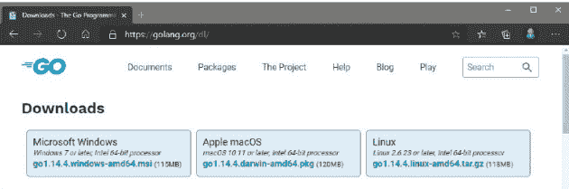

- 下载完成后，运行安装程序启动“Go 编程语言安装向导”

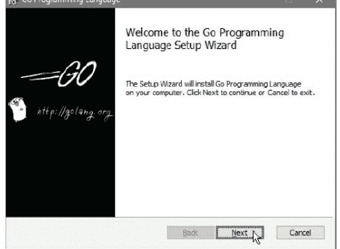

- 点击“下一步”继续，然后接受许可条款
- 接受建议的安装文件夹（Windows 上为 `C:\Go`），然后点击“安装”完成安装


Windows 版 Go 安装程序应会自动将 Go 添加到你的系统路径中，以便在提示符可以使用 Go 工具。

- 要测试安装是否成功，首先打开终端窗口——在 Windows 系统上同时按下 WinKey + R 打开“运行”对话框，然后输入 `cmd` 打开“命令提示符”窗口

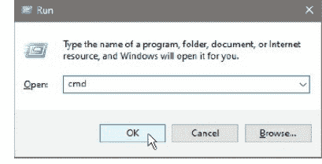

- 在命令提示符处，输入命令 `go` 然后按回车，查看 Go 工具命令列表

# 命令提示符

```
C:\users\mike_go>
Go 是一个管理 Go 源代码的工具。
用法:
  go <command> [arguments]
可用命令有:
  build     启动错误报告
  clean     编译包和依赖项
  doc       删除对象和缓存文件
  env       输出包或符号的文档
  fmt       打印环境信息
  fix       更新包以新版本
  go fmt    使用源码生成 Go (重格式化)
  get       向当前模块添加依赖项并安装
  install    编译并安装包
  list      列出包或模块
  mod       模块维护
  run       编译并运行 Go 程序
  test      运行指定的工具
  vet       验证 Go 版本
            报告命令中类似错误的错误
使用 "go <command>" 获取命令的更多信息。
```

其他帮助主题：

```
build      在 Go 和 C 之间构建
cache       构建和测试缓存
environment  环境变量
filetypes   文件类型
go.mod      the go.mod 文件
gopath      GOPATH - Go 环境变量
gopath-get  旧版 GOPATH go
goproxy     模块代理协议
importpath  导入路径语法
tymodule    模块语法
module-get  感知模块的 go
module-auth  模块版本和 mcre
module-private  非公共模块的模块配置
package      包列表和模式
testing      测试列表
testfunc     测试函数
```

使用 "go <topic>" 获取该主题的更多信息。

 Go 工具有很多，但你绝大多数时间只只会使用 `run` 工具来编译和运行你的程序。

 "WinKey" 是 Windows 标记的键。


# 创建 Go 工作空间

当你安装 Go 时，安装程序会设置若干 Go 环境变量。例如，Go 工具的目录（文件夹）位置存储在 `GOROOT` 环境变量——默认在 Windows PC 上为 `C:\Go`，在 Linux 和 macOS 上为 `/usr/local/go`。

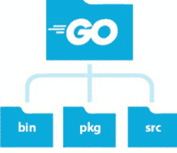 安装程序还会设置 `GOPATH` 环境变量用于你的工作空间位置。默认情况下，这是你家目录下一个名为“go”的目录。例如。

```go
fmt.Println("Hello World!")
}
```

将文件保存在 "hello" 文件夹中，并将其命名为 `main.go` – 现在完整的程序看起来应该完全像这样：

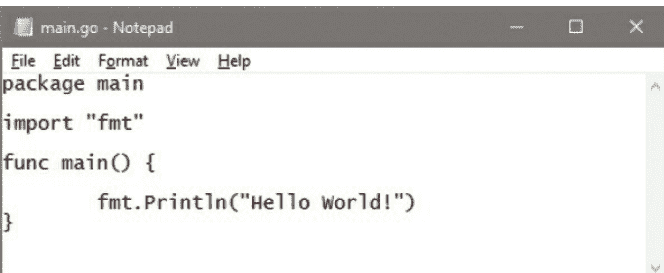


`fmt.Println` 中的 P 是大写，L 是小写。

在 Go 中，文件夹内的文件安排非常重要。每个主文件以及任何相关文件都必须放置于唯一命名的文件夹中以创建一个包（package）——因此，这里的包名为 "hello"。

反页上程序代码的各个部分可以单独检查，以便更清晰地理解每个部分：

## 包声明 (The Package Declaration)

```go
package main
```

包类型跟在 `package` 关键字后面。所有的 Go 程序代码都包含在包中。你可以为作为共享库的包声明自己的类型，但如果你想让代码编译成可执行程序，则必须声明包 "main"。

## 导入声明 (The Import Declaration)

`import` 关键字用于将一个或多个包导入到当前包中，以便该程序可以使用这些包的功能。"fmt" 包来自 Go 标准库，该库包含在你的 Go 安装中。它提供了 `fmt.Println()` 函数，用于在你的程序中输出文本。注意，包名必须包含双引号内。当导入多个包时，包名列表必须放在括号内，且每个名称必须独占一行：

```go
import (
    "fmt"
    "strings"
)
```

## 函数声明 (The Function Declaration)

```go
func main() {
    fmt.Println("Hello World!")
}
```

函数名跟随 `func` 关键字。它后面必须紧跟括号，并在同一行跟一个左大括号 `{`。函数体包含了执行任务的实际指令语句。函数体必须以 `}` 大大括号结束。函数名必须是唯一的，但每个 Go 程序都必须有一个名为 "main"的函数，因为这是所有 Go 程序的起点。


包名和包类型是两个独立的项——这里的包名为 hello，但类型是 main。


你可以在 `GOROOT` 位置的 "src" 目录下找到 Go 标准包——例如，在 `C:\src`。此外，你可以从官方文档 https://golang.org 学习每个包——这是一个非常无价的资源。

## 运行 Go 程序 (Run a Go Program)

Go 程序使用 Go 工具进行编译和执行。在开发期间，一个无错误的 Go 程序可以通过 `go run` 工具进行编译和运行。这非常有用，但如果你想创建一个可以重复执行并分发的可执行二进制版本，则你可以使用 `go build` 工具。


1. 在你的 Go "src" 文件夹中打开命令提示符或终端。
2. 输入命令 `go run hello` 在此处运行程序——它应该输出问候语：

```bash
C:\Users\mike_go\src>go run hello
Hello world!
C:\Users\mike_go\src>
```

3. 接下来，输入命令 `go build hello` 在此处创建一个可执行文件。
4. 现在，在 Windows 上输入 `hello`，或者在 Linux 或 macOS 上输入 `./hello`——它应该输出问候语。

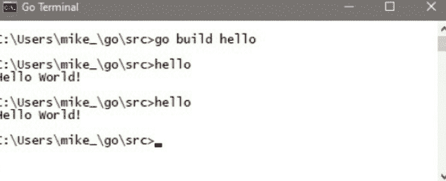


在 Windows 系统上二进制文件具有 `.exe` 扩展名，此处的文件 `hello`。

## 代码格式化与注释 (Format and Comment Code)

在运行程序之前，通过 `go fmt` 工具确保你的 Go 源代码格式正确是一个良好的习惯。


在源代码中包含解释性注释也是良好的习惯，这样其他人更容易理解，也方便你自己日后回顾代码。单行注释可以在 `//` 序列后添加——该行上的所有内容会被编译器忽略。多行注释可以在 `/*` 和 `*/` 序列之间添加——这在开发期间"注释掉"代码块非常有用。

- 编辑此处的 `hello.go` 添加注释和不必要的缩进（错误的格式）：

```
main.go - 记事本
文件 编辑 格式 帮助
// 我的第一个 Go 程序：输出问候语。

package main
import "fmt"
func main() {
fmt.Println("Hello World!")
```

- 现在，在提示符输入命令 `go fmt hello`，重新打开源文件查看正确的格式。

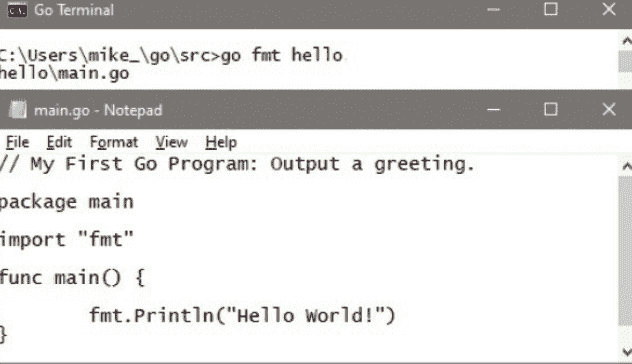


注释不应该"嵌套"，即一个套一个。


`go fmt` 工具提供了一些简单的错误检查。例如，漏掉最后的 `""`，它将提供错误发生的行号和位置，并提供错误性质为"字符串字量未结束"。

## 探索 VS Code 编辑器 (Explore the VS Code Editor)

虽然你可以使用命令提示符和纯文本编辑器创建 Go 程序，但许多开发者更喜欢使用专门的代码编辑器。它们提供了额外的功能，如语法高亮、自动缩进、括号匹配和代码调试。

VS Code 可以 https://code.visualstudio.com 下载——适用于 Windows、Linux 和 macOS。VS Code 应用是高度自定义的——你可以根据喜好更改组件布局，并从几种浅色或深色主题中进行选择。这里显示的截图使用的是默认的 Light 主题，代码编辑器中显示的语法高亮与书中后续使用的相同。

- 一个 Go 软件包。
- VS Code 提供了语法高亮、自动缩进、括号匹配和代码调试等功能。

# 2

## 存储值


# 存储值

本章演示了如何在 Go 程序中使用变量容器来存储、检索和操作各种类型的数据。

- 创建程序变量
- 显示变量值
- 转换数据类型
- 固定常量值
- 指向存储的值
- 总结

## 创建程序变量


变量是 Go 程序中的一个容器，数据值可以存储在计算机的内存中。可以使用变量名来引用存储的值，并通过分配新值来更改它。程序员可以为变量选择任何名称，只要它符合下面列出的命名规范即可：

| 命名规则 | 示例 |
| --- | --- |
| **不能** 是 Go 关键字 | `default` |
| **不能** 包含算术运算符 | `a+b*c` |
| **不能** 包含标点符号 | `%$#!` |
| **不能** 包含任何空格 | `no spaces` |
| **必须** 以字母开头 | `msg` |
| **可以** 包含数字 | `good1` |
| **可以** 混合大小写 | `camelCase` |

变量名应该简洁，并始终以小字母开头——除非该变量对其他包可见（稍后会介绍）。为变量选择有意义名称是一个良好的习惯，可以让代码更容易理解。在程序中创建变量只需使用 `var` 关键字进行“声明”。变量声明的语法如下：

```
var variableName dataType
```

`var` 关键字后面跟着一个空格，然后是选定的变量名，然后该变量允许存储的数据类型。通常，这将是另一页描述的五种数据类型之一。可以在单个声明中以逗号分隔列表的形式创建多个相同数据类型的变量，如下：

```
var variableName1, variableName2, variableName3 dataType
```


Go 关键字列在本本书内封的表格中。


Go 中的变量名是区分大小写的——因此命名为 `"NUM"`、`"Num"` 和 `"num"` 的将被视为三个独立的变量。

Go 语言的基本数据类型使用 Go 关键字定义。这些类型列在下表中，并带有对每个数据类型的描述：

| 数据类型 | 描述 | 示例 |
| --- | --- | --- |
| `string` | 字符字符串 | `"Hi there!"` |
| `int` | 整数 | `100` |
| `float64` | 精度约为 15 位的浮点数 | `0.0123456789` |
| `byte` | 可以存储单个字符的单字节 | `'A'` |
| `bool` | 真或假的布尔值 | `true` |

重要的是，Go 是一门“静态类型”语言，这意味着变量只能包含其声明中指定类型的数据。

当将一个值分配给变量时，该变量被认为已“初始化”。变量可以先声明后初始化，也可以在声明时进行初始化。例如，初始化一个变量以包含字符串数据类型的值：

```
var msg string
msg = "Hi there!"
```

此外，可以使用特殊的 `:=` 运算符声明并初始化变量。在这种情况下，不需要 `var` 关键字或数据类型，如下：

```
msg := "Hi there!"
```

编译器简单地从分配给变量的数据类型推断出数据类型。这是创建和初始化变量的首选方法——但它只能在函数体内使用。


`byte` 数据类型的字符值必须用单引号括——双引号是错误的。


在 Go 编程中建议使用短变量名，因此这里的示例使用 `msg` 而不是 `message` 作为变量名。

## 显示变量值


变量的值可以使用第 1 章中显示“Hello World!”的 `fmt.Println()` 函数显示。另一种方法是通过 `fmt.Printf()` 指定位符指定变量所需的格式：

| 占位符 | 描述 | 示例 |
| --- | --- | --- |
| `%s` | 字符字符串 | `"Go Fun!"` |
| `%d` | 整数 | `100` |
| `%f` | 浮点数 | `0.123456` |
| `%c` | 单字符 | `'A'` |
| `%t` | 布尔值 | `true` |
| `%p` | 内存地址 | `0x02FF34` |
| `%v` | 默认格式的值 | `(any)` |
| `%T` | 变量的数据类型 | `int` |

格式占位符可以通过在 `%` 之后指定所需的数字来确保输出占据最小空间数——例如，使用 `%7d` 确保整数始终填充至少七个空格。如果倾向于用零填充空白区域，只需添加一个零使占位符变为 `%07d`。

精度占位符是一个 `.`（点），后跟一个数字，可以与 `%` 占位符配合使用，确定显示多少小数——例如，使用 `%.2f` 显示两位。精度占位符可以与最小空间占位符结合，控制空格数位数——例如，使用 `%07.2f` 显示包含两个小数和零填充空白在内的七个空格。默认情况下，空白位于数字之前，因此它是右对齐的。它们也可以添加在数字之后，通过在最小空间占位符前加上负号使其向左对齐。


`%v` 格式占位符可以通过在 `%` 之后指定数字来确保输出占据最小空间数——例如，使用 `%7d` 确保整数始终填充至少七个空格。

## 转换数据类型

你有时需要将存储在变量中的值转换为不同的类型。通常，你希望将字符串值转换为数值，以执行算术运算。例如，字符串可能包含数字字符 `"42"`，但除非将其转换为 `int` 或 `float64` 类型，否则你无法对它进行算术操作。


Go 标准库包含一个 `strconv` 包，其中包含了在字符串类型之间转换的函数。通过在导入声明中添加 `strconv` 包，可以让你的程序可以使用这些函数。

`strconv.Atoi()` 函数将括号内指定的字符串转换为 `int` 类型。它返回字符串的 `int` 等效值，但像你遇到的其他函数一样，它还返回第二个值，转换成功时该值为 `nil` 值，失败时则返回错误消息。你必须将 `strconv.Atoi()` 的调用赋值给两个变量以接收返回值，如下：

```go
num, err := strconv.Atoi("42")
```

还有一个 `strconv.Itoa()` 函数，可以将整数值转换为字符串值，但它只返回字符串值。

如果你倾向于将字符串值转换为 `float64`，可以使用 `strconv.ParseFloat()` 函数。像 `strconv.Atoi()` 一样，它返回字符串的 `float64` 等效值和一个 `nil` 值或错误消息。它需要字符串值和浮点数大小（`64`）作为参数——例如，`strconv.ParseFloat("42", 64)`。

在不同数值数据类型之间进行强制转换只需说明所需的类型并后跟包含该值的括号。进行转换。例如：

```
var num int = 42
var decimal float64 = float64(num)
```

有趣的是，当给 `byte` 数据类型的变量（`uint8` 的别名——一个 8 位无符号整数）分配单个字符时，它将存储该字符的 ASCII 字符编码，该值可以轻松地转换为 `string` 数据类型：

```go
var char byte = 'A'
var str = string(char)
```


ASCII（读作 "as-key"）是“美国信息交换标准代码”的缩写，是纯文本公认的标准。你可以在 `www.asciitable.com` 找到标准 ASCII 代码的完整范围。

- 在你的 `src` 文件夹内创建一个名为 `cast` 的目录。


`src\cast\main.go`

- 以 `package` 和 `import` 声明开始一个 `main.go` 程序。

```go
package main

import (
	"fmt"
	"strconv"
)
```

- 添加一个 `main` 函数，声明并初始化两个变量。

```go
func main() {
	var str string = "42"
	var char byte = 'A'

	// 在此处插入语句
}
```

- 在 `main` 函数中，插入语句以输出各种转换后的变量值：

```go
num, err := strconv.Atoi(str)
fmt.Printf("num:%v %T %v \n", num, num, err)
```

```go
decimal := float64(num)

fmt.Printf("decimal:%.2f %T \n", decimal, decimal)

fmt.Printf("char:%v %T %v \n", char, char, string(char))
```

- 将程序文件保存在 `cast` 目录中，然后运行程序查看转换后的变量值。

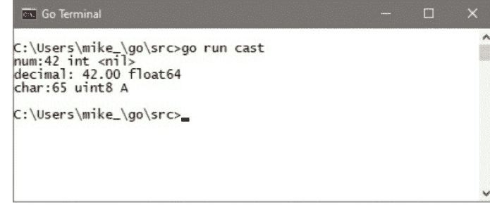


你稍后将发现如何通过测试 `err` 值确实为 `nil` 来确认转换成功——这在整个 Go 编程中被认为是一个做法。


从 `float` 转换为 `int` 的值会被截断，因此使用 `f := 3.9` 和 `n := int(f)`，变量 `n` 将赋值为 3。

## 固定常量值

如果你想存储一个在程序执行期间永远不会改变的固定值，你应该使用 `const` 关键字来声明它，而不是 `var` 关键字。这可以防止意外（或恶意）的尝试分配不同的值。如果你的代码尝试给常量分配新值，编译器将显示“cannot assign to”（无法赋值给）的消息。


与变量声明不同，常量声明必须在声明中使用其固定值进行初始化，如下：

```go
const oneMillion = 1000000
```

可选情况下，常量声明可以指定数据类型，但如果声明中省略了显式数据类型，Go 编译器将从分配的值中推断其类型。

可以在单个声明中创建相同或不同数据类型的多个常量，格式为用逗号分隔的列表，如下所示：

```go
const oneMillion, oneThousand = 1000000, "1,000"
```

非常有用的是，常量声明可以使用名为 `iota` 的“常量生成器”来创建一个相关常量值的序列。常量名称应该在 `const` 关键字后的括号内每行列出一个，第一个被分配 `iota` 值。这会生成一个从零开始的数值序列，列表中的每个命名常量每个序列递增 1。例如，你可以将数值序列分配给代表星期几的常量，如下所示：

```go
const (
	sunday = iota
	monday
	tuesday
	wednesday
	thursday
	friday
	saturday
)
```

在这个示例中，常量 `sunday` 将赋值为零（0），`monday` 将赋值为一（1），依此类推。

如果你想从不同的数字开始序列，只需在给第一个常量赋值时将 `iota` 加上该数字。


在其他编程语言中，生成的序列通常被称为“枚举”（enumeration）或简单的“enum”。

- 在你的 `src` 文件夹内创建一个名为 `const` 的目录。


`src\const\main.go`

- 以 `package` 和 `import` 声明开始一个 `main.go` 程序。

```go
package main

import "fmt"
```

- 添加一个 `main` 函数，声明并初始化一个常量和一个从一（1）开始的常量序列。

```go
func main() {
	const pi = 3.14159

	const (
		red = iota + 1
		yellow
		green
		brown
		blue
		pink
		black
	) // 在此处插入语句。
}
```

接下来，插入语句显示几个常量值：

```go
fmt.Printf("Pi approximately: %v\n\n", pi)
```

```go
fmt.Printf("Red: %v \n", red)
fmt.Printf("Blue: %v points \n", blue)
fmt.Printf("Black: %v points \n", black)
```

将程序保存在 `const` 目录中，然后运行程序查看常量值。

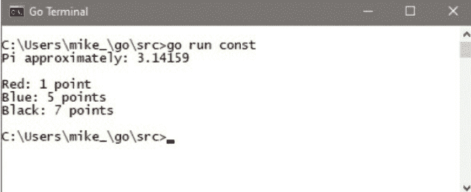


`math` 包提供了常量 π。


这里的序列代表了点。


## 存储的值

当程序创建一个存储数据的容器时，就像变量声明一样，它会在内存中分配空间。内存位置可能会因系统而不同。


指针的概念很难理解，因为星号有两个用途——作为类型描述符和解引用符。在继续之前，你应该彻底理解它们是如何工作的。


内存地址是指向你的十六进制数字。它们将与示例所示的不同。

- 在你的 `src` 文件夹内创建一个名为 `point` 的目录。


`src\point\main.go`

- 以 `package` 和 `import` 声明开始一个 `main.go` 程序。

```go
package main

import "fmt"
```

- 添加一个 `main` 函数，声明并初始化一个普通整数和一个指针变量。

```go
func main() {
	var num int = 20
	var ptr *int = &num

	// 在此处插入语句
}
```

- 接下来，插入语句显示普通整数变量的值和内存地址。

```go
fmt.Printf("num value: %v %T \n", num, num)
fmt.Printf("num address: %v %T \n\n", ptr, ptr)
```

- 现在，插入语句显示指针变量的解引用值和内存地址。

```go
fmt.Printf("num via pointer: %v %T \n", *ptr, &ptr)
fmt.Printf("ptr address: %v %T \n\n", &ptr, &ptr)
```

- 最后，插入语句识别这里指针变量改变了它指向的变量存储的值——通过对指针变量赋值。

```go
*ptr = 100
fmt.Printf("new num value: %v %T \n", num, mem)
```

```text
Go Terminal

:\Users\mike_\go\src> go run point

num value: 20 type: int

num address: 0xc00009e068 type: *int

num via pointer: 20 type: int

ptr address: 0xc000c80188 type: **int

new num value: 100 type: int

:\Users\mike_\go\src>_
```

最重要的特征是指针改变了它所指向的变量的原始值，而不是该值的副本。这在将变量传递给函数时变得非常重要——参见此处。

## 总结

- 变量存储了可以通过给定的名称引用的数据，并且其值可以更改。
- 显式变量声明使用 `var` 关键字，并说明该变量可以包含的数据类型。
- 隐式变量声明可以在函数体内使用 `:=` 运算符来推断数据类型。
- Go 是一种静态类型语言，变量始终只能包含其声明中指定类型的数据。
- `fmt.Printf()` 函数可以使用格式化标记、变量名和换行符来格式化输出。
- `strconv.Atoi()` 函数返回括号内指定的字符串值的等效 `int` 数据类型，以及第二个可能是 `nil` 或错误信息的值。
- `strconv.Itoa()` 函数返回括号内指定的 `int` 值的等效字符串数据类型。
- `strconv.ParseFloat()` 函数返回括号内指定的字符串值的等效 `float64` 数据类型，以及第二个可能是 `nil` 或错误信息的值。
- 当给 `byte` 数据类型的变量赋值一个字符时，它存储的是该字符的 ASCII 字符码。
- 在数值数据类型之间进行转换时指定所需的类型，后跟包含要转换值的括号。
- 常量声明使用 `const` 关键字，并且必须用它将包含的固定值进行初始化。
- 指针变量可以存储另一个变量的内存地址，并访问该地址存储的值。
- `*` 星号运算符在指针变量声明中位于数据类型之前，表示该变量是一个指针。
- `&` 取地址运算符位于普通变量名称之前，以引用该变量的内存地址。
- `*` 星号运算符位于指针变量名称之前，以引用其指向地址存储的值。

# 3 执行操作

本章介绍了 Go 运算符并演示了它们可以执行的操作。

- 算术运算
- 赋值
- 比较
- 逻辑评估
- 位运算
- 理解优先级
- 总结

## 算术运算


Go 程序中常用的算术运算符如下表所示，并包含了它们执行的操作：

| 运算符 | 操作 |
| --- | --- |
| `+` | 加法 |
| `-` | 减法 |
| `*` | 乘法 |
| `/` | 除法 |
| `%` | 取余 |
| `++` | 自增 |
| `--` | 自减 |

赋值、加法、减法、乘法和除法运算符的作用正如你预期的那样，但在使用多个运算符时，请注意对表达式进行分组——最内层 `()` 括号中的操作首先执行：

```go
a = b*c - d%e/f // 这不清晰。

a = (b*c) - (d%e)/f // 这更清晰。
```

`%` 取余运算符将第一个数字除以第二个数字并返回操作的余数。这有助于判断一个数是奇数还是偶数。

`++` 自增运算符和 `--` 自减运算符会将指定的数字加减 1 并返回结果。它们最常用于在循环中计数迭代次数——在每次迭代中使用 `++` 自增运算符递增，或在每次迭代中使用 `--` 自减运算符递减。

`++` 自增或 `--` 自减运算符必须紧跟在变量 `n` 之后以更改其值。例如：

```go
n := 4

n++ // 现在 n 是 5。
```


`+` 运算符具有双重用途——它也被用于拼接字符串。


与运算符组合形成表达式的数值被称为“操作数”——在表达式 `2 + 3` 中，数值 `2` 和 `3` 就是操作数。

- 在你的 `src` 文件夹内创建一个名为 `arithith` 的目录。


`src\arithith\main.go`

- 使用包和导入声明开始一个 `main.go` 程序。

```go
package main

import "fmt"
```

- 添加一个声明并初始化两个变量的 `main` 函数。

```go
func main() {
	a := 8
	b := 4

	// 在此处插入语句。
}
```

在 `main` 函数中，插入语句以输出每次算术运算后的结果和值：

```go
fmt.Println("Addition:\t", (a + b))
fmt.Println("Subtraction:\t", (a - b))
fmt.Println("Multiplication:\t", (a * b))
fmt.Println("Division:\t", (a / b))
fmt.Println("Remainder:\t", (a % b))
```

现在，插入语句更改存储的值并显示其新值：

```go
a++
fmt.Println("Increment:\t", a)

b--
fmt.Println("Decrement:\t", b)
```

将程序文件保存到 `arith` 目录中，然后运行程序以查看每个操作的结果。

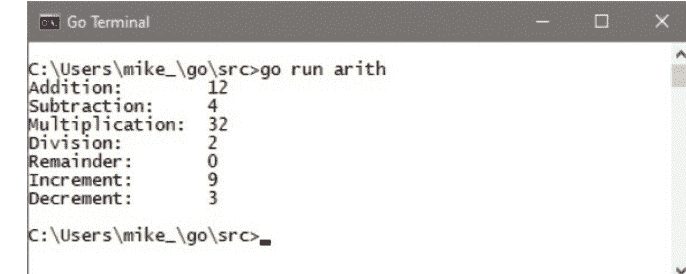


## 赋值


| 运算符 | 示例 |
| --- | --- |
| `=` | `a` |
| `+=` | `a` |
| `-=` | `a` |
| `*=` | `a` |
| `/=` | `a` |
| `%=` | `a` |

`+` 运算符具有双重用途——它也被用于拼接字符串。


`%` 取余运算符将第一个数字除以第二个数字并返回操作的余数。这有助于判断一个数是奇数还是偶数。


操作数必须是相同的数据类型。

## 比较

Go 编程中常用的用于比较两个数值的运算符列如表所示：

| 运算符 | 比较测试 |
| --- | --- |
| `==` | 等于 |
| `!=` | 不等于 |
| `>` | 大于 |
| `<` | 小于 |
| `>=` | 大于等于 |
| `<=` | 小于或等于 |

`==` 等于运算符比较两个操作数，如果两者的值相等则返回 `true`，否则 `==` 运算符将返回 `false`。如果两个是同一个数字，它们就是相等的；如果两者都是字符，则会对它们的 ASCII 码值进行数值比较。

相反地，`!=` 不等于运算符在两个操作数不相等时返回 `true`，其使用的规则与 `==` 等于运算符相同，否则返回 `false`。相等和不等于运算符用于测试两个变量的状态，以便在程序中执行条件分支。

`>` “大于”运算符比较两个操作数，如果第一个的值大于第二个，则返回 `true`；如果它的值等于或小于第二个，则返回 `false`。`<` “小于”运算符进行相同的比较，但如果第一个操作数的值小于第二个，则返回 `true`，否则返回 `false`。通常，`>` “大于”或 `<` “小于”运算符用于测试循环结构中计数器的值。

在 `>` “大于”运算符或 `<` “小于”运算符后添加 `=` 赋值运算符，使它们在两个操作数值相等时也返回 `true`。


比较运算符也被称为“关系运算符”。

- 在你的 `src` 文件夹内创建一个名为 `comp` 的目录。


`src\comp\main.go`

- 以 `package main` 和导入声明开始一个 `main.go` 程序。

```go
package main

import "fmt"
```

- 添加一个 `main` 函数，声明并初始化五个变量。

```go
func main() {
	var zero, num, max int = 0, 0, 1
	var up, dn byte = 'A', 'a'

	// 在此处插入语句。
}
```

- 在 `main` 函数中，插入语句以输出几次比较的结果。


```go
result := (num == zero) // 0 == 0.
1fmt.Println("Equality: num == zero", result)

result = (up == dn) // A == a.
fmt.Println("Equality: up == dn", result)

result = (max != zero) // 1 != 0.
fmt.Println("inequality: max != zero", result)

result = (zero > max) // 0 > 1.
fmt.Println("Greater:\tzero > max\t", result)
result = (max <= zero) // 1 <= 0.
fmt.Println("Less or Equal:\tmax <= zero", result)
```

将程序文件保存到“comp”目录中，然后运行程序以查看每次比较的结果。

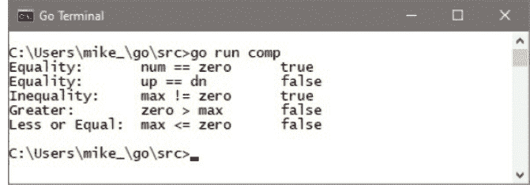


大写字母 `'A'` 的 ASCII 码值为 65，但小写字母 `'a'` 是 97——因此它们的比较返回 `false`。


比较数字时，记住要测试相等性，还要测试较高和较低的值。

# 评估逻辑


Go 编程中最常用的逻辑运算符列如下表所示：

| 运算符 | 操作 |
| --- | --- |
| `&&` | 逻辑与 |
| `\|\|` | 逻辑或 |
| `!` | 逻辑非 |

逻辑运算符用于具有布尔值 `true` 或 `false`（或转换为 `true` 或 `false`）的操作数。

`&&` 逻辑与运算符评估两个操作数，只有当两个操作数本身都为 `true` 时才返回 `true`。否则，`&&` 逻辑运算符将返回 `false`。这用于条件分支，通过测试两个条件来确定程序的方向——如果两个条件都满足，程序将进入某个方向，否则将采取另一个方向。

与 `&&` 逻辑与运算符不同，`\|\|` 逻辑或运算符在两个操作数中至少有一个为 `true` 时返回 `true`，否则返回 `false`。逻辑运算符的操作数值必须是布尔值 `true` 或 `false`。

`!` 逻辑非运算符反转操作数的值，将 `true` 变为 `false`，将 `false` 变为 `true`。由于在比较数字时，我们要测试相等性，逻辑运算符会返回 `true` 或 `false`。

在主函数中，插入语句来输出所有位标志的设置：

```go
fmt.Printf("Flag #1:%v \n", (flags & 1) > 0)
fmt.Printf("Flag #2:%v \n", (flags & 2) > 0)
fmt.Printf("Flag #3:%v \n", (flags & 4) > 0)
fmt.Printf("Flag #4:%v \n", (flags & 8) > 0)
```

接下来，插入一个语句来显示表示模式的十进制值：

```go
fmt.Printf("Flags Value: %08b \t%v \n", flags, flags)
```

现在，插入语句将“开启”位标志向右移动一位，并输出新模式的十进制值：

```go
flags = flags >> 1
fmt.Printf("New Value: %08b \t%v \n", flags, flags)
```

将程序文件保存在“bits”目录中，然后运行程序以查看位标志。

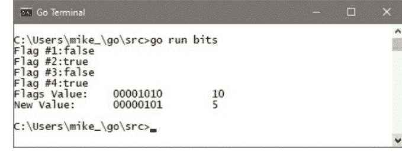

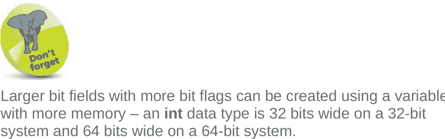

具有更多位标志的较大位域可以使用更多内存的变量来创建——`int` 数据类型在 32 位系统上为 32 位宽，在 64 位系统上为 64 位宽。


这里使用 `%b` 格式说明符输出每个位中的二进制数值。

# 了解优先级

运算符优先级定义了 Go 编译器评估表达式的顺序。在表达式 `6 + 7 * 3` 中，优先级顺序决定了先完成加法还是先完成乘法。


下表按递减顺序列出了运算符优先级，较高行的运算符优先级高于较低行的运算符，因此它们的操作会先完成。同一行的二元运算符优先级相等，但完成顺序由从左到右的顺序决定，因此左侧的操作会先完成。

| 优先级级别 | 运算符 |
| --- | --- |
| 5 | `* % << >> &` |
| 4 | `+ - ^` |
| 3 | `== != < >=` |
| 2 | `&&` |
| 1 | `++` |

`++` 增位运算符和 `--` 减位运算符在 Go 编程中形成语句，而不是出现在表达式中，因此它们没有包含在上面的优先级表中。

你可以通过将表达式的部分放在括号内，来强制编译器忽略默认优先级级别，从而强制编译器先评估表达式最内层的部分。例如，在表达式 `6 + 7 * 3` 中，`*` 乘法运算符的默认优先级高于 `+` 加法运算符，因此先执行乘法操作，即 `7 * 3 = 21`，然后执行加法 `21 + 6 = 27`。你可能希望先执行加法操作，因此可以通过给表达式添加括号 `( 6 + 7 ) * 3` 来强制编译器这样做。现在，表达式的评估是 `6 + 7 = 13`，然后是乘法 `13 * 3 = 39`。

- 在你的“src”文件夹内创建一个名为“force”的目录。


`src\force\main.go`

- 开始带有 `package` 和 `import` 声明的 `main.go` 程序：

```go
package main
import "fmt"
```

- 添加一个 `main` 函数，通过评估表达式声明并初始化变量并显示其值：

```go
func main() {
  sum := 2 * 3 + 4 - 5
  fmt.Printf("Default Order: %v \n", sum)
  // 在此处插入语句。
}
```

- 在主函数中，插入语句显示评估修改后的表达式的值：

```go
sum = 2 * (( 3 + 4 ) - 5)
fmt.Printf("Forced Order: %v \n\n", sum)
```

- 接下来，插入一个语句显示评估另一个表达式的值：

```go
sum = 7 % 3 * 2
fmt.Printf("Default Order: %v \n", sum)
```

- 现在，插入语句显示评估修改后的表达式的值：

```go
sum = 7 % (3 * 2)
fmt.Printf("Forced Order: %v \n\n", sum)
```

- 将程序文件保存在“force”目录中，然后运行程序以查看不同的结果：

```bash
C:\Users\mike_go\src> run force
Default Order: 3
Forced Order: 4

Default Order: 2
Forced Order: 1

C:\Users\mike_go\src>_
```


`%b` 格式说明符在这里用于输出每个位中的二进制数值。

## 总结

- 具有更多位标志的较大位域可以使用更多内存的变量来创建——`int` 数据类型在 32 位系统上为 32 位宽，在 64 位系统上为 64 位宽。
- `%b` 格式说明符在这里用于输出每个位中的二进制数值。
- 运算符优先级定义了 Go 编译器评估表达式的顺序。在表达式 `6 + 7 * 3` 中，优先级顺序决定了先完成加法还是先完成乘法。
- `++` 增位运算符和 `--` 减位运算符在 Go 编程中形成语句，而不是出现在表达式中，因此它们没有包含在上面的优先级表中。
- 你可以通过将表达式的部分放在括号内，来强制编译器忽略默认优先级级别，从而强制编译器先评估表达式最内层的部分。例如，在表达式 `6 + 7 * 3` 中，`*` 乘法运算符的默认优先级高于 `+` 加法运算符，因此先执行乘法操作，即 `7 * 3 = 21`，然后执行加法 `21 + 6 = 27`。你可能希望先执行加法操作，因此可以通过给表达式添加括号 `( 6 + 7 ) * 3` 来强制编译器这样做。现在，表达式的评估是 `6 + 7 = 13`，然后是乘法 `13 * 3 = 39`。

## 控制流

本章演示了语句如何根据评估结果提供程序的方向。

- 测试条件
- `Switch` 情况
- 循环
- 跳出循环
- `%b` 格式说明符在这里用于输出每个位中的二进制数值。
- `%b` 格式说明符在这里用于输出每个位中的二进制数值。
- `%b` 格式说明符在这里用于输出每个位中的二进制数值。
- `%b` 格式说明符在这里用于输出每个位中的二进制数值。
- `%b` 格式说明符在这里用于输出每个位中的二进制数值。
- `%b` 格式说明符在这里用于输出每个位中的二进制数值。
- `%b` 格式说明符在这里用于输出每个位中的二进制数值。
- `%b` 格式说明符在这里用于输出每个位中的二进制数值。
- `%b` 格式说明符在这里用于输出每个位中的二进制数值。
- `%b` 格式说明符在这里用于输出每个位中的二进制数值。
- `%b` 格式说明符在这里用于输出每个位中的二进制数值。
- `%b` 格式说明符在这里用于输出每个位中的二进制数值。
- `%b` 格式说明符在这里用于输出每个位中的二进制数值。
- `%b` 格式说明符在这里用于输出每个位中的二进制数值。
- `%b` 格式说明符在这里用于输出每个位中的二进制数值。
- `%b` 格式说明符在这里用于输出每个位中的二进制数值。

# 测试条件

`if` 关键字用于执行对表达式布尔值 `true` 或 `false` 的基本测试。当评估结果为 `true` 时，后续大括号内的语句将被执行。`if` 语句的语法如下：

```go
if test-expression {
    statements-to-execute-when-the-condition-is-true
}
```

当测试为 `true` 时，可能有多个语句需要执行，但每个语句必须单独占一行。有时可能需要评估多个表达式来决定是否执行后续语句。这可以通过使用逻辑 `&&` 运算符来实现：

```go
if test-expression && test-expression {
    statements-to-execute-when-all-conditions-are-true
}
```

或者，可以将多个 `if` 语句嵌套（一个在另一个）来评估多个表达式，如下：

```go
if test-expression {
    if test-expression {
        statements-to-execute-when-all-conditions-are-true
    }
}
```

当一个或多个由 `if` 测试语句评估的表达式为 `false` 时，其后续大括号内的语句将不执行，程序将继续执行后续代码。通常可以通过附加 `else` 语句来扩展语句，指定在 `if` 语句评估的表达式为 `false` 时执行的语句，其语法如下：

```go
if test-expression {
    statements-to-execute-when-the-condition-is-true
} else {
    statements-to-execute-when-the-condition-is-false
}
```

这是一项基础编程技术，根据评估结果为程序提供方向，被称为“条件分支”。


测试表达式和左大括号 `{` 必须与 `if` 关键字出现在同一行。


`else` 关键字和左大括号 `{` 必须与上一个语句块的右大括号 `}` 出现在同一行。

- 开始一个 `main` 函数，带有一个语句判断两个字符是否匹配：

```go
func main() {
    if 'A' == 'A' {
        fmt.Println("\nCharacters Match")
    }
    // Statements to be inserted here.
}
```


`src\else\main.go`

- 2. 接下来，在 `main` 函数中插入语句测试两个数值表达式：

```go
if s > 1 {
    if s > 2 {
        fmt.Println("\nBoth expressions are true")
    }
}
```

- 3. 现在，插入语句来测试一个数值表达式，并测试两个字符是否匹配：

```go
if s < 1 {
    fmt.Println("\n1st Condition is true")
} else if 'A' != 'A' {
    fmt.Println("\n2nd Condition is true")
} else {
    fmt.Println("\nBoth Conditions are false")
}
```

- 4. 将程序文件保存到“ifelse”目录，然后运行程序以查看条件测试的结果：

```text
C:\Users\mike_\go> go run ifelse
Characters Match
Both Expressions are true
Both Conditions are false
C:\Users\mike_\go\src>_
```


为了避免重复，从现在开始后续列出的代码假设你已经在每个程序的开头声明了 `package main` 和 `import "fmt"`。


注意，如果第一个测试为 `false`（假），你可以使用 `else if` 来评估第二个表达式。

# `Switch` 语句（Switch Cases）

当测试表达式仅评估单个条件时，通过多个 `if else` 语句执行的条件分支通常可以通过 `switch` 语句更高效地完成。


`switch` 语句的工作方式很特殊。它接受一个给定值作为参数，然后尝试从多个 `case` 语句中匹配该值。当找到匹配时，执行的代码包含在每个 `case` 语句中。

需要注意的是，每个要执行的语句必须单独成行，从 `case` 语句下方的行开始。

可选地，`case` 语句列表后面可以跟一个最终的 `default` 语句，以指定在任何 `case` 语句中未找到匹配项时执行的代码。因此，`switch` 语句的语法通常如下：

```go
switch test-value {
  case match-value :
    statements-to-execute-when-matched
  case match-value :
    statements-to-execute-when-matched
  case match-value :
    statements-to-execute-when-matched
  default:
    statements-to-execute-when-no-match-found
}
```

如果多个 `match-values` 需要执行相同的语句，则只需要在最后一个 `case` 语句中包含要执行的语句。例如，为匹配值为 0、1 和 2 输出相同的消息：

```go
switch num {
case 0 :
case 1 :
case 2 :
  fmt.Println("Less than 3")
case 3 :
  fmt.Println("Exactly 3")
default:
  fmt.Println("Greater Than 3 or Less Than 0")
}
```


`default` 语句不需要必须在 `switch` 块的末尾，但将其放在那里是符合逻辑的。


找到匹配后，`switch` 通常会结束，但你可以在任何 `case` 块中添加 `fallthrough` 关键字作为最后一个语句，以继续到下一个 `case` 语句——尽管这种情况很少。

- 以一个声明并初始化两个变量的语句开始 `main` 函数：

```go
func main() {
  num := 2
  char := 'B'
  // Statements to be inserted here.
}
```


`src\switch\main.go`

- 接下来，在 `main` 函数中插入一个尝试匹配数值的语句。


```go
switch num {
case 1 :
  fmt.Println("Number is One")
case 2 :
  fmt.Println("Number is Two")
case 3 :
  fmt.Println("Number is Three")
default:
  fmt.Println("Number is Unrecognized")
}
```

- 现在，插入一个尝试匹配字符的语句。

```go
switch char {
case 'A' :
  fmt.Println("Letter is A")
case 'B' :
  fmt.Println("Letter is B")
default:
  fmt.Println("Letter is Unrecognized")
}
```

- 将程序文件保存到`switch`目录，然后运行程序。


`src\switch\main.go`

- 接下来，在`main`函数中插入一个尝试匹配数值的语句。


`src\switch\main.go`

- 接下来，插入一个尝试匹配字符的语句。


`src\switch\main.go`

- 将程序文件保存到`switch`目录，然后运行程序。


# 语句

当测试表达式仅评估单个条件时，通过多个`if else`语句执行的条件分支通常可以通过`switch`语句更高效地完成。


`switch`语句的工作方式很特殊。它接受一个给定值作为参数，然后尝试从多个`case`语句中匹配该值。当找到匹配时，执行的代码包含在每个`case`语句中。

需要注意的是，每个要执行的语句必须单独成一行，从`case`语句下方的行开始。

可选地，`case`语句列表后面可以跟一个最终的`default`语句，以指定在任何`case`语句中未找到匹配项时执行的代码。因此，`switch`语句的语法通常如下：

```go
switch test-value {
  case match-value :
    statements-to-execute-when-matched
  case match-value :
    statements-to-execute-when-matched
  case match-value :
    statements-to-execute-when-matched
  default:
    statements-to-execute-when-no-match-found
}
```

如果多个`match-values`需要执行相同的语句，则只需要在最后一个`case`语句中包含要执行的语句。例如，为匹配值为 0、1 和 2 输出相同的消息：

```go
switch num {
case 0 :
case 1 :
case 2 :
  fmt.Println("Less than 3")
case 3 :
  fmt.Println("Exactly 3")
default:
  fmt.Println("Greater Than 3 or Less Than 0")
}
```


`default`语句不需要必须在`switch`块的末尾，但将其放在那里是符合逻辑的。


找到匹配后，`switch`通常会结束，但你可以在任何`case`块中添加`fallthrough`关键字作为最后一个语句，以继续到下一个`case`语句——尽管这种情况很少。

- 以一个声明并初始化两个变量的语句开始`main`函数。

```go
func main() {
  num := 2
  char := 'B'
  // Statements to be inserted here.
}
```


`src\switch\main.go`

- 接下来，在`main`函数中插入一个尝试匹配数值的语句。

```go
switch num {
case 1 :
  fmt.Println("Number is One")
case 2 :
  fmt.Println("Number is Two")
case 3 :
  fmt.Println("Number is Three")
default:
  fmt.Println("Number is Unrecognized")
}
```

- 现在，插入一个尝试匹配字符的语句。

```go
switch char {
case 'A' :
  fmt.Println("Letter is A")
case 'B' :
  fmt.Println("Letter is B")
default:
  fmt.Println("Letter is Unrecognized")
}
```

- 将程序文件保存到`switch`目录，然后运行程序。


# 循环（Loops）

在 Go 语言中，有多种方法来循环执行代码。最常用的方法是`for`循环。

## for 循环

`for`循环是 Go 中唯一的循环结构，但它可以以多种不同的形式使用。

### 1. 基础 for 循环

最基本的`for`循环包含三个部分：初始化、条件和后迭代语句。

```go
for i := 0; i < 10; i++ {
    fmt.Println(i)
}
```

- `i := 0`是循环开始前执行的初始化。
- `i < 10`是循环条件，如果为真，则继续循环。
- `i++`是每次迭代后执行的语句，用于更新计数器。

### 2. 省略初始化或后迭代语句

在某些情况下，你可能不需要初始化或后迭代语句。

```go
i := 0
for ; i < 10 {
    fmt.Println(i)
    i++
}
```

- 这种情况下，初始化放在循环体外部，后迭代语句放在循环体内部。

### 3. 无条件循环（无限循环）

如果你省略条件，`for`循环将变成无限循环，直到遇到一个`break`或`return`语句。

```go
for {
    fmt.Println("无限循环")
    // 在某些条件下 break;
}
```

### 4. 使用 range 遍历

Go 还提供了`range`关键字，用于遍历切片、数组、映射和通道。

```go
nums := []int{10, 20, 30}
for index, value := range nums {
    fmt.Printf("Index: %d, Value: %d\n", index, value)
}
```

- `index`是索引，`value`是对应的值。
- 如果你只需要值，可以使用下划线`_`忽略索引：

```go
for _, value := range nums {
    fmt.Println(value)
}
```

## break 和 continue

- `break`语句用于跳出整个循环。
- `continue`语句用于跳过当前迭代的剩余部分，直接开始下一次迭代。

```go
for i := 0; i < 10; i++ {
    if i == 5 {
        continue // 跳过 i=5
    }
    if i == 8 {
        break // 在 i=8 时退出循环
    }
    fmt.Println(i)
}
```

```go
for {
    statements-to-be-executed
    incrementer
    if test-expression {
        statements-to-be-executed
        break
    }
}
```

注意，“while”循环如果测试表达式在第一次求值时为假，则不会执行任何迭代，而“do-while”循环将至少执行一次迭代，因为它的语句在进行评估之前就已经执行了。


如果程序运行了无限循环，在 Windows 或 Linux 系统上按下`Ctrl + C`快捷键来停止循环执行。

- 1. 从一个执行五次迭代的循环开始一个`main`函数。

```go
func main() {
    counter := 1
    for counter <= 5 {
        fmt.Println("Loop Iteration", counter)
        counter++
    }
// 在此处插入语句。
```


`src\while\main.go`

接下来，插入一个无限循环语句：

```go
i := 10
for {
    fmt.Println("Countdown", i)
    // 在此处插入测试表达式。
}
```

现在，插入一个测试表达式来结束循环：

```go
if i<1 {
    fmt.Println("Lift Off!")
    break
}
```

将程序文件保存在`while`目录中，然后运行程序查看每次循环迭代的输出。

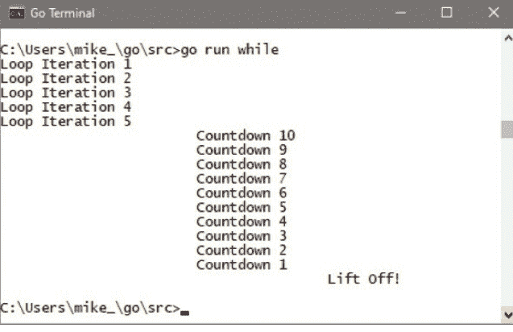


将变量`i`的初始值改为**0**（零）并再次运行程序，查看循环的第一次迭代是否被执行。

## 跳出循环

`break`关键字可以在满足指定条件时提前终止任何循环。`break`语句位于循环语句块内部，前面有一个测试表达式。当测试返回真时，循环立即结束，程序继续执行下一个任务。例如，在嵌套内层循环中，它将跳转到外层循环的下一次迭代。


`continue`关键字可以在满足指定条件时跳过循环的单次迭代。`continue`语句位于语句块内部，前面有一个测试表达式。当测试返回真时，该单次迭代结束。

- 从一个执行三次迭代的循环开始一个`main`函数。

```go
func main() {
    for i:=1; i<=3; i++{
        // 在此处插入内层循环。
    }
}
```


`src\break\main.go`

- 插入一个执行三次迭代的内层循环。

```go
// 在此处插入语句。
for j := 1; j<=3; j++ {
    fmt.Println("Running i=", "j=", j)
}
```

- 3. 将程序文件保存在`break`目录中，然后运行程序查看每次循环迭代的输出。

```text
Go Terminal
C:\Users\mike\_go\src>go run break
Running i=1 j=1
Running i=1 j=2
Running i=1 j=3
Running i=2 j=2
Running i=2 j=3
Running i=3 j=1
Running i=3 j=2
Running i=3 j=3
C:\Users\mike\_go\src>_
```


你也可以使用`break`跳到嵌套代码块之外特定点的标签——请参此处的示例。

- 4. 接下来，将此`break`语句插入内层循环块的最开始，以跳出内层循环。

```go
if i == 2 && j == 2 {
    fmt.Println("Breaks When i=", i, "and j=", j)
}
break
```

- 5. 保存更新的文件，然后再次运行程序，查看内层循环在第二次迭代时终止。

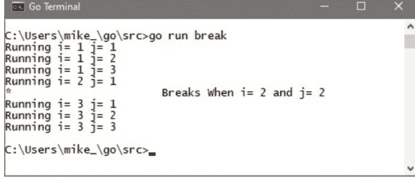

- 6. 现在，在`break`语句之前插入此`continue`语句——跳过内层循环的第二次迭代。

```go
if i == 3 && j == 2 {
    fmt.Printf("Continues when i=%d, and j=%d\n", i, j)
    continue
}
```

- 7. 保存更新的文件，然后再次运行一次程序，只查看内层循环的第二次迭代。

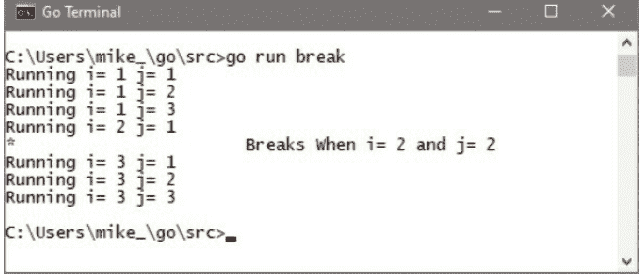


在这里，当外层循环尝试第二次运行时运行时，`break`语句停止了内层循环的第二次和第三次迭代。


在这里，`continue`语句在外层循环尝试第三次运行时，仅仅跳过了内层循环的第二次迭代。

## 跳转到标签

`goto`关键字乍看起来是一个很棒的功能，因为它允许程序流跳转到代码中任何位置的标签，就像网页上的超链接一样。然而，实际上这会导致错误，它的使用是不被鼓励的，且通常被认为坏习惯。


`goto`跳转是一项在计算机程序中存在几十年的强大功能，但它的力量被早期的程序员滥用了，他们创建了以不可理喻的方式到处跳转的程序。这产生了不可读的程序代码，因此`goto`的使用变得不再流行。

通常，程序可能会执行一系列语句，然后一个`goto`语句跳转回序列开头的标签以重复其执行。此外，在序列的某处可能会测试一个条件，如果未满足条件，另一个`goto`语句可能会跳转到序列之后的某个点。通过这种方式，程序代码产生了许多令人困惑的`goto`语句和标签。

`goto`关键字的一个可能用途是通过跳转到紧邻其块结束后的标签来整洁地退出内层循环。这会立即退出两个循环，因此不再执行后续的迭代。

- 从一个执行三次迭代的循环开始一个`main`函数。

```go
func main() {
  for i := 1; i <= 3; i++ {
    // 在此处插入内层循环。
  }
}
```


跳转到标签

- 插入一个执行三次迭代的内层循环。

```go
for j := 1; j <= 3; j++ {
    fmt.Println("Running i=", "j=", j)
}
```

- 将程序文件保存在`jump`目录中，然后运行程序查看每次循环迭代的输出。

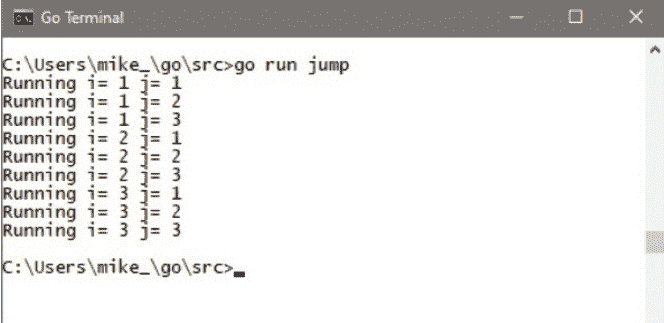

跳转到标签

- 在内层循环块结束处之后添加`goto`语句。

```go
if i == 2 && j == 2 {
    goto end
}
```

- 现在，在外层循环的`}`括号之后添加标签`end`。

```go
end:
```

保存更新的文件，然后再次运行程序，查看当条件为真时如何结束循环。

```text
C:\Users\mike\_go\src>go run jump
Running i=1 j=1
Running i=1 j=2
Running i=1 j=3
Running i=2 j=1
Running i=2 j=2
C:\Users\mike\_go\src>_
```

# 5 函数

## 函数概述

本章演示了如何将语句封装在函数内部，以便在 Go 程序调用该函数时执行这些语句。

- 创建基础函数
- 添加参数
- 传递引用
- 返回值
- 递归调用
- 匿名封装
- 传递函数
- 处理错误
- 分离文件
- 总结

## 创建基础函数

书中的之前的示例使用了强制性的`main()`函数以及 Go 标准库中包含的函数，例如“fmt”包中的`fmt.Println()`函数。然而，大多数 Go 程序都包含许多自定义函数，这些函数可以在程序执行期间根据需要进行调用。


函数块包含一组语句，每当该函数被调用时，这些语句就会被执行。一旦函数执行执行，程序流将从函数调用后的直接后续点继续执行。这种模块化在 Go 编程中非常有用，它可以隔离出根据需要重复调用的代码序列。

要在 Go 程序中添加自定义函数，必须使用`func`关键字进行声明，后跟一个你选择的名称——遵循与变量名相同的命名规范。

| 命名规则 | 示例 |
|---|---|
| 不能是 Go 关键字 | `default` |
| 不能包含算术运算符 | `a+b*c` |
| 不能包含标点符号字符 | `%$@!` |


| 不能包含任何空格 | no spaces |
| --- | --- |
| 必须以字母开头 | msg |
| 在其他地方可以包含数字 | good1 |
| 可以包含混合大小写 | camelCase |

在选择函数名时，它应该描述函数的用途，但要简洁。函数名后紧跟`()`括号和一个`{`左大括号，它们都在同一行。这一行通常被称为函数的“签名”。要执行的语句包含在函数体中，函数体以`}`右大括号结束——就像`main`函数一样。可以通过写出函数名并后跟`()`括号在程序中调用该函数。


除非该函数要被导出，否则函数名应该以小写字母开头——参见此处。

1. 创建一个函数，每次被调用时简单打印一条消息：

```go
func first() {
  msg := "Hello from the 1st function!"
  fmt.Println( msg )
}
```


2. 创建另一个函数，每次被调用时简单打印乘法的结果：

```go
func sqFive() {
  fmt.Printf("%v\n", 5 * 5)
}
```

3. 接下来，添加一个`main`函数，其第一条语句调用第一个函数以打印其消息：

```go
func main() {
  first()
  // 在此处插入语句。
}
```

4. 现在，插入语句显示乘法和并打印其结果：

```go
fmt.Print("5 x 5 = =")
sqFive()
```

5. 将程序文件保存到“funcs”目录中，然后运行程序以查看打印输出。

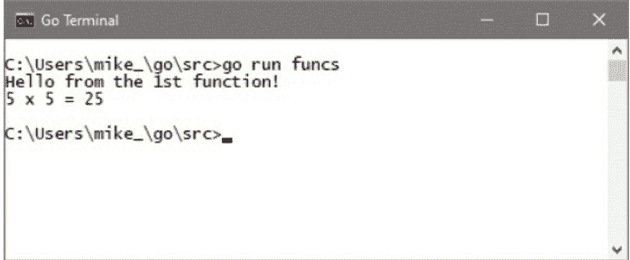


列出的代码假设你已经在每个程序的开头声明了`package main`和`import “fmt”`。


在函数或其他块内部声明的变量仅从该块内部访问——它们具有“局部作用域”。例如，在这里，`msg`变量只能在`first()`函数内部访问。在函数块外部声明的变量可以在程序的任何地方访问——它们具有“全局作用域”。最好只使用局部变量，以避免与全局作用域中存在的变量发生可能的冲突。

## 添加参数


函数声明中函数名后的`()`括号可以可选包含一个用逗号分隔的“参数”列表。这些变量可以被函数使用，但它们的初始内容由调用者提供。每当函数被调用时，变量就会被创建，并在控制退出函数时被销毁。每个参数必须赋予一个你选择的名称（遵循通常的变量命名规范）以及一个类型，如下语法：

```go
func functionName (paramName type, paramName type ) {

  statements-to-be-executed
}
```

多个连续的相同类型的参数可以声明为列表，并且只需要在相同类型的最后一个参数之后指定类型，如下所示：

```go
func functionName ( paramName, paramName type ) {

  statements-to-be-executed
}
```

每个函数必须为每个参数指定正确类型的内容，且顺序与它们在函数声明中出现的相同。传递给函数的内容被称为“参数”。它们在调用时作为函数名后的`()`括号内以逗号分隔的列表进行指定：

```go
functionName ( argument, argument, argument )
```

与其他某些编程语言不同，Go没有为函数参数指定默认内容的方法。

在Go编程中，非常重要的一点是，参数默认是“按值传递”的——函数接收的是参数的副本，而不是原始参数。这意味着对参数变量所做的更改默认情况下不会影响调用者指定的原始参数——它们只会影响副本。

- 创建一个需要单个整数参数并显示其值的函数：

```go
func square(num int) {
	fmt.Println("Received Copy:", num)

	// 在此处插入语句。
}
```


`src/main.go`

- 接下来，插入语句修改接收到的参数并显示其值：

```go
num = num * num
fmt.Println("Modified Copy:", num)
```

- 开始一个`main`函数，声明并初始化一个变量，然后显示其值：

```go
func main() {
	num := 5
	fmt.Println("Original:", num)
	// 在此处插入语句。
}
```

- 现在，在`main`函数中插入语句调用函数并再次显示其值：

```go
square(&num)
fmt.Println("Original:", num)
```

- 5. 将程序文件保存到“args”目录中，然后运行程序以查看原始值未变。

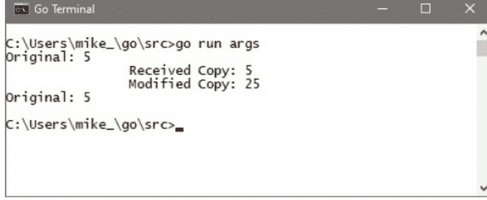

你还可以创建接受任意数量参数的“变变函数”——参见此处示例。

## 传递引用

此示例演示了在Go中参数默认是“按值传递”的——函数接收的是参数的副本，而不是原始参数。但很多时候你可能希望函数修改原始参数。这可以通过向函数传递值的引用而非值的副本来实现。


记住，指针是对存储了值的内存地址的引用。这意味着如果你向函数传递指针参数，它将能够修改位于所提供地址上的原始值。

在声明可以接收指针参数的函数时，其参数列表中指定的数据类型必须以`*`号为缀，以指示该参数将是一个指针，如下：

```go
func functionName ( paramName *type ) {
  statements-to-be-executed
}
```

函数语句可以通过在参数名前加上`*`号作为解引用符来访问并修改所提供地址的值。

在调用接受指针参数的函数时，参数必须以`&`字符为前缀，以引用存储值的内存地址。

同时也包含了下一章将引入的`struct`类型。这些都是“值类型”，因此在将它们传递给函数时，需要指针来访问它们包含的原始值。

这种技术不能用于指针类型或函数类型（是的，函数在Go中也是类型），也不适用于本书后面演示的slice、map或channel类型。这些都已经是“引用类型”，因此在将它们传递给函数时，不需要指针来访问它们包含的原始值。


返回此处以复习指针的工作原理。

- 创建一个需要单个整数指针参数的函数，并显示其值：

```go
func square(num *int) {
	fmt.Println("Received Address:", num)
	// 在此处插入语句。
}
```


`src\refs\main.go`

- 接下来，插入语句来修改接收到的参数并显示其新值：

```go
num = *num *num
fmt.Println("Modified Original:", *num)
```

- 开始一个`main`函数，声明并初始化单个变量，然后显示其值：

```go
func main() {
	num := 5
	fmt.Println("Original:", num )
	// 在此处插入语句。
}
```

- 4. 现在，在`main`函数中插入语句调用另一个函数，并再次显示其变量值`square(&num)`：

```go
fmt.Println("Original:", num )
```

- 5. 将程序文件保存到“refs”目录中，然后运行程序查看原始值是否已更改。

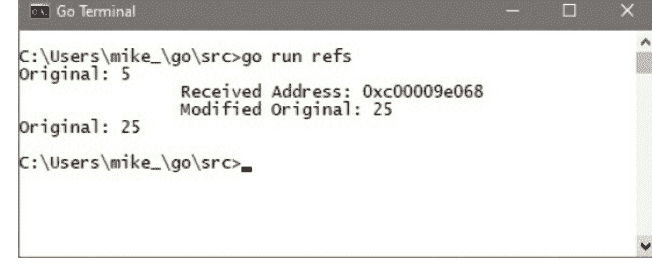


如果你需要在函数调用中传递存储值的内存地址，请在传递指针参数时添加`&`符号。

# 返回值

本章目前为止描述的函数在函数调用后的下一个语句处恢复程序流，但让函数在继续执行后续语句之前向调用者返回一个值通常是很有用的。


在声明将返回值的函数时，函数签名必须在参数列表之后定义返回值的数据类型。要返回的值通常在函数体末尾通过Go的`return`关键字进行指定。返回单个值的函数语法如下：

```go
func funcName ( paramName type ) returnType {
    statements-to-be-executed
    return returnValue
}
```

与大多数只能返回一个值的编程语言不同，Go语言中的函数可以返回多个值。当你想返回多个值时，必须在参数列表后的括号中，以逗号分隔的列表形式指定每个值的数据类型。要返回的值通常在函数体末尾通过Go的`return`关键字进行指定。返回两个值的函数语法如下：

```go
func funcName ( paramName type ) ( returnType, returnType ) {
    statements-to-be-executed
    return returnValue, returnValue
}
```

传递给`return`关键字的值必须与函数签名中指定的类型相同，并且必须以相同的顺序列出。

如果你调用一个返回多个值的函数但没有在后续代码中使用所有返回值，编译器将产生“declared but not used”的消息，程序将无法运行。为了避免这种情况，你可以将`_`赋值给任何不需要的返回值。这在Go编程中被称为空白标识符。


Go标准库中的许多函数返回多个值，特别是返回结果和错误。

1. 创建一个需要单个整数参数并向调用者返回三个值的函数：

```go
func cube(num int ) ( string, int ) { return "Result", num * num }
```


`src\returns\main.go`

2. 添加一个`main`函数，将三个返回值赋值给三个变量，然后只显示两个值：

```go
func main() { a, b, c := cube( 5 ) fmt.Println(b, "Cubed =", c) }
```

将程序文件保存到“returns”目录中，然后运行程序查看编译器错误：

```text
Go Terminal
C:\Users\mike_go\src>go run returns
# returns:main.go:7: a declared but not used
C:\Users\mike_go\src>
```

在`main`函数中修改赋值，将第一个返回值赋值给空白标识符：

```go
func main() {
  _, b, c := cube(5)
  fmt.Println(b, "Cubed", c)
}
```

再次保存程序文件，然后运行程序查看输出中的返回值：

```text
Go Terminal
C:\Users\mike_go\src>go run
$ Cubed = 125
C:\Users\mike_go\src>
```


返回的“Result”字符串在输出中未使用。

# 递归调用

自定义函数中的语句可以自由地调用其他自定义函数，就像调用`fmt.Printf()`等标准库函数一样。此外，函数可以递归地调用自己。递归调用必须修改表达式以避免持续执行——这样函数会在某个点退出。


递归调用可以模拟循环结构，例如倒计时示例：

- 创建一个需要整数参数并进行递归调用直到该值减到零的函数：

```go
if num < 1 {
    fmt.Println("Off!")
} else {
    fmt.Println("Countdown", num)
    countdown(num)
}
```


`src\recur\main.go`

- 添加一个`main`函数，包含一个调用上述函数的语句：

```go
func main() {
    countdown(10)
}
```

将程序文件保存到“recur”目录中，然后运行程序查看递归调用模拟循环：

```text
C:\Users\mike_go\src>go run recur
Countdown 10
Countdown 9
Countdown 8
Countdown 7
Countdown 6
Countdown 5
Countdown 4
Countdown 3
Countdown 2
Countdown 1
Off!
C:\Users\mike_go\src>
```

递归函数用于解决数学问题，例如计算给定数字的阶乘。阶乘是从给定数字到1的所有整数的乘积——例如3的阶乘是6（`3 * 2 * 1`）。

- 创建一个需要整数参数并在每次调用时返回一个值的函数：

```go
func facto(num int) int {
    // 在此处插入语句。
}
```

`src\facto\main.go`

- 接下来，插入一个语句在参数值减到零（0）时返回一个（1）：

```go
if num == 0 {
  return 1
}
```

- 然后，插入最后一个语句来递归调用函数，乘以序列中的所有数字：

```go
return num * facto(num - 1)
```

- 添加一个`main`函数，包含一个打印七个阶乘的语句：

```go
func main() {
    for i:=1; i<=7; i++ {
        fmt.Println("Factorial", i, "=", facto(i))
    }
}
```

- 将程序文件保存到“facto”目录中，然后运行程序查看阶乘序列。

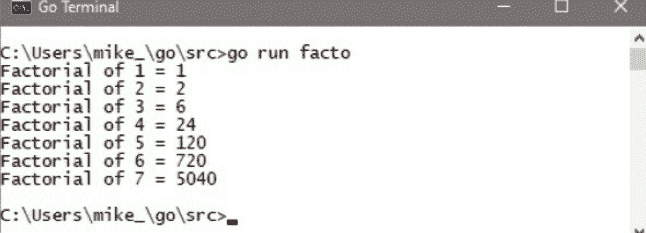


递归函数是有用的，但并不高效。这个示例调用了`facto()`函数35次来生成这7个阶乘的序列！

# 匿名闭包

Go语言支持“一等函数”。这允许函数被赋值给变量、作为参数传递给函数以及从函数返回。


# 匿名函数

匿名函数只是不包含名称函数定义。这对于内联创建函数而无需命名非常有用。匿名函数也称为“函数字面量”。与其它函数一样，这些可以包含参数列表、返回类型列表并返回多个值。通过在函数定义末尾附加`()`调用运算符可以创建一个自执行匿名函数表达式，如下：

```go
func() { fmt.Println("Function Literal") } ()
```

此外，匿名函数可以赋值给变量，通过在变量名后附加`()`调用运算符进行调用，如下：

```go
fn := func() { fmt.Println("Function Literal") }
()
```


自执行函数表达式只执行一次语句。

## 闭包

匿名函数最有用的用途可能是创建“闭包”。闭包是嵌套在外部函数内部的函数，它保留了对外部函数中声明变量的访问。外部函数可以返回一个保留变量访问的匿名函数，但关键是，这些变量在程序代码的任何地方都是无法访问的。这是封装的形式，当返回的匿名函数“捕获”这些变量时，保护了存储在这些变量中的数据。

通过在外部函数定义末尾添加`()`调用操作符，可以使闭包变为自执行模式并赋值给变量。然后，可以在变量名后添加`()`调用操作符来调用匿名内部函数——并且它可以访问外部函数中的持久值。

理解闭包的概念可能会困难，因为看起来当自执行函数执行完成后，外部函数中的变量应该被销毁。


如果你不能立即理解闭包的工作，不要担心。它们起初看起来很神秘，但随着经验的增加会变得清晰。你可以继续下去，稍后来看这项技术。

- 通过将匿名函数赋值给变量来开始主函数：

```go
func main() {
    area := func(length, width int) int {
        return length * width
    }
```

接下来，插入语句显示匿名函数的类型和转换的返回值。


```go
fmt.Printf("area Type: %T \n", area)
fmt.Println("Area 1:", area(10, 4))
fmt.Println("Area 2:", area(12, 5))
```

现在，插入语句将匿名自执行闭包函数赋值给变量：

```go
counter := func() func() int {
    num := 0
    return func() int {
        num++
        return num
    }
}
```

最后，插入语句显示闭包函数的类型和三个返回值：

```go
fmt.Printf("counter type: %T \n", counter)
fmt.Println("Count:", counter())
fmt.Println("Count:", counter())
fmt.Println("Count:", counter())
```

将程序文件保存在`anon`目录中，然后运行程序查看函数类型和返回值。

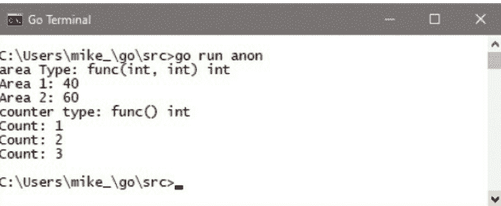


注意，外部函数必须将其返回类型声明为`func() int`，因为它将返回一个函数，该函数转而返回一个整数值。

## 传递函数


## 程序定义的函数类型

此处示例的输出通过签名描述函数，例如`counter type : func() int`。你可以使用`type`关键字声明自定义函数类型，后跟你喜欢的类型名称和函数签名。例如，一个名为`adder`的自定义函数，它必须接收两个整数参数并返回一个整数参数，如下：

```go
type adder func(int, int) int
```

然后创建作为自定义函数类型“实例”的变量，并可以分配函数定义——其签名必须与自定义函数类型声明中的匹配。该函数（实例）可以按通常方式调用。

## 高阶函数

接收值或引用参数，并将这些类型返回给调用者的普通函数被称为“一阶”函数。但函数也可以作为参数传递给其他函数，函数也可以向调用者返回函数。任何接受函数作为参数的函数，或任何返回一个或多个函数的函数都被视为“高阶”函数。

将函数传递给其他函数允许在不重复代码的情况下修改操作。

- 通过声明一个自定义函数类型来开始主函数，其签名要求两个整数参数和一个整数返回类型：

```go
func main() {
    type adder func(int, int) int
}
```


`src/libmain.go`

- 接下来，插入语句定义一个自定义函数类型的函数（实例）——具有匹配的签名：

```go
var adder = func(a int, b int) int {
    return a + b
}
```

- 现在，插入一个调用函数（实例）的语句：

```go
fmt.Println("Added:", add(6, 2))
// 在此处插入语句 – 步骤 6-8。
```

- 在主函数之后，开始一个高阶函数，将接收并返回与自定义函数类型签名相同的函数：

```go
dub := func(func(int, int) int) func(int, int) int {
    fmt.Println("Doubled:", twice(6, 2) * 2)
    // 在此处插入语句 – 步骤 5。
}
```

- 现在，插入语句向调用者定义并返回一个相同签名的函数：

```go
div := func(a int, b int) int {
    return a / b
}
```

- 回到主函数，插入语句将函数传递给调用者：

```go
result := div(6, 2)
```

- 最后，插入语句显示闭包函数的类型和三个返回值：

```go
fmt.Printf("counter type: %T \n", counter)
fmt.Println("Count:", counter())
fmt.Println("Count:", counter())
fmt.Println("Count:", counter())
```

注意，外部函数必须将其返回类型声明为`func() int`，因为它将返回一个函数，该函数转而返回一个整数值。


```go
fmt.Printf("area Type: %T \n", area)
fmt.Println("Area 1:", area(10, 4))
fmt.Println("Area 2:", area(12, 5))

fmt.Printf("counter type: %T \n", counter)
fmt.Println("Count:", counter())
fmt.Println("Count:", counter())
fmt.Println("Count:", counter())
```

## 处理错误

在 Go 程序中预判错误是非常重要的。Java 和 Ruby 等语言在遇到错误时会抛出“异常”，但 Go 提供了一种更简单的方法。


Go 编程允许你处理返回多个值的函数产生的错误。这有助于识别是哪个函数返回了错误。处理错误的语法可能如下：

```go
func funcName(paramName type) (returnType, error) {
    if condition != true {
        return -1, errorValue
    }
    return returnValue, nil
}
```

如果没有发生错误，函数可以返回期望的值，以及一个`nil`值。在 Go 编程中，`nil`值用于表示许多类型的零值。在这里，它仅表示没有错误。

在示例中提供了`fmt.Println()`和`fmt.Printf()`函数的`fmt`包还提供了返回错误类型的`fmt.Errorf()`函数。它接受与`fmt.Printf()`函数相同的格式说明符，并可以用于返回识别错误位置和性质的消息。

Go 标准库还有一个`errors`包，用于操作自定义错误。

1. 创建一个需要整数参数并返回整数值和错误的函数：

```go
func isPosInt(num int) (int, error) {
   // 在此处插入语句
}
```

2. 接下来，插入一个条件测试，根据其值返回错误或参数值：

```go
if num < 1 {
   err := fmt.Errorf("%v not a positive integer", num)
   return -1, err
}
return num, nil
```

3. 现在，添加一个主函数，包含一个递减循环来打印。

将程序文件保存在`err`目录中，然后运行程序以查看测试失败时的错误消息。

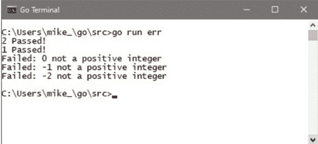

你将看到`if err != nil`，这在许多 Go 程序中作为开始错误处理的标准方式。

## 分离文件

随着你的程序规模的增大，将相关的代码段分离到单独的文件通常是明智的。你可以简单地在与`main.go`文件相同的包目录中添加文件，并通过声明它属于同一个包（`package package`）来提供它。

```go
package main

import (
	"errors"
	"fmt"
)

func IsPositive(num int) (int, error) {
	if num <= 0 {
		return 0, errors.New("number is not positive")
	}
	return num, nil
}

func main() {
	for i := 2; i >= -2; i-- {
		res, err := IsPositive(i)
		if err != nil {
			fmt.Println("Failed", err)
		} else {
			fmt.Println(res, "Passed!")
		}
	}
}
```


请注意，步骤 4 中的语句并没有按照结构体中字段列出的顺序来分配字段值，但使用字段名可以确保值被分配到正确的字段。

## 方法（Attach Methods）


在 Go 编程中，通过在函数签名中添加“接收者”，可以将函数附加到结构体，接收者指定了参数名称和作为类型的结构体名称：

```go
func (paramName structName) funcName()
```

附加到结构体的函数被称为该结构体的“方法”。该方法可以指定为值接收者（它在结构体的副本上操作），或者指定为指针接收者（它在原始结构体字段上操作）：

```go
func (paramName *structName) funcName()
```

这种能力使得结构体能够表示具有属性和行为的现实对象：

- 属性描述了对象拥有的特征。
- 行为描述了对象可以执行的操作。

例如，一辆汽车可以被描述为“蓝色”和“轿跑”属性，以及一个“加速”行为。

这些特征可以用 Go 编程中的一个`car`结构体表示，该结构体包含颜色和车身的字段属性，以及一个附加的`accelerate()`方法。


Go 编程通过定义一个结构体作为模板来创建对象，从该模板可以创建不同的副本或“实例”。

结构体的每个实例都可以通过分配属性值和行为进行自定义，以描述该对象。


与其它某些编程语言不同，Go 没有类，但可以使用结构体来表示对象。

1. 通过创建一个结构体类型来开始程序：

```go
type car struct {
  color string
  body string
}
```


`src\method\main.go`

2. 接下来，为结构体类型附加一个方法：

```go
func (c car ) accelerate() string {
  return "accelerating--"
}
```

3. 现在，通过创建结构体类型的两个实例开始`main`函数：

```go
porsche := car{ color: "blue", body: "coupe" }
bentley := car{ color: "green", body: "saloon" }

// 添加语句显示第一个实例的所有值
fmt.Println("Porsche paint is", porsche.color)
```

将程序文件保存在`method`目录中，然后运行程序查看隐藏的结构体字段。

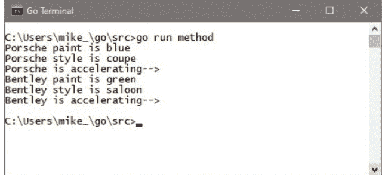


当你调用方法时，Go 会自动处理值和指针之间的转换，因此如果你想让方法能够修改原始结构体字段，此处的接收者可以是`(c *car)`。

## 嵌入结构体（Embed Structs）

由于结构体字段只需用名称和类型进行声明，而结构体也是一种类型，Go 编程甚至允许你通过声明一个字段为结构体类型将一个结构体嵌入另一个结构体。


```go
type Name struct{
    fieldName embeddedStructName
}
```

这对于构建高效使用用途变化的结构体的结构非常有用。例如，取一个仅存储 X 和 Y 坐标的结构体：

```go
type coords struct {
    x, y int
}
```

它可以用于存储图表上的位置、矩形的顶点，或者当嵌入另一个结构体时作为圆的圆心：

```go
type circle struct {
    radius int
    center coords
}
```

现在，当创建`circle`实例时，可以通过链式结构体名称和字段名称来访问嵌入结构体的字段，如下：

`instanceName.center.x`

这是可以接受的，但因为很长所以不太方便。幸运的是，Go 通过支持结构体中的“匿名字段”提供了此问题的解决方案。这些仅仅是指定另一个结构体作为字段但未说明字段名称的字段：

```go
type circle struct {
    radius int
    coords
}
```

此处的优势是允许你缩短访问嵌入结构体字段所需的代码：

`instanceName.x`


匿名字段必须是命名类型，或者是指向命名类型的指针。

1. 通过创建两个结构体类型来开始程序：

```go
type coords struct {
    x, y int
}
type circle struct {
    radius int
    coords
}
```


`src\embed\main.go`

2. 接下来，为第二个结构体附加一个方法：

```go
func ( c circle ) getDiameter() int {
  return c.radius * 2
}
```

3. 现在，通过创建结构体的实例开始`main`函数：

```go
var ring circle
```

4. 添加语句为结构体字段和嵌入结构体字段赋值：

```go
ring.radius = 15
ring.x = 10
ring.y = 20
```

5. 最后，添加语句显示值：

```go
fmt.Printf("Diameter: %v\n", ring.getDiameter())
fmt.Printf("Point X: %v Y: %v\n", ring.x, ring.y)
```

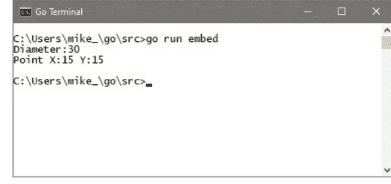

## 封装特性（Encapsulate Features）

结构体字段的声明仅需名称和类型，而结构体是一种类型，Go 编程甚至允许你通过声明一个字段为结构体类型将一个结构体嵌入另一个结构体。


```go
type Name struct{
    fieldName embeddedStructName
}
```

这对于构建高效使用用途变化的结构体的结构非常有用。例如，取一个仅存储 X 和 Y 坐标的结构体：

```go
type coords struct {
    x, y int
}
```

它可以用于存储图表上的位置、矩形的顶点，或者当嵌入另一个结构体时作为圆的圆心：

```go
type circle struct {
    radius int
    center coords
}
```

现在，当创建`circle`实例时，可以通过链式结构体名称和字段名称来访问嵌入结构体的字段，如下：

`instanceName.center.x`

这是可以接受的，但因为很长所以不太方便。幸运的是，Go 通过支持结构体中的“匿名字段”提供了此问题的解决方案。这些仅仅是指定另一个结构体作为字段但未说明字段名称的字段：

```go
type circle struct {
    radius int
    coords
}
```

此处的优势是允许你缩短访问嵌入结构体字段所需的代码：

`instanceName.x`


匿名字段必须是命名类型，或者是指向命名类型的指针。

1. 通过创建两个结构体类型来开始程序：

```go
type coords struct {
    x, y int
}
type circle struct {
    radius int
    coords
}
```


`src\embed\main.go`

2. 接下来，为第二个结构体附加一个方法：

```go
func ( c circle ) getDiameter() int {
  return c.radius * 2
}
```

3. 现在，通过创建结构体的实例开始`main`函数：

```go
var ring circle
```

4. 添加语句为结构体字段和嵌入结构体字段赋值：

```go
ring.radius = 15
ring.x = 10
ring.y = 20
```


- 5 最后，添加语句显示值

```go
fmt.Printf("Diameter: %v\n", ring.getDiameter())
fmt.Printf("Point X: %v Y: %v\n", ring.x, ring.y)
```


## 封装特性（Encapsulate Features）

结构体字段的声明仅需名称和类型，而结构体是一种类型，Go 编程甚至允许你通过声明一个字段为结构体类型将一个结构体嵌入另一个结构体。


```go
type Name struct{
    fieldName embeddedStructName
}
```

这对于构建高效使用用途变化的结构体的结构非常有用。例如，取一个仅存储 X 和 Y 坐标的结构体：

```go
type coords struct {
    x, y int
}
```

它可以用于存储图表上的位置、矩形的顶点，或者当嵌入另一个结构体时作为圆的圆心：

```go
type circle struct {
    radius int
    center coords
}
```

现在，当创建 `circle` 实例时，可以通过链式结构体名称和字段名称来访问嵌入结构体的字段，如下：

`instanceName.center.x`

这是可以接受的，但因为很长所以不太方便。幸运的是，Go 通过支持结构体中的“匿名字段”提供了此问题的解决方案。这些仅仅是指定另一个结构体作为字段但未说明字段名称的字段：

```go
type circle struct {
    radius int
    coords
}
```

此处的优势是允许你缩短访问嵌入结构体字段所需的代码：

`instanceName.x`


匿名字段必须是命名类型，或者是指向命名类型的指针。

- 1 通过创建两个结构体类型来开始程序

```go
type coords struct {
    x, y int
}
type circle struct {
    radius int
    coords
}
```


`src\embed\main.go`

- 2 接下来，为第二个结构体附加一个方法

```go
func ( c circle ) getDiameter() int {
  return c.radius * 2
}
```

- 3 现在，通过创建结构体的实例开始 `main` 函数

```go
var ring circle
```

- 4 添加语句为结构体字段和嵌入结构体字段赋值

```go
ring.radius = 15
ring.x = 10
ring.y = 20
```

- 5 最后，添加语句显示值

```go
fmt.Printf("Diameter: %v\n", ring.getDiameter())
fmt.Printf("Point X: %v Y: %v\n", ring.x, ring.y)
```


## 封装特性（Encapsulate Features）

结构体字段的声明仅需名称和类型，而结构体是一种类型，Go 编程甚至允许你通过声明一个字段为结构体类型将一个结构体嵌入另一个结构体。


```go
type Name struct{
    fieldName embeddedStructName
}
```

这对于构建高效使用用途变化的结构体的结构非常有用。例如，取一个仅存储 X 和 Y 坐标的结构体：

```go
type coords struct {
    x, y int
}
```

它可以用于存储图表上的位置、矩形的顶点，或者当嵌入另一个结构体时作为圆的圆心：

```go
type circle struct {
    radius int
    center coords
}
```

现在，当创建 `circle` 实例时，可以通过链式结构体名称和字段名称来访问嵌入结构体的字段，如下：

`instanceName.center.x`

这是可以接受的，但因为很长所以不太方便。幸运的是，Go 通过支持结构体中的“匿名字段”提供了此问题的解决方案。这些仅仅是指定另一个结构体作为字段但未说明字段名称的字段：

```go
type circle struct {
    radius int
    coords
}
```

此处的优势是允许你缩短访问嵌入结构体字段所需的代码：

`instanceName.x`


匿名字段必须是命名类型，或者是指向命名类型的指针。

- 1 通过创建两个结构体类型来开始程序

```go
type coords struct {
    x, y int
}
type circle struct {
    radius int
    coords
}
```


`src\embed\main.go`

- 2 接下来，为第二个结构体附加一个方法

```go
func ( c circle ) getDiameter() int {
  return c.radius * 2
}
```

- 3 现在，通过创建结构体的实例开始 `main` 函数

```go
var ring circle
```

- 4 添加语句为结构体字段和嵌入结构体字段赋值

```go
ring.radius = 15
ring.x = 10
ring.y = 20
```

- 5 最后，添加语句显示值

```go
fmt.Printf("Diameter: %v\n", ring.getDiameter())
fmt.Printf("Point X: %v Y: %v\n", ring.x, ring.y)
```


## 封装特性（Encapsulate Features）

结构体字段的声明仅需名称和类型，而结构体是一种类型，Go 编程甚至允许你通过声明一个字段为结构体类型将一个结构体嵌入另一个结构体。


```go
type Name struct{
    fieldName embeddedStructName
}
```

这对于构建高效使用用途变化的结构体的结构非常有用。例如，取一个仅存储 X 和 Y 坐标的结构体：

```go
type coords struct {
    x, y int
}
```

它可以用于存储图表上的位置、矩形的顶点，或者当嵌入另一个结构体时作为圆的圆心：

```go
type circle struct {
    radius int
    center coords
}
```

现在，当创建 `circle` 实例时，可以通过链式结构体名称和字段名称来访问嵌入结构体的字段，如下：

`instanceName.center.x`

这是可以接受的，但因为很长所以不太方便。幸运的是，Go 通过支持结构体中的“匿名字段”提供了此问题的解决方案。这些仅仅是指定另一个结构体作为字段但未说明字段名称的字段：

```go
type circle struct {
    radius int
    coords
}
```

此处的优势是允许你缩短访问嵌入结构体字段所需的代码：

`instanceName.x`


匿名字段必须是命名类型，或者是指向命名类型的指针。

- 1 通过创建两个结构体类型来开始程序

```go
type coords struct {
    x, y int
}
type circle struct {
    radius int
    coords
}
```


`src\embed\main.go`

- 2 接下来，为第二个结构体附加一个方法

```go
func ( c circle ) getDiameter() int {
  return c.radius * 2
}
```

- 3 现在，通过创建结构体的实例开始 `main` 函数

```go
var ring circle
```

- 4 添加语句为结构体字段和嵌入结构体字段赋值

```go
ring.radius = 15
ring.x = 10
ring.y = 20
```

- 5 最后，添加语句显示值

```go
fmt.Printf("Diameter: %v\n", ring.getDiameter())
fmt.Printf("Point X: %v Y: %v\n", ring.x, ring.y)
```


## 封装特性（Encapsulate Features）

结构体字段的声明仅需名称和类型，而结构体是一种类型，Go 编程甚至允许你通过声明一个字段为结构体类型将一个结构体嵌入另一个结构体。


```go
type Name struct{
    fieldName embeddedStructName
}
```

这对于构建高效使用用途变化的结构体的结构非常有用。例如，取一个仅存储 X 和 Y 坐标的结构体：

```go
type coords struct {
    x, y int
}
```

它可以用于存储图表上的位置、矩形的顶点，或者当嵌入另一个结构体时作为圆的圆心：

```go
type circle struct {
    radius int
    center coords
}
```

现在，当创建 `circle` 实例时，可以通过链式结构体名称和字段名称来访问嵌入结构体的字段，如下：

`instanceName.center.x`

这是可以接受的，但因为很长所以不太方便。幸运的是，Go 通过支持结构体中的“匿名字段”提供了此问题的解决方案。这些仅仅是指定另一个结构体作为字段但未说明字段名称的字段：

```go
type circle struct {
    radius int
    coords
}
```

此处的优势是允许你缩短访问嵌入结构体字段所需的代码：

`instanceName.x`


匿名字段必须是命名类型，或者是指向命名类型的指针。

- 1 通过创建两个结构体类型来开始程序

```go
type coords struct {
    x, y int
}
type circle struct {
    radius int
    coords
}
```


`src\embed\main.go`

- 2 接下来，为第二个结构体附加一个方法

```go
func ( c circle ) getDiameter() int {
  return c.radius * 2
}
```

- 3 现在，通过创建结构体的实例开始 `main` 函数

```go
var ring circle
```

- 4 添加语句为结构体字段和嵌入结构体字段赋值

```go
ring.radius = 15
ring.x = 10
ring.y = 20
```

- 5 最后，添加语句显示值

```go
fmt.Printf("Diameter: %v\n", ring.getDiameter())
fmt.Printf("Point X: %v Y: %v\n", ring.x, ring.y)
```


你必须在导入的结构体前加上其包名。通过赋值一个（空）结构体字面量也可以创建实例，例如 `box := cube.Dims{}`。

## 组合元素

面向对象编程的第二个基石是继承，在继承中，派生自另一个对象的将继承基类对象的特征。Go 编程通过“组合”实现了这种代码复用。这简单来说是将一个结构体嵌入另一个结构体中的技术，从而立即为第二个结构体提供各种元素。例如，一个 `dog` 结构体可以嵌入一个 `animal` 结构体，其字段和附加方法将立即供 `dog` 结构体使用。


严格来说，这些字段和附加方法并不是真的从基类结构体继承的，而是对第二个结构体可见——也就是说，在某种意义上，它们是“继承”的。

- 通过创建一个包含两个字段的基类结构体来开始程序

```go
type member struct {
    firstName string
    lastName string
}
```


- 接下来，挂载一个方法来返回基类结构体的字段值，并用一个空格连接

```go
func (m member) fullName() string {
    return m.firstName + " " + m.lastName
}
```

- 现在，创建一个包含两个新字段和基类结构体的第二个结构体

```go
type article struct {
  title string
  body string
  member
}
```

接下来，为第二个结构体附加一个方法来输出所有字段值

```go
func (a article) content() {
  fmt.Println("Title:", a.title)
  fmt.Println("Content:", a.body)
  fmt.Printf("Author: %v\n\n", a.fullName)
}
```

通过创建一个基类结构体的实例并使用结构体字面量初始化来开始 `main` 函数


```go
func main() {
  member1 := member {
    "Mike",
    "McGrath",
  } // 在此处插入语句。
}
```

接下来，创建第二个结构体的实例并显示其所有的字段值：

```go
article1 := article {
  "Object Oriented Programming",
  "In Go, Composition emulates Inheritance",
  member1,
}
article1.content()
```

现在，再创建另一个第二个结构体的实例并显示其所有的字段值：

```go
article2 := article {
  "Object Oriented Programming",
  "Coming next... Polymorphism",
  member1,
}
article2.content()
```

将程序文件保存在`inher`目录中，然后运行程序以查看继承字段的值：

```bash
C:\Users\mike_go\src\go run inher
Title: Object Oriented Programming
Content: In Go, Composition emulates Inheritance
Author: Mike McGrath

Title: Object Oriented Programming
Content: Coming next... Polymorphism
Author: Mike McGrath

C:\Users\mike_go\src\>
```


记住，结构体字面量中的所有值都必须以逗号结尾——包括最后一个。

## 满足接口

面向对象编程的第三个基石是“多态”——这个词源自希腊语，意思是“多种形式”，描述了根据上下文为实体分配不同含义或目的的能力。

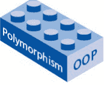

Go 编程通过“接口”类型支持多态，该类型使用`type`关键字创建，后跟自定义名称以及`interface {}`。接口体包含方法签名列表：

```go
type interfaceName interface {
    methodName returnType
}
```

任何拥有与接口中列出的所有方法名称和签名精确匹配方法的结构体，都实现了该接口。在 Go 编程中，它们被称为“满足”了接口。这样做的好处是，它允许程序中的具有相似方法的各种结构体执行不同的任务——即它们是多态的。

1. 通过创建一个列出两个方法签名的接口开始程序，每个方法都不需要参数且都返回一个字符串：

```go
type bird interface {
    speak() string
    move() string
}
```


`src\poly\main.go`

2. 接下来，创建一个空结构体并挂载满足接口的方法：

```go
func (parrot) speak() string {
    return "Squawk, squawk!"
}

func (parrot) move() string {
    return "A parrot flies away."
}
```


注意，你可以从接收者中省略参数名。

3. 现在，创建一个另一个空结构体并挂载满足接口的方法：

```go
type chicken struct{}

func (chicken) speak() string {
    return "Cluck!"
}

func (chicken) move() string {
    return "Chickens cannot fly."
}
```

4. 添加一个接收接口作为参数的函数，并调用其实现的方法：

```go
func nudge(b bird) {
    fmt.Printf("%v \n", b.speak())
    fmt.Printf("%v\n", b.move())
}
```

5. 添加一个`main`函数，包含创建实例的语句：

```go
func main() {
  var bird1 parrot
  var bird2 chicken
  nudge(bird1)
  nudge(bird2)
}
```

6. 将程序保存在`poly`目录中，然后运行程序以查看输出：

```go
struct, then call their like-named methods
func main() {
  var bird1 parrot
  var human1 person
  nudge(bird1)
  nudge(human1)
}
```

将程序文件保存在`astr`目录，然后运行程序以查看不同的输出。

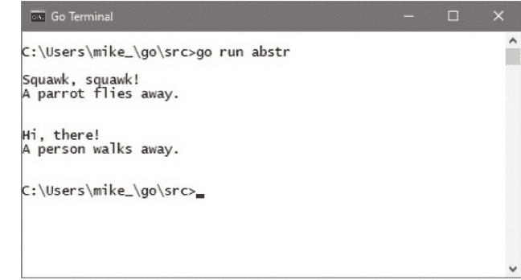


`person`类型的实例将调用步骤 4 中的方法。


方法签名还可以指定参数列表和多个返回值。

## 总结

- 多个相关数据项可以组合在 Go `struct` 类型中。
- `struct` 的`{ }`大括号包含一组名称和类型对的列表，这些字段定义了`struct`将包含的内容。
- `struct`的实例可以作为一个以`struct`名称为类型声明的变量来创建。
- `struct`的单个字段可以通过给`struct`赋值来初始化。
- 通过将结构体字面量赋值给变量名，可以创建并初始化`struct`实例。
- 通过添加接收者可以将函数附加到`struct`，接收者在函数签名中指定`struct`的名称。
- 附加到`struct`的函数称为方法。
- 方法可以是值接收者（在`struct`的副本上操作），也可以是指针接收者（在原始字段上操作）。
- `struct`可以通过其字段属性和附加方法表示真实世界对象的属性和行为。
- `struct`可以作为匿名字段嵌入另一个`struct`中，因此可以直接访问其字段。
- 面向对象编程的三大基石是封装、继承和多态。
- Go 中的封装依赖于包中的数据隐藏，只有大写字母开头的项会被导出。
- Go 中的继承依赖于组合，嵌入的`struct`为嵌入的`struct`提供字段和方法。
- Go 中的多态依赖于其接口类型，接口只包含方法签名的列表。
- 任何具有精确匹配接口方法签名的`struct`都将实现该接口。
- 一个接口可以嵌入另一个接口中，以提供额外的灵活性和进一步的抽象。

# 7 创建数组

本章演示了如何在 Go 程序中在索引元素中存储多个数据项。

- 创建基础数组
- 遍历元素
- 切片数组
- 创建切片
- 切片与数组
- Map 的键和值
- 总结

## 创建基础数组

数组是一个可以存储多个数据项的变量——与只能存储一个数据项的普通变量不同。数据项按顺序存储在标有编号的数组“元素”中，编号从零开始。因此，第一个值存储在元素 0 中，第二个存储在元素 1 中，依此类推。


可以使用`var`关键字后跟你选择的名称，然后是指定所需元素数量的整数`[]`方括号来声明空数组。这些必须后跟元素可以包含的数据类型。声明的语法如下：

```go
arrayName [ nElements ] dataType
```

可以通过在方括号中指定元素编号来为每个可用元素单独分配值：

```go
arrayName [ elementNumber ] = value
```

或者，可以通过在“数组字面量”中列出每个元素的值来声明并初始化数组——这是一个在大括号内分组的、用逗号分隔的列表：

```go
arrayName := [ nElements ] dataType { value, value, value }
```

可以使用数组名后跟包含元素编号的方括号来引用任何单个元素的值。例如，要引用第一个元素中的值：

```go
arrayName [ 0 ]
```

数组的所有元素统称为“索引”。数组可以有多个索引——表示多个维度，而不是普通数组的单维度。具有三个或更多索引的多维数组并不常见，但二维数组常用于存储基于网格的信息，例如坐标。

要创建一个二维数组，只需添加第二对指定所需元素数量的`[]`方括号，如下所示：

```go
var arrayName [ nElements ] [ nElements ] dataType
```

然后可以通过在方括号中指定元素编号为每个可用元素单独分配值：

```go
arrayName [ elementName ] [ elementNumber ] = value
```


数组编号从零开始——所以六个元素数组的最后一个元素是元素 5。这种编号被称为“基于零的”。


可以通过在“数组字面量”中列出每个元素的值来声明并初始化二维数组，如下：

```go
arrayName := [ nElements ] [ nElements ] dataType { value, value }
```

可以使用数组名后跟包含元素编号的方括号来引用任何单个元素的值。例如，引用第一个元素中的值：

```go
arrayName [ 0 ]
```

二维数组可以使用`var`关键字后跟你选择的名称，然后是指定所需元素数量的`[]`方括号来声明。这些必须后跟元素可以包含的数据类型。声明语法如下：

```go
var arrayName [ nElements ] [ nElements ] dataType
```

可以通过在方括号中指定元素编号为每个可用元素单独分配值：

```go
arrayName [ elementName ] [ elementNumber ] = value
```

可以使用数组名后跟包含元素编号的方括号来引用任何单个元素的值。例如，引用第一个元素中的值：

```go
arrayName [ 0 ]
```

空数组可以使用`var`关键字后跟你选择的名称，然后是指定所需元素数量的`[]`方括号。这些必须后跟元素可以包含的数据类型。语法如下：

```go
arrayName [ nElements ] dataType
```

可以通过在方括号中指定元素编号为每个可用元素单独分配值：

```go
arrayName [ elementNumber ] = value
```

或者，通过在“数组字面量”中列出每个元素的值——一个在大括号内分组的、逗号分隔的列表来声明并初始化数组：

```go
arrayName := [ nElements ] dataType { value, value, value }
```

可以使用数组名后跟包含元素编号的方括号来引用任何单个元素的值。例如，引用第一个元素中的值：

```go
arrayName [ 0 ]
```

数组编号从零开始——所以六个元素数组的最后一个元素是元素 5。这种编号被称为“基于零”。


二维数组可以通过在“数组字面量”中列出每个元素的值——一个在大括号内分组的、逗号分隔的列表来声明并初始化：

```go
arrayName := [ nElements ] [ nElements ] dataType { value, value, value }
```

## 遍历数组

`src\range\main.go`

2. 接下来，添加一个语句来确认数组大小：

```go
fmt.Println("No. of Elements:", len(arr))
```

3. 现在，添加一个循环来修改每个元素的值：

```go
for i, v := range arr {
  arr[i] = v / 10
}
```

4. 然后，添加一个循环来引用每个数组元素的值。


```go
for i, v := range arr {
  fmt.Printf("Index: %v Value: %v in", i, v)
}
```

+ 5 将程序文件保存到`range`目录中，然后运行程序查看存储在数组元素的值。

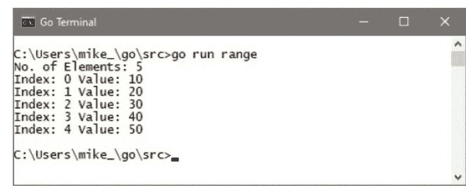

如果你在循环语句中不需要索引号，可以将变量名`i`替换为空标识符`_`以避免错误——参见此处。

## 切片数组（Slice Arrays）

数组是序列，其每个元素包含相同类型的数据，但长度是固定的，因此并不灵活。幸运的是，Go 提供了一种切片类型，它表示一个底层数组，其长度可以更改。


要理解切片类型，重要的是要意识到切片本身不包含任何元素，它仅仅是对实际数组的引用。切片类型仅包含三个部分：

- Ptr（指针）：指向通过切片可以访问的数组中第一个元素的指针（不一定是数组的第一个元素）。
- Len（长度）：切片中元素的总数。
- Cap（容量）：指针所指元素与数组最后一个元素之间的元素个数。

例如，从一个日期名称数组中创建一个周日的切片：

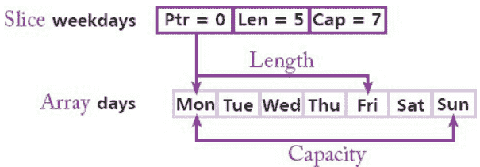

在 Go 编程中，可以通过将数组赋值给指定所需下边界和上边界元素编号的变量来创建切片。这些边界在`[]`方括号之间的`:`冒号周围指定。冒号左侧的数字指定要切片的起始元素的索引号——切片指针将引用该元素。冒号右侧的数字指定上边界的索引号——用于切片所有直到上边界元素但不包括上边界元素的元素。上述所示示例的赋值语句如下：

```go
weekdays := days[0:5]
```

可选地，你可以省略指定上、下边界的数字以使用默认值。下边界的默认值是 0（零），上边界的默认值是数组中元素的总数。


切片在 Go 编程中非常重要，出现的频率比数组类型高得多，但重要的是理解它们是对底层数组的引用。

你可以使用内置的`len()`函数像数组一样获取切片的长度，但你也可以使用内置的`cap()`函数检查切片的容量。将切片的指针值与它指向的数组元素的内存地址进行比较，可以确认该切片确实是一个指针引用。

+ 首先，创建一个七个元素的数组：

```go
days := [7]string{"Mon", "Tue", "Wed", "Thu", "Fri", "Sat", "Sun"}
```


`src\slice\main.go`

+ 创建一个表示最后两个数组元素的切片：

```go
weekend := days[5:]
```

+ 现在，添加语句显示切片的内容和类型：

```go
fmt.Printf("Slice weekend: %v \n", weekend)
fmt.Printf("Type weekend : %T \n", weekend)
```

+ 4 添加语句显示切片的长度和容量：

```go
fmt.Printf("Length weekend: %v \n", len(weekend))
fmt.Printf("Capacity weekend: %v \n", cap(weekend))
```

+ 5 最后，添加语句确认切片是指向底层数组元素的引用：

```go
fmt.Printf("Pointer weekend: %p \n", weekend)
fmt.Printf("Address days[0]: %p \n", &days[5])
```

+ 6 将程序文件保存到`slice`目录中，然后运行程序查看切片的特性。

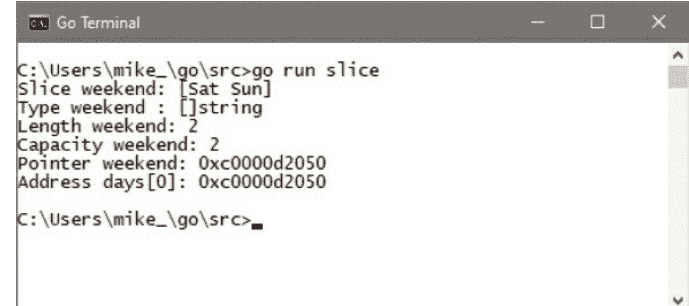


可以看到切片的类型是由空`[]`方括号后跟每个元素可能包含的类型来描述的。

# 创建切片（Make Slices）


创建切片的方法与数组相同，只是不在`[]`方括号之间指定任何元素数量，并且可以使用“切片字面量”进行初始化，使用以下语法：

```go
sliceName := []dataType
```

你也可以使用内置的`make()`函数创建一个空切片，其参数指定切片的长度和（可选的）容量。然后可以给切片赋值：

```go
fruitSlice := make(string, 3)
fruitSlice[0] = "Apple"
fruitSlice[1] = "Banana"
fruitSlice[2] = "Cherry"
```

在任何情况下，当切片的长度超过容量时，Go 会增加底层数组。你可以使用`append()`函数向切片添加元素：

```go
fruitSlice = append(fruitSlice, "Damson")
```

最重要的是，当切片的长度超过底层数组时，Go 会自动增加底层数组。还有一个`copy()`函数可以将一个切片复制到另一个切片，它需要指定源切片和目标切片：

```go
copy(dst, src)
```

如果你想从切片中删除元素并保留剩余元素的顺序，可以使用`copy()`函数将切片移动到位置。这需要指定切片的类型、长度和容量。如下图所示：


变长函数也可以通过切片字面量创建一个切片：

```go
nums := []int{10, 20, 30, 40, 50, 60, 70, 80, 90}
```


`src\make\main.go`

+ 创建另一个切片，并初始化其元素：

```go
more := make([]int, 3)

more[0] = 200
more[1] = 300
more[2] = 400
```

+ 添加一个调用函数描述切片的语句：

```go
describe(more)
```

+ 通过追加值来扩大第一个切片，然后描述修改后的切片：

```go
nums = append(nums, more[0])
describe(nums)
```

+ 5 在`main`函数之后，添加描述切片长度和容量的函数：

```go
func describe(nums []int) {
  fmt.Printf("%v length: %v", nums, len(nums))
  fmt.Printf("Capacity: %v\n", cap(nums))
}
```

+ 6 将程序文件保存到`make`目录中，然后运行程序以查看切片的特性。

变长函数可以接受任意数量的参数，除非你通过将数组元素复制到切片元素来将数组“转换”为切片，否则无法将数组元素传递给变长函数。

# 切片对比数组（Slice Versus Arrays）

数组包含值的序列，而切片包含值序列的引用。这是 Go 编程中的一个重要区别，适用于许多类型。最重要的是，当将类型传递给函数时，基于值的类型将接收原始值的副本，而引用类型将指向原始值。为了让函数操作原始值，因此在传递基于值的类型时需要使用指针，而在传递引用时不需要。

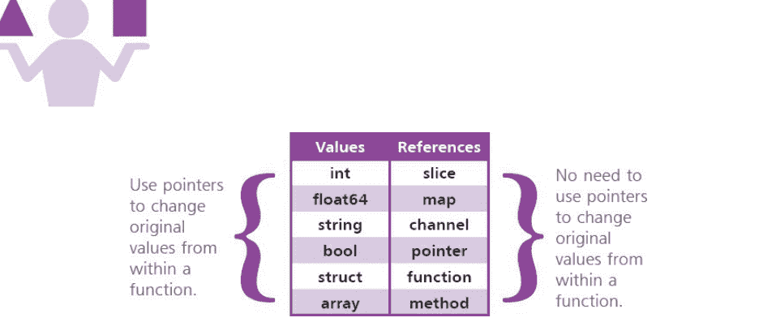

| 值 | 引用 |
| --- | --- |
| `int` | `slice` |
| `float64` | `map` |
| `string` | `channel` |
| `bool` | `pointer` |
| `struct` | `function` |
| `array` | `method` |

变长函数仅仅通过在函数签名中在最后一个参数的数据类型前加上通配符来创建，使用以下语法：

```go
func funcName(paramName ...dataType)
```

变长函数可以像往常一样调用，在`()`括号内包含逗号分隔的参数列表。

变长函数在将切片（slice）元素的值传递给函数时特别有用，因为切片的长度在程序执行过程中可能会发生。无论切片的长度如何，都可以通过在函数调用的括号内指定切片名称后跟`...`通配符，将其元素值传递给变长函数：

```go
funcName(sliceName...)
```


`fmt.Printf()`函数是一个变长函数——它在开头需要一个固定参数，然后接受任意数量的后续参数。

- 创建一个包含三个字符串的数组：

  ```go
  array := [3]string{"BMW", "Ford", "Opel"}
  ```

```text
src\versus\main.go
```

- 将数组元素复制到切片中进行“转换”：

  ```go
  slice := array[:]
  ```

- 接下来，调用变长函数传递切片中每个元素的值：

  ```go
  list(slice...)
  ```

- 现在，向切片中添加两个新值：

  ```go
  slice = append(slice, "Porsche", "Ferrari")
  ```

- 再次调用变长函数传递切片中每个元素的值：

  ```go
  list(slice...)
  ```

- 6 在`main`函数之后，添加变长函数`list`来打印传入的切片元素值：

```go
func list(autos ...string) {
  for i, v := range autos {
    fmt.Printf("\n%v. %v\n", i, v)
  }
  fmt.Println()
}
```

- 7 将程序文件保存到`versus`目录中，然后运行程序查看参数值。

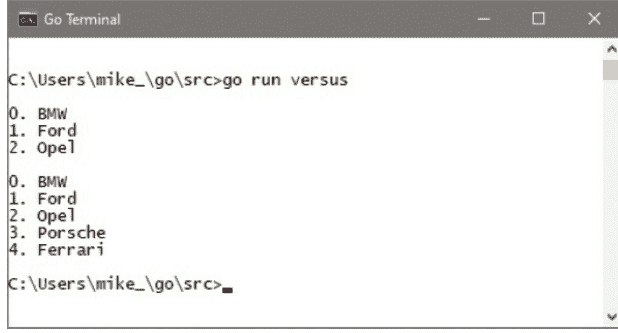


调用变长函数时，你并不是在传递切片本身——你只是传递切片元素的值。

## Map 的键和值（Map Keys and Values）

哈表可以存储带有关联键的多个数据项，以便你可以通过关联键引用存储的值。在 Go 编程中，这种数据结构被称为“map”，但其他编程语言将其称为关联数组或字典。


map 中的所有键（keys）必须是唯一的且数据类型相同。map 中的所有值（values）必须是相同的数据类型，但不一定与键的数据类型相同。

```go
var mapName = map{dataType valueData}
```

可以将单个键/值对赋值给 map，如下：

```go
mapName["keyName"] = value
```

或者，你可以使用内置的`make()`函数来创建 map：

```go
mapName := make(map dataType valueData)
```

此外，你还可以使用这种语法通过赋值“map 字面量”来创建并初始化 map：

```go
mapName := map{dataType valueDataType{
  key: value, key: value, key: value,
}}
```

与数组和切片不同，键/值对是以无序方式存储的，因此你不能使用元素索引来引用存储的值——你必须使用其关联键。

你可以随时向 map 中添加键/值对，并可以使用内置的`delete()`函数移除键/值对。这需要两个参数：指定 map 名称和要删除的键的名称。

与数组和切片一样，你可以使用`range`关键字遍历 map 的所有元素。在这种情况下，返回的是键和值，而不是索引和值。


map 元素不是变量，所以你无法获取其内存地址。

- 1. 创建一个字符串键值的 map：

  ```go
  colors := make(map[string]string)
  ```


`src\map\main.go`

- 2. 使用三个键/值对初始化 map：

  ```go
  colors["Red"] = "#FF0000"
  colors["Green"] = "#00FF00"
  colors["Blue"] = "#0000FF"
  ```

- 3. 接下来，显示 map 中所有的键/值对：

  ```go
  fmt.Printf("InColors: %v\n", colors)
  ```

- 4. 现在，添加一个键/值对并显示其值：

  ```go
  colors["Yellow"] = "#FFFF"
  fmt.Printf("InYellow Hex Code: %v\n", colors["Yellow"])
  ```

- 5 然后，移除添加的键/值对：

  ```go
  delete(colors, "Yellow")
  ```

- 6. 最后，添加循环列出 map 中所有的键/值对：

```go
for k, v := range colors {
  fmt.Printf("\nHex Code for %v is %v\n", k, v)
}
```

- 7 将程序文件保存到`map`目录中，然后运行程序查看参数值。

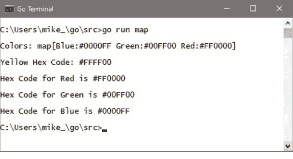


## 总结

- 与数组和切片不同，键/值对是以无序方式存储的，因此你不能使用元素索引来引用存储的值——你必须使用其关联键。
- 你可以随时向 map 中添加键/值对，并可以使用内置的`delete`函数移除键/值对。
- 与数组和切片一样，你可以使用`range`关键字遍历 map 的所有元素。
- map 元素不是变量，所以你无法获取其内存地址。
- map 中的所有键必须是唯一的且数据类型相同。
- map 中的所有值必须是相同的数据类型，但不一定与键的数据类型相同。
- map 可以使用`make()`或 map 字面量创建。

## 获取日期（Get Dates）

Go 标准库`time`包提供了从`Time`类型提取特定字段的功能。

- 获取日期
- 获取时间
- 格式化日期
- 设置日期
- 识别时区

### 年份

```go
y, m, d := dt.Date()
fmt.Printf("Date: %v %v, %v \n", m, d, y)

yr, wk := dt.ISOWEEK()
fmt.Printf("Week No.: %v in %v \n", wk, yr)

dy := dt.YearDay()
fmt.Printf("Day No.: %v \n", dy)
```

将程序文件保存在`date`目录中，然后运行程序查看日期字段值。

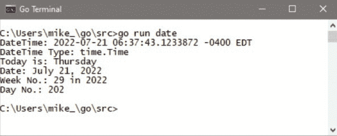


时区值指定了 UTC（通用协调时间）的偏移量以及时区缩写——有关时区的更多信息请查看此处。

## 获取时间

`Time`数据类型各个字段中的时间值可以使用适当的方法检索。例如，可以使用其`Hour()`方法获取小时字段的值。同样，还有`Minute()`、`Second()`和`Nanosecond()`方法来检索`Time`数据类型的其他单独字段。


| 方法 | 返回 |
| --- | --- |
| `Hour()` | 一天中的小时数（0-23） |
| `Minute()` | 小时内的分钟数（0-59） |
| `Second()` | 分钟内的秒数（0-59） |
| `Nanosecond()` | 秒内的纳秒（0-999999999） |

与其他编程语言不同，Go 的`time`包没有提供从`Time`数据类型返回毫秒值的方法。不过，你可以将纳秒值除以一百万来产生相应的毫秒值。

这些方法返回的`Time`数据类型值可以有效地赋值给变量：

| 方法 | 返回 |
| --- | --- |
| `Clock()` | 一天内的时、分、秒 |
| `Unix()` | 自 Unix 纪（1970 年 1 月 1 日 00:00:00 UTC）以来的秒数 |
| `UnixNano()` | 自 Unix 纪（1970 年 1 月 1 日 00:00:00 UTC）以来的纳秒数 |

从在程序中导入 Go 标准库的`time`包开始：

```go
import (
  "fmt"
  "time"
)
```


`src\times\main.go`

接下来，创建一个`Time`数据类型的日期/时间实例，并用当前日期时间初始化：

```go
dt := time.Now()
```


`UnixNano()`方法用于为 Go 随机数生成器提供种子——查看此处示例。

添加语句输出日期/时间实例的所有字段并确认其数据类型：

```go
fmt.Printf("DateTime: %v \n", dt)
fmt.Printf("Date Type: %T \n", dt)
```

接下来，添加语句评估当前小时并显示合适的问候语：

```go
h := dt.Hour()
```


```go
switch {
case hr < 12:
    fmt.Println("Good Morning!")
case hr < 18:
    fmt.Println("Good Afternoon!")
default:
    fmt.Println("Good Evening!")
}
```

现在，添加语句显示当前时间：

```go
h, mn, s := dt.Clock()
fmt.Printf("Time: %v:%v \n", h, mn, s)
```

最后，添加语句显示当前时间的纳秒及其等效毫秒值：

```go
ns := dt.UnixNano()
ms := ns / 1000000
fmt.Println("Nanoseconds:", ns)
fmt.Println("Milliseconds:", ms)
```

将程序文件保存在`times`目录中，然后运行程序查看时间字段值：

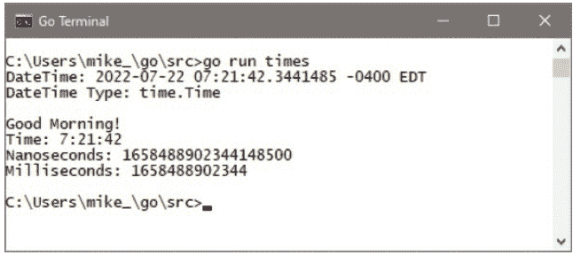


单数字的小、分、秒值默认不返回前导零。

# 格式化日期和时间


`Time`类型各个字段中的日期和时间可以使用多种方式通过其`Format()`方法格式化。它接受一个布局（layout）字符串，用于指定如何格式化日期/时间。格式必须精确使用此参考字符串指定：`Mon Jan 2 15:04:05 2006`。由于 MST（山地标准时间）比 UTC（协调时间）晚 7 小时，参考字符串也可以被视为`01 02 03 04 05 -07`。如果你希望`Format()`方法只返回 hh:mm 格式的日期时间，可以将布局指定为`Mon Jan 2 15:04`或数值`01/02 03`。你可以通过在布局指定长版本`Monday January 2 15:04`来获取日期和月份名称。`time`包包含了预定义的`UnixDate`、`ANSI`和`RFC3339`常量可以作为布局。自定义布局可以按顺序指定组件以适应不同的地区——例如，日期格式。`time`包还包含一个预定义的`Kitchen`常量可以作为布局。这将以 12 小时格式显示时间并适当添加“AM”或“PM”。此外，可以将组件格式化为 24 小时格式，它会自动为单数字小时补零`15:04`。12 小时格式和 24 小时格式都会自动为单数字分钟补零。

 ANSI 指 C 语言的美国标准日期/时间格式。RFC3339 指互联网任务组（IETF）文档。

- 从在程序中导入 Go 标准库`time`包开始：

```go
import (
	"fmt"
	"time"
)
```

```
src\format\main.go
```

- 接下来，创建一个`Time`数据类型的日期/时间实例，用当前日期时间初始化，然后以各种格式显示其组件：

```go
dt := time.Now()
fmt.Println("Default Format:", dt.Format(time.UnixDate))
fmt.Println("ANSI Format:", dt.Format(time.ANSI))
fmt.Println("RFC3339 Format:", dt.Format(time.RFC3339))
fmt.Println("Custom Format:", dt.Format("January 2, 2006"))
```

现在，显示适用于两个地区的日期化组件：

```go
fmt.Println("US Format:", dt.Format("January 2, 2006"))
fmt.Println("UK Format:", dt.Format("2 January 2006"))
```

然后，以 12 小时格式和 24 小时格式仅显示时间组件：

```go
fmt.Println("Time 12-Hour:", dt.Format(time.Kitchen))
fmt.Println("Time 24-Hour:", dt.Format("15:04"))
```

将程序文件保存在`format`目录中，然后运行程序查看格式化的日期和时间字段值：

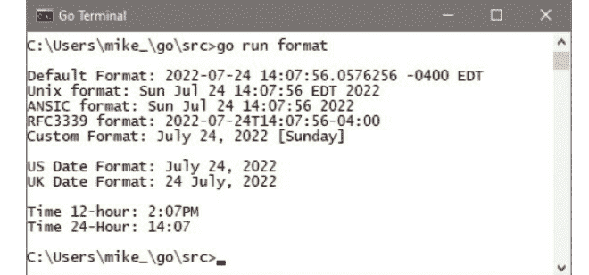


`time.Kitchen`常量等同于指定布局格式为`"15:04PM"`。

# 设置日期和时间

你可以使用 Go 标准库`time`包的`Date()`函数创建自己的`Time`数据类型。这需要八个参数来按此顺序指定：年、月、日、时、分、秒、纳秒和位置。


除了月份和位置外，所有参数都指定为整数值。

月份可以使用`time`包预定义的 1 月至 12 月月份常量之一指定，例如`time.January`。

位置可以使用`time`包预定义的位置常量之一指定，`time.UTC`（通用协调时间）或`time.Local`（系统时钟）。

任何`Time`类型的日期字段可以使用 Go 标准库`time`包的`AddDate()`方法进行修改，指定年、月、日的参数。正值将推进日期，负值将推迟日期。例如，`time.AddDate(1, 0, 0)`将日期推进一年。

同样，`time`包的`Add()`方法用于指定单个持续时间来修改日期/时间。该值可以是表示纳秒数的`int64`值。更方便的是，可以使用`time.Hour`、`time.Minute`、`time.Second`或`time.Millisecond`常量来修改`Time`数据类型的各个时间字段。例如，`time.Add()`。

你还可以使用`Parse()`从字符串创建自己的`Time`数据类型：

Go 标准库`time`包的功能。这需要两个参数来指定布局（layout）和日期/时间字符串。很有用的是，此函数返回两个值：一个`Time`数据类型和一个`error`。如果函数返回`Time`数据类型，则错误值将为`nil`，否则将是一个错误信息。

布局应仅使用 Go 引用字符串中的值：

```
Mon Jan 2 15:04:05 2006 MST
```

除非在日期/时间字符串中指定了时区偏移值（例如 -0500），否则生成的`Time`数据类型将假设为 UTC 时间。


可以使用此处描述的`Format()`方法格式化`Time`数据类型。

1. 首先在程序中导入 Go 标准库`time`包：

```go
import (
"fmt"
"time"
)
```

```
src\setdate\main.go
```

2. 接下来，创建并显示一个初始化为元旦正午的`Time`数据类型实例：

```go
dt = time.Date(2025, time.January, 1, 12, 0, 0, time.Local)
fmt.Printf("InDateTime: %v\n\n", dt)
```

3. 将日期增加两年到美国独立日，然后显示修改后的日期：

```go
dt = dt.AddDate(2, 6, 3)
fmt.Printf("DateTime: %v\n\n", dt )
```

4. 现在，初始化一个布局字符串和一个日期/时间字符串：

```go
layout := "2006-Jan-02 03:04PM"
str := "2030-Dec-25 12:30AM"
```

5. 最后，尝试创建并显示`Time`数据类型的字段，如果尝试失败则显示错误消息：

```go
t, err := time.Parse(layout, str)
if err != nil {
    fmt.Println(err)
} else {
    fmt.Printf("Parsed DateTime: %v\n", t)
}
```

6. 将程序文件保存在`setdate`目录中，运行程序查看日期和时间值字段：

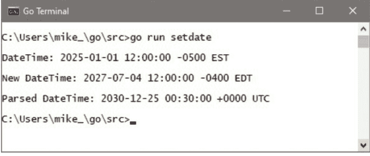


在解析字符串为`Time`数据类型时，布局字符串和日期/时间字符串必须格式相同。


修改后的`Time`字段会自动识别从东部标准时间（EST）到东部夏令时间（EDT）的变化。

# 识别时区

Go 程序中的所有`Time`数据类型都与时区相关。

通常，这将是 UTC 时间，或者基于运行程序的系统的本地本地时间。然而，你可以将另一个位置作为`time.LoadLocation()`函数的参数。位置名称必须对应于互联网数字分配机构（IANA）时区数据库中的文件，例如`"America/New_York"`、`"Asia/Seoul"`或`"Europe/London"`。`time.LoadLocation()`函数返回两个值：一个`Location`类型和一个`error`。如果函数成功返回`Location`类型，则错误值将为`nil`，否则将是一个错误信息。


你可以通过在`Now()`函数之后追加`In()`函数的调用，创建一个另一个时区的当前时间`Time`数据类型，其中位置作为`In()`函数的参数。


你可以通过调用`Zone()`方法来确定与`Time`数据关联的时区。该方法返回两个值：一个三字母的 TZ 时区缩写（例如`"EST"`代表东部标准时间或`"EDT"`代表东部夏令时间），以及一个表示该时区与 UTC 偏移秒数的数值。需要注意的是，时区缩写并不是唯一的，因此你不应仅依赖这些缩写来识别特定的时区。某些时区会在夏令时调整时间，因此你可能需要同时评估 TZ 缩写和偏移以正确识别时区。


IANA 位置名称和 TZ 缩写的列表包含在本书的下载文件中——请参此处。


美国的夏令时间使与 UTC 的偏移减少一小时。例如，东部夏令时间 (EDT) 是 UTC -4 小时，中部夏令时间 (CDT) 是 UTC -5 小时。

1. 首先在程序中导入 Go 标准库`time`包：

```go
import (
  "fmt"
  "time"
)
```

2. 接下来，创建并显示一个初始化为元旦正午的`Time`数据类型实例：

```go
dt = time.Date(2025, time.January, 1, 12, 0, 0, time.Local)
fmt.Printf("InDateTime: %v\n\n", dt)
```

3. 将日期增加两年到美国独立日，然后显示修改后的日期：

```go
dt = dt.AddDate(2, 6, 3)
fmt.Printf("DateTime: %v\n\n", dt )
```

4. 现在，初始化一个布局字符串和一个日期/时间字符串：

```go
layout := "2006-Jan-02 03:04PM"
str := "2030-Dec-25 12:30AM"
```

5. 最后，尝试创建并显示`Time`数据类型的字段，如果尝试失败则显示错误消息：

```go
t, err := time.Parse(layout, str)
if err != nil {
    fmt.Println(err)
} else {
    fmt.Printf("Parsed DateTime: %v\n", t)
}
```

6. 将程序文件保存在`setdate`目录中，运行程序查看日期和时间值字段：


在解析字符串为`Time`数据类型时，布局字符串和日期/时间字符串必须格式相同。


修改后的`Time`字段会自动识别从东部标准时间到东部夏令时间的变化。

# 识别时区

Go 程序中的所有`Time`数据类型都与时区相关。

通常，这将是 UTC 时间，或者基于运行程序的系统的本地时间。然而，你可以将另一个位置作为`time.LoadLocation()`函数的参数。位置名称必须对应于互联网数字分配机构（IANA）时区数据库中的文件，例如`"America/New_York"`、`"Asia/Seoul"`或`"Europe/London"`。`time.LoadLocation()`函数返回两个值：一个`Location`类型和一个`error`。如果函数成功返回`Location`类型，则错误值将为`nil`，否则将是一个错误信息。


你可以通过在`Now()`函数之后追加`In()`函数的调用，创建一个另一个时区的当前时间`Time`数据类型，其中位置作为`In()`函数的参数。


你可以通过调用`Zone()`方法来确定与`Time`数据关联的时区。该方法返回两个值：一个三字母的 TZ 时区缩写（例如`"EST"`代表东部标准时间或`"EDT"`代表东部夏令时间），以及一个表示该时区与 UTC 偏移秒数的数值。需要注意的是，时区缩写并不是唯一的，因此你不应仅依赖这些缩写来识别特定的时区。某些时区会在夏令时调整时间，因此你可能需要同时评估 TZ 缩写和偏移以正确识别时区。


IANA 位置名称和 TZ 缩写的列表包含在本书的下载文件中——请参此处。


美国的夏令时间使与 UTC 的偏移减少一小时。例如，东部夏令时间 (EDT) 是 UTC -4 小时，中部夏令时间 (CDT) 是 UTC -5 小时。

1. 首先在程序中导入 Go 标准库`time`包：

```go
import (
  "fmt"
  "time"
)
```

2. 接下来，创建并显示一个初始化为元旦正午的`Time`数据类型实例：

```go
dt = time.Date(2025, time.January, 1, 12, 0, 0, time.Local)
fmt.Printf("InDateTime: %v\n\n", dt)
```

3. 将日期增加两年到美国独立日，然后显示修改后的日期：

```go
dt = dt.AddDate(2, 6, 3)
fmt.Printf("DateTime: %v\n\n", dt )
```

4. 现在，初始化一个布局字符串和一个日期/时间字符串：

```go
layout := "2006-Jan-02 03:04PM"
str := "2030-Dec-25 12:30AM"
```

5. 最后，尝试创建并显示`Time`数据类型的字段，如果尝试失败则显示错误消息：

```go
t, err := time.Parse(layout, str)
if err != nil {
    fmt.Println(err)
} else {
    fmt.Printf("Parsed DateTime: %v\n", t)
}
```

6. 将程序文件保存在`setdate`目录中，运行程序查看日期和时间值字段：


# 延迟时间

Go 标准库`time`包提供了`Sleep()`函数，允许你通过指定的持续时间来延迟进度。持续时间作为`Sleep()`函数的参数提供。例如，`5 * time.Second`。


Go 标准库还提供了三种方法将`Time`类型实例与另一个时间进行比较。这些方法将根据结果分别返回布尔真或假：

| 方法 | 返回 |
| :--- | :--- |
| `Before(time)` | 如果实例时间早于参数，则返回布尔真 |
| `After(time)` | 如果实例时间晚于参数，则返回布尔真 |
| `Equal(time)` | 如果实例时间和参数表示同一时刻，则返回布尔真 |

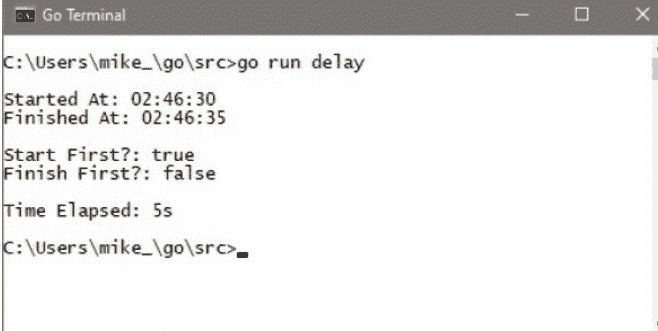


延迟执行的能力在暂停单个“goroutine”时特别有用——更多细节请参见此处示例。

## 总结


# 9

## 数据管理

本章演示了如何使用 Go 标准库中的 `math`、`string` 和 `strconv` 包来处理文本和数字。

- 合并字符串
- 分割字符串
- 查找字符
- 转换字符串
- 计算面积
- 评估数字
- 四舍五入
- 生成随机数
- 总结

## 合并字符串


在 Go 编程中，`string` 是包含在双引号内的一个或多个字符。因此，这些都是有效的 `string` 值：

```
s1 := "My First String"
s2 := ""
s3 := "2"
s4 := "nil"
```

`s2` 的空引号将变量初始化为空 `string` 值。赋值给 `s3` 的数值是该数字的字符串表示。Go 的 `nil` 零值通常表示任何值的缺失，当它包含在引号内时，它仅仅是一个 `string` 字面量。

本质上，`string` 是字符的集合；每个字符都包含自己的数据——就像定义数组中的元素一样。因此，将 `string` 视为字符数组，并在处理 `string` 值时应用数组特性是有逻辑的。内置函数 `len()` 将返回 `string` 中的字符数量，就像它返回数组元素的数量一样。

`+` 运算符可以用于相数值，同时也兼作连接运算符，将多个 `string` 值连接在一起以创建一个单一的合并字符串。

标准库 `strings` 包包含了用于字符串操作的有用函数。其 `Join()` 函数连接（拼接）字符串数组的所有元素，以创建一个单一的合并字符串。该函数需要两个参数：字符串数组的名称，以及放置在合并字符串中每个字符串元素之间的分隔符值。通常，你会指定一个空格作为分隔符，以创建一个由空格分隔的合并字符串。

`fmt.Printf()` 和 `fmt.Println()` 函数向标准输出写入内容，可以向输出添加空格和换行符，但不会更改实际字符串。不过，它们会返回两个值：写入的字节数和任何写入错误。如果没有遇到错误，错误值将像常一样为 `nil`。在英语中，写入的字节数通常代表输出的字符数——包括字符串中包含的非打印字符。


非打印字符 `\t` 制表符的 ASCII 值为 9，非打印字符 `\n` 换行符的值为 10。

- 在程序开始导入 Go 标准库 `strings` 包

```go
import (
  "fmt"
  "strings"
)
```


- `time.LoadLocation()` 函数需要一个 IANA 位置名称参数，`In()` 函数应用位置。
- `time.Sleep()` 函数根据参数指定的持续时间延迟程序的执行。
- `Sub()` 方法返回两个时间之间的持续时间，`Round()` 方法可以指定其精度。
- `time.Date()` 函数用于创建 `Time` 数据类型，需要指定年、月、日、时、分、秒、纳秒和位置的参数。
- `time` 包包含月份名称、小时、分、秒、毫秒和位置的预定义常量。
- `AddDate()` 方法可以修改日期组件，`Add()` 方法可以修改时间组件。


延迟执行的能力在暂停单个“goroutine”时特别有用——更多细节请参见此处示例。

## 总结

- Go 标准库的 `time` 包包含用于创建包含日期、时间和时区字段的 `Time` 数据类型的函数。
- `Time` 类型不是字符串，但可以使用其 `String()` 方法转换为字符串。
- `time.Now()` 函数根据当前位置的系统时间返回当前的日期、时间和时区。
- 可以使用 `Year()`、`Month()`、`Day()` 和 `Weekday()` 方法从 `Time` 类型中提取日期组件。
- `Date()`、`ISOWeek()` 和 `YearDay()` 方法返回可以方便赋值给变量的日期值。
- 可以使用 `Hour()`、`Second()` 和 `Nanosecond()` 方法从 `Time` 类型中提取时间组件。
- `Clock()`、`Unix()` 和 `UnixNano()` 方法返回可以方便赋值给变量的时间值。
- `Format()` 方法接受一个布局字符串或预定义常量作为参数来格式化日期和时间。
- Go 用于日期时间布局的参考字符串为 `Mon Jan 2 15:04:05 2006 MST`。
- `time.Date()` 函数用于创建 `Time` 数据类型，需要指定年、月、日、时、分、秒、纳秒和位置的参数。
- `time` 包包含月份名称、小时、分、秒、毫秒和位置的预定义常量。
- `AddDate()` 方法可以修改日期组件，`Add()` 方法可以修改时间组件。
- `time.LoadLocation()` 函数需要一个 IANA 位置名称参数，`In()` 函数应用位置。
- `time.Sleep()` 函数根据参数指定的持续时间延迟程序的执行。
- `Sub()` 方法返回两个时间之间的持续时间，`Round()` 方法可以指定其精度。

# 9

## 数据管理

本章演示了如何使用 Go 标准库中的 `math`、`string` 和 `strconv` 包来处理文本和数字。

- 合并字符串
- 分割字符串
- 查找字符
- 转换字符串
- 计算面积
- 评估数字
- 四舍五入
- 生成随机数
- 总结

## 合并字符串


在 Go 编程中，`string` 是包含在双引号内的一个或多个字符。因此，这些都是有效的 `string` 值：

```
s1 := "My First String"
s2 := ""
s3 := "2"
s4 := "nil"
```

`s2` 的空引号将变量初始化为空 `string` 值。赋值给 `s3` 的数值是该数字的字符串表示。Go 的 `nil` 零值通常表示任何值的缺失，当它包含在引号内时，它仅仅是一个 `string` 字面量。

本质上，`string` 是字符的集合；每个字符都包含自己的数据——就像定义数组中的元素一样。因此，将 `string` 视为字符数组，并在处理 `string` 值时应用数组特性是有逻辑的。内置函数 `len()` 将返回 `string` 中的字符数量，就像它返回数组元素的数量一样。

`+` 运算符可以用于相数值，同时也兼作连接运算符，将多个 `string` 值连接在一起以创建一个单一的合并字符串。

标准库 `strings` 包包含了用于字符串操作的有用函数。其 `Join()` 函数连接（拼接）字符串数组的所有元素，以创建一个单一的合并字符串。该函数需要两个参数：字符串数组的名称，以及放置在合并字符串中每个字符串元素之间的分隔符值。通常，你会指定一个空格作为分隔符，以创建一个由空格分隔的合并字符串。

`fmt.Printf()` 和 `fmt.Println()` 函数向标准输出写入内容，可以向输出添加空格和换行符，但不会更改实际字符串。不过，它们会返回两个值：写入的字节数和任何写入错误。如果没有遇到错误，错误值将像常一样为 `nil`。在英语中，写入的字节数通常代表输出的字符数——包括字符串中包含的非打印字符。


非打印字符 `\t` 制表符的 ASCII 值为 9，非打印字符 `\n` 换行符的值为 10。

- 在程序开始导入 Go 标准库 `strings` 包

```go
import (
  "fmt"
  "strings"
)
```

（注：由于提供的文本存在大量重复和 OCR 碎片，译文已根据逻辑进行了合并与去重。）

在主函数之后

将程序文件保存在 "split" 目录中，然后运行程序查看子字符串

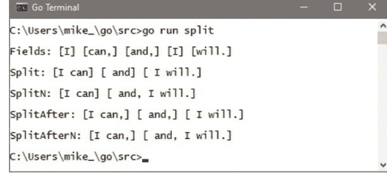


只有名称中包含“After”字样的 split 方法才会保留分隔符。

## 查找字符


Go 标准库的 `strings` 包提供了几个函数，允许对指定的字符串进行搜索，以找到指定的字符或子字符串（模式）。这些函数将字符串视为数组，其中每个元素包含一个字符或空格。

`strings` 包有一个 `Contains()` 函数，它需要两个参数来指定要查找的字符串和模式。该函数将简单地返回 `true` 或 `false` 来表示（区分大小写）搜索的结果。例如，要搜索 "Pro" 模式：

```
strings.Contains("Go Programming in easy steps", "Pro")
```

`strings` 包还有一个 `Index()` 函数，它需要两个参数来指定要查找的字符串和模式。如果搜索成功，该函数将返回一个整数，即该模式在搜索字符串中第一个实例的索引位置；如果搜索失败，它将返回 -1。

`strings` 包的 `Count()` 函数需要两个参数来指定要查找的字符串和模式。你可以使用此函数来发现模式在搜索字符串中出现了多少次非重叠实例。如果模式为空字符串，该函数通常会返回 1 加上搜索字符串中的字符数。这允许你通过从返回的整数中减 1 来确定搜索字符串中的字符数量。

`strings` 包的 `HasPrefix()` 函数需要两个参数来指定要查找的字符串和模式。该函数将返回 `true` 或 `false`，表示搜索字符串是否以指定的模式开头。

同样，`strings` 包的 `HasSuffix()` 函数需要两个参数来指定要查找的字符串和模式，并返回 `true` 或 `false`，表示搜索字符串是否以指定的模式结尾。

你可以使用 `strings` 包的 `Replace()` 函数通过将指定的模式替换为替换子字符串来修改搜索字符串。该函数需要四个参数来指定要搜索的字符串、要查找的模式、替换的子字符串以及一个表示要替换次数的整数。如果你想替换搜索字符串中模式的所有实例，只需将替换次数指定为 -1 即可。


`strings.Index()` 函数在它于搜索字符串中找到模式的第一个实例时就会停止搜索。

- 在程序中开始导入 Go 标准库的 `strings` 包

```go
import (
  "fmt"
  "strings"
)
```

```go
src\find\main.go
```

- 通过初始化字符串变量启动主函数

`str := "I can resist everything except temptation",`

- 接下来

- 现在，统计特定字母在字符串中出现的次数

`fmt.Printf("Count of 'e': %v \n", strings.Count(str, "e"))`

- 然后，测试字符串是否以特定子字符串开头或结尾

`fmt.Printf("Prefix 'ion': %v \n", strings.HasPrefix(str, "ion"))`

`fmt.Printf("Suffix 'ion': %v \n", strings.HasSuffix(str, "ion"))`

- 最后，替换字符串中的一个子字符串

`fmt.Println(strings.Replace(str, "temptation", "chocolate", 1))`

- 将程序文件保存在 "find" 目录中，然后运行程序查看搜索结果

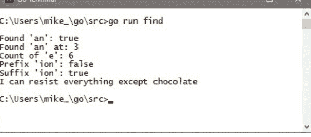

## 转换字符串


Go 标准库的 `strings` 包提供了转换字符串字符大小的函数。

`strings` 包还有一个 `ToUpper()` 函数，它需要一个字符串字符串参数。该函数将简单地返回字符串的副本，将其所有字符都转换为大写字母。

同样，`strings` 包的 `ToLower()` 函数需要一个字符串字符串参数，并返回字符串的副本，将其所有字符都转换为小写字母。

`strings` 包还有一个 `Title()` 函数，它需要一个字符串字符串参数。该函数将返回字符串的副本，将每个单词的第一个字母转换为大写字母——但仅当字符串参数全为小写时才有效。如果你想将混合大小字母的字符串转换为标题格式（title case），必须先使用 `strings` 包的 `ToLower()` 函数将其转换为小写。

当程序在请求数值后接收输入时，输入可能是字符串数据类型，并可能包含用户无意输入的空格。你可以使用 `strings` 包的 `Trim()` 函数移除字符串开头结尾的空格。这需要两个参数来指定要移除的字符串和字符。使用 `strings` 包的 `Trim()` 函数移除字符串开头结尾的空格。一旦字符串中删除了不必要的空格，在程序将其用于算术运算之前，必须将数据类型转换为整数。（*注：此处原文中存在大量重复的 OCR 内容，已按要求进行去重处理翻译*）

完整性。


黄金比例在几何和艺术中多次出现。它是一个线段被切成两个长度不同的部分时的比例，其中长段与短段的长度比例等于整个段与长段的长度比例。

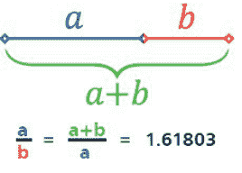

- 1. 开始在程序中导入 Go 标准库的 `math` 包

```go
import (
  "fmt"
  "math"
)
```


`src\area\main.go`

- 2. 声明三个浮点变量

```go
var rad, area, perim float64
```

- 3. 接下来，初始化第一个变量并将其值保留两位小数显示

```go
rad = 4
fmt.Printf("\nRadius of Circle: %.2f \n", rad )
```

- 4. 现在，根据给定的半径计算圆面积，然后将面积保留两位小数显示

```go
area = math.Pi * (rad * rad)
fmt.Printf("InArea of Circle: %.2f \n", area)
```

然后，根据给定的半径计算圆周长，并将周长保留两位小数显示

```go
perim = 2 * (math.Pi * rad)
fmt.Printf("InPerimeter of Circle: %.2f \n", perim)
```

将程序文件保存到 "area" 目录中，然后运行程序查看计算出的值

```
C:\Users\mike\_go\src> run area
Radius of Circle: 4.00
Area of Circle: 50.27
Perimeter of Circle: 25.13
C:\Users\mike\_go\src>
```


参考此处获取更多关于输出中格式化小数的知识。

## 评估数值


Go `math` 包提供了这些这些函数，可用于评估 `float64` 参数：

| 函数 | 返回 |
| --- | --- |
| `math.Abs()` | 绝对值 |
| `math.Acos()` | 反余弦值 |


| 函数 | 返回值 |
| --- | --- |
| `math.Asin()` | 反正弦值 |
| `math.Atan()` | 反正切值 |
| `math.Atan2()` | 距离 X 轴的角 |
| `math.Ceil()` | 向上取整的值 |
| `math.Cos()` | 余弦值 |
| `math.Exp()` | 常数 e 的幂次方 |
| `math.Floor()` | 向下取整的值 |
| `math.IsNaN()` | 布尔值真或假 |
| `math.Log()` | 自然对数值 |
| `math.Max()` | 两个数中较大的一个 |
| `math.Min()` | 两个数中较小的一个 |
| `math.Pow()` | 幂值 |
| `math.Round()` | 最接近的整数值 |
| `math.Sin()` | 正弦值 |
| `math.Sqrt()` | 平方根值 |
| `math.Tan()` | 正切值 |


`math.isnan()` 函数（非数字）用于发现转换为 `float64` 数据类型的值是否确实是一个数字。


`math` 包包含许多更多函数，但这里列出的函数对于许多数学运算都是很有用。可以在 Go 文档 `golang.org/pkg/math` 中发现更多。

- 开始在程序中导入 Go 标准库的 `math` 包：

```go
import (
	"fmt"
	"math"
)
```


`src\maxmin\main.go`

- 接下来，初始化两个变量：

```go
square := math.Pow(5, 2) // 5 的 2 次方 ( 5 x 5 )
cube := math.Pow(4, 3) // 4 的 3 次方 ( 4 x 4 x 4)
```

- 现在，比较变量的正值并显示最大和最小数：

```go
fmt.Println("\nLargest Positive:", math.Max(square, cube))
fmt.Println("\nSmallest Positive:", math.Min(square, cube))
```

- 然后，添加语句反转每个变量的数值极性——将正值变为负值：

```go
square *= -1
cube *= -1
```

最后，比较变量的负值并显示最大和最小数：

```go
fmt.Println("\nLargest Negative:", math.Max(square, cube))
fmt.Println("\nSmallest Negative:", math.Min(square, cube))
```

将程序文件保存到“maxmin”目录中，然后运行程序查看比较后的值。

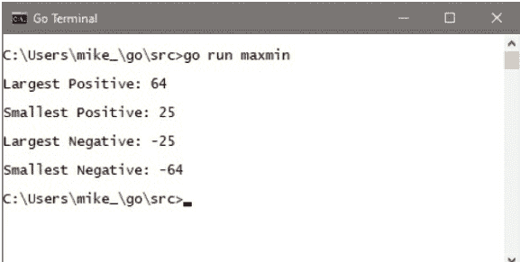


最大的负值是最接近零的。

## 小数四舍五入

Go 标准库 `math` 包提供了许多将小数接近整数的有用函数。这些函数列在下表中，并附有每个函数的简要描述：

| 函数 | 返回 |
| --- | --- |
| `math.Floor(x)` | 小于 x 的整数 |
| `math.Ceil(x)` | 大于 x 的整数 |
| `math.Round(x)` | 接近 x 的整数 |
| `math.Trunc(x)` | x 的整数部分 |

如果你想将一个浮点值减少为仅两位小数，先将浮点值乘以 100，然后使用 `math.Round()` 移除任何小数位，然后除以 100。

乘法、操作、除法的步骤可以写成单独步骤，或者可以使用括号在单个表达式中确定顺序。例如，将名为“num”的变量中的长浮点值可以写为：

```go
num = num * 100
num = math.Round(num)
num = num / 100
```

或者作为：

```go
num = math.Round(num * 100) / 100
```

Go 编程语言具有强大的类型系统，与其他语言不同，它不支持隐式类型转换（即“强制转换”）。然而，你可以在兼容的数据类型之间执行显式类型转换，例如使用 `float64` 和 `int`，使用 `dataType(value)` 语法将值转换为另一种类型。在将浮点值转换为整数时，`math.Round()` 会从中间点向上舍入，所以 `math.Round(7.5)` 返回 8。


- 开始在程序中导入 `math` 包：

```go
import (
	"fmt"
	"math"
)
```


`src\round\main.go`

- 初始化一个浮点变量并显示其值：

```go
var pi float64 = math.Pi
fmt.Println("Pi:", pi)
```

- 接下来，显示浮点值的整数部分：

```go
fmt.Println("Floor:", math.Floor(pi))
fmt.Println("Ceiling:", math.Ceil(pi))
fmt.Println("Round:", math.Round(pi))
fmt.Println("Truncated:", math.Trunc(pi))
```

- 现在，将浮点值减少到两位：

```go
fmt.Println("In:", math.Round(pi * 100) / 100)
```

- 最后，初始化另一个浮点变量并将其转换为整数变量：

```go
var e1 float64 = math.E
fmt.Printf("In: %v %T\n", e1, e1)
var e2 int = int(e1)
fmt.Printf("Cast: %v %T\n", e2, e2)
```

将程序文件保存到“round”目录中，然后运行程序查看四舍五入的小数。

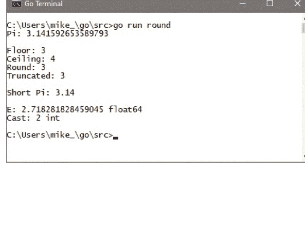

## 生成随机数

Go 标准库包含一个 `rand` 包，提供了生成伪随机数的函数。你可以通过导入 `math/rand` 使之在程序中可用。


`rand.Intn()` 函数返回从 0 到指定参数的随机数。`rand.Perm()` 函数返回从 0 到指定参数整数序列，按伪随机顺序排列。

随机化模式基于默认的“种子”，该种子在每次程序运行时都会返回相同的伪随机顺序。这可能是你需要的，但通常倾向于在每次程序运行时生成不同的顺序。为了实现这一点，你必须指定一个自定义种子作为整数参数传递给 `rand.Seed()` 函数，该种子在每次程序运行时都是唯一的。为了方便，可以使用当前系统时间为此，通过调用 `time.Now()` 函数并使用 `Time` 数据类型的 `UnixNano()` 方法提取自 Epoch 的的纳秒计数。此值在每次程序运行时都是不同的，因此将此整数作为 `rand.Seed()` 函数的参数将确保每次运行时生成不同的伪随机顺序。

- 在程序中导入 Go 标准库 `math/rand` 包，同时包含 `time` 包以设置随机种子以及 `strconv` 包以转换随机数：

```go
import (
	"fmt"
	"math/rand"
	"strconv"
	"time"
)
```


`src\lotto\rand.go`

- 接下来，为随机生成器指定一个唯一的种子：

```go
rand.Seed(time.Now().UnixNano())
```

- 现在，生成一个从 0 到 58 的整数切片：

```go
nums := rand.Perm(59)
```

- 然后，将范围扩大到包含 1 到 59：

```go
for i := 0; i < len(nums); i++ {
	nums[i]++
}
```


在计算中，纪元时间（Epoch）是 1970 年 1 月 1 日午夜。

- 在格式化字符串中，在连字符周围按伪随机顺序分配前六个数字：

```go
str := "InYour Six Lucky Numbers: "

for i := 0; i < 6; i++ {
	str += strconv.Itoa(nums[i])

	if i == 5 {
		str += " "
	}
}
```

- 最后，显示格式化后的字符串：

```go
fmt.Println(str)
```

- 将程序文件保存在“lotto”目录中，然后反复运行程序以查看不同的随机数。

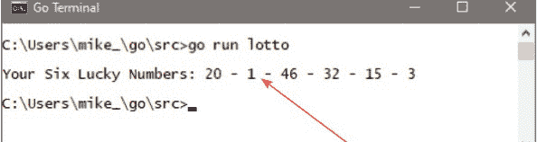

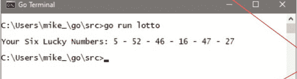

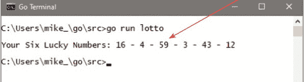

这里的随机数范围是 1 到 59——用来玩英国乐透游戏或美国纽约乐透游戏。


必须将 `int` 数字转换为 `string` 数据类型以便进行拼接。

## 总结

- 字符串是字符的集合，类似于数组中的元素。
- 内置函数 `len()` 返回指定作为参数的字符串中的字符数量。
- `strings` 包包含用于字符串操作的函数，例如 `Join()` 拼接函数。
- `Fields()` 和 `Split()` 函数根据指定参数返回子字符串数组。
- `Contains()` 和 `Index()` 函数可用于在字符串参数中查找指定的子字符串。
- `Count()` 函数报告子字符串在指定参数中出现的次数。
- `HasPrefix()` 和 `HasSuffix()` 函数可用于识别字符串参数的开头和结尾。
- `Replace()` 函数可以替换子字符串。
- 使用 `ToUpper()`、`ToLower()` 和 `ToTitle()` 函数可以更改字符的大小写。
- `Trim()` 函数可以去除前导和后缀空格。
- `strconv` 包包含 `Atoi()` 和 `Itoa()` 函数，用于字符串和 `int` 数据类型之间的转换。
- `math` 包包含数学函数，如 `math.Pow()`，以及数学常数，如 `math.Pi`。
- `math/rand` 包提供了生成伪随机数的函数。
- `rand.Perm()` 函数返回一个从 0 到指定参数数字的随机整数序列。
- `rand.Seed()` 函数可以为随机数生成器指定自定义种子整数。
- 通过调用 `time.Now().UnixNano()` 函数，可以在每次程序运行时指定一个唯一的随机种子。

# 10

# 处理输入

本章演示了如何处理用户输入，以及如何使用 Go 标准库中的 `os`、`bufio` 和 `ioutil` 包来读取和写入文件。

- 获取用户输入
- 缓冲输入
- 命令
- 读取文件
- 写入文件
- 使用临时文件
- 总结

## 获取用户输入

之前的示例说明了如何在程序中使用变量来存储文本值、数值整数和浮点小数值以及布尔值。现在，它们可以用来创建一个猜数字游戏，通过存储一个用户必须猜测的生成的随机整数、一个能正确结束游戏的布尔值，以及一个包含用户猜词的变量。


熟悉的 Go 标准库 `fmt` 包提供了 `Scan()`、`Scanln()` 和 `Scanf()` 函数从标准输入读取内容：

- `fmt.Scan()` 存储直到换行符为止的空格分隔的值。
- `fmt.Scanln()` 存储直到换行符为止的空格分隔的值。
- `fmt.Scanf()` 使用指定的格式存储空格分隔的值。

这些函数中的每个都返回两个值，即扫描的项数和任何读取错误。如果没有遇到错误，错误值将像往常一样为 `nil`。每个函数都需要一个或多个参数来指定变量的地址。

猜数字游戏程序可以使用 `fmt.Scan()` 函数将输入的整数赋值给变量，并将其值与生成的随机整数进行比较。

1. 首先在程序中导入 `fmt`、`math/rand` 和 `time` 包：

```go
import (
	"fmt"
	"math/rand"
	"time"
)
```


现在，通过 `time.Now().UnixNano()` 为随机生成器设置种子：

```go
rand.Seed(time.Now().UnixNano())

num = rand.Intn(20) + 1

var guess int

var flag = true
```

请求整数。

最后，添加一个循环来反复请求整数直到匹配：

```go
for flag {
	err := fmt.Scan(&guess)

	if err != nil {
		fmt.Println(err)
	} else if guess > num {
		fmt.Print("太大了，再次尝试：")
	} else if guess < num {
		fmt.Print("太小了，再次尝试：")
	} else {
		fmt.Printf("猜对了！数字是 %d", num)
		flag = false
	}
}
```


注意在使用 `fmt.Scan` 时使用变量的地址。将程序文件保存在“scan”目录中，然后反复运行程序以查看不同的随机数。

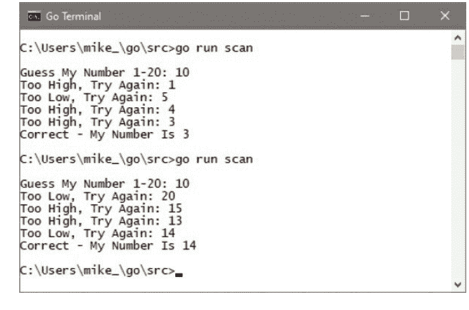

## 缓冲输入

当你想要将输入数据收集到缓冲区时，使用 `bufio` 包通常是更好的。`bufio` 提供了一个 `Scanner` 类型，它具有许多实用方法处理数据流。


`Scanner` 实例首先通过指定源到 `bufio.NewScanner()` 函数创建。如果源是用户输入，你可以导入 `os` 包并将 `os.Stdin` 作为参数。

`Scanner` 实例有一个 `Scan()` 方法读取所有用户输入，并有一个 `Text()` 方法返回读取到的单个字符串值。

`Scanner` 实例还有一个 `Err()` 方法，可以返回任何读取错误。如果没有遇到错误，错误值将像往常一样为 `nil`。在调用 `Scan()` 方法之后检查错误是有用的。

如果你想将输入拆分为独立的字符串项，可以导入 `strings` 包并将输入传递给 `Fields()` 函数来拆分字符串。

1. 首先在程序中导入 `bufio`、`os` 和 `strings` 包：

```go
import (
	"bufio"
	"fmt"
	"os"
	"strings"
)
```

`src\buffer\main.go`

2. 接下来，请求用户输入：

```go
fmt.Print("输入文本：")
```

3. 现在，创建一个 `Scanner` 实例将用户输入存储在缓冲区中，然后读取用户输入：

```go
scanner := bufio.NewScanner(os.Stdin)
scanner.Scan()
```

4. 然后，如果发生错误则输出该错误：

```go
if scanner.Err() != nil {
	fmt.Println(scanner.Err())
} else {
	fmt.Println(scanner.Text())
}
```

5. 接下来，创建一个新的 `Scanner` 实例在缓冲区存储其他用户输入：

```go
fmt.Print("输入文本：")

scanner = bufio.NewScanner(os.Stdin)
scanner.Scan()
```

6. 然后，将用户输入的单个项存储在切片的独立元素中：

```go
words := strings.Fields(scanner.Text())
```

7. 最后，如果发生错误则输出错误，或者列出用户输入的单个项：

```go
if scanner.Err() != nil {
	fmt.Println(scanner.Err())
} else {
	for i, v := range words {
		fmt.Printf("%%v: %v\n", i, v)
	}
}
```

```text
C:\Users\mike_\go>go run buffer

Enter Text:C++ Programming in easy steps

C++ Programming in easy steps

Enter Text:Go Programming in easy steps

0: Go

1: Programming

2: in

3: easy

4: steps

C:\Users\mike_\go>_
```


`if` 条件测试的实现方式：`Scan()` 方法在读取输入时返回一个布尔值 `true`，而在到达输入末尾时返回 `false`。

# 命令行标志

运行程序的命令可以识别任意数量的参数，因此你可以在运行程序时向程序传递一个空格分隔的参数值列表。Go 标准库中的 `os`（操作系统）包提供了一个 `Args` 切片，它将这些参数值存储在各个元素中。你可以通过导入 `os` 包来让你的程序可以使用这些功能。


需要注意的是 `os.Args` 中的第一个元素始终包含你的程序路径——参数值则按顺序存储在后续元素中。你可以像使用任何其他切片一样使用 `[ ]` 括号来引用参数值——例如，使用 `os.Args[1]` 获取第一个参数值。

- 首先在程序中导入 Go 标准库 `os` 包，以存储命令行参数：

```go
import (
	"fmt"
	"os"
)
```


`src\params\main.go`

- 接下来，添加一个循环来显示程序在系统上的默认位置，以及任何传入的参数：

```go
for i, v := range os.Args {
	fmt.Printf("Argument %v: %v\n", i, v)
}
```

现在，显示最后一个传入的参数：

```go
fmt.Println("Last Argument:", os.Args[len(os.Args)-1])
```

将程序文件保存在 `params` 目录中，然后使用命令行参数运行程序以查看输出。

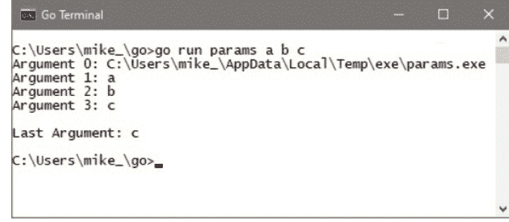

运行 `go build params` 来编译程序，然后使用命令 `params a b c` 运行它，查看本地程序路径而不是其默认系统位置。

Go 标准库 `flag` 包提供了用于更高级命令行处理的函数。你可以通过导入 `flag` 包让你的程序可以使用这些功能。


你使用 `flag` 包的 `String()`、`Int()` 或 `Bool()` 函数来定义标志。这些函数都需要三个参数来指定标志名称、默认值以及该标志的帮助信息。它们返回一个适当变量数据类型的地址，用于存储该值。用户可以在命令行中为每个标志可选地指定替代值，在标志名称前加上一个连字符 `-`。`flag` 包的 `Parse()` 函数会将用户的值应用到标志。

- 首先在程序中导入 Go 标准库 `flag` 包，以解析命令行标志：

```go
import (
	"fmt"
	"flag"
)
```


`src\flags\main.go`

接下来，定义三个命令行标志：

```go
txt := flag.String("txt", "C#", "A string")
num := flag.Int("num", 8, "An integer")
sta := flag.Bool("sta", false, "A boolean")
```

- 现在，处理标志并显示它们的值：

```go
flag.Parse()
fmt.Println("Text:", *txt)
fmt.Println("Number:", *num, "Status:", *sta)
```

将程序文件保存在 `flags` 目录中，然后分别在不带和带有输入的情况下运行程序以查看标志值。

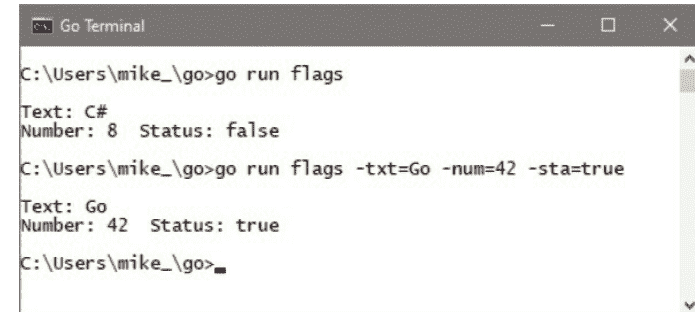


你需要使用 `*` 解引用运算符来引用存储在每个定义标志地址的值。

# 读取文件

Go 标准库 `io` 包包含一个 `ioutil`（输入/输出实用程序）包，它提供了读取文本文件的函数。你可以通过导入 `io/ioutil` 让你的程序可以使用这些功能。


`ioutil` 包的 `ReadFile()` 函数接收文本文件的路径作为参数，并返回整个文件内容和任何错误。如果没有遇到错误，则错误值将为 `nil`。在每个文件操作后检查错误是一个良好的习惯。

为了更精细地读取文本文件，你可以将文本文件的路径作为 `os` 包 `Open()` 函数的参数。`ioutil` 包的 `ReadFile()` 函数接收文本文件的路径作为参数，并返回整个文件内容和任何错误。`Open()` 函数返回 `os.File` 类型和任何错误。`Seek()` 方法通过偏移量来决定从文件的何处开始。`Seek()` 需要两个参数：零 (0) 表示相对于文件开头，一个 (1) 表示相对于当前位置。`Read()` 方法需要一个字节片来指定读取的字节数。`Close()` 方法必须在文件操作完成后调用，以关闭文件。`string()` 函数将字节片数字转换为相应的字符。

首先在程序中导入 Go 标准库 `ioutil` 和 `os` 包：

```go
import (
	"fmt"
	"io/ioutil"
	"os"
)
```


`src\read\main.go`

- 2. 接下来，添加一个函数来检查错误：

```go
func check(err error) {
	if err != nil {
		fmt.Println(err)
	}
}
```

- 3. 现在，在 `main` 函数中使用 `ioutil.ReadFile` 读取整个文件并显示内容：

```go
txt, err := ioutil.ReadFile("Oscar.txt")
check(err)
fmt.Println(string(txt))
```

- 4. 接下来，使用 `os.Open()` 打开文件并检查错误：

```go
file, err := os.Open("Oscar.txt")
check(err)
defer file.Close()
```

- 5. 使用 `Seek()` 方法指定起始位置：

```go
pos, err := file.Seek(0, 0)
check(err)
```

- 6. 使用字节片来指定读取的字节数：

```go
slice := make([]byte, 15)
nb, err := file.Read(slice)
check(err)
```

- 7. 最后，打印读取的字节数和位置：

```go
fmt.Printf("\n%v bytes @ %v", nb, pos)
fmt.Printf("%v", string(slice))
```

- 8. 将程序文件保存在 `read` 目录中，然后运行程序以查看输出：

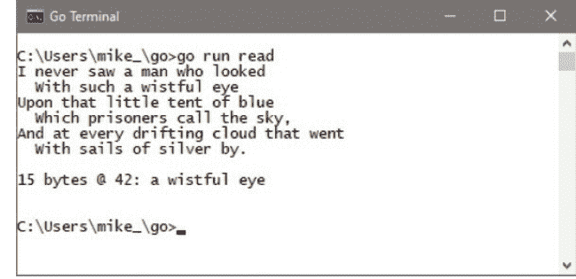


文本文件 `Oscar.txt` 包含在本书的存档中（参见此处），但你需要根据你的系统调整这些路径。

# 写文件

Go 标准库 `io` 包包含一个 `ioutil`（输入/输出实用程序）包，它提供了写入文本文件的函数。你可以通过导入 `io/ioutil` 让你的程序可以使用这些功能。


`ioutil` 包的 `WriteFile()` 函数接收三个参数来指定写入文件的路径、要写入的文本字符字节片以及该文件的数值权限。如果写入文件失败，该函数将返回错误信息；如果成功写入文件，则错误值为 `nil`。

为了更精细地控制写入文本文件，可以使用 `os` 包的 `OpenFile()` 函数。它需要三个参数来指定要写入文件的路径、指定操作类型的标志以及该文件的数值权限。指定操作类型的标志是 `os` 包的常量。例如：`os.O_RDWR` 表示读写、`os.O_APPEND` 表示追加文本，以及 `os.O_CREATE` 表示在不存在时创建新文件。

```go
import (
	"fmt"
	"io/ioutil"
	"os"
)
```


`src\write\main.go`

- 2 下，添加一个 `check()` 函数来检查写入错误：

```go
func check(err error) {
	if err != nil {
		fmt.Println(err)
	}
}
```


有多个相同的文本操作类型标志，可以为 `OpenFile()` 函数指定多个标志。更多细节，请参考 `golang.org/pkg/os/#OpenFile` 的文档。

- 3 现在，在 `main` 函数中，写入整个文本文件，然后检查错误：

```go
txt := []byte("A thousand sun will stream on thee,\nA thousand moons will quiver.")

err := ioutil.WriteFile("C:/Textfiles/Farewell.txt", txt, 0644)
```

- 4 下，打开同一个文本文件以进行追加操作，然后检查错误并记住关闭文件：

```go
file, err := os.OpenFile("C:/Textfiles/Farewell.txt", os.O_APPEND, 0644)
check(err)
defer file.Close()
```

- 5 现在，向现有文件内容追加文本并检查错误：

```go
slice := []byte("by Alfred Lord Tennyson.\n")

nb, err := file.Write(slice)
check(err)
```

- 6 最后。

- 7 将程序源文件保存在 `write` 目录中并运行程序写入文本，显示文件内容。


权限中的最后三个数字分别代表所有者（Owner）、组（Group）和其他用户（Other）。每个用户都可能拥有执行（1分）、写入（2分）和读取（4分）的文件权限。这些分数的总和为 0644，允许所有者读取和写入文件，但组和其他用户只能读取文件。这保护文件免受未经授权修改。

文件类型还有一个 `WriteString()` 方法，它的工作方式与 `Write()` 方法相同，但它接受一个 `string` 参数，而不是 `byte` 切片参数。

# 使用临时文件

有时在用户系统上创建一个临时文件以便在 Go 程序执行期间存储数据是有用的。Go 标准库的 `io` 包包含一个 `ioutil` 包，其中包含一个为此目的设计的 `TempFile()` 函数。


当 `TempFile()` 函数成功创建临时文件时，它会自动将文件映射为可读写。返回的文件类型有一个 `Name()` 方法，用此引用其路径，包括模式和随机字符串文件名。你可以使用它的 `Write()` 和 `WriteString()` 方法来添加文本内容，并在处理完成后使用它的 `Close()` 方法。对于其他文本文件，可以使用 `ioutil.ReadFile()` 函数读取临时文件的内容。

当临时文件不再需要时，可以通过指定其文件名作为 `os.Remove()` 函数的参数来删除它。你也可以通过指定文件名作为 `os.Stat()` 函数的参数来检查临时文件（和其他文件）。这返回一个 `info` 类型，以及一个错误消息或 `nil`。

- 1. 在程序开始导入 Go 标准库的 `ioutil` 和 `os` 包以处理临时文件：

```go
import (
	"fmt"
	"io/ioutil"
	"os"
)
```


`src\main.go`

- 接下来，添加一个函数来检查错误：

```go
func check(err error) {
	if err != nil {
		fmt.Println(err)
	}
}
```

- 将文本写入临时文件，然后检查错误：

```go
b, err := tmpFile.WriteString("Go Programming Fun!\n")
check(err)
```

- 接下来，从临时文件中读取文本并检查错误，显示读取的字符数：

```go
txt, err := ioutil.ReadFile(tmpFile.Name())
check(err)
fmt.Printf("InRead: %v bytes - %v\n", string(txt))
```

- 记住在处理完成后关闭文件：

```go
tmpFile.Close()
```

- 然后，删除临时文件：

```go
os.Remove(tmpFile.Name())
```

- 最后，尝试检查（现已删除的）临时文件并检查错误：

```go
_, err = os.Stat(tmpFile.Name())
check(err)
```

- 9. 将程序源文件保存在 `temp` 目录中，并运行程序以创建、写入、读取和删除临时文件：

```text
Go Terminal
C:\Users\mike\_>go run temp
Created File:
C:\Users\mike\_AppData\Local\Temp\875527451
Read:
C:\Users\mike\_AppData\Local\Temp\875527451:Go Programming Fun!
```


权限中的最后三个数字分别代表所有者、组和其他用户。每个用户都可能拥有执行（1分）、写入（2分）和读取（4分）的文件权限。这些分数的总和为 0644，允许所有者读取和写入文件，但组和其他用户只能读取文件。这保护文件免受未经授权修改。

文件类型还有一个 `WriteString()` 方法，它的工作方式与 `Write()` 方法相同，但它接受一个 `string` 参数，而不是 `byte` 切片参数。

# 使用临时文件

有时在用户系统上创建一个临时文件以便在 Go 程序执行期间存储数据是有用的。Go 标准库的 `io` 包包含一个 `ioutil` 包，其中包含一个为此目的设计的 `TempFile()` 函数。


当 `TempFile()` 函数成功创建临时文件时，它会自动将文件映射为可读写。返回的文件类型有一个 `Name()` 方法，用此引用其路径，包括模式和随机字符串文件名。你可以使用它的 `Write()` 和 `WriteString()` 方法来添加文本内容，并在处理完成后使用它的 `Close()` 方法。对于其他文本文件，可以使用 `ioutil.ReadFile()` 函数读取临时文件的内容。

当临时文件不再需要时，可以通过指定其文件名作为 `os.Remove()` 函数的参数来删除它。你也可以通过指定文件名作为 `os.Stat()` 函数的参数来检查临时文件（和其他文件）。这返回一个 `info` 类型，以及一个错误消息或 `nil`。

- 1. 在程序开始导入 Go 标准库的 `ioutil` 和 `os` 包以处理临时文件：

```go
import (
	"fmt"
	"io/ioutil"
	"os"
)
```


`src\main.go`

- 接下来，添加一个函数来检查错误：

```go
func check(err error) {
	if err != nil {
		fmt.Println(err)
	}
}
```

- 将文本写入临时文件，然后检查错误：

```go
b, err := tmpFile.WriteString("Go Programming Fun!\n")
check(err)
```

- 接下来，从临时文件中读取文本并检查错误，显示读取的字符数：

```go
txt, err := ioutil.ReadFile(tmpFile.Name())
check(err)
fmt.Printf("InRead: %v bytes - %v\n", string(txt))
```

- 记住在处理完成后关闭文件：

```go
tmpFile.Close()
```

- 然后，删除临时文件：

```go
os.Remove(tmpFile.Name())
```

- 最后，尝试检查（现已删除的）临时文件并检查错误：

```go
_, err = os.Stat(tmpFile.Name())
check(err)
```

- 9. 将程序源文件保存在 `temp` 目录中，并运行程序以创建、写入、读取和删除临时文件：

```text
Go Terminal
C:\Users\mike\_>go run temp
Created File:
C:\Users\mike\_AppData\Local\Temp\875527451
Read:
C:\Users\mike\_AppData\Local\Temp\875527451:Go Programming Fun!
```

权限中的最后三个数字分别代表所有者、组和其他用户。每个用户都可能拥有执行（1分）、写入（2分）和读取（4分）的文件权限。这些分数的总和为 0644，允许所有者读取和写入文件，但组和其他用户只能读取文件。这保护文件免受未经授权修改。


文件类型还有一个`WriteString()`方法，它的工作方式与`Write()`方法相同，但它接受一个`string`参数，而不是`byte`切片参数。

# 使用临时文件

有时在用户系统上创建一个临时文件以便在 Go 程序执行期间存储数据是有用的。Go 标准库的`io`包包含一个`ioutil`包，其中包含一个为此目的设计的`TempFile()`函数。


当`TempFile()`函数成功创建临时文件时，它会自动将文件映射为可读写。返回的文件类型有一个`Name()`方法，用此引用其路径，包括模式和随机字符串文件名。你可以使用它的`Write()`和`WriteString()`方法来添加文本内容，并在处理完成后使用它的`Close()`方法。对于其他文本文件，可以使用`ioutil.ReadFile()`函数读取临时文件的内容。

当临时文件不再需要时，可以通过指定其文件名作为`os.Remove()`函数的参数来删除它。你也可以通过指定文件名作为`os.Stat()`函数的参数来检查临时文件（和其他文件）。这返回一个`info`类型，以及一个错误消息或`nil`。

1. 在程序开始导入 Go 标准库的`ioutil`和`os`包以处理临时文件

```go
import (
"fmt"
"io/ioutil"
"os"
)
```


`src\main.go`

- 下，添加一个函数来检查错误

```go
func check(err error) {

  if err != nil {

	fmt.Println(err)

	}

}
```

- 将文本写入临时文件，然后检查错误

```go
b, err := tmpFile.WriteString("Go Programming Fun!\n")
check(err)
```

- 下，从临时文件中读取文本并检查错误，显示读取的字符数

```go
txt, err := ioutil.ReadFile(tmpFile.Name())
check(err)
fmt.Printf("InRead: %v bytes - %v\n", string(txt))
```

- 记住在处理完成后关闭文件

```go
tmpFile.Close()
```

- 然后，删除临时文件

```go
os.Remove(tmpFile.Name())
```

- 最后，尝试检查（现已删除的）临时文件并检查错误

```go
_, err = os.Stat(tmpFile.Name())
check(err)
```

现在，在`main`函数中，添加普通的函数调用以按顺序执行

```go
fmt.Println("Inline-by-Line Execution...")
count("moose")
count("sheep")
```

然后，在`main`函数中添加一个 goroutine 和普通的函数调用以并发执行

```go
fmt.Println("InConcurrent Execution...")
go count("moose")
count("sheep")
```

将程序文件保存到`goroutine`目录中，然后运行程序查看不同的输出


你也可以从自调用函数中启动 goroutine。

默认情况下，当主 goroutine 完成时，程序将退出——无论是否有其他尚未完成的 goroutine。

# 持续等待

Go 程序通常包含多个 goroutine，因此 Go 标准库的`sync`包提供了一个`WaitGroup`类型，用于等待一组 goroutine 完成执行。


按照通常的方式创建`WaitGroup`实例，使用如下语法定义变量：

```go
var waitgroupName sync.WaitGroup
```

`WaitGroup`仅仅是一个计数器，可以记录运行中的 goroutine 的总数。它包含了一些方法，用于阻塞程序直到所有 goroutine 完成：

- `Add()`根据指定的参数增加`WaitGroup`计数器。对于向程序中添加的每个新 goroutine，计数器都应该加 1。
- `Done()`自动将`WaitGroup`计数器减 1，因此不需要参数。当每个 goroutine 完成时，计数器应减 1。
- `Wait()`阻塞程序直到`WaitGroup`计数器达到零，因此不需要参数。当最后一个运行的 goroutine 将计数器减为零时，阻塞会自动解除。

当将`WaitGroup`作为参数传递给函数时，必须以指针传递。这意味着参数将使用`&-address-of`操作符指定其内存地址，而函数参数将使用`*`前缀操作符将其标记为指针。接收函数可以使用该指针参数调用`WaitGroup`的`Done()`方法。

在实际创建 goroutine 的语句之前，应该调用`Add()`方法来增加`WaitGroup`计数器。

可选地，`Add()`方法的参数可以指定集合中 goroutine 的总数，而不是逐个增加添加到`WaitGroup`的 goroutine 计数器。

你可以复用`WaitGroup`来控制后续 goroutine 集合的执行，但你只有在之前的集合的`Wait()`方法达到零后，才能对这些调用`Add()`方法。


goroutine 的执行顺序由 Go 调度器控制，每次程序运行时可能会不同。

1. 首先导入 Go 标准库的`sync`和`time`包，用于等待 goroutine 并允许延迟

```go
import (
  "fmt"
  "sync"
  "time"
)
```

`src\waitgroup\main.go`

2. 接下来，在`main`函数中创建一个`WaitGroup`实例

```go
var wg sync.WaitGroup
```

3. 现在，添加一个循环来增加计数器，并将`WaitGroup`的地址作为函数参数

```go
for i := 1; i <= 3; i++ {
  wg.Add(1)
  go report(i, &wg)
}
```

- 最后，在`main`函数中，阻塞直到`WaitGroup`计数器达到零

```go
wg.Wait()
```

- 现在，添加一个函数来确认每个 goroutine 的开始和结束，然后通知`WaitGroup`停止等待

```go
func report(i int, wg *sync.WaitGroup) {
	fmt.Printf("Goroutine %v Started", i)
	time.Sleep(1 * time.Second)
	fmt.Printf("Goroutine %v Ended", i)
	wg.Done()
}
```

- 将程序保存到`waitgroup`目录中，然后运行程序查看程序如何等待 goroutine


你也可以在函数开头使用`defer wg.Done()`来确保`WaitGroup`收到完成通知。

## 创建通道 (Channels)

Goroutine 允许以独立的方式并发执行代码，但你可以通过使用“通道”让 goroutine 之间进行通信。


Go 通道像一个管道，你可以通过它发送消息或接收消息。重要的是，发送和接收操作是“阻塞”操作——当发送消息时，通道将等待接收者准备好接受消息；当接收消息时，通道将等待发送者主动投递消息。

通过指定`chan`关键字和数据类型来创建通道，例如：

```go
channelName := make(chan dataType)
```

你可以使用箭头操作符向通道中发送消息：

```go
channelName <- message
```

相反，你可以使用箭头操作符从通道接收值：

```go
msg := <-channelName
```

重要的是发送和接收操作是“阻塞”操作——当发送消息时，通道将等待接收者准备好接受消息；当接收消息时，通道将等待发送者主动投递消息。

如果接收者只是列在同一个函数块中，则会发生死锁。

你可以使用`close()`函数显式关闭通道：

```go
close(channelName)
```

你可以通过接收布尔值来检查通道是否关闭：

```go
msg, open := <-channelName
if !open {
    break
}
```

循环可以打印接收的消息直到通道关闭：

```go
for {
    msg, open := <-channelName
    if !open {
        break
    }
    fmt.Println(msg)
}
```

现在，添加一个带有发送者的函数，它每秒发送一次消息，然后在循环结束关闭通道

```go
func count(msg string, c chan string) {
	for i:=0; i<3; i++ {
		c <- msg + " at " + time.Now().Format("04:05")
		time.Sleep(1 * time.Second)
	}
	close(c)
}
```

主函数：

```go
func main() {
    c := make(chan string)
    go count("Message", c)
    for {
        msg, open := <-c
        if !open {
            break
        }
        fmt.Println(msg)
    }
}
```

默认情况下，通道是“无缓冲”的。这意味着只有当存在可以投递消息的对应接收者时，你才能向通道发送消息。


由于消息发送操作是阻塞操作，除非发送者在独立的 goroutine 中，否则消息就可以投递给对应的接收者。

如果接收者只是列在同一个函数块中，发送者的阻塞操作将阻止程序运行到接收者——因此会发生死锁：

- 在主函数中开始，创建一个字符串类型的通道

```go
c := make(chan string)
```

- 接下来，向通道发送一条消息

```go
c <- "Go Programming"
```

- 现在，添加一个接收者并输出消息

```go
msg := <- c
fmt.Println(msg)
```

```
Go Terminal
C:\Users\mike\_go> run unbuf
fatal error: all goroutines are asleep - deadlock!
goutine 1 [chan send]:
main.main():
c:\Users\mike\_go\src\unbuf\main.go:11 +0x60
exit status 2
C:\Users\mike\_go>
```

通过向内置的`make()`函数添加第二个参数来指定缓冲区大小，可以克服这一限制。这允许你像队列一样将多个项发送到通道中，只有在超过缓冲区容量时它才会阻塞。

`range`关键字可以用于循环以接收每个通道项，直到通道关闭。


步骤 2 中的发送者被阻塞，因此程序永远不会到达步骤 3 中的接收者。

1. 通过创建一个字符串通道来开始`main`函数，并设置为 10 个字符串项的任意缓冲区容量

```go
c := make(chan string, 10)
```


2. 接下来，向通道发送一条消息

```go
c <- "Go Programming"
```

3. 现在，添加一个接收者并输出消息

```go
msg := <- c
fmt.Printf("%v \n\n", msg)
```

5. 现在，在所有消息都发送到通道后关闭通道

```go
close( c)
```

6. 添加一个循环，接收并打印发送到通道的每个消息

```go
for msg := range c {
    fmt.Println( msg )
}
```

7. 将程序文件保存在`chanbuf`目录中，然后运行程序以查看发送和接收的消息


你可以选择任何缓冲区大小——但如果超过所选的大小，就会发生死锁。

## 选择通道 (Select Channels)

当多个 goroutine 在不同时间向通道发送消息时，程序可能会在等待从较慢通道接收消息时阻塞进度。Go 提供了一种解决方案，通过在`select`语句块中同时监听多个通道的消息来解决这种阻塞操作。它的语法与此处描述的`switch`语句相似，但`select`语句会阻塞，直到它的某个`case`语句找到匹配项。找到匹配项后，将执行与该`case`语句相关的语句。这种组合 goroutine 和通道的能力是 Go 语言的一项强大特性。


为了持续监听通道消息，可以将`select`语句封装在无限`for`循环内部。可以通过包含一个带有可以跳出外层循环的语句的`case`语句来退出循环。

Go 标准库`time`包提供了一个非常有用的`After()`函数，可以用于创建“超时”来限制监听循环的执行时间。它需要一个持续时间作为参数，并返回一个`time.Time`类型的通道——这将会是当前时间加上持续时间后的未来时间。使用`case`语句测试当前时间是否匹配超时通道可以用来退出监听循环。

- 首先导入 Go 标准库`time`包，以便等待 goroutine 并创建超时

```go
import (
    "fmt"
    "time"
)
```


`src\select\main.go`

- 接下来，在`main`函数中，创建一个超时通道和两个空通道

```go
c0 := time.After(7 * time.Second)
c1 := make(chan string )
c2 := make(chan string)
```

- 现在，添加两个 goroutine 调用，每个调用都传递一个通道

```go
go fastCount(c1)
go slowCount(c2)
```

- 在`main`函数之后，添加两个调用的函数，它们将以不同的间隔发送通道消息

```go
func fastCount(c1 chan string) {
    for {
        time.Sleep(1 * time.Second)
        c1 <- time.Now().Format("04:05")
    }
}
func slowCount(c2 chan string) {
    for {
        time.Sleep(2 * time.Second)
        c2 <- time.Now().Format("04:05")
    }
}
```

- 现在，回到`main`函数，添加一个无限循环来从三个通道中的任何一个接收消息

```go
Listener:
for {
    select
    case done := <-c0:
        fmt.Println("Timed Out at ", done.Format("04:05"))
        break Listener
    case msg1 := <-c1:
        fmt.Println("1-Second Message at ", msg1)
    case msg2 := <-c2:
        fmt.Println("2-Second Message at ", msg2)
    }
}
```

将程序文件保存在`select`目录中，然后运行程序以查看通道消息


未标记的`break`语句只会跳出`select`语句——允许循环继续。带标记的`break`语句会同时跳出`select`和无限`for`循环。

## 同步 Goroutine (Synchronize Goroutines)

无缓冲通道的阻塞操作（即发送操作会阻塞 goroutine 直到另一个 goroutine 接收到同一个通道）导致了发送和接收的 goroutine 之间实现同步。事实上，无缓冲通道有时被称为“同步通道”。


因此，可以使用通道将 goroutine 连接在一起并在“流水线”中，其中从一个 goroutine 发送的项会被另一个 goroutine 接收。流水线中的每个 goroutine 都将在等待通道被“清空”之前发送下一个项。

默认情况下，通道既可以发送也可以接收，但当你将通道传递给 goroutine 时，你可以在函数中指定该通道是否仅可以发送或接收项。只写通道通过在参数中为 `chan` 前缀加上 `<-` 运算符来指定，如下：

```go
func funcName(paramName chan<-chan)
```

相反，只读通道通过在参数中为 `chan` 后缀加上 `<-` 运算符来指定，如下：

```go
func funcName(paramName <-chan)
```

建议指定单一方向以减少程序中出现 Bug 的可能性。

1. 通过创建两个整数项的无缓冲通道来开始 `main` 函数

   `nums := make(chan int)`

   `sqrs := make(chan int)`


`src\synchronize\main.go`

2. 接下来，添加一个 goroutine 调用，传递一个通道，这将启动流水线

   `go count(nums)`

3. 现在，添加一个 goroutine 调用，传递两个通道，这将继续流水线

   `go square(nums, sqrs)`

4. 在 `main` 函数之后，添加第一个调用的函数，带有一个接收通道，以便逐个地发送 10 个整数

```go
func count(nums chan<- int) {
    for i :=1; i<=10; i++ {
        nums <- i
    }
    close(nums)
}
```

5. 添加第二个调用的函数，带有一个发送通道和一个接收通道，以便逐个地发送 10 个结果

```go
func square(nums chan int, sqrs chan<- int) {
    for i :=1; i<=10; i++ {
        num := <-nums
        sqrs <- num * num
    }
    close(sqrs)
}
```

6. 现在，回到 `main` 函数，添加一个循环在流水线结束时接收结果

```go
for i :=1; i<=10; i++ {
    num := <-sqrs
    fmt.Printf("%v x %v = %v\n", i, num)
}
```

7. 将程序文件保存在 `synchronize` 目录中，然后运行程序以查看流水线结果

```
C:\Users\mike\_>go synchronize
1 * 1 = 1
2 * 2 = 4
3 * 3 = 9
4 * 4 = 16
5 * 5 = 25
6 * 6 = 36
7 * 7 = 49
8 * 8 = 64
9 * 9 = 81
10 * 10 = 100
C:\Users\mike\_go
```


如果发送者知道不再有更多值发送到接收通道，它可以关闭该通道。

## 使用工作池 (Use Worker Pools)

如果你的程序有一个需要执行的任务队列，且结果产生的顺序并不重要，你可以使用 goroutine 和通道采用“工作池”。


工作池允许你从多个并发调用向 goroutine 发送任务，由 Go 调度程序决定的随机顺序完成每个任务。你可以使用 `WaitGroup` 等待多个 goroutine 完成，或者简单地将任务结果发送为空——以清空通道并确保所有工作 goroutine 都已完成。

- 首先导入 Go 标准库 `time` 包，以便延迟一个工作 goroutine 函数

```go
import (
    "fmt"
    "time"
)
```


`src\workers\main.go`

接下来，在 `main` 函数中，初始化任务总数变量，并创建大小为总数的两个缓冲通道

```go
numJobs := 10
jobs := make(chan int, numJobs)
results := make(chan int, numJobs)
```

现在，添加三个 goroutine 调用，每个调用传递一个 ID 和两个通道

```go
go worker(1, jobs, results)
go worker(2, jobs, results)
go worker(3, jobs, results)
```

为 10 个任务中的每个任务发送一个整数，然后关闭该通道以表示队列中的所有任务已完成

```go
for i := 1; i <= numJobs; i++ {
	jobs <- i
}
close(jobs)
```

`main` 函数之后，添加被调用的 `worker` 函数，它接收 worker ID、一个接收任务号的只读通道以及一个发送 10 个结果的只写通道

```go
func worker(id int, jobs <-chan int, results chan<- int) {
	for job := range jobs {
		fmt.Printf("Worker %d, ran Job %d", id, job)
		fmt.Printf("... %v %v %v\n", job, job, job)
		time.Sleep(1 * time.Second)
		results <- job
	}
}
```

现在，回到 `main` 函数，添加一个循环来收集结果并确保所有 worker 都已完成

```go
for i := 1; i <= numJobs; i++ {
	<-results
}
close(results)
```

将程序文件保存在 `workers` 目录中，然后运行程序查看工作池的结果

```
Go Terminal
C:\Users\mike\_go- run workers
worker 3 Job 1 ... 1 x 1 = 1
worker 2 Job 3 ... 3 x 3 = 9
worker 1 Job 2 ... 2 x 2 = 4
worker 1 Job 4 ... 4 x 4 = 16
worker 2 Job 6 ... 6 x 6 = 36
worker 3 Job 5 ... 5 x 5 = 25
worker 1 Job 7 ... 7 x 7 = 49
worker 2 Job 8 ... 8 x 8 = 64
worker 3 Job 9 ... 9 x 9 = 81
worker 2 Job 10 ... 10 x 10 = 100
C:\Users\mike\_go_>
```


此示例中的 1 秒延迟仅仅模拟了执行更耗时任务所需的时间。


“工作池”（Worker Pools）也称为“线程池”（Thread Pools）。由于不需要为每个任务创建新线程，它们可以获得更好的性能。

## 总结

- 并行（Parallelism）是在同时执行两个任务。
- 并发（Concurrency）是将程序代码拆分为独立的任务，这些任务可能被同时执行。
- Goroutine 提供了让代码行并发执行的能力。
- 通过在普通函数调用或方法调用之前插入 `go` 关键字来创建 goroutine。
- Go 标准库包提供了 `WaitGroup` 类型，可以等待多个 goroutine 完成。
- `WaitGroup` 有一个 `Add()` 递增方法、一个 `Done()` 递减方法和一个 `Wait()` 阻塞方法。
- 将 `WaitGroup` 作为参数传递给函数时，必须作为指针传递。
- Go 通道（channel）就像一个管道，程序可以通过它发送和接收消息。
- 通过向内置的 `make()` 函数指定 `chan` 关键字和数据类型作为创建通道。
- 死锁（Deadlock）是程序无法继续的致命错误。
- 内置 `close()` 函数可以显式关闭通道。
- 在 `make()` 函数中添加缓冲区大小参数，可以将多个项目作为队列发送到通道。
- `select` 语句块可用于同时监听来自多个通道的消息。
- 在无限 `for` 循环中嵌套 `select` 语句块允许程序持续监听通道消息。
- 通道可以将管道中的 goroutine 连接起来，通过发送和接收消息来同步 goroutine。
- `<-` 运算符可以在函数参数中使用，指定通道是否仅允许发送或仅接收。
- 工作池可以从多个并发调用将任务发送到 goroutine，并按随机设置的顺序完成。

# 12 请求响应

本章演示了如何使用 Go 标准库中的 `net/http` 和 `io` 包创建 Web 服务器以及如何处理提交的表单数据。

- 监听请求
- 处理请求
- 添加待服务文件
- 交付页面
- 记录接收到的数据
- 交付动态响应
- 总结

## 监听请求

Go 标准库 `net` 包包含一个 `http` 包，它提供了可以轻松创建 Web 服务器的工具。通过导入 `net/http` 包，可以让你的程序使用这些工具。


`http.ListenAndServe()` 函数允许程序启动 Web 服务器。它需要两个参数来指定网络地址和处理器。地址字符串指定了 Web 服务器应该监听的端口号。例如 `:8000`。`http.ListenAndServe()` 函数始终返回非空值，这意味着调用之后的代码行将永远不会执行。


端口号必须以冒号为缀——例如 `:8000`。


Web 服务器尚不知道如何响应，但本章将开发程序来实现这一点。

## 处理请求

为了让 Go Web 服务器处理传入的请求，程序需要注册“路由处理器”（route handlers）来指定如何响应特定请求。


`net/http` 包提供了 `http.HandleFunc()` 函数，用于注册路由处理器。该函数需要两个参数：指定描述要监听路径的字符串模式，以及在识别到指定路径时调用以提供响应的函数名称。

`http.ResponseWriter` 对象，以及在请求响应中发送的字符串。

- 首先，在之前的程序 `import` 部分添加导入 Go 标准库 `io` 包的指令（`fmt` `io` `net/http`）


`src\main.go`

- 接下来，在 `main` 函数的开始处，插入一条语句来注册路由处理器 `http.HandleFunc("/hello", helloHandler)`

- 现在，在 `main` 函数之后，添加处理程序函数，该函数将写入两个字符串作为响应：`response func helloHandler(w *http.ResponseWriter, r *http.Request) { io.WriteString(w, "Response from the helloHandler!\n") io.WriteString(w, "URL.Path = " + r.URL.Path) }`

- 将更新后的程序文件保存到 `server` 目录中，然后运行程序以启动 Web 服务器

```
$go run server
C:\Users\mike_go-go run server
Starting web server on port 8000
```

- 如果出现防火墙安全警告，确认你是否希望允许 Web 服务器访问

- 启动浏览器并访问 `localhost:8000/hello` 查看 Web 服务器对该请求的响应

```
Response from the helloHandler!
URL.Path = /hello
```

## 添加文件进行服务

既然已经确定服务器程序可以像示例所示对请求做出响应，可以在程序中添加文件，服务器可以在响应请求时交付这些文件。


Web 服务器文件通常包含在一个名为 `htdocs`（超文本文档）或类似名称的根目录下。这通常包含 HTML 文件，并可能有一个 `favicon.ico` 图像，用于在浏览器标题栏中标识网站。根目录通常还包含子目录，用于分类相关文件——例如 `img` 文件夹中的图像、`css` 文件夹中的样式表等。

在我们的服务器示例中，两个 HTML 文档被添加到根 `htdocs` 目录中，并带有一个 `favicon.ico` 图像。单个样式表位于 `htdocs/css` 目录内，若干图像包含在 `htdocs/img` 目录中。整个服务器程序树现在看起来如下：


| 文件名 | 尺寸 |
| :--- | :--- |
| favicon.ico | 32px x 32px |


| power.png | 100px x 25px |

几个图像文件是各种书籍的封面照，其 ISBN（国际标准书号）被用作相应的封面名称。`img` 目录还包含一个公司 Logo 图像和一个用于标识 Web 服务器的标签。

样式表包含规则，用于指定由程序动态写入的 Web 页面响应的外观：

```css
img, p
{ float: left }
{ width: 320px; text-align: center; font-size: 1.5em }
```


`style.css`

名为 `index.html` 的 HTML 文档是一个简单的静态网页，显示如下：

```html
<!DOCTYPE html>
<html lang="en">
<head>
  <meta charset="UTF-8">
  <title>Index</title>
  <link rel="icon" href="favicon.ico">
</head>
<body>
  <h1>Static Page</h1>
  
</body>
</html>
```


`form.html`

名为 `form.html` 的 HTML 文档允许用户提交以下内容：

```html
<!DOCTYPE html>
<html lang="en">
<head>
  <meta charset="UTF-8">
  <title>Submission</title>
  <link rel="icon" href="favicon.ico">
</head>
<body>
  <fieldset>
    <legend>Lookup</legend>
    <form method="POST" action="lookup">
      <label>Language</label>
      <input type="text" name="Language">
      <input type="submit" value="Submit">
    </form>
  </fieldset>
</body>
</html>
```


`src\server\main.go`

4. 接下来，在表单处理函数中，插入语句解析表单数据或向浏览器返回错误信息

```go
err := r.ParseForm()

if err != nil {
  http.Error(w, "Bad Request", 400)
  return
}
```

5. 现在，在表单处理函数中，插入语句通过移除空格和更改大小写来格式化提交的值

```go
lang := r.FormValue("Language")
lang = strings.ToLower(lang, " ")
```

6. 然后，在表单处理函数中，插入语句将格式化后的值写入日志文件

```go
file, err := os.OpenFile("htdocs/data.log",
  os.O_CREATE|os.O_APPEND|os.O_WRONLY, 0644)

if err != nil {
  log.Print(err)
}

defer file.Close()
log.SetOutput(file)
log.Print(lang)
```

7. 保存更新后的程序文件，然后启动 Web 服务器并访问 `localhost:8000/form.html` 查看表单出现


8. 在输入字段中输入编程语言名称，然后点击 `Submit` 按钮提交表单数据。


最常用的请求方法是 `GET` 和 `POST`。`GET` 方法将数据附加到 URL 字符串上。`POST` 方法在请求体中携带数据，因此更安全，是从浏览器向服务器传输数据时的首选方法。

现在，点击浏览器的后退按钮并重复提交过程，以发送多次请求——每个请求对应不同的编程语言。


现在，访问 `localhost:8000/data.log`，查看日志文件中每个提交的表单值。


为了简单起见，此示例仅提交了一个项目，通过请求对象的 `FormValue()` 方法和 HTML `name` 属性值进行引用。对于提交多个项目的表单，可以使用 `range` 关键字循环遍历它们，以引用每个项目的键（HTML `name` 属性）和值（HTML `value` 属性）。

## 交付动态响应

在接收并记录请求数据后，按照这里的步骤，程序现在可以评估请求并向 Web 浏览器发送适当的响应。

- 在表单处理函数的日志语句之后，用默认响应字符串值初始化两个变量：

```go
title = "<a href='http://www.ineasysteps.com'>See all titles online</a>"

isbn = "logo"
```


`server\main.go`

- 接下来，检查提交的请求值，如果匹配，则分配适当的响应值：

```go
switch lang {

case "c":

title = "C Programming"

isbn = "978-1-84078-840-42"

case "go":

title = "Go Programming"

isbn = "978-1-84078-919-55"

case "java":

title = "Java"

isbn = "978-1-84078-873-04"

case "python":

title = "Python"

isbn = "978-1-84078-812-99"

case "sql":

title = "SQL"

isbn = "978-1-84078-902-77"

}
```

- 现在，构建一个包含响应值的 HTML 字符串：

```go
response := "<!DOCTYPE HTML><title>Web Server Response</title>"

response += "<link rel='shortcut icon' href='favicon.ico'>"
response += "<link rel='stylesheet' href='css/style.css'>"
response += "<p>" + title + "<br>in easy steps"
if isbn != "logo" {
    response += "<br>ISBN:" + isbn
}
response += "</p>"
response += ""
```


注意字符串内部使用了单引号来区分外部的双引号，从而避免了过早终止字符串。

- 最后，添加一条语句发送响应：

```go
io.WriteString(w, response)
```


- 再次保存程序文件并启动 Web 服务器，然后访问 `localhost:8000/form.html` 发送请求并接收响应。


# Java

in easy steps

ISBN: 978-1-84078-873-04


# Book Lookup

Programming Language [Submit]


# See all titles online

in easy steps


你可以在该系列中发现更多编程书籍——在 `www.ineasysteps.com` 学习数据分析。

# Summary

- Go 标准库 `net/http` 包提供了创建 Web 服务器的实用程序。
- `http.ListenAndServe()` 函数指定了监听的地址以及处理器的名称。
- Web 服务器程序必须注册处理函数来响应特定的请求。
- `http.HandleFunc()` 函数指定了监听的路由以及处理该请求的函数。
- 请求处理函数始终带有 `http.ResponseWriter` 和 `http.Request` 对象参数。
- `http.ResponseWriter` 对象有一个 `Write` 方法，可以接受 `[]byte` 切片以发送响应。
- `io` 包提供了 `WriteString()` 函数，可以将字符串传递给 `http.ResponseWriter` 对象作为响应。
- 文件可以添加到 Web 服务器程序中，以响应请求交付文件。
- `http.Dir()` 函数指定根文件系统路径。
- `http.FileServer()` 函数返回一个作为参数的文件系统内容的处理器。
- `http.Handle()` 函数指定了用于系统的请求路由和处理器名称。
- `http.Request.ParseForm()` 方法用提交表单数据填充 `http.Request` 对象。
- `http.Request.Method` 对象包含了赋值给 HTML 表单属性的值。
- `http.Error()` 函数可以使用 `http.ResponseWriter` 对象向浏览器发送错误信息和状态。
- Go 标准库 `log` 包有 `SetOutput()` 和 `Print()` 函数可以将带时间戳的项目写入日志文件。
- Web 服务器程序可以构建 HTML 字符串向 Web 浏览器发送动态响应。

# 喜欢这本书吗？

简单步骤学习更多。


现在可以从 `www.ineasyeps.com` 下载适用于电脑、平板和平手机的 Easy Steps 电子书。

7 岁以上儿童，通过引人入胜的故节，这本书将教授有志编码者以有趣且简单的方法构建他们的第一个网站。


访问 `www.ineasyeps.com` 获取更多标题和更新。

## 为什么选择这本书？

### 它用通俗易懂的英语编写

被术语吓了吗？别担心，我们保持简单直白。

`GO` 是一种高效的多用途编程语言，正在获得广泛普及。**GO 编程入门**在假设没有任何现有知识的情况下，从演示如何在你的电脑上创建 `GO` 编程环境开始。然后，通过彩色编码的示例，本入门教程将向你展示：

### 它易于遵循

清晰的分步说明让学习变得简单。

- 使用数据抽象进行面向对象的编程。
- 在程序中编写 `goroutine`（协程）和通道（channels）实现并发。
- 在数据结构中存储信息。
- 使用控制结构控制程序流。
- 在程序函数中创建可重用的代码块……以及更多！

### 它有丰富的插图

我们不仅告诉你如何做，还向你展示如何做。

对于新手、学生以及想要快速掌握 `GO` 特性的经验丰富的程序员来说非常理想。包含了免费下载源代码，让你立即开始！

### 它是全彩的

这本书采用彩色印刷，使其使用更简单、更护眼。

让这些图标让变得更加简单。


为你的学习增添色彩。


突出值得记忆的内容。


避开潜在危险！

### 它是非常棒的

我们还需要说些什么？

分类：计算机/编程

`www.ineasyteps.com`
