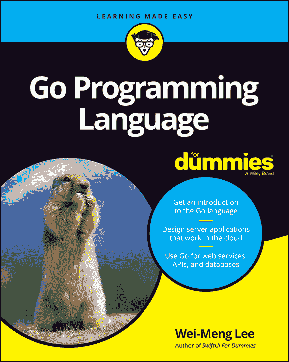
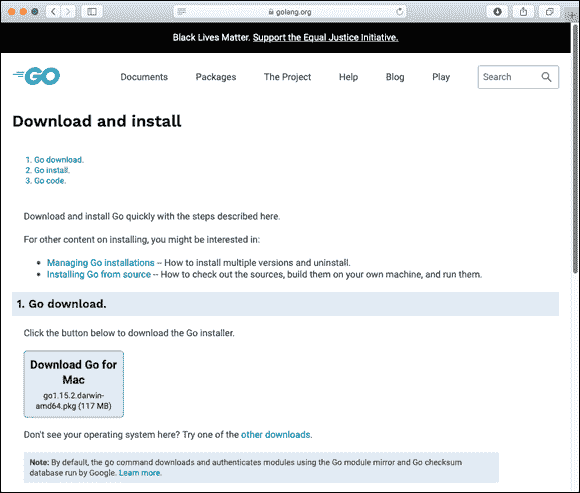
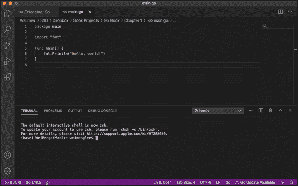

# Go 语言入门指南



要查看本书的快速上手，请访问 [www.dummies.com](http://www.dummies.com) 搜索框中搜索“Go Programming Language For Dummies Cheat Sheet”。

## 内容列表

### 第一部分：开始学习 Go

在本部分中……

- 编写你的第一个 Go 程序。
- 发现 Go 中的基本数据类型，并了解如何声明变量和常量。
- 探索各种逻辑和比较运算符，并使用它们做出决策。
- 理解循环如何工作，以及你如何重复执行代码。
- 使用函数创建易于维护和理解的 Go 程序。

### 第 1 章：Hello, Go!

在本章中

- **理解为什么 Go 将是未来的趋势**
- **在你的计算机上安装 Go**
- **使用集成开发环境**
- **编写 Go 程序并理解其工作原理**
- **查看 Go 与其他语言的对比**

Go 是一种开源编程语言——全球增长最快的编程语言之一——由 Google 于 2009 年发布。它是一种多用途编程语言，专门用于构建快速、可扩展的应用程序。

 Go 来自一个非常令人深刻的团队：`Ken Thompson`（`Unix` 和 `C` 设计者和创始人）、`Rob Pike`（`UTF-8` 和 `Unix` 格式的共同创建者）以及 `Robert Griesemer`（一位 Google 工程师）。如果你对技术感兴趣，你可能想看看这名为“Go at Google：为软件工程服务的语言设计”的文章（[`https://talks.golang.org/2012/splash.article`](https://talks.golang.org/2012/splash.article)），它讨论了 Go 最初是如何为了解决 Google 的问题而构的。

在本章中，我将解释为什么学习 Go 对你的职业很重要，Go 可以用在何处以及如何开始 Go 编程。

## 目录

### 第 1 章

- 表 1-1 各种操作系统的环境变量

### 第 3 章

- 表 3-1 Go 中的比较运算符
- 表 3-2 Go 中的逻辑运算符

### 第 5 章

- 表 5-1 Go 用于格式化日期时间的参考日期
- 表 5-2 根据日期格式生成的日期输出

### 第 14 章

- 表 14-1 `$GOPATH` 内的子目录

### 第 16 章

- 表 16-1 `curl` 的各种选项

## 插图列表

### 第 1 章

- 图 1-1：Go 安装程序
- 图 1-2：首次启动 Visual Studio Code
- 图 1-3：位于活动栏底部的扩展图标
- 图 1-4：搜索 Visual Studio Code 扩展
- 图 1-5：编写你的 Go 程序
- 图 1-6：Visual Studio Code

### 第 5 章

- 图 5-1：传递给 `swap()` 的 `x` 和 `y` 值
- 图 5-2：代码输出
- 图 5-3：使用匿名函数

### 第 6 章

- 图 6-1：包含数组指针、长度和容量的切片头
- 图 6-2：具有五个元素的数组
- 图 6-3：二维数组
- 图 6-4：三维数组
- 图 6-5：数组的容量
- 图 6-6：具有两个元素的切片
- 图 6-7：五个元素的容量
- 图 6-8：带有初始值的切片
- 图 6-9：当切片达到容量时，追加项会导致分配新数组
- 图 6-10：你可以向 `t` 添加更多两个项而不超过其容量
- 图 6-11：将切片赋值给变量将创建指向相同数组的切片
- 图 6-12：修改切片 `u` 也会影响 `t`
- 图 6-13：切片切片并将结果赋值回原切片
- 图 6-14：切片的容量保持不变
- 图 6-16：向切片中插入项

### 第 7 章

- 图 7-1：`newPoint()` 函数返回创建的 `point` 结构体的指针
- 图 7-2：`pt4` 和 `pt5` 都指向同一个结构实例
- 图 7-3：`pt6` 现在指向 `point` 结构体的新实例
- 图 7-4：`pt7` 包含 `pt6` 的拷贝，而 `pt8` 指向 `pt7` 持有的拷贝

### 第 8 章

- 图 8-1：具有三个键值对的 map
- 图 8-2：map 中的所有项已以结构体形式添加到切片中

### 第 9 章

- 图 9-1: 使用 JSONLint 验证 JSON 字符串。
- [图 9-2: 查看 `rates` 的类型，其为 `map[string] interface{}`。](#c09.xhtml_c09-fig-0002)
- [图 9-3: 将 `rates` 的值断言为类型 `map[string] interface{}`。](#c09.xhtml_c09-fig-0003)
- 图 9-4: 用于存储客户信息的各种结构体。

### 第 11 章

- 图 11-1: 作为 goroutine 运行的各种函数的流。
- 图 11-2: `balance` 的新值可能在更新之前没有机会...

### 第 12 章

- 图 12-1: 每个 goroutine 均尝试向通道发送部分和。

### 第 13 章

- 图 13-1: `main` 包由两个物理文件组成。
- 图 13-2: `godoc` 网页。

### 第 14 章

- 图 14-1: 在 GitHub 上创建一个新仓库。
- 图 14-2: 在 GitHub 上为你的新仓库命名。
- 图 14-3: 准备将文件上传到 GitHub。
- 图 14-4: 你可以将文件拖放到 GitHub。
- 图 14-5: 将文件和文件夹拖放到 GitHub。
- 图 14-6: 点击 Commit Changes 按钮将文件和文件夹上传到...
- 图 14-7: 模块现在发布！

### 第 15 章

- 图 15-1: 客户端与 Web API 通信。
- 图 15-2: 你可以注册免费访问 Fixer API。
- 图 15-3: 查看 Fixer A... 返回的 JSON 结果结构。
- 图 15-4: 查看 F 返回的 JSON 错误结果结构。
- 图 15-5: 查看 OpenWeather 返回的 JSON 结果结构。
- 图 15-6: 查看 O 返回的 JSON 错误结果结构。

### 第 16 章

- 图 16-1. 向 Web API 发送 HTTP 消息以及返回的响应...
- 图 16-2: 构成 REST API URL 的各种组件。
- 图 16-3: 使用各种 HTTP 动与 REST API 通信。
- 图 16-4: 使用 `gorilla/mux` 包在 Go 中构建 REST API。
- 图 16-5: 路径变量映射。
- 图 16-6: 查询字符串由键值对组成。

### 第 17 章

- 图 17-1: MySQL Workbench。

## 引言

今天，如果你是一名程序员，在选择编程语言时有很多选择。流行的语言包括 `C++`、`C#`、`Go`、`Java`、`JavaScript`、`Python`、`R`、`Swift` 等。每种语言旨在解决不同的问题，取决于你想要什么，你可能会学习其中。

为什么要学习 Go？事实是，Google 的三个工程师对他们使用的工具集感到沮丧，于是决定设计一种新语言，在保留有用功能的同时解决其他语言的问题。

Go 旨在：

- 使用静态类型并具有 `C` 的运行效率
- 具有 `Python` 和 `JavaScript` 的可读性和易用性
- 在网络和多处理方面表现卓越

现有语言的问题迫使他们从零开始设计一种专为高并发设计的语言。

本书介绍了 Go（也称为 Golang）的基础知识，它是增长最快的编程语言之一。

### 关于本书

在这部代码密集的书中，我们鼓励你尝试各种示例，这些示例设计得紧凑、易于遵循且易于理解。但你不需要从第一页读到最后一页。每个章节都是相互独立的，因此你可以从任何感兴趣的地方开始。

如果你时间有限，可以安全地跳过侧边栏（灰色框内的文本）或任何标记有技术细节图标的内容（详见引言部分的“本书中使用的图标”）。

在本书中，你可能会注意到某些网址跨越了两行。如果你阅读的是纸质书籍并想访问这些网页，请按照文中所注方式输入地址，假装没有换行符。如果你阅读的是电子书，那就太方便了——直接点击网址即可跳转到网页。

### 愚蠢的假设

本书是为初学（或相对刚接触） Go 的读者准备的。我不假设你已经熟悉 Go 编程，但我假设你具备以下条件：

- 你熟悉编程基础。
- 你熟悉数据结构概念，例如字典、数组和结构体。
- 你有一台可以使用的计算机，用来尝试书中的示例。

### 本书中使用的图标

与《自学教程》（*For Dummies*）系列中的其他书籍一样，本书使用了图标——即页边栏的小图片，来吸引你注意某些类型的材料。以下是我使用的图标：

 每当我告诉你某些有用或足够重要的内容，且你最好将这些信息存储在记忆中某个安全的地方以备后回回时，我会用 `Remember`（记住）图标进行标记。

 `Technical Stuff`（技术细节）图标标记了仅供极客阅读的技术细节或解释，你可以自由跳过它们。

 `Tip`（提示）图标标记了快捷方法或更简单的方法，我希望这些能让你的生活变得更轻松。

 `Warning`（警告）图标标记了包含友好但异常坚持提醒的文本，以避免进行某些操作。你已被警告了。

### 本书之外

除了你正在阅读的内容，该产品还附带了一个免费的随处访问的快捷表，它会告诉你如何在不安装任何额外软件的情况下在线尝试 Go，如何使用在线工具将 JSON 转换为 Go 结构体，以及如何在 Docker 中使用 Go。要获取此快捷表，请访问 [`www.dummies.com`](http://www.dummies.com)get 搜索框中输入 `Go Programming Language For Dummies Cheat Sheet`。

本书包含一些可下载内容。访问 [`www.dummies.com/go/goprogramminglanguagefd`](http://www.dummies.com/go/goprogramminglanguagefd) 下载书中的所有代码。

### 接下来该去哪里

如果你是 Go 的完全新手，你可能想从第一章开始一直读到最后。如果你已经有了一些 Go 的基础知识，你可能想前往第 5 部分 看看 Go 的实际运行。无论你有多少经验，都可以查阅索引或目录来找到你最感兴趣的话题。

最后，我对所有初学者的建议是：练习，练习，再练习。输入每一章中的代码并犯错。犯的错越多，你对讨论的话题理解和记忆就越深。

祝你好运，并享受你获得的新知识！


 因为其网址，Go 经常被称为 Golang：[`https://golang.org`](https://golang.org/)`。然而，该语言的官方名称是 Go，因此我在本书中都是这样称呼它的。

## 学习 Go 能为你带来什么

今天你学习许多编程语言，但 Go 因为以下原因脱颖而出：

*   **Go 易于学习。** Go 的语法使其成为一种可读性很高的语言。它不支持面向对象编程（OOP），这意味着你不需要担心类、继承以及随之而来的复杂性。

     面向对象编程（OOP）是一种基于`objects`（对象）概念的编程范式。OOP 不关注函数和逻辑，而是围绕数据或对象组织软件。OOP 中的一个核心概念是 `classes`（类，类似于模板）。假设你想在应用程序中显示按钮。与其编写代码逐个显示每个按钮，不如创建一个表示通用按钮的`class`（类）。

*   **Go 的功能比其他语言少。** 你不需要担心解决问题的最佳方法——只有一种。这使得你的代码库易于维护。

*   **Go 在并发编程方面表现出色。** Go 对`Goroutines`的支持让运行多个函数变得极其简单。

 Go 目前还不支持泛型（在实际使用时指定实际类型的能力），但随着语言的演进这可能会改变。

如果你还没有被说服应该学习 Go，也许这条消息会激励你：在 2019 年 Stack Overflow 开发者调查（[`https://insights.stackoverflow.com/survey/2019`](https://insights.stackoverflow.com/survey/2019)）中，Go 开发者的薪资仅次于 Clojure 和 F# 开发者。

尽管 Go 已经存在很久（自 2009 年起），但由于云计算和微服务的普及，它最近才被开发者广泛采用。今天，Go 已被 Dailymotion、Dropbox、Google 和 Uber 等大公司广泛使用。

以下是 Go 的用途示例：

*   云服务：在 Google Cloud Platform (GCP) 上使用 Go 构建可扩展的应用。

*   网络应用：得益于 Go 对`Goroutines`的支持，你可以使用 Go 构建分布式服务器和应用程序接口 (API)。

*   Web 服务：你可以使用 Go 构建可扩展且高效的 Web 服务。

*   命令行应用：由于 Go 可以在多个平台上运行，你可以编译相同的代码库并针对不同的平台（例如 macOS 和 Windows 平台）。

## 在你的机器上安装 Go

你可能非常急于在你的机器上开始 Go 编程，让我们开始吧！

安装 Go 最简单的方法是访问 [`https://golang.org/doc/install`](https://golang.org/doc/install)。该网站会自动检测你正在使用的操作系统 (OS)，并向你显示点击下载 Go 安装程序的按钮（参见图 1-1](#c01.xhtml_c01-fig-0001)）。



FIGURE 1-1: 下载 Go 安装程序。

 本书的代码是使用 Go 1.15 版本编写并测试的。当你阅读此书时，Go 可能已经发布了新版本。为了确保你能够跟随书中的示例操作，我强烈建议安装与我使用的相同的 Go 版本。你可以在这里找到：

*   **macOS:** [`https://golang.org/dl/go1.15.8.darwin-amd64.pkg`](https://golang.org/dl/go1.15.8.darwin-amd64.pkg)

*   **Windows:** [`https://golang.org/dl/go1.15.8.windows-amd64.msi`](https://golang.org/dl/go1.15.8.windows-amd64.msi)

 如果你想为每个受支持的操作系统（Linux、macOS 和 Windows）选择 Go 安装程序，甚至查看 Go 的源代码，请访问 [`https://golang.org/dl/`](https://golang.org/dl/)。

下载 Go 安装程序后，双击安装程序开始直观的安装过程。我建议你直接使用默认安装设置——你不需要更改任何设置。

在接下来的章节中，我将向你展示如何在 macOS 和 Windows 上验证安装是否成功。

### macOS

在 macOS 上，Go 安装程序会将 Go 分发版安装在`/usr/local/go`目录。它还会将`/usr/local/go/bin`目录添加到你的`PATH`环境变量中。你可以在 Terminal 应用程序（可以在`Applications/Utilities`文件夹中找到）中输入以下命令来验证：

```
$ echo $PATH
```

你应该看到类似下面的输出（注意加粗显示的添加路径）：

`/Users/weimenglee/opt/anaconda3/bin:/Volumes/SSD/opt/anaco-nda/condabin:/Users/weimenglee/flutter/bin:/Users/weimeng-lee/go/bin:/Users/weimenglee/.nvm/versions/node/v9.2.0/bin:/usr/local/bin:/usr/bin:/bin:/usr/sbin:/sbin:/usr/local/go/bin:/usr/local/share/dotnet:~/.dotnet/tools:/Library/Application Support/Apple/bin:/Library/Frameworks/Mono.framework/Versions/Current/Commands`

 确保在安装 Go 后重启 Terminal 应用程序，以便更改生效。

要验证安装是否正确，请在 Terminal 中输入以下命令：

```
$ go version
```

你应该看到系统上安装的 Go 版本：

```
go version go1.15.8 darwin/amd64
```

### Windows

在 Windows 上，Go 安装程序会将 Go 分发版安装在`C:\Go`目录。它还会将`C:\Go\bin`目录添加到你的`PATH`环境变量中。你可以在命令提示符（通过在 Windows 搜索框中输入`cmd`可以找到）中输入以下命令来验证：

```
C:\Users\Wei-Meng Lee>path
```

你应该看到类似下的输出（注意加粗显示的添加路径）：

```
PATH=C:\WINDOWS\system32;C:\WINDOWS;C:\WINDOWS\System32\Wbem;C:\WINDOWS\System32\WindowsPowerShell\v1.0\;C:\WINDOWS\System32\OpenSSH\;C:\Program Files\dotnet\;C:\Program Files\Microsoft SQL Server\130\Tools\Binn\;C:\Go\bin;C:\Program Files\Git\cmd;C:\Program Files\Graphviz 2.44.1\bin;C:\Program Files\CMake\bin;C:\Program Files\Docker\Docker\resources\bin;C:\ProgramData\Docker\version-bin;C:\Program Files\MySQL\MySQL Shell 8.0\bin\;C:\Users\Wei-Meng Lee\AppData\Local\Microsoft\WindowsApps;;C:\Users\Wei-Meng Lee\AppData\Local\Programs\Microsoft VS Code\bin;C:\Users\Wei-Meng Lee\.dotnet\tools;C:\Users\Wei-Meng Lee\go\bin
```

 确保在安装 Go 后重启命令提示符窗口，以便更改生效。

要验证安装是否正确，请在命令提示符中输入以下命令：

```
C:\Users\Wei-Meng Lee>go version
```

你现在应该看到电脑上安装的 Go 版本：

```
go version go1.15.8 windows/amd64
```

## 使用集成开发环境配合 Go

要使用 Go 开发应用程序，你只需要一个文本编辑器（例如 Visual Studio Code、macOS 上的 TextEdit，甚至是老旧的记事本），就可以开始工作了（这里是个双关语）。但是，许多开发者倾向于使用集成开发环境（IDE），它们可以帮助他们组织代码。

完成输入后，按下 ⌘  +S (Ctrl+S) 保存文件。将文件命名为`main.go`。如果你是第一次使用 Visual Studio Code 编写 Go 程序，它可能会提示你下载额外的 Go 插件。我建议你安装这些插件。

 对于本书，请将文件保存到以你正在阅读的章节命名的文件夹中。例如，将`main.go`保存在主目录下名为`Chapter 1`的文件夹中。在 Mac 上，看起来像这样：

```
~/Chapter 1
|__main.go
```

在 Windows 上，它看起来像这样：

```
C:\users\yourname\Chapter 1
|__main.go
```

文件保存后，你会发现 Go 语句会有颜色区分——`package`、`import`和`func`等关键字显示为浅蓝色；`Hello, world!`和`fmt`等字符串显示为橙色；`main()`和`Println()`等函数显示为黄色。

### 编译并运行程序

保存程序后，你需要编译它才能运行它。

你可以直接在 Visual Studio Code 中运行程序。要做到这一点，选择 Terminal  New Terminal 来启动终端。终端现在会在 Visual Studio Code 中打开（参见图 1-6）。

接下来，切换目录到`Chapter 1`。在 macOS 中，使用以下命令：

```
$ cd ~/"Chapter 1"
```

在 Windows 中，使用以下命令：

```
$ cd "C:\users\username\Chapter 1"
```

要编译`main.go`文件，输入以下命令：

```
$ go build main.go
```



图 1-6： 你可以直接在 Visual Studio Code 中访问终端。

前面的命令将`main.go`程序编译为可执行文件。在 macOS 上，运行程序后，你会看到一个名为`main`的文件。要运行它，使用以下命令：

```
$ ./main
```

```
Hello, world!
```

如果你看到打印出`Hello, world!`字符串，恭喜你！你现在正式成为一名 Go 程序员了！

如果你使用的是 Windows，`build`命令会生成一个名为`main.exe`的可执行文件。要运行它，使用以下命令：

```
C:\users\username\Chapter 1>main
```

```
Hello, world!
```

因为你经常想编译后立即运行程序，可以使用`run`选项直接编译并运行程序：

```
$ go run main.go
```

### 理解 Go 程序的工作原理

现在你的 Go 程序已经可以运行了，是时候理解它是如何运行的了。我将为你逐行讲解。第一行定义了该程序的包名：

```
package main
```

Go 程序组织成包（package）。一个包是分组在单个目录中的源代码集合。在这个示例中，`main`是存储在`Chapter 1`目录中的包名。如果你有额外的源文件（`.go`文件），它们都将属于这个`main`包（稍后章节将对此详细介绍）。

 你并不局限于使用`main`作为包名。你可以使用任何想要的包名。但这个`main`包名有一个特殊含义：名为`main`的包将包含一个名为`main()`的函数，该函数作为程序启动的入口。此外，你的包名和包含该包的文件名不需要相同。我本可以将文件命名为`dog.go`而不是`main.go`，程序仍然可以运行（但现在可执行文件将命名为`dog`而不是`main`）。

下一行导入了一个名为`fmt`的包：

```
import "fmt"
```

该包包含了各种函数，允许你格式化输出并打印到控制台。它还包含了获取用户输入的函数。

 如果你是编程初学者，函数（function）是一个用于执行单一相关任务的代码块。关于函数的更多信息，请参阅第 5 章]。

下一个代码块是你的程序的主入口：

```
func main() {

}
```

由于包名是`main`，这个`main()`函数现在将作为你程序执行的起点。

最后，下一行调用了`fmt`包中的`Println()`函数，将字符串`Hello, world!`打印到控制台：

```
fmt.Println("Hello, world!")
```

### 理解 Go 文件结构

现在你应该对 Go 程序是如何运作的有了良好的认识。让我们更深入地了解 Go 文件是如何组合在一起的。正如我在上一节中提到的，同一目录下的所有文件都属于同一个包。现在，让我们在`Chapter 1`目录中添加另一个文件，并将其命名为`show_time.go`。`Chapter 1`目录现在应该多出一个文件：

```
Chapter 1
|__main.go
|__show_time.go
```

向`show_time.go`文件填充以下内容：

```go
package main

import (

	"fmt"

	"time"

)

func main() {

	fmt.Println(time.Now())

	fmt.Println("Hello, world!")

}
```

 `-o`选项（`output`的缩写）允许你指定可执行文件的名称。

前面的命令编译了`Chapter 1`文件夹中的包并在 Windows 上运行，并将可执行文件保存为`Chapter_1-windows.exe`。

要为 Linux 编译，请使用以下命令和选项：

```bash
$ GOOS=linux GOARCH=amd64 go build -o Chapter_1-linux
```

 如果你在树莓派上使用 Go，那么你应该为`GOARCH`指定`arm64`。

如果你正在运行 macOS 或 Linux，可以使用`file`命令检查为每个平台创建的不同可执行文件：

```bash
$ file Chapter_1-mac
```

`Chapter_1-mac: Mach-O 64-bit executable x86_64`

```bash
$ file Chapter_1-windows.exe
```

`Chapter_1-windows.exe: PE32+ executable (console) x86-64 (stripped to external PDB), for MS Windows`

```bash
$ file Chapter_1-linux
```


`Chapter_1-linux: ELF 64-bit LSB executable, x86_64, version 1 (SYSV), statically linked, Go BuildID=bSETwZgNDR5vlulRHnzw/KNpENRt9Hipd8Nu7HGDg/v38ZPzDs35yMw33hUxoz/Y_cNfU8fID2cCtz36hCq, not stripped`

## Go 与其他语言的对比

在学习新编程语言时，尝试与你可能熟悉的另一种语言进行比较总是很有帮助的。这样做可以让你尝试将现有知识映射到正在学习的新语言上。

在本节中，我将 Go 与行业中最最常用的两种编程语言 Java 和 Python 进行了比较。有时我会将 Go 与 C 进行比较，因为 Go 在语法上与 C 相似。Go 通常被誉为具有 C 的速度和 Python 的生产力的语言。

 如果你不熟悉本节中列出的任何语言，不要担心！在本书中，我涵盖了这里提到的所有特性。

### 语法

在语法方面，Go 更接近 C 和 Java，它们使用大括号来包围代码块。这种语法与 Python 不同，Python 使用缩进作为表示代码块的形式。

与 Python 类似，Go 函数是一等公民，而在 Java 中，一切都围绕类展开，你只需要一个类来包围一个函数。

与 Python 和 Java 不同，Go 不支持面向对象编程（OOP），也不支持继承。但它拥有接口（interfaces）和结构体（structs），它们的作用就像类一样。

Go 是静态类型的，类似于 Java。它与动态类型的 Python 不同。

### 编译

Python 和 Java 被编译为字节码，然后在虚拟机上进行解释和运行，而 Go 直接编译为机器码，这使得 Go 在性能方面处于领先。

与 Python 和 Java 一样，Go 也也有垃圾回收机制。在编程中，垃圾回收（`GC`）是自动内存管理的一种。垃圾回收器尝试回收程序不再使用的对象所占用的内存。

Python 极其消耗内存。Java 也不好在哪里，因为一切都是在堆上分配的。但 Go 提供了对内存使用的更多控制。

### 并发

Go 内置了并行和并发，这意味着编写多线程应用程序非常简单。Java 和 Python 都通过线程支持并发，但它们没有 Go 那么高效。事实上，并发是 Go 的主要卖点之一。

### 库支持

这三种语言都拥有巨大的库支持——包括标准库和第三方库。一种语言的生存很大程度上取决于其对第三方库的支持。这就是为什么 Python 在过去几年里如此火热——它对用于数据分析的第三方库的支持使得机器学习和深度学习能够触及大众。尽管 Go 因为还很年轻，第三方库的支持规模没有 Python 那么大，但 Go 的库数量正在不断增长。

# 第 2 章

## 使用不同的数据类型

本章内容

-  **声明变量**
-  **声明常量**
-  **移除未使用的变量**
-  **操作字符串**
-  **将一个值的数据类型转换为另一种类型**

本章探索了编程的基础基石之一：如何在 Go 中声明变量和常量。本章还告诉了你如何在 Go 中操作字符串，以及如何将数据从一种类型转换为另一种类型。

 在 Go 中，有四种数据类型：

* **基础 (Basic):** 包括字符串、数字和布尔值。
* **聚合 (Aggregate):** 包括数组和结构体。
* **引用 (Reference):** 包括指针、切片、函数和通道。
* **接口 (Interface):** 接口是方法签名的集合。

在本章中，我关注 Go 的基础数据类型。（我在本书的其他部分涵盖了其他数据类型。）

### 声明不断变化的变量

在编程中，变量是存储值的容器。这些值在程序的生命周期内可能会发生。在 Go 中，你可以通过多种方式声明和初始化变量。我将在接下来的章节介绍这些可能性。

### 使用 var 关键字：类型推断

声明变量的第一种方法是在名称前加上 `var`，然后给它赋值，如下例所示：

```go
package main

import "fmt"

func main() {

    var num1 = 5 // 类型推断

    fmt.Println(num1) // 5

}
```

 在 Go 中，`//` 之后的任何内容都是注释。编译器会忽略注释，但在代码中添加注释是良好的习惯。

在前面的示例中，`num1` 是一个类型推断的变量。然而，如果你声明了一个变量但未使用它（例如通过打印它），就会发生编译错误。

在函数外部定义的变量对所有函数可见。变量也可以定义在函数外部：

```go
package main

import "fmt"

func main() {

    var num1 = 5 // 类型推断

    fmt.Println(num1) // 5

}
```

### 指定数据类型：显式类型变量

在声明变量时可以显式指定其数据类型，如下所示：

```go
package main

import "fmt"

func main() {

    var num1 = 5 // 类型推断

    var num2 int // 显式类型

    fmt.Println(num1)

    fmt.Println(num2) // 0

}
```

在这里，`num2` 被显式声明为 `int` 变量。当你打印它的值时，你会看到 0。未初始化的变量会被赋予*零值*。各种类型的零值所示：

```go
var num3 float32 // 浮点数变量

var name string // 字符串变量

var raining bool // 布尔变量

fmt.Println(num3) // 0

fmt.Println(name) // "" (空字符串)

fmt.Println(raining) // false
```

你也可以同时显式声明并初始化一个值，如下：

```go
var rates float32 = 4.5 // 声明为 float32 并初始化
```

### 使用短变量运算符

另一种声明和初始化变量的方法是使用*短变量运算符*（`:=`），如下：

```go
firstName := "Wei-Meng"
```

在这里，我通过将其初始化为字符串 `"Wei-Meng"` 来将 `firstName` 声明为 `string` 变量，而不需要使用 `var` 前缀。

你还可以在一条语句中声明并初始化多个变量（不同类型），如下：

```go
firstName, lastName, age := "Wei-Meng", "Lee", 25
```

这种方法也适用于 `var` 关键字：

```go
var firstName, lastName string = "Wei-Meng", "Lee"
```

请注意，如果你使用 `var` 关键字声明并初始化多个变量，则所有变量必须是相同类型。以下操作是不允许的：

```go
var firstName, lastName string, age int = "Wei-Meng", "Lee", 25
```

上述语句可以通过移除数据类型来修复，如下：

```go
var firstName, lastName, age = "Wei-Meng", "Lee", 25
```

或者，你也可以这样声明它们：

```go
var (
    firstName string = "Wei-Meng"
    lastName string = "Lee"
    age int = 25
)
```

当你使用 `:=` 运算符声明并初始化变量时，你不能将其用于在函数体外部声明的变量，如下所示：

```go
import (
    "fmt"
)

num1 := 5 // error; non-declaration statement
// outside function body

func main() {
    fmt.Println("Hello, world!")
}
```

 `:=` 运算符只能在函数内部用于声明和初始化变量。

## 声明不可变常量

与变量一样，常量也是容器。与变量不同，常量的值在初始化后永远不会改变。

你像在 Go 中定义变量一样定义常量，只是你使用 `const` 关键字代替 `var` 关键字，语句，如下：

```go
package main

import "fmt"

const publisher = "Wiley"

func main() {
    fmt.Println(publisher)
}
```

 `const` 可以出现在任何 `var` 语句出现的地方。

## 删除未使用的变量

如果你以前写过程序，那么你对这种情况再熟悉不过：你声明了一些变量但在程序中没有使用它们。考虑以下情况：

```go
package main

import (
    "fmt"
)

func main() {
    var num1 = 5
    fmt.Println("Hello, world!")
}
```

注意 `num1` 被声明并初始化了一个值。然而，我没有在程序的任何地方使用它。如果你这样做，当你尝试运行时，Go 编译器会标记一个错误（`num1 declared and not used`）。根据 Go FAQ：

> 未使用的变量的存在可能表明存在错误，而未使用的导入只会减慢编译速度。在你的代码树中累积足够未使用的导入，运行可能会变得非常慢。出于这些原因，Go 这者都不允许。

此外，如果你导入了一个包但没有使用它，编译器同样会引发错误。有趣的是，如果一个变量声明在函数外部且在程序的任何地方都没有使用，如下所示，编译器将不会抱怨：

```go
package main

import (
    "fmt"
)

var num1 = 5

func main() {
    fmt.Println("Hello, world!")
}
```

 对于在函数内部声明的变量，你需要使用它们，否则将收到错误信息。

 如果你坚持在程序中使用未使用的变量，Go 提供了一种快速解决此问题的方法。只需将未使用的变量赋值给空白标识符（`_`），如下：

```go
var num1 = 5
_ = num1 // 编译器现在很开心了！
```

## 处理字符串

在 Go 中，字符串是一个只读的字节切片。将字符串视为字节的集合。（我会在第 6 章中更详细解释切片）。

之前的示例展示了 Go 中字符串的一个例子：

```go
firstName string = "Wei-Meng"
```

字符串可以包含特殊字符（例如 `\n` 或 `\t`），如下例所示：

```go
address := "The White House\n1600 Pennsylvania Avenue NW\nWashington, DC 20500"
```

当使用 `Println()` 函数打印 `address` 变量时，输出如下：

```text
The White House
1600 Pennsylvania Avenue NW
Washington, DC 20500
```

Go 也支持原始字符串（raw strings）。原始字符串由一对反引号（`` ` ``）括起来。它可以跨越多行，并且其中的特殊字符没有特殊含义。这里是一个原始字符串的示例：

```go
quotation := `"Anyone who has never made
a mistake has never tried
anything new."` --Albert Einstein
```

```go
fmt.Println(quotation)
```

上一个代码块的输出是：

```text
"Anyone who has never made
a mistake has never tried
anything new."
--Albert Einstein
```

你还可以在字符串中表示 Unicode 字符，如下例示例所示：

```go
str1 := "你好,世界" // 中文
str2 := "こんにちは世界" // 日文
```

除了 Unicode 字符，你还可以在字符串中使用每个字符的 Unicode 编码：

```go
str3 := "\u4f60\u597d\uff0c\u4e16\u754c" // 你好,世界
```

 你可以尝试在 [`www.chineseconverter.com/en/convert/unicode`](https://www.chineseconverter.com/en/convert/unicode) 将汉字转换为它们的 Unicode 表示。

每个中文或日语字符占用 3 字节，因此如果你对字符串变量使用 `len()` 函数，将得到以下结果：

```go
fmt.Println(len(str1)) // 15 = 5 个字符 * 3 字节
fmt.Println(len(str2)) // 21 = 7 个字符 * 3 字节
fmt.Println(len(str3)) // 15 = 5 个字符 * 3 字节
```

如果你想统计字符串中字符（runes）的数量，请使用 `RuneCountInString()` 函数：

```go
fmt.Println(utf8.RuneCountInString(str1)) // 5
fmt.Println(utf8.RuneCountInString(str2)) // 7
fmt.Println(utf8.RuneCountInString(str3)) // 5
```

 *rune* 是某些古代字母中的任何字符（例如用于书日耳曼语言的字体）。

## 执行类型转换

在编程中，当你想要将一个值的数据类型转换为另一种类型时，就会发生类型转换。例如，你可能有一个包含数值 `"45"` 的字符串。然而，由于该值是以字符串形式表示的，你无法对其进行任何数学运算。在进行任何数学运算之前，你需要显式地此字符串类型转换为整数类型。

由于 Go 拥有强类型系统，你需要显式执行所有的类型转换。在其他语言中，类型转换通常被称为 *type casting*（类型转换），但在 Go 中，它的正式名称是 *type conversion*（类型转换）。

在理解如何执行类型转换之前，你需要了解如何发现变量的类型。

### 发现变量的类型

在创建变量时，可以使用类型推断（参见本章前面的“使用 `var` 关键字：类型推断变量”）。正因如此，你有时想（或需要）知道特定变量的数据类型。考虑以下语句：

```go
firstName, lastName, age := "Wei-Meng", "Lee", 25
```

在上述语句中，你可以很容易地猜出 `firstName` (string)、`lastName` (string) 和 `age` (int) 的数据类型。然而，假设你有以下语句：

```go
start := time.Now() // 需要导入 time 包
```

`start` 的数据类型是什么？这并不显而易见。发现变量类型的方法有两种：

*   在 `Printf()` 函数中使用 `%T` 打印动词。它看起来如下：

    ```go
    fmt.Printf("%T\n", start) // time.Time
    ```

     前 [`https://golang.org/pkg/fmt/`](https://golang.org/pkg/fmt/) 获取 Go 支持的打印动词列表。

*   使用 `reflect` 包。`reflect` 包允许你发现变量的数据类型（特别是当使用接口时，我在第 10 章]中详细介绍）。

    使用之前的示例，你可以使用 `TypeOf()` 函数来发现变量的类型，并使用 `ValueOf()` 和 `Kind()` 函数发现变量的数据结构：

    ```go
    fmt.Println(reflect.TypeOf(start)) // time.Time
    fmt.Println(reflect.ValueOf(start).Kind()) // struct
    ```

### 转换变量的类型

通常，你需要将变量的值从一种类型转换为另一种类型。考虑以下示例：

```go
var age int
fmt.Print("Please enter your age: ")
fmt.Scanf("%d", &age)
fmt.Println("You entered:", age)
```

在前面的代码段中，我声明了一个整数变量 `age`，然后使用 `Scanf()` 函数从控制台读取输入（如 `%d` 格式说明符指定的整数）。当你运行程序并输入一个整数时，程序按预期工作：

```bash
$ go run main.go
Please enter your age: 45
You entered: 45
```

然而，如果你输入的是字符串而不是整数，你会得到：

```bash
$ go run main.go
Please enter your age: forty
You entered: 0
```


如果你输入数值和字符串的组合，你会看到：

```bash
$ go run main.go

Please enter your age: 40-five

You entered: 40
```

这种行为的原因是`Scanf()`函数从标准输入（控制台）扫描文本，并根据格式说明符将用空格分隔的值存入参数中。在这种情况下，它尝试寻找数值，一旦匹配，就会移动到下一个语句。这就是为什么在第一种情况下它返回`age`的零值（因为没有数值），而在第二种情况下它只返回了第一个数字（40）。另外注意，所有不匹配的值都会被传递并视为命令。

为了使程序更健壮，你可能想将输入改为`string`类型并从用户处读取字符串：

```go
var input string

fmt.Print("Please enter your age: ")

fmt.Scanf("%s", &input)
```

 `&`字符代表变量的内存地址。在这种情况下，`Scanf()`函数读取输入并赋值给输入的内存位置。

输入完成后，你可以使用`strconv`包的`Atoi()`函数尝试将字符串转换为整数：

```go
age, err := strconv.Atoi(input) // 将字符串转换为 int

if err != nil {
    fmt.Println("Error:", err)
} else {
    fmt.Println("Age:", age)
}
```

如果你想统计字符串中字符（runes）的数量，使用`RuneCountInString()`函数：

```go
fmt.Println(utf8.RuneCountInString(str1)) // 5

fmt.Println(utf8.RuneCountInString(str2)) // 7

fmt.Println(utf8.RuneCountInString(str3)) // 5
```

 `rune`是某些古代字母中的任何字符（例如用于书写日耳曼语言的字体）。

## 执行类型转换

在编程中，当你想要将一个值的数据类型转换为另一种类型时，就会发生类型转换。例如，你可能有一个包含数值`"45"`的字符串。然而，由于该值是以字符串形式表示的，你无法对其进行任何数学运算。在进行任何数学运算之前，你需要显式地将此字符串类型转换为整数类型。

由于 Go 拥有强类型系统，你需要显式执行所有的类型转换。在其他语言中，类型转换通常被称为*type casting*，但在 Go 中，它的正式名称是*type conversion*。

在理解如何执行类型转换之前，你需要了解如何发现变量的类型。

### 发现变量的类型

在创建变量时，可以使用类型推断（参见本章前面的“使用`var`关键字：类型推断变量”）。正因如此，你有时想（或需要）知道特定变量的数据类型。考虑以下语句：

```go
firstName, lastName, age := "Wei-Meng", "Lee", 25
```

在上述语句中，你可以很容易地猜出`firstName`（`string`）、`lastName`（`string`）和`age`（`int`）的数据类型。然而，假设你有以下语句：

```go
start := time.Now() // 需要导入 time 包
```

`start`的数据类型是什么？这并不显而易见。发现变量类型的方法有两种：

- 在`Printf()`函数中使用`%T`打印动词。它看起来如下：

  ```go
  fmt.Printf("%T\n", start) // time.Time
  ```

   前往[`https://golang.org/pkg/fmt/`](https://golang.org/pkg/fmt/)获取 Go 支持的打印动词列表。

- 使用`reflect`包。`reflect`包允许你发现变量的数据类型（特别是当使用接口时，我在第 10 章中详细介绍）。

  使用之前的示例，你可以使用`TypeOf()`函数来发现变量的类型，并使用`ValueOf()`和`Kind()`函数发现变量的数据结构：

  ```go
  fmt.Println(reflect.TypeOf(start)) // time.Time

  fmt.Println(reflect.ValueOf(start).Kind()) // struct
  ```

### 转换变量的类型

通常，你需要将变量的值从一种类型转换为另一种类型。考虑以下示例：

```go
var age int

fmt.Print("Please enter your age: ")

fmt.Scanf("%d", &age)

fmt.Println("You entered:", age)
```

在前面的代码段中，我声明了一个整数变量`age`，然后使用`Scanf()`函数从控制台读取输入（如`%d`格式说明符指定的整数）。当你运行程序并输入一个整数时，程序按预期工作：

```bash
$ go run main.go

Please enter your age: 45

You entered: 45
```

然而，如果你输入的是字符串而不是整数，你会得到：

```bash
$ go run main.go

Please enter your age: forty

You entered: 0
```

如果你输入数值和字符串的组合，你会看到：

```bash
$ go run main.go

Please enter your age: 40-five

You entered: 40
```

这种行为的原因是`Scanf()`函数从标准输入（控制台）扫描文本，并根据格式说明符将用空格分隔的值存入参数中。在这种情况下，它尝试寻找数值，一旦匹配，就会移动到下一个语句。这就是为什么在第一种情况下它返回`age`的零值（因为没有数值），而在第二种情况下它只返回了第一个数字（40）。另外注意，所有不匹配的值都会被传递并视为命令。

为了使程序更健壮，你可能想将输入改为`string`类型并从用户处读取字符串：

```go
var input string

fmt.Print("Please enter your age: ")

fmt.Scanf("%s", &input)
```

