# 移动出击：如何将图书馆放在读者手中

**斯科特·拉孔特**是加利福尼亚州阿纳海姆公共图书馆的图书馆员。他是《*安静，请：一位公共图书馆员的来信*》（Da Capo出版社，2008年）一书的作者，该书最初是McSweeney's Internet Tendencies上的一个系列。他在哥谭作家工作坊教授在线写作。他的iPhone应用程序LibFind提供美国各地公共图书馆的地址和电话号码。

ALA Editions的销售收入为全球图书馆专业人士提供宣传、意识和认证项目。

## 引言

iPhone的移动应用已超过十万个，Android也正在迅速追赶这一数字。大学有应用，运动队有应用，作家也有应用——似乎每个人都在进军应用市场，原因显而易见。与前一代人不介意回家后再获取信息不同，今天的一代人希望随时随地获取信息。在许多方面，他们可以被称为“移动一代”，因为这是第一次有一群人可以把他们想要的一切都掌握在手心。

然而，令人警惕的是，在可供手机使用的数十万个移动应用中，图书馆员为图书馆构建的应用数量用一只手就能数得过来！哥伦比亚特区公共图书馆有一个应用，可以帮助你在其目录中找到图书。到本书出版时，可能还有其他图书馆加入，但数量远未达到应有的水平。

这意味着什么？意味着整整一代人被忽视了。

企业成功地找到了新一代客户，方法就是以符合新型用户——移动用户——的方式向他们推广服务。它们已经证明，成功的应用是有效的，不应被忽视。

自从计算机和互联网问世以来，图书馆一直是应用它们的先锋；也许这是第一次，图书馆落后了，是时候赶上了。

移动应用开发已经成为一项相当有利可图的事业；可以说它是21世纪的淘金热——新兴公司赚取了数百万。2010年，一位Android手机开发者报告说，他靠一个帮助人们找到自己把车停在哪里的应用每月赚取1万美元。他并不孤单。

图书馆进入应用开发的意图并不是为了赚钱，但移动开发仍然存在巨大的市场。

移动网站允许读者无论身在何处都能利用图书馆服务。这些网站可以设置为允许读者预约图书、浏览书目卡片目录等等。然而，移动网站的界面与你习惯在互联网上看到的网站大不相同。

图书馆在很大程度上远离手机应用的原因有很多。然而，最大的原因之一是，成功构建它们所需的技能历来超出大多数图书馆能够负担的范围；一名应用程序员每小时可能花费数百美元。使用手机的原生编程语言构建手机应用可能很困难，并且可能需要数百小时。

幸运的是，新的开源软件使编程技能有限的人也能轻松利用应用。利用现有技术，任何图书馆都有可能以低成本创建应用，并为读者提供一种途径，访问每个图书馆设施中存储的丰富知识和娱乐。

本书的目的是向你展示应用是什么、如何构建应用，以及如何成功地向图书馆读者营销你的应用。在接下来的章节中，你不仅将学习如何在几乎没有编程技能的情况下构建应用，还将学习面向目标受众营销本书的最佳实践，以及可用的免费和付费服务，让移动化变得更加简单和无缝。

任何图书馆试图进入这种新形式的开发都将面临许多挑战——这些挑战是许多有兴趣将图书馆服务扩展到移动市场的图书馆面临的最大障碍之一。我在本书中讨论了其中的一些问题与挑战，但重点是为有兴趣尝试为图书馆构建应用的图书馆工作人员提供经济有效的解决方案。

## 开始之前

### 移动应用：定义

谈论移动设备很难，因为这个词可以指很多东西。当我说“移动应用”时，是指能在任何手机上运行的应用，还是在特定手机上运行的应用？为了明确，手机有两种类型：

功能手机：功能手机就是普通人放在口袋里的手机。虽然许多功能手机正变得越来越先进，但大多数情况下，功能手机是你能买到的更受欢迎的基础手机。它们能打电话、发短信，大多数还能拍照，网络浏览功能非常有限。超过80%的美国人拥有功能手机。

智能手机：智能手机最好被描述为掌上电脑。智能手机比功能手机强大数倍，不仅能够浏览互联网，还能以相对较快的第三代（3G）速度上网。iPhone、Android、黑莓和Windows Mobile都是这类手机的例子。

本书中的许多想法具有普遍性；几乎可以在现有的任何手机上尝试。然而，大多数想法都是为了在智能手机上获得最佳使用效果。

开发只有不到20%的人口能够访问的应用有什么意义？智能手机是蜂窝技术的未来。近年来，智能手机价格大幅下降。2007年iPhone发布时，售价为599美元；不到五年后，售价低至99美元。黑莓和几乎所有其他智能手机也是如此。随着成本继续下降，智能手机对普通消费者来说越来越实惠。

移动开发已成为Web开发中最大的增长领域之一。人们仍然使用计算机上网，但随着其他设备日益普及，他们在计算机上花费的时间将会减少。

XHTML-MP（移动电话XHTML）和WCSS（无线CSS）的问世，将Web设计中两个最强大的工具转化为适合需要构建移动网站的人使用的形式。同时，WYSIWYG（what

“所见即所得”编辑器目前为移动网站提供模板，这使得几乎任何人都能设计简单的网站。

也许图书馆需要接纳这一日益增长的技术的最重要原因是，全世界的年轻人都在用它互相交流。普通青少年，如果有选择，可能更愿意给图书管理员发短信，而不是去参考咨询台。

## 什么是移动应用？

在进一步讨论之前，还有一个问题需要回答：我说的“移动应用”是什么意思？移动应用通常指两种不同的东西：

- 移动网站：移动网站是面向手机友好的，并在开发时考虑了蜂窝设备的限制。如果你在图书馆网站上投入了足够的时间，它在10到20英寸的屏幕（普通台式机或笔记本电脑屏幕的尺寸）上可能看起来相当不错。但如果你尝试从手机访问该网站，它可能看起来会很糟糕——甚至可能根本无法加载。拥有一个移动友好网站仅仅意味着图书馆有一个单独的网址（例如，`m.library.com`——m代表移动）来指向手机。这可以通过插入根据设备分辨率重定向的代码轻松实现。例如，如果网站检测到设备分辨率为1280 × 1024，那么它显然是台式机、笔记本电脑或平板电脑，因此会被引导到主页面；如果分辨率为320 × 480或更小，那么它就是某种移动设备，因此会被引导到移动页面。

- 原生应用：原生应用是指图书馆额外努力创建的应用，可在移动应用商店（如iTunes、Android Market）中购买。

至少，每个图书馆都应该有一个移动友好网站；这是一个相对简单的过程，我将在接下来的章节中讨论。

## 开发移动应用

想要采取额外主动措施并做一些更具创新性工作的图书馆，应该花时间制定向用户提供原生应用的计划。要开发原生应用，你必须了解如何开发移动网站应用——因此，理解其中一种，实际上你就在学习做两件事。读完这本书，你可能会意识到你并不想要原生应用，但你至少会知道如何开发一个，而且这样做，你将能够开发移动应用。

开发原生应用的问题不在于技能水平（实际上与开发移动友好网站差不多）；问题在于市场上的手机数量。如果你想为所有用户开发原生应用，那么

例如，对于图书馆网站，大多数用户主要希望浏览目录并从书库中预约图书、给图书馆打电话、以及获取不同分馆的路线。这意味着移动网站应与图书馆的数据库集成，以允许用户登录并访问他们的账户。

开发移动网站的另一个问题是空间。智能手机虽然有用，但屏幕尺寸较小。这意味着你必须最大化可用空间，而不是创建一个只对拥有相对较大移动屏幕的用户有用的移动网站。

实际查看手机并了解它们的外观也很重要。框2提供了大多数智能手机的尺寸范围；普通手机屏幕尺寸为320 × 480（大约相当于一张扑克牌）；理想情况下，这应该是你开发移动网站时瞄准的分辨率。

## 框2 ■ 像素尺寸

- **iPhone：** 320 × 480

- **黑莓：** 160 × 160 到 480 × 360

- **Android SDK：** 320 × 240（因为不同手机使用Android平台，这里给出的是开发工具包中的标准分辨率）

- **通用Windows Mobile：** 240 × 320（标准分辨率，但不同手机有所差异）

- **诺基亚：** 95 × 95及以上（因手机而异，但240 × 320是标准）

- **Palm Pre：** 320 × 480

## 调查用户

在继续开发应用之前，最好先了解你的读者是谁，以及他们想要什么样的移动服务。例如，有多少比例的读者拥有智能手机？他们拥有哪种智能手机（很多人不知道自己用的是什么手机，所以最好要求看看他们的手机）？如果他们没有智能手机，他们会在功能手机上使用网络吗？大多数网络分析网站（如`Google Analytics`、`StatCounter`）会显示用户的分辨率，这让你能够判断他们是否在用手机查看网站。但这并不总是有帮助，因为这些网站只让你知道用户是否通过手机访问网站，而不知道是哪种手机（例如iPhone、黑莓、Droid）。

本书很大篇幅聚焦于iPhone，因为当人们说想学习如何制作应用时，他们通常指的是为iPhone制作应用——应用开发的圣杯。然而，根据你的读者情况，你可能需要考虑从其他设备开始。如果你的大多数携带智能手机的读者都使用黑莓，那么开发iPhone应用就没有意义。

如果你决定继续开发应用，那么你必须问：你的读者想要什么？访问图书馆目录？活动照片？活动日历？GPS定位找到最近的图书馆或图书？想知道下一台图书馆电脑何时可用？与图书管理员即时通讯？重要的是要考虑到，图书管理员认为重要的东西不一定是读者认为重要的。

## 培训员工

图书馆在早期可能会面临员工的抵触。许多人不喜欢变化，所以为了避免抵触，最好尽早让所有员工参与进来。另一个好主意是，当你调查读者时，你也可以调查员工，以了解谁已经理解这项技术并希望加入，谁需要更多帮助。此外，展示比口头讲述更有帮助。基本上，这意味着展示一个场景比仅仅谈论正在发生的事情更好。所以，如果你只是告诉员工图书馆想要做什么，许多人可能看不到应用的必要性，但如果你向他们展示应用以及它能给图书馆带来什么，他们更有可能感到兴奋。

如何展示？最好的方法是在iPod Touch或Android平板上进行调查。SurveyMonkey和其他流行的在线调查是收集数据的绝佳工具，但真正把设备放到不熟悉这类设备的图书管理员手中，会帮助他或她更熟悉使用界面。这些设备也很小，易于存放。为了调查读者，你可以购买iPod锁（例如，Targus Defcon笔记本/iPod锁组合售价39.99美元），或者将iPod锁在无人值守的桌子上，让读者填写调查问卷。

iPod和Android平板也使用与iPhone相同类型的界面，而且你可以为它们购买大量调查应用；最棒的是它们相对便宜（不到200美元）。三星Galaxy和戴尔Streak平板获得了大量媒体关注，但还有许多其他平板可用——eBay上有许多Android平板售价不到150美元。

你可以使用Survey on the Spot（iPhone免费）或Askdroid和ODK Collect（Android免费）创建调查，然后让图书管理员使用该应用向读者提出一系列问题。或者使用Tally Counter（iPhone免费）或CodeArk Tally Counter（Android免费）来计算使用智能手机的人数。还有更强大（且更详细）的计数工具需要付费：Tallymander（iPhone版3.99美元）和Advanced Tally Counter Pro（Android版0.99美元）允许用户同时统计多个不同的数据（例如，读者在参考咨询台提出的问题类型）。

在大多数情况下，调查结果不会像你从SurveyMonkey等网站获得的那样强大或具体，但这并不重要；重要的是你让那些不经常使用该设备的人了解它是什么。尽管人们可能抗拒变化，但几乎每个人都喜欢玩小玩意！

很多时候，图书馆实施的技术创新未能成功，是因为图书馆工作人员没有向读者推广它们。但在iPhone或平板上调查员工和读者时，即使你可能不会让任何人变成智能手机用户，你至少会让人们更好地理解它们的重要性。

## 开发移动 Web 应用程序

一旦你了解了你的用户是谁，就该开始开发了。本章及后续章节提供了移动开发的速成课程。我们将回顾 HTML、CSS 和 JavaScript 编程的精髓，并学习开发移动网站所需的最基本知识。

### 设置域名

移动网站托管在服务器上主站点之外的单独部分。在大多数情况下，站点名称只是在域名的开头加上“mobile”。例如，YourLibrary.com 的移动版本网址将是 `Mobile.YourLibrary.com`。“Mobile”目录存放显示移动网站所需的所有文件。这种组织方式也让你的信息技术人员更容易处理，因为“Mobile”目录是处理站点的一种便捷方式。

一旦你的域名设置好并准备就绪，艰苦的工作就开始了。

### 理解流程

设计移动网站的大部分流程涉及简化并重新格式化出现在主网站上的信息和功能。这意味着，要构建移动网站，你首先需要为网站准备文本和图像，使其适合网站的格式。

### 移动 Web 与标准 Web

你的移动网站上的所有内容与在常规网站上的显示方式都会略有不同。这是不可避免的。虽然有些功能是用户期望从你的网站获得的，但你在主站点上提供的一些内容对于移动用户来说是不切实际的。重要的是要记住，你正试图尽可能多地在移动网站上复制常规网站的功能和内容。你并不是简单地复制主网站并将其放入移动目录。因此，你的移动网站在很大程度上应该是一个独立的实体——它将具有来自主站点的一些功能，但你会放弃其他功能。你可以通过精简常规网站来开始构建移动网站。

### 导航

大多数网站都具有导航菜单，在页面侧面或顶部提供许多选项。对于移动网站，你需要将导航元素减少到对访问你站点的读者最实用和最必要的那些。你还希望在每个页面上添加“返回”和“前进”按钮。一些移动浏览器没有内置这些按钮，因此冲浪者很容易在网站上陷入死胡同，这可能非常令人沮丧。

应该出现在你的移动主页上的第一件事是你的图书馆名称和你的位置。你的电话号码也应该是访客看到的第一批信息之一。许多访问你移动网站的访客只会选择直接打电话并直接向图书管理员提问。你可以通过插入一个链接让他们轻松做到这一点，该链接允许访客直接从页面拨打你的电话号码。要插入该链接，该链接应出现在页面的最顶部，有一个相当简单的代码可以显示你的电话号码并允许访客只需点击链接即可拨打图书馆：

```
<p align="center">Call Us:
<a href="wtai://wp/mc;5555551212">555-555-1212</a><br/>
<a href="wtai://wp/ap;5555551212;City_Library">Add Us to Your Phone Book!</a>
</p>
```

通过点击 Call Us，读者可以拨打列出的号码。请注意，未格式化的电话号码出现在以“wtai”开头的行的末尾，在这两种情况下都是如此。在第二个链接“Add Us to Your Phone Book!”中，标签“City_Library”决定你的号码将如何添加到用户的电话簿中。提供从移动主页直接拨打你的电话号码以及只需点击一下即可将你的号码添加到访客电话簿的功能，对你的读者来说是一种巨大的便利——而且它绝对具有震撼力。

移动网站上的导航按钮需要非常简单。在大多数情况下，用户更喜欢使用导航菜单在你的网站上移动。在某些手机上输入文本很困难，因此用户倾向于尽可能避免这样做。此外，你的导航选择应该是直观的，理想情况下，读者找到他们想要的页面所需的点击次数应最少。

保持你的导航按钮形状尽可能简单，并使用粗体且可读的字体。一些移动屏幕的图形质量非常低，因此在设计你的网站时要努力适应这些设备的用户。例如，文本链接优于图形链接。

一些移动网站的主页不过是信息的一小部分，其下方提供了链接。有效示例

## WCSS 有多强大？

本章是关于层叠样式表，即 CSS 的速成课程；如果你已经知道如何使用 CSS，那么本章将是一个复习。要全面了解 CSS，我建议你查阅 David McFarland 所著的《CSS: The Missing Manual》（由 O’Reilly Media 于 2006 年出版）。重要的是你需要知道的是，虽然 CSS 在开发移动网站时肯定有用且有益，但它并不是必不可少的。如果你不使用它，你仍然可以开发一个功能齐全的移动网站。所以这里是基础知识。

CSS 工具是为了解决 HTML 的一个特定问题而创建的，此后它已证明是所有互联网创新中最有用的之一。在 HTML 中，每一段文本都可以单独指定其属性。例如，你可以指定某行文本为红色、下划线、12 点。如果愿意，你可以为页面上的每个字母单独指定这些属性。然而，这种方法大大增加了页面的大小，更重要的是，为设计师带来了大量额外的工作，他们必须指定每个链接应该如何显示、段落文本应如何显示等等。CSS 消除了这种麻烦。

层叠样式表实际上只是一个文本文件。它通常与主 HTML 代码分开，在页面上，有一个调用该样式表的语句写入其中，决定将使用哪种样式表，从而决定页面将如何显示。使用 CSS 与移动设备需要对代码语言进行一些调整。这导致了无线 CSS（或 WCSS）的开发，它专为移动网站而定制。如果你对 CSS 有相当好的理解，你应该不会有任何困难理解 WCSS。

要理解 CSS 的工作原理，请将你的网站视为由两个主要部分组成。第一部分是网站的内容，它在你基于 HTML 网站创建的 XHTML-MP 文档中指定。网站的第二部分是 WCSS 组件，它决定了你的网站在浏览器中显示时的实际外观。使用 WCSS，你还可以添加一些功能和文本效果。

WCSS 非常强大。基本上，一个文本文件控制着你网站的整个外观，包括页面上的每个元素。

CSS 和 WCSS 的语法很容易理解。选择器标识页面上可以用 HTML 标记的每个元素（例如，H1、P、A）。这些选择器具有属性，例如颜色、大小、装饰等，所有这些属性都有值，例如红色、12 点或下划线。这些属性以非常简单的格式输入。例如，如果你希望网站上的每个 H1 级标题都是绿色，WCSS 代码如下：

```
h1 {color: green}
```

你也可以使用数字代码（即十六进制代码）来指定颜色。例如，要使所有段落文本为黑色，你将使用以下代码：

```
p {color: #000000}
```

你可以使用任何 HTML 标签作为选择器。要为任何给定选择器指定多个属性，请用分号分隔它们。在大多数情况下，设计师还将每个属性放在单独的行上，闭合的大括号单独占一行。例如，要使所有段落文本为 8 点黑色，并在样式表中如此指定，你应以以下方式正确表达：

```
p
{
font-size: 8pt;
color: black;
}
```

这种文本文件的格式不会以任何方式改变 WCSS 呈现你的页面。它确实使其他设计师更容易接手你的工作并查看你是如何设置一切的——就移动网页而言，遵守标准至关重要。

### 扩展灵活性


ID 选择器允许你更具体地说明页面的外观。ID 选择器指的是单个项目的实例。因此，例如，如果你希望一个特定的文本元素与所有其他元素渲染方式不同，你可以在 CSS 中通过使用以下行来指定它（为示例目的，我们将此类命名为`special`）：

```
#special
{
color: orange;
}
```

类标签允许你为页面上整个重复元素的类指定此设置。例如，你可以将指定图书馆政策的全部文本设为自己的类并将其以红色突出显示，如下所示：

```
.policy
{
color: red;
}
```

其强大之处在于，你只需几次按键即可更改指定类或文本类型的每个实例的任何属性。这也有一些创造性的用途。例如，在七月四日，你可以将移动站点的配色方案更改为红、白、蓝；在万圣节，你可以将其改为橙色和黑色。你可以制作特殊的样式表并为各种场合保留它们，或者通过更改一个文件来改造你的网站。

## 智能使用 CSS

CSS 主要有用是因为它通过减少在整个网站上进行更改的复杂性，减少了开发和维护网站所需的工作量。要有效地使用 CSS，你需要保持样式表格式正确，并将类和 ID 限制在值得这些区分的元素上。例如，你将网站的常见元素分离到单独的 ID 和类中越多，就越难进行大规模更改。尽可能保持网站在标题和其他元素的外观上保持一致；这样做将使进行广泛更改变得更容易。

你也可以使用 CSS 来格式化链接。这是一种减少网站对图形依赖的好方法，因为你可以去掉 JavaScript 悬停图像和其他资源消耗元素，而这些元素在功能上几乎没有增加。通过 CSS 简化网站可以减少页面加载时间；在页面间保持一致的外观；并使在你想稍微改变网站时更容易实施新想法，无论这些更改是永久性的还是临时的。

## 浏览器尺寸、CSS 和定位

你可以使用 CSS 来确定网页上所有元素相对于彼此、相对于屏幕角落以及其他方式的定位位置。正因为如此，CSS 比 HTML 更容易满足多样化访问者的需求。

## CSS 与表格

在 HTML 中定位页面元素最简单的方法之一是使用表格。使用表格可以追溯到该语言最初设计时，而较旧的页面往往大量使用表格。然而，使用表格对于移动网站有几个缺点。

表格会向 HTML 页面添加信息，因为其尺寸和其他属性必须在文档中定义。对于移动网站来说，减少文件大小至关重要，而 CSS 通过将这些信息保存在外部文件而不是文档本身中来实现这一点。

表格在布局对象方面也比较笨拙。当指定对象的尺寸太大而无法容纳特定屏幕时，表格往往会使对象挤在一起或使其溢出页面侧面。当对象太小时，表格会浪费宝贵的页面空间。在这方面，CSS 提供了更优越的定位选项。

## 绝对定位

绝对定位意味着指定页面元素无论屏幕尺寸如何都出现在屏幕的特定区域。绝对定位可用于适应所有用户，因为页面元素即使在最小的屏幕上也能正确显示。设计良好的页面在更大的屏幕上始终看起来不错，但显示屏上会有更多未使用的空间。设置元素绝对位置的 CSS 如下所示：

```
h1
{
position:absolute;
left:25px;
top:50px;
}
```

此代码告诉浏览器将任何标记为 `<h1>` 的内容显示在距离屏幕左侧 25 像素、距离顶部 50 像素的位置。这样，无论用户的屏幕尺寸如何，移动设备都会将标记为 `h1` 的内容显示在该位置。

## 相对定位

相对定位允许你指定一个容器并在该容器内定位页面元素。这种定位类型有时用于更好地控制较小的分辨率。例如，如果你有一个无边框的背景，你可以将页面框定在 800 × 600 监视器分辨率的范围内，并在该容器内定位页面上的所有元素。

## 浮动

大多数网页设计师使用浮动来定位元素，因为这只是将元素优先放置在屏幕的右侧或左侧。如果屏幕上没有足够的空间容纳元素，则它们可以按从上到下的逻辑顺序出现。这适应了移动网站的线性设计要求，使这种方法非常方便。

## 创建你的第一个 CSS 文档

你制作 CSS 文档所需的一切就是一个文本编辑器。选择器、它们的属性和属性值如上所述表达，几乎没有复杂性需要处理。

嵌入式样式表出现在文档顶部，在头部内。要更改使用此类样式表的任何给定页面，你必须单独更改每个样式表。

链接样式表存储在单独的文件中，当你需要对网站进行大规模更改时，这提供了最大的便利。你的样式表在文档的头部被调用。该标签如下所示：

```html
<link rel="stylesheet" type="text/css" href="your_style_sheet_here.css" media="all">
```

如果你手动创建样式表，只需为其命名并将其保存在网站的目录中。在网页的头部粘贴上一个标签。这将把页面链接到样式表，样式表随后将决定页面的外观。如果你想更改页面的外观，只需在链接中指定不同的样式表即可。

## 保持简单

请记住，移动设备与计算机相比显示区域要小得多。当你开始组装网站布局时，请保持非常简单。

图书馆流行的页面设计使用三个元素，让用户充分利用移动存在：

1. 带有电话号码的横幅
2. 指向其他页面的文本链接
3. 搜索字段

对于大多数图书馆来说，这三个元素构成了极好的主页。需要排列的元素很少，只要元素经过深思熟虑设计并正确定位，它们就应该在每个移动网页浏览器中有效显示。由于页面上内容很少，它也会加载很快。你甚至可以完全去掉图书馆标志的图形并将其替换为简单的文本链接。这使得网站对拥有老一代移动设备的用户更友好。

请记住，你的导航越依赖简单的文本链接，你就会越少因图形而损失空间。当然，你可以使用 CSS 来制作优雅的文本链接，包括提供悬停效果和其他视觉有趣元素的链接——这又是尽可能使用 CSS 工具的另一个原因。

如果你想为移动网站添加图形菜单和其他功能，你需要学习一些关于 JavaScript 的知识，JavaScript 是一种无处不在的网页语言。然而，它也很复杂，需要合格的程序员来编写它。了解 JavaScript 的工作原理和它提供的功能，是确定如何组装你的页面的最后一步。

## JavaScript 与移动网站设计

本章旨在让你了解 JavaScript 是什么以及它如何运作——而不是教你需要知道的一切；Danny Goodman 的《JavaScript Bible》（Wiley 于 2010 年出版）是你能找到的最全面的书籍。就像 CSS 一样，JavaScript 并非开发移动应用所必需，对设计一个好的应用也较不重要。

JavaScript 是一种客户端脚本语言，允许用户计算机执行特定功能。以不太技术性的说法，JavaScript 告诉设备执行各种任务。例如，一些搜索页面会自动将你的光标放在搜索字段中。光标不会自行移动到那里；网站通常使用 JavaScript 将光标放置在那里。

JavaScript 实际上并没有为你的页面布局贡献太多。没有网站，无论是移动还是其他，是仅靠 JavaScript 构建的。它是为你的网站添加功能的重要元素，在某种程度上，它可以增加一些视觉吸引力。

## 获取 JavaScript

JavaScript 在普通网站的设计师和程序员中都非常流行。原因在于它赋予设计师对页面功能控制的强大能力。这对于图书馆尤其重要，因为使用这些工具可以大大降低成本。例如，JavaScript 允许编码人员使用更知名、更常用的代码，而不必花时间学习一种手机原生语言来做本质上相同的事情。

你可以下载各种 JavaScript 资源库并将其包含在你的网站中，这通常很容易做到，并且不需要真正的编程知识。通常，你只需要在网页中添加一个小的脚本即可。

对于移动网站来说，JavaScript 带来了一些重大的兼容性问题。此外，通过直接向页面添加代码，你增加了其大小。对于缺乏 JavaScript 兼容性的浏览器用户来说，这相当于下载了没有任何好处的额外数据。

## 包含 JavaScript 的基础知识

虽然你可以用 JavaScript 添加更高级的功能，但其在移动设备上的支持充其量只是零散的，在将网站部署给读者之前应彻底测试它。

JavaScript 是一种在任何计算机上运行的脚本语言。它包含在页面的 HTML 中，允许浏览器执行各种功能。代码出现在以下格式中：

```html
<script type="text/javascript">
document.write('Your message here!');
</script>
```

在完整页面的上下文中，脚本将以以下方式表达：

```html
<html>
<head>
</head>
<body>
<script type="text/javascript">
document.write('Your message here!');
</script>
<noscript>
Your browser either does not support JavaScript, or you have JavaScript turned off.
</noscript>
</body>
</html>
```

该脚本会告诉浏览器在 HTML 中由脚本位置决定的位置上写入“Your message here!”于页面。你可以指定文本的字体和其他属性，就像你可以为 HTML 页面上的任何其他元素一样。JavaScript 可能会变得非常复杂，而且一些大型脚本构成了某些网页内容的大部分。

如果访客的浏览器不支持 JavaScript，网站访客将收到消息“Your browser either does not support JavaScript, or you have JavaScript turned off.”

一些脚本包含在 HTML 文档的头部，并在正文中需要其输出的位置由第二段代码调用。这些脚本可以执行诸如显示动态信息、根据用户操作提供消息或日期和时间等功能。它们也可以用于处理某些类型的信息并执行简单功能。JavaScript 可以自定义编码，但即使是专业设计师也倾向于大量使用网络上可免费获得的库，因为这些资源解决了最常见的 JavaScript 问题。

JavaScript 在某些情况下也被用来提供更好的网页内容可访问性，例如允许用户使页面的文字变大。

## JavaScript 与表单

JavaScript 被大量用于表单的处理。对于图书馆而言，这些可能是允许用户快速搜索网站或卡片目录或更新其图书馆账户信息的表单。没有理由你不能在移动网站上提供这些功能；要执行它们，用户必须向你提供特定信息。这可能比听起来更耗资源。

如果用户向服务器提交信息不全的表单，服务器必须处理表单，找出缺少的内容，并将其连同缺少的元素一起发回给用户。对于移动用户来说，这会消耗他们的空中时间，因为他们等待所有这些操作完成。JavaScript 可以在填写过程中检查表单，如果有问题，就在用户发送之前指出。这为他们节省了时间，也节省了你服务器的资源。

使用 JavaScript 的缺点是许多移动网络浏览器根本不支持它。因此，在页面中添加 JavaScript 只会使部分读者受益，并可能使网站对其他读者的工作更差。因此，以智能方式使用 JavaScript 设计一切。

## 在哪里使用 JavaScript

如果可访问性对你的图书馆来说是一个问题，那么你应该有一个完全不使用 JavaScript 的移动网站版本。旧手机通常无法执行 JavaScript，这会使部分用户的部分网站功能不可用。虽然情况可能是大多数用户正在使用新一代手机。

在新一代手机上，有几种方法可以增强他们在你网站上的体验。例如，你可以向网站添加代码来检测用户屏幕的大小并相应地更改用于呈现网站的样式表。这意味着你可以为智能手机用户提供一个开发精良、华丽的网站版本，为使用旧手机的人提供一个更简单的版本。结合 CSS，JavaScript 可以以这种方式极大地提高可访问性。

其工作原理相当复杂，但总体概念很容易理解。每当移动设备访问你的网站时，你可以查询它是什么类型的设备。当信息发送回服务器时，服务器会在移动设备列表中查找该设备，并根据屏幕尺寸将其与正确的手机匹配。返回的手机信息包括屏幕尺寸，服务器随后使用这些尺寸向用户发送适合这些尺寸的网页。

JavaScript 常被用来制作弹出窗口——有用那种，而不是过去引起大量烦恼的那种——动画菜单，以及为页面增添视觉趣味的其他功能。在移动网站上，这些东西最好避免，原因主要是用户浏览移动网站的方式与浏览常规网站不同。

如果你为不同设备提供不同版本的网站，那么你可以为那些可以运行它的设备提供一些 JavaScript 功能。这可以确保无法处理 JavaScript 的设备不会收到无法使用的页面版本。

移动设备越来越多地使用接近全功能的浏览器而不是专门用于冲浪的应用程序。这意味着移动浏览器对 JavaScript 的支持正在增加，并且它可能会成为移动网页设计中更常见的元素。

设置 JavaScript 元素来检测智能手机可能很有用，但它可能并不总是按计划工作。一些移动浏览器不能正确识别自己，或被设置为识别为不同类型的浏览器，例如 Internet Explorer。此外，并非所有支持 JavaScript 的移动设备用户都会打开相应的功能。在某些情况下，用户完全阻止 JavaScript 以实现更快的页面加载时间和更安全的浏览器。这些都是在设计中使用 JavaScript 时需要考虑的问题。

## JavaScript 的失误

JavaScript 最受欢迎的用途之一是创建菜单。在某些情况下，菜单会让用户感到困惑。移动设备上的用户倾向于使用按钮导航，而不是鼠标，所以这也是避免过度使用菜单的另一个原因。对于移动设备，你应避免使用鼠标悬停效果，例如当你将光标悬停在按钮上时按钮会亮起或移动位置。在移动设备上，此类菜单需要太多代码和资源。

也很重要的是要确保你的 JavaScript 应用程序与移动设备兼容。例如，并非所有移动设备都可能有鼠标的替代品，这意味着设备可能会完全忽略与鼠标关联的任何事件，这可能会导致页面出现问题。针对智能手机设计的 JavaScript 指针操作有多种变体，但它们并不通用。例如，当今一代智能手机并不能可靠地支持你可以用 JavaScript 添加到网页上的拖放功能。

然而，对更多移动浏览器的支持正在扩大。免费的 JavaScript 库在每次修订中都有越来越多的功能，可以为智能手机浏览器提供附加功能。其中一些最新创新包括以下内容：

- 增加对触摸屏的支持
- 支持将滚动条放置在浏览器内
- 支持更复杂的动画

由于移动设备之间存在如此大的差异，因此 JavaScript 兼容性仍然存在很大不一致。

## JavaScript 应用程序

JavaScript 通常被用来创建基于浏览器的应用程序，例如测量转换器和简单游戏。然而，这些应用程序可能会变得非常复杂，尤其是在提供大量用户功能的高度开发的网站上。

在移动网站上，应用程序由于兼容性问题可能成为问题。虽然它们很适合整合到你的主网站中，但大多数主要网站的移动版本完全取消了 JavaScript 应用程序。即使是最先进的智能手机，使用复杂的 JavaScript 应用程序的潜在好处也无法可靠地实现，尽管兼容性肯定会随着时间的推移而增加。

## 是否可行？

目前，移动设备并不普遍支持 JavaScript。这意味着就可访问性而言，图书馆必须为其目前在其网站上发布的任何页面提供一个不含 JavaScript 的版本，以便使尽可能多的用户能够访问它。完全依赖 JavaScript 的功能将无法供其手机无法支持的读者使用。一些手机确实支持 JavaScript，但它可能无法按预期运行，特别是对于用户操作触发的事件，例如鼠标悬停和悬停。这可能使 JavaScript 不适合某些图书馆及其大多数读者。

然而，你可以在有限的部署中使用 JavaScript，并为访客提供增加的功能和更多便利，尤其是在处理表单和其他基本需求方面。

你可以非常容易且廉价地测试 JavaScript 在你网站上的适用性。由于有许多免费的 JavaScript 库可用，并且任何可以编辑 HTML 的人都可以非常轻松地在页面上安装脚本，因此你可以检查基于 JavaScript 的功能是否能为你的客户提供更好的体验。确保你自己在各种设备上测试它：智能手机使用不同的浏览器，因此请在所有智能手机上检查你页面的功能。

再次，移动网页设计最重要的元素是简洁。无论你的主站点多么先进和开发，你都必须将其简化为基本要素，才能使其对那些喜欢随时访问的人有用。在某种程度上，你的移动网站反映了你在主站点上的内容，但最好将其视为一个完全独立的实体。它可能包含与主站点相同的大量内容，但它将致力于提供最快、最有效、最不废话的用户体验。然而，随着移动网络使用的快速增长，图书馆用户对在移动设备上获得图书馆资源的需求将显著增加。

## 图书馆可以在哪里使用 JavaScript？

如果你正在考虑是否应该学习 JavaScript，你首先需要问图书馆如何使用它。JavaScript 的两种常见用途是在开发表单和提供基于聊天的参考服务。同时，如果能有一个让读者添加和发送评论的地方，或创建一个图书馆申请页面，让读者可以通过手机申请借书证，或查找下一台可用电脑何时空闲，或创建移动友好的目录，那也很好。但是否值得花时间学习这门语言，取决于你。特别是对于基于聊天的服务，还有一些相对便宜的非JavaScript选项，因此，使用其中一种服务并省去学习语言的麻烦，可能符合你的利益。如果你还不会JavaScript编程，那么最好不要用它来设计应用，而是考虑以后再在应用中添加JavaScript。

## 表5.1 PhoneGap支持的功能

|  | iPhone | Android | BlackBerry | Symbian | Palm |
|---|---|---|---|---|---|
| 地理定位 | X | X | X | X | X |
| 振动 | X | X | X | X | X |
| 加速度计 | X | X | OS 4.7 | X | X |
| 声音 | X | X | X | X | X |
| 联系人支持 | X | X | X | X |  |
| 相机 | X | X | X | X |  |
| 多点触控 | X | X |  |  |  |
| 复制粘贴 |  | X |  |  |  |

下面简要介绍PhoneGap的功能以及它们在实际中的工作示例：

- **地理定位：** 地理定位是每一代新型智能手机都具备的功能，它使手机能够利用内置GPS确定其实时位置。这对应用意味着什么？例如，它可以让图书馆读者知道图书馆相对于他们自身位置在哪里，并帮助他们获取路线。


- **振动：** 振动功能让你能够利用手机上可用的内置振动设置。例如，开发者可以创建一个应用，通过振动向用户发出提醒通知。
- **加速度计：** 加速度计最初由`iPhone`推广普及，但现在几乎所有手机都具备。当手机侧转时，该功能会使屏幕旋转。
- **相机：** 所有拍照手机的构造都不相同，使用相机功能时很可能会出现一些小故障。

`PhoneGap`完整的功能列表可以在网上找到（http://wiki.phonegap.com/Roadmap/）；该网站经常更新，并包含额外的文档和讨论区，开发者可以在那里获得支持。

## 在PhoneGap上查看您的网站

现在该看看您图书馆的网站在移动设备上的显示了。如果您有一部手机，这很容易；但您的网站在`Android`上看起来很好，并不意味着它在`iPhone`或`BlackBerry`上也会同样出色。

如果您想使用不同的外观来查看网站，请单击一次`PhoneGap`调试面板中的“菜单”，选择“外观”，然后选择您想要切换到的手机（图5.4）。

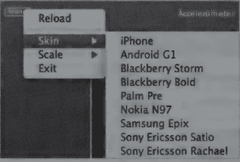

## 重定向到移动网站

如果您决定为网站制作移动版本，那么您必须决定如何让手机用户访问它。有两种方法。第一种，直接提供两个地址：一个是电脑地址，一个是移动地址。您可以告诉读者，在手机上访问网站时，在地址中添加“m”（例如 `m.library.com`）。

第二种方法稍微复杂一些。它要求您在页面中添加代码，让页面检测用户的浏览器。如果用户使用的是移动浏览器，则会被重定向到适合移动设备的网站。要完成这一任务，您需要了解`PHP`编程。您也可以花50美元购买这段代码（http://detectmobilebrowsers.mobi/）。

## 实施PhoneGap

这里我不详细介绍如何将应用安装到每部手机上——具体方法因手机而异，而且通常每月都有更新。但您可以轻松地在每款手机的网站上找到所需信息，或者查看`PhoneGap`提供的信息：

- `iPhone`: http://www.phonegap.com/start#ios
- `Android`: http://www.phonegap.com/start#android
- `BlackBerry`: http://www.phonegap.com/start#blackberry
- `WebOS`: http://www.phonegap.com/start#webos
- `Symbian`: http://www.phonegap.com/start#symbian
- `Windows Mobile`: http://phonegap.pbworks.com/Getting-Started-with-PhoneGap-(WiMo)

那么就来谈谈这个应用吧。所有按钮的排列顺序都是按照我认为对读者最重要的顺序来安排的。最常用的按钮很可能是“致电图书馆”和“开放时间”。这将是主屏幕。

- **通用图书馆标志：** 只要可能，我建议使用读者已经熟悉的标志；尽量使用与主页相似的配色。但请记住，用户不是普通的电脑用户——使用该应用的人通常在户外，屏幕更难看清。在手机上，颜色比在电脑上更加重要。
- **致电：** 创建应用时有两种按钮：第一种是跳转到另一个页面的超链接；第二种是操作按钮。操作按钮正如*操作*一词所表示的那样，它们可能会告诉手机用户想要拨打某个号码；按下按钮后，手机会自动启动拨号器并开始拨号（本章末尾提供了操作按钮的代码）。
- **开放时间：** 对于“开放时间”链接，您可以做两件事：创建一个包含开放时间的移动页面，这是最简单快捷的方法；或者创建一个脚本，倒计时图书馆闭馆或再次开放的剩余分钟数。
- **位置：** 读者不仅想知道图书馆在哪里，还想知道如何到达那里；这正是移动应用可以发挥作用的地方。为简单起见，我不会深入介绍`GPS`的使用；如果您想了解更多，请参阅`PhoneGap`网站教程（http://phonegap.pbworks.com/PhoneGap-Tutorial:-Get-GPS-Coordinates/）。
- **查找图书：** 大多数图书馆在“查找图书”选项上会有些局限，因为不幸的是，许多供应商尚未提供移动版本，因此很难为目录制作移动友好版本。在关于高级功能的章节中，我简单介绍了一种变通方法。如果您的目录供应商目前不提供`Web`应用，请开始询问原因。很少有供应商意识到这一点，除非图书馆员不断提出要求，否则他们不会改变。
- **研究：** 许多研究服务提供商尚未提供移动服务，因此请务必鼓励他们这样做。已经提供移动服务的一家供应商是`Gale`，它有一个出色的应用叫`AccessMyLibrary`。该应用允许读者在距离图书馆十英里范围内通过手机使用数据库，且无需登录。即使您决定不开发应用，也可以推广这项服务。
- **儿童和青少年项目：** 显然，您需要在页面上展示图书馆实际提供的服务；不过，也可以在页面上放置游戏。有很多地方可以找到基于`JavaScript`的游戏并实现到这些页面中；在`Google`上搜索可以得到成千上万的页面——有些是开源，有些是付费的。`JavaScript`，尤其在`iPhone`上，可能会很棘手；请务必测试页面，看看`JavaScript`代码是否真的有效。从互联网上获取代码用于移动应用时，效果可能时好时坏。
- **计算机课程：** 下一章会更详细地讨论这个主题，但可以考虑提供不同课程的录像，或两到三分钟关于如何在电脑上完成不同操作的演示——甚至可以链接到`YouTube`上有关不同计算机主题的有用视频。
- **短信提问：** 如果图书馆没有短信服务，那就开通一个！这是免费的！`Google Voice`对大多数图书馆来说都很好用。对于操作按钮，有一个简单的代码。只需将以下代码添加到您的应用中：

```
<a href="sms:1234133424243">Text a Question</a>
```

- **关于：** 在这里您可以说明应用的目的，以及如果遇到故障或问题应联系谁。

到目前为止，关于应用的所有信息都同样适用于`Web`应用。将应用改为`iPhone`应用只需额外一两个步骤。

哥伦比亚特区公共图书馆是最早为其图书目录构建应用的公共图书馆之一；图书馆将该应用的代码发布到网上，可以免费复制（http://dclibrarylabs.org/projects/iphone/）。您可能不想使用它（甚至可能不喜欢它），但它是您开始学习代码时一个好的参考。

## 将应用安装到iPhone和iPod Touch上

要在`iPhone`上安装应用，您需要从以下网站下载`iPhone SDK`和`PhoneGap`（在基于`Intel`的`Mac`电脑上）：

- **iPhone SDK:** http://developer.apple.com/iphone/index.action/
- **PhoneGap:** www.phonegap.com

务必使用`HTML`扩展名（不是`HTM`）保存所有移动`Web`文件。如果已经保存为`HTM`，请务必在继续之前将其重命名为正确的扩展名。另外，请确保您的首页文件命名为“`index.html`”。

然后将您创建的移动网站移动到`PhoneGap`目录中。解压`PhoneGap`文件后，打开`PhoneGap`目录，然后打开`iPhone`目录（图6.2）。

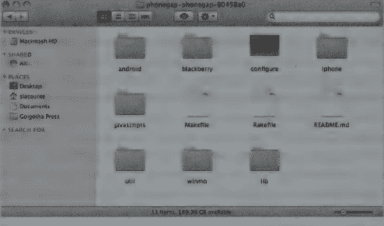

`iPhone` 应用的结构已经创建好了，所以你现在要做的只是把你的移动 `Web` 应用套进一个现成的模板里。然后，你可以把你所有的移动 `Web` 应用文件拖放到 `WWW` 目录中（图 6.3）。

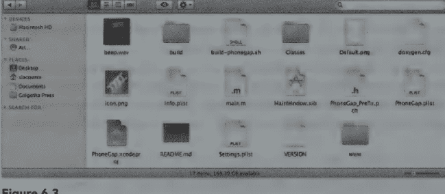

你的第一个 `iPhone` 应用现在已经完成了！没错，就是这么简单！虽然还有一些小调整要处理，但这里的描述应该能让你很好地了解到，开始为 `iPhone` 开发应用到底有多容易。

要想看到你的应用运行起来，回到 `PhoneGap` 和 `iPhone` 目录，打开文件“`PhoneGap.xcodeproj`”。这将启动 `Xcode`，即 `iPhone` 开发者软件（图 6.4）。

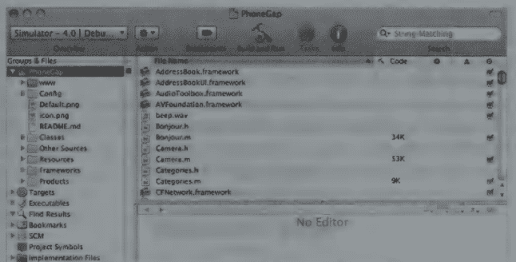

### 图 6.4

接下来，点击 `Xcode` 左上角的下拉菜单，确保它设置为“`Debug`”，然后选择你要运行的模拟器。最好选择最新的模拟器（`iPhone 4.0`），因为那是大多数人会拥有的设备。最好还要确保模拟器能在所有平台上运行。例如，如果你选择 `iPad` 作为模拟器，它会以 `iPhone` 应用（而不是 `iPad` 应用）的形式运行应用，如此一来，应用看起来会比正常情况小很多（图 6.5）。现在你已经准备好构建应用了。点击“`Build and Run`”按钮。

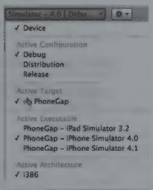

### 图 6.5


大约十秒钟后，模拟器会启动，你的应用就会出现了。如果它没有启动，而且你在屏幕右下角看到红色或黄色的标记，请点击这些标记查看信息。在应用第一次加载时，你会注意到两件事。第一，图标是 `PhoneGap` 的；第二，加载图片上写着“`PhoneGap`”。让我们来看看如何移除这两张图片，并用图书馆的图片替换它们。关闭 `Xcode` 程序和模拟器。现在，让我们来制作一个 `iPhone` 应用图标。这很简单。创建一个大小为 57 × 57 的图像；用文件名“`icon.png`”保存图片。把你创建的文件移到 `PhoneGap` 和 `iPhone` 目录中。该文件会替换已经创建好的“`icon.png`”，并替换为你新的图标。接下来，让我们更改启动画面。重复创建图标的步骤，只不过这次把你的图片命名为“`Default.png`”，并确保它具有以下尺寸：320 × 480。把这张图片移到 `PhoneGap` 和 `iPhone` 目录中。

在再次启动 `Xcode` 应用之前，将“`PhoneGap.xcodeproj`”重命名为你的实际应用名称（例如“`libraryapp.xcodeproj`”）；就我们的情况而言，我们用“`library.xcodeproj`”作为文件名。重命名后，再次打开该文件，这会重新启动 `Xcode` 软件。

此时，你的图标和启动画面已经改变了，但图标下面还是会显示“`PhoneGap`”。要更改显示的名称，请点击打开窗口中的 `Config` 目录（图 6.6）。

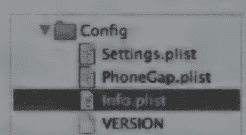

图 6.6

这会在屏幕右下角弹出一个新窗口（图 6.7）。在“`Bundle display name`”下，点击 `PhoneGap`，然后输入你想要显示的名称。就我们的情况而言，我使用了“`Library App`”这个名称。

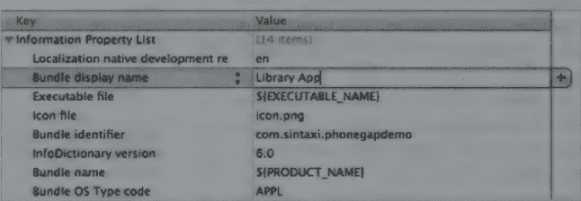

图 6.7

在再次于模拟器中加载你的应用之前，转到屏幕顶部，点击 `Build`，然后点击 `Clean All Targets`（图 6.8）。建议在运行模拟器之前这样做，以确保你已保存并更新了所有更改。

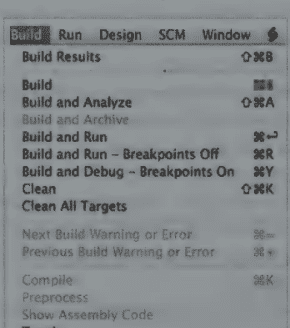

图 6.8

最后，点击“`Build and Run`”。现在一切应该都符合你的要求了。

## 将你的应用从模拟器移到 iPhone 上

要将应用从电脑移到 `iPhone` 或 `iPod` 上进行测试（并非上架 `App Store`，那需要更多工作），你需要为你的应用、你的设备和你自己获取一个配置文件。

第一步是前往 `iOS Dev Center` 网站（http://developer.apple.com/iphone/）注册成为一名开发者。登录后，你会在右侧看到一个写着“`iPhone Developer Program`”的菜单栏（图 6.9）。

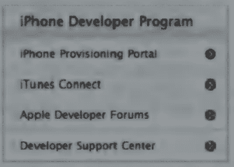

图 6.9

接下来，点击 `iPhone Provisioning Profile`。然后点击左侧的 `App IDs`；点击 `New App ID`，并为你的应用填写相关信息。

接下来，点击屏幕左侧的 `Provisioning`，然后选择 `New Profile`。创建好配置文件后，将其下载到你的电脑上。在接下来的几步中，我们将把这个配置文件与你为想要测试应用的 `iPhone` 或 `iPod` 生成的密钥进行匹配。

创建好配置文件后，你需要返回 `Xcode Organizer`（位于 `Window` 菜单中），从你的设备中获取产品标识符（图 6.10）。插好设备并打开 organizer 后，点击 `Provisioning Profile` 并复制应用标识符。接下来，返回 `Xcode`，点击 `Info.plist`，转到右下方面板中的方框（图 6.11）。将 `bundle identifier` 改为你刚刚复制的那个，但保留你的用户名。

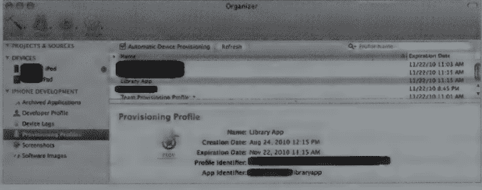

图 6.10

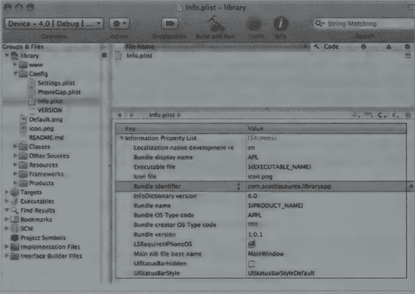

**图 6.11**

所以你的应用 `ID` 看起来应该像这样：`IDNUMBER.com.scottlacounte.libraryapp`（`App ID.com.PROFILE NAME.APP NAME`）。

当你安装完所有证书，终于准备好出发时，最重要的一步是确保 `Xcode` 设置为 `Device` 而不是 `Simulator`（图 6.12）。在切换之前，应用不会加载到 `iPod` 或 `iPhone` 上。

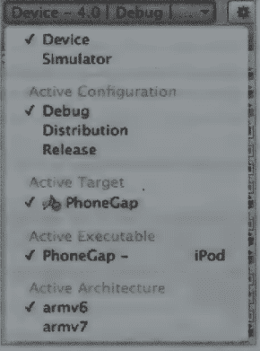

**图 6.12**

如果你一切都做对了，大约会有十秒钟的延迟，然后 `iPod` 或 `iPhone` 才会开机。如果你漏了某一步，那么在设备管理器中，设备旁边会有一个橙色圆圈（图 6.13）。当你点击设备时，它会告诉你错误是什么。最常见的错误是配置文件与设备不匹配，这意味着缺少某个证书。请仔细检查 `iOS Dev Center` 页面，确保你已下载所有证书。

一旦你对应用感到满意并准备出售它，那么你需要按照网上的说明进行操作。你还需要支付 99 美元的开发者注册费。

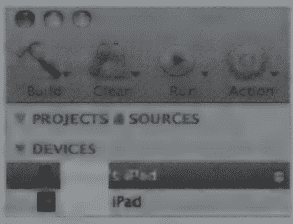

## 测试核心用户

当你准备好一个应用时，最后要考虑的事情是如何最好地推广它。例如，会使用该应用的人，不一定就是经常去图书馆的人。你如何才能向一群你可能不常遇到的用户推广一项服务呢？

接触用户群的一种方式是通过本地在线活动。如果图书馆没有 `Facebook` 页面，那么它应该创建一个——粉丝页面经常能吸引那些不常去图书馆的用户，或是那些想了解社区动态但不常去图书馆的人。

许多商务人士使用智能手机——对于这个用户群，你可以与城市商业区附近的餐馆和咖啡馆合作。许多商家会乐意留下宣传你应用的传单，尤其是在应用中以赞助商类别包含他们的名字，或者达成其他某种安排的情况下。为了吸引那些你通常不会见到的用户走进图书馆，你可以在应用上提供免费租借影碟的优惠券——他们只需在手机上出示优惠券，然后图书馆就可以备注该读者已使用了租借优惠券。

要宣传你的应用，你还可以放眼图书馆之外，看看商家们是如何让人们访问他们的 `Facebook` 页面或网站的。例如，许多当地的 `Chick-fil-A Facebook` 粉丝页面每周都会在粉丝页面上发布暗号。如果你在某一天去餐厅说出暗号，就能获得奖励。人们会狂热地访问页面以保持最新状态，生怕错过什么。成千上万的其他商家也有类似的策略。

手机的存储空间和屏幕空间都不大。所以你需要让应用有吸引力。如果读者必须在手机上的 `IMDb` 应用和图书馆的应用之间做出选择，他们会真的选择图书馆的吗？为什么不会呢？在开发应用时，要不断问自己：“是什么会让人们一次又一次地回来？”例如，读者为什么要费心下载一个告诉他们图书馆几点关门的应用？

图书馆应用需要具有交互性。如果通过应用与图书馆员交流很容易，而且如果有很多支持手机的研究工具，那么这个应用就会成为更重要的工具。如果它不具有交互性，用户每次都会选择其他应用。

# 7 超越基础

本书的目的是让构建应用尽可能简单。你可以向应用中添加 `JavaScript` 使其更炫，但详细讨论 `JavaScript` 会偏离本书的初衷——保持简单。

`JavaScript` 是一种相当强大的语言，可以做很多事情，但学习它并不是构建一个外观出色的应用所必需的。如果你懂 `JavaScript`，就用它；如果你不懂，还有另一种选择：小部件。如果你写博客或阅读博客，那么你很可能已经对小部件了如指掌，即使你不以这个名字称呼它们。小部件是那些坐在博客侧边栏上的小方块，提供指向 `Twitter`、`Facebook` 和 `Google` 新闻流等内容的链接。小部件表面上看起来很简单，但每个小部件内部都有成页的代码。好消息是，你不必了解代码也能构建它们。

对“`widgets`”进行一次简单的网络搜索，就会找到数千个提供可定制小部件的页面；有些是免费的，有些则附带少量费用。你需要提防使用 `Flash` 的小部件（目前许多手机不支持，尤其是 `iPhone`）。

许多网站也提供小部件。`Twitter` 是完美的例子。在 `Twitter` 的小部件网页（https://twitter.com/widgets/）上，你只需几步就能构建一个自定义小部件。

首先，在小部件页面上，选择 `My Website`（图 7.1）。

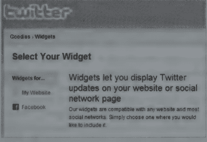

在下一页你会看到几个选项；选择 `Profile Widget`，它将显示你图书馆最近的推文。

接下来，你可以自定义你的小部件（图 7.2）。在用户名下，理想情况下应填写你图书馆的名称，但你也可以填写作者、杂志或任何其他拥有公开 `Twitter` 账号的人的名字。这可以在你没有时间亲自操作时为你的应用提供内容。

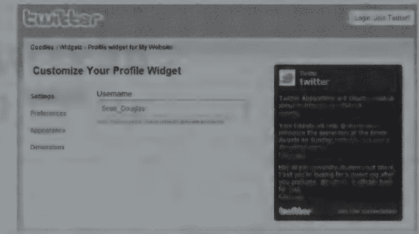

**图 7.2**


在 Preferences 下，你可以选择显示多少条推文。虽然 Twitter 的限制是三十条推文，但最好考虑你正在为其开发的移动设备的屏幕尺寸。你不希望用户滚动太多——理想情况下，你根本不希望他们滚动。因此，你可能将显示的推文数量保持在四条。

在 Appearance 下，确保你选择的颜色与你的应用颜色相匹配。在 dimensions 下，你可以将其调整为手机的尺寸，或选择 auto width 以使其自动调整小部件本身的大小。

最后，滚动到页面底部并选择 Finish & Grab Code（图 7.3）。现在只需复制代码并粘贴到你的应用代码中即可。


**图 7.3**

如果你正在考虑提供基于聊天的参考服务（如果你没有考虑，你应该考虑——不这样做，你将错过整整一代用户），那么可以考虑 LibraryH3lp（`http://libraryh3lp.com`）。该网站的服务有少量年度费用（根据你所在城市的大小而有所不同），但比许多类似服务便宜得多。Meebo 和 Google Talk 提供免费的聊天服务，但它们的小部件使用 Flash，因此在 iPhone 应用中不受支持。相比之下，LibraryH3lp 使用 Java，因此对应用友好。框 4 显示了 LibraryH3lp 小部件的源代码。

在移动浏览器中，框 4 中的代码看起来类似于图 7.4。

Widgetbox（`www.widgetbox.com`）是最受欢迎的小部件构建器之一；它是免费的但由广告支持。还提供无广告的专业版，年费从 $29.99 起。该网站提供基于 Flash 和基于 Java 的小部件。

Facebook 也提供了将个人资料嵌入网站的步骤（`http://developers.facebook.com/docs/guides/web/`）。然而，Widgetbox 制作了一个更用户友好的版本，如果你刚开始开发，它是更好的选择。只需确保你复制的是基于 Java 的小部件版本，而不是基于 Flash 的版本。

### 框 4 ■ LibraryH3lp 小部件的源代码

```html
<html xmlns="http://www.w3.org/1999/xhtml" xml:lang="en" lang="en">
<head>
<meta http-equiv=content-type content="text/html; charset=UTF-8">
<meta name="viewport" content="width=device-width, initial-scale=1.0 user-scalable=yes" />
<title></title>
<link type="text/css" rel="stylesheet" href="/css/mobile.css" />

<style id="dynamic" type="text/css">
</style>
<script type="text/javascript" src="http://ajax.googleapis.com/ajax/libs/jquery/1.3.2/jquery.min.js"></script>
<script type="text/javascript" src="http://d1aaqh87bn7fin.cloudfront.net/mobile_2010011801.min.js"></script>
<!--
<script type="text/javascript" src="/js/lib/strophe.js"></script>
<script type="text/javascript" src="/emoticons/emoticons.js"></script>
<script type="text/javascript" src="/js/mobile.js"></script>
-->
</head>
<body>
<div id="header">

<h1 id="title"></h1>
</div>

<div id="to" jid="my-queue@chat.libraryh3lp.com" lang="en"></div>
<div id="recv"></div>
<div id="send">
<form action="#" method="post" onSubmit="return false;">
<textarea id="msg">chat requires javascript...</textarea>
</form>
<div id="buttons"><a href="#" onclick="libraryh3lp.sendLine(); return false;"></a></div>
</div>
<div id="status"><a id="mail" href="#" onclick="libraryh3lp.mailTranscript(); return false;">Email transcript</a></div>
</body>
</html>
```

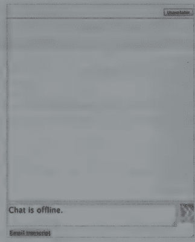

**图 7.4**

Widgetbox 也使开发移动应用变得容易（`www.widgetbox.com/mobile/`）。如果你想要一个基本的移动网页应用（不是原生应用）来显示 Twitter、Facebook 或 Flickr 更新，那么 Widgetbox 可能很适合图书馆；然而，它不允许用户编辑源代码，你可能会很快发现它对你的图书馆来说过于受限。

Widgipedia（`www.widgipedia.com`）是寻找小部件的另一个很好的资源；然而，它们是用户提交的并且可定制。

PhoneGap 提供了开发人员可以复制用于其自身应用的几段代码；你可以在网站的 Community 部分找到这些代码（`www.phonegap.com/community/`）。它经常更新，所以经常回来查看。一个有用的代码是基于手机 GPS 的地图包含（`http://phonegap.pbworks.com/PhoneGap-Geolocation-Sample-Application`）。

我已经测试了本章中的所有小部件和工具，以确保它们能与 iPhone 应用配合使用。正如我之前所说，JavaScript 在移动网页应用和原生应用上很棘手，所以在实施前务必测试。对于我在原生 iPhone 应用上成功测试的每一段 JavaScript，就有十几段返回错误。

## 其他移动方式

本书的目的是向图书管理员展示开发移动应用可以有多简单。在很大程度上，移动应用运行在智能手机上。然而，图书管理员也可以主动调查其他移动应用程序编程接口（APIs）。

Foursquare（有关文档信息，请参阅 `http://groups.google.com/group/foursquare-api/web/api-documentation/`），有些人称其为下一个 Twitter，是一款基于位置的社交媒体应用，允许人们告诉朋友他们确切的位置，并成为他们经常访问的地点“市长”。Gowalla（`http://gowalla.com`）是另一个像 Foursquare 一样的社交网站，越来越受欢迎；与 Foursquare 不同的是，Gowalla 在定制方面提供了更多。

在思考移动应用时，图书馆应尽可能多地考虑免费技术用于推广——Foursquare 和 Yelp 已经拥有你可以轻松链接的应用。如果你的图书馆尚未在 Foursquare 上占领自己的位置，为什么不呢？这是一个完美的推广渠道——人们可以用图书馆应用签到图书馆并获得免费的东西——免费视频、减免罚款、小奖品等等。

在手机上运行最好的社交媒体网站，与在网络上最受欢迎的网站相同：Facebook、Twitter、YouTube 和 Flickr。如果你的图书馆还没有 Facebook 粉丝页，现在是时候了。这对其他三个也同样适用，尽管程度较轻。有什么比用视频和照片展示你的图书馆活动更好的方式呢？所有社交媒体网站的优点在于它们相互集成——你可以将 Twitter 更新推送到 Facebook，并即时在 Twitter 和 Facebook 上分享 YouTube 视频和 Flickr 幻灯片。这些网站最好的地方是，你不需要做任何事情就能实现移动化。如果你有 Twitter 或 Facebook 页面，它已经是移动兼容的——不需要额外步骤。

图书管理员不会给你答案——他们只是为你指明方向。你的应用也应如此。通过找到已经完成的代码，节省你自己的时间和麻烦。我希望你决定开发一个移动应用，但至少，我希望你确保你的图书馆积极参与这里提到的移动技术。

## WYSIWYG 应用编辑器

移动应用开发是一项强大的图书馆工具，每家图书馆都应该在某种程度上尝试，但并非每家图书馆都有时间和/或资源来实现这一点。因此，值得注意一些替代解决方案。使用替代方案的缺点是其成本以及在大多数情况下对其进行自定义的能力有限。其优点是它们可以帮助你更快地设置，并且几乎可以保证你的应用进入应用商店。

这里列出的一些工具基本上会为你构建一个应用；其他工具提供易用的 WYSIWYG 界面。所有工具都适用于 iPhone；大多数适用于 Android；一些适用于 BlackBerry 和其他移动设备。

这些界面的前期成本可能很昂贵，但与请程序员承担该项目相比，成本几乎可以忽略不计。

### Appanda

- **网站：** `www.appanda.com`

- **平台：** 面向 iPhone 和 Android 的 DIY 应用解决方案

- **摘要：** Appanda 最适合希望仅展示已存在内容的 iPhone 和/或 Android 版本的图书馆（例如，引入博客或托管在 YouTube 上的视频）。

- **定价：** 每月 $29.99，外加一次性激活费 $99

### Swebapps

- **网站：** `www.swebapps.com`

- **平台：** iPhone

- **摘要：** 界面比一些具有更方正外观的 DIY 应用更具视觉吸引力。Swebapps 具有其他 DIY 构建器的所有相同功能，但还整合了创建表单、列表、地图和活动页面的工具。

- **定价：** 基础计划每月起价 $29，外加 $399 一次性费用

### AppBreeder

- **网站：** `www.appbreeder.com`

- **平台：** iPhone 和网页应用

- **摘要：** 没有前期费用，但该网站在定制方面有限，且外观非常通用。

- **定价：** iPhone 应用每月 $29-$49 或免费网页应用

### My App Builder

- **网站：** `www.myappbuilder.com`

- **平台：** iPhone 和 Android

- **摘要：** 没有前期费用，但网站提供的截图很少，对功能介绍也很少。

- **定价：** 每月 $29

### Build an App

- **网站：** `www.buildanapp.com`

- **平台：** BlackBerry、Android、Windows Mobile、Mobile Web、iPhone

- **摘要：** 可在大多数应用构建器中更多的设备上使用，且价格比大多数便宜，但应用外观非常通用，且在定制方面有限。

- **定价：** 所有应用每月 $14 和 $19 设置费，但 iPhone 应用需要 $199 设置费

### Mobile App Loader

- **网站：** `www.mobileapploader.com`

- **平台：** iPhone、iPad 和 Android

- **摘要：** 这不是最好的应用构建器外观，但费用低，且是少数兼容 iPad 的之一。不要被价格迷惑；额外的按钮和功能会产生额外费用。此外，定制空间也不多。

- **定价：** 每月 $4.99 和 $59.99 设置费

### Game Salad

此 DIY 编辑器用于游戏。它不适合图书馆，但可能值得为青少年考虑。让青少年构建游戏的程序将是一个很棒的项目。最棒的是，它是免费的！不幸的是，需要 Mac（`http://gamesalad.com/landing/overview`）。

## GOOGLE APP INVENTOR

几年前，应用开发者的情况更为复杂——PhoneGap certainly 帮助消除了移动应用开发的复杂性。过去一年中，数十家虚拟公司涌现出来，承诺协助希望进入移动领域但缺乏编程技能的用户。在本节中，我讨论 Google 的 App Inventor（`http://appinventor.googlelabs.com`）。

根据我的经验，为 iPhone 开发应用比为 Android 开发要简单得多；苹果在应用开发上花费了更多资金，其呈现和 SDK 功能上显而易见。Google 仍在追赶。如果你想使用 PhoneGap 开发应用，请参阅附录，其中列出了在网上获取教程的地点。Google App Inventor 与传统的应用开发方法完全不同，因此值得在此说明它是什么以及它如何工作。

App Inventor 于 2010 年 7 月 12 日首次发布；该工具声称简单到小学儿童几乎无需努力即可使用。界面使用拖放对象来创建可在任何 Android 手机上运行的应用。

由于 App Inventor 的简单性，很难开发出视觉上令人惊艳的应用。它是测试移动开发并决定图书馆最佳实践的绝佳场所。随着 Google 不断改进拖放开发者，其使用将变得更加容易且功能更强大。

## INDEX

### A

- absolute positioning (CSS elements), 16

- accelerometer (PhoneGap feature), 26

- Advanced Tally Counter Pro, 6

- Appanda (website), 46

- AppBreeder (website), 46

- apps

  - installing, 33–37

  - moving, 37–39

  - testing users, 39–40

  - using widgets, 41–44

- Askdroid, 6

### B

- Build an App (website), 47

### C

- camera (PhoneGap feature), 26

- Cascading Style Sheets (CSS)

  - about, 13

  - creating documents, 17

  - ID selectors, 14–15

  - positioning elements, 15–17

  - tables versus, 15–16

  - usage considerations, 15

  - WCSS, 13–14

- chat-based reference services, 42

- CodeArk Tally Counter, 6

- content for mobile apps, 9–10

- CSS: The Missing Manual (McFarland), 13

### D

- domains, setting up, 7

### F

- Facebook (website), 42

- feature phones, defined, 1

- floating technique, 16–17

- forms, JavaScript and, 21

- Foursquare (website), 45

### G

- Gale’s AccessMyLibrary app, 40

- Game Salad (website), 47

- geolocation (PhoneGap feature), 26

- Goodman, Danny, 19

- Google App Inventor, 47–49

- Google Talk, 42

- Gowalla, 45

### H

- HyperText Markup Language (HTML)

  - about, 4

  - CSS and, 13–14

  - JavaScript and, 20

### I

- ID selectors, 14–15

- images, mobile app, 11

- interactivity for mobile apps, 10

- iOS Dev Center site, 37

- iPhone. See smartphones

- iPhone SDK, 33

### J

- JavaScript

  - basics of, 20–21

  - compatibility considerations, 22–23

  - downloading, 19

  - forms and, 21

  - support for, 23

  - usage considerations, 21–24, 44

- JavaScript Bible (Goodman), 19

### L

- LibraryH3lp (website), 42–43

### M

- McFarland, David, 13

- Meebo (website), 42

- Mobile App Loader (website), 47

- mobile apps

  - alternatives for, 45–49

  - content for, 9–10

  - defined, 1–2

  - developing, 2–4, 7–11, 17–18

  - interactivity for, 10

  - navigation for, 8, 17–18, 22

  - surveying users, 5–6


- testing core users, 39–40
- widgets in, 41–44
- WYSIWYG app editors, 46–47
- mobile browsers
  - languages supported, 4, 22
  - navigation considerations, 8, 17–18, 22
  - size considerations, 15
- mobile websites
  - defined, 2
  - essence of, 4–5
  - JavaScript and design, 19–24
  - redirecting to, 28
  - standard websites versus, 7–8
  - viewing on PhoneGap, 26–28
- MockApp (website), 29
- moving apps, 37–39
- My App Builder (website), 46

### N

- native apps
  - creating, 29–33
  - defined, 2
  - installing on smartphones, 33–37
  - testing, 37–40
- navigation for mobile apps, 8, 17–18, 22

### O

- ODK Collect, 6

### P

- PhoneGap software
  - code for sharing, 44
  - downloading, 33
  - features, 25–26
  - implementing, 28
  - redirecting to mobile sites, 28
  - viewing websites, 26–28
- positioning CSS elements, 15–17
- provisioning profiles, 37

### R

- redirecting to mobile websites, 28
- reference services, chat-based, 42
- relative positioning (CSS elements), 16

### S

- simulators, 37–39
- smartphones
  - defined, 1
  - dimensions in pixels, 5
  - installing native apps on, 33–37
- staff training, 6
- Survey on the Spot, 6
- surveying users, 5–6
- SurveyMonkey, 6
- Swebapps (website), 46
- system requirements and fees, 3

### T

- tables versus CSS, 15–16
- Tally Counter, 6
- Tallymander, 6
- testing native apps, 37–40
- training staff, 6
- Twitter (website), 41–42

### V

- vibration (PhoneGap feature), 26

### W

- web analytic sites, 5
- Widgetbox, 42, 44
- widgets in mobile apps, 41–44
- Widgipedia, 44
- Wireless CSS (WCSS), 13–14
- Wireless Markup Language (WML), 4
- World Conference On Soft Computing (WCSC), 11
- WYSIWYG app editors, 46–47

### X

- Xcode, 34–36
- XHTML-MP, 4

## 您可能还感兴趣


### 做好社交媒体，使其有意义

图书馆员指南

Laura Solomon

Facebook、Twitter、MySpace、LinkedIn：要跟上社交媒体网站的步伐已经够难了，更不用说理解它们如何融入当今的图书馆。这本实用资源以简洁易懂的格式汇集了该主题的最新信息。

印刷版：978-0-8389-1067-2
电子书：7400-0672
印刷版/电子书套装：7700-0672

80页 / 8.5" x 11"

**更多ALA Editions特别报告**


### 开放获取

WALT CRAWFORD

ISBN：978-0-8389-1106-8

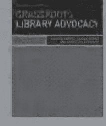

### 基层图书馆倡导

LAUREN COMITO, ALIQAE GERACI AND CHRISTIAN ZABRISKIE

ISBN：978-0-8389-1134-1

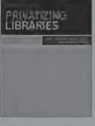

### 图书馆私有化

JANE JERRARD, NANCY BOLT, AND KAREN STREGE

ISBN：978-0-8389-1154-4

**图书馆技术报告**

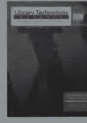

### 使用WordPress作为图书馆内容管理系统

KYLE M. L. JONES AND POLLY-ALIDA FARRINGTON

ISBN：978-0-8389-5831-5

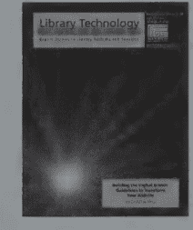

### 构建数字分馆

DAVID LEE KING

ISBN：978-0-8389-5804-9

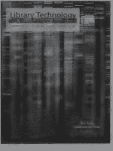

### 网络规模发现服务

JASON VAUGHAN

ISBN：978-0-8389-5829-2

立即在 alastore.ala.org 或拨打 866-746-7252 订购！

ALA商店的购买收入为全球图书馆专业人士的倡导、宣传和认证项目提供资金。

读者越来越期望随时随地访问他们的图书馆。这份ALA Editions特别报告提供了实用指导，帮助图书馆员将图书馆送到读者的手掌之中。技术专家Scott La Counte利用许多图书馆员已经掌握的HTML技能，结合灵活的开发工具，展示了创建定制移动应用并不需要昂贵成本或深厚专业知识。他以直白、实用的语言：

- 演示了如何通过移动网站和手机应用在移动网络上建立存在感
- 详细介绍了PhoneGap等开源开发工具，这些工具能够创建可在多种移动操作系统上运行的移动应用
- 讨论了评估图书馆用户群以及获得管理员支持的方法

遵循本ALA Editions特别报告中的指引，图书馆可以轻松地跟随读者的脚步！

## 您可能还感兴趣

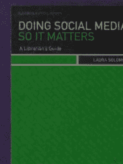


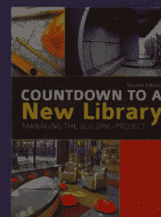

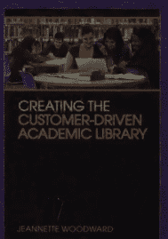

www.alastore.ala.org
