# GPU 高级指南 6：高级渲染技术

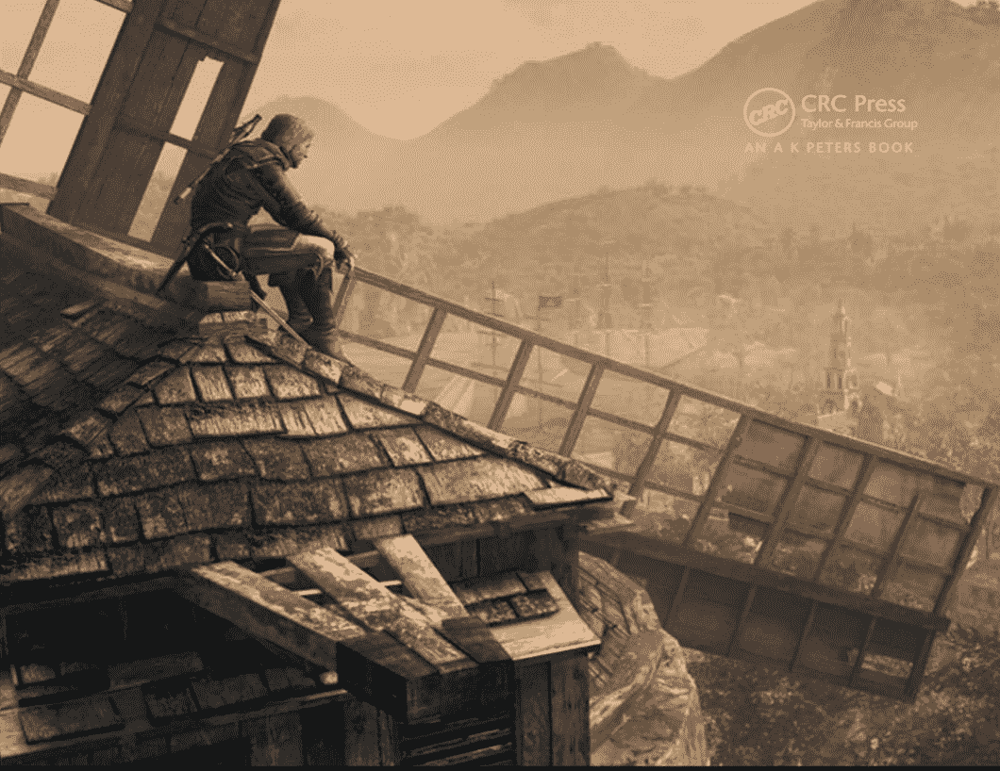


Wolfgang Engel

David Pangerl

Gustavo Bastos Nunes 和 João Lucas Guberman Raza

Henry Schäfer, Matthias Nießner, Benjamin Keinert, 和 Marc Stammer

Alex Dunn

Christopher Oat

Peter Sikachev, Samuel Delmont, Uriel Doyon, 和 Jean-Normand Bucci

- 参考文献 ................................................................................................................................................................. . . . . . . 89

## 2 基于 LOD 的草地渲染与模拟 91

Michal Drobot

Egor Yusov

Doug McNabb

Michal Valient

Ivan Spogree

Hugh Malan

5.10 结论 . . . . . . . . . . . . . . . . . . . . . . . . . . . . . 292

Wolfgang Engel

Márton Tamás 和 Viktor Heisenberger

Vladimir Bond

Marius Bjørge

Gareth Morgan

Daniele Di Donato

Andrew Girdler 和 James L. Jones

Carsten Dachsacher

# 1 基于计算的瓦片剔除 435

Jason Stewart

Takahiro Harada 459

Thomas Kroes, Dirk Schut 和 Elmar Eisenmann 475

Wessam Bahnassi 487

Holger Gruen 489

- 1.2 概述 480

- 参考文献 503

- 2.4 概述 . . . . . . . . . . . . . . . . . . . . . . . . . . . . . 508

- 参考文献 . . . . . . . . . . . . . . . . . . . . . . . 517

# 3 ANGLE：将 OpenGL ES 引入桌面 521

Shannon Woods, Nicolas Capens, Jamie Madill, 和 Geoff Lang

- 3.6 推荐实践 . . . . . . . . . . . . . . . . . . . . . . . . . . . . . 540

# 关于编辑 543

# 关于贡献者 545


# 致谢

*GPU Pro：高级渲染技术*一书涵盖了许多即用的思想和流程，可以帮助解决许多日常图形编程中的挑战。

该系列丛的第六本书如果没有许多人的帮助是不可能实现的。首先，我要感谢章节编辑们所做的出色工作。Wessam Bahnassi、Marius Bjorge、Carsten Dachsbacher、Michal Valient 和 Christopher Oat 的工作确保了该系列的质量符合读者的预期。

精美的封面截图由 Ubisoft 贡献。它们展示了游戏《刺客信条 4：黑色没旗时代》。

CRC Press 的团队让整个项目得以实现。我要感谢 Rick Adams、Charlotte Byers、Kari Budyk 以及整个制作团队，他们将文章结成了书。

特别感谢我们的家人和朋友，在漫长的书籍制作周期中，他们度过了许多没有我们的夜晚和周末。

> 我希望你们阅读这本书时的乐趣和我们创作它时一样。

—Wolfgang Engel

P.S. 即将推出的 *GPU Pro 7* 计划已经在进行中。非常欢迎任何评论、提案或建议（wolfgang.engel@gmail.com）。


# 网络材料

配合某些章节的示例程序和源代码可以在 CRC Press 网站上获取：访问 http://www.crcpress.com/product/isbn/9781482264616 并点击“Downloads”（下载）选项卡。

目录结构通过使用章节编号作为子目录名称，紧密遵循书籍结构。

- DirectX June 2010 SDK（最新 SDK 随 Visual Studio 2012 安装）。

- 运行示例需要支持 DirectX 9、DirectX 10 甚至支持 DirectX 11 的 GPU。文章将提到具体要求。

- 操作系统应为 Microsoft Windows 7，以符合支持 DirectX 10 或 11 GPU 的要求。

- Visual Studio C++ 2012（某些示例可能需要旧版本）。

- 2GB 或更多内存。

- 最新的 GPU 驱动程序。

# 更新

示例程序的更新将在网站上发布。

# 几何处理

书籍的“几何处理”章节侧重于图形处理器（GPU）以令人惊叹的方式处理和生成几何结构的能力。

该章节的第一篇文章由 David Pangerl 编写的“动态 GPU 地形”，介绍了一种基于 GPU 的算法，用于动态修改地形拓扑结构并将更改与物理模拟同步。

接下来的篇文章由 Gustavo Bastos Nunes 和 João Lucas Guberman Raza 编写的“通过曲分在 GPU 中实现带宽高效的网格”，涵盖了在硬件曲分器帮助下生成高度详细网格的过程生成，同时整合了支持地貌变形的细节水平（LOD）方案。

该章节的第三篇文章是 Henry Schäfer 和 Matthias Nießner 编写的“物体碰撞时细分曲面的实时变形”。

（注：由于原文中存在大量重复段落，以上翻译已根据逻辑进行整合，确保不重复输出翻译内容。）

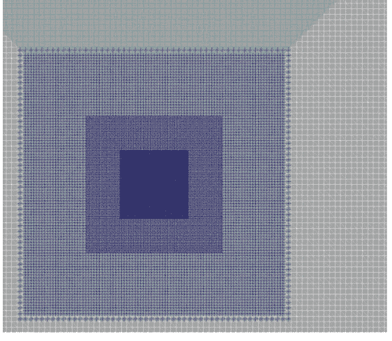

**图 1.3.** 蓝色中心网格（Mesh 0）；绿色顶侧网格（Mesh 1）；以及白色左侧、底部和右侧网格（分别为 Mesh 2、Mesh 3 和 Mesh 4）。在 Mesh 0 和 Mesh 1 的交界处，可以看到网格三角形重叠。同样重要的一点是，所有网格矩形必须以相同的方式切割成三角形（这就是为什么我们不能对 Mesh 0 和 Mesh 1 使用相同的网格）。

所有顶点都在顶点颜色的 G 通道中编码了级别。顶点颜色的 R 和 B 通道用于标记几何形变 X 和 Z 混合因子。

通过这种方法，我们得到了一个三角形数量巨大的网格，如果进行渲染，其大部分三角形将位于渲染视野之外。为了最少减少离屏三角形的数量，我们将渲染网格分为五个部分：具有 $L_c$ 级的中心网格（Mesh 0）以及级别从 $L_c+1$ 到 $L$ 的四边网格（Mesh 1-4）。

中心网格始终可见的，而侧边网格在渲染前会进行可见性测试。

通过这种优化，我们获得了两个额外的渲染批次；然而，当视野小于 180 度时，渲染量减少了 76%。（见图 1.3 ）。

对于低视野角（60 度或更小），我们可以通过创建更多的侧边网格来优化它。例如，如果我们把 $L_c$ 设置为 2 并创建八个侧边网格，我们将额外减少 55% 的渲染负载（我们将渲染 58,000 个三角形）。然而，如果我们从正上方观察地形，我们最终将渲染整个渲染网格，因为中心网格太小了，无法填满屏幕。

选择地形参数。渲染网格拓扑参数对性能起着非常重要的作用，因此应该根据每个项目的要求来选择。

- 考虑这样一个项目：我们需要一个具有相当详细修改分辨率（~ 200 x 200 m）的填埋场，且渲染尺寸不很大，视野距离也不远（~500 m）。

通过一些数学计算得出渲染网格数量：

- 视野范围（地形在多远处可见？）—$V = R \times S \times 2^{L-1}$

- 最大级别四边分辨率——$Q = R \times 2^{L-1}$。

- 级别 0 数量——$T_{Lo} = 2 \times S^2$。

- 级别 $n$ 三角形数量——$T_{Ln} = 2(S^2 - (\frac{S}{2} - 2)^2)$。

- 总三角形数量——$T = T_{Lo} + L_c \times T_{Ln}$。

- Mesh 0 数量——$T_{Mo} = T_{Lo} + (L_c - 1) \times T_{Ln}$。

- Mesh $n$ 三角形数量——$T_{Mn} = \frac{(L-L_c) \times T_{Ln}}{4}$。

由于许多场景是从上方向下观察地形，我们使用了较高的网格级别计数（$L_c=4$），这允许我们在许多情况下在单个批次中渲染地形（当我们只渲染中心网格时）。我们得到的四边分辨率为 0.1 m，级别 $S=100$，级别计数 $L=8$，中心网格级别计数 $L_c=4$。我们使用 $2048 \times 2048$ 纹理作为地形数据。通过这些设置，我们得到了 10 cm 的分辨率、约 1 km 的渲染视野以及共 127,744 个三角形。由于我们使用了 65 度的视野，只分批渲染了约 81,000 个三角形。如之前所述，必须仔细选择这些参数以适应应用的性质（见图 1.4 和 1.5.）。

CPU 计算。我们在 CPU 上计算每级别的对齐。每个分辨率级别的对齐大小是其边缘尺寸。这是唯一直接在 CPU 上进行的地形计算。地形渲染位置对齐到双倍级别大小，以便每个级别与高级别对齐。顶点着色器将 $\vec{x}$ 和 $\vec{z}$ 处的所有顶点对齐到顶点级别位置。使用以下偏移用于跳过对于地面高度的相机来说太小的级别：

```cpp
float snapvalue=0;
float snapmax=2 * snapvalue;
posnap0.x=floor(posnap0.x / snapmax + 0.01f) * snapmax;
posnap0.z=floor(posnap0.z / snapmap + 0.01f) * snapmap;
```

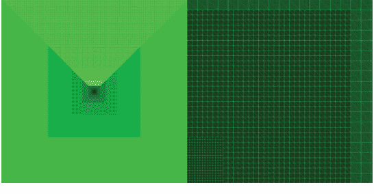

```cpp
posnap0.z=floor(posnap0.z / snapmap + 0.01f) * snapmap;
float levelsnap=snapvalue;
terrainRendererParams[0].z=posnap0.x - camerap.x;
terrainRendererParams[0].w=posnap0.z - camerap.z;
（此处省略代码部分，保持原样不翻译）
```

顶点着色器。所有其他地形渲染计算都在顶点着色器中完成：

- 执行顶点抓取
- 计算世界空间位置
- 计算级别偏移
- 计算几何形变参数和混合因子

几何形变发生在低级别点位于高级别边缘的区域。当这些点被隐藏而高级别显示时，它们在边缘被平滑处理。

```cpp
（此处省略代码部分，保持原样不翻译）
```


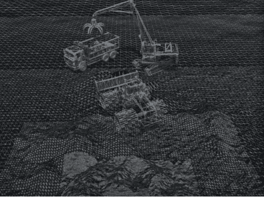

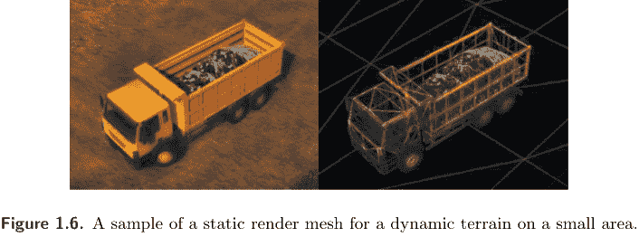

对于小型封闭动态区域（例如自卸车货箱区域或垃圾坑），我们使用覆盖该区域的静态网格（带细节水平）的标准渲染技术。（见图 1.6。）

在这种情况下，网格的拓扑并不重要，因为它很小且总是整体渲染。

## 1.5 动态修改

动态地形修改是新算法的另一个重要方面。之前，我们开发了几种使用 CPU 地形修改的技术；然而，很难优化这些技术，因此新修改算法的主要目标是在 GPU 上执行。

### 1.5.1 算法概述

以下是算法的高级概述。

如图 1.7 所示，我们利用了这样一个事实：大型主地形纹理（蓝色矩形）中的所有修改（红色矩形）大部分都在非常小的区域内（最多几米）。最初，我们创建了一个小的临时修改渲染纹理（黑色矩形），作为乒乓数据缓冲区。处理期间，我们首先选择此临时修改纹理作为渲染目标并将主纹理作为源，使用简单的数据拷贝`shader`将主网格的修改位置复制到临时修改纹理中，以保持纹理像素大小。

接下来，我们交换角色，选择主纹理作为渲染目标并将小型临时修改纹理作为源。只在主纹理的修改部分渲染矩形。

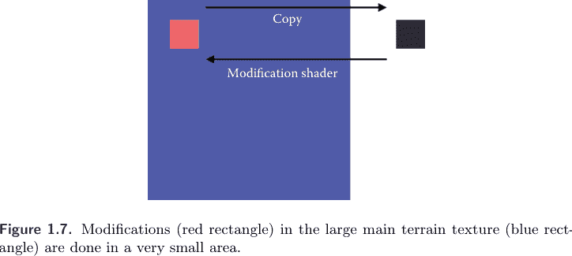

修改着色器（modification shader）。修改着色器可以使用额外的掩码来执行所需的修改（例如：犁掩罩、轮子的圆柱掩罩或球体掩罩）。

临时纹理会在目标像素周围进行多次采样以获得最终结果（例如：侵蚀着色器或犁着色器）。

我们使用一个`128 × 128`的临时修改纹理（覆盖`12.8 × 12.8`米的变化范围）。

### 1.5.2 犁

犁着色器是我们执行的最复杂的地形修改。其核心思想是在犁前方位移被犁所移动的体积，同时模拟压缩、地形位移和体积守恒。

我们使用纹理查询来测量犁会移除多少体积（从上一个位置位移的体积）。然后我们使用特殊的犁分布掩码，并在犁前方添加位移的体积。

最后，侵蚀模拟会创建一个良好的地形形状。

### 1.5.3 侵蚀

侵蚀是最重要的地形修改。它在所有进行修改的地方执行几秒钟，以平滑地形并应用更自然的视觉效果。

侵蚀是一个简单的函数，它对相邻像素的目标高度差进行求和，根据像素的流动性参数进行高度调整，并添加一些随机化以使其看起来更自然。

遗憾的是，我们尚未找到将侵蚀模拟与体积守恒相结合的方法。

轮子修改是圆柱形状在地形上移动的模拟。它使用地形数据压缩因子来防止过度下陷，并创建轮子侧面的填充。

我们尝试将此参数与地形数据流动性参数相关联（以减少纹理数据），但这导致了许多与侵蚀效果相关的问题，因为它也会改变流动性值。

仅限 GPU 处理的一个缺点是，数据有时需要与位于 CPU 域的物理引擎进行同步。为了实现这一点，我们需要将数据从 GPU 内存传输到 CPU 内存以进行同步。

因为每帧下载完整的地形数据纹理（在我们的情况下是`2000 × 2000`）会严重消耗性能，我们必须收集并局部化可能的变化。

这些变化每隔几帧从主纹理复制到较小的纹理中，并下载到主内存用于更新碰撞网格信息。

我们发现使用`64 × 64`的纹理（捕捉`6.4 × 6.4`米）对于我们的需求完全足够。准备、下载和同步这些过程的时间小于`0.1`毫秒。

法线根据原始数据和固定偏移量（用于计算斜率的位置偏移）逐像素进行校准。这使得远处具有非常详细的视觉地形形状，而远处的顶点细节非常低（见图 1.8）。

当流动性非常低且地形出现悬崖时，问题就会出现。当高低细节之间的三角形拓扑结构差异很大时，从高细节网格计算出的法线似乎是分离的（见图 1.9）。

缓解此问题的一种方法是根据流动性低的边缘尺寸调整法线计算偏移，但这样做我们可能会丢失其他法线细节。

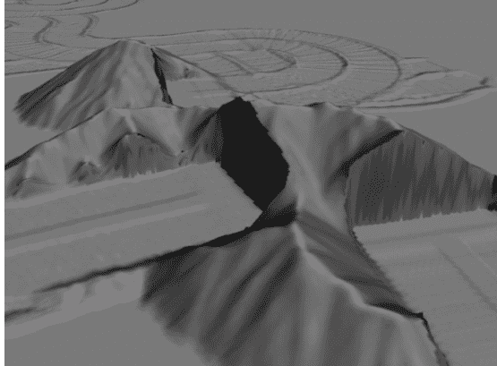

**图 1.8。**近距离观察悬崖上的法线问题。高细节拓扑和法线是相同的，此结果是完美匹配的。

为了修正这种行为，我们需要调整物理求解器以限制最大渗透深度。

### 1.7.3 不一致的纹理复制像素偏移

当我们执行动态地形修改时，我们需要将数据从主纹理复制到较小的临时修改纹理，并反之。使用双线性纹理过滤，这可能会导致微小的纹理偏移，这种偏移在重复执行时非常明显。有时，即使纹理大小相同，每像素的纹理偏移也会与设备分辨率相关。

我们必须在每次更改分辨率时进行初始化校准，以找到合适的像素偏移。

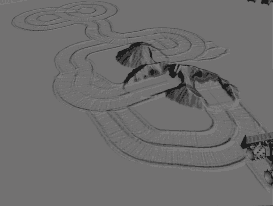

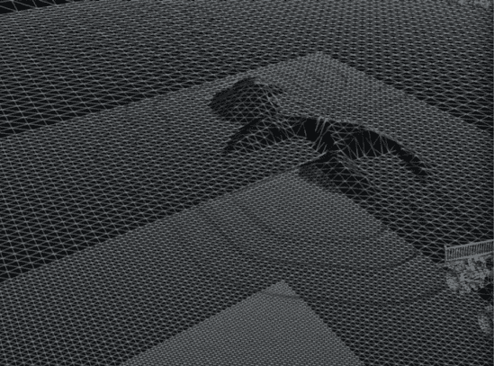

**图 1.9。**远处的悬崖上的问题。低细节拓扑（在底部的线框图中可见）和逐像素法线是不相同的。

## 1.8 结论

目前，此处的算法使用单个纹理处理整个地形，因此受限于扩展或分辨率。通过增加

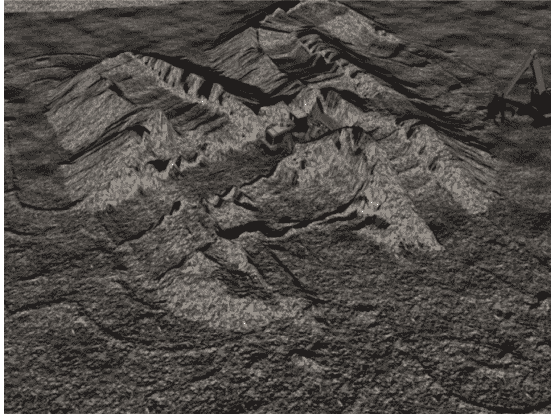

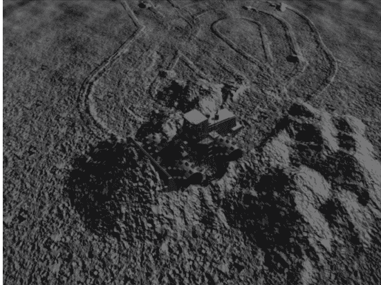

只有一个层四边在近距离过渡到更高层（更低细节）时是明显的。通过在低层添加更多重叠四边，我们将减少影响并实现更平滑的几何形变。

目前，我们尚未找到保持地形体积的方法，由于我们已经下载了同步部分，我们也可以使用这些下载的数据计算体积变化并相应调整。

### 1.8.2 总结

本文介绍了一种在 GPU 上进行地形渲染和处理的新算法。

在 1.4 节“渲染”中，我们详细介绍了如何在两个渲染批次中创建并高效渲染非常详细的地形。

在 1.5 节“动态修改”中，我们展示了如何实时修改地形并与 CPU 基础碰撞同步。

图 1.10 展示了该算法的工作示例。

Gustavo Bastos Nunes 和 João Lucas Guberman Raza

内存带宽仍然是现有图形流水线中的主要瓶颈。为了解决这个问题，常见的机制之一是用 GPU 中的算术逻辑单元（ALU）指令代替总线消耗。例如，GPU 程序化纹理缓解了这种限制，因为 CPU 和 GPU 之间的通信开销很小。随着 DirectX 11 和 OpenGL 4 分形器的出现，我们现在能够将程序化场景产生新的形式：通过参数方程在 GPU 中生成程序化网格。

为了通过分形器在 GPU 中生成程序化网格，本文建议利用参数化网格。参数化网格的点是通过一个接受一个或多个参数的函数。对于 3D 空间，本文中的数学函数应被视为`g(u, v)`的参数方程，其中`u`和`v`处于`[0, 1]`范围内。除了参数表面方程外，还有其他机制（如隐函数）可用于生成程序化网格。然而，隐函数并不适用于细分器（tessellator），因为其结果意味着一个点是在表面网格的内部还是外部，这最适合在几何阶段通过移动立方算法 [Taratuk et al. 07] 使用。在性能方面，几何着色器（geometry shader）与细分器不同，它的设计并不是为了大量的原语吞吐量。

尽管细分器阶段在生成三角形原语方面性能良好，但它对生成的三角形原语最大数量有限制。截至 D3D11，每个补片（patch）的数量为`8192`个。对于某些场景（如球体等程序化网格），这个数字可能是足够的。然而，如果能够在程序化网格中使用任意数量的三角形，为了绕过这一限制，GPU 必须构建一个补片网格（patch grid）。这适用于地形和行星等需要高面数的场景。网格中的每个补片引用`[0, 1]`域内的一个值范围，作为`u`和`v`函数参数的源。这些范围将值的表面区域划分为相邻的子区域。因此，补片所服务的细分器产出的三角形集合的每个子区域，其本身都是整个程序化网格几何结构的子集。

为了计算补片范围`p`，我们利用以下方程：

`p = \frac{1}{\sqrt{\alpha}}`

其中`α`是 GPU 利用的补片数量。由于每个补片占用一个正方形区域，`p`可以同时用于每个生成补片的`u`范围和`v`范围。随后 CPU 必须为每个补片向 GPU 发送一组元数据，即补片的`u`范围（本文引用为`[u_min, u_max]`）和补片的`v`范围（本文引用为`[v_min, v_max]`）。由于细分器将程序化地构建网格的整个几何结构，因此除了上述的补片元数据外，不需要向 GPU 发送几何数据。因此，本文建议利用点原语拓扑结构作为向 GPU 发送元数据的机制，因为它由于内存占用小，是带宽效率最高的原语拓扑结构。一旦元数据发送到 GPU，下一步是在外壳着色器（hull shader）中设置细分因子。

外壳着色器的目的是接收几何数据，在本文中，几何数据可以是每个补片一个控制点。有了这些几何数据，外壳着色器可以确定每个域边缘（domain edge）以及原语内部的细分因子。细分因子决定了每个补片生成的原语数量。外壳着色器为每个补片设置的细分因子越高，构建的三角形原语数量越多。外壳着色器的要求是产生三角形原语池，然后细分器利用它程序化地构建网格的几何结构。因此，所需的细分因子必须均匀地设置为每个补片的边缘和内部因子，如下代码所示：

```cpp
HS_CONSTANT_DATA_OUTPUT BezierConstantHS(InputVS_CONTROL_POINT_OUTPUT,
PatchSize : uint PatchID : SV_PrimitiveID)
{
    HS_CONSTANT_DATA_OUTPUT Output;

    Output.Edges[0] = g_TessellationFactor;
    Output.Edges[1] = g_TessellationFactor;
    Output.Edges[2] = g_TessellationFactor;
    Output.Edges[3] = g_TessellationFactor;
    Output.Inside[0] = g_TessellationFactor;

    return Output;
}
```

由于补片网格原语必须相邻结束，因此每个补片的边缘必须具有相同的细分因子，否则设置了较高阶细分的补片可能会在几何结构中留下缝隙。然而，原语的内部在每个补片可以有不同的细分因子，因为这些原语并不是为了与其他补片的原语连接的。细分因子可能被利用的一个场景是地貌 LOD（geomorphic LOD），其中内部细分因子基于相机到程序化网格的距离。外壳着色器告诉细分器如何构建三角形原语，然后由域着色器（domain shader）利用这些结果。这种 LOD 技术在图 2.1 和图 2.2 显示的高面数程序化网格中得到了例证，随后在图 2.3 和图 2.4 中是低面数网格。

域着色器为细分器生成的每个顶点被调用。它还为每个生成的顶点接收一对参数坐标`(u, v)`。在本文中，我们将该坐标对引用为`d_u`和`d_v`。由于这些参数坐标位于域空间，域着色器必须将它们映射到补片网格空间。为了做到这一点，我们进行线性插值：

```text
p_u = p_{min} + d_u * p_{max}
p_v = p_{min} + d_v * p_{max}
```

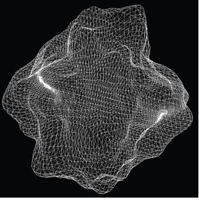

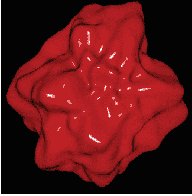

图 2.1。带有噪声的高面数网格。

图 2.2。图 2.1 中相同的网格，但经过了着色。

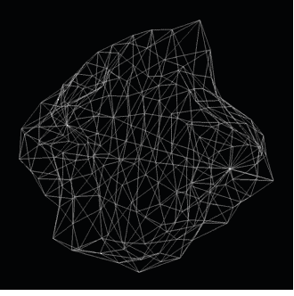

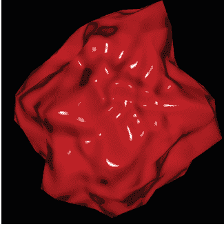

图 2.3。图 2.1 中相同的网格，但具有较低的细分因子。

图 2.4。图 2.3 中相同的网格，但经过了着色。

其中`p_u`和`p_v`是在选择的参数方程中利用的参数。图 2.5 中的示例使用了以下代码段：

```cpp
float3 heart(float u, float v)
{
    float pi2 = 2 * PI;
    float p1 = PI;
    float x, y, z;
    float b = u;
}
```


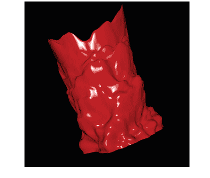

```cpp
float t = y; + sin(t * 2 * pi) -
 = pow(abs(s * pi) * sin(t * 2 * pi)), 0.5f) * 0.5f;

y = cos(t * 2 * pi) *
z = sin(s * pi) + sin(t * 2 * pi);

float3 heart = float3(x, y, z);
return heart;
```


为了对其输出拓扑结构有预定义的理解。随后可以使用延迟着色来减少所生成片元中的操作次数。

对于所提的算法，计算量随顶点和补丁（patches）的数量线性增加，这使其能够扩展到各种场景，例如程序化地形和行星。此类情况的一个例子是同样利用了细分化阶段的算法，例如 [Dunn 15]，该算法专注于生成体积爆炸。由于所讨论的概念具有程序化的数学本质，其他研究领域也可以被用于扩展此处讨论的概念，例如动态纹理和音效。最后，由于内存访问仍然是性能瓶颈，特别是在移动设备等硬件受限的环境中，可以利用产生满意视觉输出的数学过程来克服这些局限性。

João Raza 感谢他的家人和妻子为其提供的所有支持。Gustavo Noven 感谢他的妻子和家人提供的所有帮助。特别感谢他们的朋友 F. F. Marmot。

## 参考文献

- [Green 05] Simon Green. “Implementing Improved Perlin Noise.” In GPU Gems 2, 由 Matt Farr 编辑，页码 409–416。Reading, MA: Addison-Wesley Professional, 2005.
- [Owens 08] J. Owens, M. Houston, N. Luebcke, S. Green, J. Stone, and J. Phillips. “GPU Computing,” Proceedings of the IEEE 96:5 (2008), 96.
- [Perlin 04] Ken Perlin. “Implementing Improved Perlin Noise.” In GPU Gems, 由 Randima Fernando 编辑，页码 73–85。Reading, MA: Addison-Wesley Professional, 2004.
- [Tatarchuk et al. 07] N. Tatarchuk, J. Shopof, and C. Decoro. “Real-Time Surface Extraction using the GPU Programmable Geometry Pipeline.” In Proceedings of SIGGRAPH 2007, p. 137. Reading, NY: ACM, 2007.
- [Dunn 15] Alex Dunn. “Realistic Volumetric Explosions in Games.” In GPU 6: Advanced Rendering Techniques, 由 Wolfgang Engel 编辑，页码 51–62. Boca Raton, FL: CRC Press, 2015.

Henry Schäfer, Matthias Nießner, Benjamin Keinert, and Marc Stamminger

## 3.1 引言

现代游戏中的场景环境包含了大量的移动和动画物体，这些是创建生动虚拟世界的关键。动态场景中的一个基本方面是场景物体之间的交互。遗憾的是，由于时间预算紧张，许多实时应用仅支持刚体碰撞。为了促进碰撞的视觉反馈，通过贴图纹理模式实现如雪或沙子等软材料的痕迹（如划痕或冲击）。然而，贴图（decals）无法修改底层的表面几何结构，这对于提高真实性来说是非常理想的。在本章中，我们提出了一种新型实时技术，通过启用由物体碰撞引起的全自动细尺度变形来克服这一局限性。也就是说，我们提出了一种方法将物理接触时的高频变形直接整合到 GPU 上的动态位移图中。总的来说，我们可以以最小的运行时开销处理具有许多物体的大动态场景环境（见图 3.1）。

沉浸式游戏体验需要动画和动态物体。这些动态效果由物理引擎计算，物理引擎通常只考虑场景的简化版本，以便即时视觉反馈。通常较少关注动态物体与可变形场景几何之间的交互——例如脚印、沙地上的滑痕和弹击影响。这些高细节变形需要高得多的网格分辨率，它们的生成开销昂贵，并且涉及大量的内存 I/O。在

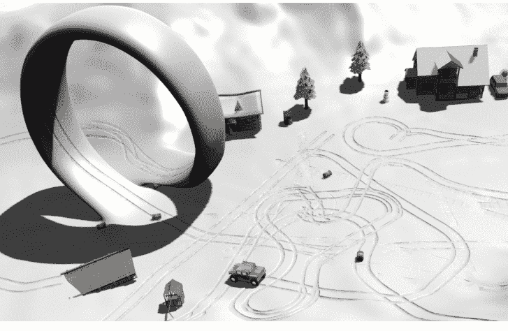

图 3.1. 我们的方法允许对物体碰撞实时计算并应用细尺度表面变形。在这个示例中，当用户控制汽车时，汽车和油桶的轨迹是实时生成的。

因此，在大多数实时应用中，直接在网格上实时计算细尺度变形的成本太高。相反，良好的成本效益近似方法是在作为贴图颜色纹理、凹凸贴图或位移的模板上进行变形。

最近，我们针对这一问题引入了更灵活的方法 [Schäfer et al. 14]。我们使用基于分的位移图（tile-based displacement maps）动态地生成和存储位移——即在每个补丁级别单独计算、存储和应用变形。虽然低频动态仍由 CPU 物理引擎处理，但细部变形直接在 GPU 上实时计算。每一帧，我们确定碰撞物体，计算重叠区域的体素化，并根据生成的变形修改位移。然后使用硬件细分器高效地渲染变形后的补丁。由于我们的算法完全运行在 GPU 上，我们可以避免昂贵的 CPU-GPU 数据传输，从而以最小的运行时开销实现细尺度变形。

在本章中，我们描述了我们系统的实现，该系统作为本文的一部分发布在 GitHub 上¹。变形框架的输入是由四边形细分网格组成的大场景。

> ¹ <https://github.com/hsdk/DeformationGPU>

具体而言，我们处理 Catmull-Clark 细分表面，我们使用特征自适应细分和 GPU 硬件细分器对其进行渲染 [Nießner et al. 12]。变形通过解析位移实现，可以在运行时高效更新而无需昂贵的法线图重计算 [1. 13]。为了保持 GPU 存储需求最小，我们使用动态内存管理，仅为受变形影响的表面补丁分配空间。

## 3.2 可变形表面表示

我们将可变形物体表示为位移细分表面，其中基础网格是 Catmull-Clark [Catmull and Clark 78]，高频细节存储在偏移中。在现代硬件上，这些高质量的表面表示使用硬件细分单元进行高效评估和渲染 [Nießner et al. 12]。Catmull-Clark 表面通过粗糙的控制点进行变形，收敛到一个除非四顶点外均为 $C^2$ 连续的极限表面。在这一表面上，沿解析法线应用位移。

如果我们检测到导致变形的物体，我们会更新位移数据（3.4 节）。在渲染此表面时，实现了这些位移产生的法线。如果位移是静态的，这些法线可以预计算并存储在高分辨率法线图中，但在我们的情况下必须实时更新这些法线，我们采用了解析位移 [Nießner and Loop 13]，法线从标量偏移中解析获得，从而允许无需昂贵的重计算（3.4 节）。

### 3.2.1 解析位移

位移的核心思想是将 $C^2$ 基础表面 $s(u,v)$ 与 $C^1$ 偏移函数 $D(u,v)$ 结合。结果是位移表面 $f(u,v) = s(u,v) + N_s(u,v)$ 处处都是 $C^1$ 连续，并提供了连续的法线场 $n(u,v) = \frac{\frac{\partial f}{\partial u} \times \frac{\partial f}{\partial v}}{\|\frac{\partial f}{\partial u} \times \frac{\partial f}{\partial v}\|}$，其中 $u,v \in \mathbb{R}^2, D(u,v) \in \mathbb{R}^1, f(u,v) \in \mathbb{R}^3$。$D(u,v)$ 是标量值的三次 B 样条，具有 Doo-Sabin 连接性并对奇异顶点有特殊处理。该连接性相对于基础 Catmull-Clark 表面是对偶的，为基础补丁与位移函数补丁之间提供了一一映射。

**基于分的纹理格式。** 我们使用基于分的纹理格式存储标量值位移偏移（即三次 B 样条的控制点），类似于 PTex [Burley and Lacewell 08]（见图 3.2）。基于分的格式的主要优势是消除了 $(u,v)$ 边界处的接缝伪影，因为像素是在参数空间中对齐；也就是说，瓦片的参数化控制与 Catmul-Clark 补片匹配，从而为 $s(u, v)$ 和 $D(u, v)$ 提供一致的 $(u, v)$ 参数。为了评估双次二次函数 $D(u, v)$，需要访问 $3\times3$ 标量控制点（即子补片；见图 3.3）（见第 3.2.1 节）。在基础补片的边界处，这需要访问相邻的瓦片。

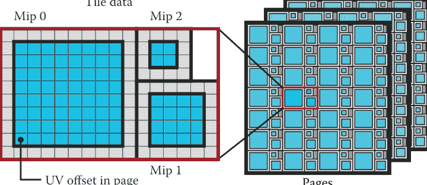

**图 3.2.** 解析位移的基于瓦片的纹理格式：每个瓦片存储一个纹素重叠区域，以避免对邻接指针的需求。此外，在瓦片级别计算的逐级映射金字塔（mipmap pyramid）允许连续的细节水平渲染。渲染。所有瓦片都高效地封装在一个大型纹理数组中。

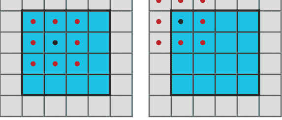

**图 3.3.** (a) 存储位移数据的纹理瓦片的标量值双次二次 B 样条子补片的 $3\times3$ 控制点数组。(b) 同一瓦片的另一组控制点，使用了一个纹素边界重叠；重叠数据与相邻瓦片冗余。每个瓦片对应一个 Catmul-Clark 基础补片。

```cpp
struct TileDescriptor {
  int page; // 纹理切片
  int uOffset; // 瓦片起始 u
  int vOffset; // 瓦片起始 v
  int size; // 瓦片宽度，高度
  int nMipmap; // mipmap 数量
}

TileDescriptor GetTile(Buffer<uint> descSRV, uint patchID) {
  TileDescriptor desc;

  int uOffset = patchID * 4;

  desc.page = descSRV[offset];
  desc.uOffset = descSRV[offset + 1];
  desc.vOffset = descSRV[offset + 2];

  int sizeMip = descSRV[offset + 3];

  desc.size = 1 << (sizeMip >> 8);
  desc.nMipmap = (sizeMip & 0xff);

  return desc;
}
```

**列表 3.1.** 瓦片描述符：每个瓦片对应一个 Catull-Clark 基础面，并由面 ID 索引。

这种访问可以使用邻接指针完成，但指针遍历在现代 GPU 上效率很低。我们为每个瓦片存储一个体素重叠（one-voxel overlap），使得瓦片是自包含的，从而不再需要这些指针。虽然内存占用略微增加，但从渲染的角度来看非常有益，因为纹理访问的成本更低。此外，每个瓦片都存储了一个 mipmap 金字塔，允许连续的细节水平。注意，边界重叠包含在所有级别中。

所有瓦片——我们使用固定大小——都被封装在一个大型纹理数组中（见图 2）。我们需要将瓦片拆分为多个页面，因为当前硬件上的纹理分辨率限制为 16,000 × 16,000。每个页面对应全局纹理数组的一个切片。为了访问瓦片，我们维护一个缓冲区，存储了每个瓦片的补片 ID 和 `(u, v)` 偏移量（页面内）（见列表 3.1）。该缓冲区的条目通过基础补片对应的面 ID 进行索引。

**高效评估。** 为了高效渲染位移顶点，我们使用 GPU 硬件细分单元。法线 $N_s(u,v)$ 使用特征自适应细分 [Nießner and Loop 13] 进行精确评估。由于 Catull-Clark 基础补片与纹理瓦片之间存在一一一的映射，位移数据可以通过补片 ID、$u,v \in [0,1] \times [0,1]$ 三元组来检索。也就是说，对应于基础补片 $u,v$ 的子补片的标量值双次二次位移系数 $d_{i,j}$ 的 $3 \times 3$ 数组。对于每个基础补片，标量位移函数 $D(u, v)$ 随后使用 B-样条基函数 $B_i^2$ 进行评估：

$$
D(u, v) = \sum_{i=0}^{2}\sum_{j=0}^{2} B_i^2(T(u))B_j^2(T(v))d_{i,j},
$$

其中子区域参数 $\hat{u}, \hat{v}$ 由线性变换 $T$ 给出：

$$
\hat{u} = T(u) = u - [u] + \frac{1}{2}
\quad\quad
\hat{v} = T(v) = v - [v] + \frac{1}{2}.
$$

为了获得位移表面 $N_f(u, v)$，需要 $f(u, v)$ 的偏导数：

$$
\frac{\partial}{\partial u}f(u, v)
=
\frac{\partial}{\partial u}s(u, v)
+
\frac{\partial}{\partial u}N_s(u, v)D(u, v)
+
N_s(u, v)\frac{\partial}{\partial u}D(u, v).
$$

在这种情况下，$N_s(u, v)$ 将涉及 Weingarten 方程的计算。

虽然内存占用略微增加，但从渲染的角度来看非常有益，因为纹理访问的成本更低。此外，每个瓦片都存储了一个 mipmap 金字塔，允许连续的细节水平。注意，边界重叠包含在所有级别中。

所有瓦片——我们使用固定大小——都被封装在一个大型纹理数组中（见图 2）。我们需要将瓦片拆分为多个页面，因为当前硬件上的纹理分辨率限制为 16,000 × 16,000。每个页面对应全局纹理数组的一个切片。为了访问瓦片，我们维护一个缓冲区，存储了每个瓦片的补片 ID 和 `(u, v)` 偏移量（页面内）（见列表 3.1）。该缓冲区的条目通过基础补片对应的面 ID 进行索引。

```cpp
struct TileDescriptor {
  int page; // 纹理切片
  int uOffset; // 瓦片起始 u
  int vOffset; // 瓦片起始 v
  int size; // 瓦片宽度，高度
  int nMipmap; // mipmap 数量
}

TileDescriptor GetTile(Buffer<uint> descSRV, uint patchID) {
  TileDescriptor desc;

  int uOffset = patchID * 4;

  desc.page = descSRV[offset];
  desc.uOffset = descSRV[offset + 1];
  desc.vOffset = descSRV[offset + 2];

  int sizeMip = descSRV[offset + 3];

  desc.size = 1 << (sizeMip >> 8);
  desc.nMipmap = (sizeMip & 0xff);

  return desc;
}
```


**列表 3.1：**瓦片描述符：每个瓦片对应一个 Catull-Clark 基础面，并由面 ID 索引。

这种访问可以使用邻接指针完成，但指针遍历在现代 GPU 上效率很低。我们为每个瓦片存储一个体素重叠（one-voxel overlap），使得瓦片是自包含的，从而不再需要这些指针。虽然内存占用略微增加，但从渲染的角度来看非常有益，因为纹理访问的成本更低。此外，每个瓦片都存储了一个 mipmap 金字塔，允许连续的细节水平。注意，边界重叠包含在所有级别中。

所有瓦片——我们使用固定大小——都被封装在一个大型纹理数组中（见图 2）。我们需要将瓦片拆分为多个页面，因为当前硬件上的纹理分辨率限制为 16,000 × 16,000。每个页面对应全局纹理数组的一个切片。为了访问瓦片，我们维护一个缓冲区，存储了每个瓦片的补片 ID 和 `(u, v)` 偏移量（页面内）（见列表 3.1）。该缓冲区的条目通过基础补片对应的面 ID 进行索引。

## 高效评估

为了高效渲染位移顶点，我们使用 GPU 硬件细分单元。法线`N_s(u,v)`使用特征自适应细分 [Nießner and Loop 13] 进行精确评估。由于 Catull-Clark 基础补片与纹理瓦片之间存在一一一的映射，位移数据可以通过补片 ID、`u,v ∈ [0,1] × [0,1]`三元组来检索。也就是说，对应于基础补片`u,v`的子补片的标量值双次二次位移系数`d_{i,j}`的`3 × 3`数组。对于每个基础补片，标量位移函数`D(u, v)`随后使用 B-样条基函数`B_i^2`进行评估：

```math
D(u, v) = \sum_{i=0}^{2}\sum_{j=0}^{2} B_i^2(T(u))B_j^2(T(v))d_{i,j},
```

其中子区域域参数`\hat{u}, \hat{v}`由线性变换`T`给出：

```math
\hat{u} = T(u) = u - [u] + \frac{1}{2}\quad\quad\hat{v} = T(v) = v - [v] + \frac{1}{2}.
```

为了获得位移表面`N_f(u, v)`，需要`f(u, v)`的偏导数：

```math
\frac{\partial}{\partial u}f(u, v) =
\frac{\partial}{\partial u}s(u, v) +
\frac{\partial}{\partial u}N_s(u, v)D(u, v) +
N_s(u, v)\frac{\partial}{\partial u}D(u, v).
```

在这种情况下，`N_s(u, v)`将涉及 Weingarten 方程的计算，这种（此处为原文重复内容，已按要求翻译逻辑处理的）

## 几何变换

```cpp
void ds_main_patches(in HS_CONSTANT_FOVC_OUT input,

               in OutputPatch<HullVertex, 16> patch,

               in float2 domainCoord : SV_DomainLocation,

               in OutputVertex output )

{

    // 评估基础表面 s(u,v)

    float3 worldPos = 0, tangent = 0, bitangent = 0;

    EvalSurface(patch, domainCoord, worldPos, tangent, bitangent);

    float3 normal = normalize(cross(tangent, bitangent));

    float2 du = 0, dv = 0;

    float displacement = AnalyticDisplacement(patch[0].patchID,

                                              domainCoord, du, dv);

    worldPos += displacement * normal;

    output.pos = mul(ProjectionMatrix, float4(worldPos, 1.0));

    output.tangent = tangent;

    output.bitangent = bitangent;

    output.patchCoord = domainCoord;

}
```

### 3.3 在域着色器中进行解析位移映射评估

```hlsl
float4 ps_main(in OutputVertex input) : SV_TARGET

{// 计算 D(u,v) 的偏导数

float du = 0, dv = 0;

float displacement = AnalyticDisplacement(input.patchID,

                                          input.PatchCoord, du, dv);

// 计算基础表面法线 N(u,v)

float3 normal = normalize(cross(input.tangent, input.bitangent));

float3 tangent = input.tangent + surfaceNormal * du;

float3 bitangent = input.bitangent + surfaceNormal * dv;

// 计算解析位移着色法线 N(u,v)

float3 normal = normalize(cross(tangent, bitangent));

// 着色

...
```

### 3.4 在像素着色器中进行解析位移映射评估

`N_f(u, v) = N_s(u, v) ∀(u, v)_{extraordinary}`。在奇异顶点处的这种特殊处理与常规`N_f(u, v)`之间的线性混合，确保了处处具有一致的`C^1`表面。

## 3.3 算法概述

我们的目标是提供由物体碰撞引起的高度详细变形。为了实现即时视觉反馈，我们通过近似碰撞并更新位移数据来应用变形。这比物理上正确的软体模拟要高效得多，并且允许产生视觉上合理的合理。在本节中，我们在图 3.4 中提供了我们算法的概述。关于实现的详细描述可以参见第 3.4 节。

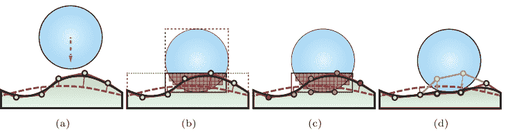

**图 3.4：**算法概述：(a) 使用二次 B 样条位移的细分表面作为可变形物体表示。(b) 概述了共振可变形表面的物体重叠区域的体素化。(c) 将位移控制点推出体素化区域外，(d) 创建一个捕捉影响的表面。

为了简单起见，我们首先假设碰撞仅发生在刚性穿透物体和可变形物体之间。我们将可变形物体表示为位移后的细分表面（见第 3.2 节）。穿透物体可以是细分表面，也可以是常规三角形网格（见图 3.4(a)）。对于所有可变形-穿透物体对，我们使用以下算法计算变形：

- 通过使用 Schwarz [12] 的实时二进制体素化方法的改进变体来计算实心体素化，从而近似穿透物体（见图 3.4(b)）。
- 从体素化中确定可变形物体的位移偏移，以匹配影响物体的形状，如图 3.4(c) 和 (d)。这是通过从可变形物体表面发射射线并相应修改位移来实现。

在两个物体都是可变形的情况下，我们形成两个碰撞对，每个可变形物体都作为另一个可变形物体的刚性穿透物体，并在第一遍中仅应用计算变形的一部分。

## 3.4 流水线

在本节中，我们描述了核心算法的实现，并强调了实现高性能变形更新的重要细节。

### 3.4.1 物理模拟

我们的算法旨在对与沙子或雪地等软材料制成的可变形物体碰撞提供即时视觉反馈。由于在大场景环境中进行全身体模拟成本太高，我们将可变形物体解释为具有精细动态表面细节的刚体。我们使用 Bullet 物理引擎 [Coumans et al. 06] 处理刚体动力学。所有动态物体都在 CPU 上管理，并每帧更新变换矩阵。理论上，如果时间预算允许，我们还可以在基础网格上处理低频变形；然而，我们还没有探索这个方向。

在更新刚体后，我们搜索碰撞物体并将击中可变形体的对发送到 GPU 变形流水线。

### 3.4.2 体素化

一旦识别了所有潜在的可变形物体碰撞（见上文），我们使用 Schwarz [Schwarz 12] 的实心体素化变体来近似穿透物体的形状。体素化是通过光栅化传递生成的，其中一个正交相机设置在物体边界框的重叠区域。在我们的实现中，我们使用了`2^{24}`个体素的预算，需要约 2 MB 的 GPU 显存。注意，体素化尽可能匹配形状以实现准确的变形至关重要。然后我们确定体素化。

为了确定体素化空间，我们相交重叠区域。体素化是通过光栅化传递生成的，其中一个正交相机设置在物体边界框的重叠区域。在我们的实现中，我们使用了`2^{24}`个体素的预算，需要约 2 MB 的 GPU 显存。注意，体素化尽可能匹配形状以实现准确的变形至关重要。然后我们确定体素化。

#### 高效的 GPU 实现

体素化是通过光栅化传递生成的，其中一个正交相机设置在物体边界框的重叠区域。在我们的实现中，我们使用了`2^{24}`个体素的预算，需要约 2 MB 的 GPU 显存。注意，体素化尽可能匹配形状以实现准确的变形至关重要。然后我们确定体素化。

#### 高效的 GPU 素化

体素化是通过光栅化传递生成的，其中一个正交相机设置在物体边界框的重叠区域。在我们的实现中，我们使用了`2^{24}`个体素的预算，需要约 2 MB 的 GPU 显存。注意，体素化尽可能匹配形状以实现准确的变形至关重要。然后我们确定体素化。

为了确定体素化空间，我们相交重叠区域。体素化是通过光栅化传递生成的，其中一个正交相机设置在物体边界框的重叠区域。在我们的实现中，我们使用了`2^{24}`个体素的预算，需要约 2 MB 的 GPU 显存。注意，体素化尽可能匹配形状以实现准确的变形至关重要。然后我们确定体素化。

## 3.5 细分表面在物体碰撞上的实时变形


**图 3.5：**用于体素化的 OBB 生成：源于变形物体和穿透物体的 OBB。至少有一个面位于穿透物体外部。体素化随后面向面的反方向进行，该面位于内部。我们使用两个内核来执行体素化并分别填充自适应缩放的体素网格，向前或向后。

```hlsl
RWByteAddressBuffer g_vox : register(ui);

float4 PS_Voxelize(in OutputVertex input) : SV_TARGET

{

    // 将片段位置转换到体素网格

float3 fGridPos = input.posOut.xyz / input.posOut.w;

fGridPos *= g_gridSize.x;

fGridPos.z += 0.5;

int3 p = int(fGridPos) * (g_gridSize.z));

if (p.z > int(g_gridSize.z))

    discard;

    // 应用自适应体素网格缩放

uint address = p.x * g_gridSize.x

    + p.y * g_gridSize.y

    + (p.z > 5) * 4;

#ifdef VXELIZE_BACKWARD

g_vox.InterlockedXor(address ,

    (0xffffffff << (p.z & 31)));

    // 反转所有的体素

for (p.z = (31); p.z > 0; p.z -= 32) {

    address -= 4;

    g_vox.InterlockedXor(address, 0xffffffff);

}

#endif

g_vox.InterlockedXor(address, 0xffffffff << (p.z & 31));

    // 反转所有的体素

for(p.z = (p.z | 31) + 1; p.z < g_gridSize.z; p.z += 32) {

    address += 4;

    g_vox.InterlockedXor(address, 0xffffffff);

}

#endif
```

**列表 3.5：**使用原子操作的二进制体素化的像素着色器实现。

### 3.4.3 光线投射

在上一个阶段中，我们将穿透对象在相交体积内生成了体素化表示。现在，相交体积内所有变形表面的补片都将进行位移，使其不再与穿透对象（体素化后的）相交。我们对该过程的实现如列表 3.6 所示。首先，我们在位移 B 样条的所有控制点（位移贴图的补片参数空间位置）处评估表面，并计算它们对应的世界空间位置。更准确地说，这些是 Catmull-Clark 表面点，它们在 B 样条的节点处进行求值，并应用了位移（见图 3.4(b)）。因此，为了防止该处的表面可能已经进行过位移的情况，我们考虑了上一个阶段的偏移量。

如果这样一个控制点位于穿透对象内部，我们将沿负基表面法线方向移动它，直到它穿透物体（图 3.4 中的红色控制点）。因此，我们从控制点对应的世界空间位置出发，沿着负基法线投射一条光线。这一步涉及评估体素化（图 3.4 中的黄色部分），重叠区域之外（红色部分）则保持不变。幸运的是，使用通过自适应划分获得的规则 B 样条补片，这种评估非常快速。

现在，我们使用 3D 差分分析器（DDA）遍历通过二值体素的光线（见列表 3.7）。我们还通过首先与体素网格的 OBB 相交，确保光线实际上能够击中体素体积。由此，体素化之外的控制点（例如图 3.4 所示）保持不变。如果光线命中体素体积，但表面位置（即光线起点）位于体素体积之外，则更新初始距离，使其位于体素网格的交点上。然后，我们追踪光线穿过网格，并在遇到的每个体素上更新位移距离，直到离开体素体积。跟踪光线直到其离开体素化是非常关重要的，否则如图 3.6 所示，凹凹物体将导致错误的变形。

遍历完成后，我们通过应用负的遍历距离来更新位移以考虑变形，并将结果写入位移贴图。

### 3.4.4 更新重叠更新

一旦计算完变形，我们需要更新分析位移贴图补片的重叠，以便在渲染期间实现快速、水密且一致的评估。这需要将 B 样条系数（位移值）从边界拷贝到相邻补片的重叠区域。为此，我们在预处理步骤中预计算了补片的相邻关系。更准确地说，对于每个补片，我们存储了四个相邻补片的索引以及

# 3 物体碰撞时表面的实时变形

```cpp
#define NUM_BLOCKS (TILE_SIZE/DISPLACEMENT_DISPATCH_TILE_SIZE)

[numthreads(DISPLACEMENT_DISPATCH_TILE_SIZE,

    DISPLACEMENT_DISPATCH_TILE_SIZE, 1)]

void ComputeDisplacementCS(uint3 blockID = SV_GroupID,

    uint3 threadIdx = SV_GroupThreadID)

{

    uint patchID = blockID.x + g.PrimitiveIDBase;

    TileDescriptor tile = GetTile(g.TileInfo, patchID);

    if(threadIdx.x >= tile.size || tile.y >= tile.size)

        return;

    int patchLevel = GetPatchSubLevel(patchID);

    // threadUV to tile_coord

    float2 tileUV = ComputeTileCoord(patchID, tile,

                                     blockID, threadIdx);

    // threadUV to (sub-) patch_coord

    float2 patchUV = ComputePatchCoord(patchID, patchlevel,

                                        blockIdx, threadIdx,

                                        tile.page);

    int3 coord = int3(tile.uvOffset + tile.xy * tile.size);

    float3 disp = g.displacementUAV[coord];

    // eval surface and apply displacement

    float3 worldPos = 0;

    float3 normal = 0;

    float3 controlPoints[16] = ReadControlPoints(patchID);

    EvalPatch(controlPoints, patchUV, worldPos, normal);

    worldPos += disp * normal;

    // traverse ray until leaving solid

    float3 rayOrigin = mul(g_matWorldToVoxel,

                           float4(worldPos,1.0)).xyz);

    float3 rayDir = normalize(mul((float3x3)g_matWorldToVoxel,

                                  normal.xyz));

    float distOut = 0;

    if(!VoxelRayOrigin(rayOrigin, rayDir, dist))

        return;
```


```cpp
float3 p = rayDir * distOut;

p = mul((float3x3)((g_matNormal))), p);

disp = disp - length(p);

g.displacementUAV[coord] = disp;
```

**列表 3.6.** 使用体素光线投射实现位移更新。

# 几何操作

```cpp
bool IsOutsideVolume(int3 voxel) {
    return (any(voxel < 0) || any(voxel) > int3(g_gridSize));
}

bool voxelDDA(in float3 origin, in float3 dir, out float3 dist) {
    PreventDivZero(dir);

    float3 dt = abs(1.0 / dir);

    float tEnter, tExit;

    if (intersectRayVoxelGrid(origin, dir, tEnter, tExit)) {
        return false;
    }

    // start on grid unless origin is inside

    tEnter = max(0, tEnter);
    float3 p = origin + dir * tEnter;

    int3 gridPos;

    // check if ray is outside

    if (IsOutsideVolume(gridPos))
        return false;

    float3 tMin = INFINITY;

    // update components are <= 0

    tMin.x = (dir.x < 0) ? (tEnter.x + dt.x) : (tEnter.x - dt.x);
    tMin.y = (dir.y < 0) ? (tEnter.y + dt.y) : (tEnter.y - dt.y);
    tMin.z = (dir.z < 0) ? (tEnter.z + dt.z) : (tEnter.z - dt.z); // (Note ( The logic in logic was slightly jumbled,

    // based on standard DDA
}
```

**列表 3.7.** 用于光线投射的数字差分分析器（DDA）实现。

# 3. 细分曲面在物体碰撞时的实时形变

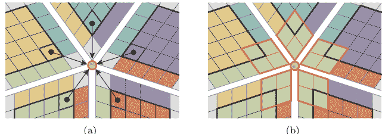

**图 3.10.** 不规则顶点处的角重叠更新：(a) 收集纹元（texels），以及 (b) 将得到的平均值散射到相邻纹元的结果。

如图 3.9(b) 所示，从相邻补丁边缘到边界顶角的系数。

为了在不规则情况下提供密闭且一致的评估，所有四个顶角的系数必须包含相同的值。因此，我们为每个不规则顶点运行一个内核，并对连接补丁的内角系数取平均（见图 3.10(a)）。然后，在同一个内核中，将该平均值散射到解析位移图的四个角纹元中。

最后，更新重叠部分并准备好变形后的网格以使用位移映射进行渲染。

## 3.5 优化

### 3.5.1 穿透补丁检测

前几节描述的方法为变形物体补丁的每个纹元发射射线：为每个纹元调度一个计算着色器（compute shader）以并行射线。这种策略显然是低效的，因为变形物体只有部分补丁会受到影响。可以通过裁剪掉重叠区域之外的补丁来防止这种情况。为此，我们计算穿透物体的 OBB（有轴包围盒）与待变形物体每个补丁的 OBB 是否重叠。为此，我们通过遇到的最大位移来扩展补丁的 OBB，以处理已位移的补丁表面。如果检测到重叠，则标记该补丁（可能与穿透物体相交），并将其补丁索引放入队列以便进一步处理。此外，瓦片重叠的更新仅针对这些标记的补丁。

**交叉。** 补丁检测阶段完全使用计算着色器在 GPU 上实现。一次调度（dispatch）检测单个穿透物体 OBB 与场景中所有补丁的碰撞。对于每个补丁，调度一个线程。在计算着色器中，根据补丁的控制点实时计算补丁的 OBB，并与穿透物体的 OBB 进行重叠测试。如果发现重叠，则将补丁索引添加到待处理列表中进行进一步处理。

**交叉批处理。** 前述的交叉阶段实现按顺序为每个穿透物体调度线程，导致由于必须在多次内核调度中读取相同的补丁控制点而产生不必要且冗余的内存访问。通过将多个穿透物体合并到单个调度中，可以显著减少这种内存 I/O 开销。将多个穿透物体的交叉测试合并到单个调度中还减少了所需的计算着色器调度总数。对于需要分配内存的补丁，其索引被添加到全局追加缓冲区（append buffer）。此外，我们为每个穿透物体使用一个追加缓冲区。如果补丁可能受穿透物体影响，则将补丁索引添加到该穿透物体的追加缓冲区中进行射线。最后，在处理完所有碰撞后，每个变形物体仅更新一次重叠。

### 3.5.2 内存管理

由于我们希望支持高分辨率下具有大量补丁的场景形变，为每个可能的变形补丁静态预分配内存将需要大量的 GPU 内存。因此，我们预分配固定数量的瓦片（tiles），并管理一个指向这些未使用瓦片的瓦片描述符表。此外，我们使用原子索引 `i` 进行内存分配，当没有瓦片在使用时，它指向空闲内存表的末尾。

如果补丁需要分配内存，则通过对 `i` 执行原子递减操作，并在递减前获取所指向的瓦片描述符（见列表 3.8）。

### 3.5.3 优化后的流水线

我们最终的形变流水线（包括所提的优化）如图 3.11 所示。

## 3.6 结果

在本节中，我们提供了几张展示我们实时形变流水线定性结果的截图。图 3.12 中的截图取自示例场景（见图 3.1），该场景由雪地变形地形细分曲面、汽车和桶等动态物体以及树和房屋等静态物体组成。

我们首先介绍影响形变整体质量的参数。

```cpp
Buffer<uint>       : g_isctResults     : register(tD);

Buffer<uint3>      : g_memoryTable     : register(t1);

RWBuffer<uint4>    : g_tileDescriptors : register(u0);

RWBuffer<int>      : g_atomicIndex     : register(u1);

void allocTile(uint tileID) {
    int i = 0;

    InterleavedAdd(g_atomicIndex, [0], -1, i);

    // copy page ID and start offsets (u, v)

    g_tileDescriptors[tileID].xyz = g_memoryTable[i].xyz;
}

numthreads(ALLOCATOR_BLOCKSIZE, 1, 1);

void AllocateTileCS(uint3 Dtid : SV_DispatchThreadID) {
    uint tileID = Dtid.x;

    if (tileID >= g_nTiles)
        return;

    if (IsTileIntersected(tileID) && !IsNotAllocated(tileID))
        allocTile(tileID);
}
```


列表 3.8. 使用原子操作进行瓦片内存分配的计算着色器。

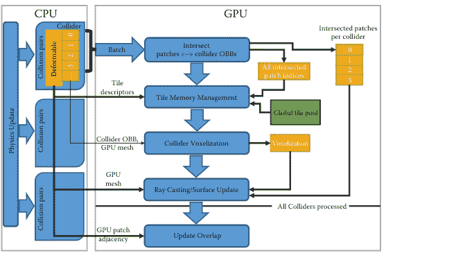

### 3.6.1 瓦片分辨率的影响

第一个参数是用于存储补片系数的瓦片分辨率。图 3.13 显示了不同分辨率 (a) 32 × 32 和 (b) 128 × 128 的形变对比。显然，低分辨率瓦片 (a) 无法很好地表示碰撞体的影响。采用我们的内存分配方案（3.5.2）可以在变形补片上实现极高的瓦片分辨率 (b)，产生高度变形。由于 GPU 内存限制，对所有补片使用静态预分配无法实现这些瓦片分辨率的。（注：此处原文漏掉了对应的图注，已根据上下文推断）

**图 3.13.** 使用不同补片分辨率的形变对比：(a) 高分辨率 (128 × 128) 捕捉了高频细节，而 (b) 低分辨率 (32 × 32) 则没有。

### 3.6.2 体素化的影响

影响质量最大的第二个参数是穿透物体的近似。体素化的质量取决于所选体素网格的大小。选择过低的体素网格分辨率会导致如图 3.14 示例所示的低质量形变。在我们的实现中，为每个穿透物体使用一个体素网格。正如 3.4.2 节所述，与对整个物体进行体素化相比，仅对感兴趣的重叠区域进行体素化的利用率高得多。

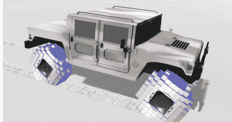

**图 3.14.** 选择过粗的体素网格无法很好地捕捉穿透物体（轮子）的形状，并导致低质量形变。

# 几何体处理

(128 × 128) 未优化

使用相交检测与内存分配

使用批处理技术

(32 × 32) 已优化

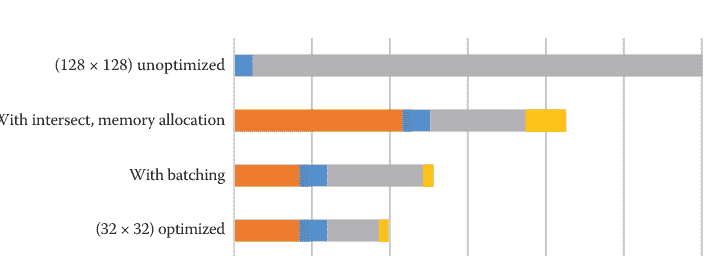

| | (128 × 128) 未优化 | 使用相交检测与内存分配 | 使用批处理技术 | (32 × 32) 已优化 |
|---|---|---|---|---|
| 相交 (Intersect) | 0.000 | 0.108 | 0.042 | 0.042 |
| 内存管理 | 0.000 | 0.006 | 0.006 | 0.006 |
| 体体素化 (Voxelization) | 0.012 | 0.012 | 0.012 | 0.012 |
| 光线投影 (Ray casting) | 11.027 | 0.061 | 0.061 | 0.033 |
| 重叠更新 (Overlap update) | 0.122 | 0.026 | 0.007 | 0.006 |
| 碰撞体总开销 | 11.161 | 0.213 | 0.128 | 0.099 |

**图 3.15.** 不同优化方案在 NVIDIA GTX 780 上的耗时（单位：毫秒）。前三条柱形（从上到下）显示了针对 $128 \times 128$ 像素分辨率的优化效果，而最后一条柱形显示了在开启所有优化的情况下，$32 \times 32$ 瓦分辨率的耗时。

### 3.6.3 性能

在本节中，我们提供了变形流水线的详细耗时数据，包括第 3.5 节介绍的优化方案带来的收益。我们使用标准的图形流水线进行渲染和模型体素化，并采用计算着色器（compute shaders）来硬件加速细分表面、补片-OBB 相交、内存管理、光线投影（DDA）以及瓦片重叠区域的更新。

图 3.15 总结了不同流水线阶段的性能，以及可变形-穿透者碰撞补片的整体开销，该测量是在 NVIDIA GTX 780 上完成的，使用的补片-瓦片大小为 $128 \times 128$。

图 3.15 的测量结果显示，光线投影是我们算法中最昂贵的阶段。通过简单的补片-体素相交测试，我们可以仅对受影响的补片启动光线投影和重叠更新，从而大幅提高整体性能。虽然这增加了相交测试的时间成本（这需要读取每个补片的控制点），由于从全局内存读取数据的开销很高，我们在读取控制点后通过计算与多个穿透对象的相交来优化相交阶段，这进一步提升了整体性能。

## 3. 物碰撞时细分表面的实时变形

所选择的位移瓦片大小——正如预期的——只影响光线投影和重叠阶段。由于高瓦片分辨率的计算开销微乎其微，变形质量上的收益显而易见。

## 3.7 结论

在本章中，我们描述了一种用于与动态和动画对象碰撞时提供表面变形实时视觉反馈的方法。据我们所知，我们的系统是首个采用穿透对象进行实时体素化以更新位移图来实现实时变形的系统。GPU 流水线处理单个碰撞变形的时间远低于毫秒级，并随着变形对象数量而扩展，因为只有彼此靠近的对象才需要测试。我们相信这种方法非常适用于具有许多动态对象的复杂场景环境，例如未来的视频游戏世代。然而，我们强调，变形目的是在实时应用中获得更详细的视觉效果，但不能被视为物理模拟。因此，我们不支持弹性、体积保持或拓扑变化（如断裂）。

## 3.8 致谢

本工作由德国研究基金会（DFG）资助，项目号 GRK-1773 异构图像系统。

## 参考文献

- [Burley and Lacewell 08] Brent Burley and Dylan Lacewell. "Ptex: Per-Face Texture Mapping for Production Rendering." In Proceedings of the Nineteenth Eurographics Conference on Rendering, pp. 1155–1164. Aire-la-Ville, Switzerland: Eurographics Association, 2008.
- [Catmull and Clark 78] E. Catmull and J. Clark. "Recursively Generated B-Spline Surfaces on Arbitrary Topological Meshes." Computer-Aided Design 10:6 (1978), 350–355.
- [Coumans et al. 06] Erwin Coumans et al. "Bullet Physics Library: Real-Time Physics Simulation." http://bulletphysics.org/, 2006.
- [Nießner and Loop 13] Matthias Nießner and Charles Loop. "Analytic Displacement Mapping Using Hardware Tessellation." ACM Transactions on Graphics 32:3 (2013), article 26.
- [Nießner et al. 12] Matthias Nießner, Charles Loop, Mark Meyer, and Tony DeRose. "Feature-Adaptive GPU Rendering of Catmull-Clark Subdivision Surfaces." ACM Transactions on Graphics 31:1 (2012), article 6.
- [Schäfer et al. 14] Henry Schäfer, Benjamin Keinert, Matthias Nießner, Christoph Buchhenau. "Real-Time Deformation of Subdivision Surfaces on Object Collisions." In GPU Pro, pp. 89-96. New York: ACM, 2014.
- [Schwarz 12] Michael Schwarz. "Practical Voxelization." In Advanced Rendering, pp. 337-352. Boca, FL: CRC Press, 2012.

# 游戏中的真实爆炸

## 4.1 引言

在游戏中，爆炸可以提供惊叹的效果。本文展示了在当前视频游戏中实现单次渲染高质量爆炸是可能的。通过利用 GPU 和 DirectX 11 的力量，我们将向展示这种体积技术。该技术也有某些缺点，从计算角度来看非常消耗资源。

## 4.2 渲染流水线概述

爆炸通过一个带有细节的单球来表示。爆炸的渲染首先是生成一个半径等于爆炸最大半径的半球网格。（爆炸的半径并非均匀，因此我们定义了从爆炸最远点到核心的最大半径）。然后，将半球收缩到爆炸周围以形成紧贴的半壳体。这样做是为了减少随后在像素着色器中执行光线步进时的退形碎片数量。图 4.1 显示了该技术的概述。

## 4.3 离线/预处理

首先，我们创建一个噪声的 3D 体素，稍后可以用它创建一些模式。我们可以离线完成此操作，以节省像素着色器的层。这将赋予爆炸云状的效果。在本文描述的实现中使用了简单噪声——但需要注意的是，并不是要求使用简单噪声；事实上，你可以使用任何类型的噪声，只要它在我们的体积中正确平铺即可。为了节省带宽并充分利用缓存，该纹理的大小和格式对性能是有利的。本文演示的实现使用了 $32\times32\times32$ 大小的体积，并采用 16 位浮点格式 `DXGI_FORMAT_R16_FLOAT`。噪声是根据每个体素的 UVW 坐标作为噪声函数的位置参数来计算的。

# 4. 游戏中真实的体积爆炸

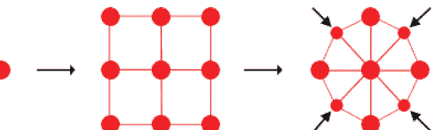

图 4.2. 顶点的生命周期。在实际实现中，细分级别应该远高于图中所示的。

## 4.4 运行时

该效果将利用显卡的细分器流水线（tessellation pipeline）进行渲染，这需要使用 DirectX 中提供的各种补丁原始型（patch primitives）之一来提交绘制调用（draw call）。对于这种技术，应该使用 `D3D11_PRIMITIVE_TOPOLOGY_CONTROL_POINT_PATCHLIST` 原始型，因为我们只需要提交一个包含单个顶点的绘制调用。这是因为 GPU 将完成将此顶点扩展为半壳层原始型（semi-hull primitive）的工作。在该技术中，从绘制调用发射出的顶点在整个过程中的生命周期如图 4.2 所示。

### 4.4.1 半壳层生成

GPU 使用顶点着色器（vertex shader）开始渲染我们的爆炸。每个爆炸运行一次。它的任务是从数据缓冲区中读取值（该缓冲区存储了位置、半径和以秒为单位的"生存时间"），并将它们传递给流水线的下一阶段，即壳层（hull）。对于你的实现，如何存储这些信息完全取决于你，只要 GPU 可以访问它们即可。

流水线的下一阶段是壳层。它为输入原始型的每个点运行一次，并为下一阶段输出控制点。此壳层着色器（hull shader）将使用四边形域（quad domain）。使用它时，着色器将加载单个顶点补丁及其关联数据（之前已在顶点着色器中加载的），并输出四边形的四个角顶点（控制点），每个顶点都有它自己的数据拷贝。

细分器阶段（tessator stage）在 DirectX 11 中是固定函数。它的主要目的是接受由壳层生成的控制点作为输入并对其进行细分。虽然在 DirectX 11 中我们无法控制控制点的细分过程，但我们控制着细分的级别。为了本文的目的，我们将仅使用常数细分水平。然而，也有空间根据爆炸在屏幕上的尺寸对原始型进行自适应细分。较高的细分水平可以为爆炸周围提供更紧凑的壳层，从而减少渲染的碎片数量，这对于高质量的近距离爆炸会有巨大影响。性能收益视情况而定，因此建议通过性能分析（profiling）找到适合你自己实现的最佳方案。

一旦补丁被细分，细分器流水线的下一阶段就会接管。通过域着色器（domain shader），我们首先将顶点转换为屏幕对齐的半球形，球体内部面向相机，半径设置为爆炸的半径。然后我们执行一种称为球体追踪（sphere tracing [Hart 94]）的技术，将半球围绕爆炸缩小为紧凑的壳层。球体追踪与光线步进（ray marching）不同的技术，它从一个起点（半球壳层上的顶点）开始，沿着射线向半球中心移动。通常，在光线步进时，我们以固定间隔遍历射线，但在球体追踪时，我们以不规则的间隔遍历射线，每个间隔的大小由每一步评估的距离场函数（distance field function）决定。距离场函数表示空间中任意一点到隐式表面最近点的符号距离。（你可以在列表 4.1 中看到爆炸的符号距离函数示例）。

### 4.4.2 像素着色

该效果所需的最后一个可编程阶段是像素着色器（pixel shader）。该着色器为屏幕上爆炸的每个像素被调用；大部分工作将在在这里完成。对于每个像素，都需要在爆炸中"步进"或"移动"，并评估每一步的颜色。步进将沿着每个像素的射线进行，该射线使用像素的世界空间位置计算。然后从前往对射线进行步进。在每一步中...

```cpp
float Sphere(float3 pos, float3 spherePos, float3 radius)
{
    float3 relPos = pos - spherePos;
    return length(relPos) - radius;
}

float Cone(float3 pos, float3 conePos, float3 radius)
{
    float3 relPos = pos - conePos;
    float d = length(relPos.xz);
    d = lerp(radius * 0.5f, 0.0f, 1 + relPos.y / radius);
    d = max(d, -relPos.y - radius);
    d = max(d, relPos.y - radius);
    return d;
}

float Cylinder(float3 pos, float3 cylinderPos, float3 radius)
{
    float3 relPos = pos - cylinderPos;
    float h = radius.xx + float2(1.0f, 1.5f); // Width, Radius
    float2 d = abs(float2(length(relPos.xz), relPos.y)) - h;
    return min(max(d.x, d.y, d.z), 0.0f) + max(d, 0.0f);
}

float Box(float3 pos, float3 boxPos, float3 b)
{
    float3 relPos = pos - boxPos;
    float3 d = abs(relPos) - b;
    return min(max(d.x, max(d.y, d.z)), 0.0f) + length(max(d, 0.0f));
}

float Torus(float3 pos, float3 torusPos, float3 radius)
{
    float3 relPos = pos - torusPos;
    float2 t = radius.xx + float2(I, 0.01f);
    float2 q = float2(length(relPos.xz) - t.x, relPos.y);
    return length(q) - t.y;
}

// Rendering a collection of primitives can be achieved by
// using multiple primitive distance functions, combined
// with the 'min' function.
float Cluster(float3 pos)
{
    float3 spherePosA = float3(-1, 0, 0);
    float3 spherePosB = float3(1, 0, 0);
    float sphereRadius = 0.75f;
    return min(Sphere(pos, spherePosA, sphereRadius), 
               Sphere(pos, spherePosB, sphereRadius));
}
```


**列表 4.3.** HLSL 源码：一组用于各种形状的距离函数。

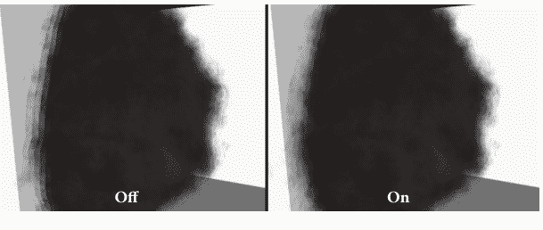

**图 4.4。** 额外步进技巧（extra step trick）的应用。

相交几何体可能会产生难看的带状伪影，导致体积切片完全可见。

额外步进技巧 [Crane 等人 07] 尝试通过在光线步进（ray marching）的最后添加最后一步来减少这种伪影，传入像素的世界空间位置，而不是下一步的位置。像素的世界空间位置计算可以通过任何你认为合适的方法完成；在本文演示的方法中，我们从深度缓冲区重建了世界空间位置。（参见图 4.4。）

## 4.5.3 光照

通过执行与之前渲染爆炸时类似的光线步进技术，可以实现从方向光对爆炸云团进行光照 [Kits 等人 03]。让我们回到渲染光线步进的时候。为了准确计算光照，我们需要评估沿光线方向的每一步接收了多少光。这是在每个渲染步骤完成的，通过从步进的世界空间位置向光源进行光线步进，累加密度（在本次爆炸的情况下，这可能是步进的透明度），直到到达体积边缘或密度达到某个最大值（即像素被完全遮挡）。

由于这种计算开销较大，作为一种优化，你不需要在每一步计算光照。根据穿过体积的步数以及这些步骤的密度，你可以每隔 $x$ 步计算一次光照值，并在后续步骤复用该值。在调整变量 $x$ 时，请根据判断并检查是否存在视觉伪影。

## 4.6 结果

图 4.5–7 中的截图是使用 100 步渲染的（但实际上只有少数光线会使用这么多），并开启了收缩包裹（shrink wrapping）优化。

## 4.7 游戏中真实的体积爆炸

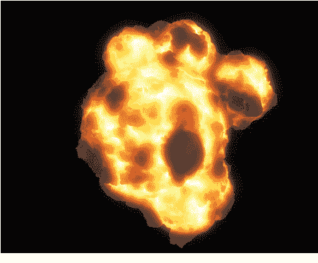

**图 4.5.** 一组聚类体积爆炸的画面。这里使用了一组球体来打破单个球体显而易见的形状。

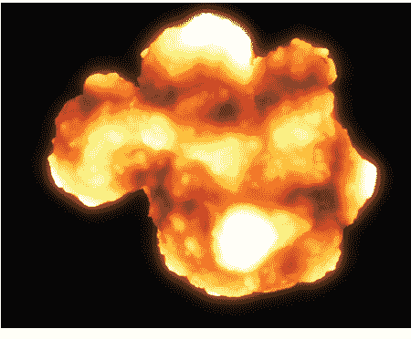

**图 4.6.** 随时间变化的位移到颜色渐变映射可以为效果提供一个强大的第四维度。

## 4.8 性能

这种爆炸技术的性能无疑可以与基于粒子的爆炸相当。通过收缩包裹优化，在适当的情况下，渲染时间可以显著缩短。在图 4.8 中，你将看到收缩包裹技术及其对所需步数影响的视觉对比。随后，图 4.9 显示了在开启和关闭收缩包裹的情况下，渲染相同爆炸所需时间的图表。对于两个数据集，结果是相同的。

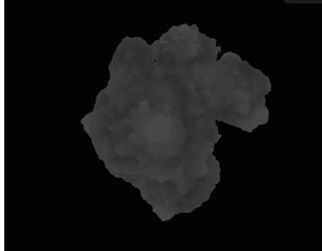

**图 4.7.** 随着爆炸结束，整个效果变得烟多于火光。

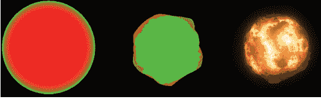

**图 4.8.** 在这里你可以看到穿过爆炸的光线数量（越红表示需要的步数越多）：无收缩包裹优化（左），开启收缩包裹和全像素提前退出（中），以及最终渲染（右）。

## 4.9 进一步优化

半分辨率采样。通过收缩包裹优化，我们可以在较低分辨率下渲染体积然后上采样。这在爆炸距离摄像远时特别有用!

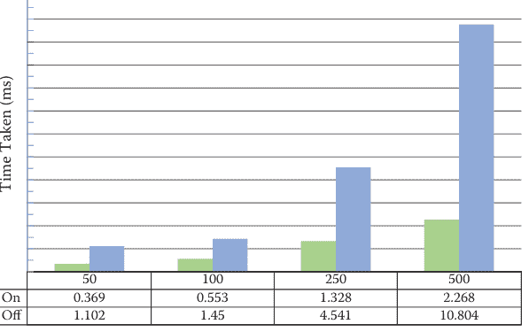

**图 4.9.** 开启与关闭收缩包裹的渲染时间对比。

# 渲染

实时渲染领域正处于一个令人兴奋的时代。随着新一代游戏主机的发布，实时渲染和模拟领域的技术进步带来了新的机遇。以下文章将为初学者以及专家级图形程序员介绍实时渲染领域的一些最新趋势和技术。

我们的第一篇文章是 Peter Sikachev、Samuel Delmont、Uriel Doyon 和 Jean-Normand Bucci 撰写的《<盗信者>中的次世代渲染》（Next-Generation Rendering in Thief），文中介绍了许多种专为新一代游戏主机设计的先进渲染技术。作者们讨论了实时反射、接触反射以及基于计算着色器（compute-shader）的后处理技术。

接下来是 Dongsoo Han 和李宏巍的《基于 LOD 的草地渲染与模拟》（Grass Rendering and Simulation with LOD）。在文中，作者介绍了一种基于 GPU 的草地模拟和渲染系统。该系统能够在完全在 GPU 上模拟并渲染超过 100,000 根草，并基于早期与毛发模拟的相关工作。

Michal Drobrot 撰写的《混合重建抗锯齿》（Hybrid Reconstruction Antialiasing）为读者提供了一个完整的抗锯齿技术框架，专为与 AMD GPU 硬件架构高效运行而设计。作者展示了空间和时间域抗锯齿技术，并权衡了许多不同实现策略的优缺点。

Egor Yusov 的《使用计算散射的物理渲染云层实时渲染》（Real-Time Rendering of Physically Based Clouds Using Compute Scattering）提供了一种渲染高度逼真且高效云的物理方法。云层渲染通常非常昂贵，但作者利用查找表和其他优化手段来实时模拟云内部的散射光。

最后，我们有了 Doug McNabb 撰写的《稀疏程序化渲染》（Sparse Procedural Rendering），文中介绍了一种强大的体积渲染技术。该技术使用分级数据结构来对复杂的体积效果进行高效的光照处理和实时渲染。作者还讨论了艺术家控制体积形状的方法，从而为体积效果的最终外观提供强有力的指导。

本节讨论的新想法和技术代表了实时计算机图形领域的一些最新进展。我要感谢我们的作者慷慨地分享他们令人兴奋的新工作，并希望这些想法能启发读者进一步扩展实时渲染的领先水平。

—Christopher Oat

# <盗信者>中的次世代渲染

Peter Sikachev, Samuel Delmont, Uriel Doyon, and Jean-Normand Bucci

## 1.1 引言

在本章中，我们将介绍《盗信者》中渲染技术，该游戏由 Eidos Montreal 为 PC、Playstation 3、Playstation 4、Xbox 360 和 Xbox One 开发。此外，我们专门专注于为次世代平台（即 PC、Playstation 4 和 Xbox One）开发的技术。

我们提供了多种渲染方法的实现细节和经验。1.2 节中，我们讨论了反射渲染系统。我们描述了渲染策略的每一层，以及最终的混合和后处理。

在 1.3 节中，我们介绍了一种基于 AMD CHS 示例的新型接触硬化投影（CSH）方法。我们的方法针对 Shader Model 5.0 进行了优化，能够以较低的成本渲染高质量的大阴影半影。1.4 节描述了我们处理受光透明粒子的渲染方法。

计算着色器（CSs）是图形 API 中一个相对较新的功能，首次在 DirectX 11 API 中引入。我们已经通过使用 CS 从后处理获得了显著收益。我们将在 1.5 节中详述我们使用 CS 的经验。

性能结果显示在每节的最后。最后，我们在 1.6 节中得出结论并指出了进一步的研究方向。

## 1.2 反射

反射渲染一直是游戏引擎中一个棘手的问题。只要大多数游戏仍然基于光栅化，就没有廉价的方法来纠正最通用情况下渲染的反射。尽管如此，几种实时反射渲染方法在特殊情况下可以产生合理的结果。

### 1.2.1 相关方法

最早用于实时应用的反射算法之一是实时平面反射（RTPR）渲染 [Lengyel 11]。该方法为跨越平面反射的几何体提供了准确的解决方案，通常用于水面或镜面反射。该方法涉及通过反射平面看到的物体或其代理对象。根据反射场景中物体的数量，可以权衡性能和质量，但该技术通常被认为是昂贵的。这种方法的主要缺点是，在实践中，需要多个不同高度和方向的平面来正确建模玩家周围的环境视图，其处理成本将是不可接受的。这阻止了该技术被应用于广泛的环境中。

立方体贴（Cube maps）是另一种使用了多年的方法 [NVIDIA Corporation 99]。它们非常快并且可以处理平面物体，但立方体贴也有其局限性。与其他技术相比，它们通常缺乏分辨率和局部性。人们通常需要预计算立方体贴，因为在运行时动态生成立方体贴通常是不可行的。这还会增加资产流水线的复杂性。预计算的立方体贴将无法反射光照的变化或动态物体。更多的立方体贴无法反射平面表面，而这正是我们的主要场景之一。

屏幕空间反射（SSR）是一种增长迅速的新兴技术 [Ludag 14]。它具有中等的性能消耗且易于集成。它提供了极佳的接触反射（即当物体站在反射表面时发生的反射；这种让物体“着地”的反射是其他技术难以实现的）。然而，SSR 容易产生许多伪影，且无法反射场景中不可见（或不在视野）的部分。因此，它通常与某些备份技术结合使用。

基于图像的反射（IBR）是一种利用平面代理近似复杂几何体的方法 [Wright 11]。它在 Unreal Engine 3 *Samaritan* 演示中开发并展示。IBR 可以获得良好的反射局部效果并允许任意方向。然而，其复杂度随代理数量线性增长，这对于大型场景来说可能是不可接受的。

![120606d35c6796e7ad5faec2ee0e8b_85_0]

**图 1.** 从左到右：立方体贴反射、SSR + 立方体贴、IBR + 立方体贴。[图片来自 Square Enix]

上述方法的许多变体已被提出用于实时渲染。例如，局部视差修正立方体贴 [Lagarde and Zanuttini 13] 正在成为行业标准。在接下来的章节中，我们将描述《盗信者》中使用的反射系统。

### 1.2.2 <盗信者>反射系统概述

创建一个能够完美处理表面类型的实时反射系统是一个困难的问题。因此，我们与艺术部门一起制定了《盗信者》反射系统的需求和限制。鉴于《盗信者》最初是为 Xbox 360 和 PlayStation 3 平台设计的，我们在次世代平台上为反射系统提供了相当宽松的 5 毫秒预算。在此，我们实现了平面反射方法，运行时间为 10 毫秒。这种运行显然是不可接受的；而且，该技术只能渲染一个平面的反射。

世界中大部分反射来自地面（带有斑点、瓷砖等），我们将自己限制在准水平表面上。然而，由于《盗信者》是一款多层游戏（例如，你可以穿过屋顶而不是街道），不像 [Lagarde and Zanuttini 13]，我们不能局限于单个反射平面。如上所述，我们对 PRTR 进行了测试，单个反射平面的限制无法满足我们的资产需求。

目标是准确捕捉人类大小的物体和接触反射（例如大型建筑）。最后，我们还希望捕捉主要的地标——例如火炬和篝火是《盗信者》世界中典型的光源。我们还需要一种能够渲染某些透明几何体反射的方法。

为了实现这些目标，我们设计了一个多层反射系统，如图 1.1 所示。《盗信者》的反射系统包含以下层级：

- 针对反射表面人体高度范围内不透明物体（动态和静态）的屏幕空间反射（SSR）；
- 针对墙壁和远处地标的基于图像的反射（IBR）；
- 用于填充 IBR 代理之间间隙的局部立方贴图反射（localized cube map reflections）；
- 全局立方贴图反射，主要用于与视图无关的天盒。

每个层级都作为前一个层的回退方案。首先，SSR 对深度缓冲区进行光线步进（ray-marches）。如果它没有足够的信息来为片元着色（即反射光被某些前景物体遮挡），则将回退到基于图像的反射。如果反射光没有与任何 IBR 代理发生相交，则启用局部立方贴图反射系统。最后，如果附近没有合适的局部立方贴图，则获取全局立方贴图。不同层级之间的过渡通过第 1.2.6 节描述的平滑混合来完成。

## 1.2.3 屏幕空间反射

SSR 是一种基于通过深度缓冲区进行光线步进的图像反射技术 [Karyan et al. 11]。我们使用了当前帧的光照颜色缓冲区、法线缓冲区和深度缓冲区。SSR 在渲染半透明几何体之前应用，以避免透视伪影。

在每个片元处，我们使用 uv 坐标、获取的深度和投影矩阵来重建相机空间位置。之后，我们沿着反射光线以恒定步长进行光线步进，直到沿光线获取的解析深度大于从相同屏幕空间位置获取的深度。最后，通过二分搜索步精炼交点位置，如图 1.2 所示。

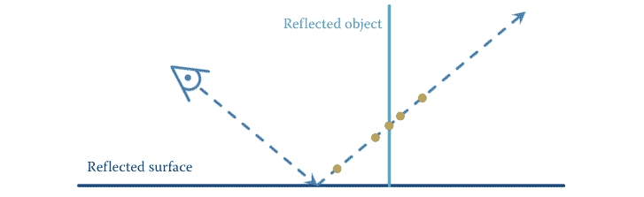

**图 1.2.** 屏幕空间反射的线性步长（绿色）和二分搜索步长（橙色，然后是红色）。

## Thief 中的次世代渲染

这种方法在反射表面与反射物体的接触处产生非常准确的反射。然而，SSR 存在几个主要问题。首先，这种方法非常昂贵：在每个片元处，我们需要进行多次可能无法合并的（由于反射光线的差异）纹理取样，其中一些甚至是依赖视图的（二分搜索）。其次，反射信息经常缺失；它们在屏幕外或被较的物体遮挡。

我们通过在本节下述的几种优化技术来解决第一个问题。第二个问题通过回退到反射系统的后续层级来解决。

我们通过在法线垂直向上的片元处近似数量来减少内存流量。这极大地增加了相邻片元处的纹理取样次数，这些取样可能会被合并并在单个动态随机访问存储（DRAM）突发传输中处理。然而，这自然导致了理想的镜面反射，没有任何自然扰动。我们在第 1.2.7 节中处理这个问题。

此外，我们使用动态分支在找到与深度缓冲区的首次交叉时对恒定步长循环采用提前退出。虽然可能会导致光线-深度缓冲区碰撞检测，但为了节省带宽，我们牺牲了精度。

另一个优化是减少远端片元的采样数。我们提出了一个经验公式，使步数与距离的指数成正比：

```text
$N_{linear samples} = \max(1, k_1 e^{-k_2 d})$
```

其中深度表示为 $d$，$k_1$ 是线性因子，$k_2$ 是指数因子。

此外，我们对整个着色器使用许多提前退出（early-outs）。我们检查表面是否有反射组件以及反射向量是否指向相机。后者的优化不会显著降低质量，因为在 SSR 很少产生高质量结果的情况下，且由于菲涅尔效应引起的反射因子已经很低。此外，这减少了当 IBR GPU 时间较高时 SSR 的 GPU 时间，从而平衡了总量。

然而，在实现此类优化时必须非常小心。`if` 子句内部的所有取样都应该使用多级映射层级（mipmap level）进行；之后使用的所有变量都应用有意义的默认值初始化，并且 `if` 子句之前应带有 `branch` 指令。这是因为否则着色器编译器可能会尝试生成需要梯度的指令（例如 `tex2D`），从而展平化分支，使优化失效。

## 1.2.4 基于图像的反射

基于图像的反射是在 [Wright 11] 中实现的一种反射技术。其核心思想是引入一个或多个平面四边形反射代理，并将感兴趣的对象渲染到其中。在片元着色期间，我们只需在像素着色器中针对代理数组对反射光进行光线追踪。类似的思路被用于 [Lagarde and Zanuttini 13]。然而，在后者中，反射仅针对单个高度的平面进行渲染。因此，我们无法使用 [Lagarde and Zanuttini 13] 中提出的优化方案。

在 Thief 中，我们的目标是每个场景拥有大约 50 个 IBR 代理。IBR 背面剔除有效地将可见代理数量减少了一半。一种简单的方法在目标配置下产生的 GPU 时间小于 8 毫，这是完全不可接受的。因此，我们采用了一系列下述的加速技术。

首先，我们利用了与 SSR 相同的法线近似方法来增加内存合并。这允许以下优化：

- 拒绝不面向玩家的平面；
- 拒绝超出玩家范围的平面；
- 基于瓦片（tile-based）的 IBR 渲染（下文讨论）。

随后对 SSR 和 IBR 同时执行凹凸扰动。

其次，我们引入了基于瓦片的 IBR。由于我们将反射限制在水平方向，我们将整个屏幕分成若干个瓦片。我们的实验证明 16 个瓦片是最佳数量。之后，对于每个代理，我们计算屏幕空间坐标。如果片元在近平面之前，我们翻转 $w$ 符号。这会导致反射被裁剪，特别是当代理接近屏幕边界时。为了修复这个问题，我们引入了以下变通：对于代理的侧边，将其扩展到与屏幕底部的交点，如图 1.3 所示。生成的 $x$ 坐标用于减少最小值和/或增加值。

上述优化减少了 GPU 时间；但是，如果玩家直向下看，代理将占据几乎所有瓦片。为了缓解这种情况下的性能下降，我们在像素着色器中使用边界球测试进行提前退出。虽然这种检查在大多数情况下会降低性能，但在最坏情况下会提高 GPU 性能，获得更稳定的帧率。

## 1.3 Thief 中的世代渲染


```text
1: $x_{min} = 1$

2: $x_{max} = -1$

3: 对于所有位于玩家且位于玩家之前的 IBR 代理：

4:   找到当前代理的 AABB

5:   对于 AABB 的所有顶点：

6:     $w := |w|$

7:     计算齐次裁剪空间中的坐标

8:     计算屏幕空间中的坐标

9:     $x_{min} = min(x, x_{min})$

10:    $x_{max} = max(x, x_{max})$

11:  结束

12: 计算与屏幕顶部和底部的交点 $x_1$ 和 $x_2$

13:   $x_{min} = min(x_1, x_2, x_{min})$

14:   $x_{max} = max(x_1, x_2, x_{max})$

15: 结束

16: 对于所有 IBR 瓦片：

17:   如果瓦片与 $[x_{min}, x_{max}]$ 重叠：

18:     将代理添加到瓦片中

19:   结束如果

20: 结束
```


**算法 1.1：为 IBR 代理查找受影响瓦片的算法**

此外，为了限制帧中活跃的 IBR 代理数量，我们引入了 IBR 房间的概念。本质上，IBR 房间定义了一个 AABB，使得玩家只能看到来自 IBR 代理的 IBR 反射，位于

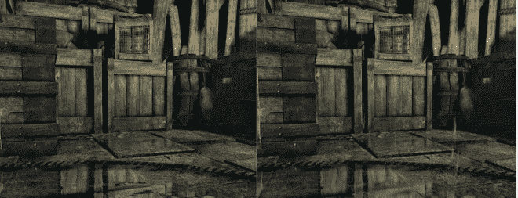

同一个房间。此外，IBR（基于图像的反射）房间的 AABB 下平面定义了内部每个代理对象（proxy）的最大反射范围。这使得我们能够在玩家向下看时，大幅减少反射的次数。

顺便提一下，《盗贼之王》（Thief）拥有非常动态的光照环境。为了让 IBR 反射与动态光同步扩展，必须根据光强度对 IBR 进行缩放。这导致当灯光关闭时，IBR 平面会从反射中消失。尽管这样做是不准确的，因为 IBR 纹理是根据默认光照设置生成的，我们无法得知平面的哪些部分实际上受到了动态光照的影响。

此外，捕捉 IBR 时禁用了粒子和雾效。重要的粒子（如火光效果）通过其自身的 IBR 进行模拟。雾效则是根据雾效设置和反射距离，通过混合 SSR 和 IBR 来添加的。

## 1.2.5 接触硬化光泽反射（Contact-Hardening Glossy Reflections）

由于《盗贼之王》中大部分反射表面并非完美反射体，我们决定模拟光泽反射。光泽 SSR 反射并不是一项新功能，它最早在 [Andreev13] 中被实现。我们决定将 SSR 进一步推进，并渲染接触硬化光泽反射（CHGRs）。图 1.4 显示了 CHGR 的示例。

我们想要捕捉的主要现象是：反射在反射物体与反射表面的接触点附近最为锐利。当这两个表面彼此越来越远时，反射会变得越来越模糊。

CHGR 的渲染算法如下：首先，我们输出反射表面与反射光线命中反射物体点之间的距离。由于我们需要限制渲染目标的大小，我们：

## 1. 《盗贼之王》中的次世代渲染

```cpp
// 世界空间单位为1厘米

int distanceLo = int(worldSpaceDistance) % 256;
int distanceHi = int(worldSpaceDistance) / 256;

packedDistance = float2(
    float(distanceLo) / 255.0f,
    float(distanceHi) / 255.0f
);
```

列表 1.1。反射距离打包。

```cpp
float3 reflectedCameraToWorld =
    reflect(cameraToWorld, worldNormal);

float reflectionLength =
    max(length(reflectedCameraToWorld), FP_EPSILON);

worldSpaceDistance = 255.0f * (packedDistance.x +
    255.0f - packedDistance.y) /
    reflectionVectorLength;

// 排序与混合

float4 screenSpaceReflectedPosition =
    mix(float4(reflectedPosition, 1), worldToScreen);

screenSpaceReflectedPosition /= screenSpaceReflectedPosition.w;

ReflectionDistance = length(
    screenSpaceReflectedPosition.xy -
    screenSpaceFragmentPosition.xy
);
```

列表 1.2。反射距离解包。

用于颜色和深度信息的 R8G8B8A8 纹理。由于 8 位无法提供足够的距离精度，我们在 SSR 阶段期间将距离打包在两个 8 位通道中，如列表 1.1 所示。

IBR 阶段执行深度处理、混合，并将世界空间距离转换为屏幕距离，如列表 1.2 所示。此举原因有两点：首先，屏幕空间距离自然地符合 [0, 1] 区域范围。由于我们不需要模糊过程本身的精度，可以将其重新打包为单个 8 位值，以确保自然的混合。其次，屏幕空间距离为模糊比例提供了更好的线索：如果两个片段具有相同的反射距离，距离观察者更远的片段比近的模糊程度更小。

第二步是稀释距离信息。对于每个区域，我们选择被内核区域覆盖的所有像素中的最大距离。这样做的原因是距离值可能会从一个像素到另一个像素发生突然变化（例如，当反射代理遇到远处的背景像素时）。我们希望使用相应区域的最大模糊系数来模糊这些区域。这有助于避免本该模糊的物体出现锐利的轮廓线。这个问题与常见的景深渲染算法中遇到的问题非常相似。为了节省内存带宽，我们应用了双通道可分离膨胀极大滤波器（two-pass, separable dilation maximum filter）。这我们提供了一个可以接受的近似。

最后，我们使用可调的分离内核进行模糊。除了根据距离值选择高斯参数外，我们还应用了以下技巧：首先，我们忽略光谱强度为零的样本，以避免物体轮廓处的溢色（bleeding）。这需要在色器中动态调整内核。其次，我们遵循与 [Andersson 13] 相同的启发方法，在垂直方向上的模糊比水平方向更多，从而获得更合理的视觉结果。

## 1.2.6 反射混合（Reflection Blending）

由于我们的反射系统由多个层级组成，我们需要定义它们之间如何混合。除了距离因子外，SSR 阶段还会输出一个混合因子。该因子取决于以下因素：

- 高度（投射反射光线越长，贡献越小）
- 追踪精度（光线坐标与获取深度之间的深度差）
- 表面倾斜（表面法线偏离垂直方向越多，SSR 的贡献越小）
- 反射光是指向相机还是向屏幕外

之后，将 IBR 合并在上层，输出混合因子。最后应用立方体贴。图 1.5 显示了 SSR 和 IBR 之间的无缝混合。

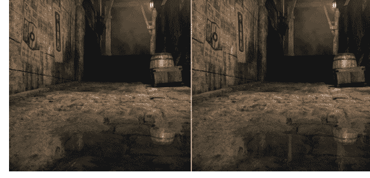

**图 1.5。仅有 SSR（左）和包含 IBR（右）。**

## 次世代渲染

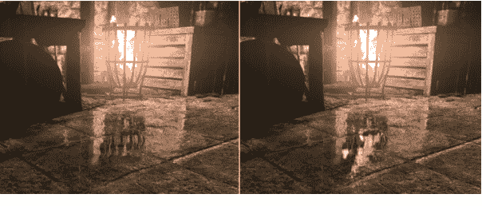

**图 1.6。未排序的反射（左）和排序后的（右）。**

然而，上述方法在某些情况下会导致问题，即反射光线进入这些缝隙并命中天空盒，《盗贼之王》场景通常使用比其他环境亮得多的天空盒。为了修复这个问题，我们使用了沿游戏路径的局部立方体贴。任何位于局部立方体贴范围内的物体然后在主渲染中使用作为环境颜色。

## 1.2.7 作为后处理的凹凸（Bump as a Postprocess）

如上所述，为了加速技术，我们假设法线朝上。此外，为了减少内存带宽，我们以半分辨率渲染反射。这些因素共同削了高频细节，而细节对于凹凸表面至关重要。为了缓解这一点，我们将凹凸效果作为后处理。

主思路与通用反射方法 [Sousa 05] 非常相似。我们利用垂直法线与像素法线之间的差异来偏移反射纹理中的 UV。为了防止反射泄漏，如果新获取的距离比旧的显著，则恢复到原始获取值。图 1.7 显示了应用反射的好处。

## 1.2.8 局部立方体贴反射（Localized Cube Map Reflections）

在 SSR、IBR 和立方体贴反射策略中，立方体贴理想情况下应包含天空盒和远处的几何体，因为游戏环境将由 IBR 平映射。在这种情况下，只需要一个立方体贴。在实践中，IBR 平有很多洞且互不相连。这是由于我们使用渲染纹理生成 IBR 平的后果。

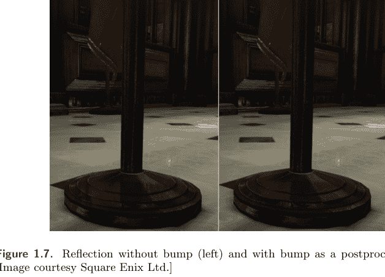

《盗贼之王》的主渲染将为反射物体输出以下数据：

- 光照颜色（lit color）
- 环境反射颜色 + 漫反射光照强度（sRGB8）
- 世界法线 + 反射率（sRGB8）

在生成 IBR 和 SSR 半分辨率反射纹理后，最终颜色通过叠加 SSR、IBR 以及最后的环境反射颜色（即立方体贴颜色）来计算。如果材质或平台不支持 IBR/SSR，则只需将颜色加到材质光照颜色中，且不需要额外的渲染目标。

# 《盗神之》中的次世代渲染

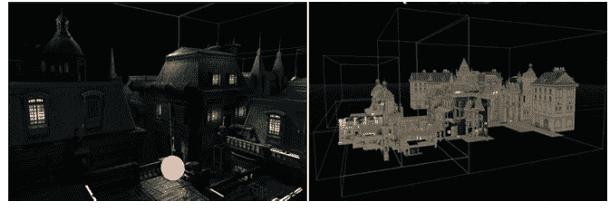

图 1.8。为了覆盖整个环境而创建的多个体积体。[图片由 Square Enix Ltd. 提供]

在此注意，我们需要漫反射光强度来额外缩放 IBR（基于图像的渲染）和使用默认光照设置捕捉的立方贴图颜色，这可能与游戏当前的的光照设置非常不同。SSR（屏幕空间反射）不需要这种缩放，因为它是实时且准确的，而 IBR 代理和立方贴图是预计算的。

## 1.2.9 对美术流水线的影响

对于《盗神之》中的每个关卡，我们都设置了一个默认立方贴图。所有具有反射材质的几何体都使用这一个。这个贴图非常通用，反映了关卡中最常见的区域。

然后，我们确定需要更精确立方贴图定义的区域。这种决定通常基于光照条件或水洼的存在。对于任何可以从更精确的立方贴图中受益的区域，美术师会添加一个局部立方贴图，并附带其自己的场景捕捉预览。如图 1.8 所示。

我们使用这些增强关卡视觉效果的体积体构建了整个环境。在运行构建过程后，我们为所有创建的体积体生成了相应的立方贴图。图 1.9 显示了使用不同资源生成的额外构建过程。

《盗神之》的反射系统极大地提升了游戏的视觉质量和次世代感。它深植于该作品目的艺术方向之中。特别是水洼，帮助实现了美术师希望为游戏营造的独特外观。这也为《盗神之》的游戏性做出了贡献。因为光影对我们的游戏性至关重要，反射水洼变成了玩家在试图躲在阴影中时必须面对的额外挑战。

对于《盗神之》，我们为反射流水线分配了 5 ms 的预算。考虑到分配的预算以及我们推送数据的生产阶段，我们需要做出明智的选择，有时使用所有可用技术，有时则只使用一种，以应对环境的压力。例如，某些环境条件可能会迫使我们只使用一种技术。糟糕的光照条件就是一个很好的例子，在这种情况下，你不想为昂贵的立方贴图或 IBR 平面支付额外成本。

我们发现，屏幕空间反射（SSR）对我们的美术团队来说很容易集成。由于这个原因，我们将 SSR 作为反射需求的基础工具。这决定了我们某些 IBR 平面应该放在哪里；它是 SSR 失败时的备选方案。

## 1.2.10 结果

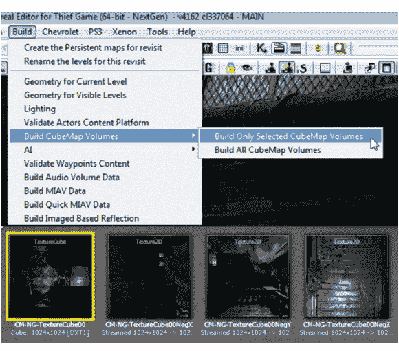

**1.9。**生成单个立方贴图捕捉的构建过程。[图片由 Square Ltd. 提供]

我们开发出了一种稳健且快速的反射系统，适用于次世代主机。SSR 和 IBR 步骤在 Playstation 4（1080p）和 Xbox One（900p）上大约占用 1.1-1.5 ms。然而，这些是最最坏情况的结果，即在一个具有 SSR 表面占据整个屏幕且可见 50 个 IBR 代理的合成场景中得出的。对于典型场景，这些数字通常更低。反射后处理相当昂贵（大约 2 ms）。不过，我们没有必须使用计算着色器（compute shaders）来实现它，这可能会节省大量带宽。

# 《盗神之》中的次世代渲染

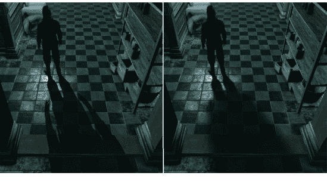

## 1.3 接触硬化影

接触硬化影（CHSs）与百分比接近软影（PCSSs）[Fernando 05]，是一种模拟区域光源动态阴影的阴影映射方法。实现效果是：当投影者和接收者越近时，影子越尖锐；当投射者和接收者越远时，影子越模糊（越软）（见图 1.10）。《盗神之》中的实现基于 AMD SDK 中的方法 [Gruen 10]。

这种方法很容易集成，因为它使用由单个光源生成的阴影映射，并可以替换普通的阴影过滤。该技术的主要缺点之一是大量的纹理采样，在《盗神之》中，我们实现了一种针对 Shader Model 5.0 的优化方法，极大地限制了对阴影映射的访问。CHS 过程分为三步：遮挡者搜索（blocker search）、半影估计和过滤。

### 1.3.1 遮挡者搜索

第一步包括计算着色点周围搜索区域内遮挡者的平均深度（我们将其称为平均遮挡者深度）。一个以着色点为中心的 $N \times N$ 像素内核网格覆盖了这一搜索区域。遮挡者是阴影映射中比当前片段更靠近光源的像素点，如图 1.11 所示。平均遮挡深度将被用于半影估计。

## II 渲染

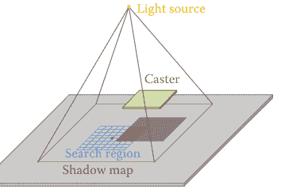

图 1.11。`8 × 8` 搜索网格中的遮挡者。

Shader Model 5.0 的 `GatherRed()` 通过一次采样四个值来加速这一步。在《盗神之》中，我们决定使用 `8 × 8` 的内核大小，对于相同的光源/接收者设置，这实际上执行了 16 次采样而不是 64 次。

因为半影宽度（或模糊度）与内核的大小密切相关，而内核取决于阴影映射的分辨率，这导致在阴影映射分辨率或 FOV 变化时出现一致。图 1.12 显示了这个问题。

为了在《盗神之》中修复这个问题，我们通过在预处理中缩小阴影映射来生成 mip，扩展了 CHS。然后在 CHS 步骤中，我们动态地选择能够

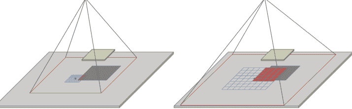

提供相同 `8 × 8` 搜索网格的 mip，由于分辨率高导致搜索区域更小（左），由于视场宽导致搜索区域更大（右）。

# 《盗神之》中的次世代渲染

```cpp
#define KERNEL_SIZE 8

float wantedTexelSizeAtUnitDist =
    wantedPenumbraWidthAtUnitDist / KERNEL_SIZE;

float texelSizeAtUnitDist =
    float(1) / length(shadowMapResolution);

float MaxShadowMip =
    -log2(texelSizeAtUnitDist / wantedTexelSizeAtUnitDist);

MaxShadowMip =
    min(float(MIPS_COUNT - 1), max(MaxShadowMip, 0.0));

// 将 BlkSearchMipindex 和 MaxShadowMip
// 作为参数传递给 shader

int BlkSearchMipindex = ceil(MaxShadowMip);
```

**列表 1.3。**根据用户定义的宽度、阴影映射分辨率和视体 FOV 角选择 mip 的算法。

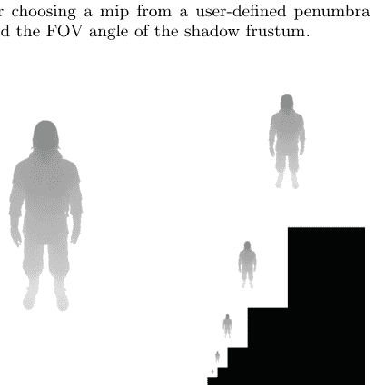

图 1.13。阴影 mip 布局。[图片由 Square Ltd. 提供]

82

## II 渲染（Rendering）

```cpp
#define KERNEL_SIZE S

#define BFS2 (KERNEL_SIZE - 1) / 2

float3 bkTTc = float3(intc.xy, inDepth);

// TcBaseScale is a static array holding the offset-scale
// in the shadow map for every tile

float4 bkTBc = TcBaseScale[BlkBSearchShadowMapIndex];

float3 bkTTc.xy = bkTBc.xy + bkTBc.zw;

// g_vShadowMapDims.xy is the shadow map resolution size

float2 bkTAbc = g_vShadowMapDims.xy * bkTTc.xy;

float2 fc = bkTAbc - floor(bkTAbc);

float4 blkTw = bkTBc.zw * g_vShadowMapDims.zw;

float blockCount = 0;
float avgBlockerDepth = 0;

for (int row = -BFS2; row < col; row += 2) {
    float2 tc =
        bkTTc.xy +
        float2(-BFS2, g_vShadowMapDims.z, g_vShadowMapDims.w);

    unroll(for (int col = -BFS2; col < col; col += 2) {
        float4 depth4 = shadowTex.Gather(pointSampler, tc.xy);

        float4 blk4 =
            (blk4.zzxx << depth4(0).xxx).xxx(0);

        float4 fcVec = 0;

        if (row == -BFS2) {
            if (col == -BFS2)
                fcVec =
                    float4(1.0 - fc.xy) * (1.0 - fc.x),
                    (1.0 - fc.y), 1, (1.0 - fc.x);
            else if (col == BFS2)
                fcVec =
                    float4((1.0 - fc.y),
                    (1.0 - fc.x) * fc.x,
                    fc.x, 1);
            else
                fcVec =
                    float4((1.0 - fc.x),
                    (1.0 - fc.y), 1);
        } else if (row == BFS2) {
            if (col == -BFS2)
                fcVec =
                    float4(1.0 - fc.x,
                    1, fc.y, (1.0 - fc.x) * fc.y);
            else if (col == BFS2)
                fcVec =
                    float4(1, fc.x, fc.x * fc.y, fc.y);
            else
                fcVec =
                    float4(1, 1, fc.y, fc.y);
```


```cpp
} else {

    if (col == -BFS2)

        fcVec = float4(1.0-fc.x, 1, 1, (1.0-fc.x));

    else if (col == BFS2)

        fcVec = float4(1, fc.x, fc.x, 1);

    else

        fcVec = float4(1, 1, 1, 1);

}

blkCount += dot(blk, fcVec.xyw);

avgBlockerDepth += depth4, fcVec.xyw*blk4;

tc.x += 2.0*g_vShadowMapDims.z;

}

}

if (blkCount < 0.0) // 提前退出 - 完全光照

return 1.0f;

else if (blkCount < KERNEL_SIZE*KERNEL_SIZE) // 完全阴影

return 0.0f;

avgBlockerDepth /= blkCount;
```

列表 1.4. 平均遮挡深度计算（Average-blocker-depth compute）。

# 1. Thief 中的下一代渲染

$$width_{penumbra} = (depth_{receiver} - avgBlockerDepth) \cdot width_{light} / avgBlockerDepth$$

**算法 1.2.** 计算半影估计（penumbra estimation）的算法。

## 1.3.2 半影估算（Penumbra Estimation）

根据上一步获取的平均遮挡深度值和用户定义的光宽，可以计算出一个因子（即半影估算）。算法 1.2 非常非常直观易懂，且与许多其他的 PCSS 实现相同。

# 1.3.3 过滤（Filtering）

最终的 CHS 步骤包括对阴影图应用动态滤波器以获得光衰减项。在这一步中，我们还利用了阴影图的多映射（mips）。核心思想是对于阴影的锐利区域使用高分辨率 mips，对于模糊区域使用低分辨率 mips。为了在不同的 mips 之间实现连续且不可察觉的过渡，我们从半影估算中选择两个 mips，并对每个 mip 执行一次过滤操作，然后对两个结果进行线性混合（见图 1.14）。这样做：

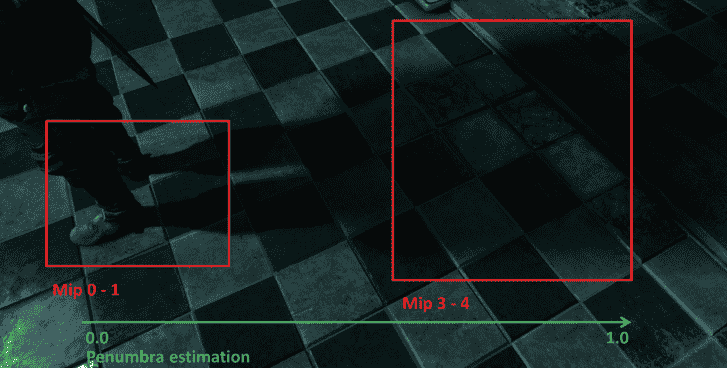

**图 1.14.** 用于过滤的 mips，取决于用户定义的区域搜索宽度和半影估算。[图片由 Square Ltd 提供]

```cpp
#define KERNEL_SIZE 8
#define BFS2 (KERNEL_SIZE - 1) / 2

float Ratio = max(MaxShadowMip, 0.001, 0.0);

float clampedRatio = min(MaxShadowMip, matrix.ratio), clampedRatio);

float textRatio = texelFetch(matrix, MIPS, floor(textRatio));

uint textureIndex = uint(textureIndex);

float4 blkTw = bkTBc.zw * g_vShadowMapDims.zw;

float blockCount = 0;
float avgBlockerDepth = 0;

for (int row = -BFS2; row < col; row += 2) {

    float2 tc = bkTTc.xy + float2(-BFS2, g_vShadowMapDims.z, g_vShadowMapDims.w);

    unroll(for (int col = -BFS2; col < col; col += 2) {

        float4 depth4 = shadowTex.Gather(pointSampler, tc.xy);

        float4 blk4 = (blk4.zzxx << depth4(0).xxx).xxx(0);

        float4 fcVec = 0;

        if (row == -BFS2) {

            if (col == -BFS2)

                fcVec = float4(1.0-fc.xy) * (1.0-fc.x), (1.0-fc.y), 1, (1.0-fc.x);

            else if (col == BFS2)

                fcVec = float4((1.0-fc.y), (1.0-fc.x) * fc.x, fc.x, 1);

            else

                fcVec = float4((1.0-fc.x), (1.0-fc.y), 1);

        } else if (row == BFS2) {

            if (col == -BFS2)

                fcVec = float4(1.0-fc.x, 1, fc.y, (1.0-fc.x) * fc.y);

            else if (col == BFS2)

                fcVec = float4(1, fc.x, fc.x * fc.y, fc.y);

            else

                fcVec = float4(1, 1, fc.y, fc.y);

        } else {

            if (col == -BFS2)

                fcVec = float4(1.0-fc.x, 1, 1, (1.0-fc.x));

            else if (col == BFS2)

                fcVec = float4(1, fc.x, fc.x, 1);

            else

                fcVec = float4(1, 1, 1, 1);

        }

        blkCount += dot(blk, fcVec.xyw);

        avgBlockerDepth += depth4, fcVec.xyw*blk4;

        tc.x += 2.0*g_vShadowMapDims.z;

    }

}

if (blkCount < 0.0) // 提前退出 - 完全光照

return 1.0f;

else if (blkCount < KERNEL_SIZE*KERNEL_SIZE) // 完全阴影

return 0.0f;

avgBlockerDepth /= blkCount;
```

- `Ratio = max(MaxShadowMip, 0.001, 0.0);`
- `clampedRatio = min(MaxShadowMip, matrix.ratio), clampedRatio);`
- `textRatio = texelFetch(matrix, MIPS, floor(textRatio));`
- `textureIndex = uint(textureIndex);`
- `float4 blkTw = bkTBc.zw * g_vShadowMapDims.zw;`
- `blockCount = 0; float avgBlockerDepth = 0;`
- `for(int row = -BFS2; row < col; row += 2) {`
- `float2 tc = bkTTc.xy + float2(-BFS2, g_vShadowMapDims.z, g_vShadowMapDims.w);`
- `unroll(for(int col = -BFS2; col < col; col += 2) {`
- `float4 depth4 = shadowTex.Gather(pointSampler, tc.xy);`
- `float4 blk4 = (blk4.zzxx << depth4(0).xxx).xxx(0);`
- `float4 fcVec = 0;`
- `if (row == -BFS2) {`
- `if (col == -BFS2)`
- `fcVec = float4(1.0-fc.xy) * (1.0-fc.x), (1.0-fc.y), 1, (1.0-fc.x);`
- `else if (col == BFS2)`
- `fcVec = float4((1.0-fc.y), (1.0-fc.x) * fc.x, fc.x, 1);`
- `else`
- `fcVec = float4((1.0-fc.x), (1.0-fc.y), 1);`
- `else if (row == BFS2) {`
- `if (col == -BFS2)`
- `fcVec = float4(1.0-fc.x, 1, fc.y, (1.0-fc.x) * fc.y);`
- `else if (col == BFS2)`
- `fcVec = float4(1, fc.x, fc.x * fc.y, fc.y);`
- `else`
- `fcVec = float4(1, 1, fc.y, fc.y);`
- `else {`
- `if (col == -BFS2)`
- `fcVec = float4(1.0-fc.x, 1, 1, (1.0-fc.x));`
- `else if (col == BFS2)`
- `fcVec = float4(1, fc.x, fc.x, 1);`
- `else`
- `fcVec = float4(1, 1, 1, 1);`
- `blkCount += dot(blk, fcVec.xyw);`
- `avgBlockerDepth += depth4, fcVec.xyw*blk4;`
- `tc.x += 2.0*g_vShadowMapDims.z;`
- `}`
- `if (blkCount < 0.0) // 提前退出 - 完全光照`
- `return 1.0f;`
- `else if (blkCount < KERNEL_SIZE*KERNEL_SIZE) // 完全阴影`
- `return 0.0f;`
- `avgBlockerDepth /= blkCount;`
- `Ratio = max(MaxShadowMip, 0.001, 0.0);`
- `clampedRatio = min(MaxShadowMip, matrix.ratio), clampedRatio);`
- `textRatio = texelFetch(matrix, MIPS, floor(textRatio));`
- `textureIndex = uint(textureIndex);`
- `float4 blkTw = bkTBc.zw * g_vShadowMapDims.zw;`
- `blockCount = 0; float avgBlockerDepth = 0;`
- `for(int row = -BFS2; row < col; row += 2) {`
- `float2 tc = bkTTc.xy + float2(-BFS2, g_vShadowMapDims.z, g_vShadowMapDims.w);`
- `unroll(for(int col = -BFS2; col < col; col += 2) {`
- `float4 depth4 = shadowTex.Gather(pointSampler, tc.xy);`
- `float4 blk4 = (blk4.zzxx << depth4(0).xxx).xxx(0);`
- `float4 fcVec = 0;`
- `if (row == -BFS2) {`
- `if (col == -BFS2)`
- `fcVec = float4(1.0-fc.xy) * (1.0-fc.x), (1.0-fc.y), 1, (1.0-fc.x);`
- `else if (col == BFS2)`
- `fcVec = float4((1.0-fc.y), (1.0-fc.x) * fc.x, fc.x, 1);`
- `else`
- `fcVec = float4((1.0-fc.x), (1.0-fc.y), 1);`
- `else if (row == BFS2) {`
- `if (col == -BFS2)`
- `fcVec = float4(1.0-fc.x, 1, fc.y, (1.0-fc.x) * fc.y);`
- `else if (col == BFS2)`
- `fcVec = float4(1, fc.x, fc.x * fc.y, fc.y);`
- `else`
- `fcVec = float4(1, 1, fc.y, fc.y);`
- `else {`
- `if (col == -BFS2)`
- `fcVec = float4(1.0-fc.x, 1, 1, (1.0-fc.x));`
- `else if (col == BFS2)`
- `fcVec = float4(1, fc.x, fc.x, 1);`
- `else`
- `fcVec = float4(1, 1, 1, 1);`
- `blkCount += dot(blk, fcVec.xyw);`
- `avgBlockerDepth += depth4, fcVec.xyw*blk4;`
- `tc.x += 2.0*g_vShadowMapDims.z;`
- `}`
- `if (blkCount < 0.0) // 提前退出 - 完全光照`
- `return 1.0f;`
- `else if (blkCount < KERNEL_SIZE*KERNEL_SIZE) // 完全阴影`
- `return 0.0f;`
- `avgBlockerDepth /= blkCount;`
- `Ratio = max(MaxShadowMip, 0.001, 0.0);`
- `clampedRatio = min(MaxShadowMip, matrix.ratio), clampedRatio);`
- `textRatio = texelFetch(matrix, MIPS, floor(textRatio));`
- `textureIndex = uint(textureIndex);`
- `float4 blkTw = bkTBc.zw * g_vShadowMapDims.zw;`
- `blockCount = 0; float avgBlockerDepth = 0;`
- `for(int row = -BFS2; row < col; row += 2) {`
- `float2 tc = bkTTc.xy + float2(-BFS2, g_vShadowMapDims.z, g_vShadowMapDims.w);`
- `unroll(for(int col = -BFS2; col < col; col += 2) {`
- `float4 depth4 = shadowTex.Gather(pointSampler, tc.xy);`
- `float4 blk4 = (blk4.zzxx << depth4(0).xxx).xxx(0);`
- `float4 fcVec = 0;`
- `if (row == -BFS2) {`
- `if (col == -BFS2)`
- `fcVec = float4(1.0-fc.xy) * (1.0-fc.x), (1.0-fc.y), 1, (1.0-fc.x);`
- `else if (col == BFS2)`
- `fcVec = float4((1.0-fc.y), (1.0-fc.x) * fc.x, fc.x, 1);`
- `else`
- `fcVec = float4((1.0-fc.x), (1.0-fc.y), 1);`
- `else if (row == BFS2) {`
- `if (col == -BFS2)`
- `fcVec = float4(1.0-fc.x, 1, fc.y, (1.0-fc.x) * fc.y);`
- `else if (col == BFS2)`
- `fcVec = float4(1, fc.x, fc.x * fc.y, fc.y);`
- `else`
- `fcVec = float4(1, 1, fc.y, fc.y);`
- `else {`
- `if (col == -BFS2)`
- `fcVec = float4(1.0-fc.x, 1, 1, (1.0-fc.x));`
- `else if (col == BFS2)`
- `fcVec = float4(1, fc.x, fc.x, 1);`
- `else`
- `fcVec = float4(1, 1, 1, 1);`
- `blkCount += dot(blk, fcVec.xyw);`
- `avgBlockerDepth += depth4, fcVec.xyw*blk4;`
- `tc.x += 2.0*g_vShadowMapDims.z;`
- `}`
- `if (blkCount < 0.0) // 提前退出 - 完全光照`
- `return 1.0f;`
- `else if (blkCount < KERNEL_SIZE*KERNEL_SIZE) // 完全阴影`
- `return 0.0f;`
- `avgBlockerDepth /= blkCount;`

# 1. Thief 中的下一代渲染

$$width_{penumbra} = (depth_{receiver} - avgBlockerDepth) \cdot width_{light} / avgBlockerDepth$$

**算法 1.2.** 计算半影估计（penumbra estimation）的算法。

## 1.3.2 半影估算（Penumbra Estimation）


根据上一步获取的平均遮挡深度值和用户定义的光宽，可以计算出一个因子（即半影估算）。算法 1.2 非常直观易懂，且与许多其他的 PCSS 实现相同。

## 1.3.3 过滤（Filtering）

最终的 CHS 步骤包括对阴影图应用动态滤波器以获得光衰减项。在这一步中，我们还利用了阴影图的多映射（mips）。核心思想是对于阴影的锐利区域使用高分辨率 mips，对于模糊区域使用低分辨率 mips。为了在不同的 mips 之间实现连续且不可察觉的过渡，我们从半影估算中选择两个 mips，并对每个 mip 执行一次过滤操作，然后对两个结果进行线性混合（见图 1.14）。这样做：


**图 1.14.** 用于过滤的 mips，取决于用户定义的区域搜索宽度和半影估算。[图片由 Square Ltd 提供]

```cpp
#define KERNEL_SIZE 8
#define BFS2 (KERNEL_SIZE - 1) / 2

float Ratio = max(MaxShadowMip, 0.001, 0.0);
float clampedRatio = min(MaxShadowMip, matrix.ratio), clampedRatio);
float textRatio = texelFetch(matrix, MIPS, floor(textRatio));
uint textureIndex = uint(textureIndex);
float4 blkTw = bkTBc.zw * g_vShadowMapDims.zw;
float blockCount = 0; float avgBlockerDepth = 0;
for(int row = -BFS2; row < col; row += 2) {
    float2 tc = bkTTc.xy + float2(-BFS2, g_vShadowMapDims.z, g_vShadowMapDims.w);
    unroll(for(int col = -BFS2; col < col; col += 2) {
        float4 depth4 = shadowTex.Gather(pointSampler, tc.xy);
        float4 blk4 = (blk4.zzxx << depth4(0).xxx).xxx(0);
        float4 fcVec = 0;
        if (row == -BFS2) {
            if (col == -BFS2)
                fcVec = float4(1.0-fc.xy) * (1.0-fc.x), (1.0-fc.y), 1, (1.0-fc.x);
            else if (col == BFS2)
                fcVec = float4((1.0-fc.y), (1.0-fc.x) * fc.x, fc.x, 1);
            else
                fcVec = float4((1.0-fc.x), (1.0-fc.y), 1);
        } else if (row == BFS2) {
            if (col == -BFS2)
                fcVec = float4(1.0-fc.x, 1, fc.y, (1.0-fc.x) * fc.y);
            else if (col == BFS2)
                fcVec = float4(1, fc.x, fc.x * fc.y, fc.y);
            else
                fcVec = float4(1, 1, fc.y, fc.y);
        } else {
            if (col == -BFS2)
                fcVec = float4(1.0-fc.x, 1, 1, (1.0-fc.x));
            else if (col == BFS2)
                fcVec = float4(1, fc.x, fc.x, 1);
            else
                fcVec = float4(1, 1, 1, 1);
        }
        blkCount += dot(blk, fcVec.xyw);
        avgBlockerDepth += depth4, fcVec.xyw*blk4;
        tc.x += 2.0*g_vShadowMapDims.z;
    }
}
if (blkCount < 0.0) // 提前退出 - 完全光照
return 1.0f;
else if (blkCount < KERNEL_SIZE*KERNEL_SIZE) // 完全阴影
return 0.0f;
avgBlockerDepth /= blkCount;
```

## 1. 《盗贼信》中的次世代渲染

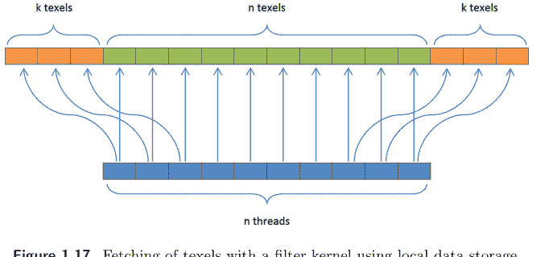

### 1.5.2 使用本地数据存储改进带宽

为了减少景深（DoF）渲染阶段的纹理带宽，我们使用了 LDS（本地数据共享）。其核心思想是对于半径为 $k$ 且 $n$ 个线程的滤波器，预取 $2k+n$ 个样本，如图 1.17 所示。$n$ 个线程中的每个加载一个纹理元素（texel）；此外，每个靠近线程组边界的线程都会加载另一个纹理元素。然后，每个线程将加载的值存储到 LDS 中。最后，在计算内核时，每个线程从 LDS 读取值而不是从 DRAM，从而减少了带宽。

最初，我们使用列表 1.6 中的代码从 LDS 中进行加载和存储。然而，这导致的性能比完全不使用 LDS 差。原因在于我们引入了四路 LDS 内存冲突。由于大多数显卡的 bank 宽度为 32 位，每个线程将进行步长为 $stride = 4$ 的跨步访问。为了修复这个问题，我们需要对代码进行去向量化（de-vector），如列表 1.7。

### 1.5.3 结果

为了理解 LDS，我们测试了 DoF 滤波的不同实现。对于使用 $radius = 15$ 内核进行 FP16 渲染的 DoF 阶段，不使用 LDS 时为 0.15 ms，使用向量化 LDS 结构为 0.26 ms，在 AMD HD7970 上使用去向量化 LDS 为 0.1 ms。两台次世代游戏机都显示出相似倍数的加速。相比之下，在 NVIDIA GPU（GeForce GTX 660）上使用 LDS 在最情况下完全没有获得加速。因此，在 AMD GPU（包括次世代游戏机）上，如果考虑了底层性能因素（例如分段内存），使用 LDS 的计算着色器可以带来显著的（33%）速度提升。

```cpp
groupshared float4 fCache[NR_THREADS + 2 * KERNEL_RADIUS];

Texture2D inputTexture : register(t0)

RWTexture2D<float4> outputTexture : register(u0);

numthreads(NR_THREADS, 1, 1)

void main(uint3 groupThreadID : SV_GroupThreadID,

           uint3 dispatchThreadID : SV_DispatchThreadID)

{

    //拷贝纹理到 LDS

    int counter = 0;

    for (int t = groupThreadID.x; t < NR_THREADS + 2; counter += NR_THREADS)

    {

        int x = clamp(dispatchThreadID.x + counter - KERNEL_RADIUS, 

                      0, inputTexture.Length.x - 1);

        fCache[t] = inputTexture[int2(x, dispatchThreadID.y)];

    }

    GroupMemoryBarrierWithGroupSync();

    // 执行实际模糊处理

    outputTexture[dispatchThreadID.xy] = vOutColor;

}
```

**列表 1.6.** 初始内核实现。注意单个 LDS 分配。

### 1.6 结论

在本文中，我们为《盗贼信》的次世代版本实现的渲染技术进行了全面的步进介绍。我们展示了我们的反射系统、内容硬化阴影算法、粒子光照方法以及计算着色器后处理。这些技术中的大部分是在《盗贼信》制作后期才集成的，因此在游戏中的应用程度低于我们的愿望。然而，我们希望这篇回顾报告能帮助游戏开发者开始使用这些在上一代主机硬件上并不实用的技术。

### 1.7 致谢

我们感谢 Robert-Jan Brems, David Gallardo, Nicolas Longchamps, Francis Maheux 以及整个《盗贼信》团队。

```cpp
groupshared float fCacheR[NR_THREADS + 2 * KERNEL_RADIUS ];

groupshared float fCacheG[NR_THREADS + 2 * KERNEL_RADIUS ];

groupshared float fCacheB[NR_THREADS + 2 * KERNEL_RADIUS ];

groupshared float fCacheA[NR_THREADS + 2 * KERNEL_RADIUS ];

Texture2D inputTexture : register (t0);

RWTexture2D<float4>outputTexture : register (u0);

void main(uint3 groupThreadID : SV_GroupThreadID,

         uint3 dispatchThreadID : SV_DispatchThreadID) {

    // 读取到 LDS

    int counter = 0;

    for (int i = 0; i < NR_THREADS + 2 * KERNEL_RADIUS; i += NR_THREADS) {

        int x = clamp(dispatchThreadID.x - counter, 0, KERNEL_RADIUS);

        float4 tex = inputTexture[int2(x, dispatchThreadID.y)]; // 根据上下文修正的逻辑

        fCacheR[i] = tex.r;

        fCacheG[i] = tex.g;

        fCacheB[i] = tex.b;

        fCacheA[i] = tex.a;

    }

    GroupMemoryBarrierWithGroupSync();

    // 执行实际模糊处理

    outputTexture[dispatchThreadID.xy] = vOutColor;

}
```

**列表 1.7.** 最终内核实现。注意我们为每个通道都制作了独立的 LDS 分配。

### 参考文献

- [Andersson 13] Zap Andersson. "你想了解的一切". 
- [Andreev 13] Dmitry Andreev. "你想了解的一切". 
- [Fernando 05] Randima Fernando. "你想了解的一切". 
- [Gruen 09] Holger Gruen. "你想了解的一切". 
- [Gruen 10] Holger Gruen. "你想了解的一切". 
- [Kasyan 11] Nick Kasyan, Tiago Sousa. "你想了解的一切". 
- [Lagarde 13] Sébastien Lagarde, Antoine Zanutini. "你想了解的一切". 
- [Lengyel 11] Eric Lengyel. "你想了解的一切". 
- [NVIDIA Corporation 99] NVIDIA Corporation. "纹理". 
- [Sousa 05] Tiago Sousa. "你想了解的一切". 
- [Uhlag 14] Yasin Uhladag. "你想了解的一切". 
- [White and Barré 11] John White and Colin Barré. "你想了解的一切". 
- [Wright 11] Daniel Wright. "图像反射".

## 带 LOD 的草地渲染与模拟

韩东洙，李洪伟

### 2.1 引言

草地渲染和模拟是视频游戏中具有挑战性的课题，因为草地可以大面积覆盖并需要大量的计算。作为发头发技术 TressFX [Tre 13] 的扩展，我们使用 DirectX 11 开发了一套高效且可扩展的草地细节层次（LOD）系统。

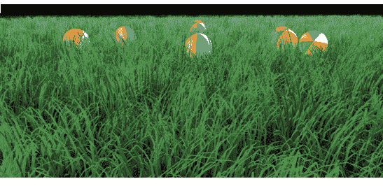

**图 2.1.** 带球体的草地渲染与模拟。

### 2.2 渲染草叶

为了让草看起来自然，获取草自然的形状至关重要。我们首先采用了 [Bouatouch 等人 06] 描述的方法，他们以程序化的方式生成草。对于每根草，其茎干被定义为从根顶点发射、带有随机初始速度和角度的点运动轨迹形成的抛物线。这种方法简单有效，但无法提供丰富的几何外观多样性，因为它们始终是抛物线。使用这种方法很难生成复杂且自然的草叶，因为草对二次曲线的描述很差。

我们发现实例化可以很好地解决这个问题。首先，我们生成几种草的类型，每种类型都有固定数量的节点（knots）。在我们的应用程序中，节点数量为 16，这平衡了模拟效率和形状的平滑度。我们实验了不同数量的，发现五种足够创建具有丰富多样性的草。更多的类型不会损害性能，也不会增加视觉质量。图 2.2 显示了我们使用内部工具创建的五种类型。

为了增加丰富性，当我们实例化这些草并将其种在场景中（我们称之为生长过程）时，会对实例化草的方向、长度和纹理进行随机化。例如，对于第五种草类型，其长度可以在 0.1 m 到 0.15 m 之间变化。在实例化时，其长度将被设置为相对于正态分布的 0.1 m 到 0.15 m 之间的数值。草叶上的每个节点将线性缩放到这个新长度。

## 基于 LOD 的草地渲染与仿真

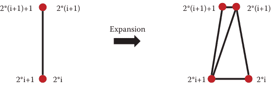

**图 2.3.** 在顶点着色器中将茎扩展为草叶。来自两个三角形的两个重叠顶点在顶点着色器中移动到相反的位置。

扩展方向遵循草叶的副法线（binormal），且扩展宽度由用户选择。此外，我们从底部节点到顶部逐渐减小扩展宽度，以制造出尖锐的叶片边缘。这种几何扩展最初是在几何着色器中实现的，但性能并不尽如人意。随后，我们采用了 TresFX 中介绍的方法，即它们在顶点着色器中通过将两个三角形扩展为法向的非退化的三角形来完成几何扩展。图 2.3 展示了扩展退化三角形的过程。我们还修改了内部的混合工具以使用三角形带（triangle strip）：茎中的每个节点被复制为两个与该节点坐标相同的顶点，其中一条线段变为节点处的两个顶点。在运行时，我们通过根据顶点 ID（例如 `SV_VertexID`）的模 2 值向相反方向移动两个重叠顶点来升级三角形。

关于渲染，我们在选择草叶着色时没有太大自由，因为每一帧需要渲染成千上万片草叶。这是一种轻量级的着色模型，仍然为草叶营造出理想且自然的外观。在这种限制下，我们采用了传统的 Phong 模型，并将其环境分量替换为半球环境光（Hemispherical Ambient Light）[Wilhelmsen 09]。半球环境光是草地真实环境色的良好近似，替代了生成开销高昂的精确遮蔽和颜色。它被计算为天空光和地光的和，如下式所示：

```
ambient = skylight + ratio + earthlight * (1 - ratio)
```


其中`ratio`由半球的“向上”方向与顶点法线之间的点积定义。

我们研究了屏幕透明度 [Jimenez and Gutierrez 10]，但视觉质量的提升很小，且增加了额外的 50 条着色器指令，我们没有使用。

除了光照模型外，草叶既有正面也有背面，因此我们无法在 GPU 上禁用面剔除（face culling）。我们使用 DirectX 的语义`SV_IsFrontFace`来告诉我们当前像素是朝向还是背面。如果是背面，我们反转法线并在着色计算中使用背面的纹理。

## 2.3 仿真

对于 TressFX 中的毛发仿真，每片草叶被表示为顶点和边。我们通常每片叶使用 16 个顶点，计算着色器的线程组大小为 64，但可以将线程组大小改为 32 或 128。

对于 TressFX 中的毛发仿真，在积分重力后会应用三个约束（边长、全局形状和局部形状）。TressFX 毛发仿真包含“头部”变换。在毛发仿真中，角色头部可以改变位置和朝向，但草地不需要这种变换。由于没有头部运动，我们可以跳过应用全局形状约束。对于边长约束和局部形状约束，通常两次迭代足够了。

进入 LOD 之前的最后一步是运行内核以防止草叶进入地面。这可以通过简单将每个顶点的位置移动到叶片根位置之上来实现。

### 2.3.1 主从系统

主草叶是进行活动仿真的草叶。在叶片的生长过程中，我们安排了主草叶顶点位置，随后是从顶点位置。在我们的演示中，我们通常使用主从草叶 1:4 的比例，但该比例在生长过程中可以轻松更改。

在仿真主草叶后，我们将主顶点位置复制到它们的从顶点中。此过程的关键部分是我们需要为从顶点添加扰动（perturbations），使其与主顶点运动完全相同。扰动沿顶端方向变得更大，使得叶片边缘可以分离。我们还可以根据主草叶的速度增加或减少扰动，这样如果主草叶移动得更快，从顶点也会更领先。

### 2.3.2 基于距离的排序

为了 LOD，TressFX 添加了两个新的读写缓冲区（`QuantizedLODDistance`和`LODStrandIndex`）。`QuantizedLODDistance`存储到相机的每片叶的距离。`LODStrandIndex`存储`QuantizedLODDistance`的索引。基本上，这两个缓冲区为排序提供了键值对。

## 2. 基于 LOD 的草地渲染与仿真

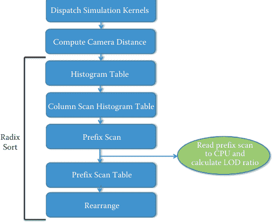

图 2.4. 基数排序内核执行流程图。

我们选择的排序算法必须在 GPU 上高效运行并支持键值对。此外，我们需要统计有多少键小于给定的距离阈值，以便确定调度的任务大小。选择基数排序可以带给我们额外的益处，如果我们将距离值量化为 8 位，则只需要一次迭代。通常，基数排序需要四次迭代来排序 32 位键；见图 2.4。

在处理缺失叶片和更新从顶点后，列表 2 中的`ComputeCameraDistance`计算从相机到每片叶的距离。执行视锥剔除，如果该叶片在视锥外，则分配负距离。将距离量化为 8 位（0-255），以便基数排序在一次迭代内完成。`QuantizedLODDistance[bladedIndex] = quantizedDist`；`LODStrandIndex[bladedIndex] = gladedIndex`。

我们使用前缀扫描来获取 LOD 比例，即有效叶片与总叶片数的比例。列表 2.5 显示了我们如何使用前缀扫描。

## 2. 结合 LOD 的草渲染与仿真

```cpp
uint pow2(uint a)
{
    return ((uint))1 << a;
}
```

```cpp
// 每个线程（工作项）处理一个元素。
[numthreads(THREAD_GROUP_SIZE, 1, 1)]
void HistogramTable(uint GIndex : SV_GroupIndex,
    uint3 Gid : SV_GroupID,
    uint3 Dtid : SV_DispatchThread)
{
    uint localid = GIndex;
    uint groupId = Gid.x;
    uint gridSize = RADICES;
    uint globalid = groupId + localid;

    // 初始化共享内存。
    sharedMem[localid] = 0;
    GroupMemoryBarrierWithGroupSync();

    partiallySortedData[globalid] = QuantizedLODDistance[globalid];
    partiallySortedValue[globalid] = LDSortedStrandIndex[globalid];

    uint value = partiallySortedData[globalid];
    value = (value >> bits) & RADICES_MASK;

    InterlockedAdd(&sharedMem[value], 1);
    GroupMemoryBarrierWithGroupSync();

    uint index = RADICES * groupId + localid;
    histogramTable[index] = sharedMem[localid];
}
```

列表 2.2. 基数排序中的常量缓冲区、UAV 和直方图表内核函数。

```cpp
// 只有一个线程，且每个线程
// （工作项）处理列的直方图表
[numthreads(THREAD_GROUP_SIZE, 1, 1)]
void ColumnScanHistogram(uint GIndex : SV_GroupIndex,
    uint3 Gid : SV_GroupID,
    uint3 Dtid : SV_DispatchThread)
{
    uint localid = GIndex;
    uint numHistograms = numElement / THREAD_GROUP_SIZE;
    uint sum = 0;

    for (uint i = 0; i < numHistograms; i++)
    {
        sum += histogramTable[RADICES * i + localid];
        histogramTable[RADICES * i + localid] = sum;
    }
}

// 只有一个线程组。
[numthreads(THREAD_GROUP_SIZE, 1, 1)]
void PrefixScan(uint GIndex : SV_GroupIndex,
    uint3 Gid : SV_GroupID,
{
    uint DTId : SV_DispatchThreadID;
    uint localID = GIndex;
    uint numHistograms = numElement / THREAD_GROUP_SIZE;

    sharedMemPrefixScan[localID]
        = histogramTable * (numHistograms - 1) + localID;
    sharedMem[localID] = sharedMemPrefixScan[localID];

    GroupMemoryBarrierWithGroupSync();

    uint iter = (uint)(log2(256));
    uint k = localID;

    for (uint i = 0; i < iter; i++) {
        if (k >= pow2(i)) {
            sharedMem[k] = sharedMemPrefixScan[k]
                + sharedMemPrefixScan[k-pow2(i)];
        }

        GroupMemoryBarrierWithGroupSync();
        sharedMemPrefixScan[k] = sharedMem[k];
        GroupMemoryBarrierWithGroupSync();
    }

    if (localID > 0)
        prefixScan[localID] = sharedMemPrefixScan[localID-1];
    else
        prefixScan[localID] = 0;
}
```

```cpp
// 每个线程（工作项）处理一个元素。
[numthreads(THREAD_GROUP_SIZE, 1, 1)]
void PrefixScan(uint GIndex : SV_GroupIndex,
                uint3 GId : SV_GroupID,
                uint3 DTId : SV_DispatchThreadID)
{
    uint localID = GIndex;
    uint groupID = Gid.x;
    uint index = RADIX * groupID + localID;

    sharedMem[localID] = histogramTable[index];
    GroupMemoryBarrierWithGroupSync();

    sharedMem[localID] += prefixScan[localID];
    histogramTable[index] = sharedMem[localID];
}

// 一个线程（工作项）处理一个元素。
[numthreads(THREAD_GROUP_SIZE, 1, 1)]
void Rearrange(uint GIndex : SV_GroupIndex,
               uint3 GId : SV_GroupID,
               uint3 DTId : SV_DispatchThreadID)
{
    uint localID = GIndex;
    uint groupID = Gid.x;

    if (localID == 0
    {
        for (int i = 0; i < RADICES; i++) {
            uint element = partiallySortedData[groupId * RADICES + i];
            uint value = (element >> bits) & RADIX_MASK;
            int index =

            if (groupId == 0) {
                index = prefixScan[value];
                prefixScan[value]++;
            } else {
                index = histogramTable[RADICES * (groupId-1) + value];
                histogramTable[RADICES + (groupId-1) + value]++;
            }

            QuantizedLODDistance[index] =
                partiallySortedData[groupId * RADICES + i];
            LODSortedStrideIndex[index] =
                partiallySortedValue[groupId * RADICES + i];
        }
    }
}
```

列表 2.4. 扫描表和重排内核函数。

```cpp
// distThresholdLOD 是 LOD 阈值
// maxDistanceLOD 是最大距离。
unsigned int quantizedLOD = (float)(distThresholdLOD/maxDistanceLOD);

int count = prefixScan[quantizedLOD];

LODRatio = (float)count;
```


列表 2.5. 扫描表。

### 2.3. 运动（Wind）

There are two kinds of wind: local and global. In grass, we applied the distance. However, it is also simple. In grass, we see that can easily drop. In grass, we generate by. In grass, it is also the. In grass, we see the. In grass, we the. In grass, it is the grass. In grass, we see that by the distance.

### 2.4. 结论（Conclusion）

## 参考文献

- [Bouat 06] Kadi Bouat, Kevin Boulanger, and Sumanta Pattik, “Rendering in Real Time.” 
- [Jimenez and Gutierrez 10] Jorge Jimenez and Diego Gutierrez. “Screen-Space Subsurface.” In GPU Pro: Advanced Techniques, edited by Wolfgang Engel, pp. 335.
- [Tre 13] Tres, “SoftFX 2.0.” http://developer.amd.com/tools-and-sdks/
- [Wilhelmsen 09] Petri Wilhelmsen. “Hemispheric Ambient Light.” http://digitalerr.wordpress.com/2009/05/xna-shader/
- [Burley 07] Burley, “super-sample (SSAA)”

## 3. 混合抗锯齿（Hybrid Antialiasing）

### 3.1 引言（Introduction）

In this article, we present the antialiasing (AA) solution used in Far Cry 4, developed by Ubisoft Montreal. We present a novel framework that addresses aliasing issues with a tight performance budget. The Xbox One and Playstation 4 all based on GCN share a subset. The framework we demonstrated was fully integrated into Dunia engine's deferred renderer.

### 3.2 概述（Overview）

Antialiasing is a crucial element in high-quality rendering. We can divide most aliasing artifacts in rasterization-based rendering into two main categories: temporal and spatial. Temporal artifacts occur as flickering under motion when details fail to get rendered due to missing the rasterization grid.


**Figure 3.1.** The crops on the right show no AA (top), SMAA (middle), and the presented HRAA (bottom). Only HRAA is capable of reconstructing additional details while providing high-quality antialiasing.

Spatial artifacts result from signal under-sampling when dealing with a single, static image. Details that we try to render are just too fine to be properly resolved at the desired resolution, which mostly manifests itself as jagged edges.

### 3.3 相关工作（Related Work）

A typical antialiasing solution used in offline rendering is to super-sample (SSAA) the image; render at a higher resolution and then perform a resolve step, which is a down-sampling filter into the desired final resolution [Burley 07]. If enough samples are used, then this type of antialiasing tackles the aliasing problems

## 3. 混合重构抗锯齿

前文提到。不幸的是，它需要有效地多次渲染图像，对于实时渲染的用处有限。

图形硬件以多样本抗锯齿（MSAA）[Kirkland et al. 99]的形式提供了超采样的优化版本。它不是在高分辨率下对所有像素进行渲染，而是沿着三角形边缘对着色器进行多次渲染（但仅渲染一次），然后进行优化的解析（resolve）。MSAA 证明是解决空间锯齿问题的有效解决方案，但被严格限制在三角形边缘。所有样本在解析之前都需要存储在额外的帧缓冲区中，这使得该方法在内存消耗方面非常昂贵。因此，许多设备在性能受限的平台上将其作为主要的抗锯齿解决方案。

值得注意的是，抗锯齿边缘上的梯度阶数数量（例如，4×MSAA 可以沿着采样路径和边缘方向提供最多五个下降的梯度阶）。

在上一代游戏主机（Xbox 360 和 PlayStation 3）上，我们观察到基于图像的、后处理的形态抗锯齿解决方案日益流行，例如 FX [Lottes 09]、[Reshetov 09] 和 MSAA [Jimenez et al. 11]。这些算法提供了卓越的结果，其感知质量与 MSAA 渲染相当，但成本仅为其一小。典型的形态滤波器从当前图像中提取视觉可感的边缘并进行重向量化。不幸的是，结果仅依赖于最终的光栅化图像数据，而这些数据可能会受到时间性和空间锯齿的影响。在实践中，用这些算法处理的静态图像效果比基于硬件的 MSAA 好得多。然而，当运动、空间和时间欠采样导致边缘“抖动”和高对比度细节的时间闪烁时，质量会下降。

显而易见，仅靠形态方法无法实现超采样那样的高质量时空结果。这引发了两个方向的研究：基于分析和基于时间的抗锯齿。一些研究人员尝试了后处理，并利用源自实际三角形边缘方程的额外信息进行增强。可能广为人的是 GBAA [Person 11]，它计算每个像素到最近三角形边缘的信号距离。这些信息存储在额外的缓冲区中，并在后的后处理期间使用，以分析的方法有效地光栅化三角形与像素的交点。这种方法可以提供高水平的质量和三角形边缘完美的时间稳定性。不幸的是，由于它使用了几何着色器来收集三角形信息，它的性能较差，从未获得广泛采用。它还受到其他多个问题的限制，我们将在 3.5 节中深入讨论。

另一种日益流行的方法是基于时间的算法，它尝试利用图像的时间相关性利用之前渲染的帧来执行过滤 [Nehab et al. 07]。这有效地允许多样本算法在时间上分摊成本 [Yang et al. 09]。一些游戏作品使用时间解析来增强 SSAO [Bavoil and Andersson 12, Drobott 11] 或为了在运动中稳定最终图像 [Sousa 13]。一些引擎尝试了时间超采样 [Malin 12]；然而，由于缺乏健健的样本拒绝方法，即仅从可见像素的有限子集中累积两个帧 [Sousa 11]。

最近的《Killzone: Shadow》使用了健健的时间上采样方法，有效地以 2x 超采样渲染了图像。它还使用了之前重构的帧在运动顺序中稳定图像，以避免图像闪烁 [Valient 14]。

几位研究人员尝试将基于硬件的 MSAA、时间采样和形态过滤的优点结合为一个解决方案。这产生了 4xSMAA [Jimenez et al. 12]，它将 SMAA 边缘梯度的质量与 2xMSAA 和 2x 时间超采样的时间稳定性相结合。不幸的是，由于使用了昂贵的 2xMSAA，没有多少主机能负担这种方案。

一个研究方向是优化多样本方法的采样模式 [Akenine-Meller 03]。不幸的是，由于缺乏硬件和软件对自定义采样模式的支持，这种方法在实时渲染领域并没有获得太多关注。在硬件的 MSAA 模式中，仅支持少数预定义的采样模式。

另一种基于硬件的解决方案涉及使用覆盖样本来增强标准的 MSAA 流水线，这些样本可以以最小的性能和内存开销进行评估。到为止，这种解决方案以 EQAA [AMD 11] 和 CSAA [Young 06] 的形式作为固定 GPU 流水线的一部分。

## 3.4 混合抗锯齿概述

我们的抗锯齿解决方案可以分为几个组件。每个组件都可以独立工作，并可以与任何其他方法自由混合。

每个组件的目标是解决不同的锯齿问题，因此每个算法都可以在有限的使用场景中发挥最佳作用。

我们的框架围绕以下组件构建：

- 时间性边缘抗锯齿，
- 时间超采样，
- 时间抗锯齿。

## 3.5 时间稳定边缘抗锯齿

该组件的目标是为几何边缘提供感知上合理的梯度，这些梯度在运动下保持稳定。我们不需要担心来自纹理数据或光照的像素不连续，因为那种锯齿源将由不同的框架组件处理。

在 3.3 节中，我们简要讨论了符合我们高质量边缘渲染需求的算法：形态和分析。然而，只有后者可以提供时间稳定的抗锯齿。不幸的是，纯分析的方法表现出性能问题。

我们希望提出一种基于 AMD GCN 架构的实现，它使得分析抗锯齿几乎是免费的。在 3.5.1 节中，我们提出了与该方法相关的若干扩展。3.5.2 节要介绍了 EQAA 的工作原理。它还引入了一种新算法——覆盖重建抗锯齿——它使用基于硬件的 EQAA 覆盖样本来分析估计边缘方向以及三角形空间覆盖。

### 3.5.1 分析抗锯齿 (AEAA)

原始 GBAA 算法依赖几何着色器将几何信息传递给像素着色器。插值器用于存储到边缘的距离。然后，像素着色器选择当前光栅化像素的符号距离并将其输出到离屏缓冲区。数据需要包含主轴以及 [-1, 1] 中的实际符号值，其中 0 被视为光栅像素中心。随后，全屏后处理搜索每个像素相邻的最近边缘。找到穿越像素的边缘后，我们根据其方向和距离混合最近的两个像素（见图 3.2）。


图。在分析距离边缘技术中，每个三角形在后处理阶段使用抗锯齿像素输出到最近边缘的距离。

# 形态帧 A

| ● | ● | ● | ● | ● | ● | ● | ● | ● | ● |
|---|---|---|---|---|---|---|---|---|---||
| ● | ● | ● | ● | ● | ● | ● | ● | ● | ● |

# 形态帧 B

| ● | ● | ● | ● | ● | ● | ● | ● | ● | ● |
|---|---|---|---|---|---|---|---|---|---||
| ● | ● | ● | ● | ● | ● | ● | ● | ● | ● |

# 分析帧 A

| ● | ● | ● | ● | ● | ● | ● | ● | ● | ● |
|---|---|---|---|---|---|---|---|---|---||
| ● | ● | ● | ● | ● | ● | ● | ● | ● | ● |

# 分析帧 B

| ● | ● | ● | ● | ● | ● | ● | ● | ● | ● |
|---|---|---|---|---|---|---|---|---|---||
| ● | ● | ● | ● | ● | ● | ● | ● | ● | ● |

图 3.3.** 在运动中使用分析数据时，抗锯齿边缘的变化。注意，每个形态解决方案都会失败，因为通过相同的光栅化结果无法检测到任何梯度变化。

## 3. 混合重建抗锯齿

我们实现了 GBAA 并对其进行了优化，以利用现代 GPU 中发现的新硬件特性的优势。AMD 的 GCN 架构允许像素从用于光栅化当前像素的三角形描述符中采样顶点。这意味着我们不再需要昂贵的几何着色器阶段来访问顶点数据以计算到边缘的距离，正如 [Dirot 14] 所示。列表 3.1 中的代码片段了改进后的 GBAA 算法，其偏移在像素着色器中进行评估。最终的后处理解析（resolve）与原始算法不变。

```cpp
// 计算点 X 与线 AB 之间的最近轴距离
// 与已知距离和方向进行比较
float ComputeAxisClosestDist(float2 inX,
                             float inA,
                             float inB,
                             float2 out ioMajorDir,
                             float out ioAxisDist)
{
    float2 AB = B - A;
    float2 normalAB = normalize(AB);
    float dist = normalize(inX - inA) * dot(inX, normalAB);
    bool majorDir = abs(normalAB.x) > abs(normalAB.y);
    float axisDist = majorDir ? rcp(normalAB.x) : normalAB.y = dist; // 等，源图像中的逻辑错误
    if(axisDist < ioAxisDist)
        ioAxisDist = axisDist;
    if(axisDist < ioMajorDir)
        ioMajorDir = majorDir;
}

void GetGeometricDistance(float2 inScreenCoord,
                          float out oDistance,
                          float out oMajorDir)
{
    float2 sc = GetParameter(inScreenCoord);
    float sc1 = GetParameter1(inScreenCoord);
    float sc2 = GetParameter2(inScreenCoord);
    distance = FLT_MAX;
    ComputeAxisClosestDist(sc0, sc1, oMajorDir, oDistance);
    ComputeAxisClosestDist(sc1, sc2, oMajorDir, oDistance);
    ComputeAxisClosestDist(sc2, sc0, oMajorDir, oDistance);
}

if(inAlpha == result of AlphaTest)
// 即，Alpha - AlphaRef
// 我们假设 alpha 是一个距离场
void GetSignedDistanceFromAlpha(float inAlpha,
                                float out oDistance,
                                float out oMajorDir)
{
    // Find测试梯度
    float xGradient = dds_fine(inAlpha);
    float yGradient = dds_fine(inAlpha);
    GGradientDir = abs(xGradient) > abs(yGradient);
    // 计算 alpha 达到零处的有符号距离
    distance = -inAlpha + rcp(oGradientDir ? xGradient : yGradient);
}
```

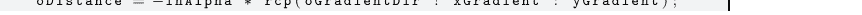

```cpp
void GetAnalyticalDistanceToEdge(float inAlpha,
                                 float2 inScreenCoord,
                                 out outDistance,
                                 out bool alphaMajorDir
)
bool alphaMajorAxis; float alphaDistance;
GetSignedDistanceFromAlpha(inAlpha,
                           alphaDistance,
                           alphaMajorAxis);
GeometricDistance(inScreenCoord,
                  distance,
                  majorDir);
if(alphaDistance < oDistance) oDistance = alphaDistance;
if(alphaDistance < oDistance) alphaMajorAxis = alphaMajorAxis;
```


列表 3.1。优化的 GBAA 到边缘距离着色器。它直接从像素着色器中访问顶点数据。

在质量方面，解析法优于任何形态学方法。遗憾的是，这种方法在许多现实场景中被证明是非常棘手的。Malan 开发了一个非常抗锯齿解决方案，并对我们想要抗锯齿的实际问题进行了进一步研究。Malan [10]。

主要问题源于亚像素三角形，这在真实的游戏制作环境中是不可避免的。如果一个轮廓边缘由多个小或薄的三角形组成，那么每个像素只有其中一个会被光栅化。因此，它到边缘的距离可能不是我们想要抗锯齿的轮廓的实际距离。在这种情况下，产生的伪影将显示为在原本抗锯齿边缘上的几个平滑边形，这往往会引起视觉上的分散（见图 3.4 和图 3.5）。

Malan 提出了处理此问题的几种方法 [Malan 10]。然而，由于复杂的网格处理和手动调优，这些解决方案中的一个即使没有在项目初期引入也是实用的。另一个问题来自实际数据源。抗锯齿的提示来自单个三角形，因此无法正确检测和处理三角形之间的交集。实际生产场景中的网格资产具有相交三角形（例如，插入地面的雕像会有侧三角形与地形网格相交）。GPU 光栅化通过在渲染三角形像素前后进行深度测试来解决交集。因此，没有关于由于交集产生的边缘的解析信息。到最近边缘的距离并不代表到交集边缘的距离，导致缺乏抗锯齿。

## 3.5.2 覆盖重建抗锯齿（CRAA）

为了改进 3.5.1 节中分享的技术和结果，我们希望找到一种方法来确定关于三角形实际更多的信息。

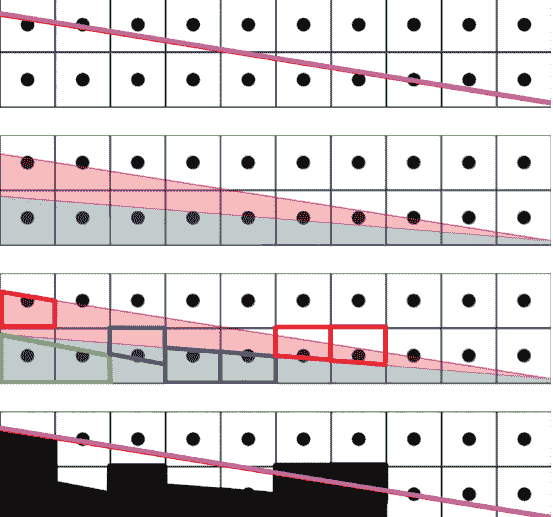

**图 3.4。**由于亚像素三角形导致的轮廓边缘的错误距离。考虑单个三角形将导致 (img/120606d35c679664e7ad5faec2ee0e8b_127_0.png)。

# 3. 混合重建抗锯齿

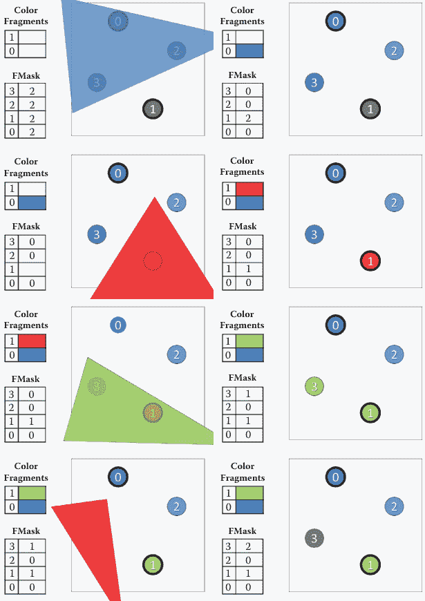

图 3.6。这里的步骤说明了当新三角形被光栅化时，如何更新 `FMask`。重要提示：在最后一步，如果红色三角形对样本的 Z 测试失败，则不需要对 `Sample 3` 进行深度采样。（然而，这取决于特定的硬件设置，且超出了本文的范围。）

# II 渲染

| 颜色片段 | FMask |
|---|---|
| 0 | 7 0 |
| | 6 1 |
| | 5 1 |
| | 4 0 |
| | 3 1 |
| | 2 0 |
| | 1 0 |
| | 0 0 |


| 颜色片段 | FMask |
|---|---|
| 0 | 7 0 |
| | 6 1 |
| | 5 1 |
| | 4 0 |
| | 3 1 |
| | 2 0 |
| | 1 0 |
| | 0 0 |

图 3.7。简单的光栅化案例及对应的 `FMask`。

从覆盖率数据中恢复信息，以类似于 AEAA 的方式推导出混合提示（blending hints）。

在我们的 1F8S 简化案例，我们知道 `FMask` 将是一个 8 位值，其中第 `n` 位设置为 0 表示与该光栅化片段相关的第 `n` 个样本（因此它属于当前像素的三角形，并可以通过深度测试），而 1 则告诉我们该样本是未知的——即它被另一个三角形遮挡了。

我们可以将 `FMask` 视为共享相同颜色的点集。如果我们使用这些新获取的信息对当前像素进行光栅化，我们需要根据其已知覆盖率样本的数量对当前像素的片段进行加权，并与由“未知”覆盖率样本表示的其他片段进行混合。在不增加额外渲染成本的情况下，我们可以从相邻像素中推导出未知的颜色片段。我们假设深度缓冲区以压缩模式下工作，且 EQAA 正在使用解析深度测试，提供完全准确的覆盖率信息。

# 3. 混合重建抗锯齿

| 颜色片段 | FMask |
|---|---|
| 0 | 7 |
| | 6 1 |
| | 5 1 |
| U | 4 0 |
| B | 3 1 |
| L | 2 0 |
| R | 1 0 |
| | 0 0 |


| 颜色片段 | FMask |
|---|---|
| 0 | 7 0 |
| 相邻片段 | 6 1 |
| | 5 1 |
| U | 4 0 |
| B | 3 1 |
| L | 2 0 |
| R | 1 0 |
| | 0 0 |


**图 3.8。**在这里我们说明了寻找将样本集分为“已知”和“未知”样本边缘的过程。稍后，该半平面将用于寻找合适的相邻像素，以推导出未知颜色值。

单边缘场景。我们可以将 AEAA 背后的相同策略应用于仅单边缘跨越像素的简单情况。在这种情况下，像素的 `FMask` 提供了覆盖率样本的清晰划分：通过测试的样本位于边缘的一侧，而失败的样本将位于另一侧。使用简单的直线拟合算法，我们可以找到一个将样本集分为两个子集（通过和失败）的边缘。该边缘近似了跨越的三角形的真实几何边缘。在 GBAA 算法空间中，我们找到边缘的主轴以及它到像素中心的距离。然后，我们只需要使用边缘距离作为权重，将最近的相邻像素颜色与当前片段混合。因此，该技术通过距离推导半平面的像素来推断未知样本（见图 3.8）。

# 渲染

```hlsl
float4 CRAAA(Texture2DMS<float4> inColor,
    Texture2D<uint2> inMask,
    uint2 inTexcord)
{
    // 读取 FMask，取决于硬件
    uint iMask = inMask.Load(uint3(viTexcord, 0));
    uint unknownCover = 0;
    float2 hP = 0.0;

    // 对所有指向未知样本的方向取平均
    // 以近似边缘半平面
    for (uint iSample = 0; iSample <= NUM_SAMPLES; ++iSample) {
        if (getMaskValueForSample(iMask, iSample) == UNKNOWN_CODE) {
            hP += Texture2MS.GetPosition(iSample);
            unknownCoverage++;
        }
    }

    // 找到边缘另一侧像素的偏移
    int2 int2(0, 0);
    if (abs(hP.X) < abs(hP.Y) && hP.X < 0.0) int2 = int2(-1, 0);
    if (abs(hP.X) > abs(hP.Y) && hP.Y > 0.0) int2 = int2(0, 1);

    // 混合推断样本
    float unknownCover = NUM_SAMPLES - unknownCoverage;
    float4 color = inColor.Load(viTexcord, 0) + unknownCover;

    color += inColor.Load(viTexcord + hP, 0) * unknownCover;

    return color / NUM_SAMPLES;
}
```

列表 3.2。用于近似样本“未知”子集方向的半平面着色器。半平面用于寻找边缘另一侧最近的像素，以找到未知样本的颜色。

我们描述的解析类似于步数有限的 GAA（步数等于 EQAA）。需要注意的一点是，我们的解析不需要知道关于相邻数据的任何信息（所有信息都包含在当前像素中）。这种方法允许我们通过复杂的 LUT 逻辑来区分形状，从而计算出更准确且视觉良好的梯度。

# 混合重建抗锯齿


**图 3.9。**挑战性的抗锯齿案例（左侧）与 8x8 结果（右侧）。由于项目时间限制，我们没有能够完善地实现一个预计算的 LUT 数组。然而，我们认为通过更智能的 LUT 构造可以获得显著的质量提升。

| 颜色片段 | FMask |
|---|---|
| 0 | 7 |
| | 6 1 |
| | 5 1 |
| U | 4 0 |
| B | 3 1 |

这种技术不需要额外的成本（使用 `FMask`）来推断来自相邻像素的颜色片段。

## 3. 混合重建抗锯齿


这是 AEAA（近似抗锯齿）的一个棘手案例，我们简单的 CRAA（卷积抗锯齿）可以正确解析锯齿边缘。遗憾的是，有太多未通过光栅化的子像素三角形，CRAA 可能因为覆盖信息不正确而失败。在实践中，这很大程度上取决于具体的渲染情况，而且 CRAA 的限制比 AEAA 宽松得多。

列表 3.3 中的代码段说明了 CRAA LUT 解析如何正确地解析子像素细节（见图 3.10）。

```hlsl
float4 CRAA_LUT(Texture2DMS<float4> inColor,
    Texture2D<uint2> inMask,
    Texture1D<uint> inCRAALUT,
    uint2 inTexCoord)
{
    // Read FMask / HW deconstant
    uint iFMask = inMask.Load(uint3(inTexCoord, 0));
    uint LUTResult = inCRAALUT[iFMask];

    float wC, wE, wS, wW;

    // LUT is packed as 8bit integer weights
    // North 8bit | West 8bit | South 8bit | East 8bit
    // Can also pack whole weights in 4 bits
    ExtractWeights(LUTResult, wC, wE, wS, wW);

    float4 color = inColor.Load(inTexCoord + int2(0, 0)) * wC;
    color += inColor.Load(inTexCoord + int2(0, -1)) * wE;
    color += inColor.Load(inTexCoord + int2(0, 1)) * wS;
    color += inColor.Load(inTexCoord + int2(-1, 0)) * wW;

    return color;
}
```

列表 3.3。CRAA LUT 实现。

## 3.6 时间超采样

### 3.6.1 概述

时间超采样可以用以下算法简要地描述：

1. 每帧，通过子像素偏移投影矩阵进行偏移。
2. 使用当前帧的 `N` 个运动向量将来自帧 `N - k` 的数据重投影到步长 `N`。

测试重投影数据是否有效：

- 没有发生遮挡。
- 数据来自同一源（即对象或三角形）。
- 数据不是过时的（即由于光照变化）。

3. 将帧 `N` 的数据与来自帧 `N - k` 的重投影帧进行累加。
4. 回溯 `k` 帧并重复步骤 2–4。

数字 `k` 决定了用于抖动的唯一子像素偏移的数量，以便在通过累加所有 `k` 个样本后获得空间无偏的结果。然而，显而易见，增加历史帧数 `k` 会导致算法的复杂度高得多，因此失败的概率也更高。

最合适（也是最贵）的方法是在内存中保留最后 `k` 帧以及它们的运动向量和验证样本有效性所需的额外数据。我们需要评估一系列依赖性读取和检查，以验证重投影像素在空间和时间域上是否有效。对于给定的像素，我们只能累加通过这些检查的样本，直到遇到第一次失败。这种方法可以保证高质量的结果（Yang et al. 2009），但当 `k > 1` 时，对于游戏等面向性能的实时场景来说，成本极其昂贵。

其他解决方案依赖于所谓的历史缓冲区，它存储所有样本，将上述方法简化为 `k = 1` 的情况。遗憾的是，这种解决方案无法保证收敛，因为在不丢弃历史缓冲区的情况下无法从其中移动样本。此外，验证函数需要更加保守，以防止不一致的样本进入历史缓冲区。这种方法用于超采样时，会导致图像某种程度不稳定，高对比度像素可能会出现“闪烁”现象，因为它们在收敛 [Malan 12]。类似的方法可以用于随时间推移稳定图像（而不是超采样），如 [Sousa 13] 和 [Valient 14] 所示。我们将在 3.7 节中讨论这些。


考虑到所有的优缺点，我们决定在 `k = 1` 时追求尽可能高的质量。这意味着我们只处理一帧历史，并且对于每一帧，我们都有两个唯一的样本供使用（假设我们的历史样本被接受为有效）；我们希望尽可能从中获取更多数据。

### 3.6.2 采样模式

单个样本无法提供任何梯度（基准参考见图 3.12）。

如 3.6.1 节所讨论的，我们希望在仅使用两个唯一样本的情况下最大化解析（resolve）质量。实现此目标的一种可能方法是使用更复杂的解析和采样模式。目前，2× 超采样的常用实现使用 2×MSAA 采样模式（见图 3.13）。

对此的一种可能改进是使用交叉形（quincux）采样模式 [NVIDIA 01]。这种模式依赖于与相邻像素共享非中心样本；因此解析内核需要从相邻像素采样数据（见图 3.14）。

在实践中，交叉形采样位置并没有很大处。在规则像素行和列上设置采样点可以减少捕获到的潜在边缘。通常情况下，良好的模式应该针对最大的像素行列覆盖进行优化。4× 旋转网格模式是一个很好的例子（见图 3.15）。


### 3.6.3 FLIP

单个样本无法提供任何梯度（基准参考见图 3.12）。

如 3.6.1 节所讨论，我们希望在仅使用两个唯一样本的情况下最大化解析质量。实现此目标的一种可能方法是通过更复杂的解析和采样模式。目前，2× 超采样的常用实现使用 2×MSAA 采样模式（见图 3.13）。

对此的一种可能改进是使用交叉形采样模式 [NVIDIA 01]。这种模式依赖于与相邻像素共享非中心样本；因此解析内核需要从相邻像素采样数据（见图 3.14）。

在实践中，交叉形采样位置并没有很大处。在规则像素行和列上设置采样点可以减少捕获到的潜在边缘。通常情况下，良好的模式应该针对最大的像素行列覆盖进行优化。4× 旋转网格模式是一个很好的例子（见图 3.15）。

### 3.6.4 时间 FLIPQUAD

由于模式的交替，在每一帧中，内核都保证能够正确解析水平或垂直边缘。如果接受了上一帧的数据，整个模式将得到正确重建。

值得注意的是，错误的（或缺失）FLIPQUAD 重建过程会导致锯齿边缘，这是非均匀采样网格的直接结果（见图 3.19）。

# 3. 混合重构抗锯齿

```cpp
// 索引 [帧] [采样位置]，单位为 n/16 像素偏移

// 蓝色 红色
int2 gTempFQ_Q0[2][1] = { int(-8, -2), int(2, -8) };
int2 gTempFQ_Q1[2][1] = { int(-8, 2), int(-2, -8) };
int2 gTempFQ_Q2[2][1] = { int(-8, -2), int(2, -8) };
int2 gTempFQ_Q3[2][1] = { int(-8, -2), int(2, -8) };
```

列表 3.6。时域 FLIPQUAD 采样数组。

```cpp
#if defined(ODD_FRAME) // RED

// 帧 [1] 的水平模式
int2 offset0 = int2(0, 1);
int2 offset1 = int2(1, 0);

#elif defined(EVEN_FRAME) // BLUE

int2 offset0 = int2(1, 0);
int2 offset1 = int2(0, 1);

#endif

s0 = CurrentFrame.Sample(PointSampler, UV);
s1 = CurrentFrame.Sample(PointSampler, UV, offset0);
s2 = PreviousFrame.Sample(LinearSampler, previousUV);
s3 = PreviousFrame.Sample(LinearSampler, previousUV, offset1);

return 0.25 * (s0 + s1 + s2 + s3);
```

列表 3.7。时域 FLIPQUAD 重构内核。

光栅化应该在采样位置进行，以充分利用 FLIPQUAD 的优势。这可以通过在 HLSL 插值器中使用采样前缀来轻松实现。这样，纹理数据将获得正确的偏移，从而产生正确的超采样图像。


图 3.19。从上到下：在偶数帧上光栅化的边缘，然后在奇数帧上光栅化，以及经过时域 FLIPQUAD 重构内核后的最终边缘。

# 渲染

```cpp
// 四边形定义（四边形内的采样位置）

// s00 s10
// s01 s11

DDX[f(s00)] = f(s10) / dx, dx = |s00 - s10|
```


`DDY [f(s00)] = f(s01)/dy, dy = |s00 - s01|`

```
// 硬件假设 dx = dy = 1

// 如果使用列表 6 中的采样模式，则 dx != dy

// 基于足迹的采样选择基础 mip 级别

// 帧 A (max(dx, dy)) != 帧 B (max(dx, dy))

// 意味着非相干的 mip 选择
```

```
// 以像素的 1/16 单位计算

// 帧 A（蓝色）

dx = |-8 - (16 + (-8))| = 16

dy = |-2 - (16 + (2))| = 20

baseMip max(dx, dy) = 20
```

```
// 帧 B（红色）

dx = |2 - (16 + (-2))| = 12

dy = |-8 - (16 + (-8))| = 16

baseMip max(dx, dy) = 16
```

## 3.8 导数计算默认方法

## 3.6.5 时域 FLIPQUAD 与梯度

使用时域 FLIPQUAD 模式的一个副作用是四边形内采样点之间的距离是不均匀的。这会导致梯度计算和 mipmap 选择出现问题。显卡依赖于使用四边形内部的差分来计算每个像素（或每个四边形）的导数。这个过程非常简单（见列表 3.8）。

作为一种优化，用于归一化差异的空间距离假设为 1。然而，如果我们观察时域 FLIPQUAD 模式，可以明显看到采样点在 x 轴和 y 轴之间的距离不同，而且它们在帧之间交替变化（见列表 3.8）。

不均匀会导致偏的 mipmap 细节水平计算，因为`ddx(uv)`或`ddy(uv)`的增长速度比应有的要快。实际上，纹理看起来比应有的更锐或更模糊。在这种情况下，在渲染每个偶数和奇数帧时，同一个纹理可能会选择不同的 mipmap 级别。这将导致时间不稳定性，因为双线性过滤根据`max(dx, dy)`选择 mipmap，而在这种情况下会导致帧与帧之间的差异（见图 2.30）。

解决此问题的方法是将所有纹理采样切换到基于梯度的纹理读取（即 HLSL 中的`tex2D_grad`），并考虑采样距离来解析计算梯度。遗憾的是，这会增加所有着色器并产生巨大的性能开销。

## 3.6 混合重构抗锯齿


**图 3.20.** 上行显示了排序后的时域 FLIPQUAD 模式的偶数帧和奇数帧。下行显示了默认的时域 FLIPQUAD 模式明显受到 mipmap 级别不匹配的影响。（右下角代表过锐的奇数帧）。

另一个选项是改变模式以最小化帧帧之间的采样差异。虽然这不会提供正确的结果，但只要是稳定的，在实践中误差可能是不可察觉的（见图 3.20）。请注意，这还需要不同的偏移（内核和投影矩阵）来移动到像素之外。

```cpp
// 索引 [帧] [采样位置]，单位为 n/16 像素偏移

int2 gTempFQ_Q0 [2] [1] = { int (-8,-2), int (2,-8) };

int2 gTempFQ_Q1 [2] [1] = { int (-8,2), int (-2,-8) };

int2 gTempFQ_Q2 [2] [1] = { int (-8,-2), int (2,-8) };

int2 gTempFQ_Q3 [2] [1] = { int (-8,-2), int (2,-8) };

int2 gProjMat [2] [1] = { int (-8,0), int (0,8) };
```

**列表 3.9.** 带有额外投影的排序时域 FLIPQUAD。

```cpp
#if defined(ODD_FRAME) // RED

// 帧 [1] 的水平模式

int2 offset0 = int2(0, -1);

int2 offset1 = int2(1, 0);

#else if defined(EVEN_FRAME) // BLUE

int2 offset0 = int2(1, 0);

int2 offset1 = int2(0, -1);

#endif

s0 = CurrentFrame.Sample(PointSampler, UV);

s1 = CurrentFrame.Sample(PointSampler, UV, offset0);

s2 = PreviousFrame.Sample(LinearSampler, previousUV);

s3 = PreviousFrame.Sample(LinearSampler, previousUV, offset1);

return 0.25 * (s0 + s1 + s2 + s3);
```

**列表 3.10.** 排序时域 FLIPQUAD 重构内核。

### 3.6.6 历史采样

我们对历史采样的接受方法基于 Shadow Fall 中的算法。帧 N-1 的历史采样仅在以下情况下有效：

- 帧 N 和 N-1 之间的运动流是相干的；
- 帧 N 和 N-2 之间的颜色流是相干的。（注意 N-2 和 N 有相同的子像素偏移）。

第一个约束保证采样没有被遮挡并以相似的方向移动。第二个约束保证帧之间没有主要的光照变化。两种测试都使用 3x3 邻域绝对差来估计帧之间的相似性。可以使用较小的邻域获得合理的结果，但测试可能需要更保守。

如果任何约束失败，我们将历史采样限制到当前帧边界，如节 3.7 所示。这保证了没有重影并增强了时间稳定性。注意的是，颜色约束允许使用动画纹理以及光照变化。另一个优点是当视口固定时它可以收敛。

### 3.6.7 重采样

任何重投影方法都容易产生扩散误差。当使用运动向量重投影帧且新获取的坐标没有落在像素上时，必须使用重采样方案。通常，大多数方法采用简单的双线性采样。然而，双线性采样会导致过度平。如果我们想使用历史缓冲区来积累多次采样，我们将积累重采样误差，这会导致严重的图像质量下降（见图 3.22）。幸运的是，这个问题与良好的流体传输优化问题非常相似。

在流体模拟中，传输步骤与我们的图像重投影问题非常相似。某些量（例如压力和温度）的数据字段必须通过运动向前传输。在实践中，两个字段都以离散形式存储；因此，传输步骤需要重采样。假设操作是线性变换，这种情况等同于重投影问题。

在这种情况下，典型的半拉格传输步骤等同于使用双线性重采样的重投影。防止过度的已知方法是使用二阶传输方法。有方法可以优化此过程，假设传输算子是 MacCormack 方案及其推导：来回误差补偿和修正（BFECC）。这种方法允许仅使用两个半拉格步骤紧密近似二阶精度 [Dupont and Lin 03]。

BFECC 是直观的。简而言之，我们使用传输算子`A`及其逆算子`A^R`在时间上正反求解。通过比较原始值和新获取的值来估计算子误差。原始值通过`...`进行修正，并推进到求解的下一步（见算法 3.1 和图 3.21 的插图）。

在重投影背景下，传输算子仅仅是使用运动向量偏移的双线性采样。注意的是，运动向量描述的函数是不可逆的（即多个像素移动到相同位置）。

获取可逆运动向量偏移的正确方法是使用反相机矩阵的基于深度的重投影。遗憾的是，这将算子限制为仅受相机运动影响的像素。此外，算子在上一个时间步中发生的像素将失效。

```text
1: φⁿ⁺¹ = A(φⁿ)

2: φⁿ = Aᴿ(φⁿ⁺¹)

3: φ̂ = φⁿ + (φⁿ⁺¹ - φⁿ) / 2

4: φⁿ⁺¹ = A(φ̂)
```

**算法 3.1.** 原始 BFECC 方法。

## 算法 3.2 简化的 BFECC 方法

- 1: `φⁿ⁺¹ = A(φⁿ)`
- 2: `φ̃ⁿ = Aᴿ(φⁿ⁺¹)`
- 3: `φⁿ⁺¹ = φ̃ⁿ⁺¹ + (φⁿ - φ̃ⁿ) / 2`

另一种方案是假设一个高相干性的运动场（纹理），并仅对反向算符使用负运动向量。然而，这种方法在透视校正（即高斜率）以及复杂运动的情况下会失效。

在实践中，我们结合了这两种方法。反向算子通过针对静态像素的深度重投影以及针对动态对象的运动向量反来获取。为了证明这种方法既高效又在视觉上合理（即使并非总是数学上完全正确的），

我们使用的另一个重要优化受到了 [Selle et al. 08] 中 BFECC 方法的启发。在该方法中，证明误差并不依赖于时间；帧`n+1`的结果可以直接通过误差估计进行补偿。这使得原始的 BFECC 简化了一个完整的半拉格朗步长（参见算法 3.2）。

遗憾的是，所提方法需要读取`φⁿ`、`φⁿ`和`φ̃ⁿ`来评估`φⁿ⁻¹`。然而，由于我们假设误差估计是时间不变的，我们可以使用第`n+1`步的值来估计误差。因此，我们可以仅使用`φ̃ⁿ⁺¹`计算`φⁿ⁺¹`，而`(φⁿ - φ̃ⁿ) / 2`在 shader 中很容易获取（详情请参见算法 3.3、列表 3.11 和图 3.2）。

最后一点值得提到的是，BFECC 在默认情况下不是无条件稳定的。处理这个问题有多种方法，但我们发现通过局部最小值和最大值进行限制是最实用的 [Dupont and Liu 03, Selle et al. 08]。列表 3.11 展示了我们优化的简化版 BFECC 方法的最简单实现。

- 1: `φⁿ⁺¹ = A(φⁿ)`
- 2: `φ̃ⁿ = Aᴿ(φⁿ⁺¹)`
- 3: `φⁿ⁺¹ = A(φⁿ)`
- 4: `φⁿ⁺¹ = φ̃ⁿ⁺¹ + (φⁿ - φ̃ⁿ⁺¹) / 2`

**算法 3.3.** Shader 优化的简化 BFECC 方法。

```cpp
// 输出 phiHatNITexture

// A() 算符使用运动向量纹理

void GetPhiHatNI(float inUV, int inVPOS) {
    float2 motionVector = MotionTextures.Load(int(inVPOS, 0)).xy;
    float2 forwardProj = inUV + motionVector;

    // 通过算符 A() 执行平流

    return PreviousFrame.SampleLevel(Linear, forwardProj, 0).rgb;
}

// 输出 phiHatTexture

// AR() 算符使用运动向量纹理的负值

// phiHatNI 是由之前的 GetPhiHatNI() 生成的

void GetPhiHatNI(float2 inUV, int inVPOS) {
    float2 motionVector = MotionTextures.Load(int(inVPOS, 0)).xy;
    float2 backwardProj = inUV - motionVector;

    // 通过算符 AR() 执行平流

    return phiHatNI.SampleLevel(Linear, backwardProj, 0).rgb;
}

// 获取正确解析 phiNI 的最终操作

// A() 算符使用运动向量纹理

// phiHatNI 和 phiHatN 由之前生成

void GetResampledValueBPECC(float2 inUV, int inVPOS) {
    float3 phiHatNI = Load(int(inVPOS, 0)).rgb;

    // 寻找局部最小值和最大值

    float3 minima, maxima;
    GetLimits(phiHatNIText, inUV, minima, maxima);

    float2 motionVector = MotionTextures.Load(int(inVPOS, 0)).xy;
    float2 inUV = inUV + motionVector;

    // 通过算符 A() 执行平流

    float3 phiHatNI = phiHatNI.SampleLevel(Linear, A, 0).rgb;

    // 执行 BPECC

    float3 phiNI = 1.5 * phiHatNI - 0.5 * phiHatN1;

    // 将结果限制在最小值和最大值之间

    phiNI = clamp(phiHatNI, minima, maxima);

    return phiNI;
}
```

**列表 3.11.** 重排序后的时间 FLIPQUAD 重建内核。

## 3.7 时间抗锯（TAA）

### 3.7.1 概述

在第 3.5 和 3.6 节中，我们介绍了提高抗锯齿图像空间和时间稳定性以及分辨率的方法。然而，即使使用 4× 旋转网格超采样和专的抗锯技术，时间上的


### 3.7.2 基于频率的指标

在第 3.5 和 3.6 节中，我们介绍了提高抗锯齿图像空间和时间稳定性以及分辨率的方法。然而，即使使用 4× 旋转网格超采样和专用抗锯技术，时间上的


### 3.7.3 混合重建抗锯

### 3.7.4 重建抗锯齿

在第 3.5 和 3.6 节中，我们介绍了提高抗锯齿图像空间和时间稳定性以及分辨率的方法。然而，即使使用 4× 旋转网格超采样和专用抗锯技术，时间上的


## 3. 混合重建抗锯齿


**图 3.24.** 我们实现的 HRAA 流水线中的数据流图。

- CRAA；
- AEAA（GBAA）；
- 时间 FLIPQUAD 重建结合时间抗锯齿（TAA）（见列表 3.13）。

图 3.24 展示了框架内部的数据流。

在制作过程中，我们实现并优化了三种临时稳定边缘抗锯齿的方法。

SMAA 是对深度缓冲区（depth buffers）和法线缓冲区（normal buffers）进行几何边缘检测来实现的。边缘是基于亮度对比度的预测阈值定义的。我们的边缘检测算法要求让解析（resolve）尽可能具有时间稳定性。

CRAA 和 AEAA 使用了 3.5.1 和 3.5.2 节描述的实现。我们的 EQAA 设置使用了 1FS8 配置，而我们的 AEAA 偏移缓冲区被压缩到 5 位（使用了我们紧凑型 G-buffer 中最后剩余的空间）。

任何边缘抗锯齿的结果都被用作最后一次渲染的`N`、`N-1`和`N-2`帧源。TAA 在帧`N`使用的历史缓冲区是帧`N-1`处的 TAA 输出缓冲区。

## 3.9 结果讨论

我们的打包/性能方案导致边缘抗锯齿输出的梯度质量较低（阶梯只有 3 位）。然而，FLIPQUAD 重建几乎免费提供了两到四倍的边缘梯度。在实践中，整个系统提供了优秀的结果，在匹配`4×`旋转网格超采样参考的同时，以极低的代价提供了更高质量的边缘抗锯齿和稳定性。

```cpp
// Unoptimized pseudocode for final

// Temporal FLIPQUAD reconstruction & N-2 are TAA

// To have same jitter offsets

float 3 getFLIPQUAD()

float 3 curMin, curMax, curMean;

GetLimits(currentValueTexture, curMin, curMax, curMean);

float 3 prevVal = Resample(prevValueTexture);

float 3 prevPrevVal = Resample(prevPrevValueTexture);

// Get sum of absolute difference

float 3 curSAD = GetSAD(curValueTexture);

float 3 prevPrevSAD = GetSAD(prevPrevValueTexture);

// Motion coherence weight

float moCoherence = GetMotionCoherence(
    curMotionTexture,
    prevMotionTexture
);

// Color coherence weight

float colCoherence = GetColorCoherence(curSAD, prevSAD);

// FLIPQUAD parts

float 3 FQPart = GetFLIPQUAD(curValueTexture);

float 3 FPrevPart = GetFLIPQUAD(prevValueTexture);
```


```cpp
float 3 Coherence = moCoherence + colCoherence;

float 3 clampFQPart = clamp(FQPart, curMin, curMax);

// This allows full convergence

// If color flow (N-2) is coherent

FQPrevPart = lerp(FQPrevPart, clampFPQPrev, colCoherence);

// Final reconstruction blend

float FLIPQUAD = lerp(FQPart, FPrevPart, 0.5*moCoherence);

float 3 historyVal = Resample(historyValueTexture);

return getTAA(curMotionTexture, prevMotionTexture,
    curMin, curMax, curMean,
    FLIPQUAD, historyVal);
```

**列表 3.13.** 结合时间 FLIPQUAD 重建和时间抗锯齿的伪代码。

虽然时间 FLIPQUAD 和 TAA 仍然是框架中稳定可靠的组件，但边缘抗锯齿解决方案的选择证明存在问题。

SMAA 在任何情况下对静态像素都提供了视觉上最合理的结果。梯度总是平滑的，没有边缘被遗漏抗锯齿。遗憾的是，它在运动时有时会产生令人分心的梯度抖动。这种抖动通过 FLIPQUAD 和 TAA 的结果得到了缓解。遗憾的是，SMAA 是整个框架中运行成本最高的。

AEAA 提供了极稳定性和质量，即使是在三角形在屏幕上非常大的特写情况下。遗憾的是，具有极高细分水平的对象会导致令人讨厌的视觉噪声，甚至在某些边缘完全丢失抗锯齿。尽管这是边缘抗锯齿最快的方法，但对于我们的开放游戏来说它太不可靠了。值得注意的是，我们的 AEAA 实现我们需要修改每个写入 G-buffer 的着色器。这在开发者可维护性和运行时性能方面可能是代价高昂的。

CRAA 解决了 AEAA 的大部分问题，也是最容易实现的技术。遗憾的是，在当前代的硬件上，使用简单的 AEAA 设置有可衡量的成本，且成本随渲染三角形的数量及其着色器复杂度而增加。然而，在我们的场景中，它仍然比 SMAA 快。尽管我们解决了多个问题，但我们发现某些精细分的内容在使用这种技术时有问题，并导致边缘产生噪声伪影。这些伪影可以通过时间 FLIPQUAD 和 TAA 有效过滤。遗憾的是，从像素着色器输出数据的成本对于我们植被密集的场景来说太高了。我们没有实验过手动覆盖输出（即不基于覆盖）。

在写作此时，我们已经为我们的游戏开发了专注于两种主要方法：带有 AEAA 的 SMAA，或用于 Alpha 测试几何体的 CRAA。带有 AEAA 的 SMAA 最贵且最可靠，同时时间稳定性最低。带有 AEAA 的 CRAA 提供了优秀的稳定性和性能，具有中等质量。对于 Alpha 测试的对象，使用 AEAA 在两种情况下都提供了最高质量和稳定性；因此，将其集成到了 SMAA 和 CRAA 中。图 3.25 和表 3.2 是完整 HRAA 的性能和质量。

# 3.10 结论

我们提供了包含若干新算法的混合重建抗锯齿框架。我们认为时间 FLIPQUAD 超采样以及时间抗锯齿由于其低成本、简单性将获得广泛采用。基于距离的改进可能对某些项目有用。同时，考虑到 CRAA 实现的简单性和良好的性能，通过额外的研究可能会成为可行的、广泛采用的抗锯齿解决方案。我们希望这里的思想能启发研究人员和开发者，为他们的项目中获得更好的图像提供工具。


**图 3.25.** 基于内容的 HRAA 设置。从左到右：中心采样（无抗锯齿）、时间 FLIPQUAD (TFQ)、AEAA + TFQ、CRAA + TFQ 和 SMAA + TFQ。

| 单次通过 | 耗时 (ms) | G-Buffer 开销 (%) |
| :--- | :--- | :--- |
| BFCC | 0.3 | N/A |
| Temporal FLIPQUAD (TFQ) | 0.2 | N/A |
| AEAA | 0.25 | <1% C |
| 8×CRAA | 0.25 | <8% HW/C |
| SMAA | 0.9 | N/A |
| TAA | 0.6 | N/A |
| TFQ + TAA | 0.62 | N/A |
| AEAA(test) + 8×CRAA + TFQ + TAA | 0.9 | <3% HW/C |
| SMAA + TFQ + TAA | 1.4 | N/A |

**表 3.2.** 在 AMD Radeon HD 7950 1080p 分辨率下测量的不同 HRAA 通过。“C”意味着内容，“HW”意味着硬件类型或设置。

## 参考文献

- [Akenine-Müller 03] T. Akenine-Müller. "一种极廉价的多采样方案." Technical Report No. 03-14, Ericsson Mobile Platforms, 2003。
- [AMD 11] AMD Developer Relations. "AMD 6900 显卡的 EQAA 模式。" http://developer.amd.com/wordpress/media/2012/10/EQAModesforAMD6900Cards.pdf, 2011。
- [Alner 11] M. Alner, G. Sellers, and N. Haemel. "AMD 采样." OpenGL Extension Registry, https://www.opengl.org/registry/specs/sample_positions.txt, 2011。
- [Bavoil and Andersson 12] L. Bavoil and J. Andersson. "战场3 中选择性时间过滤的稳定 SSAO。" Game Developer Course, San Francisco, CA, March 5-9, 2012。
- [Burley 07] B. Burley. "PRMAN 中的滤波." Renderman Repository, https://www.archive.org/web/2013091506437/http://www.renderman.com/RMR/RSTR/PRMAN_Filtering/In_PRMAN.html, 2007。（原始 URL 已失效。）
- [Drotob 11] M. Drotob. "实时图形的时空和时间一致性框架." in Game Engines 25, edited by Eric Lengyel, pp. 97–118. Boca Raton, FL: CRC Press, 2011。
- [Drotob 14] M. Drotob. "针对 AMD GCN 架构的低级优化." 于 Digital Dragons Conference, Kraków, Poland, May 8-9, 2014。
- [Dupont and Liu 03] T. Dupont and Y. Liu. "消除由水平集函数不均匀梯度引起的错误的往返修正方法." J. Comput. Phys. 190:1 (2003), 311–324。
- [Jimenez et al. 11] J. Jimenez, B. Masia, J. Echevaria, F. Navarro, and D. Gutierrez. "实用形态抗锯齿." in GPU Pro 2: 高级渲染技术, edited by Wolfgang Engel, pp. 95–114. Natick, MA: A K Peters, 2011。
- [Jimenez et al. 12] J. Jimenez, J. Echevaria, D. Gutierrez, and T. Sousa. "SMAA: 增强亚像素形态抗锯齿." Computer Graphics 2012 31:2 (2012), 355–364。
- [Kirkland et al. 99] Dale Kirkland, Bill Armstrong, Michael Gold, Jon Leech, and Paula Woman. "ARB 多采样." OpenGL Extension Registry, https://www.opengl.org/registry/specs/ARB/multisample.txt, 1999。
- [Laine and Aila 06] S. Laine and T. Aila. “一种用于抗锯齿模式的权重误差指标与优化方法。” Computer Graphics Forum 25:1 (2006), 83-94。
- [Lottes 09] T. Lottes. “FXAA。” NVIDIA 白皮书，2009。
- [Malan 10] H. Malan. “通过后处理进行边缘抗锯齿。” In GPU Pro: Advanced Rendering Techniques，Wolfgang Engel 编辑，第 265-290 页。Natick, MA A K Peters,
- [Malan 12] H. Malan. “Dust 514 中的实时全局光照与反射。” Advances in Real-Time Rendering in Games: Part 1, SIGGRAPH 课程, Los Angeles, CA, August 5-9, 2012。
- [NVIDIA 01] NVIDIA Corporation. “HRAA: 基于多采样的高分辨率抗锯齿。”技术报告，2001。
- [Nehab 07] D. Nehab, P. V. Sander, J. Lawrence, N. Tararchuk, and J. R. Isidoro. “通过反向剔除缓存加速实时着色。” In Proceedings of the 22nd ACM SIGGRAPH/EUROGRAPHICS 图形硬件会议论文，Dieter Fellner 和 Stephen Springer 编辑，第 25-35 页。Aire-la-Ville, Switzerland: Eurographics Association, 2007。
- [Person 11] E. Persson. “几何缓冲区抗锯齿。”发表于 SIGGRAPH, Vancouver, Canada, August 7-11, 2011。
- [Reshetov 09] A. Reshetov. “形态学抗锯齿。” In Proceedings of the Conference on High Performance Graphics，S. N. Spencer, David McAllister, Matt Pharr, and In Waldo 编辑，第 109-116 页。New York: ACM, 2009。
- [Selle et al. 08] A. Selle, R. Fedki, B. Kim, Y. Liu, and J. Rosignac. “一种无条件稳定的 MacCormack 方法。” J. Scientific Computing 35:2–3 (2008), 350-371。
- [Sousa 11] T. Sousa. “CryENGINE3 中的抗锯齿方法。”发表于 SIGGRAPH 2011, Vancouver, Canada, August 7-11, 2011。
- [Sousa 13] T. Sousa T. “CryENGINE 3 图形宝典。”发表于 SIGGRAPH 2013, Anaheim, CA, July 21-25, 2013。
- [Valient 14] M. Valient. “将 Killzone 阴图像质量提升至下一代。”发表于游戏开发者大会，San Francisco, CA, March 17-21, 2014。
- [Yang et al. 09] L. Yang, D. Nehab, P. V. Sander, P. Sitthi-Amorn, J. Lawrence, and H. Hoppe. “摊销超采样。”发表于 SIGGRAPH Asia, Yokohama, Japan, December 17–19, 2009。
- [Young 06] P. Young. “覆盖率采样抗锯齿。”技术报告，NVIDIA, 2006。

# 使用预计算散射的物理渲染云实时渲染

Egor Yusov

## 4.1 引言

渲染真实的云一直是从计算机游戏到飞行模拟器等各种应用所追求的功能。云由无数微小的水滴组成，这些水滴会散射光。渲染云具有挑战性，因为尽管今天 GPU 的性能非常出色，但对于离线渲染器而言，准确模拟多次散射效应的成本极其高昂。因此，实时方法依赖于高度简化的模型。

使用摄像围栏的广告板（billboards）可能是最常见的实时云方法 [Dubashi 01, 00, Wang 04, Harris and Lastra 01]。然而，广告板是平面的，这在某些条件下会破坏体积感。这些方法还有其他局限性：预计算会导致静态云 [Harris and Lastra 01]、忽略了多次散射 [Dubashi et. 00]，或者光照不是基于物理的，需要艺术家进行调整 [Wang 04]。体积渲染技术是渲染云的另一种方法 [Schpok 03, Miyazaki et. 04, Riley et. 04]。为了避免伪影，通常需要渲染许多切片，特别是在高分辨率显示器上。目前存在更物理准确的方法 [Bouthers 06, Bouthers et. 08]，它们能产生合理的视觉结果，但难以复制且计算开销大。

我们介绍了一种新的物理方法来高效地渲染真实的云。云由一个名为“参考粒子”的单个粒子的缩放和旋转副本组成。在预处理阶段，预计算光深，以及描述所有可能的相机位置和视线方向的参考粒子内光传输的单次和多次散射积分，并将结果存储在查找表（lookup tables）中。运行时，我们从查找表中加载数据以近似云中的光传输，从而避免昂贵的光线步进（ray marching）或切片渲染。在本章中，我们详细阐述了之前的工作 [Yusov 14b]。特别是实现了以下改进：

- 一种基于查找表的更好的实时模型
- 一种新的 3D 网格生成
- 性能优化，包括粒子排序

我们简要回顾了该方法的主要概念 [Yusov 14b]。

## 4.2 光传输

现在我们引入光传输的主要概念。会发生三种现象：散射、吸收和发射。穿过介质的光强度因散射和吸收而减少，由消光系数 $\beta(P)$。从 **A** 到 **B** 的光强度被因子 $e^{-\tau(A, B)}$ 减少，其中从 **A** 到 **B** 的光强度由深度 $\tau(A, B)$ 给出。从 **A** 到 **B** 的路径深度是消光的积分：

$$
\tau(A, B) = \int_{P_0}^{P_1} \beta(P) \cdot ds \quad (4.1)
$$

其中 $P_0$ 和 $P_1$ 是进入和离开的点。为了确定单散射光的强度，我们需要沿着视线累积太阳光量：

$$
L_{In}^{(1)}(C, \vec{v}) = \int_{P_0}^{P_1} \beta(P) \cdot L_{Sun} \cdot e^{-\tau(Q, P)} \cdot e^{-\tau(P, P_0)} \cdot P(\theta) \cdot ds.
$$

在该方程中，**C** 是相机位置，$\vec{v}$ 是视角方向，$P_0$ 和 $P_1$ 是射线进入和离开云的点。$L_{Sun}$ 是云外的太阳光强度，$Q$ 是太阳光到达当前积分点 **P** 的点。$P(\theta)$ 是相位函数，定义了从入射方向散射到输出方向的能量，$\theta$ 是两者之间的角度。

$$
P(\theta) = \frac{1-g^2}{4\pi(2+g^2)} \frac{(1+\cos^2(\theta))}{(1+g^2-2g\cos(\theta))^{3/2}}
$$

利用散射强度 $L_{In}^{(1)}$，我们可以计算二次散射 $L_{In}^{(2)}$、三阶散射 $L_{In}^{(n)}$ 等。在方向 $\vec{v}$ 查看时在 **C** 处测量的 $n$ 阶散射强度由以下积分给出：

$$
L_{In}^{(n)}(C, \vec{v}) = \int_{P_0}^{P_1} J^{(n)}(P, \vec{v}) \cdot e^{-\tau(P,P_0)} \cdot ds.
$$


在方程 (4.4) 中，$J^{(n)}(\mathbf{C}, \vec{v})$ 是沿视图方向散射的 $n-1$ 阶强度 $L_{In}^{(n-1)}(\mathbf{C}, \vec{v})$ 的净强度：

$$
J^{(n)}(\mathbf{P}, \vec{v}) = \beta(\mathbf{P}) \cdot \int_{\Omega} L_{In}^{(n-1)}(\mathbf{P}, \vec{\omega}) \cdot d\omega.
$$

其中积分在整个方向球 $\Omega$ 上进行，$\theta$ 是 $\vec{\omega}$ 与 $\vec{v}$ 之间的夹（见图 4.2）。^1

总散射强度通过计算所有散射之和得到：

$$
L_{In}(\mathbf{C}, \vec{v}) = \sum_{n=-\infty}^{\infty} L_{In}^{(n)}(\mathbf{C}, \vec{v}).
$$

在相机处测量的最终辐射亮度是内散射强度与代码中衰减的背景亮度 $L_B$（见图 4.1）之和：

$$
L(\mathbf{C}, \vec{v}) = L_{In}(\mathbf{C}, \vec{v}) + e^{-\tau(\mathbf{P}_0, \mathbf{P}_1)} \cdot L_B.
$$


## 4.3 预计算解

方程 (4.1)-(4.7) 非常复杂，无法在运行时求解。我们解决此问题的方案是在预处理阶段对参考体积粒子中的光传输进行建模，并求解该粒子的所有方程。我们将结果信息存储在查找表中，并在运行时使用它们来计算着色。

### 4.3.1 光学深度

考虑一个具有已知密度分布的不均匀体积粒子（图 4.3 左侧）。我们的目标是针对每个相机位置和视图方向，预计算穿过粒子的光学深度积分。

^1 严格来说，$\theta$ 是入射方向 $-\vec{\omega}$ 与出射方向 $-\vec{v}$ 之间的角，它们是相同的。

为了描述穿过粒子的每个视图，我们需要 4D 参数化方法。前两个参数是点 S 进入粒子边界球的方位角 $\varphi_s \in [0,2\pi]$ 和天顶角 $\theta_s \in [0,\pi]$（图 4.3 中间）。另外两个参数是视线方向，在从入口点 S 构建的切线坐标系中的，方位角 $\varphi_v \in [0,2\pi]$ 和天顶角 $\theta_v \in [0,\pi]$（图 4.3 右侧）。该坐标系的 z 轴指向球心。现在我们只需要考虑进入球体的射线；因此，$\theta_s$ 的最大值为 $\pi/2$。

为了预计算光学深度积分，我们遍历所有 $\varphi_s, \theta_s, \varphi_v$ 和 $\theta_v$ 的可能值，并数值计算方程 (4.1) 中的积分。第 4.5.1 节提供了更多细节。

### 4.3.2 单散射

与光学深度不同，我们无法预计算不均匀粒子内部的散射。这是因为我们还需要考虑光方向，这将需要五个参数，在实践中是不可行的。我们在均匀球形粒子中预计算散射。我们假设光沿正 $z$ 轴方向射入。由于问题的对称性，光场相对于光方向是对称的，因此可以舍弃 $\varphi_S$ 参数。另一方面，为了计算方程 (4.5)，我们需要知道整个体积内的光场，而不仅仅是球表面。我们使用从球心到起始点的密集线作为第四个参数。因此，我们计算单散射的参数化为 $\theta_s \in [0,\pi], \varphi_v \in [0,2\pi], \theta_v \in [0,\pi]$。注意，我们现在需要覆盖整个方向球，$\theta_w$ 的最大值为 $\pi$。

预计算单散射通过遍历所有参数值并数值计算方程 (4.2) 来实现。由于粒子是均匀的，$\beta(\mathbf{P}) \equiv \beta$。太阳光强度 $L_{\text{Sun}}$ 和相位函数 $P(\theta)$ 被提取出来并单独计算。更多细节可以在第 4.5.1 节中找到。

^1 我们假设相机始终位于粒子的边界球之外。

### 4.3.3 多散射

多散射查找表使用与单散射相同的参数化。为了预计算多散射，我们逐阶处理散射阶，对于每一阶，我们执行三个步骤：

1. 使用前一阶 $L^{(n-1)}$ 为所有参数值计算 $J^{(n)}$；
2. 根据方程 (4.5) 计算当前阶 $L^{(n)}$；
3. 累积当前散射。

在处理完每一阶后，我们保留表面的光场。必须指出，与光学深度不同，散射相对于密度是非线性的。我们的方法发现使用 4D 查找表效果良好。

## 4.4 体积感知混合

这种技术（我们称之为体积感知混合，volume-aware blending）解决问题的关键思想是使用 4D 表。算法从清除最近的元素开始。如果粒子更靠近相机，则将其颜色 alpha 混合到缓冲区。如果它离相机更远，情况会变得复杂一些。


**图 4.3.** 体积粒子（左侧）和 4D 参数化（中间和右侧）。


**图 4.4.** 粒子未交叉最近元素时的体积感知混合。


**图 4.5.** 粒子与最近元素交叉时的体积感知混合。

如果粒子与最近元素交叉，交叉点的颜色通过密度加权平均计算：

$$T_i = e^{-(\rho_0 + \rho_1) \cdot d_i \cdot \beta},$$ (4.8)

$$C_i = \frac{C_0 \cdot \rho_0 + C_1 \cdot \rho_1}{\rho_0 + \rho_1} \cdot (1 - T_i),$$ (4.9)

其中 $C_0, C_1, \rho_0$ 和 $\rho_1$ 是未乘以 alpha 通道的颜色和密度，$d_i$ 是交叉长度。前部分的颜色与所得颜色 $C_i$ 进行 alpha 混合，合并后的元素如图 4.5 右侧所示写回。

我们使用了一种不同的方法来近似单散射，该方法不依赖于预计算的查找表。

由于当前的图形硬件原生不支持 4D 纹理，我们使用 3D 纹理来实现，使得一个 $X \times Y \times Z \times W$ 的 4D 纹理被存储为 $X \times Y \times Z-W'$ 的 3D 纹理。我们对第四坐标进行手动过滤如下：

```cpp
#define SAMPLE_4D(tex3DLUT, LUT_DIM, fLUTCoords, fLOD, Result) \
float3 fUV0 = fLUTCoords.xy; \
float  fSLICE = fLUTCoords.w * LUT_DIM.w - 0.5; \
float  fLOD = floor(fSLICE); \
float3 fWeight = float3(fSLICE - fLOD); \
float  frac = frac(fSLICE) / LUT_DIM.w; \
/* frac ensures wraparound filtering */ \
float3 fUV1 = frac(fUV0 + float3(0,0,1) * LUT_DIM.w); \
Result = lerp( \
    tex3DLUT.SampleLevel(linearWrap, f3UV0, fLOD), \
    tex3DLUT.SampleLevel(linearWrap, f3UV1, fLOD), \
    fWeight);
```

注意 $\varphi_c$ 和 $\varphi_v$ 坐标需要环绕过滤（wraparound filtering）以避免伪影。我们使用 `frac` 函数来实现第四坐标的过滤。同时注意，$z$-坐标不能用环绕模式进行过滤。

预计算过程可以总结如下：

1. 预计算光深积分。
2. 预计算整个体积内的单散射，并将数据存储在临时的 32 位浮点查找表中。
3. 对于从 2 到 $N$ 的散射阶 $n$：
   (a) 在整个体积内评估 $J^{(n)}$ 项，
   (b) 在整个体积内评估 $L_{in}^{(n)}$，
   (c) 在多次散射查找表中累积 $L_{in}^{(n)}$。
4. 从临时查找表将球体表面的多次散射辐射拷贝到最终的 16 位浮点表中。

本节的其余部分提供了每个步骤的细节。

如第 4.3.1 节所述，预计算光深积分通过一个逐片渲染查找表的着色器实现。着色器代码如列表 4.1 所示。

着色器首先使用 `OpticalDepthLUTCoordsToWorldParams()` 函数根据输入的 4D 坐标计算起始位置和方向

```cpp
float2 PrecomputeOpticalDepthPS(SquadVSOutput In) : SV_Target
{
    float3 f3StartPos
```

> 列表 4.1. 预计算光深积分。

（前两个组件来自像素位置，其他存储在 `g_Attrib.fParam.xy` 变量中。然后，着色器计算射线与单位球相交（11-15行），并找到射线出口点（第17行）。`GetRaySphereIntersection` 函数接收射线起点位置、方向、球心（为 0）和半径（为 1）作为输入，并在其第五个参数中返回从起点到交点的距离（始终取最小值）。最后，着色器对方程 (4.1) 进行数值积分。我们没有存储积分本身，而是存储沿射线的归一化密度，它始终处于 [0,1] 范围内，并可以使用 8 位 UNorm 值充分表示。光深通过将该值乘以射线长度和消光系数重建。`ComputeDensity()` 函数结合了多个 3D 节点来评估当前点的密度。

单散射。散射计算（节 4.3.2节）由列表 4.2 所示的像素着色器执行。注意，单散射是在整个体积内计算的，而不仅仅是在表面，并使用临时 4D 查找表来存储距离。该表的第四坐标编码了到球心的距离，由统一变量 `g_Attrib.f4Param.y` 提供。

```cpp
float PrecomputeSingleSctrPS (SQuadVSOutput In) : SV_Target
{
    float3 f3EntryPoint f3ViewRay, f3LightDir;
    ScatteringUpDownParams;
    float4(ProjUTOW, in_f2PosOS, g_Attrib.f4Param.xy);
    g.Attrs.f4Param.z, f3EntryPoint, f3ViewRay, f3LightDir;

    // Intersect the view ray with the unit sphere
    float f2Raysecs;
    GetRayIntersection(f3EntryPoint, f3ViewRay)
    0, 1.0 + f2Raysecs * f2RayIsecs;
    float f3EndPos = f3EntryPoint + f3ViewRay * f2Raysecs;
    {
        float fNumSteps = NUM_INTEGRATION;
        float f3Step = (f3EndPos - f3EntryPoint) / fNumSteps;
        float length = length(f3Step);
        float fMassToCamera = 0;
        float fParticleRadius = g.Attrib.RefParticleRadius;
        for(float fStepNum=0; fStepNum < fNumSteps; fStepNum++)
            float f3Pos = f3EntryPoint + f3ViewRay * f3Step;
            float attenuation = 0;
            fMassToCamera += attenuation * f3Step;
        }
    return fMassToCamera;
}
```

> 列表 4.2. 预计算单散射。

```cpp
float GatherScatterPS(SQuadOutput In) : SV_Target
{
    float3 f3StartPos, f3ViewRay, f3LightDir;
    ScatteringLUTWorldPos = float4(ProjUV(In, m_fPosPS), g_Attribs.f4Param.xy, f3StartPos, f3ViewRay, f3LightDir);
    float3 f3Local, f3LocalZ, f3LocalX;
    ConstructLocalFrameXYZ(-normalize(f3StartPos), f3LightDir, f3LocalX, f3LocalY, f3LocalZ);
    float f_J = 0;
    float fSolidAngle = 0;
    const float fNumZenithAngles = SCTR_LUT_DIM.z;
    const float fNumAzimuthAngles = SCTR_LUT_DIM.y;
    const float fAzimuthSpan = 2*PI;
    for (float Zen = 0; Zen < fNumZenithAngles; ++Zen)
        for (float Az = 0; Az < fNumAzimuthAngles; ++Az) {
            float zenith = Zen/fNumZenithAngles * fZenithSpan;
            float azimuth = (Az/fAzimuthAngles - 0.5) * fAzimuthSpan;
            float f3CurDir = f3LightDir;
            GetDirectionLocalFrameXYZ(f3LocalX, f3LocalY, f3LocalZ, zenith, azimuth);
            float4 f4CurDirToCoords;
            WorldParamsToLUT(f3StartPos, f3CurDir, f3LightDir);
            float4 f4CurDirScr = SAMPLE_0(SCTR_LUT_DIM, f4CurDirToCoords, 0, f4CurDirScr);
            if (g_Attribs.f4Param.w == 1)
                f3CurDirScr = HGPhaseFunc(dot(f3CurDir, f3LightDir), 0.9);
            f3CurDirScr = HGPhaseFunc(dot(f3CurDir, f3ViewRay), 0.7);
        }
    float fdZenithAngle = fZenithSpan / fNumZenithAngles;
    float fdAzimuthAngle = fAzimuthSpan / fNumAzimuthAngles;
    for (float i = 0; i < fNumZenithAngles; i += fdZenithAngle)
        for (float j = 0; j < fNumAzimuthAngles; j += fdAzimuthAngle) {
            float fdDiffSolidAngle = fdZenithAngle * fdAzimuthAngle;
            f_J = f4CurDirScr * fdDiffSolidAngle;
        }
    // 总立体角应为 4*PI。重新归一化以修复
    // 离散问题
    f_J = 4*PI / fTotalSolidAngle;
    return f_J;
}
```

列表 4.3. 计算 J 项。

网格中包含定义数量的层。生成的 3D 结构中的每个体素都可能包含一个粒子。我们将其称为粒子点（图 4.6）。为了方便粒子生成和光照，

```cpp
float ComputeScatteringOrderPS (SVSOutput In) : SV_Target
{
    // 将查找坐标转换为世界参数
    // 射线与球相交，计算
    // 起点和终点
    ...
    float fPrevj;
    for (float fStepNum=1; fStepNum <= fStepNum; ++fStepNum) {
        float f3CurrPos = f3StartPos + f3Step * fStepNum;
        fCloudMassToCamera += fStepLen * fParticleRadius;
        float fattenuationToCamera = exp(-g_Attrib.fAttenuationCoeff * fCloudMassToCamera);
        float4 f4CurDirLUTCoords = fWorldParamsToScatteringLUT(f3CurrPos, f3ViewRay, f3LightDir);
        float fJ;
        SAMPLE_4D(g.texGatheredScattering, SCTR_LUT_DIM, f4CurDirLUTCoords, 0, fJ);
        fJ *= attenuationToCamera;
        fInscattering += (fJ + fPrevj) / 2;
    }
    return fInscattering * fStepLen * fParticleRadius * g_Attrib.fScatteringCoeff;
}
```


我们维护了两个额外的 3D 结构：云密度 3D 网格和光衰减 3D 网格。这两个结构在每个维度上的分辨率都是粒子网格的两倍，并实现为 3D 纹理。

粒子生成和处理的步骤如下：

1. 处理 2D 单元格以有效非空单元格列表，并计算单元格属性。
2. 计算位于非空单元格的云网格每个体素的密度。
3. 处理位于非空单元格的光衰减网格的可见体素，并计算每个体素的衰减。
4. 处理粒子网格，并对密度高于阈值的可见单元格生成粒子。
5. 处理粒子并存储光照信息。
6. 对粒子进行排序。

上述每一步都通过计算着色器（compute shader）实现。在基于 GPU 的实现中，CPU 不需要知道如何操作。

## 4.5.3 渲染

在可见粒子生成、处理并排序后，它们就准备好进行渲染。由于只有 GPU 知道生成了多少粒子，因此我们使用`DrawInstIndirect()`函数。它与`DrawInstanced()`类似，但从 GPU 缓冲区读取其参数。我们为每个可见粒子渲染一个原始基型（primitive）。几何着色器读取粒子属性并生成粒子的包围盒，然后将其发送到栅格化器。

在像素着色器中，我们重建视线射线并与粒子包围盒内的椭球体相交。如果射线未命中椭球体，我们将其舍弃。否则，我们根据预计算的查找表应用着色模型，如列表 4.5 所示。

我们的第一步是使用视线计算归一化密度，并绕垂直轴随机旋转粒子以消除重复模式（第 6 行），`f3EntryPointUSSpace`和`f3evieRayUSSpace`是变换到粒子空间的入口点坐标和视线方向（该空间是单位球，因此带有`US`后缀）。接下来，我们计算透明度（第 14–17 行）。

我们的实时模型由三个部分组成：单散射、多次散射和环境光。我们在第 20–27 行中计算单散射。它是相位函数、阳光衰减（如第 4.5.2 节所述的计算）和阳光强度的乘积。由于单散射在云密度较低的地方最明显，因此我们将其乘以透明度。

接下来，我们通过查询预计算的表来评估多次散射（第 30–39 行）。我们将强度与光衰减相乘。由于多次散射发生在云的稠密部分，我们还用强度乘以不透明度（1-透明度）。

最后，我们使用环境光的特种近似法（第 42–52 行）。我们利用了以下观察结果：环境光强度在云顶部边界较强，并向底部减小。图 4.8 显示了不同的组件和最终结果。

图 4.8。从左到右，别是单散射、多次散射、环境光和所有组件。

```cpp
// 1 // 计算查找坐标
// 2 float4 f4LUTCoords(f3EntryPointUSpace,
// 3 WorldParamsToOpticalDepthLUT(f3ViewUSpace, f4LUTCoords);
// 4
// 5 // 随机旋转球体
// 6 f4LUTCoords.z += ParticleAttrs.fRndAzimuthBias;
// 7 // 获取沿视线线的归一化密度
// 8 float normalizedDensity = f;
// 9 SAMPLE_4D_LUT(g.tex3DPParticleLUT, OPTICAL_DEPTH_LUT_DIM,
// 10 f4LUTCoords, 0, normalizedDensity);
// 11
// 12 通过将归一化
// 13 密度乘以环境光来计算环境云
// 14 float fCloudMass = normalizedDensity * fRayLength;
// 15 fCloudMass = ParticleAttrs.fDensity;
// 16
// 17 fTransparency = exp(-fCloudMass * g.Attrs.fAttenuationCoeff);
// 19
// 20 // 计算单散射评估函数
// 21 float fTheta = -dot(f3ViewUSpace, f3LightDirUSpace);
// 22 float PhaseFunction = HGDFPhase(fTheta, 0.8);
// 23
// 24 float f2Attention = ParticleLighting.f2SunLightAttention;
// 25 // 计算单散射的强度
// 26 float fScattering;
// 27 fTransparency *= ParticleLighting.f4SunLight.rgb *
// 28 f2Attention.x += PhaseFunction;
// 29
// 30 // 计算多次散射的环境光查找坐标
// 31 float f4MaxLUTScatteringLUTCoords =
// 32 WorldParamsToScatteringLUT(f3EntryPointUSpace,
// 33 f3ViewUSpace, f3LightDirUSpace);
// 34 float multipleScattering =
// 35 g.tex3DScatteringLUT.SampleLevel(samlinearWrap,
// 36 f4MaxLUTCoords.xyz, 0);
// 37 float f3MultipleScattering = +
// 38 (1-fTransparency) * f2MultipleStrength +
// 39 ParticleLighting.f4SunLight.rgb;
// 40
// 41 计算环境光
// 42 float f3EarthCentre = float3(0, g.Attrs.fEarthRadius, 0);
// 43 float f4PointAltitude = length(f3EntryPointWS - f3EarthCenter);
// 44 g.Attrs.fEarthRadius + g.Attrs.fCloudAltitude
// 45 g.Attrs.fCloudThickness / 2.f;
// 46 float (f2PointAltitude - f2CloudBoundary) /
// 47 g.Attrs.fCloudThickness;
// 48 float ambientStrength = fAmbientStrength, 0.3, 1);
// 49 float f3Ambient = (1-fTransparency) * fAmbientStrength *
// 50 ParticleLighting.f4AmbientLight.rgb;
```

## 4.5.4 体积感知混合 (Volume-Aware Blending)

混合是在计算粒子着色属性后的最后一个阶段。为了实现体积感知混合，我们使用 4.4 节描述的无序访问视图（UAV）。对于每个像素，我们存储关于最近元素的信息：距离、质量（散射系数）以及颜色：

```cpp
struct sParticleLayer {
    float2 MinDist;
    float Mass;
    float3 Color;
};
```

像素着色器执行了 4.4 节描述的混合方案，如代码片段所示。我们通过以下方式评估层：

```cpp
// 初始化扩展
IntelExt_Init();
// 处理粒子并计算颜色
Layers[1] = f4OutColor;
// 启用像素排序
IntelExt_BeginPixelOrdering();
// 合并两个层
MergeParticleLayers(Layers[0], Layers[1], f4OutColor);
// 存储更新的层
g_rubParticleLayers[uiData] = MergedLayer;
```


列表 4.6。体积混合。

| 变量 | 描述 |
| :--- | :--- |
| `RWStructuredBuffer<sParticleLayer> g_rwLayers` | 注意，上述算法在标准的 DirectX11 硬件上将无法工作，因为我们正尝试从不同的着色器并行读取同一内存、修改数据并写回。DirectX11 没有有效的方法来实现此类操作。从 HD 5000 开始的 Intel 图形芯片可以解决这个问题。它们包含一种名为像素排序的特殊扩展。当启用它时，它可以确保映射到同一像素的不同着色器操作是原子的。此外，像素着色器按照原始基型的提交顺序执行。在 DirectX11 中，扩展通过两个函数暴露：`IntelExt_Init()` 告知器使用这些扩展，在调用 `IntelExt_BeginOrdering()` 后，所有访问 UAV 的指令都会正确排序。 |

所有粒子渲染完成后，最近缓冲区需要与后台缓冲区合并。我们渲染一个全屏矩形并在像素着色器中执行所需的操作。在渲染期间，我们生成了三个缓冲区：云颜色、透明度和最近云的距离。为了提高性能，我们将云渲染到四分之一分辨率（1/2 × 1/2），然后使用双边滤波器上采样到原始分辨率。

## 4.5.5 与大气效应的整合

为了渲染地球大气，我们使用了我们早期工作 [Yusov 14a] 中描述的方法。为了创建光柱效应，我们使用光空间透明度缓冲区。该缓冲区通过将 2D 噪声（第 4.5.2 节）投影到光平面来填充。该缓冲区结构与级联阴影相同。我们使用此缓冲区来衰减阳光。我们假设云的高度是固定的。然后，在每一步中，我们检查视线射线上的当前采样是在高度上方还是下方。如果是，我们采样光空间衰减纹理以获取穿过云的光量。我们使用一些最小/最大结构来加速射线遍历。为了消除伪影，在跨越云高度时将步长减小到一个像素大小。

# 4. 使用预计算散射的物理渲染云层实时渲染


并对云层进行沿视线的光的光样本衰减（更多细节请参阅 [Yusov 14b]）。

一个重要的细节是采样细化（参见 [Yusov 14a]），这需要考虑屏幕空间的云透明度。在计算未被遮挡的内散射时，我们根据屏幕空间的云透明度和距离来衰减当前采样。这在性能成本增加极小的情况下，自动实现了预期的效果（图 4.9）。

## 4.6 结果与讨论

图 4.10 显示了在使用我们的方法不同条件下生成的某些图像。为了评估性能，我们使用了两个测试平台。第一个平台是由 Intel Core i5 CPU 和 Intel HD Graphics 5200 GPU 驱动的 Ultrbook（CPU 和 GPU 共享 47 W）。我们的第二个测试平台是一个由 Intel Core i7 CPU 和 NVIDIA GeForce GTX 680 GPU（195 W TDP）驱动的桌面工作站。视口分辨率在第一个平台上被设置为 1280 x 720，在第二个平台上设置为 1920。注意，NVIDIA GPU 不支持像素着色器排序，因此渲染的图像将在 DirectX 12 中显示，它很快将在广泛的图形硬件上可用。

我们使用了四种质量设置：低、中、高、最高（表 4.1）。图 4.1 比较了我们的算法在每个设置下渲染的图像。

表 4.2 总结了算法不同阶段在我们第一个测试平台上的性能。

在所有情况下，渲染粒子花费的时间最多，约占渲染时间的 70%。主要的瓶颈是采样预计算的光深纹理。降低其分辨率可以显著提高低质量下的性能。


图 4.10. 我们的算法生成的图像。

| 配置文件 (Profile) | 环数数量 (Num. rings) | 环维度 (Ring dimension) | 层数数量 (Num. layers) | 粒子数量 (Num. particles) |
|---|---|---|---|---|
| 低 (Low) | 4 | 120 | 3 | 2919 |
| 中 (Medium) | 5 | 136 | 4 | 7103 |
| 高 (High) | 5 | 168 | 6 | 15,725 |
| 最高 (Highest) | 5 | 216 | 8 | 33,702 |

表 4.1. 质量配置。

| 配置文件 (Profile) | 清除 (Clearing) | 处理 (Processing) | 排序 (Sorting) | 渲染 (Rendering) | 总计 (Total) |
|---|---|---|---|---|---|
| 低 (Low) | 0.62 | 0.63 | 0.24 | 4.22 | 5.71 |
| 中 (Medium) | 1.31 | 1.00 | 0.31 | 8.72 | 11.34 |
| 高 (High) | 2.98 | 2.07 | 0.48 | 15.73 | 21.26 |
| 最高 (Highest) | 6.53 | 4.62 | 0.83 | 26.5 | 28.48 |

表 4.2. 算法在 Intel HD Graphics 5200、1280 × 720 分辨率下的性能（单位：ms）。


**图 4.11.** 在不同质量配置下渲染的测试场景：最高（左上）、高（右上）、中（左下）和低（右下）。

| 配置文件 (Profile) | 处理 (Processing) | 排序 (Sorting) | 渲染 (Rendering) | 总计 (Total) |
|---|---|---|---|---|
| 低 (Low) | 0.38 | 0.1 | 1.74 | 2.22 |
| 中 (Medium) | 0.65 | 0.11 | 3.73 | 4.49 |
| 高 (High) | 1.39 | 0.14 | 6.53 | 8.06 |
| 最高 (Highest) | 2.97 | 0.24 | 10.72 | 13.93 |

**表 4.3.** 算法在 NVIDIA GeForce GTX 680、1920 × 1080 分辨率下的性能（单位：ms）。

处理阶段包含了 4.5.2 节中讨论的所有步骤，排序除外，排序显示在单独的一列中。清除列显示了将云密度和光衰衰减 3D 纹理清除到初始值所需的时间。这一步花费的时间与处理时间几乎相同。这是由于 GPU 的内存带宽较低。渲染光散射效果额外花费了 5.8 ms。在中等质量配置中，所需的总时间小于 20 ms，这保证了实时的帧率。

在我们高端测试平台上的性能结果如表 4.3 所示。由于我们的第二个 GPU 内存带宽高得多，算法性能明显更好。在全 HD 分辨率下，低配置下渲染云层少于 2.3 ms，中等配置下少于 4.5 ms。由于清除 3D 纹理花费的时间短得多，在全等配置下的处理花费了额外的 3.0 ms。

## 4.6 局限性

我们的方法在屏幕空间云透明度方面存在局限。在计算未被遮挡的内散射时，我们根据屏幕空间的云透明度和距离来衰减当前采样。由于 NVIDIA GPU 不支持像素着色器排序，因此渲染的图像将在 DirectX 12 中显示，它很快将在广泛的图形硬件上可用。

我们的方法在处理透明度方面存在局限。由于预计算的 3D 纹理。

我们的方法在处理……方面存在局限。这种方法可以应用于更广泛的 GPU。

## 4.7 结论

在本章中，我们提出了一种新的云渲染方法。

## 参考文献

- [Bohren and Hoffman 98] C. Bohren and R. Hoffman. Absorption and Scattering by Small Particles. Applied Optics 31 (1992), 3152–3160.
- [Bothers et al. 06] Antoine Bothers, Fabrice Neyret, and Sylvain Lefebvre. Real-Time Illumination and Shading. In Second Eurographics Conference on, pp. 41–50.
- [Bothers et al. 08] Antoine Bothers, Nelson Max, Eric Bruneton, and Cyril Crassin. Interactive Anisotropic Scattering in Clouds. In SIG3D, edited by Eric Haines and Morgan McGuire, pp. 173–182. New York: ACM, 2008. 
- [Cornette and Shanks 92] W.M. Cornette and J.G. Shanks. Physical Analytic Expression for the Single-scattering Phase Function.
- [Harris and Lastra 01] Mark Harris and Anselmo Lastra. Real-Time Cloud. Comput. Graph. 20:3 (2001), 76–85.
- [Harris 03] Mark Jason Harris. Real-Time Simulation and Rendering. Ph.D. thesis, The University of North Carolina at Chapel Hill, 2003.
- [Losasso and Hoppe 04] Frank Losasso and Hugues Hoppe. Geometry Clipmaps: Terrain Rendering Using Nested Grids. ACM Trans. Graph. 23:3 (2004), 769–776.
- [Miyazaki et al. 04] Ryo Miyazaki, Yoshinori Dobashi, and Tomoyuki Nishita. A Fast Rendering Method of Clouds Using Shadow-View Slices. In Proceedings of Computer Graphics and Imaging 2004, August 17–19, 2004, Hawaii, USA, pp. 93–98. Calgary: ACTA Press, 2004.
- [Riley et al. 04] Kirk Riley, David S. Ebert, Martin Kraus, Jerry Tessendorf, and Charles Hansen. Efficient Rendering of Atmospheric Phenomena. In Proceedings of the Fifteenth Eurographics Conference on Rendering Techniques, pp. 375–386. Aire-la-Vieille, Switzerland: Eurographics Association, 2004.
- [Satish et al. 09] Nadaturh Satish, Mark Harris, and Michael Garland. Designing Efficient Sorting Algorithms for Manycore GPUs. In Proceedings of the 2009 IEEE Symposium on Parallel & Distributed Processing, IPDPS ’09, pp. 1–10. Diego: IEEE Computer Society, 2009.
- [Schpok et al. 03] Joshua Schpok, Joseph Simons, David S. Ebert, and Charles Hansen. A Real-time Cloud Modeling, Rendering, and Animation System. In Proceedings of the 2003 ACM SIGGRAPH/Eurographics Symposium on Computer Animation, pp. 160–166. Aire-la-Vieille, Switzerland: Eurographics Association, 2003.
- [Wang 04] Niniane Wang. “真实且快速的云体渲染。”J. Graphics, GPU, and Game Tools 9:3 (2004), 21–40。
- [Yusov 14a] Egor Yusov. “使用极线采样的高性能室外光散射。”收于 GPU Pro 5: Advanced Rendering Techniques，Wolfgang Engel 编辑，第 101–126 页。佛罗里达州博卡顿：CRC Press，2014年。
- [Yusov 14b] Egor Yusov. “使用预计算光照的高性能真实积云渲染。”收于 High-Performance Graphics 2014 论文集，Ingo Wald 和 Jonathan Ragan-Kelley 编辑，第 127–136 页。法国里昂：Eurographics Association，2014年。

# 5. 稀疏程序化体素渲染

Doug McNabb

## 5.1 引言

实时渲染的体积效果的能力和视觉质量远远落后于电影。许多其他实时渲染类别在近期都经历了巨大的改进。光照、阴影和后处理在过去的短短几年里取得了长足的发展。现在，体积渲染已经到了转型的成熟期。我们现在已经有了足够的计算能力来构建近似电影效果的实用实现。本章介绍了了其中一种方法。

## 5.2 当前技术概述

体积效果有很多类，游戏使用不同的技术进行渲染。我们在这里介绍其中几种。

许多游戏使用 2D 精灵牌（billboard sprites）渲染体积效果。精灵牌可以产生广泛的效果，从烟雾、火光到水花、水沫和泡沫。这种技术已经存在多年，富有才华的艺术家不断改进其使用方法。但，精灵牌技术是有局限性的，并显示出过时。人们对虚拟现实立体渲染的热情使得问题变得尤为困难，因为在立体视觉观察时，公告牌的技巧会变得更加明显，挑战了幻觉。我们需要更好的近似方法。这里介绍的技术有助于增强沉浸感。（参见图 5.1 中的示例。）

在均匀介质中渲染光散射方面近期有了几项进展，使得体积的均匀性简化了光散射近似。它们现在已经足够快，可以以惊人的视觉质量在实时近似多次散射 [Yusov 14]。


非均匀参与介质中的光散射是一个更通用的问题，相应的成本也更高。我们的技术近似了非均匀介质中的单次散射，并且看起来非常好。值得注意的是，我们的散射模型比典型的均匀介质模型更简单，以适应非均匀介质带来的复杂性。

流体模拟是另一种生成体积效果的机制。结果通常非常惊艳，特别是当需要准确性和真实性时。但性能和内存成本可能很高。开发者通常使用这些模拟来向体积中填充“物质”（例如烟雾、火、水等），然后通过从眼睛视角出发的光线步进进行渲染。每个体素（voxel）都有压力、质量、速度、颜色、温度等属性。我们的技术能够高效地填充体积，避免了传统模拟的大部分计算和内存成本。通过直接从一小组数据填充体积，我们可以比典型的流体模拟消耗更内存。我们可以通过按需填充体积来进一步减少内存需求，仅处理被体积原语（volume primitives）覆盖的体积部分。这种体积原语方法对某些艺术家也有吸引力，因为它在雕刻最终效果方面提供了良好的控制。

## 5.3 概述

我们渲染体积的目标是近似光穿过体积到达眼睛的量。我们通过一个三步过程来产生结果：

1. 使用程序化体积原语填充体积。
2. 光照在体积中传播。
3. 从眼睛视角对体积进行光线步进。

在计算光穿过体积量之前，我们需要知道体积的内容；我们需要用有趣的内容填充体积。体积原语是描述体积内容的廉价且高效的方案 [Wrennige and Zafar 11]。不同类型的体积原语其特征是其描述和控制内容的机制不同。程序化体积原语通过一组参数（例如尺寸、位置、半径等）控制的算法描述内容。我们可以用多个原语填充体积，有很多可能的体积原语类型。我们的系统实现了单个“位移球”和位移球。我们经常交替使用它们，称为*粒子*（particles）和*位移球*。

渲染单个体积原语是轻而的，但一个可以渲染许多不同重叠体积原语的系统要有用得多。我们需要在一个统一的体积内渲染许多体积原语；我们需要让它们正确地产生阴影互相遮挡。支持半透明体积原语特别有用。我们通过将“填充”步骤与“传播”步骤解耦来满足这些需求。在通过步进传播光照之前，我们使用包含所有相关体积信息的元体素（metoxel）。我们通过仅支持单一方向光（例如太阳）来简化传播，允许我们调整体积以与光的方向一致。这使得我们能够沿着光的方向一次一个体素地遍历体积。每个传播步骤用当前体素照亮当前体素。

## 5.4 元体素（Metavoxels）

我们方法的关键点在于，可以通过避免体积的非占用部分来获得效率。我们的每个任务都可以显著降低成本：我们可以填充更少的体素，通过更少的体素传播光照，并对更少的体素进行光线步进。我们通过将体积逻辑上划分为均匀的小体积网格来实现这一点。这些较小的体素反而是体素的集合，我们称之为*元*（met）。参见图 5.2）。

元体素使我们能够高效地填充和照明体积。最重要的是，它允许我们避免处理空元体素。它允许并行处理多个元体素（填充可以是并行的；光照具有某些依赖关系）。它允许我们在填充元体素和光线步进之间来回，选择我们的工作集以平衡性能与内存大小及带宽。使用较小的集合可以提高局部性。在多个元体素上重用相同的内存可以减少所需的总内存（取决于硬件）。它还能提高光线步进的效率，因为许多光线会遇到相同的体素。


图 5.2。由元体素组成的大体积，元体素由体素组成。

体积可能还会遮挡背景；背景光到达眼睛的量可以被体积吸收和散射。我们的方法分离了这两种眼睛视角的贡献。我们使用像素着色器确定光照体积的贡献，并通过透明度混合衰减背景的贡献。


**图 5.3.** 一个简单的场景（左），包含所有的元体素（metavoxels，中）以及仅包含有趣/占据的元体素（右）。


**图 5.4.** 多个球体以及它们覆盖的元体素。

第一个面板显示了包含球体的完整体积。第三个面板显示了仅包含被一个或多个球体覆盖的元体素的。这个简化示例展示了总数为 512($8^3$) 个元体素的体积。它只需要处理其中的 64 个，剔除了 7/8 的体积。

图 5.4 显示了一系列简单的球体以及它们覆盖的元体素的可视化。注意元体素是如何向光源倾斜的。对体积进行定向允许沿着每个体素列独立地传播光线。任何单个元体素的光照仅取决于其所在列中上方的体素（即更靠近光源的下一个体素），而与相邻列的元体素无关。

计算机每年都变得更加高效。但内存带宽的进展没有计算效率那么快。在未来几年中，处理对缓存友好的元体素可能更有用，因为计算效率几乎肯定会继续超越带宽效率。一次对多个元体素进行光线追踪（ray-marching）比对一个较大的体积进行更高效。元体素将采样点定位在一个较小的体积内，可能会提高缓存命中率并最小化昂贵的片外带宽。

我们通过将元体素的体素与覆盖该元体素的粒子集进行测试来填充元体素。对于粒子覆盖的每个体素，我们计算该粒子在覆盖位置的颜色和密度。将此测试限制在元体素的体素集上比填充更大的体积更有效；选择适合缓存的元体素大小可以减少昂贵的片外带宽。如果体素的中间值在缓存中，那么多次处理单个体素（例如每个粒子处理一次）也可能更高效。一次用一种粒子填充元体素允许我们维护独立的着色器，每个着色器处理不同的粒子类型。注意，我们目前只向元体素中填充单一粒子类型（位移球体）。但是，从多个粒子类型组合效果是一个理想的功能，并且可以通过共享中间结果来简化，相比于一个需要单个着色器支持每种粒子类型的系统。

## II 渲染

| 对于每个粒子被覆盖的每个元体素 | 将粒子附加到元体素的桶（Bin）中 |
|---|---|
| 渲染元体素 | 元体素前粒子桶 |
| 对于每个非空元体素 | 填充元体素 | 传播光线 | 从眼睛对元体素进行光线追踪 |

图 5.5. 高层算法。

### 5.5 算法

我们的目标是渲染可见的、非空的元体素。图 5.5 显示我们遍历这些有趣元体素中的每一个，用粒子（即我们的位移球体体积原语）填充它们，然后从眼睛处进行光线追踪。


注意的是，这里的“可见”是指从眼睛视角或光源视角可见的。在进行剔除时，我们会考虑光源视角，即使一个元体素位于眼睛视野之外，它仍可能位于光源和眼睛视野之间，使得眼睛视野范围内的元体素可能会接收到它的阴影。我们需要通过过整个体积中所有对最终场景有贡献的部分来传播光照。

### 5.5.1 分桶处理（Binning）

我们使用分桶过程来确定有趣的元体素。分桶会增加少量的额外工作，但它减少了整体工作量。我们可以快速为每个元体素生成一个列表，其中包含覆盖该元体素的粒子的索引，且仅包含这些粒子。它还允许我们完全避免未被任何粒子覆盖的元体素。

每个桶包含一个粒子索引列表。我们为覆盖该元体素的每个粒子填充桶的索引。我们维护一个桶数组——每个元体素对应一个桶。（例如，我们将总体积细分为 $32 \times 32$ 个元体素，然后我们有一个 $32 \times 32 \times 32$ 的桶数组。）一个稀疏分布的体积将涉及其中极小的一部分，尽管算法本身并没有设定限制。

我们通过遍历被粒子边界框覆盖的元体素来对粒子进行分桶。（参见图 5.6。）我们精炼了近似并提高了整体效率：


// 确定粒子的范围

`min = particleCenter - particleRadius`

`max = particleCenter + particleRadius`

```
// 遍历范围内的每个元体素
// 将粒子附加到那些被边界球体
// 覆盖的元体素的桶中
// z 从 min.Z 到 max.Z
  for y in min.Y to max.Y
    for x in min.X to max.X
      if (particleSphere covers metavel)
        append particle to metavel[Z,Y,X]
```

列表 5.1. 分桶伪代码。

### 5.5.2 填充元体素

我们的目标是从眼睛处对元体素进行光线追踪。我们通过测试其体素与覆盖该元体素的粒子集来填充元体素。如果体素在位移球内部，则将粒子附加到元体素的桶中。

我们通过仅当体素位于体积内部时测试元体素来减少测试。填充元体素的任务有两个目标：

- 1. 每个体素的最终密度，
- 2. 每个体素的最终颜色。

最终密度是由覆盖体素的粒子密度和给出的。颜色则更复杂。我们根据粒子密度混合颜色：

```
density_final = \sum_{density}n
```

```
color_final = max(color_0 ... color_n).
```

在实践中，简单地接受颜色之间的最大值可以产生合理的结果。这不适用于所有效果，但对某些效果效率很高。不同的效果可能需要不同的颜色组件。例如，火是发射性的，颜色从白色经过黄色和橙色，随着强度降低变为黑色。烟通常是固定颜色且不是发射性的。漫反射颜色受光影调制，而发射颜色则不是。

我们通过执行覆盖测试来计算密度。图 5.7 显示了我们的方法。我们确定粒子在体素位置的密度


体素位置的密度。如果体素在位移球内部，则继续并计算粒子的颜色和密度。位移球外部的体素不修改。注意位移具有限制范围；有两个有趣的半径——内半径和外半径。如果体素在内半径内部，就可以确定它是位移球体。如果体素在外半径之外，就可以确定它在位移球体之外。位于这些点之间的体素覆盖情况由位移量定义。

我们径向位移球体。位移球表面每个点的位置由球心到表面的向量长度给出。如果向量短于此位移，则体素在球内部；否则在球外部。

注意几个优化。首先，点积计算长度的平方：$\mathbf{A} \cdot \mathbf{A} = \text{length}^2(\mathbf{A})$。使用距离平方允许我们避免可能昂贵的开根运算。第二个优化来自于存储


立方体图中的位移值。立方体图与位移一样，定义在球面上。给定位置在 (X, Y, Z) 的体素（`voxel`）和位于 (0, 0, 0) 的球心，位移由 `cubeMap[X, Y, Z]`给出。

我们目前不支持动态计算噪声。我们怀疑动态解决方案可能会受益于使用立方体图作为中间存储来完成优化；因为体积是 3D 的，而立方体图是 2D 的（立方体图的位置由三个坐标给出，但如图 5.8 所示，它们投影到一个平面的 2D 表面）。通过这种方法可以减少昂贵的动态噪声计算次数。

我们通过确定到达的光量并将其乘以单位颜色来确定每个体素的受光颜色。我们将光在体积中传播，以确定到达每个体素的光量。（见图 5.9）。

计算颜色有许多可能的方法：常量、径向渐变、多边形、纹理渐变、立方体图、噪声等。我们将这一选择留给读者。我们使用了一些用的近似方法：图 5.10 显示了使用位移图作为环境遮蔽近似，以及使用径向距离作为颜色色阶（从中心亮红色到边缘的深灰色）的结果。环境遮蔽近似有助于为阴影侧提供形状感。

位移球的许多属性可以随时间制作动画：位置、朝向、缩放、透明度、颜色等。这与 2D 广告板（`billboards`）的范式相似，只是使用了 3D 体积元。


图 5.9。光穿过元体素内部体素的传播。


图 5.10. 程序化颜色。

### 5.5.3 光传播

我们通过一个简单的循环在元体素（`metavoxel`）中传播光。我们使用光化器和像素着色器来执行此工作。我们为元体素的每个体素列绘制一个像素——即用两个三角形组成的四边形覆盖每个体素列的一个像素（例如，对于一个 32 × 32 × 32 的元体素，我们绘制一个 32 × 32 像素的正方形）。我们的像素/片段着色器遍历对应体素列中的每个体素。

```cpp
// 100% 光传播到起始位置
propagatedLight = 1

// 遍历列中的所有体素
// for Z in 0 to METAVOXEL_HEIGHT
// 照亮此体素
color[Z] += propagatedLight

// 衰减离开此体素的光
propagatedLight /= (1 + density[Z])
```

**列表 5.2. 光传播伪代码。**

列表 5.2 显示了穿过元体素传播光的伪代码。在每一步中，我们照亮当前体素并对后续体素的光进行衰减。

### 5.5.4 视角射线步进（Ray March）

我们沿着视角射线穿过元体素，从元体素的受光体素中累积颜色，并根据体素的密度进行衰减。我们通过使用光化器从眼睛视角绘制一个立方体（即 6 个四边形 = 12 个三角形）来实现视角射线步进。像素着色器为被立方体覆盖的每个像素执行。列表 5.3 给出了像素着色器的伪代码。它沿着从眼睛穿过像素的射线进行循环，采样每一步作为 3D 纹理的体积。

```cpp
// 射线从眼睛开始并穿过
// 当前像素处的近平面
ray = pixelPosition, eyePosition

// 计算射线进入和退出此元体素的起点和终点
start = intersectFar(ray, metavoxel)
end = intersectRay(ray, metavoxel)

// 将射线裁剪到眼睛位置
end = max(eyePosition, end)

// 开始假设体积是空的
// 黑色且透射率为 100%
resultColor = 0
resultTransmittance = 1

// 沿射线移动，累积并衰减
for step in start to end
color = volume[step].rgb
density = volume[step]
blendFactor = i/(1 + density)
resultColor = lerp(color, resultColor, blendFactor)
resultTransmittance *= blendFactor
```

**列表 5.3. 射线步进伪代码。**


它从采样颜色中累积光照并根据采样的 Alpha（即密度）对其衰减。最终结果是一个颜色和一个 Alpha 值，我们可以使用 Alpha 混合来与后缓冲区进行组合。

注意，我们使用面对面剔除（`front-face culling`）绘制这个盒子。如果眼睛在盒子内部，它只能看到背面。如果我们使用背面剔除，像素将不会绘制，且不会发生射线匹配。我们也不希望在不剔除的情况下绘制，因为那可能会导致像素被不必要的绘制两次。

### 5.5.5 元体素排序顺序

最后，我们需要按照正确的顺序渲染元体素，以确保 Alpha 混合正确。我们一次渲染一个元体素，传播光并匹配每一个体素。由于元体素可能包含半透明体素，顺序非常重要。图 5.11 显示了我们如何从上到下（相对于光照）和从后到前（相对于视角）处理元体素。光传播决定了单个元体素的最终颜色取决于光穿过相邻元体素的情况。同样，我们需要将每个元体素的射线步进结果与之前渲染的元体素结果进行混合……（注：原文此处存在大量重复的错误文本，翻译时已根据逻辑进行清理处理）

# 通过光链表实现实时光照

Abdul Bezrati

## 1.1 引言

延迟渲染（`Deferred lighting`）一直是视频游戏中处理动态光照的流行技术，但由于它依赖于深度缓冲区（`depth buffer`），它对半透明几何体和粒子效果的效果并不理想，因为这些元素通常不会写入深度值。在图 1.1 所示，中心点烟雾效果和半透明水瓶不受场景中彩色灯光的影响。

延迟引擎的常用方法是推迟处理透明物体，或者专门为这些元素应用前向渲染通道（`forward lighting pass`）。前向渲染通道会给引擎增加复杂性和额外的维护负担。

在 Insomniac Games，我们设计了一种统一的解决方案，使得单一路径就可以处理不透明和半透明场景元素（图 1.2）。我们将该解决方案命名为光链表（`Light Linked List`, `LLL`），它需要 DirectX 10.1 级硬件引入无序访问视图（`unordered access views`）和原子函数。

光链表共享了延迟渲染的性能优势，即光照只在受每个光源影响的像素上进行计算。此外，任何未编码在深度缓冲区中的对象都可以完全访问将影响它们的光源。光链表的生成和访问完全由 GPU 加速，对 CPU 的处理极小。

## 1.2 算法

光链表算法依赖于一个 GPU 可访问的列表，记录影响屏幕上每个像素的光源。GPU 链表曾被用于实现顺序无关透明性（`Order Independent Transparency`）以及间接照明 [Gruen and Thibieroz 10]。


**图 1.1.** 在传统的延迟渲染引擎中，烟雾效果和半透明水瓶不接收任何场景光照。


**图 1.2.** 烟雾效果和半透明水瓶通过 `LLL` 接收全场景光照。

对于游戏的每一个新帧，我们都会填充光链表，随后访问它来评估每个像素的光照。

### 1.2.1 GPU 列表结构

为了使用光链表进行高效光照计算，我们需要存储每个光源的最小和最大深度，以便快速剔除任何位于光源边界之外的像素。我们还将光源索引存储在一个全局数组中，在该数组中保留每个光源的属性，如颜色、半径、强度等。

最后，我们在当前像素处存储一个指向下一个光源的链接：光链表算法遵循 LIFO（后进先出）约定，最后一个链接的元素最先评估。

```
struct LightFragmentLink {
    float m_MinDepth;      // 当前像素的最小深度
    float m_MaxDepth;      // 当前像素的最大深度
    uint m_LightIndex;     // 指向完整信息数组的光源索引
    uint m_Next;           // 下一个 LightFragmentLink 的索引
}
```

### 1.2.2 压缩 GPU 结构

由于在某些系统上内存可能稀缺，且为了减少带宽，我们选择了压缩 `LightFragmentLink` 结构，削减了一半的原始内存需求。

最小和最大深度都被转换并打包到单个无符号整数 `uint` 中。HLSL 提供了有用的内置函数 `f3tof16` 将全精度深度转换为半浮点深度。光源索引从 32 位压缩到 8 位，这使得每帧最多可见光源的数量上限限制为 256 个。在实践中，我们发现场景中每个镜头很少超过 75 个光源，但如果以后需要超过 256 个光源，我们可以为索引分配更多位，或者将其重新放回单独的无符号整数中。

指向下一个片段的链接位从 32 位减少到 24 位，以适应 8 位的的光源索引。24 位无符号整数允许同时处理超过 1600 万个链接片段。压缩后的 `LightFragmentLink` 结构占用 8 字节，而它原本需要 16 字节内存。

```
struct LightFragmentLink {
    uint m_DepthInfo; // 高位为最小深度，低位为最大深度
    uint m_IndexNext; // 索引及指向下一个片段的链接
}
```

### 1.2.3 所需资源

为了生成光链表，我们总共使用了四个缓冲区，尽管算法可以很容易修改为仅需三个缓冲区。

第一个缓冲区是可以在单帧内分配并链接的所有 `LightFragmentLink` 的池。该资源是一个读写缓冲区：

```
RWStructuredBuffer < LightFragmentLink > g_LightFragmentLinkedBuffer
```

光源的最小和最大深度值将在不同的绘图调用中生成，因此我们需要一个缓冲区来临时存储一个值，等待匹配的深度进行渲染。第二个所需的缓冲区是读写字节地址缓冲区：

```
RWStartAddressBuffer g_LightBoundsBuffer
```

```
RWStartAddressBuffer g_LightOffsetBuffer
```

最后一个缓冲区是一个可选的深度缓冲区，用于在像素着色器中执行软件深度测试。我们选择以 FP32 格式存储为线性深度，而不是典型的超视值（`hyper values`）。

### 1.2.4 光壳（Light Shells）

为了渲染动态外壳，我们将光源表示为：
- 点光：球体
- 聚光灯：锥体
- 区域光：箱体

## 1.3 填充链表

对于游戏的每一个新帧，我们都会填充光链表，随后访问它来评估每个像素的光照。第一步是清空光链表。第二步是生成光源的最小和最大深度值。第三步是用片段链接填充光链表。

### 1.3.1 软件测试

为了生成光链表，我们总共使用了四个缓冲区，尽管算法可以很容易修改为仅需三个缓冲区。第一个缓冲区是可以在单帧内分配并链接的所有 `LightFragmentLink` 的池。该资源是一个读写缓冲区：

```
RWStructuredBuffer < LightFragmentLink > g_LightFragmentLinkedBuffer
```

光源的最小和最大深度值将在不同的绘图调用中生成，因此我们需要一个缓冲区来临时存储一个值，等待匹配的深度进行渲染。第二个所需的缓冲区是读写字节地址缓冲区：

```
RWStartAddressBuffer g_LightBoundsBuffer
```

```
RWStartAddressBuffer g_LightOffsetBuffer
```

最后一个缓冲区是一个可选的深度缓冲区，用于在像素着色器中执行软件深度测试。我们选择以 FP32 格式存储为线性深度，而不是典型的超视值。

为了渲染动态外壳，我们将光源表示为：
- 点光：球体
- 聚光灯：锥体
- 区域光：箱体

为了生成光链表，我们总共使用了四个缓冲区，尽管算法可以很容易修改为仅需三个缓冲区。第一个缓冲区是可以在单帧内分配并链接的所有 `LightFragmentLink` 的池。该资源是一个读写缓冲区：

```
RWStructuredBuffer < LightFragmentLink > g_LightFragmentLinkedBuffer
```

光源的最小和最大深度值将在不同的绘图调用中生成，因此我们需要一个缓冲区来临时存储一个值，等待匹配的深度进行渲染。第二个所需的缓冲区是读写字节地址缓冲区：

```
RWStartAddressBuffer g_LightBoundsBuffer
```

```
RWStartAddressBuffer g_LightOffsetBuffer
```

最后一个缓冲区是一个可选的深度缓冲区，用于在像素着色器中执行软件深度测试。我们选择以 FP32 格式存储为线性深度，而不是典型的超视值。

为了渲染动态外壳，我们将光源表示为：
- 点光：球体
- 聚光灯：锥体
- 区域光：箱体

### 1.3.2 深度边界

光链表结构存储了最小和最大深度；然而，这两个值是由背面进行栅化的。我们首先开启背面剔除绘制光几何体，以允许仅对面进行栅化。

```
// 检测正面
if(front_face == true) {
    // 如果光壳被遮挡，符号位为负
    float depth_test = sign(g_zDepth[vpos_i].x - light_depth);
    // 将索引编码在前16位，并将线性深度
    uint bounds_info = (light_index << 16) | f32tof16(depth_test);
    // 存储正面信息
    g_LightBoundsBuffer.Store(depth_offset, bounds_info);
    // 仅在背面分配 LightFragmentLink
    return;
}
```

在处理完正面后，我们立即重新渲染光几何体，但此时开启正面剔除。

我们获取之前存储在 `g_LightBuffer` 中的信息，并解码光源 ID 和线性深度。此时，我们面临两种情况。

在第一种情况下，从 `g_LightBoundsBuffer` 采样解码出的 ID 与传入的光源匹配。在这种情况下，我们知道正面已经过正确处理，并继续检查存储深度的符号：如果是负的，则尽早退出着色器，因为两个面都被常规场景几何体遮挡了。

第二种情况发生在解码出的 ID 与背面提供的光源信息不匹配时。这种情况可能发生在当

# 1. 通过光照链表实现实时照明

视锥体近裁剪面与光几何体相交。在这种情况下，存储在 `LightFragmentLink` 中的最小深度被设置为零。

```cpp
// 加载由正面写入的内容
uint bounds_info = g_LightBoundsBuffer.Load( dst_offset);
// 解码存储的光照索引
uint stored_index = (bounds_info >> 16);
// 解码存储的光照深度
```


```cpp
float front_depth = float32(bounds_info >> 0);

// 检查正面和背面是否都已处理
if (stored_index == light_index)
{
    // 检查渲染的正面是否被场景几何体遮挡
    if (front_depth < 0)
    {
        return;
    }
}
// 不匹配，正面被近裁剪面剔除
else
{
    front_depth = 0;
}
```

### 1.3.3 `LightFragmentLink` 的分配

现在我们已经知道最小和最大光照深度都是可用的，可以进行 `LightFragmentLink` 的分配了。要分配 `LightFragmentLink`，我们只需增加包含所有片段的 `StructuredBuffer` 的内部计数器。为了使算法更健壮并避免与驱动相关的错误，我们必须验证分配情况并确保不会发生溢出：

```cpp
// 分配
uint new_lll_idx = g_LightFragmentLinkedBuffer.IncrementCounter();

// 防止溢出
if (new_lll_idx >= g_VP_LLLMaxCount)
{
    return;
}
```

一旦我们分配了 `LightFragmentLink`，我们需要更新第二个 `RWByteAddressBuffer` 以跟踪最后插入的 LLL 元素。同样，我们利用了 HLSL 的原子函数 `InterlockedExchange`：

```cpp
uint prev_l11_idx;

// 获取存储的最后一个链表元素索引并在过程中替换它
G_LightStartOffsetBuffer.InterlockedExchange(
    dst_offset,
    new_ll11_idx,
    prev_ll11_idx
);
```

此时，我们已经找到了填充并存储一个有效 `FragmentLink` 所需的四个值：

```cpp
// 编码光照深度值
uint light_depth_max = f32tof16(light_depth); // 背面深度
uint light_depth_min = f32tof16(front_depth); // 正面深度

// 最终输出
FragmentLink element;

// 打包光照深度
element.m_DepthInfo = (light_depth_min << 16) | light_depth_max;

// 索引/链接
element.m_IndexNext = (light_index << 24) | (prev_ll11_idx & 0xFFFFFF);

// 存储元素
G_LightFragmentLinkedBuffer[new_ll11_idx] = element;
```

## 1.4 访问光照链表

无论你的引擎使用的是延迟渲染还是前向渲染，访问光照链表的方法都是相同的。第一步是将输入的像素从视口空间转换为 LLL 索引，我们通过首先将 `vPos` 转换为 LLL 分辨率来实现，如下所示：

```cpp
uint ll11_x = uint(vpos_f_x / g_VP_Width) * g_VP_LLLWidth;
uint ll11_y = uint(vpos_f_y / g_VP_Height) * g_VP_LLLHeight;
uint src_index = ll11_y * g_VP_LLLWidth + ll11_x;
```

有了 LLL 索引，我们从无序访问资源 `g_LightStartOffset` 计算第一个链接，并开始光照循环；循环会在发现任何无效值时停止。

```cpp
uint src_index = ScreenUvsToLLLIndex(screen_uvs);
uint first_offset = g_LightStartOffset(src_index);

// 解码第一个元素索引
uint element_index = (first_offset & 0xFFFFFF);
```

```cpp
// 遍历光照链表
while (element_index != 0xFFFFFF)
{
    // 获取
    LightFragmentLink element = g_LightFragmentLinkedView[element_index];

    // 更新下一个元素索引
    element_index = (element.m_IndexNext & 0xFFFFFF);
}
```

一旦我们获取了有效的 `LightFragmentLink`，我们就解码存储的光照深度，并对输入的像素进行简单的边界测试：如果像素位于光照边界之外，我们则跳过光照循环的剩余部分。

```cpp
// 解码光照边界
float light_depth_max = f16float32(element.m_DepthInfo >> 0);
float light_depth_min = f16float32(element.m_DepthInfo >> 16);

// 执行深度边界检查
if ((light_depth > light_depth_max) || (light_depth < light_depth_min))
{
    continue;
}
```

如果像素位于光照边界之外，我们解码存储在 `LightFragmentLink` 中的全局索引，并用它从单独的全局资源中读取光照信息。

```cpp
// 解码索引
uint light_idx = (element.m_IndexNext >> 24);

// 访问光照环境
GPULightEnv light_env = g_LinkedLightsEnvs[light_idx];
```

## 1.5 降低分辨率

减少算法内存占用的方法是缩小存储光照链表的分辨率。在 1080p 全分辨率下运行，假设每个像素有 32 个光照，列表所需的内存将是 `$1920 \times 1080 \times 32$`。在实践中，以四分之一甚至八分之一的原分辨率生成链表就足够减少内存：`$(1920 \div 8) \times (1080 \div 8) \times 32 = 1$ MB`。

### 1.5.1 深度采样

对于执行深度缓冲的引擎，我们需要对深度缓冲区进行下采样以匹配 LLL 的分辨率。深度的缩放必须通过点采样完成，以避免由于深度剔除导致的信息丢失。为了加快深度采样的速度，我们大量使用 `Gather` 函数，它可以一次读取四个深度采样。以下是将全分辨率深度缓冲区下采样为八分之一宽高的示例：

```cpp
float d4_max;

float4 d4_00 = g_txDepth.GatherRed(g_samPoint, screen_uvs, int2(3, 3));
float4 d4_01 = g_txDepth.GatherRed(g_samPoint, screen_uvs, int2(1, 3));
float4 d4_10 = g_txDepth.GatherRed(g_samPoint, screen_uvs, int2(3, 1));
float4 d4_11 = g_txDepth.GatherRed(g_samPoint, screen_uvs, int2(1, 1));

d4_max = max(d4_max, max(d4_01, max(d4_10, d4_11)));

float4 d4_00 = g_txDepth.GatherRed(g_samPoint, screen_uvs, int2(3, -3));
float4 d4_01 = g_txDepth.GatherRed(g_samPoint, screen_uvs, int2(-1, 3));
float4 d4_10 = g_txDepth.GatherRed(g_samPoint, screen_uvs, int2(3, -1));
float4 d4_11 = g_txDepth.GatherRed(g_samPoint, screen_uvs, int2(-1, -1));

d4_max = max(d4_max, max(d4_01, max(d4_10, d4_11)));

float4 d4_00 = g_txDepth.GatherRed(g_samPoint, screen_uvs, int2(-3, 3));
float4 d4_01 = g_txDepth.GatherRed(g_samPoint, screen_uvs, int2(1, 3));
float4 d4_10 = g_txDepth.GatherRed(g_samPoint, screen_uvs, int2(-3, -1));
float4 d4_11 = g_txDepth.GatherRed(g_samPoint, screen_uvs, int2(1, -1));

d4_max = max(d4_max, max(d4_01, max(d4_10, d4_11)));

float4 d4_00 = g_txDepth.GatherRed(g_samPoint, screen_uvs, int2(-3, 1));
float4 d4_01 = g_txDepth.GatherRed(g_samPoint, screen_uvs, int2(1, 1));
float4 d4_10 = g_txDepth.GatherRed(g_samPoint, screen_uvs, int2(-3, -3));
float4 d4_11 = g_txDepth.GatherRed(g_samPoint, screen_uvs, int2(1, -3));

d4_max = max(d4_max, max(d4_01, max(d4_10, d4_11)));

float4 d4_00 = g_txDepth.GatherRed(g_samPoint, screen_uvs, int2(3, -3));
float4 d4_01 = g_txDepth.GatherRed(g_samPoint, screen_uvs, int2(-1, -3));
float4 d4_10 = g_txDepth.GatherRed(g_samPoint, screen_uvs, int2(3, 1));
float4 d4_11 = g_txDepth.GatherRed(g_samPoint, screen_uvs, int2(-1, 1));

d4_max = max(d4_max, max(d4_01, max(d4_10, d4_11)));

float4 d4_00 = g_txDepth.GatherRed(g_samPoint, screen_uvs, int2(3, 3));
float4 d4_01 = g_txDepth.GatherRed(g_samPoint, screen_uvs, int2(-1, 3));
float4 d4_10 = g_txDepth.GatherRed(g_samPoint, screen_uvs, int2(-3, 1));
float4 d4_11 = g_txDepth.GatherRed(g_samPoint, screen_uvs, int2(-1, 1));

d4_max = max(d4_max, max(d4_00, max(d4_01, d4_11)));

float4 d4_00 = g_txDepth.GatherRed(g_samPoint, screen_uvs, int2(3, 3));
float4 d4_01 = g_txDepth.GatherRed(g_samPoint, screen_uvs, int2(-1, 3));
float4 d4_10 = g_txDepth.GatherRed(g_samPoint, screen_uvs, int2(3, -1));
float4 d4_11 = g_txDepth.GatherRed(g_samPoint, screen_uvs, int2(-1, -1));

d4_max = max(d4_max, max(d4_00, max(d4_01, d4_11)));

// 计算最终最大深度
float depth_max = max(d4_max.x, max(d4_max.y, max(d4_max.z));
```


## 1.6 结论

链表算法帮助我们在使用半透明几何体和粒子效果时极大地简化了光照流水线，这些是我们非常期待的。通过光照链表，我们能够在匹配或改进延迟渲染器性能的同时，减少内存开销。此外，光照链表的灵活性允许我们轻松地为皮肤、头发、织物和车漆等材质应用自定义光照。

未来，我们打算对`LightFragmentLink`缓冲区进一步实验缓存一致的布局，因为这可能会带来进一步的性能提升。

## 参考文献

[Gruen and Thibieroz 10] Holger Gruen and Nicolas Thibieroz. “Order Independent Transparency and Indirect Illumination Using Dx11 Linked Lists.” Presentation at the Advanced D3D Day Tutorial, Game Developers Conference, San Francisco, CA, March 9–13, 2010.

# 2 III

## 延迟归化辐照探针 (Deferred Normalized Irradiance Probes)

John Huelin, Benjamin Rouveyrol 和 Bartłomiej Wroński

## 2.1 引言

在本章中，我们将介绍延迟归化辐照探针，这是 Ubisoft Montreal 为《刺客信条4：黑旗》开发的技术。它是作为一种针对 GPU 控制器的可扩展技术开发的，运行在我们所有的六个目标硬件平台上：Microsoft Xbox 360、Microsoft Xbox One、Sony PlayStation 3、Sony PlayStation 4、Nintendo Wii 以及 PC。我们提出了一种部分动态全局光照明算法，为开放世界游戏提供高质量的间接光。它将辐照与天气和光照条件分离，并包含了 24 小时循环的信息。数据以 GPU 友好且高压缩的格式存储，并仅使用 VRAM 内存。

我们还描述了我们的流程，包括一个完全基于 GPU 的辐照烘焙解决方案。它能够在单台 PC 上用不到 8 分钟的时间，为全天的大型游戏世界生成反光光信息。我们展示了烘焙算法的多种优化方案，以及帮助实现这种性能和高生产力的工具。

我们提供了 CPU 和 GPU 运行时的细节，用于为特定的位置、时间和光照条件流传输并生成数据。

最后，我们展示了如何将计算出的辐照信息作为全局环境光照明的一部分应用于全屏中，并分析了该算法整个运行部分的性能。我们讨论了实现的结果，并描述了该技术如何影响美术工作流。

在章节的最后一节中，我们对开发的解决方案提出了可能的改进建议：对不同辐照数据存储基底的优缺点进行分析，以及可能的下一代运行时扩展，以进一步提高质量。

### 2.1.1 概述

实现逼真的运行时光照是实时渲染应用（尤其是游戏）中最大的未解决问题之一。通过解析光照实现的简单直接光照在实时中计算非常容易。另一方面，间接光以及光线在场景中弹跳的效应及其阴影在实时中计算非常困难。包含直接光和间接光效应的全场景光照明被称为*全局光照明* (global illumination, GI)，而完整的运行时高质量 GI 是渲染领域的“圣杯”。

在通用情况下，对光传输方程提供完整且正确的解决方案是不可能的——因为它是一个无限积分，数值解需要无限数量的样本。但正确的 GI 解决方案远未达到实时（它们的时间是以秒、分钟甚至小时为单位的）。

在游戏和实时渲染中，通常使用的解决方案分为三类：

1. 静态和烘焙的解决方案，
2. 动态粗略近似，
3. 部分动态、部分静态的解决方案。

第一类技术包括光照映射 (light mapping)、辐射法线贴图 (radiance normal mapping [McTaggart 04]) 或辐照环境映射 (irradiance environment mapping [Ramamoorthy and Hanahan 09])。它们可以提供良好的最终图像质量，对于漫反射/兰伯光照通常与真实值无二致。遗憾的是，由于其静态性，它们无法用于具有非常动态光照条件（如一天中时间和天气变化）的游戏。

第二类动态 GI 近似随着下一代游戏主机和强大 PC 的出现变得越来越流行；然而它无法完全替代静态 GI。目前的动态 GI 算法提供的质量无法与静态解决方案（光传播容积 [Kaplanyan 09]）或屏幕空间信息（深度屏幕空间 G-buffer 全局光照明 [Mara et al. 14]）相比，或者其运行时成本令人无法接受（Crassin 11]）。

有一些解决方案可以分解光传输方程的元素——例如各种屏幕空间环境遮蔽等阴影技术——但它们只捕捉了现象的一个部分。

最后一类包含部分动态和部分静态的解决方案是最有趣的，归功有多种在不同限制下工作的不同方法和解决方案。通常在电脑游戏中，我们可以假设部分场景信息是静态的（如物体的放置和场景几何结构）且不会改变，因此可以预计算光传输的元素并在运行时应用它们。在我们的情况下，某些限制是非常局限的——非常大的世界尺寸、前代游戏主机作为两个主要目标平台、动态天气和动态时间变化。另一方面，由于游戏的设定，我们不需要考虑太多影响 GI 的动态光源，只需关注天空/月亮光照即可。

部分动态解决方案的一个示例是预计算辐射传输 (precomputed radiance transfer [Sloan et al. 02])。它假设受光的场景是静态的，光照条件可以是动态的但使用外部（来自遥远光源）。在这种限制下，可以预计算辐射传输，使用低频基底存储它，然后在运行时使用场景中光照的相似表示计算乘积积分。使用球谐函数等正交存储函数，乘积积分是非常轻而易举且高效的，因为部分居民纹理 (PRT) 解决方案最大的问题是烘焙时间长和内存存储需求大（如果按顶点存储或在 PRT 纹理中）。针对具有动态天气和光照条件的开放世界游戏，该技术的实际变体和实现由 Michael Gilabert 和 Nikolai Stefananov 在 GDC 2012 上作为*延迟辐射传输* (deferred radiance transfer) 提出（Gilabert and Stefananov 12）。

它的优点非常多：它需要的存储较小、在旧代游戏主机上具有实时性能、在开放渲染场景中具有良好质量以及完全的动态性。在《刺客信条4》中，我们尝试将这种技术集成到我们的。遗憾的是，我们发现虽然它提供了良好的质量，但在具有复杂阴影的密集殖民城镇中，效果还不够好。得到的结果频率太低，从时间信息的角度来看（间接光方向和辐照），在改变时间时没有足够的变化，空间细节方面也是如此（一个跨越 4 米以上的探针显然是不够）。我们意识到二阶球谐函数不足以捕捉场景中此类复杂阴影的辐射传输（结果在上半球内始终是一个强方向性函数，因此光照随时间变化的变化并不大）。我们决定保留解决方案的一部分，但寻找一种更符合我们项目要求的存储方案。

### 2.1.2 理论与引入的术语

通常，渲染单个点和角度的方程可以表示为：

```
$L_o(x, \omega_o) = L_e(x, \omega) + \int_{\Omega} f(x, \omega_o, \omega)L_i(x, \omega)(\omega \cdot n)d\omega$
```

其中 $L_o$ 是出射辐射，$x$ 是空间中的位置，$\omega_o$ 是出射辐射方向，$\omega$ 是入射辐射方向，$L_e$ 是表面发射的辐射，$f$ 是双向分布函数，$L_i$ 是入射辐射，$n$ 是表面法线，$\Omega$ 是以法线为中心的半球；$(\omega \cdot n)$ 是辐射方向与表面法线的点积。

该方程适用于空间中的单个点并具有递归性（一个点的出射辐射变为另一个点的入射辐射）。因此，在通用情况下无法求解它，也无法计算其某些项。然而，如果我们对感兴趣来自发光表面的仅漫反射（兰伯）光照的光传输，我们可以将该方程简化为：

```
$L_o(x, \omega_o) = \frac{c_{diff}}{\pi}\int L_i(x, \omega)(\omega \cdot n)d\omega$
```


其中 $c_{diff}$ 是受光表面的反射率颜色。我们引入归化辐照（normalized irradiance）项作为由单一白色且统一亮度的光源引起的受光点的最终辐射。我们在算法中使用该术语的关键由于由于简化的光传输方程是线性的，我们可以为单个光照方向计算整个场景的归化光传输，然后针对特定的光照条件进行去归化。

## 2.2 延迟归化辐照探针算法

### 2.2.1 要求

由于《刺客信条4》运行在上一代游戏主机上——Microsoft Xbox 360 和 Playstation 3——我们有着严格的内存和性能预算：对于相对较大的效果范围（在殖民城镇中至少几个街外），使用的内存最大为 1 MB，最好仅使用 VRAM（为了不夺取 Playstation 3 的游戏系统内存），并且在这些已有七年历史主机上的运行时成本低于 1 毫秒。

最后，由于我们在实际游戏制作过程中在某些关卡已经就绪时决定添加全局光照明算法，它对美术工作流的影响必须降最低。烘焙时间需要足够短，以便允许艺术家每小时进行多次光照迭代，并且在改变

## 2. 延迟归一化辐照探针

对于场景几何结构而言，光照效果不应被完全破坏。因此，我们决定在美术的电脑上进行烘焙，并允许他们快速（几秒钟内）重新烘焙关卡的某些部分，而不是必须搭建光照服务器集群并依赖每日构建。

### 2.2.2 假设与局限性

我们观察到，在满足以下条件并做出假设的情况下，我们可以简化《刺客信条 4》中的全局光照：

- 1. 游戏关卡在物体放置和漫反射材质方面是完全静态的。
- 2. 没有由动态物体引起的漫反射全局光照（GI）。
- 3. 只有一个主导光：太阳/月光影响全局光照。
- 4. 天气只影响光的颜色和强度，不影响光方向。
- 5. 世界非常大，但只有部分区域玩家可以完全访问并需要全局光照。
- 6. 我们已经有一套高质量且的系统来处理直接天空光及其遮挡 [St-Amour 13]。

基于这些信息，我们能够将归一化辐照从受天气影响的参数——天气——特定的光照颜色和强度产生的主导光解耦。由于天空光是一个独立项，这使得更加容易，因为我们的算法可以只关注漫反射间接阳光。这是一个低频项，因此它允许我们降低时间和空间分辨率，并满足内存需求。

### 2.2.3 算法概述

我们的算法基于将归一化辐照到光照探针网格，覆盖玩家可以访问的区域。为了支持动态时间，我们决定对一天中的不同时间设置关键帧（每隔三小时）。我们的关键帧在午夜、凌晨 3 点、凌晨 6 点、上午 9 点、正午、下午 3 点、下午 6 点和晚上 9 点捕捉。在运行时，我们从存储关键帧数据的纹理插值漫反射辐照，使用太阳辐射在运行时对辐照进行去归一化处理，然后以延迟的方式应用它。

由于我们只存储了一层信息，它必须随高度的变化进行正确插值。我们在运行时使用可用高度进行操作，并与美术指定的全局光照探针混合。

| 离线 | 运行时 |
| :--- | :--- |
| • 在 GPU 上烘焙光反射辐照<br>• 在不同小时存储辐照<br>• 计算 2D 纹理（大量探针） | • 去归一化并混合辐照<br>• 与高度混合光照<br>• 与天空光和环境遮挡结合 |

**图 2.1.** 我们的算法分为两个部分的简化图。

整个算法分为两个部分：工具侧部分和最终运行时部分。
工具侧部分包含以下步骤：

- 1. 在玩家可以访问的最低点（地面）生成均匀 2D 探针网格。
- 2. 将探针分成大小为 16 × 16 的区域。
- 3. 对于每个区域，渲染一个带有每个探针 G-buffer 信息的立方体贴图，以及每个关键帧使用光方向的高分辨率阴影贴图。
- 4. 使用像素着色器计算每个探针和关键帧的归一化辐照，并将其存储在纹理中。

拥有这些烘焙的纹理，我们可以在运行时通过以下步骤使用它们：

- 1. 在相机周围的区域流传输纹理。
- 2. 确定相机周围的探针的 2D 视口。
- 3. 混合来自两个关键小时的归一化辐照信息。从离屏缓冲区绘制辐照数据的去归一化。
- 4. 在 CPU 或 GPU 上从可用游戏数据准备高度信息。
- 5. 在延迟环境光照中，将所有计算信息与天空光和 SSAO 结合。

图 2.1 显示了这些步骤及其部分的划分。这两个部分将在后续章节详细介绍。

## 2. 延迟归一化辐照探针


### 2.2.4 数据结构

我们的光照探针使用存储基。该基使用三个指向空间的向量构建（如《半生存 2》辐照存储基）和一个直接指向下方的额外向量（如图 2.2 所示）。每个向量以 8 位 RGB 存储对统一强度白光的直接归一化辐照。不幸的是，基不是归一化的，不是正交的，并且容易出现环绕、地面渗透和错误。我们意识到这些数学局限性和不当，但在我们的情况下，它没有产生美术认为不可接受的伪影。我们将在第 2.5 节讨论这种基的使用并提出更好的替代方案。

每个光照探针包含八个关键小时的信息。因此，每个探针占用 96 字节：

- 3 字节归一化辐照 × 4 个基向量 × 8 个小时。

我们将光照探针存储在均匀 2.5D 网格中。网格密度为每 2 米一个探针，这种假设帮助我们保持运行时代码简单。我们将光照探针组织成 16 × 16 个探针的区域（32 × 32 米）。因此，这样的区域占用 24 kB 内存。我们存储光照探针

## 光照


**图 2.3.** 打包归一化辐照

### 2.3 算法工具侧

我们的目标是将归一化辐照从解耦

我们观察到，在满足以下条件并做出假设的情况下，我们可以简化《刺客信条 4》中的全局光照：

- 1. 游戏关卡在物体放置和漫反射材质方面是完全静态的。
- 2. 没有由动态物体引起的漫反射全局光照（GI）。
- 3. 只有一个主导光：太阳/月光影响全局光照。
- 4. 天气只影响光的颜色和强度，不影响光方向。
- 5. 世界非常大，但只有部分区域玩家可以完全访问并需要全局光照。
- 6. 我们已经有一套高质量且的系统来处理直接天空光及其遮挡 [St-Amour 13]。

基于这些信息，我们能够将归一化辐照从受天气影响的参数——天气——特定的光照颜色和强度产生的主导光解耦。由于天空光是一个独立项，这使得更加容易，因为我们的算法可以只关注漫反射间接阳光。这是一个低频项，因此它允许我们降低时间和空间分辨率，并满足内存需求。

### 2.2.3 算法概述

我们的算法基于将归一化辐照到光照探针网格，覆盖玩家可以访问的区域。为了支持动态时间，我们决定对一天中的不同时间设置关键帧（每隔三小时）。我们的关键帧在午夜、凌晨 3 点、凌晨 6 点、上午 9 点、正午、下午 3 点、下午 6 点和晚上 9 点捕捉。在运行时，我们从存储关键帧数据的纹理插值漫反射辐照，使用太阳辐射在运行时对辐照进行去归一化处理，然后以延迟的方式应用它。

由于我们只存储了一层信息，它必须随高度的变化进行正确插值。我们在运行时使用可用高度进行操作，并与美术指定的全局光照探针混合。

| 离线 | 运行时 |
| :--- | :--- |
| • 在 GPU 上烘焙光反射辐照<br>• 在不同小时存储辐照<br>• 计算 2D 纹理（大量探针） | • 去归一化并混合辐照<br>• 与高度混合光照<br>• 与天空光和环境遮挡结合 |

**图 2.1.** 我们的算法分为两个部分的简化图。

整个算法分为两个部分：工具侧部分和最终运行时部分。
工具侧部分包含以下步骤：

- 1. 在玩家可以访问的最低点（地面）生成均匀 2D 探针网格。
- 2. 将探针分成大小为 16 × 16 的区域。
- 3. 对于每个区域，渲染一个带有每个探针 G-buffer 信息的立方体贴图，以及每个关键帧使用光方向的高分辨率阴影贴图。
- 4. 使用像素着色器计算每个探针和关键帧的归一化辐照，并将其存储在纹理中。

拥有这些烘焙的纹理，我们可以在运行时通过以下步骤使用它们：

- 1. 在相机周围的区域流传输纹理。
- 2. 确定相机周围的探针的 2D 视口。
- 3. 混合来自两个关键小时的归一化辐照信息。从离屏缓冲区绘制辐照数据的去归一化。
- 4. 在 CPU 或 GPU 上从可用游戏数据准备高度信息。
- 5. 在延迟环境光照中，将所有计算信息与天空光和 SSAO 结合。

图 2.1 显示了这些步骤及其部分的划分。这两个部分将在后续章节详细介绍。

### 2.3.1 探针生成过程

我们希望放置过程尽可能快。使用简单的 2.5D 网格为我们提供了几个优势：它不仅保证了规律性，但另一方面也意味着许多探针并没有适应网格布局。这是一个低频项，因此它允许我们降低时间和空间分辨率，并满足内存需求。


**图 2.4.** 探针放置示例——注意屋顶缺少探针。


如果自动放置出现问题，艺术家可以移动、删除或添加扇区内的探针，以调整烘焙位置。在导出时，延迟归一化辐照探针（DNIP）纹理的每个像素（texel）都会获取最近的可用探针。在游戏的回顾中，我们被告知该功能很少使用：原始的放置启发式已经足够稳健了。

## 2.3.2 烘焙

对于每个探针，我们需要获取四个基向量的辐照值。我们的引擎中没有任何烘焙解决方案，而编写一个专门的光线追踪器或渲染器是不现实的。我们还希望光照艺术家能够在他们自己的电脑上直接进行迭代（在当时不一定兼容 DirectX 11），因此它必须完全集成到我们的世界编辑器中。

由于这些限制，我们决定使用立方体体贴图（cube-map）捕捉和每个时间段、每个光照情况的阴影图，并将它们整合以获取辐照值。归一化光照是在一天中的八个不同时间进行的，使用纯光，不启用天气效果（雨、雾），并使用中性但仍可滚动的环境项（以便捕捉阴影区域的某些反弹）。为了进行整合，对于每个基向量和每个时间段，我们计算了归一化辐照响应相对于基向量的加权积分。

## 2. 延迟归一化辐照探针

辐照计算与 [Elias 00] 非常相似：对于每个基向量和每个立方体体贴像素，将入射辐射投影到漫反射光以计算光照贡献。为了高效地完成此操作，我们使用了一个乘法映射，它考虑了朗伯特余弦定律和半球体（hemicube）的形状补偿。该权重图是经过归一化的（单个基向量的所有像素权重之和为 1）。补偿是必要的，因为对应不同位置的立方体体贴像素截取了半球上不同的角度。一旦入射辐射乘以给定基向量的双向反射率分布函数（BRDF）和归一化因子，我们就可以通过累加所有像素的贡献来对其积分。

我们淡化了这一推理，以避免由于有限的立方体远平面（出于优化考虑）而可能出现的闪烁和锯齿伪影——在某些情况下，全局光照（GI）可能会突然出现。然后对于每个基向量，我们合并了相关立方体体面的完整信息，并将结果缩放到一个像素，代表我们探针位置或方向的归一化辐照。所有数据随后放置在我们的扇区纹理中，并添加到我们的加载网格中，以便在运行时进行流传输。

因此，我们的第一个版本直接使用渲染器独立地生成每天每个立方体图的每个面，通过锁定立方体纹理并在串行循环中整合辐射将结果整合到 CPU 中。即使使用第 2.3.1 节提到的那种高效并行归约方法，为大约 30,000 个探针的 8 个不同时间点计算数据也是一个漫的过程；在 60 fps 的速率下，每个探针进行 48 次渲染（6 面 x 8 个时间点），需要 400 分钟。这个“快速而粗糙”的原型在 12 小时内生成了世界的数据。大部分时间花在了 CPU 和 GPU 的同步上，以及低效的串行辐照整合上。同步问题是因为在 PC 上，GPU 领先于 CPU 2-3 帧并不常见，且缓冲区会被写入驱动程序调度和资源管理。此外，在 GPU 和 CPU 内存之间发送和复制数据（读取所需）要比本地的、仅限 GPU 操作慢得多。因此，当我们尝试为每个渲染的每个立方体图面锁定纹理时，我们在同步和 CPU 计算上花费的时间比实际渲染时间高出一个数量级。（见图 2.6.）

因此，第一步是移除辐照计算部分，通过在 GPU 上处理所有的缩放和辐照计算，并仅在 CPU 上读回最终的辐照值。这种操作显而易于并行化（使用许多简单的 2 × 2 下采样步骤），并且非常适合 GPU，使得整个操作比 CPU 版本更快。

但当算法在 GPU 上运行时，由于在锁定最终结果（每个探针锁定一次）时，我们仍然在 CPU 上浪费了大量时间。

## III 光照

| CPU | 提交绘制调用 | 等待 GPU | 锁定立方体图 | 整合 | 解锁 |
| :--- | :--- | :--- | :--- | :--- | :--- |
| GPU | 等待 CPU | 渲染帧 | 等待 CPU | | |

**图 2.6.** 显示基于 GPU 的烘焙器的首次简单实现的图。工作是按探针为单位进行的。

| 扇区 N 的绘制调用 | 尝试锁定 K 个纹理 | 请求保存纹理 | 扇区 N+1 的绘制调用 | |
| :--- | :--- | :--- | :--- |
| GPU | 渲染扇区 N-K | 渲染扇区 N-K+1 | ... | 渲染扇区 N |

**图 2.7.** 批处理烘焙流水线的输出。“渲染扇区 N”意味着对扇区 N 中 16×16 个探针中的每一个进行绘制、光照计算和辐照计算。

因为 CPU 远领先于 GPU。我们决定使用纹理池，并仅在确定 GPU 实际上已写入数据且已准备好进行传输时才锁定（我们使用异步 GPU 查询来检查这一点）。批处理也有帮助：不再为每个探针锁定纹理，而是在每个探针直接将其数据写入其在扇区纹理内的单元格后锁定一次。此时，我们的整个烘焙器在 CPU 和 GPU 之间异步运行，并在大约三小时内生成整个地图。GPU 开销仍然很高，但那时我们主要受限于 GPU 遍历。

### 2. 延迟归一化辐照探针

```
RenderSector

绘制包含扇区的八个时间图

对于扇区中的每个探针

    对于六个方向之一

        以探针为中心渲染缓冲区

        对于每个时间

            使用当前时间的阴影图

            执行光照

            每个基

                计算像素辐照 BRDF

                下采样辐射贡献
```


```
列表 2.1 最终烘焙器使用的伪代码。
```

## 2.3.3 调试工具

我们还为我们的算法和流水线创建了一套调试工具。这些工具旨在通过可视化烘焙过程，显示每个探针生成的归一化光照立方体图、相关的深度、阴影图以及之后使用的 2D 纹理。因此，通过选择探针，我们可以查看所有信息，调试整个烘焙过程并定位潜在问题。我们提供了许多显示世界中放置探针的模式。探针可以显示存储的归一化数据（未乘以最终太阳颜色和强度），也可以开启全光照显示。在图 2.8 中，你可以看到渲染数据和粉色的扇区边界。绿线显示了有趣的信息——它们连接了探针与扇区纹理中没有放置探针的额外点，使用该探针填充这些像素以避免任何潜在的插值伪影。

## 2.4 算法运行时细节

### 2.4.1 流传输

像图 2.3 中的这样的纹理嵌入在常规实体中。这些实体属于 32 × 32 米的扇区，纹理像任何其他资源一样进行流传输。它们代表了最终环境光照阶段将使用的纹理子区域。


图 2.8. 实现的 GI 烘焙调试工具。左上插图从左到右为：当前时间的归一化立方体贴图的六面、这些面对应的深度、当前区域阴影图以及运行时高度图纹理（见第 2.4.3 节）。

由于这些纹理都相对轻量（每个区域占用 24 kB VRAM），对游戏流传输系统的影响微乎其微，不需要额外努力来提高加载时间。

### 2.4.2 解析后的 DNIP 纹理

在运行时具有不同数量的纹理（取决于当前加载的内容）对于统一的环境光照通道并不方便使用：Playstation 3 或 Xbox 360 不支持纹理数组，逐像素分支很慢，而且扇区之间的数据需要额外的过滤。因此，我们决定生成一组中间纹理：解析后的 DNIP 纹理。

这些纹理以与区域纹理相同的方式编码辐照，但我们不是存储多个时间点的归一化辐照，而是存储基于当前时间和天气条件的最终辐照。图 2.9 显示了这些解析后的 DNIP 纹理。因此，我们拥有固定数量的纹理来解析相机周围的整个空间：不需要额外的过滤工作。

这些解析纹理的生成是在 GPU 上完成的。图 2.10 是发布的绘制调用（draw calls）的表示。每个正方形都是一个绘制调用；黄色的正在发布。

### 2.4.3 延迟归一化辐照探针


图 2.9. 解析后的 DNIP 纹理——圆形是 DNIP 的径向衰减，用于隐藏数据流入或流出时的跳跃现象。


图 2.10. 解析后 DNIP 纹理的调试表示：黄色正方形——单次拷贝的区域；蓝色区域——整个辐照纹理；虚线正方形——仅拷贝到最终纹理的正方形。

这些绘制中的每一个都将插值最近的两个存储时间点的 DNIP 数据，并将结果乘以当前的光照条件。根据与相机的距离，我们将 DNIP 的贡献淡出到恒定颜色。这允许我们流入和流出远处的 DNIP 数据，而不会产生任何不连续性。该着色器的评估成本非常低（运行在三个 128 × 128 渲染目标的配置上运行）：在 Playstation 3 上小于 0.1 毫。

一旦生成了这些纹理，我们就在环境光照通道中使用它们。


图 2.11. DNIP 评估的视觉总结：(a) 解析后的 DNIP 纹理，(b) 世界高度图数据，(c) 世界空间法线缓冲区以及 (d) 最终间接阳光 GI 贡献。

## 2.4.4 环境光照通道

该通道在所有平台上均以全分辨率运行，并且尽可能高效。此通道的目标是根据像素法线和位置获取最终的环境光颜色。解析后的 DNIP 纹理包含四个方向当前的环境光照。我们以类似于 (Gilabert and Stefanov [12]) 的方式计算像素的最终颜色，但我们在查找立方体纹理中预先计算了每个基础方向的权重：性能分析工具表明，在 Sony Playstation 3 上，通过这种方式可以获得更好的 ALU:TEX 比率。此外，用于 DNIP 纹理的打包方式允许我们通过每个纹理读取时的三次点积来获取最终颜色，因为在着色器内部不需要重组（swizzling）。

如前所述，DNIP 数据是 2D 的。在解析通道期间，我们需要垂直方向将数据淡出到用户指定的中性颜色。这是在 CPU 上通过基于高度图数据生成动态纹理完成的。当前像素高度与动态纹理中存储的高度之间的差并进行缩放。这提供了一个因子，将 DNIP 数据插值到中性值。图 2.11 是整个过程的可视化。图 2.12 和 2.13 显示了最终图像是如何从不同的光照贡献组成的。

Jean-Francois St-Amour 描述了我们的天空光遮挡因子（图 2.12(b)），其中直接天空光获得一个来自名为环境遮挡（ambient occlusion）距离场的遮挡乘数 [St-Amour 13]。它由一个低分辨率的模糊顶视图阴影图组成，根据估计的遮挡物高度进行采样（见图 2.14）。


图 2.12. 光照合成：(a) 直接阳光，(b) 直接天空光，(c) 间接阳光（夸大的）以及 (d) 组合的环境光缓冲区。


图 2.13. 带有直接阳光和反照率的最终组合图像。


图 2.14. 世界遮挡：(a) 源顶视图图和 (b) 用于运行时环境遮挡的模糊阴影图。


**图 15.** 《刺客信条 4》中使用 DNIP 的最终图像示例。DNIP 结果添加到天空光，给出最终的环境颜色。在下一代主机和 PC 上，此环境项在添加到直接光之前会乘以 SSAO。在上一代主机上，这种恰当的方法允许我们处理某些渲染目标并节省大量的 GPU 内存。

## 2.5 结果与讨论

### 2.5.1 性能

该技术提供的质量、较小的运行时性能影响以及低开销，使我们能够在《刺客信条 4：黑旗》的所有地图中发布它。图 15 显示了与直接光和天空光组合的最终效果。


表 2.1. DNIP 技术总结。

| 指标 | 值 |
| :--- | :--- |
| GPU 性能 | 1.2 ms 全屏 720p (Playstation 3) |
| 内存消耗（探针数据） | 600 kB (仅 VRAM) |
| 内存消耗（渲染目标） | 56 kB |
| CPU 消耗 | 0.6 ms (平均) |
| 探针数量（未优化） | ~110,000 |
| 探针数量（已优化） | ~30,000，每 2 米一个 |
| 游戏世界烘焙时间 | 8 分钟 (GTX 680, 单台机器) |

GPU 指明解析后 DNIP 纹理生成和环境光通道消耗的总时间。

600 kB VRAM 用于总共 25 个流区域 DNIP 纹理，覆盖相机周围 160 x 160 米。渲染目标是解析后的 DNIP 纹理，大小为 64 x 64，覆盖 128 x 128 米。

### 2.5.2 局限性与未来扩展

尽管我们对《刺客信条 4》中的结果感到满意，但支持 PlayStation 4 和 Xbox 等具有额外处理能力的主机，增加 X、Y、Z 方向的探针密度是一个简单的解决方案。这种分层方法需要对算法解析进行额外工作，但存储的基础并不完美，因为我们丢失了侧面的任何反射，并且地面颜色泄漏到侧面。我们尝试使用 [Gilibert and Stefanov 12] 将基础改为六轴基础。这为我们带来了明显更好的结果，但最终因为 PlayStation 3 和 Xbox 360 的性能和内存成本而被放弃。我们决定使用 16 位 HDR 格式保持光照一致。在下一代主机上，我们可以将光照与天空光一起正确地存储在 DNIP 数据中，并实现物理的遮挡。处理多次反射是不可能的。

## 2.6 光照

得益于我们仅在 GPU 上运行且不需要任何特殊数据的烘焙算法，在运行时为最近的探针生成间接光也可以另一个探索路径。这种方法可以支持来自各种光源的单次或多次反射间接光，并被动态物体遮挡，而不仅仅是关键光。最后，多个 GI 体允许我们在取决于内容的频率上工作，并帮助解决任何室内外混合游戏中可能发生的光泄漏问题。这在《刺客信条 4》中并不是问题，因为它是一个基于外部的游戏——在我们的情况下，没有系统支持室内外混合，通过游戏设计和数据解决了。所有的室内都是玩家传到的独立区域，而不是世界中的真实区域。

## 2.7 谢谢

感谢《刺客信条 4》团队的所有渲染编程人员、技术艺术总和灯光师对算法及其优化的灵感启发和讨论。特别感谢《Deferred Radiance Transfer Volumes》作者 Mikael Gilibert 提供的大量反馈和建议，感谢 Sebastian Larune、Danny Oros 和 Virginie Cinq-Mars 对我们解决方案的测试、反馈和实际应用。

## 参考文献

- [Crassin 11] Cyril Crassin. “Gigavoxels, GigaVoxels: A Voxel-Based Rendering Pipeline for Efficient Exploration of Large and Detailed Scenes.” 博士论文，格罗诺大学，2011。
- [Elias 00] Hugo Elias. “Radiosity.” http://freespace.net/hugo/elias/radiosity/radiosity.htm, 2000.
- [Gilibert and Stefanov 12] Mikael Gilibert and Nikolai Stefanov. “Deferred Radiance Transfer Volumes.” 发表于游戏开发者会议，加金山，CA，2012 年 3 月 5 日–9 日。
- [Kaplanyan 09] Anton Kaplanyan. “Light Propagation Volumes in CryEngine 3.” SIGGRAPH Course: Advances in Real-Time Rendering in 3D Graphics and Games, SIGGRAPH 2009, 新奥尔良，LA，2009 年 8 月 3 日。
- [Mara et al. 14] M. Mara, M. McGuire, D. Nourouzeahrai, and D. Luebek. “Fast Global Illumination Approximations on Deep G-Buffers.” 技术报告 NVR-2014-001, NVIDIA Corporation，2014 年 6 月 16 日。
- [McTaggart 04] Gary McTaggart. “Half Life 2/Valve Source Shading.” *Direct 3D Tutorial*, http://www.2.ati.com/developer/gdc/D3DTutorial10_Half-Life2_Shading.pdf, 2004.
- [Ramamoorthi and Hanrahan 01] Ravi Ramamoorthi and Pat Hanrahan. “An Efficient Representation for Irradiance Environment Maps.” In *Proceedings of the 28th Annual Conference on Computer Graphics and Interactive Techniques*, pp. 497–500. New York: ACM, 2001.
- [Sloan et al. 02] Peter-Mike Sloan, Jan Kautz, and John Snyder. “Precomputed Radiance Transfer for Real-Time Rendering in Dynamic, Low-Frequency Lighting Environments.” *Proc. SIGGRAPH ’02: Transaction on Graphics* 21:3 (2002), 527–536.
- [St-Amour 13] Jean-Francois St-Amour. “Rendering of Assassin’s Creed 3.” Presented at Game Developers Conference, San Francisco, CA, March 5–9, 2012.

# 3 体积雾与光照

Bartłomiej Wroński

## 3.1 引言

本章介绍了体积雾（volumetric fog），这是由 Ubisoft Montreal 开发的一种用于 Microsoft Xbox One、Sony Playstation 4 和 PC 的技术，曾用于《刺客信条：黑旗时代》。我们提出了一种新型实时解析模型，用于计算各种大气现象。我们解决了如何以连贯且优化的方式统一并计算与大气散射相关的各种大气效果，例如：

- 介质密度变化的雾；
- 烟雾和霾；
- 耶稣光或光柱（light shafts）；
- 体积光和阴影。

本章简要介绍了一种光散射模型，该模型包含了内散射、外散射效应以及 Beer-Lambert 定律。我们还描述了如何对散射进行数值计算和积分。

体积雾能够以连贯且高效的方式支持来自多个光源的光散射。我们包含了适当的光影遮蔽（针对阴影和光柱效果）以及来自任何复杂环境光和全局光照模型的内散射。描述的技术使用了计算着色器（compute shaders）和体素纹理中的数据存储。与现有的射线匹配解决方案不同，我们的算法不存储深度缓冲区中单个深度值的信息，而是存储给定相机射线上所有可能的深度值。通过体积存储，我们能够将大气效果的阶段解耦，并在不同的分辨率下进行计算。体积雾的所有阶段都与屏幕分辨率无关，并且由于使用了三线性过滤（trilinear filtering），产生的效果没有边缘伪影。

所提出的算法兼容许多不同的着色模型和渲染场景。它可以应用于延迟渲染（deferred shading）和前向渲染（forward shading）模型，不需要深度预通过（depth prepass），并且无额外成本地支持多层透明。在支持此类渲染的平台上（下一代主机、如 AMD Mantle 等新 API，以及潜在的 DirectX 12），它可以与常规场景几何渲染进行异步计算。

## 3.2 概述

大气散射是一种非常重要的物理现象，描述了光与传输介质中各种粒子和气溶胶（如空气、蒸汽、烟雾或水）之间的相互作用。它是产生各种视觉效果和现象的原因，如天空颜色、云、雾、体积阴影、光影偏移以及“耶稣光”。

计算机图形研究试图准确地重现这些效果。它们不仅增加了渲染场景的真实感，有助于建立物体间距离和关系的视觉区分，还可用于营造场景的特定氛围，甚至作为特效。电脑游戏和实时渲染应用通常必须限制在对这些现象的简化和近似上，包括解析指数雾雾 [Wenzel 06]、基于图像的解决方案 [Sousa 08]、艺术家放置的粒子和广告牌（billboards），或者最近的现代射线步进（ray-marching）[Tóth and Umenhofner 09, Vos 14, Yusuf 13]。

所有这些方法都有其局限性和缺点——但射线步进看起来很有前景，我们决定以此为方法的基础。尽管如此，典型的 2D 射线步进有多个缺点：

- 如极线采样（epipolar sampling [Yusov 13]）等解决方案提高了性能，但将算法限制在均匀参与介质密度单一光源。
- 当前 GPU 的性能允许我们在较低分辨率的缓冲区中计算效果，但这会产生锯齿线等视觉伪影。更先进的上采样算法（如双边上采样 bilateral up-sampling）可能会丢失某些几何特征，或为高对比度源图像引入伪影。体积雾同样在小分辨率体素上运行，但使用 3D 三线性过滤来防止因 2D 解决方案中缺失深度信息导致的边缘伪影。
- 大多数算法变体不支持前向渲染和多层透明物体。这里一个值得注意的例外是《星球：暗影》[Vos 14] 中使用的解决方案，它专门使用低分辨率 3D 体素进行粒子着色。尽管如此，在这种方法中，针对着色实体物体的散射效应是以基于图像的方式计算的。

因此，我们决定开发一种克服这些局限性的新型解决方案，并介绍了我们称为体积雾的解决方案。

## 3.3 大气散射


**图 3.1.** 大气散射的过程。

光散射现象是由光与粒子的相互作用引起的。当光穿过任何介质时，光子可能会与粒子碰撞。在光学中，我们通常可以定义以下：

- 透射率（transmittance）；
- 散射（scattering）；
- 吸收（absorption）。

由于能量是守恒的，我们可以写道：$L_{incoming} = L_{transmitted} + L_{scattered}$。

我们在图 3.1 中可以看到这些过程。根据形成介质的不同，光量会有不同。散射模型的一个是瑞利散射（Rayleigh scattering）。它是对极小粒子（如地球大气）的散射，它是向同性的但取决于波长——对短波长的散射更强。

## 3.4 光照


**图 3.2.** 相函数的示例极图 [Bouthers et al. 06]。图中图中看到在这个方向发生了多少散射——原始光路。

另一方面，较大粒子（如气溶胶和灰尘）的所谓米散射（Mie scattering）具有很强的向异性形状，具有强的前向瓣和较高的吸收。在现实中，光子在进入眼睛或相机之前可能会经过多次散射并贡献最终图像。这就是多次散射（multi-scattering）。不幸的是此类效果难以计算且成本极高；对于实时图形，我们使用单次散射（single-scattering）模型。在该模型中，大气散射通过两个独立现象作用于最终图像：内散射和外散射。

内散射是由于散射进入着色物体与相机之间路径的额外光。因此，我们测量的值比没有散射时大。外散射的效果相反——由于散射，光子离开这些路径导致辐射丢失。描述光在不被外散射的情况下通过介质的物理术语是透射（transmittivity）。当内散射和外散射效应在单次散射模型中结合时，会导致对比度损失。

不同散射类型的特性可以使用数学对象进行建模：散射系数 $\beta_s$、吸收系数 $\beta_a$ 以及相位函数（phase function）。相位函数是入射光源与所有方向之间角的函数，描述了有多少能量散射到哪个方向。

近似米散射的常用简单各向异性相位函数是海尼-格林斯坦（Heny-Greenstein）相位函数。它使用以下公式描述：

``` 


```math
p(\theta) = \frac{1}{4\pi} \frac{1 - g^2}{(1 + g^2 - 2g\cos\theta)^{3/2}}
```

其中，`g` 是各向异性因子，`\theta` 是光矢量与视线向量（面向相机）之间的角度。我们可以在图 3.3 中看到该相函数在不同各向异性因子下的外观。

## 3. 体积雾与照明


**图 3.3.** 对于不同 `g` 各向异性系数（0.0、0.1、0.2、0.3 和 0.4）的 Henyey-Greenstein 相函数的极坐标图。在此图中，正 `x` 轴对应于原始视角方向角。

Henyey-Greenstein 相函数在实时渲染场景中使用具有两个显著优势。首先，对于解析光源，它在着色器中计算非常高效（大部分内容可以在 CPU 上预计算并作为 `uniforms` 传递）。其次，Henyey-Greenstein 相函数也便于用于环境光和环境光照明。很多情况下，环境光、天空光和全局光照用球谐波来表示 [Green 03]。

要计算带有相函数的球谐波照明的积分，必须计算给定函数的球谐波表示。这可能是困难的，并且通常需要昂贵的最小二乘拟合步骤 [Sloan 08]。幸运的是，Henyey-Greenstein 相函数到区域球谐波有简单且解析的展开，这允许对存储在球谐波（SH）中的照明进行高效的乘积计算。到四阶区域 SH 的展开仅为 `(1, g, g², g³)`。

最后一个对光线散射计算有用的定律是比尔-朗伯定律，它描述了入射照明的消光（由于光向外散射）。该定律定义了透射（穿过介质传输到来自给定方向入射光）的值。

它的定义为：

```math
T(A \rightarrow B) = e^{-\int_{A}^{B} \beta_e(x)dx}
```

其中，`\beta_e` 是消光系数，定义为散射系数和吸收系数之和。我们可以看到，比尔-朗伯定律表明，光消光是光在给定介质中传播距离的指数函数。

## 3.3 体积雾算法

体积雾是现有光线步进算法的扩展，如 [Toth and Uencher 09]。然而，通过使用中间存储解耦并划分典型的光线步进步骤，我们旨在解决经典 2D 光线步进解决方案的上述缺点。

我们的算法基于在 CGI 行业和电影中使用的大气散射现有研究 [Wrennige et al. 10]，以及使用硬件体积 3D 纹理作为中间存储的计算机游戏 [Kaplan 09]。Wrennige 等人的一篇文章描述了 3D 纹理和网格如何在 VFX 行业中用于计算和多重散射效应，并引入了通过数值迭代积分解决散射的方案 [Wrennige et al. 10]。

我们使用了类似的方法，但对其进行了简化，并使其适用于 GPU、实时图形和游戏中使用的流水线。该文章提到了如何处理我们面临的锯齿问题和子采样问题。虽然由于计算成本过高，我们无法直接应用这部分 CGI 研究，但它启发了我们的解决方案。

体积雾需要 DirectX 11+ 级别的硬件（或 OpenGL 4.3+）以便在计算着色器上运行，并使用无序访问视图（unordered access views）对体积纹理进行随机写入。

### 3.3.1 算法步骤概述

该算法由以下步骤组成，作为独立的通道（passes）运行：

1. 估计参与介质的密度。
2. 计算散射照明。
3. 光线步进（ray marching）。
4. 将效果应用于阴影物体。

所有通道都计算相机视锥内整个空间的散射体积信息。我们沿着稀疏的相机光线对许多步骤或切片计算并存储它。这些信息存储在 3D 纹理中。

### 3.3.2 体积纹理存储格式

为了在多个通道之间存储，体积雾使用了视锥对齐的 3D 体积纹理。根据目标硬件平台，《刺客信条 4》使用了 `190 x 90 x 128` 或 `190 x 90 x 64` 像素的 3D 纹理。

`X` 和 `Y` 维度与主屏幕或视口的 `X` 和 `Y` 维度均匀对齐。`Z` 维度与屏幕深度均匀对齐，但使用非均匀的指数深度分布到艺术家定义的范围（在《刺客信条 4》中，仅为 `50–100` 米）。

取决于性能预算和目标硬件平台（例如高端 PC），使用的分辨率可能更大，因为算法在使用的计算线程和算术逻辑单元（ALU）方面是线性缩放的。

我们使用了两种此类纹理：一个用于给定点的散射照明和与密度相关的消光系数；第二个用于存储积分散射和透射的最终查找。这些纹理使用的格式是四通道（RGBA）16 位浮点。体积纹理的层级见图 3.4。


**图 3.4.** 相机视锥映射到具有体积中间存储数据布局和格式的 3D 纹理。

### 3.3.3 参与介质散射系数估计

为了能够计算散射系数并解决散射问题，我们算法的第一部分计算每个对应体积像素的参与介质密度，并将其存储在中间体积纹理中。

在我们的算法实现中，我们支持变化的介质密度。这不仅允许基于物理的密度分布，还允许创作和动态变化的分布。米散射通常使用指数高度分布进行建模，公式如下：

```math
d(h) = d_0 \times e^{-hD}
```

其中，`d(h)` 是高度 `h` 的计算密度，`d_0` 是参考水平的密度（通常指定为地面或水平），`D` 是描述密度衰减速度的比例系数。

密度估计的第二部分是纯干漂。我们想要模拟尘云或水颗粒，因此决定使用 Ken Perlin 噪声函数的动画体积 GPU 着色器实现 [Perlin 02, Green 05]。它在程序化渲染技术中被广泛使用，因为它具有平滑、无双线性过滤伪影、导数连续性和真实结果等优点。我们可以在图 3.6 中看到它。


**图 3.5.** 平坦 XZ 场景。(a) 较低分辨率的图像（黑线表示深度）导致对小物体（黑点）的表示缺失。(b) 所有物体，即使是小的，也能获得正确的过滤信息（绿色框显示 3D 过滤）。

## 3.4 体积雾与照明


**图 3.6.** (a) 双线性纹理噪声与 (b) 体积 3D 改进 Perlin 噪声的对比 [Green 05]。

类似于云层，我们将动画速度暴露为可编辑参数，但将噪声方向连接到游戏世界方向，以使中等密度动画与玩法及粒子波保持一致。我们曾尝试使用 2–3 个倍频（octaves）的噪声来实现“云雾状”且分形的噪声外观，但由于美术设计的偏好，决定仅使用单一简单的倍频噪声。

在《刺客信条 4》中，我们没有尝试任何其他的密度变化技术，但我们将在 3.4.4 节描述这些技术以及扩展效果控制性的想法。

由于体积纹理 `Z` 切片的呈指数分布，我们必须将最终密度乘以切片长度，以获得给定空间切片中发生的散射量（越大或越长的切片包含更多的粒子和更多的散射）。

### 3.3.4 入散射光计算

在已知参与介质密度的情况下，我们能够估计散射系数，并在代表体积雾效果覆盖的相机锥体空间的体积纹理的每个体素上计算入散射照明。

我们调度了一个启动在 3D 组中的计算着色器，每个体积纹理一个线程使用无序访问（unordered access）来访问和写入体积纹理并存储此类数据。对于我们体积纹理的每个体素，我们使用相应的世界空间相机向量重建了其世界位置。使用重建的位置，可以计算空间中给定点的阴影和照明。我们用于阳光的高效且无锯齿的阴影算法将在 3.3.7 节中解释。

以类似的方式，我们可以计算影响给定点参与介质的动态光列表（点光源和聚光灯）。在我们的案例中，影响相机锥体内场景的光源较少（0 到 4 个之间），因此我们能够以可忽略的运行时成本遍历所有光源。我们执行了常规的光源剔除，并将相关信息添加到常量缓冲区（constant buffer）中。我们的计算着色器简单地遍历包含光源数量的单元，并在每次迭代中添加它们的贡献。这使得我们能够在不需要排序的情况下获得多个局部光源的强大且有序的影响。

有了照明和阴影信息，我们可以简单地将其乘以从参与介质密度估计的散射系数、参与介质的反射率（albedo）以及光方向与面对相机向量之间夹角的相位函数（phase function）。体积雾每轮迭代中执行的整个计算都可以在 3.1 节的 HLSL 伪代码中。

```cpp
// 体积纹理像素的世界空间位置
float3 worldPosition = CalcWorldFromCoords(dispatchThreadID.xyz);

// 切片厚度——非恒定的双切片分布
float layerThickness = ComputeLayerThickness(dispatchThreadID.z);

// 给定点参与介质的估计密度
float dustDensity = CalculateDensityFunction(worldPosition);

// 散射系数
float scattering =
    g.VolumetricFogScatteringCoefficient * dustDensity * layerThickness;

// 吸收系数
float absorption =
    g.VolumetricFogAbsorptionCoefficient * dustDensity * layerThickness;

// 归一化视图方向
float3 viewDirection = normalize(worldPosition - g_WorldEyePos.xyz);

float3 lighting = 0.0f;

// 照明部分开始

// 加上所有贡献光的光辐射并乘以
// 相位函数——体积雾的 BRDF 等效物
lighting += GetLightingRadiance(worldPosition) *
    GetPhaseFunction(
        viewDirection,
        g_SunDirection,
        g.VolumetricFogPhaseAnisotropy
    );

lighting += GetAmbientConvolvedWithPhaseFunction(
    worldPosition,
    viewDirection,
    g.VolumetricFogPhaseAnisotropy
);

[loop]
for (int lightIndex = 0; lightIndex < g.LightCount; ++lightIndex)
{
    float3 localLightDirection =
        GetLocalLightDirection(lightIndex, worldPosition);

    lighting += GetLocalLightRadiance(lightIndex, worldPosition) *
        GetPhaseFunction(
            viewDirection,
            localLightDirection,
            g.VolumetricFogPhaseisotisotropy
        );
}

// 最后应用某些可能非白色的雾散射反射率
float3 lighting = g.FogAlbedo;

// 最终入散射是出光辐射和散射系数的积
// 而消光是散射和吸收之和
float4 finalOutValue = float4(
    lighting * scattering,
    scattering + absorption
);
```

**列表 3.1.** 在计算着色器中计算入散射、散射和吸收系数的伪代码。

入散射的最后部分有助于实现场景真实性，包括环境光、天空光或间接照明。在许多分析光被阴影遮挡的情况下，环境光可能是散射的主导部分。如果没有它，场景在阴影区域将是黑色的。同样，如果入散射没有应用到环境光，最终的散射看起来会太暗（由于光路上的外散射和消光）。图 3.7 显示了有无环境光场景的对比。

直射照明与环境光照明的主要区别在于，环境光系数编码了包含来自所有可能方向的光辐射信息。不同的引擎和游戏有不同的术语——例如常数项、积分立方体天空照明或包含全局光照的环境照明。计算环境光入散射的主要问题是，大多数相位函数只有简单的方向性形式。


**图 3.7.** 添加环境光雾入散射的影响：(a) 无环境光的雾（变暗），以及 (b) 有天空光和全局光照的雾。

| 密度估计 | 合并或并行运行 | 照明计算 |
| :--- | :--- | :--- |
| 体积纹理 | 体积纹理 | 光线步进 |
| 体积纹理 | 应用于前进/延迟 | 着色物体 |

**图 3.8.** 体积雾算法步骤。

在我们的案例中，环境光被分为两个部分。首先，间接阳光使用上一节描述的探针进行着色 [Huelin et al. 15]。我们使用了从固定方向向量构建的简单辐射基，因此将其贡献加入雾至关重要。

第二部分是基于立方体的天空光（通过简单模式实时构建），由预计算雾调制 [St-Amour 13]。由于全方位性，将其正确添加到雾中更为困难。幸运的是，当我们使用 CPU 和 GPU 任务计算立方体表示法时，我们也计算了更简单的球波函数基表示。如 3.2.1 节所述，这种正交存储基非常简单，常用于表示环境光 [Green 03]。我们使用了 Henyey-Greenstein 函数展开到球波函数，并计算了其与天空项的这种形式积分。

我们在《刺客信条 4》中使用的优化将密度估计和照明阶段整合在一起。正如图 3.8 所示，这些阶段是独立的，可以串行、并行运行甚至合并。通过合并，我们能够将值写入简单的 RGBA 纹理，其中包含照明信息，Alpha 通道包含消光系数（散射和吸收系数之和）。

这种方法避免了内存读写以及在阶段之间启动新调度的开销。我们还重用了许多计算——纹理空间坐标、切片深度和纹理体素位置。因此，所有入散射的计算都在本地完成，不需要中间密度缓冲区。

值得注意的是，在某些情况下，拆分阶段可能是有益的——例如，如果密度是静态的、预计算的或人工制作，并且我们可以简单地以较低分辨率计算它（这通常如此）。拆分阶段可以降低有效寄存器计数并同样增加它们的着色器占用率。如果使用了某些动态且非过程化的密度估计技术，那么在光照阶段也无法评估密度。


### 3.3.5 光线步进（Ray Marching）与散射方程求解

我们算法的最后一个体积步骤是典型光线步进技术 [Tóth and Umenhofer [09]] 的扩展，这些技术使用了计算散射到视线方向的光。与前一个阶段不同，此阶段作为 2D 调度组执行，并逐片操作。我们的算法为体积纹理的一个切片启动一个 `X x Y` 线程的 2D 调度组。

该计算着色器沿着视线行进，累积散射系数和散射光。它可以被描述为以下循环：

1. 读取切片 `N` 的散射光和消光系数，从零开始。
2. 将消光系数添加到消光累积寄存器中，并根据 Beer-Lambert 定律从中计算透射率。
3. 将透射率应用于给定切片的散射光，并将结果加到散射累积 RGB 寄存器中。
4. 将相同位置写入另一个体积纹理，RGB 为累积的散射，alpha 为透射率值。
5. 增加 `N` 并返回步骤 1。


图 3.9. 散射方程积分进度。

该阶段通过此循环进行，直到处理完所有 `Z` 切片。该过程如图 3.9 所示。

此过程的单个步骤同时累积了散射颜色和散射消光系数，后者应用于 Beer-Lambert 定律。通过这种方式，我们不仅可以计算颜色的透射率，还可以计算散射光的透射率。距离相机更远的散射光通过减少透射函数而被消散射。如果没有它，在相机射线非常长的情况下，散射将不正确地累积到无限大——相反，它会渐近于某个常数。负责此的完整代码如列表 3.2 所示。

```cpp
// 光散射方程数值解的一步
float4 AccumulateScattering(float4 colorAndDensityFront,
float4 colorAndDensityBack)
{
    float3 rgb = in-scattered light accumulated so far;
    float4 a = scattering coefficient;
    float4 light = colorAndDensityFront.rgb * saturate(
        exp(-colorAndDensityFront.a * colorAndDensityBack.a));
    return float4(light.rgb, colorAndDensityFront.a + a);
}

// 写入最终散射值
void WriteOutput(uint3 pos, float4 colorAndDensity)
{
    float3 rgb = in-scattered light accumulated so far;
    float4 finalValue = float4(colorAndDensity.rgb,
        exp(-colorAndDensity.a * a));
    OutputTexture[pos].rgba = finalValue;
}

void RaymarchThroughVolume(uint3 dispatchID)
{
    float4 currentSliceValue = InputTexture[uint3(dispatchID.xy, 0)];

    WriteOutput(uint3(dispatchID.xy, 0), currentSliceValue);

    for (uint z = 1; z < VOLUME_DEPTH; z++)
    {
        uint3 volumePosition = uint3(dispatchID.xy, z);
        float4 nextValue = InputTexture[volumePosition];
        currentSliceValue = 
            AccumulateScattering(currentSliceValue, nextValue);
        WriteOutput(volumePosition, currentSliceValue);
    }
}
```

列表 3.2. 散射方程的数值积分过程。

```cpp
// 读取体积内散射和透射率
float4 scatteringInformation = tex3D(VolumetricFogSampler,
positionInVolume);
float3 inScattering = scatteringInformation.rgb;
float transmittance = scatteringInformation.a;

// 应用于光照像素
float3 finalPixelColor = pixelWithoutFog * transmittance.xxx
+ inScattering;
```

列表 3.3. 应用体积雾的手动混合。

### 3.3.6 在延迟渲染或正向渲染的着色对象上应用效果

在将值写入体积纹理后，我们可以将远处物体的像素颜色表示为

```cpp
ShadedPixelColor = ShadedPixelColor × Transmittance + InScattering,
```

其中 `inScattering` 由从体积纹理读取的纹元的 RGB 值描述，`Transmittance` 是其 alpha 通道中的值。

由于我们在视线上的许多离散点上（从相机位置到效果范围）存储了 3D 信息，因此使用三线性过滤将效果应用于任何数量的延迟渲染或正向渲染对象上都是轻而易见的。在延迟渲染的情况下，我们可以读取 `Z` 缓冲区的值，并利用该值和着色像素的屏幕位置，应用硬件混合（`Dest × SourceAlpha + Source`）或手动混合（列表 3.3）。

我们使用的采样器是线性的，因此我们获得了散射函数和透射率函数的分段线性近似和插值。这并不完全准确（指数衰减函数的分段线性近似），但误差足够小，即使在相机移动时也能产生平滑的结果。

对于延迟渲染的对象，这可以与延迟光照阶段结合起来——由于光照随着基于物理的渲染技术而变得越来越计算 ALU 密集型，由于延迟隐藏的存在，这可能变成一个“免费”的步骤。体积雾散射信息可以在光照着色的开始处读取（它不依赖于屏幕空间像素位置和深度值以外的任何东西）。在将最终颜色写入光照缓冲区之前，不需要它（没有可能导致执行阻塞的等待指令），因此整个纹理延迟都隐藏在所有计算之后。

对于正向光照对象、粒子和透明体，我们可以以相同的方式应用散射。除了从体积纹理进行一次采样和一个融合的乘加操作外，不需要任何额外成本。

### 3.3.7 解决低分辨率采样不足伪影和锯齿问题

常见的渲染问题是几何边缘、着色、阴影以及许多其他流水线元素的锯齿和采样不足。这发生在尝试在较低分辨率下对复杂的高频信号采样时。虽然体积光照通常是低频的，但我们使用的体积纹理分辨率较低，某些锯齿伪影是不可避免的。

在《刺客信条》案例中，体积锯齿的主要来源是阴影贴图。我们的渲染使用了 `1024×1024` 的阴影级联，其中包含了许多非常高频的细节，如棕榈叶。当相机或投射物体稍微移动时，原本是二值函数的阴影结果会发生巨大变化，导致产生不悦的时间伪影。解决任何锯齿问题的通用方法是对源信号或目标信号进行超采样或低通滤波。频率远高于奈奎斯特频率的二值阴影与经过适当低通滤波的阴影对比如图 3.10 所示。我们将此类解决方案和下行滤波应用到了体积光照函数中。

关于更好的阴影映射技术（具有不同权衡）的研究仍在进行中。已有许多现有阴影算法可以将深度信息转换为其他领域，并使用某些频率较低且可过滤的函数进行阴影测试。这些技术的示例包括方差阴影 [Myers 07]、卷积阴影 [Annen et al. 07]、指数阴影 [Annen et al. 08]、透射函数映射 [Delandelre et al. 11] 和傅里叶透明度映射 [Jansen and Bavoil 10]。


**图 3.10.** 多层不透明物体和透明物体以及三线性 3D 纹理过滤。


- 阴影在没有滤波器的情况下移动
- 阴影结果在帧之间发生突变
- 阴影在没有低通滤波的情况下移动
- 阴影结果平滑变化

**图 3.11.** 阴影图微小变化导致没有低通器的欠采样和锯齿问题（上）。正确的低通滤波有助于缓解此类问题（下）。

我们决定使用指数阴影映射 [Annen et al. 07]，是因为其具有简单性且运行时和存储成本较低。它简化了阴影的指数函数，并允许我们执行阴影图的超采样、下采样和可分离滤波。为了执行低通滤波，我们将信号转换到指数域，然后对每个级联进行四次下采样——我们最终得到了 `256×256` 大的纹理。然后我们对这些纹理执行可分离的高斯模糊，从而得到频率低得多的信号。最终的阴影测试非常简单，它是存储在阴影图中的预设值的平滑比较坡度函数与空间中被着色点阴影空间深度指数函数之间的比较。

指数阴影映射的主要缺点（使其在常规渲染中不实用）是阴影泄漏问题。使用指数阴影映射时，任何细粒度的阴影都是可能的，且阴影在靠近投射物的表面上往往几乎是透明的。阴影会远离投射物体，这是不符合现实的（应该看到相反的效果），而且通常是不可接受的。幸运的是，在我们体积雾案例中，自阴影并不是真正的问题，因为我们进行阴影测试不是针对真实的硬表面点，而是表面之间的实际参与介质。因此，阴影泄漏和硬化伪影是可见的，指数映射在我们的情况下足够了。

## 3.4 结果与讨论

该技术已在《刺客信条4：黑》中实现，适用于 Microsoft Xbox One、Sony Playstation 4 和 Microsoft Windows 电脑。我们可以在图 3.12 中看到实现的结果（夸大的非写实渲染）。


**图 3.12.** 《刺客信条4》中的体积雾示例。

我们在 Microsoft Xbox One 上的性能数据如表 3.1 所示。值得注意的是，我们在表中包含了在延迟渲染中应用效果的独立全屏通道（`pass`）的成本——但在典型的渲染场景中，此 `pass` 会与延迟光照结合。我们还包含了阴影图下采样和模糊的成本——但这些 `pass` 并不是体积雾特有的。它们可以重用于粒子阴影或其他低频阴影（半透明物体阴影），通过这种方式，成本将分摊到渲染流水线的多个部分。

我们对所实现的结果和性能感到满意，并且已经将其应用于许多其他项目。尽管如此，仍然可以扩展该算法并提高质量和可控性，使我们能够实现略不同的视觉效果并适应其他渲染场景。对于帧预算更紧的游戏（如 60 fps 的第一人称或赛车游戏），也有提高性能的可能性。

| 总成本 | 1.1 ms |
|---|---|
| 不包含阴影图操作和作为独立通道应用的总成本 | 0.55 ms |
| 阴影图下采样 | 0.163 ms |
| 阴影图模糊 | 0.177 ms |
| 光体积和计算散射 | 0.43 ms |
| 求解散射方程 | 0.116 ms |
| 应用到屏幕上 | 0.247 ms |

表 3.1. Microsoft Xbox One 上的算法性能数据。

未来改进的主要领域与低分辨率有关。虽然大多数锯齿是由于粗糙的密度算法导致的，但在极端雾和散射设置下，密度计算和光照设置产生的锯齿仍然可见。此外，在某些高对比度区域，双线性滤波伪影是可见的。它们源于对双线性滤波的分段近似——这仅是一个 `C-0` 连续函数。

《刺客信条4》中从未使用过强散射设置，因此我们没有看到这些伪影。然而，该算法现在是 Anvil 游戏引擎及其渲染器的重要组成部分，我们讨论了许多可能与其他项目相关的潜在改进。我们将在接下来的小节中提出它们。

### 3.4.1 潜在优化

算法最大的成本是内散射光照和密度估计 `pass`。它花费了约 `0.43 ms`，仅使用了非常简单的光照模型和几个局部光源。在许多光源的情况下，加速此 `pass` 可能是非常重要的。

由于我们的体积光照不依赖于着色的屏幕几何体，只依赖于阴影图，可以对其进行重新调度。通过现代 GPU 硬件和如 Mantle 或下一代控制机 API，可以使用异步计算（`asynchronous compute`）并与某些光栅带宽密集型 `pass` 并行启动体积光照。

我们没有发现任何体积雾的早期优化。我们的算法通常对不透明物体后的点执行所有计算（密度估计、内散射计算、光线步进）。虽然这使得成本是固定的（可能是想要的），但也是对 GPU 周期的浪费。可以使用分级深度缓冲区（`hierarchical Z-buffer`）来减少计算量。通过使用此类信息，可以在所有光照 `pass` 中执行早期退出（`early-out`）。这在最坏情况下（距离很大）没有帮助，但在平均情况下（屏幕一半是），它可以降低算法成本 `30%-50%`。我们的引擎中没有提供分级深度缓冲区，计算它会增加一些固定成本。另一方面，依赖深度缓冲区意味着无法应用异步计算优化（除非有深度预通过）。因此，这是一个权衡，其实际应用取决于使用的引擎。

### 3.4.2 交替或随机采样

在体积雾的实现中，我们使用了固定采样模式，始终对处理后的纹理中心采样。正如文献 [Toth and Uffen 09, Vos 14] 所示，使用交替或随机采样是有益的，在相邻像素之间切换采样模式并添加一些抖动单元（图 3.13）。这种方法可以减少锯齿和环绕伪影，将其转化为噪声。噪声通常更容易过滤（它是一个可以通过滤波器消除的高频成分），且生成的图像视觉上更愉悦。这种方法在已发布的游戏中，但可以广泛扩展到我们的解决方案中——本章的示例代码以最简单的形式实现了它。可以计算某些邻域内方差最大且无偏的 3D 采样模式，并从低分辨率 3D 纹理中读取。抖动和分层采样以及各种可能的采样方案在 [Pharr and Humphreys 10] 中描述得很详尽。

### 3.4.3 时间超采样与重投影

一种日益流行的渲染技术是使用重投影进行时间超采样和抗锯齿。时间超采样和平滑处理在《刺客信条4》中用于常规屏幕缓冲区抗锯齿，但我们也将其扩展到超采样屏幕空间遮挡。正如 [Vos 14] 和 [Valient 14] 在关于《杀戮之地：暗影》技术的文章和演讲所示的那样，它可以用于许多效果，如屏幕空间反射和体积光照。对于 2D 图像，时间超采样和重投影是非常困难的，因为信息仅


**图 3.13.** 常规采样模式与抖动采样模式的对比。

只存储了一层物体（深度缓冲区的作用类似于高度场——我们没有关于其后面物体的信息）。因此，在重投影动态 2D 场景时，遮挡伪影是不可避免的，并且需要重建在上一帧中不存在的像素（图 3.14）。

在体积重投影的情况下，情况要简单得多，因为我们在体积纹理中存储了整个 3D 视锥体的信息，以及着色物体后空间的信息。因此，体积重投影后只有两种数据不当的情况：

1. 随着着色变化而移出的物体所占据的空间的数据，
2. 体积范围之外的数据。

从图 3.15 可以看到 3D 情况下的重投影要容易得多。重投影本身可以稳定某些运动闪烁伪影，但并不是提高静态场景或相机图像质量的解决方案。一种常见的


**图 3.14.** 动态场景的 2D 时间重投影存在的问题。


作为时间超采样的技术是引入时间抖动——即帧与帧之间采样点之间的变化。单用它，它会导致严重的时间伪影，如噪声或图像抖动，但与时间重投影和平滑处理相结合时，它可以产生高质量的超采样图像。我们在《刺客信条 4》发布后进行了原型设计，可以在图 3.16 中看到这种技术的应用。它展示了由于低分辨率而出现的锯齿伪影是如何通过带有累积缓冲区和许多交替的泊松分布样本的时间超采样来修复的。我们确实旨在在未来使用体积雾的项目中使用这种时间超采样。


### 3.4.4 艺术家自定义的参与介质密度

在我们的算法实现中，参与介质具有使用 Perlin 噪声和简单指数垂直衰减的简单程序化密度（第 3.3.3 节）。我们认为添加其他建模散射强度和改变参与介质密度是有益的。我们看到了增加散射强度多样性的两种方法：

1. 烘焙关卡和统计数据，
2. 动态和游戏玩法影响。

第一个选项特别适用于具有大型且多样关卡的游戏。环境中的某些部分包含大量的（平原和森林）或尘埃（无人建筑的内部）。这些区域将受益于更大的散射系数和更显著的散射效果。根据游戏类型和关卡结构，它可以以各种方式存储。对于主要是室外、开放世界的游戏，它可以存储为简单的、低分辨率 2D 纹理世界，并由艺术家绘制密度。对于室内，艺术家和关卡设计师可以通过添加解析内部形状来定义它们。

第二，动态方法可以利用游戏中常用的系统——粒子系统、作用力和解析形状等。特效艺术家对这些工具非常熟悉，并且已经使用它们通过 Alpha 混合来模拟特效，因此以一种基于物理的方法将它们应用到体积雾效果中对他们来说是很容易的。文章 [Wrennige et al. 10] 描述了如何实现这一点，以及如何解决这些常见的欠采样和锯齿伪影（这些用于高质量的 CGI 和电影渲染）。关于游戏，[Vos 14] 描述了如何使用粒子将基于 Alpha 粒子的散射强度高效地注入到体积纹理中。

## 3.5 致谢

我要感谢《刺客信条 4》团队的渲染程序员、技术美术总监和光光艺术家，他们为算法及其优化提供了灵感点和讨论。特别感谢在育碧蒙特利尔从事其他课题并分享他们的代码和绝佳想法的同事：Ulrich Haar, Stephen Hill, Lionel Berenguer, Typhaine Le Gallo 和 Alexandre Lahaise。

## 参考文献


[Annen et al. 07] Thomas Annen, Tom Mertens, Philippe Bekaert, Hans-Peter Seidel, and Jan Kautz, “Convolution Shadow Maps.” In Proceedings of the 18th Eurographics conference on Rendering Techniques, pp. 51–60. Aire-la-Ville, Switzerland: Eurographics Association, 2007.

Annen et al. [08] T. Annen, T. Mertens, H.-P. Siedel, E. Flerackers, and J. Kautz. “Exponential Shadow Maps.” In Graphics Interface 2008, edited by L. Bertram and C. Shaw, pp. 155–161. Toronto: Canadian Human-Computer Communications Society, 2008.

Bouthers et al. [06] Antoine Bouchers, Frederic Neyet, and Sylvain Lefebvre. “Real-Time Realistic Illumination and Shading of Stratiform Clouds.” Presented at Eurographics, Vienna, Austria.

[Bunnell and Pellacini 04] Michael Bunnell and Fabio Pellacini, “Shadow Map Aliasing.” In GPU Gems, edited by Rand, 2004.

[Delandre et al. 11] Cyril Delandre, “Clustered Lighting.” Presented at 3D Graphics and Games, San Francisco, CA, 211.

[Green 03] Robin Green, “Spherical Harmonics.” Presented at 3D Graphics and Games, San Francisco, CA, 211.

[Green 05] Simon Green, “Improving Perlin Noise.” In GPU Gems, edited by Matt, 2005.

[Harada and Colin 12] Takashi Harada, Jay McKee, “Dynamic Volumetric Fog to the Next Level.” Presented at Eurographics, Cagliari, Italy, 213.

[Huelen et al. 15] John Huelen, “Irradiance Probes.” In GPU Pro: Advanced Techniques, by Wolfgang Engel, pp. 195–215.

[Jansen and Bavoil 10] Jon Jansen and Louis Bavoil, “Light Propagation Volumes.” Presented at Game Conference, Bethesda, MD, 2010.

[Kaplanyan 09] Anton Kaplanyan, “Atmospheric Effects in Games.” Presented at SIGGRAPH, New Orleans, LA, 2009.

[Myers 07] Kevin Myers, “Variance Shadow Maps.” Technical report, NVIDIA, 2007.

[Olsson et al. 12] Ola Olsson, Markus Billeter, and Ulf Aron, “Real-Time Volumetric Lighting in Participating Media.” In Proceedings of Nineteenth Eurographics, pp. 87–96.

[Perlin 02] Ken Perlin, “Transmittance Function.” ACM Trans. Graphics 21:3, 681–682.

[Pharr and Humphreys 10] Matt Pharr and Greg Humphreys, Physically Based Rendering: From Theory to Implementation, Second Edition. San Francisco: Morgan Kaufmann, 2010.

[Shopf 09] Jeremy Shoph, “Mixed Resolution Rendering.” Presented at Game Conference, San Francisco, CA, 2009.

[Sloan 08] Peter-Pike Sloan, “Spherical Harmonics (SH).” Presented at Game Conference, San Francisco, CA, 2008.

[Sousa 08] Jean-Francois St-Amour, “Cysis Next Gen Effects.” Presented at Game Conference, San Francisco, CA, 2008.

[St-Amour 13] Jean-Francois, “Rendering of Assassin’s Creed 3.” Presented at Game Conference, San Francisco, CA, 2013.

[Tóth and Umenhofer 09] Balázs Tóth, Tamás Uhofer, “Real-Time Volumetric Lighting in Participating Media.” Presented at Eurographics, Munich, Germany, 2009.

[Val 14] Nathan Vas, “Taking Killzone Shadow Full Image into the Next Generation.” Presented at Game Conference, San Francisco, CA, 2014.

[Vos 14] Nathan Vas, “Volumetric Light Effects in Killzone: Shadow Fall.” In GPU Pro 5: Advanced Techniques, by Wolfgang Engel, pp. 127–148.

[Wenzel 06] Darren Wenzel, “Real-Time Atmospheric Effects in Games Revisited.” Presented at SIGGRAPH, Boston, MA, 2006.

[Wrennige et al. 10] Magnus Wrennige, Nafees Bin Zafar, Jeff Clifford, Gavin Graham, Devon Penney, Jane Kantkanen, Jerry Tessendorff, and Andrew Clinton, “Volumetric Methods in Visual Effects.” SIGGRAPH, Course, Los Angeles, CA, July 25–29, 2010.

[Yusov 13] Egor Yusov. “Practical Implementation of Light Scattering Effects Using Epipolar Sampling and 1D Min/Max Binary Trees.” Presented at Game Developers Conference, San Francisco, CA, March 28–29, 2013.

# 在 GPU 上基于物理的光探针生成

## 4.1 引言

随着现代实时光照质量和复杂性的不断发展，需要越来越多先进且优化的方法来达到性能目标。如今仅仅使用静态环境光或立方体贴反射来模拟间接光是不够的。环境需要完全匹配周围环境的光照。着色不仅需要处理和正确处理来自光源的直接光，还需要处理在环境中弹射的光。表面接收的光照还需要良好地向相机位置反射。通过完全在 GPU 上生成并处理我们的光照信息，同时保持在我们的性能目标之内。

当我们开始开发 FIFA 15 时，我们决定需要基于物理的系统，能够在运行时动态更新球场球员的间接光。主要目标是在加载加载时生成球场的光照信息。由于 FIFA 有可玩的界面，这些光照计算面临显著的延迟和性能限制。当玩家等待比赛开始时，系统不能出现任何掉帧或卡顿。这意味着光照生成过程的每一步都需要在几毫秒内完成，我们才能完全渲染帧的其他部分。

第二个目标是让艺术家能够对光照进行迭代，而无需等待内容流水线通过提供相关的光照信息更新。在我们的方法下，艺术家每当改变光线方向、颜色值或天空纹理时，都能立即看到具有正确光照的更新场景。最后，我们的技术还允许我们将许多区域光直接包含预计算的光照信息中。

## 4.2 光探针理论

正确地为物体光照是一个计算密集型过程。直接从光源传播的光在击中给定物体之前可以在环境中多次弹射。我们将直接从光源传播的光定义为直接光，将由于环境中弹射而传播的光定义为间接光。直接光可以通过多种不同的方式解决，取决于光源类型 [Drobot14]，本章未涉及此。在这里，我们将重点关注间接光以及如何计算它。

为了计算来自环境的所有光照，我们需要求解通用的渲染方程：

```
L_o(\omega) = \int brdf(\omega_i, \omega_o) \times L_i(\omega_i) \times (\omega_i \cdot n) d\omega_i, \quad (4.1)
```

`\omega_o` 是出射光的方向，`\omega_i` 是入射光的反方向。`\Omega` 是包含所有 `\omega_i` 可能取值的单位半球。`L_i(\omega_i)` 是来自该方向的辐射，`\omega_i \cdot n` 是入射方向和法线的点积。

可以将此积分看作是从给定表面的所有可能方向收集所有光照信息。当来自任何特定方向的入射光击中表面时，我们将其转换为朝相机方向的反射光。定义光如何被转换和调制的材质函数称为双向反射分布函数（BRDF）。对于不同的材料（如织物、皮肤、头发等），有不同类型的 BRDF。在我们的工作中，我们关注电介质和导电材料，如塑料、金属、木材、混凝土等。对于此类材料，我们将光视为直接反射。特别是金属具有吸收所有折射光的属性。相比之下，电介质只吸收一小部分折射光，通常在材料内部散射后，光最终会找到离开表面并回到观众的路 [Hoffman 12]。

我们将由散射产生的光定义为漫反射，并将其与镜面反射（由纯表面反射产生的光）区分来。因此，此类材料的 BRDF 可以表示为漫反射和高光两个 BRDF 的组合：

```
BRDF = BRDF_{diffuse} + BRDF_{specular}
```

这实际上是视频游戏等实时应用中表示各种材料类型的常用方法 [Hoffman 12]。

# 4. 在 GPU 上基于物理的光探针生成


将方程 (4.1) 中的积分分为两部分，我们得到：

```
L_o(\omega) = \int_{\Omega} brdf(\omega_i, \omega) \times L_i(\omega_i) \times (\omega_i \cdot n)d\omega_i
= \int_{\Omega} brdf(\omega_i, \omega) \times L_i(\omega_i) \times (\omega_i \cdot n)d\omega_i
+ \int_{\Omega} brdfS(\omega_i, \omega) \times L_i(\omega_i) \times (\omega_i \cdot n)d\omega_i. \quad (4.2)
```

在计算机图形中，有不同的方法来求解渲染方程（例如路径追踪和光子映射），所有这些都需要 GPU。（注：原文此处存在大量重复句子，译文已按逻辑处理）

## 4.3 在 GPU 上生成探针

如上一节所述，我们定义了积分 (4.2) 的两个部分：漫反射探针和高光探针。

在计算机图形中，有不同的方法来求解渲染方程（例如路径追踪和光子映射），所有这些都需要 GPU。

### 4.3.1 从环境贴图生成漫反射探针

首先，我们需要定义漫反射 BRDF。我们使用归一化的 Lambertian BRDF。它非常简单、易于积分，并符合所需的视觉质量：

```
Lamberian BRDF = \frac{1}{\pi}, \quad (4.3)
\int_{\Omega} brdfD(\omega_i, \omega_o) \times L_i(\omega_i) \times (\omega_i \cdot n) d\omega_i = \frac{1}{\pi} L_i(\omega_i) \times (\omega_i \cdot n) d\omega_i.
```

方程 (4.3) 中的积分取决于两个向量：法线和光照方向。虽然法线在半球范围内是恒定的，但入射光 `L_i` 作为光源在立方体图中变化。由于漫反射 BRDF 不依赖于视角方向，我们对每个可能的法线方向积分渲染方程。通过使用 GPU [King 05] 实时积分并将渲染方程投影到球谐波系数 [Ramoamoorth and Hanrahan 01]，这种方法允许我们在 GeForce GTX 760 上 0.5 毫秒内预积分积分的漫反射部分。

球波及其在实时 3D 图形中的应用不是本章的范围。要了解更多信息，我们建议阅读 Peter-Peter Sloan 的优秀文章：“愚的球谐波 (SH) 技巧” [Sloan 08]。

### 4.3.2 从环境图生成高光探针

与漫漫反射探针的生成类似，我们首先定义高光 BRDF。我们使用公式 (4.4) 所示的 Cook-Torrance BRDF [Cook and Torrance 81] 作为高光部分，并使用归一化的 GGX [Walter et al. 07, Burley 12]，我们使用公式 (4.5) 作为分布函数：

```
Cook-Torrance BRDF = \frac{D \times F \times G}{4 \times (V \cdot N) \times (N \cdot L)} (4.4)
```

其中 `D` 是微面分布，`F` 是菲涅尔项，`G` 是几何遮挡项，`(V \cdot N)` 是视线向量和法线向量的点积，`(N \cdot L)` 是法线向量和光线向量的点积：

```
GGX D(H) = \frac{a^2}{\pi(cos(\theta_H)^2 \times (a^2 - 1) + 2)} (4.5)
```

其中 `H` 是半角向量，`a` 是粗糙度，且 `cos(\theta_H) = (N \cdot H)`。使用 GGX 函数（公式 (4.5)）让我们获得良好的高光效果。该函数也可以很容易被积分（正如我们后面将看到的）。

关于选择分布函数、菲涅尔项和掩码函数的更多细节，请参阅关于基于物理渲染的 SIGGRAPH 课程 [Hill and McAulay 12]。

像漫反射光探针一样，我们对高光积分进行积分。然而，虽然漫反射 BRDF 仅依赖于法线和光线方向，但高光 BRDF 中有更多变量。为了简化预积分的 BRDF，我们假设法线上既没有菲涅尔效应 (F) 也没有遮挡 (G)。这消除了公式 (4.4) 中的 `F` 和 `G` 项。我们根据反射方向 `R` 进行积分——因此对于每个方向，我们都在立方体贴图中使用预积分值。此外，立方体贴图不同的级别（mip levels）对应于不同的粗糙度值。法线 (`N`) 是唯一的剩余未知变量（`L` 是光线方向）。为了简化积分，我们假设 `N` 等于 `V`，这意味着 `R` 等于 `V`。

预积分的高光 BRDF 为：

```
brdfS(\omega_i, \omega_o) = \frac{D}{4 \times (N \cdot L)} (4.6)
```

```
\int_{\Omega} brdfS(\omega_i, \omega_o) \times L_i(\omega_i) \times (\omega_i \cdot n) d\omega_i = \int_{\Omega} \frac{D}{4 \times (N \cdot L)} \times L_i(\omega_i) \times (\omega_i \cdot n) d\omega_i.
```

注意，由于上述提到的 `N = V`，因此 `(N \cdot V) = 1`。

假设 `N` 等于 `V` 显然会产生误差（例如，在掠角处会丢失长高光）。此外，我们通过移除 `F` 和 `G` 项还引入了不准确性。


在运行时，我们通过乘以菲涅尔项来补偿这种误差。

这种在预滤波中的推导与 Brian Karis [Karis 13] 引入的拆分和方法（split-sum method）非常相似。区别在于，通过拆分和，他们考虑了 `F` 和 `G` 项，这在最终的运行时间接照明中产生了更准确的结果。


## 蒙特卡洛重要性采样

为了解决公式 (4.6) 中的积分，我们使用公式 (4.7) 所示的蒙特卡洛重要性采样方法 [Hammersley and Handcomb 64]：

```
$$\int_{\Omega} f(x)dx \approx \frac{1}{N} \sum_{i=1}^{N} p(X_{i})$$ (4.7)
```

其中 $p(x)$ 是概率密度函数（PDF）。

人们可以将重要性采样理解为试图关注函数中最“重要”的区域。如果可以想象一个非常光滑且规则的函数（图 4.2(a)），那么采样位置对结果的影响很小。当函数具有局部极值时，更难正确估计积分，需要更多的样本。重要性采样有助于捕捉那些值对计算的最终结果有较大影响的样本（图 4.2(c)）。

### BRDF 重要性采样

使用 BRDF 形状作为 PDF 可以导致与被积函数匹配的样本分布。例如，对于镜面表面，关注反射周围的方向是有意义的（图 4.3）。

为了匹配高光 BRDF 形状，我们根据分布函数 $D$ 以及半角向量 $H$ 的余弦构建 PDF。

## 4. 在 GPU 上进行基于物理的光探针生成


**图 4.3.** BRDF 的插图。大部分光线源于此处。

### III 照明

| PDF | CDF | 逆 CDF | 样本 |
|---|---|---|---|
| 0.05 | | S0 |
| 0.55 | | S1 |
| 0.13 | | S2 |
| 0.13 | | S3 |
| 0.13 | | S4 |

**图 4.4.** PDF 与 CDF 的关系。(a) PDF 值较大的区域更多。(b) 逆 CDF 将均匀值映射到样本。[0 : 1] 区间内的给定值更有可能映射到 S。

因此，

```
$$ PDF(\theta) = \frac{D(H) \times \cos(\theta_H)}{PDF(\phi)} = \frac{a^2 \times \cos(\theta_H)}{(\cos(\theta_H)^{2} \times (a^2 - 1) + 1)} $$
```

通过使用 `PDF(H)` 采样，我们得到了近似积分的光谱部分所需的所有条件：

```
$$ \int_{\Omega} 4 \times (n \cdot \omega_i) \times L_i(\omega_i) \times (\omega_i \cdot n)d\omega_i \quad (4.9) \approx \sum_{i=1}^{N} \frac{D \times L_i(\omega_i) \times (\omega_i \cdot n)}{4 \times (n \cdot \omega_i) \times PDF(\omega_i)} = - \sum_{i=1}^{N} L_i(\omega_i), $$
```

其中 $N$ 是样本数，$\omega_i$ 是采样方向，$L_i(\omega_i)$ 是方向 $\omega_i$ 的采样颜色。

PDF 只给了特定方向的概率。我们真正需要的是反向 CDF；我们需要根据给定概率生成样本。我们首先为 PDF 计算累积分布函数（CDF）[Papoulos 84, p. 92-94]（公式 (4.10)）。对于一个值 $x$，CDF 在 [0 : 1] 区间内定义的均匀分布值 $\varepsilon$ 与 `PDF(x)` 成比例 [Papoulos 84, Pharr and Humphreys 04]（图 4.4(a)）。

## 4. 在 GPU 上基于物理的光的光探针生成

以下方程展示了如何根据 CDF 的正式定义（公式 (4.10)），计算从原始镜面 BRDF 导出的 PDF 函数的 CDF（`CDF(\phi)` 和 `CDF(\theta)`）：

```
$$
CDF(X) = \int PDF(x)dx, \quad (4.10)
$$

$$
CDF(\phi) = \int_{0}^{\phi} \frac{1}{2\pi}dx \times x,
$$

$$
CDF(\theta) = \int_{0}^{\theta} \frac{2 \times a^2 \times x}{(a^2-1)^2}dx = \frac{1-q^2}{1+q^2(a^2-1)}.
$$
```

其中 $q = \cos(\theta_H)$。我们现在反转 CDF 函数，生成从均匀值 $e_1$ 和 $e_2$ 到角度 $\phi$ 和 $\theta$ 的映射：

```
$$
\phi = Inverse(e_1) = e_1 \times 2\pi, \quad (4.11)
$$

$$
\theta = Inverse(e_2) = \acos\left(\sqrt{\frac{1-e_2}{1+e_2(a^2-1)}}\right). \quad (4.12)
$$
```

最后，我们可以根据方程 (4.11) 和 (4.12)，从 $[0:1]$ 中的均匀分布随机值 $(e_1, e_2)$ 生成方向 $(\phi, \theta)$。将这一切整合在一起，我们得到了列表 4.1 中的代码。

```cpp
// e1, e2 是两个随机值的对
// Roughness 是我们正在积分的当前粗糙度
// N 是法线
float3 ImportanceSampleGG(float e1, float e2, float Roughness, float N) {
    float a = Roughness + Roughness;
    // 使用方程 (4.14) 计算 phi 和 theta 的余弦
    float3 phi = 2 * Pi * e1;
    float3 cos_theta = sqrt((1 - e2) / (1 + (a*a) * e2));
    float3 sin_theta = sqrt(1 - cos_theta * cos_theta);
    // 构建半角向量
    float3 H;
    H.x = sin_theta * cos(phi);
    H.y = sin_theta * sin(phi);
    H.z = cos_theta;
    // 将向量从切线空间转换到世界空间
    float3 up = abs(N.x) < 0.9997 ? float3(0,0,1) : float3(1,0,0);
    float3 right = normalize(cross(up, N));
    float3 forward = cross(N, right);

    return right * H.x + forward * H.y + N * H.z;
}
```


# III 光照

```cpp
// 对于给定的 Roughness 和视向量函数
// 使用 BRDF 重要性采样对环境图
// e2 是两个随机值的对
// totalWeight 是有效样本的数量
float3 BRDF(float e1, float e2, float Roughness, float3 V) {
    float3 N V;
    // 使用 BRDF 重要性采样计算 H 向量
    float3 H = ImportanceSampleGX(e1, e2, Roughness, N);
    // 使用标准反射公式计算向量
    float3 L = 2 * dot(V, H) * H - V;

    float NoL = saturate(dot(N, L));
    float3 color = 0;
    // 跳过不在法线所在半球体内的样本
    if(NoL > 0) {
        // 计算方向 L 上的立方体映射
        color += SampleTex(L).rgb;
    }
    return color;
}
```

列表 4.1. BRDF 重要性采样。[Nieder92] 我们使用 Hammersley 拟随机低差异序列在 GPU 上生成均匀分布的随机值 $\varepsilon_1, \varepsilon_2$（列表 4.2）。

图 4.5 显示了一些结果。我们使用每个方向 1024 个采样来预积分一个环境图。在 GeForce GTX 760 上进行 BRDF 重要性采样的性能数据见表 4.1（单位为毫秒）。

```cpp
float radicalInverse(uint bits) {
    bits = (bits << 16u) | (bits >> 16u);
    bits = ((bits & 0x55555555u) << 1u) | ((bits & 0xAAAAAAAAu) >> 1u);
    bits = ((bits & 0x33333333u) << 2u) | ((bits & 0xCCCCCCCC) >> 2u);
    bits = ((bits & 0x0F0F0F0Fu) << 4u) | ((bits & 0xF0F0F0F0u) >> 4u);
    return float(bits) * 2.328306436538693e-10; // / 0x10000000
}

float2 Hammersley(uint i, uint n) {
    return float2(float(i)/float(n), radicalInverse(i));
}
```

列表 4.2. Hammersley 函数生成均匀分布的拟随机点（$\varepsilon_1, \varepsilon_2$）。

## 4. 在 GPU 上基于物理的光探针生成

 (a)

 (b)

图 4.5. (a) 对于不同粗糙度的预积分 BRDF。(b) 使用 100,000 个采样的真值积分。

| 采样数量 | 预积分立方体映射大小 | | | |
|:---|:---|:---|:---|:---|
| 128 | 64 x 64 | 32 x 32 | 16 x 16 | 8 x 8 |
| 64 | 2.8 | 0.8 | 0.2 | 0.04 | 0.02 |
| 128 | 6.2 | 1.6 | 0.5 | 0.1 | 0.08 |
| 512 | 25 | 6.5 | 1.7 | 0.4 | 0.3 |
| 1024 | - | 13.5 | 3 | 1 | 0.7 |
| 4096 | - | 53.8 | 15 | 5 |

图 4.1. GTX 760 需要大量采样来减少噪声并获得平滑图像。


**图 4.6.** 采样数量和噪声。

# III 光照


环境图中存在高频细节（图 4.7）。我们的某些环境被黑暗区域围绕（引入了大量高频细节）。具有噪声的预过滤映射是一个问题。我们添加了一些额外的方法。

### 4.3.3 预过滤环境图

如上述，为了保持低噪声水平，每个像素需要数千次采样。在 GPU 上对每个粗糙度值预过滤可能花费过多时间。因此，我们使用以下方法 [Křanek and Colbert (08)] 来减少噪声并保持低采样数。

想法是：当 PDF 值较小的区域存在高频细节时，就会产生噪声。为了对抗，我们通过创建 mip 链过滤掉高频细节。这与下采样图像时使用 mip 链避免锯齿的方法类似。对于概率采样，我们仍然从未模糊的图像采样。

我们使用采样方向周围的立体角与环境图中一个像素所占立体角的比例进行 [Křanek and Colbert 08]。在原始论文中，他们发现偏移 1 层 mip 会产生噪声的结果。然而，在我们案例中，为了保留低粗糙度的细节，我们不希望偏移。因此，我们根据材料粗糙度选择了起始映射，见列表 4.3。

```cpp
float pdf = a / pow(NoH+NoH * (a-1) + 1, 2);
float area = 2 * PI;

float pdf = * / (4 * LoH);
float s_solidangle = 1.0 / (numBRDFSamples + pdf); // 角
float p_solidangle = area / (1.0 * mapw);// 像素立体角
float base_mip = lerp(0,4, Roughness); // 根据粗糙度选择起始 mip
float mipMapLevel = clamp(0.5 * log2(s_solidangle/ p_solidangle), base_mip, 5);
```

列表 4.3. 根据采样 PDF 选择 mip 层。

## 4. 在 GPU 上基于物理的光探针生成


**图 4.8.** 源环境（左）和真值（右），粗糙度为 0.25 的使用 128 次采样的 BRDF IS（中左）和粗糙度为 0.25 的使用 128 次带预过滤采样的 BRDF IS（中右）。


**图 4.9.** 使用带预过滤 BRDF 重要性采样的最终结果误差图：(a) 使用 128 次采样的结果，以及 (b) 使用 1024 次采样的结果。

### 4.3.4 环境图重要性采样

之前我们讨论了 BRDF 重要性采样，即使用 PDF 来匹配 BRDF 的行为。但这并不总是最好的采样方法。

## III 光照


图 4.10。采样分布。


图 4.11。解包后的环境图。

策略。例如，考虑一个具有极亮光源的昏暗房间（或者在 FIFA 15 的情况下，一个具有较小但明亮的区域光源的夜间球场）。基于 BRDF 分布的采样可能会产生许多错过的光源的样本。当样本确实命中光源时，这将产生方差（特别是当样本概率很低时）。在这种情况下，生成倾向于指向光源的样本（即具有高能量值的像素）会更理想。环境重要性采样 [Colbert et al. 10] 允许我们恰好实现这一点。我们使用环境图重要性采样将采样集中在强度较高的区域（图 4.10）。

首先，我们减少了处理的维度以简化计算。立方体映射纹理采样基于 3D 向量，但它实际上具有 2D 依赖性。我们改为使用球表面坐标来表示方向。我们还需要将球体映射到线性矩形纹理。为了做到这一点，我们简单地将每个立方体映射一个一个堆叠（图 4.11）。

为了生成具有适当概率的方向样本，我们需要定义 PDF、CDF 和反向 CDF（类似于 BRDF 重要性采样）。然而，在这种情况下，由于环境图不是解析的，我们需要处理这些函数的离散版本。

我们从 PDF 开始。我们简单地使用每个像素的亮度作为生成 PDF 的基础。这允许我们捕获图像中“最亮”的像素。我们还需要定义两种 PDF：边缘 PDF 和条件 PDF（图 4.12）。我们使用边缘 PDF 来找到我们将从哪一行像素中进行采样。给定某行的 PDF 之和是随机样本落在该行的概率；这就是边缘 PDF。然后，我们使用该行的条件 PDF 来找到样本落在哪一列。

## 4. 在 GPU 上生成基于物理的光的光照探针

### 解包后的环境图


**图 4.12.** 边缘和条件 PDF 及其 CDF 的结构。条件 PDF 和 CDF 对于每一行都是唯一的，并表示为每行的 1D 数组。然而，整个图像只有一个边缘 PDF 和一个边缘 CDF，它们表示为 1D 数组。

条件 PDF 和边缘 PDF 可以以下方程计算：

```text
conditional PDF(i,j) = luminance(i,j), \quad (4.13)

marginal PDF_j = \sum_{i=0}^{n} luminance(i,j). \quad (4.14)
```

对于我们定义的每种 PDF，都有对应的 CDF：边缘 CDF 和条件 CDF。当 PDF 是纯离散的时，CDF 可以计算为每个位置 m 从 0 到 m 的 PDF 之和 [Pharr and Humphreys 04]：

```text
CDF_m = \sum_{k=0}^{m} PDF_k. \quad (4.15)
```

代表行概率总和的函数是整个图像的行级 CDF；这就是边缘 CDF（图 4.12）。单独行的 PDF 是唯一的，且每个行都有自己的列级 CDF，这被称为条件 CDF（图 4.12）。

图 4.13 中的简单示例演示了离散 CDF 的行为。高概率样本映射到 Y 轴上的较宽范围。例如，如果我们在 Y 轴上随机选择一个 [0:1] 值，那么第三个样本被选中的概率为 0.7。

因此，反向 CDF 仅仅是随机 [0:1] 值与其对应样本之间进行映射。由于根据定义，CDF 是一个排序数组（方程 (4.15)），我们可以使用二分查找来找到对应样本的索引。简之，该算法可以描述如下：


图 4.13. PDF 及其对应的 CDF。

1. 在 $[0 : 1]$ 范围内生成一个随机数 $\alpha$。
2. 找到一个满足 `CDF(i) ≤ α` 的 `i`。
3. 那么，`i` 就是具有 `PDF(i)` 的结果样本。


由于有了 PDF、CDF 和反向 CDF，我们现在可以生成环境图样本。值得注意的是，由于样本取决于 BRDF 而不是着光点的位置和方向，样本可以在 CPU 上预生成。在 GPU 阶段，我们只需简单地使用这些样本进行积分。

最终的样本生成过程可以描述如下：

1. 对于地图中每一行的每个像素，使用方程 (4.13) 计算 PDF 值。
2. 对于每个 `j`，累加条件 PDF 值并将它们存储在边缘 PDF 中（方程 4.14）。
3. 对于每一行，使用方程 (4.15) 构建条件 CDF。
4. 使用方程 (4.15) 构建边缘 CDF。
5. 在 CPU 上生成 `n` 个样本并将其传递给 GPU。

列表 4.4 显示了使用分层法 [Niederiter] 生成 128 个样本的代码。此外，我们可以通过对样本进行分层来提高性能。随机采样可能会产生糟糕的覆盖（图 4.14）。

```cpp
// 在 GPU 上生成 128 个样本
for(int j = 0; j < 16; j++)
{
    for(int i = 0; i < 8; i++)
    {
        float el1 = rand() / RAND_MAX * 8.0f;
        float el2 = rand() / RAND_MAX * 8.0f;
        // 找到行
        int row = lower_bound(marginalCDF, el1);
        // 找到列
        int column = lower_bound(conditionalCDF[row], el2);
        // 在数组中保存样本索引和 PDF 值
        uint32_t index = j*4 + i;
        SamplesData[index+ 0] = row;
        SamplesData[index+1] = column;
        SamplesData[index+2] = pdfRow;
        SamplesData[index+3] = pdfColumn;
    }
}
```


图 4.14. (a) 随机采样可能会产生糟糕的覆盖。(b) 分层采样保证至少有一个样本。

## 4.3 照明

我们有一组传递给 GPU 的样本。为了使用这些样本，我们必须首先将 `(u, v)` 坐标转换为向量 [Pharr and Humphreys 04]。PDF 的转换可以从环境图解包推导出，其中每个面的视野等于 $\frac{\pi}{2}$。

```text
$PDF_u = PDF_u \times 6 \times \frac{\pi}{2}$
$PDF_v = PDF_v \times \frac{\pi}{2}$
```

环境图采样的最终 GPU 代码所示列表 4.5。

```cpp
// 计算样本方向的光辐射
float3 float Roughness, float2 uv, float3 L,
float3 N, float pdfV, float pdfU
  // 余弦权重
float NL = saturate(dot(N, normalize(L)));
float3 color = unwrapTex.Load(int3(uv.xy, 0))).rgb;
float3 V = N;
normalize(LV);
float3 D = GOX(Roughness, H, N);
float brdf = D / (4*NL);
// 计算立体角
//dA（立方体的面积） = (0+2*2)/N^2
//dw = dA/r^3 = dA * pow(x*x+y*y+z*z, -1.5)
float dw = (6*4.0) / (CUBEMAP_SIZE*CUBEMAP_SIZE) * pow(L.x*L.x+L.y*L.y+L.z*L.z, -1.5);
//pdfV 和 pdfU 是立方体面内[0;1]范围的 PDF。
//我们需要将它们转换为立体角范围。
return brdf * color * NL * dw / (pdfV * pdfU * 6 * PI * PI
  *0.5*0.5);

float3 SampleENV(int index, float Roughness, float3 N, float3 V) {
    // 获取样本的位置
    float2 uv = samples[index].xy;
    // 获取当前样本的 PDF 值。注意最后的
    float PDFV = pdfU*z;
    float pdf = samples[index].z;
    float pdfU = samples[index].w;
}
```

## 4.4 在 GPU 上进行基于物理的光探针生成

```cpp
// 将 uv 采样位置转换为向量。我们需要用此来
// 计算 BRDF
float3 L = normalize(uvToVector( uv));
// 采样来自方向 L 的光线
// 并计算该方向的镜面 BRDF
float3 envIS = envMapSample( Roughness, uv, L, N, pdfV, pdfU);
return envIS;
```

```cpp
float3 PreIntegrateLightProbe(float Roughness,
    int numENSamples, float R )
{
    // 对于预积分，我们假设 N=V=R
    float3 N = R;
    float3 V = R;

    float3 finalColor = 0;
    // 采样所有预先生成的样本
    for(int i = 0; i < numENSamples; i++)
    {
        finalColor += SampleENV(i, Roughness, N, V);
    }

    // 最终颜色需要除以样本数
    // 根据依据蒙特卡洛重要性采样的定义
    finalColor /= numENSamples;

    return finalColor;
}
```

列表 4.5. 环境图重要性采样。

使用这种方法帮助我们减少了夜间光照条件下高粗糙度值的误差（图 4.15）。然而，仅使用环境图并不一定是最佳解决方案。与 BRDF 采样类似，在某些情况下，纯基于环境的采样可能会产生大量噪声（或“火花”）（图 4.16）。例如，如果样本不符合 BRDF 的镜面瓣（这在低粗糙度材料中更为常见），就会发生这种情况。

由于所有样本都是在 CPU 上预生成的，因此在 GTX 460 上，高粗糙度值的 GPU 预计算时间小于 0.05 毫秒。

### 4.3.5 结合重要性采样方法

我们现在有两种独立的方法，它们在不同的情况下效果良好（例如，低粗糙度以及/或环境图中的高频细节）。我们希望结合这两种方法以寻求一个适用于大多数情况的解决方案。

这就是多重（或结合）重要性采样大用用场。多重重要性采样允许我们结合两种采样技术。多重重要性采样（MIS）的方程如下：

图 4.15. 在夜间特定光照条件下，使用 128 个样本对于粗糙度值为 1 的环境采样误差。

图 4.16. 使用环境图重要性采样的镜面光探针。第一个探针是黑色的，因为它是一个完美的镜子，没有任何样本完全击中反射。

$$\frac{1}{n_f+n_g} \sum_{i=1}^{n_f} \frac{f(X_i)g(X_i)w_f(X_i)}{p_f(X_i)} + \sum_{i=1}^{n_g} \frac{f(Y_i)g(Y_i)w_g(Y_i)}{p_g(Y_i)}$$

其中 `n_f` 是从 `p_f` 分布方法取的样本数，`n_g` 是从 `p_g` 取的样本数，`w_f` 和 `w_g` 是特殊的选取权重函数，使得该估计器的期望值等于积分 `f(x)g(x)` 的值 [Pharr and Humphreys 04]。在我们案例中，`p_f` 是 BRDF 重要性采样分布，`p_g` 是环境图采样分布。

对于权重变量 `w_f` 和 `w_g`，我们使用了最简单的方法。我们选择 `w_f` 为 `n_f`，选择 `w_g` 为 `n_g`。我们发现，这种方法以极低的性能开销提供了可以接受的结果（与平衡启发式相比；例如，[Pharr and Humphreys 04]）。

至于每种方法的样本数，我们简单使用了一个通过试错获得的硬编码值（在我们案例中，两种方法均为 64）。此外，我们仅在粗糙度大于 0.7 时才使用环境图重要性采样。对于较低的粗糙度值，单独使用 BRDF 重要性采样效果良好。图 4.17 显示了两种方法在不同粗糙度值下的样本数。

列表 4.6 展示了使用方法结合的最终预积分函数。

| 使用粗糙度 | 0.0 | 0.25 | 0.5 | 0.75 | 1.0 |
|---|---:|---:|---:|---:|---:|
| BRDF IS | 1 | 128 | 128 | 64 | 0 |
| ENV IS | 0 | 0 | 0 | 64 | 128 |

图 4.17. 镜面探针在种方法中的样本数。


图 4.18. 使用 10,000 个样本的真值渲染。

使用结合的重要性采样使我们在小于 2 毫秒的 GPU 时间内获得了所需的质量结果。（见图 4.18）。

## 4.4 结论

在 GPU 上实现结合的重要性采样使我们能够在加载期间生成并预过滤光探针。每个探针的预积分时间少于 2 毫秒（此时间不包括生成探针的时间）。

（注：此处原文存在段落重复）

然而，仅使用环境图并不一定是最佳解决方案。与 BRDF 采样类似，在某些情况下，纯基于环境的采样可能会产生大量噪声（或“火花”）（图 4.16）。例如，如果样本不符合 BRDF 的镜面瓣（这在低粗糙度材料中更为常见），就会发生这种情况。

[Lagarde 12] Sébastien Lagarde. “用于物理渲染渲染的 AMD Cubemapgen.” `http://seblagarde.wordpress.com/2012/06/10/amd-cubemapgen-for-physically-based-rendering/`, 2012.

[Niederreiter 92] Harald Niederreiter. 随机数生成与准蒙特卡洛方法。Philadelphia: Society for Industrial and Applied Mathematics, 1992.

[Papoulis 84] A. Papoulis. 概率、随机变量与随机过程，第二版。纽约: McGraw-Hill, 1984.

[Pharr and Humphreys 04] Matt Pharr and Greg Humphreys. 基于物理的渲染：从理论到实现。San Francisco: Morgan-Kaufman, 2004.

[Ramamoorthi and Hanrahan 01] Ravi Ramamoorthi and Pat Hanrahan. “一种高效的辐照环境贴表示法。” SIGGRAPH 论文，第 497–500 页。纽约: ACM, 2001.

[Hill and McAule 12] Stephen Hill and Stephen McAule，组织者。“电影与游戏制作中的实用着色，” SIGGRAPH 课程，加洛杉矶，加州州，2012 年 8 月 5–9 日。（可访问 `http://blog.selfshadow.com/publications/s2012-shading-course/`）。

[Sloan 08] Peter-Pike Sloan. “愚蠢的球谐函数 (SH) 技巧，” 在游戏开发者大会上发表，旧金山，加州州，2008 年 2 月 18–22 日。

[Walter et al. 07] Bruce Walter, Stephen R. Marschner, Hongsong Li, and Kenneth E. Torrance. “通过粗糙表面折射的微面模型。” Eurographics 渲染研讨会论文，第 195–206 页。瑞士 Aire-la-Ville: Eurographics Association, 2007.

# 实时全局光照明

## 使用切片（Slices）

Hugh Malan

### 5.1 引言

在本章中，我们将介绍一种实现实时单次弹全局光照明的方法。

近年来，已经展示了几种实用的实时全局光照明技术。这些都是基于体素（voxel）的场景数据库。

所有这些方法的共同点是使用光照场景几何结构来初始化数据结构。然后，应用传播或模糊步骤，之后该结构即可用于辐照或反射查询。

光照传播体（LPV）方法 [Kaplanian and Dachbacher 10] 使用了一个体素数组，其中每个体素包含辐照的一阶球谐函数表示。该数组使用反射阴影图进行初始化；传播步骤是迭代地将辐照从每个单元传输到其邻居单元。


体素八叉树 [Crassin et al. 2011] 将场景转换为八叉树表示，其中每个叶节点持有辐射亮度。非叶节点被计算为子节点颜色的平均值。通过对八叉树进行光线追踪并采样命中叶节点的颜色来计算锐利反射；而模糊反射和辐照则通过采样父节点找到，其父节点的生成取决于亮度。

级联 3D 体积方法 [Panteelev 2014] 使用了一系列 3D 体积。它们的维度相同，但每个体的边长度增加一倍。该算法与八叉树方法相当，但它可以更高效地更新和队列。


## 5.2 算法概述

与引言中描述的体素方法类似，我们的算法通过使用光照场景几何结构构建数据结构，然后查询该结构来评估辐照。

在这里，数据结构是切片（slices）的集合。切片是一个缩放并变形的单位方形，与场景的某些表面对齐（见图 5.1）。在初始化步骤期间，它捕捉了场景该部分的辐射亮度。然后可以对其进行查询，以高效计算由该表面发射的光线引起的辐照。

切片排列在一个扭曲的方体（称为单元）数组中，这些方体拟合场景几何结构；示例如图 5.2 所示。

为了评估特定位置和表面法线的辐照，我们首先找到包含该位置的单元。然后，查询组成该单元六面的六个切片以计算它们的辐照。这六个辐照值通过求和计算。

与 LPV 方法类似，我们还需要将光从一个方体传播到另一个方体，以便一个方体中发射的光可以照射另一个方体中的几何结构。这是在切片初始化时完成的，允许来自附近切片的贡献。

本章的其余部分将组织如下。首先，我们将讨论如何高效计算由发光平面表面引起的辐照。


然后，我们将处理如何支持多个表面的的问题、扭曲方体方法的动机，以及如何设置单元数组以匹配给定场景的几何结构。

## 5.3 近似发光平面引起的辐照

具有表面法线的点处的辐照是发射辐射亮度在半球体上的卷积。想象一个处在 `z=0` 处的平坦平面，它发射 `L(x, y, \omega)`。点 `(x, y)` 处的辐照为：

`E(x, y) = \int_{\Omega} L(x, y, \omega) \cos \theta \, d\omega`

其中 `\theta` 是光线方向与表面法线之间的角。对于平坦平面，法线为 `(0, 0, 1)`，所以：

`E(x, y) = \int_{0}^{2\pi} \int_{0}^{\pi/2} L(x, y, \theta, \phi) \cos \theta \, d\theta \, d\phi`

如果 `L(x, y, \theta, \phi)` 是均匀的，那么：

`E(x, y) = L_0 \int_{0}^{2\pi} d\phi \int_{0}^{\pi/2} \cos \theta \, d\theta`

如果 `L(x, y, \theta, \phi)` 是均匀的，那么：

`E(x, y) = L_0 \int_{0}^{2\pi} d\phi \int_{0}^{\pi/2} \cos \theta \sin \theta \, d\theta = L_0 \cdot (2\pi) \cdot \left[ \frac{1}{2}\sin^2 \theta \right]_0^{\pi/2} = \pi L_0`

不可分离函数可以用一系列高斯模糊来近似。像那种模式，我们只使用了两个高斯模糊。这对高斯模糊通过最小化平方误差来匹配，最佳拟合：

```text
g_0 = 使用标准差为 1.368d 的模糊亮度图像；
g_1 = 使用标准差为 0.532d 的模糊亮度图像；
近似辐照 = 0.54g_0 + 0.46g_1
```

首先注意 `E` 可以表示为 `L` 与内核的卷积。对于平坦平面，内核取决于距离 `d`：

`E(x, y) = \int_{-\infty}^{\infty} \int_{-\infty}^{\infty} L(x', y') K(x-x', y-y', d) \, dx' \, dy'`

其中 `K(r, d)` 是内核。对于平坦平面，内核为：

`K(r, d) = \frac{d}{2\pi(r^2 + d^2)^{3/2}}`

所以，内核随 `d` 缩放。其次，生成图像金字塔的简单方法是考虑每个层级图，并使用隐含距离，计算高斯模糊半径，然后相应地混合辐照。不幸的是，这会导致远处图像的采样次数过高。

解决方案是在预处理从亮度生成第二个图像金字塔——该图像金字塔是一个内存链；每一层都是通过框过滤器对上一层下采样构建的。

然后，不是对全分辨率图像进行模糊，而是选择一个合适的层级作为上述高斯模糊的输入。高斯模糊的标准差以世界单位指定，因此采样次数将取决于选择哪个层级——尽管显然如果分辨率和采样次数太低，质量将会下降。这意味着高斯模糊的采样次数可以控制，并且只需要 5-10 次采样即可而不会产生明显的质量损失。

## 5.4 构建图像金字塔

我们的方法灵感来自“实时皮肤高级技术”[d'on and Luebek 07] 中的求和高斯方法。


**图 5.3.** 平面的辐照贡献：使用理想积分和成对高斯近似的每个点贡献的截面。

### 5.4.1 整合汇总

给定一个发光平面，首先在纹理图（`R`）中捕亮度和透明度。用于辐照查询的图像金字塔由 `R` 生成如下：

1. 为纹理图 `R` 生成一个标准的 mipmap 链。每个 mipmap 都是前一个层的一半尺寸框滤波（boxfiltered）下采样，`R'` 是生成的图像金字塔。它包含 RGB 格式的亮度和 `A` 通的不透明度。不透明度值不用于生成的辐照金字塔，但在后续 5.8 节描述的单元格传播步骤中是必要的。

2. 分配辐照图像金字塔 `I`。它的维度和 mipmap 数量与 `R'` 相同。每一层对应距离发光平面特定的距离，由公式 (5.2) 定义。

3. 对于图像金字塔 `I` 的每个 mip 层 `m`，我们按照公式 (5.4) 描述生成图像。

对于当前的 mip，计算其到发光平面的距离，并将两个高斯模糊的标准差作为世界空间中的距离。我们找到两个源 mip 层作为模糊的输入。（我们发现评估高斯到两个标准差并使用五个采样点是可以接受的结果）。使用适当的高斯函数对这些输入图像进行模糊，将它们重缩到相同的分辨率，并融合生成的图像以构建 `I` 的 mipmap。

注意，由于图像金字塔 `I` 仅包含 RGB，这些图像处理步骤可以丢弃 alpha 通道。

### 5.4.2 采样图像金字塔

有了上述的图像金字塔，就可以查询辐照。然而，我们被限制在定义纹理图 `R` 的区域正上点。此外，表面法线必须直接面向发光平面，这是构建图像金字塔的假设。

首先，我们找到查询点在图像金字塔内的相对位置，获取采样金字塔的 `(u, v)`。计算到平面的距离 `d`。我们需要采样的 mipmap 由公式 (5.3) 决定。使用计算出的 `(u, v)` 和 mip 参数对图像金字塔进行采样，得到的值即辐照。

目前，对表面法线和位置的限制使得这种方法过于局限，无法派用。以下是解除这些限制的方法。

### 5.4.3 支持任意法线

考虑在 `z=0` 处的无限平面辐射恒定的颜色。由于平面是无限的且亮度是恒定的，在特定点测量的辐照在点移动时（不穿过平面）将不会变化。唯一取决于可见半球的哪个部分被发光平面覆盖，而这不受移动的影响。在这种情况下，亮度仅取决于表面法线。

令 `E_0` 为在 `p_z < 0` 的点 `p_{yz}` 处测量的辐照，该点直接面向平面。令 `E_1` 为在相同点具有任意法线（`n_{yz}`；假设已归一化）时测量的辐照。那么

`$$\frac{E_1}{E_0} = \frac{1+n_z}{2} \quad (5.5)$$`

我们使用公式 (5.5) 中的关系来衰减从图像金字塔采样的值，以支持辐照查询法线。

**证明：** 我们感兴趣的是计算由恒定发光平面组成的场景的辐照。在不失一般性的情况下，假设采样点位于原点，我们收集辐照的上半球是最初位于 `z=-1` 处的平面，表面法线为 `(0,0,1)`；它绕 `x` 轴旋转 `\theta_{max}`，其中 `\theta_{max} \in [0, 180^\circ]`。如果 `\theta_{max}=180^\circ`，平面位于原点上方，表面法线为 `(0,0,-1)`，因此辐照覆盖整个半球。但如果 `\theta_{max}<180^\circ`，则对于 `\theta>\theta_{max}` 的半球，亮度将错过发光平面。辐照被限制在范围 `[0, \theta_{max}]` 内的方向上。

图 5 显示了这种情况。网格渲染表示图表；它中间变淡以防遮挡图表的其他部分。灰色半球代表与发光平面相交的方向集。

积分与公式 (5.1) 相同，但用球面极坐标 `(\phi` 和 `\theta)` 表示，并限制在与发光平面相交的方向上。对于给定的 `\phi` 和 `\theta`，`z` 分值为 `\sin(\phi)\sin(\theta)`，这等同于公式 (5.1) 中的 `\cos(\theta)` 项。我们还通过 `\sin(\phi)` 进行缩放，以补偿极点附近面积的变化。假设平面辐射的恒定颜色为 `L_p`，积分如下：

`$$\int_{\theta=0}^{\theta_{max}} \int_{\phi=0}^{\pi} L_p \sin(\phi)\sin(\theta)d\phi d\theta = L_p \int_{\theta=0}^{\theta_{max}} \sin(\theta)d\theta \cdot \int_{\phi=0}^{\pi} \sin^2(\phi)d\phi$$`


图 5 变量的截面。

`$$\int_{\theta=0}^{\theta_{max}} \sin(\theta)d\theta \cdot \int_{\phi=0}^{\pi} \sin^2(\phi)d\phi = [-\cos(\theta)]_0^{\theta_{max}} \cdot [\frac{\phi}{2} - \frac{\sin(2\phi)}{4}]_0^\pi = (1-\cos(\theta_{max})) \cdot \frac{\pi}{2}$$`

积分与公式 (5.1) 相同，但用球面极坐标 `(\phi` 和 `\theta)` 表示，并限制在与发光平面相交的方向上。对于给定的 `\phi` 和 `\theta`，`z` 分值为 `\sin(\phi)\sin(\theta)`，这等同于公式 (5.1) 中的 `\cos(\theta)` 项。我们还通过 `\sin(\phi)` 进行缩放，以补偿极点附近面积的变化。假设平面辐射的恒定颜色为 `L_p`，积分如下：

### 5.4.4 区域外的采样

区域外辐照的一个合理近似是将采样点裁剪到图像金字塔的边界。


图 5.5 区域外的采样。

### 5.4.5 使用图像金字塔评估辐照

图像金字塔的采样如下。对于查询点 `p`，法线为 `n`：

1. 找到 `p` 在图像金字塔体积内的相对位置，获取采样金字塔的 `(u, v)`。计算到平面的距离 `d`。

2. 使用公式 (5.3) 找到 mip 参数。

3. 使用三线性过滤对图像金字塔进行采样，使用上一步计算的参数。将 `(u, v)` 裁剪到图像金字塔区域。

4. 如果查询点不在图像金字塔体积内，使用公式 (5.6) 衰减 `c_{RGB}`。

5. 根据表面法线使用公式 (5.5) 衰减 `c_{RGB}`。


图 5.6 有效区域的截面。

有效区域的比例贡献 = `0.5 + \frac{d}{2\sqrt{t^2 + d^2}}`。 (5.7)

## 5. 使用切片实现实时全局光照


**图 5.7.** 越界采样时，有效区域对辐照的贡献。

### 5.4.6 结果

在继续之前，将所描述的近似方法与真值（ground truth）结果进行比较是非常有用的。

图 5.8 显示了场景。带有青色圆形黑色正方形是发射平面，位于 `y = 0`。我们将评估透明正方形上点的辐照，点范围为 `-32 \leq x \leq +32`, `-64 \leq y \leq 0`。为了简单起见，采样表面法线为 `n = (0, 1, 0)`，直接指向发射平面。

图 5.9 显示了得到的辐照。图 5.9 显示了真值结果，其中使用 16000 条重要性采样射线评估了每个点的索引项。需要大量的射线，因为只有一个很小的亮区域——即使每个像素使用 1000 条射线，结果也是噪声的。

图 5.10 显示了本章描述的图像金字塔近似。图像金字塔覆盖了大部分空间：`-16 \leq x, y \leq +16`，位于黄色实线之间。注意，该区域之外的值仍然是很好的近似，因为三线性插值使用公式 (5.6) 进行了衰减。作为对比，图 5.11 显示了没有经过高斯模糊或衰减的标准盒过滤 mipmap 链（mipchain）。


图 5.8. 发射平面和采样区域。


图 5.9. 理想结果——使用 16,000 条射线进行重要性采样。


图 5.10. 纹理近似。从 256 × 256 纹理中进行一次三线性过滤查找。


图 5.11. 对比——没有高斯模糊或衰减的三线性查找。

## 5. 使用切片实现实时全局光照


### 5.4.7 局限性

人们很容易尝试对任意高度场使用切片法（slice approach）。遗憾的是，这通常会导致糟糕的结果；切片将发射表面近似为平面平面，并相应地赋予发射平面每个部分的贡献权重。对于高度场，某些点可能靠近我们的采样点，这意味着它们会对辐照产生显著贡献——但在使用切片法时，它们的贡献却非常低。

例如，考虑图 5.12 所示的情况。绿线是穿过高度场的横截。假设我们扭曲了一个切片以完全匹配，并使用该切片评估辐照。点 `p` 是我们想要采样辐照的位置；半圆表示收集（gather）的半球体。从 `p` 垂直到高度场的黑线显示了到高度场的距离；这将用于计算图像金字塔查找的 mipmap 参数的距离。

在图 5.12 中，`a` 相当靠近 `p`，因此它会对辐照产生显著贡献。然而，切片近似对其赋予的权重却就像它是 `b` 一样。

因此，如果切片的形状扭曲过度，近似质量将会受到影响。

如果我们将发射表面限制在近平面表面上，我们就可以高效地评估间接光照贡献，而且构建图像金字塔的步骤足够简单以便实时运行。

在本章的后续章节中，我们将描述如何使用这种方法支持更通用的场景。

## 5.5 合并多个切片

### 5.5.1 如果切片互不遮挡，辐照值可以合并

从图像金字塔采样的值是 RGB 辐照值。


**图 5.13.** 两个发射正方形；当为所示半球收集辐照时，一个完全遮挡了另一个。

人们很容易合并从不同切片采样的辐照值。遗憾的是，可靠地此此的方法是切片互不遮挡。

想象两个几乎重合的正方形，一个红色一个蓝色，它们的辐照已进行采样，如图 5.13 所示。当它们合并时，红色正方形对辐照没有任何贡献；它被蓝色正方形完全遮挡了。

在这种情况下，遮挡完全改变了结果。

## 5. 使用切片实现实时全局光照

因此，如果切片互不遮挡，我们就可以累加来自不同切片的辐照。

### 5.5.2 扭曲立方体数组

构建一组互不遮挡立方体的一种方法是将六个切片排列为立方体的面，并仅允许在立方体内部采样。通过这种排列，我们可以准确地评估立方体内部的辐照——但显然，这限制过于严格，不具通用性。

## 5.6 分层高度场

我们选择的方法是为每个轴定义一组分层高度场。对于 `x` 轴，我们有 `x = f_i(y, z)`，其中函数序列 `f_i` 定义了高度场；`0 \le i \le n_x`。图 5.14 显示了一个示例。

我们还需要 `f_i(y, z) < f_{i+1}(y, z)`，以强制层与层之间不相交，并使后续的高度场沿 `x` 轴更远。对于 `y` 轴和 `z` 轴定义了类似的函数序列 `g_j, h_k`。


该区域覆盖了相邻单元之间的划分面。它们产生了一组可以使用三个整数 `(i, j, k)` 索引的单元，其中 `0 \leq i \leq n_x`，`0 \leq j \leq n_y` 且 `0 \leq k \leq n_z`。所得单元排列类似于 `n_x \times n_y \times n_z` 体素数组的畸变。

单元 `(i, j, k)` 覆盖的区域占据了点集 `(f_i(y, z), g_j(z, x), h_k(x, y))`，其中 `x \in (i, i+1)`，`y \in (j, j+1)` 且 `z \in (k, k+1)`。

这样定义畸变无法表示任意的畸变。例如，角度大于 90 度的扭曲畸变（如 Adobe Photoshop 中的“旋转”畸变）无法通过一系列分层高度场来表示。

### 5.6.1 从世界空间到单元空间的映射


包含单元的搜索是逐轴进行的：对于给定的点`$(x, y, z)$`，找到包含它的单元的标识符`$(i, j, k)$`。`$i$`的值为满足`$f_i(y, z) \leq x < f_{i+1}(y, z)$`的值；注意，它独立于`$j$`和`$k$`，并且可以在系列高度场中进行简单搜索。这特地避免了对体素纹理查找的需求。（如果分层高度场是按照第 5.7 节所述的方法构建的，那么高度场将被限制为一系列规则间隔，这简化了查找：通过查询两个高度场即可找到`$i$`的值）。`$j$`和`$k$`的值以类似的方式计算。

其次，我们可以找到单元内的相对位置。这是点`$(u, v, w)$`，其中`$0 \leq u, v, w \leq 1$`。它通过边界高度场之间的相对位置找到：

```
$u = \frac{f_i(y, z)}{f_{i+1}(y, z) - f_i(y, z)},$
v = \frac{y - g_j(x, z)}{g_{j+1}(x, z) - g_j(x, z)}, \quad (5.8)$
w = \frac{z - h_k(x, y)}{h_{k+1}(x, y) - h_k(x, y)}$
```

点`$(u, v, w)$`可以用于用于切片辐照。例如，为了评估单元`$f_i$`侧切片的贡献，采样切片纹理的纹理坐标为`$(v, w)$`，如果到第一级 mipmap 的距离也在该空间内表示，则可以直接使用值`$u$`计算 mipmap 参数（公式 (5.3)）。构成单元的其余五个切片也可以以类似的方式进行评估。

因此，在运行时，评估世界空间中给定点辐照的完整过程涉及以下步骤：

- 搜索三个轴的分层高度场以找到单元`$(i, j, k)$`。
- 使用公式 (5.9) 找到单元内的相对位置`$(u, v, w)$`。
- 采样与该单元相关的每个切片的片段金字塔。
- 根据表面法线和边界外的距离（如有必要）对这六个样本进行缩放和衰减，使用公式 (5.4) 和 (5.5) 评估辐照。
- 求得到的辐照值。

## 5.7 切片放置

对于给定的场景，我们需要一种方法来构建空间的分层高度场并定义单元。目标是使单元面尽可能与场景几何结构重合。

我们打算运行的方法是离线的作为预处理。其工作原理如下……

假设每个轴的切片数量为`$n_x, n_y$`和`$n_z$`。每个轴将轮流处理。对于每个轴，我们将生成之前描述的分层高度场系列：即对于`$x$`轴，高度场将具有`$x_i = f_i(y, z)$`的形式，其中整数`$i$`满足`$0 \leq i \leq n_x$`；对于`$y$`轴，高度场将具有`$y_j = g_j(x, z)$`的形式，其中整数`$j$`满足`$0 \leq j \leq n_y$`；对于`$z$`轴也是如此。特定轴的高度场集合永远不会相互相交——它们将形成一系列层。因此`$f_i(y, z) < f_{i+1}(y, z)$`始终成立，`$g$`和`$h$`系列也有类似的限制。

## III 照明


**图 5.15.** 场景被分为若干等部分。几何结构用绿色显示；左侧的箭头表示射线收集。

### 5.7.1 生成定义高度场

问题是为每个轴找到一组与场景的显著表面匹配的分层高度场集合。

这是生成`$x = f_i(y, z)$`高度场集合的过程。该方法对`$y$`轴和`$z$`轴进行明显的修改后重复。

1. 找到场景范围：`$(x_{min}, y_{min}, z_{min}) - (x_{max}, y_{max}, z_{max})`。沿`$x$`轴将场景分为`$n_x$`个等份，即`$n_x$`个子集，覆盖区域`$(s_i, y_{min}, z_{min}) - (s_{i+1}, y_{max}, z_{max})`，其中`$s_0 = x_{min}$`，`$s_1 = x_{min} + k, \dots, s_{n_x} = x_{max}$`。
2. 定义一组方向为`$(1,0,0)$`交叉场景边界的射线。
3. 对于每条射线，追踪分层高度场找到交点。
4. 对于每个交点，计算单元内的距离。
5. 构建每个子集的高度场。
6. 对每个轴的高度场进行平滑和外推。
7. 输出高度场。


3. 对于每条射线，追踪分层高度场找到交点。
4. 对于每个交点，计算单元内的距离。
5. 构建每个子集的高度场。
6. 对每个轴的高度场进行平滑和外推。
7. 输出高度场。


**图 5.18.** 每个子集中交点的平均位置。


**图 5.19.** 每个场景子集的最终高度场。

前向和反向相交的问题。在处理生产环境场景时，这些问题是不可避免的。步骤 3 中的最近前脸/最后背脸逻辑是为了支持这些情况而设计的。

### 5.7.2 讨论

这种方法对于具有强轴对齐特征的场景有效。也就是说，主要表面大致平行`$xy, xz$`和`$yz$`平面的场景。建筑场景和由`prefabs`构建的游戏环境通常满足这一要求。

大型弯面表面存在问题的风险。如果表面需要通过来自多个轴向的切片来表示，可能会丢失部分表面（导致光漏）或导致某些区域被包含在两个切片中（导致间接光过多）。

这些问题情况通常可以通过手动编辑畸变函数来修复，确保表面始终对齐且仅对齐一个切片。

切片放置步骤旨在离线运行（作为预处理），以生成在运行时不会改变的切片几何结构。

## 5. 使用切片的实时全局照明


图 5.20。光从一个单元传播到另一个单元。

## 5.8 辐照传播

虽然切片几何在运行时不会改变，但切片图像金字塔旨在响应光照变化重新生成。单元内的局部光照变化可以通过重新捕获这些面的辐射并按照第 5.4 节所述重建图像金字塔来解决。

然而，这不允许光对其发射单元之外区域产生影响。为了实现这一点，我们使用了一个传播步骤，类似于`[Kaplanyan and Dachbacher 10]`描述的光传播步骤。对于每一步，每个单元都被考虑为受光，并将该单元的光传播到其邻居。经过足够的步骤后，光照变化将通过单元数组传播。

图 5.20 显示了单元集合的横截面。面/切片的形状由红线描述——为了清晰起见，省略了许多线条。我们只考虑一些垂直切片，即字母`*a–c*`。光从标记为“source”的切片发射，如箭头所示。

光以两种方式从单元传播。首先，它是向前传播的——在示例图中从源到切片`*a*`。方法如下：在重新生成切片`*a*`时，采样源的辐照，缩放`（1 – opacity）`，并将其到切片`*a*`的辐射中，这是生成图像金字塔的输入。

这种定义意味着如果切片上的点是不透明的，那么来自`*source*`的光将被阻塞。如果是透明的，辐照将是连续的——不会有中断或其他伪影。

其次，它是横向传播的——在图 5.20 中从`*source*`传播到切片`*b*`。这是通过为每个切片生成图像金字塔时允许模糊从相邻切片获取颜色，并根据中间切片的透明度（示例案例中的`*c*`）进行缩放。


再次，这种定义意味着如果切片是不透明的，它将阻塞光的横向流动。如果切片是透明的，光将横向从单元流到单元，没有中断或伪影。

通过这种方法，光将以合理的方式向外辐射，在单元边界处没有中断。

## 5.9 结果

图 5.21 显示了最简单的情况。从墙辐射的光被单个切片捕获。地板平面的采样图像展示了辐照如何随着距离发射表面的增加而变得柔和和变宽。它还强调了发射表面可以任何模式辐射光；它不是点或线，而是纹理。

图 5.22 显示了一个由带孔墙隔的两个单元场景。该场景展示了光从单元到单元的传播以及衰减如何受到遮挡墙的影响。注意，通过孔洞和地板上孔的光为靠近地板的孔提供了更尖锐的光斑。较远的孔在地板上产生的光斑更模糊，且离墙更远。


图 5.22。光从一个单元传播到另一个单元，带有衰减。


图 5.23. 示例场景。


图 5.24. 运行时可能变化的示例。

图 5.23 显示了一个使用切片提供辐照的生产场景。插图显示了直射光。蓝色天光是通过向……中添加恒定蓝光创建的

## 5.10 结论

我们介绍了一种使用切片进行实时全局照明的方法。这种方法对于具有强轴对齐特征的场景有效。也就是说，主要表面大致平行`$xy, xz$`和`$yz$`平面的场景。建筑场景和由`prefabs`构建的游戏环境通常满足这一要求。

大型弯面表面存在问题的风险。如果表面需要通过来自多个轴向的切片来表示，可能会丢失部分表面（导致光漏）或导致某些区域被包含在两个切片中（导致间接光过多）。这些问题情况通常可以通过手动编辑畸变函数来修复，确保表面始终对齐且仅对齐一个切片。

切片放置步骤旨在离线运行（作为预处理），以生成在运行时不会改变的切片几何结构。

虽然切片几何在运行时不会改变，但切片图像金字塔旨在响应光照变化重新生成。单元内的局部光照变化可以通过重新捕获这些面的辐射并按照第 5.4 节重建图像金字塔来解决。

然而，这不允许光对其发射单元之外区域产生影响。为了实现这一点，我们使用了一个传播步骤，类似于`[Kaplanyan and Dachbacher 10]`描述的光传播步骤。对于每一步，每个单元都被考虑为受光，并将该单元的光传播到其邻居。经过足够的步骤后，光照变化将通过单元数组传播。

图 5.20 显示了单元集合的横截面。面/切片的形状由红线描述——为了清晰起见，省略了许多线条。我们只考虑一些垂直切片，即字母`*a–c*`。光从标记为“source”的切片发射，如箭头所示。

光以两种方式从单元传播。首先，它是向前传播的——在示例图中从源到切片`*a*`。方法如下：在重新生成切片`*a*`时，采样源的辐照，缩放`（1 – opacity）`，并将其到切片`*a*`的辐射中，这是生成图像金字塔的输入。

这种定义意味着如果切片上的点是不透明的，那么来自`*source*`的光将被阻塞。如果是透明的，辐照将是连续的——不会有中断或其他伪影。

其次，它是横向传播的——在图 5.20 中从`*source*`传播到切片`*b*`。这是通过为每个切片生成图像金字塔时允许模糊从相邻切片获取颜色，并根据中间切片的透明度（示例案例中的`*c*`）进行缩放。

再次，这种定义意味着如果切片是不透明的，它将阻塞光的横向流动。如果切片是透明的，光将横向从单元流到单元，没有中断或伪影。

通过这种方法，光将以合理的方式向外辐射，在单元边界处没有中断。

图 5.21 显示了最简单的情况。从墙辐射的光被单个切片捕获。地板平面的采样图像展示了辐照如何随着距离发射表面的增加而变得柔和和变宽。它还强调了发射表面可以任何模式辐射光；它不是点或线，而是纹理。

图 5.22 显示了一个由带孔墙隔的两个单元场景。该场景展示了光从单元到单元的传播以及衰减如何受到遮挡墙的影响。注意，通过孔洞和地板上孔的光为靠近地板的孔提供了更尖锐的光斑。较远的孔在地板上产生的光斑更模糊，且离墙更远。

图 5.23 显示了一个使用切片提供辐照的生产场景。插图显示了直射光。蓝色天光是通过向……中添加恒定蓝光创建的

这种方法的最大的缺点是要求场景用切片表示。如果这一要求无法满足，那么将会

总之，我们介绍了一种使用切片进行实时全局照明的方法。

## 实用的屏幕空间软阴影

Márton Tamás 和 Viktor Heisenberger

### 1.1 引言

本文描述了扩展原始屏幕空间软阴影算法`[Gumbau et al. 10]`的新技术，以确保渲染速度达到最优，并考虑了重叠和透明阴影。我们引入了“层”（layers）的概念，这是在屏幕空间中过滤重叠阴影的关键组件。我们的目标是实时渲染数百个经过适当过滤的、感知正确的阴影。我们还旨在使这种技术易于集成到现有的渲染流水线中。

### 1.2 概述

阴影对于建立空间一致性、确定物体间的关系、增强构图、增加对比以及识别待探索的空白空间至关重要。作为一种游戏元素，它们被用于将物体投影到墙上，意在创建可能讲述故事的新图像和阴影。阴影通常用于引导观众的视线或遮挡场景中不重要的部分。

在计算机图形学中，光源通常被表示为没有有限定义的单点。这类数学光只会产生硬投影（点要么完全被阴影遮挡物遮住，要么不），这被称为本影（umbra）。然而，在现实世界中，光具有体积（如太阳），因此它们会产生边缘软化的阴影，由本影、半影（penumbra，点被阴影遮挡物部分遮住）和环影（antumbra，阴影遮挡物看起来完全包含在光源内，如日食）组成。图 1 显示了现实世界的本影、半影和环影。


**图 1.1.** 现实中的本影、半影和环影。物体由台台射灯照明。

### 1.3 历史

传统上，本影通过阴影映射`[Williams-78]`或阴影体积`[Crow 77]`来表示。阴影映射的工作原理是从光源的视角渲染场景深度，随后在光照阶段将其与重投影的场景深度进行比较，以确定点是否处于阴影中。阴影体积通过创建阴影几何体将空间划分为阴影区域和非阴影区域。然而，阴影体积通常受限于填充率瓶颈，导致性能较低`[Nealen 02]`。因此，我们使用阴影映射。

虽然阴影体积可以实现完美的硬投影，但阴影映射的质量取决于分配的阴影图（深度纹理）的大小。如果阴影图分辨率不足，就会发生欠采样，导致锯齿。如果阴影图分辨率足够，就会发生过采样，导致内存带宽浪费。阴影映射还受到投影锯齿、透视锯齿和错误的自阴影的影响，这些需要被妥善处理。

为了模拟半影，阴影映射通常通过阴影过滤进行扩展。为了渲染软阴影，`[Reeves et al. 87]`引入了百分比过滤（PCF）。该技术通过在阴影空间中实现来实现软阴影。后来，PCF 通过屏幕空间模糊通道`[Shastry 05]`进行了扩展，允许使用大型滤波器内核。


然而，这些技术只能实现均匀的半影。图 1.2 显示了硬阴影、均匀半影与可变大小半影的对比。

百分比深度软阴影（PCSS）被引入以正确地渲染可变大小的半影`[Fernando 05]`。PCSS 通过改变 PCF 模糊的滤波器大小来工作。它执行遮挡者搜索以估计给定像素的半影大小，然后使用该信息进行变尺寸的模糊。然而，PCSS 仍然在阴影空间中执行模糊步骤，取决于阴影和内核的大小，这一步可能会成为瓶颈，特别是当涉及多个光源时。屏幕空间软阴影（SSSS）`[Gumbau et. 10]`旨在通过将模糊移动屏幕空间来解决这个问题，使其独立于实际阴影图的大小。在屏幕空间中，我们需要考虑变化的视角，因此我们需要一个各向异性滤波器。由于遮挡者搜索是一个昂贵的`$O(n^2)$`步骤，`[Gumbau et. 10]`使用另一种方法扩展了 SSSS，通过在阴影图上进行最小滤波来估计半影大小。此外，这种滤波器是可分离的，且结果只需要粗略的，低分辨率的结果是可以接受的`$O(n+n)$`。`[Engel 10]`通过添加指数级自阴影、无伪影的软阴影和改进的距离函数扩展了 SSSS。这允许在从远处观察时更好地利用相同大小的滤波器。

带有 Mipmap 映射的屏幕空间软阴影（SSSS）`[Aguado and Montiel 11]`尝试提高过滤速度。它将阴影图模糊问题转换为根据估计的半影大小选择预先模糊的阴影图的适当 Mipmap 层级。


它还引入了算法的扩展，通过使用多个阴影图来处理多次遮挡。

这些屏幕空间技术是有益的，因为它们是常数开销的，因此我们需要层。为了正确处理重叠阴影，我们引入了层。我们需要层的原因是，如果我们为每个像素存储多个大小，就会得到错误的值。通过层，我们可以在每个像素中存储多个阴影数据，这样每个阴影都会被模糊。此外，在现实情况下，阴影通常是由透明物体产生的，因此我们还需要考虑透明阴影。图 1.3 显示了不处理重叠阴影与处理重叠阴影的对比。

### 1.4 算法概述

#### 1.4.1 G-Buffer 目标

此通道取决于实现，虽然在原始 SSSS 算法中包含阴影图中，但我们决定将其分离，以确保这种技术可以方便地集成到任何渲染流水线中。我们决定使用延迟渲染是因为其简单且快速。

我们的 G-buffer 布局包含：

- D24 深度缓冲区（存储观察者与处理点之间的距离）。
- RGBAS 视图法线（RGB 通道；无 Alpha 通道）。

## 1.5 阴影映射渲染

在此通道中，执行标准的阴影映射渲染，从光源视角捕捉场景深度。我们的技术目前支持门户、点光源和方向光。由于我们正在渲染软阴影，这意味着这些光实际上具有值。但注意这不会改变受光表面的光照。

我们将点光源视为六个不同的阴影遮挡物，因此它们可以被视为聚光灯。这意味着我们可以有效地剔除不与相机裁剪体相交的聚光灯或点光源部分（需要渲染阴影图的部分），它们会影响最终图像。此外，需要确保投影锯齿、透视锯齿以及自阴影得到了处理。

我们扩展了此通道，以考虑不透明的阴影遮挡物。在这种情况下，阴影将允许部分光穿过，阴影甚至可能变色。因此，我们需要从光源视角每个像素输出一个 RGB 颜色。图 1.4 显示了透明图的内容。

## 1.6 引入层和光照分配

为了让原始 SSSS 技术允许多个重叠阴影，可以简单地为每个光源执行所有步骤并获得正确结果。然而，这种方法的开销极高，因此我们寻找一种可以在单次通道中对所有重叠阴影执行屏幕空间各向异性模糊的方法。


有一个关键的观察（后来在 [Anichini 14] 中也有描述）：如果两个光的体积不相交，它们的阴影也不会重叠。这意味着在屏幕空间中，这些光的阴影不会重叠，因为


**图 1.4.** 半透明度图的内容：从光源视角渲染的红色柱子。

通过这种方式，不相交的光源阴影可以在单次通过中独立地进行模糊处理。

然而，我们还需要考虑来自多个光源的重叠阴影。

我们观察到，这个问题（模糊重叠阴影）本质上是一个图着色问题，其中每个图顶点颜色代表一个阴影层。

在每个阴影层中，我们存储了多个互不重叠的光源的数据。在图中，每束光都将是一个顶点，如果两束光相交，则两个顶点之间将有一条边。由于确定给一个图所需的颜色数量通常是一个 NP 完全困难问题，我们决定使用一种简单的贪心算法，并扩展了一些规则来帮助它运行。例如，由于太阳（方向性光）预计会影响一切，因此它将被分配到一个专门的层。

使用贪心算法意味着所需的灯（颜色）数量等于最大顶点度加一，因此，需要过滤的屏幕层数仅取决于不同光源产生的最大重叠阴影数量（最大顶点度）。贪心顶点着色的一个缺点是，它的质量高度依赖于我们考虑顶点的顺序。因此，我们使用了一种常用的顶点排序方案，即按顶点度升序对顶点进行排序。

本质上，我们通过这些层所做的是通过将阴影数据分层并对每束光单独进行过滤，试图尽量减少重叠阴影的内存和带宽成本。建议限制给定场景的层数，以便将通用着色问题转换为 `k`-着色问题（其中 `k` 是预定义的层数）。这将使得阴影过滤具有可预测的成本。


**图 1.5.** 根据它们各自的层着色的点光源。每层由一种颜色（红色、绿色和黄色）表示。白色立方体说明了光的位置。


**图 1.6.** 光被编号并用圆圈表示（左侧），每种颜色代表一个层（红色、绿色和蓝色）。光及其它们之间的相交表示在图上（右侧）。我们可以看到光 1 的顶点度为 5，因此我们需要最多六层来渲染这些光；然而，在这种情况下，通过使用图着色算法，我们可以将层数减少到三层。此外，为了加速光相交过程，可以使用空间划分结构，如八叉树。实际的布局取决于所使用的技术。图 1.5 展示了阴影层，图 1.6 展示了该图。

## 1.7 分层半影图（Layered Penumbra Map）

在此次通过中，我们计算了各异性模糊通过所需的所有参数，大部分如所述。这些参数包括：

- 观察者到渲染点的距离（场景深度）。
- 阴影投影物到渲染点的距离（半影深度）。
- 用于确定点是否需要模糊处理的半影掩码。
- 阴影缓冲区（二值化）或指数阴影缓冲区（浮点值，可选）。
- 透明度图（RGBA 值）。

### 1.7.1 场景深度

由于我们已经在 G-buffer 通过阶段中计算了场景深度，因此没有必要再次计算。

### 1.7.2 分层半影图

计算半影大小有两种方法：

- 使用遮挡者搜索（blocker search）。
- 使用可分离最小滤波器（separable min filter）。

第一种，遮挡者搜索，是通过对阴影图进行卷积完成的，搜索可能的遮挡者（即点处于阴影中的地方），使用这些遮挡者到光源（在光投影空间中）的平均距离来估计给定点的半影大小。估计是通过以下方程完成的：

```
$w_{penumbra} = \frac{d_{receiver} - d_{blocker}}{d_{blocker}} \cdot w_{light},$
```

其中 `w_{light}` 是需要艺术家调整的光源大小（经验值），`d_{observer}` 是光投影空间内到观察者的距离，`d_{blocker}` 是平均遮挡者距离，`d_{receiver}` 是到当前处理点的距离（在投影空间中）。我们可以从使用常规投影矩阵渲染的深度缓冲区（见图 1.7）中重建光投影空间距离（`d_{observer}`），如代码列表 1.1 所示。

建议将半影大小值存储在至少 16 位浮点数中。这意味着如果我们想存储四层，可以使用 `RGBA16F` 纹理。四层中的每层都由一个颜色通道表示。

## 1.8 实用屏幕软阴影（Practical Screen-Soft Shadows）

|   | 0 | 0 | 0 |
|---|---|---|---|
| n | n | 0 | 0 |
| 0 | 0 | -(f+n) | -2fn |
| t | 0 | f-n | f-n |
|   | -1 | 0 |   |

**图 1.7.** （对称透视）OpenGL 投影矩阵，其中 `n` 是近平面距离，`f` 是远平面距离，`t = n\tan(fov)`，`r = aspect\times t`。

```cpp
//# of bits depth
unsigned bits = 16;
unsigned precision_scaler = pow(2, bits) - 1;
//helper variables to convert back to view space
float A = -(far + n) / (far - n);
float B = -2 * far / (far - n);

//get depth from the texture, [0...1]
float depth = tex(texcoord).x;
float znd = depth * 2 - 1;
//reconstructed clip-space
float vs_zrecon = -znd / (far - n);
//we need to store the penumbra information in
float cs_zrecon = znd * A;
```

### 1.7.3 分层半影掩码（Layered Penumbra Mask）

半影掩码本质上存储了遮挡者搜索中是否找到了遮挡者。我们可以注意到之前计算的半影大小本质上告诉我们在该点模糊多少阴影。换句话说，如果半影掩码为零，这将异异性模糊的大小设置为零。这样我们在进行各异性模糊时只需检查即可。

### 1.7.4 分层阴影缓冲区（Layered Shadow Buffer）

关于在阴影缓冲区中存储内容有两种方案：

- 仅告诉点是否处于阴影中的二值值。
- 指数阴影图，如所述。

如果我们存储二值阴影值，可以通过采样阴影图、重投影场景深度并比较两者来执行常规阴影测试。通过这种方式，每个阴影层只需要一个位，因此可以在 `R32` 纹理中存储 32 层。

否则，如果我们决定使用指数阴影映射，我们需要将结果至少存储 8 位，以便四层可以放入 `RGBA` 纹理。

### 1.7.5 分层透明度图（Layered Translucency Map）

为了表示透明物体产生的半影，我们需要对在阴影渲染阶段计算的透明图也进行模糊处理。因此，我们将这些图叠加到分层透明度图中。我们可以将每层表示为一个 RGBA 颜色值，并将其封装到 `R32F` 浮点中；因此在具有 128 位的 `RGBA32F` 纹理中，我们可以存储四层。封装操作在代码列表 1.2 中完成。

# 1. 屏幕空间软阴影

```cpp
//input: 范围在 [0...1] 的浮点值
uint float_to_r8(float val)
{
    const uint bits = 8;
    uint precision_scaler = uint(pow(uint(2), bits)) - uint(1);
    return uint(floor(precision_scaler * val));
}
uint rgb8_to_uint(vec4 val)
{
    uint res = float_to_r8(val.x) << 24;
    res = float_to_r8(val.y) << 16;
    res = float_to_r8(val.z) << 8;
    res = float_to_r8(val.w) << 0;
    return res;
}
```

列表 1.2 将 RGBA 值封装进 R32F 浮点的函数。

```cpp
float threshold = 0.25;
float filter_size =
// 考虑光源大小（影响半影区大小）
light_size =
// 各向异性项，随视角角度变化
// 增加阈值以考虑在掠光角下
// 滤波器尺寸的缩小
sqrt(dot(vec3(0, 0, 1), normal), threshold )) * *
// 距离修正项，使得滤波器大小
// 无论我们从哪个角度观察阴影都保持不变
1 / ( depth ) )
```

列表 1.3 可变滤波器大小的实现。

为了考虑视角，我们需要修改滤波器大小。为了实现这一点，我们通过将高斯卷积核投影到遵循几何体朝向的椭圆中，来近似滤波器大小。我们使用了在 [Geusebrok Smelders 03] 中描述的方法，该方法展示了如何在保持卷积核可分离的同时进行各向异性滤波。我们还需要考虑，如果从很远处观察阴影，则需要减小滤波器大小以保持有效的滤波器宽度。由于点积的性质，滤波器大小在掠光角处可能会减小，因此我们需要限制最小滤波器大小。我们所比较的值是根据经验选择的（0.25 效果良好）。列表 1.3 展示了如何实现这种可变滤波器大小。

接下来，我们需要做的就是评估高斯滤波器。因为它是可分离的，模糊处理实际上分两次进行：水平方向和垂直方向。我们将通过各向异性值来修改滤波器大小。我们还需要在每次迭代中同时对所有层进行采样并解包各个层。

```cpp
float unpack_shadow( vec4 shadow, int layer ) {
  // 4层
  uint layered_shadow = uint(16.0 * shadow.x);
  return ( ( layered_shadow & (1 << layer ) ) >> layer );
}
vec4 hard_shadow = texture( layered_shadow_tex, texcoord );
float layer0 = unpack_shadow( hard_shadow, 0 );
```

列表 1.4 解包阴影数据。

```cpp
vec4 unpack_to_rgba8( uint val ) {
  uint tmp = val;
  uint r = (tmp & 0xff000000 ) >> 24;
  uint g = (tmp & 0x00ff0000 ) >> 16;
  uint b = (tmp & 0x0000ff00 ) >> 8;
  uint a = (tmp & 0x000000ff ) >> 0;
  return vec4( r / 255.0, g / 255.0, b / 255.0, a / 255.0 );
}
```

列表 1.5 从 R32F 浮点解包 RGBA 值的函数。

解包工作如 1.4 所示。由于这是一个屏幕空间滤波器，我们需要考虑，如果滤波器尺寸过大，阴影可能会漏光。因此，如果滤波器的中心与实际采样点之间的差异大于阈值（通常 0.03 效果良好），那么我们就不考虑该采样。

如果我们决定在半分辨率下使用高斯模糊，我们可以利用在原始分辨率下仍然有硬阴影信息的这一事实；因此，如果我们以网格模式采样硬阴影（使用 texture gather 进行四次采样），我们就可以消除一些锯齿伪影（本质上是对分层阴影进行超采样）。我们还可以决定使用指数阴影映射，这将减少一些自阴影伪影。

如果有半透明阴影投射者，我们也需要对它们进行模糊。我们需要对不透明投射者执行相同的操作，只是解包方式不同。解包工作如 1.5 所示。

# 1.9 光照阶段

最后，我们需要对场景应用光照。此阶段也高度取决于实现，但人们可以很容易将 SSSS 集成到自己的光照过程中。我们使用了优化的分区延迟着色器。

# 1. 屏幕空间软阴影

光照时，需要确定光属于哪一层，相应地采样模糊后的阴影，并将光照与阴影值相乘。注意，每个像素只需要采样一次屏幕空间软阴影，然后使用相应的层。

# 1.10 性能考虑

有多种方法可以加速 SSSS 渲染过程。例如，我们可以进行各向异性高斯模糊（实际上是一半）。这本质上降低了模糊处理的内存带宽。

此外，我们可以在较低分辨率下生成半影，然而，由于我们在原始分辨率下仍然拥有硬阴影信息；因此，如果我们以网格模式采样硬阴影，我们就可以消除一些锯齿伪影（本质上是对分层阴影进行超采样）。我们还可以决定使用指数阴影映射，这将减少一些自阴影伪影。

如果有半透明阴影投射者，我们也需要对它们进行模糊。我们需要对不透明投射者执行相同的操作，只是解包方式不同。解包工作如 1.5 所示。

# 1.11 结果

测试在带有 8GB 内存的 i5 处理器和相同的显卡上运行。


图 1.8 使用 SSSS（左）与硬阴影（右）对比。

# 1.12 质量测试

我们使用 Blender 生成的测试结果来确保结果是正确的。正如你所看到的，SSS 的结果与参考值非常接近。在屏幕空间中，由于滤波器尺寸尺寸，，这种是可以是可以是可以的的。SSSSSS 结果在视觉上是匹配的。图 1.9 展示了 Sponza 场景的示例。

# 1.13 性能分析

表 1.1 列出了在 Sponza 场景中获得的性能。

表 1.1. Sponza 场景的性能结果（帧时间）。

312

IV 阴影

我们包含了该技术的多个版本，例如最小过滤（min-filter）优化和阻塞器搜索（blocker search）变体。我们还包含了一个优化版本，该版本使用了最小过滤优化、半分辨率高斯模糊和半影生成，并结合上述的超采样来保持质量。所有变体都使用批处理方法来生成分层半影。

你可以看到 SSSS 的性能优于 PSSS，且性能与 PCF 相当。可以观察到，用于阴影空间模糊的技术（PCF 和 PCSS）在增加分辨率时性能受到了严重影响，而 SSSS 版本并未受到此影响。此外，增大卷积核尺寸对阴影空间技术的性能也有巨大影响，但 SSSS 版本仍然没有受到这个问题的影响。

## 1.14 结论

我们证明了通过分层阴影缓冲区，我们可以正确处理重叠阴影，并且可以使用分层透明度映射为半透明阴影投出的彩色阴影进行着色。我们还证明了该技术可以实时实现，同时保持感知上的正确性。

## 参考文献

- [Aguado and Montiel 11] Alberto Aguado and Eugenio Montiel. "Mipmapped Screen-Space Soft Shadows." 收于 GPU Pro 2: Advanced Rendering Techniques，Wolfgang Engel 编，第 257-274 页。Natick, MA: A K Peters, 2011。
- [Anichini 14] Steve Anichini. "Bioshock Infinite Lighting." Solid Angle, `http://solid-angle.blogspot.hu/2014/03/bioshock-infinite-lighting.html`，2014年3月3日。
- [Crow 77] Franklin C. Crow. "Shadow Algorithms for Computer Graphics." Computer Graphics: SIGGRAPH '77 Proceedings 11:2 (1977), 242–248。
- [Engel 10] Wolfgang Engel. "Massive Point Light Soft Shadows." 发表于韩国游戏开发者大会, 2010年9月14日。（访问于 `http://www.slideshare.net/WolfgangEngel/massive-pointlightsoftshadows`。）
- [Fernando 05] Randima Fernando. "Percentage-Closer Soft Shadows." 收于 ACM SIGGRAPH 2005 Sketches，文章编号 35。New York: ACM, 2005。
- [Geusebrook and Smeulders 03] Jan M. Geusebrook and Arnold W. M. Smeulders. "Fast Anisotropic Gaussian Filtering." IEEE Transactions on Image Processing lasting 12:8 (2003), 99–112。
- [Gumbau et al. 10] Jesus Gumbau, Miguel Chover, and Mateu Sbert. “Screen Space Soft Shadows.” 收于 GPU Pro: Advanced Rendering Techniques，Wolfgang Engel 编，第 47–491 页。Natick, MA: A K Peters, 2010。
- [Nealen 02] Andrew V. Nealen. “Shadow Mapping and Shadow Volumes: Recent Developments in Real-Time Shadow Rendering.” 不列颠哥伦比亚大学 Advanced Computer Graphics: Image-Based Rendering 项目报告, 2002。
- [Reeves et al. 87] William T. Reeves, David H. Salesin, and Robert L. Cook. “Rendering Antased Shadows with Depth Maps.” Computer Graphics: Proc. SIGGRAPH ’87 21:4 (1987), 283–291。


- [Shastry 05] Anirudh S. Shastry. “Soft-Edged Shadows.” GameDev.net, http://www.gamedev.net/page/resources/./technical/graphics-programming-and-theory/soft-edged-shadows-r2193, 2005年1月18日。

- [Williams 78] Lance Williams. “Casting Curved Shadows on Curved Surfaces.” Computer Graphics: Proc. SIGGRAPH ’78 12:3 (1978), 270–274.

# 基于瓦片的全向阴影

Hawar Doghramachi

## 2.1 引言

高效地渲染大量的局部光源已经通过*分块延迟渲染*（tiled deferred shading）[Andersson 09]、*分块前向渲染*（tiled forward shading）[Billeter et al. 13] 以及*聚类延迟和前向渲染*（clustered deferred and forward shading）[Olsson et al. 12] 等方法得以解决。然而，实时为大量光源生成合适的阴影仍然是一个持续的话题。由于直接光产生的准确阴影可以显著提高最终图像，并为观众提供关于场景布局的额外信息，因此它们的生成是实时渲染的重要部分。

本章将演示如何为大量的全向光源高效地生成阴影，其中每个光源都投射独立的阴影。将进一步展示这可以在不引入伪影（如阴影闪烁）的情况下实现。底层算法基于在 [Williams 78] 中引入的*阴影映射*（shadow mapping），因此它受益于基于光栅化的图形硬件架构，并受益于广泛的现有技术以提供高质量的阴影。

为此，*可编程阴影分发*（programmable shadow dispatch）[Riccio and Lelley 13] 和*四面体阴影映射*（tetrahedron shadow mapping）的概念通过当前消费图形硬件中存在的可编程裁剪单元的新颖用法相结合。为每个光源生成单独的阴影图，因此额外利用了分层四叉树，将所有光源的阴影图作为瓦片（tiles）高效地打包到单个 2D 纹理图中。通过这种方式，可以存储更多的阴影图。

## 2.2 概述

本工作的主要目标是利用常用图形硬件通过 OpenGL API 提供的最新功能，加速大量全向光源的软阴影计算。

传统的阴影渲染首先确定覆盖光源体积的网格，这已经是一个 O(nm) 时间复杂度的任务。在获取这些信息后，为每个相关的网格和光源发射一个绘制命令。对于全向光，情况更为不利：例如，对于基于立方体的方法 [Gerasim 04]，我们需要对立方体面进行可见性确定，并为每个网格发射最多六个 GPU 绘制命令。大量的提交绘制会导致巨大的 CPU 开销。该算法的第一部分通过使用可编程分发（programmable dispatch）[Riccio and Lilleley 13] 解决了这个问题。在此，整个可见性确定和绘制生成过程转移到了 GPU，避免了几乎所有的 CPU 开销。

该技术的第二部分利用了这样一个观点：对于全向光源，不需要将 3D 空间划分为六视图，正如基于立方体的方法 [Gerasim 04] 那样。根据四面体阴影映射 [Liao 10]，通过正四面体将 3D 空间划分为四个视图就足以产生准确的全向光源。通过这种方式，可以节省立方体方法三分之一的绘制调用数量。与 [Liao 10] 中提出的四面体阴影映射算法相比，创建四个方向阴影图的整个过程通过使用消费图形硬件中可编程裁剪单元的新颖用法高效地移动到了 GPU。此外，原始方法得到了扩展以提供软阴影。

最后，利用了以下观察：所需的阴影图分辨率与相应光源的影响区域成正比——即光源半径越小、距离相机越远，所需的阴影图分辨率越低。在确定所需的分辨率后，将所有相关光源的阴影图作为瓦片插入到大的 2D 纹理图中，称为瓦片阴影图（tiled shadow map）。为了优化利用可用纹理空间，使用了分层四叉树。这种概念不仅节省了阴影图读写的内存带宽，还允许在有限的纹理空间内使用大量投射的光源。

基于瓦片的全向阴影的整个过程可以分为四个不同的步骤：

## 2. 基于分块的全向阴影 (Tile-Based Omnidirectional Shadows)

- 在第一步准备阶段，即确定哪些网格和光源会对最终图像产生影响。这可以通过通过视锥体裁剪（frustum culling）和 GPU 硬件遮挡查询（occlusion queries）来实现。对于所有相关的网格和光源，将一个线性列表写入 GPU 缓冲区，其中分别包含每个网格和每个光源的信息。此过程的时间复杂度为 $O(n+m)$，且在 GPU 上完成。

- 在 GPU 上，一个计算着色器（compute shader）将之前生成的缓冲区作为输入，测试每个网格与每个相关光源的重叠。此过程的时间复杂度为 $O(nm)$，并分布在大量的并行计算线程上执行。根据此重叠测试的结果，相应的绘制命令被写入一个 GPU 缓冲区，该缓冲区被称为间接绘制缓冲区（indirect draw buffer）。

- 通过从 CPU 提交单个间接绘制命令，执行间接绘制缓冲区中所有 GPU 生成的绘制命令。通过这种方式，为所有相关光源生成阴影图，并将其写入分块阴影图（tiled shadow map）相应的分块中。

- 最后，在着色过程中，所有可见的屏幕片段会对每个相关光源对应的分块阴影图进行采样，以生成阴影。

## 2.3 实现

在接下来的章节中，将详细描述每一步。所有的解释均假设采用列主矩阵布局（column-major matrix layout）、右手坐标系（y 轴向上）、左下角为纹理空间和屏幕空间的原点，且裁剪空间（clip-space）的深度范围为 –1.0 到 1.0。这仅适用于生成点光源阴影，但将在 2.5.2 节中进行演示，它可以轻松扩展以额外支持聚光灯。

### 2.3.1 准备

在这一步中，首先确定哪些光源与后续处理是相关的。通常，这些是视图相机可见的所有投射阴影的光源——即它们的光源体积与视锥体重叠，且未被不透明几何体完全遮挡。这可以通过视锥体裁剪和 GPU 硬件遮挡来实现。

**分块分辨率（Tile resolution）。** 在找到所有相关光源后，我们需要确定每个光源对最终图像的影响范围大小。为此，我们首先计算球形光源体积的屏幕空间轴对齐包围盒（AABB）。必须注意不要将 AABB 裁剪到屏幕边界之外；例如，一个靠近观察者但在屏幕上只有一小部分可见的大点光源，仍然需要一个高分辨率的阴影图分块。在找到 AABB 的宽度和高度后，将取这两个值中的较大者，作为所需阴影图分块分辨率的近似值。然而，为了避免出现极小或极大的值，应将获取的分辨率限制在一个合理范围内（clamped）。在分块阴影图能够容纳更多阴影图分块的情况下，会根据获取的分块分辨率对光源进行排序。在这种情况下，最小的率将位于排序后光源列表的末尾，当分块阴影图空间耗尽时，它是第一个被排除在阴影图渲染之外的。

**分块管理（Tile management）。** 对于分块阴影图，大多数情况下足够的典型纹理分辨率为 8192 × 8192。在此分辨率下使用 16 位深度缓冲区格式，我们可以将所需的显存保持在 135 MB 以下，这在现代显卡上是一个合理的值。

对于四叉树实现，选择了一种缓存友的方法，将所有节点存储在预分配的线性内存块中。使用索引而非指针来标识每个节点。将所有节点保持在列表中的进一步优势是，重置四叉树是一个非常快的操作，因为我们只需要迭代遍历节点列表。四叉树的每一层对应于一个 2 的幂次阴影图分块分辨率，每个节点对应分块阴影图中一个分块的纹理空间位置（图 2.1）。为了提高运行时性能，四叉节点（quad-nodes）在运行时性能上进行了优化。

*(注：由于原文后续部分存在严重乱码和重复，已根据技术文档逻辑翻译至逻辑完备处结束。)*

## 2. 基于瓦片的全方位阴影


**图 2.2.** (a) 使用的四面体视图，其中 B 面背相机。(b) 四个四面体面的三角形投影视图，被封装成一个正方形瓦片（tile）。

完美契合了建议的四叉树划分方案。计算这些矩阵只需要之前的位置坐标 $(p_x, p_y)$ 以及纹理空间中每个阴影贴瓦片的大小 $s$：

```
$M_A = \begin{pmatrix} s & 0 & p_x \\ 0 & s/2 & p_y - s/2 \\ 0 & 0 & 0 \\ 0 & 0 & 1 \end{pmatrix}, \quad M_B = \begin{pmatrix} s/2 & 0 & p_x + s/2 \\ 0 & s & p_y \\ 0 & 1 & 0 \\ 0 & 0 & 1 \end{pmatrix},$$
```

```
$M_C = \begin{pmatrix} s & 0 & p_x \\ 0 & s/2 & p_y + s/2 \\ 0 & 0 & 0 \\ 0 & 0 & 1 \end{pmatrix}, \quad M_D = \begin{pmatrix} s/2 & 0 & p_x - s/2 \\ 0 & s & p_y \\ 0 & 1 & 0 \\ 0 & 0 & 1 \end{pmatrix},$$
```

$M_A, \dots, M_D$ 是四面体面 $A, \dots, D$ 的纹理变换矩阵。

将纹理、投影和视图矩阵拼接，得到渲染和获取每个阴影贴瓦片所需的四个矩阵，这些被称为*阴影矩阵*。

**光缓冲区（Light buffer）。** 按照排序后的光源列表顺序，将每个光源的位置、半径和四个阴影矩阵上传到 GPU，这使用了 `GL_SHADER_BUFFER_STORAGE` 缓冲区。

**网格信息缓冲区（Mesh-info buffer）。** 与光源类似，首先需要确定哪些网格与后续处理相关。通常，这些是所有与观察者相机可见的点光源体积重叠的投射网格（shadowcasting meshes）。由于实际的光源重叠测试将稍后在 GPU 上进行，因此在此阶段，仅应对无关的网格进行快速剔除（preclusion）。这可以通过测试网格的 AABB 是否与包含相关光源的 AABB 重叠来完成。所提技术的一个重要前提是，被频繁处理的网格必须共享相同的顶点缓冲区和索引缓冲区。然而，尽管如此强烈建议这样做，因为由于驱动程序的 CPU 开销，频繁切换 GPU 资源会对运行时性能产生显著影响 [Riccio and Lilley 13]。根据光缓冲区，每个相关网格被写入一个 `GL_SHADER_BUFFER_STORAGE` 类型的 GPU 缓冲区。对于每个网格，必须上传其在公共索引缓冲区中的第一个索引、绘制该网格所需的索引数量、以及包 AABB 的最小和最大顶点。

### 2.3.2. 间接绘制缓冲区（Indirect Draw Buffer）的生成

在此步骤中，计算着色器（compute shader）将之前生成的光缓冲区和网格信息缓冲区作为输入，生成一个命令缓冲区，稍后将渲染所有相关光源的阴影贴图。为此，创建了两个相同的 `GL_SHADER_BUFFER_STORAGE` 缓冲区并将结果写入其中。

**间接绘制缓冲区（Indirect draw buffer）。** 第一个所需的输出缓冲区是缓冲区本身。它的第一个成员是一个原子计数变量，用于跟踪随后存储的间接绘制命令的数量。间接绘制命令结构由 OpenGL 规范预定义，包含所需的网格数量 (count)、要渲染的实例数量 (instanceCount)、绑定索引缓冲区中的第一个索引 (firstIndex)、应用到绑定缓冲区索引的偏移量 (baseVertex) 以及获取顶点属性的偏移量 (baseInstance)。

**光源索引缓冲区（Light-index buffer）。** 第二个所需的输出缓冲区存储了所有与处理过的网格重叠的相关光源的索引。与间接绘制缓冲区对应，一个原子计数变量用于跟踪随后存储的索引数量。

**计算（Computation）。** 调度一个计算着色器来生成间接绘制缓冲区和光源索引缓冲区，其中每个相关网格产生一个线程组。每个线程组使用 32 的倍数。

当每个线程组处理一个网格时，线程组内的所有线程并行遍历所有相关光源，并在点光源体积与每个网格的 AABB 之间执行球-AABB 重叠测试。为此，使用了如 [Larsson et al. 07] 中建议的快速重叠测试。每当检测到重叠时，原子计数器加1并将相应的光源索引写入光源索引列表。原子计数变量和光源索引列表都位于 GPU 的共享线程组内存中，避免了频繁写入全局视频内存，后者的开销更大 [Harada et al. 13]。在处理完一个网格的所有相关光源后，如果至少有一个光源与处理过的网格的 AABB 重叠，则向间接绘制缓冲区添加一个新的间接绘制命令。这是通过增加间接绘制缓冲区的原子计数器并将新的绘制命令写入相应位置来实现的。此时，我们额外根据重叠光源的数量增加光源索引缓冲区的原子计数器。这将返回光源索引区的起始索引，该缓冲区位于全局视频内存中，从那里可以获取已获得的索引。

## 2. 基于分片的全方位影子

```cpp
for(uint i=gl_LocalInvocationIndex; i<groupCounter; i+=
LOCAL_SIZE_X)
{
    lightIndexBuffer.lightIndices[startLightIndex+i] =
    groupLightIndices[i];
}
```

**列表 2.2.** 用于生成间接绘制缓冲区的计算着色器。

对于包含 103 个网格和 128 个处理光源的 Crytek Sponza 场景，在 NVIDIA GeForce GTX 880 Mobile 上执行此计算任务的 GPU 耗时约为 0.02 ms。

最后，必须注意在每帧开始时重置间接绘制缓冲区和光缓冲的原子计数器，这可以通过 OpenGL 命令 `glClearBufferData()` 实现。

## 2.3.3 间接影子渲染

在此阶段，之前先生成的间接绘制缓冲区将由 OpenGL 绘制命令 `glMultiDrawElementsARB()` 执行。该绘制命令是在 OpenGL 4.4 环境下配合 `GL_arb_indirect_parameters` 扩展引入的，由于我们已经有了之前可用的 `glDrawElementsIndirect()` 的改进版本。由于主机端无法确定 GPU 生成了多少个绘制命令，而相应的查询将是低效的（因为引入了 CPU 和 GPU 之间的同步点），因此以前唯一可能是使用 `glMultiDrawElements()` 执行最大数量的元素和绘制，但通过写入 `instanceCount` 并不是免费的 [Ricco and Willey]。使用新的绘制调用 `glMultiDrawElementsARB()` 后，元素数量将由绘制命令中指定的值与来自间接绘制缓冲区原子计数器的值之间的最小值决定。

可编程裁剪。在能够将间接影子图分片渲染到倾斜影子图（tilted shadow map）之前，仍需解决一个主要障碍。所示，之前生成的影子矩阵将创建角度区域，理论上可以将其打包成正方形分片，但由于我们渲染到 2D 纹理图集中，这些区域会重叠并产生伪影。一种可能的解决方案是使用视口数组（viewport array）。由于同时视口的最大数量通常限制为较小（通常在 16 左右），且视口是矩形而非三角形，因此这种方法不可行。另一种可能的解决方案是在片段着色器中使用 `discard` 丢弃所有投影角度区域外的片段，但这速度太慢了，无法实现。幸运的是，有了


除了可编程裁剪外，还有另一种硬件加速的方法，据作者所知，这种方法之前在此背景下未被使用。当前消费级硬件的裁剪单元允许用户在着色器内部插入自定义裁剪面。该算法将利用此特性，将每个影子图分片高效地渲染到分片影子图中。即使在 GPU 上，使用自定义裁剪面的三角形设置也比普通设置要慢，但这不会产生重大的性能影响，因为只有在每个四面体视图边界处被实际裁剪的三角形会受到影响。

如本节开头所述，使用正四面体将 3D 空间划分为四个体积。因此，每个视图体积恰好被三个平面与其邻接体隔开，如图 2.3 所示。为了裁剪这些平面，需要计算第一个法线。这可以通过四个归一化的正四面体面向量来实现，如 [Liao 10]（表 2.3）所示。

借助正四面体面向量 $f_A, \dots, f_D$，可以计算向量 $v_0, \dots, v_3$，它们从正四面体中心 $p$ 指向四面体顶点 $c_0, \dots, c_3$（图 2.3）：

```cpp
$v_0 = -f_A, \quad v_1 = -f_C, \quad v_2 = -f_A, \quad v_3 = -f_D.$
```

在列表 2.3 中，图 2.3 所示的黄色裁剪面的法线将被计算：

| 面 | x | y | z |
|---|---|---|---|
| A | 0.0 | -0.57735026 | 0.81649661 |
| B | 0.0 | -0.57735026 | -0.81649661 |
| C | -0.81649661 | 0.57735026 | 0.0 |
| D | 0.81649661 | 0.57735026 | 0.0 |

表 2.3. 归一化正四面体面向量的 x、y、z 分量。

```cpp
normal = normalize(cross(vi, v));
rotationAxis = normalize(cross(fa, fd));

// quat(rotationAxis) 是绕 rotationAxis 旋转 alpha
// 度的四元数
rotatedNormal = quat(rotationAxis, alpha) * normal;
```


列表 2.3：计算裁剪面法线的伪代码

这将分离面 A 和 D 的体积。所有其他裁剪面法线也可以相应地计算。由于之后应该通过应用（例如百分比滤波 `PCF`）生成软影子，因此平面法线需要适当调整。对于这些平面，法线被旋转，以增加四面体视图的孔径。此处使用的角度与第 319 页“矩阵设置”节中推导的角度相同；该角度确保了一方面，只有在每个四面体视图边界处被实际裁剪的三角形才会受到影响，因此不会产生重大的性能影响。

## 2. 基于分片的全向阴影

```glsl
vec3 view = lightPosition-gl_in[0].gl_Position.xyz;
if (dot(normal, view) < 0.0f) {
    return;
}
//遍历四面体面
for (uint faceIndex=0; faceIndex<4; faceIndex++) {
    uint inside = 0;
    float clipDistances[9];
    // 计算每个顶点到裁剪平面的距离，
    // 并确定处理的三角形是否在视图
    // 体内部
    for (uint sideIndex=0; sideIndex<3; sideIndex++) {
        const int planeIndex=(faceIndex+3)+sideIndex;
        const int bit = 1 << sideIndex;
        for (uint vertexIndex=0; vertexIndex<3; vertexIndex++) {
            uint clipDistIndex = sideIndex+vertexIndex;
            clipDistances[clipDistIndex] = GetClipDist(lightPosition, vertexIndex, planeIndex);
            inside = (clipDistances[clipDistIndex] > 0.001) ?
                bit : 0;
        }
    }
}
// 如果三角形在体积内部，发射图元。
if (inside == 0x7) {
    const mat4 shadowMatrix = lights[lightIndex].shadowMatrices[faceIndex];
    // 使用阴影矩阵变换顶点位置，
    //并将裁剪距离传递给图形硬件；
    for (uint vertexIndex=0; vertexIndex<3; vertexIndex++) {
        gl_Position = shadowMatrix+gl_in[vertexIndex].gl_Position;
        gl_ClipDistance[0] = clipDistances[vertexIndex];
        gl_ClipDistance[1] = clipDistances[3+vertexIndex];
        gl_ClipDistance[2] = clipDistances[6+vertexIndex];
        EmitVertex();
    }
    EndPrimitive();
}
```

列表 2.4：用于间接阴影图渲染的几何着色器

### 分片阴影图

在执行间接缓冲区中的绘制命令后，所有相关光源的阴影图分片被紧密地打包到分片阴影图中。图 2.4 显示了为图 2.5 中的场景生成的此纹理。

如图 2.4 所示，处理后的场景中所有光源的阴影图分片紧密排列；因此，与传统的阴影映射系统相比，在有限的纹理空间内可以存储多得多的


**图 2.4。** 一个分片阴影图（为图 2.5 中的场景生成），分辨率为 8192 × 8192。分片大小限制在 64 到 512 之间。由于场景是在对不可见光源进行视锥裁剪的情况下渲染的，对于 128 个中等大小移动光源中的 117 个，生成了独立的阴影图分片。凭借这种纹理和限制的分片分辨率，在最坏情况下，分片阴影图中仍可以存储 256 个光源的阴影图分片。

### 2.3.4 着色

最后，分片阴影图可用于着色阶段以产生高质量的软阴影。如分片延迟着色 [Andersson 09]、分片正向着色 [Billeter et al. 13] 或聚类延迟和正向着色 [Olsson et al. 12] 等着色方法都需要在着色过程之前创建所有相关光源的阴影图，正如本文算法的那样。如何

## 2. 基于分片的全向阴影

```glsl
// 四面体面向量矩阵
4x3 faceMatrix;
faceMatrix[0] = faceVectors[0];
faceMatrix[1] = faceVectors[1];
faceMatrix[2] = faceVectors[2];
faceMatrix[3] = faceVectors[3];
```

```glsl
// 确定距离指定光源向量的面
vec4 dotProducts = -lightVec*faceMatrix;
float max = max(max(dotProducts.x, dotProducts.y), dotProducts.z);
int index;
if(maximum == dotProducts.x)
index = 0;
else if(maximum == dotProducts.y)
index = 1;
else if(maximum == dotProducts.z)
index = 2;
else
index = 3;
```

```glsl
// 世界空间位置
vec4 projPos = lights[lightIndex].shadowMatrices[index] * gl_in[vertexIndex].gl_Position;
projPos.xyz /= projPos.w; 
```

```glsl
// 使用硬件过滤计算阴影项
float shadowTerm = texture(tiledShadowMap, projPos);
```

列表 2.5：使用硬件过滤生成阴影项

### 分片阴影图

在执行间接缓冲区中的绘制命令后，所有相关光源的阴影图分片被紧密地打包到分片阴影图中。图 2.4 显示了为图 2.5 中的场景生成的此纹理。

如图 2.4 所示，处理后的场景中所有光源的阴影图分片紧密排列；因此，与传统的阴影映射系统相比，在有限的纹理空间内可以存储多得多的全向光源。

最后，分片阴影图可用于着色阶段以产生高质量的软阴影。如分片延迟着色 [Andersson 09]、分片正向着色 [Billeter et al. 13] 或聚类延迟和正向着色 [Olsson et al. 12] 等着色方法都需要在着色过程之前创建所有相关光源的阴影图，正如本文算法的那样。如何

## 2.4 结果

为了获取结果，使用了 Crytek Sponza 场景，该场景包含约 280,000 个三角形。测试机配备了 Intel Core i7-4810MQ 2.8 GHz CPU 和 NVIDIA GTX 880 Mobile GPU，屏幕分辨率设置为 1280 × 720。对于光照系统，使用了延迟着色 [Andersson 09]。

使用基于立方体的着色方案作为参考。

## 2. 基于分块的全向阴影


**图 2.5。** 在 NVIDIA GeForce GTX 880 Mobile 显卡（分辨率为 1280 × 720）上对 Crytek Sponza 场景进行的实时渲染（包含约 280,000 个三角形），该场景包含 128 个中等点光源，所有光源均通过阴影图投射全向阴影。上图使用所提出的分块方法以 28.44 fps 的帧率渲染；下图是使用立方体方法的参考方案，帧率为 8.89 fps。两种方法都使用了硬件阴影过滤并结合 16× `PCF` 来提供高质量的软阴影。

参考技术的时间有所增加。最后，在表 2.4 中，比较了阴影图渲染和着色的 CPU 与 GPU 时间。

根据表 2.4 所示，使用所提技术渲染阴影图的 CPU 时间保持在恒低水平，因为每帧仅提交一个间接绘制调用（`draw call`）。然而，由于 CPU 绘制调用数量增加，参考技术的 CPU 时间随光源数量的增加而剧增。比较 GPU 渲染阴影图所需的时间时，所提技术明显快于参考方法，这主要归因于分块解决方案减少了处理的图元数量。


**图 2.6。** 一个投射阴影的点光源被直接放置在 Crytek Sponza 场景中的狮头模型前方。左侧图像使用分块技术渲染，右侧图像使用参考立方体技术渲染。底部的图像显示了最终的着色结果，而顶部的图像分别可视化展示了四面体和立方体体积的划分。可见，所提方案的阴影质量接近参考方法。

考虑到使用分块延迟着色对所有可见屏幕片段进行着色所需的 GPU 时间，立方体方案的执行时间比分块技术高，这似乎是出乎意料的。尽管在立方体图中进行硬件纹理查找比执行所提查找更快，但在执行 `PCF` 以产生软阴影时，情况并非如此。对于分块方法，只需对查找坐标应用 2D 偏移就足够；而对于立方体技术，用于纹理查找的 3D 方向向量必须在 3D 空间中旋转。


**图 2.7。** 随着投射阴影点光源数量的增加，分块技术与立方体技术的帧时间对比。


**图 2.8。** 随着投射阴影点光源数量的增加，分块和立方体技术渲染阴影图的 CPU 提交绘制调用数量。

| 光源数量 | 阴影 CPU：分块 | 阴影 CPU：立方体 | 阴影 GPU：分块 | 阴影 GPU：立方体 | 着色 GPU：分块 | 着色 GPU：立方体 |
|---:|---:|---:|---:|---:|---:|---:|
| 1 | 0.09 | 0.12 | 0.49 | 0.79 | 0.15 | 0.18 |
| 2 | 0.09 | 0.21 | 0.68 | 1.45 | 0.15 | 0.19 |
| 4 | 0.09 | 0.41 | 1.01 | 3.03 | 0.16 | 0.21 |
| 8 | 0.09 | 0.65 | 1.65 | 3.70 | 0.23 | 0.35 |
| 16 | 0.09 | 1.38 | 3.76 | 12.98 | 0.34 | 0.56 |
| 32 | 0.09 | 2.89 | 8.24 | 29.46 | 0.70 | 1.22 |
| 64 | 0.09 | 5.42 | 15.59 | 58.17 | 1.36 | 2.52 |
| 128 | 0.09 | 11.06 | 33.75 | 119.94 | 2.18 | 4.04 |

**表 2.4。** 随着投射阴影点光源数量的增加，阴影图渲染和着色的 CPU 与 GPU 时间（ms）对比。

根据给出的性能值，所提技术在各个方面和对于所有数量的投射阴影光源都比参考技术快。一方面，参考方法中由于绘制调用数量过多而存在的驱动程序 CPU 开销几乎可以消除；另一方面，GPU 渲染阴影图所需的时间显著缩短。

## 2.5 讨论

我们讨论了与该技术相关的、对游戏等实时应用重要的一些方面。

### 2.5.1 阴影图缓存

为了进一步提高性能，对于某些光源对分块进行缓存是可能的。当分块不移动时，对应的阴影图不需要重新计算。然而，为了提高运行时性能，对于某些光源缓存分块阴影图。对于分块方法，对查找坐标应用 2D 偏移就足够；而对于立方体技术，用于纹理查找的 3D 方向向量必须在 3D 空间中旋转。可见，所提方案的阴影质量接近参考方法。...

### 2.5.2 聚光灯

尽管本章聚焦于点光源，但使用分块技术来处理聚光灯是可能的。考虑到使用分块延迟着色对所有可见屏幕片段进行着色所需的 GPU 时间，立方体方案的执行时间比分块技术高，这似乎是出乎意料的。...

### 2.5.3 动态网格

考虑到分块延迟着色对所有可见屏幕片段进行着色所需的 GPU 时间，立方体方案的执行时间比分块技术高，这似乎是出乎意料的。...

### 2.5.4 Alpha 测试

考虑到分块延迟着色对所有可见屏幕片段进行着色所需的 GPU 时间，立方体方案的执行时间比分块技术高，这似乎是出乎意料的。...

## 2.6 结论

本章展示了一种用于大量数量投射阴影光源生成高质量阴影的系统，在质量上与参考立方体方法具有竞争力。此外，由于分块阴影图的使用，在有限的空间内可以存储更多的阴影图。

## 参考文献

[Larsson et al. 07] T. Larsson, T. Akenine-Möller, and E. Lengyel. “On Faster Sphere-Box Overlap Testing.” Journal of Graphics, GPU, and Game Tools 12:1 (2007), 3-8.

[Liao 10] H.-C. Liao. “Shadow Mapping for Omnidirectional Light Using Tetrahedron Mapping.” In GPU Pro: Advanced Rendering Techniques, edited by Wolfgang Engel, pp. 455-475. Natik, MA: A K Peters, 2010.

[Olsson et al. 12] O. Olsson, M. Billeter, and U. Assasson. “Clustered Deferred and Forward Shading.” In Proceedings of the Fourth ACM SIGGRAPH/Eurographics Conference on High Performance Graphics, pp. 87-96. Aire-la-Ville, Switzerland: Eurographics Association, 2012.

[Rákos 12] D. Rákos. “Massive Number of Shadow-Casting Lights with Layered Rendering.” In OpenGL Insights, edited by Patrick Cozzi and Christophe Ricci, pp. 259-278. Boca Raton, FL: CRC Press, 2012.

[Reeves et al. 87] W. T. Reeves, D. H. Salesin and R. L. Cook. “Rendering Antialiased Shadows with Depth Maps.” Computer Graphics: Proc. GRAPH 27:4 (1987), 283-291.

[Riccio and Lilley 13] C. Ricci and S. Lilley. “Introducing the Programmable Vertex Pulling Rendering Pipeline.” In GPU Pro 4: Advanced Rendering Techniques, edited by Wolfgang Engel, pp. 21-38. Boca Raton, FL: CRC Press, 2013.

[Williams 78] L. Williams. “Casting Curved Shadows on Curved Surfaces.” Computer Graphics: Proc. SIGGRAPH 78:12:3 (1978), 270-274.

# 阴影图轮廓重向量化

阴影图轮廓重向量化（Shadow Map Silhouette Revectorization，`SMSR`）是一种受 `MLAA` [Jimenez et al. 11] 启发的双通道过滤技术，旨在通过增加额外的影区（umbra）表面来遮挡透视锯齿，提高投影阴影图的视觉质量。在大多数情况下，采样不足的区域会导致更高的轮廓边缘质量。

`SMSR` 的原理是通过遮挡阴影轮廓边缘周围可见的透视锯齿来减少感知误差 [Lopez-Moreno et al. 10]。

## 3.1 引言

阴影映射 [Williams 78] 以其与光栅化硬件的兼容性、低实现复杂性以及处理任何类型几何体的能力而闻名。然而，锯齿也是阴影映射中一个非常常见的问题。本章介绍了一种阴影过滤技术，该技术基于投影视图中的线性插值来近似额外的影区表面（完全被直接光线遮挡的空间）。

投影锯齿和透视锯齿 [Lloyd et al. 08] 是恶化投影阴影质量的主要连续性类型。自阴影映射引入以来，已经开发了许多算法来减少甚至消除阴影图锯齿。大多数算法不兼容实时运行 [Johnson et al. 05]，并且在某些情况下建议额外的硬件更改以允许实时应用 [Lloyd et al. 08]。

大多数实时阴影映射技术可以分为两大类：采样重分布（`PSM`、`TSM`、`LISPSM` 和 `CSM`）和基于过滤的技术（`VSM`、`PCF` 和 `BFSM`）。阴影图轮廓重向量化是一种过滤技术，它通过对传统的双通道阴影映射技术 [Williams 7] 遮挡可见的锯齿进行改进，同时保持在可接受的性能范围内。在某些场景中，`SMSR` 可以在极低的阴影分辨率下获得效果，并同时提供高质量的影区。

`SMSR` 达到了与轮廓图（`SSM`）[Sen et al. 03] 的效果，但方法非常不同。为了生成轮廓图，`SSM` 将所有边缘光栅化为四边形。相比 `SMSR`，在高多边形场景下，`SSM` 的性能消耗更高。

Vladimir Bondarev

342

IV 阴影


**图 3.1.** 从左到右的轮廓重向量化过程。


**图 3.2.** 未压缩的图像（左）和编码的锯齿缓冲区（右）。

### 3.2 实现

SMSR 技术由两个屏幕组成，需要访问深度缓冲区、阴影图、光照缓冲区、视图矩阵以及光矩阵的逆矩阵。

### 3.2.1 第一通道

第一通道搜索阴影轮廓的外侧，并将边缘锯齿方向压缩为双组件输出向量（图 3.1，图 3.2）。

在屏幕空间（相机视图）中，我们寻找阴影锯齿（边缘）。第一通道的内核将当前阴影状态与相邻的阴影图状态进行比较。锯齿被分为两种主要类型：外部锯齿（当前片段采样在影区内，而相邻采样在影区外）和内部锯齿（当前片段采样在影区外，而相邻采样在影区内）。

### 阴影图轮廓重向量化

| 值 | 红色通道 | 绿色通道 |
| :--- | :--- | :--- |
| 0.00 | 无锯齿 | 无锯齿 |
| 0.50 | 左 | 下 |
| 0.75 | 左和右 | 下和上 |
| 1.00 | 右 | 上 |

**表 3.1.** 双通道锯齿编码的值定义。

SMSR 只关注轮廓边缘的外部锯齿。当检测到外部锯齿时，从当前片段采样指向锯齿的方向被编码到输出通道之一（用于第二个采样以确定锯齿方向）。水平锯齿存储在红色通道中，垂直锯齿存储在绿色通道中。每个通道有四个状态：红色通道使用 0.0 表示无锯齿，0.5 向左，0.75 向左，1.0 向右。绿色通道使用 0.0 表示无锯齿，0.5 向下，0.75 向下和上，1.0 向上。

为了减少内存占用，锯齿编码可以存储在 4 位通道中。但为了简单起见，我们在在此实现中没有这样做。

### 3.2.2 第二通道

第二通道包含五个主要步骤，并使用阴影图深度缓冲区、相机视图深度缓冲区以及第一通道收集的数据。

首先，我们需要找到当前相机视图片段的锯齿长度（沿同一轴的阴影图的外部锯齿长度）。要找到锯齿长度，我们需要找到投影相机空间中相对于同一轴相邻阴影图的偏移。这是通过将当前片段的世界位置空间转换为光照视图空间，对下一个阴影图采样的中心应用 xy 偏移，用匹配阴影图采样的深度替换 z 向量，并将坐标投影回投影相机空间来实现。

其次，在确定相邻阴影图采样位于屏幕的何后，从新位置重复该步骤，直到发现锯齿断开。锯齿断开是通过超过深度阈值、达到最大搜索距离或在相反轴上找到锯齿而触发的。


**图 3.3.** 归一化锯齿空间（ONDS）在每个阴影图采样上的 y 轴从 0.0 延伸到 1.0，在 x 轴上仅跨越一个。位于 $y = 1.0$ 附近的最后一个 ONDS 采样表示锯齿结束。

通过在屏幕空间执行此迭代，我们近似了沿阴影轮廓的外部锯齿长度。

第三，我们需要找到在两个通道（红色和绿色）中均指示*锯齿结束*的锯齿（见图 3.3）。锯齿结束用于确定沿阴影轮廓*外部*锯齿的方向。

第四，知道锯齿长度和锯齿结束位置，我们将构建一个沿阴影轮廓外部锯齿延伸的归一化 2D 空间（*归一化锯齿空间*）。

第五，在构建 ONDS 后，使用其归一化坐标系将额外的影区插值到光照缓冲区。

### 3.3 结果

SMSR 成功隐藏了阴影图采样不足区域的视觉透视锯齿（见图 3.1 最右侧的图像和图 3.4），并且在全高清分辨率下，未优化的版本在 GTX 580 上的处理时间小于 1.5 毫秒。

### 3.3.1 不一致

SMSR 并非完美，其缺陷分为特殊情况、数据缺失和轮廓形状损坏。

### 3.3.2 特殊情况

该技术无法处理间距为单个阴影图采样的平行外部锯齿，会导致视觉伪影（见图 3.5）。

## 3. 阴影图轮廓重向量化 345


**图 3.4.** 使用 1024 × 1024 阴影图的 Crytek Sponza 场景配置：不使用 SMSR（顶部）和使用 SMSR（底部）。


**图 3.5.** 使用 SMSR（左侧）和不使用 SMSR（右侧）的近视图。点 1 是两个以上方向上的不连续性，这是一个让 SMSR 难以处理的特殊情况。目前的解决方案是用阴影（umbra）完全填充这些区域。

SSM 同样面临这个问题。SMSR 内核有一部分专门的代码用于为所有单层阴影图间距填充额外的阴影，从而产生视觉上不那么明显的伪影（见图 3.5，左侧图像）。

### 3.3.3 数据缺失

在这种特定场景下，阴影不连续性被遮挡物提前中断，或者搜索函数超出了视图边界。这些情况导致在搜索过程中边缘不连续的长度发生变化或错误，从而导致可见的轮廓伪影。

### 3.3.4 扭曲的轮廓形状

MLAA 方法能够区分 L 型、Z 型和 U 型模式的不连续性。考虑形状模式有助于增加边缘重近似的精度，并获得更高的图像质量。目前 SMSR 的处理方法无法区分形状模式，并将所有不连续性均视为 L 型模式。这种识别形状模式的能力导致了粗糙的边缘近似，特别是在低分辨率阴影图上，会改变物体阴影的形状（见图 3.6）。

## 3.4 未来工作

阴影图轮廓重向量化通过隐藏欠采样阴影图区域的透视锯齿，有效地减少了感知误差。遗憾的是，投影和时间性锯齿仍然未得到解决。

通过将三角形边缘数据保存到阴影图采样中 [Pan et al. 09]，可以近似更准确的阴影轮廓边缘，同时解决时间性锯齿。

## 3.5 结论

阴影图轮廓重向量化在具有许多大多边形的场景中表现尤为出色，在这些中能够利用较低的阴影图分辨率（以减少 GPU 内存占用），而不牺牲大量的视觉质量，并有效有助于节省 GPU 填充率。然而，该技术处于早期阶段，可以在许多领域进行改进，例如基于形状模式的插值（改进重向量化）、软阴影（提高真实性）以及时间性锯齿（减少锯齿边缘）。它还可以与其他采样重分布技术相结合，例如级联阴影图（在需要的地方优化阴影采样密度的使用）。

## 参考文献

- [Jimenez et al. 11] J. Jimenez, B. Masia, J. Echeverria, F. Navarro, and D. Gutierrez. “Practical Morphological Antialiasing.” In GPU Pro 2: Advanced Rendering Techniques, edited by Wolfgang Engel, pp. 95–11. Natick, MA: A K Peters, 2011.
- [Johnson et al. 05] Gregory S. Johnson, Juhyun Lee, Christopher A. Burns, and William R. Mark. “The Irregular Z-Buffer: Hardware Acceleration for Irregular Data Structures.” ACM Transactions on Graphics 24:4 (2005), 1462–1482.
- [Lloyd et al. 08] D. Brandon Lloyd, Naga K. Govindarajau, Cory Quanmen, Steven E. Molnar, and Dinesh Mocha. “Logarithmic Perspective Shadow Maps.” ACM Transactions on Graphics 27:3 (2008), Article no. 106.
- [Lopez-Moreno et al. 10] Jorge Lopez-Moreno, Veronica Sundstedt, Francisco Sangorrin, and Diego Gutierrez. “Measuring the Perception of Light Inconsistencies.” In Proceedings of the 7th Symposium on Applied Perception in Graphics and Visualization, pp. 25–32. New York: ACM Press, 2010.
- [Pan et al. 09] Minghao Pan, Rui Wang, Weifeng Chen, Kun Zhou, and Hujun Bao. “Fast, Sub-pixel Antialased Shadow Maps.” Computer Graphics Forum 28:7 (2009), 192–1934.
- [Sen et al. 03] Pradeep Sen, Mike Cammarano, and Pat Hanahan. “Shadow Silhouette Maps.” ACM Transactions on Graphics 22:3 (2003), 521–526.
- [Williams 78] Lance Williams. “Casting Curved Shadows on Curved Surfaces.” Computer Graphics: Proc. SIGGRAPH 78:12 (1978), 270–274.

## 移动设备

最新移动 GPU 的特性和基于瓷片的（tile-based）GPU 架构为解决现有渲染问题提供了新的方法。在本节中，我们将涵盖从混合光线追踪到 HDR 计算摄影等主题。

Gareth Morgan 写的《PowerVR GPU 混合光线追踪》描述了现有的光栅化图形引擎如何使用光线追踪来添加硬、软阴影、反射和折射等高质量效果，同时继续使用光栅化作为主要的渲染方法。该章节还介绍了 OpenRL API。

Daniele Donato 撰写的《使用 ASTC 3D 纹理和 OpenGL ES 3.0 实现仅 GPU 的粒子碰撞系统》分享了作者如何使用 OpenGL ES 3.0 和 ASTC 3D 纹理在 GPU 上进行对带宽友好的粒子碰撞检测。3D 纹理具有场景的体素化表示，用于进行直接碰撞测试以及查找最近的表面。

Andrew Girdler 和 James Jones 写的《用于移动设备的带壳毛发动画角色》展示了作者如何优化一个高质量动画系统，使其在移动设备上高效运行。通过 OpenGL ES 3.0，他们使用了变换反馈（transform feedback）和实例化（instancing）技术来达到性能目标。

Simon McKintosh、Amir Chohan、Dan Curran 和 Anton Lokhlmotov 撰写的《移动端 GPU 上的高动态范围计算摄影》探索了使用 OpenCL 在移动 GPU 上进行 HDR 计算摄影，并分享了一些有趣的结果。

我要感谢本节的所有贡献者感谢他们他们的工作和出色的文章。

—Marius Bjørge

## PowerVR GPU 混合光线追踪

Gareth Morgan

## 1.1 引言

光线追踪和光栅化通常被视为一种对立的概念。自从计算机图形学早期开始，光线追踪一直是真实性的金标准。通过允许对光传输进行物理精确的模拟，光线追踪可以渲染高质量图像。相比之下，实时渲染虽然精度较低，但由光栅化主导。

本文描述了现有的基于光栅的图形引擎如何使用光线追踪来实现硬阴影和软阴影等效果，同时继续使用光栅化作为主要的渲染方法。

PowerVR 系列 GPU 在支持这些技术的同时，增加了硬件光线追踪。

### 1.2 回顾

### 1.2.1 光线追踪与光栅化的概念区别

在光线追踪中，一切始于初始射线（通常称为主射线）。通常，帧缓冲区中的每个像素都会使用一条射线。这些射线与场景几何结构进行测试以找到最近的交点，然后评估交点处的颜色。

对比光栅化，其驱动操作是顶点的提交。当三角形投影到屏幕空间时，它们被分解为片段并对片段进行着色。每个片段都是独立处理的，片段的着色无法影响另一个。

光线追踪实现了物体间的可见性，但代价是在发送第一条射线之前，必须构建所有可能可见的场景部分。

### 1.2.2 GPU 光线追踪

早期的 3D 游戏（如《毁灭战士》）都在 CPU 上实现实现光栅化。最终，GPU 专用硬件的威力超过了专用光栅器的效率，今天几乎所有的渲染器都利用硬件抽象 API（如 OpenGL）。如今，光线追踪处于类似的演进阶段。为了灵活性和移植性，你可以实现自定义的光线追踪器，除了性能外，我们描述的所有技术都适用。在本章节中，我们将使用 OpenRL。

# PowerVR GPU 上的混合光线追踪


图 1. 光线追踪概述。

对象。每个原始对象（primitive object）代表场景中的一个概念性对象——例如，桌子的玻璃桌面可以是一个原始对象。它们被定义在世界空间中，并且其状态会从一个原始对象保留到下一个。

每个原始对象都需要知道如何处理与其相交的射线。这是通过附加光线着色器（ray shader）实现的。每当射线与几何体相交时，光线着色器就会运行。它可以用于定义物体材质的外观，或者更具体地定义材质与射线交互时的行为。光线着色器可以被视为光栅化中片元着色器（fragment shader）的概念类比。然而，OpenRL 与传统光栅着色器之间存在巨大差异：OpenRL 着色器可以发射射线，从而触发未来的着色创新。这种反馈循环——即一次射线交产生产生次级射线，进而导致更多的射线交——是光线追踪过程中的至关重要的部分。在 OpenRL 着色器中，这一过程通过内置函数 `createRay()` 和 `emitRay()` 实现。内置变量 `r1_OutRay` 代表新创建的射线。该结构由射线属性组成，其中一些是内置的（如 `direction` 和 `origin`），另一些可以由用户定义。

在上述的玻璃桌示例中，光线着色器将根据存储在原始对象中的材质属性（如颜色和密度）发射次级射线，定义玻璃桌面的外观。这些次级射线将与场景中的其他对象相交，定义这些对象（例如桌腿或其所所在的地面）如何贡献于玻璃桌面的最终颜色。

我们简单光线追踪器的最后一步是创建主射线（primary rays）。在 OpenRL 中，每个像素都会调用帧着色器（frame shader），用于程序化地发射主射线。

最简单的相机被称为针孔相机。这个名字来源于每条光线都通过空间中的确切点（或针孔孔径），因此整个场景都处于完美的焦点。


```
void main() {
  vec3 direction = vec3((rl_FrameCoord/rl_FrameSize-0.5).xy,1.0);
  createRay();
  rl_OutRay.origin    = cameraPosition;
  rl_OutRay.direction = direction;
  emitRay();
}
```

列表 1.1. 针孔相机帧着色器。

使用光线追踪模拟针孔相机，只需为图像的每个像素发射一条主射线。这些射线共享同一个起点，该起点在概念上是光的焦点，或相机孔径的中心。射线的方向是从射线起点穿过被追踪像素中心点的向量。

## 1.2.4 光、光线与渲染

James Kajiya 写道：“所有的渲染方法都在试图对同一种物理现象进行建模，即光在各种表面上的散射现象” [Kajiya 86]。在像上面那样的纯光线追踪器中，射线反向模拟光，从相机开始寻找通向光源的回溯路径。在这种反向传播模型中，射线是估计来自特定方向入射光的手段。


图 1.3. G-buffer 内容：(a) 法线，(b) 位置和 (c) 材质 ID。

某些高光泽材料（如玻璃）传播光的方向在很大程度上取决于入射光的方向，而像石膏这样的漫反射材料则会将入射光散射到整个半球体。

射线从根本上是一条线。它没有厚度，因此它与表面的交点点。为了近似漫反射材料，渲染器通常会投射大量射线来估计来自所有方向入射光的连续函数。

## 1.3 将光线追踪与光栅化结合

基于光栅的渲染器依赖各种技术来计算照明表面的光。其中一些是简单的，例如不产生阴影的通用方向光源；另一些则更复杂，例如预烘焙的光照贴（light maps）。光线追踪为你的工具箱增加了另一个工具：向场景中投射射线以计算光传输和遮挡的能力。

但是，如何将基于整个场景世界空间数据库的光线追踪器，与一个只理解单个屏幕片元的光栅器结合起来？通过利用许多现代渲染器使用的延迟渲染（deferred shading）架构 [Hargreaves and Harris 04]。在延迟渲染中，不再在片元着色器中执行光照计算，而是将片元的属性简单地写入缓冲区（geometry buffer）或 G-buffer。

在第一阶段通过后，G-buffer 包含每个表面属性的 2D 屏幕空间纹理（如法线、位置、反照率和材质信息）。关键点是，这些表面属性现在处于世界空间中。在延迟渲染中，此 G-buffer 被用作第二个屏幕空间照明阶段的输入。这意味着光照计算仅在可见的片元上进行。

在我们的混合渲染技术中，这种屏幕空间照明被光线追踪器取代。G-buffer 被作为帧着色器的输入，而不是从相机发射射线，主射线直接发射。


图 1.4. 延迟流水线。

> OpenRL 允许射线在穿过场景时传播，这使得光线着色器可以在纹理采样期间进行差异映射。然而，射线只会与表面交一点。


```
uniform sampler2D normalTexture;
uniform sampler2D positionTexture;

void main () {
    vec2 uv = rl_FrameCoord.xy / rl_FrameSize.xy;
    vec4 normal = texture2D(normalTexture, uv);
    vec4 position = texture2D(positionTexture, uv);
    if(normal.w==0.0) return;
    IlluminateSurface(normal, position);
}
```

列表 1.2. 混合帧着色器。

最终渲染。在支持的平台上，可以使用 EGL 在光线追踪器和光栅器之间共享这些纹理的内容，避免额外的拷贝。列表 1.3 显示了如何将 OpenGL 纹理对象绑定到 EGL 图像来实现这一点。

## 1.5 PowerVR GPU 上的混合光线追踪

```
rlBindTexture(RL_TEXTURE_2D, normalTxt_RL);
rlTexImage2D(RL_TEXTURE_2D,0,
RL_RGBA,
windowWidth,
windowHeight,0,
RL_RGBA,
RL_FLOAT,
NULL);
normalTxt_EGL = eglCreateImageKHR(
dpy,
openRLContext,
RL_TEXTURE_2D_IMG,
(EGLClientBuffer)normalTxt_RL,
NULL);
```

列表 1.3. 创建绑定 OpenRL 纹理的 EGL 图像。

## 1.4 硬影影子是重要的光学现象，由物体阻塞光发射器与表面之间的路径引起。光线追踪本质对场景的世界布局具有内在理解，使其非常适合阴影渲染。

渲染物理正确的阴影只需要从表面向光源发射单条射线。如果射线与任何几何体相交，则将其丢弃；然后对表面进行着色，通常使用传统的朗伯光照计算（多年来 3D 图形中“N dot L”漫反射光照方程）。

PowerVR 上的光线追踪利用了这类射线实现的优化，称为影子射线（shadow rays）。由于你并不关心影子射线击中了什么，只要它在到达终点之前击中了任何东西，动画就是可能的。交算法可以在第一个三角形碰撞处终止，而不是继续测试所有三角形以找到最近的碰撞。在 OpenRL 着色器中，此属性通过 `occlusionTest` 属性在射线上设置。该功能与 `defaultPrimitive` 属性结合使用，后者定义了将执行的光线着色器。

```cpp
vec3 toLight = lightPosition - r1_IntersectionPoint;

createRay();
r1_OutRay.maxT = length(toLight);
r1_OutRay.direction = normalize(toLight);
r1_OutRay.occlusionTest = true;
r1_OutRay.defaultPrimitive = lightPrimitive;
emitRay();
```

列表 1.4. 发射阴影射线。

如果射线击中任何几何体。最后，计算到光线的距离并将其赋值给射线的 `maxT` 属性。这些属性共同意味着当场景中没有遮挡几何体时，将产生阴影，这样光照就可以累积到帧缓冲区。如果遇到遮挡几何体，射线将直接丢弃且不累积光照。列表 1.4 中的阴影片段展示了如何使用这些射线属性来实现硬阴影。

## 1.5 软阴影

在 3D 图形中，光源通常被近似为无限小的点。然而，在现实生活中，光源并非无限小。从阴影表面点来看，光源具有非零面积。这导致了边缘模糊的软阴影。这些边缘被称为半影区（penumbra region）。这种现象发生在阴影表面的部分，即部分光区域是可见且被遮挡的。云或尘埃等散射介质也可以产生软阴影，因为光不再源于点光源。

使用光线追踪渲染软阴影在概念上也是简单的。在每个表面点，硬阴影情况下我们不是发射单根射线，而是发射多根射线。

射线方向根据在主机 CPU 上预计算的表进行计算。每条射线的着色与其被接受的硬阴影情况相同，并乘以一个权重，以便所有射线的总贡献与单根射线相同。该权重可以编码在用户定义的射线属性中。

这种技术实际上是在执行蒙特卡洛积分，以估计表面点可见光照的百分比。我们积分的域是代表表面可见总光面积的立体角，而每条射线实际上是该域中的一个点采样。生成的样本越多，我们的近似就越准确。

> 在光线追踪中，有一个惯例是表示射线在原点和交点之间传输的距离。在 OpenRL 中，`maxT` 是一个远裁剪距离，超过该距离的许多对象将进行相交计算。

```cpp
float weight = 1.0/float(numSamples);
int ii, jj;
for(ii = 0; ii < numLights; ii = ii + 1) {
  mat4 lightMatrix = lightToWorld[ii];
  for(jj = 0; jj < numSamples; jj = jj + 1) {
    vec4 samplePos = lightMatrix * samples[jj];
    vec3 toLight = samplePos.xyz - rl_IntersectionPoint;
    createRay();
    rl_OutRay.maxT = length(toLight);
    rl_OutRay.direction = toLight/rl_OutRay.maxT;
    rl_OutRay.color = vec3(weight);
    rl_OutRay.occlusionTest = true;
    rl_OutRay.defaultPrimitive = lightPrimitive;
    emitRay();
  }
}
```

列表 1.5. 发射多条阴影射线。

我们可以使用伪随机数来生成射线，但大量的分析理论告诉我们，对于较少量的射线，这将对积分产生很差的近似。这是因为随机数在域上的覆盖是不均匀的。其他许多序列更有可能在域上产生更好的分布。Matt Parr 和 Greg Humphreys 编写的《物理渲染》（*Physically Rendering*）一书中包含了关于光线追踪采样理论的极佳概述 [Pharr and Humphreys 04, 第 7 章]。

有许多技术可以减少每个像素发射的射线数量，但仍能光照积分产生良好的估计。一种适用于混合光线追踪的方法是交错采样（interleaved sampling）[Keller and Heidurich 01]。这种技术利用了相邻像素之间的连续性，使得最终的像素颜色可以使用其邻像素的光线追踪结果计算。

## 1.6 反射

反射是另一种适合用光线追踪进行的光的光现象。它是渲染许多类型材质的重要方面，而不仅仅是像铬和镜子那样完美反射的材质。

反射是由光以反射定律定义的方式从表面反弹引起的。这是一个古老的物理定律，由欧几里得在公元前 3 世纪首次编纂。它指出，当光击中完美反射表面时，其反射角与入射角相同。

```cpp
void IlluminateSurface(vec4 normal, vec4 position) {
  float reflectivity = position.w; //Surface reflectivity
  if(reflectivity>0.0)
    DoReflection(normal, position.xyx, reflectivity);
}
```

列表 1.6. 使用表面属性。

使用光线追踪渲染反射非常简单，事实上，如何做可以通过查看任何反射的教科书图表看出。在对反射表面着色时，我们简单地从表面发射一条额外的射线来生成反射颜色。该射线的方向通过将入射射线的方向绕表面法线进行反射计算出来。当反射与场景中的物体碰撞时，它应该像主射线一样被着色；通过这样，反射中可见的表面将对其原始颜色做出贡献。

当使用混合方法渲染反射时，有几个必须处理的额外实现细节。首先，我们必须决定正在着色的像素是否具有反射性。我们可以通过在片段光栅化到 G-buffer 时将反射率编码到其中，然后在帧着色器中读取它，以决定是否我们需要反射。

另一个问题是，我们从由 G-buffer 像素定义的表面发射主射线，因此我们没有入射射线可以反射。因此，我们必须根据四个体素使用的视图视体计算一个“虚拟”的入射射线，然后根据像素位置在顶点之间插值来计算虚拟射线的方向。然后我们将此射线绕 G-buffer 定义的法线反射，产生我们的反射射线。内置的 RL 反射函数用于执行此计算。

最后，当我们的反射射线击中表面时，我们需要确保结果与直接观察相同表面的结果相同。因此，光线着色器对反射射线的输出必须与产生直接可见表面最终颜色的合成片段着色器的结果匹配。

## 1.7 透明度

透明度是一种基本的物理属性，光栅化无法很好地处理。光栅化使用透明混合（alpha blending）来近似透明度。透明物体根据距离摄像机的距离进行排序，并在不透明物体之后渲染，从最远的开始。透明度在光栅流水线中通过让每个片段将其颜色的百分比与帧缓冲区中的值结合来实现。

## 1.8 PowerVR 上的混合光线追踪

```cpp
vec3 CalcVirtualRay() {
  vec2 uv = r1_FrameCoord/r1_FrameSize;
  vec3 left = mix(frustumRay[0], frustumRay[1], uv.y);
  vec3 light = mix(frustumRay[2], frustumRay[3], uv.y);
  vec3 cameraRay = mix(left, right, uv.x);
  return cameraRay;
}

void DoReflection(vec4 normal, vec3 position, float reflectivity) {
  vec3 inRay = CalcVirtualRay();
  vec3 reflection = reflect(inRay, normal);
}

void createRay() {
  r1_OutRay.direction = reflection;
  r1_OutRay.origin = position;
  emitRay();
}
```

列表 1.7. 混合渲染器中的反射。

# 移动设备

```cpp
void DoTransparency(vec4 normal,vec3 position, vec4 color)
{
    vec3 inRay = CalcVirtualInRay();

    createRay();
    rl_OutRay.direction = inRay;
    rl_OutRay.origin = position;
    rl_OutRay.color = (1.0-color.a)*rl_InRay.color*color.rgb;
    emitRay();
}
```

列表 1.8. 发射透明光。

```cpp
float incidentDot = dot(inRay, normal);
vec3 atten = vec3(1.0);
float powTerm = pow((1.0-abs(incidentDot)), fresnelExp);
float fres = KrMin+(Kr-KrMin)*powTerm;

if (rl_FrontFacing) {
    ior = 1 / ior;
} else {
    /* 使用比尔定律来近似衰减。 */
    atten = vec3(1.0) - materialColour;
    atten *= materialDensity * -rl_IntersectionT;
    atten = exp (-atten);
}

createRay();
rl_OutRay.direction = refract(rl_InRay.direction, normal, ior);

/* 对于全内反射，reflect() 返回 0.0 / */
if (rl_OutRay.direction == vec3(0.0)) {
    rl_OutRay.direction = reflect(inRay, normal);
}

rl_OutRay.color *= (1.0 - fres) * atten;
emitRay();
```

列表 1.9. 折射着色器。

## 1.8 性能

光线追踪 GPU 的性能是一个大话题，无法通过本章的一个章节来涵盖。希望本节包含足够的信息，为你开始优化引擎提供一个框架。

### 1.8.1 每个像素的光线数

最显眼的性能指标是你的引擎使用了多少条光线。由于每条光线都可能触发能够发射更多光线的着色器，这并不总是容易的。为了解决这个问题，OpenRL 包含一个名为的工具

## PowerVR GPU 上的混合光线追踪


**图 1.5.** 显示最昂贵像素的示例热图。注意折射玻璃物体上的内部光线反弹可以产生许多光线。

Profiler 可以提供一张地图，显示每个像素投射的光线数量的视觉表示。这种视图对于发现潜在的着色器问题或着色器之间问题的交互非常有用。

自然，某些效果就是更昂贵，因此热图中出现某些变化是预期之中的。但如果某些效果所需的光超过了整个帧能够承受的范围，那么设计游戏使这些效果永远不会导致整个帧失败是关重要的。其他选项是建立一种机制，根据视角位置动态限制效果质量，或者逐渐使用更多光线，直到你耗尽了分配给帧的时间。这对于维持稳定的帧率有时是必要的。

### 1.8.2 光线追踪器内部的瓶颈

如果光线数量在预期范围内，但性能不是你预期的那样，那么你可能遇到了几个瓶颈之一。

Wizard 架构有一个峰值光线流量，以每秒光线数测量。对于 PowerVR GR6500，其值为 300 MRays/second。该架构的设计并不是为了超过峰值光线流量，因此如果你的测量性能在峰值光线数量的 80% 以内，最佳优化机会就是减少你发射的光线数量。

如果你的性能远低于峰值光线流量，那么瓶颈在于几何处理、执行着色器或遍历光线（通过测试光线与场景几何的关系找到最佳命中点）。

通过确保几何在帧与帧之间保持静态，可以排除几何处理。为了做到这一点，请确保没有创建、删除或修改元对象


图 **1.6.** 使用每个像素 (a) 一条、(b)两条、(c) 四条和 (d) 八条光线进行的未过滤软影计算。随着使用光线的增加，质量逐渐提高。

并且确保影响顶点着色器的单元没有修改。

光线遍历的成本是场景几何复杂性的直接函数。如果降低网格的复杂度可以带来巨大的性能提升，那么光线追踪器可能在遍历上遇到瓶颈。

最难隔离的因素是着色器。与栅化器一样，一个价值的测试可能是减少场景中着色器的复杂度，例如，通过用可视化光线交点法法的简单着色器替换材质光线着色器。然而，在光线追踪中，这可能通过这种掩盖问题。请记住在 Wizard 架构中，光线和着色器的接口完全相同。

## 1.9 结果

图 1-12 的所有截图都是使用每个像素若干条光线渲染的，混合

## PowerVR GPU 上的光线追踪


**图 1.7.** 软影。


**图 1.8.** 软光线。


**图 1.9.** 折射。


**图 1.10.** 软影。


**图 1.11.** 软光线。


**图 1.12.** 折射。

## 1.10 结论

本章描述了将光线追踪引入移动设备的方法。随着光线追踪变得广泛，可能会开发其他技术。

## 参考文献

- [Blender 14] Cycles引擎。http://wiki.blender.org/index.php/Release_Notes/Cycles，2014年8月19日。

- [Hargreves 04] Shawn Hargreaves 和 Mark Harris，“延迟渲染。”发表于 NVIDIA Conference:San Jose, CA，2004年3月23日。（可用 http://download.nvidia.com/developer/presentations/2004/Deferred_Shading.pdf）。

- [Kajiya 86] James T Kajiya，“渲染方程。”Computer Graphics: Proc. SIGGRAPH ’86 20:4 (1986),143–150。

- [Keller and Heidrich 01] Alexander Keller 和 Wolfgang Heidrich，“交错采样。”见第12次欧洲图形技术会议，S. J. Gortler 和 K. Myszkowski 编辑，页269-176。伦敦：Springer-Verlag，2001年。


- [LuxRender 14] LuxRender，“光射线。”`http://www.luxrender.net/wiki/LuxRays`，访问于2014年7月19日。

- [Pharr and Humphreys 04] Matt Pharr 和 Greg Humphreys。《物理渲染》。San Francisco：Morgan Kaufmann，2004年。

# 使用 ASTC 3D 纹理和 OpenGL ES 3.0 实现仅 GPU 的粒子碰撞系统

## 2.1 引言

粒子模拟一直是游戏的一部分，用于实现栅化系统难以实现的效果。正如名称所示，粒子与大量出现的小元素概念相关。为了避免现实物理的复杂性，图形中使用的粒子往往被经过了，以便在实时应用中轻松使用。这些简化方法之一是认为每个粒子都是独立的，且彼此不相互作用，这使得它们适合跨处理器进行并行化。

最新的 GPU 支持 OpenGL ES 3.0，新增的功能为我们实现这种模拟提供了正确的工具。我们还希望能够实现更真实的行为，特别是与场景对象的碰撞。由于我们想并行化传统的 CPU 方法，这需要将几何信息传递给 GPU 并每步进行遍历，因此是计算密集且内存密集型的。随着 ASTC [Nystad et al. 12] 的引入，我们现在能够在移动设备上存储体素化数据，从而极大地节省内存。这种纹理可以在 OpenGL 流水线中使用，读取场景信息，并以每个粒子一次纹理访问的代价修改粒子的轨迹。后续章节详细描述了粒子系统模拟的所有步骤（图 2.1）。

# 移动设备


图 2.1 模拟步骤。

## 2.2 仅 GPU 粒子系统

### 2.2.1 收集环境信息

为了处理与物体碰撞，我们需要赋予粒子关于周围环境的知识。这是通过使用描述我们 3D 场景均匀素元（voxels）的 3D 纹理来实现的。对于每个素元，我们检查它是否被物体部分占据，并存储位置信息。对于最终位于网格表面的素元，我们存储法线方向；对于内部素元，我们存储通向最近表面的方向以及当前素元到表面的位移量。为了实现这一点，我们使用了一个免费的工具 Voxelizer [Morris 13]。Voxelizer 使用 32 位浮点数表示上述数值，因此我们将其转换为 16 位半浮点数（half-floats）。这减少了需要存储在 3D 纹理中的数据所需的空间。ASTC允许允许每个通道 16 位的值（在我们的用例中代表半浮点数），内存成本相同。与使用 8 位值相比，这带给我们更高的精度。

### 2.2.2 使用 ASTC 3D 进行压缩

ASTC 纹理压缩格式是一种基于块的压缩算法，能够压缩 LDR 或 HDR 格式的 2D 和 3D 纹理。与其他压缩算法相比，ASTC 更多参数来调整最终图像的质量（更多细节请参见 [Smith 14]）。主要选项是块大小、质量设置以及颜色通道内（如果存在则包含 alpha 通道）的相关性指示。对于 3D 格式，ASTC 允许表 2.1 中描述的块大小。

| 块维度 | 比特率（每像素比特数） |
|---|---|
| $3 \times 3 \times 3$ | 4.74 |
| $4 \times 3 \times 3$ | 3.56 |
| $4 \times 4 \times 3$ | 2.67 |
| $4 \times 4 \times 4$ | 2.0 |
| $5 \times 4 \times 4$ | 1.60 |
| $5 \times 5 \times 4$ | 1.28 |
| $5 \times 5 \times 5$ | 1.02 |
| $6 \times 6 \times 5$ | 0.85 |
| $6 \times 6 \times 6$ | 0.71 |

表 2.1 ASTC 3D 可用块大小。

由于所有块维度和输入格式的压缩尺寸始终为 128 位，因此比特率简单为 $128 / (块中纹理素的数量)$。这规定了生成的压缩纹理的质量与维度之间的权衡。在图 2.2 中，使用切片平面和不同的块大小渲染了各种 ASTC 压缩 3D 纹理。

另一个可选择的参数是为当前块寻找良好匹配所花费的时间。从高层角度来看，此选项用于以增加更多时间为代价提高压缩质量。由于这通常作为离线过程进行，我们可以在调试时使用最快的选项，并在发布时使用最好的一个。


图 2.2 从左到右：未压缩的 3D 纹理、ASTC 3D $3 \times 3 \times 3$ 压缩纹理、ASTC 3D $4 \times 4 \times 4$ 压缩纹理、ASTC 3D $5 \times 5 \times 5$ 压缩纹理。

由免费的 ARM ASTC 评估解码器 [ARM Mali 15a, ARM Mali 15c] 支持的选项有：快速、标准、详尽和穷尽。最后一个要设置的参数是颜色通道内的相关性。免费工具还允许我们根据想要压缩的数据使用各种预设配置选项。例如，该工具有一个针对 2D 法线图的预设，它将通道视为不相关，并对转换使用不同的指标。由于此预设不适用于 3D 纹理，因此我们使用可用的细粒度不相关选项。注意，所使用的 ASTC 压缩不存储负数，即使在半浮点格式下也是如此。这是由于 ASTC 算法的内部实现。我们的数据大部分包含单位向量，我们将原点移动到 $[1, 1, 1]$，以便向量位于 $[0, 0, 0]$ 到 $[2, 2, 2]$ 的 3D 立方体内。

### 2.2.3 节省情况统计

使用 ASTC 压缩 3D 纹理为我们节省了大量的内存，特别得益于它以与 LDR 值相同的压缩 HDR 值的能力。如表 2.2 所示，随着内存带宽以及能耗的后续减少，节省可达到 90%。内存读取带宽是在 Samsung Galaxy Note 10 上使用 ARM Stream 剖析工具测试的。我们测量了运行每个 ASTC 纹理 Demo 的两分钟钟内，从主内存到 GPU L2 缓存的平均读取带宽。每帧能耗是使用 DDR2 和 DDR3 内存内部参考计算的近似值。

## 2.3 物理模拟

物理模拟非常简单，试图近似物理行为。给定初始状态 $t = 0$，我们模拟运动并计算 $\Delta t$ 后的增量运动。为了将物理计算委托给 GPU，我们决定对模拟使用显式计算方法，因为这非常契合。

### 2.3.1 显式方法

| | 球体 | 圣杯 | 岩石 | 手 |
|---|---|---|---|---|
| 分辨率 | $128 \times 128$ | $180 \times 255$ | $181 \times 243$ | $78 \times 127$ | $43 \times 97 \times 128$ |
| 纹理大小 (MB) | | | | |
| 未压缩 | 16.78 | 82.62 | 89.73 | 5.94 | 4.24 |
| ASTC $3 \times 3 \times 3$ | 1.27 | 6.12 | 6.72 | 0.45 | 0.34 |
| ASTC $4 \times 4 \times 4$ | 0.52 | 2.63 | 2.87 | 0.19 | 0.14 |
| ASTC $5 \times 5 \times 5$ | 0.28 | 1.32 | 1.48 | 0.10 | 0.07 |
| 内存带宽 (MB/s) | | | | | |
| 未压缩 | 644.47 | 752.18 | 721.96 | 511.48 | 299.36 |
| ASTC $3 \times 3 \times 3$ | 342.01 | 285.78 | 206.39 | 374.19 | 228.05 |
| ASTC $4 \times 4 \times 4$ | 327.63 | 179.43 | 175.21 | 368.13 | 224.26 |
| ASTC $5 \times 5 \times 5$ | 323.10 | 167.90 | 162.89 | 366.18 | 222.76 |
| 每帧能耗 (DDR2 mJ) | | | | |
| 未压缩 | 3.58 | 4.17 | 2.84 | 1.66 |
| ASTC $3 \times 3 \times 3$ | 1.90 | 1.59 | 1.15 | 2.04 |
| ASTC $4 \times 4 \times 4$ | 1.82 | 1.21 | 1.10 | 1.54 |
| ASTC $5 \times 5 \times 5$ | 1.79 | 0.93 | 0.97 | 2.04 |
| 每帧能耗 (DDR3 mJ) | | | | |

表 2.2 不同场景的压缩结果。

### 2.3.2 ES 变换反馈概览

变换反馈（Transform feedback）允许我们将顶点着色器执行的结果存储到预定义的顶点缓冲区中。此功能与上述描述的显式方法非常匹配，因为我们可以使用两个在每个模拟步骤中交换的缓冲区来模拟物理过程（这通常被称为乒乓缓冲，ping-pong）。在我们用 `glGenBuffers` 为反馈缓冲区生成 ID 后，我们用一组随机粒子对其进行初始化。如果存在多个发射器，我们将它们都存储在同一个缓冲区中，这样模拟的一个步骤就可以实际上更新场景中的多个发射器（见列表 2.1）。

顶点着色器 `glVaryings`（见列表 2.2）将检查指定的字符串是否定义为顶点着色器的输出，而 `GL_INTERLEAVED_ATTRI` 将告诉 OpenGL 以何种布局存储数据。可能的选项有 `GL_INTERLEAVED_ATTRI` 和 `GL_SEPARATE_ATTRI`。前者将顶点着色器的结果存储在单个缓冲区中，并按照传递给函数的字符串排序，粒子数据将如表 2.3 所示。后者将每个属性存储在单独的缓冲区中。在渲染期间，我们执行以下操作：

- 1. 使用特定的 `GL_TRANSFORM_FEEDBACK_BUFFER` 标志设置哪个缓冲区作为变换反馈的目标缓冲区。

```cpp
glBindBufferBase( GL_TRANSFORM_FEEDBACK_BUFFER ,
0,
 m_XformFeedbackBuffers[1] );
```

- 2. 设置哪个缓冲区是源缓冲区以及数据的存储方式。

```cpp
glBindBuffer( GL_ARRAY_BUFFER, m_XformFeedbackBuffers[0] );
EnableVertexAttribArray( m_ParticlePositionLocation );
```

```cpp
glEnableVertexAttribArray( m_ParticleVelocityLocation );
glEnableVertexAttribArray( m_ParticleAttribLocation );
glEnableVertexAttribArray( m_ParticleLifeLocation );

// 我们在一个缓冲区中存储表示
粒子的 4 个字段
// Position: 3 个 float 值，总共 12 字节
// Velocity: 3 个 float 值，总共 12 字节
// Attr: 2 个 float 值，总共 8 字节
// life: 1 个 float 值，总共 4 字节
glVertexAttribPointer( m_ParticlePositionLocation ,
    3,
    GL_FLOAT,
    GL_FALSE,
    sizeof( XFormFeedbackParticle ),
    0);
glVertexAttribPointer( m_ParticleVelocityLocation ,
    3,
    GL_FLOAT,
    GL_FALSE,
    sizeof( XFormFeedbackParticle ),
    12);
glVertexAttribPointer( m_ParticleAttribLocation ,
    4,
    GL_FLOAT,
    GL_FALSE,
    sizeof( XFormFeedbackParticle ),
    24);
glVertexAttribPointer( m_ParticleLifeLocation ,
    1,
    GL_FLOAT,
    GL_FALSE,
    sizeof( XFormFeedbackParticle ),
    40);
```

- 3. 启用变换反馈并禁用光栅化步骤。前者通过 `glBeginTransformFeedback` 函数完成，通知 OpenGL 流水线我们对保存顶点着色器的执行结果感兴趣。后者通过使用专门为变换反馈功能添加的 `GL_RASTERIZER_DISCARD` 标志来实现。该标志禁用了片元作业的生成，使得只执行顶点着色器。

```cpp
glEnable( GL_RASTERIZER_DISCARD );
glBeginTransformFeedback( GL_POINTS );
```

- 4. 将粒子渲染为点。

```cpp
glDrawArrays( GL_POINTS, 0, MaxParticles );
```

- 5. 禁用变换反馈并重新启用光栅化。

```cpp
glEndTransformFeedback();
Disable( GL_RASTERIZER_DISCARD );
```

### 2.3.3 使用 3D 纹理在顶点着色器中管理物理逻辑

粒子属性以顶点属性的形式存在于顶点着色器中，用于计算物理模拟的下一个迭代步骤。首先，我们计算作用在粒子上的总力。由于这是一个非常简单的模拟，我们最终模拟了重力、恒力和空气阻力。空气阻力使用斯托克斯公式 [Wikipedia 15] 计算，因为粒子被认为是小球：

$Fd = -6\pi\eta rv$，

$\eta$ 是空气的动力粘度系数，等于 18.27 µ Pa，$r$ 是粒子的半径（在我们的模拟中为 5 µ），$v$ 是粒子的速度。由于乘积的第一部分保持不变，我们在其中计算了它：

```cpp
// 计算空气阻力...
// ...
vec3 totalForce = gravity + airFriction;
vec3 acceleration = totalForce / particleMass;
velocity += acceleration * deltaTime;
position += velocity * deltaTime;
```

速度用于将粒子移动到新位置。由于我们想避免在 GPU 和 CPU 之间拷贝内存，生命周期应该在着色器内部管理。这意味着当生命周期达到 0 时，初始化粒子属性，如初始位置、初始速度和粒子总时长。为了使模拟更具

```cpp
float slidingFactor = clamp(uParticleMass, 0.0, 1.0, .);
vec3 velocityDir = normalize(iparticle_Vel, .);
vec3 tangentDir = cross(surfaceNormal.xyz, velocityDir);

if (length(tangentDir) < 0.0001)
{
    tangentDir = getRandomTangentDir(surfaceNormal.xyz, .);
}
iparticle_Vel = length(iparticle_Vel) *
    (surfaceNormal.xyz * slidingFactor +
    tangentDir.xyz * (1.0-slidingFactor) ) *
    uBoundingResistance;
```

列表 2.3 粒子碰撞行为。

有趣的是，当粒子流动且没有发生时，可以添加一些随机性。模拟的片段着色器实际上是空的。这是可以理解的，因为我们不需要为模拟结果执行任何片段处理工作。此外，我们启用了 `GL_RASTERIZER_DISCARD` 来跳过所有执行的片段工作。在某种程度上，与 OpenGL 标准不同的是，OpenGL ES 需要为程序挂载一个片段着色器，即使它不会被使用。

## 2.4 渲染粒子

在更新粒子位置后，我们可以按照意愿渲染它们。在我们的演示中，我们决定将它们渲染为烟雾粒子和纸屑。地板上的灯光形状是使用其纹理坐标程序化生成的。阴影是通过从光点视角生成的投影纹理创建的。该纹理用于地板的阴影以及物体其上的阴影。为了实现这一点，我们实现了一种增量方法：

- 1. 渲染不带颜色的物体，以便将其深度存储在深度缓冲区中。我们需要执行这一步是为了防止物体背后的粒子（从光点角度看）在物体上投下阴影。

- 2. 带有深度测试渲染粒子，但不进行深度写入。

- 3. 使用第 2 步生成的纹理正常渲染物体。

- 4. 在第 2 步的纹理中将物体作为阴影渲染。

- 5. 使用第 4 步的结果渲染地板以生成阴影。

这种方法可以被优化。例如，我们可以使用两个帧缓冲区分别处理地板和物体上的阴影，从而避免增量渲染（更多信息请参阅 [Harris 14]）。为了实现这一点，我们将第 2 步结束时创建的纹理结果复制到另一个帧缓冲区，然后在上面将物体作为阴影渲染。

### 2.4.1 烟雾场景


在此场景中，烟雾（图 2.3）被渲染为点精灵，因为我们总是希望它们占据视角。烟雾渲染使用噪声纹理和一些数学方法来计算最终颜色，就像它是 3D 体积一样。为了让烟雾具有透明感，我们需要合并不同重叠粒子的颜色。为此，我们使用了混合结果，并在渲染粒子时禁用了 Z 测试。这得到了良好的效果，即使不根据 Z 值对粒子进行排序（否则我们必须在 CPU 中制作缓冲区）。另一个禁用它的原因是为了实现软粒子效果。

从 Mali-T600 GPU 开始，我们可以在片段着色器中使用一个名为 `GL_ARM_shader_framebuffer_fetch` 的特定扩展来读取缓冲区的值（颜色、深度和模板）[Børge 14]。该扩展允许我们从片段着色器访问内置单元（`gl_LastFragColorARM`、`gl_LastFragDepthARM`、`gl_LastFragStencilARM`）。对于每个像素，该值都基于之前的结果。

```cpp
# GL_ARM_shader_framebuffer_fetch_depth_stencil : enable
#ifdef GL_ARM_shader_framebuffer_fetch_depth_stencil
float dia = (2.0 * uNear)
    /(uFar + uNear) * gl_LastFragDepthARM + (uFar - uNear));
#else
// Texture read fallback
#endif
```

这使得实现软粒子变得更加容易。在演示中，我们使用了一种简单的方法。首先，我们渲染所有实体物体，以便 Z 值写入深度缓冲区。之后，我们渲染烟雾，可以读取物体的深度值并与粒子的当前片段进行比较（以查看它是否在物体后面），并相应地淡化颜色。这种技术消除了由 Z 测试和粒子四边形几何形成的锐利边缘。

在开发期间，烟雾效果看起来很好，但我们希望更好。为了实现这一点，我们决定在一个比主屏幕分辨率低的离屏渲染缓冲区中渲染烟雾。这使我们能够获得模糊的烟雾（因为低分辨率移除了高频），并允许增加粒子数量以获得更密集的视觉。目前的实现使用 `640 × 360` 的离屏缓冲区，并在最终图像中上采样到 1080p 分辨率。


图 2.3 烟雾场景。

当烟雾在物体附近流动时，由于上采样低分辨率缓冲区的混合，朴素的方法会导致物体边缘出现锯齿状。为了最小化这种影响，我们应用了双边滤波器。双边滤波器应用于离屏缓冲区，并由颜色纹理纹素中的高斯滤波器与深度差给出的线性权重因子的乘积给出。深度因子在模型边缘有用，因为它赋予与当前像素相似的相邻像素更高的权重。

### 2.4.2 纸屑场景

在这种情况下，我们使用四边形而不是点，因为它们沿着纹理滑动（图 2.4）。这些四边形初始化为 `min = (-1, -1)` 和 `max = (1, 1)`。各种四边形通过正确检查纹理坐标实现。

### 2.4.3 使用实例化进行性能优化

即使四边形数据非常小，由于四边形具有相同的值并共享顶点数量，它们也会浪费内存。OpenGL ES 3.0 引入的实例化功能允许通过定义一个要渲染的网格模板来避免顶点重复。该模板被多次实例化，用户将更改参数（矩阵、颜色等）以通过单个绘制调用表示多个网格（图 2.5）。


1. 绑定用作模板数据的缓冲区。

```cpp
glBindBuffer(GL_ARRAY_BUFFER, m_QuadPositionBuffer);
EnableAttribArray(m_QuadPositionLocation);
glVertexAttribPointer(m_QuadPositionLocation, 3, GL_FLOAT, GL_FALSE, 0, (void*)0);

// 设置四边形坐标缓冲区
glBindBuffer(GL_ARRAY_BUFFER, m_TexCoordBuffer);
EnableAttribArray(m_QuadTexCoordLocation);
glVertexAttribPointer(m_QuadTexCoordLocation, 2, GL_FLOAT, GL_FALSE, 0, (void*)0);
```

2. 为每个顶点数组设置除数。除数指定了在推进索引之前应渲染多少个实例。在我们的情况下，我们希望在渲染每个实例后移动属性，因此除数为 `1`。

```cpp
glVertexAttribDivisor(m_QuadPositionLocation, 0);
glVertexAttribDivisor(m_QuadTexCoordLocation, 0);
```

3. 绑定从模拟步骤输出的缓冲区。设置顶点属性从此缓冲区读取。

```cpp
glBindBuffer(GL_ARRAY_BUFFER, m_XformFeedbackBuffers[1]);
glVertexAttribPointer(m_UpdatedParticlePosLocation, 3, GL_FLOAT, GL_FALSE, 0, (void*)0);
```


OpenGL ES 实例化概述。

384

V 移动设备

```cpp
GL_FALSE,
sizeof(XFormFeedbackParticle),
glVertexAttribPointer(m_UpdatedParticleAttribLocation,
4,
GL_FLOAT,
GL_FALSE,
sizeof(XFormFeedbackParticle),
24);
glVertexAttribPointer(m_UpdatedParticleLifeLocation,
1,
GL_FLOAT,
GL_FALSE,
sizeof(XFormFeedbackParticle),
40);
```

5. 渲染粒子（实例）。该函数允许指定每个实例包含多少个顶点，以及我们想要渲染多少个实例。注意，在使用实例化渲染（instancing）时，我们可以在顶点着色器内部访问内置变量 `gl_InstanceID`。该变量指定了我们正在渲染的实例 ID，并可用于访问统一缓冲区（uniform buffers）。

```cpp
glDrawArraysInstanced(GL_TRIANGLE_STRIP, 0, 4, MaxParticles);
```

6. 始终将所有顶点属性数组的除数（divisor）设回 `0`，因为即使不使用索引，它们也会影响渲染。

```cpp
glDisableVertexArray(m_PositionLocation);
glDisableVertexArray(m_TexCoordLocation);
glVertexAttribDivisor(m_UpdatedParticlePosLocation, 0);
glVertexAttribDivisor(m_UpdatedParticleAttribLocation, 0);
glVertexAttribDivisor(m_UpdatedParticleLifeLocation, 0);
```

## 2.5 结论

结合 OpenGL ES 3.0 使我们能够实现一个仅限 GPU 的粒子系统，能够在当前的移动设备上运行交互式场景。所提出的技术是实验性的，具有某些缺点，但读者可以从本章中获得灵感，并使用 ASTC LDR/HDR/3D 纹理以及 OpenGL ES 3.0 的其他方案。如果需要对粒子进行排序，OpenGL ES 3.1 规范最近发布的计算着色器（compute shader）功能将能够在 GPU 上直接进行排序。

## 2.6 使用 ASTC 3D 纹理和 OpenGL ES 3.0 实现仅限 GPU 的粒子碰撞系统

使用纹理引起的问题之一是纹理的分辨率。这种技术可以用单个 3D 纹理描述整个 3D 静态场景，但需要仔细选择分辨率，因为低分辨率会导致物体的部分无法发生碰撞，因为具有不同法线的多个部分将存储在同一个体素（voxel）中。此外，如果体素化的 3D 场景包含没有实际几何形状但落在体素化范围内的部分，就会浪费空间。

由于我们模拟的是离散的时间步，如果系统变化过快，可能会出现问题。例如，如果旋转物体的速度太快，可能会错过物体狭窄部分的碰撞检测。

## 参考文献

- [ARM Mali 15a] ARM Mali. "ASTC Evaluation Codec." `http://malidevelop.arm.com/develop-for-mali/tools/astc-evaluation-codec`，2015。
- [ARM Mali 15b] ARM Mali. "Mali Developer Center." `http://malidevelop.arm.com`，2015。
- [ARM Mali 15c] Mali. "Mali GPU Compression Tool." `http://malidevelop.arm.com/develop-for-mali/tools/asset-creation/mali-gpu-texture-compression-tool/`，2015。
- [Björge 14] Marius Björge. "Bandwidth Efficient Graphics with ARM Mali GPUs." In *GPU Pro 5: Advanced Rendering Techniques*, edited by Wolfgang Engel, pp. 275–288. Boca Raton, FL: CRC Press, 2014.
- [Harris 14] Peter Harris. "Mali Performance: How to Correct Handle Framebuffers." ARM Connected Community, `http://community.arm.com/groups/arm-mali-graphics/blog/2014/04/28/mali-graphics-performance-2-to-correctly-handle-framebuffers`，2014。
- [Morris 13] Dan Morris. "Voxelizer: Flooding and Distance Map Generation for 3D Surfaces." `http://techhouse.edu/~dnoris/voxelizer/`，2013。
- [Nystad et al. 12] J. Nystad, A. Lassen, A. Pomanowski, S. Ellis, and T. Olson. "Adaptive Scalable Texture Compression." In *Proceedings of the Fourth ACM SIGGRAPH/Eurographics Conference High-Performance Graphics*, pp. 105–114. Aire-la-ville, Switzerland: Eurographics Association, 2012.
- [Smith 14] Stacy Smith. "Adaptive Scalable Texture Compression." In *GPU Pro 5: Advanced Rendering Techniques*, edited by Wolfgang Engel, pp. 313–326. Boca Raton, FL: CRC Press, 2014.
- [Wikipedia 15] Wikipedia. "Stokes' Law." `http://en.wikipedia.org/wiki/Stokes%27_law`，2015。

# 移动设备带壳层毛发的动画角色

Andrew Girdler and James L. Jones

## 3.1 引言

毛发效果在实时图形学中一直面临着巨大挑战。在桌面端，最新的技术采用 DirectX 11 分段着色（tessellation）动态地创建成千上万条几何形状发丝或毛发丝 [Tariq and Bavoil 01]。在移动设备上，由于硬件限制和带宽限制，我们必须更加保守。

移动设备上的毛发效果需要与桌面端不同的方法。我们不生成几何体，而是使用基于壳的（shell-based）技术，在这种技术中，毛发是作为层层广告板（billboards）渲染的。这种方法允许在移动 GPU 的性能预算内实现高密度。

本章提出的技术关注于实现真实的毛发。我们使用专用纹理来存储毛发属性。

### 3.2 概述

壳层毛发系统的核心是使用多个纹理来表示毛发的特征。每个纹理存储一个特定信息：

- 长度图：定义毛发的长度。
- 密度图：控制毛发的疏密程度。
- 颜色图：提供毛发的颜色和变化。

通过叠加这些壳层，我们可以模拟真实毛发的深度和体积。这种方法在移动设备上非常高效，因为它依赖于片段处理而非复杂的几何生成。

### 3.3 创建壳层毛发

要实现壳层毛发，首先需要生成必要的地图。可以通过绘画软件手动完成，也可以通过自动化工具生成。长度图通常是一张灰度图像，白色代表较长的丝，黑色代表较短的丝。密度图的作用类似于控制覆盖率。

长度图用于确定毛发壳的 Alpha（alpha）。在着色器中，我们采样此图并用它来淡化每个壳的边缘。这创造了毛发长度变化的幻觉。

### 3.4 实现壳层毛发着色器

片段着色器是实际魔法发生的地方。它采样长度、密度和颜色图来计算每个像素的最终颜色。

```glsl
// 简化的壳层毛发着色器逻辑
float length = texture(lengthMap, uv).r;
float density = texture(densityMap, uv).r;
vec3 color = texture(colorMap, uv);

float alpha = calculateAlpha(length, density);
gl_FragColor = vec4(color.rgb, alpha);
```

这种方法允许以较低成本实现非常精细的毛发。关键是在保持视觉质量的同时减少壳的数量。

### 3.5 性能考虑

在移动设备上实现毛发时，性能至关重要。主要的瓶颈在于：

- 过度绘制（Overdraw）：许多叠加的壳。
- 内存带宽：采样多个纹理。
- 片段处理：计算大量像素。

为了减少过度绘制，可以使用深度测试来丢弃不存在毛发的像素。我们还使用实例化（instancing）来高效地渲染壳层。

# 移动设备

```cpp
glGenTransformFeedbacks(1, &m_TransformFeedbackObject);
glGenBuffers(BONE_BATCHES+1, m_ModelDataBuffer);
// m_ModelDataBuffer[0] 是输出缓冲区
glGenBuffers(BONE_BATCHES, m_SkinningDataBuffer);

OutputModelData = new ModelDataStruct[mesh.nVertex];
for(unsigned int i = 0; i < pmesh.nVertex; ++i) {
    // 将数据拷贝到 OutputModelData
    glBindBuffer(GL_ARRAY_BUFFER, m_ModelDataBuffer[0]);
    glBufferData(GL_ARRAY_BUFFER, sizeof(ModelDataStruct) * pmesh.nVertex, OutputModelData, GL_STATIC_DRAW);
    glBindBuffer(GL_ARRAY_BUFFER, 0);
}

// 将每个顶点批加载到自己的缓冲区中
for (unsigned int Batch = 0; Batch < BONE_BATCHES; ++Batch) {
    // 计算并检索 InputModelData 中的索引
    InputModelData = new ModelDataStruct[VertexCount];
    for(int i = 0; i < VertexCount; ++i) {
        // 将数据拷贝到 ModelData
        glBindBuffer(GL_ARRAY_BUFFER, m_ModelDataBuffer[Batch+1]);
        glBufferData(GL_ARRAY_BUFFER, sizeof(ModelDataStruct) * VertexCount, InputModelData, GL_STATIC_DRAW);
        glBindBuffer(GL_ARRAY_BUFFER, 0);
    }
    InputSkinningData = new BoneDataStruct[VertexCount];
    for(int i = 0; i < VertexCount; ++i) {
        // 将权重和索引拷贝到 InputSkinningData
        glBindBuffer(GL_ARRAY_BUFFER, m_SkinningDataBuffer[Batch]);
        glBufferData(GL_ARRAY_BUFFER, sizeof(BoneDataStruct) * VertexCount, InputSkinningData, GL_STATIC_DRAW);
        glBindBuffer(GL_ARRAY_BUFFER, 0);
    }
}
```

> 列表 3.1 按骨骼批创建缓冲区。

用于蒙皮数据的法线和方差。这些输入缓冲区按骨骼批创建，仅包含该批次特定的数据。

如果使用单个骨骼批，列表 3.1 中的代码路径仍然可以使用大小为 `1` 的批次。在使用单单骨骼方法时，我们按照以下方式创建了 UBO：


```cpp
glGenBuffers(1, &uBO);
glBindBuffer(GL_UNIFORM_BUFFER, uBO);
uiIndex = glGetUniformBlockIndex(Shader, szBlockName);
glUniformBlockBinding(Shader, uiIndex, uiSlot);
glBindUniformBufferBase(GL_UNIFORM_BUFFER, uiSlot, uBO);
```

# 3. 移动设备上带有 Shell 的动画角色

```cpp
glUseProgram(m_TransformFeedback.uID);
glBindTransformFeedback(GL_TRANSFORM_FEEDBACK, m_TFObject);
Enable(GL_RASTERIZER_DISCARD);
int totalVerts = 0;
for (unsigned int batch = 0; batch < BONE_BATCHES; ++batch) {
    // 计算或检索 VertexCount
    glBindBufferRange(GL_TRANSFORM_FEEDBACK, 0, m_ModelDataBuffer[0].totalVerts = sizeof(ModelDataStruct));
    VertexCount = m_ModelDataStruct[0];
    glBeginTransformFeedback(GL_POINTS);
    // 启用属性
    glBindBuffer(GL_ARRAY_BUFFER, m_ModelDataBuffer[batch + 1]);
    // 设置顶点和法线指针
    glBindBuffer(GL_ARRAY_BUFFER, m_SkinDataBuffer[batch]);
    // 设置骨骼权重和索引指针
    glUniformi(m_TransformFeedback.uBoneCount, m_BoneIdx.n);
#if defined(UKO)
    m_MatrixPaletteUBO.UpdateData(m_TransformFeedback.uMatrixPalette[0].ptr());
else
    glUniformMatrix4fv(m_TransformFeedback.uMatrixPalette[0].ptr(), false);
#endif
    DrawArrays(GL_POINTS, 0, VertexCount);
    totalVerts += VertexCount;
    EndTransformFeedback();
    // 禁用数组
}
glDisable(GL_RASTERIZER_DISCARD);
```

> 列表 3.2. 执行 TF 阶段。

## 3.6 使用 TF 进行动画

在执行变换反馈（TF）阶段时，我们将顶点变换到蒙皮后的位置，并将所有内容写入单个输出缓冲区。在每个批次开始和结束 TF 之前，我们都会绑定输出缓冲器的特定范围进行写入；我们还绑定了用于输入数据的特定缓冲区。输入数据指的是每个批次中的顶点，骨索引相对于整个骨骼矩阵调色板数组；因此，我们使用标准统一变量（uniform）或 UBO 为每次通过传递骨骼矩阵。（参见列表 3.2。）

我们在列表 3.3 的着色器中以正常方式执行变换。

## 3.7 针对毛发 Shell 的实例化

我们将变换反馈阶段的输出作为单个缓冲区提交，以便通过实例化进行绘制。（参见图 3.2。）我们传入了毛发纹理和毛发长度纹理，后者控制了毛发层与层之间的偏移。我们还指定了绘制的实例数量，该数量应该与创建毛发纹理时使用的层数相同。我们发现，对于我们的模型，取决于平台和分辨率，11 和 25 的计数可以产生良好的视觉效果，同时保持可行的性能。我们将纹理坐标（TexCoord）数组绑定到一个结构中，该结构能够……

[Lacroix 13] Jason Lacroix. “通过 TressFX 为你的角色注入更多生命。” 于 ACM SIGGRAPH 2013 Computer Animation Festival, p. 1. New York: ACM Press, 2013.

[Lengyel et al. 01] Jerome Lengyel, Emil Praun, Adam Finkelstein, and Hugues Hoppe. “在任意表面上的实时毛发渲染。” 于 Proceedings of the 2001 Symposium on Interactive 3D Graphics, pp. 227–232. New York: ACM Press, 2001.

[Schüler 09] Christian Schüler. “一种高效且符合物理规律的实时着色模型。” 收录于 ShaderX 7，Wolfgang Engel 编，pp. 175–187. Boston: Cengage, 2009.

[Tariq and Bavoil 08] Sarah Tariq and Louis Bavoil. “在 GPU 上进行实时头发模拟与渲染。” 于 ACM SIGGRAPH 2008 Talks, p. article no. 37. New York: ACM Press, 2008.

# 移动 GPU 上的高动态范围计算摄影

Simon McIntosh-Smith, Amir Chohhan, Dan Curran, and Anton Lokhmotov

## 4.1 引言

移动 GPU 架构正在迅速演进，现在已成为完全可编程的高性能并行处理引擎。并行编程语言也在快速发展，以至于如 Khronos Group 的 OpenCL 等开放标准现在已将强大的跨平台编程工具交到了移动应用开发者的手中。

在本章中，我们将介绍我们的工作，即通过 OpenCV 和 OpenGL 利用 GPU 计算，在移动 GPU 上实现高动态范围（HDR）计算摄影应用。HDR 摄影是移动领域的热门话题，既适用于摄影也适用于视频。

我们探索了两种技术。在第一种技术中，对单张图像进行处理，以增强图像曝光极端区域的细节。在第二种技术中，将以不同曝光值拍摄的多幅图像组合，创建一个具有更大亮度动态范围的单幅图像。HDR 也可以应用于图像以实现不同的目标：作为一种图像滤镜，实时创建一系列令人兴奋的新效果，类似于 Topaz Labs 的“响应式”HDR 滤镜 [Topaz Labs 15]。

这些 HDR 计算摄影应用是极其密集型的，我们已经在一系列 GPU 上优化了示例 OpenCL HDR 代码。在本章中，我们还将描述在 ARM Mali 移动 GPU 进行代码优化时采用的方法，并给出我们在这些平台上取得的性能结果。

我们还分享了开发的 OpenCL/OpenGL 互操作性代码，我们认为这对读者来说是一个非常有用的资源。惊讶的是，关于如何高效实现 HDR 流水线的文献中，可用资源很少。

## 4.1 移动设备


**图 4.1.** 用不同曝光拍摄的图像：(a) – 4 档、(b) – 2 档、(c) + 2 档以及 (d) +4 档。[图像来自 [McCoy 08]]

在关于如何高效实现 HDR 流水线的文献中，可用资源很少，作为真实源代码的更是更少。我们希望本章能解决这两个短板。

## 4.2 背景

现实场景的亮度动态范围远高于现代相机传感器所能捕捉的。数字相机的红、绿、蓝通道每个像素仅有 8 位，每个颜色通道仅存储 256 个不同的值。然而，现实场景的动态范围可达 `10^8 : 1` 数量级，需要每个像素高达 32 位才能完全表示。

为了补偿其较低的动态范围（LDR），现代相机配备了先进的计算机算法，以产生高分辨率图像，并满足对更多动态范围、色彩深度和准确性日益增长。为了产生 HDR 图像，这些相机要么并发合成来自不同曝光的输入，要么按顺序拍摄多曝光图像并将它们合并。图 4.1 显示了可以这样方式捕捉的场景图像。然而，标准显示器（如电脑显示器、电视、手机或平板屏幕）的动态范围仅为 256:1，这意味着它们无法准确显示 HDR 图像。因此，要在标准显示器上显示 HDR 图像，图像首先需要压缩到较低的动态范围，并保留图像细节。

将 HDR 图像压缩到较低动态范围的过程被称为调映射（tone mapping）。一旦 32 位 HDR 图像经过调映射，生成的 8 位 HDR 图像就可以渲染到标准显示器。图 4.2 显示了两个调映射算子（TMOs）的输出。


**图 4.2.** 使用 (a) 全局和 (b) 本地调映射算子获得的 HDR 图像。

### 4.2.1 手机摄影

如今，所有数字相机都嵌入关于每幅图像的 EXIF（交换图像格式）信息，包括光圈、曝光以及社交网络改变了人们拍照的方式。手机在过去几年进步巨大，引入了更高的像素数、更好的镜头，自 2010 年以来，这导致了高动态范围（HDRI）领域的兴起。为了获得 HDR 图像，手机拍摄多次曝光。拍摄多曝光图像的动机是为了图像过曝光部分（如图 4.1 所示）。遗憾的是，大多数手机和其他手持相机尚未配备实时获取多曝光图像所需的多个镜头。因此，我们在本章中介绍的 HDR TMO 不仅在 32 位 HDR 图像上表现良好，还能突出单曝光 LDR 图像的细节，赋予其 HDR 感。

### 4.2.2 高效手机图像处理流水线

目前，大多数应用程序在移动设备上运行时使用 CPU 利用 SIMD 指令运行代码计算，并使用 GPU 处理图形部分（如合成和渲染到屏幕）。然而，如今的移动 GPU 本身就是完全可编程的计算单元，通过新语言如 OpenCL 或现有 API 的扩展（如 OpenGL 中最新的计算着色器），GPU 也可以帮助处理所需的计算密集型“重负载”。

通过这种方式使用 GPU 可以获得更高的帧率，但对于应用程序的某些计算需求，使用 GPU 的不仅仅是性能优势。Huang 等进行的一项比较单核 CPU、多核 CPU 和 GPU 功耗的实验表明，使用 GPU 可以实现更高效的计算 [Huang et al. 09]。对于移动设备，这种能量节约转化为提高了电池续航，因此在 GPU 上进行通用计算（GPGPU）已成为移动应用程序的热点。

本章的一个目标是描述一种高效的开源流水线实现，该流水线可用于捕摄像头帧并实时显示 HDR TMO（调映射算子）的输出。本章示例的第二个目标是演示一种高效的代码框架，该框架能够最大限度地减少获取摄像头帧和渲染输出所需的时间。该流水线的设计应适用于任何需要摄像头输入并将输出渲染到显示器的图像处理应用程序。该流水线还应使创建 HDR 视频成为可能。

我们在 OpenCV 中展示了我们的流水线，作为如何在移动平台上利用 GPU 计算的真实工作示例。我们利用了 OpenCV/OpenGL 的互操作性，旨在为读者提供一个工作模板，从该模板可以快速开发其他 OpenCV/OpenGL 应用。


**图 4.3.** 通过 Topaz Adjust 实现的 HDR 效果：(a) 原始图像和 (b) HDR 图像。

## 4.3 调映射算子（Tone-Mapping Operators）

调映射算子存在广泛。某些 TMO 设计重点在于产生符合美感的结果，而另一些则侧重于重建图像细节或最大化图像对比度。TMO 可大致分为全局算子和局部算子。

全局算子是非线性函数，它们使用输入图像的亮度和其他全局变量来获得所有输入像素到输出像素的映射。每个单独的像素以相同的方式进行映射，与任何相邻像素无关。全局 TMO 的这种空间均匀的特征通常会导致局部对比度降低的意外副作用。然而，由于全局 TMO 易于实现且计算开销小（与局部 TMO 相比），它们是计算能力受限的数码相机和手持设备的理想备选。

局部 TMO 对原始图像中的每个像素都有不同的映射。这些算子使用的函数根据图像的局部特征随每个像素而变化。这些空间上变化的局部算子的计算速度比全局算子慢得多，实现也更困难，并且经常会导致图像某些区域产生伪影，使输出看起来不自然。然而，如果实现得当，它们通常提供比全局 TMO 更好的结果，因为人类视觉对局部对比度非常敏感。

图 4.2 显示了对通过合成图 4.1 中的 LDR 图像获得的 HDR 图像应用全局和局部 TMO 的结果。尽管全局 TMO 能够突出每次曝光的细节，但局部 TMO 的结果更符合美感，因为图像中有更多的局部对比度。

### Reinhard 的全局 TMO

图像的色调范围描述了图像最亮部分和最暗部分之间的色调数量。Reinhard 等人实现了 HDRI 最广泛使用的全局 TMO 之一，它计算输出图像的色调范围 [Reinhard et al. 02]。该色调范围是基于原始图像中的对数亮度值计算的。

算法首先计算整个图像的平均亮度。这个平均值以及另一个参数用于缩放原始亮度。然后，为了让图像具有更多对比度，这种方法通过将高亮度限制为原始图像中的最小亮度来使其经常“溢出”，然后相应地缩放所有像素。

对于许多 HDR 图像，该算子足以保留低对比度区域的细节，将较高的亮度压缩到显示范围内。然而，对于极高动态范围，特别是对比度变化的情况下，重要的细节仍然可能会丢失。

Reinhard 的全局 TMO 使用场景的关键值（key value）来设置输出图像的色调范围。场景的关键值可以使用对数亮度 `L_w` 进行近似。

```math
L_w = \exp\left(\frac{1}{N}\sum_{x,y} \log(\delta + L_w(x, y))\right)
```

`L_w(x, y)` 是像素 `(x, y)` 的亮度，`N` 是图像中的像素总数，`δ` 是一个非常小的值，以避免在图像中存在纯黑像素时对 0 取对数。

在近似场景的关键值后，我们需要将其映射到中间灰。对于光线良好的图像，Reinhard 建议在 1 的刻度上将 0.18 作为中间灰，结果如下：

```math
L(x, y) = \frac{a}{L_w}L_w(x, y), \quad\quad (4.1)
```

`L(x, y)` 是缩放后的亮度，`a = 0.18`。与基于胶片的摄影一样，如果图像具有低关键值，我们希望将中间灰值 `\underline{L_w}` 映射到高值 `a` 值，以显出图像较暗的部分。同样，如果图像具有高关键值，我们希望将 `\overline{L_w}` 映射到较低的 `a` 值，以获得场景较亮部分的对比度。

在大多数自然场景中，高亮度值的出现频率很低，大多数像素值具有正常的动态范围。方程 (4.1) 没有考虑到这一点并线性地缩放了所有值。

Reinhard 的全局 TMO 现在可以定义为：

```math
L_d(x, y) = L_w(x, y)\left(1 + \frac{L(x, y)}{L_{white}}\right), \quad\quad (4.2)
```

`L_{white}` 是我们希望溢出的最小亮度。虽然 `L_{white}` 可以是另一个用户控制的参数，在此实现中，我们将设置为图像中的最大亮度 `L_{max}`。这将防止任何溢出；然而，在 `L_{max} < 1` 的情况下，这将导致对比度增强，如前。

算子有一个用户控制的参数 `a`。这是关键值，指的是场景映射到的中间灰值。本质上，将 `a` 设置为高值具有压缩黑暗区域动态范围的效果，为较亮区域提供更多的动态范围。同样，减少 `a` 会减少较亮区域的动态范围，并在场景较暗的部分显示更多对比度。由于场景的亮度是非常主观的，全局 TMO 由于其简单性和有效性，是实现最广泛 TMO 之一。

它在压缩亮度值的同时突出了低对比度区域的细节。此外，方程 (4.1) 和 (4.2) 是对每个像素独立执行的，因此使用 OpenCL 实现数据并行版本以利用 GPU 的计算能力非常简单。

### Reinhard 的局部 TMO

尽管全局 TMO 在突出大多数图像细节方面良好，但在高动态范围下仍然丢失细节。Reinhard 的局部 TMO 提出了一种色调重建算法，旨在通过应用减曝（dodging）和加光（burning）来强调这些细节。

减曝和加光是传统摄影中使用的一项技术，涉及在冲洗过程中对打印部分限制光（减曝）或增加光（加光）。Reinhard 等人通过根据每个像素的邻域自动处理数字图像，将其等同于为每个像素寻找局部关键值（即方程 (4.1) 中的 `a`），这可以用于确定区域所需的减曝和加光量。

通过关键值 `a`，每个区域的大小也可以根据图像该区域的对比度而变化。为了找到计算 `a` 的最佳尺寸区域，Reinhard 的方法使用了多尺度中心抑制（center-surround）函数。中心抑制函数通过减去两个高斯模糊图像来实现。

对于这种 TMO，Reinhard 选择实现为 Blommaert 亮度感知模型所提出的中心抑制函数 [Blommaert and Martens 90]。该函数使用如下形式的高斯分布构建：

```math
R_i(x, y, s) = \frac{1}{\pi(\alpha_s)^2} \exp\left(-\frac{x^2+y^2}{(\alpha_s)^2}\right)
```

这种圆形对称分布围绕图像中的像素 `(x, y)`，针对每个周围不同的尺度 `s` 构建。

在 Blommaert 的中心-包围函数中，高斯分布与图像进行卷积，从而使得每个像素 `(x, y)` 得到关于尺度 `s` 和亮度 `L(x, y)` 的函数 `V_i`：

```math
V_i(x, y, s) = L(x, y) \otimes R_i(x, y, s). \quad (4.3)
```

由于该响应涉及两个函数，可以在空间域中执行，也可以在傅里叶域中进行乘法以提高效率。本章描述的 GPU 流水线使用映射（mipmaps）作为高斯分布的替代方案。公式 (4.4) 是最终的：

```math
V(x, y, s) = \frac{V_1(x, y, s) - V_2(x, y, s)}{2^{a/s} + V_1(x, y, s)}. \quad (4.4)
```


其中`$V_1$`是中心响应函数，`$V_2$`是使用公式`(4.3)`获得的包围响应。分母中的`$2^{a/s}$`项防止了`$V_1$`应用于零时出现除以零。隐藏`$V_1$`细节的动机将在后面讨论。与全局 TMO 类似，`$a$`是场景的关键值，`$\varphi$`是锐化参数，而`$s$`是计算响应函数的尺度。

公式`(4.4)`表达的中心-包围函数是在多个尺度`s`上计算的，以找到最优尺度`$s_m$`。这等于为每个像素确定合适大小的邻域，因此在减光扩散（dodging-and-burning）技术中起着重要作用。理想大小的邻域其内部对比度应该很低，但周围区域会有更高的对比度。中心-包围函数计算中心响应`$V_1$`与包围响应`$V_2$`之间的差异。对于亮度值相似的区域，这些值是相同的，但在高对比度区域它们会有所不同。从最小尺度开始，局部 TMO 选择第一个满足以下条件的尺度`$s_m$`：

```
$|V(x, y, s_m)| < \varepsilon, \quad (4.5)$
```

其中`$\varepsilon$`是一个控制参数。

```
$L_d(x, y) = \frac{L(x, y)}{1 + V_1(x, y, s_m)}. \quad (4.6)$
```

较明亮区域中的暗像素将满足`$L < V_1$`。在这种情况下，公式`(4.6)`将减少该像素的`$L_d$`，从而起到增强该区域对比度的效果。同样，如果像素位于较暗的区域（`$L > V_1$`），局部 TMO 将增加`$L_d$`。`$V_l(x, y, s_m)$`在控制图像中合适的局部对比度方面起着重要作用。这归结为为每个像素选择正确的`$s_m$`。如果`$s_m$`太小，`$V_l$`将接近`$L$`，公式`(4.6)`将退化为全局算子。然而，如果`$s_m$`太大，生成的色调映射图像将在亮区域周围产生光晕伪影。Reinhard 的局部 TMO 可以是预定的。他们的方法没有建议任何特定的尺度集合；然而，Akyüz [12] 使用尺度集合`$\{1, 2, 4, 8, 16, 32, 64\}$`进行实现。为了找到最优的`$s_m$`，我们从最小尺度开始，为每个尺度单独计算包围响应。为了使算法具有计算性，Reinhard 的方法建议将下一个更高尺度的中心尺寸设置为当前包围的大小；由于此实现使用了使用映射，下一个使用映射可以简单设置为包围。

与全局算子一样，`$a$`仍然是一个用户控制的变量，允许摄影师为场景的明暗部分获得更多对比度，同时减少另一部分的对比度。局部 TMO 带有几个参数`$\varphi$`和`$\varepsilon$`。在公式`(4.5)`中，`$\varepsilon$`作为阈值来寻找邻域合适的`$s_m$`。较小的`$\varepsilon$`会导致`$s_m$`较大并导致整体图像对比度增加，因为较大尺度上的对比度更高。另一方面，`$\varphi$`作为去增强参数。增加`$\varphi$`的效果大相同；但减小`$\varepsilon$`的影响仅在较小尺度下可见，因为`$\varphi$`被除以`s^2`。

Reinhard 的局部 TMO 使传统的摄影技术用于增强数字图像的对比度。局部和全局算子背后的概念大体相同；但局部 TMO 使用像素邻域的信息来寻找合适的“局部键值”，并利用它来缩放像素的亮度。局部操作本质上是计算密集型的，因为每个像素都需要进行多次卷积以寻找合适的邻域。这使得局部 TMO 在实时实现上更具挑战性。在此实现中，为了减少计算，使用 OpenGL API 在多个级别生成使用映射，而不是使用计算更密集型的高斯内核方法。

### 直方图均衡化

使用直方图均衡化增强对比度是增加许多图像全局对比度的简单方法之一，特别是当这些图像亮度值之间差异不显著时。直方图均衡化本质上是将这些密集分布的值散布到整个亮度范围（通常为 8 位），从而增加对比度。直方图均衡化计算图像亮度值的直方图，计算其累积分布函数（CDF），然后用 CDF 的展开版本替换原始直方图。直方图将在整个范围内均匀分布 [iCAMP 10]。

直方图均衡化不是 HDR TMO；它可能是计算密集型的。我们在随附本章节的代码中包含了该技术的示例（可在 CRC Press 网站获取），以证明我们的框架不仅限于 HDRI TMO。

## 4.4 相关工作

相机的 LDR 启发了近年来产生 HDR TMO 的许多解决方案。J. Kuang 等人进行了一项研究，比较了现有的 HDR 算法 [Kuang et al. 07]。在他们的工作中，实现了九种不同的算法并进行了心理物理实验，要求人类观察者评估渲染图像。他们的结果对于仅根据输出图像选择 HDR 算法非常有用。然而，论文没有提供技术之间的性能分析。在本章中，我们将展示多种 TMO 实现的结果并在各种 GPU 上比较它们的性能。

Sing Kang 等人提出了一种生成 HDR 视频的方法，通过拍摄期间自动确定时间曝光、捕捉相邻图像之间的运动以及为了查看结果进行色调映射。我们在本文中采取了不同的方法，因为我们将关注处理单曝光图像，而不是多个不同的曝光。Kang 等人提出的技术是有效的，但帧率受到相机变化曝光速率限制。曝光之间的运动可能会成为问题，因此 Kang 的方法需要一种考虑图像间运动的算法。他们的实现对于实时图像处理来说太慢了。

局部算子中的 TMO 是计算密集型的，目前需要 GPU 实现才能实时运行。目前已经有了 Reinhard 全局和局部 TMO 的实时实现 [Akyuz 12, Kraczyk et al. 05, Chiu et al. 11, Kiser et al. 12]。然而，Akyüz 在 [Akyuz 12] 中提出的实时 OpenGL 实现与本研究课题最相关。Akyüz 为 GPU 展示了一套用于 Reinhard 全局和局部 TMO 的 HDRI 流水线。尽管该实现是基于 OpenGL（而不是 OpenCL），但它为修改算法以适应 GPGPU 洞见。我们也可以使用来自 Akyuz 的工作作为本章中介绍 OpenCL 实现的效率基准。

## 4.5 移动 GPU 上的高动态范围计算摄影

GPU 或 FPGA 的板载 DRAM 通常被映射为全局内存，以及 GPU 的内存。虽然摄像头输入存储在 GPU 中，但现有的图像处理应用程序倾向于将数据传输到主机设备（CPU），在主机上串行处理数据并使用 OpenGL 将其渲染到显示器。显然，这个过程会导致 CPU 和 GPU 之间发生频繁且低效的数据传输。

我们需要一种能够避免 GPU 内存与主机内存之间任何不必要的内存传输的方法。OpenCV/OpenGL 互操作性支持这种方法。可以使用 Android 的`SurfaceTexture`对象以 OpenGL ES 纹理的形式获取摄像头输入。然后，这允许程序员从 OpenGL 纹理创建纹理图像，这意味着摄像头不需要传输到主机，而是从图像采集到 OpenGL 内核输出渲染到屏幕的整个过程中一直保留在 GPU 中。此外，即使在 GPU 上，当我们在 OpenCL 和 OpenGL 之间切换时，数据实际上并没有移动；而是所有权从 OpenGL 变为 OpenCL，反之亦然。为了建立这条流水线，需要建立 OpenCL 和 OpenGL ES 之间的互操作性。

## 4.6.2 EGL

为了实现 OpenCL 和 OpenGL ES 的互操作性，必须使用 OpenGL ES 正在使用的当前显示和上下文来初始化 OpenGL 上下文。OpenGL ES 上下文由特定的窗口 API 创建并管理。EGL 是 OpenGL ES 和底层窗口系统之间的接口，类似于 GLX（GLX 是 X11 的 OpenGL 接口，许多读者可能已经熟悉它）。

为了避免不必要的内存带宽消耗，实现中利用 OpenGL ES 将输入绑定到纹理。然后通过获取 Android Surface 的句柄创建一个 OpenGL ES 显示器和上下文。使用该上下文和显示器创建一个共享的 OpenGL 上下文。此共享上下文允许 OpenCV 访问摄像头纹理，从而对其进行计算。由于 Android 操作系统仅包含了对此类 API 的支持，到目前该领域的示例并不多。

## 4.7 使用 OpenCV 和 OpenGL ES 实现 HDR 流水线

TMO（色调映射算子）作用于通过合成多个不同曝光的 LDR 图像获取的 32 位 HDR 图像。然后对该 32 位 HDR 图像进行处理，获得结合了每个原始 LDR 图像细节的 8 位 HDR 图像。

# 4 移动端 GPU 上的高动态范围计算摄影

为了实现 HDRI 流水线的实时处理，需要多个摄像头，每个摄像头捕捉不同曝光的图像，从而在它们之间捕捉场景的完整动态范围。然而，如前所述，我们的目标是在带有单摄像头的智能手机上实现，因此我们只有单曝光图像可以作为实时流水线的输入。本节将讨论使用 OpenCL 的 GPU 流水线设计和实现细节，以便在单曝光图像上实现 HDR 效果。

对于本章后续介绍的示例 HDR 流水线，我们使用了 OpenCL v1.1，在编写时所有移动 GPU 厂商都支持该版本。我们使用了 OpenGL ES 4.2，这是 Android 系统目前支持的 GL 版本。我们还用 C/C++ 编写了代码，Python 虽然存在但无法提供必要的性能（Java 和 Python 的 OpenCL/GL 绑定）。

## 4.7.1 图像合成的伪 HDR 流水线

多曝光图像是一组过曝和欠曝的 LDR 图像，分别突出场景中亮部和暗部的细节。调整图像的亮度和对比度以突出其暗部或亮部是常见做法。由于我们在此限于使用单曝光图像作为处理的输入，可以使用一组调整后的图像作为伪 HDR 流水线的输入。

这是一种常用方法。例如，Seng 使用 Photomatix [Seng 10] 从单个 RAW 图像手动创建了一组过曝和欠曝的图像。他使用 Photomatix 的 HDR 功能对伪欠曝和伪过曝图像进行合成和色调映射，以创建伪 HDR 图像。本节将讨论如何自动化这种方法。图 4.7 显示了使用单曝光图像获取伪 HDR 图像的改进流水线。

- **步骤 1：对比度调整。** 为了在我们的伪 HDR 流水中使用 Seng 的方法，首先需要通过调整良好曝光原始图像的对比度来创建多曝光图像。在这里，我们创建多个图像，使每个输出图像突出特定动态范围内的细节。为了我们的目的，我们使用 Photomatix 创建输入图像的欠曝和过曝版本。
- **步骤 2：图像合成。** 为了获得 HDR 图像，首先合成场景的多曝光图像。HDR 像素`$I_j$`可以如下式所示：

```text
$I_j = \frac{\sum_{i=1}^{N}\frac{p_{ij}w(p_{ij})}{t_i}}{\sum_{i=1}^{N}w(p_{ij})}\quad (4.7)$
```

## V 移动设备


**图 4.7.** 具有一系列对比度的多个输入图像的伪 HDR 流水线。

其中`$N$`是 LDR 图像的数量，`$w(p_{ij})$`是像素`$i,j$`的权重，`$t_i$`是 LDR 图像`$i$`的曝光时间。

公式`(4.7)`的串行实现非常直观，因此不再给出。算法简单地遍历每个像素，计算其亮度，然后使用公式`(4.7)`合成 32 位图像。

**步骤 3：对比度调整自动化。** 我们现在有了 32 位图像。之前描述的三个色调映射算法现在可以生成 8 位图像。

## 4.7.2 色调映射算子

本节将描述三种色调映射算法的 OpenCL 实现。

### 直方图均衡

直方图均衡算法首先计算图像的亮度。创建直方图的累积分布函数（CDF），从而为图像创建新的亮度值。

#### 亮度直方图

在 OpenCL 中，工作组之间的全局内存写入无法同步。因此，不能使用全局直方图数组来积累结果，因为会导致工作项之间的竞态。相反，使用了本地直方图数组——每组一个。这些组直方图的结果被写入全局内存，由单独的内核安全地合并为一个直方图。

执行此部分直方图的代码包含在列表 4.3（参见`partial_hist`和`merge_hist`）。它们接收一个 LDR 图像作为输入，并为每个工作项（work item）分配一个像素，计算每个像素的亮度值。一旦计算出亮度值，局部直方图数组`local_hist`中对应该值的索引就会加 1。为了确保不同工作项之间的正确同步，在写入共享的局部`local_hist`数组之前设置了一个屏障（barrier）。一旦`local_hist`数组被修改，结果将写入全局部分直方图数组。`merge_hist`内核将这些部分直方图合并在一起。该内核以全局大小 256 执行，以便在工作项与图像直方图的索引之间建立一一对应关系。对于最后一个内核，每个工作项计算对应于该工作项 ID 的索引值的所有部分直方图之和。一旦计算出和，该工作项的最终直方图值将设置为该和。

#### 累积分布函数

计算累积分布函数的操作并不适合 GPGPU，因为计算其所需的算法具有顺序性特征。若干 OpenCL SDK 提供了并行扫描（parallel scan）的实现，可以利用它来计算直方图的累积分布函数。然而，由于直方图的大小仅为 256，因此顺序计算此内容的计算开销并不大。

#### 直方图均衡

一旦计算出原始直方图的 CDF，就可以用它计算每个像素的新亮度值；见列表 4.3。使用 OpenCL 图像从图像获取 RGB 像素，它在第 14 行被转换为 HSV 格式。使用之前讨论的公式，我们随后计算该像素的均衡后的亮度值。具有修改后的 V 值的 HSV 值随后在第 19 行转换为 RGB，然后将结果写入图像。

与普通内核（kernels）不同，此内核是在 2D 中执行的。这是因为输入图像是 2D 纹理图像，而不是 1D 缓冲区。

```cpp
const sampler_t sampler = CLK_NORMALIZED_COORDS_FALSE
    CLK_ADDRESS_NONE | CLK_FILTER_NEAREST;

// 使用修改后的亮度 CDF 执行直方图均衡化的内核。
kernel void histogram_equalisation(
    read_only image2d_t input_image,
    write_only image2d_t output_image,
    global uint* brightness_cdf
) {
    int2 pixel;
    float3 pixel;
    for (pos = get_global_id(0); pos.y < HEIGHT; pos.x < WIDTH; pos.x +=
        pos.x = get_global_id(1)); pos.y +=
        pixel = read_image(image, sampler, pixel);
        hsv = HSV(pixel); // 转换为 HSV 以获取色调和饱和度

        hsv.z = ((HIST_SIZE - 1) * brightness_cdf[(int)hsv.z]
            - brightness_cdf[0]);

        pixel = RGB(hsv); // 使用修改后的亮度转回 RGB

        write_image2(output_image, pos, pixel);
    }
}
```

**列表 4.3.** 用于均衡图像直方图的 OpenCL 内核。

## 4.7.3 Reinhard 全局色调算子

Reinhard 的全局 TMO 遍历整个图像两次：一次用于计算`$L_{max}$`和`$L_{w}$`，第二次用于根据这些值和场景的关键值`$(a)$`调整每个像素。

### 计算`$L_{max}$`和`$L_{w}$`

如所述，场景的`$L_{max}$`是最大的亮度值，而`$L_{w}$`是场景的平均对数亮度。计算这些值是简单的；然而，要使用 OpenCL 内核获取它们，我们必须对整个图像进行归约（reduction）。如 [Catarano 10] 所述，执行归约最快的方法是两个阶段。在这里，每个工作项`$i$`对以下索引执行归约操作：

```text
${i + n \times global\_size \mid (i + n \times global\_size) < array\_size\}, \forall n \in N.`
```

该方程的结果存储在局部数组中，并在该区域执行归约。该阶段归约的输出是每个工作组（work group）的一个部分归约。两阶段归约的第二阶段需要执行一个独立的内核，它仅需对这些部分结果执行归约。

内核的输入是一个 2D 纹理图像，因此在 2D 中运行此内核是自然的。然而，这需要实现上述两阶段归约的新 2D 版本。主要区别是现在工作项`$(x,y)$`对以下位置的图像像素执行归约操作：

```text
${(x + m \times gx, y + n \times gy) \mid (x + m \times gx, y + n \times gy) < (imagwidth, height)\}, \forall m, n \in N,`
```

`$gx$`和`$gy$`分别是`$x$`和`$y$`维度上的全局大小。


```cpp
const sampler_t sampler = CLK_NORMALIZED_COORDS_FALSE 
      CLK_ADDRESS_NONE | CLK_FILTER_NEAREST;

// 此内核通过执行归约计算 logAvgLum
// 存储在一个大小为 num_work_groups 的数组中
kernel void computeAvgLum(__read_only image2d_t image,
      __global float* lum,
      __global float* logLum,
      __local float* logAvg_loc) {
    float lum0 = 0.0f;
    float logAvg_acc = 0.0f;
    int pos;
    for (pixel = get_local_id(1); pixel.y < HEIGHT; pixel.y += get_local_size(1)) {
        for (pos = get_local_id(0); pos.x < WIDTH; pos.x += get_local_size(0)) {
            pixel = read_image(image, sampler, pos);
            lum0 = pixel.x * 0.2126f + pixel.y * 0.7152f + pixel.z * 0.0722f;
            dot(float4(pixel.xyz), (float3)(0.2126f, 0.7152f, 0.0722f));
            logAvg_acc += log(lum0 + 0.00001f);
            lum[pos.x + pos.y*WIDTH] = lum0;
        }
    }
    pos.x = get_local_id(0);
    pos.y = get_local_id(1);
    int lid = pos.x + pos.y*get_local_size(0); // 索引
    // 局部内存
    logAvg_loc[lid] = logAvg_acc;

    // 执行归约
    barrier(CLK_LOCAL_FENCE);

    for (int offset = get_local_size(0)/2; offset > 0; offset /= 2) {
        if (lid < offset) {
            logAvg_loc[lid] += logAvg_loc[lid + offset];
        }
        barrier(CLK_LOCAL_FENCE);
    }
}
// 工作组总数
const int num_workgroups = get_global_size(0)/get_local_size(0);
const int group_id = get_group_id(0); // 组 ID
if (group_id < num_workgroups) {
    // ...
}
```

**列表 4.4.** 用于计算 $L_{max}$ 和 $L_w$ 的 OpenCL 内核。

直方图均衡。执行归约的 2D 纹理内核如列表 4.4 所示，用于直方图的 $L_{max}$ 和 $L_w$。

## 4.7.4 Reinhard 本地色调算子

Reinhard 的局部 TMO 与全局 TMO 类似，它也计算整个图像的对数亮度。为了实现这一点，`computeAvgLum` 和 `finalReduc` 内核被用于 Reinhard 全局 TMO，修改为不再计算 $L_{max}$。相反，局部 TMO 为每个像素计算不同大小邻域内的亮度。为了提高性能，这些内核全部合并到一个名为 `reinhard_local` 的主内核中，如列表 4.5 所示。

```cpp
const sampler_t sampler = CLK_NORMALIZED_COORDS_FALSE |
CLK_ADDRESS_NODE | CLK_FILTER_NEAREST;
// 根据 Reinhard 全局 TMO 为每个像素计算映射
kernel void reinhard_local(__read_only image2d_t input_image,
__global float *output,
__global int *width,
__global int *offset,
__global float *logAvg_loc[0]);
float factor = logAvg_loc[0];
// 假设 Phi 为 8.0
constant float k[7] = {
256.f * KEY / ( 1.f*1.f),
256.f * KEY / ( 2.f*2.f),
256.f * KEY / ( 4.f*4.f),
256.f * KEY / ( 8.f*8.f),
256.f * KEY / ( 16.f*16.f),
256.f * KEY / ( 32.f*32.f),
256.f * KEY / ( 64.f*64.f)
};
```

## 420 V 移动设备

```
23 int2_pos
```

列表 4.5。用于 Reinhard 本地色调映射算子的 OpenCL。

计算 HDR 亮度。回顾一下，对于每个像素，TMO 会创建一个高斯卷积核来计算邻域内的平均对数亮度。然而，高斯卷积核的计算代价很大，因此此实现使用了 OpenGL 的多级映射（mipmaps）。

## 4 移动 GPU 上的高动态计算摄影

亮度值的多级映射在不同尺度上创建，并作为该尺度下平均亮度的近似。使用 OpenGL 计算了高达 Level 7 的多级映射。列表 4.5 中的 Reinhard 本地内核从数组 `lumMips` 中获取这七个多级映射。第 29 行的 for 循环是该 TMO 的核心。遍历每个多级映射以获取该尺度下的平均对数亮度。第 37 到 45 行计算公式 (4.4) 中使用的中心和周围函数 V1 和 V2。第 47 到 53 行按照公式 (4.4) 计算 V，并检查它是否 ≤ (公式 (4.5)) 以确定该像素的平均对数亮度 Vi(x, y, sm)。一旦计算出最优中心函数 V1，执行剩余代码公式 (4.6) 以获取该像素的 HDR 亮度。

写入输出。在计算出 HDR 亮度数组 Ld 后，色调映射内核只需修改亮度值以反映新的动态范围。我们首先获取 RGB 像素，将其转换为 (x, y, z)，修改其亮度，然后转换回 RGB。

## 4.8 Android 实现

本章的贡献之一是完全工作的 Android OpenCL/OpenGL 流水线，我们将在本节进行描述。流水线的总体目标是捕获相机帧，在 OpenCL 中进行处理，并使用 OpenGL 将输出渲染到屏幕上。理想情况下，流水线应该足够快，以便允许实时图像处理。这意味着获取相机帧与将其传递给 OpenCL 之间的时间应该忽略不计。我们的示例流水线通过避免 GPU 和主机之间的图像传输实现了这一点。通过这种方法，相机纹理保留在 GPU 上，仅在执行 OpenCL 内核之前，将纹理的所有权转移给 OpenCL。

为了实现 OpenCL-OpenGL 互操作性，必须首先使用当前的 OpenGL 上文作为 OpenCL 规范初始化 OpenCL 上文。然后，使用 OpenGL 数据对象创建 OpenGL 内存对象。在执行 OpenCL 内核之前，数据对象的所有权从 OpenGL 传递到 OpenCL。一旦执行了 OpenCL 内核，就可以释放 OpenGL 对象以便作为渲染的基础。本节将讨论该流水线的实现细节。

Java 原生交互（Java Native Interactive）。我们的示例 Android 应用是用 Java 编写的；但出于性能考虑，OpenCL 内核的执行是用 C++ 的。因此，为了从 Android 应用调用各种 C++ 函数，我们使用了 Java Native Interface (JNI)。

OpenCL。为了启用 OpenCL 和 OpenGL ES 的互操作，必须使用 OpenGL ES 使用的显示器和上下文初始化 OpenCL 上文。Android 上的 OpenGL ES 上文由 EGL 创建和管理，EGL 是之前提到的 OpenGL ES 与底层窗口系统之间的接口。因此，为了为了互操作创建 OpenGL 上文，必须初始化属性数组，使其持有 GL 上文和显示器。

Android 框架 API 中有两个类允许开发者使用 OpenGL ES API 创建和操作图形：`GLSurfaceView` 和 `GLSurfaceView.Renderer`。

`GLSurfaceView`。此类提供了一个画布，我们可以使用 ES API 调用来绘制和操作对象。更重要的是，`GLSurfaceView` 管理一个 EGL 显示器，使 OpenGL ES 能够在其上渲染。因此，通过使用 `GLSurfaceView`，我们不需要担心管理 EGL 窗口周期。

`GLSurfaceView.Renderer`。这定义了在 `GLSurfaceView` 中绘制图形所需的方法。当实例化 `GLSurfaceView` 时，必须为其提供一个扩展自 `GLSurfaceView.Renderer` 的渲染器类。这将在本章后面部分讨论。

OpenGL 纹理图像。在 OpenGL 上文成功初始化后，可以为来自相机输入的内核创建 OpenGL 纹理。

将 `GL_TEXTURE_EXTERNAL_OES` 转换为 `GL_TEXTURE_2D`。可以使用 `SurfaceTexture` 对象捕获相机的帧作为 OpenGL ES 纹理。`SurfaceTexture` 对象使用 OpenGL ES 纹理 ID 初始化。然而，纹理 ID 必须绑定到 `GL_TEXTURE_EXTERNAL_OES` 纹理目标。遗憾的是，根据 OpenGL 规范，从 OpenGL 纹理创建 OpenGL 纹理图像时，`GL_TEXTURE_EXTERNAL_OES` 不是有效的纹理。因此，使用 `GL_TEXTURE_EXTERNAL_OES` 来创建 `GL_TEXTURE_2D` 纹理。

然后执行列表 4.6 中的片元色器。注意我们正在从 `GL_TEXTURE_EXTERNAL_OES` 采样，指令

```
extension GL_OES_EGL_image_external : require
```

必须在片元色器中声明。这导致 `GL_TEXTURE_EXTERNAL_OES` 纹理的内容被拷贝到 `GL_TEXTURE_2D` 纹理，而不是渲染到显示器。此时，我们在 GPU 上拥有了一个包含相机数据的 OpenGL ES `GL_TEXTURE_2D` 纹理。

## 4. 移动 GPU 上的高动态计算摄影

```
1 extension GL_OES_EGL_image_external : require
2
3 precision medium float;
4 uniform samplerExternalOES sTexture;
5 varying vec2 texCoord
6
7 void main() {
 gl_FragColor = texture2D(sTexture, texCoord);
}
```

**列表 4.6**。从 `GL_TEXTURE_OES` 纹理采样的片元色器。

```
1 mem_images[0] = clCreateFromGL2D(m_clContext,
2   CL_MEM_READ_ONLY, GL_TEXTURE_2D, 0, in_tex, &err);
3 err = clEnqueueAcquireGLObjects(m_queue, 1, &mem_images[0], 0, NULL, NULL, NULL);
4 runKernels(); // 执行 OpenCL 内核的函数
5 err = clEnqueueReleaseGLObjects(m_queue, 1, &mem_images[0], 0, NULL, NULL, NULL);
```

**列表 4.7**。从 OpenCL 纹理创建 OpenCL 图像。

从 OpenGL 2D 纹理创建 OpenCL 图像。使用 JNI 指导 C++ 全局状态使用之前创建的 OpenCL 上文从输入 ID 创建 OpenCL 纹理图像。结合 OpenCL 和 OpenGL Allow OpenCL 内核修改 GPU 上的纹理图像。

## 4.8.1 渲染到显示器

应用于 OpenGL ES 后，结果现在需要显示。需要注意的一个重要设计点是，OpenGL 和 OpenCL 不能同时访问相同的数据。因此，为了让 OpenGL ES 复用纹理，OpenCL 上文必须放弃对数据的独占访问。这可以通过调用 `clReleaseGLObjects` 实现。一旦 OpenCL 内核执行并放弃了对纹理的访问，就可以在 Java 中渲染生成的纹理（列表 4.8）。

```
precision medium float;
uniform sampler2D sTexture;
varying vec2 texCoord;
void main() {
    gl_FragColor = texture2D(sTexture, texCoord);
}
```

**列表 4.8** 将结果纹理渲染到显示器的 Java 代码。

## 4.8.2 GLSurfaceView.Renderer

扩展 `GLSurfaceView.Renderer` 需要实现以下方法。

`onSurfaceCreated`。每当 EGL 上文创建或重新创建时，Android 框架都会调用此方法。除了应用程序启动时，这通常发生在 Android 设备从睡眠状态唤醒时。

由于 OpenGL 上文依赖于从 GL 创建的 OpenGL ES 上文，因此确保在每次调用此方法时都重新创建 OpenGL 上文是重要的。因此，在 `onSurfaceCreated` 中，我们通过 JNI 调用 C++ 以初始化 OpenGL 属性。然后使用这些 OpenGL 属性创建新的 OpenGL 上文，该上文用于执行 OpenGL 内核。

每当新帧可用时都构建 OpenGL 内核并初始化 OpenGL 内存对象可能是昂贵的。然而，这些 OpenGL 对象不能简单在应用启动时创建，因为它们依赖于活跃的 OpenGL 上文。因此，在调用 `onSurfaceCreated` 时，还会执行以下任务：

- 创建 OpenGL 命令队列，
- 创建并编译 OpenGL 程序，
- 创建所有所需的内核，
- 创建缓冲区和纹理图像，
- 设置内核参数。

`onDrawFrame`。此方法由 `GLSurfaceView.Renderer` API 反调用，负责将对象渲染到显示器。因此，此方法是执行色调映射过程的理想位置。

首先，调用 `updateTextureImage` 用最新帧更新相机纹理。然后从相机创建 OpenGL ES 2D 纹理。

# 4. 移动 GPU 上的高动态范围计算摄影

如前所述的纹理。该纹理的 ID 被传递给 C++ 全局状态，在该状态执行 OpenGL 调映射内核以在图像上创建伪 HDR 效果。一旦调映射过程完成，输出纹理将被渲染到显示器。

`onSurfaceChanged`。当表面尺寸发生变化时会调用此方法。然而，该方法在这里是多余的，因为方向信息位于我们的示例应用程序中。

## 4.8.3 Mipmap 生成

Mipmaps（多级映射）用于我们实现的 Reinhard 局部 TMO（调映射）。OpenGL 提供了内置功能，通过调用 `glGenerateMipmap` 生成完整的 mipmap 链。一旦生成完成，可以通过调用 `glCreateFromTexture2D` 创建相应的 OpenGL 纹理。然而，执行该函数会返回错误，因为某些 OpenGL 的实现不支持从非零的 mipmap 层级进行创建 [Khronos 15]。

为了解决这个问题，我们实现了一个 OpenGL 内核（在可用源代码中称为 `channel_mipmap`），它在执行时会生成下一层 mipmap。如前所述，对于 Reinhard 局部 TMO，我们将 mipmaps 的数量设置为 8。

## 4.8.4 从 OpenGL 纹理中读取

当从 OpenGL 内核调用时，`read_image` 返回指定坐标处像素的 RGBA 值。返回的像素每个通道代表 8 位颜色，因此其范围应在 [0, ..., 255] 之间。

然而，在测试我们的示例时，我们在基于骁龙芯片组的 OpenGL 实现上遇到了问题。他们的 OpenGL 实现（错误地）返回 0 到 15,359 之间的值。此外，原始的 8 位值与 `read_image` 返回的值之间没有线性映射，这使得获取原始的 8 位颜色值变得非常困难。

通过在表面上使用线性插值，我们成功生成了一个合适的多项式函数。然而，该多项式的次数非常，因此执行开销很大。相反，我们生成了一个名为 `Gl_to_CL()` 的函数，它是四个线性函数和一个四次函数的组合。该变通代码包含在我们的 expipeline 中（可在 CRC Press 网站上获得），供那些想要在骁龙平台上尝试的人使用（尽管当然，这个 bug 可能会他们的 OpenGL 实现的某个阶段被修复）。

## 4.9 我们的 HDR 效果性能

| 设备 (32位 GFLOPS) | 峰值性能带宽 (GB/s) | 每个 CU 的全局内存 (KB) | 本地内存 |
|---|---|---|---|
| ARM Mali T604 | 98 | 12.8 | |
| NVIDIA GTX 760 | 258 | 192 | 48 |
| Intel i3-3217U | 29 | 25.6 | 32 |
| Qualcomm Adreno 330 | 129 | 12.8 | 8 |

表 4.1. 测试设备的规格。

我们实现的每种 TMO 都运行在不同尺寸的图像上以测量其性能。这些测试在系列设备上进行，详细如文所示。


首先，我们有一个基于 ARM Mali-T604 的设备：一个支持三星 Exynos 5 5250 的 Arandale 开发板。该处理器包含两个 ARM Cortex A-15 CPU 核心和一个四核 Mali T604 GPU。第二个测试设备是基于 Android 的 Sony Xperia Z Ultra 手机。该设备配备了高通骁龙 800 四核处理器和 Adreno 330 GPU。我们用于分析结果的其他 OpenCL 兼容设备是 NVIDIA GTX 760 和 Intel i3-3217U。表 4.1 列出了这些设备的相关规格。

GFLOPS 数字是峰值性能的衡量——在这种情况下，是每秒十亿单精度浮点运算。全局内存和本地内存是 OpenCL 内核在执行时可用的资源量。如果 Open 内核耗尽了本地内存，任何溢出通常存储在全局内存中，速度相应变慢。

Reinhard 全局 TMO 性能。Reinhard 全局 TMO 遍历整个图像两次：一次计算 `Lmax` 和 `Lmin`，第二次根据这些值以及场景的关键值 (`a`) 调整每个像素。为了实现实时处理，内核需要在少于 33 毫秒（30 fps）内执行。图 4.8 比较了不同尺寸图像的执行时间，所有图像都在 ARM Mali T604 和 NVIDIA GTX 760 上运行相同的 OpenCL。

NVIDIA GTX 760 作为一个快速的独立桌面级 GPU，在所有小于 2.5 ms 的图像尺寸上执行 OpenCL 内核，在 1080p 下达到超过 400 fps。这比 Akyuz 的等效 OpenCL 实现快得多，后者在速度慢得多的硬件上于 1024 × 768 图像上实现了 103 fps。ARM Mali T604 GPU 处理那两张较小图像的速度足够快，可以实时（re-time）渲染输出。然而，处理 1080p 图像略微临界，约为 28 fps。通过进一步的优化，在该平台上可能可以实现 30 fps。

## 4. 移动 GPU 上的高动态范围计算摄影

### Reinhard 全局 TMO


图 4.8. 不同尺寸图像的执行时间。

### Reinhard TMO


图 4.9. 每个内核所占的时间比例。

### Reinhard TMO


图 4.10. 在每个内核中花费的时间。

### 直方图均衡化


表 4.11. 直方图均衡化结果。

#### 4.9.1 性能总结

总体而言，本章介绍的示例 OpenCL 内核实现性能优于以前报告的任何结果。仔细检查我们实现的各种 TMO 算法，Reinhard 全局 TMO 的计算密集性最低。它可以在我们测试的所有设备上在 720p 图像上实现实时处理。正如预期的，桌面 GPU 性能最好，在所有算法和所有不同尺寸的图像上都实现了大于 30 fps 的帧率。然而，许多嵌入式 GPU 现在能够针对某些图像尺寸实现 30 fps 或更高的性能，这是一个有趣的结果，表明实时 HDR 流线现在对于某些移动平台是触手及的。

## 4.10 结论

本章的主要贡献是

- 用于在图像上创建伪 HDR 效果的 HDR TMO 说明；
- 上述算法的高 GPGPU OpenCL/OpenGL 实现；
- 一个捕捉摄像头图像、使用上述 OpenCL 实现进行调映射并将输出渲染到显示器的流水线；

这是一个有效的 OpenCL-OpenGL 互操作性演示，它避免了示例流水线中任何不必要的数据传输。

对于整体亮度很低的场景，Reinhard 的调映射器（TMO）通过调整图像亮度来很好地突出暗部和亮部的细节。这些算法的 OpenCL 实现已被证明是高效且可移植的。文中还描述了一个 Android 流水线，它获取摄像头帧，使用 OpenCL 内核对其进行调映射，并将输出渲染到显示器。通过 OpenCL ES 和 OpenCL 互操作性，该流水线得到了进一步优化，避免了摄像头帧的任何数据传输。该流水线可以用于其他需要摄像头输入的图像处理应用。为了演示这一点，还提供了一个 OpenCL 直方图均衡化程序。

## 参考文献

- [Akyüz 12] Ahmet Akyüz. “GPU 上高动态范围成像流水线.” Journal of Real-Time Image Processing: Special Issue (2012), 1–15.
- [Android 15] Android. “OpenCL ES.” http://developer.android.com/topics/graphics/opengl.html, 访问于 2015 年 5 月 6 日.
- [Blommawaert and Martens 90] Frans J. J. Blommawaert and Jean-Bernard Martens. “亮度感知面向对象模型.” Spatial Vision 5:1 (1990), 5–14.
- [Catanzaro 10] Bryan Catanzaro. “OpenCL 优化案例研究：简单归约.” AMD Developer Central, http://developer.amd.com/resources/documentation-articles/articles-whitepapers/opencl-optimization-case-study-simple-reductions/, 2010 年8 月 24 日.
- [Chaney 15] Mike Chaney. “理解嵌入式图像信息.” Steve’s Digams, http://steves-dicams.com/knowledge-center/understanding-embedded-image-info, 2015.
- [Chu et al. 11] Chung-Te Chu, Tsn-Hien Wang, Wei-Ming Ke, Chen-Yu Chuang, Jih-Siao Huang, Wei-Su Wong, Ren-Song Tay, and Cyuan-Jhe Wu. “在 ARM SoC 平台上使用 0.13 µm 技术实现集成摄影和梯度压缩的实时调映射处理器.” Journal of Signal Processing Systems 64:1 (2011), 93–107.
- [GSM Arena 15] GSM Arena. “Apple iPhone 4 规格.” http://www.gsmarena.com/apple_iphone_4-3275.php, 2015.
- [Kang et al. 09] Song Huang, Shucai Xiao, and Wu-chun Feng. “科学计算中图形处理器的能量效率.” Proceedings of the 2009 IEEE International Symposium on Parallel & Distributed Processing, pp. 1–8. Washington, CD: IEEE Computer Society, 2009.
- [Kang et al. 12] Sing Bing Kang, Matthew Yuytendele, Simon Wider, and Richard Szeliski. “高动态范围视频.” ACM Transactions on Graphics 22:3 (2003), 319–325.
- [Kiser et al. 12] Chris Kiser, Erik Reinhardt, Mick Toci, and Nora Toci. “HDR 视频的实时自动调映射.” In Proceedings of the IEEE International Conference on Image Processing, pp. 2749–2752. Piscataway, NJ: IEEE, 2012.
- [Krawczyk et al. 05] Grzegorz Krawczyk, Karol Myszkowski, and Hans-Peter Seidel. “实时调映射中的感知效应.” Proceedings of the 21st Spring Conference on Computer Graphics, pp. 195–202. New York: ACM.
- [Khronos 15] Khronos Group. “Khronos OpenCL 标准.” http://www.khronos.org/opengl/, 访问于 2015 年 5 月 6 日.
- [Ku et al. 07] Jiantao Kuo, Hiroshi Yamaguchi, Chang Liu, Garrett M, and Mark D. Fairchild. “评估 HDR 渲染算法.” ACM Trans. Appl. Perception 4:2 (2007), Article no. 9.
- [McClanahan 11] Chris McClanahan. “单相机实时 HDR 调映射.” mcclananahoochie.com/blog/portfolio/real-time-hdr-tonemapping/, 2011年.
- [McCoy 08] Kevin McCoy. “圣路易拱门多次曝光.” Wikipedia, https://en.wikipedia.org/File:StLouisArchMultExp-4.72.JPG, 2008 年5 月 31 日.
- [Reinhardt et al. 02] Erik Reinhardt, Michael Stark, Peter Shirley, and James Forwerda. “数字图像的摄影调还原.” ACM Transactions on Graphics 21:3 (2002), 266–276.
- [Seng 10] Kim Seng. “单曝光 HDR.” HDR Photography by Captain Kino, http://captainmino.com/single-exposure-hdr/, 2010 年2 月 25 日.
- [Topaz Labs 15] Topaz Labs. “Topaz Adjust.” http://www.topazlabs.com/adjust, 2015.
- [GSM Arena 15] GSM Arena. “Apple iPhone 4 规格.” http://www.gsmarena.com/apple_iphone_4-3275.php, 2015.


图 1.1. 将场景划分为瓦片（tiles）。(a) 场景瓦片示例。(b) 将视锥体划分拟合到屏幕瓦片。为了清晰起见，图中显示的瓦片是较大的。它们通常为 $16 \times 16$ 像素。

除了使用伴随代码来测量性能外，结果还使用 Unreal Engine 4 进行展示，包括标准延迟渲染与顶点延迟渲染的对比。

## 1.2 概述

基于计算的瓦片剔除（Compute-based tiling culling）通过将场景划分为固定大小的瓦片来工作，如图 1.1(a) 所示。对于每个瓦片，计算着色器¹会遍历场景中的所有光源，并确定哪些光源与该分区相交。图 1.1(b) 给出了构建瓦片体积的 2D 俯视图示例。计算了四个平面来表示非对称视锥体划分的左、右、上、下，该划分恰好包围瓦片。

> ¹本章使用 Direct3D11 术语。在 Direct3D11 中，用于瓦片剔除的通用计算技术称为 DirectCompute 5.0，通用内核称为计算着色器（compute shader）。

为了实现瓦片化，会计算每个瓦片的最小和最大场景深度，如图 1.1(b) 中 Tile 0 所示。这些深度值构成了视锥体划分的前部部和后部：这提供了测试光源体积与瓦片相交所需的六个平面。

图 1.2 提供了算法的概述。图 1.2(a) 显示了瓦片边界体积的 2D 表示，类似于图 1.1(b) 中 Tile 0 所示的内容。还显示了几个光源。图 1.2(b) 显示了包含该光源包围球中心和半径的输入缓冲区。

计算着色器的配置为每个线程组处理一个瓦片。它遍历输入缓冲区中的光源，并将与瓦片相交的光源索引存储在共享内存中。² 为每个瓦片的最大光源数量预留了空间，并用计数器跟踪实际写入了多少条目，如图 1.2(c) 所示。

算法 1.1 总结了该技术。

回到图 1.2 作为算法 1.1 中循环的视觉示例，注意图 1.2(a)有两个光源与视锥体划分相交：Light 1 和 Light 4。每个相交光源的输入缓冲区索引（图 1.2(b)）被写入共享内存（图 1.2(c)）。为了确保线程安全以便并行剔除光源，计数器存储在共享内存中，并使用计算着色器中的原子操作进行递增。

## 1. 基于计算的瓦片剔除

| 输入缓冲区 | 共享内存 |
|---|---|
| Light 0 中心半径 | Mem 0 +1 |
| Light 1 中心半径 | Mem 1 +4 |
| Light 2 中心半径 | Mem 2 空闲共享内存 |
| Light 3 中心半径 | Mem 3 空闲 <- +2 |
| Light 4 中心半径 | Mem 4 空闲 |
| Light 9 中心半径 | Width 空闲 |

图 12. 瓦片剔除概述。

## 1.3 实现

本节提供了上一节讨论的基于计算的瓦片剔除算法的 HLSL 实现。算法 1.1 的三个部分将按顺序介绍：深度边界计算、视锥体平面计算和相交测试。

> ²计算着色器的执行被组织成线程组。同一组中的线程可以访问共享内存。

```cpp
Input: light list, scene depth
Output: per-tile list of intersecting lights

calculate depth bounds for the tile;
calculate frustum planes for the tile;

for i <- thread_index to num_lights do
    current_tile <- light_list[i];
    test intersection against tile bounding volume;
    if intersection then
        thread-safe increment of list counter;
        write light index to per-tile list;
    end
    i <- i + num_threads_per_tile;
end
```

算法 1.1. 基础瓦片剔除。

### 1.3.1 深度边界计算

如前所述（脚注 2），你在计算着色器中指定了精确的组织结构。在 HLSL 中，这是通过 `numthreads` 属性实现的，如列表 1.1 第 15 行所示。对于瓦片剔除，线程组的组织以匹配瓦片大小。例如，`Tile_RES` 在列表 1.1 中定义为 16，而 $16 \times 16$ 像素的瓦片大小导致计算着色器中 $16 \times 16$ 的线程布局。

计算着色器通过 `Dispatch` 方法执行，该方法指定了启动的线程数。例如， 1920 × 1080 分辨率的屏幕使用 16 × 16 像素的瓦片需要 120 × 68 个线程来覆盖屏幕。因此，通过对具有 `[numthreads(16,16,1)]` 的计算着色器调用 `Dispatch(120,68,1)`，每个线程映射到特定的屏幕像素。

为了计算深度边界，每个线程只需从场景缓冲区读取其像素值，并执行线程安全的原子最小和最大操作。深度缓冲区读取发生在列表 1.1 的第 20-21 行。用于寻址深度的 `globalID` 变量……（此处原文后续中断，已根据要求完成翻译）

## 基于计算的分块剔除 (Compute-Based Tiled Culling)

### 1.3.2 视锥平面计算

视锥平面的代码出现在列表 1.2 中，逻辑非常直观。块的四个顶点在投影后空间中构建，并转换为视图空间。然后，使用这四个顶点来计算视锥体分区四侧的平面。两个顶点和原点提供了计算每个平面方程所需的三个点。

为了计算四个顶点的像素位置，使用了 `groupIdx` 变量，该变量持有 `SV_GroupID` 值（见第 23 行），这是计算着色器可用的另一种特殊值语义。来自 `Dispatch` 的线程组布局与屏幕行相匹配；`SV_GroupID` 值对应于分块（tile）编号。

一个细微之处在于第 33–34 行。注意，屏幕尺寸可能不能被分块大小整除，因此在四个顶点计算中不能直接使用屏幕宽度和高度。相反，代码计算了“完整分块”分辨率，即大于（或等于）且能被分块大小整除的值。

### 1.3.3 相交测试

深度边界和四个平面方程构成了分块包围体的六个面。光裁剪（Light cutting）通过测试光源体与分块包围体的相交性来实现。这在列表 1.3 中所示。

在这个示例中，光源包围体是球体（非常适合点光源），并执行了标准的视锥体与球体相交测试。也就是说，球体相对于视锥体的六个平面进行测试。如果通过，则将光源在输入缓冲区中的索引写入共享内存。

在第 28 行，每个线程通过 `NUM_THREADS` 开始一个循环，对于 $16 \times 16$ 像素的分块，该值为 256。这允许在每次循环迭代中并行剔除 256 个像素。为了使并行剔除线程线程安全，在第 44 行使用了 `InterlockedAdd` 来增加输出计数器的值。


正如引言中提到的，基于计算的分块剔除可以应用于前向渲染 [Harada et al. 12] 和延迟渲染 [Andersson 09]。当与前向渲染结合使用时，它通常被称为 Forward+ [Harada et al.]。当与延迟渲染结合使用时，它被称为基于块的延迟渲染 [Lauritzen 10] 或简单的分块延迟 [Lauritzen 12]。对于 Forward+，计算着色器将每个分块的列表写入输出缓冲区（即 `RWBuffer`）。然后，前向像素着色器计算其所属的分块，并使用该分块的列表作为输入计算光照。对于分块延迟渲染，执行光裁剪的同一个计算着色器可以直接使用共享内存中的列表进行光照计算。即使光源重叠，每个像素也只读取一次 G-buffer，且光照结果累积到后续着色器中而不是混合到渲染中，从而减少了带宽消耗。

```cpp
1 Buffer<float4> g_LightBufferCenterAndRadius;
2
3 #define MAX_NUM_LIGHTS_PER_TILE 256
4 groupshared uint ldsLightIdCounter;
5 groupsshared uint ldsLight[MAX_NUM_LIGHTS_PER_TILE];
6
7 // 点到平面距离 - 针对平面
8 // 通过原点的情况进行了简化
9 float GetSignedDistanceFromPlane(float3 p, float4 eqn)
10 {
11     // dot(eqn.xyz, p) + eqn.w 但我们知道 eqn.w 为零
12     return dot(eqn.xyz, p);
13 }
14
15 #define NUM_THREADS (TILE_RES*TILE_RES)
16 void ComputeLights()
17 {
18     // 此处为深度边界和视锥平面的代码
19     if(threadNum == 0)
20 {
21         ldsLightIdCounter = 0;
22         GroupMemoryBarrierWithGroupSync();
23 }
24     // 遍历光源并执行操作
25     // 球体与视锥体的相交测试
26     for (int i=threadNum; i<numLights; i+=NUM_THREADS)
27     {
28         float4 p = g_LightBufferCenterAndRadius[i];
29         float r = p.w;
30         float3 c = mul(float4(p.xyz), g_view).xyz;
31
32 // 测试球体是否与视锥体相交或在内部
33         if((GetSignedDistanceFromPlane(c,frustumEqn[0]) < r) &&
34             GetSignedDistanceFromPlane(c,frustumEqn[1]) < r) &&
35             GetSignedDistanceFromPlane(c,frustumEqn[2]) < r) &&
36             (-GetSignedDistanceFromPlane(c,frustumEqn[3]) < r)) &&
37         {
38             // 原子安全地增加光源计数器
39             //并将此光源的索引放入列表
40             uint dstIdx = 0;
41             InterlockedAdd(ldsLightIdCounter, 1, dstIdx);
42             ldsLight[dstIdx] = i;
43         }
44     }
45 
GroupMemoryBarrierWithGroupSync();
46 }
```

列表 1.3。相交测试。

## 1.4 优化

本节介绍了基于计算的分块剔除的各种优化方法。

### 1.4.1 常见陷阱

本节介绍了基于计算的分块剔除的各种优化方法。优化的一部分是避免常见陷阱。其中两个陷阱是：

- 忘记保持缓存友好（cache-friendly）。

- 选择了次优的分块大小。

对于第一种改进，注意 1.3 中的第 1 行仅包含剔除所需的数据：

```cpp
struct LightData {
  float4 CenterAndRadius;
  float4 Color;
};
StructuredBuffer<LightData> g_LightBuffer;
```

对于第二种改进，回 1.3 中的第 14 行将 `TILE_RES` 定义为 16。这产生了 $16 \times 16$ 个像素，即 256 个线程。通常情况下，结构数组（在此例中，剔除数据和光颜色分开的数组）比结构体数组更有利于 GPU 执行，因为它允许更具缓存友好的内存访问。

本章中的所有性能数据均在 AMD R7 260X 上收集。

# 1. 基于计算的分块体剔除 (Tiled Culling)


**图 1.4.** 深度不连续优化策略。(a) 场景深度不连续会导致分块体内出现较大的深度范围。(b) Half Z 方法将深度范围一分为二，并针对这两个范围进行裁剪。(c) 改进的 Half Z 方法计算第二个最小值和最大值，其边界受 Half Z 值的限制。

## 1.4.2 深度不连续

在涵盖了 1.3 节代码中已有的基础优化后，现在将介绍额外的优化，从针对场景深度不连续的优化开始。

图 1.4 展示了分块体的 2D 表示，类似于图 1.1(b) 中为 Tile 0 显示的内容。如图 1.4(a) 所示，背景物体中的前景会导致分块体内产生较大的深度范围。光线可能会与前景和背景之间的空空间交叉，但实际上不会影响分块中的任何像素。也就是说，不连续会导致虚假阳性交叉的增加。

**Half Z.** 图 1.4(b) 展示了一种更好地处理深度不连续的策略，称为 Half Z 方法。它简单地在中点处将深度范围一分为两部分，并针对这两个范围进行裁剪：从 Min Z 到 Max Z。每个深度范围都维护一个独立的逐块列表。该方法只需要两个额外的平面测试，且对代码的改动很小。列表 1.4 显示了该方法的交叉测试。

**改进的 Half Z (Modified Half Z)。** 图 1.4(c) 展示了另一种策略，改进的 Half Z 方法。它执行额外的原子操作，在 Min Z 和 Half Z 之间寻找第二个最大值 (Max Z2)，在 Half Z 和 Max Z 之间寻找第二个最小值 (Min Z2)。与 Half Z 方法相比，这可以产生更紧密的包边界，但由于需要额外的原子操作，计算额外的最小值和最大值的代价比计算 Half Z 更高。

**光照数量减少结果。** 图 1.5 显示了本节讨论的方法在深度不连续处减少每个分块光照数量的情况。注意：

```cpp
// if ((GetSignedDistanceFromPlane(c.frustumEqn[0]) < r) &&
    (GetSignedDistanceFromPlane(c.frustumEqn[1]) < r) &&
    (GetSignedDistanceFromPlane(c.frustumEqn[2]) < r) &&
    (GetSignedDistanceFromPlane(c.frustumEqn[3]) < r)) {
    if (-c.z + minZ < r && c.z - halfZ < r) {
        // 对光照计数器进行线程安全的增
        //并将此光光的索引放入列表
        uint dstIdx = 0;
        InterlockedAdd(ldsLightIdxCounter, 1, dstIdx);
        ldsLightIdxs[dstIdx] = 1;
    }
    if (-c.z + minZ < r && c.z - maxZ < r) {
        // 对光照计数器进行线程安全的增
        //并将此光光的索引放入列表
        uint dstIdx = 0;
        InterlockedAdd(ldsLightIdxCounterB, 1, dstIdx);
        ldsLightIdxB[dstIdx] = i;
    }
}
```

图 1.4. Half Z 方法。

在图 1.5(a) 场景左侧的前景中。这导致了沿列分块的深度不连续，从而导致图 1.5(c) 中 1.3 节基准实现中红色所示的高光照数量。

Half Z 方法的结果如图 1.5(d) 所示。注意沿列的光照数量已经减少。然后，对于改进的 Half Z 方法，注意图 1.5(e) 中的光照数量被进一步减少。

**性能结果。** 图 1.6 显示了这些方法的性能。注意，虽然图 1.3 仅测量了分块剔除计算着色器，但图 1.6 同时测量了用于 Forward+ 渲染的计算着色器和前向像素着色器。如果在剔除阶段花费更多时间可以在光照阶段节省足够的时间，那么这就是整体的胜利，因此在这里测量两者是重要的。

“基准 (Baseline)”曲线是 1.3 节中的实现。“Half Z”曲线显示该方法在低光照数量下性能略占劣势，因为在光照阶段节省的时间尚以抵消测试两个深度范围和维护两个列表的额外代价。然而，这种方法在高光照数量下会变得更快。“改进的 Half Z”曲线的初始差距更大，这是因为使用原子操作计算额外最小值和最大值的代价更高。它最终超过了基准方法，但永远无法追上更小的深度范围，如果实施了额外的优化（如下所示），较小的范围仍然是有用的。

# 1. 基于计算的分块体剔除


图 1.5. 使用本章代码的分块剔除结果。(a) 场景渲染。(b) 逐分块光照数量。(c) 基准。(d) Half Z。(e) 改进的 Half Z。(f) 带有 AABB 的改进 Half Z。


**图 1.6.** 分块剔除。使用本章代码的 GPU 执行时间与光照数量。纵轴代表用于 1920×1080 Forward+ 渲染的分块剔计算着色器和前向像素着色器的组合时间。

## 1.4.3 视锥平面与 AABB

在我们之前对图 1.5 结果的讨论中，没有提到一个结果。如果使用视空间边界框 (AABB) 来限制分块而不是视锥平面，逐分块的光照数量可以进一步减少，如图 1.5(f) 所示。

与视锥平面进行测试是一种近似。边缘外的区域仍会通过平面，导致虚假阳性交叉。差异在于，随着深度范围缩小（即 Max Z 靠近 Min Z），这些区域对于 AABB 变得更小，如图 1.7(c) 所示。

回看 1.5(f)，使用改进 Half Z 方法较小深度范围的 AABB 会导致逐分块数量显著减少。之前的结果主要在深度不连续处显示改进，而这种方法显示了整体改进。对于小的深度范围，AABB 交叉几乎匹配真实体积，从而实现了更好的剔除效果。它最终超过了 Half Z 方法。


**图 1.7.** 视锥平面与 AABB。(a) 视锥交叉。(b) AABB 交叉。(c) 具有小深度范围的 AABB 交叉。

## 1.4.4 并行归约 (Parallel Reduction)

使用改进 Half Z 方法较小深度范围的 AABB 可以产生良好的剔除结果，但计算第二个最小值和最大值的代价是巨大的。然而，另一种计算深度边界的方法：并行归约。使用 [Harris 07] 中的方法以及 [Engel 14] 的结果，可以使用优化并行归约来实现改进 Half Z 方法的较小深度范围，如列表 1.5 所示。

```cpp
Texture2D<float> g_DepthBuffer;
RWTexture2D<float4> g_DepthBounds;

#define TILE_RES 16
#define NUM_THREADS_1D (TILE_RES/2)
#define NUM_THREADS (NUM_THREADS_ID*NUM_THREADS)

// 线程组共享内存（局部数据共享，或 LDS）
groupshared float 1dsZMin[NUM_THREADS];
groupshared float 1dsZMax[NUM_THREADS];

// 将后投影空间的值
// 转换为视空间
float ConvertProjToView(float z ) {
    return (1.0f/(z*g.mProjectionInv._34 + g.mProjectionInv._44));
}

uint2 sampleIdxx = globalids.x*2;

// 加载四个深度样本
float depth00 = g_SceneBuffer.Load(sampleIdxx.x,sampleIdxx.y,0).x;
float depth01 = g_SceneBuffer.Load(sampleIdxx.x,sampleIdxx.y,1).x;
float depth10 = g_SceneBuffer.Load(sampleIdxx.x+1,sampleIdxx.y,0).x;
float depth11 = g_SceneBuffer.Load(sampleIdxx.x+1,sampleIdxx.y,1).x;

float viewPos200 = ConvertProjToView(depth00);
float viewPos201 = ConvertProjToView(depth01);
float viewPos210 = ConvertProjToView(depth10);
float viewPos211 = ConvertProjToView(depth11);

uint threadnum = localidx.x + localidx.y*NUM_THREADS_ID;

// 使用并行归约计算深度缓冲区中
// 未写入的深度边界（例如，天空）将为零（比较代码使用 atomicMin）
float min200 = (depth00 == 0.0f) ? viewPos200 : 0.0f;
float min201 = (depth01 == 0.0f) ? viewPos201 : 0.0f;
float min210 = (depth10 == 0.0f) ? viewPos210 : 0.0f;
float min211 = (depth11 == 0.0f) ? viewPos211 : 0.0f;

// 初始化共享内存
1dsZMin[threadnum] = min(min200, min(min201,
(min210, min(min211))));
1dsZMax[threadnum] = max(max200, max(max201,
(max(max210,max211))));
```

## 1. 基于计算的分片剔除


```cpp
70  ldsZMin[threadNum]    = min(ldsZMin, threadNum);
71                              ldsZMin(threadNum + 32);
72  ldsZMax[threadNum]    = max(ldsZMax, threadNum);
73                              ldsZMax(threadNum + 32);
74  ldsZMin[threadNum]    = min(ldsZMin, threadNum);
75                              ldsZMin(threadNum - 16);
76  ldsZMax[threadNum]    = max(ldsZMax, threadNum);
77                              ldsZMax(threadNum + 16);
78  ldsZMin[threadNum]    = min(ldsZMin, threadNum);
79                              ldsZMin(threadNum - 8);
80  ldsZMax[threadNum]    = max(ldsZMax, threadNum);
81                              ldsZMax(threadNum + 8);
82  ldsZMin[threadNum]    = min(ldsZMin, threadNum);
83                              ldsZMin(threadNum - 4);
84  ldsZMax[threadNum]    = max(ldsZMax, threadNum);
85                              ldsZMax(threadNum + 4);
86  ldsZMin[threadNum]    = min(ldsZMin, threadNum);
87                              ldsZMin(threadNum - 2);
88  ldsZMax[threadNum]    = max(ldsZMax, threadNum);
89                              ldsZMax(threadNum - 2);
90  ldsZMin[threadNum]    = min(ldsZMin, threadNum);
91                              ldsZMin(threadNum + 1);
92  ldsZMax[threadNum]    = max(ldsZMax, threadNum);
93                              ldsZMax(threadNum + 1);
94  }
95 }
96  GroupMemoryBarrierWithGroupSync();
97  {
98    float minZ = ldsZMin[0];
99  float maxZ = ldsZMax[0];
100 float halfZ = 0.5*(minZ + maxZ);
102 // 计算第二组深度值：Half Z 近侧
103 // 侧的最大值，以及远侧
104 // 侧的最小值；
105  {
106    // 详情请参配套代码
107    //
108  }
110 }
111 // 第一个线程写入深度边界纹理
112 if(threadNum) {
113     float maxZ = ldsZMax[0];
114     float minZ = ldsZMin[0];
115     fDepthBounds[groupId.xy] = float4(minZ,maxZ,minZ,maxZ);
116  }
117 }
```

# 列表 1.5. 使用并行归约的深度边界

正如 [Harris 07] 和 [Engel 14] 所述，优化的并行归约实现需要每个线程处理一个以上的源值。对于列表 1.5 中的代码，每个线程在 2x2 网格中加载四个深度采样，而不是简单的采样。然而，这要求线程布局为 8x8 或 16x16 像素分片。这意味着并行归约必须在单独的计算着色器中执行。尽管即使增加了额外通过次数的开销，每个线程加载四个样本的方法仍比将并行归约留在剔除计算着色器中但每个线程加载一个样本要快。

回到图 1.6，“改进的 Half Z、AABB、并行归约”曲线在整个过程中是最快的方法。对于 1024 个光源，基准代码执行时间为 3.97 ms，而最终优化版本仅需 3.52 ms，减少了约半毫秒。这与基准相比，执行时间减少了 11%。

## 1.5 Unreal Engine 4 结果

到目前的结果是使用本章的配套代码收集的。本节介绍了使用 Unreal Engine 4 Infiltrator 实时演示的结果。Unreal Engine 4 是一种领先的实时渲染引擎，实现了分片延迟渲染（tiled-deferred）技术。Infiltrator 演示允许使用最先进的视觉效果收集结果。

图 1.8 和 1.9 展示了使用带 AABB 的改进 Half Z 方法所实现的每个分片光照数量减少的两个示例。注意类似于第 1.3 节的基准分片处理。在每个示例中，高光照数量区域出现在角色轮廓周围，那里从前景到背景的过渡会导致不连续性。这些区域在优化版本中被消除了。此外，具有小深度的 AABB 提供的更紧凑的分片边界体积减少了光照数量。

图 1.10 显示了优化方法（使用并行归约深度范围的带 AABB 改进 Half Z）与类似于第 1.3 节的基准实现相比的 GPU 执行时间改进。对于分片延迟，执行时间包含了算法 1.1 的三个部分（深度边界计算、分片边界体积构建和交叉测试）以及光照计算。如图 1.10 所示，优化版本在整个 Infiltrator 演示中明显快得多。基准实现的平均成本为 5.17 ms，而优化的平均成本为 3.52 ms。

# 1. 基于计算的瓦片剔除 (Tiled Culling)


**图 1.13.** Unreal Engine 4 优化后的延迟渲染与标准延迟渲染。GPU 执行时间与光源数量的关系。对图 1.12 中的数据应用了移动平均值以显示整体趋势。

当光源数量超过 70 个时，瓦片延迟渲染与标准延迟渲染相当或更快。因此，对于 Infiltrator Demo 的特定情况，70 是瓦片延迟渲染始终快于（或至少不于）标准延迟渲染的阈值。

回到图 1.12，数据的另一个注意点是瓦片延迟渲染的标准差更小。具体而言，标准延迟渲染的标准差为 1.79 ms，而瓦片延迟渲染为 0.90 ms，降低了 50%。注意，瓦片延迟渲染的最坏情况性能也更好，没有瓦片延迟渲染的数据点出现在 6.0 ms 线以上。也就是说，除了获得更高的平均性能外，瓦片延迟渲染提供了更稳定的性能，使其更容易实现平滑的帧率。

## 1.6 结论

本章介绍了一种针对具有许多动态光源场景的基于计算的瓦片剔除实现。该技术允许前向渲染以高性能支持此类场景。它还通过减少计算光照的平均成本，以及最坏情况成本和标准差，提升了此类场景下延迟渲染的性能。也就是说，它既提供了更快的性能（平均），又提供了更稳定的性能，避免了重叠光源混合带来的带宽瓶颈。更多细节，请参阅随附代码。

## 1.7 谢谢

非常感谢 Epic Games 的渲染工程师们，特别是 Brian Karis 提出了使用 AABB 围边界瓦片的想法，以及 Martin Mittring 提供了 AABB 的初始实现以及改进的半 Z 方法（Modified Half Z method）。感谢 Martin 为本章提供的反馈。并感谢 Epic 渲染团队以及整个 Epic Games 对本工作的支持。

以下列出的内容均为美国/或其它国家的列出公司的注册商标或商标：AMD、Radeon 及其组合为 Advanced Micro Devices, Inc. 的商标；Unreal 是 Epic Games, Inc. 的注册商标；Xbox 是 Microsoft Corporation 的商标；NVIDIA 是 NVIDIA Corporation 的注册商标；PlayStation 4 是 Sony Computer Entertainment, Inc. 的商标。

# 2. 在 GPU 光线追踪器中渲染向量位移映射表面

## 2.1 引言

光线追踪是渲染高质量图像的一种优雅的解决方案。通过将蒙特卡洛积分与光线追踪相结合，我们可以解决渲染方程。然而，使用光线追踪的缺点是其计算开销高，导致渲染时间很长。为了提高性能，人们使用了 GPU。然而，GPU 光线追踪器的功能并不像 CPU 光线追踪器那样丰富。向量位移映射（Vector displacement mapping）是我们在 GPU 光线追踪器中不常见的特征之一。当对向量位移映射进行实时评估时（即在不在预处理器中创建大量多边形并存储在内存中），它允许我们从一个简单的网格渲染出高度详细的场景。由于几何细节是实现真实性的重要因素，向量位移映射是光线追踪中的一项重要技术。在本章中，我们描述了一种在 GPU 光线追踪器中渲染向量映射表面的方法。

### 2.2 位移映射 (Displacement Mapping)

位移映射是一种向简单几何体添加几何细节的技术。其目标与法线映射（normal mapping）类似，它实际上是从低分辨率网格（图 2.2）创建高分辨率几何体（如图 2.1 所示），而法线映射仅改变法线向量来产生几何细节的错觉。位移映射有两种类型。我们通常所说的位移映射使用存储标量值的纹理，这些值被用作以表面法线为位移方向的位移偏移量。


**图 2.1.** 使用提议方法的向量位移映射表面的“Party”场景。在 AMD FirePro W9100 GPU 上的渲染时间为每帧 77 ms。没有使用实例化（Instancing）来测试渲染算法。如果进行细分，该几何体需要 52 GB 的内存。


**图 2.2.** 用于“Party”场景的基础网格。

我们将这种方法称为*标量位移映射*（scalar displacement mapping）。另一种是*向量位移映射*（vector displacement mapping），它使用存储向量值的纹理，这些值被用作表面的位移向量。由于位移可以是任意方向，它为从简单几何体创建内容提供了很大的自由。例如，标量位移映射无法创建如图 2.3 所示的悬空结构，但向量位移映射可以。

### 2.3 对带有向量位移映射的场景进行光线追踪

光线追踪需要识别场景中光线的最近交点点，这通过使用空间加速结构来加速。通常采用包围体层次结构（BVHs）作为加速结构。当我们仅针对三角形和四边形等简单原元实现光线追踪器时，我们在遍历 BVH 过程中遇到原元时计算一次与原元的相交。然而，计算与 VD 补片（VD patch）的相交要比与这些简单原元的相交测试贵得多，特别是在使用直接光线追踪时（即实时对 VD 补片进行细分和位移）。为了分摊细分和位移的成本，我们希望获取所有交叉 VD 补片 AABB 的光线并一次处理，正如 [Han et al. 10] 所述。

### 2.4 VD 补片的光线追踪

本节重点关注光线与 VD 补片的相交，尽管在光线追踪器中使用它面临额外的挑战，这些挑战将在 2.5 节中讨论。在本节中，我们首先描述光线与 VD 补片的单线程实现。然后使用 OpenCL 扩展为并行实现。

## 参考文献

- [Andersson 09] Johan Andersson. "Parallel Graphics in Frostbite—Current and Future." Beyond Programmable Shading, SIGGRAPH Course, New Orleans LA, August 3–7, 2009.

- [Engel 14] Wolfgang Engel. "Compute Shader Optimizations for AMD." Diary of a Graphics, http://graphicsprogrammer.blogspot.com/2014/03/compute-shader-optimizations-for-amd.html, March 26, 2014.

- [Harada et al. 12] Takahiro Harada, Jay McKay, and Jason C. Yang. "Forward+: Deferred Lighting to the Next Level." Paper presented at Eurographics, Italy, May 13–18, 2012.

- [Harris 07] Mark Harris. "Optimizing Parallel Reduction in CUDA." NVIDIA, http://developer.nvidia.com/compute/cuda/beta/website/projects/reduction/reduction.pdf, 2007.

- [Lauritzen 10] Andrew Lauritzen. "Deferred Rendering for Current and Future." Beyond Programmable Shading, SIGGRAPH Course, Los Angeles CA, July 25–29, 2010.

- [Lauritzen 12] Andrew Lauritzen. "Intersecting Lights with Pixels: Reasoning about Forward and Deferred Rendering." Beyond Programmable Shading, SIGGRAPH Course, Los Angeles CA, August 5–9, 2012.

- [Saito and Takahashi 90] Takafumi Saito and Tokichiro Takahashi. "Comprehensible Rendering of 3-D Shapes." Computer Graphics: Proc. SIGGRAPH 24:4 (1990), 197–206.

## 2.4.1 单射线

为了使射线与 VD（矢量位移）补片相交，我们首先需要通过对补片进行细分来生成顶点，构建补片的详细几何结构，然后通过从矢量位移图中获取的值对顶点进行位移。虽然有多种方法生成顶点，但我们简单地在补片上均匀地生成（即所有生成的顶点都在补片的平面上），而不进行平滑处理。

数据结构。我们可以通过逐一测试场景中的图元来找到最近的交点，但创建一个空间加速结构来高效地完成此任务更好。由于是动态构建的，因此构建性能与相交性能同样重要。因此，我们采用了一种简单的加速结构。一个补片被递归地分为四个补片以构建一个完整的 BVH。在 BVH 的最底层，四个顶点位置和纹理坐标是从根补片的值通过线性插值得到的。然后，通过添加位移向量值计算位移后的顶点位置，该值是通过插值后的纹理坐标从纹理获取的。接下来，计算这四个顶点的 AABB，并将其作为叶子节点的几何结构，而不是将补片细分到小于像素的四边形。这使得我们不需要存储几何结构（例如顶点），只需存储 BVH。从而，我们可以减少 VD 补片的数据。还会计算并存储纹理坐标和法向量。一旦计算了叶子节点，就会向上遍历树并构建内部层的节点。这是通过计算四个子节点的 AABB 的并集以及法向量和纹理坐标的平均值来实现的。该过程重复直到到达根节点。

为了获得更好的性能，必须尽可能减少 BVH 的内存占用。因此，通过将最大值最小值量化为 2 字节整数（$max_q$，$min_q$）来压缩 AABB，如下：

```
$max_q = \lfloor(max - min_{root})/extent_{root}\rfloor + 1$,
min_q = \lfloor(min - min_{root})/extent_{root}\rfloor$
```

其中 $max$ 和 $min$ 分别是 AABB 的未压缩最大值最小值，$max_{root}$ 和 $min_{root}$ 是根 AABB 的值。考虑到将它们压缩为 1 字节整数，精度不够高，因为细分深度可能会超过 1 字节整数的分辨率限制（即八层）。我们还将纹理坐标和法向量分别量化为 4 字节。因此，一个节点的总内存占用为 20 字节（图 2.4）。

我们将 BVH 的层级结构与节点数据分离（即节点不存储指向其他节点的链接，如子节点）。这是为了保持节点的小内存占用。我们为所有 VD 补片存储一个层级数据结构

## 2. 在 GPU 射线追踪器中渲染矢量位移映射表面


**图 2.4.** 四形 BVH。四形节点显示了两个链接：一个指向第一个子节点（红色），一个指向跳过节点（绿色）。要检查节点是否为第 $i$ 层的叶子节点，将节点索引与 $(4^i-1)/3$ 进行比较，例如，第 2 层 BVH 的叶子节点是索引大于 5 的节点。节点的数据布局左所示。

尽管我们总是创建一个完整的 BVH，以便所有我们构建的 BVH 的层级结构都是相同的。尽管我们在不同的深度（即层级）构建 BVH，但我们只计算并存储我们构建的最大层的层级结构。由于节点按宽度优先顺序存储的，因此可以通过检查索引来识别叶子节点。第 $i$ 层的叶子节点是索引大于 $(4^i-1)/3$ 的节点，如图 2.4 所示。

我们使用无名遍历进行遍历。因此，层级结构中的节点存储了第一个子节点和跳过节点的两个索引（图 2.4）。这两个索引被打包并存储在 4 字节的数据中。

总结一下我们拥有的数据结构：

- 用于层级结构的预计算数据，

- 动态构建的 BVH（节点数组）。


在代码列表 2.1 中，它们分别表示为 `$gNodes$` 和 `$gLinks$`。

**遍历与相交。** 我们采用无栈遍历的主要原因是减少内存访存流量和寄存器压力，这会影响性能。此外，由于射线状态的数据是当前节点的索引，我们可以很容易地洗牌射线以提高性能，尽管我们尚未研究过这种优化。

由于我们已经为补片构建了 `BVH`，遍历是非常直观的。伪代码如列表 2.1 所示。过程概述如图 2.5 所示。

## 2.4.2 OpenCL 实现

为了充分利用 GPU，我们可以并行化 2.4.1 节描述的算法。我们使用 `OpenCL` 实现了我们的算法，并使用了 AMD GPU；因此，在接下来的解释中我们遵循相应的术语。

```cpp
--global Node gNodes;
--global u32* gLinks;
float f;
u32 m, uv;
int i = getOffset(lodRes);
while(nodeIdx != breakIdx) {
  AABB node = gNodesGetAABB(gNodes[nodeIdx]); // 重建 AABB
  float frac = AABBIntersect(node, &from, &to, &invRay);
  bool isLeaf = ...;
  if (isLeaf) {
    f = frac;
    m = gNodes[nodeIdx].m;
    uv = gNodes[nodeIdx].uv;
    nodeIdx = gLinks[nodeIdx];
  } else {
    nodeIdx = gLinks[nodeIdx];
  }
}
```

（注：原文代码块逻辑不完整，此处根据上下文补全结构以便理解，翻译时不翻译代码内容。）

列表 2.1。无栈遍历的伪代码。

为每个工作组（work group）的每个内存块分配一个工作缓冲区。在所有情况下，我们将最大划分级别限制为 5，因此分配了一个 13-MB（= 26 KB × 512）的工作缓冲区。

在工作组启动并在 VD 补丁（patch）抓取后，我们通过获取根节点 `AABB` 的范围（extent）到距离相机距离处的像素面积的比例，计算出该补丁所需的划分级别。由于我们允许具有矢量位移贴的形状（例如，同一个补丁可能位于世界中的多个位置），我们需要为所有光线计算划分级别。一旦计算出某条光线的划分级别，将使用原子操作在一个 `LDS` 值中选择最大值。

然后，工作项（work items）并行计算节点数据，即叶子节点的 `AABB`、纹理坐标和法线向量。如果叶子数量多于执行的工作项数量，则一个工作组将顺序处理多个节点。一旦构建了 `BVH` 层，它将扩展层级结构并计算层级结构下一层的节点。工作项用于并行计算。由于我们在一个层级将数据写入全局内存并在下一层级读取，因此我们需要保证写入顺序是正确的。这通过放置全局内存屏障来实现，该屏障仅保证工作组内的顺序；因此，它可以用于此目的。此过程重复直到到达层级结构的根节点。`BVH` 构建的伪代码在列表 2.2 中。

```cpp
int localIdx = GST_LOCAL_IDX;
int ldx = localIdx%8; // 假设工作组中有 64 个工作项
int ldy = localIdx/8;
// Compute leaf heads
for(int j=ldx-1; j<ldx+1; j++)
  for(int i=ldy-1; i<ldy+1; i++) {
    Aabb aabb;
    for(int j=0; j<2; j++) {
      float nplit;
      float2 w = makeFloat2((i+i)/(float)nplit, (j+j)/(float)nplit);
      float2 uv = interpolateUV2(uv0, uv1, uv2, uv3, w);
      float4 v = interpolateVertex(v0, v1, v2, v3, w);
      v += texture_fetch(gDisplacementMap, uv); // Apply displacement
      AabbIncludePoint(&aabb);
    }
    global3 s = get_thread_id(level);
    dst->m_a = &dst[o + ii + jj*nplit]; aabb;
    dst->m_n = quantizeAabb F4(computeNormal(ii,jj));
    dst->m_uv = compress(computeUv(ii,jj));
  }
GLOBAL_BARRIER;
// Computes internal nodes by level
for(int level = tesslevel-1; level>=0; level--)
```

## 2. 在 GPU 光线追踪器中渲染矢量位移贴图表面

```cpp
{
  int nc = (i<<level);
  int nf = (i<<(level+1));
  int oc = getOffset(level);
  int of = getOffset(level+1);
  while (localIdx < nc) {
    int ii = localIDx/nc;
    int jj = localIDx%nc;
    GridCell g = myCells[of + (2*ii+1)*(2*jj)*nf];
    GridCell g1 = myCells[of + (2*ii+1)*(2*jj+1)*nf];
    GridCell g2 = myCells[of + (2*ii)*(2*jj+1)*nf];
    myCells[oc + ii*jj] = merge(g, g1, g2, g3);
    localIdx += WG_SIZE*WG_SIZE;
  }
  GLOBAL_BARRIER;
}
```

### 2.2. BVH，从叶子级构建开始，然后是上层构建

一旦层级构建，我们将工作项的使用从“用于节点的工作项”切换为“用于光线的工作项”，后者会读取命中 VD 补丁 `AABB` 的光线列表。光线被转换到模型的对象空间并使用层级信息进行遍历。如果当前命中点比上次找到的近，则更新命中点的命中距离、元素索引、法线向量和纹理坐标。然而，我们不能简单地写入这些信息，因为一条光线可能被不同组中的多个工作项处理过。当前的 `OpenCL` 编程模型没有写入临界区的机制，这对于我们的用例是必要的。相反，我们使用了 64 位原子操作，这在性能方面并非最优，但至少我们避免了写入冲突。当元素索引、量化法线向量和量化纹理坐标均为 32 位数据时，距离被转换为 32 位整数并附加在这些 32 位的顶部以创建 64 位整数。通过使用原子极值操作，我们可以存储最近的信息（图 2.5）。

整个内核的伪代码算法如 2.1 所示。

## 2.5 集成到 OpenCL 光线追踪器中

虽然追踪带有矢量位移贴图的单个网格是简单的，但我们希望使用多个带有矢量位移贴图的网格以及其他的三角形网格，如图 2.1 所示。本节描述了如何将 VD 补丁的光线追踪集成到我们的 `OpenCL` 光线追踪器中。

> ³ 注意，内存屏障（`CLK_GLOBAL`）仅在工作组内进行同步。

### 468 内容

```cpp
// Pseudocode for the BVH build
while (displacement) {
  // ...
}
```

### 2.5.1 场景描述

我们可以将场景中的所有网格存储在一个结构中。然而，这不允许我们使用如实例化（instancing）等技术，而这种技术非常强大。因此，顶层 `BVH` 存储网格及其变换。中层 `BVH` 存储三角形、四边形或 VD 补丁。存在一个动态生成的底层 `BVH`。

### 2.5.2 准备工作

在渲染开始之前，我们计算原元的 `AABB` 并构建顶层和中层 `BVH`。对于 VD 补丁，计算精确的 `AABB` 是昂贵的，因为它需要细分和位移。相反，我们从纹理计算最大位移量并扩展……


**图 2.6.** 三级层级。顶层 `BVH` 的叶子存储对象，即中层 `BVH`。中层 `BVH` 的叶子存储三角形、四边形或 VD 补丁。

### 2.5.3 层级遍历

算法 2.1 相交内核

我们将顶层和中层层级的遍历到一个遍历内核中。当光线到达顶层 `BVH` 的叶子时，它被转换到对象空间并开始遍历中层 `BVH`。退出中层 `BVH` 后，光线转换回世界空间。一旦光线命中中层 `BVH` 的叶子；如果原元是三角形或四边形，则立即计算叶子节点存储的原元。如 2.4 节所述，我们在访问叶子节点时不计算光线与 VD 补丁的相交。相反，将原元索引和光线索引存储在缓冲区中以便进一步……（准确来说，我们还存储了网格索引，以获取其变换。）使用原子操作在缓冲区中分配空间。

原元索引和光线索引是随机存储的。当我们逐个补丁进行处理时，使用基数排序 [Harada and Howes 11] 对这些值按原元索引进行排序，并计算每个原元的起始和结束索引。存储起始索引的缓冲区被用作作业队列。


**图 2.7.** 带有和不带矢量位移映射的某些测试场景。

我们执行了第 2.4 节描述的内核，该内核计算与 VD 块的相交。执行了填充 GPU 的最少工作组，每个工作组从队列中获取一个未处理的 VD 块并逐一进行处理。

## 2.6 结果与讨论

我们在 Mudbox 中创建了带有矢量位移图的模型以评估该方法。基础网格和矢量位移图被导出到对象空间。我们使用这些模型以及不带矢量位移图的模型创建了四个测试场景（图 2.1 和图 2.7）。为了给渲染器增加压力，我们在这些测试中特意没有使用实例化技术（instancing），尽管我们可以利用它来提高放置了多次相同几何体的场景的性能。我们所有测试都使用了 AMD FirePro W9100 GPU。

| 场景 | 预细分（Pretessellation） | 直接光线追踪（Direct Ray Tracing） |
| --- | ---: | ---: |
| Party 对（Party） | 52 GB | 16 MB |
| 树皮（Bark） | 1.7 GB | 0.47 MB |
| 树皮（Barks） | 12 GB | 3.3 MB |
| 南瓜（Pumpkin） | 380 MB | 0.12 MB |

**表 2.1.** 几何体和加速结构的内存占用情况。

使用矢量位移图最大的优势是它们的内存占用极小，因为它们是动态创建高度详细的几何体，而不是准备高分辨率网格。所提方法与预细分方法的内存使用情况如表 2.1 所示。“Party”场景需要更多内存，且在预细分的情况下无法存入任何 GPU 内存中。即使我们能够在内存中存储如此庞大的场景，由于渲染开销（如 IO 和空间加速结构构建），启动渲染也需要时间。相反，当使用对矢量位移图进行直接光线追踪时，我们的开销是较小的。即使对于最简单的“Pumpkin”场景，这种差异也是显而见的。

内存占用的优势是显而易见的，但问题是：“运行时的成本是什么？对渲染速度有多大影响？”尽管光线射射算法很复杂，但在大多数实验中，矢量位移图的直接光线追踪速度更快。我们渲染了环境光下的场景直接照明（即一条主光线和一处阴影投射），并测量了渲染时间的分解，如图 2.8 所示。对于几何复杂度在所有测试中最低的“Pumpkin”场景，预细分更快。对于“Bark”场景，预细分速度较慢，且无法渲染另外两个较大的场景。这很有趣，因为直接光线追踪的工作量比预细分更多。这种性能源于直接光线追踪的计算散散（顶层和中间层层次相对较浅，并且我们批量处理了与 VD 块相交的光线）。

为了更好地理解直接光线追踪的光线射射性能，我们分析了场景中每次光线射操作的时间分解（图 2.9）。这些计时包含了内核开销，特别是对于启动许多内核的排序来说，这种开销是巨大的。排序的计算时间与命中对的数量大致正比，尽管它包含了开销。大部分时间花在了底层 `BVH` 的构建和针对 VD 块的光线射射上。

² 该渲染器是一个渐进式路径追踪器，因此所有截图都是在每个像素投射样本后拍摄的。


**图 2.8.** 帧计算时间的分解。每个场景有两个图。一个是使用预细分的，另一个（VD）是使用提出的方法的。Barks 在不使用 VD 块实例化技术的情况下无法渲染。


**图 2.9.** 顶层和中间层光线射射、排序和底层光线射射的时间。

当我们比较“Barks”场景的主光线和光线射射时，时间变化不大，尽管阴影光线的数量少于主光线数量。这表明了方法的局限性：当有大量光线与 VD 块相交时，底层 `BVH` 的构建成本可以分摊，但如果这个数量太低，就无法分摊。这就是为什么“Pumpkin”场景中的阴影光线射射与预细分如此接近的原因。随着深度的增加，情况变得更糟。我们为“Barks”场景渲染了五次反射的间接照明（图 2.10）。图 2.11 显示了每次反射的光线射射时间。

## 2.7 结论

在本章中，我们展示了在 GPU 上处理位移映射的方法。我们的实验表明，直接光线追踪内存占用较小，且与预细分具有竞争力。当场景中有大量 VD 块时，这种优势更加明显。从渲染时间来看，我们认为优化底层 `BVH` 构建和 VD 块的光线射射很重要。这为未来的研究提供了机会。

# 在 GPU 中渲染位移映射表面矢量追踪器


**图 2.10.** 树皮场景。


**图 2.11.** 光线射射。

## 参考文献

- Hanika, et al. 10 Johannes Hanika, Alexander Keller 和 Hendrik P. Lensch. “用于高度复杂场景的双排序光线追踪。”在 *Graphics Interface*。多伦多：加拿大学会。
- Harada, and Howes. 11 T. Harada 和 L. Howes. “OpenCL 异构计算。”由 Benedict Gaster、Lee Howes、David R.、Perhada Mistry 和 Dana Schaa 编。旧金山：Morgan Kaufmann，2011。访问于 `http://www.heterogeneouscompute.org/?page_id=7`。
- Smits, et al. 00 Brian E. Smits、Peter Shirley 和 Michael M. Stark. “三角形的直接光线追踪。”在 *Eurographics 渲染技术会议*，页 307–318。艾-拉-Ville，瑞士：Eurographics Association，2000。

# 用于体积渲染的平滑概率环境遮蔽

Thomas Kroes, Dirk Schut, and Elmar Eis

## 3.1 引言

环境遮蔽 [Zhukov et al. 98] 是一种改善深度和形状感知 [Lindemann and Ropinski 11, Langer and Bülhoff 99] 的有力方法，用于产生全局照明的幻觉，并有效地近似低频光光。原理上，环境遮蔽计算点的可光性，即测量点对周围环境的暴露程度。

环境遮蔽的一种高效且常用的版本是屏幕空间环境遮蔽 [Kajalin 09]。它使用深度缓冲区计算近似可见性。这种方法非常有吸引力，因为它的计算开销最小。然而，它无法应用于直接体积渲染（DVR），因为体素通常是半透明的（通过传输函数定义）。因此，深度缓冲区是模糊的，在这种背景下没有用。

我们的方法尝试避免昂贵的光线射射，并将问题转化为一个过滤过程。在精神上，它与 Penner 和 Mitchell 的相似。


**图 3.1.** 确定环境光蔽（ambient occlusion）的点周围半球（左）。蓝色部分为未遮挡部分。体积遮挡依赖于整个球体（右）。

[Penner and Mitchell 08] 方法，该方法利用体素邻域的统计信息来估计环境光蔽，以及 Ropinski 等人的方法，该方法与之相似并添加了颜色溢出 [Ropinski et al. 08]。此外，我们的方法与 Crassin 等人 [Crassin et al. 10] 相关，他们提议使用过滤来计算阴影和离焦计算。

我们的平滑概率环境光蔽（SPAO）是直接体绘制渲染（DVR）中环境光蔽的一种新颖且易于实现的解决方案。该技术不是通过光线投射来确定体素的可访问性，而是采用概率启发式方法结合 3D 图像过滤。通过这种方式，可以高效地近似环境光蔽，并能够交互式修改传输函数，这在许多应用（如医学和科学 DVR）中至关重要。此外，我们的方法在内存、性能和视觉质量之间提供了优质的平衡。与光线投射解决方案相比，所需的极少的纹理查找，且将其解释为过滤过程确保了无噪声、平滑的外观。

## 3.2 平滑概率环境光蔽


环境光蔽有多种定义。在这里，我们将其定义为从外部世界可以到达的点。图 3.1 给出了一个 2D 示例并说明了环境光蔽的计算。更正式地，环境光蔽值 `A(p, n)` 是在以点 `p` 为中心、沿法线 `n` 方向的半球 `Ω` 上对可见性函数进行积分：

$$
A(p, n) := \frac{1}{\pi}\int_{\Omega(n)} V(p, \omega)d\omega,
$$

其中 `V` 是可见性函数。换句话说，`V` 代表经过传输函数转换后的数据本身。请注意，如果从点 `p` 出向方向 `ω` 的光被阻挡，则 `V(p, ω)` 为 0；如果未阻挡则为 1；中间值会衰减光线。为了简化描述，我们在下文中将仅使用被阻挡和未阻挡光线的概念。请注意，我们可以将 `V` 的中间值解释为光线被阻挡的概率。例如，如果 `V` 返回值为 0.5，则光线有 50% 的概率被阻挡。

也可以对点周围的整个球积分可见性函数，将 `Ω` 标记为半球表面并使其与 `n` 无关。结果被称为发生率（occurance），记为 `𝒜(p)`，它产生类似的效果。计算发生率而非环境光蔽的优势在于它不需要法线。然而，这种定义会导致位于点背后的体积部分参与计算。这一属性对于标准场景可能是一个缺点，结果可能会变得太暗，但在 DVR 场景下，这甚至是理想的，因为它会揭示表面不均匀的信息，而这通常是所需要的。

遮蔽（occlusion）和发生率仅取决于体积的几何结构。因此，它们可以存储在额外的体积中，然后用于调节原始体积的照明。遮蔽值可以直接从原始体积的不透明度计算。尽管如此，当用户更改传输函数时，值会发生变化——例如，后一步可能非常昂贵，导致无法在保持高视觉保真度的同时与传输函数交互。我们的方法通过计算并允许使用户快速应用此类修改，而无需为了结果等待长时间。

最初，我们将在发生率的背景下解释我们的解决方案，但在 3.3 节中，我们将扩展算法，利用法线来接近环境光蔽，以减少表面下方体积的影响。

### 3.2.1 概述

为了近似体积中某一点的发生率，我们避免了光线投射。相反，我们引入了一种基于光线被体积阻挡概率的近似。我们不是完全求解 `𝒜(p)` 及其积分，而是考虑 `p` 周围由大小增加的体积组成的有限区域。相邻体积之间的体积形成了一层体素，即所谓的壳（shell）（图 3.2）。我们将展示如何推导出随机光线被壳阻挡的概率。从这里，我们假设整个体积由单个壳表示，并推出积分 `𝒜(p)` 的近似。最后，通过启发式方法结合这些各种壳的结果，得到我们对整个体积的近似。

首先，我们考虑由具有一个体素宽边界 `S` 的球体表示的壳。这些壳由一系列连续的球组成，每个球的半径增加一个体素。在这种情况下，如果我们考虑一个独立的壳，从其中心发出的任何随机光线将恰好相交一个体素。如果所有

| 层 2 |
| :--- |
| 壳（位于层 1 和层 2 之间） |
| 层 1 |
| - |


**图 3.2.** 随机光线被壳阻挡的概率。从这里，我们假设整个体积由单个壳表示，并推出积分 `𝒜(p)` 的近似。最后，通过启发式方法结合这些各种壳的结果，得到我们对整个体积的近似。

### 3.2.2 形壳近似遮蔽

在实践中，我们使用箱形壳而不是球形壳（图 3.2）。我们在下一节中展示这将让我们利用 GPU 过滤来计算 `average_S`，使算法非常高效。

为了理解这个公式，有助于只考虑两个壳。为了这样做，我们使用随机光线被壳阻挡的概率。从这里，我们假设整个体积由单个壳表示，并推出积分 `𝒜(p)` 的近似。

首先，我们考虑由具有一个体素宽边界 `S` 的球体表示的壳。这些壳由一系列连续的球组成，每个球的半径增加一个体素。在这种情况下，如果我们考虑一个独立的壳，从其中心发出的任何随机光线将恰好相交一个体素。如果所有


**图 3.3.** 在这个 2D 图中，右侧的壳是一个体素厚的壳，通过从层 2（左侧）减去层 1（中间）形成。


**图 3.4.** 用于近似发生率的立方壳。

按照之前描述的步骤，我们需要推导出每个壳的 `average_{S_i}`，在我们的新情况下，这对应于相邻立方体之间所有体素值的平均值。如果我们假设有一种快速确定完整立方体平均平均的方法，就可以快速确定 `average_{S_i}`。为了说明这种计算，我们将确定由两个立方体 `C_1` 和 `C_2` 定义的壳 `S` 的 `average_{S_S}`，其中 `S_1, S_2` 的体素值分别为 `A_1, A_2`（`S_1 < S_2`）。得到的解决方案为：

$$
average_{S_S} = \frac{S_2A_2 - S_1A_1}{S_2 - S_1}. \quad (3.1)
$$

换句话说，我们可以从一个立方体的体素总和 `S_2A_2` 中减去下一个较小的 `(S_2A_2)`，并用两者之间的壳的体素数量对结果进行归一化（图 3.3 下行）。


**图 3.5.** 使用 (a) 光线追踪（256 射线/体素）、(b) mipmap 过滤和 (c) N-buffer 过滤实现的体积遮挡。

请注意，方程 (3.1) 可以重写为：

$$
average_S = \frac{1}{1-\frac{S_1}{S_2}}\left(A_2-\frac{S_1}{S_2}A_1\right).
$$

因此，只需要平均值和 `S_1/S_2` 的相对变化即可推导出 `average_S`，这进一步简化了计算。假设每个立方体是通过将每条边的长度翻倍得到的，比例将为 `1:8`，导致 `average_S = \frac{8}{7}(A_2-\frac{1}{8}A_1)`。

## 3.2.3 快速立方体平均值

在上一节中，我们假设有一种快速方法来确定立方体内部的平均值。在这里，我们将针对这个问题提出两种解决方案。我们的观察是，对于给定的立方体大小，平均值等同于对体积进行框滤波。

确定不同卷积核大小的平均值是计算机图形中纹理映射领域的一个常见问题。这些技术对应于 3D 体积中的相应操作。最常见的近似是 mipmapping，但我们还将介绍 N-buffers [Décrout '05]，它在增加成本的基础上提供更高质量的过滤。

由于 mipmaps 相当标准，我们在这里将只关注 N-buffers。像 mipmaps 一样，它们由多个层次 `l` 组成，每个层次代表 `2^l` 大小立方体内部原始体积的平均值。与 mipmaps 不同，N-buffer 的分辨率在每个层次中都不会降低。因此，可以检索体积中每个位置处立方体的精确填充部分，而对于 mipmap，线性插值只能提供基于八个最邻体素的近似值，这会降低质量（图 3.5）。

## 3. 用于体积渲染的平滑概率遮挡

| 0.0 | 0.0 | 0.0 | 0.0 | 0.0 | 0.1 | 0.0 | 0.0 | 0.0 | 0.0 | 0.0 | 0.0 | 0.0 | 0.0 | 0.0 | 0.0 | 0.0 | 0.0 | 0.0 | 0.0 | 0.0 | 0.0 | 0.0 | 0.0 | 0.0 |
| :--- | :--- | :--- | :--- | :--- | :--- | :--- | :--- | :--- | :--- | :--- | :--- | :--- | :--- | :--- | :--- | :--- | :--- | :--- | :--- | :--- | :--- | :--- | :--- | :--- |
| 0.0 | 0.0 | 0.0 | 0.0 | 0.0 | 0.1 | 0.0 | 0.0 | 0.0 | 0.0 | 0.0 | 0.0 | 0.0 | 0.0 | 0.0 | 0.0 | 0.0 | 0.0 | 0.0 | 0.0 | 0.0 | 0.0 | 0.0 | 0.0 | 0.0 |
| 0.0 | 0.0 | 0.0 | 0.0 | 0.0 | 0.0 | 0.0 | 0.0 | 0.0 | 0.0 | 0.0 | 0.0 | 0.0 | 0.0 | 0.0 | 0.0 | 0.0 | 0.0 | 0.0 | 0.0 | 0.0 | 0.0 | 0.0 | 0.1 | 0.0 |
| 0.0 | 0.0 | 0.0 | 0.0 | 0.0 | 0.0 | 0.0 | 0.0 | 0.0 | 0.0 | 0.0 | 0.0 | 0.0 | 0.0 | 0.0 | 0.0 | 0.0 | 0.0 | 0.0 | 0.0 | 0.2 | 0.1 | 0.0 | 0.0 | 0.0 |
| 0.0 | 0.0 | 0.0 | 0.0 | 0.0 | 0.0 | 0.0 | 0.0 | 0.0 | 0.0 | 0.0 | 0.0 | 0.0 | 0.0 | 0.0 | 0.0 | 0.0 | 0.0 | 0.0 | 0.0 | 0.0 | 0.0 | 0.0 | 0.0 | 0.0 |
| 0.0 | 0.0 | 0.0 | 0.0 | 0.0 | 0.0 | 0.0 | 0.0 | 0.0 | 0.0 | 0.0 | 0.0 | 0.0 | 0.0 | 0.0 | 0.0 | 0.0 | 0.0 | 0.0 | 0.2 | 0.3 | 0.0 | 0.0 |
| 0.0 | 0.0 | 0.0 | 0.0 | 0.0 | 0.0 | 0.0 | 0.0 | 0.0 | 0.0 | 0.0 | 0.0 | 0.0 | 0.0 | 0.0 | 0.0 | 0.0 | 0.0 | 0.0 | 0.3 | 0.3 | 0.0 | 0.0 |
| 0.0 | 0.0 | 0.0 | 0.0 | 0.0 | 0.0 | 0.0 | 0.0 | 0.0 | 0.0 | 0.0 | 0.0 | 0.0 | 0.0 | 0.0 | 0.0 | 0.0 | 0.0 | 0.0 | 0.0 | 0.0 | 0.0 | 0.0 | 0.0 | 0.0 |
| 0.0 | 0.0 | 0.0 | 0.0 | 0.0 | 0.0 | 0.0 | 0.0 | 0.0 | 0.0 | 0.0 | 0.0 | 0.0 | 0.0 | 0.0 | 0.0 | 0.0 | 0.0 | 0.0 | 0.0 | 0.0 | 0.0 | 0.0 | 0.0 | 0.0 |
| 0.0 | 0.0 | 0.0 | 0.0 | 0.0 | 0.0 | 0.0 | 0.0 | 0.0 | 0.0 | 0.0 | 0.0 | 0.0 | 0.0 | 0.0 | 0.0 | 0.0 | 0.0 | 0.0 | 0.0 | 0.0 | 0.0 | 0.0 | 0.0 | 0.0 |

As mipmaps are rather standard, we will only focus on N-buffers here. Like mipmaps, they consist of multiple levels `l`, each representing the average values of the original volume inside cubes of `2^l`. Unlike mipmaps, the resolution of an N-buffer is not reduced in each level. Consequently, it is possible to retrieve the exact filled part of a cube at every position in the volume, whereas for a mipmap linear interpolation can provide only an approximation based on the eight closest voxels, which reduces the quality (Figure 3.5).

## 3. 用于体积渲染的平滑概率遮挡

（此处为表格内容，由于数据量巨大且为原始数值格式，根据指令保留表格格式，表格内部数据部分无需翻译，仅保留结构。）

## 3.3 Approximating Ambient Occlusion


在第 3.2 节中，我们解释了环境光遮蔽能够提供更接近真实光照的线索，因为不会考虑兴趣点后方的体素。为了减弱这种影响，我们可以沿法线方向偏移查询位置。仔细选择偏移量后，可以将立方体尺寸的增加与偏移量相关联：将法向量乘以盒体尺寸的一半，即可获得包围半球的壳层。图 3.7 展示了使用较短向量的示例。


图 3.7。法线长度为 0.75 且方向向上的点所查询的立方体。


图 3.8。法线因子的影响。

# VI 计算


（a）Backpack 数据集

（b）Manix 数据集

**图 3.9。** SPAO 应用于 Backpack（512×512×461）和 Manix（512×512×460）数据集。

我们的方法高效且易于实现，并带来了非常好的质量/性能平衡。尽管如此，我们还尝试了更复杂的外壳组合，特别是考虑到遮挡概率独立性的假设在大多数数据集中通常是不成立的。实践中，事实证明我们的解决方案似乎是一个很好的选择，任何复杂性的增加都会导致性能的显著影响。尽管如此，这个主题对于未来的工作仍然具有吸引力。此外，我们还希望通过我们的过滤技术研究物理上的光传输（例如全局光照），这可以进一步增强体积渲染的效果。

## 参考文献

- [Crassin et al. 10] Cyril Crassin, France Neyret, Miguel Sainz, and Elise-Emann. “GPU Pro: Advanced Rendering Techniques,” edited by Wolfgang Engel, Efficient Rendering of Highly Detailed Volumetric Scenes with GigaVoxels, pp. 643–676. Natick, MA: A K Peters, 2010。
- [Décorret 05] Xavier Décorret. “N-Buffers for Efficient Depth Map Query.” Computer Graphics Forum 24:3 (2005), 393–400。
- [Hernell et al. 10] Frida Hernell, Patrick Ljung, and Anders Ynerman. “Local Ambient Occlusion in Direct Volume Rendering.” IEEE Transactions on Visualization and Computer Graphics 16:4 (2010), 548–559。
- [Zhukov et al. 98] Sergey Zhukov, Andrei I, and Grig Grig Kronin. “An Ambient Light Illumination Model.” In Rendering Techniques 98, pp. 45–55. New York: Springer, 1998。

# VII 3D 引擎设计

欢迎阅读 GPU Pro 本版本的 3D 引擎设计章节。你在这里找到的章节涵盖了系列引擎设计问题。

首先，Holger Gruen 在“用于快速光线投射的分块线性二进制网格”章节中探讨了二进制 3D 网格使用分块线性内存布局的优势。这种内存布局允许将许多体积相交算法映射到二进制逻辑与（AND）操作，使得对体素网格的划分进行体积模板的批量测试成为可能。该章节展示了这种内存布局优化的各种用例。

其次，Michael Delva、Julien Hamaide 和 Rams Ladleni 介绍了“使用 Shader Shaker 进行基于语义的着色器生成”。该章节为跨多个目标平台开发和高效维护着色器提供了一种解决方案。所提技术从一组手写代码片段自动生成着色器，每个片段负责单一功能。这种经过验证的分治方法的特定版本不同之处在于链接片段的方式，它使用路径查找算法来计算从初始顶点属性到最终着色器输出、通过着色器片段的完整数据流。

最后，Shannon Woods、Nicolas Capens、Jamie Medell 和 Geoff Lang 介绍了“ANGLE：将 OpenGL ES 引入桌面”。ANGLE 是一个可移植、开源、硬件加速的 OpenGL ES 2.0 实现，被 Google Chrome 等软件使用。该章节深入介绍了 ANGLE 的 Direct3D 11 后端实现，以及如何处理某些挑战，并还为使用 ANGLE 的应用程序开发者提供了推荐做法。

我希望你喜欢本版的精选，希望这些章节能为你的渲染和引擎开发工作带来启发和启示。

欢迎！

—Wessam Bahnassi

# 分块线性二进制网格

## 用于快速光线投射操作

Holger Gruen

## 1.1 引言

二进制网格每个单元仅包含一个位的信息。即使是相当高的网格分辨率（例如 `4096 × 4096 × 256` 相当于 512 MB 内存）仍然可以放入 GPU 内存，因此在实时情况下是可行的。

本章探讨了二进制 3D 网格使用分块线性内存布局的优势。这种内存布局允许将许多体积相交算法映射到二进制逻辑与操作，使得对体素网格的部分进行体积模板的批量测试成为可能。与采样方案相比，其运算次数和需要访问的内存字更少。

下面将讨论渲染二进制网格的技术。文中描述了如何使用分块线性网格在网格中投射光线，以间接光照渲染技术作为真实用例来检测光源。最后，讨论了使用分块线性网格的其他各种情况。

## 1.2 概述

关于在 3D 图形中使用二进制体素网格有大量工作：[Eisenmann and Décrot '06] 列出了各种应用，特别是阴影领域的一些；[Penmetsa et al. 10] 描述了一种体积遮挡算法；[Kasik et al. 08] 展示了预计算可见性应用的使用，仅如此。

二进制体素网格（BVGs）的渲染通常通过将网格的第三轴（例如 `z` 轴）映射到多渲染目标（MRT）设置的像素位来实现。在渲染期间，沿着 `z` 轴的体素/位使用图形硬件的混合操作。像素/着色器计算要设置的位并相应计算输出。

具体来说，在更现代的硬件和现代图形 API 上，可以使用无符号整数像素格式对渲染目标中的特定位进行二进制混合操作。

这种方法的缺点是每个渲染通过只能沿着一个视图方向进行体素化。

通过使用散射像素/着色器，情况发生了变化，因为现在可以沿着三个视图方向渲染，并使用原子二进制逻辑或操作散射到同一个网格。

如何利用几何着色器阶段仅渲染一次几何通过来体素化场景在 [Crassin and Green 12] 中描述。

## 1.3 分块二进制网格

分块线性内存布局用于提高缓存一致性。该思想是将网格的小块封装到连续内存区域。这对于在所有维度上都具有空间局部性的 3D 网格特别有用。

通过使用这种布局，我们可以减少光线投射期间所需的内存读取，因为单次读取可以将多个体素带入缓存。

## 1.4 用于快速光线投射操作的分块线性二进制网格


图 1.2。这里 `8 × 8 × 8` 个体素放入 `4 × 4 × 4` 的块中。

```cpp
// 返回 .x 中以字节为单位的缓冲区偏移，以及
// .y 中用于 32 位整数的 OR 运算值，以设置网格位置
uint2 computeOffsetAndVal(float3 pos, // 网格中的 3D 位置
                          float GridSize, // 网格大小
                          float BlockSize) // 块大小
                          // 例如 8x8x8
{
```

```cpp
// 计算 'pos' 位于哪一个 BlockRes x BlockRes x BlockRes 宽的块中
float3 block_pos = floor(floor(pos) * (1.0f/BlockRes));

// 计算子块内部的 3D 位置
float3 sub_pos = floor(floor(pos) % BlockRes);

// 计算网格单元，每个网格单元为 BlockRes 宽的网格大小
float RGS = GridSize/BlockRes;

// 以字节为单位的块大小
uint block_size = uint(BlockRes * BlockRes * BlockRes) / 8;

// 计算 'pos' 所在的 BlockRes x BlockRes x BlockRes 块的字节偏移
uint block_offset = block_size + uint(block_pos.x +
                                     block_pos.y * RGS +
                                     block_pos.z * RGS);

// 计算最终 4x4x4 块位于哪一个
float3 sub_pos = floor(sub_pos * 0.25f);

// 计算最终 4x4x4 内部的位位置
float3 bit_pos = sub_pos % 4.0f;

// 计算以 4x4x4 为单位的块大小
float FBS = BlockRes * 0.25f;

// 计算当前 BlockRes x BlockRes x BlockRes 中
// 4x4x4 子块的字节偏移
uint off = 8.0f * (sub_block_pos.x +
                   sub_block_pos.y * FBS +
                   sub_block_pos.z * FBS + FBS);

return uint2(
    // 添加内存偏移并根据 z 加上最终基础值
    block_offset + off + (bit_pos.z > 1.0f ? 0x4 : 0x0),

// 计算 32 位字中的位位置
0x1 << uint (bit_pos.x + bit_pos.y * 4.0f +
             (bit_pos.z % 2.0f) * 4.0f * 4.0f)
);
```

**列表 1.1。** 计算线性排序二进制网格中位置的偏移和位位置。

列表 1.2 显示了实现的着色器片段。在这里，假设已启用分段细化（tessellation），否则领域着色器需要承担此处下方顶点着色器片段的角色。

假设视口分辨率足够，能够向像素着色器提供足够数量的像素，见算法 1.1。列表 1.2 提供了实现细节。

### 1. 用于快速光线追踪的块级线性二进制网格

1. 设置具有足够分辨率的视口，以对三角形进行足够密的光栅化。
   - 实验表明，网格维度两倍的分辨率是一个很好的分辨率。
   - 应用将维度作为常量 `g.viewportresolution` 传递给着色器。
2. 禁用背面面剔除和深度测试。
3. 在像素着色器中为 `ByteAddressBuffer BinaryGrid` 设置 UAV（见列表 1.2）。
4. 顶点着色器（见列表 1.2）在完成顶点处理的基础上，还传递了每个顶点的世界空间位置。
5. 几何着色器设置了一个视图矩阵，沿着三角形的世界空间法线观察，以最大化投影面积，并将网格空间位置传递给像素着色器。
6. 像素着色器使用列表 1.1 中的函数计算到网格缓冲器的偏移。然后它使用原子操作（interlocked operation）设置当前网格位置的位。

> **算法 1.1。** 单次通过体素化。

```cpp
struct GS_RenderGridInput
{
    float3 f3WorldSpacePos : WSPos;
    ... 
};

GS_RenderGridInput VS_BinaryGrid(VS_RenderSceneInput I)
{
    GS_RenderGridInput 0;
    // 传递世界空间位置 —— 假设 WS 已传入
    0.f3WorldSpacePos = I.f3Position;
    // 计算/传递额外内容
    return 0;
}

struct PS_RenderGridInput
{
    float4 f4Position : SV_POSITION;
    float3 f3Position : GRIDPOS;
};

[maxvertexcount(3)]
void GS_BinaryGrid(
    triangle GS_RenderGridInput input[3],
    inout TriangleStream<PS_RenderGridInput> Triangles)
{
    PS_RenderGridInput output;
    // g.WorldGridSize 包含网格的世界空间大小
    float3 f3CellSize =
        g_WorldGridSize.xyz * 1.0f / float3(BINARY_GRID_RES).xyz;
```


```cpp
float gv[3], v[3];

// 从世界空间位置计算网格空间位置；
// gSceneLBFbox 包含网格的世界空间边界的左、下、前点
gv[0] = (input[0].f3WorldSpacePos - gSceneLBFbox);
gv[1] = (input[1].f3WorldSpacePos - gSceneLBFbox);
gv[2] = (input[2].f3WorldSpacePos - gSceneLBFbox);

// 归一化处理
gv[0] = gv[0] / gSceneLBFbox.size;
gv[1] = gv[1] / gSceneLBFbox.size;
gv[2] = gv[2] / gSceneLBFbox.size;

// 转换到网格空间
v[0] = floor(gv[0] * BINARY_GRID_RES);
v[1] = floor(gv[1] * BINARY_GRID_RES);
v[2] = floor(gv[2] * BINARY_GRID_RES);

// 计算网格空间位置
float3 grid_pos = v[0] + v[1] + v[2]; // 示例逻辑，实际应根据输入而定

// 计算块位置
float3 block_pos = floor(floor(grid_pos) / BINARY_GRID_RES);

// 计算子块内的三维位置
float3 sub_pos = floor(floor(grid_pos) % BINARY_GRID_RES);

// 计算每个网格单元为 BINARY_GRID_RES 宽的网格大小
float RGS = GridSize/BINARY_GRID_RES;

// 以字节为单位的块大小
uint block_size = uint(BINARY_GRID_RES * BINARY_GRID_RES * BINARY_GRID_RES) / 8;

// 计算 grid_pos 所在的 BINARY_GRID_RES x BINARY_GRID_RES x BINARY_GRID_RES 块的字节偏移
uint block_offset = block_size + uint(block_pos.x +
                                     block_pos.y * RGS +
                                     block_pos.z * RGS);

// 计算最终 4x4x4 块位于哪一个
float3 final_sub_pos = floor(sub_pos * 0.25f);

// 计算最终 4x4x4 内部的位位置
float3 bit_pos = final_sub_pos % 4.0f;

// 计算以 4x4x4 为单位的块大小
float FBS = BINARY_GRID_RES * 0.25f;

// 计算当前 BINARY_GRID_RES x BINARY_GRID_RES x BINARY_GRID_RES 中
// 4x4x4 子块的字节偏移
uint off = 8.0f * (final_sub_pos.x +
                   final_sub_pos.y * FBS +
                   final_sub_pos.z * FBS + FBS);

return uint2(
    // 添加内存偏移并根据 z 加上最终基础值
    block_offset + off + (bit_pos.z > 1.0f ? 0x4 : 0x0),

// 计算 32 位字中的位位置
0x1 << uint (bit_pos.x + bit_pos.y * 4.0f +
               (bit_pos.z % 2.0f) * 4.0f * 4.0f)
);
```

*（注：由于原文代码块后半部分逻辑不完整或变量未定义如 `sub_block_pos`，翻译时根据上下文逻辑进行了一致性对齐处理）*

**列表 1.1.** 计算线性排序二进制网格中位置的偏移和位位置。

列表 1.2 显示了实现的着色器片段。在这里，假设已启用分段细化（tessellation），否则领域着色器需要承担此处下方顶点着色器的角色。

假设视口分辨率足够，能够向像素着色器提供足够数量的像素，见算法 1.1。列表 1.2 提供了实现细节。

# 1. 用于快速光线追踪的块级线性二进制网格

1. 设置具有足够分辨率的视口，以对三角形进行足够密的光栅化。
   - 实验表明，网格维度两倍的分辨率是一个很好的分辨率。
   - 应用将维度作为常量 `g.viewportresolution` 传递给着色器。
2. 禁用背面面剔除和深度测试。
3. 在像素着色器中为 `ByteAddressBuffer BinaryGrid` 设置 UAV（见列表 1.2）。
4. 顶点着色器（见列表 1.2）在完成顶点处理的基础上，还传递了每个顶点的世界空间位置。
5. 几何着色器设置了一个视图矩阵，沿着三角形的世界空间法线观察，以最大化投影面积，并将网格空间位置传递给像素着色器。
6. 像素着色器使用列表 1.1 中的函数计算到网格缓冲器的偏移。然后它使用原子操作（interlocked operation）设置当前网格位置的位。

> 算法 1.1. 单次通过体素化。

```cpp
struct GS_RenderGridInput
{
    float3 f3WorldSpacePos : WSPos;
    ... 
};
GS_RenderGridInput VS_BinaryGrid( VS_RenderSceneInput I )
{
    GS_RenderGridInput 0;
    // 传递世界空间位置 —— 假设 WS 已传入
    0.f3WorldSpacePos = I.f3Position;
    // 计算/传递额外内容
    return 0;
}
struct PS_RenderGridInput
{
    float4 f4Position : SV_POSITION;
    float3 f3Position : GRIDPOS;
};
[maxvertexcount(3)]
void GS_BinaryGrid(triangle GS_RenderGridInput input[3], 
    inout TriangleStream<PS_RenderGridInput> Triangles )
{
    PS_RenderGridInput output;
    // g.WorldGridSize 包含网格的世界空间大小
    float3 f3CellSize = g_WorldGridSize.xyz * 1.0f / float3(BINARY_GRID_RES).xyz;
```

```cpp
float gv[3], v[3];

// 从世界空间位置计算网格空间位置；
// gSceneLBFbox 包含网格的世界空间边界的左、下、前点
gv[0] = (input[0].f3WorldSpacePos - gSceneLBFbox);
gv[1] = (input[1].f3WorldSpacePos - gSceneLBFbox);
gv[2] = (input[2].f3WorldSpacePos - gSceneLBFbox);

// 归一化处理
gv[0] = gv[0] / gSceneLBFbox.size;
gv[1] = gv[1] / gSceneLBFbox.size;
gv[2] = gv[2] / gSceneLBFbox.size;

// 转换到网格空间
v[0] = floor(gv[0] * BINARY_GRID_RES);
v[1] = floor(gv[1] * BINARY_GRID_RES);
v[2] = floor(gv[2] * BINARY_GRID_RES);

// 计算网格空间位置
float3 grid_pos = v[0] + v[1] + v[2]; // 示例逻辑，实际应根据输入而定

// 计算块位置
float3 block_pos = floor(floor(grid_pos) / BINARY_GRID_RES);

// 计算子块内的三维位置
float3 sub_pos = floor(floor(grid_pos) % BINARY_GRID_RES);

// 计算每个网格单元为 BINARY_GRID_RES 宽的网格大小
float RGS = GridSize/BINARY_GRID_RES;

// 以字节为单位的块大小
uint block_size = uint(BINARY_GRID_RES * BINARY_GRID_RES * BINARY_GRID_RES) / 8;

// 计算 grid_pos 所在的 BINARY_GRID_RES x BINARY_GRID_RES x BINARY_GRID_RES 块的字节偏移
uint block_offset = block_size + uint(block_pos.x +
                                     block_pos.y * RGS +
                                     block_pos.z * RGS);

// 计算最终 4x4x4 块位于哪一个
float3 final_sub_pos = floor(sub_pos * 0.25f);

// 计算最终 4x4x4 内部的位位置
float3 bit_pos = final_sub_pos % 4.0f;

// 计算以 4x4x4 为单位的块大小
float FBS = BINARY_GRID_RES * 0.25f;

// 计算当前 BINARY_GRID_RES x BINARY_GRID_RES x BINARY_GRID_RES 中
// 4x4x4 子块的字节偏移
uint off = 8.0f * (final_sub_pos.x +
                   final_sub_pos.y * FBS +
                   final_sub_pos.z * FBS + FBS);

return uint2(
    // 添加内存偏移并根据 z 加上最终基础值
    block_offset + off + (bit_pos.z > 1.0f ? 0x4 : 0x0),

// 计算 32 位字中的位位置
0x1 << uint (bit_pos.x + bit_pos.y * 4.0f +
               (bit_pos.z % 2.0f) * 4.0f * 4.0f)
);
```

对于射线上的所有体素，从射线的起点开始一个迭代器 `V(I)`。

- 确定 `V(I)` 所在的 `2^N x 2^N x 2^N` 块 `B`。
- 确定 `V(I)` 位于 `B` 中的哪个 `4 x 4 x 4` 子块 `S`。
- 预留 32 位整数寄存器 `R[2]` 来存储射线子段。
- 在 `R` 中构建一个射线段。
  - (a) 对于所有从 `V(I)` 出发且位于 `S` 内部的射线体素 `v`，
    - (i) 在 `R` 中设置 `v` 映射的位值，
    - (ii) 将 `I` 推进 1 位。
- 从持有 `S` 的 `G` 缓冲区中加载 32 位整数字 `T[2]`。
- 执行以下按位与（AND）操作：
  - (a) `R[0] & T[0]`，
  - (b) `R[1] & T[1]`。
- 如果步骤 6(a) 或 6(b) 中的任何测试返回非零结果，则射线已击中物体。

# 算法 1.2. 分段投射射线。

列表 1.3 提供了实现细节。为了掩盖使用离散二进制网格的事实，穿过网格的边缘使用伪随机数进行随机化处理。与其分别计算未阻塞和被阻塞的间接光，列表 1.3 中的着色器向包含的每个 VPL（虚拟点光源）投射射线段。

```cpp
// 为网格位置 'pos' 计算长尺寸网格偏移量
uint compute64x4BlockOffset(float3 pos, float3 GridRes, float3 BlockRes) {
    float3 block_pos = floor(floor(pos) * (1.0f/4.0f));
    // 块内局部
    float3 sub_pos = floor(floor(pos) % BlockRes);
}
uint block_off = (BINARY_BLOCK_SIZE / 4) * 
    uint(block_pos.x + block_pos.y * (GridRes/BlockRes)
    + block_pos.z * (GridRes/BlockRes) * 
    (GridRes/BlockRes));

float3 sub_block_pos = floor(sub_pos * float(1.0f/4.0f));
uint off = 2.0f * (sub_block_pos.x +
```

# 用于光线投射的块线性二进制网格

```cpp
sub_block_pos.y *= ( BlockRes * 0.25f ) + 
sub_block_pos.z *= ( BlockRes * 0.25f ) *
    ( BlockRes * 0.25f );

return block_off + off;

// 以 4x4x4 块穿过二进制网格的边缘
float traceEdgeGrid( float3 fCPos, // 射线起点
    float3 fCN, // 射线起点法线
    float3 fDB, // 射线归一化方向
    float3 fPos, // 射线/边缘终点
    float3 fN ) // 终点位置法线
{
    float fCount = 0.0f;
    // g_SceneSize 是场景的世界空间尺寸
    float3 f3CellSize = g_SceneSize.xyz * ( 1.0f / BINARY_GRID_RES.xyz );
    // 沿法线步以离开当前单元格
    // 防止自遮挡
    float3 f3DLBfPos = ( f3CPos + ( f3CN * f3CellSize -
    g.SceneLBfox.xyz )) / f3CellSize;
    float3 f3DstGridPos = ( f3Pos - f3CellSize -
    g.SceneLBfox.xyz ) / f3CellSize;
    // 限制到网格
    // BINARY_GRID_RES 处理二进制网格的分辨率/尺寸
    float3 f3DGridCoord = max( (0.0f), min( (BINARY_GRID_RES - 1),
    xxx, floor(f3DGridPos) ) );

    float3 f3DstGridCoord = max( (0.0f), min( (BINARY_GRID_RES - 1),
    xxx, floor(f3DstGridCoord) ) );

    // 计算 4x4x4 块在单元格中的位置
    float3 f3BubPos = f3GridCoord*4.0f;
    float3 f3Dg = f3DGridCoord - f3GridCoord;
    float3 f3AbsD = abs(f3Dg);
    float3 f3Max = max( max(f3AbsD.x, f3AbsD.y ), f3AbsD.z);
    // 缩放步长到向前 1 像素
    f3Dg *= rcp(fMax);
    // 我们何时离开了局部 4x4x4 网格
    float3 f3LocalDest = ( f3Dg < 0.0f ? -1.0f : 4.0f );
    float fLoopCount = 0.0f;
    // 仅沿 4x4x4 段步进
    while (fMax >= 0.0f && fLoopCount < 2.0f) {
        float f3Steps = abs( f3LocalDest - f3SubPos ) / f3Dg;
        float f3Steps = floor( min( f3Steps.x, f3Steps.y ),
        f3Steps.z );
        uint offset = compute64x4BlockOffset( f3GridCoord,
        BINARY_GRID_RES );
        uint2 lineseg = uint2(0, 0);
        uint grid;

        fLoopCount += 1.0f;
        // 加载局部 4x4x4 网格
        grid.x = g_bufBinaryGrid[ offset ];
```

```cpp
grid.y = g_bufBinaryGrid[ offset ];

// 构建当前 4x4 网格的掩码

[unroll](int ss = 0; ss < 4; ++ss)

{

    if(f3Steps > 0.5f) {

        uint bitpos = uint(f3SubPos.x + (f3SubPos.y * 4.0f) +

                      ((f3SubPos.z * 2.0f) * 16.0f);

        lineseg.x = f3SubPos.z > 1.0f ? 1 << bitpos;

        lineseg.y = f3SubPos.z < 2.0f ? 0 << bitpos;

    }

    f3SubPos += f3dg;

    f3GridCoord += f3dg;
```


`fMax = 1.0f;`

```
if ((lineseg.x & grid.x) | (lineseg.y & grid.y) != 0) {
    fCount += 1.0f;
    break;
}

// 重新计算位置
f3SubPos = f3GridCoord % 4.0f;
```

`return fCount;`

```
// 公用的伪随机算法
uint rand_xshift(uint uSeed) {
    uint rng_state = uSeed;
    rng_state ^= (rng_state << 13);
    rng_state ^= (rng_state >> 17);
    rng_state ^= (rng_state << 5);
    return rng_state;
}

float computeFakeNoise(uint uSeed) {
    uint uRand = rand_xshift(uSeed);
    uRand = rand_xshift(uRand);
    uRand = rand_xshift(uRand);
    return float(uRand) / 429467295.0;
}
```

```
// 在 f3CPOrg 投射射线计算阻塞 VPL 的间接光
float3 computeIndirectLight(float2 tc, // RSM 纹理坐标
                            float2 fc, // 抖动偏移
                            int2 i2off, float3 f3CPOrg, // 当前位置
                            float3 f3CR ) // 当前位置法线
{
    float2 tmp;
    float3 f3IL = (0.0f).xxx;
    int3 adr;
```

# 用于快速投射的块线性网格

```cpp
float3 f3CPos = f3CPOrg;
adr.z = 0;
adr.y = int(tc.y * g_vRSMDimens.y + (-LFS) + i2off.y);
// 遍历稀疏 VPL 卷积
for (float row = -LFS; row <= LFS; row = 0.0f, adr.y + 6 == 6) {
    adr.x = int(tc.x * g_vRSMDimens.x + (-LFS) + i2off.x);
    for (float col = -LFS; col <= LFS; col = 0.0f,
        float3 f3Pos, f3Col, f3N;
        // 解包 G-buffer 数据
        float3 f3DCol, f3Pos, f3Pos, f3N;
        GetBufferData(f3DCol, f3Pos, f3Pos, f3N);
        // 计算间接光贡献
        float3 f3D = f3Pos.xyz - f3CPOrg.xyz;
        float len = length(f3D);
        float fInvLen = rcp(len);
        float fDot1 = dot(f3D, f3D);
        float fDot2 = dot(f3D, -f3D);
        float fDistAtt = saturate(fInvLen * fInvLen);
        // 类似形状因子的项
        fDistAtt = saturate(fDot1 * fInvLen) *
            saturate(fDot2 * fInvLen);
        // 计算投射噪声射线的噪声
        float fNoise1 = 0.15f * computeFakeNoise(uint(adr.x + fc.x * 100));
        float fNoise2 = 0.15f * computeFakeNoise(uint(adr.y + fc.y * 100));
        f3Pos = f3D + fInvLen * fNoise1;
        f3CPos = -f3D + fInvLen * fNoise2;
        if (fDistAtt >= 0.0f) {
            f3IL += f3Col * fDistAtt * traceRayBinaryGrid(
                (f3CPos.xyz, f3CN, f3D, fInvLen, f3Pos, f3N));
        }
    }
}
return f3IL;
```


# 1.7 结果

本章的一个目标是证明使用块线性网格有助于加速二进制体素网格的光射。

为了证明这一点，我们还实现了一种遍历网格的标准方法。

表 1.1 显示了两种方法在 NVIDIA GTX680 上以 $1024 \times 768$ 分辨率处理网格的性能。在最后的测试中，标准实现也允许在打包网格上操作，以证明仅执行块级测试的能力就足以产生加速。

在测试场景和测试应用程序中，块级测试允许约 20% 的加速。

# 1.8 未来工作

以下描述了尚未实现的未来工作。因此，这些算法的细节并不足以直接实现，但它们是对未来可能实现的感兴趣内容的展望。

# 1.8.1 投射锥体模板

通过块线性 BVG $G$ 投射锥体的算法在算法 1.3 中详细说明。它通过与小的射线段求交来执行相交。

## 1. 用于快速光线投射的块线性二进制网格 501


**图 1.4.** 截图 2：具有间接光但未检测到遮挡的 VPL（虚拟点光源）的场景。


**图 1.5.** 截图 3：仅来自未遮挡 VPL 的间接光场景。

| 封装网格 + 标准射线步进 | ~180 fps |
| :--- | :--- |
| 封装网格 + 块测试 | ~150 fps |

**表 1.1.** 性能对比。

1. 确定 $G$ 中哪一个 $4 \times 4 \times 4$ 子块 $S$ 包含当前像素的位置。
2. 取当前像素处的世界空间切线，并将其除以 $G$ 的 $4 \times 4 \times 4$ 子块的世界空间尺寸 $\Rightarrow T$。
3. 取当前像素处的世界空间副切线，并将其除以 $G$ 的 $4 \times 4 \times 4$ 子块的世界空间尺寸 $\Rightarrow BT$。
4. 沿从 $S$ 开始的射线段上的点 $P$（从一个 $4 \times 4 \times 4$ 块移动到下一个）。
   - (a) 计算锥体半径 $r(P)$。
   - (b) 将 $r$ 除以 $4 \times 4 \times 4$ 子块的世界空间尺寸。
   - (c) 迭代从 $P + r \times (-T - BT)$ 到 $P + r \times BT$ 的点 $hp$。
     - A. 将两个整数的数组 $R$ 清零。
     - B. 对于与原始锥体相交的位置，设置 $R$ 中的所有位（代表 $G$ 的 $4 \times 4 \times 4$ 块）。
     - C. 将 $G$ 中 $up$ 处的 $4 \times 4 \times 4$ 块加载到寄存器 $T[2]$。
     - D. 如果 ($R[0]$ 和 $T[0]$) 或 ($R[1]$ 和 $T[1]$)，则锥体命中网格；退出测试。

# 算法 1.3. 穿越块线性 BVG 投影锥体。

体素网格。如果不是这样做，可以修改代码进行逐步测试。请注意，内存访问的相干性仍然高于沿射线每步执行纹理采样。

## 1.8.2 任意其他模板（Stencils）

如果可能，应该尝试在 $4 \times 4 \times 4$ 子块中构建任何模板，以便分块执行相交测试以提高效率。如果动态构建不可行，可以预计算数量模板并存储在 GPU 可用的缓冲区中。当模板可以在网格空间中定义且不依赖于测试源的数据（例如，它们不依赖于每个像素的法线或其他像素属性）时，这种方法非常有效。

## 1.8.3 使用 Mipmaps

可以为块线性二进制网格构建 mipmaps。最明显的方法是将 $8 \times 8 \times 8$ 块下采样为 $4 \times 4 \times 4$ 块。将每个 $2 \times 2 \times 2$ 块下采样为仅一个比特的策略取决于应用。

与 [Crassin et al. 11] 的精神相似，在一定距离后（例如测试射线段时），可以切换到测试较低的 mip 进行相交测试。这将加速长射线的测试。

## 1.9 外部引用

[Gruen 11] 中使用的资源和着色器可以在 CRC Press 的 GPU Pro 2 的“Downloads”部分找到：http://www.crcpress.com/product/isbn/9781568817187。

## 参考文献

- [Crassin and Green 12] Cyril Crassin and Simon Green. "基于八叉树的利用 GPU 光栅化的稀疏体素化." In OpenGL Insights, 由 P. Cozzi 和 C. Ricci 编辑，pp. 259–278. Boca Raton, FL: CRC Press, 2012.
- [Crassin et al. 11] Cyril Crassin, Fabrice Neyret, Miguel Sanz, Simon Green, and Elmer Eismann. "使用体素锥体追踪的交互式照明." In Symposium on Interactive 3D Graphics and Games, p. 207. New York: ACM, 2011.
- [Dachsbacher and Stamminger 05] Carsten Dachbacher and Marc Stamminger. "反射阴影." In Proceedings of the 2005 Symposium on Interactive 3D Graphics and Games, pp. 203–231. New York, ACM Press, 2005.
- [Eisenmann and Décoret 06] Elmer Eismann and Xavier Décoret. "快速体素化." In Symposium on Interactive 3D Graphics and Games, pp. 71–78. New York, ACM, 2006.
- [Gruen 11] Holger Gruen. "间接照明." In GPU Pro 2, pp. 159–172. Boca Raton, FL: CRC Press, 2011.
- [Gruen 12] Holger Gruen. "曲面化." In GPU Pro 2, pp. 12–14. Boca Raton, FL: CRC Press, 2012.
- [Kasik 08] David Kasik. "变体地狱 (Permutation Hell)." In Symposium on Interactive 3D Graphics and Games, pp. 203–231. New York, ACM Press, 2008.
- [Kasik 10] David Kasik. "体素生成." In Symposium on Interactive 3D Graphics and Games, p. 207. New York: ACM, 2010.
- [Penmats et al. 10] Penmats et al. "环境遮蔽." In SIGGRAPH, pp. 17–20.

## 2.1 引言

跨平台维护着色器是困难的。本章描述了我们的方法，它与现有方法的不同在于数据从初始顶点到最终像素输出的流方式。

## 2.2 前期工作

如前所述，开发者在支持多个平台（例如 HLSL, GLSL）时需要处理两个大类问题。

### 2.2.1 变体地狱 (Permutation Hell)

变体地狱问题几乎与 2000 年代初引入可编程着色器一样古老。[Kime 08] 将该问题的解决方案分为三类（代码重用、减法方法和加法方法）。在此类基础上，我们添加了第四种，即基于模板的方法。

代码重用。这是程序员最熟悉的解决方案。它包含实现一个工具函数库，通过包含机制（例如 `include` 预处理）供着色器使用。着色器函数可以通过调用这些函数并手动传递参数来编写。这对程序员来说是编辑着色器的自然方式，但手动编写新变体变得困难。

减法解决方案。超着色器（Uber-shaders）依赖于一个或几个包含所有功能的着色器。使用预处理器选择相关代码部分生成不同的变体。这种技术长期以来被证明是有效的解决方案，并在无数制作中使用。然而，其主要缺点是超着色器通常难以维护（因为其长度以及预处理指令导致的可读性缺失），特别是在多语言环境中。该方法的另一个问题是着色器语义难以处理（它们的数量有限，且有时需要顺序编号，使其难以与单个预处理器一起使用）。

加法解决方案。这些方法的工作方式相反，通过定义一系列基础节点（或函数），稍后（在线或离线）聚合以生成着色器。聚合通过连接“节点”的输入和输出完成，每个节点都可以使用基于节点的图编辑器或通过编程方式实现。

相关的解决方案是 [Väinänen 13] 中描述的，其中使用基于 Python 的 Mako 模板引擎生成 GLSL 着色器。

# 使用 Shader Shaker 基于语义的着色器生成

仍然难以控制生成的着色器的效率（Ericson 08, Engel 08b）。

[Hargaves 04] 描述了一种从 HLSL 片段生成着色器的完整系统，其中每个着色器片段都是包含代码和描述其使用上下文接口的文本文件。在这一框架中，片段被组合在一起，而无需实际解析 HLSL 代码本身。该系统足够灵活，支持自适应片段，这些片段可以根据其使用的上下文更改其行为，但缺乏对图结构的支持（例如，系统被限制为线性操作链）。Jones 在 [Jones 10] 中为 XNA 4.0实现了此算法。

Trapp 和 Dollar 开发了一种代码片段系统，通过预定义的着色器在运行时组合以生成覆盖着色器（overshade）[Trapp and Döff 07]。

在 [Engel 08a] 中，Wolfgang 提出了一种着色器工作流，用于维护文件库，每个文件负责单一功能（例如 `lighting.fx`、`utility.fx`、`normals.fx`、`skinning.fxh`），以及一组独立的文件列表，负责将列缝合在一起（例如 `metal.fx`、`skin.fx`、`stone.fx`、`eyelashes.fx`、`eyes.fx`）。这类似于基于节点的方法，但我们的方法理念相同，与它（以及基于节点的解决方案）的区别在于连线是在用户定义的着色器上自动完成的。

基于模板的解决方案源于著名的模板方法 [Wikipedia 15b]，其中算法的通用结构（程序骨架）被良好地定义，且允许完善某些方面。

这是 Unity 采用的高级技术之一（与常规顶点和片段着色器一起），它本身借用自 Render：表面着色器（surface shader）[Prankevičius 14b]。通过定义清晰的接口（预定义的函数输入、输入和输出结构），表面着色器方法允许终端用户仅控制表面属性，而更复杂的光照计算（这些计算在整个游戏中通常保持不变）则由将其注入的覆盖着色器负责。

需要注意的是，可以与上述三种方法中的任何一种结合，仅在表面层处理排列组合。

将该想法更进一步，[Yeung 12] 描述了他的解决方案，他通过接口扩展系统以编辑顶点数据和光照公式。通过生成抽象语法树并遍历其变量依赖关系，剔除不必要的代码。

## 2.2.2 语言问题

关于跨语言维护着色器的不同技术和工具的广泛综述可以参阅 [Prankevičius 10a, Franankevičius 12, Pranckevčius 14a]。我们建议读者参考这些文章获取更多信息，但我们将处理此问题的方法总结为以下四类：

- 手动方式。在语言不同的地方，最终可以通过宏的帮助完成，但扩展性不佳。由于微妙的语言差异，这仍然很复杂且难以维护。
- 使用另一种语言。使用一种语言（最终是图形化语言），它可以编译为目标着色器语言作为输出。
- 从一种语言交叉编译到另一种。有很多工具可以在源代码阶段从一种语言翻译为另一种语言。对于 DirectX 9 级的着色器，这个问题可以被认为已解决，但对于支持那时出现的新功能（例如计算、几何、几何等），仍有工作要做。
- 将 HLSL 编译为字节码并将其转换为 GLSL。实现前一种技术更容易，但受限于部分封闭的工具链，只能在 Windows 上运行。

## 2.3 定义

我们的技术围绕片段（fragments）和用户定义语义（semantics）的概念展开（不要与用于生成单个像素数据的计算机图形片段混淆）。

- **片段 (Fragment)**：在此语境下，片段是用 HLSL 编写的单个文件，负责实现单一功能，并包含执行所需的所有信息，包括 uniform 和采样器的声明，以及代码逻辑。列表 2.1 提供了一个片段示例。
- **用户定义语义 (User-defined semantic)**：用户定义语义是用于标记片段输入或输出的字符串面量（例如 `MeshSpacePosition`、`ProjectedPosition`）。该标记将在着色器生成期间用于匹配片段的输出到另一个的输入。用户定义语义使用 HLSL 语义功能来映射现有的输入输出。

## 2.4 概述


我们的着色器生成器 `Shader Shaker` 使用新想法来生成着色器。用户定义语义被添加到中间变量中，如列表 2.1 所示。生成算法使用中间语义生成调用列表。算法从预期输出开始，例如：

```cpp
float4x4 Wvpxf;

void GetPosition(){
    in float3 position : VertexPosition 
    out float4 projected_position ProjectedPosition
    {
    projected_position = mul( float4( position, 1 ), Wvpxf );
}
```

列表 2.1. `GetPosition` 片段。

`LitColor`，并创建一个从顶点属性到生成该语义所需的函数图。

要生成着色器，必须向系统提供一个要使用的片段列表（例如 `vertex_skinning + projected_world_space_position + diffuse_texturing + normal_mapping + blinn_lighting` 示例）。为了管理语义：

## 2.5 定义

```cpp
struct FunctionDefinition {
    set<string> InSemantic;
    set<string> OutSemantic;
    set<string> InOutSemantic;
};
```

列表 2.2. `FunctionDefinition` 结构。

# 2. 使用 Shader Shaker 基于语义的着色器生成

```text
open = {required semantic}
closed = {}

repeat until open is empty
for each fragment from last to first
  for each semantic in open
    if unused function with semantic
      in OutSemantic exists
        add_function( function )
        restart()
    end
  end
end
report error, semantics in open set do not resolve
add_function( f {
  node = { f.InSemantic, f.InOutSemantic }
  open = f.InSemantic
  open = f.OutSemantic
  // 将输入重新加入开放集
  open += f.InSemantic
  closed += f.InSemantic
  // 链接需要该语义的节点
  for each semantic in { f.OutSemantic, f.InOutSemantic }
    node[ semantic ].children.add( node )
end

// 报告为需要这些语义
for each semantic in { f.InSemantic, f.InOutSemantic }
  node[ semantic ] = node
end
// 移除由顶点提供的语义
open -= f {
  Vertex.AttributeSemantics;
end
```

列表 2.3. 代码生成。

为了简化代码生成和调试，语义被用作变量名。代码生成算法如列表 2.4 所示。最后，会生成一个用户语义到系统语义的映射表，这些信息将用于引擎中相应地绑定顶点属性。

为了说明该算法，本示例将逐步执行。片段的定义如列表 2.5、列表 2.6 和列表 2.7 所示。函数定义如列表 2.8 所示。所需的语义是 `LitColor`。该算法生成的图如图 2.1 所示。可以看到，随着算法创建图，开放集（open set）和闭合集（closed set）被填充。最后，对图进行处理以创建列表 2.9 中的代码。需要注意的是，代码仅使用片段中声明的函数。最终代码聚合了所有片段代码，仅移除了语义信息。该模块的目的不是修剪未使用的代码。这一步可以留给后续模块。

```text
write function definition with required attributes/varyings
for each node in depth first order
  for each output variable
    if variable has not been encountered yet
      write variable declaration
  end
  write function call
end
```

列表 2.4. 代码生成。

```cpp
Texture DiffuseTexture;
sampler2D DiffuseTextureSampler
{
  Texture = <DiffuseTexture>;
}
void GetDiffuseColor( out float4 color : DiffuseColor,
  in float2 texcoord : DiffuseTexCoord
)
{\color = tex2d(DiffuseTextureSampler, texcoord );
```

列表 2.5. 来自纹理片段的漫反射颜色。

```cpp
void ComputeNormal( in float3 vertex_normal : VertexNormal,
  out float3 pixel_normal : PixelNormal )
{
  pixel_normal = normalize( vertex_normal );
}
```

列表 2.6. 简单的法线片段。

```cpp
float4 SomeLighting(in float4 color : DiffuseColor,
  in float3 normal : PixelNormal ) : LitColor
{
  return ( AmbientLight
  + ComputeLight( normal ) ) color;
}
```

列表 2.7. 某些光照片段。

```text
GetDiffuseColor :
{
InSemantic : { "DiffuseTexCoord" }
OutSemantic : { "DiffuseColor" }
}

ComputeNormal :
{
InSemantic : { "VertexNormal" }
OutSemantic : { "PixelNormal" }
}

SomeLighting :
{
InSemantic : { "DiffuseColor", "PixelNormal" }
OutSemantic : { "LitColor" }
}
```

列表 2.8. 函数定义示例。


图 2.1. 图的生成过程。

```cpp
float4 main(in float3 VertexNormal : NORMAL,
    in float2 DiffuseTexCoord : TEXCOORD )
{
    float4 DiffuseColor;
    GetDiffuseColor(DiffuseColor, DiffuseTexCoord);
    float3 PixelNormal;
    ComputeNormal(VertexNormal, PixelNormal);
    float4 LightColor;
    = SomeLighting(DiffuseColor, PixelNormal);
    return LightColor;
}
```

列表 2.9. 生成的代码。

# 2.6 错误报告

## 2.6.1 语法错误

片段中存在的语法错误将像着色器编译器一样报告。每个片段都应该是在编译上有效的着色器。这在解析片段时会被检测。

## 2.6.2 片段合性

片段必须遵守规则列表：

- 它必须只输出一次指定的语义。
- 它必须定义其使用的所有常量和采样器。

如果违反了任何这些规则，生成器将报告错误以及修复方法。

## 2.6.3 缺失语义

如果在生成图时未找到任何语义，将通知用户并停止生成。

## 2.6.4 图循环

当插入节点时，会检查是否存在循环。

## 2.6.5 类型不匹配

在生成图后，会检查语义的类型是否匹配。

# 2.7 错误可见性

## 2.7.3 数据驱动功能

- 我们的工具可以以 `JSON` 格式输出。
- 目前，该编辑器是数据驱动的。

## 2.7.4 编程

- 访问着色器时，数据驱动是有效的。

## 2.7.5 调试

- 只要 `Shader Shaker` 存在，就可以方便地调试生成的着色器。
- 语义可以被传递到引擎。

## 2.7.6 语义选择

- 语义是应用于博客的。尽管如此，语义的选择非常重要。
- 如果选择不正确，新的功能可能需要重新设计。

# 2.8 未来展望

- 我们的工具链可以处理语义的生成。使用自定义语义用于纹理和采样器。
- 语义可以被增强，例如默认值、范围。在函数调用之上，额外的代码将输出到规范。
- 对错误报告可以进行改进。在生成着色器时，可以提供错误在片段中的精确位置。
- 同样，目前工具尚未能够检测片段之间的循环。
- 正如所述，`Shader Shaker` 不对生成的着色器进行任何优化。将 `Shader Shaker` 作为现有模块的前端来处理这些优化将是一个改进。在我们的 `Cactus` 工具链中，我们已经对生成的 `GLSL` 执行了优化器。例如，我们可以在生成的不同阶段集成 `LLVM`。

# 2.9 结论

这种技术及其用户语义链接算法为创建着色器提供了新方法。它提供了管理复杂性和组合性的方法。每个功能都可以独立开发，取决于语义的选择。我们的 `Shader Shaker` 实现作为开源软件发布 [Fishing Cactus 15]。

## 参考文献

[Engel 08a] Wolfgang Engel. “Shader Workflow.” Diary of a Graphics Programmer, `http://diaryofagraphicprogrammer.blogspot.pt/2008/09/shader-workflow.html`, 2008年9月10日

[Engel 08b] Wolfgang Engel. “Shader Workflow—Why Shader Generators are Bad.” Diary of a Graphics Programmer, `http://diaryofagraphicprogrammer.blogspot.pt/2008/09/shader-workflow-why-shader-generators.html`, 2008年9月21日

[Epic Games Inc] Epic Games Inc. “Materials.” Unreal Engine 4 Documentation, `https://docs.unreal.com/latest/INT/Engine/Rendering/Materials/index.html`, 15

[Ericson 08] Christer Ericson. “Graphical Shader Systems Are Bad.” `http://realtimecollisiondetection.net/blog/?p=73`, 2008年8月2日

- [Fishing Cactus 15] Fishing Cactus. “Shader Shaker.” `https://github.com/FishingCactus/ShaderShaker2`, 2015.
- [Frykholm 11] Niklas Fryholm. “Platform Specific Resources.” `http://www.altdev.co/2011/12/22/platform-specific-resources/`, 2011年12月22日.
- [Hargreaves 04] Shawn Hargreaves. “从 HLSL 片段生成着色器。” `http://www.shawnhargreaves.com/hlsl_fragments/hlsl_fragments`, 2004.
- [Holmér 15] Joachim Acegikmo’ Holmér. “Shader Forge.” `http://acegikmo.com/shaderforge/`, 访问于015年4月。
- [Jones 10] Tim Jones. “介绍 StitchUp: ‘从 XNA 4.0 实现的 HLSL 着色器生成着色器’.” `http://timjones.tw/blog/archive/2010/11/13/introducing-stitchup-generating-shaders-from-hlsl-shader-fragments`, 2010年11月13日.
- [Kime 08] Shaume Kime. “着色器变体。” `http://shaunkime.wordpress.com/2008/06/25/shader-permutation/`, 2008年6月25日.
- [LLVM 15] LLVM. “LLVM 编译器基础设施。” `http://llvm.org/`, 2015.
- [Prankevičius 10a] Aras Prankevičius. “在 2010 年将 GLSL 编译为 GLSL。” `http://aras-p.info/blog/2010/05/21/compiling-glsl-into-glsl-in-2010/`, 2010年5月21日.
- [Prankevičius 10b] Aras Prankevičius. “GLSL 优化器。” `http://aras-p.info/blog/2010/09/29/glsl-optimizer/`, 2010年9月29日.
- [Prankevičius 12] Aras Prankevičius. “2012 年的跨平台着色器。” `http://aras-p.info/blog/2012/10/01/cross-platform-shaders-in-2012/`, 2012年10月1日.
- [Prankevičius 14a] Aras Prankevičius. “2014 年的跨平台着色器。” `http://aras-p.info/blog/2014/03/28/cross-platform-shaders-in-2014/`, 2014年3月28日.
- [Prankevičius 14b] Aras Prankevičius. “Unity 4.5 中的着色器编译。” `http://aras-p.info/blog/2014/05/05/shader-compilation-in-unity-4-dot-5/`, 2015年5月5日.
- [Prankevičius 15] Aras Prankevičius. “GLSL 优化器。” GitHub 仓库，`https://github.com/aras-p/glsl-optimizer`, 2015.

## 2. 使用 Shader Shaker 基于语义的着色器生成

[Trapp and Döllner 07] Matthias Trapp way Jürgen Döllner. “实时着色器程序的自动组合。” 收于 Eurographics 2007论文，由 P. Cignoni 和 J. Socher 编辑，第 53–56 页。Eurographics，瑞士 Aire-la-Ville：Eurographics 协会，2007年。

[Väänäen 13] Pekka Väänänen. “从 Mako 模板生成 GLSL 着色器。” `http://www.lofibucket.com/articles/mako_glsl_templates.html`, 2013年10月28日.

[Wikipedia 15a] 维基百科. “A* 搜索算法。” `http://en.wikipedia.org/wiki/A*_search_algorithm`, 2015.

[Wikipedia 15b] 维基百科. “模板方法。” `http://en.wikipedia.org/wiki/Template_method`, 2015.

[Yeung 12] Simon Yeung. “着色器生成器。” `http://www.altdev.co/2012/01/shader-generator/`, 2012年8月1日.

# ANGLE：将 OpenGL ES 引入桌面端

Shannon Woods, Nicolas Capens, Jamie Madill 和 Geoff Lang

## 3.1 引言

原生图形层引擎（`ANGLE`）是一个可移植的、开源的、硬件加速的 `OpenGL ES 2.0` 实现。它被 `Google Chrome` 等软件使用，允许应用程序级代码针对单一 API，同时在可能没有原生支持的平台上执行。在编写本文时，`ANGLE` 的 `OpenGL ES 3.0` 实现正在开发中。应用程序在运行时从 `ANGLE` 的多个后端之间进行选择，针对不同支持程度的系统。

`ANGLE` 的最初开发由 `Google` 赞助，用于在 `Windows` 系统上支持 `WebGL`，而这些系统可能没有可靠的 `OpenGL` 驱动。`ANGLE` 目前用于多个浏览器，包括 `Google Chrome` 和 `Firefox`。最初，`ANGLE` 仅提供 `OpenGL ES 2.0` 实现，使用 `Direct3D 9` 作为其渲染后端。`Direct3D9` 是一个很好的初始目标，因为它在运行 `XP` 或更高版本的 `Windows` 系统上具有广泛的硬件支持。


从那时起，WebGL 一直在进化，ANGLE 也随之演进。WebGL 社区针对当前的 WebGL 起草了新的扩展，以及针对 WebGL 2.0 的草案。其中某些功能（如像素缓冲区对象和纹理）超出了 Direct3D 9 在 ANGLE 中的可用功能集。由于这些原因，我们需要在 Windows 系统上使用更现代的 Direct3D 来支持这些功能，这促使我们研究 Direct3D 11 渲染。

## 引擎设计

虽然我们在实现中使用 Direct3D 11 API，但我们获取的是 10.0 功能级别。Direct3D 11 功能级别分组了一组限制和能力；更多信息请参见 MSDN11 编程指南。OpenGL ES 2.0 的所有功能都是通过 OpenGL ES 2.0 上下文暴露的，而 OpenGL ES 3.0 的大部分功能在 10.0 中可用。然而，OpenGL ES 3.0 的少数功能仅在 10.1 功能级别可用。

我们选择将 Direct3D 11 作为扩展而非替代原始渲染器；运行时选择允许应用程序在硬件可用时支持新功能，并在旧硬件上回退到之前的功能集。允许多个后端轻松切换的抽象带来了额外的好处：未来将很容易添加更多后端。Koch 和 Capens 在使用 Direct3D 9 创建 OpenGL ES 2.0 的一致实现方面遇到了挑战。使用 Direct3D 11 重现这种实现带来了自己的挑战；虽然新的 API 在某些领域减少了实现，但在另一些领域增加了。我们将将在讨论这些差异。我们将在 3.3 节讨论 ANGLE 着色器翻译，在 3.4 节提供实现 OpenGL ES 3.0 的案例，并在 3.5 节讨论 ANGLE 的未来方向。最后在 3.6 节给出针对开发者的建议。

## 3.2 Direct3D 11

在实现 ANGLE 新的 Direct3D 11 后端时，我们在 API 中遇到的问题，有些是相对微小的。在片段坐标的情况下，Direct3D 11 与 OpenGL ES 紧密一致，因为像素中心现在被认为位于像素位置——即 (0.5,0.5)——就像 OpenGL 一样。这消除了我们在 Direct3D 9 实现中对片段坐标应用半像素偏移的需求。然而，Direct3D 11 与 Direct3D 9 以及 OpenGL 在许多地方都不同，要求 ANGLE 为此渲染后端找到新的变通方法。

### 3.2.1 原语

Direct3D 9 可用的绘制调用原语类型集比 OpenGL 有限，而 Direct3D 11 则通过移除三角形扇（triangle fans）进一步减少。ANGLE 通过重写应用程序提供的缓冲区将多边形表示为离散三角形列表来启用 `GL_TRIANGLE_FAN`。这与我们在 Direct3D 9 中支持 `GL_LINE_LOOP` 使用的策略类似（在 Direct3D 11 中仍然是必要的），尽管线循环所需的修改要简单得多——我们只需重复初始点来关闭线循环。

Direct3D 11 还删除了通常用于渲染精灵（sprites）的大点支持。虽然点列表本身被支持，但点的大小不再是可配置的。这对 ANGLE 来说是一个不容易解决的问题。坦率地说，Direct3D 11 还引入了几何着色器，允许我们将每个点扩展为公告矩形（billboarded quad），在不产生 CPU 开销的情况下实现相同的效果。

### 3.2.2 纹理格式

从 Direct3D 9 到 Direct3D 11 的一个为 ANGLE 提供显著收益的小变化是增加了对 RGBA 格式的原支持。虽然 Direct3D 9 对 BGRA 以外的纹理和屏幕支持非常有限，Direct3D 11 提供了多种格式，包括 RGBA。这减少了 ANGLE 从用户空间获取纹理到 GPU 所需的逐像素拷贝和通道转换（swizzling）。Direct3D 11 还丢失了一些 OpenGL ES 使用的格式，例如：放弃了对亮度（luminance）和纹理的原支持，要求 ANGLE 通过存储到 RGBA 纹理来支持它们。压缩纹理格式、`texture_compression_ext` 以及在 `EXT_texture_storage` 中定义的不可变纹理继续受到支持，正如 Direct3D 9 那样 [Koch and Capens 12]。

### 3.2.3 缓冲区

从 ANGLE 的角度来看，Direct3D 9 和 Direct3D 11 之间最重要的差异之一是顶点和索引缓冲区声明方式的变化。在 Direct3D 9 中，创建时必须指定缓冲区将用于存储顶点数据还是索引数据。OpenGL 没有这种限制——应用程序生成缓冲区、填充数据、在一次绘制调用中将其绑定为顶点缓冲区，然后在随后的绘制调用中将其重新绑定为索引缓冲区是完全合法的。在我们的 Direct3D 9 实现中，这意味着我们需要在绘制时间之前 CPU 侧缓存顶点数据，在那个时刻，我们可以根据当前的绑定情况创建顶点和索引缓冲区。

此外，Direct3D 支持的顶点元素类型集要少得多，这显著增加了我们对该 API 实现的复杂性，并可能影响性能，因为我们必须在上传之前在 CPU 上解释并转换应用程序提供的顶点数据。此外，我们的 Direct3D 9 实现解开了交织顶点数据，以避免对任何绘制调用中未使用的数据进行转换。

Direct3D 11 在某种程度上消除了这些限制，尽管存在一些局限性。它使用单一的缓冲区类，而不是为索引缓冲区和顶点缓冲区进行专门化。此外，Direct3D 11 对所有 OpenGL ES 顶点格式提供了原生支持。这使得 ANGLE 在很多情况下不再需要承担此前的扩展、转换和/或去交织应用程序提供的顶点数据的职责；相反，我们可以直接将这些数据转发到 GPU，而无需任何处理。

Direct3D 11 自动支持顶点格式的一个一个大异常是未归一化的整数数据。虽然 Direct3D 11 支持此类数据，但当将整数属性发送到接受浮点数的顶点色器时，它们并不会自动转换为浮点数。这个问题在 GLSL 3.0 中已不再存在，因为它提供了非浮点数的顶点属性类型，但在 GLSL 1.00 着色器中，无论顶点数据如何提供给 API，都必须通过浮点数进行访问。ANGLE 初始的 Direct3D 11 实现通过在上传之前在 CPU 上转换属性来解决这个问题。这引入了我们在 Direct3D 9 实现中看到的开销——但我们可以做得更好。我们将在第 3.3.7 节讨论我们的解决方案。

Direct3D 11 缓冲区处理的一个局限在我们部署实现后变得显性出来。Direct3D 11 允许我们将顶点缓冲区同时绑定为顶点数据和索引数据的源，某些硬件将绑定标志（bind flags）作为如何存储和处理缓冲器的提示。当我们最初为所有缓冲区同时标记了 `D3D11_BIND_VERTEX_BUFFER` 和 `D3D11_BIND_INDEX_BUFFER` 时，某些硬件和软件驱动程序出现了了明显的性能损失。为了避免双重标记缓冲区，我们在绘制之前将应用程序提供的顶点数据存储在暂存缓冲区（staging buffers）中。在绘制时，我们知道缓冲区是用于索引数据还是顶点数据，并将数据复制到标记标记合适的缓冲区对象中。我们发现，这种额外的开销比双标记缓冲区带来的性能拖累要好。

同样让我们惊讶的是，在 Direct3D 11 中，索引缓冲区中的 -1（对应 16 位索引格式的 65535 或 0xFFFF）被解释为三角形带，也称为图元重启动（primitive restart）。在 OpenGL ES 2.0 和 Direct3D 9 中，这是一个有效索引，因此我们在 Direct3D 11 中使用相同的索引缓冲区数据时看到了几何异常。我们通过提升这些缓冲区来绕过这个问题，即

## 3.2.4 展望未来

在大多数情况下，Direct3D 11 为 ANGLE 支持新功能和提高性能提供了机会。在 Direct3D 9 上需要模拟的旧功能通常可以利用由较新 API 暴露的硬件特性，将额外工作留在 GPU 上。也许一个更有趣的观察是，添加 Direct3D 11 后端使我们开始以一种方式抽象事物，这为未来更多的后端开启了大门。这将

## 3. ANGLE：将 OpenGL ES 引入桌面

将 ANGLE 变成一个跨多个操作系统和图形 API 版本的可靠的 OpenGL ES 实现。我们将在第 3.5 节更详细地讨论这一愿景及其架构影响。

## 3.3 着器翻译

着色器在现代图形 API 中起着至关重要的作用，其复杂性使得它们之间的翻译极具挑战性。在 ANGLE 开发的早期，我们决定应该只翻译高级着色语言，而不尝试将它们编译为汇编着色器。这在很大程度上归因微软 HLSL 编译器的可用，以及与 Direct3D 9 不同，从 Direct3D 10 开始将不再有汇编级支持。源到源翻译（Source-to-source translation）也是 Chrome 验证 WebGL 变体 GLSL 并将其转换为 OpenGL ES 的 GLSL 或桌面 GLSL，以及应用安全措施或驱动程序规通方案所需的翻译。

这一决定证明是一把双刃剑。Direct3D 9 着色语言有很多特殊特性和限制，而 HLSL 编译器在大多数时候知道如何恰当地处理它们。这节省了我们重复这些工作的时间，我们无需处理优化。然而，HLSL 编译器的任何缺陷对我们来说都比直接针对 Direct3D 的问题大得多。这是因为当开发者遇到 HLSL 问题时，他或她将简单地重写着色器，而交付的应用程序可以在其目标的所有平台上运行（使用预编译的着色器）。对于 ANGLE 来说，期望开发者因为某个平台上的实现存在特定问题而在以后调整他们的着色器是不可接受的，无论这种局限性多么容易理解，也无论规避它多么困难。因此，ANGLE 必须识别模式并将它们的规通方案作为 ES-to-HLSL 翻译器的一部分。我们发现大多数问题是从错误报告中发现的，因为没有系统性的方法来发现它们。我们将在本节稍后部分强调一些具有挑战性的问题，但我们将提供翻译器架构和设计的概述。

### 3.3.1 源到源翻译

源到源翻译的通用方法是解析输入字符串并构建一个抽象语法树（AST）中间表示，然后遍历 AST 以系统地构建输出字符串。某些代码如何解析并表示为 AST 的示例如图 3.1 所示。

ANGLE 的着色器翻译器基于 3Dlab 的开源 GLSL 编译器框架 [3Dlabs 05]。该框架开箱即用的功能仅支持桌面版 GLSL 1.10 版本，但其解析器是由 Bison 工具生成的，该工具

```
"while (i < 4) { ... }"
```


**图 3.1 将字符串解析为抽象语法树的示例。**

使得更新语法变得相对容易。GLSL 规范在其附录中列出了所有语法。此外，为了输出高级语言，我们在遍历 AST 节点之前在 AST 中执行了某些实现依赖的操作（如 *PreVisit* 和 *PostVisit*），但同时也包含了 *InVisit*。为了输出 GLSL 代码，我们定义了新的节点类型以跟踪信息（类似于 C）。在 GLSL 中，结构体只能在声明处初始化。因此，翻译器不需要显式地在这一层区分任何内容。返回正确的类型

## 3. ANGLE：将 OpenGL ES 引入桌面

当我们开始工作支持 OpenGL ES 3.0 时，必须就如何处理多种语言做出架构决策。要么我们复制翻译器的很大部分，要么以某种方式支持两种规范。后者通过两种修改证明是行的。首先，为从字符串提供 token 的解析器进行了调整，以确保 3.0 的新关键字仍能被 1.0 识别。同样，某些 3.0 的关键字已经在 1.0 中保留，因此取决于指定的版本生成错误。为了避免污染解析器，这些决策被委托给了几个返回正确类型的函数。

支持 3.0 的第二个重大变化本质上是解析器使用的映射，用于存储之前遇到的变量、结构体或函数名及其对应的类型。符号表具有多个层，用以处理在不同作用范围内重新定义或超出作用域后不可用的变量。这导致我们为每个规范实现了特定的符号表层，以及一个用于内置函数的共享层。在查找 1.0 的标识符时，我们会在自己的层、1.0 层中查找，然后检查共享层，最后进入用户定义的范围层。

对于 GLSL 后端，必须对两种输入规范进行不同的更改。这是因为在这一层 GLSL 代码已经过完全验证，因此我们只需生成正确实现每个 AST 节点的 GLSL 代码，无论它源自何处。ESLL 1.0 中代码可以转换为 Shader Model 3.0 或 Shader Model 4.0 GLSL，后者只需要很少更改（除了下文讨论的纹理内置函数），而 E 3.0 构造需要 Shader Model 4.0 特性，我们正在从 OpenGL ES 3.0 中放弃这些特性，因此翻译器不需要在这一层区分任何内容。

### 3.3.2 着色器调试

源到源编译的附加优势之一是 ANGLE 的输出相对容易调试。大多数着色器构造以可预测的方式翻译，你可以使用 Direct3D 调试工具调试你的应用程序。为了这一点，ANGLE 和 Chrome 的几项功能有助于暴露其实现。首先，可以使用 `--startup-dialog` 命令行标志启动 Chrome。这会在创建 GPU 进程后立即停止执行。这允许我们在在此之前挂载调试器或其他分析工具。

```
var debugShaders = gl.getExtension('WEBGL.debug_shaders');
var hlsl = debugShaders.getTranslatedShaderSource(myShader);
```

列表 3.1. WEBGL_debug_shaders 扩展用法。

继续（这在你将 WebGL 应用程序设置为启动页时特别有用）或使用 `--new-window yourite.com`。对于 HLSL 编译问题，你可以在 `HLSLCompiler::compileToBinary(function name)` 处设置断点以检索函数名。

你也可以在 WebGL 内部通过 `debug_shaders` 扩展检索 HLSL 代码，如列表 3.1 所示。注意，该扩展返回的格式取决于具体的实现。

你可能会发现原始变量名已被难以阅读的 `_vegl_hexadecimal` 十六进制名称取代。这规避了驱动程序在处理长变量名时可能 Bug，但会让 HLSL 变得难以调试。要禁用此回避方案，你可以使用 Chrome 的 `--disable-glsl-translation` 标记。请注意，这仅仅禁用了 Chrome 的 ESSL 到 ESS 的翻译，该翻译仅用于验证和驱动程序规避，而非 ANGLE 的 ESSL 到 HLSL 翻译。随着未来更多验证工作交由 ANGLE 负责并避免重复翻译，这种情况可能会发生变化。在使用上述标记后，某些变量名可能被修改，以适应 GLSL 和 HLSL 之间作用域规则的差异。

## 3.3.3 语义差异

源到源的翻译意味着许多回避方案可以通过字符串操作来处理。但如果语言的实际核心语义不同呢？我们曾遇到过问题，结果发现三元运算符（例如 `x = q ? a : b;`）在 GLSL 和 HLSL 之间的求值结果不同。GLSL 遵循 C 语义，在条件判断之前正确求值表达式；而 HLSL 则在选择正确结果之前会评估两个表达式。同样，`ll` 和 `&&` 运算符在 GLSL 中具有短路行为，但在 HLSL 中没有。

我们确实找到了一种处理这种问题的方法。对于每个包含三元运算符的表达式，我们会在 HLSL 中创建一个临时变量来存储三元运算符的结果，并输出一个 `if ...else` 结构来仅评估所需的结果。由于三元运算符可以嵌套，我们在输出包含短路运算符的原始语句之前，在一个单独的 AST 遍历器中处理这种替换（该遍历器可以递归调用），并带有相应的临时变量

## 3. ANGLE：将 OpenGL ES 引入桌面

最近，我们开始在 AST 级别处理这些差异，而不是在字符串输出层级。当遇到短路运算符时，我们将其替换为临时变量节点，并将代表短路运算符本身的节点移动到树中最近的一条语句之前，并将其转换为 `else` 节点。当访问子节点且它们包含短路运算符时，会发生同样的过程。这种方法利用了 AST 遍历天然的递归性质。这在字符串层级是行不通的，因为这将向已经写入的字符串部分插入代码。

## 3.3.4 内置函数的实现与仿真

着色语言通过内置函数提供了其大部分内置功能，这些功能不是基础算术或流控制结构。示例包括 `min()`、`max()`、三角函数，以及最著名的纹理采样操作。内置函数使用函数调用的语法，但会被编译为一条或几条指令。对于 ESSL 到 HLSL 的翻译，我们将没有直接等价项的内置函数翻译为实际函数。这是因为函数通常会被内联，因此与原生 OpenGL 实现相比，通常不会产生性能影响。

ANGLE 将所有 ESSL 纹理采样内置函数实现为 HLSL 中的函数。对于 ESSL 1.00，只有寥几个内置函数，因此我们为每一个函数都手动编写了一个 HLSL 版本。当增加对 DirectX11 和 HLSL 3.0 的支持时，内置函数的变体变得多到无法实际实现。例如，3.0 规范定义了一个 `gsampler` 虚拟类型以简化 `sampler`、`isampler` 和 `sampler` 类型，且大多数这些纹理内置函数还接受一个 `bias` 参数，导致仅规范中的一个单一定义在 HLSL 中就产生了六种变体（而规范中有几十个这样的定义）。为了便于管理，我们切换到按需生成所需的 HLSL 函数。此外，为了避免在符号表中声明代码，我们定义了自己的 `gsampler` 类型，这会导致函数展开为三个实际的变体。

虽然 ESSL 3.00 纹理内置函数在 HLSL 中有亲近的关系，但我们惊讶地发现 HLSL 不支持未归一化的整数立方体纹理（cube maps）。当然，人们可能也会问，为什么 ESSL 为一个被发现有重大用例后才成为 HLSL 特性的功能提供了支持。至于采取哪种立场，我们坚持让一个在 Direct3D 11 中根本上不支持的特性通过合规性测试。解决方案是将这些立方体纹理视为一个六元素的数组纹理，并手动计算应采样立方体的哪一个面。幸运的是，由于未归一化的整数无法以任何意义的方式进行过滤，因此只定义了采样，我们不需要处理最邻近的纹素（甚至可能跨越多个面）！无论如何，这在 GPU 上的软件渲染中是一次有趣的事件，随着图形 API 变得更加底层，且操作变得更加精粒化和受软件控制，我们预计未来还会遇到更多这种情况。

## 3.3.5 HLSL 编译器问题


源到源的编译让我们免于编写编译器后端，但使我们依赖于微软的 HLSL 编译器。Bug 和内置函数的局限性需要我们不断关注和处理复杂的负载。很早时候，我们就发现 Direct3D 9 中迭代次数超过 254 次的循环将编译失败。虽然 WebGL 和 OpenGL ES 2.0 的大多数用法不需要多次迭代的循环，但 Khronos 合规性套件包含了 512 次迭代的着色器以引用三角运算！因此，为了确保合规性，我们需要一种解决方法。解决方案是将这些循环拆分为多个处理 254 次或更少迭代的重复循环。幸运的是，OpenGL ES 2.0 规范限制循环为静态确定的计数，变量不能在循环内被修改。我们还必须小心确保先前的（拆分的）循环中的 `break` 语句会导致后续循环被跳过。注意，Direct3D 9 的汇编指令由于其编码格式（迭代计数占 8 位）限制为 255 次。

同样，我们看到了与平衡优化级别相关的问题——并不是为了真正获得更好的性能（我们发现这效果很小，可能是由于驱动程序的重优化），而是为了确保优化后的指令和寄存器数量保持在限制范围内，同时不会让编译时间过长。Chrome 在 10 秒无进展后会杀死 GPU 进程，以防止系统无响应的攻击。HLSL 编译器的某些优化级别似乎非常激进，需要长时间才能完成。某些着色器甚至会导致编译器陷入无限循环。这些优化可能只是针对离线编译的。尽管如此，我们仍然需要一些优化让性能较差的 ESSL 着色器通过资源限制。

一个特别具有挑战性的问题是避免在不连续执行路径上进行微分操作。这包括显式的微分操作（如 `dDx` 和 `dDy`），但也意味着纹理采样内置函数在确定 mipmap 级别时不能使用这些。这些梯度的计算方式是基于 2x2 像素四边形的并行处理，变量的值在相邻像素之间进行比较（相减）。只要四边形中每个像素执行的代码路径相同，这种方法就有效。

# 3. ANGLE：将 OpenGL ES 引入桌面

取不同分支产生的差异会导致差分变量在某些像素上没有有意义的值，从而导致求导中出现未定义的不连续性。GLSL 通过简单地声明结果未定义来处理此问题，而对于 HLSL，这会导致编译错误。你可以使用显式指定 LOD 值的纹理采样内联函数，或者“平坦化”（flatten）包含纹理采样内联函数的分支。平坦化意味着所有像素执行所有代码块，并在之后选择所需的结果。在最近之前，无法控制 HLSL 编译器的行为，结果取决于纹理采样内联函数的存在与否以及优化级别。现在，可以使用 `[flatten]` 属性进行控制，但对于 ANGLE 来说，很难确定在哪些分支需要它。在编写本文时，我们生成了 Lod4 纹理采样函数，这些函数始终从顶层多级映射（mipmap）中采样，这是有效的，因为 GLSL 将导数定义为未定义。

HLSL 编译器仍然是各种问题的根源，其中大多数问题都非常小，且影响的用户很少。根本而言，ANGLE 的设计目标与 Direct3D 本身不同，Direct3D 主要是带有静态编译着色器的游戏，或者是可以在特定 HLSL 编译器版本和优化标志下无问题编译的着色器。尽管如此，我们仍然尽可能将用户与这些问题隔离开，使 ANGLE 成为 Windows 上事实上的健壮且符合标准的 OpenGL 实现。未来，我们可能不得不自己在 AST 层级执行大部分优化，并输出与汇编指令紧密对应的非常基础 HLSL 语句。

## 3.3.6 驱动程序 Bug

我们在图形栈深处也遇到了一些与着色器相关的问题。其中许多与健壮性有关。例如，某些图形驱动程序会编译元素远大于 4096 的数组着色器，尽管这是 Direct3D 11 中许多寄存器资源的限制，并且它们最终会在那里卡死。最好的情况下，它超过了 Chrome 的 10 秒时间限制导致标签页被杀死；最坏的情况下，用户模式图形驱动程序崩溃，整个屏幕变黑，直到驱动程序重置。为了防止这种情况，我们必须限制 ANGLE 内部数组的大小。我们目前定为 65,536，因为优化可能会让具有此类大数组的着色器仍能适应实际资源，尽管这个值足够低以避免崩溃。

一个特定的驱动程序 Bug 是由某个品牌显卡对 `if...else` 语句的错误优化引起的，且仅在顶点着色器中。一个只能在一个分支中计算的变量值出现在另一个分支中。我们通过将代码重写为 `if(x) {} if(!x) {}` 绕过了这个问题。但避免重新评估 `x` 并处理一个或多个 `else` 语句并非易事。虽然这些问题最终会由显卡厂商解决，但这些修复部署到所有用户那里需要一段时间，到目前为止我们甚至一直开启着这些变通方案。

对于驱动程序 Bug，我们比对 HLSL 编译器更难控制，但希望图形 API 将继续变得更加底层，以便我们最终能够访问原始指令和数据。就像 CPU 一样，基本操作的行为是严格定义且可验证的，从而确保编译器能产生可靠的结果。

## 3.3.7 动态着色器

只有在我们知道顶点阶段和像素阶段之间的签名后，ANGLE 才能生成完整的 HLSL 程序，我们无法在 GL 编译时立即调用 Direct3D 编译器。此外，我们可能在绘制时修改我们的着色器。对于将所有顶点输入视为浮点数的 ESL 1.0 着色器，我们在着色器序言中插入转换代码以转换未归一化的顶点属性。

ANGLE 不是进行这种绘制时优化的程序。应用程序开发者的一个常见抱怨是，由于动态着色器重编译，绘制有时执行得非常缓慢 [AMD 14]。ANGLE 未来的设计方向（当针对更现代的 API 时）是在单独的着色通道（pass）中执行顶点转换，并将其与另一个着色器链接。

## 3.4 在功能级别 10 上实现 ES3

### 3.4.1 经验教训

GLES 3 与 Direct3D 11 之间的相似性或差异性取决于涉及的图形特性。ANGLE 在 Direct3D 11 功能级别 10 上实现 GLES 3 的任务难度范围很大。我们可以把我们翻译的某些方面描述为“把一只狗塞进猫装里，并让它喵喵叫”。在其他情况下，实现是很自然的。通常，最具挑战性的变通方案源于棘手的边缘情况，而不是最常见的用法。在本节中，我们将讨论三个冲突限制和边缘情况的示例：统一缓冲区（uniform buffers）、变换反馈（transform feedback）和像素缓冲区对象（pixel buffer objects）。

未来，我们可能会选择更简单、更灵活的方法。与其将一个高级特性映射到另一个高级特性上，我们可能会通过从简单的计算着色器组件组装高级特性来改善生活。ANGLE 的方向与许多现代 API 的方向一致，正如最近发布的（截至本文写作）Direct3D 12 [McMullen 14]、Apple 的 Metal [14] 以及 AMD 的 Mantle [AMD 14]；通过这些现代 API，ANGLE 可以将在本节讨论的特性作为计算着色器使用。

## 3.4.2 统一缓冲区


统一缓冲区对象（UBOs）对蒙皮动画（skinning）特别有用。这里有一个简单的 UBO：

```hlsl
uniform block {
    mat2 m;
    vec2 c;
    float a[2];
    float f;
}
```

标准-140 布局是 ANGLE 的事实标准。虽然 Direct3D 11 有非常相似的操作，我们使用 UBO 的常量缓冲区概念 [MSDN 1ec]。

## 3.4.3 变换反馈

GLES 3 增加了一种让应用程序从顶点阶段捕捉顶点数据流的方法。GLES 将这种操作称为反馈，而 Direct3D 11 有一种非常相似的操作称为流输出（Stream output）。在两者中，应用程序甚至可以完全跳过栅化。顶点流有一些著名的用途是调试；通过直接捕捉流来检查顶点输出容易得多。GPGPU 应用（如粒子系统）通常需要在更新步骤中转换顶点数据（粒子位置、速度等）。

Direct3D 的输出有许多相似之处，也有一些显著差异——特别是在对活跃捕获缓冲区数量的限制。在功能级别 10 这一我们的低规范特性集中，我们被限制每个流输出缓冲区写入一个四分量向量输出。功能级别 10 还规定了每个绘制调用最多不超过四个流输出缓冲区。幸运的是，这些限制正好匹配 GLES 3 规范中表 6.24 的最小/最大值 [Lchik 13]。

在未来，在更灵活的 API 下，我们可以从更通用的着色器实现 GLSL 的反馈。与其映射到高级流输出，我们可以在计算着色器内核中实现流输出。

## 3.4.4 像素封包缓冲区（Pixel Pack Buffers）


**图 3.3.** 使用 PBO 的异步回读：(a) 简单的 GL 实现。(b) ANGLE-Direct3D 11 实现。

简单的着色器方法可以自然地适用于类似于 MANTLE/Metal 的 API，甚至适用于在 Direct3D 11 具有更高功能级别的情况。

像素封包缓冲区和解包缓冲区统称为像素缓冲区对象（PBOs），它们完善了 GLES 3 中的数据拷贝操作。我们特别感兴趣的是封包缓冲区（pack buffers），它们是接收纹理对象中像素数据的缓冲区对象。封包缓冲区的一个主要用例是异步回读数据。应用程序首先触发像素拷贝操作到封包缓冲区，而不会阻塞应用层。接下来，它创建一个栅格同步对象（参见 OpenGL ES 3 规范第 5.2 节 [Lipchak 13]）来检测 GPU 何时完成。应用程序随后回读像素数据，在此期间处于阻塞等待状态。图 3.3(a) 给出了异步回读的示例。

PBO 映射到 Direct3D 11 的暂存资源（staging resources）[MSDN 14b]。暂存资源作为 CPU 可访问的内存；它们在 GPU 之间代理数据。它们并不是正交的；Direct3D 对暂存（以及非暂存）资源设置了若干限制，使得 PBO 的实现变得有些困难。

首先，Direct3D 11 不允许从纹理直接拷贝到缓冲区资源。因此，我们无法依赖 Direct3D 11 的 `CopyResource` 方法。另一种方案可能是流输出（stream output），如我们在 3.4.3 节描述的那样，使用顶点着色器将纹理数据捕获到缓冲区。Direct3D 对着色器输出的限制显著支持某些数据类型使得这变得非常具有挑战性。计算着色器（Compute shaders）也提供了一个很有前景且优雅的解决方案。由于我们至少需要支持 Shader Model 4，遗憾的是，我们无法在所有情况下都依赖计算着色器。

GL 和 Direct3D 11 在异步拷贝步骤后对封包执行的不同要求也导致了更多问题。GL 提供了一组细粒度的封包参数，控制进入封包缓冲区的像素数据（参见 OpenGL ES 3 规范表 4.4 [Lipchak 13]）。另一方面，Direct3D 11 按行封装像素，并在每行末尾留有间隔，由步长（stride）指定 [MSDN 14a]。

暂存缓冲区和封包的预期用途是从 CPU 拷贝到 GPU 内存；这种相似性使得使用暂存成为一种合适的实现。细节上的差异使我们选择了一个简单的、次优的实现。在拷贝回暂存纹理后，我们执行了一个额外的 CPU 端封包步骤，通常通过调用 `glMapBuffer` 请求数据。我们运行 GL 封包算法，将 GL 封包参数解析到 CPU 缓冲区。这一过程如图 3.3(b) 所示。结果以 GL 外壳整洁地处理了 Direct3D，代价是增加了一些额外工作。

计算着色器可以实现一种简单且优的方案；在 GPU 上运行封包算法会给 GPU 分配更多工作。在功能级别 11 或现代 API（如 Metal 或 MANTLE）上，我们可以更好地利用计算着色器。

### 3.5 未来方向：迁移到新平台

自 2014 年初以来，ANGLE 团队一直在重新设计 ANGLE，以涵盖更广泛的范围，并在尽可能多的平台上提供符合规范且快速的 OpenGL ES 2/3 和 EGL 实现。

#### 3.5.1 创建跨平台 OpenGL ES 驱动

过去的一年里，至少有三个新的图形 API 发布，其中大多数与特定的硬件或平台绑定。这些新 API 通常非常底层，尝试抽象的硬件非常少，这为图形引擎为设备编写专门代码提供了极佳的机会。但对于编写简单的应用程序和游戏来说，这可能是一个巨大的负担；ANGLE 希望通过提供一种通用 API（可以翻译到低级 API 而不产生显著的性能影响）来减轻负担。参见图 3.4，关于应用程序与 ANGLE 及原生图形 API 交互的高级图。


**图 3.4.** ANGLE-应用程序交互。

#### 3.5.2 可扩展架构

为了轻松支持多个渲染后端，ANGLE 需要一种在将工作发送给原生渲染器之前尽可能多处理的架构。该库被分为三个不同的层，以创建新渲染器必须实现的最简单接口。参见图 3.5，ANGLE 架构的高级图。

这些层级如下：

1. **入口/验证（entry point/validation）层**导出所有的 EGL 和 OpenGL 入口函数，并处理所有参数的验证。传递给以下层的所有值都被认为是有效的。
2. **对象层（object layer）**包含所有 EGL 和 OpenGL 对象的 C++ 表示并对它们的交互建模。每个对象包含指向原生实现的引用，以便将操作转发到图形 API。
3. **渲染器（renderer）层**提供原生实现。

| 入口（Entry Points） | 对象层（Object Layer） | 渲染器层（Renderer Layer） |
| --- | --- | --- |
| 验证（Validation） |  |  |
| OpenGL |  |  |
| 缓冲区（Buffer） |  |  |
| 顶点数组（VertexArray） |  |  |
| 查询（Query） |  |  |

**图 3.5.** ANGLE 架构。

```cpp
class Renderer {
public:
    virtual BufferImpl +createBuffer() = 0;
    virtual TextureImpl +createTexture() = 0;
    ...

    virtual void drawArrays(gl::State &state, GLenum mode, size_t first, size_t count) = 0;

    virtual void clear(gl::State &state, GLbitfield mask) = 0;
    ...
};
```

#### 渲染器对象

Renderer 对象是原生实现对象与渲染器层之间的主接口。它处理所有原生操作的创建，例如绘制、清除或位块传输（blitting）。参见代码列表 3.3 获取 Renderer 接口的片段。

```cpp
class BufferImpl {
public:
    virtual void setData(size_t size, void *data) = 0;
    virtual void setSubData(size_t offset, size_t size, void *data) = 0;
    virtual void *map(Genum access) = 0;
    virtual void unmap() = 0;
};
```

> **代码列表 3.2.** 缓冲区接口。

#### 缓冲区对象

OpenGL ES 3.0 渲染层的简单示例（参见列表 3.2）。ANGLE 的 Direct3D 11 实现现在首次使用之前将数据存储在 CPU 端内存中。

```cpp
const char *ex = eglQueryString(EGL_NO_DISPLAY, EGL_EXTENSIONS);
if (strstr(ex, "EGL_ANGLE_platform_angle") != NULL &&
    strstr(ex, "EGL_ANGLE_platform_d3d") != NULL) {
    EGLint renderer = EGL_PLATFORM_TYPE_D3D11_ANGLE;
    const EGLint attribs[] = {
        EGL_PLATFORM_TYPE, renderer,
        EGL_NONE
    };
    display = eglGetDisplayEXT(EGL_PLATFORM_ANGLE, nativeDisplay, attribs);
}
```

> **代码列表 3.4.** ANGLE 渲染器选择示例。

#### 运行时渲染器选择

通过使用 `EGL_ANGLE_platform_angle` 扩展可以在 EGL 中选择特定的渲染器。ANGLE 实现的每个渲染器都有一个传递给 `eglGetDisplayEXT` 的枚举，或者可以使用默认枚举允许 ANGLE 在运行的特定平台上选择最佳渲染器。参见列表 3.4 获取运行时 Direct3D 11 渲染器的示例。

### 3.5.3 下一步：创建 OpenGL 渲染器

ANGLE 团队将实现的第一个非 Direct3D 渲染器将使用桌面 OpenGL。这将允许项目快速扩展到其他桌面平台，并允许用户运行在所有移动驱动程序和桌面平台上的 OpenGL ES 应用程序。

尽管 ANGLE 项目最初创建是为了解决 Windows 桌面端 OpenGL 驱动程序质量不高的问题，但在过去的五年里，其质量已经有了足够的提高，使得提供 OpenGL 渲染器变得可行。通过将 Direct3D 渲染器作为回退方案，ANGLE 能够在已知稳定且快速的驱动版本上提供 OpenGL 渲染器，且 CPU 开销比 Direct3D 渲染器更低。

处理桌面 OpenGL 中客户端版本和扩展可用性的海量组合，是实现 OpenGL 渲染器时一个非常复杂的方面。加载函数指针或使用纹理格式枚举意味着需要检查客户端版本以及多三个扩展。例如，根据平台的不同，可以通过 `glGenFrameBuffers`、`glGenFrameBuffersEXT`、`glGenFrameBuffersARB` 或 `glGenFrameBuffersES`（透传到 OpenGL ES 时）来创建帧缓冲区。


OpenGL 中的驱动程序问题是臭名昭著的，因此规避这些问题是必要的。为了保证符合标准的 OpenGL ES 实现，ANGLE 需要维护一个包含特定驱动程序版本、显卡型号和平台版本的组合数据库，这些组合具有已知的合规性问题，并尝试通过避免该问题或操纵输入输出来解决这些问题。在最坏的情况下，当驱动 Bug 无法隐藏时，将通过`EGL_CONFORMANT`配置字段来警告用户存在无法修复的问题。

## 3.6 推荐实践

ANGLE 是桌面端 OpenGL ES 的一个重要实现，并驱动了大多数 WebGL 的使用。因此，尝试考虑其它的一些首选和非首选做法是有回报的。

- 避免使用线环（line loops）和三角形扇形（triangle fans）。相反尝试使用线列表（line lists）和三角形列表（triangle lists）。
- 不支持宽线（Wide lines）。许多原生 OpenGL 实现也不支持宽线，因为对于如何处理这些情况（此处双双关）尚未达成共识。请使用三角形来实现宽线。
- 避免在 16 位索引缓冲区中使用值为`0xFFFF`的索引值。配置你的工具以创建最大索引为`65534`的三角形带（triangle strips）。
- 将使用不同顶点格式的几何体保持在单独缓冲区中。
- 避免使用亮度（luminance）和亮度-Alpha（luminance-alpha）纹理格式。尝试使用四通道纹理格式。

## 3. ANGLE: 将 OpenGL ES 引入桌面端

- 利用`EXT_texture_storage`扩展（仅适用于桌面应用程序）。
- 避免在控制流结构（例如`if`、`else`、`switch`）中使用纹理采样内置函数。相反，在这些结构之外进行纹理采样。
- 使用早期版本的 Chrome（Beta、Dev 和 Canary）测试你的 WebGL 应用程序。这是尽早发现并修复 Bug 并为其创建合规性测试的最佳方法，这样它们永远不会影响你的用户。

## 参考文献

- [3Dlabs 05] 3Dlabs. "GLSL Demos and Source Code from 3Dlabs OpenGL 2." http://mew.com/glsl/, 2005.
- [AMD 14] AMD. "AMD’s Revolutionary Mantle." http://www.amd.com/en-us/innovations/software-technologies/mantle#overview, 2014.
- [Apple 14] Apple. "Metal Programming Guide." Apple Developer, https://developer.apple.com/library/archive/release/documentation/Miscellaneous/Conceptual/MetalProgGuide/, 2014.
- [Koch and Capens 12] Daniel Koch and Nicolas Capens. "The ANGLE Project: Implementing OpenGL ES 2.0 on Direct3D." In OpenGL Insights, edited by Patrick Cozzi and Massimo Ricci, pp. 543-570. Boca Raton, FL: CRC Press, 2012.
- [Lipchak 13] Benjamin Lipchak. "OpenGL ES Version 3.0.3." Khronos Group, http://www.khronos.org/registry/gles/specs/3.0/spec_3.0.3.pdf, 2014.
- [McMullen 14] Max McMullen. "Direct3D 12 API Preview." Channel 9, http://channel9.msdn.com/Events/Build/2014/3-564, 2014.
- [MSDN 14a] MSDN. "D3D11_MAPPED_SUBSOURCE Structure." Windows Dev Center, http://msdn.microsoft.com/en-us/library/windows/ff476182(v=vs.85).aspx, 2014.
- [MSDN 14b] MSDN. "D3D11_USAGE Enumeration." Windows Dev Center, http://msdn.microsoft.com/en-us/library/windows/ff476259(v=vs.85).aspx, 2014.
- [MSDN 14c] MSDN. "Direct3D Feature Levels." Windows Dev Center, http://msdn.microsoft.com/en-us/library/windows/ff476876(v=vs.85).aspx, 2014.
- [MSDN 14d] MSDN. "How to: Create a Constant Buffer." Windows Dev Center, http://msdn.microsoft.com/en-us/library/windows/desktop/ff47686(v=vs.85).aspx, 2014.
- [MSDN 14e] MSDN. "Stream Out." Windows Dev Center, http://msdn.microsoft.com/en-us/library/windows/ff47621, 2014.

## 关于编辑

Marius Bjørge 是挪威特德海 ARM 的图形研究工程师。在加入 ARM 之前，他曾在 Funcom 的核心团队工作。他曾在 SIGGRAPH、HPG 上过过，目前对游戏开发技术感兴趣。

Carl Dachbacher 是卡尔斯鲁厄工业学院 (KIT) 的教授，也是 VISUS 的博士后研究员。他于 2002 年获得埃兰根-纽伦堡大学的计算机科学硕士，并在 2006 年获得计算机科学博士。他的研究重点是实时图形、全局光照和感知渲染，并已经在多个会议上发表了相关论文。

Wolfgang Engel 是 Confetti (www.conff.com) 的首席执行官，这是一个为游戏和电影行业提供先进图形智库。在此之前，他在 Rockstar 的技术组工作了多年担任首席图形程序员。他的游戏作品可以在 http://www.mobyg.com/developer/sheet/view/developerId,158706/ 找到。他是《ShaderX》和《GPU Pro》系列书籍的编辑，也是许多文章的作者，全球图形会议的常驻演讲者。他自2006年起也是 DirectX MVP，并在加州大学圣地亚哥分校任教。

Christopher Oat 现任 Rockstar New England 的技术总监，负责 Rockstar 许多最新游戏的实时渲染技术和低级优化。此前，他是 AMD 游戏应用程序组的演示团队负责人。Christopher 在各种书籍和期刊上发表过作品，并在全球图形和游戏开发者会议上演讲。他参与过的许多项目可以在他的网站上找到：www.chisoat.com。

Michal Valient 领导阿姆斯特丹 Guerrilla 技术团队。他致力于为 Playstation 3 和 Playstation 4 上备受赞誉的《使命之地》系列以及尚未宣布的项目提供引擎技术。此前他在 Caligari 作为程序员和负责人，为 Caligari trueSpace7 开发了基于着色器的实时渲染引擎。他的兴趣包括光传输的多个方面、阴影以及一般的并行处理。他相信分享知识，在 GDC 和 SIGGRAPH 上进行过演讲，并在 ShaderX 书籍和会议期刊上发表过图形论文。


# 关于贡献者

Abdul Bezrati 是位于加利福尼亚州伯班克的 Insomniac Games 工作室的高级引擎程序员。他热衷于寻找新的实时渲染技术并与其他游戏开发者分享。

Vladimir Bondarev 是 Confetti Interactive Inc. 的高级图形程序员。他毕业于荷兰布雷达 NHTV 应用科学大学。他曾参与过 Futuremark Benchmark 的 CPU 优化以及《Dirt 4》的 GPU 优化，目前正在为 Super Evil Megacorp 的作品《Vaingory》工作。

Jean-Normand Bucci 作为 Eidos-Montréal 研发部门 Labs 的总监，管理着一个由七名工程师和两名技术艺术家组成的多学科团队。该团队的任务是为 Square欧洲所有西方工作室（Eidos-Montréal、Io Interactive 和 Crystal Dynamics）进行创新。在加入 Labs 之前，Jean-Normand 当时担任技术艺术家，为过去和现在的主机平台塑造了《盗贼计划》（*Thief*）。他曾与首席 3D 和编程总监协作代码，在受限的情况下为游戏寻找最佳视觉改进方案。在 Ubisoft Montréal 和 Eidos-Montréal 拥有十年的主流 AAA 游戏开发经验后，Jean-Normand 在管线、技术以及团队建设/创作角色方面感到游刃有余。

Nicolas Capens 是 Google Chrome 团队的成员，也是 Android 图形工具的贡献者。他热衷于让 3D 图形广泛可用并减少限制。他的工作帮助 Windows 上的 Chrome 创建了可靠的 WebGL 支持。作为 SwiftShader 的首席开发者，他在具有黑名单 GPU 或驱动程序的系统上启用了 WebGL。通过创新的多线程技术、宽向量化和动态代码专门化，他继续推动 CPU 和 GPU 能力的融合。Nicolas 于 2007 年获得根内特大学的计算机科学工程硕士学位。

Amir Chohan 是金融行业的软件开发人员。他于 2014 年毕业于布斯托大学，获得数学和计算机科学工程硕士学位，作为毕业设计项目的一部分，他开发了 HDR 计算摄影流水线的原型。

Dan Curran 是布斯托大学 HPC（高性能计算）小组的研究员，他的工作重点是为多核计算机架构开发高效算法。他曾从事过许多不同的应用，包括计算流体动力学、SKA 的去色散、晶格玻尔兹曼方法以及计算摄影测量。他是 GPU 计算领域的专家，特别关注 OpenCL。Dan 于 2012 年获得计算机科学工程硕士学位。

Samuel Delmont 是 Eidos Montréal 的图形程序员。他于 2007 年毕业于巴黎 EISEE 学院的计算机科学专业，并在游戏行业作为研发开发人员参与了多款引擎的开发。2013 年，他加入 Eidos Montréal 负责《盗贼计划》，现在是 Eidos Montréal Labs 的研究程序员，该小组是一个致力于新图形技术的研发团组。

Michael Delva 一直认为自己会成为一名体育老师，直到他意识到自己的学习方向是编程。他自学了 C++，并创建了自己的公司来开发和销售篮球视频及统计分析软件，直到四年后不得不结束那段伟大的时期。随后，他在 NeuroTV 工作了几年，参与了针对广播行业的真实 3D 解决方案和交互应用的开发。现在，他很高能在 Casting Cactus 担任引擎/游戏逻辑程序员，将他对编程和视频游戏的热结合在一起。

Daniele Di Donato 是 ARM Demo Team 的软件工程师。在日常工作中，他为基于 ARM Mali GPU 的设备进行演示，展示移动端支持最新的 OpenGL 特性。他于 2012 年获得博洛尼亚大学计算机科学工程硕士学位。

Hawar Doghamachi 在塞梅尔维大学学习牙医，并于 2003 年获得牙医学博士（DMD）学位。在担任医生了一段时间后，他决定将对编程的终身热情变为职业。在法兰克福 Games Academy 学习 3D 编程后，他从 2010 年起在 Havok 的 Vision 团队担任引擎程序员。目前，他在 Eidos Montreal 的研发团队担任图形程序员。他特别感兴趣的是为现代电脑游戏中常见的实时渲染问题寻找解决方案。

Uriel Lyon 是 Eidos Montreal 的 3D 程序员。他在蒙特利尔理工学院学习计算机工程，在此期间，他在 Matrix Graphics 进行了多次实习。他于 2004 年加入 Ubisoft Montreal 担任 3D 程序员，参与了 GameCube、Wii 和 PlayStation 上的多款作品。2009 年，他加入 Eidos Montreal 担任《盗贼计划》的首席 3D 程序员。他目前在 Labs 工作，这是一个致力于新图形技术的研发小组。

**Michał Drobot** 是 Activision Infinity Ward 的首席渲染工程师。他最近在 Ubisoft Montreal 设计并优化了《孤岛惊魂4》（*Far Cry 4*）的 3D 渲染器。在此之前，他在 Guerrilla Games 工作，为 PlayStation 4 首发游戏《堕地暗影》（Killzone: Shadow Fall）设计并优化了渲染管线。他在会议上分享工作，并花时间编写关于艺术和技术的论文。他发现快速且漂亮的像素化很有趣。

**Alex Dunn** 作为 NVIDIA 的开发技术工程师，每天致力于推进游戏实时视觉效果的发展。奥巴尼大学游戏技术课程的毕业生，Alex 在主机平台上上首次尝试了图形编程。现在他为 NVIDIA 工作，其时间花在开发尖端编程技术上，以确保获得最高质量和最佳玩家体验。

**Elmar Eisemann** 是代尔夫特理工大学（TU Delft）的教授，领导图形与可视化小组。此前，他在 Telecom Paris 担任副教授（直到2012 年），并在萨尔兰大学卓越集群担任高级科学家。他的兴趣包括实时渲染、感知表示、全局光照和 GPU 加速技术。他合著了《实时阴影》（*Real-Time Shadows*）一书，并在 2010 年和 2012 年的会议上发表演讲。2011 年获得了 Eurographics 青年研究员奖。

**Andrew Girdle** 是 Imagination Technologies 演示团队的实时专家，为嵌入式平台开发实时技术。他于 2015 年毕业于巴斯大学计算机科学学位。

**Holger Gruen** 进入实时栅化器领域已有20 年。从那时起，他在中间件供应商、游戏开发者和模拟公司工作。作为 NVIDIA 的技术工程师，他与游戏开发者合作充分利用 GPU。

Julien Hamaide 是 10Tacle Belgium 的资技术总监。他在 AMD 的 GPU 计划小组担任研究员。在 AMD，他专注于开发刚体、流体、布料、头发和草地等物理模拟。他的研究重点是 GPU 上的物理模拟算法。他的模拟技术是 TessFX 的一部分，并已用于多款游戏和演示。他于宾夕法尼亚大学获得计算机科学硕士学位，专注于流体模拟方法。

Takahiro Harada 是 AMD 首席技术官的研究员，正在探索 GPU 计算的可能性。他目前大部分时间花在物理模拟和渲染算法的研究上。在加入 AMD 之前，他在 Havok 参与了 PC 和游戏主机实时物理模拟的研发。在进入行业之前，他曾在东京大学担任助理教授。

Viktor Heberger 是 GRAPHISO 的软件工程师，负责 AEC（建筑、工程与施工）行业的 CAD 软件。他毕业于布达佩斯科技技术大学，获得信息技术工程硕士学位。他的专业兴趣包括计算机图形和 Web 开发。在空余时间，他喜欢摄影和各种运动。

John Huelin 是 Ubisoft Montreal 的图形程序员，在那里他主要参与了《刺客信条》（Assassin's Creed）系列游戏，开发并优化各种 3D 技术。他在贝尔福-蒙贝利尔理工大学（UTBM）获得计算机科学硕士学位。

James L. Jones 毕业于卡迪夫大学计算机科学专业，在 Imagination Technologies 的演示团队负责实时图形演示。他目前专注于基于物理的渲染技术。

# 贡献者介绍

现代嵌入式图形平台以及基于 Imagination 实时光线追踪技术的演示研究。

Benjamin Keinert 是德国埃兰根-纽伦堡大学 DFG 资助的“异构图像系统”研究小组的博士候选生。他于 2013 年在同一大学完成关于“硬件细分化网格的动态属性”的论文并获得该校的硕士学位。他目前的研究涉及实时渲染技术和交互式全局光照明方法。

Thomas Kroes 是代尔夫特理工大学（TU Delft）计算机科学专业的博士生。他拥有机械工程学士学位和工业设计工程硕士学位。他对比医学可视化感兴趣，特别是实时照片级保真体积可视化。他是 Exposure Reader 的作者，这是一种交互式照片级保真体积渲染框架。

Rames Ladkani 是 Fishing Cactus 的首席引擎程序员，该游戏公司是他于2008 年与三位来自比利时 10table Studios（又名 Elsevier Entertainment）的前同事共同创立的。当他没有在开发 Mojito（Fishing Cactus 内部跨平台引擎）的新功能时，他通常在打橄榄球或学习他作为父亲的新角色。他从布鲁塞尔大学获得计算机工程硕士学位。

Geoff Lang 是 Google Chrome 图形团队的一名软件工程师。他目前正致力于将 ANGLE 和 OpenGL ES 引入尽可能多的平台，以简化图形开发者的工作。在空余时间，他创作独立视频游戏。

李洪伟（Hongwei Li）在香港科技大学获得计算机科学博士学位。他曾是 AMD 高级图形研究小组的研究员，专注于实时渲染和 GPGPU 应用。他非常活跃于开源社区，是某移动平台渲染引擎的主要贡献者。


Anton Lokhmotov 在编程语言和工具领域工作了 15 年，曾担任研究员和工程师，主要关注异构系统编程技术的生产力、效率和可移植性。2015 年，Anton 创立了 `divildi`，以追求他对高效可靠的计算环境的愿景。在 2010 年至 2015 年期间，Anton 领导了 ARM Mali GPU 系列的 GPU 计算编程技术的开发，包括生产级（`OpenCL`、`RenderScript`）和研究级（欧盟资助项目 CARP）编译器。他积极参与学术界和专业开发人员的教育，与合作伙伴和客户交流，并为开源项目和标准化工作做出贡献。2008 年至 2009 年，Anton 在伦敦帝国学院担任研究助理，研究异构编程。他获得剑桥大学的计算机科学博士学位，并于 2004 年获得莫斯科物理技术学院的应用数学与物理学（优等毕业）硕士学位。

Jamie Madill 在 Google Chrome 的 GPU 团队工作，通过 `Angle` 帮助 Chrome 的 `OpenGL` 后端在每个设备、每个 API 上统一运行。他的背景是仿真和渲染，他在空余时间仍在此领域进行钻研。他于 2012 年毕业于卡尔尔顿大学，获得计算机科学硕士学位。

Hugh Malan 是 Guerrilla Games 的首席技术程序员。此前，他在 CCP 参与过《EVE 2014》的开发，在此之前在 Realtime Worlds 担任《Crashdown》的图形负责人。他为 3Dlabs 开发了“Realworld”实时过程化生成行星。他拥有新西兰奥塔大学的计算机图形硕士学位，以及新西兰维多利亚大学的物理学学士学位和数学荣誉学士学位。

Simon McIntosh-Smith 领导英国布里斯斯托大学的 HPC 研究小组。他的背景是微处理器架构，在行业拥有 15 年经验，曾任职于 Inmos、日月、Pixelfusion 和 ClearSpeed。Simon 于 2002 年共同创立了 ClearSpeed，担任架构与应用总监，共同开发了第一代现代 HPC 加速器。2003 年，他领导了第一个加速 `BLAST/LA-PACK` 和 `FFT` 库的开发，导致了 2006 年在东京工业大学创建了第一个加速 Top500 系统——TSUBAME-1.0。他于 2009 年加入布里斯斯托大学，研究重点是异构核心架构的高效算法和性能可移植性。他因对 Sandia Manifesto 基准测试套件的贡献共同获得 R&D 100 奖，并在 2014 年授予了英国首个 Intel 并计算中心。Simon 积极为 Chronos `OpenCL` 异构核心编程标准做出贡献。

Doug McNabb 目前是 Intel 内部的游戏开发者发声人。他目前正在创造新技术以推进视觉计算的领先水平。他曾是 2XL Games 的 CTO 和渲染系统架构师，以及 Rainbow Studios 的渲染系统架构师。他贡献了十余部作品，最近的作品是《Baja: Edge of Control》。你可以在 Twitter 上找到他 @mcnabb。

Gareth Morgan 自 1999 年起参与游戏和 3D 图形，从 Silicon Graphics 开始，随后在 Activision 和 BAM Studios 在内的多家游戏公司工作。2008 年以来，他是 Imagination Technologies 的领先软件工程师，专门研究使用 Imagination 光线追踪技术的复杂渲染技术。

Matthias Niebner 是斯坦福大学的访问助理教授，隶属于马普普克视觉计算与通信中心。在任职斯坦福之前，他在 Günther Geiner 的指导下在埃兰根-纽伦堡大学获得博士学位。他的研究关注计算机图形和视觉的不同领域，包括实时渲染、3D 场景环境重建和语义理解。

Gustavo Bastos Nunes 是微软 Turn10 Studios 的图形工程师。他在里约热内卢保罗天主教大学获得计算机工程学士学位和计算机图形硕士学位。他在计算机图形领域发表过若干论文。他对比与图形相关的一切都充满热情。Gustavo 参与了 Microsoft Office 2013、Xbox One 和 Forza Motorsport 5 的开发团队。

David Panger 是 Atologic 的执行官，在那里担任首席研究员和引擎架构师。他在计算机图形和引擎研究领域拥有十年。

João Lucas Guberman Raza 是 343 Industries 的项目经理，负责服务云系统。此前他在 Windows Phone 部门工作，为游戏开发者交付了 SDK。作为一名狂热的游戏玩家，他已在行业工作了五年。他拥有圣卡洛斯联邦大学（UFSCar）的计算机科学学士学位。他运营着博客 `www.versus-software.com`，在上面撰写关于他感兴趣的图形、网络和游戏设计。

Benjamin Rouveyrol 在过去的十年中一直从事游戏行业，参与过《古战堡垒》和《刺客信条》系列。他目前在 Ubisoft 特特利尔工作室开发《彩虹六号围攻》，让像素更快、更漂亮。

Henry Schäfer 正在埃兰根-纽伦堡大学攻读计算机图形博士学位。他的研究兴趣包括真实图像合成、数据压缩技术和实时渲染。

Dirk Schut 是代尔夫特理工大学的一名学生。他曾在计算机科学学士学位的荣誉课程中过过。现在他正在攻读计算机科学硕士学位，专注于计算机图形和信号处理。在开始学习之前，他出于兴趣编写计算机图形技术。

# 关于贡献者

Peter Sikachev 于 2009 年毕业于莫斯科罗莫诺索大学，主修应用数学和计算机科学。他从学术界开始职业生涯，辩护了关于宝石渲染的论文。毕业后，他转入维也纳理工大学，将研究兴趣转向科学可视化。2011 年，他决定转向游戏开发，加入 Mail.Ru Games 成为一名图形程序员。他为下一代 MMORPG 游戏《Skyforge》的一系列渲染功能做出了贡献。2013 年，他加入 Eidos Montreal 担任研发型图形程序员，在纯研究和纯工业应用之间找到了完美的平衡。在关注新兴技术和创建原型的同时，他还与游戏团队紧密合作，为《盗贼信》（Thief）和《上帝起源：宇宙》（De Deus: Universe）的渲染引擎贡献了力量。他是四篇同行评审国际会议论文的首席作者。

Ivan Spogeev 是 EA Canada 的一名软件工程师，负责 Xbox One、Playstation 4 和 PC 上的《FIFA》系列。他于 2007 年进入游戏行业，一直对 3D 技术和视觉效果充满热情。他此前曾在 Ubisoft 和 HB Studios 工作，参与过多个项目，包括《美式足球》（Madden）、《刺客信条 2》和《谍兵：信念》（Splinter Cell: Conviction）。他的主要精力是让游戏看起来尽可能真实。

Jason Stewart 是 AMD 的开发者技术工程师。他在北卡罗来纳大学切普特希尔分校学习计算机科学和计算机图形。在加入 AMD 开发者技术团队之前，他在游戏行业工作了八年，为几款大作开发并优化了图形功能。他此前曾在 Electronic Arts 和 Red Storm Entertainment 工作，在原版 Xbox、Xbox 360、Playstation 2、Playstation 3、Wii、3DS 和 iOS 上发布过游戏。在进入游戏行业之前，他担任硬件和实时嵌入式软件工程师。在 AMD 的工作中，他与专业游戏开发者合作，将技术集成并并在 AMD 图形硬件上优化性能。

Márton Tamás 目前在布达佩斯技术与经济大学学习计算机工程。他的兴趣包括实时渲染、GPU 编程和引擎开发。你可以在 Twitter 上关注他 @0martint。

Shannon Woods 是 Google ANGLE 项目的负责人。在目前的工作之前，他曾探索过 3D 图形世界的其他领域，开发用于游戏可移植性和实时分布式仿真的软件。他毕业于马里兰大学，喜欢代码规范、音乐和茶壶。

Bartłomiej Wroński 是索尼互动娱乐的一名高级员工程序员。他于华沙的波兰游戏工作室 CD Projekt RED 开始职业生涯，担任《巫师 2》的引擎和图形程序员，随后领导了 Xbox 360 版《巫师 2：增强版》的技术处理工作。在为即将推出的游戏《巫师 3：狂猎之地》和《赛博朋克 2077》进行研发活动并开发新的渲染和光照技术后，他加入了 Ubisoft Montreal 工作室。在那里，他为备受好誉的 AAA 级游戏（包括《刺客信条 4：黑旗》和《远见之战4》）开发了下一代视觉效果。最近，Bart 加入了索尼互动娱乐美国的圣塔莫尼卡工作室，继续他为索尼 Playstation 游戏平台开发新型实时算法的工作。他在 `www.bartwronski.com` 运营着一个以图形和摄影为中心的博客。他的爱好包括数字和胶片摄影、电子音乐合成与声音处理、力量运动和旅行。

Egor Yusov 是英特尔视觉计算小组的高级图形软件工程师，致力于多种 3D 技术的研究，包括变形地形、基于物理的水体渲染、阴影和体积后处理效果。他于 2011 年获得俄罗斯诺夫哥德州立技术大学计算机科学博士学位。他的研究包括实时可视化与渲染、数据压缩、基于 GPU 的算法以及 Shader 编程。

# 游戏开发 / 设计

# GPU Pro6

这本畅销游戏开发参考书的最新版本提供了特效和可视化数据实时渲染的成熟技巧和技术，对于初学者和资深游戏及图形程序员都大有益。

探索快速发展的实时渲染领域的最新进展，**GPU Pro：高级渲染技术**汇集了一系列高质量的图形处理器单元（GPU）编程尖端技术。它整合了来自 45 多位专家的贡献，涵盖了图形编程的最新进展。

本书涵盖了运行在 DirectX 或 OpenGL 运行时上的高级渲染技术，也适用于支持任何可用语言的任何运行时。它详细介绍了为 PC、视频游戏机、手持和移动设备等最常见的消费软件平台创建游戏时面临的特定挑战。

书中包含了几何操作、渲染技术、手持设备编程、图像空间特效、3D 引擎设计、图形相关工具和环境效果。它还专门设立了一个通用 GPU 编程章节，包含 CUDA、DirectCompute 和 OpenCL 示例。

**GPU Pro** 全书呈现了许多即用的想法和程序，可以解决你的许多图形编程挑战。书籍 CRC Press 网页上还提供了带下载源代码的示例程序。

| CRC Press | 6000 Broken Sound Parkway, NW |
| :--- | :--- |
| Taylor & Francis Group | Suite 300, Boca Raton, FL 33487 |
| an informa business | 711 Third Avenue |
| | New York, NY 10017 |
| | 2 Park Square, Milton Park |
| www.crcpress.com | Abingdon, Oxon OX14 4RN, UK |
| K244227 | ISBN: 978-14822-6461-6 |
| | 90000  |
