# 计算伟大原理（麻省理工学院出版社）

本书由香港高峰数据 Best-set Premedia Limited 使用 Stone Sans Std 和 Stone Serif Std 字体。在美国印刷并装订。

10 9 8 7 6 5 4 3 2 1

献给 Dorothy、Anne 和 Diana

献给 Chaliya 和 Katie

## 前言

Peter Denning 和 Craig Martell 承担了一个宏大的课题：识别并阐明塑造和指导我们强制计算机执行我们意愿任务的原理，并处理它们实际执行的事情（即我们告诉它们做的）与我们希望它们做的事情之间的差异。Bug（错误）就是这种差异的例子。Bug 通常是由于无意中让机器去执行我们非本意的操作而导致的。当程序在系统中的执行过程中出现意料之外的行为时，也会产生 Bug。在软件和交互上具有千变万化的计算机网络往往是涌现行为的源头。我们有时谈论网络效应，即某种趋势变成主导行为，从而强化了某些未曾预见甚至并非刻意设计的特征的出现。当应用程序以未预料的方式使用时，这种情况就会发生。垃圾邮件和钓鱼攻击就是大型网络中电子邮件涌现行为的例子。

这些效应挑战了我们理解、预测和分析大型网络中大规模软件系统中出现的复杂行为的能力。即使每个组件都在其设计参数范围内运行，由于组件之间不可预测的相互作用，整个系统可能会产生不定的结果。

复杂的涌现行为的出现是因为计算机器是有限的。数字信息始终包含微小的表示误差。微小的误差在数十亿次计算任务中可能会积累成灾难性后果。有限精度的浮点运算是非预期结果的一个非常具体的例子。舍入误差以及处理极大或极小值的其他伪迹可能会导致灾难性的结果，正如 William Kahan 在 2005 年一次数值计算研讨会上关于该主题的论文中所雄辩地证明的那样。

这些效应告诉我们，让计算机代表我们完成任务不仅是一项非凡的工作，也是一项深具智力的活动。本书旨在对一些基本原理提供见解，这些原理可以指导我们在最广义意义上的计算方法。

作者将分析组织分为十一章，每一章在与计算相关的系列活动中都起着重要作用。我重点关注调配和组织资源以辅助计算目标。我所说的“计算”是指通过使用计算机及其软件来实现特定的目标。这是刻意不明确的。让电脑游戏运行起来是一个计算目标，正如让一个复杂的、分布的、网络化的金融交易系统运行起来一样。尽管计算目标存在差异，但设计者受益于用于管理和共享资源的确定性原理——信息表示、通信、计算元件、程序、内存、建模等等。我读到这本书的整体意图是对有助于实现目标的原理进行法典化。这项工作在范围和深度上都是广阔的。

让计算如此有趣的因素之一是二进制表示的极致天才。我们可以选择让比特（bits）成为我们想要的任何东西。我们可以以无数方式操纵这些比特，并以同样化的方式选择解释结果。正如我们将代数文字题转换为我们根据简单的数学规则进行操作的方程一样，我们也编写程序按照某些规则操纵比特，这些规则导致了对结果比特的选定解释。大规模模拟、大数据和复杂的视觉渲染展示了它们帮助我们理解和解释的特性。

（注：原文后续部分为大量重复的碎片，此处已完成核心内容翻译。）

xii

## 序言

改变没有意想不到的后果。这就是整洁设计的意义——它可以在合理的认知和安全性的保障下进行修订。我很高兴这本书如此注重设计，并强调了架构而非仅仅是算法在设计中的作用。

关于计算原理有很多话可以说，但那是后续章节要讨论的主题。记住这些原则将使设计计算系统的任务变得容易得多。请继续读下去！

文特·瑟夫（Vint Cerf）

弗吉尼亚州，伍德赫斯特

2014年4月

## 注释

1. W. M. Kahan, “How futile mindless assessments of roundoff in floating-point computations: Why should we care? What should we do? (Extract),” in Proceedings of the Householder Symposium XVI on Numerical Linear Algebra, p. 17, 2005.

## 前言

仅仅在七十年前，除了少数专家外，没有人听过计算机。而现在，计算机、软件和网络已无处不在。它们在地球的每一个角落以不断加快的速度为我们的生活带来了丰厚的益处。

令人惊讶的是，我们在如此短的时间内就学会了设计和构建如此规模的系统。计算技术现在正使知识工作自动化并通过支持大规模协作来放大生产力。“第二次机器时代”已真正降临。¹ 这是如何实现的？哪些伟大的思想让这一切成为可能？

财富伴随而来焦虑。自动化会导致许多工人失业吗？计算机会成为终极监控工具而抹除我们的隐私吗？计算机会发展出超人类智能吗？计算机的能力极限在哪里？

我们相信，对计算原理和法则的理解将帮助人们体会计算是如何取得这么多成就的，并缓解他们的忧虑。我们写这本书就是为了提供帮助。在这里，我们介绍了一些最重要的计算原理，并以任何熟悉计算机的人都能理解的方式呈现。

计算机科学不仅仅是一个设计设备的工程领域；它是一门信息处理的科学。计算受科学原理和法则的支配，这些法则告诉我们计算机可以做什么、不能做什么。信息的规律揭示了物理定律中无法明显看出的新可能性和限制。许多专家将某些力量赋予计算机，而计算告诉我们它们不可能拥有这些力量。他们也低估了计算机确实拥有的力量。

计算机科学与许多其他领域相互作用。许多科学和工程领域已经确定了“计算”部分，例如计算物理学、计算化学、生物信息学、计算产品设计、增材制造、计算社交网络或计算心脏学。² 各个层次的教育者都在努力让他们拥挤的课程与计算接轨。许多高中由于受到计算机科学教师短缺的困扰，根本没有计算机课程。在商业领域，“大数据”、“云”和“网络安全”等流行术语标志着人们正努力在数据管理、分布式计算和信息保护中尝试使用计算原理。

传统上，计算被呈现为一个技术领域，以摩尔定律惊人的速度取得进展。³ 我们的观点不同。我们认为计算更应该被描述为一个科学领域，其基本原理跨越了所有计算技术以及人工和自然的信息过程。我们需要一种新的语言来描述计算。就像天文学中的望远镜或生物学中的显微镜一样，计算机是一个工具，而不是研究的对象。

本书的伟大原理框架是一门新语言。它将计算原理分为六类：通信、计算、协调、记忆、评估和设计。通过计算原理，我们提出了一个声明，指导或约束我们如何操纵物质和能量来执行计算。计算原理分为：（1）递归式，包括描述重复因果关系的法则、过程和方法；或（2）行为准则。递归原理的例子是局部性原理：每个计算都会在长时间内将其对数据的引用聚类到子集中。行为准则的例子是网络程序员应该将协议软件分为若干层。所有此类原理的目的是通过增加理解和减少复杂度来确保良好的设计。

每种计算技术都从这些类别中汲取原理。该框架是广泛且整体的，涵盖了计算的每一个部分，包括算法、系统和设计。

人们组织成了几十个计算领域——人工智能、网络安全、云计算、大数据、图形学和计算科学的实践社区。这些领域是推动该领域发展以及与其他社区交互的焦点。它们都受到计算原理的赋能和约束。如果没有计算领域，原理框架将是不完整的。

由于这六类内容非常庞大，我们决定将涵盖范围分为目录中看到的 11 个更易管理的部分。我们将在第一章中详细说明。

## 前言

整个领域，并阐述了所有部分是如何结合在一起的。读者将在所有这些部分之后发现一套连贯的原则。

在我们指导那些向计算机科学过渡的毕业生的经验中，我们发现，对于初学者来说，原则框架比技术框架更容易理解。在核心技术还较少的早期，用技术构想来描述该领域是一个很好的方法。在1989年，美国计算机学会（ACM）列出了核心技术。然而，在2005年，ACM列出了约14项，2013年约为18项。这六大类原则框架并没有重新定义计算的核心知识，但它提供了一种观察该领域的新方法，并降低了其表面复杂性。

## 起源与目标

我们经常被问及这六类原则的起源。作者彼特·丹宁（Peter Denning）在20世纪90年代乔治梅森大学启动了这个项目。我们从许多同事那里收集了一份潜在的原则陈述列表。他发现了七个自然簇，并将其命名为：通信、计算、记忆、协调、评估、设计和自动化。当我们汇编这本书时，我们意识到自动化并不是一个处理物质和能量的类别；相反，它是计算领域的焦点。我们从类别集合中删除了自动化，并将其包含计算之中。

这六类并没有将计算知识空间划分为独立的切片。它们就像六角形凉亭的窗户。每扇窗户都以独特的方式观察内部；但同一个事物可以在多个窗口中被看到。例如，互联网有时被视为通信的手段，有时被视为协调的手段，有时被视为记忆的手段。

这组类别满足了我们的目标，即拥有一个数量适于管理的类别框架。尽管计算技术的列表将继续增长，计算领域将不断扩张，但类别的数量可能会在一段时间内保持稳定。

这本书是对计算机科学的整体观察，关注最深层、最普遍的“宇宙级”原则。¹ 它将计算呈现为一个深层次的科学领域，其原则影响着每一个领域以及商业和工业。

我们为所有利用科学来完成目标的人设计了此书。受过科学教育的读者可以学习涵盖从算法到系统的整个领域的计算原则。计算领域内部的人员可以找到这个巨型领域中不太熟悉的部分的概述，例如一个想学习并行计算的程序员。学院或大学“为我们的计算机科学”课程的成员可以获得帮助，理解计算如何影响他们，例如网络和互联网如何实现社交网络。初生的科学家、工程师和商业企业家可能会在这里找到一种关于整个计算机科学的科普型方法。

## 致谢

彼特感谢他在计算漫漫旅程中遇到的许多人，这段旅程始于他十一岁时，他的父亲给了他一本关于机器原理的卓越书籍——*它是如何工作的*（How It Works），该书于1911年出版。他的高中数学老师和科学俱乐部顾问拉尔夫·莫尼（Ralph Money）在1960年鼓励他将精力投入计算机——未来的机器。当他在1964年成为麻省理工学院 Project Mac 的学生时，他的导师杰克·丹尼斯、罗伯特·法诺、杰里·萨尔泽、费尔南多·科贝特和艾伦·施瓦茨将他的兴趣扩大到所有计算的基础原理。他在1967年发表的关于存储管理工作集原理的第二篇论文，得于莱斯·贝拉迪（Les Belady）、沃尔特·科辛斯基（Walter Kosinski）、布莱恩·兰达尔（Brian Randall）、彼特·纽依曼（Peter Neumann）和迪克·卡普（Dick Karp）的重大启发。在1969年，他领导了一项设计操作系统核心课程的任务，他的队友杰克·丹尼斯、巴特勒·兰普森（Butler Lampson）、尼科·哈伯曼（Nico Habermann）、迪克·蒙茨（Dick Muntz）和丹尼斯·特里奇奇斯（Dennis Tschritchis）确定了操作系统的原理，并获得了布鲁斯·阿登（Bruce Arden）、伯尼·加利埃尔（Bernie Gallier）、索尔·罗森（Saul Rosen）和萨姆·康特（San Conte）的见解。在随后的几年里，罗杰·尼达姆（Roger Needham）和莫里斯·威尔克斯（Maurice Wilkes）对操作系统的原理提供了许多见解。他与埃德·科夫曼（Ed Coffman）合作，在1973年写了一本关于操作系统的书。

1975年，埃德·科夫曼（Ed Coffman）加入他，写了一本关于操作系统的书。在1985年，ACM 教育委员会要求他建立一个大原则工作小组，就大原则框架如何指导课程设计提供建议。一个伟大的团队聚集在一起提供帮助：罗伯特·艾肯（Robert Aiken）、戈登·贝尔（Gordon Bell）、弗雷德·布鲁克斯（Fred Brooks）、弗朗斯·伯曼（Franz Berman）、杰夫·布什（Jeff Bush）、卡塞尔（Cassel）、文特·瑟夫（Vint Cerf）、费尔南多·科巴托（Fernando Corbato）、埃德·费根巴姆（Ed Feigenbaum）、约翰·格雷（John Gray）、大卫·哈雷尔（David Harel）、尤里斯·汗（Juris Kahn）、莉莉安·凯（Lilian Kay）、莱纳德·克莱因洛（Leonard Kleinrock）、马丁·瑞泽（Martin Reiser）、迈克尔·卡普（Michael K）、勒布朗（LeBlanc）、马库斯（Marcus）、彼特·马卡锡（Peter McCarthy）、保罗·纽依曼（Paul Neumann）、理查德·罗森布姆（Richard Rosenblum）、斯诺格拉斯（Snodgrass）、安妮塔·塔南鲍姆（Anita Tanenbaum）、艾伦·特克（Allen Tucker）、莫谢·瓦迪（Moshe Vardi）和斯通（Stone）。

克雷格（Craig）对这本书的贡献如果没有他的妻子查莉（Chaliya）的耐心和多方面的支持以及女儿凯蒂（Katie）迷人的微笑是不可能的。他坚信自己实际上是世界上最幸运的人。

# 1 计算

> 计算机科学研究环绕计算机的现象。
>
> ——纽威尔、西蒙和珀利斯

> 计算机科学与计算机的关系，就像天文学与望远镜的关系。
>
> ——埃德格·迪克斯斯特（Edsger W. Dijkstra）

计算是科学的一部分，不仅作为分析数据的工具，还作为思考和发现的方法。它并不一直都是如此。计算是一个相对年轻的学科。它在20世纪30年代作为一个学术研究领域开始，库尔特·哥德尔（Kurt Gödel, 1934）、阿隆佐·丘奇（Alonzo Church, 1936）、埃米尔·波斯特（Emil Post, 1936）和艾兰·图灵（Alan Turing, 1936）的一系列卓越论文，他们预见了自动计算的重要性。他们为回答“什么是计算？”这一问题奠定了数学基础，并讨论了实现计算的方案。这些看似不同的方案很快被证明是等价的，在任何一个方案中的计算都可以在其他任何方案中实现。

在这些人写作的时代，“计算”和“计算机”这两个词已经是常用语。计算被认为是评估数学函数时所遵循的机械步骤。计算机是指执行计算的人。在第二次世界大战期间，美国和英国的军队对自动计算机产生了兴趣，进行弹道导航表的计算以及密码的破译。他们委托了设计和建造电子数字计算机的项目。在战争结束前，只有一个这样的项目完成了。那就是位于英国布莱切利公园（Bletchley Park）的机密项目，它利用艾兰·图灵（Alan Turing）设计的方法破解了德国的恩尼玛（Enigma）密码。

参与这些项目的许多人在20世纪50年代后期在这个新领域建立了计算机公司。大学开始提供该领域的研究课程，该行业一直稳步增长，演变成了一个现代巨头，据称其互联网连接和数据中心消耗了全球超过3%的电力。

A

B

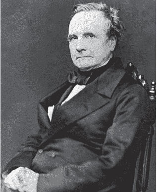


**图 1.1**

（A）查尔斯·巴贝奇（Charles Babbage，1791–1871）发明了差分机（Difference Engine），一种用于对数表和其他算术函数的机械计算器。后来，他设计了分析机（Analytic Engine），那将是一个通用计算器。（B）阿达·洛芙莱斯（Ada Lovelace，1815–1852）帮助他进行了设计。洛芙莱斯看到了数值任务之外的可能性——音乐创作、图形绘制，甚至是逻辑推理。1843年，她制定了一个程序，使分析机能够计算伯努利数，因此被誉为“第一位计算机程序员”（来源：维基百科，共享知识协议）。

## 计算

在早期时期，计算对于既有的科学和工程领域来说是一个谜团。起初，根据观察者的观点，它看起来像是数学、电气工程或科学的技术应用。多年来，计算似乎提供了源源不断的新颖见解，并反驳了许多关于它将被重新吸收回根源领域的早期预测。到1980年，计算在算法、数据结构、数值方法、编程语言、操作系统、网络、数据库、图形学、人工智能和软件工程方面的理解已经趋成熟。其巨大的技术成就——芯片、个人电脑和互联网——将计算带入了许多生活，并刺激了更多新的子领域，包括网络科学、网页科学、移动计算、企业计算、协作工作、网络空间保护、用户界面设计和信息可视化。由此产生的商业应用在社交网络、不断演进的计算、音乐、视频、数字摄影、视觉、大规模多人在线游戏、用户生成内容等领域催生了新的研究挑战。

为了跟上这种变化，该领域的名称变了数次。20世纪40年代是“信息处理”。20世纪60年代，随着它进入美国，它在美国被称为“计算机科学”，在欧洲则被称为“信息学”（informatics）。到20世纪80年代，计算领域由相关领域的复合体组成，包括计算机科学、信息学、计算科学、计算机工程、软件工程、信息系统和信息技术。到1990年，“计算”（computing）已成为指代这一核心群的标准术语。

1962年，随着普渡大学和斯坦福大学计算机科学系的成立，计算机科学成为一个公认的学术领域。当时，这一新领域的领导者认为不仅要说明这个领域是什么，还要抵御批评者，这些批评者认为电气工程或数学之外没有新内容。1967年，纽威尔（Newell）、艾伦·珀利斯（Alan Perlis）和赫尔伯特·西蒙（Herbert Simon）辩称，这是一门关注“计算机周围现象”所有方面的科学。然而，传统科学家对“该领域是科学”的结论表示反对；他们认为真正的科学处理发生在自然界中的现象（“自然过程”），而计算机是人造产物。作为经济学诺贝尔奖得主的西蒙对科学的“自然解释”持有强烈的反对意见，以至于两年后他出版了《人造科学》（The Sciences of the Artificial）。在书中，他主张经济学和计算机科学符合科学的所有传统标准，除了研究自然界中的现象之外。


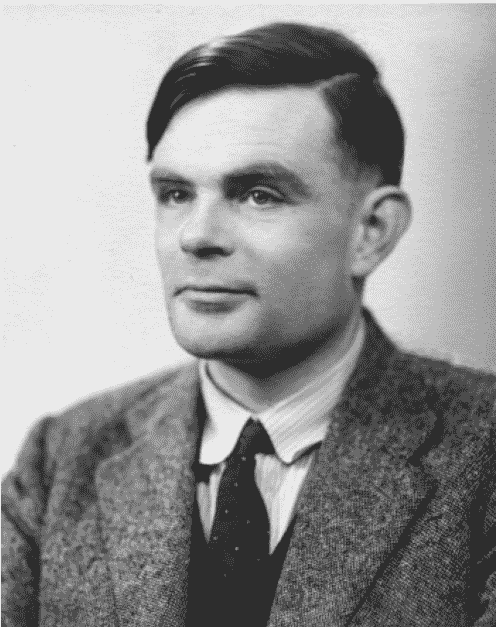

**图 1.2**

艾兰·图灵（Alan Turing，1912–1954）将计算视为对数学函数的求值。1936年，他发明了一种抽象机器，现在称为图灵机，用于对函数求值建模。他的机器由一个有限状态控制单元组成，该单元穿过一条无限长的带子，每个格上都写有符号；在每次移动时，机器读取单个符号，可能用另一个符号覆盖它，向左或向右移动一格，并进入新的控制状态。图灵展示了如何构建一台通用机器，它可以根据给定的描述模仿任何其他给定的机器。他认为，任何可能被认为是计算的函数都可以通过他的某一台机器来实现。他还证明了存在不可计算的函数，例如判断一台机器是停止还是进入无限循环。（来源：维基百科，共享知识协议）

## 计算


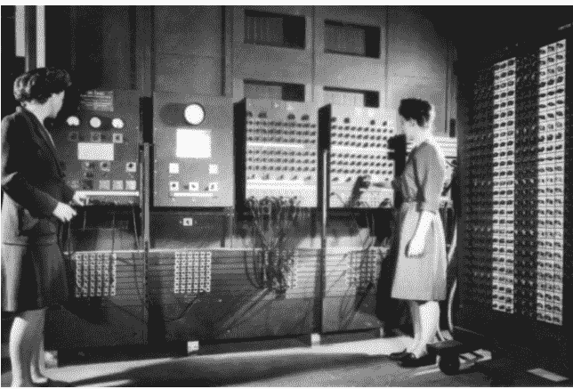

**图 1.3** 在巴贝奇未能制造分析机后，接下来的 80 年里没有人尝试设计通用机器。然后，在 20 世纪 30 年代后期，美国和英国军方委托了电子机器来计算弹道表并破解密码。1944 年，宾夕法尼亚大学的 ENIAC 在约翰·莫奇利（John Mauchly）和普斯珀·埃克特（J. Presper Eckert）的领导下凯·麦纳尔蒂（Kay McNulty）、贝蒂·斯奈德（Betty Snyder）和鲁特·利希滕曼（Ruth Lichtenman）。图中显示了詹宁斯（Jennings）和比拉斯（Bilas）操作 ENIAC 的主面板。当时，计算机是人，计算是他们的职业；编程是由布线板组成的。（来源：宾夕法尼亚大学）过程

## 1. 计算领域的历史与范式

### 1.1 计算机科学的三种范式

1962 年后的几十年里，传统科学家经常质疑“计算机科学”这一名称。他们很容易看到工程范式（系统的设计和实现）和数学范式（定理的证明），但他们看不到多少科学范式（假设的验证）。此外，尽管西蒙持有反对意见，他们仍将科学理解为处理自然界的方式，而计算机看起来是人造的。

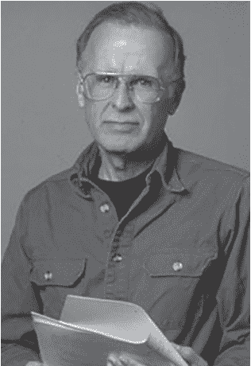

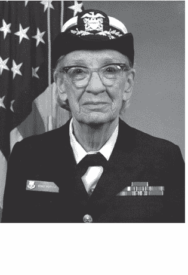

**图 1.4** (A) 约翰·巴克斯斯（John Backus，1924–2007）和 (B) 格蕾蕾丝·霍珀（Grace Hopper，1902–1992）设计了高级编程语言，这些语言可以由编译器自动翻译成机器码。1957 年，巴克斯斯领导一个团队开发了 FORTRAN，一种适用于数值计算的语言。1959 年，霍珀领导一个团队开发了 COBOL，一种适用于业务记录和计算的语言。这两种语言今天仍然在使用。随着这些发明，ENIAC 中程序员插电线的图像消失了，计算通过易于使用的语言变得许多人触及。此后发明了成千上万种编程语言。（来源：维基百科，共享知识协议）

该领域的创始人来自三种范式¹。有些人认为计算是应用数学的一个分支，有些人认为是电气工程的一个分支，还有人认为是计算导向科学的一个分支。在过去的四十年里，该领域主要关注工程：构建可靠的计算机、网络和复杂软件的挑战是巨大的，并占据了几乎每个人的注意力。到 80 年代，这些挑战得到了很大程度上解决，计算在网络、超级计算机和个人电脑的帮助下迅速扩展到所有领域。在 80 年代，计算机已经足够强大，使得科学愿景家可以看到如何利用它们来应对最困难的“宏大”计算。


**图 1.5**

（A）艾伦·纽威尔（Allen Newell，1927–1992）、（B）艾兰·佩利斯（Alan Perlis，1922–1990）和（C）赫伯·西蒙（Herb Simon，1916–2001）将计算视为计算机周围现象的科学。1967 年，他们认为计算机科学是一门必要的科学，研究所有计算内容，从计算机器、软件、智能、信息、系统设计、图形、解决其他领域问题的算法等。西蒙进一步认为，对人造制品周围现象的研究——即人工科学——与传统科学同样重要。（来源：维基百科知识共享协议）

20 世纪 80 年代的计算科学运动涉及许多国家的科学家，并最终使美国国会通过了 1991 年的《高性能计算与通信法案》（HPCC Act），以支持对一系列重大性问题的研究。

今天，人们似乎达成共识：计算体现了科学与工程，但科学或工程本身并不能完全定义计算。是什么定义了计算？计算的范式是什么？

该领域的领导者们从初就在范式问题上苦苦挣扎。在此，出现了三次统一观点的尝试。

#### 第一波：计算是计算机周围现象的科学

第一波由纽威尔、佩利斯和西蒙（1967 年）领导，认为计算在研究信息处理方面在所有科学中是独特的。西蒙将计算称为“人工科学”（1969 年），含蓄地认同了普遍观点，即计算不是自然过程。这一波的口号是“计算是计算机周围现象的科学”。

#### 第二波：计算机科学等于编程

第二波关注编程，即设计产生有用信息处理算法的艺术。在 20 世纪 70 年代初，唐纳德·克努斯（Donald Knuth，生于 1938 年）和埃德格·迪杰斯特拉（Edsger Dijkstra，1930–2002）认为编程是计算的核心。1970 年左右，他们认为算法的设计和分析过程是所有计算机科学家工作的中心。对他们来说，一位大师级程序员就是一位大师级计算机科学家。遗憾的是，这种高尚观点在 20 世纪 90 年代后期消失了；政府将程序员定义为低级代码员。（来源：维基百科知识共享协议）

计算先驱埃德格·迪杰斯特拉和唐纳德·克努斯坚决地主张将算法作为统一的主题。这一波的口号是“计算机科学等于编程”。最近，这种观点已扩展到远超编程的范围，因为公众对程序员的理解变得狭隘（代码员）。

#### 第三波：计算是信息处理的自动化

第三波源于计算机科学与工程研究小组（COSER），由布鲁斯·阿登（Bruce Arden，1983 年）领导，并于 70 年代由国家科学基金会资助。它将计算定义为工程、科学和商业中信息处理的自动化。它的口号是“计算是信息处理的自动化”。尽管其最终结果成功地向外行解释了许多深奥，但其核心观点并没有流行。

这三个定义的共同重要方面是将计算机定位为关注焦点。当计算科学运动开始远离这一概念时，它认为计算不仅是科学的工具，而且科学中新的思维和发现方法。计算科学领域的人将计算视为理解其信息过程以及支配这些过程算法的盟友。

这一新方向的重要结果是，科学家开始承认自然信息过程的存在，并且可以用与计算机产生的人工信息过程相同的方法进行研究。生物学是最早的例子之一：诺贝尔奖得主大卫·巴尔的（David Baltimore，2001 年）呼应认知科学家大卫·贝肯（David Bacon，1985 年）说，生物学已成为一门信息科学。大卫·贝肯（2010 年）对物理学提出了类似的观点，认为作为量子计算基础的量子力学是一门信息科学。


**图 1.7** （A）布鲁斯·阿登（生于 1927 年），计算机系统先驱，领导了一个小组（COSER），主张比编程更广泛的计算观点。20 世纪 70 年代后期，他的小组将计算定义为对“什么是可以自动化的”的研究。当时，这种观点符合大众对人的倾向，例如《星球大战》中的机器人（B）。由于几年后开始的转变，这种观点并没有坚持下去。（来源：维基百科知识共享协议）

Gelen（2011 年）给出了一系列积极研究自然信息过程领域的示例，加强了西蒙（1969 年）关于所有计算都是人工的论点。最近，保罗·罗森布鲁姆（Paul Rosenbloom，2012 年）指出了另外两个认为“所有计算都是人工的”命题过时的理由。首先，许多科学家现在接受自然过程是生态系统的一部分。其次，我们在越来越修改自然过程的能力消除了自然与人工之间的任何边界，例如干细胞器官、有机生纳米机器或转基因作物。

## 2. 计算的基本原理


**图 1.9** 诺贝尔奖得主（A）肯·威尔逊（Ken Wilson，1936–2013 年）物理学家和（B）大卫·巴尔的（生于 1938 年）生物学家，处于计算科学的前沿，该科学认为计算是一种新的思维和发现方式。20 世纪 80 年代中期，威尔逊普及了科学中可以通过计算方法解决的“重大挑战”问题概念，并主张用高度并行的超级计算机完成任务。20 世纪 90 年代，巴尔的普及了生物学已成为细胞和所有生命过程中信息过程的研究。


**图 1.8** 蒂姆·伯纳斯-李（Tim Berners-Lee，生于 1955 年）对计算提出了不同于主流的机器网络观点的观点。1989 年，他发明了万维网，这是一种链接存储在机器上的信息并在点击鼠标时自动跳转链接的方法。他将人们之间建立的连接网络视为人们赋予信息的意义。（来源：维基百科知识共享协议）

我们对计算的解释的成熟过程为我们提供了关于内容的新视角。科学家们会通过命名其核心技术来描述该领域：算法、数据结构、数值方法、编程语言、操作系统、网络、数据库、图形、人工智能和软件工程。这是对该领域深层次的技术解释。我们这里使用的原理解释法强调了赋能并限制技术的根本法则。

计算原理分为六类：通信、计算、协调、记忆、评估和设计（Denning 2003, Denning and Martell 2004）（见图 1.10）。这些类别都与操纵物质和能量以产生预期的计算有关。表 1.1 定义并说明了它们，并注了本书的哪些章节侧于这些内容。

### 表 1.1 计算大原理

| 类别 | 重点 | 示例 | 核心章节 |
| --- | --- | --- | --- |
| 通信 | 在不同位置之间可靠地移动信息 | 最小长度编码、纠错、文件压缩、密码学。 | 3. 信息 |
| 计算 | 什么可以计算，什么不能计算 | 根据最小长度解对问题进行复杂度进行分类。表征没有算法解决方案的问题。 | 11. 网络 |
| 记忆 | 从介质中表示、存储和检索信息 | 所有存储都是分层的。没有任何存储系统能对所有对象提供等同访问；所有数据对象的子集在长时间内都具有局部性。 | 4. 机器 |
| 协调 | 有效使用多个自主计算代理 | 引导具有相同不确定结果的部分或进行同步的协议。选择不确定性原理，消除条件。 | 5. 编程 |
| 评估 | 衡量系统是否产生了预期的计算 | 使用队列网络模型预测系统吞吐量和响应时间，设计实验测试算法和。 | 9. 排队 |
| 设计 | 为了可靠性和依赖性而构建软件结构 | 复杂系统可以分解为模块和虚拟机。模块可以根据其操作对象事件的时间尺度进行分层。 | 7. 内存，10. 设计 |

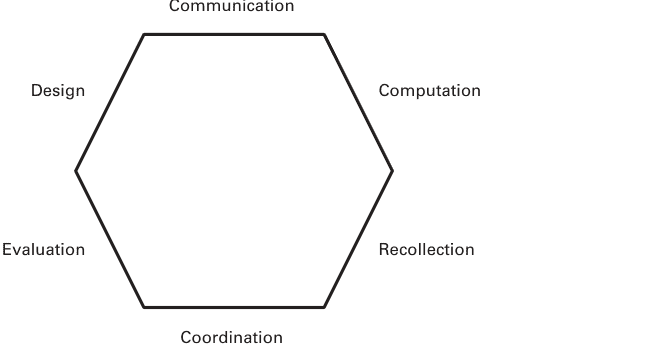

**图 1.10** 每一类原理都是对计算的一种视角：通往计算知识空间的窗户。（六边形周围类别名称的顺序没有意义。）这些类别之间并非互斥。例如，互联网可以从通信系统、协调系统或存储系统的视角来看待。大多数计算技术都使用了来自所有六类原理的组合原理；每个类别在混合物中都有自己的权重，但它们都存在。这些类别还代表了人们对计算发展的心理视角，另一些则将其视为数据、网络化协调或自动化系统。这一框架可以拓宽人们对计算究竟是什么的认知。

计算远不仅仅是一组原理和构建在其基础上的核心技术。计算专业人士作为许多计算领域社区的成员从事日常工作（见图 1.11）。除了对计算原理的了解外，计算专业人士还需要精通四项核心实践：编程、系统思维、建模和计算思维。一种实践是通过持续练习和与客户互动所体现的技能。从业者的技能可以被评为初级、高级初级、精通或专家。例如，一个初级程序员将关注语言语法、让程序通过编译以及寻找错误；而一个专家程序员将能够构建大型系统、解决复杂问题并指导初级程序员。原理与实践在不断相互作用。人们通过熟练的操作将计算原理投入使用；偶尔也会从人们开发的共同实践中发现新原理。

## 3. 计算领域

安全、人工智能、云、数据分析、交通网络、医疗健康 IT、基因组、机器人技术等。

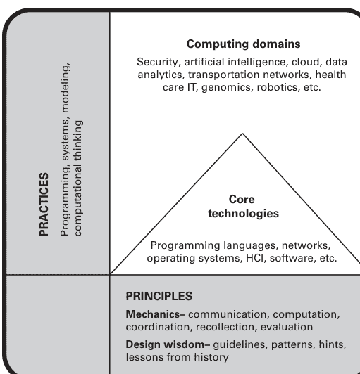

**图 1.11** 整个计算依赖于原理和实践。核心技术是从业者在许多计算领域中执行工作的普及性工具。本书重点关注原理及其在几个领域中的应用，将核心技术和实践留给其他书籍。这些原理要么是力学——规律和递归——或是设计智慧——关于什么有效或无效的积累知识——用于构建可靠、可靠、易用、安全和安全的计算系统。

计算领域的人及其客户聚集的社区被称为计算领域。有几十个领域。ACM（美国计算机学会）对其成员认可了不少于 42 个专业兴趣领域（Denning 2001, 2011），在“计算应用”的标题下还有更多领域。下一章将探讨四个当代极受关注的领域：安全、人工智能、云计算和大数据。

许多计算领域都与计算之外的其他领域相互作用。在分析计算如何与科学的三大领域（物理科学、生命科学和社会（科学）产生相互作用时，Paul Rosenbloom 发现了两种相互作用：实现和影响（Rosenbloom 2004, Denning and Rosenbloom 2009, Rosenbloom 2012）。实现意味着一个领域的某物被用于构建另一个领域的某物。影响意味着一个领域中的东西影响另一个领域东西的行为。实现和影响可以是单向或双向的。Rosenbloom 构建了表 1.2 的图表，以展示计算与所有科学在这些维度之间的相互作用集。他在图中包含了一列计算。他这样做仅仅是因为计算通过许多计算领域之间的相互作用不断地自我实现和自我影响。计算对整个科学的普遍影响是不容疑问的。

## 4. 计算在科学中处于什么位置？

由于计算对科学的影响是无处不在的，而且没有其他科学领域直接关注信息，Rosenbloom 得出结论：计算属于第四大科学领域。

计算处理信息有何特殊？信息传统上是指在传播时能增加知识的事实。这是一个旧概念。

计算在处理信息的方法上与其它相比有两个不同之处。

首先，计算强调信息的转换，而不仅仅是发现、分类、存储和通信。算法不仅读取信息结构，还修改它们。此外，人类不断通过变换修改信息结构——如网络——而我们没有这些变换的计算模型。纯分析方法无法帮助我们理解这些信息结构的动力学。需要科学的实验方法来实现进展。

第二个区别是计算的结构不仅是描述性的，还是生成性的。算法不仅是解决问题方法的描述，它让机器去解决问题。

### 表 1.2 计算与其他领域相互作用的示例

| 物理 | 社会 | 生命 | 计算 |
| --- | --- | --- | --- |
| 计算由以下实现：机械、光学、电子、量子和化学过程 | 绿野人、机器人、人类认知，具有输入和输出 | 基因、神经、免疫、DNA 翻译进化计算 | 编译器、操作系统、模拟器、抽象、体系、语言 |
| 计算实现：建模、仿真、数据库系统、量子加密、打印 | 人工智能、认知建模、自主系统 | 人工、仿生、系统生物学 | 网络、信息保护、并行计算、分布式系统、网格 |
| 计算受以下影响：传感器、扫描仪、计算机视觉、光学字符识别、定位 | 学习、编程、用户建模、授权、语音理解 | 眼睛、手势、表情和动作跟踪、生物传感器 | 执行器、触觉反馈、感官沉浸 |
| 计算影响：运动、制造、操作、开环控制 | 屏幕、打印机、图形、语音生成、网络科学 | 人机交互、游戏 | |
| 双向影响 | 机器人、闭环控制 | | |

计算科学是唯一一种如此强调“信息引发行动”的科学。

没有任何一个领域采纳这种关于信息的观点。计算科学确实如此，而且它发现的答案深刻地影响了科学的每一个领域。计算不能被视为物理、生命科学或社会科学的子集。它似乎是一个独立的科学领域。

## 5. 本书内容

计算科学已经发展得如此巨大，以至于完整的综述无法容在一本书易于阅读的书中。三本设计为“计算机科学百科全书”的书将它们的总结作为一系列文章呈现，页数分别为 2030 页（Ralston 2003）、770 页（Abrams 2011）和 580 页（Henderson 2008）。我们并没有尝试全面覆盖，而是选取了计算领域最伟大原则的样本。

我们的样本包含九个章节：信息、机器、编程、内存、并行性、队列、设计和网络（第 3–11 章）。六个领域中的每一个都至少在一个章节中有所体现（见表 1.1）。这些章节共同旨在传达关于计算类别广度、丰富性和深度的连贯视图。

第 1 章关于计算领域的历史、结构及其与其他领域的交互。第 2 章关于计算领域如何从计算原则中获取知识；安全、人工智能、云计算和大数据是其中的典型案例。

第 3 章关于信息的本质、机器能用信息做什么，以及机器如何向用户传送有意义的信息。第 4 章关于计算机器是如何构建的，以便我们编写的程序控制电子电路来执行我们所需的计算。第 5 章关于编程，即为问题设计计算解决方案的艺术，以及我们如何将其自动翻译成高效的机器码。

第 6 章关于计算本身：某些问题可以通过快速算法解决，另一些则只能通过慢算法解决，或者根本无法通过任何计算机器解决。第 7 章关于内存，即我们如何通过命名和在内存系统及网络中定位来高效地存储和检索信息。

第 8 章讨论了并行性，即通过调度许多协作的并行计算机来解决一个问题以追求速度。第 9 章关于队列，即当许多并行作业竞争服务器服务时，我们用来预测复杂服务器网络吞吐量和响应时间的方法。

第 10 章关注设计，即如何规划和组织可靠、可靠、易用、安全、安全的计算系统。第 11 章是互联网的案例研究，关于我们如何动用其他原则来构建一个由链路和主机组成的巨大、可靠的数据通信网络。

我们在书末附带了参考文献。参考文献包含了启发过我们的的精选条目；它们并不是对文献进行历史性的完整总结。如果你在文中看到某人的名字，你也会找到该人的至少一条参考文献条目。

## 6. 结论

计算作为一个领域已经成熟，并体现了优秀的科学以及工程和数学的典范。这门科学对于该领域的进步至关重要，因为许多系统极其复杂，实验方法是进行发现和理解局限的主要手段。计算现在被视为一个研究自然和人工信息过程的广泛领域。

伟大原则框架揭示了作为所有计算基础的丰富原则集。这些原则支持着许多计算领域，以及物理、生命科学和社会科学中的大量领域。

计算不是物理、生命科学或社会科学的子集。这些领域中没有一个是从根本上关注过程及其转化的。然而，这种知识现在在科学的所有其他领域中都是至关重要的。计算科学可能是科学的第四个领域。

## 7. 致谢

> 生物学是一门信息科学。  
>   
> —David Baltimore

> 计算是除了理论和实验之外做科学的第三种方式。  
>   
> —Kenneth Wilson

> 科学与科学的应用紧密在一起，如同结果之树的果实。  
>   
> —Louis Pasteur

计算的行动来自人，而不是原则。从事计算的人组织成了许多实践社区，我们称之为计算领域。每个领域都以一种技术或技术的应用为中心。例如，安全领域以安全技术为中心，隐私领域以安全技术在保护个人信息的应用为中心。这些领域的成员有着相似的关注点、技能组以及与其他社区的交互。如果没有计算领域，伟大原则框架将是不完整的（Rosenbloom 2012）（见图 2.1）。


数值气动力模拟是一个领域的示例。计算机科学家长期以来与航空工程师合作设计飞机。从 20 世纪 80 年代开始，飞机公司转向数值模拟，以设计高效、无湍流气流机翼和机身。风洞和试飞的传统方法对于飞机的尺寸和复杂性已不再实用。随着在大规模并行超级计算机上运行的新算法，工程师能够设计出安全飞行的新飞机。波音 777 是第一个完全通过数值设计的飞机。

航空和计算领域的人开发了一个新领域——计算流体力学，用于计算流体的复杂运动。他们设计了基于 3D 网格的计算方法，求解机身周围区域的流体力学方程。他们利用了一种多网格算法，在超立方体并行处理器上以最短时间解决了巨大的机身（Chan and Saad 1986, Denning 1987）。这些团队还开发了动态划分网格的新方法，以增加气压或速度快速变化区域的精度。这些方法中的被认为是计算的新原则。结果，计算方法成为了流体力学不可或缺的一部分。

（图 2.1：伟大原则框架的六个类别（底部）都关于管理物质和能量以产生计算。相比之下，计算领域（顶部）是实践社区；他们的人动用原则来支持（虚线）。这些领域与其他领域具有很强的交互。）

## 领域与原则

表示领域知识体系有两种基本且有效的策略。一种是列出领域的领域，另一种是列出其原则。对于本章，我们使用的“领域”一词是指技术领域，即以特定技术为中心的领域。

## 第二章

教育者使用“知识体系”（BOK）这一术语来表示对某一领域知识的组织化描述。教育者经常致力于设计涵盖其领域核心知识的课程。ACM 在 1968 年提供了首个计算机知识体系，随后在 1989 年、2001 年和 2013 年对其进行了更新。ACM 在 1989 年列出了九个核心领域（Denning et al. 1989），2001 年列出十四个（ACM Education Board 2001），2013 年列出十八个（ACM Education Board 2013）。它们之所以被称为核心领域，是因为所有其他领域在某种程度上都依赖于这些技术。

本书中的这种“原则框架”与领域导向的框架是正交的。同一个原则可能出现在多个领域，而一个特定领域可能依赖于多个原则。活跃原则集（至少被某技术使用的原则）的演变速度远于技术。

尽管这两种框架风格不同，但它们之间有着紧密的联系。为了视觉化这种联系，请想象一个二维矩阵。行代表领域导向框架中的主题，列代表原则的类别。矩阵的内部是该领域的知识空间（见图 2.2）。

通过这张图，我们可以关注到技术导向的 BOK 是按矩阵的行列举的，而原则导向的 BOK 是按列列举的。它们从不同的视角和解读观察着相同的知识。

想象有人想列出涉及某项技术的所有原则。此人可以针对六个类别中的每一类分析该技术领域的原则——这对应于从矩阵的行中读取原则（见图 2.3）。这就是我们在接下来的章节中通过四个示例将做的。

原则框架开启了新的探索方向。例如，有人可以列出所有采用特定原则或原则类原则的技术（见图 2.4）。

## 安全

安全作为一个领域，在计算机科学中拥有悠久而丰富的历史。即使在批处理是常态的早期，用户也担心受托给机器的数据。在加载新作业之前，机器是否在物理安全的区域经过清理？操作员的错误或硬件故障会导致数据丢失吗？

随着 1960 年左右第一批多程序分时系统的出现，操作系统设计者深度参与了信息保护。

# 领域

### 原则类别

| 通信 | 计算 | 协调 | 记忆 | 评估 | 设计 |
| :--- | :--- | :--- | :--- | :--- | :--- |
| 架构 | | | | | |
| 互联网 | | | | | |
| 安全 | | | 密钥分发协议 零知识 证明 | | |
| 虚拟内存 | | | | | |
| 数据库 | | | | | |
| 编程语言 | | | | | |

图 2.2

计算的知识空间可以表示为矩阵的内部，其列是原则的类别和计算领域的名称。该图展示了安全领域使用的两个协调类原则：`密钥分发协议`（用于安全分发加密密钥）和`零知识证明`（用于在双方之间安全地交换秘密）。

他们设计了划分主内存的方法，使代码和不同的程序不会混合；虚拟内存是最复杂的机制。他们发明了分层文件系统，使用户对文件拥有所有权，并决定是否授予其他用户访问权限。他们发明了密码系统以将未经授权的用户排除在外。他们构建了结构以防止木马和其他恶意软件中断系统并损坏数据。他们发明了控制访问的方法，使机密信息不会流入公共文件。他们为计算机操作员制定了策略以保护数据并防范入侵。从 1970 年起，人们广泛认为操作系统设计者对信息保护负有重要责任（Denning 1971, Saltzer and Schroeder 1975）。

1970 年代的 ARPANET、1980 年代的互联网和 1990 年代的万维网为信息共享提供了全球性网络，同时也为信息丢失和盗窃带来了巨大的新机会。密码学在安全和认证中发挥了核心作用（Denning 1982）。设计者针对许多新问题做出了响应：数据库记录保护、密码保护、用户生物认证、防黑保护、入侵检测、防止病毒和蠕虫等恶意软件攻击、多级安全系统、信息流管理、匿名交易、系统信任级别标准、取证、审计、数据恢复以及针对用户的安全增强实践。

法律执法专家开始看到针对计算系统的犯罪和攻击增加，他们开始要求每个人都采取严肃措施来保护个人信息。遗憾的是，很少有人认真对待这些号召。为了快速交付新系统的便利考虑，许多开发者淡化了安全性，并假设如果安全性成为问题，以后再添加保护措施。遗憾的是，部署了大量高度脆弱的系统，它们缺乏信息保护的结构性安全措施，并在运行中采用了松散的策略。

随着越来越多的财务数据、人员数据、个人数据和公司数据可以在线访问，攻击量急剧增加。防御专家担心信息战争（Denning 1998）。

| 通信 | 计算 | 协调 | 记忆 | 评估 | 设计 |
| :--- | :--- | :--- | :--- | :--- | :--- |
| **安全** | 机密性 认证、隐蔽道 | 加密函数的复杂度 | 密钥分发协议 零知识 证明 | 限制分区、参考监视器 | 协议性能分析 | 端到端分层函数、虚拟机 |

**图 2.3**

安全原则可以通过跨越安全行读取知识矩阵来识别。与大多数其他计算领域一样，安全从所有六类中汲取原则。

失去自由（Garfinkel 2001）。1999 年由于“Y2K”问题导致的网络崩溃担忧显而易见。

安全领域的人员、问题和计算原理如表 2.1 所示。

## 人工智能

机器执行智力任务的想法在大多数计算机科学之前就已经存在了（Russell and Novig 2010）。帕斯卡在 1642 年制造了一台机械计算器。巴贝奇在 1823 年提出了差分机，以计算导航和其他算术函数。在 19 世纪后期，“自动迈克”是一个极具信服力的骗局，看起来是一个下棋的自动机（Standage 2003）。

事实上，许多成为人工智能（AI）基础的思想在 1956 年，约翰·麦卡锡与克劳德·香农、纳森尔·罗彻在达特茅组织了一次会议。这次会议诞生了人工智能领域。他们的愿景是：“学习的任何方面或智能的任何特征都可以被精确描述，并让机器模拟。”这看起来是可能的，因为许多智能任务似乎遵循算法，而大脑本身也是能够执行算法的电气网络。

赫尔伯特·西蒙预测，1967 年计算机将成为象棋冠军，计算机将发现并证明一个重要的数学定理，许多心理学理论将体现在程序中。他的第一个梦想在 30 年后实现，而另外两个尚未实现。

# 领域 27

艾伦·图灵（Alan Turing, 1950）结晶了现代人工智能的许多种子：图灵测试、机器学习，以及像培养孩子一样通过发展阶段来“培养”出一个智能机器的理念。图灵意识到，“智能”的定义如此模糊，以至于他在“机器何时才可能变得智能”这一问题上无法取得进展。

他的模仿游戏（图灵测试）问的不是机器是否具有智能，而是它的行为是否表现出智能。他预测，到 2000 年，机器将能够欺骗 70% 坚定的人类提问者至少五分钟。这一梦想也必须实现。

图灵对行为的关注被吸收到人工智能的创立梦想中。然而，到 20 世纪 70 年代，成为了严锐批评的焦点。许多人工智能项目旨在设计“专家系统”，这些系统在医学诊断等许多领域的表现将与人类专家一样。

胡伯特·德雷福斯（Hubert Dreyfus, 1972, 1992）认为，专家行为超出了基于规则的机器的能力。他最初遭到了嘲笑，但时间似乎证明他是对的。只有少数专家系统能够胜任工作，而且它们并非真正的专家。

约翰·塞尔尔（John Searle, 1984）攻击了传统计算机器具备智能的观点；他描述了一种基于规则的机器，它可能看起来在用中文对话，但并没有对中文有任何形式的理解。他攻击了“强人工智能”——即心灵是机器行为产物的观点——并倾向于“弱人工智能”——即模拟在与大脑没有相似之处的情况下模仿行为产生行为。

特里·维纳（Terry Wiener）和费尔南多·弗洛雷斯（Fernando Flores, 1987）认为，人工智能基于无法解释或通向智能的哲学假设。

到 20 世纪 80 年代中期，显然人工智能短期内不会成功。人工智能的研究梦想无法实现。研究资助机构开始扣留资金并要求交付成果。许多人对他们所在领域的弱点进行了大量的自我反思。人工智能先驱拉杰·雷德迪（Raj Reddy）将那个时期称为“人工智能寒冬”。

一个新的人工智能领域从内省中脱颖而出。重点从试图模拟人类大脑的工作方式转向了构建可以接管人类认知工作的系统。自动化认知系统的工作方式与人类大脑的工作方式不同；它们不需要模仿人类解决问题。

该领域同时开始强调使用实验方法，以验证所提的关注点是否有用、可靠且安全（Russell and Norvig 2010, Nilsson 2010）。近期获得声誉的成就包括 1997 年 IBM 蓝蓝象棋程序击败世界国际象棋冠军加里·卡斯帕罗夫、2010 年 Google 的无人驾驶汽车，以及 2011 年 IBM 的 Watson 计算机赢得电视节目《危险一路问》（Jeopardy）冠军。

这些程序中使用的方法非常有效，但不像人类的思维或脑过程。此外，这些方法是针对单一目的专门化的，不具备通用。

计算机科学、认知科学、医学科学和心理学的许多研究人员继续研究大脑如何工作以及它是如何产生心灵的。对奇点的迷（Kurzweil 2005）和大脑活动图谱项目（2013 年宣布）标志着这一研究方向仍然保持着它的吸引力。

重生的人工智能如此成功，以至于引发了一系列新担忧。在《与机器竞争》（Race against the Machine）中，埃里克·布莱约夫森（Erik Brynjolfsson）和安德鲁·麦菲（Andrew McAfee, 2012）记录了自动化方式如何挤占知识型工作，就像上世纪的机械自动化挤占许多体力劳动工作一样。

知识自动化的例子比处可见：呼叫中心、语音菜单、在线购物、网上银行、政府服务、出版、新闻发行、音乐出版、广告、监控、打击恐怖分子等。作者担心我们正滑向一个职位不足以维持工人人口、且公共机构资源不足以服务失业者的社会。

人工智能领域的人员、问题和计算原理如表 2.2 所示。

## 表 2.1 安全领域

| | | |
| :--- | :--- | :--- |
| 谁 | 成员 | 操作系统设计者、网络工程师、网络操作员、军事防御、执法、法医调查员、国土安全、公共政策官员、外交官、隐私倡导者 |
| 什么 | 故障、关注 | 受控共享、内存保护、文件保护、访问控制、信息流、信任系统、秘密通信、认证、签名、密钥分发、防止数据关联产生的干扰 |
| 计算原理 | 通信 计算 | 密码学、机密性、认证 单向函数、加密哈希、形式验证 |
| | | 访问控制、错误隔离、信息流、多级安全存储、参考监视器 |
| | 记忆 | 密钥分发、零知识证明、认证协议、签名协议 |
| | 协调 | 协议性能和吞吐量、安全系统标准 |
| | 设计 | 开放设计、最小权限、安全默认、心理接受、端到端设计、分层函数、虚拟机 |
| 来自其他领域的原则 | | 信息保障实践、入侵检测、生物识别、法医证据规则、统计数据库推断 |

## 云计算

云计算是一个现代术语，隐藏了信息共享和分布式计算的丰富传统。它指的是计算设备网络，通过隐藏服务器和数据存储的位置来提供规模效应。“云”一词于 20 世纪 90 年代开始使用，可能源于技术和营销演示中将“网络”显示为云的习惯。

构建可以在用户之间廉价共享计算能力的系统的构想，体现在 20 世纪 60 年代的麻省理工学院 MAC 项目中。MAC 是“多重访问计算机”（multiple-access computer）的缩写，有时也是“人与计算机”（man and computer）。

MAC 项目构建了 Multics，这是一个强大的多路用系统，将内存、磁盘和 CPU 的费用分布在一个大型社区中，使得任何单一用户的计算成本都很小。J. C. R. 利基德（J. C. R. Lickider）这位提供最初灵感的远见卓者认为，计算力像公用事业一样供应：可以将终端插在墙上的插座上（Lickider 1960）。

1969 年末开始运行的 ARPANET 支持了这一公用事业目标。它是为了资源共享设计的——网络中任何地方的用户。

# 领域

## 表 2.2 人工智能领域

| 分类 | 成员 |
| :--- | :--- |
| - | 工专家、人工智能从业者、人工智能信徒、规划师、奇点追随者、棋手、《危险一路问》爱好者、贝叶斯学习者、机器学习者、生物启发设计者、认知科学家、人因素设计者、心理学家、经济学家、执法人员、机器人学家 |
| 什么 | 拆解、问题、担忧 |
| | 认知任务自动化、启发式方法的设计与实验评估、进化计算、遗传计算、神经计算、模式识别、自动分类、语音识别 |
| 计算原理 | 通信 |
| | 认知任务自动化、启发式方法的设计与实验评估 |
| | 评估 |
| | 记忆模型、语音识别 |
| | 设计 |
| | 训练方法、无监督学习 |
| 其他领域的原理 | 协调 |
| | 大数据集、神经科学 |
| | 存储 |
| | 大脑、统计推理 |
| | 网络 |
| | 语言学、监督学习 |
| | 启发式、准确性、精确度 |

# 领域

## 表 2.3 云计算领域

| 谁 | 成员 |
| :--- | :--- |
| 什么 | 网络设计师、分布式计算设计者、客户端-服务器架构师、企业系统设计师、企业、政府、经济学家 |
| | 细分、关注 |
| | 与位置无关的服务和数据存储、冗余、限制跨境流量、分布式计算 |
| | 通信 |
| | 纠错码、音频和图像文件压缩、基于位置的识别 |
| | 计算 |
| | Map-Reduce 方法、大规模并行 |
| | 回忆 |
| | 数据复制、原子事务、回滚数据库、数据结构、互联网搜索、数字对象标识符、数字对象柄 |
| | 协调 |
| | 锁协议、回滚协议、文件传输协议、文件同步协议、超文本协议、域名系统、时间戳、版本控制 |
| | 评估 |
| | 大规模并行和大规模分布式内存系统的性能 |
| | 设计 |
| | 接口设计、数据仓库架构 |
| 来自其他领域的原理 | 社会网络、电子商务、关键基础设施建模、位置的统计推断 |

曾经庞大的现在已变小。“大数据”一词是对老问题的近期称呼，它现在影响着许多社区。例如，在正常业务中，公司积累了数 PB 的客户相关数据，他们利用这些数据来识别趋势、目标广告和跟踪忠诚度。

部分资助的科学研究项目现在被要求向公众开放数据，其他项目被要求“挖掘”数据以获取可能的见解。警察利用电话记录和信用卡交易数据库来追踪和定位嫌疑人和逃犯。所有这些小组都在寻找数据分析师、数据科学家和数据系统架构师来帮助他们完成这些工作。

计算机科学家主要通过两种方式做出贡献。一种是新的计算分析方法，另一种是能够处理海量数据的系统和架构。

例如，Richard Karp (1993) 将他关于高效组合方法的知识应用于将实验采样的基因数据合并到基因组图的算法中。Tony Chan 和 Yousef Saad (1986) 证明了首批并行架构之一的超立方体对于一大类数值算法（称为多网格算法）是最优的，这些算法用于解决应用于大型数据集的数学模型。Jeffrey Dean 和 Sanjay Ghemawat (2008) 设计了 MapReduce，这是一种动员数千个并行处理器来解决极大数据处理问题的新方法。

大型数据集一直是企业关注的重点。他们存储关于客户、库存、制造和会计的数据——一切都需要规模化和国际化运行。IBM 在 20 世纪 30 年代就在数据处理市场上变得富有，在电子计算机出现几年前，他们销售读卡器等机器。

关系型数据库系统 (Codd, 1970)。

## 第 3 章

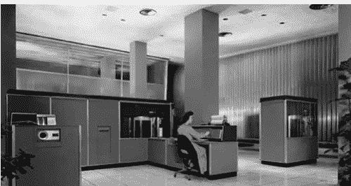

### 图 3.1

1956 年，IBM 引入了世界上第一个磁磁盘信息存储系统 RAMAC 350。该机器的宣传电影展示了摆满文件柜的走廊，疲惫不堪的秘书在其中穿行。电影显示，RAMAC 350 将整个文件柜的内容存储在约 5 立方米的空间内，并允许对数据进行几乎瞬时的搜索。

对于当时的观众来说，这部电影还展示了将看似抽象的信息概念具象化是多么的困难。（照片由 IBM 提供）

……信息，它如何与计算理论相结合，以及它的局限在哪里。这项研究表明了为什么经典信息论无法解释意义和新信息的生成。我们描述了一种保持意义变换的模型，解决了这些显而见的悖论。

## 信息的表示

人类在交流信息的方式上非常灵活。这里有四个例子。第一个说明了显性意义：

1. 我们指向一个物体并告诉朋友那个物体意味着什么——现在那个物体“携带”了信息，因为每当我们的朋友看到那个物体时，他们的大脑中就会触发意义。
2. 我们发现并命名递归性，即重复的事件模式。当我们看到这种模式时，就可以预测结果。这种模式携带了关于结果的信息。发现自然中的递归性是科学的目标，而将递归性转化为技术则是工程的目标。

接下来两个例子说明了隐性（或默会）意义：

## 信息


- 3. 社区发展出传递信息的循环性实践。例如，许多驾驶员通过开启转向灯并侧向移动来传达他们并入高速公路流量的意图。没有书面的交通规则告诉他们要这样做。
- 4. 人类实践的日常习惯和惯例是携带信息的未命名递归性。例如，在大多数文化中，“手过来”的手势传达了让你靠近他们的请求。

科学家和工程师经常会构建处理显性信息的构建，显性信息是物理表示与意图意义之间的关联。例如，电磁信号编码了某人的语音。我们通过声明表示与其意义之间的关联来创建信息。我们通过将表示存储在内存中并对其应用变换规则来处理信息。

社会科学家和哲学家几年来一直在研究隐性信息，但往往没有达成太大共识。工程师在处理显性信息方面的任务则较容易。

人工智能领域试图推开显性意义与隐性意义之间的边界。该领域的工程师寻找能够表示信息的方法，这些信息仅被人类用户感知，但容易理解。

无论是显性的还是隐性的，所有信息都存在于人类约定的基础上。我们知道一个表示或递归之所以成为信息，要么是被显式地告诉我们如何解释它，要么是我们通过经验隐式地学会了。

计算机和通信工程师专门研究传输电磁信号编码信息的系统。例如，麦克风在人说话时产生电信号，磁磁盘记录信号的副本，扬声器从该信号产生声波。无线电发射机将音频信号叠加在无线电频率（RF）信号上，使得 RF 幅值跟踪音频信号；接收器则减去 RF 信号以提取音频。工程师在如何编码表示及其意图意义方面必须非常精确且无歧。否则，他们构建的物理系统将无法工作。

计算机和通信工程师把位（binary digit 的缩写）作为他们信息的基本单位。克劳德·香农（Claude Shannon）在20世纪40年代中期计算机时代初期引入了“位”（bit）这一术语。虽然十进制硬件组件是可能的并被用于一些早期计算机，二进制组件成为了标准，因为它们要可靠得多。香农发现，二进制电路的功能可以用逻辑公式编码，这些公式的变量只能取“真”或“假”的值；因此，模式可以代表计算机电路。电路处理的数字本身被编码在二进制系统中（见图 3.2）。从20世纪50年代以来，计算机在逻辑电路和数据上始终完全是二进制的。

香农证明了数字通信系统中使用的连续信号可以被数字化，在许多情况下误差可以忽略不计。我们稍后会回到这一点。

由于所有形式的数据——数字、信号、逻辑公式和文本——都可以表示为位的模式，位成为了信息数量的标准计量单位。它出现在现代术语中，如“24位色”、“100兆比特速率连接”、“32位计算机”和“256位加密密钥”。20世纪60年代，计算机制造商创造了“字节”（byte）一词，作为表示单个字母、数字或标点符号需要的一组八位。多年来，计算机处理的数据量呈指数级增长，人们发现了新的希腊语前缀，用来表示比前一个前缀大1000倍（或1024倍）。

## 第 3 章

### 图 3.2

A

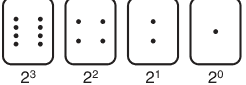

B

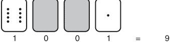

孩子们通过卡片很快学会了二进制。(A) 每张卡片上的点数都是其右侧卡片的两倍。四个孩子排成队，老师要求他们通过举起卡片显示不同的数字。(B) 第一和第四个孩子举起卡片，而第二和第三个隐藏了自己的，组成数字 9。孩子们通过这种方式很快就能掌握二进制数。由于任何信号都可以被数字化为二进制数，任何文本文件都可以用二进制数编码，位已成为表示信息和量化信息量的通用方式。（Tim Ben 和 Mike Fellows 提供，`csunplug.org/videos`）

计算机，二进制组件成为了标准，因为它们要可靠得多。香农发现，二进制电路的功能可以用逻辑公式编码，这些公式的变量只能取“真”或“假”的值；因此，模式可以代表计算机电路。电路处理的数字本身被编码在二进制系统中（见图 3.2）。从20世纪50年代以来，计算机在逻辑电路和数据上始终完全是二进制的。

香农证明了数字通信系统中使用的连续信号可以被数字化，在许多情况下误差可以忽略不计。我们稍后会回到这一点。

由于所有形式的数据——数字、信号、逻辑公式和文本——都可以表示为位的模式，位成为了信息数量的标准计量单位。它出现在现代术语中，如“24位色”、“100兆比特速率连接”、“32位计算机”和“256位加密密钥”。20世纪60年代，计算机制造商创造了“字节”（byte）一词，作为表示单个字母、数字或标点符号需要的一组八位。多年来，计算机处理的数据量呈指数级增长，人们发现了新的希腊语前缀，用来表示比前一个前缀大1000倍（或1024倍）。

### 表 3.1 数据大小的名称

| 名称（符号） | 十进制 | 二进制 |
|---|---:|---:|
| `byte (B)` | 8 bits | 2 bits |
| `kilobyte (KB)` | 10³ | 2¹⁰ |
| `megabyte (MB)` | 10⁶ | 2²⁰ |
| `gigabyte (GB)` | 10⁹ | 2³⁰ |
| `terabyte (TB)` | 10¹² | 2⁴⁰ |
| `petabyte` | 10¹⁵ | 2⁵⁰ |
| `exabyte` | 10¹⁸ | 2⁶⁰ |
| `zettabyte` | 10²² | 2⁷⁰ |
| `yottabyte` | 10²⁴ | 2⁸⁰ |

20世纪60年代，磁盘和内存的大小按2的幂次方增长。20世纪80年代，它们以千字节为单位，NASA 担心如何存储卫星每天产生的1太字节数据。2014年，“大数据”一词被用于拍字节级数据集，互联网每年传输超过泽字节的数据。思科公司（2012）预测网络规模及其承载的数据量将继续指数增长。

## 通信

最简单的信息系统是通信系统。在1948年的一篇名为《通信数学理论》的论文中，香农提供了此类系统的首次理论模型（Shannon 1948）（见图3.3）。其本质是以下过程：源端发送消息。编码器根据码本为消息产生独特的信号。信道是传输信号从源端到接收端的介质。接收端的解码器使用相同的码本将信号转换回原始形式——消息送到了。香农的模型适用于任何编码、解码、传输、存储或检索信号或数据的系统。它被当作科学发现的模型，将自然视为事实（消息）的来源，将信道视为发现过程（Dretske 1981）。

噪声是通信模型中的重要元素。噪声是信道中改变信号的任何干扰，导致解码器输出错误的消息。通信技术中的噪声比处可见：雾气和黑暗中断了船与船之间的旗语。

### 图 3.3

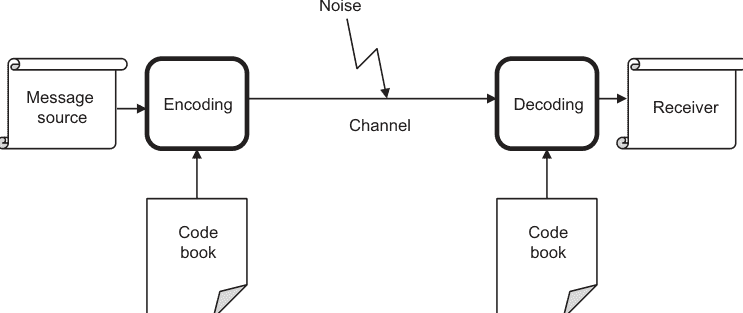

克劳德·香农（Claude Shannon，1916–2001）描述了一种信息系统模型，该模型是现在信息论的基础。可以发送消息。信道是存储和携带信号的物理介质。编码将消息转换为信号，解码将信号转换回消息。码本包含了消息转换为信号及反之的规则，而噪声是任何改变信号的干扰：通信干扰；电报员之间过远的距离会降低信号强度；雷电会干扰调幅广播；划痕会导致 DVD 无法读取；环境噪音会掩盖说话声。

请注意，在通信系统中，编码（coding）不等同于加密（encryption）。加密是一个额外的步骤，在消息进入编码器之前将其将其转换为密文，这样只有拥有密钥的接收方才能读取它们。在这种情况下，通信系统的目标是将密文准确地传送到接收方，接收方如果拥有密钥，就可以解密密文。

如上所述，香农基于比特（bits）将其数学模型标准化。他认为，任何信号都可以表示为比特的模式，这一过程——将模拟信息转换为数字。数字化不会产生信息的精确复制；有些例子是显而易见的，例如物体边缘锯齿的像素化照片；另一些更为微妙。来自物理现象的量，例如火星探测器的轨道位置，无法在计算机的有限算术中精确表示。舍入误差会在许多计算步骤中积累，导致整个计算的准确性受到，并使火星探测器面临危险。更糟糕，某些计算步骤会放大误差；例如，两个几乎相等的数字之间的差可能会舍入为零，并在除另一个数字时导致严重错误。数学软件的设计者发明了许多巧妙的技术，防止数字化误差破坏其结果。

香农的同时代人物奈奎斯特（Harry Nyquist）指出了这一规律的一个重要例外：通信系统不需要遭受 DNA 中的数字化误差（Nyquist 1928）。每一个连续的带宽限制信号都可以通过至少最高频率两倍的速率进行采样，从而在不丢失任何信息的情况下数字化。例如，音频（CD）每秒记录 44,100 次采样（44.1 KHz），而不会出现明显的质量损失，因为极少数人类能听到高于 22,000 Hz 的频率。

香农认为，我们可以对任何信号进行数字采样，由于真实的通信系统受到带宽限制，如果我们将通信模型限制在二进制序列上，将没有任何损失。这简化了数学计算，并使结论适用于任何真实的信道。

一个简单的代码可以作为示例，说明通信模型的各种特征。考虑一个只传输四种消息之一的消息信源，我们将其标记为 A、B、C 和 D。我们为这些字母分配双比特代码：

- A: `11`
- B: `10`
- C: `01`
- D: `00`

仅代表四种可能消息的代码与原生状态并不遥远。我们细胞中的 DNA 是一个天然消息源，它只使用四个字母——G、A、T 和 C 是 DNA 四种核苷酸的首字母。

如果源端想要传输序列“CAB”，它会向信道发送比特流“01110”。接收方通过在码本中查找每对接收到的比特并报告相应的字母来反转这一过程。

在任何关于代码的讨论中，我们都会很快遇到代码的大小（码字中的比特数）与克服信道噪声难度之间的权衡。短代码更有效率、传输更快，且需要的存储更少。然而，短代码很容易受到噪声干扰。信道中的单比特错误会将一个码字变成另一个。例如，如果信道将 A 的比特切换为 0，接收方将收到 01，并将其解码为 C，而不是添加奇偶位来提醒接收方错误。如果比特模式中 1 的个数为偶数，则其奇偶性为“偶”，如果 1 的个数为奇数，则为“奇”。以下是通过添加第三个比特修改为偶校验校验的原始代码：

- A: `110`
- B: `101`
- C: `011`
- D: `000`

现在，一个将 A 的代码第一个位改为 0 的错误会将 010 传递给接收方。接收方意识到发生了错误，因为 010 不是一个有效代码。通常情况下，单比特错误会导致受影响的码字的 1 的个数为奇数，从而将其标记为非代码模式。

然而，单奇偶位并没有指示 010 不是有效代码，但它无法告诉三个代码（A、C 或 D）中的一个被单比特错误修改了。通过增加更多的冗余，我们可以构建解码器，不仅能检测到错误的发生，还能识别出哪条消息损坏了。考虑这个例子，原始代码通过添加三个额外位进行了修改：

- A: `11111`
- B: `10010`
- C: `01001`
- D: `00100`

该代码的构造是为了满足这样一个原则：通过额外比特，每个码字与其他任何一个码字之间至少差三个比特。现在，单比特错误会导致接收到的码字与正确代码相差一个比特。这种距离是不同比特的数量，这种衡量被称为“汉明距离”（Hamming distance）。通信工程师理查德·汉明（Richard Hamming）在 1950 年首次阐述了原则：为了纠正 `$k$` 个错误，距离必须至少为 `2k+1`。他还发明了一族代码，现在被称为汉明码，在每个码字中嵌入了奇偶位。

汉明码被广泛用于计算机，以纠正处理器和内存之间移动数据的错误。当噪声随机分布时，汉明码效果良好。但在某些情况下，噪声是突发性的。例如，太阳耀斑可以中断深空信号几秒，或者划痕会破坏光盘上相邻的坑。另一种类型的代码里德-所罗伦码（Reed-Solomon code）被发明用于检测和移除错误。它在数学上更复杂，但像汉明码一样容易实现。

与信号不同，比特没有物理现实。比特是一种表示两种观测属性中的一种的符号。例如，工程师可能会将“1”分配为光束在 DVD 表面反射，将“0”分配为没有反射。或者“1”可能意味着晶体管的输出为 5 伏特，而“0”可能意味着 3 伏特。或者“1”意味着特定的频率（例如 400 Hz）出现在音乐录音中，而“0”意味着不存在。比特是我们用来指定想要系统执行操作的抽象。工程师根据这些要求安排“物质”（材料）。

由于物理系统中的信息总是由物理状态表示，读取、写入和转换信息需要时间和能量。通信和计算永远无法脱离物理世界的限制。计算机芯片工程师知道，热积累和特征尺寸（芯片上包含各种元素的平均尺寸）等效应限制了他们可以将电路缩小到什么种程度。而且每次操作的时间成本限制了在可用时间内可以计算的指令数量。尽管新算法在寻找常见困难问题的解方面取得了巨大改进，但较大的案例仍然是不可计算的，因为所有物理操作所需的时间超过了我们的等待能力。例如，找到广泛使用的 RSA 加密系统的 60 位密钥的两个质因子，在最快的计算机上也需要几个世纪。

多年来，我们存储和计算信息的能力指数级增长。在香农发表论文的同一年，在同一个地点——贝尔实验室，新发明的晶体管开始取代电子计算机中的真空管。电路设计师能够为了缩小晶体管的尺寸，每18到24个月在相同的物理空间内放置大约两倍数量的器件，且不增加成本。近50年来，他们一直这样做，使我们的计算能力每十年增加100倍。这种趋势被称为摩尔定律，以纪念英特尔创始人戈登·摩尔（Gordon Moore），他在1965年的一篇论文中首次描述了这一点（Moore 1965）。

摩尔定律产生了两种影响。其一是对于20世纪40年代的计算机科学先驱来说如魔法般的惊人计算能力；另一个是詹姆斯·格莱克（James Gleick, 2011）所说的信息洪流。前者——不断缩小的信息传输和存储物理机制——直接导致了后者——压倒性的信息量。当人们感到不知所措且无法理解信息时，其功能无法正常运作。

这些计算能力产生了一种流行观点，即计算处理的是缥缈的比特位，而不是原子，因此计算结构的尺寸和功率没有物理限制。从物理学的角度来看，这种观点完全是错误的（Negroprunte, 1996）。一个抽象的比特位在记录到物理介质并被机器读取之前是没有任何作用的。记录过程将我们带回原子世界：没有原子，我们就无法计算。我们可以让计算、传输和存储变得极其微小和快速，但我们永远无法完全消除它们的时间能量成本。

## 衡量信息

为了知道一个消息源最短代码的长度，香农（Shannon）设计了一种衡量消息源内在信息的标准。代码中的比特数不能作为衡量标准，因为正如上面看到的，一个源可以用任何数量的不同代码来表示。他得出结论，一个良好的衡量标准应该是一组消息的最短代码的大小。比特数较少的代码将无法传输消息中的所有信息。

他拒绝了取决于人类观察者赋予代码含义的衡量标准，而是寻求一种无论使用环境如何，每次运行都相同的编码、传输和解码机制。邮政服务遵循类似的原理：他们的分发和递送系统不取决于所运输信封的内容。香农的卓越洞见在于：他将信息的接收等同于不确定性的减少。他定义信息为确定源发送许多可能消息中的哪一个所需的最小是/否问题数量。我们对源可能发送的内容越了解，当我们看到它发送的内容时，获得的信息就越少。

想象你知道某人对问题只回答 Y（是）或 N（否），但你无法预先知道说话者会给出哪个答案。说话者通过说 Y 或 N 消解了你的不确定性。香农会说，说话者只给了你 1 比特的信息（1 或 0），从两个可能的响应中选出实际响应。如果选择多于两个，则需要更多比特来区分发送的消息。

假设我们要在电话簿中找到包含朋友名字的那一页。我们需要多少比特来编码页码？一种巧妙的方法可以让我们回答这个问题。我们从书中间打开书，询问哪一部分包含名字，如果内容是按字母顺序排列的，这很容易。然后我们使用相同的问题将这一部分再次对半。我们重复这个过程，直到只下一页。朋友的名字应该出现在那页上。重复的问题（“哪一部分？”或等同于“在左半部分吗？”）带我们快速定位。对于一本512页的电话簿，当我们得知包含朋友名字的页码时，第二个问题涉及128页，然后是64、32、16、8、4、2，最后是1。因此，当我们获知包含朋友名字的页码时，我们接收了九比特的信息。

在构建代码时，人们会考虑可能消息出现的概率。塞缪尔·摩斯（Samuel Morse）发明了用于1830年共同发明的电电报的摩斯密码，他为字母 e 分配了短代码——一个单点，因为他知道它是英语中最常见的字母（约占所有使用字母的12%）。他为字母 j 分配了最长的代码，因为它是最不常见的字母之一（约占0.15%）。这些选择最小化了传输的平均长度。图3.4显示了识别消息的需求如何定义代码，以及各种消息出现概率的先验知识如何导致更短的代码。

假设我们有一组长度为 `$L$` 且概率为 `$P_i$` 的代码字。代码的平均长度（L）为：

```text
L = \sum L_i \cdot P_i
```

对于图3.4中的代码，该公式给出第一个代码平均长度为2比特，第二个为17比特。

香农将消息中包含的信息量定义为从源中选择消息所需的是/否问题数量。这些问题减少了关于发送哪条消息的不确定性。例如，我们需要找到四个人中的哪一个被选中执行任务。使用简单的决策树（左图），我们问：“是艾莉还是鲍姆？”如果答案是，那么选择将在树的左半部分。增加一个问题“是艾莉吗？”就能揭示答案。每个人的代码是描述通往他们的是/否模式的路径。如果我们知道某人被选中的概率（右图），我们可以创建一个产生长度代码的决策树。例如，如果艾莉最可能被选中，我们分配代码 1。鲍姆得到 0，而查利和迪亚纳概率相等，他们都得到三比特代码。

香农认为熵是源内在信息的衡量。一个源由一组可能的消息及其出现的概率组成。熵取决于消息的概率，而不取决于代码，它告诉我们最短代码的平均长度。任何更短的代码都具有歧义性，无法唯一解码。考虑以下示例：

- A: `1`
- B: `0`
- C: `01`
- D: `10`

如果这些消息的概率分别为0.5、0.25、0.125和0.125，那么生成的代码平均长度为1.25比特。然而，接收者无法判断 `101` 代表的是 ABBA、ABC、DBA 还是 DC。消息的熵（使用上述公式计算）为 `$H=1.75$`，这定义了可解码和不可解码代码的阈值。该代码的平均长度1.25比特低于阈值。该代码是不可解码的。

霍曼编码是一种计算与熵差在比特以内代码的快速方法（图3.5）。

另一种说法是，熵定义了可靠与不可靠信道的边界。如果源每 `$T$` 秒发送一个新消息，且最短代码的平均长度为 `$H$`，源每秒产生 `$H/T$` 比特的需求。如果信道带宽为 `$H/T$` 或更高，发送的所有比特都可以流向接收端。如果信道带宽低于 `$H/T$`，某些比特将会丢失，接收端无法恢复原始消息。

### 图 3.5

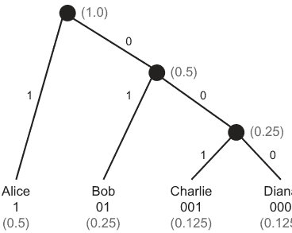

1951年，麻理工学院的大卫·霍夫曼（David Huffman）发明了一种给定消息概率生成平均长度最小代码的算法。他的方法首先将每个消息视为一个独立的单立树。它反复将两个概率最小的树合并成更大的树，其概率是各个组成部分之和。对于 *n* 个消息，整个树在 *n* 步内完成。在这个示例中，首先合并 Charlie 和 Diana，然后该树与 Bob 合并，最后该树与 Alice 合并。树中的路径定义了每个消息的二进制代码。霍夫曼方法生成的代码平均长度与熵阈值之差在1比特以内。当所有消息概率相等时，它生成图 3.3 中的第一种代码；当消息概率不均时，它生成第二种代码。


文件压缩是信息论的重要应用。它减少了存储空间和传输时间。大多数计算机程序使用标准编码呈现。这些包括固定长度编码 ASCII 和现代变长编码 Unicode。在两种情况下，每个单独的字母始终用相同的代码编码。

通过寻找重复模式并在该文件的语境下将其替换为比原始更短的代码，可以缩短文本文件。例如，包含许多字母“e”的文件可以通过将它们替换为一种新的、更短的代码来缩短。新代码的长度取决于“e”在文件中出现的频率——在一个“e”出现频繁的文件中，新代码可能是可能是 3 位，而在另一个“e”出现频率较少的文件中，它可能是 5 位。

文件压缩算法生成一张表，显示如何将新代码转换回原始代码。`.zip` 和 `.rar` 文件格式采用了这种策略。这些策略的设计是为了确保永远不会“压缩”到熵所给定的极限。如果这样做，原始文档将无法保证是可以恢复的。这些策略被称为无损压缩。

## 信息

另一种策略是`有损压缩`。有损方法提供了更大的压缩倍率，但无法完全恢复原始文件。例如，MP3 音频压缩在丢弃大多数人可能听不到的频率后文件大小缩小了 10 倍，但没有办法恢复被丢弃的频率。JPEG 图像压缩丢弃人眼几乎无法察觉的位，但没有办法恢复原始位。

此类压缩方案使得向消费者廉价销售 DVD、在线电影和音乐录音成为可能。这些方法带来的感知质量微小损失通常被认为是文件大小大幅减小的良好权衡。

## 信息的转换

纯粹的通信系统仅仅将信息从一个地方传输到另一个地方。但计算机功能更多：它们会转换信息。转换开启了许多新可能性，最显著的是产生了看似是新的信息。

简单的转换包括数字平方、计算 `π` 的指定位数的小数，以及按升序排列数字列表。每个转换都接收一种输入模式并创建一个信息模式作为输出。

由于二进制模式可以被解释为数字，转换在数学上看起来像是将数字映射到输出的函数。可以通过机器计算的函数是`可计算函数`。图灵和他同时代的人使用这一概念来定义计算。图灵证明了这种简单的抽象计算机——图灵机具有实现任何可计算函数的能力（Turing 1937）。

图灵机遵循一套极其简单的指令程序，这些指令显然是可以由机器实现的，看来计算机在转换二进制模式时并不考虑它们的含义。这类似于香农的洞察：通信信道可以设计为可靠地传输信息，而不考虑其含义。

然而，当我们深入研究机器如何转换输入时，我们看到了程序设计的一个重要方面，我们称之为“含义保持”。

考虑两个数字 `a` 和 `b` 相加。加两个数字意味着什么？意味着我们遵循加法算法给出的一系列步骤。这些步骤涉及加 `a` 和 `b` 中连续的数字对，并将进位传递给更高位的一组数字。我们对于加来自 `{0,1,2,...}` 集合的数字对有明确的规则，产生 0 或 1 的进位。

当我们为该算法设计程序时，我们非常注意每一条指令都精确地产生它应该产生的增量结果。如果我们成功了，我们就有信心机器正确地相加了两个数字。如果我们失败了，我们就说机器是坏了。

换句话说，设计过程本身将加法的思想从我们的头脑中转移到执行加法的指令模式中。加法的含义在机器及其算法的设计中得到了保留。

对于该函数将其输出产生到控制机器精确执行该操作的程序中，这也是真实的。我们将对该函数含义的理解转移到了机器的设计中。

从这个角度来看，机器和通信系统不考虑二进制数据含义的观点是不靠谱的。算法和机器的含义是由工程师和程序员植入的。我们设计机器，使得每一个增量步骤和输出都是我们意图的，输入具有我们意图的含义。我们设计得仔细精确，以便不必担心机器损坏我们意图的含义。

计算机将可计算函数与通信信道相结合。信道将输入模式带到计算该函数的机制；另一个信道将输出模式带到目的地。在这些场景中，信道和计算机似乎只是在移动和处理位。然而，人类观察者说计算给他们带来了新信息。

无论机器产生的输出比输入多还是少，这种情况都会发生。例如，前面提到的 `π` 计算函数会对三个输入产生 900 位数字，这是一种扩展因子。排序函数以不同的顺序交付与输入相同的位。平均函数可以用少少数数字来表示大量数据。

数字的表示和机器的操作都依赖于物理过程。机器的每项操作都需要少量的时间能量来完成。我们需要的许多函数需要很多步骤，以至于没有足够的时间返回。计算的物理限制对可以计算的内容施加了严格限制。

计算的逻辑也施加了限制。最著名的是存在我们可能想要但无法计算的函数。图灵在 1936 年的例子是停机问题——没有程序可以检查任何给定程序的代码并判断它是否包含无限循环。

一个现代例子是恶意软件检测——没有程序可以判断任何程序是否嵌入了恶意过程。我们在第 6 章检查计算的物理和逻辑限制时回到这个话题。

即使我们将注意力限制在足够快速的可计算函数上，仍然发现了有趣的问题。当一个函数计算我们以前没过的位时，这些位是信息吗（见图 3.6）？还是它们是现有信息的结果？DNA 包含信息吗？许多生物学家说是。如果它是一个消息，源和目的地在哪里？如果我们解码 DNA，我们是否获得了信息？解码的 DNA 可能用于治疗遗传疾病，也可能识别犯罪现场的罪犯。是否

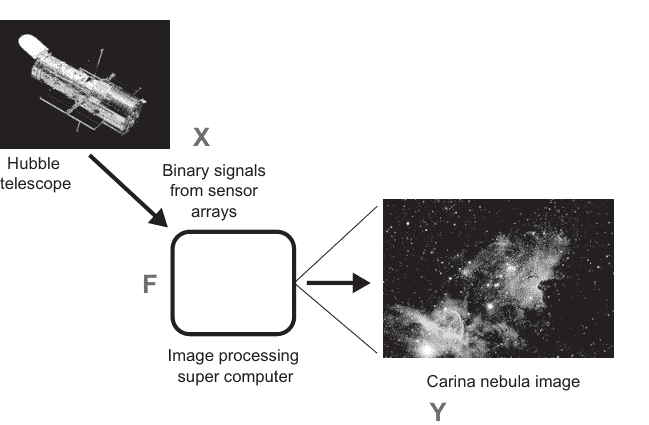

**图 3.6** 哈勃太空望远镜的光子收集传感器阵列将数 TB 的数据编码以传输到地球。然后这些数据被处理成图像。计算理论会将图像处理表征为函数 `Y = F(X)`，应用于输入数据 `X` 时产生输出图像 `Y`。实现函数的机器——以及发送和生成的信号——在任何方面都不取决于望远镜信息的含义。然而，人类观察者看到的输出 `Y` 是一幅美丽的图像——如图所示的户座星云。（图像由 NASA 提供）

将 DNA 与数据库匹配仅仅是揭示了现有信息，还是生成了新信息？这类问题无法通过经典信息论来回答。

## 交互系统

许多计算机程序都是交互系统：它们可以在许多点接收新的输入并产生新的输出，而且在没有干预或故障的情况下，它们可以无休止地这样做。每一个操作系统都是交互系统，汽车的 GPS 系统、Facebook、在线商家的 Web 服务器或互联网的域名系统（DNS）也是如此。

互联网是一个用于交换数据和协调行动的全球交互系统。交互系统的显著特征是它们持续运行的；它们没有预设的终点。相比之下，函数系统在产生答案后就结束了。¹

几十年来，计算机科学家一直在争论交互计算是否比函数计算更强大（Goldin et al. 2010）。近年来，专家们达成共识，认为交互计算更强大。

如何对有意义地标记数字化图像这一当代困境解释了这一点。这个问题的解决方案在于交互：一个游戏构建了人机之间的交互，以执行一项任何人类或机器单独无法完成的功能（见图 3.7）。交互系统可以生成任何已知机器可计算函数无法生成的输出。

## 解决悖论

在上面的讨论中，我们注意到了一系列关于信息的看似悖论：

1. 工程师设计的通信系统在不理解信息含义的情况下运行。人类接收者如何能接收到含义？

2. 工程师设计的计算机系统在不理解程序或数据二进制模式含义的情况下转换信息。这些系统如何能生成新信息？

3. 程序员设计的程序在不理解它们处理的比特（bits）的情况下运行。人类用户基于什么将程序输出解释为有意义？


图 3.7

在 2004 年的一篇论文中，卡内基·梅隆大学的 Luis von Ahn 和 Laura Dabbish 描述了一种新的电脑游戏 ESP。玩家配对并看到一张图像。他们输入描述图像的单词，目标是找到一个与他们（未知且不可见的）伙伴也使用的单词。这个共同单词成为该图像的新型搜索标签。

该游戏将人类与机器结合，以计算一个没有人知道如何仅通过机器计算的功能（图像识别）。像其他函数一样，它转换了信息，但现在由层交互提供的含义塑造了转换的部分。

4. 建立关联（如配对网页链接 [Berners-Lee 2000]）会创建新信息吗？

5. 如果一个计算机程序设计上就会生成欺骗性信息，它的输出还是信息吗？

6. 信息在加密消息中哪里？

7. 如果一个计算机程序在科学上有了发现，它是创建了新信息，还是仅仅传递了人类以前未察觉到的现有信息？

关于信息的各种通用概念无法回答这些问题。例如，说符号“携带”信息只会引发新的问题。被携带的信息在哪里？插入和提取是如何工作的？

另一个例子是意义被嵌入在社会习俗中并由机器输出触发的观点。这个想法只能解决第三个问题，但不能解决其他问题。另一个例子是“符号-指涉体”模型（Rocchi 2012），它将符号与其含义相关联，但仅适用于显式信息。

“含义保持转换”的概念解决了这些悖论。人类有意识地设计软件程序以支持实践、创建链接、隐藏信息，²发现新信息。这些含义都是设计者安排机器动作以便用户对其进行解释的结果。当机器没有产生预期的行为时，其用户和设计者会说它坏了。

这些悖论最初出现可能是因为计算机科学家总是倾向于将机器拟人化；例如，我们说机器理解它的输入或在它的输出中具有创造力。其他人观察我们程序和机器的内部，他们看到的只是机械步骤。他们没有在这些步骤中看到“理解”甚至“创造力”。

理解和含义来自设计者，设计者安排机器的模式，以便在使用时产生预期的含义。

## 信息与发现

当我们说计算机发现了一个新模式时，的是什么意思？考虑一个发现数据中趋势的计算机程序。程序获得一组在实验完美执行中观察到的输入-输出对 `(x,y)`。使用统计回归，程序找到了最拟合直线 `y = ax + b` 的最佳参数 `a` 和 `b`。程序的输出是直线的形式化描述。对于那些如何使用直线来做预测的人类用户来说，该输出是有意义的。很容易编写另一个程序，使用带有参数 `a` 和 `b` 的直线来预测为新值 `x` 生成 `y`。

这里发生的情况是设计者利用数学知识从一组数据计算出最佳拟合直线的参数。计算中的步骤是机械的。输出对于那些理解数据趋势的直线模型的人是有意义的。含义来自设计者，而不是对数据的处理。

不知道数据中直线趋势的人将不知道程序的输出含义。但这并不意味着输出的含义是主观的。它意味着设计者并没有打算为那些用户产生任何含义。

## 信息 55

20 世纪 80 年代，人员开始使用强大的计算机筛选大型数据集以寻求发现模式。他们使用了贝叶斯推理，这是一种分析数据的复杂方法，用于推断生成数据的最可能的条件集合。贝叶斯推理基于：

```text
P(H|E) = \frac{P(E|H) \cdot P(H)}{P(E)}
```

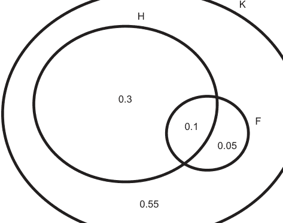

**图 3.8** 韦恩图说明了如何通过贝叶斯规则评估一个困难案例。群体 `K` 包含患流感的人的子集 `F` 和患头痛的人的子集 `H`。医生看到一个抱怨有流感的患者。根据贝叶斯规则 `P(F|H) = P(H|F) \cdot P(F)/P(H)`。在没有信息的情况下，流感的概率是 0.2，但给定有关头痛的信息，概率上升到 0.33 `(2/3)\cdot0.2/0.4=1/3`，或者说三分之一的机会。

## 56

第 3 章

在这种语境下，发现是一个新假设。程序可以生成一系列假设，并使用贝叶斯规则评估每个假设，以计算其在给定证据下的概率。最可能的假设被选为“发现”。

在这种情况下，设计者将贝叶斯规则知识与搜索方法知识相结合，为给定数据寻找最可能的假设。程序的输出旨在用于理解该假设及其“解释”的数据的用户。用户将决定该假设是否是一个发现。

在经典信息论中，我们使用的贝叶斯推理通过基于源的观测来确定消息源的内容。对于消息通信，香农假设源的内容是先验的应该是。对于科学发现，源中的可能性集最初是未知的；推理过程使这些概率已知。贝叶斯推理是一种从源的观测数据转换为源内容知识的自动化方法。

## 结论

人类一直以来不同的媒体通道中对信号进行编码传输。20 世纪 40 年代，香农的信息论给了我们四个伟大原则：

- 每一个通信系统都可以建模为携带来自源的编码信号的噪声通道。
- 源的熵是最短可解码码的长度，哈夫曼编码与熵仅差一个比特。
- 可以向任何代码添加足够的冗余位以克服通道中的噪声并保证 100% 的准确接收。
- 可以通过更短的代码替换文件中的模式，将文件压缩到更小的尺寸。

能量。我们在计算上花费了大量能量：互联网的连接和数据中心消耗了全球近 6% 的电力。我们无法通过假设其解决方案是由比特而非原子完成的，就让棘手问题消失。比特背后的原子是物质问题。

随着我们存储信息的能力正如摩尔法则所言呈指数级增长，我们越来越面临压力，去解释所有这些信息的意义。从定义上来说，香农的信息论无法解决这个问题。这个问题似乎是一个悖论：系统如何在不考虑其含义的情况下处理信息，同时在用户的体验中产生意义呢？

保持意义的转换将机器无意义机械与机器产生意义的人类体验调和起来。程序的设计者安排指令，使得输出能够在用户群体中产生预期的意义；每条单独指令都让部分计算的结果逐步更接近预期的输出。让我们向设计师们致敬，他们为我们提供了对我们有意义的软件和硬件。

## 致谢

本章改编自 Peter Denning 和 Tim Bell（2012 年）的《信息悖论》，该文发表于《美国科学家》杂志。

# 4 机器

一个拥有纸、铅笔、橡皮擦并受到严格纪律的人，就是一个通用机器。

—艾伦·图灵

机器可能是真正的人性影响。它们完成了让生活成为可能的工作；人类则做让生活变得意义的事。

—艾萨克·阿西莫

计算机科学家喜欢抽象。抽象是一种心理模型，它捕捉一个事物的本质特征并抑制所有其他特征。计算机科学家经常将编程描述为设计一种层次结构，这种抽象表示为由指定函数操作的“抽象对象”。这种观点已如此流行，以至于计算机科学经常被誉为最擅长管理抽象的领域。

计算抽象与其它领域的数学抽象有何重要区别：计算抽象会执行动作。抽象的术语往往掩盖了`实体原理`（principle of stuff）——即计算动作被实现为程序控制的物理过程这一现实。

以一首歌曲为例。在计算机上，一首歌由一个 MP3 文件表示，其中包含了出版者提供的音乐数字化版本。为了听这首歌，我们在文件上激活了“播放”程序。“播放”程序将磁盘存储文件中数百万个比特编码为信号，传输到耳机，在耳机处，发生器电路振动振膜。

在抽象（用户）层面，播放程序和 MP3 文件似乎是单一对象：将“播放”应用到“歌曲”，你就能听到音乐。其实现过程非常复杂，涉及许多步骤，每一步都依赖于一个物理过程。

## 第 4 章

在本章中，我们研究如何组织计算函数的物理机器。机器允许的移动表示为单条指令，例如两个数字相加。程序是一系列以精确方式排列的指令，用于导致机器评估所需的函数。

指令和数据被编码为二进制模式存储在内存中。当被取入处理器时，指令会使硬件将输入数据转换为输出数据。

在电子计算的早期，程序员直接以二进制代码的形式编写程序，并以序列形式排列在纸带或卡片上。编程语言很快取代了二进制编码，因为它们不容易出错。一种称为编译器的特殊程序将语言语句翻译成二进制机器码。在下一章关于编程的章节中，我们将讨论编译器是如何做到的。

计算机器的组织通常被称为其架构。架构规范涵盖了执行指令的中央处理器（CPU）、包含程序代码和数据的随机存内存（RAM），以及用于组织内存中程序组件的数据结构。

## 机器

机器是一种用于使用或应用能量来执行特定任务的装置。机器通常由机械、化学、热或电手段驱动。电子机器由电力驱动且没有活动部件——例如收音机、电视、手机和平板电脑。

自动机是一种自动运行的机器。钟上的布谷曾被认为是自动机。正如 18 世纪末的“土耳其人”棋手（见图 4.1）。从 20 世纪 40 年代开始，计算机科学家将自动化视为计算机的抽象模型，从 50 年代开始，他们认为在软件或机器人中的自动机具有自我思考的潜力。

辅助计算的机器可以追溯到数千年前。从公元前 2700 年开始，美索不达米、埃及、波斯、希腊、罗马和中国的商人使用算盘计算。希腊人展示了如何通过测量树影并与已知高度的影子取比例来测量树的高度；木棍及其操作程序是一种简单的计算设备。

另一种测量尺——滑动尺是在约翰·纳普尔发表对数概念后于 1620 年左右发明的；滑动尺通常被称为滑动尺，是一种标准的计算机器，工程师一直使用到 20 世纪 70 年代，电子计算器取代了它。1642 年，布莱斯·帕斯卡制造了一台可以加减数字的计算机器，并将乘法和除法算法呈现为重复加。

查尔斯·巴贝设计了差分机（1822–1842）来计算数值表格；此前手工计算的表格充满了错误并构成了巨大风险。1911 年，公司开始使用齿轮、滑轮和杠杆的机械计算器进行加、减、乘、除。

1922 年，德国工程师亚瑟·谢尔比乌斯发明了生成密码的恩尼玛机；波兰人在 1932 年破解了密码并传给英国人，英国人在 20 世纪 40 年代初制造了破密机。20 世纪 20 年代后期，内瓦·布什制造了微分分析仪，通过机械积分求解微分方程。

第二次世界大战期间，美国委托了阿伯丁丁测试场的女性小组计算弹道表。炮兵使用这些表格根据风向和目标距离确定最佳射击方向和角度。根据写在纸上的程序，妇女操作机械计算器（如马钱币机）来准备这些表格。

由于小组容易出错且跟不上日益增加的武器库存所需的弹道量，军队决定用电子机器取代人类计算员。他们在 1943 年委托宾夕法尼亚大学启动第一个计算机器项目——ENIAC。ENIAC 的计算速度比人类小组快千倍。尽管机器直到 1946 年才准备好，但在战争结束后，军队大量使用了计算机。

有趣的是，在 20 世纪 20 年代，“计算机”指的是负责计算数字的人。因此，为了与真实的人类计算机区分，第一批电子计算机被称为“自动计算机”。20 世纪 40 年代第一批电子计算机的缩写不再表示这一点。

1937 年，艾伦·图灵将计算机定义为能够计算数学函数的机器，并发现了任何计算机无法计算的函数。他用“可计算”一词来描述函数：如果存在一组有限的指令可以为任何输入值生成输出值，则该函数是可计算的（见图 4.2）。

例如，加法是可计算的，因为对于任何数字 `x` 和 `y`，我们可以指定一组有限的指令来产生和 `x + y`。图灵中一个未解决的数学问题是

## 机器

## 63

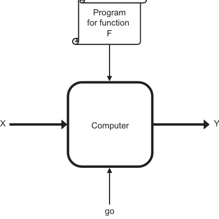

## 图 4.2

计算机是一种接收输入二进制模式 `X` 并计算输出二进制模式 `Y` 的机器。计算机由程序控制，该程序设计用于计算特定函数 `F`。当信号到达“go（运行）”输入端时，计算机开始工作，并在一段时间后停止，输出为 `Y = F(X)`。

在停止之前所需的时间取决于函数和程序。某些程序可能包含无限循环，在这种情况下，计算机永远不会停止。我们可以定义一个函数 `H(F,X)`，如果 `F` 停止则结果为 1，如果不停止则结果为 0。艾兰·图灵（Alan Turing）证明了 `H` 无法通过任何计算机实现。


时间是我们描述可计算函数集合的方法。我们将在第 6 章“计算（computation）”中更深入地探讨这个问题。

图灵认为，计算任何可计算函数的计算方法是基于非常简单的操作：读取符号、根据读取内容设置控制状态以及写入符号。我们创建了一种抽象机器，现在称为图灵机，它由一个沿着无限磁带移动的控制单元以及在磁带方格中写入符号的部分组成。控制单元的规范就是机器的程序。程序使用循环来根据需要重复步骤。他还描述了一种通用机器，它能够在给定其程序的情况下模拟任何其他图灵机。最后，他证明了某些定义良好但不可计算的函数的存在，例如确定一个图灵机是否会停止（在不进入无限循环的情况下停下来）的问题。尽管他那个时代的其他几位也设计了计算机器并证明了它们与图灵机等效，但图灵的设计模型了参考模型，因为它最接近真实电子计算机的功能——（控制单元）和内存（磁带）。

将计算机定义为将输入模式转换为输出模式然后停止的机器，并不是使用计算机的唯一方式。交互是常见的。一种交互式机器接收大量输入并产生大量输出，且永不停止。我们在第 3 章中提到，交互式机器与人类协作可以计算停止型计算机无法计算的函数。

## 计算机器

计算机是一种由程序控制的机器，它根据给定的输入值计算输出值。现在我们仔细观察如何构建一台这样运行的机器。

程序控制计算机是实现指令集的电子硬件。指令是机器执行的单一算术或逻辑操作。操作是一个非常简单、初级的函数。典型的操作接受两个输入并产生一个输出。例如，`ADD`（加法）将两个数相加，`EQ`（相等）比较两个数是否相等；因此 `ADD(3,5)=8`，`EQ(3,5)=0`（假）。指令集还包含分支指令，用于控制当前指令之后执行哪条指令。

程序是一组按照某种模式排列的指令集，该模式会导致所需计算。编程是设计程序并提供有说服力的证据证明该程序正确计算了其功能的艺术。

计算系统是程序和机器的结合。程序导致机器计算函数。我们也可以说计算系统在计算一个函数。

为了让这一切运行起来，我们的计算系统需要：

1. 对硬件实现的指令集进行精确规范。
2. 一种精确的方法，将程序表示为一系列指令。
3. 一个存储程序及其操作所需数据的内存。
4. 一个控制单元，用于按照程序规定的顺序读取并执行程序的指令。

## 机器 65

CPU（中央处理器）是一种硬件设备，它从程序中读取指令并按照程序指定的顺序逐个执行它们。

RAM（随机存存储器）是一种硬件设备，将值存储在 CPU 可以读取或写入的位置中。RAM 被组织为位置的线性数组。每个位置存储一个基本单位的数据，通常是 8 位字节或 32 位字。这些位置的编号为 0, 1, ..., 2ⁿ-1，其中 n 是地址中的位数。RAM 被称为“随机访问”，是因为它可以在相同时间内访问任何随机位置。位置只存储二进制模式（8 位或 32 位）。RAM 并不尝试解释模式；它只是可靠地进行存储和检索。内存响应 CPU 读或写请求所需的时间是内存周期时间，今天通常仅为几纳秒。CPU 和 RAM 的框图如图 4.3 所示，CPU 和 RAM 之间的接口之一如图 4.4 所示。

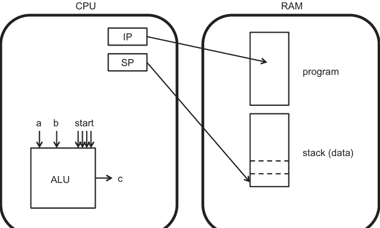

**图 4.3**

计算系统的硬件由中央处理器（CPU）和随机存存储器（RAM）组成。程序及其数据位于 RAM 中。数据被组织为栈（stack），这意味着新值被添加到栈顶，且值仅从栈顶检索。CPU 包含两个特殊寄存器。指令指针（IP）是下一个要执行的指令（在程序中）的 RAM 地址。栈指针是栈顶的 RAM 地址。CPU 还包含一个算术逻辑单元（ALU），它接受两个输入数（a 和 b）并产生一个输出数（c）。一系列测试线信号指示 ALU 执行何种操作，例如加法、乘法或测试相等性。

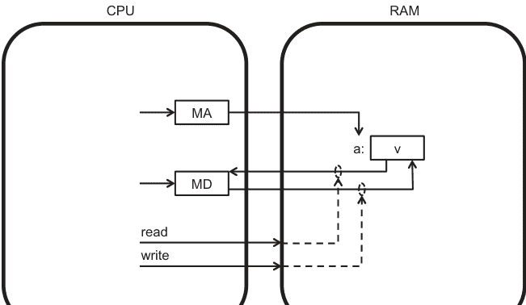

**图 4.4**

CPU-RAM 接口由几个组件组成。目标是读取或写入 RAM 中的特定位置（a）；读操作将所选位置中的值 v 传输到 CPU，写操作将新值从 CPU 传输到所选位置。内存地址寄存器（MA）通知硬件选择了哪个位置。内存数据寄存器（MD）持有该值。读信号线告诉内存硬件选择地址（在 MA 中）并将其值复制到 CPU（在 MD 中）。写信号线告诉内存硬件通过 MA 将值从 CPU（在 MD 中）。执行这些操作所需的时间是内存周期时间，在现代 RAM 中小于 10 纳秒。

真实的计算机具有 RAM 之外的内存，例如磁盘。磁盘访问时间是随机变量，取决于移动介质的寻道和旋转延迟。在多种类型之间移动数据的额外问题将在第 7 章中讨论。

CPU 使用指令指针（IP）来跟踪下一个指令是哪个。它通过循环执行程序指令直到退出：

1. 取指指令：通过 `IP+1` 定位。
2. 解码：读取指令中包含的操作码。
3. 执行：执行操作。
4. 检查中断：上述步骤中可能出现的情况。

## 机器

CPU 包含一个时钟，每个时钟发出一个信号。时钟信号穿过 CPU 并激活选定的电路。典型的时钟约为 0.5 纳秒。需要四个时钟周期让 CPU 完成指令周期的步骤。时钟周期长度的选择是为了允许指令周期步骤中涉及的所有电路都稳定下来。如果时钟周期太短，某些电路将无法稳定，CPU 将出现故障。图 4.5 展示了 CPU 如何解码和执行指令，图 4.6 展示了算术逻辑单元（ALU）组件的工作原理。

这段简要介绍的结论是，我们的设计通过执行指令序列使机器计算函数。这里概述的设计是为 20 世纪 40 年代的第一批计算机设计的——位于宾法尼亚大学、理工学院、普林斯顿大学和剑桥大学。约翰·冯·诺曼是一位与一些工程师合作的数学家，他对该设计进行了描述。由于他的著作，这种设计被称为“冯·诺依曼架构”。

## 程序及其表示

之前的讨论可能会让人认为程序是机器指令集的任意序列。事实并非如此。程序必须遵守结构规则。对于每个指令的作用以及整个模式的作用，不能有任何歧义。否则，我们无法获得每次输入都给出相同答案的可靠计算机。

让我们概述一个程序的设计。通常我们在计算数字时，会有三种情况：

- 按照严格顺序执行指令（排序）。
- 根据测试的输出（真或假）在两种替代计算之间做出选择（选择）。
- 重复计算多次直到测试说停止（迭代）。

注意，迭代模式开启了无限循环的可能性，因为测试可能永远无法满足。

## A

| 取取并设置 | 解码 | 执行 | 检查中断 |
|---|---|---|---|
| `IP = IP+1` | | | |

## B

| | 1 | 2 | 3 |
|---|---|---|---|
| `ADD` | 11000000 | 10000000 | 10000000 |
| `SUB` | 11000000 | 01000000 | 10000000 |
| `MUL` | 11000000 | 00100000 | 10000000 |
| `DIV` | 11000000 | 00010000 | 10000000 |
| `EQ` | 11000000 | 00001000 | 10000000 |
| `LOAD ADDR` | 00100000 | 00000000 | 00000000 |
| `LOAD` | 00010000 | 00000001 | 01000000 |
| `STORE` | 00011100 | 00000010 | 00000000 |

**图 4.5**

CPU 指令周期由四个阶段组成（A）。在每个时钟周期内，CPU 都会推进到下一个阶段。第一阶段从 RAM 中的地址 IP（指令指针）获取当前指令的副本，并将 IP 设置为下一条指令。第二阶段从当前指令中提取操作码，并查询本地控制机制，以获取该指令的控制字。在这个例中，控制字被划分为八位块，对应于两个常规时钟周期之间出现的三个子位（subbits）。我们通过位块和位置来指定这些位；因此，1.1 是第一个位块的第 1 个位。在子位处，控制字中的八个位中的每一个位都会激活一个逻辑电路；可以并行发生最多八件事。第一个示例指令假设操作数在寄存器 R1 和 R2 中。1.1 将 R1 复制到 ALU 的“a”输入端，1.2 将 R2 复制到 ALU 的“b”输入端。第二个块的前五位向 ALU 发送相应的信号，告诉它执行加（2,1）、减（2,2）、乘（2,3）、除（2,4）或测试测试（2,5）。第三个块的第一位（3.1）将 ALU 的输出复制到寄存器 R1。其他三条指令激活了不同的路径。LOAD ADDR 激活 1.3、LOAD 1.4、2.6 和 3.2，其含义为：“将 R1 复制到 MA（内存地址寄存器）”、“激活内存读取”以及“将 MD（内存数据）复制到 R1”。最后，STORE 指令假设 R1 包含地址和 R2 值；它并行激活 1.4 和 1.5，然后激活 2.7，这意味着：“将 R1 复制到 MA”、“将 R2 复制到 MD”、“激活内存写入”。

## 机器 69

**图 4.6**

为了进行加法，我们遵循一个简单的算法：按顺序求加个位、十位、百位，以此类推；当某个数字之和大于 9 时，偶尔将进位 1 传递到下一个阶段。例如，要加 17 和 26，我们先从加个位 7 和 6 开始，得到和为 3，进位为 1。当我们加十位 1 和 2 加上进位时，得到和为 4，进位为 0。答案是 43。

同样的算法在二进制数字系统中变得更简单，因为我们描述了一个二进制加法器（左侧）。输入是数字 `$a$` 和 `$b$`，输出是数字 `$c$`，`ci` = 输入进位，`co` = 输出进位（从一个阶段到下一个高阶阶段）。右侧阶段求加 1 位，下一个阶段加 2 位，第三个阶段加 4 位。（右侧）某些组合会产生进位；对于输出的所有可能位（我们使用最左侧阶段的进位（`co`））作为输出的第四位，因为某些和大于 7（3 位能表示的最大数字）。最大的和将是 111（=7）+ 111（=14）。

每个阶段由几个晶体管实现。一旦所有阶段稳定，和就可用了；最坏情况的稳定时间发生在进位传播通过整个链条时。同样的结构也用于更大的数字；32 位机器用 32 位表示数字，并使用 32 阶段的加法器。在大多数计算机中，加法器是更大的算术逻辑单元（ALU）的组成部分，ALU 执行加法、减法、乘、除法以及逻辑测试操作（如相等、不等于或小于）。

## 70 第 4 章

编程语言是一组语法规则，用于描述上述每种操作的精确表示。有成千上万种编程语言。尽管可能的语言多种多样，但它们都有一个目的：描述如何让计算机器评估特定的函数。当我们设计程序时，会想象一个指针在程序中移动，机器逐条执行每条指令。该指针就是指令指针（IP）。CPU 将其实现为一个包含指令的寄存器。编程语言是一组语法规则，用于描述上述每种操作的精确表示。有成千上万种编程语言。尽管可能的语言多种多样，但它们都有一个目的：描述如何让计算机器评估特定的函数。当我们设计程序时，会想象一个指针在程序中移动，机器逐条执行每条指令。该指针就是指令指针（IP）。CPU 将其实现为一个包含指令的寄存器。

机器的指令集包含了控制 CPU 在程序中移动时执行顺序的指令。层级语言中的程序需要更复杂的序列控制，因为它们允许程序员编写除内置函数之外的自定义函数。

## 机器 73

`X = A*(B+C)`

| `LA X` | `LA A` | `L` | `LA B` | `L` | `LA C` | `L` | `ADD` | `MUL` | `ST` |
|---|---|---|---|---|---|---|---|---|---|
| X | X | X | X | X | X | X | X | | |
| | A | 4 | 4 | | | | | | 20 |
| | | B | 3 | 3 | 3 | 5 | | | |
| | | | | | | | 2 | | | |

**图 4.7**

这一系列快照展示了在执行实现语句 `X=A*(B+C)` 的程序时的栈情况，此时 A=4, B=3 且 C=2；当程序执行时，内存位置 X=20 且栈是空的。

指令集，并编写处理错误和其他需要特殊关注的事件的函数。这两种情况的基本结构都是过程调用和返回机制。过程机制目的是将 CPU 转移到另一个程序的第一条指令，并在被调用的程序完成后，将 CPU 返回到调用点。

第一代存储程序计算机的设计者意识到，程序员想要添加自己设计的函数，并以新的子程序实现，这些子程序可以像机器指令一样容易地调用。子程序机制允许程序员在任何需要的地方调用子程序，而不是在程序的该点重新重写其代码。它还允许专家创建标准函数库（例如三角函数或代数函数），任何人都可以可靠地使用。

最初，在 20 世纪 50 代，可重用的子程序被称为子例（subroutines）。在 Algol 语言的影响下，该名称在 20 世纪 60 代变成了“过程”（procedure）。过程是一个实现单一（通常是简单）函数的子程序。

过程的核心思想是，过程仅在被调用的时刻和返回的时刻之间是“激活”的，而它在激活期间需要的数据存储在一个称为“激活记录”（AR）的私有内存段中。分配为过程的激活记录分配内存，而返回则会清除它。当过程被调用时——意味着存在多个激活记录，每个过程一个——它们将按照调用顺序链接在一起，这样当一个过程返回时，它的调用者就可以从调用的地方继续执行（见图 4.8）。因为返回发生的顺序与调用顺序相反，所以激活记录被推入普通栈，并在返回时被删除（见图 4.9）。

# 第 4 章

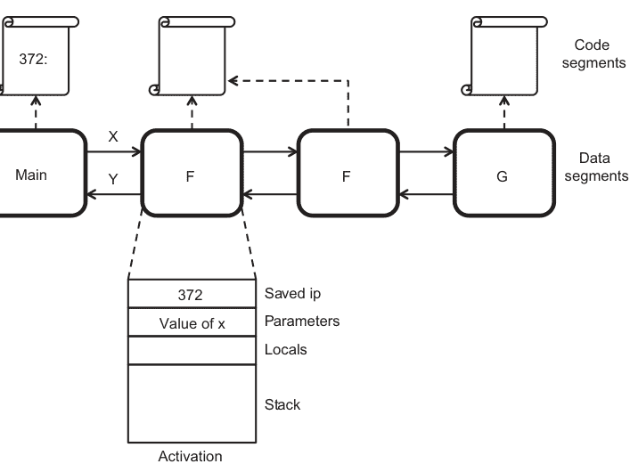

**图 4.8**

编程语言适应实现函数的过程（分离的子程序）。MAIN 程序被视为由操作系统调用的过程。在这个例中，MAIN 程序调用了过程 F，然后 F 调用了它自己，接着第二个 F 调用了 G。当过程 G 处于激活执行状态时，过程 MAIN 和两次对 F 的调用都被挂起了。右箭头表示调用和参数传递；例如，MAIN 带参数 X 调用了 F。左箭头表示值的返回；例如，值 Y=F(X)。每个过程都由一个代码段和一个数据段实现。虚线箭头指向过程的代码。当过程自调用时，每个实例都获得自己的数据段，而所有实例都链接到 F 的同一个代码段。数据段实现为一个激活记录，其中包含保存的指令指针（IP）、代码参数、仅供该过程使用的局部变量，以及仅供该过程使用的栈区域。保存的 IP 属于调用者；例如，MAIN 代码中地址 372 处的指令调用了 F，当 F 完成后，CPU 指令指针恢复到 372。由于过程激活在程序执行之前是未知的，因此激活记录的存储必须动态处理。栈可以用于此目的，因为去激活（返回）发生的顺序与激活（调用）相反。

## 机器 75

### 代码

### 栈

| | |
|---|---|
| Main | |
| F | Main |
| G | F |
| | G |

### 激活记录

CPU

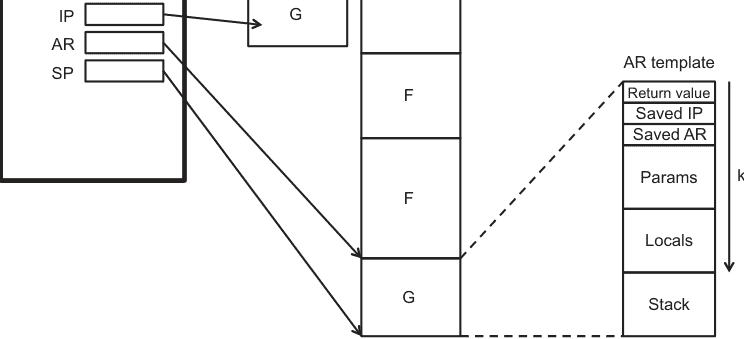

### AR 模板

| 返回值 |
|---|
| 保存的 IP |
| 保存的 AR |
| 参数 |
| 局部变量 |
| 栈 |

**图 4.9**

对 CPU 的修改，一个正在执行的程序的激活记录（如图 4.8 所示）可以存储在程序的栈上。过程调用将被调用过程的激活记录推入栈顶，返回则将其从栈中弹出。寄存器 AR 指当前激活记录的开头。在调用之前，调用者代码通过将参数和局部变量的值加载到栈上来构建新的 AR。在调用时，IP 和 AR 寄存器跳转到被调用的过程，它们的原值在返回时恢复。在被调用的过程内部，参数和局部值相对于激活记录的基址找到；例如，第一个参数在地址 `AR+3` 处。调用者带有栈顶上被调用的过程计算的值继续执行。

考虑调用函数 `LOG(Y)` 的例子。过程调用的目的是执行计算 `log;Y` 的代码并将结果留在栈顶。为了实现这一点，过程调用将被调用的过程的激活记录推入栈顶，返回则将其从栈中弹出。寄存器 AR 指当前激活记录的开头。在调用之前，调用者代码通过将参数和局部变量的值加载到栈上来构建新的 AR。在调用时，IP 和 AR 寄存器跳转到被调用的过程，它们的原值在返回时恢复。在被调用的过程内部，参数和局部值相对于激活记录的基址找到；例如，第一个参数在地址 `AR+3` 处。调用者带有栈顶上被调用的过程计算的值继续执行。

考虑调用函数 `LOG(Y)` 的例子。过程调用的目的是执行计算 `log;Y` 的代码并将结果留在栈顶。为了实现这一点，过程调用将被调用的过程的激活记录推入栈顶，返回则将其从栈中弹出。寄存器 AR 指当前激活记录的开头。在调用之前，调用者代码通过将参数和局部变量的值加载到栈上来构建新的 AR。在调用时，IP 和 AR 寄存器跳转到被调用的过程，它们的原值在返回时恢复。在被调用的过程内部，参数和局部值相对于激活记录的基址找到；例如，第一个参数在地址 `AR+3` 处。调用者带有栈顶上被调用的过程计算的值继续执行。

实际上，查看第 94 页的 OCR，它显然是第 93 页段落的重复。我将提取逻辑流：


考虑调用函数`LOG(Y)`的例子。过程调用的目的是执行计算`log;Y`的代码并将结果留在栈顶。为了实现这一点，过程调用将被调用的过程的激活记录推入栈顶，返回则将其从栈中弹出。寄存器`AR`指当前激活记录的开头。在调用之前，调用者代码通过将参数和局部变量的值加载到栈上来构建新的`AR`。在调用时，`IP`和`AR`寄存器跳转到被调用的过程，它们的原值在返回时恢复。在被调用的过程内部，参数和局部值相对于激活记录的基址找到；例如，第一个参数在地址`AR+3`处。调用者带有栈顶上被调用的过程计算的值继续执行。

等等，第 94 页的 OCR 文本包含了重复的句子。我将删除冗余循环并保留唯一的内容。等一下，让我们仔细重读 94 页。

“考虑调用函数`LOG(Y)`的例子。过程调用的目的是执行计算`log;Y`的代码并将结果留在栈顶。为了实现这一点，过程调用将被调用的过程的激活记录推入栈顶，返回则将其从栈中弹出。寄存器`AR`指当前激活记录的开头。在调用之前，调用者代码通过将参数和局部变量的值加载到栈上来构建新的`AR`。在调用时，`IP`和`AR`寄存器跳转到被调用的过程，它们的原值在返回时恢复。在被调用的过程内部，参数和局部值相对于激活记录的基址找到；例如，第一个参数在地址`AR+3`处。调用者带有栈顶上被调用的过程计算的值继续执行。”

等等，第 94 页的 OCR 文本显然是第 93 页段落的重复。我将输出预期的逻辑。

# 机器

## 77

计算。例如，如果程序尝试除以零会发生什么？从数学上说，结果是未定义的。为了防止未定义在程序中传播，CPU 设计者建立了算术逻辑单元（`ALU`）在错误发生时发出。他们修改了指令周期以检查此信号；这是指令周期的第四步。如果设置了“除以零”错误条件，CPU 使用调用跳转到子例。将 CPU 转移到错误处理程序的行为被称为“中断”。

除以零错误不是中断 CPU 的唯一原因。设计者使用异常情况处理任何需要 CPU 立即关注的事件。异常情况有两种：错误和外部信号。程序中的错误会导致错误或未定义的行为。CPU 传感器可以检测到的错误示例包括除零、算术溢出和下溢、页错误、保护违规或越界。外部信号是定时器报警、鼠标点击或网络包到达。对于任何异常，CPU 都会从正在执行的任务中中断，开始处理错误或响应外部信号。增加了“中断向量”后，当传感器报告`k`发生时，CPU 可以自动快速地调用中断处理程序`k`（见图 4.10）。

## 选择不确定

中断机制为亚稳态打开了大门，这是一种微妙且可能具有破坏性的错误。当异常信号与 CPU 试图读取记录信号的触发器同时发生时会发生什么？

情况是这样的。假设电路使用 3 伏表示 0，5 伏表示 1。外部信号的到达触发中断触发器从 0 状态转换到 1 状态，这意味着触发器的输出电压从 3 伏变为 5 伏。由于这种转换需要时间，有一个很小的间隔，电压在 3 伏到 5 伏之间，但尚未接近到可靠地计为 0 或 1。电子工程师将这种输出称为“半信号”。半信号输入可以跌落到亚稳态，其输出电压处于两个稳定状态之间的中间。这个中点就像一个完美停留在屋顶顶峰上的球：它可能会停留很长的时间，直到空气分子或屋顶震动导致它失去平衡。

亚稳态使得任何读取触发器输出的电路面临发生故障的风险。如果半值信号持续超过下一个时钟脉冲，下一个电路将接收到无法被解释为 0 或 1 的输入，其行为将变得不可预测。

亚稳态问题对硬件工程师来说是广为人知的。Chaney 和 Molnor（1973）以及 Kinnemet 和 Woods（1976）描述了测量亚稳态事件概率和持续时间的实验。通过同步时钟频率与外部信号频率，他们试图在每次外部信号变化时诱发亚稳态事件。他们在示波器上看到了频繁的亚稳态事件，其中一些持续了 5、10 甚至 20 个时钟间隔（见图 4.11）。其他工程师早已经知道选择器电路（也称为仲裁器 [arbiters]，因为它们的工作是从两个同时出现的信号中任意选择一个）是很难构建的（Seitztz 1980, Denning 1985, Ginosar 2003）。

# 机器

## 78

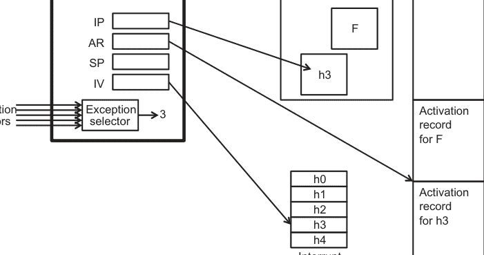

异常传感器

异常选择器

`F` 的激活记录

`h3` 的激活记录

**图 4.10** 中断机制允许 CPU 中断当前任务并执行一个解决错误或响应高优先级外部传感器的程序（处理器）。CPU 内部以及计算机系统其他部分的传感器电路会检测是否存在任何异常。选择器电路选择优先级最高的异常并输出其编号（如果没有异常则输出 0）。在每个指令周期的结束时，CPU 会检查异常，如果存在，CPU 将暂停正常指令的执行。相反，它使用异常编号（此处为数字 3）来索引中断向量，中断向量是每个处理程序入口地址的列表，并进行过程调用（此处为到`h3`）。`AR`（此处为`h3`的`AR`）被推入栈中，然后恢复正常的指令周期。当处理程序执行完成后，其返回指令将恢复被中断的程序，程序从被中断的地方继续执行。

## 79

从那时起，芯片制造商一直担心其电路中出现亚稳态的可能性。Sutherland 和 Ebergen（2002）报告说，现代触发器的切换约为 100 皮秒（100 × 10⁻¹² 秒），每运行 10 小时就会发生一次持续 400 皮秒或以上的亚稳态。芯片制造商`Xilinx.com`报告说，当时钟频率为 200 MHz 或低时，他们的触发器基本没有显示亚稳态的机会，但更快的时钟会导致亚稳态事件（Alfke 2005）。在每秒到达 500 万次中断信号的实验中，他们在 300 MHz 时钟频率下每分钟观察到一次亚稳态，在 400 MHz 下每 2 毫秒观察一次。在每秒产生 500 次中断的计算机系统中，按照其实验速率的 1/100,000 计算，推断出 300 MHz 下大约每 2 周发生一次由中断引起的亚稳态，在 400 MHz 下大约每 3 分钟发生一次。

现在你可以看到这个问题了。在 CPU 请求状态时，中断触发器可能处于亚稳态，这会导致控制 CPU 周期的下一组触发器进入亚稳态。如果这些触发器在下一个时钟脉冲之前没有稳定，CPU 的行为将是不可预测的。实验结果表明这种情况很有可能。

这个问题困扰了早期的计算机系统。在工程师理解它之前，他们只看到 CPU 在随机时间停止。他们将这些神秘的冻结描述为“宇宙射线崩溃”，它们似乎是晶体管功能的随机中断。只有完全断电重启才能恢复 CPU。由于这些冻结每几小时或几天就会发生一次，它们可能非常棘手。

大约 1970 年左右，剑桥大学计算实验室的硬件工程师 David Wheeler 发现了这些神秘冻结的原因：中断触发器输出端出现了半值信号。他设计了一种新型触发器，称为阈值触发器，并了一种使用它的协议，通过询问中断触发器消除了 CPU 冻结的危险（见图 4.12）。

类似于中断触发器的情况在计算机的许多其他部分也存在。必须-询问中断触发器（见图 4.12）的电路——就像计算机其他许多部分的中断触发器一样。（注：OCR 文本在此处有重复，已根据逻辑流进行了清理）。

## 82

# 机器

## 90

# 结论

我们的目的是通过令人信服的细节证明，构建一台能够计算任何人们能找到方法的电子机器是可能的。该机器由处理器（CPU）和内存（RAM）组成。在循环的指令周期中，处理器执行存储在 RAM 中的一系列机器指令以及存储在 RAM 中的数据。机器指令实现包括算术、内存读写和顺序控制的操作。每条指令都由 CPU 中的电路实现。过程调用机制允许单独编写的程序在程序的任何位置作为过程调用被调用。在检测到异常情况时，操作系统使用过程机制中断程序。我们最后的结论是不确定性问题，即同时输入可能导致选择进入亚稳态，从而在下一个时钟脉冲之前无法做出选择。该问题源于电路的物理特性，如果关闭时钟直到电路稳定，就可以避免。这里引用的栈结构是执行程序的多个模型之一。每个模型都有自己的规则和机器结构。但它们的作用都是相同的：控制从输入值计算输出值的电子电路。

# 5 编程

> 对计算机产生不仅仅是偶然兴趣的人，至少应该对底层硬件的情况有所了解。否则，他们编写的程序将会非常奇怪。
>
> —唐纳德·勤斯（Donald Knuth）

> 编程是应用数学中最困难的分支之一；平庸的数学家最好只做数学家。
>
> —埃德格·迪斯特拉（Edsger Dijkstra）

据说，阿达·洛芙拉斯（Ada Lovelace）是第一位计算机程序员。1843 年，她在她的《关于巴贝奇分析机的笔记》中写出了一种算法，使机器能够计算伯努利数序列。巴贝奇从未完成他的机器；洛芙拉斯也从未运行过她的程序。

历史学家可能还会想，设计算法的数学家是否算作程序员——例如，牛顿用于求解方程组的消元法（1670 年）或纳皮尔的计算算法（1614 年）。现代程序员会再次否定这一点，因为这些算法并没有针对特定的机器进行编码。

从洛芙拉斯的程序到运行在电子数字计算机上的第一批程序之间，过了近 100 年。这一代的第一批程序员是女性，她们通过在配线板上设置电缆模式为 ENIAC 规定了算法（1949 年）（见第 1 章图 1.3）。两年后，EDSAC 和 EDVAC（第一批存储程序计算机）的程序员将算法写成二进制数，通过纸带传递给计算机。第二次世界大战期间，为军队计算弹道数据表的女性也是程序员，尽管她们的程序不是给机器的指令，而是给她们自己操作机械计算器的指令。实际上，她们是人类处理单元。

从开始，程序员就发现他们花费了大量的时间在自己的程序中寻找错误（Wilkes 1985）。错误是普遍现象；即使是最好的程序员也会犯错。计算机设计人员很快开始设计编程语言和动态错误检查方法，以帮助对抗错误。这种斗争今天仍在继续。设计无错误的软件不仅是一个可靠性问题，更是一个安全和保障问题。

本章的目的是证明，尽管语言繁多，但翻译器的基本思想——自动将源程序转换为机器指令——对于所有语言都是相同的。此外，还存在编译器生成器程序，它们可以接受语言描述并输出该语言的编译器。自动生成器消除了在需要时实现新语言的障碍。

## 程序、程序员与编程语言

程序是算法的表达式，为了在机器上执行而进行编码。编程语言是一种具有其自身语法规则的人造语言，用于表达程序。程序员是指使用编程语言设计程序，并希望这些程序在机器上无错误运行的人员。

自 20 世纪 50 年代后期推出第一批商业语言以来，编程语言层出不穷。到底有多少种呢？2014 年，维基百科有一份超过 500 种编程语言的列表，它们正或曾被用于商业软件生产。如果你算上引入的语言及其微变体、升级和更新，这个数字可能是数千种。每种语言都是为了特定目的而设计的，通常是为了方便特定领域计算的设计。成千上万的领域在使用计算；然而，称有数千种语言并不意外。

表 5.1 是一些著名语言的示例。原始的四种今天仍在使用。只有 Algol 没有作为语言存续；但许多其他语言从 Algol 那里继承了它的语法。

Algol 语言项目的重大创新之一是使用形式文法来规定语言的语法。该文法被称为巴科斯-诺尔式，简称 BNF，以其开发者 John Backus 和 Peter Naur 命名（Backus 1959, Knuth 1964）。文法有助于约定语言含义以及如何生成机器代码。该文法也是构建编译器的基础。随后的研究导致了高效编译器和编译器生成器，后者可以根据文法创建编译器。我们很快会讨论编译器的原理。这是一个关于使用赋值语句将算术表达式的值与数字和变量关联的 BNF 规范示例：

```text
<assign> ::= <var> = <A>

<A> ::= <A><aop><A> | <M>

<M> ::= <M><m><M> | <F>

<F> ::= <A> | x
```

语法元素用`<>`命名。元素`<A>`、`<M>`和`<F>`分别代表加法、乘法因子表达式；`<aop>`和`m`代表加法和乘法运算符。冒号（`::`）表示“定义为”。竖线（`|`）分隔可选方案。字母`x`代表字母变量名或数值常量（见图 5.1）。该文法通过将乘法运算置于加法运算之下，尊重了算术优先级，从而强制在执行加法之前执行乘法。

## 作为实践的编程

编程是为机器执行而编码算法的实践。程序员的工作由两部分组成：

- 设计问题解决方案的表达式并将其编码为机器
- 验证由程序控制的机器是否正确解决了问题

程序员使用许多工具来支持他们的工作。设计工具包括编程语言和强制合规的图形编辑器。

## 编程

```text
<assign>
  /   \
 x    =
  /  |  \
<A>  +  <A>
 |    |    |
<M>   <M>
 |    /  \  |
<F>  <M> * <M>
 |    /  \  |
 A   <F>    <F>
  (  <A>  )
  <A>   <A>
  |     ||
  <M>   <M>
  |     |||
  <F>   <F>
  |     ||
  B     C
```


**图 5.1** 赋值语句`X=A+(B-C)*D`可以用两种语法树表示。左侧的树应用了文本语法来构建一棵树，用以解释表达式的语法。右侧的是通过保留操作符和操作数得到的简化形式。一旦结构确定，就不再需要括号了，因为语法遵循了算术优先级。

配合语言语法。编译器、链接器和解释器将程序转换为机器上的计算。测试和调试工具有助于定位和消除错误。库和版本控制工具有助于保持程序更新并实现它们的使用。程序员是使用这些工具的工匠。

程序员在编程方面培养出不同水平的技能。初级程序员发现自己花费了大量时间来理解编程语言的语法和通用的基础算法。胜任的程序员可以执行一系列标准的编程任务并满足客户需求，而不需要主管监督。大师级程序员可以很好地编写大型系统，并能够从容地从高级系统视图切换到低级机器代码视图。生产力——例如以编写和验证的代码行数来衡量——在程序员之间差异巨大。许多熟练程序员的效率是初级程序员的十倍，而少数大师的效率甚至是后者的五十倍。

一些程序员因为改变了世界而成为了传奇。John McCormick（2012）纪念了那些运行着这类程序员工作的算法命名——这些名字如 Len Adleman、Sergey Brim、Jim Gray、Tom Mitchell、Larry Page、Ron Rivest 和 Adi Shimmer。他们的许多关键概念技巧已成为计算的新准则。

除了程序之外，系统在影响力方面也成为了传奇——例如作为操作系统的 VM/370、Multics、Unix、Windows 和 macOS；如 Oracle 的数据库系统；如 Akamai 缓存系统的网络系统；TCP/IP 协议族；域名系统（`DNS`）以及出版商使用的数字对象标识（`DOI`）系统。他们的一些开发者也是传奇——如 Von Cerf、Fernando Corbato、Bill Gates、Bob Kahn、Alan Kay、Butler Lamps、Paul Mockapetris、Roger Needham、Jon Postel、Rick Rashid、Dennis Ritchie、Jerry Saltzer 和 Ken Thompson。

许多程序被转化为数百或数千程序员的系统。操作系统和 Microsoft Office 等大型应用程序就是例子。如何组织这么多程序员以使效率最大化、错误最小化并按时完成不仅仅是一个人才筛选过程；它在项目协调和测试方面带来了巨大挑战，这些挑战困扰了软件行业五十年。Fred Brooks 作为 20 世纪 60 年代 IBM 360 操作系统项目的经理，在他著名的著作《人月神话》（1995）中记录了大型项目组织的许多见解。我们将在后的第 10 章“设计”中讨论大型系统的设计原则。

## 错误问题


自 20 世纪 40 年代诞生以来，软件一直有极易出错的声誉。程序员总是对即使是最简单的任务，程序的复杂性感到沮丧，对定位自己程序中错误所需的时间以及保护软件和数据免受外部错误影响的挑战感到无奈（见图 5.2）。

大多数物理系统遵循连续性定律，该定律保证一个变量的微小变化会引起其他（依赖）变量相应的微小变化。因此，系统可以自然地容忍小错误。许多生物系统，包括人类和动物免疫系统，包含自检测和修复机制，通过反馈和纠正来响应此类错误。


### 图 5.2

软件模块输出中的错误有两种方式产生：作为模块中故障（缺陷）的结果，或者作为错误输入的结果。发现缺陷和检测错误输入可能是极其复杂的。

相反，软件创建的虚拟世界往往对错误非常敏感。程序中改变一个位就可能剧烈改变该程序所代表的算法。此外，消除动作与物理定律冲突的错误是很容易的，这会导致软件与世界交互时产生错误。考虑到设计师必须掌握的转换链中固有的脆弱性，这种探索并不容易（见图 5.3）。

减少错误的愿望促使编程语言设计师采用减少错误的结构。年来，这些结构包括类型、子程序、独立模块、异常、对象、包、编辑器、调试器以及缩小语言表达能力与领域问题之间“语义鸿沟”的语言。有了这些改进，错误仍然是编程中的一个主要问题。

减少错误的愿望促使软件工程师（专业系统程序员）采用传统的四阶段工程设计过程：(1) 需求，(2) 规范，(3) 原型和 (4) 测试。在需求阶段，工程师咨询用户和其他熟悉领域的专家，以了解系统应该和不应该具备的行为。在规范阶段，工程师用精确的语言为系统功能创建正式描述，以满足需求。在原型阶段，工程师实现一个部分工作的系统。在测试阶段，工程师对原型进行各种测试，以查看其是否符合规范。


图 5.3 将设计意图转换为机器的过程充满了错误机会。共有四种：(1) 规范没有准确表示设计师的意图，或基于对用户预期的误解。(2) 程序员会出错，例如引入了错误或糟糕的近似，且编译器可能包含漏洞或木马，导致机器代码与源代码不等效。(3) 机器本身包含漏洞、缺陷、故障、其他机器或攻击者的入侵，以及导致其在执行基本操作时发生错误的因素。(4) 用户对机器工作的预期与机器实际执行的不同。自动验证器可以消除类型 2 错误。容错系统设计减少了类型 3 错误。原型设计和获取反馈有助于减少类型 1 和 4 错误。

工程师认为这个过程是不精确的，并随着学习新知识不断迭代和回溯。例如，在编写规范时，他们可能会发现需求存在歧义，必须咨询用户以消除歧义。在实现原型时，他们可能会发现规范导致了严重的效率低下，需要更改规范或需求。在测试时，他们可能会发现性能问题或发现漏洞，需要双重检查实现、评审规范或咨询用户。对于由许多模块和大型团队构建的大型系统，这些步骤可能会变得难以管理。复杂的决策跟踪、协调和版本控制系统被用于跟踪所有的变化、进展和倒退。

即使这个过程是由经验丰富的工程师运行的，项目超出预算或截止日期也是令人担忧的常态。典型的

## 编程

据估计，60% 的软件项目因预算超支、延迟或缺少重要功能而失败；约 30% 的项目因执行不力而被取消。³尽管失败的原因通常归咎于管理层对成本和时间的估计错误，但许多系统的极端复杂性也挑战着最经验丰富的工程师。寻找完备的设计原则具有强烈的经济理由。

## 自动翻译

编程的关键组成部分是将作为表达式的程序转换为机器可执行的形式。对于这有两种方法：编译器和解释器。*编译器*（compiler）是一个程序，它获取一个包含表示程序的符号字符串的输入文件，根据语言语法将其解析为语法树，并生成实现语法树所要求的操作的机器码。*解释器*（interpreter）是一个程序，它解析输入，但不是生成机器码，而是在解析器识别它们后立即调用系统操作；系统操作是已经编译成机器码的子程序。多年来，两者的执行界限变得模糊。也许重要的一点是，编译器运行一次并产生可以运行多次的可执行机器码，而解释器在每次执行时都会运行。

让我们从检查编译器的功能开始。目标是将程序翻译成一组机器指令，精确实现程序所指定的内容（且不包含其他内容）。为了实现这一点，我们需要两点：首先，编程语言语法（BNF）是非歧义的，这意味着对于任何有效输入字符串都恰有一个语法树。其次，翻译过程应该将语法树映射到唯一的机器码序列⁴。

为了简单起见，我们假设解析 BNF 语法会生成一个具有内部节点且叶子节点为变量名的语法树（图 5.1 中的简化树说明了这一点）。我们还假设编程语言允许第 4 章“机器”章节中提到的基本结构：给变量赋值、语句顺序执行、语句间的选择以及状态迭代。这些结构足以为任何算法编写程序；如果我们能翻译它们，我们就能翻译任何程序。

图 5.4–5.7 展示了赋值语句和表达式、顺序执行、选择和迭代的翻译。每幅图的左部分是该结构的语法树，右部分是实现该树的机器指令模板。

## 第 5 章

| 指令 | 操作数 |
| :--- | :--- |
| `LA` | `X` |
| `LA` | `A` |
| `L` | |
| `LA` | `B` |
| `L` | |
| `LA` | `C` |
| `L` | |
| `SUB` | |
| `LA` | `D` |
| `L` | |
| `MUL` | |
| `ADD` | |
| `ST` | |

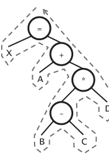

### 图 5.4

此图总结了编译器为图 5.1 中的赋值语句 `X=A+(B-C)*D` 生成代码的工作。编译器首先将语句解析为一棵树，其中运算符位于内部节点，操作数位于叶子节点。然后，它进行逆时针遍历（虚线），并在最后一次遇到该叶子或运算符时输出一条栈指令。结果（右侧）是一个在栈机器上正确求值该语句的指令序列（见第 4 章）。

`S1; S2`

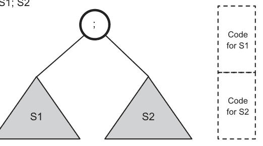

### 图 5.5

此图总结了编译器为一系列语句生成代码的工作。编译器首先将两个语句解析为各自的树，并用分号运算符（表示顺序执行）将两者连接。然后，它进行逆时针遍历并生成右侧的代码模式，该模式简单地将 `S1` 的代码放在 `S2` 的代码之前。

## If C then S1 else S1

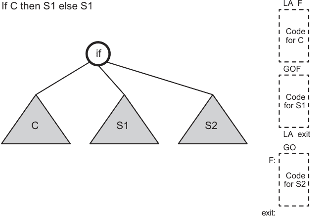

### 图 5.6

此图总结了编译器为选择语句（selection statement）生成代码的工作。编译器首先将三个组成部分（条件表达式 `C`，以及语句 `S1` 和 `S2`）解析为相应的树，并用“if”操作将它们连接。它进行逆时针遍历并生成右侧的代码。在每个代码段之后都会插入跳转指令，以确保当 `C` 为真时执行 `S1` 代码，当 `C` 为假时执行 `S2` 代码。指令 `GO`（假时跳转）假设栈上有一个真-假值，后跟一个目标地址，这是通过“LA F”和 `C` 的代码段实现的。

将树转换为指令的方法称为“树遍历”。我们想象沿着树逆时针方向沿着某条路径（见图 5.4），访问每个节点；该路径访问一个叶子节点和一个 `k` 叉运算符节点 `k + 1` 次；在最后一次通过某个节点时输出指令。

上述编译器有一个缺点。源语言的表达层级与机器码之间可能存在巨大的“语义鸿沟”（semantic gap）。巨大的鸿沟留给编译器编写者更多的解释空间，这可能与语言设计者的意图不符。这增加了代码错误的可能性。$5$

语言设计者试图通过扩展基础机器的指令集来缩小语义鸿沟。扩展的指令被作为单独编译和验证的程序实现。现在

`While C do S1`

```text
w: LA exit
Code
for C
GOF
Code
for S1
LA w
GO
```

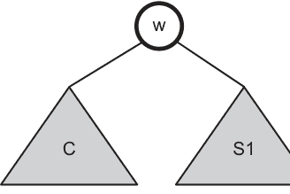

### 图 5.7

此图总结了编译器为选择语句生成代码的工作。编译器首先将三个组成部分（条件表达式 `C`，以及语句 `S1` 和 `S2`）解析为相应的树，并用“if”操作将它们连接。它进行逆时针遍历并生成右侧的代码。在每个代码段之后都会插入跳转指令，以确保当 `C` 为真时执行 `S1` 代码，当 `C` 为假时执行 `S2` 代码。指令 `GO`（假时跳转）假设栈上有一个真-假值，后跟一个目标地址，这是通过“LA F”和 `C` 代码代码实现的。

将树转换为指令的方法称为“树遍历”。我们想象沿着树逆时针方向沿着某条路径（见图 5.4），访问每个节点；该路径访问一个叶子节点和一个 `k` 叉运算符节点 `k + 1` 次；在最后一次通过某个节点时输出指令。

上述编译器有一个缺点。源语言的表达层级与机器码之间可能存在巨大的“语义鸿沟”。巨大的鸿沟留给编译器编写者更多的解释空间，这可能与语言设计者的意图不符。这增加了代码错误的可能性。$5$

### 图 5.8

此图总结了编译器为一系列语句生成代码的工作。编译器首先将两个语句解析为各自的树，并用分号运算符（表示顺序执行）将两者连接。然后，它进行逆时针遍历并生成右侧的代码模式，该模式简单地将 `S1` 的代码放在 `S2` 的代码之前。

将树转换为指令的方法称为“树遍历”。我们想象沿着树逆时针方向沿着某条路径（见图 5.4），访问每个节点；该路径访问一个叶子节点和一个 `k` 叉运算符节点 `k + 1` 次；在最后一次通过某个节点时输出指令。

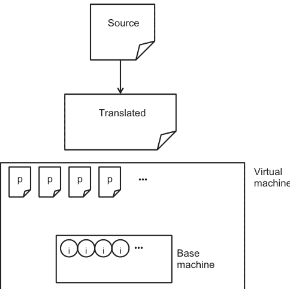

### 图 5.9

Unix Shell 允许用户输入程序名称（例如 `sort`），该程序从用户指定的“infile”获取输入，并将输出置于用户指定的“outfile”中。用户在左上方输入此行。“<”符号表示将下一个名称作为输入文件，“>”表示将该名称作为输出文件。解析器创建如左下角所示的一棵语法树，其中“VM”代表虚拟机作为运算符节点。在遍历树时，解释器生成右侧的四个系统调用。第一个创建一个运行“sort”程序的虚拟机。第二个设置虚拟机的输入为“infile”。第三个设置虚拟机的输出为“outfile”。第四个启动虚拟机的执行。当虚拟机完成工作（终止）时，脚本结束，用户现在可以输入下一个命令。

## 编程

据估计，60% 的软件项目因预算超支、延迟或缺少重要功能而失败；约 30% 的项目因执行不力而被取消。³尽管失败的原因通常归咎于管理层对成本和时间的估计错误，但许多系统的极端复杂性也挑战着最经验丰富的工程师。寻找完备的设计原则具有强烈的经济理由。

## 结论

编程是设计者为问题准备计算解决方案的行为。良好的编程是一项通过良好训练和多年实践发展出来的工匠技能。

编程语言是针对特定领域设计的。它们允许该领域的程序员使用该领域熟悉的术语来表达计算解决方案。由于编程语言是用巴科斯-诺尔范式（BNF）语法定义的，而且我们知道如何为任何语法构建解析器，因此为新语言生成编译器是非常容易的。这些定制的语言缩小了程序员的意图与语言表达能力之间的语义鸿沟。

程序员对错误的关注有时甚至近乎偏执。为问题构建计算解决方案的过程充满了错误风险，这些错误可能发生在四个关键点之一：准确地表达意图和愿望、准确地编程、准确地编译以及准确地执行。在这里，“准确”意味着保留设计者的原始意图。系统设计者提供了令人赞目的技术，帮助程序员避免错误并编写出可靠、稳定、易用、安全且安全的程序。

将源语句翻译为机器码的过程可以完全自动化。一旦映射关系建立并经过验证，程序员就可以非常有信，他们的机器码完全执行了语言语句所说的内容，不多不少。为了说明这一点，我们展示了编译器如何将赋值、序列、代码和迭代的标准结构翻译成机器码。

当语言与机器之间存在巨大的语义鸿沟时，语言设计者和编译器编写者必须处理渗透到翻译中的可能解释错误。编译器可能会使用某种机器码模式，程序员会认为这种模式并没有正确实现意图。减少这种错误的方法是通过虚拟机指令扩展基础机器，来缩小语义鸿沟。虚拟机指令执行的操作与用户对对象的意图操作紧密对应。例如，文件系统的创建、删除、打开、关闭、读取和写入操作是在文件上执行这些操作的虚拟指令。如果编译器能够将文件输入/输出翻译为文件系统调用而不是将它们编译成机器码，那么编译器将极大地简化。

编译器是翻译的一种模式。另一种是解释器，它解析语言中的语句，并在处理这些时动态地调用语法树中的操作符。许多语言（如逻辑语言、列表处理语言和命令语言）在解释模式下翻译时效率更高。其主要原因是这些操作对存储的使用具有高度动态性，而动态运行时系统可以通过垃圾回收等手段快速适应。

通过这些设计，我们可以确定机器码准确地实现了程序所要求的内容，没有其他。如果我们不能确定这一点，就无法有效地使用编程语言。

# 6 计算

信息高速公路是无重量比特以光速在全球范围内移动的。

— 尼古拉斯·内格罗庞特（1996）

这句话是假的。

— 阿尔弗雷德·塔斯基（Alfred Tarski）

计算是不断变化的比特星座序列。每次变化只影响少数几个比特，花费一点时间，并消耗一点能量。

计算工作通过完成计算所需的时间（或能量或空间）来衡量。计算机器完成一项任务需要多少时间（或能量或空间）？我们能预测一个任务或一组相关任务的工作吗？

此类性能问题自 20 世纪 30 年代以来一直挑战着计算任务的设计者。设计者提出了四个问题：

1. 该任务有算法吗？
2. 算法需要多长时间？
3. 有更快的算法吗？
4. 它是什么？

这些问题引发了一次惊人的搜索，旨在理解计算的“复杂性”，即计算可计算函数值所需的时间步数。表 6.1 是在此搜索中发现的四类主要函数的总结。这些类别将作为我们本章其余部分的指南。

该表指的是决策问题，即判断呈现给它们的值关于某些属性是真（1）还是假（0）的函数。计算机科学家使用决策问题来校准各种问题的难度。这种表面上的限制并没有导致任何损失。对于任何函数 `F(x)`，存在一个关联的决策函数 `DF(x,y)`，它在 `F(x) = y` 时返回 1，否则返回 0。这个决策函数的求解难度并不比通用函数，有时决策函数比通用函数容易得多。然而，如果决策函数是困难的，那么原始函数至少也一样困难。

“容易”和“困难”是相对的。容易意味着对于能够放入可用计算机的实例，我们可以在合理的时间内解决问题。困难意味着我们只能在合理的时间内处理有限的、较小的实例。非常困难（或不可处理的）意味着即使是最快的计算机也需要花费几个世纪。在非常困难和容易之间，存在一大类问题（技术上称为 NP 完全问题），这些问题的解很难判断，但其解决方案可以很容易验证。如果有人为其中任何一个问题找到快速算法，那么该算法就可以被用于解决其他问题。表中的难度顺序是输入规模的增长率。

## 第 6 章

### 表 6.1 按计算难度划分函数类别

| 类别 | 描述 | 技术名称 | 难度阶 |
|---|---|---|---|
| 容易 | 已知快速算法的决策问题 | 多项式（P）或可处理的 | 对于常数 `k`，复杂度为 `O(log n)` 和 `O(n)` |
| 困难但易于验证 | 未知算法的决策问题，但提出的解决方案可以快速验证；在大规模集合上进行无限搜索 | 非确定性多项式（NP）和 NP 完全 | `O(2^n)`、`O(n!)` 或更差 |
| 非常困难 | 未知算法或验证器的决策问题 | 不可处理 | `O(2^n)`，其中 `f(n)` 是指数级或更差 |
| 不可能 | 不存在算法的决策问题 | 不可计算或不可判定 | |

表中的难度阶是输入规模的增长率。`O(n)` 意味着计算时间随规模线性增长。`O(2^n)` 意味着计算时间呈指数级增长。这些度量的意义将在后续解释。

## 计算

### 侧栏 6.1——图灵机

图灵机（1937）长期以来一直是计算的模型，胜过了 Post 重写系统、Church 的 Lambda 演算和 Gödel 的递归函数等竞争模型。它获得这一地位是因为它最像自动计算机并且可以计算其他模型。

图灵机由一个有限状态控制单元组成，该单元沿无限带移动。磁带上的格包含符号 0、1 或 `#`，其中 `#` 是空白。控制单元规定为一组元组 `(q, a/b, LR, q')`，其中 `q` 和 `q'` 是控制状态，`a` 和 `b` 是带符号，`LR` 是方向指示。因此，`(17, 1/0, R, 22)` 意味着“如果处于状态 17 且当前格包含 1，写入 0，向右移动一格，进入状态 22”。一个状态被指定为停止状态。当机器进入该状态时，它停止，输出是磁带的内容。

图灵还描述了一种通用型机器，它可以模拟由其元组定义的任何其他机器。机器的通用性导致了 Church-图灵假设，即任何计算模型都可以被表示为图灵机。尚未发现任何违反这一假设的新计算模型。许多函数（如停机判定）不是图灵的。其他函数（如第 3 章中的图 3.7）可以通过人机协作计算，但目前发现任何图灵可计算机器。

验证器（verifier）的概念对应于“非确定性”图灵机。在这种机器中，对于给定的状态和当前磁带符号，可能有多个元组适用。例如，除了给出的元组 `(17, 1/0, R, 22)` 外，机器可能包含 `(17, 1/1, L, 24)`。机器应该应用哪个元组？机器必须做出选择，因为下一个状态由当前状态和磁带符号唯一确定。如果存在一系列选择能够导致磁带上带有该输出的停止状态，则非确定性机器就能计算出一个输出。通过构建对应每个可能选择的程序树，可以将非确定性机器转换为确定性机器；这样的树可能会迅速变得极其庞大。

验证器仅仅是确认通过非确定机器的计算路径通向所建议的输出。这通常比枚举所有选择并检查其中一个是否产生了所需的输出要容易得多。

现代复杂度理论并不直接引用图灵机，但仍然根据程序的精确定义以及它们完成函数所需的步数来工作。

## 简单函数

我们从几个简单计算的示例，以及我们用于估计它们完成时间的衡量标准开始。

### 示例 1：简单线性查找

找到书中第一个出现“Turing”名字的页码。实现此点的一种方法是将书籍表示为一个嵌入了页边界标记的字符串。然后，我们取搜索字符串“Turing”，并每次一个字符地沿着书籍字符串进行滑动，以检查“Turing”是否与书籍字符串的当前块匹配。如果我们找到了匹配项，就停止并输出最近遇到的页码。

将搜索字符串与书籍的当前子字符串进行比较需要花费与搜索字符串长度正比的固定时间。假设搜索字符串的长度为 `s`。对于书中的每一个字符，我们都可以将搜索字符串与从该字符开始的子字符串进行比较。如果书籍的大小为 `b` 个字符，总查找次数将不超过 `An+B`，其中 `A` 和 `n=sb` 是常数。我们称这种方法为“n 阶”（order n），因为对于较大的 `n` 来说，时间随 `n` 按比例增长。我们使用缩写符号 `O(n)` 来表示“n 阶”。这种搜索方法被称为线性查找。

### 示例 2：二分查找


简单的线性查找可能不是最快的。假设书籍包含每个单词的字母顺序索引，以及该单词出现的所有页码。现在我们可以对索引进行二分查找：我们反复询问字符串是否位于正在搜索的索引部分的下半部分或上半部分。在每个阶段，我们的搜索范围比上一个阶段缩小一半。这意味着我们需要 `\log n` 次划分，直到得到大小为 1 的列表，该列表要么是搜索字符串要么不是（见图 6.1）。

因此，在索引中找到字符串“Turing”的工作量与 `A \log n + B` 成比，其中 `A` 和 `B` 是常数。我们称这种时间为“log n 阶”，因为对于较大的 `n`，树的增长与 `\log n` 成比例。我们使用缩写符号 `O(\log n)` 来表示“log n 阶”。二分查找比线性查找快得多。例如，一本拥有 `2^{20}`（约 100 万）个字符的书，线性查找需要 `2^{20}` 阶的时间，而二分查找仅需 20 次——优势是 50,000 倍。对于大文件，这种优势是巨大的。我们接下来需要询问构建索引本身需要多少时间。

**图 6.1**

二分查找原理通过一系列划分将一个较大的集合缩小到单个集合。在这里，集合 `[1,2,3,4]` 被平分为两部分，然后每一部分再次被平分，层级为 0, 1, 2, `\dots`，0 位于树的底部。如果 `n=2^k`，树的深度为 `k = \log n`。对数可以被视为除以基数（此处为 2）的次数，直到商为 1。许多计算问题通过使用“分治”策略来解决。由于这个原因，对数在计算工作的阶表示中频繁出现。

104

第 6 章

### 示例 3：排序

构建索引是排序的一个示例。排序意味着按照顺序排列项目列表。例如，单词列表可以按字母顺序排序；数字列表可以按递增或递减排序。某些列表可能包含重复项。书籍索引算法稍微扩展了排序，提供了指向每个单词原始位置的回指针。

排序的一种方法是连续最大值法（successive maxima）。我们扫描包含 `n` 个元素的列表以找到最大元素，然后将最后一个元素与最大元素交换。我们对 `n-1` 个元素重复此操作，然后是 `n-2` 个元素，依此类推。

适应此所需的比较次数为 `n(n+1)/2`，或 `O(n^2)`（见图 6.2）。

还有其他排序方法吗？有的，但对初学者来说并不显而易见（见图 6.3）。它对原始列表应用二分划分原理……（等待，这里的 OCR 文本是碎片化的，让我们根据提供的片段进行重构）。

自我纠正：提供的 122-123 页 OCR 文本高度混乱且重复。我将根据提供的片段重构逻辑流。

由于 OCR 识别问题，这里显示了一个表格化的结构。我将格式化表格数据。

| B | A | D | C | E | F | H |
|---|---|---|---|---|---|---|
| Scan 0... | Max at 5 | Swap 5 and 7 |  |  |  |  |
| Scan 0... | Max at 6 | Swap 6 and |  |  |  |  |
| Scan 0... | Max at 2 | Swap 2 and 6 |  |  |  |  |
| Scan 0... | Max at 4 | Swap 4 and 5 |  |  |  |  |
| Scan 0... | Max at 4 | Swap 4 and 5 |  |  |  |  |
| Scan 0... | Max at 4 | Swap 4 and 4 |  |  |  |  |

**图 6.2**

排序后的列表可以通过连续最大值法从无序列表构建。一个包含 0-7 位置的八个元素的数组被排序。在第一轮（第一行）中，通过检查所有位置找到最大元素；位置 5 是“H”。交换位置 5 和 7 的元素，将最大值留在位置 7。在较短的列表（第二行）0–6 上重复此操作，然后是 0–5，依此类推。最后在 0–1 行结束。比较的总次数为 8+7+...+1。前 `n` 个整数之和为 `n(n+1)/2`；对于这个问题，结果是 36 次。这种方法 `O(n^2)`。

从这些示例中我们可以看到什么？

- 第一，排序可以比其他方法更快。
- 第二，寻找更快的算法可能并不显而易见。`O(\log n)` 实际上是最快的方法。
- 第三，设计者总是面临权衡。例如，在搜索时，二分查找比线性查找快。

105

## 计算

### 示例 4：矩阵乘法

矩阵是正数的平方数组，具有 `n` 行 `n` 列，总共 `n^2` 个元素。在在线性代数中，我们将一组方程表示为未知向量与系数矩阵的乘积。我们将方程的解表示为矩阵乘法。矩阵乘法运算是非常基础的，被许多应用程序的软件使用；最常见的是图形领域，例如在平板电脑和智能手机上，对象的旋转和投影是通过乘法操作计算的。软件执行这些操作的速度快到我们感知不到表示过程；我们只“看到”屏幕上的物体或观察它的旋转。用户通常看不到矩阵乘法，因为它们被隐藏在软件之中。

106

第 6 章

| B | A | G | C | F | H | D | E |
|---|---|---|---|---|---|---|---|
| B | A | C | D | G | F | H | E |
| A | B | C | E | G | F | H |  |
| F | G | H |  |  |  |  |  |

**图 6.3** 快速排序试图将一个已排序的列表分为两部分，使得左部分的所有元素都小于右部分的所有元素。为了做到这一点，我们在第一个列表中随机选择一个元素（D），然后将小于或等于 D 的元素移动到左侧，大于 D 的元素移动到右侧（第二行）。现在有一个大小为 3 到 4 且相对于 D 的列表。左侧列表按照相同的原理进行排序，其中 B 是随机选择。右侧列表按照相同的原理进行排序，其中 E 是随机选择。这个过程一直重复，直到变成单元素列表。在实际实现中，子列表通过原始列表的指针对表示，并使用交换将项目移动到左侧或右侧。因此，当遇到单元素列表时，它们已经处于了正确的位置。如果每次选择随机元素都能将列表一分为二，快速排序需要大约 `\log n` 次通过，每次通过都会检查所有元素，总时间为 `O(n \log n)`。

库，但它们无处不在。通过线性代数书中所示的标准方法乘以两个 `n \times n` 矩阵的标称时间为 `O(n^3)`（参见 6.4）。`^{1}`

我们刚刚看到的四个例子都是我们已知快速解决方案的常见问题。它们的计算工作量是 `O(n^k)` 级，其中 `k` 是常数。涵盖 `O(\log\log n)` 是因为它比 `O(n)` 更快。

计算机科学家将所有可以用 `O(n^k)` 算法解决的问题归类为“多项式”的，因为计算工作量是用一个领先项为 `n^k` 的关于 `n` 的多项式来衡量的。他们建立了一个约定，多项式级的问题是“容易的”，因为它们在大多数实际情况下都表现良好。还有许多其他问题的解决方法要慢得多。我们将在下一步考虑。

# 指数级困难函数

任何依赖于模拟的问题都可能更困难。假设你必须检查状态空间的每个状态，以确定它是否满足某个属性。你可以列出所有具有该属性的状态列表，时间将与状态空间的大小成比例。对于大型状态空间，那将是非常长的时间。

## 示例 5：所有十位数字

打印所有十位数字看起来很容易。因为有 `10^{10}` 个这样的数字，算法将：

- 对于 `i=0...10^{10}-1`，打印 `i`

该算法耗时为 `O(10^{10})`。这需要多少时间？在一台运行速度为 1 GHz（每秒 `10^9` 次操作）的快速机器上，大约需要 10 秒。我们需要多少纸？假设我们使用非常小的字体，每页打印 500 个数字，分为 5 列，每列 100 个。双面打印每张纸得到 1000（`10^3`）个数字；因此，我们需要 `10^{10}/10^3 = 10^7` 张纸。一箱 20 束纸包含 10,000 张纸；我们需要 `10^7/10^4 = 10^3` 箱。按每箱 3 立方英尺计算，我们需要一个 `10 \times 30` 且高 `10^4` 的储藏室。打印无法放在桌面上。

即使有储藏室，情况也会糟糕得多。快速打印机每秒可以生产一张纸。整个任务将需要 `10^7` 秒，大约 4 个月。

困难不在于算法，而在于枚举所有状态所需的时间。在第 3 章关于信息的 10 的幂次表中，我们看到一个相对较小的指数就能产生巨大的数字。任何剩余的算法都保证是困难的。

## 示例 6：背包问题

背包问题是运筹学中的一个老问题。给定给定大小的背包和 `n` 个物体 `{s_1, s_2, \dots, s_n}` 以及相关的价值 `{v_1, v_2, \dots, v_n}`。我们想要找到能放入背包的最大价值子集。这是一个常见问题。

另一个是将带截止日期的 `n` 个任务调度到卡车上。对于常数 `k`，其量级为 `O(n^k)`。

这个问题之所以困难，是因为对于 `n`，有 `2^n` 个子集。例如，对于十个物品有 1024 个子集，二十个物品有 100 万个，三十个物品有 10 亿个。一种启发式方法是为每个物品标记其价值/空间比例，按降序将它们放入背包，直到无法再放入为止。这种策略产生了子集（见图 6.4）。

**img/cca5d1c9d506e95cd7cbfe747ae96344_125_0**

**图 6.4** 矩阵乘法算法将两个方形 `n \times n` 矩阵合并为一个相同大小的矩阵。计算结果矩阵中位置 `(i,j)` 元素的标准规则是“将第一个矩阵的第 `i` 行乘以第二个矩阵的第 `j` 列”。两个列表的乘积定义为元素乘积之和。在示例中，`n=3`，我们用 `(1,2,3) \cdot (4,5,6) = 1\cdot4 + 2\cdot5 + 3\cdot6 = 4 + 10 + 18 = 32`。这被称为“点积”。每个点积需要 `n` 次乘法和 `n-1` 次加法，总共 `2n-1` 次操作。重复 `n^2` 次，对于结果元素，`n^2(2n-1) = 2n^3-n^2`，即 `O(n^3)`。

## 示例 7：访问所有城市

背包问题旨在寻找 `n` 个城市的最短路径。这通常被称为旅行商问题。完成这需要多久？搜索：首先，枚举所有城市的排列；其次，计算每个路径的长度。解决方案是最短路径。

每个路径都可以通过选择第一个（`n` 个选择），然后是第二个（`n-1` 个选择），以此类推直到创建所有 `n` 个。总选择数为 `n! = n(n-1)(n-2)\dots(2)(1)`。这种方法的量级为 `O(n!)`。对于大 `n`，阶乘的近似值为 `n^e\sqrt{\pi n}`，对于相对较小的 `n` 值可能是巨大的。对于 100，它是 `10^{158}`。如果我们有一台频率为 10 GHz 的快速处理器，如果每个时钟周期可以评估一次路径，我们每秒可以评估 `10^{10}` 条路径，每年大约 `10^{17}` 条（一年有 `3.14 \times 10^7` 秒），或者每世纪评估 `10^{19}` 条。整个计算将需要 `10^{139}` 个世纪。相比之下，宇宙的寿命大约是 `10^{10}` 个世纪。

## 计算

| 选择 | 总大小 | 总价值 |
|---|---|---|
| 0 0 0 | 0 | 0 |
| 0 0 1 | 7 | 6 |
| 0 1 0 | 3 | 5 |
| 0 1 1 | 10 | 9 |
| 1 0 0 | 2 | 4 |
| 1 0 1 | 9 | 10 |
| 1 1 0 | 5 | 9 |
| 1 1 1 | 12 |  |

**img/cca5d1c9d506e95cd7cbfe747ae96344_127_0**

**图 6.5**

与背包问题一样，启发式方法表现非常好。2004 年，瑞典的一个小组部署了一系列启发式方法来寻找瑞典 24,978 个城市的最短路径。他们在九十六个处理器上花费了大约一个世纪的 CPU 时间。`3`

## 示例 8：合数分解

合数是两个或多个质数的乘积。在密码学中，许多重要的算法依赖于由恰好两个质数相乘而成的合数。例如，RSA 加密系统使用两个大质数作为密钥，其乘积作为公钥（Rivest 等人，1978）。公钥是安全的，因为目前没有分解此类数字的快速算法。所有已知的整数分解算法对大约 `2^n` 个可能的因子进行搜索，这在指数级是困难的。然而，如果可以快速提取质数，RSA 密钥将毫无意义。

在目前的硬件和分解算法水平下，256 位密钥是安全的，但可能是被破解的；4096 位密钥将是不可破解的。1994 年，Peter Shor 发现了一种可以在多项式时间内完成因数分解的量子算法。当量子计算机建成时，RSA 系统可能会过时。

这些例子表明，除非我们找到一种不需要枚举整个空间的方法，否则在宇宙的寿命内无法完成计算。根本原因是搜索空间呈指数级（或更高）增长。在第 2 章中，我们给出了包含 giga、tera、peta、exa 和 zeta 的质数单位表。我们的命名也跟不上这种增长。我们现在每年产生 zettabyte 的数据；yatto 增长将在未来几年内被超越。

结论是，对于 `O(2^n)` 或 `O(n!)` 阶的问题是难以理解的。我们称这些为指数困难问题。从实际角度来看，这些问题即使对于较小的质数也是不可解决的。唯一的办法是使用启发式算法——仅搜索空间极小子集的近似。我们知道启发式算法可以提供快速解，但通常不知道如何优化它们。瑞典小组幸运地找到了旅行商问题的最优算法。

遗憾的是，保证解决这些指数困难问题的唯一算法是枚举方法。这些问题非常普遍，研究人员多年来一直在寻找更快的算法。

## 困难但可验证的问题

指数困难的判定问题有一个有趣的特征：解可以被快速验证。考虑背包问题作为一个判定问题：是否存在价值至少为 `k` 的解？这种判定形式比原始问题要容易。然而，它需要时间来证明所提解的价值至少为 `k`——即计算所选物品的价值。同样，对于城市问题，需要时间来证明所提解超过了 `k`。

我们已经看到，计算机科学家引入了符号“P”来表示可以在多项式时间内解决的问题集。P 代表多项式（polynomial）。P 类中的任何问题都可以在 `O(n^k)` 时间内解决。

计算机科学家引入了符号“NP”来表示可以在多项式时间内验证的问题集。NP 代表非确定性多项式（nondeterministic polynomial），是指神奇地猜出正确解并在多项式时间内验证它的术语。对于 NP 问题，我们所知的所有算法都是指数级或更高的，但每个解都可以在 `O(n^k)` 时间内验证。

我们需要一个小符号来讨论 NP 问题。对于 NP 中的任何问题 `A`，存在一个 P 类中的验证器 `V_A(x,y)` 来回答“`A(x) = y`？”这个问题。`V_A(x,y)` 是判定问题，因为其输出是 0 或 1（见图 6.6）。

注意，验证器可以用于找到 `A` 的解。假设我们要为给定的 `x` 计算 `A(x)`，并且知道解最多包含 `n` 位。我们可以枚举所有的 `y=0, 1, \dots, 2^n-1` 并计算 `V_A(x,y)`。如果任何一个验证通过，我们就找到了 `A(x)`。这个搜索过程是 `O(2^n)`，因此是指数困难的。`A(x)` 的直接算法可能比这个搜索过程更快。验证器搜索过程并不是最优解方法。

## NP 完全性

NP 中的问题具有多项式时间验证器，这使得可能存在尚未发现的多项式时间解决 NP 问题的方法。我们将看到，如果 NP 的特殊类中存在一个成员，那么 NP 中的每个问题都可以在多项式时间内解决。这将使得 `P = NP`。`P = NP` 尚未被证明。这个问题是数学和计算机科学中最重要的开放问题之一（Cormen 等，2009）。

![图 6.6]

该韦恩图展示了判定问题类 P（多项式）和 NP（非确定性多项式）之间的关系。NP 中的每个判定问题 `A(x)` 都有一个 P 类中的验证器 `V_A(x,y)` 来回答“`A(x) = y`？”这个问题。大多数已知算法是指数困难的问题都是 NP，因为我们可以快速验证所提的解。目前尚不知道是否存在快速解决 NP 问题的发现方法。这就是 `P = NP` 问题，是数学和计算机科学中最重要的开放问题之一。

科学家和工程师通常通过将新问题“归约”到他们已有的旧问题来解决。例如，电子工程师使用通用电路仿真器来判断设计的电路是否正常工作。使用仿真器的描述语言描述新电路比为该电路构建一个专用仿真器要容易。

算法研究人员使用相同的概念来发现解决方法之间的关系。假设我们可以将问题 `A` 的一个实例转换为方法 `B` 可以解决的形式。我们就可以使用 `B` 来获取 `A` 的答案。这被称为 `A` 归约到 `B`。归约表明目标方法 `B` 至少和 `A` 一样困难。

当然，我们坚持归约变换是快速的——即多项式的。如果转换需要指数级时间，那么尝试使用 `B` 就没有意义，因为变换将消除获得 `A` 的快速（多项式时间）解的所有希望。

如果我们在 NP 中找到一个问题 `B`，使得 NP 中的每个 `A` 都能在多项式时间内归约到它呢？这类问题的求解器将适用于 NP 中的每个问题。这可能更容易。1971 年，Steve Cook 引入了“NP 完全”（NP complete）这一术语。他指出，如果存在多个问题，每个问题都可以相互归约，任何一个问题的快速算法都将产生 NP 中每个问题的快速算法。

Cook 的第一个 NP 完全问题是电路可满足性（CSAT）。简单的布尔电路是一组互连的门（与、或、非），且没有环路。它接收一组 0 和 1 输入，并产生 0 或 1 输出。

设 `C` 是一个具有 `n` 位二进制输入的电路。这些输入的某种配置可以表示为 `x`，然后 `C(x)` 是 0 或 1。CSAT 问题是：是否存在一个 `x` 使得 `C(x) = 1`？CSAT 显然属于 NP，因为我们可以通过追踪电路中的信号来快速验证给定的 `x` 是否产生 1。然而，已知回答可满足性问题的最佳算法是枚举所有的 `x` 并测试每一个；其复杂度为 `O(2^n)`。

Cook 将 NP 中的任何问题 `A` 归约到 CSAT 的方法基于他的验证器 `V_A`。如果 `A(x)=y`，则 `V_A(x,y)` 为 1。以下是归约变换的概述：


生成一个对应验证器 `V_A(x,y)` 的电路 `CV_A(x,y)`。该电路通过一系列阶段模拟 CPU 的操作，每个阶段能够执行验证器算法的一条指令。一个阶段将执行前的整个机器配置映射到执行后的配置。映射是通过复制整个 CPU 电路完成。由于验证器算法在 `O(n)` 步内完成（其中 `n = size(x)`），其电路有 `O(n^2)` 个阶段。这极其复杂。一旦我们有了 `V_A(x,y)` 仿真电路，我们对其稍微修改为电路 `C_x(y)`，将 `x` 值固定在输入端，并只留下

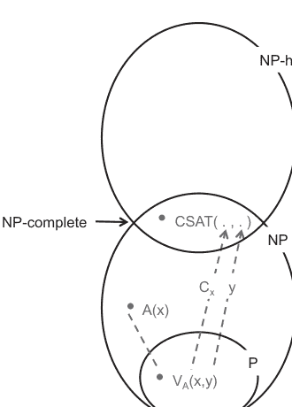

## 图 6.7

任何可以被 NP 中问题归约的问题被称为 NP-hard 问题。电路满足性问题（CSAT）是一个既属于 NP 又是 NP-hard 的例子。CSAT 解答的是：“是否存在一个输入能使给定电路输出为 1？”NP 中的任何问题 A 都可以通过构造一个模拟固定输入 `x` 和变量输入 `y` 的验证器的电路 `C_y` 来归约为 CSAT。如果 CSAT 说“`y` 验证了 `C_x(y)`”，那么 `y = A(x)` 也被验证。CSAT 是第一个 NP-完全问题的例子。

`y` 值未指定。当 `C_x(y)` 被满足时，存在一个 `y` 使得 `C_y(y) = 1`，这只有在 `A(x) = y` 时才可能。因此，CSAT 对该电路的答案是使得 `A(x) = y` 的 `y` 值（见图 6.7）。

由于 CSAT 属于 NP 且 NP 中的任何其他问题都可以归约到它，因此 CSAT 是 NP-完全的。

在 Cook 证明 CSAT 是 NP-完全后不久，Richard Karp (1972) 列出了其他 21 个也是 NP-完全的问题。几年后，Garey 和 Johnson (1979) 对科学、工程、商业等领域的 3000 个常见问题进行了归类；它们都是 NP-完全的。这一发现具有深远意义。如果有人能为这 3000 个问题中的任何一个找到快速算法，那么该算法将转化为适用于其余所有 NP-完全问题以及 NP 中所有问题的快速算法。大量目前被认为不可解决的现实问题将变得可解决。以下是 NP-完全问题的部分列表：

- 电路 SAT（上文已讨论）。是否存在一个输入能使电路的输出为 1？
- SAT（布尔满足性问题）。是否存在一组值能使一个给定的布尔公式为真？
- 背包问题。是否存在一个价值至少为 V 的背包解？
- 子集和问题。给定一组数字，是否存在一个和为 K 的非空子集？
- 单词重序。通过对随机字母序列进行重序可以得到哪些字典单词？
- 哈密顿路径。是否存在一条恰好访问图中所有节点的路径？
- 旅行销售员问题。地图上一组城市的最短回路是什么？
- 团（Cliques）。在网络中，彼此认识的节点集合。
- 死锁。在网络中找到一组节点，每个节点都已停止并等待该集合中另一个节点的信号到达。
- 图或网络问题：
  - 染色。使得图中任意两个相邻节点颜色不同的最小颜色数是几？
  - 节点覆盖。在网络中找到一个最小节点（顶点）集合，使得它们共同覆盖了图的每条边。
  - 子图同构。给定的图是否包含与另一个给定图同构的子图？
  - 独立集。在网络中找到一组节点（顶点），其中任何节点都不与集合中的任何其他节点相邻。
  - 支配集。在网络中找到一个最小节点子集，使得集合之外的每个节点都与集合中的一个节点相邻。

这些许多问题被表述为图问题，因为图是我们每天都会遇到的网络非常方便的表示方法。尽管许多伟智者试图为这些问题寻找快速算法，但尚未有人成功。这被视为强有力的经验证据，证明了任何 NP-完全问题都没有快速解法，因此 P ≠ NP。

Fortnow (2009, 2013) 推测了如果为任何 NP-完全问题找到快速算法，世界将发生什么变化。这样的发现将证明 P = NP。他预测，由于许多困难问题变得可解决，这将引发一场经济革命。其他人则并不十分确定，因为启发式算法的巨大进展已经为这些问题的现实实例提供了许多可以接受的良好近似，最优解并不会是一个巨大的飞跃。

## 不可计算问题

在 20 世纪 30 年代，研究计算的数学家意识到，某些不可计算的。原因是程序的数量不足以涵盖所有函数。这种说法的技术表达是：所有可能的程序的集合是可列的，而函数空间是比程序空间更高阶的无限。图 6.8 描绘了为什么如此。

如果不可计算函数不影响我们的日常生活，那么它们将毫无意义。事实上，它们确实。我们有很多想知道但无法计算的东西。图灵的例子（1937）是停机问题：我们能否检查一个程序及其输入，并判断该程序在该输入下是否停止？程序是否会停止通常不是显而易见的，因为终止循环的条件可能无法提前。不停止的程序会循环。无论我们设计什么方法来判断停机，都不能依赖模拟，因为我们询问的程序可能会进入无限循环，导致我们的模拟无法判定任何结果。我们非常希望有一种测试方法，能在执行之前告诉我们程序是否包含无限循环。然而，并没有这样的测试。

图灵证明停机问题是一个不可计算的定义良好的函数，这是一项逻辑练习。他相反地假设，存在一个程序 `H`，当 `P(x)` 停止时其结果为 `H(x)=1`，如果未停止则为 0。这种形式的论证被康托尔用于证明实数更多，有时被称为“康托尔对角法”。

著名的命题“理发师只给不刮脸的人刮脸”存在悖论：如果理发师给自己刮脸，谁来给他刮脸？

## 计算

|   | 0 | 1 | 2 | 3 | 4 |
|---|---|---|---|---|---|
| 0 | `P(0,0)` | `P(0,1)` | `P(0,2)` | `P(0,3)` | `P(0,4)` |
| 1 | `P(1,0)` | `P(1,1)` | `P(1,2)` | `P(1,3)` | `P(1,4)` |
| 2 | `P(2,0)` | `P(2,1)` | `P(2,2)` | `P(2,3)` | `P(2,4)` |
| 3 | `P(3,0)` | `P(3,1)` | `P(3,2)` | `P(3,3)` | `P(3,4)` |
| 4 | `P(4,0)` | `P(4,1)` | `P(4,2)` | `P(4,3)` | `P(4,4)` |

## G

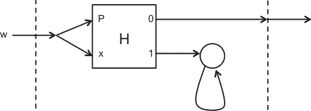

**图 6.9**

如果停机问题是可以解决的，那么存在一个可计算函数 `H` 告诉我们 `P(x)` 是否停止（1）或否（0）。因为它是可计算，我们可以通过包含 `H` 来编写软件模块 `G`。`G` 询问 `H(w,w)` 是否停止。如果答案是“是”，`G` 进入无限循环。如果答案是“否”，`G` 返回 0。如果输入 `w = G`，就会产生矛盾；也就是说它是 `G` 程序的副本。如果我们假设 `G(G)` 停止，那么 `H(G,G) = 1`，这强制 `G` 进入无限循环。如果我们假设 `G(G)` 不停止，则 `H(G,G) = 0`，在这种情况下 `G` 停止。这两个假设——`G(G)` 停止和 `G(G)` 不停止——都导致了矛盾。因此我们关于 `H` 是可计算的假设是错误的。

当我们构造一个关于自身属性的句子时，就可能产生悖论。这就是程序 `G` 正在做的。当它被要求对自己做出陈述时，它是悖论的且毫无意义。

没有解决矛盾的方法。一种常见的避免矛盾的尝试是在 `G` 程序的开头添加测试，以识别输入是否是 `G` 自身的程序；如果是，`G` 立即返回 0。这个问题的问题在于，对于任何给定的函数都有许多（实际上是无限多个）程序可以实现。所以即使 `G` 可以拒绝操作，如果输入是它的

## 计算

输入 `G`，会有另一个输入 `G'`，它计算相同的函数，并会触发矛盾，因为 `G(G')` 是一个悖论。

存在许多具有实际意义的不可计算问题。在每种情况下，我们都发现提议的解决方案也能解决停机问题（halting problem），这与停机问题的不可判定性相矛盾。例如：

- 忙碌海狸问题（Busy beaver problem）。`BB(x)` 是任何由 `x` 条指令组成的程序可以生成且保持停止的最大步数。[如果我们能计算 `BB`，我们就可以通过模拟一个包含 `x` 条指令的程序 `BB(x)` 步来解决停机问题——如果它在这些步之后没有停止，那么它将不会停止。]
- 全性问题（Totality problem）。`A(x)` 是否对所有可能的输入 `x` 都停止？[如果是这样，我们构造 `B(x)`，它忽略 `x` 并对任何选定的函数 `F` 和选定的输入 `y` 计算 `F(y)`。那么 `B` 仅在 `F(y)` 停止时在所有输入上停止。]
- 等价问题（Equivalence problem）。程序 `A` 和 `B` 是否计算相同的函数？换句话说，对于所有输入 `x`，是否满足 `A(x)=B(x)`？[构造 `B(x)` 运行 `A(x)` 并在仅当 `A(x)` 停止时输出 1。构造 `C(x)` 忽略 `x` 并输出 1。一个能判断 `B` 和 `C` 是否等等的算法回答了 `A(x)` 的全性问题。]
- 代码行（Line of code）。程序中的某特定（给定的）行是否被执行过？[修改程序，使得该行当且仅当 `A(x)` 停止时才被执行。]
- 对应问题（Correspondence problem）。给定两个代码 `A` 和 `B`，是否存在一个消息序列 `x_1, x_2, x_3 \dots x_n`，使得 `A(x_1)A(x_2) \dots A(x_n)=B(x_1)B(x_2) \dots B(x_n)`？同一条消息在两个代码中产生相同的编码。例如 `A=(a, ab, bba)` 和 `B=(baa, aa, bb)`；消息序列 321 在代码中产生 `baabbaaa`。[我们设计了代表程序单条指令执行的代码，使得 `A(i)` 是 `B(i)` 之前的机器配置。只有当程序停止时，我们才能让 `A` 和 `B` 序列匹配。换句话说，这个系统强大到足以让我们对程序的执行过程进行编码。如果对应问题存在解，它将告诉我们编码后的程序是否停止。]

我们有很多关于程序想要了解的实际问题，但所有这些问题都是不可判定的。我们知道这些是不可计算的，因为我们已经证明，如果我们判定了这些问题中的任何一个，就可以使用该方法来判定停机问题。

任何声称能回答几乎任何关于代码问题的检查方法，也可以判定停机问题。艾伦·图灵（Alan Turing）利用这一观察证实了，数学家在证明定理时执行的操作本质上是计算的，因此，即使是“通过检查”的方法也是计算的；一个回答另一个计算方法问题的计算方法通常可以被欺骗，去问自己该问题。这总会产生矛盾。

## 结论

我们在这一章中涵盖了大量内容。让我们总结一下要点。

所有的计算方法都需要时间并消耗能量。我们通过计算执行的指令数来估计时间（或能量）。

我们使用阶记法 `O(f(n))` 表示对于对于大的 `n`，计算的指令数与 `f(n)` 成正比增长。该记法忽略了常数，只关注长期增长。例如，耗时为 `An + B` 的计算无论 `A` 和 `B` 是多少，都是 `O(n)`；对于大的 `n`，它的增长与 `n` 成正比。

所有问题（函数）都可以根据其已知最佳算法的难度进行评级。例如，排序是 `O(n \log n)`，因为最好的算法所需的时间与 `n \log n` 成正比。也存在排序算法，例如 `O(n^2)`。

许多问题被表述为具有是 (1) 或否 (0) 答案的判定问题。例如，程序 `A(x)` 是否停止？是否存在一条长度小于 `k` 且经过所有城市的路径？其他问题被表述为优化问题。例如，找到背包或最短路径。为了一致性，我们将优化问题重构为相关的判定问题。问题的优化版本至少与判定版本一样。

我们将所有判定程序需要多项式时间的问题归为 `P`。我们将可以在多项式时间内验证解的问题归为 `NP`。即使一个 `NP` 问题的唯一解决方法是指数级的，它的验证器也是多项式的。验证器可以被用于寻找 `A` 的解，但这样做必须搜索所有输入值，可能比 `A` 更慢。`P = NP` 的问题被认为是数学和计算机科学中最重要的未解决问题之一。

归约是将问题从方法 `A` 转换为方法 `B` 问题的过程，使得 `B` 的解也是 `A` 的解。“A 归约到 B”意味着 B 足够强大可以回答所有输入。

## 计算 # 121

如果 NP 中的所有问题都该约到一个问题就是 NP 完全问题。电路可满足性问题 SAT 是一个 NP 完全型问题。每个 NP 完全型问题都可以归约到任何其他问题。任何一个问题的多项式时间算法都可以转换为其他问题的项式时间算法。在科学、工程和社会科学的所有领域都有许多已 NP 完全问题。这意味着我们对于这些问题最好的算法是指数级或更差。

还存在大量的不可判定问题，例如停机问题。它们最终允许程序问自己该问题，从而产生悖论。在逻辑上无法回答这些问题。我们陷入了困境。许多我们希望计算机解决的问题非常复杂，以无法在合理时间内返回答案。结果，我们严重依赖启发式（近似方法），这些方法很快但不准确。我们依靠实验方法来特征启发式何时有效。计算复杂性的限制迫我们进行实验。

# 7 内存

> 在互联网上，检索比在草堆中找针还要难；它是在堆里寻找一根特定的针——Hubert Dreyfus

> 缓存每五分钟访问一次的磁盘页。——Jim Gray 和 Franco Putolu

“我能找到？”是计算中最常见的问题之一。我们寻找的信息存储在“内存”中，这个简单的词掩盖了存储系统的复杂性和庞大。不仅在内存中快速找到信息很重要，将其快速移动到需要的地方也是。存储系统的结构对性能有很大影响。作为一个困难的例子，考虑一个天气预报场景。算法设计人员将预报区域划分为 10000 个小大气立方体，并将每个立方体分配给超级计算机上的 1 GHz 处理器。他们询问系统是否能够实现这组处理器 10 THz 的总处理率。如果可以，估计，明天的预报将在 3 小时内可用。但假设他们的算法在每个处理器上运行每百万条指令暂停一次（从硬盘检索原始天气数据需要 1 毫秒，硬盘访问时间为 10 毫秒）。完成一百万指令的总时间是处理器时间加上磁盘时间，即 11 毫秒。有效速度比额定速度慢 11 倍。明天的预报实际上需要 33 小时才能计算。超级计算机是没用的，因为内存系统无法将数据传输给处理器。

在通用处理器发明之前，存储一直是信息系统关注的重点。例如，IBM 在成为计算机公司之前一直是业务机器公司。在

## 第 7 章

20 世纪 50 年代。他们制造了复杂的机器，用于在打孔卡上进行数据选择和计数。公司使用 IBM 的机器来维护工资单、跟踪客户和管理库存。IBM 于 1956 年引入磁盘存储，预示着业务处理的革命，因为一整个仓库的归档柜可以装进单个磁盘存储器中，运行复杂算法的 CPU 可以在那里检索和分析数据。

计算机工程师一直认为存储限制是限制计算机实际速度的强大瓶颈。当程序员在努力应对小内存，而工程师在构建更大的内存时，性能分析师们想出了在内存受限的情况下预测计算速度的方法。

计算史表明，为了构建能够跟上处理器的内存系统，并找到减轻从本地和远程磁盘设备检索数据成本的方法，人类经历了长期的斗争。工程师们发现了三类组织存储的原则，使得高高速处理成为一个现实目标。命名（Naming）原则涉及创建用于标识数字对象的位或字母数字字符串。映射（Mapping）原则涉及将名称翻译为处理点与包含数字对象的存储位置之间的连接。定位（Positioning）原则涉及通过明智地将数据从远程存储移动到附近存储来优化性能。计算领域最早的科学理论之一——局部性理论（locality theory）是为了处理存储系统中信息移动的优化而开发的。

## 内存系统

在关于“信息”的第三章中，我们注意到信息可以用任何能够保持可传感器观测状态的物理量来表示。许多技术都可以作为内存系统。表 7.1 是内存系统基本属性的分类法。我们将在本章讨论这些属性，并识别出为可能验证复杂的内存系统建立秩序的原则。

内存系统通常被视为仓库。我们在其中存储数据并检索（回想）相同的数据。台式电脑上的 RAM 是字节的存储库，保存着控制中央处理器（CPU）的程序以及这些程序运行的数据。硬盘或云服务器是文件的仓库。但并非所有内存都像仓库那样。大脑的神经网络模型存储的是模式，这些模式是当前感官数据和所有之前记录的感知数据的组合；在检索时，内存返回一个与先验模式共享特征的模式，但可能与任何一个都不相同（参见 Kanerva 2003）。

内存层次结构是计算系统的永久特征。最快的设备位于顶部，因为它们是唯一能跟上 CPU 的。较慢的设备位于底部，用于永久存储和备份。数据根据 CPU 的需求向上移动，在不再需要时向下移动。然而，顶部的速度是以易失性为代价的——非常快的内存在断电时会丢失数据。较慢的设备（如硬盘）会无限期保留数据，直到被显式擦除。由于层次结构的存在，性能优化不仅仅是寻找 CPU 指令计数最少的算法的问题；它很大程度上取决于数据在层次结构中的排列。

这些权衡反映在内存的价格上。2014 年，访问时间约为 15 纳秒的 RAM 每 GB 售价仅为 5 美元。访问时间约为 5 毫秒的硬盘每 GB 售价仅为 0.10 美元。这两项技术的访问时间差异超过了 `3 × 10⁶`。与 1960 年相比，成本发生了巨大的变化，当时磁芯内存和磁盘存储系统对于对于高达 5 MB 的数据，每个字节成本仅为 0.30 美元，且访问时间约为 `10⁴`。

极大且持久的内存未来可能会出现。它们将取决于电子自旋或有机态等新技术。尽管如此，速度与成本之间的权衡将继续推动内存设备中数据层次结构的形成。

## 内存使用的基本模型

我们使用主体-对象模型来描述内存访问的通用机制。主体（subject）是任何可以请求访问的实体。数字对象（object）是位容器。主体常见的示例是代表用户运行的计算程序。这种模型——主体向对象请求操作——揭示了内存系统的三个基本方面：

- 命名（Naming）每个对象，通过赋予指定该对象并与其他所有对象区分开来的位或模式。
- 映射（Mapping）名称到包含该对象的内存位置，从而在主体和对象之间建立信息流路径。
- 验证（Authenticating）对象所有者，确认其已允许主体完成请求的访问。

一旦完成这三个步骤，就会执行请求的操作，信息将沿着主体-对象的路径流动。

## 内存

### 表 7.1 内存基本属性

| 维度 | 属性 | 定义 | 示例 |
|---|---|---|---|
| 物理 | 状态 | 任何可以被改变和观测的物理状态 | 磁场、磁化斑块、电子自旋、磁盘上的标记、环路电流方向、声学延迟线中的声波、阴射线管上的荧光、神经环路 |


| 访问维度 | 属性 | 描述 | 示例 |
|---|---|---|---|
|  | 易失性 | 掉电状态消失，访问极快 | 随机访问存储器（RAM）、CPU 寄存器、CPU 缓存 |
|  | 持久性 | 状态持续直到被改变或擦除，访问慢得多 | 硬盘、磁带、光盘 |
| 存储与检索 | 精确性 | 检索到的数据与之前存储的数据完全相同 | RAM、硬盘、互联网云服务器 |
|  | 关联性 | 检索到的数据与存储的数据有关但不一定相同 | 稀疏分布内存（Kanerva）、关联存储器、网络 |
|  | 可验证性 | 测试之前存储的数据是否存在 | 云服务器、文件系统检查软件 |
| 访问时间 | 随机 | 所有位置的访问时间相等 | RAM、互联网数据包往返时间（约数） |
|  | 定位 | 访问时间取决于数据在介质中的位置 | 自动点唱机、阴极射线管、硬盘、光盘、DVD |
|  | 顺序 | 访问时间取决于其在序列中的位置 | 令牌环、声学延迟线 |
|  | 混合 | 访问时间取决于定位以及访问序列 | 硬盘：定位磁头；然后从旋转磁盘读写 |
| 访问控制 | 验证对象 | 对象管理器验证主体是否有权限执行请求的操作 | 文件或数据库系统的访问控制列表、目录项中的访问控制列表 |
|  | 验证主体 | 主体管理器授予特定对象的权限 | 虚拟内存映射表中的访问位、对象的能力寻址 |

## 命名

在使用如此多内存技术的情况下，访问方法有很多并不意外。访问方法多样的主要原因是数据为了适应特定环境进行了结构化。例如，程序员对数据进行排序以实现频繁的二分查找。公司通过标准记录结构组织员工记录，以便管理器找到所有符合条件的记录。图书馆按照杜威分类法组织书籍和文档，以便读者快速在书架上找到书籍。许多领域（如医学、生物学和会计）开发了有助于识别和分类新对象的分类法。一种用途有效的数据组织在另一个用途上可能完全失败。无结构的互联网让许多人感到失望，因为尽管关于访问世界信息的宣传，它仍然是一个糟糕的信息检索系统。

尽管有这些差异，命名数据的方法只有六种。大多数人每天都使用这六种。表 7.2 是其分类法。

在前三种模式中，名称是固定长度的二进制字符串——地址、地址对或句柄。`地址`命名线性地址空间中的位置；常见大小为 32 位。地址对从多个地址空间中选择一个并选择其中的位置。`句柄`是文件和目录等对象的全时间唯一标识符；它们通常比地址长，例如 128 位。句柄之所以长是因为它们必须在整个互联网中是唯一的；生成句柄是将本地时钟标记与唯一的机器标识符（如本地网络使用的介质控制地址 MAC 地址）结合。通过这种方法生成的句柄长度至少是本地时钟的大小（例如 64 位）加上 MAC 地址的大小（48 位）。由于一台机器无法同时创建两个对象，这种方法保证了没有其他机器可以生成相同的句柄。由于存在的对象数量比句柄空间的大小小几个数量级——与 `2^128` 个句柄相比，对象数量级在 `2^20` 左右（`2^20` 个对象），大多数潜在的句柄从未被使用过。

在第四种模式下，名称是对用户有意义的符号字符串。Internet 主机名、文件名和 Web URL 都是示例。这种模式位于其他模式之上（见图 7.1）。

最后两种访问模式使用用户选择的符号表达式来指向一组数据对象。该表达式从大型集合中选择项目，例如业务数据库中的员工记录或图书馆的文档。查询模式使用形式语言来指定一组标准，以匹配记录而非其他内容。文本模式简单地寻找包含给定文本字符串的文档。这两种模式都涉及大量的搜索。根据数据库的大小，查询可能需要几秒钟到几分钟。Google 表明，一旦所有网页的内容被处理成一个索引（能够快速判断给定单词是否在文档中），生成搜索字符串的匹配列表所需的时间可以减少一半以上。在网络搜索中，数万或数百万次“命中”结果是正常现象。Google 的演示算法以这种方式排列命中列表，使用户能够在前十条结果中找到有用信息，这是非常了不起的（MacCorm 2012）。尽管如此，许多用户发现网络搜索可能像在大海中寻找特定的名字（Dreyfus 2001）（见图 7.2）。

所有六种访问模式都提供了位置独立性：用户可以在不知道对象位置的情况下对数字对象进行操作。自从 20 世纪 60 年代首次用于虚拟内存系统以来，位置独立性一直是一大优势。在虚拟内存中，每个虚拟地址始终能检索正确的值，无论被寻数据位于内存层次结构中的什么位置。由 Sun Microsystems（1984）引入的网络文件系统（NFS）允许用户通过在全局目录树中的名称访问网络中任何位置的文件。今天的云数据仓库是容错的分布式系统，它们将数据副本分布在数千台服务器上，而不更改数据名称。Web URL 映射到主机上的文件，而不考虑主机的位置或其文件系统的内部结构。网络协议将数据包路由到指定的服务器，而不考虑其位置。域名系统（DNS）将主机名转换为当前的 IP 地址，而不考虑主机的地理位置。每当物理位置没有意义时，隐藏位置的系统将更简单、更可靠。

**图 7.1** 名称是单个数字对象的标识符。四种名称层叠在一起，名称是单个数字对象的标识符。四种名称层叠在一起，其中一层名称映射到下一低一层（虚线箭头）。顶层包含用户生成的所有符号名称，例如 Web URL。下一层包含在创建对象的机器上操作系统生成的所有句柄。为了实现 Internet 中任何对象的通用共享，句柄必须是永久唯一的。下一低层包含 CPU 在执行进程时本地使用的虚拟内存中的地址空间。底层包含物理内存中的位置，例如 RAM 的页或磁盘记录。

| 姓名 | 工资 | 性别 | 工龄 |
|---|---:|---|---:|
| 1 | Alice | 50000 | F |
| 2 | Bob | 45000 | M |
| 3 | Charlotte | 60000 | F |
| 4 | David | 42000 | M |
| 5 | Elizabeth | 55000 | F |
| 6 | Fred | 51000 | M |
| 7 | Georgia | 59000 | F |

**图 7.2**

数据库可以可视化为包含许多记录的表格，每条记录都有一组标准的字段名称。查询是一个选择匹配记录的逻辑公式。例如，`salary > 50000 & sex=F` 匹配记录 3、5 和 7。而 `sex=M & seniority > 10` 仅匹配记录 6。而 `sex=M & salary > 55000` 没有匹配任何记录。查询方法是通过内容或特征而非名称来查找信息。典型的查询返回许多项目。数据库系统依赖四个原则来避免数据丢失和不一致：

1. 记录在多个服务器上进行复制。
2. 事务是“原子性的”，意味着它们的整个实体在一步中提交到数据库。
3. 事务被临时记录，以便在出错时可以回滚。
4. 数据库存储为可以组合的多个表格，以回答查询。

## 第 7 章

使用。但位置独立性并非总是有用：许多设备应用依赖“地理定位”服务。

Internet 搜索是六种模式中最困难的。匹配给定搜索词的对象集合可能是巨大的——可能有成千上万或数百万个匹配文档。URL 几乎无法提供关于文档内容的任何线索。尽管 Google 的页面排名算法在呈现有用文档方面表现出色，但用户经常发现排名最高的文档仍然没有用处。此外，大量信息存在受密码和查询接口保护的 Internet 连接数据库系统的“深层网”中。搜索引擎没有索引它们。没有人知道“深层网”有多大，但大多数估计它超过了 Internet 上总信息的 90%。因此，“世界上所有的信息都在 Internet 上”的观点是误导性的：大部分信息是不可搜索的，而可搜索的信息仍然可能导致严重的信息过载。

## 内存映射

映射是将名称翻译为位置的过程。由于存在各种可能的访问模式和内存技术，映射技术可能会变得非常复杂。幸运的是，它们都基于少数几个原则。

映射的基本思想是实现一个动态函数 `F`，使得 `F(x)` 是对象 `x` 的当前位置。每当映射 `F` 被存储为表时，每当程序请求读取（或写入）对象 `x` 时，操作系统就会读取（或写入）位置 `F(x)`。当操作系统移动 `x` 时，它会更新该表以显示新位置。将名称与位置分离实现了独立性——无论程序的对象在内存中占据何种配置，同一个程序都可以执行。

## 虚拟内存

自 20 世纪 60 年代初虚拟内存诞生以来，映射原则一直是虚拟内存系统的基石（Kilburn et al. 1962）。虚拟内存的发明是为了实现辅助内存（磁盘）与主内存（RAM）之间数据移动的自动化。移动自动化减轻了程序员的巨大负担，使他们的生产力翻了一倍或两倍（Sayre 1969）。虚拟内存系统必须解决两个问题：

1. 使单个程序的地址空间相互独立且与位置无关。
2. 尽可能减少磁盘与 RAM 之间非常耗时的移动次数。

位置无关性很重要，因为内存中的数据在不断移动，单个数据项的精确位置无法提前预测，且不应影响程序的执行。映射原则的一个简单版本是基于地址空间分页，将地址空间划分为等大小的块称为“页”（pages），将 RAM 分为若干固定大小的块称为“帧”（frames）。任何页都可以加载到任何帧中。RAM 访问的执行过程如下：

1. 程序的线性地址分解为页号和行号。
2. 映射将页号转换为帧号。
3. 帧名和行号重新组合为进入 RAM 的线性偏移。

我们已经学会了如何高效地实现这一点。^1

虚拟内存为多程序设计（Denning 1970）提供了一种在多个程序之间划分 RAM 的强大手段（见图 7.3）。

| A1 页 | A1 帧 | A2 页 | A2 帧 |
|---:|---:|---:|---:|
| 0 | 4 | 0 | 1 |
| 1 | 9 | 1 | 6 |
| 2 | 12 | 2 | 15 |
| 3 | 5 | 3 | 11 |
| 4 | 7 | 4 | -- |
| 5 | -- | 5 | -- |
| 6 | 10 | 6 | -- |
| 7 | -- | 7 | -- |

**图 7.3** 在此示例中，两个 CPU 引用它们各自地址空间 A1 和 A2 中的对象。地址空间被分为 8 个 512 页，而 RAM 被分为 16 个 512 字节的帧（页持有器）。CPU 使用 12 位地址，3 位页号，9 位行号（`512 = 2^9`）。RAM 使用 13 位地址，4 位帧号和 9 位行号。箭头显示了哪些页被加载到 RAM 中；左侧 CPU 的第 3 页在帧 2 中，右侧 CPU 的第 3 页在帧 11 中。箭头所示的关联存储在与每个 CPU 关联页表中。页表存储在每个地址空间之外的 RAM 私有区域中。左侧 CPU 请求线性地址 1540，它位于第 3 页第 4 行。使用页表，内存映射（MMU，未显示）将其更改为帧 2 第 4 行，这是进入 RAM 的 1028 线性偏移。有 6 页 RAM 未分配给任何地址空间（灰色）。如果 CPU 请求一个不在 RAM 中的页，则会触发“缺页中断”，请求操作系统将该页带入空帧并更新页表。

CPU 只能访问其页表中的页。属于其他地址空间的页是不可见的；CPU 没有任何办法生成它们的 RAM 帧地址。这种对地址空间的近完美隔离是信息保护的一种非常有效的方法。即使系统有足够的 RAM 来完全加载每个进程的地址空间，也会使用虚拟内存来获得这种好处。

减少数据移动是一个更棘手的问题。程序地址空间的完整副本存在磁盘上的一个文件中。在任何时刻，只有程序的一部分页在 RAM 中。页表通过将它们标记为在 RAM 中“存在”（present）来识别它们；在图 7.3 中，不存在的页显示为空白。如果内存映射单元遇到不存在的页，它显然无法完成翻译。相反，它会触发缺页中断，调用操作系统的页处理例程执行以下操作：

1. 将缺失页的副本移动到 RAM 的一个空帧中。
2. 更新页表。
3. 将控制权还给被中断的程序，使其获取地址翻译。

操作系统采用替换策略来确定哪些页在 RAM 中。当需要空帧时，该策略会选择 RAM 中一个预计不会被重用的页，与磁盘同步，将其标记为不存在，并将其帧添加到空闲列表中。系统性能对局部性（locality）非常敏感。了解局部性的程序员（后文将讨论）可以安排其数据以获得更优性能（Sayre 1969）。

## 共享

遗憾的是，虚拟内存屏蔽地址空间的能力阻碍了内存系统的另一个共同目标：允许用户共享。某些操作系统尝试增强共享功能，但效果有限。

一种方法是提供一种允许共享内存的操作系统接口。一组进程共享内存的方式如下：领导进程请求操作系统分配一个块；然后领导进程将句柄分发给其他进程。当组完成任务时，领导进程通知操作系统释放该块。这种方案有很多问题，既笨拙又容易出错。

这种方案的变体通过将共享数据加载到帧中、在每个地址空间选择未使用的页并将页映射到帧，避免了操作系统接口。这使得共享帧成为伙伴地址空间的成员。尽管它消除了调用操作系统读写共享页的需求，但带来了另一个主要缺点。如果位置发生任何变化，所有伙伴的页表都必须更新。如果伙伴很多或某些计算被挂起，这种更新可能会花费很长时间。

更好的方法是为所有共享对象定义一个新的命名空间。句柄空间（handle space）负责这项工作。能力系统体现了这一原则。

## 能力

能力寻址是一种全局共享对象的通用方法。能力寻址由 Jack Dennis 和 Earl Van Horn 于 1966 年发明，多年来得到了改进。能力（capability）是一个包含句柄、访问代码和校验和的大型位模式（见图 7.4）。当主体请求操作系统创建一个新对象时，操作系统生成一个新的能力并将创建者设为所有者。所有者可以分发能力的副本，降低其权限，甚至规定副本不能被进一步复制。

每个进程都有自己的包含所有对象句柄的能力列表。基于哈希的映射结构能够有效地表示能力与对象之间的关联（Fabry 1974）（见图 7.5）。能力列表列举了 CPU 可以访问的所有对象，而不仅仅是页。特定对象是否通过页实现的等细节交由管理该类型对象的子系统决定。

能力寻址中的一个关键假设是，能力的持有者拥有其内指定的权限。对象管理器直接接受能力，而不检查访问列表来确定调用者是否拥有权限。理论上，进入内核的黑客可以修改能力或制作非法副本。此类攻破发生的概率足够低，使得这些系统可行。

# 内存

| 类型 | 权限 | Handle | 校验 |
|---|---|---|---|
| file | ro | 1011100110010101 | 001101 |

**图 7.4** （A）是由四个字段组成的长模式。`类型`（type）指定了能力指向的对象类型，例如文件、数据库记录或 Internet 连接。`权限`（rights）字段是一系列位，指定了该能力允许对给定类型执行哪些操作；例如，文件的权限可以是四位，分别对应文件的打开（open）、关闭（close）、读取（read）和写入（write）。`校验`（check）是一个校验和，可以验证能力的内容自创建以来未被更改。示例（B）是一个文件能力，允许对句柄所指向的文件进行读取和打开操作（“ro”）。文件系统（文件的对象管理器）使用如图 7.5 所示的哈希表处理文件位置。文件系统只接受能力，拒绝所有其他形式。

能力系统在“隔离”（confinement）方面非常有效，这意味着每个计算过程都可以获得执行其工作所需的对象权限，而不会获得其他权限。能力系统具有高度容错性，因为错误被限制在小的保护域内，不会在系统中传播。能力寻址是实现面向对象系统（如 Java、Smalltalk 和 Python，Wulf et al. 1974, Miller 2003）的关键原理。它扩展到了分布式环境，如 Amoeba（Tanenbaum and Muller 1981）或 Tahoe-LAFS³，因为能力可以作为参数在网络中客户端与服务器之间的消息中传递。能力中包含的加密消息使其不可伪造，这意味着服务器可以信任并接受它们作为其客户端访问已授权的证明。


能力寻址原则的一种形式在 Internet 上的数字对象中被独立地发现并实现。其初衷是为了克服标准 Web URL 的局限性。对象的所有者更改内容、将对象移动到不同的主机或删除对象是非常普遍的现象。客户可能会对内容意料之外的更改或关键对象的明显消失感到意外惊喜。在第一种情况下，内容可能不是客户预期的对象内容；在第二和第三种情况下，没有办法通知客户对象有了新的 URL 或已经消失。这些局限性对于出版者来说是不可接受的，他们希望对其作品的引用每次有效且永久有效。

为了在不要求网络节点操作系统更改的情况下解决这些问题，Robert Kahn 和 Robert Wilensky (1995) 在 Internet 上叠加了能力寻址原则。他们开发了一种名为`handle.net`的服务，允许用户注册句柄及其关联的 URL；用户通过使句柄可用来共享对象（见图 7.6）。`handle`系统提供了一种访问任何注册对象的方法，即使在多年之后，且该对象已移动到新的服务器和新的 URL。

美国国会图书馆创建了其数字对象标识符（DOI）系统，以便所有出版者能够为他们的出版物生成句柄并向图书馆注册。图书馆依赖出版者来维护其内容；如果某个出版者破产且未将其内容传输到新服务器，那么它的内容将变得不可访问，因为它的 DOI 将无法映射到任何地方（Denning and Kahn 2010）。

## 图 7.5

两级映射结构允许共享数字对象。描述符表（DT）是唯一列出每个对象位置的表。包含数字对象唯一句柄的能力存储在进程的能力列表（CL）中。哈希函数`H`将句柄映射为短哈希码，以快速定位对象描述符，描述符指向包含对象的内存位置。

在示例中，顶层进程将共享对象列为能力 12，而底层 CPU 将其列为 5。两个 CPU 都在请求对象中的第 3 个部分。哈希函数将句柄转换为 4 位哈希并使用它来索引 DT。DT 条目包含一个指向位置 10（对象的基地址）的描述符。如果操作系统由于任何原因重新定位了共享对象，它仅需更新描述符以显示新的基地址，所有共享伙伴进程都将由于重定向到新位置。

## 图 7.6

数字对象标识符（DOI）系统将`handle`系统的功能引入了 Internet。此示例使用了 ACM（一个专业学会）的数字图书馆。访问协议包含四个步骤。

初始化时，ACM 为新发布的对象生成一个 DOI。DOI 由 ACM 的唯一编号（10.1145）后跟一个由 ACM 选择的唯一字符串组成。之后，用户可以从引用中获取 DOI 并请求注册表对其进行解析（步骤 1）。注册表返回对象在 ACM 数字库中的 URL（步骤 2）。ACM 数字库解析器将访问引导指定的对象（步骤 3）。

## 身份验证

自早期以来，信息保护一直是操作系统设计者主要关注的问题（Dennis and Van Horn 1996, ...）。

另一种表示权限的常用方法是在能力列表（如页表和对象列表）中使用访问代码。当创建一个主体时，操作系统会创建其能力列表`CL[s]`，指向所有对象对文件“abc”的读取权限将以`(read,abc)`的形式存储在`CL[s]`中。

ACL 和 CL 结合使用：当文件加载到地址空间时，会用来自 ACL 的权限初始化能力列表。某些军事和政府系统允许每个具有许可级的用户以及带有标签的数字对象被标记为机密、秘密或特级密。许可级与标签之间的关系定义了对访问的额外限制。用户可能读取高于其许可级的对象，也不会写入低于其许可级的对象。这些系统根据读写对象时允许产生的信息流控制访问（Bell and LaPadula 1976, Denning 1976）。

为了方便权限管理和其他操作，大多数系统包含一个“root”账户（或“超级用户”或“管理员”），该账户拥有系统中所有对象的权限。只有少数受信任的管理员可以登录该账户。root 账户的存在是大多数系统主要的安全漏洞。能力寻址的一个吸引力消除了对超级用户的需求（Wilkes 1968a）。

访问控制列表（ACL）表示权限的一种方式。Unix 系统将 ACL 附加三种类型的用户：所有者、组组成员和其他。它为每种类型定义三个位：读取（r）、写入（w）和执行（x）。生成的九位代码存储在目录条目中而不是辅助磁盘。

## 分层结构中的定位

定位是指将数据放置在内存层次结构或网络节点中，以保证系统良好的性能。性能对定位非常敏感。回想本书开头的示例，一台假设的超级计算机由于内存系统提供新传感器数据的速度不够快，其运行速度仅为额定速度的 1/11。

成本分析是解决定位问题方法的原则。如果在块释放之间保持内存块的成本小于从辅助磁盘检索该块的成本，我们就将其保留在内存中。这可以用以下公式表述。设`R`为数据块再次使用的平均时间间隔，`B`为块大小，`U`为每字节内存的单位时间成本，`D`为从磁盘检索块的成本。当`UBR < D`时，等价于：

```text
R < D/UB
```

在整个重用间隔内保留该块的成本更低。根据1985年 Tandem 系统的成本和块大小，Gray 和 Pzolu 将`R`的阈值设定为 5 分钟。换句话说，如果一个数据块的重用时间小于 5 分钟，则将其保留在 RAM 中；否则将其保留在磁盘上。二十年后，同样的规则也适用于硬盘与 RAM 之间较大的块大小，以及闪存内存与 RAM 之间较小的块大小（Graefe 2007）。

这个想法可以重述为最优原理。如果系统的参数`D`、`U`和`B`是固定的，我们可以将其合并为一个决策阈值`T = D/UB`。在用完一个块之后：

1. 如果距离下次使用的时间超过`T`，立即将该块从 RAM 中移除。
2. 否则，保留该块直到下一次重用。

在重用间隔的部分时间内将块保留在 RAM 中是没有意义的，因为只会增加该部分时间的 RAM 成本，但无法消除从磁盘检索的操作。

该规则在每次使用后都会应用。因此，如果一个块的下次重用在窗口内，即使该块已经加载，在下次使用后仍会应用相同的规则。由于该规则是针对每个块在使用后单独适的，使用的 RAM 总量可能会发生变化。如果在时间`T`内使用了更多的块，RAM 分配将增加；如果使用的较少，则会减少。

1976年，Prieve 和 Fabry 正好使用这一规则定义了用于变动空间最小化的策略 VMIN，并证明了它是最优的。对于给定的平均 RAM 分配，没有其他策略可以产生更少的块加载次数。

这一原理在实践中并不容易应用，因为数据块的数量可能非常大，且它们的重用时间是随机变量。此外，当前对于是否保留某个块直到下一次重用的决定是不定的，因为我们无法预知未来。为了能够对重用时间做出有效的预测，我们显然需要一个关于计算如何引用和重用其代码与数据的预测模型。

内存使用预测模型的搜索始于20世纪60年代虚拟内存引入之后。虚拟内存高度依赖其页替换策略——即当 CPU 遇到缺页中断时，决定应该置换哪个驻留页的规则。替换策略是不同预测模型的体现。虚拟内存的性能对预测模型的选择非常敏感。

1966年，IBM 的 Belady 对固定大小 RAM 中的替换策略性能进行了一项极具影响的研究。他得出结论：

> 最久未使用（LRU）策略选择最长时间未使用的驻留页，其性能始终优于其他策略。作为一个基准，他定义了 MIN 策略，即最少页故障策略，它选择的是在未来最长时间内不会被重用的驻留页；MIN 产生的页故障比任何其他固定分区策略都少（Aho et al. 1971）。遗憾的是，如果没有对未来内存引用的精确了解，或至少有一个非常好的未来预测模型，MIN 是无法实现的。LRU 和 MIN 的性能之间存在相当大的差距。搜索的目标是找到接近 MIN 的策略。

研究人员使用引用图（reference maps）来他们精确观察程序如何使用内存。引用图是地址空间样本的时间序列，显示了在每个采样间隔内使用了哪些页。这些图一致地显示出显著的聚集引用模式，这种模式会持续很长时间。它们对于每个程序来说都是独特的，就像指纹一样（见图 7.7）。引用图的已区域代表了最大吞吐量的时空足迹（见图 7.8）。

程序倾向于长时间聚集引用地址空间的子集，这种现象被称为局部性原理（principle of locality）。如图 7.7 所示，我们可以将内存需求描述为序列：

```text
(L_1,P_1), (L_2,P_2), ..., (L_k,P_k), ...
```

其中每个`L_k`是一个局部集（locality set），即地址空间对象的子集；每个`P_k`是一个阶段（phase），即局部集的持续时间。如果我们知道局部集和阶段时间，我们就可以通过将每个局部集在其阶段持续期间保持驻留于 RAM 中来解决定位问题。我们很快会证明这非常接近最优。

工作集（working set）是一个用于跟踪程序变化的局部性行为的测量工具（Denning 1968a）。工作集识别了在大小为`T`的过去虚拟时间窗口内使用过的地址空间页。我们希望在程序的虚拟时间中有一个足够小的窗口，其长度恰好能采样当前局部集的所有页。许多研究（如图 7.7 所示）已经表明，良好的采样窗口通常是阶段长度的一一小部分。有了这样的窗口，工作集就成为近期未来局部集的极佳预测器，并提供接近最优的系统性能（见图 7.9）。

当局部性原理应用于多程序设计时，它意味着每个程序的理想 RAM 分配是其当前的工作集，并且在程序的工作集能够放入内存 RAM 之前，不应该启动任何程序。

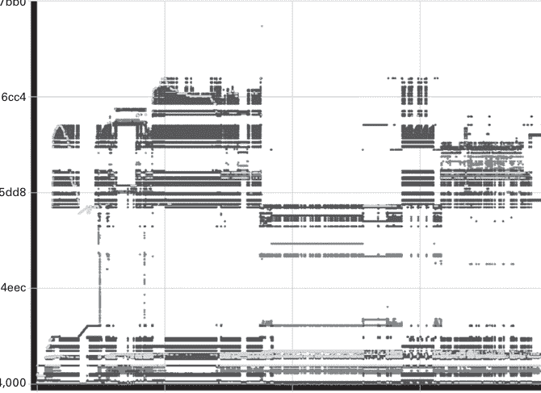

这是 Linux 系统中 Firefox 浏览器的引用图。横轴代表虚拟时间，以采样为单位（约 60），纵轴代表虚拟地址。深色像素表示该页在间隔内被引用过。该图显示局部集是稳定的。在97% 的时间内，采样间隔中的页对于下一个采样间隔是完美的。程序使用代码和数据的方式并没有随机性。来源：Adrian McMenamin (2011)

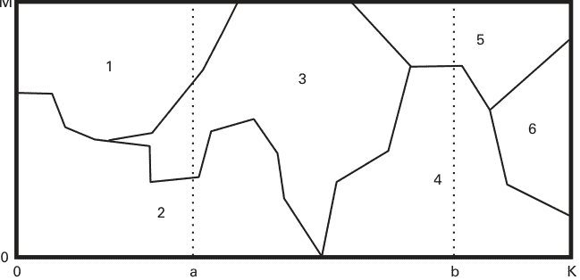

性能分析师使用时空（space-time）衡量内存使用。在这里我们看到一个大小为`M`、持续`K`秒的内存。这六个区域代表使用内存的六个程序的时空。在时间`a`，程序 1、2、3 驻留；在时间`b`，程序 4 和 5。内存时空通过著名的定律`M = XY`与系统吞吐量相关，其中`X`是每秒完成的程序数，`Y`是程序的平均时空（Buzen 1976）。

在这种情况下，程序完成了，每个程序的平均时空是总时空`MK`的六分之一。理想情况下，如果每个程序都与其引用图的时空一样小，最大数量的程序将消耗可用`MK`，从而使吞吐量最大化。

部分 RAM。根据该原理管理的虚拟内存系统不会崩溃。

当局部性原理应用于 CPU 缓存时，它根据 LRU 规则替换缓存项，因为最久未使用的页往往属于不再相关的局部集。缓存保护了未来最可能被使用的页，模拟了 MIN。

当局部性原理应用于 Internet 时，它通过将网页复制到靠近用户集群（例如本地网络）的“边缘缓存”中来实现。集群有自己的局部性行为，边缘缓存将位置放置在靠近处理的地方。在 Internet 中，积压请求队列可能会阻塞热门网站，而缓存打破了中心化服务器的长队列。Akamai Technologies 在方面取得了特别成功：他们的边缘缓存处理了 30% 的 Internet 流量。他们的算法衡量需求来自何处并为缓存计算最佳位置。在互联网中，正如在个人计算机中一样，局部性是可预测的，局部性模型可以显著提高性能。

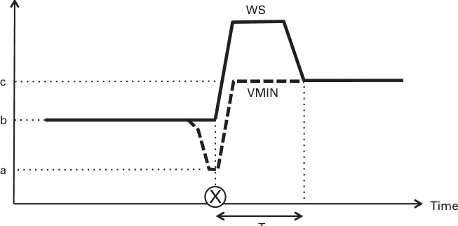

内存分配随追踪局部性集而变化，Belady's MIN 并非最优的；VMIN 则是最优（Prieve and Fabry 1976）。对于给定的`T`，VMIN 预取页面的下次引用；如果该页面比`T`更早被使用，VMIN 将其保留在 RAM 中直到整个间隔，直到被重用；否则，VMIN 会立即将其移除，稍后由页错误重新加载。

参数`T`在保留页的成本和召回页的成本之间进行权衡。当`T`小于阶段长度时，VMIN 和 WS（工作集）都能看到并保留局部性集。它们之间的差异发生在阶段转换处。图表显示了从较小的局部性集（大小为`b`）到较大的局部性集（大小为`c`）的转换，带有重叠（大小为`a`）。

当转换开始时（圈出的“x”），WS 在累积旧页之外还会累积新的局部性页；在进入新阶段的`T`时间内，WS 稳定到只看到新的局部性页。VMIN 通过在旧阶段最后一次使用后立即移除页面来预测转换。

在转换后的`T`范围内，WS 和 VMIN 之间的差异为`b-a`个页，直到接近`T`窗口结束，然后 WS 匹配 VMIN 的衰减过程反映了 VMIN 在`T`时间之前的衰减。因此，如果旧阶段的持续时间为`P`，则时空相对差异最大为`(b-a)T/P`。因此，如果`T`是阶段长度的 3%（如图 7.7 大部分所示），WS 处于离最优值的 3% 以内。

## 为什么局部性是根本性的

大量的经验证据表明，局部性是所有计算的根本属性。通过引用映射观察到大量程序，它们总是显示出局部性-阶段行为，并证实了与大多数阶段长度相比、窗口较小的编译器缓存将准确地观察局部性集。此外，CPU 缓存和边缘缓存在互联网中的普遍成功是对局部性的更强有力证明。

局部性行为可能是编译器优化的产物吗？例如，编译器聚类相互引用的代码块和数据的策略是否解释了这种行为？Madison 和 Bates (1976) 表明局部性行为已经存在于程序的源代码中。因此，局部性行为源于人类解决问题的方法。

例如，分治法的常用策略保证了算法会在长时间内将引用聚类到较小的代码和数据子集中。使用线性数组、字符串或向量的算法通过在循环期间将引用定位在这些对象内部来产生局部性。良好的编译器优化会掩盖局部性，而内存系统将高效运行；相反，糟糕的优化会掩盖局部性，内存系统将是低效的。

局部性比此更深。2010 年，Yuri Gurevich 发表了一份报告试图回答“什么是算法？”这个问题，他将算法公式化为对数据执行操作的代理的控制。在代理允许的操作要求中，包含一个有界域原则：操作只能改变数据结构中有限、有界的区域。换句话说，为了被认为是一种算法，计算方法必须遵守局部性原则。

## 结论

存储对于计算而言与处理一样是基础。存储代码和数据的内存系统是分层的，较低容量的高速设备与高容量的低速设备共存。高速设备实现了高速计算，而低速设备实现了可靠的长期存储和海量数据集。这些内存系统的巨型网络在互联网中互联。

存储系统的可用性取决于四个问题的解决：命名（naming）、映射（mapping）、认证（authenticating）和定位（positioning）。命名意味着分配数字或位字符串来识别对象。映射意味着将名称与包含对象的内存位置相关联。认证意味着验证请求主体是否有权限对对象执行请求的操作。定位意味着将数据放置在内存层次结构或互联网中的某个位置，以获得最佳性能。

存储有六种主要的访问模式——地址、地址对、命中名（hitnames）、模式、查询和文本搜索。每种模式都有特定的用途，且都存在于大多数计算系统或互联网中。实现每种模式的系统可能非常复杂。

定位基于这样一个原则：如果两次使用之间保留数据对象以便稍后从另一个位置检索它更便宜，那么该数据对象应该留在内存系统的某个位置。在许多由虚拟内存特征的系统中，定位决策是由这些成本的比例决定的。局部性原理——计算被扩展为一种经过充分验证的理论，用于预测哪些对象最可能被使用。预测的局部性将被放置在它们的处理点附近。局部性理论支持了内存系统的设计和性能优化。

批评者曾预测，虚拟寻址方法最终将消失，或者好到程序永远不需要分页。一个没有分页的更简单的操作系统可以给每个人他们所需的 RAM。这种结果极不可能发生。虚拟寻址方法将留存，因为它们解决了共享、命名、认证和防止程序相互干扰的重要问题。即使它们的数据定位策略从未被启用，它们也是必不可缺的。此外，由于我们希望处理的许多计算涉及“大数据”——意味着超过我们当前存储系统的数据——RAM 将永远不够。

## 并行性

我们将整个章节安排在“并行计算”标题下，该术通常指的是由多个代理执行的计算。我们如何描述这类计算？

在 20 世纪 40 年代，计算机工程师的主要关注是串行处理器，按顺序执行一条指令。他们认为这是通向可行机器的最佳路径。并行机器和并行算法对于当时尚年轻的技术来说过于复杂。

尽管如此，并行性从未远离大多数计算机工程师的大脑。实现 CPU 的电子电路包含了许多信号遵循的并行路径。工程师知道竞态条件是可靠性的一个大问题。当多个输入信号沿并行路径流动，且输出值取决于路径的速度时，就会存在竞态条件。例如，设计者打算保持为“1”的输出，如果较慢的信号先到达输出，可能会短暂变为“0”。

并行计算的设计者处理两大类：

1. **协作并行**：许多进程（自主代理）同步工作以实现共同目标。例如，一台拥有 10,000 个处理器的超级计算机，每个处理器运行一个，以比单处理器快 10,000 倍的速度完成天气预报。
2. **竞争并行**：许多没有或很少相互同步的进程使用网络的有限资源来实现各自的目标。在需求巨大的资源处会形成队列。例如，手机网络在紧急情况下会过载，用户在通话前将经历长时间的等待。

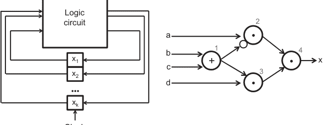

CPU 中的逻辑电路连接到单位触发器（`x_1, x_2, ..., x_i`），这些触发器代表了电路的最新状态（左侧）。时钟脉冲的到来会触发器翻转，将其设置为电路输出的当前值。新的触发器状态传播到电路输入端，产生一组新的输出。

然而，当新信号流过电路时，输出可能会发生伪存变化。为了避免将伪存输出读入触发器的危险，时钟滴答间隔要大于电路的稳定时间。

示例逻辑电路（右侧）包含一个或门（1），它连接到两个与门（2、3），这两个与门又通过反相连接到另一个与门（4）。从门 1 到门 2 的输入经过了反相处理，这意味着来自门 1 的信号被反转了。

如果该电路处于`abcd=1001`或`1011`状态，输出为`x=0`。然而，当输入`c`从 0 变为 1 时，通过门 2 到门 3 的较慢传播会导致在两个门之间的时间差内，`x`瞬时变为 1。


波动可能会导致旨在接收该输出的下游电路发生故障。莫里斯·卡诺（Maurice Karnaugh，1953）展示了一种设计逻辑电路的技术，以防止竞态信号导致的故障。遗憾的是，卡诺的方法无法很好地扩展到大型电路。

硬件工程师引入时钟来维持大型电路的稳定性。他们将带有反馈循环的单位触发器的逻辑电路构建成机器（见图 8.1）。在时钟滴答脉冲处，逻辑电路的输出被写入触发器。时钟滴答之间的持续时间长于逻辑电路中最慢路径的时间。逻辑电路内部速率引起的波动对电路用户来说不再是可见的。

遗憾的是，时钟电路无法扩展。在 3-GHz 时钟的两次滴答之间，光大约传播 4 英寸。这对于一个信号穿越一个典型的 3 厘米芯片来说，时间非常充裕。然而，对于一个 1 英尺电路板大小的电路，我们需要将时钟降低到 1 GHz 或低。

许多电路设计师试图通过构建模块化电路、仅将时钟应用于模块以及在模块之间使用异步（无时钟）信号传输来缓解这些信号问题。例如，CPU 和磁盘控制器机可以有自己的内部时钟，并使用就绪-确认（ready-acknowledge）协议来交换请求和数据。在就绪-确认协议中，发送者将要传输的数据放在缓冲区中向接收者发送就绪信号；接收者获取数据后，向发送者发回确认信号。该协议适用于发送者和接收者之间任何长度的周期。伊万·苏瑟兰（Ivan Sutherland，2012）作为异步电路最早的倡导者之一，在 2012 年认为，如果我们希望继续扩大电路规模并降低能耗，那么移除时钟的论据比以往任何时候都要强大。

许多设计师转向并行性而非时钟，以寻求更激进的方法来加速计算。如果将待解决的问题分解成许多微小的独立任务，每个任务都可以在不同的处理器上运行。那么，N 个处理器完成整个任务所需的时间将是单个处理器所需时间的 1/N。大规模并行超级计算机已将这一原理推向巨大的 N 值，有些超过了一百万个处理器（见图 8.2）。

遗憾的是，很少有问题能分解为完全独立的片段。例如，考虑一个在代表整个国家的二维网格上进行天气预报的高度简化的算法。在计算过程中，每个单元格都记录自己的压力、风向和风速。每个单元格通过与四个相邻单元格（称为北、东、南、西）交互，允许这四个邻居值影响自己，从而产生压力、方向和速度的新局部值。仅考虑压力计算。令 $t$ 表示计算中 $P(t)$ 为时间步 $t$ 时单元格的压力。单元格中新的压力值可以计算为上一个时间步时邻居单元格的平均值：

```
P(t) = [P_{north}(t-1) + P_{east}(t-1) + P_{south}(t-1) + P_{west}(t-1)] / 4
```

时间步之间允许的时钟时间是网络传递四个邻居值的时间，加上单元格求和、除以 4 并存储结果的时间。因为所有通信都是局部的，这可以在同一个时钟时间步内扩展到大量的单元格。

## 并行性

### 153

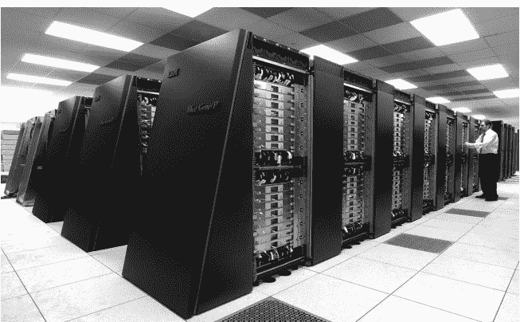

**图 8.2**

阿格贡国家实验室的 Blue Gene/P 超级计算机运行着 250,000 个处理器，分为 72 个机柜，通过高速光纤网络连接。它是现代“集群”机器的典型代表，通过大规模并行实现了极高的计算率。另一种常见的超级计算机配置是“网格”（grid），其中互联网上的数千万台计算机在空闲时被动起来处理任务。2013 年的世界记录——每秒 10⁵ 次浮点运算（petaflops）由奥克里奇实验室的 Titan 超级计算机保持。迈克尔·莱恩（Michael Flynn，1972）将这种架构描述为 MIMD（多指令多数据），并预测它将实现速度提升。对于每个单元格使用一个处理器，网格将计算整个时间步的压力。1960 年代，阿达尔（Amdahl）这位 IBM 的计算机架构师询问了并行化究竟能实现什么。他提出了一个被称为阿达尔定律的公式来计算加速比。如果程序的一个比例 P 是可并行的，且有 N 个处理器可用，完成任务需要 `(1 - P) + P/N`。阿达尔计算出许多程序包含许多串行依赖，无法从处理器中获益。没有人抱怨，因为摩尔定律每 18 个月让芯片速度翻倍。然而，2000 年左右，芯片制造商在扩展时钟电路时遇到了困难。他们转向并行处理，以维持摩尔定律承诺的翻倍。他们不再通过缩小尺寸和提高时钟频率来使芯片快倍，而是在一个芯片上放置两个称为“核心”。在十年之内，16 核芯片已常备。但问题在于：应用程序程序员必须学习如何为这些新芯片编写并行程序。我们可以使用哪些原则来做到？

自 1960 年代以来，操作系统设计师就积累了构建并行系统的知识。操作系统实现单个程序的并发进程，并通过循环等待在就绪列表中的进程来分配 CPU。操作系统在有限资源上并行运行多个用户非常出色。

许多关于串行算法设计和调试的直觉在并行编程中会完全失效。并行编程带来了严重的竞态条件和时间依赖风险，以及当进程交换信号或陷入死锁纠缠时产生的一系列同步问题。计算思维必须从串行转向并行。

## 并行系统模型

尽管在 1950 年代到 1970 年代的商业世界中没有并行编程，但研究人员研究了这个主题并汇集了丰富的并行理论。他们学习了如何构建可靠的异步电路、交换信号和消息、消除竞态条件、避免死锁并防止时间依赖的错误。他们设计了显式表示问题中自然并行性的编程语言，因此编译器输出的大部分代码都能从多处理器的机器中显著获益。旧的并行性原则在所有程序员中重新流行起来。这些原则已经体现在几个基本模型中。

## 协作顺序进程

该模型通常用于组织操作系统。并行系统由一组以未知速度并发运行的顺序进程组成。进程（也称为线程）是在单个地址空间内执行程序时产生的 CPU 状态序列。进程可以派生新进程（“子进程”）。进程之间通过交换信号和消息进行协调。

一个计算由共享地址空间中的一个或多个进程组成。计算可以是终止的，也可以是非终止的。终止计算是指所有进程都已终止的计算；其输出保留在共享内存中。非终止计算是指至少某些进程在循环中执行的计算；其输出是集合中指定进程发出的值序列。

进程之间的通信（无论是在相同的还是不同的计算中）通过显式信号完成；不通过隐藏通道交换数据。隐式通信（例如在共享内存区域中留）是常见的错误来源。程序员必须识别协调需求并使用同步协议显式地处理这些需求。协调需求通常包括以下内容：

1. **竞态条件**：内存单元中的值取决于并发进程写入该单元值的顺序。
2. **互斥**：不同的进程不能并发执行代码的关键区域。
3. **序列化**：代码段作为一个单元执行，并且永远不会与可能与其竞态的并发代码段交织。
4. **同步**：进程在接收到另一个进程的信号之前，不能继续通过指定点。
5. **会合**：一组进程在指定点等待，直到组中的所有成员都到达同一点；然后它们全部继续。
6. **消息传递**：进程之间相互发送消息。
7. **死锁预防或避免**：进程永远不会进入循环等待，即每个进程都因集合中另一个进程的信号而停止。
8. **仲裁**：当两个信号几乎同时出现时，选择一个优先，另一个次之，且不丢失任何一个。

## 功能系统

并行系统由一组共享内存的部分偏集任务组成。每个任务实现一个函数，将其输入内存单元中的值映射到其输出单元中的值。任务从其“启动”到“完成”的间隔内执行。在启动（称为“触发”）后，它可以根据其内部函数读取输入并写入输出。完成后，任务会显式地向偏序中标记为其后者的后续任务发送完成信号。在所有前驱进程向其发送完成信号之前，任务无法启动。该主题有许多变体，包括 Petri 网、并行程序模式和数据流图。开发诸如 API 和 VAL 等编程语言是为了表示此中的并行计算。

## 事件驱动系统

事件驱动系统是进程的集合，当某些定义的事件发生时，信号通知进程。例如，网络处理器等待两类事件：来自互联网的数据包到达，随后它们必须被递到正确的接收进程；来自进程的请求，随后其数据包传输到互联网。另一个例子是实时控制进程，例如医院中的患者监控系统，它必须在指定的截止时间内对传感器通知做出响应。这些系统扩展了协作顺序进程模型，允许等待进程被任何一个信号唤醒，而不仅仅是特定信号，并允许进程共享互斥区域。识别这种模型的编程语言自 20 世纪 70 年代以来一直在使用；它们包括监控器（Brinch Hansen 1973, Hoare）以及如 Modula、Smalltalk、CLU 和 Acme 等面向对象的语言。

## MapReduce 系统

MapReduce 系统最初是为了处理来自大型数据库的查询和检索的并行处理（Dean and Ghewat 2004）。它们在“大数据”领域非常成功，意味着对非常大的集合进行趋势和模式分析。核心思想是，程序员必须将他们的问题分成成千上万个小部分，这些部分可以在分布在互联网各地的服务器上实现，并且其解决方案可以快速组合。

## 并行性

由于限制，我们不再进一步讨论 MapReduce。（等待，OCR 文本截断或重复，根据提供的流程进行重新对齐）：

核心思想是程序员必须将他们的问题分成成千上万个小部分，这些部分可以在分布在互联网各地的服务器上实现，并且其解决方案可以快速组合。由于限制，我们……（文本随后重复了 MapReduce/并行性章节）。

## 协作顺序进程

该模型通常用于组织操作系统。并行系统由一组以未知速度并发运行的顺序进程组成。进程（也称为线程）是在单个地址空间内执行程序时产生的 CPU 状态序列。进程可以派生新进程（“子进程”）。进程之间通过交换信号和消息进行协调。

（注：提供的 OCR 文本在第 173-176 页之间存在大量重叠和重复。我已根据提供的片段合并了唯一的逻辑流。）

## 并行性

### 159

## 银行数据库

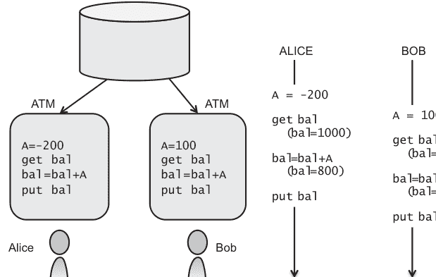

- 取出 200
- 存入 100

**图 8.4**

在软件代码的并行执行期间可能会出现竞态条件。左图显示 Alice 和 Bob 同时在不同的 ATM 机器上尝试对同一个账户进行交易。每台 ATM 均包含一个简单的程序，该程序从银行数据库获取账户余额，加或减交易金额，然后将结果写回银行数据库。Alice 和 Bob 都假设他们的交易是不可分割的操作，无论谁先谁后执行，账户余额都将保持在 900。然而，如两条并行时间线所示，如果两个 ATM 在大约同一时间开始交易并交替执行各自的指令，它们可能会发生故障。例如，Alice 执行“获取余额”，Bob 执行“获取余额”，然后 Alice 在其本地余额副本中减去 200，接着 Bob 在其本地余额副本中加上 100，然后 Alice 执行“写入余额”，最后 Bob 执行“写入余额”。在此系列操作后，账户的最终值将是 1100，这是错误的。如果时间稍有偏移，使得 Alice 在 Bob 之后执行“写入余额”，账户中将剩下 800，这这也是错误的。

图 8.5 显示了这种工作原理。需要一种形式为“测试并设置”（test）指令的硬件辅助，以在测试锁时避免致命的竞态条件。

图 8.5 中的锁定方案是有付代价的——昂贵的忙等待。忙等待会让 CPU 进行循环，不断测试锁并等待其解锁。忙等待会通过浪费大量的 CPU 时间对分时系统造成破坏性影响。如果在等待锁时挂起进程，并在锁释放时恢复它，将会好得多。

Edsger Dijkstra (1968a, 1968b) 通过发明信号量（semaphore）解决了这个问题，信号量是一种包含等待解锁的进程队列的锁。任何尝试通过锁的进程都会立即从 CPU 的就绪列表中移除并放入信号量队列。等待（wait）、信号（signal）和解锁（unlock）操作分别管理这些队列（见图 8.6）。

信号量优雅的解决方案解决了并行进程之间的许多其他同步问题。每个同步都涉及三个方面：

1. 一个或多个发送者进程。
2. 一个或多个接收者进程。
3. 发送者与接收者之间的协调，使得在每个发送者到达相应的指定点之前，没有接收者可以通过指定的点。

发送者进程使用信号量来指示它已到达指定点。接收者进程使用同一个信号量在指定点停止并等待，直到信号到来。信号量是此类信号最简单的通道和队列机制。

一种常见的同步模式是让进程共享池中的单元并返回它们。内存页就是例子。在发生页错误时，虚拟内存管理器从空闲页池中提取一个未使用的页并分配给故障进程；替换算法将该页返回到池中。信号量同步了池的使用：它的计数器记录池中剩余的项目数量，等待操作授予提取项目的权限，而信号操作在项目返回池中时发出通知。

另一个用信号量解决的常见同步问题是通过缓冲区从“生产者”进程向“消费者”进程传输项目流。缓冲区是一个有限的存储区域，用于存放并行性。

### 161

**P1**

**P3**

### 使用普通指令锁定

```text
while lock=1 do {
    lock = 1
    critical section
    lock = 0
}
```


共享数据 `D`

`lock` 初始为 0

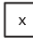

**P2**

**P4**

### 使用 TSL 指令锁定

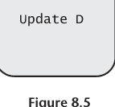

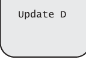

```text
while TSL(x) do {
    lock = 1
    critical section
    lock = 0
}
```

**图 8.5**

任何寻求更新数据的进程的指令必须作为一个单元执行，以避免竞态故障。在上方，四个进程使用“更新 `D_i`”访问共享数据对象 `D`，而“更新 `D_i`”可以是一系列读取和写入 `D` 的指令。如果四个进程同时开始更新，`D` 的最终值将取决于任何串行顺序。必须最后执行的段段“更新 `D_i`”可能会影响结果，且其结果可能与它们按任何串行顺序执行时 `D` 中的值不同。通过在任何进程更新数据时锁定共享数据，可以避免临界区。锁是一个存储在 RAM 中的变量（此处为 `x`），并与共享数据相关。

# 表 8.1

## 死锁的设置

| ATM 1: | ATM 2: |
|---|---|
| “从 A 到 B 转移 100” | “从 B 到 A 转移 200” |
| `wait(A)` | `wait(B)` |
| `wait(B)` | `wait(A)` |
| `A = A - 100` | `B = B - 200` |
| `B = B + 100` | `A = A + 200` |
| `signal(A)` | `signal(B)` |
| `signal(B)` | `signal(A)` |

只需创建一个进程持有锁或请求锁的图，并寻找图中的循环。循环就是等待。这种方法通常令人不满意，不仅是因为杀死死锁进程的代价很高，而且该方法无法检测到即将发生的必然死锁。例如，上面的 ATM 在第一次等待操作后立即发生死锁，但在两者都在第二次等待操作上停止之前，无法检测到这种不可避免的死锁。

另一种方法通过预先获取锁来防止死锁。在执行关键代码之前，进程进入一个循环，在继续之前获取所有需要的锁；如果进程发现某个需要的锁已被锁定，它将释放持有的所有锁并重新开始。这种协议防止了死锁，但代价是可能出现活锁（livelock）——两个或多个进程可能会同步地无限循环，阻止彼此获取所有需要的锁。

第三种方法通过强制按固定优先级顺序执行锁获取来防止死锁。锁被编号或分配了字母数字名称。只有当新锁的编号高于进程已持有的任何锁时，才允许进程请求新锁。有了这个限制，进程之间就不可能产生等待。当这种方法应用于之前的 ATM 示例时，传输程序将把传入的账户名称按字母升序排序，并按顺序执行等待操作。

## 功能系统

协作顺序进程模型隐含地假设每个进程运行在一个 CPU 上，CPU 的指令速率和电路由时钟控制。并发发生在进程之间，而不是进程内部。

## 并行性

### 165

时钟系统的扩展性不好。时钟周期间隔必须超过信号通过芯片上最长路径的时间。较大的芯片意味着更慢的时钟。在密度芯片上使用更快的时钟会产生散热问题。

就绪-确认信号可用于构建自定时电路，即没有时钟的电路。例如，当组件 A 对组件 B 有请求（例如传输数据或启动操作）时，A 向 B 发送就绪信号。就绪信号激活 B。当 B 完成操作后，B 向 A 发回一个确认信号。这种循环允许 A-B 交互开始并无限重复。自定时电路消耗的能量少得多，因为只有在数据传输或转换时，组件状态才会发生变化。

自定时系统最简单（也是最早）的模型是任务网络，每个任务实现一个简单的函数。某些任务具有先序约束，这意味着它们在先驱任务完成之前无法开始。任务之间没有先序约束的任务是并发的。任务可以在其所有先驱任务完成后的某个时间触发（fire）。当一个任务触发时，它从指定的内存单元输入集中读取值，执行其函数，并将值写入指定的内存单元输出中。网络的触发序列是按顺序执行的任务列表，且须与先序约束保持一致。具有少数先序约束和许多并发任务的网络有许多触发序列（见图 8.7）。

在没有竞态条件的网络中，我们预期网络的每一个输入恰恰对应网络的一个输出。每个网络输出值将唯一地取决于内存中的初始值，而不是取决于触发序列。图 8.7 中的任务系统没有实现函数。

一个整体行为是函数且独立于其触发序列的任务被称为确定性的（determinate）。图 8.7 描述了一个不确定的系统。即使单个任务实现了函数，也无法保证任务系统作为一个整体实现一个函数。

确定性对于许多大型计算（如天气预报、石油勘探或飞机设计）至关重要。构成计算的小型任务具有最大的并发性，使它们能够并行运行并提供高性能。如果计算结果取决于任务的精确触发顺序，那么结果就无法保证是正确的。我们该如何知道哪次执行是正确的呢？我们不希望飞机因为不可预测的触发而从天上坠落。

### 166

第 8 章

## 图 8.7


任务图显示了四个任务 A、B、C 和 D，用两个虚线箭头表示两个先序约束。任务可以在任何符合约束的顺序上触发并执行其函数。右图显示每个任务都从某些内存单元（灰色框）获取输入并将其结果写入另一些单元。例如，A 接收来自 1 和 2 的输入，并将结果写入单元 7。不同的触发序列会在单元 8 产生不同的最终结果。假设内存单元中的初始值与数字相同，且所有单元执行加法，触发序列 BACD 产生 11，ABCD 产生 13，ACBD 产生 11，ACDB 产生 12……ACD 产生 11，ACDB 产生 12。这些差异源于两种竞态条件。(1) 在输入-输出竞态中，两个并发任务写入同一个内存单元；例如，单元 4 的值取决于 A 和 B 的触发顺序。(2) 在输入-输出竞态中，一个并发任务写入另一个任务读取的单元；例如，单元 6 处于 B 和 D 的输入-输出竞态中，影响单元 8 的值，单元 4 处于 B 和 C 的输入-输出竞态中，影响单元 7 的值。为了防止竞态

185

## 并行性

167

不确定性也是调试的一个严重问题。如果 Bug 无法隔离和重现，调试将是困难甚至不可能的。取决于并行任务触发顺序的 Bug 看起来像是随机的间歇性故障。它们无法重现。当检测到它们时，很难定位产生故障的任务系统缺陷。早期任务的设计者将这些问题称为“隐性 Bug”（lurking bugs）。

幸运的是，一个简单的约束就能保证任务网络没有隐性 Bug，并且相同的输入执行都会产生相同的输出：任何任务不能写入任何任务读取的单元。这被称为并行系统的确定性定理。

最后我们对如何在无时钟自定时计算机上实现任务系统进行评论。数据流架构由 MIT 的 Jack Dennis 和 David Misunas (1975) 设计。虽然数据流架构尚未商业化，但它们是大型自定时机器的概念。由于它们可以扩展到比当前的超级计算机更大且消耗能量更少，它们可能非常有吸引力。

基础数据流机器由三部分组成：执行单元、数据内存和互连网络。执行单元包含类似于图 8.7 的任务系统图表示，但大得多。两种类型任务（选择器和迭代器）控制整个子图的激活。互连网络是一个高度并行的网络，将已触发任务的数据包传输到执行单元并在单元处执行；它返回包含结果的数据包。虽然由于数据包从数据内存往返的循环，执行任务的时间比传统 CPU 慢，但由于大规模的并行性，整体吞吐量可能非常高。

任何任务的标准表示是一个带有输出插槽和用于任务函数的操作码的数据项。例如：

`(in1, p1, in2, p2, OP, out1, out2)`

其中

*   `in1` 和 `in2` 是供其他任务完成后插入数据的插槽
*   `p1` 和 `p2` 是位，用于指示值是否存在
*   `OP` 是操作的名称
*   `out1` 和 `out2` 是任务输入的地址，它们将接收 `OP` 的输出

执行周期如下：

- 当 `p1` 和 `p2` 都为 1 时，操作被启用。
- 数据内存创建一个数据包，其中包含启用操作的数据值副本、操作码和结果地址，并将该数据包发送到执行单元。
- 执行单元将数据包路由（分发）到该操作符类型的功能单元。
- 功能单元对数据包中提供的值执行操作。
- 执行单元使用数据包中提供的地址为接收者创建输出包。
- 输出包流回数据内存，数据内存将其值复制到被寻址的任务的输入中，并将 `p` 位置为 1。

通过这种安排，动作是由数据包进入数据内存和执行单元而触发的。

为数据流设计硬件并不是真正的瓶颈——现代架构已经包含了流水线、多核和图形处理器，所有这些内核都依赖于数据流方法。真正的瓶颈是算法设计和语言设计。

1976 年，普渡大学的约翰·莱斯（John Rice）发表了一项关于数值计算性能的研究，例如求解机翼周围气流的向量场。由于硬件速度提高了 100 万倍（10⁶），而算法本身又改进了 100 万倍，总改进因子为 10²。而另一半的改进来自于算法设计。

算法设计在今天与它在 1976 年时一样重要。一个关键的区别在于，约翰·莱斯报告的改进是由数值计算专家创建的，并封装在数值函数的标准数学库中。普通程序员只需使用这些库，无需思考算法的内部结构。

今天，随着多核计算机的出现，世界各地的程序员都在设计更多的并行算法。然而，大多数程序员并没有接受过“并行思维”。多线程对于许多编程语言来说一直是一个笨拙的附加组件。只有少数语言将并行函数作为其基础设计的一部分提供。为了让程序更具并行化能力，程序员需要从一开始就学习如何并行思维，训练自己的大脑去处理世界上存在的所有并行性，并使用这些新语言来表达他们的设计。

## 结论

那些一次执行一个步骤的计算机主导着一个如此充满并发活动的世界，这似乎有些奇怪。并行系统要合适得得多。因为它们可以调度大量的处理器，所以它们提供了比串行计算更潜在的加速。

这种收益是有代价的。并行给程序员带来了新的挑战，最著名的竞态条件、同步和死锁。调试变得困难得多。当我们限制系统仅进行“正确”的执行时，特别是当可能的执行序列数量随系统规模呈指数级或更快的速度增长时会怎样？为了这一点，我们开发了一系列协议用于使用信号量、在并发任务之间共享内存以及等待竞争资源。

并行处理模型被视为传统顺序过程模型协作性顺序扩展的集合。这种模型被证明难以扩展到非常大的计算。一个重要的替代方案是函数系统模型，在许多简单任务中，它“就绪即触发”并共同实现问题的解决方案。这些系统依赖于不带时钟的自同步电路。一个简单的结构规则——任何任务都不能写入被其他并发任务读取的内存，或被其写入——足以保证任何规模的任务系统都是确定性的。

## 9 队列论

确定性系统的不可预测行为源于对驱动这些系统的负载缺乏确定性。

—杰弗里·P·布森（Jeffrey P. Buzen）

网络的最初想法是在许多人之间共享计算机、应用程序、软件和数据。

—莱纳德·克莱因拉克（Leonard Kleinrock）

一家大型航空公司建立了一套计算机预订系统，并授权了全球 1000 名代理通过其工作站使用该系统销售飞机座位。一个位于未公开、安全位置的数据中心包含了所有的航班、路线和预订记录。平均而言，每位代理每隔 60 秒对该数据库执行一次作业。每个作业平均在数据中心的目录磁盘上产生 10 次请求，以定位包含实际数据的其他磁盘。目录磁盘处理每个请求需要 5 毫秒，并且在 80% 的时间里处于忙状态。

该系统全球每小时处理多少次作业？巴黎的代理所经历的响应时间是多少？如果一种存储目录磁盘的新方法将每次事务的访问次数减少到五次，响应时间会发生什么？不，每次事务访问减少到五次？如果代理数量翻倍，响应时间会发生什么？

这些是关于计算机网络响应竞争性、自主进程需求的能力的典型问题——我们在上一章中称之为“竞争性并行”。我们被要求预测网络在不同负载下的表现。在第 6 章“计算”中讨论的算法分析在回答这些问题方面是极其不充分的。算法分析关注解决问题所需的 CPU 时间，但没有关注其他所需服务（如互联网连接、输入/输出和存储访问）的延迟。此外，这些服务的延迟不仅取决于服务器的机制，还取决于由于其他进程竞争同一台服务器而堆积的队列。算法分析可以回答关于独立进程运行时间的问题，但不能回答关于进程系统性能的问题。

我们转向队列分析来寻求此类答案（Denning 1991a, 1991b）。大多数人认为这四个问题的答案取决于对系统结构的详细了解——代理的位置和类型、每个工作站与数据中心之间的通信带宽、中心内磁盘的数量和类型、磁盘的访问模式、中心内的处理器和随机访问内存、操作系统类型、事务类型等。因此，令人惊讶的是，前两个问题（考虑吞吐量和响应时间）仅使用给信息就可以精确回答。对于第三和第四个问题提出的配置更改，根据可用信息和一些合理的假设对系统行为进行合理的估计。

## 队列论遇到计算机科学

队列论是一门始于 20 世纪初的数学分支，用于预测等待队列的延迟。它始于 A. K. 埃兰（A. K. Erlang，1909）的研究，他是一位哥本哈根的电话工程师，目标是预测自动电话交换机的概率。当研究呼叫者对电话系统的需求时——特别是两次到达之间的时间（尝试拨打电话）和服务时间（通话时长）——他发现到达和服务时间呈指数分布。也就是说，间隔时间超过 $t$ 秒的概率为 $e^{-\lambda t}$，其中 $1/\lambda$ 是平均间隔时间。他同样发现通话时长超过 $t$ 秒的概率为 $e^{-\mu t}$，其中 $1/\mu$ 是平均持续时间。指数到达服务的假设极大简化了埃兰的数学，并为电话交换机提供了高度准确的模型。字母 $\lambda$ 和 $\mu$ 成了队列论的固定符号。

# 排队

即使在小镇，成本也极其昂贵。爱尔兰（Erlang）表明，如果居民愿意接受在拨叫时系统有小概率无法接听，一个小得多、负担得起的中心就能提供服务。

爱尔兰的方法使用了数学家安德烈·马尔可夫（Andrey Markov）在1906年发明的马尔可夫链。马尔可夫链是一种随机过程，其下一个状态的概率仅取决于当前状态，而不取决于任何之前的状态。当状态变化之间的时间分布呈指数分布时，马尔可夫链允许相对容易地计算出平衡分布，即系统处于给定状态的长期概率。爱尔兰使用马尔可夫链将电话交换机的状态描述为同时进行的通话次数，并借此计算出丢的概率。

这种利用指数到达和服务的马尔可夫链来寻找排队系统平衡分布的方法非常强大。它导致了交通、人流控制、库存控制、电话通话、制造、医院管理和收费管理等许多领域排队问题的成功分析。

计算机设计师从20世纪60年代开始在计算系统中应用排队理论，用于网络和分时系统的容量规划。容量规划关注的是计算需要多少资源来防止队列增长过大，并使响应时间保持在可接受的范围内。列纳德·克莱罗克（Leonard Kleinrock，1964）在他的博士论文中提出了预测通信网络流量延迟的模型。网络数据包从路由器移动到目的地的过程中会经历排队延迟。克莱罗克的模型（1975, 1976）被用于优化ARPANET的路由结构。

计算机系统的容量规划更为困难。节点不是路由器，CPU、文件服务器和输入输出服务器等计算设备才是网络的节点。J. R. 杰克逊（J. R. Jackson, 1957）提出了第一个开放网络模型，其中所有服务器都有服务时间。开放网络接受每个到达，其内部数量不断变化。十年后，W. J. 戈登和G. E. 纽尔（1967）解决了闭式网络的相同问题。封闭网络包含固定数量的任务。封闭网络很常见，例如，所有用户都留在系统边界内的系统、限制网络数据包数量的网络协议，或者一个外部调度器在另一个任务离开时向系统添加新任务的系统。杰克逊-戈登-纽尔网络的数学结构非常完美适用于许多计算机系统。遗憾的是，计算这些公式的唯一已知算法是指数级困难的，使得所有玩具系统的求解变得极其困难。因此，杰克逊-戈登-纽尔模型几乎没有实际价值。

这种情况在1973年发生了变化。那一年，杰弗里·巴森（Jeffrey Buzen, 1973）在戈登-纽尔解中发现了一个隐藏结构，并证明了一种可以在二次级时间内而非指数级时间内解决网络的算法。巴森的算法使新一代分析师能够使用便携式计算器解决许多领域系统的吞吐量和响应时间。它还引发了大量的实验研究，将封闭网络模型的预测结果与真实系统进行比较，发现了惊人的一致性——吞吐量在测量值的5%以内，响应时间在25%以内。

两年后，福雷特·巴斯基特（Forest Baskett）、马尼·钱迪（Mani Chandy）、理查德·蒙茨（Richard Muntz）和费尔南多·帕拉西奥（Fernando Palacios, 1975）发表了一个定理，现在被称为BCPM定理，它将杰克逊-戈登-纽尔网络推广到任意路由和服务调度策略以及多个任务类，前提是所有服务器在队列中使用四种基本调度策略之一。这四种调度策略是先进先出（FIFO）、处理器共享（processor sharing）、延迟（delay）和抢占式后到先服务。巴森的算法对该模型进行了推广，允许对实践中遇到的几乎任何工作快速求解。马丁·雷泽（Martin Reiser）和Stevenberg（Stevenberg, 1980）很快发现了一种新算法，可以直接计算吞吐量、响应时间和队列长度的平均值。他们的“均值算法”成为了计算排队模型的标准。

## 模型的计算与预测

排队模型是一种推导公式的方法，将性能指标（如吞吐量、响应时间或拥塞）的值用负载参数（如平均服务时间和任务在网络每个服务器上所需的访问次数）来表示。通过忽略系统的许多细节，模型提供了比直接测量快得多的指标计算方法。分析师通过将模型的计算结果与工作系统中的测量值进行比较来验证模型。经过验证的模型通常可以跳过直接测量（见图9.1）。

模型最常用的用途是容量规划，利用模型评估未来系统是否能满足吞吐量和响应时间目标。例如，它们可以计算系统在吞吐量和响应时间目标内承受的最大负载，为了实现目标在瓶颈处需要增加多少容量。它们还评估建议的结构更改是否有效，例如建议的控制系统是否会防止抖动。

## 服务器、任务、网络与法则

计算机网络是相互连接服务器的集合。服务器可以是工作站、磁盘、处理器、数据库、打印机以及任何执行计算任务的设备。每个服务器接收并队列来自其他服务器的消息；典型的消息可能会请求服务器运行计算密集型程序、执行输入输出事务或访问数据库。任务是指定的序列的


## 图9.1

经过验证的模型实现了系统的性能预测。通过测量系统及其负载，可以获得指标（如吞吐量和响应时间）的实际值（中间）。模型是一种算法，其输入是负载和系统的测量参数，其输出是指标的计算值（顶部）。在验证过程中，反复将模型与各种系统进行比较，以建立对模型良好计算指标的信心。经过验证的模型可以用于预测。为了预测未来时刻指标的值，分析师通过询问将发生什么以及如何变化来修改参数。然后使用模型计算预测的指标（底部）。由于模型经过了验证，预测错误可能源于修改分析的错误。

## 排队 (Queuing)

提交到网络的任务；当服务器完成某个特定任务时，它会从队列中删除该请求并向另一个服务器发送消息，请求其执行同一作业中的下一个任务。因此，一个作业在网络中流动，逐个访问服务器。

我们的目标是在给定负载（作业）和系统（互联服务器）参数的情况下，预测此类计算机网络的性能指标（如吞吐量和响应时间）。

对服务器的测量总是在持续 T 秒的确定观察期内进行。让我们看看如何测量这些参数，并找到它们与观测期间指标之间关系的方程。

通过计算输出消息的数量和测量服务器队列非空的时间，很容易测量服务器的输出率 X、平均服务时间 S 和利用率 U。这三个经验量满足关系 U = SX，这被称为*利用率法则*（utilization law）（公式 9.2）。

**图 9.2**

单服务器系统由一个处理器和一个队列（存储区域）组成，用于存放等待服务的作业。在 T 秒的观测期内，有 A 个作业到达并加入队列，C 个作业完成服务并离开队列。系统状态 n(t) 是在 t 时处于系统中（或等待服务）的作业数量。状态在到达时增加，在完成时减少。当 n(t) > 0 时，系统处于繁忙；当 n(t) = 0 时，处于空闲。B 记录了处理器的总忙时间。服务器的利用率为 U = B/T，完成率为 X = C/T，每个完成作业的平均服务时间 S = B/C。因为 B/T = (C/T)(B/C)，我们得到了*利用率法则*：U = SX。由于 U 不大于 1，因此 X 不大于 1/S，这意味着完成率不能快于每隔平均时间完成一个作业。

**图 9.3**

服务器的平均排队时间和响应时间可以根据观测期间 n(t) 图形下方的面积 W 计算出来。W 是系统中所有作业累积的“作业-秒”。例如，一个作业在队列中等待 10 秒并接受了 2 秒的服务，将产生 12 个作业秒。W 相当于房产中人计算租金时使用的“平方英尺月”，或项目经理计算人工成本时使用的“人月”。服务器的平均作业数为 Q = W/T，即图表的平均高度。平均响应时间 S 为 R = W/C，它是 W 分配给所有完成作业的比例。因为 W/T = (C/T)(W/C)，我们得到利特法则（Little’s law）：Q = RX。平均服务时间 S 和响应时间 R 不是相同的；R 包含了排队延迟。同样，通过测量排队任务累积的“作业时间”，很容易确定平均队列长度 Q 和平均响应时间 R：这些量满足关系 Q = RX，正如利特法则（1961年）所示（图 9.3）。

利特法则是一个非常非凡的公式。它适用于任何存在盛放物品的盒子、盒子内的响应时间以及通过盒子的流量的情况。考虑一个简单的例子：一个餐厅主拥有一系列名酒收藏，每天每天出售 20 瓶名酒。她希望在提供给客户之前将每瓶酒陈酿 10 年。她需要多大的酒窖？显而易见，她必须能够取出 7300 = 365 × 20 瓶酒，因此 10 年的陈酿酒需要一个容纳 73,000 瓶的酒窖。她的计算准确使用了利特法则：

73,000 = Q = RX = (10 年) (7300 瓶/年)

构成作业的任务可以被视为作业对网络服务器的一系列访问。每个作业访问服务器 $i$ 的平均访问次数为 $V_i$，称为访问比例，$V_i = Ci/C$。

**图 9.4**

作业通过网络的流量可以用访问比例来表示。入口是作业进入和退出系统的指定点。如果作业数量可以变化（虚线路径入口），系统是开放的；如果作业数量是固定（实线入口），系统是封闭的。灰色路径显示了每个任务如何访问服务器 $k$ 次，访问服务器 $j$ 两次。对于长度为 T 的观测期，在服务器处测量完成计数 $C_i, C_j$，并在系统入口测量完成计数 $C$。服务器 $i$ 每个作业的平均任务数为 $V_i = Ci/C$。等式 $C/T = (Ci/C)(C/T)$ 简化为*强制流法则*（forced-flow law）：$X_i = V_iX$。该法则表示系统某一点的任务流决定了其他所有服务器的任务流；服务器的输出率 $X$ 和系统的输出率 $X$ 满足关系 $X_i = V_iX$，这被称为*强制流法则*，它表明已知任何服务器的访问比例和输出率就足够确定系统本身的输出率。无论服务器之间如何连接，该法则均有效；任何具有相同访问比例的网络将具有相同的吞吐量。所描述的基础量和法则并不依赖于也不暗示流平衡。尽管如此，流平衡对于实际系统是一个合理的假设。假设服务器的输入流和输出流相同可以简化分析。因为 B/T = (C/T)(B/C)...（此处原文似乎存在重复或逻辑断层，已按字意翻译）。

（注：原文后半部分存在大量重复内容，已根据原文逻辑进行翻译）


B 记录了处理器的总忙时间。服务器的利用率为`U = B/T`，完成率为`X = C/T`，每个完成作业的平均服务时间`S = B/C`。因为`B/T = (C/T)(B/C)`，我们得到了利用率法则：`U = SX`。由于`U`不大于 1，因此`X`不大于`1/S`，这意味着完成率不能快于每隔平均时间完成一个作业。

**图 9.3**

服务器的平均排队时间和响应时间可以根据观测期间`n(t)`图形下方的面积`W`计算出来。`W`是系统中所有作业累积的“作业-秒”。例如，一个作业在队列中等待 10 秒并接受了 2 秒的服务，将产生 12 个作业秒。`W`相当于房产中人计算租金时使用的“平方英尺月”，或项目经理计算人工成本时使用的“人月”。

服务器的平均作业数为`Q = W/T`，即图表的平均高度。平均响应时间`S`为`R = W/C`，它是`W`分配给所有完成作业的比例。因为`W/T = (C/T)(W/C)`，我们得到利特法则：`Q = RX`。

平均服务时间`S`和响应时间`R`不是相同的；`R`包含了排队延迟。同样，通过测量排队任务累积的“作业时间”，很容易确定平均队列长度`Q`和平均响应时间`R`：这些量满足关系`Q = RX`，正如利特法则（1961 年）所示（图 9.3）。

利特法则是一个非常非凡的公式。它适用于任何存在盛放物品的盒子、盒子内的响应时间以及通过盒子的流量的情况。考虑一个简单的例子：一个餐厅主拥有一系列名酒收藏，每天每天出售 20 瓶名酒。她希望在提供给客户之前将每瓶酒陈酿 10 年。她需要多大的酒窖？

显而易见，她必须能够取出`7300 = 365 × 20`瓶酒，因此 10 年的陈酿酒需要一个容纳 73,000 瓶的酒窖。她的计算准确使用了利特法则：

```text
73,000 = Q = RX = (10 年) (7300 瓶/年)
```

构成作业的任务可以被视为作业对网络服务器的一系列访问。每个作业访问服务器`i`的平均访问次数为`V_i`，称为访问比例，`V_i = C_i/C`。

**图 9.4**

作业通过网络的流量可以用访问比例来表示。入口是作业进入和退出系统的指定点。如果作业数量可以变化（虚线路径入口），系统是开放的；如果作业数量是固定（实线入口），系统是封闭的。灰色路径显示了每个任务如何访问服务器`k`次，访问服务器`j`两次。

对于长度为`T`的观测期，在服务器处测量完成计数`C_i`、`C_j`，并在系统入口测量完成计数`C`。服务器`i`每个作业的平均任务数为`V_i = C_i/C`。等式`C/T = (C_i/C)(C/T)`简化为强制流法则：`X_i = V_iX`。

该法则表示系统某一点的任务流决定了其他所有服务器的任务流；服务器的输出率`X_i`和系统的输出率`X`满足关系`X_i = V_iX`，这被称为强制流法则，它表明已知任何服务器的访问比例和输出率就足够确定系统本身的输出率。

无论服务器之间如何连接，该法则均有效；任何具有相同访问比例的网络将具有相同的吞吐量。所描述的基础量和法则并不依赖于也不暗示流平衡。尽管如此，流平衡对于实际系统是一个合理的假设。假设服务器的输入流和输出流相同可以简化分析。

## 第 9 章

### 表 9.3 运行定律

| 定律 | 公式 |
| --- | --- |
| 利用率定律 | `U = SX` |
| 利特尔定律 | `Q = RX` |
| 强制流子定律 | `X_i = V_iX` |
| 响应时间定律 | `R = N/X - Z` |

这些定律不足以做出预测。我们必须引入额外的预测假设，将过去观测期内的测得参数值外推到未来的观测期；这些定律可以用于计算该未来时期预期的响应时间（请再次参考图 9.1）。

一种常见的预测假设是：除非另有说明，施加在各个服务器上的需求`V_i`在未来时期将与基准观测期相同。同样，除非另有说明，主要取决于设备机械和电气特性的服务时间`S_i`也保持不变。当这些参数中的任何一个发生变化时，利用率、吞吐量和响应时间都会发生变化。

考虑这样一个问题：如果使用新的磁盘索引算法，目录访问率从 10 降到 5，会发生什么？接下来的情况取决于目录磁盘是否是系统的瓶颈。

如果不是，那么其他某个服务器将成为系统瓶颈，大多数作业将进入队列，其利用率将接近 100%。在这种情况下，减少对目录磁盘的需求对瓶颈磁盘的利用率和吞吐量的影响微乎其微；强制流定律告诉我们，网络的整体吞吐量响应时间将保持不变。

如果目录是瓶颈，根据强制流定律，我们可以推测将其需求减半将使系统吞吐量翻倍。但这种推测得出了无意义的答案：对于上述数字，公式计算出的响应时间为 -28.7 秒。

负响应时间的明显荒谬性——意味着在提问之前就收到了答案——表明，在需求减半后，目录磁盘也不可能成为瓶颈，即使它最初是瓶颈。根据提供的信息和预测假设，我们只能说目录磁盘需求的减半将响应时间从 2.5 秒减少到某个较小的非零且非负的值。如果 2.5 秒的响应时间已经可以接受，那么这种建议的目录搜索策略改变将没有成本效益。

考虑这样一个问题：如果代理数量增加一倍，响应时间会发生什么变化？同样，我们受限于对其他服务器缺乏了解。如果目录磁盘是瓶颈，那么代理数量翻倍可能会使其利用率增加到 100%，给出吞吐量的饱和值：

```text
X = 1/V_s = 1/(10 × 0.005) = 20 事务/秒
```

使用响应时间公式，这些值产生：

```text
R = N/X = 2000/20 - 60 = 40 秒
```

如果目录磁盘不是瓶颈，则其他某个服务器将具有较小的饱和吞吐量，迫使响应时间超过 40 秒。因此，代理数量翻倍将产生一个被认为不可接受的高响应时间。

这个例子说明，瓶颈分析是吞吐量和响应时间预测中的反复主题（见图 9.6）。假设所有服务器的访问率和平均服务时间都是已知的且不随`N`变化。每个服务器都会产生一个潜在的瓶颈，将系统吞吐量限制在`1/V_s`，并为响应时间提供下界`NV_s - Z`。

显然，`V_s`值最大且吞吐量上界最小的服务器是真正的瓶颈。`NV_s`的积就是识别网络瓶颈所需的全部。

瓶颈分析是一种计算吞吐量和响应时间限制渐近线的简单而有效的方法。瓶颈始终是利用率最大的服务器。在`N`较小时，`NV_s`接近渐近线；在`N`较大时，`NV_s - Z`接近渐近线。为了获得更精确的分析，我们必须使用平衡方程。

## 平衡方程

平衡方程是分析单机系统的重要工具。从埃尔朗（1977）开始，队列理论者就使用了它们。为了说明单机系统，请参考下图：

[图 9.7](https://example.org)

**图 9.6**

机服务器的瓶颈分析显示吞吐量和响应时间的变化。


## 第 9 章

## 表 9.3 运行定律

| 定律 | 公式 |
| --- | --- |
| 利用率定律 | U = SX |
| 利特尔定律 | Q = RX |
| 强制流定律 | X_i = V_iX |
| 响应时间定律 | R = N/X - Z |

这些定律不足以做出预测。我们必须引入额外的预测假设，将过去观测期内的测得参数值外推到未来的观测期；这些定律可以用于计算该未来时期预期的响应时间（请再次参考图 9.1）。

一种常见的预测假设是：除非另有说明，施加在各个服务器上的需求`V_i`在未来时期将与基准观测期相同。同样，除非另有说明，主要取决于设备机械和电气特性的服务时间`S_i`也保持不变。当这些参数中的任何一个发生变化时，利用率、吞吐量和响应时间都会发生变化。

考虑这样一个问题：如果使用新的磁盘索引算法，目录访问率从 10 降到 5，会发生什么？接下来的情况取决于目录磁盘是否是系统的瓶颈。如果不是，那么其他某个服务器将成为系统瓶颈，大多数作业将进入队列，其利用率将接近 100%。在这种情况下，减少对目录磁盘的需求对瓶颈磁盘的利用率和吞吐量的影响微乎其微；强制流定律告诉我们，网络的整体吞吐量响应时间将保持不变。

如果目录是瓶颈，根据强制流定律，我们可以推测将其需求减半将使系统吞吐量翻倍。但这种推测得出了无意义的答案：对于上述数字，公式计算出的响应时间为 -28.7 秒。负响应时间的明显荒谬性——意味着在提问之前就收到了答案——表明，在需求减半后，目录磁盘也不可能成为瓶颈，即使它最初是瓶颈。根据提供的信息和预测假设，我们只能说目录磁盘需求的减半将响应时间从 2.5 秒减少到某个较小的非零且非负的值。如果 2.5 秒的响应时间已经可以接受，那么这种建议的目录搜索策略改变将没有成本效益。

考虑这样一个问题：如果代理数量增加一倍，响应时间会发生什么变化？同样，我们受限于对其他服务器缺乏了解。如果目录磁盘是瓶颈，那么代理数量翻倍可能会使其利用率增加到 100%，给出吞吐量的饱和值：

`X = 1/V_s = 1/(10 × 0.005) = 20` 事务/秒

使用响应时间公式，这些值产生：

`R = N/X = 2000/20 - 60 = 40` 秒

如果目录磁盘不是瓶颈，则其他某个服务器将具有较小的饱和吞吐量，迫使响应时间超过 40 秒。因此，代理数量翻倍将产生一个被认为不可接受的高响应时间。

这个例子说明，瓶颈分析是吞吐量和响应时间预测中的反复主题（见图 9.6）。假设所有服务器的访问率和平均服务时间都是已知的且不随`N`变化。每个服务器都会产生一个潜在的瓶颈，将系统吞吐量限制在`1/V_s`，并为响应时间提供下界`NV_s - Z`。显然，`V_s`值最大且吞吐量上界最小的服务器是真正的瓶颈。`NV_s`的积就是识别网络瓶颈所需的全部。

瓶颈分析是一种计算吞吐量和响应时间限制渐近线的简单而有效的方法。瓶颈始终是利用率最大的服务器。在`N`较小时，`NV_s`接近渐近线；在`N`较大时，`NV_s - Z`接近渐近线。为了获得更精确的分析，我们必须使用平衡方程。

## 平衡方程

平衡方程是分析单机系统的重要工具。从埃尔朗（1977）开始，队列理论者就使用了它们。为了说明单机系统，请参考下图：

[图 9.7](https://example.org) 

**图 9.6** 

机服务器的瓶颈分析显示吞吐量和响应时间的变化。

## 186 第 9 章

在流平衡系统中，到达率和完成率完全决定了系统处于任何特定状态的时间比例。

一旦我们得到了`p(n)`的解，就可以看到服务器的利用率简单地等于`U = 1 - p(0)`。我们可以将完成率计算为每个状态`n`下完成任务的加权平均值：

```


$X = \sum_{n=1}^{N} \mu(n)p(n)$

我们可以将平均队列长度计算为处于状态 $n$ 概率的期望值：

$Q = \sum_{n=1}^{N} np(n)$

响应时间根据利特律得为 $R = Q/X$。

这些计算在数学上与标准排队论中的计算完全相同，但基于不同的假设。在标准排队论中，$p(n)$ 是观测到系统处于状态 $n$ 的长期平衡概率。在这里，$p(n)$ 是系统观测到处于状态 $n$ 的时间比例；如果系统是流平衡的，它们是精确的；如果系统有大量到达或到达 $N$ 的完成任务，它们就是良好的近似。这就是为什么标准排队论中的平衡公式在真实的计算机系统中运行得非常出色。

让我们通过三个计算机系统配置的示例来说明这种方法。

## ATM 机

银行 ATM 像一个单服务器，可以建立一个长度不超过 $N$ 的队列，$N$ 是等待区域的大小。潜在客户的数量巨大，因此无论队列多长，总到达率都是稳定的。在这种情况下，到达率 $\lambda(n) = \lambda$，服务率为 $\mu$，因为由于时间只服务一个客户。平衡方程为：

$p(n) = p(n-1)\frac{\lambda}{\mu}$

图 9.8 展示了当此平衡方程被输入到电子表格中时的分析。

## 电话交换机

这是 A. K. Erlang 在 1917 年研究的问题。电话交换机的状态 $n$ 是正在进行的通话数。设备限制限制了同时只能进行 $N$ 次通话。当状态为 $N$ 时尝试拨打电话的客户将会被拒绝。由于客户群体很大，所有状态的到达率都是稳定的 $\lambda$。通话的平均持续时间为 $1/\mu$。在状态 $n$ 下，$n$ 次通话并行进行，因此合并完成率是 $n\mu$。这得到了平衡方程：

$p(n) = p(n-1)\frac{\lambda}{n\mu}$

Erlang 的设计问题是选择 $N$（交换机容量），使得客户被拒绝的概率低到可以接受。例如，可接受的损失率可能是 0.001，这意味着我们想要找到一个 $N$，使得 $p(N) < 0.001$。图 9.9 展示了当此平衡方程被输入到电子表格中时的分析。

![图 9.8]
电子表格绘制了具有最大队列 $N=16$ 的 ATM 问题的 $p(n)$ 图表，以及比例 $r=\lambda/\mu$ 的各种值。该图显示了当 $r=2/3$ 时的分布 $p(n)$。由于 $\lambda < \mu$，它强烈偏向于小队列：队列在 70% 的时间里长度为 2，在 33% 的时间里空闲。当到达率和完成率的值交换时（$r=1.5$），一个镜像图（未显示）显示系统 70% 的时间有十四或更多客户在队列中，没有空闲时间。当到达率和完成率相同时（$r=1$），所有条形都相等；所有16种队列长度的概率相等，系统在 6% 的时间里处于某种状态。

![图 9.9]
电子表格绘制了电话交换机问题具有最大 $N=16$ 和比例 $r=\lambda/\mu$ 的 $p(n)$ 图表。该图显示交换机对半满状态的状态有强烈的偏好。该交换机很少空闲，且损失概率较小，$p(16)=0.005$。

## 分时系统

麻省理工学院的 Allan Scherr (1965) 构建了一个兼容分时系统 (CTSS) 的性能模型，并以惊人的准确性预测了其吞吐量和响应。他使用了排队论中一个名为“机器修理工”的模型，其工作原理如下：在一个修理间里，修理工为 $N$ 台机器提供服务，这些机器以 $\lambda$ 的速率单独故障，并且平均需要 $1/\mu$ 的时间修复。系统的状态是故障并排队等待的机器数量。该模型转化为一个分时系统，其中 $N$ 是用户群体，修理工变成平均服务时间为 $1/\mu$ 的 CPU，机器变成单次时间为 $1/\lambda$ 的用户。在这种情况下，状态 $n$ 下到达 CPU 的速率为 $p(n)=(N-n)\lambda$，因为当 $n$ 个用户在等待时，$N-n$ 个用户在思考。状态 $n$ 下来自 CPU 的完成率是 $p(n)\mu$。平衡方程为：

$p(n) = p(n-1)\frac{\lambda}{\mu}$

## 排队 189

麻省理工学院的 Allan Scherr (1965) 构建了一个兼容分时系统 (CTSS) 的性能模型，并以惊人的准确性预测了其吞吐量和响应。他使用了排队论中一个名为“机器修理工”的模型，其工作原理如下：在一个修理间里，修理工为 $N$ 台机器提供服务，这些机器以 $\lambda$ 的速率单独故障，并且平均需要 $1/\mu$ 的时间修复。系统的状态是故障并排队等待的机器数量。该模型转化为一个分时系统，其中 $N$ 是用户群体，修理工变成平均服务时间为 $1/\mu$ 的 CPU，机器变成单次时间为 $1/\lambda$ 的用户。在这种情况下，状态 $n$ 下到达 CPU 的速率为 $p(n)=(N-n)\lambda$，因为当 $n$ 个用户在等待时，$N-n$ 个用户在思考。状态 $n$ 下来自 CPU 的完成率是 $p(n)\mu$。平衡方程为：

$p(n) = p(n-1)\frac{\lambda}{\mu}$


Scherr 的结果通过将模型预测与实际数据进行对比得到了验证。模型非常好地预测了吞吐量和响应。Scherr 的结果让许多人感到惊讶，他们无法相信如此简单的模型能很好地解释 CTSS。

## 使用模型计算

作为建模的最后一步，我们希望将模型扩展到任何网络。像之前一样，状态数量随用户数量指数级增长。对于具有数千个用户和服务器的网络，方程组巨大到无法计算。

Jeff Been (1973) 发现了一种用 `O(NK)` 步计算该模型基础指标的方法。发现对于性能分析师来说是一个重大突破。几年后，Martin Reese 和 Steven Langevin (1980) 发现了一种更好的算法。这种方法被称为均值分析 MVA，因为它直接计算响应时间、超时和队列长度的平均值。它总结在表 9.4 中。

### 表 9.4 均值方程

| 方程 | 理由 |
| --- | --- |
| (1) `R_i(N) = S_i + Q_i(N)` | 当任务到达服务器 `i` 时，它看到了队列。 |
| (2) `R(N) = \frac{\sum_{i=1}^N X_i R_i(N)}{X}` | 关于响应时间的运行律。 |
| (3) `X = \sum_{i=1}^N V_i X` | 应用于总量的利特律。 |
| (4) `Q_i(N) = X_i R_i(N)` | 利特律 `Q_i = R_i`，结合强制流律 `X_i = V_iX`。 |

这些方程给出了响应时间 `R_i(N)`、系统响应 `R(N)` 和服务器队列长度 `Q_i(N)`。这些方程巧妙地从负载 `N-1` 下的之前计算出的队列长度构建了负载 `N` 下的量。均值算法对 `N = 1, 2, 3, \dots` 循环评估这四个方程，直到达到所需的 `N` 值。

关于方程的想法是怎么怎样的？方程 1 不是定律，它是基于以下简单想法的近似。当任务到达服务器时，它加入一个长度为 `k` 的队列，将其增加到 `k+1`。队列中的每个作业（包括自身）平均需要服务时间为 `S` 秒。因此，响应时间为 `R = S(k + 1)`。`k` 应该取什么值？

Reiser 和 Lavenberg 从一个称为“到达定理”的定理得到了答案。他们认为，当作业到达服务器时，服务器上的队列与外部观察者看到的系统状态少了一个作业（自身）。也就是说，到达服务器的作业充当了外部观察者。因此，`k` 的期望值为 `Q(N-1)`。

对于较大的 `N`，这种算法可能是浪费的。如果你想找到我们的航空公司示例中 `N = 1000` 时的吞吐量和响应时间，你必须计算并丢弃所有 `N = 1, 2, ..., 999` 的值。Yan Bard (1979) 在咨询 Paul Schweizer 后发现了一种捷径。他们使用了平均队列长度的近似值：

`Q(N-1) = Q(N) \frac{N-1}{N}`

该近似值根据负载比例将 `N` 处的队列长度缩放到 `N-1` 处的队列长度。当此代入第一个方程时，所得方程仅表示负载为 `N` 的平均值。这使得可以使用表 9.5 中的简化方程对其进行简化。我们可以求解这些方程，生成一系列关于平均值数量的假设，从（错误的）假设队列长度为 `N/K` 开始。经过较少次数的迭代后，该过程会迅速收敛到非常接近全方位平均值方程计算的值。这在电子表格上很容易实现。

在选定两个缺失的参数后，我们将该简化模型应用于图 9.10，并用它回答了本章开头提出的两个预测问题（见图 9.11）。

## 表 9.5 简化平均值方程

| 方程 | 依据 |
|---|---|
| (1) `R_i = S_i(1+Q\frac{N-1}{N})`，way `i` | 表 9.4 中的方程 1，代入 `Q(N-1)` 的近似值 |
| (2) `R = \sum_{i=1}^{k} V_iR_i` | 同表 9.4 中的方程 2 |
| (3) `X = \frac{N}{R+Z}` | 同表 9.4 中的方程 3 |
| (4) `Q_i = XV_i`，all `i` | 同表 9.4 中的方程 4 |

## 图 9.11

这些图显示了针对图 9.10 中建模的航空公司预订系统的两个预测问题的模型结果。我们如下选择了两个缺失的参数 `S_1` 和 `S_i`。我们将总 CPU 时间设定为 50 毫秒并求解 `S_1V_1 = 50` 毫秒，得到 `S_1 = 4.5` 毫秒。我们将 `S_3` 选择为 60 毫秒，并设定 `V_3 S_i = V_{S_i} = 50` 毫秒，`V_{S_3} = 60` 毫秒，使得数据磁盘成为瓶颈。使用这些值，表 9.5 的方程得出了左所示的结果。考虑这两个预测问题。第一个预测问题是：如果一个新的目录结构将访问减少到五次，而其他保持不变，会发生什么？模型给出了中间的结果：目录利用率降低了一半，对吞吐量和响应时间的影响很小。原因是加速目录磁盘并没有改变数据磁盘是瓶颈的事实。第二个预测问题是：如果代理（agents）翻倍到 2000 个会发生什么？这种右侧所示的变化对吞吐量的影响很小，因为 CPU 和目录磁盘已经接近饱和，但它对响应时间产生了显著的负面影响。

## 结论

计算中最困难的问题之一是：需要多长时间？对于存在作业竞争和队列队列的服务器网络来说，这个问题非常困难。尽管作业和网络是确定性的，但响应时间是随机的。不确定性是由作业到达的随机性以及网络中服务器服务时间的随机性引起的。队列论证明是克服不确定性并预测计算机网络吞吐量、响应时间和拥堵极其有效的方法 (Buzen 2011)。

计算机科学家从 20 世纪 60 年代开始使用队列论。他们做出了两项重大贡献，推动了该理论及其应用。他们发现了非常快速的算法，用于使用队列模型计算性能指标，而这些模型的公式此前似乎需要指数级的困难计算。有了这些算法，模型可以被快速评估。这使得实验性研究发生爆炸，证明了简单模型可能预测吞吐量使其与测量值误差在 5% 以内，预测响应时间误差在 25% 以内。当系统不符合关键模型假设，而他们却无法解释为何一致性如此之好时，计算机科学家发现了适用于许多真实系统的更简单假设，并得出了相同的方程。

队列分析的核心原理是为系统每个状态的进出流建立平衡方程。平衡方程的解是每个状态被占据的时间比例。然后，这些时间比例被用于吞吐量和响应时间的公式中。

计算的最著名的定理之一是：当作业到达服务器时，服务器上的队列与外部观察者看到的系统状态少了一个作业（自身）。也就是说，到达服务器的作业充当了外部观察者。

# 第 10 章：设计

剑桥大学（英国）采用了这些原则并制造了 EDSAC 机器；它在 1949 年投入运行。存储程序原则是一个非常持久的设计（见图 10.1）。

尽管对工具、方法和库了关注，但人们广泛认为大多数软件是不可靠的。1968 年，一组领先的软件专家在 NATO 会议上聚集。由于所需系统的规模和复杂性超过了构建它们的工具和技能，他们宣布整个软件行业处于持续危机之中。他们建议建立一个“软件工程”的新领域。许多大学通过开设软件工程课程做出了回应。在整个软件行业，许多开发者产生了新的工具和方法来帮助减少错误并使软件变得可预测。

十八年后，软件专家、IBM 360 操作系统项目经理 Fred Brooks 写了《没有银弹》，这篇文章评估了软件工程进展（Brooks 1986）。他说，尽管工具取得了巨大进步，但我们创建可靠、稳定、易用、安全和安全的软件系统的能力并没有得到实质性的提高。他说，软件设计中最困难的部分是对于软件要解决的问题获得理性的理解。这永远不会是容易的。成功很大程度上取决于对具备必要技能的人的培养。

这是一个深刻的结论。在很大程度上，一个设计的成功取决于工程师的技能，而不是形式的数学分析或从第一原理的推导。它还取决于设计师所在领域的历史知识，这些知识能告诉设计师哪些是有效的，哪些是无效的。

现在显而易见，设计者在计算中起着核心作用。通过他们塑造软件和硬件的技能，他们创建了产生预期含义并支持预期实践的计算。硬件和软件只是他们手中的工具。本章将介绍设计者如何组织起来，以便尽管面对复杂性也能产生他们预期的结果。

计算机科学面临的最大挑战之一是设计和构建大型计算系统，让用户认为这些系统是可靠、稳定、易用、安全和安全的（简称 DRUSS）。最好的方法已经编码到语言和操作系统的结构中，让每个人都能从中受益。这不仅涉及计算的设计原则和技能，还涉及设计者为实现 DRUSS 目标而使用的结构。

## 什么是设计？

设计在许多领域都很常见，包括时尚、产品、建筑、工程、科学和软件开发。设计是一个我们创建和塑造解决问题的制品的过程。例如，在软件中，设计意味着编写执行用户想要完成的工作软件。软件设计师刻意支持软件用户的实践、世界和身份。设计师积累了许多实践智慧，并通过设计原则表达，如关注点分离、模块化、抽象、分层、完整性、实用性、韧性、美感和及时性。设计原则指导我们构建机器的方法，使其行为在用户社区是有用且有意义的（Norman 2013, Winograd 1996）。

如果认为设计技能可以通过设计原则和模式来捕捉，那是错误的。设计是一种微妙而深层的技能，具有许多方面，只有在优秀导师的指导下通过实践才能学习。通常情况下，设计师的工作是深入倾听一个社区以理解他们的关注点、问题和利益，然后提出现有组件和技术的组合来解决这些关注点、问题和利益。设计师观察人们对提议的反应，然后提出新的、更好的建议。设计师的工作中有许多评估和学习的循环。此外，设计具有强烈的历史性，因为设计师必须与现有的组件和关注点工作，而这些是在不断变化的。

在软件设计师出现之前，设计已经在许多领域诞生。建筑师寻求功能性、安全、美且持久的建筑和桥梁。服装设计师寻求使时尚又实用的新方法。工业设计师寻求满足拉姆原则（Rams principles）的消费者——创新、实用、美观、易懂、不显眼、诚实、耐用、环保和简单。工程师寻求构建可靠、安全的复杂系统。“设计思维”一词被用来描述以这种方式解决问题的心态（Denning 2013）。

软件设计师面临着两套标准：用 DRUSS 目标表示的传统工程标准，以及用拉姆原则表示的工业设计标准。计算领域出现了不同的设计流派，以响应对这些方面的不同需求。

资深的设计师不断通过原型进行实验，以了解他们的努力如何发挥作用以及用户对此如何反应。Maurice Wilkes（1913–2010）在他 1967 年的 ACM 图灵演讲中强调了这一点，他说早期的一个大优势是研究小组愿意构建实验性计算机，而不一定打算用于商业化生产。他们的实验产生了关于哪些有效、哪些无效的知识体系（Wilkes 1968b）。在他 1995 年的回忆中，他强烈地批评了近期忽视历史发展并试图从零开始设计的趋势。有了对哪些有效、哪些无效的知识，设计师往往会重复同样的错误（Wilkes 1995, p. 90）。我们今天可以看到这一点：个人电脑操作系统和软件的设计师试图避免之前的错误（“保持简单”），结果在多年后又重复了它们。像弗雷德·布鲁克斯一样，威尔克斯也认为良好的设计是一种多维度的技能，需要良好的培养。

## 软件系统的标准

在第 5 章编程中，我们讨论了错误问题，即程序员在编程时会犯错误的普遍倾向。

从设计者的构思到用户对最终产品的感知，这条路径充满了可能错误的机会。自程序设计出现以来，这个问题一直是程序员面临的一大重大挑战，并促使人们大量使用工程设计过程来减少错误。尽管如此，这仍然是一个艰苦的战斗（Neumann 1995）。

尽管困难重重，工程设计过程仍然软件开发的骨干。为了最大地提高成功率，设计师根据五个成功标准进行工作：

1. 需求：它是否有明确的目标？
2. 正确性：它运行正常吗？
3. 容错性：它能继续工作吗？
4. 及时性：它能按时完成工作以发挥作用吗？
5. 适应性：它与环境匹配良好吗？

实现这些标准的原则已体现在语言、工具、操作系统和网络的结构中。

## 需求

设计师知道机器打算执行的任务，并能够作为规格精确地阐述需求。这比做起来要容易。阐述需求是一项挑战，因为访谈预期用户了解他们想要什么是众名的不可靠。许多设计师往往屈服于关注技术的诱惑，而不是听取用户（Norman 2010）。让用户与原型交互，是学习他们可能犯什么错误以及系统哪些方面最有价值更可靠的方法。

## 正确性

源代码或机器码程序的行为在证明上意味着精确的规格。正确性具有挑战性，因为需求通常是模糊的，而证明在计算上通常是不可行的。实验方法是测试函数是否符合规格并避免不可处理性的唯一实用方法。

正确计算的梦想可以追溯到查尔斯·巴贝奇（Charles Babbage，1791–1871），他深切正弦、正切或对数等数学表格中的错误。这些表格是使用“差分法”计算的——表格的每一行都是通过在前行的基础上加上一个“差值”计算得出的。这一切都是手工完成的。某一行中的微小错误可能会向前传播，并放大为后续所有行中的巨大错误。巴贝奇证明了导航表中的错误导致了船毁事故。1823 年，他说服英国政府资助他建造一台差分机，这种机器可以非常快速地计算表格，而不会产生疲劳或分心的人类可能犯错误。遗憾的是，巴贝奇进展缓慢，政府于 1842 年放弃了该项目。瑞典工程师格奥尔（Georg）和埃德华德·舒赫（Eduard Schucht）在 1843 年制造了两台差分机复制，但这些机器不稳定且难以设置，很少有人想使用它们。

这段简短的历史提醒我们，计算机器从未没有错误。它们是错误的来源。设计师必须证明机器码实现了所需的功能（对于差分机），设计师还需要额外的分析和证明，以确保运行错误不会累积并破坏结果。

计算设计人员一直对机器本身能够构建所需的正确性证明的可能性感兴趣。自动验证的最先进形式是模型检查（Clark and Emerson 1981, Quille and Sifakis 1982, Clark 2008）。其思想是用有限状态机对系统进行建模，并验证模型是否满足一组时序逻辑公式。机器模型代表真实机器的可观测状态以及它们之间可能发生的转换。逻辑公式代表形式规格。模型检查技术在验证具有大量状态的实时系统方面取得了成功。

## 容错性

尽管存在小错误，软件及其宿主系统可以继续运行，并在出现大错误时拒绝运行。冗余通过复制硬件和数据来支持容错性，使得故障组件可以被其他正常运行的组件和数据集跳过。错误隔离通过结构化运行环境来支持容错性，使任何进程无法访问其计算所需的任何对象之外，并通过限制（或消除）超级用户状态。

相关的最小特权原则确保设计人员将每个进程的默认访问权限设置为该进程完成工作所需的最小对象集。它通过限制错误可以影响的对象数量来支持错误隔离。

错误隔离机制有三种：

1. 软件中的静态检查：主要例子是编译器执行的类型检查：浮点数运算仅适用于浮点数据，字符字符串只能传递给期望字符串参数的子程序，文件句柄只传递给文件系统函数，以此此类推。
2. 软件中的动态检查：一个主要例子是数组边界检查，它验证数组索引的每个值是否在为该数组声明的范围内。另一个例子是缓冲区溢出保护，它验证过程参数的大小不能超过为该参数分配的存储。编译器可以添加代码自动执行此类检查。
3. 软件运行宿主环境中的动态检查：例如，操作系统强制传递给文件管理器的句柄标记为“文件”。另一个例子是强制分区的操作系统：进程不能执行更改另一个进程内存边界的指令或访问属于另一个进程的页面。

静态检查是最便宜的，但无法捕获动态错误，例如错误的输入、数据损坏或设备故障。动态内部检查往往因为开销而遭到避免——想象在快速循环中添加代码来检查数组索引是否保持在边界内。因此，我们需要运行环境的帮助。我们给出一些操作结构的例子。

容错性的另一个重要方法是“端到端论”，它通常用于分布式系统和网络（Saltzer et al. 1984）。其思想是将错误检查集中在通信信道的两端，而不是中间；错误通过要求发送者重新发送部分通信来纠正。这种方法是 TCP 协议的核心内容（Tanenbaum 1980）。

## 及时性

系统在预期的截止日期内完成其任务。支持技术包括算法分析、队列网络分析和实时系统截止日期分析。

## 适应性

系统的动态行为与其环境保持一致。适应性具有挑战性，因为目标是上下文敏感的，而且即使对于经验丰富的设计师，许多上下文也显而易见。

之前提到的 ATM 是机器与其社区标准实践之间极佳匹配的例子。丰富的软件设计师理解，他们不仅在设计一个产品，还在设计一种让用户参与的实践。这种实践与用户熟悉的其他实践越接近，他们使用软件就越容易。良好适应性的其他例子还包括游戏、电子表格、Amazon.com、贝叶斯垃圾过滤器、语义网、Google、链接器和加载器、操作系统中的抖动控制器以及法医鉴定工具。适应性差的例子包括来自操作系统的未识别错误代码、商业电话号码的自动语音菜单以及在线技术支持系统。

## 设计原则、模式和提示

设计师们积累了许多实践智慧来应对上述挑战。这些智慧表达为设计原则、设计模式和设计提示。

设计原则是设计师在决策时遵循的技能和策略描述。这些策略几乎总是引导他们走向符合几个标准的设计。

设计模式是程序员可能会遇到的常见情况的描述。它们为如何构建程序或编写过程以获得最佳结果提供了指导。

设计提示是实用的经验法则、建议，但并不像原则或模式那样具有说服力。

我们在接下来的三个小节中给出原则、模式和提示的例子。警告，已发布的原则、模式和提示数量很大；我们在下面的示例中数了 115 个。这并不意味着该领域不成熟，而是说明了优秀设计师所具备的高水平技能。

### 原则

Jerome Saltzer 和 Michael Schroeder (1975) 关于信息保护的经典论文是设计原则的极佳例子（见表 10.1）。多年后，Saltzer 和他的同事 Frans Kaashok 出版了一部花费了 30 年时间完善的巨著（2009）。他们提出了 25 个经过验证的系统设计原则以及许多次要原则。我们在这里不涉及其中任何一个。

### 模式

在计算领域，不同的流派围绕针对几个标准的特定方法发展起来。这些流派推动了“过程模型”，例如瀑布模型或螺旋模型，或“设计方法”，例如参与式、中心化、敏捷式或模式。它们都是同一件事，但对标准的权重衡量方式不同。Barry Boehm (2002) 认为，那种仔细、近乎僵化的过程标准设计方法处于规划光谱的严格端，而敏捷方法则处于灵活端。他认为，当可靠性、安全性和安全性重要时，需要周密规划；当可用性和可演进性重要时，需要敏捷。他敦促周密规划派与敏捷派合作，为更好的系统寻找共同点。

20 世纪 90 年代初，一群敏捷派的程序员发起了“软件模式社区”运动，受到建筑师克里斯托弗·亚历山大（1979）设计模式的启发。软件模式描述了程序员可能遇到的大量情况，并对如何组织程序以最好契合模式提供了指导。他们的早期作品之一是软件模式汇编（Coplien and Schmidt 1995）。从那以后，社区产生了许多模式。维基百科上的一个编译列出了四类四八种模式：

1. 创建型 (Creational)：管理新对象和接口创建的模式。例如“通过回收不再使用的对象，来避免昂贵的资源获取和释放。”
2. 结构型 (Structural)：组织代码的模式。例如“将相关元素分到单一的概念实体中。”
3. 行为型 (Behavioral)：模块期望行为的模式。例如“通过提供默认空对象，来避免空引用。”
4. 并发型 (Concurrency)：管理并发对象的模式。例如“当对象的方法受互斥限制时，使用监视器（monitor）。”

模式社区诉诸于我们的经验主义感官，因为其成员坚持不懈地在潜在用户身上测试想法，并从反馈中学习。

### 提示

Butler Lampson 是一位卓越且多才的设计师，他总结了许多帮助设计师的指南（1983）。他将他的陈述称为“设计提示”，因为没有一种方法适用于所有情况。它们是优秀设计师随着时间推移发展出的方向感。表 10.2 将他的提示总结为口号。我们不再进行解释。要点在于，设计中是一门巨大的艺术。Lampson 概述了他艺术的最佳实践。

## 软件系统的设计原则

如上述，软件工程文献记录了大量的设计原则，这些原则已被广泛研究，并证明对良好的设计有强有支持。这些原则中最好的已经编码为出现在语言、应用程序和操作系统的结构中。最流行的结构包括：

- 模块化层次结构
- 接口分层
- 抽象虚拟机
- 信息隐藏复用
- 封装对象和包
- 分解版本控制
- 独立编译客户端-服务器

这些结构旨在作为工具，帮助处理设计师遇到的重复模式。很容易忽视结构所支持的模式。我们描述了涵盖列表所有内容的六种模式：层次聚合、封装、层级、虚拟机、对象和客户端-服务器。

## 层次聚合

层次聚合意味着对象（可识别的软件和硬件组件）由相互连接的小型对象组组成，并且本身也是更大对象的组件。你可以将一个对象作为一个整体进行交互，而不必担心它的各个部分。当你查看内部时，你关注的是组件之间的交互，而不关心外部环境正在发生什么。因此，存在一个层次结构，较小的聚合构成较大的聚合。层次结构中的每一级聚合都与低层和高层细节隔离开。

层次聚合在自然中很常见。物理对象可以根据大小在许多水平上聚合。夸克、电子、质子、原子和分子密度最低，尺度小至 `10^{-18}` 米；行星、太阳系、星系、星团和类星系密度最高，尺度高达 `10^{26}` 米。自然在聚合尺寸的自然层次中包含了 45 个级别。

在生物学中，生物体具有层次结构，级别包括 DNA、基因、细胞、器官、神经系统、植物、动物和社会系统。

数学中，分形是其子集的结构与集合本身结构相同的集合：在所有级别上都能观察到相同的结构。在计算中，局部性原理是层次聚合的结果：相邻组件的交互频率高于远端组件，对对象的单次交互可以触发组件之间的一长系列操作。

在设计结构列表中，模块化、抽象、信息隐藏和分解是层次聚合的互补方面。

模块化是将大型系统划分为小型聚合（模块）的过程，这些模块在精确定义的接口上进行交互。

抽象意味着对事物定义一个简化版本，并说明适用于它的操作（函数）。例如，位（0 或 1）是所有依赖两种状态传输信息的介质的抽象；计算涉及读取或写入物理操作。抽象是人类最基本的能力之一。通过提取本质和抑制细节，抽象提供了适用于所有情况的简单操作集。抽象对应于层次结构中的聚合；形成层次结构是抽象的过程。科学中的抽象大多是解释性的——它们定义基本法则并描述事物如何运作。计算中的抽象更多：它们不仅定义了计算对象，还执行操作。

文件（命名的位序列）是数字容器的常用抽象——例如文本文档、图表、电子表格、图像、视频、目录等。文件系统创建、删除、打开、关闭、读取和写入操作适用于任何文件。文件系统的输出（已表示为位）可以存储文件中。文件系统不需要理解应用程序分配的文件格式之间的差异——它只存储和检索位。

信息隐藏意味着向用户隐藏实现的细节（Parnas 1972）。它防止由于不涉及用户的细节变化而导致的错误。它通过防止抽象的用户访问这些细节来保护细节。在层次结构中，这是一个隐藏聚合内部组件结构的决策，允许在不改变聚合行为的情况下重新排列结构。软件模块在简单的接口后隐藏函数的实现细节。

文件系统说明了信息隐藏。用户只看到文件，看不到包括磁盘、磁盘驱动程序、磁盘在内的复杂嵌套细节。

地址、记录、索引表、缓冲区、缓存、打开文件控制块以及文件的 RAM 副本。用户从两个方面受益：首先，用户只需打开、关闭、读取或写入文件，而永远无需担心文件存储在哪个磁盘上、文件如何分解为存储在磁盘上的块、缓冲区如何管理等。其次，维护文件系统的软件工程师可以进行内部改进，而无需强制用户更改任何内容。

在没有信息隐藏的情况下也可以实现抽象。例如，组织层级结构是一组根据功能对人员进行分组的抽象集合。但执行人员可以进行微观管理，这是一种干预小组并覆盖其局部领导者的做法。

分解意味着将一个大问题细分为可以分离的组件，然后组装成整个系统。在层级结构中，识别聚合体的组件是一种分解行为。模块是构成该模块的组件的抽象。

在大型系统中，仅通过将系统分解为模块和接口来进行设计往往是不够的。当这些独立设计的模块连接在一起时，即使模块设计者坚持每个模块都符合规范，系统通常也无法运行。问题在于模块之间的交互作用与模块的内部计算同样重要；独立的模块设计者并看不或测试这些交互。需要对系统整体进行大量的测试，从而重新设计单个模块，直到整个系统正常工作。

## 封装

操作系统环境中的一个支持示例是将软件封装到最小权限域中（Dennis and Van Horn 1966, Fabry 1974, Saltzer and Schroeder 1975）。这种机制在运行不可信的软件时尤为重要。进程的保护域由能力列表（capability list）表示，这是一个指向进程被授权访问的所有对象的指针列表。（能力列表在第 7 章“内存”中讨论过。）由于操作系统通过能力列表映射所有对对象的引用，因此进程只能访问其能力列表中显式显示的对象。所有其他对象都是不可访问的，仅仅因为进程没有生成它们地址的方法。

通常，一个进程在其生命周期内只使用一个能力列表。然而，当进程需要使用一个不可信的程序时，它可以切换到一个较小的、独立的域，该域包含了代码以及该程序执行其通告任务所需的对象。封装的程序无法访问调用者的任何其他对象。当程序执行完毕时，其返回将恢复调用者的原始域。无论封装的软件可能带有任何错误或恶意意图，它无法损坏其受限域之外的任何对象（见图 10.3）。

## 层级

层级（Levels）是分级聚合的形式，它对组件进行分层。同一层级的所有对象在相互交互以及与高层级交互方面被视为对等实体。之前提到的宇宙层级结构说明了这一点。在原子层级，我们关注的是化学键、电子缺陷和分子形状等问题，但不关注原子属于什么材料，或是什么了原子内部的质子和中子。

层级原理已用于计算领域构建复杂且正确的软件系统。它的首次使用是构建一个操作系统。1968 年，Edsger Dijkstra 在埃因霍芬高等理工学院完成了一个操作系统，后世人称之为“THE 操作系统”。他将其组织为七层，每层都包含实现特定抽象的软件组件。例如，“进程”层级通过创建一个计算抽象，将计算与处理器隔离开来，这种计算在等待信号时外总是向前移动的。进程层级之上的所有软件组件都可以使用进程进行编程，而不是子程序调用和“CPU 上下文切换”。进程级级一永逸地解决了在程序之间复用 CPU 的问题，从而产生并行并行处理的幻觉。十年后，SRI, Inc. 的小组构建了一个十四层的“可证明安全的操作系统”，在其中他们能够证明：如果所有下层都是安全的，那么某一层级也是安全的（Neumann et al. 1980），见图 10.4。

互联网工程师将协议软件结构化为层（Layers）。层与层级的相似之处在于，它们对软件进行分层，使得高层功能是基于低层功能构建的。例如，文件传输协议 TCP 是构建在多个低层级之上的，包括 IP 协议、路由协议、数据链路协议和物理信号协议（Tanenbaum 1980, Comer 2013）。层与层级的一个重要区别在于：层仅通过直接过程调用访问彼此的低层。

无论应用于操作系统还是网络，层级原理都促进了系统构建、正确性证明和测试，因为系统可以一次一级（或一层）地构建。

## 虚拟机

虚拟机是计算机对另一台计算机的仿真。这个想法源于艾兰·图灵（Alan Turing）通用机器后的仿真原理。“虚拟机”一术有四种用法。

首先，它意味着对任何抽象计算机的仿真。抽象计算机有一组应用于机器内存中数值的操作。每个操作就像硬件计算机的一条指令。这些操作集合通常被称为应用程序接口（API）。抽象机器的用户仅通过其 API 交互，无法绕过它来查看或影响内部发生的情况。

管理一类对象（如文件）的操作系统是以这种方式组织的。图 10.5 展示了文件系统的示例。

其次，虚拟机是硬件计算机的仿真。虚拟机具有子程序，这些子程序在硬件计算机上执行机器指令的效果。这一思想在 20 世纪 50 年代后期投入实践，当时第二代计算机开始取代第一代。新计算机必须运行为旧版本计算机编写的所有软件。因此，新计算机的指令集包含了模拟旧计算机指令集的微代码。这些新机器的“仿真模式”允许旧程序使用旧指令集运行。随着旧程序被更新以与时，并为新指令集进行重新编译，它们的运行速度会变快。这种模式在今天可以见于诸如 Parallels、VMware 和 Hyper-V 等程序中，这些程序模拟了运行其自身操作系统的整个计算机。无处不在的 Java 虚拟机（JVM）模拟 Java 编译器产生的“Java 字节码”，使得所有程序都具有极佳的可移植性。

第三，虚拟机是机器内独立内存分区中对计算机的仿真。这是 IBM VM 370 以及此后操作系统的组织原则。IBM 虚拟机在每一个方面都是对原始 IBM 主机的完整仿真，不同之处是它的内存减少了（见图 10.6）。类似的理念今天被用在 Mac OS 和 Windows 等操作系统的多任务功能中。这种方法允许虚拟机以接近真实机器的运行速度；没有显著的性能损失。

第四，虚拟机是在操作系统内部实现任何程序的标准环境。这一思想最早在麻省理工学院（MIT）的 Multics 系统（Organick 1972）和贝尔实验室的 UNIX 系统（Ritchie and Thompson 1974）中开创。这些系统将“进程”定义为在虚拟机上执行的程序。虚拟机仅仅是一个标准模板，用于为正在运行的程序提供输入和输出，并与其可能派生出的任何子程序建立连接。每个用户程序都会嵌入到标准虚拟机中进行执行（见图 10.7）。

## 对象

对象是一种虚拟机结构，起源于 20 世纪 60 年的一种被称为“数据抽象”的编程实践，并演变为如今的 120 多种复杂的“面向对象语言”。对象是一个抽象实体，只能通过定义的操作集进行查看和修改。其内部结构是隐藏的。例如，如上述，文件是一个位序列的容器，只能通过打开、关闭、读或写操作进行处理；它作为散落在磁盘上的记录集的结构是被隐藏的。

某些对象语言将对象呈现为数据结构，可以通过与对象类关联的过程进行操纵；例如 Python、Java 和 C++。其他对象语言将它们呈现为自治实体，通过向它们发送消息来激活并返回结果；例如 SmallTalk 和 Squeak。当在分布式计算中使用对象时，通常使用消息视图。

### 图 10.5

文件管理器看起来像一个虚拟机，具有一个简单的六操作指令集和一个存放文件的内存。文件管理器的内部结构是隐藏的（封装的）——用户看不到文件结构、描述符表、缓冲区或操作代码。这六种操作的工作如下：`Create`（创建）在内存位置 `b` 处生成一个新文件，分配一个唯一标识符 `x`，并将 `x` 嵌入一个新的能力项 `c` 中。它将新能力项 `c` 返回到用户能力列表中方便的位置 `h` 处。它在内部描述符表中记录关联 `(x,b)`。此后，用户通过其本地名称 `h` 引用文件。`delete(h)`（删除）操作移除文件 `h`。`Open(h)`（打开）在 RAM 缓冲区中创建文件的副本（以便快速访问），而 `close(h)`（关闭）将缓冲区写回磁盘并将其删除。`Read(h)`（读）和 `write(h)`（写）在缓冲区和用户工作空间之间传输字节。带有参数 `h` 的五种系统操作从能力项 `h_i` 中提取唯一标识符 `x`，在描述符表中找到项 `(x,b)`，并对位置 `b` 处的文件执行操作。

## 客户端与服务器

客户端-服务器模型是一种在概念上简单的方法，用于组织分布式（网络）计算机系统中进程之间的交互作用。服务器是一个专门用于根据请求执行特定服务的进程。客户端是另一个发出请求的进程。客户端和服务器通常（但并非总是）位于网络中不同的主机上。它们的请求和响应以消息的形式通过网络传递。例如，一个网络文件服务器存储该网络中的所有文件；用户工作站上的客户端进程寻求读取和写入文件。认证服务器与用户工作站上的登录客户端交互，在用户登录期间处理用户的凭据。Web 服务器与客户端浏览器交互，向其发送网页。

尽管客户端-服务器的想法非常简单，但其实现往往远非易事。设计者必须掌握许多细微的细节，以正确地处理通信、错误控制和同步（Birrell and Nelson 1984）。

在某些系统中，交互的服务器可以相互扮演任一类角色（客户端或服务器）。在这种情况下，它们被称为点对点（P2P）进程。许多网络服务都是这样组织的。例如，Internet 的 TCP 协议运行在网络中每台机器的本地进程中；本地 TCP 进程可以请求与其他 TCP 进程的远程连接，也可以接收来自它们的远程连接请求。

# 第 11 章：网络

人类大脑和计算机将非常紧密地结合；产生的伙伴关系将以任何大脑从未想过的方式思考，并以今天信息处理机器无法及的方式进行处理。

—J. C. R. Lickider

利用冗余的新数字计算机技术使廉价且不可靠的链路变得可能可用。网络从最初的设计就考虑到数据传输和生存。

—Paul Baran

随着网络的增长，我们可能会看到“计算机公用事业”的传播，就像现在的电力和电话事业一样，为全国的家庭和办公室提供服务。

—Leonard Kleinrock

很难想象连接所有计算机的网络在 1960 年仅仅是一个梦想。20 世纪 60 年代中期，美国国防部向这一梦想迈出了第一步。开始规划 ARPANET，这是一项资源共享的实验。它于 1969 年开始运行 ARPANET，当时有两个主机（网络术语，指连接的计算机系统）。

ARPANET 是演变为当今 Internet 技术链中的第一个。由于原始设计无法扩展到大型网络，可扩展的“Internet”或网络网的概念在 1973 年被引入。经过十年的测试和改进，Internet 设计成为正式方案；当 ARPANET 在 1989 年停用时，几乎没有人注意到。20 世纪 90 年代初，万维网 Web 覆盖在 Internet 之上。网络技术的增长是惊人的。1981 年连接了约 200 台主机，1990 年有 20 万台，2004 年有 2 亿台，2014 年有 10 亿台。今天的 Internet 包含了数百万个组件网络。它有力令人信服地证明了网络能为其成员创造巨大的价值。

这一卓越的技术成就是其设计者巧妙结合第一章中提到的所有六类计算原理的结果。这种设计使得 Internet 在 30 年的可靠运行中扩展了七个数量级。作为一个案例研究，我们检查 Internet 的每个主要方面以及它所依赖的计算原理。

网络概念比 Internet 要老得多。1750 年左右，数学家莱昂哈德·欧拉绘制了第一个网络图，以证明康日根斯堡不存在一次穿过每座桥的路径。从那时起，图论成为研究对象间关系的一个主要数学领域。网络由一组节点（也称为顶点）和一组连接部分结的链路（也称为边）组成。链路通常代表实体从一个节点移动到另一个节点的流动路径——例如信号、商品、请求和承诺。电气工程师开发了流量、电流和电压守恒定律并将其应用于网络设计。工业工程师和研究人员开发了许多系统模型，包括制造、运输、库存、通信和队列；这些模型实现了对网络的准确预测。今天，社会科学家利用网络绘制社区成员之间的通信关系，并对权力和影响进行推断。Internet 表现出这些不同网络的特征：它是一个通信系统（消息）、信息检索系统（数据）、队列系统（服务）、库存系统（存储子系统）以及社交网络支持系统。

## 韧性网络

20 世纪 60 年代初，国防通信工程师开始寻找电话网络的替代方案。国防官员非常担心使用电话网络进行他们的通信。电话网络基于电路交换原理，这意味着拨号电话号码会引起一系列机械交叉接机提供从呼叫站到接收站的直接电学连接。电话网络已演变成一小组由“干线”连接的区域交换局；区域中心设计了一种名为网际协议（IP）的协议，可以根据唯一地址定位服务器。这些唯一地址被称为 IP 地址。

IP 地址是一个 32 位的数值。它表示为四个 8 位的字节。每个字节可以编码从 0 到 255 的整数（`2⁸ - 1`）。IP 地址的标准表示法是四个由点隔开的整数（从 0 到 255），例如 `192.168.3.55`。互联网地址的总数是 `2³²`，或约 40 亿。随着互联网快速增长，为了允许移动设备、家用电器实际上任何带有嵌入计算机的设备，现在允许使用 128 位的地址。

许多本地网络使用一种称为动态主机配置协议（DHCP）的服务来减少网络内对固定 IP 地址的需求。当计算机启动时，它会向一个称为 DHCP 服务器的本地计算机请求 IP 地址。DHCP 服务器从本地子网地址池中提供临时的 IP 地址。由于实际登录的主机数量远少于连接到本地网络的总数，这种策略允许大量的主机共享一组给定的 IP 地址集。

IP 协议并不保证数据包一定到达目的地。沿路径的任何地方都可能出现问题。例如，运行异常的路由器可能不会通知其连接的链路转发数据包。进入路由器的数据包可能会因为路由器的缓冲区已被数据包填满而被丢弃。链路上的噪声可能会导致数据包中的某些位错误，接收端路由器无法解码头部字段。这些或其他错误可能会导致数据包在到达目的地之前丢失或损坏。IP 被称为“尽力而为的数据报协议”，因为它在数据报遇到错误时会交付数据报，并且不尝试重传丢失或损坏的数据包。

Vint Cerf 将 IP 与一种只处理明信片的邮政服务进行了类比。明信片就像数据包：有收件人字段、发件人字段和一个有限的消息区域。当你邮寄明片时，你知道它可能无法送达，或者在传输过程中可能会损坏。你并不确定送达需要多长时间。无法保证一系列明片会按照发送的顺序被接收：每张明片都可以在不同的邮件车或飞机上遵循不同的路线。

尽力而为的数据报交付原理既简单又高效。它被用于 CYCLADES 网络（Pouzin 1973, 1974）以及传输控制协议（TCP）的设计中，TCP 将每块数据封装成 IP 数据包，该数据包作为数据报运行（Cerf and Kahn 1974, Cerf et al. 1974）。1977 年，数据报功能从 TCP 中分离出来，成为一个独立的用户数据报协议（UDP）。TCP 和 UDP 是运行在基础 IP 协议之上的并行服务。1981 年的 IP、TCP 和 UDP 规范形成了当今标准的基础。

## 传输控制协议

对于许多应用，我们需要比 IP 更复杂的协议，以便在可能丢失数据包的网络中以非常高的准确投递概率移动数据。传输控制协议（TCP）由 Vint Cerf 和 Robert Kahn（1974）设计，这使得文件能够可靠交付，即使承载其组件的数据报是不可靠的。

TCP 使用端到端纠错原理来实现跨越糟糕链路的可靠性（Saltzer et al. 1984）。该思想是：接收端向发送者确认数据包，然后告诉发送者已成功接收了多少数据流。由于确认可能会丢失，如果发送者没有收到确认，它会自动重新发送数据包，直到发送者超时并报告传输失败。接收端忽略重复数据包。这种方案在现实（纸质）书中会很笨拙混乱，因为它简单、快速且。TCP 在嘈杂的网络上发送文件需要更长时间。

## 客户端和服务器

TCP 允许实现“客户端”和“服务器”的各种网络服务。客户端和服务器是由操作系统支持的持续运行的进程。一个系统上的客户端通过 TCP 与另一个系统上的服务器连接。使用该连接，客户端发出请求，服务器返回响应。TCP 也可以用于“对等点”交互，两端的进程都可以发送请求并做出响应。

连接网络接口的进程依赖于本地操作系统的复用功能来处理许多输入数据包并将其重定向到相应的服务进程。这些接口还可以处理来自同一主机的多个连接，例如用户同时访问两个不同的网页。

TCP 通过特定的“端口”支持连接。端口是客户端或服务器进程的本地标识（Pullen 2000）。例如，一个主机的服务器被分配到端口 80。寻求主机 H 网页的客户端将请求作为数据包，请求 TCP 交付到 `H:80`。主机 H 接收端将数据包传递给连接到端口 80 的本地进程。主机地址和端口号的组合（`H:80`）被称为套接字。TCP 设计用于向套接字传输数据包，而不仅仅是主机。随着时间的推移，定义并分配了数千其他服务器。

文件传输协议（FTP）在更复杂的情况下说明了客户端服务器关系。主机 H 用户调用本地 FTP 程序并要求 FTP 打开到套接字 `B:21` 的 TCP 连接。主机 B 上的 FTP 服务器请求主机 FTP 获取并返回用户的登录凭据。登录后，用户切换到所需的目录并发出“put 命令”，给出本地和远程名称。当文件完全接收到远程目录时，主机 B 的确认被用户视为完成消息。用户现在可以退出本地主机 FTP 程序，关闭与远程主机的会话。TCP 及其伴侣 UDP（用户数据报协议）并不是客户端-服务器系统。它们仅仅是连接进程（如客户端、服务器或对等节点）的通道。

## 域名系统

上述 TCP 和 IP 使用 IP 地址来标识数据包的发送者和接收者。32 位的 IP 版本 4 以更符合人类可读的方式表示，将其四个字节中的每个字节表示为 0 到 255 之间的整数。例如，IP 地址 `1000001101011100000000100111100` 显示为 `192.174.1.28`。这些数字表示法是著名的难以记忆（对于 128 位的 IP 版本 6 的十六进制表示，情况更糟）。因此，互联网为所有主机采用了一套易记的符号名称系统。例如，`gmu.edu` 的 IP 地址为 `192.174.1.28`。记住 `gmu.edu` 比记住其 IP 地址 `192.174.1.28` 要得多。我们可以在服务器的帮助将主机名转换为 IP 地址。服务器名称就像电话页。在互联网中，主机名被称为域名，这些名称是域名系统（DNS）的一部分。向 DNS 请求查询一个域名，它会返回相应的 IP 地址。TCP 软件被配置为自动将域名的翻译转换为 IP 地址。例如，用户请求“发送文件到 `gmu.edu`”将由域名解析器翻译为“发送文件到 `192.174.1.28`”。DNS 并不是作为一个单一服务器实现的。它是一个由服务器和缓存组成的网络，减少了查询域名时的瓶颈和拥塞。互联网设计者仔细考虑了如何生成唯一名称。最初的 ARPANET 在斯坦福国际研究院（SRI International）有一个包含所有主机及其地址的主文件。利用该文件来管理所有主机对于不断增长的互联网来说已成为一个瓶颈。

1983 年 Paul Mockapetris 设计了 DNS，这是一种用于域名注册的分布式服务。DNS 自动化了从名称到 IP 地址的翻译过程，并允许域名空间进行任意大的扩展。在 DNS 中，符号名称被划分为由点分隔的字段，例如 `gmu.edu`。最后一个字段是顶级域名，代表某个行业或政府部门、组织的通用分组或国家代码。一个单一机构——互联网名称与数字分配机构（ICANN）管理顶级域名。1985 年只有几个顶级域名，包括 `.com`、`.mil`、`.gov`、`.edu`、`.org` 和 `.net`。到 2014 年，该数量已增长到约 350 个（包括国家代码），另有 2000 个名称正在考虑中。每个顶级域名都有一个注册机构，负责为域名内的各个组织分配名称。每个组织都有一个注册机构，负责组织内部的分配。通过这种字符串层次分配的名称是从最低级到最高级的注册机构。以名称 `cs.gmu.edu` 为例：

- `www` 由 GMU CS 部门的注册机构分配的。
- `cs` 由 GMU 的注册机构分配的。
- `gmu` 由 `.edu` 域名注册机构分配的。
- `edu` 由 ICANN 分配的。

这种方法将分配名称的权限下推给本地组织，它们可以选择更有意义的名称，并减少了单个注册机构的瓶颈和拥塞。注意，域名可能与地理位置并不独立；例如，`cnri.rest.va.us` 被推给了美国雷斯顿的国家倡议公司，而 `inria.fr` 属于法国计算机科学与自动化国家研究所（Institut National de Recherche en Informatique et Automatique）。

域名映射是动态翻译原理（第 7 章）的一个实例，其中系统自动将名称翻译为较低层级。该原理在域名映射中的两个主要优势是：首先，能够为任何域名分配任何 IP 地址；其次，可以在不更改域名的情况下更改服务器的 IP 地址。在某些地址翻译系统中，低级名称对高级是隐藏的——但在互联网并不如此，它不会向想要使用它们隐藏 IP 地址。域名翻译系统通过在本地名称服务器上缓存部分 DNS 数据库来提高性能，从而避免了向更远、易拥塞的中心化名称服务器发送消息的延迟。互联网上访问的许多服务也是如此。如果没有被称为内容分发网络（CDN）的缓存网络，流行的服务将成为瓶颈。

## 网络软件结构

上述描述揭示了互联网是一个极其复杂的庞大系统。其真实规模可以估算。它有十亿个主机和数百万本地网络。它的路由器、链路、服务器、设备、数据中心、服务供应商之多，以《经济学人》在 2012 年报告它们消耗了全球 3% 的电力；国际能源署（ie.org）在 2016 年将这一数字放在 6%。全球经济很大程度上依赖互联网进行通信和业务。

互联网完成如此成就且无处不在的能力，证明了设计它的工程师的远见卓识。让我们简要回顾网络软件的结构。在讨论 TCP/IP 时，我们使用了寄书的类比。让我们重新检查组件。

- 客户想给朋友寄书，将书交给快递员并附上朋友的地址。
- 快递员将书切成碎片并贴在明信片上，发送确认明信片，并偶尔等待丢失卡片的补品。
- 运工将包裹放在卡车（或飞机）上运往目的地。
- 在目的地，包裹从卡车上卸下并递交给邮局。
- 邮局拆开明信片，按地址分类，并递给快递员。
- 快递员将重新装订好的书交给朋友。

| 客户端软件 | 类比 |
|---|---|
| TCP | 快递员 |
| IP | 邮局 |
| 链路 | 路由 |
| 信号 | 卡车、飞机 |

**图 11.5**

互联网协议软件被排列成一系列层（左侧）。这些层类似于快递员将货物交付给客户的基础设施级（右侧）。某层服务由较低的更简单服务组成。TCP 层管理可靠的数据流传输。IP 层管理数据包的尽力交付。链路层在路由器之间选择路由并在链路上进行简单的错误纠正。信号层沿选定的链路将数据包编码为信号。

图 11.5 显示了邮政类比层与互联网软件层之间的对应关系。在互联网软件中也发生了完全相同的动作序列，文件向下通过层层移动，直到被编码为物理介质中的信号，然后在接收端向上通过层层移动，直到被决定并重新组装成文件。这种层级的连接。

### 图 11.6

相同的互联网协议软件放置在网络中的每一个主机上。软件的分层结构给人一种感觉，某一层正在与其另一个主机上的对应端直接通信。这种表观连接是由低层函数实现的。TCP 将文件作为一系列包传递给 IP，IP 动态重新配置路由器，路由器将数据包作为信号通过物理链路发送。在接收端，物理信号被解码为数据包，数据包通过本地 IP 流向 TCP，随后 TCP 将数据包重组成文件。网络工程师将其称为协议栈，因为它们是作为层层叠在一起的软件模块实现的。与另一个主机上的对应端进行通信是互联网软件的特征。它使得某一层的设计人员可以忽略低层软件的细节。

## 万维网

万维网（WWW）最早由蒂姆·伯纳斯-李（Tim Berners-Lee）于 1989 年提出，作为瑞士欧洲核子研究组织的一个文档共享系统，支持研究论文和其他数字对象的交换（Berners-Lee 2000）。其首次实现于 1991 年底上线。1993 年，伊利诺伊大学香槟-乌尔纳分校的国立超级计算机应用中心发布了 Mosaic，这是 Web 的第一个图形用户界面；突然之间，许多人能够迅速理解互联网自动化信息共享的重要性。万维网蓬勃发展，“dotcom”公司应运而生。今天，万维网被视为互联网的信息共享叠加层。任何类型的数字对象，包括文本、图片、声音、音乐和视频，都可以在万维网系统中进行访问、传输、显示或播放。

万维网技术源于几种现有技术的融合，以解决信息共享问题：

- 互联网——特别是支持客户端-服务器应用程序的 TCP/IP 协议
- 域名命名——互联网中主机的唯一、分级名称
- 超文本——通过非线性结构中链接的文本块构建文档
- 标记语言——用标签对数字文档进行注释，告诉其他程序如何显示或渲染文档

这些技术之所以汇聚在一起，是因为蒂姆·伯纳斯-李在所有这些领域都是实践者。他的发明包括：

- URL——统一资源定位符，它是主机域名与主机目录下文件路径名的级联。路径名是分级的，URL 也是分级的。URL 是互联网中数字对象的全局唯一符号名称。
- HTML——超文本标记语言，用于用标签对数字对象文件进行注释，指示如何渲染数字对象的组件。例如，文件中的文本可以被标记为标题、段落或列表元素，显示程序将恰当地显示它们。编码数字对象 URL 的超链接也是被标签标记的元素之一。虽然超链接可以是对其他文档的引用，但它们也可以指向互联网上的任何对象，例如图像或声音文件。
- HTTP——超文本传输协议，当光标选择超链接时，浏览器会自动调用它。HTTP 在链接 URL 中指定的主机的 80 端口打开连接，并将文件路径传递给 HTTP 服务器；服务器找到文件，将副本发回发送者，并关闭 TCP 连接。

当第一批搜索引擎开始出现时，公共的万维网才成立不到两年。用户想要找到通过 Web 获取的信息。搜索引擎是一种服务，它接收关键词并在互联网上搜索包含关键词的网页；它将网页的 URL 和一些匹配文本返回给请求搜索的人。为了使搜索快速，搜索引擎运行一个子进程（通常称为“索引器”或“网络爬虫”），它系统地列出主机名，打开与这些主机 80 端口的连接，找到所访问页面上的所有 URL 并跟踪它们。它将每个页面的副本捕获到主数据库中，并创建一个主索引，以便根据给关键词查找 URL。自 1993 年以来，出现了几十个网络搜索引擎。

在 21 世纪 00 年代中期，Google 成为最大的搜索引擎服务。通过使用网络爬虫，Google 维护了整个万维网的持续更新的快照，并构建了一个索引，能够根据可能出现在页面上的字符串实现快速查找。其他流行的搜索服务包括 Yahoo、Bing 和 Wolfram Alpha。

搜索引擎的可见范围是有限的。它们查询的是由网络爬虫填充的数据库。任何不是 URL 目标的内容都无法被找到。指向需要用户登录或提供数据库查询界面的 URL 无法被编目。某些服务器只能通过 FTP 和 TELNET 等协议访问，但它们并不属于万维网。有时网络爬虫会卡在互联网“岛屿”中——即 Web 的连接图中未连接到其余网络图的部分。网络专家认为，搜索引擎最多只能看到 10% 的网页内容。

尽管搜索引擎大部分时候是盲目的，但它们能看到的网页内容数量仍然是惊人的。2013 年，万维网基金估计有超过一万亿网页。如果搜索引擎只索引了其中的 10%，一次查询也必须搜索 1000 亿条记录。这就是为什么对某组关键词很容易获得多到令人震惊的“命中”结果。例如，在 9/11 袭击后，“Osamaama Laden”这一关键词通常会产生接近 300 万次的命中。人类没有能力查阅这些结果。休伯特·德雷福斯（Hubert Dreyfus，2001）评论道，在网络上寻找某物就像大海捞针。约翰·麦考科里克（John McCormick，2012）指出，人类实际看到的网页内容是极其微道的。数百万投入投入上传网页是令人惊叹的。互联网带给了我们一个新的世界和对现实的新构想。有一天，它可能与詹姆斯·伯克在《宇宙改变的一天》（1985）中引用的其他发明并列。

## 网络科学

随着互联网和 Web 的增长，科学家对记录在互联网的人和对象之间的连接感兴趣。研究人员研究连接的统计数据。组织分析师检查邮件连接模式以发现谁是组织的枢纽和经纪人。执法官员关联嫌疑犯的对话和支付历史。反恐分子模型师进入互联网开始挖掘数据。当他们开始发现有趣的模式并做出惊人的预测时，他们开启了一个新领域，称为网络科学。

这些遵循幂律的数据是“无标度”的，因为对于任何 `x`，缩放 `x` 都会以相同的倍数缩放 `P(x)`。例如，度为 `2x` 的节点数量为 `(2x)^{-a} = 2^{-a} \cdot P(x)`（见图 11.7）。此外，Barabasi 发现通过偏好连接增长的网络是无标度的。偏好连接意味着新链接连接到某个节点的概率与该节点的度成正比。这在互联网中通常成立：一个热门网站比冷门网站更容易积累新链接。

当该理论应用于互联网的路由器连通性时，无标度假设得出了两个结论。其一是互联网应该对随机节点故障具有很强的抵抗力，因为绝大多数节点的度很低；破坏一个几乎不会产生任何影响。另一个结论更为严重：互联网可能会受到严重破坏，因为该模型显示它具有少数高度枢纽（hubs）。这种脆弱性被称为“互联网的阿基琉斯之踵”，因为它意味着攻击者可以通过发现并禁用几个枢纽来瘫痪大部分互联网。

“阿基琉斯说法”与互联网工程师自身的脆弱性评估以及未发生过重大中断的实际经验并不符。2009 年，几位研究人员公开质疑了这一说法（Willinger et al. 2009）。他们指出从“追踪路由”（traceroute）数据得出的幂律度结论存在问题。`traceroute` 是一种互联网工具，它会在数据包移动到目的地时返回其经由的 IP 地址列表。`traceroute` 数据并不代表物理连接。其原因在于协议栈：IP 层无法看到路由层和链路层，而物理连接在这些层是可见的。

更重要的是，子集和骨干链路的设计受两个主要因素驱动：避免连通性丢失的链路和节点冗余需求，以及处理预期流量的容量需求。这些工程目标引导工程师避开了偏好连接。它们导致了如图 11.1 所示的结构，即本地网络连接到大型骨干网格。高度节点倾向于位于本地网络而非网格中。Willinger 等同事（2009）对那些在未验证的情况下声称“互联网路由器连通性是无标度的”的人深表批判。根结底，互联网并没有无标度的阿基琉斯之踵。

换句话说，无标度假设可能适用于网络图，但并不适用于承载图中图中所示连接的工程化网络。

社交网络、网页或电子邮件网络的连通性想法如何呢？无标度概念适用于它们吗？是的，因为数据直接测量了节点及其度。然而，当我们把结论转化到物理互联网时，必须小心。例如，像 `google.com` 这样非常热门的网站似乎是枢纽，且极易受到破坏。Google 的工程师将他们的数据仓库和查询引擎实现为高度分布的网格网络，正是为了应对那种脆弱性。

David Clark (1988) 认为互联网最大的脆弱性在于最初的设计决策——信任其他节点。恶意软件、僵尸网络、拒绝服务和入侵者是互联网连通性和容量问题最大的根源。例如，最具破坏性的事件是 1988 年的莫里斯蠕虫（Morris Worm），它在几天内瘫痪了当时相对较小的互联网的约 10%；大多数掉线节点是由其管理员自愿下线的，以停止病毒传播，直到他们将其清除。

尽管在物理互联网建模方面面临挑战，网络科学可能仍然具有前景，可以帮助构建更好的互联网模型，并设计不易被轻易破坏的关键网络基础设施。

# 后记

## 无意识的机器

在编写这本书时，我们不得不长时间沉浸在计算原则中。我们不断发现自己正面对计算中物质和能量的无处不在。无论通过何种方式，所有的原则都关乎如何控制物质和能量来执行计算。不存在没有物理表现的东西。每个程序最终都控制着信号通过电子电路或其他介质的流动。每位设计者都在寻求将物质和能量引导到预期结果的程序。

我们认为，“比特而非原子”驱动计算的流行观点忽视了物质和能量在执行计算中的重要性。请记住，国际能源署在 2014 年估计，全球近 6% 的电力为数据中心提供动力。尽管如此，随着数字技术的爆炸和几乎所有事物的数字化，过去十年发生了实质性的变化。现在可以以低开发成本、无错误复制、全球分发和廉价的价格产生新的数字制品（例如“应用”）。由此产生的数字经济是丰饶的而非稀缺的。这种变化不是比特的结果，而是我们如何控制大量原子的结果。

## 智能机器

计算机为什么看起来很智能？对我们来说，答案非常简单：它们是这样设计的。人类设计者塑造软件或机器本身以产生他们想要的响应。设计者经常对原型进行实验，以了解用户对机器行为各个方面的反应。如果他们没有得到响应，就会更改设计。在用户看来，大多数人不会将错误结果视为智能的缺失；他们只是认为机器坏了。

一些人认为，不智能机器的大网络可以发展出实际上智能的行为。许多“涌行为”是有意设计的。例如，设计者在观察到之前的计算响应后，迭代地塑造局部行为。在这些情况下，“涌智能”是设计者意图的反映。更广泛地说，技术总是嵌入社会系统中的；它们遵循系统中人类的行动。例如，看起来像是拨入家庭的机器人推销，实际上是公司选择使用这些机器，因为它们能产生结果。

计算机之所以看起来智能，也是因为速度快。即使你可能意识到数十亿次计算步骤产生了问题的答案，但当机器在眨眼之间完成这一切时，仍然令人惊叹。今天的计算设备比 1940 年代的机器快了大约 `10¹⁴` 倍，它们能做一些令先驱们惊叹的事情。谁能想到机器可以在不到半秒的时间内，从全球检索数百万符合你查询的文档？科幻小说作家亚瑟·C·克拉克曾这样写道：“任何足够先进的技术看起来都像魔法。”

然而，这些观察对某些观察者来说并不令人宽慰。2000 年，Microsystems 的比尔·乔（Bill Joy）警告说，某种危险的智能可能会出现并失去控制，阻碍或击败人类阻止它的尝试。2014 年，物理学家史蒂芬·霍金（Stephen Hawking）表示“人工智能可能是人类面临的最糟糕的事情。” Google 成立了一个 AI 伦理委员会来监督其在人工智能领域的工作，以帮助避免在第一个世纪内导致人类的灭绝。我们没有看到任何可以排除这一未来的计算原理，我们也同意设计者应该高度关注大型网络计算系统的风险。

然而，机器最终占据人类的位置并不是一个预见的结论。1997 年，IBM 超级计算机在象棋方面的成就似乎超过了加里·卡斯帕罗夫（Garry Kasparov）。仅仅几年后，自由象棋（Freestyle Chess）锦标赛运运而生，象棋手团队通过笔记本电脑咨询象棋程序，轻松击败了象棋计算机。当人类与机器协作时，人类是在“与”机器共同竞争而非“对抗”机器，这种组合比机器本身要智能得多。

## 体系与算法

我们遇到过一种普遍观点，认为计算的所有重大进展都归功于算法。例如，谷歌的成功似乎依赖其精明的页面排名算法。或者数据库的可靠性依赖于原子事务的巧妙算法。又或者在线交易是由 RSA 代码中的数值算法保障的。在计算的每一项重大进展背后，似乎都有一个精明的算法。

结果，在许多人看来，算法分析和编程是计算机科学的核心。

这个结论对我们来说并不正确。故事远不止于此。考虑摩尔定律。摩尔定律指出计算机芯片上的晶体管数量每两年翻一倍。从一开始开始，这一直是一项行业趋势。它让我们每十年计算能力提升近百倍。行业内有一条经验法则：任何能让重要流程速度提高十倍的技术都具有潜在颠覆性。

摩尔定律的影响远超此，它让计算行业处于不断的颠覆过程中。这是一个非常重要的现象。

但摩尔定律的改进并非仅仅归功于算法。它们归功于材料设计、对物理的新理解、芯片上电路的架构以及光刻、电路仿真器、测试仪、洁净制造等的改进。

如果没有谷歌数据仓库的基础设施，谷歌的页面排名算法将无法运行，这些仓库调动数万个处理器在不到半秒内找到查询匹配项。

量子计算呢？物理实验室正在寻找在代表原子叠加量子态的“量子比特”上实现计算的方法。这些进展将来源于新物理，而非算法。如果他们成功，现代密码学的大部分可能会失效。

多核芯片呢？为了从芯片中提取更多计算能力，设计者构建了包含数十个 CPU 的芯片，要求程序员编写多线程算法以获得最高速度。如果他们成功了，不仅将推动摩尔定律向前发展几代，还将引发编程领域的革命。

这些只是计算机架构发生改变的众多示例之一。新架构使得更快的算法成为可能，并让某些不可行的算法变得可行。它们使得能够充分利用架构的新算法成为可能。

因此在我们看来，计算机的架构与它们运行的算法同样重要。这在计算原理中表现得显而易见。许多原理是关于运行计算的系统的。如果我们把原理限制在算法而忽略架构原理，我们就无法提供计算的完整图景。

这就是为什么书中会有如此多的系统原理。

## 实证性思维

计算机科学的批评者传统上认为，计算机科学主要是数学（例如，算法分析）和工程（例如，架构设计和软件开发）。他们反对计算机科学自称为科学，部分是因为他们没有看到对实验方法的深层承诺，部分是因为研究对象——信息处理——看起来是人工的而非自然的。

在过去的二十年里发生了许多变化。计算机科学家已经在许多领域接受了实证方法，包括软件原型、安全、调试、架构的定量设计、网络响应时间预测、人工智能、启发式算法的验证。计算机科学家并没有放弃建模和分析，但他们在实验性验证模型和分析方面已经走了很远。

此外，许多领域的科学家已经发现了自然界中发生的信息处理，并邀请计算机科学家帮助他们理解这些过程。尽管计算机科学的大部分涉及人工（机器产生）的信息处理，但许多相同的原理也适用于自然信息处理。计算领域一个日益增长的部分正关注自然信息处理。

计算机科学正在成长，并赢得了作为科学以及工程和数学的声誉。

由于计算在整个科学领域的普遍影响，以及计算机科学家与其他领域之间日益增多的互动，保罗·罗森布鲁姆（Paul Rosenbloom）认为计算不仅是一个科学领域，它还是一个与物理科学、生命科学和社会科学并列的新科学领域。

## 新机器时代的黎明

正如蒸汽机是 18 世纪 80 年代自动化和放大体力工作的转折点一样，网络计算机已成为自动化和放大认知工作的转折点。这源于本书所涵盖的所有内容的汇合：算法、系统和设计。算法产生了解决认知问题的巧妙方法。系统和网络发展了提供通用能力的范围和容量。互联网是一个有机体，人类和机器在永无止的互动舞蹈中相互增强。它在不断改变自己的结构。数字对象的世界特征是丰富而非匮缺。

应用程序是这种新经济中的软件马。应用程序执行的任务让用户的生活变得方便得多。正在远步吗？获取 GPS 记录跟踪你的。想读晨报吗？获取当地报纸的程序。想办理航班登机吗？获取航空公司的程序。需要出租吗？获取你地区的打车应用。智能手机和平电脑本身并没有产生革命；程序将这些设备变成了极其实用的执行者。

计算时代最令人不安的颠覆之一是快速变化的劳动力市场。工作被机器自动化的人面临着失去工作的风险。尽管其他工作正在自动化，设计师和软件工程师的工作正在增加。我们的教育系统尚未跟上帮助失业者寻找新技能和工作的需求。教育工作者和政策制定者的任务艰巨。

## 我们的思维方式正在转型

想象两张在互联网搜索中很容易找到图像。一张是现代超级计算机的照片。例如，IBM 蓝巨人超级计算机在 72 个机柜中拥有 25 万个处理器，每秒可以执行 `10^15` 次操作——比手机芯片快百万倍。这台机器非常擅长用确定性算法处理大数据。它没有智能。

另一张图像是互联网图谱，是网站之间连接数据的惊艳快照。具有更多接入连接的网站在图中显示更大、更亮。这张图谱代表了一个由十亿机器和几十亿人组成的超级计算机。这个有机体具有不确定性、不可预测的事件以及干扰。

这两张图像代表了理解世界的不同方法。机器观点代表科学的进步，它似乎准备好感知所有数据、预测将发生什么并实施控制。有机体观点揭示了一个不断演变的世界，充满了不确定性、不可预测的事件以及干扰。我们对设计和体系的态度是在机器时代形成的。对于互联网生物时代，无疑将出现新的设计和体系原则。我们的教育系统也必须进行适应，为人们生活在这个新兴世界做好准备，并确保技术能为后代留下一个更美好的世界。

## 设计的核心地位

综上所述，这些考虑将设计师及其工作置于计算进展与创新的中心。机器表现出的智能并非源于体系或算法，而是来自设计师的工作。设计师非常关注软件和机器为用户产生的意义。他们精心设计，以确保他们意图的意义能够真实地传递给用户。当程序员成为设计师时，他们会产生最大的影响；否则，他们只是他人设计的代码编写员。

为了强调这一点，我们加入了第 10 章“设计”。经验丰富的设计师遵循设计原则工作，这些原则引导他们构建可靠、稳定、易用、安全且安全的计算系统。尽管这些原则并非自然法则，但在实现计算方面，它们同样重要。

让我们向设计师致敬，因为是他们使我们能够开展工作。

## 本书总结

### 第 1 章：计算

计算是一门相对年轻的学科。它始于 20 世纪 30 年代的学术研究领域，由库尔·哥德尔（Kurt Gödel）、阿隆佐·丘奇（Alonzo Church）、埃米尔·波斯特（Emil Post）和艾兰·图灵（Alan Turing）的一系列卓越论文开启。这些人看到了自动计算，并试图为其提供坚实的数学基础。他们回答了“什么是计算？”并讨论了实现计算的方案。这一新领域的前四十年专注于开发和完善计算技术及网络。20 世纪 80 年代，该领域开始向外关注，与计算科学及许多其他领域产生了强交互。意识到计算机本身只是研究信息过程的工具后，领域的重点从机器本身转向了信息转换。

### 第 2 章：领域

计算真正的工作来自于设计和使用计算的人。计算领域的人组织成了许多实践社区，我们称之为计算领域。存在几十个领域。这些领域的成员共享相似的关注点、技能组、方法以及与其他社区的互动。他们受到计算原则的赋能和约束。我们考察了四个具有现代重要性的领域——安全、人工智能、云计算和大数据。对于每一个领域，我们都简述了其演变历史，然后展示了参与者、他们关注的内容、他们从六大类别中动用了哪些原则，以及他们从其他领域动用了哪些原则。同样的分析方法也适用于任何其他计算领域。

### 第 3 章：信息

计算机器被认为可以存储、转换和传输信息。这一说法让许多人困惑，因为信息似乎是抽象的，且至少部分是主观的，而机器处理的是特定的信号和物质状态。那么信息是什么呢？信号和状态？人类选择的含义？这是一个混合：信息是信号和物质状态的有意义的模式（代码）。“有意义”一词引起了人们的注意，模式是设计师编码的解读；机器根据设计师设定的规则处理代码，而设计师确保结果将按照意图被解释。处理形成模式的代码的信息论告诉我们，熵定义了可译代码中最小比特位数量，我们可以在代码中添加更多冗余位以保证在噪声存在时实现 100% 可靠的传输，并且通过存储代表信息的代码来压缩文件。计算的看似悖论之一是，机器在不考虑其意义的情况下处理信息，然而人类用户在与机器的交互中发现了意义。当我们记住意义源于设计师的意图时，悖论就消失了。

### 第 4 章：机器

计算机器是信息转换器。它们执行一系列计算步骤，每个步骤都由电子电路实现的简单指令完成。1944 年发明的存储程序计算机具有用于算术运算、逻辑运算、条件选择和循环迭代的指令。这种简单的指令足够强大，足以让计算机为任何可计算函数进行编程。这种简单是有代价的：即使是相对简单的函数，也可能需要执行数十亿条指令的程序。我们之所以付得起这个代价，是因为 1950 年计算机需要多年完成的工作，现在眨眼之间就能完成。编程语言的发展是为了让程序员用短表达式描述他们想要的内容；编译器将程序翻译成机器指令，同时保留原始表达式的精确含义。编程语言揭示了需要机器指令支持的其他概念，特别是子程序的调用和中断信号的字段。计算电子电路的设计师发现，由于不确定性原理，机器设计可能并不总是有完美的结局——必须在截止日期内区分两个近乎同时信号的电路会导致计算机挂起和崩溃。这种风险在快速时钟（更短的截止日期）下会恶化。可以通过降低时钟频率来缓解，并通过等待直到近乎同时信号可以被区分的自同步电路来消除。

### 第 5 章：编程

从早期的程序员就意识到，他们将花费大量的生命时间在自己的程序或运行这些程序的机器中寻找错误。他们发明了编程语言来帮助克服错误问题。编程语言允许程序员使用遵循精确语法的简单表达式来说出要做什么；然后编译器将程序翻译成机器指令，保留原始表达式的精确含义。有数千种编程语言，每种都是为特定的问题解决领域而定制的。每种语言都有精确的语法和编译器。机器的力量可以通过虚拟机来扩展，虚拟机在子程序中添加新指令。虚拟机使得在任何计算系统上运行 Java 程序可能、在同一 CPU-内存硬件上运行多个版本的操作系统可能，以及操作系统和网络协议的功能级实现可能。

### 第 6 章：计算

计算机器解决它们被设计的问题需要多久？为了回答这个问题，我们计算算法执行的步骤数。每个步骤都需要固定的、非零的时间；无论计算机运行单个步骤的速度有多快，所有步骤的总和都会产生明显的延迟。算法可以根据其所需的时间进行分类。某些算法所需的时间与其处理的数据集大小线性正比，有些是平方级的，有些是指数级的，有些更糟。需要指数级处理的算法占据了我们大部分注意力，因为它们解决了重要的问题，对于大型数据集来说基本上是无法实现的。即使宇宙中的每个粒子都是内存单元，也没有足够的内存让这类算法解决此类的大型问题。此外，即使我们拥有内存，获得解决方案的时间也将比太阳系预期的剩余寿命还要长。我们探讨了为什么计算机科学家认为，由快速算法解决的问题集（多项式时间，简称为 `P`）与那些已知算法仅为指数级或更差、但可以通过快速算法验证的问题（非确定性多项式时间，简称为 `NP`）并不是同一类。许多常见的日常问题都受到这一限制的影响。例如，在运输网络中分配货物，或在大型数据集中寻找最优子集。在许多情况下，我们发现了启发式算法（一种提供近似答案的算法），它们可以在合理的时间内提供接近最优解的答案。最糟糕的情况是任何计算机都无法解决的问题——例如，程序是否包含无限循环，或者是否包含恶意病毒。这种限制是由信息本身的逻辑决定的。

### 第 7 章：内存

如果我们不能高效地存储和检索信息，我们就无法进行计算。存储和检索的四个主要原则是命名、映射、认证和定位。命名是指设计用于计算的项的方法；这些方法包括地址、数据库查询和对非结构化数据的关键词搜索。映射是指建立从名称到对象的访问路径，并使用该映射来传输信息。认证是指验证请求访问的用户是否有权允许该访问；未经授权的用户将被拒绝访问。定位是将信息排列在存储层次结构或网络中，以使其与处理器的表观距离最小。在常见情况下，CPU 缓存与硬盘之间的访问时间差距达到百万级，或者当网络中的热门服务器出现长队列时，定位就变得至关重要。局部性原理（即计算在长时间内将其引用集中在小规模对象集中）是所有高效定位方法的基础。局部性原理与计算本身的概念密切相关；每个算法在每次操作上都受限于读取或修改其边界的数据。没有局部性，就没有计算。

### 第 8 章：并行性

尽管我们在计算中传统强调顺序算法，但世界上大多数活动是由自主代理并行完成的，并伴随偶尔同步。

并行处理是目前最常见的计算模式。并行性分为两大类：协作和竞争。协作性并行发生在许多进程同步执行以完成共同目标时，例如通过 10,000 个处理器加速天气预报。竞争性并行发生在许多进程在没有或几乎没有同步队列的情况下争夺有限的网络资源。本章探讨了协作性并行的问题，包括避免竞态条件、在使用期间锁定共享项以及避免死锁。在大系统中，没有办法可以保证独立组成任务的执行顺序。它们的顺序可能从一次到下一次发生变化，导致结果不可预测且行为可能不安全。在这些环境中，调试几乎是不可能的，因为没有办法可以重现行为。唯一的解决方案是设计协议，防止不安全条件和死锁的发生。这些方法许多被隐藏在操作系统内部，普通程序员不需要处理。然而，多核芯片技术正迫使所有程序员精通协作性并行的方法——这对程序员来说是一个重大的范式转变。

### 第 9 章：队列

本章探讨了竞争性并行的问题。计算系统建模为一组通过网络连接的服务器。当用户向系统提交作业（工作请求）时，它们的作业从一个服务器移动到另一个服务器，收集部分服务直到完成。然而，单个服务器上存在作业队列，特别是当服务器无法跟上需求时。队列延迟可能会显著增加系统对目标的响应时间。我们如何预测网络化系统的响应时间和吞吐量呢？仅仅计算算法的步骤几乎不足以回答这个问题。我们需要调用队列论的原理来回答性能预测并消除瓶颈。计算机科学家发现了如何使用队列网络准确地建模大型计算系统，并开发了非常快速的算法利用这些模型进行预测。同样的模型适用于许多工业问题和业务工作流问题。当应用数千个处理器来快速回答查询时，搜索引擎说明了并行性消除瓶颈的队列网络原理。

### 第 10 章：设计

设计自以来计算的核心问题。最早设计师为我们提供了一个卓越的方案——存储程序计算机，并提供了今天仍在使用的冯·诺依曼架构。存储程序计算机使指令集成为用户界面，并催生了编程这一职业。软件设计者根据成功标准工作：需求、正确性、容错性、及时性和适用性。需求涉及对系统为用户所做的精确陈述；正确性涉及防止构造过程中的错误；容错性尽可能减少错误的影响直到它们可以被纠正和消除；及时性配置系统以按时获得结果；适用性关乎用户满意度。五种设计模式在满足这些标准时特别有用：层级聚合（融合了抽象、分解、模块化和信息隐藏）、封装、层级（层）、虚拟机和对象。这些模式以语言、应用程序和操作系统的结构形式出现。设计是一个丰富的领域。它决定了计算系统的成功与失败。设计良好的设计也许是计算领域面临的最巨大挑战。

### 第 11 章：网络

本章是互联网的案例研究，它是最重要的计算技术之一。互联网的每个主要组件都借鉴了第一章提到的六类原理。这些组件紧密地结合在一起，使得互联网既极其庞大，又可靠、可靠赖且可持续扩展。互联网基于分组交换消息，而不是以前电话网络那样的电路交换。分组交换使互联网能够通过自动绕过受损区域的数据包来生存节点和链路不可避免的丢失。互联网协议（IP）通过为每个主机分配一个整个网络可识别的单一地址，跨越了数百万个本地网络。传输控制协议（TCP）将发送端的位流分割成顺序编号的数据包，并在接收端重组为原始流；超时机制允许双方重发未确认的数据包。域名系统（DNS）为每个主机提供唯一的符号名称，并将主机名转换为其地址。

客户端-服务器模型使用 TCP 连接访问基础网络服务；国际管理系统为服务分配标准端口号。万维网增加了功能，可以将任何主机上的任何文档链接到网络中的数字对象，并在用户点击链接时将副本带给用户。这个巨大的系统使用了通信原理（编码和纠错）、计算（安全加密、路由表）、协调（协议、复用）、记忆（命名、地址和缓存）、评估（流量控制、流量分析）和设计（层、客户端服务器、端端协议）。对网页连接的研究带来了新的连接模型和一个被称为“网络科学”的新领域。

## 笔记

### 前言

- 1. Brynjolfsson, Erik, and Andrew McAfee. 2014. 《第二次机器时代：天才技术时代的工作、进步与繁荣》。W. W. Norton 出版。
- 2. Rosenbloom, Paul. 2012. 《论计算：第四大科学领域》。MIT Press 出版。
- 3. 摩尔定律是一项经验观察，即计算机芯片的功率在价格不变的情况下大约每两年翻一倍，这使得计算能力每十年增加十倍。
- 4. 参见 Bacon, Dave. 2010. 《计算与基础物理》。`http://ubiquity.acm.org/article.cfm?id=1920826`。
- 5. 参见 Snyder, Lawrence. 2012. 《精通信息技术：技能、概念与能力》，第 5 版。Addison-Wesley 出。`http://www.fluencywithinformationtechnology.org/`
- 6. `http://www.csprintprinciples.org/`
- 7. 参见 Wing, Jeannette. 2006. 《计算思维》。ACM 通讯 49 (3): 33–35。`http://doi.acm.org/10.1145/1118178.1118215`。
- 8. 拓展读物包括：
  - Eck, David. 1995. 《最复杂的机器》。CRC Press 出版。
  - Biermann, Alan. 1997. 《计算机科学中的伟大思想》（第 2 版）。MIT Press 出版。
  - Hills, Danny. 1999. 《石板上的图案：让计算机运行的简单理念》。Basic Books 出版。
  - Harel, David. 2000. 《计算机有限公司：它们真正做不到什么》。Oxford 出版。
  - Petzold, Charles. 2002. 《代码：计算机硬件与软件的隐藏语言》。Microsoft Press 出版。
  - Berlinski, David. 2001. 《算法的兴起：从想法到计算机的 300 年之旅》。Mariner Books 出版。
  - Witten, Ian, Marco Gori, and Teresa Numerico. 2006. 《网络龙》。Morgan Kaufman 出版。
- Abelson, Hal, Ken Ledeen, and Henry Lewis. 2008. 《被比特化了：数字爆炸后的你的生活、自由与幸福》。Addison-Wesley 出版。
- Reed, David. 2010. 《计算机科学的平衡介绍》，第 3 版。Addison-Wesley 出版。
- Rukhoff, Douglas, and Leland Purvis. 2011. 《程序或被程序：数字时代的十条命令》。Soul Press 出版。
- Blum, Andrew. 2012. 《管子：通往互联网中心之旅》。Harper Collins Echo 出版。
- Brynolfsson, Erik, and Andrew McAfee. 2012. 《与机器竞赛：数字革命如何加速创新、驱动生产力并不可逆转地改变经济》。Digital Frontier Press 出版。
- Gleick, James. 2012. 《信息：历史、理论与洪流》。Vintage 出版。
- MacMorris, John. 2012. 《改变未来的新算法》。普林斯顿大学出版社。
- Fortnow, Lance. 2013. 《黄金门票：P、NP 与不可能的寻找》。普林斯顿大学出版社。
- Brynolfsson, Erik, and Andrew McAfee. 2014. 《第二次机器时代：天才技术时代的工作、进步与繁荣》。Norton 出版。
- 9. Seening, Peter. 2003. 《计算的伟大原理》。ACM 通讯 46 (11): 15–20。
- 10. 我们的同事已故 Jim Gray 是一位 ACM 图灵奖获得者，他强烈支持我们对计算机科学最深层原理的探索。他主张我们关注“宇宙级原理”——那些在宇宙任何地方、任何时间都存在的原理，并避免将好的想法与原理混淆。例如，他认为虚拟内存是一个不可思议的好主意，而局部性是一个深层原理。
- 11. Williams, Archibald. 1911. 《工作原理：用简单的语言处理蒸汽、电力、光、热、声、液压、光学及其在常用设备中的应用》。Thomas Nelson and Sons 出版。（互联网免费获取）

### 第 1 章

- 1. Matti Tedre (2014) 对数学、工程和科学传统为计算带来的贡献进行了优秀且详尽的历史叙述。在 20 世纪 80 年代，这些传统偶尔发生冲突。例如，数学家认为计算理论是真正的科学，而计算机工程是技术的分支；工程师则认为数学并不能为构建可运行的计算机和网络做好准备。一段时间内，他们甚至为软件工程应该属于计算机科学还是一个独立的工程学科而争争论。随着计算发展出自己独特的传统融合，并在服务许多领域中确了自己的身份，这些冲突很大程度上得到了解决。
- 2. 我们在书中将原始表述的七类分类减少到了六类。之前的类别之一“自动化”是计算的一个更高层次领域，关注如何以及何时自动化人类的认知任务。该领域在第 2 章中被称为“人工智能”。

### 第 3 章

- 1. James Carse (1986) 提出了一个类似的区分：“游戏至少有两种类型。一种是有限的，另一种是无限的。”
- 2. 递归可以产生更简单的程序。例如，可以写如下形式的排序程序：

```text


`SORT(list) = [SORT(left half of list); SORT(right half of list); MERGE(left half, right half)]`


边界条件为`SORT(empty)=list`。

- 3. Corrado Bohm 和 Giuseppe Jacobini (1966) 证明了任何可计算函数都可以通过这三种结构来实现。这成为了结构化编程的基础，旨在使程序更容易理解和证明正确性。
- 4. Jan Lukasiewicz (1957) 提到他在1924年首次接触波兰表示。
- 5. Arthur Burks, Don Warren 和 Jesse Wright (1954) 被认为是最先注意到波兰表示表达式的人。
- 6. 这与量子物理中的海森堡不确定原理有表面上的相似性。该原理认为位置和动量的偏差之积至少为10⁻⁴焦秒。试图减少其中一个的不确定性会导致观测行为向被观测粒子增加或减少能量。这仅适用于原子尺的电子，而不适用于导线中的电流。选择的不确定原理并非海森堡原理的实例。
- 7. 异步电路（见第8章并行性）由带有就绪确认信号的模块组成。它们可以设计为在亚稳态下不会产生或确认信号。它们不需要时钟，通常比时钟电路更快，因为模块“在就绪时触发”，无需等待下一个时钟周期。

# 第4章

- 1. Hennessy 和 Patterson (2011) 的书中对所有方面都有极好的涵盖。
- 2. IBM在1956年可能拥有第一个RAMAC（随机存储器）。今天RAM是指主内存，但“随机”意味着访问时间是由寻道时间（臂定位）和延迟（旋转定位）组成的随机变量。

# 第5章

- 1. 关于编程语言良好的通用教材有 Pierce (2002) 和 Louden (2011)。
- 2. Google搜索发现一种说法，称澳大利亚珀特的麦多德大学建立了一个包含8500种语言的数据库，但我们无法证实这一主张。
- 3. 这些估算可以在维基百科和其他来源通过简单的互联网搜索找到。《哈佛商业评论》（Flyvbj and Budzier 2011）指出，平均IT预算超支为27%，六分之一的项目在成本上超支超过200%，在进度上延迟超过70%。

# 笔记

4. 高级程序向机器码的自动翻译追溯到20世纪50年代。多年研究学习了如何解析编程语言并生成高效机器码。如今，这已成为一个专门的领域。Aho、Lam、Sethi 和 Ullman (2006) 的著作是对所有理论及其如何转化为实践的极佳研究。我们提炼了其中复杂的理论精髓。Brown 等人 (2012) 的著作讨论了两个著名的 Unix 程序——`Lex` 和 `Yacc`，它们通过对编程语言的 BNF 描述来生成编译器。

5. 这种情况在适用于许多平台的标准化语言中非常常见。例如，`HTML`、`Java` 和 `Javascript` 有精确的国际标准，但网页设计人员需要在每个平台上设计他们的页面和网站，因为这些构造结构在每个操作系统上的工作方式并不完全相同。

## 第6章

- 1. `$O(n^3)$` 对于矩阵乘法并不是最优的。Volker Strassen (1969) 发现了一种技巧使其达到`$O(n^{2.807})$`，后来 Coppersmith 和 Winograd (1990) 发现了另一种技巧使其达到`$O(n^{2.375})$`。这些更快的算法既复杂又并非直观易见。
- 2. 背包问题的变体早在1897年就开始被研究。然而，数学家 Tobias Dantzig 在1930年的一篇论文《数字：科学的语言》中为它命名。
- 3. 参阅`http://math.uwaterloo.ca/tsp/sweden/`和`http://chern.ie.nthu.edu.tw/gen/12.pdf`。

## 第7章

- 1. 映射函数由 CPU 中一个名为内存映射单元（MMU）的硬件组件执行。MMU 包含一个名为转换检测表缓冲区（TLB）的小型缓存，它存储了最近映射的页-帧对的副本。如果目标列在 TLB 中，MMU 就可以跳过页查找（这会产生额外的内存引用）。TLB 通常能将映射过程加速到若页访问无延迟时速度的1到3百%。
- 2. 以下示例源自关于能力系统（capability systems）的丰富文献。Jack Dennis 和 Earl Van Horn (1966) 提出了这一想法。Robert Fabry (1974) 证明能力寻址是共享数据问题的最佳解决方案。Bill Wolf 和同事 (1974) 实现了一个与对象关联的能力内核。Maurice Wilkes 和 Roger Needham (1979) 在剑桥大学构建了一台能力机器和操作系统。Henry Levy (1984) 写了关于能力系统及其工作原理的总结与概述。Mark Miller (2003) 写了对关于能力系统的几个错误谬言的反驳。
- 3. Tahoe 最小权限文件系统（`https://tahoe-lfs.org`）是一个使用能力寻址的开放文件系统。没有任何服务器可以超过其权限，因为它获得的能力集恰好是完成其宣称的任务所需的。错误被限制在这些对象中，无法扩散到其他对象。
- 4. `MIN` 是 Belady (1966) 定义的虚拟内存最优策略。在发生页异常时，进入的页将替换重用时间在未来的加载页。对于任何内存大小，没有任何固定分区内存策略能产生更少的页异常。然而，`MIN` 可以改变其 RAM 分配。它被限制为等待下一次页加载才能移除页。相比之下，如果在阈值过期前强制该页不再被使用，`VMIN` 可以在其使用后立即移除该页。当 `VMIN` 的阈值调整到使其平均分配匹配 `MIN` 的固定分配时，对于相同的使用量，`VMIN` 总是产生更少的异常。
- 5. IBM 研究的 Belady 和 MIN 的 Peter Denning 在1966年独立提出了局部性原理，随后合作进行了一些研究来验证它。Belady (1966) 提出它是为了解释分页算法的性能不佳，而 Denning (198a) 则是为了描述程序的内在内存需求。许多研究人员在许多系统中研究了这一原理。局部性原理是计算机中最广泛验证的模型之一 (Denning 1980)。它仍然是缓存性能优化的主题 (Xiang 等人 2013)。
- 6. 测量必须在程序的虚拟时间内进行。虚拟时间按每个时间计算一次内存引用。虚拟时间省略了由磁盘请求中断引起的延迟；如果这些延迟与性能分析相关，则可以将它们加上 (Denning 1980)。
- 7. 抖动是指多程序水平超过波动临界值时系统吞吐量的突然崩溃。内存无法容纳所有活动程序的工作集。空间饥饿的程序会产生大量的页异常并从其他系统夺取页。很快，其中一个程序的工作集进入内存，而所有程序都在磁盘处等待页异常被满足 (Denning 1968b)。队列网络模型显示了当分页需求增加导致分页磁盘成为系统瓶颈时发生的抖动效应 (Denning 等人 1976)。

# 第8章

- 1. 真实的天气预测复杂得多。它将使用接触六面的三维立方体，并仅允许相邻立方体在顶点产生贡献。压力方程将更加复杂，还要考虑风速和方向的影响。
- 2. `Modula` 是 Pascal 的修订版，由 Niklaus Wirth 在1977年至1985年间设计和开发。`Smalltalk` 是 Adele 在1980年创建的。

# 笔记

- 263. Alan Kay、Dan Ingalls 以及其他 Xerox PARC 的人员在1988年将其成为 ANSI 标准。`CLU` 由 Barbara Liskov (1977) 等在 MIT 开发。`Occam` 实现了 Hoare 的 CSP 模型 (1985)，由 David May 在1984年在 INMOS 开发，那是一家制造超计算机芯片的厂商。Jerry Saltzer (1965) 来自 MIT 定义进程为“在处理器上执行的程序”。Jack Dennis 和 Earl Horn (1966) 来自 MIT 定义进程为“指令序列中的控制中心”，Edsger Dijkstra (1968a, 1968b) 来自埃霍芬科技大学定义进程为“程序的序列”。Hoare 将 Dijkstra 的信号量替换为更简单的协调机制——会合（rendezvous），两个想要交换的数据访问这一点，此时数据通过通道流动。Nico Habermann (1969) 常被归功于死锁的模型。他证明了操作系统可以进入没有死锁的状态，但未来会发生死锁。他展示了“银行家算法”，用以判断资源分配是否安全。其他安全算法由 Coffman 和 Denning (1973) 讨论。由于开销原因，这些算法未被使用。为了可视化，假设约束是固定的且存在一组死锁进程。死锁进程拥有的未编号锁无法释放，因为一个死锁进程持有它。该锁的持有者必须等待另一个锁，由此约束的编号必须更高。这与死锁存在的假设矛盾。Dijkstra 著名的哲学家问题可以用这种方法解决。想象一个圆桌有5个哲学家坐在5把椅子，每两个盘子之间有一把叉子。经常有哲学家坐下来吃面条，哲学家需要拿起盘子旁边的两个叉子。当他们同时尝试拿起一把叉子（例如右侧）时，可能会发生死锁；每个人都在等待邻居释放叉子。如果一个哲学家先拿编号小的叉子，这种循环等待就不会发生。Richard Karp 和 Raymond Miller (1966) 首次证明了这样的定理。Coffman 和 Denning (1973) 在操作系统的背景下证明了它。Branch Hansen (1973) 将其宣布为操作系统的重要原则。对于队列论及其在计算机系统和网络中的应用感兴趣的读者，我们推荐 Kleinrock 的著作。

(1975, 1976), Kobayashi and Mark Markov (2008), Lazowska et al (1984), Menascé and Almeida (2002), Menascé (1994), and Stewart (2009)。

2. 利用率法则和利特法则是稳态随机队列系统中著名的极限定理。这些极限定理通常会在实际测量中得到验证，并不是因为达到了稳态，而是因为测量值符合运行律 (Buzen 1976)。

3. 定义一系列`n=0, 1, ..., N`的单元`H[n]`。这些单元将在（错误的）假设`p(0)=1`下存储`p(n)`的标题值。插入平衡方程作为从`H[n-1]`计算`H[n]`的公式。试验值符合方程，但总和不为1。我们可以让它们的和为1。首先，为`H[0]+...+H[N]`创建一个新单元“sum”。接着，为`n=0, 1,...,N`创建一组新单元`p[n]`。最后，计算`p[n]=H[n]/sum`并存入这些 p 单元中。现在，p 单元中的值之和为1并平衡了方程。

4. 状态是一个向量`(ni...)`，其中`ni`是服务器`i`的状态，所有`ni`之和是系统负载`N`。我们可以用一个包含`N`个1和`K-1`个0的字符串来表示一个状态。0的放置使得每组1的长度等于组件的数量。可能字符串的数量为`(N+K-1)!/N!(K-1)`。

## 第10章

- 1. 众人说，在19世纪40年代初与查尔斯·巴贝奇合作开发分析机的埃达·洛芙莱斯（Ada Lovelace）是数字计算机的第一位程序员。巴贝奇从未完成他的机器，洛芙莱斯从未运行过她的程序。直到百年后的20世纪40年代有许多人从事，编程才成为了一项职业。编程实践产生了新的设计者——语言设计、编辑器、翻译器、调试器、版本控制、图形界面、应用程序的设计等。
- 2. 克里斯托弗·亚历山大（Christopher Alexander）创立了名为“建筑的永恒之道”（1979）的建筑学派，他表示设计者在做出设计选择时遵循一组相对较小的永恒模式。
- 3. 良好设计的这些方面由德国工业设计师迪特·拉姆（Dieter Rams）制定，也被称为“拉姆原则”（源自：维基百科）。
- 4. 2007年，模型检测的起源者——埃德蒙·克拉克（Edmund Clark）、E. Allen·埃默森（E. Allen Emerson）和约瑟夫·赛法基（Joseph Saifakis）因其工作获得了 ACM 图灵奖。
- 5. 错误隔离在其他领域也很常见。船只通过水密门隔离开降低船体破损时的沉没风险。热气球被分成若干区域，以降低穿刺导致的故障风险。桥梁被设计成上千个三角形区域，以防止任何一部分损坏时发生坍塌。

# 注释

- 技术哲学家卡尔·米恰姆（Carl Mitcham, 1994）将“技术知识”描述为：(1) 制造“窍门”的技能，(2) 描述性法则（规定在适用正确条件时应采取行动的规则），(3) 技术准则（经验和其他启发法），(4) 技术理论（科学理论在实践中的应用）。在我们的术语中，原则是对制造技能的描述，模式是描述性法则，而提示是技术准则。约束实践的科学知识必须是设计者背景意识的一部分。
- 7. `en.wikipedia.org/wiki/Software_design_pattern`。2014年，该页面列出了九种创建模式、九种结构模式、十五种行为模式和十五种并发模式。
- 8. 帕罗奥托研究中心的杰伊·艾斯瑞尔（Jay Israel）、詹姆斯·米切尔（James Mitchell）和霍华德·伯格斯（Howard Burgess, 1978）开发了客户端-服务器模型。阿尔弗雷德·舒斯特（Alfred Schuster, 1982）以及安德鲁·比雷尔（Andrew Birrell）和布鲁斯·尼尔森（Bruce Nelson, 1984）将该想法实现为过程调用（RPC）。1984年，罗伯特·谢费弗（Robert Sheifer）和詹姆斯·盖蒂（James Gettys）在麻理工大学开发了 X-Window 系统（Scheifer et al 1988）。X-Windows 是一个通用服务器托管系统；用户提供客户端代码，服务器通过网络提供通信。
- 9. 设计师的才华和技能并非偶然。简单的网页搜索就能发现许多研究表明，顶尖程序员的效率至少是初级程序员的十倍。精英程序员在脑中能在所有细节级别上“看到”大图，并迅速将其愿景转化为工作。对于软件公司来说，提供一名10倍程序员并支付双倍常薪是非常值得的。这比雇佣十名初级程序员并尝试良好管理他们优得多。

## 第11章

- 1. 互联网工程师区分网络和主机。网络是移动数据包的路由器和链路集合。主机通过标准接口连接到网络。原始 ARPANET（1970年代）是一个被称为接口消息处理器（IMP）的数据包交换机网络；它们形成了主机连接的所谓子网。`IP` 执行了真正的网络功能；第一代互联网（1980年代）使用被称为“网关”的计算机将数据包相互连接。最终，网关被更名为“路由器”。主机通过路由器连接到网络。
- 2. 以下是早期互联网的简史。更详细的内容可以在文档中找到。1967年，DARPA 的鲍勃·泰勒（Bob Taylor）请求拉里里·罗伯茨（Larry Roberts）领导一个构建分布式网络的研究项目 (Roberts 1967)。网络将是由被称为消息处理器的相同计算机子网 (Baran 1966)。1966年，英国的唐纳德·戴维（Donald Davies）建立了一个单节点数据包交换机并模拟网络，并使用了“数据包”（packet）一词作为标准 (Davies 1967)。罗伯茨与伦·洛克（Lenrock）和韦斯利·克拉克（Wesley Clark）合作。ARPANET 的前两个节点于1969年底运行。蒂夫·克罗克（Steve Crocker）领导了网络控制协议（NCP）的开发，这是1970年到1983年间 ARPANET 的主机到主机协议。文件传输（`FTP`）、远程登录（`TELNET`）和邮件（`SMTP`）协议作为 NCP 的伴侣被开发。1973年，文森·瑟夫（Vincent Cerf）和罗伯特·卡恩（Robert Kahn）提出了传输控制协议（`TCP`），它后来变成了 `TCP/IP` 族。他们还设计了用于连接不同网络的地址结构和网关架构。在1983年1月的最初形成中，`TCP` 提供了一种将许多子集连接成网络（互联网）的统一方法，实现了可靠高效的文件和消息传输。当 `TCP/IP` 成为标准时，`NCP` 被退役。1973年至1983年是新协议的实验性开发时期。1981年，ARPANET 标准了互联网的基础协议族（RFC 791, 792, 783）：`IP` 用于寻址和基础数据包传输，`TCP` 用于有序数据传输，`UDP` 用于数据报传输，`FTP` 用于主机间文件传输，`TELNET` 用于远程登录，`SMTP` 用于邮件交换。

# 笔记

## 267

`X.25` 的主要推动者包括法国 CCETT 的 Rémi Després 和 Paul Gulnadeau，加拿大 TCTS 的 David Horton 和 Anton Rybiczynsky，美国 Telenet 的 Larry Roberts 和 Barry Weler，英国邮政的 Philip Kelly 和 John Wedlake，以及日本 NTT 的加东正男。他们在1977年使国际电信联盟（CCITT）采纳了 `X.25` 标准。此后，英国邮政的 Chris Bloomfield 和 CCETT 的 Bernard Jamet 提出了针对 `X.3`、`X.28` 和 `X.29` 的字符模式接口建议。更多细节，请参阅 Després (2010)。

1981年，美国国家科学基金会（NSF）通过赞助 `CSNET` 进入了网络业务，`CSNET` 是一个面向全球计算机科学部门的研究导向型社区网络。`CSNET` 项目在由首席研究员 Larry Warden、David Faber、Tony Hearn 和 Peter Denny 领导的大学联盟领导下，涉及了大量人员。`CSNET` 开发了运行在电话拨号连接和 ARPANET 标准租用线上的 ARPANET `TCP/IP` 协议。1986年，NSF 通过赞助一个连接 NSF 超算中心的骨干网 `NSFNET` 扩大了其在网络领域的存在。他们将区域网络连接到骨干网并向商业流量开放。到1990年，新兴的互联网已增长到超过150,000个主机，并且每年翻倍。

在进行网络努力的同时，国际标准组织（ISO）开发了基于欧洲 `X.25` 协议之上的开放系统互连（`OSI`）协议。第一个 `OSI` 参考模型出现于1978年（由 Zimmermann 1980），标准由 ISO 于1984年发布。在接后的十五年里，`TCP/IP` 支持者和 `OSI` 协议族支持者之间存在国际争论。1993年左右，`TCP/IP` 成为互联网标准，当时美国政府通过 NIST（美国标准与技术研究院）承认 `TCP/IP` 是 `OSI` 的合理替代方案。

互联网最初演变为商业交易媒介的速度非常缓慢。20世纪70年代中期，ARPA 邀请了 IBM、DEC 和 HP 参与该研究项目。1985年，ARPA 和 NSF 同意允许 `CSNET` 的行业成员在 ARPANET 上发送流量；然而，这些成员并不使用他们的 `CSNET` 连接进行销售或营销。1989年，NSF 允许第一批商业供应商为 `NSFNET` 服务——互联网服务提供商（`ISP`）UENET、PSINET、CERNET 以及包括 MCI Mail、ComServe、Telemail 和 GENIE 在内的首批电子邮件提供商。1989年，瑞士 CERN 实验室由计算机科学家 Tim Berners-Lee 领导的团队开发了广网（Wide Web）技术，以实现互联网文档的轻松共享。`WWW` 在1993年随着伊利诺伊大学发布 Marc Andreessen 的 Mosaic 而兴起；Mosaic 是 `WWW` 的第一个图形化界面。之后，各种商业公司开始开发网页并提供通过网络进行业务交易的服务。

## 268 笔记

全球网最早的思想可以在 Ted Nelson 在20世纪60年代关于共享网络数字出版的建议中找到（Nelson 1980）。作者将通过他称为 Xanadu 的系统提供数字内容，该系统会自动处理出版、分发、版税和版权。作者将使用超文本而非线性写作。Nelson 的愿景直到20世纪80年代一直处于梦想状态，直到 Auto 收购了他的公司 Xanadu 并将其软件公开。

同样在20世纪60年代，Douglas Engelbart 开始通过支持协作工作来增强人类智能。他的 NLS（NLS 系统）支持超文本文档、与屏幕的文本交互、文档的小组协作、嵌入视频、和弦键盘以及第一只鼠标。他的演示清楚地表明 NLS 可以扩展到网络，从而增强其增强智能的力量。

1980年，美国国家标准协会（ANSI）成立了一个处理文本的计算机语言委员会。出版商传统上在作者的手稿上标记特殊符号，以告诉打印机如何正确设置排版设置。1985年，ANSI 小组提出了一种标准通用标记语言（`SGML`），这是一种用于描述单个标记语言语法的元语言。有了 `SGML`，作者、编辑和出版商就可以自动处理和交换文档了。`SGML` 用户组成员 Tim Berners-Lee 使用 `SGML` 原则定义了 `HTML`，即网页的标记语言。他包含了用于互联网中任何位置数字对象的 `URL`（统一资源定位符）的标签，并定义了 `HTTP` 协议以自动获取由 `URL` 链接设计的文档。`HTML`、`HTTP`、`URL` 和 Web 服务器的结合形成了最初万维网。Berners-Lee 于1985年创立了万维网联盟（`W3C`），以监督网页的有序发展。

- 3. Kleinrock 和 Baran 提到消息和消息块。“数据包”（packet）一词由 David Davies 在1967年引入并很快被接受为标准。
- 4. 所有数据包是相同大小还是不同大小一直是争论的来源。固定大小的数据包会导致分片，这意味着序列的最后一个数据包的数据字段有一部分未被使用；平均而言，最后一个数据包的数据字段将因分片丢失一半。变长包可以调整大小以适应数据而不会产生分片。协议工程师权衡报头的成本与分片的成本。这没有简单的答案，因为成本取决于具体情况。
- 5. 在网络术语中，32位地址被称为“IP 版本4”或 `IPv4`。128位地址的修订协议被称为“IP 版本6”或 `IPv6`。2014年，许多网络管理员尚未升级到 `IPv6` 以与 `IPv4` 并行。

# 笔记

- 6. 基百科上的“TCP 和 UDP 端口列表”文章列出了0–1023范围内的“已知端口”。这些端口已在 IANA 注册。
- 7. 计算机上的网络控制面板包含一个 `DNS` 服务器的 `IP` 地址，该服务器用于将域名翻译为 `IP` 地址。
- 8. 域名和 `IP` 地址的管理是复杂的，并反映了构建域名和 `IP` 地址的层级结构。互联网名称分配机构（`ICANN`）负责顶级域名并设定底层级的管理策略。包含顶级域名数据库的主根服务器通过复杂的流程进行更新。`ICANN` 将建议的更新发送给国家信息局（NTIA）确认；Verisign 更新根区域并将其发送给13个根服务器运营商，`ICANN`（一个）和 Verisign（两个）。每个根服务器都在多个冗余位置实现，以防止故障并并在全球范围内提供更快的响应；2014年有38个根服务器位置（见`www.iana.org/domains/root/servers`）。`ICANN` 的范围是全球性的，但是在加州成立的非利组织，在新加坡、伊斯坦布尔和洛杉矶设有办事处。`ICANN` 的功能之一是将区块分配给区域互联网注册机构（RIRs），这一功能由互联网分配数字机构（IANA）执行。RIRs 制定的规则由 `ICANN` 采用并由 IANA 管理。互联网工程任务组（`IETF`）制定影响 `IP` 地址格式、分配和赋值的技术标准。`IETF` 由位于华盛顿特区的非利组织 Internet Society 支持，在全球设有办公室和分会。
- 9. 同样的原理在软件工程中被称为层次设计原则。层次是为下方层次添加功能的软件层。在网络中，数据以数据包的形式在层级上下流动，每层对数据包执行其独特的操作。在软件工程中，数据作为参数流向过程调用，过程调用只允许向底层进行；数据通过过程返回向上流动。
- 10. 2014年，在 OpenSSL 的 `TLS` 实现中发现了一个漏洞。Heartbleed 影响了大约17%使用`https`连接的主机，并允许入侵者窃取密码和密钥。补丁很快被发布，但许多用户不得不更改受影响网站的密码。即使设计精良，缺陷仍会出现在软件中！

## 结语

- 1. Kelly, Kevin. 2010. What Technology Wants. Viking.
- 2. Joy, Bill. 2000. Why the future doesn't need us. Wired magazine, issue 8.04 (April). Available at `http://archive.wired.com/wired/archive/8.04/joy.html`.
- 3. 2014年5月，斯蒂芬·霍金讨论了一部关于新电影《超越边界》（Transcendence），该片讲述了操作系统发展出智能并威胁人类。他不确信计算机专家正在努力控制伴随丰收而来的风险。他认为自主军事技术很容易失控。
- 4. Rosenbloom, Paul. 2012. On Computing: The Fourth Great Scientific Domain. MIT Press.
- 5. Brynjolfsson, Erik, and Andrew McAfee. 2014. The Second Machine Age: Work, Progress, and Prosperity in a Time of Brilliant Technologies. W. W. Norton.

## 参考文献

Abrams, Robert. 2011. Encyclopedia of Computer Sciences. Nova Science Publishers.

ACM Education Board. 2001. Curriculum 2001 recommendations. `http://www.acm.org/education/curric_vols/cc2001.pdf`

ACM Education Board. 2013. Curriculum 2013 recommendations. `http://www.acm.org/education/CS2013-final-report.pdf`

Aho, Alfred, Peter Denning, and Jeffrey Ullman. 1971. Principles of optimal page replacement. Journal of the ACM 18 (1):80–93.

Aho, Alfred, Monica Lam, Ravi Sethi, and Jeffrey Ullman. 2006. Compilers: Principles, Techniques, and Tools. Addison-Wesley.

Alexander, Christopher. 1979. The Timeless Way of Building. Oxford University Press.

Alfe, Peter. 2005. Metastable recovery in Virtex-II Pro FPGAs. Technical Report xapp094 (February), available from Xilinx.com website.

Arden, Bruce W. (ed.) 1983. What Can Be Automated: Computer Science and Engineering Research Study (COSER). MIT Press.

Bachman, Charles. 1973. The programmer as navigator. Communications of the ACM 16 (11):653–658.

Backus, John. 1959. The syntax and semantics of the proposed international algebraic languages of the Zurich ACM-GAMM Conference. Proceedings of the International Conference on Information Processing, pp. 125–132. UNESCO.

Bacon, Dave, and Vim Dam. 2010. Recent progress in quantum algorithms. Communications of the ACM 53 (2):84–93.

Baltimore, David. 2001. How biology became an information science. In The Invisible Future, ed. P. Denning, 43–56. McGraw-Hill.

Barabasi, Albert-Laszlo. 2002. Linked: The New Science of Networks. Perseus.

Baran, Paul. 1964a. On distributed communications: Introduction to distributed communications networks. Rand Corp memorandum RM-3420-PR, available from `http://rand.org/pubs/research_memoranda/RM3420.html`

Baran, Paul. 1964b. On distributed communications networks. IEEE Transactions on Communications Systems 12(1).

Bard, Y. 1979. Some extensions to multiclass queuing network analysis. Proceedings of the Fourth International Symposium on Performance Modeling, Measurement, and Evaluation (H. Beiner and E. Gelenbe, eds.). North-Holland.

Basket, F., R. Muntz, M. Handy, and F. Palacios. 1975. Open, closed, and mixed works of queues with different classes of customers. Journal of the ACM 22 (2):248–260.

Belady, Les. A. 1966. A study of replacement algorithms for a virtual-storage computer. IBM Systems 5 (2):78–101.

Bell, David, and Leonard LaPadula. 1976. Secure Computing Systems: Unified Exposition and Motions Interpretation. MITRE Technical Report 2547.

Bell, T., and M. Fellows. csunplugged.org website. Video presentation of a workshop. `http://csunplogged.org`.

Berners-Lee, Tim. 2000. Weaving the Web: The Original and Ultimate Destiny of the World Wide Web. Harper Business.

Birrell, Andrew, and Bruce Nelson. 1984. Implementing remote procedure calls. ACM Transactions on Computer Systems 2 (1):39–59.

Bohm, Barry. 2002. Get ready for agile methods, with that. IEEE Computer (January):64–69.

Bohm, Corrado, and Giuseppe Jacopini. 1961. Flow diagrams, Turing machines, and languages with two formation rules. Communications of the ACM 9 (5):366–371.

Brooks, Frederick. 1975. The Mythical Man Month. Addison-Wesley. Second edition published 1995.

Brooks, Frederick. 1986. No silver bullet—Essence and accent in software engineering. Proceedings of the 10th IFIP World Congress, pp. 1069–1076. Reprinted in 1987 in Computer 20 (4):10–19.

Brooks, Frederick P. 1995. The Mythical Man Month, 2nd ed. Addison-Wesley. (Original work published 1975)

Brown, Doug, John Levine, and Tony Mason. 2012. Lex & Yacc, 2nd ed. O'Reilly Media. (Original work published 1992)

Brynjolfsson, Erik, and Andrew McAfee. 2012. Race against the Machine: How the Digital Revolution Accelerating Productivity, and Irversibly Transforming the Economy. Digital Frontier Press.

Burke, James. 1985. The Day the Universe Changed.

Burks, Arthur, Don Warren, and Jesse Wright. 1954. An analysis of machine using logical notation. Mathematical Tables and Other Aids to Computation 8:53–57.

Denning, Jeffrey P. 1973. Computational algorithms for closed queueing networks. Communications of the ACM 16 (9):527–531.

Denning, Jeffrey P. 1976. Fundamental laws of system performance. Acta Informatica 7:167–182.

Denning, Jeffrey P. 2011. Computation, uncertainty, and risk. Ubiquity on Computation. `http://ubiquity.acm.org/article.cfm?id=19368`

Chaitin, Gregory. 2006. Finite and Infinite Games.

Cerf, Vinton, and Robert Kahn. 1974. Specification of Internet Transmission Program. RFC 675. Available as `https://tools.ietf.org/html/rfc675`.

Chan, Tony, and Youssef Saad. 1986. Distributed algorithms on the hypercube multiprocessor. IEEE Transactions on Computers-35 (11):969–997.

Chaney, T. J., and C. E. Milner. 1973. Anomalous behavior of synchronizer and arbiter circuits. IEEE Transactions on Computers 22 (April):421–442.

Cisco. 2012. Virtual Networking Index (VNI) Forecast (2011–2016). `http://cisco.com/en/us/netdoc/ns827/networking_solution.html`.

Clark, David. 1988. The design philosophy of the DARPA Internet Protocol. ACM Communication Review 18 (4):106–114.

Clark, Edmund. 2008. The Birth of Model Checking. In 25 Years of Model Checking, 5000, ed. O. Grumberg and H. Veith, pp. 1–26. Lecture Notes in Computer Science, Springer Verlag.

Clark, Edmund, and Allen Emerson. 1981. Design and synthesis of synchronization skeletons using branching time logic. In Logic of Programs: Workshop, Yorktown Heights, NY. Lecture Notes on Computer Science, Springer Verlag.

Clark, Richard. 2012. Cyber War: The Threat to National Security and What to Do about It.

Codd, Edgar. 1970. A relational model of data for large shared databases. Communications of the ACM 25 (2):109–117.

Codd, Edgar. 1990. The Relational Model for Database Management, 2nd ed. Addison-Wesley.

Coffman, Edward G. Jr., and Peter Denning. 1973. Operating Systems Theory. Prentice-Hall.

Comer, Douglas. 2013. Internetworking with TCP/IP, 6th ed., vol. 1. Addison-Wesley.

Cook, Stephen. 1971. The complexity of theorem proving procedures. Proceedings of the 3rd ACM Symposium on Theory of Computation, pp. 151–158.

Coplien, James, and Douglas Schmidt. 1995. Pattern Languages of Program Design. Addison-Wesley.

Coppersmith, Donald, and Shmuel Winograd. 1990. Matrix multiplication via arithmetic progressions. Journal of Symbolic Computation 9:251–280.

Cormen, Thomas, Charles Leiserson, Ronald Rivest, and Clifford Stein. 2009. Introduction to Algorithms.

Davies, Donald W., K. A. Bartlett, R. A. Scantlebury, and P. T. Wilkinson. 1967. A digital communication for computers giving rapid response at remote terminals. Proceedings of the ACM Symposium on System Principles (SOSP). `http://doi.acm.org/10.1145/800001.811699`

Dean, Jeffrey, and Sanjay Ghemawat. 2004. MapReduce: Simplified data processing on large clusters. Proceedings of the 6th Symposium on System Design and Implementation 6 (OSDI/74). USENIX Association.

Dean, Jeffrey, and Sanjay Ghemawat. 2008. MapReduce: Simplified data processing on large clusters. ACM 51 (1):107–113.

Denning, Dorothy. 1976. A lattice model for secure information flow. Communications of the ACM 19 (5):236–243.

Denning, Dorothy. 1982. Cryptography and Data Security. Addison-Wesley.

Denning, Dorothy. 1998. Information Warfare and Security. Addison-Wesley.

## 参考文献

Denning, Peter. 1985. 仲裁问题。American Scientist 73 (11–12):516–518.

Denning, Peter. 1987. 多网格与超立方体。American Scientist 75 (3):234–238.

Denning, Peter. 2001. 我们是谁？Communications of the ACM 44 (2):15–19.

Denning, Peter. 2003. 计算的大原理。Communications of the ACM 46 (11):15–20.

Denning, Peter. 2007a. 计算是一门自然科学。Communications of the ACM 50 (7):15–18.

Denning, Peter. 2007b. 选择不确定性原理。Communications of the ACM 50 (11):9–14.

Denning, Peter. 2013. 设计思维。Communications of the ACM 58:12.

Denning, Peter, Douglas Carver, David Gries, Michael Mulder, Ellen Tucker, A. Joe Turner, and Paul Young. 1989. 作为一学科的。Communications of the ACM 32 (1):9–23.

Denning, Peter, and Dennis Frailey. 2011. 我们现在是谁？Communications of the ACM 54 (6):27–29.

Denning, Peter, and Peter Freeman. 2009. 计算的范式。Communications of the ACM 52 (12):28–30.

Denning, Peter, Kevin Kahn, Jacques Leroudier, Dominique Potier, and Rajan Suri. 1976. 优多道程序。Acta Informatica 7 (2):197–216.

Denning, Peter, and Robert Kahn. 2010. 通用信息访问的漫久追求。ACM Communications of the ACM 53 (12):34–36.

Denning, Peter, and Craig Martell. 2004. 计算大原理网站。`http://geometricprinciples.org`.

Denning, Peter, Walter Tichy, and James Hunt. 2000. 操作系统。In《计算机科学全书》，A. Ralston, E. O’Reilly, and D. Hemmendinger, pp. 1290–1311. Naure Publishing, Grove’s Dictionaries.

Denning, Peter J. 1991a. 网络中的排队。American Scientist 79 (3):8–10.

Denning, Peter J., and Jeffrey P. Buzen. 1977. 排队网络的运筹分析。Modeling and Performance Evaluation of Computer Systems (H. Beilner and E. Gelenbe, eds.), pp. 151–172. North-Holland.

Denning, Peter, and Jeffrey P. Buzen. 1978. 排队网络模型的运筹分析。ACM Computing Surveys 10 (3):225–261.

Dennis, Peter J., and Tim Bell. 2012. 信息悖论。American Scientist 100:470–477.

Dennis, Jack, and David Misunas. 1975. 基础数据流处理器的初步架构。ACM 2nd Symposium on Computer Architecture, p. 126–132, ACM Press.

Dennis, Jack, and Earl Van Horn. 1966. 多道程序通信的编程语义。Communications of the ACM 9 (3):143–155.

Dennis, Jack, and Earl C. Horn. 1966. 多道程序通信的编程语义。Communications of the ACM 9 (3):143–155.

Després, Rémi. 2010. X.25 虚拟电路：法国的 Transpac——互联网之前的网络，IEEE Communications Magazine 40 (11):40–46.

Dijkstra, Edsger. 1959. 关于图相关的两个问题的笔记。Numerische Mathematik 1:269–271.

Dijkstra, Edsger. 1965. 并发程序控制问题的解决方案。Communications of the ACM 8 (9):569.

Dijkstra, Edsger. 1968. THE 多道程序系统的结构。Communications of the ACM.

Dijkstra, Edsger. 1968a. 顺序进程的操作。In Programming Languages, ed. F. Genys, Academic Press.

Dijkstra, Edsger. 1968b. “THE”多道程序系统的结构。ACM Communications 11 (5):341–364.

Dtrekes, F. 1981. 知识与信息流。MIT Press.

Dreyfus, Hubert. 1992. 计算机仍然做不到的事。MIT Press. 见 Wikipedia 摘要：`http://en.wikipedia.org/wiki/Hubert_Dreyfus%27s_views_artificial_intelligence`.

Dreyfus, Hubert. 2001. 论互联网。Routledge.

Erlang, A. K. 1909. 概率论与电话对话。Ny Tidskrift for Matematik B 20.

Erlang, A. K. 1917. 自动交换概率理论中某些问题的解。Ny Tidskrift for Matematik B 13.

Fabry, Robert. 1974. 基于能力的寻。Communications of the ACM 17 (7):403–412.

Flynn, Michael. 1972. 计算机结构及其有效性。IEEE Transactions on Computers 21:948–960.

Flybj, Bent, and Alexander Budzier. 2011. 你的项目比你想的更有风险。Harvard Business Review (September):23–25.

Fortnow, Lance. 2009. P 与 NP 问题的状态。Communications of the ACM 52 (9):78–88.

Fortnow, Lance. 2013. 黄金时刻：NP 与不可能的寻找。Princeton University Press.

Gary, Michael, and David Johnston. 1979. 组合问题之间的可约性。A Guide to the Theory of Completeness. W.

Garfinkel, Simon. 2001. 数据库：21世纪的隐私。O'Reilly.

Gelenbek, Erol. 2011. 自然计算。Ubiquity (February). 见`http://ubiquity.acm.org/article.cfm?id=194072`.

Ginosar, R. 2013. 欺骗你的同步器。9th International Symposium on Asynchronous Circuits and Systems, IEEE. 见`http://www.technion.ac.il/papers/Sync_03.pdf`.

Gleick, J. 2011. 信息：一场洪流。Random House.

Goldberg, Adele. 1983. Smalltalk-80：交互式环境。Addison-Wesley.

Goldin, D., S. Smolka, and P. Wegner. 2010. 交互计算：新范式。Springer.

Goldstone, Herman. 1993. 从帕斯卡到诺依曼的计算机。Princeton University Press.

Gordon, W. J., and G. F. Newell. 1967. 指数级排队系统。Operations Research 15(2):254–265.

Graefe, Goetz. 2007. 磁盘访问五分钟规则。3rd International Workshop on Data Management on New Hardware, article 6. ACM.

Gray, Jim, and Frank Putz. 1985. 闪存如何改变规则。Tandem Technical Report 86.1（见`http://www.hpl.hp/techreports/tandem/TR-86.1.pdf`）。

Gries, David. 1971. 数字计算机编译器构造。Wiley.

Gurevich, Yuri. 2012. 什么是算法？In38th International Conference on Current Trends and Practice of Computer Science (’12), Mária Bielíková, Gerhard Friedrich, Gottlob, and Stefan Katzenbeisser, Eds., pp. 31–42. Springer-Verlag.

## 参考文献

Habermann, A. Nico. 1969. 死锁预防。Communications of the ACM 12 (7):373–377.

Hafner, Katie, and Matthew Lyon. 1998. 巫师深夜：互联网的起源。Simon & Schuster.

Brinch Hansen, Per. 1973. 操作系统原理。Prentice-Hall.

Harel, David. 1980. 民间定理。Communications of the ACM 23 (7):379–389.

Hazen, Robert. 2007. 创世纪：生命的起源的科学探索。Joseph Henry Press.

Henderson, Harry. 2008. 计算机科学与技术百科。Facts on File.

Hennessey, John, and David Patterson. 2011. 计算机体系：定量方法，第5版。Morgan Kaufman.

Hoare, C. A. R. 1974. 监控器：一种操作系统结构概念。Communications of the ACM 17 (10):549–557.

Hoare, C. A. R. 1978. 通信顺序进程。Communications of the ACM 21 (8):666–677.

Hoare, Tony. 1961. 算法64：快速排序。Communications of the ACM 4 (7):321.

Hoare, Tony. 1985. 通信顺序进程。Prentice-Hall.

Hofstadader, Douglas Mitchell and Howard Sturgis. 1978. 形而上学主题：心灵与模式的本质追求。Basic Books. 见他的文章“遗传密码：任意的？”

Israel, Jay, James Mitchell and Howard Sturgis. 1978. 分布式系统中数据与函数的分离。Xerox Palo Alto Research Center Technical Report Series.

Jackson, J. R. 1957. 等候网络。Operations Research 5 (4):131–142.

Kahn, Robert, and Robert Wilensky. 1995. 分布式数字对象的框架。CNRI 技术报告，见`http://www.cnri.reston.us/ctr/arch/k-w.html`。重印2006。International Journal on Digital Libraries 6 (2):115–123.

Kanerva, Pentti. 2003. 稀疏分布内存。MIT Press.

Karnaugh, Maurice. 1953. 组合逻辑电路的图法。Transactions of AIEE, 1, 72 (9):593–599.

Karp, Richard. 1972. 组合问题之间的可约性。In《计算机复杂性》，R. E. Miller and J. W. Thatcher编，pp. 85–103。Plenum.

Karp, Richard. 1993. 基因组测图：分子生物学中产生的一些组合问题。第25届 ACM 理论学术会议论文集，ACM Press, 278–285.

# 参考文献

Karp, Richard, and Raymond Miller. 1966. 并行计算模型的属性：确定性、终止与队列。SIAM Journal of Applied Math 6(6):1390–1411.

Karp, Richard, and Raymond Miller. 1969. 通用程序图式。Journal of Computer and Systems 3 (2):147–195.

Kilburn, T., D. B. G. Edwards, M. J. Lanigan, and F. H. Sumner. 1962. 单级存储系统。IRE Transactions on Electronic Communication (April):223–235.

Kinniment, D., J., and J. V. Woods. 1976. 数字系统中的同步与仲裁电路。IEEE Proceedings (October):961–996.

Kleeene, Stephen. 1936. 自然数的一般递归函数。Mathematische Annalen 112:727–742.

Kleinrock, Leonard. 1961. 大规模通信网中的信息流。RLE Quarterly Progress Report (July).

Kleinrock, Leonard. 1964. 通信网：随机消息流与延迟。McGraw-Hill.

Kleinrock, Leonard. 1975. 队列系统：理论，第1卷。Wiley。

Kleinrock, Leonard. 1976. 队列系统：计算机应用，第2卷。Wiley。

Knuth, Donald. 1964. Backus 范式对比 Backus Naur 范式。Communications of the ACM 7 (12):735–736.

Kobayashi, H., and B. L. Mark. 2008. 系统建模与分析。Prentice-Hall.

Kurzweil, Ray. 2005. 奇点临临。Viking.

Lamport, L. 1984. 布里丹原则。技术报告，见`http://research.microsoft.com/users/lamport/pubs/buridan.pdf`。

Lampson, Butler. 1973. 保护。ACM SIGOPS Operating Systems Review 8 (1):18–24.

Lampson, Butler. 1983. 计算机系统设计建议。ACM 操作系统原理会议论文集，pp. 33–48.

Lazowska, Edward D., John Zorhan. G. Scott Graham, and Kenneth C. Sevcik. 1984. 定量系统性能。Prentice-Hall.

Leiner, Barry, Vincent Cer, David Clark, Robert Kahn, Leonard Kleinrock, Dan Lynch, Jon Post, Larry Roberts, and Stephen Wolff. 1996. 互联网简史。`http://www.internetsociety.org/internet/what-internet/history-internet/brief-history-internet`（检索于2014年3月）。

Levy, Steven. 1984. 基于能力的计算机系统。Digital Press.

Licklider, J. C. R. 1960. 人机共生。IRE Transactions on Human Factors in Electronics HFE-1 (March):4–11。访问于`http://groups.csail.mit.edu/medg/people/psz/Licklider.html`。

Licklider, J. C. R. 1963. 星际计算机网络成员及附属备录。DARPA 备录（April）。访问于`http://www.orrydream.com/refs/Licklider-IntergalacticComputerNetwork`

Licklider, J. C., and Walden Clark. 1962. 在线人机通信。AIFACE SJCC 会议（May）。通过 ACM 访问`http://doi.com/10.1145/146083.146084`

Liskov, Barbara, Alan Snyder, Russell Atkinson, and Craig Schaffetter. 1977. CLU 中的抽象机制。Communications of the ACM 20 (8):564–576.

Little, J. D. C. 1961. 队列公式`L = λ`的证明。Operations Research 9 (3):383–387.

Louden, Kenneth. 2001. 编程语言：原理与实践，第3版。Center Learning. (原著出版于2002年)

Lukiewicz, Jan. 1957. 现代形式逻辑视角下的亚里士多德三段论。Oxford University Press.

Macormick, John. 2012. 改变未来的九种算法。Princeton University Press.

Madison, A. Wayne, and Alan P. Batson. 1976. 程序局部性特征。Communications of the ACM 19 (5):285–294.

McMenamin, Adrian. 2011. 在 `Linux` 内核中应用工作集启发式算法。硕士论文，伦敦大学贝贝克学院。访问地址：`http://cartesianproduct.files.wordpress.com/2011/12/main.pdf`.

Menace, Daniel, A., and Virgilio A. F. Almeida. 2002. Web 服务的容量规划。Prentice-Hall.

Menase, Daniel, A., Virgilio A. F., and Lawrence W. Dowdy. 1994. 容量规划与性能监控。Prentice-Hall.

Metcalfe, Robert, and David Boggs. 1983. 以太网：用于局域计算机网络的分布式交换。Communications of the ACM 26 (6):90–95.

Miller, Mark. 2003. 容量神话。Johns Hopkins University，系统研究。访问于`http://rl.jhu.edu/pubs/SRL2003.pdf`.

Mitcham, Carl. 1994. 思考：工程与哲学之间的路径。University of Chicago Press.

Mockertas, Paul. 1983. 域名命名——实现与规范。互联网任务组 RFC 883 和 884（November）。访问于`http://tools.ietf.org/rfc883`、`http://tools.ietf.org/rfc884`

Moore, G. 1965. 集成电路中的压缩。Electronics 38 (8):4–6.

Negponte, Nicholas. 1996. 数字化。Vintage.

Nelson, Ted. 1980. 文字。Mindful Press.

Neumann, Peter. 1995. 计算机相关。Addison-Wesley.

Neumann, Peter., Robert Boyer, Karl Levitt, and Lawrence Robinson. 1980. 可证明安全的操作系统、其应用与证明。Science 157 (3795):1373–1374.

Newwell, Alan, and Herbert Simon. 1967. GPS：模拟人类思维。在《计算机与思维》中，Feigenbaum 编。

Nilsson, Nils. 2010. 人工智能追求史。Cambridge University Press.

Norman, Donald. 2010. 技术领先，需求最后。Interactions 17 (2):38–42.

Norman, Donald. 2013. 日常设计，第2版。Basic Books.

Nyquist, Harry. 1928. 传输理论中的某些诗学。Transactions of IEEE 47:617–644.

Organization, Elliott. 1972. Multics 系统：结构研究。MIT Press.

Organization, Elliott. 1973. 计算机系统结构。Academic Press.

Parnas, David. 1972. 系统分解为模块的标准。Communications of the ACM 15 (12):1053–1058.

Pierce, Benjamin. 2002. 类型与编程语言。MIT Press.

Pouzin, Louis. 1973. CYCLES 计算机网络的演示与主要设计。NATO 计算机高级研究，pp. 415–434.

Pouzin, Louis. 1974. CYCLES 计算机网络的包交换机 CIGALE。IFIP大会，pp. 155–159.

Prieve, Barton, and Robert Fabry. 1976. VMIN——一种最优页面替换算法。Communications of the ACM 19 (5):295–297.

Pullen, J. Mark. 2000. 理解网络协议。Wiley。

Quielle, J. P., and J. Sifakis. 1982. DESAR 中并发系统的规范与验证。第5届国际编程会议，237–250.

Ralston, Anthony, Edwin Riley, and David Hemmingdinger. 2003. 计算机科学大全，第4版。Wiley。

Reiser, Martin, and Stephen Laenberg. 1980. 多链队列网络的均值分析。Journal of the ACM 27:313–322.

Rice, John. 1976. 求解微分方程的算法进展。技术报告 CSR-TR-173 (Jan)。访问于`http://docs.lib.purdue.edu/cgi/viewcontent.cgi?article=1117&context=cstch`.

Rennie, Dennis, and Kenneth Thompson. 1974. UNIX 分时系统。Communications of the ACM 17 (7):365–375.

Rivest, Ronald, Adi Shamir, and Len Adleman. 1978. 获取数字签名和公钥密码体系的方法。Communications of the ACM 21 (2):120–126.

Roberts, Larry. 1967. 多计算机网络与计算机间通信。ACM 操作系统原理会议（Gatlinburg, October）。

Roberts, Larry, and T. Merrill. 1996. 向协作分时计算机网络迈进。AFIPS 会议论文集 FJCC（October）。

Rocchi, Paolo. 2010. 模拟与数字机器的逻辑。Nova Publishers.

Rocchi, P. 2012. 数字与模拟机器的逻辑。Nova Publishers.

Rosenbloom, Paul S. (November 2004). 计算机科学与工程的新框架。IEEE Computer 31–36.

Rosenbloom, Paul S. 2012. 关于计算：科学的第四个大领域。MIT Press.

Russell, Stuart, and Peter Norvig. 2010. 人工智能：现代方法，第3版。Prentice Hall.

Saltzer, Jerome. 1965. 多路复用计算机系统中的流量控制。MIT 项目 MAC-TR-30（博士学位论文）。访问于`http://web.mit.edu/Saltzer/www/publications/MIT-MAC-TR-030.ocr.pdf`.

Saltzer, Jerry, and Frans Kaashook. 2009. 计算机系统设计原理。Morgan-Kaufman.

Saltzer, Jerry, David Reed and David Clark. 1984. 系统设计中的端到端论点。ACM Transactions on Computer Systems 2 (4):277–288.

# 参考文献

Saltzer, Jerome, and Michael Schroeder. 1975. Protection of information computer systems. *Proceedings of the IEEE* 63 (9):1278–1308.

Sayre, David. 1969. Is automatic folding of programs efficient enough to displace manual? *Communications of the ACM* 12 (12):656–660.

Schleiber, Robert, Ron Newman, and James Gettys. 1988. *X Window System: C Library and Protocol Reference*. Digital Press.

Scherr, Alan. 1965. *An Analysis of Time-Shared Computer Systems*. MIT Technical report MIT-LCS-TR-018. 可收于`http://publications.csail.mit.edu/lcs/pubs/pdf/MIT-LCS-TR-018.pdf`.

Schneider, Bruce. 2004. *Secrets and Lies: Digital Security in a Networked World*. Wiley.

Schneider, Bruce. 2008. Schneider on Security. Wiley.

Searle, John. 1984. *Minds, Brain and Science*. Harvard University.

Seitz, C. L. 1980. System timing. In *Introduction to VLSI Systems*, ed. C. Mead and L. Conway, 218–262. Addison-Wesley.

Shannon, Claude. 1948. The mathematical theory of communication. *Bell System Technical Journal* 27:379–423, 623–656.

Shannon, Claude, and Warren Weaver. 1949. *The Mathematical Theory of Communication*. University of Illinois Press (重印于1998). Shannon 的原始论文可在网上获取：`http://cm.bell-labs.com/cm/ms/what/shannonday/paper.html`

Shor, Peter. 1994. Polynomial-time algorithms for prime factorization and discrete logarithms on a quantum computer. *Proceedings of the 35th Annual Symposium on Foundations of Computer Science*. ACM Press. 再印于 *SIAM J. Computing* 1997:1484–1509.

Simon, Herbert. 1996. *The Sciences of the Artificial*, 第3版. MIT Press.

Spector, Albert. 1982. Performing remote operations efficiently in a local computer network. *Communications of the ACM* 25 (April):246–260.

Standage, Tom. 2003. *The Turk: The Life and Times of the Famous Eighteenth-Century Chess-Playing Machine*. Berkeley Trade.

Stewart, William J. 2009. *Probability, Markov Chains, and Simulation*. Princeton University Press.

Strassen, Volker. 1999. Gaussian elimination is not optimal. *Numerische Mathematik* 13:354–356.

Sutherland, Ivan. 2012. The tyranny of the clause. *Communications of the ACM* 55 (1) (October):35–36.

Sutherland, L., and J. Ebergen. 2002. Computers without clocks. Scientific American (August), 62–69.

Tanenbaum, Andrew. 1980. Computer Networks（第5版, 与 David Wetherall 合著, 出于2010）。Prentice-Hall.

Tanenbaum, Andrew, and Dave Mullender. 1981. An overview of the Amoeba distributed operating system. ACM SIGOPS Operating Systems Review 15 (3):51–64.

Tedre, Matti. 2014. In Search of the Science of Computing. Taylor & Francis.

Turing, Alan. 1937. On computable numbers with an application to the Entscheidung problem. Proceedings of the London Mathematical Society 2:230–265.

Turing, Alan. 1950. Computing machinery and intelligence. Mind 59 (236):433–460.

von Ahn, L., and L. Dabbish. 2004. Labeling images with a computer game. Proceedings of the ACM Conference on Human Factors in Computing Systems, 319–322. ACM Press.

von Neumann, John. 1945. First Draft of a Report on the EDAC. In IEEE Annals of the History of Computing 15 (4):27–43. (作品最初作为1945年宾夕法尼亚大学美国陆军项目的技术报告出版)

Wikipedia. 2014. List of programming languages. 可访问`http://en.wikipedia.org/wiki/List_of_programming_languages`

Wilkes, Maurice. 1968a. Time Sharing Computer Systems. Elsevier North-Holland.

Wilkes, Maurice. 1968b. “Computers then and now.” 1967年 Turing Lecture. Journal of the ACM 15 (1):1–7.

Wilkes, Maurice. 1985. Memoirs of a Computer Pioneer. MIT Press.

Wilkes, Maurice, and Roger Needham. 1979. Computing Perspectives. The Cambridge CAP Computer and Its Operating System. Elsevier North-Holland.

Willinger, Walter, David Alderman, and John Doyle. 2009. Mathematics and the Internet: A source of enormous confusion and great potential. Notices of the AMS 56 (S):586–599.

Winograd, Terry. 1996. Bringing Design to Software. ACM Press Addison.

Winograd, Terry, and Fernando Flores. 1987. Understanding Design and Cognition. Springer.

Wirth, Niklaus. 1989. Programming in Modula 2. Springer.

Wolfram, Stephen. 2002. A New Kind of Science. Wolfram Media.

Wulf, William. 2009. Probability, Markov Chains, and Simulation. Princeton University Press.

Zimmerman, Hubert. 1980. Distributed systems. Communications of the IEEE 28 (4):343–356.

# 索引

- 抽象，59
- 访问，125，140
- 代理，79
- 地址，127，129
- 代理，131
- 代理，149
- 代理，145
- 代理，205
- 代理，196
- 算法，99–121
- 分析，8
- 阿达尔，153
- 阿达尔定律，153
- 算法，2, 83
- 应用接口（`API`），212
- 自动翻译，91–96
- 自动化，60
- 大脑活动项目，28
- 布鲁克斯，弗雷德里克，88，195
- 浏览器，234
- 贝贝，查尔斯，2，62
- 巴拉巴西，阿尔贝托，237
- 巴兰，保罗，219，222
- 巴德，亚尼亚，191
- 巴斯凯特，森林，174
- 贝叶斯规则，55
- 贝叶斯推理，55
- 巴迪，124
- 伯纳斯-李，蒂姆，10，30，234
- 大数据，20，30–33，148
- 二进制数，37
- 二进制表示，viii
- 位（二进制），术语来源，38
- 位非原子，44，56，241
- 奇偶校验，41
- 布莱莱切奇公园，25
- 蓝基因机器，153
- 知识体系，21, 22
- 鲍姆，巴里，205
- 波音777飞机，19
- 鲍姆-雅科比尼定理，260
- `C++`，85，215
- 缓存，`CPU`，145
- 缓存，边缘，145
- 计算器，`HP`，71
- 剑桥 `CAP` 计算机，81
- 能力，136
- 容量规划，171–173，175
- 英户座云，51
- 卡，詹姆斯，259
- 瑟夫，文顿，29，224，225
- 钱，托尼，31
- 钱迪，马尼，174
- 通道带宽。见通道容量
- 通道容量，47
- 平衡方程，183–189
- `ATM` 示例
- 巴赫曼，查尔斯，6
- 巴库斯，约翰，6
- 巴库斯-诺尔式（`BNF`），86
- 巴克尔曼，大卫，97
- 巴尔克，，97
- 自动验证，27，202
- 虫，潜伏，167，169
- 虫，84，见错误

## 索引

- 象棋, 25, 27
- 象棋，自由式, 243
- 中国房间, 27
- 选择不确定性, 77–80, 82
- 丘奇，阿隆佐（Alonzo）, 1
- 密码，恩尼玛, 2
- 电路
  - 异步, 151, 154, 164–169
  - 时钟的, 67, 151, 152
  - 逻辑, 67, 151
  - 模块化, 152
  - 可满足性（`CSAT`）, 113, 120
  - 自定时的, 165, 168
  - 切换的, 67, 220
  - 虚拟, 224
- 克拉克（Clark）, 239
- 克拉克，亚瑟·C.（Arthur C.）, 243
- 客户端/服务器模型, 30, 217, 229–230
  - 历史, 265n10.8
- 时钟, 67
- 时钟电路, 67, 151
- 时钟系统, 165
- 闭网网络, 173
- 云计算, 20–30
- 集群超级计算机, 153
- `COBOL`, 6, 85, 196
- 库德，泰德（Ted）, 32
- 代码, 35ff
  - `ASCII`, 38, 48
  - 二进制机器, 60
  - 生成, 92–94
  - 霍夫曼（Huffman）, 47
  - 长度，平均, 45
  - 用于消息源, 41
  - 最短, 44
  - 尺寸, 41
  - 唯一可译的, 47
- 科夫曼，爱德华·G.父（Edward G, Jr.）, 263n8.5
- 命令解释器。见 `Shell`
- 通信系统, 39–44
  - 信道, 39
  - 码本, 39
  - 解码, 39
  - 编码器, 39
  - 模型, 39
  - 噪声, 39
- 编译器生成器, 84
- 编译器, 60, 91, 196
- 复杂度，对数尺度测量, 103
- 合数, 110
- 压缩, 48ff
  - 文件, 48
  - 无损, 48
  - 有损, 49
- 可计算函数, 4, 49, 62, 63
- 计算, 1ff
  - 自动, 1, 3
  - 复杂度, 99
  - 定义, 99
  - 函数, 52
  - 交互, 52
  - 多线程的, 149, 154, 168
  - 非终止的, 155
  - 并行, 149
  - 序列, 149
  - 终止的, 155
  - 工作度量, 99
- 计算流体力学, 21
- 科学, xi, 7
- 思维, iii, 257n7
- 计算机科学，术语起源, 3
- 计算机。另见 `Computing`
  - 指令, 64
  - 一台机器, 62, 64
  - 操作, 64
  - 一个人, 1, 62
  - 程序, 64
  - 编程, 64
  - 存储程序, 64, 83, 195, 197
  - （另见 von Neumann）
- 计算
  - 云端, 28
  - 设计智慧, 14
- 计算（续）
  - 领域，人工智能, 20, 25–28
  - 领域，大数据, 20, 30–33
  - 领域，云计算, 20, 28–30
  - 领域，安全, 20, 22–24
  - 领域，xii, 13, 14, 19, 20
  - 百全书, 17
  - 生成性方面, 15
  - 高性能, 7
  - 逻辑法则, 50
  - 局限性, 50
  - 机器 64–66
  - 力学, 14
  - 新思维方法, 9
  - 术语起源, 3
  - 范式, 5
  - 实践, 13
  - 在科学中, 15
  - 技能, 64
- `COERS`, 8
- 宇宙原理, xiv
- `CPU`
  - 定义, 65
  - 指令周期, 68
  - 与 `RAM` 的接口, 65
- 崩溃，宇宙射线, 80
- 临界区, 161, 162
- 密码学, 23
- 密码学系统，`RSA`, 110
- `CYCLADES`, 224, 227
- 达比，劳拉（Laura）, 53
- 黑暗创新, 237
- 数据挖掘。见 Big data
- 数据尺寸, 39
- 数据仓库, 244
- 数据库系统原理, 132
- 数据流架构, 167–168
- 数据报, 224
- 戴维斯，唐纳德（Donald）, 266, 268
- 死锁, 163ff
  - 银行家算法, 263n8.5
  - 检测, 163
  - 饥饿问题, 263n8.5
  - 活锁问题, 164
  - 资源使用, 263n8.5
  - 预防, 163–164
- 并发任务, 165–169
- 限制, 137
- 上下文, 158
- 连续体, 88
- 库克，史蒂（Steve）, 113
- 协作顺序进程, 155, 157–164
  - 仲裁, 155
  - 排序, 155
  - `CSP` 模型, 157, 263n8.4
  - 死锁预防, 155, 163
  - 消息传递, 155
  - 多路用 `CPU`, 157
  - 互斥, 155, 160–163
  - 竞态条件, 155, 157–159, 160
  - 会合, 155
  - 序列化, 155, 157, 159
  - 同步, 155
- 库林，詹姆斯（James）, 205
- 核心，芯片上, 154
- 对应, 119
- 迪恩，杰弗里（Jeffrey）, 31
- 调试, 84, 196
  - 并行系统, 165–168
- 决策问题, 99–100, 120
- 深网, 132
- 拒绝服务, 237
- 丹尼斯，杰（Jack）, 136, 261n7.2
- 设计, 195–218
  - 自动化实践, 200
  - 中心性, 247
  - 正确性, 201, 218
  - 创建新实践, 200
  - 容错性, 201–203, 218
  - 健壮性, 201, 203
  - 提示, 204, 206
  - 分层, ix
  - 模式, 205
  - 过程, 205
  - 原型制作, 199, 242
  - 原始性, 199, 264n10.3
  - 要求, 201, 218
  - 技能, 198–199, 265n10.9
  - 规范, 201
  - 思维, 199
  - 及时性, 201, 203, 218
- 设计意图, 242
- 设计原理, 198, 204, 207–217
  - 抽象, 208
  - 类层次结构, 207
  - 客户端/服务器, 217
  - 限制, 221
  - 分解, 209
  - 封装, 209–221, 218
  - 分层级聚合, 207–209, 218
  - 信息隐藏, 208
  - 接口, 207
  - 阶层, 210
  - 级别, 210, 212, 218
  - 模块化, 208
  - 模块与接口, 209
  - 对象, 213–218
  - 虚拟机, 212
- 确定性, 165
  - 结构性约束, 167
  - 定理, 263n8
- 对角化, 117
- 差分机, 2, 25, 62, 202
- 差分法, 201
- 差分分析仪, 62
- 数字化富裕, 242, 245
- 数字经济, 242, 245
- 数字对象, 30, 126, 139
- 数字对象标识符（`DOI`）, 30, 139
- 数字对象出版者, 139
- 数字错误, xiii, 40
- 数字信号, 38
- 迪杰斯特，埃德格（Edsger）, 8, 76, 139, 157, 160, 210, 225, 263n8.3
- 哲学者问题, 263n8.7
- 发现, 54–56
- 分布，平衡态, 173
- 分布，指数, 172
- 域名系统（`DNS`）, 29, 130, 131, 230–235
  - 管理, 269n11.8
  - 顶层, 231
- 科学领域, 245
- 德雷弗斯，休伯特（Hubert）, 72, 130, 236
- 无人驾驶汽车, 27
- 分布目标, 198, 218
- 埃克，J.,5, 67, 195
- 边缘缓存, 145
- `EDSAC`, 1, 83, 196
- 教育测试, xiii
- `EDVAC`, 1, 83, 195
- 电学法则, 220
- 电磁信号, 37
- 涌现行为, 242
- 实证心态, 244–245
- 仿真模式, 213
- 加密, 40
- 加密系统，`RSA`, 43
- 端到端原则, 203, 228
- 计算成本, 57
- 恩格尔特，道格拉斯（Douglas）, 268n11.2
- 设计过程, 89
- `KDF` 机器, 71
- `ENIAC`, 1, 5, 62, 83
- 恩尼玛密码, 2
- 恩尼玛机器, 62
- 计数能力, 211
- 熵, 47
- 计数数字, 107
- 平衡分布, 173, 174
- 等价问题, 119
- 尔兰，A. K., 172, 183
- 错误
  - 动态检查, 203
  - 静态, 202
  - 限制, 202, 264n10.5
  - 问题, 88, 91
- 错误
  - 突发, 43
  - 缺陷, 89
  - 自故障, 89
  - 带有自动验证器的, 90
  - 表征, vii
  - 要求, 90
  - 在软件中, 88
  - 规范, 90
- 以太网, 30
- 欧拉，莱昂德（Leonhard）, 220
- 事件驱动系统, 156
- 异常, 77
- 专家系统, 275
- 费里，罗伯特（Robert）, 136, 142, 261n7.2
- 因子分解, 110
- 容错系统, 137
- 分层级系统, 23
- 翻转器, 80, 81
- 弗洛里斯，费尔南多（Fernando）, 27
- 流量平衡, 174, 185
- 弗恩，迈克尔（Michael）, 153
- 预测, 176, 182
- 福特诺，兰斯（Lance）, 115
- `Fortran`, 6, 85, 196
- 框架
  - 领域导向, 22
  - 原则导向, 22
- 函数，可计算, 4, 62
- 函数
  - 易的, 102–107
  - 指数级的, 107–111
  - 困难的, 100
  - 可处理的, 100, 116–120
  - 非确定性多项式（`NP`）, 100
  - 多项式（`P`）, 100
- 功能性系统, 156, 164–169
  - 并发任务, 165–169
  - 确定性定理, 167
  - 确定的, 165
  - 输入输出内存单元, 165
  - 潜伏虫, 167, 169
  - 非确定性与调试, 165–169
  - 部分顺序任务, 165, 166
  - 优先约束, 166
  - 任务触发序列, 156, 165
  - 游戏，有限与无限, 259n3.1
- 格伦贝，埃罗尔（Erol）, 10
- 地理定位, 132
- 乔治梅森大学, xiv
- 格马瓦特，桑杰（Sanjay）, 31
- 哥德尔，库特（Kurt）, 1
- 戈德伯格，阿德尔（Adele）, 262n8.2
- 戈德通，赫尔曼（Herman）, 67, 195
- 戈登，W. J., 173
- 语法。见 Languages, formal
- 语法
- 大挑战问题, 7
- 格雷，吉姆（Jim）, 123, 258n10
- 伟大原则框架, xii, 10–14
  - 观众, xiv
  - 类别, 13
  - 起源, xiv
- 网格超级计算机, 153
- 古列维奇，尤里（Yuri）, 147
- 哈贝尔曼，尼科（Nico）, 263n8.5
- `Hadoop`, 157
- 半符号符号, 77
- 停机问题, 51, 63–64, 116, 121
- 汉明，理查德（Richard）, 42
- 汉明码, 42
- 汉明距离, 42
- `Handle.net`, 139
- `Handles`, 30, 127–131, 139
- `Handle` 服务器, 300
- 哈希函数, 138
- 霍金斯，斯蒂芬（Stephen）, 243, 270n3
- 针堆中的大海针, 130
- `Heartbleed`漏洞, 269n11.10
- 海森堡不确定性原理, 260n4.6
- 海内斯西，约翰（John）, 259n4.1
- 启发式方法, 108–110, 121
- 惠尔惠帕络（`HP`）计算器, 71–72
- 霍尔，C. A. R., 157
- 霍夫斯塔特，道格拉斯（Douglas）, 9
- 霍珀，格蕾丝·模特（Grace Murray）, 6
- 主机名, 130
- 哈勃望望远镜, 151
- 霍夫曼，大卫（David）, 48
- 霍夫曼码, 48
- 超立方体, 32
- 超链接, 235
- 超文本, 235
- 假设生成, 56
  - 信息学, 3
- 信息, 35ff
  - 作为不确定性的减少, 44
  - 携带, 36, 53
  - 定义, 15
  - 显式的, 36
  - 隐式的, 37
  - 在 DNA 中, 51
  - 在科学中, 15
  - 法则, xi
  - 测量, 44–49
  - 悖论, 52
  - 处理, 3
  - 保护, 22, 205
  - 检索, 32
  - 隐晦的, 37
  - 理论, 35, 40
  - 形成, 15
  - 形成, 49–72
- 信息过程
  - 人工的, xiii
  - 自然, xiii
- 指令
  - 周期, 66
  - 定义, 64
  - 指针, 66
- 集成数据系统（`IDS`）, 32
- 智能, 25, 27
- 智能计算机, 242
- 交互系统, 52
- 互联网, 219ff
  - 阿喀琉斯之踵, 239
  - 首次出现, 219
  - 图形, 246n11.2
  - `IPv4`, 268n11.5
  - `IPv6`, 268n11.5
  - 主机数量, 219, 225, 232
  - 有机, 246
  - 协议（`IP`）, ix, 225–228
  - 尺寸, 241
  - `IBM`
- 深蓝象棋机器, 27
- `RAMAC`, 32, 36, 124, 259n4.2
- 沃答 `Jeopardy`机器, 27
- `ICANN`, 231, 269n11.8
- 空闲进程, 158
- 索引寄存器, 196

## 第294章索引

- 中断错误, 77
- 异常情况, 77
- 处理程序, 77
- 机制, 78
- 系统, 196
- 向量, 77

- `HTML`, 235, 261n5.5
- `Java`, 85, 94, 95, 128, 137, 213, 215, 261n5.5
- `Lisp`, 76, 85, 196
- 列表, 85
- 标记, 235
- `Modula`, 156, 262n8.2
- 数字, 84

- Jackson, J. R., 173
- 雅卡尔织机, 83
- `Java`, 215
- `Java` 虚拟机（`JVM`）, 94
- 自动化导致的失业, xi
- Joy, Bill, 243, 270n2

- 奥卡姆, 85, 156, 157, 263n8.2
- 编程, 70, 84
- `Python`, 85, 137
- 小语言, 85, 155, 262n8.2
- 语法, 70

- Kaashoek, Frans, 204
- Kahan, William, vii
- Kahn, Robert, 171, 173, 219, 224, 225
- 卡诺 Map, Maurice, 151
- Karp, Richard, 31, 114, 263n.8
- 卡斯帕乔夫, Garry, 61, 243
- Kay, Alan, 263n8.2
- 公密钥, 110
- 秘密, 101
- Kleinrok, 171, 173, 219, 221
- 背包装, 108
- 背包问题, 261n6.2
- 知识体, 22
- 纳斯, Donald, 8, 83

- Lavenberg, Steve, 174, 190
- 队列瓶颈定律, 183
- 强制流, 179, 182
- 小特法则, 178, 182
- 响应时间, 180, 182
- 利用率, 177, 182
- 层, ix, 232–234
- Levy, Henry, 261n5.4
- Leslie, 202
- `Lex` 和 `Yacc` 程序, 261n5.4
- 程序库, 196
- 国会图书馆, 133
- Licker, J. C., 28, 219
- 计算的极限, 50
- 线性搜索, 102
- 代码行, 119
- `Lisp`, 76, 85, 196
- 小特法则, 264n9.2
- 局部性, 阶段, 143
- `Lambda` 演算, 101
- Lamport, Leslie, 81
- 语言, `Algol`, 72, 73, 76, 84, 85, 196
- `C++`, 85, 215
- `Cobol`, 6, 85, 196
- `Fortran`, 6, 85
- 相变模型, 143–144
- 原则, 124, 135, 143, 148, 262n7.5
- 集合, 143
- 转换, 143
- 位置独立性, 130
- 计算逻辑, 50
- 锁并设置指令, 160, 161
- 丢失概率, 172
- Locke, Ada, 2, 83, 264n10.1
- Lukasiewicz, Jan, 71, 260n4.4
- 锁钩子, 61
- 机器, iii
- 加法器, 61
- 剑桥, 81
- 象棋, 61
- `EDSACS`, 1, 196, 197
- `EDVAC`, 1, 195
- English Electric, 269, 69
- `ENIAC`, 1, 5, 6, 82, 195
- 谜题密码, 62
- 取指-解码周期, 66
- 惠普-赫奇计算器, 71
- 指令周期, 68
- 智能, 27, 242–243
- 学习, 27
- 机械性, 241–242
- 修理员模型, 188
- 栈, 70–72
- 图灵, 62
- `UNIVAC`, 1
- 通用, 62
- 机器时代, 245
- 魔法, 243
- 恶意软件, 23
- 映射, 124, 127, 133, 148
- `MapReduce`, 32
- `MapReduce` 系统, 156
- 马尔可夫链, 173
- 标记语言, 235
- 大规模并行, 156
- 矩阵乘法, 105, 261n.6
- Mauch, John, 5, 67, 195
- McAfee, Andrew, 28, 270n5
- McCarthy, John, 26
- 意义, 35
- 显式, 36
- 隐式, 36
- 晦式, 36
- 意义转换, 36, 49, 57
- 平均值算法, 174, 190
- 机械桃工, 25
- 内存, 123ff
- 访问时间, 125
- 关联, 125
- 引用, 127
- 周期时间, 65
- 磁盘, 66
- 层次结构, 126
- 逻辑分区, 135
- 主内存, 125（见 Memory）
- 内存单元（`MMU`）, 135, 261n7.1
- 性能, 123, 124
- 持久化, 125
- 价格, 125
- 主要, 125
- 随机访问（`RAM`）, 65, 125（见 `RAMAC`）
- 替换策略, 135
- 存储库, 124
- 二级, 133（见 Memory）
- 属性, 125
- 使用模型, 126
- 虚拟, 23, 133–135
- 消息源, 39
- 稳态事件, 79
- Metcalfe, Robert, 30
- 微内核, 212
- Miller, Mark, 137, 261n.2
- Miller, Raymond, 263n8.8
- 执行代码, 153
- 无意识机器, 241–242
- Mitchell, Carl, 265n10.6
- Mapris, Paul, 231
- 模型检查, 202
- `Modula`, 262n8.2
- 主机定义, 220, 265n11.1
- 枢, 237
- Moore, Gordon, 44
- 摩尔定律, 44, 154, 243, 244, 257
- 桥接, 220
- 蠕虫攻击, 198, 239
- Mullender, Tape, 137
- 局域网（`LAN`）, 222, 223
- 多核芯片, 244
- 网格, 221
- `Multics`, 30, 88, 213, 216
- 多网格算法, 21, 32
- 节点, 220
- 复用, 210, 221, 255
- 封包交换, 221–225
- `CPU`, 158
- 数据包, 221, 224
- 多道处理, 22, 133–134
- 点对点, 229
- Muntz, Richard, 174
- 端口号, 269n11.6
- 端口, 229
- 幂律, 237–238
- 偏好附, 238
- 协议层, 232, 233
- 服务器, 230
- 协议栈, 234
- 重构, 226
- 韧性, 220–221
- 命名, 124, 126–132, 148, 235, 255
- 环, 223
- 六种模式, 127, 149
- 路由器溢出, 225
- 路由器, 221–225
- 网络文件系统（`NFS`）, 130
- Napier, John, 60
- 纳皮方法, 83
- 科学基金会, viii, 8
- 自然过程, xii, xiii
- `NATO` 工作坊, 196
- 套接字, 229
- 软件组织, 232–234
- 3, 9, 10, 18, 244, 245
- 统计物理, 237
- Needham, Roger, 261n7.2
- 存储转发, 221, 225
- Negroponte, Nicolas, 44, 99
- `TCP/IP` 协议, 224, 225, 228–229
- 网络工作, 219ff
- 电话, 220
- 骨干, 221, 222, 226, 239
- 时分复用, 221
- 信任漏洞, 239
- 代理人, 237
- `UDP` 协议, 228
- 动态重构, 224, 226
- 顶点, 220
- 广网（`WAN`）, 222
- 以太网, 30, 80, 223
- 无线, 223
- `X.25` 协议, 224
- 网关, 222, 223, 265n11.1
- Neumann, Peter, 199, 210
- 神经网络, 124

## 第297章索引

- Newell, Allen, 1, 3
- Newell, G. F., 173
- 牛顿方法, 83
- 噪声, 39
- 爆发性, 43
- 不可计算问题, 100, 116–120
- 非确定性图灵机, 102
- Norman, Donald, 201
- `NP` 复杂度, 100, 111–120
- 二进制数, 37
- 数值模拟, 19
- Nyquist, Harry, 41
- `O` 符号表示, 100
- 面对象语言, 262n8.2
- 对象, 59, 213–217
  - 抽象, 59
  - 类, 216
  - 数据抽象, 213
  - 层次结构, 216
  - 消息传递, 215
  - 视图方法, 215
  - 互斥, 216
- 一次口令, 259n3.2
- 开放网络, 173
- 操作, 定义, 64
- 运行法则, 182
- Oracle, Elliott, 173
- 拓展书籍, xiii, 257
- 分页, 133
- Palacios, Fernando, 174
- 悖论, 118, 121
- 信息悖论, 52–54
- 并行计算, 149
- 并行性, 150, 171, 协作性
- Parnas, David, 208
- 内存分区, 23, 133
- Pascal, Blaise, 25, 62
- 密码系统, 23
- Pasteur, Louis, 19
- 路径名, 130
- 模式, 行为, 206
- 创建, 205
- 软件设计, 204–207
- 结构化, 206
- Patterson, David, 259n4.1
- 点对点网络, 229
- 点对点进程, 217
- 性能计算, 176
- 性能预测, 176
- 性能问题, 172
- 瓶颈, 181–183
- 响应时间, 172
- 吞吐量, 172
- 性能验证, 176
- Perlis, Alan, 1, 3
- 钓鱼, vii
- 波兰表示法, 71, 260n4.1
- 多项式归约, 112, 120
- 多项式验证器, 111, 120
- 资源池, 160
- 定位（数据）, 124, 141–148
  - 成本最小化, 141
  - 最优原则, 142
- Post, Emil, 1
- Pouzin, Louis, 224, 227
- `P=NP` 问题, 114–115
- 数据包负载, 268n1.4
- 数据包大小, 268n1.3
- 封包交换, 221–225
- 术语起源, 268n1.3
- 缺页处理程序, 135
- 错误, 134–135
- 帧, 133
- 引用映射, 143–144
- 表, 134
- `PageRank` 算法, 243
- Prieve, Bart, 142
- 分层原则, 232, 269n11.9
- 层级原则, 210, 212, 218, 5, 26n11.9
- 局部性原则, 124, 135, 143, 148
- 物质原则, 59, 82, 241
- 宇宙法则, 258n10
- 隐私, xi, 13, 19, 24, 33, 26
- 计算问题, 99ff
- 职业, 196
- 科学, 196
- 决策, 99–120
- 技能, 87
- 易验证, 111
- 编程语言, 70, 83ff
- 简单, 102–108
- 列表, 85
- 枚举, 107
- 语言数量, 84
- 指数级困难, 107–111
- 项目 MAC, 28
- 停机, 116
- 项目管理, 218
- 困难, 100
- 保护，不可解, 100
- 领域, 209
- 背包, 108
- 最小权限原则, 209
- 不可计算的, 100, 116–120
- 信息, 22
- 非确定性多项式, 100, 114–120
- 领域, 209
- `NP` 完全性, 100, 111–120
- 确认, 228
- `P=NP` 问题, 100, 117
- 最佳努力数据集, 227
- 多项式（`P`）, 100, 106, 120
- 三千, 108
- 旅行商人问题, 108
- 文件传输（`FTP`）, 229, 236
- 不可判定的, 121
- `HTTP`, 229, 235
- 过程, 72–77
- `HTTPS`, 237
- 激活记录, 73
- `IP`（互联网）, 225–228
- 调用和返回, 73
- `IPv4`, 268n5
- 定义, 73
- `IPv6`, 268n5
- 递归, 74–76
- 层, 233
- 进程控制块, 158
- 邮政, 227, 228, 232
- 自动, 149
- `SSL`, 236
- 原始定义, 263n8.3
- 栈, 234
- 并行, 149
- `TCP`（传输控制）, 224, 225, 228–229
- 顺序, 149, 155
- 生产者-消费者关系, 160
- `TELNET`（远程登录）, 229, 236
- 程序，超时, 228
- 定义, 64, 84
- 运行法则, 182
- `UDP` 协议, 228
- 结构规则, 67

## 第299章索引

- 可证明安全的操作系统（`PSOS`）, 210
- 公钥密码学体系, 110
- 穿孔卡, 83
- 普渡大学, 3
- `Python`, 85, 215
- 响应时间定律, 180
- 服务器端独立性, 174
- 服务器, 175, 177
- 电子表格计算, 264n9.3
- 状态与转移, 184–185, 191, 264n9.4
- 电话交换机示例, 186–189
- 理论, 172
- 吞吐量, 171, 172
- 分享示例, 188–189
- 利用率定律, 177
- 访问率, 179
- 工作负载参数, 175, 181
- 量子计算, 110, 244, 260n4.6
- 量子（Qubit）, 244
- 队列论, 171ff
- 航空预订模型, 171, 182–183, 192
- 到达时间, 191
- `ATM` 示例, 186
- 平衡方程, 183–189
- 基础原始测量, 180
- `BCMP` 定理, 174
- 瓶颈, 182, 183
- `Buzen` 算法, 174
- 封闭网络, 173
- 计算模型, 189–193, 264n9.3
- 指数服务, 174
- 流量平衡, 174, 179
- 强制流定律, 192
- 任务, 定义, 175, 178
- 律法与极限定理, 264n9.2
- 李特定律（Little's law）, 178
- 机器修理工模型, 188
- 均值算法, 174, 190–191
- 指标, 175, 181
- 模型与世界的一致性, 174, 175, 193
- 网络模型, 173
- 网络状态空间, 264n9.4
- 观测周期, 177
- 开放网络, 173
- 参数, 175
- 性能指标, 175, 177, 180
- 性能预测, 176, 182
- 响应时间, 171, 172, 180
- 竞态条件, 150, 157–159, 160–163
- 竞态, `ATM` 示例, 157, 159, 163–164
- 竞态, 电路示例, 151
- `RAM`, 定义, 65
- `RAMAC`。见 IBM RAMAC
- 随机访问, 259n4.2
- 就绪列表, 158, 165
- 准备确认协议, 152, 165
- 实时控制, 156
- 递归, 260n4.5
- 递归函数, 101
- 归约, 112, 120
- Reiser, Martin, 174, 190
- 关系数据库, `RDB`
- 远程过程调用（`RPC`）, 265n10.8
- 替换算法, `MIN`, 262n7.5
- 替换策略, 135, 142ff
- `MIN`（有限空间最小）, 143, 145, 146, 262n7.4
- `LRU`（最最少使用）, 143, 145
- `VMIN`（变动空间最小）, 142, 146, 262n7.4
- `WS`（工作集）, 143–146
- 信息表示, 36–39
- 逆波兰表达式（`RPN`）, 71, 260n4.4
- 重写系统, 101

## 第300章索引

- Rice, John, 168
- Ritchie, Ennis, 213
- Rochester, Nathaniel, 26
- Root 管理员, 141
- Root 用户, 141
- Rosenblum, Paul, 10, 15, 19, 245, 270n4
- 路由器, 225
- 路由表, 225, 226
- `RSA` 密码学体系, 43, 110, 243
- Russell, Bertrand, 116
- Saad, Yousef, 31
- Saltzer, Jerome, 23, 204, 263n.3
- Scherr, Alan, 188–189
- Schroeder, Michael, 204
- 搜索引擎, 235–236
- 可见性, 236
- 搜索, 132
- 二进制, 103
- 线性, 102
- Searle, John, 27
- 安全, 20–24
- 自引用, 116–118
- 语义差距, 89, 97
- 信号量, 160–162
- 信号操作, 160, 162
- 等待操作, 160, 162
- 语义差距, 89, 97
- 串行计算, 149, 150
- Shannon, Claude, 26, 35, 39
- 分享, 135–136
- `Shell`, 85, 192, 216
- Shor, Peter, 110
- 银弹, 196
- Simon, Herbert, 1, 3, 10, 26
- 奇点, 28
- 技能, vii, ix, 13
- 滑动规则, 60
- Slipstick: 见 slide rule
- `Smalltalk`, 85, 215, 262n.2
- 社交网络, 220
- 软件危机, 196
- 软件工程, 198, 218
- 软件目标, 198
- 软件角色, 196
- 软件模式, 205
- 软件应用, 246
- 软件移植性, 94
- 排序, 104
- 空时间定律, 145
- `Squeak`, 215
- 栈, 65
- 栈机器, 70–72
- 栈指针, 65
- 斯坦福大学, 3
- Sterling 的近似值, 109
- 存储转发网络, 221, 225
- 存储程序计算机, 196, 217
- 阶线预测, 54
- 结构化编程, 260n.3
- 原则, 59, 82, 241
- 主体对象模型, 126
- 子程序, 73
- 子程序调用与返回, 196
- Sun Microsystems, 130
- 超级集群, 153
- 网格, 153
- 超用户, 141
- Sutherland, Ivan, 152
- 同步, 150, 154, 155, 163, 169
- 互斥, 160–162
- 共享资源池, 160
- 生产者-消费者关系, 136
- 语法元素, 86
- 语法树, 86–94
- 系统 Alto, 30
- X 窗口, 30
- 著名的系统设计师, 88
- 系统工程师, i
- 图灵测试, 27
- 机械的, 25, 61

## 第301章索引

- Tahoe-LA
- Tanenbaum, Andrew, 137
- Tarski, Alfred, 99
- 功能系统中的任务, 156, 165
- `TCP/IP`, 29, 22, 225, 228–229
- Tedre, Matti, 258n1.1
- 电话交换, 172, 186
- `THE` 操作系统, 210
- 并行思考, 168
- 思考时间, 180
- Thompson, Ken, 213
- 抖动, 145, 204, 262n7.7
- 线程, 155
- 阈值触发器, 80–81
- Tichy, Walter, 149
- 时间量子, 158
- 时间分时, 22
- 时间片, 158
- 时间中断, 158
- 多次到达, 172, 指数级, 172, 服务, 172
- 全性问题, 119
- 原子事务, 132
- 回滚, 132
- 意义保持变换, 247
- 信息, 15
- 思考的, 246
- 译后查找缓冲区（`TLB`）, 261n7.1
- 翻译器, 84。见编译器
- 旅行员问题, 108
- 树遍历, 92–94
- 洛木马, 23
- 图灵, Alan, 1, 2, 4, 27, 59, 62, 212
- 图灵机, 4, 62, 101–102
- 不确定性原理选择, 80
- 海森堡, 260n.4
- 统一资源定位符（`URL`）, 30, 130, 235
- `Univac`, 1
- 通用机器, 4
- 华盛顿大学, xiii
- `Unix`, 85, 98, 128, 140, 213, 216, 261n5.4
- 利用率定律, 264n9.2
- Anh, Luis, 53
- Van Horn, Earl, 136, 261n7.2, 263n8.3
- 自动验证, 27
- 多项式问题验证器, 102, 111
- 虚拟环路, 224
- 虚拟机, 212
- 抽象模拟器, 212
- 仿真模式, 213
- 执行用户命令, 216
- 硬件模拟器, 213
- IBM 370, 213, 215
- `Java`（`JVM`）, 94, 213
- 监控器, 215
- 操作系统, 94–95, 97
- 分区内存, 213
- 敏感指令, 215
- 标准程序实现，模板, 216
- 虚拟内存, 133–135, 196
- 内存映射单元（`MMU`）, 261n7.1
- 分页, 133–138
- 替换（见替换策略）
- 抖动, 175, 204, 262n7.7
- 译后查找缓冲区（`TLB`）, 261n7.1

## 第302章索引

- 虚拟时间, 262n7.6
- `Visicalc`, 200
- 访问城市, 108
- 冯 Neumann, John, 67, 195, 217
- Vyssotsky, Vic, 263n.3
- 天气示例, 152
- `Web`, 10, 23, 30, 219, 234–235
- 爬虫, 235
- 黑暗创新, 237
- 深度, 132
- 电子商务, 236
- 索引可见性, 236
- 搜索引擎, 235
- 安全套接层（`SSL`）, 236
- 工作流, 237
- Wheeler, David, 80
- 白页电话, 230
- Wilkes, Maurice, 84, 141, 195, 197, 261n7.2
- Willency, Robert, 139
- Wilson, Ken, 11, 19
- Winograd, Terry, 27, 35
- Wirth, Nicklaus, 262n8.2
- 工作集策略（`WS`）, 143–146
  - 与 `VMIN`, 146
- 世界万网（`WWW`）, 219, 234–237
- Wulf, William, 137, 261n7.2
- `Y2K`, 25
