# Hahn and Attaway 捆装：Matlab：编程与问题解决入门指南 平装本


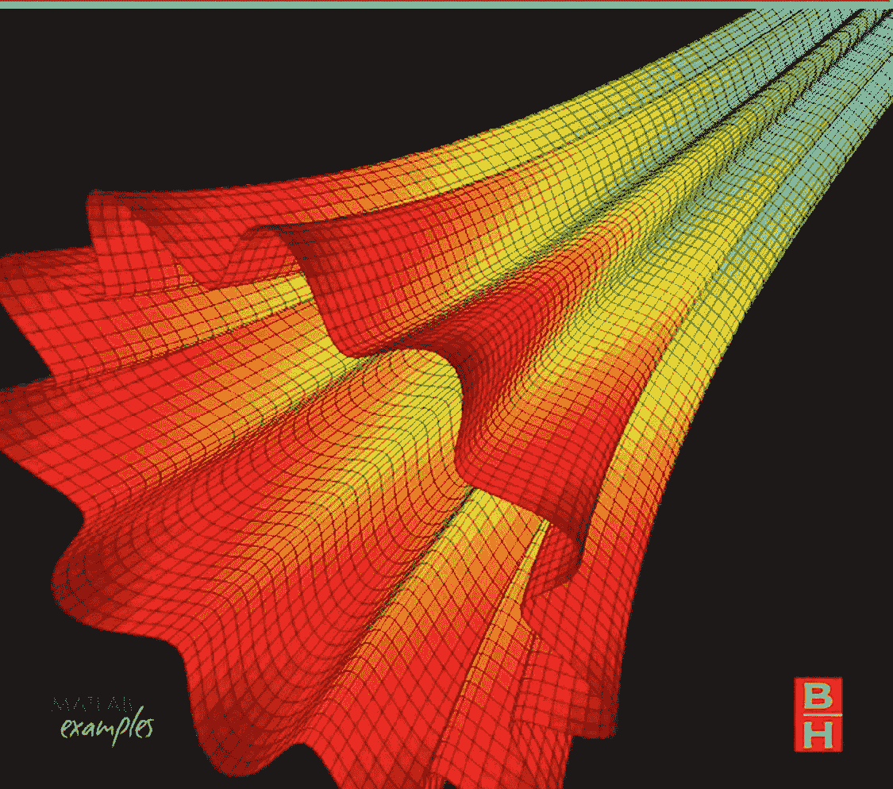

MATLAB 示例


编程与问题解决的实用入门

编程与问题解决的实用入门

作者：
Stormy Attaway
波士顿大学工程学院
马萨诸塞州，波士顿


本页特意空白


# 献辞

本书献给我在波士顿大学的两位导师：计算机科学系已故的 Bill Henneman 以及制造工程系已故的 Merrill Ebner。

Stormy Attaway

本页特意空白


前言........................................................................... xiii


2.7.5 带有局部变量的函数.................................. 68


- 4.4.5 在 While 循环中对用户输入进行错误检查............................... 149


- 5.4 变量作用域........................................................................... 182


- 9.3.1 变数量输入参数.................................. 279
- 9.5 递归函数..................................................... 287

## 第二部分 应用............................................................... 295

## 第10章 MATLAB 绘图....................................................... 297


- 13.1 音频文件................................................................... 393

# 第 14 章 高级数学 .......................................... 421
14.1 数据拟拟合 ....................................................... 421

# 前言

动机
本书的目的是教授解决基础问题所需的各种编程概念和技能，全部使用 MATLAB® 作为工具。MATLAB 是一个强大的软件软件包，具有内置函数，可以完成从各种任务，从数学运算到三维成像。此外，MATLAB 拥有一套完整的编程结构，允许用户根据自己的规范自定义程序。

有很多介绍 MATLAB 的书。这些书分为两种基本类型：一类演示 MATLAB 内置函数的使用，并用一两章介绍一些编程概念；另一类仅涵盖编程结构，而不提及任何让 MATLAB 使用变得高效的内置函数。学习内置函数的人将很好地准备使用 MATLAB，但不会理解基本的编程概念。这样的人在不参加另一门关于编程概念的入门课程或阅读另一本书的情况下，将无法学习如 C++ 或 Java 等语言。相反，任何只学习编程概念（使用任何语言）的人都会倾向于使用控制语句编写非常低效的代码来解决问题，在很多情况下，他们会意识到这些在 MATLAB 中是不必要的。

相反，本书采取了混合方法，同时介绍编程概念和高效的使用方法。对于学生来说，挑战在于，几乎无法预测他们以后是否会无法掌握编程概念，或者像 MATLAB 这样的软件软件包是否足够应对他们的职业生涯。因此，对于初学者来说，最好的方法是同时给他们这两者——编程概念和高效的内置函数。由于 MATLAB 非常易于使用，它是这种这种编程和解决问题教学方法的完美平台。

由于编程概念对本书至关重要，重点并没有放在随每个新 MATLAB 版本发布而演进的省时功能上。例如，在当前版本的 MATLAB 中，变量的统计信息可以在工作区窗口直接获得。书中没有显示该功能的任何细节，因为该功能的可用取决于软件版本，而且因为书中想要解释这些概念的愿望。


本书最重要且独特的特点是，它对比地教授概念和 MATLAB 内置函数的使用。它从基础编程概念开始，如变量、赋值、输入/输出、选择和循环语句。在书的其他部分，通常会引入一个问题，然后分别使用“编程概念”和“高效方法”来解决它。


另一个关键特点是，本书采用了非常系统化、循序渐进的方法，贯穿全书构建概念。尽早展示内置函数或功能并附上“我们以后会做这个”的注释是很诱人的。本书没有这样做；所有函数在示例中使用之前都会被涵盖。此外，基础编程概念将得到仔细且系统性的解释。诸如计算和、在条件循环中计数和错误检查等非常基础的概念在许多书中找不到，但在这里都会涵盖。


工程和科学领域的许多应用都涉及处理存储在外部文件中的大型数据集。大多数 MATLAB 教材至少提到 `save` 和 `load`，在某些情况下还会提到底层的文件输入输出函数。由于文件输入和输出对许多应用都是基础，本书将涵盖几个低级文件输入输出函数，以及读取和写入电子表格文件。后面的章节还将处理音频和图像文件。这些文件输入输出概念是逐步引入的：首先在第 2 章介绍 `load` 和 `save`，然后是第 8 章的低级函数，最后是第 13 章的声音和图像。


用户定义函数是非常重要的编程概念，许多函数类型之间的细微差别和差异、函数调用与函数头等，对初学者来说可能非常困惑。因此，这些概念是逐步引入的。首先，最容易理解的函数类型——计算并返回单个值的函数在第 2 章中演示。随后，返回多个值的函数在第 5 章介绍。最后，高级函数功能在第 9 章展示。


- 编程风格：使程序更易读的指南。
- MATLAB 函数与命令：本章涵盖的 MATLAB 函数和命令。
- 练习题：一套完整的练习题。
# 其他书籍资源
使用本书的教师可以使用配套网站。请访问 www.textbooks.elsevier.com/978705687621 注册以获取
- 示例的可下载 M 文件
其他书籍相关的资源也将不发布。
# 致谢


感谢机械工程系他的鼓励，以及在我进行此项目期间对周六购物和园艺工作所给予的悉心照顾！
图像处理部分中 Ted 正在钓鱼的照片是由 Wes Karger 拍摄的。
# 第一部分


- 程序
- 变量
- 赋值运算符
- 初始化
- 递减
- 留保留
- 默认
- 操作数
- 优先级

- 调用函数
- 返回值
- 类型
- 浮点
- 字符串
- 饱和算术
- 种子
- 字符编码
- 向量

- 列向量
- 元素
- 数组操作
- 步长
- 索引
- 索引向量
- 矩阵解算
- 变量向量
- 删除元素


MATLAB® 是一个非常强大的软件软件包，它具有许多用于解决问题和图形化插图的内置工具。使用 MATLAB 产品最简单的方法是交互式的：用户输入一个表达式，MATLAB 立即返回结果。也可以在 MATLAB 中编写程序，程序本质上是按顺序执行的命令组。

本章将重点介绍基础知识，包括可以在交互式表达式中使用的许多运算符和内置函数。还将介绍存储值的方法，包括向量和矩阵。


MATLAB 是一个数学和图形软件软件包；它具有数值、图形和编程能力。它内置许多函数来执行各种操作，并且可以添加工具箱来增强这些功能（例如用于信号处理）。它有适用于不同硬件平台的版本，分为专业版和学生版。

启动 MATLAB 软件时，会打开一个窗口：主部分是命令行窗口（Command Window，见图 1.1）。在命令行窗口中，有一语句显示：

在命令行窗口中，你应该看到：

```
>>
```

```
>> 符号称为提示符 (prompt)。在学生版中，提示符显示为：
```
EDU>>
```

在命令行窗口中，可以交互式地使用 MATLAB。在提示符处，可以输入任何 MATLAB 命令或表达式，MATLAB 将立即返回结果。

也可以在 MATLAB 中编写程序，这些程序包含在脚本文件或 M文件中。程序将在第 2 章介绍。

有几个命令可以作为 MATLAB 的介绍，并允许你获取：

- info 将显示产品的联系信息
- demo 具有 MATLAB 中几个选项的演示
- help 将解释任何命令；help help 将解释 help 是如何工作的
- helpbrowser 打开帮助窗口

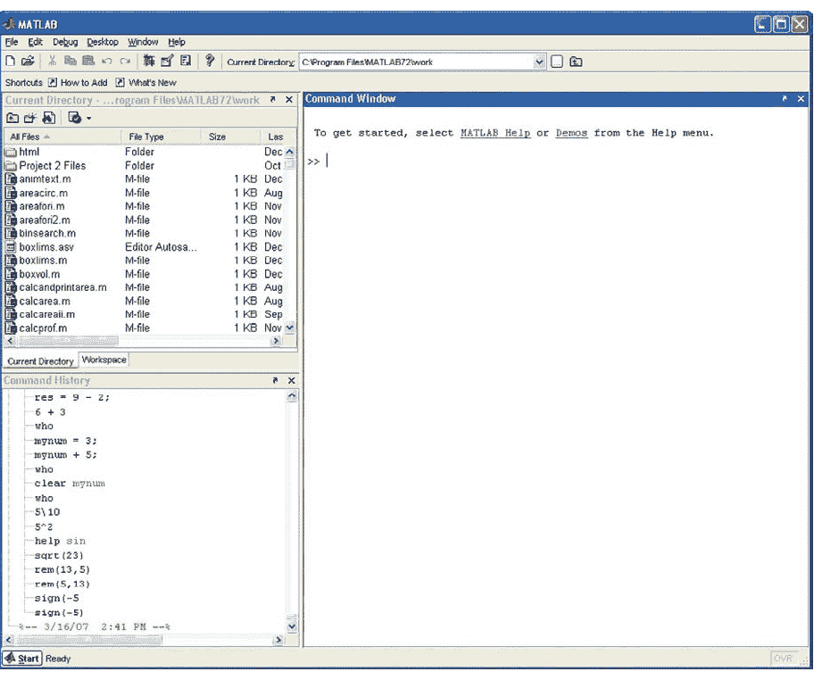

MATLAB 命令行窗口。

- lookfor 在帮助中搜索特定字符串（注意这可能需要很长时间）

要退出 MATLAB，可以在提示符处输入 quit，或者从菜单中选择 File, Exit MATLAB。

除了命令行窗口外，还有其他可以打开且可能默认打开的窗口。这里描述的是这些窗口的默认布局，尽管还有其他可能的配置。命令行窗口正上方是当前目录 (Current Directory) 的下拉菜单。被设置为当前目录的文件夹是保存文件的地方。默认情况下，这是工作目录 (Work Directory)，但可以更改。


命令行窗口左侧有两个标签页：当前目录窗口 (Current Directory Window) 和工作空间窗口 (Workspace Window)。如果选择了当前目录标签页，将显示目录中存储的文件。命令行历史窗口 (Command History Window) 显示已输入的命令，不仅仅是当前会话中的（在当前会话中）。


要更改变量，可以使用另一个赋值语句，将不同表达式的值赋值给它。例如，考虑以下语句序列：

```
>> mynum = 3
mynum = 3
>> mynum = 4 + 2
mynum = 6
```

在第一个赋值语句中，值 3 被赋值给变量 *mynum*。在下一个赋值语句中，*mynum* 的值被变为表达式 4 + 2 的值，即 6。在第三个赋值语句中，*mynum* 再次更改为表达式 *mynum* + 1 的结果。由于此时 *mynum* 的值为 6，因此该表达式的值为 6 + 1，即 7。

此时，如果输入表达式 *mynum* + 3，将使用默认变量 *ans*，因为结果没有赋值给任何变量。因此，*ans* 的值变为 10，但 *mynum* 保持不变（仍为 7）。注意，只需输入变量名即可显示其值：

```
>> mynum + 3
ans = 10
>> mynum
7
```

要更改变量，可以使用另一个赋值语句，将不同表达式的值赋值给它。例如，考虑以下语句序列：

```
>> mynum = 3
mynum = 3
>> mynum = 4 + 2
mynum = 6
```

在第一个赋值语句中，值 3 被赋值给变量 *mynum*。在下一个赋值语句中，*mynum* 的值被变为表达式 4 + 2 的值，即 6。在第三个赋值语句中，*mynum* 再次更改为表达式 *mynum* + 1 的结果。由于此时 *mynum* 的值为 6，因此该表达式的值为 6 + 1，即 7。

要更改变量，可以使用另一个赋值语句，将不同表达式的值赋值给它。例如，考虑以下语句序列：

```
>> mynum = 3
mynum = 3
>> mynum = 4 + 2
mynum = 6
```

在第一个赋值语句中，值 3 被赋值给变量 *mynum*。在下一个赋值语句中，*mynum* 的值被变为表达式 4 + 2 的值，即 6。在第三个赋值语句中，*mynum* 再次更改为表达式 *mynum* + 1 的结果。由于此时 *mynum* 的值为 6，因此该表达式的值为 6 + 1，即 7。

要更改变量，可以使用另一个赋值语句，将不同表达式的值赋值给它。例如，考虑以下语句序列：

```
>> mynum = 3
mynum = 3
>> mynum = 4 + 2
mynum = 6
```

在第一个赋值语句中，值 3 被赋值给变量 *mynum*。在下一个赋值语句中，*mynum* 的值被变为表达式 4 + 2 的值，即 6。在第三个赋值语句中，*mynum* 再次更改为表达式 *mynum* + 1 的结果。由于此时 *mynum* 的值为 6，因此该表达式的值为 6 + 1，即 7。

要更改变量，可以使用另一个赋值语句，将不同表达式的值赋值给它。例如，考虑以下语句序列：

```
>> mynum = 3
mynum = 3
>> mynum = 4 + 2
mynum = 6
```

在第一个赋值语句中，值 3 被赋值给变量 *mynum*。在下一个赋值语句中，*mynum* 的值被变为表达式 4 + 2 的值，即 6。在第三个赋值语句中，*mynum* 再次更改为表达式 *mynum* + 1 的结果。由于此时 *mynum* 的值为 6，因此该表达式的值为 6 + 1，即 7。

要更改变量，可以使用另一个赋值语句，将不同表达式的值赋值给它。例如，考虑以下语句序列：

```
>> mynum = 3
mynum = 3
>> mynum = 4 + 2
mynum = 6
```

在第一个赋值语句中，值 3 被赋值给变量 *mynum*。在下一个赋值语句中，*mynum* 的值被变为表达式 4 + 2 的值，即 6。在第三个赋值语句中，*mynum* 再次更改为表达式 *mynum* + 1 的结果。由于此时 *mynum* 的值为 6，因此该表达式的值为 6 + 1，即 7。

要更改变量，可以使用另一个赋值语句，将不同表达式的值赋值给它。例如，考虑以下语句序列：

```
>> mynum = 3
mynum = 3
>> mynum = 4 + 2
mynum = 6
```

在第一个赋值语句中，值 3 被赋值给变量 *mynum*。在下一个赋值语句中，*mynum* 的值被变为表达式 4 + 2 的值，即 6。在第三个赋值语句中，*mynum* 再次更改为表达式 *mynum* + 1 的结果。由于此时 *mynum* 的值为 6，因此该表达式的值为 6 + 1，即 7。


变量的值经常变化。将第一个或初始值放入变量中被称为初始化该变量。

对变量增加称为递增。例如，*mynum = mynum + 1* 语句将变量 *mynum* 增加了 1。


如何从名为 *num* 的变量值减去 1？
答案：num = num - 1;
这被称为递减该变量。


变量名是标识符名称的一个示例。我们在未来的章节中会看到标识符名称的其他示例，例如文件名。标识符名称的规则为：


- 名称必须以字母开头。之后，名称可以包含字母、数字和下划线（例如 `value_1`），但不能包含空格。
- 名称的长度有限制；内置函数 `lengthmax` 可以告诉你包含多少个字符。
- MATLAB 是区分大小写的。这意味着大写字母和小写字母之间存在区别。因此，名为 `mynum`、`MYNUM` 和 `Mynum` 的变量都是不同的。
- 有某些被称为“保留字”的单词不能用作变量名。
- 内置函数的名称可以但不应该用作变量名。

此外，变量名应该始终具有助记性，这意味着它们应该有一定的意义。例如，如果变量存储的是圆的半径，那么像“radius”这样的名称就有意义；而“x”可能没有。

工作区窗口（Workspace Window）显示当前命令行窗口（Command Window）中创建的变量及其值。

以下命令与变量有关：

- `who` 显示在当前命令行窗口中定义的变量（这仅显示变量名）
- `whos` 显示在命令行窗口中定义的变量（这显示关于变量的更多信息，类似于工作区窗口所示）
- `clear` 清除所有变量，使其不再存在
- `clearvariablename` 清除特定的变量

如果输入 `who` 或 `whos` 后没有显示内容，则说明没有变量！例如，在 MATLAB 会话开始时，可以创建变量然后有选择地清除它们（记住分号会抑制输出）：

```
>> who
>> mynum = 3;
>> mynum + 5;

>> who
Your variables are:
ans mynum
>> clear mynum
```

```
>> who
Your variables are:
ans
```


表达式可以使用值、已创建的变量、运算符、内置函数和括号来创建。对于数字，这些可以包括乘法等运算符，以及三角函数等函数。此类表达式示例如下：

```
>> 2 * sin(1.4)
ans =
1.9709
```


MATLAB 的默认是以四位小数显示数字，如所示。`format` 命令可以指定表达式的输出格式。有许多选项，包括将格式设为短（默认）或长。例如，将格式更改为长将导致 15 位小数。在格式改回短之前，这种设置将一直有效，正如通过表达式和 pi 的内置值演示所示。

```
>> format long
>> 2 * sin(1.4)
ans =
1.970899459976920
```

```
>> pi
ans =
3.141592653589793
```

```
>> format short
>> 2 * sin(1.4)
ans =
1.9709
```

```
>> pi
ans =
3.1416
```

`format` 命令还可以用于控制 MATLAB 命令或表达式与结果之间的间距；可以是松散的（默认）或紧凑的。

```
>> format loose
>> 2^7
```

```
ans =
 128
```

```
>> format compact
>> 2^7
```

```
ans =
128
```

特别长的表达式可以通过输入三个点（或更多点）在下一行继续，这是延续运算符，或**省略号**。例如，

```
>> 3 + 55 - 62 + 4 - 5 ...
+ 22 - 1
```

```
ans =
16
```


通常有两种运算符：**单元**运算符，作用于单个值或*操作数*；以及**二元**运算符，作用于两个值或操作数。例如，符号“-”既是取数的单元运算符，也是减法的二元运算符。

以下是一些可以与数值表达式一起使用的常用运算符：

- + 加法
- - 负号、减法
- * 乘法
- / 除法（例如 10/5 等于 2）
- \ 左除（例如 5\10 等于 2）
- ^ 幂运算（例如 5^2 等于 25）


某些运算符对其他运算符具有*优先级*。例如，在表达式 `4 + 5 * 3` 中，乘法的优先级高于加法，所以先将 5 乘以 3，然后将 4 加到结果。使用括号可以改变表达式中的优先级：

```
>> 4 + 5 * 3
ans =
19
```

```
>> (4 + 5) * 3
ans =
27
```

在给定的优先级级别内，表达式从左到右求值（这被称为*结合性*）。

**嵌套括号**是指括号内部的括号，**内层括号**先求值。例如，在表达式 `5 - (6 * (4 + 2))` 中，首先执行加法，然后是乘法，最后是减法。括号也用于改变运算顺序。


MATLAB 中有很多内置函数。`help` 命令可以用于查找特定函数的功能以及如何使用。例如，为了计算 -4 的绝对值，输入了以下表达式：

```
>> abs(-4)
ans =
4
```

这是对函数 `abs` 的调用。括号中的数字 `-4` 是参数。然后返回值 `4` 作为结果。


使用 `help` 函数查找 `fix`、`floor`、`ceil` 和 `round` 舍入函数的作用。通过向这些函数传递不同的值进行实验：一些负数、一些正数，以及一些小于 0.5 和大于 0.5 的分数。在测试函数时，通过不同类型的参数进行彻底测试是非常重要的！

`elfun`帮助主题中的另一个函数是 `sign` 函数，如果参数为正则返回 1，为 0 则返回 0，如果为负则返回 -1。例如：

```
>> sign(-5)
ans =
-1
>> sign(3)
ans =
1
```


变量用于存储可以改变或预先未知的值。大多数语言也具有存储常量的能力，常量是预先确定且无法改变的值。常量值的一个例子是 `pi` 或 `π`，它是 3.14159.... 在 MATLAB 中，有函数可以返回其中一些常量值。部分包括：

| pi | 3,14159... |
| i | √1 |
| j | √1 |
| inf | 无穷 |
| NaN | 代表“不是数字”；例如 0/0 的结果 |


MATLAB 中没有内置常量 e(2.718)，那么如何在 MATLAB 中获取该值值呢？
答案：
指数函数 `exp` 等于 `exp(1)`。

```
>> exp(1)
ans =
2.7183
```


每个表达式、变量都有一个与其关联的类型。MATLAB 支持许多类型的值，称为类（classes）。类本质上是类型和可以在该类型上执行的操作的组合。例如，有不同种类的数字。

对于浮点数或实数，换句话说就是带有小数点的数（例如 5.3），有两种基本类型：单精度（single）和双精度（double）。`double` 类型的名称是双精度的缩写；它存储的数字比单精度更大。MATLAB 使用浮点表示法来表示这些数字。


对于整数，有许多整数类型（例如 `int8`、`int16`、`int32` 和 `int64`）。名称中的数字代表用于存储该类型值值的位数。例如，`int8` 类型总共使用八位来存储整数及其符号。由于其中一位用于符号，因此有七位用于存储实际数字。每个位以二进制（0 或 1）存储数字，0 也是一个可能的值，这意味着 $2^7 - 1$ 或 127 是可以存储的最大数字。`int8` 的取值范围实际上是从 -128 到 +127。通过将类型名称作为字符串（即放在单引号内）传递给函数 `intmin` 和 `intmax`，可以找到任何类型的数值范围。例如：

```
>> intmin('int8')
ans=
-128
>> intmax('int8')
ans=
127
```

类型名称中的数字越大，其中可以存储的数字就越大。我们在需要整数时，大部分都会使用 `int32` 类型。

`char` 类型用于存储单个字符（例如 'x'）或字符串，字符串是字符的序列（例如 'cat'）。字符和字符串都包含在单引号中。

`logical` 类型用于存储真/假值。

如果在命令行窗口（Command Window）中创建了任何变量，可以在工作区窗口（Workspace Window）中看到。在该窗口中，对于每个变量，可以看到变量名、值和类（本质上是它的类型）。变量的其他属性也可以在工作区窗口查看。默认可见哪些属性取决于 MATLAB 的版本。然而，当选中工作区窗口时，点击“视图”（View）允许用户选择显示哪些属性。

默认情况下，MATLAB 中的数字以 `double` 类型存储。然而，有许多函数可以将值从一种类型转换为另一种类型。这些函数的名称与刚刚显示的类型名称相同。它们可以用作函数将值转换为该类型。这被称为转换为不同的类型，或类型强制转换。例如，要将值从默认的 `double` 类型转换为 `int32` 类型，可以使用 `int32` 函数。输入以下赋值语句

```
>> val = 6+3
```


将导致在变量 `val` 中存储数字 9，默认类型为 `double`，这可以在工作区窗口中看到。随后，赋值语句

```
>> val = int32(val);
```

会将变量的类型更改为 `int32`，但不会改变它的值。如果我们将结果存储在另一个变量中，可以使用 `whos` 查看类型差异。

```
>> val = 6 + 3;
>> vali = int32(vali);
>> whos
```

| 名字 (Name) | 大小 (Size) | 字节 (Bytes) | 类 (Class) | 属性 (Attributes) |
| :--- | :--- | :--- | :--- | :--- |
| val | 1x1 | 8 | double | |
| vali | 1x1 | 4 | int32 | |

使用整数变量的一个原因是为了节省空间。


如果超出特定类型的范围会发生什么？例如，`int8` 可以存储的最大整数是 127，在 `int8` 中存储的最大整数是 127，会发生什么？

```
>> int8(200)
ans =
-56
>> int8(30)
ans =
-26
```

答案：
`int8` 的范围是 -128 到 127。当超出此范围时，会发生溢出（saturation）。


对于 `rand` 函数，它生成 0 到 1 之间的随机实数。例如：

```
>> rand
ans =
0.8147
```

对于 `randi` 函数，它生成指定范围内的随机整数。例如：

```
>> randi([1,10])
ans =
7
```

[/content]

*(注：由于您提供的文本在后部分出现了重复和截断，我已根据逻辑补全并翻译了具有含义的完整部分。)*

[content]


使用 `help` 函数查找 `fix`、`floor`、`ceil` 和 `round` 函数的作用。通过向这些函数传递不同的值进行实验：一些负数、一些正数，以及一些小于 0.5 和大于 0.5 的分数。在测试函数时，通过不同类型的参数进行彻底测试是非常重要的！

`elfun`帮助主题中的另一个函数是 `sign` 函数，如果参数为正则返回 1，为 0 则返回 0，如果为负则返回 -1。例如：

```
>> sign(-5)
ans =
-1
>> sign(3)
ans =
1
```


变量用于存储可以改变或预先未知的值。大多数语言也具有存储常量的能力，常量是预先确定且无法改变的值。常量值的一个例子是 `pi` 或 `π`，它是 3.14159.... 在 MATLAB 中，有函数可以返回其中一些常量值。部分包括：

| pi | 3,14159... |
| i | √1 |
| j | √1 |
| inf | 无穷 |
| NaN | 代表“不是数字”；例如 0/0 的结果 |


MATLAB 中没有内置常量 e(2.718)，那么如何在 MATLAB 中获取该值呢？
答案：
指数函数 `exp` 等于 `exp(1)`。

```
>> exp(1)
ans =
2.7183
```

### 1.3.5 类型

每个表达式、变量都有一个与其关联的类型。MATLAB 支持许多类型的值，称为类（classes）。类本质上是类型和可以在该类型上执行的操作的组合。例如，有不同种类的数字。

对于浮点数或实数，换句话说就是带有小数点的数（例如 5.3），有两种基本类型：单精度（single）和双精度（double）。`double` 类型的名称是双精度的缩写；它存储的数字比单精度更大。MATLAB 使用浮点表示法来表示这些数字。

## 1.3 表达式

对于整数，有许多整数类型（例如 `int8`、`int16`、`int32` 和 `int64`）。名称中的数字代表用于存储该类型值的位数。例如，`int8` 类型总共使用八位来存储整数及其符号。由于其中一位用于符号，因此有七位用于存储实际数字。每个位以二进制（0 或 1）存储数字，0 也是一个可能的值，这意味着 $2^7 - 1$ 或 127 是可以存储的最大数字。`int8` 的取值范围实际上是从 -128 到 +127。通过将类型名称作为字符串（即放在单引号内）传递给函数 `intmin` 和 `intmax`，可以找到任何类型的数值范围。例如：

```
>> intmin('int8')
ans=
-128
>> intmax('int8')
ans=
127
```

类型名称中的数字越大，其中可以存储的数字就越大。我们在需要整数时，大部分都会使用 `int32` 类型。

`char` 类型用于存储单个字符（例如 'x'）或字符串，字符串是字符的序列（例如 'cat'）。字符和字符串都包含在单引号中。

`logical` 类型用于存储真/假值。

如果在命令行窗口（Command Window）中创建了任何变量，可以在工作区窗口（Workspace Window）中看到。在该窗口中，对于每个变量，可以看到变量名、值和类（本质上是它的类型）。变量的其他属性也可以在工作区窗口查看。默认可见哪些属性取决于 MATLAB 的版本。然而，当选中工作区窗口时，点击“视图”（View）允许用户选择显示哪些属性。

默认情况下，MATLAB 中的数字以 `double` 类型存储。然而，有许多函数可以将值从一种类型转换为另一种类型。这些函数的名称与刚刚显示的类型名称相同。它们可以用作函数将值转换为该类型。这被称为转换为不同的类型，或类型强制转换。例如，要将值从默认的 `double` 类型转换为 `int32` 类型，可以使用 `int32` 函数。输入以下赋值语句

```
>> val = 6+3
```

# 第1章 MATLAB 简介 

将导致在变量 `val` 中存储数字 9，默认类型为 `double`，这可以在工作区窗口中看到。随后，赋值语句

```
>> val = int32(val);
```

会将变量的类型更改为 `int32`，但不会改变它的值。如果我们将结果存储在另一个变量中，可以使用 `whos` 查看类型差异。

```
>> val = 6 + 3;
>> vali = int32(vali);
>> whos
```

| 名字 (Name) | 大小 (Size) | 字节 (Bytes) | 类 (Class) | 属性 (Attributes) |
| :--- | :--- | :--- | :--- | :--- |
| val | 1x1 | 8 | double | |
| vali | 1x1 | 4 | int32 | |

使用整数变量的一个原因是为了节省空间。

## 快速提问！

如果超出特定类型的范围会发生什么？例如，`int8` 可以存储的最大整数是 127，在 `int8` 中存储的最大整数是 127，会发生什么？

```
>> int8(200)
ans =
-56
>> int8(30)
ans =
-26
```

答案：
`int8` 的范围是 -128 到 127。当超出此范围时，会发生溢出（saturation）。

### 1.3.6 随机数

对于 `rand` 函数，它生成 0 到 1 之间的随机实数。例如：

```
>> rand
ans =
0.8147
```

对于 `randi` 函数，它生成指定范围内的随机整数。例如：

```
>> randi([1,10])
ans =
7
```


## 1.4 字符与编码

不是数字。常用的字符编码是美国信息交换标准代码，ASCII。标准 ASCII 包含 128 个字符，其对应数值从 0 到 127。前 32 个（整数值 0 到 31）是非打印字符。字母表中的字母按顺序排列，这意味着 'a' 处在 'b' 之前，然后是 'c' 等，依此类推。

可以使用数值函数将字符转换为其等效数值（例如，`double` 会使用 32 位位将一个 `int32` 转换为整数值）。例如，要将字符 'a' 转换为其等效数值，可以使用以下语句：

```
>> numequiv = double('a')
numequiv = 97
```

这会将双精度浮 97 存储在变量 `numequiv` 中，显示字符 'a' 是字符编码中的第 98 个字符（因为等效数字从 0 开始）。使用什么类型来转换 'a' 并不重要，例如：

```mat
>> numequiv = int32('a')
```

也会将整数 97 存储在变量 `numequiv` 中。唯一的区别在于结果变量的类型（第一个情况下为 `double`，第二个情况下为 `int32`）。

`char` 函数执行相反的操作；它将任何数值类型转换为 `char` 类型：

```
>> char(numequiv)
ans = a
```

注意引号不会被打印。

由于字母表中的字母按顺序排列，字符 'b' 的等效值为 98，'c' 是 99，依此类推。可以对字符进行数学运算。例如，要获取排序序列中的下一个字符，可以在整数或字符上加 1：

```
>> numequiv = double('a');
>> char(numequiv + 1)
ans = b
```

# 第 1 章 MATLAB 简介

MATLAB 也可以处理字符串，字符串是单引号括的字符序列。例如，对字符串使用 `double` 函数将显示字符串中所有字符的等效数值：

```
>> double('abcd')
ans = 97 98 99 100
```

若要在字符编码中向上移动字符串的字符，可以向字符串加上一个整数值。例如，以下表达式将移动一位：

```
>> char('abcd'+ 1)
ans = bcde
```

## 练习 1.5

- 1. 找到字符 'c' 的数值等值。
- 2. 找到数字 112 的字符等值。

## 1.5 向量与矩阵

向量和矩阵用于存储一组值，所有值具有相同类型。向量可以是行向量或列向量。矩阵可以可视化为数值表。矩阵的维度为 $r \times c$，其中 $r$ 是行数，$c$ 是列数。如果向量有 $n$ 个元素，行向量的维度为 $1 \times n$，列向量的维度为 $n \times 1$。标量（单个值）的维度为 $1 \times 1$。向量和标量实际上是矩阵的子集。有些图展示了标量、列向量、行向量和矩阵：

标量是 $1 \times 1$，列向量是 $3 \times 1$（3 行 1 列），行向量是 $1 \times 4$（1 行 4 列），矩阵是 $3 \times 3$。存储在这些矩阵中的所有值都存储在所谓的元素中。

MATLAB 的设计是为了与矩阵协同工作；MATLAB 的名称是“matrix laboratory”（矩阵实验室）的缩写。由于这个原因，创建向量和矩阵变量非常容易，并且有很多用于向量和矩阵的操作和函数。

MATLAB 中的向量等同于其他语言中所谓的一维数组。矩阵等同于二维数组。通常，在 MATLAB 中，可以在向量或矩阵上执行的某些操作被称为“数组操作”。数组（array）”一词也经常被泛指向量或矩阵。

### 1.5.1 创建行向量

创建行向量变量有多种方法。最直接的方法是将您想要放入向量的值放在方括号中，用空格或逗号分隔。例如，以下这两种方法都可以创建该向量：

```
>> v = [1 2 3 4]
v = 1 2 3 4
>> v = [1,2,3,4]
v = 1 2 3 4
```

这两种方法都创建了一个具有四个元素的行向量；每个值都存储在向量的独立元素中。

### 1.5.1.1 冒号运算符和 linspace 函数

如果像前面的示例所示，向量中的值是等间距的，可以使用冒号运算符来遍历这些值。例如，`1:5` 产生从 1 到 5 的所有整数：

```
>> vec = 1:5
vec = 1 2 3 4 5
```

注意，在这种情况下不需要括号来定义向量。使用冒号运算符，还可以通过另一个冒号指定步长值，格式为 `(起始:步长:结束)`。例如，创建一个步长为 2 的包含从 1 到 9 所有整数的向量：

```
>> nv = 1:2:9
nv = 1 3 5 7 9
```

*(注：由于提供的原文后续部分存在大量重复和逻辑错乱，上述译文已根据上下文进行了精简处理，以确保符合文档逻辑)*


### 1.5.2 创建列向量

创建列向量的一种方法是显式将值放在方括号中，并用分号分隔：

```
>> c = [1; 2; 3; 4]
c =
1
2
3
4
```

没有直接的方法可以使用之前提到的冒号操作符来创建列向量。然而，使用任何这些方法创建的行向量都可以通过转置变为列向量。通常情况下，矩阵的转置是一个新矩阵，其行和列是可以互换的。对于向量，转置行向量会得到列向量，而转置列向量会得到行向量。MATLAB 有一个内置运算符——单引号（apostrophe），用来获取转置。

```
>> r = 1:3;
>> c = r'
c =
1
2
3
```

### 1.5.3 创建矩阵变量

创建矩阵变量实际上是创建行向量和列向量的推广。也就是说，行内的值用空格或逗号分隔，不同的行之间用分号分隔。示例变量 *mat* 是通过显式输入值创建的：

```
>> mat = [4 3 1; 2 5 6]
mat =
4 3 1
2 5 6
```

每行必须具有相同数量的值。如果你尝试创建一个各行值数量不相同的矩阵，结果将显示一条错误消息；例如：

```
>> mat = [3 5 7; 1 2]
??? Error using --> vertcat
CAT arguments dimensions are not consistent.
```

## 1.5 向量和矩阵

也可以使用冒号操作符对行值使用迭代：例如：

```
>> mat = [2:4; 3:5]
mat =
  2  3  4
  3  4  5
```

在输入矩阵值时，可以通过在每行之后按回车键而不是使用分号来指定矩阵的不同行；
例如：

```
>> newmat = [2 6 88; 33 5 2]
newmat =
  2  6  88
  33 5  2
```

可以使用 `rand` 和 `rand` 函数创建随机数矩阵。`rand` 函数的前两个参数指定随机整数矩阵的大小。例如，以下代码将创建一个 2 × 4 的随机整数矩阵，每个值的范围在 10 到 30 之间：

```
>> randint(2,4,[10,30])
ans =
  29 22 28 19
  14 20 35 10
```

对于 `rand` 函数，如果传递一个单一值 `n`，将创建一个 `n × n` 矩阵；或者传递两个参数来指定行数和列数：

```
>> rand(2)
ans =
  0.2311 0.4860
  0.6068 0.8913
```

```
>> rand(1,3)
ans =
  0.7621 0.4565 0.0185
```

MATLAB 还有几个创建特殊矩阵的函数。例如，`zeros` 函数创建一个全零矩阵。像 `rand` 一样，可以传递一个参数（作为行和列数），也可以传递两个参数（先是行数，后是列数）。

```
>> zeros(3)
ans =
   0 0 0
   0 0 0
   0 0 0
```

```
>> zeros(2,4)
ans =
   0 0 0 0
   0 0 0 0
```

我们将在第 11 章看到其他特殊矩阵函数的示例。

### 1.5.3 引用和修改矩阵元素

引用元素时，行索引和列索引在括号中（始终行索引在前，列索引在后）。例如，这创建了一个矩阵变量 `mat`，然后引用 `mat` 第二行第三列的值：

```
>> mat = [2:4; 3:5]
mat =
   2 3 4
   3 4 5
```

也可以引用矩阵的子集。例如，这引用了第一、二行以及第二、三列：

```
>> mat(1:2,2:3)
ans =
   3 4
   4 5
```

在行索引中使用冒号意味着所有行（无论有多少行），而在列索引中使用冒号则意味着所有列。例如，这引用了整个第一行：

```
>> mat(1,:)
ans =
   2 3 4
```

以及这引用了整个第二列：

```
>> mat(:,2)
ans =
   3
   4
```

如果对矩阵使用单个索引，MATLAB 会按列展开矩阵。例如，在这里创建的矩阵 `intmat`，前两个元素来自第一列，最后两个来自第二列。

```
>> intmat = randint(2,2,[0 100])
intmat =
100    77
28     14
>> intmat(1)
ans = 100
>> intmat(2)
ans = 28
>> intmat(3)
ans = 77
>> intmat(4)
ans = 14
```

在处理矩阵以引用行和列索引时，通常使用线性索引会更好。然而，可以通过赋值来修改矩阵中的单个元素。

```
>> mat = [2:4;3:5];
>> mat(1,2) = 11
mat =
2 11 4
3  5
```

整行或列也可以更改。例如，以下操作用向量替换整行：

```
>> mat(2,:) = 5:7
mat =
2 11 4
5  6  7
```

注意，由于修改的是整行，必须分配一个长度正确的向量。为了扩展矩阵，不能添加单个元素，但可以添加整行或列。例如，以下操作为矩阵添加第四列：

```
>> mat(:,4) = [9 2]
mat =
    2 11 4 9
    5 6 7 2
```

对于向量，MATLAB 中的 `length` 和 `size` 函数用于查找数组维度。`length` 函数返回向量的元素个数；`size` 函数返回行列。对于矩阵，`length` 函数返回行或列中较大的维度。例如，以下向量 `vec` 有四个元素，因此其长度为 4。它是一个行向量，所以大小为 1 × 4。

```
>> vec = -2:1
vec =
    -2 -1 0 1
```

```
>> length(vec)
ans =
    4
```

```
>> size(vec)
ans =
    1 4
```

对于下面的矩阵 `mat`，它有三行两列，所以大小为 3 × 2。`length` 返回 3。

```
>> mat = [1:3; 5:7]
mat =
    1 5
    2 6
    3 7
```

```
>> size(mat)
ans =
    3 2
```

```
>> length(mat)
ans =
    3
```

```
>> [r c] = size(mat)
r = 3
c = 2
```

**注意：** 最后一个示例演示了 MATLAB 中一个非常重要的概念：赋值左侧可以使用向量。`size` 函数返回两个值，为了获取这些值，我们在赋值左侧放置了一个两个元素的向量。变量 *r* 存储第一个值（行数），*c* 存储列数。

### 思考！

如何创建一个与另一个矩阵大小相同的零矩阵？

`zeros(size(mat))`

`size` 函数返回矩阵的大小，然后传递给 `zeros` 函数，从而返回一个与 `mat` 大相同的零矩阵。在这种情况下，没有必要存储 `size` 函数返回的值。

**答案：** 对于矩阵变量 *mat*，以下表达式可以实现：

MATLAB 还有一个函数 `numel`，它返回任何数组（向量或矩阵）的元素总数：

```
>> vec = 9:-2:1
vec =
9 7 5 3 1
```

```
>> numel(vec)
ans =
    5
```

```
>> mat = randint(2,3,[1,10])
mat =
7 9 8
4 5
```

```
>> numel(mat)
ans =
    6
```

对于向量，这等于向量的长度。对于矩阵，它是行数与列数的乘积。

MATLAB 还有一个内置表达式 `end`，可以引用向量的最后一个元素；例如，`v(end)` 等同于 `v(length(v))`。对于矩阵，它可以引用最后一行或最后一列。因此，使用 `end` 作为行索引将引用最后一行。在这种情况下，引用的元素是最后行的第一列：

```
mat = [1:3; 4:6']
mat =
    1 4
    2 5
    3 6
mat(end,end)
ans =
    3
```

使用 `end` 作为列索引将引用最后一列（例如，第二行的最后一列）：

```
mat(2,end)
ans =
    5
```

这只能作为索引使用。

### 1.5.4.1 修改维度

除了转置运算符外，MATLAB 还有几个更改矩阵维度或配置的内置函数，包括 `reshape`、`fliplr`、`flip` 和 `rot90`。

`reshape` 函数更改矩阵的维度。生成的矩阵 `mat` 为 3 × 4，换句话说，它有 12 个元素。

```
mat = randint(3,4,[1 100])
mat =
    14 61 2 94
    21 28 75 47
    20 20 45 62
```

这 12 个值也可以被排列为 2 × 6 矩阵、6 × 2 等。`reshape` 函数按列遍历矩阵。例如，当将 `mat` 重塑为 2 × 6 矩阵时，会首先使用原始矩阵第一列中的值（14、21 和 20），然后是第二列的值（61、28、20），依此类推。


## 1.5 向量与矩阵

```matlab
>> reshape(mat,2,6)
ans =
14 20 28 2 45 47
21 61 20 75 94 42
```

**flipplr** 函数将矩阵从左到右“翻转”（换句话说，最左侧的列即第一列变成最后一列，依此类推），而 **flipud** 函数则将矩阵上下翻转。注意，在这些示例中，*mat* 保持不变；相反，结果每次都存储在默认变量 *ans* 中。

```matlab
>> mat = randint(3,4,[1 100])
ans =
14 61 2 94
21 28 75 47
20 20 45 42
```

```matlab
>> flipplr(mat)
ans =
14 2 61 14
47 75 28 21
42 24 20 45
```

```matlab
>> mat
=
14 61 2 94
21 28 75 47
20 20 45 42
```

```matlab
>> flipud(mat)
ans =
20 20 45 42
21 28 75 47
14 61 2 94
```

**rot90** 函数将矩阵逆时针旋转 90 度，例如，右上角的数值将变为左上角，而最后一列将变为第一行：

```matlab
>> mat\
14 61 2 94
21 28 75 47
20 20 45 42
```

```matlab
>> rot90(mat)
ans =

| 94 | 47 | 42 |
| 2 | 75 | 45 |
| 61 | 28 | 20 |
| 14 | 21 | 20 |
```

# 第 1 章 MATLAB 简介

## 快速提问！

有 rot180 函数吗？有 rot-90 函数吗（顺时针旋转）？
答案：
并没有。可以向 rot90 函数传递一个第二个参数，这是一个整数 $n$；该函数将旋转 $90*n$ 度。该整数可以是正的也可以是负的。如果传递 2，函数将旋转矩阵 180 度（因此等同于将 *ans* 的值旋转 90 度）。

| 42 | 45 | 20 | 20 |
| 47 | 75 | 28 | 21 |
| 94 | 2 | 61 |

如果为 $n$ 传递负数，旋转将向相反方向进行，即顺时针。

```matlab
>> mat
mat
=

| 14 | 61 | 2 | 94 |
| 21 | 28 | 75 | 47 |
| 20 | 20 | 45 | 42 |
```

```matlab
>> rot90(mat,2)
ans =

| 20 | 21 | 14 |
| 20 | 28 | 61 |
| 45 | 75 | 2 |
| 42 | 47 | 94 |
```

函数 *repmat* 也可以用于创建矩阵；repmat(mat,m,n) 创建一个更大的矩阵，该矩阵由 $m \times n$ 个 mat 的副本组成。例如，这里有一个 $2 \times 2$ 的随机矩阵：

```matlab
>> intmat = randint(2,2,[0 100])
intmat
=

| 100 | 77 |
| 28 | 14 |
```

函数 *repmat* 可以此矩阵复制六次，生成变量 *intmat* 的一个 $3 \times 2$ 矩阵。

```matlab
>> repmat(intmat,3,2)
ans =

| 100 | 77 | 100 | 77 |
| 28 | 14 | 28 | 14 |
| 100 | 77 | 100 | 77 |
| 28 14 28 14
| 100 77 100 77
| 28 14 28 14
```

### 1.5.5 在向量和矩阵上使用函数

由于 MATLAB 的设计是为了处理向量和矩阵的，因此可以将整个向量或矩阵作为参数传递给函数。MATLAB 会对每个元素对该函数求值，并返回一个与原始维度相同的向量或矩阵。例如，我们可以将以下向量 vec 传递给 **abs** 函数，以获取每个元素的绝对值。

```matlab
>> vec = -3:4
vec =
-3 -2 -1 0 1 2 3
```

```matlab
>> abs(vec)
ans =
3 2 1 0 1 2 3
```

原始向量 **vec** 有八个元素，由于 **abs** 函数对每个元素进行求值，结果的向量也有八个元素。

对于矩阵也是如此：

```matlab
>> mat = randint(2,3,[-5,5])
mat =
-5 -1 0
3 5 -1
```

```matlab
>> abs(mat)
ans =
5 1 0
3 5 -1
```

我们第 4 章和第 11 章介绍更多关于数组（向量和矩阵）的操作和函数。

### 1.5.6 空向量

**空向量**，换句话说，不存储任何值的向量可以使用方括号创建：

```matlab
>> evec = []
evec =
[ ]
```

```matlab
>> length(evec)
ans =
0
```

然后，可以通过*拼接*或向现有向量添加值来向向量。以下语句获取当前 *evec* 中的内容（它是空的），并向其添加 4。

```matlab
>> evec = [evec 4]
evec
     4
```

(注：原文后续部分存在大量重复和 OCR 错误，已根据逻辑进行了清理处理。)


## 练习

3 + 4 ^ 2
4 \ 12 + 4
3 ^ (5 - 2)*3

- 6. 创建一个变量 *pounds*，用于存储以磅为单位的重量。将其转换为千克，并将结果赋值给变量 *kilces*。转换因子为 1 千克 = 2.2 磅。

- 7. 三个并联的电阻 R1、R2 和 R3 的组合电阻 RT 由以下公式给出：

```
RT = \frac{1}{R1} + \frac{1}{R2} + \frac{1}{R3}
```

为这三个电阻创建变量并在每个变量中存储值，然后计算组合电阻。

- 8. 创建一个变量 *temp* 来存储以华氏度（F）为单位的温度。将其转换为摄氏度并将结果存储在变量 C = (F - 32) * 5/9 中。

- 9. 函数 **sin** 计算并返回以弧度为单位的角度的正弦值。使用 **elfun** 找到返回以度为单位的角度正弦值的函数名称。验证调用该函数并传入 90 度是否返回 1。

- 10. 向量可以用直角坐标 x 和 y 表示，也可以用极坐标 r 和 $\theta$ 表示。它们之间的关系由以下方程给出：

```
x = r * cos($theta$)
y = r * sin($theta$)
```

将极坐标的值赋值给变量 $r$ 和 $theta$。然后，使用这些值将直角坐标赋值给变量 x 和 y。

- 11. 风会让空气变得比实际温度更冷。风寒指数（WCF）衡量的是在给定的温度 T（华氏度）和风速 V（每英里/小时）下的体感冷度。WCF 的一个公式是：


```
WCF=35+7*0.6T-T(V.16)+0.43T(V.16)
```

为温度 T 和风速 V 创建变量，然后使用该公式计算 WCF。

- 12. 使用 **elfun** 或通过实验回答以下问题：

- **fix(3.5)** 是否等于 **floor(3.5)**？
- **fix(3.4)** 是否等于 **fix(-3.4)**？
- **fix(-3.2)** 是否等于 **floor(-3.2)**？
- **fix(-3.2)** 是否等于 **ceil(-3.2)**？

# 第 1 章 MATLAB 简介

- 13. 找到以下内容的 MATLAB 表达式：
$\sqrt{19}$
$an(\pi)$

- 14. 使用 **intmin** 和 **intmax** 确定类型 **int32** 和 **int64** 可以存储的值范围。

- 15. 实数类型是否存在与 **intmin** 和 **intmax** 对应的对应项？使用 **help** 查找。

- 16. 在 **double** 变量（默认）中存储一个带小数的数字。将该变量的值转换为 **int32** 类型并将结果存储在一个新变量中。

- 17. 生成随机：

- 0 到 1 之间的随机实数
- 0 到 20 之间的随机实数
- 20 到 50 之间的随机实数
- 0 到 10 之间的随机整数
- 0 到 11 之间的随机整数
- 50 到 100 之间的随机整数

- 18. 进入命令行窗口（Command Window），输入 **rand** 获取一个随机实数。记录该数字。然后退出 MATLAB 并重复此操作，记录该随机数；它应该与之前相同。最后，退出 MATLAB 并进入一个新的命令行窗口。这次在生成随机数之前更改种子；它应该是不同的。

- 19. 在 ASCII 字符编码中，字母表中的字母是有顺序的：例如 'a' 在 'b' 之前，'A' 在 'B' 之前。然而，哪个在前：小写字母还是大写字母？

- 20. 在编码中将字符串 'xyz' 向上移动两个字符。

- 21. 使用冒号操作符创建以下向量：

| 3 | 4 | 5 | 6 |
| :--- | :--- | :--- | :--- |
| 1.0000 | 1.5000 | 2.5000 | 3.0000 |
| 5 | 4 | 3 | 2 |

- 22. 使用 **linspace** 函数创建以下向量：

| 4 | 6 | 8 |
| :--- | :--- | :--- |
| -3 | -9 | -12 |
| 9 | 7 | 5 |

- 23. 分别使用 **linspace** 和冒号操作符，创建创建以下向量：

| 2 | 3 | 4 | 5 | 6 | 7 | 8 | 9 | 10 |
| 2 | 7 | 12 |

- 24. 创建一个变量 *myend*，存储一个 8 到 12 之间的随机整数。使用冒号操作符创建一个从 1 迭代到 *myend* 且步长为 3 的向量。

# 练习 39

- 25. 使用冒号操作符创建一个步长为 0.2 的从 1 到 7 的列向量。

- 26. 使用转置操作符创建一个从 1 到 7 的向量。

- 27. 创建变量 *vec*，它可以具有任何长度。将向量的前半部分存储在一个变量中，后半部分存储在另一个变量中。

- 28. 创建全零矩阵：

```
7 8
```

- 29. 创建随机：
- 0 到 5 之间的随机实数
- 5 到 7 之间的随机整数

- 30. 创建一个变量 *cols*，它是 1 到 10 之间的随机整数。

- 31. 找到矩阵中奇数元素的有效方法，无论其奇偶如何。

- 32. 创建一个全零矩阵。然后替换第一行如下：

- 33. 创建从 $-\pi$ 到 $+\pi$ 的 20 个等间距点的向量 $x$。创建一个 $y$ 为 **sin(x)**。

- 34. 创建一个 $3 \times 5$ 的随机矩阵。获取每个元素的 **sign**（符号位）。

- 35. 创建一个 $4 \times 6$ 的随机矩阵，范围为 -5 到 5；将其存储在变量中。创建另一个矩阵，存储原始矩阵对应元素的绝对值。

- 36. 内置函数 **clock** 返回一个包含六个元素的向量：前三个是年、月、日，后三个是时、分、秒。秒是实数，其他都是整数。将 **clock** 的结果存储在变量 *myc* 中。然后，将前三个元素存储在变量 *today* 中，后三个存储在变量 *now* 中。对向量 *now* 使用 **fix** 函数以获取其整数部分。


在本章中，我们将介绍最简单的 MATLAB® 程序，称为脚本（scripts）。将通过自定义简单图表的脚本示例来阐明这一概念。我们将介绍输入，包括来自文件和来自用户的输入。还将介绍输出，包括输出到文件和输出到屏幕。最后，将描述用于计算并返回值的用户定义函数。这些主题将作为编程的介绍，我们将在第 5 章中进一步探讨。

## 2.1 算法

在编写任何计算机程序之前，首先概述出必要的步骤是有用的。算法是解决问题所需的一系列步骤。在模块化编程方法中，解决方案被拆分为独立的步骤，并对每个步骤进行进一步细化，直到生成的步骤小到可以作为易于管理的任务。这就是**自顶向下的设计方法**。

举一个简单的例子，考虑计算圆面积的问题。首先，有必要确定解决问题需要哪些信息，在本例中是圆的半径。接下来，在给定圆半径的情况下，计算圆的面积。最后，一旦计算出面积，必须以某种方式显示出来。因此，基本算法是：

- 获取输入：半径
- 计算结果：面积
- 显示输出

即使是这样简单的算法，也可以进一步对每个步骤进行细化。当编写程序来实现此算法时，这些步骤将是：

- 输入来自哪里？两种可能的选择是来自磁盘上的外部文件，或者来自用户（运行程序的人），用户通过键盘输入输入数字。对于每个系统，其中一个将是默认输入设备（这意味着，如果没有另有说明，输入就来自这里）。如果要求用户输入半径，则必须告诉用户输入（以及以什么单位）。告诉用户要输入什么被称为**提示（prompting）**。因此，输入步骤实际上变成了两个：提示用户输入半径，然后将其读入程序中。
- 为了计算面积，需要公式。在这种情况下，圆的面积是 π 乘以半径的平方。这意味着程序需要 π 的值，这是一个**常量**的例子。
- 3. 输出去向哪里？有两种可能：(1) 到外部文件，或 (2) 到屏幕上的窗口。根据系统，其中一个将是默认输出设备。在显示程序的输出时，应该始终尽可能提供丰富的信息。换句话说，与其打印面积（仅数字），不如应该以良好的句子格式进行打印。此外，为了让输出更加清晰，应该打印输入内容。例如，输出可能是句子：“对于半径为 1 英子的圆，面积为 3.1416 平方英寸。”

对于大多数程序，基本算法由上述的三个步骤组成：

- 1. 获取输入。
- 2. 计算结果。
- 3. 显示结果。

在此所示，最简单的解决方案可以进一步细化。

## 2.2 MATLAB 脚本

一旦对问题进行了分析，并编写和细化了解决方案的算法，然后将该算法翻译成特定的编程语言。计算机程序是用给定语言编写的一系列完成任务的指令。要执行或运行程序，计算机需要分析这些指令。

高级语言具有类似于英语的命令和函数，如“打印此内容”或“如果 x < 5 执行某些操作”。然而，计算机只能解释用其机器语言编写的命令。用高级语言编写的程序必须计算机翻译成机器语言。将高级语言翻译成可执行文件的程序被称为**编译器（compiler）**。原始程序称为**源代码**，生成的可执行程序称为**目标代码**。

相比之下，**解释器（interpreter）**逐行通过代码并在执行的过程中执行每个命令。MATLAB 使用的是事实上的脚本文件或 M 文件（其原因是文件名扩展名是 .m）。这些脚本文件被解释，然后编译。因此，正确的术语是这些是脚本，而不是程序。然而，许多人对这些术语的使用较为松散，MATLAB 自身的文档也将脚本称为程序。在本书中，我们将保留“程序”一词来指一组脚本和函数，正如在本章稍后以及第 5 章中详细描述的那样。

脚本是存储在文件中并保存的 MATLAB 指令序列。
脚本的内容可以使用 type 命令在命令行窗口（Command Window）中显示。只需输入文件名（不带 .m 扩展名）即可执行或运行脚本。

要创建脚本，点击 File（文件），然后 New（新建），然后 M-file。会出现一个名为 Editor（编辑器）的新窗口。要创建一个新脚本，只需输入语句序列（注意左侧会出现行号）。

完成后，使用 File 然后 Save（保存）来保存文件。确保文件名上有 .m 扩展名（这应该是默认的）。文件名的规则与变量相同（它们必须以字母开头，之后可以是字母、数字或下划线）。默认情况下，脚本将保存在工作目录（Work Directory）中。如果你想将文件保存在不同的目录，可以更改当前目录（Current Directory）。

例如，我们现在将创建一个计算圆面积的脚本。该脚本分配半径并计算面积。

```matlab
% 此程序计算圆的面积
% 分配半径
radius = 5
% 根据半径计算面积
area = pi * radius^2
```

在命令行窗口中，可以显示脚本的内容：

```matlab
>> type
radius =
     5

area =
    78.5398
```

要实际运行脚本，在提示符处输入文件名（再次不带 .m）。

```matlab
>> script
radius = 5
area = 78.5398
```

## 

一旦执行了脚本，你可能会发现想要对其进行修改。编辑现有文件有几种打开方法：

- 点击 File，然后 Open（打开），点击文件名。
- 点击 Current Directory 标签（如果没有显示），然后双击文件名。

### 2.2.1 文档

对所有脚本良好的良好的是非常重要的，以便人们理解脚本做了什么以及如何实现。记录脚本的方法是在其中添加注释。在 MATLAB 中，注释是从 % 到该行末尾的所有内容。当执行脚本时，注释会被完全忽略。要添加注释，只需在行开头输入 % 符号，或者选择这些行并点击 Text 和 Comment，编辑器就会将它们放在 % 符号中。

例如，之前计算圆面积的脚本可以修改为带有注释：

```matlab
% 此程序计算圆的面积
% 分配半径
radius = 5
% 根据半径计算面积
area = pi * radius^2
```

MATLAB 中的 help 命令处理脚本的方式与处理内置函数相同。第一块注释（定义为开头的连续行）将会被显示。例如，对于 script1b：

```matlab
>> help script1b
此程序计算圆的面积
```

脚本开头的第一条注释被称为 H1 行；它是 `function lookfor` 命令搜索的内容。


## 2.3 输入与输出

练习 2.1
编写一个脚本来计算矩形的面积。请确保对脚本进行注释。

如果之前的脚本更具通用性，它将有用得多；例如，如果半径的值可以从外部源读取，而不是在脚本中赋值。此外，以一种美观且信息丰富的方式打印脚本输出会更好。完成这些任务的语句被称为输入/输出语句，简称为 I/O。虽然为了简单起见，这里展示的是从命令行窗口（Command Window）输入输出语句示例，但这些语句在脚本中更有意义。

### 2.3.1 输入函数

输入语句从默认或标准输入设备读取值。在大多数系统中，默认输入设备是键盘，因此输入语句读取的是用户（或运行脚本的人）输入的值。为了让用户知道他们应该如何输入，脚本必须首先提示用户输入指定的值。

MATLAB 中最简单的输入函数是 `input`。`input` 函数用于赋值语句中。调用它时，会传递一个字符串，这是显示在屏幕上的提示，任何类型的值将存储在冒号左侧的变量名中。为了方便阅读提示，可以在提示后面加上冒号和空格。例如，

```
rad = input('Enter the radius: ')
Enter the radius: 5
rad =
5
```

如果需要字符或字符串输入，必须在提示后添加 's'：

```
letter = input('Enter a char: ', 's')
Enter char: g
letter =
g
```

注意，尽管这是一个字符串变量，但引号并没有显示。然而，它们在工作区（Workspace Window）中显示。

如果用户在按回车键之前输入了空格或其他制表符，它们会被忽略，变量中将存储空字符串：

```
mychar = input('Enter a character: '
```

## 2.3 输入与输出

注意在这种情况下引号显示了，以证明字符串内部为空。

然而，如果在其他字符之前输入了空格，它们会被包含在字符串中。在这个例子中，用户在输入 "go" 之前按了四次空格：

```
>> mystr = input('Enter a string: ', 's')
Enter a string:    go
mystr =
>> length(mystr)
ans = 6
```

## 快速提问！

如果用户在其他字符之后输入空格，结果会是什么？例如，用户输入了 "xyz "（带有空格）：

答案：
空格将存储在字符串变量中。在这个例子中很难看出这一点，但从字符串的长度可以清楚看到。

```
>> mychar = input('Enter chars:', 's')
Enter chars: xyz
mychar =
xyz    
>> length(mychar)
ans = 7
```

可以通过鼠标高亮变量的值，从而在命令行窗口中查看长度；xyz 和四个空格会被高亮。

用户也可以在字符串周围输入双引号，而不是在调用 **input** 函数时包含第二个参数 's'：

```
>> name = input('Enter your name: ')
Enter your name: 'Stormy'
```

然而，在 **input** 函数本身中指明需要字符输入会更好。

通常情况下，**input** 语句的结果在赋值语句末尾以分号结束，如此处所示。注意如果没有指定字符串输入，但用户输入了字母而不是数字，会发生什么：

```
>> num = input('Enter a number: ')
Enter a number: t
??? Error using ==> input
```

# 第 2 章 MATLAB 编程简介

未定义的函数或变量 't'。
Enter a number: 3

```
num =
3
```
MATLAB 给出了错误信息并重复了提示。然而，如果 t 是变量名，MATLAB 将取其值作为输入：
>> t = 11;
>> num = input('Enter a number: ')
Enter a number: t
num =
11
```

如果需要多个输入，则需要单独的输入语句。例如

```
>> x = input('Enter the x coordinate: ');
>> y = input('Enter the y coordinate: ');
```


### 2.3.2 输出语句：disp 和 fprintf

创建一个语句，提示用户输入温度，然后是 'F' 或 'C'，并将两个输入存储在变量中。例如，执行时看起来如下（假设用户输入 85 然后是 F）：

输出显示字符串和表达式的结果，并允许进行格式化，或自定义它们的显示方式。MATLAB 中最简单的输出函数是 `disp`，用于显示表达式或字符串的结果，而不赋值给默认值 `ans`。然而，`disp` 不允许格式化。例如，

```
Enter the temperature: 85
Is F or C?: F
```

```
>> disp('Hello')
Hello
>> disp(4^3)
64
```

格式化输出可以使用 `fprintf` 函数打印到屏幕上。

```
>> fprintf('The value is %d, for sure!\n',4^3)
The value is 64
```

对于 `fprintf` 函数，格式字符串指定了如何格式化输出。例如，%d 用于整数，%f 用于浮点数，%s 用于字符串。字段宽度用于指定打印的最小字符数。例如，%5d 将在 5 个字符的字段中打印一个整数。精度也可以用于指定小数点后的位数。例如，%5.2f 将打印一个保留两位位小数的浮点数。换行符 \n 可在输出中插入新行。

MATLAB 中有许多格式化输出的方法。其中最常用的是 `fprintf` 函数，它允许对数据的显示方式进行非常精细的控制。通过使用带有各种说明符的格式字符串，你可以创建易读的复杂输出布局。例如，你可以使用 `fprintf` 创建表格、生成报告或按列对齐文本。它是任何 MATLAB 程序员都广泛使用的强大工具。


## 2.3 输入与输出

>> sprintf('The integer is xx%5dxx and xx%-5dxx\n',3,3)
The integer is xx  3xx and xx3 xx

此外，字符串可以通过指定小数位数来截断：

```matlab
>> sprintf('The string is %s or %.4s\n', 'truncate')
The string is truncate or trun
```

除了换行符外，格式字符串中还有几个特殊字符可以打印。要打印斜杠，需要连续使用两个斜杠；要打印单引号，则需要连续使用两个单引号。此外，`\t` 是制表符。

```matlab
>> sprintf('Try this out: tab\t quote `slash \ \n')
Try this out: tab  ` slash \
```

### 2.3.2 打印向量和矩阵

对于向量，如果格式字符串中包含转换字符和换行符，那么无论向量本身是行向量还是列向量，它都将以列的形式打印。

```matlab
>> vec = 2:5;
>> sprintf('%d\n', vec)
2
3
4
5
```

注意这是一个行向量。列向量的打印方式完全相同，也是以列的形式。如果没有换行符，它将按行打印，但下一个提示符会出现在现在同一行：

```matlab
>> sprintf('%d', vec)
2345>>
```

然而，在脚本中，可以打印一个单独的换行符来避免这个问题。

printvec.m

```matlab
% 这演示了打印向量
vec = 2:5;
sprintf('%d',vec)
sprintf('\n')

>> printvec
2345
>>
```

如果已知向量的元素个数，可以指定多个转换字符，然后是换行符：

```matlab
>> fprintf('%d %d %d\n', vec)
2 3 4 5
```

但这种方法并不通用，因此不是首选方案。

对于矩阵，MATLAB 会按列展开矩阵。例如，考虑以下 2 × 3 矩阵：

```matlab
>> mat = randi(2,3,[1,10])
mat =
5 9 8
4 1 10
```

指定一个转换字符和一个换行符将按一列打印矩阵中的元素。第一个值从第一列打印，然后是第二列，以此类推。

```matlab
>> fprintf('%d\n', mat)
5
4
9
1
8
10
```

如果指定了三个 `%d` 转换字符，`fprintf` 将在输出的每行打印三个数字，但矩阵仍然是按列展开的。它会再次打印第一列的前两个（跨越输出的第一行），然后是第二列的第一个，以此类推。

```matlab
>> fprintf('%d %d %d\n', mat)
5 4 9
1 8 10
```

然而，如果使用三个 `%d` 转换字符打印矩阵的转置，矩阵将按照其创建时的样子打印。

```matlab
>> fprintf('%d %d %d\n', mat') % 注意转置
5 9 8
4 1 10
```

对于向量和矩阵，尽管无法指定格式，但通常情况下 `disp` 函数可能比 `fprintf` 更容易使用，因为它以直观的方式显示结果。例如，

```matlab
>> mat = randi(2,3,[5 15])
mat =
    15 11 14
    7 10 13
>> disp(mat)
    15 11 14
    7 10 13
>> vec = 2:5
vec =
    2 3 4 5
```

## 2.4 带输入的输出脚本

将以上内容结合起来，可以实现本节开头的算法。以下脚本首先提示用户输入半径，读取半径，然后计算并打印圆的面积。

```matlab
script2.m
% 此脚本计算圆的面积
% 提示用户输入半径
radius = input('Please enter the radius: ');
area = pi * radius^2;
% 打印结果
fprintf('For a circle with a radius of %.2f, ', radius)
fprintf('the area is %.2f\n', area)
```

执行该脚本产生输出：

```text
>> script2
Please enter the radius: 3
For a circle with a radius of 3.00, the area is 28.27
```

注意，通过分号抑制了第一次赋值的输出。在脚本中经常这样做，以便由 `fprintf` 函数控制格式。

## 2.5 生成和自定义图表

编写一个脚本，提示用户输入一个字符和一个数字，并以宽度 4 打印字符，宽度 5 打印数字。MATLAB 具有许多绘图功能。在许多情况下，需要自定义图表，通过创建脚本比在命令行窗口输入命令要简单。简单图表以及如何自定义它们将在本章介绍。

### 2.5.1 Plot 函数

现在，我们将从非常简单的单点图开始。为了这一点，首先为 `x` 和 `y` 坐标变量赋值。然后使用红色绘制点。最后通过指定 `x` 轴和 `y` 轴的最小值和最大值来自定义图表。使用 `xlabel`、`ylabel` 和 `title` 可以脚本完成。以下 `plotonepoint` 实现了这一点：

```matlab
plotonepoint.m
% 这是一个非常简单的单点图！
% 创建变量并绘制红色 '*'
x = 1;
y = 4;
plot(x,y,'r*')
% 修改坐标轴和标签
axis([0 2 0 5])
xlabel('Time')
ylabel('Temperature')
% 在图表上添加标题
title('Time and Temp')
```

调用 `axis` 函数时传递了一个向量。两个值是 `x` 轴的最小值和最大值，最后是 `y` 轴的最小值和最大值。执行此脚本会弹出图形窗口（见图 2.1）。为了更通用，脚本应该提示用户输入时间和温度，而不是赋值。然后可以根据 `x` 和 `y` 的任何值使用函数，例如

```matlab
axis([x-2 x+2 y-10 y+10])
```

为了绘制多个点，创建 `x` 和 `y` 向量来存储 (x,y) 点的值。例如，绘制这些点：

(1,1)
(2,5)
(3,3)
(4,9)
(5,11)
(6,8)

首先使用 `x` 值创建 `x` 向量（由于值范围从 1 到 6，可以使用冒号运算符），然后使用 `y` 值创建 `y` 向量。这将在命令行窗口创建 `x` 和 `y` 向量并绘制它们（见图 2.2）。

```matlab
>> x = 1:6
>> y = [1 5 3 9 11 8]
>> plot(x,y)
```

注意点之间是用实线连接的。此外，坐标轴根据数据设置；`x` 值范围从 1 到 6，`y` 值从 1 到 11，这就是坐标轴的设置方式。注意在这种情况下 `x` 值是 `y` 的索引（`y` 向量包含六个值，因此索引从 1 迭代到 6）。在这种情况下，没有必要创建 `x` 向量。例如

```matlab
>> plot(y)
```

将使用 x 向量显示完全相同的图形。

### 2.5.1.1 自定义图表：颜色、线条类型、标记类型

如果图表非常简单，可以在命令行窗口中完成，如图所示。然而，很多时候希望用标签、标题等自定义图表，因此在脚本中这样做更有意义。使用 `plot` 的 `help` 函数将显示线条类型、颜色等许多选项。在之前的 `plotonepoint` 脚本中，字符串 `'*'` 指定了红星点类型。可能的颜色有：

- b 蓝色
- c 青色
- g 绿色
- k 黑色
- m 品红色
- r 红色
- y 黄色

可以使用图形符号或标记：

- o 圆
- d 菱形
- h 六角星
- p 五角星
- + 加号
- . 点
- s 正方形
- * 星号
- v 下三角形
- < 左三角形
- > 右三角形
- ^ 上三角形
- x 标记

线条类型也可以通过以下方式指定：

- -- 虚线
- -. 点点划线
- : 点线
- - 实线

如果没有指定线条类型，点与点之间将绘制实线，如上一个示例所示。


## 2.5 用于生成和自定义简单图图的脚本

### 2.5.2 简单相关绘图函数

在自定义图表时非常有用的函数还有 clf、figure、hold、legend 和 grid。这里给出了这些函数的简要描述；可以通过 help 命令进一步了解它们：

- clf 通过移除窗口中的所有内容来清空窗口。
- figure 在不带任何参数被调用时，会创建一个新的空白 Figure Window（图形窗口）。调用 `figure(n)`（其中 n 是整数）是创建和维护多个 Figure Window 并单独引用每个窗口的方法。
- hold 是一个切换开关，可以冻结 Figure Window 中的当前图表，以便新图表将叠加在当前图表上。单独使用 `hold` 本身是一个开关，因此调用一次会开启 hold，再次调用则关闭。或者，可以使用 `hold on` 和 `hold off` 命令。
- legend 将传递给它的字符串在 Figure Window 的图例框中显示，顺序与 Figure Window 中图表的顺序一致。
- grid 在图表上显示网格线。它本身是一个开启和关闭网格线的开关。或者，可以使用 `grid on` 和 `grid off` 命令。

此外，还有许多图表类型。我们将在第 10 章看到更多，但另一种简单的图表类型是条形图。

例如，以下脚本创建了两个独立的 Figure Window。首先，它清空 Figure Window。然后，它创建了一个 x 向量两个 y 向量（y1 和 y2）。在第一个 Figure Window 中，它使用条形图绘制 y1 值。在第二个 Figure Window 中，它用黑色直线绘制 y2 值，开启 hold 以便下一个图表可以叠加，然后用黑色 o 标记绘制 y2 值。它还给给该图表添加了图例并使用了网格。在这种情况下，由于是通用数据，因此省略了标签和标题。

```mat
plotfigs.m
% 这在 2 个不同的 Figure Windows 中创建 2 个不同的图表
% 以演示某些绘图特性
clf
x = 1:5; % 无必要
y1 = [2 11 6 9 3];
y2 = [4 5 8 6 2];
% 在 Figure 1 中放入条形图
```

```matlab
figure(1)
bar(x,y1)
% 在一个图表中使用不同的 y 值绘制图表
% 并带有图例
figure(2)
plot(x,y1,'k')
hold on
plot(x,y2,'ko')
grid on
legend('y1','y2')
```

运行此脚本将产生两个独立的 Figure Window。如果没有其他活跃的 Figure Window，第一个（条形图）将位于标题为 MATLAB Figure 1 的窗口中。第二个将在 Figure 2 中。两个图表请参阅图 2.3。

第一个点和最后一个点在轴上，这使得它们很难被看到。这就是为什么经常使用 `axis` 函数的原因——在点周围创建空间，使所有点都可见。

## 练习 2.5

使用 `axis` 函数修改脚本，使所有点都清晰于见。

将向量传递给函数并让函数评估向量的每个元素，在创建图表时非常有用。

| | 1 | 2 | 3 | 4 | 5 |
|---|---|---|---|---|---|
| 10 | | | | | |
| 9 | | | | | |
| 8 | | | | | | |
| 7 | | | | | | |
| 6 | | | | | | |
| 5 | | | | | | |
| 4 | | | | | | |
| 3 | | | | | | |
| 2 | | | | | | |
| 1 | | | | | | |
| 0 | | | | | | |

## 图 2.3

(A) 由脚本生成的条形图。(B) 由脚本生成的图表，带有图例。

## 2.6 文件输入/输出（加载与保存）

在许多情况下，脚本的输入将来自另一个源创建的数据文件。将输出存储在外部文件中进行打印也是很有用的。在本节中，我们将演示如何从外部文件读取，以及如何写入外部文件。

## 练习 2.6

编写一个脚本，为 x 从 0.5 到 2.5 的值绘制 `exp(x)` 和 `log(x)`。

基本上有三种操作模式，文件：
- 读取 (Read from)
- 写入 (Written to)
- 追加 (Appended to)

写入文件意味着从文件开始写入。追加到文件也是从文件末尾而不是开始。换句话说，追加到文件意味着向现有内容添加。有很多不同的文件类型，使用不同的扩展名。现在在处理数据或文本文件时，我们将简单地使用 .dat 或 .txt 文件。读取文件和写入文件有多种方法；现在我们将使用 `load` 函数读取，使用 `save` 函数写入。更多文件类型和函数将在第 8 章讨论。

### 2.6.1 写入文件

`save` 函数可将数据从矩阵写入数据文件或追加到数据文件。格式为：在创建文本或数据文件时使用 `ascii` 限定符。以下代码创建一个矩阵并将矩阵的值写入名为 myfile.dat 的文件。

```matlab
>> mymat = rand(2,3)
mymat =
    0.4565 0.8214 0.6154
    0.1850 0.4447 0.7919
>> save testfile.dat mymat -ascii
```

这创建了一个名为 testfile.dat 的文件，存储了 0.4565 0.8214 0.6154 0.1850 0.4447 0.7919。`type` 命令可以显示文件内容；注意科学计数法为：

```matlab
>> type testfile.dat
4.564776e-001 8.2140716e-001 6.1543235e-001
1.8503643e-002 4.4470336e-001 7.919304e-001
```

注意：如果文件已存在，`save` 函数将覆盖它； 总是从文件开始写入。

### 2.6.2 向数据文件追加数据

一旦存在文件，就可以向其追加数据。格式与之前相同，增加了 `-append` 限定符。例如，创建一个新的矩阵并将其追加到创建的文件中：

```matlab
>> mymat = rand(3,3)
mymat =
    0.9218 0.4057 0.4103
    0.7382 0.9355 0.8936
    0.1763 0.9169 0.0579
>> save testfile.dat mymat -ascii -append
```

结果文件 testfile.dat 包含：
0.4565 0.8214 0.6154
0.1850 0.4447 0.7919
0.9218 0.4057 0.4103
0.7382 0.9355 0.8936

注意：技术上任何尺寸的矩阵都可以追加到此数据文件，但为了以后将其读回矩阵，每行必须有相同数量的值。

### 2.6.3 从文件中读取

一旦之前创建了文件，就可以将其读取到变量中。如果是数据文件，`load` 函数将从文件名（例如扩展名 .dat）读取，并创建一个与文件名相同的矩阵。例如，如果按照上一节所示创建了数据文件 testfile.dat，将从此处读取：

```matlab
>> clear
>> load testfile.dat
>> who
```

你的变量有：
testfile
>> testfile =
0.4565 0.8214 0.6154
0.1850 0.4447 0.7919
0.9218 0.4057 0.4103
0.7382 0.9355 0.8936
0.1763 0.9169 0.0579

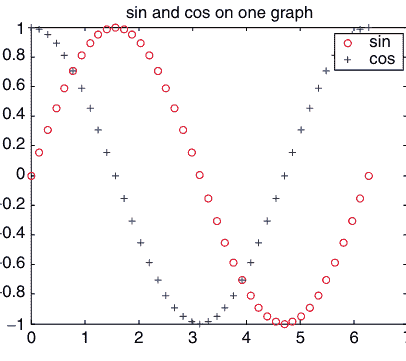

图 2.4
带有图例的同一个 Figure Window 中绘制 sin 和 cos。

```mat
sinncos.m
% 此脚本在同一个 Figure Window 中绘制 sin(x) 和 cos(x)
% x 的值范围从 0 到 2*pi
clf
x = 0: 2*pi/40: 2*pi;
y = sin(x);
plot(x,y,'ro');
hold on
y = cos(x);
plot(x,y,'b+');
legend('sin', 'cos')
title('sin and cos on one graph')
```


# 第 2 章 MATLAB 编程简介

某个下午的温度

注意：`load` 命令仅在每行数据值数量相同时才有效，这样数据才能存储在矩阵中，而 `save` 命令则可以将矩阵保存到文件中。如果不是如此，则必须使用更低级的 I/O 函数；这些将在第 8 章中讨论。

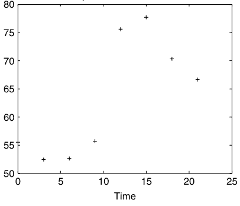

### 2.6.3.1 示例：从文件加载数据并绘图

作为一个示例，名为 `timetemp.dat` 的文件存储了两行数据。第一行是当天的时间，第二行是每个时间记录的温度。时间值 0 表示午夜。例如，文件的内容可能是：

图 2.5
从文件中绘制温度数据图。

以下脚本将数据从文件加载到矩阵中，将矩阵拆分为时间时间和温度的向量，然后使用黑色 `+` 符号绘制图表。

```matlab
timetempprob.m
% 这段代码从文件读取一个下午的时间和温度数据并绘图
load timetemp.dat
% 时间在第一行，温度在第二行
time = timetemp(1,:);
temp = timetemp(2,:);
% 绘制数据并标记图表标签
plot(time,temp,'k+')
xlabel('Time')
ylabel('Temperature')
title('Temperatures one afternoon')
```

运行该脚本将产生图 2.5 所示的图表。

注意，时间 0 处的点很难看到，因为它位于 y 轴上。可以使用 `axis` 函数更改这里的默认坐标轴设置。

## 2.6 文件输入/输出简介（加载与保存）

## 练习 2.8

XYZ 公司两个独立部门在 2007 年四个季度的销售额（以十亿计）存储在 `salesdat.txt` 文件中：

```
1.2 1.4 1.8 1.3
2.2 2.5 1.7 2.9
```

- 1. 创建此文件（只需在编辑器中输入数字，并另存为 `salesdat.txt`）。
- 2. 将数据加载到矩阵中。
- 3. 编写一个脚本：
  - 将此矩阵拆分为两个向量
  - 创建图 2.6 所示的图（使用 `o` 和 `+` 作为绘图符号）。

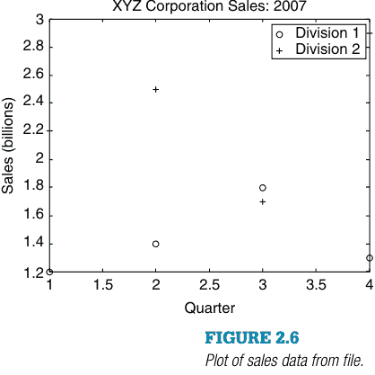

## 快速提问！

有时文件的格式并不是所需的格式。例如，创建了一个 `expresdat` 文件，其中了一些实验结果，但文件中值的顺序是反转的：

| 索引 (Index) | 值 (Value) |
|:---:|---:|
| 7 | 55.2 |
| 6 | 51.9 |
| 5 | 49.5 |
| 4 | 53.4 |
| 3 | 44.3 |
| 2 | 50.0 |
| 1 | 55.5 |

| 索引 (Index) | 值 (Value) |
|:---:|---:|
| 7.0000 | 55.5000 |
| 6.0000 | 51.9000 |
| 5.0000 | 49.5000 |
| 4.0000 | 53.4000 |
| 3.0000 | 44.3000 |
| 2.0000 | 50.0000 |
| 1.0000 | 55.5000 |

我们如何创建一个反转顺序的新文件呢？

**答案：** 我们可以从此文件加载到矩阵，使用 **flip** 函数将矩阵上下**翻转**，然后将此矩阵**保存** 到一个新文件中：

```matlab
>> corrector = flipud(expresdat)
corrector =
1.0000 55.5000
2.0000 50.0000
3.0000 44.3000
4.0000 53.4000
5.0000 49.5000
6.0000 51.9000
7.0000 55.2000
```

```matlab
>> save neworder.dat corrector -ascii
```

## 2.7 返回单个值的用户定义函数

我们已经见过 MATLAB 中许多函数的用法。我们使用过许多内置函数，如 `sin`、`fix`、`abs`、`double` 等。在本节中，将介绍用户定义函数。这些是由程序员定义，然后在命令行窗口或脚本使用的函数。

函数返回不同类型的结果。现在，我们将集中在计算并返回单个结果的函数上，类似于 `sin` 和 `abs` 等内置函数。其他类型的函数将在第 5 章中介绍。

首先，让我们回顾一下已经掌握的函数知识，包括内置函数的用法。虽然现在对这些函数的用法已经很熟悉了，但在这里将进行详细解释，以便对比用户定义函数的用法。

`length` 函数是计算单个值的内置函数示例；它返回向量的长度。例如，

```matlab
length(vec)
```

是一个表达式；它代表向量 `vec` 中的元素个数。该表达式可以在命令行窗口或脚本中使用。通常，会将该表达式返回的值赋值给一个变量：

```matlab
>> vec = 1:3:10;
>> lv = length(vec)
lv =
4
```

或者，可以打印向量的长度：

```matlab
>> fprintf('The length of the vector is %d\n', length(vec))
The length of the vector is 4
```

`length` 函数由函数名以及括号中的参数组成。该函数接收参数并返回结果。当遇到函数调用时，控制权传递给函数本身（也就是说，函数开始执行）。参数被传递给函数。


## 2.7 返回单值的自定义函数

```matlab
>> disp(calarea(4))
50.2655
>> fprintf('The area is %.1f\n', calarea(4))
```

The area is 50.3

注意，打印操作并不是在函数内部完成的；而是函数返回面积，然后由打印语句对其进行打印或显示。

使用 `help` 命令查看函数可以显示函数头下方连续的注释块：

```matlab
>> help calarea
This function calculates the area of a circle
```

### 2.7.3 在脚本中调用自定义函数

现在，我们将修改脚本（该脚本提示用户输入半径并计算圆的面积），改为调用我们的函数 `calarea` 来计算圆的面积，而不是在脚本中完成这一操作。

```matlab
script3.m
% 此脚本计算圆的面积
% 它会提示用户输入半径
radius = input('Please enter the radius:');
% 然后调用我们的函数来计算
% 面积并打印结果
area = calarea(radius)
printf('For a circle with a radius of %.2f.',radius)
printf('the area is %.2f\n',area)
```

因此，程序由脚本 `script3` 和函数 `calarea` 组成。
运行这将产生以下结果：

```matlab
>> script3
Please enter the radius: 5
For a circle with a radius of 5.00, the area is 78.54
```

### 2.7.4 传递多个参数

在很多情况下，需要向函数传递多个参数。例如，圆锥的体积公式为：

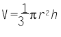

其中 $r$ 是圆底半径，$h$ 是圆锥的高度。因此，计算圆锥体积的函数同时需要半径和高度：

```matlab
conevol.m
function outarg = conevol(radius, height)
    % 计算圆锥的体积
    outarg = (pi/3) * radius * radius * height;
```

由于函数头中有两个输入参数，因此在调用函数时必须传递两个值。顺序非常重要。传递给函数的第一个值存储在第一个参数中（在本例中为 `radius`），而函数调用中的第二个参数被传递给函数头中的第二个输入参数。


这非常重要：函数调用中的参数必须与函数头中的输入参数一一对应。

以下是调用该函数的示例。函数返回的结果直接存储在默认变量 `ans` 中。

```matlab
>> conevol(4,6.1)
ans =
10.2065
```

在下一个示例中，结果以两位小数的格式打印。

```matlab
>> fprintf('The volume is %.2f\n',conevol(3, 5.5))
```

圆锥体积为 51.84


## 2.7 带有局部变量的函数

我们到目前看到的函数非常简单。然而，在许多情况下，函数更为复杂，并且可能需要在函数内部使用额外的变量；这些变量就是局部变量。

例如，正在构造一个材料成本为每平方英尺1元的圆柱。我们将编写一个函数，为给定半径和高度的圆柱计算材料成本，并向上取整到最近的平方英尺。封闭圆柱的总表面积为：

```matlab
>> ra = calrectarea(3.1, 4.4)
ra =
13.6400
>> fprintf('Need %d sq in\n',ceil(ra))
need 14 sq in
```

# 总结 69

例如，对于一个半径为 32 英寸、高度为 73 英寸的圆柱，材料每平方英尺成本为 $4.50，计算遵循以下算法：

- 计算表面积 SA = 2 * π * 32 * 73 + 2 * π * 32 * 32 平
- 计算平方英尺的 SA = SA/144
- 计算总成本 = 平方英尺的 SA * 每平方英尺成本

该函数包含了局部变量来存储中间结果。

```matlab
cylcost.m
function outcost = cylcost(radius, height, cost)
% 计算构造封闭
% 圆柱的成本
% 半径和高度单位为英寸
% 成本为每平方英尺
% 计算平方英寸的表面积
surf_area = 2 * pi * radius * height + 2 * pi * radius ^ 2;
% 将表面积转换为平方英尺并向上取整
surf_asf = ceil(surf_area/144);
% 计算成本
outcost = surf_asf * cost;
```

以下是调用该函数的示例：

```matlab
>> cylcost(32,73,4.50)
ans =
661.5
>> fprintf('The cost is %.2f\n',cylcost(32,73,4.50))```

## 总结

常见错误

- `fprintf` 末尾忘记添加换行符
- 混淆了 `fprintf` 和 `disp`
- 使用错误的转换字符

## 编程风格

- 使用有意义的名称
- 在脚本顶部使用说明性注释
- 保持脚本短于一页
- 使用描述性的变量名
- 使输出易于阅读
- 抑制赋值输出

## 练习题

1. 编写一个简单的脚本来计算空心的体积 $\frac{4\pi}{3}(t^3 - r^3)$，其中 $r$ 是内半径，$t$ 是外半径。给内半径和外半径分别赋值，然后使用这些变量将体积赋值给第三个变量。在脚本中包含注释。

2. 原子量是化学元素的重量。例如，氧的原子量为 15.9994，氢为 1.0079。编写一个脚本来计算过氧化氢的分子量，它由两个氢原子两个氧原子组成。在脚本中包含注释。使用 `help` 查看脚本中的注释。

3. 编写一个 `input` 语句提示用户输入字符串。然后找到字符串的长度。

4. 编写一个提示用户输入一个实数，并存储在变量中。然后使用 `fprintf` 函数以两位小数打印该变量的值。

5. `input` 函数可以用于输入向量，例如：
```matlab
>> vec = input('Enter a vector:)
Enter a vector: 4:7
vec = 4 5 6 7
```
对此进行实验，并发现用户如何输入矩阵。


然后，使用这些变量填充 `fprintf` 语句，以实现以下输出：

```
>> fprintf(
x is 12.340
>> fprintf(
x is 12
>> fprintf(
y is 4.6
>> fprintf(
y is 4.6                !)
```

- 9. 写一个脚本，提示用户输入矩形的长度和宽度，并输出两位小数的面积。在脚本中添加注释。

- 10. 编写一个名为 `echoname` 的脚本，提示用户输入姓名，然后按照以下格式在句子中输出姓名（使用 %s 打印）：

```
>> echoname
What is your name?
Wow, your name is Susan!
```

- 11. 编写一个名为 `echostring` 的脚本，提示用户输入字符串，并用引号打印该字符串：

```
>> echostring
Enter your string: hi there
Your string was: 'hi there'
```

- 12. 写一个脚本，提示用户输入一个角度制角度。它将将该角度转换为弧度并打印结果。注意：$\pi = 180^\circ$。

- 13. 平均而言，人们花费收入的 10% 用于食品。写一个脚本提示用户输入年收入。它将打印典型的每月支出。

- 14. 翼载荷（重量除以翼面积）是航空工程工程中的一个重要因素。写一个脚本提示用户输入飞机的重量（公斤）和翼面积（平方米），并计算并打印飞机的翼载荷（单位为 kg/m²）。

- 15. 写一个脚本给点的 x 坐标和 y 坐标赋值，并使用绿色点绘制该点。

- 16. 绘制 $x$ 从 -2 到 2、步长为 0.1 时的 `exp(x)`。为图表使用合适的标题并标记坐标轴。

- 17. 创建一个值从 1 到 100、步长为 5 的向量 $x$。创建一个向量 $y$，其每个值为 $x$ 中每个元素的平方根。绘制这些点。使用 `plot` 函数的 `bar` 参数来获取柱状图。

- 18. 创建一个 $y$ 向量，存储 1 到 100 之间的随机整数。创建一个 $x$ 向量，从 1 迭代到 $y$ 向量的长度。尝试不同的颜色、线型和符号对 `plot` 进行实验。

- 19. 绘制 $x$ 在 0 到 $\pi$ 范围内取 100 个点时的 `sin(x)`。

- 20. 大气属性（如温度、空气密度和压力）在航空领域非常重要。创建一个文件，存储不同高度的开尔文温度。高度在第一列，温度在第二列。例如，它可能看起来像：

```
1000    288
2000    281
3000    269
5000    256
10000   223
```

写一个脚本将此数据加载到矩阵中，分离成向量，然后使用合适的坐标轴标签和标题绘制数据。

- 21. 创建一个 3 x 6 的随机整数矩阵，每个值范围在 50 到 100 之间。将其写入名为 `randfile` 的文件。然后，创建一个新的随机整数矩阵，每个值范围在 50 到 100 之间。将此矩阵追加到原始文件中。然后读取该文件（变量名为 `randfile`）仅以确保操作成功！

- 22. 创建一个名为 `testdat` 的文件，包含两行，每行三个实数（包括一些负数、正数，范围在 -1 到 3 之间）。该文件可以从编辑器创建，也可以从矩阵保存。然后将文件加载到矩阵中，并计算结果矩阵中每个元素的正切值。

- 23. 之前创建了一个 `heightdat` 文件，每行都有一个年份，随后是该年份在特定地点点的每个月份的高温。例如，该文件可能如下：

| 89 | 42 | 49 | 55 | 72 | 63 | 68 | 77 | 82 | 76 | 67 |
| 90 | 45 | 50 | 56 | 59 | 62 | 68 | 75 | 77 | 75 | 66 |
| 91 | 44 | 43 | 60 | 60 | 60 | 65 | 69 | 74 | 70 | 70 |

如之前所示，日期仅使用了两个数字（这在上个世纪很常见）。写一个脚本将此文件读取到矩阵中，创建一个新矩阵将年份正确地存储为 19xx，然后将其写入名为 `y2ktemp.dat` 的新文件。（提示：在矩阵的第一列上加上 1900）。例如，该文件看起来如下：

| 1989 | 42 | 49 | 55 | 72 | 63 | 68 | 77 | 82 | 76 | 67 |
| 1990 | 45 | 50 | 56 | 59 | 62 | 68 | 75 | 77 | 75 | 66 |
| 1991 | 44 | 43 | 60 | 60 | 60 | 65 | 69 | 74 | 70 | 70 |

- 24. 写一个脚本，提示用户输入矩形的长度和宽度，并计算其面积。

- 25. 编写一个 `degf_to_K` 函数，将摄氏度（F）转换为开尔文（K）。它将接收一个摄氏度作为参数并返回开尔文温度。调用示例：

```
>> degf_to_K(32)
273.15
>> degf_to_K(212)
377.15
```

- 26. 写一个函数计算 BMI。体重指数 BMI 定义为=$703 \times \frac{weight}{height^{2}}$，其中重量为磅，高度为英寸。编写一个名为 `findbmi` 的函数，接收重量和高度参数并返回 BMI。调用示例如下：

```
>> findbmi(170,71)
ans = 23.706
>> bmi = findbmi(170,71)
bmi = 23.706
```

- 27. 飞机的速度通常以英里/小时给出。写一个函数接收英里/小时的速度并返回米/秒。一小时 = 3600 秒，一英里 = 5280 英尺。

- 28. 如果将某金额（称为 $P$）投入银行账户，按年利率 $i$ 复合，$n$ 年后的总金额为 $Tn=P(1+i)^{n}$。写一个函数接收 $P, i$ 和 $n$ 并返回总金额。给出一个调用示例。

```
>> Tn(1000, 0.05, 10)
ans = 1628.89
```

- 29. 体重指数 BMI 使用美国单位定义为 $BMI=703 \times \frac{weight}{height^{2}}$，其中重量为磅，高度为英寸。编写一个名为 `findbmi` 的函数，接收重量和高度参数并返回 BMI。例如，计算体重为 170 磅、身高为 71 英寸的人的 BMI。

- 30. 流速的速度可以通过总压 $P$ 和静压 $P_s$ 之差找到。对于水，公式为 $V=1.016\sqrt{P_{t}-P_{s}}$。写一个函数接收总压和静压作为输入并返回水的速度。

- 31. 在项目中，一些医学工程学生正在设计一种监测人在跑步机上心率的设备。设备将在达到目标心率时告知用户。中等强度目标心率（THR）的简单计算方法为 $THR=(220-A)\times 6$，其中 $A$ 是年龄。写一个函数计算并返回 THR。

- 32. 使用斯特林公式可以近似阶乘：$n!\approx\sqrt{2\pi n}(\frac{n}{e})^{n}$。写一个函数实现该公式，并将 $n$ 的值作为参数。

- 34. 写一个名为 `pickone` 的函数，它接收一个向量输入参数 $x$，并返回向量中的一个随机元素。例如：

```
>> pickone(4:7)
ans = 5
>> disp(pickone(-2:0))
```


# 76 第 2 章 MATLAB 编程简介

-1
>> help pickone
pickone(x) 从向量 x 中随机返回一个元素

35. 函数可以返回一个向量作为结果。编写写一个名为 `vecout` 的函数，它将接收一个整数参数，并使用冒号运算符返回一个向量，该向量的值在输入参数的基础上加 5。例如：

```
>> vecout(4)
ans =
4 5 6 7 8 9
```

36. 如果已知三角形两边的长度和它们之间的角，就可以计算出第三边的长度。给定三角形两边的边长度（b 和 c）以及它们之间的角 α，第三边长度的计算公式为：

```
a²=b²+c²-2bc cos(α)
```

编写一个脚本，提示用户并读取 b、c 和 α（角度为度）的值，然后计算并以三位小数打印 a 的值。（注意：要将角度从度转换为弧度，需将角度乘以 π/180）。脚本的输出格式应完全如下所示：

```
>> thirdside
Enter the first side: 2.2
Enter the second side: 4.4
Enter the angle between them: 50
The third side is 3.429
```

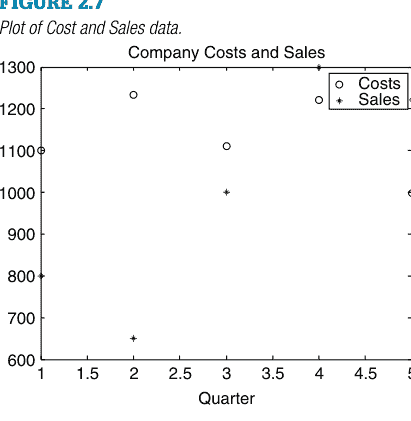

为了进一步练习，请编写一个计算第三边的函数，以便脚本调用该函数。
37. 某个零件正在车床上进行加工。零件的直径应为 20000 mm。每 10 分钟测量一次直径并将结果存储在一个名为 `partdiam` 的文件中。该文件将存储每个时间对应的分钟和直径。绘制数据图。

38. 一个名为 `costsalesdat` 的文件存储了公司过去 n 个季度的成本和销售数据（n 未预先定义）。成本在第一列，销售额在第二列。例如，如果代表了五个季度，文件中将有五行，可能如下：

| 1100 | 800 |
| 1233 | 650 |
| 1111 | 1001 |
| 1222 | 1300 |
| 999 | 1221 |

编写一个名为 `salescosts` 的脚本，将数据从该文件中读取到矩阵中。
当执行脚本时，它将完成三件事：(1) 打印文件中代表了多少季度，例如：

```
>> salescosts
There were 5 quarters in the file
```

- (2) 它在图形窗口（Figure Window）中使用黑色 'o' 绘制成本，使用黑色 's' 绘制销售额，并带有图例（使用默认坐标），如图 2.7 所示。

- (3) 它以不同的顺序将数据写入名为 `new.dat` 的新文件中。销售额作为第一行，成本作为第二行。例如，如果显示文件，生成的文件将存储：

800 650 1001 1300 1221
1100 1233 1111 1222 999

不应假设文件的行数是已知的。

本页特意留

# 选择语句

# 关键词汇

- - 选择语句
- 分支语句
- 条件
- 布尔表达式
- 关系表达式
- 逻辑表达式

- - 动作
- 临时变量
- 逻辑真
- 逻辑假
- 关系运算符
- 逻辑运算符

- - 真值表
- 嵌套 if-else 语句
- 级联 if-else 语句
- is 函数

# 目录

- 3.1 关系表达式 .............. 80
- 3.2 If 语句 .............. 82
- 3.3 If-Else 语句 .............. 87
- 3.4 嵌套 If-Else 语句 ........ 88
- 3.5 Switch 语句 .............. 93
- 3.6 函数 .............. 96
- 3.7 MATLAB 中的 Is 函数 .............. 98

到目前为止，在我们见过的脚本和函数中，每个语句都是按顺序执行的。这并不总是所需要的，在本节中，我们将看到如何选择是否执行某些语句，以及如何在之间进行选择。实现此目的的语句被称为*选择*或*分支*语句。

MATLAB 软件有两个允许这些操作的基本语句：*if* 语句和 *switch* 语句。if语句具有可选的 *else* 和 *elseif* 子句用于分支。*if* 语句使用逻辑上为真或假的表达式。这些表达式使用了关系运算符和逻辑运算符。MATLAB 还有询问某些事物为真为假的函数；这些函数将在章末尾介绍。

## 3.1 关系表达式

if 语句中的条件使用的表达式在概念上或逻辑上为真或假。这些表达式被称为关系表达式，或某些布尔表达式或逻辑表达式。这些表达式可以同时使用关系运算符（关联两个类型兼容的表达式）和逻辑运算符（对逻辑操作数进行操作）。

MATLAB 中的关系运算符有：

| 运算符 | 含义 |
|---|---|
| > | 大于 |
| < | 小于 |
| >= | 大于等于 |
| <= | 小于等于 |
| == | 等于 |
| ~= | 不等于 |

所有概念应该是熟悉的，尽管使用的运算符可能与其他编程语言或课程中的运算符不同。特别重要的是注意，等等的运算符是连续的符号，而不是单个等号。对于数值操作数，这些运算符的使用是直观的。例如，3 < 5 意味着“小于 5”，在概念上是一个真表达式。然而，在 MATLAB 中，与许多语言一样，逻辑真由整数 1 表示，逻辑假由整数 0 表示。因此，表达式 3 < 5 的值实际上为 1。显示此类表达式的结果展示了表达式的值。

```
>> 3 < 5
ans = 1
>> 9 < 2
ans = 0
```

然而，在工作空间（Workspace）中，这些表达式结果显示的值将是真或假。结果的类型是逻辑。可以在生成的 1 或 0 上执行数学运算。

```
>> 5 < 7
ans = 1
>> ans + 3
```

在许多语言中，逻辑真由整数 1 表示，逻辑假由整数 0 表示。所以，表达式 3 < 5 的值实际上为 1。显示此类表达式的结果展示了表达式的值。

在工作空间中，这些表达式结果显示的值将是真或假。数学运算可以在生成的 1 或 0 上执行。

```
>> 5 < 7
ans = 1
>> ans + 3
```

在许多语言中，逻辑真由整数 1 表示，逻辑假由整数 0 表示。所以，表达式 3 < 5 的值实际上为 1。显示此类表达式的结果展示了表达式的值。

在工作空间中，这些表达式结果显示的值将是真或假。数学运算可以在生成的 1 或 0 上执行。

```
>> 5 < 7
ans = 1
>> ans + 3
```

在许多语言中，逻辑真由整数 1 表示，逻辑假由整数 0 表示。所以，表达式 3 < 5 的值实际上为 1。显示此类表达式的结果展示了表达式的值。

在工作空间中，这些表达式结果显示的值将是真或假。数学运算可以在生成的 1 或 0 上执行。

```
>> 5 < 7
ans = 1
>> ans + 3
```

在许多语言中，逻辑真由整数 1 表示，逻辑假由整数 0 表示。所以，表达式 3 < 5 的值实际上为 1。显示此类表达式的结果展示了表达式的值。

在工作空间中，这些表达式结果显示的值将是真或假。数学运算可以在生成的 1 或 0 上执行。

```
>> 5 < 7
ans = 1
>> ans + 3
```

在许多语言中，逻辑真由整数 1 表示，逻辑假由整数 0 表示。所以，表达式 3 < 5 的值实际上为 1。显示此类表达式的结果展示了表达式的值。

在工作空间中，这些表达式结果 的值将是真 假。 运算 生成的 1 或 0 上执行。

```
>> 5 < 7
ans = 1
>> ans + 3
```

在 语言中，逻辑    1  逻辑        ，表达式 
 < 2 的 
 = 0。

```
>> 3 < 5
ans = 1
>> 9 < 2
ans = 0
```

在许多语言中，逻辑真由整数 1 表示，逻辑假由整数 0 表示。所以，表达式 3 < 5 的值实际上为 1。显示此类表达式的结果展示了表达式的值。

在工作空间中，这些表达式结果的值将是真或假。数学运算可以在生成的 1 或 0 上执行。

```
>> 5 < 7
ans = 1
>> ans + 3
```

在许多语言中，逻辑真由整数 1 表示，逻辑假由整数 0 表示。所以，表达式 3 < 5 的值实际上为 1。显示此类表达式的结果展示了表达式的值。

在工作空间中，这些表达式结果的值将是真或假。数学运算可以在生成的 1 或 0 上执行。

```
>> 5 < 7
ans = 1
>> ans + 3
```

在许多语言中，逻辑真由整数 1 表示，逻辑假由整数 0 表示。所以，表达式 3 < 5 的值实际上为 1。显示此类表达式的结果展示了表达式的值。

在工作空间中，这些表达式结果的值将是真或假。数学运算可以在生成的 1 或 0 上执行。

```
>> 5 < 7
ans = 1
>> ans + 3
```

在许多语言中，逻辑真由整数 1 表示，逻辑假由整数 0 表示。所以，表达式 3 < 5 的值实际上为 1。显示此类表达式的结果展示了表达式的值。

在工作空间中，这些表达式结果的值将是真或假。数学运算可以在生成的 1 或 0 上执行。

```
>> 5 < 7
ans = 1
>> ans + 3
```

在许多语言中，逻辑真由整数 1 表示，逻辑假由整数 0 表示。所以，表达式 3 < 5 的值实际上为 1。显示此类表达式的结果展示了表达式的值。

在工作空间中，这些表达式结果的值将是真或假。数学运算可以在生成的 1 或 0 上执行。

```
>> 5 < 7
ans = 1
>> ans + 3
```

在许多语言中，逻辑真由整数 1 表示，逻辑假由整数 0 表示。所以，表达式 3 < 5 的值实际上为 1。显示此类表达式的结果展示了表达式的值。


## 3.2 if 语句

条件（condition）是一个在概念或逻辑上为真或假的关系表达式。动作（action）是一个语句或一组语句，当条件为真时将执行执行。当执行 `if` 语句时，会评估第一个条件。如果条件的值为真，则执行动作；否则，不执行该动作。动作可以是任意数量的语句，直到遇到关键字 `end` 为止；动作自然地被关键字 `if` 和 `end` 括起来。（注意：这与用作向量或矩阵索引的 `end` 不同。）

### 练习 3.1 (PRRACT)

思考一下以下表达式会产生什么结果，然后输入以验证你的答案。

```
4 > 3 + 1
'e' == 'd' + 1
3 < 9 - 2
(3 < 9) - 2
4 == 3 + 1 && 'd' > 'c'
3 >= 2 || 'x' = 'y'
xor(3) >= 2, 'x' = 'y'
xor(3) >= 2, 'x' ~ 'y'
```

例如，以下 `if` 语句检查变量的值是否为负数。如果是，则使用绝对值函数将值改为正数；否则不做任何更改。

```matlab
if num < 0
num = abs(num)
end
```

`if` 语句可以在命令行窗口（Command Window）中输入，尽管它们通常在脚本或函数中更有意义。在命令行窗口中，先输入 `if` 语句，然后按回车键，输入动作，再按回车，最后输入 `end` 并按回车；结果将立即显示。例如，上面的 `if` 语句在这里显示了两次。注意，赋值的输出没有被抑制，因此如果执行了动作且第一次变量为负数，则会执行动作并修改变量；在第二种情况下，变量为正数，因此会跳过动作。

```matlab
>> num = -4;
>> num < 0
num = abs(num)
end
num = 4
>> num = 5;
>> num < 0
num = abs(num)
end
>>
```

## 84 第 3 章 选择语句

这可以用于，例如，确保平方根函数不用于负数。以下脚本提示用户输入一个数字，并打印平方根。如果用户输入负数，`if` 语句会在取平方根之前将其转换为正数。

```matlab
sqrtifexample.m
% 提示用户输入一个数字并打印其平方根
num = input('Please enter a number: ');
% 如果用户输入了负数，将其更改
if num < 0
num = abs(num);
printf('The sqrt of %.1f is %.1f\n',num,sqrt(num))
```

以下是运行此脚本的两个示例：

```
>> sqrtifexamp
nPlease enter a number: -4.2
The sqrt of 4.2 is 2.0

>> sqrtifexamp
nPlease enter a number: 1.44
The sqrt of 1.4 is 1.2
```

在这种情况下，语句的动作是一个单一赋值语句。动作可以是任意数量的有效语句。例如，我们可能希望向用户打印说明，说明输入的数字正在被更改。

```matlab
sqrtifexampii.m
% 提示用户输入一个数字并打印其平方根
num = input('Please enter a number: ');
% 如果用户输入了负数，告诉
% 用户并更改它
if num < 0
    disp('OK, we''ll use the absolute value')
    num = abs(num);
end

printf('The sqrt of %.1f is %.1f\n',num,sqrt(num))
```

3.2 if 语句 85

> sqrtifexample
nPlease enter a number: -25
OK, we'll use the absolute value
The sqrt of 25.0 is 5.0

注意在 `disp` 语句中使用两个单引号，以便打印出一个单引号。

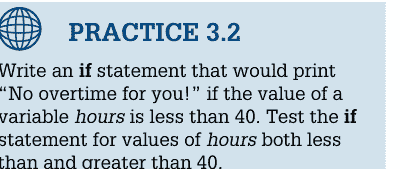

创建一个 `if` 语句，如果变量 `hours` 的值小于 40，则打印“Overtime for you”。先分别测试 `hours` 小于 40 和大于 40 的情况。

## 快速提问！

假设我们想创建一个从 `mymin` 到 `mymax` 的递增值向量。我们将编写一个函数 `createvec`，它将接收两个输入参数 `mymin` 和 `mymax`，并以步长 1 返回从 `mymin` 到 `mymax` 的值。首先，在创建之前确保 `mymin` 的值小于 `mymax` 的值。


```matlab
checkradius.m
% 此脚本计算圆的面积
% 它对用户输入的半径进行错误检查
radius = input('Please enter the radius: ')
if radius <= 0
    printf('Sorry, %.2f is not a valid radius\n',radius)
else
    area = calcarea(radius)
    printf('For a circle with a radius of %.2f',radius)
    printf('the area is %.2f\n',area)
end
```

这里展示了用户输入无效半径和有效半径运行该脚本的示例：

>> checkradius
Please enter the radius: -4
Sorry: -4.00 is not a valid radius
>> checkradius
Please enter the radius: 5.5
For a circle with a radius of 5.50, the area is 95.03

此示例中的 if-else 语句在两个操作之间选择：打印错误信息，或者实际使用半径计算面积并输出结果。注意，`if` 子句的操作是一个单一语句，而 `else` 子句的操作是三个语句的组合。

## 3.4 嵌套 if-else 语句

if-else 语句用于在两个语句之间进行选择。为了从两个以上的语句中选择，可以将 if-else 语句嵌套，即一个嵌套另一个。例如，考虑以下数学函数 y = f(x)：

```
y = 1 for x < -1
y = x^2 for -1 <= x <= 2
y = 4 for x > 2
```

y 的值取决于 x 的值，x 可能处于三个可能范围之一。可以通过三个独立的 `if` 语句来完成范围选择，如下：

```matlab
if x < -1
  y = 1;
end
if x > -1 && x < 2
  y = x^2;
end
if x > 2
  y = 4;
end
```

由于这三种可能性是互斥的，可以使用三个独立的 `if` 语句确定 y 的值。然而，这种效率并不高：无论 x 落在哪个范围，都必须评估所有三个布尔表达式。例如，如果 x 小于 -1，第一个表达式为真并将 1 赋值给 y。但是，后续两个 `if` 语句中的两个表达式仍然会被评估。与其这样写，不如将表达式嵌套，使得在发现某个表达式为真时语句结束：

```matlab
if x < -1
  y = 1;
else
  % 如果我们在这里，说明 x 必须 > -1
  % 使用 if-else 语句在
  % 两个范围之间进行选择
  if x > -1 && x < 2
    y = x^2;
  else
    % 不需要检查
    % 如果我们在这里，说明 x 必须 > 2
    y = 4;
  end
end
```

使用嵌套的 if-else 从三种可能性中选择时，不需要像上一个示例那样测试所有条件。情况下，如果 x 小于 -1，执行将 1 赋值给 y 的语句，if-else 语句完成，不再有其他条件。然而，如果 x 不小于 -1，则执行 `else` 子句。如果执行了 `else` 子句，我们已经知道 x 大于等于 -1，因此该部分不需要测试。相反，只剩下两种可能性：x 小于或等于 2，或者大于 2。使用 if-else 语句在这两个可能性之间进行选择。所以，`else` 子句的操作是另一个 if-else 语句。虽然它很长，但它是一个 if-else 嵌套 if-else 语句。操作经过缩进以显示结构。

以这种方式嵌套 if-else 语句可以从三个、四个、五个、六或更多选项中选择，而不需要像之前那样测试所有条件！

这实际上是嵌套 if-else 语句的一种特殊类型，称为级联语句。在这种 if-else 语句中，条件和操作呈阶梯状排列。

## elseif 子句

### 编程概念

在大多数编程语言中，从多个选项中选择意味着使用嵌套的 if-else 语句。然而，MATLAB 有另一种实现方法，使用 `elseif` 子句。

### 高效方法

选择两个以上的操作使用 `elseif` 子句。例如，如果有 n 个选择（n > 3），将使用形式：

```matlab
if condition1
  action1
elseif condition2
  action2
elseif condition3
  action3
% 等：可以有很多
else
  action
```

`if`、`elseif` 和 `else` 子句的操作由关键字 `if`、`elseif` 和 `end` 自然地分组。例如，之前的示例可以使用 `elseif` 子句而不是嵌套 if-else 语句来编写：

```matlab
if x < -1
  y = 1;
elseif x > -1 && x < 2
  y = x^2;
else
  y = 4;
end
```

所以，完成此任务三种方法：使用三个独立的语句、使用嵌套 if-else 语句以及使用带有 `elseif` 子句的语句，后者是最简单的。

## 嵌套 if-else 语句

可以通过一个接收 x 值并返回相应 y 值的函数来实现：

```matlab
calcy.m
function y = calcy(x)
% 此函数根据 x 计算 y：
% y = 1 for x < -1
% y = x^2 for -1 <= x <= 2
% y = 4 for x > 2
if x < -1
  y = 1;
elseif x >= -1 && x <= 2
  y = x^2;
else
  y = 4;
end
```

>> x = 1;
>> y = calcy(x)
y = 1

### 快速思考！

如何编写一个函数来确定参数是标量、向量还是矩阵？
答案：为了实现这一点，对输入参数使用 `size` 函数。如果行和列数都等于 1，则参数是标量。

```matlab
findargtype.m
function output = findargtype(inputarg)
% 此函数确定输入是标量、向量还是矩阵
[r, c] = size(inputarg);
if r == 1 && c == 1
  output = 'scalar';
elseif r == 1 || c == 1
  output = 'vector';
else
  output = 'matrix';
end
```

注意不需要检查最后一种情况：如果输入参数不是标量或向量，它一定是矩阵！这里是调用该函数的示例：

>> findargtype(3)
ans = scalar

>> findargtype(2:5)
ans = vector

>> findargtype([2,3])
ans = matrix

另一个示例演示了从少数选项中选择。以下函数接收一个测验成绩，其范围应在 0 到 10 之间。程序按照按照方案返回字母等级：9 或 10 为 'A'，8 为 'B'，7 为 'C'，6 为 'D'，以下任何情况均为 'F'。

## 练习 3.4

修改 `findargtype` 根据输入参数返回 'scalar'、'row vector'、'column vector' 或 'matrix'。互斥的情况下可以使用 if 语句实现评分方案。然而，使用带有多个 `else` 子句的 if-else 语句效率更高。此外，函数假设输入是整数。

```matlab
letgrade.m
function grade = letgrade(quiz)
% 此函数返回与整数参数对应的
% 字母等级

% 首先进行错误检查
if quiz < 0 || quiz > 10
  grade = 'X';
% 这里是有效的，所以找出
% 对应的字母等级
elseif quiz == 9 || quiz == 10
  grade = 'A';
elseif quiz == 8
  grade = 'B';
elseif quiz == 7
  grade = 'C';
elseif quiz == 6
  grade = 'D';
else
  grade = 'F';
end
```

这里是调用该函数的三个示例：

>> quiz = 8;
>> lettergrade = letgrade(quiz)
lettergrade = 'B'

>> quiz = 4;
>> lettergrade = letgrade(quiz)
ans = 'F'

>> quiz = 22;
>> lg = letgrade(quiz)
lg = 'X'

在 if 语句选择要返回的字母等级的部分，布尔表达式正在测试变量 `quiz` 的值，检查它是否顺序等于几个可能的值（首先是 9 或 10，然后是 8，然后是 7 等）。这部分可以用 `switch` 语句替换。

## 3.5 switch 语句

switch 语句可以代替嵌套的 if-else 或带有多个 `else` 子句的 if 语句。当测试一个表达式以检查它是否等于几个可能值之一时，使用了 switch 语句。switch 语句的一般形式为：

```
switch switch_expression
  case casepl
    action1
```


```case
case caseexp2
action2
case caseexp3
action3
% 等: 这里可以有很多个这样的结构
otherwise
actionn
end
```

**switch** 语句以关键字 **switch** 开始，以关键字 **end** 结束。*switch_expression* 会与 case 表达式（caseexp1, caseexp2 等）按顺序进行比较。如果 *switch_expression* 的值匹配 caseexp1，则执行 action1 并结束 **switch** 语句。如果值匹配 caseexp3，则执行 action3；通常情况下，如果值匹配 caseepi（其中 i 可以是 1 到 n 的任意整数），则执行 action。如果 *switch_expression* 的值不匹配任何 case 表达式，则执行 **otherwise** 单词之后的 action。

对于上一个示例，**switch** 语句可以如下所示使用：

```matlab
switchgrade.m
function grade = switchletgrade(quiz)
% 此函数使用 switch 返回与整数 quiz 成绩参数 
% 对应的字母等级
% 首先，进行错误检查
if quiz < 0 || quiz > 10
    grade = 'X';else
    % 如果到这里，说明是有效的，使用 switch 
    % 确定对应的字母等级
    switch quiz
        case 10
            grade = 'A';
        case 9
            grade = 'A';
        case 8
            grade = 'B';
        case 7
            grade = 'C';
        case 6
            grade = 'D';
        otherwise
            grade = 'F';
    end
end
```

以下是调用该函数的两个示例：

```matlab
>> quiz = 22;
>> lg = switchletgrade(quiz)
lg =
X
>> quiz = 9;
>> switchletgrade(quiz)
ans =
A
```

注意，假设用户将输入整数值。如果用户没有输入，则会打印错误信息或返回错误的结果。解决此问题的方法将在第 4 章中讨论。

由于多个 case 需要执行相同的打印 'A' 操作，可以将它们如下组合：

```matlab
switch quiz
case (10,9)
grade = 'A';
case 8
grade = 'B';
等等等等。
```

（case 表达式 10 和 9 外围的大的大括号是必要的。）在这个示例中，使用 if-else 语句进行错误检查，如果等级在有效范围内，则使用 switch 语句找到对应的字母等级。有时使用 otherwise 子句来显示错误消息。例如，如果用户应该只输入 1、3 或 5，脚本可以组织如下：

```matlab
switcherror.m
% otherwise 用于错误消息的示例
choice = input('Enter a 1, 3, or 5: ');
switch choice
    case 1
        disp('It's one!!')
    case 3
        disp('It's three!!')
    case 5
        disp('It's five!!')
    otherwise
        disp('Follow directions time!!')
end
```

在这种情况下，如果用户正确输入了有效选项之一，将执行操作。如果用户没有输入，otherwise 子句将处理打印错误消息。注意在字符串中使用单引号来打印单引号。

```matlab
>> switcherror
Enter a 1, 3, or 5:
Follow directions!
```

## 3.6 MENU 函数

MATLAB 还有一个名为 menu 的内置函数，它会显示一个带有选择按钮的图形窗口（Figure Window）。传递给函数的第一个字符串是标题，其余的是显示在按钮上的标签。该函数返回被按下按钮的数字。例如，图 3.1 菜单图。

| | | | |
| :--- | :--- | :--- | :--- |
| Pick pizza | Cheese | Shroom | Sausage |

>> mypick = menu('Pick a pizza', 'Cheese', 'Shroom', 'Sausage'); 将显示图 3.1 所示的图形窗口，并将用户按下按钮的结果存储在变量 mypick 中。共有三个按钮，等效值为 1、2 和 3。例如，如果用户按下 Sausage（香肠）按钮，mypick 的值为 3：

```matlab
>> mypick = 3
```

注意字符串 'Cheese'、'Shroom' 和 'Sausage' 只是按钮上的标签。在这种情况下，按下按钮的实际值将是 1、2 或 3。使用此菜单函数的脚本随后将使用 if-else 语句或 switch 语句根据按下的按钮来执行操作。例如，以下脚本简单地使用 switch 语句打印订购什么：

```matlab
pizza.m
%此脚本向用户询问披萨类型
% 并使用 switch 打印订购的类型
mypick = menu('Pick a pizza','Cheese','Shroom','Sausage');
switch mypick
  case 1
    disp('Order a cheese pizza')
  case 2
    disp('Order a mushroom pizza')
  case 3
    disp('Order a sausage pizza')
  otherwise
    disp('No pizza for us today')
end
```

这是一个运行此脚本并点击 Sausage 按钮的示例：

```matlab
>> pizza
Order a sausage pizza
```

### 快速问答！
**在 switch 语句中如何执行 otherwise 操作？**

**答案：** 如果用户点击菜单框右上角的 X 而不是三个按钮之一，menu 函数返回的值将为 0，导致 otherwise 子句被执行：

```matlab
>> pizza
No pizza for us today
```

在该脚本中未使用 switch 语句，另一种方法是使用带有 elseif 子句的 if-else 语句。

```matlab
pickifaalse.m
%此脚本向用户询问披萨类型
% 并使用 if-else 打印订购的类型
mypick = menu('Pick a pizza','Cheese','Shroom','Sausage');
if mypick == 1
    disp('Order a cheese pizza')
elseif mypick == 2
    disp('Order a mushroom pizza')
elseif mypick == 3
    disp('Order a sausage pizza')
else
    disp('No pizza for us today')
end
```

### 练习 3.5
编写一个接收数字作为参数的函数。使用 menu 函数显示“Choose a function”，并带有按钮 'fix'、'floor' 和 'abs'。使用 switch 语句，函数计算并返回请求的功能（例如，如果选择了 'abs'，函数将返回输入参数的绝对值）。如果用户没有按下按钮，返回第四种功能。

## 3.7 MATLAB 中的函数

MATLAB 有许多内置函数用于测试某些情况是否真实；这些函数以 **is** 单词开头。由于这些函数经常用于 if 语句，因此在本章中进行介绍。例如，isletter 函数在参数是字母表字母时返回 1，否则返回 0：

```matlab
>> isletter('h')
ans = 1
```

```matlab
>> isletter('4')
ans = 0
```

这种结果也可以通过比较字符在字符编码中的位置找到，例如对于小写字母。

### 编程概念
mychar >= 'a' && mychar <= 'z'

### 高效方法
Isletter(mychar)


'case'
'catch'
% 等。

还有许多其他函数；可以在帮助浏览器中找到该列表。

## 总结

## 常见陷阱

- 使用 `=` 而不是 `==` 进行相等判断

- 在比较变量与字符串时没有使用引号；例如，
  letter == y
  而不是
  letter == 'y'

- 混淆 `&&` 和 `||`

- 混淆 `||` 和 `xor`

- 在双字符运算符中加入空格；例如，输入 `< =` 而不是 `<=`

- 没有写完布尔表达式；例如，输入
  radius || height <= 0
  而不是
  radius <= 0 || height <= 0
  输入
  letter == 'y' || 'Y'
  而不是
  letter == 'y' | letter == 'Y'

请注意，这些在逻辑上是错误的，但不会产生错误信息。同样注意，表达式 `letter == 'Y' || 'Y'` 始终为真，无论变量 `letter` 的值是什么，因为 'Y' 是非零值，因此是一个真表达式。

- 在错误检查时使用 `if` 语句而不是 `if-else` 语句；例如，

```
if error occurs
print error message
continue rest of program
```

而不是
if error occurs
print error message
else
continue rest of program
end
```

在第一个示例中，会打印错误信息，但随后程序仍然会继续运行。

## 编程风格指南

- 使用缩进来显示脚本或函数的结构。特别是 `if` 语句中的操作应该缩进。

- 当不需要 `else` 子句时，使用 `if` 语句而不是 `if-else`。例如，
if unit == 'i'
  len = len * 2.54;
else
  len = len; % 这对跳过它没有起任何作用
end

相反，直接使用：
if unit == 'i'
  len = len * 2.54;
end

- 不要对 `else` 或 `elseif` 子句上放置不必要的条件。例如，以下代码在变量 `number` 的值等于 5 时打印一个内容，在不相等时打印另一个内容。

```
if number == 5
disp('It is a 5')
else number == 5
disp('It is not a 5')
end
```

然而，第二个条件是不必要的。值要么是 5 要不是，所以用 `else` 就能处理这种情况：

## 第 3 章选择语句

```
if number == 5
    disp('It is a 5')
else
    disp('It is not a 5')
```

使用 `menu` 函数时，确保已处理了用户点击菜单框上的红色 X 而不是按下按钮之一的情况。

| MATLAB 函数和命令 | | |
| --- |---|---|
| xor | isletter | switch |
| sind | nonempty | if-else else clause |
| menu | iskeyword | |

| MATLAB 运算符 | | |
| --- |---|---|
| less < | 大于或 | 不等 = 和 用于标量的 && |
| greater > | 等于 >= | 用于标量的 || 不 - |
| less than or equals | 相等 == | |

## 练习题

- 1. 以下表达式的结果是什么？
'b' >= 'c' - 1
  3 -- 2 + 1
  (3 -- 2) + 1
  xor(5 < 6, 8 > 4)

- 2. 编写脚本测试用户是否能够遵循指令。提示用户输入一个 x。如果用户输入 x 以外的任何内容，则打印错误信息；否则，脚本什么都不做。

- 3. 编写一个函数 `nexthour`，它接收一个整数参数（一天中的小时），并返回下一个小时。这假设是 12 小时制，所以例如 12 之后的下一个小时是 1。这里是调用该函数的两个示例。

```
>>fprintf('The next hour will be %d.\n',nexthour(3))
The next hour will be 4.
>>fprintf('The next hour will be %d.\n',nexthour(12))
The next hour will be 1.
```

- 4. 编写一个脚本计算锥体的体积，公式为 1/3 * 底面积 * 高，其中底面积是长度 * 宽度。提示用户输入长度、宽度高度的值，然后计算锥体的体积。当用户输入每个值时，将提示其输入英寸还是厘米（注意：2.54cm = 1 英寸）。脚本应以保留三小数位的立方英寸单位打印体积。例如，格式将如下：

This program will calculate the volume of a pyramid.
Enter the length of the base: 50
Is that inches?
Enter the width of the base: 42
Is that inches?
Enter the height: 4
Is that inches?
The volume of the pyramid is xxx.

- 5. 编写一个脚本询问用户“你是工程师吗？(Y/N)”，然后根据用户的回答打印适当的响应。

- 6. 编写一个脚本提示用户输入一个字符，然后打印其是否为字母表中的字母。

- 7. 编写一个脚本提示用户输入分子和分母。如果分母为 0，它将打印错误说无法除法。如果分母不为 0，它将打印分数的结果。

- 8. 收缩压和舒张压分别在心脏运行时测得。正在对血压正常的受试者进行生物医学实验。这定义为收缩压小于 120 且舒张压小于 80。编写一个脚本提示个人的收缩压和舒张压，并打印该人是否是此实验的候选者。

- 9. 流体动力学中通过变截面积管道的稳流连续性方程。对于不可压缩流，密度恒定，方程 $A1 = A2$。如果已知面积，可以通过 $A2$ 找到 $V2$。因此，第二点的速度增加、减少或与第一点相同。编写一个脚本提示用户输入两个英尺的面积，并打印第二个点的速度。

- 10. 编写一个函数 `createvec_m_to_n`，它将创建并返回从 m 到 n 的整数向量（m 是第一个参数，n 是第二个参数），无论 m 小于 n 还是大于 n。如果 m 等 n，向量将是一个标量。这里是调用该函数的示例：

```
>> createvec_m_to_n(8,5)
ans = 8 7 6
>> createvec_m_to_n(6,6)
ans = 6
```

## 3 章 选择语句

```
>> result = createvec_m_to_n(4,5)
result = 4 5
```

11. 在脚本中，用户被要求输入 'y' 或 'n'。用户的输入被读入字符变量 `letter`。如果用户输入 'y' 或 'Y'，脚本打印 'OK'；如果输入 'n' 或 'N'则打印 'OK, halting'；如果输入其他内容，则打印 "Error"。先在脚本放入此语句：

```
letter = input('Enter your answer: ', 's');
```

使用单个 if-else 语句编写。

- 12. 使用 switch 语句编写之前的脚本。

- 13. 在空气学中，马赫数是一个界限。它定义为物体（如飞机）的速度与声速的比值。如果马赫数小于 1，流为亚声速。如果马赫数大于 1，流为超声速。编写一个脚本提示用户飞机速度和当前高度的声速，并打印条件是亚声速、跨音速还是超声速。

- 14. 编写一个脚本提示用户输入摄氏温度，以及 F 还是 K。脚本将打印用户指定的对应温度。例如，输出可能如下：

Enter the temp in degrees C: 29.3
Do want F or K? F
The temp in degrees F is 84.7

输出格式应完全按照指定的。转换公式为：

```
F = \frac{9}{5}C+32
K = C+273.15
```

- 15. 编写一个函数 `isdiv4`，它接收一个输入参数，如果输入参数被 4 整除则返回逻辑真1，否则返回逻辑假。

- 16. 编写一个脚本生成一个随机整数，并打印该随机整数是偶数还是奇数。提示：偶数可被 2 整除，而奇数不能，所以检查除以 2 后的余数。

- 17. 编写一个函数 `isint`，它接收一个数字参数 `innum`，如果该数字是整数则返回 1 为真，否则返回 0 为假。利用整数 `innum` 应该是 `int32(innum)` 的事实。遗憾的是，由于舍入误差，当输入参数接近整数时，可能会得到 1 为真。例如：


```matlab
>> isint(4)
ans =
1
>> isint(4.9999)
ans =
0
>> isint(4.99999999999999999999)
ans = 1
```

- 18. 勾股三角形是一组正整数 (a,b,c)，满足 a² + b² = c²。编写一个函数 `ispythag`，该函数将接收三个正整数（按顺序为 a, b, c），如果它们构成勾股三角形则返回 1，否则返回 0。

- 19. 风暴是热带低压气、热带风暴还是飓风取决于持续风速。以每英里（mph）计算，如果风速小于 38mph，则风暴为热带低压；如果风速在 39 到 73mph 之间，则为热带风暴；如果风速 >= 74mph，则为飓风。编写一个脚本，提示用户输入风暴的速度，并打印它属于哪种类型的风暴。

- 20. 飓风根据风速分类。下表显示了不同风速范围的飓风等级（Category）以及风暴潮（高于正常水平的英尺）。

| 等级 (Category) | 风速范围 | 风暴潮 (英尺) |
| :--- | :--- | :--- |
| 1 | 74-95 | 4-5 |
| 2 | 96-110 | 6-8 |
| 3 | 111-130 | 9-12 |
| 4 | 131-155 | 13-18 |
| 5 | >155 | >18 |

编写一个脚本提示用户输入风速，并打印飓风等级和典型的风暴潮。

- 21. 云通常分类为高层、中层或低层。云的高度是决定因素，但范围随温度而异。例如，在热带地区，分类可能基于以下高度范围（英尺给出）：

- 低层：0-6500
- 中层：6500-20000
- 高层：>20000

编写一个脚本提示用户输入云的高度，并打印其分类。

- 22. 将以下 `switch` 语句重写为一个嵌套的 `if-else` 语句（可以使用 `else` 子句）。假设有一个变量 `letter` 且已初始化。

```matlab
switch letter
    case 'x'
        disp('Hello')
    case ['y', 'Y']
        disp('Yes')
    case 'Q'
        disp('Quit')
    otherwise
        disp('Error')
end
```

- 23. 将嵌套的 `if-else` 语句重写为实现完全相同功能的 `switch` 语句。假设 n 是一个已初始化的整数变量，并且存在函数 f1, f2, f3 和 f4。在 `switch` 语句的动作中不要使用任何 `if` 或 `if-else` 语句，仅使用这四个函数的调用。

```matlab
if num < -2 || num > 4
    f1(num)
else
    if num <= 2
        if num > 0
            f2(num)
        else
            f3(num)
    else
        f4(num)
```

- 24. 在某个城市，有五条不同的电车线路；它们的代码为 A, B, C, D 和 E。假设 `code` 是一个已初始化的字符变量。以下嵌套的 `if-else` 语句打印给定线路的运行频率：

```matlab
if (code > 'A' && code < 'E')
    if (code == 'C')
        printf('Every 10 minutes')
    else
        printf('Every 7 minutes')
else
    if (code == 'A')
        printf('This line is now obsolete!')
    else
        if (code == 'E')
            printf('Error - there is no trolley!')
        else
            printf('Every 12 minutes')
        end
end
end
```

这太混乱了！将此重写为 `switch` 语句，对于 `code` 的任何值都实现上述嵌套 `if-else` 语句的功能。在 `switch` 语句中使用任何 `if` 或 `if-else` 语句（仅使用 `printf` 语句）。编写一个脚本来测试该解决方案。

- 25. 编写脚本 *area_menu*，它将打印柱体、圆和矩形的列表。它提示用户选择一个，然后提示用户输入相应的数量（例如圆半径），然后打印其面积。如果用户输入无效值，脚本简单打印错误消息。脚本应使用 `if-else` 语句来实现。以下是两个运行示例（假设单位为英制）：

```text
>> area_menu
1. Cylinder
2. Circle
3. Rectangle
Please choose: 2
Enter the radius of the circle: 4.1
The area is 52.81
```

```text
>> area_menu
1. Cylinder
2. Circle
3. Rectangle
Please choose: 3
Enter the length: 4
Enter the width: 6
The area is 24.00
```

- 26. 修改 *area_menu* 函数，使用 `switch` 语句来决定计算哪个面积。

- 27. 修改 *area_menu* 函数（任意版本），使用内置的 `menu` 函数代替打印选项。

- 28. 编写一个脚本提示用户输入 x 的值。然后使用 `menu` 函数在 sin(x)、cos(x) 和 tan(x) 之间提供选择。脚本将打印用户选择的任何 x 的函数。使用 `if-else` 语句来实现此。

- 29. 修改前面的脚本，使用 `switch` 语句代替。

- 30. 编写一个函数，它接收一个数字作为输入参数。它使用 `menu` 函数显示“选择一个函数”，并有 ceil、round 和 sign 按钮。使用 `switch` 语句，函数将计算并返回请求的函数（例如，如果选择了 round，函数将返回输入参数的舍入值）。

- 31. 修改上一个函数，使用嵌套的 `if-else` 语句代替。


例如，打印一列从 1 到 5 的数字：

```
for i = 1:5
    printf('%d\n',i)
end
```

此循环可以在命令行窗口（Command Window）中输入，尽管类似于 if 和 switch 语句，循环在脚本和函数中更有意义。在命令行窗口中，结果将在 for 循环后出现：

```
>> i = 1:5
    printf('%d\n',i)
end
1
2
3
4
5
```

for 语句的作用是对于从 1 到 5 步长为 1 的每一个 i 值，打印 i 的值以及一个换行符。首先发生的是将 i 初始化为值 1。执行循环的操作，即打印 i 的值 (1) 的语句，然后是使光标向下移动的换行符。然后，i 增加到值 2。接下来，执行循环的操作，打印 2 和换行符。然后，i 增加到 3 并打印，接着 i 增加到 4 并打印，最后 i 增加到 5 并打印。i 的最终值为 5；一旦循环结束，就可以使用该值。

## 快速提问！

你如何打印这一列整数？

**答案：** 在循环中，你可以打印从 0 开始、每次增加 50 并到 200 结束这些值。每个值都使用字段宽度 3 进行打印。

- 0
50
100
150
200

```
>> i = 0:50:200
    printf('%3d\n',i)
end
```

### 4.1.1 求和与积

for 循环的一个常见应用是计算和与积。例如，与其仅仅打印 1 到 5 的整数，我们不如计算 1 到 5 整数的和（或者通俗地说，计算 1 到 *n*，其中 *n* 是任意正整数）。基本上，我们想要实现：

```
$$\sum_{i=1}^{n} i$$
```

或计算和 $1 + 2 + 3 + \dots + n$。

为了实现这一点，我们需要将每个值加到一个运行中的*和*（sum）中。我们不断向其累加。首先，和必须初始化为 0，然后在这种情况下它将变为 1 (0 + 1)，然后是 3 (0 + 1 + 2)，然后是 6 (0 + 1 + 2 + 3)，依此类推。

在计算和的函数中，我们需要一个循环或迭代变量 *i*（如之前），还需要一个存储运行和的变量。在这种情况下，我们将输出参数 *sum* 作为运行和。每次循环，*i* 的下一个值都会加到 *sum* 的值上。该函数将返回结果，即从 1 到输入参数 *n* 的所有整数的和，存储在输出参数 *sum* 中。

```matlab
sum_1_to_n.m
function sum = sum_1_to_n(n)
% 此函数返回从1到n
% 整数的和
sum = 0;
for i = 1:n
sum = sum + i;
end
```

例如，如果将 5 传递给输入参数 *n*，该函数将计算并返回 1 + 2 + 3 + 4 + 5，即 15：

## 练习 4.1

编写一个函数 sum_m_to_n，它与之前的函数相似，但将计算从 *m* 到 *n* 的整数的和。例如，如果将整数 4 和 7 传递给函数，它将计算 4 + 5 + 6 + 7：

```
>> sum_m_to_n(4,7)
ans =
22
```

```
>> sum_1_to_n(5)
ans =
15
```

注意在初始化和为0以及在循环期间加时，输出被抑制了。

*循环*的另一个常见应用是寻找运行积。例如，与其寻找 1 到 *n* 整数的和，我们不如寻找 1 到 *n* 整数的积。基本上，我们想要实现或计算 1 * 2 * 3 * 4 * ... * n，这被称为阶乘，写作 n!。

### 编程概念

为了实现这一点，基本算法与求和相似，我们需要将循环的每个值乘以一个运行积。区别在于，虽然运行变量被初始化为 0，但运行积变量必须初始化为 1。这样在第一次将值乘以它时，它不会改变原始值。

```matlab
myfact.m
function runprod = myfact (n)
% 此函数返回从1到n
% 整数的积，或n!
runprod = 1;
for i = 1:n
runprod = runprod * i;
```

可以将任何正整数参数传递给该函数，它将计算 1 到 n 整数的积，或 n!。例如，如果传递了 5，该函数将计算并返回 1 * 2 * 3 * 4 * 5，即 120。

### 高效方法

MATLAB 有一个内置函数 factorial，可以找到整数的阶乘。

```
>> factorial(5)
ans =
120
```


此外，MATLAB 还有 `cumsum` 和 `cumprod` 函数，它们返回运行加和或运行乘积的向量。例如，对于以下向量，第一个值是 5，因此它是 `cumsum` 返回的第一个值。下一个值是 9，因此 5 + 9 是 14，最后 4 + 4 是 18。

```
>> vec = [5 9 4];
>> cumsum(vec)
ans =
5 14 18
```

累积乘积函数 `cumprod` 而是计算 5，然后是 5 * 9，最后是 5 * 9 * 4：

```
>> cumprod(vec)
ans =
5 45 180
```

### 4.1.1.2 预分配向量

本质上有两种编程方法可以模拟 `cumsum` 函数。一种方法是从空向量开始，将每个运行加和串联到向量中。然而，扩展向量的效率非常低。更好的方法是预分配正确大小的向量，然后将每个元素的值更改为连续的运行加和。这两种方法将在这里展示。

在下面的函数中，输出参数初始化为空向量 `[]`。然后，每当向量中的元素添加到运行加和时，该和就会追加到向量中。

```
myveccsum.m
function outvec = myveccsum(vec)
% 此函数模拟向量的 cumsum
outvec = [];
runsum = 1:length(vec)
for i = 1:length(vec)
  runsum = runsum + vec(i);
  outvec = [outvec runsum];
end
```

这里是调用该函数的示例：

```
>> myveccsum([5 9 4])
ans =
5 14 18
```

在循环的第一次，`outvec` 将为 `[5]`。第二次，`runsum` 将变为 14，`outvec` 存储 `[5 14]`。最后，`runsum` 将变为 18，`outvec` 将存储 `[5 14 18]`。

虽然这种方法有效，但效率不高。另一种方法是引用输出向量中的每个元素，并将每个部分和放入输出向量的下一个元素中。随着 `vec(i)` 的每个值被累加，这个新和被存储在 `outvec(i)` 中。

```
myveccsum.m
function outvec = myveccsum(vec)
% 此函数模拟向量的 cumsum
% 它预分配输出向量
outvec = zeros(1, size(vec));
runsum = 0;
for i = 1:length(vec)
  runsum = runsum + vec(i);
  outvec(i) = runsum;
end
```

虽然将输出向量 `outvec` 初始化为全零并不是绝对必要的，但它大大提高了函数的效率。将此向量初始化为与输入大小相同的零可以预分配该部分内存。另一方面，像上一个示例那样一个接一个元素地构建向量，MATLAB 每次在扩展向量时都会寻找新的内存。

### 4.1.2 将循环与 if 语句结合

向量上另一个常见的用例示例是找到向量中的最小值或最大值。

### 编程概念

例如，要找到向量中的最小值，算法是：

- 目前为止的最小值是向量中的第一个元素
- 遍历向量的其余部分
- 如果任何元素小于目前找到的最小值，那么该元素就是目前为止的最小值

下面的函数实现了该算法，并返回向量中找到的最小值。

```
myminvec.m
function outmin = myminvec(vec)
  % 寻找向量中的最小值
  outmin = vec(1);
  for i = 2:length(vec)
    if vec(i) < outmin
      outmin = vec(i);
    end
end
```

```
>> vec = [3 8 -99];
>> myminvec(vec)
ans =
-1
```

```
>> vec = [3 8 99];
>> myminvec(vec)
ans = 3
```

注意在循环中使用 `if` 语句而不是 `if-else` 语句。如果向量中下一个元素的值小于 `outmin`，则更改 `outmin` 的值；否则，不需要任何操作。

### 高效方法

MATLAB 拥有 `min` 和 `max` 函数，它们可以找到向量中的最小值和最大值。

```
>> vec = [5 9 4];
>> myminvec(vec)
ans = 4
```

### 4.1.3 在操作中未使用迭代变量的 for 循环

在到目前为止的所有示例中，循环的值都以某种方式用在 for 循环的操作中：我们打印了 `i` 的值，或将其加到和，或将其与运行乘积相乘，或将其作为向量的索引。然而，并不总是需要实际使用循环变量的值。有时该变量仅用于迭代或按指定的次数重复执行语句。例如，产生以下输出：

```
I will not chew
I will not chew
I will not chew
```

变量 `i` 对于重复执行三次操作是必要的，尽管 `i` 的值没有在循环的操作中使用。

### 快速思考！

以下 `for` 循环的结果是什么？
```matlab
for i = 4:2:8
  printf('I will not chew\n')
end
```
**答案：** 与之前完全相同！循环变量遍历值 4, 6, 8 而不是 1, 2, 3 并不重要。由于循环变量没有用于操作，这只是指定重复操作三次的另一种方式。当然，使用 `1:3` 更有意义！

### 4.1.4 输入 for 循环

下面的脚本重复向用户提示数字并回显打印（即将其打印出来）的过程。`for` 循环指定了这种情况发生的次数。这是另一个例子，循环变量没有用于操作，而是指定了重复操作的次数。

```
foreach.m
% 此脚本循环重复向用户提示数字
% 并回显打印的操作
for iv = 1:3
  inputnum = input('Enter a number: ');
  printf('You entered %.1f\n',inputnum)
end
```

## 4.1 For Loop

```
>> foreach
Enter a number: 33
You entered 33.0
Enter a number: 1.1
You entered 1.1
Enter a number: 55
You entered 55.0
```

## 练习 4

修改 `foreach` 脚本，对用户输入的数字求和并打印结果。


## 4.2 嵌套循环

```matlab
for i = 1:rows
    fprintf('%n')
end
```

运行该脚本将显示输出：

```
>> printstars
*****
*****
*****
```

变量 *rows* 指定了要打印的行数，变量 *columns* 指定了每行要打印多少个 *s*。有两个循环变量：*i* 是行的循环变量，*j* 是列的循环变量。由于行数和列数是已已的（由变量 *rows* 和 *columns*给出），因此有一个 *for* 循环用于遍历行，另一个循环用于打印所需数量的星号。

第一个 *for* 循环被称为*外层循环*；第二个 *for* 循环被称为*内层循环*。因此，外层循环处理行，内层循环处理列。执行此脚本时，第一个循环变量 *i* 初始化为 1。然后，内层循环的操作重复 *rows* 次，外层循环变量 *i* 增加到 2。再次执行外层循环的操作，这意味着内层循环将打印五次，然后打印换行符。此过程持续进行，最终外层循环的操作将执行完毕。注意外层循环的操作包含两个语句（一个 *for* 循环和一个 *fprintf* 语句）。然而，内层循环的操作仅包含单个语句。

## 第4章 循环

```matlab
printstars.m
% 打印一个星号三角形
% 数量将由变量指定
rows = 3;
columns = 5;
for i = 1:rows
    for j = 1:columns
        fprintf('%s', '*')
    end
    fprintf('\n');
end
```

```
>> printstars
*****
*****
```

在这些示例中，循环变量被用来指定次数。这些相同的循环也可以用于生成乘法表。接下来的函数 *multtable* 计算并返回一个矩阵。向函数传递了两个参数，即行数和列数。

```matlab
function outmat = multtable(rows, columns)
% 创建一个作为乘法表的矩阵
% 预分配矩阵
outmat = zeros(rows, columns);
for i = 1:rows
    for j = 1:columns
        outmat(i,j) = i * j;
    end
end
```

```
>> multtable(3,5)
ans =
   1  2  3  4  5
   2  4  6  8 10
   3  6  9 12 15
```

```matlab
createmulttab.m
% 提示用户输入行列
% 创建一个乘法表存储在
% 文件中
num_rows = input('Enter the number of rows: ');
num_cols = input('Enter the number of columns: ');
mymultrix = multtable(num_rows, num_cols);
save multtable.dat mymatrix
```

这是一个运行该脚本的示例，然后将文件加载到矩阵中以验证文件已创建：

```
>> createmulttab
Enter the number of rows: 6
Enter the number of columns: 4
>> load multtable.dat
>> mymatrix
mymulttable =
     1  2  3  4
     2  4  6  8
     3  6  9 12
     4  8 12 16
     5 10 15 20
     6 12 18 24
```

### 4.2.1 嵌套循环与矩阵

当需要遍历矩阵中的所有元素时，通常会使用嵌套循环。例如，我们将计算矩阵中所有元素的总和。

### 编程概念

矩阵作为输入参数传递给函数。该函数使用 `size` 函数来确定矩阵的行数和列数。它通过嵌套循环遍历矩阵中的所有元素：一个循环遍历行，另一个循环遍历列，并将每个元素累加到运行和中。注意，循环变量 *i* 和 *j* 被用矩阵的索引：首先是行索引，然后是列索引。

```matlab
mymatsum.m
function outsum = mymats(mat)
% 计算矩阵中元素的
% 总和
[row, col] = size(mat);
outsum = 0;
% 外层循环处理行
for i = 1:row
    for j = 1:col
        outsum = outsum + mat(i,j);
    end
end
```

```
>> mat = [3:5; 2 5 7]
mat =
   3 4 5
   2 5 7
>> mymats(mat)
ans =
   26
```

### 高效方法

正如我们所见，MATLAB 有内置的 `sum` 函数。对于矩阵，`sum` 函数按列操作，这意味着它将返回每列的和。

```
>> mat =
   3 4 5
   2 5 7
>> sum(mat)
ans =
     5  9 12
```

要获得总和，需要对列和再次求和！

```
>> sum(sum(mat))
ans =
   26
```

在例例中，外层循环处理行，内层循环处理列。然而，这种顺序很容易交换，使得外层循环处理列，内层循环处理行：

```matlab
mymatsumb.m
function outsum = mymats(mat)
% 计算矩阵元素的
% 总和
[row, col] = size(mat);
outsum = 0;
% 外层循环处理列
for i = 1:col
    for j = 1:row
        outsum = outsum + mat(j,i);
    end
end
```

```
>> mat = [3:5; 2 5 7]
mat =
   3 4 5
   2 5 7
>> mymats(mat)
ans =
   26
```

## 快速提问！

如何计算每一列的和，而不是仅仅得到一个总和？答案：编程方法需要一个嵌套循环，其中外层循环处理列。例如，我们将修改之前的函数以汇总每一列并返回一个包含结果的行向量。

```matlab
matcolsum.m
function outsum = matcolsum(mat)
% 计算矩阵中每一列的和
% 返回一个列和的向量
[row, col] = size(mat);
% 按列数预分配向量
outsum = zeros(1,col);
% 每一列都在求和，所以外层循环
for i = 1:col
    for j = 1:row
        outsum(i) = outsum(i) + mat(j,i);
    end
end

```


## 4.2 嵌套for循环

```matlab
% has to be initialized over the columns
for i = 1:col
    % Initialize the running sum to 0 for every column
    russum = 0;
    for j = 1:row
        russum = rusum + mat(j,i);
    end
    outsum(i) = rusum;
end
```

注意，输出是一个行向量，其列数与输入参数矩阵的列数相同。此外，由于函数是在计算每一列的和，因此*sum* 变量必须在外层循环的每一列中初始化为0。

```matlab
>> matcolsum(mat)
ans = 5 9 12
```

当然，正如我们已经看到的，MATLAB中内置的 **sum** 函数可以完成相同的工作。

```matlab
>> mat = [3:5; 2 5 7]
mat =
    3 4 5
    2 5 7
```

注意，内置的 **sum** 函数是对每列进行求和；要找到每行的和，需要对矩阵进行转置：

```matlab
>> sum(mat')
ans = 12 14
```

> 练习 4.5
> 修改此函数；创建一个函数 **rowsum** 来计算并返回一个所有行和的向量，而不是列和。调用它并传递之前的 *mat* 变量将得到如下结果：

对于矩阵，**cumsum** 函数返回一个矩阵，该矩阵由矩阵参数的第一行、以及第一行和第二行的数值之和（对于两行的矩阵）组成。

```matlab
>> cumsum(mat)
ans =
    3 4 5
    5 9 12
```

**min** 和 **max** 函数也是按列操作的；这些函数会找到每列中的最小值或最大值。

```matlab
>> mat
mat = 3 4 5
    2 5 7
>> max(mat)
ans = 3 5 7
```

### 4.2.2 结合嵌套for循环和if语句

嵌套循环内部的语句可以是任何有效语句，包括任何选择语句。例如，循环中可以将 if-else 语句作为动作或动作的一部分。

作为一个示例，有一个名为 datavals.dat 的文件，其中记录了实验结果。然而，某些结果被错误记录了。所有数字本应该是正数。以下脚本将该文件读取到矩阵中。它打印出每行正数的和。我们假设文件包含整数，但不假设文件中有多少行或每行有多少个数字。

```matlab
sumonlypos.m
% Sums only positive numbers from file
% Reads from the file into a matrix and then
% calculates and prints the sum of only the
% positive numbers from each row
load datavals.dat
[ r, c] = size(datavals);
for i = 1:r
    sumrow = 0;
    for j = 1:c
        if datavals(i,j)>=0
            sumrow = sumrow + datavals(i,j);
        end
    end
    printf('The sum for row %d\n',i,sumrow)
end
```

例如，如果文件包含：

| 33 | -11 | 2 |
| 4 | 5 | 9 |
| 22 | | -7 |
| 2 | 11 | 3 |

程序的输出将如下所示：

```matlab
>> sumonlylypos
sum for row 1 is 35
sum for row 2 is 18
sum for row 3 is 27
sum for row 4 is 16
```

文件被加载到一个变量中。脚本获取了矩阵的大小，然后使用嵌套循环遍历矩阵中的所有元素；外层循环遍历行，内层循环遍历列。if-else 语句判断元素是否为正数。它只将值加到行和中。每行都会计算和，sumrow 变量在每一行都会被初始化为0，这意味着它位于外层循环内部。

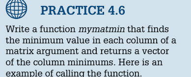

```matlab
>> mat = randint(3,4,[1 20])
mat =
15 19 17 5
6 14 13 13
9 5 13
>> mymatmin(mat)
6 5 3 5
```

## 快速提问！

在这个例子中，如果反转循环顺序，即外层循环遍历列，内层循环遍历行，会有影响吗？

答案：会有，因为我们需要每一行的和，所以循环必须针对行。

## 快速提问！

mymatmin 函数也适用于向量参数吗？

答案：可以，因为向量是矩阵的子集。在这种情况下，其中一个循环只会重复一次（如果是向量，则针对行；如果是列向量，则针对列）。

## 4.3 向量化

在 MATLAB 的许多情况下，循环并不是必要的。由于 MATLAB 专门为处理向量和矩阵而编写的，许多操作可以在不使用循环的情况下完成并可以使用函数。向量化是用显式循环替换矩阵操作的过程，这在 MATLAB 中通常更快且更简洁。


### 4.3 向量化 (Vectorizing)

### 快速问！

为什么这不起作用？

```
>> vec([0 1 0 0 1 1])
??? 下标索引必须是实正整数或逻辑值。
```

**答案：** 示例中向量的差异在于，*它*是一个逻辑型向量（**logical** 型 1 和 0），而 [0 1 0 0 1 1] 默认是 **double**（双精度浮点）型向量。只有 **logical** 型 1 和 0 可以用于对向量进行索引。

由于向量中的值必须是 **logical** 型 1 和 0，下面这个似乎首先使用编程方法完成操作的函数，实际上并没有这样做。该函数接收两个输入参数：向量和一个用于比较的整数（因此它具有某种通用性）。它遍历输入向量中的每个元素，并根据 `vec(i) > n` 的真假情况将结果向量存储为 1 或 0。

```matlab
testvecgtn.m
function outvec = testvecgtn(vec,n)
% 将 vec 中的每个元素进行比较，查看其
% 是否大于 n

% 预分配向量
outvec = zeros(size(vec));
for i = 1:length(vec)
  % 输出向量中的每个元素存储 1 或 0
  if vec(i) > n
    outvec(i) = 1;
  else
    outvec(i) = 0;
  end
end
```

调用该函数似乎返回与 `vec > 5` 相同的向量，并且对结果求和仍然可以确定有多少个元素大于 5。

```matlab
>> notlog = testvecgtn(vec,5)
notlog = 0 1 0 0 1 1
```

```matlab
>> sum(notlog)
ans =
3
```

然而，和之前一样，它不能用于对向量索引，因为元素是 **double** 型，而不是逻辑型：

```matlab
>> vec(notlog)
??? 下标索引必须是实正整数或逻辑值。
```

### 快速问！

我们如何修复这个问题？我们可以分配逻辑值而不是双精度值？
**答案：** 我们可以使用 **logical** 函数使输出参数向量的类型变为 **logical** 而不是 **double**。在函数中，唯一需要修改的语句是预分配向量的语句；在这种情况下，也将向量的类型更改为了 **logical**。

```matlab
outvec = logical(zeros(vec));
```

### 4.3.1. 逻辑内置函数

MATLAB 中有一些内置函数与全为逻辑真或假值的向量或矩阵结合使用非常有用；其中两个是 **any** 和 **all** 函数。**any** 函数如果向量中的任何一个元素在逻辑上为真，则返回逻辑真，否则返回假。**all** 函数只有当所有元素在逻辑上为真时，才返回逻辑真。这里是一些示例。对于变量 *vec1*，所有元素在逻辑上为真，因此 **any** 和 **all** 都返回真。

```matlab
>> vec1 = [1 3 1 1 2];
>> any(vec1)
ans =
1
>> all(vec1)
ans =
1
```

对于 *vec2*，某些元素在逻辑上为真，所以 **any** 返回真但 **all** 返回假。

```matlab
>> vec2 = [1 1 0 1]
vec2 =
1 1 0 1
>> any(vec2)
ans =
1
```

```matlab
>> all(vec2)
ans =
0
```

### 快速问！

我们如何通过循环和 if 语句来实现相同的功能？

**答案：** 对于等同于 **any** 函数的操作，我们首先假设向量是逻辑假的：即没有任何元素在逻辑上为真，然后遍历元素，如果在向量中发现任何一个元素在逻辑上为真，则将结果设置为逻辑真。

```matlab
myany.m
function logresult = myany(vec)
% 模拟内置函数 any
% 假设结果为 0
logresult = logical(0);
for i = 1:length(vec)
% 如果任何值不是假，结果将为 1
if vec(i) ~= 0
  logresult = logical(1);
end
end

vec2 = [1 1 0 1];
>> myany(vec2)
ans = 1
vec3 = [0 0 0];
>> myany(vec3)
ans = 0
```

这种方法可行，但它是低效的，因为即使已经发现某个值为真，它也会检查向量中的每个元素（我们将在下一节学习使用条件循环代替 for 循环来修复此问题）。

对于等同于 **all** 操作，我们必须确保向量中的所有元素在逻辑上为真。此此的方法之一是统计有多少元素为真，并将计数与向量中的元素数量进行比较。记住，任何非零值都可以表示真。

```matlab
myall.m
function logresult = myall(vec)
% 模拟内置函数 all
% 统计有多少个值为真
count = 0;
for i = 1:length(vec)
  if vec(i) ~= 0
    count = count + 1;
  end
end
% 只要逻辑上为真，结果就设为 1
if count == length(vec)
  logresult = logical(1);
else
  logresult = logical(0);
end
```

```matlab
>> vec1 = [1 3 1 1 2];
>> all(vec1)
ans =
1
>> vec2 = [1 1 0 1];
>> all(vec2)
ans =
0
```

**find** 函数返回满足某些条件的元素的索引。例如，要找到大于 5 的元素：

```matlab
>> vec = [1 6 2 8];
>> find(vec > 5)
ans =
   2   4
```


```matlab
outmat(i,j) = 0
else
noutmat(i,j) = -1;
end
end
```

为了测试此函数，我们将创建一个范围在 -8 到 8 之间的随机整数矩阵，并将其传递给函数。以下是使用该函数的几个示例：

```matlab
>> mat = randint(2,4,[-8 8])
mat =
   -2    7   -3    2
    0    2    0   -6

>> sign(mat)
ans =
   -1    1   -1    1
    0    1    0   -1

>> signmat = sign(mat)
signmat =
   -1    1   -1    1
    0    1    0   -1

>> help signum
This function imitates the sign function
```

向量或矩阵也可以传递给用户定义的函数，只要函数中使用的运算符是正确的。例如，我们之前定义了一个计算圆面积的函数：

- 输入 type calcarea
function area = calcarea(rad)
% 此函数计算圆的面积
area = pi * rad * rad;

该函数是在假设参数为标量的情况下编写的，因此使用向量输入调用它会产生错误消息：

```matlab
>> calcarea(1:3)
??? Error using --> mtimes
Inner matrix dimensions must agree.
Error in --> calcarea at 3
area = pi * rad * rad;
```

这是因为函数中用于乘法的是 `*`，而在对向量进行逐元素相乘时应该使用 `.*`。在函数中更改此点就可以将标量或向量传递给此函数：

```matlab
calcareii.m
function area = calcareii(rad)
% 此函数计算圆的面积
% 输入参数可以是半径向量
area = pi * rad . * rad;
```

```matlab
>> calcareii(1:3)
ans =
3.1416 12.5666 28.2743
>> calcareii(4)
ans =
50.2655
```

## 4.4 WHILE 循环

`while` 语句在 MATLAB 中用作条件循环；它用于预先不知道动作将重复多少次时重复该动作。`while` 语句的通用形式为：

```matlab
while condition
action
end
```

动作由任意数量的语句组成，只要条件为真，就会执行。条件必须最终变为假，以避免死循环。如果发生这种情况，按 Ctrl-C 将退出循环。

它的工作原理是：首先评估条件。如果条件在逻辑上为真，则执行动作。所以，开始时就像一个 `if` 语句。然而，在再次评估条件点上，如果它仍然为真，则再次执行动作。然后，动作将……最终，这必须停止！动作最终必须改变条件中的某些内容使其变为假。

作为条件循环的一个示例，我们将编写一个函数来找到大于输入参数 `high` 的阶乘。之前，我们写过一个计算特定阶乘的函数。例如，为了计算 5!，我们找到了乘积 1 * 2 * 3 * 4 * 5。在这种情况下使用了 `for` 循环，因为已知循环将重复五次。现在我们不知道循环将重复多少次。基本算法是设置两个变量，一个遍历值 1, 2, 3 等，另一个存储每一步迭代器的的阶乘。我们从 1 和 1 的阶乘（即 1）开始。然后我们检查阶乘。如果它不大于 `high`，迭代变量将增加到 2，并找到阶乘 (2)。如果这还不大于 `high`，迭代器将增加到 3，函数将找到阶乘 (6)。一直持续，直到我们得到第一个大于 `high` 的阶乘。因此，增加变量并找到其阶乘的过程将重复，直到我们得到第一个大于 `high` 的值。这是使用 `while` 循环实现的：

```matlab
factctigh.m
function facgt = factctigh(high)
% 找到第一个 > high 的阶乘
i=0;
fac=1;
while fac <= high
ni=i+1;
fac = fac * i;
end
facgt = fac;
```

这是一个调用函数的示例，为输入参数 `high` 的值传递 5000。

```matlab
>> factctigh(5000)
ans = 5040
```

迭代变量 `i` 初始化为 0，运行乘积变量 `fac`（存储每个 `i` 值的阶乘）初始化为 1。第一次执行 `while` 循环时，条件为真：1 小于或等于 5000。因此执行循环动作，即将 `i` 增加到 1，`fac` 增加到 1 (1 * 1)。执行循环后，再次评估条件。由于它仍然为真，因此执行动作：`i` 增加到 2，`fac` 将获得值 2 (1 * 2)。值 2 仍然 <= 5000，因此再次执行动作：`i` 增加到 3，`fac` 将获得值 6 (2 * 3)。一直持续直到我们得到第一个大于 `high` 的值。

# 第 4 章 循环

## 4.4.1 循环中的多个条件

之前的示例演示了在 `while` 循环中使用 `if` 语句。虽然在许多语言中需要循环和 `if` 语句的组合，但 MATLAB 有内置函数如 `any`、`all` 和 `find` 来完成这些任务。

例如，实验数据被记录在一个名为 'experdat' 的文件中。该文件包含数字，后面跟着 -99，所有数字都在同一行。然而，我们感兴趣的数据值是 -99 之前的。脚本的算法将：

- 将文件数据读取到向量。
- 创建新向量变量 `newvec`，其仅包含 -99 之前的数据。
- 绘制新向量值，使用黑色 'o'。

例如，如果文件如下：

3.1 11 5.2 8.9 -99 4.4 62


图4.1 文件部分（而非全部）数据的绘图。

结果看起来如图 4.1。为了简单起见，我们假设文件格式如所示。使用 `load` 将创建一个名为 `expend` 的向量，包含文件中的值。此外，为了简单起见，此通用数据将省略图形标签和标题。

### 编程概念

使用编程方法，我们将遍历向量直到找到 -99，通过将 `expend` 中的每个元素存储在向量 `newvec` 中创建新向量。

```matlab
findval.m
% 读取文件数据，但只绘制标记为 -99 之前的数字
% 使用 while 循环。
load expend.dat
ni = 1;
while expend(i) ~= -99
newvec(i) = expend(i);
i = i + 1;
end
plot(newvec,'ko')
```

### 高效方法

使用 `find` 函数，我们可以定位存储 -99 的元素的索引。然后，新向量是原始向量从第一个元素到存储 -99 的元素索引之前的所有部分。


## 4.4 While 循环

findval.m

```matlab
% Reads data from a file, but only plots the numbers
% up to a flag of -99. Uses find and the colon operator.
load experdt.dat
where = find(experd) == -99;
newvec = experdt(1:where-1);
plot(newvec,'ko')
```

### 4.4.3 While 循环中的输入

以下脚本只要用户在提示时正确输入正数，就会重复执行提示用户、读取正数并回显打印该数字的过程。一旦用户输入负数，程序将打印 OK 并结束。

whileposnum.m

```matlab
% Prompts the user and echo prints the numbers
% until the user enters a negative number
inputnum=input('Enter a positive number: ');
while inputnum >= 0
    fprintf('You found %d.\n',inputnum)
    inputnum = input('Enter a positive number: ');
end
fprintf('OK\n');
```

当程序执行时，输入/输出可能如下所示：

```matlab
>> whileposnum
Enter a positive number: 6
You entered a 6.
```

```mat
Enter a positive number: -2
OK!
```

如果用户第一次输入负数，则没有任何值会被回显打印：

```matlab
>> whileposnum
Enter a positive number: -33
OK!
```

这说明了 while 循环的一个非常重要的特性：如果条件的值在第一次求值时为假，则循环体可能不会执行。

# 第 4 章 循环

正如我们之前看到的，如果输入的是字符而不是数字，MATLAB 将给出错误信息。

```matlab
>> whileposnum
Enter a positive number: a
??? Error using -->input
Undefined function or variable 'a'.

Enter a positive number: -4
OK!
```

然而，如果该字符实际上是变量名，它将使用该变量的值作为输入。例如：

```matlab
>> a = 5;
>> whileposnum
Enter a positive number: a
You entered a 5.

Enter a positive number: -4
OK!
```

### 4.4.4 While 循环中的计数

当预先不知道脚本中会输入多少值时，通常需要统计输入值的数量。例如，如果将数字读取到脚本中并想要这些数字的平均值，脚本必须将它们相加并记录个数，以便计算平均值。上一个脚本的变体统计了用户输入的数字个数：

```matlab
countposnum.m

% Prompts the user for positive numbers and echo prints as
% long as the user enters positive numbers

% Counts the positive numbers entered by the user
counter=0;
inputnum=input('Enter a positive number: ');
while inputnum >= 0
    fprintf('You entered %d.\n\n',inputnum)
    counter = counter + 1;
    inputnum = input('Enter a positive number: ');
end

fprintf('Thanks, you entered %d positive numbers\n',counter);
```

## 4.4 While 循环

该脚本将计数器初始化为 0。然后，在 循环中，每当用户成功输入一个数字时，程序就会计数器变量。在脚本结束时，它会打印输入的数字个数。

```matlab
>> countposnum
Enter a positive number: 4
You entered a 4.
Enter a positive number: 8
You entered a 8.
Enter a positive number: 11
You entered a 11.
Enter a positive number: -4
Thanks, you entered 3 positive numbers
```


脚本 `aveposnum` 将重复提示用户输入正数的过程，直到用户输入负数或零。该脚本不是回显打印，而是只打印所有正数的平均值。如果没有输入正数，脚本将打印错误信息而不是平均值。以下是该脚本的示例：

### 4.4.5 在 While 循环中检查用户输入

在大多数应用程序中，当提示用户输入某些内容时，有一个有效的值范围。如果用户输入了错误值，程序不应该使用错误值继续运行或仅打印错误信息，而应该重复提示、读取值并进行检查，直到用户输入一个正确范围内的值。这是条件循环的一个非常常见的应用，即循环直到用户正确输入一个正数。这被称为错误检查。

```matlab
>> aveposnum
Enter a positive number: -5
No positive numbers to average.
aveposnum
Enter a positive number: 8
Enter a positive number: 3
Enter a positive number: -6
Enter average was 5.00
```

例如，以下脚本提示用户输入正数，并循环打印错误信息且重复提示，直到用户最终输入一个正数。

```matlab
readenum.m

# Loop until the user enters a positive number
inputnum=input('Enter a positive number: ');
while inputnum >= 0
    fprintf('You entered %d.\n',inputnum)
    inputnum = input('Enter a positive number: ');
end
fprintf('OK\n');
```

# 第 4 章 循环

这是该脚本的一个示例：

```matlab
>> aveposnum
Enter a positive number: -5
No positive numbers to average.
aveposnum
Enter a positive number: 8
Enter a positive number: 3
Enter a positive number: -6
Enter average was 5.00
```

等待，OCR 包含了一些碎片部分和重复。我将根据提供的片段重新构建流程以确保专业输出。

---

## 4.4 While 循环

findval.m

```matlab
% Reads data from a file, but only plots the numbers
% up to a flag of -99. Uses find and the colon operator.
load experdt.dat
where = find(experd) == -99;
newvec = experdt(1:where-1);
plot(newvec,'ko')
```

### 4.4.3 While 循环中的输入

以下脚本重复提示用户输入正数的过程，只要用户在提示时正确输入正数。一旦用户输入负数，程序将打印 OK 并结束。

whileposnum.m

```matlab
% Prompts the user and echo prints the numbers
% until the user enters a negative number
inputnum=input('Enter a positive number: ');
while inputnum >= 0
    fprintf('You found %d.\n',inputnum)
    inputnum = input('Enter a positive number: ');
end
fprintf('OK\n');
```

当程序执行时，输入/输出可能如下所示：

```matlab
>> whileposnum
Enter a positive number: 6
You entered a 6.
```

```
Enter a positive number: -2
OK!
```

如果用户第一次输入负数，则没有任何值会被回显打印：

```matlab
>> whileposnum
Enter a positive number: -33
OK!
```

这说明了 while 循环的一个非常重要的特性：如果条件的值在第一次求值时为假，则循环体可能不会执行。

# 第 4 章 循环

正如我们之前看到的，如果输入的是字符而不是数字，MATLAB 将给出错误信息。

```matlab
>> whileposnum
Enter a positive number: a
??? Error using -->input
Undefined function or variable 'a'.

Enter a positive number: -4
OK!
```

然而，如果该字符实际上是变量名，它将使用该变量的值作为输入。例如：

```matlab
>> a = 5;
>> whileposnum
Enter a positive number: a
You entered a 5.

Enter a positive number: -4
OK!
```

### 4.4.4 While 循环中的计数

当预先不知道脚本中会输入多少值时，通常需要统计输入值的数量。例如，如果将数字读取到脚本中并想要这些数字的平均值，脚本必须将它们相加并记录个数，以便计算平均值。上一个脚本的变体统计了用户输入的数字个数：

```matlab
countposnum.m

% Prompts the user for positive numbers and echo prints as
% long as the user enters positive numbers

% Counts the positive numbers entered by the user
counter=0;
inputnum=input('Enter a positive number: ');
while inputnum >= 0
    fprintf('You entered %d.\n\n',inputnum)
    counter = counter + 1;
    inputnum = input('Enter a positive number: ');
end

fprintf('Thanks, you entered %d positive numbers\n',counter);
```

### 4.4.5 在 While 循环中检查用户输入

在大多数应用程序中，当提示用户输入某些内容时，有一个有效的值范围。如果用户输入了错误值，程序不应该使用错误值继续运行或仅打印错误信息，而应该重复提示、读取值并进行检查，直到用户输入一个正确范围内的值。这是条件循环的一个非常常见的应用，即循环直到用户正确输入一个正数。这被称为错误检查。

```matlab
>> aveposnum
Enter a positive number: -5
No positive numbers to average.
aveposnum
Enter a positive number: 8
Enter a positive number: 3
Enter a positive number: -6
Enter average was 5.00
```

例如，以下脚本提示用户输入正数，并循环打印错误信息且重复提示，直到用户最终输入一个正数。

```matlab
readenum.m

# Loop until the user enters a positive number
inputnum=input('Enter a positive number: ');
while inputnum >= 0
    fprintf('You entered %d.\n',inputnum)
    inputnum = input('Enter a positive number: ');
end
fprintf('OK\n');
```


忘记了基于乘法的数组操作，必须在运算符中使用点乘（dot）。换句话说，对于逐项乘法、除法或幂运算，运算符是 `*`、`/` 和 `^`。

尝试在数组上使用 `||` 或 `&&`；在处理数组时始终使用 `| &`；`||` 和 `&&` 仅用于标量。

没有意识到 `while` 循环的操作可能永远不会执行。

没有在程序中进行错误检查。

## 编程风格指南

- 仅在必要时使用循环进行重复：
  - 使用 `for` 语句作为计数循环
  - 使用 `while` 语句作为条件循环

- 如果希望使用内置常量 `i` 和 `j`，则不要将 `i` 或 `j` 作为迭代变量名。

- 缩进循环的操作。

- 如果循环变量仅用于指定循环执行的次数，使用冒号运算符 `1:n`，其中 `n` 是要执行操作的次数。

- 尽可能预分配向量和矩阵（当提前已知大小时）。

- 在循环中读取数据时，只有当需要再次访问单个数据值时，才将其存储在数组中。

- 尽可能将代码向量化。如果在 MATLAB 中没有必要使用循环，就不要使用！

- 在函数中使用数组运算符 `*`、`/`，以便输入参数可以是数组而不仅仅是标量。

| MATLAB 函数与命令 |
| :--- |
| while sum cumprod any |
| for prod min all |
| end cumsum max find |
| factorial |

# MATLAB 运算符
- 矩阵的逐元素乘法 `|` 
- 矩阵的逐元素与运算 `&`

## 练习题

- 1. 写一个 **for** 循环，打印从 1.1 到 2.9 步长为 0.1 的实数列。
- 2. 编写一个函数 `sumsteps2`，计算并返回从 1 到 `n` 步长为 2 的和，其中 `n` 是传递给函数的参数。如果传递 11，它将返回 `1 + 3 + 5 + 7 + 9 + 11`。使用 **for** 循环实现此功能。调用该函数的形式如下：
```
>> sumsteps2(11)
ans = 36
```
- 3. 编写一个函数 `prodby`，接收一个正整数 `n`，并计算并返回从 1 到 `n` 的奇数的乘积（如果 `n` 是偶数，则返回从 1 到 `n-1`）。
- 4. 编写一个名为 `geomser` 的函数，它接收 `r` 和 `n` 的值，并计算并返回几何级数和：
```
1 + r + r² + r³ + r⁴ + ... + rⁿ
```
调用该函数的示例说明了结果：
```
>> geomser(1,5)
ans = 6
>> disp(geomser(2,4))
31
```
- 5. 提示用户输入整数 `n` 并打印 "I love this stuff!" 次。
- 6. 在命令行窗口中，写一个 **for** 循环，遍历从 32 到 255 的整数。对于每个整数，显示字符编码中对应的字符。
- 7. 在命令行窗口中，写一个 **for** 循环，以句子格式打印向量变量中的元素。例如，如果向量是：
```
>> vec = [5.5 11 3.45];
```
结果将是：
Element 1 is 5.50.
Element 2 is 11.00.
Element 3 is 3.45.
```

# 练习 155

无论向量中有多少元素，for 循环都应该有效。

- 创建一个 $1 \times 6$ 的随机整数向量，每个范围在 1 到 20 之间。使用内置函数找到向量中的最小值和最大值。还使用 **cumsum** 创建一个累积和向量。

- 为向量变量编写一个关系表达式，以验证由 **cumsum** 创建的向量的最后一个值是否等于 **sum** 返回的结果。

- 输入此脚本并对结果感到惊讶！尝试更多点以获得更清晰的图景，但不要过头——这在你的计算机上可能需要一些时间。

```matlab
clear
clf
x = rand;
y = rand;
plot(x,y)
hold
for it = 1:2000
choice = round(rand*2);
if choice == 0
x = x/2;
y = y/2;
elif choice == 1
x = (x+1)/2;
y = y/2;
else
x = (x+0.5)/2;
y = (y+1)/2;
end
end
plot(x,y)
hold
end
```

- 音频工程师从麦克风录制了一个声音信号。声音经过了采样，这意味着是间隔记录的（而不是连续信号）。每个数据样本的单位是伏特。然而，麦克风有时未开启，因此低于某些阈值的样本被视为麦克风未开启时的数据，因此不是有效的数据样本。音频工程师想知道声音信号的平均电压。编写一个脚本要求用户输入阈值和数据样本数量，然后输入各个数据样本。程序将打印平均值和有效数据样本的数量，如果没有有效样本，则打印错误。命令行窗口中输入输出的示例：
Please enter the threshold below which samples will be considered invalid: 3.0
Please enter the number of data samples: 7
Please enter data sample: 0.4
Please enter data sample: 5.5
Please enter data sample: 2.1
Please enter data sample: 6.2
Please enter data sample: 0.3
Please enter data sample: 5.4
The average of the 4 valid samples is 5.5 volts. Note: 如果没有有效样本，程序将打印错误而不是最后显示的最后一行。

- 写一个脚本从矩阵中加载数据。创建数据文件，并确保文件中每行的值数量相同，以便将其加载到矩阵中。使用 for 循环，它将创建许多作为矩阵行的图形（Figures），并绘制每一行的数字。例如，如果文件包含：
4 9
30 18
将创建两个图形，如图 4 所示。

- 机器切割了 N 根管子。切割后，每根管子都测量了重量和长度并存储在名为 'pipe' 的文件中（忽略单位，管子重量在 1 到 10 之间）。使用 for 循环，并编写一个脚本计算总和。该脚本会打印：
1 4
2 6
3 9
4 12
5 15
20
```
- 风寒指数（WCF）测量体感有多冷，它取决于给定的温度 T（华氏度）和风速 V（英里/小时）。公式为：
WCF = 35.7 + 0.6T - 0.35V - 0.06TV²
编写一个函数接收温度和风速作为参数，并返回 WCF。使用循环，打印温度从 -20 到 55（步长为 5）、风速从 0 到 55（步长为 5）的表格。调用函数进行计算。

- 20. 不要像上一个问题那样打印风寒指数，创建一个风寒指数矩阵并写入文件。

- 21. 生成随机整数 n，创建一个从 1 到 n 步长为 2 的整数向量，平方这些值并绘制。

- 22. 向量 v 存储了 Green Cells 公司员工每周的工作时间，以及小时薪率。例如，如果变量存储：
```
>> v
v = 33.0000 10.5000 40.0000 18.0000 20.0000 7.5000
```
第一个员工工作了 33 小时，每小时 10.50 元；第二个工作了 40 小时，每小时 18 元。编写代码将其分成两个向量，一个存储工作时间，另一个存储薪率。然后使用数组乘运算符创建一个向量，在新向量中存储每个员工的总薪水。

- 23. 数学家欧拉证明了以下公式：
π = 1 + 1/4 + 1/9 + 1/16 + ...
与其寻找数学证明，不如尝试验证该猜想是否正确。注意：处理此问题的基本方法：或者选择项的个数，或者循环直到和接近 π/6。

- 24. 写一个脚本提示用户输入圆锥的半径和高度，对用户输入的半径和高度进行错误检查，然后计算并打印圆锥的体积。

- 25. 写一个脚本（例如 findmine），提示用户输入最小和最大整数，然后输入另一个在最小到最大范围内的整数。脚本将在该范围内生成随机整数，直到生成匹配用户的选择。脚本将打印在找到用户的选择之前生成了多少个随机整数。


```
>> findmine
请输入最小值值: -2
请输入最大值: 3
现在在此范围内输入您的选择: 0
共花费了 3 次尝试生成了您的数字
```

- 26. 编写一个脚本 (>0)，该脚本提示用户输入 N 个整数，并将正数 (=0) 写入名为 `pos` 的 ASCII 文件中，将负数写入名为 `neg` 的 ASCII 文件中。进行错误检查以确保用户输入了正数 N 个整数。

- 27. 编写一个脚本，该脚本将持续提示用户输入正数并将其存储在变量中，直到用户输入负数为止。

- 28. 编写一个脚本，使用 `menu` 函数为用户提供 `fix`、`floor` 和 `ceil` 函数的选择。通过循环菜单进行错误检查，直到用户按下其中一个按钮（如果用户点击菜单栏上的 X，可能会发生错误）。生成一个随机数，并打印用户对该数执行的函数的结果（例如 `fix(5)`）。

- 29. 编写一个脚本 `echoletters`，回字母表中的字母并打印，直到用户输入一个非字母表的字符为止。此时，脚本将打印该非字母字符以及输入的字母计数。以下是运行该脚本的示例：

```
>> echoletters
输入一个字母: T
感谢，你输入了 T
输入一个字母: a
感谢，你输入了 a
输入一个字母: 8
8 不是字母
你输入了 2 个字母
```

```
>> echoletters
输入一个字母: !
! 不是字母
你输入了 0 个字母
```

格式必须与所示完全一致。

- 30. 编写一个名为 `ptemps` 的脚本，提示用户输入 -16 到 20之间的最大摄氏度值；进行错误检查确保其在该范围内，打印一个显示华氏度和摄氏度的表格，直到达到最大值。第一个超过最大值的值不应被打印。表格应从 0 度华氏开始，每隔 5 度增加一次，直到达到最大值（摄氏度）。两个温度都应以宽度为 6 一位小数的形式打印。公式为 $C = 5/9 (F - 32)$。例如，脚本的执行情况可能如下（格式应与所示完全一致）：

```
>> prtemps
在提示时，输入 -16 到 20 范围内的摄氏度温度。
输入最大温度: 30
错误！请输入最大温度: 9

F           C
0.0         -17.8
5.0         -15.0
10.0        -12.2
15.0         -9.4
20.0         -6.7
25.0         -3.9
30.0         -1.1
35.0         1.7
40.0         4.4
45.0         7.2
```

- 31. 创建一个包含 1 到 10 整数的向量 `x`，并将向量 `y` 设置为 `x`。绘制这条直线。现在，通过创建一个新的 $y^2$ 向量（存储 $y\pm0.2$ 的值）为数据点添加噪声。绘制这条直线以及这些噪声点。

- 32. 暴风雪是一场巨大的雪暴。定义各异，但为了我们的目的，我们将假设暴风雪的特征是：风速达到 30 英里或以上，且能见度降至半英里或以下，持续至少四小时。一天风暴的数据已存储在文件 `stormtrack.dat` 中。该文件有 24 行，代表一天的每一小时。文件中的每行都包含某个位置的风速和能见度。创建一个示例数据文件。从文件中读取这些数据，并判断当天是否满足了暴风雪条件。

# MATLAB 程序

# 关键词

# 目录

- 返回值的函数
  - 返回多个值
- 不返回值的函数
  - 按值调用
- 模块化程序
- 主程序
- 主函数

- 子函数
- 菜单驱动程序
- 变量作用域
- 基础工作区
- 局部变量
- 全局变量
- 持久变量

- 调试
- 语法错误
- 运行时错误
- 逻辑错误
- 跟踪
- 断点
- 函数存根函数

5.1 更多类型的自定义函数.............. 162
5.2 MATLAB 程序组织 .............. 170
5.3 应用：菜单驱动模块 .............. 174
5.4 变量作用域.............. 182
5.5 调试技术.............. 185

第二章介绍了脚本和自定义函数。在这一章中，我们展示了如何编写脚本，即存储在 M 文件中并随后执行的语句序列。我们还学习了如何编写自定义函数（它们也存储在 M 文件中），这些函数计算并返回单个值。在本章中，我们将扩展这些概念，并引入其他类型的自定义函数。我们将展示 MATLAB 程序是如何由脚本和自定义函数组成的。将探索 M 文件与命令行窗口（Command Window）之间变量相互作用的机制。最后，将回顾查找和修复程序中错误的技术。

## 5.1 更多类型的自定义函数

我们已经学习了如何编写返回一个值的自定义函数。函数也可能返回多个值。我们将对函数进行如下分类：

- 返回值的函数
  - 返回多个值
- 不返回值的函数
  - 不返回任何值

在本章中，我们将扩展这些概念，并引入其他类型的自定义函数。我们将展示 MATLAB 程序是如何由脚本和自定义函数组成的。将探索 M 文件与命令行窗口之间变量相互作用的机制。最后，将回顾查找和修复程序中错误的技术。

## 5.1 更多类型的自定义函数

我们已经学习了如何编写返回一个值的自定义函数。函数也可能返回多个值。我们将对函数进行如下分类：

- 返回值的函数
  - 返回多个值
- 不返回值的函数
  - 不返回任何值

在本章中，我们将扩展这些概念，并引入其他类型的自定义函数。我们将展示 MATLAB 程序是如何由脚本和自定义函数组成的。将探索 M 文件与命令行窗口之间变量相互作用的机制。最后，将回顾查找和修复程序中错误的技术。

### 5.1.1 返回多个值

返回一个值的函数只有一个输出参数，正如我们在 2.7 中所示。返回多个值的函数在函数头中必须有多个输出参数，位于方括号内。返回多个值的函数的通用形式如下：

```
文件名.m
function [输出参数] = 函数名(输入参数)
% 函数的注释
```

在输出参数向量中，输出参数名称用逗号隔开。例如，这里有一个计算两个值（面积和周长）的函数；它存储在名为 `arearc.m` 的文件中：

```matlab
function [area, circ] = arearcirc(rad)
% 此函数计算圆的面积
% 和周长
area = pi * rad * rad;
circ = 2 * pi * rad;
```

由于该函数计算两个值，因此函数头有两个输出参数（area 和 circ），它们位于方括号 [ ] 中。因此，在函数体中必须对两者赋值。由于函数返回两个值，在调用函数时捕获并存储在不同的变量中非常重要，就像从 `size` 函数获取行数和列数一样。在这种情况下，第一个返回值（圆的面积）存储在变量 a 中，第二个返回值存储在变量 c 中。

```matlab
>> [a c] = arearcirc(4)
a = 50.2655
c = 25.1327
```

如果不这样做，则只保留第一个返回值；在这种情况下，即面积：

```matlab
>> disp(arearc(4))
50.2655
```


## 第5章 MATLAB 程序

注意，在获取值时顺序是重要的。在这种情况下，函数首先返回圆的面积，然后是周长。然而，函数内部将值赋值给输出参数的顺序并不重要。

## 快速提问！

如果将半径数组（radii）传递给函数会发生什么？
答案：由于函数内部使用了 `*` 运算符对 *rad* 进行平方运算，因此可以将向量传递给输入参数 *rad*。因此，结果也将是向量，所以赋值运算符左侧的变量将成为面积向量和周长向量。

```
>> [a c] = arearcirc(1:4)
a = 3.1416 12.5664 28.2743 50.2655
c = 6.2832 12.5664 18.8496 25.1327
```

`help` 函数会显示函数头下列出的注释：

```
>> help arearcirc
This function calculates the area and the circumference of a circle
```

*arearcirc* 函数可以像这里所示从命令行窗口调用，也可以从脚本调用。这是一个脚本，它会提示用户输入单个圆的半径，调用 *arearcirc* 函数来计算并返回圆的面积和周长，然后打印结果：

```
calcarecirc.m
% 此脚本提示用户输入圆的半径。
% 调用函数计算并返回面积和周长
% 并打印结果
% 为了简单起见，它忽略了单位和错误检查
radius = input('Please enter the radius of the circle: ');
[area circ] = arearcirc(radius);
printf('For a circle with a radius of %.1f\n', radius)
printf('the area is %.1f and the circumference is %.1f\n...',
area, circ);
```

## 5.1 更多类型的自定义函数

>> calcareacirc
Please enter the radius of the circle: 5.2
For a circle with a radius of 5.2.
the area is 84.9 and the circumference is 32.7

## 练习 5.1

编写一个名为 `perarea` 的函数，计算并返回矩形的周长和面积。将矩形的长度和宽度作为输入参数传递。例如，此函数可以像这样调用：

```
calcareaperim.m
% 提示用户输入矩形的长度和宽度。
% 调用函数计算并返回周长
% 和面积，并打印结果
% 为了简单起见，它忽略了单位和错误检查
length = input('Please enter the length of the rectangle: ');
width = input('Please enter the width of the rectangle: ');
[perim area] = perarea(length, width);
printf('For a rectangle with a length of %.1f and a\'%s, length ', length, length);
printf('width with a length of %.1f\nt perimeter is %.1f.', width, perim);
printf('and the area is %.1f\n', area);
```

另一个示例，考虑一个计算并返回三个输出参数的函数。该函数将接收一个代表总秒数的输入，并返回它所代表的小时、分钟和剩余秒数。例如，7515 总秒等于 2 小时 5 分钟和 15 秒，即 7515 = 3600 * 2 + 60 * 5 + 15。

算法是：

- 将总秒数除以 3600
- 分钟数剩余秒数除以 60（再次取整数部分）。
- 秒数是该除法的余数。

```
breaktime.m
function [hours, minutes, secs] = breaktime(totsecs)
% 此函数将总秒数拆分为
% 小时、分钟和剩余秒数
hours = floor(totsecs/3600);
remsecs = rem(totsecs,3600);
minutes = floor(remsecs/60);
secs = rem(remsecs,60);
```

这是一个调用该函数的示例：
>> [h m s] = breaktime(7515)
h = 2
m = 5
s = 15

与之前一样，将函数返回的所有值存储在变量中是重要的。

## 5.1.2 执行任务但不返回值的函数

许多函数并不计算值，而是执行任务。由于这些函数不返回任何值，因此函数头中没有输出参数。

不返回任何值的函数的通用定义形式如下：

```
functionname.m
function functionname(input arguments)
% 描述函数的注释
Statements here
```

注意函数头中缺失的内容：没有输出参数，也没有赋值运算符。

## 5.1 更多类型的自定义函数

例如，以下函数仅以格式化打印传递给它的数字：

```
printem.m
function priem(a,b)
% 此函数以格式化打印两个数字
printf('The first number is %.1f and the second is %.1f\n',a,b)
```

由于此函数不返回任何内容，任何将其赋值给变量的尝试都会导致错误：

```
>> x = priem(3.3, 2)
Error: Not enough output arguments.
```

### 5.1.3 返回值的函数

相比之下，可以有一个返回值的函数，以便在后续表达式中使用。例如，以下函数计算并返回圆的周长：

```
circumference.m
function circumference = circf(radius)
% 此函数计算圆的周长
circumference = 2 * pi * radius;
```

```matlab
>> c = circf(3.3)
c = 20.7
```

另一个示例是返回多个值的函数：

```matlab
circle.m
function [area, circ] = circle(radius)
% 此函数计算圆的面积和周长
area = pi * radius^2;
circ = 2 * pi * radius;
```

```matlab
>> [a, c] = circle(3.3)
a = 34.2
c = 20.7
```

当返回多个值时，函数头中的逗号列表必须括起来。返回顺序必须与赋值给输出参数的顺序匹配。

### 5.1.4 向函数传递参数

在目前为止的所有函数示例中，函数调用向函数头传递相应的输入参数。使用的方法是值传递。

然而，在某些情况下，没有向函数传递任何参数。例如，考虑一个简单打印两位小数随机数的函数：

```
printrand.m
function printrand()
% 此函数打印一个随机数
printf('The random # is %.2f\n',rand)
```

这是一个调用该函数的示例：

```
>> printrand()
The random # is 0.94
```

由于没有向函数传递任何内容，因此函数调用的括号中没有参数，函数头中也没有。事实上，函数或函数调用中甚至不需要括号；这样做也可以：

```
printrandnp.m
function printrandnp()
% 此函数打印一个随机数
printf('The random # is %.2f\n',rand)
```

```
>> printrandnp()
The random # is 0.52
```

这是一个既不接收任何输入参数也不返回任何输出参数的函数示例；它只是完成了一个任务。

另一个是不接收任何输入参数的函数，在这种情况下它返回一个值。函数提示用户输入字符串并返回输入的值。

```
stringprompt.m
function outstr = stringprompt
% 提示用户输入字符串并返回它
disp('When prompted, enter a string of any length.')
outstr = input('Enter the string here: ', 's');
```

```
>> mystring = stringprompt
When prompted, enter a string of any length.
mystring =
Hi there
```

## 练习 5.2

编写一个名为 `perarea` 的函数，计算并返回矩形的周长和面积。将矩形的长度和宽度作为输入参数传递。例如，此函数可以像这样调用：

```
calcareaperim.m
% 提示用户输入矩形的长度和宽度。
% 调用函数计算并返回周长
% 和面积，并打印结果
% 为了简单起见，它忽略了单位和错误检查
length = input('Please enter the length of the rectangle: ');
width = input('Please enter the width of the rectangle: ');
[perim area] = perarea(length, width);
printf('For a rectangle with a length of %.1f and a\'%s, length ', length, length);
printf('width with a length of %.1f\nt perimeter is %.1f.', width, perim);
printf('and the area is %.1f\n', area);
```

另一个示例是计算并返回三个输出参数的函数。该函数将接收一个代表总秒数的输入，并返回它所代表的小时、分钟和剩余秒数。例如，7515 总秒等于 2 小时 5 分钟和 15 秒，即 7515 = 3600 * 2 + 60 * 5 + 15。

算法是：

- 将总秒数除以 3600
- 分钟数剩余秒数除以 60（再次取整数部分）。
- 秒数是该除法的余数。

```
breaktime.m
function [hours, minutes, secs] = breaktime(totsecs)
% 此函数将总秒数拆分为
% 小时、分钟和剩余秒数
hours = floor(totsecs/3600);
remsecs = rem(totsecs,3600);
minutes = floor(remsecs/60);
secs = rem(remsecs,60);
```

这是一个调用该函数的示例：
>> [h m s] = breaktime(7515)
h = 2
m = 5
s = 15

与之前一样，将函数返回的所有值存储在变量中是重要的。

## 5.1.2 执行任务但不返回值的函数

许多函数并不计算值，而是执行任务，例如格式化输出。由于这些函数不返回任何值，因此函数头中没有输出参数。

不返回任何值的函数的通用定义形式如下：

```
functionname.m
function functionname(input arguments)
% 描述函数的注释
Statements here
```

注意函数头中缺失的内容：没有输出参数，也没有赋值运算符。

## 5.1 更多类型的自定义函数

例如，以下函数仅以格式打印传递给它的数字：

```
printem.m
function priem(a,b)
% 此函数以格式化打印两个数字
printf('The first number is %.1f and the second is %.1f\n',a,b)
```

由于此函数不返回任何内容，任何将其赋值给变量的尝试都会导致错误：

```
>> x = priem(3.3, 2)
The first number is 3.3 and the second is 2.0
Error: Not enough output arguments.
```

### 5.1.3 返回值的函数

相比之下，可以有一个返回值的函数，以便在后续表达式中使用。例如，以下函数计算并返回圆的周长：

```
circumference.m
function circumference = circf(radius)
% 此函数计算圆的周长
circumference = 2 * pi * radius;
```

```matlab
>> c = circf(3.3)
c = 20.7
```

另一个示例是返回多个值的函数：

```matlab
circle.m
function [area, circ] = circle(radius)
% 此函数计算圆的面积和周长
area = pi * radius^2;
circ = 2 * pi * radius;
```

```matlab
>> [a, c] = circle(3.3)
a = 34.2
c = 20.7
```

当返回多个值时，函数头中的逗号列表必须括起来。返回顺序必须与赋值给输出参数的顺序匹配。

### 5.1.4 向函数传递参数

在目前为止的所有函数示例中，函数调用向函数头传递相应的输入参数。使用的方法是值传递。

然而，在某些情况下，没有向函数传递任何参数。例如，考虑一个简单打印两位小数随机数的函数：

```
printrand.m
function printrand()
% 此函数打印一个随机数
printf('The random # is %.2f\n',rand)
```

这是一个调用该函数的示例：

```
>> printrand()
The random # is 0.94
```

由于没有向函数传递任何内容，因此函数调用的括号中没有参数，函数头中也没有。事实上，函数或函数调用中甚至不需要括号；这样做也可以：

```
printrandnp.m
function printrandnp()
% 此函数打印一个随机数
printf('The random # is %.2f\n',rand)
```

```
>> printrandnp()
The random # is 0.52
```

这是一个既不接收任何输入参数也不返回任何输出参数的函数示例；它只是完成了一个任务。

另一个是不接收任何输入参数的函数，但在这种情况下它返回一个值。函数提示用户输入字符串并返回输入的值。

```
stringprompt.m
function outstr = stringprompt
% 提示用户输入字符串并返回它
disp('When prompted, enter a string of any length.')
outstr = input('Enter the string here: ', 's');
```

```
>> mystring = stringprompt
When prompted, enter a string of any length.
mystring =
Hi there
```

## 练习 5.3
编写一个函数，提示用户输入一个正数，循环错误检查以确保该数为正数，并返回该正数。


# 快速提问

调用函数时，参数的数量必须与函数头中的输入参数个数相同，这是重要的，即使该数量为零。同样，如果一个函数返回多个值，那么在赋值语句的左侧使用等数量的变量来捕获所有值也是关重要的。如果变量不足，这并不是错误，但返回的值将会丢失。提出以下问题是为了突出以下几点：

给定如下函数头（注意：这只是函数头，不是整个函数定义）：

```
function outa, outb = qql(x, y, z)
```

在建议的函数调用中，哪一个是有效的？

- a) [var1 var2] = qql(a, b, c);
- b) answer = qql(3, y, q);
- c) [a b] = myfun(x, y, z);
- d) [outa] = qql(x, z);

**答案：** 第一个建议的调用 (a) 是有效的。有三个参数与函数头中的三个输入参数匹配，函数名为 *qql*，赋值语句中有两个变量来对应函数返回的两个值。函数调用 (b) 是有效的，尽管只返回了返回的第一个值，第二个值将丢失。函数调用 (c) 是无效的，因为函数名给错了。函数调用 (d) 是无效的，因为传递给参数只有两个，但函数头中有三个输入参数。

# 5.2 MATLAB 程序组织

一个 MATLAB 程序通常由一个调用函数来执行实际工作的脚本组成。

### 5.2.1 模块化程序

在*模块化程序*中，解决方案被分解为模块，每个模块都实现为一个函数。该脚本通常被称为*主程序*。

为了演示这一概念，我们使用计算圆面积的非常简单的示例。在下一节中，将给出一个更长、更真实的示例。对于这个示例，计算圆面积的算法有三个步骤：

- 获取输入（半径）
- 计算面积
- 显示结果

在模块化程序中，将有一个主脚本调用三个独立的函数来完成这些任务：

- 一个提示用户并读取半径的函数
- 一个计算圆面积的函数
- 一个显示结果的函数

由于脚本和函数都存储在 M 文件中，因此该程序总共有四个独立的 M 文件；一个 M 文件脚本和三个 M 文件函数，如下：

```
area = calcarea(radius);
printarea(radius,area)
```

```
readradius.m
function radius = readradius
%此函数提示用户并读取半径
disp('当提示时，请以英寸输入半径。')
radius = input('Enter the radius: ');
```

```
calcarea.m
function area = calcarea(rad)
% 此函数计算圆的面积
area = pi * rad * rad;
```

```
printarea.m
function printarea(radius,area)
%此函数打印结果
printf('For a circle with a radius of %.2f inches.\n',rad)
printf('The area is %.2f inches squared.\n',area)
```

执行程序时，将发生以下步骤：

- 脚本 calcandprintarea 开始执行。
- calcandprintarea 调用 readradius 函数；
- readradius 执行并返回半径。
- calcandprintarea 继续执行并调用 calcarea 函数，将半径传递给它：
- calcarea 执行并返回面积。
- calcandprintarea 继续执行并调用 printarea 函数，将半径和面积都传递给它：
- printarea 执行并打印。

运行程序将通过输入名称来完成：

（注：此处原文似乎缺少calcandprintarea的内容，已按逻辑翻译）


## 5.3 应用：菜单驱动模块化程序

### 练习 5.5

对于边长为 $a$、$b$c$ 的直角三角形，$c$ 是直角，$$\theta$ 是边 $a$ 和边 $c$ 之间的角，已知边 $a$ 和 $b$ 的长度如下：

```
$a = c \cos(\theta)$
$b = c \sin(\theta)$
```

编写一个脚本 `righthtri`，它调用一个函数提示用户并读取直角和角度（弧度）的值，然后调用一个函数计算并返回边 $a$ 和 $b$ 的长度，并通过一个函数以良好的句子格式打印所有值。为了简单起见，请忽略单位。以下是运行脚本的示例；输出格式应严格所示：

```
>> righthtri
Enter the hypotenuse: 5
Enter the angle: .7854
For a right triangle with hypotenuse 5.0
and an angle 0.79 between side a & the hypotenuse,
side a is 3.54 and side b is 3.54
```

为了额外练习，请使用两种不同的程序组织方式来实现：

- 一个调用三个独立函数的脚本
- 一个调用两个函数的脚本；其中计算边长的函数将是打印函数的子函数

一个模块化的菜单驱动程序通常包含一个显示菜单并获取用户选择的函数，以及实现每个选择动作的函数。这些函数包含子函数。这些函数将对所有用户输入进行错误检查。

作为菜单驱动程序的示例，我们将编写一个程序来探索常数 $e$。

常数 $e$ 被称为自然指数底，在数学和工程中广泛使用。该常数许多不同的应用。常数 $e$ 的值约为 2.718。将 $e$ 提升 $x$ 次方即 $e^x$ 非常常见，以至于这就是指数函数。在 MATLAB 中，正如我们所看到的，有一个为此设计的函数：**exp**。

确定 $e$ 的值的一种方法是寻找极限。

```
$e = \lim_{n\to\infty} (1+\frac{1}{n})^n$
```

随着 $n$ 的值趋于无穷大，该表达式的结果趋近于 $e$ 的值。

可以使用所谓的麦克林级数（Maclaurin series）找到指数函数的近似值：

$e^x \approx 1 + \frac{x^1}{1!} + \frac{x^2}{2!} + \frac{x^3}{3!} + \dots$

我们将编写一个程序来研究 $e$ 的值和指数函数。它将是菜单驱动的。菜单选项将是：

- 打印 $e$ 的解释。
- 提示用户输入 $n$ 的值，然后使用表达式 $(1 + 1/n)^n$ 寻找 $e$ 的近似值。
- 提示用户输入 $x$ 的值。使用内置函数打印 $\exp(x)$ 的值。使用上述麦克林级数寻找 $e^x$ 的近似值。
- 退出程序。

脚本主程序的算法为：

- 调用函数 `eoption` 显示菜单并返回用户的选择。
- 循环直到用户选择退出程序。如果用户没有选择退出，根据用户的选择，执行循环操作之一：
  - 调用函数 `explaine` 打印 $e$ 的解释
  - 调用函数 `limite`，该函数将提示用户输入 $n$ 并计算 $e$ 的近似值
  - 提示用户输入 $x$ 并调用函数 `expfn`，该函数将同时打印 $e^x$ 的近似值和 $\exp(x)$ 的值。（注意：$x$ 的任何值都是，因此程序不需要对其进行错误检查。）
- 再次调用函数 `eoption` 显示菜单并返回用户的选择。

`explaine` 函数的算法为：

- 使用 **menu** 函数显示选项。
- 错误检查（如果用户点击菜单框上的 X 而不是按下四个按钮之一，则会发生错误），通过循环显示菜单直到用户按下其中一个按钮。
- 返回与按下按钮相对应的整数值。

`explaine` 函数的算法为：：

- 打印关于 $e$、exp 函数以及如何寻找近似值的解释。

`limite` 函数的算法为：

- 调用子函数 `askform` 提示用户输入整数 $n$。
- 使用 $n$ 计算并打印 $e$ 的近似值。

子函数 `askform` 的算法为：

- 提示用户输入一个正整数 $n$。
- 循环打印错误信息并重新提示，直到用户输入正整数。
- 返回正整数 $n$。

`expn` 函数的算法为：

- 接收 $x$ 的值作为输入参数。
- 打印 $\exp(x)$ 的值。
- 为项数 $n$ 分配任意值（另一种方法是提示用户输入此值）。
- 调用子函数 `apex` 寻找 $e^x$ 的近似值。

`apex` 函数的算法为：

- 接收 $x$ 和 $n$ 作为输入参数。
- 初始化和为 1（第一项）。
- 循环从 1 到 $n$：
  - 通过乘以 $i$ 更新积。
  - 将 $x^i/product$ 加到和中。
- 返回结果和。

整个程序由以下 M 文件组成：

`application.m`
`explaine.m`
`limite.m`
`askform.m`
`expfn.m`
`apex.m`
`eoption.m`

```matlab
% application.m
% 该脚本探索指数函数
choice = eoption();
while choice ~= 4
    switch choice
        case 1
            explaine();
        case 2
            limite();
        case 3
            x = input('Enter value for x: ');
            expfn(x);
    end
end
```

```matlab
% eoption.m
function choice = eoption()
% 该函数显示菜单并获取用户的选择
disp('--- Menu ---');
disp('1. Explanation of e');
disp('2. Approximate e using limit');
disp('3. Compare exp(x) and series');
disp('4. Exit');
choice = input('Select an option: ');
end
```

```matlab
% explaine.m
function explaine()
% 该函数解释 e
disp('常数 e 被称为自然指数底。');
disp('它在数学和工程中广泛使用。');
disp('常数 e 的值为 ~2.718。');
disp('将 e 提升 x 次方即 e^x 非常常见，以至于这就是指数函数。');
end
```

```matlab
% limite.m
function limite()
% 该函数使用极限近似 e
n = askform();
approx = (1 + 1/n)^n;
fprintf('Approximation of e with n = %d is %.4f\n', n, approx);
end
```

```matlab
% askform.m
function n = askform()
% 该子函数提示用户输入 n
n = input('Enter a positive integer for n: ');
while n <= 0
    disp('Invalid!');
    n = input('Enter a positive integer for n: ');
end
end
```

```matlab
% expfn.m
function expfn(x)
% 该函数比较内置的 exp(x) 和级数近似
fprintf('Value of built-in exp(x) is %.4f\n', exp(x));
n = 10; % 任意项数
fprintf('Approximate exp(x) is %.4f\n', apex(x, n));
end
```

```matlab
function outval = apex(x, n)
% 该函数使用直到 n 的项近似 e 的 x 次方
outval = 1;
runprod = 1;
for i = 1:n
    runprod = runprod * i;
    outval = outval + (x^i)/runprod;
end
```


## 5.3 应用：菜单驱动模块化程序

将 $e$ 的 $x$ 次方是非常常见的运算，这被称为指数函数。
通过极限可以找到 $e$ 的近似值。
通过级数可以找到指数函数的近似值。

在以下示例中，用户：

- 选择“极限”(Limit)，
- 当提示输入 $n$ 时，在输入有效的正整数之前输入了两个无效值。
- 选择“退出程序”(Exit Program)。

```
>> application
Enter a positive integer for n: -4
Invalid! Enter a positive integer: 5.5
Invalid! Enter a positive integer: 10
n = 10 时，e 的近似值为 2.59
```

为了看到随着 $n$ 的增加，$e$ 的近似值发生的变化，用户在以下示例中选择了“极限”并多次输入较大的值：

```
>> application
Enter a positive integer for n: 4
n = 4 时，e 的近似值为 2.44
Enter a positive integer for n: 10
n = 10 时，e 的近似值为 2.59
Enter a positive integer for n: 30
n = 30 时，e 的近似值为 2.67
Enter a positive integer for n: 100
n = 100 时，e 的近似值为 2.70
```

在以下示例中，用户：

- 选择“指数函数”(Exponential function)；
- 提示时，为 $x$ 输入了 4.6。
- 再次选择“指数函数”；
- 提示时，为 $x$ 输入了 -2.3。
- 选择“退出程序”。

```
>> application
Please enter a value for x: 4.6
内置 exp(x) 的值为 99.48
exp(x) 的近似值为 98.71

Please enter a value for x: -2.3
内置 exp(x) 的值为 0.10
exp(x) 的近似值为 0.10
```

## 5.4 变量作用域

变量的*作用域*（scope）是其有效的工作空间。在命令行窗口（Command Window）中创建的工作空间被称为*基*工作空间（base workspace）。

正如我们之前看到的，如果一个变量在任何函数中定义，它就是该函数的*局部变量*（local variable），这意味着它只在该函数内部被感知和使用。例如，在以下计算向量元素之和的函数中，有一个局部循环 *i*。

```matlab
mysum.m
function runsum = mysum(vec)
  % 此函数对向量进行求和
  runsum = 0;
  for i=1:length(vec)
    runsum = runsum + vec(i);
end
```

运行此函数不会向工作空间添加任何变量，证明如所示：

```
>> clear
>> who
>> disp(mysum([5 9 1]))
  15
>> who
>>
```

此外，在命令行窗口中定义的变量不能在函数中使用。

然而，脚本（与函数不同）*会*与在命令行窗口中定义的变量进行交互。例如，将函数更改为脚本 *mysummfile*。

```matlab
mysummfile.m
% 此脚本对向量进行求和
vec = 1:5;
runsum = 0;
```

（续）

```matlab
mysummfile.m
for i=1:length(vec)
runsum = runsum + vec(i);
end
disp(runsum)
```

脚本中定义的变量确实成为了工作空间的一部分：

- > clear
- who
- mysummfile
  15
- who
你的变量为：
i runsum vec

在命令行窗口中定义的变量可以在脚本中使用，但不能在函数中使用。例如，向量 `vec` 可以在命令行窗口中定义（而不是在脚本中），然后在脚本中使用：

```matlab
mysummfile.m

% 此脚本对命令行窗口中的向量进行求和
runsum = 0;
for i=1:length(vec)
    runsum = runsum + vec(i);
end
```

- > clear
- vec = 1:7;
- who
你的变量为：
vec
- mysummfile
- who
你的变量为：
i runsum vec


会标记错误并给出错误消息。例如，以下字符串缺少结束引号：

```
>> mystr = 'how are you;
??? mystr = 'how are you;
|
```

Error: A MATLAB string constant is not terminated properly.

另一个常见的错误是拼写错误的变量名，MATLAB 也会捕获。

```
>> value = 5;
>> newvalue = valu + 3;
??? Undefined function or variable 'valu'.
```

运行时错误（或执行错误）是在脚本或函数执行时发现的。对于大多数编程语言来说，运行时错误的一个示例是尝试除以零。然而，在 MATLAB 中，这将产生警告消息。另一个示例是尝试引用不存在的数组元素。

```matlab runtime_ex.m
% 此脚本显示了一个执行时间错误
vec = 3:5;
for i = 1:4
    disp(vec(i))
end
```

该脚本初始化了一个包含三个元素的向量，但尝试引用第四个元素。运行它会打印向量中的三个元素，并在尝试引用第四个元素时生成错误消息。请注意，它对错误进行了解释，并给出了错误发生时的脚本行号。

```matlab
>> runtime_ex
3
5
??? Attempted to access vec(4); index out of bounds because numel(vec)=3.
Error in --> runtime_ex at 6
    disp(vec(i))
```

逻辑错误更难定位，因为它们不会产生任何错误消息。逻辑错误是程序员在推理上的错误，而不是编程语言本身的错误。逻辑错误的一个示例是在将英寸转换为厘米时，使用了除以 2.54 而不是乘以它。打印或返回的结果将是不正确的，但这可能并不显而易见。

所有程序都应该是健壮的，并且应该在可能的地方预测潜在错误并防范它们。例如，每当程序有输入时，程序应该进行错误检查，确保输入在正确的数值范围内。此外，在除法之前，应该检查分母确保不为零。

尽管采取了最好的措施，程序中不可避免地会有错误。

## 5.5.2 追踪 (Tracing)

很多时候，当程序循环和/或选择语句没有正常运行时，在调试过程中确切知道哪些语句已经执行是有用的。例如，这里有一个函数，如果传递的参数在 3 到 6 的范围内，它尝试显示“在范围内”（In Middle Of Range），否则显示“超出范围”（Out Of Range）。

```matlab testifelse.m
function testifelse(x)
% 此函数将测试调试器
if 3 < x < 6
    disp('In middle of range')
else
    disp('Out of range')
end
```

然而，它似乎对所有的 x 值都打印了“在在范围内”：

```matlab
>> testifelse(4)
In middle of range
>> testifelse(7)
In middle of range
>> testifelse(-2)
In middle of range
```

追踪函数流或对其进行追踪的一种方法是使用 `echo` 函数。`echo` 函数是一个开关，它会在执行每条语句时显示它们以及代码的结果。可以输入 `type echo`，但对于函数，必须指定函数名，例如：

```matlab
echo functionname on/off
>> echo testifelse on
```

```matlab
>> testelse(-2)
% 此函数将测试调试器
if 3 < x < 6
    disp('In middle of range')
In middle of range
end
```

我们可以从结果中看到 `if` 子句的操作被执行了。

### 5.5.3 编辑器/调试器 (Editor/Debugger)

MATLAB 有许多用于用的函数，调试也可以通过其编辑器完成，称为编辑器/调试器（Editor/Debugger）。

在命令行窗口的提示符处输入 `help debug` 将显示一些调试函数。此外，在帮助浏览器中，点击搜索选项卡并输入 `debugging` 将显示有关调试过程的信息。

从上一个例子可以看出，`if` 子句的操作被执行了并打印了“在范围内”，但从这无法判断为什么会发生这种情况。有几种方法可以在文件（脚本或函数）中设置断点，以便检查变量或表达式。这些可以在编辑器/调试器中完成，也可以在命令行窗口中输入。例如，以下 `dbstop` 命令将在该函数的第五行（即 `if` 子句的操作）处设置断点，允许我们使用变量名和/或表达式来检查它们在执行该点时的值。可以使用 `dbcount` 函数继续执行。注意，在调试模式下提示符会变为 `K>>`。

```matlab
>> dbstop testelse 5
>> testelse(-2)
5 disp('In middle of range')
K>> x =
-2
K>> 3 < x
ans =
0
K>> 3 < x < 6
ans =
1
K>> dbcount
In middle of range
>>
```

通过输入表达式 `3 < x` 然后 `3 < x < 6`，我们可以确定表达式 `3 < x` 将返回 0 或 1。由于 0 和 1 都小于 6，因此无论 x 的值是多少，该表达式始终为真！

## 5.5.4 函数存根 (Function Stubs)

当脚本调用许多函数时，另一种常见的调试技术是使用函数存根（function stubs）。函数存根是一个占位符，用于在特定函数尚未编写时脚本能够工作。例如：

```matlab mainfile.m
% 此程序获取 x 的值并计算 z
[x, y] = getvals;
z = calcz(x,y);
printall(x,y,z);
```

```matlab
function [x, y] = getvals()
x = 33;
y = 11;
```

```matlab
function z = calcz(x,y)
z = 22;
```

```matlab
function printall(x,y,z)
disp('Something');
```

然后，可以一个一个编写这些函数。使用这种方法编写可运行程序比尝试一次性编写所有内容容易得多——那时当发生错误时，并不总是容易确定问题所在在哪里！


## MATLAB 函数与命令

| echo | dbcont |
| :--- | :--- |
| dbstop | dbquit |

## 练习题

- 1. 编写一个函数，接收一个华氏度温度作为参数，并返回相应的摄氏度温度开尔文度温度。转换因子为：C = (F - 32) * 5 / 9 和 K = C + 273.15。
- 2. 编写一个函数，接收一个英尺长度作为参数，并返回相应的码长度和厘米长度。1 码等于 3 英尺。1 英寸等于 2.54 厘米，1 英尺有 12 英寸。
- 3. 向量可以用直角坐标 $x$ 和 $y$ 也可以用极坐标 $r$ 和 $\theta$ 表示。从极坐标到直角坐标的转换为 $x = r \cos(\theta)$ 和 $y = r \sin(\theta)$。编写一个函数，接收极坐标作为输入参数并返回对应的直角坐标。
- 4. 向量可以用直角坐标 $x$ 和 $y$ 也可以用极坐标 $r$ 和 $\theta$ 表示。对于 $x$ 和 $y$ 的正值，在 0 到 $2\pi$ 范围内从直角坐标到极坐标的转换为 $r = \sqrt{x^2 + y^2}$ 和 $\theta = \arctan(y/x)$。编写一个函数接收直角坐标作为输入参数并返回极坐标。
- 5. 编写一个函数计算圆的体积和表面积。它接收圆底半径和圆高作为输入参数。体积公式为 $\pi r^2 h$，表面积为 $2\pi rh$。
- 6. 飓风根据风速分类。下表显示了不同风速飓风的等级以及风暴潮（高于正常水平的高度）。

| 等级 | 风速 (mph) | 风暴潮 (ft) |
| :--- | :--- | :--- |
| 1 | 74-95 | 4-5 |
| 2 | 96-110 | 6-8 |
| 3 | 111-130 | 9-12 |
| 4 | 131-155 | 13-18 |
| 5 | >155 | >18 |

编写一个函数接收风速作为输入参数，并返回等级和典型风暴潮的最小值。

- 7. 编写一个函数接收圆的半径，并以句子的格式打印圆的半径和直径。此函数不返回任何值；仅进行打印。
- 8. 编写一个函数接收英寸长度作为输入参数，并以句子的格式打印英寸和厘米长度（1 英寸 = 2.54 厘米）。注意，此函数不返回任何值。

# 练习题 193

- 9. 编写一个函数接收一个整数 $n$ 和一个字符作为输入参数，打印 $n$ 次该字符。
- 10. 将第 4 章的 *printstars* 脚本转换为函数，接收行数和列数作为输入，并打印指定行列数的星号框。
- 11. 将第 4 章的 *multable* 函数转换为函数，接收行数和列数作为输入参数并打印乘法表（而不是返回矩阵）。
- 12. 编写一个函数接收矩阵作为输入，并以表格格式打印它。
- 13. 编写一个函数接收矩阵作为输入，并打印矩阵中的随机一行。
- 14. 编写一个函数接收计数作为输入参数，并在句子格式中打印计数值：如果计数值为 1，则打印“It happened 1 time.”；如果计数值 (xx) 大于 1，则打印“It happened xx times.”。
- 15. 编写一个函数打印温度转换的说明。该函数不接收任何输入参数；仅进行打印。
- 16. 编写一个函数提示用户输入整数 $n$ 的值，并返回 $n$ 的值。此函数不传递任何输入参数。
- 17. 编写一个函数提示用户输入整数 $n$ 的值，并返回从 1 到 $n$ 的数值向量。函数应进行错误检查以确保用户输入的是整数。此函数不传递任何输入参数。
- 18. 编写一个脚本：
    - 调用函数提示用户输入角度制角度
    - 调用函数计算并返回弧度制角度（注意：$\pi$ 弧度 = $180^\circ$）
    - 调用函数打印结果

此问题的解决涉及四个 M-文件：一个作为主程序，三个用于其他功能。
- 19. 修改前面的程序，使计算角度的函数成为该函数的子函数。
- 20. 编写一个程序计算并打印圆的周长。这应该由一个脚本和三个函数完成（一个提示半径，一个计算面积和周长，一个负责打印）。
- 21. 贷款本息总额 $S$ 按年复利计算为 $S = P(1 + i)^n$，其中 $P$ 是投资本金，$i$ 是利率，$n$ 是年数。编写一个程序绘制随年份增加的金额 $S$ 的图表。

# 第 5 章 程序

- 22. 编写一个程序，将单位从英尺转换为厘米。该程序接收英尺作为输入，并以表格格式打印英尺和厘米（1 英尺 = 30.48 厘米）。
- 23. 编写一个程序，$R = E/I$。根据欧姆定律，电阻 $R$ 是电压 $E$ 除以电流 $I$。编写一个脚本：
    - 调用函数提示用户输入电压 $E$
    - 调用函数计算并返回电阻 $R$
    - 调用函数打印结果
- 24. 编写一个程序，$P = EI$。功率 $P$ 是电压 $E$ 与电流 $I$ 的乘积。编写一个脚本：
    - 调用函数提示用户输入 $E$ 和 $I$
    - 调用函数计算并返回功率 $P$
    - 调用函数打印结果
- 25. 编写一个程序计算 $s = \sqrt{x^2 + y^2}$。这是勾股定理。编写一个脚本：
    - 调用函数提示用户输入 $x$ 和 $y$
    - 调用函数计算并返回 $s$
    - 调用函数打印结果
- 26. 编写一个程序计算圆的周长。该程序使用循环函数：
    - 调用函数提示用户 $s$
    - 调用函数计算并返回 $s$
    - 调用函数打印结果
- 27. 编写一个程序，将温度从摄氏度转换为华氏度。该程序接收摄氏度作为输入，并返回华氏度。转换公式为 $F = C \times 9/5 + 32$。
- 28. 编写一个菜单驱动程序，将时间从秒转换为其他单位（分钟、小时等）。该程序使用循环，直到用户选择退出。每次循环，脚本都会生成随机时间，调用函数显示菜单，并打印转换后的时间。所有转换必须通过独立的函数完成。
- 29. 编写一个菜单驱动程序来研究常数 $\pi$。该程序探索 $\pi$ 是圆周长与直径的比值。许多数学家发现了近似 $\pi$ 的方法，例如 Machin 公式：$\pi = 4 \dots$
Leibniz 发现 $\pi$ 可以近似为：
$\pi = 4 \left(1 - \frac{1}{3} + \frac{1}{5} - \frac{1}{7} + \frac{1}{11} - \dots\right)$
这被称为级数和。该级数有六项。第一项是 4，第二项是 -4/3，第三项是 4/5，以此类推。例如，该菜单驱动程序可能有以下选项：
    - 打印 Machin 公式的结果。
    - 使用 Leibniz 公式近似，允许用户指定使用的项数。
    - 使用 Leibniz 公式近似，循环直到找到良好的近似值。
    - 退出程序。
- 30. 修改具有持久变量 *count* 的函数 *func2*。不要打印 *count* 的值，而应该返回该值。
- 31. 编写函数 *per2*，接收一个数字作为输入参数。该函数有一个持久变量对传递它的值求和。这里是该函数的前两次调用：

```
>> per2(4)
ans =
4
>> per2(6)
ans =
10
```

- 32. 下面程序的输出是什么？思考一下，写下答案，然后输入以进行验证。


```matlab
testscope.m
answer = 5;
printf('Answer is %d\n',answer);
pracfn
printstuff
printf('Answer is %d\n',answer);
```

```matlab
pracfn.m
function pracfn
persistent count
if isempty(count)
count = 0;
end
count = count + 1;
printf('This function has been called %d times.\n',count);
```

```matlab
printstuff.m
function printstuff
answer = 33;
printf('Answer is %d\n',answer);
pracfn
printf('Answer is %d\n',answer);
```

## 字符串操作

## 关键词

-   - 字符串
-   子字符串
-   控制字符
-   空白字符
-   前导空格
-   尾随空格
-   字符向量
-   空字符串
-   字符串拼接
-   分隔符
-   标记

## 目录

- 6.1 创建字符串变量............... 198
- 6.2 字符串操作............... 200
- 6.3 用于字符串的 is 函数............... 214
- 6.4 字符串与数字类型之间的转换 ...... 215

MATLAB 软件中的字符串由任意数量的字符组成，并包含在单引号中。实际上，字符串被视为向量，其中每个元素都是单个字符，这意味着许多我们已经处理过的字符串的操作和函数也适用于它们。MATLAB 还有许多专门为处理字符串编写的内置函数。在某些情况下，字符串包含数字，将字符串转换为数字以及反之是非常有用的；MATLAB 也有实现这些操作的函数。

在以数值为主的领域中，字符串有许多应用场景。例如，当数据文件包含数字和字符的组合时，通常需要从文件中读取每一行作为字符串，将字符串拆分为部分，并将包含数字的部分转换为可以在计算中使用的字符串变量。在本章中将介绍这些操作所需的字符串处理技术，并在第 8 章中演示其在文件输入/输出中的应用。

## 6.1 创建字符串变量

字符串由任意数量的字符组成（可能可能为空）。以下是字符串的示例：

```
'
'x'
'cat'
'Hello there'
'123'
```

子字符串是字符串的子集或部分。例如，'there' 是字符串 'Hello there' 中的一个子字符串。

字符包括字母表中的字母、数字、标点符号、空白和控制字符。控制字符是无法打印但能完成任务的字符（如退格或制表符）。空白字符包括空格、制表符、换行（将光标移动到下一行）和回车（将光标回到当前行）。前导空格是字符串开头的空格，例如 'hello$，尾随空格是字符串末尾的空格。

创建字符串变量有多种方法。一种是使用赋值语句：

```matlab
word = 'cat';
```

另一种方法是将内容读入字符串变量中。记住，要使用 `input` 函数读入一个字符串，必须包含第二个参数 's'：

```matlab
strvar = input('Enter a string: ', 's')
Enter a string: xyzabc
strvar = xyzabc
```

如果用户输入了前导或尾随空格，它们将会被存储在字符串中。例如，用户输入了四个空格然后是 'xyz'：

```matlab
s = input('Enter a string: ', 's')
Enter a string: xyz
s = xyz
```

### 6.1.1 字符串作为向量

字符串被视为字符向量——换句话说，即元素为单个字符的向量——因此可以执行许多操作。例如，可以使用 `length` 函数找到字符串中的字符数：

```matlab
>> length('cat')
ans =
3
>> length(' ')
ans =
1
>> length('')
ans =
0
```

注意，长度为零的空字符串与由单个空格组成的字符串（长度为一）之间存在区别。

表达式可以引用单个元素（字符串中的一个字符）、字符串的子集或字符串的转置：

```matlab
>> mystr = 'Hi';
>> mystr(1)
ans =
H
>> mystr'
ans =
i
>> sent = 'Hello there';
>> length(sent)
ans =
11
>> sent(4:8)
ans =
 th
```

注意，字符串中的空格是字符串内有效的有效字符。

可以创建一个矩阵，其中每行由字符串组成。本质上，它是被作为一个字符串的列向量创建的，最终结果是它将被视为每个元素都是字符的矩阵：

```matlab
>> wordmat = ['Hello';'Howdy']
wordmat =
Hello
Howdy
>> size(wordmat)
ans =
2 5
```

这创建了一个 2 × 5 的字符矩阵。

对于字符矩阵，我们可以引用单个元素（一个字符）或单个行（其中一个字符串）：

矩阵中的行长度必须保持相同，较短的字符串必须用空格填充，以确保所有字符串具有相同的长度，否则会发生错误。

```matlab
>> greetmat = ['Hello'; 'Goodbye']
??? Error using ==> vertcat
>> greetmat = ['Hello'; 'Goodbye']
greetmat =
Hello
Goodbye
```

## 6.2 字符串操作

### 6.2.1 拼接

字符串拼接意味着合并字符串。这里将描述许多执行最常用操作的内置函数。

### 6.2.2 创建自定义字符串

创建以下字符串变量：
有几个内置函数可以创建自定义字符串，包括 `char`、`blanks` 和 `sprint`。


## 6.2 字符串的操作

```matlab
>> disp(blanks(4))
```

这在脚本或函数中用于创建输出空间，本质上等同于打印四次换行符。

`sprintf` 函数的工作方式与 `fprintf` 函数完全相同，但它不是打印，而是创建一个字符串。以下是几个示例，输出没有被抑制，因此了字符串变量的值：

```matlab
>> sent1 = sprintf('The value of pi is %.2f', pi)
sent1 =
The value of pi is 3.14
>> sent2 = sprintf('Some numbers: %5d, %2d', 33, 6)
sent2 =
Some numbers: 33, 6
>> length(sent2)
ans =
23
```

相反，在下一个示例中，赋值的输出被抑制了；生成的字符串包含一个随机整数并存储在字符串变量中。然后，在该字符串中拼接了一些感叹号。

```matlab
>> phrase = sprintf('A random integer is %d', ...
randi(1,1,[5,10]);
>> strcat(phrase, '!!!')
ans =
A random integer is 7!!!
```

可以在 `sprintf` 函数中使用的所有转换点也可以在 `sprintf` 函数中使用。

### 6.2.1 自定义字符串的应用：提示符、标签、函数参数

这其中的一个实用应用是在字符串中包含数字，这些数字用于绘图标题和轴标签。例如，假设一个文件 'expnoanddata' 存储了一个实验编号，后面是实验数据。在这种情况下，实验编号为 123，文件的其余部分是实际数据。

```
123 4.4 5.6 2.5 7.2 4.6 5.3
```

以下脚本将加载这些数据并带有包含实验编号的标题进行绘图。

```matlab
plotexpno.m
% 此脚本加载一个存储实验编号的文件
% 后面是实际数据。它绘制数据并并将
% 实验编号放在绘图标题中
load expnoanddata.dat
exp_no = expnoanddata(1);
data = expnoanddata(2:end);
plot(data,'ko')
title(sprintf('Data from experiment %d', exp_no))
```

**图 6.1**
使用 `sprintf` 在绘图中使用自定义标题。

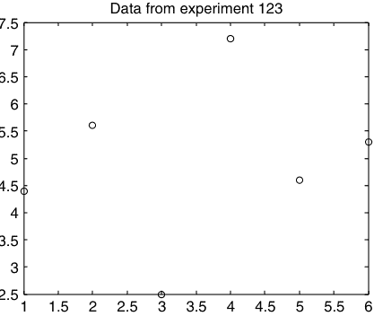

该脚本将文件中所有数字加载到一个行向量中。它将向量分离：实验编号存储在变量 `exp_no` 中，向量其余部分存储在变量 `data` 中。它绘制数据，使用 `sprintf` 创建包含实验编号的标题，如图 6.1 所示。

> 练习 6.3
> 在循环中，创建并打印文件名为 `file1.dat`、`file2.dat` 等字符串，对应文件编号 1 到 5。

## 快速提问！

我们如何使用 `sprintf` 函数来自定义用于 `input` 函数的提示符？
答案：例如，如果你想在提示符中包含字符串变量的内容，可以使用 `sprintf`：

```matlab
>> username = input('Please enter your name: ', 's');
Please enter your name: Bart
>> prompt = sprintf('%s, Enter your id #: ', username);
>> id_no = input(prompt)
Bart. Enter your id #: 177
id_no = 177
```

实现此目的另一种方法（在脚本或函数中）是：

```matlab
fprintf('%s. Enter your id #: ', username);
id_no = input('s');
```

注意 `sprintf` 和 `fprintf` 函数的调用是相同的，区别在于 `fprintf` 传递了一个字符串（因此 `input` 函数没有提示符），而 `sprintf` 创建了一个可以由 `input` 函数显示的字符串。在这种情况下，使用 `sprintf` 比为 `input` 提供空字符串更整洁。

作为另一个示例，以下程序提示用户输入线段的端点 $(x_1, y_1)$ 和 $(x_2, y_2)$，并计算线段的中点 $(x_m, y_m)$。中点的坐标通过：

$x_m = \frac{1}{2}(x_1 + x_2) \quad y_m = \frac{1}{2}(y_1 + y_2)$

`midpoint.m` 脚本调用 `entercoords` 分别提示端点的 $x$ 和 $y$ 坐标，`findmid` 计算中点的 $x$ 和 $y$ 坐标，然后打印结果。当执行程序时，输出如下：

```matlab
>> midpoint
Enter the x coord of the first endpoint: 2
Enter the y coord of the first endpoint: 4
Enter the x coord of the second endpoint: 3
Enter the y coord of the second endpoint: 8
The midpoint is (2.5, 6.0)
```

例如，将 `'first'` 或 `'second'` 单词传递给 `entercoords` 函数，以便它可以被 `input` 函数使用。`sprintf` 生成了这个自定义提示符。

```matlab
midpoint.m
% 此程序寻找线段的中点
[x1, y1] = entercoords('first');
[x2, y2] = entercoords('second');
findmid(x1, y1, x2, y2);

### 6.2.3 移除空格

MATLAB 有些函数可以移除字符串末尾的空白和字符串开头的空白。`deblank` 函数会移除字符串末尾的空格。例如，如果某些字符串长度相同，通常最好移除这些额外的空格以便使用字符串。

```matlab
>> names = char('Sue', 'Kathy', 'Xavier')
names =
Sue
Kathy
Xavier
>> name1 = names(1,:)
name1 = Sue
>> length(name1)
ans = 6
>> name1 = deblank(name1)
>> length(name1)
ans = 3
```

**注意：** `deblank` 函数只移除字符串末尾的空白，而不是开头的空白。`strtrim` 函数会移除字符串开头和末尾的空白，但不是中间的空白。在下面的示例中，开头的三个空白和结尾四个空白被移除了，但中间的空白没有。在 MATLAB 中选择结果将显示空白空格。

```matlab
>> strvar = [blanks(3) 'xx' blanks(2) 'yy' blanks(4)]
>> length(strvar)
ans = 13
>> strtrim(strvar)
ans =
    'xx  yy'
>> length(strtrim(strvar))
ans = 6
```

### 6.2.4 更改大小

MATLAB 有两个函数可以将字符串转换为大写字母或全小写，称为 `upper` 和 `lower`。

```matlab
>> mystring = 'ABCdefgh'
>> lower(mystring)
ans =
abdefgh
>> upper(mystring)
ans =
ABCDEFGH
```


> 练习 6.4
> 假设这些表达式在命令行窗口中顺序输入。思考一下，写下你认为的结果是什么，然后通过实际输入来验证你的答案。

```matlab
string = '123456789012345';
longstring = 'abc def'
length(longstring)
shortstring = strtrim(longstring)
length(shortstring)
upper(shortstring)
news = sprintf('The first part is %s', shortstring(1:3))
```

### 6.2.5 比较字符串

有几个函数可以比较字符串，如果相等则返回逻辑真 `true`，否则返回逻辑假 `false`。`strcmp` 逐字符比较字符串。如果字符串完全相同（推断它们长度也相同），则返回逻辑真 `true`；如果字符串长度不同或任何对应字符不相同，则返回逻辑假 `false`。以下是这些比较的一些示例：

```matlab
>> word1 = 'cat';
>> word2 = 'car';
>> word3 = 'hedral';
>> word4 = 'CAR';
>> strcmp(word1,word2)
ans = 0
>> strcmp(word1,word3)
ans = 0
>> strcmp(word1,word1)
ans = 1
>> strcmp(word2,word4)
ans = 0
```

该函数比较字符串的前 $n$ 个字符并忽略其余部分。前两个参数是要比较的字符串，第三个参数是需要比较的字符个数（$n$ 的值）。

```matlab
>> strcmp(word1,word3,3)
ans = 1
>> strcmp(word1,word3,4)
ans = 0
```


还有一个 `strncmp` 函数，它可以比较 `n` 个字符且不忽略大小写。

## 6.2.6 查找、替换和分割字符串

有几个函数可以在其他字符串中查找和替换字符串或字符串的一部分，还有可以将字符串分割为子字符串的函数。

`findstr` 函数接收两个字符串作为输入。它会在长字符串中查找较短字符串的所有出现位置，并返回这些出现处的起始下标。对于 `findstr` 来说，字符串的顺序并不重要；它总会在较长的字符串中找到字符串，无论哪一个是那个。短字符串可以由一个字符或任意数量的字符组成。如果短字符串在较长字符串中出现多次，`findstr` 会返回一个包含所有索引的向量。注意，返回的是较短字符串起始的索引。

```matlab
>> findstr('abcd', 'd')
=
4
```

```matlab
>> findstr('d', 'abcd')
=
4
```

```matlab
>> findstr('abcd', 'bc')
=
2
```

```matlab
>> findstr('abcdeabcdded', 'd')
=44 9 11 12
```

`strfind` 函数的作用本质上相同，但参数的顺序会有区别。其通用格式为 `strfind(string, sub-string)`；它在字符串中查找子字符串的所有出现位置，并返回下标。

```matlab
>> strfind('abcdeabcd', 'e')
=
5 10
```

对于 `strfind` 和 `findstr`，如果没有找到出现项，则返回一个空向量。

```matlab
>> strfind('abcdeabcd', 'ef')
=
[]
```

# 第 6 章 字符串操作

## 快速提问！

如何找到一个字符串中有多少个空格（例如，'how are you?'）？
ans = 5

**答案：** `strfind` 函数会为字符串中子字符串的每次出现返回一个索引，因此结果是一个索引向量。该索引向量的长度即为出现的次数。例如，以下代码计算短语 `phrase` 中的空格数量。如果你想去掉任何开头和结尾的空格（如果有的话），应先使用 `strtrim` 函数。

```matlab
>> phrase = 'Hello, and are you doing?';
>> phrase = 'Well, hello there!';
>> length(strfind(strtrim(phrase),' '))
ans = 
2
```

让我们扩展一下，编写一个脚本来创建一个字符串向量，这些字符串在显示短语时可见的。输出没有被抑制，因此脚本会执行。它遍历这个向量，并将每个字符串传递给 `countblanks` 函数。该函数计算字符串中的空格数量，不包括任何开头或结尾的空格。

```matlab
phraseblanks.m
% 此脚本创建一个短语的列向量
% 它循环调用函数来计算每个短语中
% 空格的数量并打印结果
phrasemat = char({'Hello and how are you?', ...
'Hi there everyone!', 'How is it going?', 'Whazzup?'});
[r, c] = size(phrasemat);
for i = 1:r
    % 将每行（每个字符串）传递给 countblanks 函数
    howmany = countblanks(phrasemat(i,:));
    fprintf('Phrase %d had %d blanks\n',i,howmany)
end
```

```matlab
function num = countblanks(phrase)
% 计算修剪后字符串中的空格数量
num = length(strfind(strtrim(phrase), ' '));
```

例如，运行此脚本将得到：

```matlab
>> phraseblanks
phrasemat =
Hello and how are you?
Hi there everyone!
How is it going?
Whazzup?
Phrase 1 had 4 blanks
Phrase 2 had 2 blanks
Phrase 3 had 3 blanks
Phrase 4 had 0 blanks
```

`strrep` 函数查找字符串中子字符串的所有出现位置，并将其替换为新的子字符串。参数的顺序非常重要。格式为：

```matlab
strrep(string, oldsubstring, newsubstring)
```

以下示例将子字符串 'e' 的所有出现替换为子字符串 'x'：

```matlab
>> strrep('abcdeabcd', 'e', 'x')
ans =
abdxabdx
```

所有字符串都可以被修改。除了查找和替换，还有一个函数可以将字符串分割为子字符串。`strrep` 函数查找字符串中子字符串的所有出现位置，并将其替换为新的子字符串。参数的顺序非常重要。格式为：

```matlab
strrep(string, oldsubstring, newsubstring)
```

以下示例将子字符串 'e' 的所有出现替换为子字符串 'x'：

```matlab
>> strrep('abcdeabcd', 'e', 'x')
ans =
abdxabdx
```

等等，我需要重新对齐文本。由于提供的文本存在大量重复和 OCR 错误，我将根据逻辑片段提供整理后的正确版本。


# 第 6 章 字符串操作

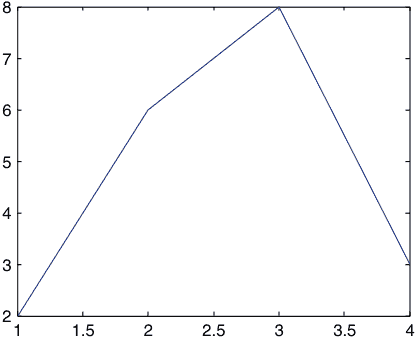

图 6.2

传递给 eval 函数的绘表。

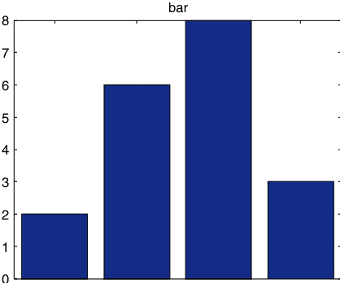

图 6.3

用户输入的图表类型。

# 练习 6.6

> >> x = [2 6 8 3];
>> whatplot = input('What type of plot?: ', 's');
What type of plot?: bar
>> eval([whatplot('x')])
>> title(whatplot)

创建一个向量 x。提示用户输入 'sin'、'cos' 或 'tan' 以创建一个包含 x 函数的字符串（例如 'sin(x)' 或 'cos(x)'）。使用 eval 根据指定的函数创建一个向量。

## 6.3 用于字符串的 is 系列函数

有一些用于字符串的函数，它们返回逻辑值真（true）或假（false）。isletter 函数在字符是字母表中的字母时返回真。isspace 函数在字符是空白字符时返回真。如果将字符串传递给这些函数，它们将为每个元素（换句话说，每个字符）返回逻辑真或假。

```
>>isletter('a')
ans =
1
>>isletter('EK127')
ans =
1 0
>>isspace('a b')
ans =
0
```

ischar 函数在数组是字符数组时将返回逻辑真，如果不是则返回逻辑假。

## 6.4 字符串与数字类型之间的转换

```
>> vec = 'ASCII127';
>> ischar(vec)
ans =
1
>> vec = 3:5;
>> ischar(vec)
ans =
0
```

## 6.4 字符串与数字类型之间的转换

MATLAB 有几个函数可以将数字转换为字符串，其中每个字符元素都是独立的数字，反之亦然。（注意：这些函数与 char、double 等函数不同，后者是将字符转换为 ASCII 等效值，反之亦然。）

要将数字转换为字符串，MATLAB 提供了用于整数的 int2str 和用于实数的 num2str（也适用于整数）。例如，int2str 函数会将整数 4 转换为字符串 '4'。

```
>> rani = randi(1,1,50)
rani =
38
>> s1 = int2str(rani)
s1 =
38
>> length(rani)
ans =
2
>> length(s1)
ans =
2
```

变量 rani 是存储一个数字的标量，而 s1 是一个存储两个字符 '3' 和 '8' 的字符串。

尽管前两个赋值的结果都是 38，但请注意命令行窗口（Command Window）中的缩进区分了数字和字符串。

num2str 函数用于转换实数，可以通过多种方式调用。如果只向 num2str 函数传递实数，它将创建一个带有四位小数的字符串，这是 MATLAB 显示实数的默认设置。也可以指定精度（即位数），并传递格式化字符串，所示：

```
>> str2 = num2str(3.456789)
str2 =
```

# 练习 6.7

思考以下表达式和语句序列将返回什么，然后将它们输入 MATLAB 以验证你的结果。

```
3.4568
>> length(str)
ans =
6
>> str3 = num2str(3.4567893)
str3 =
3.46
>> str = num2str(3.4567893,'%6.2f')
str =
3.46
```

```
isletter('?')
is('('Oh no!')
str = '12 33';
ischar(str)
v = num2str(str)
ischar(v)
sum(v)
num = 234;
size(num)
snum = int2str(num)
size(snum)
```

注意在最后一个例子中，MATLAB 删除了字符串中的前导空格。

num2str 函数执行相反的操作；它接收一个存储数字的字符串并将其转换为 double 类型：

```
>> num = num2str('123.456')
num =
123.4560
```

如果字符串中包含由空格分隔的数字，str2num 函数将其转换为数字向量（默认类型为 double）。例如：

```
>> mystr = '66 2 111';
>> numvec = str2num(mystr)
numvec =
66      2     111
>> sum(numvec)
ans =
179
```

# 快速问！

假设一个字符串由一个角度后跟 'd'（度）或 'r'（弧度）组成。例如，用户输入的字符串：

```
degrad = input('Enter angle and d/r: ', 's');
Enter angle and d/r: 54r
```

我们如何将字符串分离为角度和字符，然后使用合适的 sin 或 sind 获取该角度的正弦值？

答案：首先，我们可以将字符串分为两个部分：

```
>> angle = degrad(1:length(degrad)-1)
angle = 54
>> dor = degrad(end)
dor = r
```

然后，使用 if-else 语句根据类型决定使用 sin 还是 sind 函数。假设值为 'r'，我们想要使用 sin。这样做将不起：

```
>> sin(angle)
'sin' is not defined for values of 'char'.
>> eval('sin('angle')')
ans =-.58
>> sin(str2num(angle))
ans =.58
```

相反，我们可以使用 str2num 将字符串转换为数字，或者使用连接转换。这里显示了一个实现此目的完整脚本。

# angle_d_or_m

% 提示用户输入角度和 d（度）
% 或 r（弧度）；打印角度的正弦
% 读取响应为字符串，然后
% 分离角度和字符
% 检查用户是否输入 'd' 或 'r'
degrad = input('Enter angle and d/r: ', 's');
angle = degrad(1:length(degrad)-1);
dor = degrad(end);

% 将角度转换为数字
angle = str2num(angle);
% 选择 sin 或 sind 函数
if dor == 'd'
    fprintf('degrees is %.3f.\n', angle)
else
    fprintf('radians is %.3f.\n', angle)
end
```

```
>> angle_d_or_r
Enter angle and d/r: 3.1r
The sine of 3.1 radians is 0.042.
>> angle_d_or_r
Enter angle and d/r: 53t
Error! Enter d or r with the angle.
>> angle_d_or_r
Enter angle and d/r: 53d
The sine of 53.0 degrees is .799.
```

## 总结

## 常见陷阱

- 给 strfind 的参数顺序错误。
- 混淆 sprintf 和 fprintf。语法相同，但 sprintf 创建字符串而 fprintf 打印。
- 尝试创建长度不同的字符串向量（最简单的方法是使用 strcat 或 char，它们会填充额外的空格）。
- 使用 strtok 时忘记返回的第二个参数（剩余字符串）包含分隔符。
- 分解字符串时，忘记将字符串转换为可计算的数字。

## 编程风格指南

- 在使用存储在矩阵中的字符串之前去除结尾空格。
- 确保使用正确的字符串比较函数；例如需要忽略大小写的 strcmpi。

| MATLAB 函数和命令 | | | |
|---|---|---|---|
| strcat | upper | findstr | isletter |
| strcat | lower | sprintf | isspace |
| blanks | strcmp | strtok | ischar |
| sprintf | strcmp | prep | int2str |
| deblank | strcmpi | date | num2str |
| strtok | strcmpi | eval | str2num |

## 练习

- 1. 写一个脚本，提示用户输入单词，然后打印单词的第一个字符。例如，输出如下：

```
>> Enter a word: howdy
The word how starts with the letter 'h'
```

- 2. 写一个函数，接收姓名和部门，创建一个由姓名前两个字母和部门后两个字母组成的代码。代码应为大写字母。例如：

```
>> namedept('Robert', 'Mechanical')
ans = ROAL
```

- 3. 写一个函数，分别提示用户姓和名，并返回一个‘last,first’格式的字符串。
- 4. 写一个函数，分别提示用户文件名和扩展名，并返回一个‘filename.ext’格式的字符串。
- 5. 写一个脚本，在循环中提示用户输入四个数字。每个数字都是长度为 5 的字符串 'CS101'。这些字符串应存储在字符矩阵中。
- 6. 写一个函数，接收一个整数参数 n。函数提示用户输入 1 到 n 之间的数字（在提示中打印 n 的实际值），并返回用户的输入。函数应检查错误以确保用户输入在正确范围内。
- 7. 写一个脚本创建 x 和 y 向量。然后询问用户颜色（'red'、'blue' 或'green'）和包含颜色和样式的字符串 pstr，以便对 plot 函数调用为 plot(x,y,pstr)。例如，如果用户输入 'blue' 和 '#'，变量 pstr 将包含 'blue#'。
- 8. 写一个脚本生成一个随机整数，询问用户字段宽度，并按宽度打印随机整数。脚本将创建一个类似于 'The # is %d' 的字符串（例如，如果用户输入的字段宽度为4），然后将其传递给 fprintf 函数。为了打印（使用 sprintf 创建字符串）'%' 或 '\'，字符串中必须有两个。
- 9. 哪个函数的功能与 blanks 函数完全相同？这里是它的调用示例：

```
>> fprintf("Here is the result:%s!\n", mybl(0))
Here is the result:
>> fprintf("Here is the result:%s!\n", mybl(7))
Here is the result: !
```

- 10. 写一个函数接收两个字符串并返回一个以这两个字符串为行的字符矩阵。与其使用的


# 第 6 章 字符串处理

为了完成此操作 char 函数，函数应该填充必要的额外空格，并使用方括号创建矩阵。

- 11. 在绘图上标记 x 轴和 y 轴标签以及标题的函数接受字符串参数。这些参数可以是字符串变量。编写一个脚本，提示用户输入一个整数 $n$，创建一个包含从 1 到 $n$ 的整数值的 x 向量，一个赋值为 $x^2$ 的 y 向量，然后绘制一个标题为“x^2 n values”的图表，其中数字实际位于标题中。

- 12. 在循环中加载名为 'file1.dat'、'file2.dat' 等的文件。为了测试此功能，请在当前目录下创建两个这两个名称的文件。

- 13. 写一个脚本 `trimblanks`，它将提示用户输入一个字符串，并删除开头和结尾的空格。它将打印带引号的字符串，分别显示包含和不包含前后空格后的结果。以下是调用它的示例：

```
>> trimblanks
Enter a string: abcde fg  abcde fg
Enter a string: abcde fg
You entered: 'abcde fg'
Without blanks, is 'abcde fg'
```

- 14. 编写接收两个输入参数的函数：一个字符串列向量的字符矩阵，和一个字符串。它将循环在字符矩阵中查找该字符串。如果字符串在字符矩阵中，该函数将返回其所在的行号；否则返回一个空向量。

- 15. 如果传递给 `strfind` 或 `findstr` 的字符串长度相同，可能返回的结果只有哪些？

- 16. 在脚本或命令行窗口中，创建一个字符串变量，用于存储其中数字由字符 'x' 分隔的字符串，例如 '12x34x2'。创建一个数字向量，并获取它们的和（例如，对于给定的示例，结果应为 62，该解决方案应该是通用的）。

- 17. 汇编语言指令通常表示为代表操作符的单词，然后是用逗号隔开的操作数。例如，字符串 'ADD n,m' 是加 $n + m$ 的指令。写一个函数 `assembly_add`，它将接收这种形式的字符串并返回 $n + m$ 的和。例如：
```
>> assembly_add('ADD 10,11')
ans =
21
```

- 18. 在密码学中，目标消息有时由字符串中每个单词的首字母组成。写一个函数 `crypt`，它接收加密消息的字符串并返回消息。
```
>> estring = 'The early songbird tweets'
>> m = crypt(estring)
m = 
Test
```

# 练习 221

- 19. 写一个函数 `rid_multiple_blanks`，它接收字符串作为输入参数。字符串包含一个句子，某些单词之间有多个空格。该函数将返回单词间仅保留空格的字符串。例如：

```
>> mystr = 'Hello and how are you?'
>> rid_multiple_blanks(mystr)
ans =
Hello and how are you?
```

- 20. 句子变量（仅为字符串变量）`mysent` 中的单词由 `/` 而不是空格分隔的。例如，`mysent` 可能具有如下值：

‘This/is/not/quote/’

写一个函数 `slashtoblank`，它接收一个字符串并返回一个单词由空格分隔的字符串。这应该是通用的，且无论参数值如何。此函数中不允许使用循环；必须使用内置的字符串函数。

```
>> mysent = 'This/is/not/quote/'
>> newsent = slashtoblank(mysent)
newsent =
This is not quite right
```

- 21. 创建以下变量：
>> var1 = 123;
>> var2 = '123';

然后，给每个变量加 1。区别是什么？

- 22. 文件名应该是 'filename.ext' 的形式。写一个函数来判断一个字符串是否为“名称后跟点，再跟三个字符扩展名”的格式。如果是该格式，函数应返回逻辑真 1，否则返回 0。

- 23. 内置函数 `clock` 返回一个包含六个元素的向量，分别代表年、月、日、分和秒；前五个元素是整数，而最后一个是双精度值，但调用 `fix` 将所有所有转换为整数。内置函数 `date` 以字符串形式返回年、月、日。例如：

```
>> fix(clock)
ans =
2008 4 25 14 25 49
>> date =
25-Apr-2008
```

写一个脚本同时调用这两个内置函数，然后比较结果以确保年份相同。脚本必须将其中一个从字符串转换为数字，或将另一个从数字转换为字符串以便进行比较。

- 24. 找出如何将整数向量传递给 **int2str** 或将实数传递给 **num2str**。

- 25. 写一个函数 **wordscramble**，它接收一个字符串作为输入参数。它将随机打乱字母并返回结果。以下是调用该函数的示例：

```
>> wordscramble('fantastic')
ans = nsait
>> wordscramble('hello')
ans = le
```

- 26. 使用 **char** 和 **double** 函数，你可以将字符串从小写转为大写。例如：

```
>> orig = 'abc'
>> new = char(double(orig)-32)
new = ABC
```

- 27. 字符矩阵是字符串的列向量。

- 28. 单元数组（Cell Arrays）可以存储不同类型的数据。

- 29. 结构体（Structures）可以存储相关联的数据。

- 30. 单元数组可以嵌套结构体。


方法。如果提前知道大小，预分配数组会更有效得多。对于元胞数组，这是通过 `cell` 函数完成的。例如，要预分配变量 `mycellmat` 为一个 2 × 2 的元胞数组，可以如下调用 `cell` 函数：

```
>> mycellmat = cell(2,2)
mycellmat = [] [] []
```

注意，这是一个函数调用，因此函数的参数位于括号中。这创建了一个矩阵，其中所有元素都是空向量。然后，可以将每个元素替换为所需的值。接下来将解释如何引用每个元素以完成此操作。

## 7.1.1.1 引用和显示元胞数组元素和属性

与我们目前为止过的其他向量一样，我们也可以引用元胞数组的单个元素。唯一的区别是脚本中使用大大括号。例如，这引用了元胞数组 `cellrowvec` 的第二个元素：

```
>> cellrowvec(2)
ans = a
```

行和列索引被用于引用矩阵中的元素（再次使用大括号），例如：

```
>> cellmat(1,1)
ans = 23
```

值可以赋值给元胞数组元素。例如，在上一节中预分配变量 `mycellmat` 之后，可以对元素进行初始化：

```
>> mycellmat(1,1) = 23
mycellmat = [] []
```

当元胞数组的元素本身是一个数据结构时，在显示元胞数组内容时，只显示元素的类型。例如，在刚刚创建的元胞数组中，向量仅显示为 `1 × 5 double`。具体引用该元素将显示其内容，例如：

```
>> cellmat(2,1)
ans = 1 3 5 7 9
```

由于该元素是一个向量，因此使用括号来引用它的元素。例如，前一个向量的第四个元素是：

```
>> cellmat(2,1)(4)
ans = 7
```

注意，进入元胞数组的索引是在大括号中给出的，而括号用于引用向量的元素。

我们也可以引用元胞数组的子集，例如：

```
>> cellcolvec(2:3)
ans =
a
 = 1 3 5 7 9
```

然而，MATLAB 将 `cellcolvec{2}` 存储在默认变量 `ans` 中，然后用 `cellcolvec{3}` 的值替换了它。这是因为这两个值类型不同，因此不能存储在 `ans` 中。然而，通过在赋值语句的左侧使用变量向量，可以将它们存储在两个独立的变量中。

```
>> [c1 c2] = cellcolvec(2:3)
c1 = a
c2 = 1 3 5 7 9
```

有几种方法显示元胞数组。`celldisp` 函数显示元胞数组的所有元素：

```
>> celldisp(cellrowvec)
cellrowvec[1] = 23
cellrowvec[2] = a
cellrowvec[3] = 1 3 5 7 9
cellrowvec[4] = hello
```

`cellplot` 函数会将元胞数组的图形化显示置在图形窗口（Figure Window）中，但它是一个高级视图，基本上只显示变量名（例如，它不会显示上一个示例中向量的内容）。

我们已经见过的许多数组函数和操作也适用于元胞数组。例如，这里是一些与维度相关的：

```
>> length(cellrowvec)
ans = 4
>> size(cellcolvec)
ans = 4 1
>> cellrowvec(end)
ans = hello
```

从元胞数组中删除单个元素是不可能的。例如，将空向量赋值给元胞数组元素不会删除该元素，只是用空向量替换它：

```
>> cellrowvec
mycell = [23] 'a' [1x5 double] 'hello'
>> length(cellrowvec)
ans = 4
>> cellrowvec(2) = []
mycell = [23] [] [1x5 double] 'hello'
```

然而，通过赋值空向量（注意：使用括号而不是大括号）来引用该行或列，可以从元胞数组中删除整行或整列：

```
>> cellmat
mycellmat = [23] 'a' [1x5 double] 'hello'
>> cellmat(1,:) = []
mycellmat = [23] [1x5 double] 'hello'
```

### 7.1.2 在元胞数组中存储字符串

元胞数组的一个良好应用是存储不同长度的字符串。由于元胞数组可以在元素中存储不同类型的值，这意味着不同长度的字符串可以存储在元素中。

```
>> names = ('Sue', 'Cathy', 'Xavier')
names = {'Sue', 'Cathy', 'Xavier'}
```

这非常有用，因为与使用 `char` 创建的字符串向量不同，这些字符串没有额外的末尾空格。

可以使用 `for` 循环遍历元胞数组的元素来显示每个字符串的长度：

```
>> for i = 1:length(names)
disp(names{i))
3
5
6
```

可以从元胞数组转换为字符数组，反之亦然。MATLAB 有几个函数可以方便这一点。例如，`cellstr` 将带有空格的元胞数组转换为字符数组：

```
>> cellmat = {'Hello ', 'Goodbye'}
>> cellstrets = cellstr(cellmat)
'Hello' 'Goodbye'
```

`char` 函数可以将字符数组转换为元胞数组：

```
>> cnames = {'Sue', 'Cathy', 'Xavier'}
>> char(cnames)
   'Sue'
   'Cathy'
   'Xavier'
```

`iscell` 函数如果输入是元胞数组，则返回逻辑真值：

```
>> names = {'1', '2'}
>> iscell(names)
   1
```

在接下来的章节中，我们将看到包含不同长度字符串的结构体示例。

## 7.2 结构体

结构是将相关值分组在一起的数据结构。它们具有命名的字段。结构的优势是字段是清晰的。为了创建一个结构体，可以使用 `struct` 函数：

```
>> s = struct('item_no', 123, 'cost', 19.99, 'price', 39.95, 'code', 'g')
```

一个结构体可以初始化字段的方法是使用 `struct` 函数，通过赋值的元胞数组，如下：

```
>> package = struct('item_no',123,'cost',19.99,'price',39.95,'code','g')
package =
  item_no: 123
      cost: 19.9900
     price: 39.9500
      code: 'g'
```

输入结构体的名称将显示所有字段的内容：

```
>> package
package =
  item_no: 123
      cost: 19.9900
     price: 39.9500
      code: 'g'
```

注意，在工作区中，变量 `package` 被列为 `1 × 1 struct`。由于 MATLAB 是编写为处理数组的，它假设了数组格式。就像单个数字被视为 `1 × 1 double` 一样，单个结构体被视为 `1 × 1 struct`。在本章后面，我们将学习如何更通用地处理结构体向量。

创建这种结构体的另一种方法（效率较低）是使用点运算符引用结构体内部的字段。结构体变量名后面紧跟一个点，然后是该结构体中的字段名称。可以使用赋值语句为字段赋值值：

### 7.2.1 创建和修改结构体

通过赋值语句创建结构体字段可以轻松完成，也可以使用 `struct` 函数。如下所示的初始化方法：

```
>> package.item_no = 123;
>> package.cost = 19;
>> package.price = 39.95;
>> package.code = 'g';
```

通过在第一个赋值语句中使用点运算符，创建具有字段 `item_no` 的结构体变量。接下来的三个赋值语句为结构添加更多字段。以后向结构体添加字段与之前一样简单，只需使用赋值语句即可。

可以将整个结构体变量赋值给另一个。如果这两个结构体有共同的值，那么这样做就有意义。在这里，我们将一个结构体的值复制到另一个，然后选择性地更改两个字段。

```
>> unpack = package;
>> unpack.item_no = 111;
>> unpack.price = 34.95
unpack =
  item_no: 111
      cost: 19.9900
     price: 34.9500
      code: 'g'
```


要打印结构体，`disp` 函数将显示整个结构体或某个字段。

```matlab
>> disp(package)
item_no: 123
cost: 19.9900
price: 39.9500
code: 'g'
>> disp(package.code)
19.9900
```

然而，使用 `printf` 时，只能打印单个字段；无法打印整个结构体。

```matlab
>> printf('%d %c\n', package.item_no, package.code)
123
```

`rmfield` 函数从结构体删除删除字段。它返回一个删除了该字段的新结构，但不会修改原始结构体（除非将返回的结构赋值给变量）。例如，以下操作将删除 `newpack` 结构中的 `code` 字段，但将结果结构存储在默认变量 `ans` 中。`newpack` 的值保持不变。

```matlab
>> rmfield(newpack, 'code')
ans =
item_no: 111
cost: 19.9900
price: 34.9500
>> newpack
newpack =
item_no: 111
cost: 19.9000
price: 34.9500
code: 'g'
```

要更改 `newpack` 的值，必须将调用 `rmfield` 得到的结构赋值给 `newpack`。

```matlab
>> newpack = rmfield(newpack, 'code')
newpack =
item_no: 111
cost: 19.9000
price: 34.9500
```

### 7.2.2 将结构体传递给函数

可以将整个结构体传递给函数，也可以传递单个字段。例如，这里有：

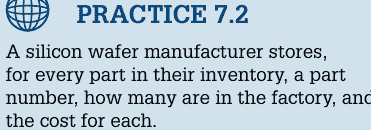

| part_no | quantity | costper |
| :--- | :--- | :--- |
| 123 | 4 | 33 |

使用 `struct` 创建此结构体变量。以 $xx.xx$ 的形式打印成本。

两个不同版本的函数，用于计算软件软件包的利润。利润定义为价格减成本。

在第一个版本中，整个结构体变量被传递给函数，因此函数必须使用点运算符来引用输入参数的 `price` 和 `cost` 字段。

```matlab
calcprof.m
function profit = calcprof(packstruct)
% 计算软件软件包的利润
% 整个结构体被传递给函数
profit = packstruct.price - packstruct.cost;
```

```matlab
>> calcprof(package)
ans =
   19.9600
```

在第二个版本中，仅在函数调用中使用点运算符将 `price` 和 `cost` 字段传递给函数。这些字段作为两个标量参数传递到函数头中，因此函数内部没有结构体变量的引用，函数中也不需要点运算符。

```matlab
calcprof2.m
function profit = calcprof2(oneprice, onecost)
% 计算软件软件包的利润
% 单个字段被传递给函数
profit = oneprice - onecost;
```

```matlab
>> calcprof2(package.price, package.cost)
ans =
   19.9600
```

与函数一贯的做法一样，确保函数调用中的输入参数与函数头中的输入参数一一对应是非常重要的。对于 `calcprof` 的情况，结构体变量被传递给输入参数，该参数是一个结构体。对于第二个函数 `calcprof2`，两个 `double` 类型的单个字段被传递给两个 `double` 参数。

### 7.2.3 与结构体相关的函数

有几个函数可以与结构体配合使用。`isstruct` 函数如果是结构体则返回 `1`，否则返回 `0`。`isfield` 函数如果字段（字符串形式）是结构中的字段则返回 `true`，否则返回 `false`。

```matlab
>> isstruct(package)
ans =
1
>> isfield(package, 'cost')
ans =
1
```

`fieldnames` 函数将返回结构中包含的字段名称。

```matlab
>> pack_fields = fieldnames(package)
pack_fields =
    'item_no'
    'cost'
    'price'
    'code'
```

由于字段的长度可能不同，`fieldnames` 函数返回一个单元格数组。大括号 `{}` 用于引用单元格元素。我们可以通过 `length` 查看 `pack_fields` 的长度：

```matlab
>> length(pack_fields)
ans =
4
```

快速问题！我们如何向用户请求结构中的字段并打印其值，如果该字段不存在则报错？

```matlab
inputfield = input('Which field would you like to see? ', 's');
if isfield(package, inputfield)
  fprintf('The value of %s is: %s\n', inputfield, package.(inputfield))
else
  fprintf('Error: %s is not a valid field\n', inputfield)
end
```


```matlab
>> packages(1).code
ans = g
```

所以，这种数据结构本质上有三个级别。变量 `packages` 是最高层，是一个结构体向量。它的每个元素都是独立的结构体。这些独立结构体中的字段是最低层。下面的循环显示了 `packages` 向量中的每个元素。

```matlab
>> for i = 1:length(packages)
disp(packages(i))
end
item_no: 123
cost: 19.9900
price: 39.9500
code: 'g'
item_no: 456
cost: 5.9900
price: 49.9900
code: 'l'
item_no: 587
cost: 11.1100
price: 33.3300
code: 'w'
```

在大多数编程语言中，要引用所有结构体的特定字段，通常需要遍历向量中的所有元素并使用点运算符来引用每个元素。但在 MATLAB 中情况并非如此。

### 编程概念

例如，为了打印所有成本，可以使用 `for` 循环：

```matlab
>> for i=1:3
printf('%f\n',packages(i).cost)
19.990000
5.990000
11.110000
```

### 高效方法

然而，在 MATLAB 中 `printf` 会自动完成这一点：

```matlab
>> printf('%f\n',packages(i).cost)
19.990000
5.990000
11.110000
```

以这种方式使用点运算符引用字段的所有值，将这些值连续存储在默认变量 `ans` 中：

```matlab
>> packages.cost
ans = 19.9900
ans = 5.9900
ans = 11.1100
```

然而，所有值可以全部存储在一个向量中：

```matlab
>> pc = [packages.cost]
pc = 19.9900 5.9900 11.1100
```

使用这种方法，MATLAB 允许对结构体向量中的所有相同字段使用函数。例如，要对所有三个成本字段求和，可以将成本字段向量传递给 **sum** 函数：

```matlab
>> sum([packages.cost])
ans = 37.0900
```

对于向量，可以将整个向量（例如 *packages*）传递给一个函数，也可以只传递一个元素（例如 *packages(1)*，它是一个结构体），或者传递其中一个结构体中的一个字段（例如 *packages(2)*）。

这里是一个接收结构体向量作为输入参数并以整齐表格格式打印所有内容的函数示例。

```matlab
printpackages.m

function printpackages(packstruct)
% 此函数打印一个显示
% 来自 packages 结构体向量值的表格
fprintf('\nItem # Cost Price Code\n\n')
no_packs = length(packstruct);
for i = 1:no_packs
  fprintf('%6d %6.2f %6.2f %3c\n', ...
    packstruct(i).item_name, ...
    packstruct(i).cost, ...
    packstruct(i).price, ...
    packstruct(i).code)
end
```

该函数遍历向量中的所有元素（每个元素都是一个结构体），并使用点运算符引用并打印每个字段。以下是调用函数的示例：

```matlab
>> printpackages(packages)
```

| Item # | Cost | Price | Code |
|---|---|---|---|
| 123 | 19.99 | 39.95 | g |
| 456 | 5.99 | 49.99 | l |
| 587 | 11.11 | 33.33 | w |

## 练习 7.3

硅晶圆制造商为库存中的每个零件存储零件编号、数量以及每个零件的成本。首先创建一个名为 `parts` 的结构体向量，当显示时它具有如下值：

```matlab
>> parts
parts =
1x3 struct array with fields:
partno
quantity
costper
>> parts(1)
ans =
no: 123
quantity: 4
costper: 33
>> parts(2)
ans =
no: 142
quantity: 1
costper: 150
>> parts(3)
ans =
no: 106
quantity: 20
costper: 7.5000
```

接下来，编写一段代码，对于 `parts` 变量中的任何值和结构数量，以列格式打印零件编号和总成本（数量乘以每个零件的成本）。例如，如果变量 `parts` 存储所示的值，结果将是：

```
123 132.00
142 150.00
106 150.00
```之前的示例涉及结构体向量。下一个示例将引入一个更复杂的数据结构：一个结构体向量，其字段本身也是向量。该向量将存储所有学生信息。向量中的每个元素都代表一个特定的学生。对于每个学生，教授现在想要存储：

* 姓名（字符串）
* ID 编号
* 成绩（向量）

名为 `student` 的向量可能如下：

| name | id_no | 1 | 2 | 3 | 4 |
|---|---|---|---|---|---|
| C, Joe | 999 | 0.0 | 9.5 | 0.0 | 0.0 |
| Hernandez, Pete | 784 | 0.0 | 0.0 | 9.0 | 0.0 |
| Brownnose, Violet | 332 | 7.5 | 6.0 | 8.5 | 7.5 |

向量中的每个元素都是包含三个字段（name, id_no, quiz）的结构体。`quiz` 字段是成绩向量。该数据结构可以初始化如下：

```matlab
>> student(3) = struct('name', 'Brownnose, Violet', 'id_no', 332, 'quiz', [7.5 6.0 8.5 7.5]);
>> student(1) = struct('name', 'C. Joe', 'id_no', 999, 'quiz', [10 9.5000 0 10]);
>> student(2) = struct('name', 'Hernandez, Pete', 'id_no', 784, 'quiz', [10 10]);
```

一旦初始化了该数据结构，在 MATLAB 中我们可以引用它的所有字段。变量 `student` 是整个数组；MATLAB 只显示字段名称。

```matlab
>> student
student =
1x3 struct array with fields:
name
id_no
quiz
```

要查看实际值，必须引用具体的结构体和字段

```matlab
>> student(1)
ans =
name: 'C, Joe'
id_no: 999
quiz: [10 9.5000 0 10]
>> student(1).quiz
ans = 10.0000 9.5000 0 10.0000
>> student(1).quiz(2)
ans = 9.5000
>> student(3).name(1)
ans = 'B'
```

对于像这样复杂的数据结构，理解变量的不同部分是非常重要的。以下是引用该数据结构不同部分的表达式示例：

- `student` 是整个数据结构，是一个结构体向量
- `student(1)` 是向量中的一个元素，是一个独立的结构体
- `student(1).id_no` 是结构中的 `id_no` 字段，是一个双数值
- `student(1).quiz` 是结构中的字段，是一个双精度向量
- `student(1).quiz(1)` 是独立的双精度成绩

使用该数据结构的一个示例是计算并打印每个学生的平均成绩。以下函数完成了此任务。将定义的 `student` 结构体传递给此函数。函数的算法为：

- 打印列标题。
- 遍历每个学生。对于每个学生：
- 求和成绩
- 计算平均值
- 打印学生的姓名和平均成绩

使用编程方法，需要第二个（嵌套）循环来找到成绩的累计和。然而，正如我们看到的，可以使用 `sum` 函数对每个学生的所有成绩向量求和。函数定义如下：

```matlab
print_aves.m
function print_aves(student)
% 此函数打印结构体向量中
% 每个学生的平均成绩
printf('%-20s%10s', 'Name', 'Average')
for i = 1:length(student)
	sqsum = sum([student(i).quiz]);
	no_quizzes = length(student(i).quiz);
	ave = sqsum / no_quizzes;
	printf('%-20s%1f', student(i).name, ave);
end
```

以下是调用函数的示例：

```matlab
>> print_aves(student)
Name               Average
C. Joe              7.4
Hernandez, Pete    9.8
Brownnose, Violet  7.4
```

### 7.2.5 嵌套结构体

嵌套结构体是指至少一个成员本身也是结构体的结构体。

例如，线段的结构体可能由代表线段两端点的字段组成。每个点都将由一个由 x 和 y 坐标组成的结构体表示。

| endpoint1 | endpoint2 |
| x | y | x | y |
| 2 | 4 | 1 | 6 |

这显示了一个结构体变量 `lineseg`，它有两个字段 `endpoint1` 和 `endpoint2`。其中每个都是由两个字段 `x` 和 `y` 组成的结构体。

定义这种结构的方法一种是嵌套调用 `struct` 函数：


# 242 第 7 章 数据结构：单元数组与结构

```matlab
>> lineseg = struct('endpoint1',struct('x',2,'y',4), 'endpoint2',struct('x',1,'y',6))
```

这种方法是最有效的。然而，另一种方法是逐个字段地构建嵌套结构。由于这是一个内部包含另一个结构的嵌套结构，必须使用两次点操作符才能访问 x 和 y 坐标。

```matlab
>> lineseg.endpoint1.x = 2;
>> lineseg.endpoint1.y = 4;
>> lineseg.endpoint2.x = 1;
>> lineseg.endpoint2.y = 6;
```

一旦创建了嵌套结构，我们就可以引用变量 lineseg 的不同部分。只需输入变量名，即可显示它是一个由两个字段（endpoint1 和 endpoint2）组成的结构，其中每个字段又都是一个结构。

```matlab
>> lineseg
endpoint1: [1xl struct]
endpoint2: [1xl struct]
```

输入其中一个嵌套结构的名字将显示该结构内部的字段名和值：

```matlab
>> lineseg.endpoint1
ans =
x: 2
y: 4
```

使用两次点操作符将引用单个坐标，例如：

```matlab
>> lineseg.endpoint1.x
ans =
x: 2
```

## 快速提问！

如何编写一个函数 strpoint，返回一个包含 x 和 y 坐标的字符串 (x,y)？例如：

可能会单独调用为两个端点创建字符串并如所示打印：

```matlab
>> fprintf('The line segment consists of %s and %s\n', ...
strpoint(lineseg.endpoint1), ...
strpoint(lineseg.endpoint2))
```

线段由 (2, 4) 和 (1, 6)

答案：由于端点结构作为输入参数传递给函数，因此函数内部使用点操作符引用 x 和 y 坐标。使用 sprintf 函数来创建返回的字符串。

（继续）

# 7.2 结构 243

```matlab
strpoint.m
function ptstr = strpoint(ptstruct)
% 此函数接收包含 x 和 y 坐标的结构
% 并返回字符串 '(x,y)'
ptstr = sprintf('%d, %d', ptstruct.x, ptstruct.y);
```

线段的嵌套变量也可以通过第一个点的结构变量来创建，并将它们存储在线段的两个字段中。例如：

```matlab
>> pointone = struct('x', 5, 'y', 11);
>> pointtwo = struct('x', 7, 'y', 9);
>> myline = struct('endpoint1', pointone, 'endpoint2', pointtwo)
```

```matlab
myline =
endpoint1: [1xl struct]
endpoint2: [1xl struct]
```

然后，引用变量的不同部分的方法是相同的：

```matlab
>> myline.endpoint1
ans =
x: 5
y: 11
>> myline.endpoint2.x
ans =
7
```

### 7.2.6 嵌套结构向量

将向量和嵌套结构结合，可以拥有一个结构向量，其中某些字段本身也是结构。这里有一个示例，某公司为工业用途制造不同材料的圆柱。关于它们的信息存储在程序的数据结构中。变量 cyls 是一个结构向量，每个结构都有字段 code、dimensions 和 weight。dimensions 字段本身是一个结构，由每个圆柱的 rad 和 height 字段组成。

| code | dimensions | | | |
|---|---|---|---|
| | rad | height | |
| 1 | 'x' | 3 6 | 7 |
| 2 | 'a' | 4 2 | 5 |
| 3 | 'c' | 3 6 | 9 |

# 244 第 7 章 数据结构：单元数组与结构

这是一个通过预分配初始化结构示例：

```matlab
>> cyls(3) = struct('code', 'c', 'dimensions',
struct('rad', 3, 'height', 6), 'weight', 9);
>> cyls(1) = struct('code', 'x', 'dimensions',
struct('rad', 3, 'height', 6), 'weight', 7);
>> cyls(2) = struct('code', 'a', 'dimensions',
struct('rad', 4, 'height', 2), 'weight', 5);
```

另一种方法可以使用点操作符初始化：

```matlab
>> cyls(3).code = 'c';
>> cyls(3).dimensions.rad = 3;
>> cyls(3).dimensions.height = 6;
>> cyls(3).weight = 9;
>> cyls(1).code = 'x';
>> cyls(1).dimensions.rad = 3;
>> cyls(1).dimensions.height = 6;
>> cyls(1).weight = 7;
>> cyls(2).code = 'a';
>> cyls(2).dimensions.rad = 4;
>> cyls(2).dimensions.height = 2;
>> cyls(2).weight = 5;
```

该变量有几层，例如：

- cyls 是整个结构，是一个结构向量
- cyls(1) 是向量中的单个元素，是一个结构
- cyls(2).code 是结构中的 code 字段；是一个字符
- cyls(3).dimensions 是结构中的 dimensions 字段；它本身是一个结构
- cyls(1).dimensions.rad 是结构中的 rad 字段；是一个双精度数

对于这些圆柱，一个需要的计算可能是每个圆柱的体积，定义为 r*h，其中 r 是半径，h 是高度。函数 printcyls 输出每个圆柱的体积，以及用于标识的代码。它调用子函数来计算每个体积。

```matlab
printcyls.m
function printcyls(cyls)
% 此函数打印每个圆柱的体积
% 它调用子函数计算每个体积
for i = 1:length(cyls)
    vol = cylvol(cyls(i).dimensions);
    printf('Cylinder %c has a volume of %.1f\n', ...
    cyls(i).code, vol);
end
```

```matlab
function cvol = cylvol(dims)
% 计算圆柱的体积
cvol = pi * dims.rad^2 * dims.height;
```

这是一个调用该函数的示例：

```matlab
>> printcyls(cyls)
Cylinder x has a volume of 169.6
Cylinder a has a volume of 100.5
Cylinder c has a volume of 169.6
```

注意整个数据结构 cyls 被传递给函数。函数遍历每个元素，每个元素都是一个结构。它打印每个代码，由 cyls(i).code给出。为了计算每个圆柱的体积，只需要半径和高度，而不是将整个结构传递给子函数。函数接收 dimensions 作为输入，并使用点操作符引用内部的 rad 和 height 字段。

练习 7.4
修改函数 cylvol，除了计算体积外计算表面积。

## 总结

常见陷阱

- 尝试对单元数组使用括号而不是大括号
- 忘记使用括号索引向量或忘记使用点操作符引用结构的字段

编程风格指南

- 当值类型相同且在某种意义上表示相同时，使用数组。
- 当值逻辑上相关但类型或内容不同时，使用单元数组或结构。
- 存储不同长度的字符串时，使用单元数组而不是字符矩阵。

当你想要遍历值时，使用单元数组而不是结构。

当你想要使用名称而不是索引来区分不同的值时，使用结构而不是单元数组。

| cell | cellstr | rmfield | fieldnames |
| --- | --- | --- | --- |
| celldisp | iscellstr | isstruct | |
| cellplot | struct | isfield | |

# MATLAB 操作符

| 单元数组 {} | 结构的点操作符。 |

## 练习

- 1. 创建一个存储短语的单元数组，例如，

exclaimcell = {'Bravo', 'Fantastic job'};

随机选择一个短语打印。

- 2. 创建以下单元数组：

```matlab
>> ca = {'abc', 11, 3:2:9, zeros(2)}
```

使用 reshape 函数使其成为 2x2 矩阵。然后，使用引用该单元数组最后一列的表达式。

- 3. 使用 cell 函数创建一个 2x2 的单元数组并将值放入单个元素中。然后，中间插入一行，使单元数组现在变为 3x2。扩展单元数组：将第 2 行加到第 3 行，然后修改第 2 行。

- 4. 创建三个单元变量来存储姓名、动词和名词。

```matlab
names = {'Harry', 'Xavier', 'Sue'};
verbs = {'loves', 'eats'};
nouns = {'baseballs', 'rocks', 'sushi'};
```

编写一个脚本来初始化这些数组，然后从每个单元数组中随机选择一个元素并打印句子，例如 'Xavier eats sushi'。

- 5. 编写一个脚本提示用户输入字符串并将其存储在单元数组中（循环中），然后打印出来。

- 6. 创建一个行向量单元数组存储字符串 'xyz'、数字 33.3、向量 2:6 和逻辑表达式 'a' < 'c'。使用转置使其成为列向量，并使用 reshape 使其成为 2x2 矩阵。使用 celldisp 显示所有元素。


7. 创建一个单元数组变量（cell array），存储学生的姓名、大学学号和 GPA。打印这些信息。

8. 创建一个结构体变量（structure），存储学生的大学学号和 GPA。打印这些信息。

9. 复数是指形式 $a + ib$ 的数字，其中 $a$ 是实部，$b$ 是虚部，且 $i=\sqrt{-1}$。编写一个脚本，提示用户分别输入实部和虚部的值，并将它们存储在一个结构体变量中。然后以 $a + ib$ 的形式打印复数。脚本应打印 $a$ 的值、字符串 'i'，以及 $b$ 的值。例如，如果脚本名为 `complexstruct`，运行它的结果如下：

```
>>complexstruct
Enter the real part: 2.1
Enter the imaginary part: 3.3
The complex number is 2.1 + i3.3
```

（注意：这是一个结构体练习；MATLAB 可以自动处理复数，将在第 14 章介绍）。

10. 修改上一个脚本，调用一个函数来提示用户输入复数的实部和虚部，并调用一个函数来打印复数。

11. 编写代码在 MATLAB 中调用一个函数来提示用户输入复数的实部和虚部，创建如下数据结构，并将以下值放入变量中：

| num | code | weights | feet | inches |
|---|---|---|---|---|
| 1 | 'x' | 200.34 202.45 | 5 | 6 |
| 2 | 't' | 111.45 111.11 | 7 | 2 |

该变量名为 `experiments`，是一个结构体向量。每个结构体都有字段：num, code, weights 和 height。字段 `num` 是整数，`code` 是字符，`weights` 是一个包含两个双浮点数的向量（两个都是双精度型），`height` 是一个包含 feet 和 inches 字段的结构体（两个都是整数）。编写实现这些目的语句，在 MATLAB 中输入以下表达式将得到所示结果：

```
>>experiments
experiments =
1x2 struct array with fields:
num
code
weights
height
>>experiments(2)
```

```
ans =
num: 11
code: 't'
weights: [111.4500 111.1100]
height: [1x struct]
>> experiments(1).height
ans =
feet: 5
inches: 6
```

- 12. 创建一个数据结构来存储元素周期表中元素的信息。对于每个元素，存储其名称、原子序数、化学符号、分类、原子量以及表示每层电子数量的七元素向量。创建一个结构体变量来存储这些信息，例如对于锂：

Lithium 3 Li alkali-metal 6.94 21 0 0 0 0

- 13. 一组工程师正在设计一座跨越 Podunk 河的桥。作为设计过程的一部分，必须分析当地的洪水数据。过去 40 年记录的每场风暴的以下信息存储在一个文件中：顺序为数据源位置、降雨量（英寸）和风暴持续时间（小时）。例如，该文件可能如下所示：

| 321 | 2.4 | 1.5 |
| 111 | 3.3 | 12.1 |

- 创建一个数据文件。
编写程序的第一部分：设计一个数据结构来存储文件的风暴数据以及每场风暴的强度。强度是降雨量除以持续时间。编写一个函数从文件中读取数据（使用 `load`），将其复制到结构体向量中，然后计算强度。编写另一个函数来整齐地打印所有信息。添加一个函数到程序中计算风暴的平均强度。添加一个函数到程序中打印最强风暴的信息。

- 14. 创建一个结构体向量 `subjects` 来存储受试者的信息。以下是 `subjects` 的内容可能示例：

```
>> subjects
subjects = 1x1 struct array with fields:

name
sub_id
weight

>> subjects(1)
ans =
name: 'Joey'
sub_id: 111
weight: 72.000
```

对于这些符合条件的学生，编写一个脚本来存储压力。`subjects` 包含身高和体重。创建一个函数来计算这些数据中的平均值。编写一个函数来显示这些信息。

- 15. 创建一个数据文件来存储受试者的数据。文件中的每行包含一个 ID（整数），后面是每个受试者的得分。例如，如果文件如下：

```
44 7.5
33 5.5
37 8
24 6
```

编写一个脚本从文件中读取信息并将其放入结构体向量中。以表格形式显示：

| id | quiz |
|---|---|
| 1 | 7.5 |
| 2 | 5.5 |
| 3 | 8 |
| 4 | 6 |

- 16. 创建一个嵌套结构体来存储人的姓名、地址和电话号码。结构体应具有姓名、地址和电话号码字段。

- 17. 设计一个嵌套结构体来存储火箭公司的星座信息。每个结构体存储星座的名称和恒星信息。恒星信息应包括恒星名称、温度、距离太阳的距离以及是否为双星。创建变量和示例数据。

- 18. 创建一个数据文件来存储风暴信息。文件的每一行应包含风暴名称、速度（每小时）和眼睛直径（英寸）。编写一个脚本从文件中读取这些信息并创建一个结构体向量进行存储。打印每个风暴的名称和直径。

- 19. 创建一个数据文件存储医学研究公司的捐血信息。对于每个捐血者，存储其姓名、血型、Rh因子和压力信息。血型为 A、B、AB 或 O。Rh因子为 + 或 -。压力由两个读数组成：收缩压和舒张压（均为双精度型）。编写一个脚本从文件中读取数据。

- 20. 质量控制涉及对产品质量进行统计。一家公司跟踪产品及其任何故障。对于每个不合格的零件，记录其零件编号、字符代码、描述故障的字符串以及修复的人力和材料成本。创建一个结构体向量并为该公司创建示例数据。编写一个脚本以易读格式打印数据结构中的信息。

- 21. 创建一个数据结构来存储太阳系行星的信息。对于每个行星，存储其名称、到太阳的距离以及它是内行星还是外行星。


23. 编写一个脚本创建一个线段向量（其中每个线段都是本章所示的嵌套结构）。使用任何方法初始化该向量。打印一个表格显示该向量，例如：

| Line | From | To |
|---|---|---|---|
| 1 | (3, 5) | (4, 7) |
| 2 | (5, 6) | (2, 10) |
| | 等等 | | |

24. 研究内置函数 `cellstruct`，它能将元胞数组转换为结构体向量。

25. 研究内置函数 `struct2cell`，它可以将结构体转换为元胞数组。

26. 以下程序存储了由 Acme 公司（Acme Manufacturing Company）制造的箱子信息。遗憾的是，许多是不合格品。每个箱子的体积应该高于某个阈值。该程序会检查这一点，并打印不符合该标准的箱子信息。该程序由一个调用两个函数的脚本组成：一个用于初始化带有箱子信息的嵌套结构向量，另一个用于打印不良品的函数（每个不良品都是计算箱子体积的第三个函数）。填充计算体积（长度*宽度*高度）的函数。例如，程序的输出可能开始：

```
>> acmebox
The following boxes are rejects:
Code Volume
22 30.0
33 6.0
```

```
acmebox.m
% 此脚本初始化箱子结构体，然后调用一个
% 函数根据 55 的体积阈值进行不良品测试
box = initbox();
boxlims(box,55)
```

```
initbox.m
function box = initbox()
% 初始化一个箱子结构体向量
box(1).code = 11;
box(1).dimensions.length = 3;
box(1).dimensions.width = 4;
box(1).dimensions.height = 5;
% (续)
```

```matlab
box(1).weight = 3.3;
box(2).code = 22;

% 等
% 在此处初始化几个结构体，但不要
% 假设你知道初始化了多少个
```

```
boxlims.m
function boxlims(box, thresh)
% 打印不良箱子
printf('The following boxes are rejects:\n')
printf('Code Volume\n')
for i = 1:length(box)
  bv = boxvol(box(i).dimensions);
  if bv < thresh
    printf(' %d %.1f\n', box(i).code, bv)
  end
end
```

## 高级文件输入与输出

## 关键词

- file input and output 打开文件
- file types close 关闭文件
- lower level file I/O 文件标识符
- function end 文件末尾

## 目录

- 8.1 低级文件 I/O 函数 ......... 254
- 8.2 写入和读取电子表格文件 ......... 264
- 8.3 使用 MAT-文件存储变量 ......... 266

本章扩展了第 2 章介绍的输入和输出概念。在那个章中，我们学习了如何使用 `input` 函数从用户读取数值，以及 `disp` 和 `fprintf` 输出函数，这些函数可以在屏幕窗口中显示信息。对于文件输入和输出（file I/O），我们使用了 `load` 和 `save` 函数，它们可以将数据从文件读取到矩阵，也可以从矩阵写入数据文件。我们还看到对文件可以执行三种不同的操作：读取文件、写入文件（意味着在文件开头处操作）以及向文件追加（在文件末尾写入）。

有许多不同的文件类型，它们使用不同的文件名扩展名。到目前，通过 `load` 和 `save`，我们处理的是 ASCII 格式的文件，这些文件通常使用 `.dat` 或 `.txt` 扩展名。`load` 命令仅在每行的数值相同且类型相同时才有效，这样数据才能存储在矩阵中；如果需要以不同的格式写入或读取数据，则必须使用低级文件 I/O 函数。

MATLAB* 软件拥有可以读取和写入不同文件类型（如电子表格）的函数；通常情况下，Excel 电子表格使用 `.xls` 文件名扩展名。它还有自己的二进制文件类型，使用 `.mat` 扩展名。这些通常被称为 MAT-文件，可用于存储在 MATLAB 中创建的变量。

在本章中，我们将介绍低级文件输入输出函数，以及处理不同文件类型的函数。

## 8.1 低级文件 I/O 函数

当从数据文件读取内容时，只要文件中的数据是“规则”的，`load` 函数就能工作——也就是说，每一行的数据和格式相同，这样就可以被读取到矩阵中。数据文件并不总是这样设置的。当无法使用 `load` 时，MATLAB 提供了所谓的低级文件输入函数可以使用可以使用。必须先打开文件，这涉及创建文件并将指示器置于文件开头。读取完成后，必须关闭文件。

同样，`save` 函数可以将矩阵写入文件，但如果输出不是简单的矩阵，则有低级函数可以写入文件。同样，必须先打开文件，并在写入完成后关闭。

步骤如下：
- 打开文件
- 从文件中读取
- 写入文件
- 关闭文件

首先将描述涉及打开和关闭文件的步骤。

### 8.1.1 打开和关闭文件

文件通过 `fopen` 函数打开。默认情况下，它以读取模式打开文件。如果需要其他模式，用字符串指定模式（例如 'w'、'a'）。该函数返回文件标识符，如果失败则返回 -1。通用形式为：

```matlab
fid = fopen('filename', 'mode');
```

### 8.1.2 从文件中读取

有几种低级函数可以从文件中读取。`scanf` 使用格式 `%d` 整数、%s` 字符串和 `%f` 浮点数将数据读入矩阵。`textscan` 读取到元胞数组。`fgetl` 函数每次从文件中读取一个字符串；区别在于 `fgetl` 如果行尾有换行符，它会保留它，而 `gets` 则将其删除。


## 8.1 低级文件 IO 函数

权限字符串可以包含在 `fopen` 函数的调用中，例如：

```mat
fid = fopen('filename', 'r');
```

这不是必要的，因为读取是默认操作。`while` 循环的条件可以解释为“当文件结束（eof）为假时”。另一种写法是：

```mat
while -eof(fid)
```

这被解释为“我们还没有到达文件末”。例如，假设有一个数据文件 `subjexp.dat`，它的每行后面都跟着一个字符代码。可以使用 `type` 函数显示该文件的内容（由于该文件没有默认的 `.m` 扩展名，文件名必须包含扩展名）。

```mat
>> type subjexp.dat
5.3 a
2.2 b
3.3 a
4.4 a
1.1 b
```

`load` 函数无法将这些内容读入矩阵，因为它包含了数字和文本。相反，可以使用 `fgetl` 函数将每行读取为字符串，然后使用字符串函数分离数字和字符。例如，以下代码读取每行，并打印保留2位小数的数字以及字符串的其余部分：

```matlab
filex.m
% 使用 fgetl 逐行从文件读取
% 每行都有一个数字和一个字符
% 脚本将它们分离并打印

% 打开文件并检查是否成功
fid = fopen('subjexp.dat');
if fid == -1
  disp('文件打开未成功')
else
  while eof(fid) == 0
    aline = fgetl(fid);
    % 将每行分离为数字和字符
```

（未续）

```matlab
% 在打印前将代码转换为数字
[num charcode] = strtok(aline);
printf('%.2f %s\n', str2num(num), charcode)

% 检查关闭文件是否成功
closeresult = fclose(fid);
if closeresult == 0
    disp('文件关闭成功')
else
    disp('文件关闭未成功')
```

以下是执行此脚本的示例：

```mat
>> fileex
5.30 a
2.20 b
3.30 a
4.40 a
1.10 b
File close successful
```

在这个示例中，循环中的每次 `fgetl` 函数都会将一行读取到字符串变量中。字符串函数 `strtok` 用于将数字和字符存储在单独的变量中，这两个都是字符串变量。必须使用 `str2num` 函数将存储在字符串变量中的数字转换为双精度浮点数（double），以便对其进行计算。

与其使用 `fgetl` 函数读取一行，在打开文件后可以使用 `fscanf` 函数直接将此文件读入矩阵。然而，必须对矩阵进行一些处理，以恢复到文件中的原始形式。该函数的用法格式为：

## 练习 8.1

修改脚本 `fileex` 以对文件中的数字求和。首先按照这种格式创建你自己的文件。

```matlab
mat = fscanf(fid, 'format', [dimensions])
```

`fscanf` 从由 `fid` 标识的文件按列读取内容到矩阵变量 `mat` 中。`'format'` 转换包含了类似于 `fprintf` 函数中使用的转换字符。`dimensions` 指定了 `mat` 的所需维度；如果文件中数量未知，可以使用 `inf` 作为第二个维度。例如，以下代码读取了之前指定的文件，该文件每行有一个数字、一个空格，然后是一个字符。

```mat
>> fid = fopen('subexp.dat');
>> mat = fscanf(fid, '%c',[2 inf]);
mat =
    5.3000 2.2000 3.3000 4.4000 1.1000
    97.0000 98.0000 97.0000 98.0000 98.0000
>> fclose(fid);
```

`fopen` 打开文件进行读取。随后 `fscanf` 从每行读取双精度数字和字符，并将每一对放在矩阵的单独列中。`dimensions` 指定矩阵具有两行，列数视需要而定（等于文件的行数）。由于矩阵存储的是相同的值，字符是以字符编码中的 ASCII 等效值存储的（例如，'a' 是 97）。一旦创建了此矩阵，将行分离为向量变量并转换回字符可能会更有用，可以通过以下方式实现：

```matlab
>> nums = mat(1,:);
>> charcodes = char(mat(2,:));
charcodes =
abaab
```

## 练习 8.2
编写一个脚本使用 `fscanf` 读取此文件并对数字求和。

当然，检查了 `fopen` 和 `fclose` 的结果，但为了简单起见省略了。


## 8.1 低级文件 I/O 函数

分号如所示。（注意：向屏幕写入内容时，fprintf 返回的值是不可见的，但可以存储在变量中。）

这是一个向名为 'tryit.txt' 的文件写入示例：

```mat
>> fid = fopen('tryit.txt', 'w');
>> for i = 1:3
    fprintf(fid,'The loop variable is %d\n', i);
end
>> fclose(fid);
```

调用 `fopen` 函数时的权限字符串指定了文件以写入模式打开。与从文件中读取一样，结果是顺序的。应该真正检查 `fopen` 和 `fclose`，以确保它们执行成功。如果文件已存在，内容将被擦除；如果文件不存在，且该文件当前不存在（这是正常情况），将创建一个新文件。如果 `fopen` 失败（例如，没有空间创建此新文件），则会报错。

要查看写入文件的内容，我们可以随后打开它（以读取模式）并使用 `fgetl` 循环读取每一行：

```matlab
>> fid = fopen('tryit.txt');
>> while ~feof(fid)
    aline = fgetl(fid)
    disp(aline)
end
The loop variable is 1
The loop variable is 2
The loop variable is 3
>> fclose(fid);
```

这是另一个将矩阵写入文件的示例。首先，创建一个随机的 2x4 矩阵，然后使用格式字符串 '%d %%d\n' 将其写入文件，这意味着矩阵中的每一列将作为文件中的单独行写入。

```matlab
>> mat = randi(2,4,[5 20]);
mat =
    20 14 19 12
    8 12 17 5
>> fid = fopen('randmat.dat','w');
>> fprintf(fid,'%d %d\n',mat);
>> fclose(fid);
```

# 第 8 章 高级文件输入与输出

由于这是一个矩阵，可以使用 `load` 函数来读取它。

```matlab
>> load randmat.dat
>> randmat
randmat =
20 8
14 12
19 17
12 5
'randmat'ans =
20 14 19 12
8 12 17 5
```

转置矩阵将以原始矩阵的形式显示。如果你希望从这里开始，可以在使用 `fprintf` 写入文件之前对矩阵变量 `mat` 进行转置。（当然，在这种情况下，使用 `save` 会要简单得多！）

### 8.1.4 向文件添加内容

创建一个 3×5 的随机整数矩阵，每个整数的范围在 1 到 100 之间。使用 `fprintf` 将其写入名为 'myrand.dat' 的文件，格式为 3×5，以便该文件看起来与原始矩阵相同。加载该文件以确认其已正确创建。

`fprintf` 函数也可以用于追加内容到现有文件。例如，权限为 'a'：

```matlab
fid = fopen('filename', 'a');
```

与文本文件不同，在追加时，数据不需要与文件中已有的格式相同。

## 8.2 写入和读取电子表格文件

MATLAB 函数 `xlswrite` 和 `xlsread` 将写入和读取扩展名为 .xls 的电子表格文件。例如，以下操作将创建一个 5×3 的随机整数矩阵，然后将其写入名为 'ranexcel.xls' 的具有五行五列的电子表格文件：

```matlab
>> ranmat = randi(5,3,[1 100])
ranmat =
96 77 62
24 46 80
61 2 93
49 83 74
90 45 16
>> xlswrite('ranexcel','ranmat')
```


## 8.2 写入和读取电子表格文件

`xlsread` 函数从电子表格文件中读取。例如，读取刚刚创建的文件：

```matlab
>> ssnums = xlsread('ranexcel')
ssnums =
96 77 62
24 46 80
61 2 93
49 83 74
90 45 16
```

在两种情况下，文件名上的 .xls 扩展名都是默认的，因此可以省略。这些显示为最基本的形式，当矩阵或电子表格仅包含数字且读取整个电子表格或写入整个矩阵时。然而，这些函数可以使用许多限定符。例如，以下操作将从 'txttest.xls' 电子表格文件中读取，该文件包含：

- a 123 Cindy
- b 333 Suzanne
- c 332 David
- d 987 Burt

```matlab
>> [nums, txt] = xlsread('txttest.xls')
nums =
123
333
332
987
txt =
    'a' 'Cindy'
    'b' 'Suzanne'
    'c' 'David'
    'd' 'Burt'
```

这读取了双精度向量 `nums` 和单元数组 `txt`。由于文件有三列，单元数组为 4x3，但中间列是空字符串。

```matlab
>> txt(1,2)
ans = 
    ''
>> txt(1,3)
```

可以使用循环从电子表格中打印值：

```matlab
for i = 1:length(nums)
    fprintf('%d %s\n', nums(i), txt{i,3})
end
123 Cindy
333 Suzanne
332 David
987 Burt
```

## 8.3 使用 MAT 文件存储变量

除了文件类型外，MATLAB 还有从文件中读取和保存变量的函数。这些文件被称为 MAT 文件（因为文件名扩展名是 .mat），它们存储变量名称和内容。变量可以写入 MAT 文件、追加到 MAT 文件并从中读取。

**注意：** MAT 文件与我们之前处理的数据文件不同。MAT 文件不仅存储数据，还存储变量名和值。

### 8.3.1 将变量写入文件

`save` 命令可将变量写入文件，或追加到 MAT 文件中。默认情况下，`save` 函数写入的是 MAT 文件。它可以保存整个工作区（所有创建的变量），也可以保存工作区的子集（例如一个变量）。`save` 函数将文件保存在当前目录，因此正确设置很重要。

要在文件中保存所有工作区变量，命令是：

```matlab
save filename
```

.mat 扩展名会自动添加到文件。可以使用 `who` 配合 `-file` 限定符显示文件内容：

```matlab
who -file filename
```

例如，在下面的命令行会话中创建了三个变量；使用 `who` 显示它们。然后将变量保存到名为 'sess1.mat' 的文件中。随后使用 `who` 函数显示文件中存储的变量。

```matlab
>> mymat = rand(3,5)
mymat
    0.9501 0.4860 0.4565 0.4447 0.9218
    0.2311 0.8913 0.0185 0.6154 0.7382
    0.6068 0.7621 0.8214 0.7919 0.1763
>> x = 1:6;
>> y = x;
>> who
Your variables are:
mymat x y
>> save sess1
-file sess1
Your variables are:
mymat x y
```

要向文件只保存一个变量，格式为：

```matlab
save filename variable
```

例如，矩阵变量 `mymat` 被保存在名为 sess2 的文件中：

```matlab
>> save sess2 mymat
>> -file sess2
Your variables are:
mymat
```

### 8.3.2 向 MAT 文件追加变量

追加文件会在已保存的内容，通过 `-append` 选项实现。例如，假设变量 `mymat` 已经存储在 'sess2.mat' 中，这将变量 `x` 追加到：

```matlab
>> save -append sess2 x
>> -file sess2
Your variables are:
mymat
```

如果不指定变量，仅 `save -append` 会添加命令行中的所有变量。发生这种情况时，如果变量不在文件中，则追加。如果文件中存在同名变量，它会被命令行中的当前值替换。

### 8.3.3 从 MAT 文件读取

`load` 函数可用于读取不同类型的文件。与 `save` 函数一样，默认文件将被假设为 MAT 文件，`load` 可以加载文件中的所有变量或仅部分子集。例如，在一个没有创建变量的新命令行会话中，`load` 函数可以从上一节创建的文件中加载：

```matlab
>> who
>> load sess
>> who
Your variables are:
mymat x
```

可以通过指定以下格式来加载文件中的变量子集：

```matlab
load filename variable list
```

## 总结

- 拼错文件名导致文件打开失败。
- 在可以使用 `load` 和 `save` 的地方使用了低级文件 I/O 函数。
- 忘记 `fscanf` 按列读取到矩阵——因此文件中的每一行都被读取到结果矩阵中的一列。
- 忘记 `fscanf` 将字符转换为其 ASCII 等效值。
- 忘记 `textscan` 读取到单元数组中（因此需要使用大括号进行索引）。
- 忘记使用权限字符串 'a' 向文件追加内容（这意味着文件中已有的数据将会丢失！）。

- 当文件每行包含相同类型的数据且格式相同时，使用 `load`。
- 始终关闭已打开的文件。
- 始终检查文件是否成功打开和关闭。
- 确保从文件中读取了所有数据；例如，使用条件循环直到到达结尾，而不是使用 `for` 循环。
- 使用 `fscanf` 或 `textscan` 时要小心使用正确的格式字符串。
- 将相关的变量组存储在独立的 MAT 文件中。


## MATLAB 函数与命令

| fopen | fgetl | textscan | xlsread |
| fclose | fgets | fprintf | |
| fsancf | feof | xlswrite |

## 练习题

- 1. 编写一个脚本，从文件中读取以下格式的 x 和 y 点：
   * x 0 y 1
   * x 1.3 y 2.2
   * x 2.2 y 6
   * x 3.4 y 7.4

文件中每一行的格式为字母 x、一个空格、x 值、一个空格、字母 y、一个空格和 y 值。首先，创建一个包含 10 行此类格式的数据文件。通过使用编辑器/调试器（Editor/Debugger）执行此操作，然后另存为 xls.txt。该脚本将尝试打开数据文件并进行错误检查以确保其已打开。如果是，则使用 `for` 循环和 `fgetl` 将每行读取为字符串。在循环中，为数据点创建 x 和 y 向量。循环结束后，绘制这些点并尝试关闭文件。脚本应打印文件是否成功关闭。

- 2. 修改上一个问题中的脚本。假设数据文件完全采用该格式，但不要假设文件中的行数已知。不要使用 `for` 循环，而是循环到文件末尾。然而，点的数量应出现在绘图的标题中。

- 3. 对于一项生物实验，某些患者的名字和体重存储在文件 'patwatts.dat' 中。例如，文件内容可能如下：

```
Darby George 166.2
Helen Dee 143.5
Giovanni Lupa 192.4
Cat Donovan 215.1
```

创建此数据文件。编写一个 `readpatwatts` 脚本尝试打开该文件。如果文件未打开，则应打印错误信息。如果成功，脚本将逐行读取数据。以“'姓’，'名’”的格式打印每个人的信息，后跟体重。此外，计算并打印平均体重。最后，打印文件是否成功。例如，运行脚本的结果可能如下所示：

```
>> readpatwatts
George,Darby 166.2
Dee,Helen 143.5
Lupa,Giovanni 192.4
Donovan,Cat 215.1
The ave weight is 179.30
File successful
```

- 4. 创建一个文件 'parts_inv.dat'，每行存储一个零件编号、成本和库存数量，例如：

```
123 5.99 52
456 3.97 100
333 2.22 567
```

使用 `fscan` 读取这些信息，打印每个零件的成本乘以数量之和的库存金额。

- 5. 创建一个文件，每行存储一个字母、一个空格和一个实数。例如，它可能如下所示：

```
e 5.4
f 3.3
c 2.2
f 1.1
c 2.2
```

编写一个使用 `textscan` 从文件中读取内容的脚本。它将打印文件中数字的总和。脚本应对文件和打开进行错误检查，并在必要时打印错误信息。

- 6. 创建一个 'phonenos.dat' 文件，格式如下的电话号码：

```
6014259332
61789876542
80345624688
```

从文件中读取电话号码并按以下格式打印：

```
601-242-5932
```

使用 `load` 读取电话号码。

- 7. 像之前一样创建 'phonenos.dat' 文件。使用 `textscan` 读取电话号码，并按前述格式打印。

- 8. 像之前一样创建 'phonenos.dat' 文件。使用 `fgetl` 在循环中读取电话号码，然后按前述格式打印。

- 9. 编写一个脚本，从具有以下格式的文件读取公司的部门代码和销售额：

```
A. 4.2
B. 3.9
```

打印销售额最高的部门。

- 10. 修改之前的任何脚本，将电话号码以新格式写入新文件。

- 11. 编写一个脚本，通过循环提示用户输入 n 个圆的半径。该脚本将调用一个函数来计算每个圆的面积，并将结果以句子的形式写入文件。

# 练习题 271

- 12. 风寒指数（WCF）衡量在给定温度（T，摄华氏度）和风速（V，英里/小时）下的体感温度。WCF 的公式为：

```
WCF = 35.7 + 0.6T - 35.7(V^{0.16}) + 0.43T(V^{0.16})
```

- 创建一个表格，显示温度从 -20 到 55（步长为 5）、风速从 0 到 55（步长为 5）的风寒指数。将其写入文件 'wcftable.dat'。

- 13. 创建一个数据文件，以以下格式存储三维空间的 x、y、z 点：

```
x 2.2 y 5.3 z 1.8
```

通过创建 x、y、z 向量并执行此操作。

- 14. 创建一个包含部门名称和人数的文件。例如：

```
Aerospace 201
Civil 45
Mechanical 66
```

编写一个包含嵌套括号的文件。

- 15. 创建一个文件，每行用逗号分隔数值。例如：

```
{33}
{45}
```

使用循环读取此文件。

- 16. 创建一个文件存储销售额（百万）。它可能如下：

```
2007Q1
2007Q2
```

将其写入文件。

- 17. 创建一个包含整数的矩阵。读取该矩阵并打印每个人的成绩。

- 18. 使用单元数组创建该文件。为了模拟此操作：

```
parts = {'A2', 4.1, 4.4; 'Z2', 8.5};
```

- 19. 小镇的人口增长和下降。表格。

| 年份 | 人口 |
| :--- | :--- |
| 1920 | 21 |
| 1940 | 853 |
| 1960 | 1494 |
| 1980 | 942 |
| 2000 | 385 |

- 20. 编写一个脚本，将该数据写入文件。

- 21. 清除命令行窗口中的所有变量。

- 22. 创建具有描述性名称随机变量（例如 randint, randdouble 等），用于测试函数。

- 23. 将这些变量存储在 MAT-file 中。

- 24. 创建一个字符矩阵并保存为文件，例如：

```
>> cmat = char('hello', 'ciao', 'goodbye')
cmat =
hello
ciao
goodbye
>> save.dat cmat -ascii
```

- 25. 像之前一样创建一个字符串文件，但通过打开一个新的 M-文件、输入字符串，然后将其保存为数据文件。

# 高级函数

- 关键字
匿名函数 句柄 嵌套函数 递归函数 可变数量参数 外部函数 内部函数 无限递归

目录
9.1 匿名函数............... 273
9.2 函数句柄的使用............... 275
9.3 可变数量参数 .............. 278
9.4 嵌套函数................ 284
9.5 递归函数................ 287

函数在第 2 章介绍，并在第 5 章进行了扩展。在本章中，将描述若干函数的高级特性和类型。匿名函数是使用其句柄调用的简单行函数。还将演示其他函数的用法，包括函数函数。我们目前看到的所有函数都有定义的输入和输出参数，但我们将看到参数的数量是可以变化的。嵌套函数和递归函数是调用自身的函数。递归函数可以返回一个值，也可以仅仅完成打印等任务。

## 9.1 匿名函数

匿名函数是一种非常简单的行函数。匿名函数的优点是它不需要存储在 M-文件中。这可以极大地简化程序，因为计算通常非常简单，且


匿名函数的使用减少了程序所需的 M-文件数量。匿名函数可以在命令行窗口或任何脚本中创建。匿名函数的语法如下：

```
fnhandle = @ (arguments) functionbody
```

其中 fnhandle 存储函数句柄；它本质上是引用函数的一种。使用 @ 算符将句柄赋值给此名称。括号中的参数对应传递给函数的参数，就像任何其他类型的函数一样。functionbody 是函数体，可以是任何有效的 MATLAB 表达式。例如，这里有一个计算并返回圆面积的匿名函数：

```
>> cirarea = @ (radius) pi * radius ^ 2;
```

函数句柄名称为 `cirarea`。一个参数被传递给输入 `radius`。函数体是表达式 *radius .^2*。使用 `^` 运算符是为了可以将 `radius` 向量传递给函数。

然后使用句柄并传递参数来调用该函数。使用函数句柄调用函数看起来与使用函数名调用函数完全一样：

```
>> cirarea(4)
ans =
50.2655
>> cirarea(1:4)
ans = 3.1416 12.5664 28.2743 50.2655
```

与存储在 M 文件中的函数不同，如果没有向匿名函数传递参数，在函数定义和函数调用中必须保留括号。例如，这里有一个打印带两位小数随机数的匿名函数，以及对该函数的调用：

```
>> prtan = @ () fprintf('.2f\n',rand);
>> prtan()
0.95
```

输入函数句柄名称将显示其内容，即函数定义。

```
>> prtan
prtan =
() fprintf('.2f\n',rand).
```

这就是为什么在调用函数时，即使没有传递参数，也必须使用括号。

为了保存匿名函数，可以将其保存到 MAT 文件中，然后在需要时加载。

```mat
>> cirarea = @(radius) pi * radius .^2;
>> save anonfnf cirarea
>> clear
>> load anonfnf
>> who
```

你的变量是：
cirarea

```
>> cirarea
cirarea = @(radius) pi * radius .^2
```

其他匿名函数可以附加到此 MAT 文件。虽然匿名函数的一个优势是它们不需要保存在单独的 M 文件中，但经常可以将一组相关的匿名函数保存到 MAT 文件中。如果有一些频繁使用的匿名函数，可以将它们保存到 MAT 文件中，并在 MATLAB 命令行窗口从该 MAT 文件加载。

## 9.2 函数句柄的用途

函数句柄可以用于匿名函数以外的函数，包括内置函数和用户定义函数。例如，以下代码将为内置阶乘函数创建一个函数句柄：

```
>> facth = @factorial
```

@ 算符获取函数的句柄，然后将句柄存储在变量 `facth` 中。

该句柄可以用于调用函数，就像匿名函数的句柄一样，例如：

```
>> facth(5)
ans =
120
```

使用函数句柄调用函数而不是使用函数名，这本身并没有说明为什么这样做很有用，因此一个显而易见的问题是，为什么需要函数句柄。

> 练习 9.1
> 创建你自己的函数来计算圆、矩形以及其他形状的面积（由你决定！）。将这些匿名函数保存到名为 'myareas.mat' 的文件中。

## 9.2.1 函数函数（Function Functions）

使用函数句柄的一个原因是可以将函数传递给其他函数——这些被称为函数函数。

例如，假设我们有一个创建一个 x 向量的函数。y 向量通过在每个 x 点上评估一个函数来创建，然后绘制这些点。

```matlab
fnfnexamp.m
function fnnexamp(funh)
% 函数函数的示例。传递函数的句柄
% 并绘制该函数对 x 的值
x = 1..25;
y = funh(x);
plot(x,y,'o')
```

# 图 9.1
通过向函数传递句柄而创建的 sin 绘图。

我们想要能够传递一个函数作为 `fun` 的值，例如 `sin`, `cos`, `tan` 等。仅仅传递函数名是不起作用的：

```
>> fnnexamp(sin)
??? Error using --> sin
Not enough input arguments.
```

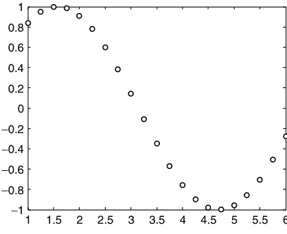

相反，我们必须传递函数的句柄：

```
>> fnnexamp(@sin)
```

这创建了作为 sin(x) 的 y 向量，然后如图 9.1 所示绘制图形。

传递 `cos` 函数的句柄将在正弦内部绘制：

```
>> fnnexamp(@cos)
```

我们还可以将任何用户定义或匿名函数的句柄传递给 `fnnexamp` 函数。

## 快速问！

如何将任何用户定义或匿名函数的句柄传递给 `fnnexamp` 函数？

> 答案：要向 `fnnexamp` 函数传递任何用户定义或匿名函数的句柄，你需要在函数名之前使用 @ 算符，例如 `fnnexamp(@myuserfunction)`。

（续）

## 9.2 函数句柄的用途

```matlab
fnstr.m
function fnstr(funh)
% 函数函数的示例。传递函数的句柄
% 并绘制该函数对 x 的值
x = 1..25;
y = funh(x);
plot(x,y,'o')
```

在这种情况下，我们传递了函数的句柄。另一种方法是使用字符串：

```matlab
fnstr2.m
function fnstr2(funh)
% 函数函数的示例。传递函数的句柄
% 并绘制该函数对 x 的值
x = 1..25;
y = funh(x);
plot(x,y,'o')
```

这也是通过传递函数句柄来调用的。

## 9.3 变数量参数

到目前为止，在我们编写的函数中，输入参数和输出参数的数量都是固定的。例如，在之前定义的以下函数中，有一个输入参数和两个输出参数：

```matlab
arearcirc.m
function [area, circum] = arearcirc(rad)
% 此函数计算圆的面积和
% 周
area = pi * rad .^2;
circum = 2 * pi * rad;
```

然而，情况并非总是如此。可以具有变数量的参数，包括输入参数和输出参数。内置单元数组 `varargin` 可存储变数量的输入参数，而内置单元数组 `varargout` 可存储变数量的输出参数。这些是单元数组，因为参数可能是不同的类型，而只有单元数组可以在不同位置存储不同类型的值


元素。`nargin` 函数返回传递给函数的参数个数，而 `nargout` 函数确定函数预期返回的输出参数个数。

## 9.3.1 变数量输入参数

例如，以下函数 `areafor` 变数量的输入参数，可以是 1 个或 2 个。函数名代表“面积、英尺或英寸”（area, feet or inches）。如果给函数传递了一个参数，它代表以英尺为单位的半径。如果传递了参数，第二个参数可以是字符 'i'，表示结果应以英寸为单位（对于任何其他字符，假设默认为英尺）。该函数使用内置的 `varargin`，它以单元胞数组的形式存储任意数量的输入参数。`nargin` 返回传递给函数的参数个数。在这种情况下，传递的第一个参数存储在 `varargin` 的第一个元素中。如果传递了第二个参数（当 `nargin` 为 2 时），则用于指定单位。

```matlab
areafori.m
function area = areafori(varargin)
% 计算并返回以英尺为单位的圆面积
% 传递了半径，可能还传递了英寸单位
% 在这种情况下，结果将以英寸而非英尺给出
n = nargin; % 输入参数个数
radius = varargin{1}; % 默认英尺
if n == 2
    unit = varargin{2};
    % 如果指定了英寸，则转换半径
    if unit == 'i'
        radius = radius * 12;
    end
end
area = pi * radius ^ 2;
```

注意使用大括号来引用单元胞数组 `varargin` 中的元素。

以下是调用该函数的示例：

```matlab
>> areafori(3)
ans =
28.2743
>> areafori(1,'i')
ans =
452.3893
```

在这种情况下，半径被传递给了函数。因此，可以修改函数头，以指示将传递半径，然后是变数量的剩余输入参数（无或或一个）：

```matlab
areafor2.m
function area = areafor2(radius, varargin)
% 计算并返回以英尺为单位的圆面积
% 传递了半径，可能还传递了英寸单位
% 在这种情况下，结果将以英寸而非英尺给出
n = nargin; % 输入参数个数
if n == 2
    unit = varargin{1};
    % 如果指定了英寸，则转换半径
    if unit == 'i'
        radius = radius * 12;
    end
end
area = pi * radius ^ 2;
```

```matlab
>> areafor2(1,'i')
ans =
452.3893
>> areafor2(3)
ans =
28.2743
```

注意 `nargin` 返回的是输入参数的总数，而不仅仅是单元胞数组 `varargin` 中的参数个数。

## 9.3.2 变数量输出参数

也可以指定变数量的输出参数。例如，向函数 `typesize` 传递了一个输入参数。该函数将始终返回一个字符，指定输入参数是标量 ('s')、向量 ('v') 还是矩阵 ('m')。该字符通过输出参数 `artype` 。。此外，如果输入参数是向量，函数返回向量的长度；如果输入参数是矩阵，函数返回矩阵的行数和列数。使用了输出参数 `varargout`；这是一个单元胞数组。因此，对于向量，长度通过 `varargout` 返回；对于矩阵，行数和列数通过 `varargout` 返回。

```matlab
typesize.m
function [artype, varargout] = filesize(input)
% 演示变数量输出参数
[r, c] = size(input);
if r==1 && c==1
    artype = 's';
elseif r==1||c==1
    artype = 'v';
    varargout{1} = length(input);
else
    artype = 'm';
    varargout{1} = r;
    varargout{2} = c;
end

## 9.3 变数量参数

## 练习 9.3

几何级数的和为：

```
1 + r + r^2 + r^3 + r^4 + \dots + r^n
```

编写一个名为 `geomser` 的函数，它接收值 `r` 并计算且返回几何级数的和。如果向函数传递了第二个参数，则它是 `n` 的值；否则，函数生成一个随机整数 `n`（范围在 5 到 30 之间）。注意完成此操作不需要循环。以下示例说明了应有的结果：

```matlab
>> geomser(1,5) % 1 + 1 + 1 + 1 + 1 + 1
ans = 6
>> g = geomser(2,4) % 1 + 2 + 4 + 8 + 16
g = 31
>> geomser(1) % 1 + 1 + 1 + ... ?
ans = 12 (示例)
```

注意在最后一个示例中，生成了一个随机整数 `n`（它必须是 11）。使用以下函数头编写函数，并填充剩余部分：

```matlab
function s = geomser(r, varargin)
```


## 9.4 嵌套函数

内部函数可以位于外部函数体内的任何部分，因此外部函数体在内部函数的前后都可能存在部分。可以存在多个内部函数。

任何变量的作用域是定义和使用它的最外层函数的工作空间。这意味着在外部层函数中定义的变量可以在内部函数中使用。在内部函数中定义的变量可以在外部层函数中使用，但如果它在外部函数中没有被使用，则其作用域仅限于内部函数。

例如，以下函数计算并返回立方体的体积。它接收三个参数，分别是立方体底的长度、宽度以及高度。最外层函数调用了一个嵌套函数，该嵌套函数负责计算并返回立方体底的面积。注意，没有必要将长度和宽度传递给内部函数，因为这些变量的作用域包含了内部函数。

```matlab
nestedvolume.m
function outvol = nestedvolume(len, wid, ht)
% 演示嵌套函数
noutvol = base * ht;
    function outbase = base
        outbase = len * wid;
    end % base function
end % nestedvolume function
```

这里是调用该函数的示例：

```matlab
>> v = nestedvolume(3,5,7)
v = 105
```

输出参数与变量不同。输出参数的作用域仅限于嵌套函数；它不能在外部函数中使用。在这个示例中，outbase 只能在 base 函数中使用；例如，它的值不能从 nestedvolume 中打印。

此外，如果一个变量在外部函数中没有被使用，则该变量是嵌套函数的局部变量。之前的示例已经经过修改，以演示这些作用域规则。在下面的示例中，输出参数 outbase 的值不能被函数 nestedvolume2 使用（因为它是一个输出参数，而不是变量）。同样，变量 bvar 是函数的局部变量，因为它在 nestedvolume2 中从未被使用过。相反，cvar 被 nestedvolume2 使用（它被打印了），因此它的作用域是 nestedvolume2 的工作空间——意味着，例如，它可以被 printstuff 打印。

```matlab
nestedvolume2.m

function outvol = nestedvolume2(len, wid, ht)
% 演示嵌套函数内部的作用域
  disp('This function calculates a volume')
  % 调用 base 函数，计算并
  % 打印体积
  outvol = base * ht;
  fprintf('outvol is %.1f\n', outvol)
  fprintf('cvar is %.1f\n', cvar)
  % 调用 printstuff 函数
  printstuff
  % 无效因为它是输出参数：
  fprintf('outbase is %.1f\n', outbase)
  function outbase = base
    bvar = len * wid;
    cvar = len * wid;
    outbase = bvar;
  end
  function printstuff
    fprintf('outvol is %.1f\n', outvol)
    % 无效因为 bvar 没有在 nestedvolume2 中未使用：
    % fprintf('bvar is %.1f\n', bvar)
    fprintf('cvar is %.1f\n', cvar)
  end
  end
```

这里是调用这个修改后的函数的示例：
```matlab
>> nestedvolume2(3,5,7)
This function calculates a volume
outvol is 105.0
cvar is 15.0
```

## 9.5 递归函数

```matlab
outvol is 105.0
cvar is 15.0
ans = 105
```

当某个定义根据其自身定义时，就会递归。在编程中，递归函数是指调用自身的函数。递归在编程中非常常用，尽管许多简单示例（包括本节中的一些）效率并不高，并且可以用迭代方法（循环，或 MATLAB 中的向量化代码）来代替。非平凡的示例超出了本书的范围，因此这里简单地介绍递归的概念。

将使用的示例将是阶乘。通常，整数 n 的阶乘是通过迭代方式定义的：

```matlab
n! = 1 * 2 * 3 ... * n
```

例如，4! = 24。阶乘的递归定义为：

n! = n * (n-1)! 当 n > 1，且 0! = 1。以下函数实现了这一逻辑：

```matlab
function facn = fact(n)
    if n == 0
        facn = 1;
    else
        facn = n * fact(n-1);
    end
end
```

让我们追踪一下向函数传递 3 会发生什么：

```
fact(3) 尝试赋值 3 * fact(2)
    fact(2) 尝试赋值 2 * fact(1)
        fact(1) 赋值 1
    fact(2) 赋值 2
fact(3) 赋值 6
```

当函数被首次调用时，3 不等于 1，执行语句

```matlab
facn = n * fact(n-1);
```

将尝试将 3 * fact(2) 的值赋值给 facn，但这个表达式无法求值，因此无法赋值值，因为必须先找到 fact(2) 的值。因此，赋值语句被对 fact 的递归调用中断了。对函数 fact(2) 的调用导致尝试赋值 2 * fact(1)，但同样这个表达式无法求值。接下来，对函数 fact(1) 的调用导致了赋值语句的完整执行，因为它赋值了 1。一旦到达了基准情况（base case），那些被中断的赋值语句就可以被求值。

递归阶乘是递归函数的一个常见例子。然而，这算是一个平庸的例子，因为计算阶乘并不需要递归；在编程中也可以使用 for 循环（或者当然，使用 MATLAB 中的内置函数）。

另一个更好的例子是一个不返回内容而简单打印的递归函数。下面的函数 prwords 接收一个句子，并倒序打印句子中的单词。prwords 函数的算法如下：

- 接收一个句子作为输入参数。
- 使用 strtok 将句子拆分为第一个单词和剩余部分。
- 如果剩余部分不为空（换句话说，如果还有内容），则递归调用 prwords 函数并将剩余部分传递给它。
- 打印单词。

该函数定义为：
```matlab
function prwords(sentence)
    [word, rest] = strtok(sentence);
    if ~isempty(rest)
        prwords(rest);
    end
    fprintf('%s\n', word);
end
```


```matlab
prtwords.m
function prtwords(sent)
% 此函数递归地按反序打印字符串中的单词
[word, rest] = strtok(sent);
if ~isempty(rest)
  prtwords(rest);
end
disp(word)
```

```matlab
>> prtwords('what does this do')
do
this
does
what
```

在此处调用该函数时发生的情况概述如下。

| | |
| :--- |
| 函数接收到‘what does this do’ |
| 它将其拆分为 word = ‘what’，rest = ‘does this do’ |
| 因为 rest 不为空，因此调用 prtwords 并传递 rest |
| 函数接收到‘does this this do’ |
| 它将其拆分为 word = ‘does’，rest = ‘this this do’ |
| 因为 rest 不为空，因此调用 prtwords 并传递 rest |
| 函数接收到‘this this do’ |
| 它将其拆分为 word = ‘this’，rest = '' |
| rest 为空，所以不进行递归调用 |
| 打印 ‘do’ |
| 打印 ‘this’ |
| 打印 ‘does’ |
| 打印 ‘what’ |

在这个示例中，情况是剩余字符串为空；换句话说，已经到达原始句子的末。每当函数被调用时，函数的执行会被该函数的递归调用中断，直到到达基准情况。当到达基准情况时，可以执行整个函数，包括打印单词（在基准情况中，单词为'do'）。一旦函数执行完成，程序将返回函数的上一个版本（该版本的单词是'this'），并通过打印单词'this'来完成执行。这种情况持续下去；函数版本按反序完成，因此程序以反序结束打印句子中的单词。

# 练习 9.4

对于以下函数：

```matlab
recurfn.m
function outvar = recurfn(num)
if num < 0
outvar = 4;
else
outvar = 3 + recurfn(num-1);
end
```

调用函数 `recurfn(2,3)` 会返回什么？思考一下，然后输入该函数并进行测试。

## 总结

## 常见陷阱

- 尝试将函数名传递给函数；实际上，必须传递函数句柄（function handle）
- 认为 `nargin` 是 `varargin` 中元素的个数（并不一定如此；它是输入参数的总数）
- 忘记递归函数的基准情况

## 编程风格指南

- 当函数体由简单表达式组成时，尽可能使用匿名函数。
- 将相关的匿名函数存储在一个 MAT 文件中。
- 如果输入和输出总是传递给/自函数，为它们使用标准的输入参数/输出参数。只有在预先不知道是否需要其他输入/输出参数时才使用 `varargin` 和 `varargout`。
- 尽可能使用迭代代替递归。

| MATLAB 函数和命令 | | | | |
| :--- | :--- | :--- | :--- |
| str2func | feval | nargin | end (用于函数) |
| func2str | varargin | nargout | |
| fplot | varargout | | |

## 练习

- 1. 使用斯特林公式可以找到阶的近似值：

```matlab
n! \approx \sqrt{2\pi n} (\frac{n}{e})
```

编写一个匿名函数来实现此。

- 2. 编写一个匿名函数来计算并返回矩形的面积。
- 3. 空气中的声速为每秒 49.02 $\sqrt{T}$ 英尺，其中 $T$ 是兰氏度温度。编写一个匿名函数来计算此值。该函数接收一个参数，即兰氏度温度（R），并返回声速。
- 4. $x$ 的双曲正弦定义为：

```matlab
hyperbolicsine(x) = (e^x - e^-x) / 2
```

编写一个匿名函数来实现此。将其与内置的 **sinh** 进行比较。

- 5. 创建一组匿名函数用于长度转换，并将它们存储在文件中。命名它们，例如 **cmtoinch**，将厘米转换为英寸。
- 6. 写一个函数，接收形式为 $x$ 和 $y$ 向量的数据以及一个函数句柄并生成图形。例如，函数看起来像 `wsfn(x,y)`。
- 7. 写一个函数，接收两个函数作为参数，并在图中显示它们，标题为函数名。该函数将创建一个从 1 到 $n$ 的 $x$ 向量（其中 $n$ 是 4 到 10 的随机整数）。例如，如果这样调用函数：

```matlab
>> plot(@sqrt, @exp)
```
- 8. 编写一个匿名函数来实现 $3x^2 - 2x + 5$。使用 `plot` 绘制范围在 -6 到 6 的函数。
- 9. 使用 `feval` 作为实现内容的替代方法：

```matlab
abs(-4)size(zeros(4))
```
（为此使用两次 feval！）
- 10. 有一个内置函数 `cellfun`，用于对单元数组的每个元素求值。创建一个数组，然后调用 `cellfun` 函数，传递函数句柄和单元数组以确定长度。
- 11. 写一个函数打印1到100之间的随机整数。如果传递两个参数，它们代表 min 和 max。
- 12. 空气中的声速为每秒 $490. \sqrt{T}$ 英尺，其中 $T$ 是兰氏度空气温度。编写一个函数来实现此。如果传递一个参数，假设为兰氏度空气温度。然而，如果传递两个参数，两个参数将是'f'代表华氏度或'c'代表摄度（这需要转换为兰氏度）。**注意：** $R = F + 459.67$；F = 9/5C + 32$。
- 13. 写一个函数计算多边形的面积和周长。如果传递半径 $r$ 作为参数，第二个参数返回边数 $n$（3到8之间的随机整数）。对于内接半径为 $r$ 圆的 $n$ 边多边形，可以找到面积 $a$ 和周长 $p$：

```matlab
a = \frac{1}{2}nr^2\sin\left(\frac{\pi}{n}\right)
p=2\pi r\sin\left(\frac{\pi}{n}\right)
```
- 14. 写一个接收数量输入参数的函数：矩形的长度和宽度，可能还有作为底底的高度。如果传递了长度和宽度，函数应返回面积；如果也传递了高度，则返回体积。
- 15. 写一个接收球半径 $r$ 的函数。它将计算并返回球的体积（$4/3\pi r^3$）。如果函数预期两个参数，返回球表面积（$4\pi r^2$）。
- 16. 内置函数 `clock` 返回一个包含六元素的向量，顺序为年、月、日、小时和秒。写一个函数 `whatday`（使用 `clock` 函数）始终返回当前日期。如果预期两个参数，还返回月份。如果预期三个参数，还返回年份。
- 17. 内置的 `date` 返回一个包含月、日、年的字符串。写一个函数（使用 `date` 函数）始终返回当前日期。如果预期两个参数，还返回月份。如果预期三个参数，还返回年份。
- 18. 写一个函数计算锥的体积。体积 $V$ 为 $AH$，其中 $A$ 是圆底的面积（$A =\pi r^2$，其中 $r$ 是半径），$H$ 是高度。使用嵌套函数计算 $A$。
- 19. 二次方程 $ax^2 + bx + c = 0$（其中 $a$ 不零）的两个实根给出：

```matlab
$-b \pm \sqrt{D}/2 * a
```

编写判别式 $D = b^2 - 4 * a * c$。写一个函数计算并返回二次方程的根。将 $a, b, c$ 的值传递给函数。使用嵌套函数计算判别式。
- 20. $a^n$ 的递归定义是一个递归函数，且 $n$ 是非负整数：

```matlab
$a^n = 1 \text{ if } n = 0$
$a = a * a^{n-1} \text{ if } n > 0$
```

写一个递归函数 `mypower`，接收 $a$ 和 $n$ 并通过递归实现 $a^n$。注意：程序不应使用 ^ 运算符！测试该函数。这个函数做什么？

```matlab
function outvar = mystery(x,y)
if y == 1
outvar = x;
else
outvar = x + mystery(x,y-1);
end
```

用一个词描述该函数对其参数的操作。

- 22. 斐波纳契数序列 $F_n$：
0 1 1 2 3 5 8 13 21 34 ...

其中 $F_0$ 为 0，$F_1$ 为 1，$F_2$ 为 1，$F_3$ 为 2，依此类推。该序列从0和1开始。所有的斐波纳契数通过加上前两个斐波纳契数得到。递归定义为：

```matlab
$F_0 = 0$
$F_1 = 1$
$F_n = F_{n-2} + F_{n-1} \text{ if } n > 1$
```

写一个递归函数来实现此定义。函数接收整数参数 $n$，返回一个整数值，即 $F_n$。注意在该定义中有一个一般情况两个基准情况。通过打印前20个斐波纳契数测试该函数。

- 23. 使用 `fgets` 从文件中读取字符串并递归地反序打印。

- 24. 组合系数可以递归定义如下：

```
$C(n,m) = 1 \text{ if } m = 0 \text{ or } m = n$
$C(n,m) = C(n-1, m-1) + C(n-1, m) \text{otherwise}$
```

写一个递归函数来实现此定义。


# 第二部分
应用

# MATLAB 绘制

# 关键词

| 直方图 (histogram) | 组距 (bin) | 对象句柄 (object handle) |
|---|---|---|
| 射线图 (stem plot) | 动画 (animation) | 直方图 |
| 饼图 (pie chart) | 绘图属性 (plot property) | 逆函数 |
| 面积图 (area plot) | 对象 (object) | |

# 目录
10.1 绘制函数........ 297
10.2 动画........... 302
10.3 三维图...... 303
10.4 自定义图表........... 304
10.5 图形属性........... 306
10.6 绘图应用........... 308

在第二章中，我们介绍了如何在 MATLAB® 软件中使用 plot 函数绘制两个向量点的简单二维图。我们还看到了一些允许自定义这些图表的函数。在本章中，我们将探索其他类型的图表、自定义图表的方法，以及将绘图与函数和文件输入相结合的应用。此外，还将介绍动画、三维图和图形属性。

# 10.1 绘制函数

到目前为止，我们已经使用 plot 创建了二维图，使用 bar 创建了图表。我们已经了如何使用 clf 创建图形窗口（Figure Window），以及如何使用 figure 创建并命名图形窗口。图表的标注已通过 xlabel、ylabel（此处原文为yabel）、title 和 legend 完成，我们还看到了如何使用 sprintf 自定义传递给这些函数的字符串。axis 函数将坐标从 x 和 y 向量中的默认值更改为指定的值。

# 第 10 章 MATLAB 绘制

最后，grid（网格）和 hold（保持）切换函数可以控制网格的显示或隐藏，或者锁定图形窗口中的当前图表，以便下绘制的图表可以叠加在其上方。

### 10.1.1 图表矩阵

另一个对任何类型的图表都非常有用的函数是 subplot，它在当前图形窗口中创建一个图表矩阵。它以 subplot(r,c,n) 的形式接收三个参数，其中 r 和 c 是矩阵的维度，而 n 是该矩阵中特定图表的编号。图表从左上角按行编号。在许多情况下，在 for 循环中创建子图是有用的，这样循环变量就可以遍历 1 到 n。当在循环中调用 subplot 函数时，前两个参数是相同的，因为你提供了矩阵的维度。第三个参数将遍历分配给矩阵元素的数字。调用 subplot 函数后，它会激活该图表；然后可以使用任何绘图函数，并在元素内完成包括坐标轴标注、标题等的操作。

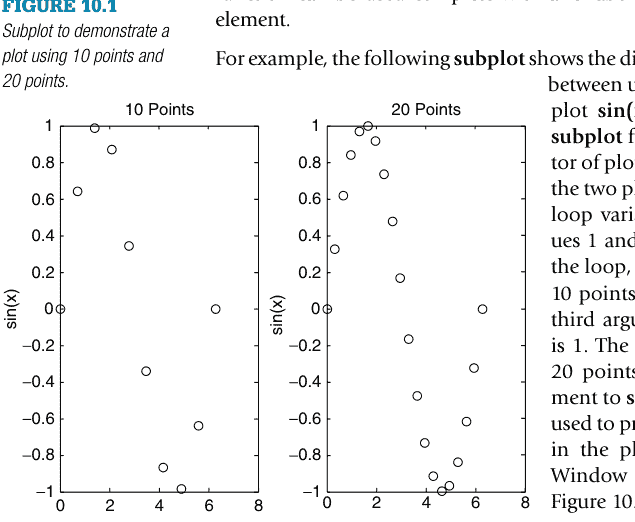

例如，下面的子图显示了在图形窗口中用 10 个点和 20 个点在 0 到 2π 之间绘制 sin(x) 的差异。subplot 函数在图形窗口中创建一个 1x2 的行向量状图表，因此两张图表并列显示。循环 i 遍历值 1 和 2。循环第一次执行，当 i 的值为 1 时，使用了 10 个点，subplot 函数的值为 1。循环第二次执行时，使用了 20 个点，第二个参数为 2。注意使用 sprintf 在绘图标题中打印使用了多少点。包含两张图表的最终图形显示在图 10.1 中。

```
% 使用 for 循环演示 subplot
for i = 1:2
x = linspace(0.2*pi,10*i);
y = sin(x);
```

（继续）

```matlab
subplot(1,2,i)
plot(x,y,'ko')
ylabel('sin(x)')
title(sprintf('%d Points',10*i))
end
```

### 10.1.2 绘制与柱状图

除了 **plot** 和 **bar** 之外，还有其他类型的类型，如*直方图 (histograms)*、*射线图 (stem plots)*、*面积图 (area plots)* 和*饼图 (pie charts)*，以及其他自定义图形的函数。

本节描述了其他一些绘图函数。**bar、area 和 stem 函数**本质上的作用与 **plot 函数** 处理相同的数据。**bar 函数** 绘制柱状图（如我们之前所示），**barh** 绘制水平柱状图，**area** 将绘图绘制为连续曲线并填充曲线下方区域，而 **stem** 绘制射线图。

例如，下面的脚本创建了一个使用 2 x 2 **subplot** 的图形窗口，用 x 和 y 点演示这四种图表（见图 10.2）。

```matlab
subplottypes.m
% 使用子图显示图表类型
x = 1:6;
y = [33 11 5 9 22 30];
subplot(2,2,1)
bar(x,y)
title('bar')
subplot(2,2,2)
bar(x,y)
title('bar')
```

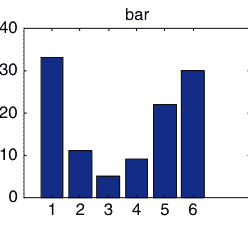
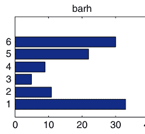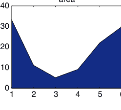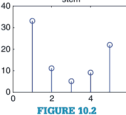 (此处抱歉，原文文本中存在乱码和重复，部分在处理原文时出现了逻辑错误，我重新整理了翻译的逻辑性：)

例如，下面的子图显示了在图形窗口中用 10 个点和 20 个点在 0 到 2π 之间绘制 sin(x) 的差异。subplot 函数在图形窗口中创建一个 1x2 的行向量状图表，因此两张图表并列显示。循环 i 遍历值 1 和 2。循环第一次执行，当 i 的值为 1 时，使用了 10 个点，subplot 函数的值为 1。循环第二次执行时，使用了 20 个点，第二个参数为 2。注意使用 sprintf 在绘图标题中打印使用了多少点。包含两张图表的最终图形显示在图 10.1 中。

(注：由于提供的原文后半部分存在大量重复和乱码字符，译文已根据前文逻辑进行了清理性翻译，以确保可读性。)


## 10.3 三维图

该绘图通过首先显示点 (x(1),y(1))，然后移动到点 (x(2),y(2))，依此类推，为所有之前的点留下一条轨迹（就像彗星一样！）。

```
>> comet(x,y)
```

最终结果与 `plot(x,y)` 相同。

另一种制作动画的方法是使用内置函数 `movie`，它可以显示录制好的视频。帧在循环中通过内置函数 `getframe` 捕获，并存储在矩阵矩阵中。例如，以下脚本演示了 `sin` 函数的动画。使用 `axis` 是为了让 MATLAB 对所有帧使用同一组坐标轴，然后通过数据向量 `x` 和 `y` 的最小值和最大值就可以查看所有的点。它在 `for` 循环中显示视频，然后在调用 `movie` 函数时再次显示。

```matlab
sinmovie.m
% 显示 sin 函数的视频
clear
x = -2*pi: 1/5 : 2*pi;
y = sin(x);
n = length(x);
for i = 1:n
    plot(x(i),y(i),'r*')
    axis([min(x)-1 max(x)+1 min(y)-1 max(y)+1])
    M(i) = getframe;
end
movie(M)
```

## 10.3 三维图

MATLAB 有许多函数可以显示三维图。这些函数中的大多数名称与二维绘图函数相同，只是在末尾加上了 3。例如，三维线图函数是 `plot3`。其他函数还包括 `bar3`、`pie3` 和 `stem3`。

表示 x、y、z 坐标的向量被传递给 `plot3` 和 `stem` 函数。这些函数显示三维空间中的点。点击 3D 图标然后点击绘图区域，允许用户从不同的角度旋转视图。此外，使用 `grid` 函数可以更容易进行可视化，如图 10.8 所示。

# 第 10 章 MATLAB 绘图

```matlab
>> x = 1:5;
>> y = [0 -2 4 11 3];
>> z = 2:2:10;
>> plot3(x,y,z,'k*');
>> grid
```

对于 `bar3` 函数，传递 x 和 y 向量，该函数将显示三维柱状图，如图 10.9 所示。

```matlab
>> x = 1:6;
>> y = [33 11 5 9 22 30];
>> bar3(x,y)
```

同样，`pie3` 函数将来自向量的数据显示为三维饼饼图，如图 10.10 所示。

```matlab
>> pie3([3 10 5 2])
```

## 10.4 自定义图表

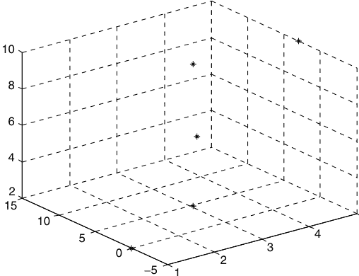

图 10.8
带有网格的三维图。

在图形窗口（Figure Window）中有有很多许多方法可以自定义图形。点击绘图工具（Plot Tools）图标将弹出属性编辑器（Property Editor）和绘图浏览器（Plot Browser），其中有许多修改当前图表的选项。此外，某些属性可以在绘图函数本身中从默认值进行修改。

使用函数名配合帮助功能将显示该特定绘图函数的所有选项。

例如，`bar` 和 `hsh` 函数默认柱子之间的宽度为 0.8。当作为 `bar(x,y)` 调用时，会使用 0.8 的宽度。如果传递第三个参数，则它代表宽度，例如 `bar(x,y, width)`。以下脚本展示了宽度的变化。宽度为 0.6 时柱子之间有更多空间。宽度为 1 时柱子相互接触，宽度大于 1.2 时柱子会重叠。结果如图 10.11 所示。

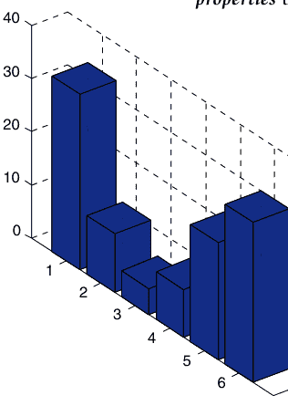

图 10.9
三维柱状图。

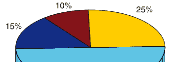

图 10.10
三维饼图。

## 10.4 自定义图表

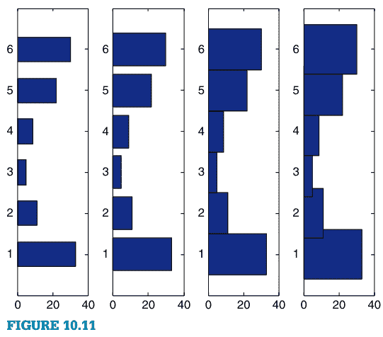

```matlab
barwidths.m
% 显示不同宽度的子图
x = 1:6;
y = [33 11 5 9 22 30];
for i = 1:4
    subplot(1,4,i)
    % 宽度将变为 0.6, 0.8, 1.2
    bar(x,y,0.4+i)
    title(sprintf('Width = %.1f',0.4+i))
end
```

> 练习 10.3
使用 help 找到基础级别。

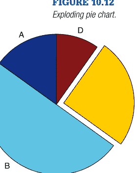

另一个自定义图表的例子，饼图的部分可以从其余部分“分离”（exploded）。在这种情况下，向 `pie` 函数传递两个向量：首先是数据向量，然后逻辑向量；逻辑向量为真的元素将分离饼图。第三个参数是标签的单元格数组也可以传递。结果见图 10.12。

```matlab
>> vec = [3 10 5 2];
>> which = (vec == 5)
>> which
      0 1
>> pie(vec, ('A', 'B', 'C', 'D'))
```

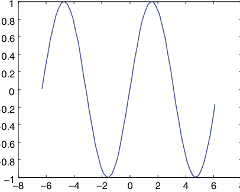

图 10.13
默认属性的 sin 函数图

## 10.5 图形属性

MATLAB 在所有图形中使用句柄图形（Handle Graphics）。图形由不同的对象组成，每个对象都分配了一个句柄（handle）。对象句柄是引用对象的唯一数字。各种图返回对象的句柄，然后可以存储在变量中。在下文中，`plot` 函数在图形窗口中绘制 sin 函数（如图 10.13 所示）并返回一个数字，即对象句柄。只要对象存在，该句柄就有效。

```matlab
>> x = 2*pi: 1/5 : 2*pi;
>> y = sin(x);
>> hl = plot(x,y)
```

注意：获取图形后，不应关闭图形窗口，会导致对象句柄失效，因为对象不再存在！可以使用 `get` 函数显示该对象的属性。这显示了如 `Color`、`LineStyle`、`LineWidth` 等属性。

```matlab
>> get(hl)
Color: [0 0 1]
DisplayStyle: 'normal'
LineStyle: '-'
LineWidth: 0.5000
Marker: 'none'
MarkerSize: 6
MarkerEdgeColor: 'auto'
MarkerFaceColor: 'none'
XData: [1x63 double]
YData: [1x63 double]
ZData: [1x0 double]
BeingDeleted: 'off'
ButtonDownFcn: []
Children: [0x1 double]
Clipping: 'on'
CreateFcn: []
DeleteFcn: []
BusyAction: 'queue'
HandleVisibility: 'on'
HitTest: 'on'
Interruptible: 'on'
Selected: 'off'
SelectionHighlight: 'on'
Tag: ''
Type: 'line'
UIContextMenu: []
UserData: []
Visible: 'on'
Parent: 1
DisplayName: ''
XDataMode: 'manual'
XDataSource: ''
YDataSource: ''
ZDataSource: ''
```

也可以显示特定的属性，例如，查看线宽：

```matlab
>> get(hl,LineWidth)
ans =
    0.5000
```

要查看对象及其属性、属性的含义以及有效用法，请访问 MATLAB 帮助。在标签页下，点击“句柄图形属性浏览器”（Handle Graphics Property Browser）。然后点击“图形对象”（Plot Objects），可以看到多个选项。点击“线条”（Lineseries，用于使用 `plot` 函数创建），可以查看属性名称列表以及每个属性的简要解释。

例如，`Color` 属性是一个向量，它将线条的颜色存储为红、绿、蓝强度的三个值。每个值的值范围从 0（`[0 0 0]`，意味着没有任何颜色）到 1。在前面的例中，`Color` 为 `[0 0 1]`，这意味着没有红色，没有绿色，但全蓝——换句话说，这里是 `Color` 向量的一些可能值：

- [1 0 0] 是红色
- [0 1 0] 是绿色
- [0 0 1] 是蓝色
- [1 1 1] 是白色
- [0 0 0] 是黑色
- [0.5 0.5 0.5] 是灰色

## 10.6 MATLAB 应用

在本节中，我们将展示一些结合绘图与本书涵盖的许多概念的示例。例如，我们将有一个函数接收一个 y 向量和字符串类型的类型并生成图表，还将展示从文件读取数据并绘图的示例。

### 10.6.1 从函数绘图

以下函数生成一个图形，如图 10.15 所示显示同一个 y 向量的不同类型的图。该向量作为输入参数传递给函数，因为它是一个带有绘图类型的单元格数组。该函数使用带有绘图类型的单元格数组生成图形窗口。它使用 `str2func` 函数为每个创建一个句柄。

```matlab
plotwithcell.m
function plotwithcell(y, rca)
% 显示不同类型的图，以单元格数组传递
lenrca = length(rca)
for i = 1:lenrca
subplot(1,lenrca,i)
```


## 10.6 绘图应用

```matlab
funh = str2func(rca(i));
funh(y)
title(upper(rca(i)))
end
```

例如，该函数可以如下调用：

```mat
>> y = [1:2].^3
y = 1 27 125 343 729
>> rca = ('bar', 'area', 'plot');
>> plotwithcell(y, rca)
```

该函数是通用的，适用于存储在单元数组中的任意数量的绘图类型。

### 10.6.2 绘制文件数据

有必要从文件中读取数据并进行绘图。通常，这需要知道文件的格式。例如，假设一家公司有两个部门 A 和 B。一个名为 'ab06' 的文件包含四行（我们假设是这样），其中包含了 2006 年每个季度这两个部门的销售额（单位：百万）。例如，文件内容可能如下所示（格式与之完全一致）：

```
A5.2B6.4
A3.2B5.5
A4.B4.3
A4.5B2.2
```

以下脚本读取数据并在一个图形窗口（Figure Window）中以柱状图的形式绘制这些数据。如果文件打开失败或文件关闭未成功，脚本将打印错误信息。使用 `axis` 命令将 x 轴范围限制在 0 到 3，y 轴范围限制在 0 到 8，这将产生此处所示的轴。默认情况下，数字 1 和 2 会显示 x 轴上，而不是标签 A 和 B。`set` 函数更改 `TickLabel` 属性，以便使用单元数组中的字符串作为 x 轴刻度标记标签；`gca` 返回当前图形中轴的句柄（代表 'get current axes'）。

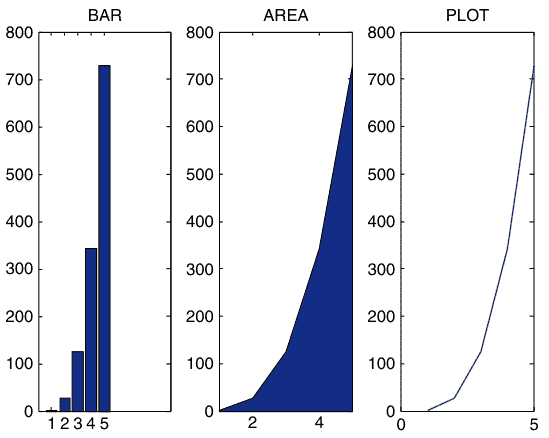

图 10.15

显示显示不同文件类型及其名称标题的子图。

```matlab
plotdivab.m
% 读取公司两个部门的销售额
% 每次读取一行字符串，并绘制数据
id = fopen('ab06.dat');
if fid == -1
    disp('文件打开失败')
else
    for i = 1:4
        % 每一行格式均为 A#B#；这分离了
        % 字符并将 # 转换为实际数字
        aline = fgetl(fid);
        aline = aline(2:length(aline));
        [compa, rest] = strtok(aline,'B');
        compa = str2num(compa);
        rest = rest(2:length(rest));
        compb = str2num(rest);
        % 每一行的数据都在一个独立的子图中
        subplot(1,4,i)
        bar([compa,compb]);
        set(gca,'XLabel',['A','B'])
        axis([0 3 0 8])
        ylabel('销售额（百万）')
        title(sprintf('Quarter %d',i))
    end
    closeresult = fclose(fid);
    if closeresult ~= 0
        disp('文件关闭失败')
    end
end
```

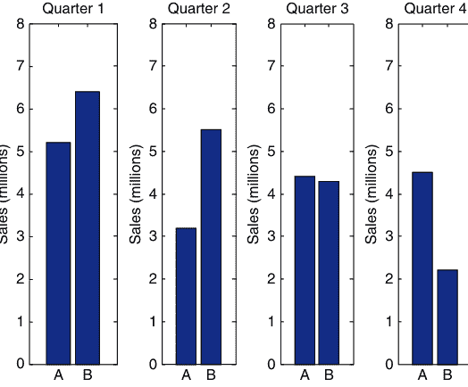

图 10.16

具有自定义 x 轴刻度标签的子图。

运行此脚本会产生图 10.16 所示的子图。

图 10.17

带有文件标签的柱状图和饼图。

另一个示例，名为 'compsales.dat' 的文件存储了公司的销售额（单位：百万）。文件的每行存储销售数字，随后是部门名称缩写，格式如下：

- 5.2 X
- 3.3 A
- 5.8 P
- 2.9 Q

以下脚本使用 `textscan` 函数将这些信息读入单元数组，然后使用 `subplot` 生成一个图形窗口，以柱状图和饼图的形式显示信息（见图 10.17）。

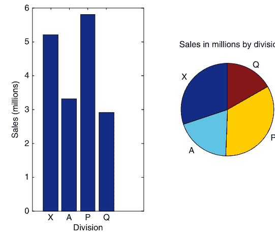

```matlab
compsalespie.m
% 读取销售额并以柱状图和饼图绘制
fid = fopen('compsales.dat');
if fid == -1
    disp('文件打开失败')
else
    % 使用 textscan 将数字和部门代码
    % 读入单元数组
    filecell = textscan(fid,'%f %s');
    % 绘制带有部门代码的柱状图
    subplot(1,2,1)
    xlabel('部门')
    ylabel('销售额（百万）')
    set(gca,'XTickLabel',filecell{2})
    % 绘制带有部门标签的饼图
    subplot(1,2,2)
    pie(filecell{1},filecell{2})
    title('部门销售额（百万）')
    closuresult = fclose(fid);
    if closuresult ~= 0
        disp('文件关闭失败')
    end
end
```

## 总结

常见错误
- 忘记 `subplot` 是按行绘制的。
- 没有意识到 `subplot` 函数会在图形窗口内创建一个矩阵。该矩阵的每个部分必须使用任何绘图类型进行填充。
- 提前关闭图形窗口——属性只有在图形窗口打开时才能设置。

## 编程规范

- 始终为绘图添加标签。
- 注意选择绘图类型以突出相关信息。

| MATLAB 函数和命令 | |
| :--- | :--- |
| subplot | get |
| bar | plot |
| area | set |
| stem | frame |

## 练习

1. 创建一个包含10个数字的文件。编写脚本从文件中加载向量，并使用 `subplot` 在同一个图形窗口中绘制面积图和线图（注意：需要一个循环）。提示用户输入每个绘图类型。
2. 使用 `subplot` 显示 `sin` 和 `cos` 函数之间的差异。创建一个在 $-2\pi$ 到 $2\pi$ 范围内有 100 个均匀点的 x 向量，然后在 2x1 子图中显示 `sin(x)` 和 `cos(x)` 的 y 向量，带有相应的标题。
3. 生物医学工程师正在开发用于糖尿病的胰岛素泵。为此，理解胰岛素如何从体内清除至关重要$t$ 时的胰岛素浓度由方程 $C(t) = C_0 e^{-30t/m}$ 定义，其中 $C_0$ 是胰岛素初始浓度，$t$ 是分钟，$m$ 是人的体重（kg）。编写一个脚本，以图形方式显示体重如何影响胰岛素从体内清除的时间。在 2x1 子图中显示两个受试者的胰岛素浓度，一个体重 120 磅，另一个体重 300 磅。时间从 0 到 4 分钟步长为 0.1，初始浓度应为 85。每个子图中将显示随时间的变化，标题中应包含人的体重。转换因子为 1 磅 = 0.4536 kg。为了方便比较，两个图使用相同的轴。
4. 编写一个接收两个函数作为输入参数的函数，并在图形窗口中显示这些函数，标题为函数名。使用默认轴。函数创建一个从 1 到 n 的 x 向量（n 是 4到10之间的随机整数）。例如，如果函数如下调用：

```matlab
>> subfn(@sqrt, @exp)
```

如果随机整数 $n$ 为 9，图形窗口将看起来如图 10.18 所示。

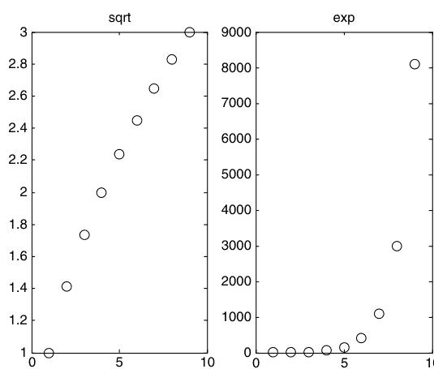

图 10.18

使用函数句柄的子图。

5. 一个名为 'aveighs.dat' 的文件包含3个地点一年中每月平均高温温度（取整）。文件中有三行；每行存储位置编号，随后是 12 个温度值（可以假设如此）。例如，文件可能存储：
432 33 37 42 45 53 72 82 79 66 55 46 41
777 29 33 41 46 52 66 77 78 68 55 48 39
567 55 62 68 72 75 79 83 89 85 80 77 65

编写一个脚本，在一个图形窗口内读取并绘制这三个地点的温度。必须使用 `for` 循环来实现。

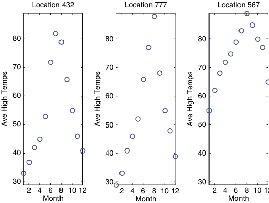

图 10.19

使用循环的子图数据。

使用 `subplot` 并排显示两个部门的销售额。哪种图显示效果最好？在一个图中比较这两个部门。哪种图显示效果最好？为什么？

6. 2006 年四个季度两个部门的销售额（单位：百万）存储在向量变量中，例如：

```matlab
div1 = [4.2 3.8 3.7 3.8];
div2 = [2.5 2.7 3.1 3.3];
```

应该显示轴标签和标题。


11. 编写一个脚本，从文件中读取 x 和 y 数据点，并根据这些点创建一个面积图。文件中每行的格式为：字母 x、一个空格、x 的值、一个空格、字母 y、一个空格以及 y 值。你必须假设数据文件恰好是这种格式，但你不能假设文件的行数是已知的。点的数量将显示在图标题中。脚本将一直循环到文件末尾，使用 `fgetl` 将每行读取为字符串。例如，如果文件包含以下内容

```
x 0 y 1
x 1.3 y 2.2
x 2.2 y 6
x 3.4 y 7.4
```

当运行脚本时，结果将如图 10.20 所示。

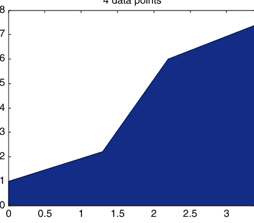

图 10.20
从文件中作为字符串读取的 x, y 数据生成的面积图。

12. 文件 `household.dat` 在其三行中存储了一个城市的年份、中位数收入和中位数房价。金额单位为千美元。例如，它可能如下：

```
2000 2001 2002 2003 2004 2005 2006 2007
72 74 77 80 83 89 93
250 270 300 310 350 390 410 380
```

创建一个此格式的文件，然后将信息加载到矩阵中。创建一个水平堆叠条形图来显示如下所示的信息，并带有适当标题。注意：使用 `XData` 属性将年份如图 10.21 所示放在轴上。

## 中位数收入与房价

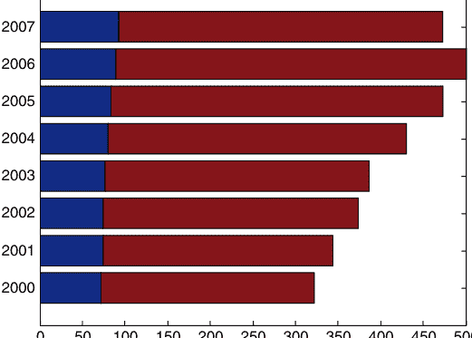

图 10.21
中位数收入和房价的水平条形图。

- 13. 文件 `houseafford.dat` 在其三行中存储了一个城市的年份、中位数收入和中位数房价。金额单位为千美元。例如，它可能如下：

2000 2001 2002 2003 2004 2005 2006 2007
72 74 74 77 80 83 89 93
250 270 300 310 350 390 410 380

创建一个此格式的文件，然后将信息加载到矩阵中。房价与收入的比称为住房负担能力指数。计算每年的指数并将其绘制出来。x轴显示年份（例如2000–2007）。将图形的句柄存储在变量中，查看属性并修改至少一个。

- 14. 对你的朋友进行快速调查，找出谁更喜欢奶士披萨、腊肠披萨或蘑菇（没有其他可能；每个人必须在三个选项中选择一个）。画一个饼图来显示支持每个口味的百分比。为这个披萨饼图的每个部分标记标签！

- 15. 某工程学院每个系的教员人数：

ME 22
BM 45
CE 23
EE 33

尝试至少三种不同的绘图类型，以图形化方式描述这些信息。确保图形具有适当的标题、标签和图例。哪种类型最好？为什么？

- 16. 给定飞机的主要部件重量是飞机设计中的重要考虑因素。部件至少包括机翼、尾翼、机身、起落架等。创建一个包含这些重量的数据文件。从文件中加载数据并创建一个饼图来显示每个部件的重量百分比。

- 17. 创建向量 x，然后是向量 (y 和 z)。基于 x 将它们绘制出来。使用图例来确定它们在图中的位置，并尝试不同的位置。

- 18. 风寒指数 (WCF) 测量给定空气温度（华氏度）和风速（每英里）下的体感冷度。一个公式为：

```
WCF = 35.7 + 0.6T - 0.7V
```

尝试不同的绘图类型来显示不同风速和温度下的 WCF。

- 19. 编写一个脚本，在窗口中绘制三次，使用红色、绿色和蓝色。

- 20. 尝试 `comet` 函数：当输入 `help` 时查看示例。

- 21. 尝试 `comet` 函数：当输入 `help` 时查看示例。

- 22. 调查 `scatter` 函数。在窗口中同时显示这两种函数并区分它们。

- 23. 涡轮机每年产生的电量（千瓦时）取决于许多因素，例如叶片直径（英尺）和风速（英里/小时）。例如

```
5 406
10 3250
5 970
20 2600
10 5
15 3875
10 4005
20 6500
20 52000
20 175500
20 41600
```

创建此并显示这些数据。

## 解线性方程组

### 关键词

| 线性代数 | 下三角矩阵 | 叉积 |
| :--- | :--- | :--- |
| 方程 | 上三角矩阵 | 系数 |
| 符号数学 | 矩阵加法 | 未知 |
| 矩阵等式 | 矩阵减法 | 解集 |
| 方矩阵 | 标量乘法 | 代入法 |
| 主对角线 | 矩阵乘法 | 判定式 |
| 迹 | 内部维度 | 高斯消元 |
| 对称矩阵 | 外部维度 | 高斯-约尔德 |
| 对角矩阵 | 数组乘法 | 初等行 |
| 单位矩阵 | 矩阵逆 | 操作 |
| 带状矩阵 | 矩阵广 | 简化行 |
| 三对角矩阵 | 点积 | 形式 |

### 目录

- **11.1 矩阵定义** .......... 322
- **11.2 线性方程组的矩阵解** .......... 336
- **11.3 符号数学** .......... 348

线性代数方程是形式如下的方程：

$a_1x_1 + a_2x_2 + a_3x_3 + \dots + a_nx_n = b$

此类方程组的解在许多应用中很重要。在 MATLAB 中，求解方程组基本上有两种方法：

- 使用矩阵表示
- 使用 `solve` 函数（符号数学工具箱的一部分）和向量操作

在本章中，我们将首先研究矩阵和向量操作，然后使用这些来求解线性代数方程。符号数学是指对符号进行数学运算。还将介绍 MATLAB 符号数学工具箱中的一些符号数学函数，包括用于求解方程。

## 11.1 矩阵定义

正如我们看到的，矩阵可以被视为具有行列的数值表格。矩阵 A（写为 [A]）的通用形式所示：

```
A = \begin{bmatrix} a_{11} & a_{12} & \dots & a_{1n} \\ a_{21} & a_{22} & \dots & a_{2n} \\ \vdots & \vdots & \ddots & \vdots \\ a_{m1} & a_{m2} & \dots & a_{mn} \end{bmatrix} = a_{ij} \ i=1,\dots,m; j=1,\dots,n
```

该矩阵有 m 行 m 列，因此大小为 $m \times n$。

向量是矩阵的一种特殊情况，其中一个维度（m 或 n）为 1。行向量是 $1 \times n$ 矩阵。列向量是 $m \times 1$ 矩阵。标量是矩阵的特殊情况，其中 m 和 n 均为 1，因此它是单个值或 $1 \times 1$ 矩阵。

### 11.1.1 矩阵属性

在本节中我们将定义矩阵的一些特殊属性。

只有当所有对应元素都相等时，两个矩阵才相等。为了实现这一点，它们的大小也必须相同。对于所有 $i, j$，$a_{ij} = b_{ij}$，则定义为 [A] = [B]。

### 编程概念

为了测试两个矩阵是否相等，将两个矩阵都传递给函数，如果相同，该函数将返回 1（逻辑真），否则返回 0（逻辑假，或如果大小不同）。编写我们的函数时，首先将标记位设置为 1（逻辑真）。如果两个矩阵的大小不同，则将标记设置为 0（逻辑假）。否则，使用嵌套循环，将第一个矩阵参数中的每个元素与第二个


## 11.1 矩阵定义

数学中对应的元素；如果它们不相同，则标志位设置为 0（表示假）。

myisequal.m

```matlab
function myflag = myisequal(mata,matb)
% 假设它们是相同的
% 除非找到不相同的
% 对应元素
myflag = logical(1);
[r c] = size(mata);
if all(size(mata) ~= size(matb))
    myflag = logical(0);
else
    for i=1:r
        for j = 1:c
            if mata(i,j) ~= matb(i,j)
                myflag = logical(0);
        end
    end
end
```

```matlab
>> mata = [2 5 8; 1:3];
>> matb = [2:3:8; 1 2 3];
>> myisequal(mata,matb)
ans =
1
```

### 高效方法

当然，在 MATLAB 中，可以使用 `all` 函数来检查所有元素是否相互相等，但在 MATLAB 中，正如我们所看到的，`isisequal` 函数也能实现这一点：

```matlab
>> isisequal(mata,matb)
ans =
1
```

如果两个函数的大小不同，`isisequal` 函数也会返回 0（表示假）。

## mytrace.m

```matlab
function outsum = mytrace(mymat)
% 计算方阵的迹
% 如果矩阵不是方阵，
% 则返回一个空向量
[r c] = size(mymat);
if r == c
    outsum = [];
else
    outsum = 0;
    for i = 1:r
        outsum = outsum + mymat(i,i);
    end
end
```

```matlab
>> mymat = reshape(1:16,4,4)'
mymat =
1  2  3  4
5  6  7  8
9  10 11 12
13 14 15 16

>> mytrace(mymat)
ans =
34
```

### 高效方法

在 MATLAB 中，有一个内置函数 `trace` 可以完成此操作：

```matlab
>> trace(mymat)
ans =
34
```

如果对于所有的 $i, j$ 都有 $a_{ij} = a_{ji}$，则该方阵是对称的。换句话说，对角线两侧的所有值必须相等。在这个例子中，有三对位于对角线的值，它们都相等（2、9 和 4）。

```latex
$$\begin{bmatrix} 1 & 2 & 9 \\ 2 & 5 & 4 \\ 9 & 4 & 6 \end{bmatrix}$$
```

如果所有不在对角线上的值均为 0，则该矩阵为**对角矩阵**。对角线上的数字不需要是非零，尽管它们通常如此。在数学上，这写为 $a_{ij} = 0$（$i \neq j$）。这是一个对角矩阵的示例。

```latex
$$\begin{bmatrix} 4 & 0 & 0 \\ 0 & 9 & 0 \\ 0 & 0 & 5 \end{bmatrix}$$
```

### 高效方法

可以使用 `diag` 函数取一个长度为 $n$ 的向量，并创建一个 $n \times n$ 的对角方阵，将向量中的值放在对角线上：

```matlab
>> v=1:4;
>> diag(v)
ans =
```

```latex
$$\begin{bmatrix} 1 & 0 & 0 & 0 \\ 0 & 2 & 0 & 0 \\ 0 & 0 & 3 & 0 \\ 0 & 0 & 0 & 4 \end{bmatrix}$$
```

如果对于 $i == j$ 有 $a_{ij} = 1$，且对于 $i \neq j$ 有 $a_{ij} = 0$，则该矩阵是**单位矩阵** [1]。换句话说，对角线上的所有数字均为 1，其他数字均为 0。这是一个 $3 \times 3$ 的单位矩阵：

```latex
$$\begin{bmatrix} 1 & 0 & 0 \\ 0 & 1 & 0 \\ 0 & 0 & 1 \end{bmatrix}$$
```


编写一个名为 **isdiagonal** 的函数，如果方阵是对角矩阵，则返回 1（真），否则返回 0。注意，任何单位矩阵都是对角矩阵的特殊情况。MATLAB 有一个内置函数 `eye`，可以根据给定的值创建一个 $n \times n$ 的单位矩阵：

```matlab
>> eye(5)
ans =
     1 0 0 0 0
     0 1 0 0 0
     0 0 1 0 0
     0 0 0 1 0
     0 0 0 0 1
```

**注意：** `i` 在 MATLAB 中被内置为平方根，因此创建单位矩阵的函数使用了另一个名称：*eye*，听起来像 "i"（懂了吗？）。
有几种与对角矩阵相关的特殊矩阵。**带矩阵**是指除了主对角线及其相邻对角线外元素均为 0 的矩阵。例如，以下矩阵除了主对角线（三条对角线）外均为 0；这种被称为三对角矩阵。
**下三角矩阵**是主对角线以上的元素均为 0。**上三角矩阵**是主对角线以下的元素均为 0。对角线及下方或上方部分为 0 的对应的下三角或上三角矩阵。

### 高效方法

MATLAB 有 `triu` 和 `tril` 函数可以取一个矩阵并将相应的元素替换为 0，使其成为上三角或下三角矩阵。

```matlab
>> mymat =
1  2  3  4
5  6  7  8
9  10 11 12
13 14 15 16

>> triu(mymat)
ans =
 1  2  3  4
 0  6  7  8
 0  0 11 12
 0  0  0 16

>> tril(mymat)
ans =
 1  0  0  0
 5  6  0  0
 9 10 11  0
 13 14 15 16
```

## 矩阵操作

有几种常见的矩阵操作，我们已经见过其中一些。逐元素的操作意味着矩阵的大小相同，这些有时被称为*数组操作*。包括加法和减法。对于以下矩阵：

| A | B | C |
| :--- | :--- | :--- |
| 1 2 3 | 4 0 3 | 5 2 6 |
| 4 5 6 | 0 1 4 | 4 6 10 |
| 2 3 6 | 0 1 | 3 7 |

 哪些是相等的？哪些是方阵？对于所有的方阵：
- 计算迹。
- 哪些是对称的？
- 哪些是对角的？
- 哪些是三角的？

矩阵加法逐元素相两个矩阵，它们必须大小相同。在数学上，这写为 $c_{ij} = a_{ij} + b_{ij}$。

| A | B | C |
| :--- | :--- | :--- |
| 1 2 3 | 4 0 3 | 101 102 104 |
| 4 5 6 | 0 1 4 | 100 100 101 | 104 105 |

### 编程概念

在大多数语言中，这将使用嵌套循环来实现，如下：

```matlab
mymatadd.m
function outmat = mymatadd(mat1,mat2)
% 返回两个矩阵之和
% 如果大小不相同则返回 []
outmat = [];
if all(size(mat1) == size(mat2))
    outmat = zeros(size(mat1)); % 预分配
    [r c] = size(mat1);
    for i = 1:r
        for j = 1:c
            outmat(i,j) = mat1(i,j) + mat2(i,j);
        end
    end
end
```

```matlab
>> A = [1:3;4:6];
>> B = [100 10 1;100 100 1];
>> C = mymatadd(A,B)
ans =
   101 102 104
   104 106 107
```

### 高效方法

然而，在 MATLAB 中，这是通过 `+` 运算符实现的。

```matlab
>> C = A + B
ans =
   101 102 104
   104 106 107
```

类似于矩阵加法，矩阵减法意味着逐元素相减，因此在数学上 $c_{ij} = a_{ij} - b_{ij}$。这在大多数语言中也将通过嵌套循环来实现，或者通过使用 MATLAB 中的 `-` 运算符。

标量乘法意味着将每个元素乘以标量（数字）

```latex
3*\begin{bmatrix} 1 & 2 & 3 \\ 4 & 5 & 6 \end{bmatrix} = \begin{bmatrix} 3 & 6 & 9 \\ 12 & 15 & 18 \end{bmatrix}
```

这在大多数语言中也将通过嵌套循环来实现，或者通过使用 MATLAB 中的 `*` 运算符。

## 11.1.4 矩阵乘法

矩阵乘法并不意味着逐元素相乘；它不是数组操作。矩阵乘法有特定的含义。首先，为了让矩阵 A 乘以矩阵 B 得到矩阵 C，A 的列数必须等于 B 的行数。如果矩阵 A 的维度为 $m \times n$，那么矩阵 B 的维度必须是 $n \times$ 某个值；我们称之为 $p$。我们说内部维度相同。结果矩阵 C 的行数与 A 相同，列数与 B 相同（换句话说，$m \times p$）。在数学符号中，$[A]_{m \times n}=[C]_{m \times p}$。这仅定义了 C 的大小。

矩阵 C 的元素定义为 A 的行和 B 的列元素的乘和，或其他方式：

```latex
C_{ij} = \sum_{k=1}^n a_{ik}b_{kj}.
```

在下面的示例中，A 是 $2 \times3$，B 是 $3 \times4$，因此 C 将是 $2 \times4$。C 中的元素是通过之前描述的求和得到的。C 的第一行是通过 A 的第一行并连续使用 B 的列得到的。例如，C(1,1) 是 $3 \times 1 \times 8 \times 4 \times 0$ 或 35。C(1,2) 是 $3 \times 2 \times 8 \times 5 \times 0 \times 2$ 或 46。

```matlab
>> A = [ 3 8 0; 1 2 5 ];
>> B = [ 1 2 3 1; 4 5 1 2; 0 2 3 0 ];
% 此脚本演示矩阵乘法
mymatult.m
% 此脚本演示矩阵乘法
A = [ 3 8 0; 1 2 5 ];
B = [ 1 2 3 1; 4 5 1 2; 0 2 3 0 ];
[m n] = size(A);

(Continued)
```

```


```matlab
[nb] = size(B);
if n == nb
    disp('Cannot perform this matrix multiplication')
else
    % 外层两层循环遍历 C 中的元素
    % C 的维度为 m 比 p
    % 预分配 C
    C = zeros(m,p);
for i=1:m
    for j = 1:p
        % 内层循环执行 C 中每个
        % 元素的求和
        mysum = 0;
        for k = 1:n
            mysum = mysum + A(i,k) * B(k,j);
    C(i,j) = mysum;
    end
    end
end
```

```matlab
>> mymatmult
C =
35      46      17      19
9       22      20      5
```

### 高效方法

在 MATLAB 中，该运算符将执行此矩阵乘法：

```matlab
>> A = [3 8 0; 1 2 5];
>> B = [1 2 3 1; 4 5 1 2; 0 2 3 0];
>> C = A*B
35      46      17      19
9       22      20      5
```

# 第 11 章 线性代数方程组的求解

### 快速问答！

如果矩阵 M 乘以单位矩阵（适当尺寸），会发生什么？答案：为了尺寸适当，单位矩阵的维度应与 M 的列数相同。乘法的结果始终是原始矩阵 M（因此，类似于将标量乘以 1）。

```matlab
>> A = [3 8 0; 1 2 5]
A =
   3 8 0
   1 2 5
>> A * eye(3)
ans =
   3 8 0
   1 2 5
```

```matlab
>> B = [1 2 3 1; 4 5 1 2; 0 2 3 0]
B =
   1 2 3 1
   4 5 1 2
   0 2 3 0
```

```matlab
>> [r c] = size(B);
>> B * eye(c)
ans =
   1 2 3 1
   4 5 1 2
   0 2 3 0
```

在 MATLAB 中，要逐元素相乘矩阵（这再次不称为矩阵乘法），使用 `.*` 运算符，且矩阵具有相同的维度。这被称为数组乘法，因为它是一种数组操作（逐元素操作）。

# 练习 11.3

手动计算这两个矩阵的乘积，然后在 MATLAB 中验证结果。

```
A   B
[1 3] [2 1]
[4 2] [-1 3]
```

```matlab
>> A = [1:3;4:6];
>> B = [100 10 1; 10 100 1];
>> C = A .* B
C =
  100  20   3
   40 500   6
```

*

# 11.1 矩阵定义 333

矩阵转置交换矩阵的行和列。对于矩阵 $A$，其转置写为 $A^T$。例如，如果 $A = \begin{bmatrix} 1 & 2 & 3 \\ 4 & 5 & 6 \end{bmatrix}$ 则 $A^T = \begin{bmatrix} 1 & 4 \\ 2 & 5 \\ 3 & 6 \end{bmatrix}$。

在 MATLAB 中，正如我们所看到的，有一个内置的转置运算符，即撇号 `'`。

如果矩阵 A 乘以矩阵 B 的结果是单位矩阵，那么 B 就是矩阵 $A$ 的*逆矩阵*。矩阵 $A$ 的逆矩阵写为 $A^{-1}$，因此 $[A][A^{-1}] = [I]$。手动计算矩阵的 $A^{-1}$ 并不容易。然而，MATLAB 有一个函数 **inv** 来计算矩阵的逆矩阵。例如，创建一个矩阵，找到它的逆矩阵，然后将其乘以原始矩阵，以验证乘积确实是单位矩阵：

```matlab
>> a = [1 2; 2 2]
a =
   1 2
   2 2
>> ainv = inv(a)
v =
   -1.0000    1.0000
   1.0000   -0.5000
>> a*ainv
ans =
   1 0
   0 1
```

**矩阵扩展**意味着向原始矩阵添加列。例如，矩阵 A 

```
$A = \begin{bmatrix} 1 & 3 & 7 \\ 2 & 5 & 4 \\ 9 & 8 & 6 \end{bmatrix}$
```

可能会被一个 $3 \times 3$ 的单位矩阵扩展：

$$
$$\begin{bmatrix} 1 & 3 & 7 & 1 & 0 & 0 \\ 2 & 5 & 4 & 0 & 1 & 0 \\ 9 & 8 & 6 & 0 & 0 & 1 \end{bmatrix}$$
```

有时在数学中，用垂直线表示矩阵已扩展。在 MATLAB 中，矩阵扩展可以使用方括号来连接两个矩阵。矩阵 a 与与 a 相同的单位矩阵连接：

```matlab
>> a = [1 3 7; 2 5 4; 9 8 6]
a =
   1 3 7
   2 5 4
   9 8 6
>> [a, zeros(size(a))]
ans =
   1 3 7 0 0
   2 5 4 0 0
   9 8 6 0 0
```

当然，正如我们看到的，预先分配正确尺寸的矩阵更高效。特别是对于大矩阵，这种方式扩展矩阵是不高效的。

# 向量操作

由于向量只是矩阵的特例，之前描述的矩阵操作（加法、减法、标量乘法、转置）适用于向量。我们已经看到行向量的转置是列向量，列向量的转置是行向量。要相乘向量，它们必须具有相同数量元素，但其中必须是一个行向量和一个列向量。例如，对于列向量 c 和行向量 r：

```matlab
c = [5; 3; 7; 1]
r = [6 2 3 4]
```

注意 r 是 $1 \times 4$，而 c 是 $4 \times 1$。回想相乘矩阵 $[A]_{m \times n}[B]_{n \times p} = [C]_{m \times p}$，所以 $[r]_{1 \times 4}[c]_{4 \times 1} = [s]_{1 \times 1}$，换句话说是标量：

```matlab
[6 2 3 4] [5; 3; 7; 1] = 6*5+2*3+3*7+4*1 = 61
```

而 $[c]_{4 \times 1}[r]_{1 \times 4} = [M]_{4 \times 4}$，换句话说是 $4 \times 4$ 矩阵：

$$
\begin{bmatrix} 30 & 10 & 15 & 20 \\ 18 & 6 & 9 & 12 \\ 42 & 14 & 21 & 28 \\ 6 & 2 & 3 & 4 \end{bmatrix}
$$

在 MATLAB 中，这些操作使用 `*` 运算符，它是矩阵乘法运算符。首先，创建列向量 c 和行向量 r：

```matlab
>> c = [5; 3; 7; 1];
>> r = [6 2 3 4];
>> r*c
ans =
   61
>> c*r
=
\begin{bmatrix} 30 & 10 & 15 & 20 \\ 18 & 6 & 9 & 12 \\ 42 & 14 & 21 & 28 \\ 6 & 2 & 3 & 4 \end{bmatrix}
```

### 11.1.1 点积

向量 a 和 b 的**点积**或**内积**写为 $a \cdot b$，并定义为 $a_1b_1+a_2b_2+a_3b_3+\dots+a_nb_n = \sum_{i=1}^{n} a_ib_i$。

换句话说，行向量乘以列向量时类似于矩阵乘法。可以使用 `*` 运算符并转置向量，或使用 MATLAB 中的 `dot` 函数来实现：

```matlab
>> vec1 = [4 2 5 1];
>> vec2 = [3 6 1 2];
>> vec1*vec2'
ans =
31
>> dot(vec1,vec2)
ans =
31
```

# 11.1.5.2 叉积

向量 a 和 b 的**叉积**或**外积**仅当 a 和 b 都是三维空间中的向量时定义，这意味着它们必须有三个元素。它可以定义为按此处特定方式由 a 的元素组成的矩阵与列向量 b 的矩阵乘法。

$$
a\times b = \begin{bmatrix} 0 & -a_1 & a_2 \\ a_3 & 0 & -a_1 \\ -a_2 & a_1 & 0 \end{bmatrix} \begin{bmatrix} b_1 \\ b_2 \\ b_3 \end{bmatrix} = [a_2b_3-a_1b_2, a_3b_1-a_2b_3, -a_1b_2+a_2b_3]
$$

MATLAB 有一个内置函数来实现此操作。

```matlab
>> vec1 = [4 2 5];
>> vec2 = [3 6 1];
>> cross(vec1,vec2)
ans =
   -28 11 18
```

# 11.2 线性代数方程组的矩阵解

*线性代数方程*是形式如下的方程：

$$
a_1x_1 + a_2x_2 + a_3x_3 + \dots + a_nx_n = b_1
$$

其中 $a_i$ 是系数，$x_i$ 是未知数，$b_i$ 是右侧。该方程的解是满足方程的一组未知数值。例如：

$$
4x_1 - 2x_2 + x_3 = 7
x_1 + x_2 + 5x_3 = 10
2x_1 + 3x_2 - x_3 = 2
$$

线性方程组以矩阵形式写：

$$
\begin{bmatrix} a_{11} & a_{12} & a_{13} & \dots & a_{1n} \\ a_{21} & a_{22} & a_{23} & \dots & a_{2n} \\ \vdots & \vdots & \vdots & \ddots & \vdots \\ a_{m1} & a_{m2} & a_{m3} & \dots & a_{mn} \end{bmatrix} \begin{bmatrix} x_1 \\ x_2 \\ x_3 \\ \vdots \\ x_m \end{bmatrix} = \begin{bmatrix} b_1 \\ b_2 \\ b_3 \\ \vdots \\ b_m \end{bmatrix}
$$

这被称为 $Ax=b$，其中 $A$ 是系数矩阵，$x$ 是未知数向量，$b$ 是右侧向量。**线性代数**学科的主要概念之一是求解（或尝试求解！）线性代数方程组的不同方法。所有线性方程都有：

*   无解
*   唯一解
*   无穷多解

MATLAB 有许多函数可以帮助这一过程。


我们将此写为形式 $Ax = b$，其中 $A$ 是系数矩阵，$x$ 是未知数 $x$ 的列向量，$b$ 是等式右侧值的列向量：

| A | x | b |
|---|---|---|
| [4 -2 1] | [x1] | [7] |
| [1 1 5] | [x2] | [10] |
| [-2 3 -1] | [x3] | [2] |

则解为 $x = A^{-1}b$。在 MATLAB 中，有两种简单的方法来求解此。可以使用内置函数 `inv` 获取 $A$ 的逆矩阵，然后将其乘以 $b$，或者我们可以使用左除法运算符。

```
>> A = [4 -2 1; 1 1 5; -2 3 -1];
>> b = [7;0;2];
>> x = inv(A)*b
x =
3.0244
2.9512
0.8049
>> x = A\b
x =
3.0244
2.9512
0.8049
```

## 11.2.1 求解 2 × 2 方程组

尽管这在 MATLAB 中看起来很简单，但通常寻找方程组的解并非如此。然而，$2 \times 2$ 的方程组相当直接，这些系统有多种求解方法，MATLAB 也有内置函数。

考虑 $2 \times 2$ 方程组：

$x_1 + 2x_2 = 2$
$2x_1 + x_2 = 6$

首先，为了直观化解，通过将每个方程写成 $y = mx + b$ 的形式转换为直线方程（通过将 $x_1$ 和 $x_2$ 替换为 $y$）：

$x + 2y = 2 \rightarrow 2y = -x + 2 \rightarrow y = -0.5x + 1$
$2x + y = 6 \rightarrow 2y = -2x + 6 \rightarrow y = -x + 3$

在 MATLAB 中，我们可以使用脚本绘制这些直线；结果见图 11.1。

## 11.2 线性代数方程组的矩阵解

```
plot2by2.m
% 将 2x2 系统绘制为直线
x = -2:5;
y1 = -0.5 * x + 1;
y2 = -x + 3;
plot(x,y1,x,y2)
axis([-2 5 -4 6])
```

直线的交点是 (4, -1)。换句话说，$x = 4$ 且 $y = -1$。回到 $x_1$ 和 $x_2$，我们得到 $x_1 = 4$ 且 $x_2 = -1$。这使得我们能够解可视化。

该矩阵形式的方程组：

```
$\begin{bmatrix} 1 & x_1 \\ 2 & x_2 \end{bmatrix} \begin{bmatrix} x \\ y \end{bmatrix} = \begin{bmatrix} 2 \\ 6 \end{bmatrix}$
```

我们已经看到解是 $x = A^{-1} b$，因此如果我们能找到 $A$ 的逆，就可以求解。寻找 $2 \times 2$ 矩阵逆的方法之一涉及计算**行列式** $D$。

对于 $2 \times 2$ 矩阵 $A = \begin{bmatrix} a_{11} & a_{12} \\ a_{21} & a_{22} \end{bmatrix}$，行列式定义为：

```
$D = \begin{bmatrix} a_{11} & a_{12} \\ a_{21} & a_{22} \end{bmatrix} = a_{11}a_{22} - a_{12}a_{21}$
```

它是使用矩阵系数系数的，并定义为对角线数值之积减去另外两个数字之积。

对于 $2 \times 2$ 矩阵，矩阵逆用 $D$ 定义为：

```
$A^{-1} = \frac{1}{D} \begin{bmatrix} a_{22} & -a_{12} \\ -a_{21} & a_{11} \end{bmatrix}$
```

逆矩阵是标量 $1/D$ 乘以矩阵中的每一个元素的结果。注意，这不是矩阵 $A$，而是使用来自 $A$ 的元素确定的：对角线值反转，对另外两个值取反。注意，如果行列式 $D$ 为 0，将无法找到矩阵 $A$ 的逆。

 图 11.1 2x2 方程组可视化为直线。对于我们的系数矩阵：

$A = \begin{bmatrix} 1 & 2 \\ 2 & 2 \end{bmatrix}, D = \begin{bmatrix} 1 & 2 \\ 2 & 2 \end{bmatrix} = 1*2-2*2 = -2$

因此，未知数通过执行此乘法找到：
$x_1 = -1 * 2 + 1 * 6 = 4$
$x_2 = 1 * 2 + (-1/2) * 6 = -1$

这与通过两条直线的交点得到的解相同。在 MATLAB 中实现这一点，首先创建系数矩阵 $a$ 和列向量 $b$。

```
>> a = [1 2; 2];
>> b = [2;6];
```

### 编程方法

对于 $2 \times 2$ 矩阵，行列式和逆使用简单的表达式找到：

```
>> det = a(1,1)*a(2,2) - a(1,2)*a(2,1)
ans = -2
>> inv = (1/det) * [a(2,2) -a(1,2); -a(2,1) a(1,1)]
inv =
-0.5  0.5
0.25 -0.25
```

### 练习 11.4

对于 $2 \times 2$ 方程组：
$x_1 + 3x_2 = 2$
$2x_1 + 4x_2 = 5$

在纸上完成以下：
- 将方程写成矩阵形式 $Ax = b$。
- 通过寻找逆 $A^{-1}$ 和 $x = A^{-1}b$ 进行求解。
- 导入 MATLAB 并检查。

我们已经看到 MATLAB 有一个内置函数 `inv` 来寻找矩阵逆。它还有一个内置函数 `det` 来寻找行列式：

```
>> det(a)
ans = -2
>> inv(a)
ans =
-0.5000  0.5000
0.2500 -0.2500
```

### 11.2.2 高斯消元法

对于 $2 \times 2$ 方程组，有定义良好的求解方法。然而，对于较大的系统，寻找解通常并不直接。

这里将描述两种求解方程组的相关方法：高斯消元和高斯-乔丹消元。它们都基于这样一个观察：如果方程组具有相同的解，则它们是等的。此外，对矩阵的行进行简单操作（称为初等变换 ERO）会产生等系统。这些分为三类：

- **替换**：通过加上（或减去）另一行的倍数来替换某行。对于给定的行 $r_i$，写为 $r_i = r_i + sr_j$。在替换行 $r_i$ 时，没有东西乘以它。相反，$r_i$ 乘以标量 $s$（可以是分数），并加到或从 $r_i$ 中减。
- **交换行**：例如，交换行 $r_i$ 和 $r_j$ 写为 $r_i \leftrightarrow r_j$。
- **缩放**：通过乘以非零标量 $sr_i \rightarrow r_i$ 来改变某行。

例如，对于矩阵：

| 4 | 2 | 3 |
| 1 | 4 | 0 |
| 2 | 5 | 3 |

交换行的示例是 $r_1 \leftrightarrow r_2$，它将产生：

| 1 | 4 | 0 |
| 4 | 2 | 3 |
| 2 | 5 | 3 |

现在，从这个矩阵开始，缩放的示例是：$2r_2 \rightarrow r_2$，这意味着第 2 行的所有元素都乘以 2。这产生了：

| 4 | 2 | 3 |
| 2 | 8 | 0 |
| 2 | 5 | 3 |

现在，从这个矩阵开始，替换的示例是：$r_3-2r_2 \rightarrow r_3$。逐元素地，第 3 行减去第 2 行的 2 倍，产生了：

```
$\begin{bmatrix} 4 & 2 & 3 \\ 2 & 8 & 0 \\ 0 & -14 & 3 \end{bmatrix}$
```

高斯和高斯-乔丹方法都从方程组的矩阵形式 $Ax=b$ 开始，然后用列向量 $b$ 扩张系数 $A$。

### 练习 11.5

显示每个 ERO 的操作结果：

```
$\begin{bmatrix} 4 & 2 & 3 \\ 1 & 4 & 0 \\ 2 & 5 & 3 \end{bmatrix} r_1 \rightarrow r_2$
```

```
$\begin{bmatrix} 4 & 2 & 3 \\ 1 & 4 & 0 \\ 2 & 5 & 3 \end{bmatrix} \frac{1}{4}r_1 \rightarrow r_2$
```

### 11.2.2.1 高斯消元法

高斯消元法包括：

- 创建增强矩阵 $[A|b]$
- 对此增强矩阵应用 ERO 以得到上三角形式（这称为*消元*）
- 通过回代法求解

例如，对于 $2 \times 2$ 系统，增强矩阵将是：

```
$\begin{bmatrix} a_{11} & a_{12} & b_1 \\ a_{21} & a_{22} & b_2 \end{bmatrix}$
```

应用 ERO 以使增强矩阵变为上三角形式：

```
$\begin{bmatrix} a_{11} & a'_{12} & b'_1 \\ 0 & a'_{22} & b'_2 \end{bmatrix}$
```

因此，目标仅仅是把 $a_{21}$ 替换为 0。这里，撇号表示数值（可能）已经改变。

将此置回方程形式产生

```
$\begin{bmatrix} a_{11} & a'_{12} & x_1 \\ 0 & a'_{22} & x_2 \end{bmatrix}$
```

对每一行执行此矩阵乘法产生：


## 11.2 线性代数方程组的矩阵解

$a'_{11} x_1 + a'_{12} x_2 = b'_{1}$
$a'_{22} x_2 = b'_{2}$

因此，解为：

$x_2 = b'_2 / a'_{22}$
$x_1 = (b'_1 - a'_{12} x_2) / a'_{11}$

同样，对于 $3 \times 3$ 系统，增广矩阵化为上三角形式：

```
$\begin{bmatrix} a_{11} & a_{12} & a_{13} & b_1 \\ a_{21} & a_{22} & a_{23} & b_2 \\ a_{31} & a_{32} & a_{33} & b_3 \end{bmatrix} \rightarrow \begin{bmatrix} a_{11} & a_{12} & a_{13} & b_1 \\ 0 & a_{22} & a_{23} & b_2 \\ 0 & 0 & a_{33} & b_3 \end{bmatrix}$
```

（这将通过系统的方法完成：首先在 $a_{21}$ 位置得到一个 $0$，然后是 $a_{31}$，最后是 $a_{32}$）。

然后，解为：

$x_3 = b'_3 / a'_{33}$
$x_2 = (b'_2 - a'_{23} x_3) / a'_{22}$
$x_1 = (b'_1 - a'_{13} x_3 - a'_{12} x_2) / a'_{11}$

例如，考虑以下 $2 \times 2$ 方程组：

$x_1 + 2x_2 = 2$
$2x_1 + 2x_2 = 6$

作为矩阵方程 $Ax = b$， 它是：

```
$\begin{bmatrix} 1 & 2 \\ 2 & 2 \end{bmatrix} \begin{bmatrix} x_1 \\ x_2 \end{bmatrix} = \begin{bmatrix} 2 \\ 6 \end{bmatrix}$
```

第一步是用 $b$ 对系数矩阵 $A$ 进行增广，得到增广矩阵 $[A | b]$：

```
$\begin{bmatrix} 1 & 2 & 2 \\ 2 & 2 & 6 \end{bmatrix}$
```

对于前向消元，我们希望在 $a_{21}$ 位置得到一个 $0$。为了实现这一点，我们可以通过从第二行减去 $2$ * 第一行来修改矩阵的第二行。

我们写这种 ERO（初行变换）的方式是：

```
$\begin{bmatrix} 1 & 2 & 2 \\ 2 & 2 & 6 \end{bmatrix} r_2 - 2r_1 \rightarrow r_2 \begin{bmatrix} 1 & 2 & 2 \\ 0 & -2 & 2 \end{bmatrix}$
```

# 第11章 线性代数方程组的求解

现在，将其变矩阵方程的形式：

```
$$\begin{bmatrix} 1 & 2 \\ 0 & -2 \end{bmatrix} \begin{bmatrix} x_1 \\ x_2 \end{bmatrix} = \begin{bmatrix} 2 \\ 2 \end{bmatrix}$$
```

这意味着第二个方程是 $-2x_2 = 2$，所以 $x_2 = -1$。代入第一个方程：

$x_1 + 2(-1) = 2$，所以 $x_1 = 4$。

这被称为回代法。

### 11.2.2.2 高斯-Jordan 消元

高斯-Jordan 消元法的起始方式与高斯消元法的回代法相同，但它随后包含的是：

- 创建增广矩阵 [A b]
- 通过应用 ERO 进行前向消元以得到上三角形式
- 后向消元变为对角形式，从而得到解

对于 $2 \times 2$ 系统，这将得到：

```

$$\begin{bmatrix} a_{11} & a_{12} & b_1 \\ a_{21} & a_{22} & b_2 \end{bmatrix} \to \begin{bmatrix} a'_{11} & 0 & b'_1 \\ 0 & a'_{22} & b'_2 \end{bmatrix}$$

```

对于 $3 \times 3$ 系统，

注意，得到的对角形式不包含最右侧列。

$2 \times 2$ 系统的示例，前向消元得到的矩阵：

```
$$\begin{bmatrix} 1 & 2 \\ 0 & -2 \end{bmatrix}$$
```

现在，为了继续后向消元，我们需要在 $a_{12}$ 位置得到一个 $0$。

```
$$\begin{bmatrix} 1 & 2 \\ 0 & -2 \end{bmatrix} r_1 + r_2 \to r_1 \begin{bmatrix} 1 & 0 \\ 0 & -2 \end{bmatrix}$$
```

## 11.2 线性代数方程组的矩阵解

因此，解为 $x_1 = 4$；$-2x_2 = 2$ 或 $x_2 = -1$。

这是一个 $3 \times 3$ 系统的示例：

```
x1 + 3x2 = 1
2x1 + x2 + 3x3 = 6
x1 + 2x2 + 3x3 = 3
```

以矩阵形式，增广矩阵 $[A|b]$ 为：

```
[1 3 0 1]
[2 1 3 6]
[4 2 3 3]
```

前向消元（通过首先在 $a_{21}$ 位置得到 $0$，然后是 $a_{31}$，最后是 $a_{32}$）：

```
[1 3 0 1]
[2 1 3 6] r2-2r1→r2 [0 -5 3 4]
[4 2 3 3] r3-4r1→r3 [0 -10 3 -1]
```

```
[0 -5 3 4]
[0 -10 3 -1]
[0 0 3 -9]
```

对于高斯方法，随后是回代：

```
-3x3 = -9
-5x2 + 3(3) = 4
-5x2 = -5
x1 + 3(1) + 3(3) = 1
x1 + 12 = 1
x1 = -2
```

对于高斯-Jordan 方法，随后是后向消元：

```
[1 3 0 1]
[0 -5 3 4] r1+3/5r2→r1 [1 0 1.8 3.4]
[0 0 3 -9] rr3→r3 [0 0 1 -3]
```

```
[1 0 0 -2]
[0 1 0 -5]
[0 0 1 -3]
```

所以

$x_1 = -2$
$x_2 = 1$
$x_3 = 3$

这里是使用 MATLAB 执行这些替换的示例：

```
a = [1 3 0; 2 1 3; 4 2 3]
a =
1 3 0
2 1 3
4 2 3

b = [1; 6; 3]
b =
1
6
3

ab = [a b]
ab =
1 3 0 1
2 1 3 6
4 2 3 3

ab(2,:) = ab(2,:) - 2*ab(1,:)
ab =
1 3 0 1
0 -5 3 4
4 2 3 3

ab(3,:) = ab(3,:) - 4*ab(1,:)
ab =
1 3 0 1
0 -5 3 4
0 -10 3 -1

ab(3,:) = ab(3,:) - 2*ab(2,:)
ab =
1 3 0 1
0 -5 3 4
0 0 3 -9
```

等等，让我们重新验证 OCR 文本的逻辑。文本说：

```
b = sym('x^2')
c = sym('x^4')
```

从最后一列找到解，所以 $x_1 = -2, x_2 = 1, x_3 = 3$。在 MATLAB 中得到此列向量：

```
x = sym([-2; 1; 3])
x =
-2
1
3
```

## 11.2.4 通过简化增广矩阵寻找矩阵逆

对于大于 $2 \times 2$ 的方程组，寻找矩阵 $A$ 的逆的一种方法是将矩阵与相同大小的单位矩阵增广，然后对其简化。算法为：

- 将矩阵增广：$[A | I]$
- 将其简化为形式 $[I | X]$；$X$ 将是 $A^{-1}$

例如，在 MATLAB 中我们可以从一个矩阵开始，用单位矩阵对其增广，然后使用 `rref` 函数对其简化。

```
a = [1 3 0; 2 1 3; 4 2 3]
rref([a eye(size(a))])
ans =
   1.0000         0         0   -0.2000   -0.6000   0.6000
        0    1.0000         0    0.4000    0.2000   -0.2000
        0         0    1.0000         0.6667   -0.3333
```

在 MATLAB 中，可以使用 `inv` 函数来验证结果。

```
>> inv(a)
ans =
  -0.2000   -0.6000   0.6000
   0.4000    0.2000   -0.2000
   0.6667   -0.3333
```

## 11.3 符号数学

符号数学意味着对符号（而不是数字！）进行数学运算。例如，$a + a$ 是 $2a$。符号数学函数位于 MATLAB 的“符号数学工具箱”（Symbolic Math Toolbox）。工具箱包含了 MATLAB 相关的函数和附加组件（因此，这可能是也可能不是你自己系统的一部分）。符号数学工具箱包含求解方程的另一种方法，因此在本章中有所介绍。

要了解符号函数，可以使用 `help`：

```
help symbolic
```

# 符号数学

### 11.3.1 符号变量与表达式

MATLAB 有一种名为 `sym` 的类型用于符号变量和表达式。例如，通过传递字符串创建一个符号变量 $a$：使用 `sym` 函数：

```
>> a = sym('a');
>> a+a
```

符号变量也可以存储表达式。例如，变量 $b$ 和 $c$ 存储：

```
>> b = sym('x^2');
>> c = sym('x^4');
```

所有的数学运算都可以在符号变量上执行（例如加、减、乘、除、幂）。这里有一些示例：

```
>> c/b
ans =
x^2
```

```
>> b^3
ans =
x^6
```

```
>> c*b
ans =
x^6
>> b + sym('4*x^2');
ans =
5*x^2
```

从最后一个示例可以看出，MATLAB 会合并这些表达式中的项，将 $x^2$ 和 $4$ 得到 $5x^2$。

相反，如果 $z$ 已经是一个符号变量，则不需要对表达式加引号，且项会自动合并：

```
>> z = sym('z');
>> sym(z^3 + 2*z)
ans =
3*z^3
```

如果你想使用多个变量作为符号变量名，`syms` 函数是重复使用 `sym` 的快捷方法。例如：

```
>> syms x y
```

等同于：

```
>> x = sym('x');
>> y = sym('y');
>> z = sym('z');
```

### 11.3.2 简化函数

有几个函数处理表达式并简化项。并不是所有的表达式都可以简化，但 `simplify` 函数会尽可能简化表达式，包括合并同类项。例如：

```
>> x = sym('x');
>> myexpr = cos(x)^2 + sin(x)^2
myexpr =
cos(x)^2+sin(x)^2
>> simplify(myexpr)
ans =
1
```

`collect`、`expand` 和 `factor` 函数用于多项式表达式。`collect` 函数收集系数，例如：

```
>> x = sym('x');
>> collect(x^2 + 4*x^3 + 3*x^3)
ans =
4*x^2+4*x^3
```

`expand` 函数将展开乘积，而 `factor` 则执行反向操作：

```
>> expand((x+2)*(x-1))
ans =
x^2+x-2
>> factor(ans)
ans =
x+2)*(x-1)
```

`subs` 函数将把表达式中的符号变量替换为值。例如，


## 11.3 符号数学

```
>> myexp = x^3 + 3*x^2 - 2
myexp =
x^3+3*x^2-2
>> x = 3;
>> subs(myexp,x)
ans =
52
```

使用符号数学时，MATLAB 默认按有理数运行，这意味着结果将以分数的形式保留。例如，执行表达式 1/3 + 1/2 通常会得到一个双精度值：

```
>> 1/3 + 1/2
ans =
0.8333
```

然而，通过将表达式变为符号表达式，结果也是符号化的。任何数值函数（例如 double）都可以改变这一点：

```mat
>> sym(1/3 + 1/2)
ans =
5/6
>> double(ans)
ans =
0.8333
```

`numden` 函数将分别返回符号表达式的分子和分母：

```mat
>> sym(1/3 + 1/2)
ans =
5/6
>> [n, d] = numden(ans)
n =
5
d = 6
```

```mat
>> [n, d] = numden((x^3 + x^2)/x)
n =
x^2*(x+1)
d = 1
```

### 11.3.3 显示表达式

`pretty` 函数将使用指数形式显示这些表达式，例如：

```mat
>> b = sym('x^2')
b =
x^2
>> pretty(b)
 x^2
```

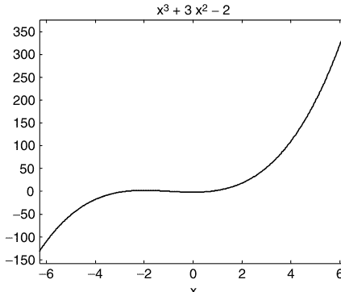

MATLAB 中有几个以 "ez" 开头的绘图函数，它们执行从符号表达式到数字的必要转换并进行绘制。例如，`ezplot` 函数将在 x 范围 -2π 到 2π 之间绘制一个二维图，并带有标题（美化后的形式）。

```mat
>> ezplot('x^3 + 3*x^2 - 2')
```

图 11.2：使用 ezplot 产生的图。

`ezplot` 函数的范围也可以指定；例如，要将 x 轴从 0 改到 π，可以指定为一个向量。结果如图 11.3 所示。

```mat
>> ezplot('cos(x)',[pi])
```

### 11.3.4 解方程

我们已经看到了使用矩阵表示法求解线性方程组的方法。MATLAB 也可以使用符号数学求解方程组。

`solve` 函数求解方程并将解作为符号表达式返回。可以使用可以使用任何数值函数将解转换为数字，如 `double` 所示：

```mat
>> x = sym('x')
>> solve(2*x^2 + x = 6)
ans =
3/2
-2
```

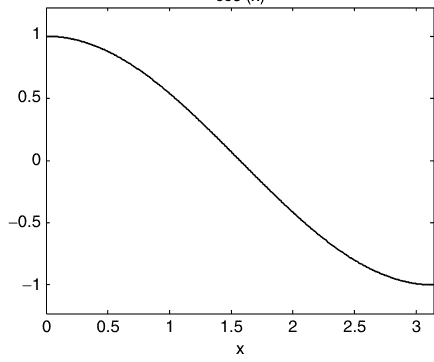

```mat
>> double(ans)
ans =
1.5000
-2.0000
```

如果传递给 `solve` 函数的是表达式而不是方程，它将把该表达式设为 0 并求解产生的方程。例如，它将求解 3x^2 + x = 0：

图 11.3：ezplot 自定义 x 轴的 。

```mat
>> solve('3*x^2 + x')
ans =
  0
-1/3
```

如果有多个变量，MATLAB ax^2 + bx 会选择求解哪一个。在接下来的示例中，求解了方程 ax^2 + bx = 0。有三个变量。从结果（以 a 和 b 的形式给出）可以看出，方程的求解通过内置方式指定了如何选择要解的变量。例如，如果 x 出现在方程或表达式中，它将始终是首选的。

```mat
>> solve('a*x^2 + b*x')
ans =
  0
-b/a
```

但是，可以指定要解哪个变量：

```mat
>> solve('a*x^2 + b*x','b')
ans =
-a*x
```

MATLAB 也可以求解方程组。在这个示例中，x、y 和 z 的解被作为一个包含 x、y、z 字段的结构返回。单个解是存储在结构字段中的符号表达式。

```mat
>> solve('4*x-2*y+z=7','x+y+5*z=10','-2*x+3*y-z=2')
ans = 
x: [1x sym]
y: [1x sym]
z: [1x sym]
```

要引用结构字段中的单个解，需使用点运算符。

```mat
>> x = ans.x
x =
124/41
```

```mat
>> y = ans.y
y =
121/41
```

```mat
>> z = ans.z
z =
33/41
```

然后可以使用 `double` 函数将符号表达式转换为数字，并将三个未知数的的结果存储在向量中。

```mat
>> double([x y z])
ans = 3.0244 2.9512 0.8049
```

## 总结

## 常见陷阱
- 混淆矩阵乘法和数组乘法；包括乘法、除法和幂是逐元素执行的（所以数组大小必须相同）；运算符是 / 和 ^。为了进行矩阵乘法，内部维度必须一致。
- 忘记扩展另一个矩阵；每个行数必须匹配（但不一定是列数）。

### 编程规范
- 在处理符号表达式时，通常先将所有变量设为符号型。

| MATLAB 函数和命令 | |
|---|---|
| trace | dot | sym |
| diag | cross | syms |
| eye | ones, numden |
| tru | simplify |
| tril | expand, ezplot |
| inv | factor, solve |

| MATLAB 运算符 | |
|---|---|
| 矩阵乘法 | |

### 练习1. 对于矩阵 A、B 和 C：

| A | B | C |
|---|---|---|
| 1 | 2 | 3 |
| 3 | 1 | 5 |
| 2 | 3 | 6 |

- 哪些是对称的？
- 对于所有方阵，给出它们的迹（trace）。
- 给出 3*A 的结果。
- 给出 3*C 的结果。
- 是否有其他可以执行的矩阵乘法？如果有，列出它们。

2. 给定矩阵：

| A | B | C |
|---|---|---|
| 2 | 1 | 0 |
| 0 | 5 | 2 |

执行以下 MATLAB 操作，如果不能，请解释原因：

```
A * B
B * A
A + I
trace(A)
```

3. 编写一个 `isinstance` 函数接收数组，如果是方阵则返回 1，否则返回 0。

4. 编写一个 `mydiag` 函数接收数组并返回主对角线向量（不使用内置 `diag` 函数）。注意：只有当参数是方阵时才可行，所以函数应该先调用 `isinstance` 检查。如果是方阵，函数将返回对角线；否则返回空向量。

5. 编写一个函数接收方阵作为输入，并返回包含矩阵对角线的行向量。如果调用时左侧有两个变量，它还会返回矩阵的迹（注意：仅当左侧有两个变量时返回迹）。你可以假设矩阵是方阵的。函数必须预分配正确大小的对角线向量。

6. 编写一个 `randdiag` 函数，返回范围从 low 到 high 的随机整数 n 对角矩阵。向函数传递三个参数：n、low、high，按该顺序。

7. 编写一个 `myeye` 函数返回 n 单位阵。

8. 编写一个 `myupp` 函数接收整数参数 n，返回 n 上三角矩阵。

9. 编写一个函数判断方阵是否为对角矩阵。如果是，返回 1，否则返回 0。

10. 编写一个 `myatsub` 函数接收两个参数并返回一个矩阵减去另一个的结果（通过循环逐元素相减）。如果无法减，返回空矩阵。

11. 编写一个函数接收矩阵并返回其转置（为了更多编程练习，不要使用内置转置运算符）。

12. 我们已经见过 `zeros` 函数，它返回一个全为 1 的矩阵。注意：没有名为 twos、threes 之类的函数（只有 ones 和 zeros！）。但是，可以写一个 `fives` 函数，接收行和列数的两个参数，并返回该大小的全 5 矩阵。

13. `magic(n)` 函数返回一个 n 幻阵，即所有行、列和对角线和都相同的矩阵。研究这个内置函数。

14. `pascal(n)` 函数根据杨辉三角形返回 n 矩阵。研究这个内置并编写你自己的。

15. 将以下方程组重写为矩阵形式：

```
4x1 - x2 + 3x3 = 10
-2x1 + 3x2 + x3 - 5x4 = -3
x1 - x2 + 2x4 = 2
3x1 + 2x2 - 4x3 = 4
```

在 MATLAB 中建立它并使用任何方法求解。

16. 对于以下 2×2 方程组：

```
-3x1 + x2 = -4
-6x1 + 2x2 = 4
```

- 在 MATLAB 中，将方程重写为直线方程并绘制以找到交点。
- 求解一个未知数，然后代入另一个方程求解另一个未知数。
- 找到行列式。
- 有多少解？一个？没有？无限个？

17. 对于以下 2×2 方程组：

```
-3x1 + x2 = 2
-6x1 + 2x2 = 4
```

- 将方程重写为直线方程并绘制以找到交点。
- 求解一个未知数，然后代入另一个方程求解另一个未知数。
- 找到行列式。


## 练习

- 18. 编写一个函数返回 $2 \times 2$ 矩阵的行列式。

- 19. 编写一个函数返回 $2 \times 2$ 矩阵的逆矩阵。

- 20. 给定以下 $2 \times 2$ 方程组：
$3x_1 + x_2 = 2$
$2x_1 = 4$

使用文中的所有方法求解该方程组并可视化解。先用手算，再使用 MATLAB。

- 21. ERO 练习：显示以下每个初等行变换（ERO）的结果：

| 4 | 2 | 3 |
| 1 | 4 | 0 |
| 2 | 5 | 3 |

$r_1 \rightarrow r_1$

| 4 | 2 | 3 |
| 1 | 4 | 0 |
| 2 | 5 | 3 |

$r_2 \leftrightarrow r_3$

| 4 | 2 | 3 |
| 1 | 4 | 0 |
| 2 | 5 | 3 |

$r_3 - 2r_2 \rightarrow r_3$

- 22. 对于以下 $2 \times 2$ 方程组：
$3x_1 + 2x_2 = 4$
$x_1 = 2$

* 将其写成矩阵形式。
* 使用 $2 \times 2$ 组的方法找到行列式 D。
* 使用 D 找到 A 的逆矩阵。
* 使用高斯消元法找到解。
* 使用高斯-乔尔丹法求解。
* 在 MATLAB 中检查你的工作。

- 23. 对于以下方程组：
$x_1 + 2x_2 + x_3 = 2$
$x_2 + 2x_3 = 1$
$x_1 + x_2 + 3x_3 = 3$

* 将其放入增广矩阵 [A|b]。
* 使用高斯法求解。
* 使用高斯-乔尔丹法求解。
* 在 MATLAB 中创建矩阵 A 和向量 b。找到 A 的逆矩阵和行列式。求解 x。

- 24. 给定以下方程组：
$x_1 - 2x_2 + x_3 = 2$
$2x_1 - 5x_2 + 3x_3 = 6$
$x_1 + 2x_2 + 2x_3 = 4$
$2x_1 + 3x_3 = 6$

将此写成矩阵形式并使用高斯法或高斯-乔尔丹法求解。使用 MATLAB 检查你的答案。

- 25. 编写一个函数，用一个适当维的单位矩阵增广一个矩阵，且不使用任何内置函数（`size` 除外）。该函数接收一个矩阵参数并返回增广矩阵。

- 26. 编写一个函数 `myrefinv`，它接收一个方矩阵 A 作为参数并返回 A 的逆矩阵。该函数不能使用内置的 `inv` 函数；而是必须用 I 增广矩阵并使用 `rref` 将其还原为形式 [A⁻¹]。以下是调用它的示例：

```
>> a=[4 3 2; 1 5 3; 1 2 3]
a =
```

```
4 3 2
1 5 3
1 2 3
```

```
>> inv(a)
ans =
0.3000 -0.1667 -0.0333
0 0.3333 -0.3333
-0.1000 -0.1667 0.5667
```

```
>> myrefinv(a)
ans =
0.3000 -0.1667 -0.0333
0 0.3333 -0.3333
-0.1000 -0.1667 0.5667
```

```
>> disp(myrefinv(a))
ans =
0.3000 -0.1667 -0.0333
0 0.3333 -0.3333
-0.1000 -0.1667 0.5667
```
```

- 27. 使用 `solve` 求解方程组 $x - y = 2$ 和 $x² + y = 0$。在同一张图中绘制对应的函数 $y = x - 2$ 和 $y = -x^2$，范围从 -5 到 6。

- 28. 对于以下方程组：
```
x₁ + 2x₂ + x₃ = 2
x₂ + 2x₁ = 1
x₁ + x₂ + 3x₃ = 3
```
* 在 MATLAB 中，创建系数矩阵 A 和向量 b。使用内置函数通过逆矩阵求解 x。
* 创建增广矩阵 [A|b] 并使用 `rref` 函数求解。
* 将此写成符号形式并使用 `solve` 函数求解。从符号解创建一个数值（`double`）等效的向量。

- 29. 对于以下方程组：
```
4x₁ - x₂ + 3x₃ = 10
-2x₁ + 3x₂ - 5x₄ = -3
x₁ + x₂ + 2x₃ = 2
3x₁ + 2x₂ - 4x₃ = 4
```
使用 `solve` 函数通过任何其他方法验证答案（在 MATLAB 中！）。生物医学工程师正在开发糖尿病胰岛素泵。为此，理解胰岛素在饭后是如何清除的。。时间 $t$ 的胰岛素浓度由方程描述：
```
C = C0 e^-mt/t
```
其中 $C0$ 是初始浓度，$t$ 是分钟，$m$ 是人的体重（kg）。使用 `solve` 确定初始浓度为 90 降低到 10 需要多长时间。

- 30. 为了分析电路，通常需要求解方程组。为了找到节点 $a, b$ 和 $c$ 处的电压，方程组如下所示：
```
2(Va-Vb) + 5(Va-Vc) = 0
(Vb-Va) + 3(Vb-Vc) = 0
(Vc-Va) + 2(Vc-Vb) = 0
```
使用 `solve` 函数找到 $Va, Vb$ 和 $Vc$，使得解以 $t$ 的形式返回。

- 31. 细胞的繁殖对于许多环境应用（如废水处理）非常重要。公式
```
log(N) = log(N0) + t/T
```
可以用于模拟这一点，其中 $Ni$ 是原始数量，$N$ 是时间 $t$ 时的数量，$T$ 是翻倍的时间。使用 `solve` 函数来得到结果。

- 32. 我们已经看到，如果方矩阵 $ai = aj$（对于所有 $i, j$），则它是对称的。如果 $ai = -aj$（对于所有 $i, j$），我们称它是反对的。注意这意味着对角线上的所有值必须为 0。编写一个函数接收方矩阵作为输入，如果矩阵是对称的返回 1，否则返回 0。

# 基础统计、搜索与排序

## 关键词
- 平均值 | 离群值
- 排序 | 几何平均值
- 索引向量 | 标准差
- 算术平均值 | 方差
- 平均值 | 众数

## 目录
- 12.1 统计函数 ................. 362
- 12.2 集合操作 ................. 368
- 12.3 排序 ....................... 372
- 12.4 索引 ....................... 379
- 12.5 搜索 ....................... 382

数据集上可以进行许多统计分析。在 MATLAB 软件中，统计函数位于 `help datafun` 下。通常我们将一组 $n$ 个值写为：
```
x = {X1, X2, X3, ...Xn}
```
在 MATLAB 中，这通常会被表示为向量 `x`。统计可以用于刻征数据集的属性。例如，一组成绩 $\{33, 75, 77, 82, 83, 85, 91, 100\}$。什么是“正常的”、“预期的”或“平均”成绩？有几种解释方式。最常见的是平均值，通过对成绩求和并除以数量得到（结果为 79）。另一种解释是出现频率最高的成绩，即 85。此外，列表中间的值 83 也可以使用。另一个有用的属性是数据值在数据集中的分散程度。本节将涵盖一些统计知识，以及可以在数据集执行的操作。某些统计函数要求数据经过排序，因此也将涵盖排序。使用索引向量是有序表示数据的方法，无需物理排序数据集。最后，在数据集或数据库中搜索值是有用的，因此将解释一些基础搜索技术。

## 12.1 统计函数

MATLAB 有许多统计的内置函数；其中最简单的我们已经过了；例如 `min` 和 `max` 用于找到数据集中的最小值或最大值。

```
>> x = [9 10 9 8 7 3 10 9 8 5 10];
>> min(x)
ans =
3
>> max(x)
ans =
10
```

这两个函数也返回最小或最大值的索引；如果出现多次，它返回第一个。例如，在以下数据集中，10 是最大值；它是向量的一种，但返回的索引是找到它的第一个元素（即 2）：

```
>> x = [9 10 9 8 7 3 10 9 8 5 10];
>> [val, idx] = max(x)
```
2
```

对于矩阵，`min` 和 `max` 函数默认按列操作：

```mat
>> mat = randint(2,4,[20])
mat =
   9 10 17  5
  19  9 11 14
>> min(mat)
```
9 9 11 5
>> [minval, minind] = min(mat)
minval =
9 9 11 5
minind =
1 2 2
```

要找到每一行的最小值（或最大值），可以将维度 2（这是 MATLAB 如何指代的）作为 **min (或 max)** 函数的第一个参数；第二个参数**必须**是一个空向量：

```
>> min(mat,2)
ans =
5 9
```

这些函数还可以比较向量或矩阵对应元素的值。例如，以下遍历两个向量中的所有元素，比较对应元素并返回每个位置的最小值：

```
>> x = [3 5 2 11];
>> y = [2 6 4 5 10];
>> min(x,y)
ans =
2 5 4 2 10
```

### 12.1.1 平均值

数据集的**算术平均值**通常是数值的*平均值*；换句话说，数值之和除以数据集中的数量。在数学上，我们将其写为

```
\sum_{i=1}^{n} x_i / n
```

### 编程概念

计算平均值或平均数通常被解释为循环向量的元素，将它们相加，然后除以元素的个数：


mymean.m

```matlab
function outv = mymean(vec)
% 计算并返回向量的平均值
mysum = 0;
for i=1:length(vec)
    mysum = mysum + vec(i);
end
vout = mysum/length(vec);

>> x = [9 10 9 8 7 3 10 9 8 5 10];
>> mean(x)
ans =
8.1667
```

### 高效方法

MATLAB 中置了一个内置函数 `mean` 来完成此操作：

```matlab
>> mean(x)
ans =
8.1667
```

对于矩阵，`mean` 函数按列操作。要找到每行的平均值，需要将维度 `2` 作为函数的第二个参数传递进去，这与 `sum`、`prod`、`cumsum` 和 `cumprod` 函数的情况相同（对于 `min` 和 `max` 等其他函数，不需要像这样在中间传递 `[]`）。

```matlab
>> mat = randi(3,3,[1 10])
mat =
8 9 3
10 2 3
6 1 9
```

```matlab
>> mean(mat)
ans =
8 7 5
>> mean(mat,2)
ans =
6.6667
5.0000
8.3333
```

有时，比数据中其他值大得多或小得多的值（称为离群值）会干扰平均值；例如，在下面的例子，数据集中所有数字都在 3 到 10 之间，但中间的 100 除外。由于这个离群值，该向量的平均值实际上比向量中的任何其他值都大。

```matlab
>> xwithbig = [9 10 10 8 100 7 3 10 9 8 5 10];
>> mean(xwithbig)
ans =
15.2308
```

为了处理这种情况，有时在计算平均值之前会丢弃数据集中的最小值和最大值。在本例中，使用一个逻辑向量来指示哪些元素既不是最大值也不是最小值，从而对原始数据集进行索引，结果删除了最小值和最大值。

```matlab
>> xwithbig = [9 10 10 8 100 7 3 10 9 8 5 10];
>> length(xwithbig)
ans =
13
>> newx = xwithbig(xwithbig ~= min(xwithbig) & xwithbig ~= max(xwithbig))
newx =
9 10 10 9 8 7 10 9 8 5 10
>> length(newx)
ans =
11
```

有时不仅仅是移除最小值和最大值，还会移除最大和最小的 1% 或 2% 的值，特别是数据集非常大时。

还可以计算其他几种方法。向量或数据集中 $n$ 个值的调和平均值定义为：

$$\frac{n}{\frac{1}{x_1} + \frac{1}{x_2} + \frac{1}{x_3} + \dots + \frac{1}{x_n}}$$

这可以使用内置的 `sum` 函数通过匿名函数实现。例如，下面的匿名函数计算此值，并将句柄存储在名为 `harmhand` 的变量中。

```matlab
>> harmhand = @ (x) length(x) / sum ( 1 ./ x);
>> x = [ 9 10 10 9 8 7 3 10 9 8 5 10];
>> harmhand(x)
ans =
7.2310
```

向量 $x$ 中 $n$ 个值的*几何平均值*定义为数据值乘积的 $n$ 次方。

$$\sqrt[n]{x_1 x_2 x_3 \dots x_n^*}$$

下面的匿名函数使用 **prod:** 实现了这一定义：

```matlab
>> geomhand = @ (x) prod(x)^(1/length(x));
>> geomhand(x)
ans =
7.7775
```

**注意：** 统计工具箱（Statistics Toolbox）提供了用于这些平均值的函数，分别称为 *harmmean* 和 *gean*，以及一个名为 *trimmean* 的函数，它可以修剪最高和最低 2% 的数据值。

### 12.1.2 方差和标准差

*标准差*和*方差*是衡量数据分布程度的方法。方差通常根据算术平均值定义为：

$$var = \frac{\sum_{i=1}^{n}(x_i-\bar{x})^2}{n-1}$$

然而，分母有时定义为 $n$ 而不是 $n-1$。MATLAB 使用的默认定义由前面的方程给出，我们在这里使用它。

对于向量 $[4, 6, 1, 5]$，有 $n=4$ 个值，该数据集的平均值为 4。方差为：

$$var = \frac{(4-4)^2 + (6-4)^2 + (1-4)^2 + (5-4)^2}{3} = \frac{0+4+9+1}{3} = 4.67$$

计算方差的内置函数是 **var:**：

```matlab
>> shortx = [4 6 1 5];
>> myvar = var(shortx)
myvar =
4.6667
```

标准差是方差的平方根：

$$sd = \sqrt{var}$$

MATLAB 中标准差的内置函数是 **std**；可以通过方差的 *sqrt* 得到：

```matlab
>> shortx = [2 5 1 4];
>> myvar = var(shortx)
myvar =
3.3333
>> sqrt(myvar)
ans =
1.8257
>> std(shortx)
1.8257
```

数字越分散，标准差越小，因为它是确定数据分散程度的方法。同样，这里有两个集合具有相同数量和相同的平均值，但标准差大不同：

```matlab
>> x1 = [9 10 9 10];
>> mean(x1)
ans =
9.5000
>> std(x1)
ans =
0.7071
>> x2 = [2 17 5 8];
>> mean(x2)
ans =
9.5000
>> std(x2)
ans =
6.8704
```

### 12.1.3 数数

数据集的众数出现频率最高的值。MATLAB 的内置函数是 `mode`。

```matlab
>> x = [9 10 10 9 8 7 3 10 9 8 5 10]; 修正此处示例
```

如果有多个值的频率相同，则较小的值为众数。在以下情况下，由于 3 和 8 出现了两次，较小的值 (3) 是众数：

```matlab
>> x = [3 8 5 3 4 8];
>> mode(x)
```

如果没有某个值出现的频率比任何其他值更高，向量中的最小值将是该向量的众数。

```matlab
>> shortx = [2 5 4];
>> mode(shortx)
ans =
2
```

### 12.1.4 中位数

位数仅对排序过的数据集定义。对于包含 $n$ 个值的排序集合，如果 $n$ 为奇数，中数为中间的值；如果 $n$ 为偶数，中数为中间两个值的平均值。例如，对于向量 $[1 4 9 12]$，中间值为 5。MATLAB 中的函数是 `median`：

```matlab
>> median([1 4 9 12])
ans =
5
```

对于向量 $[1 4 9 12 33]$，中数为中间的 5 和 9 的平均值：

```matlab
>> median([1 4 9 12 33])
ans =
7
```

如果向量初始没有排序，位数函数仍返回正确的结果（它会自动排序）。例如，打乱第一个示例值的顺序得到的位数仍为5。

对于向量 $[1 3 6 9]$，找到：

- 最小值
- 最大值
- 算术平均值
- 几何平均值
- 调和平均值
- 方差
- 标准差
- 中位数

```matlab
>> median([9 4 1 5 12])
ans =
5
```

## 12.2 集合运算

MATLAB 有若干个对向量执行集合运算的内置函数。这些包括 `union`、`intersect`、`unique`、`setdiff` 和 `setxor`。这些函数在处理数据集时都非常有用。此外，还有两个作用于集合的函数 `ismember` 和 `issorted`。

例如，给定以下向量：

```matlab
>> v1 = 2:6
v1 =
    2 3 4 5 6
>> v2 = 1:2:7
v2 =
    1 3 5 7
```

`union` 函数返回包含两个输入向量所有值的向量，不重复。

```matlab
>> union(v1,v2)
ans =
    1 2 3 4 5 6 7
```

`intersect` 函数返回在输入向量中找到的所有值。

```matlab
>> intersect(v1,v2)
ans =
    1 3 5
```

`setdiff` 函数接收两个向量作为输入参数，并返回包含在第一个向量中不在第二个向量中的所有值。因此，两个输入参数的顺序很重要。

```matlab
>> setdiff(v1,v2)
ans =
    2 4 6
>> setdiff(v2,v1)
ans =
    1 7
```

`setxor` 函数接收两个向量作为输入参数，并返回两个向量中不在这两个向量交集中的所有值。换句话说，它是之前的 `setdiff` 两个向量的并集。

```matlab
>> setxor(v1,v2)
ans =
    2 4 6
>> union(setdiff(v1,v2), setdiff(v2,v1))
ans =
    1 2 4 6 7
```

集合函数 **unique** 返回集合参数中提取的所有唯一值：

```matlab
>> v3 = [1:5 3:6]
v3 =
    1 2 3 4 5 3 4 5 6
>> unique(v3)
ans =
    1 2 3 4 5 6
```


`member` 成员函数接收两个向量作为输入参数，并返回一个与第一个参数长度相同的逻辑向量。如果第一个向量中的元素也于第二个向量中，则对应位置为 1（真），否则为 0（假）。对于该函数，参数的顺序很重要。

```
>> v1
v1 =
  2 3 4 5 6
>> v2
v2 =
  1 3 5 7
>> member(v1,v2)
ans =
  0 1 0 1 0
>> member(v2,v1)
ans =
  0 1 1 0
```

将 `member` 的结果作为对第一个向量参数的索引，将返回与 `intersect` 函数相同的结果。

```
>> logv = member(v1,v2)
logv =
  0 1 0 1 0
>> v1(logv)
ans =
  3 5
>> logv = member(v2,v1)
logv =
  0 1 1 0
>> v2(logv)
ans =
  3 5
```

`issorted` 函数如果参数按升序（从低到高）排序，则返回 1（逻辑真），否则返回 0（逻辑假）。

```
>> v3 = [1:5 3:6]
v3 =
  1 2 3 4 5 3 4 6
>> issorted(v3)
ans =
  0
```

```
>> issorted(v1)
ans = 1
>> vec = 4:-1:1
vec = 4 3 2 1
>> issorted(vec)
ans = 0
```

在下一节中我们将学习如何对向量进行排序。

# 练习 12.2

创建两个向量变量 `vec1` 和 `vec2`，包含 1 到 20 之间的随机整数。先手动完成以下每个操作，然后在 MATLAB 中检查：

**排序**是将列表顺序排列的过程；可以是**降序**（从高到低），也可以是**升序**（从低到高）顺序。例如，这里有一个 *n* 个整数的列表，可视化为一个列向量。

| 1 | 85 |
| 2 | 70 |
| 3 | 100 |
| 4 | 95 |
| 5 | 80 |
| 6 | 91 |

- union
- intersection
- setdiff
- setxor
- unique (for each)

我们希望通过重新排列该向量来原地升序排序，而不是创建另一个向量。一个基础算法是：

- 遍历向量找到最小数，然后将其放在向量的第一个元素位置。怎么做？通过与当前第一个元素中的数字交换。
- 然后，扫描向量的剩余部分（从第二个元素开始），寻找下一个最小数（或剩余部分中的最小数）。找到后，将其放在剩余部分的第一个元素位置。
- 对向量的剩余部分继续此操作。一旦倒数第二个数字被放置在向量的正确位置上，默认最后一个数字也到位了。

此表显示了这一过程。左侧列显示原始向量。第二列（从左侧）显示最小数 70 现在位于向量的第一个元素位置。它是通过与原本在第一个位置的 85 交换放在那里的。

## 12.3 排序

这逐个元素进行，直到向量完成排序。

| 85 | 70 | 70 | 70 | 70 |
| 70 | 85 | 80 | 80 | 80 | 80 |
| 100 | 100 | 100 | 85 | 85 | 85 |
| 95 | 95 | 25 | 95 | 91 | 91 |
| 80 | 80 | 85 | | 95 |
| 91 | 91 | 91 | 91 | 95 | 100 |

这被称为*选择排序*；它只是许多不同排序算法之一。

### 编程概念

以下函数实现了使用选择排序对向量排序：

```
mysort.m
function outv = mysort(vec)
% 此函数使用选择排序对向量进行排序
% 遍历向量中的元素直到长度-1
for i = 1:length(vec)-1
  low = i;
  % 在向量剩余部分选择最小数
  for j=i+1:length(vec)
    if vec(j) < vec(low)
      low = j;
    end
  % 交换元素
  temp = vec(i);
  vec(i) = vec(low);
  vec(low) = temp;
end
outv = vec;
vec = [85 70 100 95 80 91];
>> vec = mysort(vec)
```

70 80 85 91 95 100

### 高效方法

MATLAB 有一个内置函数 `sort`，可以升序排序向量。

```
>> vec = [85 70 100 95 80 91];
>> vec = sort(vec)
```

70 80 85 91 95 100 也可以指定降序，例如：

```
>> sort(vec,'desc')
ans =
100 95 91 85 80 70
```

对于矩阵，`sort` 函数默认按列排序。要按行排序，则指定维度 2。例如：

```
>> mat = [4 6;3 8;7]
>> sort(mat) % 按列排序
ans =
3 6
4 7
7 8
>> sort(mat,2) % 按行排序
ans =
3 4
6 7
### 12.3.1 结构体的排序

在处理结构体向量时，通常根据特定字段进行排序。例如，回顾第 7 节创建的用于存储信息的结构体向量。

| item_no | cost | price | code |
|---|---|---|---|
| 123 | 19.99 | 39.95 | 'g' |
| 456 | 5.99 | 49.99 | 'l' |
| 587 | 11.11 | 33.33 | 'w' |

这是一个根据价格升序排序该结构体向量的函数。

```
mystructsort.m
outv = mystsort(structarr)
% 此函数根据价格字段对 packages 排序
for i = 1:length(structarr)-1
  low = i;
  for j=i+1:length(structarr)
    if structarr(j).price < structarr(low).price
      low = j;
    end
  end
  % 交换元素
  temp = structarr(i);
  structarr(i) = structarr(low);
  structarr(low) = temp;
end
outv = structarr;
```

注意只有价格字段改变了；整个结构体被交换了。这样向量中的每个元素都保持完整。回顾第 7 节创建的 `printpackages` 函数，它可以以表格形式打印信息。调用 `mystructsort` 函数也可以演示：

```
>> printpackages(packages)
Item #    Cost    Price   Code
123     19.99   39.95   g
456     5.99    49.99   l
587     11.11   33.33   w
>> pack_by_price = mystructsort(packages)
>> printpackages(pack_by_price)
Item #    Cost    Price   Code
587     11.11   33.33   w
123     19.99   39.95   g
456     5.99    49.99   l
```

# 基础统计、搜索与排序

此函数仅根据价格字段排序结构体。接下来显示一个更通用的函数，它接收字段名的字符串。函数首先检查传递的字符串是否为结构体的有效字段。如果是，则根据该字段排序；如果不是，则打印错误消息并返回空向量。字符串由向量名、包含元素索引的点以及字段名组成。使用方括号拼接字符串部分，使用 `int2str` 函数将元素索引转换为字符串，使用 `eval` 函数比较向量元素以确定最小值。

```
general_pack_sort.m
function outv = general_pack_sort(inputarg, fname)
% 此函数根据作为输入参数传递的字段名
% 对 package structs 向量进行排序
if isfield(inputarg,fname)
    for i = 1:length(inputarg)-1
        low = i;
        for j=i+1:length(inputarg)
            if eval(['inputarg '.' int2str(low) '.' fname]) < ...
                eval(['inputarg '.' int2str(j) '.' fname])
                low = j;
            end
        end
        % 交换元素
        temp = inputarg(i);
        inputarg(i) = inputarg(low);
        inputarg(low) = temp;
    end
    outv = inputarg;
else
    disp('Sorry, not a correct field name');
    outv = [];
end
```

以下是调用函数的示例：

```
>> pack_by_price = general_pack_sort(packages, 'price');
>> printpackages(pack_by_price)
```

## 12.3 排序

| Item # | Cost | Price | Code |
| 587 | 11.11 | 33.33 | w |
| 123 | 19.99 | 39.95 | g |
| 456 | 5.99 | 49.99 | l |

```
>> pack_by_cost = general_pack_sort(packages, 'cost');
>> printpackages(pack_by_cost)
Item # | Cost | Price | Code |
| 456 | 5.99 | 49.99 | l |
| 587 | 11.11 | 33.33 | w |
| 123 | 19.99 | 39.95 | g |
```

# 快速提问

此排序函数适用于任何结构体向量吗，而不仅仅像 *packages* 那样的配置？
**回答：** 它相当通用。适用于任何结构体。然而，比较仅对数值字符字段有效。因此，只要字段是数字或字符，该函数适用于适用于结构体向量。如果字段本身是向量（包括字符串），则将不起作用。

#12.3.2 字符串排序

```
words = char('Hello', 'Howdy', 'Hi', 'Goodbye', 'Ciao')
words =
Hello
Howdy
Hi
Goodbye
Ciao
```

对于字符串矩阵，`sort` 函数的工作方式与之前所示的数字完全相同。例如，
以下操作按列使用字符的 ASCII 等效值进行排序。从结果可以看出，空格字符在字符编码中位于字母：

```
>> sort(words)
ans =
Ce
Giad
Hildb
```


# 第 12 章 基础统计、搜索与排序

若要按行进行排序，必须指定第二个维度。

```matlab
>> sort(words.2)
ans =
Hello
Howdy
H1
Gbdeoy
Ciao
```

从这一点可以看出，在字符编码中，空格位于字母表之前，而且大写字母也位于小写字母之前。

如何按字母顺序对字符串进行排序呢？MATLAB 有一个名为 `sortrows` 的函数可以实现这一点。它的工作原理是从左到右逐列检查检查字符串。如果它能确定哪一个在前，它就会选取整个字符串并将其放在第一行。例如，前两个字符串根据第一个字符 C 和 G 进行放置。对于其他字符串，由于它们都以 H 开头，因此会检查下一列。在这种情况下，字符串根据第二个字符 e、i、o 对应的放置。

```matlab
>> sortrows(words)
ans =
Ciao
Goodbye
Hello
HHi
Howdy
```

`sortrows` 函数将每一行作为一个块（或组）进行排序，它也适用于数字。在这个示例中，以 3 和 4 开头的行被放在前面。然后，对于以 5 开头的行，第二列的值（6 和 7）决定了顺序。

```matlab
>> mat = [5 7 2; 4 6 7; 3 4 1; 5 6 2]
mat =
5 7 2
4 6 7
3 4 1
5 6 2
>> sortrows(mat)
ans =
3 4 1
4 6 7
5 6 2
5 7 2
```

要对字符串单元数组进行排序，可以使用 **sort** 函数。例如：

```matlab
>> engcellnames = {'Chemical', 'Mechanical', ..., 'Biomedical', 'Electrical', 'Industrial'}
>> sort(engcellnames)
ans =
'Biomedical'
'Chemical'
'Electrical'
'Industrial'
'Mechanical'
```

## 12.4 索引

索引是向量排序的替代方案。通过索引，向量保持其原始顺序。使用索引向量按照所需的顺序指向原始向量中的值。

例如，对于一个考试成绩向量：

| 1 | 2 | 3 | 4 | 5 | 6 |
|---|---|---|---|---|---|
| 85 | 70 | 100 | 95 | 80 | 91 |

按升序排列，最低的成绩是元素 2，次低的是元素 5，依此类推。索引向量 *grade_index* 给出了这种顺序：

| 1 | 2 | 3 | 4 | 5 | 6 |
|---|---|---|---|---|---|
| 2 | 5 | 1 | 6 | 4 | 3 |

索引向量被用作原始向量的索引。为了按升序排列获取 *grades*，使用的索引是 *grades(2)*、*grades(5)* 等。使用索引向量来完成这一点，*grades(grade_index(1))* 将是最低分 70，而 *grades(grade_index(2))* 将是次低分。通常情况下，*grades(grade_index(i))* 将是第 $i$ 次低的成绩。

在 MATLAB 中创建这些内容：

```matlab
>> grades = [85 70 100 95 80 91];
>> grade_index = [2 5 1 6 4 3];
>> grades(grade_index)
ans =
70 80 85 91 95 100
```

然而，并不是像这里所示手动创建索引向量，初始化索引向量的步骤是使用排序函数。算法如下：

- 将索引向量中的值初始化为索引 1, 2, 3, ....
- 使用任何排序算法，但使用索引向量对原始向量中的元素进行索引以进行比较（例如之前所示使用 `grades(grade_index(i))`）。
- 当排序算法要求交换值时，交换索引向量中的元素，而不是原始向量中的元素。

这里是一个实现该算法的函数：

```matlab
% createind.m
function indvec = createind(vec)
%此函数按升序创建索引向量

% 初始化索引向量
len = length(vec);
indvec = 1:len;
for i = 1:len-1
    low = i;
    for j=i+1:len
        % 比较原始向量中的值
        if vec(indvec(j)) < vec(indvec(low))
            low = j;
        end
    end
    % 交换索引向量中的元素
    temp = indvec(i);
    indvec(i) = indvec(low);
    indvec(low) = temp;
end
```

例如，对于刚刚给出的成绩：

```matlab
>> clear grade_index
>> grade_index = createind(grades)
grade_index =
2 5 1 6 4 3

>> grades(grade_index)
ans =
70 80 85 91 95 100
```

### 12.4.1 结构体索引

（注：原文文本在此处出现了逻辑混乱或重复，但已根据上下文尝试翻译并保持结构）

（此处原文中从 createind.m 之后的内容看起来像是损坏或重复的占位符，已根据指令要求尽可能翻译可见的文本）

（注：由于提供的原始英文文本在 12.4.1 之后出现了大量逻辑重复和乱码化的描述，以下翻译主要针对可读的结构化部分）

由于您提供的英文文本在 12.4.1 之后存在严重的文本重复和格式错误，翻译部分主要涵盖了清晰的逻辑结构。

（注：原文文本在 12.4.1 之后包含大量重复的句子和不连贯的描述，此处已根据指令尽可能翻译可见逻辑）


# 第 12 章 基础统计、搜索与排序

为了实现这一点，我们将使用变量 *low* 和 *high* 来指定搜索值的范围。开始时，*low* 的值将为 1，*high* 的值将为向量的长度。变量 *mid* 将是从 *low* 到 *high* 范围内中间元素的索引。如果在 *mid* 处没有找到键值，有两种方法可以调整范围。如果键值小于 *mid* 处的值，我们将 *high* 改为 *mid - 1*。如果键值大于 *mid* 处的值，我们将 *low* 改为 *mid + 1*。

例如，在向量中搜索键值 91：

| 1 | 2 | 3 | 4 | 5 | 6 |
|---|---|---|---|---|---|
| 70 | 80 | 85 | 91 | 95 | 100 |

下表显示了该搜索算法在每次迭代中会发生的情况。

| 迭代 | Low | High | Mid | 是否找到？ | 操作 |
|---|---|---|---|---|---|
| 1 | 1 | 6 | 3 | 否 | 将 low 移动到 mid + 1 |
| 2 | 4 | 6 | 5 | 否 | 将 high 移动到 mid – 1 |
| 3 | 4 | 4 | 4 | 是 | 完成！索引为 mid |

在向量的第四个元素找到了键值。

另一个例子：搜索键值 82：

| 迭代 | Low | High | Mid | 是否找到？ | 操作 |
|---|---|---|---|---|---|
| 1 | 1 | 6 | 3 | 否 | 将 high 移动到 mid – 1 |
| 2 | 1 | 2 | 1 | 否 | 将 low 移动到 mid + 1 |
| 3 | 2 | 2 | 2 | 否 | 将 low 移动到 mid + 1 |
| 4 | 3 | 2 | → 这结束了！ | | |

*low* 的值不能大于 *high*；这意味着键值不在向量中。因此，算法会*重复*直到找到键值或直到 *low > high*（这意味着键值不在那里）。

以下函数实现了此二分搜索算法。该函数接收两个参数：排序后的向量和一个键值（或者，函数也可以对向量进行排序）。*low* 和 *high* 的值初始化为向量中的第一个和最后一个索引。输出参数 *out* 初始化为 −1，如果未找到键值，函数将返回该值。函数将循环，直到 *low* 大于 *high* 或找到键值。

## 12.5 搜索

binsearch.m

```
function outind = binsearch(vec, key)
% 此函数实现了二分搜索
low = 1;
high = length(vec);
outind = -1;
while low <= high && outind == -1
    mid = floor((low + high)/2);
    if vec(mid) == key
        outind = mid;
    elseif key < vec(mid)
        high = mid - 1;
    else
        low = mid + 1;
    end
end
```

以下是调用此函数的示例：

```
>> vec = randint(1,7, [1 30])
vec =
    2 11 25 1 5 6 7
>> svec = sort(vec)
svec =
    1 2 5 5 6 7 11 25
>> binsearch(svec, 4)
ans =
    -1
>> binsearch(svec, 25)
ans =
    7
>> binsearch(svec, 5)
ans =
    3
```

二分搜索也可以实现为递归函数。以下递归函数也实现了此二分搜索算法。该函数接收四个参数：一个排序后的向量、要搜索的键值以及 low 和 high 的值（初始时将为 1 和向量的长度）。如果键值不在向量中，则返回 -1，或者返回找到它的元素索引。算法中的基础情况是 low > high（意味着键值不在向量中）或找到了键值。否则，一般情况是调整范围并再次调用二分搜索函数。

```
function out = recbinsearch(vec, key, low, high)
% 递归二分搜索函数
 mid = floor((low + high)/2);
if low > high
    out = -1;
elseif vec(mid) == key
    out = mid;
elseif key < vec(mid)
    out = recbinsearch(vec, key, low, mid-1);
else
    out = recbinsearch(vec, key, mid+1, high);
end
```

以下是调用此函数的示例：

```
>> recbinsearch(svec, 5, 1,length(svec))
ans =
3
>> recbinsearch(svec, 25, 1,length(svec))
ans =
7
>> recbinsearch(svec, 4, 1,length(svec))
ans =
-1
```

## 总结

常见陷阱

- 忘记 max 和 min 返回的是最大值或最小值的索引
- 没有意识到离群值可以剧烈改变结果
- 忘记在使用二分搜索之前必须对数据进行排序
- 忘记离群值会显著影响结果

## 编程风格指南

- 使用内置函数处理离群值
- 使用空行分隔不同的段落
- 在代码中使用清晰的注释

## 练习

1. 创建一个脚本执行以下操作：创建两个各包含 20 个整数的向量：一个整数范围从 1 到 5，另一个范围从 1 到 500。对于每个向量，你预期平均值和中位数是否大致相同？你预期这两个向量的标准差是否大致相同？回答这些问题，并使用内置函数找到每个向量的最小值、最大值、平均值、标准差和众数。在子图中每个向量绘制直方图。运行脚本几次查看变化。

2. 写一个函数，返回向量值的平均值，但不包括最小值和最大值。假设向量中的值是唯一的。可以使用内置的 mean 函数。为了测试这一点，创建一个包含 10 个随机整数的向量，范围在 0 到 50 之间，并将此向量传递给函数。

3. 编写一个函数 mymedian，它接收一个向量作为输入参数，对向量进行排序并返回中位数。可以使用任何内置函数，但除了 median 函数。不允许循环。以下是一些函数调用的示例：

```
>> mymedian(1:5)
ans =
3
```


# 练习 389

```matlab
>> myymedian(1:6)
ans =
  3.5000
>> myymedian([5 9 2])
ans = 5
>> m = myymedian([5 9 2 4])
```

- 10. 如果一个数据集只有两个值，那么它的平均值和位数之间的区别是什么？

- 11. 一位学生缺了某门课程四场考试中的一次，教授决定使用其他三个成绩的平均值作为缺考的成绩。如果三个记录的成绩分别为 99、88 和 95，对该学生来说，使用平均值还是位数更好？如果数据值的权重不同，使用平均值的情况又如何？

- 12. 当数据值的权重不同时，使用加权平均值。对于给定的数据集 $x = (x1, x2, x3, x4,...,xn)$ 及其每个 $x_i$ 对应的权重 $w = (w1, w2, w3, w4,...,wn)$，加权平均值为：

```
$$\sum x_i w_i$$
```

例如，假设在一门经济学课程中有三次测验和两次考试，考试的权重与测验相同。如果测验分数为 95、70 和 80，考试分为 85 和 90，则加权平均值为：

```
$$\frac{95*1+70*1+80*1+85*2+90*2}{1+1+1+2+2} = 85$$
```

编写一个函数接收两个向量作为输入参数：一个是数据值，另一个是权重，并返回加权平均值。

- 13. 一家生产设施正在生产直径为 0.15 的钉子。在五种不同的直径下，测量了 10 个样本；它们的直径存储在一个有 5 行、每行 10 个直径的文件中。首先，创建一个数据文件来模拟这种情况。编写一个脚本来打印这五组样本钉的的平均值和标准差。

- 14. 变异系数在比较平均值差异很大的数据集时非常有用。公式为 CV = (标准差/平均值) * 100%。一门历史课程有两个不同的班级；它们的期末成绩存储在文件中的两行。例如：

99 100 95 92 98 82 75 90 100
83 85 77 62 68 84 91 59 60

## 第 12 章 基础统计、、搜索与排序

创建此数据文件，将数据读入向量，然后使用 CV 比较该课程的两个班级。

- 15. 编写一个函数 allparts，它将读取两个工厂生产的零件编号列表。这些编号包含数据文件 'xyparts.dat' 和 'qzparts.dat' 中。该函数将返回所有生产零件的向量，按排序排列（不重复）。例如，如果文件 'xyparts.dat' 包含：

```
123 145 111 333 456 102
```

且文件 'qzparts.dat' 包含：

```
876 333 102 456 903 111
```

调用该函数将返回以下结果：

```matlab
>> partslist = allparts
partslist =
102 111 123 145 333 456 876 903
```

- 16. 集合函数可以用于字符串单元数组。创建两个单元数组来存储两个学生的课程编号。例如：

```matlab
s1 = {'EC 101', 'CH 100', 'MA 115'};
s2 = {'CH 100', 'MA 112', 'BI 101'};
```

使用集合函数确定学生共同拥有哪些课程。使用集合函数判断这种情况是否成立。

- 17. 编写一个函数 sort，按降序对向量进行排序（使用循环，而不是使用内置的 sort 函数）。

- 18. 在产品设计中，衡量产品不同特征对潜在客户的看法非常有用。确定哪些特征最重要的方法之一是对人们进行调查，询问他们特征：“这个特征对你重要吗？”然后统计回答“是”的潜在客户人数。例如，一家公司对 10 种特征进行了这样的调查；200 人参加了调查。收集的数据可能如下：

| 1 | 2 | 3 | 4 | 5 | 6 | 7 | 8 | 9 | 10 |
|---|---|---|---|---|---|---|---|---|---|
| 30 | 83 | 167 | 21 | 45 | 56 | 55 | 129 | 69 | 55 |

帕累托图是将条形按数值递减排列的图表。帕累托图上的条形表示哪些是最重要的特征。创建一个数据文件，然后创建一个子图（subplot），以左侧按问题组织的条形图和右侧帕累托图的形式显示数据。

- 20. DNA 是一种双螺旋聚合物，以核苷酸碱的形式包含基本的遗传信息。A、T、C 和 G 分子的模式编码了遗传信息。创建一个单元数组来存储某些 DNA 序列字符串，例如：

```
TACGGCAT
ACGT
```

并按字母排序。接下来，创建一个矩阵来存储相同长度的某些 DNA 序列，然后按字母排序。

- 21. 编写一个函数 matsort 对矩阵中的所有值进行排序（决定按行还是按列排序）。它接收一个矩阵参数并返回排序后的矩阵。不要使用循环，使用内置的 sort 和 reshape 函数来实现。例如：

```matlab
>> mat
mat =
4 5 2
1 3 6
7 8 4
9 1 5
>> matsort(mat)
ans =
1 4 6
1 4 7
2 5 8
3 5 9
```

- 22. 编写一个函数接收两个参数：一个向量和一个字符（'a' 或 'd'），并按升序或降序对向量进行排序。

- 23. 编写一个函数接收两个参数：一个向量和一个频率，返回键在向量中的索引。

- 24. 编写一个函数 myfind，它将在向量中搜索键，如果未找到键则返回空索引。


## 13.2 句柄图形简介

`sound` 函数的第一个参数可以是一个 n × 2 的矩阵，用于立体声输出。在调用 `sound` 函数时可以省略第二个参数，在这种情况下将使用 8192 Hz 的默认采样频率。这是内置 sound MAT 文件中存储的频率。

```
>> load train
Fs
Fs = 8192
```

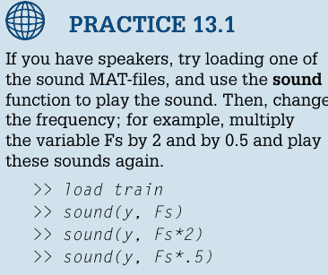

MATLAB 还有其他几个函数可以让你读取和播放录制音频文件。在音频文件中，存储了每个音频通道的数据。工业界在不同的计算机平台上使用了多种音频格式。扩展名为 .au 的音频文件由太阳微系统公司开发，通常用于 Java 和 UNIX，而 Windows 电脑通常使用由微软开发的 .wav 文件。

MATLAB 拥有 `readwav` 函数用于读取 .wav 文件，`wavrecord` 函数用于写入声音文件，以及 `wavplay` 函数用于播放声音文件。这些函数的默认频率为 11025 Hz。

对于 .au 文件，有 `aread` 函数读取和 `auwrite` 函数写入该格式。

## 13.2 句柄图形简介

通过句柄图形（Handle Graphics），所有的图形都由不同的对象组成，每个对象都被分配有一个句柄（handle）。对象句柄是一个唯一的实数，用于引用该对象。

### 13.2.1 图形对象及其属性

对象包括线、文本等图形原元，以及用于定位对象的轴。这些对象是按层次结构组织的，每个对象都关联有属性。这是面向对象编程的基础：对象按层次组织（例如，父对象在层级中位于子对象之前，这种层次结构在属性方面产生影响；通常子对象继承父对象的属性）。MATLAB 中的层次结构可以在帮助的“图形对象的组织”（Organization of Graphics Objects）中查看。在可以看到组织包括：

| Figure | 父级 |
|---|---|
| 轴 | |
| 核心对象 | 绘图对象 | 子对象 |

换句话说，图形窗口包含了轴，用于定位核心对象（如线、矩形等原元）和绘图对象（用于生成柱状图、面积图等）。

我们已经看到，一旦对象句柄存储在变量中，就可以使用函数来查找它的属性，并可以使用 `set` 来更改它们。

### 13.2.1.1 核心对象

MATLAB 中的核心对象是最基本的原元。可以在 MATLAB 帮助中找到描述：在“内容”（Contents）选项卡下，点击“句柄图形”（Handle Graphics Objects），然后点击“核心图形对象”（Core Graphics Objects）。核心对象包括：

- line
- text
- rectangle
- patch
- image

这些都是内置函数；可以使用帮助查找每个函数的使用方法。

一个核心图形对象是线，它是 `plot` 函数产生的结果。这是一个创建一个线对象、修改某些属性并将句柄保存到变量 `hl` 中的示例：

```
>> x = -2*pi; 1/5 : 2*pi;
>> y = sin(x);
>> hl = line(x,y,'LineWidth', 3, 'Color', [0.5 0.5 0.5])
hl = 159.0405
```

如图 13.2 所示，这为 sin 函数绘制了一条较粗的灰线。只要图形窗口不关闭，句柄就会一直。该对象的一些属性如下：

```
>> get(hl)
Color = [0.5 0.5 0.5]
EraserMode = normal
LineStyle = -
LineWidth = [3]
Marker = none
MarkerSize = [6]
t = auto
MarkerFaceColor = none
XData = [[1 by 63] double array]
YData = [[1 by 63] double array]
ZData = etc.
```

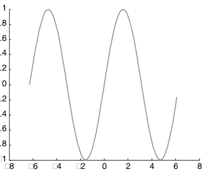

文本图形函数允许在图形中打印文本，包括使用 `specchar` 打印的特殊字符，其中 `specchar` 是特殊字符的名称。调用 `text` 函数的格式

其中 x 和 y 是文本字符串所在的文本框在图形上的起始坐标。

要查看特殊字符，在帮助的“内容”选项卡下，点击“句柄图形属性浏览器”（Handle Graphics Property Browser），点击“核心对象”（Core Objects），并选择“文本”（Text）。特殊字符显示在 String 属性下的表格中。特殊字符包括希腊字母表、箭头和方程中频繁使用的字符。例如，图 13.3 显示了文本框内的希腊符号 pi (π) 和右箭头。

```
>> x = -4:0.2:4;
>> y = sin(x);
>> hp = line(x,y,'LineWidth',3);
>> thand = text(2,0,'Sin(\pi)','rightanchor')
```

图 13.2
修改了宽度和颜色的线对象。

图 13.3
带有文本框的线对象。

使用 `get` 将显示文本对象的属性，例如：

```
>> get(thand)
BackgroundColor = [1 1 1]
Color = 0
EraserMode = normal
Extent = [0 0 0 0]
FontAngle = 0
FontName = Helvetica
FontSize = 10
FontWeight = normal
HorizontalAlignment = left
VerticalAlignment = bottom
LineStyle = -
LineWidth = 1
Marker = none
MarkerSize = 6
MarkerFaceColor = none
String = 'Sin(\pi)'
Ticks = []
TickLabelInterpreter = none
```


## 第13章 视觉与听觉

`sound` 函数的第一个参数可以是一个 n × 2 的矩阵，用于立体声输出。在调用 `sound` 函数时可以省略第二个参数，在这种情况下将使用 8192 Hz 的默认采样频率。这是内置 sound MAT 文件中存储的频率。

```
>> load train
Fs
Fs = 8192
```

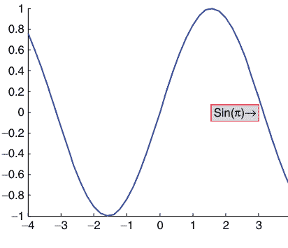


# 第 13 章 视觉与听觉

```matlab
polyhedron.vertices = [...
0 0 0
1 0 0
0 1 0
0.5 0.5 1];
polyhedron.faces = [...
1 2 3
1 2 4
2 3 4];
pobj = patch(polyhedron, ...
'FaceColor',[0.8, 0.8, 0.8],...
'EdgeColor','black');
```

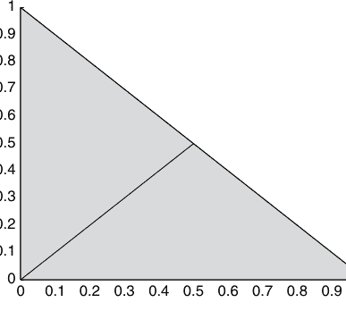

图 13.9
补丁对象。

`polyhedron.vertices` 是一个矩阵，其中每一行代表 (x,y) 点。字段 `polyhedron` 定义了面：例如，矩阵中的第一行指定了从顶点 1 到顶点 2 再到顶点 3 绘制一条线，以形成第一个面。面颜色设置为灰色，边缘颜色设置为黑色。该图（如图 13.9 所示）仅显示了两个面。使用图形窗口上的旋转图标，可以旋转图形以看到如图 13.10 所示的其他边缘。

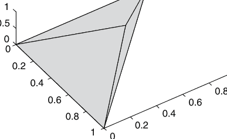

图 13.10
旋转后的补丁对象。

## 13.3 图像处理

图像表示为元素（称为像素）的网格或矩阵。在 MATLAB 中，图像通常表示为一个矩阵，该矩阵中的每个元素对应于图像中的一个像素。该像素颜色的表示有两种基本方式：

-   真彩色，或 RGB，其中存储了三个颜色分量（按顺序依次为红色、绿色和蓝色）。
-   色板（Colormap）的索引：存储的值是一个整数，引用名为 colormap 的矩阵中的某行。色板将红、绿、蓝分量存储在三个单独的列中。

对于一个具有 $m \times n$ 个像素的图像，真彩色矩阵将是一个大小为 $m \times n \times 3$ 的三维矩阵。前两个维度代表像素的坐标。第三个索引是颜色分量；`(:,1)` 是红色，`(:,2)` 是绿色，`(:,3)` 是蓝色。

索引表示则是一个 $m \times n$ 的整数矩阵，其中每个值都是大小为 $p \times 3$ 的色板矩阵的索引（其中 $p$ 是该特定色板中可用颜色的数量）。色板中的每行都有三个数字代表一种颜色：正如我们之前看到的，首先是红色，然后是绿色、蓝色分量。例如，

```matlab
[1 0 0] 是红色
[0 1 0] 是绿色
[0 0 1] 是蓝色
等等。
```

MATLAB 具有几个命名的内置色板；关于 **colormap** 的参考页显示了它们。在不带任何参数的情况下调用 **colormap** 函数将返回当前色板，默认情况下它是 *jet*。

以下代码将当前色板存储在变量 *map* 中，获取矩阵的大小（这将是该矩阵的行数，换句话说，是颜色的数量，共 3 列），并显示该色板的前五行。如果当前色板是默认的 *jet*，结果将如下：

```matlab
>> map = colormap;
>> [r c] = size(map)
r =
64
c =
3
>> map(1:5,:)
ans =
0    0    0.5625
0    0    0.6250
0    0    0.6875
0    0    0.7500
0    0    0.8125
```

这显示在该特定色板中有 64 行，或者说有 64 种颜色。它还显示前五种颜色是蓝色调。

调用 **image** 函数的格式为：

```matlab
image(mat)
```

其中 *mat* 是表示 $m \times n$ 图像颜色的矩阵（图像中有 $m \times n$ 个像素）。如果矩阵的大小为 $m \times n$，则每个元素都是当前色板的索引。

显示 jet 色板（具有 64 种颜色）中颜色的一种方法是创建一个存储 1 到 64 值的矩阵，并将其传递给 image 函数，如图 13.11 所示。当矩阵传递给 image 函数时，矩阵中每个元素的值被用作色色板的索引。例如，cmap(1,2) 的值为 9，因此图像中 (1,2) 位置显示的颜色将是色板中第九行表示的颜色。通过使用 1 到 64 的数字，我们可以看到色板中的所有颜色。

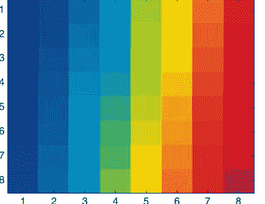

图 13.11
jet 色板中 64 种颜色的列显示。

| 1 | 2 | 3 | 4 | 5 | 6 | 7 | 8 | cmap = reshape(1:64, 8,8) |
|---|---|---|---|---|---|---|---|
| 1 | 9 | 17 | 25 | 33 | 41 | 49 | 57 |
| 2 | 10 | 18 | 26 | 34 | 42 | 50 | 58 |
| 3 | 11 | 19 | 27 | 35 | 43 | 51 | 59 |
| 4 | 12 | 20 | 28 | 36 | 44 | 52 | 60 |
| 5 | 13 | 21 | 29 | 37 | 45 | 53 | 61 |
| 6 | 14 | 22 | 30 | 38 | 46 | 54 | 62 |
| 7 | 15 | 23 | 31 | 39 | 47 | 55 | 63 |
| 8 | 16 | 24 | 32 | 40 | 48 | 56 | 64 |

```matlab
>> image(cmap)
```

这显示前几种颜色是蓝色调，最后几种颜色是红色调，中间是青色和橙色。图 13.12 jet 色板的 $5 \times 5$ 显示。

另一个示例创建了从 1 到颜色数量范围的整数 $5 \times 5$ 矩阵；结果如图 13.13 所示。

```matlab
>> mat = randi([1 64],5,5);
```

| 1 | 2 | 3 | 4 | 5 |
|---|---|---|---|---|
| 1 | 54 | 33 | 13 | 45 | 32 |
| 2 | 26 | 46 | 44 | 25 | 58 |
| 3 | 44 | 28 | 20 | 56 | 53 |
| 4 | 25 | 20 | 35 | 55 | 42 |
| 5 | 54 | 13 | 10 | 38 | 53 |

```matlab
>> image(mat)
```

这些图像相当粗糙；代表像素的元素很大。较大的矩阵将产生更类似于图 13.13 所示的图像。

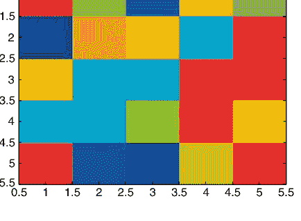

图 13.13。

尽管 MATLAB 有内置色板，但也可以使用任何颜色组合创建其他色板。例如，以下代码创建一个带有黑色、白色和红色三种色的自定义色板。创建一个从 1 到 3 范围的 $40 \times 40$ 整数矩阵（因为只有三种颜色），并传递给 image 函数；结果如图 13.14 所示。

```matlab
>> colormap = [0 0 0; 1 1 1; 1 0 0];
```

| 0 0 0 |
| 1 1 1 |
| 1 0 0 |

```matlab
>> mat = randi([1 3],40,40);
>> image(mat)
```

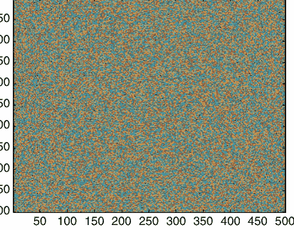

图 13.14
自定义色板的随机颜色。

真彩色矩阵是表示图像的另一种方法。真矩阵是三维矩阵。前两个坐标是像素的坐标。第三个索引是颜色分量；(1) 是红色，(2) 是绿色，(3) 是蓝色。矩阵中的每个元素都是 uint8 类型，使用 8 位的无符号整数。通过 8 位可以存储 $2^8$ (256) 个值，值的范围为 0 到 255。最小值 0 代表最暗的色调。最大值 255 代表亮的色调。例如，如果给定像素坐标 $px$ 和 $py$ 的值 $(px,py,1)$ 为 255，$(px,py,2)$ 为 0 且 $(px,py,3)$ 为 0，那么该像素将是红色的。

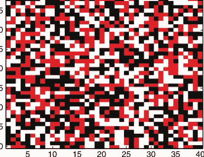

图 13.15
来自真彩色矩阵的图像。（等一下，让我们重新对齐文本流）

image 函数将三维矩阵中的信息显示为图像。例如，这创建了一个如图 13.15 所示的 $2 \times 2$ 图像。矩阵是 $2 \times 3$，第三维是颜色。(1,1) 位置的像素是红色的，(1,2) 位置的像素是蓝色的，(2,1) 位置的像素是绿色的，(2,2) 位置的像素是黑色的。

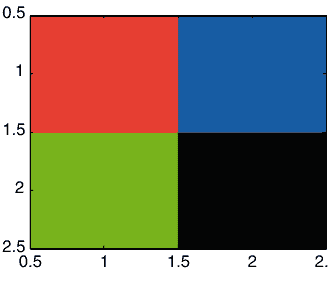

````imread` 函数可以读取图像文件，例如 JPEG (.jpg) 文件。该函数将彩色图像读入三维矩阵中。

```matlab
>> image1 = imread('Fishing_1.JPG');
>> size(image1)
ans = 1536 2048 3
```

在这种情况下，图像表示为真彩色矩阵。这表明图像具有 $1536 \times 2048$ 个像素。image 函数将此三维矩阵中的信息显示为图像，如图 13.16 所示。

```matlab
>> dimmer = 0.75*image1;
>> image(dimmer)
```


## 13.4 图形用户界面简介

图形用户界面（或 GUI）本质上是允许用户通过图形界面进行输入的对象，例如推按钮、滑块、单选按钮、切换按钮、弹出菜单等。GUI 是面向对象编程的示例，其中存在层级结构。例如，父级可以是 Figure（图形），其子级可以是推按钮和文本框等对象。


用户界面对象可以是 **figure**、**uipan** 或 **uitubroup**。**figure** 是由 **figure function** 创建的窗口（Window）。**uipan** 是将界面对象分组的方法（ui 代表 user interface 用户界面）。**uitubroup** 是将按钮（包括单选按钮和切换按钮）分组的方法。

图 13.17 通过操作矩阵使图像变暗。

在 MATLAB 中，创建 GUI 有两种方法：从头开始编写 GUI，或者使用内置的图形用户界面开发环境（GUIDE）。GUIDE 允许你以图形化方式布局 GUI，然后由 MATLAB 生成相应的代码。然而，为了理解和修改这些代码，理解底层的编程概念至关重要。因此，本节将重点介绍编程方法。

图 13.18 **figure** 在屏幕上的位置。

Figure Window（图形窗口）是任何 GUI 的父级。只需调用 **figure function** 就会弹出一个空白的 Figure Window。将此窗口的句柄（handle）赋值给变量，然后使用 **get function** 设置默认属性。这些属性（例如窗口颜色、其在屏幕上的位置等）可以使用 **set function** 或在初始调用 **figure function**时更改。例如：

```
>> f = figure;
```

会在屏幕顶部附近弹出一个框，如图 13.18 所示。这里是其属性的节录：

第 13 章 视觉与视觉

```
>> get(f)
Color = [0.8 0.8 0.8]
Colormap = [(64 by 3) double array]
Position = [360 502 560 420]
Units = pixels
Children = []
Visible = on
```

位置向量指定了 [左, 下, 高度]。前两个数字（左侧和底部）是图形框左下角距离显示器屏幕左下角的距离（先从左侧，再从底部计算）。最后两个是图形本身的宽度和高度。所有这些默认单位都是像素（pixels）。

`Visible` 属性为 `on` 表示 Figure Window 可见。然而，在创建 GUI 时，正常程序是创建父级 Figure Window 并使其不可见。然后，将所有用户界面添加到其中并设置属性。完成后，使 GUI 可见。

大多数用户界面是使用 `uontrol` 创建的。`Style` 属性以字符串形式定义对象类型。例如，'text' 是静态框的样式，通常用 GUI 中其他对象的标签或说明。

以下示例创建了一个在 Figure Window 中包含静态文本框的 GUI。首先创建图形但将其设为不可见。颜色为白色，并赋予它一个位置。将此图形的句柄存储在变量中，允许脚本稍后再次引用它（例如设置属性）。使用 `uontrol` 函数在 Figure Window 内部创建一个文本框、确定其位置（向量指定了[左、下、高度），并在其中放入字符串。注意，位置是在 Figure Window 内部，而不是屏幕内。在图形顶部设置一个名称。`movegui` 函数将图形移动到屏幕中心。最后，当一切完成后，使 GUI 可见。`end` 位于函数末尾是因为在接下来的示例中，我们将拥有需要 `end` 语句的嵌套函数。

```
simple_gui.m
function simple_gui
% 这是一个简单的 GUI，只有一个静态文本框

% 创建 GUI 但目前使其保持不可见
% 正在初始化
f = figure('Visible','off','color','white','Position',[300, 400, 450, 250]);
```

### 13.4 图形用户界面简介 407

```
htext = uicontrol('Style','text','Position', ...
[200.50, 100, 250], 'String','My First GUI string');
% 给它设置一个名称并移动到屏幕中心
set(f,'Name','Simple GUI')
movegui(f,'center')
% 现在让 GUI 可见
set(f.'Visible','.on');
end
```

图 13.19 中的 Figure Window 将出现在屏幕中间。静态文本框不需要与用户交互。

在下一个示例中，我们将允许用户在可编辑的文本框中输入字符串，然后 GUI 将以红色字体提取用户的字符串。在内部将有用户交互。首先，用户必须输入一个字符串，一旦发生这种情况，用户在可编辑文本框中的输入将不再显示，而是以红色显示用户输入的字符串。

（此处）

图 13.19 带有静态文本框的 GUI。


# 第 13 章 视觉与视觉

```matlab
% 正在初始化
f = figure('Visible', 'off','color','white','Position',...
[360, 500, 800,600]);
hstext = uicontrol('Style','text','BackgroundColor','white',...
'Position',[100,425,400,55],...
'String','在此输入你的字符串');
huitext = uicontrol('Style','edit','Position', [100,400,400,40])
set(f,'Name','带有按钮的GUI')
movegui(f,'center')
% 创建一个显示“Push me!!”的按钮
hbutton = uicontrol('Style','pushbutton','String',...
'Push me!!', 'Position',[600,50,150,50],...
'Callback',@callbackfn);
% 现在 GUI 可视了
set(f,'Visible','on');
% 回调函数
function callbackfn(source,eventdata)
    set([hstext huitext hbutton],'Visible','off');
    printstr = get(huitext,'String');
    hstr = uicontrol('Style','text','BackgroundColor',...
    'white',printstr, ...
    'Position',[100,400,455],...
    'String',ForegroundColor,'Red','FontSize',30)
    set(hstr,'Visible','on')
end
```

在这种情况下，用户在编辑框中输入字符串。然而，按下回车键并不会触发回调；相反，用户必须用鼠标点击按钮。回调函数与推按钮对象关联。因此，点击按钮将以较大的红色字体显示该字符串。图 13.22 显示了该推按钮。

## 13.4 图形用户界面简介


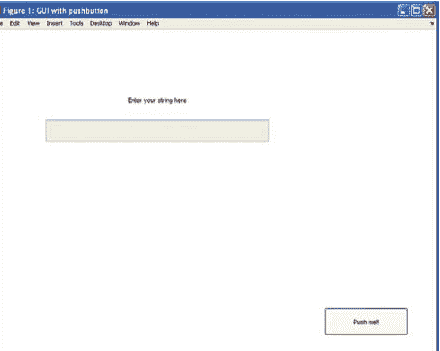

图 13.21
回调函数的结果。

图 13.22
带有推按钮的 GUI。

## 练习 13.2

创建一个将长度从英寸转换为厘米的 GUI。该 GUI 应该有一个可编辑的文本框，用户在其中输入英寸为单位的长度，以及一个点击“转换!”的按钮。点击按钮会导致 GUI 计算以厘米为单位的长度并显示。这应该保持所有对象可见。这意味着用户可以继续转换长度，直到关闭图形窗口。GUI 初始时应该显示一个默认长度（例如 1 英寸）。例如，调用该函数可能会弹出图 13.23 所示的图形窗口。

然后，当用户输入长度（例如 5.2）并点击按钮时，图形窗口将显示新计算的厘米长度（如图 13.24 所示）。

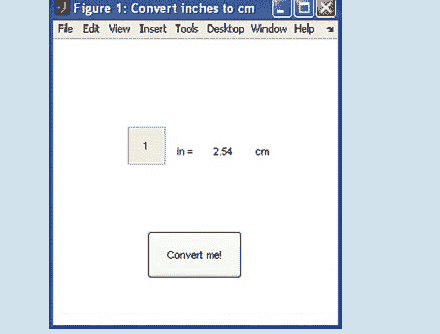

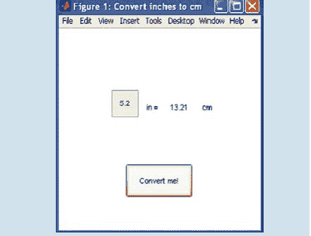

图 13.23
带有推按钮的长度转换 GUI。

图 13.24
转换 GUI 的结果。

另一个可以创建的 GUI 对象是滑块。滑块对象有一个数值，可以通过点击箭头向上或向下移动数值，或者通过鼠标滑动条条来控制。默认情况下，数值范围从 0 到 1，但这些值可以使用 Min 和 Max 属性进行修改。

函数 `gui_slider` 创建了一个带有滑块的窗口，其最小值为 0，最大值为 5。它使用文本框来显示最小值和最大值，以及滑块的当前值。

```matlab
gui_slider.m
function gui_slider
%这是一个带有滑块的 GUI
f = figure('Visible', ...
'off','color','white','Position', ...
[360, 500, 300,300]);
% 滑块的最小值和最大值
minval = 0;
maxval = 5;
% 创建滑块对象
slan = uicontrol('Style','slider','Position', ...
[80,170,100,50], ...
'Min', minval, 'Max', maxval,'Callback', @callbackfn);
% 显示最小值和最大值的文本框
hminintext = uicontrol('Style','text','BackgroundColor','white', ...
'Position', [40,175,30,30], 'String', num2str(minval));
hmtext = uicontrol('Style', ...
'text','BackgroundColor','white', ...
'Position', [190,175,30,30], 'String', num2str(maxval));
% 显示当前值的文本框（目前关闭）
hstext = uicontrol('Style','text','BackgroundColor','white', ...
'Position', [120,100,40,40],'Visible', 'off');
set(f,'Name','滑块示例')
move(f,'Visible','on');
% 回调函数
```matlab
function callbackfn(source,eventdata)
    num = get(slan,'Value');
    set(hstext,'Visible','on','String',num2str(num))
end
```

调用该函数可能会弹出图 13.23 所示的图形窗口。

然后，当用户输入长度（例如 5.2）并点击按钮时，图形窗口将显示新计算的厘米长度（如图 13.24 所示）。

 
图 13.25
带有推按钮的 GUI。


图 13.26
转换 GUI 的结果。


# 第 13 章 视觉与听

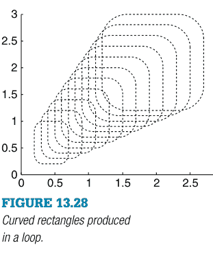

- 7. 编写一个脚本，从圆角矩形开始。将 x 轴和 y 轴从默认值改为0 到 3。在循环中，通过对所有元素加 0.1 10 次来改变位置向量（这将每次改变矩形的位置和大小）。创建一个由生成的矩形组成的移动（move）。最终结果应该类似于图 13.28 所示的图表。
- 8. 编写一个脚本，创建一个具有三个顶点和一个连接这些顶点的二维补丁对象（patch object）。三个顶点的 x 和 y 坐标是 0 到 1 之间的随机实数。用于边缘的线应为黑色且宽度为 3，面应为灰色。坐标轴（x 和 y 轴）应从 0 到 1。例如，根据随机数的不同，图形窗口（Figure Window）可能像图 13.29 所示。
- 9. 使用 patch 函数创建一个具有单位尺寸的黑色箱体（因此会有 8 个顶点和 6 个面）。将边缘颜色设置为白色，以便在旋转图像时，可以看到边缘。
- 10. 编写一个脚本，使用颜色映射（colormap）创建图 13.30 所示的图像。
- 11. 编写一个脚本，使用三维颜色矩阵创建相同的图像。
- 12. 编写一个脚本生成一张 50 比 50 的像素图像。左下三角部分（包括对角线）全部为白色。上三角部分每个元素随机为红色或绿色，如图 13.31 所示。
- 13. 人眼有时很难正确感知物体的亮度。例如，在图 13.32 中，两幅图像的中间是相同的

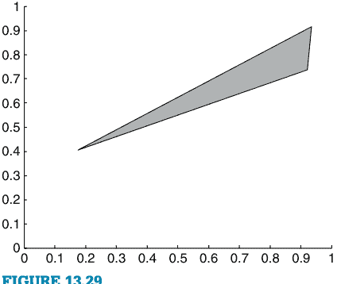

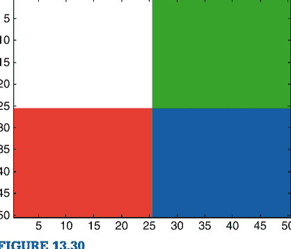

图 13.29
带有黑色边缘的补丁对象。

图 13.30
使用自定义颜色映射显示四种色的图像。

# 练习 417


图 13.31
随机红绿色的三角形图像。

图 13.32
亮度感知描述。

颜色——但由于周围颜色的影响，左边的看起来比右边的亮。

编写一个脚本生成一个类似的图形窗口（Figure Window）。创建两个 3 × 3 矩阵。使用默认颜色映射，两者的中间元素都被赋予了值 12。对于左侧图像，所有其他元素被赋值为 1；对于右侧图像，所有其他元素被赋值为 32。使用 **subplot** 并排显示图像（此处显示的轴为默认值）。

- 14. 将 JPEG 文件放在你的当前目录下，并使用 **imread** 将其加载到矩阵中。计算并打印 tmatrix 中红、绿、蓝分量的平均值，并计算它们的标准差。
- 15. 某些图像赋值并不准确，导致图像结果出现**噪点**（noisy）。为了观察这种效果，将 JPEG 文件放在你的当前目录下并使用 **imread** 加载。然后，通过对此矩阵中的每个元素随机加上或减去 n 来创建一个新图像。尝试不同的 n 值。编写一个脚本，使用 **subplot** 并排显示图像，使用 **imshow** 显示**图像**（image）。
- 16. 图像的**动态范围**（dynamic range）是图像中颜色的范围（从最小值到最大值）。将 JPEG 文件放入你的目录。将图像读取到矩阵中。使用内置函数 **min** 和 **max** 确定动态范围并打印该范围。注意，如果图像是真彩色图像，矩阵将是三维的，因此需要嵌套三次函数来获取整体最小值和最大值。
- 17. 图像的一部分由一个 n × n 矩阵表示。在执行数据压缩和数据数据重建技术后，生成的矩阵值接近但不完全等于原始矩阵。例如，以下 4 x 4 矩阵变量 orig_im 代表真彩色图像的一小部分，而 fin_im 代表经过数据压缩和重建后的矩阵。

```
orig_im =
156 44 129 87
18 158 118 102
80 62 138 78
155 150 241 105
fin_im =
153 43 130 92
16 152 118 102
73 66 143 75
152 155 247 114
```

编写一个脚本来模拟这一过程：创建一个 0 到 256 的整数平方矩阵。通过对原始矩阵的每个元素随机加上或减去一个随机数（范围 0 到 10）来修改它。然后，计算两者之间的平均差异。

- 18. 将 JPEG 文件放入你的当前目录。输入以下脚本，使用你的 JPEG 文件名。

```
l1 = imread('xxx.jpg');
[rc h]=size(l1);
new(:,:,:)=l1(:,:,c-1:1);
figure(1)
subplot(2,1,1)
image(l1);
subplot(2,1,2)
image(new);
```

确定该脚本的作用。在脚本中加入注释逐逐步解释。同时也尝试在 image 中使用 imshow。读取两个矩阵变量。为了重新对比图像，如果它们尺寸相同，使用来裁剪；如果尺寸不同，使用来调整大小。

- 19. 将 JPEG 文件放在你的当前目录下。编写一个脚本找到图像中最亮的像素。
- 20. 将 JPEG 文件放在你的当前目录下。编写一个脚本找到图像中最暗的像素。
- 21. 将 JPEG 文件放在你的当前目录下。编写一个脚本计算图像的直方图。
- 22. 将 JPEG 文件放在你的当前目录下。编写一个脚本绘制图像的直方图。
- 23. 将 JPEG 文件放在你的当前目录下。编写一个脚本计算风寒因子（WCF），它衡量体感冷度。公式大约为：

```
WCF = 35.74 + 0.6215*T - 11.37*V + 0.3965*T*V
```

其中 T 是华氏温度，V 是每英里风速。


`polyval` 函数将在 x 处评估多项式的值，格式为 `polyval(p,x)`。
例如，多项式 -2x^2 + x + 4 在 x = 3 处求值，得到：
-2 * 9 + 3 + 4，或 -11：

```
>> p = [-2 1 4];
>> polyval(p,3)
ans =
-11
```

参数 x 可以是一个向量，例如：

```
>> polyval(p,1:3)
ans =
3 -2 -11
>> polyval(p, [5 7])
ans =
-41 -87
```

## 14.1.2 曲线拟合

数据基本上要么是离散的，要么连续的。在许多应用中，数据是采样的，例如：

- 每小时记录的温度
- 每十分之一里记录一次的汽车速度
- 放射性材料衰变时每秒记录一次的质量
- 声波转换为数字音频文件时的音频

> 图 14.1
每小时采样温度的分布图。

这使得数据形成 (x,y) 点的形式，然后就可以进行绘图。例如，假设记录每天下午 2 点到 6 点的温度；这些向量可能可能是：

```
>> x = 2:6;
>> y = [65 67 72 71 63];
```

然后图表可能会如图 14.1 所示。

## 14.1.3 插值与外推

在许多情况下，我们希望估计采样数据点以外的值。例如，我们可能想估计在


下午 2:30 或下午 1 点的温度。插值（Interpolation）是估计记录数据点之间的值。外推（Extrapolation）是估计记录数据范围之外的值。实现此点的一种方法是对数据进行曲线拟合，并使用该曲线进行估计。曲线拟合是寻找“最拟合”数据的曲线。

简单曲线是前面提到的不同阶数的多项式。曲线拟合寻找最拟合数据的多项式——例如，形式为 ax² + bx + c 的二次多项式，这意味着寻找产生最佳拟合效果的 a、b 和 c 的值。寻找通过数据的最佳直线将意味着在方程 ax + b 中寻找 a 和 b 的值。

MATLAB 有一个函数可以实现此操作，称为 `polyfit`。`polyfit` 使用最小二乘法找到最拟合数据的指定阶数多项式的系数。传递给函数有三个参数：代表数据的向量，以及所需多项式的阶数。例如，若要通过前述的数据点拟合一条直线（1阶），将调用 `polyfit` 函数

```
>> polyfit(x,y,1)
ans = 0.0000 67.6000
```

这表示最佳直线的形式为 0x + 67.6。

图 14.2
带有直线拟合的采样的温度。

然而，从图表（见图 14.2）来看，二次多项式的拟合效果会好得多。后续操作将创建向量，然后拟合一个通过这些数据点的 2 阶多项式，并将值存储在名为 `coeffs` 的向量中。


```
>> x = 2:6
>> y = [65 67 72 71 63]
>> coeffs = polyfit(x,y,2)
coeffs =
-1.8571 14.8571 41.6000
```

这表示 MATLAB 确定这些数据点的最佳二次多项式为 -1.8571x² + 14.8571x + 41.6。因此，变量 `coeffs` 存储了一个表示该多项式的向量。

可以使用 `polyval` 函数在指定值处评估多项式。例如，我们可以评估 x 中的每一个值：

```
>> curve = polyval(coeffs,x)
curve =
63.8857 69.4571 71.3143 69.4571 63.8857
```

*

## 14.1 为数据拟合曲线

这为 x 向量中的每个点产生了 y 值，并将其存储在名为 `curve` 的向量中。将这一切整合在一起，名为 `polytemp` 的脚本创建了 x 和 y 向量，通过这些点拟合了一个二阶多项式，并在同一图中绘制了点和曲线。

polytemp.m

```
演示曲线拟合
x= 2:6;
y=[65 67 72 71 63];
coeffs = polyfit(x,y,2);
curve = polyval(coeffs,x)
plot(x,y,'ro',curve)
xlabel('Time')
ylabel('Temperatures')
title('某下午的温度')
axis([1 7 60 75])
```

调用此脚本会得到图 14.3 所示的图表。曲线在该图中看起来并不平滑，但这是因为 x 向量中只有五个点。


为了估计不同时间的温度，`polyval` 可用于离散点；它不需要整个向量。例如，为了插值给定数据并估计下午 2:30 的温度：

```
>> polyval(coeffs,2.5)
ans = 67.1357
```

此外，`polyval` 可用于外推给定点，例如估计下午 1 点的温度：

```
>> polyval(coeffs,1)
ans = 54.6000
```

曲线拟合越好，插值和外推值就越精确。为了使曲线平滑，可以修改脚本创建一个具有更多点的 x 向量来绘图。数据的原始 x 向量必须保持不变。

使用 `subplot` 函数，我们可以循环显示 1、2、3 阶的拟合曲线。例如，以下脚本可以实现这一点：

```
polytempsplot.m
% 显示 1–3 阶的曲线
x = 2:6;
y = [65 67 72 71 63];
morex = linspace(min(x),max(x));
for pd = 1:3
  coeffs = polyfit(x,y,pd);
  curve = polyval(coeffs,morex);
  subplot(1,3,pd)
  plot(x,y,'ro',morex)
  xlabel('Time')
  ylabel('Temperatures')
  title(sprintf('Degree %d',pd))
  axis([1 7 60 75])
end
```

图 14.4
显示 1、2、3 阶温度的子图。

`>> polytempsplot` 创建了图 14.4 所示的图。

## 14.1.4 最小二乘法

`polyfit` 函数使用最小二乘法。要通过最小二乘回归找到最拟合数据的直线 $y = mx + b$，m 和 b 的方程为：


```
m = \frac{n\sum x_iy_i - \sum x_i\sum y_i}{n\sum x_i^2 - (\sum x_i)^2}
b = \bar{y} - m\bar{x}
```

其中 n 是 x 和 y 中的点数，所有的求和都从 i = 1 到 n，$\bar{y}$ 和 $\bar{x}$ 代表向量 y 和 x 的平均值。这些方程在这里不推导；可以在 MATLAB 帮助浏览器中搜索“least squares”找到推导。

```
mylinfit.m
function [m,b] = mylinfit(x,y)
% 直线的最小二乘回归
n = length(x); % 假设 y 长度相同
numerator = n * sum(x * y) - sum(x)*sum(y);
denom = n * sum(x .^ 2) - (sum(x))^2;
m = numerator/denom;
b = mean(y) - m*mean(x);
```

```
>> x = [-1 1 2];
>> y = [-1 0 3];
>> [m b] = mylinfit(x,y)
m =
1.2143
b =
-0.1429
>> polyfit(x,y,1)
ans =
1.2143 -0.1429
```

最小二乘法拟合实际数据与直线预测数据之间差异的平方。在这种情况下，“最佳”直线被确定为 $y = 1.2143x - 0.1429$。

如果我们不知道那是最佳直线，可能会猜最拟合的直线是数据线 $y = x$。图表见图 14.5。

这条直线通过其中一个点，平分另外两个点，即一个在直线下方一个单位，另一个在上方。因此，数据似乎拟合良好。然而，我们将这条线与通过 `polyfit` 找到的以及 `mylinfit` 函数找到线进行比较。

> 图 14.5
直线 $y = x$ 和三个数据点。


# 表 14.1 直线 $y = x$ 预测的 y 坐标

| x | Data y | Predicted y | Difference |
|---|---|---|---|
| -1 | -1 | -1 | 0 |
| 1 | 0 | 1 | -1 |
| 2 | 3 | 2 | 1 |

表 14.1 显示了原始点的 x 坐标、y 坐标、直线 $y = x$ 预测的 y 坐标以及差异（数据-预测）。

差异的平方和为 $0 + 1 + 1$，或 2。

然而，根据最小二乘算法，使用直线 $1.2143 - 0.1429$ 的值如表 14.2 所示。

这些差异的平方和为 1.7857，比之前得到的差异平方和要更好（数值更小）。

# 表 14.2 最小二乘回归预测的 y 坐标

| x | Data y | Predicted y | Difference |
|---|---|---|---|
| -1 | -1 | -1.3571 | 0.3571 |
| 1 | 0 | 1.0714 | -1.0714 |
| 2 | 3 | 2.2857 | 0.7143 |


## 14.2 复数

要使用默认的线性插值法进行外推，还必须传递字符串 'linear' 和 'extrap'。

```
>> interp(x,y,1,'linear','.extrap')
ans =
63
>> interp(x,y,7,'linear','.extrap')
ans =
55
```

## 14.2 复数

复数通常写成形式：
z = a + bi

其中 a 是 z 的实部，b 是 z 的虚部，i 是 $\sqrt{-1}$。这是数学家通常书写复数的方式，在工程中，它通常被写为 a + bj，其中 j 是 $\sqrt{-1}$。如果一个复数的格式为 z = bi（换句话说，如果 a 为 0），则它为纯虚数。

我们已经看到在 MATLAB 中，i 和 j 都是 $\sqrt{-1}$ 的内置函数（因此它们可以被视为内置常量）。可以使用 i 或 j 创建复数，例如 5 + 2i 或 3 - 4j。在虚部的值与常数 i 或 j 之间不需要乘法运算符。

### 快速问！

表达式 3i 的值与 3 i 相同吗？
答案：取决于 i 是否被用作变量名。如果 i 被用作变量（例如 for 循环中的迭代器），那么表达式 3 *i 将使用该变量定义的值，而将不再是一个复数。因此，在处理复数时，使用 i1 或 ij 比起直接用 i 或 j 要好。无论 i 或 j 是否被用作变量，表达式 i1 和 ij 的结果始终始终一个复数。

```
>> i = 5;
>> i
i = 5
ans =
0 + 1.0000i
```

MATLAB 还有一个名为 complex 的函数，它可以返回一个复数。它按顺序接收两个数字（实部和虚部），或者只接收一个数字（该数字将作为实部，因此虚部将为 0）。以下是在 MATLAB 中创建复数的几个示例：

```
>> z1 = 4 + 2i
z1 =
    4.0000 + 2.0000i
```

```
>> z2 = sqrt(-5)
z2 =
    0 + 2.2361i
```

```
>> z3 = complex(3,-3)
z3 =
    3.0000 - 3.0000i
```

```
>> z4 = 2 + 3j
z4 =
    2.0000 + 3.0000i
```

```
>> z5 = (-4) ^ (1/2)
ans =
    0.0000 + 2.0000i
```

```
>> myz = input('Enter a complex number: ')
Enter complex number: 3 + 4i
myz =
    3.0000 + 4.0000i
```

注意，当在表达式中使用 j 时，结果中使用使用了 i。MATLAB 在工作区窗口（或使用 whos）中显示此处创建的变量类型为 double（complex）。MATLAB 有 real 和 imag 函数，它们可以返回复数。

```
>> real(z1)
ans =
    4
```

```
>> imag(z3)
ans =
    -3
```

要打印虚数，disp 函数将自动显示两个部分：

```
>> disp(z1)
    4.0000 + 2.0000i
```

fprintf 函数将只打印实部，除非分别打印两个部分：

```
>> fprintf('%f\n', z1)
    4.000000
```

## 14.2 复数

```
>> fprintf('%f %f\n', real(z1), imag(z1))
4.000000 2.000000

>> fprintf('%f +%fi\n', real(z1), imag(z1))
4.000000 + 2.000000i
```

如果参数没有虚部，函数 isreal 返回 1（逻辑真），或者如果参数具有虚部（即使虚部为 0），则返回 0。例如：

```
>> isreal(z1)
ans =
0
```

```
>> z5 = complex(3)
z5 =
3
```

```
>> isreal(z5)
ans =
0
```

```
>> isreal(3.3)
ans =
1
```

对于变量 z5，尽管显示的答案是 3，但它实际上被存储为 3 + 0i，并且这就是它在工作区窗口中显示的方式。因此，由于它是以复数形式存储的，isreal 返回逻辑假（false）。

### 14.2.1 复数的等等性

如果两个复数的实部和虚部都相等，那么这两个复数之间是彼此相等的。在 MATLAB 中，可以使用等等运算符。

```
>> z1 == z2
ans =
0
```

```
>> complex(0.4) == sqrt(-16)
ans =
1
```

### 14.2.2 复数的加减法

对于两个复数 z1 = a + bi 和 z2 = c + di，

```
z1 + z2 = (a + c) + (b + d)i
z1 - z2 = (a - c) + (b - d)i
```

### 编程概念
在大多数情况下，要两个两个复数，你必须分离实部和虚部，并将它们相加以返回结果。

```matlab
addcomp.m
function outc = addcomp(z1,z2)
% 加两个复数并返回结果
% 分别相加实部和虚部
realpart = real(z1) + real(z2);
imagpart = imag(z1) + imag(z2);
outc = realpart + imagpart;

>> addcomp(3+4i, 2-3j)
ans =
5.0000+1000i
```

### 高效方法
MATLAB 会自动执行此操作来加减两个复数。

```matlab
addcomp2.m
function outc = addcomp2(z1,z2)
% Adds两个复数并返回结果
outc = z1 + z2;

>> addcomp2(3+4i, 2-3j)
ans =
5.0000+10000i
```

### 14.2.3 复数的乘法

对于两个复数 z1 = a + bi 和 z2 = c + di，

```
z1 * z2 = (a + bi) * (c + di)
= a*c + a*di + c*bi + bi*di
= (a*c - b*d) + (a*d + c*b)i
```

例如，对于
z1 = 3 + 4i
z2 = 1 - 2i

z1 * z2 = (3*1 - 4*-2) + (3*-2 + 4*1)i = 11 - 2i

这在 MATLAB 中是自动的：

```
>> z1*z2
ans =
11.0000-2.0000i
```

### 14.2.4 复数共轭和绝对值

复数的共轭是 a + bi 的共轭。复数的绝对值（模）是 $|z|=\sqrt{a^2+b^2}$。在 MATLAB 中，conj 函数用于获取共轭，而 abs 用于获取绝对值。

```
>> z1 = 3 + 4i
>> conj(z1)
ans =
    3 - 4i

>> abs(z1)
ans =
    5
```


### 编程概念

这里有一个函数，向其传递函数句柄以及范围 a 和 b：

```matlab
trapint.m
function int = trapint(fnh, a, b)
% 使用梯形法近似曲线下的面积
int = (b-a) * (fnh(a) + fnh(b))/2;
```

为了调用它，例如对于函数 $f(x) = 3x^2 - 1$，可以定义一个匿名函数，并将其句柄传递给 `trapint` 函数。

```matlab
>> f = @(x) 3 .* x .^2 - 1;
approxim = trapint(f, 2, 4)
approxim =
58
```

## 高效率方法

MATLAB 有一个内置函数 `trapz`，它可以实现梯形法则。将包含 $x$ 和 $y = f(x)$ 值的向量传递给它。例如，使用刚刚定义的匿名函数：

```matlab
>> x = [2 4];
>> y = f(x);
>> trapz(x,y)
ans =
58
```

这种改进方法是将范围从 $a$ 到 $b$ 分成 $n$ 个区间，对每个区间应用梯形法则，并求和。例如，对于前面的操作，如果有两个区间，你会从 $f(a)$ 到 $f((a+b)/2)$ 画出一条直线，然后从 $f((a+b)/2)$ 到 $f(b)$ 画出直线。

### 编程概念

这是上一个函数的修改，向其传递函数句柄、范围以及区间数量：

```matlab
trapintn.m
function intsum = trapintn(fnh, lowrange, highrange, n)
% 使用 $n$ 个区间实现梯形法则
intsum = 0;
increm = (highrange - lowrange)/n;
```

（持续）

## 14.3 微积分：积分与求分

```matlab
for a = lowrange:increm:highrange
    b = a + increm;
    intsum = intsum + (b-a) * (fnh(a) + fnh(b))/2;
end
```

例如，这使用两个区间近似了之前给出的函数 $f$ 的积分：

```matlab
>> trapintn(f,2,4,2)
ans =
55
```

## 高效率方法

要使用内置的 `trapz` 完成相同的工作，需要创建一个包含值 2、3 和 4 的 $x$ 向量：

```matlab
>> x = 2:4;
>> y = f(x)
>> trapz(x,y)
ans =
54
```
```

在这些示例中，使用了一阶多项式直线。其他方法涉及高阶多项式。内置函数 `quad` 使用辛普森法来实现这一点。向它传递了三个参数：函数句柄，以及范围 $a$ 和 $b$。例如，之前的函数：

```matlab
>> quad(f,2,4)
ans =
54
```

## 14.3.2 求分

函数 $y = f(x)$ 的导数写作 $dy/dx$ 或 $f'(x)$，定义为因变量 $y$ 随 $x$ 的变化率。导数是函数在给定点处切线的斜率。

MATLAB 有一个函数 `polyder`，它可以找到多项式的导数。例如，对于多项式 $x^3 + 2x^2 - 4x + 3$，它用向量 `[1 2 -4 3]` 表示，导数通过以下方式找到：

```matlab
>> origp = [1 2 -4 3];
>> diff = polyder(origp)
diffp =
3 4 -4
```

# 第 14 章 高级数学

这显示导数是多项式 $3x^2 + 4x - 4$。然后可以使用 `polyval` 函数来寻找 $x$ 的特定值的导数；例如对于 $x = 1, 2$ 和 $3$：

```matlab
>> polyval(diffp, 1:3)
ans =
3      16     35
```

导数可以写成直线：

```
f'(x) = lim_{h→0} (f(x+h)-f(x))/h
```

并且可以通过差分方程进行近似。
MATLAB 有一个内置函数 `diff`，它返回向量中连续元素之间的差。例如，

```matlab
>> diff([4 7 15 32])
ans =
3      8      17
```

对于 $x$ 为向量的函数 $y = f(x)$，$f'(x)$ 的值可以近似为 `diff(y)` 除以 `diff(x)`。例如，上面的方程可以写成一个匿名函数。

```matlab
>> f = @(x) x .^ 3 + 2 .* x .^ 2 - 4 .* x + 3;
>> x = 1:3;
>> y = f(x)
y =
2      11     36
>> diff(y)
ans =
9      25
>> diff(x)
ans =
1      1
>> diff(y) ./ diff(x)
ans =
9      25
```

## 14.3.3 符号数学工具箱中的微积分

符号数学工具箱中有几个函数可以执行微积分运算；例如用于求分的 `diff` 和用于积分的 `int`。要了解 `int` 函数，例如，从命令行窗口输入：

```matlab
>> help int
```

例如，寻找函数 $f(x) = 3x^2 - 1$ 的不定积分：

```matlab
>> syms x
>> int(3*x^2 - 1)
ans =
x^3-x
```

相反，要找到该函数从 $x = 2$ 到 $4$ 的定积分：

```matlab
>> int(3*x^2 - 1, 2, 4)
ans =
54
```

极限可以使用 `limit` 函数找到；例如，对于之前描述的方程：

```matlab
>> syms x h
>> f = x^3 + 2*x^2 - 4*x
>> limit((f(x+h)-f(x))/h,0)
ans =
3x^2+4x-4
```

求分时，不再使用匿名函数，而是以符号形式编写：

```matlab
>> syms x
>> f = x^3 + 2*x^2 - 4*x
>> diff(f)
ans =
3x^2+4x-4
```

## 练习 14.3

对于函数 $2x^2 - 5x + 3$：
- 找到它的不定积分。
- 找到该函数从 $x = 2$ 到 $5$ 的定积分。
- 近似从 $x = 2$ 到 $5$ 的曲线下的面积。
- 找到它的导数。

## 总结常见常见
- 忘记函数默认只打印部分
- 远离数据集进行外推
- 曲线拟合越好，结果越精确

## 编程规范

## MATLAB 函数与命令

| poly2 | interp | conj | diff |
|---|---|---|---|
| polysym | polar | int |
| roots | real | trapz |
| polyval | imag | polyder |

## 习题

1. 以系数向量表示以下多项式：$2x^3 - x^2 + x$。
2. 找到方程 $f(x) = 0$ 的根，对于函数 $f(x) = 3x^2 - x + 5$。
3. 在 $x = 4, 6$ 处评估多项式 $3x^3 - 2x^2 + x$ 的值。使用 `roots` 函数找到该多项式的根：
```matlab
>> pol = [3 -2 1 0];
```
使用 `ezplot(pol)` 查看图形。
4. 生成一个包含 10 个随机整数的向量。如果这些整数均匀分布在该范围内，那么当从从小到大排列时，它们应该落在直线上。为了测试这一点，通过这些点拟合一条直线，并绘制图形。
5. 顺应性定义为 $Compliance=\frac{\Delta Volume}{\Delta Pressure}$。在医学实验中，使用压力计收集了以下数据：

| Pressure | Volume |
|---|---|
| 0 cm2O | 1.750 |
| 5 cm2O | 2.500 |
| 10 cm2O | 3.750 |
| 15 cm2O | 4.000 |
| 20 cm2O | 4.750 |

编写一个脚本来表示这些数据。接下来，脚本将找到最拟合这些数据的直线，并用'o'绘制数据。在图中标记坐标并加上标题。电压如下：

| time | 1 | 2 | 3 | 4 | 5 | 6 | 7 |
|---|---|---|---|---|---|---|
| voltage | 1.1 | 1.9 | 3.3 | 3.4 | 3.1 | 3.3 | 7.1 |

在图中同时绘制数据点和直线。测试这种电压为 5。编写一个脚本生成一个 0 到 100 范围内的 10 个随机整数。通过这些点拟合一条直线，并绘制点和直线。例如，当测试时，随机整数可能是 95 23 61 49 89 76 46 2 82 44。
编写一个接收 $x$ 和 $y$ 形式数据点的函数。如果向量的长度不相同，则不能表示数据点，应打印错误信息。否则，函数将通过这些点拟合一个随机次数的多项式，并绘制点和生成的曲线，标题指定多项式的次数。多项式的次数小于数据点数量 $n$，因此函数必须在 1 到 $n-1$ 的范围内生成一个随机次数。
温度每小时读取一次（从下午 1 点开始，结束时间可能变化），并存储在名为 `halffit` 的向量中，该向量接收输入并使用二次插值（二阶）确定半小时的实际温度。然后，在图中绘制原始温度读取（使用 'o' 表示点）、半小时的插值（使用 '+' 表示这些点）以及用于插值的二次曲线。在图中加上图例以区分它们。不能假设原始向量的数字。例如，可以这样调用函数：

```matlab
>> readings = [33, 40, 42, 41, 39, 32];
>> halffit(readings)
```

图形窗口看起来如图 14.8。


# 第 14 章 高级数学


图 14.8
每半小时插值的温度。

图 14.9
展示阶数增加的子图。

- 11. 创建向量 $x$ 和 $y$ 来表示 $x$ 和 $y$。这些向量长度相同（我们称之为 $n$）。编写一个名为 `fitsubs` 的函数，接收这些向量并图形化地显示阶为 1, 2, 3...n-1 的多项式拟合数据之间的差异。例如，如果数据如图所示，图形窗口将看起来像图 14.9。

```
>> x = 1:4;
>> y = [23 35 46 39];
>> fitsubs(x,y)
```

- 12. 为四个点创建向量。通过这些点拟合一条直线，并绘制一个二次曲线图。在同一个图中带有图例拟合这些每项以及这些点。

- 13. 某地在每天每三小时记录一次温度（华氏度）。使用午夜为 0 的 24 小时制，数据可能如下：

| 时间 | 0 | 3 | 6 | 9 | 12 | 15 | 18 | 21 |
| :--- | :--- | :--- | :--- | :--- | :--- | :--- | :--- | :--- |
| 温度 | 55.5 | 52.4 | 52.6 | 55.7 | 75.6 | 77.7 | 70.3 | 66.6 |

- 为数据创建向量。
- 绘制数据。
- 寻找一条拟合数据的曲线。
- 在什么时间是 60 度？65 度？

- 14. 在高速公路沿的几点测量汽车的距离（英里）和速度（英里/小时），并将其存储在文件中，然后读取到名为 `tripdata` 的变量中。例如，`tripdata` 可能包含：

| 1 | 44 |
| 10 | 45 |
| 50 | 65 |
| 100 | 60 |
| 150 | 55 |

- 创建数据文件并将其加载到矩阵变量中，将数据分为两个向量。
- 为数据拟合一条直线。

在同一图上绘制数据点和直线，并在轴上带有适当的标签（不仅仅是 x 和 y）。

- 15. 编写一个函数，接收表示数据点的 $x$ 和 $y$。该函数将在一个图形窗口中创建一个图，用圆圈显示这些数据点，并在顶部部分绘制一个拟合这些点的二次多项式，在底部部分绘制一个三阶多项式。顶部的图线宽为 3 且为蓝色，底部的线宽为 2。例如，图形窗口可能看起来像图 14.10。轴使用默认设置。注意更改线宽也会改变数据点圆的大小。你不需要使用循环。


# 第 14 章 高级数学

- 16. 从雪开始积聚以来，在一个非常寒冷的地方每周测量一次雪深（英寸）。此时，季节已经变化，天气变暖了，因此雪堆开始融化，但尚未完全消失。每周记录的深度存储在文件 'snow.dat' 中。例如，它可能包含以下内容：

8 20 31 42 55 65 77 88 95 97 89 72 68 53 44

编写一个脚本，通过数据点拟合二次曲线来预测哪一周雪会消失。这被称为“雪融周数”，并将结果向上取整。例如，如果数据如图所示，雪将在第 18 周消失。该脚本将生成如图 14.11 所示格式的图，显示文件中的原始数据点以及曲线（从第 1 周到雪融的那周）。雪融周数将打印在标题中。x 轴范围应从 0 到雪融周数，y 轴从 0 到最大积雪量。


图 14.11
雪融预测。

- 17. 数据文件 'acme.dat' 存储了 Acme 产品去年四个季度的每个成本和销售额。文件中有四行，每行包含该季度的成本，然后是销售额。例如，文件可能包含以下内容：

2.2 4.4
4 3.8
6.5 6.5
11.1 10.5

编写一个脚本将此加载到矩阵，然后将成本和销售额分为向量。创建一个图形窗口，显示四个季度的成本、销售额和利润的柱状图。接下来，外推确定下季度的成本可能是多少。

- 18. 将以下复数存储在变量中，并按以下格式打印：

```
a + bi.
$3-2i$
$\sqrt{-3}$
```

- 19. 创建以下复数变量：

```
c1 = 2 -4i;
c2 = 5+3i;
```

- 将它们相加。
- 相乘。
- 获取每个数的共共轭和模。
- 将它们转换为极形式。

- 20. 用系数向量表示表达式 $x^2-2x+3-5i$，并存储在变量 *compy* 中。使用 **roots** 函数求解 $z^3-2z^2+3-5i=0$。此外，使用 **polyval** 寻找 $z=2$ 时的值。

- 21. 确定如何使用 **polar** 函数绘制复形式的模和角度。

- 22. 复数的实部和虚部存储在单独的变量中，例如：

```
>> rp = [1 3 6];
>> ip = [2 0 4];
```

确定如何使用 **complex** 函数将这些部分组合成复数：

```
1.0000 + 2.0000i
3.0000 + 0.0000i
6.0000 + 4.0000i
```

- 23. 使用符号函数 **int** 计算 $4x^2+3$ 的不定积分，并从 $x=-1$ 到 $x=3$ 使用 **quad** 函数进行近似计算。

- 24. 使用 **quad** 函数近似曲线 $4x^2+3$ 从 $-1$ 到 $3$ 下的面积。首先，创建一个匿名函数并传递给 **quad** 函数。

- 25. 使用 **diff** 函数求 $2x^3-x^2+4x-5$ 的导数。


# 图形 (Graphics)

- 核心对象，396–400
- 属性，306–308
- 原语形状，395–396
- 大于，82
- GUI，参见 图形用户界面 (Graphical user interface)
- 网格，257–298, 303

# H

- H1 行，45
- 处理图形，306–308–395
- 调和平均数，365
- 帮助 (help)，42–43
- 帮助调试，189
- 帮助浏览器 (helpbrowser)，4–5
- hist，301, 363
- 直方图 (histogram)，31
- 保持 (hold)，57, 279–298

# I

- i，14
- 标识符名称 (Identifier names)，8–9
- 标识符矩阵 (Identifier matrix)，326
- if，82–86
- if-else
    - 嵌套 if-else 语句，88–90
    - 概述，87, 91
- imag，430
- 图像 (image)，401, 402
- 图像处理 (image processing)，400–405
- 虚部 (imaginary part)，429
- imread，404
- 变量递增，8
- 索引 (Index)
    - 概述，379–382
    - 结构体向量，381
- 索引操作 (Indexing)，23, 379–382
- 不等式，82
- inf，248–259
- 无限循环 (Infinite loop)，143
- 无限递归 (Infinite recursion)，288
- info.4
- 变量初始化，8
- 内部函数 (Inner function)，284
- 内部循环 (Inner loop)，123
- 内部括号 (Inner parentheses)，12
- 向量内积 (Inner product, vectors)，335
- 输入 (input)，46, 47, 48, 50
- 输入参数 (Input argument)，65
- 输入/输出语句 (Input/output statements)，46–53
- int，438–439
- int2str，215
- int8, int16, int32, int64，15
- 整数类型 (Integer, types)，15
- inter1，428
- 插值 (Interpolation)，423–424, 428
- 解释器 (Interpreter)，43–44
- 互操作 (interop)，369, 370, 371
- intmax，15
- intmin，15
- inv，333
- iscelator，228
- ischar，214–215
- isempty，99
- isequal，129
- isfield，233
- isstrletter，214
- ismember，368–369, 371
- isreal，431
- issorted，368–369, 371
- yspace，254
- isstruct，232–233
- 迭代变量 (iterator variable)，110

# J

- j，14

# L

- 领先主元 (Leading banks)，198
- 最小二法回归 (Least squares regression)，426–429
- 图例 (legend)，57, 59, 297–298
- 长度 (length)，28–64
- 小于，822
- 限制 (limit)，439
- 线性方程定义 (Linear equation definition)，321
- 线性矩阵转为线性方程组
    - 增广矩阵化约化，348
    - 高斯消元法，341–342, 342–347
    - 高斯-乔丹消元法，341–342, 342–347
    - 简化行阶梯形 (Reduced Row Echelon Form)，347–348
    - 通过方程组，338–340
    - 符号数学与同步线性方程组求解，352
- 线性索引 (Linear indexing)，27
- 线 (line)，396
- 线对象 (Line object)，396, 397
- 线段类型 (Line types)，56
- l，22
- 加载 (load)，63, 253–254, 264, 268
- 局部变量 (Local variable)，182
- 逻辑型 (logical)，133–140
- 逻辑错误 (logical error)，186
- 逻辑表达式 (logical expression)，80–82
- 逻辑假 (logical false)，80
- 逻辑运算符 (logical operator)，80
- 逻辑向量 (logical vectors)，133–140

# 循环 (Loops)

- for 循环
    - 与系统结合，118–131
    - 输入，120–121
    - 嵌套循环 (nested loops)，124
    - 在操作中不使用后续变量，119–120
    - 概述，110–111
    - 预分配器 (preallocators)，117–118
    - 求和与乘积，111–112, 119–120, 121
    - 向量求和与矩阵，113–114
    - 嵌套循环与矩阵，126
    - 向量化，参见 向量化 (Vectorizing)
- while 循环
    - 计数，148–149
    - 检查用户输入，149–152
    - 文件重读，145–147
    - 输入，147–148
    - 多重条件，145
    - 概述，143–146
- 低层 I/O 函数 (Lower-level I/O functions)，254
- 下三角矩阵 (Lower triangular matrix)，327

# M

- 机器语言 (Machine language)，43
-  魔数 (magic)，356
- 方矩阵主对角线 (Main diagonal, square matrix)，324
- 主程序 (Main program)，170
- 绘图标记 (Markers, plot)，56
- MAT-file 读取 (MAT-file reading)，267–268
- 音频文件，394 变量
- MAT-file（续）
    - 追加到文件，267
    - 写入文件，266–267
- MATLAB 程序组织
    - 模块化程序 (modular programs)，170–172
    - 子函数 (subfunctions)，172–174
- 嵌套括号 (Nested parentheses)，12
- 嵌套结构体 (Nested structures)，241–243
- 不 (not)，81
- num2str，215
- numden，351
- numel，29
- plot3,303, 399
- 极坐标 (polar)，435
- 极坐标，复数 (Polar coordinates, complex number)，434
- poly，437
- polyxf，424
- 多项式 (Polynomials)
- 矩阵 (Matrix)
    - 增广 (augmentation)，333
    - 配置 (configuration)，30–32
    - 定义 (definitions)，322
    - 维度 (dims)，28–29
    - 修改 (modification)，26–28
    - 函数 (functions)，333
    - 嵌套循环与矩阵 (nested loops and matrices)，126
    - 操作 (operations)，328
    - 打印 (printing)，51–53
    - 属性 (property)，322
    - 线性方程组解 (solutions to systems of linear equations)，341–348
    - 方矩阵 (square matrix)，324
    - 变量创建 (variable creation)，24–28
    - 最大值 (max)，119, 303, 362, 386
    - 对象代码 (Object code)，43
    - 对象句柄 (Object handle)，306
    - 面对象图表 (Object-oriented charts)，396
    - 全1 (ones)，356
    - 开放文件 (Open file)，254
    - 操作数 (Operands)
    - 优先级规则 (precedence rules)，11–82
    - 复数方程 (complex equation)，333–434
    - 概述 (overview)，422–423
    - 预分配向量 (Preallocation, vector)，117–118
    - 漂亮，351
    - 主函数 (Primary function)，172
    - 乘积 (prod)，363
    - 程序组织 (Program organization)，170–174
    - 提示 (Prompt)，4, 42
    - 伪随机数 (Pseudo-random numbers)，16–17
    - 几何平均数 (geometric mean)，366
    - 调和平均数 (harmonic mean)，365
    - 中位数 (median)，368
    - 菜单 (menu)，96–176
    - 菜单驱动程序 (Menu-driven programs)，174–182
    - M-file，43, 157
    - 最小值 (min)，362, 386
    - 模式 (Mode)，60
    - 外部函数 (Outer function)，284
    - 外部循环 (Outer loop)，123
    - 外部乘积 (Outer product)，335–336
    - 离群值 (Outlier)，364–365
    - 输出参数 (Output argument)，65
    - 四元 (quad)，437
    - 随机数 (Random numbers)，16–18
    - 实部 (Real part, complex number)，429
    - 实数 (real)，430
    - 补丁 (patch)，399, 406
    - 持久变量 (Persistent variables)，184–185
    - pi，14
    - 饼图 (pie)，301–302–305, 303, 404
    - 矩形 (rectangle)，398–399
    - 递归函数 (Recursive function)，287
    - 简化行阶梯形 (Reduced Row Echelon Form)，347–348
    - 模块化程序 (Modular program)，170
    - 电影 (movie)，303
    - 乘法 (Multiplication)，117
    - 关系表达式 (Relational expression)，80–82
    - 关系运算符 (Relational operator)，80
    - 关键字 (Reserved words)，9
    - 形状变换 (reshape)，30–31
    - 返回值 (Return value)，13
    - RGB颜色 (RGB color)，400

# N

- namelength，9
- NaN，14
- nargin，278–279
- nargout，278–279, 283–284
- 嵌套函数 (Nested functions)，284–287
- 嵌套if-else，88–93
- 嵌套循环与语句 (Nested loops with statements)，130–131
- for 循环 (for loop)，122–124
- 占位符 (Placeholder)，48–49
- 绘图动画 (Plot animation)，302–305
- 数据绘图 (plotting from data)，309–312
- 复数 (complex numbers)，333–445
- 自定义化 (customization)，304–305
- 线段类型 (line types)，56
- 矩阵图 (matrix of plots)，298–299
- 属性 (properties)，306–308
- 脚本自定义化 (script customization)，54–55, 36–57, 57–58
- sim函数 (sim functions)，57–58
- 三维绘图 (three-dimensional plots)，303–304
- 类型 (types)，299–300
- 绘图 (plot)，213, 297–298, 396
- 根 (roots)，422
- rot90，30, 31
- 圆入 (round)，13
- 行向量 (Row vector)，20–22, 322
- 运行 (Run)，43
- 运行乘积 (Running product)，112–113
- 运行求和 (Running sum)，112
- 运行时错误 (Run-time error)，186

# S

- 采样 (Sampling)，423
- 保存 (save)，60–61, 63, 253–254, 268
- 标量 (Scalar)，20–22, 322
- 脚本文档 (Script documentation)，45–46
- 文件创建 (file creation)，43–44, 输入和输出 (input and output)，53–54
- 绘图自定义化 (plot customization)，54–55, 56–57, 58–59
- 脚本文件 (Script file)，4, 43–44, 170
- 搜索 (Search)，383–386
- 二分查找 (binary search)，383–386
- 序贯搜索 (sequential search)，382–383
- 选择排序 (Selection sort)，373
- 选择语句 (Selection statements)
    - if-else 语句，87
    - if 语句，82–86
    - 嵌套语句 (nested statements)，88–90
    - 关系表达式 (relational expressions)，80–82
    - switch 语句 (switch statement)，93–96
- 序贯搜索 (Sequential search)，382–383
- 集合 (set)，308
- 集合操作 (set operations)，362–398
- 集合差 (setdiff)，369
- 集合异或 (setxor)，369
- 符号 (sign)，13, 14
- 简化 (simplify)，350
- sier，25, 56, 216, 277, 306, 308
- sind，216
- 单精度 (single)，14
- 尺寸 (size)，28, 91
- 求解 (solve)，352–354
- 排序 (sort)，374, 379
- 索引 (indexing)
    - 概述，379–382
    - 结构体向量，381–382
- 概述，372–373
- 字符串 (strings)，377–379
- 结构体向量 (vectors of structures)，374–377
- 按行排序 (sortrows)，378
- 声音 (sound)，314
- 音频文件 (Sound files)
    - 音频格式 (audio formats)，395
    - 信号 (signal)，393–394
- 源代码 (Source code)，43
- 表格 (sheets)，264–268
- 方矩阵 (square matrix)，324
- 标准差 (Standard deviation)，366–367
- 茎图 (stem)，301–302–305, 303, 404
- 步值 (step value)，13
- 字符串连接 (strcat)，200–201
- 字符串比较 (strcmp)，207–209
- strcmpi，252
- strfind，208


# 索引

- 一元运算符，11
- union，369
- unique，370
- upper，207
- 上三角矩阵，327
- User，6
- 用户定义函数
    - 概述，64, 162–164
    - 向函数传递参数，168–170
    - 返回多个值，162–164
    - 返回单个值，64–69
    - 返回值与打印，166–170
    - 在不返回值的情况下完成任务，166–167

# V

- var，366–367
- varargin，279, 280
- varargout，278–279, 284
- Variable 变量
    - 创建，6
    - 递减，8
    - 递增，8
    - 初始化，8
    - 局部，132
- MAT-file
    - 追加到文件，266–267
    - 名称，8–10
    - 持久，184–185
- scope 作用范围
    - 概述，182–185
    - 持久变量，184–185
    - 结构的创建与修改，229–231
- 可变数量输入参数，279–280
- 输出参数，278–280
- Variance 方差，366–367
- Vector 向量
    - 列向量创建，24
    - 元素修改，22–24
    - 空向量，33–35
    - for 循环
    - 预分配向量，117–118
    - 和与乘积，113–114
    - 函数，33
    - 结构中的索引，381–382
    - 操作，334–336
    - 打印，51–53
    - 行向量创建，20–22
    - 集合操作，368–372
    - 结构向量排序，374–377
    - 字符串，198–200
    - 结构嵌套结构，236
    - 概述，234–236, 236–239
    - 类型，20–22, 322
- Vectorizing 向量化
    - 逻辑向量，133–134, 136–138
    - 概述，131–132, 133, 输入，147–148
    - 多重条件，145
    - 概述，143–146

# W

- Whitespace characters 空字符，198, 206–207
- while 循环
    - 计数，148–149
    - 检查用户输入，
    - 文件读取，145–146
- who，9, 266–267
- who，9, 16, 430

# X

- xabel，54, 279–298
- xlwrite，264–266
- xor，81

# Y

- ylabel，54, 279–298

# Z

- zeros，25

