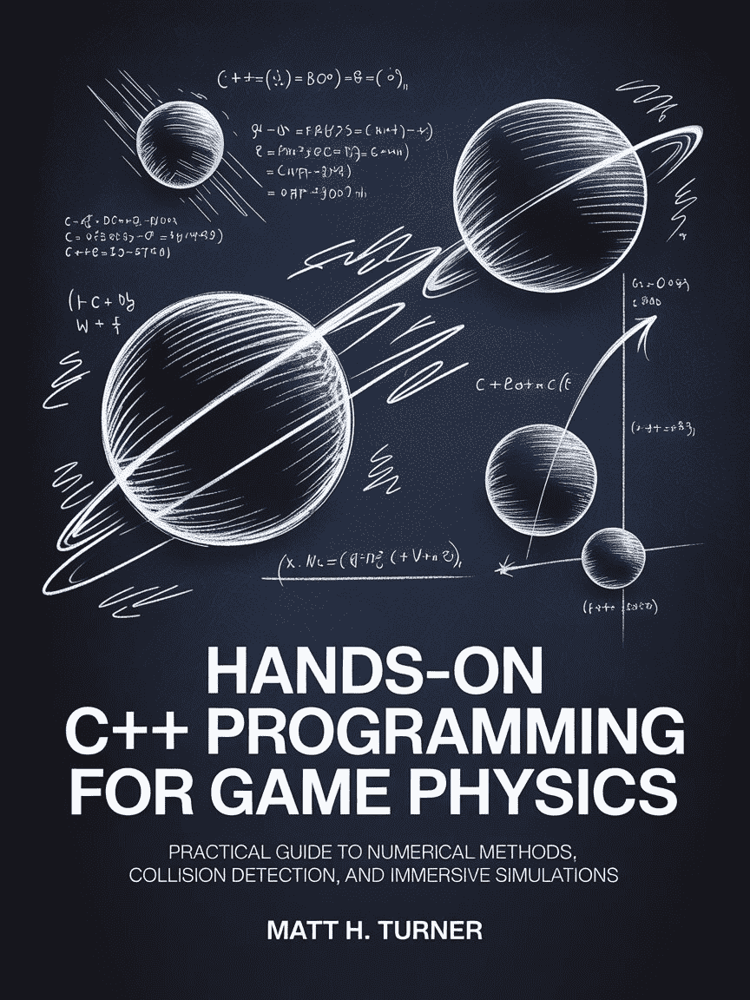

# C++ 游戏物理编程实用指南：数值方法、碰撞检测与沉浸式模拟实践指南 (TechMastery 系列第 5 本)





## 免责声明
本书《游戏物理 C++ 编程实战：数值方法、碰撞检测与沉浸式模拟实用指南》中提供的信息仅供教育和信息之用。尽管作者和出版者已尽力确保书中包含信息的准确性和完整性，但对书中任何错误、不准确、遗漏或任何不一致之处不承担任何责任。

本书的销售基于以下理解：作者和出版者并不从事提供法律、会计或其他专业服务。如果需要专家协助，应寻求合格专业人士的服务。

内容和代码示例按“原样”提供，不提供任何形式的保证（无论是明示还是暗示），包括但不限于对适销性和特定用途的适用性的保证。对于所描述的代码示例和技术的质量与性能的所有风险由您承担。如果代码或技术被证明有缺陷，您将承担所有必要的维护、修理或修正的费用。

在任何情况下，作者或出版者对于在使用或无法使用书中提供的信息或代码示例而导致的任何损害（包括直接、间接、意外、后果、业务利润损失或特殊损害）不承担责任，即使作者或出版者已被告知此类损害的可能性。

书中介绍的编程技术、算法和代码示例旨在教育目的。它们在特定的生产环境或商业应用程序中使用可能需要进行适配、测试和修改。读者对确保根据本书内容实现的任何代码的适用性和安全性负全部责任。

书中出现的所有商标、服务标记、贸易名称、产品名称和标志均为其各自所有者的财产。它们的使用并不认可。对特定个人、民族或组织的任何感知轻视均为非故意的。


你是否曾为游戏中物体碰撞时的解压感、角色斗篷自然的垂坠、爆炸后碎片可信的倒塌，或是投射物命中目标时精确弧线而惊叹？在这些动态且沉浸式的时刻背后，是引入迷的物理模拟世界——它是物理学原理、数学技术和巧妙编程的结合，赋予了虚拟世界生命。

如果你曾想揭开神秘面纱，了解这些系统是如何运作的，最好亲手构建它们，那么你来对地方了。欢迎来到《游戏物理的 C++ 实战编程》。

编程物理的想法似乎令人望而生畏。四元数、惯性张量、碰撞流形、约束求解和数值积分等术语听起来很复杂，而且它们确实有待探索的深度。但只要通过系统且实用的方法来处理，核心概念完全在你的掌握范围内。本书旨在成为你这段旅程的指南，带你从基础构建块开始，逐步实现复杂的物理交互。

我们的方法是坚定的“实战导向”。我们不会只谈论理论，而是将其直接转化为 `C++` 代码。我们将从搭建开发环境开始，掌握基础的数学工具——向量和点。从那里开始，我们将层层构建理解：

*   **赋予物体生命**：我们将探索运动学，理解位置、速度和加速度，并学习如何使用数值积分随时间移动物体。
*   **力与运动**：我们将深入研究牛顿定律，应用重力和阻力等力，理解质量和惯性的至关重要的作用，并利用脉冲的动力来实现瞬时变化。
*   **添加旋转**：我们将处理旋转动力学，学习力矩、角速度，以及如何使用四元数等健壮方法表示并积分取向。
*   **碰撞检测**：我们将解开确定物体何时接触的复杂性，从使用包围体和空间划分的高效宽相技术开始，转向如 `SAT` 和 `GJK/EPA` 等精确的窄相测试。
*   **弹回反馈**：我们将学习如何使用基于冲量的解决方法让物体对碰撞产生真实反应，考虑恢复系数和摩擦等因素，并解决稳定静止的挑战。
*   **连接整体**：我们将超越独立物体，探索约束和关节——铰链、球形接和距离约束，这些允许我们构建关节角色、车辆和复杂的机械装置。
*   **突破边界**：我们甚至会迈入高级主题的入门，如软体动力学（让物体弯曲和拉伸）和基于粒子的流体模拟（让物体溅射）。

在整个过程中，我们将关注清晰性、实际实现和直觉的建立。我们将使用 `C++` 作为工具，重点关注代码结构、常用技术以及与实时模拟相关的性能考虑。我们还将讨论调试物理系统以及对其进行速度优化的关键技能。

本书面向有志向之的游戏开发者、模拟程序编写员、学生，或任何对让虚拟物体以可信方式移动和交互的代码感兴趣的人。无论你的目标是从零开始构建自己的物理引擎、为现有引擎做出贡献，还是仅仅在你的项目里更有效地使用物理引擎，此处涵盖的原理和技术将为你提供坚实的基础。

所以，卷起袖子，启动你的编译器，准备好构建遵循运动规律的世界——或者可能以有趣的方式扭曲它们！这将是一段充满挑战、收获且终极有趣的旅程。让我们开始吧！

***

# 第一部分：运动与模拟的基础

***

## 第 1 章：搭建舞台：C++ 与数学基础

### 准备工作：用于物理模拟的 C++ 开发环境

让我们奠定基础。在我们开始操作向量或计算轨迹之前，我们需要一个坚实的工作坊——一个支持我们工作而非阻碍我们的开发环境。为物理模拟编写高效、复杂的 `C++` 代码需要的不仅仅是一个文本编辑器和祈祷。从一开始就选对工具可以节省未来无数小时的挫败感，并让你专注于物理编程中有趣的挑战。将此比作在开始一个复杂的机械项目之前布置一个组织整齐的工作台；正确的工具、触手可及，会让一切截然不同。

#### 基石：你的 C++ 编译器

任何 `C++` 开发的核心都是编译器——将你人类可读的 `C++` 代码翻译成计算机可以执行的机器指令的工具。对于现代 `C++` 开发，特别是在游戏物理等对性能敏感的领域，你希望使用一个完全支持至少 `C++17` 标准的编译器，最好是 `C++20` 或更高版本。这些新标准提供了显著提高代码清晰度、安全潜在性能的特性——例如结构化绑定、`if constexpr`、概念（在 `C++20` 中）以及许多库增强，如用于计时的 `<chrono>` 或用于生成可预测随机数的 `<random>`，这些在某些模拟场景中可能惊奇地有用。

编译器领域的主要竞争者有 `GCC`（GNU 编译器集合）、`Clang` 和 `MSVC`（Microsoft Visual C++）。

*   `GCC`：开源世界的骨干力量，在 Linux 和 macOS 上广泛可用，并可以通过 `MinGW` 或 `Cygwin` 等环境在 Windows 上使用。它以广泛的平台支持和强大的优化能力而闻名。
*   `Clang`：通常因更快的编译速度和极其清晰、可操作的错误及警告信息受到赞誉（归功于其基于 `LLVM` 后端的设计）。它是 macOS 的默认编译器（通过 `Apple Clang`），也是 Linux 及其他平台上的流行选择。它的工具生态系统（包括 `Clang-Tidy` 等静态分析工具）是一个巨大的优势。
*   `MSVC`：Windows 开发的主要编译器，与 `Visual Studio` IDE 紧密集成。它在最新版本中提供了卓越的性能、对 `C++` 标准的强力合规性，以及在其原生环境中顶尖的调试支持。

你应该选择哪一个？坦率地说，对于学习和实现本书中的概念而言，只要支持 `C++17` 或更高版本，这些现代编译器中的任何一个都能胜任。选择通常取决于你的操作系统或特定的 IDE 集成。许多专业游戏工作室维护着可以使用多个编译器的构建系统，以确保跨平台兼容性并利用各自的优势。关键是要确保你安装了最新版本并了解如何调用它，无论是直接调用还是更常见的通过构建系统调用。不要在这里马虎；使用老旧、过时的编译器就像用生锈的工具造赛车。


你还需要关注编译器标志。这些是你传递给编译器的选项，用于控制构建过程的各个方面，例如优化级别（`-O2`、`-O3`）、使用的 C++ 标准（`-std=c++17`, `/std:c++17`）、是否包含调试信息（`-g`, `/Zi`）以及启用哪些警告（`-Wall -Wextra`, `/W4`）。启用警告至关重要；编译器通常可以发现潜在的问题或不安全的代码实践，这些问题可能会在你随后的物理模拟中导致细微的错误。在早期阶段将警告视为错误——这会迫使代码更整洁、更健壮。优化标志对性能至关重要，但通常以编译时间变为代价，并且有时会使调试变得困难（因为生成的机器码可能无法直接映射回你的源代码）。一种常见的做法是：开发构建使用低级优化和完整的调试信息，而发布构建中使用高级优化以及最少或无调试信息。

### 构建编排：构建系统的重要性

一旦你的项目增长到单个源文件以上，为每个文件使用正确的标志手动调用编译器就会变得繁琐且容易出错。添加库、依赖项、不同的构建配置（调试与发布）以及跨平台目标后，手动编译将变得完全不可控。这就是构建系统生成器的用用场。它的工作是根据你对项目的高级描述，自动化编译、链接和打包代码的整个过程。

对于现代跨平台 C++ 开发，`CMake` 已经成为事实上的标准。它本身并不是构建系统，而是一个元构建系统或构建系统生成器。你编写配置文件（命名为 `CMakeLists.txt`），以平台无关的方式描述你的项目结构、源文件、依赖项和构建要求。然后 `CMake` 会读取这些文件，并为你所选的环境生成原生构建文件——用于 Linux/macOS 的 Makefiles、用于 Windows 的 Visual Studio 解决方案（`.sln`）、Ninja 文件、Xcode 项目等。

#### 为什么 CMake 对物理编程如此重要？

1. **跨平台一致性**：物理代码本身通常是与平台无关的，专注于算法和数学。`CMake` 允许你定义一次构建过程，并生成可以在 Windows、macOS 和 Linux 上正确编译的项目，而无需为每个平台编写单独的构建脚本。如果你正在开发库或与不同系统上的他人协作，这价值连城。

2. **依赖管理**：物理项目通常依赖于外部库，也许用于线性代数（尽管我们会自己构建基础）、测试框架或稍后的图形渲染。`CMake` 提供了稳健的机制（`find_package`, `WorkspaceContent`），用于跨平台一致地定位和链接这些依赖项。

3. **配置管理**：轻松管理不同的构建类型（Debug, Release, `RelWithDebInfo`）、编译器标志、预处理器定义和其他设置。你可以定义选项来启用或禁用某些功能（例如，带有多线程支持编译，启用特定的物理模块）。

4. **IDE 集成**：大多数现代 C++ IDE（Visual Studio, CLion, VS Code）对 `CMake` 都有良好的内置支持，允许你直接在 IDE 界面内加载、配置和构建基于 `CMake` 的项目。

学习 `CMake` 的基础对于任何严肃的 C++ 开发者来说都是一项值得的投资。一个简单的物理项目的顶层 `CMakeLists.txt` 文件概念上可能看起来所示：

```cmake
cmake_minimum_required(VERSION 3.15)
project(PhysicsEngine LANGUAGES CXX)
set(CMAKE_CXX_STANDARD 17)
set(CMAKE_CXX_STANDARD_REQUIRED ON)
add_executable(PhysicsSim main.cpp Particle.cpp Vector.cpp)
find_package(SomeLibrary REQUIRED)
target_link_libraries(PhysicsSim PRIVATE SomeLibrary::SomeLibrary)
```

### 你的控制中心：IDE 和文本编辑器

在编译器和构建系统就绪后，你需要一个用于编写、导航和调试的接口。在功能全集成开发环境（IDE）和强大的文本编辑器之间的选择通常取决于个人偏好。

#### 集成开发环境 (IDEs)

- **Visual Studio (Windows)**：Windows 上 C++ 开发的利器。它与 MSVC 编译器、调试器、性能分析器以及 `CMake` 的集成是无缝的。IntelliSense（代码补全和分析）、代码导航、重构工具等功能都是顶级的。如果你在 Windows 上开发，Visual Studio 是不可比拟的。

- **CLion (跨平台)**：由 JetBrains 开发，CLion 是一款运行在 Windows、macOS 和 Linux 上的专用 C++ IDE。它具有深度的 `CMake` 集成、源自 ReSharper C++ 的卓越代码分析和重构能力，并与 GDB 和 LLDB 集成用于调试。它是一个付费产品，但许多专业人士认为其功能物有所值。

- **Visual Studio Code (VS Code) (跨平台)**：虽然技术上是一个文本编辑器，但 VS Code 通过扩展变为强大的 C++ IDE。Microsoft C/C++ 扩展提供了 IntelliSense、调试支持（通过 GDB/LLDB 或 MSVC）和代码导航。CMake Tools 扩展提供了优秀的 CMake 项目管理。VS Code 是免费的、高度自定义的，拥有庞大的生态系统，使其成为热门选择。

- **Xcode (macOS)**：macOS 和 iOS 的标准开发环境。它使用 Clang 作为后端，并具有良好的调试和分析工具（Instruments）。虽然它主要使用自己的项目格式，但它也可以与 CMake 生成的项目配合。

#### 强大的文本编辑器

除了 VS Code，Sublime Text、Vim 或 Neovim 等编辑器也可以通过适当的插件（用于代码补全、语法高亮、构建系统集成和调试器前端）配置 C++ 开发。这条路径通常需要更多的手动设置和配置，但为熟悉这些工具的开发者提供了最大的灵活性和效率。


#### 开发环境特性

- **构建系统集成 (CMake)**：能够在 IDE 内部方便地配置、构建和运行你的 `CMake` 目标，可以简化开发工作流。
- **代码导航**：快速跳转到定义、查找函数或变量的所有引用以及在复杂的代码库中导航，这对于理解和修改物理系统至关重要。
- **静态分析集成**：如 `Clang-Tidy` 等工具通常可以直接集成到 IDE 中，在您输入代码时突出显示潜在问题。

选择一个让你觉得效率最高的工具，但要确保它对 C++ 提供良好的支持，而且至关重要的一点是对调试的支持。

#### 不可或缺的工具：调试器

物理模拟以产生微妙且通常在视觉上非常壮观的 Bug 而闻名。物体可能会飞向无穷远、发生不可控制的抖动、穿过彼此，或者干脆拒绝移动。没有调试器，寻找此类问题的根源就像是蒙着眼睛在海里捞针。调试器允许你在特定点（断点）暂停程序执行，检查变量状态，并逐行或逐指令单步执行代码，以准确理解发生了什么。

对于物理开发，你将严重依赖调试器来：

- **检查状态**：在关键时刻（例如碰撞解决之前和之后）检查物理对象的位置、速度、朝向、力和其他属性。这些数字符合你的预期吗？是否由于数值不稳定性导致了 `NaNs`（非数字）或无限值的侵入？
- **追踪逻辑**：单步执行碰撞检测或响应计算等复杂算法，确保逻辑符合你的理论理解。计算在何处出了错？
- **理解崩溃**：当你的模拟发生崩溃时（例如访问了无效内存），调试器可以确切地显示崩溃发生的位置以及导致崩溃的函数调用序列（调用堆栈）。
- **分析数值问题**：观察数值在数值积分过程中随时间步的变化。误差累积得太快了吗？时间步是否过大？
- **设置条件断点**：仅在满足特定条件时暂停执行（例如当 `collisionDetected == true` 且 `object.velocity.magnitude() > 1000.0`），这对于隔离间歇性 Bug 极其有用。
- **检查内存**：检查原始内存，这在调试与数据布局或复杂数据结构相关的问题时很有帮助。

常见的调试器包括 `GDB`（GNU Debugger，常见于 Linux/macOS）、`LLDB`（LLVM 项目的一部分，Xcode 默认使用，`CLion` 和 `VS Code` 使用）以及 `Visual Studio Debugger`（Windows）。大多数 IDE 为这些调试器提供了图形化前端，使得它们比命令行界面易用得多。熟悉你所选调试器的功能——设置断点、单步控制（跳过、步入、跳出）、检查变量、设置观察点、查看内存和检查调用堆栈。在掌握调试器上花费的时间永远不会浪费；它是开发物理引擎等复杂系统最重要的工具。

#### 跟踪你的进度：使用 Git 进行版本控制

物理开发涉及实验。你会尝试不同的算法、调整参数、重构代码，有时会陷入死胡同。版本控制系统（VCS）对于安全、高效地管理这些更改至关重要。它们允许你在项目的各个点保存项目快照（提交），在某些出现问题时回到旧版本，在隔离状态处理不同的功能或实验（分支），并将更改合并回。

`Git` 是目前占据绝对主导地位的 VCS。它的分布式特性意味着每个开发者都拥有完整的项目历史副本，使得离线工作和协作变得无缝。`GitHub`、`GitLab` 和 `Bitbucket` 等平台为 Git 仓库提供远程托管，便于团队协作、备份和代码共享。

#### 为什么 Git 对物理项目至关重要：

- **实验**：创建一个新分支（`git checkout -b experiment/new-integrator`）来尝试不同的数值积分方法，而不会破坏稳定的主代码库。如果有效，将其合并（`git merge experiment/new-integrator`）；如果无效，只需丢弃分支（`git branch -d experiment/new-integrator`）。
- **Bug 追踪**：发现 Bug 时，你可以检查历史（`git log`, `git blame`）以查看问题代码何时引入的。你可以检之前的提交以确定 Bug 首次出现的时间。
- **协作**：`Git` 设计用于是为了让多人同时处理同一个项目，提供了合并更改和解决冲突的机制。
- **备份**：定期提交并推送到远程仓库可以作为防止数据丢失的安全网。
- **代码审查**：`GitHub` 等平台将 `Git` 与代码审查工具集成，这对于团队环境中维护代码质量至关重要。

即使你是一个人工作，从第一天起使用 `Git` 也是非常推荐的纪律。频繁提交并附带描述更改的清晰信息。它创建了你不可避免会依赖的宝贵历史。需要学习的基础 Git 命令包括 `git init`, `git add`, `git commit`, `git status`, `git log`, `git checkout`, `git branch` 和 `git merge`。大多数 IDE 都提供了图形化的 Git 集成，简化了这些常用操作。

### 有用的辅助工具：静态分析、性能分析和内存检查

除了核心工具外，其他几类工具也显著有助于 C++ 开发，特别是对于物理这样对性能极其敏感且复杂的领域：

- **静态分析工具**：这些工具在不执行代码的情况下分析你的源码，以寻找潜在的 Bug、风格违规和可疑结构。编译器有内置警告，但如 `Clang-Tidy`、`Cppcheck` 和商业产品通常会深入得多。它们可以捕捉如潜在的空指针解引用、资源泄漏、使用未初始化变量以及违反编码规范等问题。将静态分析集成到工作流中可以尽早发现错误，许多 IDE 可以在后台运行这些工具，直接在代码中突出显示。
- **性能分析工具 (Profiling)**：物理模拟可能是计算密集型的。性能分析工具帮助你理解程序大部分时间花在了哪里。如 `Valgrind (Callgrind/Cachegrind)`、`Perf` (Linux)、`Instruments` (macOS)、`Intel VTune Profiler`、`AMD uProf` 或 `Visual Studio Profiler` 可以定位代码性能瓶颈。识别热点（例如效率的碰撞检测程序、过多的内存分配）允许我们将优化精力集中在影响最大的地方。我们在早期不会侧重于性能分析，但了解这些工具的存在对于后期是重要的。
- **内存调试工具**：C++ 的手动内存管理虽然强大，但可能导致内存泄漏、使用释放后的内存（悬空指针）或越界写入数组（缓冲区溢出）等错误。这些 Bug 可能会导致崩溃或难以追踪的微妙不确定行为。`Valgrind (Memcheck)`、`AddressSanitizer (ASan)`、`LeakSanitizer (LSan)` 或 `Dr. Memory` 等工具会对你的程序进行插桩，以便在运行时检测这些内存错误。定期使用内存检查器运行模拟是一项至关重要的检查。特别是 `ASan`，开销较小，可以通过现代编译器（`GCC` 和 `Clang`）的编译器标志（例如 `-fsanitize=address`）轻松启用。

#### 差异

尽管 `CMake` 有助于抽象许多平台差异，但基础操作系统（Windows, macOS, Linux）会影响工具的选择和安装。


### 开发环境

- **Windows**: 通常涉及安装 `Visual Studio`，它集成了 `MSVC` 编译器、`debugger` 和 `CMake`。或者，你也可以设置如 `MinGW` 或 `适用于 Linux 的 Windows 子系统` (`WSL`) 环境来使用 `GCC` 或 `Clang`。像 `vcpkg` 或 `Conan` 等包管理器可以帮助管理外部库。
- **macOS**: `Xcode` 通过命令行工具包 (`xcode-select --install`) 提供 `Clang`、`LLDB`和其他开发工具。`Homebrew` 是流行的包管理器，用于安装 `GCC`、`CMake`、`Git` 等实用程序。
- **Linux**: 使用你发行版的包管理器（`apt`、`dnf`、`pacman` 等）安装 `build-essential`（或等效包）、`gcc`/g++`、`clang`、`cmake`、`gdb` 和 `git`。

使用 `CMake` 和标准 `C++` 的之处在于你编写的代码理想上可以在这些平台之间迁移，只需极少的更改。开发环境的设置是主要的差异所在。

### 你的起点

那么，跟随本书学习的推荐最小化配置是什么？

1. **编译器**: 支持 `C++17` 的最新版本 `GCC`、`Clang` 或 `MSVC`。
2. **构建系统**: `CMake`（建议版本 `3.15` 或更高版本）。
3. **IDE/编辑器**: `Visual Studio`、`CLion` 或带有 `C/C++` 和 `CMake` 扩展的 `VS Code`。选择一个你熟悉且具有强大调试支持的工具。
4. **调试器**: 确保你的 IDE 已配置使用相应的调试器（`MSVC Debugger`、`GDB`、`LLDB`）。
5. **版本控制**: 已安装 `Git` 并熟悉基础命令。

现在花时间安装并配置这些核心组件。确保你能够创建一个简单的 "Hello World" `C++` 程序，使用基础的 `CMakeLists.txt` 对其进行配置，生成构建文件，编译、运行它，并使用 `debugger` 进行逐步调试。验证这些步骤可以确保你的工作台已准备就绪。与工具链问题作斗是令人沮丧的；拥有流畅、工作的开发环境可以让你将精力集中在物理本身上。这种初始的投入将在我们处理更复杂的话题时在生产力上产生巨大的回报，并减少摩擦。

#### C++ 威力工具：物理程序员必备语言特性

让我们继续前进，看看在构建物理模拟时不可或缺的特定 `C++` 特性。虽然现代 `C++` 是一门巨大的语言，但有几个关键方面在我们追求高效、健壮且可维护的物理代码的过程中，是尤为强大的盟友。掌握这些不仅仅是为了编写 `C++`；更是为了利用语言的优势来应对模拟中的独特挑战。

#### 值语义、对象与 RAII：安全管理资源

`C++` 的核心优势之一（特别是与带垃圾回收的语言相比）是它对对象生命周期和资源的确定控制。这在实时物理中至关重要，因为无法接受垃圾回收带来的不可预测暂停。在 `C++` 中有效管理资源（如内存、文件句柄甚至是物理世界资源）的基是资源获取初始化 (`RAII`) 范式，它通常与值语义紧密结合。

在实践中这意味着什么？当你创建一个对象时，它的`constructor`会获取任何必要的资源（例如分配内存）。当对象离开作用域时（例如在函数结束时或被显式删除时），它的`destructor`会自动释放这些资源。这使得资源管理在很大程度上是自动的并与对象生命周期绑定，显著降低了泄漏的风险。

考虑一个简单的动态数组类（如 `std::vector`）。当你创建一个 `vector` 时，它的`constructor`在堆上分配内存。当 `vector` 对象被销毁（离开作用域）时，它的`destructor`会释放该内存。你通常不需要手动调用 `delete[]`。这种自动清理是 `RAII` 的精髓。

物理模拟通常涉及大量对象（刚体、粒子、碰撞形状）以及可能的复杂数据结构（如空间划分网格）。使用 `RAII` 原则可以确保当物理对象从模拟中移除时，所有相关资源都能正确且可预测地被清理。这防止了内存泄漏（内存可能会瘫痪长时间运行模拟），并有助于维持稳定的系统状态。

与值类型工作通常与 `RAII` 相得益彰。值类型是行为像内置类型（如 `int` 或 `float`）的对象。当你拷贝它们时，你得到的是数据的完全副本，而不仅仅是指向相同底层数据的另一个引用。我们的基础物理类型，如 `Vector3` 或 `Quaternion` 通常应该被设计为值类型。当你将一个向量赋值给另一个时（`Vector3 force = gravity;`），你期望 `force` 是一个独立的实体，拥有它自己的重力数据副本。这防止了“远距离灵作用”，即修改一个变量会出意之外地改变另一个看似无关的变量，因为它们秘密地共享底层数据。`C++` 的 `classes` 和 `structs` 在拷贝时默认具有值语义，但在它们管理原始指针等资源时，需要细致的设计。

#### 类与结构体：组织你的物理数据

物理模拟的核心在于管理状态——位置、速度、取向、质量、力——并定义随时间修改这些状态的操作。`C++` 的 `class` 和 `struct` 关键字是我们组织这些数据和关联行为的主要工具。

`C++` 中 `class` 和 `struct` 的技术区别微乎其微：`struct` 的默认成员访问权限是 `public`，而 `class` 是 `private`。按照惯例，`struct` 通常用于简单的数据聚合，而 `class` 用于具有更复杂行为、不变性（对象必须遵守的规则）且通过 `public` 方法进行受控访问的对象。对于 `RigidBody`、`Particle` 或 `CollisionShape` 等物理对象，使用 `class` 通常更好。这允许你：

1. **封装数据**: 将内部表示（如位置、速度、质量、惯性张量）设置为 `private` 或 `protected`。防止外部代码将其带无效状态（例如设置负质量）。
2. **提供受控访问**: 提供 `public` 成员函数来操作对象。这些方法维护不变性并确保对象状态一致。
3. **定义行为**: 在类方法内部实现物理逻辑，使数据和对数据的操作紧密结合。

```cpp
// 概念示例（省略实现细节）
class RigidBody {
private:
    // 内部状态
    Vector3 position;
    Quaternion orientation;
    Vector3 linearVelocity;
    Vector3 angularVelocity;
    float mass;
    Matrix3x3 inverseInertiaTensorWorld; // 为了效率预计算
    Vector3 accumulatedForce;
    Vector3 accumulatedTorque;

    // 当取向改变时更新惯性张量
    void updateInverseInertiaTensorWorld();

public:
    // 构造函数
    RigidBody(/* 状态参数 */);

    // 访问器（通常为 const）
    Vector3 getPosition() const { return position; }
    Quaternion getOrientation() const { return orientation; }
    // ... 其他访问器

    // 修改器 /动作
    void applyForce(const Vector3& force, const Vector3& worldPoint); // 在点施力
    void applyImpulse(const Vector3& impulse, const Vector3& worldPoint); // 在点施冲量

    // 积分步
    void integrate(float deltaTime);

    // 工具
    void clearAccumulators() {
        accumulatedForce = Vector3::Zero; // 假设有一个静态零向量
        accumulatedTorque = Vector3::Zero;
    }

    // 安全起见禁止拷贝，或仔细实现
    RigidBody(const RigidBody&) = delete;
    RigidBody& operator=(const RigidBody&) = delete;
};
```


这种结构提供了清晰的接口（`public`），同时保护了内部状态（`private`），使得 `RigidBody` 更容易正确使用且难以被误用。

### 运算符重载：编写直观的数学代码

物理学本质上是数学。我们不断对向量和矩阵执行操作：相加力、计算点积、变换点、矩阵矩阵。C++ 允许你定义标准运算符（`+`、`-`、`*`、`/`、`==` 等）如何作用自定义类型（如 `Vector3`、`Matrix3x3`、`Quaternion`）。这就是运算符重载。

如果使用得当，运算符重载可以让物理代码变得极其易读且直观，紧密匹配标准的数学符号。比较以下两种相加力：

```cpp
// 没有运算符重载
Vector3 totalForce = Vector3::add(gravityForce, windForce);
totalForce = Vector3::add(totalForce, impulseForce);

// 使用运算符重载 (+)
Vector3 totalForce = gravityForce + windForce + impulseForce;
```

第二个版本不可否认地更简洁，并直接反映了向量相加的数学概念。同样，用标量缩放向量：

```cpp
// 没有运算符重载
Vector3 scaledVelocity = Vector3::multiply(currentVelocity, dampingFactor);

// 使用运算符重载 (*)
Vector3 scaledVelocity = currentVelocity * dampingFactor; // 或者 dampingFactor * currentVelocity
```

物理类型需要重载的关键运算符包括：

- `Vector3`: `+`（加法）、`-`（减法、取反）、`*`（标量乘法、点积 - 有时使用函数 `dot()` 更清晰）、`/`（标量除法）、`==`、`!=`。可能还有 `*=`、`+=`、`-=`、`/=`。
- `Matrix3x3/4x4`: `*`（矩阵乘、矩阵向量乘）、`+`、`-`、`==`、`!=`。
- `Quaternion`: `*`（用于组合旋转的四元数乘、用于旋转向量的四元数向量乘）、`==`、。

关键是以符合数学习惯且直观的方式重载运算符。避免为运算符分配令人意料的语义。当谨慎使用时，运算符重载是编写表达丰富且可维护物理代码的强大工具。

### 模板：编写通用、可重用的代码

物理算法通常独立于使用的特定数值类型（例如 `float` 与 `double`）。无论你使用单精度还是双精度浮点数，数值积分、向量操作或碰撞检测逻辑可能是相同的。C++ 模板允许你编写一次代码，即可在不同数据类型上运行，而无需重复。

你可以创建模板函数或模板类。例如，一个通用的向量相加函数：

```cpp
template <typename T> // T 可以是 float、double 等
Vector3<T> addVectors(const Vector3<T>& a, const Vector3<T>& b) {
    return Vector3<T>(a.x + b.x, a.y + b.y, a.z + b.z);
}

// 假设 Vector3 本身是一个模板类：
template <typename T>
struct Vector3 {
    T x, y, z;
    // 构造函数、方法、运算符重载...
    // 模板类内部的运算符重载示例：
    Vector3<T> operator+(const Vector3<T>& other) const {
        return Vector3<T>(x + other.x, y + other.y, z + other.z);
    }
};

// 使用：
Vector3<float> forceF = gravityF + windF;
Vector3<double> positionD = initialPosD + velocityD * timeStepD;
```

模板在 C++ 标准库（STL）中被广泛使用，特别是容器（`std::vector<T>`、`std::map<K, V>`）和算法（`std::sort`、`std::find`）。在物理中，虽然你可能不会编写复杂的模板元编程，但将模板用于基础数学类型（`Vector3<T>`、`Matrix<Rows, Cols, T>`）或简单算法可以提高代码复用和灵活性，允许通过更改模板参数轻松切换精度（例如，对性能敏感的游戏模拟使用 `float`，对高精度的离线计算或测试使用 `double`）。

### Const 正确性：传递意图并防止错误

C++ 中的 `const` 关键字是一个承诺。当你声明一个变量为 `const` 时，你承诺不改变它的值。当你声明一个成员函数为 `const`（例如 `Vector3 getPosition() const;`），你承诺承诺调用此函数不会修改对象的观测状态。

正确使用 `const` 有许多好处：

1. **编译器强制执行**：编译器帮助执行你的承诺。如果你尝试修改 `const` 变量或对 `const` 对象调用非 const 成员函数，编译器将生成错误。这可以及早捕捉意外修改。
2. **意图清晰**：它充当了文档。看到 `const` 会告诉读者（包括未来的你自己）某些数据不应更改，或者某个函数只检查状态，使代码更容易理解。
3. **启用优化**：当编译器知道数据不会改变时，有时可以执行更好的优化。
4. **接口设计**：它允许你通过常量引用传递对象（`const Vector3&`），这在避免昂贵拷贝的同时，保证了函数不会修改原始对象。这在向量和矩阵频繁传递的物理代码中非常常见且对性能很重要。

```cpp
// 良好实践：通过常量引用传递，将访问器标记为 const
float calculateKineticEnergy(const RigidBody& body) {
    // 如果我们尝试：body.setPosition(...) 编译器将报错
    Vector3 velocity = body.getLinearVelocity(); // 如果 getLinearVelocity() 是 const
    float mass = body.getMass(); // 如果 getMass() 是 const
    return 0.5f * mass * velocity.dot(velocity); // 假设 dot() 是 const
}

class RigidBody {
    // ... 私有成员 ...
public:
    // 访问器标记为 const - 承诺不改变 RigidBody
    Vector3 getLinearVelocity() const { return linearVelocity; }
    float getMass() const { return mass; }
    // 修改器 - 不是 const
    void applyForce(const Vector3& force, const Vector3& worldPoint);
};
```

在代码中追求 const 正确性。将不改变的变量标记为 `const`。将不修改对象的成员函数标记为 `const`。当需要读取访问时，通过 `const&` 传递对象。

### 移动语义：高效处理临时对象

物理计算经常创建临时对象。考虑 `Vector3 result = (a + b) * scale;`。`a + b` 的结果是一个临时的 `Vector3` 对象，然后被乘以 `scale` 产生另一个临时 `Vector3`，最后用于初始化 `result`。在旧的 C++ 中，创建和拷贝这些临时对象可能涉及巨大的开销，特别是对于较大的对象（尽管对于简单的 Vector3 并非如此）。

C++11 引入了移动语义（右值引用 `&&`、`std::move`、移动构造函数、移动赋值运算符）来优化这些场景。移动语义允许将资源（如指向分配内存的指针，或者可能是简单类型的数据成员）从临时对象“夺取”或“移动”到目标对象，让临时对象处于有效但未指定的状态（通常为空）。这避免了冗余的拷贝和分配。

虽然你可能不需要经常为 Vector3 等简单类型手动编写移动构造函数（编译器可能会生成高效的版本），但在处理资源管理类或标准库容器（如 `std::vector`）时，理解移动语义很重要。返回大型对象的函数以及在容器中重排元素的算法从正确实现的移动语义中受益匪。对于性能敏感的物理代码，确保昂贵的资源被移动而非拷贝可以带来显著的收益。


C++ 标准库 (STL) 提供了一系列经过充分测试且高效的容器类。对于物理编程，`std::vector` 通常是最有用的。它是一个动态数组，能够自动管理内存内存（使用 `RAII`）。

使用 `std::vector` 的场景：
- 存储物理对象列表（粒子、刚体、约束条件）。
- 存储在帧期间生成的碰撞接触点。
- 实现空间划分结构（例如网格，其中每个单元格都包含一个存储对象索引的 `std::vector`）。

```cpp
#include <vector>
#include "RigidBody.h" // 假设 RigidBody 类存在

std::vector<RigidBody> bodies;

// 添加物体...
bodies.push_back(RigidBody(/*...*/));
bodies.push_back(RigidBody(/*...*/));

// 迭代并更新
float deltaTime = 0.016f;

for(RigidBody& body : bodies) { // 使用引用进行修改
    body.clearAccumulators();
    // ... apply forces ...
    body.integrate(deltaTime);
}

// 高效移除元素（例如使用 erase-remove idiom）
```


### 物理引擎开发：从运动学到刚体动力

`std::vector` 提供了高效的连续存储（利于缓存性能）、快速的随机访问（使用 `operator[]`）以及末尾的摊均常时间插入（`push_back`）。请注意，在中间插入/删除可能会很慢，且调整大小可能涉及重新分配内存和移动元素（如果可用，则利用移动语义）。`std::array` 是在编译时已知的固定大小数组的替代方案。

利用这些 C++ 特性——用于资源安全的 RAII、用于组织结构的类、用于增强表达能力的运算符重载、用于泛型的模板、用于确保正确性的 `const`、用于性能优化的移动语义，以及用于常用数据结构的 STL 容器——为构建复杂的物理模拟提供了坚实的基础。

#### 运动的语言：掌握 3D 空间中的向量和点

为了构建物体能够真实移动和交互的仿真，我们首先需要正确的工具来描述它们在 3D 世界中的状态。3D 图形和物理学中这些基本构建单元是点和向量。

#### 点与 向量
点仅仅是 3D 空间中的一个位置。它是一个标记特定位置的坐标 `(x,y,z)`。点没有固有的大小或方向；它只定义了物体所在。

相反，向量表示一个同时具有量级（大小或长度）和方向的量。它描述了位移、速度、加速度或力。当我们把向量存储为 `(vx,vy,vz)` 时，这些分量告诉我们沿主轴的影响或运动情况。

#### 数学相互作用
- **差值**：寻找两点之间的差值可以得到连接它们的向量。如果从点 `P2` 减去点 `P1` 的坐标，结果就是表示方向和距离的向量。
- **加法**：给点加上一个向量会得到一个新的点。这就是我们如何根据速度逐帧更新物体位置的方法。

#### C++ 实现：Vector3 类
在 C++ 中，我们通常使用单个类（通常命名为 `Vector3` 或 `Vec3`）来同时表示两者。

```cpp
#include <cmath> // 用于 std::sqrt, std::abs
#include <cassert> // 用于 assert

struct Vector3 {
    float x, y, z;

    // --- 构造函数 ---
    Vector3() : x(0.0f), y(0.0f), z(0.0f) {}
    Vector3(float xVal, float yVal, float zVal) : x(xVal), y(yVal), z(zVal) {}

    // --- 核心向量操作 ---
    float magnitude() const {
        return std::sqrt(x*x + y*y + z*z);
    }

    float magnitudeSquared() const {
        return x*x + y*y + z*z;
    }

    void normalize() {
        float mag = magnitude();
        constexpr float epsilon = 1e-6f;
        if (mag > epsilon) {
            float invMag = 1.0f / mag;
            x *= invMag;
            y *= invMag;
            z *= invMag;
        } else {
            x = 0.0f; y = 0.0f; z = 0.0f;
        }
    }

    Vector3 normalized() const {
        Vector3 copy = *this;
        copy.normalize();
        return copy;
    }

    // --- 运算符重载 ---
    Vector3 operator+(const Vector3& other) const { return {x + other.x, y + other.y, z + other.z}; }
    Vector3 operator-(const Vector3& other) const { return {x - other.x, y - other.y, z - other.z}; }
    Vector3 operator-() const { return {-x, -y, -z}; }
    Vector3 operator*(float scalar) const { return {x * scalar, y * scalar, z * scalar}; }
    Vector3 operator/(float scalar) const {
        assert(std::abs(scalar) > 1e-9f && "Division by zero!");
        float invScalar = 1.0f / scalar;
        return {x * invScalar, y * invScalar, z * invScalar};
    }

    Vector3& operator+=(const Vector3& other) { x += other.x; y += other.y; z += other.z; return *this; }
    Vector3& operator-=(const Vector3& other) { x -= other.x; y -= other.y; z -= other.z; return *this; }
    Vector3& operator*=(float scalar) { x *= scalar; y *= scalar; z *= scalar; return *this; }
    Vector3& operator/=(float scalar) {
        assert(std::abs(scalar) > 1e-9f && "Division by zero!");
        float invScalar = 1.0f / scalar;
        x *= invScalar; y *= invScalar; z *= invScalar;
        return *this;
    }

    bool operator==(const Vector3& other) const {
        constexpr float epsilonSq = 1e-5f;
        float dx = x - other.x;
        float dy = y - other.y;
        float dz = z - other.z;
        return (dx*dx + dy*dy + dz*dz) < epsilonSq;
    }
    bool operator!=(const Vector3& other) const { return !(*this == other); }
};

inline Vector3 operator*(float scalar, const Vector3& vec) {
    return vec * scalar;
}

inline float dot(const Vector3& a, const Vector3& b) {
    return a.x * b.x + a.y * b.y + a.z * b.z;
}

inline Vector3 cross(const Vector3& a, const Vector3& b) {
    return {
        a.y * b.z - a.z * b.y,
        a.z * b.x - a.x * b.z,
        a.x * b.y - a.y * b.x
    };
}
```

## 第 2 章：赋予物体生命：运动学与积分

运动学是在不考虑引起运动的力量的情况下研究运动。为了模拟运动，我们描述三个关键属性：**位置**、**速度**和**加速度**。

### 核心概念
1. **位置**：物体在 3D 空间中的地方。
2. **速度**：位置变化的快慢和方向。
3. **加速度**：速度变化的快慢。

### 积分方法
在游戏循环中，我们随时间步 `dt` 更新这些属性。
- **前向欧拉**：最简单的方法。`velocity += acceleration * dt`；`position += velocity * dt`。
- **半隐式欧拉**：先更新速度，再更新位置。物理系统更稳定。

## 第 5 章：碰撞检测（宽阶段）

碰撞检测的宽阶段快速排除明显没有碰撞的物体对。

### 边界
- **球体**：由中心和半径定义。测试最快，但对于长条物体拟合度差。
- **AABB（轴对齐边界框）**：与世界轴对齐的矩形。测试快速，但在物体旋转时需要重新计算。
- **OBB（旋转边界框）**：随物体旋转的箱体。提供最紧密的拟合，但需要使用昂贵的**分离轴定理 (SAT)**。

## 第 6 章：碰撞检测（窄阶段）

窄阶段确定精确的接触点、法线和穿深度。

### 球体与球体碰撞
当球心距离小于半径之和时，会发生碰撞。

```cpp
ContactInfo testSphereSphere(const SphereCollider& a, const SphereCollider& b) {
    ContactInfo result;
    Vector3 offset = b.center - a.center;
    float distSq = offset.magnitudeSquared();
    float sumRadii = a.radius + b.radius;
    
    if (distSq <= sumRadii * sumRadii) {
        float distance = std::sqrt(distSq);
        result.colliding = true;
        result.normal = offset / distance;
        result.penetrationDepth = sumRadii - distance;
        result.contactPoint = a.center + result.normal * a.radius;
    }
    return result;
}
```

## 第 7 章：反弹：碰撞解决

### 恢复系数 (`e`)
该值衡量了碰撞的“弹性”。
- `e = 0`：完全非弹性（物体粘合在一起）。
- `e = 1`：完全弹性（能量守恒）。
- `0 < e < 1`：真实的非弹性碰撞。

### 基于冲量的解决
为了解决碰撞，我们应用一个冲量 `J`。冲量大小的公式为：
`j = -(1 + e) * (relativeVelocity dot normal) / (invMassA + invMassB)`

产生的冲量为 `J = j * normal`。将其应用于物体上以更新它们的速度。

