# Haynes 自组游戏电脑构建指南：终极电脑组装逐步手册

## PART 1（第一部分）

### BUILD YOUR OWN GAMING PC（自行组装游戏电脑）

#### Why build your own gaming PC?（为什么要自行组装游戏电脑？）

- Advantages of PC gaming 8
- PC 游戏的优势 8
- Understanding your needs 10
- 了解你的需求 10
- What type of gamer are you? 14
- 你是哪种类型的玩家？ 14
- What to consider 16
- 需要考虑的内容 16
- The tools of the trade 17
- 必备工具 17

With so many amazing options available to buy ready-made gaming PCs from brilliant makers like Chillblast.com and Overclockers.co.uk you may wonder why anyone would want to build their own gaming PC at all. After all, there’s bound to be a system that suits your needs among the hundreds available, and that shiny new PC could be on your doorstep within 48 hours.

既然有 Chillblast.com 和 Overclockers.co.uk 等优秀厂商提供的众多现成游戏电脑可供购买，你可能会想为什么有人还要自行组装游戏电脑。毕竟在数百种可选系统中总有一款适合你的需求，而且那台闪亮的新电脑 48 小时内就能送到你家门口。

The answers are simple: choice, budget and upgradability. You have the opportunity to create an entirely custom PC designed specifically with your needs in mind and, regardless of what the marketing men would have you believe, you’re the only one that can deliver it.

答案很简单：选择、预算和可升级性。你有机会打造一台完全定制的电脑，专门针对你的需求设计，而且无论营销人员如何宣传，只有你能做到。

As you might already know, high-end gaming hardware tends to be more expensive than the average run-of-the-mill kit, so (like it or not) your available budget is going to play a very key role in the end result. But that’s perhaps the biggest advantage of doing everything yourself; you’re in control of absolutely everything and can dictate precisely where the money should go. Do you want a quick computer? The very best graphics from the top-end games? Or are you looking to multitask whenever you’re on the machine? Answer questions like these and you’ll find not only your needs, but the right budget to go with it.

正如你可能已经知道的，高端游戏硬件往往比普通套件更贵，所以无论你喜不喜欢，可用预算将在最终结果中发挥非常关键的作用。但这或许就是自己动手的最大优势；你完全掌控一切，可以精确决定资金投向何处。你想要一台快速的电脑？顶级游戏的最好画质？还是希望在机器上随时多任务处理？回答这些问题，你不仅会找到自己的需求，还会找到合适的预算。

#### Advantages of PC gaming（PC 游戏的优势）

Perhaps the prevailing thought surrounding building a gaming PC is just how prohibitively expensive it is, but that's only true if you're not smart about your purchasing decisions. Sure, it'd be a simple task to pick out the most expensive parts and fit them all together, but while that could lead to issues of its own – compatibility being the biggest disaster you may encounter – it's also a fruitless endeavour in terms of power and gains. Building a gaming PC is about picking the right parts, and rule numero uno here comes first down to budget: knowing what you can afford and trying to stick to it rigidly will make the decision-making process considerably less daunting.

人们普遍认为组装游戏电脑的成本高得令人望而却步，但这只有在你购买决策不够明智时才成立。当然，挑选最贵的零件并组装起来很简单，但这本身也会带来问题——兼容性是你可能遇到的最大灾难——而且在性能和收益方面也是徒劳的。组装游戏电脑的关键在于挑选合适的零件，而这里的第一条规则就是预算：了解你能负担多少并严格遵守，会让决策过程轻松得多。

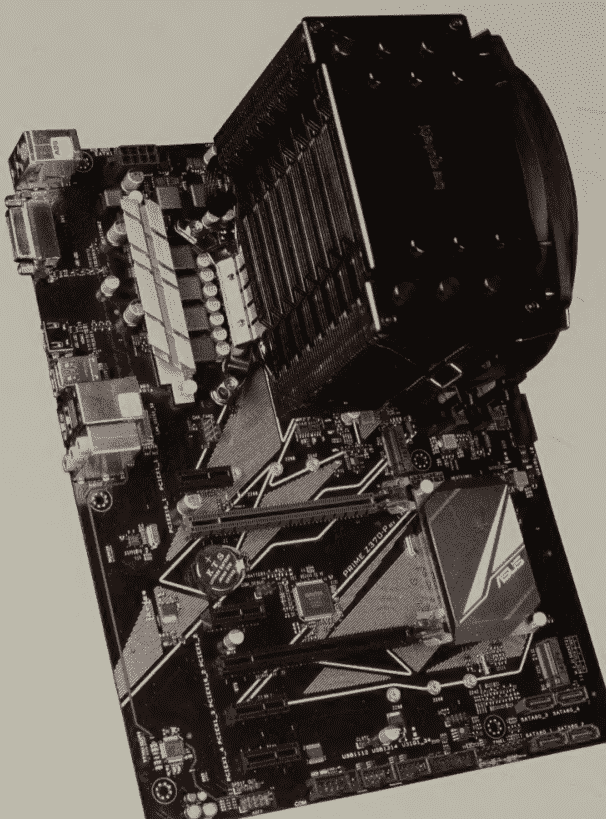

看起来可能很吓人，但有了必要的信息，你会发现安装电脑的任何部件都没有问题；现在其实很简单。

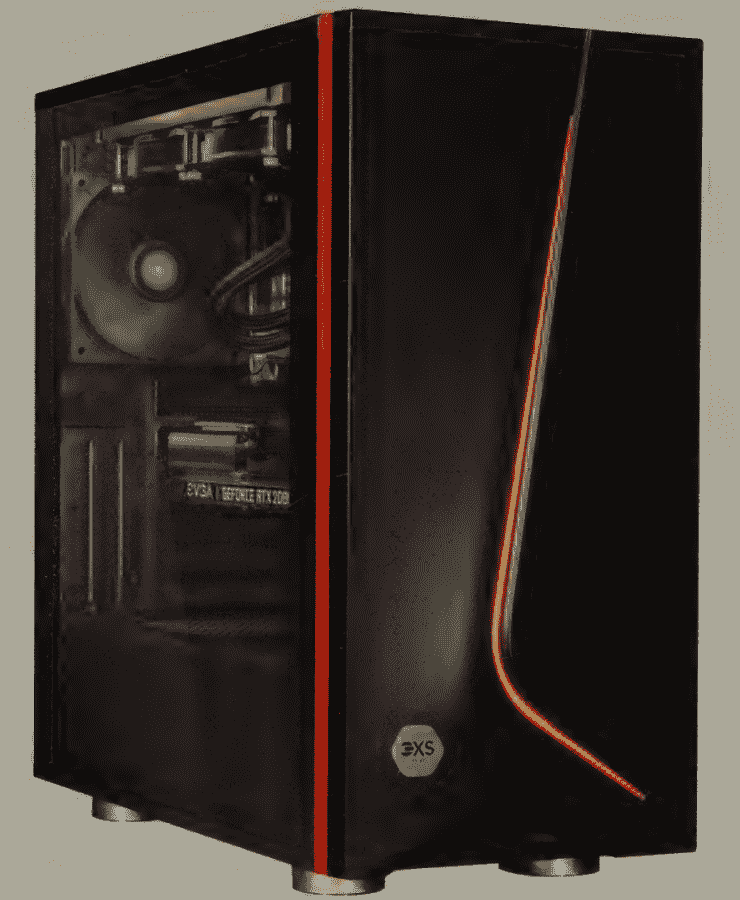

游戏电脑可以有各种形状和尺寸，所以并不是简单地从货架上挑选一台。知道自己想要什么才是第一步。

And therein lies the first main advantage of PC gaming: its flexibility. Every PC owner is different and every gamer has their own tastes and wants. What those are will effectively control the requirements of your system, but because of this flexibility you can put together something that fulfils those needs as well as your budget. If you need a computationally powerful machine for faster processing, then that's where you need to spend the money. If high-end graphics are what you're hoping to achieve, then the GPU is the focus. Since the parts are chosen by you, there's no concern that the machine you have won't be in some way inferior to your particular needs. And in truth, buying an off-the-shelf gaming PC just won't have that guarantee of efficiency in conjunction with value for money.

这正是 PC 游戏的第一个主要优势：灵活性。每位电脑用户都不同，每个玩家都有自己的喜好和需求。这些需求将有效决定系统的要求，但正因为这种灵活性，你可以组装出既满足需求又符合预算的机器。如果你需要一台计算能力强的机器来加快处理速度，那么钱就应该花在那里。如果你希望实现高端图形，那么 GPU 就是重点。由于零件由你挑选，就不用担心机器在某些方面不如你的特定需求。而说实话，购买现成的游戏电脑并不能保证效率与性价比兼得。

On top of that, there's a sense that a gaming PC can also be a future project, too. If you don't have the funds to kit it out with the high-end gear you are dreaming of just yet, you can save on certain parts to build a functional and acceptable machine with the prospects of upgrading at a later date. And since you know the parts inside your computer, you'll more easily be able to figure out how and what can be swapped out for better equipment when the time comes to do so.

此外，游戏电脑也可以是一种未来项目。如果你现在还没有资金配备你梦寐以求的高端设备，你可以节省某些部件的开支，组装一台功能正常且可接受的机器，并为日后升级做好准备。而且由于你了解电脑内部的零件，当需要升级时，你会更容易弄清楚如何以及用什么更好的设备替换。

But the thing to know is that simply by choosing to self-build, you'll automatically be saving money. Whether you're buying a prebuilt gaming PC online or (shock horror!) in a physical store, there's always an added cost that comes with that. Yes, there's more manual effort involved this way, but that ultimately means you'll reduce the initial outlay. The fact that you're free to shop around for the cheapest price and buy when you find it at a price you're willing to pay only adds to the potential for savings.

但需要知道的是，仅仅选择自行组装，你就会自动节省资金。无论你是在网上还是在实体店购买预装游戏电脑，都会有额外的成本。没错，这样需要更多的人工投入，但最终意味着你会降低初始支出。事实上，你可以自由比价，在找到愿意支付的价格时购买，这只会增加节省的潜力。

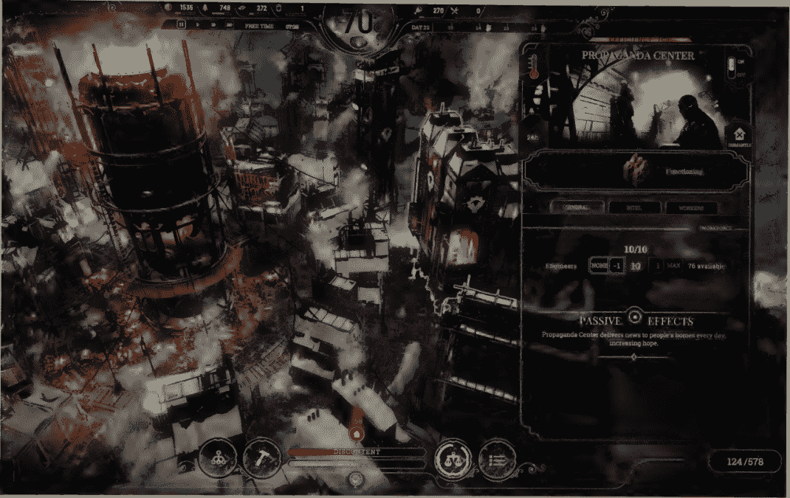

#### What type of gamer are you?（你是哪种类型的玩家？）

##### 独立游戏玩家

如今，PC 游戏已经不再只追求前沿画质。在过去几年中，所谓的“独立游戏”蓬勃发展，即由不超过十人的小型团队开发的游戏。自然，由于这些开发者的预算有限，独立游戏在技术上受到更多限制，但通常会带来更具创新性或实验性的玩法概念，而这些是大预算开发者没有自由去创造的。

而且，由于这些游戏对硬件的要求通常不高（大多数独立游戏使用 2D 画面，而非计算密集度更高的 3D 图形），因此一台专为这些精彩游戏打造的 PC 也不需要太高的配置。这样一来，这种 PC 的价格就更加亲民、灵活；你可能花上超过 1,000 英镑，但完全也可以只花 600 英镑，就能得到一台还能用上好几年的游戏 PC。

更重要的是，你仍然可以在这类 PC 上玩一些高端游戏，只是需要巧妙利用每款游戏的图形设置菜单，才能让其中许多游戏运行流畅。自选配置的好处在于，如果你确实想涉足高端 3D 游戏，可以把更多预算花在显卡等部件上；但归根结底，你得到的系统会比我们这里展示的其他示例配置更快过时。下面来看看我们为一台以独立游戏为目标打造的低端 PC 示例：

- Cooler Master K350 中塔式机箱
- 华硕 H81M-Plus Intel H81 芯片组主板
- Intel Pentium G3240 3.1GHz 双核 CPU
- EVGA GTX 750 Ti 2GB GPU
- 海盗船 Vengeance 1,600MHz 8GB 内存
- 希捷 7,200rpm 1TB 硬盘
- 海盗船 VS550 电源

由于独立游戏开发者的预算要小得多，他们拥有更大的创新与发明空间。这也是独立游戏作为一个子类型如此受欢迎的原因。

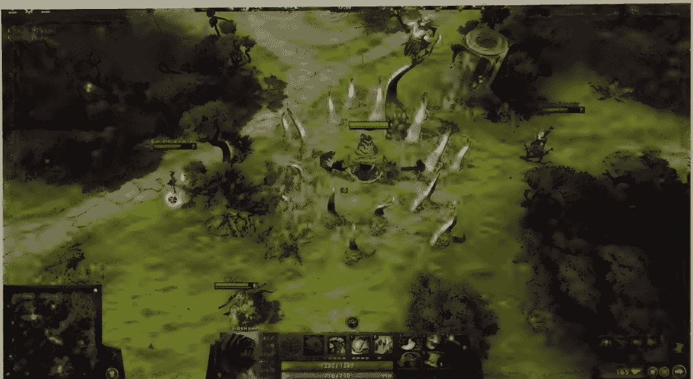

电竞在竞技层面和观众娱乐层面都变得越来越受欢迎。这在很大程度上解释了为什么 Dota 2 或《英雄联盟》这类高技巧游戏在 Twitch 上如此流行。

《堡垒之夜》是玩家最多的游戏之一，也一直是最常直播（和收看）的游戏之一。这个泡沫看上去还不会立即破裂。

##### 主播

在 Twitch 上直播游戏过程或为 YouTube 录制视频是一种极为流行的游戏方式；一些人受到大型视频内容创作者巨大成功的驱使，另一些人则只是喜欢在玩游戏时有人互动、学习。由于首要问题归根结底取决于你想直播哪类游戏，这也会决定你需要什么样的硬件。值得一提的是，由于你的目的是与全世界分享你的游戏过程，人们对画质会有一定预期；如果观众看不清游戏内容，他们为什么要留下来观看呢？

话虽如此，你仍然可以花大约 1,300 英镑组装一台相当能打的机器，从而以接近最佳效果运行大多数游戏。你很可能还想添置诸如第二台显示器——分辨率不必像主屏幕那么高——或者不错的麦克风和摄像头等配件，但这些都取决于个人偏好，以及你有多认真对待直播。

不过，你仍然需要考虑一些妥协。多任务处理很重要，尤其是如果你想要双显示器配置，因此多核处理器必不可少，更大的内存也同样重要。你要玩的游戏将决定所需的显卡，从而决定最终价格，所以请查看你感兴趣游戏的推荐系统要求，然后选择相近或更高的配置。下面是我们为一台面向直播的中端 PC 给出的建议：


- Bitfenix Prodigy 机箱
- 华硕 Z97I-Plus 主板
- Intel Core i5 4690K
- Arctic Cooling Freezer 7 Pro Rev 2 CPU 散热器
- NVIDIA GeForce GTX 960 2GB
- 海盗船 2000MHz DDR4 8GB 内存
- 1TB 希捷 SSHD 混合硬盘
- 海盗船 CX600 电源

##### 职业玩家

“职业玩家”的定义相当宽泛；虽然它越来越主要指的是职业选手——即在电竞赛事中参加高水平竞技的人——但也可以指那些将游戏当作严肃爱好并全心投入的玩家。无论哪种情况，这类玩家的需求都是拥有一台能让他们以最佳画质流畅运行最高端游戏的 PC。也就是说，这台机器要能在“超高”画质下以流畅的 60FPS（或更高）运行任何游戏，理想情况下还不需要太多调整设置或挑剔硬件。

正如你所预料的那样，这意味着要在一些玩家能买到的最佳部件上花费不少钱。典型职业玩家的 PC 会在机箱本身多些美学元素，比如各种可定制的 LED 灯、花哨的风扇，或者一款既为外观也为丰富硬件选项而设计的机箱。当然，这一切都取决于个人品味，但无论怎样，你都要花一大笔钱来购买一台能满足职业玩家需求的 PC。

但别误会，我们这里建议的配置绝不是游戏 PC 的最高水准。就性能而言，它仍然提供无拘无束的高端游戏体验，以及一系列齐全的附加功能，如固态硬盘、水冷和对可扩展链接接口（SLI）显卡的支持。我们的示例没有这些，但如果你想要绝对顶级的配置，那么瞄准 1,800 至 2,000 英镑的价格范围，就能得到一台在未来数年内都让你满意的游戏电脑。下面是一台高端游戏 PC 的示例：

- NZXT Source 340 中塔式机箱
- 技嘉 X99 Gaming 5 主板
- Intel Haswell-E 5820K 3.30GHz CPU
- 海盗船 H100i 水冷散热器
- MSI GeForce GTX 970 4GB
- G.Skill 2400MHz DDR4 16GB 内存
- 三星 840 EVO 2.5 英寸 250GB SSD
- 希捷 2TB SSHD 3.5 英寸硬盘
- 海盗船 CX750 电源

“职业玩家”一词通常与“硬核玩家”同义，本质上指的是玩遍所有最新、最棒游戏的人，从大型射击游戏到最有趣的独立游戏。

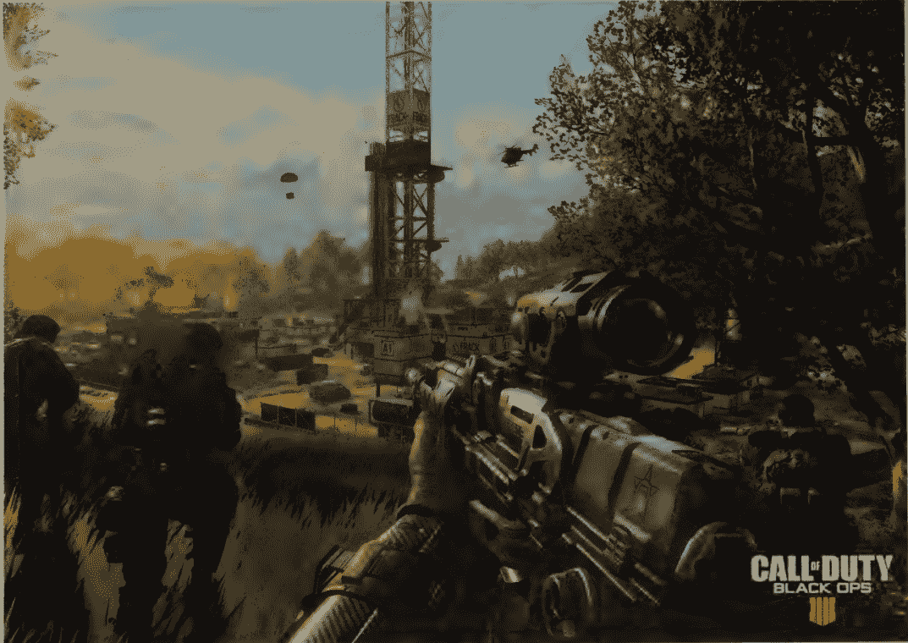


所以现在你大致知道自己可能想组装一台什么样的 PC 了。但要真正引导自己走上正确方向，你还需要考虑自己属于哪种玩家类型。虽然主机游戏通常也会登陆 PC，但有些游戏是专门为电脑设计的；从这个意义上说，知道你想玩哪些游戏，最终会告诉你你在寻找什么。这里有一份方便的速查表，帮助你认清自己是哪种类型的玩家。

像 *《魔兽世界》* 这样的 MMO 通常是 PC 平台独占，这往往是因为它们的深度、技术需求以及任意时刻可能的操作数量，都确实能从电脑相对于主机的优势中获益。

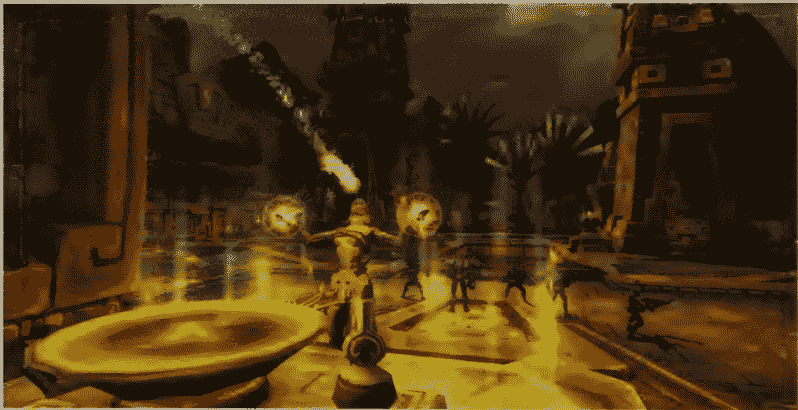


策略游戏通常更适合 PC，因为它们通常带有大量菜单和需要点击的按钮；所以如果你喜欢能让你思考的游戏，那么 PC 游戏正适合你。

| 类型 | 描述 | 备注 |
|---|---|---|
| FPS（第一人称射击游戏） | 代表第一人称射击游戏，这类游戏通常需要高端显卡和极为流畅的帧率才能发挥最佳效果，尤其是在线游玩时。PC 玩家会发誓说这个平台是玩 FPS 的唯一方式，不仅因为画面清晰度，还因为键盘鼠标组合带来的优势与更高技巧。在 PC 上盛行的所有类型中，这或许是最能催生大量职业玩家的类型。 | • 你需要一块高端显卡，以确保该类型所需的画质。<br>• 单人 FPS 游戏往往是 PC 上最吃配置的游戏之一；如果这是你的偏好，你就需要一台能应付它的 PC。<br>• 在配件方面，高刷新率显示器很重要，而高 DPI 游戏鼠标对于快速反应也很关键。 |
| MMO（大型多人在线游戏） | 大型多人在线游戏已经流行了几十年，其典型特征是可供探索的巨大世界、可互动的大量玩家以及极为多样的体验。无论是在太空中寻找财富，还是在奇幻背景下与其他阵营作战，MMO 几乎只出现在 PC 上。 | • 由于 MMO 通常对显卡要求不高，这里的关键是 CPU，因为它能让大量物体和玩家快速加载进来。<br>• 存储选项也值得考虑，因为 MMO 占用空间很大。不过使用 SSD 可以更快地加载庞大世界。<br>• 键盘布局也很重要，因为你通常需要将大量技能设为快捷键。 |
| MOBA（多人在线战术竞技游戏） | MOBA 几乎为 PC 游戏所独有，是一种极为流行的游戏类型，主要由《英雄联盟》主导。该类型在目标和风格上有所变化，但最常见的是 5v5 对战竞技场，玩家英雄在一场多人对战中升级，以争取对敌方团队的优势。 | • MOBA 对 PC 来说并不算有挑战性，因为它们几乎总是以俯视视角进行。高内存加响应快速的处理器有助于快速加载每场比赛。<br>• 稳定的网络连接也是一大优势；如果无法使用以太网连接，一定要选择能提供稳定高速传输的 Wi-Fi 适配器。<br>• 高 DPI 游戏鼠标在这里很有用，但带额外按钮的鼠标更优先。 |
| 开放世界 | 虽然开放世界游戏并非 PC 独占，但它们的优势在于这些游戏由能快速流式传输数据的系统驱动。这也是模组制作者非常喜欢的类型，而 PC 游戏的这一支线能带来主机无法企及的全新游戏和体验。 | • 作为一个类型，开放世界游戏或许提供了最广泛的设置范围，从而允许各种系统配置。机器每个关键部件越强大，你就越能在这个类型中感受到差异。<br>• 开放世界游戏通常依赖将数据流式传输进出活跃内存，因此内存和 CPU 是这里的最佳投入方向。 |
| 策略 | 由于策略游戏以菜单为中心，PC 游戏更适合这一类型，因为鼠标输入更便利。这可以涵盖回合制、类似桌游的体验（如《文明》），节奏极快的即时战略，以及庞大的模拟游戏子类型。后者通常围绕建造城市、经营企业或管理贸易展开。 | • 虽然策略游戏在画面清晰度上不会超越第一人称游戏，但有时它们对 GPU 的要求会出奇地高，所以必须要有能胜任的部件。<br>• 话虽如此，许多技术需求会受你的偏好影响。城市建造类游戏自然受益于更好的显卡，而回合制策略游戏则需要计算能力来更快速地应对 AI 敌方队伍。 |
| 大逃杀 | 作为这里唯一可以被视为“新兴”的类型，大逃杀的典型特征是多人体验，一大群玩家竞争成为最后存活者。其理念是在世界中搜寻越来越强但位置随机的武器和物品，同时活动空间不断缩小，因此紧张感不断上升。这也使它成为一个非常适合直播的类型。 | • 大多数人一定听说过《堡垒之夜》这个名字；正是这款游戏以其亲和的系统要求和对核心玩法的简化，让这一类型流行起来。不过，其他争夺王位的竞争者试图以更高的画质来区分自己，因此对图形性能的关注至关重要。<br>• 值得指出的一点是，这一类型非常新，因此这些游戏以我们无法预测的方式演变的潜力还是未知的。 |

### 需要考虑的事项

这都很好，但组件清单庞大且令人不知所措。我们相信你完全可以从我们每个装机方案中挑选零件并毫无问题地组装起来，但这对每个人都不适用。需求各不相同，而自行组装游戏 PC 的灵活性正是其相对于在线购买成品系统的价值所在。因此，在决定你的需求以及需要什么时，这里有一些你应该思考的事情。

#### 了解规格

虽然我们会在后面的章节中更详细地介绍购买硬件时应注意什么，但首先要知道你想玩什么类型的游戏并挑选与之匹配的零件是很重要的。例如，知道你需要一块 4GB 显卡，就会自动缩小可供选择的范围。

#### 未来-proof

与任何技术一样，真正未来-proof 的电脑是不存在的，尤其是游戏 PC。然而，如果你渴望打造一台能在未来几年内以相当舒适的方式满足游戏需求的机器，那么你现在自然需要在硬件上多花一点钱，以确保它能持久使用。这并不意味着最昂贵的零件，只是那些能让你持续使用并且在超频方面有良好推荐的零件（将在后面的章节中讨论）。

#### 形态

在大多数情况下，你希望机箱内部空间充足，以便空气能更有效地通过电脑，从而实现更好的散热。然而，如果便携性或美观很重要（也许电脑会放在很显眼的位置），那么就考虑匹配的形态；这意味着要匹配主板，而这最终决定了你能安装哪些零件，所以这是一个需要认真考虑的重要因素。

#### 驱动器和端口

任何 PC 装机中最灵活的方面之一就是安装的驱动器。你真的需要 DVD 驱动器吗？你更希望 SSD 提供的快速启动时间？还是你打算用千兆字节的数据填满磁盘驱动器？这些问题的答案会影响你需要或想要包含的零件。别忘了端口，因为如今你可能希望支持 USB Type-C 和 Thunderbolt 端口，特别是为了支持 4K 显示器。

#### 连接

除了端口之外，了解你将如何将电脑连接到世界也很重要。在理想情况下，你只需通过以太网连接到互联网，那么 Wi-Fi 适配器基本上就没用了；毕竟你几乎总是在下载游戏。除非你坚持使用 7.1 环绕声，否则可以忽略诸如此类需求的合适连接等附加功能。你不需要广告中宣传的每一个附加功能。

#### 初学者装机

最后需要考虑的一点是，你现在真的需要顶级 PC 吗？记住，通过自己组装，你可以选择能使用很长时间的零件，并在需要时只升级某些零件。如果你现在并不需要 32GB 内存——而坦率地说你可能不需要——那么就按最低需求选择，并随着时间的推移逐步增加。对所有其他零件也同样适用：现在购买更便宜、性能不那么出色的零件，可以让你在几年后根据需求进行大笔升级。

## PART 1 工具篇

由于大多数现代电脑组件的组装方式更像给成年人的精致乐高，而不是精密电子元件，因此你真的不需要准备任何特别的东西来帮助你组装游戏 PC。话虽如此，仍有一些物品和注意事项需要牢记。

### 防静电

有几个障碍和绊脚石需要牢记。首先是任何电子设备的死敌：静电。仅仅把一块 450 英镑的显卡从防静电袋中取出就能将其损坏吗？是的，绝对可能，而且真的会发生。在处理任何游戏 PC 的珍贵组件之前，你应该先接地。轻轻触碰最近的散热器或管道即可，只要你之后没有在尼龙地毯上摩擦脚回到工作台。另一个解决方案是使用防静电腕带。它有助于阻止静电的自然积累，但远非必需。

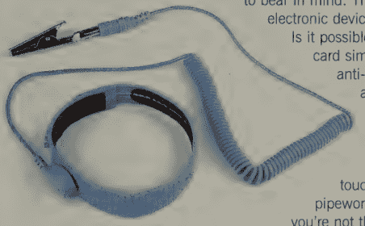

### 扎带

在本书指导你组装自己的 PC 过程中，你会经常听到关于气流以及保持电脑尽可能凉爽的需求。热量是你的敌人。它会缩短组件的使用寿命，并使 PC 更吵（更多风扇更努力地保持温度下降）。帮助保持 PC 内部温度下降的最简单方法之一是确保空气从机箱正面或顶部流向后方“排气口”的流动不会被机箱内部的线缆杂乱所阻碍。驯服这种缠绕的最简单方法是使用一些精心放置的扎带。它们非常便宜且可丢弃——你不必吝啬使用。


### 十字螺丝刀

最后但绝非最不重要是普通的十字螺丝刀。信不信由你，这是你唯一需要的工具（虽然备一把小号长嘴钳也不错）。大多数现代游戏机箱的美妙之处在于它们几乎完全免工具组装。几乎所有东西都可以插槽、卡扣或拧螺丝（即使是螺丝，大多数也是拇指螺丝，可以徒手完成）。


### 安装软件

你可能会注意到，我们在任何装机方案中都没有包含 DVD（光驱）。这主要是因为本书的制作人员在过去五年里根本没有接触过任何 DVD 或光盘。我们理解这可能不适用于每个人，一些读者可能会想知道他们该如何安装 Windows 或像 Ubuntu 或 Steam OS 这样的 Linux 发行版。对于 Windows，你只需从微软下载官方 ISO（磁盘映像）以及他们的便捷 USB 工具，即可在 `http://windows.microsoft.com/en-GB/windows-8/create-reset-refresh-media` 找到。所有你需要的是一个 8GB 的 USB 闪存盘。现在 Steam OS，这款为 Steam Machines 提供动力的基于 Linux 的操作系统，已支持超过 1,000 款游戏，你可能想尝试一下。有关如何通过 USB 闪存盘安装的完整说明，只需访问 `http://store.steampowered.com/steamos`。

## PART 2 游戏 PC 的结构

- 了解基础知识 20
- 研究你的装机方案 25
- 主板 26
- 中央处理器（CPU） 30
- 系统内存 34
- 显卡 37
- 机箱 41
- 电源、存储和散热 45

乍一看，自行组装游戏 PC 听起来像是一项困难且复杂的任务，可能变成一场工程马拉松。虽然确实可以花费数月时间打造一个改装机箱并配备定制液冷系统，但也可以在不到一个小时内把硬件拼装起来。

也许这听起来不可能，但想想它的各个部分总和。打开机箱后，只需安装电源和主板，然后再添加 CPU、内存、显卡以及任何存储或媒体驱动器。或许这对新手来说听起来有点轻视这项看似复杂的任务，但事实是，现代电脑硬件在多年来已被标准化到极致，基本上就是即插即用。只要你有条理并正确连接，机器可以在安装 Windows 所需的时间内以最少的麻烦启动运行。

然而，与许多事情一样，工作的很大一部分成功取决于规划阶段。如果你规划不当，你可能需要花时间去购买电源延长线或完成工作所必需的散热风扇。我们还应发出警告：如果订购了不兼容的零件（例如错误的内存或处理器），你可能会发现自己无法在不订购替换组件的情况下完成 PC 装机。

## PART 2：理解基础知识

让我们从一开始列出组件清单。如果你拆开几乎任何一台 PC，你会得到主板、处理器、内存、显卡、散热、SSD/硬盘、机箱和电源。虽然常见还能找到 DVD 或蓝光光驱，但这并非严格必需，如今网络和音频很可能已作为主板的一部分集成在一起，而过去它们是独立的扩展卡。

任何计算机的核心都是主板，它容纳并连接所有硬件。

你经常会听到某个组件被叫做不同的名字，所以主板也叫主板，显卡是 VGA（视频图形适配器），机箱是外壳，RAM（随机存取存储器）也叫系统内存。

不可否认的是，计算机行业热爱缩写。除了 VGA 和 RAM，你肯定还会遇到 CPU（中央处理器）、PSU（电源供应单元）、HDD（硬盘驱动器）、SSD（固态硬盘）等等。你不一定需要理解每一个缩写的含义，但偶尔你需要停下来核对一下字母汤不会把你带偏。很容易看到一张带有 DVI-I 和 HDMI 输出的显卡（它们是用于显示器和电视的不同类型的连接），并注意到你打算使用的 4K 显示器也带有 HDMI，于是你会想：“是的，这能用，我只需要一根 HDMI 线。”但顺着这个思路走可能会让你走上错误的道路；从技术上讲连接是可行的，但这对你的系统来说是最好的选择吗？

这就是为什么如此关键要理解不仅你的需求是什么，而且每个部件的作用是什么。我们将在本章后面详细讨论每件硬件的具体细节，但了解它们如何连接在一起并工作的基本原理仍然很重要。起初，面对大量令人困惑的技术细节可能会让人不知所措，但一步一步来。首先重要的是对一些总体数字有个概念，通过这些数字来理解你需要构建的系统。说得有点归纳化，为了帮助你克服最初的障碍，我们挑选了被广泛认为对运行视频游戏最关键的三个部件：

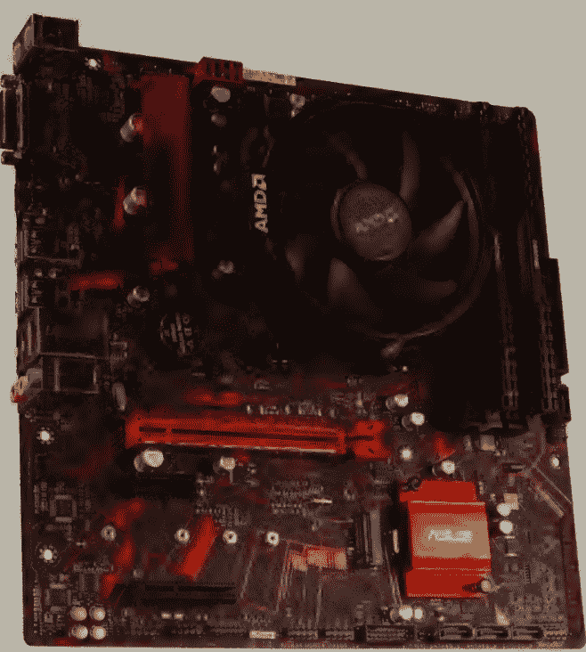

|  | CPU | GPU | RAM |
| --- | --- | --- | --- |
| 用途： | 中央处理器，或简称处理器，通常被称为任何计算机的“大脑”。它是分配并控制机器每个进程的部分，根据各自硬件需求的增减分配计算能力。在游戏中，CPU 负责逻辑计算，意味着玩家不控制的角色的 AI、物理系统以及任何需要快速加载数据的东西。 | 正如名字所暗示的，图形处理单元负责生成游戏的视觉效果。虽然有一种误解认为它完全只用于 3D 图像，但这只部分正确，因为 2D 游戏并不会以同样的方式挑战 GPU。它被设计用来处理一项特定工作，推动像素和渲染形状。与 CPU 不同，CPU 更像多任务处理者，GPU 在其用途上是专门化的。如果高端的图形是你的目标，那么高端 GPU 最终将是实现这一目标的手段。 | 系统内存或随机存取存储器是本质上控制计算机思考速度快的硬件。它是一种缓存，从计算机开机到关机的那一刻起，数据和进程就被加载到其存储中。活动进程——我们指的是正在使用的软件或后台进行的操作——都依赖于 RAM。CPU 选择加载到内存中的内容，但一旦加载，相同的进程完成所需的时间更少。更多的 RAM 意味着更好的多任务处理、更快的加载时间和同时运行的更多软件。 |
| 需要关注的内容： | CPU 广告中宣传的大数字是其速度，以 GHz 为单位。这个数字越大，处理器“思考”得越快。然而，拥有能够多任务处理的 CPU 也很重要，因此选择一个具有多个核心的 CPU 是必不可少的（如今四核是最低标准）。 | 说实话，关于 GPU 购买，有远比这里列出的三项更关键的事情需要了解。话虽如此，当谈到系统规格时，它能处理的数据量通常是关注的重点。在这种意义上，寻找 GPU 板载内存的千兆字节（GB）数量是你的起点。 | 这里有一些因素超出了单纯的数字，尤其是兼容性方面，但幸运的是，对于 RAM 来说，通常只要选择最大的数字就够了。这以千兆字节为单位衡量，不过了解你获得的内存条的个数也很重要，因为你的主板空间有限。 |

现在，任何游戏机器都是其部件的总和。如果某一区域存在瓶颈，那么无论其余计算机配置多高，它都会在克服该限制时出现问题。例如，系统内存不足最终会限制机器上可以同时运行的内容，在开始卡顿、变慢甚至崩溃之前。别担心，对于经过合理考虑的游戏 PC 来说这种情况不太可能发生，但确实值得知道你的装机需要经过适当的调研，以确保你有能力运行想要玩的游戏。

考虑到这一点，有一种方便的方法可以在不需要太多每件硬件的技术知识的情况下弄清楚这一点。最低和推荐系统要求在创建初始指导方针时非常有用；这些是游戏开发者自己认为为了在可接受的水平上享受游戏所必需的硬件期望。过去你会在 DVD 盒背面的角落找到这些信息，但由于如今几乎所有 PC 游戏都是数字交付的，所以你需要查看数字商店中的详细信息，或者简单地搜索游戏名称加上“系统要求”。

记住，虽然这可以作为你需要的良好指导，但不一定是你想要的。即使是推荐配置也绝不是可能的最高水平。事实上，由于有大量可自定义视觉效果的图形设置，许多 PC 游戏旨在尽可能广泛的计算机上运行（更不用说游戏主机中较差的硬件），推荐系统要求应被视为指导方针而非严格规则。计算机硬件可以以惊人的速度发展，因此以今天的推荐规格为目标，很可能会让你拥有一台比经过适当构建、具有持久吸引力的机器更早过时的机器。

在知道推荐规格应作为跳板而非购物清单的前提下，让我们来看看你可能玩的不同类型游戏的一些指导方针：

### FPS

| 游戏： | Overwatch | Battlefield 1 |
| --- | --- | --- |
| 推荐系统配置： | CPU: Intel Core i5 or AMD Phenom II X3<br>GPU: Nvidia GeForce GTX 660 or ATI Radeon HD 7950<br>RAM: 6GB | CPU: Intel Core i7 4790K or AMD Ryzen 3 1300X<br>GPU: Nvidia GeForce GTX 1060 6GB or AMD Radeon RX 480 8GB<br>RAM: 12GB |

正在接管游戏的最新技术是实时光线追踪，它模拟逼真的环境光照。

虽然 Overwatch 不是市场上最新鲜的游戏，但定期发布新内容以及蓬勃发展的电竞和内容流媒体场景使其保持为最受欢迎的 FPS 游戏之一。它是一个很好的研究对象，因为其卡通视觉效果仍然相当 demanding，尽管推荐的 GPU 不会输出最高的分辨率。另一方面，Battlefield 1 偏爱写实和高端的视觉效果，这得益于驱动它的特殊 Frostbite 引擎。后者的要求明显更大，不过有趣的是，Battlefield 1 的最低 GPU 与 Overwatch 的推荐 GPU 相同。

最终，如果第一人称游戏是你的爱好，Battlefield 1 是你可能想要瞄准的非常好的测试。这里推荐的每个部件都处于顶级水平，将使你的系统保持相当多年。Battlefield 系列游戏以展示视频游戏图形的最新技术而闻名，所以这是一个不错的基准目标。

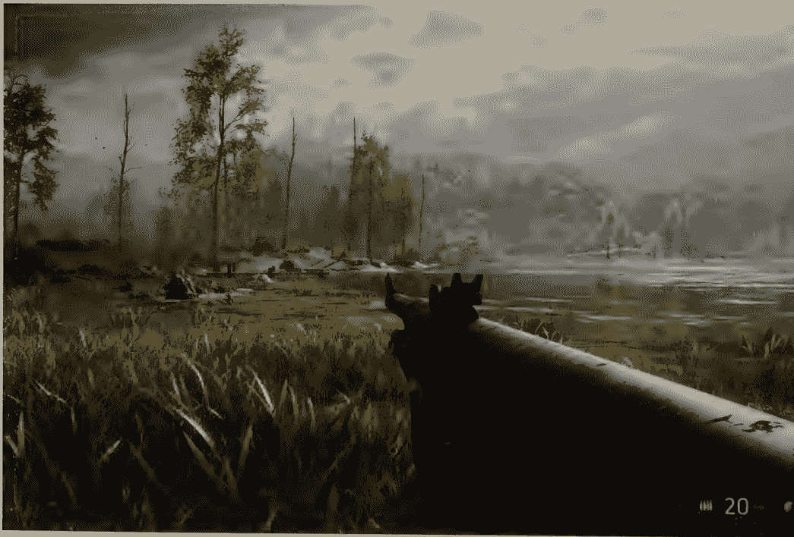

### Strategy

| Game: | *Planet Coaster* | *Total War: Three Kingdoms* |
|---|---|---|


| Recommended system specs: | CPU: Intel Core i7-4770 3.90 GHz or AMD FX-8350 4.0GHz<br>GPU: Nvidia GeForce GTX 980 4GB or AMD R9 380 4GB<br>RAM: 12GB | CPU: Intel Core i5 6600 or AMD Ryzen 5 2600X<br>GPU: Nvidia GeForce GTX 970 or AMD R9 Fury X 4GB<br>RAM: 8GB |
|---|---|---|

尽管现在已经过去几年了，*Planet Coaster* 仍然是策略游戏模拟分支有多么密集的绝佳例子。坦白说，更新的可比游戏可能会为潜在的建造者提供更当代的见解，例如 *Anno 1800* 的要求高得多，而且当然也有与之相匹配的高级视觉效果。但 *Planet Coaster* 是现代模拟游戏的典型代表，并突出了游戏系统可能有多复杂；高端视觉效果、过山车的物理计算、你公园游客的 AI 计算——*Planet Coaster* 应有尽有，这也体现在其配置要求上。*Total War* 则是完全不同的故事。这些游戏是关于在图形精美、逼真的战斗中管理庞大军队。有趣的是，它同样具有实时 AI 计算、高端视觉效果和弹药的基于物理的计算。尽管如此，它并不推荐使用游戏硬件的绝对顶峰来流畅运行，因此如果你对策略游戏感兴趣，这是一个很好的目标估计。

Planet Coaster 可能因为其卡通视觉效果而不像是一款密集的游戏，但实际上有一个复杂的 AI 系统控制着人群。


### Battle Royale

| Game: | *Fortnite* | *Apex Legends* |
|---|---|---|
| Recommended system specs: | CPU: Intel Core i5 2.8 GHz<br>GPU: Nvidia GeForce GTX 660 2GB or AMD Radeon HD 7870 2GB<br>RAM: 8GB | CPU: Intel Core i5 3570K 3.4GHz<br>GPU: Nvidia GeForce GTX 970 4GB or AMD Radeon RX 290 4GB<br>RAM: 8GB |

大逃杀类型在过去几年中迅速流行起来，因此它今后可能以任何多种方式演变。

虽然大逃杀类型每天都在诞生新的作品，但目前要击败的作品是 Epic Games 的 *Fortnite* 和 Respawn Entertainment 的 *Apex Legends*。它们各自走的是截然不同的路线，*Fortnite* 偏爱夸张的卡通视觉效果，而 *Apex Legends* 在基调上可能不那么严肃，但在外观上则更严肃一些。它们都是大型开放世界多人游戏体验，因此在技术要求方面几乎没有回旋余地。正如你所见，对可访问性的重视意味着 *Fortnite* 对玩家的要求低于 *Apex Legends*，但不要落入“卡通”图形等于计算能力更低的陷阱；有很多后期处理效果需要某些游戏达到皮克斯般的视觉质量，因此请记住始终检查系统要求。另请注意，两款游戏在 GPU 方面的要求都高于 CPU 或 RAM——这是该类型的副作用，因为它在计算性玩法方面并不多。


### Research your build

几乎不可能凭空猜出游戏 PC 的价格，因为硬件种类繁多。你可以说，£799 是一个不错的起点（仅主机，不含显示器、鼠标和键盘），£999 是一个心理里程碑，£1,299 让你物有所值，而 £1,999 就是“哎呀，这要多少钱？”如果你追求绝对最高，游戏 PC 的花费可能达到 £4,000、£6,000 或 £8,000。为了说明背景，有些人会去康沃尔或西班牙度一周假，而其他人则会前往西印度群岛或在肯尼亚参加野生动物探险。

开始起草新游戏 PC 规格的最简单方法是查看其中一家小型 PC 制造商的网站。他们无疑会提供一系列可定制的 PC，你可以使用一系列下拉菜单选项来选择组件。虽然这并不能帮助你精确了解需要什么，但它能迅速让你清楚了解当前游戏硬件的状态以及组件的成本。

让我们分解一台 £1,200 的 PC 配置，以了解资金的流向，并为你提供一份需要自行添加的零件清单。每个组件的价格范围各不相同，但总体来说我们可以说：

- £400 用于一块 6GB 显卡
- £150 用于一颗 Intel i5 CPU
- £100-£150 用于主板
- £80 用于机箱
- £70 用于一份 Windows 10 拷贝
- £60-£70 用于 16GB DDR4 内存
- £60 用于 500GB 固态硬盘
- £50-£70 用于 2TB 或 3TB 硬盘
- £50-£60 用于电源
- £40 用于 CPU 风冷散热器
- £20 用于 DVD 驱动器
- 总计 – 约 £1,200

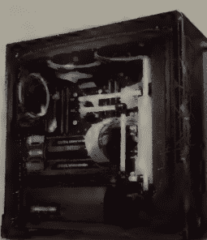

你可以从许多在线零售商处购买定制组装的 PC，甚至可以挑选想要的零件，但你仍然无法完全掌控。

这些价格只是指导性说明，说明你如何分解一台像样的游戏 PC 的成本，但在实践中，你可以在每个组件上花费更少，也可以花费更多。重点在于说明哪些组件消耗了大部分资金，这就是为什么组件大致按成本顺序排列的原因。

有一点是肯定的：如果从任何制造商处拿出一台 £799、£999、£1,299 或 £1,999 的 PC 并拆解，你将无法以相同价格自行组装出同样的 PC。你支付的是零售价，这意味着组装完全相同的 PC 会花费更多，而且这还不包括你投入的时间或将组装好的 PC 连同保修一起送到你家门口的便利性。

这可能让这些预装机器看起来很诱人，但这忽略了组装自己的系统的全部意义：灵活性。当然，这些机器会让你更快、更容易地开始使用，而且价格相对可比，但你永远不会拥有完全想要的 PC，而且如果你精明地挑选，你会发现自己能够找到这些预装机中零件的替代品，它们同样好用，甚至可能更便宜。

当然，这一切的起点在于知识；了解每个零件该寻找什么，将为你做出最终购买决定提供所需工具。你的需求和想要的东西会影响这一点，再加上对每个零件用途的理解以及需要关注的技术细节，将帮助你遵循必要的硬件清单，并逐一挑选出具体的购买品。你可能有不同的做法，但有条不紊地浏览清单并寻找潜在选项会让整个过程显得不那么令人不知所措。我们将在此之后更详细地介绍每个零件，并按有助于兼容性的顺序进行。

在进行技术购买时，你应该尝试寻找用户和专业评测，以增加对你的选择完美的信心。

### Form factor

计算机行业已经整理出大约 40 种不同的机箱规格，以确保给定的主板能够装入特定机箱并与特定电源配合工作，但幸运的是，我们可以安全地忽略任何过时、晦涩或无关的机箱规格，因为游戏机比为大规模数据存储而构建的 PC 更为标准。

对于游戏 PC，主流机箱规格是 ATX，它将提供最多的扩展插槽——意味着安装显卡等硬件的空间。凭借这一空间，它为制造商提供了充足的空间来设计主板，以提供相当多的多样性。更大的板并不意味着你应该填满它，因为硬件之间的空间越大，机箱内的空气循环就越好，从而避免过热。ATX 之所以成为标准是有原因的，但在所有可用选项中，它在可安装零件的灵活性方面提供了最多的选择，同时仍允许进行合理的线缆管理和空气流通。

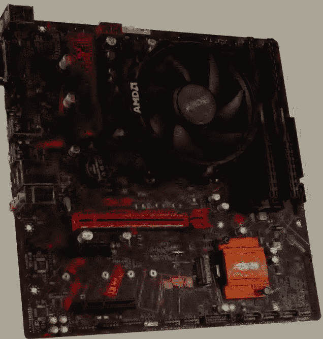

一些零售商出售带有已安装 RAM、处理器，有时甚至是专用 CPU 散热器的主板套装。

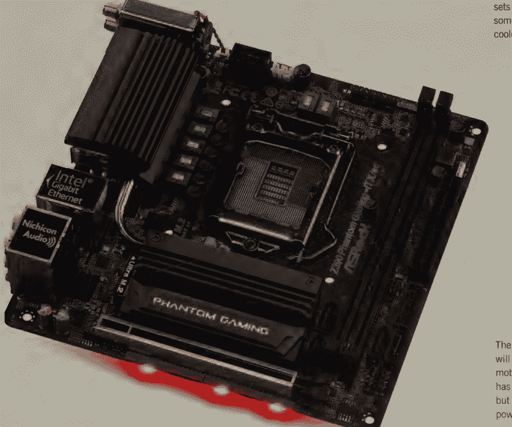

你的 PC 机箱尺寸将控制主板尺寸。当然，更小的 Mini ITX 有更多限制，但仍然可以构建一个微型动力核心。

除此之外，还有更小尺寸的 Micro ATX 和 Mini ITX。Micro ATX 在占用空间较小与提供足够数量的扩展插槽之间取得了很好的平衡。它们依然是 ATX 的不错替代选择，并不一定需要做出太多妥协。另一方面，Mini ITX 是三者中最小的，自然在可安装的部件上限制更多，但只要你追求的不是最高端的游戏技术，那么对于想组装一台不占太多空间且便携性极高的 PC 的用户来说，它就是一个可选方案。值得补充的是，还有更大的 E-ATX 或 XL-ATX 规格，但如果你考虑的系统需要这么大的空间，那么你本来就打算组装一台远远超出 PC 组装入门阶段需求的机器。

更通用的芯片组适合游戏玩家。AMD 在耐用性方面稍微更公平一些，目前 Ryzen AM4 插槽系列的处理器应该还能持续一段时间。从这个意义上说，X370 和 X470 芯片组偏向发烧友级别，而更广泛的预算选项意味着游戏玩家有更多选择，并且不一定会限制未来升级的选择。

Intel 和 AMD 都提供非常高端的芯片组——分别是 X299 和 X399——用于同样高端的处理器，但这些绝对是处于极致端的。这并不是说它们不会给你带来最佳的游戏性能，但事实上，这里的技术提升很难配得上它们高昂的价格。

### 芯片组

这里就是字母汤（指各种型号缩写）容易让人困惑的地方，因为你需要确保处理器上的芯片组与主板上的芯片组匹配。否则它们根本无法工作。这也是厂商特定的，所以如果你选择 Intel CPU，那么你需要一块对应的主板。令人沮丧的是，你使用的芯片组确实很重要，更糟糕的是，这一领域还会定期更新。关注这一点的核心原因在于，芯片组所支持的数据传输速度最终会影响处理器与系统进程之间的瓶颈程度，其中还包括 RAM 的兼容速度。

在 Intel 阵营中，你有面向发烧友的 Z370 和 Z390，而 H370 和 B360 是

如果你没有相关知识，挑选一家质量好的制造商是最难的挑战，但在线评论会帮助你分辨优劣。

### 扩展插槽

从某种程度上概括来说，扩展插槽是任何给定主板制造商所创造的特定空间。任何高端主板设计都有特定数量的连接（这很大程度上由 Intel 或 AMD 针对特定芯片组设定）。然而，这些单独连接如何分配则完全取决于制造商：一块主板可能拥有三个 PCIe 3.0 x16 插槽、三个 PCIe 3.0 x1 插槽和 1 个 M.2 插槽，而另一块可能有两个 PCIe 3.0 x16 插槽、四个 PCIe 3.0 x1 插槽和两个 M.2 插槽。可用扩展插槽的数量和类型将决定可安装部件的绝对最大配置，因此如果你想组建双 GPU 系统，那么你需要确保有两个 PCIe 3.0 x16 插槽可用。

值得了解的是，PCIe——即 PCI Express——是当今扩展卡的标准，后面的数字（x1、x4、x8 或 x16）指的是每个插槽的大小。这样你就能知道什么部件适合什么位置：GPU 会占用 x16 插槽，而无法插入较小的 PCIe x4 插槽，后者通常用于 Wi-Fi 适配器等扩展卡。然而，即使是 PCIe，其类别内也有不同的版本，虽然这不一定是最关键的考虑因素，但计算机硬件不断演变的特性确实意味着你应始终再次确认所购买的扩展卡能否与主板现有的扩展插槽正常工作。

我们还提到了 M.2 插槽，这是一种在笔记本电脑中常见的连接类型，但由于这些驱动器（最常用于固态硬盘）外形小巧，它在 PC 硬件中也变得越来越流行。我们会在讨论存储选项时再详细说明，但大多数现代主板至少会配备一个这样的插槽。

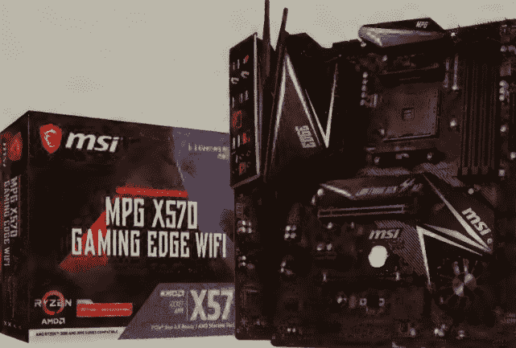

#### 内存

除了扩展插槽，你还需要关注最大内存容量。这通常以两组数字表示：首先是绝对最大值——例如 64GB——然后是一个说明有多少个独立内存插槽的数字。例如，如果一块主板支持 4x16GB，那就意味着有四个独立内存插槽，每个最大容量为 16GB——这样你就能知道系统的绝对上限。考虑你可用的潜在速度也很重要。有些主板——或者更确切地说，有些芯片组——仅限于支持 DDR3 内存，其速度比日益成为标准的 DDR4 更慢。即使在那些类别中，你也可能会发现内存速度是一个限制因素。如果某个芯片组只允许最高 2,666MHz 的内存速度，那么花额外的钱买高端 3,200MHz 内存就没有意义了。这就像一辆超级跑车堵在市中心的车流中，内存本身可以达到更快的速度，却被限制住了，本质上就是把钱浪费在永远无法实现的速度潜力上。

### 输入/输出

也许最不受到关注的领域，就是主板的输入/输出（简称 I/O）规格，它详细描述了可以直接与主板进行的连接类型。这基本上意味着任何可以插入电脑背面并与主板直接交互的设备。曾几何时，这些功能非常有限，但如今标准化已经让许多核心需求得以包含在内：显示和音频输出、网线输入，以及键盘和鼠标的连接，都已成为主板的一部分。

但这并不意味着没有需要留意的地方。板载 Wi-Fi 或蓝牙对某些人来说可能至关重要，而在游戏主板上并不常见，除非你多花一点钱。如果这对你来说是必需品——而且很可能的确如此——那么要么选择带有这些板载功能的主板，要么购买一个 Wi-Fi 适配器来为你完成这项工作。

在其他方面，像 USB 3.1 或 Thunderbolt 3 这样的连接接口，即使不是马上用到，也会在某个时候很有用；而音频发烧友可能要考虑花更多钱来确保主板音频输出能力的质量。不过，在这些情况下，你可能更合适使用专用声卡来获得 5.1 或更高等级的环绕声。归根结底，要思考你的即时需求以及这些需求可能带来的连接方式，然后确认你心仪的主板是否能够满足这些。

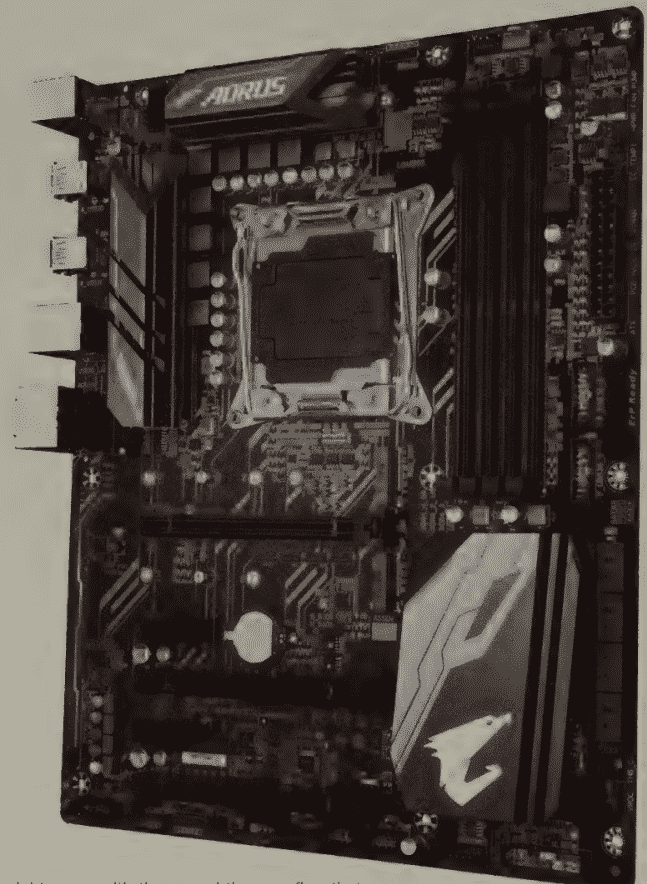

### 超频还是双 GPU？

我们在本手册后面有一个专门介绍超频的部分，但现在我们要说的是：超频并不是业余 PC 组装者在刚开始时想要忙碌的事情。尽管如此，超频和双 GPU 设置都是你在组装之初就需要考虑的事情。并非所有主板都允许这些功能，所以如果你觉得这可能是你以后想考虑的东西，那么你就需要更加努力地寻找为此设计的主板。说到双 GPU 设置，你需要寻找支持 SLI 或 CrossFire 的主板。这类组装更具技术性，需要更多考量，而且双 GPU 实际上往往并不比同等功率的单个 GPU 更高效。这确实是一个专业领域；也许值得为未来的组装考虑一下。

购买主板时要记住的重要事情是，让它与你的处理器所属的芯片组正确匹配。

# 第二部分

中央处理器（CPU）

我们来谈谈处理器。具体来说，我们讨论的是CPU（中央处理器），而不是GPU（图形处理器）甚至APU（加速处理器）。CPU常被称为计算机的大脑，但硅片并不能真正独立思考。事实上，CPU只不过是一台非常聪明的计算器，每秒执行数十亿次的数学计算。

这个类比的问题在于，CPU会将这些海量数字在PC内来回传递，尤其会将数据流输送给你的显卡，显卡再将其渲染到显示器上，呈现令人惊叹的画面。如果按照这个思路思考，CPU更像是PC的心脏而非大脑，但无论你如何想象，CPU都极其重要。

精美的封装是一回事，但i9 9900K是目前顶级的主流处理器之一。

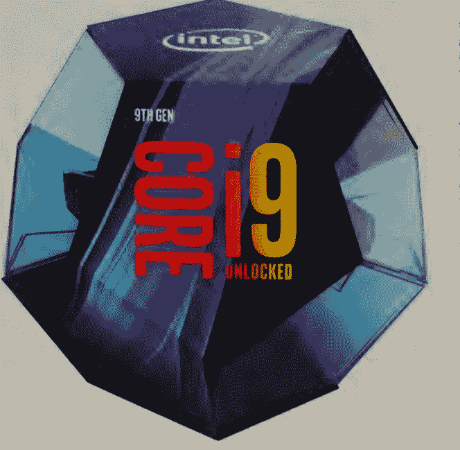

第一步是选择你想要使用的CPU系列。这将有助于你确定特定的CPU插槽类型和少数几款主板芯片组，当你将其与所选的主板规格结合时，就能更好地为新PC选择主板。

CPU市场只有两大主流竞争者：AMD一直扮演着老鼠的角色，而英特尔则是那只相当令人生畏的猫。

在比较不同CPU时，你需要考虑许多特性，我们将逐一探讨。这无疑是你为游戏PC所做的最重要——也是最昂贵——的采购之一，但它确实附带了一堆缩写词和术语。从插槽到核心数量，所有东西都可能让外行感到困惑。因此，我们不会只丢出几个例子就完事，而是先逐一梳理购买CPU时你会遇到的各个要素。

## 插槽

“插槽”一词指的就是处理器芯片与主板之间的机械连接类型。它的用途是帮助你购买兼容的部件，只要你购买的主板匹配插槽类型，那么至少在机械层面，你的部件就能组装在一起。通常，英特尔CPU使用1151插槽，AMD芯片使用AM4，但这些规格随时可能变化；只要插槽与你的主板匹配，这个要素就不必过多担心。

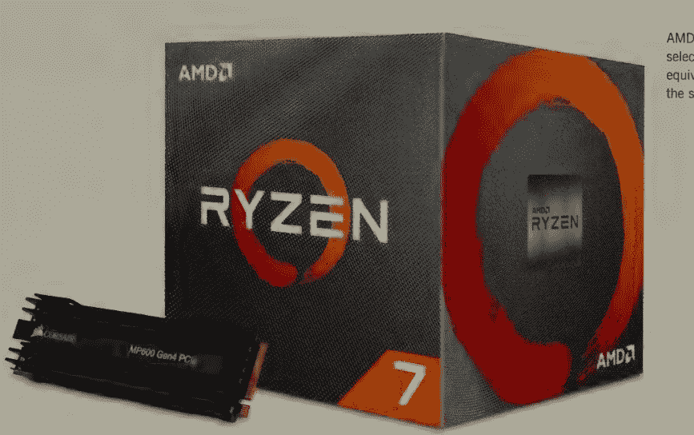

AMD的Ryzen系列是当前的选择，比英特尔的同级产品便宜，但也是不错的替代品。

#### 核心

如果我们真的把CPU视为计算机的大脑，那么核心数量本质上就代表它有多少个大脑。在过去，计算机只有一个芯片用于计算，芯片的速度决定了处理进程的快慢。如今，CPU可以拥有多个核心，从而更轻松地实现多任务处理。这对视频游戏尤为重要，因为在向显卡和硬盘传输数据的同时，物理系统和光渲染的计算也需要进行——核心越多，机器的处理能力就越强。不过，了解你常玩的游戏类型也很值得。多核处理器如今非常普及，游戏开发者知道他们基本可以保证至少四个核心的多处理能力。然而，人们可能会倾向于认为核心越多性能越强，但这并不完全正确；除非某个程序、游戏或工具是专门为利用更多核心而开发的，否则花高价增加核心数量和频率可能不会有任何优势。

不过，如果你发现自己可能会参与处理器密集型工作，比如3D设计或视频编辑与渲染，那么你可能应该考虑追求更多核心而非更高频率。四核是最常见的配置，但更便宜的CPU可能是双核，而六核和八核正在逐渐取代长期标准的四核——尽管目前它们的价格仍然有点高。归根结底，这是一个选择：如果你经常要处理计算密集型任务，并在这些情况下频繁进行多任务操作，那么你需要购买核心数量更多的CPU。如果你只追求游戏，那么四核芯片就完全能满足你的需求。

## 线程数

事实上，这几乎总是与CPU的核心数相关。如果有四个核心，那么很可能就有四个线程。除非特别说明，处理器总是先完成当前任务再处理下一个任务，因此线程数指的是CPU在同一时间能够执行的应用程序总数。四个核心、四个线程、四个应用程序。然而，某些处理器提供了一种称为“同步多线程”的功能——英特尔处理器称之为“超线程”——它让操作系统认为逻辑核心数量实际上翻倍了。虽然这并不会真正增加可用核心的数量，但它允许处理器在每个核心上对两个应用程序进行多任务处理，并更轻松地切换任务。这不是购买CPU时的关键因素，但也是一个值得留意的额外加分项。

## 核心尺寸


以纳米（nm）为单位，相对于CPU上的单个核心，核心尺寸这个指标在很大程度上可以忽略。如果你组装一台相当典型的计算机——无论预算如何——在CPU的核心尺寸方面，你很可能会看到14nm、22nm或32nm这些数字。如果你要深入研究硬件采购的细节，那么值得知道的是，较小的核心尺寸会带来更高效的功耗和计算速度，在这方面英特尔芯片目前领先。但实际上，与一些更核心的指标相比，核心尺寸是一个相当微不足道的考量因素；在挑选处理器时，不必担心忽略核心尺寸。

## 核心名称

这不过是制造商——基本就是英特尔或AMD——为处理器上安装的特定核心型号所起的名称术语。它们一直在变化，即使在特定的芯片家族内部，具体的核心型号也经常升级、更改或改进。例如，英特尔最新的i系列处理器，最初被称为Sandy Bridge，后来变成Ivy Bridge，接着又发展到了Coffee Lake和Cascade Lake等。特定型号的名称永远在变，这我们也没办法；你通常可以通过价格来判断最新的芯片组（新型号更贵），但如果你一无所知，不妨搜索相关信息。名称本身无关紧要，但只要你研究该系列的最新芯片组，它就是一种快速检查你所购CPU新旧程度的简单方法。

> 遗憾的是，PC硬件中你经常会遇到像“Threadripper”这样愚蠢的名字，它们往往只是营销包装，没什么实际意义。

## 时钟/睿频速度

大多数CPU在速度方面会有两个参数：“时钟”和“睿频”。在捣鼓PC时你会经常遇到“时钟”这个术语，它本质上指的是与计算机内部机械时钟相比的速度——系统的一切都以该时钟为计时基准。CPU的时钟速度就是其基础频率，用于描述处理器在未满载时运行的速度。这当然是一个重要参数，因为处理器永远不应低于这个速度运行，但既然你要在这台PC上玩游戏——也就是说要给处理器分配任务——你也应该关注睿频速度。这是处理器在满载时能够运行的速度——换句话说，在被用于处理游戏等密集型任务时——它基本上代表了处理器的最大能力。这其实是在硬件采购中需要注意的最重要因素之一，在购买部件时应当认真对待。

## FSB/QPI/UPI/DMI/HT速度

这些缩写真的那么重要吗？嗯，既是也不是。每个缩写都指处理器中使用的“总线”类型。计算机的“总线”——正如其名——是将数据从CPU传输到其他硬件的载体。因此，这个部件的速度会影响其他元件（如显卡或内存）向计算机中央大脑接收和回传数据的速度。就像你乘坐的公共汽车一样，它跑得越快，到达目的地就越快。然而，这些缩写本身并不那么重要。FSB可能是最常见的，尽管已越来越过时，而较新的——如DMI——每秒最高可传输20 GT/s。你可能还会发现这个数值以MHz（兆赫兹）为单位，这二者是有区别的。MHz是总线的速度，而GT/s是它能够完成的传输次数。虽然速度对于计算机总线来说很重要，但现代架构要求能够完成的传输次数同样重要。在这方面，总线的宽度往往比速度更重要；再用交通运输来类比，如果一辆公交车在满载时能载两倍于另一辆较小却稍快的公交车的乘客，那么它就能运送更多乘客。幸好你并不需要太担心其中的原理；只需明白这个数字越高——无论以何种方式衡量——对你系统的整体性能就越好。

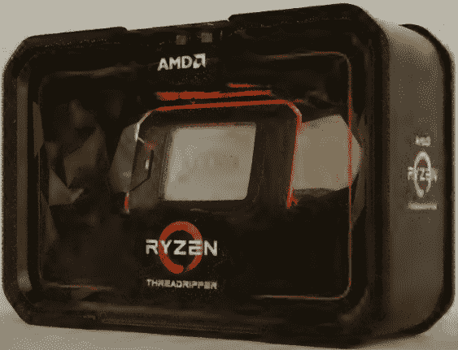

## 电压、功率与温度

最后一件你需要留意的事情是 CPU 的功耗，尽管事实上，它很少会影响你的购买决策，甚至也很少会成为不同选择之间的差异点。与机器中的所有部件一样，CPU 使用的功率与其运行温度相关——功率越大，温度越高。这可以说是精心维护中最重要的一个方面，因为当你的部件温度过高时，它们就有损坏的风险。你可能无法获得关于这些属性的全部信息，或者可能只获得功耗信息而得不到温度信息（反之亦然），所以尽量使用类似的部件作为参考点。最重要的是要注意 CPU 的 TDP（热设计功耗），即 CPU 因温度过高而无法正常工作的临界点。虽然在一般情况下这不太可能成为问题，但如果确实过热，处理器很可能会降低性能，导致你的机器运行极其缓慢，在最坏的情况下，甚至会完全关闭 CPU。如果你对机器进行超频（我们稍后会讲到），或者发现自己经常让 CPU 超过其 TDP 超负荷运行，那么你需要采取一些预防措施来确保问题得到解决——要么为 PC 添加更多散热系统，要么减少所做的超频，甚至更换 CPU 的导热硅脂。

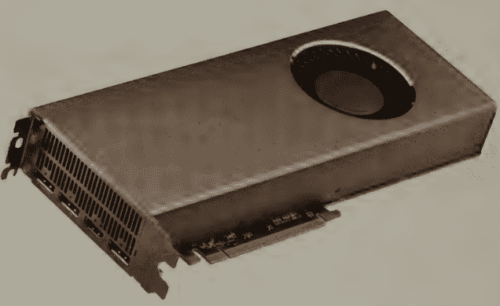

因此，需要考虑到的是，对于游戏 PC，你应当关注 i系列。尽管与 AMD 同类产品相比价格略高，但该公司的声誉值得留意——俗话说，无风不起浪，英特尔以生产高质量处理器而闻名，完全物有所值。

一直以来，AMD 似乎总是在追赶英特尔，但得益于其在移动领域的成功，这家公司已经开始缩短差距。

另一方面，AMD 在英特尔的主导下已经挣扎多年。区别在于英特尔也自己制造 CPU，因此它能够在创新设计的同时更容易地采用新的生产方法。AMD 对此的回应是以更低的价格提供其 CPU，希望抢占预算市场。与英特尔一样，它也有面向低端和服务器 CPU 的产品线，目前面向游戏玩家的是其锐龙系列。这里的区别——除了价格之外——在于 AMD 强调更多核心，八核处理器大约与英特尔四核同类产品价格相当。如前所述，更多核心并不一定意味着更好的游戏性能，所以这可能不是一个值得选择的方向——然而，如果你想削减系统的一些成本，那么从英特尔转向 AMD 将给你这个机会。

英特尔 CPU 往往核心更少却价格更高，但关键在于，其所包含的核心比 AMD 同类产品运行得更高效、更有效。

### 英特尔还是 AMD？

这是选购 CPU 时常见的问题，但事实上答案相当简单。虽然市场上还有其他一些 CPU 设计商，但大多数面向的是专业市场——移动设备、低功耗设备等——而不是更通用的硬件。就 PC 游戏而言，处理器行业实际上是一场两强之争，而目前的领先者多年来一直处于领先地位。

就目前而言，英特尔对 CPU 市场的控制是不可动摇的。其最新的 i系列——i3、i5、i7 和 i9——已被证明非常受欢迎，它在效率与性能之间取得了良好的平衡，并具有所有硬件购买者所希望的稳定性。它还保留着面向低预算替代选择的奔腾和赛扬系列——这不是我们真正需要关心的——以及至强系列，后者每个 CPU 提供的核心数远超典型的四核。这一系列更符合企业大规模服务器的需求，而且——再说一次——不是我们真正需要的东西

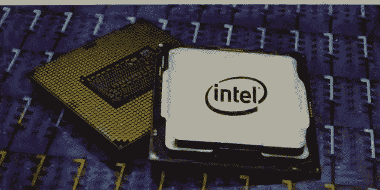

### 系统内存

系统内存，也就是 RAM，是组装 PC 时的主要部分，因为它通常会影响程序或数据加载的速度，而且成本可能很高——一套 128GB 的 DDR4 内存价格在 600 英镑左右。但这属于绝对的极端情况，除了最痴迷的极客之外，对谁来说都完全没有必要。虽然内存市场与任何科技行业一样处于不断变化之中，但幸运的是，在可用性、兼容性和游戏需求方面，还是有相当大的一致性的。

很多非常适合游戏的高端 RAM 都带有可自定义的 RGB 灯效，对于那些购买带玻璃面板机箱以便观察内部的人来说，这是一个不错的额外配置。

需要考虑三个因素：模块数量、模块容量和内存的时钟速度。各种品牌和型号有数百种组合，但或许应该从散热片说起。这听起来可能只是外观问题，但你需要确保内存能装进主板，并且不会干扰高端风冷散热器。另一方面，如果你使用的是水冷散热，那么可以放心，散热片不会造成问题。

你需要多少内存？说实话，只要你买得起，你确实可以想装多少就装多少，但超过 16GB 之后，你不太可能从中获得多少好处。如果你真心觉得系统速度很重要，那么多花点钱上 32GB 也无妨，但再往上就纯属浪费了。此外

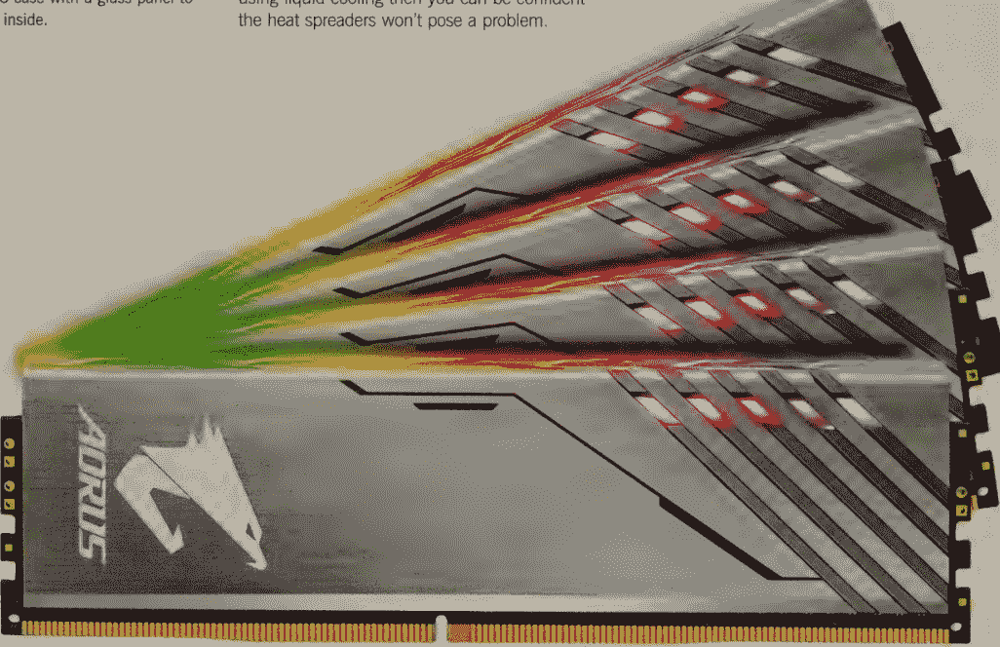

还有一个问题就是 RAM 的运行速度——以 MHz 为单位——但和最大模块数量及容量一样，在这方面，你的主板将决定可能的上限。

就装机而言，RAM 也许是最灵活的，也是以相对较低的成本增加一些额外性能的最佳途径。不过对于游戏来说，8GB 或 16GB 就足够了；真正的问题归结为你想要什么类型的内存？

#### 内存类型

DIMM、DRAM、DDR、SDRAM；内存有各种各样的类型，可能会让人有些头大。有些类型甚至有专门针对特定型号的专属缩写——坦白说，这有点让人吃不消。DDR 是最常见的，无疑也是装入游戏 PC 中最可靠、兼容性最好的类型。DDR 本身已经发展了好几代，目前价格实惠的标准是 DDR4。你可以把它想象成每年都会有新款 iPhone 发布；总会有更新、更快的型号出现。重要的是选出适合你的那一款。幸运的是，购买内存时你不会遇到太多特别陌生的东西，不过你仍然需要和主板核对一下是否兼容。DDR4 现在比以往任何时候都更实惠，但一些 AMD 芯片组仍然只支持到 DDR4，这会限制内存的速度。如果预算不是问题，那么买一套 DDR4 内存条当然值得；但只要买一套高端 DDR3 内存条，你也不会察觉出太大差别——而且你的钱包也会感激你。除此之外，DDR5 于 2019 年首次亮相，因此它仍然处于价格的高端区间，适合那些钱多得没处花的人；除非它的价格大幅下降，否则它所带来的优势还不足以让你觉得物有所值。

#### 内存容量

在购买 RAM 时，这也许是最需要留意的重要数字，单是因为它直接关系到 RAM 能处理的数据量。请记住，大多数处理器会将 RAM 限制在 64GB——所以不用太操心去塞满 128GB——但实际上，32GB 已经大大超出了需要。如果你想在预算上省钱，那么 8GB 足以满足需求；但只需多花一点点钱，你就能买到 16GB，并因此获得显著优势。可供选择的选项有很多，所以一定要货比三家，找出最适合你的方案。无论你做什么，都不要把这一点与 RAM 的速度混淆——内存容量

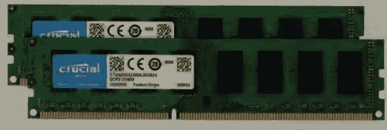

其实只是你的 RAM 在任意时刻能处理的数据量。这个数字越高，系统在开始变慢之前能做的事情就越多。

#### 内存通道

你必须留意内存通道，并确保它与主板支持的通道相匹配。通道只是指针对内存条数量的优化配置，而且在大多数情况下，内存套件是以完整的通道套装形式出售的——通常可以通过 RAM 本身的描述看出来，例如 2X8GB 表示套件中有两条 RAM。双通道是最常见的，很可能就是你为主板挑选时需要选择的类型，但套件也有三通道和四通道的。值得注意的是，你可以从套件中取下单独的内存条，仍然可以良好运行，但考虑到额外费用，最好确保你购买的通道与主板的能力相对应。此外，虽然你可以将四通道套件安装到双通道主板上（在空间允许的情况下），但重要的是要知道这可能会带来一些降低功能的问题。由于主板检测内存的方式，它可能根本检测不到额外的内存，其时序也可能完全不对（影响系统稳定性），甚至可能将“可见”的内存总量缩减为一根内存条。为了避免任何问题，最好购买相匹配的内存通道。

你可能会看到像这样没有任何额外设计的内存。它确实更便宜，但如果没有安装散热片，你就需要想办法降低它们的运行温度。

#### 速度与延迟

影响内存工作速度的两个最大因素是速度（也称为频率或时钟速度）和延迟。频率——以 MHz 为单位，常见的有 1,600MHz、1,800MHz、2,133MHz、2,400MHz 和 3,000MHz——衡量的是 RAM 的带宽，影响的是数据一次能进出多少。而延迟影响的则是数据从 RAM 中传输出来的速度，这可能是一个令人困惑、很难查阅的统计量。通常以 CAS 延迟的形式出现（显示为一组数字，

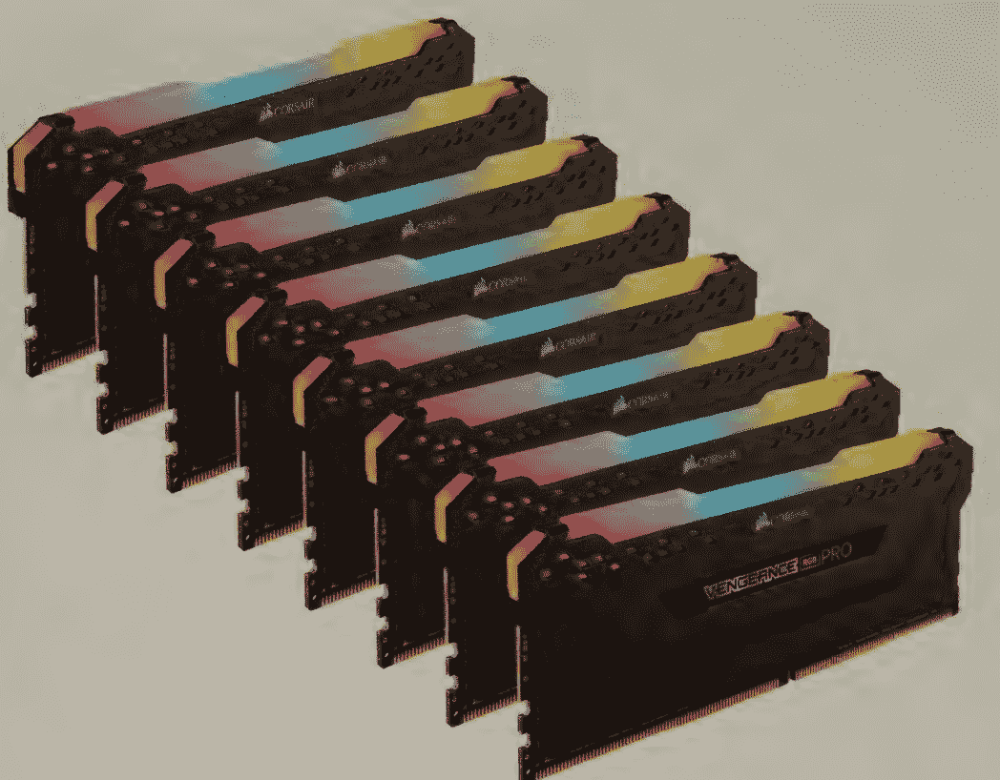

目前，内存套装的容量最高可达128GB，跨越八个模块。这目前有些过度，你还必须确保自己的主板能够支持它。

例如 15-17-17-35），这里的关键是寻找较低的数字而不是较高的数字——这与你要购买的许多部件相反。这就是RAM的“时序”，也就是操作之间的间隔时间；间隔时间越短，RAM运行速度就越快。你很可能需要多花一点钱来购买以14开头的CAS延迟（第一个数字虽然不是唯一重要的，但却是需要留意的）。

然而，这些参数中的一项提升，通常是以另一项的牺牲为代价的；你的RAM运行速度可能更快，但结果却是它能处理的数据更少。事实上，额外的速度实际上并不会带来多少性能提升，这意味着关键在于找到平衡。如果你打算使用DDR4内存，那么CAS延迟14–16、频率或速度2400–3000的配置将是最佳选择。然而，有趣的是，虽然DDR4确实拥有更好的存储密度和功耗效率，但它的CAS延迟往往高于DDR3。不过，综合考虑所有因素，DDR4的整体性能仍然更好。

#### XMP 与 AMP

你永远不会得到一根同时支持XMP和AMP的内存条——因为它们两者其实是完全相同的，只是AMP是更常见的XMP的AMD版本。所有内存条在购买时都带有其“安全”设置，这是一个略低于内存真正潜力的配置文件，它会将时序（延迟）和频率调到低于内存实际能力的设置。这是为了确保问题尽可能少——因为硬件可能安装到各种各样的机器上，兼容性是制造商的首要关注点。如今，许多内存套件带有XM或AM配置文件，这些内置设置可以手动激活，以便在不超频或自己调整设置的情况下，获得你内存条的最佳性能。如果存在此功能，请放心使用。

### 显卡

到目前为止，我们已经介绍了外形规格、主板、处理器和内存，但显卡却几乎未被提及。当你想到NVIDIA GeForce RTX 2080的价格接近700英镑时，一套SLI配置很容易花掉1400英镑，因此显卡是一个巨大的考虑因素。

幸运的是，除非你深入研究超频的细节，否则我们不需要了解显卡背后的很多技术。游戏显卡芯片市场只有两家公司：AMD（收购了ATI）和NVIDIA，它们在开发新图形芯片和提出巧妙想法以提升游戏体验的过程中不断相互超越。对游戏玩家来说，美妙之处在于AMD和NVIDIA的GPU必须与许多重要技术配合使用，这意味着在安装正确的驱动程序软件以确保显卡正常工作的情况下，现代显卡在游戏PC中是可以互换的。AMD和NVIDIA都支持PCI Express 3.0，以及你在任何像样的电源上都能找到的相同的6针和8针电源连接器，同时用于连接显示器的显示接口也都是相同的。这意味着我们能够将这些相互竞争的显卡视为一块简单的图形处理能力，而不必太担心兼容性问题。

目前，NVIDIA的技术在效率和低功耗方面胜过AMD，同时还能提供高性能，而且显卡市场的特性意味着AMD被迫降低价格以弥补其技术上的不足。但这两家公司也将它们的公版卡销售给一大批制造合作伙伴，GPU的供应范围正是在这里扩大。

购买GPU时有一些数字需要考虑，自然而然，你希望渲染3D场景的能力越强

NVIDIA目前的高端系列是其“图灵”系列，该系列本身分为三个价格档次。不过，所有这些档次都支持一定程度的光线追踪。

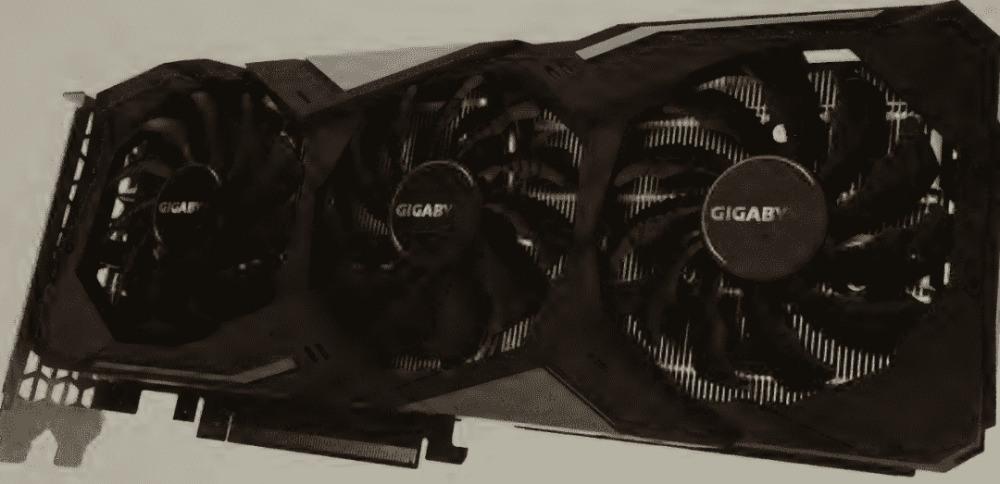

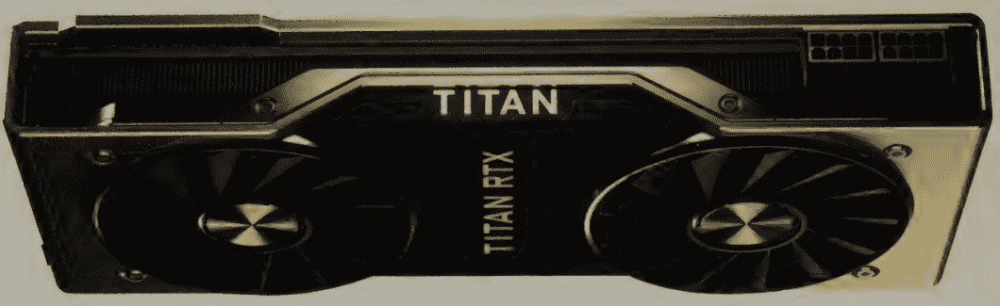

Titan是NVIDIA最高端的产物，单张显卡售价超过2000英镑。这真的只适合那些资金充裕的死忠发烧友。

在流畅的60帧每秒下，越能渲染出这种效果，这款硬件的价格就越开始主导整台PC的组装。大多数人会非常乐意购买一张拥有4GB内存的显卡，尽管进入超高分辨率屏幕、虚拟现实或120帧/秒的极致领域，确实意味着你需要开始考虑6GB、8GB甚至12GB的内存。我们将忽略双GPU型号，因为它们数量稀少、极其昂贵，而且与CrossFireX或SLI中的两张显卡相比也没有太大区别。毫无疑问，GPU是一个成本高昂的决定——但它也是拥有更多选择自由的领域之一。

#### 制造商

虽然GPU真正的设计者只有两家——AMD和NVIDIA——但制造商却数量众多，虽然这对首次购买者来说可能令人困惑，但实际上对消费者来说好得多，因为它能压低价格，刺激竞争和创新。然而，和所有此类事物一样，一些制造商比其他制造商更好，这是一个不断变化的动态系统。华硕、微星、EVGA和技嘉等品牌都以具有竞争力的价格提供优质产品而享有盛誉——你不需要支付过高的价格就能从这些制造商之一获得一款不错的GPU。挑选制造商并非易事，但我们也确实无法帮上什么忙——只需查看一些不同GPU的评测，如果它们主要是正面的，并讲述了显卡的可靠性和做工质量，那么你就应该知道它来自值得信赖的制造商。保持警惕，你就不太会遇到问题，因为更好的产品往往自然会脱颖而出。

#### 内存

购买显卡的好处在于，总的来说，只要找一个值得信赖的制造商、且内存容量大的型号，你很可能买到一张值得买的显卡。当然，这不是硬性规定，但这突显了内存的重要性。你的显卡内存越多，价格就越贵，因为它能够创造出更好的视觉效果。因此，你的预算将在很大程度上决定你能获得多大的内存。NVIDIA倾向于用其低功耗但效率极高的显卡主导市场，这些显卡的表现通常优于拥有更多内存的AMD显卡。在4GB内存下，你可能运行大多数现代游戏都没问题——甚至一些高端游戏——但在任何意义上，这都不能让你在未来保持竞争力。如今，6GB甚至8GB的显卡往往在成本与性能之间提供了恰当的平衡，尽管11GB显卡或配备24GB内存的NVIDIA Titan也有售，但价格通常超出大多数人承受范围。在预算范围内货比三家，而不是让自己执念于

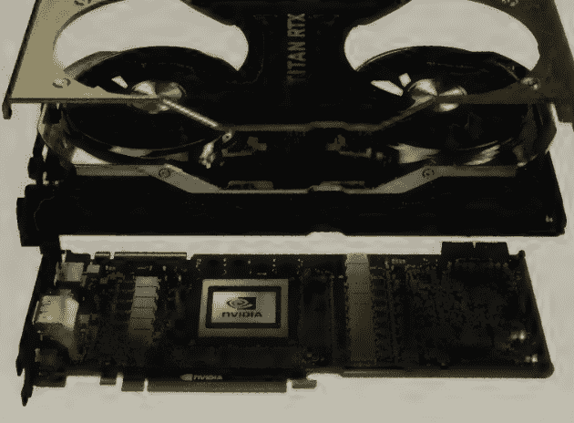

某个特定的内存目标，但内存越多，游戏体验就越流畅。

#### 核心

这可能会让新手感到困惑，因为许多在线商店将核心数作为GPU的主要特性来宣传，而不是像我们说的那样强调内存大小。核心数确实有一定意义，最终核心数告诉你某个特定GPU的速度有多快。这并不是一个需要严格比较的指标，因为有些显卡可以更有效地利用更少的核心，或计算更复杂的任务，但仍然是一个值得比较的参考值。核心数越高，显卡运行得越快；当然，事情并没有那么简单，但如今核心数往往与GPU的潜力相当具有可比性——所以不要在这个方面过于担心。和显卡内存一样，在预算范围内购物，而不是过分纠结于核心数。

#### 核心/加速时钟


与核心总数相关的是单个核心速度，这也是某些具有相同（甚至更少）核心数的显卡比其他显卡更强大的原因。把核心想象成显卡的微型引擎；核心时钟速度（以MHz为单位）表示该引擎的工作速度。这意味着更高的数字表示显卡的核心工作速度比竞争对手更快，所以这是一个很好的——虽然不是必须的——衡量指标。而加速时钟（Boost Clock）则是GPU所能达到的速度；与所有PC硬件一样，GPU以低于其真实性能的速度出售，以保持系统安全和显卡寿命。虽然你不需要一开始就提高该时钟速度，但还是要注意这个数字——如果你将来想超频，它有助于你了解其潜力。

### 散热

每个GPU都会自带一个板载风扇，这是在显卡忙着生成那些可爱的屏幕图像时保持其冷却的必要手段。它将承担3D游戏处理的大部分工作，因此保持冷却至关重要。制造商冷却的方法和偏好因显卡而异，而且事实上过去几年在功耗方面已经取得了长足的进步，因此你可能不必太担心散热问题。话虽如此，多花一点钱购买至少带有两个板载风扇的显卡总是值得的——这在你自己的散热系统之外，只是为了确保你的GPU得到良好对待的一点额外保障。你也可以买到带三个风扇的显卡，但这些风扇会较小，因此不得不更努力地工作（也更吵），而且它们提供的散热优势并不那么明显。

### 电源供应

由于你的PC中的GPU将吃掉机器一半以上的功率——至少在负载下——你应该清楚需要多少电力来驱动它。毕竟，这将直接影响你需要购买什么电源供应器。幸运的是，这些显卡的详细信息通常同时列出其功耗需求和建议的电源供应器。功耗需求完全取决于你关注的显卡及其强大程度，但你会看到低至200W、高达甚至超过450W的功耗——尽管GPU正变得越来越高效（因此也就越来越不耗电）。实际上，你希望功耗需求较低，因为这意味着显卡运行时温度会更低

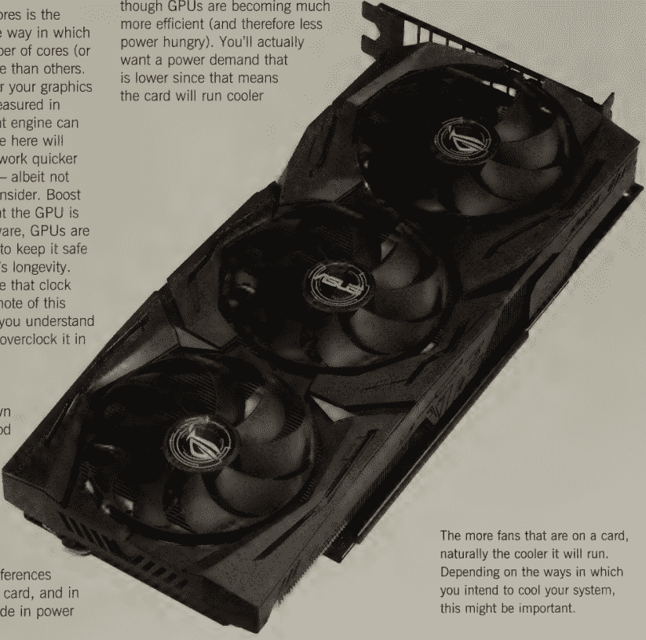

显卡上的风扇越多，运行温度自然就越低。根据你打算如何为系统散热，这一点可能很重要。

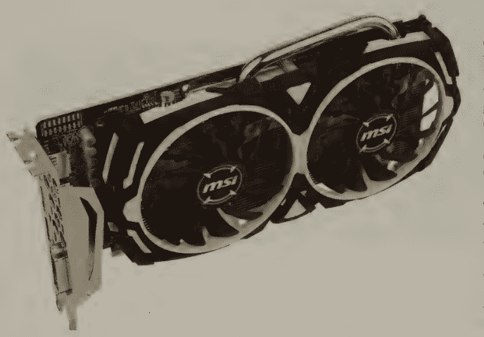

GPU无疑是任何游戏电脑中最重要的部分，但它并不一定需要是高端猛兽才算物有所值。

也因此会更安静，但请记住，需求与其作为GPU的性能是相关的，所以你不可能以特别低的功耗获得高性能显卡。

### SLI/CrossFire

如今大多数专用游戏显卡都提供SLI或CrossFire功能，所以你不需要太担心这个问题。这两个术语都指同时运行两块或更多GPU的能力，实际上能让你潜在的图形输出翻倍（成本也是如此）。这非常高端，如果你想要绝对最强大的机器，那么这是一个值得考虑的选项——但因此你需要考虑电源、机箱尺寸、主板、冷却系统，甚至还要有能避免瓶颈的处理器。当然，你也可以之后再加一块显卡组成SLI/CrossFire，但如果你打算这么做，我们建议同时购买两块相同的显卡以避免任何问题——技术时刻在变，到时候不一定还能找到与你现有显卡匹配的型号。

### 连接与尺寸

也许这只是GPU大范畴中的一个小因素，但它同样重要。首先，尺寸是至关重要的，因为你需要确保新显卡能装得下。这既包括它的物理大小——以便能毫无问题地装入机箱——也包括它在主板上占用的插槽数量。这些插槽几乎肯定是PCI Express（或PCIe），而对于典型的游戏PC GPU来说，它很可能会占用两个插槽的空间。在大多数情况下，这方面你不会遇到问题，因为如今的尺寸已相当标准化，但即便如此，仍然值得检查确认。连接同样重要，因为它决定了GPU通过什么方式将图像显示到显示器上。了解这一点很有用，因为一个影响另一个的购买决策，而你也想知道自己能通过尽可能好的视频线连接，把那头GPU猛兽的性能发挥到极致。

### 选择合适GPU的技巧

我们大概能猜到你此刻的感受。显卡可能是游戏PC中最重要的部分，而且可选方案如此之多，看起来会有点令人不知所措——即使你已经掌握了做出正确决定所需的信息。对于初次组装PC的新手来说，总会有一种偏执的感觉，觉得自己买的GPU在某个小方面不如之前看中的另一款。可以放心忽略这种感觉；那不一定是在质疑，而更多是出于对成本的困惑、警惕和担忧。只要你的决定在预算之内、能满足你的游戏需求，甚至还能为未来升级留出一点余地，那你就应该满意了。但我们也知道，几句宽慰的话帮不上忙，所以如果你真的需要在那笔昂贵的购买之前获得帮助，可以考虑查看用户评价。许多网站都有评分系统，其他网站甚至有客户的文字评论，虽然这不能作为信任某次购买的绝对理由，但看到其他客户讲述他们对显卡的使用体验，很可能会减轻一些顾虑（甚至解答疑问）。如果你选好几款潜在购买对象，就可以参考大众意见来做最终决定。查看评论数量也有帮助；如果一款显卡的评论数量远高于另一款，你可以有把握地认为前者更受欢迎，而商业规律表明，这可能确实是更好的产品。另外，使用基准测试也是好办法。许多技术网站提供不同GPU之间的基准对比，无论是专门设计的评分系统来评级和对比众多显卡，还是作为专业评测的一部分包含此类结果。由于太多不同因素会影响显卡性能，使用这些基准测试可以是找出所选GPU中哪一个能提供更好游戏体验的好方法，也能让你知道是否值得稍微调整预算来换取GPU性能的大幅提升。

## 第二部分 机箱

你的PC机箱在组装PC时几乎就是表达你身份的方式，它既关乎外观，也关乎功能。

在考虑组装新PC时的常见做法（尤其是新手）是专注于机器的内部部件。要考慮的已经太多了，机箱往往被视为相当简单的选择；远离那些令人困惑的缩写和技术细节，游戏PC硬件的机箱只是一个保护性的金属机架，仅此而已，对吧？嗯，其实不止如此。

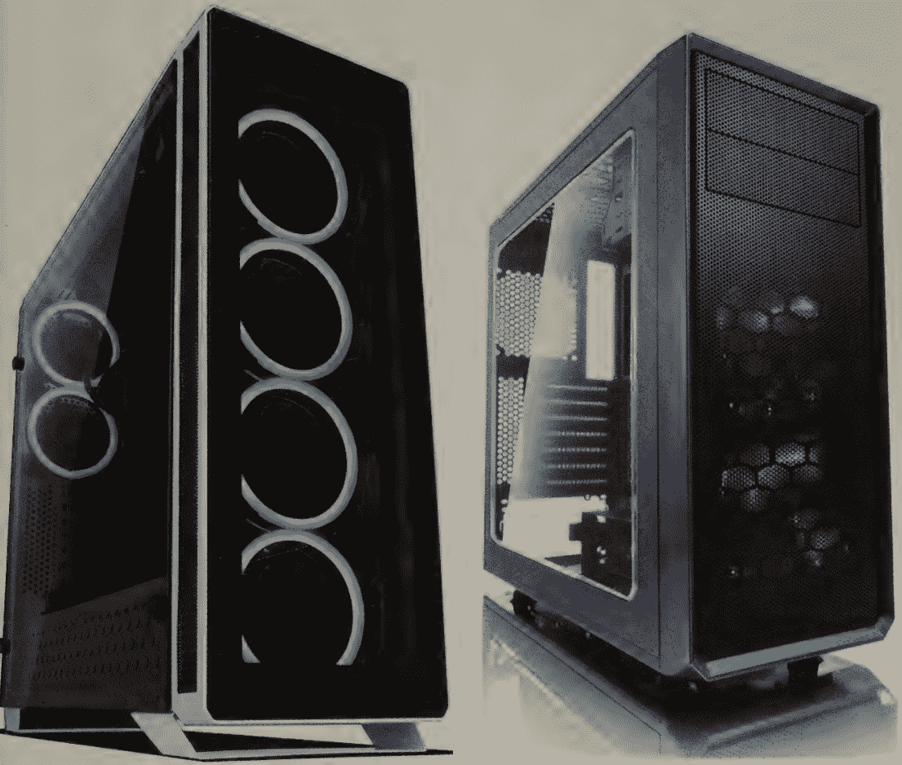

空机箱看起来似乎有很多空间，但一旦你开始塞入专用散热器和双GPU，这些空间很快就会消失。

在组装游戏PC的所有部件中，机箱提供的选择范围最大。虽然如果你只是想要一个不起眼的盒子并遵循主板规格的预期，这可能会很简单，但除了外观之外，仍有一些重要的细节需要考虑。有你选择的显卡的足够空间吗？你想要或需要多少个硬盘位？前置面板接口有哪些？你想要静音机箱，还是可以接受一点噪音？所以你看，需要考虑的比你想象的要多得多。然而，更重要的是，几乎每个问题都是偏好问题。与主要受你想玩的游戏影响的技术硬件不同，你对机箱的大部分需求取决于

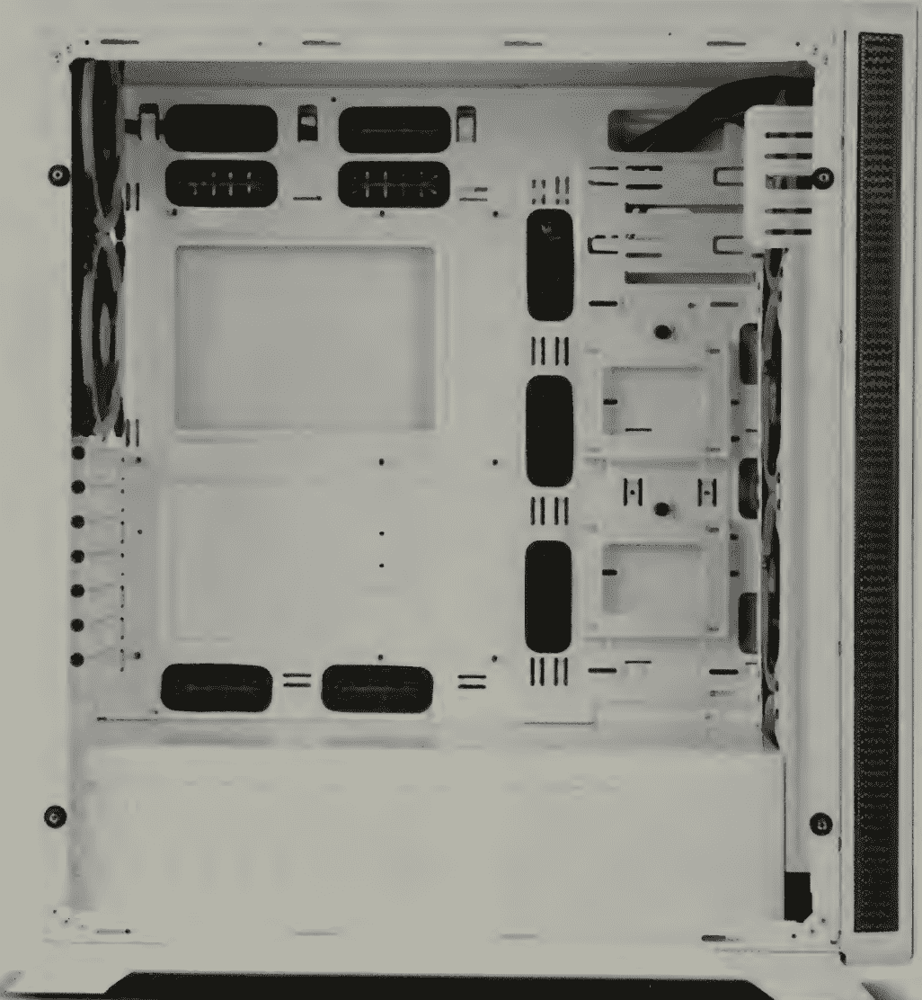

你个人对机器本身的期望——包括它的外观。也许比其他任何部件都要花更长时间才能做出最终决定，仅仅是因为这种多样性。

和其他事物一样，机箱的价格可以低也可以高，取决于你想要多少或能负担多少。有入门级选项，但你会因此失去许多热门功能和特性。花40英镑买不到任何令人兴奋的东西，而且实际上你更有可能买到设计不佳、最终导致机箱内气流受限的产品。在为机箱设定预算时，这是一个棘手的平衡，所以请考虑以下内容：

### 机箱尺寸

如果你对自己需要游戏PC满足的各类要求有所了解，那么机箱尺寸很可能是实现这些要求的关键因素之一。因此，这将影响你能使用哪块主板，进而影响与之相连的所有其他部件。事实上，游戏PC很容易占据房间里的很大物理空间，所以如果你必须尽可能缩小PC本身的体积，就需要特别密切关注尺寸。记得选择与PC内部兼容空间对应（这些始终在规格中列出）的主板，而且要记住，虽然你可以把游戏PC做得非常小，但如果真的这样做，组装本身会变得困难得多，因为你能装入的东西会非常受限，而且还需要控制热量输出。

### 声音抑制

虽然“静音游戏PC”的承诺有点误导性，但还是可以采取措施来尽量减少PC发出的噪音，如果你的PC在游戏时要与他人共享空间，这可能是组装的一个重要目标。机箱绝不是唯一能帮助实现这一目标的方式，但购买带有隔音材料安装在面板上的机箱，你会发现硬件在负载下发出的任何声音都会被降低到可容忍的程度。一些机箱制造商专攻“静音”机箱，其他制造商则可能在其每一代产品中推出一款满足这种需求的机箱，但无论如何，为“静音”性能设计的机箱都会明确宣传。

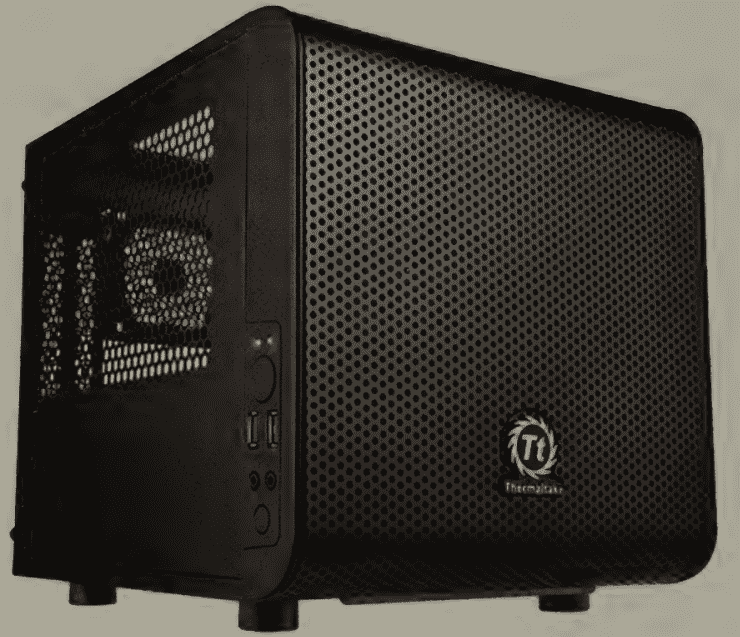

### 风扇与气流

热量是硬件最大的威胁，你性能越强，就越需要担心如何处理积聚的热量。最简单的防御措施是选择内部空间非常大的机箱；这样可以更容易让空气在机箱内流动，从而更好地散热。但要自己掌控这个问题，你应该使用通风设备来吸入冷空气并排出热空气（通常从前部和底部进入，从顶部和后部排出）。除入门级机箱外，大多数制造商至少会提供几个风扇帮助保持凉爽，但自带风扇并不总是够用。了解还有多少空间可以安装额外风扇——或者如果你想用水冷，那也可以——是选择机箱时一个相当重要的考量点。

Mini-ITX尺寸的机箱是最难组装的，因为空间非常有限，但只要你在购买时够聪明，这个尺寸的PC仍然可以发挥其作用。

### 组装便捷性

如今，PC组装变得越来越简单，这在很大程度上要归功于“免工具”机箱的标准化。这些优点不应当左右你的购买决定，主要是因为在设计更适合游戏的机箱时通常已经考虑了这些结构优势，但它们足以帮助你在一众选项中做出选择。虽然你确实希望看到这一优点——基本上意味着通过指旋螺钉或卡扣减少了损坏螺丝的风险——但还有其他优势

一些厂商在机箱的某些方面做得更好，而在另一些方面则稍逊一筹。在你研究想要的机箱时，很快就会发现这些差异。

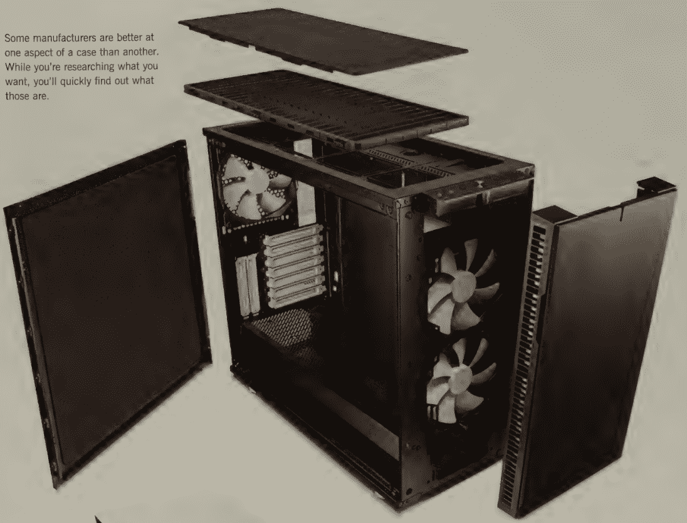

可以改变局势的东西包括：用于保护存储驱动器的橡胶理线孔、定制的驱动器托架位置，或是始终有用的理线管理选项，仅举几例。

### 前面板选项

这又是一个取决于个人喜好的情况。大多数机箱至少会配备几个 USB 3.0 接口，也许还有耳机和麦克风插孔。这些接口有助于减少移动电脑以访问后部连接所需的时间，但还可以提供更多。有些机箱配备 SD 卡或 Thunderbolt 3 接口、音量和单个风扇控制，甚至用于监控温度的 LCD 显示屏。不仅如此，前面板的设计方式本身也可以是一个重要特性，因为有些机箱会将按钮和接口隐藏在门后或机箱顶部，而另一些则旨在更炫目，配备 LED 照明。既然这是你通常会最常看到的机器部分，这就不是一个可以轻率做出的决定。

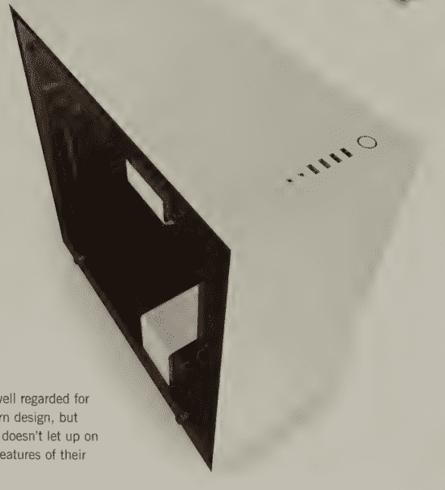

NZXT 的机箱因其时尚现代的设计而备受好评，但该厂商在机箱的功能特性上也毫不松懈。

## 第 2 部分 电源、存储和散热

到目前为止，我们已经涵盖了任何游戏 PC 的核心硬件，也就是那些会影响实际游戏本身的部件。但这绝不意味着工作已经完成，因为仍有其他对任何电脑都至关重要的部件需要考虑。幸运的是，在这些剩余需求方面，不必担心太多技术细节。

### 电源供应单元

在购买 PSU 时，你需要了解某些注意事项，其中首要一点是它能提供足够的电力让一切平稳运行。你的 GPU 很可能会提供建议的电源供应指南，这就是你的首要参考点。接下来是 CPU，它可能是游戏 PC 中第二大的耗电部件。总的来说，你可以预期 450W 到 650W 的 PSU 足以为单 GPU 配置供电。

但这还不是全部，因为更高质量的 PSU 可能是你可以为电脑购买的最好保险。请记住，这是机器中负责将交流电安全分配到所有昂贵硬件的部件；此处出现故障可能是一场代价高昂的灾难。优质的 PSU 不仅使用寿命更长，而且可以在其极限或附近运行而几乎不用担心故障；如果你购买的 PSU 比当前需求高出约 100W，那么在下一次组装时就可以轻松重复使用它。但你真正想要购买的是

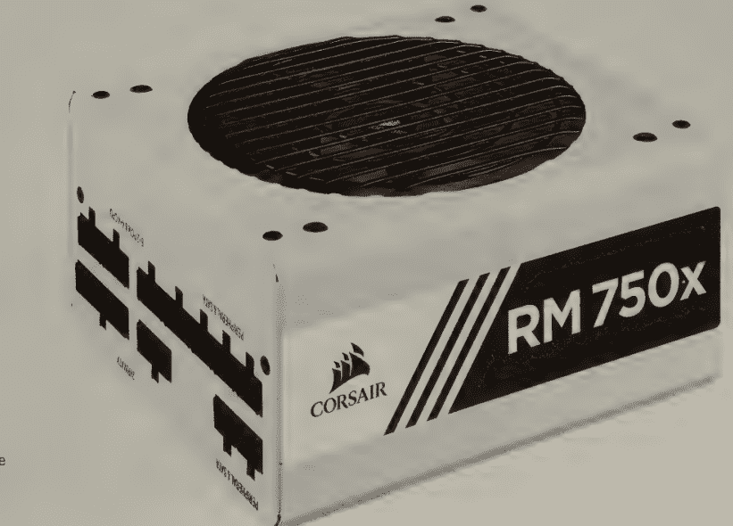

你选择的电源会对你电脑所有部件的使用寿命产生严重影响。

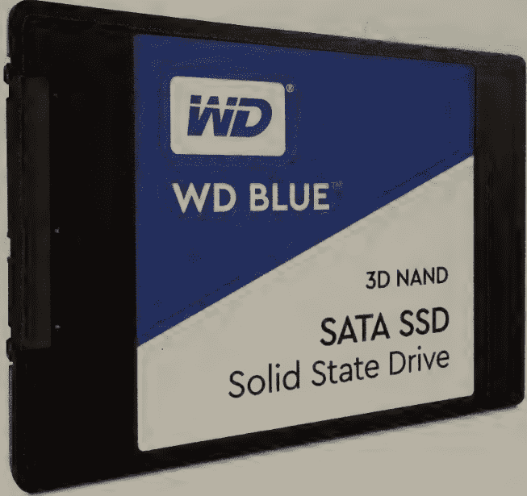

虽然 SSD 过去曾价格高得令人望而却步，但近年来价格已大幅下降，使得利用更快的读取速度变得物有所值。

高效的电源。无需过多深入细节，高效的 PSU 能更有效地将输入交流电转换为电脑硬件使用的输出直流电，这意味着浪费的能量更少。从长远来看，这会降低运行游戏主机时的能源账单，但在短期内，这意味着 PSU 排放到机箱内的热量更少，因此系统内部热量不会受到太大影响——而降低热量对硬件使用寿命至关重要。考虑到这一点，只购买通过 80 Plus 认证的 PSU。这保证了至少 80% 的效率，评级包括青铜、白银、金、白金和钛；等级越高，PSU 价格越贵，但在这里多花一点钱是稳妥的投资。

最后要考虑的是所谓的“模块化线缆”，这是一种可以移除所有未使用的线缆以腾出机箱内空间和减少杂乱的方式。它们是一个很棒的附加功能，你需要为此多付一点钱，但完全是可选的，只有在你特别在意保持机箱内部整洁时才值得考虑。

### 存储

就存储而言，行业相当一致。总是会有更快、更安全的存储选项的创新，而这些通常是最昂贵的购买。硬盘驱动器 HDD 已存在数十年，以物理方式将数据写入存储介质，是最便宜的选项。固态硬盘也存在一段时间了，但速度快得多，并且仍在不断演进。除此之外，还有 M.2 SSD 选项，越来越受欢迎，并以更小的外形直接安装在主板上。虽然 M.2 连接比其 SATA SSD 驱动器等价物更快，但加载时间之间的差异不足以成为选择此版本的主要原因，然而两者之间的价格通常也没有太大差异——事实上，大多数厂商会以几乎相同的价格将任一选项作为特定 SSD 型号的一部分提供。虽然固态硬盘在近年来变得更加实惠，但它们在容量和价格方面仍然有限。由于安装大量游戏很容易消耗一 TB 数据，因此对我们大多数人来说，完全用 SSD 配置一台机器是不切实际的。所以大多数人倾向于的做法是同时配备两种类型：250GB 或 500GB 的更快的 SSD 存储用于操作系统和经常访问的程序和游戏的安装，以及 2TB 或 3TB 的标准硬盘存储用于所有那些游戏。你可能可以只购买一块 1TB 固态硬盘花费更少，但这样你更可能遇到需要权衡要安装哪些游戏的情况。这是一个偏好问题，你很容易找到适合自己需求的平衡点，但存储的美妙之处在于它是少数可以按需随时升级的电脑硬件部件之一。

当然，由于所有数据都将存储在这些驱动器上，你会希望确保所购买的驱动器值得信赖。我们无法完全帮你做到这一点，不过购买三星、西数、 crucial 或希捷的驱动器更有可能提供一定程度的安全性。

## PART 2 Power, storage and cooling

到目前为止，我们已经涵盖了任何游戏 PC 的核心硬件，也就是那些会影响实际游戏本身的部件。但这绝不意味着工作已经完成，因为仍有其他对任何电脑都至关重要的部件需要考虑。幸运的是，在这些剩余需求方面，不必担心太多技术细节。

### Power supply units

在购买 PSU 时，你需要了解某些注意事项，其中首要一点是它能提供足够的电力让一切平稳运行。你的 GPU 很可能会提供建议的电源供应指南，这就是你的首要参考点。接下来是 CPU，它可能是游戏 PC 中第二大的耗电部件。总的来说，你可以预期 450W 到 650W 的 PSU 足以为单 GPU 配置供电。

但这还不是全部，因为更高质量的 PSU 可能是你可以为电脑购买的最好保险。请记住，这是机器中负责将交流电安全分配到所有昂贵硬件的部件；此处出现故障可能是一场代价高昂的灾难。优质的 PSU 不仅使用寿命更长，而且可以在其极限或附近运行而几乎不用担心故障；如果你购买的 PSU 比当前需求高出约 100W，那么在下一次组装时就可以轻松重复使用它。但你真正想要购买的是


你选择的电源会对你电脑所有部件的使用寿命产生严重影响。


虽然 SSD 过去曾价格高得令人望而却步，但近年来价格已大幅下降，使得利用更快的读取速度变得物有所值。

高效的电源。无需过多深入细节，高效的 PSU 能更有效地将输入交流电转换为电脑硬件使用的输出直流电，这意味着浪费的能量更少。从长远来看，这会降低运行游戏主机时的能源账单，但在短期内，这意味着 PSU 排放到机箱内的热量更少，因此系统内部热量不会受到太大影响——而降低热量对硬件使用寿命至关重要。考虑到这一点，只购买通过 80 Plus 认证的 PSU。这保证了至少 80% 的效率，评级包括 Bronze, Silver, Gold, Platinum, and Titanium；等级越高，PSU 价格越贵，但在这里多花一点钱是稳妥的投资。

最后要考虑的是所谓的‘modular cabling’，这是一种可以移除所有未使用的线缆以腾出机箱内空间和减少杂乱的方式。它们是一个很棒的附加功能，你需要为此多付一点钱，但完全是可选的，只有在你特别在意保持机箱内部整洁时才值得考虑。

### Storage


就存储而言，行业相当一致。总是会有更快、更安全的存储选项的创新，而这些通常是最昂贵的购买。Hard disk drives (HDD) 已存在数十年，以物理方式将数据写入存储介质，是最便宜的选项。Solid-state drives 已存在一段时间了，但速度快得多，并且仍在不断演进。除此之外，还有 M.2 SSD 选项，越来越受欢迎，并以更小的外形直接安装在主板上。虽然 M.2 连接比其 SATA SSD 驱动器等价物更快，但加载时间之间的差异不足以成为选择此版本的主要原因，然而两者之间的价格通常也没有太大差异——事实上，大多数厂商会以几乎相同的价格将任一选项作为特定 SSD 型号的一部分提供。虽然固态硬盘在近年来变得更加实惠，但它们在容量和价格方面仍然有限。由于安装大量游戏很容易消耗一 TB 数据，因此对我们大多数人来说，完全用 SSD 配置一台机器是不切实际的。所以大多数人倾向于的做法是同时配备两种类型：250GB 或 500GB 的更快的 SSD 存储用于操作系统和经常访问的程序和游戏的安装，以及 2TB 或 3TB 的标准硬盘存储用于所有那些游戏。你可能可以只购买一块 1TB 固态硬盘花费更少，但这样你更可能遇到需要权衡要安装哪些游戏的情况。这是一个偏好问题，你很容易找到适合自己需求的平衡点，但存储的美妙之处在于它是少数可以按需随时升级的电脑硬件部件之一。

当然，由于所有数据都将存储在这些驱动器上，你会希望确保所购买的驱动器值得信赖。我们无法完全帮你做到这一点，不过购买 Samsung, Western Digital, Crucial 或 Seagate 驱动器更有可能提供一定程度的安全性。As ever, user reviews 将是你的朋友。

### Cooling

就冷却你的游戏 PC 而言，你有两个选择：使用风扇的空气通风或一体式液冷。区别很显著，因为前者将热空气通过机箱中部抽出并通过后部或顶部的排气风扇排出，而后者则将产生的热量直接转移到机箱边缘的散热器上，在那里立即散发到机箱外的凉爽空气中。后者自然听起来更好，但安装 AIO 散热器的复杂性、将水靠近电脑内部带来的风险以及更高的成本意味着认真考虑替代方案是值得的。首先，散热器占用的空间比几把风扇多得多，而且如果你不对任何部件进行超频，那么实际上添加风扇到系统中以廉价且同样有效地完成工作就足够了。

事实是，液冷通常被视为发烧友 PC 构建者的终极目标，纯粹因为其复杂和有风险的性质。绝对的初学者可能不想立刻追求这个圣杯，尤其是像双 GPU 配置和超频可能不在他们的考虑范围内。在组装第一台游戏 PC 时已经有很多事情需要考虑，所以为什么要让它比必要的更复杂，尤其是当空气冷却对于标准的单 GPU 系统来说已经足够时？

无论你的选择如何，都有一定的标准化可以帮助你做出决定，这与机箱的可用空间有关。通常 PC 机箱会将空间划分为 120mm、140mm、240mm、280mm 和最后 360mm 的风扇和散热器空间；这些空间如何分配完全取决于你。

确保你的游戏 PC 保持凉爽非常重要，但液冷并不是每个系统的自动最佳选择。

# PART 3

## 组装一台游戏 PC

- 安装 CPU 53
- 安装 CPU 散热器 55
- 安装内存和 M.2 存储 58
- 安装主板 60
- 安装两个硬盘 62
- 安装显卡 64
- 安装电源 66
- 线缆布线 69

到目前为止，希望你已经完成了所有可以做的研究，并挑选出一套你满意的组件来组装你的第一台游戏 PC。如果是这样，就进入下一步令人紧张的环节：把所有东西组装起来。可以理解如果你感到有些忐忑；某种程度上这是真相大白的时刻。但相信我们所说，它并没有看起来那么困难。当然你需要小心，但大部分情况下所有东西都会很顺畅地卡合在一起。

在我们开始逐步操作之前，我们先来介绍一下我们的装机方案。这不应被视为你自己装机的建议（如果你到目前为止学到了什么，那就是 PC 装机是一项真正个性化的体验），但了解我们的思路会很有帮助，因为这将指导后续的组装过程。

- Fractal Design Define S 中塔机箱 £75
- Gigabyte Intel Z390 UD 主板 £105
- Intel i7 9700K 3.60GHz CPU £385
- Gigabyte NVIDIA GeForce GTX 1660 6GB 显卡 £230
- Corsair Vengeance LPX CL16 16GB DDR4 内存 £70
- Crucial MX500 1TB 3D NAND M.2 SSD £110
- Fractal Design R3 Silent Case Fan 120mm £10
- Be Quiet! 600W Pure Power 11 CM 80 Plus Gold 电源 £75
- Cooler Master Hyper 212X Tower CPU 散热器 £25
- Gigabyte Combo Intel 11ac 无线网卡 £25
- TOTAL COST £1,105

我们本可以很容易地为这个假设的装机投入大量资金并仍然在后面的指南中解释一切，但这样有什么乐趣呢？正如我们在研究电脑的章节中解释的那样，在确定游戏 PC 需要哪些部件时有一个目标是很重要的——我们正是这样做的。当然，我们本可以构想我们的梦想装机，但那对本书的大多数读者来说并不现实。我们的目标是，组装一台游戏 PC，能够舒适地运行最新的高端游戏并兼顾 VR 能力，同时仍保持在适中的预算内。我们还希望设计一台运行安静的 PC，因为在我们想象的家中，它会放在客厅角落，所以不能发出太多分贝。

事实上，最后一点最终成为一个决定性特征。它意味着我们选择了 Fractal Design Define S 机箱，这是一款在隔音方面名列前茅的机箱，同时其众多易于组装的特性也使其成为一个稳健的选择。例如，它没有光驱选项，这并不像看起来那么严重。它可能不是外观最吸引人的机箱，也绝对不会像我们看中的 NZXT 机箱那样让客人印象深刻，但对于我们的目标来说，它是完美的。

然而也有妥协。为了保持在适中的预算内，我们在 GPU 上没有花我们希望花的那么多钱。GTX 1660 OC 是一款面向 NVIDIA 令人印象深刻的 Turing 架构 GPU 的主流卡，虽然我们本可以在其增强版 Ti 版本上多花一点钱，但我们在这里的选择仍然能够在大多数最大的 PC 游戏中实现 1080p 60FPS。这是我们的系统必须承受的最大打击，但绝不算拖后腿。真正的秘密是，这目前是运行最凉爽、最安静的 6GB GPU 之一，这使其成为我们特定装机的更诱人选择。就价格而言，这是一款市场上最好的卡之一。

在追求静音的同时，我们在存储上也做得有点奢华，选择了整整 1TB 的 M.2 SSD 存储。这去除了存储驱动器中的任何活动部件，因此也就意味着更少的噪音。正如存储一直以来的情况一样，如果有必要，扩展选项总是存在的，而 Define S 机箱附带的创新存储驱动器托架意味着如果真的需要扩展，我们也不会在放置位置和方式上受到太大影响。

你可能还会注意到，我们只是选择了两个相对便宜的风扇，而不是任何大型 aftermarket 散热器。液冷系统确实更安静，但 Fractal 在静音运行系统方面的努力是众所周知的，其 Silent R3 风扇将能够安静地将热空气从机箱顶部排出。加上一个坚固的专用 CPU 散热器，我们就不必太担心

1660 OC（意为超频）是一款很棒的卡，在可负担性、凉爽安静的运行以及仍能胜任 VR 和高端图形之间找到了完美平衡。

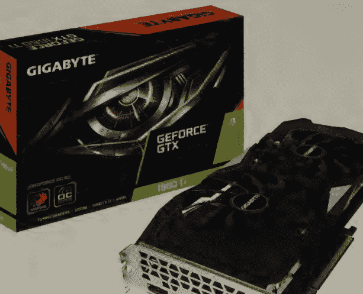

M.2 存储驱动器有许多优点，但如果 1TB 最终不够用，扩展起来很容易。

我们特意选择了一款运行相对凉爽的 GPU，但 CPU 不能自顾自地应付。通过使用这个笨重的 CPU 风扇，我们将能够毫无问题地超频处理器。

关于处理器出现问题。部分原因是我们多花了一些钱在 PSU 上，选择了 Be Quiet 产品——一家以物美价廉著称的公司。这里的关键细节是 80 Plus Gold 评级，这意味着更高的效率，因此减少了泵入机器本身的热量。将此与运行凉爽的 GPU 结合起来，我们的装机就不太需要额外的散热。

这是一台能让我们舒适地迈向未来的机器，那些不易更换以升级的部件我们多花了一些钱以确保它们能持久使用。我们本可以很容易地在 CPU 和 GPU 等方面多花一大笔钱来真正保证 PC 游戏玩家最佳的稳定 60 帧每秒，但我们挑战自己在可负担性和性能之间找到平衡，只是为了证明这可以做到。我们也可以选择进一步降低成本，如果你的预算更紧张或对 30 帧每秒感到满意，那么仍有降低成本的空间。

至于装机本身，我们将其安排成更容易找到你希望安装的部件的形式。如果你从零开始，你需要遵循顺序，但我们对每个部件进行了分类，以便你需要回溯步骤时使用。在我们能做到的时候，我们为特定部件或机箱布局提供了替代方案，但你需要意识到自己设备可能存在的任何差异。所有机箱和部件都不同，因此我们无法给出确切的说明，但有了这些步骤，你将毫无问题地应对任何情况。

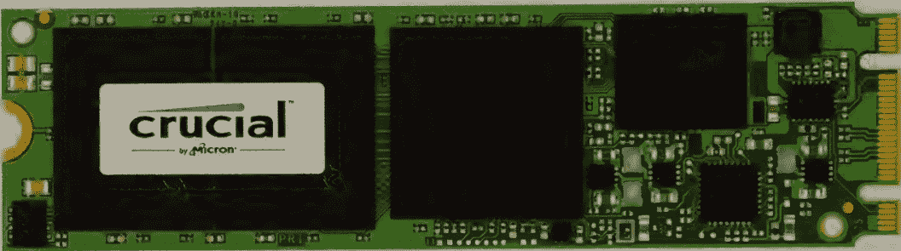

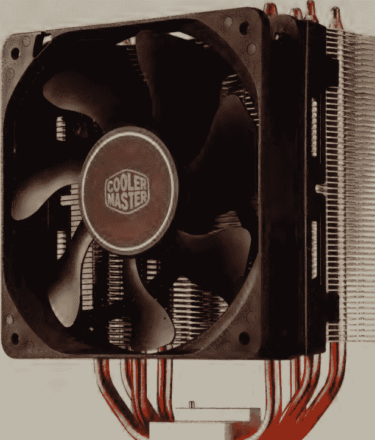

## PART 3 安装 CPU

### 1 准备机箱

最糟糕的第一步就是在没有先安装整个系统最重要的——更不用说最精密的——组件之前就把主板拧进机箱。先取下 PC 机箱的面板，通常通过机箱后部两侧的两个拇指螺丝。然后取出主板包装并将其放在坚固、光线充足的桌子上。


### 2 解锁 CPU 插槽

CPU 插槽两侧各有一个或两个杠杆；逐一向下并远离插槽推动它们以释放。将其拉起并移离插槽。这将释放负载板，随后可以将其抬起以取下 CPU 插槽的保护盖。注意裸露插槽四个角上的四个对齐键以及其中一个角的三角形标记。

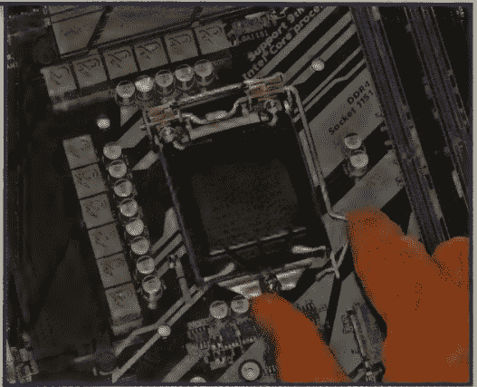

### 安装处理器

对齐键和三角形标记在处理器上是镜像的。将处理器定向使三角形标记位于相同位置——并且不要触摸处理器或主板上的金属触点——轻轻将处理器放入插槽。它会非常紧密地贴合，但如果看起来没有正确放置，请将其抬起重新定位（不要试图在原地简单地晃动它）。

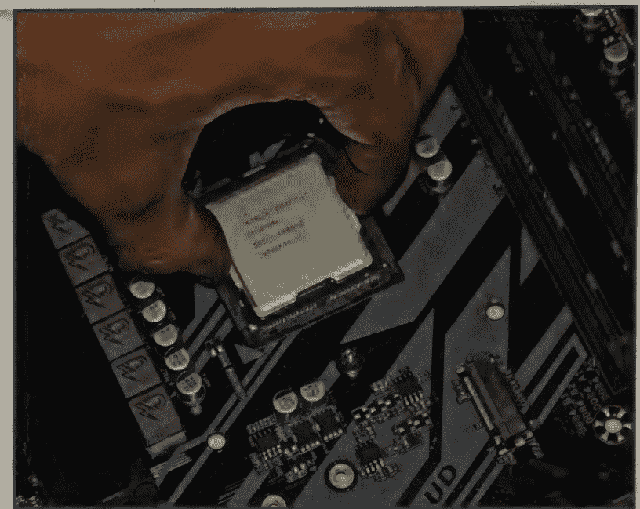

### 固定插槽

一旦你满意处理器已正方形地坐在插槽上，小心地放下负载板，它的设计目的是确保在稍后安装散热器时处理器没有任何一侧或角承受过多压力。接下来放下并固定处理器两侧的杠杆。需要相当大的力气，所以不要太胆怯。

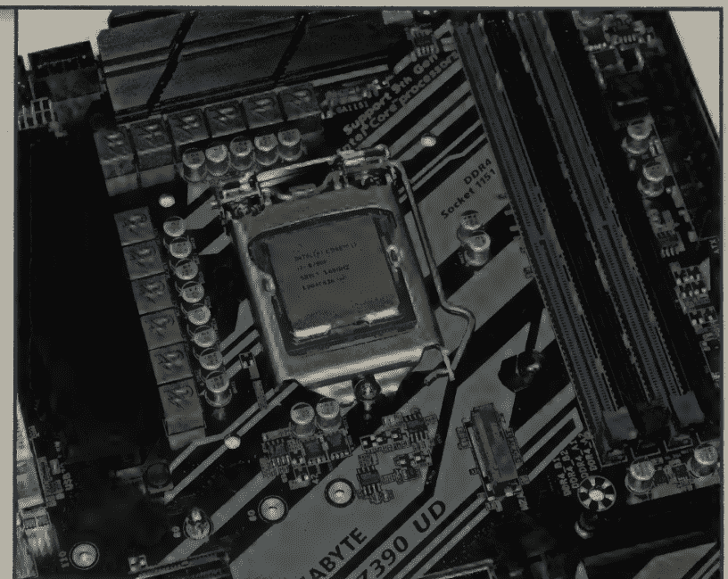

## PART 3 安装 CPU 散热器

### 1 准备安装板

风冷散热器有无数种形状和尺寸，但较大的散热器都会附带一个安装板，该板安装在主板的背面。这可以平衡重型散热器的重量，散热器在机箱内水平放置。首先将支架放入 CPU 四角的每个孔中。你可能需要对这一步和下一步分别重复四次。

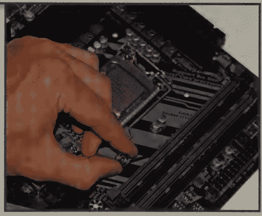

### 2 安装安装板

将板定位到主板背面，使用角部的凹槽对齐正确位置。这些板设计为适配多块主板，但只有在每个孔都正确对齐的位置才适用。将螺母附着到每个支架上，将安装板固定在背面。

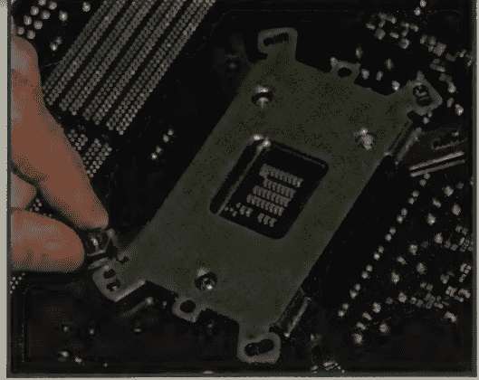

### 3 拧紧螺母

你必须确保这个安装板非常牢固地安装好，因为这些散热风扇相当重。方法因型号而异，但在大多数情况下，你会提供一个盖子，可用于将螺母拧得更紧。然后你需要翻转主板，并将十字形握把与支架的对应位置对齐。

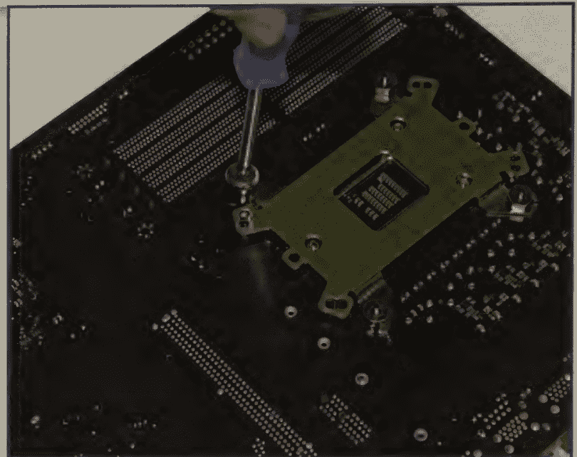

### 4 安装握把

不要立即将握把固定到位，因为在之前还有一个至关重要的步骤需要完成。先进行一次空试，将两者就位，然后一旦找到所有部件正确对齐的位置，就将握把的中央螺丝附着到散热器底座的中央点上。这将是使散热器牢固地固定在风扇上的部件。

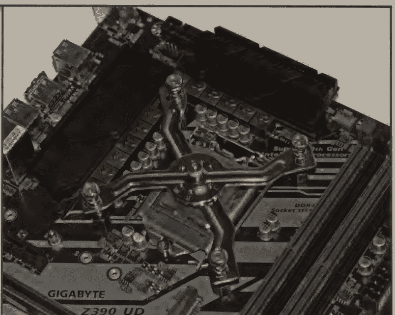

### 5 涂抹导热膏

在安装散热器之前就是令人害怕的部分：导热膏。清洁已安装 CPU 的顶部；通常你的散热器会提供一块擦拭布，如果没有，则使用异丙醇和干净的擦拭布去除 CPU 顶部任何灰尘和污垢。然后在 CPU 中央仅涂抹非常少量导热膏；其原理是散热器会为你扩散膏体。这是你在更换风扇、CPU 或发现处理器无故过热时可能需要重复的步骤。

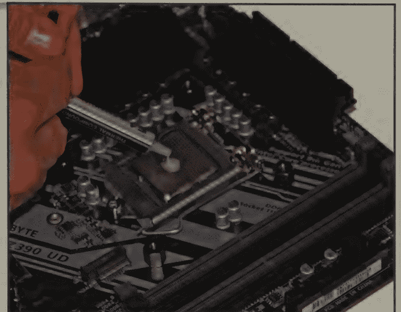

### 6 固定散热器

轻轻将散热器放置到 CPU 插槽上，使安装座上的螺丝孔与散热器本身的螺丝孔对齐。现在用十字螺丝刀将散热器牢固地固定到安装座上。接下来将 CPU 风扇连接器接到 CPU 插槽上方左侧，然后轻轻将风扇支架卡到散热器的平坦侧面上，注意叶片，因为它们既锋利又脆弱。

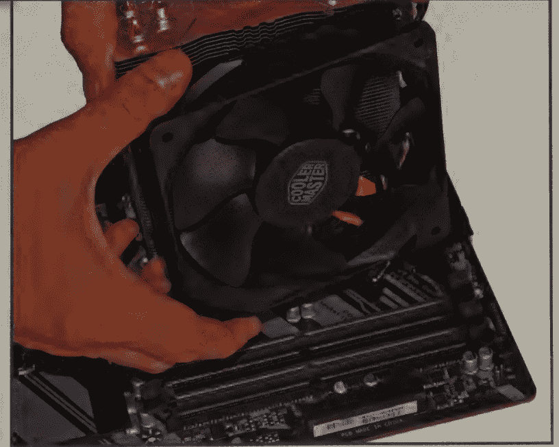

## PART 3 安装内存和 M.2 存储

### 1 定位内存插槽

虽然长条形的黑色和灰色内存插槽通常位于 CPU 的右侧，但在许多情况下，处理器两侧可能有平行的插槽，或者更罕见地位于上方或下方。无论如何，找到它们并按下插槽两侧翘起的塑料卡扣。

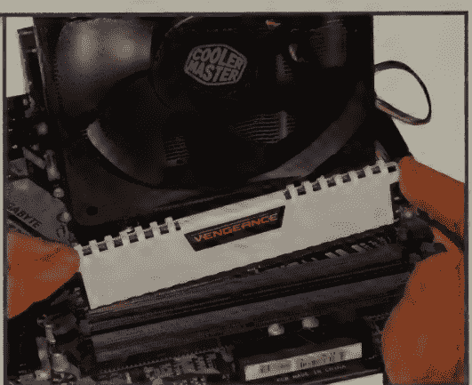

### 2 插入每个内存模块

安装内存是一个非常简单的过程：只需将内存中间的小缺口与内存插槽中对应的凸起对齐，然后两侧用力向下按，直到听到令人满意的“咔嗒”声。如果你暂时不填满主板的所有内存插槽，那么唯一棘手的部分就是知道应该使用哪些插槽。对于这一点，请参考你的主板手册。

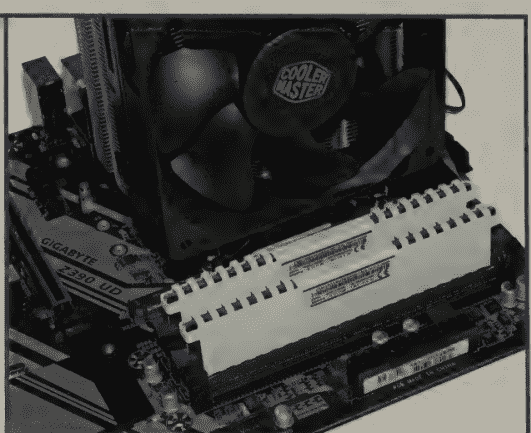

### 定位 M.2 空间

根据你的主板，你可能有一个或多个 M.2 存储槽——如果是的话，你可能已决定利用它来获得该类型存储带来的快速 SSD 读取速度。这些插槽很难找到，因为实际连接本身非常小（驱动器平放，与主板平行）。一个螺丝很可能已安装在其中一个节点上，每个节点都有数字，对应与该特定插槽和主板整体兼容的不同尺寸的 M.2 驱动器。

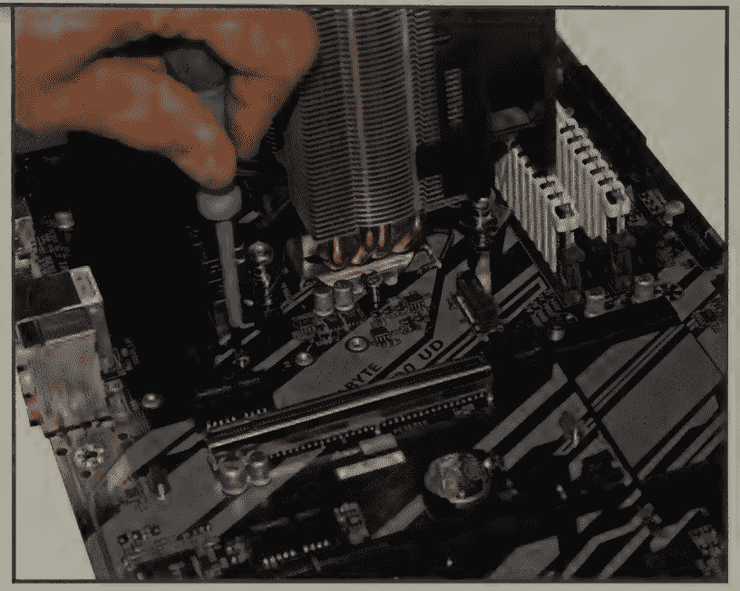

### 安装 M.2 驱动器

拧下节点上的螺丝并放在一旁。将 M.2 驱动器以大约 30 度角推入连接口。与内存一样，驱动器只有一个方向可以插入，所以如果它不配合，不要强行插入，而是翻转它再试一次。连接后，将驱动器向下按（它会自行弹起），然后将螺丝重新装回驱动器左侧末端的节点以固定其位置。

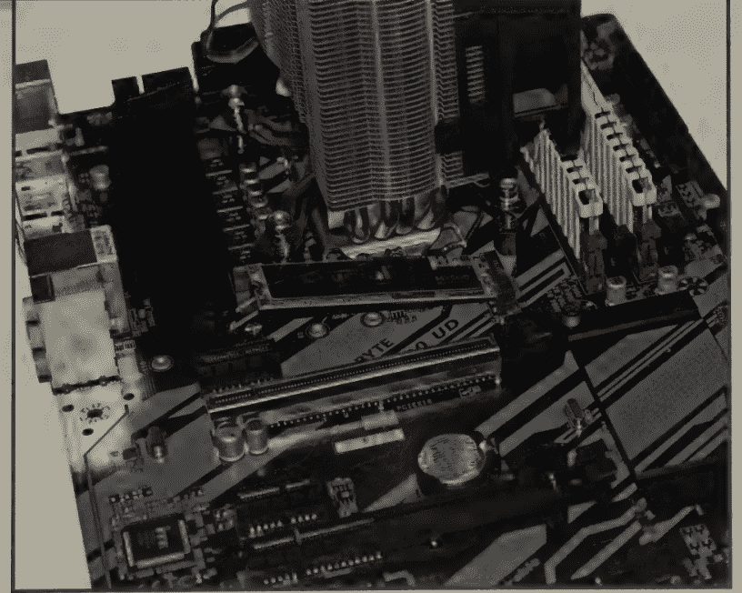

## PART 3 安装主板

### 1 安装 I/O 挡板

将主板就位的第一步是最简单的：只需取出将保护计算机背面所有连接的 I/O 挡板并将其卡入到位。这些挡板上有小凸起，会卡住机箱，所以只需对齐并卡入到位即可。你的机箱可能已安装了某些东西，你可能需要也可能不需要使用它。


### 2 安装金属柱

许多现代机箱在主板放置位置的中心有一个小柱，允许你将主板悬挂在机箱直立时就位。这很方便，但并非所有机箱都如此。如果没有，请找到机箱背面上的小孔并拧入机箱随附的每个金属柱。


### 固定主板

这些柱子就是主板将放置其上的位置，使其与机箱金属背面分离，防止电气短路。你可能不需要所有这些螺丝，因为这取决于你的机箱和主板。无论如何，通过找到对应的孔将主板放置在柱子上方。牢固地将主板固定到这些柱子上，这在角落可能具有挑战性。


### 水平安装

固定主板是较困难的任务之一，因为它需要牢固固定（自然地，它将固定所有那些昂贵的部件）。如果你因机箱顶部空间不足而难以正确安装角落螺丝——安装了巨大的 CPU 散热器后——那么请仔细抬起电脑。只要大部分螺丝已就位，你会发现更容易操作。


### 可选风扇

如果你决定安装一些额外的机箱风扇以排出机箱内的热空气，那么现在可能是安装它们的最佳时机。一些机箱会在风扇插槽未使用时提供盖子，但就大多数而言，这些东西相当模块化：只需选择你想要风扇的位置，找到螺丝孔并将其附着到机箱上。


## PART 3 安装硬盘

### 1 定位存储舱位

PC 机箱设计中最灵活的部分可能是存储舱位。不仅这些舱位数量可能很多，而且它们可能出现在各种奇怪而美妙的地方。它们甚至可以从机箱上拆下并安装在其他位置，适合真正的定制构建者。以我们的 Define S 为例，没有传统的驱动器舱位，而是可以从后面板拆下的机箱，用于固定你想要的存储驱动器。无论如何，你首先需要弄清楚你的机箱如何利用存储舱位，并决定如何安装你的固态硬盘。


### 安装存储驱动器

无论您想要安装何种类型的存储设备，或机箱希望您如何操作，所有现代机箱都会有一个相当简单、单一的螺丝或拇指螺丝，首先提供对驱动器舱的访问权限，然后将驱动器固定到插槽中。拧下螺丝以松开访问权限，然后将驱动器插入到位。以我们的构建为例，我们必须将驱动器安装到分离的舱上，但这种方式在该机箱上相当独特。如果有任何困惑，您的机箱手册将包含所有相关细节。


### 为主板供电

在大多数情况下，您将通过 SATA 连接存储驱动器。现在就做是个好主意，因此找到主板上标有“SATA”的部分，很可能在连接网格中。这些连接的数量和位置因主板而异，但在大多数情况下，您会在主板右侧边缘找到它们。这里的连接相当容易制作，并且设计上不易出错，因此逐一连接您的每个驱动器就足够了。


### 2 安装 GPU

GPU 应该朝哪个方向安装应该相当明显，但为了确保：请确保输出连接面向机箱的背面，因为您需要访问它。将 GPU 对齐到相应的空间，确保 PCIe 连接 — 即最靠近主板的引脚排 — 在您推动 GPU 时能正确且安全地锁定到位。与内存一样，一个小锁定机构应该会“咔嗒”到位。


### 3 固定 GPU

取出之前固定 PCIe 挡板的那几颗螺丝，并重新安装到原来的位置，这次将显卡固定到位。这很重要，因为虽然 PCIe 挡板可以固定连接器，但笨重 GPU 的重量会对硬件造成压力，最终导致损坏。即使主板配备了金属加固的 PCIe 插槽来防止这种情况，也并不能真正避免问题的发生。


## PART 3 安装电源

### 1 固定背板

将机箱旋转到其后缘。在某些机箱中，您会有一个空位准备好供电源使用，在其他机箱中，您会有一个背板，设计为在滑入机箱前先连接到电源本身。如果是这种情况，请取下背板，取出您的 PSU 并使用四个螺丝连接背板。否则，只需将 PSU 插入到位即可。


### 2 将 PSU 固定到位

如果您没有这种背板，那么您肯定需要使用提供的螺丝将 PSU 固定到位。由于电源制造商的处理方式各不相同，因此有多种潜在的孔位可用于此操作。找到适合您机箱和 PSU 组合的孔位，并将其牢固地固定到位。


### 5 连接机箱风扇

您应该已经将 CPU 散热器连接到主板上的相应连接上，如果没有，现在是做的好时机。现在也是连接机箱风扇的好时机 — 包括您可能已安装的任何可选风扇 — 到主板，这并不总是容易，具体取决于主板。风扇的线缆可能有点短，因此在确保所有电线不阻碍任何东西的同时进行智能平衡至关重要。


### 6 连接显卡电源

最后的 PSU 相关任务之一是使用其特定的电源连接器连接显卡。显卡的功率决定了它是否需要通过底部的线缆端口馈入一根或两根 PCIe 电源线。我们这里使用的是相当高端的一张卡，因此我们需要两者。


```
4
cinnamon-sound-
cinnamon-sett
/usr/share/themes $ cinnamon argument
ress_close() takes exactly 3 argument
gress_close() takes exactly 3 argument
gress_close() takes exactly 3 argument
recent call last):
/cinnamon-settings/bin/ExtensionCore
spices()
lib/cinnamon-settings/bin/ExtensionCo
ices.load(self.on_spice_load, force)
sr/lib/cinnamon-settings/bin/Spices.p
refresh cache()
usr/lib/cinnamon-settings/bin/Spices
load assets()
lib/cinnamon-settings/bin/Spice
icon_path)
-settings/bin/Spi
ed aborted.
```

# PART 4 首次启动

- 选择操作系统 73
- Windows 与 Linux 75
- 安装操作系统 77
- 什么软件？ 80
- 选择浏览器 82
- 防病毒和安全 84
- 驱动程序和 GPU 软件 86
- 流媒体和视频捕获 87
- 数字发行 88
- 存储清理 91
- 社交软件，以及其他... 92

恭喜！如果您按照我们的指南操作，到此时您应该已经组装好了一台属于自己的游戏 PC 并准备就绪。干得好。在您庆祝得太多之前，公平地说，大部分工作尚未完成。希望您享受组装硬件的过程，但现在是时候检查机器是否正常工作了，如果正常，则开始处理软件方面的问题。说实话，虽然这是必要的，但这部分并不像硬件组装那样有趣。

您第一台游戏 PC 的初始启动可能相当令人望而生畏；这是您耐心和努力的回报，如果它无法启动，很难不觉得自己有点失败。但这种情况也会发生在最好的我们身上，常见的如将电源连接放在错误的位置就会阻碍许多有志成为强力 PC 的人。别担心，打开那个面板并动手调整 — 当然要确保断电 — 并寻找任何不在正确位置的连接。如果需要，取下 PSU 连接并对 PC 的每个部件重复该过程，以主板手册作为参考指南。每个主板和机箱都不同，因此可能是一个您忽略的简单问题。但由于故障排除可能是一项庞大的工作 — 尤其是如果问题大于错位的电源连接 — 我们将在本书后面的单独章节中重点介绍这个问题。相反，本章将假设您的 PC 组装一切正常，并将指导您完成游戏 PC 组装后的一些关键方面。它将重点介绍诸如安装操作系统、首次启动 PC 以及您想要采取的一些首要操作等内容。最终这是您的 PC，因此您可以随意根据自己的兴趣或个人喜好定制软件 — 但我们将指导您完成一些更重要的游戏软件。讽刺的是，当然，要安装操作系统，您首先需要访问另一台电脑。如果您不能去朋友家或去图书馆，也有办法解决，但我们将在本章中讨论所有这些内容。一切安装完成后，可能会有直接跳入游戏的诱惑 — 而且确实没有任何东西阻止您这样做 — 但只要多花一点额外的工作，您就可以完全设置好，而不会因为急于玩游戏而产生任何可能出现的担忧。有各种设置可以定制，使您的游戏 PC 成为真正无忧的设备，因此我们也会详细介绍这些。简单来说，硬件安装之后的一切都将在此讨论，因此，只需多花一点额外的工作，您很快就能准备就绪。

## 选择操作系统

我们必须承认，如今在操作系统方面选择似乎往往很少。微软的 Windows 操作系统如此盛行，以至于很少有人会考虑其他替代方案 — 但它们确实存在，其中一些您可能之前没有考虑过。

由于大多数游戏都在 64 位架构上运行（不用太担心），如果您想走微软路线，您需要选择 Windows 10。

目前真正只有三种主要操作系统：Windows、OS X（仅限 Apple Mac 产品）和开源 Linux。由于您将运行 PC，您无法考虑 OS X，从而将核心选项减少到只有两个。Windows 是最简单的选择，并不是因为它是最佳选择或最稳定，而是因为它太常见了。微软的操作系统稳定、相对无忧，并且与游戏和软件具有最广泛的兼容性。但它会花费您更多金钱，而最新版 Windows 的许可证可能会在您的整体预算上增加一大笔。Windows 10 是最新版本，允许您的系统的真正硬件潜力可供操作系统使用，并且是允许微软最新 API 运行的唯一方式，该 API 允许最新的 3D 图形技术 DirectX 12 在 Windows 上顺畅运行。Linux 是开源的，意味着它是免费的


Mint 或许是功能和设计上最接近 Windows 的 Linux 发行版，并提供了一个漂亮、简洁的界面。

下载和安装 – 如果你想省点钱，这是一个很不错的选择。但值得注意的是，Linux 确实存在一些问题：首先，对于过去十年里使用过 PC 的任何人来说，它都不会完全熟悉——这不是 Windows，你需要学习一些东西。它还有一些兼容性问题，虽然这问题已不像以前那么严重，但仍可能担心某些东西——无论是想要使用的特定软件，还是硬件及其驱动程序——无法正常工作。还值得注意的是，存在着各种各样的 Linux 发行版或发行版——这个术语用来描述操作系统的不同“口味”。对于这些发行版中的每一个，Linux 仍然是基础，但创建者（或创建者们）提供了他们自己的偏好或风格。这可能会让寻找新操作系统的用户感到困惑，但坚持使用更受欢迎的发行版——如 Ubuntu 或 Linux Mint——将最大程度地减少这些麻烦。

## PART 4 Windows versus Linux

Windows 占据了绝大多数市场份额，是全球 PC 上最受欢迎的操作系统。 这意味着我们相当有信心，你可以为你的 PC 选择任何版本的 Windows 并适应它——即使你五年或更长时间没有使用过 PC！如果你不愿意学习更技术性的内容，这将是首要考虑因素，我们承认这一点。 然而，如果我们不至少给你提供替代方案，就不是在尽职尽责。 以下是 Windows 和 Linux 之间的比较，以帮助你找到适合自己的系统。

|  | Windows | Linux |
|---|---|---|
| Price | 基本许可费用约为 100 英镑，而更“专业”的套餐费用可达 200 英镑或更高，Windows 的成本会大大增加你 PC 本已昂贵的成本。 不过，不必为看似增强的“专业版”付费，因为它不太可能对你有所帮助。 | 由于大多数 Linux 发行版完全免费下载，因此在价格方面，显然是这个操作系统的优势所在。 请记住，这不必是永久性的选择；如果你发现自己不喜欢使用已安装的操作系统，那么以后可以轻松更换。 |
| Compatibility (Software) | 这是 Windows 的终极优势，至少在游戏方面是如此。 由于其巨大的市场份额，开发人员会首先专注于 Windows 版本的游戏，其次是 Mac 的 OS X，然后才是 Linux。 如果你希望在游戏发布时就能玩到每一款游戏，那么 Windows 很可能就是操作系统的首选。 | 曾经 Linux 在游戏发布方面举步维艰；很少有游戏在该平台上发布，这对许多游戏玩家来说是一个痛点。 然而，如今——随着 Linux 的普及度不断提高——它已成为游戏平台中越来越可行的选择。 在这方面，它无法与 Windows 相提并论，但如今，每款新游戏通常都会移植到 Linux——尽管并不总是与 Windows 同时发布。 |
| Compatibility (Hardware) | 我们会经常提到这一点，但 Windows 是最受欢迎的操作系统，因此，作为结果，它更有可能获得硬件制造商的驱动程序支持。 因此，使用 Windows 时，你不太可能遇到硬件问题。 | 制造商在为 Linux 提供驱动程序支持方面取得了长足进步，而且由于技术娴熟的游戏玩家——在很大程度上——是 Linux 的常见用户之一，因此需要为专用 PC 游戏硬件创建兼容驱动程序，这意味着在你的机器上找到对昂贵部件的支持变得越来越不罕见。 不过，仍然值得检查一下。 |
| Ease of use | 由于 Windows 是 PC 平台中最受欢迎的平台，微软一直致力于其软件的易用性。 大多数人都会知道如何使用 Windows PC——即使是最基本的任务——就直观性而言，Windows 在这方面胜出。 | Linux 的易用性主要取决于所使用的发行版。 更受欢迎的发行版如 Ubuntu、Mint 和 Debian 都提供了一个对 Windows 用户非常熟悉的用户界面，但许多选项和设置的位置不同。 如果你精通技术并且不介意最初的学习阶段，那么 Linux 本身并不是反直觉的。 |
| Software | Windows 附带了大量额外的软件——有些人甚至会说太多了。 事实上，即使是基本的 Windows 安装中也包含大量臃肿软件，不过其中有许多可访问性和系统选项可供使用，而在 Linux 中却没有等价物。 然而，如今通常可以为非常具体的需要下载免费工具。 | Linux 依赖于特定的发行版来确定安装时捆绑了多少额外的实用程序和软件包。 有些发行版在这方面刻意更精简，而有些则尽可能多地捆绑。 这完全取决于个人喜好，但大多数“必备”实用程序通常都已具备。 然而，使用 Linux 安装额外的实用程序和软件完全免费要容易得多。 |
| Performance | Windows 无疑是一个用户友好的操作系统，但它并不算快。 在全新的 PC 上进行全新安装可能看起来相当敏捷，但在多次强制更新和启动时在后台运行的软件之后，操作系统很快就会开始运行缓慢。 需要更多的手动维护才能让 Windows 保持最佳运行状态。 | 由于 Linux 对 CPU 的整体需求较小，因此操作系统本身不会干扰日常使用。 由于性能等要素受安装的软件影响很大，因此很难客观地比较两者。 但平均而言，Linux 在使用速度方面胜过 Windows，因为它对系统的需求要低得多，而且对臃肿软件的渴望也较少。 |
| Security | 虽然受欢迎程度确实与 Windows 电脑潜在攻击数量有关，但真正的问题在于 Windows 处理文件和文件夹访问的方式。 如果你不努力保护自己，你将面临更大的风险。 | 从基础层面来看，Linux 发行版通常比 Windows 提供更高的安全性。 其中一部分原因是 Linux 并没有那么受欢迎，但 Linux 处理管理员权限的方式（默认情况下所有用户都具有受限访问权限）意味着，如果病毒设法侵入，其造成的实际损害会减少。 |
| OS flexibility | 由于 Windows 是由微软管理、维护和销售的产品，你对操作系统不同部分的形态、功能和控制权不会有太多发言权。 坦白说，这对大多数人来说可能不是问题，但有些人会想要 Linux 的灵活性。 | 使用 Linux，你不仅可以选择多种发行版，而且对机器功能的控制也更大。 它需要更高的技术知识——或者至少愿意学习——但如果你喜欢能够控制操作系统中的一切，那么 Linux 就是你的选择。 |


Windows 拥有 DirectX 12，而 Linux 拥有 Vulkan，但由于前者的操作系统更受欢迎，因此 DirectX 获得了开发商的大部分支持。 最新版本支持光线追踪、可变速率着色和最新的抗锯齿技术等复杂功能，换句话说，它让游戏看起来更逼真。

## 第4部分 安装操作系统

你可能会惊讶地发现，安装操作系统其实非常简单。如今，只需获取所需文件，制作一个所谓的“启动盘”，然后在开机时让BIOS检测到它即可。启动盘可以是CD、DVD或USB。你可能会选择后者，但过程本质上是一样的。

在本指南中，我们假设你选择Windows，因为它更受欢迎，且所需的技术知识更少。由于Linux发行版众多，建议无论你选择哪一个，务必遵循其附带的指南。过程很可能同样简单，但选项太多了，我们无法在此涵盖每一种可能。要开始安装操作系统，你首先需要选择安装方式，并确保你的硬件支持这种方式；如果你组装PC时没有选择光驱，那么准备一张CD启动盘就没有意义了。

还需要注意，你需要联网下载所需文件，而可以理解的是，如果没有安装操作系统，你的PC还无法上网。你可以问问朋友能否借用他们的电脑，去当地图书馆使用他们的电脑，甚至请办公室的IT人员帮忙——说不定一个友好的微笑和一块巧克力松饼就足以说服他。好了，让我们开始吧：

### 准备启动盘

如果你购买了盒装Windows，那么最大的麻烦已经解决了；里面包含你所需的一切，包括如何安装软件的详细说明和相关的序列号——直接将其放入光驱，很快就能开始运行。

不同版本的Windows之间差别不大——除了价格——但最好了解包含和不包含哪些内容，以免错过对你至关重要的功能。


如果你从微软网站购买了数字版本——或者因为不再有原始光盘而需要下载可启动光盘文件——那么你需要自己制作启动盘。

如果你要自己制作启动盘，那么你已经购买了Windows数字许可证——本质上是一样的，只是没有包装盒和可移动介质。这时你有两个下载选项：ISO文件或压缩文件集合。你应该选择ISO文件，因为这样你才能制作启动盘。下载完成后，直接将其复制到USB或DVD上。使用DVD的话，你需要确保所用电脑支持刻录DVD，但实际上，使用USB可能更好——更快、更容易，而且不是一次性的。无论你选择哪种方式，这样就完成了——你的启动盘就做好了。

安装Windows时需要等待一段时间，所以你可以放心地去泡杯茶。


### 启动电脑

接下来的过程很简单：插入USB或将DVD放入光驱，然后按下电源键启动电脑。我们假设你至少已经开过机一次，知道它能正常工作，所以这次BIOS会自动检测到启动盘，并提示你：“按任意键从CD/DVD或外部设备启动……”我们就不提那个关于找“任意键”的经典笑话了；只需按下键盘上的任意键，安装过程就会开始。你需要等待一段时间，以便安装必要的文件。这些文件实际上并不是操作系统的核心文件，而是用于完成整个安装过程的工具；毕竟，BIOS需要有一些可用资源才能开始任何安装过程。


### 按照安装过程操作

从这一刻起，我们能告诉你的就不多了。一旦Windows准备好安装，你会看到一个所谓的安装向导——或者一个传统的鼠标和键盘操作步骤系统，帮助你完成整个过程。无论你选择哪个版本的Windows，你都会看到语言、日期和时间以及键盘格式的选择——这就是你知道可以正式开始安装的信号。虽然你可以在Windows安装完成后更改这些设置以及后续任何步骤，但在整个过程中选择更适合你的选项显然更有益。只需按照这些步骤操作，用不了多久，你就会看到你的游戏PC桌面了！

Windows与个人账户绑定，你可能不太喜欢这一点。但遗憾的是，这一步无法跳过。


### 安装什么软件？

你已经组装好了PC硬件，安装好了操作系统，现在正看着电脑桌面。大功告成！此时，只要风扇没有喷出火焰（老实说，这不可能！），你就可以随心所欲地使用你的电脑了。如果你真想，可以赶紧去安装一些游戏，测试一下你的机器的图形性能。每个玩家都想先欣赏那些多边形画面，但先别急！那当然可以，但可能还有一些设置要做——特别是，你需要考虑首先安装一些重要的（以及不那么重要的）软件。

一定要确保从官方网站或类似Download.com这样可信赖的软件分发网站下载软件。


### 应用和功能

有些软件会决定在每次电脑启动时自动运行。但除此之外，最好创建一个所谓的“系统还原点”，这是一种备份，让你可以将电脑恢复到没有垃圾数据和应用程序时的状态。如果你的电脑不幸感染了特别恶劣的病毒，它也能派上用场。

不可否认，网上有海量的软件可供下载，我们无论如何也无法涵盖所有。我们为你分类整理了一些关键程序，但请确保在下载这些程序时，从官方页面或像CNET这样可信可靠的来源获取。

不过，说到这些，有必要提一下保持整洁的重要性。你会惊讶地发现，很多PC用户安装某个软件只为了用一次，然后就完全忘了它——轻则占用硬盘空间，重则通过后台任务占用CPU处理能力，拖慢电脑速度。有些工具也会随着电脑启动而自动运行，虽然有时这不可避免——例如，大多数游戏键盘和鼠标都带有定制软件——但过多的启动软件会给CPU带来早期负担，从而在本次使用期间降低其速度。

要警惕你安装的软件数量、你选择安装的内容，并且——如果你知道不会再使用某个软件，或者暂时不会使用——不要害怕卸载它，以保持电脑的运行流畅。整洁的硬盘才是高效的硬盘。

不要害怕定期访问“设置”中的“应用和功能”部分，以删除任何不需要的软件。

## 第4部分 选择浏览器

你可能想安装到PC上的第一件事就是浏览器。如果你安装了Windows，那么很可能已经有一个浏览器了：Internet Explorer。它足以完成工作，但事实上，可用的选择太多了，以至于在某些人看来，它已经变得相当多余。你当然可以试用一下，但如果你想尝试其他选择，那么有很多选项。对一些人来说，Internet Explorer——或其Windows 10预装版本Microsoft Edge——除了打开一次来搜索（和下载）更好的替代品外，几乎没有其他用途。

Internet Explorer会随Windows预装，而且无法完全卸载。不要害怕用它来寻找更好的浏览器。

但你该选择哪种替代品呢？嗯，这是个棘手的问题，和这里的所有事情一样，最终取决于个人偏好和需求。虽然市面上还有更多选择，但使用市场大致由五个主要竞争者瓜分，其中很大一部分是因为某些操作系统预装了这些浏览器，有些人甚至不知道还有更好的选择。如果我们忽略微软的产品，那么剩下的就是Google Chrome、Mozilla Firefox和Opera。谷歌凭借其在搜索引擎市场的主导地位，自然占据了高位；它的浏览器速度快，扩展丰富，可以自定义体验，还附带内置的Google翻译工具和PDF查看器等便捷功能。Firefox是浏览器领域另一个大牌，提供类似水平


Firefox 以可下载并安装到浏览器上的众多附加组件而闻名。of extensibility as Chrome but with greater emphasis on privacy (Google is an ads-driven company, after all, so your data is valuable to them). 然后是 Opera，它基于与 Chrome 相同的引擎——甚至可以使用 Chrome 网上应用店中的许多扩展——并附带了一些非常有益的功能：内置 VPN、与即时通讯平台的连接以及广告拦截器，这些都在帮助 Opera 成为互联网浏览器选择时更好的选择之一。

Opera 在市场份额上仍然偏低，但它是一款很棒且快速的浏览器，你至少应该尝试一下。


## PART 4 Antivirus and security

浏览器问题解决后，你就可以关注也许是你能下载的最重要的软件之一：防病毒软件。令人遗憾的是，Windows PC 经常成为计算机病毒和恶意软件的受害者，这些数字代码或软件试图潜入你的 PC，感染它并造成各种麻烦——从 CPU 或内存问题到抹除硬盘上存储的重要系统信息。然而，这是一个很容易避免的问题，只要你保持防病毒和防火墙软件为最新状态，避免访问可疑网站或下载可能有害的文件，那么你可能永远不会遭受如此毁灭性的攻击。只需留意防病毒领域的重要变化；值得庆幸的是，良好的软件会在出现任何问题时自动提醒你。

与所有最重要的可下载软件一样，可供选择的方案多种多样。事实上，这可能会让人不知所措，尤其是防病毒软件。如今似乎防病毒程序的数量与病毒一样多。像 Norton、AVG 或 Avast 这样的大牌是更受欢迎的消费版本，但还有 McAfee、Trend 或 Bitdefender 等，它们可能没有占据市场份额的很大一部分，但提供出色的——甚至可能更好——针对各种潜在威胁的防御。虽然这些软件的成本各不相同，你可能需要为最纯粹的保护考虑，但也有免费套餐提供有限但有价值的在线威胁防护。

良好的防病毒软件会在不中断你的 PC 使用的情况下保持自身更新，直到检测到某些内容。


以下是免费套餐与付费套餐相比，你可以期待获得的内容。

### Basic

AVG AntiVirus FREE

不会让你失望的基本免费保护

- 阻止病毒、间谍软件和其他恶意软件
- 阻止不安全的链接、下载和电子邮件附件
- 扫描 PC 性能问题
- 获取实时安全更新

### Pro

AVG Internet Security Unlimited

我们无限制的、最好的全方位保护，无论你在线做什么

- 阻止病毒、间谍软件和其他恶意软件
- 阻止不安全的链接、下载和电子邮件附件
- 扫描 PC 性能问题
- 获取实时安全更新
- 使用增强型防火墙远离黑客
- 安全地在线购物和银行操作
- 避免假网站以实现更安全的支付
- 阻止垃圾邮件、诈骗和网络钓鱼邮件
- 电话和聊天代理 24/7 在线待命
- 包含适用于 Android™ 的无限 AntiVirus PRO
- 安装在无限台电脑上

FREE Download

Buy Now

$79.99 $63.99

就这些东西而言，即使是最基本的也会有帮助。其他地方，像密码管理器这样的工具可以成为你已安装软件套件的有用补充。它们会自动将你的账户和密码详细信息存储在加密保险库中，并自动将其输入网站的登录页面。这对于保护你免受网络钓鱼攻击很有用——在这种攻击中，官方网站的仿冒版本会诱骗你泄露你的凭证——但更重要的是，它在一般互联网使用中让你的生活更轻松。最后是 VPN，虽然这看起来像是多余的、偏执的极端，但使用加密的互联网连接确实有好处，尤其是如果你——像我们中的许多人一样——越来越担心你的在线数据被如何使用。与防病毒软件一样，有无数 VPN 提供商可供选择，不过还有一个额外的好处是可以订阅完整的互联网安全套件，它将提供你所需的一切来保护你免受潜在威胁。值得补充的是，VPN 会对你的互联网连接产生明显影响，因此，如果你想要 VPN 带来的增强安全性，那么如果你未加密的连接本身就相当慢，你可能最希望在在线玩游戏时将其停用。

## Drivers and GPU software

如果你是 PC 游戏硬件的新手，并且一生中从未对任何电脑做过太多调试，那么了解设备驱动程序很重要。这些是安装到你的操作系统中的软件片段，以确保特定硬件与操作系统兼容并按预期运行。它们是将计算机的 1 和 0 二进制代码转换为相应输出的关键工具；例如，设备驱动程序将确保你的显卡能够为游戏目的正确输出 3D 视觉效果。虽然操作系统会预装大量这些驱动程序以协助日常使用——想想打印机、鼠标和键盘的驱动程序，非专业用户可能需要 PC 来完成这些任务——但就游戏硬件而言，操作系统会自动检测并能够操作已安装硬件的情况很少。

这就是为什么在设置 PC 时首先要做的事情之一就是为每个硬件部件下载并安装驱动程序。就你的显卡而言，事实上，你可能甚至需要暂时使用主板内置的显示输出与显示器连接，只是为了让你的 GPU 能够检测到视频信号。在许多情况下，包装中会提供驱动程序光盘，但这些绝对不会是最新的版本。最好直接前往硬件制造商的网站，查找你的硬件型号以找到相应的驱动程序下载。从主板开始（可能有芯片组、音频、USB 连接等的单独驱动程序），然后安装 GPU 驱动程序。之后，安装外设如鼠标、键盘或网络摄像头的驱动程序，如果你使用的话，最后是任何专用硬件，如用于流媒体的麦克风、游戏耳机或绘图板。

关于设备驱动程序的最后一点需要注意的是，如果你对特定硬件有任何问题，第一步应该是下载最新驱动程序。通常你不应该在一天之内遇到电脑问题，所以如果你发现新发布的游戏无法运行，那么更新你的 GPU 驱动程序很可能会解决该问题。

顺便说一下，AMD 和 NVIDIA 都提供了可安装到你的电脑上的软件，以帮助你的显卡平稳运行。GeForce Experience（NVIDIA）和 Radeon Software（AMD）都提供在发布时自动更新驱动程序，这对于保持系统平稳运行非常有益，如果你喜欢玩最新的视频游戏发行版的话。但除此之外，它们各自都提供了一系列可供你调整 GPU 的设置、内置超频功能、游戏视频捕获，甚至可以在游戏中检测性能并建议可做出的更改以提高设置优化。许多游戏玩家会发誓不要安装他们所称的臃肿软件，但安装这些免费工具看看它们是否对你有益是无害的。

硬件制造商总会在其网站上为各种品牌和型号提供最新驱动程序。


## PART 4

### 流媒体和视频采集

如果你是因为在 Twitch 或 YouTube 上看到人们玩游戏时的乐趣而开始组装游戏 PC，希望在你游戏时有玩家社区加入其中，那么你需要考虑硬件和软件的一些重要方面。虽然并非完全必要，但除了电脑之外，你还需要考虑一些重要的额外设备，同时拥有用于直播或录制游戏画面和音频的合适软件。

搭建直播并不简单，但 OBS 让这个过程变得容易了一些。


首先，如果你想认真对待视频内容，那么你需要考虑一支优质的麦克风。大多数游戏视频的粉丝不会在意你“原汁原味”地游玩关卡、解谜或菜单的画面；你需要用解说来增色，而做到这一点唯一有价值的方式就是使用一支质量不错的麦克风。这可以是游戏耳机的一部分，也可以是单独的桌面支架麦克风，但无论如何都很重要。同样的话也可以说到网络摄像头，虽然说实话，展示你的脸并不是 100% 必要的，但通常的做法是，更知名的主播往往会在画面中加入自己的小窗。最后，如果你真的想做到极致，那么一台第二显示器会是个不错的主意。这样你就可以在另一个屏幕上打开浏览器查看观众的评论，这对互动和扩大你的粉丝社区会是巨大的助力。

在软件方面，有大量可供选择的方案，人们会推荐 XSplit 和 Streamlabs 等等。然而，最常被提及的、也是功能最强大、最有效的当属 OBS，Open Broadcaster Software。这套流媒体和视频录制工具是开源软件，这意味着任何人都可以免费下载使用。但这并不是它如此有用的原因；其开发者社区打造了目前最稳健、最完善的流媒体套件之一，虽然起初设置起来可能有点挑剔，但它足以让你一次性将游戏画面、摄像头画面和音频全部上线。

### 数字发行

你可能已经注意到，多年来 PC 游戏在许多零售店中所占的比重越来越小，有些店甚至完全取消了这一板块。其原因虽多，但主要归结于数字发行的文化重要性，即一种让你购买并拥有游戏许可但没有实体拷贝来存储和安装的方式。多年来数字发行不断发展壮大，如今购买 PC 游戏数字版已比去商店买实体拷贝然后安装到电脑上更为常见。因此，你需要了解在线购买游戏时的选择。

Steam 绝不是如今唯一的数字发行平台，但它无疑是主要的。

在这方面的大名是 Steam，这项极受欢迎的服务和程序，是大多数玩家用来购买、下载和访问 PC 游戏的主要工具。它方便地将所有内容集中在一处，定期促销和愿望单功能可确保你不会多付钱，而丰富的社交和技术功能有助于让玩家保持联系和掌控。如今它几乎是 PC 游戏的必备品。以 Steam 为例，这些应用程序通常在访问任何特定游戏之前先加载，充当现代版的 DRM（数字版权管理），因为需要网络连接和用户账户才能访问服务内的游戏。这对开发者和发行商来说是打击盗版的必要之恶——在这些平台出现前的几年里盗版曾是严重问题——但如今大多数人都愿意忍受这多出的一小步。既然你几乎永远不会再从安装光盘获得现代游戏了，这也不是我们能真正质疑的事情。


数字发行受欢迎的一个重要原因在于它为所有相关方带来的好处。玩家可以立即访问自己的游戏库，无需更换光盘，只需等待下载完成即可。在大多数情况下，更新也可以自动下载，这意味着开发者修复的任何问题，甚至是添加到游戏中的新内容，都在需要时随时为你准备好。曾经，Steam 是玩家获取游戏的唯一去处，很长一段时间它似乎也足够了。然而，如今其他知名发行商也纷纷进入自己的数字发行平台，例如 Electronic Arts 的游戏可通过 Origin 独家获取，或 Ubisoft 提供自己的商店以及社交服务 UPlay。还有 GOG.com，它曾经专注于让老游戏在现代电脑上运行，如今则专门销售独立游戏和冷门佳作。最近的加入者是 Epic Games Store，它通过为创作者提供更高的销售分成以及一些游戏甚至在该平台独家发行， aggressively 试图削弱 Steam 在 PC 游戏行业的统治地位。并非所有人都对这一举动持欢迎态度，部分原因是 Steam 长期以来一直是事实上的 PC 游戏平台，任何试图分割玩家庞大游戏库的做法都被视为对更简单、更高效生活方式的威胁。这确实如此，如果 Epic Games Store 真的能在市场上站稳脚跟，那么你将需要在至少两个不同的平台之间切换才能游玩并以最佳价格获得想要的游戏，但这种额外的竞争从长远来看只能对消费者有利。除此之外，还有其他在线服务会出售可在数字发行平台上使用的兑换码——例如通过 Amazon——而像 GreenManGaming 这样的几项服务也提供自己的可下载程序。

许多知名开发者和发行商都有自己的启动器，其游戏会在其中自动保持更新。

一些数字发行平台，如 GOG.com，专注于它们所销售的游戏类型，而不是试图与 Steam 竞争。

可下载程序，也不要忘记有些游戏在实际进入游戏前首先需要加载补丁程序，因为许多始终在线的多人游戏要求每个玩家运行相同版本才能正确访问服务器。像 Blizzard 这样的开发者拥有自己的启动器，就像上面提到的平台一样，会在你访问游戏前自动更新你的游戏。不幸的是，这些平台是无法避免的，但除了 Steam 和也许 Epic Games Store 之外，没有必要急着立即下载这些程序。按需逐案处理就足够了。

《地铁：离去》是测试机器图形性能的最佳游戏之一，但在发行时因独占 Epic Games Store 而引发争议。


### 存储清理


虽然与游戏本身没有直接关系，但不可否认，保持存储驱动器清洁和优化是让系统平稳高效运行的好方法。多年来，你电脑的存储空间可能会被不需要的、不必要的甚至未使用的數據塞满。硬盘或 SSD 上的数据越多，一次性需要检查和整理的内容就越多。你可能不会注意到这种情况的发生，但最终，过度堵塞的存储驱动器会影响电脑性能——尤其是在空间不足时。问题是，定期手动翻找所有文件夹和文件既不有趣，也无效，因为你几乎总会遗漏一些东西。

保持 PC 上垃圾数据的整洁，将在很大程度上帮助系统平稳运行。

因此，考虑安装软件来为你完成这项工作可能是值得的。有无数程序可以扫描你的磁盘驱动器，找出无价值且可以删除的内容。其中许多还内置了多种其他工具，例如磁盘碎片整理或应用程序卸载，本质上使这些套件更偏向于通用系统优化，而不仅仅是清理磁盘。众多可用软件包中挑选一个可能很棘手，尤其是你需要考虑是否想要免费选项、一次性许可付费或订阅以获得软件的定期更新。CCleaner 这个名字多年来一直是行业的支柱，并为免费用户提供大部分核心功能，因此如果你在确定自己的需求时感到困惑，这是一个安全的选择。


## 社交软件，以及其他……

如果你的超强游戏 PC 无法与任何人分享，那它还有什么用？多人游戏已经崛起，成为游戏行业的一个重要方面，甚至大多数以剧情为主的单人游戏也提供了竞技或合作在线选项。当然，虽然这些模式大多可以单人游玩，也可以通过各种匹配服务与随机玩家组队，但不可否认，与你真正认识的人一起玩所带来的兴奋感更加令人满足——无论输赢。更何况，无论你是否想和朋友一起玩，拥有一种与他人交谈和分享游戏体验的方式，对于充分利用你的 PC 来说都是必不可少的。

曾几何时，这一需求通过 Raptr 或 XFire 等专门软件来实现，但随着大多数朋友圈子普遍通过智能手机上的 WhatsApp 或 Messenger 群组保持联系，这些服务最终消亡了。仍然可以通过许多游戏客户端中内置的即时通讯工具保持联系，但除非你也想改用智能手机应用，否则你需要同时在线，并积极与朋友在同一平台上玩游戏，才能与他们取得联系。不过，这并不是说在许多其他游戏和平台内置的封闭环境之外没有大量额外选择。但还有许多其他工具、应用和服务在某个时候可能非常有用。为了帮助解决这个问题，我们制作了一个汇总表，整理了所有重要的社交和非社交软件，帮助你更好地了解应该寻找和下载的内容，或者在突然需要此类程序时作为参考。其中许多你暂时不会需要，其他一些则会，但无论哪种情况，了解它们的存在都是值得的，以备不时之需。

将足球与杂技般的火箭动力遥控车结合起来，可能看起来并不那么理所当然，但《火箭联盟》无疑是目前最激动人心的多人游戏之一。队伍规模小，朋友之间也容易凑到一起。


| 软件 | 用途 | 说明 |
|---|---|---|
| Discord | 与朋友联系。 | 多年来，Discord 已发展成为一个许多游戏社区（无论是自建的，还是与你一样热爱相同游戏和主题的社区）选择聚集或制定计划的地方。非常适合即时消息或语音通话。 |
| Dropbox | 共享文件。 | 云存储选项有很多，但如果你经常共享文件，那么朋友之间共享一个 Dropbox 会非常有用。 |
| 7-Zip | 解压和打包文件组。 | 7-Zip 支持最广泛的兼容压缩文件类型，因此如果你遇到除了 .zip 之外的文件，很可能会用到它。.7z 文件只能通过此软件打开。 |
| WinRAR | 解压和打包文件组。 | 作为解压和打包文件的替代选择，WinRAR 始终处于活动状态，无需打开单独的程序即可使用。虽然其兼容文件范围很广，但有些文件它无法处理。 |
| Razer Cortex | PC 设置优化。 | 通过与任何类型的游戏平台配合，Razer Cortex 是一款方便的工具，只需你付出极少努力，即可检测并提升游戏体验。 |
| VLC | 视频播放。 | 视频文件类型繁多，即使是最流行的类型，也有多种不同的编解码器来运行它们；VLC 凭借其非常轻量、简单的软件，可以运行所有类型。 |
| KeePass | 密码管理。 | 为确保你所有的在线账户安全，可以考虑下载 KeePass，让你的密码安全、可靠且易于查阅。它允许你使用多个不同的密码，而不必全部记住。 |
| Skype | 与朋友联系和通话。 | Skype 并不是一款轻量级软件，会占用大量内存和 CPU 资源，但它具有即时消息功能，在游戏之外被广泛使用，对较小的朋友群体可能很有用。 |
| TeamSpeak | 与一群朋友通话。 | 允许大量用户（非商业、非营利服务器上为 512 人），并且可以按群组进行安排。非常专业，但在较小的群体中同样有用。 |
| Mumble | 与一群朋友通话。 | 开源软件，完全免费下载和使用。它特别轻量，音频质量高，因此成为较流行的语音聊天选项之一。 |
| LogMeIn | 创建虚拟局域网。 | 通过 LogMeIn 创建 VPN 连接，你就能安全、可靠、私密地为自己和朋友创建一个可供游玩的游戏服务器。 |
| Nexus Mod Manager | 模组管理工具。 | 如果你开始为 PC 游戏安装模组以体验不同内容，那么使用 Nexus Mod Manager（NexusMods 有点像模组相关资源的在线平台）会让这个过程更容易处理。 |
| OBS | 直播你的游戏实况。 | 直播已成为 PC 游戏的一大要素，OBS 是一款免费软件，既轻量又功能丰富。它是将游戏实况直播到 Twitch.tv 和 YouTube 等平台的最佳选择之一。 |
| Utorrent | 下载 BitTorrent 文件。 | 一些游戏——尤其是像 MMO 这样的大型在线游戏——允许通过 torrent 下载官方游戏文件，这是一种更快的数据传输方式。 |
| F.lux | PC 夜间模式。 | 与许多智能手机上的夜间模式类似，f.lux 是一款方便的工具，可以设置和自定义，使其在天黑时激活，以减少夜间游戏时屏幕的眩光。 |
| GIMP | 图像编辑。 | 免费的 PhotoShop 替代品，包含付费版本许多重要功能，包括图层和图层蒙版。 |
| Adobe PDF | 打开和查看 PDF 文件。 | 总会有需要打开 PDF 文件的时候，无论是否与游戏有关。替代方案有很多，但 Adobe 自家的 PDF 阅读器是个不错的选择。 |
| SumatraPDF | 打开和查看 PDF 文件。 | 作为 Adobe 自家软件的替代品，Sumatra 是最受欢迎的免费同类软件。它不在后台运行，包含众多选项，而且使用非常快捷。 |
| LibreOffice | 创建和编辑文本、电子表格和 PowerPoint 文件。 | 虽然 Microsoft Office 是企业最常用的选择，但 LibreOffice 免费提供相同的功能。如今，无需再为办公软件套件付费。 |
| HoneyView | 图像查看器。 | Windows 自带的图像查看软件还不错，但 HoneyView 更快、更简洁，并且兼容更多文件类型。 |
| Foobar2k | 音频播放器。 | 如果音乐对你很重要，Windows Media Player 不是你想使用的软件。免费选择有很多，但 Foobar2k 是当今最受欢迎的。快速且轻量的软件。 |
| iTunes | 管理媒体文件。 | 虽然我们完全不赞成使用 iTunes——作为一款软件，它糟糕透顶且侵入性强——但遗憾的是，如果你拥有 iPod、iPad 或 iPhone，它就是必需的。 |

## 第 5 部分 配件

- 游戏鼠标 97
- 游戏键盘 99
- 显示器 102
- 耳机和麦克风 105
- 游戏控制器 108
- 赛车方向盘 110
- 摇杆 112
- 网络摄像头 114
- 虚拟现实 116

### 游戏鼠标

鼠标的问题——尤其是对游戏玩家而言——在于，在很多方面，什么才是“最好”的鼠标完全取决于主观判断，实际上归结为你希望从这一外设中获得什么。显然，每台 PC 都需要一个鼠标，但如果你玩的 MMO 比射击游戏多，那么你对鼠标的功能和优点的需求会有很大不同。它的形状、握在手中的“贴合感”，甚至重量，在寻找适合你的鼠标时都很重要；在开始寻找购买之前，先想清楚你需要鼠标做什么，这一点很重要。从好的方面看，你的选择并不一定要具备所有花哨功能——在大多数情况下，基本款的表现与其竞争产品一样好。而且，由于如今大多数鼠标都是 USB 供电的即插即用设备，你不需要太担心兼容性问题。

#### 选购要点

DPI——这是你在考虑购买鼠标时会经常遇到的度量单位。它代表每英寸点数（dots per inch），较少被提及为技术上更准确的 CPI，即每英寸计数。DPI 越高，它读取你移动的“速度”就越快，本质上意味着与低 DPI 鼠标相比，你需要移动鼠标的距离更少，即可获得相同的响应。幸运的是，大多数现代游戏鼠标都允许你调整 DPI 设置，而其他一些鼠标甚至具有可激活的精准模式——通过鼠标上的按钮降低 DPI 以获得精准度，并让你可以快速切换回来。

传感器——如今，老式轨迹球鼠标已是过去式，游戏鼠标转而使用两种类型的传感器：光学和激光。前者使用 LED 灯和传感器摄像头来追踪移动，在抬起鼠标或在不平整表面上使用时，能更好地保持响应。不过，激光鼠标在游戏领域更为常见，并且能够实现


游玩时的速度和效率。例如，在《英雄联盟》这类MOBA游戏中，快速反应至关重要——你越快完成那一记关键操作，优势就越大。你玩的游戏类型会影响你需要多少按键——MMO玩家可能希望鼠标上有更多按键——但关键在于找到舒适性、实用性与额外按键带来的优势之间的平衡。

加速（加速度）——大多数鼠标都带有某种形式的加速功能，即鼠标移动得越快，光标也移动得越快。在某些情况下这很有用，比如你的鼠标垫或桌面空间较小，可以用更小的鼠标移动来操作。然而，许多玩家普遍不喜欢加速功能，因为它意味着你无法对光标进行精确的一对一控制，光标的移动带有一定的不确定性。游戏鼠标上的加速功能通常不会太过激进，而且一般可以禁用。

#### 鼠标推荐

##### 罗技 G502 Proteus Spectrum

建议零售价：£79.99

如果你没有特殊需求，只想要一款全能的优秀游戏鼠标，那么G502无疑是目前最好的选择之一。它的11个按键均可编程，让你完全掌控设备；配备高达16,000 DPI的传感器，甚至还附带五种不同的配重块，可自定义鼠标在鼠标垫上移动时的重量感。

精度更高，抖动（或表面对读数的误判）更少。在这两者中，你很可能更倾向于激光鼠标。

##### 雷蛇 娜迦 Trinity

建议零售价：£99.99

雷蛇的娜迦系列一直被认为是MMO游戏的首选，得益于其侧面众多的额外按键。Trinity型号更进一步，采用可互换的侧面板，可提供2个、7个或12个附加按键，使其成为市场上最多功能的鼠标，能胜任日常使用、MOBA游戏或MMO游戏的各种需求。

额外按键——每款鼠标至少有两个按键，并且很可能还有可点击的滚轮。在游戏方面，你肯定希望鼠标本身至少内置几个额外按键，以获得额外的

##### 海盗船 M65 RGB Elite

建议零售价：£49.99

如果你更喜欢FPS游戏，那么你绝对应该入手海盗船M65。它不仅拥有高达18,000 DPI的出色速度与精度范围，还配备了可切换的“狙击模式”，可切换至低DPI进行精确瞄准——这对FPS玩家来说是一个重要功能。这款鼠标也相当重，这既是提醒也是赞许——FPS玩家需要这样的重量来获得更好的控制力。


##### 雷蛇 死亡蝰蛇 Elite

建议零售价：£69.99

雷蛇死亡蝰蛇Elite之所以如此出色，主要在于其精心设计的外观。就手感而言，这绝对是市面上最好的游戏鼠标之一；虽然它只有两个额外的侧键，但对于绝大多数游戏来说，你确实不需要更多了。这是一个高端选择，但绝对是最出色的产品之一。

### 游戏键盘

游戏键盘比鼠标更容易明确选择标准。鼠标需要贴合一种非常特定的手感，而键盘则可以用更客观的标准来衡量。首要的选择是在机械键盘（即每个按键都是独立的开关）和薄膜键盘之间进行。两者各有优劣，但机械键盘在可靠性方面往往更胜一筹。严肃的游戏玩家绝对应该考虑机械键盘，但如果你追求更便宜、更便携的选项（也许是为了参加局域网赛事），市面上仍有一些不错的薄膜键盘。除此之外，除了人体工学设计和可能提供的额外功能（如额外的可自定义按键）之外，其实没有太多区别。

#### 选购要点

**机械键盘 vs 薄膜键盘**——这将是你做出的重大决定，值得花些时间研究各种选项。如前所述，机械键盘采用独立开关系统，因此你每按一个键都是精确的——不会出现多重按键之间的混淆，它们使用寿命更长，使用感觉也更一致。但机械键盘需要一定的时间来适应，它们比薄膜键盘更重，价格也贵得多。在游戏方面，机械键盘总是更好的选择，但可能不值得花费那么多。

**Cherry MX**——如果你在看机械键盘，可能会看到“不同颜色的Cherry MX轴”这样的术语。这些指的是键盘中使用的机械开关类型，其中红轴、茶轴和青轴最常见。红轴是无段落感的线性轴，是游戏的首选——它们没有段落感，因此响应更快。茶轴和青轴提供更有触感的反馈，带有一个明显的“凸起”感，让你知道按键已被按下；茶轴按键声音更安静，而青轴在打字时仍然会发出较响亮的咔嗒声。你的实际情况会影响你选择哪种轴，不过如今制造商们正在针对这种情况寻找自己的解决方案。


**背光**——这可能看起来是件小事，但背光实际上是一个相当重要的功能。它有多种样式——有时只照亮按键之间的缝隙，有时只照亮字母，有时两者都照亮——并且通常颜色和亮度都可以自定义。这是一个很实用的功能，尤其是对参加局域网赛事的玩家来说——昏暗的房间常常让你难以看清手指的位置，而背光就能解决这个问题。

**宏/额外按键**——有些键盘会带有附加按键，从最左侧的几个宏按键，到一整排以类似数字小键盘形式呈现的新按键阵列。这些按键的实用性取决于你玩的游戏类型：MMO甚至RTS玩家会从这些额外的键位绑定选项中获得不少好处，但大多数玩家实际上用不上它们。考虑此功能时，要留意这些额外按键与WASD键或方向键之间的距离，因为这直接关系到游戏中操作的便捷程度。

**多媒体按键**——这也许对游戏不那么重要。多媒体按键是一组附加按钮，可直接控制你通过媒体软件播放的任何视频或音乐——无论是跳转、暂停，还是增大和减小音量。诚然，这是一个方便的附加功能，但要注意，这些按键很少是直接与操作系统本身硬连接的，这意味着你可能需要安装并运行相关软件才能设置和使用它们，即便如此也并不总是可靠。

**腕托**——虽然这并非绝对必要的配置，因为你也可以另外购买凝胶腕托，但还是值得考虑你将要购买的键盘的舒适度。如果你花了不少钱，你肯定希望它能让你以放松的姿势使用；而针对键盘本身专门设计的腕托会比通用的凝胶腕托手感更好。如果键盘（空格键下方）有加长的部分，你可能就不需要腕托了。所以尽量考虑你想要的键盘形状，以及它在桌面上的摆放位置，这样才能100%确定它不会对你的手腕造成任何伤害。


#### 键盘推荐

**雷蛇 Cynosa Chroma**

_建议零售价：£64.99_

这款机械键盘几乎提供了你所需的一切，一台出色的游戏键盘应有尽有：出色的设计、背光、静音MX轴以及简洁的软件。而且它不像许多键盘那样贵得离谱；虽然你确实可以花更少的钱选择薄膜键盘，但在同价位中能找到的机械键盘，能像这款一样好的确实不多。

**罗技 G Pro**

_建议零售价：£99.99_

作为局域网赛事更优选的方案，罗技G Pro设计轻巧紧凑，同时保持了出色的人体工学外观和手感。由于它定位为全能型产品，不像高端型号那样花哨，但在空间有限时提供舒适使用体验这一点上，很少有键盘能与之匹敌。

**海盗船 K70 RGB Mk.2**

_建议零售价：£169.99_

海盗船系列在各方面都很出色：搭载Cherry MX红轴、每键独立背光自定义（例如可以单独高亮WASD键），还附带防滑腕托。备选方案包括专注于FPS的键盘，带有符合人体工学的移动键和武器选择键；或者K95——本质上就是K70，但增加了一组可绑定按键和针对不同游戏的存储配置文件。

**赛睿 Apex Pro**

_建议零售价：£199.99_

虽然这个价格标签可能会让人望而却步，但这块键盘已经奠定了自己作为硬核玩家梦想之选的地位。它内置可调节的每键独立机械开关，让你可以单独控制每个按键的灵敏度，从而按需定制你的游戏体验。此外，OLED屏幕还能显示某些游戏的信息，增添额外优势。

## 第5部分 显示器

为游戏购买显示器甚至比买新电视还要费劲；在关注所有相同的技术细节（例如对比度）的同时，你现在还需要更加注意刷新率和响应时间。这导致的结果就是一大堆令人困惑的数字，而且无法真正确定你买到的那款就是最好的；希望我们能消除其中一些顾虑。进一步的问题源于你希望自己的设备看起来是什么样子：你想用多屏显示吗？一个更大的单屏？还是具有不寻常宽高比的超宽屏？选项太多，需要考虑的变量也太多，因此我们挑选出了购买最佳PC游戏显示器时你需要了解的关键方面。

### 选购要点

#### 宽高比

游戏显示器有各种形状和尺寸，而宽高比——即屏幕宽度与高度的比例——是造成这种差异的主要原因。但随着多年来游戏尺寸逐渐标准化，16:9 已成为主流标准。这很可能与你的电视相同，如果你对游戏中能看到多少画面不太挑剔，那么坚持这个比例会更省事。然而，如果你想要更宽广的游戏视野，获得更接近人眼的视觉体验，那么你可能需要考虑更宽的宽高比。同样，这些也有多种尺寸可选，但 21:9 是更常见的选择，这意味着更多游戏可能兼容这一尺寸。


#### 分辨率与尺寸

说“直接选最高分辨率”很容易，但在一定程度内，分辨率的提升实际上并不重要。在 21 英寸左右，你其实没必要额外花钱去提升分辨率。不过，一旦超过这个尺寸，你可能就需要开始考虑更高分辨率的屏幕了。这自然也会受到你所选宽高比的影响，但对于更大的屏幕，你会希望分辨率尽可能高，因为这不仅意味着游戏中更丰富的细节，也意味着 PC 使用的方方面面都能更清晰。但请记住，提高游戏输出分辨率是对整体性能影响最大的因素之一，所以如果你追求 4K 游戏，就需要一块（或两块）GPU 来实现。

#### 刷新率与赫兹

这常常被强调为游戏显示器的重要特性，事实也确实如此。然而，许多人忽略的是你游戏时所能产生的帧率。你的潜在帧率受所安装显卡的影响；如果你每秒只能产生 30 帧，那么无论刷新率多快，画面仍会受限于此。但如果你能达到 60 帧或更高，那么你自然希望刷新率尽可能快。60Hz（即赫兹）是大多数游戏显示器的标准，但现代显示器内置 120Hz、144Hz 或 240Hz 也并不罕见。如果你的 PC 性能强劲，那么刷新率越高越好——画面会更流畅，游戏过程中观感更佳，眼睛也会更轻松。

#### 响应时间

显示器的响应时间本质上是指它更新新输入或图像的速度。这个时间以毫秒为单位，因此越低越好。大多数显示器的响应时间大约在 8ms 或更低，但更好的游戏显示器通常为 2ms 或 5ms。不过，尽量不要选择超过 16ms 的产品，因为从那时起你就会开始察觉到差异。

#### 面板类型

最后要考虑的一点是你选择使用的面板类型，可选范围包括标准的 TN 面板或较新的 IPS 面板技术。TN 面板更为常见，通常亮度不错且功耗低，但较便宜的显示器可能在色彩准确性上表现不佳，尤其是在非理想视角下。IPS 显示器在这方面要好得多，在很高的视角下也能保持几乎完美的图像清晰度，并且色彩还原出色。遗憾的是，它们也因此贵得多，功耗更高，而且不具备 TN 面板那样高的刷新率。所以这是一个权衡，但如果你不惜代价，那么 IPS 显示器可能是值得考虑的选择。

### 显示器推荐

#### 华硕 ROG Swift

建议零售价：£619.99

它可能价格不菲，但拥有惊人的响应时间、可切换的刷新率、内置 NVIDIA G-Sync 技术，甚至支持 3D。简而言之，它是目前最好的 WQHD（宽屏四倍高清）显示器，如果你负担得起，非常值得考虑。它可能不是 4K 显示器，但 2560x1440 的分辨率也不容小觑。

#### 宏碁 Predator X27

建议零售价：£1,499.99

虽然这款显示器没有华硕 ROG Swift 那么多技术，但它拥有原生 4K 屏幕，并内置同样的 G-Sync 技术。它绝对算不上便宜，但由于支持 4K 分辨率，这意味着你需要一台相当强大的主机来搭配它，否则你可能会发现它无法完全发挥所有像素——看起来会有点模糊。

#### 宏碁 XR382CQK

建议零售价：£899.99

如果你想要一台超宽屏显示器，宏碁这款正适合你。3840x1600 的分辨率使其成为市面上分辨率最高的超宽屏显示器之一，而其 IPS 面板则确保你获得完美的清晰度。24:10 的宽高比比任何其他产品都更宽，因此目前 PC 游戏还不太完全兼容，但你一定会乐于在这块屏幕上首次尝试。

#### 明基 EL2870U

建议零售价：£259

4K 并不一定贵得离谱，这款明基屏幕就是如此。但不仅如此，与之前的产品一样，它还拥有 1ms 响应时间、极高的对比度（让黑色更深邃、白色更纯净），甚至内置扬声器（不过为了最佳音质，你可能仍然会想使用耳机）。推荐给注重预算的用户。


## 第5部分 耳机与麦克风

要在 PC 游戏中获得最佳音频，使用耳机似乎有些反直觉，但个人音频空间带来的沉浸感甚至胜过最好的 PC 兼容立体声系统。购买耳机不像大多数其他配件那样充满术语，但仍有一些功能值得你留意。一如既往，关键在于提出正确的问题。你想要最细腻的音质吗？你想要最清晰的麦克风和语音聊天选项吗？你打算直播吗？这是一个充满选项的雷区，但第一步是明确自己的需求。


### 选购要点

#### 耳罩类型

耳机有两种类型：包耳式和压耳式。区别听起来可能不大，但它基本上影响你的声音隔离效果。包耳式耳机有更厚的衬垫，完全包裹住耳朵；这会产生一种降噪效果，能隔绝外部声音，具体效果因型号而异。虽然这能让你在游戏时获得更好的声音，但这类耳机有时会有点“夹头”——一些用户长时间佩戴可能会感到不适，尤其是较便宜的型号。相比之下，压耳式耳机更轻，通常如名称所示“压在”耳朵上。外部声音自然会影响游戏音频，但更轻的构造和佩戴方式通常让这类耳机在长时间游戏中更舒适。


#### 麦克风类型

任何一款麦克风的质量都取决于你选择的品牌和型号，一如既往，价格越高，这项功能越有可能得到提升。降噪是你在耳机麦克风中需要寻找的功能，大多数产品在包含此功能时都会加以宣传。简单来说，这意味着麦克风更可能只拾取你的声音，而不是游戏音频或同房间其他人的声音等外部噪音。对于耳机，请寻找指向性麦克风，即指向你嘴部的那种。不过，主播们通常使用桌面悬臂麦克风，以摆脱耳机上笨重的外设。


#### 环绕声

与任何扬声器系统一样，寻找杜比环绕声选项是识别高品质音频的可靠方法。这显然会带来更高的费用，但就游戏而言，环绕声的额外好处可能是一项重要补充。想想《使命召唤》或《战地》这样的游戏：通过聆听敌人的脚步声或枪声来判断其位置，能让你获得一种更直观、更自然的优势，而对方可能没有。因此，环绕声不仅关乎音频质量，还关乎它能让你在游戏中占得先机。杜比 7.1 是最好的选择，但如果你偏好更便宜的选项，5.1 或更低版本也是可行的。

#### 线控

这似乎是一个很平常的提及点，尤其是大量耳机的线缆上都自带控制按钮。但这很重要，因为这些控制通常让你能够调节游戏音量和语音聊天的音量，以及静音你自己的麦克风。它们可能带有不同的选项，所以如果可能的话，请尝试查看任何潜在购买品上的内联控件，以便你知道你的需求在这里得到考虑。

**频率响应范围** – 现在这听起来可能像行话，在某种程度上确实如此，但如今在现代耳机中它在很大程度上无关紧要，许多耳机甚至不屑于宣传可能的范围。任何音频设备的频率响应范围都是对其最低低音和最高高音的测量，虽然范围越宽越好，但显然我们人类能听到的范围也有限。实际上如今几乎每款耳机都提供相同的 20–20,000Hz 范围。

## 耳机和麦克风建议

### HyperX Cloud

*RRP: £99.99*

HyperX 以生产高质量产品而享有盛名，其耳机也不例外。Cloud 系列有众多不同的型号和类型，因此仅筛选这一系列就可能是一项挑战。然而，Cloud Alpha 是一套均衡的套装，具有出色的 13–27,000Hz 频率响应，并且拥有对优质音频体验至关重要的所有必要功能。

### SteelSeries Arctis

*RRP: £179.99*

如果你想为电脑音效多花一点钱，SteelSeries Arctis 系列是不错的选择，特别是 Pro 版的完整套装——甚至还有精致的 LED 照明，带来终极极客时尚——不过 9X 也是一个不错的选择，如果你希望在其他平台上使用此音频设备的话。

### Turtle Beach Elite Pro 2

*RRP: £149.99*

在游戏耳机方面，Turtle Beach 长期以来一直是难以超越的名字。Elite Pro 系列是其高端型号，提供市场上最好的音效还原之一。里面还捆绑了一些不错的小玩意。


这些听起来像是营销用语，但确实有助于音质。它佩戴起来也很舒适，这是一个令人惊讶的罕见优势。

### Blue Yeti Microphone

*RRP: £129.99*

无数 YouTuber 和主播普遍认为，当谈到录制——或上传——你自己的声音音频时，这是首选麦克风。无论是用于播客、视频旁白还是通过 Twitch 直接与游戏玩法结合，Blue 的 Yeti 麦克风都已凭借其理由确立了自己为第一名。它不是立即必须购买的——一个像样的耳机麦克风就足够了——但如果你认真对待直播，那么这最终会是你的。

## 游戏控制器

随着游戏机流行度的不断上升，其 PC 等效产品越来越多地内置控制器功能，通常如果完全放弃键盘和鼠标，这些游戏会变得更好玩。此外，许多最近的游戏——尤其是 2D 独立游戏——用手持摇杆玩起来往往比传统上可能拥有的爪形驼背姿势要好得多。对一些硬核 PC 玩家来说这可能听起来难以置信，但事实是，在当今时代，拥有一个优质的游戏控制器对大多数 PC 玩家来说是必不可少的。

### 需要注意什么

- **游戏机设计** – 制造商太常试图对经过验证的官方游戏机设计进行添加，但没有任何理由。寻找一种试图保持游戏机控制器简洁性的产品（否则你最好坚持使用键盘），具有四个面部按钮、两个模拟摇杆、一个 D-Pad 和扳机按钮。任何其他东西都是可选的——而且可以说是不必要的——额外功能。

- **重量级摇杆** – 控制器的事情是，与鼠标和键盘不同，你实际上是拿着它们。建议可能听起来很奇怪，但寻找更重的控制器实际上可能带来更舒适的体验；通常轻量级控制器具有更便宜的制造质量，而更重的重量使用起来感觉更有说服力。当然，这并不意味着它应该很重，你的手不会想要休息。


- **有线与无线** – 这是你可能也问过键盘和鼠标的问题，但在这里更多是个人口味的问题。有线控制器会给你一个更简单的设置过程，而无线控制器显然在游戏时给你更大的移动自由——即使它确实需要不时更换新电池或充电。

### 控制器建议

#### Microsoft Xbox 360 controller for PC

*RRP: £29.99*

这正是为 Xbox 360 备受喜爱的控制器，但带线。作为微软产品，其驱动程序内置于 Windows，因此在大多数情况下，只需将其插入 USB 端口即可玩，无需太多挣扎。如果你已经拥有无线 Xbox 360 或 Xbox One 控制器，你甚至可以购买 USB 适配器并使用它。

#### Razer Wolverine Tournament Edition Chroma

*RRP: £119.99*

它对于本质上是另一个 Xbox One 控制器的产品来说价格要高得多，但 Razer 为这个摇杆带来了 PC 思维。它有四个合理放置、可自定义的按钮——如果你需要的话——改进的 D-Pad，按钮上的可自定义照明以及独特的“扳机发夹”模式，可在 FPS 游戏中实现更快的射击。如果你真的关心游戏控制器，这是首选。

#### Sony DualShock 4

*RRP: £49.99*

PlayStation 和 Xbox 一直有竞争，在控制器方面这一点更为明显，双方都有虔诚的用户。说到底是选择你的毒药，但 DualShock 4 的整体制造质量更胜一筹，即使你需要下载一些软件才能使其与 PC 配合使用。如果你能以更低的价格买到 360 版，就没有必要购买 Xbox One 等效产品。

#### Logitech Gamepad F310

*RRP: £24.99*

如果你尽可能避免使用控制器，并且只想要一个预算选项用于你必须使用游戏手柄时，那么这就是适合你的产品。它使用 DualShock 的熟悉平行模拟摇杆设计，设置非常容易，但它更便宜，也感觉更便宜。参加 LAN 活动时扔进去的一个很棒的选择。


## 赛车方向盘建议

### Thrustmaster T300RS

*RRP: £310.00*

虽然它设计用于游戏机，但 T300RS 与 PC 兼容，仍然是你可以买到的最好的、最坚固的赛车方向盘之一。它提供完整的 1,080 度旋转角度、三个踏板（大多数通常只有两个）和可调节的踏板面板。这仅适用于狂热的赛车爱好者。

### Logitech G29

*RRP: £209.99*

取代之前非常受欢迎的 G27 型号，G29 是对许多人认为市场上最好的赛车方向盘之一的改进。可惜换挡杆是分开的，但将其与指示何时需要换挡的 LED 读数结合起来，以及用于牵引力控制和刹车平衡的额外按钮，你将拥有终极赛车设置。

### Thrustmaster T-GT

*RRP: £549.99*

同样，这个方向盘是为 PlayStation 设计的（Gran Turismo 会有这种效果），但同样与 PC 兼容。这里只有两个踏板，但仍然是一个相当坚固和完整的套装。1,080 度的旋转角度仍然在转弯时提供很大的“回馈”，但真正令人印象深刻的是其力反馈的细微震动。

### Hori Apex

*RRP: £89.99*

Hori 是格斗游戏粉丝熟悉的名字，他们信赖该公司的街机摇杆。就此而言，其更便宜的赛车方向盘如果想要严肃的、发烧友的赛车游戏体验就不是一个选择。凭借其有限的 270 度转弯角度，这个控制器更适合街机赛车，而不是像 *Forza* 这样的游戏。

## 摇杆

最近飞行模拟游戏似乎又流行起来了，例如《精英：危险》和《星际公民》——以及其他非太空题材的同类游戏——确实让对摇杆的需求大增。在所有可用的配件和外设中，摇杆也许是最古老的，因此也显得最多余。但就像赛车方向盘对驾驶模拟的影响一样，一个好摇杆也能对飞行模拟产生类似的效果。如果你想真正沉迷于《精英：危险》等游戏，那这绝对是一款值得考虑的购买品。

### 选购要点

- **油门控制** – 这是区分摇杆好坏的一个显著特征，能让你对速度进行更精细且——重要的是——更具触感的控制，在遥远的太空中，这在缠斗中意义重大。你会更倾向于独立的油门控制，而不是集成在摇杆上的那种，但如果你追求预算选项，可能就得不到这一点。

- **Z 轴控制** – 所有摇杆都具备 X 轴和 Y 轴导航，也就是左右和前后。大多数情况下这已经足够了，但如果你想要完全控制，就需要寻找具有 Z 轴控制的型号，它允许你顺时针或逆时针扭转摇杆来改变飞行器的偏航角，从而减少为对准正确方向而需要额外转向的次数。


- **HOTAS** – 这是“双手不离油门和操纵杆”（hands-on throttle and stick）的缩写，基本上意味着你购买的产品带有双杆设置——一根用于油门，一根用于导航控制。显然，你需要为额外的部分支付更多费用，但为了更逼真的模拟体验，具备这一特性将非常重要。

- **按钮数量** – 由于市场上摇杆的种类繁多，在这方面很容易走极端。要么按钮数量过多——导致操作过于复杂而笨拙；要么按钮太少，让你不得不依赖旁边的键盘。想一想你打算用摇杆玩哪些游戏，以及你可能需要多少额外按钮。

### 摇杆推荐

- **Saitek X56 HOTAS**

  建议零售价：£219.99

  X56 的做工质量绝对对得起它公认的高价，还配备双油门，可用于控制双引擎飞行器，并且加入了至关重要的 Z 轴控制。你甚至可以调整控制操纵杆松紧度的弹簧，从而获得适合自己手感的压力。

- **Thrustmaster HOTAS Warthog**

  建议零售价：£349.99

  这款产品可能定价过高，而且由于该设置不具备 Z 轴控制，感觉有点不必要。但它以真实世界中的 A-10C 雷电 II 攻击机为模型，采用金属部件外壳，带来坚固而逼真的手感，并配备双油门和大量额外按钮（可以重新映射为油门控制）。

- **Thrustmaster T-Flight HOTAS X**

  建议零售价：£49.99

  作为 Warthog 的替代品，Thrustmaster 的 T-Flight HOTAS X 设置提供了一个非常实惠的选择。它的附加功能不如那些昂贵的同类产品丰富，但它确实具备 Z 轴控制，正如我们一直强调的，这是一个重要的功能，尤其是在如此低的价格下。

- **Logitech Extreme 3D Pro**

  建议零售价：£44.99


Extreme 3D Pro 的售价往往远低于其建议零售价，使其成为市面上最便宜的摇杆之一。就这个价格而言，它也是性价比更高的低端摇杆之一，虽然按钮手感确实有点廉价，但作为一款价格实惠的摇杆，它整体扎实，很难挑剔。也非常适合手小的人。


## 第 5 部分：网络摄像头

如今，如果你购买笔记本电脑，几乎肯定自带网络摄像头。这是我们大多数人都不会去考虑的事情。但在 PC 上，是否能够向他人分享自己的在线视频——无论是像 Skype 通话这样简单的事，还是像分享游戏画面这样更技术性的需求——实际上是需要你认真思考的问题。你选择什么样的网络摄像头取决于你的使用目的，因为这些设备可以集成的附加功能种类繁多。你是想要一个用于会议通话的基础摄像头，还是想要最好的画质来取悦你即将收获的粉丝大军？或者你根本不需要？

### 选购要点

- **分辨率和摄像头质量** – 购买网络摄像头时，第一条规则就是它所提供的分辨率。如今清晰度至关重要，而这一切首先取决于摄像头的分辨率质量。当然，这不是唯一需要考虑的因素，但只要你购买的是 1080p 或更高分辨率的产品，你的设备画质就足够高，观众不必费力观看你的视频流。至于摄像头本身的质量，你需要查看评测——甚至 YouTube 上的示例——看看镜头能否很好地捕捉真实色彩以及房间的黑白平衡。

- **视野（FOV）** – 摄像头的视野因设备而异，有些甚至具有可自定义范围。这一点很重要，因为它基本上决定了你和背景的可见范围，因此更宽的视野意味着可以在同一画面中看到群体。这可能不是你的必需功能，但请记住，你总是可以人为地将视频流中不需要的部分裁剪掉，但无法裁剪进来。从这个意义上说，60–75 的视野已经不错了，但如果你追求更宽的视角，90 才是你想要的。


- **麦克风** – 我们在本节中已经提到，如果你想认真对待游戏直播，那么独立麦克风是必需的；事实上，你不太可能从网络摄像头获得能与专用麦克风外设匹敌的音频质量。然而，如果你刚开始做主播或 YouTuber，并且不想在游戏时戴耳机，那么一款具备优质音频采集能力的像样网络摄像头将是你的理想选择。双麦克风选项或任何高保真产品总会被宣传，所以应该不难找到。

- **附加功能** – 这类东西很难具体说明，因为网络摄像头的附加功能列表与产品数量一样多。有些可能具有自动对焦、低光功能、HDR 或色彩校正。有些可能是无线或支持 60FPS 视频采集。还可能有诸如面部跟踪或背景移除等技术功能——基本上是为了直播——而机载处理会减轻视频采集对 PC 的额外负担。在每种情况下，你不仅需要质疑这些功能对你有多大用处（以帮助你克服术语过载），还要了解这些附加功能在实现其目标方面有多成功。


### 网络摄像头推荐

- **Logitech C920**  

  建议零售价：£89.99  

  实际上，你会以远低于零售价的价格买到这款网络摄像头，这已经是一个相当有吸引力的套餐上的额外福利。C920 是一款出色的全能摄像头，凭借其 1080p 分辨率和 90 度视野，可满足大多数需求。它提供出色的画质和低光性能，并可配合 Logitech 的 ChromaCam 应用使用，该应用可用于自动移除（或替换）背景。

- **Microsoft LifeCam HD-3000**  

  建议零售价：£23.99  

  就预算而言，LifeCam HD-3000 无疑是首选。大多数企业都会选择它，因为它拥有不错的 720p 分辨率，同时具备出色的图像质量、清晰度和色彩还原。它绝不是同类产品中最好的，你很容易找到更好的摄像头，但在这个价位上，没有任何产品能匹敌这种质量。

- **Razer Kiyo**  

  建议零售价：£99.99  

  Kiyo 在视频采集方面毫不逊色，这要归功于其 1080p 分辨率、90 度视野、快速自动对焦以及非常出色的图像清晰度。然而，它独特的卖点也是最显眼的细节：环绕摄像头镜头的明亮环形灯，使其成为外观独特的设备。它非常适合提高你面部的饱和度——正如任何模特都会告诉你的那样，这会让你看起来更好看——但这也意味着它在低光环境下也能表现出色。

- **Logitech BRIO**  

  建议零售价：£199.99  

  这几乎是网络摄像头能达到的高端水平，光是价格就足以让很多人望而却步。然而，它是目前唯一支持 4K 分辨率的摄像头，这可能足以左右你的购买决定。凭借 HDR 支持、数字变焦和 90 度视野等功能，它在某种程度上物有所值，不过自动对焦的问题可能会让人头疼。


## PART 5 虚拟现实

在过去几年中，游戏领域最热门的话题之一就是虚拟现实。自从 Facebook 收购了领先的 VR 开发商 Oculus Rift 以来，不仅出现了竞争产品的激增，而且游戏玩家和游戏开发者也同样表现出浓厚兴趣。尽管从 80 年代起就已经有零星尝试让虚拟现实走向主流，但这项技术直到现在才达到硬件技术限制更少的阶段。这意味着，凭借当前的一系列头戴设备，你将能够获得可信的 VR 体验，让你的游戏比以往任何时候都更具沉浸感和吸引力。但，虚拟现实到底是什么？

虽然它并不专属于 PC 游戏，但由于硬件的高端特性，它更适合电脑而非主机，尽管索尼也有自己的 PlayStation 兼容头戴设备。VR 的当前设置（而且在不久的将来不太可能改变）是一个基础计算平台，与你戴在眼睛上的独立头戴设备同步。这些笨重的设备戴起来看起来有点别扭，但其实还好；它们对体验至关重要，因为它们内置了动作检测传感器，会追踪你的头部移动。这些动作随后会在游戏中复制，所以如果你现实中向左看，你控制的角色也会向左看。

这通常会结合立体 3D，这意味着数字世界中的物体实际上会显得更靠近你。这就是基本概念。在此基础上，还有一些其他要素构成了当前 VR 行业的状态。其中最主要的是添加了追踪手部移动的控制器，通常这被认为几乎是实现真正 VR 体验的必备条件，尽管你可以争辩说对于像 *Elite: Dangerous* 这样的游戏，飞行摇杆会是更好的投资。有了这些动作检测控制器，你可以感觉自己触觉上抓取物体或握住武器，而且由于你是通过物理移动来与世界互动，你会感觉更深入地沉浸在游戏中。其他输入包括无控制器的触觉控制——通过检测你在给定空间中的移动来工作——同时甚至还在开发能够产生气味的设备，以增加感官游戏的额外感官。记住，VR 并非仅限于游戏：随着时间的推移（以及 Facebook 的兴趣），虚拟现实可以作为社交空间、现场体育节目、教育甚至艺术和设计发挥作用。

> “Oculus Rift 及其衍生产品是引发 VR 热潮的头戴设备，并且由于它们得到了 Facebook 的支持，它们很可能会在一段时间内保持领先。”


### 有哪些游戏可选？

正如你所预期的那样，对于一种让你直接参与到游戏中的体验来说，虚拟现实游戏在很大程度上是第一人称的。现在这里的种类很广，因为第一人称视角可以适用于多种类型，从射击游戏、赛车游戏、平台游戏、解谜游戏甚至节奏动作游戏，在其中你需要跟随音乐节拍击打音符。例如后者包括一款名为 Beat Saber 的游戏，本质上就是挥舞光剑跟随 funky 节拍的游戏；正如你所料，它非常有趣。另有像 Hover Junkers 这样的射击游戏，或是极具创意的 Superhot VR，其新颖的游戏机制是时间只在你移动时才流动，从而带来一些很酷的子弹躲避时刻。

像 Dirt Rally 这样的赛车游戏和像 Elite: Dangerous 这样的飞行模拟器在 VR 中特别受欢迎，因为你被限制在驾驶舱内，这给了你速度感和向前运动感，而不会出现有时在“生活”于 VR 世界中会出现的笨拙移动。自然也有一些只能在 VR 中实现的体验，而且我们还没有看到虚拟现实能力的最佳表现，但已经有一些有趣的概念。例如 Keep Talking and Nobody Explodes 就是一款搞笑的游戏，佩戴头显的人试图拆除只有他们能看到的炸弹，而指令则来自虚拟世界外的旁观者。Job Simulator 也能带来无尽的笑料，设定在机器人取代劳动力的近未来；在这里你扮演人类——或者至少是他们的无身体双手——尝试重新学习拥有工作的感觉。


它可能不会对你的硬件造成很大负担，但 Superhot 是一款必玩的 FPS——无论是否 VR。

Dirt Rally 已经是可用的最佳拉力赛车游戏之一，因此它拥有用于驾驶舱视角的 VR 模式，确实有助于让你进入紧张的比赛。


VR 有一些非常棒的应用，例如这种合作拆弹游戏，只有佩戴头显的人才能看到装置。

然后还有更多体验型游戏，它们不那么注重传统的“游戏玩法”，而是更注重以沉浸式的方式利用 VR 技术，无论是像过山车模拟器 No Limits 2 这样的，还是将桌游 Catan 以数字方式重现，拥有 3D 环境让你与朋友围坐在一起玩资源交易游戏。甚至 Google Earth 也有 VR 体验可以使用。

VR 的这种用途看似简单，但桌游的数字重现意味着即使大家无法到场，也能与朋友一起玩。

### 做好 VR 就绪

沉浸在虚拟现实中并不只发生在高端的逼真图形中，但它确实可以帮助玩家感觉更沉浸在呈现在他们眼前的世界中。然而，即使在渲染这些游戏视觉效果所需的硬件之外，你还需要计算头戴设备的动作检测以及立体 3D。它们并不是高强度的附加项，但你需要确保自己做好准备——这意味着确保你的机器内部拥有能够应对的硬件。

但问题是，推荐规格并没有真正的统一性。Oculus——VR 行业知名产品的开发商 Oculus Rift——有自己的最低推荐配置，但有些游戏自身的系统要求超过了这些。众多制造商和 PC 零售商也推荐不同的配置，那谁是对的呢？嗯，首先要做的是遵循我们关于研究你的配置部分的建议：如果 VR 对你很重要，那么找出哪些游戏看起来有趣，并构建一个系统至少能舒适地运行这些游戏。然而，如果你希望玩虚拟现实游戏，仍然有一些期望，包括允许所有线缆连接的端口数量。幸运的是，如今许多 GPU——它们是让 VR 工作的动力核心——会自称 'VR ready'，或至少有专门针对此的型号，因此在没有指南的情况下找到所需的硬件在很大程度上是万无一失的。以下是一个示例配置，可以让你在未来几年内玩 VR：

| 最低配置 | 推荐配置 |
|---|---|
| - 内存 4GB 的 GPU<br>- 时速 3.6GHz 的 i3 CPU<br>- 8GB RAM<br>- 1x USB 3.0 端口，2x USB 2.0 端口<br>- 64 位操作系统（Windows 10）<br>- HDMI 1.3 视频输出 | - 内存 6GB（NVIDIA）或 8GB（AMD）的 GPU<br>- 时速 3.7GHz 的 i7 CPU<br>- 16GB RAM<br>- 3x USB 3.0 端口，1x USB 2.0<br>- 64 位操作系统（Windows 10）<br>- HDMI 1.3 视频输出 |


尽管这些 HaptX 手套尚未准备好，而且确实看起来有点怪异，但触觉手套技术可以与 VR 结合使用，实现完全沉浸式体验。

HTC 是另一家大型头戴设备生产商，并且在对抗 Oculus 方面取得了长足进步。


# 6

## AFTERBURNER

MSI Graphics Card Performance Booster

Graphics Card GeForce GTX 580

Driver Version 347.25

### Core Voltage (mV)

### Power Limit (%)

### Core Clock (MHz)

### Memory Clock (MHz)

### Fan Speed (%)

Max 797

Max 2025

Max 43

Profile 1 2

Apply overclocking at system startup

Apply Reset Settings

4.1.0

### MSI Afterburner Hardware Monitor

Min : 40 Max : 64

## PART 5 Overclocking your gaming PC

- Understanding overclocking ........ 123
- Overclocking your CPU ........ 126
- Overclocking your graphics card ........ 130
- Overclocking your memory ........ 134
- Benchmarking and testing ........ 138

Overclocking is a bit of a scary-sounding phrase. To those who don’t know the rules of engagement it just sounds dangerous. Those who do know of overclocking, but have never done it, are likely put off by the stories and they’ve heard the seriousness with which the phrase is often used. Overclocking is seen as the reserve of elite PC enthusiasts, but in truth it’s not too difficult to do – and when done properly it’s not nearly as risky as you might imagine.

Every BIOS will look different, from older blue screen styles like this to more modern, higher resolution options – often with black screens.

Overclocking lets you access more power from your processor, graphics card and even memory by overriding their factory settings and tinkering with them to best optimise them for your own PC hardware and set-up. It can mean squeezing the very best performance out of your system, or enhancing older parts so that they last a little bit longer. Understanding overclocking means you can make the most out of your gaming PC, and it's a helpful way of saving on upgrades or the initial budget.

Since overclocking does mean you're tampering with the base optimal settings, it will mean those parts will run hotter, and higher temperatures can lead to failing hardware – and not only the parts that you've overclocked. Yet remember that these factory settings are often set quite a bit lower than they need to be, making the out-of-the-box hardware you buy for your PC more likely to be compatible with a wide range of PCs and suffer fewer faults as a result. In the eyes of the manufacturer it's better to be safe than sorry, so don't let the potential issues put you off. That's not to say you shouldn't be careful, of course: it's a gradual


process of incremental upgrades, and if you are interested in attempting to supercharge your PC then you need to do so in small stages with regular tests. In that sense it can be a bit of a laborious task, but much like the thrill of putting together your first gaming PC the sensation of reaching new and better benchmarking tests can be enough of a thrill to get enthusiasts interested.

To help you get your head around overclocking your hardware we've detailed everything you need to know to assist in your own overclocking adventures. Since every piece of hardware is different, there's no sure-fire, step-by-step method to unlocking your PC's full potential, but as long as you have the knowledge to follow the process without any concern then you'll soon find it's not nearly as scary as it first sounds. We'll also document some of the best, most useful pieces of software you'll need for benchmarking – the process of stress-testing your PC to ensure your changes are safe – and some of the most popular games and applications overclockers like to use to show off just how powerful their PCs really are.


## Understanding overclocking

Before you actually jump into the overclocking itself, it is important that you first understand the technical side of what it is you’re trying to achieve. Every piece of hardware is different; one part could be minutely different to another of the exact same make and model due to the manufacturing process, so it’s important to know what you’re changing and what effect that change has. To help we’re going to explain some of the terms you’ll need to understand when overclocking – that way you won’t have any problems when overclocking your own system. And since you can enhance the performance of parts such as your graphics card, processor and memory, we’ll try to keep this section as general as possible across all forms of overclocking.

### Key terms to learn

**Overclocking** – Let’s start with the phrase itself, which is fairly self-explanatory. Overclocking is the process of increasing the clock speed of a particular piece of PC hardware to run faster than its initial factory settings, unlocking performance gains. Additionally this can mean increasing the voltage that piece of hardware accepts to help it attain higher speeds.

**BIOS** – This is the set-up screen where you’ll do your adjustments to the hardware – the actual process of overclocking itself. This is essentially the software hardwired into your motherboard, and lets you control the system’s hardware and how it performs. You may have seen the BIOS before or you may not have needed to, but either way it is always accessed immediately after starting the system up.

**Clock** – With all this mention of ‘clocks’ you’re probably asking ‘What is a clock?’ Well, this is the microchip inside your computer that regulates timing, that vibrates when electricity is applied. It is measured in hertz, with a 2.0GHz processor capable of two billion cycles – or vibrations – a second. It is often represented in your BIOS as `BCLK`. This is your base clock speed, and is used to calculate your CPU’s overall speed: so if your system has a base clock of 100MHz (perhaps shown as slightly under that) with a CPU multiplier or ratio of 30 then your CPU will have a total speed of 3,000MHz, or 3.0GHz. Increasing the multiplier to 33 will make your CPU a 3.3GHz processor.

**Data buses** – There are multiple buses inside your computer, but the most important is the main one connecting your CPU to the rest of the system. It is the communication interface that transfers data from your processor to the rest of your PC’s hardware, so essentially its speed affects how fast the other parts of your computer can be given commands from the CPU. These can come in various forms, but the function is always the same. Older processors call this the frontside bus (or FSB), while more recent terms include AMD’s EV6 or Intel’s QuickPath Interconnect. Though these don’t all work in exactly the same way, they do control the processing of information and so are pivotal to understand when overclocking.

**Clock multiplier/ratio** – Otherwise known as CPU multiplier, bus/core ratio or internal multiplier, this is the number of times the processor’s own internal clock completes a cycle within every external clock count. This is used to calculate the total speed of your processor by multiplying the clock multiplier with the external clock’s speed. It is one of the first numbers you’ll want to try and adjust in the overclocking process.

**Voltage** – This is an extra side to overclocking that is important to understand. While increasing the voltage supply to a particular piece of hardware won't actually increase its performance – much like putting extra fuel into a car – it is often a necessity as you increase the speed of that component. The faster an overclocked part runs the more power it's going to need to function at its best. As with the overclocking process, this should be done slowly and incrementally, to ensure the right voltage is set.


If you want to achieve the very best graphics from your games, overclocking can be a good option for achieving that with cheaper or mid-range parts.

## Benchmarking

This is a process whereby you will monitor your PC – often under stress-test situations – to ensure that the upgrade you have made to a piece of hardware has both been successful and isn't likely to cause any damage to your hardware. Even outside of overclocking, benchmarking is a useful way of discovering just how powerful your PC is. Since there is a risk of permanent damage to your components by overclocking, it's imperative that you use benchmarking to ensure you haven't exceeded any boundaries. We'll talk in more depth about benchmarking and the software you can use later in this chapter.

## DirectX

When it comes to graphics cards, you'll often see the term DirectX pop up – often seen as DX9 or DX11. This is an API that a lot of modern games rely on to function, and though it's not a prerequisite for PC gaming a large portion of games do need a compatible graphics card to function well. Thankfully your only concern is whether or not you're running a DX9 or a DX11 card. DX11 is a more recent, up-to-date and powerful version of DirectX, and enables a lot of fancy extras within games, and most recent GPUs are powerful enough to handle DX11. Make sure you know which yours is, however, before going about overclocking, as it'll help you understand which games you're best testing it with.

## Preparation

Before you actually start overclocking there are a few things you'll want to consider first. This will mean downloading and installing some software to help monitor your changes – and stress-test those that you have made – as well as consider some of the hardware requirements for overclocking. This latter part might not be relevant to you, but it's worth knowing about if it is something you want to do in the future.

### CPU-Z/GPU-Z

这是一款非常实用的软件，可以详细列出系统各项数值，例如时钟速度、电压等等。在你进行任何改动之前最好先运行它，改动之后再运行一次，一方面确保改动已正确保持，另一方面检查你所调整的设置是否正常工作。当你需要超频显卡时，其对应的软件叫做 GPU-Z。

### 压力测试软件

市面上有多种压力测试软件可供选择，具体取决于你超频的硬件类型。我们将在每个具体章节中更详细地讨论它们，但对于 CPU 压力测试，你需要的是 Prime95、BurnInTest、FurMark 或 AIDA64 之类的软件。还有很多其他软件可以使用，但如果你担心的话，不妨使用多种压力测试软件组合——我们无法强调足够确保你的改动不会损坏硬件的重要性。对于 GPU 超频来说要简单一些，但最容易推荐的是 FutureMark 的 3DMark。

### Real Temp

既然压力测试是有目的的，你就需要有软件在旁边配合运行。Real Temp 可以让你监控所有硬件组件的真实温度，以确保它们在压力测试期间不会过热。

### 散热

如果你只是通过超频进行小幅升级，那么可能不必太担心散热问题。只要你的系统通风充足，并且散热系统适合你现有的硬件，那么对硬件的小幅改动很可能会在不更换散热的情况下通过。事实上，原装 CPU 风扇足以略微提升处理器的性能。这并不意味着你不应该关注系统的热量，因为那是超频时最大的威胁。如果你想进行更大的改动，那么你肯定需要确保电脑及其部件的更高温度得到解决。

### 电源

你几乎不需要升级电源，但由于在超频过程中你会增加部件使用的电压，因此机器所需的整体功率也会增加。很有可能你已安装的电源足以充分供应机器，但如果你电源供应较低，并且在超频后发现机器运行不充分，那么你可能需要升级电源。

### 超频兼容性

并非所有主板，甚至处理器和显卡都适合超频。有些厂商喜欢将功能锁定，而其他厂商则默认解锁硬件潜力供发烧友使用。值得庆幸的是，大多数高端 PC 游戏组件都是考虑到超频而构建的，尽管你通常需要为此支付溢价。


CPU-Z 和 GPU-Z 分别帮助你监控系统的处理器和显卡，以确保超频改动正常运行。


## PART 6: 超频你的 CPU

CPU 超频是最常见的增强方式，但就游戏而言，你可能更想超频显卡，因为它处理了游戏外观的大部分内容。CPU 处理计算指令，因此如果你想提高处理速度，那么你需要升级的就是 CPU。值得记住的是，并非所有硬件都相同，即使是完全相同的组件，其理论最大值也可能不同——即使是经验丰富的超频玩家也需要遵循增量过程。某些型号的硬件也更适合超频，不过如今现代部件在这方面开放程度更高一些。由于硬件变体众多，超频无法给出一个确定的分步流程。然而，你所做的改动总体上是相同的；只要记住对所做的改动要谨慎、系统且逐步进行。并且始终对每次细微改动进行压力测试。


超频处理器时，你将花费大量时间在 BIOS 中。它看起来很吓人，所以可以四处查看——你始终可以不做改动就退出。

### 1. 测试机器
首先：你需要知道机器在未改动时的能力。这将为你提供一个坚实的基础，了解改动设置后机器应如何运行。使用之前建议的软件，例如 `Prime95` 配合 `CPU-Z` 和 `Real Temp`，对机器进行压力测试。记录下你达到的数值，既有未受压状态也有受压状态。看起来可能不重要，但这将帮助你判断超频后的部件是否运行良好。

### 2. 进入 BIOS
在获得机器默认状态的详细信息后，你就可以开始超频过程。重新启动系统，并在启动时按下正确的键以启动 BIOS 屏幕。这因主板而异，通常需要在提示时按下“删除”键或键盘顶部 12 个功能键之一。会出现带有主板制造商名称的屏幕，通常在这里会告诉你按哪个按钮加载 BIOS 系统设置屏幕。如果不行，请查看主板手册——里面会说明。

### 3. 找到 CPU 频率设置
你要找的是控制 CPU 功能的设置列表。同样，这因处理器和主板而异，因此你需要在 BIOS 中搜索这些设置。查找 CPU 频率、`BCLK` 或基础时钟速度、倍频和比率或“关键术语学习”部分中提到的其他术语。你也可以参考主板手册以找到超频所需的章节。此时不要更改任何内容，只需记下一些默认设置并确认你正在查看正确的屏幕。

### 4. 调整 CPU 设置
一旦感觉有信心，你就可以开始调整 CPU 的设置。这应该是一个非常增量的过程。虽然在线搜索其他用户通过超频实现的示例设置是好的——就此而言你应始终取平均值，而非最大值——以便对你可能达到的水平有一个大致了解，但要记住所有部件都不同。即使你确信能达到的数值，也应逐步进行过程，以确保硬件安全超频。

### 5. 增加倍频
你应首先更改 CPU 的倍频——尽管在 BIOS 中这可能被称为时钟比率。该基础设置可能在 15 到 35 之间，具体取决于系统的基础时钟速度（`BCLK`）。通过增加倍频/比率，你实际上是在增加处理器每秒完成的周期数。


CPU 频率设置在特定主板上的存储位置因板而异。有些会将所有内容集中在一个屏幕上，其他则在不同的菜单中。


对于多核处理器，你可能能够解锁根据活动核心数量自定义 CPU 频率的能力。

可能会很诱人直接选择最高数字，但不要——这很可能会对你的 CPU 造成灾难。相反，只将数字增加一到两点。正如我们所说，缓慢进行这些改动更安全，同时不断测试。此外，值得注意的是，一些设置允许你根据 CPU 核心使用情况指定单独的倍频——英特尔称之为 `Turbo Boost` 模式。如果你想以这种方式定制系统，你需要启用该模式并为一个、两个、三个和四个 CPU 核心活动时指定单独的倍频，向下扩展以实现最佳使用。更改后，保存设置并重新启动系统，启动到 `Windows`。如果你的系统被锁定且不适合超频，那么你可能无法调整倍频，在这种情况下你需要改调基础时钟速度，但我们稍后会谈到这一点。每次只更改一个设置比同时进行多次 BIOS 改动要好得多——这将帮助你在系统在改动后出现故障时诊断问题。记录你所做的不同改动很有帮助，可以更好地跟踪数值，并在出现故障时重新调整到之前正常工作的设置。

### 6. 压力测试
在 BIOS 中进行更改并重新启动后，你需要确保设置已生效并且对系统安全。首先，留意系统启动时的任何异常：任何错误都会明确表明更改导致了问题，强制重启也是如此，但系统启动是否异常缓慢？不应该，这可能是存在问题的迹象。一旦进入 `Windows` 屏幕，启动 `CPU-Z` 以确保已更改的设置已生效，然后启动你选择的压力测试软件。记住游戏是 PC 最耗费的功能之一——至少是 3D 游戏——因此实际上最好运行组合压力测试软件以确保系统在满载下安全。将 `BurnInTest` 和 `FurMark` 之类的软件配对是一个好且相当快速的方式，确保你的 CPU 和 GPU 能承受功率增加。记得同时运行 `Real Temp`，以确保系统不会达到危险温度。即使使用这些压力测试软件，你可能仍想运行一款高端、图形密集型游戏（我们在本章后面有示例）以确保升级安全。如果游戏卡死、冻结、卡顿、崩溃，或你发现系统过热，那么你就知道需要采取措施。

### 7. 出现故障时
如果在此过程中出现任何故障，那么在重复该阶段之前，你需要找到故障原因并加以纠正。你会遇到的故障可能包括强制重启或关机、压力测试失败、启动时出现意外错误信息，或游戏运行失败或不稳定。这很可能由两种原因之一造成：要么你增加的负载导致处理器过热，从而迫使电脑作为安全措施而关机，要么处理器没有获得足够的电力来运行调整。很可能在超频过程的早期，缺乏电力是问题所在，在这种情况下你需要调整供给处理器的电压（下一步）。将你所做的改动重新调整到之前的数值是有意义的，以确保故障是由此次改动引起的；如果此时仍然发生，可能你的电脑或单个组件存在更大的问题。

### 8. 增加电压
对于小幅改动来说，你可能不需要增加电压供应，但如果压力测试出现问题，那么很可能是升级后的 CPU 没有获得足够的电力来让改进发挥作用。要做到这一点，你需要再次进入 BIOS 并查找电压设置，通常称为“`Vcore`”，并且通常位于不同的菜单中。如同之前所述，这取决于你的主板，但 CPU/核心电压的设置会在某个地方。你不要一次调整太多电压设置，而且每次升级都应该逐渐进行——输入到组件的电压越高，其运行温度就会越高，因此你需要对更改非常保守。每次增加 0.0500 的电压通常就足够了，但请记住在每次调整后都要留意 CPU 温度。如前所述，保存电压更改并再次对机器进行压力测试。

### 9. 重复该过程
这是超频 CPU 的最简单方法，只要你的部件支持超频，你就可以毫无问题地继续操作。重复缓慢增加倍频/时钟比率和核心电压的过程，并在过程中进行压力测试，直到你对设置感到满意为止。在增加电压时请记住留意 CPU 的运行温度。一般认为最高 85°C 是安全的，但请务必在线搜索你处理器合适的温度。并且请记住，温度越高、组件运行越重，其使用寿命缩短的可能性就越大——就像任何过度使用的东西一样，真的。正是出于这个原因，并不总是最好在需要之前就将机器超频到极限。

### 10. 增加时钟速度
如果你的组件是锁定的，那么你就无法通过 BIOS 调整倍频/时钟比率，但这并不意味着你不能继续超频。你可能仍然能够微妙地提高基础时钟以最大化你的潜在收益。这会对整个系统造成更大的压力，尤其是调整基础时钟还会对其他组件产生连锁反应——例如在各部件之间传输信息的不同数据总线——这些部件可能无法很好地适应提高的速度，因此在进行这些更改时要格外谨慎。要调整时钟速度，你需要再次进入 BIOS 并查找 CPU 频率菜单——很可能在你找到倍频/时钟比率选项的同一菜单或子菜单中。查找对基础时钟速度的引用：在 Intel 芯片中，你很可能要查找“`BCLK`”，但在 AMD 芯片中，你可能需要调整数据总线，因此请查找“`FSB`”或类似内容。你的主板手册会有你需要的所有详细信息。与倍频一样，你希望缓慢提高基础时钟速度的运行速度（以 MHz 为单位），保存设置，然后重新启动系统进入 `Windows` 进行压力测试。时钟速度可以增加的幅度不会太大，这才是最好的——正如一直以来所说的，慢而稳在这里是首选。

### 11. 转向 GPU 或 RAM
一旦你为 CPU 确定了速度和运行标准，你可能还想调整 PC 的更多部分。请记住，你可以在某些四核芯片上启用多核超频，这将给你更大的控制权——尤其是在游戏方面，因为游戏在计算时很少使用芯片的全部四个核心。之后你很可能想要超频你的显卡，在大多数情况下，这将承担你 PC 在游戏时的计算重任。甚至你的 RAM 也可以超频，使其以预期速度运行，因为大多数内存最初实际上都是降频的。


有多种压力测试软件可用。这里显示的 `Prime95` 非常适合整体系统测试，非常适合超频 CPU 或 RAM。

## 超频你的显卡

虽然超频处理器肯定有助于你的 PC 处理更 demanding 的任务，并且是你在超频 PC 时首先想到的事情之一，但对于 PC 游戏玩家来说，显卡或许应该是超频的首要目标。如今 GPU 是在 3D 游戏中处理大部分处理的硬件，因此如果你想让你的游戏看起来尽可能好或运行尽可能流畅——尤其是如果你选择了更便宜的选项以节省整体构建成本——那么你就需要遵循以下步骤。值得庆幸的是，与 CPU 相比操作要容易一些，尽管你更改的元素在很大程度上是相同的。它可以通过 `Windows` 中的专用 GPU 超频软件来处理，因此在更改不同因素时要轻松得多。然而，与 CPU 超频一样，每块 GPU 都是不同的，即使是外观相同的型号和品牌，因此你应该一次进行小的更改，并在操作时使用基准测试软件进行测试。

### 1. 安装驱动程序
如今大多数 GPU 软件会在有新的非测试版显卡驱动程序可用时提示你，但即使它们没有提示，在开始超频 GPU 之前安装最新驱动程序通常也是更好的选择。你可以在制造商网站或品牌网站上找到这些驱动程序，允许你下载和安装最新可用的软件。在某些情况下，你可能能够在它们发布后立即下载测试版驱动程序，这也是一些游戏玩家为了从 GPU 中获得绝对最大性能而做的事情——但就超频而言，避免这样做，因为这些测试版驱动程序有时可能不稳定。拥有最新的非测试版驱动程序将为你的 GPU 提供与你自己的系统和你将玩的游戏的绝对最佳兼容性。

### 2. 基准测试你的 GPU
与 CPU 超频一样，你希望首先了解你的显卡的能力。有大量可用的潜在基准测试软件，因此我们专门为此设置了一个部分；如果你不知道使用哪种软件，请查看该部分以更好地了解你可能想要下载的内容。与压力测试一样，这会将你的显卡推向最大，测试其渲染模型、计算光照甚至物理控制的能力。不同的基准测试软件工作方式不同，但结果相同——了解你的 GPU 的性能如何。运行基准测试软件并记录你的 GPU 的默认性能。

### 3. 运行 MSI Afterburner
由于 GPU 超频可以用 `Windows` 软件完成，因此正如你所料，你有大量选择。为了方便起见，我们建议使用 `MSI Afterburner`，它易于使用，并且为大多数显卡提供统一的体验。你可以找到并下载你自己的首选选项，但这是最稳健、最广泛使用的选项。AMD 卡附带 `Catalyst Control Center`，如果你喜欢更安全的选项，它可以实现类似的功能，不过 `MSI Afterburner` 还允许控制卡的电压以实现最大超频潜力。

### 4. 调整时钟速度
在 `MSI Afterburner` 中查找时钟速度设置。它将是一个滑块条，一端为“min”，另一端为“max”。与往常一样，你要避免将其滑到最大值，因为这可能会使卡过载并可能造成损坏。首先，如果还有着色器时钟速度，那么你也希望将其链接到核心时钟速度，这可以通过 `MSI Afterburner` 右侧的按钮完成。你希望同时调整两者以获得最佳效果。只需将时钟速度小幅提高——每次 10MHz 就足够了——然后在基准测试前应用更改的设置。如果你使用的是 `MSI Afterburner`，你希望将这些设置保存到软件的一个配置文件中，该功能让你可以在超频更改之间切换——如果你想保护 GPU 的使用寿命，这是一个很棒的选择。


始终保持驱动程序为最新状态总是好的，尤其是如果你想从最近的游戏中获得最大收益。然而，在超频之前这样做是必不可少的。

### 5. 基准测试更改
现在你需要测试你所做的更改，但首先启动 `GPU-Z` 以确保设置更改已成功应用。一旦你确认了更改，运行你选择的基准测试软件以了解它与之前的测试相比如何，同时留意显卡的温度。如果你拥有高端 GPU，那么在第一次超频更改后的基准测试期间你不应该遇到太多问题。如果你拥有中端或低端卡，那么你可能会注意到一些帧率问题（大多数基准测试软件在测试后期会提高需求），但只要测试成功完成、不过热并且为你提供了明显的改进，你就可以认为更改是成功的。

### 6. 重复时钟速度增加
如果你的基准测试成功，那么你可以重复以每次 10MHz 增加 GPU 时钟速度的过程。研究你的特定显卡以了解大多数人实现了什么样的数字是个好主意，这可以让你对目标有一个很好的了解，但不要让它诱使你快速提高数字；重申一下，每张卡都不同，你的卡可能无法实现与另一张卡相同的超频更改。继续逐渐增加时钟速度，直到基准测试出现问题：你的显卡驱动程序可能会崩溃，屏幕可能会变黑或在基准测试期间出现图形伪影。此外，你的卡可能达到无法忍受的温度，如果放任不管，这将造成永久性损坏状态。此时你已超过 GPU 当前的极限值，应将其降低回上一次成功的时钟频率。

### 7. 增加电压
如果你正在使用 `MSI Afterburner` 或其他能够调整 GPU 电压的软件，那么此时你可以尝试进一步挖掘显卡的性能。请注意，增加 GPU 电压会提高其运行温度，并让显卡承受更大压力——这意味着其寿命可能会缩短。虽然这能让你达到更高的时钟频率，但如果你不愿让显卡冒这种风险，完全可以跳过此步骤。要调整 GPU 电压，你首先需要解锁该功能。在 `MSI Afterburner` 中，你需要进入设置并找到“Unlock Voltage Control”选项。完成后，你可以像调整核心频率那样调整电压；每张显卡会按各自的增量来控制电压，所以输入增加 10mV，软件就会自动缩放到合适的数值。有了这些额外功耗，你现在可以像第六步那样重新调整核心频率，每次逐步增加 10MHz，并运行基准测试软件以确保更改是安全的。一旦在基准测试过程中再次发现问题，就将电压再增加 10mV，然后重复该过程。增加电压时，请务必确保自己知道显卡的安全最大电压值，因为绝对不要超过它。此外，你还需要格外注意温度上升——80°C 被认为是安全的，而 90°C 通常被认为过高；但请记得上网查找你的显卡所对应的安全最高温度。

> 对你所做的每一项更改进行测试都很重要，这既能确认更改成功，也能确保过程中不会损坏显卡。


### 8. 提升显存频率
一旦你找到了自己满意的安全超频设置，就可以对 GPU 的显存频率重复同样流程。这与提升 GPU 核心频率的过程完全相同，只是改为调整显存频率滑块。同样，逐步调整、`GPU-Z` 检查和基准测试对于找到最佳最大值至关重要。在更改 GPU 显存频率之前，比较稳妥的做法是记下你新的 GPU 核心频率和电压设置，并将它们重置为默认值。然后，如果一切顺利，再将新的 GPU 核心频率、电压和显存频率设置搭配使用，看看它们如何协同工作。和往常一样，一次只更改一项设置，这样遇到问题时就能轻松解决。你从提高显存频率中获得的性能提升可能不如核心频率那样明显，但为了充分利用 GPU，这仍然是有益的。

### 9. 进行测试
当你找到满意的超频设置，并且基准测试表明它们安全后，接下来要做的重要事情就是全面测试。启动一些图形负载较重的游戏，以确认你的设置在“真实”场景中是安全的。虽然基准测试非常适合找出潜在的最大值，但游戏动态变化的负载往往会带来更大的压力，这是基准测试软件的可预测性无法复现的。如果在玩游戏时显卡出现任何问题——例如 GPU 驱动频繁崩溃或黑屏——那么你应该稍微调整超频设置，降低设置并重新测试，以确保对 GPU 而言一切安全。而且，一如既往地留意温度。

> 你可以使用任何支持 GPU 超频功能的其他软件，但 `MSI Afterburner` 对几乎所有品牌和型号的显卡来说都特别简单易用。


## 超频内存

由于内存的类型和等级繁多，甚至同一类型内容量和性能也各不相同，要在系统内存超频的种种复杂问题中找到方向，不啻于穿越一片雷区。再加上某些部件比其他部件更适合超频，而且性能提升相对较小，这看起来可能是一项徒劳的任务。尽管如此，如果你想从 PC 中榨出每一点性能，那么你可能会想手动重新配置内存设置，以做到物有所值。但正因这些变数繁多，我们并不适合提供一份逐步超频内存的指南；相反，我们假定你至少已经调整过 CPU 设置（反正无论如何你都会先做这件事），因此你已经体验过系统的 BIOS。在这里，我们将详细介绍超频内存时需要注意的一些事项，并解释如何着手。

### 关键须知
- **测试软件** – 与任何形式的超频一样，测试你所做的更改总是好的。当然，就内存而言，测试要更棘手一些，但有软件可以提供帮助。首先，你需要使用 `CPU-Z`，就像超频处理器时那样；而 `Prime95` 则是一个不错的整体系统压力测试工具。不过，专门针对内存，你可以下载 `MaxMem` 或 `SiSoftware` 的 `Sandra` 等测试软件，它们会检查内存是否有新的上限。


- **频率** – 通常被称为 DRAM 频率，是内存能够运行的速度。内存包装上、产品描述中，甚至内存本身标签上都标有可运行的速度。它以 MHz 为单位，从低端的 333MHz 到 2,400MHz 及以上。它在很大程度上影响内存发送和接收数据的速度。你可以在 BIOS 中找到该选项，并通过调整来更好地匹配内存的预期性能；但请记住，所有硬件都各不相同——即使你将内存频率提高到标签上标注的数值，仍可能会遇到问题，不得不略微降低。一如既往，运行速度越快，硬件承受的压力就越大，因此最好找出最大内存频率，再将其降低一档，以保证内存稳定可靠地日常使用。同时请记住，内存会受到 FSB（前端总线）能力的限制——正如我们在 CPU 部分讨论过的，这通常可以手动更改。如果你想了解更多，请阅读下一点。

- `FSB:DRAM` – 在 CPU-Z 中你会看到这个数值，即 FSB 与 DRAM 的频率比。这与上面关于频率的一点相关，它告诉你一个部分相对于另一个部分运行得有多快。内存始终会受到 FSB 速度的限制，所以你应该尽量让该比率接近 1:1——如果 FSB 比内存快，就会出现瓶颈，而内存速度会限制 FSB。反之，内存比 FSB 快也不一定更糟，因为虽然 FSB 会成为瓶颈，但内存访问数据的方式（而且它在计算机系统中的用途本身）意味着它更快并不是真正的负面问题。只要有可能，尽量确保 `FSB:DRAM` 比率为 1:1，或者右侧数值更大。

> CPU-Z 还允许你监控内存的当前设置，因此在对内存进行每次更改后尽量使用它，以确认更改已成功应用。

- **内存时序** – 对内存来说，第二重要的数值是它的一组时序，通常宣传为“CAS”（列地址选通）或“CAS 延迟”，尽管后者在技术上并不准确。时序有多种，但有四个关键数字值得关注。这些数字可以在内存条本身的标签上找到，通常以破折号分隔的四个数字表示，例如：13-15-15-28。这些时序代表内存处理数据时承受的各种延迟，因此数字越低越好。虽然它可能会按这些时序宣传，但实际也许能实现更短的延迟。以 CPU-Z 和前面给出的内存时序为参考，你需要更改的四个数字是：

    - CAS 延迟（`CL`），此处为 13

    - `RAS#` 至 `CAS#` 延迟（`tRCD`），此处为第一个 15

    - `RAS#` 预充电（`tRP`），此处为第二个 15

    - 周期时间（`tRAS`），此处为 28

- **降低内存时序** – 虽然我们可以解释这些时序的作用以及它们影响什么，但这本身并不太重要；

  

  

  你需要更改的四个内存超频时序为 CAS Latency、`tRCD`、`tRP` 和 `tRAS`。它们出现的顺序也是如此。

  我们将解释如何进行降低时序。在 BIOS 中你需要查找 DRAM 时序配置，找到上面提到的四个不同时序。正如一直以来，这应该是一个分阶段的过程，当你发现可以应用于这些设置的最低延迟时，逐一更改设置，保存，然后在回到 Windows 后测试你的更改。你可以使用基准时序作为指导，了解每种时序可以降低到何种比例——所以在我们的示例中，`CL` 为 13 的值最终会低于 `tRCD` 和 `tRP`。周期时间（或 `tRAS`）始终会高于其他值。与 CPU 或 GPU 超频相比，内存超频涉及更多操作，因此请做好多次系统重启的准备。如果你的电脑无法启动，那么你最后更改的设置就太低了。

### Command Rate (CR)

你基本上会得到两个数值，即 `1T` 或 `2T`。`1T` 总是比 `2T` 快，但性能提升微乎其微，所以你可能没有必要更改它，因为以 `2T` 运行更稳定。然而，如果你希望最大化 PC 的每个方面，并且你的内存能够以 `1T` 运行，那么这可以是一个快速且简单的更改。你会在 BIOS 中与内存选项一起找到该选项。

### Voltage

与所有硬件一样，增加电压会让你提高其运行的频率或速度。同样，与所有硬件一样，重要的是要记住增加电压也会增加损坏组件的风险。然而，RAM 的风险更大，因为该组件没有固有的防故障保护来防止损坏。

## Benchmarking and testing

重要的是要记住，超频是一个非常渐进的过程，即使是最有经验的超频玩家也必须经过调整和测试的流程，才能找到他们最舒适的设置。虽然超频最初可能相当令人生畏，但只要你对定期压力测试和基准测试保持警惕，那么你就能轻松应对出现的问题，并确切知道要恢复到哪个之前的状态才能使其再次工作。当超频你的 GPU 时，你有多种基准测试选项可用，我们希望专门用一些篇幅来讨论不同的软件以及你可能更偏爱其中一种的原因。你还应该记住，虽然超频可能“基准稳定”，但在游戏时可能并不合适。这在 GPU 上尤其如此，因为来自你自身输入的额外变量会给其计算和处理带来更大压力。我们为你提供了一些不错的建议来测试你的超频 GPU，以防你需要。

### Benchmarking software

#### Futuremark 3DMark

3DMark 也许是基准测试软件中最专业的变体之一，因此它已成为测试系统的首选工具而闻名。3DMark 专门为 3D 游戏设计，会测试从 GPU 渲染模型的能力到其计算物理、光照、粒子效果甚至其他现代游戏技术如体积雾的能力。它几乎是最全面的，尽管低端显卡在最后会开始难以维持帧率。它甚至会在完成后给出计算出的 3DMark“分数”，显示你的当前系统在整体中的排名。


3DMark 是最受欢迎的基准测试软件，理所当然。它从渲染和物理到光照，对 GPU 进行全面压力测试，并提供 3DMark 分数以便轻松了解你的 GPU 处于什么水平。

#### FRAPS

FRAPS 有两个版本，免费版和付费版。虽然软件相当便宜的价格带来了一些额外好处——尤其是如果你希望捕获原始视频画面——免费版本也值得下载用于你自己的测试。值得注意的是，这实际上并不是基准测试软件；相反，它会在你玩的游戏上显示一个最新的帧率计数器，这使得在使用该软件测试 GPU 性能时，你必须通过实际玩游戏来测试。一些玩家甚至对帧率非常挑剔，喜欢在游戏时始终保持它开启。它对系统的需求很低，所以真的没有理由不使用它。

#### Unigine Heaven

第二常见的基准测试软件是 Unigine 的 Heaven，它可能输给 3DMark 的原因是其免费基础版本的功能没有 3DMark 那么丰富。尽管如此，一旦你认为自己已经确定了一个舒适的超频设置，最好分别运行这两个软件，以确保你获得的结果令人满意。两者测试的元素相同，所以在超频更改之间的常规测试中，使用哪个主要取决于个人喜好。


Unigine 并没有提供与 3DMark 相同的高端测试水平，但与其它软件结合使用以获得更完整的基准测试是很好的。


《巫师 3》凭借大量后期处理效果驱动视觉效果，是一个很好的选择，可以看看你的机器能做到什么。

## Games to test with

### Battlefield V

DICE 以打造业界最佳游戏引擎之一而闻名，以至于其 Frostbite 引擎几乎专门用于 Electronic Arts 的所有主要发行作品。BFV 是一款猛兽，带有众多后期处理效果，有助于让 DICE 创造的数字世界变得极具震撼力。

### The Witcher 3: Wild Hunt

尽管这款游戏在视觉上令人大饱眼福——其色彩和后期处理效果——使用它来测试显卡的真正好处在于其对 HDR（高动态范围）渲染的实现。它并非仅在《巫师 3》中使用，但它是游戏看起来如此明亮和鲜艳的核心原因。此外，它也是一款相当不错的 RPG。

### Assassin's Creed Odyssey

任何开放世界游戏都可能对游戏机器造成负担，历史上《刺客信条》并不总是获得最高评价。然而，随着其希腊篇章，育碧投入了大量精力使其成为迄今为止最令人印象深刻的一作。凭借巨大的视距、清晰的大型纹理和惊人的光照系统，《奥德赛》绝对值得考虑来让你的 PC 发挥极限。

### Forza Horizon 4

赛车游戏一直有推动图形极限的传统，而 Forza 系列尤其以此著称。《极限竞速：地平线 4》是该系列的最新作品，拥有可探索的开放世界，这增加了它对机器的技术负担。事实上，它是一款非常有趣的赛车游戏，这只会让它更具吸引力。


### Metro Exodus

《地铁》系列直到最近的作品才真正提升了视觉表现，而《地铁：离去》或许是开发商中最具视觉冲击力的一作。当然，其模型和纹理近看可能不是最出色的，但凭借一些精美的设计选择——如逼真的雾、霜和冷凝——以及非常直接的第一人称视角，这里有很多东西在引擎下运行。

第一人称射击游戏通常是查看机器性能的最佳选择，但《地铁：离去》对此尤其好。

《侠盗猎车手》一直是开放世界游戏玩法的领导者，但 PC 版的《GTA V》受益于比主机版好得多的图形。


# PART 7 维护与设置

+ 维护你的硬件 144
+ 维护软件 146
+ 升级现有部件 150
+ 游戏内设置详解 153

即使你亲手组装了全新的游戏 PC，就像任何硬件一样，它也会受到时间的考验。这意味着你的组件会老化，最终——希望是在很多年之后——它们会彻底罢工。幸运的是，有一些事情可以帮助维护你的新 PC，而且强烈建议你这样做。

有许多方法可以让你的 PC 保持像组装当天一样良好的运行状态，无论是清除 PC 部件上的灰尘层，还是确保你的硬盘没有杂乱和不需要的文件。你也可以更改游戏的设置，从而充分发挥硬件的性能，即使它开始因计算技术的进步而老化。维护 PC 是一门艺术，需要一点意志力；这些事情做起来不会很有趣，但如果你每月花上一个小时左右来处理潜在问题，那么你就能让你的 PC 保持健康状况更长时间。当然，最终你需要为你的机器寻找升级，以尽可能保持游戏的高保真度。幸运的是，本节将帮助你完成所有这些。

## 维护你的硬件

谈到 PC 硬件的维护，幸运的是，你只需要做几件事。坦白说，只要一切都安装正确，就没有理由你的硬件会发生位移。如果你经常移动 PC，电线可能需要重新塞回隐蔽的地方，但除此之外，你安装的硬件不需要太多特殊对待。

话虽如此，然而，有一个主要威胁：灰尘。这是一个不可避免的问题，可悲的是，需要付出很大努力来确保堆积不会太多。灰尘会提高部件的运行温度，你的散热风扇难以像以前那样有效地移动冷空气，而显卡等硬件也会自行绝缘——因此在负载下运行时间越长温度越高。你可以根据需要经常使用以下步骤，但我们建议大约每月检查一次机器是否有灰尘堆积，但不要超过六个月。时间越长，灰尘就越难清理。

然后是 CPU 上的导热膏，这对初学者来说可能相当令人畏惧。如果你发现 CPU 变得非常热，甚至严重影响 PC 的稳定性，那么可能是时候清理空气散热器和 CPU 芯片之间的导热膏了。有些人建议大约每年更换一次导热膏——这样做是有好处的——但如果你没有超频机器，你应该可以至少让原装的导热膏保留几年。

### 必备设备

### 压缩空气

压缩空气罐可以在任何五金店轻松购买，是清洁计算机部件灰尘最安全、最有效的方法。使用压缩空气时只使用短促的喷射，因为长时间喷射可能会导致冷凝。或者你也可以使用电动气泵，其功能相同。

你可以在几乎任何五金店以几乎不花钱的价格买到压缩空气罐。它也很适合清洁键盘键之间的缝隙。


### 防静电布

这些特殊布料可以安全地用于计算机部件，因为它们不会因意外静电而损坏你的硬件。你不会想用它来清洁机器的每个部件，但它可以在平坦表面——例如显卡外壳——上提供更有效的去除效果，这些表面更容易被灰尘严重覆盖。绝对不要尝试用非防静电布清洁 PC 的任何部件。

### 真空吸尘器

你不会想用全功率吸尘器清洁 PC 内部——所涉及的静电和电力会对你的 PC 造成极大损害。然而，使用吸嘴对于清理所有这些灰尘之后非常重要，如果你能买到较弱的手持吸尘器，你会发现它很适合收集那些讨厌的灰尘。

### 清除灰尘

- 首先拔掉 PC 的所有电缆，并将其放在平坦的表面上——这种情况下直立是可以的，因为如果平放，灰尘会重新落回主板上。取下你有的任何侧板，如果机箱有两块则全部取下。

- 此时注意任何电缆。虽然它们应该已经整理好，但检查一下以确保它们不会与硬件发生事故。如果尚未整理好，请使用扎带整理松散的电缆。

- 使用压缩空气罐，吹向每个部件以松动任何灰尘。以角度但相当近的距离进行操作，以确保灰尘飞出机箱之外。特别注意 PC 的每个风扇、电源单元。

- 这是必不可少的，以及安装在 PCI 插槽中的任何额外卡——例如你的显卡。

- 如果你的机箱空间不大，你可以考虑取下电源单元及其连接的电缆。这将腾出很大一块空间以获得更好的角度，并且更容易清除被电缆本身遮挡的部件上的灰尘。记得也用防静电布擦拭电缆。

- 主板本身应该相对没有灰尘——前提是它处于直立位置，这对大多数机箱来说是这种情况。尽管如此，从大约三到四英寸远的地方向整个主板喷一下，以敲掉任何灰尘。

- 如果你有较小的喷嘴可供连接，请这样做并使用它吹走小缝隙之间的灰尘——例如内存插槽之间或 CPU 区域周围。确保你用这个喷嘴彻底清洁，因为它会使空气更加集中。

- 最后使用防静电布轻轻擦拭平坦表面和硬边，例如显卡顶部、存储驱动器或你的内存和风扇的边缘。现在机箱底部可能也需要除尘，如果你取下了 PSU，清洁起来会更容易。这里要温柔，只使用布的一小部分一次，不要用它清洁主板或显卡等部件上的芯片；布很容易被卡住而造成损坏。

### 更换导热膏

- 如果你发现 CPU 在使用过程中变得不合理地热，可能需要考虑更换 CPU 芯片和主板之间的导热膏。有些人建议每 12 个月更换一次这种膏，但如果你缺乏经验，最好等到发现 CPU 意外影响性能的问题后再动手。

- 你需要取下安装在 CPU 上的任何风扇，无论是随芯片附带的原装风扇还是你选择的任何售后安装。让 CPU 保持安装状态，但首先你需要清洁风扇上的散热片。

- 清除散热片上现有的导热膏。使用平边，例如旧信用卡或名片，擦掉大部分膏体，然后使用异丙醇和布擦掉剩余的膏体。确保所有膏体都已清除。

- 现在对 CPU 重复此过程，同时确保它仍安装在主板上。使用异丙醇确保 CPU 完全清除旧导热膏。

- 现在涂抹新的导热膏，可以在大多数五金店或网上非常容易购买。在 CPU 中央挤出大约豌豆大小的导热膏，然后将散热片正好放在上面并重新安装，以将膏体均匀地分布在芯片背面。不要自己尝试涂抹，因为它需要保持均匀。

- 有些导热膏需要特定的涂抹方法，因此只需参考产品说明以确保你正确涂抹。

导热膏有各种形状和尺寸，但并不太复杂。Arctic 系列通常是最受欢迎的。


## 维护软件

有趣的是，物理上清洁你的电脑远没有从数字层面进行清理那么令人厌烦。随着你自然使用电脑，它不可避免地会变得有些凌乱。无论你主要用它玩游戏还是做其他事，电脑的软件中都会积累大量冗余程序、重复文件和文件夹，甚至留下临时安装文件的残留物。这其实是一种必然，而这些多余的东西会拖慢你的电脑，起初并不明显，但如果你不坚持定期清理，最终你会发现它会对电脑性能产生明显影响。

因此，你需要做的是尽可能找机会清理你的软件。这不必是严格定时的事情，但你可能会发现，大约每隔一个月按下面几步操作会成为一种习惯，而这样一来，你就能确保电脑永远不会被数据拖累。你也可以利用这段时间备份你安装在硬盘上的任何重要数据或文件；尽管说起来有些遗憾，但即使是整理得井井有条的电脑用户，硬盘故障也可能发生。只要时常遵循这几条建议，你的电脑就会保持像刚组装完成时那样流畅高效。

如果你再也不打算玩某个游戏了，不如把它卸载掉——即使它占用的空间并不大。

### 卸载不需要的软件

无论是你不再玩的游戏、不再需要的补丁程序，还是普通 PC 程序


你下载了这些程序却发现从未真正需要，你的硬盘上总会安装着一些你可能并不怎么用得上的程序。进入操作系统的软件删除功能——在 Windows 中，它在控制面板里被称为“添加或删除程序”或“程序和功能”——然后滚动浏览选项列表。虽然按大小搜索很有用，但如果你要做清理工作，按字母顺序搜索可能更好，这样你可以更仔细地查看程序本身。任何你不用的（或极少使用的）程序都可以卸载，从而释放空间并消除可能的内存占用。请记住，你总是可以找到程序文件安装所在的文件夹，并寻找一个可执行文件来为你删除这些文件。

### 使用存储清理软件

下载软件来清理软件，这看起来似乎有些适得其反，但有一些软件确实能在对抗杂乱电脑的战斗中提供很大帮助。有些软件需要付费，而另一些——如 CCleaner——几乎可以完全免费地满足你大量的软件维护需求。

这些工具真正的好处在于它们的“清理器”选项，你可以轻松地在同一个菜单中删除任何不需要的、临时的或重复的文件。这极大地方便了使用，甚至可以让你勾选想要清理的文件和不想清理的文件。市面上还有很多其他程序声称能“提升电脑性能”，但实际上其中一些不过是华丽包装的软件删除程序，甚至可能是恶意软件。坚持使用你能看到其可靠性的产品——比如 CleanMyPC 或 CCleaner——它们受欢迎是有原因的，而且能完成你需要的一切。

### 清理缓存、下载文件夹和桌面


虽然 CCleaner 可以帮助处理许多此类功能，但有必要强调其重要性。临时文件和缓存数据是电脑性能的最大威胁，因为它们是你在使用频繁的软件（尤其是网络浏览器）中经常被引用和再次引用的信息，即使这些数据已经过时而且不再需要。清除历史记录、缓存文件和临时文件将改善性能，因为 CPU 和内存无需再处理那么多信息。同样，CCleaner 在这方面很有帮助。除此之外，还值得检查那些可能自然积累文件并最终变得陈旧无关的文件夹，例如“下载”、“文档”和“图片”文件夹。找到这些文件夹，浏览里面的文件，删除那些不需要的。对桌面也重复同样的过程——对许多人来说，桌面已经成为快捷方式和下载文件的垃圾场。而做完这一切后，别忘了清空回收站。

CCleaner 是一款一站式软件清理工具，可以帮助处理硬盘大扫除的方方面面。

定期进行碎片整理是件好事，哪怕只是为了让你的硬盘尽可能顺畅地运行。

## 进行磁盘碎片整理

硬盘——就其本质而言——可能会变得有点混乱。即使是你在电脑上进行单次会话，也会有大量数据被写入和重写，经过数月的使用，你的文件可能会变得碎片化，因为电脑不得不在更多地方搜索信息，从而拖慢速度。进行碎片整理（在 Windows 10 中称为“磁盘优化”）是一个有益的过程，它可以分析你的硬盘并重新调整数据，使其更容易被找到。市面上有许多软件可以帮助进行碎片整理，但如果你使用的是 Windows，你很可能会发现系统预装的基本工具已经足够完成这一步。无论如何，每年对硬盘进行三四次碎片整理是很好的。

### 优化驱动器

你可以优化驱动器以帮助电脑更高效地运行，或者分析驱动器以确定它们是否需要优化。只显示计算机上或已连接的驱动器。

状态

| 驱动器 | 媒体类型 | 上次运行 | 当前状态 |
| ------ | ------ | ------ | ------ |
| 系统 (C:) | 固态驱动器 | 正在运行... | 已修剪 53% |

计划优化

开启

驱动器正在自动优化。

频率：每周

## 取消开机启动程序

大量程序与操作系统同时启动可能会拖慢电脑；你可能曾经用过一台旧电脑，需要几分钟才能“稳定”下来，然后才能正常使用——这就是启动软件之害的典型后果。

有些程序你确实希望随电脑一起启动——比如杀毒软件——但实际上很多时候，最好还是取消许多随开机启动的程序。同样，有软件可以帮助解决这个问题，但如果你不喜欢使用这类程序，那么你也可以在 Windows 中自行完成。打开任务管理器（如果你不知道怎么找到它，可以在开始菜单中键入这个名字），然后选择“启动”选项卡。在这里你会看到所有试图随 Windows 启动的程序，只需禁用那些你不需要的（或不想在需要之前启动的）程序，然后就可以了。

一两年之后，你可能会惊讶地发现，有这么多程序随 Windows 启动。你并不需要它们全部。


## 第 7 部分 升级现有部件

年龄的增长是无法避免的，技术也不例外。就你的电脑而言，它在过时之前能坚持多久完全取决于最初的组装配置。如果你花了超过 1000 英镑来确保你的电脑是一流的装备，那么你可以放心——除非某个部件出现意外故障——它能在几年内以最佳状态运行游戏。然而，总有一天会达到极限，而你也许不想完全重新来过。那将代价高昂，而且比其他任何方式都更费钱。

此时，你需要弄清楚需要更换哪些硬件——最有可能的是显卡——然后你需要弄清可以用什么来升级它。这遵循与最初购买硬件时相同的要求，也就是说，要确保它们与主板、机箱和其他兼容部件满足某些标准。只要满足这些标准，你就可以按照“组装游戏 PC”一节中列出的相同步骤升级任何想要的部件。我们不需要再重复一遍，因为过程是一样的（只是你需要先拆除现有部件），所以我们将解释如何知道该升级哪个部件，以及用什么升级它。

### 何时升级显卡

对于 PC 游戏玩家来说，游戏体验中最核心的部件就是显卡。正是这块硬件为你的游戏生成画面，如果它无法再像以前那样发挥性能，就会让游戏在图形处理的重压下出现卡顿。你决定什么时候升级 GPU，完全取决于你想以什么标准来玩游戏。你可以逐步降低

你的系统内存是最快速、最简单也最便宜的升级选择——但请确保你只购买与主板通道配置相同的 RAM。


由于如今 PC 硬件的标准化特性，升级不同部件通常非常简单，即便是显卡这类部件也不例外。不过，请务必确保所升级的部件是兼容的。


例如，利用游戏内设置，通过开启较低画质选项来玩游戏，可以延长显卡的使用寿命。这意味着你无法以最佳效果享受游戏，但可以让显卡多撑上好几个月。一旦你很难在自己满意的画面保真度与稳定一致的帧率之间找到平衡，你就知道该升级了。帧率是最重要的方面，因为确保帧率稳定能带来更愉快的游戏体验。至于应该升级成什么显卡，这在很大程度上取决于当时公认的“最好”选择。幸运的是，显卡往往遵循相当熟悉的模式：如果你最初在一张显卡上花了 300 英镑，那么第二次升级时也准备花同样的钱——就相对性能而言，你大致会得到与之前同档次的产品。

### 何时升级内存

内存通常是最容易进行的升级。如果你发现机器加载需要一段时间，或者在多任务处理时（例如在全屏游戏和 Steam 程序之间切换）颇为吃力，那么升级内存通常比其他任何升级都更简单。这只能算临时解决方案，因为至少就电脑速度而言，还有远比内存更重要的部件；不过内存升级的成本也相当低。升级内存大约需要 100 英镑，而不是

其他更重要硬件的 300-400 英镑，所以这是个很轻松的更换。只要确保在升级内存时——如果你是在加装内存——使用与之前完全相同的内存，或者最好是换上一整套全新的内存。请务必遵循本书前面关于购买内存的建议，了解购买 RAM 时最合适的做法。

### 何时升级 CPU

要察觉 CPU 是否正在拖累你的游戏性能更为困难，尤其是现代游戏往往更依赖显卡的性能。找出哪个部件造成瓶颈并不容易，但由于 CPU 负责逻辑运算，用最新的策略游戏（或者任何包含大量复杂 AI 的游戏，真的都可以）来测试会有所帮助；如果耗时比正常情况长得多，那么很可能就是 CPU 的问题。不过，你不会仅仅因为“有可能”是 CPU 的问题，就再掏 300 英镑；在这种情况下，可以下载并安装 HWMonitor——这款软件会计算你的硬件容量百分比，以及它离最大负荷有多近。然而，升级时你必须非常确定所购买的 CPU 与主板的插槽一致，而且十有八九你还需要买一块新主板。如果你的 PC 已使用超过两年，那么你可能就需要升级主板，所以一定要检查兼容性。

### 何时升级存储

这可能是唯一一种更多由个人偏好主导的升级情形。

## 游戏内设置详解

PC 游戏往往有数百个小设置和微调项，让游戏能在你的机器上以最佳状态运行。由于每台 PC 都各不相同——从安装的硬件到正在运行的软件——开发者不可能创造出在所有 PC 硬件上都能完全一致运行的游戏。游戏机之所以能做到，是因为硬件始终相同、可预测；而在 PC 上，则需要做更多工作，以便尽可能覆盖更广泛的用户。这就是画质设置发挥作用的地方：你可以调整游戏的选项，使游戏无论运行在什么配置级别的 PC 上，都能尽可能流畅，同时保持尽可能高的保真度。

如果你不想花心思去逐一调整设置，那么通常都有一整套选项可供选择，顶端通常是“Ultra（极高）”，底端是“Low（低）”。这些是对设置进行的一组通用更改，对于那些懒得折腾设置的人来说已经足够。不过，还有大量其他选项；虽然具体可用的选项因游戏而异，但它们的含义始终不变。这里涉及很多术语，所以我们要把它们彻底讲清楚，并简要说明这些不同设置会改变什么、为什么它们很重要。请记住：并非每个游戏都会包含所有这些选项，也很可能有一些游戏专属选项——例如角色模型质量。这方面你可以自行判断，但请注意，后期处理效果对处理性能的影响往往大于高多边形数量。

下面是一个画面撕裂的示例，这是一个经常无法避免、但可以通过启用垂直同步（VSync）来解决的问题。


| 设置类型 | 影响内容 | 详细说明 |
| --- | --- | --- |
| 分辨率 | 渲染到显示器上的像素数量，因此也影响图像的清晰度。 | 分辨率对画面保真度很重要，理想情况下你会让游戏渲染分辨率与显示器的分辨率（可能是 1080p 或 1440p）一致。不过，也可以让渲染分辨率高于显示器分辨率，再缩小到屏幕尺寸，从而呈现更精细的细节。 |
| 垂直同步 | 将帧率锁定在每秒 30 或 60 帧。 | 有些游戏在渲染快速移动的动作（例如镜头控制）时会出现困难，导致画面撕裂。启用垂直同步可防止帧率出现不规则的波动，从而消除这个问题。 |
| 自适应垂直同步 | 与垂直同步相同，但在帧率低于每秒 60 帧时会自动关闭。 | 开启垂直同步后，如果帧率低于 60FPS，它会切换到 30FPS；但如果这种情况频繁发生，就会导致卡顿。NVIDIA 的自适应垂直同步会在帧率低于 60FPS 时关闭垂直同步，从而避免这个问题。 |
| 视距 | 控制渲染的距离。 | 这也许显而易见，但通过控制游戏世界的渲染距离，你可以更好地掌控 PC 的性能。游戏世界并不是完全渲染出来的，而是在进入视野时才被渲染；这个选项控制的正是这个距离。 |
| 视野范围 | 控制角色视野的“宽广程度”。 | 在第一人称游戏中很常见，视野范围可让你改变镜头——或者说你的角色——能够看到的视角。在较宽的显示器上，这能创造更逼真的视角，并在游戏时提供更宽广的视野。对多人游戏很有用。 |
| G-Sync/FreeSync | 搭配兼容的显示器时，可改变屏幕刷新率以匹配帧率。 | 作为相对较新的技术（NVIDIA 有 G-Sync，AMD 有 FreeSync），目前支持它的场景并不太多；但如果你拥有兼容的 GPU 和显示器，它就能消除任何画面撕裂以及垂直同步带来的输入延迟问题。 |
| 纹理质量 | 控制游戏中纹理的分辨率。 | 虽然并非总是如此，但有时你可以控制纹理质量——如果选择较低质量的纹理，自然会提升性能。 |
| 双线性/三线性过滤 | 影响二维图像（或称纹理）从不同角度显示在三维模型上的方式。 | 过滤有助于控制纹理在三维模型上的表现方式，双线性过滤是最基本的方法。三线性过滤更好一些，但也只是因为它还会从附近的纹理中取样。 |
| 各向异性过滤 | 影响二维图像（或称纹理）从不同角度显示在三维模型上的方式。 | 这是一种更强的过滤方式，会考虑更多因素。它当然需要更强的处理能力，但在更远的距离上能提供更高的清晰度。有助于避免远处纹理模糊。 |
| 抗锯齿（MSAA——多重采样） | 平滑像素的硬边缘，使外观更自然。 | MSAA，即多重采样抗锯齿，是电子游戏中最基本的抗锯齿形式，能以良好的效率提供不错的效果。对于任何抗锯齿而言，该项前面的数字越高，意味着精度越高，但对 CPU 和 GPU 的消耗也越大。 |
| 抗锯齿（CSAA——覆盖采样） | 平滑像素的硬边缘，使外观更自然。 | 这是 NVIDIA 版本的 MSAA，能以更高效率提供相同效果。对于任何抗锯齿而言，该项前面的数字越高，意味着精度越高，但对 CPU 和 GPU 的消耗也越大。 |
| 抗锯齿（CFAA——自定义过滤） | 平滑像素的硬边缘，使外观更自然。 | 这是 AMD 版本的 MSAA，一种效果类似但效率更高的抗锯齿方式。对于任何抗锯齿而言，该项前面的数字越高，意味着精度越高，但对 CPU 和 GPU 的消耗也越大。 |
| 抗锯齿（FXAA——快速近似） | 平滑像素的硬边缘，使外观更自然。 | 顾名思义，这种抗锯齿是一种快速处理版本。FXAA 不是分析不同的模型，而是应用一个后期处理滤镜来平滑整个场景。对于任何抗锯齿而言，该项前面的数字越高，意味着精度越高，但对 CPU 和 GPU 的消耗也越大。 |
| 设置类型 | 影响内容 | 详情 |
| --- | --- | --- |
| 抗锯齿 (MLAA – 形态学) | 使像素的硬边缘变得平滑，呈现更自然的外观。 | 仅限 AMD 卡的抗锯齿形式。该方法使用独特的算法检测整个帧/场景中的锯齿边缘并进行平滑处理。对于任何抗锯齿，前面数字越高表示精度越高，但对 CPU 和 GPU 的成本也越高。 |
| 抗锯齿 (SMAA – 增强亚像素形态学) | 使像素的硬边缘变得平滑，呈现更自然的外观。 | MLAA 的增强版本，同时也利用了 MSAA 的方法。对于任何抗锯齿，前面数字越高表示精度越高，但对 CPU 和 GPU 的成本也越高。 |
| 抗锯齿 (TXAA –  temporal 时域) | 使像素的硬边缘变得平滑，呈现更自然的外观。 | 利用 MSAA 技术与其他滤镜，同时使用现有帧的 AA 数据来计算下一帧。对于任何抗锯齿，前面数字越高表示精度越高，但对 CPU 和 GPU 的成本也越高。 |
| 抗锯齿 (MFAA – 多帧) | 使像素的硬边缘变得平滑，呈现更自然的外观。 | 仅限 NVIDIA 新的 Maxwell 系列，MFAA 允许更可定制的抗锯齿模式。对于任何抗锯齿，前面数字越高表示精度越高，但对 CPU 和 GPU 的成本也越高。 |
| 环境光遮蔽 (SSAO) | 尝试以更逼真的方式显示光照。 | 作为一个处理负担较重的选项，SSAO 可以是首先被禁用的选项之一。它有助于使光照看起来更逼真，因为它尝试计算场景中哪些部分应比其他部分有更少的光线。 |
| 光晕 | 夸大光照以获得更强的视觉效果。 | 光晕更多是艺术元素，最显著的是使光线渲染得更强烈，仿佛从窗户等边缘溢出。有时它有助于创造独特的视觉提示，但通常可以被禁用。 |
| 景深 | 视觉效果使远处或周边视野模糊。 | 景深是一种后期处理效果，使注意力集中在中央物体上，而其他细节则显得模糊。作为后期处理效果，这通常是多余的，可以被禁用。 |
| 细节质量 | 控制特定细节的质量。 | 这通常可以采用任何形式，有时简单称为“细节”，有时则有更具体的说明，例如“草/植被细节”。这通常是指游戏的更细微元素，可以是需要首先调整的选项之一。 |
| HDR (高动态范围) 光照 | 改善从亮区到暗区的细节范围。 | HDR 是一种非常耗费处理的特性，如果你的电脑开始老化，可以首先将其禁用。更高的范围可以让场景中最暗和最亮的部分的细节更好。 |
| 阴影质量 | 控制阴影的整体质量。 | 作为一个多余的图形选项，阴影通常可以控制——与纹理一样——以更好地匹配你的硬件。较低的质量提供更好的性能。 |
| 运动模糊 | 为摄像机移动添加模糊。 | 为了获得更电影般的感觉，这种后期处理效果复制了摄像机处理运动的方式——即模糊像素以给人速度或运动的印象。 |
| 粒子效果 | 控制粒子效果的强度、质量或规律性。 | 粒子效果通常是多余的附加项，有助于使场景感觉更逼真，例如光束中漂浮的尘埃或战斗中地面被踢起的尘土。一些游戏允许你以多种方式自定义这些元素。 |
| PhysX | 添加更逼真的基于物理的动作。 | PhysX 控制游戏渲染逼真物理反应——例如毁灭性打击后碎片飞散——的能力。它通常是一个可切换的选项。 |

## 第 8 部分 测试与故障排除

- 故障排除 ........................................ 158
- 查找故障硬件 ............................ 161
- 蜂鸣和错误代码 ................................ 165

你的新电脑坏了。你已经完成组装，合上机箱，自鸣得意地拍了拍自己的背，打开电源……什么都没有。连一点声响都没有。

这对任何人来说都是人生中可怕的时刻，感到心痛的下沉感是完全自然的。我们在这里帮助你解决问题，但在开始之前，让我们先说明几点。这些不完全是规则或指示，但请把它当作善意的建议。

第一点是不要惊慌。第二点，如果有疑问就等等。如果你是英国人，就停下来泡杯茶。你可能确实有问题，甚至不止一个问题，但你不想让事情变得更糟，所以退一步，喝杯好茶（其他饮料也可选）。第三点，不要想当然。不要做任何假设。始终回到第一性原理。这听起来像三点，但实际上是同一种说法说了三种方式。故障排除时致命的错误之一就是说：“我已经确认部件 A 工作正常，部件 B 也工作正常，所以部件 C 肯定有故障。”你需要讲科学。真正谨慎的人会说：“我认为我已经确认部件 A 工作正常，部件 B 看起来工作正常，所以部件 C 可能有故障。”第四点，避免隧道视野，保持眼观四路。下面的故事可能只是故事，但它确实发生过。许多年前，在我们电话机中间还有拨号盘的时候，一名办公室工作人员打电话给 IT 支持：“你好，我的电脑坏了。”

支持人员按照脚本一步步指导，并要求办公室人员检查几件事。“你能绕到电脑后面检查 VGA 线缆在电脑和显示器两端是否牢固吗。”

“不行，”回复道，“我什么也看不到，因为停电导致灯光熄灭了。”

### 故障排除

假设你已经组装好电脑，第一次打开……什么也没发生。你连进入 BIOS 都不行，更别说安装 Windows 了。你该如何开始排查？

事实上，在这个阶段识别问题要比在你连接了打印机、扫描仪、网络摄像头和谁知道还有什么其他硬件之后容易得多；更不用说有 57 个软件程序竭尽全力互相干扰，病毒的真实风险，以及可能做坏事多于好事的实用工具套件。你的电脑现在诊断和修复起来永远不会这么容易。

#### 检查线缆

第一步太明显了，但经常被忽略：检查所有外部线缆是否已牢固地连接到正确的位置：

- 电脑的 PSU 应插入市电墙壁插座（或电源排插）。
- 显示器也应如此。
- 市电电源应在墙上打开。
- 显示器应连接到显卡的 VGA、DVI 或 HDMI 输出。
- 键盘应连接到电脑的 PS/2 风格键盘端口（除非 BIOS 中已启用 USB 支持，否则不要连接到 USB 端口，也不要连接到鼠标端口）。
- PSU 应设置为正确的电压并打开。

现在打开显示器。显示器外壳上的电源指示 LED 应该亮起，并且希望你能在屏幕上看到东西。如果没有，请重新阅读显示器手册并仔细检查你是否正确识别了开关，并且没有忙着调节亮度或对比度控制。并非总是很明显哪个开关是哪个。如果电源灯仍然不亮，看起来显示器本身可能有故障。尝试更换线缆中的保险丝。理想情况下，用另一台电脑测试显示器。

#### 内部检查


现在打开电脑本身。按下机箱前面的大电源开关，而不是较小的复位开关。你应该能听到内部风扇的嗡嗡声，以及一声或一系列蜂鸣声。但让我们假设一切似乎都没有生命迹象。再次检查/更换 PSU 电源线中的保险丝。如果这没有帮助，拔掉所有线缆，包括显示器，取下机箱盖并将电脑平放。现在系统地检查每个内部连接。再次，这里有一个快速清单供你勾选：

- PSU 应通过一个大 24 针插头连接到主板，并且如果适用，还应通过 ATX 12V 和 ATX 辅助线缆连接。

- 散热器风扇应插入主板上的电源插座。

- 机箱风扇也应如此连接。

- 所有驱动器应通过排线连接到主板上的相应插槽。

- 所有驱动器应通过电源线连接到 PSU。

- 显卡应牢固地安装在其 AGP 或 PCI Express 插槽中。

- 所有其他扩展卡也应就位。

- 查看机箱内是否有松动的螺丝，以免造成短路。

- 检查前面板连接。如果机箱的电源开关与主板断开，你将无法启动系统。

- 有没有线缆卡在风扇上？

- 内存 DIMM 的固定夹是否完全闭合？

- 主板上是否有明显损坏或破损的地方？


现代电源（PSU）的模块化设计非常出色，但也带来了大量额外的连接点，这些连接点可能会引发问题。

逐一断开每根电缆，检查插头和插座上是否有弯曲的针脚。这些通常可以用一把尖嘴钳和稳定的手弄直。重新连接所有部件，包括显示器和电源线，然后再次打开电脑。先不要盖上机箱盖，以便观察。它现在是否像变魔术一样突然启动了？令人沮丧的是，有时只需拔下并重新插上一根电缆，就能修复一个难以捉摸但只是暂时性的小故障。

## PSU 问题

在主板上寻找一个 LED（查看手册以确定其位置）。只要 PSU 连接到市电并打开，即使电脑本身处于关闭状态，这个 LED 也应亮起。该 LED 确认主板正在接收电源；如果它一直不亮，则 PSU 本身可能有问题。

当你打开电脑时，风扇是否仍然静止？光驱托盘是否无法弹出？一切都了无生气吗？这就可以确认问题出在 PSU 上。换一根电源线试试，也许可以借用显示器的电源线，以确保万无一失。如果仍然没有反应，则拆下并更换 PSU。

切勿尝试打开或维修 PSU。也不要在断开与主板连接的情况下运行它，因为 PSU 只能在有负载的情况下工作。

## 查找连接故障

到目前为止，你应该相当确信有市电到达 PSU 的输入端。直到几年前，市电到达 PSU 几乎就能保证 12V、5V 和 3.3V 电压会流向主板、显卡和 SSD；如果这些电压没有到达，那么你可以确信 PSU 有故障。

模块化 PSU 的兴起改变了这一切。虽然带有可拆卸电缆的模块化 PSU 看起来比过去杂乱无章的旧 PSU 整洁得多，但这种改变引入了大量新的连接点。

简单的经验法是：如果插头适合插座，你就可以放心使用，但最好还是阅读印在电缆和 PSU 上的标识，以确保你把正确的部件插到了正确的位置。很有可能所有的电缆看起来都已正确连接，但你需要确保在将其推入到位时听到那令人满意的“咔嗒”声。如果有任何怀疑，请轻轻拉一下每根电缆，确保其牢固。

毫无疑问，你已精心布置了 PC 内部的 PSU 电缆，让它们绕到主板托盘的背面，并且在到达目的地的途中不可避免地要拐几个弯。如果你心中有疑问，最好直接连接，只需将电缆直接跨过主板布线。一旦你解决了问题，随时可以整理线缆，但目前你只需要电力，当然，还要确保电缆远离任何风扇。

为显卡供电是一个有点令人烦恼的问题。启动 Windows 并在显示器上显示桌面并不需要太多电力，但市场上每一款显卡都坚持要求你先连接那些讨厌的 6 针和 8 针连接器，系统才会考虑启动。理想情况下，如果你使用的是包含图形核心的 CPU 或 APU，你可以暂时移除你的显卡，将它们排除在问题之外。


如果流向显卡的电力不足，你预计会遇到问题。

这款 EVGA Z87 Stinger 是具备诸多高级功能（如微按钮和调试显示屏）的主板典范。


## 开机自检（POST）

这张 EVGA Z87 Stinger Mini-ITX 主板（见对页）的照片展示了三样有趣的东西。右下角是前面板排针连接，右上角是 POST 调试显示屏，顶部是电源和重置按钮。这些都是你在主流和预算型主板上找不到的高级功能，但希望你在打造游戏 PC 时选择了高规格硬件。颜色编码的前面板排针让你在连接电源按钮、重置按钮以及电源和活动 LED 时更加轻松。这些连接都是可以互换的，而且非常容易插错，甚至可能没对准排针，只接上了一根针而不是两根。如果你犯了那个错误，无论你怎么按电源按钮，运行良好的 PC 都会拒绝响应。如果机箱前面板的接线损坏或按钮本身有故障，情况也是一样的。

使用电源微按钮可以完全绕过这个问题。如果你的主板上没有微按钮，那么由来已久的替代方法是用一把普通螺丝刀短接两根排针。在任何情况下都不要用跳线短接针脚来形成永久连接——这是一个瞬间连接，向 PSU 发送信号以启动系统。你可能知道，当你 PC 运行时长按电源按钮十秒钟，实际上会强制关机。

高级主板的另一个优势是 POST 代码调试显示屏。在 POST（开机自检）期间，显示屏会显示一系列两位字符代码，你可以通过解读这些代码来了解系统启动的进度。我们将在本节后面列出最常见的代码。

有了高级主板，你可以在片刻之间判断是否有电，以及电源按钮是否在尝试启动你的新 PC。对于较逊色的主板，从风扇开始旋转到令人安心的 Windows 标志出现在屏幕上这一期间，你基本上对情况一无所知。

## 第 8 部分 查找故障硬件

即使你使用像 Phanteks Enthoo Pro 这样的高端硬件，将新硬件安装到机箱中也可能引入各种意想不到的问题。


如果你的 PC 仍然无法启动，那么是时候查找故障硬件了。遗憾的是，如果你已经确保每个硬件都已正确安装，电源没有故障，并且 PSU 已正确连接到所有必要部件，那么……这意味着你在某处有一个故障硬件。不过，问题也可能只是安装中的一个错误，所以不要太绝望。

## 查找不兼容问题


不兼容的内存是噩梦般的存在，可能会导致无休止的问题，包括一台看似死机的 PC。

处理完损坏组件、连接松动和电力不足的问题后，我们接着处理棘手的问题。不兼容的组件可能会让你无法继续，或者如果你特别不走运，它们可能会时不时地，在看似随机的时刻引发问题。一个明显的迹象是，当你按下电源按钮时，风扇稍微晃动着转了一下，然后立即停止。很明显，PC 显示出生命的迹象，但显然它不会立刻启动起来。

PC 技术遵循行业标准，这就是为什么你可以从各种供应商那里购买机箱、PSU、主板、显卡和散热系统，并完全相信它们能协同工作。尽管业界付出了大量努力，你仍然可能遇到问题，尤其是 CPU 和内存方面。你的主板支持特定类型的处理器，但它很可能并不支持所有能插进插槽的 CPU。正如“解剖”一章中提到的，一些 AMD AM3+ CPU 需要的电力超过了早期 AM3 插槽所能提供的，因此如果你将较新的 CPU 放入较旧的主板，它根本无法工作。

一个更常见的问题是，例如，一块在 2014 年 9 月制造的主板支持当时已有的 CPU，但对于 2014 年 12 月发布的 CPU，则需要更新 BIOS。你在 2015 年 1 月购买了主板和 CPU，却发现硬件不兼容，而且有趣的是，你无法启动系统来更新 BIOS。某些主板以巧妙的方式解决了这个问题。英特尔为其英特尔自有品牌主板提供了多种不同的 BIOS 更新方法，包括从光盘更新，并允许你启动进入 BIOS 以执行必要的更新。华硕则更进一步，其玩家国度（ROG）型号支持 USB BIOS Flashback，你可以在甚至没有安装 CPU 的裸主板上通过闪存盘更新 BIOS。希望这一概念能推广到所有制造商。

内存支持应该再简单不过了。你的主板支持 DDR3，CPU 内存控制器支持 DDR3-2133MHz，你购买了一些 DDR3-

## 第 8 部分 蜂鸣代码与错误代码

曾经令人闻风丧胆的 Windows“蓝屏死机”如今已远不如以前常见。

如果一切真的出了问题，而你的电脑仍然无法启动，也不必害怕，因为许多主板都有功能可以帮助你准确判断问题所在。这些情况通常只在问题严重到连开机都无法完成时才会出现，所以通常不需要担心太多。这里我们转载了 AMI 和 Award 这两家非常常见的 BIOS 程序制造商的蜂鸣代码和错误代码。但如果你遇到的代码略微复杂、难以解读——例如 Phoenix 的代码——也不必担心，因为网上总有资源可以让你找到解决方案。


### AMI BIOS 蜂鸣代码

| 蜂鸣次数 | 问题 | 解决方法 |
|---|---|---|
| 1短 | 内存刷新定时器错误。 | 拆下每个内存模块，清洁插入主板插槽的连接边缘，然后重新安装。如果不起作用，尝试仅用一条内存模块重新启动，通过排除法找出问题模块。如果仍然出现错误代码，请更换为已知良好的模块。 |
| 2短 | 奇偶校验错误。 | 处理方法同上方 1短。 |
| 3短 | 主内存读写测试错误。 | 处理方法同上方 1短。 |
| 4短 | 主板计时器无法工作。 | 要么是主板故障，要么是某块扩展卡有问题。移除除显卡外的所有扩展卡并重新启动。如果主板仍然发出此蜂鸣代码，则存在严重的、可能是致命的问题。如果蜂鸣停止，则逐一装回扩展卡并每次重启，这应该能找出问题所在。 |
| 5短 | 处理器错误。 | 处理方法同上方 4短。 |
| 6短 | 键盘控制器 BAT 测试错误。 | 处理方法同上方 4短。 |
| 7短 | 一般性异常错误。 | 处理方法同上方 4短。 |
| 8短 | 显示内存错误。 | 显卡缺失、故障或安装不正确。拆下显卡，清洁连接触点后重新安装。如果仍然无效，尝试更换显卡。如果你使用的是集成显卡而非独立显卡，则可能是主板故障。 |
| 9短 | ROM 校验和错误。 | 处理方法同上方 4短。 |
| 10短 | CMOS 关机寄存器读写错误。 | 处理方法同上方 4短。 |
| 11短 | 缓存内存损坏。 | 处理方法同上方 4短。 |
| 1长2短 | 视频系统故障。 | 视频 BIOS ROM 发生故障。卸载显卡并使用板载显卡，以判断是否是 GPU 导致的问题。 |
| 1长3短 | 内存测试失败。 | 系统内存存在问题；重新安装内存条。如果仍然故障，请尝试用单条内存启动电脑（如果故障仍然出现，可轮流更换不同内存条进行测试）。 |
| 1长8短 | 显示测试失败。 | 显卡（无论是独立 GPU 还是主板板载显卡）或其显存存在故障。系统可以无显卡启动，但这意味着你的显卡很可能存在硬件故障。 |

### AMI BIOS 错误代码

以下是一些屏幕错误消息示例：

| 错误信息 | 解决方法 |
|---|---|
| `Gate20` 错误 | BIOS 无法正确控制主板的 Gate A20 功能，该功能控制对 1MB 以上内存的访问。这可能表明主板存在问题。 |
| 多位 ECC 错误 | 此消息仅会在使用支持 ECC 的内存模块的系统上出现。ECC 内存能够纠正因内存模块故障而可能出现的单位错误。现在发生了多位数据损坏，ECC 内存算法无法纠正。这可能表明内存模块存在缺陷。 |
| 奇偶校验错误 | 致命错误！内存奇偶校验错误。系统显示此消息后停止运行。 |
| 启动失败 | 这是一条通用消息，表示 BIOS 无法从特定设备启动。此消息通常会随后附带与该设备相关的其他信息。 |
| 无效的启动软盘 | 驱动器中发现一张软盘，但该软盘未被配置为可启动软盘。 |

### AMI BIOS 错误代码（续）：

| 错误信息 | 解决方法 |
|---|---|
| 驱动器未就绪 | BIOS 无法访问该驱动器，因为它指示尚未准备好进行数据传输。当没有介质时，驱动器通常会报告此消息。 |
| `A:` 驱动器错误 | BIOS 在 POST 期间尝试配置 A: 驱动器，但无法正确配置该设备。这可能是由于线缆不良或软驱故障。 |
| 在 `A:` 中插入启动软盘 | BIOS 尝试从 A: 驱动器启动，但找不到合适的启动软盘。 |
| 重新启动并选择正确的启动设备，或在选定的启动设备中插入启动介质 | BIOS 在系统中找不到可启动设备，且/或可移动介质驱动器中没有介质。 |
| 无 ROM BASIC | 当无法检测到任何可启动设备时，某些系统会显示此消息。 |
| 第一主盘硬盘错误 | 配置为第一主盘的 IDE/ATAPI 设备无法被 BIOS 正确初始化。此消息通常在 BIOS 于 POST 期间尝试检测和配置 IDE/ATAPI 设备时显示。 |
| 第一从盘硬盘错误 | 配置为第一从盘的 IDE/ATAPI 设备无法被 BIOS 正确初始化。此消息通常在 BIOS 于 POST 期间尝试检测和配置 IDE/ATAPI 设备时显示。 |
| 第二主盘硬盘错误 | 配置为第二主盘的 IDE/ATAPI 设备无法被 BIOS 正确初始化。此消息通常在 BIOS 于 POST 期间尝试检测和配置 IDE/ATAPI 设备时显示。 |
| 第二从盘硬盘错误 | 配置为第二从盘的 IDE/ATAPI 设备无法被 BIOS 正确初始化。此消息通常在 BIOS 于 POST 期间尝试检测和配置 IDE/ATAPI 设备时显示。 |
| 第一主盘驱动器 – ATAPI 不兼容 | 配置为第一主盘的 IDE/ATAPI 设备未通过 ATAPI 兼容性测试。此消息通常在 BIOS 于 POST 期间尝试检测和配置 IDE/ATAPI 设备时显示。 |
| 第一从盘驱动器 – ATAPI 不兼容 | 配置为第一从盘的 IDE/ATAPI 设备未通过 ATAPI 兼容性测试。此消息通常在 BIOS 于 POST 期间尝试检测和配置 IDE/ATAPI 设备时显示。 |
| 第二主盘驱动器 – ATAPI 不兼容 | 配置为第二主盘的 IDE/ATAPI 设备未通过 ATAPI 兼容性测试。此消息通常在 BIOS 于 POST 期间尝试检测和配置 IDE/ATAPI 设备时显示。 |
| 第二从盘驱动器 – ATAPI 不兼容 | 配置为第二从盘的 IDE/ATAPI 设备未通过 ATAPI 兼容性测试。此消息通常在 BIOS 于 POST 期间尝试检测和配置 IDE/ATAPI 设备时显示。 |
| 支持 S.M.A.R.T. 但命令失败 | BIOS 尝试向硬盘发送 S.M.A.R.T. 消息，但命令传输失败。使用 S.M.A.R.T. 错误报告标准的 ATAPI 设备可能报告此消息。S.M.A.R.T. 失败消息可能表明需要更换硬盘。 |
| S.M.A.R.T. 命令失败 | BIOS 尝试向硬盘发送 S.M.A.R.T. 消息，但命令传输失败。使用 S.M.A.R.T. 错误报告标准的 ATAPI 设备可能报告此消息。S.M.A.R.T. 失败消息可能表明需要更换硬盘。 |
| S.M.A.R.T. 状态不良，请备份并更换 | 支持 S.M.A.R.T. 的硬盘在检测到即将发生故障时发送此消息。使用 S.M.A.R.T. 错误报告标准的 ATAPI 设备可能报告此消息。S.M.A.R.T. 失败消息可能表明需要更换硬盘。 |
| 支持 S.M.A.R.T. 且状态不良 | 支持 S.M.A.R.T. 的硬盘在检测到即将发生故障时发送此消息。使用 S.M.A.R.T. 错误报告标准的 ATAPI 设备可能报告此消息。S.M.A.R.T. 失败消息可能表明需要更换硬盘。 |

### AMI BIOS 错误代码（续）

| 错误 | 处理方法 |
|---|---|
| 引导扇区写入！！ | BIOS 检测到有软件试图写入驱动器的引导扇区。这可能被视为潜在的病毒活动。仅当在 AMIBIOS Setup 中启用了病毒检测时，才会显示此消息。 |
| 病毒：继续（Y/N）？ | 如果 BIOS 检测到可能的病毒活动，它会提示用户。仅当在 AMIBIOS Setup 中启用了病毒检测时，才会显示此消息。 |
| `DMA-2` 错误 | 初始化辅助 DMA 控制器时出错。这是致命错误，通常表示系统硬件有问题。 |
| DMA 控制器错误 | 尝试初始化 DMA 控制器时出现 POST 错误。这是致命错误，通常表示系统硬件有问题。 |
| CMOS 日期/时间未设置 | CMOS 日期和/或时间无效。可以通过在 AMIBIOS Setup 中重新调整系统时间来解决此错误。 |
| CMOS 电池电量低 | CMOS 电池电量低。此消息通常表示需要更换 CMOS 电池。当用户故意给 CMOS 电池放电时，也可能出现此消息。 |
| CMOS 设置错误 | CMOS 设置无效。可以通过使用 AMIBIOS Setup 来解决此错误。 |
| CMOS 校验和错误 | CMOS 内容未通过校验和检查。这表明 CMOS 数据已被 BIOS 以外的程序更改，或者 CMOS 因故障而无法保留数据。通常可以通过使用 AMIBIOS Setup 来解决此错误。 |
| 键盘错误 | 键盘不存在，或者在初始化键盘控制器时硬件无响应。 |
| 键盘/接口错误 | 键盘控制器故障。这可能表示系统硬件有问题。 |
| 系统已停止 | 系统已停止。需要重置或断电循环才能重新启动机器。检测到致命错误后会显示此消息。 |

AMIBIOS8 错误消息 1.0 版。版权所有：American Megatrends, Inc. 经许可转载。保留所有权利。

### Award BIOS 蜂鸣代码

| 蜂鸣次数 | 问题 | 处理方法 |
|---|---|---|
| 1 长声蜂鸣，随后 2 短声蜂鸣 | 显卡问题 | 移除显卡，清洁插入主板插槽的连接边缘，然后重新安装。如果问题依旧，尝试使用另一块显卡来确定问题出在显卡还是 AGP 插槽。如果您使用的是集成显卡而非独立显卡，则主板可能有故障。 |


| 任何其他蜂鸣声 | 内存问题 | 移除每条内存模块，清洁插入主板插槽的连接边缘，然后重新安装。如果问题依旧，尝试仅使用一条内存模块重新启动，并通过排除法确定问题模块。如果仍然出现错误代码，请更换为已知良好的模块。 |
| 1 长声，3 短声 | 检测不到显卡，或显卡显存损坏。 | 确保显卡正确安装并已供电。如果问题依旧，则是显卡显存存在故障。 |
| 运行时高频蜂鸣 | CPU 过热。 | 这表明您的 CPU 未得到正确冷却。首先检查冷却系统是否已供电并正常工作。如果问题持续存在，首先更换导热硅脂；如果仍然出现，请安装更高效的冷却系统。 |
| 重复出现高低蜂鸣声 | CPU 故障。 | 检查 CPU 是否正确安装在插槽中。如果正确，则 CPU 可能已损坏。如果 CPU 温度过高，也可能出现此问题，请按照上述解决方法处理。 |

版权所有：Phoenix Technologies Ltd. 经许可转载。保留所有权利。

## Award BIOS 错误代码

以下是标准的 Award 屏幕错误消息：

| 错误 | 处理方法 |
|---|---|
| BIOS ROM 校验和错误 – 系统已停止 | BIOS 芯片中 BIOS 代码的校验和不正确，表明 BIOS 代码可能已损坏。请联系您的系统经销商更换 BIOS。 |
| CMOS 电池失效 | CMOS 电池不再工作。请联系您的系统经销商更换电池。 |
| CMOS 校验和错误 – 已加载默认设置 | CMOS 校验和不正确，因此系统加载默认设备配置。校验和错误可能表示 CMOS 已损坏。此错误可能是由于电池电量不足引起的。请检查电池并在必要时更换。 |
| CPU 运行于 nnnn | 显示 CPU 的运行速度。 |
| 显示开关设置错误 | 主板上的显示开关可以设置为单色或彩色。此消息表示开关的设置与 Setup 中的指示不同。确定哪种设置正确，然后关闭系统并更改跳线，或进入 Setup 更改 VIDEO 选择。 |
| 按 ESC 跳过内存测试 | 用户可以按 Esc 跳过完整的内存测试。 |
| 软盘故障 | 找不到或无法初始化软驱控制器或软驱。确保控制器安装正确。如果未安装软驱，请确保 Setup 中的 Diskette Drive（软驱）选择设置为 NONE 或 AUTO。 |
| 硬盘正在初始化。请稍候。 | 某些硬盘需要额外时间进行初始化。 |
| 硬盘安装失败 | 找不到或无法初始化硬盘控制器或硬盘。确保控制器安装正确。如果未安装硬盘，请确保 Setup 中的 Hard Drive（硬盘）选择设置为 NONE。 |
| 硬盘诊断失败 | 系统可能会运行特定的磁盘诊断程序。如果一个或多个硬盘在诊断运行时返回错误，则会出现此消息。 |
| 键盘错误或未检测到键盘 | 无法初始化键盘。确保键盘连接正确，并且在 POST 期间没有按键被按下。要特意配置无键盘系统，请在 Setup 中将错误暂停条件设置为 HALT ON ALL, BUT KEYBOARD。然后 BIOS 将在 POST 期间忽略缺少的键盘。 |
| 键盘已被锁定 – 请解锁按键 | 此消息通常表示在键盘测试期间有一个或多个按键被按下。请确保没有物体放在键盘上。 |
| 内存测试 | 此消息在完整的内存测试期间显示，倒计时显示正在测试的内存区域。 |
| 内存测试失败 | 如果 POST 在内存测试期间检测到错误，将出现附加信息，提供有关内存错误的类型和位置的具体信息。 |
| 已启用覆盖 – 已加载默认设置 | 如果系统无法使用当前 CMOS 配置启动，BIOS 可以用一组旨在实现最稳定、最低性能系统操作的 BIOS 默认值来覆盖当前配置。 |
| 按 TAB 显示 POST 屏幕 | 系统 OEM 可能会用其专有显示替换 Phoenix Technologies 的 AwardBIOS POST 显示。在 OEM 显示中包含此消息允许操作员在 OEM 显示和默认 POST 显示之间切换。 |
| 第一 IDE 主硬盘故障 | POST 检测到第一 IDE 主硬盘出现错误。 |
| 第一 IDE 从硬盘故障 | POST 检测到第一 IDE 从硬盘出现错误。 |
| 第二 IDE 主硬盘故障 | POST 检测到第二 IDE 主硬盘出现错误。 |
| 第二 IDE 从硬盘故障 | POST 检测到第二 IDE 从硬盘出现错误。 |

## 索引

- 配件 96–119
- Acer 显示器 104
- Adobe PDF 93
- PC 游戏的优势 8–9
- 气流 17, 43
- 对齐键 54
- AMD 显卡 37–8
- AMD Ryzen 系列 31, 33
- AMI BIOS 蜂鸣和错误代码 166–8
- AMP 36
- 防静电设备 17, 144–5
- 杀毒软件 84–5
  - 操作系统 76
- Apex Legends 24
- 应用和功能 81
- 宽高比 102–3
- 刺客信条：奥德赛 140
- 华硕 ROG Swift 显示器 104
- Avast 杀毒软件 84
- AVG 杀毒软件 84–5
- Award BIOS 蜂鸣和错误代码 168–9
- 背板 66
- 背光 100
- 备份 81
- 基础时钟频率 127
- 大逃杀游戏 15, 24
- 战地 22, 140
- Be Quiet 电源 52
- Beat Sabre 117
- 蜂鸣和错误代码 165–9
- 初学者 PC 组装 16
- 基准测试对比 40
- 基准测试 124, 138–9
  - 显卡 130–1
- BenQ EL2870U 显示器 104
- 测试版驱动程序 130
- BIOS 屏幕 122–3, 126–9, 134–7
- Bitdefender 杀毒软件 84
- Blizzard 90
- 蓝屏死机 165
- Blue Yeti 麦克风 107
- 加速时钟 39
- 启动盘 77–9
- 浏览器 82–3
- BurnInTest 125, 128
- 线缆
  - 布线 69
  - 故障排查 158
- 摄像头质量 114
- CAS 延迟 35–6, 135–7
- 机箱 41–4, 50–1
  - 线缆布线 69
- 卡坦 118
- CCleaner 91, 147
- Celeron CPU 系列 33
- 中央处理器（CPU） 21, 30–3
  - 安装 53–7
  - 超频 126–9
  - 升级 151
- 内存通道 35
- Cherry MX 99–100
- 芯片组 28
- Chrome（谷歌浏览器） 82–3
- 文明 15
- 清理存储 91
- 时钟倍频/比率 123
- 时钟速度 32, 35–6
  - CPU 超频 127, 129
  - 显卡超频 131
- 时钟 123
- 命令速率 136
- 兼容性 19, 163–4
  - 操作系统 75
  - 超频 125
- 压缩空气 144–5
- 连接 16
  - 故障 159
  - 显卡 40
- 手柄 108–9
- 耳机控制 106–7
- 散热 47, 51, 125
  - 机箱内 43
  - 显卡 39
  - 安装 55–7, 61, 68
  - 升级 152
- 核心时钟速度 39
  - 显卡超频 131
- 核心 30–2
  - 显卡 39
- Corsair K70 RGB Mk.2 键盘 101
- Corsair M65 RGB Elite 鼠标 98
- CPU 见 中央处理器（CPU）
- CPU-Z 125, 127, 134–5, 137
- CrossFire 功能 40
- 声音阻尼 43
- 数据总线 123
- DDR 内存 35
- 碎片整理 148–9
- 数字发行 88–90
- DirectX 73, 124
- Dirt Rally 117
- Discord 93
- DMI 速度 32
- Dota 2 12
- 下载文件夹 80
- DRAM 频率 134
- 驱动程序 86
  - 显卡超频 130–1
- 驱动器 16
- Dropbox 93
- 双显示器设置 12, 87
- 灰尘 144–5
- Electronic Arts 89
- Elite: Dangerous 112, 117
- Epic Games Store 89–90
- 错误代码 165–9
- 电子竞技 12, 13
- 以太网连接 16
- 示例装机配置 11–13, 51
  - 初学者 16
  - 虚拟现实就绪 119
- 扩展插槽 28
- 风扇 47, 51, 125
  - 机箱 43
  - 显卡 39
  - 安装 55–7, 61, 68
  - 升级 152
- 故障连接 159
- 视场角 114
- Firefox（Mozilla 浏览器） 82–3
- 防火墙软件 84
- 第一人称射击（FPS）游戏 15, 22
- 灵活性 9
  - 操作系统 76
- 飞行模拟器 112
- F.lux 93
- Foobar2k 93
- 力反馈 110
- 外形规格 16, 26–8
- Fortnite 12, 24
- Forza Horizon 4 140
- FPS（第一人称射击）游戏 15, 22
- Fractal Define S 机箱 50–1
- FRAPS 138
- 频率 35–6
- 响应范围 107
- 设置 127
  - 前面板选项 44
- FSB:DRAM 134
- FSB 速度 32
- FurMark 125, 128
- FutureMark 3DMark 125, 138, 139
- 前瞻性 16
- 玩家类型 11–15
- 游戏 88–90, 140–1
  - 虚拟现实 117–18
- 操纵杆和踏板 110
- GeForce Experience 86
- GIMP 93
- GOG.com 89–90
- Google Chrome 82–3
- GPU（图形处理单元） 见 显卡
- GPU-Z 125, 131
- Grand Theft Auto V 141
- 显卡 21, 37–40
  - GTX 1660 OC 51
  - 安装 64–5, 68
  - 超频 130–3
  - 软件 86
  - 故障排除 159–60, 162
  - 升级 150–1
- 图形处理单元（GPU） 见 显卡
- GreenManGaming 89–90
- GTX 1660 OC 显卡 51
- 手动油门和操纵杆（HOTAS） 113
- 触觉控制 117, 119
- 硬盘驱动器（HDD） 46–7
  - 清洁 91
  - 安装 62–3
  - 升级 151–2
- 硬核玩家 见 职业玩家
- 硬件故障 161–4
- 硬件维护 144–5
- HDD（硬盘驱动器） 46–7
  - 清洁 91
  - 安装 62–3
  - 升级 151–2
- 耳机和麦克风 105–7
- 热量 33
  - 机箱内 43
- 重型手柄 108
- HoneyView 93
- Hori Apex 方向盘 111
- HOTAS（手动油门和操纵杆） 113
- Hover Junker 117
- HT 速度 32
- HTC 虚拟现实头戴显示器 119
- 超线程 31
- HyperX Cloud 耳机 107
- I/O 挡板 60
- 游戏内设置 153–5
- 线控（耳机） 106–7
- 不兼容 163–4
- 不兼容部件 19
- 独立游戏 10–11, 89
- 输入/输出 29
- 安装软件 17
- Intel/AMD 33
- Intel CPU 33
- Internet Explorer 82
- iSeries CPU 系列 33
- iTunes 93
- Job Simulator 117–18
- 操纵杆 112–13
- 垃圾数据 91
- Keep Talking and Nobody Explodes 117–18
- KeePass 93
- 键盘 99–101
- 内存延迟 35–6
- League of Legends 12, 15
- LibreOffice 93
- Linux 操作系统 73–6
- 液体冷却 43, 47, 51
- Logitech Extreme 3D Pro 操纵杆 113
- Logitech G Pro 键盘 101
- Logitech G29 方向盘 111
- Logitech G502 Proteus Spectrum 鼠标 98
- Logitech Gamepad F310 手柄 109
- Logitech 网络摄像头 115
- LogMeIn 93
- 尖嘴钳 17
- 低端 PC 组装 11
- M.2 插槽 28
- M.2 固态硬盘 46–7
- M.2 存储安装 58–9
- McAfee 杀毒软件 84
- 维护 143–9
- 大型多人在线（MMO）游戏 14–15
- MaxMem 134
- 机械键盘 99
- 媒体键 100
- 薄膜键盘 99
- 内存 29, 34–6
  - 显卡 38–9
  - 安装 58–9
  - 超频 134–7
  - 升级 150–2
- Metro Exodus 141
- 鼠标 97–8
- 麦克风 87, 105–7
  - 网络摄像头 114
- Microsoft Edge 82
- Microsoft LifeCam HD-3000 网络摄像头 115
- Microsoft Xbox 360 手柄 109
- MMO（大型多人在线）游戏 14–15
- MOBA（多人在线战术竞技场）游戏 15
- 模块化布线 46
- 模块化电源单元 69
- 省钱 9
- 显示器 102–4
  - 故障排除 164
- 主板 26–9
  - 故障 162
  - 安装 60–1
  - 供电 63
- Mozilla Firefox 82–3
- MSI Afterburner 130–3
- 多核处理器 31
- 多线程 31
- 多人游戏 92–3
- 多人在线战术竞技场（MOBA）游戏 15
- Mumble 93
- Nexus Mod Manager 93
- No Limits 2 118
- 非模块化电源单元 69
- 诺顿杀毒软件 84
- 线程数 31
- NVIDIA GPU 37–8
- NZXT 机箱 44
- Oculus Rift 虚拟现实头戴显示器 116–19
- 压耳式耳机 106
- Open Broadcaster Software 87, 93
- 开放世界游戏 15
- Opera 浏览器 82–3
- 操作系统 73–6
  - 安装 77–9
- Origin 89
- 包耳式耳机 106
- 超频 29, 121–41
- Overwatch 22
- 面板 103–4
- 密码管理器 85
- 补丁程序 90
- PC 组装 51
  - 示例 11–13
- PC 游戏优势 8–9
- PCI Express 28, 37, 40, 64–5, 68
- 踏板和操纵杆 110
- Pentium CPU 系列 33
- 操作系统的性能 76
- 十字螺丝刀 17
- 网络钓鱼 85
- Planet Coaster 23
- 钳子 17
- 端口 16
- 开机自检（POST） 160
- 电源单元（PSU） 45–6, 52
  - 显卡 39
  - 安装 66–8
  - 超频 125
  - 故障排除 159
- 价格 25
  - 机箱 43
  - 操作系统 75
- Prime95 125, 127, 129, 134
- 职业玩家 13
- PSU 见 电源单元（PSU）
- QPI 速度 32
- 四核处理器 31
- 赛车方向盘 110–11
- Radeon Software 86
- RAM（随机存取存储器） 21, 34–6
  - 安装 58–9
  - 超频 134–7
  - 升级 150–1
- Razer Cortex 93
- Razer Cynosa Chroma 键盘 101
- Razer Kiyo 网络摄像头 115
- Razer 鼠标 98
- Razer Wolverine Tournament Edition Chroma 手柄 109
- Real Temp 125, 127–8
- 实时光线追踪 22
- 推荐系统规格 21–4
- 回收站 148
- 刷新率 103
- 研究组装方案 25
- 分辨率 103
  - 网络摄像头 114
- Respawn Entertainment 24
- 响应时间 103
- 还原点 81
- 旋转角度 110
- 线缆布线 69
- 安全设置 36
- Saitek X56 HOTAS 操纵杆 113
- 省钱 9
- 画面撕裂 153
- 螺丝刀 17
- 安全 84–5
  - 操作系统 76
- 串行存在检测（SPD） 137
- 游戏内设置 153–5
- 7-Zip 93
- 静音机箱 43, 50–1
- SiSoftware Sandra 134
- Skype 93, 114
- SLI 功能 40
- 社交软件 92–3
- 插槽 30
- 软件 80–1
  - 基准测试 138–9
  - 显卡 86
  - 安装 17
  - 维护 146–9
  - 超频 125
- 固态硬盘（SSD） 46–7
  - 清洁 91
  - 安装 62–3
  - 升级 151–2
- Sony Dualshock 4 手柄 109
- 隔音 43
- SPD（串行存在检测） 137
- 规格 16
- （内存）速度 35–6
- SSD 见 固态硬盘（SSD）
- Star Citizen 112
- 启动程序 149
- 静电 17, 144–5
- Steam 88–90
- Steam OS 17
- SteelSeries Apex Pro 键盘 101
- SteelSeries Arctis 耳机 107
- 方向盘 110–11
- 存储 46–7
  - 清理软件 147
  - 安装 58–9
  - 升级 151–2
- 存储位 62
- 存储清洁 91
- 策略游戏 14–15, 23
- 游戏直播 12, 87
- Streamlabs 87
- 压力测试 125, 128
- SumatraPDF 93
- Superhot 117
- 环绕声 106
- 系统内存 34–6
- 系统需求 21–4
- 系统还原点 81
- TDP（热设计功耗） 33
- TeamSpeak 93
- 温度 33
  - 机箱内 43
- 热设计功耗（TDP） 33
- 导热膏 57
  - 更换 145
- 线程数 31
- 油门控制 112
- Thrustmaster 操纵杆 113
- Thrustmaster 方向盘 111


Thunderbolt 3 44

Total War: Three Kingdoms 23

塔式机箱 见 机箱

tRAS 136–7

tRCD 136–7

Trend 杀毒软件 84

故障排除 158–64

tRP 136–7

Turbo Boost 模式 128

Turbo 速度 32

Turtle Beach Elite Pro 2 耳机 107

Twitch 12, 87

玩家类型 11–15

Ubuntu 17

极高设置 13

Unigine Heaven 138–9

卸载软件 146–7

UbiSoft 89

升级部件 150–2

UPI 速度 32

UPlay 89

uTorrent 93

吸尘器 144–5

虚拟专用网络（VPN） 85

虚拟现实 116–19

病毒 见 安全

VLC 93

电压 33, 123–4, 128–9, 132, 136–7

VPN（虚拟专用网络） 85

水冷 43, 47, 51

功率 33

网络摄像头 114–15

Wi-Fi 连接 16

Windows 操作系统 73–6

- 安装 17, 77–9

WinRAR 93

有线手柄 109

无线手柄 109

Witcher 3: Wild Hunt 140

World of Warcraft 14

腕托 100

Xeon CPU 系列 33

XMP 36

- 设置 137

XSplit 87

YouTube 12, 87

Z 轴控制 112

## 组装你自己的游戏电脑

以您能承受的预算获得您想要的性能。通过《组装你自己的游戏电脑》手册，你将获得所需的所有尖端技术建议，让完美PC成为现实；以及购买硬件时需要关注的重要信息详情，和组装定制PC所需的技能。

该手册不仅仅是组装游戏PC的指南，还包含深度超频指南，帮助你解锁机器的最大潜力；解释令人困惑的在线游戏直播世界；提供下载软件、购买配件的建议，以及PC启动运行后的维护细节。

无论你是想升级现有电脑，还是从零开始组装新电脑，你都能从容畅玩最新游戏，并准备好迎接来年热门游戏大作的挑战。

- 透过行话，揭开令人困惑的营销术语的神秘面纱
- 找到适合你预算和需求的处理器和显卡，让你的PC能够应对大型游戏
- 必备的购买建议，帮你省钱购买尖端组件
- 分步组装建议，配有全彩照片、提示和技巧
- 超频并微调硬件，找到完美的性价比
- 使用适合你需求的部件和配件自定义电脑
- 获取为虚拟现实做好准备所需的信息
- 掌握线缆管理和气流，让PC保持凉爽和安静
- 解决技术问题，排除性能瓶颈


