# HeinOnline 的巧克力城：国家首都的种族与民主历史


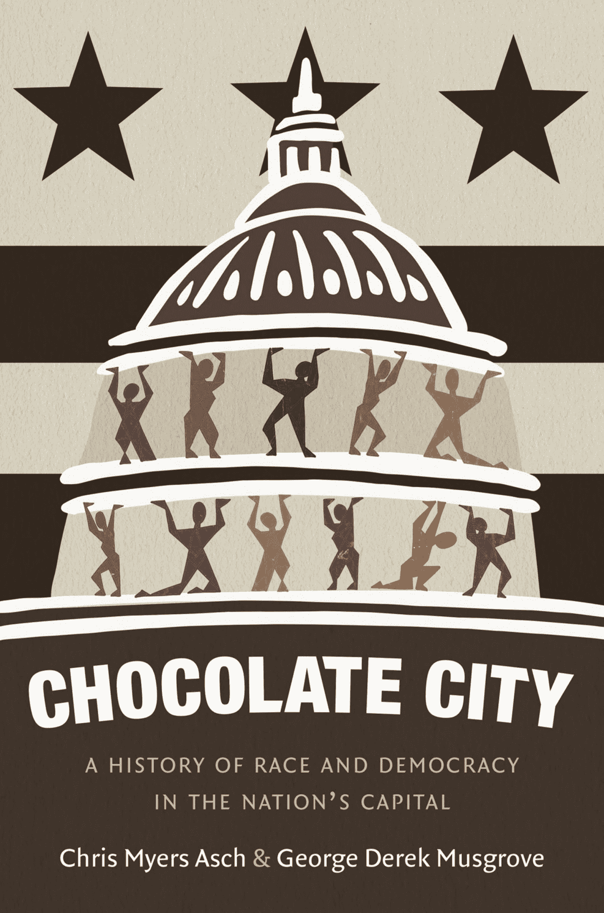


*恰皮尔希尔*


`Chapter 13` 的部分曾以略有不同的形式出现在 Chris Myers Asch 和 George Derek Musgrove 的著作 “‘We Are Headed for Some Bad Trouble’: Gentrification and Displacement in Washington, D.C., 1920–2014”中，见 *Capital Dilemma: Growth and Inequality in Washington, D.C.*，Derek Hyra 和 Sabiyha Price 编（纽约：Routledge，2015），107–35 页。


We shall by degrees chaung their barbarous natures, make them ashamed . . . of their savadge nakednes, informe them of the true god, and the waie to their salvation, and fynally teach them obedience to the kings Majestie and to his Governours.
```
阿纳斯蒂亚河（Anacostia River）实际上将华盛顿分为两个独立且不平等的部分。在它的北部和西部，丘陵向着联邦市纪念碑和华盛顿西北部的富裕社区延伸。在它的南部和东部，坐落着易受洪水的“远东南部”和“远东北部”平原和丘陵。在物理和心理上与华盛顿其他地区隔离开，这些“河东”社区在历史上一直遭受政治忽视、经济贫困和社会孤立。
河流本身反映了该地区的停滞。一直到 19 世纪初，阿纳斯蒂亚河曾与波特马克河齐名——它是一条繁忙的贸易通道，深度足以远洋船舶到达特区东北边界外的马里兰州布拉德斯堡。但随着烟草耗尽的土壤侵入河流，淤塞的阿纳斯蒂亚河变得太浅无法进行商业。该地区的经济萎缩了。尽管当地环保组织付出了巨大努力，在 21 世纪，阿纳斯蒂亚河仍然是隔开繁华首都与其最贫穷、黑人最多的社区的一道充满垃圾的障碍。¹
`Anacostia`一词在现代华盛顿几乎是“黑人”和“贫穷”的同义词，它的根源于我们现在称为国家首都的这一地区的首场种族斗争。这个词是 `Nacostine` 的拉丁语发音和拼写，这是一个居住在波特马克河和阿纳斯蒂亚河交汇处的原住民部落。在 17 世纪初，该部落有 300 人，Nacostine 人住在纳科奇坦（Nacotchtank），这是一个巨大的村落，位于现在的阿纳斯蒂亚-波林联合军基地的河流平原上。²
Nacotchtank 位于落差线（fall line）下方，这是皮德蒙高原下降至海岸平原的一处崎岖断层地带，它坐落在隔水潮区的阿尔尔贡昆语系民族与内陆的罗魁语族部落之间的边界线上。这两个族群进行着利润丰厚的贸易，每年成有数百人聚集在一起兜卖海狸皮、铜、贝壳珠和其他货物。利用地理位置的优势，Nacostine 人充当了中间人并获取了丰厚的利润。


边疆带来了繁荣，但也带来了危险，因为来自苏斯奎哈诺克（Susquehanock）和马萨沃马马克（Massawomack）等北方部落的战士频繁对上特里德水地区进行破坏性袭击。靠近分水岭的村庄，包括纳科特坦克（Nacotchtank），特别容易受到攻击。他们寻求最高酋长领地的保护，在这种实体中，酋长之首领通过提供军事保护来换取从属部落的贡赋。³
纳科斯汀人（Nacostines）与皮斯塔韦人（Piscataways）结盟。他们以波托马克河和切萨皮克湾构成的巨大半岛（即今天的马里兰州乔治王子县）为基地，皮斯塔韦人统治着约七千人。纳科特坦克坐落在其西部边界，纳科斯汀人向皮斯塔韦酋长纳贡，这位酋长将首府设在梅恩（Mayone），位于下游仅十五英里处，那里皮斯塔韦溪汇入波托马克河。
纳科特坦克的南方和东方是皮斯塔韦人的对手——强大的波瓦塔坦联盟（Powhatan Confederacy），其名称以这位强大的领袖命名。他们位于现在维吉尼亚州格洛斯特县的约克河边的韦罗科莫科（Werowocomoco），波瓦塔坦统治着从波托马克河南岸一直到北卡罗来纳州纽斯河的特里德水地区。他指挥着三十个从属部落，人口达一万五千人。⁴
当英国殖民者于 1607 春天在詹姆斯河上建立定居点时，他们居住在这个庞大、分裂且政治复杂的美国原住民人口之中。起初，他们是原住民世界的闯入者，受其既有统治者情绪的支配。然而，在短短一百年内，那个由原住民主导的世界消失了，在该地区剩下的少数原住民已成为英国国王的监护人。取而代之的是住在马里兰州和维吉尼亚州殖民地的英国定居者、仆人和奴隶。要理解这种转变是如何发生的，我们必须探索这一未来成为美国首都是的地区关于种族和民主的早期斗争。⁵
## “我们将逐渐改变他们的野蛮本质”：原住民遭遇欧洲探险家
纳科特坦克在 1608 年夏天迎来了第一位欧洲访问者约翰·史密船长。史密出生于林肯郡威尔伯希的一个农民家庭，凭借意志和纯粹的运气，他把自己变成了一名绅士和冒险家。他在十六岁时逃离学徒生涯，在法国做了十年的佣兵，在地中海做过私掠，在土耳其当过奴隶。回到英国后，他拥有上尉头衔，并在体面的圈子里活动。史密仍然渴望冒险，他离开伦敦，加入了弗吉尼亚公司在切萨皮克湾建立永久殖民地的努力。⁶
当史密降落在纳科特坦克时，他和和其他英国殖民者已经在切萨皮克地区待了很多一年。1607 年 5 月，他们已经在南方近两百英里的波瓦塔坦联盟的心地带定居。在一个被他们命名为詹姆斯斯顿（Jamestown）的低矮沼泽岛屿上，殖民者建立了一座木栅堡，并开始他们被赋予的任务——在美建立英国。项目进展并不顺利。到 9 月，由于无能的领导、疾病、饥饿以及与周围原住民的敌对，他们的人数减少了近一半。⁷
波瓦塔坦在远处观察着新来者的挣扎生存。他本可以任由殖民者挨死，或者派遣突击队将他们消灭，但他从入侵者身上看到了扩张经济和政治权力的机会。切萨皮克阿尔尔冈昆人相信，铜和透明珠子是通往灵魂世界的媒介，酋长的权力部分来自于控制对这些珍贵物品的获取。詹姆斯斯顿的殖民者从英国带来了大量的铜和珠子，还有铁工具，用以交换食物。一位英国人描述波瓦塔坦是一个“胆大、警觉、野心勃勃、精于扩张疆”，他决定通过将殖民者纳入自己的最高酋长领地来获得这些商品的独占权。⁸
1607 年 12 月，波瓦塔坦命令史密和殖民者离开詹姆斯斯顿，定居在首府下游的卡帕霍瓦西克（Capahowasick）。史密写道，如果他们这样做并为其提供“斧头和铜”，波瓦塔坦“承诺给我玉米、鹿肉或我想要用来喂我们的食物……而且没有人会打扰我们”。⁹ 尽管由于饥饿并受到邻近原住民的骚扰，殖民者一定认为波瓦塔坦的提议是荒谬且屈辱的。他们跨越大西洋时完全打算（事实上是听从弗吉尼亚公司的指示）要征服原住民并将他们皈归基督教。“我们将逐渐改变他们的野蛮本质，让他们为自己野蛮的裸体感到羞耻……告知他们真神，并……教他们服从国王陛下，”威廉·斯特拉奇这样写下殖民者的意图。但 1608 年绝望的冬天并不是表现这种居高临下态度的时候。史密同意了条款，波瓦塔坦送了食物，履行了他交易的承诺。¹⁰
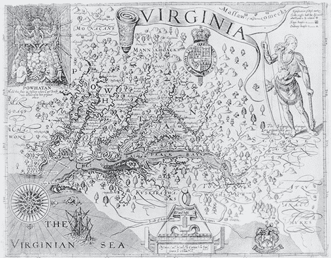
维吉尼亚 / 由约翰·史密船长于 1606 年发现并描述；由威廉·霍尔刻。这张地图出版于 1612 年，显示了切萨皮克地区和原住民的地名。波瓦塔坦酋长被描在左上角的长屋内。美国会图书馆。
然而，殖民者违背了交易。他们不仅留在詹姆斯斯顿，史密还开始试探波瓦塔坦领地的边缘，以评估当地人口的军事力量并绘制詹姆斯一世的新领地地图。1608 年 6 月和 7 月，他进行了两次切萨皮克湾及其支流航行中的第一次，乘坐一艘由十四名船员的开放式小船。船员们在东岸调查了几个河流系统，然后横跨海湾探索了帕塔斯斯科河和波托马克河。¹¹
意乎意料，波瓦塔坦感到被冒犯，命令他的从属酋长纠扰探险队。在波托马克河下游岸，“森林里到处是伏击者，多达三、四千名野蛮人奇特地彩绘、涂抹和伪装，尖叫、大喊和哭泣，地狱的许多灵魂也无法如此恐怖，”史密在日记中写道。¹²
只有当史密离开波瓦塔坦的领地进入波托马克河上游时，骚扰才停止，在那里他成为了第一个探索现在的华盛顿特区的欧洲人。当他于 7 月中旬到达“莫雅内斯（Moyaones）、纳科特坦（Nacotchtant）和托格斯（Toags）”时，他写道，“人们尽力让我们满意。”这三个村庄是皮斯塔韦联盟的一部分，他们热烈欢迎探险者，可能是因为希望与英国人结盟对抗波瓦塔坦，后者近年来一直在波托马克河上游扩张。¹³


如果说波哈坦最初将殖民者视为麻烦但仍有价值的盟友，那么现在他将他们视为威胁。当史密斯回到詹姆斯敦时，波哈坦召集他参加一次紧张的会议，首领指责殖民者对他的领土有大野图：“你们来到这里不是为了贸易，而是为了入侵我的人民并占有我的国家。”在短短几个月内，英国人与联盟之间的关系恶化为战争。殖民者及其后裔称之为“第一次波哈坦战争”，战争持续了五年，暂时停止了殖民者对切萨皮克湾的探索。由于英国人蜷缩在詹姆斯敦，纳科斯汀人在接触后的十年里很少见到欧洲人，其生活方式也几乎没有受到干扰。
## “他们知道我们的贸易可能会阻碍他们的利益”：英国商人破坏本土网络
尽管约翰·史密斯是第一个看到纳科奇坦（Nacotchtank）的英国人，但没有人对这个村庄及其居民比商人亨利·弗里特（Henry Fleet）更了解。弗里特出生于英国查姆的富裕家庭，于 1621 年秋季随其第二表哥——新任命的弗吉尼亚州州长弗朗西斯·怀特爵（Sir Francis Wyatt）的代表团抵达切萨皮克湾。弗里特在詹姆斯敦登岸时还未二十岁，他希望在新世界发大财。
起初，这似乎是一项轻松的任务。怀特和他的代表团前往弗吉尼亚，是为了接管一个与美国原住民邻居看似和平的扩张中的殖民地。1614 年，殖民者赢得了第一次波哈坦战争，作为和平协议的一部分，波哈坦同意向英国人提供食物，并承认他们对沿詹姆斯河捕获的优良耕地的主权。利用约翰·罗尔夫（John Rolfe）对烟草种植的实验，他们利用这片土地在 1615 年收割了两千磅的作物。这种植物在英国国内卖出了高价，因为它在皇室中已成为流行。在找到殖民地的现金作物后，弗吉尼亚公司进口了数百名契约劳工，扩大了种植规模，并在 1620 年出口了四万磅。当怀特到达时，殖民者已经过度专注于烟草生产，以至于忽视了探索切萨皮克湾和将原住民皈归基督教的职责。他的首要任务是重新聚焦他们的精力。
怀特从未有机会实施他的改革。1622 年 3 月 22 日早晨，在怀特到达仅仅五个月后，波哈坦的战士们悠闲地走进散落在詹姆斯河沿岸的八多个种植园，索要锄头、铲子和其他工具，然后开始殴打并砍杀他们的房主致死。在几小时内，他们杀杀了 347 名男女老，占了英国人口的整整四分之一。波哈坦的弟弟奥佩钦尚卡诺赫（Opechancanough）是这次袭击的幕后黑手，他的目标是迫使英国人退回詹姆斯敦并向联盟纳贡。
这次攻击引发了伦敦的血仇要求。弗吉尼亚公司的官员认为原住民是无可救药的野蛮人，放弃了同化和转化当地人口的梦想，转而呼召殖民者“消灭那些试图消灭我们的人”。怀特和他的部下在 1622 年发起了第二次波哈坦战争，并花了十年时间对敌对首领国进行收获掠夺。他们偷取玉米，焚毁村庄，让敌人在冬临前饥饿且无处遁形——这种做法是英国人在反对“野蛮”爱尔兰人的九年战争中开创的。州长和其他种植园主时刻意识到自己的经济利益，利用偷来的玉米饲养他们的契约劳工，而劳工们反过来致力于种植烟草。
与第一次波哈坦战争期间不同，纳科奇坦并未逃过暴力。英国人为了寻找盟友，接触了帕塔沃梅克人（Patawomekes），这是一个统治现今弗吉尼亚州昆蒂科（Quantico）周边地区的独立首领国。帕塔沃梅克人在敌对中寻求自己的利益，如果英国人加入他们并袭击他们的“誓誓之敌”——北方的皮斯卡塔韦人（Piscataways），他们就同意结盟。英国人同意了，他们一起袭击纳科奇坦，杀死 18 名男子，抢夺了粮食储备并焚毁了房屋。当天的掠夺者之一就是亨利·弗里特。
纳科斯汀人在 1623 年 3 月进行了反击，当时弗里特回到纳科奇坦交易玉米。纳科斯汀战士击倒了英国商人，杀死了 20 人并把弗里特作为人质。怀特州长派遣了一支针对纳科斯汀人的军事远征——他吹嘘他们“烧了他们的房子和大量的玉米”——但弗里特一直被囚禁，直到四年后殖民者支付了赎金才释放他。
讽刺的是，弗里特在纳科奇坦的经历赋予了他成为波托马克河英国人主导贸易者的必要技能。他对河流的地理了如指掌，并回忆道，“对印第人语言比我的母语还要精通”。释放后，他和他的两个兄弟开始垄断波托马克河中上游的贸易。1632 年春天，他们在该地区寻找皮毛，甚至在纳科奇坦停留，从那里带走了八百张皮草的惊人收获。
尽管纳科斯汀人愿意与弗里特兄弟进行贸易，但当兄弟俩试图与大瀑布以上的部落直接交易时，他们退缩了。几年前，马萨瓦克人（Massawacks）从瀑布上方南下，残暴攻击了波托马克河上游的部落。他们将被征服的纳科斯汀人指定为中间人，用弗里特的话说，“运输所有进入这条河的货物”。纳科斯汀人为了维持他们优越的，弗里特写道，“他们试图‘让我避免与其他人发生任何往来，因为他们知道我们的贸易可能会阻碍他们的利益。”弗里特并未退缩，他无视了之前的俘虏，沿着波托马克河上游，派遣他的兄弟爱德华步行几天的路程去见马萨瓦克的“四位国王”。弗里特兄弟的商品留下了深刻印象，国王同意将纳科斯汀人排除在波托马克河上游的海狸皮贸易之外。
## “为了促成更多的烟草”：英国人取代了纳科斯汀人


殖民定居最终到达了 Nacostine 地区。1663 年，卡尔特勋爵（Lord Calvert）授予了波托马克河与安纳科斯蒂亚河（当时被称为 Eastern Branch）交汇处的土地专利，其中包括贵族托马斯·丹特（Thomas Dent）的 860 英亩土地，他根据自己约克郡的家乡将该庄园命名为`Gisborough`。三年后，根据马里兰议会与皮斯塔韦人（Piscataways）签署的条约，卡尔特设立了后来所知的“保留地”（Reserve）。尽管协议规定“上述的若干个部落[其中包括‘Anacostanck’]将继续居住在他们现在的地方”，但卡尔特将保留地的中心设在皮斯塔韦人的首府梅恩（Mayone），迫使 Nacostine 人离开 Nacotchtank 并向南几英里外定居。少数人留在家附近，搬到了波托马克河上的阿纳洛斯塔岛（现在的罗斯福岛）。殖民政府并没有阻止这种营扎，这群人的残余一直占领该地直到下一个世纪。
到 1670 年，殖民者已经声称了后来成为华盛顿市的所有土地，但由于来自北方和东部部落的持续袭击，他们认为该地区是一个危险的边疆。大多数土地所有者住在圣玛丽市，对他们主张的土地未加问津。17 世纪 80 年代，他们开始向该地区派遣契约劳工和奴隶，以从森林中开辟烟草田。在那些被称为“外围庄园”（Out Plantations）的生活是孤独而艰辛的。工住在设施简陋的孤立哨所上，遭受着不愿被驱逐的 Nacostine 人和皮斯塔韦战士的反复袭击。所有人生活在对北方入侵的恐惧中。直到 1689 年，关于塞内卡人即将发动袭击的传言导致种植者约翰·艾迪森（John Addison）赶给查尔斯县的治安官写了一封信，请求武器，“因为这些地区非常空旷，且距离如此遥远。”
## 约翰·艾迪森与边疆


在边疆取得上风后，殖民者转而对付剩余的皮斯塔韦人和 Nacostine 人。他们想要获得土地，正如州长弗朗斯·尼科尔森（Francis Nicholson）所说，“为了生产更多的烟草。”议会通过从查尔斯县上部划分出乔治王子县作为回应，任命艾迪森为该县民兵上校，并授权他“听取并裁定可能发生或出现的印第安与英国人之间的所有个人冲突。”这些“个人冲突”许多演变成了暴力，因为 Nacostine 人和皮斯塔韦人抵抗英国对他们土地和自主权的最新入侵。
艾迪森对当地袭击殖民者的行为严严厉回应。1697 年对詹姆斯·斯托德（James Stoddert）的一个奴隶的袭击引发了如此威胁的回击，导致皮斯塔韦人和 Nacostine 人暂时离开保留地逃往弗吉尼亚州北部的丘陵。他们曾回来，但在 1701 年接受了宾夕法尼亚州长在萨斯奎哈纳下游定居保留地的建议后永久离开。
在随后的几年里，他们继续向北向西移动，逃避欧洲定居的前线，并与其他美国原住民群体融合，直到 18 世纪末，他们从历史记录中消失了。
## 土地贵族的兴起


该地区的土地家族，包括丹特家族、艾迪森家族、杨家族和比尔家族，利用庄园带来的财富主导了地区的选举。他们的子辈、孙辈和曾孙辈相互通婚、继承土地、担任职务，并在后的一个世纪里垄断了北弗吉尼亚和南马里兰的政治。事实上，艾迪森的曾孙、马里兰州长乔治·普莱特（George Plater）在 1791 年签署了将波托马克河马里兰侧领土让给联邦政府作为首都的法案。


当安德鲁·埃利奥（Andrew Ellicott）在 1790 年开始对成为国家首都的十英里方形区域进行测量时，纳科斯汀人早已离开，纳科特奇坦克（Nacotank）已成为遥远的记忆——事实上，当托马斯·杰斐逊（Thomas Jefferson）询问居住在东支的美国原住民的名字时，没有人记得。在华盛特区成立后的一个世纪里，旧村庄遗址上散落着美国原住民的文物，但这些后来被史密森博物馆的考古学家和爱好者收集了。20 世纪初，纳科特奇坦的遗址被埋在填海区中，为一条军事跑道让路，这后来成为了安纳斯蒂亚-波林联合基地（Joint Base Anacostia-Bolling）的一部分。如今，纳科斯汀人唯一的遗迹是这条以他们名字拉丁化命名的河流：安纳斯蒂亚河（Anacostia）。


杨豪宅建于约 1756 年，坐落在离岸 200 英尺的抬高河岸上，从带柱的后廊可以欣赏全景。访客通过一条树木成荫的入口到达，那里是一座惊人的两层砖结构建筑，建筑拥有十多个房间和四个引人注目的烟囱，点缀在屋顶的每个角落。“它不逊于某些欧洲王子的宫殿，”爱尔兰游客约翰·奥康纳（John O’Connor）在 1788 年评价道。豪宅旁有一座小教堂，杨作为马里兰州领先的天主教家族之一的后裔，可以在院内主持弥撒，而无需离开现场违反州对公开天主教崇拜的禁令。


## 美国奴隶制度的地区差异
然而，地区之间存在差异。在北方，小块土地上的自耕农面临着生长季节短和土壤相对贫瘠的困扰，这使得奴隶制在经济上仅小规模可行，或者根本不可。几乎所有的北方奴隶主只拥有一、两个奴隶。到 1790 年，奴隶仅占北方总人口的 2%，而不到 6%的美国奴隶居住在北方。但奴隶制对许多许多北方工业（包括造船和帆制造）至关重要，而且北方公司和个人资助并主导了北美的非洲奴隶贸易。
在南方，由于气候温和、土壤肥沃，奴隶制度盛行。在征服当地原住民失败后，南方种植主转向非洲奴隶，为他们的农业经济提供劳动力。尽管大多数南方奴隶主拥有的奴隶少于五个，但有相当少数人拥有数十甚至数百名奴隶，它们在占地数百甚至数千英字的庄园上生活和工作，种植烟草和大米等主要作物。三个最大的奴隶州中有两个马里兰州和弗吉尼亚州，哥伦比亚特区正是从这两个州中划分出来的。马里兰州约三分之一的居民是奴隶，弗吉尼亚州的比例也约占 40%。1790 年，这两个州共有近 40 万名奴隶，约占美国奴隶人口的 55%。
## 政治与思想的矛盾
尽管存在这些差异，殖民时期的政治领袖通常致力于维护奴隶制度。`梅森-迪奇森线`以两个测绘马里兰州和宾夕法尼亚州边界的测量员命名，它在地图上划分了南北的界限，但直到革命战争时期，它才固化为文化和意识形态的屏障。在 1775 年战争爆发前的二十年里，一场国际运动开始挑战奴隶制的思想基础。对于萌芽的奴隶制反对者来说，《独立宣言》中激动人心的字句只凸显了新国家所拥护的自由与其约五分之一人口所遭受的奴役之间显而眼的矛盾。正如英国作家塞缪尔·约翰逊对那些抱怨英国暴政的美国爱国者所尖锐地观察到的：“为什么我们从黑人奴隶主的那里听到了最响亮的自由呐喊？”许多奴隶自己也开始用革命的语言来他们的诉求，迫使美国奴隶主陷入了尴尬的境地：在为自己争取自由的同时，却否认黑人的自由。
一些美国人，特别是在北方，开始将奴隶制视为自由时代邪恶的过时物。革命时期最坚定的反奴隶领袖之一是亚历山大·哈密尔顿。作为加勒比地区奴隶主的才华私子，哈密尔顿认为奴隶制“削弱了勤奋的筋骨，剪掉了商业的翅膀，并在各个领域引入了痛苦和贫困”。他是`纽约促进解放奴隶协会`的创始成员，这是 17 世纪 80 年代在北方各地涌现的数十个反奴隶组织之一。到 1787 年夏天宪法会议召开时，北方七个州中五个已经禁止了奴隶制。
## 这一制度的感知衰落
许多革命战争时期的领袖认为，奴隶制是一个垂死的制度，将由于自然的经济原因而消失。这一制度似乎正在衰落，不仅在北方，在南方北部也是如此。在马里兰州和弗吉尼亚州，州议会修改了法律，使所有者更容易解放奴隶，这促进了自由黑人社区的增长。甚至许多南方奴隶主也对他们生活方式所依赖的制度表示担忧。在他广为流传的 1784 年文章《弗吉尼亚州笔记》中，杰斐逊对奴隶制对美国人的“不幸影响”感到忧虑。“主子与奴隶之间的整个贸易是极激烈情感的持续练习，一方是无休止的专政，另一方则是卑微的屈从。”华盛顿也觉得奴隶制与建立在自由之上的国家是不相容的。受到自己作为奴隶主的经历以及他坚决反奴隶制的朋友拉斐叶侯爵论点的影响，他声称：“活着的人中没有人比我更诚恳希望采纳一项废除奴隶制的计划，”他认为这是“唯一无法避免的遗憾主题”。
## 解放的现实
然而，尽管在思想上感到痛苦，但很少有南方奴隶主跨越从自由的抽象概念到解放的具体行动的鸿沟。即使是同情奴隶制道德困境的奴隶主，也对解放带来的社会排斥和经济损失望而却步。华盛顿尽管私下哀叹，直到去世前一直保留他的奴隶。詹姆斯·麦迪森也是如此，他担心自由对奴隶制可能产生革命性的影响。在战争期间于费城城生活了四年后，麦迪森担心他的其中一个奴隶`Billey`“被污染得太彻底了，不适合作为弗吉尼亚州其他奴隶的伴侣。”尽管他意识到`Billey`“渴望那种我们付出了如此血血代价、并屡次宣布它是正确的且是每个人类都值得追求的自由，”麦迪森还是将他卖掉了。
奴隶制仍然是南方经济的基石，关于其合法性的问题只加剧了许多南方白人感受到的被围困感。在宪法会议上，奴隶制作为一个不受欢迎的提醒，暗示着两个地区之间日益增长的差异。麦迪森在会议期间忧虑地写道：“现在似乎很清楚，利益的真实差异不在大州和小州之间，而在于北方和南方州之间。”奴隶制度及其后果构成了歧视的界限。”
## 大妥协
这种“利益差异”在关于国家政府所在地放在何处的辩论中显现出来。南方人感到人口较多的北方和不断扩张的西部包围，担心将首都放在北方——特别是靠近费城，那是美国反奴隶运动的中心——最终会破坏奴隶制并削弱南方的权力。他们的恐惧在 1790 年初进一步加剧，当时一群贵格教徒向国会提交了两份要求结束非洲奴隶贸易的请愿。第三份来自`宾夕法尼亚废奴隶协会`(由受尊敬的本杰明·富兰克林领导）的请愿鼓励国会彻底废除奴隶。请愿引发了国会的强烈反弹，并坚定了南方将国家政府所在地放在奴隶方的决心。
随着 1790 年春天的流逝，关于首都的辩论和关于金融系统的战斗都没有解决。哈密尔顿及其支持者缺乏通过联邦债务承担案所需的票数，而麦迪森和他的盟友则难以获得足够的票数将首都放在波托马克河畔。杰斐逊并非一个中立的旁观者，他介入并在曼哈顿麦登巷 57 号的租住住所通过晚餐促成了一项协议。


当联邦政府于 1800 年 11 月正式迁往华盛顿时，该市人口已增加到一万四千，其中包括三千多奴隶。华盛顿市内（不包括乔治敦、亚历山大或非建制县地区），奴隶占总人口的 25%以上。大量黑人（无论是奴隶还是自由）的存在塑造了新城市的轮廓。
## “自由人国家怀抱中的奴隶群”：华盛顿居民挑战无代表权的征税
尽管对其潜力充满了天花乱式的辞藻，但在政府迁入该市时，华盛顿仍然是一个偏远的农村地区。完工的总统府和国会大厦北翼展示了未来宏伟的愿景，但周边地区仍未开发。“我徒劳地寻找这座城市，却没看到房子，”玛格丽特·贝亚德·史密斯感叹道，她是一位来自费城的新婚娘，她的丈夫萨穆埃尔创办了该市最著名的报纸《国家情报报》（`National Intelligencer`）。奥南凡曾计划让华盛顿成为一座“距离宏伟的城市”，但在机械化交通之前的时代，他的计划让这个地方变得极其不便。那些异常宽阔的林大道“从未得到过修缮；深陷的车沟、岩石和树桩每分钟都在阻碍你的进步，而且经常威胁你的肢体脱臼，”一位英国访客这样抱怨道。[⁴⁹]
这座城市在政治和物理上同样未经过开发。华盛顿被设计为国会规划和控制的一项实验，背负着模糊的政治地位和不确定的经济未来。尽管被誉为“自由的堡垒”，但它是极不民主的。正如美国其他地区一样，绝大多数人口——女性、穷民和有色人种（奴隶和自由人）被系统性地排除在城市的公共生活和决策之外。但华盛顿的与常之处在于，穷人与城市精英共同了了剥夺权利的命运。几乎从诞生之初（并非完全），华盛顿特区就被剥夺了民主的基本权利。
在华盛顿建设期间，国会规定居民必须遵守出让土地各州的法律。在波托马克河东岸，他们受马里兰州法律管辖；而在西岸则受弗吉尼亚州法律管辖。宪法赋予国会在联邦特区“行使专属立法”的权力，但国会很少有人预见到，国家首都的公民将被拒绝州居民的权利和特权。詹姆斯·麦迪逊在《联邦党人文集》中辩称，出让地区土地的各州将保护城市居民的权利，“一个根据地方目的、源于自身投票的市政立法机构自然会被赋予这些权利。”像诺特利·杨这样的男人（城市的白人土地主）直到 1800 年 11 月仍在地方、州和国家级选举中投票。在 1800 年总统选举中，杨和其他其他合格的华盛顿市居民跋涉到马里兰州的布拉德斯斯堡，与其他自由美国选民一起投票。[⁵⁰]
这种情况很快就会发生变化。
1800 年的选举让托马斯·杰斐逊和他的共和党盟友上台，标志着联邦党统治的结束。从一个政党到其反对党的和平过渡被理所当然誉为美国政治的一项重大成就，但这次选举对特区的民主付出了沉重代价。在选举与杰斐逊就职之间的几个月里，国会中处于跛脚地位的联邦党人试图在小政府的共和党对手夺权之前，拼命在联邦政府中尽可能巩固权力。这两个政党在过去的十年里一直在宪法列举的许多权力范围上争斗。最后一场战斗迫在眉睫：如何处理华盛顿特区。
联邦党人尽可能广泛地解释“行使专属立法”条款，以推进他们集权联邦的宏大议程。由联邦党弗吉尼亚州人亨利·李在 1800 年 12 月提出的首份法案，授权国会实质上担任该联邦市的地方立法机构。虽然乔治敦和亚历山大将保留其市政府，但华盛顿市的居民将没有任何政府，且没有特区居民被允许参加国家或联邦选举。[⁵¹]
随着联邦党法案的消息传开——萨穆埃尔·哈森·史密斯新办的《国家情报报》每天向居民报告国会活动——担忧的白人华盛顿人对此激烈的反对。该市的大部分白人社区支持让国会继续对特区的控制。一份由两多名居民（包括诺特利·杨和詹姆斯·霍班）签署的请愿书要求国会“承担该地区的管辖权”，并制定“一套政府法”。他们不希望特区留在马里兰州或弗吉尼亚州的管辖下，担心如果国会不采取控制，华盛顿可能会失去其作为政府席地的地位——仍有许多国会议员，特别是来自宾法尼亚州的希望将首都拉回北方。[⁵²]
然而，城市居民拒绝承认国会控制意味着他们失去了自治和选举权。也许对自治统治最有激情的倡导者是一个 26 岁的纽约人，名叫奥古斯塔·布雷沃特·伍德尔。伍德尔后来远赴西部，并作为密歇根州首任首席法官和密歇根大学的创始人而久闻名，他是一个令人难忘的人物。他四肢细长，鼻子高挺，举止古怪在追随者看来是才华横溢的标志，在反对者看来则是自大的证据。他职业是律师，但性格上是远见卓者，伍德尔在 1800 年底国会首次讨论如何治理特区时，在《国家情报报》上发表了一系列八篇文章，这些文章当时开始出现。[⁵³]
伍德尔的文章中对国会充当城市地方立法机构的想法充满了愤愤。“任何政策都不会比将‘大’问题和‘小’忧虑混合在一起更糟糕了，”他辩道，“后者会被前者吞噬；被忽视和遗忘。”他担心，国会太容易被国家事务分心，而无法以适当的关注对待城镇、城市或特区的细微需求。国会控制不仅对特区本身有害，还会“损害联邦当局‘忙于哥伦比亚领地区所有地方事务’的‘尊严’。”伍德尔细致入微地阐述了特区如何在受国会管辖的作为联邦市的同时，仍享有自治和在国会中的代表权。[⁵⁴]
国会的联邦党人忽视了这种细微差别。在关于特区的辩论被一场占据了一个月国会注意力的国家选举危机中断后，国会于 1801 年 2 月底匆匆通过了《组织法案》，证明了伍德尔是正确的：地方事务通常会被国家性问题所凌驾。该法案巩固了国会对首都的控制，通过将特区内的三个开发地区——华盛顿市、乔治敦和亚历山大置于国会和总统的专属控制之下。它将特区内的非建制领土组织两个县：华盛顿县（位于马里兰州侧）和亚历山大县（位于弗吉尼亚州侧）。


当地自治倡导者的持续抗议促使新的共和党国会会将华盛顿市纳入管辖，并建立了一个由总统任命的市长和选举产生的议会组成的市政府。（乔治敦和亚历山大雷保留了它们自己的市政府。）这种有限的自治允许该市少数的白人男性土地主进行投票，在 1802 年的选举中，约有 90%的人参加了投票。由于投票限制，一份包含 23 名候选人的名单仅获得了 233 张票。尽管做出了这些让步，联邦政府仍然牢牢地控制着特区。总统不仅任命市长，国会还对任何地方立法保留了否决权。由于在自我管理方面受到如此限制，特区居民“我们可以把自己看作自由人国家怀中的一群奴隶，评价不会高于此了，”伍德德纳愤愤地说道。56)


包括男女在内，年龄在 12 至 25 岁之间。有可出售的仆人的人将发现，与我们联系是符合其利益的，因为我们提供的现金价格将高于目前或今后可能进入该市场的任何买家。

*亚历山德亚（Alexandria）*
——刊登于《国家情报报》（National Intelligencer），1835 年
位于亚历山德亚 `杜克街 1315 号` 的那栋狭窄、铅灰色的建筑，今天与周围环境相比并不突出。它夹在两座红砖建筑之间，这个不起眼的场所可能被误认为只是亚历山德亚老城（Old Town Alexandria）的另一家古雅小店，它高大的红门和玻璃气灯散发着老式的魅力。但在 20 世纪 20 年代和 30 年代，这块华特区的房地产——亚历山德亚直到 1846 年一直是特区的一部分——吸引了全美奴隶主和废奴主义者的关注。它是 `Franklin & Armfield` 的总部，这是国家规模最大、利润最丰厚的奴隶贸易公司。该公司拥有整个街区，三层楼的`杜克街`办公室是这项每年销售一千多名奴隶的大型业务的神经中心。
20 世纪 30 年代的访客绝不会误认这个地方。来自伊森·艾伦·安德鲁斯（Ethan Allen Andrews）是一位来自新英格兰、受过耶鲁大学教育的拉丁语教授，他在 1835 年访问了 `Franklin & Armfield` 的总部，写道：“当你靠近它时，很容易辨认出来……那是围着院子的高大白色刷过的墙……让它看起来像是一座监狱。”那里确实是一座监狱，是来自华盛顿整个地区的奴隶的滞留地，在他们被送“顺流而下”到新奥尔良和密西西比州纳特兹的奴隶市场之前。¹
这个长街的建筑群有一家裁缝店、一个厨房和一个小型医院，还有一个营房，多达 150 名奴隶在晚上被链在一起睡在泥地上。几个武装的白人男性守着囚犯，囚人在白天虽然没有束缚，但按性别分在两个院子里。奴隶们焦虑地等待着南下的旅程，要么乘坐 `Franklin and Armfield` 定制的船只通过水路前往，要么以成链的队伍队步行陆路前往。
奴隶贩的名誉正如一位英国访客所说的是“卑鄙、文盲且粗俗”，但`艾萨克·弗兰克林（Isaac Franklin）`和`约翰·阿米尔德（John Armfield）`培养了一种绅士形象。阿米菲尔德曾是北卡罗来纳州的马车夫，娶了弗兰克林的侄女，负责经营亚历山德亚办公室，而弗兰克林监督公司在密西西比州的基地。他们建立了一种创新的业务模式，利用与新兴市场革命相关的商业进步。公司通过全年广告来创造需求，购买自己的船只将产品运往南方市场，为客户提供可靠的、每月 1 号和 15 号准时发往南方的船只的“班班”服务，并采用最新的会计技术来追踪利润。²
凭借对良好关系力量的现代认知，阿米菲尔德用点心欢迎访客，并慷慨地提供参观`杜克街`场地的机会。公司以“头等船只”的承诺以及对其动产健康的刻意关注吸引了老奴隶买家。由于吃饱、衣着整齐的奴隶在拍卖场能获得更高价格，公司为每个奴隶提供两套衣服南下，并努力保持这些动产的健康。³
他们的方法非常成功。`Franklin & Armfield` 的定位恰好利用了美国奴隶制从北方贫瘠土地流向南方肥沃土地的转移。随着弗吉尼亚州、马里兰州和特拉华州的奴隶主出售他们的庄园或转向劳动力需求较低的作物，他们转向 `Franklin & Armfield` 和特区的其他奴隶商人，处理他们认为是多余的财产——用英国废奴主义者约瑟夫·斯特奇（Joseph Sturge）在 1841 年访问华盛顿时的话说，他们的“肉体作物”。⁴
这是一门利润丰厚的生意。在 20 世纪 30 年代，奴隶的价格“高得惊人”，阿米菲尔德辩道，而且深南方都有需求——他指出儿童在卡罗来纳州卖非常好。当弗兰克林在 1835 年退休到田纳西州的庄园时，据报道他是一个百万翁，而阿米菲尔德的财富估计为 50 万美元（相当于 21 世纪的 6 亿美元）。`Franklin & Armfield` 是整个南方规模最大的企业之一，仅次于最大的甘糖或棉花庄园。公司的成功有助于将特区转变为斯特奇所说的“美国奴隶贸易的主要中心”。事实上，在 20 世纪 30 年代，国家首都是美国最大的奴隶贸易城市，仅亚历山德亚就有四家主要的奴隶贸易公司。⁵


Franklin & Armfield 的杜克街奴隶圈场揭示了这个国家首都是如何从蓬勃发展的国内奴隶贸易中获益的。在 1812 年战争后的几十年里，该市的奴隶制度和奴隶贸易引发了国内外的批评，因为废除奴隶运动正将精力集中在特区。尽管有人坚持认为华盛顿应该保持为“国家这两个冲突且矛盾的地区之间的中立地”，但该制度的支持者和批评者都对此持不认同。⁶
对于南卡罗莱纳州参议员约翰·C·卡尔恩等南方奴隶主来说，华盛顿是南方的温泉铁卢，是他们的“最薄弱点”，南方领导人必须在这里集中精力——如果华盛顿落入废奴主义手中，那么南方其他地区也将随之。对于废奴主义者来说，正如廉·洛伊德·加里森的话，华盛顿是全国范围内结束奴隶制的战斗中“第一座被攻克的堡垒”。随着废奴主义在 19 世纪 30 年代年代成为美国政治中的一股全国性力量，关于奴隶制的全国战斗很大程度上是在国家首都及周边进行的，当地的黑人和白人废奴主义者积极挑战该市内部的奴隶制度。 ⁷
华盛顿之所以成为全国奴隶制的斗场，不仅是因为它是政府所在地，还因为该市在政治上的无力。在一个新生共和国的首都，居民无法为进入那个将该市视为家园的国会选举代表，他们享有的自治权力也非常有限。由于国会对市地方议会通过的任何立法案拥有否决权，国家领导人可以（并且确实）将华盛顿作为他们政治权力斗争的棋子。
由于缺乏地方民主而感到愤怒，许多白人华盛顿人抗议扩大政治权利。19 世纪 20 年代见证了长期民主运动的开始，贫困的白人男性要求获得投票权，而乔治敦和亚历山大港的居民则试图夺回他们在他们的家园成为国家首都所在地时失去的政治权利。这些民主运动，结合在特区废除奴隶制的当地和全国努力，恐吓了华盛顿的精英阶层，并导致了将在 1835 年爆发的日益升级的政治和种族紧张。
## “我不想去”：华盛顿反奴运动的萌芽
直到 1815 年晚秋，安·威廉姆斯（Ann Williams）过着一段相对平静的生活。她出生于马里兰州的布莱德斯堡是一名奴隶，但在奴隶制的束缚中成功地为自己和家庭开辟了一个空间。她嫁给了一个附近种植园的男人，在被卖给丈夫的主人之前，生了两个女儿，家庭聚在了一个种植园里。当女儿大约六岁和三岁时，园主去世了，威廉斯的遭遇发生了剧变。园主的挥霍儿子接管了庄园，欠下了巨债，以至于开始变卖资产，包括他的奴隶。一天，当她的丈夫在种植园的远处工作时，一名奴隶商人出现，将威廉姆斯和她的女儿带走。他把他们带到华盛顿，将他们关在 F 街乔治·米勒酒馆上方奴隶圈场内不同的囚房里，自己则为一支前往南方的陆路奴隶队积攒更多奴隶。⁸
威廉姆斯和女儿们进入的城市仍然从毁灭性的 1812 年战争中恢复未。。1914 年 8 月，身穿红衣的英国士兵入侵了防守不力的首都，在美军于布莱德斯堡战役中遭遇惨败后，这里突然变得脆弱——与其说是一场战斗，不如说是一场耻辱的撤退，媒体批评者将其称为“布莱德斯堡赛跑”。英国军队中包括殖民地海军军团，这是一个由约两百名来自切萨皮克地区种植园的逃亡奴隶组成的全黑人部队。这些人回应了英国副海军将亚历山大·科克兰的宣言，承诺任何支持英国的奴隶都能获得自由；他们的表现出色，战后他们定居在加拿大和特立尼达。（英国军队中出现黑人士兵，特别激怒了弗朗西斯·斯科特·基（Francis Scott Key），他是从布莱德斯堡战役逃逃的特区民兵官之一。当他后来写下一首赞美战争期间美国勇气的诗时，他在第三节中加入了一句警告，说：“没有任何避难所能救那雇佣和奴隶 / 免受逃亡的恐惧或坟墓的阴影。”今天很少有美国人演唱现被称为《星条旗》的这部分内容） ⁹
英国军队试图通过焚毁首都来惩罚并羞辱这些新生的美国人。他们纵烧了总统府、闪闪发光的大会大厦以及几乎所有其他公共建筑——“灯火冲天，天空被火焰染红！”恐惧的玛格丽特·贝亚德·史密斯写道。美国人反击击败了他们曾经的殖民主人，但在安·威廉姆斯到达华盛顿时，重建首都的过程才刚刚开始。正如该市大部分地区一样，大会大厦一片混乱，是一具无法供公众使用的焦黑残骸。10)
威廉姆斯和女儿们卷入了日益增长的国内奴隶贸易漩涡。尽管乔治·华盛顿和其他革命战争领导人预计奴隶制会随着时间的推移而消失，但伊莱·惠特尼在 1793 年发明的棉花机振兴了这一制度，并推动了全球纺织业的发展，导致了对棉纤维不断增长的需求。尽管在马里兰州、弗吉尼亚州和中南部奴隶制有所下降，但奴隶制在低南部迅速扩张。宪法在 1808 年禁止了进口非洲奴隶，这意味着渴望奴隶劳动力的种植园主们转而寻求国内来源。结果就是国内或内部贸易的兴起。
奴隶商人（被华盛顿人常称为“乔治亚人”）在北部的田间徘徊，寻找健康的奴隶，以便在乔治亚州以及后来的阿拉拉巴马州和密西西比州繁荣的奴隶营中获得高价。“这里所有的奴隶都非常害怕被卖到乔治亚州，并认为这与离开他们的故土一样是巨大的痛苦，”一位白人观察者写道。根据弗朗西斯·斯科特·基的，在 1815 年威廉姆斯被卖时，华盛顿每年有“数百名”奴隶被出售。11)
当威廉姆斯在黎明前的黑暗中坐在囚房里时，她可能在思考她和女儿们面临的未来。在经历了数百英里的强迫行军后，他们将被拍卖并卖给出价最高的人——不是作为一个家庭，而是作为个体。他们将忍受无休止的劳作，并在南方的阳光下有极大的死亡风险，且彼此分离，失去了彼此，失去了丈夫和父亲。“我不想去，”她后来回忆道。
威廉姆斯选择了一个既可怕又勇敢的选择。由于对被迫离开她熟悉的世界感到“**困惑不知所措**”，她从三楼窗户跳到了下方的 F 街。幸运的是，她从坠落中幸存，但折断了双臂并撞碎了腰椎。当她倒在街上时，她的尖叫声惊醒了邻居，包括医生市长詹姆斯·布莱克，他救治了她的伤口。12)


威廉斯那次绝望的行为后来让她非常后悔，但并没能拯救她的家人。当她那天早上到达时，发现自己残废了，那个商人直接将她留在了那里，带着她的女儿们和一群陌生人踏上了南下的漫长旅程。酒馆老板 `George Miller` 声称她是他的奴隶，于是她在他那里生活了近二十年。康复后，她与丈夫重聚，夫妻又生了四个孩子，但她再也没有见过大女儿们了。
那个冬天，威廉斯并不是唯一一个采取绝望手段反抗被贩卖的奴隶。在乔治敦，一位住在 `Francis Scott Key` 附近的女人奴隶意外被一名奴隶贩子带走了。`Key` 描述她是一个“忠诚且一直表现良好的仆人”，她在前往 `George Miller’s Tavern`（乔治·米勒酒馆）的途中割了了自己的脖子。她也活了下来，但到达酒馆时身上带着伤道需要缝合的血伤。另一位当地妇女在获知自己被卖掉后，立刻抓起肉刀砍掉了一只手，这使得她在奴隶贩子眼中失去了被卖价值。¹³
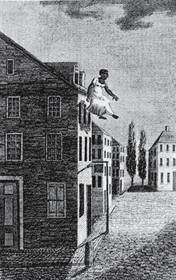
*安·威廉斯从三楼窗户跳下以逃避被卖到南方。她出现在杰西·托雷 1817 年反奴隶小册《美国国内奴隶肖像》的封面上。美国国会图书馆。*
威廉斯的跳跃和其他奴隶的绝望反抗，促成了在华盛顿禁止奴隶贸易的长期运动。1805 年，新泽西州众议员 `William Sloan` 提出了一项解放该地区奴隶的法案。该法案以 77 比 31 的结果被击败，只有一个南方州投了赞成票。从那时，反对这一制度的进展微乎其微。威廉落在 `F Street` 几周后，她接受了 `Jesse Torrey` 的采访，托雷是一位来自费城的 28 岁白人医生，当时正作为反奴隶巡演的一部分访问首都。她的故事震惊了 `Torrey`。他后来在他 1817 年那本痛斥奴隶制的著作《美国国内奴隶肖像》的封面上，描绘了保持匿名的威廉斯跳出窗外的场景。`Torrey` 的书是第一本将华盛顿直接推向美国废除奴隶运动风暴中心的反奴隶小册。同年晚，来自俄亥俄的新型反奴隶出版物《慈善家》也加入了 `Torrey` 废除该地区奴隶制和奴隶贸易的呼声。¹⁴
`Torrey` 对 `Ann Williams` 的采访只是他在华盛顿期间经历的许多令人不安的事件之一。一天早上，当 `Torrey` 准备离开他在国会山山附近的旅馆时，一个男孩冲进门，结结巴巴巴巴地说：“看，那个乔-乔-乔治人，带着一队两个两个链在一起的黑奴。”`Torrey` 跟着男孩出去调查，他在远处看到“一辆盖着篷布的马车，后面是一群男人、妇女和孩子，看起来像送葬队。”他们成对并用绳索和铁链捆着，在国会大厦的视线范围内行走，`Torrey` 追上了他们。他惊恐地站在 `宾夕法尼亚大道`，看着两个奴隶主驱赶着神情闷的奴隶向远处的波托马克河走。这时，一个黑人马车夫（今天会被称为出租车司机）路过。他指着那群奴隶喊道：“看那儿！那不是简直是*谋杀*吗？你们不觉得那是*谋杀*吗？”¹⁵
这些话渗透了 `Torrey` 的良心。在他回房间途中经过漆黑的国会大厦时，他认为这座宏伟的建筑被烧毁恰当。`Torrey` 用半世纪后将在 `亚伯拉罕·林肯第二次就职演说` 中产生回响的话写道：“假定万国之至高父允许了这桩显然可恶的交易得以*实施*，这是一种*火热的*但有益的信号，以表达他对这些哥伦比亚孩子行为的不满——他们建造并崇拜这座宏伟的建筑作为自由的殿堂，同时用奴役的枷锁和辛苦的束缚压迫着他们一百万到一百五十万非洲*兄弟* . . .？”最令人置信的是，`Torrey` 继续写道，“*奴隶*正被雇用来重建这座*自由*的圣殿”——正如二十年前他们帮助建造它时那样。¹⁶
正当 `Torrey` 对奴隶工人重建国家自由标志的象征意义大声疾呼时，国会内部也也响起了不满的情绪。1816 年 3 月，在 `安·威廉斯` 跳下后仅仅三个月，弗吉尼亚州众议员 `John Randolph` 发表了一场了不起的演讲，谴华盛顿的奴隶贸易。`Randolph` 是一位脾气暴躁、急性风的奴隶主，后来曾与国务卿 `亨利·克莱` 决斗，但他与奴隶制的关系非常复杂。他的继父曾写过一篇令人震惊的 1796 年反奴隶论文，他的兄弟则释放了所有的奴隶并给了他们四百英亩的土地。`Randolph` 本人在私下谴责奴隶制，并在遗嘱中释放了他的奴隶，但在公开场合他维护这一制度——他认为联邦政府没有宪法权利干涉南方的奴隶制或奴隶贸易。¹⁷
然而，特区的情况不同。由于特区由国会控制，`Randolph` 认为联邦采取行动反对市奴隶贸易没有宪法障碍，并呼吁国会停止他所谓的“上帝和人类面前的罪孽”。`Randolph` 认为，在首都存在繁荣的奴隶市场损害了美国在世界上的声誉。作为一个吸引要员和游客的国际化城市，华盛顿特别容易引起国际愤慨。`Randolph` 回忆起，当一位外国要员评论首都的奴隶贸易时，他感到“羞愧”。像英国人 `亨利·布拉德肖·费农` 这样的访问者认为华盛顿“被绝对奴隶制的致命重量 . . .削弱了”，而备受尊敬的`拉法叶侯爵`在看到《国家情报》上关于逃奴的广告感到震惊后，在 1824 年著名的全国巡游期间谴责了首都的奴隶制。外国人对特区奴隶制和奴隶贸易的反感在未来的几十年里只会加剧。¹⁸
`Randolph` 主持了一个特别委员会，调查特区“非人道且非法的奴隶贸易”。委员会关注该贸易中两个特别令人不安的特征：“卑鄙、冷酷无情的主人”在出售时频繁拆散家庭，以及 `杰西·托雷` 所说的“极其恶劣的行为，抓捕并卖那些受我们国家和州宪法保障自由和道德权利的男人、妇女和儿童”。委员会不仅听取了 `Torrey` 的证词（批评者可能会认为他只是情绪煽动者），还听取了备受尊敬的当地领袖的意见，包括`威廉·克兰奇` 法官，他是前第一夫人`雅雅盖·亚当斯`的侄子，是一位在`哥伦比亚特区美国巡回法院`任职五十多年的庄严法官。`Cranch` 证实了 `Torrey` 的指控，即自由黑人经常被奴隶贩子偷走并卖作奴隶，以赚取南方提供的高价。¹⁹


随着人数的增加，华盛顿的自由黑人开始在生活中寻求更多的自主权，并开始建立自己的宗教机构。在城市发展的早期，黑隶和自由黑人居民都会参加白人教堂，但他们面临着身体上的隔离，并忍受着关于隶属地位的经常提醒，例如某些白人牧师反对在洗礼时接触黑人儿童。对乔治敦`蒙哥马街教堂`歧视感到愤怒的 130 多名黑人会众在 1816 年离开，建立了该市第一座黑人教堂——`小方舟教堂`（The Little Ark，1846 年更名为`锡安山联合公会教堂`）。尽管在内战期间由白人牧师领导，但`锡安山`对支持乔治敦黑人社区发挥了重要作用。1820 年，`以伯尼泽教堂`的黑人成员放弃了拥有奴隶的牧师，成立该市首个自主黑人会众——`以色列-贝塞尔有色卫公会教堂`，位于`国会山`脚下的`东南第一街`。几年后，当`以色列-贝塞尔`面临失去建筑的危险时，`阿莉娅·布朗宁·坦纳`（Alethia Browning Tanner）和她的姐`乔治·贝尔`（George Bell）出手购买了这座教堂。
## 黑人的倡议与资源
黑人的倡议和资源（有时同情白人居民捐款的支持下）发起并维持了十四座战前黑人教堂，其中包括位于`西北第十一街和 K 街`的`阿斯伯里非洲耶稣卫公会教堂`，该教会拥有六多名成员。（所有这些教堂都是新教。黑人天主教徒长期留在白人经营的教堂内，部分是因为牧师对黑人和白人教徒同样施行圣礼；直到内战期间，黑人成员才建立了自己的教堂——`圣奥古斯丁教堂`。）这些战前教堂成为至关重要的社区机构，培养了种族自豪感，鼓励黑人领导力，洗礼并教育儿童，联系了自由人和奴隶亲属，并在有时为逃奴隶提供避难所。
华盛顿的黑人还通过建立自己的世俗机构（特别是慈善协会）来维护他们日益增长的自信心。这些互助组织汇集资源，帮助社区成员应对财务困境、医疗紧急情况和葬礼。一个成功的例子是`坚决福利协会`（Resolute Beneficial Society），于 1818 年由包括`乔治·贝尔`在内的一群自由黑人创立。除了对疾病和葬礼的传统关注外，该协会还为自由黑人儿童办了一所学校。它号召整个社区通过会费和订阅来支持学校，尽管为了缓解白人的担忧并“避免不愉快的发生”，该小组承诺不教奴隶儿童。该协会与其他社区机构一样，既反映又培养了华盛顿黑人新兴的自主意识和自力更生。
## 迈克尔·希纳的生活
迈克尔·希纳（Michael Shiner）体现了许多华盛顿黑人来之不易但又脆弱的成功。`希纳`于 1805 年出生于马里兰州`皮斯卡塔韦`附近的奴隶身份，后来搬到了`华盛顿`，他的主人雇他去`海军造船厂`担任劳工。在他主人于 1827 年去世后，他以 250 美元的价格作为“定期奴隶”被卖给了海军造船厂书记员`托马斯·霍华`（Thomas Howard）——`希纳`在服役十五年后即可获得自由。他娶了一个名叫`菲利斯`（Phillis）的奴隶妇女，夫妇有六个孩子。他们是`以伯尼泽教堂`的活跃成员，那里提供成人周日学校课程，`希纳`可能在那里学会了读写。作为一名赢得同事和老板尊重的勤奋工作者，他开始在一份非凡的日记中记录他对日常生活的观察，揭示了对战前华盛顿工人阶层迷人的见解。
但希纳一家无法舒适地度过家庭生活。`菲利斯`的主人在 1833 年去世后，其儿子通过将`菲利斯`和希纳两个孩子卖给`弗兰克林与阿姆菲尔德`奴隶贸易公司来偿还了家庭债务。“他们就这样这么从我这里夺走并卖掉了，”绝望的`迈克尔·希纳`在 6 月写道。“忧心万分，”他度过了几个极其焦虑的日子，动用他认识的所有白人人脉来帮助家人获得释放。`希纳`的坚持和对权力的精明理解得到了回报。他招募了一位来自`海军造船厂`的将军，获得了法院命令，不仅迫使`弗兰克林与阿姆菲尔德`让协，还安排了`希纳`妻儿的解放。花了一个星期，希纳一家终于重聚。
`希纳`还坚定地追求他的自由。当他的主人`霍华`去世，霍华遗嘱的执行人威胁要违反他的解放条款时，`希纳`在法院上挑战他们。在白人律师`詹姆斯·霍班二世`（James Hoban Jr.，白宫第一建筑师之子）的帮助下，他提交了一份 1836 年的自由申请，指控自己被“不公正且非法地监禁”。他赢了。作为一个自由人生活得很好，在`海军造船厂`工作了二十多年，积累了财产，并在内战后活跃于当地政治。“我现在唯一的主人是《宪法》，”他后来宣告道。
## 阶级划分与社会紧张
尽管处境不稳定，但战前自由黑人口在获得就业和获取财产方面的微小成功，为 20 世纪初成为美国规模最大、最富有且受过良好教育的黑人人口奠定了基础。这也在黑人社区内部种下了阶级划分的种子。许多华盛顿的自由黑人拥有白人血统，并认同（在人口普查中被分类为）“混血”（mulatto）；他们较浅的肤色证明了华盛顿的种族界限比法律规定的固定区别更具流动性和渗透性。由于与白人社区联系更密切，许多混血居民比肤色更深的同伴拥有更多的教育和就业机会，通常享有更高的地位。这些划分随着时间的推移而扩大，特别是在 19 世纪后期。
华盛顿自由黑人人口的剧增和成功令许多视为威胁的白人居民感到。当地作家`安·罗雅`（Anne Royall）抱怨黑人“完全占据了城市，并用他们的无礼、噪音和石头骚扰人们。”`罗雅`指怪国会“偏爱黑过白人”，并声称“这些黑人占据了所有的工作和现金……甚至包括我们的女性”，让“贫穷饥饿的白人”无路可走。”战争部长`詹姆斯·巴伯`（James Barbour）认为有色自由人“无知、无礼且士气消沉”，只能通过“卖淫、偷窃和乞讨”为生。他在 1824 年说，摆脱他们是“我们的首要目标”。
该市的白人领导也有类似的担忧。他们试图通过通过一系列日益严格的黑人法典来阻止自由黑人的迁入。“对色人（无论是奴隶还是自由）个人自由的所有想象的侮辱性限制都渗透在这些法律中，”一位后来的观察者写道，“似乎假设这些谦卑隐耐的生物已经准备好进行暴乱、叛乱和各种类型的不服与邪恶。”


卡伯里对民主的观点可能部分源于他的天主教信仰，这种信仰强调对穷人的道德义务。他是华盛顿规模虽小但影响巨大的天主教社区中最为著名的成员之一。许多天主教家庭，如杨家、布伦特家和卡罗家，在马里兰州已经扎根了几代，他们努力融入华盛顿的政治和经济精英阶层。与他们的新教同胞一样，这些家族中最富有的包括卡伯里家族也拥有奴隶；事实上，拥有奴隶是精英地位的象征。（某些天主教奴隶主会将奴隶发展为天主教，既出于精神原因，也是因为他们认为正如乔治敦大学校长约翰·格拉西牧师在 1818 年说的，“天主教奴隶比其他人都受欢迎，因为他们更顺从，对主人更忠诚。”）
华盛顿的天主教徒维持着他们的宗教和文化传统。尽管在 19 世纪 10 年代，市政治领导层向国会申请禁止流浪者进入城市的权利，天主教社区仍帮助贫穷移民寻找工作并欢迎他们加入当地堂区。19 世纪初的大多数尔兰移民到达这里时没有住所也没有工作。当地天主教社区提供了各种资源，例如华盛顿市爱尔兰慈善协会，该协会由 1888 年爱尔兰酒馆的老板、承包人和工人成立，旨在帮助贫困的爱尔兰家庭。由约翰·卡罗主教于 1789 年创立的乔治敦大学成为首雇主，经常雇用新来的移民担任厨师、缝纫或农工，直到他们找到正式工作。因此，爱尔兰移民的经历与华盛顿自由黑人形成了鲜明对比，后者几乎没有社区资源可以利用，而且往往被期望成为奴隶亲属的支持来源。
作为一名与爱尔兰移民一同崇拜的信徒和一名与体力劳动者并工作的建筑师，卡伯里与他们产生了共同利益感，这使他与其他奴隶精英成员区分开来。他的政治崛起引起了特区更传统领导人的担忧，特别是当 1820 年国会更改市章程后他竞选市长时。国会扩大了市政府的权力，并将议会任命的市长改为民选，让特区选民有机会每两年选择一次市长。这种选举自治的扩张持续了半个多世纪。
卡伯里在 1822 年竞选市长并获胜，引发了城市精英的愤怒。在弗朗西斯·斯科特·基的法律代表下，他们提起了诉讼，控卡伯里鼓励“不合格”（即贫穷）的选民投票。市议员的大多数拒绝为新市长宣誓，导致市政厅发生近乎骚乱的事件，需要警察干预。卡伯里上任后，他的反对者通过了一项备受争议的“百美元法”，将投票权限制在那些评估拥有 100 美元或以上财产的白人手中（按 21 世纪的美元计算价值超过 7 万美元）。卡伯里否决了该法案，但在他在 1824 年连选失败后，议会立即再次通过了该法案。
这项法律旨在让政府成为特权阶层的专利，这触怒了白人工人。《美国电报》是一份由一位脾气古怪的前准将达夫·格林经营的新杰克逊派报纸，它工人阶级反对“令人厌恶且作呕的百美元法”以及试图“在我们中间建立金钱贵族”的领导者的愤怒发声。当卡伯里在 1826 年再次竞选市长时，工人们热烈支持他，但投票限制限制了他的支持基础。卡伯里失败了。白人穷人必须再等待二十多年，才能再次在城市政治中行使广泛的政治影响力。
杰克逊派对普通人政治权力的强调，引发了将亚历山山德和乔治敦“收回”，即归还给它们原本的弗吉尼亚州和马里兰州的呼声。由于对政治上的无力感到愤怒，越来越多的白人居民开始质疑继续留在国家首都部分是否明智。
就在上一代，亚历山山德和乔治敦的著名领导人曾是将首都安置在波托马克河沿岸最热衷的支持者。在 1812 年战争之前，这些城镇蓬勃发展，公民们通常具有国家认同取向。但战争暴露了华盛顿的脆弱性，促使国会许多人公开讨论搬迁政府所在地。城市的捍卫者击败了搬迁的挑战，但仍然难以获得国会的持续关注。尽管联邦立法者承诺重建国会大厦和其他公共建筑，但他们经常拒绝为华盛顿拨付足够的资金，并忽视了为该市起草法典。简而言之，一位给《国家情报报》的信件作者的话呼应了奥古斯塔·伍德德几十年前的论点：国会过于关注“这个巨大帝国更高、更大的利益”，而不顾及地方事务。
许多亚历山大德和乔治敦的居民将国会的忽视归咎于日益加剧的经济困难。由于国会规定所有联邦建筑必须在华盛顿市内建造，随着政府的发展，中心城市变得繁荣。港口城市陷入了停滞，特别是在 1820 年之后，波托马克河沿岸的海外贸易触底。亚历山大德受打击尤为——其人口在 19 世纪 10 年代增长不足 14%，19 世纪 20 年代不足 1%，而华盛顿市的人口在 19 世纪 10 年代扩张了超过 50%，1920 年代又增长了 30%。许多亚历山大德人感到经济上日益孤立。
收回主张者认为，国会的忽视部分源于“缺乏政治自由”，正如一位白人亚历山大德所说，“在自由州包围的情况下，失去自由的社区是不可能繁荣的。”收回者用防御性的语言将他们的政治困境描述为“奴隶状态”，并哀叹国会“主人”表现出的冷漠。他们将愤怒转化为向国会的请愿（称为“备忘录”）和给编辑的信，在信中他们请求摆脱一位居民所说的“卑微剥夺选举权和殖民附属状态”。支持者认为，将亚历山大德和乔治敦归还给母州，不仅有助于居民“重新获得那些无法估量的权利，即自由人的出生权和继承权”，还将带来更高的地价、更多的人口和更多的贸易。

但领土归回（retrocession）运动正如白人男性选举权的斗争一样，并没有获得普遍支持。华盛顿市的领导人特别担心这会削弱对将首都保留在波托马克河畔的支持。他们还担心，如果 `Congress` 允许领土归回，它很可能会削减为该市提供的有限资金。在 1822 年一份由华盛顿市议员委员会和共同议会提交的纪念备忘录中，建筑师詹姆斯·霍班（James Hoban）和其他其他市领导人断然拒绝了对联邦与城市关系的任何改变。他们更倾向于“加强将这座城市与国家联系在一起的链条，而不是拆掉最小的一个环扣”。他们认为，该特区“比我们国家的任何部分都得到了更充分、更有能力的代表，因为它是是由全体全体的国会代表的”。⁵⁹
由于缺乏白人内部的统一支持——特别是缺乏白人精英的无条件支持——领土归回运动未能向 `Congress` 提出有服力的论点。直到 19 世纪 30 年代和 40 年代，废奴运动颠覆了当地和国家政治后，领土归回才引起国会的关注。
## “意义严重的恶行”：废奴运动直指华盛顿
约翰·F·库克（John F. Cook）在废奴主义的影响下成长。一位白人同时代的人描述他的肤色“介于盎格鲁-撒克逊人与注定毁灭的种族之间”，库克的职业是鞋匠，理想是教育工作者。他在 1826 年十六岁时获得了自由，当时他的姨妈阿莱西娅·布朗宁·坦纳（Alethia Browning Tanner）支付了 1,450 美元（约 21 世纪的 36,000 美元）购买了他的母亲和四个兄弟的自由。两年，他加入了约翰·W·普鲁特（John W. Prout）创立的哥伦比亚学院（Columbian Institute），成为位于西北 14 街和 H 街交汇处的新兴学校的 100 多名黑人学生之一。⁶⁰
库克最初在学业上很挣扎。但在肩部受伤意外迫使他寻找体力较小的劳动后，他开始废寝苦读，并成长为一名学者。他在黑人社区中承担领导角色，为自由黑人和处于奴隶身份的黑人建立了一个辩论社，名为“青年道德与文学协会”。到 1834 年，他已经足够优秀并备受尊重，成功继替普鲁特成为哥伦比亚学院的院长（他将其更名为联合神学院），七年后，他创立了第一所黑人长老会教教会（后更名为 15 街长老会）。在 1855 年以 45 岁的英年去世之前，他在教育和社区提升方面拥有了卓越的 20 年职业生涯。⁶¹
作为一名亲属仍处于奴隶身份的前奴隶，库克鄙恶这种“特殊的”制度，并渴望吸收 19 世纪 20 年代后期流传华盛顿自由黑人社区的自由与机会思想。多年来，华盛顿的自由黑人一直默默地谴责奴隶制，帮助个体逃犯逃往自由之地，并在法院寻求自由诉讼，但很少有人公开支持废奴。然而，当库克在 1826 年获得自由时，反奴隶情绪正传遍北方，越来越多的人开始呼吁彻底结束奴隶制。⁶²
当大多数白人反奴隶支持者支持殖民主义或渐进解放时，新一代的自由非洲裔开始阐述一种不同的愿景——现在就要自由，而不是讨论离开美国。波士顿的黑人废奴者在 1826 年成立了通用颜色协会（General Colored Association），美国第一份由黑人经营的报纸《自由杂志》（Freedom’s Journal）于次年在纽约出版。1829 年，大卫·沃克（David Walker）发表了振奋的《向世界有色公民诉书》（Appeal . . . to the Coloured Citizens of the World），谴责奴隶制和殖民主义，并挑战美国人履行《独立宣言》中写的平等理想。“美国对我们来说比对白人更像是我们的国家——我们用我们的血泪丰富了它，”沃克写道。黑人废奴者激进的辞令和不妥的要求从根本上改变了美国废奴主义的进程，激励了黑白反奴隶支持者在要求上变得更具战斗性。⁶³
在《诉书》中，沃克号召黑人利用教育、宗教和节制领导自由斗争；约翰·F·库克将这三者都融入了他的毕生。在哥伦比亚学院，青少年库克可能听过并讨论过这群激进的黑人领导人及其信奉的思想。普鲁特校长是该市最直言不讳的黑人废奴者之一。作为《自由杂志从创立起的授权代理，普鲁特是殖民主义的公开反对者，后来因协助逃犯奴隶而被捕。库克认同普鲁特的紧迫感。他的社区领导首要行动之一就是为一个“即将从奴隶制中解脱自己”的年轻人组织募义。⁶⁴
到 1830 年，像约翰·F·库克这样的自由黑人占该市黑人人口的大多数。他们社区日益的规模的实力让白人市领导人感到担忧。1827 年，市议通过了一部修订后的黑人法典，对违反宵禁的行为处以高罚，要求所有 15 岁以上的黑人男性和 13 岁以上的黑人女性提供自由证明，并禁止任何人雇用或收留无法提供自由文件的黑人。任何被发现没有文件的人将被视为逃犯并入狱。华盛顿特区众议院委员会成员解释说，这一条款至关重要。如果被发现没有文件的黑人被认为是自由身，城市将成为逃奴的“理想去处[和]聚集地”，这将是“无法忍受的骚扰”。⁶⁵
法律进一步允许市监狱长出售任何无主认领且无法支付监费的黑人囚犯——这增加了被捕并假设为逃犯的自由黑人被特区当局卖为奴隶的可能性。奴隶贩子学会了在监狱停留，查看是否有所谓的逃奴待售。⁶⁶
在有这些法律存在的情况下，库克和他的自由黑人邻居可以建造学校和教堂，他们可以拥有自己的房屋和产业，可以建立并领导社区组织，但他们不能假设自己在城市街道上安全的。尽管国会领导人认为对自由黑人的错误监禁是“完全不可能的”，但特区的奴隶监狱有时会关押像本尼迪特·哈珀（Benedict Harper）这样的自由黑人囚犯。哈珀于 1831 年因盗窃被捕，被带到了奴隶监狱而非法官。他担心自己会被卖掉，并成功从监狱的三楼窗户逃了出去。⁶⁷


在严厉的审查和压力下，特区的白人领袖和国会的南方领袖放弃了自美国革命以来常见的对奴隶制的道歉式辩护。他们将奴隶制重塑为一种“积极的良善”，指责废奴主义者才是真正的威胁，反奴隶运动将引发流血。《美国政治家》（American Statesman）的编辑们警告说，华盛顿的奴隶问题是一个爆炸性的话题，采取的任何步骤都必须“像用火柴点燃火药桶那样谨慎和慎重”。
## “我自由的权利和你们一样多！”：“雪暴”事件与鲁本·克兰达尔（Reuben Crandall）的审判
爆发发生在 1835 年夏末。8 月 4 日，一个名叫`亚瑟·鲍恩`（Arthur Bowen）的十八岁奴隶在`John F. Cook`的辩论学会与一群自由黑人和奴隶黑人一起饮酒并辩论了一个晚上。`鲍恩`可能是安娜·索尔顿（Anna Thornton）名下五个奴隶中最受宠爱的，而安娜是著名建筑师威廉·索尔顿（William Thornton）深受爱的遗孀。当`鲍恩`在午夜后完全醉酒地踉跄回到家时，他的脑海中盘旋着他一直在讨论的关于自由的思想。
他最后无力地站在`安娜·索尔顿`卧室的门口，手臂里夹着一把斧头，结果正撞上与`索尔顿`住在同一间房间的母亲`玛亚`（Maria）。`玛亚`设法将儿子推出卧室，而`索尔顿`则从后门跑出去救。几分钟后，两个邻居到达，听到`亚瑟·鲍恩`拍打卧室门，大喊道：“我自由的权利和你们一样多！”
那周晚些时候，警察在没有流血的情况下逮捕了`鲍恩`，但这一事件让华盛顿的白人社区感到不安，引发了这座国家首府两周的动荡。当市报对这起“最血腥的悲剧”愤愤不已时，一群白人技工（熟练工人）冲向市监狱，希望对`鲍恩`进行报复。迈克尔·希纳（Michael Shiner）在日记中写道，暴民希望“把索尔顿太太的那个男人带出来，在没有法官或陪审员的情况下把他吊死”。
许多技工已为种族冲突做好了准备。在造船厂（Navy Yard），白人工人一周前因抗议纪律镇压而罢工，但自由人和奴隶黑工人留在了岗位上，这激怒了技工们。`鲍恩`事件给了他们发泄怒火的机会。情况变得如此危险，以至于检察官弗朗西斯·斯科特·基（Francis Scott Key）寻求联邦援助，一支海军陆战队从造船厂派来封锁监狱并恢复秩序。
对许多当地白人来说，`鲍恩`是一个活生生的噩梦：一个通常知足的奴隶（至少根据他主人的说法）被自由黑人和他们的废奴主义思想腐蚀了。奴隶主在主张奴隶制是积极良善的辩护中认为，奴隶化是黑人的自然状态，被奴隶化的非洲美国人缺乏独立思考和行动的能力。根据这种逻辑，`鲍恩`不可能自己要求自由并攻击他的主人——一定有一个白人废奴主义者反派潜伏在这次爆发背后。
在`鲍恩`被安全入狱后，白人领袖将责任完全归咎于废奴主义者及其盟友。`威廉·洛伊德·加里森的美国反奴隶制协会`仅在上个月就通过邮寄寄送了 17.5 万份愿书，《国家情报报》（National Intelligencer）的编辑们愤怒地称，这种“令人作呕的恶行”助长了“当今的狂热精神”。对`索尔顿`的攻击仅仅是“这座城市和整个国家奴隶主地区最近浸淫在这些煽动性出版物中的首批果实”。许多白人观察者指控，`鲍恩`是因为阅读了废奴文学才被激怒的。如果那位亲蔼的`索尔顿`都能受到攻击，一位忧心的华盛顿人写道，那么“对于过去二十年里聚集在我们中间的自由人和奴隶，其他公民还能期待什么呢？”
但仅仅指责那些无名的废奴主义者是不够的。白人指控者需要一个替罪羊，他们在一个最近搬到该地区的行事低调的白人植物学家兼医生鲁本·克兰达尔（Reuben Crandall）身上找到了。`克兰达尔`的妹妹普鲁迪斯（Prudence）是一位公开的废奴主义者，但`鲁本`并不是奴隶制的狂热反对者——他从未公开支持过解放。然而，一位访问他店的客人看到了散发的废奴文学，并警告`克兰达尔`：“这种东西在这里行不通，这里太太南方了。”许多白人观察者指控，`鲍恩`是因为阅读了废奴文学才被激怒的。直到`鲍恩`事件以及周末的暴民威胁之后，检察官才采取行动。为了平息日益的不满，他下令逮捕`克兰达尔`，指控他“发表恶毒诽，意图煽动这里的奴隶和有色人起义”。
`克兰达尔`的逮捕引发了又一次暴力爆发。当`克兰达尔`被带往监狱时，有人喊道：“我们应该把那个该死的混吊在某棵树上”，但海军陆战队在监狱周围保持阵型。由于无法抓住傲慢的奴隶`鲍恩`或涉嫌废奴主义的`克兰达尔`，技工暴民转而攻击他们讨厌的另一个群体：自由黑人。
暴民首先的目标是自由黑人贝弗利·雪（Beverly Snow），他是高档餐厅“享宴馆”（Epicurean Eating House）的所有者。尽管`雪`在光顾他的白人精英中拥有朋友，但白人工人认为他是种族秩序的冒犯。作为城里最奢华食物的供应商，`雪`受过教育，富有，并且可能有一丝傲慢。传闻他吹嘘可以随心所欲得到任何技工的妻子或女儿。这一传言加上对潜在废奴主义的指控以及普遍的法律混乱精神，导致数百名和男孩组成的愤怒暴民——用一位白人目击者的话说，“抓住雪并把他火刑，或者更糟。”
`雪`在白人朋友的帮助下逃离城市。在他不在期间，暴民洗劫了他的餐厅。随后，他们去拆毁了`John F. Cook`的学校，据认为`鲍恩`在那里接受了废奴主义的渗透。在暴民到达之前，白人邻居赶到`Cook`位于 K 街的家里，告诉他“离开这里，因为暴民正在杀死所有帮助黑人的。。别停。”`Cook`逃到了费城，一年没有回到该市。暴民焚毁了另一所学校，继续在自由黑人社区中肆虐。直到几天后联邦军队出现以及安德鲁·杰克逊（Andrew Jackson）总统从度假回来，这场“雪暴”才结束，城市恢复了平静。


暴徒对 `Snow`、`Cook` 以及自由黑人社区的针对，揭示了该市种族分裂的经济维度。经济怨恨在白人工人中根深蒂固，特别是在爱尔兰社区；这个社区在 19 世纪 20 年代末`Chesapeake and Ohio Company`招募了数千名爱尔兰移民修建`C&O Canal`之后迅速。在运河和其他项目中，白人工人与奴隶和自由黑人工人竞争，而且他们往往能胜出。巴尔的摩与`D.C.`之间的道路是由爱尔兰工人铺设的，尽管一位观察者指出的，“这条路穿过的土地满了有色人，他们极度需要更有利可的工作。”19 世纪 30 年代初，白人工人还赢得了碎石铺设 `Pennsylvania Avenue` 的合同。
然而，华盛顿的白人工人抱怨，他们的黑人同胞主导了公共工程项目，并将他们共同遭受的低薪和糟糕的工作条件归咎于黑人工人。当他们集体行动改善状况时（例如在 `Navy Yard`），他们经常发现老板可以转而雇佣黑人工人。1834 年和 1835 年，许多北方城市的白人工人例行举行动乱，以表达对老板和竞争对手的挫败。频繁的动乱导致一位华盛顿白人写写道：“这个国家正陷入了暴徒热。”华盛顿的“雪大风暴”是 1835 年夏天爆发在整个东海岸沿岸的一系列动乱的一部分，其中许多动乱针对的是自由黑人和教育他们的学校。
“对黑人的所有这些攻击之所以，是因为他们以更低的价格进入工作竞争，”华盛顿一份支持奴隶制的工人阶级报纸 `United States’ Telegraph` 解释道。“他们的舒适标准比白人劳动者低，因此他们能够通过廉价劳动力削弱白人工人。”`Telegraph` 认为，白人工人对自由黑人的愤怒是南方应当抵抗奴隶制的的首要原因。“解放隶一旦发生，北方就会对黑人关闭大门，”因为北方的白人工人根本无法容忍黑人迁入。那么，华盛顿和其他南方城市将陷入庞大的自由黑人人口中，这将摧毁白人社区。
白人工人对黑人的发泄不仅是因为他们可以相对免受惩罚地这样做，还因为他们对普遍的市场变化感到挫败，这些变化削弱了他们的自主性并挑战了他们的独立感。就像 19 世纪 30 年代中期其他城市的暴乱者一样，华盛顿的暴徒对他们的社会和经济优越阶级怀不满。自华盛顿的社会和经济精英向 `Thomas Carbery` 及其支持者明确表示，没有足够财产的人（无论是否是白人）将被排除在政治进程之外以来，已经过去了十多年（此处指排除在政治进程之外）。在一个上层社会极其重要的城市里，白人工人被排除在权力之外。动乱往往成为表达不满的手段。
政治上无权、经济上依赖、社会上处于从属的白人工人对上层阶级发怒，但他们选择对唯一比他们更卑微的群体实施暴力——黑人和他们的废奴主义盟友。在一个经济动荡和种族紧张的时期，一份新工人阶级报纸 `Washingtonian` 的编辑们写道：“废奴主义和奴隶制对我们来说比我们能想到的任何事情都更重要。”编辑们后来号召南方立法机构“吊死每一个来到这里干涉他们奴隶的人”。
白人工人的愤怒和对自由黑人的感知威胁吓到了白人领导者，在接过去的一年里，他们试图重新获得对这座首都的控制。这一过程中的一个核心人物是地区检察官 `Francis Scott Key`。从审判 `Arthur Bowen` 开始，通过对 `Reuben Crandall` 和几名“雪大风暴”暴徒成员的起诉，`Key` 试图重建他认为城市已经失去的秩序。
`Key` 在二十年中走了很长的路路。年轻时，他坚信奴隶制是一个正在消亡的制度——在他所在的城市确实如此——并追求他认为解决奴隶制终结随之而来的问题的伟大且人道的解决方案：殖民主义。一段时间，殖民主义似乎确实可行。`Liberia` 在 19 世纪 20 年代初建立，成千上万的前奴隶现在在那里。
然而，到 19 世纪 30 年代中期，殖民主义被废奴主义掩盖，这项运动包含了支持某种形式渐进解放的人，以及要求立即结束奴隶制并让自由黑人留在美国的激进少数。废奴主义威胁要压倒殖民主义并削弱其道德合法性。越来越多的反奴隶白人开始同意 `John W. Prout` 和其他黑人废奴者的观点，他们谴责殖民主义是一个阴险、道德上令人厌恶的加强奴隶制和驱逐黑人的计划。
随着废奴主义者变得日益活跃，殖民运动内部的一些领导人试图通过与奴隶主和其他南方支持者保持距离来削弱他们的攻击。这项努力的一部分包括在 1833 年尝试将 `Key`（以及法官 `Cranch`、`National Intelligencer` 编辑 `William Seaton` 以及其他 `D.C.` 领导人）从 `American Colonization Society` 的管理委员会中移除，他们自该组织成立以来一直担任该职务。尽管努力失败了，但受伤的 `Key` 极力寻求重新获得他在董事会的地位，并重新确立殖民主义作为解决美国自由黑人“问题”的最人道解决方案。
`Bowen` 的审判于 1836 年 11 月开始，过程相对迅速，裁决几乎没有悬念。尽管 `Anna Thornton` 试图保护她的奴隶并坚持他并无恶意，但其他证人反驳了她。`Key` 巧妙地说服法官们不要让 `Bowen` 的醉酒状态为其行为辩护，并不断冲击白人陪审员的紧张情绪。在辩方陈述结束后，陪审团仅花了 15 分钟就判定 `Bowen` 意图杀人罪。他被判处死，但 `Thornton` 拒绝放弃他。利用她与白宫的关系，她直接向总统 `Andrew Jackson` 求情，总统在经历了数月的请愿和请求后，最终同意并授予了 `Bowen` 特赦。作为特赦协议的一部分，`Bowen` 被卖给了总统的一位朋友并带离城市。
相比之下，`Reuben Crandall` 的审判是一场轰动世界的事件。在富有废奴主义者的资助下，`Crandall` 获得了两位顶尖律师，并在挤满议员和其他名流的法庭上进行了强有力的辩护。代表这座城市的人是无处不在的 `Key`，他辩称这是华盛顿审理过的“最重要的案件之一”。他对陪审团的结案陈词非常不同寻常，深刻地反映了驱动许多华盛顿白人的焦虑情绪。


在 19 世纪的 40 年代和 50 年代，如今博物馆所在的所在地曾是一座规模较小的建筑的遗址：臭名昭彰的华盛顿监狱。这座三层楼的监狱建于 1839 年，位于面向 G 街的地块东北角，由于其抹灰墙面呈现出令人作呕的浅蓝色，被嘲讽地称为“蓝罐”（Blue Jug）。它装有铁栅窗户和百叶窗百叶板，内部不仅提供石制的牢房，还为更严重的罪犯准备了“铁笼”。在监狱后方，穿过现今的大厅和司法广场，一条泥泞的泰伯溪河（Tiber Creek）支流流向了市政厅。²
泰伯河在现代华盛顿已从视野中消失，被埋没在地下管道中。但它曾主宰着市中心，水位从西北部士兵之家附近的细流不断增长，到到达白宫正前的波托马克河时，已变成一片宽达八百英尺的水域。尽管它的名字听起来很有古意（这片土地最初是一处名为“罗马”的庄园的一部分，所有者以此命名溪流），但到 19 世纪中期，泰伯河已变得一团糟。它流入华盛顿市运河，该运河建于 1815 年，是彼特·拉凡特（Peter L’Enfant）连接波托马克河与东支流计划的一部分。一位华盛顿人回忆道，泰伯河“以一种廉辱的停滞状态横跨城市，最终透过绿色的藻类和淤泥渗那更为廉价的运河，那条运河就像一个露天下水道粪池，是所有恶行的容器，是城市疾病的滋源和耻辱”。³
恶臭的运河象征着城市本身的经济停滞，到半世纪中叶，这里显然未能实现乔治·华盛顿关于建立商业枢纽的梦想。当地领导人为了努力修建切萨皮克与俄亥俄河运河（Chesapeake & Ohio Canal），几乎让城市破产，他们希望通过连接波托马克河与俄亥俄河，让华盛顿通往西部市场。他们向 C&O 运河公司投入了 150 万美元的公共资金（相当于 21 世纪的 4.14 亿美元），并通过借贷来偿还城市债务的利息，但成本却急剧失控。到 1834 年，华盛顿市的债务已超过 170 万美元，需要国会的救助。巴尔的摩与俄亥俄铁路的快速崛起，使得该运河在 1850 年部分完工之前就过时了。⁴
波托马克河和东支流的泥沙淤积加剧了城市的经济问题，由于缺乏良好的交通条件，该市未能产生重大的私营产业。在 1812 年战争后的几十年里，华盛顿变得依赖联邦政府，而兴起的企业倾向于为政府工作人员和项目提供服务。在 1820 年至 1850 年间，华盛顿的人口增加了一倍多，从 23,336 人增加到 51,687 人，但在增长惊人的时代，它未能赶上其他城市地区——纽约的人口增长了四倍，超过 50 万；新奥尔良增长了近七倍，达到 11.6 万；辛辛那提则从不足 1 万人扩大到 11.5 万人。华盛顿在 1820 年曾是美国第九大城市区，但三十年后掉落到了第十八位。⁵
英国英国作家查尔斯·狄更斯（Charles Dickens）在 1842 年访问时，曾著名地将华盛顿斥为“宏伟意图之城市”。“从无处开始且不通往何处的宽阔大道；长达英里却唯缺少房屋、道路和居民的街道；只需要民众就能完善的公共建筑；以及宽阔大道上的装饰，它们唯缺少宽阔的大道来装缀——这些都是它的主要特征。”由于人口稀少且商业规模“几乎不值一提”，一位爱尔兰作家在 1855 年直言不讳地总结道：“这座联邦首都必须被视为一次显著的失败”。⁶
该市还遭受着严重的犯罪困扰，特别是在沿运河和泰伯河生长的一些粗陋社区，其中包括爱尔兰人的聚居点沼地杜德（Swampoodle，位于今日火车站以北）和谋杀湾（Murder Bay，现为联邦三角区）。由于从这座犯罪横生的城市街头源源不断涌入小偷、斗殴者和妓女，“蓝罐”监狱被频繁使用。
但“蓝罐”不仅仅是小罪犯的圈禁之地。这个苍白的碍眼之物也是日益演剧的奴隶制剧剧的中心舞台。尽管国会试图通过“禁言规则”（gag rule）压制公众讨论，但国家首都的奴隶问题并没有消失。沮丧的废奴主义者无法克服他们所谓的“奴隶主权”（Slave Power），于是转入“地下”，帮助华盛顿地区的奴隶逃往自由。随着越来越多的被奴者“潜逃”（这个词经常出现在逃犯者的广告中），城市领导人苦苦于通过捕获和惩罚逃亡者来维持这种奇特的制度。
他们采取此的一种极具争议的方法是将嫌疑的逃犯者投入“蓝罐”——即使他们是自由人。狄从斯不可置信地写道：“在华盛顿，任何治安官都可以用锁链束缚任何过街的黑人，并将他投入监狱：黑人本身无需犯下任何罪。治安官说：‘我选择认为这个人是逃犯：’然后把他关起来。当这样做时，公众舆论赋予了法律人员在报纸上刊登该黑人的权利，警告他的主人来认领他。”⁷
在 1826 年至 1828 年间，总共有 101 名逃犯被关入“蓝罐”。其中 81 人被交给了主人，15 人被证明是自由身并释放；另外 5 人无人认领被售掉以偿还监狱费。⁸


# 特瑞与斯马尔伍德：华盛顿的废奴运动
`Torrey` 受教于`Exeter`和`Yale`，他博学但胆大，是一个充满激情且时而冲动的年轻人。他二十八岁时来到`D.C.`，担任几份北方报纸的当地通讯员。在`1842`年初，他因参加黑人教会并闯入`Annapolis`的一个奴隶主会议，立即引起了白人精英的愤怒。他从会议上被拖走并关入监狱，在那里遇到了十三个黑人家庭的成员，他们被扣留直到被送回奴隶制。怀着成为下一个`威廉·洛德·加里森`的愿景，`Torrey`写下了激情的信件，谴责奴隶主为“人类鬣狗”，并宣布：“上帝已在安纳波利斯监狱的墙上写下了字……‘奴隶制必须灭亡’。”在`Torrey`回到`华盛顿`后，`Elizabeth Smallwood`为这两个鲁莽的活动家安排了一次会面，随着废奴运动进入新的方向，他们成长为坚定的盟友。
`Thomas Smallwood` 蔑视大多数废奴者，但认为`Torrey`是一个“亲爱的朋友”。他们挑战了`华盛顿`废奴社区的主流情绪。在`1835 年“雪暴骚乱”之后，随后对自由黑人的镇压以及`国会`在`1836`年实施`沉默法`，使得`华盛顿`的许多废奴活动家看不到短期内废除奴隶制的希望。作为回应，一些白人废奴者利用富有北方人的资金购买个人奴隶并释放他们。`Smallwood`和`Torrey`鄙视这种想法——他们认为买奴只会让这种不道德的制度合法化并使其获利。相反，他们寻求更直接、更具对抗性的行动。

## 地下铁路
在`Elizabeth Smallwood`和`Padgett`夫人的支持下，`Thomas Smallwood`和`Torrey` 计划并执行了秘密逃亡，帮助`华盛顿`地区有兴趣的奴隶通过秘密的避难所网络前往`北方`获得自由。“俄亥州的废奴代表`Joshua Giddings`写道：有人发誓有一条`地下铁路`，他们通过那里在`地下`旅行，而且‘妇女和孩子，全家人都消失了。’”所谓的“地下铁路”并不是一个由废奴运动领袖协调的全国性网络；而是由无数局部网络组成的，涉及黑人和白人活动家的小组成，这些小组有时与更北方的废奴者和慈善家有着松散的联系。
当地地下铁路的成功取决于`华盛顿`自由黑人和奴隶黑人的勇气和人脉，加上白人盟友的战略协助。`华盛顿`地区的逃亡者通常寻求当地“线人”，例如`Leonard Grimes`，他是一个住在`西北第二十二街和 H 街`拐角的自由黑人马车夫。`Grimes`肤色较浅足以伪装成白人，他在`特区`长大，经常为白人奴隶主工作，载着他们去邻近州州游览。在目睹了奴隶所遭受的惨状条件后，他致力于帮助逃亡者寻找自由。在`1839`年于`弗吉尼亚州北部`被捕之前，他帮助了许多逃亡者。他在监狱服了两年刑。（`Grimes`的住所现在通过`乔治·华盛顿大学`校园的一块牌匾纪念。）
`Smallwood`和`Torrey`扩大了`华盛顿`的地下铁路。两人声称在合作的两年里帮助了 150 名奴隶逃亡。在经历了几次与法律的惊险接触后，`Torrey`于`1844 年 6 月`在`巴尔的摩`被捕，被指控协助逃亡者。再次入狱后，他成为全国废奴者中的英雄，但在监期间健康迅速恶化。他在`1846`年于监狱中肺结核去世。`Smallwood`逃往加拿大，在那里开了一家五金店，写了自传，并成为`多伦`日益壮大的黑人社区的领军人物。
尽管`Smallwood`和`Torrey`的伙伴关系被迫中断，但由于奴隶在整个`1840 年代`和`1850 年代`继续从主主手中寻求自由，地下铁路一直延续了下来。“白人废奴者`Theodore Weld`在`1842`到达该市时兴奋地写道：‘奴隶每天都在从特区逃离’”逃亡者有时会在当地教堂找到避难所，包括乔治敦的`Mount Zion 联合卫理会教会`。`Mt. Zion`的成员在`西北 Q 街`教会墓地的墓室中藏匿逃亡的奴隶，教会记录注明了被“带走”（被奴隶巡逻队捕获）、“离开”（逃往北方）或“丢失”的成员。
## 法律与国家参与
逃亡奴隶以及被奴隶贩捕困的自由黑人经常招募同情的白人盟友，帮助他们通过地下铁路或法院逃脱。一位弗吉尼亚奴隶主抱怨道，`华盛顿`的黑人利用白人律师“窥探每个人对黑人的所有权”。其中一位律师是`David Hall`，他于`1820`年来到`D.C.`向他的导师、殖民主义倡导者`Elias Caldwell`学习法律。`Hall`拒绝了殖民主义，成为一名废奴活动者，有时会购买奴隶并释放他们。他为`John Bush`提供了法律援助，后者因在`1843 年`帮助`Smallwood`和`Torrey`逃亡被捕，而他最终赢得了无罪判决。
全国著名的白人废奴者也参与了当地的地下铁路。来自俄亥州的、好斗的边疆开拓者代表`Joshua Giddings`可能是`国会`中最具对抗性的废奴成员。他住在`东北第一街的 Ann Sprigg`旅馆里，与其他废奴代表和活动家住在一起，他们将那间旅馆命名为“废奴之家”。通过对奴隶制的公开谴责以及代表个人奴隶付出的私人幕后努力，`Giddings`和他的同伴为渴望自由的奴隶提供了道德和物质支持。
## 归还运动
`华盛顿`跨族裔废奴社区的日益增长加速了`亚历山大`对归还的呼声。许多居民希望将波托马克河以西的所有特区土地“归还”，即还给`弗吉尼亚州`。随着废奴者在`1830 年代中期`壮大，随着数千份废奴请愿书冲击`国会`，随着越来越多的奴隶逃亡，许多`亚历山大`白人开始将归还视为不仅是获得政治权利和实现经济繁荣的方式，也是保护他们拥有和交易奴隶财产的权利，免受一位亚历山大信件人所说的“不断实验的国会”反复的影响。
这两个核心问题——民主与奴隶制——在归还支持者的脑海中是相互为因的。由于`特区`居民没有政治权利，他们无法保护自己的财产权利——而在`沉默法`时期，“财产”往往是奴隶制的委婉语。“*亚历山大公报》的一位归还支持者抱怨道，`华盛顿`已成为“对人民权利和财产进行立法实验的场地”。到`1840 年`，`亚历山大`白人对归还的支持大幅增加。当年的归还投票以近三比一的票数通过了。


# 逃亡者
逃亡者让自己处于巨大的风险。安娜·玛丽亚·维姆斯（Ana Maria Weems）是一个十五岁的奴隶女孩，一位废奴主义者描述她为“聪明的混血儿，发育良好，聪明且漂亮”。她住在马里兰州市以北的一个种植园里，主人是个嗜酒者，其妻子性格“刻薄易怒”。当地的白人废奴主义者雅各·比格洛（Jacob Bigelow）曾与来自费城的黑人废奴主义者威廉·斯蒂尔（William Still）合作，花费 1000 美元买了安娜·玛丽亚的母亲，花费 1600 美元买了她的妹妹（约相当于 21 世纪的 3 万美元和 5 万美元），但主人拒绝与安娜·玛丽亚分开。由于担心她可能会试图逃跑，主人强迫她和自己以及妻子睡在同一个卧室里。她最终在 1855 年秋天装扮成男孩，化名“乔·莱特（Joe Wright）”，逃往华盛顿，并在那里找到了比格洛。比格洛警告说：“这座城市到处都是煽动者，”他们必须避开那些悬赏 100 或 200 美元赏金的奴隶猎人，以此引诱他人背叛逃亡者。比格洛将维姆斯带过城市并送到费城，斯蒂尔在那里等候。他帮助她到达纽约，并在著名废奴主义者路易斯·塔潘（Lewis Tappan）的帮助下前往加拿大。[³⁴]
白人废奴主义者经常与他们试图帮助的逃亡者共担风险，尽管他们面临的后果与被捕的黑人所遭受的痛苦相比微不足道。在《逃亡奴隶法》生效前，`珍珠号`逃亡事件的策划者之一威廉·查普林（William Chaplin）试图帮助两个逃亡奴隶——加兰·怀（Garland White）和艾伦（Allen），他们属于乔治亚州的两位美国参议员。当他们越过区边界进入马里兰州的银泉（Silver Spring）时，三人遇到了一队武装副备的警察和私人奴隶猎人。在一场激烈的枪战后，查普林被捕了。富有的废奴主义者朋友为他缴纳了保释金，但他离开了城市前往纽约，再也没有回来。那两个逃亡者的遭遇并没有那么好。艾伦被捕并立即被送回主人那里。怀逃了，但他最终自首了，当局迫使他回了奴隶身份。（他后来逃脱了，并在南北战争中担任一个黑人团的随军牧。）[³⁵]
## 自买自由
奴隶也通过自买来追求自由。在战前时期，特别是在 19 世纪 50 年代，奴隶家庭共同努力购买个人成员的自由。尽管这需要多年时间，并且通常需要白人中间人或自由黑人亲属的介入，但自买为黑人家庭提供了一种相对安全且合法的方式来保持完整并最终共同享受自由。由于所需的自由证书花费 50 美元且难以获得，因此购买自由的家庭成员并不总是被登记为法律上的自由。在法律眼中他们仍然是奴隶，但他们享有自由的特权，并像自由男女一样生活。奴隶通过自买追求自由的主动性，可能有助于说服雅各·比格洛和其他当地白人废奴主义者放下对这种做法的个人顾虑。到 19 世纪 50 年代初，他们开始利用北方废奴主义者的财富来购买该区奴隶的自由。[³⁶]
## 反奴隶网络与教育
华盛顿的跨族反奴隶活动人士网络也合作改善城市内自由黑人的生活。这种合作的一个例子是私立黑人女学校（School for Colored Girls），它于 1851 年 12 月开办，在十一街和纽约大道西北的一栋房子里，一个 14 英尺见方的房间内挤进了六名学生。学校的创始人是一位严厉且身体虚弱的纽约白人，名叫米尔蒂拉·米纳（Myrtilla Miner）。米纳今年 36 岁，单身，性格极其固执，她在 19 世纪 40 年代在密西西比教书期间曾亲眼目睹了奴隶制的恐怖。这段经历使她转变为一名废奴主义者，米纳回到家，致力于教育自由黑人女孩，她认为这些女孩将教会未来的曾奴隶世代如何充分利用他们的自由。她选择在华盛顿开办学校，那里是法律允许的最南城市。[³⁷]
米纳的学校计划最初让一些当地废奴主义者感到担忧。《国家时代》报的加马里尔·贝利（Gamaliel Bailey）忽视了她的求助，而黑人教育者约翰·F·库克（John F. Cook——他自己也办了一所黑人儿童学校）担心“任何带有废奴色彩的东西”都会遭到抵抗。但雅各·比格洛提供了帮助，米纳利用主要启动资金启动了学校。随着学校的发展，她赢得了城市跨族反奴隶社区的认可。尽管受到许多白人反对者的威胁，米纳和她的跨族教师团队并未避讳争议。学生学习家政学和“三字”（读写算）等传统科目，还学习政治——他们阅读弗雷德里克·道格拉斯的《北极星》、威廉·洛德·加里森的《解放者》以及其他废奴主义文献。当地的“暴徒”在街上威胁她的学生，并试图把米纳赶出城，但她拒绝被吓倒。她睡在学校上方，手里随时准备着手枪。“冲我的学校吧！你们不敢！”她对一群潜在的攻击者大喊道。“没有法律阻止我教这些人，我会教他们，直到死也不罢！”[³⁸]
米纳的黑人女学校，正如安娜·玛丽亚·维姆斯前往加拿大的勇敢逃亡一样，展示了内战前十年跨族合作的程度。尽管无法免于几乎所有美国白人根深蒂固的优越感假设，但像米尔蒂拉·米纳和雅各·比格洛这样的白人废奴主义者，在大多数白人同类仅将黑男女视为奴隶或仆人的时代，与该区的黑人合作并为他们服务。他们的跨族努力显得格外非凡，因为这发生在该城市和国家一样，在 1850 年妥协之后经历着日益升级的种族和政治紧张之际。
## 没有“避难之城”：白人镇压自由华盛顿人
很少有华盛顿白人拥护废奴主义。该市白人领导层更典型的是像沃尔特·伦诺克斯（Walter Lenox）这样的人。伦诺克斯出生并成长于华盛顿，是一位苏美国木工之子，他在华盛顿房地产投资中积累了财富。在耶鲁大学毕业后，他回到家执业并从事政治。他留着胡须，发际线逐渐后移，以情种汉闻名，与他的朋友（未来的市长）理查德·瓦拉赫（Richard Wallach）共用一个狂欢的单身公寓。伦诺克斯在地方政治中迅速崛起。他在 25 岁时当选市议员，不久后成为市议会主席，随后在 33 岁时在 1850 年的市长选举中险胜。[³⁹]
伦诺克斯的竞选活动开启了地方政治动荡且派性的时代。1848 年，在托马斯·卡伯里（Thomas Carbery）选举引发民主运动一代后，在全国范围内追求白人男性普权的推动下，国会消除了投票的经济障碍，将投票权扩大给所有在城市居住至少一年的白人男性。这对地方选举的影响是巨大的——市长选举的票数增加了一倍多，随着贫穷白人涌向投票站，选举变得更具派性且竞争更激烈。伦诺克斯在 1850 年获胜，但两年后被下台；19 世纪 50 年代没有区市长连任过第二任。[⁴⁰]
尽管林肯做出了保证，但南方很少有白人信任他。他们审视了他的过往，得出结论认为他充其量只是一个秘密的废奴主义者。随着南方州脱离，南方的政治领袖和官僚（包括该市许多古老、最有权势的家族）行李离开了华盛顿，并往往带着他们的奴隶一同。特区有约四百名白人加入了邦联军。前市长沃尔特·伦诺克斯逃往里士满为邦联政府工作。富有的银行家、当地慈善家`W. W. Corcoran`（他后来创建了一座著名的艺术博物馆）并没有掩盖他对南方的同情，尽管他缺乏采取行动的勇气——他在欧洲度过了战争期间。一些白人居民留在了市内，并秘密地工作援助南方。在选举到林肯就职之间的几个月里，关于南方阴谋夺取这座城市的传言层出不穷，共和党人怀疑当地居民的忠诚。市长詹姆斯·贝雷特因拒绝对联邦宣忠宣誓而被捕。⁷¹
林肯在 1861 年 3 月的就职典没有发生重大事故，但酝酿的紧张局势在一个多月后爆发了。4 月 12 日，南卡罗来纳州的军队在查尔斯顿港的萨特堡（一座联邦堡垒）发射了战争的第一声枪。许多华盛顿人担心邦联会将针对首都，特别是在 4 月 17 日弗吉尼亚州脱离之后。由于敌人就在波托马克河对岸，且没有重大的军事设施保护，这座城市变得极其脆弱。林肯本人告诉他的内阁，“如果我是[邦联军将领皮尔·G·T.]博雷加德，我会占领华盛顿。”当巴尔的摩的一群平民袭击了派往防御城市的马萨诸塞州士兵时，居民的恐惧加剧了，血迹斑斑的士兵于 4 月 19 日抵达华盛顿，四人死亡。当地民兵在街道上匆忙集结，居民紧张地等待援军，担心入侵的邦联军会先到达。⁷²
雅各布·多德森并非仅仅等待救世主的到来。多德森是一位自由华盛顿黑人，他的家人曾为密苏里州参议员托马斯·哈特·本顿工作，多德森曾与著名的探险家（兼总统候选人）约翰·C·弗莱蒙特在西部度过许多艰辛的岁月。三十五岁的多德森是一位拥有军事经验的射击高手，他提议动员自由黑人社区保卫联邦首都。4 月 23 日，他写信战争部长西蒙·卡梅隆，承诺提供“本市三百名可靠的有色自由公民的服务，他们渴望加入部队保卫城市”。但卡梅隆拒绝了。一周后他写道：“我必须说，本部门目前没有打算征召任何有色士兵为政府服役。”卡梅隆显然宁愿冒险首都的安全，也不愿开启允许黑人代表联邦战斗的这一在政治上危险的先例。⁷³
在多德森写信两天后，这座陷入困境的城市迎来了来自纽约的数千名士兵。（其中包括罗伯特·戈尔德·肖，他后来因担任全黑人团的白人指挥官而闻名，他的名字出现在一个显赫社区的名字中。）华盛顿之围被解除了。⁷⁴
这座城市很快充满了生机，成千上万的各类移民涌入城——准备战斗的士兵和军官、管理战争的政府官员、寻求战争合同利润的企业家，以及在联邦首都寻求自由的逃奴。访问记者诺亚·布鲁克斯写道，现在作为联邦军总部的华盛顿变成了一个“军事营地，一座充满兵营和医院的城市”。“长队的军车和火炮在街道上不断轰隆；日日夜夜，空气中都充斥着骑兵小队奔驰的响声；军刀的碰撞声和步兵行进的节奏脚步声在耳边无处不在。” 军事营房在空地上拔地而起，街道上回荡着操练士兵的脚步声。“这座城市就像一个蜂日的蜂巢，到处是忙碌、活动和表面上的混乱，”记者洛伊斯·亚当斯写道。该市的人口爆炸了。大警察估计，华盛顿的人口在 1860 年至 1864 年间几乎翻倍，从不到 75,000 人增长到约 140,000 人。⁷⁵
北方共和党人涌入华盛顿。在公务保护制度之前的时代，林肯政府的官员（如废奴主义者财政部长萨尔蒙·P·蔡斯）系统地将亲奴隶的政府官员替换为反奴隶的。特区的性质发生了巨大变化，因为在一两年前还被认为是激进和禁忌的思想，现在获得了官方认可。例如，共和党人邀请废奴主义演讲者参加史密森森学会学会的讲座系列。赛尔斯·J·鲍恩是一位来自纽约的野心勃勃的白人废奴主义者，他在 19 世纪 50 年代与米蒂拉·迈纳一起工作，他参加了讲座并感到震惊：“在这里演讲的每一个人，如果敢在一年前的华盛顿表达同样的观点，都会掉脑袋的。”⁷⁶
与其他城市一样，华盛顿的媒体也带有党派色彩，该市的主要报纸毫不掩饰地支持联邦。《国家情报报》（National Intelligencer）代表林肯政府，《国家共和报》（National Republican）代表党内的保守派，《每日纪事报》（Daily Chronicle）是激进者的声音。甚至是曾反对林肯的《晚间之》（Evening Star）也转向了共和党。南方同情者——被联邦支持者称为“分离者”（Secesh）——可能留在城，但他们的声音被淹没在支持联邦的合声中。《国家共和报》在 1861 年 12 月所言，华盛顿正在变成一座“洋基人城市”。⁷⁷

## “我们中间的社会政治革命”：华盛顿奴隶获得自由
伊丽莎白·克克利在白宫担任缝纫期间目证了华盛顿的战争变迁。⁷⁸ 克克利是一位著名园主与其奴隶的女儿，在被奴役的三十七年里，她遭受了情感、身体和性侵待——她唯一的儿子是在被一个主人反复强奸后出生的。克克利从母亲学习缝纫，坚韧且机敏的克克利在密苏里被奴役时已成为一名优秀的缝纫师，她利用技能赚钱，并赢得了有关系的白人客户的友谊。在他们的帮助下，她在 1855 年为自己和儿子买了自由，并在年后华盛顿开启了新生活。
作为一名进入城市的自由黑人女性，她需要市长的许可才能留下来，她利用了其中一位客户的人脉获得了许可。她的地位享受了突飞猛进的晋升，因给罗伯特·E·李和杰斐逊·戴维斯等显赫人物的妻室设计礼服而在当地闻名。在林肯总统就职后的一天，克克利成为了新夫人玛丽·汤德·林肯的主要裁缝。这两个女性变得异常亲密——林肯称克克利为她“唯一的真朋友”，克克利成为了华盛顿自由黑人社区中极具影响力的一员。⁷⁹


凯克利像其他华盛顿的黑人一样，坚定地支持联邦军。她的儿子乔治乔装成白人，在 1861 年加入了第一密苏里州志愿者兵团，并于当年 8 月的威尔逊溪溪战役中丧生。尽管总统对此表示了反对，但南方各地的黑人完全地将这场战争视为一场关于自由的战争。他们将联邦军视为解放军，几乎只要联邦士兵一出现，奴隶就会开始逃离他们的种植园。奴隶们为争取自身自由的主动性迫使林肯采取行动，并最终使他支持了解放奴隶。
## 林肯的政治平衡与马里兰州
在战争的第一年半里，林肯试图维持一种微妙的政治平衡。一方面，他不能允许脱离州破坏联邦，因此必须采取迅速且果断的行动镇压叛乱；另一方面，他不想疏远南方边界的奴隶州，这些州对于赢得战争至关重要。马里兰州尤为关键。如果马里兰州脱离，联邦政府和联邦军将不得不撤往北方更安全的领地，这无论在象征意义还是实质上都是一个毁灭性的打击。马里兰州在总统选举中投票给了南方民主党候选人，该州有一位“无知党”州长，试图在战争中保持中立，林肯则努力消除他的担忧。
林肯希望维持马里兰州和其他边界州支持的愿望，使他制定了一项针对逃奴的有利于奴隶主主的政策。他起初命令联邦士兵囚禁所有逃奴并将他们交给所有者。在战争爆发后的第一个完整月份里，华盛顿特区的士兵捕获了 73 名逃奴，将他们关进“蓝桶”（Blue Jug），然后将他们遣送回奴隶制。但这项政策违背了战略常识。毕竟，奴隶工人对南方的战争机器至关重要。为什么联邦士兵要为那些脱离国家的叛徒充当捕奴奴者呢？

## 本杰明·巴特与“战争战利品”
联邦军将本杰明·巴特是一位马萨诸塞州的民主党人，他曾支持 1860 年杰斐逊·戴维斯失败的总统竞选。他违背了林肯的命令。1861 年 6 月，巴特在位于弗吉尼亚州联邦控制的蒙罗伊堡（位于华盛顿南部约 180 英里）行动期间，在营中遇到了三名逃奴，即使所有主来领人，他也拒绝将这些人送回奴隶制。相反，他将他们留在士兵身边，称他们为“战争战利品”。这个在法律上存疑的术语流了下来——很快，逃奴作为一个群体被称为“战利品”。
## 《收没法案》与特区
其他联邦军官效了巴特的做法，这引起了尚未脱离南方州奴隶主的愤怒。马里兰州国员查尔斯·卡尔特谴责军队允许奴隶在华盛顿周边的营地定居，声称这些营地是“我们奴隶的收容所”。为了维持他们的支持，林肯在同年 7 月重申了他的立场：将必须允许奴隶主取回奴隶。混乱一直持续到 8 月初，会会了第一部《收没法案》，允许联邦没并解放那些所有主被发现利用他们协助南方邦联军的奴隶。然而，该法案不适用于由忠诚奴隶州（如马里兰州）或特区所有主的奴隶。如果这些奴隶中任何一个试图逃跑，将根据仍然有效的《逃奴法法案》被武力捕获并强制遣回。
在《收没法案》通过后的几个月里，数百名奴隶——包括许多没有法律保护的马里兰州逃奴——涌入特区，他们在当地黑人居民的家中找到了庇护所和安全。他们在市内的存在引发了另一个重要问题：如何知道一个逃奴的所有主是否对联邦忠诚？一个人找到了问题的答案，那就是特区的联邦治安官沃德·H·拉蒙。
## 沃德·H·拉蒙与“蓝桶”
拉蒙是一个拥有大力体格和亲奴隶倾向的弗吉尼亚人，他曾是总统的法律伙伴，后来成为他自封的保镖。作为治安官，拉蒙经营着“蓝桶”，那里很快因捕获的逃奴而变得拥挤。拉蒙认为大多数逃奴来自马里兰州，因此是逃离了“忠诚”的所有主，他拒绝将他们视为“战利品”，而是执行了《逃奴法案》的字面规定。他将他们挤进旧监狱，在那里忍受恶劣的条件，一份政府报告在 1861 年夏天描述那里为“一栋通风不良、不健康的建筑”。
“蓝桶”成了反奴隶批评的风向标——废奴主义者称为“华盛顿奴隶圈”。马萨诸塞州参员亨利·威尔逊和他在国会的反奴隶盟友雇了著名的私人侦探艾伦·平克尔顿调查拉蒙和“蓝桶”的情况。平克尔顿发现了六十名被指控的逃奴，其中一些实际上是自由人，并指控无人认领的逃奴仍被出售以补偿监狱费用。《弗兰克·莱斯插图报》上出现了一组两页纸的轰动插图，描绘了监狱内恐怖的场景，引发了全国范围内的愤。批评如此激烈，以至于林肯本人不得不干预，命令拉蒙停止囚禁逃奴，除非他们被指控犯了实际犯罪。
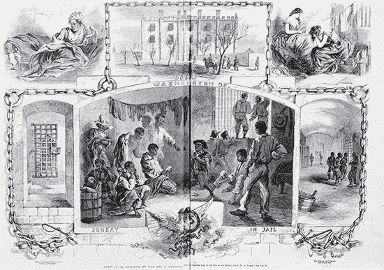

“监狱的秘密——华盛顿的黑洞”。即使在内战开始后，国家首都仍有三千多人处于奴隶状态。亚瑟·卢姆利发表在 1861 年 12 月 28 日版的《弗兰克·莱斯插图报》上的版画，有助于促使国会在特区禁止奴隶制。
## 华盛顿迈向废奴
关于“蓝桶”的争议推动了在华盛顿废除奴隶制的运动。到 1861 年底，脱离派代表已经离开了国会大厦，让共和党人可以相对自由地推行他们的立法议程。威尔逊参员牵头起草了一项有效解放特区奴隶的法案，他不仅获得了废奴主义者的支持，还获得了许多温和共和党人的支持，包括《国家共和党报》的编辑们。
威尔逊的法案激怒了大多数华盛顿白人。《国家情报报》的编辑们猛击这种“突如其来、强制且彻底的解放行为”，而《晚间之星》则列出了“反对通过在哥伦比亚比亚特区解放奴隶法案的二十个理由”。尽管《晚间之星》支持联邦，但它仍然支持奴隶制，希望在保护城市（需要支持联邦）和维护白人统治地位（需要支持奴隶制）之间找到平衡。编辑们反映了白人精英阶层的流行情绪，警告说该法案“仅仅是我们中间社会政治革命的开始”。他们推论道，如果国会可以违背我们的意愿释放我们的黑人”，那么它“就可以并可能赋予他们在民事政治权利上与白人平等的地位”。


《晚间星报》（Evening Star）的编辑和其他当地白人在这一点上是正确的：国会确实在将其意志强加于华盛顿居民身上。但地方民主从未是国会的优先考虑事项。共和党国会议员将华盛顿视为测试其种族政策的地方。俄亥州参议员约翰·谢尔曼（John Sherman）的哥哥威廉将作为联邦军将赢得荣誉，他认为华盛顿是进行“解放实验”的完美地点。谢尔曼认为，华盛顿“是自由黑人的天堂”，黑人在那里“比其他任何地方都享有更多的社会平等”，因此先解放华盛顿的奴隶是有道理的。


## 自由与种族民主的希望，1862–1869


演讲台上挂满了横幅和旗帜，聚集了百余人人，这简直是一场废奴主义者和激进共和党人的“大人物集”，其中包括霍华德将军、康涅狄格州参议员莱曼·特伦布尔（他是禁止奴隶制的第十三修正案的共同起草者），以及马萨诸塞州参议员亨利·威尔逊（他是华盛顿解放法案的发起人）。主旨演讲由十五街长老会教会的黑人牧师亨利·海兰德·加内特发表，他在演说家中的名声或许仅有弗雷德里克·道拉斯可以与之相比。这位前马里兰州奴隶虽然失去了一条腿，但身高六英尺，举止庄严，他用一段充满激情的演讲感染了庆典氛围。“今天，自由的原则取得了胜利，”加内特告诉人群道，“上帝与我们同在，我们必须自由。”³


华盛顿家族是解放法案通过后涌入该城市的黑人移民潮的一员。逃亡者从南方各地逃来，特别是来自邻近的马里兰州和弗吉尼亚州。他们以个人或家庭的形式抵达，有时甚至成群结，并在整个战争期间不断到来。到 1870 年，华盛顿的黑人人口增加了一倍多，达到四万三，从城市总人口的 19%跃升至 33%。“华盛顿似乎是黑人绅士的麦加，”来自纽约的黑人教育家威廉·J·威尔逊激动写道，他于 1863 年 5 月首次访问了这座城市。“到处都是黑人，黑人，黑人。政府马车上的黑人——货车上的黑人——出租马车上的黑人——泥土车上的黑人——酒店里、理发店里、每间房子里、每条街道上都是黑人。”移民洪潮似乎证实了白人华盛顿人对解放法案最的担忧。

结合白人士兵、官僚和战企业家的涌入，黑人移民将这座城市推向了极限。这些入境的移民被称为“违禁者”或“自由民”，他们绝大多数贫穷、缺乏技能且未受过教育。与约翰·华盛顿不同，绝大多数人不识字，而哥特顿区自由黑人的文盲率仅为 30%。白宫的女装裁缝师伊丽莎白·凯克利回忆道，他们来到华盛顿时，“把所有的身家都背在身上。”战对非技术劳动力的需求相对较高，因此大多数前奴隶都能找到工作，但由于住房、食物和基本物资的短缺，城市的生活成本极其昂贵。他们往往在最不理想的地方过痛苦的生活，在城市运河沿搭建棚屋，挤在小巷里，堆在漏水的破屋里，或者在马厩阁楼上住宿。
黑人华盛顿人向新来者敞开了大门和机构。《周刊英非报》的记者在华盛顿写道：“我们对一个逃离枷锁的贫穷受苦灵魂的喜悦，胜过夺得九十九座城。”以色列贝特尔教会的亨利·麦克尼尔·特纳曾赞扬黑人社区“敞开了他们最华华的客厅，让出了厨房、阁楼甚至是衣帽间，为这些逃亡的人类之子提供庇护。”伊丽莎白·凯克利本人离奴隶身份并不远，她与第十五街长老会教会的成员一起牵头了`违禁者救济协会`的形成，其他教会也建立了类似的组织。国家自由民救济协会（`NFRA`）赞扬黑人华盛顿人“因他们为更不幸的兄弟姐妹表现出的兴趣和热忱。”
中产阶级的黑人居民希望吸收这些移民并帮助他们立足——用 19 世纪的话说，就是“提拔”他们——但前奴隶所面临的挑战规模有时超出了私人努力的极限。前奴隶、废奴隶主义者哈丽特·雅各布斯其自传《一个奴隶女孩的生记》使她在反奴隶运动圈中成为了传奇，她于 1862 年夏天访问了华盛顿，并对她目睹的前奴隶的生活条件感到震惊。“我发现男人、妇女和孩子都挤在一起，不分年龄或性别。他们中的一些处于最可怜的状况。许多患有麻疹、白喉炎、猩红热和伤寒。有些人只有几块脏破布可以躺；另一些只有光光的地板当床。”1862 年，一场天花疫情席卷了城市的黑人社区，随着寒冷和绝望的前奴隶在拥挤肮脏的环境中挤在一起，病毒迅速扩散。
移民的规模迫使联邦政府介入，帮助前奴隶适应新生活——而市政府拒绝提供任何援助。通过`勤务处`内部新设立的“违禁者部门”（自由民事务局的前身），军队让自由民投入工作，建造一圈要塞，这些要塞将保护城市免受南方联盟军的入侵。工人及其家庭倾向于定居在要塞附近，在`雷诺堡`、`杜邦特堡`和其他设施附近奠定了日后繁荣的黑人社区根基。
自由民男性和女性还在当地医院工作，从事各种工作，包括挖沟、清洁、锯木头、园艺、烹饪和翻找垃圾。一位军事官员声称，与白人工人相比，“黑人是更出色的工人，对职责更专注，不倾向于沉沦。”所谓的违禁者工人在战争期间拥有经济筹码。由于第一次能够出售自己的劳动力并选择雇主，前奴隶们争取获得尽可能好的交易。由于需求量大，即使是体力劳动者每月也能赚 20 到 25 美元并加口粮——这明显多于其他工人，尽管仍然不足以跟上华盛顿不断上涨的生活成本。
然而，许多前奴隶无法工作——他们太老、太小，或太病了。为了帮助病人和老人，军队设立了“违禁者基金”，其资金来源于从`勤务处`黑人工人的工资中每月扣除 5 美元。这笔“违禁税”激怒了一些自由黑人劳动者，他们反对被要求为前奴隶家庭付钱。一群人向战争部长`埃德温·斯坦顿`抱怨道，他们为违禁者的利益交税不应该比我们这个阶层的白人工人交得还多，但这项税依然存在。
`违禁者基金`资助了政府在市中心建立的违禁者营。像现代难民营一样，违禁者营旨在提供安全的临时住所，让人们可以在那里获得庇护、食物和就业援助。然而，一旦建立，它们吸引了长期居民，并成为疾病的温床，同时也遭受了对逃亡者存在感到不满的当地白人的言语和肢体攻击。战争期间，该区内多达一万的前奴隶经过此类营地。


营地正演变成一场人道主义危机，沃德斯沃利用了战前的反奴隶运动来帮助应对这一局势。随着解放的实施，废奴主义者的焦点从帮助逃奴者逃亡转向帮助前奴隶适应自由。由于华盛顿是国家的首都，加上那里有大量的难民，华盛顿成为了北方传教士的磁极，尤其是那些抵达此并加入诸如`National Freedmen’s Relief Association`（国家自由人救援协会）和`American Missionary Association (AMA)`（美国传教协会）等复杂的救援工作的白女性。
他们将自己的工作视为神圣的号召。在 1862 年 4 月华盛顿解放法案通过后几周，由联邦员工发起的`NFRA`华盛顿分部，其目标是“教授[前奴隶]基督教和文明；灌输秩序、勤奋、节约和自自力的观念；通过激发他们的自尊心，提升他们在人类阶层中的地位”。这些私人组织不仅提供了在违禁者营地工作的大部分员工，还向北方捐赠者以及当地黑人教会募集资金和实物捐赠，以补充政府提供的匮乏口粮和衣服。¹⁹
`AMA`的丹福特·尼尔斯是一位来自波士顿的公会牧师，拥有完美的废奴记录，他于 1862 年 6 月成为违禁者营地的主管。他的首批倡举措之一是在十二街和佛尔蒙特大道西北段建造`Camp Barker`，以缓解拥挤问题。该营地位于战前曾作为墓地和砖厂的地方，`Barker`（或尼尔斯所说的“华盛顿违禁者仓库”）于 1862 年 7 月开放，最初有四百名居民，但随后迅速扩张。到 1863 年 4 月，这里住着一千名居民，他们挤在 10x12 英尺的小木屋里，每间房子都挤满了十个人。居民缺乏足够的厕所、水源和卫生设施，疾病像野火一样蔓延——1863 年夏天的一场天花席袭了营地，每周导致二十多名居民死亡。²⁰
`Camp Barker`位于白宫正北仅一英里处，林肯总统在那个夏天每天往返位于西北部士兵之家附近的季节性避暑小屋时，都会经过此地。1863 年 5 月，尼尔斯主管与军方官员合作，将营地居民迁往波托马克河对岸，准备在南方军将罗伯特·E·李的阿灵林顿庄园上建造一处“自由人村”——这一绝妙的讽刺，营地的规划者和居民们并没有察觉。`Freedmen’s Village`于那个年的 12 月正式落成，象征着尼尔斯和其他白人废奴主义者带入其救援工作的传教热忱。从纸面上看，它像一个现代的规划社区，拥有一排整齐的 52 栋双人住宅，沿着一条环绕中心池塘的乡村小路排列，并配有一有一间医院、一所学校、一座礼拜堂和一个“老年及病弱自由人之家”。营地规划者希望“纯净的乡村空气”能改善居民的健康，并预计工作计划将鼓励扬基人自力更、勤奋和节约的美德。²¹
`Camp Barker`、`Freedmen’s Village`以及华盛顿地区的其他违禁者营地为新解放的黑人提供了必要的帮助，但它们同时也帮助转化并最终摧毁了战前存在的跨种族改革社区。在某种程度上，改革者仅仅是被局势所压垮——解放和战争引发了如此巨大、如此之快的迁移，以至于即使是那些致力于帮助前奴隶的人也难以找到合适的解决方案，特别是考虑到资源匮乏的联邦政府所提供的资源有限。然而，阶级、文化和控制问题也撕裂了社区，且很大程度上是沿着种族界限。
战前，白人和黑人反奴隶改革者倾向于共享中产阶级的价值观和品味——即对良好礼仪的尊重、对社会差异的欣赏，以及对谨慎和审慎的强调。参与跨种族组织的黑人往往是城市的精英，包括相对富有、受过良好教育且通常是混血的非洲裔美国人，他们与白人废奴主义者密切且相互依赖（有时带有顺从性）地合作。当丹福特·尼尔斯到达华盛顿时，他与一位黑人牧师游览了城市并与另一位牧师共进晚餐，赞许地注意到：“华盛顿的茶很好，黑人也知道如何按照礼仪规则泡茶和茶。”²²
然而，在战争期间，改革者遇到了完全不同阶层的黑人。涌入城市的逃奴和自由奴大多直接来自种植园生活，他们并不具备白人改革者或华盛顿黑人精英那种饮茶的雅致。他们一无所有、没有工作、且未受过教育，遇到了对他们的处境表示同情但往往又看不起他们的受过教育的北方白人。营地职员和救援人员在与前奴隶的关系中产生出一种家长主义的责任感，这种态度通常表现为对黑人行为和决策的控制。“和他们讲理是不可能的，”尼尔斯解释道，“你 必须告诉他们该怎么做。”²³

在早期的奴隶时代，同情的白人废奴主义者的家长主义可能被不情愿地容忍甚至欢迎。现在不再了。解放打破了顺从的束缚，许多华盛顿黑人挑战任何居高临下的意味。在整个战争期间，他们对仁慈白人改革者所做的某些决定感到反感，对强加在他们身上的限制感到痛苦，并挑战他们所遇到的局限性。他们声称拥有完全公民的权利，而不仅仅是前奴隶。“我根据政府的话和荣誉把我的孩子交出去去背步枪，结果他丢命了，”自由人村的居民贝西·布朗在针对营地主管尼尔斯的申诉中作证道，“先生，我认为这足够了。”²⁴
尼尔斯主管是黑人批评者的特别目标。他在不咨询营地居民或当地黑人领袖的情况下做出专断决定，因此留下了傲慢和虐待之声。当他决定将`Camp Barker`的居民迁往`Freedmen’s Village`时，居民们抵制了——其中 80%的人拒绝离开，告诉一位传教士，“他们宁愿在华盛顿饿死，也不去阿灵林顿受尼尔斯支配。”尼尔斯和其他白人改革者看到在健康环境中生活工作的机会，而前奴隶看到的却是南方奴隶制的回归。他们认为尼尔斯更适合当南方种植园的监工。”黑人记者兼军事招募员托马斯·霍顿称他为驱逐社区老年居民的“完美暴君者”和“野兽”。在`Freedmen’s Village`开放后，军方摧毁了`Camp Barker`，但仍有五百多名原居民留在该地区。²⁵


这些公共活动中的言辞——大胆、强调、甚至具有对抗性——反映了华盛顿黑人居民所感受到的那种惊人的新权力感与平等感。在 1863 年的解放日庆祝活动上，托马斯·辛顿赞扬了一名因不服从而被刺死白人的黑人士兵，并严厉驳斥了他在城市中目到的持续歧视。


实施这些政策的最佳起点是华盛顿，在那里国会拥有排他的立法权。尽管该市从未被邦联占据过，但激进共和党人将当地白人人口视为“内心的反叛者”，并将华盛顿视为一个后来被称为“国会重建”或“激进重建”的实验室。
## 自由人局的建立
该实验室的首批实验之一是“难民、自由人及被遗弃土地局”（被称为“自由人局”），这是一个专门致力于帮助前奴隶适应自由生活的新联邦机构。在经历了两年争论后——部分原因是包括弗雷德里克·道格拉斯在内的许多黑人领袖担心此类机构固有的家长主义色彩——1865 年 3 月，国会在战争部内部建立了自由人局。在虔诚的联邦军将 O. O. 霍华德的带领下，该局迅速成为战后最著名的政府机构之一。在 1872 年解散之前，该局实施了具有创意且富有争议的计划，这些计划在未来多年里塑造了当地种族关系。
## 任务与期望
该局负责“所有与叛乱州难民和自由人有关的事题”，这是一项宏大的任务，涵盖了住房、教育、家庭团聚和就业援助——在一个没有任何联邦机构曾向个人提供援助的时代，这是联邦权力的一次显著扩张。然而，这种援助伴随着一系列期望。该局任务中一个未说明但具有驱动作用的部分是通过教导以前被奴役者自给自足，并鼓励他们接受中产阶级的美德（工作、节俭、谨慎和信仰）来“教化”他们。由于其作为首都的地位、靠近立法者和北方地区，以及近三万名前奴隶迁入该市，华盛顿成为了自由人局活动的焦点。
## 战后挑战
自由人局面临着严峻的挑战。战争结束时，城市一片狼藉。联邦军将国家广场变成了牲畜场，市界内几乎所有的树木都被砍伐了，许多城市公园变成了露天医院，道路坑洼得几乎无法修复。军队的迅速复员导致了当地经济的崩溃，因为依赖军队的业务随之枯竭。洛易斯·亚当斯在 1865 年 6 月写道：“现在的华盛顿是一个沸腾着、冒着泡、呻吟着的耗尽人力的漩涡。”
自由人社区正处于困境。许多当地白人仍将他们标记为“违禁品”——威廉·奥纳抱怨道，“称一个被偷的南方黑鬼为自由人完全是胡说”——当他们赖以生存的手工工作随着军队的离开而消失时，他们陷入了挣扎。失业率超过 80%的情况下，他们聚集在肮的营地和腐烂的贫民窟中，受到疾病和饥饿的侵扰。西北部一群绝望的前奴隶收集死马的骨头，并试图将其作为肥料卖给农民；由于担心疾病扩散，局的卫生官员命令关闭了该业务。一位市议员在 1866 年估计，自战争开始以来到达华盛顿的移民中，已有一半人去世。
## 救援工作与劳动安置
为了应对这场人道主义危机，自由人局与军和私人援助组织合作，协调救援工作，为贫困的华盛顿人提供食物、燃料、毯子和衣服。这种直接慈善本意是暂时的。局官员担心自由男女可能过度依赖联邦援助，而白人批评者如市长理查德·瓦拉赫声称，“成千上万的违禁品”正被自由人局赠款所提供的懒惰诱惑所“吸引到这个‘自由人的天堂’”。然而，需求是如此巨大，使得该局在存续期间一直提供直接援助。
随着军队的离开，局官员努力在华特区内为自由人寻找工作。和平时期的华盛顿根本无法为非熟练工人提供足够的经济机会。因此，该局变成了一个劳动力安置处，代理人连接北方雇主与黑人劳工。该局甚至支付黑人离开该市的交通费用，这导致了他们“贩卖黑人”的指控。局官员声称，在三年内，他们帮助了 7600 多名前奴隶在华盛顿特找到了工作。该局的约翰·伊顿说，这种工作为自由黑人提供了“自力更生的机会，免于居住在肮脏环境中和虚度光阴而可能产生的恶习和疾病，这对政府来说是一种卫生和社会危险，也是负担。”
## 土地所有权与住房
然而，许多前奴隶拒绝离开华盛顿，他们在那里已经立足，并相信在那里可以依靠联邦的保护。他们成千上万地在空置土地上占地，特别是在联邦堡垒附近，或者住在破旧的私人拥有营房里，经常引起白人邻居的愤怒。由于下定留在该市，他们不仅争取临时援助，还争取自己的土地。
自由人对土地的渴望，结合局本身对发展黑人自给自足的兴趣，促使官员制定了鼓励黑人拥有土地和房屋的计划。由于白人的批评非常敏感，局官员试图在已经是黑人居住或无人居住且远离白人邻居的地区建立“黑人殖民地”。通过这种方式，该局促进了住房种族隔离过程的发展，这种过程标志了 19 世纪后期的特征。
## 巴里农场社区
也许最成功的住房所有计划是位于华盛顿东南部的巴里农场（Barry’s Farm）社区。巴里农场的起源于白人土地主试图驱逐居住在西北部梅里迪恩（Meridian Hill）地区土地上的黑人占地者。霍华德将军与该地区的黑人家庭会面讨论这个问题，其中几个人告诉他他们想要：土地。霍华德建议在安纳科斯亚河（Anacostia River）东岸建立一个黑人社区，就在小白人社区联合镇的南部，该地区在战争结束几乎完全是农村。
1867 年，霍华德利用自由人局的资金从故奴主詹姆斯·巴里的家族购买了 375 英亩土地。由于当地对黑人拥有土地敌视，一名白人中间人购买了土地，该家族并不知道这里将变成一个黑人定居点。该局将该地区划分为约一英亩一份，以每英亩 125 至 300 美元的价格卖给前奴隶，其中包括建造两间房所需的木材。居民可以在两年内还清。早期的居民之一是米莉·埃德蒙森（Emily Edmonson），她是 1848 年试图乘坐“珍珠号”**逃亡的著名前奴隶。两年内，有 266 家庭搬到了巴里农场，居民很快在那里建立了学校、教会和其他社区机构。该地区在 1874 年正式更名为希尔斯代尔（Hillsdale），成为该市最大的黑人社区的核心。


乔治·哈顿被描述为一个“深色混血儿”，他身高五英尺六英寸，身材结实。用当时的话说，他“满腹智慧与常识”，拥有洪亮的嗓音、富有魅力的言谈风格和好斗的性格。在 1863 年的一次解放日庆祝活动上，20 岁的哈顿坚决主张，“在获得权利并能坐在车内之前，我不会乘坐[街运电车。”两个月后，他成为首批加入美国有色人兵团入伍的黑人男性之一。当他和其他黑人在入伍站排队名单时，一群愤怒的白人和警察冲上来质问他们。哈顿拒绝退缩，胆大地挑他们开火。但没有一个敢动手。[⁶⁸](68)
战争中的战斗让哈顿坚信黑人已经赢得了自由——“枷锁已碎——我们的奴役结束了，”他这样写道——但联邦军内部长期存在的种族主义让他怀疑，黑人在美国是否会被视为完全的公民。哈顿在彼得堡战役中左膝中枪，导致行动不便，于 1864 年回到华盛顿，准备作为一名伤残老兵和完全公民维护自己的权利。他加入了共和党，投身于关于选举权、学校整合和劳工权利的政治斗争。在五年内，这位 27 岁的前奴隶被选为市议员。[⁶⁹](69)
乔治·哈顿从奴隶到议员的飞速崛起，显示出华盛顿自 19 世纪 50 年代以来发生了多大的变化。和其他黑人公职人员或许是那个“激进植物实验性花园”中最具争议的种子结出的果实：选举权。
## 对黑人男性选举权的推动
对黑人男性选举权的推动始于内战期间。华盛顿的解放法案和《解放奴宣言》都没有提到选举权，因为这个问题极具爆炸性——在 1862 年或 1863 年，只有最激进的白人共和党人支持这一观点。林肯总统和其他温和派共和党人认为，民事平等（解放）并不一定意味着政治平等（投票权）。但黑人倡导者和他们的激进派白人支持者坚持这两者不可分割。他们认为，要成为完全的美国人，黑人必须拥有投票权；在奴隶和公民之间，根本不存在不投票的中间状态。
战争期间，黑人男性开始通过联盟会（Union League）进行政治组织。华盛顿的联盟会成立于 1863 年，最初主张种族隔离，但在一年之内，它就变成了跨种族组织，聚集了许多参与过招募黑人士兵的人。联盟会是跨种族政治领域的早期尝试，为黑人领袖提供了与白人同僚合作并学习政治组织方法的机会。[⁷⁰](70)
战争本身以及黑人士兵在帮助赢得战争中发挥的关键作用，促使越来越多的白人共和党人接受黑人选举权。到 1864 年，当国会开始辩论更新市宪章时，查尔斯·萨默等激进派寻求要求赋予黑人男性选举权。“仅仅因肤色而剥夺任何人类的选举权，是不男子气的、是不符合基督教的，也是不符合美国的，《国家共和党》的编辑们在 1864 年 12 月写道。到 1865 年 4 月，甚至林肯总统也开始顺应这一号召，表示他倾向于让选举权“授予那些非常聪明的人，以及那些作为士兵为我们的事业效力的人”——这一话让约翰·威尔克斯·布布什放弃了绑架总统的计划，转而决定实施暗杀。然而，保守派共和党人和当地白人领袖的阻碍中断了战时的推进。[⁷¹](71)
## 战后组织与倡导
战后，华盛顿黑人将选举权置于议程的首位。在白宫前举行的纪念林肯总统的大型七月四日活动期间，一个接一个的演讲者强调投票权至关重要。华盛顿解放法案的作者亨利·威尔逊参员指出，华拉赫市拒绝了参加活动的邀请，但“我隐约感觉到，如果你拥有选举权，华拉赫市长可能整个市政府都会出现在这里。”不久后，黑人教会领袖组织了联合选举权联盟，以协调选举权运动。在黑人人口密集的第一区（该区域涵盖了从运河到洛克溪溪的华盛顿市大部分地区），黑人专业人士发起了第一区民权协会，促进投票权，并组织对反对选举权的企业进行抵制。[⁷²](72)
第一区最著名的领袖之一、教育工作者约翰·F·库克二世，协助领导了一项愿书活动，以鼓励国会支持黑人男性选举权。愿书强调黑人男性已经赢得了这一权利，并记录了黑军队的牺牲、华盛顿黑人企业家的成功，以及黑人对建设性社区机构的投入。“我们足够聪明，能够勤奋工作、积累财产、建立并维持教会和教育机构，”愿书写道，“如果没有选举权，我们就失去了保护，容易遭受各种暴行侵害。”这封愿书在 1865 年秋季提交给国会之前，已经吸引了 2500 多个签名。[⁷³](73)
## 法律斗争与争议
愿书在激进派共和党人中获得了共鸣。尽管他们在自己的党派内属于少数，但激进派制定了战后的立法议程，并将华盛顿选举权法案列为首要任务——它是第 39 届国会于 1865 年 12 月开会时考虑的第一项`H.R. 1`。正如解放一样，激进派共和党人希望将华盛顿作为黑人男性选举权的试验场，并计划在整个南方实施。缅因州的洛特·莫里参员认为，通过扩大黑人男性的权利，国会正在“启动一项不仅适用于哥盛顿特区，从某种意义上适用于整个国家的政策”。萨默参员同意认为，法案“通过赋予选举权完成了解放”，并将为整个国家树立榜样。“它将成为一根火柱，照亮数百人的足迹。”[⁷⁴](74)
然而，即使在共和党人内部，黑人男性选举权仍然充满激烈争议。随着十年推移，日益保守的温和派共和党报《晚间星报》（Evening Star）认为选举权法案是“对整个联邦白人劳动者权利发起的战争。《星报》编辑们警告说，赋予那些“最无知且无能力的逃亡黑人”选举权将使这座城市“非洲化”，并变成一个“黑人乌托邦”。只有一份当地报纸《编年史》（Chronicle）支持选举权，但仅限于限制不让前奴隶和无财产者获得投票。激进派在主张无排除的“普遍”男性选举权方面是孤立的。[⁷⁵](75)
黑人男性选举权的反对者也意识到，特区可以为国家设定先例。“华盛顿选举权的斗争仅仅是一个实验、一次小战斗，是一个入门楔子，为国会随后采取类似的运动——赋予美国所有黑人选举权铺平道路，”肯塔基州的加雷特·戴维斯参员警告道。“这是延续该党四年前的策略，当时对这一特区奴隶制的攻击，预示了随后针对奴隶制的全面性运动。”[⁷⁶](76) 华盛顿如何，国家亦如何。


他们的支持加强了激进共和党人的力量。随着他们与总统安德鲁·约翰逊发生冲突，这些党人在党内的影响力日益增强。约翰逊是一位南方民主党人，也是前奴隶主，他对于前邦联成员似乎比对前奴隶更有同情心。约翰逊对南方的宽容以及南方各州拒绝批准第十四修正案激怒了许多北方选民，这些选民推动了共和党在 1866 年国会选举中取得了巨大胜利。保守派和温和共和党人向激进派营拢，特别是在华盛顿特区黑人投票权问题上。1866 年 12 月，甚至在当选成员就职之前，参议院就通过了选举权法案。
约翰逊总统立即否决了该法案，理由是该法案是“强加于不愿意的人民”，并且允许黑人选民拥有“对白人种族的最高控制权”将引发种族之间的对立和仇恨”。然而，国会于 1867 年 1 月 8 日否决了他的否决，法案立即生效。半年前还不可想象的事情，已成为国家首都的法律，并很快将成为全国的法律。
## “一场真正的革命”：白人对政治权力垄断的终结
乔治敦的黑人获得了展示投票权力量的机会。1867 年 2 月，他们投票罢了现任市长亨利·艾迪森，艾迪森曾抱怨过“黑人投票”，并且长期以来一直是黑人社区的祸害。《晚间之星》报道，黑人选民“以一种变得谦逊的态度行使了他们的新特权”，他们的成功激励了华盛顿市的共和党领袖，该市将于 6 月举行全市范围选举。黑人领袖匆忙组织了自己的政党俱乐部，并加入了跨种族的“中央共和党协会”，以动员和登记新的黑人选民。
令白人保守派懊恼的是，黑人精英——受过教育、财富且是当地人——与那些饱受诋毁的前“逃亡奴隶（contrabands）”联手支持共和党。通过各选区的共和党俱乐部，像约翰·F·库克二世这样资深的黑人领袖与乔治·哈顿等年轻的黑人内战老兵、像迈克尔·希纳这样的前奴隶，士，以及新迁来的南方移民（包括希洛浸信日会教堂的威廉·J·沃克牧师）一起工作。这些俱乐部不仅登记了选民，还让黑人获得了代表华盛顿黑人行使集体权的机会。例如，第七区共和党俱乐部挑战了殖民主义支持者，并组织了一场全市运动，反对波波托马克渡轮公司歧视黑人客户。这些政治组织工作取得了巨大的成功：尽管黑人仅占人口的 30%，到选举时，黑人几乎占了登记选民总数的 50%。
这种前所未有的黑人权力行使引发了白人至上主义者的反击。担心持续的怨恨可能会降低白人选民的投票率，《国家情报报》和其他白人领袖号召开展激进的登记活动。在 1867 年春季的“白人选民”会议上，他们试图让白人居民从政治冷漠中醒过来。“白人击败黑人的唯一方法，”一位白人选民辩解道，“那就是在登记人数上超过他们。”他们确实做到了——1867 年选举登记的白人选民比前一年增加了 70%。到选举日，约有 9800 名白人男性和 8200 名黑人男性完成了登记，但白人反激进派者知道，黑人票几乎会全部投给共和党，而白人票则会分裂。在一次激昂的选前竞集会上，一位演讲者警告说，如果共和党获胜，他们将“把投票权扩大到整个南方各州的田间黑人”，从而引发“一场种族战争，结果将不可避免是黑人种族的灭绝”。
一个新的政治时代正在黎明。从 1867 年 6 月 4 日选举日凌晨 2 点开始，黑人号角手和喇号手穿行在街头，提醒人们投票。华盛顿的黑人成群而出，在投票站开放时就开始排队，耐心地撑着伞遮挡阳光。尽管由于市章仍禁止黑人担任公职，当天选票上并没有黑人候选人，但黑人选民创造了重大的变化。在 1867 年之前地方政治中仅起微小作用的共和党，在市议会和共同议会中都获得了多数席位。黑人在街上点燃篝火、唱歌庆祝。卸任的议会主席威廉·W·摩尔批评“居住在市内的见识较高的非洲人部分”与底层黑人结盟，“目的是为了掩盖白人种族，并从他们手中夺取所有的政治权力”。
区共和党人正在建立一个跨种族、跨阶级的联盟，这有望成为一个政治机器。然而，种族歧视仍然存在，特别是在就业方面。1968 年初，近五千名黑人工人向国会请愿，解决公共工作中的种族偏见招聘问题。他们写道：“对我们的肤仍然有这种偏见，特别是对我们作为自由有色人的身份，以至于我们被排除在几乎每一个就业领域之外，除了那些性质最繁重、临时且卑微的工作。”白人工人经常拒绝与他们的黑人同胞一起工作，使得黑人工人难以获得体面的工作。
持续的歧视不仅损害了黑人的经济前景，还危及了共和党的政治计划。即使政党领袖强调平等，种族紧张局势也损害了政党。当特区共和党人为 1868 年市政选举动员时，他们在是否要在候选名单上加入黑人候选人的问题上分歧。黑人共和党人向国会请愿取消任职的颜色和财产限制。乔治·哈顿和其他第四区共和党人的一份愿书中写道：“黑人在战场上展现了他们的勇气、爱国主义和价值，在公民生活中展现了他们的能力、正直和忠诚。”担任公职的测试“应该是杰斐逊标准。他是否有能力？他是否正直？他是否公正？”
国会共和党人确实更改了市章以允许黑人候选人参加，但一些白人共和党人提出了务实的政治反对，担心如果名单上有黑人候选人，“失败将是肯定的”。在第一区共和党一次混乱的会议上，争论变得激烈，当黑人成员发言时，有人大喊：“猴子！”一个感到厌恶的黑人共和党人阿尔弗雷德·戴解释了他为什么支持黑人竞选公：“白人对有色人什么都没做，我们再也不想和他们有任何关系。”
尽管存在这些紧张关系，共和党人在 1868 年的市长选举中团结在一起。这次选举是废奴主义者、激进共和党人赛尔斯·J·鲍恩对阵民主党人约翰·T·基文，后者以“反激进派”或“保守派”身份竞选。鲍恩是一位在 19 世纪 40 年代搬到华盛顿的高个胡须纽约人，性格粗鲁，但由于长期对黑人公立学校的支持、对黑人投票权的激烈捍卫以及帮助前奴隶获得救济的努力，赢得了黑人社区的有力。他以经济进步为政纲，承诺使城市现代化，并反对将国家首都迁往圣路易斯的初步尝试。


——《新国家时代》，1870 年 1 月
如今，华盛顿西南部的弗吉尼亚大道、六街街和 D 街交汇处只有一个小小的草地三角形标记。跨过弗吉尼亚大道是铁路轨道；沿着街向下，立着一座平不起眼的 20 世纪 50 年代风格的混凝土办公楼。嘈杂而单调，这个路口吸引了很少的行人。附近没有历史标记，没有任何迹象表明这里发生过任何重大事件。然而，一个多世纪以前，在这个曾是诺特利·杨（Notley Young）广阔种植园一部分荒凉之地，曾立着一座宏伟的三层砖建筑，被称为“岛厅”（Island Hall），它是内战后华盛顿种族与民主剧的舞台。
岛厅的名字来源于周围的西南区。位于南西部的波托马克河和东北部的臭名昭著的市运河之间，西南区是一个与城市其他地方隔绝的乡村地带。它在字面上和意义上都是一个岛，即使在 1970 年代运河被填平后，几代人依然保留了这个名字和独特的文化。岛屿既是拥有繁华码头的港口城市的一部分，又是带有花园和养鸡的大住宅郊区聚集地，是该市最多样化的地区。这里是大型爱尔兰社区的所在地，拥有几座天主教教会，其最富有的居民是一个名叫帕特里克·库林（Patrick Cullinane）的爱尔兰承包商。一个活跃的德国犹太社区住在岛厅附近，其犹拉法会堂后来在 E 街建立。波托马克河边生活着渔民，他们对于北方一公里的政府官员来说完全陌生。¹
内战后的几十年里，岛上增长最快的人口是黑人。西南半街以东的地区一直是自由人和奴隶黑人的小社区所在地，其中包括地下铁路接线员安东尼·波恩（Anthony Bowen）。战后，寻找廉价住房的自由民被吸引到这片地区。该地区变成了一个繁忙、稠密的社区，近 80%是黑人，几乎全是工人阶级。许多最贫困的居民挤在新兴的巷弄社区，家庭挤在没有室内管道的不卫生陋屋里。到 1880 年，该市近 10%的黑人人口居住在岛屿上。²


随着重新活跃的合并运动开始号召建立领地政府，黑人内部发出了反对声。1870 年 1 月在华盛顿创办的周刊黑人报纸《新时代》（`New Era`）将合并作为其早期的目标之一。编辑 J·塞拉·马丁（J. Sella Martin）和弗雷德里克·道格拉斯（Frederick Douglass）写道：“老古董们反对黑人选举权；由于他们无法撤销这项权利，他们便试图削弱甚至消灭行使这项权利的机会。这就是最近发夺夺我们市政政府运动的全部秘密。”同月，市员委员会和共同议会通过了一项由黑人市员卡特·斯图尔特（Carter Stewart）起草的决议，谴责委员会形式政府，因为这种形式“暗示这座城市的人不具备行使我们共和制度下允许其他所有人民所享有的选举权和自治权”。²³
黑人对新领地政府的反对跨越了所有阶层。当黑人精英通过讲台和印刷机表达不满时，黑人工人则走上街头。1871 年 6 月 1 日，在领地政府执政的第一天，黑人和白人公共工人一同罢工，抗议城市承包商支付的每天 1.25 美元的工资。大多数白人人在几天后回到工作岗位，部分原因是承包商们试图通过招募日薪 1.50 美元的爱尔兰工人来利用种族分化的吸引。但黑人工人罢工了近一周，要求每天八小时工资 2.00 美元。尽管遭到白人报纸的谴责，黑人罢工者最终接受了由亚历山大·谢珀德（Alexander Shepherd）调解的 1.50 美元的折协方案。他们短暂的罢工提高了工资，但他们很快发现，在新系统中他们拥有的影响力远不如鲍恩（Bowen）时期。²⁴
尽管尽管许多黑人对他并不信任，谢珀德试图通过任用制来争取他们的政治支持。领地政府任命员中约三分之一是黑人，谢珀德还通过库克州长（Governor Cooke）协助促成了几项高层任命：近期搬到该市并编辑《新时代》的弗雷德里克·道格拉斯加入了立法委员会；约翰·墨瑟·兰斯顿（John Mercer Langston）被任命为卫生委员会；约翰·F·库克（John F. Cook）被任命为市登记。²⁵ 谢珀德还雇佣了黑人工人从事公共工程，并在 1871 年年底的一项重大贷款投票征求黑人选民的支持。
谢珀德的努力在黑人社区获得了巨大的支持，尽管这种支持并非普遍——曾组织罢工的乔治·哈顿（George Hatton）成了一位直言不讳的批评者。大多数黑人选民感激谢珀德时代带来的经济机会，但对谢珀德的策略以及任何对选举权的限制保持警惕。他们的怀疑是有必要的。
## “没有市政政府的政府城市”：华盛顿特区失去了投票权
谢珀德热情地拥抱了他的新权力。谢珀德专注于促进经济增长，将公共工程委员会变成了纳税人资助开发的引擎。当新政府于 1871 年 6 月接管控制时，委员会提出了一项耗资 660 万美元（相当于 21 世纪的 8.6 亿美元）的综合改进计划（Comprehensive Plan of Improvements），承诺重建城市，首先翻新市中心区和宾夕法尼亚大道，然后沿着康涅狄格大道向北和向西延伸。该计划需要 400 万美元的贷款，特区选民（无论黑白）在那个 11 月压倒性地批准了。拿到贷款后，公共工程委员会开始了建筑潮。
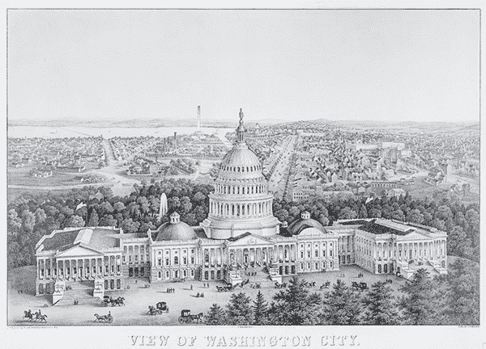
“华盛顿市景观。”尽管在内战期间增长显著，但 1869 年的华盛顿市仍然是一个相对不发达的城市地区。作为委员会争议工程委员会主席，亚历山大·谢珀德推动了快速经济发展，特别是华盛顿西北部。国会图书馆。
结果是惊人的。在格兰总统坚定支持下，谢珀德以一种不容异议的风格，雇佣工人修建了超过 150 英里的城市街道、120 英里的下水道和 200 英里的人行道。市工人种了六万多棵树，填了恶臭的城市运河，用约三千盏路灯照亮了华盛顿的夜晚，并拆除了破旧的北方自由市场。他们改善了街道和电车线路，刺激了周边地区的发展并引发了房地产繁荣。太平洋圆（现称为杜邦圈）周边地区开始出现精英阶层的维多利亚式豪宅。一位赞赏的记者写道，华盛顿“已经换上了新装，丢掉了拐杖，实现了一场让老居民们目错措的转变。”^(26
谢珀德雄心勃勃的计划和债务驱动的支出得罪了富有的白人保守派，特别是民主党人和长期的华盛顿人。他们曾支持合并和转向领地政府，是希望限制黑人的政治权力，但当格兰总统只任命共和党人进入新政府时，他们很快感到幻灭。《乔治敦信使报》（`Georgetown Courier`）愤愤道：“没有一个老居民，没有一个民主党人，没有天主教徒，也没有爱尔兰人。”共和党主主了 1871 年 4 月的众议员选举选举——尽管 22 名新立法者中只有两名黑人——民主党担心新政府将继续把他们排除在权力之外。²⁷
最激进的批评者中包括两位银行家，他们的名字将在华盛顿响彻几代人：W·W·科科兰（W. W. Corcoran）和乔治·W·里格斯（George W. Riggs）。他们共同拥有的里格银行（Riggs Bank）一直是市机构，直到 2005 年被 PNC 银行收购。科科兰是一个南方同情者，内战期间在欧洲自我流亡，并在那里增充了他的世界级艺术收藏。战后回到家乡，他成为商界的领军人物，并在 1871 年初开办的画廊赢得了赞誉。他的商业伙伴里格斯在华盛顿也有深厚的根基，战后在贸易会非常活跃。尽管他们曾支持合并，但当领地政府积累大量公共债务时，科科兰和里格斯退缩了。他们通过创办反对谢珀德的报纸《每日爱国者》（`Daily Patriot`）、组织要求联邦对市财务状况进行调查的请愿书，并在国会听证会上反对该政府，协助领导了反对运动。²⁸
以哥伦比亚特区公民协会的形式组织起来，领地政府的反对者指控市政政府挥霍，并指责谢珀德贿赂和操纵黑人选民。他们认为，无知的黑人支持腐败官员，而这些官员随后掠夺国库。1872 年《每日爱国者》的一题为“我们的黑人统治者”的文章指责政府中的“贪财冒险家”利用黑人作为“政治傀儡”来积累权力。编辑声称：“这些黑人除了空手和饥饿的嘴什么都没有带来，也没有产生任何生存资料，”但他们构成了领地政府的运作机制。为了消除城市的腐败并恢复经济理性，他们主张国会废除特区的民主。里格斯在 1872 年的证词中表示这里的大多数选民“没有自治的能力”。²⁹


# 谢泼德时代与领地政府
1872 年，一项对谢泼德友好的国会调查几乎没有发现腐败证据，并仅对领地政府发出了轻微的斥责。然而，随着政府债务的增加，谢泼德积累政敌的速度也随之加快。他毫不颜耻地将公职与政治支持挂钩，并用巨额公共合同奖励他的盟友，这导致批评者将他标签为纽约臭名昭著的“头目”蒂德式的“大佬”。一位观察者写道：“谢泼德的政府是一个“小君主制”。控制贫穷有色人的投票，让他们的劳动力依赖于此，并利用这一点对抗这座城市的财产和人民，这正是这些人自己正在做的事情。”
粗劣的工作和管理失败的街道平整工程引发了诉讼，而国会山（Capitol Hill）及其他地区的居民指责政府在重点开发西北部康涅狄格大道走廊时存在偏袒。当深陷丑闻的格兰总统在其第二个任期陷入挣扎，国会继续撤出对南部的重建工作时，国家记者（尤其是来自民主党报纸）涌入首都，渴望揭露这座由共和党执政的城市的腐败。
## 金融危机与崩溃
如果不是因为财务困难，领地政府本可以熬过批评者的攻击。改变城市的公共项目耗资巨大，而像鲍文市长一样，谢泼德没有钱支付这些费用。到 1873 年初，政府几乎破产，停止了支付教师、工和其他城市雇员的工资。谢泼德试图发行更多债券、征收更高税收并赢得进一步联邦支持以资助计划中的改进，但他的政治支持正在瓦解。尽管如此，他仍然拥有格兰总统的信任，在亨利·库克辞职后，总统于 1873 年 9 月任命他为州长。
谢泼德就任仅几天后，国家经济就崩盘了。1873 年的恐慌由亨利·库克的兄弟、巨型金融家杰伊·库克的财务破产引发，对特区的打击尤为严重，因为作为州长，亨利·库克曾将大量城市资金投入其兄弟的实体。当杰伊·库克破产时，城市也随之破产。谢泼德的政府基本上崩溃了。
《国家》杂志写道，多亏了谢泼德，“华盛顿无疑是一座美丽的城市”，但“领地政府已经崩溃，债务惊人，账目混乱到无法估量数额。税收沉重且具有歧视性，合同未履行，学校教师未领薪。”
## 自由人储蓄银行的倒闭
随着城市的崩溃，自由人储蓄银行（Freedman’s Savings Bank）也随之倒闭，这对黑人社区是一个毁灭性的打击。该银行由废奴主义金融家于 1865 年在华盛顿创立，旨在鼓励前奴隶储蓄、积累财产并成为有生产力的公民。它增长极其迅速。到 1873 年，银行在全 37 个州都有成员，存款金额达百万美元，成为华盛顿黑人极大自豪感的源泉。
然而，在谢泼德时代，白人官员开始以低于市场的价格向他们自己和朋友贷款，库克州长还利用银行资金救援他兄弟陷入困境的太平洋铁路。当城市在 1873 年破产时，他们允许公共工程委员会用借条（IOUs）而非现金“偿还”未结贷款。一年内，银行倒闭了，数千小储户和黑人组织失去了他们的储蓄。
愤怒的、曾参与该银行的华盛顿黑人领袖（包括弗雷德里克·道格）谴责了导致崩溃的“大无赖”，并呼吁联邦政府偿还储户资金。政府从未支付过一分钱。为了促进勤俭和储蓄而成立的自由人储蓄银行，最终引发了黑人对金融机构、共和党甚至美国本身的愤世嫉俗。
## 与国会反应
经济混乱促使国会对该市政府进行了一次新的跨党派调查。这一次，调查人员发现了严重的贪腐证据。尽管没有迹象表明谢泼德个人从中获利，但调查凸显了他为了“改进”城市而采取的不懈的、不择手段的推动，在多大程度上导致了利益冲突、权钱交易、无招标合同和成本超支。他的公共工程项目账单接近 2,100 万美元（按 21 世纪的美元计算约为 30 亿美元），比最初预测多出约 1,400 万美元，是国会允许金额的两倍。
调查委员会的报告严斥了谢泼德和公共工程委员会过度支出，但也将其归于特区选民，认为他们允许立法机构和委员会如此挥霍。鉴于选民及其选民代表无法约束自己，委员会建议将城市交由非选举产生的委员进行统治，正如它在 18 世纪末创立时期那样。
## 领地政府的终结
国会并非一个习惯于快速行动的机构，但它对谢泼德政府的越界行为以及特区的民主制做出了一个果断而痛苦的裁决。1874 年 6 月，在委员会报告出来仅两天后，国会以 216 比 22 的票数结束了领地政府，恢复为由总统任命的三名委员组成的委员会来管理城市并偿还债务。根据法律，一名委员必须是`U.S. Army Corps of Engineers`（美国陆军工程兵）的成员；按照惯，另外两个委员席位由民主党和共和党平分。
响应当地压力，国会承诺承担城市年度预算的 50%，承认联邦在华盛顿的存在增加了开支（通过要求维护公共建筑）并削减了收入（因为联邦财产不征税）。尽管这种新的委员统治制度最初是作为临时措施，但国会于 1878 年将其永久化。
特区的男女、无论黑白、无论贫富都失去了投票权。在过去的近一个世纪时间里，他们没有再投过任何有意义的选票。
剥夺选举权的范围是惊人的。《国家》杂志的编辑写道：“根据这项法案，市政政府的痕迹已不复存：议员、普通会议员、市长、工程委员会、学校委员会、警察委员会、初选、会议，全部被扫空，整个政府被交给了三个由外国权威任命的人，他们负责的对象不是自己的公民，而是总统和参议院。”特区委员托马斯·布莱恩解释说，通过新法，国会希望能够“永远不受附近地区选举的干扰”。白人作家玛丽·罗根后来观察到，华盛顿变成了一个“没有城市政府的政府城市”。
## 抗议的遗产
失去选举权让特区选民和民选官员感到震惊。如今已失业且无权的众议院成员们通过一次象征性的抗议作为回应，他们暂时洗劫了议事厅，拿走了从桌子、椅子到肥皂和毛掸子的一切物品。尽管这些物品在第二天都归还了，但改革者将这一恶剧视为特区民主固有腐败的证据。在过去的几十年里，只要提到“毛掸子议会”，就会让华盛顿精英阶层发笑，并成为对跨族民主越界行为的简练代名词。


向专员制转变所引发的种族影响，并未被当时的观察者所忽视。《国家共和党报》在 1874 年曾写道：“在本地区，最初的实验是赋予黑人选举权。难道事情已经到了这一步吗，让共和党承认并认可了自己的失败？他们是否已经准备好尝试进一步的实验，即剥夺白人和黑人的共同选举权？”⁴⁰ 对于许多厌倦了激进派关注民权的共和党人来说，这个答案是肯定的。
在饱受诟誉的众议院 22 名成员中，仅有两人是黑人，谢帕德的亲信顾问中也没有人是黑人，然而批评者却将“羽掸议会”的丑闻和开支以及谢帕德政府的归咎于黑人选民。《国家报》结论说，谢帕德的政府是由“无知的黑人选民”推上的，行使了“不负责任的权力”。这座城市“应该由负责任的人控制，而不是由偶然居住在那里的不负责任的人控制”。作为一家通常支持激进派种族议程的共和党出版物，《哈珀周刊》尽管出于“便利”和行政效率的考虑，仍然支持回归专员制。编辑们辩称：“这不是黑人选举权，而是无知的选举权，这是危险的。”通过转向任命制的市政府，华盛顿可以为其他市政市树立榜样。⁴¹
历山德·谢帕德这个对破坏该地区民主做出巨大努力的人，在新政府中艰难地寻找自己的位置。1874 年，格兰特总统提名他担任该地区三个新专员之一，但参议院压倒性地拒绝了他。两年内，谢帕德破产了。1880 年，他离开这座城市前往墨西哥的巴托皮拉斯寻找机遇，在那里他建立了一项繁荣的银矿矿业，并在 1902 年去世前经营了二十多年。⁴²
在他不在的期间，谢帕德的声誉反而与日增高。华盛顿的白人精英——其中许多人在他在任期间曾与他作对——现在庆祝他的成就。1885 年，该市新的民主党报纸《华盛顿邮报》社论写道：“华盛顿欠他一笔无法磨灭的债。由于他的才华、勇气和不屈的意志，这座城市拥有了美丽、吸引力和繁荣。”1909 年，白人市领袖下令塑了一座这位被他们尊为“现代华盛顿之父”的塑像，放置在市政大楼前。正如黑人学者 W. E. B. 塞尔几十年后遗憾地反思道：“谢帕德政权的危害和不诚被归咎于有色选民，而这座重生城市的美容和成就则被归功于白人文明。”⁴³
尽管谢帕德备受推崇，但重建时期的其他领军人物境遇就没那么。前市长赛尔斯·鲍恩留在了市内，已沦为昔日的躯壳。他当选时很富有，但进行了一系列糟糕的投资，失去了财产，最终在联邦大楼里当起了夜守。他到死都古怪乖戾，在寥寥的关注和极少数朋友中去世；被安葬在国会公墓一处不起眼的坟墓里。无论是在那时还是现在，很少有人记得他对黑人教育和选举权的倡导。⁴⁴
乔治·哈顿曾从奴隶身份跃升为市议员，并帮助组织了黑人对鲍恩政府和领地政府的反对活动，他也陷入了挣扎。在专员制实行导致政治生涯结束后，他将修辞技巧转向牧师，于 19 世纪 70 年代离开华盛顿前往肯塔基州。受酒精问题困扰，他于 1894 年试图自杀，后来与妻子回到华盛顿地区，并于 1904 年去世。⁴⁵ 与鲍恩一样，哈顿非凡的人生和对这座城市的贡献在很大程度上被遗忘了。
国会会对该地区采取两步走的民主撤退——首先是限制领地政府的选民影响力，其次是完全取消选举职位——这是全美共和党从南部退出重建运动的前奏。在国会通过《华盛顿剥夺选举权法案》三年，1877 年的妥协通过从南部撤出联邦军结束了重建。在一个代人的范围内，限制投票权的法案通过了每一个南方州议会。它也为如何处理海外非白人种族立了非民主的先例。二十多年后，在美西战争导致美军接管菲律宾后，负责起草马尼拉市章程的陆军将将引用华盛顿的情况作为拒绝菲律宾人实行自治的理由。⁴⁶
共和党不再热于维护其民权议程，转而遵循了历山德·谢帕德的模式，即为了白人精英的利益而促进经济发展。在华盛顿，这意味着淡化或忽视黑人社区的利益，并专注于经济增长，以建立一个“名副其实”的宏伟首都。发展战胜了民主。该地区跨族选举政府的时代结束了。一个新时代的开启又花了近一个世纪。
## “有色人朝圣者的麦地”：华盛顿受过教育的黑人社区蓬勃发展
奥林图斯·西蒙·波利瓦（O. S. B.）沃尔尔亲眼目睹了民主的撤退。作为市治安法，沃尔尔希望这次挫折是暂时的，是他通往自由长路上的一个小弯道，他的人生证明了这一点。他于 1825 年出生于一个奴隶母亲和她的白人主人，十二岁时被送到俄亥俄州的一个贵会教社区长大。沃尔尔在奥伯林这一废奴主义中心成为一名鞋匠，1858 年，他和其他反废奴制义勇人士违反了《逃奴法》，营救了一名面临被捕风险的逃奴。⁴⁷
战争期间，他与内兄约翰·墨瑟·兰斯顿合作，为著名的马萨诸塞州第 54 团和其他黑人部队招募黑人志愿者士兵。他自己成为了首批获得上尉军衔的黑人之一。战争结束后，沃尔尔加入了自由人局，被派往南卡罗来纳州保护获释者。沃尔尔肩膀宽阔、身材魁梧、皮肤浅，他对战后时代充满希望。⁴⁸
沃尔尔于 1867 年到达华盛顿，当时该市跨种族的民主开始繁荣。他充分利用了该市赋予黑人权力和经济进步的机会。当兰斯顿创立霍华大学法学院时，沃尔尔是首批学生之一。他在市郊靠近霍华大学的地方买了一座豪华住宅——他这处价值 3500 美元的房产价值超过他所居住的混族社区的任何房子。他开了一间律师事务所，他的妻子阿曼达在当地的一所黑人学校教学，夫妇融入了第一公会教会。⁴⁹
在接下来的十年里，沃尔尔担任了多种公职，包括市税收评估员、领地政府议会代表和警区治安官。即使在被剥夺选举权后，他仍活跃在公共生活中。他创立了霍华德山援助协会来帮助居住社区的贫困民，并在 1882 年解放日二十周年的活动中担任司仪。⁵⁰


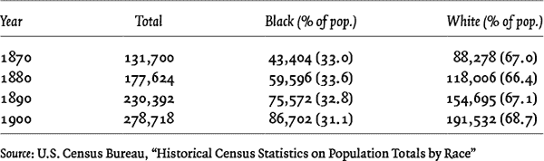
## M 街中学
在`弗朗西斯·卡多佐`（Francis Cardozo）的领导下——这位来自南卡罗来纳的人是美国第一位担任州职的黑人，“有色人预备中学”（被称为`M 街中学`）发展成为国家顶尖的黑人高中，也许也是该市最好的学校（无论黑白）。`M 街中学` 成立于 `1870` 年，比华盛顿第一所白人高中的成立早两年，`M 街中学`是美国第一所黑人公立高中，并提供大学预备课程。
它的教师拥有来自`哈佛`和`奥伯林`等声誉机构的学位。由于受到种族偏见的限制，他们往往无法追求其他更丰利的职业，这些高素质的教职人员致力于培养后代的黑人领袖。`M 街中学`的毕业生随后进入了`阿默斯特`、`威廉姆斯`等顶尖大学。
## 黑人中产阶级与联邦就业
除了教育工作者外，联邦雇员形成了华盛顿日益增长的黑人中产阶级的核心，这种黑人生活的特征使得该市非常独特，特别是对于南方而言。其他南方城市，特别是`新奥尔良`和`查尔斯顿`，拥有有关系的黑人精英与贫困大众并存，但华盛顿拥有庞大且重要的中产阶级，主要由在联邦政府内部或相关的、高薪稳定工作的人组成。
在重建时期，黑人利用他们新获得的政治权力和与共和党立法员建立的关系，通过赞助制度增加了公共就业机会。在被剥夺选举权后，他们依靠与共和党的关系来维持自己的职位。例如，`弗雷德里克·道格拉斯`曾担任`美国联邦法官`，后来成为联邦`契据登记员`。尽管缺乏投票权，华盛顿黑人对共和党的忠诚往往以联邦工作的形式得到报答。
`1883` 年非党派联邦文员制度的建立，有助于关系较弱的黑人申请者竞争日益增多的文职职位。到`1891` 年，联邦劳动力中 10% 是黑人。凭借稳定的工作和体面的薪水，`财政部`、`政府印刷局`和`自由人医院`等联邦机构为华盛顿黑人提供了购房的机会。
## 精英
由于联邦工作、黑人教师和其他专业人士的机会，以及令人瞩目的教育机会，这座城市作为黑人精英的首都闻名。一本 `1888` 年的旅游指南声称，该地区“比任何其他美国城市更有智慧、更有教养、富的有色人”。华盛顿是顶尖黑人知识分子的家，如`亚历山大·克鲁梅尔`（Alexander Crummell），一位纽约人，曾是殖民主义倡导者，后来成为`圣路加主教教堂`的著名牧师；富有的企业家，如`詹姆斯·沃姆利`（James Wormley），他的豪华酒店接待了通往`1877 年妥协`的谈判；华盛顿老牌家族的后，如市税收员兼商人`约翰·F·库克二世`（John F. Cook Jr.）；政治活动人士，如`W·卡尔文·蔡斯`（W. Calvin Chase），该市最著名的黑人报纸《蜜蜂报》强硬的编辑；以及高级黑人官员和前官员，包括`布兰奇·K·布鲁`（Blanche K. Bruce），这位来自密西西比州的`美国参议员`在 `1881` 年参议院任期结束后留在了这里。
黑人精英的领袖是`弗雷德里克·道格拉斯`，这位曾经的逃亡奴隶、废奴主义者和坚持不懈的人权捍卫者，《哈珀周》写道，他“高尚的人格和非凡的能力，赢得了普遍的认可和尊重”。尽管他在 `1870` 年帮助创办了《新时代》，但道格拉斯直到两年后才永久搬到这座城市。他最终定居在`阿纳斯蒂亚`（Anacostia），买了一座宏伟的十五英亩山顶庄园，可以俯瞰`阿纳斯蒂亚河`和华盛顿市中心的壮丽景色，距离他三个儿子生活的黑人社区`巴里农场`不远。他的儿子们帮助经营了《新时代》，并投身于社区活动中。

在黑人云云的华盛顿，“精英”不仅仅是金钱的问题。事实上，一些精英家族为了维持富有的表象，在财务上举步维艰。多种因素决定了一个个人或家庭是否能被视为 `Bee` 所所谓的“四百人”的一员——即该市最富有、最有成就的家族（尽管上层阶级家族可能少于一百个）。在白领联邦职位任职意味着更高的社会地位，家庭在华盛顿居住的时间长短也是如此，尽管该黑人精英社区的许多知名人物是拥有高职的新移民，其中包括来自密西西比亚的布兰奇·K·布鲁斯（Blanche K. Bruce）和来自路易斯安州、曾美国首位黑人州长的 P. B. S. 钦巴克（P. B. S. Pinchback）。
肤色同样重要。由于该市许多成功的黑人家庭拥有复杂的种族渊源，著名的黑人领袖包括 O. S. B. 沃尔尔（O. S. B. Wall）、约翰·墨西尔·兰斯顿（John Mercer Langston）和布兰奇·K·布鲁斯，他们或是“混血儿”（mulattos，有一个黑人父母）、“四分之一血”（quadroons，有一个黑人祖父母）或“八分之一血”（octoroons，有一个黑人曾祖父）。白人血统的证明是地位和自豪感的来源，“混血儿”从事职业工作的概率是别人的两倍。黑人报纸刊登了美白广告，承诺“让黑人或棕色人的皮肤浅五个色调，让混血人完全变白”。在高级的十五街长老会教堂，19 世纪 80 年代末，浅肤色的会友曾反对任命一位深肤色牧师（尽管教会的创始人约翰·F·库克老士本人也是深肤）。鉴于教育、野心机会的巨大差异，黑人报纸《人民倡者》（People’s Advocate）的编辑写道，黑人社区内部的社会平等是“绝对不可能”。
在 1874 年剥夺选举权后的几年里，华盛顿的黑人领导层主要由在废奴运动、内战和重建时期积累经验的人组成。由于他们曾为并见证了黑人美国人在一生中取得的巨大进步，他们通常相信融入更大的美国社会是有可能且终极智慧的。“同化而非隔离，是我们真正的政策和自然天命，”道格拉斯（Douglass）在一次解放日的集会上这样说。只要可能，他们就寻求加入现有的白人组织，而不是创建自己的。这群人仍然将整合视为一种理想，寻求从白人“社会”中赢得对其自身精英地位的认可，并与其白人同类共享维多利亚时代的品味，从着装到休闲活动，再到他们按当时方式招待客人的奢华豪宅。
赢得充分尊重并被视为平等公民的关键是重新获得投票权。正如 `Bee` 的卡尔文·蔡斯（Calvin Chase）在 1884 写写的：“当我们拥有选举权时，我们可以做任何想的事，但在此之前不行。”当国会通过 1878 年剥夺华盛顿民主自治权的法案时，声称这是对该市政府结构的“永久性”改变。但黑人华盛顿人拒绝接受剥夺选举权是终审。失去投票权令人愤愤，特别是黑人最初赢得这项权利已经花了如此长时间。他们不愿放弃重建时期的成果，为在这个城市恢复投票权，而几年前他们在这里还能行使前所未有的政治权力。
## 投票权：“神圣的权利”还是“无意义的小摆件？”
剥夺选举权既伤害了黑人和白人选民，但对黑人华盛顿人产生了毁灭性影响，因为这削弱了他们维护和推进自身利益的能力。弗德里克·道格拉斯（Frederick Douglass）告诉《星报》（Star），选举权“是我种族最大的保护”。没有了选票，黑人领袖很难追究市官员的责任或获得公共工作的机会。管理城市的委员们——三人都是白人男性（直到 1961 年，所有委员都是白人）——经常忽视黑人的诉求。黑人劳动者抱怨他们被剥夺了市政合同，在一个没有主要工业的城市里，合同是重要的工作来源。委员们对黑人贫困视而不见，这种贫困一直处于令人担忧的高水平。到 1890 年，近 40%的黑人人口不识字，自由人医院（Freedmen’s Hospital）80%的患者被认为穷得无法支付医疗费用，黑人婴儿死亡率高得惊人的每 1000 名新生儿中有 338.5 例。
市政职位的消失了。在重建时期，黑人男性可以获得大约三分之一的市级任命，但在 1879 年，五十名警局任命人员中只有一名黑人警官，消防部门完全没有黑人获得职位。这或许并不意外，反黑的警察暴力行为增加了，这成为黑人社区愤恨的源头，并成为黑人报纸的常态。“警察不尊重黑人，”西南区黑人工人阶级领袖佩里·卡森（Perry Carson）责道。在一个白人警官在希尔斯代尔（Hillsdale）杀死一名年轻黑人男子后，卡森称华盛顿警察为“刺客”，并领导了一场“愤慨慨运动”，要求市官员起诉该警察。
正如废奴运动和重建时期一样，黑人领袖寻求白人盟友以赢回投票权。在 1878 年永久剥夺选举权的法案通过后，O. S. B. 沃尔尔与约翰·F·库克、白人前市长赛尔斯·鲍恩（Sayles Bowen）以及白人前警察委员 A. C·里查德斯（A. C. Richards）一起组织了一场跨种族的运动，向国会和美国公众争取“不受限制的选举权”。里查斯是俄亥俄州的废奴主义者，他于 19 世纪 50 年代来到华盛顿，他是 1862 年投票支持解放奴的四名市议员之一。几个月内，当地共和党中央委员会就建立了一个全面的选举权行动小组，由查尔斯·普维斯（Charles Purvis）领导，他是自由人医院的一位黑人医生。“在人民在选择统治者方面发言之前，特区的利益永远无法得到保护，”普维斯辩论道。整个 19 世纪 80 年代，选举权运动一直是一项跨种族的努力。
选举权支持者主要诉诸于投票是公民身份的核心要素。这种观点很简单：作为美国公民，华盛顿人有权投票。像他们的废奴先辈一样，他们自由使用《独立宣言》和宪法的语言来推进自己的事业，坚持认为选举权是所有美国人的“神圣权利”，不能基于任何理由被拒绝。“这是一种共和政形式的政府，每个公民都应该拥有平等的政治权利，没有代表不纳税，”一份 1883 年呼吁恢复选举权的解放日宣言这样写道。


一些选举权反对者认为，恢复该地区民主制度的最佳方法是鼓励黑人离开该市。1878 年的一篇《邮报》（`Post`）社论辩称，华盛顿拥有“过剩的黑人”——这是一座没有许多农业或工业工作的白领城市，因此那些从周围种植园迁入的非技术黑人工人没有经济角色可以扮演。《邮报》推测，如果立即有 15,000 到 20,000 名黑人人口迁出，这座城市将变得“更富有、更健康、快乐”。在没有发生大规模移民的情况下，唯一的解决方案是“白人种族作为一个整体采取坚定但仁慈的行动，消除过去十二年间灌输给黑人的幻觉”，包括选举权。大约十七年后，一位《星级报》（`Star`）的读者的再次重申了这一观点：“如果你们能赶走居住在本市的 90,000 名黑人，我支持选举权。只要他们还在这里，我就反对。”[⁷⁷]
面对这种带有种族色彩的反对，选举权的白人支持者感到被迫面对肤色问题。美国劳工联合秘书约瑟夫·波特（Joseph Potter）感叹道，“有色人投票将控制……是一个陈旧、老调的谈资，早已磨损。”前联邦军将军查尔斯·霍维（Charles Hovey）挑战了重建重建时期黑人投票导致腐败的观点，指出“参与[腐败]的官员都是任命制的”。受人尊敬的外交官、犹太领袖西蒙·沃尔夫（Simon Wolf）告诉《邮报》：“黑人拥有同样的投票权——而且他们的投票会比无知的爱尔兰人、无知的德国人或无知的白人美国人明智。”[⁷⁸]
选举权倡导者拒绝了反对者所指控的黑人选民必然“无知且堕落”的论点。他们认为，随着黑人教育的进步，越来越多的黑人年轻人正变得符合公民身份。1883 年《每日批判》（`Daily Critic`）指出，“如果现在恢复人民政府，将发现相当比例的有色选民拥有良好的教育资格”，并且会负责任地投票。一位白人选举权支持者说，黑人已经随时代改变了。“当该地区的选举权被取消时，人口大部分由南方的有色人组成。那时他们很无知并引发了麻烦，但现在他们受了教育，是好公民，现在的选举权将不再是战争结束后的时的那种选举权了。《蜂报》（`Bee`）的卡尔文·蔡斯（Calvin Chase）表示同意。“这座城市有一群受过教育的年轻元素，”他们会明智地行使投票权。”[⁷⁹]
但选举权反对者仍然不服。问题不在于像弗德里克·道格拉斯（Frederick Douglass）或约翰·墨瑟·兰斯顿（John Mercer Langston）等少数受过教育、深思熟虑的黑人投票。他们担心的是黑人大众，以及他们通过人数行使权力的能力。前州长亚历山大·谢德（Alexander Shepherd）在 1895 年访问华盛顿时解释道：“这里选举权的困难在于贫民窟因素。我的不是不是侮辱黑人，因为首都有很多聪明的有色人，他们完全有能力在事务中发声，但最近出现了一大群人口，如果有选举权，他们将主导事务。”[⁸⁰] 当白人批评人士构想一个普权世界时，他们想象的是非法支持者在华盛顿工人阶级威严领袖——佩里·H·卡森（Perry H. Carson）的指导下，抢劫了市库。
## “体面与喧闹”：阶级与种族划分华盛顿黑人社区
佩里·卡森（Perry Carson）和他的选民们——贫穷、众多、嘈杂且对顺从不感兴趣——体现了白人对黑人投票的恐惧。卡森是西南区的政治大师，曾是一名刷漆工，后晋升为法官、酒馆老板和政府官员。卡森于 1842 年出生于马里兰州的公主安妮县，是一名自由身，青少年时期曾因帮助废奴主义者为逃亡奴隶寻找避难所而被捕。战争期间他自愿加入联邦军，后来到华盛顿，担任市长赛尔斯·鲍恩（Sayles Bowen）的保镖，后来担任亚历山大·谢德的信使。在重建时期，他组织了一支名为“蓝衣男孩”（Boys in Blue）的非正式黑人团，通过保护居民免受沼泽地（Swampoodle）爱尔兰流氓的攻击，赢得了黑人社区的尊重。这支队伍成为政治动员的有效工具，并赋予了他此后的头衔：“校官。”[⁸¹]
尽管没有受过正规教育，卡森校官仍识字，且充满魅力，演讲风格有力。20 世纪 70 年代，他成为华盛顿工人阶级黑人最著名的领袖。《晚间星报》（`Evening Star`）声称，卡森“多年来实际上控制了该地区大量的有色选票”。他的个人故事激励了支持者。1884 年，一位支持者向一群共和党人说：“二十年前，这个男人贫穷、受蔑视，肩上扛着刷漆刷来到华盛顿；今天他教导人们可以做到什么，因为他站在了最前列。”他身高 6 英英尺，体重近 250 磅，肤色深暗，头发早白，当他每年解放日游行的最前方，身穿亮黄色的制服骑在一匹壮观的灰色大马上时，他的身影令人过难忘。”[⁸²]
卡森的支持源于黑人工人，他们构成了华盛顿黑人的绝大多数。20 世纪 70 年代，只有 3%的黑人工人被归类为政府工作人员、办事员或专业人士；近 75%是非技术劳工或家政工。“[⁸³] 在经济需要和种族界限硬化的推动下，低收入黑人工人住在全城范围内日益增多的黑人社区中。这些黑人社区中的一些，例如 U 街走廊、现今洛根圆环路（Logan Circle）附近的地狱之底（Hell’s Bottom）以及位于西北部的雷诺堡（Fort Reno），都是从附近的非法定居营地发展而来的。当自由民在城市中扎根时，他们扩展到了周边地区。其他黑人社区，包括位于西南四又半街（Four-and-a-Half Street SW）东侧日益增长的，长期以来一直是自由黑人和奴隶黑人的家园。
许多工人阶级黑人居民住在巷弄社区，这成为华盛顿城市景观中一个臭名昭著的特征。城市的网格布局创造了巨大的街区，狭窄的巷弄延伸到街区内部。沿街立着大型房屋或排屋，通常由中产和上层阶级居民居住。而在巷弄内，一间或两间的小棚屋是工人阶级的家园。这两个社区的居民往往互不相识，几乎没有往来。
巷弄社区在内战前的华盛顿相对罕见，但在内战期间和之后蓬勃发展，因为居民争相在老城日益稠密和拥挤的社区中寻找住房。渴望满足日益增长的住房需求的开发商通过在巷弄中布置几十处住宅，最大化了大型城市街区的盈利潜力。许多房屋建在“死胡同”中，只能通过另一条巷子进入，从而创造了完全隐藏在街道之外的社区。早期的巷弄社区按阶级划分，但并不一定按种族划分——1863 年，巡逻岛上（The Island）锡杯巷（Tin Cup Alley）的一名联邦士兵评论道，那条巷“住着白人和黑人，完全混在一起。”[⁸⁴]


但随着胡弄社区数量和规模的扩大，它们变得日益隔绝，并在战期间及战后吸收了大量的黑人迁徙者。到 1880 年，该市已有约 231 条有命名的胡弄，居住着 10,614 人，其中 87%是黑人；到 1897 年，警方部门的一次特别人口普查发现 18,978 名胡弄居民，其中 93%是黑人。该市黑人人口中有近四分之一生活在胡弄中。⁸⁵
## 生活条件与社区韧性
胡弄社区通常贫困、犯罪横生且不健康。由于没有室内管道且通风不良，胡弄住房滋生并传播了疾病，侵袭了已经饱受饮食不足之苦的居民。胡弄的死亡率极高，尤其是新生婴儿。1873 年，在约翰·梅瑟·兰斯顿（John Mercer Langston）指导下写的一份卫生委员会报告责了作为许多胡弄特征的“惨遭破旧的棚屋”，并坚持认为它们“不宜人类居住”。⁸⁶
胡弄的生活很艰辛，但胡弄也培养了一种坚韧的社区感。就像现代郊区的死胡同一样，胡弄提供了一个远离喧闹街道的宁静避风港，每个人都彼此认识，成年人在台阶聊天消遣，而孩子们在街道上玩耍。由于贫困和孤立团结在一起，对局外人和“街头人”充满敌意，自称为“胡弄人”的他们相互照顾孩子、提供情感支持、紧急援助并建立情谊。合作帮助他们度过了严酷的生活条件并维持了社区。事实上，尽管很少有居民拥有自己的住房，胡弄社区仍然延续了下来，而且往往代代相传。⁸⁷
## 政治参与与影响
胡弄居民和华盛顿的其他工人阶级黑人在地方政治中发挥了积极作用。在重建时期，他们参与投票、策划集会、参加会议，并在公共领域发出自己的声音。在被剥夺选举权后，他们仍然参与共和党政治（期间不断传出黑人民主人的故事，这是一个致力于白人至上主义政党中的稀有品种），并且他们支持佩里·卡森（Perry Carson）。
卡森通过共和党全国大会（RNC）行使他的影响力，在大会上，各州代表团聚集提名总统候选人，敲定党纲领并设定国家政党的议程。尽管华盛顿不是一个州且没有选举票，但国家政党允许当地共和党人选择代表参加大会。当地政党非常重视这一选拔过程，因为这是城市居民（无论黑人白人）在国家政党内登记他们政治意愿的唯一机会。工人阶级黑人大量参加会议，给予了卡森压倒性的支持。
在 1880 年至 1900 年之间的每次选举中，卡森一直担任华盛顿在共和党全国大会的黑人代表。这些会议通常非常嘈杂，充满了戏剧性的演说、激烈的游说和偶尔的肢体冲突，这令《邮邮报》（*Post*）和其他选举权反对者感到反感，他们用生动且带有种族色彩的词汇来描述这些会议。《1888 年，《邮邮报》告诉读者：“人们几乎无法充分想象那些在初选中叫喊、尖叫和打斗的帮派的残暴和魔鬼之行、野兽般的鲁莽，以及无可缓解且令人厌恶的动物性。”这种狂野的行为，“带有他们所有的塞内加姆比亚特征，以及比塞内加姆比亚更糟糕的方法”，强调了将特区政府控制权安全地掌握在未经选举的白人专员手中的重要性。“财产所有者和热爱秩序的公民完全可以因为他们对被这类暴民集团统治的恐惧而被原谅。《邮邮报》发誓，再也不应让黑人选民控制这座城市。“有一条高于任何人类法令的法律——自然法——它禁止黑人在白人社区中统治。”⁸⁸
## 内部冲突：卡森与切斯
卡森（里，卡森（Carson）和他的支持者不仅受到了白人选举权反对者的批评。他们还激怒了许多精英黑人领袖，这些人拒绝《邮邮报》的种族主义，但仍然认为卡森是一个耻辱。对于像尔文·切斯（Calvin Chase）这样的人来说，卡森和他那些粗俗的选民是恢复选举权的障碍，因为他们强化了白人对黑人政治的负面刻板印象。
切斯是市最著名的黑人报纸《蜜蜂报》（*Bee*）机机敏且充满政治激情的编辑。切斯于 1854 年出生于华盛顿一个贵族、肤色浅的黑人家庭，他写了具有挑衅性的社论攻击白人的种族偏见，并挑战黑人为自己的权利而战。报纸的刊头承诺“给我们的朋友送蜜，给我们的敌人送刺”。在被剥夺选举权后，当许多黑人精英放弃政治时，他一头扎地投入了政治纷争中，希望领导一个受过教育的黑人运动——社区的“精英”——他们可以确立自己为城市的适当领导者。很少有人能与佩里·卡森的身材相抗，但切斯非常接近。他身高六英尺三英寸，肩膀宽阔，声音洪亮，在与卡森及其追随者的大会对决中并不畏缩。在近三十年里，这两个人人化了黑人社区的政治分裂。⁸⁹
切斯认为，除非黑人选民证明自己配得上选票，否则国会永远不会重新考虑选举权。此事的最好方法是选出正直的人担任领导者。他写道：“只要闹乱在这个特区仍然盛行，我们就会一直被剥夺自治权。”只要暴民处于执统治地位，夺回选票权将是一件“危险的事，也是对这个社区智力水平的耻辱”。他认为，获得选举权的关键是击败卡森机器，他利用《蜜蜂报》从个人和政治两个方面攻击卡森。他写道：“如果搜遍华盛顿市，找不到一个比 P.H·卡森（P. H. Carson）更无知、更不能代表这个社区的人了。”⁹⁰
尽管在黑人媒体界几乎拥有垄断地位，并在精英阶层获得广泛支持，切斯仍难以比卡森的民意。。每四年，切斯都会对卡森对共和党全国大会代表选择权的发起挑战；每四年，卡森都是明确的获胜者。由于无法赢得广大黑人选民而沮丧，切斯将对手的成功归于威士和其他贿赂。在 1884 年失败后，他愤怒地（其辞呼呼了白人选举权反对者的言辞）：“出卖自己的黑人是不可能自我治理的。”他开始认为，解决方案是对投票权设定资格限制。“如果我们要有选举权，就让它受到限制。让我们说服所有人，我们作为年轻人代表了体面的情操，而且我们的这一事业是正义的。”⁹¹


> ——玛丽·罗根，1901
21 世纪初的德鲁特公园（LeDroit Park）感觉有点像来自另一个时代的不同城市。从华盛顿市中心穿过罗里达大道（曾被称为边界街）向北走，街道突然摆脱了恩法城市网格的僵化，以奇怪的角度伸出，仿佛在反抗那位傲慢的法国出生工程师及其过时的规划。哥特式风格的小屋和带有宽敞门廊的优雅意大利式别墅庄严地坐落在狭窄道路旁。许多 19 世纪的原始住宅保留了下来，并在 21 世纪初随着富有的投资者和居民的重新发现该地区而经过了翻新。尽管城市对德鲁特公园强加了数字编号系统，但如今的居民坚定地保留了以树木命名的名称，这些名称是该社区在 19 世纪后期最初开发时对道路的标记。
德鲁特公园现在被城市包围，是华盛顿内战后的第一个住宅郊区，是一片吸引寻求乡村宁静的富裕居民的田园。它是安齐·巴伯（Amzi Barber）的愿景，他是一位来自俄亥州的白人，在内战后不久来到该市经营霍华德大学教育系，后来成为该校的代理校长。巴伯是一位牧师之子，曾在奥伯林学院学习过神学，但在华盛顿的房地产中发现了更世俗的回报。1873 年，他与姐姐说服大学向他们卖了校园南部不到半英里处的 55 英亩土地，他们开始开发德鲁特公园，并以他们岳父的名字为该地命名。巴伯在德鲁特公园的成功，加上他在霍华德大学校长任期失败且充斥丑闻的积怨，使他放弃了教育，全心投入商业。
从创立之初，德鲁特公园就是排他性的。早期的广告承诺“没有贫民窟”和“免受所有干扰和不受欢迎特征的侵扰”。它在乡村环境中提供了全方城市设施，且距离国会山仅几英里。著名建筑师詹姆斯·麦吉尔（James McGill）设计了数十栋房屋。到 1880 年，已有 64 栋独特的乡村豪宅，售价高达 12,000 美元，而当时政府职员的年薪可能只有 1,000 美元。像现代封闭式社区一样，该社区有自己的私人垃圾服务，并雇佣了守卫来“驱逐入侵者和不受欢迎的人”，一位早期的观察者写道。“它是人们可能想要或想象得到的最排他性的定居点，其居民都是最高层次的。”在存在的头二十年里，德鲁特公园完全是白人的世界。
但巴伯担心他排他性领地的愿景正被北方山丘上迫近的存在所笼罩：霍华德大学。到 19 世纪 80 年代，霍华德大学拥有国家一些顶尖的黑人学者，并逐渐获得国家顶尖黑人大学的声誉。大学周围的地区被称为霍华德镇（Howardtown），吸引了越来越多的各阶层黑人居民。德鲁特公园北边界上不断扩张的黑人社区的存在威胁到了巴伯想要推广的这种排他性，因此他试图用围栏将开发区隔离开来。在面向市中心的南端，他建造了一个带有华丽大门的精致铁木结构；在面向霍华德镇的北端，只有“一道高大的未上漆且难看的木板栅栏”，《邮报》报道道。
随着德鲁特公园和霍华德镇在 19 世纪 80 年代共同增长，围栏成了争议的焦点。霍华德镇的居民抱怨说，围栏阻挡了大学与市中心之间最直接的路线，迫使人们在任何购物或上班时都绕过德鲁特公园走远路。一些德鲁特公园的物业也抱怨说，围栏限制了进入他们社区的机会，并防止居民享受消防保护等城市服务，导致房产价值下降。
到 1886 年，许多霍华德镇的居民开始溜过围栏，这促使德鲁特公园的领导者实施了社区内部对外来者的禁令。1888 年 8 月，紧张局势升级，一群心不满的德鲁特公园物业在黑人工人的帮助下推倒了围栏。愤怒的围栏支持者迅速将其重建，增加了铁丝网，并雇佣了一名黑人警察守卫。在接下来的三年里，随着“围栏大战”的持续，这道破旧的屏障被推倒又重建了多次，让报道这一争议的记者们感到掩饰不住的乐趣。
大多数观察者理解，种族和阶级是紧张局势的根源。《邮报》写道，霍华德镇是一个“气味较小的地区”，特征是“一群由有色人居住的、破败的简陋小屋”。如果没有围栏，一位德鲁特公园的居民解释道，“我们人口中最令人反感的元素会日日夜夜地穿过这里，我们在这里建造房屋的意义将完全破灭。”在某个时期，围栏支持者要求市委员买下霍华德镇，将其铲平并变成一个公园。他们声称，这样做“将消除我们对拆除围栏的所有反对理由。”一位不可置信的委员质道，他们是否“想把有色人赶出地球”。
在白人房屋主提起的一系列诉讼后，围栏在 1891 年被彻底拆除。黑人步行者可以自由穿过德鲁特公园的街道，黑人买家开始在该地区寻找房屋。1893 年，一位来自国会山的理发师奥塔维乌斯·廉姆斯（Octavius Williams）成为了该社区的第一位黑人房屋主——他的女儿在该社区一直住在 20 世纪 70 年代。廉姆斯家族遭受了射入房屋的子弹和其他侮辱，但黑人居民继续涌入，白人业主开始流出。社区的面貌发生了缓慢变化。到 20 世纪初，德鲁特公园拥有了大量的黑人房屋主“有色人社区”；到第一次世界大战期间，那里几乎全是黑人，并在 20 世纪的剩余时间里保持如此。它成为了该市最著名的黑人领袖的家，包括活动家玛丽·丘奇·特塞尔（Mary Church Terrell）及其丈夫罗伯、教育家安娜·朱莉·库珀（Anna Julia Cooper）以及诗人保罗·劳伦斯·邓巴（Paul Laurence Dunbar）。德鲁特公园的地址成为梦寐以求的成功标志，是一个进入黑人精英的标记。


最早变成隔绝的区域之一是西区（West End），位于乔治敦正东侧。西区的转型在很大程度上归功于一位格外显眼且富有影响力的新来者威廉·斯图特（William Stewart），他于 1865 年抵达华盛顿，成为内华达州的首位参议员。斯图特是一个拥有耶鲁大学背景的纽约人，他前往西部并在采矿业发了财。他的财富为他进入美国参议院铺平了道路，他戴着牛仔帽来到华盛顿，准备赚取更多的钱。他立即将自己的创业愿景和冒险精神投入到该城市的房地产市场。他赌注城市将向西北方向发展，于是与两个矿业伙伴一起，以每平方英尺 10 美分的价格花费 60 万美元（相当于 21 世纪的美元超过 1000 万美元），购买了位于西区的土地，那里当时还是一个主要由低收入工人居住的边缘地带。他在太平洋广场（现为杜邦圆环）圈了一块地，在一片充斥着工人工棚屋、别无他物的地区建造了一座宏大的五层红砖豪宅。
这座房子最初被怀疑者戏称为“斯图特的愚蠢”（Stewart’s Folly），但它帮助了该地区的转型。在斯图特的朋友亚历山大·谢尔德（Alexander Shepherd）的主下，城市改善（如道路平整、主水管和人行道）主要沿着康涅狄格大道、新罕森大道和马萨诸塞大道向西北延伸，汇聚于太平洋广场。到 1873 年豪宅开放时，土地每平方英尺售价 5 美元，斯图特看起来像个房地产天才。在接下来的三十年里，城市最富有的居民和外国代表团建造了规模更大、更精美的住宅和使馆，让“斯图特城堡”相形见绻并推高了地价。
一段时间内，该地区保持着种族和经济的混合状态。1875 年，《哈珀杂志》（Harper’s）的一位记者注意到，该地区的黑人居民对于留在土地上异常地坚定。“他们坚持财产的顽性是人类发展中最显著的表现之一，尽管经历了平整、加固、征税和诱惑，他们仍然守着位于市时尚西区的土地和棚屋，充满了远见和决断。”玛丽·洛根（Mary Logan）指出：“在许多街道上，豪宅和棚屋依然并肩而立。”
一些黑人家庭以丰厚的利润卖掉了土地，但随着土地评估值的增长，房产税也随之增加。除非是住家仆，否则中低收入人群越来越难以负担西区的居住费用。穷人留在社区的巷子里，包括位于第 18 街、第 19 街、L 街和 M 街之间的“金奇巷”（Chinch Row）。金奇巷拥有没有水、没有下水道连接、有时甚至没有门的室箱式厕所。但在西区的街道上，曾经一个坐有小农场、屠宰场和其他小型企业的综合性低收入社区，已变成了一个排他性的上层阶级白人社区。到 20 世纪初，西区已成为一个以富人为主的时尚街区。
斯图特参议员的朋友、同为内华达矿业富翁弗朗西斯·新兰斯（Francis Newlands）有着更宏大的野心。他不满足于仅仅赚钱，还想建立一个理想社区：切维查塞（Chevy Chase），以一个苏格兰狩猎场命名。新兰斯利用一系列代理人和空壳公司掩盖他的计划，在 18 世纪 80 年代花费数百万美元，在华盛顿西北远郊购买了 1700 英亩土地，横跨马里兰州蒙哥马米县的市边界。他资助了一条从市中心向外延伸 8 英到达切维查湖的有轨电线，并投入了三十多年时间开发一个拥有大型乡村别墅和豪华设施的示范社区。
早期的推崇者并没有特意排斥黑人，但新兰斯参议员因对黑人的反感而闻名——他曾向民主党纲领提议过一项“白板计划”，旨在剥夺黑人选民的投票权并禁止亚洲移民入境，因为“这应该是一个白人的国家”。所有潜在的买家都经过了仔细筛选。正如一份手册承诺的那样：“所实施的唯一限制是经验证明在任何居住区都是必要的，以维持或增加价值，并保护房屋建设者免不受理想元素的侵扰。”在世纪之交华盛顿的背景下，很清楚“经验”教了什么教训，以及谁可能被视为“不理想”。
切维查塞土地公司积极保护其隔绝的排他性。1909 年，该公司起诉了一位开发商，后者在西部大道和威斯康星大道交界处一个名为贝尔蒙的分区向黑人家庭出售房屋。公司重新收购了土地，并选择让其荒废几十年而不是让黑人居住在那里。即使在 21 世纪，住在切维查塞的黑人或穷人也相对较少。原本会变成贝尔蒙的地区现在坐落着丹百货（Saks Fifth Avenue）和其他奢侈商店。
在房地产开发商和富有政客未参与的地方，多元化的社区有机生长。其中一个社区是特纳利镇（Tennallytown，现拼写为 Tenleytown），位于华盛顿西北部新兰斯参议员切维查塞西侧的一片丘陵地区。19 世纪末仍然相当农村，特纳利镇是一个拥有约一千居民的扩张社区，其中约三分之一是黑人。一些自由黑人家庭在解放奴之前就拥有该地区的土地，包括著名的沃姆利家族（Wormleys）——族长詹姆斯·T·沃姆利在 19 世纪 70 和 80 年代可能拥有该市最好的酒店，他的大家族在特纳利镇拥有数百英亩土地。然而，大多数黑人居民是在战争期间和之后作为难民到达的。他们住在雷诺堡（Fort Reno，该市最高点）附近的地区，并在战争结束后出售财产后在那里购买了土地。他们住在大块地上，与白人邻居一起打理着宽敞的花园。尽管黑人和白人居民参加不同的教堂和学校，但他们生活相近，建立了一个相互依赖、融合的社区，并繁荣了数十年。
但特纳利镇是一个特例。勒德罗公园（LeDroit Park）、西区和切维查塞更能代表一个时代，那个时代见证了全城种族和经济隔绝社区的兴起，有时会取代原有的混合型社区。
## “代表性贵族”：白人华盛顿人拥抱并通过委员会治理政府


# 引言

城市美运动支持者构想的理想是 1893 年芝加哥世博会的“白城”——那是一片统一、闪烁着光芒的新古典主义建筑群，它吸引了国际关注并启发了一整代城市规划师。进步主义规划师，如世博会展览背后的建筑大师丹尼尔·伯纳姆（Daniel Burnham），在华盛顿看到了一个潜在的“白城”。华盛顿从一开始就是一座有规划的城市，它吸引了规划者对秩序和可能性的追求，为他们提供了一个向世界展示城市美运动如何重塑一座城市的机会。在题为《白城与首都城市》的文章中，伯纳姆写道：“在这里，在国家首都，美国人民已经宣布，这里将成为一个展览，展示单一且全面的计划如何开发和关联一个已美城市中城乡景观的多元化组成部分。”
## 华盛顿的独特之处

华盛顿吸引城市规划师的第二个特征是其在美国城市中脱颖而出的特性：剥夺选举权和委员会治市。在丹尼尔·伯纳姆和查尔斯·摩尔（Charles Moore）等人眼中，华盛顿仅仅是联邦政府的产物，是一座应该由国家而非当地人统治的国家城市。摩尔写道：“首都由美国公民治理，他们在选举参议员和众议员时选择市议员和立法会成员；而国会以开明的精神对待哥伦比亚特区。”确实，蒙特哥马里的·舒勒（Montgomery Schuyler）在《纽约时报》中也赞同这一观点，认为决定什么是“美丽与和谐”的权力，“放在哥伦比亚特区当局手中，比比放在任何一个依赖其全体成年男性居民投票来维持政府的城市手中要安全得多。”由于不需要担心地方的民主问责，规划师可以与规模较小的地方和国家领导人小组合作，实施他们的愿景。可能反对规划师努力的特区居民（包括黑人社区和贫民））几乎没有机会塑造话语权。
## 地方政治支持

他们在查尔斯·摩尔的老板——参议员詹姆斯·麦克米兰（James McMillan）那里找到了一个热心的盟友。与威廉·斯图特（William Stewart）、弗朗西斯·尼兰斯（Francis Newlands）等由商人转行的参议员不同，麦克米兰并未在特区房地产市场中谋利。相反，作为参议院特区委员会主席，他成为了首都美化的有效倡导者。他与商会紧密合作，追求了一项重塑华盛顿的宏伟议程，并挑战国会同事履行他们对城市的信托责任。在他的要求下，1901 年初，参议院成立了`哥伦比亚特区参议院公园改进委员会`Senate Park Improvement Commission of the District of Columbia），麦克米兰本人担任主席，摩尔担任秘书。他们聚集了一支曾负责“白城”的著名建筑师团队，包括丹尼尔·伯纳姆、波士顿的查尔斯·马克（Charles McKim）以及弗雷德里克·洛·奥姆斯特德世（Frederick Law Olmsted Jr.）。这三人带着摩尔花了七周时间访问欧洲城市，开始想象如何将美国首都变成一座具有旧世界对应城市那种宏伟和庄严的纪念性城市。
## 麦克米兰计划


尽管得到了罗斯福总统、市领导以及许多国会员的支持，该计划仍面临着若干严峻挑战，包括 1902 年 8 月麦克米兰参员的意外去世、权势且吝啬的议院院长乔夫·坎农的反对，以及关于农业部和林肯纪念馆选址的争议。但随着时间的推移，麦克米兰计划证明了其强大的韧性并抵御了大多数挑战，特别是 1910 年艺术委员会成立后，该委员会成为了该计划原则的永久保护者。查尔斯·摩尔在委员会任职了近三十年，帮助确保了他的老板愿景的实现。尽管第一次世界大战造成中断，该计划仍顺利推进，并在 20 世纪 20 年代完成了林肯纪念馆的建设，在 30 年代完成了联邦三角区的建设。从那时起，它的原则指导着规划者。麦克米兰计划帮助华盛顿市中心变成了一座由大理石和纪念碑组成的城市，这是该国所见过的“白城”最接近的物理表达。
令人赞叹的建筑评论家蒙特哥马里·舒勒写道，随着麦克米兰计划的实施，另一个“新华盛顿”诞生了。《蒙西杂志》的艾萨克·马科索森声称，看到转型后的华盛顿“就是目睹一个身披美丽与力量的胜利民主国家所实现的梦想”。对于查尔斯·摩尔和其他支持者来说，这是一场胜利，他们主要将华盛顿视为一个作为国家纪念碑的首都，而非当地居民生活的生活的城市。这是建筑对人的胜利，是“首都”对“城市”的胜利。
## “市中心的黑人棚户将不消失”：改革者针对巷弄社区
与三十年前亚历山大·谢尔福德所追求的改革一样，麦克米兰计划很少关注华盛顿的贫困人。在美化城市的过程中，规划者强调景观设计、建筑风格和概念上的统一。他们几乎没有停下来考虑过这些计划对贫困居民可能产生的影响。尽管华盛顿联合慈善机构呼吁“特别考虑（该市的）贫困社区”，但这份长 171 页的计划仅提到了一次低收入人群——将其作为公园大道建设的障碍。
丹尼尔·伯纳姆夸称，麦克米兰计划体现了美国人希望领导“移除并永远遮住丑陋、难看甚至是平凡事物”的愿望。事实上，该计划很大程度上取决于拆除国会大厦和广场周围的许多贫民窟和小巷，为新的公共纪念碑和政府大楼让路。在新白城辉煌的愿景中，穷人没有位置。《华盛顿生活》的一位作者在 1904 年直言道：“华盛顿城市美感的最大障碍是其黑人人口，他们贫困的住所随处可见，构成了该市房地产价值最大的威胁。”麦克米兰计划帮助实现了几年前《哈珀周刊》一位记者的预测：“再过些年，市中心的黑人棚户就会消失了。它们已经在为财富和华丽的进军而让路。”
联合车站的建设是麦克米兰计划批准后实施的早期项目之一，它说明了创造美丽的事物是如何以牺牲穷人为代价的。横跨国家广场的铁路线长期一直是市领导和“城市美化”规划者的忧虑之源。难看的轨道破坏了景观，污染和噪音破坏了环境氛围，火车有时还会撞到动物和人。移除轨道是实现该计划宏大愿景的关键，因此它是早期的优先事项。在丹尼尔·伯纳姆的个人游说和国会提供的 300 万美元资金激励下，宾夕法尼亚铁路和巴尔的摩与俄亥铁路同意放弃在广场附近的车站，联合建造一座宏伟的、新古典设计的伯纳姆杰作。联合车站的命名不是因为南北战争的联盟，而是因为服务这座城市的两主要铁路公司的联合——它计划建在国会大厦正北侧，沼地镇（Swampoodle）的南部边缘。骡队帮助铺设地基，数百名意大利石工被引入到该项目中，该工程从从 903 年持续到 1907 年。
一千多名沼地镇贫困爱尔兰居民以及他们主要住在巷弄里的黑人邻居，随着施工铲平了数百房屋而被迫离开。房主获得了财产补偿，一些人搬到了北太平街更宽敞的房子，但租客不得不在其他地方已经拥挤的巷弄中寻找新家。艰辛的沼地镇变成了通往国家首都的辉煌门户。随着居民搬走，这个社区逐渐消失了。到 20 世纪 40 年代，它不复存在，很少有人甚至记得它奇特的名字。
尽管沼地镇的毁灭可能是建造联合车站的意外后果，但华盛顿市中心“丑陋”和“难看”的巷弄社区被直接作为了的目标。在内战后的几十年里，城市的巷弄曾偶尔引起政府官员的注意，19 世纪 70 年代，卫生委员会判定了近一千间巷弄住房。然而在失去选举权后，由于卫生官员失去了没收建筑的权力，巷弄建设开始兴盛。巷弄社区的增长和巷弄住房的衰败（特别是老社区）激发了新一代进步改革者争取彻底结束市内所有的巷弄住房。
清理巷弄变成了一个迫切的优先事项，将希望把市中心变成美丽纪念碑式城市的白色城市规划者、商业领袖，与致力于改善穷人生活和品质的白色社会改革者团结在一起。为了给他们的努力争取公众支持并激励立法者采取，改革者发表了生动的报告、震惊的照片和煽动性的新闻文章，揭露了华盛顿巷弄极其糟糕的生活条件。在当地社区组织的资助下，劳工部调查员玛丽·克莱尔·德·格芬瑞德在 1896 年调查了 50 处华盛顿巷弄住房的生活。她研究的拥挤住房缺乏下水道连接和排水系统，依靠从脏井中抽水，并通常有户外厕所产生“窒息性”的恶臭。“肮脏的环境”对巷弄居民产生了消弱的影响。“这些不幸的人已经超出了体面和道德的底线，”德·格芬瑞德写道，只有极少数人能在这种环境中过上“健康但辛劳”的生活。


面对日益敌对的白人社区，19 世纪后期曾伤了黑人社区的内部分歧开始缓慢愈合。阶级差异仍然存在，特别是在社会生活中，但到 20 世纪初，黑人精英已将其策略从同化转向了整体的“提升种族”。过去他们曾寻求进入白人俱乐部和组织（这些组织通常排斥黑人穷人），而现在黑人领袖们创建了自己的平行组织。过去他们曾试图通过刻意强调自己与黑人工人阶级之间的差异来赢得白人的认可，而现在他们建立了跨阶级的联盟来加强整个社区。过去他们的财富主要取决于白人资助者，而现在他们的财富日益通过商业和社区机构与黑人工人阶级联系在一起。华盛顿商会（`Washington Board of Trade`）的黑人成员辞职，默认承认了他们在团体内缺乏影响力。这座城市变得更加隔离。“在华盛顿，种族之间的隔离比联邦任何其他城市都更接近完全，”黑人社会工作者奥西奥拉·马登（Osceola Madden）在 1908 年写道，“地位较好的白人和有色人种彼此完全一无所知。”^
玛丽·教会·特瑞尔（Mary Church Terrell）是黑人精英中这种新方式的典范。她是华盛顿年轻一代黑人领袖的一员，在剥夺投票权和种族隔离之后成年。与弗雷德里克·道格拉斯（Frederick Douglass）、约翰·墨瑟·兰斯顿（John Mercer Langston）等内战时代的人不同，这一代人没有品尝过废奴和战争的胜利；他们只知道重建终结的苦果。他们受过良好教育且野心勃勃，但认为白人华盛顿对种族平等毫无兴趣，因此他们敦促种族团结而非同化，主黑人自给自足而非依赖白人的赞助，主黑人机构而非跨种族政治。面对当地和国家对平等日益增长的敌意，这些新领袖倡导强烈的种族自豪感，并将精力投入到开发和维持自己的企业、学校和机构中，以便在这个似乎偏离了自由轨道的里生存并繁荣。
特瑞尔和其他黑人领袖号召跨阶级和肤色的种族团结。“黑人无论是像行政大楼一样白，还是像国会大厦地下室一样黑，都被归在一起并受到同样的歧视，”《有色美国人》（*Colored American*）指出。因此，黑人社区共同采取行动具有务实意义。弗雷德里克·道格拉斯的儿子查尔斯敦促华盛顿的黑同人在面对白人的敌意时结盟。作为一名退伍军人、公务员和贝塞尔尔文学历史协会（`Bethel Literary and Historical Society`）的前任，道格拉斯对白人至上主义者回拨重建成果的行为感到愤怒。在大剧院（`Grand Opera House`）决定在 1899 年 11 月重新建立种族界并强制黑人客户坐楼席后，他发起了抵制，并批评那些购买吉姆克罗座位的黑人顾客“缺乏自尊”。“像建立教堂一样建立自己的剧院，”他建议道，并补充说，“我们要永远依赖白人提供剧院、酒店、咖啡馆和各种商店吗？”^
在提倡创建黑人企业方面，道格拉斯回应了安德鲁·F·希莱尔（Andrew F. Hilyer）的呼召，他是“新商业运动”的领先倡导者。希莱尔在战前不久出生于乔治亚州的奴隶，在中西部长大，于 1882 年来到华盛顿就读哈佛大学法学院（`Howard University Law School`）。他成为财政部（`Treasury Department`）的会计师，涉足房地产，并设计了两项盈利性发明。但他的热情在于培养黑人商业。为了在黑人企业家之间建立一种同情感和共同使命，他在 1992 年开始出版《联合名录》（*Union Directory*），这是一部黑人商业成就的汇编，他经常谈论黑人需要将商业视为社会进步的手段。^^
黑人企业受益于隔离的黑人居住区的兴起，例如西南部的岛屿以及位于 `西北第 7 街` 和 `西北第 14 街` 之间的 `U 街`（后来被称为 `肖恩` 地区）。白人商人经常拒绝在黑人社区工作，为黑人企业留下了市场空间，例如首盛顿储蓄银行（`Capital Savings Bank`），罗伯特·特瑞尔是该银行的官员。虽然前几代的黑人商人通过服务富有的白人赞助者而成名——回想贝弗利·斯诺（Beverly Snow）和他精美的享乐餐厅，以及詹姆斯·沃姆利（James Wormley）的高级酒店——但 19 世纪后期的黑人企业家则专注于服务黑人客户。黑人拥有的殡馆、理发店、餐厅和零售店遍布全城。到 1901 年，希莱尔的《联合名录》编录了华盛顿超过 `1,000` 家黑人拥有的企业。七年前，这个数字只有 120 家。^^
也许自力更生和种族自豪感最有活力且有效的推动者是南妮·海伦·伯鲁斯（Nannie Helen Burroughs）。伯鲁斯是前奴隶的肤色较深的女儿，她在 M 街高中（`M Street High School`）表现优异（在那儿玛丽·教会·特瑞尔和安娜·朱莉亚·库珀是她的导师），但在 `1896` 年毕业后，很难在华盛顿特区（`D.C.`）学系统中找到工作，她将其归因于给予肤色较浅同伴优势的“政治”。这种冷落像马鞍上的刺，驱使她履行了终生使命：为低收入女性提供教育和就业机会。作为一名有力的演说家，她成为国家浸信教妇女协会（`National Baptist Women’s Convention`）的主席，并公开反对私刑、就业歧视、投票限制和其他阻碍黑人进步的障碍。她还针对黑人社区内部的阶级分化和肤色主义。她 `1904` 年的文章《不是肤色而是性格》，充满了对那些遭受“肤色恐惧”的黑人所进行的“大规模美白脸和拉直头发”的愤愤。“肤色不是精神或灵魂优越的标志，”她写道。^
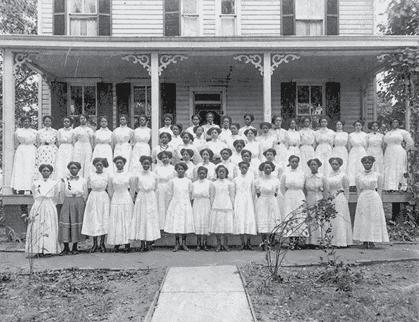
*“华盛顿特区，国家妇女和女子培训学校的学生。”南妮·海伦·伯鲁斯于 1909 年在华盛顿东北部创立了国家妇女和女子培训学校。该学校深受伯鲁斯自力更生精神的影响，鼓励学生“自力更生，提升自己的力量。”美国国会图书馆。*
伯鲁斯持久的成就之一是国家妇女和女子培训学校，这是她在 `1909` 年创立的。该学校由 `35` 名学生开办，位于 `东北第 50 街` 和 `格兰特街` 交汇处山丘上的 `六` 英英土地上（现在是私立的南妮·海伦·伯鲁斯学校所在地）。伯鲁斯将其称为“三 B 学校”——圣经、洗澡盆和扫帚——其校训捕括了学校自力更生的精神：“自力更生，提升自己的力量。”尽管学校提供古典课程，且伯鲁斯坚持要求使用正确的语法，但学校主要侧重于基督教教育，并让学生能够工作，即使是作为家庭劳工。“三分之二的黑人女性必须靠体力维生，如果不让这支养家者军队做好她们的工作，确实是一种疏忽，”伯鲁斯说。^


起初，他们担心部门内部的隔离是“不可行的”，但拉尔夫和其他其他机构官员匆忙遵从了威廉姆斯的要求。他们设立了独立的厕所和储物柜，并在用餐室后方为黑人员工留了桌子。在新的、更具攻击性的隔离精神鼓舞下，一些白人员工对他们的黑人同事提出了投诉。7 月，一位名叫罗丝·米勒（Rose Miller）的白人女性对湿度部门的黑人主管路易斯·纳特（Louise Nutt）提出投诉；一周内，拉尔夫局就用一名白人替换了纳特。
就像战前的奴隶主坚持认为奴隶对现状满意一样，威廉姆斯、拉尔夫和其他行政官员声称，他们的黑人员工不仅从隔离待遇中受益，而且实际上更喜欢此。针对威斯康州进步派参议员罗伯特·拉福莱特（Robert La Follette）那煽事的妻子贝尔·拉福莱特的批评，威廉姆斯报告说，根本没有任何隔离部门的“总命令”。黑人工人的餐桌之所以被留出来，仅仅是因为“人们认为他们一起用餐时聚在一起会更好”。拉尔夫局长说，大多数黑人员工都在毫无意见的情况下遵守了。拉尔夫解释道：“有色人种表示对这种安排（包括独立的厕所设施）非常满意且恰当，而且歧视指控似乎只是那些不想与同种族成员交往的有色人种提出的。”
部门里并不是每个人都愿意顺从新制度。在威廉姆斯 4 月首次访问后不久，罗兹伯·穆雷（Rosebud Murraye）和另外两个黑人打印助理伯尔塔·桑德斯（Bertha Saunders）和玛姬·基斯（Maggie Keys）故意通过反复与白人同事坐在一桌来挑战他，即使在两名员工（一白一黑）建议他们离开后也是如此。拉尔夫将他们叫进自己的办公室。同来的还有著名的白人住房改革者夏洛特·霍普金斯（Charlotte Hopkins），她教导这些女性要接受现状。当这些女性反驳并指出实际上并没有独立的用餐室，只有一个厕所旁边的候客室时，根据《蜂报》（*Bee*）的报道，霍普金斯回答道：“你们为什么要去那些不欢迎你们的地方？你们知道民主党正在执政吗？如果你们听话、守分，并远离那些不欢迎你们的地方，我们也许可以让你们保留自己的位置。”
穆雷显然不愿意“听话”。根据拉尔夫的说法，她在会议上表现得“无礼”且“傲慢”。她和她的同事决定完全抵制用餐室，因为她们觉得“我们的的食物让我们感到窒息”。然而，并非所有黑人员工都支持他们。根据一位匿名黑人员工的说法，一位“老派黑人奶妈”（Negro Mammy）指责这些年轻女性抱怨，并告诉她们应该对自己还有工作感到感激。
在内部受阻后，穆雷和她的抗议伙伴将诉求带到了一个一年前首次在当地出现的新组织：全美有色人种进步协会（NAACP）。NAACP 于 1909 年由一群跨种族的自由主义者创立，旨在建立一个全国性的民权组织网络，以对抗“吉姆·克罗法”（Jim Crow）的扩张，并推动全面的政治和民事平等。尽管华盛顿的黑人在 20 世纪初曾参加过各种短期政治团体，如全国黑人选举权联盟和黑人个人自由党，但没有哪个被证明像 NAACP 那样具有持久力或政治影响力。
在学者活动家 W·E·B·杜波伊斯（W. E. B. Du Bois）的知识驱动力下，NAACP 对当时最著名的黑人领袖布克纳·T·华盛顿（Booker T. Washington）构成了直接挑战。华盛顿是一位政治敏感、深受白人喜欢的南方人，他在隔离现实范围内鼓励黑人自给自足和经济可持续发展。他巧妙地利用赞助制度和与白人政客的关系，在他阿拉拉巴马州创立的塔斯基基学院建立了一台强大的政治机器。出生于北方、性格刚毅的杜波伊斯蔑视了华盛顿的“妥协主义”，敦促美国黑人拒绝一切形式的隔离。华盛顿和杜波伊斯同样才华、有野心且固执，他们关系复杂，并逐渐互相怨恨，各自鼓励自己的支持者脱离对方的思想和倡议。
“华盛顿主义者”和“激进派”在特区经常发生冲突，但许多华盛顿黑人拒绝选择站队，大量借鉴了这两个阵营的思想。例如，玛丽·教会·特雷尔（Mary Church Terrell）与 W·E·B·杜波伊斯密切合作，并拥护“激进”思想；尽管如此，她拒绝贬低布克纳·T·华盛顿，并且作为教育委员会的一员，她支持华盛顿主义者提倡的职业培训。她后来写道：“我感谢华盛顿博士培训大众维持生生的努力，因为我知道，如果没有训练良好的工人阶级，任何种族都不可能在稳固的财务基础上立足。”她的丈夫罗伯特是一个坚定的华盛顿主义者，他的法官职位得益于塔斯基基机器，并声称华盛顿 99%”的黑人居民支持华盛顿。
霍华大学的凯利·米勒（Kelly Miller）也同情这两种方法。这位教授对种族平等的激情让他转向社会学，成为那个时代产出最多的黑人政治作家和演讲家之一，但他被指责在斗争中“和棱”而非采取明确立场。米勒通过回应来辩护自己：“有效的马术是通过跨坐完成的”——在一个险恶、瞬息万变的政治舞台上，米勒和许多其他华盛顿黑人倾向于灵活机动，而非僵化的教条主义。
NAACP 特区分部于 1912 年 3 月成立，是一个“大帐篷”，涵盖了该市黑人领导层所有的观点。凭借其庞大的中产阶级支持者基础以及靠近联邦立法者的优势，它迅速成为全国规模最大、影响力最大的 NAACP 分部。与全国组织不同，它主要由黑人组成——华盛顿当地分部只有极少数白人成员，其中一些人像贝尔·拉福莱特那样，既不是华盛顿本地人，也不是长期居民。华盛顿的白人通常不知道也不参与黑人社区内部日益增长的活动。

沃德隆的演讲在华盛顿分部引发了激烈的批评声。以教育家兼活动家南妮·伯鲁斯为首的当地批评者，联合了全国黑人进步协会（NAACP）官员，他们希望限制日益扩张的华盛顿分部权力，并于 1913 年夏天罢免了沃德隆。他们任命阿奇伯尔·格林基接替他的职位，后者在 9 月接任临时总统，并在 1914 年 1 月被正式选出。
格林基是一个打破刻板印象的人。他于 1849 出生于奴隶家庭，是南卡罗来纳州一位著名种植主所生的三个混血儿子之一，也是安杰丽娜和莎拉·格林基的侄子，后者可能是战前最重要的南方白人废奴主义者。内战后，他迁往北方，就读于宾法尼亚州的林肯大学，并成为哈佛法学院的第二位黑人毕业生。他曾担任过律师、编辑和作家，随后获得民主党总统格罗弗·克利夫兰的任命，于 1894 年至 1898 年担任美国驻圣多明各领事。
回到美国后不久，格林基搬到华盛顿与他的哥哥弗朗西斯同住，其哥哥是十五街长老会教堂的牧师。作为广受读者的`《纽约日报》`的专栏作家和美国黑人学院院长，格林基正如凯利·米勒所说，是一位“激进者中的激进者”，坚决拒绝白人至上主义。他极度独立且具有挑衅性的反传统主义精神，有时既支持也批评杜波伊斯和布克·T·华盛顿。留着雪白的头发和配套的整齐小胡须，格林基在 20 世纪 10 年代成为了该市知名度最高、最有效的黑人领袖。
格林基抓住联邦政府内部的隔离问题，将其视为一个机会，将该市分裂的黑人社区团结在初创阶段的华盛顿 NAACP 之后，并建立了一个类似于战前废奴运动的全国跨种族种平等运动。在短短几个月内，他为华盛顿分部注入了焦点和活力，成员从 143 人增长到 700 人。该分部协调了一系列抗议和群众会议，其中包括 1913 年 10 月的一场集会，这次集会吸引了近一万名人挤入大都会美国卫公会教堂，而那里距离威尔逊的白宫仅五个街之遥。格林基指责道，威尔逊给予了“自解放以来总统对我们施加的最残忍的打击”，而隔离联邦政府黑人员工的努力旨在“侮辱、羞辱、贬低，并将[黑人]还原为一种新的奴隶制”。
反对联邦隔离的运动建立在华盛顿在国家意识中不断上升的地位之上。随着美国确立其作为全球事务大国的地位，华盛顿作为不断扩张的国家政府中心，承担了额外的意义。这座城市不再被视为一个满是尘土的小镇，随着`麦密米兰计划`所构想的闪亮联邦城市初具规模，它赢得了全国的赞誉。格林基和其他当地黑人领袖试图利用该市的新声望来引起人们对种族不公的关注。利用威尔逊倾向于发表宏大、理想化陈述的特点，他们指出了国家首都在实现这些理想方面的巨大差距。正如黑人周刊`《独立报》`的编辑写道，华盛顿的种族歧视“既不爱国，也不民主”。
NAACP 的努力帮助阻碍了国会通过许多反黑措施，但未能阻止联邦政府内部隔离的蔓延。在威尔逊执政的两个任期内，白人行政人员拒绝聘用或任命合格的黑人申请者，对黑人员工编写负面人事报告，并拒绝资深黑人工人的晋升。1914 年的一项行政命令要求联邦工作申请必须附照片，许多机构开始要求个人面试，这使得行政人员更容易歧视黑人申请者。
威尔逊政府在隔离联邦劳动力方面的努力虽然不均衡但最终取得了成功，其影响不仅是打击了华盛顿黑人联邦员工的士气。它还给他们的志负加了天花板，并有效地缩小了受过教育的黑人仍拥有的少数经济进步和工作保障途径之一。
### 表格 4 华盛顿人口，1910–1930
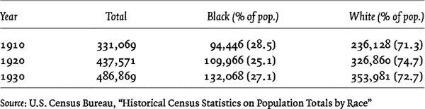
约翰·亚伯拉罕·戴维斯的案例显示了威尔逊政策对黑人员工的影响。戴维斯是华盛顿土，出生于一位白人律师和他的女佣，他在 M 街高中以优等生身份毕业，于 1882 年进入政府印刷局工作。他从一名时薪 25 美分的劳工做起。三十年后，他升为一名白领职员。一位主管描述他“工作严谨、精力充沛且负责，处于最高水平”，戴维斯获得了 1400 美元，并管理着十人的团队。他的家庭享受着中产阶级的生活，在 S 街有一栋精美的房子，在弗吉尼亚州乡村拥有一片 85 英亩的农场。但威尔逊政府终止了戴维斯的向上流动。在 1913 年 3 月威尔逊就职一个月后，政府印刷局的主管降了他的职并削减了 15%的薪水。来年他们将他一路降为工人，年薪仅剩 500 美元。由于依赖联邦工资，他家庭脆弱的中产阶级生活崩溃了，他们陷入了贫困。随着联邦政府对黑人就业变得越来越不友好，该市作为黑人进步灯塔的吸引力减弱。黑人迁往华盛顿的速度慢了。到 1920 年，该市黑人人口仅占总人口最低的 25%。
“民主的耻辱”：时期华盛顿的种族歧视
在遏制隔离扩散的战斗中，华盛顿黑人从美国参与 1914 年爆发的欧洲冲突（后被称为“大大战”，即后来的第一次世界大战）中赢得了修辞弹药。与此之前的内战一样，大大战对国家首都产生了转型性的影响。据一位记者的估计，华盛顿是“文明世界的战时首都”，随着威尔逊政府对国家经济和工业实施了前所未有的控制，它是非凡官僚战争努力的指挥中心。除了不断扩张的武装力量，政府还招募了一支白领工人军——包括文员、会计师、速字员和其他低级员工（大部分为女性），用于负责监督战争工作的一系列新联邦机构。《哈珀杂志》的记者惊叹道：“这座城市的人口增长就像发现了一个大金矿营。”在 1917 年 4 月美国参战后的短短四个月内，估计有 6 万到 7.5 万名新工人进入该市。到战争结束时，华盛顿的人口激增到 52.6 万，自战争开始以来增长了约 50%。

然而，与内战时期不同，一战期间迁往华盛顿的绝大多数移民是白人，其中许多人来自深南方。虽然像`芝加哥`和`底律`这样的北方工业城市经历了大量逃离南方在蓬勃发展的国防工厂工作的农村黑人的涌入，但相比之下，黑人向华盛顿的迁移只是一股小流。由于`威尔逊`政府早些建立的联邦就业障碍，很少有黑人移民能指望在蓬勃发展的官僚机构中获得比卑微职位以外的工作。³¹
白人新移民很快吸收了这座城市的种族习俗，但战时的紧迫需求往往使得难以执行严格的隔离，特别是在居住区。战争工人的涌入使该市匮乏的住房资源极紧张，租金飙升，在战争的第一年就增长了三倍多。住房官员放弃了在 1918 年前消除小巷住房的计划，转而仓忙于创造更多空间。联邦政府在`Union Station`附近建造了数十栋临时宿舍，官员有时会没收空置房屋，并向业主施压让他们房客入住。“我们的家不再是我们的堡垒了，”一位华盛顿的女性抱怨道，“如果你晚上离开房子，第二天早上回来时很可能发现里面满了嚼口香糖的年轻女性。”³²
尽管寻找住房很困难，但许多白人移民仍然拒绝在黑人社区寻找房间。据一项估计，即使在住房危机的最高峰，仍有四千间房间空置，因为它们并不位于`西北区`，因此被视为“在圈子之外”。然而，有时对房间的迫切需求导致白人工人寄住在黑人家中。白人战争工人`约瑟芬·莱曼`曾帮助来自`密歇根`的朋友们寻找住处，“但是，”她感叹道，“那里是由一个肤色太深、不适合我们的女性经营的，而且是一个完全由其他肤色相同的人居住的社区。”他们租了房间，但`莱曼`决定为他们再找一个更好的地方。³³
战争不仅削弱了种族隔离的实用性，还为华盛顿黑人和全美的美国黑人提供了一个强大的武器，来攻击`吉姆·克劳`的知识基础。通过穿上制服为国家战斗，黑人士兵可以证明他们的男子气概，并对完全公民权提出强有主张。这种观点认为，如果国家可以信任黑人士兵为民主世界带来安全，那么他们绝不能拒绝他们作为公民的基本权利。尽管当地`NAACP（美国黑人协会）主席`阿奇巴德·格林克`等人对战争的明智深表怀疑，但华盛顿的大多数黑人领袖认为，支持战争比反对更能促进他们事业的进展。他们推崇一位当地教会官员所说的“黑人高尚的爱国主义精神和忠诚的责任感”，组织集会，敦促黑人男性登记入伍。有近 26,500 人履行了此。³⁴
华盛顿黑人是首批被征召的士兵之一——`华盛顿特区国民卫队第一独立营`的 50 名军官和 929 名士兵于 1917 年 3 月下旬集结，在`威尔逊`总统正式宣布战争一周前。他们驻守岗位保护`白宫`及城市其他战略地点。近 600 名华盛顿黑人服从于隔离的`第 93 师``第 372 步兵团`，该团由`弗雷德里克·道格拉斯`之子`查尔斯·雷蒙德·道格拉斯`组织，赢得了法国和美国军事官员的尊重。³⁵
在大战期间的经历——以及他们经常遭受的军队内部种族歧视——促使许多回到华盛顿的黑人退伍军人渴望为种族平等而战。`雷福德·洛根`是`M 街高中`校友和`威廉姆斯学院`毕业生，他后来作为`霍华大学`的先驱历史学家而闻名，曾是`第 372 团`的一名军官。在战斗结束后，他留在法国了几年，而不是回到华盛顿面对持续的歧视。负面的战争经历促使另一位`M 街`毕业生（以及`阿默斯特学院`校友）`查尔斯·汉密尔顿·休斯顿`成为一名民权诉讼律师。³⁶
回到家乡，黑人领袖将战争与美国正在反对剥夺选举权、隔离和种族暴力的斗争联系起来，利用战时的民主和自决辞令来争取更大的种族公正。霍华大学教授`凯利·米勒`在国会会对德国宣战后仅几天，就在《晚间星报》的版面上明确了这种联系。“对于（黑人的）忠诚、士兵的效效率或为国家服务的意愿，不必有一丝顾虑，”`米勒`向他的读者保证道。但黑人的忠诚应当得到回报。“那些为旗帜的荣誉和光荣战斗的人，值得在那面旗帜下获得充分的自由和特权。”³⁷
然而，持续的种族歧视威胁要破坏黑人对战争的支持。动员开始不久，人们就发现，军队并不打算培训黑人新兵参加战斗；相反，他们将被贬到在从属地位上担任厨师、管理员和其他体力劳动者，为白人士兵服务。意识到被排除在战斗之外会延续黑人士兵的二等公民身份，而非加强他们对平等的诉求，`米勒`与`阿奇巴德·格林克`和其他华盛顿黑人一起，在 5 月初初与战争部长`纽顿·贝克`的会议上推动建立种族融合军事训练营。`贝克`拒绝了，但后来同意建立隔离训练营，为黑人军官准备指挥工作。`格林克`和`米勒`知道，“吉姆·克劳营”并非理想，但黑人士兵至少有机会在战斗中证明胆量。³⁸
华盛顿黑人也利用战争的辞令来挑战后方的种族主义。当`红十字会`拒绝登记黑人护士时，`校友俱乐部`（一个受过教育的黑人女性群体，`美国大学妇女协会`的前身）向`威尔逊`总统写了一封公开信来表达他们的挫败感。“爱尔兰人、甚至是德国人，都被像其他公民一样对待，”他们写道，“只有我们，在这件事以及其他任何事情上是被隔离的。”他们挑战`威尔逊`，“通过击败我们在美国的敌人——种族歧视，展示你对民主的信念。”在黑人宾客被`美国国会`的`妇女席`和餐厅排除在外后，`格林克`和`NAACP`从威尔逊式的理想主义角度对他们遭受的待遇提出了质疑：“我们的国家作战是为了让民主世界变得安全，无论其众多民族的种族或肤，还是我们的国家对德国宣仅仅是为了让白人的世界变得安全？”³⁹


黑人的知识生活在 `U Street` 同样十分繁荣。霍华大学哲学教授 `Alain Locke` 是第一位黑人`罗德斯学者`，他是那场被称为“新黑人复兴”的全国性文化运动的推动力量。尽管这场运动最常与纽约的哈莱姆联系在一起，但华盛顿的黑人也发挥了活跃作用。洛克于 1925 年出版的《新黑人》包含了三十五位作者、诗人和剧作家的作品，其中近一半的人曾居住在华盛顿或来自华盛顿。其中许多人是女性，包括美国黑人种进步协会（NAACP）主席 `Archibald Grimké` 的女儿 `Angelina Grimké`，她在 `Armstrong` 和 `Dunbar High Schools` 教书，同时在业余写诗。`Grimké` 和其他黑人知识分子每周六晚上汇聚在 `Georgia Douglas Johnson` 举办的“S Street 沙龙”，她白天是`劳工部`的官员，晚上则是诗人和活动家。“周六之夜客”与 `Howard Players` 以及一群黑人文学学会增强了华盛顿黑人知识分子之间的同谊感。
`U Street` 的知识狂热挑战了主流关于种族、阶级、性别性性的观念。小说家 `Jean Toomer` 的皮肤非常白，头发非常直，以至于经常被他的黑人邻居误认为是白人，他质疑了种族的概念本身。`Toomer` 是曾担任美国首位黑人州长期的 `P. B. S. Pinchback` 的孙子，他住在 `LeDroit Park`，是华盛顿精英黑人阶层的产物。作为 `M Street High School` 和霍华德大学的毕业生，他经常参加 `Georgia Douglas Johnson` 家举办的周六晚上聚会，在此期间他创作了后来于 1923 年出版的突破性小说《Cane》。他认同自己的黑人身份，但对美国僵板的种族二元性感到痛苦。在《Cane》获得评论界好评后，`Toomer` 拒绝被贴上“伟大黑人作家”的标签，并阐述了一种领先时代半个世纪的种族混合愿景。
`Toomer` 从未“伪装”成白人，但一些浅肤非洲美国人确实如此，他们利用白皙皮肤——以及白人对黑人社区内部肤色细微差异的忽视——来享受白人世界的福利。伪装（Passing）可以是对白人至上主义文化的一种地下抵抗，是对不公正的种族分类系统的个人挑战。关于华盛顿黑人的故事层出不穷，他们白天在“白人”岗位工作，晚上回到黑人家庭和社区。浅肤的黑人顾客经常坐在当地剧院的白人区域，这促使白人老板雇佣黑人“眼探员”，他们负责识别并移除坐在“错误”区域的黑人客户。对“伪装”的文化痴迷以及这种种族流动性对美国双重种族结构构成的威胁，在 20 世纪达到巅峰，当时的流行文学甚至电影都探讨了这一话题。
伪装是一种充满风险且紧张的现象。这只有那些拥有最浅皮肤的人才能拥有的策略，而这群人在华盛顿黑人社区中已经是特权阶层。尽管它凸显了`吉姆·克劳法`的荒谬和种族分类的任意性，但伪装也挑战了黑人的自我认同，并破坏了黑人精英社区。19 世纪末许多著名的混血裔华盛顿黑人——包括 `O. S. B. Wall`、`Richard Greener` 和 `Blanche Bruce`——最终选择了伪装。伪装可能带来了切实的利益，如更好的工作、住房和教育，但也付出了沉重的代价，因为那些“伪装”的人往往感到与自己的社区疏远。
另一位“周六之夜客”作家 `Marita Bonner` 为黑人女性内心渗透的特殊愤怒发了声。`Bonner` 是波士顿人，拥有 `Radcliffe College` 的学位，她于 1924 年来到华盛顿在 `Armstrong High School` 教书，并很快写了一篇让她名声鹊起的文章：《论作为一个年轻——女性——且有肤色人》。这篇文章于 1925 年发表在《危机》杂志上，探究了 `Bonner` 愤怒的深度。在白人时髦女正通过短发、吸烟和轻浮打破文化禁忌时，`Bonner` 对种族主义和性别歧视提出了严肃的批判。“你的每一个部分都变得苦涩，”`Bonner` 写道，“你必须静静坐着……像我一样……然后当时机成熟时，你就可以俯冲到脚——只需一个手势。”
`Bonner`、`Toomer` 以及其他黑人知识分子还挑战了他们在华盛顿黑人精英阶层看到的虚伪、物质主义和“自得自满”。`Langston Hughes` 是一位有抱负的诗人，重建时期领袖 `John Mercer Langston` 的曾侄甥，他曾在华盛顿和母亲和其他亲戚住了一年。他对 `U Street` 那些古板的进取者毫无好印象。仅在几个街区之隔，他在 `Seventh Street NW` 沿线的工人阶社区发现了一种更有活力、更令人兴奋的文化。“第七街总是充满了充满活力的深色黑人劳工，他们还没有获得‘文化’和舞台大使的礼仪，而粉肤、黑肤和黄肤的人仍然毫无歉意地成为朋友，”`Hughes` 写道。对这座城市“文化人”阶层的从从感到失望后，`Hughes`、`Toomer` 和其他黑人思想家逃离城市前往哈莱姆。

黑人中产阶级和精英成员品味精致且冷静，他们对华盛顿低阶层黑人那种眼中狂热的宗教情感和浮华的消费习惯感到不屑。“黑人内部之间的偏见和黑白之间的偏见一样多，”肤色较深的中产阶级黑人居民 `Edward Feggans` 回忆道，“如果你皮肤白皙明亮，几乎像白人，即使不符合经济标准，也能融入城市的社交圈。”年老的浅肤黑人女性安娜·穆（Anna Murray）在接受采访时承认了这种歧视，并解释道：“我认为我们大多数人这样做是为了保护我们的孩子”免受低阶层负面影响。“华盛顿黑人阶大众与精英阶层之间的社会隔层比该国任何其他城市都更为显著，”霍华大学的 `Kelly Miller` 声称。[81]
许多精英所蔑视的低收入黑人社区在 20 世纪 20 年代也蓬勃发展。随着这十年间从南方向华盛顿迁移的人口增加，这一群体显著增长。到 1930 年，该市黑人比例已超过 27%，绝大多数黑人居民是贫民或工人阶级。许多迁移者是女性，她们到来并不是为了追求自己的梦想，而是为了履行家庭义务。她们与亲属同住，承担家庭责任——照顾老人小孩、烹饪打扫、接洗衣服——以便其他家庭成员能够外出工作。随着时间的推移，她们也找到了有薪工作，通常担任白人家庭的佣人。这些新来者在思乡之情、紧密的工作安排以及来自华盛顿本地黑人偶尔的鄙视中挣扎，并面临着供养家乡的巨大财务压力。“一旦你开始工作，你就知道田纳西州的人指望着你赚来的那几分钱，”家政女工 `Dolethia Otis` 回忆道，“你不敢辞职！”[82]
尽管面临工作和家庭的压力，黑人女工仍通过维护张来维护尊严并保护利益。他们利用自己“忠实服务”的记录向白人雇主争取更多福利，例如每年回到南方老家，并抓住机会去 `Howard Theater` 剧院或 `Seventh Street`（第七街）的俱乐部看戏。他们节吃俭用，以逃离“住家式”工作——这种工作让他们住在雇主家里，穿着让他们感到卑微的浆烫的制服，并与自己的社区和教会隔绝。尽管这种工作有经济保障，但他们渴望“外宿式”工作的自主权，后者能给他们更灵活的工作时间和独立生活的机会。[83]
工人阶级迁移者建立了至关重要的社区机构，帮助自己在新家园生存和繁荣。他们通常通过与南方各地社区有联系的当地教会，组成了“储蓄者俱乐部”，为需要帮助的成员提供小额贷款和礼物；他们建立了“家庭小组”并为新来者赞助晚宴；他们保持着南方的文化和烹饪传统。“家政女工 `Fannie King` 回忆道，“有家人、有教会、身边有家的人，这帮助你安顿下来并过好生活，让你能够帮助……他人。”这一时期许多为了帮助迁移者适应城市生活的社区机构，包括 `Georgetown Club of South Carolina`（南卡罗来纳乔治敦俱乐部），一直延续到了 21 世纪。[84]
## “把有色人赶出华盛顿”：限制性契约与种族隔离社区的推动
无论社会或经济阶层如何，华盛顿的黑人都都在挣扎寻找体面的住房。被排除在新的郊区住宅开发之外，20 世纪 20 年代的黑人居民日益在老旧的、白人为主的社区寻找住房，通常沿着西北部的 `U Street`（U 街）、`Eleventh Street`（第十一街）、`Georgia Avenue`（乔治亚大道）和 `Florida Avenue`（佛罗里达大道）等贸易和交通路线。随后发生了一个不稳定、紧张且往往充满冲突的社区转型过程，这种过程在未来的几十年会在全市范围内反复。
在`华盛顿跨族委员会`委托的一项具有意义的 1929 年研究中，霍华大学社会学家 `William Henry Jones` 分析了社区如何从“白人区”转变为“黑区”。Jones 认为，社区变化的根源在于富有白人不愿意居住在种族融合地区。“具有相当社会和经济地位的白人——那些能够通过偏见和舆论维持社区种族团结的阶层——并不喜欢居住在文化异质的社区中，”他写道。一旦黑人开始搬入白人为主的地区，有资产的白人居民就会利用交通的便利搬离市中心，进入 `Chevy Chase`（雪维奇谷）、`Takoma Park`（塔科马公园）或其他隔离的郊区。他们的离开向地位较低的白人邻居传递了一个信号：该社区正在“衰落”。
在有意维护种族隔离社区的房地产经纪、开发商和政策制定者的影响下，许多白人假设黑人邻居会带来犯罪和破败，从而导致资产贬值。在一次对白人态度的调查中，Jones 发现白人离开种族构成变化的社区有多种原因，包括认为黑人“过于合群”且“对社区不利”。只有极少数人认为黑人是低等的，但有几乎同样数量的人担心自己可能会“变得喜欢那些黑人”。到目前为止，离开最常见且最有力的解释是社会压力，“对公众意见的恐惧以及其他白人的态度。”他们离开家主要是因为他们认为如果不离开，白人邻居会看轻他们。那些留在黑人比例日益增加的社区里的人往往是穷人、老人和外国移民。[85]
然而，一些白人居民拒绝搬走。相反，他们希望通过写入住房契约的种族限制性契约来加强种族团结，从而遏制黑人的侵入浪潮。这些契约由法院执行，是私人合同，白人房主同意限制将其财产出售、租赁或转让种族和宗教少数群体。华盛顿的住房种族限制从 1854 年就开始了，当时该市第一个郊区 `Uniontown`（位于海军院安纳科斯亚河对岸）是专为白人开发的。但在 1917 年最高法院的一项裁决后，由于该裁决禁止州和地方通过分区法强制种族隔离，但未涉及私人之间的排除性协议，限制性契约随之激增。随着 20 世纪 20 年代华盛顿和其他城市的黑人口增长并溢入白人地区，越来越多的白人居民将种族限制性契约作为保护社区种族特征的工具。这些契约不仅禁止黑人居住，还专门排斥了犹太人、阿拉伯人和“波斯人”等群体。[86]

限制性公约引发了许多法律问题，关于其宪性的测试性案件发生在华盛顿特区，由一位名叫华盛顿的黑人海伦·库蒂斯（Helen Curtis）引发的。作为一位知名黑人眼科医生的妻子，库蒂斯有财在市内的任何地方购买房屋。像许多其他黑人购房者一样，她看中了白人社区的房屋，因为那里通常更现代、状况更好。她雇佣了一位白人房地产中介——否则，她可能只能看到位于明确黑人区域的房屋——并选择了位于 `1727 S Street NW` 的一栋维护良好的三层排屋，该房地位于杜波顿圆圈（Dupont Circle）附近的时尚白人区和新兴的黑人文化圣地 U 街之间，距离大致相等。
库蒂斯并非孤单。多年来，黑人房屋主一直沿着 S 街稳定向西移动，到 1920 年，`1400`和`1500`街区几乎没有白人家庭留存。然而，在十六街以西，S 街仍然以白人为主（尽管并非全部），而`1700`街区的一 30 名坚定的白人房屋主试图维持现状。该小组包括律师、政府官员和商人，他们签署了一份契约，承诺绝不让他们的财产“被黑人或任何黑人种族或血统的人使用、占用、出售、转让、租赁或赠送”。该协议定于 1921 年 8 月提交，并通过缴纳 `$5` 费用使其生效，旨在有效期为二十一年。
然而，几个月后，该公约被打破了，签署人之一的艾琳·汉德·科里根（Irene Hand Corrigan）接受了海伦·库蒂斯购买她房屋的提议。面对愤怒的白人邻居，科里根声称她不知道库蒂斯是黑人，并试图违背交易协议。库蒂斯坚持进行交易；科里根急于卖掉房产，便从了她。一位白人邻居也是公约的共同签署人杰克·巴克利（Jack Buckley）起诉科里根违反了公约。另一位邻居兼共同签署人詹姆斯·S·伊斯斯·史密斯（James S.Easby Smith）成为了此案的主律师。
审判法院和华盛顿特区上诉法院支持了巴克利，并引用当地广泛使用的隔离法作为先例，维持了限制性公约的宪宪。在当地黑人团体的支持下，美国有种人协会（NAACP）的律师上诉美国最高法院，认为限制性公约将“把有色人赶出华盛顿”。但法院拒绝审理此案，在`科根诉巴克利案`（1926 年）中宣布缺乏干预的管辖权，因为限制性公约是个人之间的有效合同。
这一毁灭性的判例为白人房屋主提供了法律许可，阻止黑人买家进入他们的社区。在随后的几十年里，限制性公约在华盛顿特区和全国范围内盛行。在华盛顿，公民协会领导组织房屋主在其财产上签署公约。在判决后的几个月里，代表布鲁明代尔（Bloomingdale）地区的北议公民协会说服了几乎所有社区房屋主签署了公约。潜在的黑人购房者面临诉讼威胁，如果公约被打破，协会将承担随后的法律挑战费用。蒙特普利斯公民协会建立了一个专门负责限制性公约的委员会，并雇佣了一名全职员工收集签名并监控该地区的房屋销售。三年内，公约覆盖了该社区约 90%。蒙特普利斯直到二战后才几乎全是白人。
的是的是，试图保持 S 街`1700`街区隔离的限制性公约被证明无效。尽管库蒂斯和丈夫最终放弃了 S 街的房子（他们在几个街之外买了一个地方），但其他黑人搬进了街区的其他地方。在库蒂斯事件爆发几个月后，霍华德大学的管理员埃米特·杰·斯科特（Emmett Jay Scott）购买了仅隔三扇门的房屋。愤怒的白人邻居迅速寻求禁令阻止他搬，但狡猾的斯科特在夜色掩护下秘密搬入家具，并迅速在屋内安置，从而造成了无法撤销的既成事实。当库蒂斯案在法院审理时，斯科特一直留在街区，其他黑人居民也随之而来。包括案件发起者杰克·巴克利在内的白人搬走了。当最高法院在 1926 年对此案做出裁决时，该街区大部分是黑人。
S 街`1700`街区发生的事情证实了许多华盛顿白人的恐惧，他们担心一旦隔离之墙被打破，就无法阻止黑人增长的浪潮。他们预见到整个城市将像勒德罗特公园（LeDroit Park）发生的情况，那里在短短一代人内就从一个富裕白人居民的专属领地变成了一个全黑人社区。
但华盛顿生活的现实从未像“墙”的比喻暗示的那样清晰。华盛顿的隔离是不均衡且奇特的，是一系列混乱的未成之俗，而非正式法律。黑人可以乘坐电车，在公共图书馆看书，在格里菲斯体育场看华盛顿参议员队的球赛比赛，但他们不能参加音乐会，不能在电影院坐在白人旁边，也不能从国会大厦上观看七月独立日烟花。黑人购物者可以在市中心的`Garfinckel’s`和其他百货商店购物，但不能试穿任何东西。黑人住在城市到处，即使在所谓的“白人”或“黑人”社区，白人和黑人家庭也并肩居住或住在同一街区，往往持续多年。甚至作为黑人华盛顿标志性的 U 街也包含了白人经营的咖啡馆、冰淇淋店和基于隔离经营的商店。“规则”从未固定，不断受到挑战和重新定义。
在隔离内部，跨族关系可以且确实发生了发展，特别是在白人移民与黑人邻居低收入地区。尽管许多移民很快吸收了主流文化对非洲美国人的种族主义观点，但他们的贫困和物理距离接近意味着，他们比高收入同行与黑人有更频繁且相对平等的互动。他们也有同样的局外人感觉。在 20 世纪初种族分类的背景下，犹太人、希腊人和其他东欧移民不被视为完全的“白人”，经历了种族和宗教歧视。在位于第八街和 L 街的圣索菲亚希腊正教教堂周围的小型希腊社区中，希腊店主雇佣黑人工人，并在`Mavriko`（黑人）餐厅里为黑人和希腊顾客提供服务，这些餐厅对黑人和希腊顾客同样开放。


朗斯顿露台（Langston Terrace）是华盛顿大萧条时期持久遗产。与某些观察者认为华盛顿“不受危机影响”的观点相反，华盛顿人与国家其他地区一样遭受了痛苦。该市超过 18%的居民依靠紧急救济，相比之下，纽约为 10%，巴尔摩为 12.5%。乞讨者遍布城市街头——一位记者写道：“即使在白宫大门外，他们也在维持生计。”联邦员工也感受到了压力，因为国会在 1932 年削减了超过 8%的公务员工资，次年又削减了 15%。⁵
大萧条对黑人社区的打击尤为严重。该市失业者中 75%以上是黑人，全市 13.2 万黑人居民中有超过一半的人接受了联邦救济。家政（绝大多数是黑人女性）的工资从每月 40-50 美元下降到 30-35 美元。华盛顿拥有全美最糟糕的黑人婴儿死亡率，每 1000 名活产婴儿中就有 115 多名一岁以下黑人死亡。城市各地出现了“临时营地”，数百无家可归的黑住在恶劣环境中，让人联想起内战时期的“违禁品营”。即使在中产阶级的黑人社区德鲁特公园（LeDroit Park），挣扎于生计的业主也将维多利亚式住宅改造成了公寓。《华盛顿论坛报》的一位记者叹道：“我在这个曾经华华的社区里闻到了一种潮湿和腐败颓废的气息。”⁶
随着失业者寻求发出自己的声音，华盛顿成为了全国性抗议的中心。1932 年 6 月初，一群破旧但坚定的黑白人一世界大战退伍军人聚集在华盛顿，要求提前发放承诺的联邦补贴（被称为“奖金军”）。贫困潦的“奖金军”人数增加到近 2 万，在国会大厦可见的安纳科斯蒂亚平原（Anacostia Flats）建立了一个巨大的跨种族帐篷营，并在全市范围内建立了二十多个较小的营地。在参议院否杀了奖金法案后，约 6000 名退伍军人在华盛顿停留了一个半多月，在日益恶化的条件下生活，直到赫伯特·胡佛总统在 7 月下旬下令驱散该群体。在道格拉斯·麦克阿瑟将军的领导（以及怀特·D·艾森豪少的协助）下，500 多名士兵使用坦克、催泪瓦和武装营清除了这些营地并将其付之一。⁷
胡佛对奖金军的粗暴对待促成了纽约民主党州长富兰克林·罗斯福在 1932 年入主白宫。这位魅力的罗斯福带着迷人的微笑和不懈的乐观主义，凭着削减联邦支出和平衡预算的承诺竞选。然而，在就职后，他启动了`新政`（New Deal），这是一次前所未有的和平联邦权力扩张，政府在美国经济中扮演了更大的角色。联邦官僚机构随着数十个新联邦机构的出现而蓬勃发展。在 1933 年至 1935 年间，华盛顿的联邦员工人数从 63000 人跃升到 93000 人；到 1940 年达到了 16.6 万。当其他城市地区萎缩时，华盛顿增长了三分之一以上，1940 年人口超过 66.3 万——比 12 个州还要大。增长大部分来自该市的黑人人口，这一群体在 20 世纪 30 年代增长了 40%以上。⁸
首都是随着新人和新活力而繁荣的。记者大卫·科恩在《大西洋月刊》上写道：“新政使首都变成了繁荣的城镇。”由`工程振兴署`（Works Progress Administration）的大型公共工程项目雇佣了数千名工人，并改变了市中心的景观，一系列新的联邦建筑拔地而起，包括法院大楼、联邦贸易委员会大楼以及巨大的农业部总部。⁹
随着城市在新政和第二次世界大战期间的繁荣，新一代的黑人活动家及其盟友崛起起来，挑战吉姆·法，寻找体面的住房并为经济生存而战。全美国人进步协会（NAACP）律师查尔斯·哈密顿·休斯顿写道：“黑人寻求作为美国公民占据应有的地位，无需任何形容词、连字符或限制。”他们使用了新的抗议形式，包括抵制、工会组织和静坐，并与华盛顿及全国越来越多的白人建立了跨种族联盟，这些人认为这个国家首都的种族不平等是美国声誉的污点。1943 年，《纽约时报》的一位记者写道：“今日的华盛顿是争取黑人平等新运动的中心，是一个实验室，正在尝试一些推进黑人发展的具体手段。”这种实验在当时产生了参差不齐的结果，但 20 世纪 30 年代和 40 年代的社区活动和跨种族组织为战后民权运动奠定了基础。¹⁰
## “公共危险与滋扰”：巷弄清理与廉价低收入住房的推动
约翰·伊尔德（John Ihlder）认为自己是黑人社区的盟友。伊尔德于 1876 出生于停泊在巴尔的摩的一艘德国船上，他是废奴主义者的自豪后裔，在进步时代的高峰时期成年。从康奈尔大学毕业后，他像“揭丑记者”雅各布·里斯那样开始了他的记者生涯。由于受到他报道的住房问题所吸引，他离开了新闻界，成为一名住房活动家，但他保留了记者对冲突和争议的热情。¹¹
伊尔德于 1920 年搬到华盛顿，在美国商会工作。在匹茨兹堡短暂工作了一段时间后，他于 1933 年回到这里，协助建立了`华盛顿住房协会`（Washington Housing Association），这是一个致力于开发低收入住房的组织。到那时，这位终身支持进步派的共和人已经相信，单靠私人住房计划无法满足穷人的需求，他希望即将上任的民主党总统富兰克林·罗斯福为他的事业提供公共资源。凭借杏仁形的蓝色眼睛和顽皮的微笑，这位好斗但乐观的伊尔德在接下来的二十年里成为华盛顿住房改革的面孔。¹²
伊尔德代表了 20 世纪 30 年代华盛顿新的改革精神，当时中产和和上层阶级改革者创建了跨种族的社会服务组织来解决公共问题。他们建立了当地的`社区基金会`（Community Chest），组织慈善捐款。到 1931 年，它每年募集超过 200 万美元并分配给当地机构。像伊尔德一样，社区基金会负责人埃尔伍德·街特（Elwood Street）认为任何社会服务工作应该涵盖整个城市，在他任职之前，他坚持组织的努力必须包括对黑人社区的接触。在黑人霍华大学教授凯利·米勒（Kelly Miller）担任副主席期间，社区基金会资助了许多专门在黑人社区工作的团体，包括拥有跨种族管理委员会的社区服务站点。¹³

住房可能是这座城市最棘手的问题，这是一个交织着种族、贫困和城市政治无能的问题。无论是新来者还是老居民，在这个租金高昂且空房稀少的城市里，寻找体面的住房都异常困难。整个居住开发区——从乔治敦的波特马克河岸开始，横跨 `Tennallytown`、`Chevy Chase`、`Takoma Park` 和 `Brookland` 一到城市北部——基本上对黑人居民来说是禁区。即使在黑人社区，黑人租客支付的租金也比白人租客高。大萧条时期收入下降，但由于需求旺盛，租金仍然保持高位，往往耗掉一个家庭收入的一半以上。被迫随处寻找住房的许多新来者挤进巷弄房屋并向亲戚寄宿，给社区、学校和社会服务带来了日益巨大的压力。对 `North Capitol Street` 某地区的一项调查发现，大多数房屋都有“屋顶漏水、地板扭曲、窗户破碎，以及关不上的门”。很大比例的建筑 . . 都是老旧破败的，在很多情况下破坏程度已达到几乎不宜居住的地步。”14
对于约翰·伊尔德（John Ihlder）和其他住房改革者来说，巷弄房屋的持续存在尤其令人气愤。在 1914 年《巷弄住房法》通过二十年后，那些顽固的巷弄社区依然存在，并变得日益贫困和隔离。许多中产阶级的住房改革者将物质上的缺陷与道德缺失联系起来。“巷弄代表了华盛顿最贫穷、资源最匮乏的部分，并滋生了该市大量的犯罪、贫困、疾病、不道德和高婴儿死亡率，”黑人社会学家威廉·亨利·琼斯（William Henry Jones）在 1929 年的一项研究中写道。琼斯继续写，巷弄是“某种落后黑人文化的内核”，已成为“一群无法或不愿达到白人文化标准的人的住所”。琼斯对黑人底层阶级文化缺陷的强调——这种说法在现代人听来是如此刺耳——是 20 世纪 30 年代许多改革努力的基础。住房改革者坚信，用伊尔德的话说，“有了不同类型的住房，人的性格将会发生改变。”15
琼斯的研究有助于重新引发终结巷弄住房的斗争。在研究发表后不久，伊尔德呼吁联邦政府再次禁止巷弄房屋，在接下来的几年里，这项努力获得了公民组织、城市规划者和报纸编辑的支持。“新政”（New Deal）加速了这一运动。埃莉诺·罗斯福（Eleanor Roosevelt）尽管拒绝参加第一夫人巡视华盛顿贫民窟的仪式，但她鼓励住房改革者推动一项新法案。这项主要由伊尔德本人起草的《巷弄住房法》于 1934 年通过。”16
该法案承诺转型该市低收入住房。其目标不仅是消除巷弄住房，还为前巷弄居民提供公共住房资金——这对联邦政府来说是一个激进的（除了一战期间为战争工人建造宿舍的临时努力外，他们从未涉足住房市场）。法案设立了“巷弄住房管理局”（Alley Dwelling Authority，简称 `ADA`），这是一个拥有地方权力来拆除建筑、驱逐租客并建造新单元的联邦机构。国会任命伊尔德领导这个新机构。尽管国会只给 `ADA` 拨款了 `$500,000` 的资金——原始法案请求了 `$3 million`——但总是充满活力的伊尔德坚信地认为，该机构将在十年内实现消除华盛顿所有巷弄住房的宏伟目标。”17
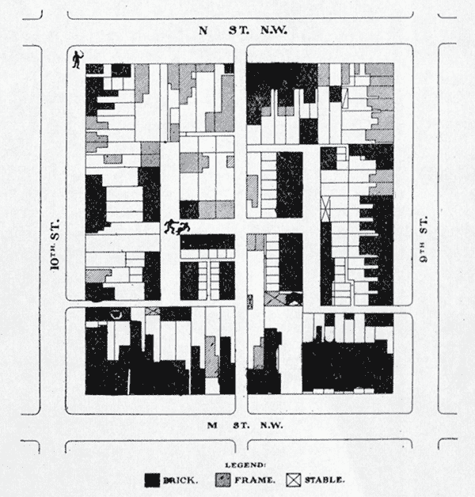
“华盛顿的死胡同”。住房改革者试图根除巷弄社区，他们认为这些社区是恶习和不道德的温床。尽管从 19 世纪 90 年代开始了数十年的改革努力，巷弄社区直到 20 世纪中叶一直是华盛顿城市景观中独特的一部分。*周一晚间俱乐部*，《华盛顿已居住巷弄目录》。*
清理巷弄的目标具有广泛吸引力，但对于在贫民窟拆除后如何安置巷弄居民，并没有共识。对于伊尔德和其他改革者来说，答案是公共住房。伊尔德注意到私人产业未能满足低收入居民的需求，他认为 `ADA` 应该采取一项广泛的住房建设议程。在未能为被安置居民获得替代性住房之前，他拒绝拆除任何房屋，并敦促国会（最终未成功）拨付足够的资金，为所有前巷弄居民提供公共住房。”18
但在一个日益隔离的城市里，公共住房极具争议。例如，`ADA` 在 1937 年取代西北部 `Foggy Bottom` 社区一处臭名昭彰巷弄的计划引起了巨大反对。`ADA` 拆平了十多栋巷弄房屋，并在 `Twenty-Fourth Street` 的 `St. Mary’s Court` 建造了一座现代的两层 24 单元公寓公寓综合体。伊尔德和 `ADA` 最初计划让黑人居民入住新房，但白人开发商和居民表示了反对。“黑人入住会阻碍发展，”他们抱怨道。“新公寓开放给有色人租客将导致该地区的黑人人口永久化，”他们担心这会导致房产价值下降以及白人迁往其他社区。来自林肯公民协会（Lincoln Civic Association）的黑人居民发起了自己的抗议，争取了华盛顿住房协会（Washington Housing Association）等全市白色组织的支持。他们的抗议说服了 `ADA` 允许黑人入住新公寓。”19
伊尔德对公共住房的承诺以及重新安置被安置居民的真诚努力在国会遭到了严厉批评，特别是来自联邦众议院和参议院区委员会的南方成员。区委员会长期以来一直是国会议员最不理想的岗位之一，到 20 世纪 30 年代，这里已成为关注国家首都日益融合趋势的南方隔离主义者的避风港。这些民主党人来自黑人选民被剥夺选举权的单党南方，他们是“新政”联盟的关键部分，并利用自己的职位阻碍了他们担心会破坏华盛顿隔离制度的改革。
“众议院区拨款小组”的主席是罗斯·柯林斯（Ross Collins），一位密西西比州的律师，他在军事武器上挥霍如土，却切断了地区改革努力的资金。在“社区慈善基金”（Community Chest）发布了一篇名为《第一城市——最差城市》的华盛顿贫民窟揭报道后，市官员呼吁国会拨款 `$3.2 million` 用于帮助穷人的项目。柯林斯冷地将其削减至 `$900,000`。当当时负责市公共福利部的埃尔伍德街（Elwood Street）要求他增加对南妮·海伦·伯鲁斯国家女校（Nannie Helen Burroughs...）中贫困黑人女孩的资助时，柯林斯拒绝了。“我的选民不会容忍把这么多钱花在黑鬼身上，”他解释道。国会的反对确保了住房改革者永远没有足够的资金来实现伊尔德将被安置居民安排在公共单元的目标。”20

《住房法案》（ADA）还引起了私人建筑商和商业团体的反对，他们指责政府对住房市场的“社会主义式”干预对私人利益造成了不公平竞争。私人公司坚信市场力量能更好地解决城市的住房危机，华盛顿卫生改善公司（Washington Sanitary Improvement Company）和华盛顿卫生住房公司（Washington Sanitary Housing Company）开始了新的低收入住房项目。这些私人住房公司不愿承担租给那些不受欢迎租客的财务风险，转而关注低收入白人以及他们所谓的“较优阶层的有色人租户”。这两家公司在盛大的宣传造势下，于 1934 年至 1939 年间为低收入居民建造了 1,034 套住房。在一个有数万低收入居民需要住房的城市里，私人住房开发商无法满足需求，这进一步凸显了问题的严重性。[²¹]
ADA 也吸引了黑人社区内部的批评者。很多时候，生活受住房改革影响最大的黑人被排除在政策制定之外。黑人社区对清理小巷的观点并非 {一律的——许多中产阶级的黑人领袖认为小巷是令人丢脸的、对种族平等斗争有害的，而小巷居民本人往往捍卫他们居住的紧密社区。然而，人们普遍担心消除小巷将导致流离失所。
很少有华盛顿黑人相信白人住房改革者是出于对他们利益的考虑。伊尔德（Ihlder）可能致力于为前小巷居民寻找体面的住所，但其他城市规划者则希望将小巷转换为可供商业开发的空间。前总统的孙孙、乌利斯·S·格兰特三世（Usses S. Grant III）、国家首都公园与规划委员会（National Capital Parks and Planning Commission）主席认为小巷是“公共危险和麻烦”。他设想将车站附近的一条小巷改为“为[附近]酒店客人提供茶园以及他们车辆的车库”。尽管伊尔德做出了承诺，格兰特的想法更接近现实。正如《星报》（Star）在 1937 年底报道的，大多数 ADA 小巷清理项目并没有为流离的居民带来新家。相反，官员通常将这些土地用于公园或车库。[²²]
ADA 的一个挥之不去的眼中钉是林肯公民协会（Lincoln Civic Association）主席爱德华·哈里斯（Edward Harris），他曾帮助黑人居民保留圣马丽法院（St. Mary’s Court）。哈里斯表达了对清理小巷导致流离的日益增长的担忧。在圣马丽法院之战后的几年里，他一直挑战伊尔德和 ADA 履行承诺。哈里斯坚持认为，贫民窟清理不应涉及“引导、殖民和剥夺黑人的家园”。他和他的盟友指责 ADA “通过拆除房屋、驱散且不重新安置原租客而忽视了人类居住”，并破坏了“有色人公民的信任和信心”。[²³]
哈里斯还担心联邦开发导致的流离失所，因为政府正作为新政政扩张的一部分在吞噬居住区。在哈里斯所在的福吉波顿（Foggy Bottom）社区，政府计划为陆军和海军部（War and Navy Departments）建造新总部，导致 30 户家庭流离失所。城市项目对低收入和少数族社区也有类似的破坏性影响。1929 年，市委员拆迁了该地区最大的华裔聚居区以建造新的市政中心，但在税收萎缩、国会削减联邦拨款后，他们放弃了该项目并将该区域变成了公园。尽管遭到白人商业团体的反对，约 600 名华裔居民搬到了西北 H 街（H Street NW），介于第六街和第七街之间，他们在那里建立了在 21 世纪被称为“唐人街”的地方（参见第 14 章](#ch14.xhtml_ch14)）。[²⁴]
在公开会议、国会证词以及给富兰克林和埃莉诺·罗斯福的信中，哈里斯始终指出一个令人不安的事实：ADA 既没有足够的资金，也没有足够的权力按所需的规模建造公共住房来应对流离失所的挑战。随着黑人居民——受限制性契约的阻碍、当地白人领袖和政府官员的压力、以及贷款机构的冷落——逐渐放弃福特雷诺（Fort Reno）、乔治敦（Georgetown）以及其他现在主要是白人居住地区的长期社区，这种担忧日益加剧。[²⁵]
## “我们将没收你的财产”：福特雷诺、乔治敦与黑人社区的消失
位于西北部的福特雷诺提供了一个例子，说明了联邦支持的地方开发是如何驱逐穷人并加剧城市住房问题的。福特雷诺是内战期间由联邦军建造的，吸引了“逃亡奴”（contrabands），他们形成了一个虽小但繁荣的战后黑人社区的核心。雷诺的黑人居民居住在特纳利镇（Tennallytown）这个人口稀少、以白人为主的区域内，远离拥挤的小巷，拥有充足的开放空间、种蔬菜和养鸡的土地以及一所热闹的学校。华盛顿精英长期以来认为该地区山丘过多且离市中心太远，但 20 世纪初的白人开发商受到切维奇塞（Chevy Chase）、塔科马公园（Takoma Park）等偏远郊区开发成功的启发，由于特纳利镇的山顶景观和“乡村空气”而向往此。[²⁶]
随着农田变成单户家庭住宅，白人开发商和唯唯顺从的当地官员盯上了福特雷诺周围的土地，设想为白人儿童建造公园和学校以增加物业价值。唯一的障碍是雷诺的黑人社区。因此，白人开发商在当地和联邦官员的支持下，开始了清逐黑人居民的努力。开发商哈罗德·E·多伊（Harold E. Doyle）多年解释道，他们首先购买堡垒附近的土地，“为了防止进一步供有色人居住”。下一步是赶走长期的土地所有者。根据一位白人观察者的说法，尽管切维奇土地公司（Chevy Chase Land Company）“尽一切办法赶走这些有色人”，但黑人房主拒绝出售。房地产公司和当地公民协会随后向联邦政府施压，通过新设立的国家首都公园与规划委员会购买财产。[²⁷]
委员会行了征收权，并在购买雷诺周围土地以建造爱丽斯·迪尔初中（Alice Deal Junior High School，1930 年开学）和罗瑟·威尔逊高中（Rowrow Wilson High School，1935 年开学）时，向土地所有者提供了极少的补偿。今天，这两所学校坐落在一片 45 英亩的绿地带内，周围环绕着百万豪宅。雷诺的黑人居民玛丽·丹尼（Mary Daniel）回忆道：“这只是关于给他们的财产提供一点点微道的钱’，‘要么我们就没收你的财产’。”在搬迁过程中，开发商拆除了数十栋房屋和三座教堂，不可挽回地破坏了福特雷诺黑人社区的社会结构。到 1940 年，该地区已所剩几个黑人家庭。被迫放弃他们熟悉的家园，这些流离失所的家庭（其中一些人在雷诺生活了半个多世纪）在其他地方寻找租房，通常是在他们没有亲属纽带或与邻里联系的地方。[²⁸]


随着大萧条的加剧，越来越多的白人工人愿意接受任何找到的工作，这往往排挤了他们的黑人同胞。1938 年，一万名女性（其中 90%是黑人）排队领取联邦政府提供的两千个清洁工位的申请表。当警察帮助排在末尾的白人女性优先获得申请表，而不是那些在队伍中等了一整夜的黑人女性时，现场爆发了冲突。白人女性可以向下经济阶层流动去当清洁工；然而，黑人工人却无法反之。白人工人保留了对高薪技术性工作的实质垄断。到该年代末，该市的锅炉工、电车司机、列车、机械师和电话线工中超过 98%是白人男性，而打字员、电话接线员和文员中超过 97%是白人女性。
白人工人嫉妒地维护自己的利益，一贯反对与非洲裔共同工作。隶属于`AFL`的地区工会几乎一致地排除了黑人工人，使他们难以找到工作或为更好的工作条件进行谈判。种族问题也成为雇主破坏工会化努力的便利手段。面包销售工会的一位白人官员解释道：“老板似乎会告诉那些黑人，加入工会有什么用，因为只要可能，白人就把他们踢出去。而对白人，他们会说，为什么要和那些黑人打交道，只要等一下，我们就会把他们全部踢出去，换成白人。”
不仅仅是白人工人或老板害怕跨种族的工会。黑人工人也持怀疑态度，担心与白人同胞合作会危及他们自己的工作。`AFL`餐厅联盟的白人组织者安妮·斯坦因（Annie Stein）在黑人工人中遇到了对工会的巨大阻力。斯坦因说，他们不仅担心来自白人同事的歧视，还“担心如果他们获得同样的工资，他们的工作会被白人占据”。“有色人知道，他们之所以有这些工作的唯一原因是他们愿意接受较低的薪水。”
尽管存在这些障碍，工会组织者在 20 世纪 30 年代通过应用简单的经济逻辑在该地区取得了进展。正如面包销售工会官员所说：“一个白人砖匠每天赚 12 美元，而一个黑人只赚 6 美元。结果是黑人在压低白人的薪水，由于他们之间相互竞争，双方都输了。”他认为，白人工人排挤黑人同胞只会伤害他们自己。“试图压制黑人是没用的，因为这只会让我们其他人也陷入低谷。”
隶属于`CIO`的美国联邦工人工会（`UFWA`）在 1937 年发起组织联邦工人的运动时，将跨种族组织列为明确目标。与另外代表联邦工人的另外两个工会不同，`UFWA`积极招募黑人工人，并挑战联邦政府内部的种族隔离。罗斯福总统任命了几位引起高度关注的黑人人士，例如玛丽·麦克劳德·贝瑟恩（Mary McLeod Bethune，成为国家青年管理局局长）和罗伯特·C·韦弗（Robert C. Weaver，成为内政部黑人事务顾问），但他的政府并未消除行政机构内部的种族隔离惯。随着新政的到来，出现了一波招聘热潮，但渴望获得工作的黑人员工往往未能受益。例如，新的民事工程署收到了 4,500 份白人求职者的申请并聘佣了 2,000 人（录取率 44%）；它收到了 2,600 份黑人的申请，但仅聘佣了 115 人（录取率 4%）。
`UFWA`的领导者是埃莉诺·尼尔森（Eleanor Nelson），她是缅因州一名美国议员身材瘦小的白人女儿。因 1932 年奖金军游行者受到的待遇而激进，尼尔森加入了共产党。在尼尔森的领导下，工会为所有工人争取集体谈判权，并拒绝在种族隔离的设施中举行会议或社交活动。非洲裔美国人担任`UFWA`官员，在公共活动中代表工会，并经营许多工会分支。该市最大的黑人工会是隶属于`UFWA`的第 471 号联合食堂工人地方工业工会，由奥利弗·帕尔默（Oliver Palmer）经营，他是一位说话轻声细气的南卡罗来纳州黑人，曾在财政部每小时赚 25 美分洗碗子。`UFWA`的共产主义倾向限制了它的吸引力，并最终导致其在 20 世纪 40 年代的衰落，但在短暂的时期，工会取得了局部进展，为联邦工人建立了集体谈判权。
在联邦政府之外，劳工活动人士试图改善体力劳动者的工作条件，特别是在洗衣业。洗衣业在华盛顿是一项大生意——“白领城市是洗衣工人的好地方”，当地人这样开玩笑。`CIO`建立了一个当地洗衣工人工会，帮助洗衣工人争取更短的工作时间、更高的薪水以及从闷热的工作中获得更多休息。
伊内斯·罗伯森（Inez Robertson）是当地工会的兼职组织者，她 14 岁就开始在洗衣店工作，并在 20 岁的 1937 年加入工会。她被管理层蔑视为“那些`CIO`黑人之一”，她试图在位于维蒙特大道西北 1010 号的 Arcade 洗衣店组织工资最低的工人，大部分是黑人，她在那里工作了七年。Arcade 的所有哈里·维纳（Harry Viner）给公司的 150 名工人支付每小时 20 到 25 美分的行业标准工资，但他经常在下午 4:30 给他们打卡，无论他们是否真的离开了工作。罗伯森解释道：“如果任何女孩有意见，她们就会被解雇。她们都太害怕做任何事情了。”工会从 1937 年开始在 Arcade 发起系列罢工，并在 1941 年达到高潮。尽管维纳在《星报》等报纸上刊登了整页告示寻求公众支持，但工人赢了——他们的工资增加到每小时 25 到 30 美分，每周工作 48 小时。
洗衣工人工会、`UFWA`以及其他隶属于`CIO`的工会可能没有从彻底改变华盛顿的工作条件，但它们展示了即使在种族隔离看似僵化的时期，跨种族组织的潜力。工会运动扩大了愿意为种族平等工作的白人盟友，并在活动人士之间建立了全国性的跨种族网络。白人工会组织者反驳了所有白人都支持种族隔离的观点，他们中的许多人——最著名的安妮·斯坦——参与了战后华盛顿的民权运动。


对选举权的支持之所以增长，某种程度上是因为联邦政府未能履行其财政义务。19 世纪 70 年代达成的剥夺选举权协定非常简单：作为放弃选举权诉求的交换，特区居民获得了由联邦政府支付该市年度预算的一半的保障。“对半开”计划在当地领导人中变得神圣不可侵犯。对失去联邦捐款的恐惧导致了此前试图恢复选举权的努力付诸东流。
然而，节约经费的国会员们很快开始重新考虑“对半开”计划，并于 1921 年国会完全放弃了它。到 1937 年，联邦政府贡献的资金占该市预算不足 15%，这激怒了当地领导人，并引发了一场威胁城市偿债能力的财政危机。《华盛顿邮报》记者梅洛·普西西（Merlo Pusey）在关于特区政府的七部分深度报道中，描述了一个被“权力分裂、国会冷漠和财政不确定性”所束缚的“被缚脚的民主”。结果，当地官员难以达到基本的公共卫生标准、提供足够的学校或维持城市安全。选举权支持者认为，如果华盛顿在国会会有代表，该市就能获得稳定的资金，并防止对特区事务的过度干预。^(61
选举权运动的一个主要推动者是西奥多·诺伊斯（Theodore Noyes），他是《晚间星报》的白人编辑。诺伊斯是一位华盛顿土人，拥有哥伦比亚学院（后来的乔治·华盛顿大学）的本科和法学学位，他于 1908 年从父亲克罗斯比·诺伊斯手中继承了《星报》的编辑职位，并在几十年里倡导特区的发展与美化。诺伊斯坚信，保护特区经济和政治利益的最佳方式是在国会拥一名投票代表。他认为特区居民是“缺陷且失职的美国人”，在他们能够投票选举自己的代表之前，这座城市只能获得微不足道的国会支持。1917 年，他协助成立了哥伦比亚特区国家代表公民联合委员会，该委员会推动了未来二十年的选举权运动。^(62
随着《星报》及其他白人报纸的积极报道，选举权运动获得了领先白人组织的支持，包括商会、“无票权者”选民妇女联盟和公民协会联合会。1938 年 4 月举行的一次非正式公投吸引了近十万选民，显示出人们对地方选举权（88%）和国家代表制（93%）的压倒性支持。黑人华盛顿人的支持程度甚至更高——《华盛顿邮报》的一项调查显示，95%的黑人受访者支持选举权，而白人的这一比例为 80%。^(63
在特区居民的自我自治（当地称为“主权自治”）问题上，种族分歧进一步扩大。黑人华盛顿人普遍支持国家代表制和地方自治，但对后者给予更高的优先级。来自黑人布鲁明代尔尔公民协会的沃尔特·A·平奇巴克（Walter A. Pinchback）在 1938 年作证说，“特区的每一位正直的公民都希望拥有”国家代表的特权，但“如果国会建立某种形式的地方政府，让公民能够选出直接对他们负责的官员，难道不是更好吗？”^(64
绝大多数白人选民也支持地方自治，但西奥多·诺伊斯、商会和其他白人精英阶层坚决反对。他们认为，地方自治将导致黑人控制，正如他们认为重建时期发生的那样。黑人选民会支持大幅增加支出、积压债务并征收高税，这一切都将损害商业、降低财产价值并促使富人离开华盛顿。十英里广场俱乐格罗弗·艾尔斯（Grover Ayers）在 1938 年的《邮报》上写道：“城市有一个‘种族问题’。过去，政客利用有色选民正如他们打算今天如果国会授予特区任何选举权将会这样做。”十六街高地公民协会的约翰·特纳（John Turner）曾向国会表示，“黑人统治”将摧毁这座城市，因此“对于特区这种混合人口来说，国家代表制是唯一安全的途径”。^(65
持续的种族担忧导致《邮报》的梅洛·普西西认为选举权在本质上是不切实际且不受欢迎的。普西西认为，由于有这么多白人居民选择在各自的州邮投票，权力平衡将掌握在黑人选民手中。“在首都刺激种族政治不是一个愉的愿景。”另一个更具末日色彩的评估来自白人居民、社区“刺头”克林顿·霍华德（Clinton Howard），他是内战将领 O·O·霍华德的侄孙。在 1943 年的一次国会听证会上，霍华德警告说，如果授予华盛顿选举权，这座城市将由“贫困、文盲的无产阶级统治。……小巷（alley）将主宰大道的（avenue）”。[^(66
西奥多·诺伊斯承认，黑人政治权力的阴影削弱了精英阶层在国会争取特区代表的努力：“我们很难让这个国会区分国家代表制与地方选举权中的黑人主导。”二战前没有一项选举权法案通过国会。该市持续被剥夺选举权削弱了其活动社区——无论是选举权支持者、工会组织者、种族平等倡导者还是其他人——让决策者关注他们诉求的能力。住在首都让他们的当地斗争离权力殿堂近在咫尺，但这些斗争通常无法引起全国范围的关注或同情。对于民权活动家来说，这种情况从 1939 年初开始发生，当时一场围绕黑人歌手玛丽安·安德森（Marian Anderson）的争议将聚光灯聚焦首都的种族隔离上。^(67
## “民主的污点”：华盛顿种族歧视引发全国关注
安德森作为当时最杰出的黑人艺术家，受邀在华盛顿表演，作为霍华德大学赞助的年度音乐会系列的一部分。音乐组织者希望她能在宪法厅演出，那是坐落于白宫前椭圆旁、D 街的一座宏伟的四千座观众场剧院。宪法厅由美国革命后裔协会（DAR）所有，于 1929 年开放，是该市最大的表演空间。那里也是实行隔离的。黑人观众可以参加活动，前提是坐在“有色人专用”区域，但 DAR 禁止黑人表演者。^(68
安德森音乐会的策划者知道“仅限白人艺术家”的政策，但希望这位歌手的名声和成就（以及座无虚席的前景）能说服 DAR 重新考虑。管理 DAR 的女性们既不印象深刻也不感兴趣；她们拒绝了请求。安德森的团队随后向市委员会申请许可在白人中央高中表演，那里有一个拥有两千座观众的礼堂。在教育局长弗兰克·方库（Frank Frankou）的建议下，委员会拒绝了请求。


但官员们无法抑制战争带来的革命潜力。比第一次大战时期，反对轴心国的斗争为种族平等主义者提供了一个机会，让他们深化美国自由理想与种族主义现实之间的对比。这个国家的“种族问题是一个战争问题，”活动家 `Pauli Murray` 写道。随着德国和日本敌人公开追求种族优越政权，活动人士认为种族平等才是美国之道。白人至上主义不仅在道德上是错误的，而且是不美国的。活动人士在联邦政府内部拥有强大的支持者，还得到了一代学者的支持，这些学者正在瓦解种族主义的思想基础。
当黑人士兵在海外战斗、黑人工人制造飞机、黑人职员在联邦战争机构工作时，全国的民权活动人士发起了“双 V 运动”，旨在击败海外法西斯主义和国内的种族隔离。黑人战争委员会员工 `Lucia Pitts` 在《华盛顿邮报》中写道：“黑人和其他美国公民一样，帮助了美国，热爱美国，想要捍卫美国。他们不仅应该分享苦难、磨难和牺牲，还应该拥有经济机会和对美国的信心。”
尽管在战争期间面临平息抗议的压力，`Jewell Mazique` 和其他活动人士通过挑战 `Capital Transit Company` 的招聘做法，对那份“应得的份额”提出了权利。这家私人公司拥有经营华盛顿唯一的公交和电车线路的公共垄断权。与其他南方城市不同，华盛顿的公共交通自重建时期以来一直保持整合状态，当时该市的电车曾是种族冲突的焦点。然而，`Capital Transit` 薪水丰厚的司机或电车操作员中没有一个黑人。该公司所有的黑人员工都在维护部门工作或担任管理员。即使在面临严重的劳动力短缺、导致 30-50% 的公交闲置时，该公司仍拒绝雇佣黑人机车员，而是招募白人女性和政府工作人员兼职司机。
活动人士认为华盛顿的电车是一个极具可见性的场所，可以发表关于美国价值观的战争声明，并正如一位《邮报》读者的信中所说，“证明‘四项自由’不仅仅是字文字”。在包括 `NAACP` 和联邦`国防办公室` 在内的广泛联盟的支持下，新成立的`公用事业黑人就业委员会`发起了一场运动，强调了 `Capital` 的“狭隘种族偏见”对战争努力的影响。他们向`就业实践委员会`提交了由近六千名不同种族的华盛顿人签署的愿书，并敦促 `FEPC` 停止歧视。黑人社区认为，改善其电车平台是检验政府承诺向所有美国人提供平等机会之诚意的标准。
`Capital Transit` 管理层拒绝退步。公司官员辩称，华盛顿“一直被认为是一个南方城市”，而且许多南方白人工人怀有偏见，如果雇佣黑人操作员，可能会导致罢工、肢体暴力和流血。此外，公司总裁 `E. D. Merrill` 声称，黑人根本不具备司机的资格，部分原因是他们缺乏多年的文化经验背景。
在 1942 年 11 月的一系列听证会后，`FEPC` 命令该公司停止。公司不情愿地雇佣了大学毕业生 `Bernard Simmons` 作为其第一位黑人电车操作员。然而，当 `Simmons` 于 1943 年 2 月报到上班时，16 名白人工会成员拒绝培训他，并坐在他的公交车旁直到他被命令离开现场。他被提供了一份管理员的工作，但他拒绝了。随后他被解雇了。
作为回应，`Mazique` 和其他活动人士在繁忙的交叉口设立了示威点——她的牌子上写着：“黑人在突尼的开坦克，为什么在华盛顿不开公交车呢？”——并在 5 月组织了“Capital Transit 交通周”抗议活动，并以 800 人游行弗兰克林广场活动达到高潮，那里是 1866 年那场激情的“解放日”庆祝活动所在地。尽管有有组织的抗议和来自 `FEPC` 的反复命令，交通公司仍未遵守。它的平台一直到 1956 年破产前都保持纯白人化。在面对顽固的白人抵抗时，`FEPC` 证明自己是软弱无力的。
`Capital Transit` 的斗争与霍华德大学学生打破华盛顿公共空间日常隔离习惯的努力并行。战争时期关于自由的言辞，结合强迫年轻在族隔离军队中服役的征兵制，促使学生们采取行动。“这座城市体现了美国官方战争宣传与我们国内种族实践之间的巨大差距，”`Pauli Murray` 回忆，她是霍华德法学院班上两个女性之一。“国家首都的种族隔离是一项格外令人愤愤的耻辱。”
`Murray` 是北卡罗莱纳州人，拥有`亨特学院`学位，她已经是一位民权抗议的老兵。她在 1938 年尝试整合`北卡罗莱纳大学`未果期间获得了全国关注，并因拒绝坐在种族隔离公交车的最后而在弗吉尼亚州的一所监狱里关过。她深受第一夫人 `Eleanor Roosevelt` 的青睐，两人在十年前就结了友并经常通信。年大几岁且经验更丰富的火热、专注的 `Murray` 成为了如 `Ruth Powell` 等抗议霍华德大学本科学生的领袖和导师。
`Powell` 于 1942 年从马萨诸塞来到霍华德。与摄影师 `Gordon Parks` 和其他非南方黑人新移民一样，对华盛顿的种族隔离反应非常愤怒。她花了许多下午独自坐在白人专用的柜台前，在徒劳等待服务时沉默地愤愤。1943 年 1 月，她带着两个霍华德的同学去宾夕法尼亚大道西北角的`United Cigar Store（联合雪草店）`喝热巧克力。他们最初被拒绝服务，但一直留在柜台前，直到警察到达并命令经理给他们饮料。但在这些女性对被收取比平时两倍的价格提出异议后，警察将他们带进了监狱。
这些女性的“坐凳”技术（当时“静坐运动”一词尚未被创造）在校园内赢得了广泛支持。一项调查发现，超过 97% 的霍华德学生认为黑人学生即使在战争期间也积极争取平等权利。通过 `NAACP` 校支部，`Pauli Murray` 和其他霍华德学生筹集了资金，赞助了演讲者，并游说国通过哥比亚特区的民权法案。他们还策划了一系列模仿`莫哈达斯·甘地` 反抗英国统治印度非暴力运动的直接行动抗议。活动人士分发的传单上写着：“你是支持‘希特勒式’（种族至上主义）还是‘美国式’（平等）？”


比尔博参员确实是一个严重的阻碍。该市所有的拨款都必须经过他的委员会，因此城市领导人都会避免与他作对。但他那公裸裸的偏见和关于“黑人低人等”的张言大论，并不能代表华盛顿种族主义的普遍运作方式。华盛顿保守的白人领导层——包括任命的专员、贸易委员会的商人、城市规划师、公民协会联盟的领导者——倾向于顽固但文雅，既不像比尔博或国会中的种族隔离同事那样激进或极端。尽管他们在维持华盛顿种族隔离方面的决心毫不不减，但他们通常将自己的种族主义包装在促进“和谐”和避免“不必要的危险摩擦”等安抚辞令中，而不是暴力威胁或对种族仇恨低级诉求。
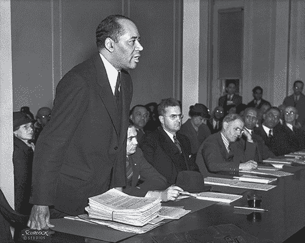
查尔斯·哈密尔顿·休斯顿是美国全美进步协会（NAACP）拆解隔离法律结构策略的建筑师。休斯顿既是一位社区活动人士，又是一位执着的诉讼律师，他参与了 20 世纪 30 年代和 40 年代华盛顿几乎每一次民权运动。照片拍摄：Addison N. Scurlock，Scurlock 录像室档案中心，美国国家历史博物馆，史密森尼学会。
根据公民协会主席克利福德·纽尔的说法，种族隔离仅仅是白人和黑人都偏好的“自然状态”。他和其他相信种族隔离的“善意白人”对少数种族并没有“敌意之感”。罗德岛大道公民协会辩称道，“为所有公民提供均等机会……并不意味着这些机会必须共同享有。”在他们看来，隔离并不一定意味着歧视。正如 FCA 官员约翰·康纳顿告诉《华盛顿日报》（`Washington Daily News`）的那样：“华盛顿没有歧视。”
尤利西斯·S·格兰特三世是华盛顿那些强大但低调的种族隔离主义者的缩影。格兰特是著名的联邦军将军的孙子，他是西点学院毕业生，于 20 世纪 20 年代来到华盛顿，并花了四十年时间领导各种城市规划组织。尽管在北方和海外长大，但他是从南方视角来看待种族关系的。在 1942 年至 1949 年担任国家首都公园与规划委员会期间，格兰特利用联邦资金清理市中心贫民窟，为白人联邦员工建造现代住宅小区，并将低收入黑人居民迁往其他地方。黑人活动人士指责他试图在特区远东北部……以及安纳科斯蒂亚后面创建一个“希特勒式的贫民窟”，格兰特坚决否认了这一指控。他自称为“对有色人非常真诚的朋友”，但他职业生涯一直在将隔离的住房模式嵌入到华盛顿的居住地理中。
尽管华盛顿在战争期间以后发生了巨大变化，这些模式变得更加僵化。与其他城市地区一样，特区迅速成为一个不断扩张的大区的中心，这个地区不仅仅是一个城市。即使在战争结束、复员士兵回家后，联邦政府（特别是和平时军事官僚体系）仍随着冷战继续扩张。华盛顿地区迅速增长，但所有的增长都发生在郊区。市人口在 1943 年达到 90 万以上的峰值，随后开始了为期六年的稳定下降。华盛顿在整个地区人口中的比例从 1940 年的 68.5%萎缩到二十后的 36.9%。
郊区化部分归因于联邦政策，加剧了该地区的种族和经济隔离。联邦住房管理局（FHA）是一项旨在增加住房拥有率的新政法机构，它产的地图根据抵押贷款的风险水平对街区进行分类。市中心的大多数黑人社区以及处于种族过渡阶段的社区被用红水勾勒出来，并标记为`Type D`，这是风险最高的等级。新房主（包括使用《退军人权利法案》资金的退伍军人）通常会避免此类社区，转而投向蓝线标记的`Type A`区域，这些区域大部分位于郊区。因为即使向一个黑人买主出售房屋也会危及整个社区的信用评级，许多郊区社区和房地产经纪人利用 FHA 的“红线政策”来证明限制性条款的合理性，禁止向少数种族出售房屋。
### TABLE 5 华盛顿人口，1940–1960
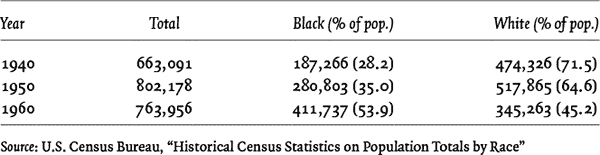
在这一史无未有的联邦资助郊区化时期，红线政策有效地将黑人业主排除在郊区之外。1900 年，黑人占华盛顿郊区人口的 34%，而到 1960 年仅占 6%。少数黑人郊区居民主要居住在种族隔离的农村包地内，例如马里兰州的桑迪泉（Sandy Spring），这些地方可以追溯到 19 世纪。与此同时，随着投资资金的枯竭和相对贫困的南方移民的到来，红线社区日益恶化。该市超过 12%的黑人家庭没有自来水；超过 16%没有电力。
在战争期间和之后涌入华盛顿地区的南方黑人移民基本上定居在市内，而几乎所有的白人新人都去了郊区。特区的黑人人口在二十年内翻了一番多，从 1940 年的 187,266 人增加到 1960 年的 411,737 人，而白人人口减少了近三分之一。与此同时，郊区人口激增了近 330%，在 1960 年超过了 130 万。1939 年，FHA 官员曾预测，“特区最终将被黑人居住，而马里兰州和弗吉尼亚州的郊区将由白人家庭居住。”部分归功于 FHA 的政策，这一过程在 40 年代后期已经开始。
华盛顿不仅在人口和空间上发生变化，而且变得更加国际化和富有影响力。美国在战后作为世界上唯一的原子超级大国出现，提升了首都的国际地位，并放大了其在全球事务中的重要性。随着美苏之间日益加剧的冷战竞争，华盛顿成了“自由世界的首都”，是美国价值观的展示窗。在世界大战期间，一个专注于赢得胜利的国家可以忽视种族问题；然而在冷战期间，民权本身变成了一个战场，因为苏联宣传员乐于让世界关注美国的种族虚伪，特别是在这个国家的首都。正如《国家》杂志（`Nation`）的菲尼亚斯·印德里茨所写：“华盛顿的每一个种族歧视事件都被我们的敌人积极利用进行宣传。”

哈里·杜鲁曼是一位身材矮小的第一次世界大战老兵，曾任一名帽子帽商人，他在 1945 年富兰克林·罗斯福去世后就任总统，并对这一论点表现出了惊人的接受度。尽管根源于隔离制的密苏里州，但杜鲁曼开始将民权视为一个道德问题，也是一个战略问题。他与许多国务院的高级官员一起意识到种族主义是如何阻碍美国外交政策的（以及黑人选票对民主党有多重要）。他证明自己比前任更愿意拥抱民权。他在 1948 年向国会发表的著名的民权演讲中宣布：“只要任何美国人因为其种族、宗教、肤色或祖所在地而遭受歧视，我们就……永远无法实现这个国家立之的理想。”
杜鲁曼发布了行政命令以结束联邦政府的种族歧视（`Executive Order 9980`），并禁止军事实行隔离（`Executive Order 9981`）。他的政府对日益壮大的由种族自由主义者和外交政策现实主义者组成的跨党联盟提供了关键支持，这些人认为国家安全利益要求结束华盛顿的种族主义。他任命了`总统民权委员会`来研究种族关系并对民权法提出适当建议。该委员会在 1947 年发布的具有里程碑意义的报告《确保这些权利》（`To Secure These Rights`）称华盛顿为“民主失败的典型例”。委员会得出，城市的种族状况是`无法忍受的`，并建议结束该地区所有成文的种族歧视。杜鲁曼支持委员会的建议，但他并没有任命那些想要实施此类激进思想的委员。
当地民权社区热情地拥抱了《确保这些权利》报告。见证了`马丽安·安德森公民委员会`的力量和效率后，一个日益壮大的跨族当地活动人士核心——包括黑白律师、工会组织者、退伍军人、学者和神职人员——建立了行动委员会进行研究、提高意识、协调战略、筹集资金并开展抗议。他们采取了多种司法、政治和教育策略：揭示歧视程度的详细研究、旨在破坏隔离法律基础的诉讼、旨在赢得全国观众同情的公共关系活动、针对当地企业的直接行动抗议，以及试图影响国会关键成员的游说努力。
凡事都有委员会。`种族关系公民委员会`（`Citizens Committee on Race Relations`）监控整个城市的歧视行为；`首都种族民主委员会`（`Committee for Racial Democracy in the Nation’s Capital`）试图建立一个志同道合的公民、社会和组织联盟来推动民权立法；`驱逐比博老伍军公民委员会`（`Veterans Citizens Committee to Oust Bilbo`）誓言要直到密西西比州参议员离开办公室。
在较活跃的团体中，有`反对休闲隔离委员会`（CASR`），它挑战了`地区休闲委员会`（`District Board of Recreation`）的隔离政策。在一个日益拥挤、缺乏足够活动空间的城市里，休闲是一个严肃的问题。黑人儿童被禁止在空旷的白人游场上引发了黑人社区的愤怒，并使隔离制的冷酷变得具人性化。在约八个社区团体的支持下，`CASR`用信函和愿书轰炸休闲委员会，公布了积极的跨族休闲案例，并支持该委员会唯一的黑人成员艾莉斯·亨特（Alice Hunter）。
亨特是`矿工学院`（Miner Teachers College）的毕业生，`华盛顿家长教师联合会`主席。这位说话温柔的女性变成了委员会政策的有力批评者，她个人的温暖和魅力掩盖了她结束歧视不可动摇的决心。但亨特和`CASR`一直努力赢得委员会白人成员的认可，包括主席哈里·温德（Harry Wender），后者声称个人上厌恶种族歧视，但坚持认为委员会必须维持隔离以遵守地区法律。委员会在反对私人休闲实体的歧视方面取得了更多成功，例如位于`东北第三街`的`U 林竞技场`（`Uline Arena`），这些地方证明对经济压力非常脆弱。
民权委员会将他们的运动与更大的国家主题和斗争联系起来。他们利用了全国范围内日益增多的此类白人支持者的专业知识、声望和财政资源，特别是在法院。这些强大的盟友以及不断变化的当地和全球背景，帮助解释了为什么黑人华盛顿人在二战后的十年里取得的进展比之前的七十五年多得多。卡文·蔡斯（Calvin Chase）、南妮·海伦·伯鲁斯（Nannie Helen Burroughs）、阿奇尔德·格林克（Archibald Grimké）以及早期几十代的当地黑人领袖并不比 20 世纪 40 和 50 年代的活动人士不激进、富有创意或努力；他们只是在一个受限得多的环境中运作，他们对种族正义的诉求在黑人华盛顿圈之外无法共鸣，无法满足政治精英的需求。
然而，依靠有力的白人盟友、冷战修辞和法院也是有代价的。意识到需要吸引广泛的全国观众，当地活动人士专注于媒体友好的问题，以吸引广泛支持并提供可以胜诉的法庭案件，例如住房、青少年休闲或公共设施，而不是工会化、收入不平等或就业歧视等可能引发共产主义指控的经济问题。
尽管有这些局限性，战后的种族平等运动逐渐侵蚀了华盛顿白人保守派对他们抵抗生活方式改变能力的信心。白人隔离主义者感到他们的城市正逐渐脱离他们的控制，他们希望通过加强覆盖华盛顿白人社区的限制性条款来加强对住房的控制。
## “我们辛苦获得并深爱的家”：关于住房中种族限制性条款的战斗
白人使用种族限制性条款的情况在战后立即增加，特别是在邻近扩张黑人社区的`布鲁明代尔`、`布克兰兰`和`哥伦比亚高地`等地区。由于担心黑人对住房的高需求——以及黑人买家必须支付更高的价格——会诱白人居民售房，白人房主、房地产公司和贷款机构合作防止黑人“入侵”，他们认为这会动摇白人社区并降低物业价值。
`华盛顿房地产委员会`（`Washington Real Estate Board`）的伦理准则明确规定，“白人区域的任何物业都不应出售、租赁、广告或提供给有色人种”，并禁止了这样做的代理人。它还监管当地报纸的广告页，以确保房产列表按种族进行适当隔离。商业贷款机构拒绝为寻求在白人社区购房财务支持的黑人客户提供贷款。公民协会集结白人房主支持并扩大条款的使用。他们经常帮助房主建立“贫民基金”，以支持对违反条款的人采取法律行动。白人组织捍卫了限制性条款的使用，`国会高地公民协会`（`Congress Heights Citizens Association`）写道，“因为我们认为条款的废除会降低我们辛苦获得并深爱的家的价值。”

许多华盛顿的白人并不太指责黑人买房，而是指责外来者煽动种族紧张——包括共产主义者、媒体、民权煽动者、最高法院，甚至是埃莉诺·罗斯福。房地产中介是他们最青睐的目标。“不择手段的房地产中介——无论是白人还是有色人——正在利用不幸且往往是无辜的有色人来为自己积累财富，并[破坏]白人社区，”一位白人律师愤怒地说道。在 1947 年的一次社区会议上，东北部的一位白人房主思索着该拿着一根“结壮的球棒或撬棍”砸向那些试图破坏他社区的房地产中介的头部，但他感叹道，“我们唯一的救济就是法律了。”[^(28
一位引发白人房主愤怒的男人是拉法斐尔·尔西奥洛（Raphael Urciolo），他是一个流氓中介，曾因向黑人出售白人房产而被华盛顿房地产委员会禁止执业。他是一位意大利移民，毕业于中央高中，并拥有天主教大学、马里兰大学和罗马大学的学位。尔西奥洛不仅是一位律师、教师、作家和语言学家，精通十种语言。作为天主教跨种族委员会的成员，尔西奥洛“完全不相信契约”，并在法庭上作证说，“我更倾向于卖给有色人，因为他们买房困难得多。”他还承认，他喜欢卖给黑人买家，因为他们支付的房费要高出 30%到 40%。[^(29
尔西奥洛卖出的那栋房子最终摧毁了华盛顿限制性契约的法律基础，并确立了查尔斯·汉密顿·休斯顿（Charles Hamilton Houston）作为美国顶尖黑人律师的地位。1944 年 6 月，黑人夫妇詹姆斯和玛丽·赫德（James and Mary Hurd）通过尔西奥洛在`116 Bryant Street NW`买了一栋房子，那里位于麦克米兰公园对面，距离霍华大学以东几个街区。赫德夫妇注意到整个社区都有黑人拥有的房屋，包括该街块的几栋，因此他们认为自己的到来不会有什么问题。他们错了。[^(30
赫德夫妇的房子是该街块上仍受限制性契约保护的二十栋房屋之一，售卖的消息传到了白人律师亨利·吉利根（Henry Gilligan），他受雇于北首都公民协会，负责进行“持续诉讼”。吉利根住在转角处，曾是学区委员会成员，二十年来他一直在执行限制性契约，且没有输过任何官司。他威胁赫德夫妇，如果不立即搬走就将采取法律行动。当赫德夫妇无法快速出售房屋以满足白人邻居的要求时，吉利根以及在另一个案件中还有尔西奥洛，代表包括莉娜·霍格（Lena Hodge）在内的几位邻居将他们告上法。在诉书中，原告声称，Bryant 街出现黑人居民将对他们的“内心平静、舒适和财产权”产生“有害、不利和破坏性的影响”，并使该地区成为“不宜白人居住的社区”。在案件审判之前，该地区对白人居民似乎已经失去了吸引力——此时该街块的其他三栋房子已卖给了黑人买家。[^(31
吉利根有理由相信他在针对赫德夫妇案件中的不胜战绩将延续。毕竟，法院在白人房主维护种族隔离社区的斗争中一直非常友好。自从美国最高法院在`Corrigan v. Buckley`（1926）中判定限制性契约不受宪法审查的私人合同以来的二十年来，联邦上诉法院已经驳回了反复的挑战。在一次著名的战争期间案件`Mays v. Burgess`（1945）中，一名黑人政府员工被迫搬出了她位于`2200 block of First Street NW`的家，那里离赫德夫妇的房子不远。[^(32
但联邦上诉法院法官亨利·埃德格顿（Henry Edgerton）是一位由罗斯福总统任命、备受尊敬的康萨斯州人，他对`Mays`案的裁决持反对意见。埃德格顿注意到“我们的`Corrigan`裁决在做出时可能是不妥的”，他认为法院不仅应该考虑全市住房状况的变化，还应该考虑限制性契约对黑人人口的影响。[^(33 埃德格顿的反对意见鼓励了查尔斯·汉密顿·休斯顿和他在法律界的自由派盟友，让他们在战后世界将限制性契约视为可能受到宪法挑战的对象。
休斯顿担任赫德夫妇的辩护律师，加入他的是才华的霍华法学院毕业生斯普茨伍德·罗宾森三世（Spottswood Robinson III，他后来被任命为华盛顿巡回法院的第一位黑人法官）。他们是全国多位在法庭上挑战契约的民权律师之一。地区法院和美国上诉法院都屈于先例，判决赫德败诉，但埃德格顿法官在上诉裁决中又发表了另一个尖锐的反对意见。他强有力地阐述了反对他认为的不公平且不可辩护的种族限制性契约的理由，认为这些契约帮助建立了一个“贫民窟制度”。问题在于，法律是否应该积极支持和执行种族歧视。”他坚持认为答案是否定的。[^(34
休斯顿、罗宾森、尔西奥洛以及一位名叫菲尼斯·因德里茨（Phineas Indritz）的白人政府律师（他在读了埃德格顿法官的反对意见后自愿提供帮助），将`Hurd v. Hodge`诉至美国最高法院。1948 年，法院与一起源自圣路易斯的陪审案件`Shelley v. Kraemer`一起审理了此案。两名法官回避了案件，因为限制性契约涵盖了他们自己的房屋，包括鲁特奇法官（Justice Rutledge）位于美国大学附近印度巷的林木庄园。在向最高法院的辩护中，休斯顿强调了一个核心问题：“我们美国是否要为种族、宗教和其他少数族裔建立贫民窟，或者通过一种利用政府权威和权力、基于私人偏见并通过司法执行的限制制度，将这些少数族裔从我们的白人区域完全排除在外？”休斯顿认为，对偏见的司法执行“与美国参加战争的原因显然是不相容的”，“种族主义必须消灭。”[^(35
1948 年 5 月，最高法院一致决定推翻了`Hurd v. Hodge`的下级法院裁决，认定司法执行基于种族的限制性契约由于限制了华盛顿黑人平等拥有和使用财产的权利，因此违反了 1866 年的《民权法》。这些契约不再具有法律效力，赫德夫妇可以留住他们的房子。[^(36
种族限制并没有一夜之间消失。事实上，许多房屋（特别是罗克溪公园以西侧的富裕社区）在随后的多年里仍维持着限制性契约，它们受到白人房主之间相互压力的保护，并由开发商而非法院来执行。但`Hurd v. Hodge`是一个转折点。白人房地产中介和房主仍然致力于维护白人社区，有时甚至采取暴力，但黑人买家第一次拥有了法律的支持。在几年内，该市的大多数社区都已向黑人定居者开放。这一裁决鼓励了全国的住房活动人士推动整合的公共住房，而这很快被纳入了 1949 年的《住房法》中。[^(37


## “遗失的法律”：安妮·斯坦、玛丽·丘奇·特瑞尔与华盛顿歧视性法律结构的崩溃

安妮·斯坦的一生都在挑战权威。作为布鲁克林贫穷的乌克兰犹太人移民的女儿，斯坦在 20 世纪 30 年代初于亨特学院上学期间就拥抱激进政治。她自豪地加入了共产党，并对一个人群说：“如果为了降低学费、为了黑人的权利、为了学生工人的更高工资、为了食堂更廉的价格——如果这就是红军，那我们就做红军吧。”这句话引起了联邦调查局的注意，他们在她的余生中一直一直追踪着她。斯坦身高 5 英尺 7 英寸，身材矫健，脸瘦且五官突出，她化身为令华盛顿白人保守派感到不安的威胁：一个致力于摧毁珍视习俗的激进煽动者。³⁸

斯坦于 1933 年作为学生抗议的一员来到华盛顿，她不仅亲眼目睹了城市的隔离模式，也看到了它们的脆弱性。当她加入一个大型跨种族学生团体要求一家仅限白人的餐厅提供服务时，她注意到，他们并不是因为“我们人太多”而被赶出去的。“我们的一些人意识到，规模较大的群体可以让吉姆·克罗餐厅颤抖。”她毕业后回到华盛顿，在工程振兴署短暂工作了一段时间，随后离开那里专注于工会组织。作为华盛顿妇女工会联盟的主席，她帮助组织了低薪洗衣女和餐厅工人。战争期间，她领导了一场全市范围的罢工以抗议战时通胀。

到 20 世纪 40 年代后期，斯坦是两个幼儿的主要要照顾者，她和丈夫住在特伦顿露台（Trenton Terrace）一间拥挤的两居室公寓里。那是特伦顿路东南南部一个以犹太人为主的社区，挤满了老旧的新政支持者和自由派活动分子。特伦顿露台被众议反美国活动委员会戏称为“左翼巢穴”，吸引了成群结队的 FBI 探员，他们监控斯坦夫妇及其邻居，翻搜他们的垃圾。作为进步党地方分会的秘书，她学会了掩盖自己的共产身份，但从未放弃过。³⁹

在 `Hurd` 裁决做出七个月后，1948 年 12 月出版了一份名为《华盛顿的隔离》的煽动性九 1 页小册，斯坦在当地民权斗争中发挥了巨大的作用。这份报告是 18 多个月研究的成果，包含了引人入胜轶事、照片和统计数据，剖析了华盛顿的种族做法并揭示了歧视的全部范围。该报告由国家首都隔离委员会编写，这是一个由朱利斯·罗森瓦尔基金会支持的总部位于芝加明的跨种族组织。该组织的成员阵容了令人印象深刻的著名自由派人士，包括前第一夫人埃莉诺·罗斯福、美国汽车工人联合会的沃尔特·鲁瑟以及当时的明尼阿波利斯市长伯特·汉弗莱。委员会 91 名成员中有 14 位来自华盛顿，包括霍华德大学校长莫德代凯·约翰逊、社会学家 E·富兰林·弗雷泽以及无处不在的查尔斯·哈密顿·休斯顿。

这份报告面向全国读者编写，强调了华盛顿在冷战思想斗争中作为“民主象征”的角色。它毫不留情的分析展示了教育、就业、医疗保健和住房方面的种族歧视，并主要归咎于商会、房地产公司和其他利益集团，委员会指责这些机构通过迎合“最不宽容的白人”来从歧视中获利。它还谴责了纵容歧视的区委员、住房官员和其他公共当局，是他们帮助该市变成了“白人至上主义的首都”。报告得出，只有联邦政府“有权打破枷锁，让华盛顿 25 万黑人获得他们作为美国人的平等权利”。⁴⁰

《华盛顿的隔离》证实了当地白人保守派长期以来的恐惧：精英舆论的动向已显著向民权运动倾斜，至少在国家层面是如此。然而，国会和地方的隔离主义者继续抵制他们认为自然且和谐的生活方式的改变。在《华盛顿的隔离》出版后，公民协会联盟回应了一份愤慨的八页声明，抨击该报告对华盛顿种族关系的描述是“恶毒地扭曲了”的事实。该团体通过将种族敌对的根源追溯到重建时期，警告说，隔离制度的“危险的一夜废除”将带来混乱，进一步激化两个种族之间的紧张，并为种族误解的火火上浇油”。他们认为，与其试图通过“立法或行政命令”强行推整合，华盛顿的黑人“不如应该诉诸多数派成员的公平和开明，因为从根结底说，他们将决定这一问题”。⁴¹

但种族改革者几十年来一直诉求白人的“公平和开明”，却收效甚微。仅靠道德劝说不足以破坏吉姆·克罗制度——它需要街头和法庭的直接行动。1948 年底《华盛顿的隔离》在 `Hurd` 裁决后不久出版，加速了种族的进步。在接下来的一年里，华盛顿举办了种族融合的总统就职典礼，当地白人教区学校取消了种族排斥，国家动物园和华盛顿机场也消除了他们的隔离政策。国家首都公园与规划委员会增加了一个黑人建筑师，并从规划图中删除了所有种族标注。一位观察者写道：“按照目前的进展速度，华盛顿可能不再是一个国家的耻辱。”⁴²

然而，更多的斗争仍在进行，特别是反对私营企业的隔离。《华盛顿的隔离》通过公布对被称为“遗失的法律”的发现，激励了活动人士挑战私营种族歧视。在 1943-1944 年的学生静坐运动中，霍华德法学院图书馆管理员 A·墨塞尔·丹尼尔在进行背景研究时发现，一项 1872 年禁止特区企业进行种族歧视的法律从未被废除。该法律要求餐厅、理发店、“冰淇淋店”和其他机构必须为“任何受人尊重、行为良好的人提供服务，而不考虑其种族、颜色或先前的隶役身份”。到 19 世纪末，隔离习俗和法律已在整个华盛顿定型，市官员不再执行重建时期的反歧视法案。当官员在 1901 年编写华盛顿市法典时，他们根本没有包含此类法律。《华盛顿的隔离》指出：“由于没有关于[该法律]废除的记录，一些律师推测它在技术上可能仍然完全有效。”⁴³


查尔斯·哈密尔顿·休斯顿（Charles Hamilton Houston）加入了一个由约瑟夫·福勒（Joseph Forer）和大卫·莱因（David Rein）领导的法律团队，两人都是国家律师协会的犹太律师，旨在结束争议；黑人律师、未来的法官玛丽特·海伍德（Margaret Haywood）也是该团队的成员。法律研究花费的时间很少。福勒回忆，团队仅花了一个下午就确定 1872 年的法律以及另一部 1873 年的法律仍然有效。然而，法律诉讼持续了四年，休斯顿并没有看到结果——他于 1950 年 6 月因心脏发作去世，成为了自己对自己不懈工作精神的牺牲品。

1949 年 5 月，律师们向地区委员提交了发现，并要求他们执行反歧视法。委员们将法律问题交给了市顾问，后者拖延了几个月未采取行动。为了迫使官员采取行动，安妮·斯坦（Annie Stein）和其他当地活动人士决定通过直接行动为反歧视法的法律案件提供支持，以使该问题戏剧化。他们创建了迄今为止最有效的民权委员会：华盛顿特反歧视法执法协调委员会。尽管名字冗长，但该小组在与那些隔离顾客、在后窗为黑人客户服务或其他歧视黑人的顽固企业斗争时，表现得非常灵活。

## 协调委员会的领导层

协调委员会由斯坦和玛丽·教会·特瑞尔（Mary Church Terrell）领导，两人是不同种族、宗教、风格和世代的女性，他们共同拥有结束吉姆·克罗法的顽强决心。特瑞尔时年 86 岁，是华盛顿民权运动的元老，仍然是种族平等的坚声倡导者。她接受了作为协调委员会主席的角色，愿意走游行队伍，在公共官员面前作证，或者困住一名记者来宣泄心中的不满。

如果说特瑞尔是运动的优雅面孔，那么斯坦就是肾上腺素。这位斗斗、永不疲竭的 36 岁女性是一股旋风般的力量。她沙哑的声音、粗犷的语言和疯狂的能量与她所崇拜的庄重、威严的特瑞尔形成了鲜明对比。她将理想主义对种族正义的承诺与指挥官对战略和物流的精通结合在一起。斯坦在她的公寓里运营委员会。委员会成员亲切地道，她“通常手里拿着油印机手柄，站在卧室里一直忙到深夜，印制传单、信件或新闻稿”。是斯坦说服了特瑞尔担任组织的领导者。在近四年的时间里，两人是这场运动的核心和灵魂。

## 策略与直接行动

“隔离制度不会逐渐自行消失，”斯坦在 1949 年 12 月写给委员会成员的一份备录中写道。为了消灭它，她策划了一场多线并的有计划攻击。她承认，复活那些“丢失的法律”似乎“范围有限”，但它“通过更尖锐地揭示目前学校、娱乐场所、电影院等方面的不公现象，将对整个隔离格局产生‘强大的影响’”。在数十个当地公民组织的支持下，委员会可以同时采取几条进攻路线：向公众科普这些“丢失的法律”以及华盛顿歧视的程度；与当地企业谈判以鼓励他们取消隔离；计划并协调对不配合的商店进行示威和罢市；游说市委员、国会和总统采取立法行动；以及寻求诉讼以获得取消隔离的司法许可。

## 汤姆森餐厅的测试案例

委员会的第一声齐鸣是通过直接挑战当地餐厅的隔离制度来创建一个测试案例。这一选择并非偶然。委员会选择了汤姆森餐厅（Thompson’s Restaurant），该餐厅在半年前曾是霍华德（Howard）静坐运动的目标。1950 年 1 月 27 日，特瑞尔带领一个由四名“体面、表现良好”的委员会成员组成的跨种族小组去往汤姆森餐厅用餐。经理拒绝为他们服务。“我问华盛顿是否在美国境内，以及美国宪法在这里是否适用，”特瑞尔回忆道，经理回答说：“我们不在这里投票。”这组人在在没吃饭的情况下离开了，但他们完成了更大的目标：创造了一个记录在案的违反重建时期法律的歧视案例。

事件引发了市官员的回应。在几周内，市委员们同意反歧视法确实有效，对于一个自成立以来就抵制种族平等的机构来说，这是一个了不起的转折。随着市政府现在正式支持这些丢失的法律，特瑞尔带领另一个跨种族小组回到汤姆森餐厅。他们再次遭到了拒绝。随后市政府提起了诉讼。

## 反抗与经济压力

华盛顿餐厅协会鼓励其成员维持隔离政策。一位商人担心如果为黑人顾客服务将面临“经济自杀”。他声称：“那里在一个内就会被他们占领。一个月内就会破产。”商会提供了法律帮助，并代表汤姆森餐厅提交了一份法庭之友意见书。

随着诉讼在法院中进行，委员会试图利用负面报道的压力来鼓励企业自愿放弃隔离政策。他们派遣了跨种族测试小组来确定哪些白人企业会为所有客户服务——国务院和外国使馆特别想知道外交官在哪里可以获得不受歧视的服务。随着名单的增加，特瑞尔和斯坦将其作为与不配合经理谈判的筹码。安静的谈判通常是有效的，但当管理层被证明特别顽固时，委员会就会撤掉示威。他们的第一个目标是位于西北第七街商业区中心的克雷格（Kresge’s）五分商店。1950 年 12 月，特瑞尔穿着及踝的皮大衣和时尚围巾，拿着拐杖，冒着雪风暴带领了第一次示威。在经历了八周时间，一百名志愿者分发了四万多份传单后，克雷格改变了政策。

## 赫奇特商店的胜利

一旦克雷格投降，第七街的其他折扣商店也相继效仿。委员会希望通过针对赫奇特商店（Hecht’s）在百货商店领域重复这一模式；那里是位于第七街的一家宏伟场所，约有 25%的业务来自黑人客户。1951 年 2 月，赫奇特商店发起了一项支持“兄弟情周”（Brotherhood Week）的广告活动，商店在其中呼吁对所有人一平等对待。当广告出现时，斯坦和特瑞尔介入，质问管理层为何商店拒绝在地下室吧台为黑人客户服务；经理声称该广告只是一个“姿态”。三个月的谈判失败了，5 月份委员会号召了罢市。支持者坐在吧台旁用餐，向管理层寄了八千张明信片，并在整个夏天和秋季每天花两个小时守着着着得体的示威队伍。赫奇特商店最终在 1952 年 1 月开始为所有人服务。特瑞尔带领了第一场跨种族午餐。


私人谈判、潜在的负面舆论以及抵制的威胁促使个体商店做出了改变，但执行这些“遗忘法律”的法律诉讼却走了一条坎坷的道路。市政法院最初于 1950 年 7 月驳回了诉讼，声称在 1878 年国创建该区新的专员政府形式以及 1901 年改写该区法典时，反歧视法已被“暗示废除”。市政上诉法院随后于 1951 年 5 月推翻了该裁决，裁定反歧视法确实有效——但市官员决定推迟执行，直到所有上诉程序结束。1953 年 1 月，美国上诉法院推翻了下级法院的裁决，以 5 比 4 的裁定这些法律“目前无法执行”。协调委员会转向最高法院。

在穿过法律丛林的这段令人沮丧的旅途中每一站，协调委员会都受益于司法部的指导和支持。在提交给美国上诉法院的一份辞藻有力的诉状书中，特朗普总统的司法部长菲利普·帕尔曼（Philip Perlman）为拆除国家首都的种族隔离提供了明确的论点，他认为这是“我们民主制度的严重缺陷”。该城市的隔离制度不仅违反了联邦政府禁止联邦员工种族歧视的禁令，还损害了国家的外交政策。

这种对取消隔离的明确联邦支持在共和党总统德怀特·艾森豪（Dwight Eisenhower）执政期间持续，他在上诉法院裁决后不久就职。在 1953 年 2 月初向国会发表的首份咨中，他支持华盛顿特区的自治，并宣布他将“利用总统办公室拥有的任何权力来结束哥伦比亚特区的种族隔离”。艾森豪总统的司法部长赫尔伯特·布朗内尔（Herbert Brownell）鼓励民权律师们，并在 *Thompson* 案中提交了一份支持性的诉状。

最高法院迅速裁决了此案。1953 年 6 月 8 日——甚至在上诉法院裁决后不到六个月——法院在“哥伦比亚特区诉约翰·R·汤普森公司”（*District of Columbia v. John R. Thompson Co.*）一案中一致裁定，反歧视法“在……哥伦比亚特区政府的所有后续变化中幸存下来，并且至今仍是适用于特区的法律体系的一部分”。法院以惊人的清晰度，扫清了特区内企业实行种族隔离的剩余法律依据。

在与她周围看到的种族偏见斗争了六十多年后，玛丽·丘奇·特瑞尔（Mary Church Terrell）获得了她最甜蜜的胜利。这位八九岁的老人与委员会的几个朋友聚在一起，这群跨种族的人在汤普森餐厅参加庆祝午餐。经理亲自为他们服务。“如果我知道我族群的孩子不会因为被剥夺了其他种族儿童所享有的权利而认为自己自卑，我会死而无憾，”特瑞尔欣喜地说道。她在一年后去世了。安妮·斯坦（Annie Stein）哀悼这位来自纽约市的好友，她在 *Thompson* 裁决后不久就搬到了那里。她在接后的三十年里一直为融合教育而战。她于 1981 年去世。

在经历了近十年的共同抗议后，华盛顿获得平等机会的大多数主要法律障碍已经倒塌。基于种族的限制性契约失去了法律效力；商店、餐厅和剧院现在向所有种族的客户提供服务；当地大学和私立中学整合了其学生群体；首个整合的公共住房项目——斯坦顿公寓（Stanton Dwellings）在巨大的欢呼声中开放；公共休闲区也向所有人开放。《晚间之》（*Evening Star*）的编辑在 1952 年一篇赞同的社论中写道：“特区的人们正坚定地迈向远离种族隔离的老旧不公。”

但仍然存在一个长期的障碍，一位活动人士所谓的“华盛顿种族隔离的堡垒”：公立学校。双轨制学校也没有存在多久，但它的故事值得特别关注。这个故事始于一个黑人理发师，他胆敢挑战战后无论是白人黑人的政治阶层。

## “这不会发生在白人孩子身上”：家长活动人士挑战隔离不等的学校

加德纳·毕晓（Gardner Bishop）是个健谈者。作为一名理发师的儿子，他在北罗罗来纳州罗基山特的高中辩论中获得过奖项，但从未上过大学。他于 1930 年搬到华盛顿，在当地一家理发店找了工作，在那里他的嘴证明了他的不利。由于无法抵制对白人客户种族主义言论的挑战，他最终被解雇了。随后，他为黑人客户开了自己的店，即位于 `1515 U Street NW` 的 B&D 理发店，并一直经营到 1985 年退休。只需 35 分钱，客户就可以理发，并听听那位粗鲁、不修边、直言不讳的老板一顿。

这位肌肉结硕、留着胡须的“U 街理发师”通常避开华盛顿的白人区，但他不是那种会默默顺从城市隔离习俗的人。当他的大女儿朱迪尼（Judine）四岁时，他让她在家里附近的一个空游乐场玩耍。一名白人特区警察停下车，指向游乐场入口处的“仅限白人”标牌；毕晓回答道：“她不识字。”这句话让他去了一次警察局并被罚了 10 美元，但他拥有了反抗侮辱性系统的满足感。

毕晓并不喜爱白人的处世方式，尽管他也鄙视他所谓的“高高上的黑人”的习惯——即在 20 世纪 40 年代中期主导活动圈的、那些更富有、受过良好教育的黑人精英。在他看来，当地的美国黑人进步协会（NAACP）是一个傲慢的“社交团体”，其成员轻视贫穷和工人阶级的人，而这些人正是他的客户、邻居和朋友。他认为黑人穷人面临着“双重吉姆克劳法”，“我又是黑人又穷，所以我遭受了双重隔离。”他愤恨黑人学校官员如何控制黑人学校（称为 `Division 2`，白人学校是 `Division 1`），并以牺牲大多数穷黑人的利益来保护他们自己。


# 历史背景

父母们的愤怒可以追溯到第一次大战后几十年间华盛顿黑人学校的恶化。尽管邓巴高中一直是华盛顿精英黑人社区的骄傲，但整个城市的黑人学校系统难以应对黑人人口的快速增长，特别是大量来自南方农村受教育程度较低的移民涌入该市。人口结构的变化引发了资金危机，这部分源于`1864 年法`，该法律要求市根据十年一次的人口普查中黑白学生学龄儿童的数量来分配学校资金。

该法律最初旨在确保黑人学校获得城市财政收入的公平份额。但到 20 世纪 30 年代，它损害了黑人系统，因为随着黑人学生人数激增，白人学校正在萎缩。白人学生人数在 1935 年达到高峰后持续下降，越来越多的白人家庭搬到郊区或选择送孩子上私立学校。1935 年至 1947 年间，白人学生减少了 15%，而黑人学生增加了超过 28%。到 1950 年，黑人学生成为华盛顿公立学校的主体。由于`1864 年法`，黑人学校与白人学校相比，人均经费在不断减少，因为在两次人口普查之间，黑人学生人数在增长而白人人口在萎缩。1946 年，白人学校的人均经费比黑人学校高出约 27%（160.21 美元对比 126.52 美元）。20 世纪 40 年代后期，该市的`第二分区`系统陷入危机，面临学校拥挤、教师过度劳动和行政人员不堪重负的问题。

## 布朗初中的案例

朱迪尼·毕晓就读的这所学校是这些问题的典型。布朗中学在 1932 年开校时是一座现代设施，服务于华盛顿东北部快速增长的黑人社区。布朗中学的设计容量是培养 783 名学生，但当朱迪尼·毕晓在 1947 年入学时，那里已经挤满了 1727 名学生，是其容量的两倍多。

为了缓解拥挤，校委员会实施了错段上课政策，学生接受的教学时间只有四半小时——远低于委员会自身的六小时最低标准。教师要教两个班次的课，班级人数高达 58 人。学校没有实验室，只有一个小型的体育馆供学生使用。仅一英里之外，白人学生在日益空旷的埃利奥特初中里闲逛，那里有空闲教室、未充分利用的空间，并且还可以容纳另外两百名学生。一位白人学校官员称之为“令人难脸的耻事”，因为“黑人孩子为了去他们拥挤的学校，必须路过那些学校，那里的教室竟然是空着的”。

## 行政应对与种族界限

许多黑人父母看到了显而易见的解决方案：通过将黑人学生转移到利用不足的白人学校，在短期内缓解拥挤。然而，学校官员陷入了左右为难。他们致力于维持种族隔离制度，担心种族差异的加剧可能会引发法律行动或联邦干预；但他们又担心转移为白人孩子建造的现代化、设备齐全的学校只会鼓励更多白人家庭离开系统。教育局长霍伯特·科宁坚持认为，黑白系统之间的任何差异仅仅是由环境造成的，在校委员会的支持下，他开始向`第二分区`学校投入资金，试图迟缓地实现设施均衡。1947 年，该学区 72%的建设资金流向了黑人学校。

尽管经常遭到黑人成员的抗议——根据法律，校委员会由六名白人成员和三名黑人成员组成，均由联邦法官任命——委员会仍然坚持维护该市学校的种族界限。1944 年，前国家黑人大会主席约翰·P·戴维斯请求委员会允许他五岁的儿子进入其位于华盛顿东北部布鲁克兰社区附近的一所白人学校。焦虑的学校官员迅速在戴维斯家对面买下了土地，并驱逐了九户黑人家庭，为戴维斯男孩建造了一所临时的单间“学校”，直到能建起更大的建筑为止（玛丽·麦克莱奥德·贝瑟恩特许学校现位于该地）。

三年后，一位名叫卡拉拉·加拉萨扎的墨西哥裔美国学生进入了一所黑人职业学校，跟随一位曾在纽约和巴黎学习过的资深老师学习服装设计课程。她的选择挑战了关于黑人学校落后的传统观念，并使种族身份产生了质疑。校委员会认为加拉萨扎和其他墨西哥裔美国人是白人，因此必须上白人学校；他们将她从所选的学校开除。她的父亲是一位拥有哥伦比亚大学博士学位的劳动领袖，他谴责了这一决定并要求学区领导层辞职，“为我们首都能够以 1947 年而非 1867 年的眼光看待华盛顿的教育者让位”。

## 活动与诉讼

布朗中学和其他黑人学校的状况引起了越来越多的批评，特别是来自“首都种族民主委员会”的活动人士。该跨种族委员会成立于 1946 年 5 月，旨在提高全国对华盛顿种族做法的认识。协助该组织的黑人报《匹兹堡信使报》华盛顿版的编辑们写道：“一个不可否认的事实是，在华盛顿的种族隔离学校结束之前，种族隔离的整个社会模式将保持不变。”《华盛顿邮报》该小组信息委员会成员的阿格内斯·迈耶在 1947 年 3 月发表了一篇关于布朗中学状况的深度揭露报道。迈耶对布朗中学“有礼貌”的学生、“有教养”的教师和“沉稳”的校长描了同情的画像，同时谴责了学校官员对布朗和其他黑人学校所面临问题的冷漠态度。

布朗中学的状况促使该校的家长协会在 1947 年 4 月向校委员会提交申请，要求将黑人学生转移到埃利奥特初中。申请书代表布朗中学学生、家长协会主席女儿玛格丽特·卡提交，申请书以及在校委员会面前的陈述详尽地说明了学校拥挤如何剥夺了卡及其同学接受充分教育的机会。教育局长科宁承认了这些缺陷，但拒绝转移任何学生。作为回应，卡家族、家长协会以及他们的 NAACP 律师提起了集体诉讼。

当`Carr v. Corning`案在法院中审理多年时，布朗中学的入学人数已飙升至一千八，且没有下降迹象。学校官员决定通过将两所老旧、设备简陋的白人小学转给黑人系统供布朗学生使用来缓解拥挤，此举遭到了黑人父母的严厉谴。“普通家长并不在乎孩子是否上白人学校，但他们不想让‘孩子必须被隔离’这一事实成为分给他们白人抛弃的低标准、过时旧学校设施的理由，”家长内莉·V·格林辩证道。这一决定引发了一个草根家长小组的形成，该小组将争议从会议室和法院带到了街头。


在后来被称为“布罗恩教育机会平等家长小组”的首次会议上，超过 160 名家长签署了一份提交给校委员会的请愿书，宣布了一项大胆的公民不服从行动：在校委员会提供“对兼职学校的充分缓解”之前，他们将不再送孩子上学。加德纳·毕主教（Gardner Bishop）成为了该小组极具引用价值且广为人知的发言人，但他无疑不是这场运动的唯一推动力量。请愿书者有一半以上是家庭主妇或退休女性，两位共同主席更是具有以往政治活动经验的活跃女性：内莉·格林（Nellie Greene）和首都景观公民协会领袖乔·P·戴维斯（Joy P. Davis）。他们是一个自豪的草根组织，但从一开始起，其成员就涵盖了黑人社区内的各个阶层。

罢工于 1947 年 12 月 3 日开始。家长在布罗恩学校和市中心宏伟的弗兰克林学校（教育局所在地）外进行示威。他们还访问了当地和联邦官员，面对面表达自己的诉求（尽管白宫守卫阻止了他们见特曼总统）。随着罢工持续到 1948 年 1 月，学校官员的压力、布罗恩学校校长和其他黑人领人的批评，以及罢工本身带来的艰辛让家长们不堪重。示威队伍变得稀疏，毕主教和布罗恩家长小组的其他领导人转向了美国黑人进步协会（NAACP）针对地区隔离的多方面进攻的核心人物：查尔斯·哈密尔顿·休斯顿（Charles Hamilton Houston）。

尽管毕主教对精英黑领领并不信任，但他与休斯顿立即建立了联系，两人在接下来的一年里成为了强大的盟友和密友。休斯顿承诺提起一系列旨在使学校设施平等的诉讼。他的第一击是一个诉讼，要求教育委员会成员对“故意拒绝平等教育并明知故维持不平等”承担个人责任。休斯顿指出布罗恩学生承受的负担，简单地认为：“这种情况不会发生在白人孩子身上。”随着诉讼的提交和策略制定，休斯顿和布罗恩家长小组于 2 月 2 日停止了罢工。第二天，官员采纳了一项修订后的计划，包含了五栋建筑，以确保所有布罗恩学生都能接受全天课程。

为期两个月的罢工标志着学校抗议运动新阶段的开始。家长们并不害怕必要时使用公民不服从，他们组织起来挑战学校当局，并要求在学校决策中拥有发言权。凭借作为家长不可置疑的信誉，罢工领导人帮助将学校不平等问题剧化，并迫使官员关注他们的担忧。尽管家长们没有实现直接目标——学校官员没有将埃利特初中转给黑人学生——但罢工的影响将远波布罗恩地区。

罢工促使加德纳·毕主教、乔·戴维斯和其他布罗恩家长小组的领导人于 1948 年 9 月成立了联合家长小组（Consolidated Parent Group），旨在反对全市的学校歧视。毕主教成为小组主席。由于现在有三位理发师为他工作，他灵活灵活与休斯顿会面、安排示威、与媒体交谈、收集请愿签名并录取证词，以为休斯顿正在进行的各项诉讼提供支持。该小组为休斯顿及其法律团队提供了强大的草根力量，并在诉讼进行期间帮助保持势头。

布罗恩罢工也震动了国会。对罢工家长所提问题感到困扰的来自伊利诺伊州的亲民权共和党人、众议院地区委员会新主席埃弗里特·迪克斯森（Everett Dirksen）要求对市学校进行彻底调查。委员会聘请哥伦比亚大学教师学院著名的退休教授乔治·D·斯特赖尔（George D. Strayer）领导一个由 22 人组成的研究小组。斯特赖尔那份 980 页的严厉报告无情地批评了学区“不回应”的行政管理、“复杂、僵化且繁琐”的财务系统，以及“不足”的设施、资金和学术计划，特别是黑人学校。

斯特赖尔报告于 1949 年 2 月发布，证实了黑人家长和活动人士一直关于黑人学校资金严重匮乏、人员不足和住房条件的说法。他的批评不能被斥为受共产主义影响的家长的抱怨，或是煽动性律师的杰作。斯特赖尔报告在政策制定圈被广泛传阅，成为黑人家长、社区活动人士和 NAACP 律师对国家首都的法律隔离学校进行最终决定性诉讼的证据 A（Exhibit A）。

## “贬低、打击士气、不民主且对整个国家有害”：华盛顿特区法律隔离学校的终结

在斯特赖尔报告之后，学校官员面临着解决严重拥挤问题的日益增长的压力。这个问题在中学阶段尤为突出：黑人高中超出容量 50%以上，而白人高中则几乎空置了 25%。卡多佐高中（Cardozo High School）位于西北第九街和罗德岛大道的交汇处的一栋破旧建筑内，那栋建筑早在白人系统在二十年前就被遗弃了。那里有超过 1700 名学生——是容量的两倍——而且没有操场或活动区。课程在走廊、地下室甚至在室外举行。

斯特赖尔报告建议完全关闭卡多佐高中，但学生能去哪里呢？考虑到高中生的课程和项目需求，学校官员不能不能像以前那样简单地转让闲置率高的白人小学。相反，到 1949 年中，黑人家长和活动人士开始推动委员会接受一个简单但在政治上极度危险的解决方案，甚至是斯特赖尔都不敢建议的：将中央高中迁入黑人系统。

自 1945 年二战结束以来，学校官员已将近十所白人学校转给了黑人学生。但中央高中（Central High School）并非普通设施。它成立于 1882 年，于 1916 年迁至西北第十三街和克利顿街街角处占地 9 英里的土地，学区在那里建造了一座“山丘城堡”，以匹配麦密森计划（McMillan Plan）中构想的闪耀纪念碑。中央高中雄伟地坐落在陡坡上，可以俯瞰市中心的景观，是建筑上的奇迹、社区地标，也是白人华盛顿的骄傲。该校 4.7 万名校友其中包括华盛顿最著名的领袖。中央高中看起来像一所小学院，拥有橡木护墙的图书馆、多个实验室、几间健身房、室内跑道，甚至还有一个军械库和射击场。中央高中设计为 1950 名学生服务，但到 1948 年，其人数已减少到 1437 人。黑人家长和活动人士看中了这栋宽敞的建筑，以缓解拥挤并让黑人学生获得使用一流设施的机会。


在 1948 年布朗的家长罢工后，将中央中学（Central）转入黑人学校分校区的想法开始在活动人士中逐渐萌芽，而《斯特赖尔报告》（Strayer report）中概述的惊人数据催成了全市范围内的“卡多佐支持中央”运动。这项努力将由布朗罢工动员的家长活动人士与全市更广泛的民权社区团结在一起。一位早期且有效的倡导者是保罗·库克（Paul Cooke），他是迈纳教师学院的一位教授，也是当地黑人教师工的主席。库克是邓巴高中的毕业生，拥有哥伦比亚大学教育学博士学位，并将斯特赖尔报告综合成一个极具说力的案例，主张将卡多佐的学生转入另一所学校。

加德纳·比肖普（Gardner Bishop）和联合家长小组（Consolidated Parent Group）通过在 1949 年中的一份巨型愿书上征集了一万份签名，要求学委员会对过度拥挤提供“立即缓解”，以此支持了库克。活动人士们用信件轰炸学委员会成员，并开展了一场高调的媒体活动。他们在当地报纸上的全版广告和频繁给编辑的信中引用了斯特赖尔报告，并宣扬来自跨种族公民组织联盟的支持，包括美国黑人民权协会（NAACP）、美国退伍军人委员会和华盛特区选民联盟（由一位中央中学校友领导）。其中一张广告写道：“这不是一场由黑人或为了黑人进行的战斗，而是一场由美国人和为了美国人进行的战斗。”

转移中央中学对一些白人保守主义者来说是防止完全融合的一种——一位公民协会成员警告说：“你们如果不给他们平等机会，你们就会发现平等机会被强加在你们身上。”但失去这一心爱的机构的前景让大多数白人华盛顿人感到惊恐。一位愤愤的校友给学委员会主席写道：“中央不仅仅是一个传统。它是一股向善的活力。”愤怒的白人家长和校友在 1949 年 9 月的公开听证会上抨击学委员会，并花了几个月时间动员反对这一观点。

尽管遭到白人校友的抗议，学委员会仍于 1950 年 3 月以 5 比 2 的票通过了转移中央中学。两名白人成员加入了全部三名黑人成员的支持阵营。愤怒的中央中学校友坚持认为，学校不再应该保留在哥特式拱门入口上方石刻的名称。学校官员顺从了要求，从教育版图中抹去了“中央中学”。这栋建筑成为了卡多佐高中的所在地，该校至今仍屹立在俯瞰市中心的山丘上（尽管入口处刻着的“Central”字样依然可见）。

也许与任何法院判决或事件相比，失去中央中学的经历让保守的白人华盛顿人确信，这座城市不再属于他们了。即使是中央中学强大的校友们的竭力反对，也未能动摇那些正应对众多冲突利益的联邦任命官员的决定，这些利益还包括一个活跃且不断增长的当地和国家跨种族活动人士网络。失去中央中学有助于瓦解白人对取消种族隔离努力的抵抗力量。尽管白人公民协会仍然保持活跃，但他们的努力变得越来越尖锐，效果越来越差。一种阴郁感笼罩了保守的白人华盛顿，这种感觉就像他们他们还能在此处赢得某场战斗，但战争已经输了一样。

中央中学变成了卡多佐，但该市的学校系统仍然保持种族隔离，学委员会也没有整合的计划。它得到了联邦上诉法院的支持。1950 年 2 月，在学委员会决定转移中央中学仅一个月前，联邦上诉法院在`Carr v. Corning`（卡尔诉科宁宁案）中给民权力量带来了一次令人沮丧的失败，该案是两年前布朗家长罢工前不久提起的集体诉讼。法院多数派认为没有证据表明对黑人学生的歧视，并裁定学校种族隔离既符合宪法，也得到了国会的支持。

但种族平等主义者从亨利·埃德格顿（Henry Edgerton）有力的反驳中受到了鼓舞，这位法官在限制性契约案件中富有远见的反对意见预判了最高法院在 1948 年`Hurd v. Hodge`（赫德诉霍奇格案）中推翻先例的判决。埃德格顿再次在 2 比 1 的投票中处于失败方，在`Carr v. Corning`案中写了另一份毁灭性的反对意见。这位反离潮流的法官谴责多数派忽视了斯特赖尔报告，他广泛引用了该报告来证明“白人学校和有色人学校之间存在巨大的不平等”的明确证据。“哥伦比亚特区不是一个地方社区，而是一个自称民主国家的国际化首都，”埃德格顿总结道，法院不需要等待国会来纠正这一明显的不公。”

`Carr`决决决结合两个月后查尔斯·哈密尔顿·休斯顿（Charles Hamilton Houston）的去世，促成了法律策略的重大转变。在休斯顿的指导下，联合家长小组一直在追求旨在平衡种族隔离学校资源的案件。在临终之际，休斯顿鼓励该小组联系他在霍华法学院的同事詹姆斯·纳布里特（James Nabrit）。纳布里特是一位佐治亚牧师的天才之子，以西北法学院班级第一的成绩毕业，但他对这些案件并不感兴趣——他认为均衡策略已经走到了尽头。他建议，只有当他们对种族隔离本身发起直接进攻时，他才担任该小组的律师。比肖普和联合家长小组同意了。他们聘用了纳布里特，并开始寻找测试案例。

他们在东南部的苏萨初中学（Sousa Junior High School）找到了一个。在学校官员宣布将于 1950 年秋季开放苏萨学校后，联合家长小组要求黑人学生拥有完全入权。以黑人助理督长加内特·威尔金森（Garnet Wilkinson）为首的学校官员建议将旧比尼学校交给黑人学生，引发了黑人家长的强烈抗议。当年 9 月，他们在教育委员会面前陈词，用比肖普的话说，“双重制度从未产生过平等，普遍规律是有色人儿童总是承担不平等的后果。”家长们在纸板愿书上写道，种族隔离教育是“贬低的、打击士气的、不民主的，并且对整个国家有害的”。当学委员会拒绝让步时，他们代表十一岁的斯波茨伍·博林（Spottswood Bolling）起诉学委员会主席梅尔文·C·夏普（Melvin C. Sharpe）。

`Bolling v. Sharpe`（博林诉夏普案）与四个关联案件一并判决，这些案件构成了布朗诉托皮皮卡教育委员会案（Brown v. Board of Education of Topeka）。律师詹姆斯·纳布里特和乔治·E·C·海耶斯（George E. C. Hayes，后者在 1947 年作为学委员会成员曾谴责过布朗的家长罢工）于 1952 年 12 月 10 日向最高法院提交了辩词；法官们在一年后重新审理了此案。


正如 *Brown, Nabrit and Hayes* 案中的律师强调该案审理的国际背景，他们指控种族隔离学校违反了《联合国宪章》，并损害了美国在世界的领导地位。但 *Bolling* 案之所以不同，是因为该特区独特的政治地位。Nabrit 和 Hayes 无法利用第十四修正案来辩称黑人学生被剥夺了法律的平等保护，因为该修正案不适用于特区，而仅适用于州。相反，他们利用第第五修正案的正当程序条款，挑战国会向该市推行双轨制学校的。与 *Brown* 案的律师不同，他们从未提出过设施平等或黑人与白人学校系统之间差异的问题，也没有主张“隔离”在本质上就是不平等的。相反，他们仅仅关注学校官员是否有权根据种族拒绝学生进入苏萨学校。“我们认为称，在本案中，在国家首都的心脏，在民主的首都，在自由世界的首都，没有地方存在种族隔离学校制度，”Nabrit 总结道，“这个国家负担不起，宪法并不允许，国会的法律也没有授权。”

校委会律师米尔顿·D·科尔曼（Milton D. Korman）捕捉到了许多华盛顿白人对失去双轨学校制度和整个种族隔离生活的沮丧之情。作为终生的华盛顿人和中央中学的毕业生，科尔曼强调了白人建立种族隔离学校的良好意图。“双轨制度并不是为了给这些[黑人]人们贴上低等的标签，”他辩道。相反，它源于一种“善意的感受”——学校官员只是希望黑人孩子在一个“被需要的地方，在一个不会被敌意对待的地方”接受教育。他推测，也许随着时间的推移，一旦人们接受“这两个族可以并存而不产生摩擦、没有恶意、不发生任何冲突”，学校就可以实现整合。在此之前，他敦促法院将此问题交给国会。科尔曼哀哀的诉求并没有打动法院的任何人。

当最高法院审理 *Bolling* 案时，校委会正苦于如何准备即将到来的裁决。当校委会向社区成员征求如何最好实施去种族化的意见时，国会和当地公民协会中愤怒的种族隔离主义者谴责此举是“自以为是的”。在采取观望态度后，校委会发现自己遭到了其最新成员——1953 年 6 月加入该机构玛格丽特·贾斯特·巴彻（Margaret Just Butcher）的攻击。巴彻是邓巴中学的毕业生，拥有波士顿大学博士学位，这位身材矮小的 41 岁英语教授举止得体、气质迷人、衣着时尚。但巴彻是学校不平等现象的激烈批评者，并察觉到了学校官员的拖延。在每一次校委会会议上、每一份报纸上、每一个机会，巴彻都敦促行政人员在最高法院做出任何裁决之前先采取去种族化的主动权。而他们倾向于等待法院。

法院的裁决于 1954 年 5 月 17 日做出。“我们认为，哥伦比亚特区公立学校的种族隔离是对《宪法》第五修正案所保障的正当程序的剥夺，”新任任的首席大法埃尔·沃伦（Earl Warren）在 *Bolling v. Sharpe* 案中一份仅 550 字的简短意见书中写道。该市长达 92 年的种族隔离学校实验结束了。“我认为这对国家来说是一件很不起的事，”原告少年斯普茨伍德·博林（Spottswood Bolling）的母亲莎拉·博林说，“现在我们可以向世界抬头挺胸了。”

## “社会调整的奇迹”学校去种族化及其后果

联邦和地方官员对 *Bolling* 裁决迅速做出反应。艾森豪总统立即告诉市委员们，他希望华盛顿成为国家的典范，在八天内，校委会就批准了一项关于教师和学生安置的非歧视决议。教育长科宁随后提议实施一个渐进的去种族化过程，涉及 1954 年秋季的少数学校，其余学校则等到 1955 年秋季再去种族化。该计划还允许学生如果他们选择，可以在原学校完成学业。

科宁的计划让玛格丽特·贾斯特·巴彻和家长倡导者认为是不必要的缓慢和复杂。巴彻指责教育长制定了一个“棋盘式的方案，其中规定数量的黑人学生被送到规定数量的白人学校，从而让黑人学生背负了闯入者的负担，实际上只解决了学校拥挤的问题。”该计划在她的反对中通过了。

那年 9 月，学校官员将约 2,700 名黑人学生转到以前的全白人学校，而白人学校也向住在相邻社区的黑人学生开放。该学区大约一半的学生进入了名义上整合的学校。（讽刺的是，斯普茨伍德·博林本人就读一所全黑人学校。）最初几周没有发生任何意外，考虑到去种族化在其他南方城市发生时爆发的暴力和混乱，这是一项了不起的成就。

报纸欢呼，学校管理人员松了一口气，但在 10 月初，在官员将更多黑人学生转到白人学校后，暗流涌动爆发了。作为抗议，来自阿纳科斯亚（Anacostia）、东方（Eastern）和麦金利（McKinley）以及几所初中的多达 2900 名白人学生了为期三天的罢课。罢课的学生与父母和牧师一起举行游威，包括在尼尔斯大道（现马丁·路·金大道）上游行，推着婴儿车的母亲们拿着标语。约 50 名阿纳科斯亚的学生在最高法院前进行抗议。“我们一生都被反复击打和教导黑人是低等的，当你一生都是某种身份时，想要改变并不容易，”一名学生解释道。在科宁教育长威胁如果学生不回到课堂就取消他们的课外活动后，抗议迅速平息。此后没有有更多反对去种族化的组织抗议。

到 1955 年秋季，当地和国家媒体赞扬了该市学校“异常平稳的一年”。《晚间星报》（*Evening Star*）的一系列期五部分的报道描绘了诚恳的学生、教师和行政人员如何通合作使去种族化成功，尽管存在着“被夸大的”恐惧和谣言。向种族混合学校的相对顺利过渡被视为该市已接受去种族化的证据。“华盛顿人认为首都的整合‘进展良好’，”《华盛顿邮报》发表的一项调查中声称。支持者赞扬了校委会，并预示了一个种族关系的新时代。

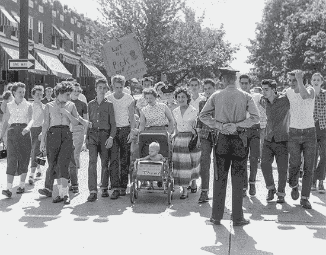

*在最高法院在 Bolling v. Sharpe 案中裁定学校隔离违宪后，哥伦比亚特区的公立学校相对快速地进行了去种族化。爆发了零星抗议，其中包括这张 1954 年 10 月阿纳科斯亚白人家庭的游行。经华盛顿公共图书馆星报收藏许可，版权所有《华盛顿邮报》。*


这种乐观的评估高估了华盛顿白人对消除种族隔离的接受程度。到 1954 年，在与日益强大的反对势力斗争了近十年的战斗后，白人保守派感到被围困和遭受打击，他们被民权运动、联邦权力、人口结构变化、不断变化的国际背景以及其他他们无法控制的力量所压倒。学校整合过程中没有伴随暴力行为，反映了白人保守派的无奈、感到的无力感以及对法治不情愿的尊重，而非对种族混合学校的接纳。

公民协会联盟（Federation of Citizens Associations）对学生和教师的分配提出挑战，并起诉阻止教育委员会执行消除种族隔离的计划，但案件很快被驳回。当最高法院在 1955 年 1 月拒绝考虑 `FCA` 的上诉时，该机构基本上放弃了。“我会说我们结束了，”该团体的律师承认道。受挫挫的白人保守派将愤怒转化为一场成功的运动，成功在 1956 年阻止了玛格丽特·贾斯特·巴切（Margaret Just Butcher）重新当任教育委员会成员，但他们对学校事务的影响正在削减。⁹⁸

无法阻止消除种族隔离，许多白人家庭以一种安静、守法但最终是毁灭性的方式表达了反对意见：将孩子从华盛顿公立学校。这种被称为“白人逃离”的现象并非始于 `Bolling` 裁决，但学校整合加速了向郊区迁移的趋势。在 `Bolling` 之后的两年里，白人公立学校的学生减少了 29%，从 49,106 人下降到 34,758 人。许多全白人学校（包括东部高中）在五年内完全变成了黑人主导的。到 1965 年，华盛顿公立学校仅剩下 15,364 名白人学生，仅占学生总数的 10%，这些学生聚集在罗克里溪公园（Rock Creek Park）西部较富裕社区的白人学校里。这些数字在之后的半个世纪里几乎没有变化。⁹⁹

即使是支持学校消除种族隔离的自由派白人支持者也经常让孩子离开公立学校。白人学校管理员（未来的教育总监）卡尔·汉森（Carl Hansen）将其称为“白人的困境”，因为白人自由派正在苦恼于如何应对他们担心的整合学校中可能纪律问题、学术标准下降以及潜在的跨族交往。大多数人的结论是，他们都不想要这些。汉森本人也承认，他更倾向于让孩子读他们种族占据主导地位的学校。¹⁰⁰

尽管到 1956 年，当地反对消除种族隔离的组织化抵抗已开始衰落，但南方隔离主义者才刚刚开始一场强大的“大规模抵抗”运动，这场运动将使该地区大部分地区的学校维持十余年的隔离状态。这一攻势的关键是 1956 年 9 月由南卡罗莱纳州员约翰·麦克米森（John McMillan）策划的一系列听证会，旨在让华盛顿学校官员难堪，并将消除种族隔离描绘为不明智甚至是危险的。作为南卡罗莱纳大学的橄榄球明星，麦克米森曾激烈捍卫该州东北部的烟草农，在民主党于 1954 年选举中夺回众院后，他成为了地区委员会主席。“小麦”是一个坚定的隔离主义者，在接后的二十年里一直在破坏华盛顿的民权。¹⁰¹

麦克米森创建了一个专门调查哥伦比亚特区公立学校标准和状况以及青少年问题的院小委员会，由乔治亚州民主党议员詹姆斯·戴斯（James Davis）领导。该委员会六名成员中有四名最近签署了《南方宣言》，在文件中他们承诺“使用一切合法手段来扭转”消除种族隔离。该委员会拥有 7.5 万美元的预算并怀有私愤，雇佣了一名热情的调查员，花了九天时间质问了五十多名官员、管理员、教师和社区成员，询问整合如何造成了混乱、降低了课程水平，并将白人学生暴露在结核病、性病和其他健康风险之中。¹⁰²

听证会将华盛顿的学校整合描绘成一场彻彻底底的灾难和对国家的警告。隔离主义委员会的多数人暗示，拯救华盛顿可能已经太晚了，但通过抵抗，白人可以防止这种整合惨剧在其他地方发生。众议员戴斯将听证会中最猥俗和恐慌的证词汇编成一本 48 页的小册，并在南方分发了五万份。小册充满了关于性过度、受教育程度低的黑人“少年”捕猎白人学生和教师的故事，强调了“白人学生与黑人学生之间智力的巨大差异”，并坚称华盛顿的整合“不是其他社区可以效法的榜样”。它帮助激发了范围内对学校消除种族隔离努力的反对。¹⁰³

在戴斯委员会听证会之前、期间和之后，消除种族隔离的支持者集结起来捍卫该市整合学校的记录。媒体对听证会大加贬值——《邮报》（`Post`）认为其为“蓄意破坏”——当地宗教和社区领袖成立了华盛顿公立学校委员会，以动员对整合的支持。在委员会的激烈质问下，助理总监卡尔·汉森反地坚持认为华盛顿的学校整合是“社会调节的奇迹”几个月后，他写了一本同名的小册，赞扬整合学校教师和学生的努力。霍华大学教育学教授埃利斯·诺克斯（Ellis Knox）发表了一项反驳委员会发现的研究。诺克斯写道，学区学校“正在提供比任何时候都更高水平的教育”。¹⁰⁴

即使是最坚定的消除种族隔离支持者也并未否认学校里确实存在严重问题。委员会刻意夸大了整合学校的纪律问题，但黑人学生与白人学生相比的低成就并非隔离主义者的想象产。玛格丽特·贾斯特·巴切（Margaret Just Butcher）和其他坚韧的活动人士意识到了许多黑人学生严重的教育缺陷。“如果一个黑人孩子从隔离学校转到整合学校，在经历了恶劣的学校、拥挤的课堂和教师的匮乏之后还能表现得更好，我会感到惊讶，”巴切辩道。然而，她并没有像隔离主义者那样将其归咎于整合或黑人天生的低下。她坚持认为：“隔离导致了黑人教育的落后。”¹⁰⁵


这些学校反映了城市内部的严峻问题。到 1957 年底，特区主管科宁（Corning）宣布，学校去种族隔离已经“完成”，但这并不意味着华盛顿特区实现了整合。“去种族隔离仅仅是人和物的移动，”科宁指出，“整合是一个漫长的过程。它的成功将取决于社区能否为教育的进步创造出必要的社会氛围。”然而，完全的整合证明是遥不可及的，因为它与华盛顿面临的更大问题息息相关。“整合揭示了健康和福利问题，还揭示了长期半隐藏在种族隔离帘幕后的直接教育资源短缺问题，”1954 年底为《记者者报》（`Reporter`）调查华盛顿特区的记者同情派白人记者道格拉斯·凯特（Douglass Cater）写道。凯特发现，华盛顿是“这个国家的真正典范”，学校系统中的人员正努力让整合成为可能，但城市领导人需要解决住房、城市发展和经济方面的严重问题，如果华盛顿特区希望避免变成一个“只有极穷者和极富的人继续居住在市中心的地方”。[[106]](#footnote.xhtml_ch10foot-106)

麻烦在于，华盛顿人没有权力解决这些问题。由于缺乏自治权，他们听命于国会的特区委员会，而这些委员会由主张种族隔离的南方民主党人人主导，他们试图惩罚特区在民权进步方面的进展。凯特写道：“除非华盛顿人赢得他们长期追求的内部自治权，否则[整合的]成功本身可能会导致教育的渐进衰败、公民状况的普遍恶化，并可能因为市中心贫民区的进一步扩张而导致学校内出现某种形式的持续种族隔离。如果民主的这一重大进步因阻碍华盛顿公民进行民主化自我治理的联邦限制而受挫，那将确实是悲剧性的。”[[107]](#footnote.xhtml_ch10foot-107)

二战结束后的十年里，华盛顿见证了显著的种族改革，到 1957 年，这里已成为美国第一个黑人人口占多数的大城市。城市内的种族隔离并非逐渐消失的——它是由一个跨种族的活动人士、家长、律师、作家、联邦员工以及其他致力于建立平等首都的人员共同努力所终结的。这些民权倡导者利用华盛顿不断变化的政治、经济和人口背景，推动联邦当局支持种族变革。随着学校、餐厅、剧院、交通、公共住房和娱乐区的去种族隔离，[content]1956 年，《纽约时报》（`New York Times`）的一位记者声称，“首都是在社区生活的各个阶段都整合得与该国任何其他城市一样彻底。”][[108]](#footnote.xhtml_ch10foot-108)

但法律种族隔离的结束并没有结束华盛顿的种族不平等，也没有解决特区严重的经济和政治功能失调。20 世纪 60 年代，寻求建立民主、公平城市的华盛顿人发现，他们的斗争才刚刚开始。

# 第十一章

## 多久？多久？

## 黑人多数群体日益增长的情绪，1956–1968

直接行动引起了问题的关注并取得了象征性的改变，但没有带来任何真正的根本性变化。政治和经济力量将带来持久的改变。

—朱利斯·霍布森（JULIUS HOBSON），1964

城市评论家简·雅各布斯（Jane Jacobs）在 1956 年写道，西南区是华盛顿的“继子区”，一个“被地理位置淘汰”并“受官方反复无常的影响”的地方。西南区规模和人口上都是华盛顿四个分区中最小的，没有追溯到城市过去的历史名称的独特社区；整个区域简单被称为“西南区”。它在 19 世纪中期被称为“岛屿”，在历史上在物理和文化上一直与城市其他地区隔绝，首先是被臭名昭著的城市运河隔开，然后是一组难看的铁路轨道，现在则被复杂的公路网和出口匝道网所隔开。这些混凝土的丝带将西南区切割成几块，使得外人相对难以进入。尽管游客和许多华盛顿人忽视了西南区，但它的历史对于 20 世纪 50、60 年代标志着这座城市的种族动荡和活动具有核心意义[[1]](#footnote.xhtml_ch11foot-1)

我们在 21 世纪初看到的西南区并不是通过两个世纪的城市增长有机形成的。相反，它是在二战后的几十年里突然出现的。20 世纪 40 年代后期，市官员、城市规划者以及他们在当地媒体和商业界的盟友越来越担心“向郊区的迁移”。华盛顿邮报》（`Post`）的查尔斯·罗伯茨在 1952 年一个名为“进步还是衰败？”的系列文章写道，城市居民的流失是“今日华盛顿的核心公民问题”。城市领导人担心市中心的“荒废”（一个借自农业的术语，描述看似自然的疾病和腐败过程）正在“感染”华盛顿市中心较旧的社区，包括西南区[[2]](#footnote.xhtml_ch11foot-2)

本世纪中期，西南区有 2 万 3 万居民，其中 70%以上是黑人，约 90%是穷人。1942 年的一项调查指出，“室内浴室、厨房水槽、中央供暖和电灯是极其稀有的奢侈品，”十年后，另一项研究发现 80%的住房单元不标准。记者和摄影师经常将破旧的房屋和胶合板厕所与仅几个街区之隔的宏伟会会大厦和优雅的联邦建筑对比。但西南区也有精美的砖结构或木结构排屋，配有精心打理的前后草坪。事实上，华盛顿大都会房屋建造者协会发现，许多房屋的“结构坚固，在很多情况下不亚于乔治敦的时尚住宅。”[[103]](#footnote.xhtml_ch11foot-3)


*20 世纪 50 年代初的西南华盛顿有 2 万 3 万居民，其中大多数是黑人和穷人。这张照片前景中几乎所有的建筑在 20 世纪 50 和 60 年代作为“城市更新”的一部分被拆毁。美国国会图书馆*

忽视了这种复杂性，城市规划者和城市推崇者将西南区变成了全国性“城市更新”运动的起点，这是一种由联邦支持的、旨在通过现代规划振兴和重新开发破旧住宅区的努力。倡导者警告说，如果不采取一致行动，城市将由于向郊区失去工作、购物者纳税人而萎缩。在华盛顿，城市更新背后的推动力量是重建土地署（RLA），该机构由国会于 1945 年建立，负责购买市市并进行清理，然后以优惠价格提供给私人承包商进行重建。在当地百货大亨马克·兰斯堡（Mark Lansburgh）的领导下，RLA 优先考虑吸引中产阶级居民和购物回到城市的项目。该机构通过 1949 年的《国家住房法案》获得了首笔主要资金[[4]](#footnote.xhtml_ch11foot-4)

该法案开启了美国城市联邦城市更新的时代。正如在城市美化运动期间一样，华盛顿成为城市更新的早期测试场，既是因为其象征性意义，也是因为规划者可以直接与市委员和商业利益合作，而无需任何民主问责。一份乐观的 1955 年报告声称，通过一致的规划、慷慨使用“消除荒废资金”和严格执行法典，在十年内“华盛顿可以成为国家第一个没有贫民窟的大城市。”[[5]](#footnote.xhtml_ch11foot-5)


# 西南部的城市更新与流离

黑人社区的许多人从一开始就反对城市更新。当 1949 年的规划者考虑重新开发马歇尔高地（Marshall Heights）——东南南部一个低收入、半农村的黑人社区时，他们遭到了当地组织良好的业主的反对。黑人报《匹兹堡-华盛顿信报》表达了黑人居民对流离的沮丧和恐惧：“成千上万黑人将失去他们的毕生积蓄，成为租客或慈善对象；数百家黑人企业将化为乌有；数百座黑人教堂将被摧毁，成员将四散；黑人专业人士将失去客户群；这种诉求被认为是未能将华盛顿建成世界上最美城市的拙劣理由。”⁶

为了避免这种一致的反对，`RLA`在 1951 年 6 月选择了西南部的一个 550 英亩土地作为其首个主要项目，该地几乎涵盖了整个区域。该地区大部分居民是租客，他们对抗此类项目的动力和力量较小。建筑师埃尔伯特·皮茨（Elbert Peets）制定的最初计划要求，通过翻新旧房屋、建造低收入住房单元，并努力维护社区特征以确保现有居民不被驱逐，来实现逐步重新开发。⁷

## 向“推拆并重建”的转变

然而，皮茨的计划并没有给`RLA`官员留下深刻印象。他们委托著名建筑师团队路易·贾斯门（Louis Justement）和克洛蒂尔·沃德德·史密斯（Chloethiel Woodard Smith）提供替代方案。这对组合提出了大胆的计划：铲平整个地区，并用闪亮的现代开发项目取代它，其中包括豪华公寓和镇屋、一个大型购物中心、一个带有高层商业建筑的翻新水岸，以及一条连接社区与市中心的优雅步行道。该计划构想了一个全新的西南地区，拥有高房地产价值、充足的开放空间和现代设施，以吸引更富有的居民。这也需要西南地区几乎全部人口的流离。⁸

这些竞争性提案提交给了国家首都公园与规划委员会，该委员会在 1950 年的综合计划中坚持认为，任何重新开发都应为流离居民提供“负担得起的、具有体面、安全和卫生特征的替代住房”。⁹ 规划委员会提出了一个折中方案，承诺维护地区特征（正如皮茨提倡的那样），并包含了一项规定，要求至少三分之一的新单元留作低收入住房。

但在实践中，西南部的城市更新遵循了贾斯门-史密斯计划的“推拆并重建”方法。包括大都会贸易委员会和《华盛顿邮报》在内的强大支持者推动了全面重新开发，而住房与金融署的联邦官员则拒绝资助强调翻新的项目。10)

## 法律斗争与法院裁决

第一批推土机于 1954 年 4 月开始清理该地区，但法律和财务问题使最初的施工推迟了多年。目标区域内的两个店主对整个过程的宪法性提出挑战，认为`RLA`没收他们的土地是非法的，因为他们的财产既不是住房也不是破旧建筑；土地将将用于私人开发而非公共用途；他们没有获得公正补偿；而且他们没有根据《宪法第五修正案》获得正当程序。这起诉讼威胁了全国的城市更新项目，案件迅速进入了最高法院的议程。

1954 年 12 月，法院在“伯曼诉帕克案”（`Berman v. Parker`）中一致通过决裁定，市官员确实有权没收土地。“如果哥伦比亚特区的政府者决定首都应该既美丽又卫生，那么宪法第五修正案中没有任何东西可以阻碍，”威廉·奥·道格拉斯（William O.Douglas）法官写道，并将此问题定性为一种道德义务。“住房的苦难可能会破坏社区，就像露水道破坏河流一样.”11)

## 对社区的影响

尽管有这些激昂的辞藻，但“伯曼诉帕克案”中这一被很大程度上遗忘的决定对特区及其他地区的低收入和黑人社区产生了毁灭性的影响。正是同一个法院在关于住房隔离（`Hurd v. Hodge`）、企业（`D.C. v.Thompson`）和学校（`Bolling v. Sharpe`）的裁决中为华盛顿的种族平等奠定了法律基础，现在却批准了对一个黑人为主贫困社区的彻底破坏。

在接下来的二十年里，以约 5 亿美元（约 21 世纪的 46 亿美元）的成本，旧西南部的社区从景观中消失了。取而代之的是现代项目，如建立在臭名昭彰的迪森法院（Dixon Court）巷弄上的首都公园。首都公园于 1965 年完工，拥有五座坐落在倒影池、公共艺术和其他设施之中的高层住宅楼。它的设计获得了美国建筑师协会的一项声誉荣誉奖。西南部的城市更新获得了规划者、市官员、大都会贸易委员会和媒体的广泛赞誉，正如《邮报》建筑评论家沃尔夫·冯·埃克哈特（Wolf Von Eckardt）所写，它将“郊区的完满性与城市的刺激结合在一起.”12)

现代化是以巨大的代价换来的。罗伯特·格·霍伊斯斯（Robert G. Howes）父神在 1959 年为天主教慈善机构全国会议做的“教会视角看城市更新”中，这位城市更新的倡者警告说，西南部的开发“显示出将城市美化和城市繁荣置于城市人性之上的倾向”。尽管早期承诺不会有家庭被驱逐，并且将建造新住房以满足现有居民的需求，但城市更新破坏了西南部 99%的建筑，迫使 1500 家企业搬迁，导致 2.3 万居民流离。取而代之的是针对人口减少一半的 5800 个新住房单元。13)

早在 1956 年，`RLA`就由于成本上升和优先事项的变化而不再提供负担得住房。最终，西南部仅建成了一个只有 310 个单元的住房小区供低收入居民。到 1960 年，西南部的平均租金是特区平均水平的两倍以上。获奖的新开发项目吸引了更富有、主要是白人的居民进入该地区，但这是以牺牲低收入、主要是黑人的居民为代价的。西南部的种族结构发生了反转——1950 年，该地区有近 70%是黑人，但到 1970 年，白人比例接近 70%，而当时特区其他地区的黑人比例日益增加。自 1907 年起就在西南部经营小杂货店的 84 岁老人塞奇·坎宁（Ezekiah Cunningham）总结道：“嗯，看来他们是在分发一堆快乐和一堆哀伤.”14)


大多数居民别无选择。“搬迁并不是一种不愉快的经历，”RLA 主管约翰·希尔斯（John Searles）坚持认为，尽管居民们并不这么想。在超过 4,500 个搬迁家庭中，只有 12.5%留在了西南部；46.5%前往东南部，25.1%前往东北部，15.8%前往西北部（最大、白人最多且最富裕的象限）。在他 1966 年的研究《他们现在哪里？》（*Where Are They Now?*）中，丹尼尔·瑟斯（Daniel Thursz）采访了近百因西南区城市更新而被迫离散的家庭。尽管大多数流离居民表示他们新家的状况比旧家好，但绝大多数人仍然生活在贫困中，在新社区感到社交孤立，并遭受着深刻的失落感。瑟斯总结道：“无论旧西南区有多脏、多简陋、多不卫生，它对于那些在那里住了很久的家庭来说也是`家`。”新的西南区“在一个由长期定居但贫困的居民组成的`社区`灰烬上建立起来。”[¹⁵

随着居民的分散，他们流入了已经拥挤的黑人地区，往往恶化了那些社区的状况。“西南区所做的只是把贫民窟搬到了这里，”西北区的一位黑人房主抱怨道。成千万人在远东南部发现了相对廉价的公共住房，这使得许多社区在十年内从白人区变成了黑人区。由于西南区贫困居民的扩散会将国家首都变成“一座纪念碑与赤贫之城”，白人公民协会联盟呼吁实施“全国性安置计划”，以将他们完全从城市中迁出去[¹⁶

当紧张的房主担心流离导致的影响时，对城市更新最强烈的批评来自民权活动活动人士。新贝塞尔浸信教教堂的沃尔特·福特罗（Walter Fauntroy）牧师指责，“城市更新是城市清除——将黑人从城市的精华区域清除出去。”到 20 世纪 60 年代初，“城市更新”已成为民权运动内部的一个贬义词，是政策制定者和规划者经常忽视低收入居民需求的简短描述[¹⁷

城市更新的灾难性影响，在种族隔离法律障碍倒塌后的十年里，催化了整个华盛顿草根公民活动主义的的兴起。从从 0 世纪 50 年代末到 60 年代末，黑人和白人活动人士反抗经营华盛顿的商业利益和非选举官员，挑战黑人人口为主城市中根深蒂固的经济不平等。通过员公民力量，他们努力阻止白人外逃、开启经济机会、建造负担得起的住房、结束警察暴政并赢得自治权。这是一个社会极度动荡、紧张局势升级和冲突爆发的时代，华盛顿人开始质疑城市与国家之间的基本关系。

## “当学校全是黑人时，问题就来了”：白人的城市外逃潮

马文·卡普兰（Marvin Caplan）站在华盛顿种族变革的最前线。卡普兰出生于费城的犹太人，出身于世世代代的清真屠宰家族，但他对文学和语言的热爱使他在二战期间进入了军队特殊训练计划。他向日裔美国人老师学习日语，老师们也教他关于关押营以及日裔美国人所遭受的其他耻辱。这段经历唤醒了他的政治良知，卡普兰在战后回到美国，致力于实现美国民主的种族平等的愿景。他于 1952 年搬到华盛顿担任记者工作，几周内，他就在赫奇特百货商店外的抗议线上汗流浃背，听从邻居安妮·斯坦因（Annie Stein）的指令。他亲切和蔼，带着露齿的微笑和闪烁的眼神，很快就赢得了华盛顿激进世俗犹太人社区的喜爱[¹⁸

卡普兰、妻子娜奥米和三个孩子于 1957 年搬到曼纳公园（Manor Park），那是乔治亚大道西北部、靠近马里兰州边界的一个绿意葱葱的中产阶级地区。他们很快发现，他们的新社区是白人向郊区外逃的“战场”，他后来写道：“我们开始把每一个‘待售’标志看作进军军队插的旗帜。”卡普兰和他的白人邻居认为，敌人是追逐利的房地产中介，他们希望鼓励不安的白人房主降价出售。然后，中介会抬高价格并卖给黑人买家。他们使用各种“拆街破坏”和“恐慌抛售”的技术来煽动白人的恐惧，经常反复给白人房主打电话，并在整个街区散发引起恐惧的传单，警告他们赶在太晚之前卖掉。一旦有一个黑人或黑人家庭搬入某个地区，中介就会认为该地区处于“转型期”，而该市的三份日报也允许他们广告该地区的房产为“向有色人出售”[¹⁹

掠夺性的房产中介是一个很好的替罪羊，但白人迁移到郊区的原因更为复杂。尽管他们的手段可能不雅，但中介是在回应一种真实的需求。黑人买家迫切寻求体面的住房，他们很难进入马里兰州和弗吉尼亚州的郊区。美国民权委员会观察到，郊区形成了特区周围的“白人环”——或者正如许多黑人华盛顿人所说的，“白色绞索”。白人向郊区的迁移在二战后正式开始，被宽敞新家和便利贷款前景吸引的城市居民离开了全国的城市地区。随着郊区的扩张，雇主很快跟随。就连联邦政府，考虑到华盛顿市可能遭受毁灭性的原子攻击，也开始通过将机构迁往郊区来实现业务去中心化[²⁰

在 20 世纪 50 年代初的关键民权胜利之前，郊区迁移已经在进行中，但住房和学校的去种族显著加速了这一过程。数据令人震惊。在 1950 年至 1960 年间，华盛顿白人人口减少了三分之一；城市从接近 65%的白人转变为大约 54%的黑人。许多社区从以白人为主变为几乎全是黑人[²¹

离开种族构成发生变化社区的白人往往担心房地产价值下降、学校恶化和地位丧失。他们认为，拥有黑人邻居本质上会让社区变得不再吸引人。人口学家乔治·格尔（George Grier）在 1962 年解释道：“人们通常认为，一旦第一个黑人家庭搬进一个街，其他人就会随其后，这个街将完全改变。”白人居民担心“临界点”，即社区不可逆转地变为黑人区的那个点，《邮报》的约翰·马弗（John Maffre）写道，“白人恐慌逃散，就像北极旅鼠盲目地冲向大海一样。”[²²


即使是支持融合的自由派白人者，包括卡普兰夫妇，在决定是否离开这座城市时也曾挣扎。在 1960 年 7 月为《大西洋》杂志的一篇反思文章中，马文·卡普兰表达了他、妻子和其他白人自由派在看待他们庄园公园（Manor Park）社区种族转型时的矛盾心情。最初，卡普兰夫妇欢迎第一批进入该地区的黑人家庭，“带着自豪和正确感，看着大孩子进入一所刚刚整合的公立小学。”黑人邻居总是非常有礼貌，而且很有成就，但随着原本以白人为主的学校很快黑人比例超过了 80%，白人的恐惧倍倍增长。流言四传，紧张的白人居民紧聚在一起，渴望其他白人家庭搬入。

## 他们害怕什么？
卡普兰写道，表面上他和白人邻居共同有一种模糊且不安的感觉，认为事情会变得方式变得不同、更难以管理、更不熟悉。可能会出现“黑人动荡”，给“我们安静的街道带来‘拥挤……污言和暴力’。”但卡普兰写道，“在中产阶级体面的表象背后”，隐藏着性。“跨族通婚是脱口而出的恐惧。”

### “邻里公司”（Neighbors, Inc.）的形成
卡普兰夫妇支持融合，但他们不想成为“街区上最后一个白人家庭”。然而，他们选择了留在特区，全身投入社区组织工作以防止进一步的白人外逃。1958 年夏天，在试图整合庄园公园公民协会失败后，卡普兰夫妇招募了黑人药剂师沃伦·范·胡克和一群志同道合的跨族朋友，发起了`Neighbors, Inc.`。这是一个私人组织，致力于在纽约西北部第 16 街和乔治亚大道沿线的四个拥有单户自住住房的社区（即庄园公园、布莱特伍德、谢泼德公园和塔科马）中，创建稳定的、整合的中产阶级社区。卡普兰后来说，这是“一种决绝与绝望的行为”。

由于共同的阶级背景，“`Neighbors, Inc.`的早期成员寻求在整合的氛围中保护他们认为该地区的中产阶级美德——安静的街道、维护良好的家园、优秀的学校、充满活力的教堂和犹太教堂。该组织得到了提费莱特以色列（Tifereth Israel）的关键机构支持，那是位于第 16 街的一所保守派犹太教犹会堂，它选择留在谢泼德公园社区，而不是跟随许多信徒迁往郊区。与卡普兰夫妇一样，许多活跃的白人成员是犹太人，他们受到自身信仰受迫历史以及对黑黑人斗争产生团结之感的鼓舞。“你不需要告诉一个犹太人贫民窟有什么问题，”马文·卡普兰解释道。

### 策略与社区拓展
`Neighbors, Inc.` 强调整合生活的经济和实用益处，有意识地将跨族生活视为一种积极的善行，是城市生活中充满活力的一部分，与郊区死板的隔离形成鲜明对比。1959 年春季，该小组已有 175 户缴纳费用的家庭，开始帮助居民研究住房法律、招募新家庭、组织跨族社区活动并宣传融合的益处。他们制作了印有大量照片的小册子，展示了不同族裔的孩子快乐在一起玩耍的场景；建立了一个受欢迎的艺术和书展；还举办了社区茶会和街区会议，并出版了月刊。成员们希望吸引联邦官员和其他专业人士来到该地区，提供乔治敦风格的家居和花园导览，以展示整合社区的美感和中产阶级品味。

### 挑战种族政策
该组织还挑战了破坏他们维护整合社区努力的种族做法和政策。在他们的首批行动中，“邻里公司”要求当地报纸停止允许房地产中介按种族列出房产。他们收集了 2500 份请愿签名，并帮助建立了一个由四十多个组织组成的联盟来抗议这种做法。到 1960 年中，受到震慑的报纸改变了做法。他们反击联邦住房管理局拒绝向在“过渡性”社区购的购房者提供联邦贷款的政策，压力房地产中介停止“拆街推销”（blockbusting）技术，并对“不准确”和“误导性”的犯罪统计数据提出质疑，指责这些数据引发了对城市生活的过度恐惧。

### 成功与局限性
`Neighbors, Inc.` 吸引了大量的媒体关注，并获得了政策制定者基金基金资助者的赞誉。到 1965 年，这个拥有一千四百成员的组织声称成功阻止了白人的“恐慌抛售”并“稳定”了社区，让成员能够关注路灯和垃圾收集等更平凡的社区问题。《星报》记者海因斯·约翰逊在 1965 年写道：“无论他们是否愿意，他们已经成为了典范。”但到那时，该组织已退缩到北部的谢泼德公园和塔科马社区，那里的白人仍占 77%的多数。布莱特伍德和庄园公园的南部地区失去了大部分白人居民，因为来自西南区等地区的低收入黑人在该地区找到了住房。

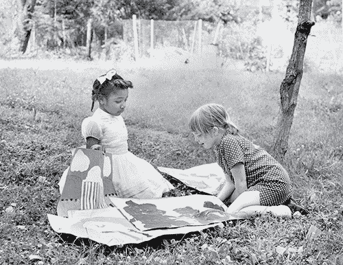

*两个女孩在华盛顿西北部库利奇奇高中举行的 1964 年 Neighbors, Inc. 艺术书节上玩耍。Neighbors, Inc. 赞助了晚宴、节日和其他社区活动，以鼓励跨族互动并阻止白人从城市外逃。经华盛顿公共图书馆星报收藏许可转载，©华盛顿邮报。*

### 内部分裂
尽管取得了成功，该小组仍在内部分歧中挣扎，特别是在招募新居民方面。从成立之初，“邻里公司”的跨族董事会就承认，为了维持稳定的白人存在，他们必须将招募重点放在吸引与该小组价值观一致的白人家庭上。尽管他们没有积极阻止黑人购房者，但他们以搬入该地区的白人家庭数量来衡量成功。这种强调导致他们选择了一位白人女性玛丽·沃（Margery Ware）担任首任执行主任，而不是一位经验更丰富的黑人候选人，随着时间的推移，不断吸引白人家庭的压力日益引起黑人支持者的不满。“在‘邻里公司’当黑人你必须有非常强大的脸皮，”一位黑人成员坦言道。

该组织最大的挑战是学校种族组成的变化，特别是位于“邻里”社区最南端第 8 街和奥格尔托普街的保罗初中。到 1963 年，保罗中学的黑人比例已达到 75%，小组领导人在一份内部备忘录中警告说，这一比例“对大多数白人来说太陡峭了”。现在几乎可以肯定，‘邻里公司’在居住整合方面的展示成功与否，取决于初中的问题。”在幕后，他们向学校官员施在更靠北的白人为主地区建立一所新的初中。在公开场合，他们提供了研究、统计数据以及保罗学校员工和家长的证词，以反驳黑人比例增加会导致学术标准下降的观点。


尽管做了努力，“邻里协会”未能阻止白人从学校逃离。“对于许多[白人]家长来说，”海因斯·约翰逊在《星报报》中观察到，“最终的问题是学校里黑人的比例。”到 1960 年，位于布莱特伍德的罗斯福高中已几乎完全转变为黑人学校。到 20 世纪 60 年代中期，位于塔科马的库利治高中黑人比例达到 90%，谢尔德公园小学和塔科马小学也以黑人为主，并面临白人学生人数的快速下降。即使是支持学校融合的白人支持者也对学校里日益增加的黑人人口感到不安。“当学校全是黑人时，这就是一个问题，”一位有两个学前儿童的白人成员承认道，“这一点不可否认。”[³²

卡普兰夫妇的女儿弗雷亚是 1968 年库利治高中少数白人毕业生之一，她直截了当地告诉父母，他们不应该让弟弟妹妹们“经历我经历过的痛苦”——种族欺凌、社交孤立以及对身体暴力的恐惧。在经历了许多挣扎和家庭治疗后，马尔文和娜奥米·卡普兰决定将较小的孩子从保罗初中接出来，并安排他们进入罗克溪公园西侧以白人为主的爱丽丝·迪尔中学。马尔文·卡普兰用圣经式的描述了这段经历，将自己比作亚伯拉罕，以及“每一个顽固而盲目地准备为了信仰而牺牲孩子的父亲”。尽管他并不后悔暂时“将我们的孩子交付给社区学校”，但卡普兰余生都为此感到内疚。到 20 世纪 70 年代，库利治、保罗以及其他“邻里协会”的社区学校几乎全都是黑人学校了。”[³³

并不是所有的白人都能通过简单地安排孩子上区外学校或将他们送到该地区新兴的私立学校，来避免将孩子“交付”给当地学校。对于蓝领白人居民，特别是在安纳科斯蒂亚、康格斯高地和远东南部的其他地区，种族隔离的结束意味着在城市生活的彻底终结。

康格斯高地是一个由红砖平层小屋组成的社区，拥有起伏的丘陵和俯瞰市中心的景观，是一个亲缘和文化与南方联系在一起的工人阶级白人社区。直到 20 世纪 50 年代，康格斯高地仍保持着相对农村化的特征，人口密度低，大片未开发土地，还有一个延伸到马里兰州边界的猪场。作为华盛顿山民音乐界的大本营——吉米·迪恩和其他乡村音乐名流曾在当地酒吧表演——康格斯高地曾仅对白人开放。如果有黑人进入该地区，来自附近巴里农场的某黑人居民回忆道，“你可能会被扔来一个啤酒瓶，下一秒你就会发现自己正在挨一顿毒打了。”当富裕西北部的白人青少年留长发、拥抱 20 世纪 60 年代的嬉皮士风格时，康格斯高地的出租车司机、管道技师、机械师和其他蓝领工人的儿子们仍将头发梳成大脑油尾，穿着在肩膀处塞着一包烟的紧身 T 恤。”[³⁴

白人从公立学校逃离的情况发生在远东南。由于没有其他选择，在学校取消种族隔离很久后，白人家庭继续送孩子去当地学校。远东南在 1960 年仍是三分之二的白人，而 1954 年秋季发生白人学生罢课事件的安纳科斯蒂高中到 20 世纪 60 年代中期白人比例仍约为 50%。1961 年建于康格斯高地以缓解安纳科斯蒂高中拥挤压的新鲍鲁高中，直到 20 世纪 60 年代中期一直是白人多数。1963 年，一位白人教师称其为“模范学校”，“没有种族冲突，没有暴力，没有对老师的不尊重。”[[³⁵

种族变化在 20 世纪 60 年代中期迅速到来，此时距离学校和住房融合开始已经整整十年。当附近的海军炮工厂关闭、博林空军基地削减裁员时，当地就业机会枯竭了。许多与军事设施有联系的白人工人不再有留在远东南的经济理由，随着该地区开始涌入低收入黑人居民，他们感到文化上的被疏离。

公共政策也助推了社区的变。从 20 世纪 50 年代开始，区划变更将远东南高达 75%的居住用地预留给租赁公寓，吸引了因西西南区城市更新而流离失所的租客。市政府在整个地区建造了公共住房单元，并购买了私人复合体将其转换为公共住房。到 20 世纪 60 年代末，远东南 85%的住房单元是多户型公寓，全市公共住房居民有四之三住在那里。”[[³⁶

随着该地区人口的激增，当地学校遭受了严重的拥挤，而垃圾清理、街道清洁和警察保护等基本城市服务未能跟上节奏。“1970 年的一份华盛顿政府报告指出，在这个社区集中如此多的公寓开发项目导致了公共服务的严重缺陷。”[[³⁷

到 20 世纪 60 年代末，该地区白人比例仅剩 5%，少数留下的白人居民感到愤恨。“这简直就像小非洲，”一位从西弗吉尼亚州搬到华盛顿的白人母亲抱怨道，“这整个地方到处是害虫。”一位当地牧师理解他们的困境。“他们这种感觉是‘我的世界正在发生什么？’”由于太穷、太老或固执拒绝搬到郊区，留下的白人居民感到与城市其他地方隔离。卡尔·伯恩斯坦在《邮报》中写道：“他们看到十年前住着小白人家庭的公寓，随着带着六七孩子的贫困黑人家庭搬入而变得瓦解。”他们经常对河对岸的华盛顿人怀有不满。“住在泉谷（西北区一个富人白人社区）且不是种族主义者很好，”一位白人居民评论道，“但如果你住在这里，情况就不一样。”[[³⁸

二战后二十年的白人逃离使华盛顿的白人社区形成了新的种族地理和阶级取向。他们不仅规模缩小了，而且更加老龄、更富有、地理上更集中，且政治文化上更自由。白人工人阶级的流失意味着在 20 世纪末的华盛顿，种族与阶级的关系比以往任何时候都要紧密。曾经各阶层的白人都居住在四个区域，通常处于居住融合区，但到 20 世纪 60 年代末，城市东部三分之二几乎没有白人。《新共和》的安德鲁·科普金德和詹姆斯·里奇韦将华盛顿的居住模式称为“一种*隔离制度*”，“就像旧利奥波德的比时人一样，白人主要居住在一个大殖民地；在华盛顿这被称为西北区’。”[[³⁹

富有的白人主要聚集在罗克溪公园以西或西南区的开发复合体内，这些地区受到高昂房价的保护。他们送孩子去融合程度较高的公立或私立学校，过着大部分被种族和阶级隔离的生活。留在市内的蓝领白人很少。他们放弃了远东南，前往马里兰州的普乔治县和卡尔弗特县，彻底离开了华盛顿。华盛顿白人工人阶级的痕迹消失了，正如几十年前沼泽地（Swampoodle）社区的消失一样彻底。

“愤怒，但并未充满怒火”：朱利斯·霍布森为争取住房、工作和学校的斗争。


朱利斯·霍布森（Julius Hobson）并不符合 20 世纪 60 年代民权领袖的形象。他是一个无神论者，而非牧师；一个统计学家，而非学生；比起牛仔裤或达希基长，他更穿西装领带时感到更自在。霍布森于 1919 年出生于阿拉巴马州伯明翰，成长于一个小学校长和小企业主主的家庭，这个家庭非常重视教育。二世界大战期间，他担任炮兵观测员获得了两枚铜星勋章；在海外期间，他阅读了马克思、卢梭和其他欧洲思想家的著作。深受思想启发的，他回到美国时被称为他所说的“马克思主义社会主义者，但共产主义者”，他从未放弃过这个标签。在图斯基吉大学获得工程学位后，他进入霍华德大学攻读经济学研究生，但与一位白人导师发生冲突后被开除。霍布森找到了一份公务员的工作，最初在国会图书馆研究员，后来担任社会安全局的统计分析师。

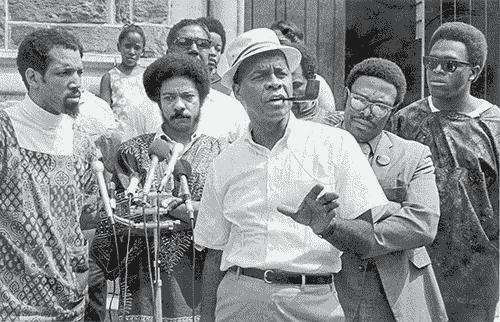

直言不讳的朱利斯·霍布森在 2 世纪 60 年代初成为华盛顿最著名的民权领袖。作为种族平等大会（CORE）以及后来社区小组协会的负责人，霍布森以富有创造性的对抗方式挑战白人当局。本文经华盛顿公共图书馆“星级收藏”许可转载，©华盛顿邮报。

霍布森戴着他标志性的软礼帽和白色长袖衬衫，嘴角叼着烟斗，外形严整的他看起来完全像他那个理性的政府统计学家，唯独那双闪烁着怒光的眼睛。他被称为“华盛顿最愤怒的人”，他对比美国生活中根深蒂固的种族主义和经济不平等感到愤愤不已。“我很愤怒，但并没有充满愤怒，”他告诉一位记者，“愤怒源于挫败感和解决问题的失败。而愤怒带有方向、计划和决心。”霍布森的愤怒在 20 世纪 50 年代初找到了方向，当时他不得不开车带着儿子朱利斯二世绕过白人聚集的伍德里奇小学，去一英里外那所拥挤的黑人斯洛伊小学。他加入了家长教师协会，成为公民协会联合会的副主席，然后参与了美国黑人进步协会协会（NAACP），他回忆道，“随着我的深入，每个组织在理论上都变得越来越激进。”

霍布森的工作引起了种族平等大会（CORE）的注意，他们于 1961 年 4 月聘请他经营陷入困境的华盛顿分部。CORE 成立于 1942 年，是一个和平主义组织，致力于通过非暴力直接行动挑战种族不平等。它加入了另外两个在南方各地开展高知名度抗议活动的新兴全国民权组织：马丁·路德··金领导的南方基督教领导会议（SCLC），该组织在 1957 年阿拉巴马州蒙特哥马利举行成功的公交车抵制运动后成立，将这位 26 岁的牧师推向了全国性的焦点；以及学生非暴力协调委员会（SNCC，读音为“snick”），该组织于 1960 年在大学生静坐运动潮后成立。

随着 SNCC、SCLC 和 CORE 策划的和平抗议引发了白人反对者的暴力反应，全国民权运动进入了对抗政治的戏剧新阶段。霍布森帮助将这种日益增长的战斗性带到了首都。他将 CORE 的成员从仅有的十五人扩大到数百人，使其成为 60 年代初该市最受关注、最活跃的民权组织之一。霍布森直率、粗俗且不可预测，他将义的愤慨与严谨的研究相结合，利用统计数据和表演技巧向华盛顿的种族主义做法作战。

### 新一代领袖

霍布森是该市新一代黑人领袖中最激进的一位。另一个坚定、深沉的平等声音是斯特尔林·塔克（Sterling Tucker），他是一个瘦削、精力充沛的俄亥俄人，1956 年来到华盛顿经营华盛顿城市联盟时仅 32 岁。塔克是一位多产作家，也是白人媒体青睐的来源，他阐述了城市联盟充满统计数据的研究，也阐述了种族主义对华盛顿黑人造成的内心深层情感创伤。

代表新一代牧师的是沃尔特·福恩特罗（Walter Fauntroy），他是马丁·路德·金的同事和门徒，领导 SCLC 当地分部。福恩特罗毕业于邓巴高中，这位长相和蔼的学生读于耶鲁大学神学学院，于 1959 年 26 岁时回到家乡教堂——位于西北第九街和 S 街的新贝特尔浸基教教堂成为牧师。

黑人媒体界的新声音属于 C·萨默·“查克”·斯通（C. Sumner “Chuck” Stone），这位 36 岁的火药桶人物于 1961 年初出任《华盛顿非洲人报》编辑。斯通曾是图斯基吉飞行员和卫斯理大学毕业生，他对“懒散”的黑人中产阶级和“激进汤姆姆”的尖锐谴责立即引发了争议。

### 华盛顿的挑战

对于这些民权领袖来说，2060 年代初的华盛顿面临着独特的挑战。从许多衡量标准来看，这座首都是一个黑人的成功故事。它拥有美国最富有、受过良好教育的黑人社区。该市二战后的民权运动已经拆除了他们在南方同胞仍在抗议的那种“吉姆·克劳”法律。大多数官方白人华盛顿人使用的是宽容的辞令而非排斥。1961 年，总统约翰·肯尼迪任命律师约翰·B··邓肯（John B. Duncan，这位活跃的公民领袖在十年前曾深度参与了“卡多佐中心”运动）成为该市首位黑人专员。政治压力甚至迫使华盛顿红足队实现了整合，该队在 1962 年成为国家橄榄联盟中最后一个向名单中加入黑人的球队。

这种进步鼓励了黑人领袖去追求不仅仅是种族融合。他们期望所有华盛顿黑人都能获得自由的果实，包括良好的工作、体面的住房和优质的学校。然而，随着华盛顿像北方城市一样挣扎于与根深蒂固的种族不平等相关的各种问题，日益增长的预期遭遇了令人沮丧的现实——失业率上升、工资停滞、社区恶化以及学校拥挤。

1960 年，黑人的中位数收入是白人收入的 70%，与二十年前持平。尽管联邦政府和特区政府都有官方的反歧视政策，但无形的障碍依然存在。城市联盟发现，在某些联邦机构，黑人员工收入比白人同事少 35%。在华盛顿市政府内部，黑人员工占劳动人口的一半以上，但高薪职位比例不到 10%。霍布森指责私营部门更糟糕。“在私营工业中，实际上没有黑人的立足。”


那里也没有让黑人住得起体面且负担得起的住房。住房歧视是黑人抱负追求的瓶颈，是一个横跨华盛顿所有黑人阶层的问题。尽管限制性公约自 1948 年起在法律上已不可执行，但 1960 年的人口普查数据显示，华盛顿的隔离程度比以往任何时候都严重。黑人居民支付的住房费用比白人高出 50%，黑人住房密度大约是白人住房的五倍。随着越来越多的人挤入旧的黑人社区，公共服务供不应，学校过度负荷，生活状况恶化。到 1963 年，华盛顿在结核病、性病和婴儿死亡率方面位居美国之首。《邮报》伯特·E·贝克尔写道：“当白人提醒黑人在过去十年里取得了多大进展时，贫民窟和贫民窟证明了他们还有要走的路。”⁴⁸

## 缺乏代表性政府
华盛顿缺乏代表性政府加剧了这些问题。在处理城市事务的 91 个公共委员会和机构中，超过一半没有黑人成员，这是黑人政治隐透明性的显著标志。城市官员经常忽视黑人的诉求，特别是在就业和住房方面。例如在 1963 年，一群住在`Girard Street`破旧公寓的租客签署了一份愿书，详细列出了违反城市规定的情况，包括走廊没有照明、锅炉故障和排水不畅。城市官员直接将愿书转交给房东，后者立即驱逐了愿书者。⁴⁹

华盛顿黑人也无法获得立法者的支持。对民权进步感到愤怒，国会中的南方隔离主义者加强了对统治华盛顿委员会的控制。整个 1960 年代由南卡罗来纳州约翰·麦克米林领导的南方人主导众院拨款委员会仅对白人居民做出回应，政治学家玛莎·德尔瓦写道，他们在华盛顿政府中普遍扮演了“阻碍者的角色，故意且恶意地破坏了华盛顿的最高利益。”⁵⁰

## 国会障碍
另一个障碍是负责华盛顿预算的参议院拨款小组，该小组由一位具有戏剧演说天赋的前三 K 党成员领导：西弗吉尼亚州民主党人罗伯特·伯德。麦克米林、伯德和他们的南方同事重新调整了城市预算，削减了福利、教育和住房计划，同时加强了警察力量。不满的华盛顿人抱怨隔离主义者充当破坏者。安德鲁·科普金和詹姆斯·里奇韦在《新共和》上写道：“这些人正致力于让华盛顿无法作为一个整合的城市运作，他们有能力让其失败。”⁵¹

## 1962 年足球骚乱
国会的南方白隔离主义者利用了他们所谓的“最恶劣种族暴乱”的新闻，将责任归咎“整合教育”，并将其与密西比州民主党人约翰·贝尔·威廉姆斯所说的“黑人对白人的暴力犯罪率飙升”联系起来。1962 年感恩节的一场具有种族色彩的市青少年锦标赛足球赛引发了负面新闻报道。这场在新建的`华盛顿体育场`（后来更名为罗伯特·肯尼迪体育场）举行的重大慈善活动，吸引了超过五万人的创纪录观众。以黑人为主的公立学校冠军`东方高中`与以白人为主的私立学校冠军`圣约翰学院高中`展开激战。随着比赛接近结束，圣约翰学院以 20 比 7 领先，场上球员的小冲突引发了赛后斗殴，两千多黑人青少年和青年冲入球场，用拳头、瓶子和砖头攻击圣约翰的球迷。随着冲突蔓延到邻社区，超过五百人受伤，黑人居民为逃离的白人球迷提供了住所。城市官员、学生领袖和媒体最初试图淡化骚乱的种族动态，但很少有电视观众、观众或观察者能忽视这种种族分裂。参加了比赛的黑人记者西门·布克尔写道：“仇恨的爆发源于我自己的人。”⁵²

## 媒体言辞与公众恐惧
国会的南方白人压过了关于他们所谓的“最残暴种族暴乱”的新闻，将责任归于“整合教育”，并将其与密西比州民主党人约翰·贝尔·威廉姆斯所说的“黑人攻击白人的犯罪激增”。威廉姆斯表达了许多华盛顿白人的焦虑，他们将城市犯罪率的上升（全国范围内都在大幅增加）几乎完全归于黑人社区，特别是来自南方农村的受教育低、收入低的黑人移民。1963 年，《纽约时报》的一条标题大作：“种族暴力恐惧笼罩首都”。记者罗塞尔·贝克描述了一系列黑人对白人受害者的攻击，认为这是华盛顿向美国游客展示的高尚明信片外象背后经常发生的“偶然野蛮行为”。⁵³

## 民权回应
民权支持者试图将感恩节暴力事件和该市犯罪问题置于更广泛的不对等背景下。一个由前艾森豪助手领导的跨种族公民委员会调查了这场混乱，并于 1963 年 1 月发布了一份严厉的报告，将责任归于活动的赞助者、学校官员、警察以及东方高中的白人足球教练等。报告还追溯了暴力的深层根源。它总结说，“感恩节当天发生的事情只是一个更大问题的严重症状，”并指出城市缺乏自治、学校过度拥挤以及就业和住房方面的歧视是导致赛后情绪宣泄的原因。⁵⁴

对更多种族暴力的恐惧为当地的民权倡议赋予了新的紧迫性，包括霍布森在前一年发起的种族平等协组织（CORE）发起的“择优录用”运动。正如三十年前“新黑人联盟”发起的“在无法工作的地方不买”抗议一样，CORE 的运动通过示威、谈判和抵制，迫使企业在所有职位上聘用黑人员工。霍布森还编写了一份“选择性购物指南”，类似于十年前安妮·斯坦著名的去隔离化餐厅名单，用以宣传合作型企业。霍布森回忆道：“在我们进入的每家店，我们都闹得不可开交，并让黑人获得了职位。”在领导了八十多场示威后，他声称帮助了约五千黑人在约两百公司获得了工作。⁵⁵

择优录用运动的成功鼓励了活动人士采取直接行动抗议来挑战种族歧视的租赁行为，并推动制定“开放”或“公平”住房法，要求所有住房必须对任何种族的居民开放。CORE 调查了住房歧视，帮助居民提交投诉，并开创了一项“入住”计划，即由白人租用白人社区的公寓，然后允许黑人作为“客人”入住。CORE 在 1963 年 5 月针对开发商莫里斯·卡夫里茨发起了系列抗议，指控其公寓楼的单元仅租给某一种族。卡夫里茨是土生生的华盛顿人，从小在乔治敦的一条整合巷子里长大，他娶了该市最著名的社交名媛。通过针对他，CORE 引起了华盛顿官方机构和媒体的广泛关注。两个月内，卡夫里茨就公开支持 CORE 提出的全市开放住房法建议。⁵⁶


为了提高住房和就业运动的关注度，`CORE` 一同 `NAACP` 和 `SCLC` 在 1963 年 6 月 14 日在市中心举行了一场游行。这次活动发生在警察犬在阿拉巴马州残暴攻击民权示威者的几周后，也是白人至上主义者杀害`NAACP`领袖梅德加·埃弗斯（Medgar Evers）后的几天。“现在就要自由游行”吸引了三千多名和平且跨族的群众，其中约四之三是黑人。他们首先游到区政府大楼，在那里`SCLC`的小姆斯伍德·威廉姆斯（Smallwood Williams）主教结束长长的祷告时问道：“黑人还要遭受多久耻辱、侮辱、不人道待遇、堕落……和残暴对待？”57

“多久？多久？”的呼喊声在人群中回荡。沃尔特·托布里纳（Walter Tobriner）委员回答道：“不要了，”承诺承诺年底前发布一项公平的住房条例。随后，抗议者前往司法部，司法部长罗伯特·肯尼迪（Robert Kennedy）站在一个摇摇欲坠的平台上拿着扩音器。根据*非洲人报*记者查克·斯通（Chuck Stone）的说法，当被问及联邦内部长期存在的就业歧视时，肯尼迪变得“防御性且愤怒”，但他发誓说：“我们可以、也将做得更好。”[58

两个月后，全国性的“华盛顿就业与自由游行”将 25 万名抗议者带到了林肯纪念的台阶上。尽管人们对种族暴力存在广泛恐惧，但活动进行得顺利有序，这在很大程度上归功华盛顿协调委员会的当地活动家。该委员会由`SCLC`的沃尔特·福恩特罗（Walter Fauntroy）和`D.C.` `NAACP`的爱德华·A·海尔斯（Edward A. Hailes）主持，成员包括朱利斯·霍布森（Julius Hobson）、斯特林··塔克（Sterling Tucker）以及其他当地民权组织的领袖。他们帮助从华盛顿地区招募了 2.5 万至 3.5 万名游行者，安排了当地住宿，并组织了数百名志愿者协助安保和人群控制。《邮报》在二十年后揭露，霍布森还向`FBI`通报了这些计划。59

### 华盛顿游行的影响

然而，尽管华盛顿游行在历史记忆中如此响亮，但它对当地运动的影响却很小。相反，它可能标志着华盛顿臭名昭彰的分权领导层内部合作的高峰。霍布森经常疏远其他黑人领袖，其中许多人被他斥为“温和、寡言、经过消毒的黑人”。他还逐渐失去了`CORE`内部的支持。他对该组织坚持非暴力作为生活方式感到不耐烦，他权威的管理风格和粗鲁的性格与其以共识为导向的文化冲突。“你不能用罗伯特议规则来领导革命，”他抱怨道。1964 年 6 月，`D.C.` 分会的一个反对派与`CORE`国家领导层合作，将他逐出了该组织。60

### 霍布森的激进策略

脱离`CORE`且没有捐助者需要安抚后，霍布森可以追求一种更激进的路线。他将策略从抗议转向建立权力。他在 1964 年 4 月观察到：“直接行动引起了问题的关注并获得了一些象征性的改变，但没有带来任何真正的根本改变。政治和经济力量将带来永久性的改变。”他成立了一个新激进组织“联合社区小组”（Associated Community Teams）的地方分会，其目标是“孤立汤姆叔”、“拒绝白人自由派”并促进“黑人团结”。该小组拒绝白人的帮助。一份内部备忘录写道：“我们不恨[白人]。我们根本不需要他们。”61

霍布森作为社区“苍蝇”时表现最好，他是两个种族建制阶级领袖眼中的一根刺。他热衷于参与他所谓的“游击战术”和“心理战”——旨在引起人们对黑人社区贫劣生活关注的知名噱头。例如，在他离开`CORE`后不久，他捕获了贫民窟到处窜动的老鼠，把它们放在他旅行车顶部的笼子里，然后举行了“老鼠搬迁集会”，威胁说如果市里不在黑人社区建立消灭计划，就在乔治敦（Georgetown）释放这些小东西。霍布森从未执行过他的威胁——他在深夜淹死了那些老鼠——但这些集会促使不情愿的市官员采取行动。霍布森那些抢头条的作秀常让福恩特罗、塔克和其他既成领袖感到愤怒，但他发挥了重要的作用。一位白人活动家认为：“华盛顿需要一个朱利斯·霍布森。有一个疯狂的边缘是有用的，这能让社区保持紧张，并让温和派有行动空间。”62

### 学区系统诉讼

然而，尽管霍布森有许多创性的抗议，但他最持久的遗产源于一种更传统的策略：对学校系统提起诉讼。霍布森认为`D.C.`的学校延续了种族不平等，并“辜负了大多数学生，将他们置于经济、文化和社会的垃圾场”。到 20 世纪 60 年代中期，在十年所谓的“去种族隔离”后，`D.C.`的学校在视觉和统计上仍然保持分离和不平等。大多数学校超过 90%是同一种种族，而且学校系统在罗克溪溪公园（Rock Creek Park）以西富裕白人社区的入学不足学校中，其人均经费支出比在以黑人和贫困学生为主的学校高出 34%。63

此外，学校官员建立了一个四层级的“分流”制度，使能力相似的学生被分在同一个“轨道”上，从针对能力较学生的`basic`（基础）到针对学术优生的`honors`（荣誉）。霍布森是挑战分流制的批评者之一，因为在实践中，分流与种族和阶级密切相关：基础班挤满了黑人和贫困学生，而白人中产阶级学生则聚集在高轨道上。当他的女儿珍（Jean）上初中时，霍布森发现她被分到了`basic`班，这实际上阻止了她上大学的预课程。愤怒的霍布森对教长卡尔·汉森（Carl Hansen）提起集体诉讼，指控分流制尽管表面上种族中立，但阻止了贫困黑人学生获得平等教育。用霍布森尖锐的辞来说，这创造了一个“计划性的迟滞系统”。64

联邦巡回法院法官 J.斯克莱利·莱特（J. Skelley Wright）同意了这一点。作为一名因支持民权而在家乡新奥尔良被边缘化的斗士型法官，莱特在 1967 年 6 月裁定，学校官员主持着一个重新种族隔离的制度，这违宪地剥夺了华盛顿贫困黑人学生的“平等教育机会”。在一份长达 118 页的严厉判书中，他谴责了系统的社区学校政策，该政策维持了种族和经济隔离的学校，“损害了所有入学儿童的心灵和精神”。莱特发现，汉森教长的分流计划是基于具有种族和文化偏见的测试，这使得贫困黑人学生被分配到较低轨道变成了一个“自我实现的预言”，而“从这些轨道中……逃脱的机会微乎其微”。莱特将 D.C.学校系统称为“治理这座无投票权首都的权力结构之冷伪嫉俗的纪念碑”，下令了全面的改革，包括结束分流制以及允许白人学生进入以白人为主的学校的特殊优待。65


*霍布森诉汉森案*揭露了观察者所说的“*事实上的隔离*”之现实，迫使学校官员不得不应对一个“去隔离”系统内的教育不平等问题。在学校委员会选择不上诉该裁决后，局长汉森辞职并提交了自己的上诉，但他失败了。汉森是整合运动的坚定支持者，十年前他就与南方种族隔离主义者发生过冲突，他的职业生涯以一个对种族不平等官方顽固的象征形象终结。苏珊·杰科比在《华邮报》中写道：“华盛顿在过去的十年里发生了变化，但卡尔·F·汉森没有。”正如一位社区成员所说：“在一个本质上是南方小镇的城市里，20 世纪 50 年代看起来很自由的政策在今天看来非常保守。”⁶⁶

对于朱利斯·霍布森来说，这是一次苦涩参半的胜利。他对该案的投入耗尽了他的储蓄并导致了婚姻破，但这项裁决通过赋予他明确的任务，集中了他的精力。他创立了华盛顿优质教育学院，并致力于追究学校系统履行裁决的责任。霍布森——一个既没有政治权力也没有财富的普通公务员和父亲——能够推动这种基础性的变化，这证明了 20 世纪 60 年代中期在特区酝酿的非凡的基层热潮。他是一位先驱，是挑战联邦和地方权威的一群激进社区活动者中的首位。与霍布森一样，激进白人记者萨姆·史密斯写道：“新的活动者意识到，如果没有投票权，政策制定者只会受到让他们感到惊讶、困惑、加剧、延迟或纯粹恐慌的技巧和策略的影响。”而没有人比马里恩·巴里更让权阶层感到恐惧了。⁶⁷

## “我们要从敌人手中解放华盛顿特区”：马里恩·巴里对阵华盛顿权阶层

巴里于 1936 年出生在密西西比三角洲的一个小镇伊塔贝纳（Itta Bena）的一个佃农户家庭，五岁时随母亲搬到了孟菲斯。在他母亲再婚后，马里恩在一栋破旧的廉租双层公寓中长大，是八个孩子家庭中唯一的男孩。他是一个专注、动力十足且具有过人创业能量的孩子，成为孟菲斯首批黑人鹰军童军员之一，随后在当地的莱莫恩学院（LeMoyne College，现为莱莫恩-欧文学院）表现优异。他在菲斯克大学（Fisk University）获得化学硕士学位，在退学加入纳什维尔民权运动之前，仅差一篇论文就能获得博士学位。

相比运动中的同龄人，他年龄稍大且政治上更精明，在 1960 年 4 月学生非暴力协调委员会（SNCC）成立时，他运筹当了首任主席。他在该职位仅担任了五个月，随着 SNCC 成长为美国最有活力的民权组织，他逐渐淡出。他在 1964 年回归，加入 SNCC 的纽约办公室担任募款人。巴里富有魅力、野心勃勃且适应力强，他说话带着乡下口音，塑造了一个老练强硬的形象，但他也很擅长在 SNCC 北方募款路线上与富有的白人自由派人士聊天。SNCC 的全国领导人指派他去振兴陷入困境的特区分部，希望他的募款天赋能将特区分部变成其南方运动的提款机。⁶⁸

巴里身材瘦削肌肉发达，留着小胡子，戴着草帽，穿着一件宽松的非洲风情服装，这位 29 岁的巴里于 1965 年 6 月抵达华盛顿，他那意气风发让这座城市循规刻板的民权权阶层感到惊讶；即使是性格古怪的激进分子朱利斯·霍布森也穿西装、提公文包。巴里大胆的策略、对抗性的言辞以及对权威的傲然蔑视，迅速赢得了华盛顿贫困黑人人的崇仰，以及白人媒体的高度关注。与此同时，他也惹恼、激怒并经常惊了这座城市中产及上阶层社区的许多领袖，无论黑人还是白人。⁶⁹

巴里抵达华盛顿时，全美民权运动正发生转型。连续的静坐、自由之旅和游威浪潮冲击了南方的政治权阶层，迫使不情愿的联邦政府代表民权抗议者干预。该运动通过 1964 年《民权法案》和 1965 年《选举权法》取得了最大的立法胜利，共同利用联邦力量力和资金保护黑人选民并结束公共场所的隔离。

现在，运动面临着老年劳工领袖 A·菲利普·兰道夫所说的“胜利的危机”。随着法律歧视框架的崩溃，运动活动者努力寻找解决顽固种族不平等的方案。黑人贫窟日益增长的愤怒在 1964 年和 1965 年夏天于纽约、洛杉矶和其他城市爆发了暴乱。马丁·路德·金在结束了阿拉巴马州塞尔马胜利活动（该活动促成了《选举权法》）后，将重心转向北方城市。他将华盛顿视为群众运动的潜在选址，并于 1965 年 8 月访问了该市，但他最终选择芝加哥作为他的首次城市运动目标。运动内部酝酿的意识形态和代际紧张爆发了，许多年轻的激进分子对金感到失望，对政治进程感到幻灭，拒绝将非暴力作为策略，放弃将整合作为目标，并拥抱了革命的辞令。SNCC 于 1966 年开逐了白人成员，并选出斯托克利·卡迈克尔为新主席。⁷⁰

在 24 岁时已经是斗争中的老兵，身材高高的卡迈克尔人格化并阐述了运动中新兴的激进主义。这位特立尼达的出生者在布朗克斯长大，曾是一名优生，于 1960 年入学霍华德大学，并重新焕发出该校沉寂的活动传统。他待南方棉田的时间比待教室的时间多，组织黑人选民、挑战隔离法并经常被关禁。在 1966 年 6 月于密西西比州格林伍德的一次演讲中，他咆哮道：“我们要黑人权力！”捕捉了那个日益增长的激进时代。⁷¹

许多华盛顿的黑人游走在“民权”与“黑人权力”之间，正如半个世纪前布克·T·华盛顿与 W·E·B·杜波伊斯之间的类似分裂一样。他们在试图通过体制内部来改变社区的同时，经常拥抱黑人权力的辞令。马里恩·巴里体现了这种方法。由于根在 SNCC，他拥有激进者的经验、语言和装束，但他怀有长远的政治野心，从未拒绝与白人合作。

巴里接手 SNCC 华盛顿办公室时就开始计划让 SNCC 成为当地政治的参与者。他不满足于仅仅为 SNCC 的项目筹款，他希望利用特区黑人多数的集体力量来建立经济和政治权力。他认为华盛顿的黑人领导层是“不民主且自私的”，并建议 SNCC 开展一项特区“行动计划”。作为首都，这座城市“对我们来说是一个关键压力点”，尽管 SNCC 在南方开展运动，该组织在华盛顿的政府官员眼中“仍然普遍无所知”。大规模的当地运动将迫使联邦官员予以。⁷²


巴里希望利用南方种族委员会（SNCC）在南方运动中磨炼出的策略，但他组织华特顿的方法与该组织内其他活动人士有本质不同。在南方农村，SNCC 追求的是巴里所谓的“基础行动”策略。SNCC 的组织者在发起直接行动运动之前，会投入大量的时间和精力来建立社区支持的基础。但在一个拥有数十个社区、居住着超过五十万黑人的大大地区，巴里认为这种费心沥血的方法耗时太长了。作为一个一向缺乏耐性的人，他更倾向于一种“行动基础”策略，即 SNCC 将作为一个“催化剂，其中我们中的几个人构思一些计划和行动，以此催化社区开始建立基础。”

一旦基础建立，长期权力的关键在于选票。巴里认为道：“没有投票权，黑人社区的问题就无法解决，”并表示，“除非人们对投票权有巨大的需求，否则永远不会发生。”他想利用民权运动的能量和势头，来启动已经陷入困境的当地自治运动，这项运动在过去的二十里一直由华盛顿自治委员会推动。该委员会的跨种族董事会包括朱利斯·霍布森和其他黑人领袖，到 1963 年，他们明确将这一问题与民权联系起来。然而，这是一个臃肿且很大程度上无效的团体，由一群忙碌的人组成，他们的首要任务在其他地方。

尽管特区居民在 1961 年通过批准《第二十三修正案》获得了重大胜利（该修正案允许他们自 1800 年以来首次为总统投票），但自治运动仍然陷入了停滞。修正案最初要求华盛顿居民在众议院获得与城市人口相称的代表席位（在 1961 年这将是三个席位），并在选举团中获得席位，但众议院剥夺了其国会代表权，并将华盛顿的选举票限制在三票。该修正案于 1960 年 6 月被国会通过，迅速获得了所需的三十八个州的批准，并于 1961 年 3 月生效。

尽管修正案通过得很快，但支持者注意到了一种种族反对的暗流。只有一个南方州投票赞成了该修正案；而正如《星报》的海因斯·约翰逊所观察到的，在中西部和新英格兰地区，州立法者“怀疑，如果把投票权交给一个超过一半人口都是有色人的城市，这种权利是否会被丢掉”。尽管有这些担忧，林登·约翰逊总统在 1964 年该市 20 万合格选民中有 90% 投票后，成为自托马斯·杰斐逊以来第一位凭借华盛顿实际票当选的总统。然而，特区的选民仍然没有国会代表，也没有自治权。

约翰逊总统将自治视为其整体民权战略的重要组成部分，并支持一项 1965 年旨在建立选举产生的市议会的法案。当国会审议该法案时，大都会贸易委员会发起了全国范围内的努力试图扼杀它。该委员会（三分之二的成员住在郊区）游说了国会成员，并向数十份报纸寄信信，声称“许多华盛顿人——包括大多数当地公民、专业人士和商业领袖——反对自治立法。”像此前的许多法案一样，该法案在参议院通过，但在众议院夭折。《国会季刊》将该法案的失败部分归因于“南方人和两个党派的一些北方人担心黑人多数将主导城市选举，并因此主导市政府”；它还指出，当地组织“几乎没有影响投票的真实能力”，而全国支持者也没有为这项努力投入“肌肉力量”。

《国会季刊》严厉的分析和贸易委员会的公然游说激怒了当地的民权活动人士。在法案失败后，华盛顿良知联盟（D.C. Coalition of Conscience）发出了抗议的抱怨，这是一个 1965 年初成立的由约 40 个当地宗教、公民和民权团体组成的跨种族联盟，旨在“让该市贫困人口未满足的需求变得可见”。该联盟由南方基督教领导会议（SCLC）的沃尔特·福恩特罗伊和华盛顿白人圣公会助理主教保罗·摩尔担任主席，他们计划在西北 K 街的贸易委员会办公室外进行游行抗议，以为自治动员支持。然而，根据一位批评者的说法，该联盟面临着“领导者太多，士兵不足”的问题，很快发现自己被那个来自孟菲斯的机灵新秀所击败。

当联盟成员准备进行游行时，马里恩·巴里围绕一个平凡但根本的问题——车费，动员了华盛顿的黑人社区。1965 年秋季，由一位外表极度富豪的纽约企业家奥·罗伊·查尔克（O. Roy Chalk）领导的华盛顿交通公司宣布，计划将车费上调 5 美分，增加到 30 美分——这是曼哈顿乘坐一次公交车或地铁成本的两倍。SNCC 和其他民权团体立即通过请愿书、集会和在大都会地区交通委员会面前作证进行抗议，但并无济于事。然而，查尔克的固执为 SNCC 提供了一个明确的敌人，并提供了一个培养巴里所说的“可信度”的机会，即人们感到自己可以改变自己的生活。SNCC 发起号召进行全市范围的公交车罢乘，以抗议“这种拟议的经济强奸”。

罢乘协调员是威利·J·哈迪，一位四十三岁的、办事务实的民主党活动人士，她经营着当地的反贫困组织。哈迪将组织精力集中在穿越东北部黑人社区核心区的本宁路公交线上。她在教堂、理发店和其他地方设立了 45 个`搭乘站`（`ride-in stations`），让通勤者可以在那里免费搭车，她还安排志愿者发放了一千份传单，上面画着肌肉肥梧的查尔克正在从饥饿的孩子手中偷东西。

罢乘开始的那一天，1966 年 1 月 24 日，清晨风大寒冷，但看到空公交车在本宁路上疾驰的景象，给 SNCC 的成员们带来了温暖的微笑。巴里吹嘘说罢乘的成功率为 90%，给华盛顿交通公司造成了 15 万次票费的损失；该公司取消了计划中的涨价。根据《新共和派》的，这是一次“惊人的成功”。巴里告诉 SNCC 的全国领袖们，这次抗议“让华盛顿的人对自己的力量有了一些信心”。而且，在进入这个城市仅半年后，他就取得了了自己的第一次组织胜利。

受到罢乘的鼓舞，巴里通过发起“自由华盛顿”运动（Free D.C. movement）夺取了自治的主动权。他打算将 SNCC 的方法——“教育和动员群众、通过停止向不支持投票权的人购买商品来对商人施加经济压力，并在必要时进行示威”——引入一个以胆怯和失败为特征的运动中。


他们拿着二十万份印有“枷锁 400 年……在华盛顿依旧深陷枷锁！”的传单，“自由华盛顿”的志愿者要求商户采取行动支持地方自治，包括签署请愿书、向国会和总统写电报，并在他们的商店窗户上贴上六乘九英寸的橙黑相间的“自由华盛顿”贴纸。尽管“良知联盟”已经就此问题进行了抗议，但其成员意识到自己被抢了风头，于是选择支持“自由华盛顿”。

从巴里宣布这项活动的那刻起，“自由华盛顿”就陷入了挣斗之中。作为原计划的一部分，运动领袖要求店主为政治行动基金捐款，这一有争议的做法被国会议员、贸易委员会甚至是地方自治支持者谴责为“勒索”。包括美国有色人协会（NAACP）在内的一些早期盟友退出了这项运动。

巴里迅速放弃了要钱的要求，“自由华盛顿”继续进行抵制，并将重点（正如一个一代之前的“新黑人联盟”那样）放在了东北部 H 街（H Street NE）和西北部十四街（Fourteenth Street NW）商业区的商户身上，那里的黑人消费者力量最强。然而，这种方法引起了消费者和企业主的共同批评，他们抱怨这目标错误。当巴里试图向由贸易委员会领导人经营的大型企业压力时，运动陷入了停滞。到夏季，“自由华盛顿”已基本处于沉寂状态。秋天，国会的地方自治法案再次失败。

尽管生命短暂且动荡，“自由华盛顿”仍留下了久远的遗产。它引起了媒体的高度关注，随着超过七百家企业贴出支持性的贴纸，它打破了“商界一致反对自治政府”的神话。运动的压力让贸易委员会感到恐惧，使其在四月份任命了首位黑人董事会成员——乔治·E·C·海耶斯（George E. C. Hayes），他是十年前辩论`Bolling v. Sharpe`案的律师之一。这项努力还帮助学生非暴力协调委员会（SNCC）开创了他们极其成功的街区派对，这让组织进入了社区，并激发了人们对运动的热情，尤其是年轻人。

也许最重要的是，“自由华盛顿”深刻影响了马里恩·巴里的职业生涯。与其成功的公交抵制运动一起，“自由华盛顿”确立了他创新且大胆（尽管具有争议）的领导者声誉，愿意代表贫困的黑人社区挑战强大的利益。运动的失败迫使他重新思考自己的优先事项，并反思如何在一个刚刚开始了解的城市创造变革。他被批评者包围——国会议员和白人保守派谴责他的策略是“不道德、不美国且不公正”的；资深黑人领袖质疑他的言辞和策略；激进活动分子则谴责他利用白人志愿者——沮丧的巴里归咎于黑人的恐惧和冷漠。他抱怨华盛顿的黑人“在心理上已经习惯了进来做完事就走的人”，而且“不习惯为自己做事”。

巴里也承认了自己的误判。他从“自由华盛顿”中学到的最大教训是关注那些对人们来说更切实的问题。“当墙上的石膏在掉落，或者他没饭吃，或者他的孩子在饿时，要和他谈论投票权是非常困难的，”巴里承认道，“这是一个很难动员人们的问题。”在地方自治上进行正义战仅仅是不够的。他告诉他的 SNCC 同事组织者们，人们需要在自己的生活中看到直接、立即的变化。“人们必须相信我们有力量，我们有权力……[并且]能办成事。”

## “城市贫民的新军事斗争性”：组织社区要求联邦资源

完成工作的一种方法是在系统内部运作，而这个系统突然对社区建议变得更加开放。在他在 1964 年 1 月的国情状况演说中，约翰逊总统发起了“反贫战争”，这是一系列雄心勃勃的联邦计划，从启动计划（Head Start）到青年团（Job Corps），旨在将数百万贫穷美国人推入中产阶级。由不知疲倦的萨根·希里弗（Sargent Shriver）管理的联邦经济机会办公室（`OEO`）将反贫资金导向当地的联合计划组织（`UPO`），这是一个由市委员于 1962 年建立的旨在打击青少年犯罪的非营利机构。当詹姆斯·G·班克斯（James G. Banks）于 1963 年接手时，`UPO`只有 35,000 美元的预算和一个全职员工；两年后，它拥有 2,100 万美元的预算和 1100 名员工。

新的反贫计划不仅打开了联邦资金的龙头；它们还改变了计划的管理方式，要求贫困人有机会在使其获益的计划中实现“最大可行的参与”。在朱利叶斯·霍布森（Julius Hobson）和其他活动分子的推动下，`UPO`那位抽烟斗的领袖詹姆斯·班克斯积极地利用他的巨额预算聘佣社区人士代表贫困人运营计划。班克斯是巴里农（Barry Farms）的土著，毕业于邓巴高中霍华德大学，他曾监督过城市更新期间被驱逐的西南区居民的搬迁，这段经历最初让他在活动分子社区中失去了信誉。但他证明自己对通过创新方式让当地人参与反贫计划持开放态度，并在薪资单上为民权活动人士留了位置，其中包括马里恩·巴里（后者在 1967 年初迫迫下离开了`SNCC`）。

尽管一些活动分子抱怨`UPO`的资金通过“收买”社区成员扭曲了运动，但`UPO`赋予了贫困人资源和程度的行政控制权，鼓励他们培养自己的力量感。到 1968 年，超过 1500 名低收入居民（许多是女性）通过`UPO`和华盛顿的其他社区行动计划担任行政和顾问职务。《邮报》的威廉·拉兹伯里（William Raspberry）在 1967 年写道，“他们不再是顺从的施舍接受者，他们变得直言不讳、坚持且富有要求。”

也许没有地方比拉兹伯里所说的“城市贫民的新军事斗争性”更能体现东南居中心（Southeast Settlement House）。该中心于 1929 年由先驱性的黑人医生多萝西·鲍尔丁·费里比（Dorothy Boulding Ferebee）创立，提供各种社会服务，从儿童的娱乐节目到老年人的医疗诊所一应俱全。1965 年从`UPO`注入了 133,000 美元后，东南居中心成为激进组织活动的中心，当地居民变成了有薪社区组织者，他们主持会议、举行集会，并就老鼠横患、学校过度拥挤和娱乐设施不足等问题质询官员。

东南居中心的组织者在应对首都住房管理局 1966 年翻新巴里农场（Barry Farm）公共住宅区的计划时，帮助建立了一个富有创意的租户团体，名为“巴里农场天使团”（Barry Farm Band of Angels）。天使团要求在规划过程中考虑他们的观点，并迫使住房管理局局长沃尔特·华盛顿（Walter Washington）对该建筑群进行实地考察。他们的策略奏效了。华盛顿将翻新资金增加了四倍，并将资金分配到居民关注的内部改进上，而不是规划者优先考虑的外部维修。


埃塔·梅·霍恩（Etta Mae Horn）是受东南区组织者启发、向当地当局发起挑战的当地居民之一。作为一名有七个孩子的单妈妈，霍恩仅有初中学历，且身体残疾迫使她不得不依靠福利金和补贴住房来维持生计。在组织者不懈地敲开她的大门后，霍恩加入了“巴里农场天使之团”（Barry Farm Band of Angels），并开启了福利活动主义的职业。在这一过程中，她抨击市福利官员的傲慢态度、冒犯性程序以及不透明的政策。1966 年，她协助创立了“华盛顿福利联盟”（Washington Welfare Alliance），该联盟后来隶属于国家福利权利组织，旨在帮助将福利领取者的观点纳入关于福利改革的国家级辩论中。凭借她洪亮的嗓音、固执且独立的性格以及擅长吸引人眼球战术的天赋——她曾通过在蛋糕中间插上抗议牌扰乱了一场福利部门办公室的庆祝活动——霍恩成为了华盛顿最知名度最高也最具争议的福利倡导者之一，也是数百名通过反贫困运动参与政治的黑人女性之一。

当埃塔·霍恩和“巴里农场天使之团”向城市规划者和福利官员发起挑战时，东南区的居民通过“城市社区组织”（MICCO）联合起来，在西北区挑战规划当局。1966 年，首都规划委员会针对该地区进行了重建，并将其命名为“肖区”（Shaw）。这个名字是为了纪念罗伯特·戈尔德·肖（Robert Gould Shaw），一位南北战争时期的白人军官。在 2 世纪 60 年代初，当地居民对这片破旧的社区感到不满，将其标记为“可耻的肖区”。在纽贝塞尔浸信教（New Bethel Baptist Church）的讲坛后，华特·维尔茨（Walter Wirtz）看到了肖区的衰败。作为马里奥·巴里（Marion Barry）的导师，他和其他当地活动家曾一度城市重建会造成肖区贫困公寓的流迁。但维尔茨看到，MICCO 能够将这笔资金转化为一个旨在让低收入者获得发言权的社区。通过这种方式，维尔茨资助了 MICCO 180 万美元，以帮助巴里启动新项目。

维尔茨是一位以坚决支持工人权利而闻的中西部人。当骚乱在底特律、纽瓦克等北方城市蔓延时，恐慌的联邦官员（包括劳工部长维尔茨）担心华盛顿也会爆发。巴里希望利用这种恐惧来争取贫困阶的利益，维尔茨与巴里合作了一项解决青年失业的新社区项目。忽视了此类项目的常规官僚主义，维尔茨迅速批准了 30 万美元的资助，帮助巴里启动“骄豪组织”（Pride, Inc.），该组织利用联邦资金来聘用、培训和监督那些经常被媒体和官方报告称为“哥们”的黑人青年。1967 年 8 月，穿着深绿色军装制服的“骄豪”员工遍布全市，清理垃圾、消灭老鼠并美化破旧地区。最初作为临时项目资助，“骄豪”赢得了媒体的赞誉，在巴里争取全年资助后，维尔茨交付了 200 万美元的资助。

“骄豪组织”取得了小小的成就，但像 MICCO 一样，它吸引了各种批评者，其中一些指责它“不过是廉价购买夏季和平的拙劣尝试”。白色保守派攻击其为“初级黑人权力运动”，并质疑选择一名有逮捕记录的年轻人鲁弗斯·“猫鱼”·梅尔德（Rufus “Catfish” Mayfield）来管理这项数百万美元的项目。“骄豪”也让斯托克利·卡迈尔（Stokely Carmichael）等黑人民族主义者感到震惊，他们对政府资金和与白色官员合作表示怀疑。然而，“骄豪给了巴里及其支持者改变穷人生活的机会，并帮助他建立了社区支持的基础。在内部权力斗争中赶走梅尔德后，巴里全面掌控了该项目。

“骄豪”、MICCO、联合计划组织和其他当地组织鼓励贫困华盛顿人争取他们的公共资源份额。他们不是通过抗议让联邦和当地官员代表他们行动，而是要求资源让社区成员实施自己的计划。他们动员当地民众，压力官员履行“最大可行参与”的承诺。这些反贫困组织帮助重塑了联邦政府与其首都之间的关系。

## “像被当选一样去行动”：新任命的市议对抗警察暴行

没有哪位总统对华盛顿的影响像李德·约翰逊那样积极。从哈里·杜鲁曼以来，每一任总统都对地方自治提供过言辞上的支持，但约翰逊在没有会支持的情况下采取了实质性步骤来实现它。


约翰逊的计划于 1967 年 8 月实施，建立了一个由单一市长/专员领导的九人制市议会。他将这项措施描述为创建一个“组织更良好、更高效的政府”的方法，以对抗日益增长的犯罪，但也将其视为迈向完全地方自治的一步，尽管市议会的所有成员均由总统任命，且国会对其预算和立法保留否决权。国会各地区委员会的保守派人士认为这是对他们权力的攻击，而当地贸易会则担心这种重组会导致完全地方自治。双方都极力反对这一重组计划，但约翰逊最终得了胜利。

约翰逊对议会的初步任命反映了自活动人士欢呼首位黑人市级专员获得提名以来，华盛顿在短短六年内发生了多大变化。象征主义已不再足够，约翰逊也意识到了这一点。他避开了如朱利斯·霍布森（Julius Hobson）和马里昂·巴里（Marion Barry）等具有争议的激进分子，但他任命了一个黑人占多数的议会，包括沃尔特·福特罗伊（Walter Fauntroy）和斯特林·塔克（Sterling Tucker），以及一些坚定的白人民权支持者，如民主党国家委员会（DNC）代表波莉·沙克尔顿（Polly Shackleton）。最重要的是，他任命了黑人沃尔特·华盛顿（Walter Washington）担任专员，即该地区非选举产生的市长。

华盛顿在该市根基深厚。他是纽约州詹姆斯敦人，1934 年来到华盛顿就读霍华大学，加入了新黑人联盟，并与第三浸信教教会著名牧师的女儿贝内塔·布洛克（Benetta Bullock）结婚。他深耕市政住房官僚机构——他的第一份工作是在巷弄居住当局担任约翰·伊尔德（John Ihlder）的初级住房助理——并在 1961 年升为国家首都住房局的首位黑人负责人。作为一名精通市政政府错综复杂的完美官僚，他也活跃于各种社区组织，包括城市联盟和联合计划组织。但无论从气质还是意识形态来看，他都不是激进分子。华盛顿和蔼且谦逊，在国会和联邦机构内部对种族暴力的恐惧蔓延的时期，他对约翰逊来说是一个安全的选择。在华盛顿 11 月就职时，约翰逊建议他：“表现得像你是当选的一样。”

新市议会的首要测试之一是解决警察暴政，这是一个长期以来沮丧和愤怒的来源，跨越了阶层并统一了该市分裂的黑人领导层。随着 20 世纪 60 年代华盛顿及其他地区犯罪率飙升，警察对黑人公民的虐待变成了一个爆炸性的社会问题。根据 FBI 的数据，从 1960 年至 1969 年，华盛顿每年的谋杀人数从 81 人跳到 278 人，而暴力犯罪率几乎增加了四倍。

国家首都的犯罪浪潮引起了媒体的屏息报道和联邦当局的愤愤不已。约翰逊总统与国会合作，向大都会警察局投入资金，改善联邦与地方执法人员之间的协调，并通过了扩大地方警察权力的立法。一项具有争议的反游荡法律允许警察因人员“未按要求离开”而逮捕他们，即使他们没有任何犯罪。马里昂·巴里于 1966 年 5 月因该指控被捕。

这些新法律由一个警察部门执行，该部门仍保持着 80%以上的白人，且大多数并非当地居民；而 20 世纪 60 年代中期，该市已有 60%以上的黑人。人类关系委员会写道，在贫民窟，警察被视为“白人至上主义和镇压的象征”，这个市政机构在坚韧的鲁斯·贝茨·哈里斯（Ruth Bates Harris）的领导下，将警察改革视为首要任务。

瑞典人类学家哈内泽（Ulf Hannerz）在 1967 和 1968 年的大部分时间在华盛顿的一个贫民窟进行研究，编写他的开创性著作《灵魂面》（*Soulside*），他注意到贫黑人居民与警察之间紧张且不安的关系。哈内泽观察到：“使用不受欢迎的蔑称——‘boy’、‘nigger’等等——表明许多警察不惜隐藏他们的偏见，而某些过度的武力除了警察暴政外无法被解释。”随着犯罪率的上升，警察更多地诉诸武力，但贫民窟居民抱怨说，他们对帮助人的关注少于对财产的保护。当地居民告诉哈内泽：“警察说‘让那些黑鬼互相残杀吧’。只要不是白人社区，他们根本不在乎。他们只是盯着商店。”

警察与黑人居民之间的冲突频繁爆发，包括你 966 年 8 月东南区（Southeast House）发生的一起事件，险些演变成全面的暴乱。市政官员习惯性地忽略公民对警察暴政的投诉。在警察部门于 1948 年建立投诉审查委员会以来的近二十年里，委员会仅有一次因行为不当对一名警官进行申诫。意识到部门与公众的关系日益恶化，警察局长约翰·莱顿（John Layton）与人类关系委员会合作调解纠纷，并建立了一个平民委员会作为公民与警察之间的纽带。该部门改变了培训程序，并开始提拔更多的黑人警察，但挫败情绪继续积聚。在局长委员会工作了一年后，朱利斯·霍布森愤怒地辞职了，他愤恨该小组主要关注的是改善部门的形象，“充当了缓冲器，以减轻警察对弱势穷人持续骚扰带来的冲击和影响。”

当新市议会于 1967 年 11 月就职时，他们立即面临国会高地（Congress Heights）东南地区的警察危机。根据居民描述，一名流氓警察经常使用种族歧视语言并虐待黑人居民。在鲁斯·贝茨·哈里斯的指示下，新市议会调查了该警官并举行了听证会，包括反贫活动人士和 Pride, Inc.制服工人在内的居民在会上作证说明了一系列虐待行为。听证会引发了骚动，警察官员及其国会盟友的压力迫使华盛顿市长干预，并宣布议会没有审查警察行为的权力。这是一个令人谦愧的提醒，尽管约翰逊总统所说，但新政府对公民的投诉几乎没有实质性的应对权力。


市议会在遏制警察滥权方面的无能，进一步加剧了黑人社区的愤怒。1967 年底，黑人权力活动人士 `Stokely Carmichael` 回到 `D.C.`，希望将这种愤怒转化为统一的行动。他刚结束为期五月的世界巡演，期间他被几内亚的 `Ahmed Sékou Touré`、古巴的 `Fidel Castro` 以及其他世界领袖视为英雄推崇；这位前 `SNCC` 主席目标是在国家首都建立他的行动基地。1968 年 1 月，他召集了百位领导人成立了“黑人统一战线（BUF）”，该联盟旨在统一不同的黑人团体，并齐口发声，要求“在区决策委员会中获得公正且比例的份额，并对黑人社区的经济机构拥有公正且比例的控制”。`BUF` 跨越了黑人社区中左的意识形态光谱，从 `Sterling Tucker` 和 `Walter Fauntroy` 等温和派，到 `Julius Hobson`、`Willie J. Hardy` 和 `Marion Barry` 等激进派。包括当地 `NAACP`、商业团体和“100 人部长委员会”在内的更保守组织拒绝了参与，但该联盟迅速成为种族正义的坚定维护者。随着该市大多数黑人领导人承诺与这位国家最著名的黑人权力倡导者合作，`华盛顿` 似乎已为未来几年更激进的抗议做好了准备。

到 1968 年初，国家级民权运动的立法胜利和多年日益增长的基层活动，催生了 `SNCC` 工作者所说的“期望上升的革命”，民权领袖、反贫困活动人士和居民开始拥抱一项日益雄勃的议程，旨在建立黑人的政治和经济力量。然而，进展并没有赶上预期。尽管经历了二十多年关于种族不平等的抗议、谈判、听证会和报告，`华盛顿` 依然隔离且不平等，黑人和白人之间的差距似乎在扩大，低收入黑人社区内部的挫败感日益加剧。一些联邦官员、记者和企业主希望联邦政府的存在和强大的黑人中产阶级会让 `D.C.` 变得“防暴乱”，而精疲力竭的活动人士则哀叹动员该市黑人社区为种族正义而战的困难。“你可以带一个小黑人女孩，给她穿上欧根纱，带到市中心，在她身上浇汽油，点燃她，但这无法引起社区，”`Julius Hobson` 在 1967 年抱怨道。

但其他生活和工作在贫穷的华盛顿人中间的人看到了严重暴力的可能。“许多人心中有一种合理的恐惧，担心如果不采取措施缓解现状，该地区的一个或多个绝望之所可能会直接爆发，”`Walter Fauntroy` 在 1966 年警告道。愤怒、挫败和怨恨（特别是在 `华盛顿` 黑人贫民窟）正针对控制城市的势力聚集起来：`国会`、警察、贸易委员会——用当时的话说就是“当权者”和“白人权力结构”。在一个题为“等待大火开始”的章节中，人类学家 `Ulf Hannerz` 写道，“反抗这些外来权力的基础在爆发发生很久以前存在了。”

爆发发生在 1968 年 4 月 4 日。

# 十二

## 将会有火焰，将会有战斗，将会有反叛！

## 巧克力城的动荡与承诺，1968–1978

越来越多的华盛顿人不愿接受，作为政府所在地就应该剥夺他们享受那届政府所谓果实——自由的权利。
—SAM SMITH, 1974

`十四街`与`U 街西北路`的交汇处位于黑人`华盛顿`心脏的地带。在 20 世纪的大部分时间里，`十四街和 U 街`是一个黑人商业区繁忙的交通枢纽，那里有一街又一街商店、餐厅、剧院和俱乐部，为黑人客户服务，并汇聚了如在附近的 `Duke Ellington` 这样的黑人艺术家。20 世纪 60 年代，`SNCC`、`SCLC`、`Pride` 以及其他民权组织在这里建立了总部。而当 1968 年 4 月 4 日（周四）晚上 7 点多一点，`马丁·路德·金`遇杀的消息传到国家首都时，黑人华盛顿人也聚集在这里。

`金`在 1968 年初频繁访问`华盛顿`，因为他正准备发起“贫民运动”，这是一项雄心勃勃的计划，旨在将成千上万不同种族的穷民带到首都，提高对全美持续贫困问题的关注。在他遇杀前的那个周日，他在`华盛顿国家大教堂`进行讲座以解释这项运动。“我们不是来拆毁`华盛顿`的，”他对现场四千名观众说，“我们是来要求政府正视贫困问题的。”

随着`金`去世的毁灭性现实开始深入人心，`SNCC`员工在位于`十四街与 W 街交汇`的 `SNCC` 总部与该小组的前领袖 `Stokely Carmichael` 会了面。怒火中烧的 `Carmichael` 尽管两人在许多问题上分歧很大，但他仍将`金`视为导师，他带着大约二十名追随者冲出办公室。他们沿着`十四街`向南行进，途中停在商店前，要求他们以纪念`金`的名义关门；紧张的经理们从了。`Walter Fauntroy` 一整晚都在向`白宫`汇报情况，他赶忙跑出去在`T 街` 附近拦截了这群人。“Stokely，不能这样做，”`Fauntroy` 恳求道。`Carmichael` 比身材矮小的议员高得多，他向对方保证该小组只想关闭商店。事实上，他和 `SNCC` 员工有时会进行身体干预，防止人群破坏财产。在某一点，`Carmichael` 掏出一把枪，告诫任何有暴力倾向的人回家。

但大约在晚上 9:30，有人撞碎了`U 街`上人民药店的平板玻璃窗户，那里是三十年前许多“新黑人联盟”抗议的地点。这就像大坝决堤了，释放了积压的愤怒，愤怒流经`十四街和 U 街`交汇处的地区，并蔓延到`第七街西北路`和`H 街东北路`沿线的黑人商业街，以及远东南部的黑人社区。意识到自己无法控制人群后，`Carmichael` 撤离现场。

局面迅速失控。最初在人群聚集时袖手旁观的警察现在手忙脚乱地恢复秩序，因为成千上万的人（几乎全是黑人）在街道上大不受阻拦地穿梭，砸窗户并进行抢劫。警察使用了催泪弹试图驱散人群（他们还向 `SNCC` 办公室发射了催泪弹，当时里面有大约二十名成员）。火势蔓延，当消防员赶到现场时，面对的是石头和瓶子。

尽管`Fauntroy`、`Ruth Bates Harris` 和其他黑人领袖走在街上鼓励人们回家，混乱局面仍持续了几个小时。“我们处于绝对人数劣势，”一名警察后来回忆道，“人数简直是几百比一，各年龄段的孩子、女性，每个人都在。”大为失色的市长`沃尔特·华盛顿` 傍晚开车巡视了`十四街`，他目口呆地看着抢劫者欢快地爬过破碎的商店窗户，偷取衣服、电子产品和其他商品。“这一切带有一种节日节日的狂欢，人们在欢笑交谈，”跟随华盛顿的《星报》黑人记者 `Paul Delaney` 写道。只有午夜左右的一场雨水平息了士气。


当华盛顿人在周五醒来时，他们发现警察正聚集在市中心，催泪瓦和烟雾弥漫在整个城市。黑人商业区布满玻璃碎的街道基本清空。华盛顿市长维持了学校和政府部门开放，并命令立即进行清理。市长和媒体谴责了暴力行为，但许多活动人士并未努力平息前一晚激动的情绪。“你就是不能指望人们没有这种反应，”主要由中产阶级组成的公民协会联盟主席爱德华·J·麦克兰（Edward J. MacClane）说，“这座城市一直朝着这个方向发展很久了。”在早晨的新闻发布会上，斯托克利·卡迈尔（Stokely Carmichael）公然地号召黑人居民武装，准备进行解放战争。那天下午，他来到霍华德大学，那里就在暴徒焚烧第七街商店街的坡顶之上的。“我们今晚会出去，”他告诉数百名听众。他挥舞着枪，补充道：“不要抢劫——开枪。”⁶

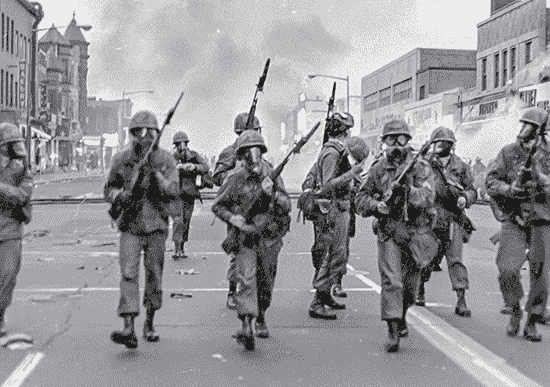

*1968 年 4 月马丁·路德·金被暗杀后的骚乱破坏了华盛顿特区整个黑人地区，包括西北第七街的这段。尽管破坏严重，但许多黑人华盛顿人将骚乱视为一种宣泄，并对骚乱后的复兴充满希望。© Matthew Lewis / 华盛顿邮报。*

就在卡迈尔说话时，抢劫和纵火再次开始，市官员很快意识到他们无法阻止日益增长的暴力活动。暴徒蔓延整个华盛顿市中心的阴影迫使约翰逊总统介入。他命令国民警卫队、第 82 空降师和第 503 宪兵营营进入城市。部队最初在到达暴乱地区时遇到困难——数千名回往郊区的工人堵满了街道试图逃离城市——暴力活动一直持续到深夜，《星报》报道道，“火势肆延无人看管，人道上堆满了湿漉的抢劫物资，烟雾笼罩了一切。”到周六清晨，13,600 名联邦士兵已控制了华盛顿特区。这是该国历史上任何骚乱中规模最大的部署，士兵巡逻在这座冒着烟的国家首都街道上的画面，让全国人民感到不安。⁷

这种暴力行为并非完全随机。警察和媒体的报告以及口证证实，某些暴徒经常会避开黑人经营的企业，这些企业在店窗户上贴有“灵魂兄弟”（Soul Brother）的标牌。位于 U 街的本辣椒碗（Ben’s Chili Bowl）在整个骚乱期间一直营业，作为社区活动人士的战略中心。Safeway 连锁杂店——由于其在几十年前曾激烈反击“新黑人联盟”，在黑人社区中饱受恶名，《纽约时报》报道，其商店“受到尤为打击”，而其竞争对手 Giant 遭受的损害相对较小。Giant 的所有者约瑟夫·丹赞斯基（Joseph Danzansky）支持马里·巴里（Marion Barry）在自豪组织的工作；随着暴力活动的升级，他与巴里在暴乱地区建立了食品分配中心，巴里派遣自豪组织的员工去保护 Giant 商店。然而，熊熊大火吞噬了民权支持者经营的企业，以及由种族主义者经营的企业。莫蒂默尔·勒伯维茨（Mortimer Lebowitz）曾与马丁·路德·金一起在塞尔玛游行，曾任城市联盟主席，他无助地看着自己的四家服装店中有三家被烧毁。⁸

华盛顿市长禁止出售酒精、易燃液体和枪器，并实施了每天下午 5:30 的宵禁，宵禁持续了一周。零星的暴力导致了年度樱花节游行的取消，但到周日，城市已基本平静。有 13 人死亡，大多数死于火灾和吸入烟雾；两人被警察杀死。沿西北十四街、西北第七街和东北 H 街黑人商业走廊的整个街已化为废墟，焦黑的残骸立在曾经繁荣的商业场所。九百多家企业受损或被，约 5,000 人失去工作，2,000 人无家可归。根据《邮报》报道，约 20,000 人参与了骚乱，警察逮捕了超过 7,600 人（其中 90%是黑人男性），主要是因为违反宵禁。⁹

骚乱暴露了地方政府的无能，但沃尔特·华盛顿（Walter Washington）在混乱中冷静、坚定的行动赢得了赞誉。在司法部长拉姆齐·克拉克（Ramsey Clark）的支持下，华盛顿多次拒绝参议员罗伯特·伯德（Robert Byrd）等人要求警察下达“击杀”指令。国家首都地区民自由联盟通常是警察的严厉批评者，这次赞扬警察的“克制与冷静”。然而，白人企业主和社区团体谴责了克拉克，并指责警察局约翰·莱顿（John Layton）对抢劫者太胆小。“我们是牺牲羊，”一位白人女商人告诉伯德参议员。10)

黑人华盛顿人带着愤怒、悲伤、反抗和决心的复杂心情审视着损失。许多人认同露西·库森（Lucie Kusen）的观点，她自称为“黑人权力倡导者”，并称她所在的东北区的抢劫行为是“毫无意义且不负责任的”。然而在一项调查中，近一半的黑人华盛顿人认为骚乱起到了“有用的作用”。华盛顿信息报（Washington Informer）的黑人出版者卡尔文·罗拉克（Calvin Rolark）将此称为反对那些“迫害贫民窟居民”的企业的“消费者反叛”。骚乱提供了“即时的城市更新”，许多黑人居民开玩笑说，这毁了本该很久就被拆除的剥削性企业和破旧住房。11)

现场还有一种兴奋感。“白人……叫你上学、受教育，然后他们给你一份微薄薪水的工作，还指望你觉得这个世界如此慷慨，”一位《邮报》的黑人政府员工写道。她在骚乱期间曾被捕，但对自己的参与并无多少愧疚感。“这座城市的黑人真的开心了三天。他们被欺负了太久，这是他们生活中的一个光点。”12)

骚乱既是灾难性的也是宣泄性的，这场危机引起了全国的关注，并让该市的问题得到了广泛的曝光。“华盛顿现在有机会在政治、社会以及物理上进行重建，”黑人统一阵线（Black United Front）的钱宁·菲利斯（Channing Phillips）牧师认为道。也许混乱中能产生好结果——只要当地居民自己规划重建工作并亲手完成。“如果还是按原样重建，它们将再次被烧毁，”马里·巴里在骚乱一周后警告道，“我们（社区）必须坚持，白人商人想回到我们的社区，他们必须以伙伴的身份回来。”13)

该任命委员会在动乱发生时上职仅六个月，他们举行了一系列公开听证会，近百名当地居民作了证。他们的报告在五发布，强烈谴责了暴力行为，并拒绝了将所有白人排除在重建过程之外的。报告由其白人主席约翰·赫辛格（John Hechinger）撰写，他是一家主导性五金店连锁的所有者，也是华盛顿显赫家族的成员，报告也承认了社区愤怒的深度根源。“华盛顿黑人社区在重建和恢复政策的规划与实施中应发挥核心且强大的作用，”委员会强调道，“表现出来的是对重建社区自决权的普遍诉求。”14)


1968 年 4 月骚乱后的十年，是一个充满喧嚣、不可预测的时期，充满了公民驱动的政治、文化与政治实验以及快速变革。对于这座在 1975 年被放克乐队 Parliament（Parliament）亲切地称为最初“巧克力城”的城市来说，这是一个动荡但充满希望的时代。该地区近一个世纪以来首次获得了一定的地方权力，所有种族的华盛顿人——包括在亚当斯·摩根和蒙特普利斯特社区日益壮大的西班牙裔社区——都在争取自决、社区控制和参与式民主。

## “不要让白人的路穿过黑人的家”：高速公路与对抗政治的新时代

金遇刺当天晚上，萨米·阿杜拉·阿伯特（Sammie Abdullah Abbott）正在街头从事他最擅长的活动：抗议。令警察震惊的是，他和一支跨种族的抗议者队伍在市长沃尔特·华盛顿位于 LeDroit Park 家中举行了示威。阿伯特是一位叙利亚基督徒移民的孙子，声音沙哑，是一个身材矮小的白人，鼻子高挺，戴着黑框眼镜，光秃的头顶围着一圈整齐的白发。他出生于 1908 年，在纽约州伊萨卡长大，在康奈尔大学读了短段时间后辍学组织工人。1940 年，他与妻子露丝（Ruth）搬到马里兰州的塔科马公园（Takoma Park），那里就在特区边界之外——他拒绝住在华盛顿特区，因为他想拥有投票权。第二次世界大战期间，他在美国军获得了青星勋章，随后投身于战后和平与民权运动，引起了联邦调查局（FBI）和美国反共活动委员会的关注；在被名单两年后，他开始了自由艺术家的职业。¹⁵

阿伯特习惯于反抗权威，是一团愤怒能量的集合——“我永远是个疯子，”他曾这样说。像朱利斯·霍布森（Julius Hobson）一样，他将愤怒转化为有组织的抗议。1964 年，他找到了将占据他后十年生命并巩固他作为社会活动家地位的事业：高速公路。露丝告诉他，他们的房子位于一条计划中的高速公路路线上，这条路将穿过华盛顿东北部和塔科马公园，连接蒙哥马里县郊区新开放的环线。沿着线上其他八位受苦的房主，阿伯特夫妇成立了交通危机紧急委员会（ECTC），并成为事实证明是华盛顿最重要、最成功的抗议运动之一的领袖。

自 20 世纪 30 年代以来，高速公路一直是城市规划的支柱。1956 年《州际国防公路法案》的通过使高速公路成为国家安全优先事项，国会承诺支付建设费的 90%。随着数十亿联邦资金的投入，华盛顿特地区广泛的强大利益集团团结在高速公路建设之后：大都会贸易委员会的商主们希望吸引郊区购物者回到城市、渴望获得丰厚合同的建筑公司、希望实施远见项目的城市规划师、鼓励增长与发展的报纸编辑者和当地推崇者、寻找更大税基和解决“城市破败”之解决方案的当地官员，以及希望通过恩赐和分钱项目回馈朋友的国会议员。20 世纪 50 年代，贯穿华盛顿西南部的 `I-395` 和横跨远东南部的 `I-295`（安纳科斯蒂亚高速公路）开始动工。规划者、政家和评论人士争论各种计划的细节，但直到 20 世纪 60 年代初，很少有人质疑最初建造如此多公路的整体明智与否。

这种情况在国家首都规划委员会发布 1959 年《交通计划》后开始发生变化，该计划概述了一个全长 329 英里的高速公路网络，横跨整个大都市，其中包括穿过市中心的 29 英里州际公路。规划者构想了三层同心圆的多车道高速公路：环绕城市的外环（后来被称为环线）；由公园绿化道构成的中环；以及穿过市中心的内环。一系列放射状高速公路从内环向外延伸，穿过城市社区连接到外环。¹⁶

该计划在纸面上看起来整洁且连贯，但它没有考虑到在拟建高速公路社区将发生的扰动和流离失所。根据某些估计，华盛顿特区的 5,400 户房屋将被摧毁，导致多达两万居民流离。规划者更多考虑交通效率而非政治，他们未能预见到随其拟议的西北高速公路而来的愤怒，这条路将穿过克利夫兰公园这一高级富人社区，那里是许多白人专业人士以及国会议员和其他联邦官员的家园。¹⁷

一位愤怒的麦康布西北街业主是彼得·斯蒂宾斯·克雷格（Peter Stebbins Craig），他是奥伯林学院和耶尔大学法学院的毕业生，在市中心一家著名的律师事务所 Covington & Burling 工作。克雷格协助成立了西北交通规划委员会，以组织反对该计划。凭借他们的法律敏锐度、严谨的研究以及在国会山广泛的人脉，克雷格和盟友在公开听证会和法庭上抨击了拟议的高速公路。正如《邮报》（`Post`）专栏作家乔治·拉德纳（George Lardner）所说，“现状的维护者利用电话、私交和在乡村俱乐部的聊天”来阻挠西北高速公路。在一年内，一个同情的国会对会对西北第 12 街以西和内环以北的高速公路建设实施为期五年的暂停，从而幸免了该市最富有、白人最多的社区。¹⁸

居住在黑人为主和贫困社区的居民没有获得这样的保护，尽管从激进的南方民权领导委员会（SNCC）到中产阶级的公民协会联合（Federation of Civic Associations）的黑人组织反对高速公路建设。在国会否决西北高速公路后，《非洲人》（`Afro-American`）的一条头条大喊：“摧毁房屋计划：数千有色人将被赶出华盛顿特区；白人房屋获救。”1963 年，新泽西大道圣经之路圣殿的活动派牧师斯马尔伍德·威廉姆斯（Smallwood Williams）呼吁明尼苏达州参议员休伯特·汉弗莱（Hubert Humphrey）保护他的教堂免受 `I-395` 建设的拆毁，但他仅成功让道路绕过了教堂建筑。这却夷平了该社区的其他部分。斯马尔伍德说：“必须停止为了马里兰州和弗吉尼亚州白人驾驶者的唯一利益，而对有色人房屋进行的无理破坏。”¹⁹

在尝试强穿西北部受阻后，高速公路倡导者寻求一种路径虽不那么直接但在政治上更容易被接受的方式，将拟议的市中心内环与环线连接起来。1964 年底，城市规划师提议建造一条十车道的北中高速公路，它将穿过东北部的布鲁克兰（Brookland）和其他其他以黑人为主的社区，以及马里兰州塔科马公园和银泉市（Silver Spring）中等收入、白人为主的郊区。官员估计，这条高速公路将导致约 1300 家庭搬迁，其中一半以上在特区内。²⁰


北中高速公路促使萨米·阿博特（Sammie Abbott）及其盟采取行动。阿博特和交通危机紧急委员会（ECTC）希望彻底终止新建高速公路，到 1964 年，这座城市的人均高速公路里程已经是全国最高。ECTC 坚持，任何交通危机的解决方案“必须基于这样一个基础进行：必须保护所有社区而非部分社区，必须服务所有社区而非部分社区，所有个人而非部分人都有权在法律的保护下捍卫自己的权利。”与其建设高速公路，ECTC 要求建立一套广泛的公共交通系统，包括一条连接贫困社区与市中心的地铁线。

在经济利益、政治务实主义和道德理想主义的驱动下，阿博特和 ECTC 刻意建立了一个跨种族、跨阶级的联盟，能够发起持久的、多方面的运动来击败高速公路游说集团。当时正值国家民权运动因种族隔离问题而产生分化的时期，ECTC 从成立之初就把“富人和穷人、黑人和白人团结在激进的领导层之后”。

阿博特希望将西北部的白人房主引入 ECTC 的联盟。他的首批招募对象之一是彼得·克雷格（Peter Craig），当时正领导反对在乔治大学附近的三姐妹岛跨越波托马克河拟建的八道大桥。尽管两人的风格迥异——阿博特是一个煽动情绪的分子，而克雷格是一个冷静的内部人士——但他们对高速公路及其可能对城市社区造成的破坏有着共同的鄙视。阿博特给克雷格打电话挑战道：“你关心的只是[洛克溪]公园西边的富白人。”多年后克雷格回忆起这次对话时笑道：“他让我感到内疚，作为一个优秀的贵教徒，我中招了。”通过与名为“联邦市百人委员会”的当地公民团体合作，克雷格在国会山进行游说，在听证会上作证，最重要的是开展了反高速公路的诉讼。

但阿博特无论是在意识形态还是性格上，都不适合领导在既有政治渠道内自如的体面改革努力。他和 ECTC 的其他联合创始人认为，受高速公路威胁最大的人应该主导反高速公路运动：即这座城市的黑人穷人。阿博特招募了雷杰纳德·布克尔（Reginald Booker），他在一次社区会议上听过这位黑人通用服务署员工的演讲。布克尔小时候时，他及家人在城市更新期间逃离了西南部的家园，在从罗罗斯高中毕业后，他开始参与各项民权抗议活动。26 岁的布克尔身材高瘦，经常穿着“黑权力”装束——达希基长袍和深色墨镜，与西装领带、身材矮小的阿博特形成了鲜明的视觉对比，但两人是志同道合，建立了维持二十多年的亲密关系。布克尔于 1968 年 2 月成为 ECTC 主席，而阿博特担任宣传总监。他们邀请了“自豪”组织的马里昂·巴里（Marion Barry）和黑人统一战线的查尔斯·卡塞尔（Charles Cassell）担任副主席。

ECTC 将高速公路之战明确定性为种族问题。“白人的路不穿过黑人的家！”成为了战斗口号。ECTC 成员在听证会上作证，向公共官员和当地报纸写信，为“高速公路战士”编写阅读清单，制作了无数海报、胸章和传单，并鼓励居民抵抗开发商、测量员和评估师。布克尔和阿博特深知媒体对推动事业的力量，总是愿意进行争议性的抗议、制作引人注目的传单、给出引人注目的引言或引发具有新闻价值的冲突。阿博特在一次集会上警告道：“在特区内再铺设一寸该死的高速公路之前，会有火焰，会有战斗，会有反叛！”《邮报》的威廉·拉斯伯里（William Raspberry）写道：“雷杰纳德·布克尔和萨米·阿博特……疯了，这给了我们避免被埋葬在高速公路混凝土下的最佳机会。”

到 1968 年，ECTC 及其反高速公路盟友已在多个领域取得了重大胜利。他们的跨种族抗议规模扩大，迫使媒体和当地官员关注。他们说服了新市议的大多数成员支持一项优先考虑快速交通而非高速公路的交通计划。在联邦政府，越来越多的约翰逊政府官员（包括美国首任交通部长阿兰·博伊德 Alan Boyd）开始对大规模高速公路建设的经济影响和种族含义产生质疑；博伊德甚至雇了反高速公路律师彼得·克雷格。最大的胜利来自法院。1968 年 2 月，一家联邦上诉法院裁定市政官员忽略了 1893 年一项要求对所有计划中的公路建设征求公众意见的法律，并命令停止所有高速公路的规划和施工。推土机停止了。

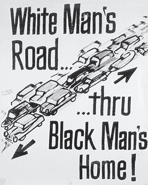

*“白人的路穿过黑人的家。”跨种族的交通危机紧急委员会通过基层抗议、激进言辞和不懈的诉讼反对高速公路建设。委员会的艺术作品经常使用种族形象来强调高速公路的社会后果。交通危机紧急委员会收藏，第 44 箱，华盛顿区分馆，华盛顿公共图书馆。*

但公民驱动的活动遭遇了华盛顿政治权力缺失的严酷现实。尽管约翰逊总统进行了政府重组，但这座城市仍听于国会委员会以及管理这些委员会的支持高速公路人士。。其中一个特别顽固的敌人是议员威廉·纳彻（William Natcher），一位来自肯塔基农村的民主党人，担任众议院华区拨款分委员会主席。作为一名维护秩序的隔离主义者，他警惕向这座黑人占多数城市的当地官员让出任何控制权；纳彻说话带有浓重的口音，自尊心薄，并下定决心维护国会对首都的权威。他反复威胁要扣留所有地铁建设资金，直到该市承诺完成整个高速公路系统。

高速公路反对者拒绝向他们认为是勒索的行为妥协。随着华盛顿居民在很大程度上响亮地反对高速公路，1968 年 12 月，议会批准了一份修订后的交通计划，删除了有争议的北中高速公路和三姐妹桥。然而，纳彻紧握地铁资金，推迟了地铁的动工，并增加了数百万美元的成本。市政官员面临越来越压力，要求他们通过批准完成高速公路系统的计划来安抚纳彻。

这一问题在 1969 年 8 月初的一次市议会会议上达到了疯狂的高潮。由于担心议员会在支持高速公路派的压力下崩溃，两多名 ECTC 成员和其他反高速公路者挤满了会议室。萨米·阿博特站在椅子上带领着震耳欲聋的“不！不！不！”口号，在议会主席吉伯特·汉（Gilbert Hahn）命令警察清理现场后，他跳向了一名警察。根据《邮报》报道，“现场爆发了一场挥拳、投椅的混战。”阿博特、布克尔、朱利叶斯·霍布森（Julius Hobson）和其他 11 名活动人士被捕。


议会在紧闭的大门后重新召开，并以 6 比 2 的票数接受了三姐妹大桥（Three Sisters Bridge）和北中高速公路，以换取建设地铁的资金。“国会告诉了我们谁才是老大，”投反对票的议员波莉·沙克顿（Polly Shackleton）哀叹道。华盛顿交通危机委员会（ECTC）的成员谴责议会“出卖了自己”：“华盛顿‘政府’现在就像一个赤裸的伪装。”即使在这次耻辱性的投票之后，国员纳彻（Natcher）也拒绝在所有高速公路诉讼撤销或解决之前为地铁拨款。

议会的屈服只是加剧了斗争，引发了为期两年的激烈抗议和诉讼，其重点日益转向三姐妹大桥上，高速公路的支持者和反对者都认为它是整个公路系统的关键。一旦建成，这座大桥每天将把数万辆汽车从弗吉尼亚州北部引入华盛顿市中心，这使得内环（Inner Loop）、北中高速公路和其他项目变得必要。高速公路反对者认为，如果他们能阻止这座桥，就能防止所有其他州际公路铺满整个特区。

ECTC 与全地的反高速公路活动人士合作，并利用了当地大学学生抗议者日益增长的力量，成立了“华盛顿交通危机学生委员会”。在这个以白人为主的委员会中，学生们拥抱黑人权力（Black Power）的口号和形象，并一贯提出反对修建大桥的种族论点。1969 年 10 月，几十名学生“占领”了波托马克河中部的的三姐妹岛，导致 140 人被捕。一个月后，阿伯特（Abbott）加入了马里恩·巴里（Marion Barry）和朱利斯·霍布森（Julius Hobson）在乔治敦大学的集会，集会最后导致两数百抗议者涌入社区街道，点燃垃圾桶并与警察发生冲突。

街头抗议与“百人委员会”（Committee of 100）法律团队领导的长期法庭战并行进行，该团队成功论证了国会不能推翻要求对三姐妹大桥征求公众意见的市法律。从 1970 年 4 月开始的一系列联邦法院裁决反复确认了特区居民对大桥设计和规划发表意见的权利，并再次命令市停止施工。在初生的国家环保运动以及弗吉尼亚州和马里兰州郊区日益发出的高声的支持地铁活动者的支持下，反高速公路运动扩大了其联盟，并在国会获得了盟友。1971 年 12 月，众院终于结束了纳彻议员对地铁资金的封锁。当 1976 年第一列地铁车在红线开始运行时，三姐妹大桥、北中高速公路和其他州际项目已逐渐消失在记忆中。

20 世纪 60 年代初，横跨美国首都的高速公路似乎是不可避免的；十年后，它们是不可能的；半个世纪后，它们是不可想象的。最初被认为是异想天谭的反高速公路运动对这座城市产生了巨大影响。21 世纪居民和游客喜爱的华盛顿的大部分特征——宁静的社区、历史悠久的建筑、可步行的市中心——如果按照由城市规划者、国会、地方官员和媒体推崇者构想的庞大高速公路网络建设，将会被毁灭。

ECTC 和反高速公路运动的遗产不仅限于那些*没有*建造的东西。它也指向了*已经*建造的东西：一个成功的、跨种族、跨阶级的联盟，它团结了大都市区内的各种利益。运动活动人士——从像萨米·阿伯特（Sammie Abbott）和雷杰纳德·布克尔（Reginald Booker）这样具有对抗性的局外人士，到像彼得·克雷格（Peter Craig）这样精通法律的内部——使用了各种策略来胜过对手、说服怀疑者，并迫使不情愿的地方和联邦官员履行华盛顿选民的意愿。“在这个国家政治最无能的城市里，黑人和白人、穷人和富人、学生‘疯子’以及科文顿和伯灵律师事务所（Covington and Burling）的律师抵御了国家最强大的政治家，”姆·史密斯（Sam Smith）赞赞地写道。这是一项了不起成就。

### “如果我们无法控制，就让把它踢出去”：活动人士推动社区控制警察

20 世纪 60 年代后期，华盛顿充满了抗议能量。像全地的反战、黑人权力、女性主义和环保抗议者一样，华盛顿的活动人士采取了日益强硬的手段挑战地方和联邦当局。一个特定的目标是警察局，许多黑人社区认为它是危险、腐败且充斥着鲁莽、种族主义警察的。1968 年夏天，在十四街发生一系列针对黑人公民的警察枪击事件后，黑人统一战（BUF）对警察行为举行了社区听证会，产生了一份对警察部门实行“社区控制”的十三项要求。“我们一直对（警察）拥有社区控制，”露丝·贝茨斯·哈里斯（Ruth Bates Harris）苦涩地观察道，“问题是，那一直是白人社区的控制。”

BUF 于 9 月发布的计划要求建立区派出所级和全市的公民委员会来招募新警、调查不当行为指控，并在适当时解雇警察；禁止在黑人社区进行全白人警察巡逻；要求所有警察居住在特区内；以及开除警察局长约翰·莱顿（John Layton）。BUF 将其计划提交给委员会副主席沃尔特·福恩特伊（Walter Fauntroy），他是该联盟指导委员会的成员。福恩特伊迅速批准了该计划，该市民主党中央委员会以及该市许多白人激进分子也表示了支持。事实上，一些社区控制集会甚至出现了以白人为主的人群。

很少有执法官员认真考虑过将对警察的控制权交给社区成员。随着犯罪率的飙升——抢劫案数量自 1960 年以来增加了八倍多——警察局内部许多传统主义者及其支持者（特别是在白人居民中）认为，“社区控制”会损害警察工作的能力。在 1968 年总统竞选期间，共和人理查德·尼克松（Richard Nixon）将这座城市作为其“法治与秩序”口号的焦点，将华盛顿标记为“犯罪之都”。在他上任后，提出了一项广泛的华盛顿犯罪法案，其中包括几项争议性条款，例如“不敲门”规则，允许警察在不警告的情况下进入嫌疑人的房屋。

但一些具有进步思想的地方和联邦官员看到了改革部门的必要性。为了改善警察与社区的关系，联邦经济机会办公室内一位 38 岁、书气的白人心理学家罗伯特·谢洛（Robert Shellow）开发了“模型派出所计划”。谢洛承认警察被视为“一种强制性的、敌对性的力量，特别是在黑人内城区”，因此他提议建立 24 小时的门店中心，让社区居民可以方便接触警察以及公共卫生和福利机构。谢洛的计划还设想了招募青少年“巡逻队”来帮助警察监控可疑活动，并要求警察参加“敏感性培训”和黑人历史课程。该计划准备充分并反映了最新的社会科学研究，迅速获得了 OEO 的批准，承诺为期 18 个月资助 140 万美元。

这是一场灾难。


正如《邮报》（*Post*）的威廉·拉斯伯里指出的，模型选区计划（被称为试点警察项目）从诞生之初就面临两个严重问题：“首先，警察不愿意向社区放弃任何实质性的控制权。其次，该计划给人一种试图通过福利服务来买通公民线人的印象。”《星报》（*Star*）在拨款首次公布时报道道，华盛顿市长和其他计划的支持者在听到批评者将这一想法攻击为“纳粹式的计划”，并称其将建立“基于社区的间谍网络”时感到“震惊”。³⁷

比起计划的具体细节，居民们更反对的是，该计划的官员中没有人去咨询过他们希望改造的社区中的任何人。即使是经济机会办公室（OEO）自己的当地反贫困组织——联合计划组织（United Planning Organization），也没有参与其中。在华盛顿人要求更多自主权的时候，模型选区计划却完全成型地从一个联邦机构白人官僚的脑脑中脱颖而出，而社区成员被要求只需签字即可。他们拒绝了。“往往犯了这样一个错误，即为穷人做计划，而不是与穷人一起计划，”UPO 负责人怀利·布兰顿解释道，此前 UPO 董事会在因被要求该计划背书而感到受辱后，完全拒绝了计划。³⁸

尽管如此，经济机会办公室的官员仍然一路推进。谢洛于 1968 年 8 月开始招聘员工，华盛顿市长任命了 39 名社区代表进入委员会，该委员会将举行社区听证会并选择一个选区作为试点项目的所在地。为了代表整个城市，这个臃肿的委员会包含了马里昂·巴里（Marion Barry）和查尔斯·卡塞尔（Charles Cassell）等黑人活动人士，以及来自大都会贸易委员会和公民协会联合会的保守白人代表。巴里、卡塞尔和其他活动人士很快对委员会感到失望并辞职。在他们缺席的情况下，委员会选择了第十三选区作为测试场。³⁹

这是一个奇特且最终注定失败的选择。第十三选区西邻罗克溪公园（Rock Creek Park），东临北国街（North Capitol Street），北接欧几得街和卡尔沃特街，南靠 S 街，该选区的犯罪率全市第二，并包含了十四街和第七街沿线许多遭受动荡骚扰的地区。但在该地区的七万居民中，很少有人对模型选区计划表现出兴趣。只有 40 人参加了选区选择公开听证会，其中大多数人完全反对该计划。⁴⁰

第十三选区的选择引发了黑人联合阵线（Black United Front）和骄傲公司（Pride, Inc.）的反击，这两个组织的总部都在该地区。马里昂·巴里领导了这次进攻。正如两年前的公交车罢运一样，巴里将对模型选区计划的抵抗视为一个反对仇敌并立立场的机会，并动员社区支持激进的变革。他以其典型的鲁莽风格威胁提起诉讼，举行模拟的“人民法庭”来起诉官员，并在规划会议上进行议事阻挠——然后胆敢挑战对手能做什么。“这东西是强加给黑人的，”他辩解道，“如果我们无法控制它，就把它踢出这里。”⁴¹

并不是所有的黑人居民都支持巴里。他和他的支持者往往疏远了老年、中产和上阶级的黑人华盛顿人，这些人对犯罪率的上升（这不成比例地影响了黑人社区）以及年轻活动人士的强硬手段和激进主义感到恐惧。在私下里，担忧的黑人居民担心，如果有人支持警察计划，“他的房子可能会被烧掉。” 许多人转而支持斯特林·塔克尔（Sterling Tucker），他是城市联盟的黑人领袖，他同时强调警察改革和社区责任。⁴²

然而，巴里仍然是这场试点项目辩论中最影响力的声音。当很明显 OEO 将推进该计划时，他策划了一次对民选公民委员会的接管。在巴里和他的支持者者名单在 1970 年 2 月赢得委员会选举后，国会的保守派议员敦促 OEO 取消该计划。经济机会办公室的官员坚持立场，巴里成为了委员会主席。他那好斗斗但有能力的风格赢得了委员会成员的尊重，也招来了警察的憎恨——一位计划培训师报告说，基层警察认为他是“肉身化的恶魔”。⁴³

委员会从未能对警察行使权威，但它确实赢得了对计划预算、程序和人员的控制。其初期行动之一是迫使谢洛辞职，导致了一系列轮换的董事，他们没有提供持续的领导力。在不断的内部内斗、持续的社区反对以及官方支持减少的阻碍下，该计划逐渐淡出。在投入 270 万美元联邦资金（加上另外 17 万美元用于 OEO 赞助的该计划纪录片资金）后，该项目于 1973 年年初关停了。⁴⁴

如果试点警察项目早十年甚至五年提议，可能会受到欢迎。然而，到 1968 年，华盛顿人不再愿意接受一个由官方批准、专家设计、忽视社区意见的计划，无论它附带多少联邦资金。“人们不再像我们以前那样简单地服从于武断和严酷的控制，”黑人联合阵线的查尔斯·卡塞尔解释道。斯特林·塔克尔写道，白人仍然太“家长主义”了。“在一个变革和动荡的时代，他们停滞不前，坚持着‘我们为他们解决问题’的信条。”⁴⁵


卡洛斯·罗萨里（Carlos Rosario）帮助西班牙语使用者参与了全市的民主号召。罗萨里是波多黎哥圣胡安的一个人，曾就读于波多黎哥大学，并在世界大战期间在美军一个隔离的波多黎哥部队服役。他接受训练成为一名射线技员，并于 1950 年移民美国，在后后成为卫生、教育和福利部的部门担任一份联邦工作。他和妻子卡米敏（Carmin）于 1952 年搬到华盛顿，定住在山特普莱特（Mount Pleasant）的西北霍巴特街（Hobart Street）。罗萨里充满魅力，精通双语，眼神炯神，带着亲切的微笑，他将丰富的精力投入到在一个习惯仅用黑白观点看待自己的孤立西班牙语群体中，建立起一种社区感。

### 社区的增长
罗萨里多年后回忆道，他刚来华盛顿时，“并没有西班牙社区”。西班牙语人口占华盛顿居民的比例不到 1%，规模小、组织松散，且在政治上是隐形的。二战后，随着拉丁美国家建立大使馆以及世界银行等国际组织设立办事处，该人口缓慢增长，主要集中在第 16 街和马萨诸塞州大道西北部。专业人员和家政工人聚集在附近的山特普莱特和亚当斯·摩根（Adams Morgan）社区，这些地区在几十年来一直是富裕华盛顿白人的田园式电车郊区。从 20 世纪 50 年代末开始，人口迅速扩张，最初受到古巴、危地拉、萨尔瓦多等国政治动荡的推动，随后受到《1965 年移民与国籍法》通过的影响，该法案允许更多来自拉丁美国家的人入境。尽管一些新移民在祖国是专业人士，但绝大多数人在家政服务、托儿、建筑和餐饮业中找到了低薪工作。

### 女性驱动的移民
与美国西南地区不同（那里拉丁裔移民主要是男性农业工人），在华盛顿，女性是拉丁裔移民此的驱动力。罗莎·洛佩斯（Rosa Lopez）是华盛顿新兴移民社区的缩影。洛佩斯出生于萨尔瓦多，20 世纪 60 年代为一家驻在圣萨尔瓦多的美国国际开发署的美国家庭担任女佣。当这个家庭回到华盛顿时，他们把洛佩斯带了，她最终成为了美国永久居民。她定住在山特普莱特，她的丈夫哈维尔（Javier）于 1968 年加入了她。在随后的几十年里，有 35 名洛佩斯家族成员来到华盛顿地区。

### 山特普莱特的转型
像洛佩斯这样的先驱女性帮助山特普莱特-亚当斯·摩根变成了该城市的非官方“拉丁裔区”（barrio），这里写着“这里讲西班牙语”的牌子、拉丁裔餐厅、杂货店、理发店、食品店、一家糖油圈店（`churreria`）和其他商店遍布在第 18 街和哥伦比亚路交叉口附近的商业街上。该社区挤在东部大部分低收入黑人居民和西部高收入白人居民之间，其异质的人口代表了近二十四个国家，反抗了任何种族、经济或政治分类的尝试。这里拥有从深色巴拿马人到浅色厄瓜多尔人的所有肤色，以及从劳工阶级的危地拉家政人员到富裕古巴企业家的所有收入水平。拉丁裔居民（当时被称为“拉丁人”或“西班牙语者”）简单地不符合华盛顿的二元种族结构。山特普莱特西班牙天主教中心的玛利亚·路易莎修女（Sister Maria Luisa）解释道：“说西班牙语的人处于黑白之间。”

### 罗萨里的调解者角色
罗萨里帮助建立社区纽带，将城市的拉丁裔居民联系在一起。他从社交活动开始——他创立了拉丁美社交俱乐部举办舞会，为该地区代表的每个国家策划独立日庆祝活动，并租下乔治亚大道的殖剧院放映西班牙语电影。作为一名拥有政府经验的英语使用者，他将自己定位为“解决者”（fixer），一个能练的问题解决高手，可以帮助陷入困难的西班牙语者寻找工作、解决住房并应对城市的官僚机构。他回忆道：“放电影时，我总是宣布任何找工作的人应该给我打电话，我会帮助他们。”

华盛顿的西班牙语人口在 20 世纪 60 年代激增。根据人口调查局的数据，1960 年至 1970 年间，华盛顿的历史裔人数增加了一倍，达到 15,671 人，尽管罗萨里和其他当地领袖坚持认为数字接近 50,000。由于社区过于多元，单一领袖无法代表拉丁裔居民的多样利益，但罗萨里建立了一群忠诚的追随者，并被誉为少数能在大型社区中阐述拉丁裔需求的英语发言人之一。

### 挑战与就业不足
有很多移民成功的成功故事——波多黎哥人找到了稳定的政府工作，古巴人开办兴旺的小企业——但拉丁裔居民在华盛顿往往过得很艰难。他们面临着与其低收入黑人邻居相似的许多挑战，包括就业、住房、教育和执法方面的歧视，但还增加了语言障碍。一个主要忧虑是就业不足：语言困难使许多移民无法从事与其教育和技能相匹配的工作。华盛顿拉丁美洲联盟的鲁道夫·拉莫斯（Rudolfo Ramos）说：“如果一个木工不知道工具的名字，或者不理解你想做什么，他就无法当木工。所以为了生存，他只能去当洗碗工。”就业不足对那些受过良好教育的移民来说尤为痛苦，他们往往不得不从事领域之外的低薪工作，因为他们无法获得认证或无法满足职业的语言要求。一旦上班，工人往往发现自己被雇主剥削，雇主拒绝支付足够的工资并威胁要驱逐他们。

不出意外，很大比例的拉丁移民生活在贫困中。联合计划组织（United Planning Organization）少数双语员工之一的曼努埃·冈萨雷斯（Manuel Gonzales）估计，山特普莱特拉丁裔居民的中位收入仅为 3000 美元，正处于贫困线；当地蚝小学约 80%的西班牙语学生生活贫。为了分担高昂的房租，许多移民挤在公寓楼里。房东乐于收租，但经常拒绝维护这些满是蟑螂的建筑，声称租客允许住太多个人违反了租赁协议。

对许多拉丁裔家庭来说，教育是另一个障碍。方济会神父何塞·索莫扎（José Somoza）解释说，他们有时选择不送孩子上学，因为“孩子们听不懂，他们没有懂西班牙语的老师，或者他们必须留家里照顾弟弟妹妹”。执法是另一个问题。社区与当地警察的沟通一直很困难——1967 年，山特普莱特-亚当斯·摩根分局 116 名警察中只有 3 个人会说西班牙语——因此，许多微小事件往往会演变成严重的肢体。


“此外，在从土坯房到水泥房、从陶罐到铝罐、从敞开门到华盛顿式的堡垒式生活的文化适应过程中，还有获取社会安全卡、工作、买一辆 400 或 500 美元的可靠二手车、驾执照、牌照等问题，”理查德·克里奇菲尔德（Richard Critchfield）在《邮报》中写道。尽管人们坚信美国是一片繁荣的土地，但古巴移民玛莎·维达纳（Martha Vidana）承认：“这是一个很难生活的国家。”[^(55 

然而，很少有西班牙语居民发声或向当地政府请愿以解决他们的诉求。原因在很大程度上是经济性的：许多居民在艰苦的体力劳动工作中长时间工作，几乎没有时间或精力投入政治活动。文化和经验也起了作用。许多移民逃离了政治活动可能引发致命报复的国家，因此他们害怕发声；有些人没有法律文件就来到这个国家，避免做任何引起政府官员注意的事；还有一些人根本不想对一个向他们敞开大门的国家抱怨。一位不耐的拉丁裔领袖说：“这些人中的一些人因为自己不提要求而感到很困扰。”[^(56 

### 拉丁裔组织的兴起

20 世纪 60 年代中期，罗萨里（Rosario）和少数会说英语的拉丁裔领袖（如来自哥伦比亚的、好牧羊联合长老会教会的安东尼奥·韦尔蒂（Antonio Welty）牧师）开始组织西班牙语社区。他们采纳了民权活动人士开创的策略和辞令，与地方和联邦当局对抗，要求政府对不断增长的拉丁裔人口的需求做出回应。罗萨里建立了哥伦比亚特区西班牙语弱势少数群体援助发展委员会，并开始在英语社区中为拉丁裔的利益发声。韦尔蒂在位于欧文顿街西北方向的威尔逊中心中心组织了早晨 8 点的早餐会，到 20 世纪 60 年代后期，那里已成为日益增长的移民群体的社会活动枢纽。两人与公立学校官员合作，聘用双语教师和员工，并提供成人英语课程。他们敦促警察官员对警察进行沉浸式西班牙语培训，并游说资金用于西班牙裔社区的公共卫生、休闲和住房计划。“[^(57 

尽管许多活跃的领袖是男性，但参与这些努力的大多数人是女性——她们负责培训项目、参加语言课程，并帮助新移民适应城市。多米尼加清洁工兼社区活动人士卡西尔达·卢娜（Casilda Luna）说：“寻求帮助的总是母亲、妻子。社区就是这样开始的。”随着时间的推移，这些组织西班牙语者的努力帮助塑造了一个跨越种族、阶级、政治和国家的全新“拉丁裔”认同。“[^(58 

### 种族紧张与经济竞争

随着拉丁裔居民日益增多并组织日益完善，他们有时会与黑人邻居发生冲突。尽管曾尝试将非白人少数群体团结成一个基于阶级的联盟，但华盛顿的黑人和拉丁裔居民彼此往往心怀戒备。像他们之前的爱尔兰移民一样，拉丁裔移民与黑人工人竞争低收入工作，但他们无法与黑人的政治力量抗衡。许多拉丁裔居民将黑白人统称为“安格洛人（Anglos）”，这个词在其他地方意思是“白人”或“老板”。在 2 世纪 60 年代后期的华盛顿，许多拉丁裔居民认为，“黑人是老大板。”[^(59 

紧张情绪在社区街道、拥挤的公寓楼，以及林肯初中等其他有大量拉丁裔学生的学校走廊里爆发。玛丽亚·路易莎修女（Sister Maria Luisa）担心道：“西班牙人和黑人虽然住在一起，但并没有融合。他们不是不是朋友。”卡洛斯·罗萨里（Carlos Rosario）也意识到了种族问题的困难。“这两个群体相互理解并没有达到应有的程度，还没有真正就共同的需求和利益开始合作，”他在 1970 年这样说道。“[^(60 

犯罪复杂了黑人社区和拉丁裔社区之间的关系。随着 1968 年骚乱后犯罪率飙升，许多拉丁裔居民认为自己是黑人犯罪分子的容易目标，并敦促在普莱森山（Mount Pleasant）和亚当斯摩根（Adams Morgan）增加警察保护。与白人和黑人同伴一样，许多受过良好教育的中产阶级拉丁裔居民在骚乱后搬往郊区，促使马里兰州兰格利公园、弗吉吉亚州阿灵林顿和其他郊区社区西班牙裔人口的增长。韦尔蒂牧师叹道：“很多人因为喜欢普莱森山的（拉丁裔）氛围而想留下来，但他们很害怕。”[^(61 

《星报》的菲利普·尚德勒（Philip Shandler）写道，留在特区的人往往是“最需要帮助的人：最新的、失业率最高的、背景和经验最不利应对日益紧张局势的人。”骚乱使市官员的精力转向黑人社区的需求，而往往是以牺牲拉丁裔关注为代价的。例如，培训警察西班牙语的计划在骚乱后被取消了。一位拉丁裔领袖苦涩地指出，“黑色已成为紧迫的颜色。”[^(62 

### 内部冲突与政治摩擦

卡洛斯·罗萨里发现，拉丁裔活动人士组织社区的努力往往与黑人政治领袖的目标发生冲突。1965 年，罗萨里协助创立了`CHANGE`（卡多佐高地社区增长与丰富协会），这是一个由经济机会办公室资助的反贫非营利组织。当这个以黑人为主的组织面临温和派与激进成员之间的内部斗争时，精明的罗萨里通过将自己定位为每个人都能同意的“安全”候选人，巧妙地当上了主席。然而，许多黑人成员抱怨他过于关注拉丁裔的需求。一位董事评论道：“他非常尽责，工作非常努力，但根本无法与不会说西班牙语的人——在这种情况下，就是黑人——进行有效的沟通。”[^(63 

作为主席，罗萨里与执行总监露丝·韦伯斯特（Ruth Webster）斗争，韦伯斯特是一位有十四个孩子的黑人母亲，她体现了在贫人黑人社区内部培养领导力的民权目标。韦伯斯特认为拉丁裔居民和其他少数族裔应该学会“适应他们生活的社区”。她想要“种族和文化融合”，并认为`CHANGE`不应该为拉丁裔社区制定“特殊计划”。但罗萨里和其他拉丁裔居民坚持认为他们的社区有特定的需求，特别是语言培训的需求。当韦伯斯特拒绝帮助时，他们变得愈发愤愤。“[^(64 

拉丁裔的政治挫败感体现在对市长沃尔特·华盛顿（Walter Washington）的投诉中。和露丝·韦伯斯特一样，市长及其许多高级官员认为，西班牙语社区通过普适的全市计划得到最好的服务，但罗萨里和其他领袖认为他们的选民需要有针对性的行动。当华盛顿于 1967 年首次上任时，罗萨里要求他在市和拉丁裔社区之间建立一个联络办公室。华盛顿同意了，但负责该职位的人提供了“零服务”，罗萨里抱怨后在未被接替的情况下辞职了。


由于缺乏任何表达社区不满的选举手段，罗萨里（Rosario）和其他西班牙语居民转而寻求国会。特别是，他们寻求了参议院唯一的西班牙裔裔成员、来自新墨西哥州的民主党人 约瑟夫·蒙托亚（Joseph Montoya）的支持，他当时担任特区拨款小组的成员。蒙托亚向议会施就拉丁裔社区的问题举行听证会。听证会于 1970 年 1 月举行，让拉丁裔居民有机会发泄长期以来的怨恨，包括语言障碍、剥削性房东、与警察相处的困难以及在学校教育系统中的挣扎。威廉·拉斯比（William Raspberry）在《邮报》中写道，市议会中的六位黑人成员“承认大多数投诉与黑人过去被迫处理的问题如出一辙”，“这座市忽视了它的西班牙语居民。”^(65

听证会催生了西班牙语社区咨询委员会，这是一个由十五人组成的任命机构，负责向市官员提供政策建议。罗萨里担任执行秘书，安东尼·韦尔蒂（Antonio Welty）担任主席，拉丁裔居民现在在市政府内有了直接的联系点。但建立拉丁裔政治权力的努力在 1970 年人口普查公布后遭遇了沉重打击，普查显示特区有 15,671 名拉丁裔居民（马里兰州和弗吉尼亚州郊区还有 55,000 人）。愤怒的拉丁裔领袖责这些数字极不准确，认为存在漏计是因为拉丁裔居民经常拒绝填写普查表（特别是当是无证移民时），而且普查调查员有时会跳过或误算西班牙裔家庭。⁶⁶

担心低的人口总量可能成为市官员忽视社区的借口，罗萨里与马尔塞莱拉·达维拉（Marcela Davila）、卡斯尔达·卢娜（Casilda Luna）和其他拉丁裔领袖一起，通过举办“西班牙裔美国节”（Hispanic American Festival）——这是一个拉丁裔文化的年度盛会，放大了拉丁裔居民的政治声音。正如内战时期华盛顿黑人举行的“解放日”游行一样，该节日的目标不仅是为了庆祝社区遗产和成就，还为了提供拉丁裔社区规模和实力的可见证据。帮助创立这一庆祝活动的秘鲁人佩德罗·卢汉（Pedro Lujan）说：“这个节日对我们来说是向美国人证明，是的，我们确实存在这里。”该节日首次于 1971 年 8 月举行，吸引了成千上万拉丁裔居民来到哥伦比亚路（Columbia Road），引起政界和媒体的关注。^(67

西班牙裔美国节和西班牙语社区咨询委员会，以及 20 世纪 70 年代初萌发的其他社区组织，并没有立即缓解拉丁裔社区长期存在的担忧。一个为期一天的活动和一个预算仅为 4 万美元的小市办公室能做的作用非常有限，与语言、文化和市官僚机构的斗争在整个 20 世纪 70 年代持续存在。但多年来拉丁裔机构成为可能的政治组织和社区动员，帮助将社区转化为一种可见的政治力量。满意的卡洛斯·罗萨里（Carlos Rosario）在 1973 年指出：“过去五年，我们走了很远。西班牙语社区不再是一个孤独的社区了。”拉丁裔政治觉醒的时机非常有利，因为它与该市地方自治运动的巅峰相契合。在经历了近一个世纪的任命政府后，华盛顿即将赢得自治的权利。^(68

### “有了选票，就不需要子弹了”：特区赢得自治

安妮塔·福德·艾伦（Anita Ford Allen）在一个动荡的时代表现得得毫不掩饰地老派。她出生于 1925 年，在安纳科斯蒂亚（Anacostia）长大，周围是姨妈、叔叔和堂表兄弟，在她记忆中，那是一个“关系紧密、由通常勤奋的家庭组成的”社区。她的根源无疑是工人阶级——她的父亲在政府印刷局上夜班，她的母亲在国会图书馆清洁办公室——但她有向上流动的抱负。作为阿姆斯特朗高中（Armstrong High School）的优毕业生，她以优等成绩毕业于哈华德大学，并在芝加哥大学获得硕士学位，随后回到华盛顿成为一名公务员。她于 1965 年加入联邦教育局；两年后，她被任命为特区学校委员会成员。艾伦肤色浅，目光犀利，身高五英尺九英寸，经常戴着华丽的帽子，让她看起来看起来更高、更有威严。她因对教育政策的了解和直率不讳的行事风格而闻名，是一个对磨洋工事的学校行政人员或激进的黑人分离主义者都毫无耐心的女性。⁶⁹

艾伦对教育的热爱使她参加了华盛顿近一个世纪首次选举，即 1968 年 11 月的学委员会选举。建立一个选举产生的、由 11 人组成的学委员会的法案是在约翰逊总统于 1967 年 8 月提出政府重组计划之后出台的。法案在当年晚些时候在国会两院通过，仅有三票反对票，并在 1968 年 4 月骚乱后不久成为法律。这次选举吸引了 64 位背景各异的候选人，包括联邦、社区活动人士以及非传统的求职者，例如美容师伊利亚·布洛克（Ilia Bullock），她用装在棕色纸袋里的零钱支付了报名费。活动人士朱利斯·霍布森（Julius Hobson）得票最多；艾伦在决赛中胜出，赢得了一个大选区席位。⁷⁰

随着当地活动人士和社区领袖从抗议转向选举政治，学委员会——特区唯一的选举机构变成了政治能量的焦点。一直通过联盟结受到制抑的紧张局势爆发了争权夺职的丑陋斗争。艾伦是一位坚定的“自由主义者和整合主义者”，拒绝利用学校来培养黑人政治意识的尝试，并频繁与霍布森、查尔斯·卡塞尔（Charles Cassell，于 1969 年当选委员会）以及其他主张社区自治的活动人士发生冲突。她辩称道：“大多数人想要的是更好的学校，而不是控制权。”在 1969 年成为委员会主席后，她主持了许多分裂的会议，这些会议有时会演变成人身攻击。在一次会议上，一群黑人高中生嘲讽道：“嘿，艾伦夫人，你是黑人吗？”⁷¹

艾伦就像过去的玛丽·丘奇·特瑞尔（Mary Church Terrell）、卡尔文·查斯（Calvin Chase）和约翰·墨瑟·兰斯顿（John Mercer Langston）一样，代表了一种中产阶级、通常肤色浅、体制内的领导形式，这种领导模式在历史上对黑人华盛顿行着不成比例的影响。这种传统的领导模式在 20 世纪 60 年代后期日益受到攻击。当艾伦在 1971 年竞选时，她面对的是马里昂·巴瑞（Marion Barry），后者代表了一种更年轻、更激进的领导形式，对低收入群体更有吸引力。巴瑞将他的社区组织技巧转向政治，为这个兼职职位进行了一场高能量的竞选，并承诺为被他斥为“全国大笑话”的学委员会带来彻底变革。尽管他对学校或教育政策几乎没有经验，巴瑞还是击败了艾伦。^(72


# 1971 年国会代表竞选

到 1971 年，城市居民有了另一个释放政治能量的出口：国会非投票代表席位。尼松总统提议将此作为通往完全代表的过渡步骤，一项创建这一象征性代表职职的法案于 1970 年通过了国会。尽管该职位没有投票权，但它引起了极大兴趣，1971 年的竞选让两位民权领军人物面对对决：朱利叶斯·霍布森（Julius Hobson）和沃尔特·福特罗（Walter Fauntroy）。两人经常一起工作，但他们是截然不同的人：一个是一个满口脏话、办事干练且鄙视妥协的无神论者；另一个是一个社交活跃、享受交易中博弈的牧师。而且他们私下互不相来。在竞选期间，霍布森嘲讽福特罗自以为是的模样，称他为“福特罗小领主”，并告诉选民，他们的选择是在“国会里的一个男人或一个男孩”之间做出。”[⁷³

## 州化的愿景

霍布森-福特罗竞选复活了一个在华盛顿政治界响彻数十的老观点：建州。将`D.C.`从一个“联邦市”变成与联邦其他地区平等的州，这一想法可以追溯到 19 世纪末，当时白人劳工领袖 A.E.雷德斯通建议建立一个新的名为“哥伦比亚”州。这一想法一直沉寂，直到 1969 年，道格拉斯·摩尔（Douglas Moore））、记者查克·斯通（Chuck Stone）以及其他黑人民族主义者宣布成立`D.C.州化委员会`，并誓用“任何必要手段”让华盛顿成为第 51 州。委员会并未跟进那次戏剧性的公告，但它启发了另一份《首都东报》（`Capital East Gazette`，后改为`D.C. Gazette`）的激进编辑萨姆·史密斯（Sam Smith）在次年关注这一问题。史密斯是一位在“自由华盛顿”运动中担任志愿者的白人华盛顿人，他发表了《华盛顿特州化的理由》，在文中呼吁城市居民拥抱“不受限制、不妥协的自决”：建州。”[⁷⁴

## 州党策略

为了给他反对福特罗的第三党竞选提供平台，霍布森采纳了史密斯的观点，并作为新州党的唯一候选人参选。这个名字具有误骗性——州党成员是一群背景多样的活动家，他们主要关注教育、住房和种族平等——但霍布森的竞选让“建州”成为了`D.C.`自决运动中一个严肃（尽管极有争议）的辩论话题。霍布森要求立即建州，尽管国会对此几乎没有支持，他的理由是，明确且不妥协的要求将把这一想法从边缘推向中心。福特罗则担心，推动建州法案会导致压倒性的失败，并从长远来看损害自决事业。福特罗认为，即使国会批准了建州，也定会取消国会拨款（当时约占该市预算的 20%）——他将这种场景比作给`D.C.`居民一个“在他们杀光所有野牛之后的……保留地”。相反，他主张通过自治法案以及随后的宪法修正案，要求在国会获得完全的投票代表。”[⁷⁵

福特罗在 1971 年的选举中轻松击败了霍布森。在作为非投票代表进入国会后，他为自治法案争取了支持。法案最初被众议院拒绝，但在参议院通过。1973 年，众议院通过了一个包含咨询社区委员会（ANCs）条款的法案版本，该条款后来被纳入最终立法中。

```
“这是一种共同伙伴关系，”迪格斯（Diggs）代表解释道，“国会是更优的伙伴。”该法案是一项立法救济措施而非宪法性措施，这意味着国会可以撤销它。事实上，一些国会成员将自治视为一种实验。正如一位有影响力的代表告诉迪格斯的那样：“我会给五年时间，然后我们必须废除它。”
```

咨询社区委员会（ANCs）是那个时代的象征性和实质性产物，是一种参与式民主的制度形式，在未来的多年里一直让政治领袖们感到困惑。

议会通过的立法仍受限于国会的审查和否决。

`D.C. Gazette`的萨姆·史密斯抱怨道，这份有限的自治法案设计是为了是为了“让本地人开心”。”[⁷⁹


在赢得（有限的）自治权后，自决运动活动人士计划了一场运动，争取在国会获得完全的投票代表权，并恰逢美国在 1976 年的建国两周年。这似乎是一个政治上的良时机，因为水门事件丑闻让许多反对增加华盛顿自治权的保守派对手陷入了困境，而民主党（很大程度上支持华盛顿投票权）在众议院和参议院拥有巨大的多数席。活动人士团结起来，支持一项《宪法：华盛顿投票权修正案》。代表代表法恩特罗伊（Fauntroy）于 1975 年在国会提交了该修正案，恳求同事们“修补自由之角的裂缝”。成立于 1971 年的全国性倡导组织“华盛顿自决组织”（SDDC）协调了一场激烈的游说活动，通过电话、信件以及专业游说者和公民倡导者的访问，让目标国会议员接接踵肘。

他们的努力取得了令人瞩目的果实。两党在 1976 年的政党纲领中都支持了该修正案，并在 1978 年 3 月，众议院以 289 比 127 票通过了它。在参议院，法恩特罗伊和 SDDC 获得了南卡罗来纳州共和党参议员斯隆·瑟蒙德（Strom Thurmond）的关键支持，理由是他承诺在 1978 年艰难的连选期间不会动员黑人选民反对他。这位长期的民权对手在保守派共和党人中找了共同提案人，并在议事上发表了极其非凡的演讲，宣布“人权始于我们国家的首都”。该修正案以 67 比 32 票通过，提交至各州进行批准。

《华盛顿投票权修正案》的成功象征着华盛顿日益提升的全国地位以及早期自治时代的希望。1975 年，放克乐队 Parliament（Parliament）发布了一首歌颂华盛顿的歌曲，名为《巧克力城市》（Chocolate City），这个绰号在 20 世纪 70 年代初由“夜鹰”（Nighthawk）等当地电台 DJ 流行，并被该市黑人人口所接纳。“当你有了选票，就不需要子弹了，”主唱乔治·克林顿（George Clinton）轻唱道。对于许多黑人居民来说，“巧克力城市”捕捉了自治权的自豪与承诺。这座城市享受了黑人文化和意识的繁荣，体现在 go-go 音乐（该市特有的风格）、华盛顿黑剧院（SNCC 老兵贝尼迪斯·约翰逊·雷根等人创立了无合唱乐团“Sweet Honey in the Rock”）以及以黑人为主的联邦城学院（于 1976 年并入新的华盛顿特大学）。随着反映该市 71%黑人人口的民选领导层的出现，华盛顿重申了其作为黑人美国首的。

对于一些白人居民来说，自治权只加深了深层的不安全感和无奈。《华盛顿人》（*Washingtonian*）杂志在 1976 年 10 月的一个充满争议的封面故事捕捉了白人的恐惧，封面是一张极具挑衅性的照片：一个香草冰淇淋球埋在四个球巧克力冰淇淋下面。标题问道：“白人在华盛顿能生存吗？”，副标题写道：“一种‘巧克力城市’心态正在特区蔓延。一种新的种族主义正在出现。”作家约翰·桑辛（John Sansing）采访了许多白人居民——其中许多人自称为政治自由派——并发现他们神情紧张、与自治政府疏远，并对自身日益增长的种族偏见感到惊讶。一位 26 岁的老师描述自己，在住在亚当斯·摩根（Adams Morgan）并担心她的黑人和拉丁裔邻居后，已经从一个“白皮肤的自由派变成了一个现实主义的种族主义者”。和她的许多白人同龄人一样，她认为国会是约束黑人多数的唯一手段。“我知道这种感觉很糟糕，但当自治真正到来而我们没有国会来保护我们（白人）时，我想要彻底离开特区，”她说。

### “人们到处都在这样做——把人赶出去”：20 世纪 70 年代华盛顿的发展与绅士化

尽管动乱后的时代充满了希望，但所有种族的华盛顿人都意识到，华盛顿面临着严重的人口和经济问题。与全美国城市一样，华盛顿的人口正在大量流失。在 1970 年至 1980 年间，随着中产阶级白人家庭继续搬往郊区，以及越来越多的中产阶级黑人和拉丁裔居民和为他们服务的企业的加入，其人口萎缩了超过 15%，减至 638,333 人。20 世纪 60 年代末和 70 年代初的犯罪潮似乎已经见顶，但它已经摧毁了市中心的大部分区域。封死的窗户、被封锁的商店和被暴乱烧毁的残骸遍布西北第十四街（Fourteenth Street NW）、西北第七街（Seventh Street NW）和东北 H 街（H Street NE）沿廊。为了寻找吸引人们回到城市并保护税基的方法，焦虑的政策制定专注于房地产开发，并与开发商密切合作，开展大型项目，如新的会议中心、宾夕法尼亚大道的改造以及地铁系统。

对新开发的强调加剧了日益严重的住房问题，因为开发商们正盯上市中心老旧社区的复兴项目。这种后来被称为“绅士化”（gentrification）的现象——这个词在 70 年代流行起来，用来描述社区的低收入居民逐渐被高收入居民取代的过程——在之前的几十年里已经重塑了华盛顿的几个社区。第一波绅士化发生在 20 世纪 20 和 30 年代的乔治敦（Georgetown），当时白人专业人士搬入一个日益恶化的工人阶级社区，并开始修复该地区的老房子。到了 50 年代，乔治敦已成为市最高端的社区之一。另一波复兴和流离浪潮在 50 和 60 年代席卷了雾迷谷（Foggy Bottom）和国会山（Capitol Hill），开发商翻新了“贫民窟”房屋并将其卖给更富的新移民。

但 70 年代的流离规模比过去更大、更迅速。受极低廉住房价格以及乔治敦等地修复者成功的吸引，开发商、投机者和业余炒房客抢购了亚当斯·摩根、普普勒特（Mount Pleasant）、洛根圈（Logan Circle）和其他社区的房产。年轻的专业人士紧随其后，部分受到那个时代反文化对郊区批判的启发。“这些社区的低收入居民由于租金上涨、无法支付首付款以防止房屋卖给新房主，以及房主面临突然变得昂贵的社区更高的房产税而被迫离开，”华盛顿邮报的米尔顿·科尔曼（Milton Coleman）写道，“在大多数情况下，在这些曾被忽视的布满玻璃的人行道和老鼠的小巷中建立新生活的定居者都是白人。”

表 6 华盛顿人口，1970–1990

![images/t0001-06.jpg)

许多开发商专注于将旧公寓楼或大片联排别墅转换为公寓，导致住客大规模且令人震惊地被迁出。在 1973 年短短几个月内，业主就驱逐了亚当斯·摩根十一栋公寓楼和国会山一整街的住房租客。随着时代的推移，公寓化不断加速。1979 年的一项研究发现，该市约 12%的公寓单位已经或正处于转换为公寓的过程中。房地产价格急剧飙升。在亚当斯·摩根、普普勒特和国会山，房价在不到五年的时间内翻了一番，远远超出了大多数居住这些社区的黑人和拉丁裔居民的承受能力。


号召“邻里力量”，当地活动人士动员起来保护低收入租户并与驱逐行为作斗争，建立了基于社区的租户权利团体，如首都盛顿东区社区组织和亚当斯·摩根组织。成立于 1973 年的全市住房联盟连接了各街社区的活动人士。在过去，被驱逐租户的辩护者们在政府中很难找到支持。然而，随着地方自治的到来，他们可以利用由活动人士转变为政治家的力量，与房东和开发商进行斗争。

其中两类活动人士是议员大卫·克拉克（David Clarke）和议员纳迪恩·温特（Nadine Winter），他们将反驱逐立法列为优先事项。作为地方自治时代的首批行动之一，议会通过了《`D.C. Rent Control Act`》，该法案设定了租金涨上限，并规定如果建筑计划转换为公寓，租户拥有优先购买单元的权利。次年，议会对寻求将公寓转换为产权公寓的开发者制定了基准。但克拉克和温特建议对那些购买并快速转售物业的开发者——即“投机者”进行处罚，这遭到了房地产利益集团的强烈抵抗，他们与财政收入委员会主席马里昂·巴里（Marion Barry）合作，阻止了法案的通过。

当市领导在辩论反驱逐立法时，亚当斯·摩根地区`1700 block of Seaton Street NW`的租户们反击了。1976 年 4 月，来自马里兰州贝塞斯的中心物业（Centre Properties）购买了该街的几栋破旧的联排房屋。中心物业官员计划翻新房屋并以买入三倍以上的价格出售，向 20 多个家庭发出了驱逐通知。大多数租户认为自己没有资源来与中心物业抗争，并决定搬家，但有九个家庭选择挑战开发商。西顿街并非天堂——市检查员在该街的 44 栋房屋中发现了`959`处健康和安全规范违规——但居民对他们的社区有着深厚的感情，并将他们破旧的公寓视为“家”。这九个反抗的家庭联系了亚当斯·摩根组织，起诉中心物业以停止驱逐，并开始筹钱自行购买这些房屋。居民约瑟夫·刘易斯 Junior（Joseph Lewis Jr.）说：“到处都在这样做——把人们赶出去。这是不对的。”在一个多的时间里，西顿街的租户留在了原地。面对日益增长的公众反对声，中心物业在案件开庭前几天同意将房屋卖给租户。

受西顿街抗议的启发，并受到驱逐速度加快的威胁，租户们举行了如此喧闹和破坏性的抗议，以至于《邮报》（*Post*）将 1978 年称为“租户反抗年”。抗议迫使议会通过了一系列进步性措施来保护低收入居民，并提供财政激励帮助他们购买自己的住房。尽管这些法律中的某些在当时得到了遵守，另一些在 20 世纪 80 年代初失效，但租户和租户权利活动人士仍然能够利用它们来减缓某些社区的驱逐。

## “我们巩固地位的机会”：1978 年市长竞选

绅士化及其反映的日益加剧收入不平等成为 1978 年市长竞选的主要议题。现任市长沃尔特·华盛顿（Walter Washington）强调了他的经验和正直，并夸耀他在城市骚乱后复兴中所起的作用，但许多选民已对他平庸的领导感到反感。他面临着来自议会主席斯特林·塔克（Sterling Tucker）的严峻挑战，后者赢得了沃尔特·福恩特罗（Walter Fauntroy）强大的政治网络的支持，并成为明显的领先竞争者。

这两位建制派巨头——塔克和华盛顿之间预期的冲突，被忙碌的议员马里昂·巴里的野心和政治好运所打破。在议会中，巴里利用其作为财政收入委员会主席的身份，与商界建立联系，并确立了能够平衡华盛顿多元化选民区利益的精明政治家声誉。尽管在城市的大部分地区仍然相对不为人知或不受信任，特别是在选票丰富的、以白人为主的第 3 区，巴里惊人地从枪击中获益。

这件事发生在 1977 年 3 月 9 日。哈纳斐穆斯林（Hanafi Muslims）的武装团体是伊斯兰教国家的一个分支教派，他们在西北 16 街上部的金海岸地区建立了总部，他们冲入了了位于`Rhode Island Avenue NW`的 B’nai B’rith 总部和位于`Massachusetts Avenue NW`的伊斯兰中心，劫持了百多名人质。第三支较小的小队冲上特区大楼的五楼，在斯特林·塔克的办公室附近捕获了人质，并与警察交火。当这位议员走出电梯时，一颗反弹的散弹枪弹贯穿了马里昂·巴里的胸部。

尽管伤口后来被称为浅表伤，但最初的报道称巴里在“心脏附近”中枪，这位议员胸部缠着绷带的照片在晚间新闻上一闪而过。巴里坐在病房里，看着周围堆积的卡片和鲜花，这位永远敏锐的政治家相信，枪击事件将为他竞选市长所需的动力。他把筹款人叫到床边，指示他开设一个竞选账户。尽管胜算渺茫，但他还是加入了战斗。

巴里决定参加 1978 年市长竞选，这破坏了沃尔特·福恩特罗试图从地方自治早期选举的混乱中恢复秩序的努力。福恩特罗认为塔克是更有经验、更受欢迎的候选人，指示巴里“等自己的机会”去竞选议会主席。相反，巴里把自己塑造成一个局外人，勇敢地与意图任命“由少数人指派”政府的“政治大佬”们作斗争。

这场三足鼎的民主党竞争分化了黑人选民。华盛顿争取了年长的黑人精英、有组织工会和许多工人阶级选民，特别是政府员工；塔克培养了年轻的中产阶级黑人专业人士、联邦雇员和企业主；巴里获得的黑人选票份额最小，主要来自年轻专业人士和贫民。。黑人牧师支持华盛顿或塔克，而民主党州委员会则在塔克和巴里之间产生分歧。

尽管候选人及其高要助手都是黑人，但种族仍然是选举中的分裂因素。“对失去这座城市有限的黑人控制权的担忧（尽管这是一个很少公开讨论的话题）是今年选举的持续背景，”《邮报》的米尔顿·科尔曼（Milton Coleman）写道。对于许多担忧的黑人居民来说，黑人政治家之间的激烈内斗、媒体对丑闻的审视，以及白人回归绅士化社区，都是白人政治力量复苏的迹象。他们指了大都会贸易会主席罗伯特·林诺斯（Robert Linowes）的言论，他在 4 月份自信地预测城市很快将实现种族平衡，并稳固地成为中产和上层阶级，而穷人将从郊区通勤。”


由于黑人社区的分离化，白人选民在选举中掌握了权衡的关键力量——他们投票支持巴里（Barry）。这位前黑人权力运动激进培养了一批高著名的白人支持者，其中包括南西·“比特西”·福尔格（Nancy “Bitsy” Folger，宝洁公司前任主席）以及年轻且野心勃勃的开发者 `Jeffrey Cohen` 和 `Conrad Cafritz`。他拥抱社会自由主义立场，支持同性恋权利和大麻合法化，这触怒了黑人牧师，但吸引了白人自由主义者。他获得了白人激进分子、搬入绅士化社区的年轻白人专业人士，以及位于洛根（Logan）和邓波特圈（Dupont Circles）附近的政治影响力强大的白人同性恋社区和第三区一些老牌白人选民的支持。

对巴里从佃农之子到市议员的崛起感到着迷，许多白人选民认为他是对过去的突破，是一个足够强大能够同时应对黑人贫民和白人商业利益集团的人。他获得了《华盛顿邮报》意外的背书，该报编辑会对巴里的“领导力素质”印象深刻，并赞扬他“为了促成目标有着真正大胆且充满力的承诺”。《邮报》的六篇支持巴里的社论以及该候选人随后在民调中的上升，让斯特林林·塔克（Sterling Tucker）极度不安，以至于在民主党初选前不到一周，他拼命试图劝巴里退出。

最终的统计结果接近得令人痛苦。巴里领先不足两千票，在选举之当晚谨慎地宣布了胜利，但经过两周的重新计票和沃尔特·福恩特罗（Walter Fauntroy）的特别恳求，塔克才承认失败。

白人选民和《邮报》将巴里推向了顶峰，随着他接近竞选，他必须与“白人候选人”的印象作斗争，这在这座自豪的黑人城市里是一个有毒的标签。在初选竞选期间，巴里的助手们费尽心确保候选人与白人支持者的合照频率不要太，他的新闻秘书还要求报纸明确将候选人的新种族裔妻子 `Effie Barry` 标识为“浅肤黑人女性”，因为她棱角分明的面部在照片中看起来像白人。但白人选民在他胜利中的作用——以及贝蒂·安·凯恩（Betty Ann Kane，第一位赢得全区议员选举的白人候选人）的胜利——引起了一些黑人观察者的关注。

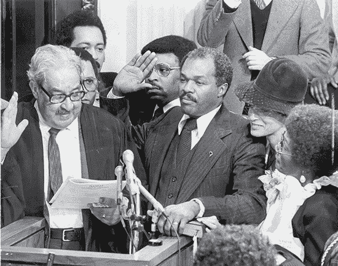

*新当选市长马里昂·巴里（Marion Barry）于 1979 年 1 月从最高法院大法官瑟德·马歇尔（Thurgood Marshall）处宣就职。巴里是佃农之子，也是 1965 年抵达华盛顿的民权活动家，他体现了“巧克力城”的希望与承诺。经图书馆星收藏许可转载，©华盛顿邮报。*

初选后，《华盛顿非洲人报》专栏作家莉莉安·威金斯（Lillian Wiggins）表达了私下的恐惧，认为“无脸无名的人”有一项撤销黑人成果并重新夺回白人对城市控制权的“大师计划”。作为黑人中产阶级的正直成员，威金斯注意到，非裔美国人选民分裂了选票，而白人选民通过团结特定的候选人，将他们的选举影响力放大得远超其人数。威金斯指责黑人政治家未能防止统一的白人投票集团，她写道：“黑人政治家对权力的争夺对大师计划造成了打击。”她预测，如果巴里赢得 11 月的大选，“他也将将感受到大师计划的刺痛”，并建议他统一黑人选票以保护自己。威金斯对“大师计划”的恐惧（后缩短为“计划”）在接下来的三十里在华盛顿政坛回响，每当腐败调查或白人政治利益威胁到黑人民选官员或绅士化导致黑人居民流失时，它就会出现。

在大选中中，巴里面对的是共和党的阿瑟·弗莱彻（Arthur Fletcher）——他是一位黑人紫勋勋获得者、前职业足球运动员以及尼克松总统任内的劳部助理部长。尽管是一个强大的候选人，但弗莱彻在一个民主党选民占 90%的城市中无法竞争，巴里赢得了全市 137 个选区中的 130 个。然而，结果预示了未来二十十年城市选举的种族动态。许多在初选中支持巴里的白人选民在大选中转而支持弗莱彻。弗莱彻领先的七个选区位于第三区最富有、白人最密集的区域。相反，在九月支持过华盛顿的贫困非裔美国人将绝大多数票投给了巴里。“巴里是‘白人的候选人’也就这样，”一位巴里竞选团队的工作人员查看结果时调侃道。

1979 年 1 月 2 日，巴里带领游行队通过了仍留有动乱伤痕的十四街走廊，经过 `Youth Pride` 办公室（那里模仿著名的维吉尼亚州细宝香烟广告，挂起了一幅写着“马里昂，你走得很远了”的横幅），到达区大楼。等待主持宣誓仪式的是黑人民权老兵、最高法院大法官`瑟德·马歇尔（Thurgood Marshall`，他是那位致力于让这一天成为可能的人的学生：查尔斯·哈密尔顿·休斯顿（Charles Hamilton Houston））。

从 1968 年 4 月暴乱到马里昂·巴里在 1978 年市长选举中胜利，这十年见证了国家首都一场非凡的政治革命。1968 年开始时，市居民在政治上仍然无能，受国会、未经选举的市委员和一群利益集团的统治，自 19 世纪 70 年代被剥夺投票权以来如此。十年后，华盛顿人享有某种程度的自治，并选举出一位前民权活动家担任市长，与一个充满社区活动人士的议会共事。整个十年中，华盛顿居民行使了在了一个世纪委员统治下萎缩的政治肌肉。这种转型是动荡的，其以毁灭性的暴乱、犯罪率的飙升和中产阶级的流失为标志。当华盛顿人努力攻击当局（国会、警察、城市规划者、开发商等）争取声音时，政治往往是粗俗且混乱的。正如一位市官员所说，特区经历了“带有所有摩擦的参与式民主”。但对于不习惯地方权力的市居民——特别是对华盛顿人来说——这是一个令人兴奋、充满希望的时代。

马里昂·巴里在 1979 年就职时体现了这些希望。新市长意识到，他的政府所象征的意义远不止他个人的成功，他负着经营高效政府的特殊种族责任。“有一种感觉认为黑人什么事都做不好，”他说，“我们想证明黑人是有有胜任能力的。”作为首位竞选大城市的民权老兵，他代表了黑人权力的潜力。《邮报》的尼古拉斯·莱曼（Nicholas Lemann）写道：“人们非常强调巴里和他周围的人是榜样。巴里和他最亲近的助手说话就像全世界的眼睛都在盯着他们。”事实上，在未来的十年里确实如此

## 十

## 完美的华盛顿

## 马里昂·巴里与巧克力城的兴衰，1979–1994*

许多黑人觉得，他们自己未来的一部分包裹在马里昂·巴里作为市长的成功之中。他是一个符号——最显眼的符号——代表了那些在 60 年代成长、70 年代开始获得财富、地位和权力，并不想在 80 年代失去这些一切的黑人。


—米尔顿·科尔曼，《华盛顿邮报》，1980

### 背景：欧几里德街 1345 号

在茂密树木的掩映下，位于`1345 Euclid Street NW` 的四层楼粗糙灰色石砌联排别墅很容易被忽视。尽管建筑本身高大且气派，但这栋 4335 平方英的建筑却融入了周围四栋几乎相同的邻居建筑之中。该建筑在 2010 年进行过小规模翻修，这栋巨大的住宅——拥有八间卧室和四间全卫浴室——看起来干净但陈旧，在哥伦比亚高地（Columbia Heights）过热的 21 世纪房地产市场中，这是一处价格相对便宜的物业。¹

### CCNV 时代

在上一代，这栋建筑作为“欧几里德房屋”（Euclid House）脱颖而出，是创意非暴力社区（Community for Creative Nonviolence）的总部。`CCNV` 由埃·吉南（Ed Guinan）于 1970 年创立，他是一位白人股票交易员，在受到多萝丝·戴（Dorothy Day）天主教工作者教义的启发后，变卖了资产前往华盛顿学习神职。他作为一名激进的反越战争传教士声名远扬，他引用其中一名成员的话说，将`CCNV`构想为志同道合的活动人士的“训练营”。然而，随着时间的推移，他担心组织的反战努力忽视了他们身边的贫困。“由于国际上如此强烈的关注，”吉南回忆道，“我们盲目地越过了华盛顿此的尸体。”1972 年，`CCNV`将精力重新集中在穷人身上，并在肖区（Shaw）开设了撒切斯社区厨房（Zacchaeus Community Kitchen），每天为超过四百人提供食物。²

### 米奇·斯奈德的崛起

来自全国各地的热心活动人士涌入`CCNV`的“社区”，当时这里位于托马斯环路（Thomas Circle）以北的`N Street NW`。一位充满魅力但变幻莫测的新来者是米奇·斯奈德（Mitch Snyder），他是一个布鲁克林犹太人，在因诈欺入狱期间加入了激进的反越战争天主教。凭借他热情的投入和无限的精力，斯奈德迅速成为社区的领军人物，他是一个愿意用激昂的言辞和大胆的抗议直接面对不公的人。他的斗争性风格与吉南产生了冲突，吉南在 20 世纪 70 年代中期已经从对抗性策略转变为与穷人生活在一起并服务他们。为了避免内部破裂，社区于 1975 年同意开放第二所“房子”，名义由斯奈德领导，专门从事直接行动抗议。欧几里德房屋就此诞生了。 3

### 哥伦比亚高地的衰落

到 20 世纪 70 年代中期，欧几里德房屋周围的哥伦比亚高地社区变得非常危险。该地区最初是一个精英街区，在 1948 年最高法院宣布限制性契约无效后，该地区变成了一个中产阶级黑人聚居地。该社区从 20 世纪 60 年代开始恶化。当黑人租客搬入该地区时，白人公寓业主忽视了维护，将拥有壮丽视野的华美建筑变成了贫民窟。1968 年 4 月的骚乱在`Fourteenth Street`沿线留下了一片烧毁的店面和被毁的公寓楼。火灾熄灭后，毒贩搬了进来，将那条街变成了该市最大的海洛因市场之一。绝望的成瘾者诉诸盗窃、卖淫和抢劫，迫使许多中产房主离开。 4

市政府通过将该地区作为前刑犯和精神疾病患者的倾倒场，加速了该社区的恶化。`1345 Euclid`的物业成为那些从洛尔顿监狱（`Lorton penitentiary`）过渡出来的男性的住所，华盛顿官员在两个街区范围内设立了另外六个宿舍和半途之家。到 20 世纪 70 年代中期，许多房主将房子卖给了投机者，投机者希望邻近杜邦特环路（`Dupont Circle`）和亚当斯·摩根（`Adams Morgan`）正在进行的士绅化能延伸到哥伦比亚高地。但预期的开发热潮从未到来，投资者们只是把他们的物业封起来，以度过经济风暴。 5

### 活动家组织

将哥伦比亚高地变成贫民窟的同样力量吸引了激进活动人士和社区组织者。许多在 2060 年代将该社区作为基地的民权和黑人权力组织在 70 年代仍留在了那里。`Pride, Inc.` 拥有`Fourteenth`街和`Euclid`街角的一家加油站；`华盛顿活跃黑人商人联盟`（`D.C. Alliance of Active Black Businessmen`）在`Belmont Street`的`Pitts Motor Hotel`设立了总部；由一群`SNCC`校友拥有并经营的`Drum and Spear`书店位于`1371 Fairmont Street`。 几个以白人为主的新左翼社区也搬了此地，加强并丰富了该社区的活动家传统：`Sojourners`，一个致力于社区组织的反战基督教团体；`哥伦比亚高地社区所有权项目`（`Columbia Heights Community Ownership Project`），一个反士绅化倡导者联盟；以及创意非暴力社区`。 6

### 欧几里德房屋的使命

搬到`Euclid Street`对米奇·斯奈德和他的`CCNV`活动家产生了巨大影响。他们看到到处都是投机者遗弃的房屋——哥伦比亚高地在全市约四千间空房子中占了不成比例——而工人穷人和流浪者却都流离街头。市政府没有为单身无家老人提供收容，将这项工作交给了一个基于信仰的非营组织网络，为男性提供了两百张床，为女性提供的不到二十张。`CCNV`向流离居民开放了欧几里德房屋，斯奈德回忆道，到 1976 年中，“每晚有四十或多人睡在我们的地板上。”活动家们的精力、投入以及对需要者的拒绝评判，让他们赢得了所服务的穷人的喜爱。“他们什么都没有要求，”间歇性住在欧几里德房屋的戒酒者罗伯特·刘易斯（Robert Lewis）观察道，“他们只是让我重新站了起来。” 7

### 改革的斗争

为了解决危机的系统性原因，斯奈德和欧几里德社区敦促沃尔特·华盛顿（Walter Washington）市为其日益增加的无家者人口建立收容系统。市官员不情愿地配合，但`CCNV`发现市经营的收容所在是残酷的地方，无家者男性有时会被保安殴打，被要求在进入前脱光洗澡，并在黎明前被赶回街头。许多无家者拒绝忍受这种屈辱，而是留在街上，睡在蒸汽气栅上或废弃的汽车里。在冬天，他们数十人冻死。 8

### 巴里时代

对华盛顿市长感到失望，欧几里德房屋的成员在马里昂·巴里（Marion Barry）1978 年赢得选举胜利中看到了希望。尽管他们没有参与选举政治，但他们与巴里建立了工作关系——斯奈德甚至在 1977 年中枪后去医院看过巴里。就职后，巴里市长采纳了`CCNV`的改革议程。他在 1979 年 2 月的一次演讲中宣布：“收容是一项基本人权，”并坚持认为他的政府将确保国家首都每个需要的人都能获得“充足的收容。”他任命了市长无家者咨询委员会，并指派其制定一个全面的、去中心化的小型收容所和日间中心系统计划，这正是`CCNV`一直在争取的系统。对于习惯了被官员嘲笑和被排除在政策决策之外的活动家来说，这是一个令人振奋的时刻。 9


欧几里德大厦居民在 1979 年初感受到的兴奋，反映了许多华盛顿居民在巴里市执政初期所拥抱的希望、乐观和可能性。在暴乱的灰烬中，在白人外流造成的真空里，在面对低效且往往冷漠的市官僚体制时，华盛顿居民试图塑造一个新的种族平等且经济公正的城市。马里昂·巴里（Marion Barry）成为了他们远大理想的载体——他从佃农之子到街头抗议者，再到国家首都首席执行官的，激励了许多华盛顿人宏伟地思考，将华盛顿打造为模范的“巧克力城市”。

## “我们要向所有人证明，黑人真的可以管理好一切”：马里昂·巴里夺权

伊万霍·唐纳森（Ivanhoe Donaldson）无法抑制内心的兴奋。学生非暴力协调委员会（SNCC）即将管理一个城市了——而且不仅仅是一座城市，而是国家的首都。唐纳森于 1941 年出生于哈哈姆，是一名警察和家庭主妇的独子，这对夫妇是加勒比海移民，他们崇拜黑人民族主义者马库斯·加维，并在儿子身上培养了一种冷静的自信和自豪感。在密歇根州立大学读书期间，他独自前往北卡罗来纳州参加 SNCC 的成立会议，并在那里结了马里昂·巴里。尽管唐纳森身材瘦小，几乎显得纤弱，但他拥有钢铁般的意志，并自愿承担南方一些最危险的工作。他还是一个贪书者、一个敏锐的思考者和一个卓越的战术家。20 世纪 60 年代中期，唐纳森帮助斯托克利·卡迈尔（Stokely Carmichael）完善了他关于“黑人权力”的思想；随着运动从抗议转向政治，他奔波于各州，领导了某些标志性的竞选活动，使第一代《投票权法案》后的黑人政治家当选成功。

在出差间隙，唐纳森在华盛顿建立了自己的基地。他后来回忆道：“我想住在黑人城市，”并“同时成为国家政治和当地社区的组织者”。1965 年后的几年里，大约三十名 SNCC 战友出于许多相同的原因加入了他的哥特区。他们对这个采纳他们的家园产生了决定性的影响，从联邦市学院（Federal City College）黑人研究计划的形成，到领导通过批准自治宪章的公投运动，他们都发挥了领导作用。唐纳森沉浸在他们的陪伴中。他与约翰·威尔逊（John Wilson）合租公寓，在他们的“鼓与矛”书店里与查理·科布（Charlie Cobb）和朱迪·理查森（Judy Richardson）辩论黑人政治，并在 1974 年号召运动盟友帮助老友马里昂·巴里当选华盛顿议员。

唐纳森负责了巴里 1978 年看似不可能的市长竞选，并在结果出来后，再次号召他的运动同事帮助这位年轻的当选市长。SNCC 的老兵们充斥了巴里的政府，包括新闻秘书弗洛伦斯·泰特（Florence Tate）、少数裔商业机会委员会主任考特兰德·考克斯（Courtland Cox）、规划与发展助理市行政官詹姆斯·吉布森（James Gibson）、住房部居民服务总监凯伦·斯佩尔曼（Karen Spellman），当然还有担任总助理的唐纳森。全国其他地方没有哪个黑人抗议组织能如此彻底地主一个大城市的政府。“我们要向所有人证明，黑人真的可以管理好一切，”欣喜的唐纳森在 1979 年搬进哥特区大楼办公室后评论道。

巴里市长与唐纳森一样希望将华盛顿成为黑人政治权力的展示窗。自从克利夫兰的卡尔·斯托克斯（Carl Stokes）当选美国主要城市第一位非洲裔市长以来仅过了十二年。在他身后出现了一群令人的黑人市长，包括科尔曼·杨（Coleman Young，底特）、汤姆·布雷德（Tom Bradley，洛杉矶）、梅纳德·杰克逊（Maynard Jackson，亚特兰大），以及华盛顿的沃尔特·华盛顿（Walter Washington）。他们的成果差不齐。白人外流、城市制造业工作的消失以及持续的贫困和犯罪挫败了他们的许多努力。巴里对这些政府的批评非常敏感。在竞选期间，他告诉《邮报》：“有些白人根本不认为[黑人领导]能行通，他们现在说‘我早就说过了’。”

巴里在 1979 年 1 月冲进市长办公室，决心证明他们是错的。他保持着疯狂的节奏，每天工作 13 小时，早上领着秘书们赶往哥特区大楼，晚餐后很晚仍与助理由们聚在一起。他的目标将是一个“开放、干练且富有同情”的政府，一个“对媒体有回应……接电话并解决公民问题”的政府。他雇佣了一支充满活力的年轻城市管理者团队，反映了城市的人口结构。尽管非洲裔男性占主导，但巴里还首次将大量的女性、拉丁裔官员和同性恋人士引入华盛顿政府的高层。

他还让市长办公室变得直白地黑人化。巴里在他办公室门外的墙上挂满了塞内加尔挂毯，然后在一次由该国驻美大使参加的盛招待会上向公众展示。1979 年中，他开始了为期五个国家的非洲之旅，最后在利比利亚的非洲统一组织会议上发表了演讲，这个国家是由一个半多世纪以前殖民运动重新定居的美国美国建立的。

巴里的目标不仅仅是让地方政府更高效、更具代表性。他希望政府能为人民服务——特别是那些自重建时期以来就被排除在决策之外的低收入黑人居民。他提议了一项数百万美元的计划，旨在“清理”市内估计的 4500 栋废弃房屋。该倡议的核心是贝特斯街项目（Bates Street Project），这是肖区（Shaw）一个三个街的修复工程，此前一直因官僚主义红带和资金问题而停滞。巴里通过向开发商提供数百万美元无息贷款启动了建设。到 1979 年底，有一百多个中产和工人阶级家庭搬进了新装修的建筑，其中一些还获得了市政补贴以使其负担得起。

尽管巴里努力服务贫困人口，但他利用市合同将资金和权力重新分配给黑家中产阶级的做法最为成功。巴里还几乎让夏季青年就业计划的规模增加了一倍，并建立了一个降低婴儿死亡率的倡议。


在考克斯（Cox）任职期间，市很少签署不涉及少数族裔公司的合同。到 1985 年，价值近 1.6 亿美元的市合同中有 35%流向少数族裔企业。这项倡议培养了一批新的黑人百万富翁，一些在市起家的少数族裔公司，包括黑人娱乐电视（Black Entertainment Television）和皮布斯公司（Peebles Corporation），最终成长为行业巨头。

尽管取得了这些成功，巴里（Barry）几乎立即遭遇了削弱其政府早期承诺的系统性问题。首要问题是官僚机构，这是一支拥有四万四人的庞大队伍，效率极其低下、成本高昂，且有时态度态度得令人难以信。官僚主义的延误破坏了市长的标志性项目。尽管住房部门以创纪录的速度交付了贝茨斯街项目的第一百个单元，但到 1982 年夏天，其余房屋已比计划延迟两年，且超支了数百万美元，这在很大程度上是因为市政工作人员在发放付款前没有检查承包商的工作。即使是以执行严厉执行者而闻名的唐纳森（Donaldson），也发现市政工作人员如此无能或抵触，以至于“本该是一天就能完成的项目”可能会耗费“多达十天的时间”。

最具破坏性的可能是官僚机构未能做好记录。该市的预算和报告结构自地方自治实施以来几乎没有变动，那时市政机构与联邦对应机构的关系比与特区大楼更为紧密。1976 年，安瑟·安德森（Arthur Andersen）会计师判定该市的账目“不可审计”。上任市审计长阿尔方斯·希尔尔（Alphonse Hill）回忆道，1979 年，每个部门仍然像“小领地”一样，拥有自己的会计、人事和薪资部门，没有中央协调，这使得无法确定市里花了多少钱以及花在了什么地方。巴里政府花了两年时间和 600 万美元才完成了一次审计——这是该市历史上的第一次。

当政府官员最终弄清账目上的内容时，他们发现该市有 1.15 亿美元的赤字、超过 3 亿美元的长期债务，以及近 7.4 亿美元的未资金的养老金负债。因此，巴里并没有改革官僚机构，而是在执政的前两年里竭力从预算中榨每一分钱。

为了弥补缺口，巴里公布了一份严苛的 1981 年预算，要求加税、削减市政服务、裁员和冻结工资。削减对穷人、老人和无家归者的打击最为严重。对于许多在巴里就职后才获得实质市政服务的人（包括米奇·斯奈德（Mitch Snyder）和创意非暴力社区（CCNV））来说，这份预算是特别具有毁灭性的。在他承诺将大幅改善无家归者服务仅一年后，他就解散了市无家归者委员会，并宣布将在 72 小时内关闭两个紧急避难所以节省资金。CCNV 急忙寻找了一支免费律师团队反对市长的命令，并获得了一项判决，要求该市保持避难所开放。

削减分裂了巴里的联盟。工会领袖和青年团体谴责他提议关闭社区中心并裁员市政工人，却不让商界支付“其应有的份额”。当巴里在特区大楼前的集会上上台时，一群多元化的市政工人、住房倡导者和社区活动人士向他嘘声。巴里习惯于抗议权威人物而非成为抗议的对象，他告诉他们“去地狱吧”。他更关心有钱的人，”一位依靠固定收入生活的寡妇说，“他背叛了穷人和老人。”

在危机期间，唯一与市长关系更近的选民群体是像罗伯特·利诺斯（Robert Linowes）这样的商人，他是大华盛顿贸易委员会的白人前主席，他赞扬巴里“做出了艰难的选择”。到 1980 年 12 月，只有 31%的非洲裔居民认可他的执政表现。对于这位前活动家来说，这是对政治权力现实和限制的粗鲁觉醒。

### “任用制就是好的政治”：巴里在保守派反对中建立政治机器

当陷入困境的巴里努力维持其联盟完整时，该市陷入了新兴的全国保守派运动的口风浪尖。保守派的首要目标之一是《特区选举权修正案》（DCVRA），该法案在巴里当选后的几个月内进入各州进行批准。与同样被考虑批准的《权利平等修正案》一样，DCVRA 引起了强大的草根组织、智库和压力集团的激烈反对。

一个特别有效的敌人是美国立法者交易所协会（ALEC），这是一个成立于 1973 年、由保守派州级立法者和商业利益集团组成的联盟。ALEC 是“新右翼”组织严密网络的一部分，这些组织通过一系列重叠的议题活动——包括税收、平权行动、权利平等修正案、同性恋权利和 DCVRA——来动员支持者。1978 年，ALEC 新主席、亚利桑那州州代表唐娜·卡尔森（Donna Carlson）将反对 DCVRA 的战斗放在议程首位。在卡尔森的领导下，ALEC 为数十位保守派评论员提供研究和论点，他们攻击 DCVRA 是试图为华盛顿官僚提供“特权和权力”，并是一个选举“极端自由派民主党人”的计划，这些人将支持“联邦资助的堕胎……控枪……劳动法‘改革’以及由工会首领推动的所有其他法案”。ALEC 将对修正案的批评汇成厚实的简报，并发送给全国每一位州立法员。该组织的游说努力果断地削弱了修正案早期的势头。

意识到公开的种族敌意已在政治上变得不可接受，新右翼活动分子在反对修正案时采取了钢丝技巧：一方面淡化种族问题，另一方面诉诸白人对黑人权力的焦虑。帕特里克·布肯南（Patrick Buchanan）找到了这种平衡。布肯南是一个好斗的特区土著，在切维查斯斯（Chevy Chase）长大，他曾协助总统尼克松（Nixon）制定将该市描绘为“犯罪之都”的战略。现在，他无缝将白人对自由政策的愤怒编织进反对 DCVRA 的有力论点中。尽管他私下承认特区居民有“合理的诉求”，但在公开场合，他将该修正案标记为“平权行动计划”，并恳求美国不要为了“两个世纪的宪法政府……让朱利安·邦德（Julian Bond）当参议院主席”。

面对一致的保守派反对，通过 DCVRA 的进程陷入停滞。到 1980 年夏天，只有 10 个州批准了该修正案。9 个州大比例拒绝了它。共和党自 1948 年以来第二次一次通过了不包含特区选举权条款的政纲。（这种变化持续了很长时间——在接下来的三十二年里，该党要么在该问题上保持沉默，要么反对任何扩大特区自决的行为。）1980 年 11 月的联邦选举注定了该修正案的命运，将领导反对 DCVRA 的保守派激进分子推上了权力，其中包括新当选的总统罗纳德·里根（Ronald Reagan）。


1980 年的选举从根本上改变了该市与共和党及联邦政府的关系。

自 1974 年实行地方自治以来，控制国会的自由主义者一直刻意避开有关地方立法的斗争，试图在`地方自治法`（Home Rule Act）的法律限制范围内，为新的华盛顿市政府提供最大程度的自决权。新获得信心的保守派则抛弃了这一惯例，激进地干预华盛顿事务，并将该市作为国家政策辩论的标记。在 1981 年秋季，当他和其他共和人成功推翻了该市的性侵犯法后，伊利诺伊州代表员菲利普·克兰（Philip Crane）认为：“国会就是地方政府。我们有责任审查华盛顿市委员会所做的每一件事——每一件事。”

在接下来的五年里，国会共和人引入了 12 项反对决议——即国会对市委员会通过的法案进行否决——反对的对象从 1981 年一项将成年人自愿性恋行为非罪化的市法律，到 1983 年一项剥夺与南非和纳米比亚白人至上政权做生意的公司资金的法律。出生于华盛顿、担任众议院华盛顿拨款小组委员会主席的加州黑人代表朱利安·迪克斯（Julian Dixon）感叹道：“某些成员中存在一种园主心态，他们认为自己一直是领主，因为特区的人们无法处理自己的事务。”

### 经济增长与复兴

尽管马里昂·巴里（Marion Barry）的政治命运回升，保守派的反对也随之增加。在经历了第一年预算危机的挣扎后，巴里受益于市地铁系统扩张引发的市中心开发繁荣。在整个旧市中心，随着开发商推平一又一栋破旧的排屋并代之建造的办公大楼，地价飙升；而市的百货商店也翻新了它们的旧建筑——赫奇（Hecht’s）建成了一座新设施，这是几十年来美国市中心建造的第一家大型百货商店。

巴里通过简化建筑商的官僚程序、与联邦政府紧密合作开发，以及推进在西北第 9 街和第 11 街之间的 H 街上方建设会议中心的计划，加速了这一复兴。在市中心之外，显著的士绅化持续到 80 年代中期，不断变化的社区中飙升房地产价格带来了房税收入的意外收获。

### 服务扩张与政治支持

巴里利用这些新收入扩大并改善了城市服务，这帮助他赢得了黑人社区广泛大部分的支持。在第 7 区——位于安纳斯塔亚河（Anacostia）东部的一片狭长地区，那里既包含了住房项目也包含了稳固的中产阶级黑人社区，被称为“银色海岸”——市政府改善了垃圾收集和公共交通，清理了巷弄和街道，任命许多居民进入公共委员会，并翻修了图书馆和游乐场。这种关注让长期习惯被市政府忽视的居民们感到自己是执政联盟的一部分。被巴里任命为`公共住房咨询委员会`负责的居民基米·格雷（Kimi Gray）说：“马里昂带给了我们尊重。”

市长还给他们提供了工作。与他重建时期的先任们一样，巴里面临着在一个缺乏工业基础的城市里为大量中低技能的非洲裔美国人就业的问题。由于不再面临削减预算的压力，巴里放弃了缩小官僚机构的努力，将市政府作为一个就业计划。他为公共工作人员加薪了 20%的工资，并开启了持续到他第二个任期的疯狂招聘，在已经沉重的工资单中增加了四千名工人。

政府大幅扩张，成为全国人均规模最大的。尽管有这些工人，市官僚机构仍无法摆脱低效和无效的名声，特别是在那些服务该市最贫困人群的机构。但感激的市工作人员成了巴里选举联盟的骨干，引发了媒体对任用主义的指控。巴里的连选竞经理艾文霍·唐纳森（Ivanhoe Donaldson）回答道，“任用主义”只是“高明的政治”。

### 1982 年连选竞

巴里在 1982 年的连选竞中获得了政治回报。在民主党初选中（这是在这个民主党深厚的城市中唯一有意义的选举），他面对的是帕特里夏·罗伯茨·哈里斯（Patricia Roberts Harris），她是一位出色的黑人律师，曾在卡特政府担任卫生、教育和福利部部长。巴里在竞选期间避开了哈里斯，依靠他优越的组织能力和城市服务的最后改进来中和她的批评并巩固自己的基本盘。

他还有效地利用了种族问题，将哈里斯——一位肤色较浅、文雅、背景完美的女性——描绘成不够“黑”。唐纳森告诉《华盛顿邮报》（Post）：“华盛顿选举中一直有一个黑人候选人。马里昂就是那个候选人。”哈里斯愤怒地谴责了这一策略，指出她曾参加过 1943 年霍华大学的静坐活动，并且“在马里昂·巴里很久以前我就参与了民权运动”。

这位市长的策略成功了。巴里赢得了 59%的选票，而哈里斯仅勉赢了白人为主的第 3 区。巴里在每个区都赢得了压倒性的黑人支持，甚至在那些四年前还对他抵制的黑人中产阶级居民中也是如此。他用跨阶级的黑人联盟取代了 1978 年的跨族联盟。

### 权力的巩固

随着巴里巩固其对非洲裔选民的控制，白人选民影响选举的能力有所下降。白人民主党人在其党内是明显的少数派，而国家共和党的变革削弱了所有种族的地方共和党人。自 1974 年地方自治时代开始以来，华盛顿共和党人包括该市社会保守的黑人中产阶级、第 3 区的自由派白人共和党选民，以及涌入该市竞选的全国知名非洲裔政治任命官员。然而，国家党内新右翼的兴起边缘化了自由派黑人共和党人。该党看到未来在白人选民身上，放弃了像华盛顿这样黑人占多数的司法辖区，而是将其作为替罪羊，用来向居住其他地区的白人选民争取政治分。

由于市内没有了真正的反对者，巴里维护了他的主主地位。市长决定预判任何未来的竞争对手并避免重复第一任期的预算战，根据委员会成员的忠诚度发放或保留城市服务，使华盛顿市委员会屈从于政治。对行政政府倡议的反对声烟消云散。1984 年，巴里指示艾文霍·唐纳森竞选民主州委员会主席，对手是西奥迪斯·盖（Theodis Gay），后者是一位一直让党与市长保持相对独立的资深活动人士。唐纳森击溃了他。


巴里（Barry）甚至通过将这些领导层纳入工资名单或授予他们市政合同，收编了该市大多数抗议组织。“我们雇佣每一个抱怨的人，”议员约翰·威尔尔逊（John Wilson）抱怨道，“这个城市没有独立的倡导团体。”对于他少数无法控制的活动分子，巴里对他们进行诽谤。当米奇·斯奈德（Mitch Snyder）和全国黑人社区联盟（CCNV）非法将位于西北第二街和 E 街的一栋二战时期临时建筑改为无家归者收容所时，巴里派遣了他信赖的助手劳伦斯·盖约（Lawrence Guyot）——另一位 SNCC 老兵——将他抹黑为“吉姆·琼斯”式的“邪教领袖”，里根政府也呼应了这一信息。

随着民主党牢牢掌握在他手中，共和党在第 3 区被孤立，巴里独自成为当地政坛最有权力的政治人物。在 1986 年顺利当选连任后，他自豪道：“我可能并不完美，但我对华盛顿是完美的。”《华盛顿邮报》的尤金·罗宾森（Eugene Robinson）戏称他为“巴里老板（Boss Barry）”，并推测道：“市长现在唯一的竞争对手是美国检察官。”但他最大的敌人——也是这座城市的敌人——事实证明比联邦政府小得多，也强大得多。那是盐卡因。

## “一切正在崩塌”：毒毒席卷华盛顿

当马里昂·巴里（Marion Barry）忙于建立他的政治机器时，雷福尔·埃蒙德三世（Rayful Edmond III）创立了一个当地的可卡因帝国。埃蒙德出生于 1964 年，在一个充满爱的大家大家大家庭中成长，这个家庭的核心是他在外祖母位于`407 M Street NE`的家。他的父母是华盛顿特区稳固的黑人工人阶级的一员。他们都就职于`美国卫生与公众服务部（DHHS）`，他父亲是司机，母亲是人事专家，埃蒙德回忆说自己从小被“宠坏了”。埃蒙德慷慨、运动健健，且长于露出宽大、令人解防备的微笑，他在当时已失去作为黑人公立教育明珠光环的邓巴高中（Dunbar High School）深受同学们欢迎。他们选他为“最优秀二年级”、“最优秀三年级”，并在毕业年选他为“最受欢迎”。

尽管获得赞誉，埃蒙德在 1983 年从邓巴高中毕业后生活依然艰辛。他尝试过大学并打过零工，但他发现自己被家族生意所吸引：毒品。他的父母都参与毒品交易以增加收入。他的父亲“大雷”埃蒙德二世（Big Ray Edmond Jr.）通过博彩跑人和小毒贩赚外钱，而他的母亲康斯坦斯·“布茨西”佩里（Constance “Bootsie” Perry）向海洛毒贩销售处方减肥药，他们用这些药来掺假产品。老埃蒙德并没有向年轻的雷福德隐藏他们的活动。“我父母教我混江湖，”他回忆道，“那时我才九、十岁。”

1982 年，巴里政府通过建立市办彩票站剥夺了了大雷的博彩财路，他辞去了`DHHS`的工作，开始全职从纽约进口可卡因。两年后，他为儿子提供了一份生意。雷福德三世从父亲那里拿到一公斤可卡因，将其分解，来到“街区”（the strip）——这是一个涵盖了`Morton and Orleans Place NE`600 街区的社区露天毒品市场。这是一段极其暴利且充满暴力的职业的开始。

当雷福尔·埃蒙德在 20 世纪 80 年代中期成为毒贩时，华盛顿特区的非法毒品贸易已经存在了半个世纪。该市的成瘾者人口曾局限于地下酒吧和爵士乐部的后室，随着 2060 年代海洛因贸易的兴起，数量爆炸增长并蔓延到街道。1969 年，该市有约六千名成瘾者，尽管尼克松总统对特区内“危险且非法的毒品贸易”发起了战争，但这种贸易在整个 2070 年代依然顽固存在。

在 20 世纪 80 年代，越来越多的特区用户转向了可卡因，这种“富人的药物”吸引了负担得起每克 100 美元价格的白领工人。作为年轻专业人士的枢纽，华盛顿地区成为可卡因的主要市场。律师和房地产开发商在乔治敦的派对上吸食毒品；西北区高档`Palm 餐厅`的领班和女服务员向游说和社会名流卖毒；甚至有几位国会议员也参与其中，直到 1983 年一次针对国会山毒品使用的调查让他们感到害怕并变得更加谨慎。

高档毒贩和成瘾者融入了白人为主的郊区和富有社区的社会景观，但在市中心的贫困黑人社区，他们创建了大型且具有破坏性的露天市场，卖给邻里的瘾君、午午休期间的律师以及郊区的通勤者。在特区的 16 个露天市场中，最繁忙的是`Hanover Place NW`，这是一条位于国会大厦北约一半英里的狭窄巷子。“它变成了一个 24 小时运作的场所，”一位居民回忆道，“周末和月初的队伍越排越长，伴随着另一群人和小贩……推销者和劫持者。”1985 年，随着毒贩为争夺华盛顿利润丰厚的贸易份额而开战，市场变成了战场。由于需求大供给小，华盛顿的可卡因售价通常是纽约价格的两倍。

到 1985 年底，华盛顿在人均毒品逮捕人数上超过了美国所有其他城市。次，随着随着卡因向收入较低的贫困和工人阶级非洲裔美国成瘾者蔓延，它超越海洛因，成为特区用户的首选药物。

当马里昂·巴里忙于建立他的政治机器时，华盛顿日益严重的毒品流行病在 1986 年 6 月因马里兰大学篮球明星莱恩·拜斯（Len Bias）的去世而成为全国新闻。这位家乡英雄拜斯在市边界外的马里兰州海茨斯维尔（Hyattsville）长大。2070 年代，像拜斯这样的中产阶级黑家庭开始重绘“巧克力城”的边界。为了郊区良好的学校和绿地，他们涌入马里兰州界内，在`乔治斯县`蜿蜒的小巷购买中世纪住宅。县内的白人居民在他们面前逃离，到 1986 年，特区边界的大多数社区已以黑人为主。尽管渴望逃离这座城市的恶习，搬到`乔治斯县`的黑人居民经常在市内工作、信仰和社交。正如一位希尔克斯特（Hillcrest）居民所说：“我们的归属在特区，我们只是住在马里兰州。”

拜斯家族也不例外。他们参加位于`东北十七街`的`Pilgrim A.M. 教`，在大学期间，莱恩经常光顾国会大厦以南的市区俱乐部。因此，当世界冠军波士顿凯尔特人在 NBA 选秀中以第二顺位选中拜斯时，许多黑人华盛顿人将他的幸运视为自己的幸运。但不到两天后，这位优雅的前锋就倒在了生命中，死于可卡因过量。

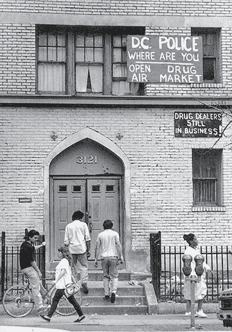

*居民在山普莱特（Mount Pleasant）抗议露天毒品市场。露天市场吸引了来自全市和郊区的毒贩和用户。这些市场在 2080 年代末的卡因流行病期间蓬勃发展。© 1989 Carol Guzy / 华盛顿邮报。*


拜斯的去世让华盛顿市民和联邦官员都感到震惊。这一事件发生在全国对古柯因成瘾日益担忧的背景下，引发了媒体的狂风式关注——《体育画报等杂志曾将其登上封面，《华盛顿邮报》在他死后的几个月里关于这位年轻的前锋球员发表了数百篇文章。总统罗纳德·里根在黄金时段发表了电视演说，敦促美国人加入反对毒品的“全国十字军”，而国会的民主党人则匆忙制定了严厉的《1986 年反毒滥用法案》，该法案对许多毒品规定了强制最低刑期，并让克拉克因与粉末古柯因之间的刑罚出现了百比一的差距。特区在该法案的听证会上占据了重要地位，一些最具戏剧性的证词来自一名前毒贩，他坐在磨砂玻璃后隐藏身份，宣称：“古柯因在华盛顿无处不在。”[⁴⁶

## “清扫行动”的启动

在国会山的压力以及民调显示特区居民认为毒品是城市最大的问题的情况下，巴里在 1986 年 8 月的竞选期间发起了自己的吸毒战争。针对城市露天市场的“清扫行动”是警察副局长艾萨克·富尔伍的脑力成果，巴里在 1977 年人质危机中表现英雄后一路提拔了这位官员。该部门派遣了由一百到两百名警官组成的团队饱和了毒品市场，利用“突击小队”逮捕毒贩，并使用“买断抓捕”小组针对毒徒。回首起来，富尔伍对这次行动的规模感到惊叹：“我们字面意义上在周末有时会逮捕 800 或 900 人。”受影响社区的居民对该计划击声喝彩，感谢他们摆脱了成群结队的毒贩叫卖“你要买吗？”和“我有货”，以及日益增长的暴力威胁。”[⁴⁷

“清扫行动”帮助巴里在那个 11 月顺利当选连，但对受毒品侵扰的社区来说，这只提供了短暂的缓解。在汉诺弗广场，警察在街区中间建立了一个移动指挥中心，封锁了 47 栋废弃房屋，并运走了三百吨垃圾，其中包括 41 辆被盗汽车——结果在他们撤出后，市场又回来了。由于需求依然高涨且毒贩依然充沛，毒品贸易蓬勃发展。到 1988 年 12 月，警察局长莫里斯·特纳宣布该计划宣告失败，尽管他们花费了 600 万美元并进行了近三万次逮捕。大规模的逮捕通过制造一代联邦罪犯造成了长期的损害。在 1985 年至 1987 年间，警察逮捕了 18 至 29 岁年轻人中每四人就有一人因毒品相关指控控。由于该计划关注的是露天市场，而非高端社区更隐蔽的交易，几乎所有被捕者都是非裔美国人。”[⁴⁸

## 克拉克的崛起

而“清扫行动”未能阻止“克拉克”的蔓延。

克拉克是一种更便宜的古柯因形式，通过将毒品与小苏打或氨水煮沸产生一种可以吸食的硬如岩石的物质。它首次出现在纽约和迈阿密等主要的毒品进口城市，并在 1986 年底在华盛顿特区普及。克拉克极大地扩大了吸毒人口，吸引了贫穷人口、青少年以及对古柯因高价望而却步的偶尔使用者——一小袋“石头”只需 5 美元即可买。

克拉克比粉末古柯因更具成瘾性，它带来的短暂而强烈的快感让使用者焦虑地渴望下一次。绝望的毒瘾者开始售卖他们能买到的任何可以交换这些白色小石头的东西。“我见过母亲为了吸克拉克而出卖自己，把女儿当做妓，”托尼·刘易斯三世回忆道，他的父亲在西北第一街和贝茨斯街交汇处经营一个露天市场，那里就在巴里市长在 1979 年匆忙修缮的房屋前。为了服务扩张的贸易，毒贩又增开了三打毒品市场，到 1987 年底，全市总数增加到近六十。两年后，这个数字增加了一倍多。”[⁴⁹

## 雷福尔·埃蒙德三世

没有哪一个人比雷福尔·埃蒙德三世在华盛顿传播克拉克的贡献更大。在 1984 年底一次与风纪警察的交手差点让他入狱后，埃蒙德决定放弃街头交易，成为一名供应商。他利用庞大的家庭和一群社区朋友，组建了一个令人印象深刻的走私、生产和零售业务，并迅速主宰了该地带。1987 年，他与哥伦比亚的卡利毒枭建立了直接联系，开始进口大量高质量古柯因，然后以廉价作为克拉克出售。他与他的前邓巴尔中学的同学托尼·刘易斯一起，埃蒙德每月可能进口 1700 磅古柯因，约占特区市场的 20%。”[⁵⁰

当毒瘾者听到埃蒙德产品顶级消息时，他们涌向了该地带和其他能找到这种东西的市场。在繁忙的夜晚，埃蒙德的毒贩每分钟进行 30 笔交易。每周收入约 200 万美元，由于缺乏通过合法业务洗钱的人脉，埃蒙德挥霍在汽车和珠宝上（包括一只价值`$45,000`的镶钻罗力士），带着朋友家人进行奢侈的购物之旅，并频繁前往纽约、拉斯维加斯等地。他还刻意经营慷慨仁慈的公众形象，在感恩节给该地带周围的人买火鸡，支付欠缴的公用事业费用和租金，甚至给孩子们发`$100`的钞票。”[⁵¹

## 升级的暴力

随着克拉克扩张了华盛顿的毒品贸易，由于利润丰厚，来自纽约和迈阿密的武装精良的帮派在 1986 年和 1987 年试图插手这一生意，引发了一场大屠杀。埃蒙德和他的特区同行者往弗吉尼亚州购买了自己的军库（华盛顿特区议会在 1970 年代中期通过了严格的枪支管制法）。装备齐全的他们击退了外来者，然后为了地盘、利润和声望互相大刀相见。”[⁵²

几乎完全是由毒品相关杀戮的激增驱动，华盛顿特区的谋杀案从 20 世纪 80 年代前半的平均 200 起飙升到 1988 年的 372 起。1989 年 1 月，在计算数据后，一组底特律记者宣布，华盛顿特区已经超过了汽车城，成为国家的“谋杀之都”。警察在阻止这场屠杀方面显得无能为，部分原因是巴里市长削减了预算，并将政治亲信充满了警察部门的高层职位。”[⁵³

巴里试图平息惊魂失措的华盛顿市民，辩称大多数杀戮是毒贩之间的“针对性暗杀”，因此特区绝大多数地区都是安全的。这种屠杀确实几乎完全局限于洛克溪公园（Rock Creek Park）以东的贫困非裔社区。在 1988 年，在其西侧的富裕社区没有发生过一起谋杀。市长承诺提供“领导力、想法、计划和行动”来解决这一问题，但暴力只会加剧。每一次杀戮都会引发竞争团伙的报复，而警察部门极低的谋杀案破案率让毒头横横在街头。臭名昭彰的韦恩·佩里一人就杀了近三十多人。尽管联邦当局在 1989 年逮捕了雷福尔·埃蒙德，杀戮仍无减趋势，并在 1991 年达到 482 起的峰值。”[⁵⁴


由于感到被市政府遗弃了，许多社区开始自发对抗毒贩和成瘾者。在梅菲尔大厦（Mayfair Mansions）——这是一个由老米肖（Elder Michaux）在二战期间于于东北部建造的大型公寓群——居民们邀请了伊斯兰教（Nation of Islam）在一个露天毒市提供反毒巡逻。那个市场规模巨大且危险，警方称其为“小贝鲁特”，并在集结压倒性的援军之前拒绝响应 `911` 电话。这些穆斯林的“毒品终结者”（Dope Busters）驻扎在该社区，提供 24 小时的守护，赢得了绝望居民们的尊重。

在肖区（Shaw），一位鲁莽的年轻社区顾问委员莱罗伊·索普二世（Leroy Thorpe Jr.）组织了游行，关闭社区内的卡卡小屋。就像那些有时会袭击嫌疑毒品的穆斯林人一样，他的行为经常越了私刑的界限。“我会去拿球棒，朝他们脑门上抡，”索普回忆道，“我当时很狂野！”肖区的另一位居民则采取了焚烧卡卡小屋的方式。“一切都在崩溃，”社区活动家杰夫·科恩莱希（Jeff Koenreich）担心道，“人们正在……自力更生。”

## “那个该死的婊娘害了我”：马里恩·巴里的垮台

当卡卡毒席卷这座城市时，马里恩·巴里（Marion Barry）也在与自己的成瘾作斗。这位市长在 20 世纪 70 年代首次尝试可卡因并很快产生了习惯。到了 80 年代中期，巴里已无法隐藏其影响。他的行为变得反复无常——长时间且不明的旅行、工作时间减少、在公共场合说话不清——甚至连狂热的支持者也开始担心。

美国检察官和当地警方在 1982 年就察觉了他的吸毒行为，但调查人员难以建立一个可靠的案件。巴里不断避开他们的追捕，掩盖过量用后的急诊记录，并利用他在警察局的人脉压制调查。1984 年，美国检察官约瑟夫·迪·杰诺瓦（Joseph diGenova）发现了证据，显示一名名为凯琳·约翰逊（Karen Johnson）的年轻地区员工曾与市长有私情，在此期间她向他出售了二十多次可卡因，但巴里对大陪团撒了谎，并付钱让约翰逊不配合调查人员。

为了下定抓住这位难以捉摸的市长，执着的迪·杰诺瓦扩大了调查范围，不仅寻找吸毒证据，还寻找巴里政府内部腐败败的证据。1984 年，巴里的前妻玛丽·特雷德威尔（Mary Treadwell）承认从一个由“Pride, Inc.”公司拥有的公共住房项目中盗取了数十万美元。一年后，巴里的长期亲信艾万·霍伊·唐纳德森（Ivanhoe Donaldson）承认从一个未审计的就业服务部账户中侵吞了 19 万美元，而财政副市长阿尔·希尔（Al Hill）则承认将市合同输送给朋友以换取回扣。

迪·杰诺瓦坚信市长是此类贪腐的同犯，于是于 1987 年 5 月对五个市政机构、与巴里关系密切的少数裔拥有企业以及巴里朋友和员工的家中进行了一系列突击。他发现了充分的证据，表明巴里及其高层管理人员利用合同系统确保黑人商人（其中许多与市长关系密切）获得了数百万的市政合同，而几乎没有努力证明他们提供的服务是合格的。臭名昭彰的犯人之一柯尼拉斯·皮特斯（Cornelius Pitts），他是自 20 世纪 60 年代以来巴里的盟友。皮特斯以高价向市收费，在其遍布害虫的皮特斯汽车酒店（Pitts Motor Hotel）为无家可者提供住房——1986 年，一个国会委员会谴责该收容所是全美最昂贵的。

迪·杰诺瓦通过公开宣布突击行动并泄露探员缴获物品的信息，希望引发公众愤怒，向巴里市长及其盟友施加配合联邦当局的压力。相反，他引发了一场带有种族色彩的反弹。“迪·杰诺瓦在调查白人承包商吗？”一位黑人女商人问道，她注意到该市三分之二的生意是白人承包商，他们许多得到了优待且提供的服务很糟糕。他并没有这样做。全国其他地方的美国检察官们也非如此。在里根总统时期，联邦调查人员将不成比例的注意力放在黑裔民选官员以及他们引入政府的少数裔承包商身上。《华盛顿邮报》的格温·艾伊菲尔（Gwen Ifill）发现，80 年代中期仅占所有民选官员 3%的非洲裔政治人物占联邦腐败调查的 14%。全国黑人观察者对这些调查感到警觉，他们将其视为对黑人权力的攻击，而非腐败。

巴里利用了人们对联邦政府不成比例调查黑裔民选官员的焦虑。他谴责迪·杰诺瓦的突击是联邦当局试图“把我赶下台”的努力，并提起诉讼指控美国检察官通过泄露调查信息违反了大陪团的秘密性。六个国家黑人政治组织提交了法律意见，认为对巴里的调查是联邦检察官“中和黑人政治力量”的国家努力的一部分。

关于巴里吸毒的传闻、广泛腐败的指控以及持续的联邦调查侵蚀了白人对市长的支持。他在 1978 年凭借跨种族联盟和自由派白人阶层（包括《邮报》）的支持当选市，但在 1986 年，他仅获得了 25%的白人选票，《邮报》的编辑们也转变为激烈的批评者。随着他的成瘾状况恶化，市政府部分部门完全失能，他们的批评变成了蔑视。深受华盛顿富裕白人喜爱的一本月刊商业杂志的出版商威廉·雷加迪（William Regardie）讽刺了巴里吸可卡因的形象，并发放了写有“对马里恩·巴里说不”的贴纸。在 1989 年的一次市预算听证会上，来自密苏里州的共和党参议员约翰·丹福斯（John Danforth）质质市长：“这个政府腐败得令人震惊，且无可救药。”

1988 年当选的乔治·H·W·布什（George H. W. Bush）利用该市作为政府禁毒战争的道具，利用了它的脆弱性。1989 年 4 月，总统的“毒品沙皇”威廉·本内特（William Bennett）公布了一项耗资 8000 万美元的计划，通过大幅增加对街头毒贩和成瘾者的逮捕来打击华盛顿的毒品交易——这是警察局长莫里斯·特纳（Maurice Turner）在几个月前才认为失败的方法。本内特声称，联邦政府的介入是因为“地方政府没有采取足够负责的方式”。与此同时，接近总统的共和党策略师试图通过软化共和党的种族形象，争取让特纳在 1990 年市长选举中以共和人身份竞选巴里。副总统丹·奎尔（Dan Quayle）主持了一场每人份 500 美元的筹款活动，总统也邀请这位终身民主党人来到白宫仪式性地更改了党派倾向。


总统对城市毒品危机的利用在 9 月达到了顶点，当时他在一次黄金时段的电视演讲中推出了他耗资 78 亿美元的“国家毒品管制战略”。为了强调毒品是“今日当今国家面临最大的国内威胁”这一观点，`Bush`举了一袋白食柯因，他声称这些是联邦探员在“白宫对面的一座公园里”缴获”的。这一道具暗示了这座首都是如此混乱，以至于毒品贩竟然公然胆大地在总统家外进行交易。

（白宫助手们在演讲前已告知总统，毒品贩实际上*并没有*在拉法叶特公园活动，但`Bush`对这个想法深为着迷，以至于毒品执法局的官员使其变成了现实。他们挑选了一名来自东南部的 18 岁小额毒贩`Timothy Jackson`，将他带到公园，进行交易，然后将其逮捕。`Jackson`随后的案件因审判无效而告终，因为正如陪审员团长所说，“陪审员们认为这是一个圈套。”）

对于联邦官员来说，华盛顿毒品问题的首要祸首是市长本人。尽管经历了五年近乎不断的调查，`Barry`仍留在位上，未被指控任何犯罪，并在黑人选民中广受欢迎。但调查人员正正在逼近。1988 年 12 月，`Barry`几乎误入了一场针对他的朋友兼同样成瘾者`Charles Lewis`的当地警方买药抓捕行动。`Lewis`是维尔京群岛一个显赫家族的后裔，陷入了困境，并在被捕后开始与警方合作。他向美国检察官`Jay Stephens`介绍了一长串朋友、商业伙伴和前情情人，这些人曾与市长一起吸柯因。然而，`Stephens`意识到，仅凭口头证言，陪审团可能定不了`Barry`。他需要市长吸毒的直接证据，并通过设置一个钓鱼行动来获取证据，而对象是少数几个获得日益谨慎的市长信任的人之一：`Hazel Diana “Rasheeda” Moore`。

尽管`Barry`是个花花，但他对`Moore`却有软肋。`Moore`成长于一个宗教信仰深厚的工人阶级东北部家庭，这位身材高挑、气质迷人的女性在 1975 年成为一名顶级模特，面容曾出现在《精华》杂志和《W》杂志的封面。然而，她深受毒品困扰，在男友因试图走私柯因入境被捕后，她的生涯也停滞了。1986 年她遇到`Barry`时，`Moore`穷无分文并和母亲住在一起。市长给了她 6 万美元的合同，让她在夏季青少年就业计划中教年轻女性“形象意识”，两人开始了一段风风雨雨的两年外情，据`Moore`回忆，他们期间混合性行为、吸柯因或白食柯因的“至少 100 次”。1989 年，她离开这座城市回到洛杉矶与三个孩子重聚。`FBI`在那里找到了她，当时她正住在一家收容所里，尽管复苏的宗教信仰迫使她改变，却无法摆脱柯因成瘾。她决定通过与联邦调查人员合作来赎自己的罪孽。“我为自己的决定祈祷过，”Moore`说道，“我想净化自己。”

计划非常简单：`Moore`将引诱`Barry`来到位于`西北 M 街`的`Vista International Hotel`的`727 房间`，在那里她将给他提供机会。二分钟后，`Moore`向市长递上了白食柯因。联邦探员入房间并逮捕了市长。`Barry`坐在床上喃喃自语：“那个该死的婊货害了我。”

随着钓鱼行动的消息传开，华盛顿的黑人居民既感到悲伤又愤怒。当《洛杉矶时报》采访`Cardozo 高中`的学生时，他们都表达了愤慨。“即使这是一个圈套，”17 岁的`Tracey Parker`说，“但他知道他们是想抓他。”另外 20%的人认为执法部门是在针对他。在接受《华盛顿邮报》调查的黑人居民中，36%的人认为这次钓鱼行动是市长的错。然而，比例稍高的数字——39%将联邦政府和`Barry`一并同咎。`WOL-AM`电台主持人`Cathy Hughes`在随后的几天里接了数千个电话，她注意到她的听众对市长的遭遇感到震惊。

`Barry`那场尴尬的公开逮捕让他成为了深夜喜剧演员口中的笑料，但市长很快振作精神，组织了一场完美的辩护。他通过把自己包裹在一个关于罪与救赎圣经故事中寻求公众同情。在百位城市牧师的簇拥下，他承认自己未说明的“问题”，这让他“面对自己深处的脆弱”。随后他入住一家戒毒中心并开始定期参加教堂。在背后，他试图与检察官达成协议，愿认一个轻罪，这种指控允许他再次竞选。由于有视频证据和十位证实曾与`Barry`一起吸柯因的证人，美国检察官`Stephens`对自己能确保获得几项重罪指控充满信心，并拒绝了市长的请求。

然而，`Barry`比`Stephens`更了解这座城市的黑人选民。正如他在 1990 年审判前所说，“只要有一个陪审员说：‘我不会判定马里昂·巴里有罪，我不在乎你们说什么’就可以了。”他和他的律师全力精力通过对政府进行审判来争取那一个陪审员。“几年前，政府就决定要抓马里昂·巴里，”辩护律师`R. Kenneth Mundy`在开案陈述中声称，“他们不惜任何代价、任何极端手段来得到他。”

辩方指控政府阴谋，他们知道华盛顿黑人社区对“联邦检察官针对黑人领导层”这一说法特别敏感。自 1987 年以来，联邦官员对包括马里兰州、纽约州和佛罗里州在内的七个最有权力的黑人当选和任命官员提起了指控或泄露了调查信息。许多此类官员前往华盛顿对司法部进行辩护，并经常出现在当地教堂、黑人广播节目和抗议集会上。


辩方的主张引起了大约一半陪审员的共鸣，讨论从一开始就陷入了僵局。一组五名中年工人阶级黑人陪审员将责任完全归咎于政府。华盛顿特监狱部门秘书瓦莱莉·杰克逊-沃伦说：“他们就是为了对付马里昂·巴里。我全心地相信这一点。”经过八天精疲力竭的辩论，由五名较年轻的非洲裔和两名白人组成的反对小组未能改变他们的立场。最终，他们达成了妥协：陪审员判定巴里的一项轻微罪名成立，另一项无罪，并放弃了其他部分。当他们在 8 月 10 日宣布判决时，市长露出了大笑容，法院外的支持者爆发出了“巴里！巴里！”的欢呼声。他躲过一劫。

然而，巴里的政治未来依然云云雾罩。他错过了民主党初选的报名截止，但他以独立候选人的身份，参加了竞争激烈的全体议员席选举。在竞选期间，托马斯·彭菲尔德·杰克逊法官——一位面带赘肉、具有贵族气质的里根任命者，他从不掩饰对辩护团队策略的不满——判处巴里入狱六个月。对于轻微持有毒品来说，这是一个严厉的惩罚，其根源在于杰克逊认为巴里“对整个毒品文化提供了援助、安慰和鼓励”。尽管巴里的辩护者对杰克逊的逻辑嗤之以鼻，但雷富尔·埃德蒙德在伊利诺伊州马里昂的联邦监狱提出了类似的论点。他辩论道：“有那么多人在外面说‘毒品有害’，但他们自己却在吸毒。就像马里昂·巴里一样。”杰克逊的判决也揭露了他对年长黑人陪审员的蔑视，他后来声称，这些人人“在任何情况下都不会定罪”。

巴里希望黑人选民对判决的愤恨能助力他的竞选，但选民们清醒地意识到市长有严重的物质滥用问题，这抵消了他们的愤怒。11 月，选民给了他唯一一次选举失败。几周后，巴里前往监狱，似乎在特区政治生涯中终结了。

## “新纪元”：特区在新市长领导下的挣扎

莎伦·普拉特·迪克森相信她可以重现“巧克力城”（Chocolate City）的承诺。作为第三代华盛顿人，作为城市浅肤精英阶层的后代，她在华盛顿黑人地带边缘长大，随着城市向非洲裔购房者开放，她从勒德鲁特公园（LeDroit Park）北移。1961 年，她从刚取消种族隔离的罗斯福高中以优异成绩毕业，随后进入霍华大学学习政治学。她美丽而娇小——身高只有 5 英尺 2 英寸——迪克森曾希望成为一名演员，但她的父亲，一位杰出的法官，说服她进入霍华大学法学院。在那里，她遇到了并结了阿林格顿·迪克森，后者在妻子的帮助下，于 1968 年进入特区政坛，并在十年内升任特区议会主席。

聪明、自信且充满动力——她曾表示过自己的意图是“像任何男人一样走得更远、做得更多、赚得更多”——迪克森并不满足于担任丈夫的幕后顾问。1976 年，她开启了自己的政治生涯，当选为民主国家委员会的特区代表。作为沃尔特·福恩特伊组织的一员，她在正式上与马里昂·巴里结盟，但像许多上层阶级的黑人华盛顿人一样，对这个粗俗的暴发户感到鄙视。1982 年，她管理了朋友帕特里夏亚·罗伯茨·哈斯那场注定失败的推翻脆弱现任者的竞选。在哈斯失败后，迪克森将转向国家舞台，于 1984 年成为民主国家委员会财务主管。

但随着城市失去控制，迪克森以她自己不可思议的市长竞选回归地方政坛。通过宣扬自己的局外人身份并承诺“用铲子而不是扫帚来清理门庭”，迪克森利用了许多居民摆脱巴里时代的渴望愿望。《华盛顿邮报》的背书帮助迪克森赢得了大多数白人选民，并推动她在 1990 年民主党初选中以微弱优势获胜。随后，她在 11 月的大选中击败了共和党对手，成为首位领导美国主要城市的非洲裔女性。

迪克森在 1991 年 1 月的就职典礼上宣布，这是特区政治的“新季节”。一群充满勃心的改革者横扫了一代官员，包括马里昂·巴里沃尔特·福恩特伊，后者在民主党市长初选中垫底。接替他担任众议院无投票权代表的是埃莉诺··霍尔姆斯·诺顿，她是一位备受尊敬的律师、民权活动家以及卡特政府的老兵，她在此之前从未担任过地方职务。

迪克森利用这种乐观情绪来应对城市的经济问题。当她上任时，国家正处于房地产衰退之中，这摧毁了华盛顿最重要的私营产业。很大程度上依赖房地产的市税收大幅萎缩。由于国会自 1985 年以来为了抗议巴里而冻结了特区的拨款，该市经历了 3 亿美元的预算缺口。迪克森在任职的前两个月里，大部分时间都在联系她在民主国家委员会的人脉，并吸引国会山山立法者的青睐。国会对干练且专业的迪克森（与她的前任者形成鲜明对比）留下深刻印象，将年度拨款增加了 2 亿美元，并拨付了额外的 1 亿美元以填补预算缺口。她在议会那里也收到了同样的热烈欢迎，议会批准了超过 4 亿美元的额外贷款，并授予迪克森绕过文员考试制度以辞雇表现不佳员工的权力。

她领导能力的首次真正考验出现在 1991 年 5 月，当时暴乱在一个意想不到的地方爆发了：多元且极具特色的山特普莱森特-亚当斯·摩根街（Mount Pleasant–Adams Morgan）社区，这里被广泛认为是城市的大熔炉。20 世纪 80 年代，该社区吸收了数千逃离杀戮内战的萨尔瓦瓦人并定居于此，使拉丁裔人口几乎翻了一番。新移民大多是年轻、男性且贫困，他们挤在破旧、拥挤的公寓里，每天出来当餐服务员、清洁工和建筑工人工作——这些工作在历史上是由非洲裔劳工承担的。该地区一半的拉丁裔居住在四口或以上的家庭中，年收入低于 20000 美元。由于许多移民到达时没有证明其法律身份的文件，他们无法投票，而巴里政府忽视了他们。就好像在 1987 年去世的卡洛斯·罗萨里从未存在过一样。由于获得政府服务的途径很少，且集中在经济中最脆弱的部门，他们受到了 1990 年衰退的沉重打击。

当失业的萨尔瓦瓦男性挤满了社区公园等待工作和社交时，他们更稳固的邻居（黑人和白人）开始将他们视为异类和威胁。“醉酒鬼们经常破坏社区，将其用作厕所，骚扰妇女，破坏该地区的幼树，恐吓老年人和孩子赶出公园，并互相拔刀子或球棍，”一位前社区顾问委员会（ANC）委员抱怨道。少数会说西班牙语的警察经常从地区公园里驱逐游荡的男性，对这些无法听懂英语的人往往变得很粗鲁。以黑人为主的警察与萨尔瓦瓦社区之间的紧张关系急剧增加。


Daniel Enrique Gomez 非常清楚这些紧张局势。Gomez 于 1989 年从家乡萨尔瓦瓦多来到华盛顿，并在乔治敦马里雅酒店找到了一份洗碗的工作。每当下班后，他就会拿一瓶酒，在十七街和 Lamont 街街角的一个小公园和朋友们聚聚。1991 年 5 月 5 日，在一个温暖的周日晚上，Gomez 和他的三个朋友已经醉得彻底糊涂，此时 Angela Jewel 和 Griselle Del Valle 警官因公共醉酒对他们处了处罚。这些男子拒绝被捕，在随后的冲突中，Jewel 射中了 Gomez 的胸部，导致其伤势严重。

关于一名黑人警察击中并杀死一名萨尔瓦瓦多男人的传言（有人声称他在被击中时戴着手铐）在拉丁裔社区流传。随着数百名警察增军赶往现场，愤怒的居民聚集在山特普利斯街沿。到傍晚，目击者开始向防暴警察的围墙投掷瓶子和石头。一群年轻人在山特普利斯商业街上愤怒暴动，焚烧警车、砸窗户并进行抢劫。尽管对暴力感到恐惧，但许多居民仍不禁产生同情。“他们正在为自己的权利而战，”山特普利斯居民 Bea Rodriguez 坚持认为，“如果你住在这里，你会看到很多警察的虐待行为。”

Dixon 市长对这场火灾采取了克制且富有同心的回应，赢得了公众信任。她指示警察局长 Isaac Fulwood 采取控制而非对抗暴乱者，此举后来被认为挽救了生命并最大限度地减少了暴乱的影响。没有人受到重伤，财产损失仅限于山特普利斯和哥伦比亚路商业带。警察在两天内逮捕了 230 人，并在第二天晚上平息了暴力事件。好几天来，Dixon 一直出现在该社区，与警察聚在一起，与拉丁裔领袖会面，并走在山特普利斯街与居民交谈。她对暴乱的处理赢得了所有背景居民和华盛顿特区议会的赞誉。“在[暴乱期间]，Dixon 市长在我眼中发生了不可测量的巨大变化，”选区议员 Frank Smith 说道，他的选区包括暴乱发生的地区。

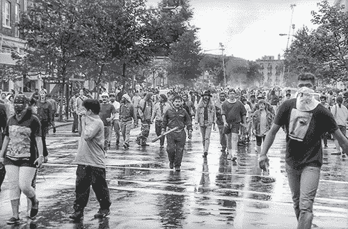

*1991 年 5 月，一名黑人警察击中了一名无武装的萨尔瓦瓦多男子，引发了山特普利斯街为期三天的暴乱。Rick Reinhard。*

拉丁裔社区活动人士对此却印象并不深刻。山特普利斯暴乱激发了新一代拉丁裔领袖，并点燃了一种新的主断性，这种主断性关注了该市由黑人管理的政府与快速增长的拉丁裔社区之间糟糕的关系。拉丁裔占特区居民人口的 5% 以上，但在市政工作人员中比例不足 1%，市政府官僚机构在提供西班牙语服务方面做得糟糕。拉丁裔领袖要求获得公平的城市资源。长期社区领袖 Beatrice Otero 恳求“公平与平等”，而更年轻的活动人士则采取了更具战斗性的基调。华盛顿特区拉丁裔民权任务小组主席 Pedro Aviles（该组织是暴乱后成立的联盟组织）在警告时，听起来非常像前一代的黑人权力运动活动家：“除非以全面的的方式解决这些问题，否则我们将面临再次发生类似动荡的危险。”

暴乱后，Dixon 市长承诺向拉丁裔社区开放政府，她认为黑人华盛顿人必须拥抱一种扩张性的正义愿景，解决所有形式的排斥和歧视，而不仅仅是针对黑人社区的歧视。她承诺振兴拉丁裔事务办公室，并通过改革旨在让西班牙裔居民在城市事务中获得某种权力和影响力。

然而，在经济衰退背景下，Dixon 的倡议遭到了黑人社区内部的激烈反对。一些人完全拒绝了拉丁裔的要求。“如果[拉丁裔]不感激我们的国家，就滚出去，”议员 H. R. Crawford 严厉地说道。其他人则试图保护他们选民的利益。“我相信拉丁裔社区有权获得公平的城市合同和服务，但我不会允许这以牺牲非裔社区为代价来实现，”议员 William Lightfoot 断言道。Dixon 的倡议陷入停滞。到她任期结束时，拉丁裔仅占城市员工的 1.7%，许多机构仍然没有翻译，而拉丁裔活动人士在财政拮据的议会考虑取消拉丁裔事务办公室时，在区议楼前抗议。

Dixon 无法为西班牙裔社区产生有意义的改革，反映了她整个政府的困境。她直率的态度和局外人的身份在竞选期间是一项资产，但一旦上任就被证明是阻碍。Dixon 既害羞又咄咄逼人，这让那些习惯了 Barry 那种擅长寒暄和交易的选民们产生了反感。她不习惯被质疑，要求媒体给予光彩的报道，并在记者提出探测性问题时指责他们存在种族主义和性别歧视。她决心从区议楼中清除 Barry 的亲信，于是解雇了市内所有的顶级行政人员，抹去了多年的制度性知识。取而代之的是，她聘佣了一群平庸无奇的政治新秀和法学院的老同学，他们很少拥有管理危机中政府的专业知识或经验。

所有种族的选民很快就对 Dixon 市长产生了反感。她发誓通过解雇两千名中层经理来消除“冗员”，这一承诺被许多黑人居民解读为对他们利益的攻击。《邮报》专栏作家 Courtland Milloy 将 Dixon 的计划称为对“华盛顿黑人中产阶级的残酷削割”，旨在“给国会山上的某些无关紧要的人留下深刻印象”。Dixon 犹豫于发放解雇通知，激怒了她的白人支持者，这些人本希望她清理官僚机构。她最终履行了承诺，但过程杂乱，且几乎完全是通过退休和收购实现的，而不是通过解雇低绩效员工。争议损害了士气，本已糟糕的城市服务也随之恶化。在她任职的第一年结束时，超过一半的华盛顿特区黑人居民反对她的表现。

Kelly 市长的（注）——她在 1991 年 12 月与纽约商人 Kelly III 结婚后改了姓）随着华盛顿经济状况的恶化而运势持续低迷。到 1992 年年底，她宣布未来两年预计有 10 亿美元的缺口，并警告要加税、裁员并“完全取消某些服务”。由于无法平衡预算甚至减缓赤字增长，她将此归于特区的税收和治理结构。她认为，长期的解决方案是通过成为州来“决定我们自己的经济走向”。然而，Kelly 对建州的支持并非仅仅是为了转移居民对她政治问题的关注的绝望之举。尽管华盛顿面临暴力、政治动荡和经济困境，20 世纪 90 年代初似乎是推动“新哥伦比亚”州建的良机。


州权运动源于朱利斯·霍布森（Julius Hobson）1970 年发起的无投票代表活动，但在这位脾气火的议员于 1977 年因癌症去世后，运动陷入停滞。但当“创意非暴力社区”创始人埃德·吉南（Ed Guinan）以倡议的形式将其置于 1980 年的选票运行时，这个问题意外地获得了新的生机。吉南在没有咨询自决运动中任何人的情况下，草拟了一份州权提案，要求四个步骤：对州权问题进行赞成或反对投票、选举 45 名代表参加宪宪、将宪法提交给选民批准，以及最后向国会申请作为第 51 州加入联邦。这一过程不合寻常且繁琐，但吉南相信这可以建立一个密密的基层活动分子网络，从而取代建制领导人，并赋予公民解决华盛顿特区最迫需求的能力。

对吉南倡议的支持率很冷淡。选票问题虽然通过了，但以 85,487 对 57,580 的平庸优势获胜——这很难说是当地对州权的一致支持。反对意见在第 3 区最为强烈在那里，《华盛顿特区选举权修正案》的支持者（如妇女选民联盟）与担心一个不受国会监督的黑人政府的白人居民一起反对这项措施。

对州权的推动挤占了此前主导当地自决运动的关系广泛的当选官员、游说者民权活动人士。这些资深活动分子对吉南的策略并不信服，他们袖手旁观，看着《邮报》（*Post*）的汤姆·舍伍德（Tom Sherwood）所描述的“自由派社区活动分子、少数当选或任命官员以及一些政治无名之的小烩”在 1982 年 1 月宣布竞选宪法会议的 45 个代表席位。巴里（Barry）市长甚至没有忙于提名一组代理人。经验丰富的当选官员，如议员大卫·克拉克（David Clarke）和前校务委员会成员查尔斯·卡斯塞尔（Charles Cassell），在获得代表席位的政治无名之士中寥寥无几。尽管社区、媒体和市官员缺乏兴趣，代表们还是在邓巴高中（Dunbar High School）集结举行宪法会议，并在短短九十内为新哥伦比亚州（New Columbia）制定了一份宪法草案。

该文件提出了许多通常由立法者处理政治和社会立场。它保证了充分就业、同性恋权利和生活工资，保护了公职人员的罢权，要求公用事业，维护了平权行动的合法性，并扩大了被犯罪指控者的权利。代表菲利普·施拉格（Philip Schrag）承认，这份宪法草案既是“社会改革的宣言，也是政府结构形式的大纲”。会议主席查尔斯·卡斯塞尔称之为“这个国家历史上最进步的官方州文件”。

然而，大多数当地政治精英拒绝了这一努力。华盛顿特区共和党和贸易委员会谴责了其经济条款，而《邮报》（*Post*）和《星报》（*Star*）则声称其密集的社会条款将使其在国会面前失败。即使是《进步评论》（*Progressive Review*）的激进白人编辑萨姆·史密（Sam Smith），这位十年前就勾勒过州权理由的人，也纳闷为什么代表们没有直接复制另一个州的宪法，“并将这个新世界秩序留到以后”。选民们也有类似的疑虑，只有 53%的人投票批准了该宪法。1983 年 9 月，巴里市长将宪法草案提交国会，华盛顿特区代表沃尔特·福恩特伊（Walter Fauntroy）认为它只有“七月佛罗里达州的雪球机会”。卡斯塞尔对福恩特伊的蔑视感到愤怒，但他承认州权力量在 535 名国会议员中只能找到 3 名支持者。该草案从未进入议程进行投票。

如果没有美国最著名的黑人政治家杰西·杰逊（Jesse Jackson）的干预，州权想法可能一直埋在国会的深处。杰逊是一位来自南卡罗纳州的浸基教牧师，拥有强大的影响力和全国支持者网络，他在南方基督教领导会议与沃尔特·福恩特伊合作时，首次了解到华盛顿特区缺乏自决权。他在 1978 年的华盛顿特区选举权修正案运动中帮助过福恩特伊，并在 1984 年和 1988 年主导了市民主党总统初选。在 1988 年民主党大会上，他成功地在党纲领中加入了支持州权的条款，这是两大主要政党中首次这样做。杰逊经常在华盛顿游说国会或参加国家活动，他对这座城市产生了如此深的情感，以在勒杜瓦公园（LeDroit Park）T 街 400 街买了一栋被封死的房子（就在前市长沃特·华盛顿隔壁）。

在 1988 年总统竞选失败后，杰逊考虑过竞选华盛顿特区市长的想法——马里昂·巴里曾嘲笑道：“杰西什么都不选，除了嘴”）但他担心领导一个“被占领的城市”会让他政治上变得脆弱，并稀释他的“国家筹码”。相反，他寻求一个允许他保持作为国家民权领袖角色的当选职位。他认为他在华盛顿特区的“影子议员”身上找到了答案，这是一个根据 1980 年州权倡议要求的模糊职位，而议会从未为此安排过选举。他希望利用这一职位领导一场高关注的华盛顿特区州权运动，他向议会施压，并在 1990 年 3 月的随后的竞争中占据主导地位。

尽管广受欢迎，当杰逊推动州权时，国会的民主党人表现冷淡，共和人则公开敌视。经过两年的游说后，只有 31 位参议员同意支持马萨诸塞州民主党爱德华·肯尼迪（Edward Kennedy）发起的州权法案。其中只有一人（宾夕法尼亚州的阿伦·斯佩克特 Arlen Specter）是共和人。

该法案面临着一场强大的全国基层反对运动，由“联合反对华盛顿特区州权”（Citizens United against D.C. Statehood）协调，这是一个保守政治行动组织的分支，后来因攻击竞选资金改革法而闻名。该组织由共和党活动分子弗洛德·布朗（Floyd Brown）创立，他是 1988 年总统竞选中臭名“威利·霍顿”广告的创造者，“联合反对华盛顿特区州权”将华盛顿特区州权与支持共产主义领导人菲德尔·卡斯特罗、阿拉伯恐怖分子和“黑穆斯林煽动者”联系在一起。新兴的保守媒体也助长了反对州权。《华盛顿时代》（*Washington Times*）是一份由统一教会孙明文牧师于 1982 年创立的公开右翼报纸，它发表了多篇来源模糊的文章，将杰逊描绘成任性且自大，而保守派口播节目主持人阿姆斯特·威廉姆斯（Armstrong Williams）则在当地 WOL 电台作为州权的黑人反对者成名。


与与 1978 年的《选举权修正案》不同，自决运动活动者的组织非常松散，影响力局限于市界之外。作为一个独立组织的“新哥伦比亚公民团”（Citizens for New Columbia）举办了抗议活动、听证会、纪念活动和信息发布，但未能影响国会成员。尽管有明显迹象表明州权法案无法通过，但代表埃莉诺·霍尔姆斯·诺顿（Eleanor Holmes Norton）仍坚持投票。1993 年 11 月 21 日，众议院以 277 比 153 的票击败了法案。没有一个共和党人支持该法案。来自德州的共和党人托姆·德莱（Tom DeLay）指责道：“特区是一个腐败和犯罪的自由主义堡垒，甚至完全不符合州的要求。[国会]应该收回对城市的控制权并对其清理。”[[96]](#footnote.xhtml_ch13foot-96)

愤怒的杰克逊（Jackson）将立法失败归咎于民主党领导，而诺顿和“新哥伦比亚公民团”则拼命试图为结果粉饰太平，辩称对州权进行投票——这是该市历史上首次投票——本身就是一种胜利。法案失败后，杰克逊撤出了华盛顿特区。1995 年 12 月，他宣布将不再寻求竞选影子参议员，并返回芝加哥。在他离开后，州权运动势力陷入了混乱。他们一直以来组织松散且资金短缺，失去了他们那位拥有全国影响力并能获得大量资金和支持的唯一领袖。[[97]](#footnote.xhtml_ch13foot-97)

在 1978 年《华盛顿特区选举权修正案》通过后的十五年里，反对特区州化已成为保守派的教条，而国家级民主党人表现得犹豫不决。意识到这场斗争几乎毫无希望，几代以来领导华盛顿自决运动的资深战略家和国家级人物放弃了这项事业，将舞台留给了一群由业余爱好者、梦想家和煽动者组成的杂牌队伍。

## “向掌权者竖中中指”：巴里的凯旋回归

随着州权之战愈演愈烈，马里·巴里（Marion Barry）重新出现在华盛顿特区的政坛。这位所谓的“终身市长”尽管被关押宾法尼亚州洛雷（Loretto）的联邦监狱，但他从未认真考虑过离开政。从进入监狱的第一天起，巴里就开始通过电话与老竞选人员联系，衡量自己的机会，并规划回归。在安纳科斯蒂亚联合神殿浸信教会的威利·威尔逊（Willie Wilson）牧师和前助手桑德拉·艾伦（Sandra Allen）等人的帮助下，巴里在 1992 年 4 月出狱时，已经策划好了回到特区政坛的行程。六辆大巴和一辆轿车在监狱附近的一旅馆接了巴里。约三百名挥舞着海报的支持者唱着《胜利属于我们》并欢呼，巴里宣称：“我出狱时变得更好，而不是更痛苦。”三个月后，他宣布竞选第 8 区的议员席位。[[98]](#footnote.xhtml_ch13foot-98)

第 8 区是巴里政治重生的理想之地。该区位于乔治王子县和安纳科斯蒂亚河之间，是特区最南端的司法辖区，包含了以前被称为“远东南”的地区。居民非常贫困——22%的人处于贫困线以下，而在白人为主的第 3 区这一比例仅为 3%——而且生活设施匮乏，该区近七万居民仅只有一家超市。该地区的婴儿死亡率居全市之首，并在全国最暴力的城市地区之一中承担了不成比例的伤亡人数。第 8 区的居民中 80%以上是黑人，他们感到被孤立、被忽视、恐惧和愤怒。[[99]](#footnote.xhtml_ch13foot-99)

自 1976 年以来，第 8 区在华盛顿区议会的代表一直是威尔尔赫米娜·罗拉马克（Wilhelmina Rolark），她是一位好斗的律师和地方自治活动家，曾协助协调了沃尔特·福恩特罗伊（Walter Fauntroy）成功驱逐了南卡罗来纳州的种族隔离主义代表员约翰·麦克米森（John McMillan）。罗拉马克和她的丈夫卡尔文（Calvin，《华盛顿信息报》出版者、联合黑人基金会创始人）一直是巴里的盟友，但在巴里 1990 年被捕后，他们与他断了关系。巴里并没有忘记这次羞辱，尽管他针对罗拉马克主要是因为认为她在政治上很软弱。[[100]](#footnote.xhtml_ch13foot-100)

巴里选择第 8 区是因为这里完美契合了他的救赎叙事和政治风格。第 8 区约一半的黑人男性入监或正接受刑事司法系统的处理，大多数与毒毒有关，而巴里将自己塑造为一个了解他们挣扎的前瘾和囚犯。根据威尔逊牧师的说法，巴里是一个“罕见的人，社区里的每个人都能对他产生共鸣，因为他们经历过同样的地方——监狱、困境和受压”。巴里满足了区居民对认可和尊重的渴望。竞选期间，他的脖子上一直挂着一条肯特布（kente cloth），上面缝着“第 8 区，首屈无双”的字样。尽管实际上他是在反对他自己曾实施的大规模监禁和忽视政策，但他的信息引起了共鸣。城市的政治精英急忙过河支持罗拉马克，但他们的努力是徒劳的。巴里以三比一的优势击败了她。[[101]](#footnote.xhtml_ch13foot-101)

眼着重返市长办公室，巴里从未停止竞选。一旦进入华盛顿区议会，他就将精力集中在有时看似不可能但在政治上广受欢迎的全市问题上，这些问题为他赢得了新的选民基础。他还通过扩大对他 1992 年获胜至关重要的选民登记工作，有利地重塑了选民结构。周复一周，一支自称为“战斗的第 54 团”（以电影《光辉》中描述的黑人内战团命名）的巴里竞选工作人员穿梭于第 6、7、8 区的廉租房和联排屋中，寻找他们能找到的任何未注册选民并恳求他们登记。到选举日，志愿者们在名册上增加了数万名新选民，将该市的登记率推了 79%的历史新高。对于巴里来说，可能最重要的是，这一努力消除了富裕区相对于贫困东部区所拥有的巨大优势。[[102]](#footnote.xhtml_ch13foot-102)

与此同时，华盛顿继续陷入混乱。1990 年至 1993 年间，每年谋杀案超过 440 起。由于害怕报复性杀戮，大多数居民停止与被广泛认为无能且腐败的警察力量交流。1993 年，113 名警察被起诉，罪名从为毒贩当有薪保镖到协助杀人不等。警察部门内部的崩溃反映了市政府的整体恶化。[[103]](#footnote.xhtml_ch13foot-103)

恐于暴力并厌倦政府失能，那些能够迁往郊区的人选择了逃离——1990 年至 1994 年间，有 3.7 万居民（大部分是黑人和中产或工人阶级）离开了特区，几乎是上一个四的两倍。由于失去了他们的税收，城市陷入了更深的债务。随着 1994 年结束，预计赤字超过 7 亿美元。华盛顿惨淡的现状以及凯莉市长（Kelly）对此无能为力，让她获得了高达 67%的不满意率，葬送了她竞选连的机会。[[104]](#footnote.xhtml_ch13foot-104)


复出的马里恩·巴里（Marion Barry）步入了政治真空期，他利用大量新注册的选民为他 1994 年的市长竞选提供了动力。除了推动他华盛顿特区议会竞选的信仰与救赎等积极主题外，他还增加了一种种族诉求：不要让白人来选你的领导。他他对《华盛顿邮报》（Post）对其主要竞争对手——黑人议员约翰·雷（John Ray）的支持表示激烈抨击，并利用雷在西部选区的强力支持将他描绘成白人的候选人。令全国政治评论家惊讶的是，巴里轻松赢得了民主党初选。甚至许多中产阶级的黑人选民也支持现任者。“我投票给巴里是为了向那些掌权者竖中拇指；让他们知道即使是在中产阶级也存在着显而易见的黑人愤怒，”非裔美国律师伦纳德·奈特（Leonard Knight）解释道。

选票按照种族和地理界限清晰地分裂。在白人为主的第 3 区，对巴里的支持微乎其微——在 17,333 张选票中仅有 586 票——而在第 8 区，他以四比一的优势获胜。当记者问他对那些反对他的白人选民想说什么时，巴里粗鲁地回答：“过去吧。把你们身上的任何个人心理负担都过去吧。”但他们并没有这么做。初选后不久，一名居民发起了“自由第 3 区”运动，收集签名以试图将该地区重新归还马里兰州。他的大多数邻居则妥协于跨越党派，在普选中支持共和党的卡罗尔·舒瓦茨（Carol Schwartz）。这些白人民主党人（以及相当数量的中产阶级黑人选民）使舒瓦茨的得票率份额飙升至 42%，这是自现代地方自治开始以来共和党获得的最高得票。

当巴里回到市长办公室时，这座城市发现自己正处于日益敌对的国会的掌控之下。1994 年 11 月，美国选民 40 年来首次将众议院交给了共和党，使许多反对华盛顿特区自决的立法者升到了国家领导岗位，包括众议院院长纽特·金里奇（Newt Gingrich）和多数党党鞭托姆·迪莱（Tom DeLay）。为了抢在国会接管之前为任何政府重组设定条款，巴里在就职后几周内宣布特区已负债高达 7.22 亿美元。为了避免破产，他请求联邦政府接管城市的必要服务（包括法院和监狱），并向市提供 2.5 亿美元援助以支付医疗补助（Medicaid）的超支。作为交换，他承诺削减预算并裁雇市职工。

巴里用反叛的辞藻描述了他的计划，认为地方自治制度从一开始就是坏的：“如果我们被对待成一个领土，一半是奴隶一半是自由，那么我们不应该支付自由人所付的代价。”许多黑人居民对巴里这种反抗姿态表示欢呼。“东北部居民弗雷德·库珀（Fred Cooper）表示：“我们经常谈论特区如何像共和党统治下的种植园。我们佩服巴里的一点是他拒绝充当一名监工。”

然而，国会成员完全拒绝了这些条件，转而要求以放弃自决权来换取联邦帮助。正如 1874 年他们剥夺市居民选举权时一样，这个通常行动缓慢的立法机构以惊人的速度处理了特区的财务问题。1995 年 4 月，国会通过了一项立法，建立了财务控制委员会，该委员会将监督特区预算，行使对特区机构的管理权，并在地方立法拥有否决权。在总统比尔·克林顿签署该法案后，议员凯文·查沃斯（Kevin Chavous）评论道：“这是特区悲哀的一天。”

老记者科乔·纳姆迪（Kojo Nnamdi）回忆道，当黑人活动家在 70 年代进入政府时，“我们并不寻求像白人那样经营事务或政府。我们寻找的是以更高诚信水平管理政府的机会。”在某些方面，他们成功了。他们改变了市政府的本质，将其与联邦官僚机构解钩，使其更能代表城市多元化的人口。他们还重新分配了财富，通过公共工作和城市合同建立了一个巨大的黑人工人阶级和中产阶级。

然而，那个让许多特区居民寄予希望的人最终让他们失望了。巴里市长在任的时间越长，他就越采用具有大城市政治机器特征的治理方法。他结交大型开发商，利用公共项目购买政治忠诚，而他的几位助手和朋友则利用混乱的官僚机构和城市合同系统来中饱私。其他大城市也经历了类似的腐败，但巴里的越界行为被敌意的国家保守运动放大了，这个运动在他执政的大部分时间内统治了白宫，并将市视为黑人民主党腐败和功能障碍的象征。

巴里的失败使他整个政治生涯致力于帮助的人们更容易受到海毒因流行的影响。随着暴力飙升和城市服务恶化，最需要的居民受苦最深，华盛顿特区处于破产边缘。到 90 年代中期，巴里和他的活动家核心（现已白头发的政治老兵）艰难地维持着大缩水的地方自治。“巧克力城”（Chocolate City）广阔的希望和承诺已经消失。

# 十四

## 富有的白人快回家

## 华盛顿变得更富有、更白，1995–2010

噢，白人！我街道上的白人。我不敢相信。——桑德拉·西格斯，2009 年

华盛顿特区的唐人街中心位于西北 H 街 600 街区，像一个亚洲主题的时代广场——中国文化与消费资本主义的令人眼花缭乱的混合。游客从第七街和 H 街交汇处的地铁站出来，进入一个粗糙仿制的字字塔，塔上挂满了巨大的视频广告牌，闪烁着从手机到汽车的各种广告。几步之遥，宏伟地横跨 H 街的是友谊门（Friendship Archway），这是一座 1986 年建造的金色 60 英尺高的传统中国大门。每家商店都点缀着汉字，路灯像中国灯笼，而十二生肖被嵌入行道中。凭借其购物店、餐厅和电影院，该地区已成为某种市中心购物场。街头表演者与黑人以色列人争夺空间，行道上挤满了饥饿的上班族、目瞪口呆的游客和闲逛的中中生。然而，在人潮中，有一群人异常稀少：中国人。

唐人街曾是一个小而稳定的社区，最初位于宾夕法尼亚大道南侧的第三街和四点半街之间，那里现在是国家美术馆东馆的所在地。19 世纪 90 年代，中国商人在该地区购买了半打建筑，并开设了餐厅和出售进口商品及奇特货的商店。这些商店狭小且破旧，挤满了箱子，弥漫着线香和茶的味道，在白天大部分时间保持安静。然而，在晚上和周日，这个社区变得活跃起来，因为中国洗衣工们（1900 年特区 400 多名中国居民中，只有三四名女性和不超过 15 名儿童）汇聚于此购物和社交。


由于人数较少，且与当地领事馆代表的外国有联系，华人在白人社区中受到的待遇与他们的黑人邻居不同。市官员通常将华人社区视为一个无害的奇闻，为这个国家首都增添了异域风情并提供了重要的劳动力。当地报纸经常提到华居民的节俭和勤奋，同时向读者保证，华盛顿没有其他大型唐人街所典型的那些“臭名昭著的堕落之窟”（鸦片烟）。

华盛顿的少数中国儿童并没有像在南方其他地区那样进入黑人学校，而是进入了白人学校，在那里他们往往是人们困惑和好奇的对象。当 1893 年第一批中国学生入学时，《邮报》（`Post`）报道道：“有些[白人]父母错误地声称他们应该去有色人学校。‘但所有人……都被他们明亮的脸庞和迷人的举止服了。”随着这一先例的建立，亚洲裔学生一直读到 1954 年种族隔离之前的白人学校。华盛顿的白人通常并不担心这种整合会带来负面后果，也许是因为正如《星报》（`Star`）的 E. C. Kohn 在 1927 年写道：“华人的同质特征排除了他们同化的任何可能性，东方人无论在何处都可能永远是一个东方人。”[2

在城市更新导致西南地区被摧毁的二十年前，华人经历了他们自己痛苦的流离失所。当联邦立法者致力于重塑国家广场和联邦三角区时，区委员会计划在`宾夕法尼亚大道`（`Pennsylvania Avenue`）300 街建立一个`市政中心`（`Municipal Center`）。他们强制唐人街商人出售土地，并于 1931 年开始拆迁。《邮报》写道：“如画的唐人街，拥有茶馆、古朴的小商店和东方的神秘气息，40 年来不受西方习俗的影响，终于向西方的进步低了头。”市政府没有为商人提供安置方案，随着推土机的进场，居民们四散了。3

但华人居民被组织成了一个由家族、商业和慈善协会组成的严密网络，并在`中华兴公会`（`On Leong Merchants Association`）的领导下，秘密购买了位于`H 街西北`（`H Street NW`）600 街的一系列店面。尽管附近的德国犹太商人和房主试图阻止被他们称为“华裔入侵 H 街”的行为，但仍有近十家企业搬迁并建立了一个新的唐人街。在带着中国“战妻”回家的退伍军人的支持下，该社区在二战后的几年里达到了巅峰，成员增加到约 1500 人，并沿着`H 街`向东西延伸，向北延伸到`马萨诸塞大道`（`Massachusetts Avenue`）。该社区成为了城市生活的特色。各种背景的居民都会光顾社区内的六家餐厅，1950 年后，他们还会伸长脖子看中国新年游行期间在`H 街`上游动的纸龙。4

然而，正当社区稳定下来时，郊区化给唐人街带来了致命打击。由于不甘于一直做洗衣工人，许多华盛顿华人敦促孩子进入专业领域。到 20 世纪 50 年代，华人会计师、医生和政府工作人员跟随他们的白人同行搬到了马里兰州的贝塞达（`Bethesda`）、惠尔顿（`Wheaton`）以及弗吉尼亚州的麦克莱恩（`McLean`）。随着华人生活的重心转向郊区，除非移民穷得住不起，否则都会绕过唐人街。到 20 世纪 60 年代中期，华盛顿地区华人人口中只有不到 10%居住在唐人街。留下的大多数是老人和单身汉，他们生活在日益破败的商店和餐厅中。5

唐人街的衰落刺激了振兴该社区的四项主要努力，每项华人店主和居民的参与度都在减少。20 世纪 60 年代初，一群位于郊区的华人店主和专业人士创建了`东方商业中心`（`Oriental Commercial Center`），根据创始成员`哈密尔顿·莫`（`Hamilton Moy`）的话，这是一个旨在“救救唐人街”的房地产财团。该商业中心将白人商人组织成`华亚狮子会`（`Chi-Am Lions Club`），这是一个面向感兴趣的投资者的专属跨文化组织。他们比起维持该地区作为华人的家园，不如说建立一个以“东方元素”为点缀的商业领地。尽管早期取得了一些成功，但该计划崩溃了。预期的投资流入从未到来，而 1968 年的骚乱在唐人街北部留下了一片被烧毁的贫民窟。“人们害怕了，不再来了，”在`H 街`上经营杂货店的李莉（Jean Lee）解释道，她的父母在那里有一家杂货店。6

接下来，联邦官员和`大都会贸易委员会`（`Metropolitan Board of Trade`）试图通过在`H 街`北侧、`六街`与`十街`之间建立一个占地 25 英利的会议中心来“重振”该社区。居民中一些人记得 1931 年的流离失所，认为该项目将破坏而非振兴他们的社区，并组织了激烈的抗议。尽管这些示威活动恢复了社区的自豪感并迫使官员搁置了计划，但未能阻止该地区的衰落。到 1980 年，唐人街仅有 302 名华人居住，占大都市华人人口不足 2%。7

20 世纪 80 年代初，市长`马里恩·巴里`（`Marion Barry`）将一群华裔店主和专业人士聚集成`唐人街开发公司`（`Chinatown Development Corporation`），再次尝试开发该社区。该公司构想了一个经济多元化的社区，以一系列新的商业和混合用途项目为核心。他们计划的核心是`远东贸易中心`（`Far East Trade Center`），这是一座耗资 1.16 亿美元、10 层的玻璃墙建筑，将为国际业务提供办公室、设有中式主题酒店、公寓以及底层楼的亚洲市集。由于 34 位华裔美国投资者持有 47%的股份，这项巨大的开发项目有望成为美国涉及华裔的最大规模此类交易。8

这些计划引发了土地投机热潮，增加了华人居民和小企业主的主的压力，但承诺中的开发从未实现。`远东贸易中心`遭遇了与巴里执政期间困扰其他合同交易同样的缺乏经验和资金的问题，项目最终停滞。在犯罪、高税和高租的骚扰下，华人移民继续避开该社区。“所有的华人，那些移民们，都离开了唐人街。因为没人想待在这里，”在`H 街 803 号`生活和工作的书法家戴铁生（`Dai Tie-Sheng`）解释道。到 1990 年，唐人街的物业中只有不到 25%归华人所有，社区已萎缩为几家散落在`七街`和`H 街`停车场和封板建筑间的阴暗餐厅和商店。有些人带有嘲讽地称其为“华人街区”（“Chinablock”）。9

阿比·波林（Abe Pollin）目证了唐人街的衰落以及华盛顿市更大范围的荒废，他希望振兴该地区。作为子弹队篮球队和首都华盛冰球球队的慈善慈善所有者，波林致力于奉献给他的家乡。他在布莱特伍德（`Brightwood`）长大，就读于罗斯福高中（`Roosevelt High School`）和乔治华盛大学（`George Washington University`），并在华盛顿开始了了他的建筑事业。1994 年 12 月，他与当选市长`巴里`（`Barry`）达成协议，在唐人街南部边缘建造一座室内体育馆。10


唐人街指导委员会的中国企业主在交易达成后才参与其中，但他们对这一消息表示兴奋。他们与 `Pollin` 就地铁入口的位置以及建筑和设计进行了讨价，但他们并未对负担得住房进行谈判，尽管计划中的开发项目威胁到该地区剩余的三百名中国居民和几家小企业的搬迁。“没有中国人能负担得起唐人街的生活，”在第七街经营杂货店和中药铺的威尔逊·李（Wilson Lee）担忧道，“中国人会被赶走，而没有人就没有唐人街。最后只会剩下一个牌坊，什么也没有了。”商户们表示同情，但认为他们的选择是在发展与流离失所或持续衰落之间平衡。“当然，我们希望有中国企业，”住在唐人街的唯一指导委员会成员杜恩·王（Duane Wang）说，“但如果没有人来，好吧……”

拥有两万个座席的 `MCI Center` 于 1997 年 12 月 2 日隆盛开幕，并立即成为该市市中心重建计划的重点。在随后的十年里，唐人街繁荣起来。随着时尚的全国连锁餐厅和商店在新装修的店面里开业，土地价值和房地产税飙升。尽管这里被不遗余地宣传为“唐人街”，但只有拥有自己建筑的中国商人和那些幸运获得 `Section 8` 住房补贴的居民才能留下来——即使是少数几家中国餐厅的厨房员工也大多是萨尔瓦多多人。华盛顿的唐人街已与其说是一个社区，倒不如用区政府 2009 年《唐人街文化发展战略》的话说，是一个“体验国际亚洲和裔美国人艺术文化的首选目的地”。

新的唐人街——繁华、多元文化、时尚，但并非中国化——体现了华盛顿在 21 世纪初经历的剧烈经济和人口转型，以及其代价。在新世纪的第一个十年里，类似的过程席了安纳科斯蒂河以西的大部分地区。在全国房地产热潮和 9/11 事件后政府扩张的推动下，新开发项目将数百万资本注入了自 1950 年代以来未获得过重大投资的社区。年轻、富裕的居民涌回华盛顿，扭转了该市五十来的人口下滑趋势，补充了税基，并重塑了地貌和文化。

但随着城市变得越来越年轻、富裕和白人化，许多老居民，特别是黑人华盛顿人，感到与新邻居疏远，并在自己的城市里感到不受欢迎。由于华盛顿房地产价格飙升，许多人无法住房，许多低收入居民在郊区寻找负担得起的住房。留下来的人利用他们日益削弱的政治力量反抗流离失所以及支持无限制发展的政策制定者。随着开发速度和年轻专业人士迁入的加快，市内的种族紧张局势爆发。在 20 世纪 90 年代中期处于财务崩溃边缘，到 2010 年，这个国家首都经济上繁荣，但在种族界上仍然存在着严峻的分。。

### “白人主导且冷酷的国会的棋子”：财务控制委员会接管权力

安德鲁·布里默（Andrew Brimmer）目睹了这座城市在 20 世纪 90 年代初滑向破产，他希望将其从深渊拉回。布里默是 1926 年出生于路易斯安那州黑人佃农的五个子女中的第三个，他是在采摘棉花和清理猪粪中大的，直到第二次世界大战为他提供了逃离的机会。凭借 `G.I. Bill`，这位勤奋且有进心的前陆军中士迅速完成了大学业，于 1957 年在哈佛大学获得经济学博士学位（`Ph.D.`），并在纽约联邦储备银行和商务部表现优异。李林登·约翰逊总统于 1966 年提名他担任联邦储备委员会理事会成员，成为首位担任这一显赫职位的黑人。留着短发、穿着西装、戴着黑框眼镜，布里默在《时代》杂志的话中被称为“联邦储备委员会理事会的杰基·罗宾森”。

和罗宾森一样，布里默是一个坚定的整合主义者，他认为马里昂·巴里（Marion Barry）和其他黑人权力活动人士提倡的各种经济和社区控制建议是“误导性的，而且毫无前景的”。然而，他并不是他一些批评者后来所声称的那种种族谄媚的“叔叔汤姆”。在这个国家最有权力的金融机构的高位上，布里默每年发布关于黑人经济进展的研究，并有力地主张联邦支出以解决黑人失业问题。他还与黑人社区保持着深度且富有成效的联系，担任塔斯基吉大学董事以及非洲裔生活与历史研究协会主席。

布里默对他选择的家园产生了亲近感并有深入了解。尽管他于 1974 年离开了联邦储备银行，但布里默留在了特区，将财务咨询公司设在 `MacArthur Boulevard NW`，并从他西北部的家中通勤参加许多学术和公司董事会职位。1981 年至 1992 年间，市政府聘请了这位备受尊敬的经济学家对华盛顿的财务进行了三项独立研究，这让他彻底了解了特区的经济及其联邦政府的关系。布里默在金融界的地位、他与黑人社区的联系以及对城市财务的理解使他成为财务控制委员会主席的主选人，该委员会由国会于 1995 年 4 月建立，旨在监督华盛顿的账目。

尽管被许多华盛顿居民视为来自惩罚性国会的敌意收购，但财务控制委员会的最初建立是一场战略性撤退，市选出的领导人在其中发挥了影响。这一想法最初由代表埃莉诺·霍尔姆斯·诺顿（Eleanor Holmes Norton`）提出，以防止共和党剥夺华盛顿自治权的提案；该想法得到了乔治亚州新任众议长纽特·金里奇（Newt Gingrich）的支持，后者是一个激进的党徒，在争取众议院控制权的十五年里经常攻击该地区。金里奇希望通过与华盛顿黑人领导层的合作，可以缓和共和党反黑人的形象，并为展示保守的扶贫政策（包括学校券和企业区）提供机会。他告诉巴里市长和诺顿代表，这个国家的首都可以成为一颗“城市明珠”。


在克林顿执政期间，诺顿为委员会如何行使权力奠定了基调。在她的敦促下，克林顿总统任命安德鲁·布林默为委员会主席，以及其他四位对地方自治有明确承诺的华盛顿居民，其中包括乔伊斯·拉德纳，她是马里昂·巴里的老学生非暴力协调委员会（SNCC）同志，当时正担任霍华大学的临时校长。布林默和他的委员会成员接受了诺顿为他们设想的有限角色。

尽管市领导者在创建和配置控制委员会人员方面发挥了至关重要的作用，但大多数非裔居民并不信任这个新机构。所有种族的华盛顿人已对飙升的赤字、下降的公共服务和毁灭性的犯罪感到疲惫，许多人接受了该市需要国会帮助来缓解财务危机的想法。但在这一问题上出现了明显的种族分化。白人居民压倒支持国会干预，而许多黑人华盛顿人对此持怀疑态度。来自曼诺公园普利茅公会联合基督教会的格莱兰·埃利斯-哈格勒牧师指出：“无论委员会是有色人、黑人还是白人，他们都被视为一个以白人为主且冷酷的国会的棋子。”

市长巴里洞察黑人民意，培养了非裔居民对国会的不信任，并将自己塑为他们的捍者。在委员会首项行动建议市长削减开支并裁减 5,600 名官僚人员后，市长指责委员会成员对特区居民“不敏感”。次年 12 月，他支持了 100 多名抗议的市员工，他们使用政府车辆在早高峰期间封堵了委员会托马斯环（Thomas Circle）办公室外的路口。他说：“我理解许多华盛顿员工对控制委员会的权力和决策所感到的挫败。”几个月来，巴里利用诺顿创建的合作框架来放缓、甚至破坏委员会各项倡议的实施。

到 1996 年初，委员会成员放弃了与巴里和议会的合作。他们称市长为“无关紧要”，宣布他们将对市预算进行自己的审查，并在没有他意见的情况下实施削减。“对地方自治有着巨大的尊重，”控制委员会执行主任约翰·希尔说，“但总有一个时刻，你无法再等下去了。”

巴里最初起了反作用。当委员会要求他解雇弗农·霍金斯（一位资深官僚和巴里的忠信，曾担任人力资源部局长）时，市长表示反对，称委员会的要求是“绝对反民主、反美国、不美国……极权主义的”。霍金斯是一个糟糕的管理者，但巴里将此问题视为对其权力的测试，拒绝退缩。“控制委员会不承担管理这个政府的日常责任，”他宣布道，“我承担。”只有当议长金里奇告诉他，他的拒绝合作“使得整个地方自治问题都产生了怀疑”时，巴里才屈服了。

随着委员会与市领导者之间权力斗争的升级，巴里的个人问题再次浮现。1996 年 4 月，市长突然宣布他正遭受“精神复发和精疲力竭”，将离开城市一段不确定的时间进行康养。尽管巴里对其突然离开的原因避而不谈，但记者们很快听到传闻，说他在一名员工抓到在特区大楼购买海毒后发布了这一公告。巴里 1994 年竞选的主要支持者拳击推广人罗克·纽曼鼓励巴里“停止疯狂的复发过程”并辞职。巴里做不到。他的个人恶习在夏天持续，进一步削弱了控制委员会对他成为城市恢复中建设性力量的信心。

在巴里离开后，委员会开始了改革官僚体制的艰难过程。委员会成员对问题特别大的市政府机构进行了深入研究，接管了控制并更换了表现不佳的经理。尽管委员会采取了果断行动，但对于国会的一些保守派批评者来说这还不够。其中最著名的是北卡罗来纳州共和党参员劳奇·费尔克洛斯和议员查尔斯·泰勒，他们分别是参院特区拨款小组委员会和众议院地区拨款小组委员会主席。两人指责委员会对地方自治过于敏感。“是时候停止担心踩别人的脚了，”费尔克洛斯坚持认为。他们设想建立更强大的委员会来直接管理整个城市。

他们在 1997 年一项解决市债务的法案中找到了实现野心的工具。自 1974 年《自治法》生效以来，市领导者一直抱怨国会通过让特区承担无资金支持的养老金责任和州级财务义务，同时严格限制城市的征税权，造成了无法弥越的赤字。国会领导人驳斥了这些抱怨，将城市的财务问题完全归咎于管理不善。然而，现在负责城市财务的国会意识到确实了一个巨大的结构性赤字。他们制定了立法，承担了市 40 亿美元的养老金债务，并将监狱和街道维护等一系列市服务的控制权交给联邦政府。

该法案获得了两党支持，议长金里奇和代表诺顿是其最活跃的倡导者。但费尔克洛斯议员认为，最初的建议无非“对管理不善城市的数十亿美元援助”，并要求由联邦直接控制。他从一个意想不到的来源处获得了支持：财务控制委员会主席安德鲁·布林默。布林默对市长未能执行他的政令非常愤怒，敦促国会将特区政府交给一位市长管理，这位市长就不会因为需要“时刻顾及市长或议会的脸色”而受到“限制”。

诺顿代表成功地阻止了市长的想法，但特区取而代之的是基本上暂停了地方自治。1997 年的折协《国家首都振兴法》提供了必要的援助，但要求控制委员会直接管理市最大的九大机构，并任命一名首席管理官来运营政府并直接向委员会报告。巴里沦为了仪式性人物，仅直接监督公园与娱乐、图书馆以及少数杂项委员会。议会的处境更糟，因为该立法赋予了委员会对其通过的任何法律或促成的任何合同的否决权。在众议院负责该法案的议员汤姆·戴维指出，出于对地方自治的尊重，委员会在 1995 年至 1997 年间“不愿行使权力”。现在这是国会的指令了。”


巴里将这项立法斥为“对民主的强奸”，并鼓励居民“愤怒而起义”。一小群活动人士响应了他的号召，游行至议员戴斯位于弗吉尼亚州福尔斯教堂（Falls Church）的家中，喊着“让戴斯下台！民主万岁！”，随后车队前往北卡罗来纳州的克林顿，在参议员费尔克劳斯的养猪农场外举行了一场喧闹的抗议。其他人则指责市长。桑德·西加斯（Sandra Seegars）曾是巴里的支持者，她建立了罢免巴里市长的委员会，并认为：“在经历了所有的尴尬、所有的虚伪、所有的腐败，现在民主已经从公民手中被夺走了……是时候甩掉巴里了。”[29

然而，大多数居民似乎对国会的接管听之任命。随着城市在他们周围崩塌，他们认为失去地方自治是他们恢复秩序必须付出的代价。“垃圾清理非常糟糕，路面坑洼，由于犯罪太严重人们都在搬出去，”布鲁克兰居民维尔农·哈姆（Vernon Ham）抱怨道，“必须发生些改变了。”[30

尽管言辞强硬，但巴里也接受了新秩序。尽管民意调查显示他远领先于可能的竞争对手，但他拒绝参加 1998 年的连选。由于在政治上被国会阉割，受到批评者的围攻，并且仍在与药物成瘾斗争，他认为这种斗争不值得换取一个仪式性职位的虚空荣誉。5 月 22 日，在一次自私的演讲中，他将市近期历史上的几乎每一个积极进展都归于自己，这位连任四届的市长告诉居民：“政府之外，我还有可以提供更好服务的领域。”尽管巴里在 2004 年从退休中回归并在第 8 区的议会席位，但他再也没有掌握过实权。[31

这是华盛顿政坛一个非凡时代的终结。在三十年里，巴里似乎违背了政治引力，从一个无名的街头抗议者成长为该市历史上最有影响力的民选官员。他展现出一种利用政治风向变化的奇特能力，灵活地转换：从 1960 年代的黑人权力激进分子，变为 1970 年代的包容性联盟建设者，再到 1980 年代身着条纹装的权力掮客，最后成为 1990 年代的改过之人。尽管面临着个人丑闻和城市的困境，他在他的核心选民——低收入的黑人华盛顿人中依然极受欢迎。“马里昂·巴里雇了很多人，他让很多人进入了中产阶级，他让很多人读了大学，他支付了大量的租金，”长期盟卢伦斯·盖尤特（Lawrence Guyot）在评价巴里的遗产时说道。”[32

巴里是华盛顿的悲剧英雄，一位才华横溢的政治家，曾承载领导城市超越历史性分裂的希望。但他的个人缺陷和管理上的冷漠，加上城市问题的巨大性，最终粉碎了那种希望。[33

## “种族问题在表面下暗流涌动”：自治的不安回归

巴里的宣布颠覆了 1998 年的市长选举。三位宣布参赛的候选人——黑人议员哈罗德·巴西（Harold Brazil）和凯文·查沃斯（Kevin Chavous），以及白人议员杰克·埃文斯（Jack Evans）在这场突然开放的竞争中努力争取选民。但所有人都被一位意外候选人的出现措手不及：安东尼·威廉姆斯（Anthony Williams），市首席财务官（CFO）。

威廉姆斯消瘦秃顶，声音低沉单调，偏好晦涩的比喻，这位受过耶尔大学和哈佛大学培训的前农业部 CFO 看起来不只是一个在华盛顿根基浅的古怪官僚。这位肤色较浅的洛杉矶人三年前刚搬到这个市，在西南区租了一间平庸的公寓，在参加市长竞选之前仅在地方选举中投过一次票。《华盛顿邮报》（Post）将他描述为“钻数字、戴着领结的书呆子”，威廉姆斯在公共场合害羞且笨拙——与乐于握手的巴里形成了鲜明对比。他很容易被低估[34

威廉姆斯的官僚行为掩盖了他的野心和敏锐的政治头脑。他担任的财务职位是区政府权力第二大的，拥有市内所有资金以及批准市长预算数字的权力。部分是因为巴里市长并不认为他会利用这份工作成为政治对手，威廉姆斯证明自己是一个狡猾且干的战略家。他通过公开批评市长的预算决定来维护独立性，与议员泰勒（Taylor）和其他国会成员建立起亲密关系，并通过参加一百多场社区会议培养自己的选民基础。他为平息区预算的努力赢得了国家声誉——治理》（Governing）杂志在 1997 年评他为“年度公共官员”。到 1998 年冬天，他开始考虑竞选市长。一个组织严密的草根运动试图推举他参赛，在巴里宣布退休仅十天后，威廉姆斯跳进了竞争。“[35

在随后的竞选中，威廉姆斯将自己塑造为一个“新的黑人领袖”，更关注让城市正常运行，而不是重新分配金钱和权力。“我竞选是因为我相信区政治已经从基于政治考量和意识形态的政治，变成了基于对真实需求和真实结果讨论的政治，”他告诉选民[36

九十年代各种危机——持续的暴力、破败的学校、无能的公共服务、国会的接管——产生了对良好治理的极端渴望。这位前财务主管承诺提供专业能力，他提出的改革建议在白人和中产阶级选民中特别受欢迎，帮助他赢得了民主党提名。然而，他难以赢得贫困和工人阶级选民的心，这些人仍然期待黑人权力时代那种针对特定种族的再分配政策。当所有候选人都承诺提供种族中立的城市服务时，他们留在了家里。投票率从 1994 年合格选民的 52%下降到 1998 年的仅 30%。尽管非洲裔对这位民主党旗手缺乏热情，威廉姆斯还是轻松击败了共和党卡罗尔·舒瓦茨（Carol Schwartz）的竞选挑战[37

威廉姆斯的崛起加速了回归地方控制的过程。在巴里于 1997 年支持主张结束自治的保守共和人后，受惊的代表诺顿（Norton）在巴里三年任期届满时请求克林顿总统任命一位新委员会主席。克林顿选择了艾丽丝·里夫林（Alice Rivlin），这位当时担任管理和预算局局长的白人联邦储备委员会副主席。她和巴里一样，里夫林对该区的财务状况非常熟悉。她在 80 年代和 90 年代初主持了两个审查城市账目的委员会，并参与协助在 1995 年选定了最初的财务控制委员会。

但与老强硬的巴里不同，身材矮小、声音轻柔的里夫林认为委员会“应该越来越像董事会一样运作”，以培训地方行政人员，以便让城市能够“在没有委员会的情况下良好运转”——这一立场在很大程度上取决于巴里的退休，在很大程度上也取决于她的性格。大选结束后，里夫林和委员会宣布，将在 1999 年 1 月威廉姆斯就职时，将所有区机构的控制权交还市长办公室[38


然而，对于许多华盛顿的黑人来说，威姆斯政府与控制委员会似乎没有区别。当这位新市长及其那群年轻、激进的白人副手开始执行他在担任首席财务官期间推行的改革时——削减成本、解雇表现不佳的员工、关闭或私有化职能混乱的机构——许多早已持怀疑态度的贫困和工人阶级非洲美国人得出结论：他并不关心他们的需求。“种族问题……正处于表面下涌动，”第 8 区的活动人士杰富恩内·劳伦斯（JePhunneh Lawrence）表示，“你不能仅仅把这座城市的管理权交给一群年轻的白人男孩，就指望人们说一切完完好。”

威姆斯认为，向非洲美国人展示他关怀的最好方式，是为城市所有地区的居民提供顶尖的公共服务。他辩道：“对我来说很清楚……人们希望服务能以公平的方式提供。” 这种表面上种族中立的方法所固含的紧张局势，在市长 2001 年试图关闭华盛顿唯一的公立医院——华盛顿总医院的行动中表现得最为明显。

华盛顿总医院由国会于 1806 年创立，作为贫穷人的医院，拥有一段痛苦的历史。从一开始就资金不足且管理不善，其医疗记录跨越两个世纪却惨不忍睹。到 20 世纪 90 年代，它陷入了危机，尽管消耗了数千万美元，但仍无法改善华盛顿领先全国的糖尿病率、婴儿死亡率和艾滋病发病率。1995 年，控制委员会建议关闭该医院，但巴里（Barry）拒绝了，认为此举在政治上极具危险。

2001 年，威姆斯决定清算时刻已经到来。他计划关闭医院，并用一个私人医疗服务者网络来取代，这些机构可以将患者转接到大东南社区医院。一个由社区活动人士、神职人员和工会组成的多元团体进行了抗议，他们对即将失去的 1600 多个工作感到恐惧，并怀疑市长的计划是否可行。许多人也热爱这家充满问题的机构。几代人曾在位于东南第 19 街、俯瞰安纳斯蒂亚河西岸的广阔校园内工作并接受治疗。尽管该医院服务质量差，但它是城市里唯一一个让贫穷无保险者知道，如果更西边的私人医疗机构拒绝他们，他们一定会被接收的地方。“这不仅仅是一家医院，”活动人士谢里·布朗（Sherry Brown）坚持说，“很多人对它有感情感情。”

尽管如此，威姆斯仍然向前推进，使用近百万美元的市资金向选民推销他的计划。反对者采取了绝食等绝望手段来阻止他。市议员们紧张地关注着 2002 年的选举，并且不相信市长的计划能提供足够的医疗，因此一致否决了该倡议。然而，控制委员会以出压倒性的政治力量介入干预，阻挠了民意，并帮助威姆斯关闭了这家经营失败的医院。

市长计划的批评者最终得到了了证。在华盛顿总医院关闭后的几年里，大东南医院的表现如此糟糕，以市检查员建议吊销其执照；不久后，它就破产了。城市东部的非洲美国人社区仍然面临着私有化前同样的糟糕医疗条件，但这次工作岗位更少了，而且失去了控制权——正如他们所担心的那样。

尽管威姆斯面临政治斗争，华盛顿的经济前景仍有所改善。2001 年 9 月底，控制委员会在经历了六年的显著成功后解散。它说服国会纠正了大部分结构性赤字，恢复了投资者的信心，并整理了城市的账目。委员会在 1995 年将华盛顿从破产边缘拉回，并与威姆斯政府密切合作，在 1998 年至 2001 年间实现了连续四预算平衡。尽管在 2001 年 9 月 11 日恐怖袭击后，城市正面临游客收入的大剧下降，乐观的委员会主席艾莉丝·里夫林（Alice Rivlin）宣布：“财政状况好得几个光年。”

然而，许多华盛顿黑人对控制委员会给城市带来的影响截然不同。虽然他们和所有居民一样感激改善后的城市服务和经济状况，但这些进步很大程度上是通过将他们及其所选择的领导层挤出去来实现的。城市预算的平衡部分是因为解雇了数百名市府员工，其中大多数是黑人。服务的改进通常发生在私有化之后，这让公共服务脱离了公共员工（大多数是黑人）的控制。而且城市暂时失去了地方自治权，很大程度上是为了赶走黑人选民选出的领导人马龙·巴里（Marion Barry）。

随着财务控制委员会的离开，许多沮丧的黑人将愤怒指向威姆斯市长，几乎扰偏了他 2002 年的连选竞选。威姆斯在银行里有 140 万美元，面对四位边缘候选人，以绝对优势者的身份进入了竞争。但他的竞选活动甚至难以在黑人社区获得足够的签名以列入选票名单。“有些黑人不希望安东尼·威姆斯当市长，”克里斯泰尔·毕申（Crystal Bishop）观察道，她的父亲有一份收集签名合同。“他们真的不想签字。”随着提交截止日期的临近，斯考特·毕申（Scott Bishop）恐慌了，一张又一张纸上填满了如联合国秘书长科菲·安南和演员凯尔西·格拉姆的名字，而这些都是同一个笔迹。由于这一违规行为，华盛顿选举与伦理委员会罚款威姆斯超过 25 万美元，并从 9 月的初选名单中删除了他的名字，迫使现任市长作为手写候选人参选。

看到市长在黑人选民中表现很脆弱，巴里的信赖威利·威尔逊（Reverend Willie Wilson）师作为手写候选人加入了比赛。威尔逊指责市长更关心开发人和新阶层居民，而不是东部选区的贫困黑人居民，他称这些人为“无声的、绝望的、失望的、厌恶的”。尽管威姆斯以三比一胜出，但整个事件损害了市长作为一名高效、道德正直的技术官的形象。地区居民、危机管理专家兰尼·戴维斯（Lanny Davis）疑惑：“我们还要让威姆斯靠着不是巴里来混过多久？”


路易斯·托马斯（Louise Thomas）对绅士化非常熟悉——她几乎一生都在忍受它的影响。她于 1924 出生于北卡罗来纳州的费特维尔，五岁时随父母搬到了华盛顿。她的父亲在一家市属发电厂铲运煤炭，以支付家里位于乔治敦那间破旧公寓的租金。二世界大战爆发前不久，当路易斯还是个青少年时，巷弄住房当局裁定她家的房屋不宜居住并将他们逐出去。一名开发商买下了那个地方，对其翻修，然后卖给了一个富裕的白人家庭。这种做法帮助托马斯所在的种族混合、经济多元的社区在十年内几乎完全变成了富裕的白人社区。

离开乔治敦后，托马斯一家来到了一个新兴的哥伦比亚高地（Columbia Heights）黑人社区，她随后在那里生活了接下来的六十年。尽管 20 世纪 70 年代另一波绅士化浪潮威胁要托马斯流离失所，但这种趋势在 20 世纪 80 年代停滞了，因为食毒烟和犯罪吓跑了该区域的开发商。到 20 世纪 90 年代后期，随着疫情平息，她住在`1418 W Street NW`的一栋有 28 户单元的公寓楼里，她和邻居们在那里建立了强烈的社区感。托马斯身材矮小，皮肤棕褐色，脸型圆满和蔼，是一个深受喜爱的人物。当一位邻居死于癌症时，托马斯收养了那个女人八个孩子中的两个。

尽管托马斯和邻居们为社区投入了时间、金钱和精力，但他们的房东肯尼斯·J·韦尔奇（Kenneth J. Welch）及其儿子帕特里克（Patrick）并没有这样做。他们忽视了`1418 W Street`的维护，并堆积了大量的住房法规违规。尽管居民不断投诉，但失能的消费者与监管事务部在 2000 年之前几乎没有采取措施解决问题，直到威廉姆斯（Williams）政府启动了对“热点物业”的打击，即那些贫民房东公然违反住房法规的租赁房。令托马斯和邻居们高兴的是，市检查员来到他们的大楼调查了投诉。但检查员并没有强制房东在居民继续留在公寓的情况下进行改进，而是裁定大楼不宜居住并要求居民在二十四小时内撤离。市没有提供任何搬迁或替代住房援助。对于托马斯来说，这一事件是半个年前她家庭流离失所的疯狂重演。

W 街的居民并没有搬走，而是与另外三栋被检查员判定为不宜的拉丁裔和越南裔租客联合诉市政府，指控其种族歧视。在经历了几个月的“热点物业”执法后，威廉姆斯政府已向亚当斯·摩根（Adams Morgan）、哥伦比亚高地和肖区（Shaw）的数十名租客发出了驱逐通知，但尚未起诉一个房东，这导致许多租客担心市政府正与白人开发商合作，将穷人从绅士化的社区中驱逐出去。事实上，市政府正在与房东谈判进行维修，但进展缓慢，市官员没有通知租客，从而使他们陷入了困境。在审理诉讼的法官压力下考虑租客的担忧，市政府增加了对房东的压力，最终为 W 街的租客争取到了和解，规定业主修复大楼，以 1 美元的价格卖给居民，并未来不得在特区内拥有租赁物业。在面对官方忽视和房东剥削的情况下，苦斗多年建立社区后，路易斯·托马斯终于成了一名房主。

托马斯的经历揭示了威廉姆斯市长雄心勃勃的全市发展战略可能伴随的流离失所风险。在他的第二个任期内，威廉姆斯与开发商和金融家紧密合作，清理城市的住房存，以吸引中产阶级回到回到，希望能扩大税基。威廉姆斯忽视了种族和贫困如何限制居民利用日益改善的城市和服务和土地价值增长的能力，只有当他们的抗议迫使他的政府关注时，他才处理低收入居民的担忧。

市长对发展的兴趣源于他对该市惨淡财务前景的了解。尽管有 1997 年的救助和控制委员会指导的财务重组，特区仍苦于无法获得足够的收入。国会中的郊区立法者坚决保护对通勤税的长期禁令，因此在华盛顿产生的 66%收入在马里兰州和弗吉尼亚州缴税，而那里是大多数联邦员工的所在地。除了教堂、学校和其他在任何地方都不交税的机构外，DC 官员无法对联邦政府、大使馆和非营利组织拥有的土地征税。特区 42%的土地没有没有市库。

在 2002 年选举之前，威廉姆斯政府委托了一项经济发展研究，以寻求解决收入有限的问题。随后的报告得出结论，DC 需要吸引新的中产阶级居民来增加税收。它敦促市官员“补充和扩展华盛顿的旅游和景观设施”，以摆脱其作为“官僚和穷人之家”的形象。

几乎完全按照报告执行，2003 年 1 月，威廉姆斯宣布了一项在十年内吸引 10 万名新中产及中高层产阶级居民的计划。《邮报》和其他观察者嘲笑这个当时看来雄心得可笑的目标——华盛顿人口已经减少了半个世纪，在 2000 年的人口普查中达到了 572,059 的新低。但威廉姆斯坚持向前。他鼓励住房部门没收废弃建筑并将其卖给开发商；拍卖市属物业，包括旧学校和邮局；与地铁公司合作促进交通枢纽周围的开发；推动美国小企业管理局寻找振兴社区商业中心的方法；并恳求联邦立法者将如圣伊丽莎白斯医院（St. Elizabeths Hospital）、沃尔·里德陆军医学中心和海军造船厂（Navy Yard）等大片土地转交给市，以便其建造全新的社区，这一过程是乔治·W·布什政府于 2005 年开始的。

尽管没有像威廉姆斯那样雄心勃勃，之前的市领导也实施过类似的计划，但成效有限。市长马里昂·巴里（Marion Barry）曾在 20 世纪 80 年代建立了市政，以促进受骚乱影响的 H 街和 U 街走廊的开发，并促成了交易，使 MCI 中心成为复兴中国街的中心。这些早期的努力在 20 世纪 90 年代后期陷入停滞，但威廉姆斯的计划取得了突破，很大程度上是因为它们与几次对大地区影响巨大的全国性发展相契合。

首先，随着食毒烟疫情的消退，全国各地的暴力犯罪都在下降。华盛顿的变化是剧性的，谋杀案从 1991 年的 482 起高峰下降到 2000 年的 242 起；到 2010 年，这一数字达到了 132 起，是自 1964 年来的最低水平。入室、抢劫和其他犯罪率也随之下降。随着城市变得安全，它对潜在居民和投资者更具吸引力。


犯罪率的下降伴随着华盛顿财富的激增，这种增长是由 20 世纪 90 年代和 21 世纪初游说活动的推动的。9/11 恐怖袭击导致了庞然大机构国土安全部的成立，并引发了国防、情报和信息技术行业的超常增长。在 2000 年至 2010 年间，游说、国防和联邦合同的支出增长了一一倍多，每年向地区经济注入了数亿美元。所有这些资金吸引了大量年轻科技工作者、游说者、办公人员、军事官僚、律师和承包商涌入华盛顿地区。

在更早的时代，几乎所有这些富裕移民都会直接搬到郊区。大多数人确实也是如此。但受“新城市主义”的驱动——这种主义拒绝郊区浪费能源的汽车文化，转而追求紧凑、多元且可步行的社区——很大一部分新工人搬进了市内的老社区。在那里，他们扩大了国会山（Capitol Hill）、洛根环圈（Logan Circle）、亚当斯·摩根（Adams Morgan）、哥伦比亚高地（Columbia Heights）、勒德伊特公园（LeDroit Park）和肖区（Shaw）等停滞绅士化中心的规模。威廉姆斯政府对振兴社区商业廊以及在公共交通枢纽周边进行新开发的强调鼓励了这种迁移。

住房市场丰厚的利润前景也吸引了新移民进入城市。随着利率处于历史低位，银行放宽信贷要求，买家和投资者涌入住房市场，推着价格不断走高。经纪人大卫·霍金斯回忆道，潜在买家对待购房就像竞争，不惜一切代价为了“赢得”某个房产。他观察到，“买家几乎不担心买贵房子，因为他们认为房子以后会更值钱。”

市场变得如此狂热，买家也如此确定价格会螺旋上升，以至于有人在没看房的情况下就买了房。2005 年，一群马萨诸塞州的投资者仅根据一张网照片买了一栋位于 `513 Florida Avenue NW` 的房子。这种相对普遍的做法之所以引起注意，是因为房主在进入室内后发现了前任房主的干尸体——那是一个年老的非洲裔美国人，他在五年前死在浴缸里。在 2002 年至 2007 年间，华盛顿住房的中位价平均上涨了 75%，在最理想的社区往往往往更高。

随着价格上涨得如此快，开发商和买家很快就开始进入恩凡特（L’Enfant）城市以外的地区。到 2002 年，他们抢购特里尼德（Trinidad）的老旧毒品屋，并拆掉旧城（Old City）门廊上的锡制遮阳板和人造草坪。长期居民看到年轻的黑人专业人士，甚至还有一些白人，挤进河东地区（如国会高地/Congress Heights 和迪恩伍德/Deanwood）的开放日房屋，感到非常震惊。在拍摄一部纪录片期间，阿纳科斯蒂亚（Anacostia）社区活动家桑德·西格斯（Sandra Seegars）看到一些白人走过她的社区时中断了采访。“噢，白人！”她自嘲笑着道，“我的街上竟然有白人。我真不敢相信。”

老居民在这些发展中既看到了希望，也看到了危险。一些长期居民从席卷他们社区的变革中获益。“我这条街上几乎所有的家庭都变现了，”在哥伦比亚高地长大的非洲裔美国人开发者塔尼亚·杰克逊（Tania Jackson）回忆道，“人们给他们的房子出价非常离谱。”但华盛顿特区 60%的居民是租客，大多数是低收入或固定收入。对他们来说，21 世纪初绅士化的爆发导致了负担住房危机。到 2004 年，华盛顿市中心两居室公寓的平均租金已升至 `$1,187`。对于时薪 `$6.60` 的最低工资工人来说，占其收入 30%的可负担租金仅为每月 `$343`。

许多居民还留下了他们新邻居并不希望他们留在那里。库特·埃尔曼（Kurt Ehrman）是一位来自马里兰州肯辛顿的白人新迁者，他购买了 `1418 W Street` 对面的一栋价值五十万美元的排屋，他确实希望路路易斯·托马斯（Louise Thomas）和她的低收入邻居离开。“变化非常缓慢，”他抱怨道，“那些[8 区住房和合作所有的]建筑是碍眼。为了维持城市的廉价住房，我们愿意做出多少妥协？”他并不是孤例。当《华盛顿城市报》调查了一个由 830 名大多是新来的、富裕居民组成的哥伦比亚高地社区邮件列表时，他们发现了一系列针对“非法移民”、“不满的、不尊重、心怀恶毒、具有暴力和犯罪倾向的黑人青年”以及“街混、流浪者、堕落者”的投诉。

经济压力和对新居民的疏离感使许多非洲裔美国居民开始维护他们对城市的主张。有些人走上街骚扰新移民，或涂上带有针对性的涂鸦——其中一个标记上写着“`有钱的白人回家去`”。当地活动家发起了一波合作组织活动，并要求华盛顿市会加强租金管制立法。另一些人要求新居民尊重他们在该社区悠久的历史和长期居住权。

紧张关系随时爆发，例如在肖区（Shaw）东部的老非洲裔美国居民与他们的埃塞俄亚邻居之间，就一条曾是繁华爵士俱乐部聚集地的街道名称产生了争议。自从 1974 年苏联支持的政变推翻了海尔·塞拉西皇帝以来，华盛顿地区一直是埃塞俄比亚移民的磁力地。到 21 世纪初，埃塞俄比亚和厄立特里亚商人主了 U 街和 T 街之间的第九街，2005 年，他们向议员吉姆·格拉姆（Jim Graham）申请将该街区命名为“小埃塞俄比亚”。这是一个简单的品牌营销活动，旨在为他们的店面带来生意，但许多非洲裔美国居民将其视为对社区历史和身份的威胁。“他们没有付出他们的代价，”社区活动家克莱德·哈华德（Clyde Howard）争辩道，“暴乱期间他们在哪儿？他们是后来者。凭什么权利？”由长期黑人居民主导的当地社区委员会（ANC）敦促市会拒绝埃塞俄比亚人的请求。市会拒绝了。

随着华盛顿本地人和当地活动家对笼罩城市的变化日益担忧，他们变得更加激进，开始挑战威廉姆斯政府对开发的持续关注。他们的愤怒在 2004 年爆发，原因是市长计划补贴建造一个新的棒球场。威廉姆斯市长是一个热衷的棒球迷，坚信体育场馆能引发经济增长，他为一家由大棒球联盟（MLB）拥有、陷入困境的蒙特利尔扩张队做出了激进的报价。到 2004 年秋季，他与联盟达成了一项协议，要求该市支付在阿纳科斯蒂亚河旧海军造船厂工业用地旁新球场的全部 `$589 million` 费用。


对这项交易的反对声非常广泛，并跨越了社会经济和种族界。在经历了多年的裁员和预算削减后，大多数居民无法想象要花费超过五亿美元来建造一座棒球场，而这座球场的大部分粉丝将来自郊区。代表西北西北部经济多样化黑人社区的第 4 区区议员 `Adrian Fenty`，以及支持基础源于 Logan Circle 附近同性恋社区和第 3 区共和党人的员选区议员 `David Catania`，领导了这场反对浪潮。

`Williams` 决心继续推进，他在非裔美国居民中为这项交易进行了强力游说，并举行了公开集会。在会上他提到，所有者已同意为低收入儿童提供免费票、与少数裔企业签订合同，并优先考虑华盛顿特区居民的就业。市长声称，这座球场将是该市长期被忽视区域的一项“大贯满成就”。

许多黑人居民持不同意见。第 7 区的居民 `Jauhar Abraham` 在向市长发言时代表了许多河东地区的居民表示：“我担心你在为棒球战，而我们还没有公立医院。”2004 年 11 月，在球场谈判期间，黑人选民在议会中用三位反对球场的议员取代了 `Williams` 的支持者：`Kwame Brown`、`Vincent Gray` 以及不可阻挡的 `Marion Barry`。这三个人承诺将注意力集中在东部区和贫困人口的需求上，这对一个投入了大量精力用于开发和吸引富人回归城市的政府构成了回击。

`Williams` 抢在在 1 月份新议会执权之前批准这项交易，并承诺向七位议员提供 7,000 万美元的资金用于他们的私人项目。“通常情况下，利益交换比这要微妙得多，”共和党女议员 `Carol Schwartz` 调侃道。尽管被 `Williams` 和议会中的亲棒球派所包围，但由于决心解决居民对成本的担忧，主席 `Linda Cropp` 悄悄地加入了一项条款，要求球场建设费的 50% 必须由私人融资。在 7 比 6 的票数下，议会批准了这项交易。2005 年 4 月，更名为 `Washington Nationals` 的球队在 `RFK Stadium` 参加了他们的首场比赛，那是他们的临时主场，而一座金闪闪的 `Nationals Park` 正在东南区兴起。

在 `Williams` 赢得球场后，他迟缓地对低收入居民关于迁移的投诉做出回应，宣布了一项针对贫困和工人阶级的住房计划，名为“新社区倡议”（`New Communities Initiative`）。它旨在通过建立混合收入社区来打破贫困集中区域，并利用高中收入单元的利润补贴低收入居民。为了避免重复巷弄改造、城市更新以及其他导致贫困社区流离的联邦计划的错误，市官员与公共住房居民紧密合作，制定了该计划。目标区域的居民要求“新社区”必须定期听取租户委员会的意见，采取“先建后拆”政策（即市在拆除旧单元之前必须生产新单元），并制定一项全面的社会服务计划，在更新基础设施的同时更新社区的“人力资本”。

“新社区倡议”的首个选定地点是位于 `North Capitol Street`、`New York Avenue`、`K Street` 和 `New Jersey Avenue NW` 之间的大型补贴住房社区，规划者称之为 `Northwest One`。距离国会仅有十街之遥，`Northwest One` 将是该倡议的展示窗口，证明市政府已经想出了如何在不驱逐居民的情况下振兴贫困社区。在对该计划出人意料的支持中，市长 `Williams` 通过对 `Temple Courts` 所有者行用征用权启动了该项目，那是该地中心的一栋十层、520 户的破旧建筑，以防止他们将建筑转换为市场价单元。他的果断行动赢得了居民的信任。议会对该倡议的承诺感到兴奋，并渴望回答 2006 年住房援助名单上五万二人的诉求，促使“特区住房局”在 `Anacostia`、`Deanwood` 和 `Park View` 社区增加额外的地点。

低收入黑人居民使 `Williams` 回应了他们的关注，但他们仍然必须与其政府当局协助启动的力量作斗争。`Louise Thomas` 和她在 `1418 W Street` 的邻居们刚成为房主，开发商就开始招揽他们出售这栋建筑。这是一种令人陶醉的经历。那些从未拥有过分钱的人正获得每户高达 11 万美元的报价。2003 年，`Thomas` 发现自己在一次出售建筑的租户投票中处于失败的一方。`1418 W Street` 的买家迅速将物业转卖给另一位开发商，获利了 100 万美元。新所有者将破旧的公寓装修成公寓公寓，并以超过 20 万美元的价格出售。`Thomas` 现在又回到了租房，而那里的价格正迅速超出她的支付承受能力。

`Thomas` 通过她的女儿 `Deborah` 依然留在这个社区，`Deborah` 领导了将附近的 `Capital Manor Apartments` 变为合作社的战斗，但她大多数老邻居都负担不起留在 `Columbia Heights`。2005 年，也许是华盛顿特区住房热潮最疯狂的一年，*Crisis*杂志的一位记者问 `Thomas` 对改变她社区的变迁怎么看。“一切都是为有钱的人建造的，”她观察道，“当所有变化发生时，我住在乔治敦，你看看现在的乔治敦。我们正在走向某些糟糕的麻烦。”

### “共识是领导力的缺失”：Adrian Fenty 与后种族时代华盛顿的希望

`Adrian Fenty` 想要让华盛顿成为一个“世界级城市”。`Fenty` 出于 1970 年，父母是一位意大利裔美国母亲和非裔美国父亲，`Fenty` 在多元的 `Mount Pleasant` 社区长大，就读于全市多样化程度最高的 `Woodrow Wilson`。运动能力强且学业刻苦，`Fenty` 在 `Oberlin College` 英语和经济学期间参加田径并打篮球，该校是几代黑人华盛顿中产阶级领袖的母校。在 `Howard Law School` 获得学位后，他与妻子定居西北部以黑人为主的中产阶级社区 `Crestwood`。他担任了 `哥伦比亚比亚特区教育、图书馆和娱乐委员会` 的法律顾问，并投身社区政治，成为 `Sixteenth Street 社区协会` 主席，随后担任当地咨询社区委员会的委员。

在一个运作十分吃力的城市中长大，`Fenty` 对选民服务非常痴迷。他深入研究更换破损停止牌和清理巷弄等细微工作，并对僵化的市直官僚体制感到沮丧。他极具竞争心、精力充沛且缺乏耐心，他认定自己能比华盛顿特区议会的第 4 区代表员 `Charl Drew Jarvis` 做得更好。`Fenty` 强调自己的年轻（当时未满三十）和实干精神，进行了一场精彩的零售式竞选，与选区大约一半的选民进行了面谈，并在 2000 年击败了连任二十 年的现任者。


在议会期间，芬蒂一直关注选民服务。他每天回复两百封邮件，在六个不同的社区邮件列表里保持稳定的发布频率，并定期参加社区委员会（ANC）、家长教师协会（PTA）和公民协会的会议。到第一个任期结束时，`Ward 4` 的选民们对他的团队（有时甚至是议员本人）能在几分钟内响应对减速带、警察巡逻或市政府发放垃圾桶的需求感到惊讶。相比之下，他的议会同事却抱怨芬蒂擅于竞选而非治理，并在他在会议期间不断与助手低语、在 `Blackberry` 上敲击打字时暗自发火。他们愤恨这位鲁莽的年轻同事向媒体谈论城市问题，却不愿与他们坐下来制定解决方案。“他没有参与政府的实际运作，”`Ward 2` 议员杰克·埃文斯抱怨道。⁷²

### 2006 年竞选

2005 年，野心勃勃的芬蒂宣布竞选市长，对手是廉斯的预期继任者、议会主席琳达·克罗普——这位资深立法者以达成共识的建设者闻名。“我们对自己的比以前有所进步感到非常满意，”芬蒂坚持道，并承诺通过“执行力、响应能力和对细节的关注”，他能让华盛顿成为其他地区高效政府的典范。他本人将这一信息传递给了数万名选民。通过超过一年的不间断竞选，芬蒂访问了 `D.C.` 大约一半的家庭，仅仅通过现身就赢得了许多选民的支持。“伍德里奇居民朱妮塔·格洛弗表示：“他竟然来敲我的门，这对我留下了深刻印象。我不记得自从马里昂·巴里之后，还有人做过这种事。’”⁷³

芬蒂密集的竞选和选民服务的声誉帮助他赢得了所有族和收入群体的大多数支持。在民主党初选中，芬蒂赢得了全市的每个选区，并在 2006 年 11 月的大选中中夺得了 89%的选票。他惊人的胜利使他正如民调员罗恩·莱斯特所说，“成为第一个超越超越种族、收入和人口统计的[市长]候选人。”凭借匀称的身材、光头和跨族裔，这位 35 岁的芬蒂体现了一种酷炫的国际主义，特别吸引了 21 世纪初涌入华盛顿的受过教育的年轻移民。⁷⁴

### 后种族的一代？

芬蒂是新一代黑人民选官员的前沿，记者们称他们为“后种族”。像纽瓦克市长科里·布克、阿拉巴马州州议员阿图尔·戴维斯和伊利诺伊州参议员巴拉克·奥巴马一样，这一群体对限制他们父母视野的种族压迫几乎没有经验。他们受过高等教育且野心勃勃，挑战老一辈黑人政客，相信自己可以让政府运作得更好，特别是对穷人。而且他们坚定地主张色盲。在 2006 年市长竞选期间被问及这个问题时，芬蒂回答道：“我确实不经常考虑[种族]。我总是听到政客们谈论种族，而不是谈论人。他们只是在谈论确保每个社区都能获得同样的关注。”⁷⁵

芬蒂对政治上的你来我去也不感兴趣。他蔑视共识的建立和妥协，认为一个强有力的领导者应该“提出大胆的想法并坚持下去”，并经常引用玛格丽特·撒切勒的格言：“共识是领导力的缺失”。他抨击他的对手，称他们为破碎政府的阻碍者或特殊利益集团的工具，而将自己标榜为民意的代表。⁷⁶

### 行政与内阁

年轻的市长在他的内阁中充斥着年轻、强势、手持 `Blackberry` 的改革者，以及一群由忠诚者和长期私人朋友组成的奇特组合——他们几乎全都是白人。事实上，在芬蒂政府的前十大任命职位中，只有一位是黑人，这引起了非裔美国社区的关注。“在一个拥有世界上最优秀黑人的城市里，职位上怎么会出现黑人短缺呢？”`Ward 4` 居民卡洛斯·M·奥基菲老士疑惑道。芬蒂驳回了这种批评，认为他深知民心。“我觉得我正在做我上任时该做的事，”他说，“当我和这个城市的人交谈时，我的感觉是他们想要的是结果，而不是过程。”⁷⁷

### 交付成果

芬蒂交付了成果。利用他新创建的 `Capstat`——一个用于衡量每个城市计划生产力的中央数据库，芬蒂将他传奇的选民服务推向全市。经济发展副市长尼尔·阿尔伯特催办了数十亿美元的开发交易，加速了该市已经过热的房地产市场。艾伦·刘和他新成立的`公共教育设施现代化办公室`开始对数十所学校、社区中心和游乐场投入工作。警察局长凯·兰尼尔实施了数据驱动的执法措施，通过集结犯罪热点并在周末“全员动员”来减少犯罪。⁷⁸

### 教育改革

但芬蒂相信学校将是他的遗产。在他 2006 年获胜不久，他告诉支持者：“如果我们不修复学校，不挑战每个孩子去发挥他们的潜力，我们永远无法成为我们想要成为的世界级城市。”在就职的第一天，芬蒂呼吁通过立法解散学校委员会，并将`D.C. 公立学校`置于市长直辖。尽管议会的许多人不信任芬蒂，但系统已经糟糕到让他们他们愿意尝试新事物。当年 4 月，议会授予市长选择校长的权力，校长将完全控制教育政策、行政和合同。⁷⁹

芬蒂接管公立学校时，系统正处于自由落体状态。数十年来白人和黑人中产阶级的流失，加上领导层的更迭和过度官僚主义，已经瘫痪了学校。共和党试图建立教育市场的十年从传统公立学校抽走了学生和资金，加剧了危机。1996 年，国会共和党人致力于为城市贫困问题实施市场化解决方案，通过了在特区建立特许学校的立法。到 2006 年，该市已有 51 所特许学校，服务了 1.7 万名学生，并获得了 1.4 亿美元公共资金，这一数字仅次于遭受飓风袭击的新奥尔冈。2003 年，共和党在该市推行了学券制度，在当地民选官员的反对下设立了`D.C. 机会奖学金计划`。此后每年，该计划为 1600 名公立学校学生提供联邦资金去读私立学校。

随着 D.C.成为特许学校和学券运动的全国领先，城市学校流失了大量学生。从 1996 年至 2006 年，公立学校的学生从 8 万减少到 5.8 万，迫使削减计划、解雇教师并关闭学校。选民对系统的信心下降到 15%，创历史新低。⁸⁰


Fenty 寻找一位能够在短期内根本上重塑华盛顿公立学校的变革型领导者。他在米歇尔·希（Michelle Rhee）身上找到了志同道合的人——这位三十岁的韩裔美国教育改革者此前从未管理过学校系统。这是一个大胆且出乎意料的选择。希是“教美国美国”（TFA）的知名校友，这是一家非营利组织将顶尖大学的毕业生派往贫困的城市和农村学校进行期两年的教学。作为一名 `TFA` 成员，她在巴尔的摩的一所小学任教，并声称在低收入学生身上取得了非凡的成就增长（事后被证明是伪造的）。随后，她创立了“新教师项目”（TNTP），这是 `TFA` 的分支机构，负责为大型学校系统招募和培训教师。在 `TNTP`，希因对教师工会的无畏批评而名声鹊起，她辩称这些是这些工会保护了表现不佳的老师。

希和 `TFA`是一场国家教育改革运动的先锋，这场运动联合了自由派和保守派，共同追求公立教育的问责。该运动在 2001 年取得了其标志性的立法成就，当时乔治·W·布什总统与自由派参议员泰德·肯尼迪合作通过了《不让任何孩子落后》，该法案规定从三年级开始的所有学生参加年度标准化测试，并利用这些测试来衡量学校表现。表现出“年度进步”的学校获得更多的联邦支持，而表现下降的学校则面临更严格的审查、惩罚，或者在持续表现糟糕的情况下被关闭。

管理华盛顿动荡的学校为希提供了一个机会，在国家立法者的家门口改革整个城市学区。希充满自信且不知疲倦，能够胜任这项任务，但起初她犹豫了。她认为有效的学校改革*需要*冲突——与家长、与老师、与当选官员的冲突——她怀疑市是否愿意承受“抵制和反对”的风暴。Fenty 佩服她激进的方法，并向她保证自己将冒险“一切”来扭转学校局面。希签署了。

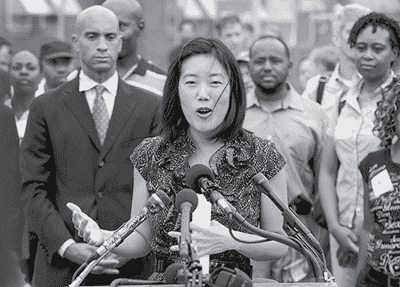

*华盛顿公立学校总长米歇尔·希成为了国家学校改革的脸面，但让华盛顿人产生了两极分化。她动荡的任期加剧了该城市的种族紧张。市长艾德里安·芬蒂站在希的右侧，对这位争议巨大的总长给予不移的支持，这导致他在 2010 年的落败。© Kevin Dietsch.*

希进入这座城市，决心在一个几乎没有人会因表现而被开雇的系统中建立一种“问责文化”。在到达后的几天内，她就抨击系统总部的人员臃肿且无能，通过带领电视摄像小组穿过一个学校系统的仓库来证明她的观点——仓库里堆满了急需的物资被遗忘且未使用，而学生和老师却无物可用。“老师们得自己花自己的钱来买这些东西，”她愤愤平地说道。市议会剥夺了其中一些工人的工会保护，希立即解雇了他们近一百人。

利用《不让任何孩子落后》法案要求的标准化测试，希创建了一套评估管理者的系统。她收集了华盛顿综合评估系统的评分，并与市每位校长坐下来传达了一个简单的信息：如果测试分数不提高，你会被开雇。在她第一年结束时，她已经开除了二十四名校长，其中包括她孩子就读的著名奥斯特-亚当斯双语学校（Oyster-Adams Bilingual School）的校长。

希还试图利用测试分数来衡量教师表现。她通过利用书中已有的模糊认证规则绕过了教师工会，以实施她系统的部分内容，并希望以此开雇她认为无效的数百名教师。她从基金会和富人那里筹了数亿美元私人资金，用于向学生在标准化测试中得分更高的教师发放奖金。一些老师和校长对测试的持续关注和对人员的裁雇感到不满，但在她任的第一年，学生分数全面跳升了十个百分点，许多老师收到了奖金，希赢得了过人的赞誉（尽管随后的调查发现，分数的增长部分归功于为了不被开雇而绝望的教师和管理者的作弊）。

到 2008 年底，希可能已经成为国家学校改革的象征。她穿梭于各种“思想”会议，，向科技万富翁和慈善家讲述如何拯救美国失败的学校。两党总统竞选都会见她讨论教育改革。来自*Frontline*、*60 Minutes*以及 2010 年纪录片《等待钢铁》的摄像团队记录了她的每一个一动。几乎所有的报道以及希本人，讲述了同一个故事：一个受数据和决心驱动的、坚持的学校改革者，如何将一个混乱的城市系统带入正轨。一位热情的记者称她为“华盛顿的胆心”。

可能没有哪个地方比 2008 年 12 月 8 日的《时代》杂志更能清晰地传递这一信息了，该期封面是希，她拿着扫帚，严肃地站在一间空教室里。“老师们讨厌她。校长们怕她，”记者阿曼达·里普利这样写道。希已成为“美国教育界最具革命性且最引起两极分化的力量”。希不仅对老师表示鄙视，还对反对她改革的家长和政治家如此，称他们所谓的学生表现糟糕的借口是“狗屁”。尽管这个故事在她的全国教育改革者群体中很受欢迎，但它疏远了许多华盛顿的家长、老师、行政人员，甚至是少数学生。高级高中家长、校长和教育者联盟（一个关注华盛顿青少年的反暴力组织）的头卡蒂·雷利称该封面故事“不尊重且具有侮辱性”。而这些人正是参加地方选举中投票的人。

### “对黑人没有特殊好感”：种族问题击垮了芬蒂市长

和他的学校总长一样，艾德里安·芬蒂在 2008 年底也沦为了媒体的宠儿。当他开着智能汽车在各个会议之间穿梭时，记者哈里·杰夫在《华盛顿人》杂志上指出，选民将他视为“摇滚明星和运动员的结合”。年轻人竞争加入他的竞选小组或自建小组，在通常肥胖的政府圈内引发了一场健身热。评论人士将他与总统巴拉克·奥巴马相比，特别是在两人 2009 年初共同出现在 U 街著名的本恩斯辣椒味碗店之后。但所有的赞誉都掩盖了该市非洲裔社区对芬蒂专制风格以及对他忽视华盛顿黑人特定要求的的爆发性愤怒。芬蒂坚定地忽视了这一点，坚信结果将超越种族。他错了。


# 芬蒂的改革议程与日益增长的不满

黑人社区对芬蒂（Fenty）改革议程的不满早在 2007 年就已经显现。在她担任市长的首批重大行动之一中，米歇尔·里（Michelle Rhee）公布了一项关闭 23 所学生人数不足、表现不佳学校的计划，这些学校全部位于低收入的黑人社区。她将家长和民选官员视为执意破坏该计划的敌人，因此她和芬蒂将这些关校行为视为既定事实，并在反对者做出反应之前匆忙实施。然而，里并不愿意承认自己在忽视选民，她与受影响的社区举行了一系列会议，居民们在会议上对她进行了严厉的批评。许多人表达了对社区学校的热爱，赞扬了辛苦工作的当地教师，并担心学校关闭会危及他们孩子的安全，或无法改善他们的教育。但最突出的抱怨是，市长没有听他们的意见。“没有人问过我们对这个计划有什么看法，”第 4 区教育委员会主席切丽塔·怀廷顿（Cherita Whiting）抱怨道，“这只是直接交给我们的，我们被告诉：‘就是了。’”

里认为，她改革的预期结果——表现更好的学校、更高质量的教师和成就更高的学生——将消除对她实现这些手段的任何担忧。但《邮报》的马克·菲舍尔（Marc Fisher）写道，她“对这座城市的政治现实充耳不闻”。事实上，她在推行自己的议程时，几乎完全不顾及其行为对种族的影响。她带了一支全白人的行政人员团队，向绝大多数为黑人和拉丁裔的解释关校原因。与此同时，她还积极争取中产阶级的白人家长。尽管白人人口比例已超过 35%，但白人家庭通常在小学阶段后搬到郊区或将孩子送私立学校，因此公立学校的学生只有 6%是白人。为了留住白人学生（既为了增加入学人数也为了提高考试成绩），里经常亲自向富裕和绅士化社区的年轻专业人士家长寻求，向他们发送电子邮件并参加他们在家中举行的听证会。就像五十年前的卡普兰和邻里公司（Caplans and Neighbors, Inc.）一样，里试图通过积极招募白人家庭并迎合他们的利益来阻止白人外流。

## 对非裔美国人的影响

许多非裔家长担心，里对白人家长的讨好最终会伤害他们的孩子。里针对的绅士化区域的学校通常表现较好，其学生是由进取型非裔家长的孩子组成的，这些家长利用“越区系统”（out-of-boundary system——一种学生可以申请就居住区之外学校的分配计划）为孩子争取更好的教育。如果里成功说服了社区内的白人家长让孩子进入这些学校，那么这些区外的黑人孩子将被踢回他们那些表现糟糕的社区学校。

## 罗斯·L·哈迪中学

这个问题在位于富裕的格洛弗公园（Glover Park）社区的罗斯·L·哈迪中学表现得最为激烈。在校长帕特里克·波普（Patrick Pope）的领导下，哈迪中学发展了一项广受誉的全市艺术音乐磁性计划，吸引了来自全市的中产阶级黑人学生。其学生中只有 10%是白人，因为当地很少有白人学生就读。但在 2008 年经过 4800 万美元的翻修后，在哈迪中学就读小学的白人家长告诉里，如果她能让哈迪中学更有吸引力，他们就会留在系统内。里的回应是调离了波普，波普是一个深受黑人学生和家长喜爱的白人，但以对社区家长态度刻薄闻名。

非裔家长哀叫着抗议。在他们看来，市长正在惩罚一位为他们的孩子服务良好的优秀校长，以迎合那些有遗弃系统历史的白人家长。学生站在校长身边。哈迪中学的七级学生克莱尔·墨菲·凯勒（Claire Murphy Keller）称里为“现实版的多洛洛斯·乌布里奇”，指的是热门系列《哈利·波特》中的一个反派人物。然而，里拒绝退缩，再次故意忽视她的改革议程对种族的影响。

## 教师解雇与公众反弹

在芬蒂的支持下，里继续推进。在 2009 年夏季，她聘佣了 934 名新教师，其中包括许多像她一样的年轻 TFA（教师学院）招募人员。随后，她利用 2008 年经济衰退引发的预算缺口机会，为解雇了 159 名员工和 229 名教师，其中绝大多数是年长的非裔美国人。里声称，解雇是因为委员会最后时刻削减预算所必然的，但委员会曾指示她从该系统的暑期学校中削减这笔资金。她忽视了委员会，全额资助了暑期学校，然后在面临缺口时，实施了紧急裁员，这种裁员与普通裁员不同，不需要要求她遵循工会协商的资历规则。里拒绝了关于她制造危机以除掉年长黑人教师的指控，但这确实是她许多改革的最终结果。到 2011 年，黑人教师不再是华盛顿特学校的主多数；而在八年前，他们还占了教师队伍的 77%。

对于许多华盛顿黑人来说，解雇教师是最后的最后一根稻草。一千多名家长、教师、学生和社区活动人士在威尔逊大厦（Wilson Building）外举行了“尊重的集会”。人群挥舞着写有“把她赶出去”和“这不是里齐斯坦（Rheezistan）”的牌子，当华盛顿教师联盟主席乔治·帕克（（George Parker）宣布“我们正在动员，让芬蒂市和里市长知道我们需要尊重、参与和透明度”时，他们欢呼起来。里的支持率在黑人社区断崖式下跌。尽管 2008 年有 50%的非裔选民认为她工作得很好，但两年后只有 27%的人仍坚持这一观点。尽管支持率不断下降，芬蒂仍然坚定地支持他市长的决定。

## 房地产与人口结构变化

芬蒂与黑人社区的问题不仅限于米歇尔·里和该市学校，还延伸到了房地产开发领域。然而，与学校的情况不同，许多非裔选民抱怨他不是不是做得太多、太快，而是做得太少、太慢。在执政的前两年里，芬蒂极大刺激了该市已经蓬勃发展的房地产行业。他为开发商削减了官僚程序，并让数十亿美元的交易快速通过许可和批准流程。当 2008 年经济衰退导致其他城市停工时，他推动特区花费数亿资金来维持繁荣。他辩称道：“你必须得花钱才能赚钱。”

该市实际上从衰退和住房危机中受益，因为高油油价、糟糕的交通和过度建设的住房市场使得郊区变得越来越没有吸引力。2008 年之后，迁入该地区的移民中越来越多的人选择城市而非郊区。在 2009 年至 2011 年间，华盛顿特区增加了近三万新居民，绝大多数是受过教育的白人专业人士。企业家们拼命利用这一人口结构，开设了大量针对拥有可支配收入的年轻白人白领阶级的酒吧、餐厅和健身房。开发商也效法此，加速了高端公寓和公寓楼的建设速度。


芬蒂确保了部分开发活动发生在安纳科斯蒂亚河东部几乎全为黑人的地区。重要的新项目包括位于原圣伊丽莎白斯校园的国土安全部、位于明尼苏达大道东北部的一家巨人超市（这是 7 区 12 年来第一家超市），以及位于 8 区的一家 IHOP 餐厅，而那里以前没有任何一家可以堂食的餐厅。

然而，许多非洲裔美国居民认为市长的做法还不够。黑人占多数的社区开发落后于士绅化地区，更重要的是，市场压力威胁到了低收入黑人居民留在该市的能力。为新居民创造的大部分住房并非新建新建筑。相反，它们是从低收入住房存中划分出来的。在 2000 年至 2010 年间，高价公寓的数量增长了三倍，而低价单元的数量减少了一半。当价格超过 50 万美元的房屋翻倍时，廉价住房的供应缩小了三分之二。

当新购房者和开发者在私人市场上抢购低价单元时，许多贫困居民及其议会代表敦促芬蒂政府创建更多负担得起的住房。然而，芬蒂并没有将其列为优先事项。事实上，这位以急于立即采取解决问题而闻名的市长，在为穷人提供住房选择时却拖了延。

“新社区倡议”为他的政府平庸的努力提供了一个具有启发性的案例。新社区是 2005 年通过威廉姆斯政府与西北一区（Northwest One）几个公共住房项目居民经过一年艰难谈判建立的。该地区的许多老年居民在 20 世纪 50 年代联邦政府摧毁他们在西南部的家园后进入了公共住房，因此，正如社区活动人士阿尔维尔塔·穆林（Alverta Munlyn）所说，他们担心任何现代“城市更新”都会导致“黑人被驱逐”。然而，威廉姆斯政府说服了他们这次会不同。

芬蒂以其专权的统治风格背叛了这种信任并破坏了该倡议。在 2007 年 3 月收到关于神庙法院遭受鼠类和床虫侵害的投诉后，市长与租户召开了会议。他告诉在场的 65 名居民，他们可以原样留在建筑里，也可以领取 8 区住房券离开。大多数人投票选择领取券。芬蒂倾向于直接从居民那里收集信息，并不信任声称代表他们的组织，他忽视了西北一区租户委员会的抗议，并命令所有 211 个家庭搬离建筑，以便将其拆除并重建。芬蒂的行为违反了居民与威廉姆斯政府达成的“先建后拆”协议，但市长承诺，一旦新开发完成后，所有租户都将有一席。“这是谎言，”神庙法院租户协会主席戴安娜·亨特（Diana Hunter）警告道，“当他们推倒这栋大楼时，我们不会回来的。”

事实证明她是正确的。计划开发的私人资金从未落实，芬蒂政府也没有将“新社区”列为优先事项。神庙法院变成了一个停车场。它的原居民散落在该市远东部的区和普林斯乔治县，正如半世纪前西南区的居民在城市更新后分散一样。其他新社区选址也存在类似的问题，负担能力住房危机愈演恶化。在 2008 年至 2010 年间，低收入住房券和公共住房的等待名单分别增长了 47%和 61%。

尽管芬蒂采取了争议性的开发政策和教育改革，芬蒂市长在进入 2010 年连选活动时似乎是无懈可击的。分数上升了，犯罪率下降了，城市正在繁荣，他还筹集了惊人的 400 万美元，吓跑了大多数潜在竞争者。民调显示，所有阶层和种族背景的居民都支持这位活力活力市长对城市服务进行的许多改进。芬蒂在白人选民中非常受欢迎，许多政治观察家认为他将轻松获胜。《华盛顿人》（*Washingtonian*）的哈里·贾夫（Harry Jaffe）在 2010 年 3 月写道：“他的连选似乎几乎板上无疑。”

但芬蒂面临着巨大的政治问题。在一个非洲裔美国人仍占注册选民 63%的城市里，大多数黑人居民认为市长傲慢且不诚，他们认为他更关心高收入白人居民而不是他们自己。“他对白人表现出尊重，对黑人表现出畏缩，”公民活动人士劳伦斯·盖约特（Lawrence Guyot）抱怨道。

许多黑人居民对他们认为他蓄意侮辱资深黑人领袖的行为感到愤怒。2009 年，芬蒂试图驱逐科拉·马斯特斯·巴里（Cora Masters Barry，马里昂·巴里的前妻）和她的非利组织离开东南华盛顿网球学习中心，那是她致力于创建和运营的地方。巴里的两个朋友多萝西·海伊特（Dorothy Height）和玛雅·安哲卢（Maya Angelou）——黑人美国最受尊敬的元老女性——要求面谈此事。芬蒂两次取消了他们的预约，引发了全国著名黑人女性的剧烈批评。在这次引人目的忽视后进行的民调显示，华盛顿特最有影响力的投票群体——该市四分之一之三的黑人女性对芬蒂印象糟糕。

其他人注意到，面对不成比例影响黑人社区的严重问题时，芬蒂并没有表现出足够的紧迫感，其中包括 8 区失业率接近 30%，以及艾滋病发病率飙升至全国领先的 3%（几乎完全集中在低收入黑人社区）。到 2010 年，75%的所有黑人选民反对芬蒂在任期间的表现。许多人同意 H 街 Langston 酒吧和餐厅老板安东尼奥·罗伯逊（Antonio Robertson）的观点，他认为芬蒂“对黑人没有特殊的情感”。

急需一位能够挑战市长的竞争者，几位黑人活动人士和工会领袖锁定了议会主席文森特·格雷（Vincent Gray），他曾在沙龙·普拉特·凯利（Sharon Pratt Kelly）时期担任人类服务部局长，经常与市长发生冲突。格雷是华盛顿本地人，邓巴高中毕业，这位肤色较浅的人是一位比芬蒂年近 30 年的政治人物。他在民主党初选前五个月的 3 月进入竞选，并以“一个城市”（One City）为口号，承诺团结一个按种族和阶级的多元城市。黑人选民对芬蒂的挫满推动了格雷的竞选。在非洲裔政治团体、工会和教会广泛联盟的支持下，格雷迅速筹集了 280 万美元，并专注于动员黑人选民。

芬蒂认为自己了解普通选民的心意，忽视了民调，并拒绝了顾问们要求关注黑人选民的疯狂恳求。他推论，如果黑人选民方面存在问题，再进行一轮上门拜访就能赢得他们。直到 9 月，当民调显示他几乎完全失去了黑人选票时，芬蒂才承认了自己的错误并匆忙弥补。他拍摄了一段为自己的“傲慢”道歉的广告——但在选举前的那个周日，他缺席了教堂活动去参加铁人三项。


那些原谅了马里昂·巴里（Marion Barry）多次越界行为的黑人选民，对芬蒂（Fenty）显而易见的虚假谦虚几乎毫无包容力。其中 80%的人投票给了格雷（Gray）。同样比例的白人选民支持现任者。格雷赢得胜利，这表明在这座快速绅士化的城市，黑人选票仍然是掌握政治权力的关键。¹⁰⁸

最终，芬蒂试图忽视种族的努力最终终结了他的政治生涯。像他之前的财务控制委员会和威廉姆斯（Williams）市长一样，芬蒂为他的黑人选民提供了急需的服务，许多人对此很受用，但他经常以一种剥夺权利、贬低甚至驱逐他们的方式来实现。“芬蒂，他的支持者疯狂赞誉，正在让火车准时运行，”`Post` 专栏作家考特兰·米洛伊（Courtland Milloy）在一篇犀利的选举后后文章中写道，“人们掉进了车尾并被强行挤出城市，这只是进步的代价。”但是他继续道，当芬蒂冲向未来时，那些留在后面的人仍然拥有投票权。“所以人们来到投票站，礼貌地传达了一个信息：大多数居民实际上相信代表制民主，非常感谢。”¹⁰⁹

# 结语

## 明天绝不应如此：新种族动荡时刻的历史、种族与民主

过去是一座
血与哀伤的矿场。
这在明天绝不
应是事实。
—朗斯顿·休斯（LANGSTON HUGHES），《历史》，1934

最初的“茶童与诗人”（Busboys and Poets）餐厅位于西北十四街与 V 街的街角，距离 1968 年骚乱的中心仅一街之遥。这是一家集餐厅、书店、休息和剧院于一体的场所，“茶童与诗人”以朗斯顿·休斯命名，他曾是华盛顿沃德曼酒店（Wardman Hotel）的一名茶童，后来作为诗人声名远扬（尽管他谴责华盛顿黑人上层阶级的虚荣风气）。自 2005 年开业以来，它立即在商业和文化上取得了成功，吸引了 21 世纪涌入周边肖（Shaw）社区的年轻潮酷华盛顿人。¹

从它的名字到书店里丰富的黑人研究书籍，再到装饰墙面的一幅描绘民权运动英雄人物的巨大壁画，“茶童与诗人”自觉地拥抱了社会正义使命并推广非裔美国人历史。然而，它的顾客主要是非黑人，所有者和经营者并非非裔美国企业家，而是在弗吉尼亚州郊区长大的伊拉克移民安迪·沙拉尔（Andy Shallal）。“茶童与诗人”只是 21 世纪初华盛顿（尤其是肖地区）许多利用黑人华盛顿历史主题、意象和人物来吸引新的富裕多元文化客户场所之一。²

“茶童与诗人”体现了一个不断增长、绅士化的城市的精神，这种活力不仅来自新开发的推动，还受到 2008 年伊利诺伊州参议员巴拉克·奥马马当选美国首位黑人总统的影响。特区超过 92%的居民投票给了奥马马——这比他在其他地区的最高得票数高出 25%，成千上万华盛顿居民前往弗吉尼亚州和宾夕法尼亚州这两个摇摆州为他挨挨门拉票。当新闻主播在 11 月 4 日深夜宣布选举结果时，狂喜的跨种族人群聚集在白宫外以及十四街与 U 街的街角，那里距离“茶童与诗人”仅一步之遥，他们在那里拥抱、唱歌、哭泣并跳舞直到深夜。³

次年 1 月，许多华盛顿人加入了百万多访客的行列，冒着零下以下的温度见证了奥马马的就职，他们寒冷的身影从国会大山一直填满了华盛顿纪念碑广场。在一个具有重大历史意义的活动中，奥马马并没有回避国家和特区的种族过去。他惊叹于“一个父亲在不到 60 年前可能无法在当地餐厅获得服务的人，现在可以站在你们面前宣下最神圣的誓言。”⁴

然而在就职后，奥马马有时会让他热烈的当地支持者失望。尽管许多自由派华盛顿人喜欢看到美国第一位黑人夫人米歇尔·奥马马（Michelle Obama）访问阿纳斯蒂亚河东部公立学校的低收入学生，但他们遗憾夫妇选择将两个女儿送到一所昂贵的、大部分为白人的私立学校。他们对奥马马未能将特区自决作为优先事项感到日益沮丧。他花了四年时间在总统座驾上挂上“无代表不纳税”的牌照，尽管尽管代表埃莉诺·霍尔姆斯·诺顿（Eleanor Holmes Norton）的强力游说，他在八次国情咨演中均未提到过特区的治理。在 2011 年与保守派共和人的一系列充满争议的预算谈判中，奥马马著名地牺牲了这座城市。“约翰，我会给你特区的堕胎权，”他对众议长约翰·贝纳（John Boehner）说，从而顺从了国会保守派禁止特区政府使用地方收税收入来资助低收入妇女进行堕胎的规定。黑人社区活动人士菲利普·帕内（Philip Pannell）说：“让我们诚实面对吧，一个共和党总统在特区自决问题上不会更糟。”⁵

对许多黑人华盛顿人来说，更不不详的是，奥马马的总统时期加速了 21 世纪初已经在进行的经济和人口趋势。面对自自大萧条以来国家最严重的经济危机，这位年轻的总统追求旨在加强中产阶级的普适性立法，刻意避开针对贫困和黑人美国人的种族政策。随着国家经济恢复稳定，低收入黑人美国人继续挣扎，特别是在这座国家首都。早已巨大的财富和就业差距差距进一步扩大。城市研究所的一项研究发现，2013 年和 2014 年，华盛顿白人的财富是黑人的 81 倍，而天文般的房地产价值让低收入居民越来越难以留在城市。⁶

随着成千上万的白人、亚洲裔和拉丁裔千禧一代跟随奥马马进入城市，而年长的、以非洲裔为主的居民搬往郊区，城市失去了黑人多数。黑人人口在 1970 年达到近 53.8 万（占总人口的 71.1%）的高峰后，2010 年降至仅 30.5 万（占总人口的 50.7%）。到 2011 年，新的人口普查估计显示，黑人不再是人口多数，“对于这座自诩为黑人文化和政治中心的城市来说，这是一个快速且显著的转变，”记者卡罗·莫洛（Carol Morello）和丹·凯廷（Dan Keating）在`Post`上写道。⁷

从讲坛到停车场，从博客到理发店，这些人口变化再次引发了自华盛顿建立以来就标记着的种族与民主问题。对于希望者来说，人口结构的变化预示着一个全新的、酷的华盛顿，各种肤色的年轻专业人士充斥着点缀了如“茶童与诗人”等时尚场所的繁荣多元化社区。随着千禧一代涌入城市，他们颠覆了这座城市传统的保守声誉。2014 年，《福布》（Forbes）杂志将华盛顿列为美国最“酷”的城市，赞美其“丰富的娱乐和休闲选择”以及“种族文化多元的人口”。⁸


对于政治界而言，这些数字引发了对控制权的质疑，因为黑人社区的萎缩可能被迫放弃他们在过去半个世纪所拥有的政治权力。“我在想未来的华盛顿会是什么样子，我是否还能在桌上占有一席，”黑人律师、社区活动家查尔斯·威尔逊（Charles Wilson）担忧道。这是一个关于“谁有权决定这个社区将变成什么样”的问题，”西北部蒙弗农广场附近第三街上帝会的黑人女牧师切丽尔·J·桑德斯（Cheryl J. Sanders）解释道，“我希望在其中拥有话语权。我不希望在我们为城市规划愿景时，被要求‘坐下闭嘴’。”[⁹]

对于阴谋论者来说，白人口的增加揭示了“计划”的成功——这据称是白人商人和政治领袖的一项长达数十年的阴谋，旨在从黑人手中夺回城市的控制权。“来吧大家，让我们诚实一点，”一位在《华盛顿市报》（Washington City Paper）上回复一篇 2010 年关于华盛顿人口变化的文章的读者写道，“‘计划’正在起作用。白人正在把黑人赶出特区——这就是‘计划’。”货运卡司机罗伯特·亚当斯（Robert Adams）回忆起 21 世纪 00 中期第一个白人家庭搬进他所在的安纳斯蒂亚（Anacostia）社区时。“当时就像有一种波动，就像‘我告诉过你们他们会回来的’”随着安纳斯蒂亚住房的中价变成了 20 世纪 90 年代的两倍或三倍，亚当斯再也负担不起他的公寓。心虽苦但无奈，他和家人搬到了负担得起的普林斯乔治县。[¹⁰]

### 表格 7 华盛顿人口，1990–2015

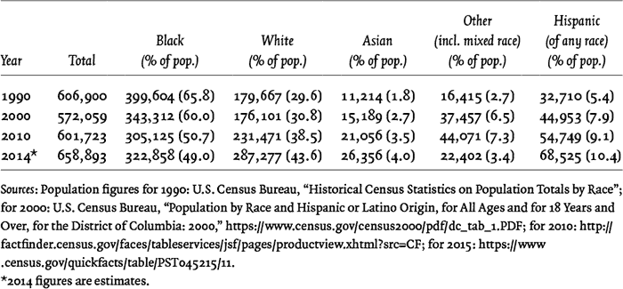

对于怀旧者来说，变化的普普查数据意味着“巧克力城市”（Chocolate City）的终结，这个绰号由放克乐队 Parliament 赋予并永恒化，并在华盛顿于 1957 年成为黑人占多数的城市后，受到黑人居民深爱的拥抱。“华盛顿的形象改造造成了某种身份危机，”记者娜塔莉·霍普金森（Natalie Hopkinson）在 2012 年写道。几十年的黑人控制“培养了一种黑人的特权感、傲慢，是的，还有随着领导力而来的狂妄。”许多华盛顿人现在担心这座城市将失去灵魂。“哎，巧克力会融化的，”霍华大学的诗人 E·埃塞尔伯特·米勒（E. Ethelbert Miller）感叹道，“我们正在看到一个社区的侵蚀。这座城市将不再是黑人的。”[¹¹]

21 世纪初的人口革命是这个国家首都种族与民主故事的最新章节。四个世纪以来，种族一直是冲突和分裂的持续源头，是华盛顿政治、经济和社会生活的中心断裂线。这个国家创始文件中的民主承诺，反复在剥夺、奴隶制、隔离、暴力、投资不足以及我们集体无法认真对待这个国家的种族罪行的礁石上遭遇折戟。

但这个国家首都的历史不仅仅是兰斯斯顿·休斯（Langston Hughes）所说的“血血与哀伤的矿床’。从城市诞生起，有良知的男女就一直在努力拆除仍然困扰着我们国家的种族不平等和不信任体系。他们的故事不是关于责备和放弃，而是关于行动和韧性，关于努力确保华盛顿充满痛苦的种族过去“绝不能/成为未来的写照。”我们希望这本书能激励华盛顿人承担起黑白废除主义者、前奴隶和激进共和党人、民权运动和地方自治活动家、高速公路抗议者和合作组织者的挑战，去建立一个更加公正、平等和民主的国家首都。

## 关于来源的论文

《巧克力城市》（Chocolate City）建立在我们之前的几代历史学家进行的大量一手和次级研究之上，也基于与我们并肩工作的当代同事的研究。这本书书既属于他们，也属于我们——它既包含了我们自己的原创一手研究，也包含了对过去半世纪改变了华盛顿历史领域的学术阐释的综合。事实上，该领域经历的变化与席卷这座城市本身的变化同样深刻。国家首都的历史始于富裕的业余历史学家之间的一项庆祝性谱系研究，随后引起了学术界严肃学者日益增长的，这些学者扩大了该领域的范围，并深化了我们对城市中种族、阶级、权力和性别动态的理解。

第一个专注于华盛顿历史的组织是哥伦比亚特区最老居民协会（Association of Oldest Inhabitants of the District of Columbia），成立于 1865 年，在华盛顿充斥着新居民之际庆祝这座城市的“老”家族。一个更具学术性的小组于 1894 年集成了哥伦比亚历史学会（Columbia Historical Society）。这三十六位白男女创始人主要是在联邦政府工作并在城市扎根的科学家和学者。他们撰写并发表了论文（通常是回忆录以及研究），并装订出版为《哥伦比亚历史学会记录》（Records of the Columbia Historical Society）。在最初的几十年里，协会的兴趣反映了其白人、专业化、富裕成员的构成。早期《记录》中讲述的大部分历史是他们的，尽管到 20 世纪中叶，该组织已超越了其精英成员的个人利益，开始发表关于城市机构的研究，包括被隔离的学教育系统的两个部门。[¹]

20 世纪初，其他城市组织开始收集更多样化的地方历史。华盛顿公共图书馆的“华盛顿分部”（Washingtoniana Division）成立于 1905 年，收集了涵盖广泛当地兴趣的材料，反映了其作为城市少数非隔离公共中心之一的角色。尽管主要被白人历史学家忽视，黑人华盛顿的社会历史可以通过口述、地区教会以及霍华大学穆兰基金会（Moorland Foundation，现名为穆兰-斯灵恩研究中心）轻松获得。霍华大学的学者产生了许多 20 世纪早期关于城市种族的重要著作，包括社会学家威廉·亨利·琼斯（William Henry Jones）对黑人休闲的开创性研究（《Recreation and Amusement among Negroes in Washington, D.C.》，1927 年）和住房的研究（《The Housing of Negroes in Washington, D.C.》，1929 年）。他的同事斯泰尔林·布朗（Sterling Brown）为 1937 年工程进展管理局的《华盛顿指南》（Guide to Washington）撰写的关于“华盛顿的黑人”的短文，仍然是对黑人华盛顿人在城市中所扮演的关键作用的强有力探索。E·富兰克林·弗雷泽（E. Franklin Frazier）为了他著名的《十字路口上的黑人青年》（Negro Youth at the Crossways，1940 年）对华盛顿居民进行了大量迷人的访谈。尽管这些研究对黑人生活的观察非常有价值，但那个时代的研究往往受到对黑人精英痴迷以及对黑人贫穷和工人阶级傲慢的影响。


与美国史学的许多领域一样，对华盛顿历史的解释在 20 世纪中叶的民权（以及地方自治）斗争中发生了革命性的变化。二战后几十年里进行的许多研究都试图描述和详述种族不公的历史，以拆解它。这些具有深刻意义的工作包括查尔斯·哈密尔顿·休斯顿、菲尼斯·印德里茨等律师的法律研究，以及社会学家 E. 弗兰克林·弗雷泽、经济学家罗伯特·韦弗等人的学术研究，他们在 1948 年合作了轰级著作《华盛顿的隔离》（*Segregation in Washington*）。这些研究首要是实用主义的历史，由寻求改革的自由派活动分子和试图向焦虑的读者解释瞬息万变世界的记者撰写。它们有的可能美得令人心碎——海因斯·约翰逊的《山之黄昏：黑人、国家与首都》（*Dusk at the Mountain: The Negro, the Nation, the Capital*，1963）是对黑人华盛顿人所居住的依然隔离的世界的诗意快照；它们也可能极地清醒且富有趣味性——萨姆·史密斯的《被俘的首都》（*Captive Capital*，1974）充满了对华盛顿居民所经历的持续无力感的愤慨。

### 学术研究的兴起

在 20 世纪 60 年代和 70 年代初，两位先驱学者的获奖研究将华盛顿历史确立为一个正当的学术分支学科。康斯坦斯·麦克拉克林·格林的两卷本著作《华盛顿》（*Washington*）于 1962 年出版，树立了高水平的学术标准，并让华盛顿历史不再能仅仅由老年白人男性反复讲述的陈旧调陈词滥调组成。她的《秘密城市：国家首都种族关系史》（*Secret City: A History of Race Relations in the Nation’s Capital*，1967）为“种族间的相互作用”提供了全景视角，尽管她在描述穷人生活方面颇为吃力，转而关注数据更丰富的“处于社会经济高阶层的黑人”。撇开这些不足，《秘密城市》是一本经过深度研究且洞察力极佳的书，它为未来几十年的种族关系研究奠定了基调。格林之后很快是莱蒂西亚·伍德斯·布朗，她的《哥伦比亚比亚特区的自由黑人，1790–1846》（*Free Negroes in the District of Columbia, 1790–1846*，1972）为该市早期共和时期和战前的黑人生活提供了细微的视角。布朗详尽记录了奴隶和自由黑人华盛顿人为争取更多自由而所做的努力。她的研究仍然是该领域的标准。

### 新社会史

布朗的作品是后来被称为“新社会史”的早期范例，这是全国历史学家的一场运动，将注意力转向地方历史和普通人的，而不是国家政策制定者和精英。这场运动与华盛顿地方自治运动的胜利相契，也激发了对华盛顿当地历史的兴趣。这些发展共同激励了历史学家更深入、更有批判性地审视过去，对历史人物和历史文献中关于权力和特权的假设提出质疑。

结果是一代人的解释，这些解释颠覆了我们对华盛顿历史的理解，并挖掘了在整个《巧克力城》（*Chocolate City*）中产生共鸣的新故事和主题。这种新方法的一个典范是詹姆斯·博切特的《华盛顿的巷弄生活：1850–1970 年的家庭、社区、宗教与民俗》（*Alley Life in Washington: Family, Community, Religion, and Folklife in the City, 1850–1970*，1980），它打破了进步时代改革者创造的带有种族和阶级色彩的“巷弄居民”漫画，并试图理解所有复杂且丰富的巷弄社区。

### 自下而上的历史

后的学者采用了类似的方法，“从下而上”地编写了新的华盛顿历史。凯瑟琳·门齐·莱斯科、瓦莱丽·巴布和卡罗尔·R·吉布斯合作合作完成了一项开创性研究《记忆中的黑人乔治敦》（*Black Georgetown Remembered*，1991），揭示了乔治敦黑人经历的深根蒂源。伊莉莉莎白·克拉克·刘易斯在《寄宿与外出：1910–1940 年华盛顿的非裔家政工》（*Living In, Living Out: African American Domestics in Washington, D.C., 1910–1940*，1994）及几篇相关文章中进行了数十次深度口述史，从女性移民家政工的角度讲述了 20 世纪初华盛顿的故事。文集《城市奥德赛：华盛顿多元文化史》（*Urban Odyssey: A Multicultural History of Washington D.C.*，1996）挑战华盛顿历史学家，让他们不要忽视城市的许多少数民族，包括大部分被遗忘的白人工人阶级。文集中两个特别重要的文章是奥莉维亚·卡达瓦尔对拉丁裔社区的开拓性工作，以及梅根·麦莱尔关于华盛顿爱兰人的精彩文章。这些学术研究复杂并丰富了我们对城市过去的理解。

### 机构贡献与档案

地区博物馆和大学通过建立新档案和鼓励对城市的新研究，为地方历史的涌现做了贡献。史密森尼学会在主管约翰·基纳德的带领下于 1967 年建立了阿纳科斯蒂亚社区博物馆，并在 70 年代开始收集口述史并创建了特定社区的档案。它赞助的出版物填补了华盛顿历史领域的巨大空白，该领域几乎忽略了阿纳科斯蒂亚河以东的社区。华盛顿大学于 1980 年建立了华盛顿地区研究中心，哥伦比亚区大学的城市研究系于次年启动了华盛顿历史与公共政策项目。这三者都通过国家人文艺术基金会的附属机构华盛顿地区人文委员会获得了资金，并利用这些资金出版了丰富的社区历史，以及从住房、教育到自决斗争的各种报告。地方研究的巅峰出现在 1988 年，由编辑凯瑟琳·施奈德·史密斯编写的《在家华盛顿》（*Washington at Home*）出版，这是一部插图精美、研究详实的简短社区史集。

### 巴里时代与现代转型

20 世纪 80 年代的海洛因毒品以及马里恩·巴里在 1990 年因吸毒被定罪，使华盛顿历史的重心偏离了社会史和小研究，许多记者竞相撰写关于市长和城市陷入混乱的文章。乔纳森·阿格隆斯基愤怒的《马里恩·巴里：种族政治》（*Marion Barry: The Politics of Race*，1991）、汤姆·谢伍德和哈里·杰夫的《梦想之城：种族、权力与华盛顿的衰落》（*Dream City: Race Power and the Decline of D.C.*，1994——可能是目前流通影响力最大的 20 世纪末华盛顿著作）以及乔内塔·罗斯·巴拉斯富有洞察力的《最后的黑皇帝：新黑人领袖时代马里恩·巴里的虚幻回归》（*The Last of the Black Emperors...*，1998），都对巴里执政时期提供了详细且富有见解的描述。然而，他们对市长的关注掩盖了城市丰富的社会运动历史，并挤出了其他政治参与者。

到上世纪末，华盛顿历史看起来与半年前完全不同。对地方个人和社区历史的强调引入了传统历史中未曾听过的各种声音和故事。这些细致的研究展示了城市的历史不仅由强大的领导者塑造，也由贫穷和工人阶级的男女通过个人或集体行动共同塑造了的。然而，有时此类研究会与宏观背景脱节。新一代受过大学训练的历史学家致力于将地方与国家结合起来，帮助读者理解联邦政府与各种地方参与者之间关于权力、权利和机会的复杂斗争。这些作品对于我们理解首都的种族和民主至关重要。

这种结合方法的一个不可或缺的范例是霍华·吉莱特命名精妙的《公正与美之间》（*Between Justice and Beauty*，1994），它探讨了种族和城市规划如何塑造城市的发展。《巧克力城》中许多关于城市规划的讨论，包括 19 世纪末的房地产开发和 20 世纪中叶的城市更新，都是建立在吉莱特的见解之上的。


尽管吉列（Gillette）涵盖了华盛顿特区跨越两百年的历史，但其他 20 世纪末和 21 世纪初的学者则对特定时期进行了高度聚焦的研究。我们的早期章节反映了肯·鲍林（Ken Bowling）对该市建立工作的细致研究的影响，包括《创建联邦市，1774–1800》（1988 年）和《华盛顿特区的创立：美国首都的理念与选址》（1991 年）。我们对内战前华盛顿反奴隶社区的解读，很大程度上得益于斯坦丹利·哈罗尔德（Stanley Harrold）的卓越著作《颠覆者：1828–1865 年华盛顿特区的反奴隶社区》（2003 年），该书详述了华盛顿特区跨越种族的反奴隶活动人士网络所面临的挑战与胜利。玛丽·贝斯·科里根（Mary Beth Corrigan）1996 年重要的论文《心灵与努力的社会联盟》以及相关文章揭示了自由黑人和奴隶黑人华盛顿人之间复杂的亲属网络和社区建设努力。威廉·G·托马斯（William G. Thomas）近期关于内战前华盛顿自由诉讼和黑人家庭网络的研究，强调了奴隶黑人华盛顿人在反抗奴隶中展现的主动性。托马斯还协助开发了一个卓越的网站“噢，你能看见”（`http://earlywashington.org`），该网站数字化并分析了数百份涉及国家首都奴隶制的法律文件和法案件。

## 内战与重建时期
内战和重建时期赢得了许多严肃学者的关注。我们关于该时期的章节极大借鉴了凯特·马苏尔（Kate Masur）杰作之作《所有土地的典范：华盛顿特区的解放与平权斗争》（2011 年）所提供的深刻见解。马苏尔将当地黑人活动家置于其研究中心，展示了像乔治·哈顿（George Hatton）这样的黑人活动人士如何在保守派反对者发起有效反革命的同时，推动对平等进行更广泛的定义。肯尼斯·J·温克尔（Kenneth J. Winkle）的《林肯的堡垒：华盛顿特区的内战》（2013 年）对这一动荡时代提供了极具读性的描述，并将国家首都置于更广泛的战争背景中。温克尔还是“内战华盛顿”（`www.civilwardc.org`）的推动者，这是一个重要的网站，为研究人员提供了丰富的原始资料和深刻的阐释性文章。艾兰·莱斯索夫（Alan Lessoff）的《国家及其城市：政治、“腐败”与进步，1861–1902》（1994 年）仍然是理解亚历山大·谢泼德（Alexander Shepherd）政权以及随后他统治华盛顿的白人商人的标准。

## 吉姆克劳时代
华盛顿漫长的吉姆克劳时代——从 19 世纪 70 年代推行专员统治到 20 世纪 40 年代和 50 年代的现代民权运动——没有获得与其相称的学术关注。一个例外是里克·耶林（Eric Yellin）的著作《国家服务中的种族主义：伍德罗·威尔逊时期美国的政府工作人员与种族界》（2013 年）。耶林的详尽研究不仅展示了威尔逊政府如何倒退几十年的黑人进步，还展示了该市黑人社区如何组织起来捍卫他们对城市的诉求。关于该时代的一些最佳研究已以文章形式发表，包括米歇尔·帕菲科（Michele Pacifico）关于“新黑人联盟”的工作；或者一些尚未出版的作品，包括玛雅·安妮特·麦奎里特（Marya Annette McQuirter）卓越的论文《主索城市：1902–1957 年华盛顿特区的非裔美国人、城市化与休闲》（2000 年）。麦奎里特揭示了该市种族边界的流动性，并强调了黑人华盛顿人在城市街道上维护自我形象的各种方式。近年来，涌现了关于该时代极具前景的新研究，包括提基亚·K·汉密尔顿（Tikia K. Hamilton）精美的论文《建立一个“模范”系统：`布朗`案之前国家首都的种族、教育与政治，1930–1950》（2015 年）、特雷瓦·林赛（Treva Lindsey）的《不再有肤色：在华盛顿特区重塑黑人女性身份》（2017 年），以及玛丽·伊利莎贝斯·墨菲（Mary-Elizabeth Murphy）即将出版的《国家与地方事务：1920–1945 年华盛顿特区的非裔美国女性政治》。

## 民权与黑人权力
华盛顿历史中的民权与黑人权力时代，大约从第二次世界大战结束到 20 世纪 90 年代初马里昂·巴里（Marion Barry）下台，值得更多的学术审视。我们对该时期的理解因 2004–05 年发表在《华盛顿历史》（Washington History）上的两篇关于去种族化的卓越文章而丰富。贝尔·克莱门（Bell Clement）的《反击：白人社区对波林的异议》探讨了白人华盛顿人如何抵抗民权运动，特别是在一次试图“拯救”中央高中为白人学校的失败尝试期间。玛雅·麦奎里特的《我们的事业正在前进：战后华盛顿的家长活动、布朗初级中学与平等的多重意义》描述了黑人家长发起的基层运动，迫使市官员处理因维持双轨学校制度造成的各种问题。两篇于 2013 年完成的论文研究了参与民权和自治斗争的人员和组织：格雷高里·M·博尔哈特（Gregory M. Borchardt）的《让华盛顿特区成为民主之都：华盛顿特区的地方活动、“联邦州”与民权斗争》，以及劳伦·帕尔尔曼（Lauren Pearlman）的《民主之都：1933–1978 年华盛顿特区的地方抗议、国家政治与民权斗争》。其他影响我们对这一时代解读的重要著作还包括安妮·M·瓦尔克（Anne M. Valk）的《激进姐妹：华盛顿特区的二战后第二波潮女性主义与黑人解放》（2008 年），该书探讨了女性在遍布肖（Shaw）和哥伦比亚高地（Columbia Heights）的新左翼活动社区中发挥的巨大作用；以及丹娜·弗（Dana Flor）的精彩纪录片《马里昂·巴里的九生》（2009 年），或许是对巴里波荡生涯的最佳总结。

## 绅士化与当代学术
2000 以来，大规模的绅士化浪以及随后该市黑人多数地位的结束，产生了一个独特的当代学术分支，影响了我们的后续章节：绅士化研究。这一转型的关键先驱是 20 世纪 90 年代在财务控制委员会下对华盛顿政府的联邦指导重组。贾希·巴鲁蒂（Jahi Baruti）重要的论文《1995–2001 年华盛顿特区的政府控制委员会时期》（2003 年），以及迈克尔·范特罗（Michael Fauntroy）的《自治还是院统治：国会对华盛顿特区地方治理的侵蚀》（2003 年）是我们理解这一过程的关键路标碑。丹尼斯·盖尔（Dennis Gale）的《华盛顿 DC：市中心复兴与少数族裔郊化》（1987 年）仍然是对该地区人口变化最广泛、最深思的处理。由德里克·海德拉（Derek Hyra）和萨比哈·普林斯（Sabiyha Prince）收录论文集《首都困境：华盛顿特区的增长与不平等》（2016 年）中的那些才华横溢的学者，在盖尔见解的基础上，解释了持续影响该市的绅士化现象。

《巧克力城市》（*Chocolate City*）旨在综合自格林的的《秘密城市》（*Secret City*）以来半个世纪以来关于国家首都种族与民主的重要研究，并对未被充分研究的人、事件和时代提供新的研究与分析。随着专门研究的激增，我们认为需要一种易于阅读的单卷本叙事性历史，它将地方历史的有力故事和见解与更广泛研究的必经背景和范围相结合。尽管本书主要为普通读者编写，但《巧克力城市》也为关于种族、民主和社会变革的学术对话做出了贡献。


我们是对华盛顿`种族`的研究——而不仅仅是对华盛顿黑人区的研究。白人华盛顿人也有他们的“种族”，因此我们认真研究了种族如何影响白人华盛顿人（包括移民和白人工人阶级）的世界观和行为，并探索了他们的种族认同、种族恐惧以及种族权力感如何随时间变化。我们还试图将华盛顿历史领域从支撑许多该市写作的黑白二元框架中转移出来。尽管华盛顿的人口在历史大部分时期以白人和黑人为主，但我们纳入了原住民、拉丁裔、亚裔美国人和埃塞俄比亚的故事，这些故事在关于华盛顿种族的通俗讨论中往往会被淹没。

我们扩展了历史学家的工作，他们识别出了该市不同人群中深刻且具有政治影响的阶级划分。这些种族内部划分对于理解群体凝聚力或分歧、跨种族合作的空间，以及治理精英与“基层””之间的激烈分歧至关重要。这种分歧在种族动荡或紧张时期变得尤为重要，例如重建时期及其后期，或二战后的民权时代。

《巧克力城》（`Chocolate City`）探讨了种族在国会拒绝赋予国家首都自决权方面发挥的关键作用；反之，华盛顿缺乏自治如何加剧了整个城市历史进程中当地的种族不信任。政治民主的缺失是一把双刃剑。当地活动人士有时利用联邦政府来实现他们的目的，而国家政治参与者则利用华盛顿来追求他们的国家政策议程或迎合其选民的偏见。

我们的工作深入挖掘了华盛顿历史中鲜为人知或理解较浅的片段，包括城市成立之前的权力斗争、战前黑人居民如何利用法院维护利益、爱尔兰人在华盛顿种族历史中的角色、19 世纪末佩里·卡森森（Perry Carson）及其工人阶级联盟的重要性、20 世纪 30 年代反对警察暴行的运动、去隔离时代白人工人阶级的衰落、停止高速公路建设的跨种族运动、20 世纪 70 年代到 90 年代的州地位努力，以及马里昂·巴里（Marion Barry）持久的受欢迎。这些故事阐明了我们更宏大的主题：种族持久的意义和种族权力的动态变化、华盛顿非民主政治地位对城市种族关系的破坏影响，以及作为国家首都对当地种族斗争的催化和挫败作用。

21 世纪将为未来的历史学家提供丰富的素材。这座城市的历史每天都在记录，不仅在《华盛顿邮报》（`Washington Post`）、《城市报》（`City Paper`）和《华盛顿信息报》（`Washington Informer`）的页面上，还在无数反映华盛顿人对地区过去持续热爱的博客和网站上。我们希望《巧克力城》加深对这座城市的爱，并启发读者就种族和民主进行深入的对话。

## NOTES

### 缩写表

| `AA` | `Afro-American` 非裔美国人 |
| `CA` | `Colored American` 有色种美国人 |
| CCEADL | 华盛顿反歧视法律执行协调委员会 |
| `CD` | `Chicago Defender` 芝加哥捍卫者 |
| CFP | Moorland-Spingarn Research Center, Howard University, Washington, D.C., Cook Family 档案
| CHHP | Moorland-Spingarn Research Center, Howard University, Washington, D.C., Charles Hamilton Houston 档案 |
| CMID | National Archives and Records Administration, Washington, D.C., 1917–1941 年关于“黑人颠覆”的军事情分部信函 |
| CML-OHP | Martin Luther King Memorial Library, Washington, D.C., Washingtoniana Division, Community Archives, 拉丁裔女性口述史项目 |
| DCCA | Martin Luther King Memorial Library, Washington, D.C., Washingtoniana Division, 华盛顿社区档案 |
| DCSML | Martin Luther King Memorial Library, Washington, D.C., Washingtoniana Division, 华盛顿州地位运动领袖口述史项目 |
| ECTCP | Martin Luther King Memorial Library, Washington, D.C., Washingtoniana Division, 交通危机紧急委员会档案 |
| EFFP | Moorland-Spingarn Research Center, Howard University, Washington, D.C., E. Franklin Frazier 档案 |
| `ES` | `Evening Star` 晚间之报 |
| GWBTR | George Washington University, Washington, D.C., Gelman Library, Special Collections Research Center, 大华盛顿贸易委员会委员会记录 |
| JHP | Martin Luther King Memorial Library, Washington, D.C., Washingtoniana Division, Julius Hobson 档案 |
| KRL-HSW | Historical Society of Washington, D.C., Kiplinger 研究图书馆 |
| LC | Library of Congress, Washington, D.C., 美国国会图书馆 |
| MBOE | 华盛顿特区教育委员会会议记录 |
| MCTP | Library of Congress, Washington, D.C., Mary Church Terrell 档案 |
| NAACP-DC | Moorland-Spingarn Research Center, Howard University, Washington, D.C., NAACP 华盛顿分会档案 |
| NARA | National Archives and Records Administration, Washington, D.C., 国家档案馆与记录管理局 |
| NCSNC | 国家首都种族隔离国家委员会 |
| `NI` | `National Intelligencer` 国家情报报 |
| `NR` | `National Republican` 国家共和报 |
| NYS-DC | 黑人青年研究, 华盛顿 |
| `NYT` | `New York Times` 纽约时报 |
| RB-OHC | Moorland-Spingarn Research Center, Howard University, Washington, D.C., Ralph Bunche 口述史集 |
| RDCC | National Archives and Records Administration, Washington, D.C., 华盛顿特区委员会记录 |
| RG | 记录组 |
| RSCI | Library of Congress, Washington, D.C., 调查华盛顿特区非法奴隶贸易的委员会记录 |
| SCRC-GL | George Washington University, Gelman Library, 特藏收藏中心 |
| SNCCP | 学生非暴力协调委员会 |

# 引言

1. Washington, *Testament of Hope*, 217–18.

2. Martin Luther King，“我有一个梦想”演讲稿，，在线地址：[`https://kinginstitute.stanford.edu/king-papers/documents/i-have-dream-address-delivered-march-washington-jobs-and-freedom`](https://kinginstitute.stanford.edu/king-papers/documents/i-have-dream-address-delivered-march-washington-jobs-and-freedom)。

3. `USBC`, “按种族划分的人口总数的历史统计”，表 23。

4. “艾克收到布切博士的信，”AA`，1953 年 3 月 14 日。

### 第一章

1. 关于安纳斯蒂亚，请参见 Cantwell，“Anacostia”；Hutchinson，《Anacostia Story》以及 Wennersten 的《Anacostia》。


2. 纳科奇坦克（Nacchtank）是后来成为哥伦比亚特区的十英里方形范围内，三个美洲原住民定居点中最大的。Humphrey and Chambers, *Ancient Washington*, 23; Gardner, “Native Americans,” 3–19; Rice, *Nature and History*, 56–69; Merrell, “Cultural Continuity,” 550–53.

3. Humphrey and Chambers, *Ancient Washington*, 5; Rice, *Nature and History*, 52–56; Wennersten, *Anacostia*, 6, 9–10.

4. Rice, *Nature and History*, 48, 52–56; Merrell, “Cultural Continuity,” 549–50.

5. Rice, *Nature and History*, 71–73.

6. Gardner, “Native Americans,” 6–7; Roundtree, *Pocahontas, Powhatan, Opechancanough*, 47–49; Kupperman, *Captain John Smith*, 1–12.

7. Smith, *True Relation*; Roundtree, *Pocahontas, Powhatan, Opechancanough*, 63–66.

8. Strachey quoted in Roundtree, *Pocahontas, Powhatan, Opechancanough*, 31, 47–49; Rice, *Nature and History*, 59–60.

9. Smith, *True Relation*.

10. Strachey quoted in Vaughan, “Expulsion of the Savages,” 72; Fausz, “Merging and Emerging Worlds,” 50; Roundtree, *Pocahontas, Powhatan, Opechancanough*, 76–83; Rice, *Nature and History*, 80–81, 86–99.

11. John Smith, “The Accidents That Hap’ned in the Discovery of the Bay of Chisapeack” (1608), Captain John Smith Four Hundred Project, [`www.johnsmith400.org/journalfirstvoyage.htm`](http://www.johnsmith400.org/journalfirstvoyage.htm); Hutchinson, *Anacostia Story*, 3.

12. Roundtree, *Pocahontas, Powhatan, Opechancanough*, 107–10; Smith, “Accidents That Hap’ned”; Mooney, “Indian Tribes,” 259–66.

13. Gardner, “Native Americans,” 6–7; Roundtree, *Pocahontas, Powhatan, Opechancanough*, 47–49; 史密于 1608 年 7 月 16 日登陆于纳科奇坦克。Smith, “Accidents That Hap’ned”; Mooney, “Indian Tribes,” 259–66.

14. Merrell, “Cultural Continuity,” 553, n18; Fausz, “Merging and Emerging Worlds,” 47–52; Rice, *Nature and History*, 71–73, 93.

15. Kupperman, *Captain John Smith*, 11; Fausz, “Merging and Emerging Worlds,” 52.

16. Roundtree, *Pocahontas, Powhatan, Opechancanough*, 208–15.

17. Edward Waterhouse, “A DECLARATION of the State of the Colony and Affaires in VIRGINIA. With a Relation of the Barbarous Massacre in the Time of Peace and League, Treacherously Executed upon the English by the Infidels, 22 March Last . . . ,,” in Kingsbury, *Records of the Virginia Company of London*, 541–64.

18. Rice, *Nature and History*, 78–79, 90–91; Fausz, “Merging and Emerging Worlds,” 54–55.

19. Roundtree, *Pocahontas, Powhatan, Opechancanough*, 153, 156–57.

20. Roundtree, *Pocahontas, Powhatan, Opechancanough*, 153, 156–57. Wyatt quoted in Humphrey and Chambers, *Ancient Washington*, 25; Castle, “Washington Area,” 1–2; Henry Fleet, “A Brief Journal of a Voyage Made in the Bark ‘Warwick’ to Virginia and Other Parts of the Continent of America,” in Neill, *English Colonization*, 226–27, 237; Fausz, “Merging and Emerging Worlds,” 57; Rice, *Nature and History*, 87–90.

21. Fleet quoted in Semmes, *Captains and Mariners*, 94–95, 542; Fleet, “Brief Journal,” 227–35; Pendergast, *Massawomeck*, 14–18; Fausz, “Merging and Emerging Worlds,” 60–66, 74; Neill, *English Colonization*, 240.

22. Aubrey C. Land, “Provincial Maryland,” in Walsh and Fox, eds., *Maryland, a History*, 2–3; Merrell, “Cultural Continuity,” 554–55.

23. Fausz, “Merging and Emerging Worlds,” 74–88; Merrell, “Cultural Continuity,” 556–67; Semmes, *Captains and Mariners*, 4.

24. Castle, “Gisborough as Land,” 282–92; *Proceedings of the General Assembly, 1666–June 176*, 25, [`msa.maryland.gov`](http://msa.maryland.gov); Hutchinson, *Anacostia Story*, 7–8; Gardner, “Native Americans,” 14.

25. Castle, “Washington Area,” 18; Merrell, “Cultural Continuity,” 567; Wennersten, *Anacostia*, 14; Castle, “Gisborough as Land,” 282–92.

26. Castle, “Gisborough as Land,” 282–92.

27. Andrews, *History* of *Maryland*, 197–98; Castle, “Washington Area,” 7; *Proceedings of the Council, 1693–97*, 13–52, [`msa.maryland.gov`](http://msa.maryland.gov).

28. Merrell, “Cultural Continuity,” 569; Castle, “Washington Area,” 16.

29. Castle, “Washington Area,” 9–12; Merrell, “Cultural Continuity,” 568.

30. Merrell, “Cultural Continuity,” 569–70; Gardner, “Native Americans,” 14; Mooney, “Indian Tribes,” 265.

31. Castle, “Washington Area,” 15; Kulikoff, *Tobacco and Slaves*, 39.

32. Melder, *City of Magnificent*, 18–19.

33. Kulikoff, *Tobacco and Slaves*, 39–41, 270–72; Walsh and Fox, *Maryland, a History*, 2–3; Castle, “Washington Area,” 7.

34. Humphrey and Chambers, *Ancient Washington*, 23; L’fant’s *Plan for 1792* included the name Anacostia; *Creation of the Federal*.


[13] 托马斯，*奴隶贸易*，470–73；大学政治与社会研究联盟，“1790 年人口普查数据”；约翰逊，《无税不暴政》。

[14] 引用自霍顿，“亚历山大·汉密尔顿”，19；亚历山大·汉密尔顿致约翰·杰，1779 年 4 月，收于汉密尔顿*著作集*，56–57。

[15] 彻姆，《詹姆斯·麦迪逊*，148；霍顿，“华盛顿非裔美国社区的起源”，28；托马斯·杰斐逊，“弗吉尼亚州笔记”，收于杰斐逊*著作集*，288；华盛顿，“关于黑人的华盛顿信函”，417；乔治·华盛顿，“对奴隶制的反思”，收于华盛顿*著作集*，701–2。

[16] 麦迪逊引自凯彻姆，*詹姆斯·麦迪逊*，248。

[17] 亨特与斯科特，《联邦会议的辩论*，257。

[18] 纽曼，《美国废奴主义的转型*，48–49；乔治·华盛顿致大卫·斯图亚，1790 年 6 月 15 日，收于图霍格、马斯特罗马里诺和沃伦，《华盛顿文献*，525；博德维奇，《华盛顿*，39–40。

[19] 戈登-里德，《蒙蒂塞洛的海明斯家族*，26, 164–69, 489–92；博德维奇，《华盛顿*，45–46。

[20] 托马斯·杰斐逊，“阿纳斯族。1791–1806”，收于杰斐逊*著作集*，669。

[21] 泰瑞尔，《白人世界中的有色女性*，427。

[22] 希尔，《总统住宅*，40–45；布莱恩，《国家首都历史*，1:194–95。

[23] *NI*，1832 年 3 月 27 日；阿内贝克，《严酷的考验*，138, 255；USBC，《第五次人口普查》；布雄松，“想象詹姆斯·霍班”，50；华纳，《与所有邻居和睦》，131。

[24] 华盛顿致 S. 费尔克斯夫人（莎拉·凯瑞·费尔克斯），1798 年 5 月 16 日；华盛顿致亚瑟·杨，1793 年 12 月 12 日，收于斯帕克斯，《华盛顿著作集*，11:233, 12:310；威尔德，《旅行记*，69。

[25] 乔治·华盛顿，“关于政府永久选址的公告”，收于斯帕克斯，《华盛顿著作集*，12:121–23；USBC，《第一次普查中的户主》，10。

[26] 阿内贝克，《严酷的考验*，34–35。

[27] 阿内贝克，《奴隶劳动*，45。

[28] 托马斯·杰斐逊致埃利科特少校，1791 年 2 月 2 日，收于帕多弗，《杰斐逊与国家首都*，40。

[29] 贝迪尼，“联邦领土调查”，83。

[30] “哥伦比亚特区的边界界石”，`http://www.boundarystones.org`；贝迪尼，“联邦领土调查”，84–86。

[31] 埃利科特的女儿的引言引自贝迪尼，“联邦领土调查”，87；*乔治敦每周周报*，1791 年 3 月 12 日，引自廷达尔，《标准史*，60。

[32] 班杰明·班内克斯克致杰斐逊，1791 年 8 月 19 日，收于库伦，《杰斐逊文献*，49–54。

[33] 杰斐逊致班内克斯克，1791 年 8 月 30 日，收于库伦，《杰斐逊文献*，97–98；辛哈，《奴隶的理由*，144–45。

[34] “托马斯·杰斐逊表达他对对首都的想法”和“恩凡特不喜欢联邦城市计划”，收于“原始文献：联邦城市”：`http://www.ourwhitehouse.org/primarycity.html`；致波尔多市委员，1793 年 1 月 4 日，RDCC，1791–1867。

[35] 扬，《华盛顿*，19。

[36] 委员致杰斐逊，1792 年 4 月 11 日，RDCC，1791–1867；杰斐逊致委员，1792 年 3 月 6 日，收于帕多弗，《杰斐逊与国家首都*，106, 142。

[37] 勃兰登堡与勃兰登堡，“拉·舍福-利安库尔的访问”，59。

[38] 委员致杰斐逊，1793 年 1 月 5 日，收于帕多弗，《杰斐逊与国家首都*，165–66。

[39] 委员的引言引自贝克，“白宫的建造”，131–32。

[40] 阿内贝克，《奴隶劳动*，49；阿内贝克，《严酷的考验*，205, 229；博德维奇，《华盛顿*，190；斯内森，《黑法典*，49。

[41] 测量员引自阿内贝克，《奴隶劳动*，24；威廉姆斯引自阿内贝克，《严酷的考验*，149。

[42] 尼姆采维奇，《在他们的葡萄树和无花树下*，93。

[43] 阿内贝克，《严酷的考验*，302。

[44] 布朗，《偶然建筑师*，21–22。

[45] 贝尔，“只有黑人才在工作，”特别是第 2 章。

[46] 拉·舍福-利安库尔，《美国旅行纪*，610；布朗，《自由黑人*，44；阿内贝克，《奴隶劳动*，29。

[47] 霍顿，“华盛顿非裔美国社区的起源”，24；引自阿内贝克，《严酷的考验*，283 的广告。

[48] 麦克莱尔，“绿色街道”，49；阿内贝克，《严酷的考验*，456。

[49] 史密斯引自特特，“荒凉偏僻之地，”48；詹森，《在美国的生活*，209。

[50] 詹姆斯·麦迪逊，《联邦党人文》第 43 篇收于罗斯特，《联邦文集*，272–73。科布认为，特区的建立是某种“隐含契约”，居民为了获得靠近政府的利益而放弃政治权利。见科布，《寻找乌托邦的民主*，533–34。这种观点忽视了当地居民对失去政治权利的强烈反对。

[51] 迪亚科米尼，“卖掉他们的权利”，30–48。

[52] 同上，44。

[53] 穆尔，“奥古斯·布雷沃”，114–15。

[54] *NI*，1800 年 12 月 29 日。

[55] 雅德引自理查兹，《撤回争论》，58。

[56] 克拉克，《罗伯特·布伦的任期》，268；伍德引自迪亚科米尼，“卖掉他们的权利，”37；纽曼，《引入民主》，42。

[57] 奥利弗·沃尔科致沃尔科夫人，1800 年 7 月 4 日，收于吉布斯，《回忆录*，377–78。

[58] 扬，《华盛顿社区*，25–26；亨特，《四十年*，11。

[59] 沃登，《地理统计描述》，27。

[60] 麦克莱尔，“绿色街道，”44–45；克莱夫，《奴隶制的局部方面》，232；亚当斯引自威锡，《亲爱的朋友*，277。

[61] 柯里根，《利用机会》，95。

[62] 沃登，《地理统计描述》，47；卡尔特，《河赛代尔*》，10。

[63] 霍顿，“华盛顿非裔美国社区的起源”，23–25。

[64] 波，《奴隶劳动*，13, 27–28。

[65] 波，《奴隶劳动*，13, 27–28。

[66] 卡尔特，《河赛代尔*》，85；柯里根，“无论他们是否是我们的，”170, 180；波，《奴隶劳动*，28。

[67] 波，《奴隶劳动*，27–29, 36–37。

[68] *NI*，1800 年 12 月 22 日；布朗，《自由黑人*，65。

[69] *NI*，1801 年 10 月 19 日，1810 年 1 月 12 日。

[70] 范德费尔德，《救赎之歌*，195–96。


[71]. 关于王后案件的文件，包括米娜·皇后（Mina Queen）的自由请书以及指示西蒙·皇后（Simon Queen）证词的“被告反对书”，可以在内布拉斯加大学林肯肯分校人文数字研究中心制作的“哦，你能看见吗：早期华盛顿特区的法律与家庭”特别网站找到：[`earlywashingtondc.org/cases/oscys.caseid.0011`](http://earlywashingtondc.org/cases/oscys.caseid.0011)；William G. Thomas III，“皇后诉赫普本的时机：早期共和国时期非裔人网络的探索”，[`earlywashingtondc.org/stories/queen_v_hepburn`](http://earlywashingtondc.org/stories/queen_v_hepburn)。

[72]. Mima Queen v. Hepburn, 11 U.S. (7 Cranch) 290 (1813); Newmyer, John Marshall, 426–29；尽管法院将原告的名字拼写为“Mima”，但律师 Key 和皇后家族的命名传统使用的是拼写“Mina”。参见“Mima Queen and Louisa Queen v. John Hepburn”，[`earlywashingtondc.org/cases/oscys.caseid.0011`](http://earlywashingtondc.org/cases/oscys.caseid.0011)。另见 Thomas，“他们把我带走了”。

[73]. Tanner 肖像，Box 20-1, Folder 1, CFP。

[74].  教育部，特别报告，195–97；John G. Sharp，“George Bell”与“Sophia Browning Bell”，收于《华盛顿特区家谱探寻之路》，[`genealogytrails.com/washdc/biographies/bio4.html#George_Bell`](http://genealogytrails.com/washdc/biographies/bio4.html#George_Bell)；Smith，《著名的黑人女性》，624–25。

[75]. Provine，《哥伦比亚特区自由黑人登记册》，154；教育部，特别报告，197–98；John G. Sharp，“Alethia ‘Lethe’ Browning Tanner”，收于《华盛顿特区家谱探寻之路》，[`genealogytrails.com/washdc/biographies/bio6.html`](http://genealogytrails.com/washdc/biographies/bio6.html)。

[76]. 美国人口普查（USBC），“按种族划分人口总数的历史统计”，表 23。

[77]. 教育部，特别报告，195–205；Ingle，《哥伦比亚特区的黑人》，22–23, 199, 205；Russell，《地下铁路的运作》，第 4 部分，11；Corrigan，“束缚的纽带”，77；Horton，“华盛顿非裔美国社区的起源”，35–36。

[78]. 华盛顿公司法案，29–35；Alfers，《法律与秩序》，6。

[79]. Hunt，《最初的四十年》，89–90。

### 第 3 章

[1]. 这段引言及随后的大部分描述来自 Andrews，《奴隶与国内奴隶贸易》，135–38；以及 Abdy，《日记》，179–80。另见 Bancroft，《奴隶贸易》，60–63。

[2]. Featherstonhaugh，《游记》，38；Deyle，“重新思考奴隶贸易”，107–9。

[3]. Abdy，《日记》，179；Andrews，《奴隶与国内奴隶贸易》，135–38。

[4]. Andrews，《奴隶与国内奴隶贸易》，117；Tadman，《投机者与奴隶》，6, 12；Goldfield，“背景下的战前华盛顿”，9–10；Sturge，《访问美国》，74；Harrold，《颠覆者》，6。

[5]. Andrews，《奴隶与国内奴隶贸易》，148–49；Abdy，《日记》，179–80；Sturge，《访问美国》，74；Crothers，“1846 年收回”，159；Harrold，《颠覆者》，30。

[6]. J. B. C.，《一个密西西比人>，“哥伦比亚特区的奴隶制与奴隶贸易>，《美国辉格评论》，1850 年 4 月 1 日，339。

[7]. 《环球》，1836 年 1 月 11 日；Garrison and Garrison，《William Lloyd Garrison》，199。

[8]. Torrey，《国内奴隶制的肖像画》，42–44；Jesse Torrey 写给 John Randolph 的信，1816 年 4 月 29 日，RSCI, RG 233, HR 14A-C.17.4。

[9]. George Gleig，“1814–1915 年对切萨皮克湾及反对新奥尔良远征的回忆，《联合服务杂志》（1840 年 5 月）：27–28；“海军上将 Alexander F. I. Cochrane 的宣言”，1814 年 4 月 4 日，[`maryland1812.wordpress.com/2011/05/01/a-corps-of-colonial-marines-april-1814/`](https://maryland1812.wordpress.com/2011/05/01/a-corps-of-colonial-marines-april-1814/)；Kimmel，“北点战役”，7；Taylor，“1812 年战争中的美国黑人”，197–98；Blackburn，《殖民地奴隶制的推翻》，288；Lindsay，“外交关系”，410。所有 21 世纪的价格和劳动价值均使用 [`www.measuringworth.com`](http://www.measuringworth.com) 中的购买力计算。

[10]. Mary Bayard Smith 写给 Kirkpatrick 太人的信，1814 年 8 月，收于 Hunt，《最初的四十年》，111。

[11]. Teute，“荒凉偏僻之地，”76–78；Francis Scott Key 的证词，RSCI, RG 233, HR 14A-C.17.4。

[12]. Torrey 写给 Randolph 的信，RSCI, RG 233, HR 14A-C.17.4。

[13]. Francis Scott Key 的证词，RSCI, RG 233, HR 14A-C.17.4。几十年后，一个名叫 Dorcas Allen 的黑人杀死了两个孩子并残害了另一个，也不让它们被卖到南方。她在前任总统 John Adams 的帮助下获得了自由。她的故事记录在 Mann 的《残暴行为》中。

[14]. 《哥伦比亚特区议会记录》，93–95；Temain，《哥伦比亚特区的奴隶制》，58–59。

[15]. Torrey，《国内奴隶制的肖像画》，33–34。

[16]. Torrey，《国内奴隶制的肖像画》，34–35。

[17]. “著名的决斗：Henry Clay 与 John，《纽约时报》，1856 年 8 月 4 日；Crawford，“罗诺阿克的 John。”

[18]. 《哥伦比亚特区议会记录》，1115–18（1816）；Fearon，《美国速写》，288；Ames and Lundy，《自由军》，23；1831 年 1 月，无 1。

[19]. Torrey，《国内奴隶制的肖像画》，45；William Cranch 的证词，1816 年 3 月 7 日，RSCI, RG 233, HR 14A-C.17.4；关于 Cranch，见 Kramer，“半个世纪。”

[20]. Key 嫁给了奴主阶层——Mary Tayloe Lloyd 富有的父亲拥有数十名奴隶，其中包括 Frederick Douglass。Fischer，《自由与解放》，167–68；Morley，《8 月风暴》，52–53；关于 Key 的声誉，例如《非洲公报》（1871 年）：149；关于他的基督教责任，见 Fox，《美国殖化运动》，18–19；Francis Scott Key 的证词，RSCI, RG 233, HR 14A-C.17.4。

[21]. Key 引自 Fox，《美国殖化运动》，18；Leepson，《我们如此自豪地歌扬》，192；Thomas，“他们把我带走了”。

[22]. Key 引自 Fox，《美国殖化运动》，18；《哥伦比亚特区议会记录》，1816 年 12 月 24 日。

[23]. 《哥伦比亚特区议会记录》，1816 年 12 月 24 日。

[24]. Sherwood，《美国殖化运动》，211–12。

[25]. Gurley，“1825 年 7 月 4 日在华盛顿市发表的演说，”12–17，KRL-HSW；Clay 引自《哥伦比亚特区议会记录》，1816 年 12 月 24 日；Sherwood，《美国殖化运动》，209–28；Walton-Hanley，“反转中途之路”，19–66。

[26]. 《哥伦比亚特区议会记录》，17，1816 年 12 月 24 日；Costanzos，“联邦城镇，当地城市”，215；Seaton，William Winston Seaton，264。

[27]. 《哥伦比亚特区议会记录》，1816 年 12 月 24 日。

[28]. 美国人口普查，《美国历史统计数据，1789–1945》，B 辑, 13-23：“人口，十年普总结——性别、城市-农村居住和种族：1790–1940”，25。


- [29]. *NI*, 1817 年 10 月 14 日；华盛顿有色公民关于利比利亚殖民地的决议”，Box 20-1, 文件夹 40, CFP。
- [30]. Powers-Greene, *Against Wind and Tide*, xviii; Ripley, *Black Abolitionist Papers*, 2:380.
- [31]. Brown, *Free Negroes in the District of Columbia*, 141；“美国自由有色人殖民化协会首份年度报告”，收于 William Thornton Papers, LC（国会图书馆）；Smallwood, *Narrative*, 14–16; Abdy, *Journal*, 89.
- [32]. Walton-Hanley, “逆转中段航程”.
- [33]. Levey, “教育中的种隔离”, 26–27; Corrigan, “心与力的社会联盟”; Curry, *Free Black in Urban America*, 159; Krislov, *Negro in Federal Employment*, 9–10; Pacheco, *Pearl*, 16 中引用的报纸。
- [34]. USBC, “按种族人口总数的历史人口统计”，表 23; Curry, *Free Black in Urban America*, 251; Brown, *Free Negroes in the District of Columbia*, 65.
- [35]. Brown, *Free Negroes in the District of Columbia*, 130–38.
- [36]. *Southern Patriot*, 1835 年 8 月 25 日；Morley, *Snow-Storm in August*, 3–35; Carol Gelderman, *Free Man of Color*, 6–11; Provine, “自由黑人的经济地位”, 68.
- [37]. Corrigan, “束缚的纽带”, 75; Jones, “他们的链条将落下”, 21–22; Greene, “锡锡山，华盛顿最古老的黑人教堂 200 周年”, 65; Williams, “变革的蓝图”, 366.
- [38]. 教育部，*Special Report*, 195–97; Russell, *Operation of the Underground Railroad*, 第 4 部分; Fitzpatrick and Goodwin, *Guide to Black Washington*, 201–2; Corrigan, “充分利用机会”, 96; Corrigan, “无论他们是否属于我们”, 173. 关于华盛顿的黑人天主教教，参见：MacGregor, *The Emergence of a Black Catholic Community*.
- [39]. *NI*, 1818 年 8 月 29 日，引自教育部，*Special Report*, 197–98；Williams, *History of the Negro Race*, 193–94; Green, *Secret City*, 23.
- [40]. 本段及接下来的两段基于 Sharp 的 *Diary of Michael Shiner*；John Sharp, “Michael Shiner”,收于 Washington Genealogy Trails, [`genealogytrails.com/washdc/michaelshiner/shiner.html`](http://genealogytrails.com/washdc/michaelshiner/shiner.html)；以及海军历史与遗产司令部，“关于 1813–1869 年华盛顿海军造厂历史的 Michael Shiner 日记导言”，https://www.history.navy.mil/research/library/online-reading-room/title-list-alphabetically/d/diary-of-michael-shiner/introduction.html](https://www.history.navy.mil/research/library/online-reading-room/title-list-alphabetically/d/diary-of-michael-shiner/introduction.html)。
- [41]. Kerr, *Paper Bag Principle*, 39–40.
- [42]. Royall, *Mrs. Royall’s Pennsylvania*, 267; Royall, *Black Book*, 182–84; *NI*, 1824 年 11 月 24 日.
- [43]. 教育部，*Special Report*, 312.
- [44]. Burch, *Digest of the Laws*, 127–33.
- [45]. 教育部，*Special Report*, 203–4; Wiencek, *Imperfect God*, 282–90.
- [46]. 教育部，*Special Report*, 203–4; Provine, *District of Columbia Free Negro Registers*, 52.
- [47]. `Costin v. Corporation of Washington`, 2 Cranch C. C. 254, Fed. Cas. No. 3,266.
- [48]. `Costin v. Corporation of Washington`.
- [49]. Schultz, *Mrs. Matting’s Miracle*, 69–71; Clark, “华盛顿市市长”, 61–98.
- [50]. Clark, “华盛顿市市长”, 91; Hickey, “华盛顿的爱尔兰天主教”, 41–42.
- [51]. MacGregor, *Parish for the Federal City*, 29; Dolan, *Irish Americans*, 16–17; Grassi, “Catholic Religion in the United States”, 109.
- [52]. Altenhof, “Keeping House”, 36–58; Ignatie, *How the Irish Became White*, 38; Warner, *At Peace with All Neighbors*, 95.
- [53]. Green, *Washington: Capital*, 88–89.
- [54]. “市选民（Washington, D.C., 1822）”,收于 Ephemera Collection, 191; “对某些传言的怀疑（Washington, D.C., 1822）”，收于 Ephemera Collection, 191, 文件夹 18, LC; U.S. v. Carbery, 2 Cranch 356–61; *Alexandria Herald*, 1822 年 6 月 12 日; *NI*.
- [55]. *NI*, 1825 年 6 月；*United States’ Telegraph*, 1822 年 24 日.
- [56]. *NI*, 1820 年 1 月 10 日; Crothers, “1846 年的种隔离”, 141–2; Goode, *Capital*, 290.
- [57]. Crothers, “1846 年的种隔离”, 146–48.
- [58]. *National Journal*, 1824 年 5 月 12 日; *NI*, 1822 年 11 月 20 日; Crothers, “1846 年的种隔离”, 149.
- [59]. *NI*, 1822 年 4 月 12 日.
- [60]. Gatewood, *Aristocrats of Color*, 38–39; Provine, *District of Columbia Free Negro*, 154.
- [61]. 教育部，*Special Report*, 200–201; Box 20-1, 文件夹 8; Morley, *Snow-Storm in August*, 3–35.
- [62]. Harrold, *Subversives*, 14–15.
- [63]. Walker, *Walker’s Appeal*, 64; Hinks, *To Awaken My Brethren*, 85; Fiske, Brown, and Seligman, *Solomon Northup*, 51–53.
- [64]. United States v. Prout, 4 Cranch C. C. 301, Fed. Cas. No. 16,094; *Freedom’s Journal*, 1827 年 3 月 30 日; Russell, *Operation of the Underground Railroad*, 第 4 部分; Box 20-1, 文件夹 8.
- [65]. Russell, *Operation of the Underground Railroad*, 第 2 部分, 21; “华盛顿区的自由有色人”,收于 District of Columbia, H.R., 第 19 届会, 第 2 届, 报告 48, 1–2.
- [66]. Jay, *Miscellaneous Writings on Slavery*, 241; Blassingame, *Slave Testimony*, 341; Corrigan, “残酷的行为?”, 12.
- [67]. “华盛顿区的自由有色人”, 1; Tremain, *Slavery in the District of Columbia*, 49.
- [68]. Auslander, “Enslaved Labor and Building the Smithsonian”.
- [69]. Northup, *Twelve Years a Slave*, 21–22.
- [70]. Abdy, *Journal*, 96–97; Bancroft, *Slave-Trading in the Old South*, 54; Fiske, Brown, and Seligman, *Solomon Northup*, 51–53.
- [71]. Davis, “Civil War Recollections”, 59; Fitzpatrick and Goodwin, *Guide to Black Washington*, 40; Holland, *Black Men Built the Capitol*, 28–29; Winkle, *Lincoln’s Citadel*, 15–17.
- [72]. Laprade, “华盛顿区的国内奴隶贸易”, 17–34; Brown, *Free Negroes in the District of Columbia*, 13; USBC, “按种族人口总数的历史人口统计”，表 23.
- [73]. Finkelman, “自由阴影下的奴隶”, 3–15; Lusane, *Black History of the White House*, 特第 1–4 章; Davis, “英国废奴运动的影响”, 20.
- [74]. 例如 *NI*, 1835 年 6 月 13 日、8 月 7 日或 8 月 12 日；Snethen, *Black Code*, 43; Tremain, *Slavery in the District of Columbia*, 51; Lewis, *Washington*, 101; Curran, *Bicentennial History of Georgetown University*, 120. 有关乔治敦大学奴隶制的更多信息，参见[`slavery.georgetown.edu/`](http://slavery.georgetown.edu/).
- [75]. *Freedom’s Journal*, 1828 年 2 月 1 日.
- [76]. Andrews, *Slavery and the Domestic Slave-Trade*, 124.


[77]. 只有巴尔的摩可以称拥有同样活跃的反奴隶制社区。参见 Harrold, *Subversives*，第 1 章；《自由杂志》（*Freedom’s Journal*），1827 年 4 月 4 日；以及 Hall, *Travels*，3:42–43, 47。

[78]. Corrigan, “Imaginary Cruelties?,”4–27；Hamilton, *Men and Manners in America*，142。

[79]. 引用自 Jay, *Miscellaneous Writings*，240–41。

[80]. 《自由杂志》（*Freedom’s Journal*），1828 年 5 月 9 日；MacGregor, *Parish for the Federal City*，99；“哥伦比亚特区居民请求在哥伦比亚特区逐步废除奴隶制的备录”，1828 年 3 月 24 日，第 20 届会第 1 届，文件 215，收录于 Pohl 和 Wennersten 的《亚伯拉罕·林肯与奴隶制的终结》，第 10 页。

[81]. Janney, *Memoirs*，32–33；Ricks, *Escape on the Pearl*，64。

[82]. Mayer, *All on Fire*，100–101；*Genius of Universal Emancipation*，第一卷，第三系列，97；Lundy, *Life*，30。

[83]. “来自华盛顿的声音”，1831 年 5 月 4 日，收录于 Garrison, *Thoughts on African Colonization*，22–23；Harrold, *Subversives*，34；*Genius of Universal Emancipation*，第一卷，第三系列，194–95。

[84]. Davis, “Impact of British Abolitionism,”31；Russell, *Operation of the Underground Railroad in Washington, D.C.*，第二部分，23；教育部，《特别报告》（*Special Report*），200, 270。

[85]. Miller, *Arguing About Slavery*，特别是[第 3 章][第 5 章]，16 和 17 页。

[86]. *Genius of Universal Emancipation*，第一卷，第三系列，114。

[87]. Cole, “Changes for Mrs. Thornton’s Arthur,”367–79。

[88]. 该描述源自：*NI*，始于 1835 年 8 月 7 日；《尼尔斯周报》（*Niles Weekly Register*），1835 年 12 月 26 日，281 页。对这一事件的深入但想象性且有时带有虚构色彩的观察参见 Morley, *Snow-Storm in Aug.*，171–204 页。

[89]. *NI*，1835 年 8 月 7 日；迈克尔·希内纳日记》（*Diary of Michael Shiner*），61–62 页。

[90]. 《迈克尔·希内纳日记》（*Diary of Michael Shiner*），61–62 页。

[91]. *NI*，1835 年 8 月 5、7、10 日；Kramer, “Trial of Reuben Crandall,”125；*NI*，1835 年 8 月 10 日。

[92]. NI，1836 年 4 月 28 日；Crandall, *Trial of Crandall*，3。

[93]. Crandall, *Trial of Crandall*，34。

[94]. 《南方爱国者》（*Southern Patriot*），1835 年 8 月 25 日；关于斯诺（Snow）背景的更多信息参见：Morley, *Snow-Storm in August*，3–35；《环球》（*Globe*），1833 年 10 月 11 日；Kramer, “Trial of Reuben Crandall,”124；William T. Steiger 给 Andrew Shriver 的信，1835 年 8 月 13 日，收录于 Hoyt, “Washington’s Living History,”61–62。

[95]. 档案 20-1, 文件夹 1, CFP；Steiger 给 Shriver 的信，1835 年 8 月 13 日，62 页；教育部，《特别报告》（*Special Report*），212 页。

[96]. MacGregor, *Parish for the Federal City*，94；Dilts, *Great Road*，133；Andrews, *Slavery and the Domestic-Trade*，94；Bryan, *History of the National Capital*，239；Provine, “Economic Position of the Free Blacks,”62。

[97]. Hickey, “Irish Catholics,”61；Grimsted, “Rioting in Its Jacksonian,”361–62；Steiger 给 Shriver 的信，1835 年 8 月 1 日，收录于 Hoyt, “Washington’s Living History,”61；教育部，《特别报告》（*Special Report*），65 页。

[98]. 《美国电报》（*United States’ Telegraph*），1835 年 8 月 29 日。

[99]. Ignatiev, *How the Irish Became White*，96；Grimsted, “Rioting in Its Jacksonian,”361–62, 386。

[100]. 《华盛顿人报》（*Washingtonian*），1836 年 8 月 5 日；《华盛顿人、农民与公报》（*Washingtonian & Farmers, and Gazette*），1836 年 12 月 10 日。

[101]. Kramer, “Trial of Reuben Crandall,”127–28。

[102]. Morley, *Snow-Storm in August*，179–92, 224–34；华盛顿人报》（*Washingtonian*），1836 年 7 月 25 日。

[103]. “Key 先生关于殖民地协会：笔记 A，《非洲资源与殖民杂志》（*African Repository and Colonial Journal*）第 12 卷，第 11 期（1836 年 11 月）：1 页。

[104]. “Key 先生关于殖民地协会”，7 页。

[105]. 《解放者》（*Emancipator*），1838 年 3 月 8 日，175 页。

[106]. 《华盛顿人报》（*Washingtonian*），1836 年 9 月 14、23 日；*NI*，1835 年 9 月 15 日；Snethen, *Black Code*，39–45；Russell, *Operation of the Underground Railroad*，第二部分，21。

[107]. “平肯尼决议案”（The Pinckney Resolutions），国会报（Cong. Globe），25，1836 年 5 月 25、26 日，收录于 Pohl 和 Wennersten 的《亚伯拉罕·林肯与奴隶制的终结》，第 15 页。

[108]. 《华盛顿人报》（*Washingtonian*），1836 年 6 月 6 日。

[109]. Cary 的名字在法院文件中被拼写错了。

[110]. Carey v. Washington, 5 Cranch.C. 13；Provine, “Economic Position of the Free Blacks,”66。

### 第四章

[1]. 国家建筑博物馆，“我们的历史性建筑”，`http://www.nbm.org/about-us/about-the-museum/our-historic-building.html`；“国家建筑博物馆事实”：`http://www.nbm.org/about-us/about-the-museum/nbm-quick-facts.html`。

[2]. 蓝色是由国会建筑师托马斯·U·沃尔特订的，目的是使立面看起来像蓝色花岗岩。美国历史建筑调查，“司法广场（预留地 7 号）”，HABS 编号 `DC-690`（华盛顿特区：国家公园管理局，无日期），5 页；Goode, *Capital Losses*，304 页；Milburn, “第四区”，61 页；Wright, *Language of the Civil War*，35 页；Pasonneau, *Washington through Two Centuries*，70–73 页。

[3]. 我们现在称为广场（Mall）的西端大部分，包括林肯纪念馆所在地，曾是台伯河（Tiber）的河口的一部分。内政部，《华盛顿特区消失的泉水与水道》，6–9 页；Ames, *Ten Years in Washington*，68 页。

[4]. Melder, *City of Magnificent Intentions*，93–95 页。

[5]. USBC，表 1：按州字母排列的 100 个最大地点人口排名，1790–1990 年，`http://www.census.gov/population/documentation/twps027/tab01.txt`；表 5：61 个城市地点人口，1820 年，`http://www.census.gov/population/documentation/twps027/tab05.txt`；表 8：100 个最大地点人口，1850 年，`http://www.census.gov/population/documentation/twps027/tab08.txt`。

[6]. 斯, *American Notes*，135 页；Weld, *Vacation Tour*，258 页。

[7]. Dickens, *American Notes*，269–70 页。

[8]. Jay, *Miscellaneous Writings*，240–42 页。

[9]. William Sawyer, *俄亥俄州议员 William Sawyer 关于哥伦比亚特区奴隶贸易的演讲，1849 年 1 月 10 日发表*（华盛顿特区：国会报办公室，1849 年），3 页。

[10]. 前述和后续大部分段均源自 Smallwood 的 *Narrative* 和 Lovejoy 的 *Memoir of Torrey*,特别是 90–99 页。另见 Harrolle, *Subversives*，78–85 页。


- 14. 塞尔，《地下铁路的运作》，引言，第 3 部分，第 4 部分，第 ii 页；Fitzpatrick 和 Goodwin，《黑人华盛顿指南》，201–02。

- 15. Harrold 在《颠覆者》中第 52 页所引用的奴隶主；国会纪报，第 28 届会，第 1 届，78 (1843)。

- 16. 温克，《林肯的堡垒》，21–24。

- 17. 写信者引自 Crothers 的“1846 年归权”，第 155 页。Crothers 与马克·大卫·理查兹（Mark David Richards）观点显著不同，后者认为奴隶制在归权辩论中起的作用微乎其微。Richards，“关于归权的辩论”。

- 18. 归权支持者引自 Crothers 的“1846 年归权”，第 156 页。

- 19. 这种政治分歧最终导致了西吉尼亚州在 1863 年作为一个独立的州被建立。

- 20. Hepburn 引自 Richards 的“关于归权的辩论”，71–72 页。

- 21. 《朋友评论》，1848 年 10 月 14 日；斯托尔，《汤姆叔叔的钥匙》，310–11。

- 22. 埃德森的母亲曾是奴隶。有关詹宁斯（Jennings）的更多信息，请参 Jennings，《有色种人的回忆》；有关埃德森家族的更多信息，请参 Ricks，《珍珠号上的逃亡》，特别是第 9–10 页。

- 23. 斯托尔，《汤姆叔叔的钥匙》，310–11；Harrold，“珍珠事件”，140–41；Ricks，《珍珠号上的逃亡》，25–27；Pacheco，《珍珠号》，113–15。

- 24. S. G. Howe 的信件再印于《北极星报》，1848 年 9 月 28 日；塞尔，“地下铁路活动家”，34–35；斯托尔，《汤姆叔叔的钥匙》，312；纽约赫尔报》，1848 年 4 月 20 日。

- 25. 《国家时代》，1847 年 1 月 7 日。Bailey 后在《国家际报》（*NI*）1848 年 4 月 20 日中阐述了他的观点；Harrold，“加马利埃尔·贝利”；有关暴乱的更多信息，请参 Harrold，“珍珠事件”，特别是第 146–58 页。

- 26. 《朋友评论》，1848 年 10 月 14 日；基督教倡导者与杂志》，1848 年 11 月 22 日；塞尔，《地下铁路的运作》，第 3 部分，22–23；斯托尔，《汤姆叔叔的钥匙》，418–19。

- 27. Chaplin 引自 Harrold 的《颠覆者》，144–45 页，148 页；Rohrs，“反奴隶政治”；北极星报》，1848 年 5 月 26 日。

- 28. 《北极星报》，1848 年 5 月 5 日；Giddings，《国会演讲》，451；温克，《林肯的堡垒》，48–49。

- 29. 温克，《林肯的堡垒》，57–58；Burlingame，《亚伯拉罕·林肯》，289–90；Miller，《林肯的生平与》，26–27。

- 30. 亚伯拉罕·林肯，《哥伦比亚特区废除奴隶制法案》，草案，1849 年 1 月，美国图书馆林肯文献集；Medford，“某种满意的方法”，5–22；Pohl，“国会山上的亚伯拉罕·林肯”；温克，《林肯的堡垒》，48–57。

- 31. Jay，《杂记》，624。

- 32. Olmsted，《旅程》，16；Harrold，《颠覆者》，163–66；Harrison，《内战与重建时期的华盛顿》，7。

- 33. 《ES》，1861 年 6 月 5 日；华盛顿大区 YMCA 协会，“纪念服务 150 周年”，2003 年度报告，5，WD；Fitzpatrick 和 Goodwin，《黑人华盛顿指南》，45。

- 34. Still，《地下铁路》，180–85；塞尔，《地下铁路的运作》，第 3 部分，18–21。

- 35. Harrold，《颠覆者》，146–47；Pacheco，《珍珠号》，220–21。Chaplin 和 Allen 的逮捕与捕获在银泉杰瑟普·布尔（Jesup Blair）处有纪念。

- 36. Corrigan，“这是一个家族事件”，163–91。

- 37. Harrold，《颠覆者》，203–24；Wormley，“Myrtilla·米纳”，452；O’Connor，《Myrtilla·米纳》，17。

- 38. Null，“Myrtilla·米纳女学”，259；O’Connor，《Myrtilla·米纳》，56。

- 39. 有关诺克斯（Lenox）的传记描述，请参 Clark，“沃尔特·诺克斯”，167–93。

- 40. Clark，“温斯顿上校”，13–14。

- 41. Harrold，《颠覆者》，5–6。

- 42. UCSB，“种族人口总统计”，表 23；Addison 引自 Corrigan，“心灵与努力的社会统一”，68。

- 43. 第 31 届国会第一会纪报附录，第 22 卷，第 2 部分（华盛顿特区：John C. Rives，1850），1,669；《国家际报》，1850 年 10 月 28 日。

- 44. Green，《秘密城市》，47–48。

- 45. Corrigan，“心灵与努力的社会统一”，68；Green，《秘密城市》，48；Olmsted，《旅程》，16–17。

- 46. UCSB，“种族人口总统计”，表 23。

- 47. 《国家际报》，1857 年 5 月 5 日；O’Connor，《Myrtilla·米纳》，65–66。

- 48. Warner，《与所有邻居和平》，208。

- 49. Altenhofel，“华盛顿特区直到 1900 年”，944；Corrigan，“心灵与努力的社会统一”，70–71；Olmsted，《旅程》，15–16；Berlin 和 Gutman，“土著与移民”，1176。

- 50. Denis A. Lane，“Swampoodle 的消失，《华盛顿邮》，1922 年 1 月 1 日。

- 51. Bonacich，“废除制”，601。

- 52. “华盛顿市民反对在公共服务部门雇佣黑人担任信使、劳工等等的愿书”，1852 年 3 月 10 日，RG 233, HR 32A-G5.6, 美国国家档案局（NARA）。

- 53. 温克，《林肯的堡垒》，137；Corrigan，“心灵与努力的社会统一”，80；Douglass，《生平与时代》，366–67。

- 54. 温克，《林肯的堡垒》，137–38；Olmsted，《旅程》，4。

- 55. Warden，《地理与统计描述》，45；Gordon，“回忆”；Olmsted，《沿岸奴隶州的旅程》，11。

- 56. Gordon，“在乔治敦的童年回忆”，121–40；Olmsted，《旅程》，12。

- 57. MacGregor，《联邦市教区》，121。

- 58. 《国家际报》，1854 年 6 月 3 日；《ES》，1856 年 6 月 3 日；Warner，《与所有邻居和平》，216；MacGregor，《联邦市教区》，118–19；温克，《林肯的堡垒》，79–80。

- 59. MacGregor，《联邦市教区》，122。

- 60. 《国家际报》，1854 年 5 月 29 日。

- 61. 《纽约日报》，1855 年 6 月 14 日。

- 62. 《ES》，1856 年 6 月 4 日。

- 63. 1807 年，杰斐逊总统曾动用军队对付美国公民以执行禁运。Grimsted，《美国暴动》，241–42；《国家际报》，第 2 卷，1857 年 6 月 3 日；Berret，“演说”，206–10；Warner，《与所有邻居和平》，225–26。


70. 温克（Winkle），《林肯的堡垒》（Lincoln’s Citadel*），65。

71. 洛马克斯（Lomax），《旧华盛顿日记摘》（Leaves from an Old Washington Diary*），141；怀特（Whyte），“分裂的忠诚”（Divided Loyalties），107–17；哈里森（Harrison），《内战与重建期间的华盛顿》（Washington during the Civil War and Reconstruction*），23；李（Leech），《华盛顿的晨号》（Reveille in Washington*），18–19；克拉克（Clark），“理查德·瓦拉赫”（Richard Wallach），209–10；温克，《林肯的堡垒》，84–89。

72. 林肯援引自洛克伍德与洛克伍德（Lockwood and Lockwood），《华盛顿围围战》（Siege of Washington*），27。

73. 伯格曼（Bergman），“随弗里蒙特行行的黑人”（Negro Who Rode with Fremont），31–32；《东部标准》（ES*），1856 年 4 月 14 日；乔治·雷森（George Reasons）和萨姆·帕特里克（Sam Patrick），“雅各·多德森帮助开启了西部”（Jacob Dodson Helped Open the West），《东部标准》，1969 年 1 月 4 日；雅各·多德森信给西蒙·卡梅隆阁下（Hon. Simon Cameron），1861 年 4 月 23 日；卡梅隆信多德森，1861 年 4 月 29 日，见于战争部，《叛乱战争》（War of the Rebellion*），107, 133。

74. 关于华盛顿围城战的每日记录，请参见洛克伍德与洛克伍德，《华盛顿围城战》。

75. 布鲁克斯（Brooks），《林肯时代的华盛顿》（Washington in Lincoln’s Time*），2–3；“作为营地的华盛顿”（Washington as a Camp），《大西洋月刊》（Atlantic Monthly）第卷，第 45 期（1861 年 7 月）：105–10；亚当斯与李舍（Adams and Leasher），《来自华盛顿的信件》（Letter from Washington, *1863–1865*），33；哈里森，《内战与重建期间的华盛顿》，26。

76. 哈罗德（Harrold），《颠覆者》（Subversives*），228–30；鲍恩（Bowen）援引自马苏尔，《全地的典范》（Example for All the Land*），23。

77. 怀特，“分裂的忠诚，”117；《北方记录》（NR*）援引自哈罗德，《颠覆者》，228。

78. 凯克利（Keckly）的名字经常被拼写为“Keckley”，包括在她自己 1868 年出版的书《幕后故事：一名作为奴隶三十年、在白宫四年的有色人女性生活》（Behind the Scenes: Life of a Colored Woman Thirty Years a Slave, Four Years at the White House*）。但珍妮弗·弗莱斯纳（Jennifer Fleischner）已经表明，凯克利本人拼写时并没有第二个“e”。弗莱斯纳，《林肯夫人与凯克利夫人》（Mrs. Lincoln and Mrs. Keckly*）。

79. 上一段文字基于凯克利的《幕后故事》和弗莱斯纳的《林肯夫人与凯克利夫人》，第 33 页（引用），28–44, 65–88, 118–48。

80. 温克，《林肯的堡垒》，327；弗莱斯纳，《林肯夫人与凯克利夫人》，222–23；“违禁逃亡奴隶的大规模涌入”（Great Influx of Contrabands），《北方记录》，1862 年 3 月 12 日。

81. 特瑞里（Terry），“阳光下的短暂时刻”（Brief Moment in the Sun），74。

82. “蒙罗堡垒的违禁逃亡奴隶”（The Contrabands at Fortress Monroe），《大西洋月刊》第 8 卷，第 49 期（1861 年 11 月）：626–41；马苏尔，“‘语言植物’的稀有现象”（Rare Phenomenon of ‘Philological Vegetation’），1050–84。

83. 卡尔维特（Calvert）援引自哈里森，《内战与重建期间的华盛顿》，30–31。

84. 伊丽莎白·布莱·李（Elizabeth Blair Lee）信菲利普·李（Phillips Lee），1862 年 3 月 18 日，见于拉斯（Laas），《战时的华盛顿》（Wartime Washington*），112–13；特瑞里，“阳光下的短暂时刻，”76。

85. 温克，《林肯的堡垒》，241–42。

86. 温克，《林肯的堡垒》，243–44；艾（Akers），“没有平等的自由”（Freedom without Equality），12。

87. 《北方指示》（NI*），1862 年 4 月 12 日；《东部标准》，1862 年 3 月 21 日。

88. 《东部标准》，1862 年 3 月 25 日；“指示联合决议”（Joint Resolution of Instruction），国会报，1862 年 4 月 2 日，见于波尔与温纳斯坦，《亚伯拉罕·林肯与奴隶制的终结》，56。

89. 《北方指示》，1862 年 4 月 4 日；国会报，第 37 届，第 2 届，第 1525 页（1862 年）。

90. 梅德福德（Medford），“某种满意的方法”（Some Satisfactory Way），16–17；国会报，第 37 届第 2 届，1191（1862 年）；哈里森，《内战与重建期间的华盛顿》，115。

91. 梅德福德，“某种满意的方法，”4–5；艾伦·C·格尔尔索（Allen C. Guelzo），《林肯的解放宣言：美国奴隶制的终结》（Lincoln’s Emancipation Proclamation: The End of Slavery in America*）（纽约：Simon and Schuster，2004 年），87–88；《北方指示》，1862 年 4 月 17 日。

92. “释放哥伦比亚特区受服役或劳动的某些人员法案”（An Act for the Release of Certain Persons Held to Service or Labor in the District of Columbia*），见于波尔与温纳斯坦，《亚伯拉罕·林肯与奴隶制的终结》，63–66。

93. 麦肯（McKean），《国家年鉴与年度记录》（National Almanac and Annual Record*），259；《哈珀周刊》（Harper’s Weekly*），1862 年 5 月 24 日，323；哈里森，《内战与重建期间的华盛顿》，117。

94. 《解放者》（Liberator*），1862 年 5 月 23 日，7 月 10 日；马苏尔，《全地的典范》，41；“违禁逃亡奴隶的大规模涌入，”1862；哥伦比亚特区的有色奴隶（Contrabands in the District of Columbia），李（Leech），《华盛顿的晨号》（Reveille in Washington*），18–19。

95. 凯克利的名字经常被拼写为“Keckley”，包括在她自己 1868 年出版的书《幕后故事：一名作为奴隶三十年、在白宫四年的有色人女性生活》（Behind the Scenes: Life of a Colored Woman Thirty Years a Slave, Four Years at the White House*）。但珍妮弗·弗莱斯纳（Jennifer Fleischner）已经表明，凯克利本人拼写时并没有第二个“e”。弗莱斯纳，《林肯夫人与凯克利夫人》（Mrs. Lincoln and Mrs. Keckly*）。

96. 上一段文字基于凯克利的《幕后故事》和弗莱斯纳的《林肯夫人与凯克利夫人》，第 33 页（引用），28–44, 65–88, 118–48。

97. 温克，《林肯的堡垒》，327；弗莱斯纳，《林肯夫人与凯克利夫人》，222–23；“违禁逃亡奴隶的大规模涌入，”《北方记录》，1862 年 3 月 12 日。

98. 特瑞里，“阳光下的短暂时刻，”74。

99. “蒙罗堡垒的违禁逃亡奴隶”（The Contrabands at Fortress Monroe），《大西洋月刊》第 8 卷，第 49 期（1861 年 11 月）：626–41；马苏尔，“‘语言植物’的稀有现象”（Rare Phenomenon of ‘Philological Vegetation’），1050–84。

100. 卡尔维特（Calvert）援引自哈里森，《内战与重建期间的华盛顿》，30–31。

101. 伊丽莎白·布莱·李（Elizabeth Blair Lee）信菲利普·李（Phillips Lee），1862 年 3 月 18 日，见于拉斯（Laas），《战时的华盛顿》（Wartime Washington*），112–13；特瑞里，“阳光下的短暂时刻，”76。

102. 温克，《林肯的堡垒》，241–42。

103. 温克，《林肯的堡垒》，243–44；艾（Akers），“没有平等的自由”（Freedom without Equality），12。

104. 《北方指示》（NI*），1862 年 4 月 12 日；《东部标准》（ES*），1862 年 3 月 21 日。

105. 《东部标准》，1862 年 3 月 25 日；“指示联合决议”（Joint Resolution of Instruction），国会报，1862 年 4 月 2 日，见于波尔与温纳斯坦，《亚伯拉罕·林肯与奴隶制的终结》，56。

106. 《北方指示》，1862 年 4 月 4 日；国会报，第 37 届，第 2 届，第 1525 页（1862 年）。

107. 梅德福德（Medford），“某种满意的方法”（Some Satisfactory Way），16–17；国会报，第 37 届第 2 届，1191（1862 年）；哈里森，《内战与重建期间的华盛顿》，115。

108. 梅德福德，“某种满意的方法，”4–5；艾伦·C·格尔尔索（Allen C. Guelzo），《林肯的解放宣言：美国奴隶制的终结》（Lincoln’s Emancipation Proclamation: The End of Slavery in America*）（纽约：Simon and Schuster，2004 年），87–88；《北方指示》，1862 年 4 月 17 日。

109. “释放哥伦比亚特区受服役或劳动的某些人员法案”（An Act for the Release of Certain Persons Held to Service or Labor in the District of Columbia*），见于波尔与温纳斯坦，《亚伯拉罕·林肯与奴隶制的终结》，63–66。

110. 麦肯（McKean），《国家年鉴与年度记录》（National Almanac and Annual Record*），259；《哈珀周刊》（Harper’s Weekly*），1862 年 5 月 24 日，323；哈里森，《内战与重建期间的华盛顿》，117。

111. 《解放者》（Liberator*），1862 年 5 月 23 日，7 月 10 日；马苏尔，《全地的典范》（Example for All the Land*），41；“违禁逃亡奴隶的大规模涌入，”1862；哥伦比亚特区的有色奴隶（Contrabands in the District of Columbia），李（Leech），《华盛顿的晨号》（Reveille in Washington*），18–19。

### 第 5 章

1. 《哈珀周刊》（Harper’s Weekly*），12 日。

2. 霍华德（Howard），《自传》（Autobiography*），320；《北方指示》（NI*），4 月 19 日。

3. 《亨利·加内特》（Henry Garnet*），143–50；加内特援引自霍华德，《自传》，321。

4. 《哈珀周刊》（Harper’s Weekly*），12 日。

5. WOD，4 月 19 日，第 9 卷。

6. 查尔斯·苏曼（Works of Sumner*），351。

7. 《华盛顿的黑人》（Negro in Washington*），8；哈里森，“立法实验站”（Experimental Station for Lawmaking），29–53；《每日爱国者》（Daily Patriot），9 月 26 日。

8. 这段文字基于约翰·华盛顿的回忆录“过去记忆”（Memory of the Past），该记收于布莱特的《不再奴隶》（Slave No More*）165–212 页。布莱特还包含了关于华盛顿成长和逃亡的章节，位于 16–54 页。

9. 华盛顿，“过去记忆，”212。

10. 关于 1854 年弗雷德里克斯希洛浸信教会的成员名单，请参见 [`www.shilohsite.org/early-members`](http://www.shilohsite.org/early-members)；布莱特，《不再奴隶》，94；马苏尔，《全地的典范》（Example for All the Land*），27。

11. “埃塞俄比亚”（Ethiop）（威廉·J·威尔逊/William J. Wilson），“来自‘埃塞俄比亚’的信件”（Letters from ‘Ethiop’），第 2、3 期《英美非洲》（Anglo-African*），第 5 期，1863 年 9 月 19 日，[`civilwardc.org/texts/letters/`](http://civilwardc.org/texts/letters/)；《东部标准》（ES*），1862 年 4 月 7 日；美国人口普查局（USBC），“种族人口总数历史统计”，表 23。

12. 霍顿（Horton），“联邦社会政策的发展”（Development of Federal Social Policy），16, 120–21；凯克利，《幕后故事》（Behind the Scenes*），111；约翰斯顿（Johnston），《生存的自由》（Surviving Freedom*），92；波尔，《波尔的回忆》（Perley’s Reminiscences*），2:165–66。


- 13. 《每周英非报》（*Weekly Anglo-African*），1861 年 11 月 30 日；《基督教记录者》（*Christian Recorder*），1862 年 1 月 1 日；Keckley，《幕后故事》（*Behind the Scenes*），114；“战隶救济协会首次年度报告，1863 年 8 月 9 日在华盛顿特区第 15 街长老会教会提交”，收录于《基督教记录者》，1863 年 8 月 22 日；“哥伦比亚特区国家自由人救济协会首次年度报告”，第 6。

- 14. 哈丽特·A·雅各布斯（Harriet A. Jacobs），“在战隶中的生活”，《解放者》（*Liberator*），1862 年 9 月 5 日；“哥伦比亚特区国家自由人救济协会首次年度报告”，第 5–6；“托马斯·安蒂塞尔（Thomas Antisell）军医备录，1864 年 6 月 24 日”，RG 233, HR 38A-G4.1, 美国国家档案馆（NARA）。Downs，《自由的病态》（*Sick from Freedom*），95–96，99–100。

- 15. 《每周英非报》（*Weekly Anglo-African*），1861 年 11 月 30 日；“华盛顿仓库首席军需官的助理军需官”，1863 年 7 月 31 日，收录于 Pohl 和 Wennersten，《亚伯罕·林肯与奴隶制的终结》（*Abraham Lincoln and the End of Slavery*），93–95；Harrison，《内战与重建期间的华盛顿》（*Washington during the Civil War and Reconstruction*）中引用的军事官员，34–35；D. B. 尼尔斯（D. B. Nichols），“来自华盛顿战隶仓库”，收录于《关于自由人的实况：他们的能力与命运》（*Facts Concerning the Freedmen: Their Capacity and Their Destiny*）（波士顿：商业印刷厂出版社，1863），10。

- 16. Harrison，《内战与重建期间的华盛顿》（*Washington during the Civil War and Reconstruction*），38。

- 17. Reidy，“来自过去的阴影中”（*‘Coming from the Shadow of the Past’*），406。

- 18. Winkle，《林肯的堡垒》（*Lincoln’s Citadel*），307–310。

- 19. Howard，《自传》（*Autobiography*），195–96；Winkle，《林肯的堡垒》（*Lincoln’s Citadel*）中引用的 NFRA（国家自由人救济协会），310；哥伦比亚特区国家自由人救济协会首次年度报告》（华盛顿特区，1863），4。

- 20. 尼尔斯，“来自华盛顿战隶仓库”（“From the Washington Contraband Depot”），9；Winkle，《林林肯的堡垒》（*Lincoln’s Citadel*），314。

- 21. Manning，《动荡的避难所》（*Troubled Refuge*），50；Reidy，“来自过去的阴影中”（*‘Coming from the Shadow of the Past’*），403–428；Winkle，《林肯的堡垒》（*Lincoln’s Citadel*），342–447。

- 22. 哈罗尔德（Harrold，《颠覆者》（*Subversives*）中引用的尼尔斯，227。

- 23. 丹福特·尼尔斯（Danforth Nichols）对巴克营（Camp Barker）的被释放奴隶声称，“进入联邦阵线之前，每*百*人中没有*一个*能识字。”尼尔斯，“来自华盛顿战隶仓库”（“From the Washington Contraband Depot”），10；Harrold，《颠覆者》（*Subversives*），246。

- 24. 布朗（Brown）在 Reidy，“来自过去的阴影中”（*‘Coming from the Shadow of the Past’*）中被引用，413。

- 25. 《基督教记录者》（*Christian Recorder*），1864 年 6 月 4 日；Winkle，《林肯的堡垒》（*Lincoln’s Citadel*），347。

- 26. De Boer，“非裔美国人在美国传教协会起源与工作中的作用”（*The Role of Afro-Americans in the Origin and Work of the American Missionary Association, 1839–1877*），304–307；有关威尔逊的信件，参见 `http://civilwardc.org/texts/letters/about#bodyn20`。

- 27. De Boer，“非裔美国人在美国传教协会起源与工作中的作用”（*The Role of Afro-Americans in the Origin and Work of the American Missionary Association, 1839–1877*），304–307；《每日史》（*ES*），1865 年 12 月 2 日。

- 28. Keckley，《幕后故事》（*Behind the Scenes*），112。

- 29. 《基督教记录者》（*Christian Recorder*），1863 年 7 月 18 日；Adams，《来自华盛顿的信件》（*Letter from Washington*），51；Winkle，《林肯的堡垒》（*Lincoln’s Citadel*）中引用的 Doster，308。

- 30. 《每周英非报》（*Weekly Anglo-African*），1864 年 1 月 30 日。

- 31. Masur，《全土地的范例》（*An Example for All the Land*），28；Winkle，《林肯的堡垒》（*Lincoln’s Citadel*），307；《国家记录》（*NR*），23，1862 年 5 月 24 日；《基督教记录者》（*Christian Recorder*），1863 年 8 月 8 日。

- 32. Manning，《动荡的避难所》（*Troubled Refuge*），211–212。

- 33. Adams，《来自华盛顿的信件》（*Letter from Washington*），35。

- 34. 托马斯·H·C·辛顿（Thomas H. C. Hinton），“大解放庆祝”，收录于《解放者》（*Liberator*），1863 年 5 月 8 日；Masur，《全土地的范例》（*Example for All the Land*）中引用的 Parade，48。

- 35. “欢迎战隶们”（*Welcome to the Rans*），8；哈丽特·A·雅各布斯（Harriet A. Jacobs），“在战隶中的生活”（*Life among the Cont*），《解放者》（*Liberator*），1862 年 9 月 5 日；Horton，“联邦社会政策的发展”（*Development of Federal Social Policy*），122–124。

- 36. Roe，“双学校制”（*Dual School System*），28；Ingle，《哥伦比亚特区的黑人》，25；Du Bois，《美国人的黑人重建》（*Black Reconstruction in America*），661；Levey，“教育中的隔离”（*Segregation in Education*），197–198。

- 37. Clark-Lewis，《第一批自由》（*First Freed*），xiii；Harrold，《颠覆者》（*Subversives*），232–233；Fitzpatrick 和 Goodwin，《黑人华盛顿指南》（*Guide to Black Washington*），202–203。

- 38. 《解放者》（*Liberator*），1863 年 6 月 12 日。

- 39. 《解放者》（*Liberator*），1863 年 6 月 12 日；Gibbs，《黑、铜人与白人》（*Black, Copper, and Bright*），iv；Terry，“阳光中的短暂时刻”（*Brief Moment in the Sun*），80；《每日史》（*ES*），1864 年 9 月 21 日。

- 40. 理查德·瓦拉赫（Richard Wallach）致内部部长詹姆斯·哈兰（Hon. James Harlan），“关于华盛顿市与政府关系的信件”（*Letter from the Mayor of Washington in Reference to the Relations of the General Government to the City of Washington*），1865 年 11 月，第 39 届第 1 届，2:870；Adams，《来自华盛顿的信件》（*Letter from Washington*），272。

- 41. 《解放者》（*Liberator*），1863 年 5 月 8 日；Masur，《全土地的范例》（*Example for All the Land*）中引用的 45。

- 42. 《多伦多环报》（*Toronto Globe*），1864 年 2 月 22 日；哈珀周刊》（*Harper’s Weekly*），1864 年 7 月 2 日。

- 43. 《宪法联盟》（*Constitutional Union*）在 Masur，《全土地的范例》（*Example for All the Land*）中被引用，46；Terry，“阳光中的短暂时刻”（*Brief Moment in the Sun*），81。

- 44. Masur，《全土地的范例》（*Example for All the Land*），43–44；托马斯·H·C·辛顿（Thomas H. C. Hinton），“大解放庆祝”，收录于《解放者》（*Liberator*），1863 年 5 月 8 日。

- 45. Adams，《来自华盛顿的信件》（*Letter from Washington*），233；Garnet，“追念演说”（*Memorial Discourse*），89，原文为斜体。

- 46. 国家林肯纪念协会（National Lincoln Monument Association），“有色人教育纪念碑庆祝”（*Celebration by the Colored People’s Educational Monument*），3；《每日史》（*ES*），1865 年 7 月 5 日。

- 47. McKim 在 Masur，《全土地的范例》（*Example for All the Land*）中被引用，50。

- 48. Ellis，《景象与秘密》（*Sights and Secrets*），48；Maury，“亚历山·‘老大’·谢泼德与公共工程委员会”（*Alexander ‘Boss’ Shepherd and the Board of Public Works*），1；Lessoff，《国家及其城市》（*Nation and Its City*），25；F. B. Hough，“哥伦比亚特区人口普查”，收录于教育部《特别报告》（*Special Report*），28，37。

- 49. Adams，《来自华盛顿的信件》（*Letter from Washington*），238；Green，《秘密城市》（*Secret City*），83。

- 50. “设立救济自由人和难民局的法案”，“美国合国法律汇、条约与公告》（*Statutes at Large, Treaties, and Proclamations of the United States of America*），第 13 卷（波士顿，1866），507–509；Horton，“联邦社会政策的发展”（*Development of Federal Social Policy*），35–36；Harrison，“福利与就业政策”（*Welfare and Employment Policies*），76。

- 51. 国家首都规划委员会（National Capital Planning Commission），国家的荣誉》（*Worthy of the Nation*）：63；Adams，《来自华盛顿的信件》（*Letter from Washington*），271。

- 52. 《世界每日》（*WOD*），1865 年 11 月 10 日，第 9 卷；Horton，“联邦社会政策的发展”（*Development of Federal Social Policy*），70，93–94；Downs，《自由的病态》（*Sick from Freedom*），120–121；Green，《秘密城市》（*Secret City*），81。

- 53. 华盛顿市长致辞，1867 年 6 月 24 日，《华盛顿市第 65 届委员会日志》（*Journal of the Sixty-Fifth Council of the City of Washington, 1867–68*）（华盛顿：Joseph L. Pearson，1868），30；Howard，《自传》（*Autobiography*），214；Downs，《自由的病态》（*Sick from Freedom*），122–126。


[60]. 亨利·海兰德·加内特，“有色人种国家林肯纪念碑学院，”*Anglo-African*，1865 年 11 月 18 日；*Anglo-African*，1865 年 8 月 12 日；*Elevator*，1865 年 7 月 28 日；Logan，《，《霍华德大学*，17–44。

[61]. 哈里森，“福利与就业政策，”89–92；梅尔德，“华盛顿的慈悯之天使，”256–62。

[62]. A. C. 理查德斯，1866 年 3 月 6 日，引自*华盛顿市第六十四届委员会日志，1866–67*（华盛顿：Joseph L. Pearson，1867），714–15。

[63]. 哈里森“福利与就业政策”中引用的局级官员，82。

[64]. 华拉致哈兰，1865 年 11 月；萨缪尔·A·皮格的演讲，1866 年 2 月 5 日，《华盛顿市第六十三届委员会日志，1865–66*（华盛顿：Joseph L. Pearson，1866），3–5。

[65]. WOD，第 9 卷。

[66]. 哈里森，“福利与就业政策，”86–87。

[67]. 普罗维恩，《补偿性解放》，14；哥伦比亚特区美国联邦地区方法院关于奴隶的记录，1851–63 年，包括解放和释放文件，NARA：`http://www.fold3.com/image/185262159`。

[68]. *Liberator*，1863 年 6 月 12 日；马苏尔《全地的典范》中引用的哈顿，45；Biddle and Dubin，《品味自由》，287–88。

[69]. 乔治·W·哈顿，第一美国陆军宪兵团（USCI）列士，汉普普顿医院，1864 年 7 月 1 日，《基督教记录者》，1864 年 7 月 16 日，引自 Redkey，《黑人大军》，256–57。另见《基督教记录者》，1864 年 6 月 13 日。

[70]. 哈罗尔德，《颠覆者》，241–42。

[71]. *NR*，1864 年 12 月 16 日；*NI*，1864 年 5 月 7 日；亚伯拉罕·林肯，最后一次演讲，华盛顿特区，1865 年 4 月 11 日，`http://www.abrahamlincolnonline.org/lincoln/speeches/last.htm`。

[72]. 国家林肯纪念碑协会，“有色人种教育纪念碑协会的庆典”，31–32；*ES*，1865 年 7 月 5 日；马苏尔，《全地的典范》，132。

[73]. *ES*，1865 年 12 月 12 日；特里，“阳光中的短暂时刻，”83–85；杜波伊斯，《黑人的重建》，285。

[74]. 国会纪事，第 39 届议会，第 2 次会议，38, 107 (1866)。

[75]. *ES*，1865 年 12 月 18 日，1866 年 1 月 19 日；约翰逊，“山上的城，”46。

[76]. 约翰逊“华盛顿的重建政治”中引用的大卫，181。

[77]. 凯特·马苏在《全地的典范》中明确了这一点观点。

[78]. *NI*，1865 年 12 月 20 日。

[79]. 威廉·博德博士致 L. F. S. 福斯特先生及参议院成员，1866 年 12 月 12 日，请愿书与手稿，KRL-HSW；《十三届委员会日志》，476–77。

[80]. *NI*，1866 年 1 月 4 日、12 日、22 日；约翰逊，“山上的城，”42。

[81]. 布里格斯，《奥莉娅书信》，24。

[82]. *NI*，1865 年 11 月 15 日，1866 年 1 月 4 日；哥伦比亚特区的选举权，”1865 年 12 月 15 日，H.R. Rep. 2, 39C, 1st Ser., 1272；特里，“阳光中的短暂时刻，”83–84。

[83]. 爱尔兰公民中央执行委员会在华盛顿的演讲，由托马斯·安蒂塞尔尔（主席）、詹姆斯·R·奥贝尔恩和 P·A·弗莱恩（秘书）发表，刊于*NI*，1866 年 9 月 4 日；WOD，1865 年 6 月 6 日，第 9 卷。

[84]. 国会纪事，第 39 届议会，第 1 次会议，259 (1865)；马苏尔，《全地的典范》，139–40；约翰逊，“山上的城，”50；格林，《秘密城市》，79–80；杜波伊斯，《黑人的重建》，337。

[85]. *Elevator*，1865 年 7 月 7 日。

[86]. 理查德森，《汇编》，477。

[87]. *哈珀周刊*，1867 年 3 月 9 日，147；约翰逊，“山上的城，”53–54；*ES*，1867 年 2 月 26 日；特里，“阳光中的短暂时刻，”87。

[88]. “市政选举的奠基，”*ES*，1867 年 1 月 23 日；特里，“阳光中的短暂时刻，”87；约翰逊，“山上的城，”58。

[89]. *NI*，1867 年 6 月 6 日；特里，“阳光中的短暂时刻，”89。

[90]. *哈珀周刊*，1867 年 6 月 22 日，397–98；马苏尔《全地的典范》中引用的摩尔，148。

[91]. “丹尼尔·伯罗斯及其他 487 名华盛顿特区劳工的请愿书，”1868 年 1 月 15 日，RG 233, 40A-4。

[92]. “哥伦比亚特区第四区共和人的决议，”1868 年 7 月 16 日，RG 46, 40A-5。

[93]. *ES*，1868 年 5 月 22 日。

[94]. *ES*，1868 年 5 月 30 日。

[95]. *NI*，1868 年 6 月 1 日；*ES*，1868 年 5 月 25 日；约翰逊，“华盛顿的重建政治，”182；柯林斯，“鲍恩市，”71–83；马苏尔，《全地的典范》，153；约翰逊，“山上的城，”66，《第十五届委员会日志》，71–88。

[96]. *ES*，1868 年 6 月 4 日，《乔治敦邮报》引自约翰逊，“华盛顿市，”72。

[97]. 约翰逊，“山上的城，”77；马苏尔，《全地的典范》，154–55；阿尔弗斯，《法律与秩序》，35。

[98]. *华盛顿市第六十六届委员会日志，1868–69*（华盛顿：Chronicle Print，1869），29；格林，《秘密城市》，92；*WP*，1896 年 12 月 20 日。

[99]. 鲍林，“从联邦镇，”9；格林，《秘密城市》，94；马苏尔，《全地的典范》，159。

[100]. 约翰逊，“山上的城，”105。

[101]. *ES*，1869 年 6 月 8 日。

[102]. *ES*，1869 年 6 月 8 日。

## 第 6 章

[1]. *NR*，1870 年 4 月 1 日；马廷格，“早期回忆与感悟，”106–107；古德，《哥伦比亚特区的犹太社区》，215；加夫因克，“西南区，”20；梅尔德，“西南区，”88–91。

[2]. 梅尔德，“西南区，”90；格罗夫，“西南区的发展，”263–72。

[3]. *WP*，1878 年 10 月 7 日；韦布、伍尔奇和克鲁，《华盛顿百年史》，566；*NR*，1865 年 12 月 16 日、20 日，1867 年 3 月 31 日、5 月 27 日、10 月 13 日，1868 年 4 月 23 日、8 月 3 日；*1870 年华盛顿市学校董事会第二十四份报告*（华盛顿市：M’Gill and Witherow，1871），178；哈珀，《哥伦比亚特区共济会及其历史》，212；美国参议院第 55 届，第 1 次会议。调查哥伦比亚特区慈善与改改机构的联合选择委员会。美国国会选集，3565，35。

[4]. *ES*，1871 年 4 月 17 日、20 日。

[5]. *NR*，1869 年 5 月 26 日。

[6]. *NR*，1869 年 5 月 20 日。

[7]. 关于谢尔德，见约翰逊，“山上的城，”81；马里，“亚历山德·R·谢尔德与公共工程委员会，”394–410；理查德森，“亚历山德·R·谢尔德与华盛顿的种族问题，”18–35；关于圣化的描写，见廷达尔，《亚历山德·罗比·谢尔德传记》，49–66；*ES*，1865 年 6 月 9 日。


13. “支持继续城市宪章的决议”，1868 年 2 月 17 日，`RG 233`, `HR 40A-H4.1`，美国国家档案馆(NARA)；“华盛顿特区公民的请愿书，请求快速通过该市重新宪章法案”，1868 年 2 月 19 日，`RG 46`, `Sen 40A-H5.1`，美国国家档案馆。

14. Masur, *Example for All the Land*, 157；*ES*, 1869 年 5 月 5 日；*Daily NI*, 1868 年 6 月 1 日。关于爱尔兰共和党，见*NR*, 1869 年 3 月 9 日，6 月 26 日。

15. “大会议”，*ES*, 1870 年 5 月 25 日。

16. *ES*, 1870 年 5 月 14 日。

17. *ES*, 1870 年 5 月 24 日、25 日。

18. *New Era*, 1870 年 5 月 19 日；*ES*, 1870 年 6 月 13 日。

19. *ES*, 1870 年 5 月 25 日。

20. Maury, “谢泼德老板”,4。

21. *Daily Patriot* 引用自 Lessoff, *Nation and Its City*, 55。

22. *NI*, 1865 年 12 月 7 日；*ES*, 1869 年 1 月 15 日。

23. *New Era*, 1870 年 1 月 27 日；《第六十七届议会通过的华盛顿市法人法案》（华盛顿特区：McGill and Witherow, 1870），194。

24. Masur, *Example for All the Land*, 208–13。

25. Johnson, “山上的城”, 195。

26. George Alfred Townsend, “新华盛顿”,*Harper’s New Monthly Magazine* 第 50 卷第 297 号 (1875 年 2 月): 322；Masur, *Example for All the Land*, 232。

27. *Courier* 引用自 Whyte, “哥伦比亚特区领地政府”,94。

28. “威廉·威尔逊·科拉科兰”,*Harper’s Weekly*, 1888 年 3 月 3 日，148–49。

29. *Daily Patriot*, 1872 年 9 月 26 日；《第 42 届国会第二届众议院委员会报告》（华盛顿特区：美国政府出版局 USGPO，1872），692。

30. Adams, *Our Little Monarchy*, 7。

31. 华盛顿和乔治敦城点灯人的请愿书，1874 年 12 月 14 日，`RG 233`, `HR 43A-H5.4`，美国国家档案馆。

32. “我们应如何治理国家首都?”,*Nation*, 1874 年 6 月 11 日，375。

33. Osthaus, *Freedmen, Philanthropy, and Fraud*, 201–24；Richardson, “亚历山大·R·谢泼德”,30。

34. “哥伦比亚特区”,*Harper’s Weekly*, 1874 年 7 月 4 日，554–55。

35. Lessoff, *The Nation and Its City*, 72–83；Masur, *Example for All the Land*, 248–50；Whyte, “1871–1874 年哥伦比亚特区领地政府”,98–102。

36. “哥伦比亚特区”,*Harper’s Weekly*, 1874 年 7 月 4 日，554–55；Diner, *Democracy, Federalism*, 24–29。

37. Lessoff, *Nation and Its City*, 101–29；Newman and DePuy, “引入民主”,546–47。

38. “华盛顿针对选举权的犯罪行为”,*Nation*, 1878 年 6 月 27 日；*ES*, 1878 年 2 月 27 日；Logan, *Thirty Years in Washington*, 518。

39. 大多数历史学家顺从当代作家和观察者的做法，从表面上接受了这一事件。Kate Masur 有说服地论证，这是一场政治戏剧和抗议活动。

40. *NR*, 1874 年 12 月 18 日。

41. “我们应如何治理国家首都?”,375–76；“哥伦比亚特区”,*Harper’s Weekly*, 1875 年 1 月 9 日，27。

42. 参院执行日志，第 43 届，第 1 期，370–71 (1874)；“A. R. 谢泼德”,*WP*, 1902 年 9 月 13 日。

43. “亚历山大·R·谢泼德”,*WP*, 1885 年 10 月 4 日；“‘老板’谢泼德像”,*NYT*, 1909 年 5 月 4 日；“荣誉谢泼德”,*WP*, 1909 年 5 月 4 日；Tindall, “亚历山大·罗比的速写”,66；Du Bois, *Black Reconstruction*, 563。

44. “来自华盛顿的信”,*Baltimore Sun*, 1879 年 10 月 31 日；Tindall, “赛尔斯·J·鲍恩的速写”,38。

45. Andy Hall, “乔治·W·哈士顿”,http://www.theatlantic.com/archive/2011/01/george-w-hatton-soldier/696/;下士乔治·W·哈士顿，http://deadconfates.com/2011/03/02/sergeant-george-w-hatton-1st/；进入政治，http://deadconfates.com/2011/03/04/george-w-hatton-politics/;哈士顿的道路，http://deadconfates.com/2011/03/09/george-hatton-road/。

46. 陆军宪兵乔治·戴维，引用自 McCoy, *Policing America*, 71。

47. USBC, 1860 年人口普查，美国国家档案馆 `M653`, 卷 225；Morris。

48. 关于 Wall 生活的引人入胜探索见 Sharfstein, *Invisible Line*。

49. 华盛顿和乔治敦城点灯人的请愿书，1874 年 12 月 14 日，`RG 233`, `HR 43A-H5.4`，美国国家档案馆。USBC, 1870 年人口普查，美国国家档案馆 `M593`, 卷 127。

50. USBC, 1870 年人口普查，按种族统计，美国国家档案馆 `M593`, 卷 127。华盛顿特区，*WP*, 1891 年 3 月 22 日。

51. “新华盛顿”,309。

52. *People’s Advocate* 引用自 Moore, *Leading the Race*,21。

53. 玛丽·沙德，**ES*, 1880 年 7 月 10 日，170–75；玛丽·沙德的请愿书。

54. “双制”,28–29。

55. 在某些标准测试中，M 街的黑人学生优于他们的白人同伴。

Lessoff, *The Nation and Its City*, 72–83；Masur, *Example for All the Land*, 248–50；Whyte, “The District of Columbia Territorial Government, 1871–1874,”98–102。

36. “哥伦比亚特区”,*Harper’s Weekly*, 1874 年 7 月 4 日，554–55；Diner, *Democracy, Federalism*, 24–29。

37. Lessoff, *Nation and Its City*, 101–29；Newman and DePuy, “引入民主”,546–47。

38. “华盛顿针对选举权的犯罪行为”,*Nation*, 1878 年 6 月 27 日；*ES*, 1878 年 2 月 27 日；Logan, *Thirty Years in Washington*, 518。

39. 大多数历史学家顺从当代作家和观察者的做法，从表面上接受了这一事件。Kate Masur 有说服地论证，这是一场政治戏剧和抗议活动。

40. *NR*, 1874 年 12 月 18 日。

41. “我们应如何治理国家首都?”,375–76；“哥伦比亚特区”,*Harper’s Weekly*, 1875 年 1 月 9 日，27。

42. 参院执行日志，第 43 届，第 1 期，370–71 (1874)；“A. R. 谢泼德”,*WP*, 1902 年 9 月 13 日。

43. “亚历山大·R·谢泼德”,*WP*, 1885 年 10 月 4 日；“‘老板’谢泼德像”,*NYT*, 1909 年 5 月 4 日；“荣誉谢泼德”,*WP*, 1909 年 5 月 4 日；Tindall, “亚历山大·罗比的速写”,66；Du Bois, *Black Reconstruction*, 563。

44. “来自华盛顿的信”,*Baltimore Sun*, 1879 年 10 月 31 日；Tindall, “赛尔斯·J·鲍恩的速写”,38。

45. Andy Hall, “乔治·W·哈士顿”,http://www.theatlantic.com/archive/2011/01/george-w-hatton-soldier/696/;下士乔治·W·哈士顿，http://deadconfates.com/2011/03/02/sergeant-george-w-hatton-1st/；进入政治，http://deadconfates.com/2011/03/04/george-w-hatton-politics/;哈士顿的道路，http://deadconfates.com/2011/03/09/george-hatton-road/。

46. 陆军宪兵乔治·戴，引用自 McCoy, *Policing America*, 71。

47. USBC, 1860 年人口普查，美国国家档案馆 `M653`, 卷 225；Morris。

48. 关于 Wall 生活的引人入胜探索见 Sharfstein, *Invisible Line*。

49. 华盛顿和乔治敦城点灯人的请愿书，1874 年 12 月 14 日，`RG 233`, `HR 43A-H5.4`，美国国家档案馆。USBC, 1870 年人口普查，美国国家档案馆 `M593`, 卷 127。

50. USBC, 1870 年人口普查，按种族统计，美国国家档案馆 `M593`, 卷 127。华盛顿特区，*WP*, 1891 年 3 月 22 日。


66. *ES*，1879 年 12 月 23 日；Tindall，“市长塞尔斯·J·鲍文速记，” 30；*WP*，1878 年 10 月 22 日，1879 年 12 月 2 日，1907 年 2 月 21 日；*NR*，1860 年 12 月 10 日，1861 年 6 月 11 日，1880 年 1 月 28 日，1883 年 7 月 14 日；*ES*，1861 年 12 月 17 日。

67. *WB*，1883 年 4 月 21 日。

68. 前五位首批民事委员员中有四位并非来自本市。Lessoff，《国家与它的城市》，134–35；*WB*，1887 年 2 月 5 日；*NR*，1879 年 12 月 13 日，1883 年 7 月 14 日。

69. *WP*，1892 年 2 月 11 日；*ES*，1892 年 3 月 18 日；*ES*，1895 年 4 月 15 日；Julian Ralph，“我们的国家首都，”《哈珀新月刊杂志》第 90 卷，第 539 期（1895 年 4 月）：673；*WT*，1894 年 7 月 15 日，11 月 26 日；*ES*，1896 年 3 月 10 日。

70. “华盛顿针对选举权的犯罪，《国家》，1878 年 6 月 27 日，415。

71. *WP*，1878 年 2 月 4 日。

72. WBOT，《年度报告》(1895)，20；*ES*，1878 年 1 月 19 日，1895 年 4 月 15 日。

73. *ES*，1878 年 1 月 30 日；Townsend，“新华盛顿，”309。

74. Ingle，《哥伦比亚比亚特区的黑人》，81。

75. Morgan 引自 Ingle，《哥伦比亚比亚特区的黑人》，85；*ES*，1890 年 12 月 6 日。

76. *ES*，1878 年 1 月 30 日，1880 年 1 月 13 日，1895 年 8 月 9 日；Logan，《在华盛顿的三十年》，524。

77. “多余的黑人，《WP*，1878 年 9 月 25 日；*ES*，1895 年 3 月 16 日。

78. *WT*，1894 年 6 月 26 日；*WP*，1889 年 4 月 7 日，1890 年 3 月 5 日。

79. *Bee*，1883 年 7 月 7 日；*ES*，1892 年 12 月 6 日。

80. *ES*，1896 年 4 月 25 日。

81. Wm. H. Boyd，《波伊德华盛顿与乔治敦名录》（华盛顿特区，1880 年），197；“佩里·卡森去世，”WP*，1909 年 11 月 1 日；“佩里·卡森上将过世，”AA*，1909 年 11 月 6 日；*NR*，1868 年 8 月 1 日，26 日；《巴尔的摩太阳报》，1873 年 11 月 19 日；*WB*，1909 年 11 月 6 日。

82. “有色领袖去世，《ES*，1909 年 11 月 1 日；WP*，1879 年 9 月 17 日，1883 年 4 月 17 日，1884 年 4 月 11 日，1909 年 11 月 1 日；CA*，1900 年 1 月 27 日。

83. Johnson，“山上的城，”155。

84. Borchert，《华盛顿的小巷生活》，6。

85. Borchert，《华盛顿的小巷生活》，18, 42；Wm. H. Boyd，《波伊德华盛顿与乔治敦名录》（华盛顿特区，1869 年），19–20；Johnson，“山上的城，”178；Borchert 在 1880 年发现了 210 条小巷，而《波伊德名录》的统计结果为 231 条。

86. *NR*，1862 年 5 月 29 日；卫生委员会的报告引自 Borchert，《华盛顿的小巷生活》，28。

87. Borchert，《华盛顿的小巷生活》，特指 219–23。

88. *WP*，1880 年 2 月 9 日，1884 年 4 月 15 日，1888 年 1 月 26 日。

89. Simmons，《马克的人》，118–32。

90. *WB*，1884 年 4 月 12 日。

91. *WB*，1884 年 3 月 8 日，4 月 12 日。

92. *WP*，1890 年 11 月 16 日。

93. Bruce 引自 Gatewood，《有色贵族》，55；Chestnutt 引自 Hobbs，《被流放之地》，116。

94. P. H. Carson 致 R. H. Singleton，1888 年 10 月 30 日；第 51 届国会第一届众议院报告，1889–90（华盛顿特区：政府出版局，1890），34–35；*ES*，1895 年 10 月 19 日。

95. Kachun，《自由的节日》，207–32。

96. *WB*，1884 年 3 月 22 日。

97. *WB*，1888 年 3 月 24 日。

98. 记者引自 Kachun，《自由的节日》，225；*WB*，1888 年 4 月 21 日。

99. *WP*，1901 年 2 月 18 日。

### 第 7 章

1. 第一个“郊区”是 Uniontown，于 1854 年跨越阿纳西亚河建立；Amzi Barber 的讣，《纽约时报》，1909 年 4 月 19 日；W. Ray Luce，《LeDroit Park 简史》（华盛顿特区：国家公园管理局，1975），引自 WD；Logan，《霍华大学》，60。

2. *ES*，1874 年 9 月 19 日；John Claggett Proctor，“独享的 LeDroit Park 曾贡献过城市的美感，《周日之》，1928 年 7 月 1 日。

3. *WP*，1888 年 7 月 31 日；Le Droit Park 是如何并入城市的，《WT*，1903 年 5 月 31 日。

4. *WP*，1888 年 11 月 26 日。

5. *WP*，1886 年 12 月 3 日，1888 年 8 月 1 日，1890 年 12 月 30 日，1891 年 8 月 1 日。

6. Woody West 和 Earl Byrd，“梦想与噩梦之地，《WS*，1974 年 2 月 28 日；Osceola Madden，“华盛顿的肤色阶段，《世界今日》第 14 卷，第 1 期（1908 年 1 月）：550；Johnson，“从浪漫郊区到种族聚居地，”264–70；Kerr，《纸袋原则》，42–44。

7. *WP*，1893 年 2 月 17 日，1929 年 3 月 25 日；Spoford 和 Henry，《杰出且具有代表性的人物》，238–41；Ullery，《佛蒙特的人》，118–20。

8. 美国人口普查，“按种族划分的人口总数历史统计表”，表；Lessoff，《国家与它的城市》，19。

9. Kachun，《自由的节日》，207–32。Julian Ralph，“我们的国家首都，《哈珀新月刊杂志》第 90 卷，第 539 期（1895 年 4 月）：657；McCard，“区域的发展，”79。

10. Jacob，“如火入焰，”76。

11. WB，《年度报告》(1890)，7, 14。

12. Williams，“变革，”362。

13. Jacob，“如火入焰，”83–84。

14. 资本精英，《80。

15. George Alfred，“新华盛顿，”309；Logan，《在华盛顿的三十年》，523–24。

16. 被遗忘的邻居，《215–18。

17. Lessoff，《国家与它的城市》，160–62。

18. 泰利，《97。

19. Fisher，“切维赛，”138。

20. 泰利镇，199–20。

21. French，“切维赛，”310。

22. “东华盛顿协会，”小册，1891；Mike DeBonis，“一个城市，两个联邦，《WP*，13。

23. Meriwether，“华盛顿市政府，”416；Dodd，《哥伦比亚特区政府》，265, 273。

24. *ES*，1889 年 9 月 12 日；Hatcher，“华盛顿十九世纪的公民协会，”90。

25. *WP*，1886 年 12 月 3 日，1887 年 4 月 4 日。

26. Spofford 和 Henry，《弗吉尼亚州杰出且具有代表性的人物》，412–14；Hood，“怀念迈克尔·伊格纳西斯·韦勒，”197–98；*WP*，1992 年 3 月 2 日。


- 30. Lessoff, *Nation and Its City*, 213–16; WBOT, *Annual Report* (1890), 3, 21–24; P. L. Dunbar, “Negro Life in Washington,” *Harper’s Weekly*, 1900 年 1 月 13 日; Elfenbein, *Civics, Commerce, and Community*, 2.
- 31. Meriwether, “Washington City Government,” 417–18; *WP*, 1896 年 2 月 9 日; Lessoff, *Nation and Its City*, 210–21; Elfenbein, *Civics, Commerce, and Community*, 2.
- 32. Elfenbein, *Civics, Commerce, and Community*, 6; WBOT, *Annual Report* (1890), 20; WBOT, *Annual Report* (1899), 31; Lessoff, *Nation and Its City*, 222.
- 33. WBOT, *Annual Report* (1891), 3; *WT* (morning), 1896 年 3 月 7 日.
- 34. Meriwether, “Washington City Government,” 419; *ES*, 1901 年 11 月 18 日; Henry B. F. MacFarland, “The Development of the District of Columbia,” Address at the Executive Mansion, 1900 年 12 月 12 日 (WBOT, 1900), WD; Henry B. F. MacFarland, “The District of Columbia,” Address at the District of Columbia Day, 1901 年 9 月 3 日 (Committee of Arrangements, 1901), WD.
- 35. Wilcox, *Great Cities in America*, 66.
- 36. Lessoff, “Washington Insider,” 64–80.
- 37. Prout, “Hope, Fear, and Confusion,” 1–19.
- 38. Chudacoff and Smith, *Evolution of American Urban Society*, 121.
- 39. Jacobs, *Death and Life of Great American Cities*, 24; Teaford, *Twentieth-Century American City*, 4; National Capital Planning Commission, *Worthy of the Nation*, 113; Daniel Burnham, “White City and Capital City,” *Century Illustrated Magazine* 63, no. 4 (1902 年 2 月): 619–20.
- 40. Francis E. Leupp, “Washington, a City of Pictures,” *Scribner’s Magazine* (1902 年 2 月), cited in Oppel and Meisel, *Washington, D.C.*, 363.
- 41. Charles Moore, “The Improvement of Washington, Second Paper,” *Century Illustrated Magazine* 63, no. 5 (1902 年 3 月): 757; Montgomery Schuyler, “The New Washington,” *Scribner’s Magazine* (1912 年 2 月), cited in Oppel and Meisel, *Washington, D.C.*, 414.
- 42. *Report of the Commissioners of the District of Columbia 1901*, vol. 1 (Washington, D.C.: USGPO, 1901), 8; Gillette, *Between Justice and Beauty*, 92; Charles Moore, ed., “The Improvement of the Park System of the District of Columbia,” U.S. Senate Committee on the District of Columbia, S. Rep. 166, 57th Cong., 1st Sess. (Washington, D.C.: USGPO, 1902), 8; National Capital Planning Commission, *Worthy of the Nation*, 113–14.
- 43. Charles Moore, “The Improvement of Washington,” *Century Illustrated Magazine* 63, no. 4 (1902 年 2 月): 622; National Capital Planning Commission, *Worthy of the Nation*, 199–21.
- 44. National Capital Planning Commission, *Worthy of the Nation*, 123–25.
- 45. Moore, “Improvement of the Park System,” 10–12.
- 46. Gillette, *Between Justice and Beauty*, 102–8; National Capital Planning Commission, *Worthy of the Nation*, 119, 130–33.
- 47. Schuyler, “New Washington,” 395; Isaac F. Marcos, “The New Washington,” *Munsey’s Magazine* 16, no. 3 (1911 年 12 月): 311–28.
- 48. Associated Charities quoted in Gillette, *Between Justice and Beauty*, 109.
- 49. Burnham, “White City and Capital City,” 619–20; *Washington Life* quoted in Polter, “Dreams, Schemes, and Plat,” 40; Henry Loomis Nelson, “The Washington Negro,” *Harper’s Weekly*, 1892 年 7 月 7 日.
- 50. *WP*, 1957 年 8 月 30 日.
- 51. *WP*, 1903 年 11 月 29 日, 1922 年 1 月 1 日; Coíl Owens, “Washington, D.C., 20th Century,” in Glazier, *Encyclopedia of the Irish in America*, 946–47.
- 52. Testimony of Clare de Graffenried, “Typical Alley in,” in S. Rep. 1297, “Stables in Union Court,” 54th Cong., 2nd Sess., 378–79 (1896); Gillette, *Between Justice and Beauty*, 112–13.
- 53. Hannold, “‘Comfort and Respectability,’” 20–39; Paige and Reuss, “Safe, Decent and Affordable,” 75–77.
- 54. *WP*, 1903 年 12 月 16 日.
- 55. Weller, *Neglected Neighbors*, 11; *WP*, 1903 年 9 月 2 日; “A Capital City of Broad Streets but Evil Alleys,” *Charities* 10 (1903 年 6 月 13 日): 585.
- 56. Clare de Graffenried, “Typical Alley,” 378–79; Monday Evening Club, *Directory of the Inhabited Alleys of Washington, D.C.* (Washington, D.C.: n.p., 1912), map on p. 5, available at `http://lcweb2.loc.gov/service/gdc/scd0001/2001/200112601.pdf`.
- 57. *WP*, 1901 年 4 月 28 日; Kolker, “Migrants and Memories,” 53–54; Weller, *Neglected Neighbors*, 254.
- 58. Weller, *Neglected Neighbors*, 257, 319.
- 59. Ibid., 316–17.
- 60. *ES*, 1914 年 11 月 14 日. See *WP*, 1912 年 5 月 24 日, 1914 年 11 月 12 日; “Mrs. Wilson’s Death and Washington’s Alleys,” *Survey* 31 (1914 年 8 月 22 日): 515; and Borchert, *Alley Life in Washington*, 47.
- 61. Jones, *Housing of Negroes in Washington*, 42.
- 62. Weller, *Neglected Neighbors*, 268.
- 63. Harley, “Mary Church,” 309–10; Fitzpatrick and Goodwin, *Guide to Black Washington*, 88–89; for more on Terrell, see Terrell, *Colored Woman in a White World*; and Quigley, *Just Another Southern Town*.
- 64. Davis quoted in Clark-Lewis, “‘For a Real Better Life,’” 99; Baker, *Following the Color Line*, 113.
- 65. McQuirter, “Claiming the City,” 8–9, 75; USBC, *Thirteenth Census*, 292, 839,1045.
- 66. Yellin, *Racism in the Nation’s Service*, 21.
- 67. I. Friedman, “The Negroes of Washington,” *Collier’s Weekly* 30, no. 10 (1902 年 12 月 6 日): 35.
- 68. Nelson, “Washington Negro”; Logan, *Thirty Years in Washington*, 524.
- 69. Madden, “Color of Washington,” 550; Yellin, *Racism in the Nation’s Service*, 29.
- 70. Clark-Lewis, “‘Duty and Fast Living,’” 47; Clark-Lewis, “‘For a Real Better Life,’” 99–100; Belle Follette, “Colored Folk of Washington,” *La Follette’s Weekly*, 1911 年 8 月 8 日.
- 71. *Plessy v. Ferguson*, 163 U.S. 537, 545, 551 (1896); *WP*, 7 月 21 日.
- 72. *WP*, 1908 年 2 月 20 日.
- 73. *WP*, 1908 年 3 月 28 日、29 日、5 月 12 日; *AA*, 1908 年 4 月 4 日; William E. Chancellor, “Washington’s Race Question,” *Collier’s* 42, no. 2 (1908 年 10 月 3 日): 24–25.
- 74. Mary Church Terrell, “What It Means to Be Colored in the Capital of the United States,” *Independent*, 1907 年 1 月 24 日.
- 75. Dunbar, “Negro Life in Washington.”
- 76. Moore, *Leading the Race*, 3–6; Madden, “Color Phase of Washington,” 549.
- 77. Moore, *Leading the Race*, 188; *CA*, 1899 年 11 月 25 日.
- 78. Hilyer, *Twentieth Century Union League Directory*.
- 79. Ingham, “Building Businesses, Creating Communities,” 639–47; Fitzpatrick, “‘Great Agitation for Business,’” 61.
- 80. Harley, “Black Goddess of Liberty,” 62–71; Higginbotham, “Nannie Helen Burroughs,” 174–78.
- 81. Hammond, *Vanguard of the Race*, 47–62; McCluskey, *Forgotten Sisterhood*, 101–16; Higginbotham, “Nannie Helen Burroughs,” 174–78; Hine, *Hine Sight*, 115.


## 脚注

82. *CA*，1900 年 4 月 7 日；Kendrick 引自 Yellin，《国家服务中的种族主义》（*Racism in the Nation’s Service*），150 页。

83. Bernard，“这些隔离的学校，”35 页；Thurber，“首都的黑人”（“Negro at the Nation’s Capital”），146 页；Moore，“引领种族”（*Leading the Race*），22 页。

84. Harries 引自 Bernard，“这些隔离的学校，”43 页。

85. Marshall 引自 Bernard，“这些隔离的学校，”49 页。

86. Robinson，“M 街中学，”123–24 页；Bernard，“这些隔离的学校，”55–61 页。

87. Bernard，“这些隔离的学校，”31 页。

88. Harlan and Strock，《布克特·T·华盛顿文献》（*Booker T. Washington Papers*），1904–6 年，304–5 页。

89. Terrell，“有色色的意味着”。

## 第 8 章

1. *WP*，1915 年 3 月 15 日；“新大楼升旗仪式开幕，”*ES*，1915 年 3 月 19 日；印钞局的 Lisa Lyman 与 Chris Myers Asch 的邮件交流，2014 年 2 月 7 日。

2. 《华盛顿先驱》（*Washington Herald*），1913 年 7 月 20 日；*WP*，1914 年 3 月 15 日；历史资源中心，“BEP 历史”（华盛顿特特区，2004 年），7 页。

3. 历史资源中心，“BEP 历史，”6–7 页；印钞局，《年度报告》（*Annual Report*），32 页。

4. Altenhofel，“持家，”94–95 页；Altenhofel，“华盛顿特特区，至 1900 年，”945 页；关于世纪之交印刷工艺的精彩描述以及该局印刷车间的照片，参见 `http://www.streetsofwashington.com/2010/04/sweatshop-bureau-of-engraving-and.html`；*WP*，1909 年 4 月 5 日；1909 年 4 月 5 日；Mary Anderson，“组织印钞局女工”，“生活与劳动》（*Life and Labor*）第 8 卷（1918 年 1 月）：11–12 页；Yellin，“对我们来说那里还没有南方，”37 页。

5. *CA*，1906 年 9 月 6 日；*WP*，1908 年 6 月 7 日。

6. Yellin，《国家服务中的种族主义》，第 4，24–25，63 页。Napier 也是 John Mercer Langston 的女婿。

7. Hayes，《黑人联邦工作人员》（*Negro Federal Government Worker*），19–36 页；*WP*，1890 年 2 月 12 日；*WB*，1890 年 2 月 15 日，1890 年 9 月 20 日，1891 年 10 月 31 日；Harley，“南方城市的黑人女性，”63–64 页。

8. 《纽约时报》（*NYT*），1895 年 2 月 17 日；*WP*，1895 年 2 月 17 日，1908 年 6 月 7 日；*WB*，1893 年 12 月 16 日。

9. USBC，1910 年美国人口普查，普查地点：哥伦比亚特区华盛顿第 2 区，卷：`T624_149`，页：`10A`，人口区：`0015`，FHL 胶片：`1374162`；Belle Case La Follette，“至今的种线线”，“莱特杂志》（*La Follette’s Magazine*）第 6 卷第 4 期（1914 年 1 月 24 日）：6–7 页；关于我们，”Barber-Scotia 学院网站，`http://www.b-sc.edu/about.html`；*WT*，1908 年 7 月 19 日；*ES*，1907 年 1 月 15 日；Yellin，“对我们来说那里还没有南方，”40 页。

10. “部门内的隔离”，“危机”（*Crisis*）第 6 卷第 1 期（1913 年 11 月）：343–44 页；Green，《秘密城市》（*Secret City*），156–66 页；Johnson，《山之暮色》（*Dusk at the Mountain*），226 页；Thurber，“首都的黑人，”26–38 页；伍德罗·威尔逊给 Oswald Garrison Villard 的信，1913 年 7 月 23 日，收于 Link，《伍德罗·威尔逊论文》（*Papers of Woodrow Wilson*），65 页；Yellin，《国家服务中的种族主义》，132–72 页；Schaffer，“新南方，”第四章。

11. 《危机》第 5 卷第 5 期（1913 年 3 月）：221 页；《危机》第 5 卷第 6 期（1913 年 4 月）：270 页；《危机》第 5 卷第 8 期（1913 年 6 月）：60 页；Belle Case Follette，“种族线”，“莱特杂志”（*La Follette’s Magazine*）第 5 卷第 34 期（1913 年 8 月 23 日）：6–7 页；Unger，“当女性谴责整个种族，”281，287 页；Booker T. Washington 给 Oswald Garrison Villard 的信，1913 年 8 月 10 日，收于 Harlan and Smock，《布克特·T·华盛顿文献》（*Booker T. Washington Papers*）第 12 卷：1912–1914，248 页。

12. King，《隔离与平等》（*Separate and Unequal*），3 页。

13. Yellin，《国家服务中的种族主义》，118 页；Belle Case Follette，“公务中的隔离”，“莱特杂志”（*La Follette’s Magazine*）第 5 卷第 50 期（1913 年 12 月 13 日）：5 页；Oswald Garrison Villard 给 Woodrow Wilson 的信，1913 年 7 月 21 日，收于 Link，《伍德罗·威尔逊论文》（*Papers of Woodrow Wilson*），28：60–61 页；King，《隔离与平等》（*Separate and Unequal*）第 10 卷，234–35 页。

14. La Follette，“种族线，”6–7 页；危机》（*Crisis*）第 6 卷第 6 期（1913 年 10 月）：275–76 页；La Follette，“至今的种族线”，“莱特杂志”（*La Follette’s Magazine*）第 6 卷第 4 期（1914 年 1 月 24 日）：6–7 页。

15. “印钞局，”*WB*，1913 年 5 月 5 日。

16. Yellin，《国家服务中的种族主义》，136–37 页；危机（*Crisis*）第 6 卷第 6 期（1913 年 10 月）：276 页；La Follette，“种族线，”6–7 页。

17. Sullivan，《发出每一个声音》（*Lift Every Voice*），1–24 页；Walker，“建立自治与霸权的斗争”。

18. Terrell，《白人世界中的有色女性》（*Colored Woman in a White World*），19 页；*WT*，1903 年 10 月 3 日。

19. Coulibaly，“Kelly Miller，”40 页。

20. 《危机》（*Crisis*）第 3 卷第 6 期（1912 年 4 月）：259 页；*WT*，1912 年 12 月 7 日；Thurber，“首都的黑人，”10–11 页；Montgomery，“Belle Case Follette 的知识分子，”114 页；危机（*Crisis*）第 5 卷第 10 期（1913 年 8 月）：190 页。

21. La Follette，“种族线，”6–7 页；Montgomery，“Belle Case Follette 的知识分子，”117 页；Villard 引自 Walker，“建立自治与霸权的斗争，”38 页。

22. Bruce，《阿奇伯德·格林基》（*Archibald Grimké*），185–86 页；*WP*，1916 年 6 月 9 日；*ES*，1913 年 3 月 28 日；《里士满时代快报》（*Richmond Times-Dispatch*），1913 年 3 月 26 日；危机（*Crisis*）第 5 卷第 10 期（1913 年 8 月）：190 页；Thurber，“首都的黑人，”12 页；Walker，“建立自治与霸权的斗争，”10–64 页。

23. *AA*，1930 年 3 月 15 日；纽约阿姆斯特丹新闻》（*New York Amsterdam News*），1930 年 3 月 5 日；Thurber，“首都的黑人，”13–16 页；Chase 引自 Bruce，《阿奇伯德·格林基》（*Archibald Grimké*），197 页。

24. 《危机》（*Crisis*）第 7 卷第 4 期（1914 年 2 月）：192–93 页；危机（*Crisis*）第 7 卷第 2 期（1913 年 12 月）：89 页；荣誉或耻辱，”第 19 盒第 37 文件夹，Archibald H. Grimké，霍华德大学 Moorland-Spingarn 研究中心；Work，《黑人年》（*Negro Year Book*），36 页；Bruce，《阿奇伯德·格林基》（*Archibald Grimké*），189 页。

25. “华盛顿的种族歧视”，“独立宣言”（*Independent*），330 页。

26. Thurber，“首都的黑人，”74–78 页。

27. Yellin，《国家服务中的种族主义》，第 2 卷，130–31 页。

28. Varel，“约翰·戴维斯对抗威尔逊，”3–20 页。

29. USBC，“按种族划分的历史统计，”表 23；Thurber，“首都的黑人，”149–50 页；Sullivan，《发出每一个声音》（*Lift Every Voice*），29–33 页。

30. A. R. Pinci，“新的华盛顿”，“曼西杂志”（*Munsey’s Magazine*）第 64 卷第 3 期（1918 年 8 月）：485 页；女性涌入华盛顿填补参战士兵的政府职位，”*WP*，1917 年 6 月 17 日；Harrison Rhodes，“战时华盛顿”，“哈珀杂志”（*Harper’s*）第 136 期（1918 年 3 月），引自 Graham，《凯瑟琳·格拉姆的华盛顿》（*Katherine Graham’s Washington*），257 页；Edward Hungerford，“战时的华盛顿”，“旅行”（*Travel*）第 29 卷第 4 期（1917 年 8 月）：16 页；Green，《华盛顿：首都城市》（*Washington: Capital City*），237 页。

31. Derthick，《城市政治》（*City Politics*），6 页；Harley，“南方城市的黑人女性，”66 页。

32. “暴利者与官僚主义蠕虫”，“良好政府”（*Good Government*）第 35 卷第 3 期（1918 年 3 月）：37–38 页；Ellen Maury Slayden，“战争中的首都，”引自 Graham，《凯瑟琳·格拉姆的华盛顿》（*Katherine Graham’s Washington*），275 页。

33. “在膨胀的华盛顿生活是一个严重问题”，“文学摘要”（*Literary Digest*）第 57 卷（1918 年 4 月 27 日）：56 页；Buchholz and Lehmann，“约瑟芬，”18 页。

34. John R. Hawkins 给纽约 Newton D. Baker 的信，1917 年 10 月 8 日，收于 Scott，《世界大战中的美国黑人》（*American Negro in the World War*），48 页；*WT*，1917 年 4 月 17 日；该区在战争期间为国家提供了 17945 名士兵，并记录了 9 个州的最佳记录，”*WP*，1919 年 2 月 6 日。


[35] Scott, *Scott’s Official History*, 34–36; “哈维接管此处动员，” *WP*, 1917 年 3 月 26 日；Krugler, *1919*, 67。

[36] Williams, *民主的灯炬者*, 128–34, 250。

[37] *ES*, 1917 年 4 月 10 日。

[38] Archibald Grimké 写给 Emmett J. Scott，1918 年 9 月 17 日，见 Scott, *Scott’s Official History*, 452; “吉姆·克鲁营营？也许吧。否则就什么都没有。” *AA*, 1917 年 5 月 5 日；Bruce, *Archibald Grimké*, 217–18。

[39] “致总统的公开信节选，” *Crisis* 第 14 卷，第 10 期（1917 年 8 月）:164–65; Mellis, “‘我们所挑战的怪物,’” 133–34; Bruce, *Archibald Grimké*, 216。

[40] Terrell, *白人世界中的有色女性*, 251–59。

[41] Mellis, “我们所挑战的怪物，” 47–48。

[42] McKaine 和 Lane 引用自 Krugler, *1919*, 68；“有色高中的游威，”Major Walter H. Loving 写给军事情报处处长，1917 年 12 月 17 日，CMID, 1917–1941, RG 165, File 10218-70; Bruce, *Archibald Grimké*, 219–24。

[43] F. R. Cotton, “所谓的黑人活动，” 1918 年 1 月 16 日，CMID, RG 165, File 10218-91；R. H. Van Deman 写给 W. H. Loving 少校，1918 年 2 月 28 日，CMID, RG 165, `http://www.fold3.com/image/1/179488225/`;J. E. Cutler, “黑人中的亲德宣传，”写给 Taylor 上尉的备忘录，1918 年 10 月 18 日，CMID, RG 165, File 10218-254；K. A. Wagner 写给 Henry G. Pratt 上尉，“黑人宣传，”1918 年 11 月 4 日，CMID, RG 165, File 10218-254；C. J. Harvey 上尉被引用自 Krugler, *1919*, 67。

[44] Walter H. Loving 少校，“该区有色种人的状况，”写给军事情报处处长的备忘录，1918 年 6 月 30 日，CMID, RG 165, File 10218-415；Cunningham, “Loving 的触碰，”4–25。

[45] Archibald Grimké, “美国的耻辱，”见 Marable, *我思想中的自由*, 543；W. E. B. Du Bois, “关于大战中黑人历史的论文，” *Crisis* 第 18 卷，第 2 期（1919 年 6 月）: 72；“回归的士兵，” *Crisis* 第 18 卷，第 1 期（1919 年 5 月）: 14。

[46] Scott, *Scott’s Official History*, 458，原文强调；Mary White Ovington, “重建与黑人，” *Crisis* 第 17 卷，第 4 期（1919 年 2 月）: 169–70。

[47] Brownlow, *对匿名的狂热*, 83；Asch, *参议员与佃租户*, 50–51。

[48] A. R. Pinci, “新华盛顿，” *Munsey’s Magazine*（1918 年 8 月）: 485；Waskow, *从种族暴乱到静坐*, 21–22；Krugler, “制服暴徒，” 52。

[49] “攻击康涅狄克大道附近的里诺学学校教师，” *ES*, 1919 年 6 月 26 日；Mellis, “我们所挑战的怪物，” 160。

[50] “尖叫救了女孩免受两名黑人暴徒侵害，” *WT*, 1919 年 7 月 19 日。大多数媒体使用了 Williams 的夫姓 John Stephnick 女士，但她当时在使用原名工作。“华盛顿的种族战争，” *NYT*, 1919 年 7 月 23 日；“一系列残暴袭击导致首都暴乱，” *巴尔的摩太阳报*, 1919 年 7 月 23 日；Krugler, “制服暴徒，” 56–57。

[51] Mellis, “我们所挑战的怪物，” 157；Waskow, *从种族暴乱到静坐*, 24；“警官 Wilson，” *WP*, 1919 年 7 月 22 日。关于暴力事件的报道，请参见 1919 年 7 月 19 日至 23 日的 *WP*、*Washington Herald* 和 *WT*。参见 Krugler, “制服暴徒，” 57–59。

[52] “黑人牧师和公民请求总统保护，” *WP*, 1919 年 7 月 22 日；“今晚动员，” *WP*, 1919 年 7 月 21 日。

[53] E. G. M., “华盛顿暴乱，” *Nation* 第 109 期（1919 年 8 月 9 日）:173；Herbert J. Seligmann, “种族战争？” *New Republic* 第 20 期（1919 年 8 月 13 日）:49；女性购武器，” *WP*, 1919 年 7 月 23 日；Krugler, “制服暴徒，” 61；Krugler, *1919*, 80；“N.A.C.P.调查，” *Crisis* 第 18 卷，第 5 期（1919 年 9 月）:241–43。

[54] “恐怖之夜，四人死亡，数十人受伤，” *WT*, 1919 年 7 月 22 日。

[55] “威尔逊会谈后 Haan 将军指挥，” *WP*, 1919 年 7 月 23 日；Seligmann, “种族战争，” 49。

[56] Waldron 被引用自 Krugler, *1919*, 97；Thomas 被引用自 Krugler, “制服暴徒，” 61；“N.A.C.P.调查，” 241–43。参见“我们的主题，” *Literary Digest* 第 62 期（1919 年 8 月 2 日）:25。

[57] “Carrie Johnson 在谋杀案中获得，” *WTR*, 1921 年 6 月 25 日；“华盛顿报煽动暴乱，” *AA*, 1919 年 8 月 1 日。

[58] Seligmann, “种族战争，” 49。

[59] “华盛顿的种族战争，” *NYT*, 1919 年 7 月 23 日。

[60] J. E. Cutler, “华盛顿特区的种族暴乱，” 写给军事情报处处长，1919 年 7 月 23 日，CMID, RG 165, File 10218-350；J. E. Cutler, “黑人状况，” 写给军事情报处处长，1919 年 8 月 15 日，CMID, RG 165, File 10218-361。

[61] M. Churchill, “黑人状况，” 写给参谋长，1919 年 8 月 20 日，CMID, RG 165, File 10218-361；W. H. Loving, “关于黑人颠变的最终报告，”写给军事情报处处长，1919 年 8 月 6 日，CMID, RG 165, File 10218-361, 12–14。

[62] “收割风暴，” *CD*, 1919 年 8 月 2 日。

[63] E. A. Chace, “我的诉求，” *WB*, 1919 年 8 月 2 日。

[64] “Neval Holland Thomas，” 国家档案馆，美国世界大战兵役登记卡，1917–1918，登记州：哥盛顿特区，登记县：华盛顿，编号：1556844，兵役委员会：8；Neval H. Thomas 引言，“哥盛顿特区——一个天堂，”Lutz 和 Ashton, *United States*, 76；Wm. Pickens, “NAACP 有效游说员，” *AA*, 1925 年 1 月 24 日；“三 K 党会议召开，” *AA*, 1930 年 4 月 19 日；Kelly Miller, “活着的牺牲，” *New York News*, 1930 年 4 月 23 日。

[65] Kelly Miller, “Kelly 说，” *AA*, 1925 年 6 月 6 日。

[66] “启发的开始，” *WTR*, 1921 年 5 月 28 日；Langland, *芝加哥每日新闻*, 702；Beverly Gage, “我们的第一位总统？” *NYT*, 2008 年 4 月 4 日。

[67] “哈丁显了他的底牌，” *WTR*, 1921 年 7 月 2 日；“华盛顿的歧视，” *WTR*, 1921 年 7 月 16 日，“哈丁不能再次当选，” *WTR*, 1921 年 9 月 18 日，“政府内部的歧视持续，” *WTR*, 1921 年 6 月 11 日，“在清洗吐痰罐的地方吃午餐，” *WTR*, 1922 年 2 月 25 日，“哈丁任命者在罗克溪公园竖立的吉姆·克鲁标志，” *WTR*, 1922 年 4 月 22 日，“Sherill 陆与种族偏见，” *WTR*, 1922 年 4 月 22 日，“华盛顿的南方偏见，” *WTR*, 1921 年 6 月 11 日。

[68] “公民遭受吉姆·克鲁式对待，冲突在即，” *WTR*, 1922 年 6 月 3 日。

[69] “R. R. Moton 博士告诉国家，黑人已通过林肯证明了他们的解放，” *WTR*, 1922 年 6 月 3 日；Fairclough, “民权与林肯纪念碑，” 408–16。

[70] Thomas, “哥盛顿特区，” 85。

[71] “三 K 党在此有很多成员，” *ES*, 1921 年 9 月 25 日；*CD*, 1925 年 1 月 3 日；*WP*, 1927 年 6 月 19 日，“穿白袍的三 K 党在首都游行受欢呼，” *WP*, 1925 年 8 月 9 日；“三 K 党会议召开时举行盛丽游行，” *WP*, 1926 年 9 月 14 日。

[72] Thomas, “哥盛顿特区，” 82, 87；Miller, “Kelly Miller 说。”


73. “U 街调查显示商业业大繁荣，”*WTR*，1921 年 6 月 25 日；Fitzpatrick, “商业界的大动荡，”50；Joyce 和 Reid 在《回忆华盛顿》中引用的 Lillian Gordon 观点，57。

74. Johnson, “留下来的人，”219–41。

75. Hutchinson, “珍妮·图默，”683–92；Kerr, 《纸袋原则》（*Paper Bag Principle*），45；Hobbs, 《被选的流亡者*Chosen Exile*），181–97。

76. Hobbs, 《被选的流亡者》，178–80, 268。

77. Hobbs, 《被选的流亡者》，4–27。

78. Marita Bonner, “论年轻——女性——有色人种，”*Crisis*第 31 卷，第 2 期（1925 年 12 月）：1244–47。

79. Langston Hughes, “我们奇妙的社会：华盛顿，”*Opportunity*第 5 卷，第 8 期（1927 年 8 月）：226–27，援引自 De Santis 的《兰斯顿·休斯全集》，41–44。布伦达·雷·莫里克（Moryck）几个月后对休斯给出了尖锐的反驳，声称他在谴责黑人精英阶层时是“轻信”的”且“草率”的。Moryck, “我也曾生活在华盛顿”（1927 年 8 月），收录于 Wilson 的《机遇读者读》（*Opportunity Reader*），368–77；Alain Locke, “美与省份，”*Stylus*第 2 卷（1929），援引自 Molesworth 的《阿兰·洛克的作品集》。

80. Kerr, 《纸袋原则》；Jones, 《黑人住房》（*Housing of Negroes*），42；Collins, “‘所希望之物的实质，”155–75。

81. Heard, “‘‘坏’的黑人消费者，”v–vi；Collins 在“所希望之物的实质”中引用的 Feggans 观点，135；与安娜·E·默里女士的采访，”1938 年 11 月 2 日，社区报告（Community Reports），箱 131-111，文件夹 20，NYS-DC, 研究项目，EFFP；Kelly Miller, “黑人的天堂在哪里？”（1926 年 12 月），收录于 Wilson 的《机遇读者读》，425–26。

82. Otis 被 Elizabeth Clark-Lewis 中引用的观点 “‘为了真正更好的生活’，”107。

83. Clark-Lewis, “‘这项工作有终点，”196。

84. Clark-Lewis, 《入内，出外》（*Living In, Living Out*），123–46；Clark-Lewis, “‘为了真正更好的生活’，”111；Clark-Lewis, “‘这项工作有终点，”211。

85. Jones, 《黑人住房》，59, 74–78, 93。

86. 美国民权委员会，《理解公平住房》（*Understanding Fair Housing*），清理中心出版物 42（1973 年 2 月），4；French, “雪维·切斯斯村，”309；Jones-Correa, “种族限制性契约的起源与扩散，”550。

87. Jones, 《黑人住房》，70。

88. Corrigan 诉 Buckley 案，271 U.S. 323 (1926);Cherkasky, “‘出售给有色人种’，”46–49。

89. *Corrigan 诉 Buckley 案*。Corrigan 案在媒体上引起了广泛报道，包括 *WP*、*WTR*、*NYT*、*AA* 和 *CD*。例如，“阻止海伦·柯蒂斯夫人离开家，”*CD*，1922 年 11 月 25 日；“华盛顿法官支持种族隔离，”*CD*，1924 年 6 月 14 日；周日举行种族隔离大会，”*WTR*，1924 年 4 月 12 日；“隔离案上诉美国最高法院，”*WP*，1925 年 11 月 1 日；“种族隔离上诉在最高法院进行辩论，《巴尔的摩太阳报》，1926 年 1 月 9 日，“将把有色人种赶出华盛顿特区，”*AA*，1926 年 1 月 16 日，“法院维持向黑人出售的禁令，”*NYT*，1926 年 5 月 25 日；“黑人出售案获得裁决，”*WP*，1926 年 5 月 26 日。

90. Cherkasky, “‘出售给有色人种’，”46–49；Gonda, 《种族隔离的居住》（*Residential Segregation*），国家档案馆（NC），箱 131-107，文件夹 2；Warnke, 《种族隔离战争》，51–54。

91. Heard, “‘‘坏’的黑人消费者，”*AA*，1923 年；Louis Lautier, “居住的种族隔离，”*AA*，1926 年 1 月 16 日；Kelly Miller, “黑人的天堂在哪里？”（1926 年 12 月），83；法院维持种族隔离，”*WTR*，1924 年 6 月 7 日。

92. Joyce 和 Reid 在《回忆华盛顿》中引用的观点，54；Jones, 《黑人住房》，80；Collins, “‘所希望之物的实质，”123。

93. Warnke, 《种族隔离战争》，87–88,153–54。

94. “U 街的，”1938 年 5 月 25 日，档案，箱 131-112，文件夹 7，NYS-DC, 研究项目。

95. 上文段落基于 Carole Abrams 对西南区的探索；Kolker, 《西南区的生活》（*Life in Southwest*），35；Robert Shoste，《记录》第 6 卷，第 2 期（1968 年 11 月）。

96. Langston Hughes, “我们奇妙的社会：华盛顿，”*Opportunity*第 5 卷，第 8 期（1927 年 8 月），226–27。

### 第 9 章

1. Ruben Casteda, “华盛顿的居住，”*WP*；Darcy Courteau, “住房问题，”*NYT*，7 月 25 日；Michael Massing, “华盛顿的，”*WP*，21。

2. Julius Gardner, 《亚特兰大世界》（*Atlanta World*），27。

3. Robinson, “‘终点，”*WP*，14。

4. Nelson Shepard, “‘成千上万，”*WP*，30。

5. Oliver McKee Jr., “作为一个城市，”*北美评论*，239。

6. McKee, “华盛顿，”*财富杂志*，13。

7. Paul Dickson 和 Thomas B. Allen, “走向历史，”*史密森尼杂志*2003 年；Barber, 《进军华盛顿》（*Marching on Washington*），75–107。

8. McKee, “作为一个城市，”1940 年美国人口普查。

9. David L. Cohn, “有福的，《大西洋月刊》，163。

10. “种族紧张地区，”箱 163-16，文件夹 13，CHHP。

11. Fant, “贫民窟改造与住房改革，”153–54。

12. “建造，”*WP*，30；Dorrie Davenport, “约翰·伊尔德，82 岁，与贫民窟斗争，”*WP*，20；Fant, “贫民窟改造与住房改革，”147–68；Paige and Reuss, “安全、体面且负担得起，”78–79；Clement, “华格纳-斯特格尔与华巷住房局，”434–48。

13. “华盛顿的胸部扩张，”*调查*第 66 卷，第 2 期（1931 年 4 月 15 日）：99。


14. “此处的住房调查显示状况极其恶劣，”*WTR*，1933 年 1 月 6 日；对 Aitkens 房产办公室办事员的访谈，1938 年 7 月 19 日，Box 131-112, Folder 7, NYS-DC, Research Projects, EFFP.

15. Felix Bruner, “胡巷在 60 年的斗争中幸存，”*WP*，1934 年 1 月 13 日；Jones, *黑人住房*,25–40；Ihlder 引用自 Gillette, *正义与美学之间*,140。

16. John Ihlder, “华盛顿的胡巷，”*WP*，1930 年 12 月 23 日；“禁止胡巷住房的法案获得通过，”*ES*，1931 年 3 月 21 日；Gillette, *正义与美学之间*,137–38。

17. Fant, “贫民窟改造与公共住房，”213–14；Borchert, *华盛顿的胡巷生活*,52–54；Gillette, *正义与美学之间*,138–40；Quinn, “打造现代家，”14–15。

18. Gillette, *正义与美学之间*,140。

19. “胡巷小组宣布两项新项目，”*WP*，1937 年 6 月 19 日；Tract 54,1938 年 11 月 29 日，社区报告，Box 131-111, Folder 20, NYS-DC, Research Projects, EFFP；“排除有色种族的计划遭遇抗议，”*WP*，1937 年 7 月 22 日；“ADA 遭到批评，”*WP*，1937 年 12 月 21 日；“胡巷基金的法律依据已概述，”*WP*，1937 年 12 月 24 日；市民抗议限制区，”*CD*，1937 年 7 月 31 日；林肯公园市民反对夏令时，”*WP*，1937 年 5 月 18 日；白人援助公民团体参与胡巷住房的斗争，”*AA*，1937 年 7 月 31 日；住房项目向有色种族开放，”*ES*，1937 年 12 月 24 日。

20. Collins 引用自 Green, *秘密城市*,247。

21. Hannold, “‘舒适与体面，”35–36。

22. Grant 引用自 Gillette, *正义与美学之间*,139；“住房项目向有色种族开放”；“关于改造贫民窟，”*WP*，1936 年 2 月 28 日。

23. Harris 引用自 Gillette, *正义与美学之间*,142。

24. “建筑计划促使华人寻求新中心，”*Star*，1931 年 8 月 16 日；Connally 支持 900 万美元的礼堂堂法案，”*WP*，1938 年 4 月 21 日；“唐人街规模虽小，但充满活力，”*ES*，1951 年 5 月 21 日；Gillette, *正义与美学之间*,142；Hathaway and Ho, “小而坚韧，”43–48；Alison K. Hoagland, “第七街/市中心，”载于 Smith, *家中的华盛顿*,64–65。

25. Gillette, *正义与美学之间*,142；“购物妇女：此处黑人住房处境将进一步恶化，”*ES*，1944 年 1 月 5 日；“孤立的黑人社区；对链桥路黑人居民 Carter 先生的访谈，”1938 年 11 月 7 日，社区报告，Box 131-111, Folder 20, NYS-DC, Research Projects, EFFP.

26. Helm, *特恩利镇*,129, 174；“居住隔离：首都的歧视性住房，”给 NCSNC 的机密报告，Box 131-107, Folder 2, 29, EFFP；联邦作家计划, *华盛顿*,75；Charles Moore, 编, *哥伦比亚特区公园系统的改进*,参议院哥伦比亚特区委员会，S. Rep. 166, 第 57 届国第 1 届会议（华盛顿特区：USGPO, 1902），91–92；“新高层计划要求示范机构，”*WP*，1929 年 3 月 15 日。

27. Doyle 引用自 Helm, *特恩利镇*,479–84；对雷诺水库白人工人的访谈，”1938 年 11 月，社区报告，Box 131-111, Folder 20, NYS-DC, Research Projects, EFFP.

28. 雷诺项目记录, KRL-HS：Elizabeth J. Miller, “1977 年社区报告，”Box 1；对 Frank Coupe 和 Pete Toatly 的访谈，”1977 年 7 月 28 日，Box 1；在罗克溪的访谈，”1977 年 8 月 2 日，Box 7 41 街 4800 号的几个黑人家庭直到 70 年代仍住在那里；Ronald Taylor，“五栋房屋已翻新，”*WP*，1975 年 5 月 15 日；Alma Guillomet，“对特恩利镇的致敬，”*WP*，1983 年 9 月 15 日；Helm, *特恩利镇*,479–84。

29. Fant, “贫民窟改造，”150；Ecker, *旧城画像*,第 14 章。

30. NCSNC and Landis, *华盛顿的隔离*,32；居住隔离：歧视性住房，”28；Gale, *华盛顿特区.*,51–57。

31. Asch and Musgrove, “‘我们正走向麻烦，”127–28。

32. Fant, “贫民窟改造，”284；对预算委员会 Gray 先生的访谈，”1938 年 6 月 1 日，社区基金，报告，Box 131-112, Folder 7, NYS-DC, Research Projects, EFFP.

33. Ihlder 引用自 Fant, “贫民窟改造，”287。

34. Ihlder 引用自 Fant, “贫民窟改造，”287。

35. Yellin, *国家服务中的种族主义*,53, 138；战争部信使去世，”*ES*，1928 年 4 月 22 日。

36. 2012 年，威姆斯学院的多文化中心以纪念 Davis 及其兄弟 Allison Davis（后者也毕业于威姆斯学院）。威姆斯学院表彰黑人校友，《高等教育中的黑人期刊》，2012 年 10 月 29 日；Alfred E. Smith, “种族关系的冒险，”*CD*，1945 年 2 月 2 日。

37. John A. Davis, “今日黑人的展望，”*Survey Graphic* 31 (1942 年 11 月):500；Bart Barnes, “John Aubrey Davis, Sr.:领导抵制的学者、权利活动人士，”*WP*，2002 年 12 月 21 日；Wolfgang Saxon, “John A. Davis, 90，重大民权案件的倡者，”*NYT*，2002 年 12 月 21 日；Pacifico，“不要在你工作的地方购物，”71–72。

38. “抵制迫使汉堡重新雇佣三人，”*WTR*，1933 年 8 月 31 日；联盟发起反对人民药的运动，”*WTR*，1933 年 9 月 7 日；新黑人联盟，”*WTR*，1933 年 9 月 28 日；Pacifico，“不要在你工作的地方购物，”68–69。

39. “A & P 雇佣了两名办事员，”*WTR*，1933 年 9 月 28 日；新黑人联盟，”*WTR*，1933 年 9 月 28 日；Portia James, “新黑人意见报，”史密森尼收藏博客，http://si-siris.blogspot.com/2011/05/new-negro-opinion-newspaper.html；新闻稿，1941 年 5 月 16 日，Box 7。

40. “人民药店——西北区 14 街和 U 街，”1938 年 7 月 14 日，Box 131-113, Folder 1, NYS-DC。

41. New Negro Alliance v. Sanitary Co., 303 U.S. 552, 552–63 (1938); Pacifico，“不要在你工作的地方购物，”82–84。

42. 新闻稿，1941 年 5 月 16 日，以及“如果你是的话 . . ，都在 Box 78-50, Folder 1095, NAACP-DC。

43. “华盛顿特区，”*Fortune* 第 10, 号 6 (1934 年 12 月):132–33。

44. 对 Cafritz 公司会计师的访谈，”1938 年 6 月 14 日，Box 131-113, Folder 1, NYS-DC, EFFP.

45. “警察殴打寻找 2000 份工作的 10000 妇女，”*AA*，1938 年 10 月 15 日；NCSNC and Landis, *华盛顿的隔离*,54–55；Murphy, *国家与地方事务*,第 4 章。

46. Harding, “Eleanor Nelson, Oliver Palmer，”54；对 Lester 先生的访谈，”1938 年 5 月 13 日，Box 131-113, Folder 1, NYS-DC, EFFP.

47. 对餐厅联盟带薪员工 Annie Stein 的访谈，”1938 年 5 月 13 日，Box 131-112, Folder 7, NYS-DC, Research Projects, EFFP；对女服务员当地分会业务员的访谈，”1938 年 5 月 13 日，Box 131-112, Folder 7, NYS-DC, Research Projects, EFFP.

48. 对 Lester 先生的访谈，”1938 年 5 月 13 日，Box 131-113, Folder 1, NYS-DC, EFFP.


[49]. Willie Evans，“联邦工资名单上的 60,000 人中仅有 80 人，《大西洋每日世界报》(Atlantic Daily World)，1936 年 9 月 7 日；“华盛顿特区，”，《财富杂志》(Fortune)第 10 卷第 6 期（1934 年 12 月）：133 页。

[50]. Harding，“埃莉诺·尼尔森，奥利弗·帕默，”17，91–92 页；“奥利弗·T·帕默，79，特区工会，市政领袖，《华盛顿邮报》(WP)，1975 年 1 月 9 日。

[51]. “华盛顿特区，”，《财富杂志》，130。

[52]. “与伊内斯·罗伯逊的采访，”1938 年 5 月 24 日，箱号 131-113，文件夹 1，NYS-DC, EFFP。

[53]. Gellman，《对吉姆克鲁法的致命打击》(Death Blow to Jim Crow)，第 109–42 页。

[54]. “市政协会委员会抗议警察暴行，《华盛顿注册报》(WTR)，1933 年 3 月 24 日。

[55]. Gellman，《对吉姆克鲁法的致命打击》，111 页；Murphy 在《国家与地方事务》(National and Local Affair)第 3 章中引用的警官。

[56]. Murphy，《国家与地方事务》，第 3 章。

[57]. Gellman，《对吉姆克鲁法的致命打击》，118 页。

[58]. “红军游行抗议警察，棺材被封锁，《黑人推进》(AA)，1938 年 7 月 16 日；致编辑部的信，《黑人推进》，1938 年 7 月 2 日；“华盛顿如何抗议警察暴行，《黑人推进》，1938 年 7 月 16 日；“纠头抗威者抗议华盛顿警察杀人，《哥伦比亚纪报》(CD)，1938 年 7 月 16 日。

[59]. “停止警察暴行，”1938 年 8 月期间在黑人教堂流的请愿书，社区报告，箱号 131-111，文件夹 21，NYS-DC, Research Projects, EFFP；John Lovell Jr.，“华盛顿在战，《危机杂志》(Crisis)第 46 卷第 9 期（1939 年 9 月）：276 页；Gellman，《对吉姆克鲁法的致命打击》，122–26 页；Murphy，《国家与地方事务》，第 3 章。

[60]. “关于：You 街 N.W.，”1938 年 5 月 6 日，箱号 131-112，文件夹 7，NYS-DC, Research Projects, EFFP；Victor R. Daly，“华盛顿的少数族问题，《危机杂志》第 46 卷第 6 期（1939 年 6 月）：171 页。

[61]. Merlo J. Pusey，“地区面临财务混乱：华盛顿的收入被用于维持联邦利益，而当地需求被忽视，《华盛顿邮报》，1937 年 1 月 17 日；“华盛顿特区，”，《财富杂志》第 10 卷第 6 期（1934 年 12 月）：129 页；Merlo J. Pusey，“观察者将首都视为政治继女，《华盛顿邮报》，1937 年 1 月 11 日；Merlo J. Pusey，“统一的文政体制是改革的第一阶段，《华盛顿邮报》，1937 年 1 月 14 日。

[62]. *ES*，1946 年 7 月 4 日；*WP*，1946 年 7 月 5 日，1921 年 1 月 6 日；Noyes，《我们的国家首都》(Our National Capital)，第 15–23 页；Zigas，“仅剩寥寥权利，”第 24 页。

[63]. “特区以 7 比 1 的票支持自治，以 13 比 1 的票获得国会席位，《华盛顿邮报》，1938 年 5 月 2 日；Noyes，《我们的国家首都》，167 页；“84%的特区居民支持自治和在美国选举中投票的权利，《华盛顿邮报》，1945 年 11 月 19 日。

[64]. “通过 WMAL 广播的演讲，”1935 年 11 月 21 日，收于“市政协会联盟”垂直文件，WD；*ES*，1934 年 5 月 20 日；Pinchback 被引自 Hering，“无选民者的声音”(Voice of the Voteless)，第 10 页。

[65]. Grover Ayers，“特区‘城市国家’可能是 40 个国家中的首个，正在破坏美国，《华盛顿邮报》，1938 年 4 月 30 日；Turner 被引自 Hering，“无选民者的声音”(Voice of the Voteless)，第 10 页。

[66]. Zigas，“仅剩寥寥权利，”第 27 页；Merlo J. Pusey，“在特区投票已成为国家性问题，《华盛顿邮报》，1934 年 6 月 3 日；美国国会特区委员会委员会，《华盛顿特区政府重组》(Reorganization of the Government of the District of Columbia)，第 151 页；Ward，《捍卫白人民主》(Defending White Democracy)，第 75–76 页。

[67]. Noyes 被引自 Hering，“无选民者的声音”(Voice of the Voteless)，第 10 页。

[68]. “仅限白人艺术家”政策在建筑建成前就已被一位主要捐助者提出，在白人赞助者对黑人男高音罗兰·海斯于 1932 年出现在设施表示不满后，DAR 开始执行该政策。Arsenault，《自由之声》(Sound of Freedom)，第 90–91 页。

[69]. Victor R. Daly，“华盛顿的少数族问题，《危机杂志》第 46 卷第 6 期（1939 年 6 月）：170–71 页。

[70]. Hamilton，“建立一个‘模范’系统”(Making a ‘Model’ System)，第 77–133 页；Arsenault，《自由之声》(Sound of Freedom)，第 126 页；教育委员会委员会关于建筑社区用途的报告，1939 年 3 月 3 日，箱号 78-41，文件夹 76，NAACP-DC。

[71]. Black，“一个不情愿的战士”(A Reluctant but Warrior)，第 233–50 页。

[72]. Edward T. Folliard，“Ickes 在纪念活动上介绍；许多官员出席音乐会，《华盛顿邮报》，1939 年 4 月 10 日；Sandage，“大理石豪宅”(Marble House)，第 492–535 页；Savage，《纪念碑之战》(Monument Wars)，第 256–57 页。

[73]. Lovell，“华盛顿在战，”第 276 页；玛丽·麦克劳德·贝瑟信给查尔斯·休斯顿，1939 年 4 月 10 日，引自 Melder，《意图之城》(City of Intentions)，第 45 页。

[74]. New Negro Alliance 引自 Arsenault，《自由之声》(Sound of Freedom)。

[75]. Alden Stevens，“华盛顿：民主的侵蚀，《哈珀杂志》(Harper’s Magazine)1941 年第 184 页；Gooding，“在战争中推迟，”22 页；King，《不平等的》(Separate and Unequal)，第 258–59 页。

[76]. USBC，“按种族的总统计数据，”23 页。

[77]. Washington League，“种族关系，”1939；A. Philip Randolph，“游行被取消，”未日期[约 1941 年]，箱号 163-19，文件夹 27，CHHP。

[78]. “红军游行抗议警察，棺材被封锁，《黑人推进》(AA)，1938 年 7 月 16 日；致编辑部的信，《黑人推进》，1938 年 7 月 2 日；由于行政命令，游行取消，《ES》，1941 年 6 月 26 日；Kryder，《分裂的》(Divided)，第 60–65 页；Murray 被引自 Bell-Scott，《火种与夫人》(Firebrand and First Lady)，第 102–3 页。

[79]. Joseph Lohman，“在战争中的国家，《调查杂志》(Survey)1947 年第 36 页；Gooding，“推迟，”，”22 页；King，《不平等的》(Separate and Unequal)，第 258–59 页。

[80]. Stevens，“华盛顿：民主的侵蚀，”第 50–54 页。

[81]. Ralph Matthews，“雇佣黑人，《华盛顿邮报》，1942 年 10 月 1 日；“还是迟到上班？”，《ES》，1943 年 3 月 11 日；“著名的特区医生，赢得战斗，《哥伦比亚纪报》(CD)，1942 年 6 月 6 日；Ridlon，《激流杂志》(Jet)第 26 卷第 25 期（1964 年 9 月）：23 页；Orbach and Natanson，“镜像，”第 7–14 页。

[82]. Orbach and Natanson，“镜像，”第 7–14 页；Chandler Owen，《黑人与战争》(Negroes and the War)(华盛顿：战争信息办公室)，未日期[约 1943 年]，第 15 页。

[83]. Parks，《武器之选》(Choice of Weapons)，第 222–26 页。

[84]. Parks，《武器之选》，第 230–31 页；Orbach and Natanson，“镜像，”第 16–25 页。

[85]. Roger G. Kennedy，“引言，”收于联邦作家计划，《WPA 指南》(WPA Guide)，xxiii。

[86]. Murray 被引自 Bell-Scott，《火种与夫人》(Firebrand and First Lady)，第 103 页；Lauren，《权力与偏见》(Power and Prejudice)，特别是第 4–5 章；Dower，《没有怜情的战争》(War without Mercy)，第 119–20 页；Asch，《参议员与佃农》(Senator and Sharecropper)，第 114–15 页。

[87]. Lucia M. Pitts，“联邦日记，《华盛顿邮报》，1942 年 7 月 25 日。

[88]. “首都工作的种族界，”箱号 78-66，文件夹 1462，NAACP-DC；“涉及有色巴士司机的听证会定于周二，《ES》，1943 年 5 月 16 日；“公民种族关系委员会：第一份年度报告，”1944 年 8 月 1 日，箱号 163-19，文件夹 2，CHHP；“华盛顿交通公司仍逃避 FEPC 命令，”1943 年 1 月 9 日。

[89]. Robert Paul，“雇佣黑人，《华盛顿邮报》，1942 年 10 月 1 日；还是迟到上班？”，《ES》，1943 年 3 月 11 日；“在华盛顿公交上禁止种族隔离的驱动运动，《纽约阿姆斯特丹新闻》(New York Amsterdam News)，1942 年 11 月 7 日；劳动力招募部(ODT)承诺合作，《黑人推进》(AA)，1942 年 11 月 14 日，“为争取交通公司工作而成立小组，《黑人推进》(AA)，1942 年 8 月 22 日；首都交通公司被指控禁止黑人员工，《华盛顿邮报》，1943 年 4 月 2 日；FEPC 主席被引自 Green，《秘密城市》(Secret City)，第 258 页。


[90]. Harry McAlpin，“华盛顿特区公交公司坚持禁止黑人司机，”*CD*，1942 年 11 月 28 日；“黑人因‘未受过教育’而无法担任公交司机，”*CD*，1943 年 1 月 30 日。

[91]. “首都交通公司同意向黑人开放电车和公交工作机会，”*WP*，1942 年 12 月 16 日；“首都公交公司官员屈让；雇佣了黑人，”*CD*，1942 年 12 月 26 日；“白人拒绝帮助公交司机学习华盛顿特区的工作，”*CD*，1943 年 2 月 13 日；Fred Brandeis，“交通公司招聘政策中的‘罢工’担忧面临挑战，”*WP*，1945 年 1 月 16 日；“听证定于下周二”。

[92]. “交通公司职位纠头抗议，”*AA*，1943 年 5 月 15 日；“听证定于下周二”；“暴乱传言令首都战陷入心理战，”*AA*，1943 年 5 月 15 日；“Marcantonio 击败了交通公司的政策，”*AA*，1943 年 5 月 15 日；Harry McAlpin，“暴乱传言让华盛顿特区紧张了一整周，”*CD*，1943 年 5 月 15 日；Harry McAlpin，“为期一周的驾驶活动抨击了首都公交的就业禁令，”*CD*，1943 年 5 月 8 日；“抗议与游行标志着对交通工作的诉，”*WP*，1943 年 5 月 8 日；“集会要求增加色人公交司机，”*ES*，1943 年 5 月 8 日；“种族关系公民委员会纪要，”1944 年 2 月 3 日，第 78-57 盒，第 1290 文件夹，NAACP-DC；“国家首都的职业种族界限”；“种族关系，”*WP*，1945 年 9 月 24 日。

[93]. Murray，《疲惫喉音中的歌》，200–201。

[94]. Bell-Scott，《火种与第一夫人》，特别是第 113–19 页；Pauli Murray 项目，[`paulimurrayproject.org/`](http://paulimurrayproject.org/)；Gilmore，《反抗迪克西》，264–73, 384–93。

[95]. Gilmore，《反抗迪克西》，384–93。

[96]. Murray，《疲惫喉音中的歌》，224–27；Pauli Murray，“一级公民身份的蓝图，”*Crisis*第 51 卷第 2 号（1944 年 11 月），引自 Honey，《苦涩果实》，276–77。

[97]. Brown，“NAACP 赞助的静坐运动，”274–86。

[98]. Fleegler，“西奥德·G·比尔，”13–14；Morgan，《红领族自由主义者》，2–4；Ward，《捍卫白人民主》，68–69；Brown，“NAACP 赞助的静坐运动，”274–86。

[99]. Turner Catledge，“黑人问题困扰华盛顿，”*NYT*，1943 年 7 月 25 日；Sitkoff，“非裔美国人的战斗性，”87。

[100]. “种族关系公民委员会协会：第一年度报告，”1944 年 8 月 1 日，第 163-19 盒，第 2 文件夹，CHHP；“华盛顿特区巷弄住房局报告，”1941 年，第 78-56 盒，第 1272 文件夹，NAACP-DC，1；Stevens，“华盛顿：民主的污点，”51；Meyer，《穿越混沌》，316–17。

[101]. “家庭住房短缺最为严重，”*WP*，1941 年 12 月 23 日。

[102]. John Ihlder，“九个项目正在开发中”，“周日星》，1940 年 6 月 16 日；Meyer，《穿越混沌》，318 页；Nancy Perry，在阿灵顿历史协会的演讲，2014 年 2 月 13 日；Brinkley，《华盛顿走向战争》，235–36。

[103]. “种族关系公民委员会协会：第一年度报告，”1944 年 8 月 1 日，位于第 163-19 盒，第 2 文件夹，CHHP；Green，《秘密城市》，261–67。

[104]. Green，《秘密城市》，238–40。

[105]. Ihlder 引自 Barnes，“微型国家争议，”91。

[106]. “第一夫人打击联邦住房种族隔离，”*CD*，1943 年 12 月 18 日。

[107]. Frank Diggs，“白人团结规划合作蓝图，”*WP*，1941 年 4 月 20 日；“Wender 称罗斯福美国住房是‘死路’，”*ES*，1944 年 6 月 6 日；“参议院贫民窟听证会结束种族问题”，“周日星》，1944 年 6 月 6 日；另见 Barnes，“城市更新的起源，”114–17。

[108]. Height，《敞开大门》，99。

[109]. Gueli，“女孩们散了，”102；Wright，《远离家》，5；Height，《敞开大门》，99–100；Slowe Hall 现在是霍华大学的一部分。“霍华获得宿舍，”*CD*，1948 年 7 月 7 日；美国出售宿舍，”*WP*，1944 年 2 月 2 日。

[110]. “居住种族隔离：歧视性住房，”35, 46–47；Valentine 引自 Barnes，“城市更新的起源”，“参议院贫民窟听证会”。

### 第 10 章

1. 该堡以纪念塞缪尔·F·迪庞将军而命名，华盛顿西北部的迪庞顿圆以此纪念他。V. Dion Hayes，“过时代，”*WP*，2008 年 8 月 21 日；50 年后，索萨仍在挣扎，”*WT*，2004 年 5 月 13 日；Salvatore and Sprinkle Jr.，《国家地标》，4–15；Turner Construction，“约翰 Philip Sousa School”，[`www.turnerconstruction.com/experience/project/2F6/john-philip-sousa-middle-school`](http://www.turnerconstruction.com/experience/project/2F6/john-philip-sousa-middle-school)。

2. “郊区获得吸引力，”*WP*，1907 年 1 月 13 日；Valley Realty，”*WP*，1907 年 2 月 24 日。

3. “华盛顿特区巷弄住房局报告，”1941 年，第 78-56 盒，第 1272 文件夹，NAACP-DC，17；John Ihlder，“九个项目正在开发”，“周日星》，1940 年 6 月 16 日；Benedetto, Duvall，《华盛顿历史字典》，31–33；Elsie Carper，“增加的座位，”*WP*，1949 年 9 月 11 日。

4. Cantwell，“安纳斯蒂亚，”354–55。

5. Cantwell，“安纳斯蒂亚，”348。

6. Issac Franck，“国家首都的种族整合——一份介绍声明，”引自国家群体关系协会，《国家首都的民权》，3。

7. Williams，《民主火炬》，42–43, 133–34, 250；Charles H. Houston，“拯救民主，”*匹兹堡信使*，1940 年 9 月 14 日；McNeil，《基础工作》，13, 45；Kluger，《简单的正义》，特别是 105–31。

8. Kluger，《简单的正义》，125–28。

9. “种族关系公民委员会纪要，”1945 年 10 月 26 日，第 78-57 盒，第 1290 文件夹，NAACP-DC。

10. Venice T. Spraggs，“退出 FEP，”*CD*，1945 年 12 月 8 日；Asch，“重审重建，”1–28。

11. J. A. O’Leary，“比尔博请求连任以阻止华盛顿特区的选举权，”*ES*，1946 年 5 月 8 日；“华盛顿市长，”*WP*，1946 年 7 月 4 日。

12. Werner W. Moore 夫人引自 “反对教育委员会种族隔离的声明或摘录，”1945 年 7 月 17 日，第 78-74 盒，第 1575 文件夹，11，NAACP-DC。

13. “种族隔离在这里是‘自然’的，”Newell 告诉公民，”*WP*，1947 年 10 月 15 日；《社区新闻》，罗德大道公民协会的刊物，引自 “国家首都的居住种族隔离：歧视性住房，”NCSNC 机密报告，131-107 盒，2 文件夹，43，EFFP；联邦种族调查报告文本”，“周日星”，1947 年 1 月 5 日；“这里没有歧视，”公民领宣布，《华盛顿每日新闻》，1947 年 12 月 9 日。

14. Jack Eisen，“欧利斯·S·格兰特三世世世，”*WP*，1968 年 8 月 30 日；Grant 引自 King，《美国人》，340–41；Murray Marder，“种族隔离报告被指为歪曲的‘特殊诉求’，”*WP*，1948 年 12 月 22 日；William D. Nixon，“贫民窟住房，”给编辑的信，*WP*，1949 年 1 月 8 日。

15. USBC，“当前人口报告系列 P25-139，1940–1949 年，”[`www2.census.gov/programs-surveys/popest/tables/1980-1990/state/asrh/st4049ts.txt`](http://www2.census.gov/programs-surveys/popest/tables/1980-1990/state/asrh/st4049ts.txt)；Gillette，《正义与美之间》，153。


[16]. Jackson, “联邦补贴与郊区之梦,” 430–32; “居住隔离：歧视性住房,” 62.

[17]. Derthick, *城市政治*, 3; “居住隔离：歧视性住房,” 3, EFFP.

[18]. Derthick, *城市政治*, 2–5; “居住隔离：歧视性住房”; Grier, *理解华盛顿不断的人口*, 3–12; Gillette, *在正义与美之间*, 168; Jackson 引用的“联邦补贴与郊区之梦”中的 FHA 报告，439; NCSNC 和 Landis, *华盛顿的隔离*, 40–41.

[19]. “俄语报抨击对黑人待遇的报道,” *ES*, 1947 年 8 月 21 日; Phineas Indritz, “首都的种族主义,” *国家报》(1952 年 10 月 18 日): 355.

[20]. “反对休闲场所隔离委员会的声明或摘录,” 4–6.

[21]. 有更多关于冷战和民权运动的资料，请参见 Borstelmann, *冷战与颜色界限*; 以及 Dudziak, *冷战中的民权*; Harry Truman, “向国关于民权的特别咨,” 1948 年 2 月 2 日, [http://www.presidency.ucsb.edu/ws/?pid=13006].

[22]. 总统民权委员会, *保障这些权利*, 89–95.

[23]. “决议,” 1947 年 11 月 22 日, Box 78-75, Folder 1589, NAACP-DC.

[24]. “种族关系公民委员会会议记录,” 1945 年 12 月 18 日, Box 78-57, Folder 1290, NAACP-DC; “一份善意信,” Box 78-57, Folder 1290, NAACP-DC; “比尔博抗威活动准备长久斗争,” *AA*, 1945 年 12 月 22 日; “三十名混合小组在全国活动中被拒绝,” *ES*, 1946 年 12 月 4 日.

[25]. “艾莉·亨特夫人被任命新休闲委员会成员,” *AA*, 1942 年 5 月 30 日; “艾莉·卡利斯·亨特,” *WP*, 1989 年 7 月 10 日; “反对休闲场所隔离公民委员会最终报告,” 1948 年 5 月 20 日, Box 78-14, Folder 248, 8, NAACP-DC; Hamilton, “建立一个‘模范’系统,” 134–90.

[26]. “居住隔离：歧视性住房,” 15–17; Sam Stavisky, “500 人参加集会防止向黑人出售房屋,” *WP*, 1947 年 11 月 9 日.

[27]. Charles H. Houston, “公路,” *AA*, 1947 年 9 月 13 日; NCSNC 和 Landis, *华盛顿的隔离*, 30; Vose, *仅限白人*, 77; “居住隔离：歧视性住房,” 43; “白人公民协会通过在学校举行‘仇恨’会谈违反了规定,” *AA*, 1947 年 9 月 27 日; Clement 引用的“反击”中的国会高公民协会, 91.

[28]. Stavisky, “500 人参加集会”; Gilligan 被 Vose 引用的*仅限白人*, 81; “白人公民协会违反了规定.”

[29]. J. Y. Smith, “律师拉法斐尔·G·乌西奥洛去世; 曾反抗种族偏见契约,” *WP*, 1994 年 10 月 7 日; John J. O’Connor, “华盛顿记者,” *跨种族关系评论》(1947 年 6 月): 95; Vose, *仅限白人*, 80, 89–90.

[30]. Frank Wilder, “种族契约规定令许多人失望,” *WP*, 1948 年 5 月 4 日.

[31]. “亨利·吉利根在担任学区委员会委员 11 年后辞职,” *WP*, 1937 年 4 月 4 日; Henry Gilligan, “公民权利,” *WP*, 1944 年 3 月 22 日; “亨利·吉利根的遗体将于周一举行; 律师 69,” *ES*, 1950 年 10 月 10 日; Vose, *仅限白人*, 78, 84.

[32]. “华盛顿特产契约被上诉法院维持,” *AA*, 1945 年 2 月 2 日.

[33]. Mays 诉 Burgess, 147 F.2d 869, 873–78 (第 12 巡回法院，1945).

[34]. McNeil, *基础*, 177–80; Alan Barth, “‘激进自由主义者塑造我们的法律,” *WP*, 1955 年 6 月 12 日; Vose, *仅限白人*, 99.

[35]. “休斯顿告诉法院：‘种族主义必须消失,’” *AA*, 1948 年 1 月 24 日; McNeil, *基础*, 181.

[36]. Dillard Stokes, “高等法院废除了房地产交易中的禁令,” *WP*, 1948 年 5 月 4 日; Frank Wilder, “种族契约令许多人失望,” *WP*, 1948 年 5 月 4 日.

[37]. Jean M. White, “西南地区在实体上获胜——并引出一个重大问题,” *WP*, 1961 年 10 月 22 日. 关于黑人搬入社区时伴随的暴力，请参见“石头迎接进入白人社区的黑人,” *WP*, 1949 年 4 月 4 日; 以及“少数群体忍无可忍了,” *AA*, 1949 年 9 月 17 日.

[38]. Jones, *激进路线*, 16–32; Asch, “安妮·斯汀,” 79–80.

[39]. “为纪念安妮·斯汀夫行的告别招待,” 1953 年 3 月 8 日, Box 1, Folder 1, CCEADL Papers, 1949–1954, KRL-HSW; Caplan, “特伦顿露台化,” 47; Jones, *激进路线*, 31, 100.

[40]. NCSNC 和 Landis, *华盛顿的隔离*, 31, 87, 88; Pritchett, “国家问题.”

[41]. “华盛顿特区公民协会执行委员会关于隔离的问题.”

[42]. Indritz, “首都的种族主义,” 355–57; Murray Bloom, “民主来到华盛顿,” 7 (1951 年 8 月).

[43]. Pauli Murray, *疲惫之歌*, 229–30; CCEADL, Reel 14; NCSNC 和 Landis, *华盛顿的隔离*, 18.

[44]. Borchardt, “打造华盛顿特区的民主,” 28–29; Caplan, *进一步*, 114.

[45]. “1872 年法律的研究,” *WT*, 1949 年 6 月.

[46]. “为纪念安妮·斯汀夫行的告别招待,” 1953 年 3 月 8 日, Box 1, Folder 1, CCEADL Papers, 1949–1954, KRL-HSW; Jones, *激进路线*, 7–8, 93–105; Borchardt, “打造华盛顿特区的民主,” 16–54.

[47]. “1872 年法律的建议大纲.”

[48]. 委员会选择在汤普森位于西北 14 街的地点抗议，那里有律师协会的律师 Forer 和 David Rein 负责此案。Stein, “汤普森案,” 105; Mary Church 的证词以及“向公司检察官提交的诉状,” 1950 年 1 月 30 日，均见 CCEADL, Reel 14.

[49]. “新闻稿：周四，3 月 30 日,” CCEADL, Reel 14; Caplan, “随处吃!”, 32; Bloom, “民主来到华盛顿,” 38–43; District of Columbia 诉 John R. Thompson Company, Inc., 346 U.S. 100 (73 S.Ct. 1007, 97 L.Ed. 1480); Borchardt, “打造华盛顿特区的民主,” 42–43.

[50]. Caplan, “随处吃!”, 32; “在 Kresge 的胜利,” 1951 年 1 月 15 日, CCEADL, Reel 14.

[51]. Annie Stein 致 Edna J. Coker,1951 年 11 月 6 日，以及 1951 年 7 月的进展报告，均见 Box 1, Folder 16, CCEADL Papers, 1949–1954, KRL-HSW; 新闻稿，1952 年 1 月 19 日, Box 1, Folder 17, CCEADL Papers, 1949–1954, KRL-HSW; 1951 年 6 月 1 日的进展报告，1951 年 6 月 9 日的执法日调查总结，以及 1951 年 10 月 8 日的“针对 Hecht 公司的抵制备忘录，”均见 CCEADL, Reel 14; Caplan, “随处吃!”, 34.

[52]. 华盛顿特区诉 John R. Thompson Company, Inc.,华盛顿特区市政法院，刑事案件 99150; “关于汤普森餐厅案中 Frank H. Myers 裁定的事实清单,” Box 1, Folder 8, CCEADL Papers, 1949–1954, KRL-HSW; “Donohue 提出遏制隔离的计划,” *ES*, 1953 年 1 月 23 日.

[53]. Borchardt, “打造华盛顿特区的民主,” 47–48.


[54]. “人人自由”，*WP*，1953 年 2 月 3 日；Nichols，“我们国家的展示窗，”，45。

[55]. *哥伦比亚特区诉约翰·R·汤姆森公司*。

[56]. Caplan,“随处可吃！” 39；Alice Dunnigan，“不满艾奇抢夺赢得华盛顿餐厅诉讼的功劳，”*纽约阿姆斯特丹新闻报*，1953 年 1 月 20 日；“讣告，”*WPTH*，1954 年 7 月 25 日；“进步党的安妮·斯坦，”*WP*，1981 年 5 月 16 日。

[57]. “NCHA 看到华盛顿仍短缺低廉房住房，”*ES*，1953 年 4 月 13 日；“另外 9 个住房项目的隔离制度将结束，”*ES*，1953 年 9 月 11 日；“当政客在谈论时，华盛顿人正在解决他们自己的问题，”*周日星报*，1952 年 10 月 19 日。

[58]. Indritz，“国家首都的种族主义，”356。

[59]. “华盛顿非裔荣誉榜向 10 人致敬，”*AA*，1951 年 2 月 10 日；Juan Williams，“1954 年的迷之遗产，”*WP*，1979 年 5 月 17 日；Bob Levey，“走了，走了，走走了，彻底没了公寓：邻里怀旧，”*WP*，1980 年 12 月 4 日；J. Y. Smith，“华盛顿去隔离活动家加德纳·L·毕晓去世，享年 82 岁，”*WP*，1992 年 11 月 27 日；Kluger, *简单的正义*，513–520。

[60]. Kluger, *简单的正义*，514；Williams，“1954 年的迷之遗产。”

[61]. Williams，“1954 年的迷之遗产”；Kluger, *简单的正义*，515。

[62]. “教育隔离：剥夺青年的机会，”NCSNC 机密报告，Box 131-107, Folder 3, 23, EFFP；Roe，“双轨学校制度，”28；Wolters, *布朗的负担*，9–10；Hamilton，“建立一个‘模型’系统，”20–76。

[63]. “教育隔离：剥夺青年的机会，”22–23；Diner, *信任危机*，14。1935–36 年的白人入学人数为 58,644 人；黑人入学人数为 32,472 人。1947–48 年，白人为 49,877 人，黑人为 41,612 人。美国国会参议院和众议院哥伦比亚特区拨款委员会，《哥伦比亚特区公立学校调查报告》，308；Knoll, *去隔离的真相*，13。

[64]. Agnes E. Meyer，“现代化的布恩高中远落后其他学校，”*WP*，1947 年 3 月 9 日；美国国会参议院和众议院哥伦比亚特区拨款委员会，《哥伦比亚特区公立学校调查报告》，343–345。

[65]. Meyer，“现代化的布恩初中”；McQuirter，“我们的事业正在前进，”68, 76；Hansen, *华盛顿的危险*，10。

[66]. Coit Hendley Jr.,，“我们的双轨学校制度：隔离的有效性可能通过诉讼接受测试，这也意味着歧视，”*ES*，1947 年 10 月 13 日；Knoll, *去隔离的真相*，5。

[67]. “有色种学生被禁止进入白人学校，”*ES*，1944 年 2 月 2 日，“华盛顿学校吉克罗法被修订，”*AA*，1944 年 6 月 6 日，“校委会在回应诉讼时否认责任，”*AA*，1944 年 7 月 29 日，“三名女性和七名男性入选非裔荣誉榜，”*AA*，1945 年 1 月 27 日；教育隔离：剥夺青年的机会。

[68]. Joe Shepherd，“女孩震动华盛顿学校系统，”*CD*，1947 年 4 月 12 日，“被开除女孩的父亲抨击隔离制度，”*ES*，1944 年 6 月 6 日，“测试校会对女孩管辖权的法诉讼，”*AA*，1947 年 5 月 31 日，“面临测试的隔离学校法，”*AA*，1947 年 4 月 12 日；Harry Keelan，“旷野中的声音，”*AA*，1947 年 5 月 31 日；教育隔离：剥夺青年的机会，”48–49；Carlos Munoz Jr.,，“Punto Final!（大局落定！）赞扬加拉萨扎，”*教育中的西班牙裔展望*第 10 卷，第 5 期（1999 年 11 月 19 日）：92。

[69]. “教育隔离：剥夺青年的机会，”52；Meyer，“现代化的布恩初中。”

[70]. “家长请愿委员会放弃隔离政策，”*华盛顿皮斯伯格快报*，1947 年 4 月 26 日，“地区法院诉讼挑战隔离的合法性，”*ES*，1947 年 10 月 8 日；McQuirter，“我们的事业正在前进，”70–71。

[71]. “公民团体批评移除学生的计划，”*ES*，1947 年 10 月 25 日，“20 个小组将就针对黑人的计划作证，”*ES*，1947 年 11 月 12 日；Greene 引用 McQuirter，“我们的事业正在前进，”76；Hamilton，“建立一个‘模型’系统，”191–241。

[72]. “家长抗议学校转学，”*AA*，1947 年 12 月 13 日，“家长参加学校的抗议，”*ES*，1947 年 12 月 15 日；McQuirter，“我们的事业正在前进，”74–75。

[73]. V. R. Montanari，“抗议导致入学人数减少，”142–190 进入布恩学校，”*WP*，1947 年 12 月 9 日；Elsie Carper，“缓解布恩拥挤的新计划，”*WP*，1947 年 12 月 6 日，“家长向学校发出最后通牒，”*WP*，1947 年 12 月 13 日；布恩罢工陷入僵局，”*WP*，1947 年 12 月 16 日；McQuirter，“我们的事业正在前进，”*WP*，1947 年 12 月 23 日；官员警告家长停止罢工，”*WP*，1947 年 12 月 31 日；华盛顿学校首部的态度，”*AA*，1947 年 12 月 13 日；Geo. W. Johnson，写给编辑的信，”*ES*，1947 年 12 月 24 日；Corning 敦促家长停止抗议，”*ES*，1947 年 12 月 31 日。

[74]. Charles H. Houston，“高速公路，”*AA*，1948 年 1 月 17 日，“布恩学校诉讼结束，”*WP*，1948 年 2 月 2 日；学生回到布恩学校诉讼结束，”*WP*，1948 年 2 月 2 日；McQuirter，“我们的事业正在前进，”78–79。

[75]. McQuirter，“我们的事业正在前进，”79；Kluger, *简单的正义*，518。

[76]. Sam Stavisky，“布恩罢工引发对华盛顿学校的调查，”*WP*，1947 年 12 月 14 日；Dirksen 要求关于布恩的报告，”*WP*，1947 年 12 月 10 日；美国国会参议院和众议院哥伦比亚特区拨款委员会，《哥伦比亚特区公立学校调查报告》，401、610、979。“不足”在报告中出现了 77 次。

[77]. 美国国会参议院和众议院哥伦比亚特区拨款委员会，《哥伦比亚特区公立学校调查报告》，375–77。

[78]. 美国国会参议院和众议院哥伦比亚特区拨款委员会，《哥伦比亚特区公立学校调查报告》，332–340。

[79]. Hansen, *社会调整的奇迹*，24；Clement，“反击，”90–91。

[80]. Hamilton，“建立一个‘模型’系统，”264–74。

[81]. “中央中学替代卡多佐高中，”*ES*，1950 年 2 月 14 日；John B. Duncan、Gardner L. Bishop 和 E. B. Henderson 写给编辑的各信，”*ES*，1949 年 9 月 15 日，“针对卡多佐高中拥挤问题的听证会举行，”*ES*，1949 年 7 月 21 日，“研究利用威尔逊学院缓解卡多佐的拥挤，”*ES*，1949 年 7 月 1 日；Hamilton，“建立一个‘模型’系统，”281–83。

[82]. Edward T. Dunlap 给中央高中校友协会成员的信，1949 年 8 月 20 日；Dunlap 给 Melvin C. Sharpe 的信，1949 年 12 月 13 日；以及 Dunlap 给 Stephen G. Spottswood 的信，1949 年 8 月，均位于中央高中校友协会，Box 1，Harry S. Wender 档案，KRL-HSW。

[83]. Coit Hendley Jr.,校领导准备将中央高中改为有色种族使用，”*ES*，1950 年 3 月 9 日。


[84]. 伊莱琳·奥斯本（Irene Osborne），《公立学校体系》，载于跨小组关系官员协会，*首都的民权*，65–72 页。

[85]. `Carr v. Corning, Superintendent of Public Schools`, 182 F.2d 14 (D.C. Cir. 1950); *美国律师会杂志* 36 (1950 年 4 月): 313。

[86]. *Carr v. Corning*。

[87]. 加德纳·L·毕晓普（Gardner L. Bishop）致教育委员会，1950 年 9 月 6 日，“1950 年 9 月 6 日教育委员会第四次会议记录”，`MBOE`，70:171。

[88]. “1950 年 10 月 4 日教育委员会第四次会议记录”，`MBOE`，71:4。

[89]. 克鲁姆斯（Crooms），《种族、教育与哥伦比亚特区》，16 页；库兰兰（Kurland）与卡斯珀（Casper），*里程碑简报*，397,440 页。

[90]. 理查德·皮尔森（Richard Pearson），“米尔顿·科曼去世；曾任法官、华盛顿高层官员”，*WP*，1983 年 9 月 29 日；“米尔顿·丹尼尔·科曼”，*WP*，1983 年 10 月 2 日；库兰兰与卡斯珀，*里程碑简报*，429,438–39 页。

[91]. “美国最迷人的女性”，*AA*，1951 年 7 月 21 日；埃塞尔·L··佩恩（Ethel L. Payne），“玛姬·布切彻——华盛顿伟大的斗士”，*CD*，1954 年 6 月 6 日；吉··丝·罗杰斯（Jeanne Rogers），“整合在此处是一个独特的问题：一些学校不会发生太大变化”，*WP*，1954 年 5 月 23 日；玛格丽特·贾斯特·布切彻（Margaret Just Butcher），“教育委员会成员表示教育问题应超越种族和宗教差异”，*WP*，1954 年 2 月 16 日；克莱门特（Clement），“反击”，99–100 页。

[92]. `Bolling v. Sharpe`, 347 U.S. 497 (1954);“埃塞尔遇到了因最高法院判决而获得永恒的男孩”，*CD*，1954 年 5 月 29 日。

[93]. 罗杰斯（Rogers），“整合在此处是一个独特的问题”；贝斯·富尔曼（Bess Furman），“首都学校准备好禁止隔离；校长预见到将快速、平滑的过渡”，*NYT*，1954 年 5 月 18 日；尼科尔（Nichols），*正义的事宜*，66 页；克莱门特，“反击”，100 页。

[94]. 约翰·N·波法姆（John N. Popham），“强调偏见意见的转变”，*NYT*，1954 年 7 月 2 日。

[95]. “1954 年 5 月 25 日特别委员会会议休会期间记录，于 1954 年 6 月 2 日举行”，`MBOE`，89:A-42–A-73；贝斯·富尔曼（Bess Furman），“首都学校开始平滑进行种族整合”，*NYT*，1954 年 9 月 14 日；道格拉斯·凯特（Douglass Cater），“华盛顿：‘全兰的榜样’”，*Reporter*1954 年 12 月 30 日）：12 页。

[96]. “中国青年的整合之敌”，*CD*，1954 年 10 月 16 日；贝斯·富尔曼（Bess Furman），“华盛顿数百人破坏了顺利开端——警察额外值班”，*NYT*，1954 年 10 月 5 日；玛丽·史密斯（Marie Smith）与哈里·加贝特（Harry Gabbett），“给学生下达双向通牒”，*WPTH*，1945 年 10 月 7 日；“阿纳科斯蒂亚和麦金莱学校的学生阶段抗议整合”，*ES*，1954 年 10 月 4 日；克莱门特（Clement），“反击”，100–101 页。

[97]. 詹姆斯·G·迪恩（James G. Deane），“成功令官员感到惊讶”，*ES*，1955 年 9 月 6 日；詹姆斯·G·迪恩，“部分学生被发现忧虑被夸大了”，*ES*，1955 年 9 月 8 日；詹姆斯·G·迪恩，“传言比发生的情况更糟糕”，*ES*，1955 年 9 月 9 日；伊芙·埃德斯特姆（Eve Edstrom），“研究显示哥伦比亚特区感到整合奏效”，*WPTH*，1955 年 8 月 31 日。

[98]. “联邦要求禁止整合”，*WP*，1954 年 9 月 8 日；“最高法院阻止联邦停止学校整合的行动”，*WPTH*，1955 年 1 月 11 日；“12,648 人为布切夫人请愿”，*WPTH*，1956 年 2 月 21 日；“作业被忽视”，*WPTH*，1956 年 4 月 28 日；博查哈特（Borchardt），《使哥盛顿成为民主之都》，92–94 页。

[99]. `USBC`，*1959 年美国统计摘要*，121 页；汉森（Hansen），*华盛顿的危险*，26，56 页；霍罗维茨（Horowitz），*法院与社会政策*，108 页。

[100]. 汉森（Hansen），*华盛顿的危险*，55–58 页。

[101]. 马丁·威尔（Martin Well），“约翰·麦克米米尔去世，作为国会议员曾反对自治”，*WP*，1979 年 9 月 4 日；沃德（Ward），“1956 年哥伦比亚特区听证会”，82–110 页；沃尔特斯（Wolters），

[102]. 凯特（Cater），“华盛顿：‘榜样’”；伊芙·埃德斯特姆（Edstrom）与格蕾斯·巴塞特（Grace Bassett），“整合太快”，*WPTH*；克莱门特（Clement），“反击”，103 页。

[103]. 哥伦比亚特区议会调查，`USGPO`（1957 年），44 页，被戴纳（Diner）引用，“黑人多数”；哥伦比亚特区，“整合的奇”，*WPTH*，1956 年 9 月 20 日；约翰森（Johnson），*山区的黄昏*，130–31 页；沃德（Ward），1956 年哥伦比亚特区听证会”，82–110 页；克莱门特（Clement），“反击”，100 页；沃克（Walker），“黑人丛林”；博查哈特（Borchardt），《使哥盛顿成为民主之都》，94–106 页。

[104]. “清理工作”，*WPTH*，1956 年 9 月 20 日；哥伦比亚特区重新开发局，*Daily World*，1956 年 12 月 29 日；哥伦比亚特区公立学校，被汉森（Hansen）引用；理查德·L·莱昂斯（Richard L. Lyons）与伊芙·埃德斯特姆（Eve Edstrom），*整合的奇迹*（此处原文重复）“整合的奇迹”，*WPTH*，1957 年 2 月 20 日。

[105]. “布切夫人指责种反对者”，*WPTH*，1956 年 2 月 2 日。

[106]. 欧文·诺尔（Erwin Knoll），“去隔离已完成”，*WPTH*，1957 年 10 月 31 日；凯特（Cater），“华盛顿：‘榜样’”，12–15 页。

[107]. 凯特（Cater），“华盛顿：‘榜样’”。

[108]. 卢瑟·A·哈斯顿（Luther A. Huston），“行动迅速”，*NYT*，1956 年 3 月 13 日。

# 第 11 章

[1]. 雅各布（Jacobs）被豪尔斯（Howes）引用，“中心危机”，3 页。

[2]. 查尔斯·罗伯茨（Chalmers Roberts），“进步还是衰败：国家的市中心危机”，*WP*，1952 年 1 月 27 日；法拉尔（Farrar），*政治中心*，78–81 页。

[3]. 豪尔斯（Howes），“中心危机”，2–3 页；古特姆（Gutheim），233, 317 页；美国国家公园局，《美国建筑调查》，179 页；阿姆蒙（Ammon）被吉尔特（Gillette）引用，“反击”，161 页。

[4]. 法拉尔（Farrar），*政治中心*，89–91 页；古特姆引用；詹姆斯·W·劳斯（James W. Rouse）与内森尔·S·凯斯（Nathaniel S. Keith），《十年无贫民窟》，被古特姆引用，324 页。

[5]. 豪尔斯（Howes），“中心危机”，155 页。

[6]. 约翰·B·邓肯（John B. Duncan），未来的专委员，表达了部分业主的担忧。*ES*，1949 年 2 月 25 日；“特区敦促清理贫民窟”，*ES*，1949 年 3 月 26 日；佩吉（Paige）与鲁斯（Reuss），“安全、体面且负担得起”，85–88 页。

[7]. 阿姆蒙（Ammon），“反击”，182–83 页。

[8]. 阿姆蒙，“反击”，183–84 页；古特姆引用，315 页。

[9]. 哥伦比亚特区公园与规划委员会，《住房与发展》，1 页。

[10]. 吉尔特（Gillette），*正义与美*，161–62 页。

[11]. `Berman v. Parker`, 348 U.S. 26 (1954)。关于该判决的优秀分析，请见莱文（Lavine），“城市更新与*Berman v. Parker*的故事”，423–75 页。

[12]. 沃尔夫·冯·埃卡特（Wolf Von Eckardt），“新西南区是福福之地”，*WPTH*，1962 年 10 月 28 日；豪尔斯（Howes），“中心危机”，2,6 页；阿姆蒙，“反击”，187 页。

[13]. 哥伦比亚特区重新开发局，《华盛顿西南区安置问题与问答》，册子，“住宅区——西南区”，垂直档案，WD；豪尔斯（Howes），“中心危机”，29 页；阿姆蒙，“反击”，185–86 页。

[14]. 豪尔斯（Howes），“中心危机”，7,10 页；阿姆蒙，“反击”，187–88,196–98 页。


- [16]. Robert E. Baker，“住房限制成为华盛顿黑人诉求清单之首位，”*WPTH*，1963 年 8 月 12 日；公民协会联盟，“2 月 28 日会议纪要”，1963 年，第 1 箱，文件夹 7，Chillum Heights 公民协会藏品，DCCA。

- [17]. “城市更新在 NAACP 集会上遭受抨击，”*WPTH*，1960 年 8 月 15 日；James R. Carberry，“更新被认为免受了种族歧视，”*WPTH*，1961 年 1 月 30 日。

- [18]. Caplan, *Farther Along*，1–12, 73–75, 107–9；Adam Bernstein，“华盛顿整合主义者马文·卡兰去世，享 80 岁，”*WP*，2000 年 1 月 14 日；Marvin Caplan 与 Katherine Shannon 的采访，1967 年 11 月 14 日，RB-OHC, 1–34。

- [19]. Neighbors Inc. 简报，1962 年 5 月，第 1 箱，文件夹 9，Chillum Heights 公民协会藏品，DCCA；Johnson, *Dusk at the Mountain*，48–53；Caplan, *Farther Along*，152。

- [20]. James G. Banks 等人，“1948–1958 年华盛顿特区的民权：住房状况与趋势，”收录于国家族小组关系官员协会，*Civil Rights in the Nation’s Capital*，42 页；Thomas B. Kendrick，“新郊区小组将帮助黑人获得平等住房，”*WPTH*，1962 年 11 月 20 日；John Maffre，“跨种族小组正试图为首都树立榜样，”*WPTH*，1963 年 6 月 6 日；Baker，“住房限制成为诉求清单之首位。”

- [21]. USBC，“按种族划分的人口总数历史普查统计数据，”表 23。

- [22]. Stephen S. Rosenfeld，“跨种族小组努力让变化的西北社区生活变得更轻松，”*WPTH*，1962 年 1 月 28 日；George Grier 的证言，收录于美国民权委员会，*Housing in Washington*，第 20 页；Maffre，“跨种族小组。”

- [23]. Marvin Caplan，“街区上最后一个白人家庭，”*Atlantic Monthly*（1960 年 7 月），重印于 Caplan, *Farther Along*，145–50。

- [24]. Caplan，“最后一个白人家庭，”145–50 页。

- [25]. Rosenfeld，“跨种族小组”；Caplan, *Farther Along*，158–63；Palmer, *Living as Equals*，特别是第 3、4 章；Marvin Caplan 的证言，收录于美国民权委员会，*Housing in Washington*，第 381 页。

- [26]. 见 *ES* 及其他当地报上的 *NI* “寻房者”广告，例如，1959 年 5 月 20 日；Palmer, *Living as Equals*，111 页；Caplan，“最后一个白人家庭，”145–50 页。

- [27]. 募捐信，1960 年，“杂项”文件夹，第 15 箱，Neighbors, Inc. 藏品，WD；“‘Neighbors’将展示 9 栋房屋，”*WPTH*，1962 年 5 月 26 日。

- [28]. Marvin Caplan，“分类投诉，”致编辑的信，*WPTH*，1959 年 1 月 1 日；Caplan, *Farther Along*，172 页；Palmer, *Living as Equals*，101–2 页；Gilbert，“迈向种族盲报纸，”第 9 页；“‘Neighbors’揭露的街区计划，”*WPTH*，1960 年 10 月 30 日，“西北小组抗议出售中的骚扰，”*WPTH*，1961 年 12 月 3 日，“特区犯罪数据被指不准确、具有误导性，”*WPTH*，1960 年 4 月 24 日。

- [29]. Susanna McBee，“整合社区失去了了对种族的自我意识，”*WPTH*，1964 年 7 月 17 日；Haynes Johnson，“Neighbors, Inc.：一项建立整合社区的努力，”*ES*，1965 年 1 月 13 日；Caplan, *Farther Along*，167–72 页；Sarah Booth Conroy，“Neighbors, Inc.,，”*WPTH*，1972 年 5 月 7 日，“获得权利奖的联盟，”*CD*，1961 年 3 月 11 日；Jean White，“‘新国家’的家庭将受到欢迎，”*WPTH*，1961 年 5 月 12 日，“防范恐慌的处方，”*WPTH*，1962 年 1 月 31 日；William J. Raspberry，“500 名邻居在整合派对上饮茶，”*WPTH*，1963 年 9 月 16 日，“Neighbors, Inc. 在艺术、节中大获成功，”*WPTH*，1964 年 6 月 7 日。

- [30]. “Neighbors Inc. 第三年度报告——1961 年，”第 17 箱，大尺寸文件夹，Neighbors, Inc. 藏品，WD；Caplan 与 Shannon 的采访，67–70 页，“反偏见小组引述，”*ES*，1962 年 1 月 28 日，“该地区出现白人恐慌，”*WPTH*，1963 年 5 月 19 日；Johnson，“Neighbors, Inc.。”

- [31]. “Neighbors, Inc. 地区的中学与整合，”收录于“1961–1964”文件夹，“关于学校的问题？”在“杂项”文件夹，第 15 箱，Neighbors, Inc. 藏品，WD。

- [32]. “Neighbors, Inc. 学生人数下降，”*WPTH*，1965 年 11 月 4 日；Johnson，“Neighbors, Inc.。”

- [33]. Caplan, *Farther Along*，176–78 页。

- [34]. Eddie Dean，“东南区的黑人简史，”*WP*，1998 年 10 月 16 日；Carl Bernstein，“东南区的白人，”*WPTH*，1970 年 8 月 4 日。

- [35]. Susanna McBee 等人，“掉队者，”*WP*，1963 年 1 月 13 日。

- [36]. Gail S. Lowe，“多层级的过去，”收录于 Smith, *Washington at Home*，第 338 页；Richard Severo，“Anacostia，”*WPTH*，1966 年 5 月 8 日；James Welsh，“白人，”*Sunday Star*，1969 年 10 月 26 日。

- [37]. Bernstein，“东南区的白人”；市长办公室“跨种族小组”，“在市特区的住房计划，”收录于国家族小组关系官员协会，*Civil Rights in the Nation’s Capital*，42 页。

- [38]. Bernstein，“东南区的白人。”

- [39]. Grier，“理解变化的人口，”19–22 页；Andrew Kopkind 与 James Ridgeway，“华殖民，”*New Republic*（1966 年 4 月 23 日），第 13 页。

- [40]. 在 Hobson 生前，当代资料显示他于 1922 年。普查记录不完整，但 1920 年普查显示他在 1919 年出生于伯明翰，父母为 Erma。然而 1930 年普查显示他仅九岁（对应 1920 或 1921 年出生）。David Eaton 对 Julius Hobson 的访谈，1974 年，磁带 1，第 73 箱，JHP；Julius Hobson 的改变，”*WPTH*，1972 年 7 月 2 日；Sam Smith，“地方，”来自自传，`http://prorev.com/mm.htm`；Solomon, *Washington Century*，62–65 页；Julius Hobson 与 Katherine Shannon 的采访，1967 年 7 月 3 日，RB-OHC。

- [41]. Simeon Booker，“华盛顿的民权奇才，”*Ebony*（1965 年 5 月），第 20 卷，第 7 期，第 145 页；Julius Hobson 的改变。”

- [42]. “最后一个愤怒的人，”*Time*（1972 年 12 月 4 日），第 100 卷，第 23 期，第 32–33 页。

- [43]. “Sterling Tucker：黑人事业的资战士，”*WP*，1968 年 6 月 8 日；LaBarbara Bowman，“特区议会副主席 Tucker 寻求突破：Tucker 洞晓生存的关键，”*WP*，1974 年 10 月 26 日；Kenneth Bredemeier，“议会主席的背景及对许多人的诉求，”*WP*，1978 年 9 月 7 日。

- [44]. George Lardner Jr.,"Fauntroy：创造性紧张关系的构建者，”*WP*，1965 年 5 月 27 日；Alex Poinsett，“黑人如何获得两位参议员，”*Ebony*（1978 年 6 月），第 33 卷，第 8 期；Daniel Donaghy，“Walter Fauntroy，”收录于 Finkelman, *Encyclopedia of African American History*。

- [45]. Robert E. Baker，“碎片化的领导阻碍了华盛顿黑人目标的实现，”*WPTH*，1963 年 8 月 16 日；Derthick, *City Politics*，第 85 页，第 140–42 页；Diner, “黑人多数，”第 254–55 页；Chuck Stone 口述史采访，1999 年 4 月 11 日，DCSML, OHP 20-9, DCCA,第 1 箱，第 8 卷。


- [47]. Robert E. Baker，“黑人这里的就业前景远非乐观，”*WPTH*，1963 年 8 月 13 日；Robert E. Baker，“黑人与警察之间的敌意有所减少，但旧习俗的残余依然存在，”*WPTH*，1963 年 8 月 15 日；Chuck Stone，“美国政府的种族隔阂比该地区更糟糕：城市联盟，”*WAA*，1963 年 6 月 4 日；Kim Willenson，“在此处雇佣黑人方面看到微小进展，”*WPTH*，1962 年 11 月 6 日。

- [48]. “种族隔离学校延伸至住房，”*ES*，1963 年 6 月 8 日；Baker，“住房限制是诉求清单上的首位”；“Tucker 指出黑人的住房成本是原因，”*WPTH*，1960 年 11 月 17 日；Russell Baker，“华盛顿明信片式外表的背后：变化、麻烦与危险正困扰着首都，”*NYT*，1963 年 6 月 10 日；Grier，《理解华盛顿的人口变化》，第 9–12 页；参见美国民权委员会，《华盛顿的住房》。

- [49]. Tucker，《跨越战火》，第 20, 129 页。

- [50]. Derthick，《城市政治》，第 48 页；“采访：前华盛顿警察局谈论与社区的关系，”WAMU，2014 年 8 月 22 日。

- [51]. John McKelway，“议员们对华盛顿资金的请求态度冷淡，”*ES*，1961 年 3 月 18 日；Grace Bassett，“福利部门被告知要仔细审视预算，”*ES*，1961 年 8 月 19 日；Baker，“华盛顿明信片式外表的背后”；Louis Cassels，“整合反对者助推了首都成为定时炸弹，”*CD*，1963 年 2 月 27 日；Harry Ernst，“罗伯特·C·拜——华盛顿穷民的‘反派’？”，《查尔斯斯顿（西弗吉尼亚州）公报》，1965 年 5 月 12 日；Kopkind 和 Ridgeway，“华盛顿：丢失的殖民地，”第 14 页。

- [52]. Alvin Shuster way Ben A. Franklin，“种族骚乱是如何发生的，《星期晚上后报》，1963 年 5 月 4 日，第 15–19 页；Les Ledbetter，“东部高中的学生说醉汉发起了暴乱，”*WAA*，1962 年 11 月 27 日。

- [53]. “公民委员会关于体育场冲突的报告全文，”*WPTH*，1963 年 1 月 11 日；“体育场斗殴导致 33 人受伤，”*WPTH*，1962 年 11 月 23 日；Gerald Grant，“学生领袖会面谴责体育场冲突，”*WPTH*，1962 年 11 月 25 日；“密西州的种族主义命令引发对华盛顿网球赛期间暴乱的调查，”*CD*，1962 年 12 月 11 日；Russell Baker，“种族暴力的恐惧笼罩着首都，”*NYT*，1963 年 6 月 11 日；Flamm，《法律与秩序》，第 28–29 页。

- [54]. “公民委员会报告全文。”

- [55]. Stephen S. Rosenfeld，“CORE 单位将抗议就业偏见，”*WPTH*，1961 年 7 月 22 日；“纠察队队长，”不详，第 1 号盒，“CORE 备忘录”文件夹，JHP；黑人表示“择优录用声明未未达要求，”*ES*，1961 年 9 月 27 日；Edward Peeks，“华盛顿 CORE 说要么工作要么如此，”防御性且愤怒，”1962 年 11 月 20 日；Julius W. Hobson 写给 H. I. Romnes，1963 年 4 月 17 日，以及 Hobson 写给 Percy Williams，1963 年 4 月 9 日，均位于第 1 号盒，“CORE 备忘录”文件夹，JHP；Simeon Booker，“贫民窟的工作让黑人获得了信心，”*Jet*，1967 年 2 月 16 日；Booker，“华盛顿的民权独行侠，”第 142 页；“CORE 继续针对公用事业的运动，”*ES*，1962 年 10 月 15 日；Solomon，《华盛顿世纪》，第 123–26 页。

- [56]. “种族平等协会华盛顿特区分会分会住房委员会的近期及未来活动，”第 1 号盒，“CORE 会议记录”文件夹，JHP；“Diggs 加入市中心建筑的纠察，”*ES*，1963 年 5 月 16 日；John B. Willmann，“Cafritz 捍卫了种族政策，”*WPTH*，1963 年 5 月 26 日；Sam Eastman，“Cafritz 支持住房向所有种族开放，”*ES*，1963 年 7 月 1 日；“Cafritz 支持在特区内立法禁止歧视的提议，”*WPTH*，1963 年 7 月 2 日；“法律转型，”*WPTH*，1963 年 7 月；Solomon，《华盛顿世纪》，第 136–38 页。

- [57]. Chuck Stone，“NAACP、SCLC 在周五举行大规模抗议，”*WAA*，1963 年 6 月 11 日；Phil Casey，“3000 人和平游行，”*WPTH*，1963 年 6 月 15 日。

- [58]. Chuck Stone，“CORE、SCLC, NAACP 联手，”*WAA*，1963 年 6 月 18 日；Casey，“3000 人和平游行，《巴尔的摩太阳报》，1963 年 6 月 15 日；Peter Kump，“3,000 人在华盛顿举行了民权游行。”

- [59]. Washington，《希望的证言》，第 217–218 页；Jones，《向华盛顿进军%；Clarence Hunter，“游行者的‘早进早出’计划，”*ES*，1963 年 7 月 12 日；Gray and Krafchik，“‘它们祈祷着好运并保持警惕’，”第 22 页；“关于自由华盛顿运动和华盛顿特区组织的备忘录，”Marion Barry 写给 SNCC 教育工作坊，1966 年 9 月 3 日，SNCCP, 卷轴 61, 分组 C, V:17；“华盛顿自治协会”会议记录，1963 年 10 月 10 日，第 1 号盒，“CORE 会议记录”文件夹，JHP。Hobson 作为 FBI 线人的身份首次由《华邮报》于 1982 年揭露：Paul Valentine，“FBI 记录将 Hobson 在 60 年代的身份列为‘机密’，”*WP*。

- [60]. “11 黑人领袖罢工计划，”*WPTH*，1964 年 3 月 11 日；“罢工计划遭到袭击，”*WPTH*，1964 年 3 月 24 日；“黑人领袖威胁，”*ES*；Julius W. Hobson，“破坏性力量对 CORE 的威胁，”*WPTH*，1964 年 7 月 23 日；Hobson 与 Shannon 的访谈，1967 年 10 月 3 日；Hobson 的特殊性，”*WPTH*；关于 Julius W. Hobson 的 FBI 档案，卷 75，JHP。

- [61]. “CORE 的策略与战术，”1965 年 8 月 8 日会议记录，第 4 号盒，“ACT 会议记录”文件夹，JHP。

- [62]. John Mathews，“Julius W. Hobson：特区的搅事者，”*周日报*，1967 年 4 月 16 日；Bart Barnes，“Hobson 的特殊性，”*WPTH*，1964 年 7 月 4 日；FBI 记录，卷 75，JHP；“破坏性力量，”*WPTH*，1964 年 3 月 18 日。

- [63]. Smith，《被俘的首都》，第 237 页。

- [64]. Gerald Grant，“轨道计划遭到抨击，”*WPTH*，1965 年 10 月 27 日。

- [65]. “反轨道委员会，”*WAA*，1965 年 4 月 13 日；反轨道，”*WPTH*，1965 年 10 月 28 日。

- [66]. Hobson v. Hansen, 269 F. Supp. 401 (D.C. 1967)。

- [67]. Susan Filson，“民权案件至关重要，”*WPTH*，1966 年 7 月 23 日；Susan Jacoby，“校长只是站在原地，”*WPTH*，1967 年 7 月 9 日。

- [68]. Arthur S. Brisbane，“Marion Barry 只想要爱，”*WP*，1987 年 4 月 26 日；Marion Barry 与 Katherine M. Shannon 的访谈，1967 年 10 月 3 日，RB-OHC，第 42 页。

- [69]. Asch and Musgrove，“Marion S. Barry%；Jaffe and Sherwood，《梦想城市》，第 35–41 页。

- [70]. 引用自 Jones，《向华盛顿进军》，后记；Jesse Lewis，“国王为了自治开始巡游，”*WPTH*，1965 年 8 月 5 日；Maddison，《被锁 400 年》，第 169–71 页。

- [71]. 关于 Carmichael，参见 Joseph，《Stokely》。

- [72]. “关于自由华盛顿运动 (FDCM) 的备忘录，”SNCCP, 卷轴 61, 分组 C, V:1；“华盛顿特区行动计划建议，”SNCCP, 卷轴 61, 分组 C, I:166。

- [73]. “关于自由华盛顿运动的备忘录，”Marion Barry Jr. 写给 SNCC 执行委员会和 SNCC 员工，1966 年 3 月 14 日，SNCCP, 卷轴 61, 分组 C, V:1。

- [74]. “华盛顿自治协会会议记录，1963 年 8 月 8 日，10 月 10 日，”第 1 号盒，“CORE 会议记录”文件夹，JHP。

- [75]. Frederick L. Scott，“哥伦比亚特区的自治问题，”立法研究局，1961 年 7 月 25 日，SNCCP, 卷轴 61, 分组 C, V:1。

- [76]. Johnson，《山之黄昏》，第 6–7, 210–211, 233 页；Carl P. Leubsdorf，“投票权法案无法帮助华盛顿人，《密西根州奥西索阿格斯报》，1965 年 6 月 21 日。


## 参考文献

77. Martin F. Nolan，“华盛顿自治权中的黑人利益，”，*Reporter* (1966 年 8 月 11 日)，第 18 页；“商会支持并为自治权抗争，”，*ES*，1966 年 1 月 17 日；Andrew Kopkind 和 James Ridgeway，“华盛顿：在失落殖民地的生活——II，”，*New Republic* 第 154 卷，第 18 期 (1966 年 4 月 30 日)：第 20 页；“自治权失败归咎于冷漠，”，*WPTH*，1965 年 10 月 30 日。

78. Elsie Carper，“LBJ 促使领导人关注自治权，”，*WPTH*，1965 年 10 月 11 日；“马里恩·巴里的声明，”，1966 年 2 月 26 日，SNCCP, Reel 61, Subgroup C, Series `V:1`;“哥伦比亚特区良联盟：宪法与章程，”，SNCCP, Reel 61, Subgroup C, Series `III:92`;“华盛顿联盟会议纪要，1965 年 12 月 16 日，”，WEFP, Part 1, Box 21, Folder 10, SCRC-GL；Kopkind 和 Ridgeway，“华盛顿：在失落殖民地的生活——II，”，22 页。

79. Louie Estrada 和 Martin Weil，“O. Roy Chalk，地铁系统建立前的华盛顿交通所有者，享 88 岁逝世，”，*WP*，1995 年 12 月 2 日；Edmund V. Haffman 写给学生非暴力协调委员会，1965 年 11 月 3 日；以及“马里恩·巴里的声明，”，1965 年 11 月 2 日；以及“在华盛顿大都会交通委员会之前的声明，”，均于 SNCCP, Reel 61, Subgroup C, Series `II:79`；“关于自由华盛顿运动和华盛顿组织的备忘录，”，马里恩·巴里写给 SNCC 教育研讨会，1966 年 9 月 3 日；“马里恩·巴里二的声明，”，1966 年 1 月 18 日，SNCCP, Reel 61, Subgroup C, Series `II:79`。

80. “议会提出新的卡多佐计划，”，*WPTH*，1966 年 5 月 20 日；Yvonne Shinhoster Lamb，“威利·J. Hardy：活动家，两届华盛顿议会成员员，”，*WP*，2007 年 8 月 23 日；“马里恩·巴里二的声明，”，1966 年 1 月 18 日；Rohal，“在社交媒体时代之前动员社区，”，第 49–52 页。

81. Richard Corrigan，“SNCC 声称公交抵制运动成功了 90%，”，*WPTH*，1966 年 1 月 25 日；“75,000 名乘客抗议不乘公交车，”，*WAA*，1966 年 1 月 25 日；“SNCC 正在考虑进一步的局部抵制，”，*WPTH*，1966 年 1 月 28 日；Kopkind 和 Ridgeway，“华盛顿：在失落殖民地的生活——II，”，第 21 页；“关于自由华盛顿运动的备忘录，”，马里恩·巴里二写给 SNCC 执行委员会和 SNCC 工作人员，1966 年 3 月 14 日。

82. “关于自由华盛顿运动的备忘录，”，马里恩·巴里二写给 SNCC 执行委员会和 SNCC 工作人员，1966 年 3 月 14 日；“马里恩·巴里的声明，”，1966 年 2 月 21 日，SNCCP, Reel 61, Subgroup C, Series `V:8`。

83. Larry A. Still，“‘自由华盛顿’运动开启，明天开始抗威，”，*ES*，1966 年 3 月 4 日；Larry Still 和 S. Z. Fahnestock，“抵制者在商店前的恳求，”，*ES*，1966 年 3 月 6 日。

84. “自治权的抵制威胁受到 Sisk 的攻击，”，*ES*，1966 年 2 月 23 日；“F. Elwood Davis 总统对行动表示担忧，”，《商会新闻》(1966 年 4 月），GWBTR, Series 17, Box 368, Folder 7, SCRC-GL。

85. Mary Stratford，“东北区商店抵制目标，”，*WAA*，1966 年 3 月 1 日；“东北区商店前往市中心抗议，”，*WAA*，1966 年 3 月 8 日；Willard Clopton 和 John Carmody，“自由华盛顿’运动在东北区的结束：影响微小，”，*WPTH*，1966 年 3 月 13 日；William Raspberry，“自由华盛顿运动的策略失败，”，*WPTH*，1966 年 3 月 22 日；Nolan，“华盛顿自治权的利益，”，第 20–21 页。

86. 新闻稿，不详，SNCCP, Reel 61, Subgroup C, Series `V:1`；Jack Eisen，“商会任命……为董事，”，*WPTH*，1966 年 4 月 19 日；Willard Clopton，“特区运动的起源与结局，”，*WPTH*，1966 年 4 月 26 日。关于商会的内部关注，见 GWBTR, Series 17, Box 368, Folder 8, SCRC-GL；Dan Morgan，“巴里认为自治权令人沮丧，”，*WPTH*，1966 年 7 月 25 日。

87. “关于自由华盛顿运动和华盛顿组织的备忘录，”，马里恩·巴里写给 SNCC 教育研讨会，1966 年 9 月 3 日；Clopton，“起源与结局。”

88. “关于自由华盛顿运动和华盛顿组织的备忘录，”，马里恩·巴里写给 SNCC 教育研讨会，1966 年 9 月 3 日。

89. Paul A. Schuette，“打击青少年犯罪的新机构，”，*WPTH*，1962 年 12 月 16 日；Wiley Austin Branton 采访 James Mosby，1969 年 10 月 20 日，RB-OHC；James Banks 采访 James Mosby，1969 年 11 月 2 日，RB-OHC，第 27 页。

90. Julius Hobson 写给 James G. Banks，1964 年 10 月 23 日，Box 4, `ACT–Memoranda` 文件夹；Banks and Banks，“意外的后果”；James Banks 采访 William McHugh，1966 年 12 月 14 日，约翰·F·肯尼迪口述历史；Joe Holley，“特区住房官员 James Banks，84 岁逝世，”，*WP*，2005 年 6 月 15 日；William Raspberry，“青少年计划进展，”，*WPTH*，1966 年 3 月 6 日；Jean R. Hailey，“巴里离开 SNCC 职位以帮助贫民，”，*WPTH*，1967 年 1 月 19 日；“巴里：说明警察错了，”，*WAA*，1967 年 9 月 5 日。

91. Kopkind 和 Ridgeway，“华盛顿：失落的殖民地，”第 13–14 页；Maddison，“被锁了 400 年，”，第 187 页；Valk，《激进姐妹们》，第 27 页；Branton 采访 Mosby；William Raspberry，“Banks 的继任者面临声誉风险，”，*WPTH*，1967 年 5 月 19 日。

92. Harry B. Anderson，“认识你的邻居，”，*AA*，1938 年 2 月 26 日；“Dorothy Boulding Ferebee，”，*WP*，1990 年 9 月 18 日；Vanessa M. Gamble，“Dorothy Boulding Ferebee，”收录于 Ware 的《著名的美国女性》，第 203–5 页；Valk，《激进姐妹们》，第 28–36 页。

93. Kopkind 和 Ridgeway，“华盛顿：在失落殖民地的生活——II，”第 22 页；Valk，《激进姐妹们》，第 32 页。

94. “抵制福利感觉如何，”，*WAA*，1966 年 5 月 31 日；Ruth Jenkins 和 Bernard Garnett，“福利受益者发声，”，*WAA*，1966 年 5 月 31 日；Caroline Heck，“生活，”，*WPTH*，1970 年 9 月 6 日；J. Y. Smith，“福利活动家转向办公室，”，*WP*，1975 年 5 月 17 日；Haskins，“标题背后，”第 65 页。

95. “内城市社区组织章程，”，SNCCP, Reel 61, Subgroup C, Series `III:94`；Wolf Von Eckhardt，“肖区将启动新风格运动，”，*WPTH*，“MICCO 对肖 CO 的帮助，”，*WPTH*，1966 年 8 月 12 日；Jim Hoagland，“MICCO 是什么/做什么，”，SNCCP, Reel 61, Subgroup C, Series `III:94`；Derthick，“在福特林的失败，”第 8 页。

96. “居民看到的肖区运动，”，*WPTH*，1966 年 7 月 9 日；Willard Clopton Jr.,"1800 万拨款资助肖区，”，*WPTH*，1966 年 10 月 24 日；“MICCO 主题，”，SNCCP, Reel 61, Subgroup C, Series `III:94`；肖区关注的焦点，”*WAA*，1968 年 1 月 30 日；John Carmody，“金 博士推动肖区重建，”，*WPTH*，1967 年 3 月 13 日。

97. Leonard Downie Jr. 和 Robert G. Kaiser，“城市想要肖区的房地产，”，*WPTH*，1967 年 9 月 10 日；Ernest Holsolph，“委员会采纳裁决，”，*ES*，1967 年 7 月 29 日。

98. Martin Weil，“曾任 JFK 和 LBJ 工部长的威拉德·维茨，享 98 岁逝世，”，*WP*，2010 年 4 月 25 日。

99. Paul Delaney，“领导 30 万美元项目，”，*ES*，1967 年 8 月 3 日；Hollie I. West，“600 名 Pride, Inc. 志愿者准备工作，”，*WPTH*，1967 年 8 月 6 日；巴里采访 Shannon，第 54–56 页；Pride, Inc.：华盛顿对炎的的酷应对，”*Ebony* 第 23 卷，第 2 期 (1967 年 12 月)：第 82–89 页；Tucker，《火灾之后》，第 120–21 页；Robert G. Kaiser，“Pride 领导者正展望未来，”，*WPTH*，1967 年 9 月 7 日。

100. William Raspberry，“Pride 转向青少年技能，”，*WPTH*，1967 年 11 月 24 日；Carl Bernstein，“官员赞扬 Pride 在鼠鼠大战中的胜利，”，*WPTH*，1967 年 9 月 3 日；Jim Hoagland，“Mayfield 离开 Pride 指称被背叛，”，*WPTH*，1967 年 11 月 25 日。


- [101]. Elsie Carper 和 Peter Milius，“众院接受华盛顿新规程，”*WPTH*，1967 年 8 月 10 日；林登·B·约翰逊，“向国会提交 1967 年 3 号重组计划的特别咨电：哥伦比亚特区政府”，第 247 项，联邦登记记录办公室，《总统论文文集：林登·B·约翰逊》，585–88；林登·B·约翰逊，“关于城市规章及打击犯罪战争的消息测试，”*WPTH*，1967 年 2 月 28 日；Elsie Carper，“约翰逊下令华盛顿新规程，”*WPTH*，1967 年 6 月 2 日；Raoul Kulberg，“最后的殖民地——II，”*Concern*（1967 年 9 月 1 日）；Diner，《民主主义，联邦制》，53–55 页。
- [102]. “新华盛顿市议会成员候选人传记，”*ES*，1967 年 9 月 29 日。

- [103]. Milton Coleman 和 Craig Timberg，“统一者领导华盛顿实现自治，”*WP*，2003 年 10 月 28 日；Ken Ringle，“定义尊严领，”*WP*，2003 年 10 月 28 日；Robert L. Asher，“沃尔特·华盛顿：回到家，”*WPTH*，1967 年 9 月 7 日；Johnson 引用自 Diner，“黑人占多数，”第 258 页。
- [104]. 司法部，联邦调查局，统一犯罪报告统计数据，“哥伦比亚特区犯罪估算，”[`www.ucrdatatool.gov/Search/Crime/State/RunCrimeStatebyState.cfm`](http://www.ucrdatatool.gov/Search/Crime/State/RunCrimeStatebyState.cfm)。
- [105]. Dan Morgan，“巴里的逮捕引发关于‘流浪’的争议，”*WPTH*，1966 年 5 月 28 日；“制服警察，”JHP 第 4 盒，“ACT—警察”文件夹；“警告贫民窟紧张局势上升，”*WPTH*，1967 年 9 月 22 日；人际关系委员会，“大都会警察局的人际关系计划——进展报告，”1966 年 5 月 22 日，第 1 页，JHP 第 4 盒，“ACT—警察”文件夹；Robert L. Asher，“他们在沉默中进军：首都的人际关系委员会为种族和谐工作，既不扰乱也不张扬，”*WPTH*，1965 年 1 月 31 日。
- [106]. Hannerz，*Soulside*，第 162–169 页。
- [107]. “东南地区动乱摘要，”*WAA*，1966 年 8 月 23 日；Julius Hobson 关于华盛顿警察的未署日期信件，JHP 第 4 盒，“ACT—警察”文件夹。
- [108]. Hechinger 和 Taylor，“黑与蓝，”第 6–7 页；市长不确定是否有调查警察的权利，”*ES*，1967 年 11 月 16 日；Charles Conconi，“议会对警察调查的行动被判定为非法，”*周日之*，1967 年 11 月 26 日。
- [109]. “黑人统一战：宗旨声明，”JHP 第 4 盒，“ACT—黑人统一战”文件夹；Robert C. Maynard，“黑人将为团结奋斗，”*WPTH*，1968 年 1 月 11 日；Robert C. Maynard，“华盛顿黑人领袖努力维持不稳定的联盟，”*WPTH*，1968 年 1 月 12 日，“牧师小组反对该运动，”*WAA*，1968 年 1 月 16 日；Robert C. Maynard，“城市联盟警惕黑人统一战，”*WPTH*，1968 年 1 月 18 日；
- [110]. “华盛顿特区行动计划提议，”SNCCP，第 61 卷轴，子组 C 组，系列 I:166；Monroe W. Karmin，“首都归于平静，”*华尔街日报*，1967 年 6 月 23 日。
- [111]. Gilbert，*Ten Blocks from the White House*，第 1 页；Fauntroy 引用自 Pearlman，“民主之都，”第 89 页；Karmin，“首都归于平静，”；Hannerz，*Soulside*，第 159、165 页。

### 第 12 章

- [1]. 马丁·路德·金的，“在伟大的革命中保持清醒，”于华盛顿特区国家大座教堂发表的演讲，1968 年 3 月 31 日，[`kingencyclopedia.stanford.edu/encyclopedia/documentsentry/doc_remaining_awake_through_a_great_revolution/`](http://kingencyclopedia.stanford.edu/encyclopedia/documentsentry/doc_remaining_awake_through_a_great_revolution/)；Orville Green，“金承认牌牌已针对穷人设置，”*WAA*，1968 年 4 月 2 日；Pearlman，“不仅仅是一场游行，”第 24–41 页。
- [2]. Risen，*Nation on Fire*，第 54–58 页；Gilbert，*Ten Blocks from the White House*，第 13–30 页；Haskins，“头条新闻背后，”第 57 页。
- [3]. Schaffer，“1968 动乱，”第 1 页。
- [4]. Pearlman，“民主之都，”第 110 页。
- [5]. Michael Adams，“华盛顿领袖表现悲伤，”*ES*，1968 年 4 月 4 日；Gilbert，*Ten Blocks from the White House*，第 31 页；Paul Delaney，“市长遭遇抢劫，”*ES*，1968 年 4 月 4 日，“华盛顿的第二次洗劫，《美国新闻与世界报道》1968 年第 64 期，第 17（1968 年 4 月 22 日）：第 32–33 页；Risen，*Nation on Fire*，第 67 页。
- [6]. Gilbert，*Ten Blocks from the White House*，第 44 页，“墓志与遗产，”*华盛顿日报*，1968 年 4 月 4 日，“城市面貌，”*华盛顿日报*，1968 年 4 月 4 日，“盲目暴徒无视金博士的信条，”*周日之*，1968 年 4 月 7 日；Adams，“特区领袖表现悲伤，”Phil Oliver，“Carmichael 警告报复，”*WP*，1968 年 4 月 4 日；Carmichael 引用自 Pearlman，“民主之都，”第 115 页。
- [7]. “军队未能阻止抢劫；5 死，2000 多人被捕，”*ES*，1968 年 4 月 4 日；Richard Sarro，“派遣军队的决定，”*周日之*，1968 年 4 月 7 日；Gilbert，*Ten Blocks from the White House*，第 88–102 页；Schaffer，“1968 动乱，”第 15 页。
- [8]. “军队未能阻止抢劫，”Haynes Johnson，“巡视城市，”*周日之*，1968 年 4 月 7 日；Gilbert，*Ten Blocks from the White House*，第 179–181 页；Schaffer，“1968 动乱，”第 19–21 页；Ben A. Franklin，“首都实行宵禁，”*纽约时*，1968 年 4 月 7 日。
- [9]. Schaffer，“1968 动乱，”第 17 页；1968 年 4–15 日期间民动乱对华盛顿经济的估算影响，”1968 年 6 月 10 日，GWBTR，系列 11，第 285 盒，文件夹 32；Dobrovir，“危机中的正义，”附 F，143；Gilbert，*Ten Blocks from the White House*，第 119、224 页。
- [10]. “城市的应对，”*ES*，1968 年 4 月 4 日；Pearlman，“民主之都，”第 119 页；国家首都地区自由联盟，“华盛顿警察局的麻烦：种族歧视与不当，”1968 年 8 月 1 日，JHP 第 4 盒，“ACT—警察”文件夹；Burton M. Langhenry 致 Ramsey Clark，1968 年 5 月 13 日，GWBTR，系列 11，第 284a 盒，文件夹 34；Crosby S. Noyes，“特区在骚乱控制获得高分，”*ES*，1968 年 4 月 20 日；Gilbert，*Ten Blocks from the White House*，第 178 页；康涅契格大道协会，“白宫命令——‘不要射击抢劫者’，”GWBTR，系列 11，第 287 盒，文件夹 17。
- [11]. Schaffer，“1968 华盛顿动乱，”第 9 页；Haskins，“头条新闻背后，”第 64 页；Carol Honsa，“肖区要求更新声音，”*WPTH*，1968 年 4 月 14 日。
- [12]. Gilbert，*Ten Blocks from the White House*，第 153–154 页。
- [13]. “城市获得新身份的机会，”*WAA*，1968 年 4 月 16 日，“动乱预示着改变，”*WAA*，1968 年 4 月 16 日。
- [14]. 哥伦比亚特区政府市议会，“市议会关于 1968 年 4 月动乱后华盛顿重建与恢复的公开听证会报告，”第 7 页；以及“市议会主席 John W. Hechinger 在城市重建与恢复新闻发布上的声明，”1968 年 5 月 10 日（装在市议会报告封面上），第 3 页，两者均位于 WD。
- [15]. Gilbert，*Ten Blocks from the White House*；Smith，*Captive Capital*，第 125–126 页；Sam Smith 口述采访，1998 年 11 月 2 日，DCSML, OHP 20-7, DCCA；Smith，*Captive Capital*，第 248–249 页；Jo-Ann Armao，“传奇的托马马帕市长去世，”*WP*，1990 年 12 月 18 日；Retha Hill，“回忆托马马帕‘愤怒的’市长，”*WP*，1991 年 1 月 6 日；Matt Schudel，“Ruth Abbott，89 岁；马里兰州托马马帕市，活动家，市长夫人，”*WP*，2009 年 11 月 15 日；Bob Levey 和 Jane Freundel Levey，“道路尽头，”*WP 杂志*，2000 年 11 月 26 日；Borchardt，“让华盛顿成为民主之都，”第 212–213 页。


[16]. Jack Eisen，“100 车道公路网络预测，”*WP*，1958 年 11 月 9 日；Schrag，《伟大社会的地铁》(Great Society Subway)，36–40 页；Schrag，“华盛顿的高速公路之战，”649–50 页。

[17]. “反抗大城市高速公路，”《美国新闻与世界报道》(U.S. News and World Report)，1962 年 1 月 1 日，48 页。

[18]. George Lardner Jr.,，“西北部的比赛，”*WPTH*，1964 年 12 月 28 日；Schrag，《伟大社会的地铁》(Great Society Subway)，41–44 页。

[19]. “反对无重新安置的重建，”*WPTH*，1964 年 11 月 28 日；Robert E. Baker，“住房限制位居华盛顿黑人诉求清单首位，”*WPTH*，1963 年 8 月 12 日；Borchardt 中引用的 Williams，“将华盛顿打造为民主之都，”213 页；J. Y. Smith，“圣经之路创始人 Smallwood Williams 主教已逝世，”*WP*，1991 年 6 月 30 日。

[20]. Schrag，《伟大社会的地铁》(Great Society Subway)，44–48 页；George Lardner Jr.,，“此处敦促东北高速公路，”*WPTH*，1964 年 11 月 10 日。

[21]. “交通部部长 Alan S. Boyd 在华盛顿贸易委员会发表的演讲稿，”1967 年 9 月 26 日（待发表）”，以及“致华盛顿地区主教们的声明，”1968 年 2 月 26 日，均见于 ECTCP 的第 23 箱，“1967 年顺序”文件夹；““胜利大集会与庆祝活动，”传单，第 41 箱，“1965–68 年传单”文件夹，ECTCP。

[22]. ECTC 募捐信，1968 年 4 月，第 23 箱，“1968 年 4 月顺序”文件夹，ECTCP。

[23]. 百人委员会（The Committee of 100）与早期的百人委员会（Committee of One Hundred）并无联系。Craig Bob Levey 和 Jane Freundel Levey 引用的，“道路尽头，”*WP 杂志》(WP Magazine)，2000 年 11 月 26 日。

[24]. Reginald Booker，Robert Wright 访谈，1970 年 7 月 24 日，RB-OHC；“黑色统一战线记录，1968 年 2 月 13 日，”WEFP，第 1 部分，第 16 箱，第 14 文件夹，SCRC-GL；Borchardt，“将华盛顿打造为民主之都，”222 页。

[25]. “高速公路斗士者的基本清单，”第 23 箱，“1966 年顺序”文件夹，ECTCP；“拟议高速公路线上的业主和租户组织行动，”第 41 箱，“1965–68 年传单”文件夹，ECTCP；R. H. Booker 写给哥伦比亚特区市长、副市长及议员的信，1968 年 3 月 19 日，第 23 箱，“1968 年 3 月顺序”文件夹，ECTCP；“致美国规划师协会的信，”1967 年 10 月 1 日，第 23 箱，“1967 年顺序”文件夹，ECTCP；B. D. Colen，“桥梁反对者抗议，计划今日游行，”*WPTH*，1969 年 10 月 20 日；William Raspberry，“行动配方：支持‘疯狂’，”*WP*，1970 年 2 月 2 日。

[26]. Drew Pearson，“华盛顿市长在高速公路之战中处于焦点，”*WPTH*，1968 年 2 月 21 日；656 页；华盛顿公民协会联盟等诉 Thomas F. Airis（任哥伦比亚特区公路与交通局局长），391 F.2d 478；“哥伦比亚特区的州际公路系统，”*美国众议院公共工程委员会道路分委员会听证会*，1968 年 4 月 2–4 日，3 页；David Jewell 和 Robert G. Kaiser，“高速公路已停工，”*WPTH*，1968 年 2 月 16 日。

[27]. Schrag，“华盛顿特区的高速公路之战，”653–55 页；“哥伦比亚特区的州际公路系统，”*美国众议院公共工程委员会道路分委员会听证会*，1968 年 4 月 2–4 日，1–3 页；Smith，《被俘的资本》(Captive Capital)，212–13 页。

[28]. Jack Eisen 和 Ina Moore，“道路投票现场拳拳相让，”*WPTH*，1969 年 8 月 10 日；Walterene Swanston 和 Ronald Sarro，“桥梁获批，反对者威胁起诉，”*ES*，1969 年 8 月 10 日。

[29]. Paul Delaney，“哥伦比亚特区将获得地铁，但接受了其并不想要的桥梁和高速公路，”《纽约时报》(NYT)，1969 年 8 月 24 日；“战斗继续！”传单，1969 年 8 月，第 35 箱，“交通——杂项，”JHP；Jack Eisen，“Natcher 将地铁资金与所有高速公路诉讼的和解挂钩，”*WPTH*。

[20]. B. D. Colen，“桥梁反对者占领‘三姐妹桥’，”*WPTH*，1969 年；“桥梁工程延误，”*WPTH*，1969 年 10 月 15 日；Paul. Valentine，“三姐妹桥的警方抗议者，”*WPTH*，1969 年；“警方，冲突，”*WPTH*，1969 年 11 月 17 日；Borchardt，“将华盛顿打造为民主之都，”226 页。

[31]. Jack Eisen，“项目停工，”*WPTH*，1970 年 8 月 8 日。

[32]. Smith，《被俘的资本》(Captive Capital)，216 页。

[33]. 国家基督徒犹太人协会，“哥伦比亚特区的警民关系”（华盛顿，1968 年 7 月 26 日），WEFP，第 1 部分；Ruth Bates 访谈 Wright，1971 年 3 月，RB-OHC。

[34]. 黑色统一战线，1968 年 9 月 25 日，WEFP，第 1 部分；John Fialka，“计划，”*WPTH*，1968 年 10 月 10 日；Arthur Waskow，“政策（研究所），”第 4，JHP。

[35]. 司法部，联邦调查局，统一犯罪报告，[`www.ucrtool.gov/Search/Report.cfm`](http://www.ucrtool.gov/Search/Report.cfm)；哥伦比亚特区安全委员会，1968 年 8 月 16 日。

[36]. Ronald Sarro，“模型区辩论，”*ES*，1968 年 10 月 10 日；John Fialka，“会作者，”1968 年 10 月 15 日；Barry Kalb，“警方关系是双向的，”*ES*，1968 年 10 月 29 日；Carl Bernstein，“不要模型化，”*WPTH*，1969 年 3 月 16 日。

[37]. William Raspberry，“华盛顿模型区陷入困境，”*WPTH*，1968 年 7 月 22 日；Ronald Sarro，“警民项目获得联邦资助，”*ES*，1968 年 6 月 29 日。

[38]. Kelly，“OEO 实验的总结，”59 页；Wiley Branton，“UPO 与试点区。”

[39]. “规划小组退出，”*WAA*，1968 年 11 月 12 日；John Fialka，“‘困难’13 区被选中警民项目，”*ES*，1969 年 1 月 23 日。

[40]. “极富与贫困在 13 区并存，”《周日之报》(Sunday Star)，1969 年 1 月 26 日；Bernstein，“不要模型化。”

[41]. Carl Bernstein，“权利团体一致反对反对模型区负责人下台，”*WPTH*，1969 年 4 月 12 日；Carl Bernstein，“模型区会谈被中断，”*WPTH*，1969 年 2 月 20 日，“项目数据将公布 13 区公民，”*ES*，1969 年 2 月 21 日；Barry 寻求禁止模型区，”*WPTH*，1969 年 2 月 27 日；Peter Braestrup，“试点警方项目被视为骗局，”*WPTH*，1969 年 10 月 10 日。

[42]. “偏见小组要求罢免 Shellow，《周日之报》，1969 年 4 月 13 日；“极富与贫困在 13 区并存”；Peter Braestrup，“华盛顿的警民关系仍是一个大问题，”*WPTH*，1969 年 8 月 1 日。


- **43**. Peter Braestrup，“‘试点辖区被问及诚意’，”*WPTH*, 1969 年 6 月 25 日；“试点辖区工作陷入‘停滞’，”*WPTH*, 1969 年 8 月 1 日；“试点警察项目中的 6 名成员对选举充满信心，”*ES*, 1970 年 1 月 30 日；Carl Bernstein，“山丘领导人反击警察试点项目，”*WPTH*, 1970 年 2 月 12 日；“参与而非控制，”*ES*, 1970 年 2 月 18 日；Kelly，“来自劳动力经济机会办公室（OEO）实验的结论，”78 页。
- **44**. Kelly 等，《试点警察项目》，320 页；Kelly，“来自劳动力经济机会办公室（OEO）实验的结论，”60–62 页；Johnson，《警民关系计划研究》，15–16 页；Paul W. Valentine，“试点区经费几乎告罄，寻求延期，”*WPTH*, 1972 年 8 月 6 日。
- **45**. Betty James，“警察与改革者在试点辖区的角色发生反转，”*ES*, 1968 年 7 月 24 日；Charles Cassell 对 Robert Wright 的访谈，1968 年 12 月 31 日，RB-OHC, 9 页；Tucker，《超越焚烧之境》，126 页。
- **46**. Carlos Sanchez，“老人的拉丁裔荣誉，”*WP*, 1987 年 2 月 10 日；Joseph D. Whitaker，“拉丁裔领袖 Carlos Rosario 去世，”*WP*, 1987 年 2 月 4 日。
- **47**. Cadaval，“拉丁裔社区：在国家首都建立认同，”233 页；Repak，《等待华盛顿》，61 页；Richard Critchfield，“新到的拉丁裔者常在此处遭受受害，”*ES* 1972 年 4 月 3 日；Cadaval，“拉丁裔社区，”235–36 页；Marcela Davila 口述史访谈，以及 Casilda Luna 口述史访谈，CML-OHP，社区档案馆，WD。
- **48**. Lunn，“处于十字路口上的社区，”60–61 页；Repak，《等待华盛顿》，2–3 页。
- **49**. Philip Shandler，“沉默的少数，”*星期之报*，1969 年 1 月 5 日，5 页；“我们的拉丁区，”*WPTH*, 1969 年 1 月 27 日；Bill Bancroft，“特亚罗剧院的下午，”*WPTH*, 1971 年 11 月 29 日；John DeFerrari，“安大利奥剧院的重重前生，《华盛顿街道》（博客），`http://www.streetsofwashington.com/2011/10/ontario-theatres-many-past-lives.html`；Betty Medsger，“拉丁裔形成移民群体，”*WPTH*, 1972 年 12 月 4 日。
- **50**. Casilda Luna 口述史；Rosario 引自 Cadaval，“拉丁裔社区，”235 页。
- **51**. Medsger，“拉丁裔形成移民群体”；“各年龄段的 YWCA 课程，”*WPTH*, 1960 年 12 月 30 日；Susan Jacoby，“西班牙语学生问题，”*WPTH*, 239 页；Sanchez，“老人的荣誉”；“Carlos Manuel，”*WP*, 1987 年 2 月 7 日；Lunn，“处于十字路口上的社区，”65–66 页。
- **52**. Medsger，“拉丁裔形成移民群体”；“没有旧世界的风味，”*星期之报*，1973 年 4 月 8 日；Marcela Davila 口述史；Jim Hoagland，“说西班牙语的人被孤立了，”*WPTH*, 1967 年 12 月 17 日。
- **53**. Hoagland，“说西班牙语的人被孤立了”；Jacoby，“西班牙语学生问题”；Isabel West，“区的骚动，”*ES*, 1973 年 11 月 11 日。
- **54**. Paul Delaney，“华盛顿针对西班牙语者的贫困援助，”*ES*, 1967 年 12 月 20 日；Martha Hamilton，“华盛顿许多西班牙语儿童未上学，”*WPTH*, 1973 年 11 月 23 日；Hoagland，“说西班牙语的人被孤立了”；Philip Shandler，“警察与华盛顿拉丁裔领袖将弥合语言差距，”*星期之报*，1966 年 12 月 12 日。
- **55**. Shandler，“沉默的少数”；Critchfield，“新到的拉丁裔者在此处遭受受害”。
- **56**. Shandler，“沉默的少数”。
- **57**. Delaney，“华盛顿针对西班牙语者寻求贫困援助”；Charles Koprowski，“西班牙语社区抗议削减贫困经费，”*WPTH*, 1966 年 12 月 12 日；Jesse W. Lewis Jr.,"小组批评反贫援助，”*WPTH*, 1966 年 10 月 14 日；Lunn，“处于十字路口上的社区，”60–61 页；Cadaval，“拉丁裔社区，”234–35 页；“华盛顿拉丁裔抗议中心缺乏资金，”*ES*, 1969 年 7 月 12 日；Martin Weil，“小组敦促试点项目向警察教授西班牙语，”*WPTH*, 1969 年 12 月 5 日；John Fialka，“教育小组要求培训警察说西班牙语，”*ES*, 1969 年 12 月 5 日；Martin Weil，“23 名警察学习西班牙语，”*WPTH*, 1970 年 3 月。
- **58**. Marcela Davila 口述史；Casilda Luna 口述史；Cadaval，“拉丁社区”。
- **59**. Medsger，“拉丁裔形成移民群体”。
- **60**. Repak，《等待华盛顿》，61–68 页；Medsger，“拉丁裔形成移民群体”；“选区被命名，”*WPTH*。
- **61**. Fialka，“培训警察说西班牙语，”Medsger，“拉丁裔形成移民群体”。
- **62**. Shandler，“沉默的少数”；Hoagland，“说西班牙语的人被孤立了”；West，“”。
- **63**. Susan Jacoby，“卡洛托佐选区赢得市政厅关注，”*WPTH*。
- **64**. Philip Shandler，“冲突的拉丁派系达成和解，”*ES* 1966 年 11 月 20 日；Hoagland，“说西班牙语的人被孤立了”；Jacoby，“卡洛托佐选区赢得市政厅关注”。
- **65**. Richard E. Prince，“拉丁裔，”*WPTH*, 1969 年 12 月 15 日；William Raspberry，“了解拉丁裔，”*WPTH*。
- **66**. “被命名，”“没有旧世界的风味，”Medsger，“拉丁裔形成移民群体”。
- **67**. Cadaval，“拉丁裔，”95–96 页。
- **68**. West，“区的骚动”；Simpatia，“拉丁裔被冷落”；Antonio Welty，“区的骚动”。
- **69**. Anita F.,"记忆安纳斯蒂亚，”*WP*, 1986 年 7 月 10 日。
- **70**. Peter Milius，“委员会会提供，”*WPTH*, 1967 年 8 月 16 日；William Raspberry，“委员会会陷入，”*WPTH*, 1968 年 2 月 21 日；Ellen Hoffman，“法案签署，”*WPTH*, 1968 年 4 月 23 日；Robert L. Asher，“最后时刻的参赛，”*WPTH*, 1968 年 9 月 22 日；Anita Allen，“参赛，”*WPTH*, 1968 年 8 月 11 日；“截止日期，参赛，”*WPTH*, 1968 年 9 月 23 日；Susan Jacoby，“关键选举问题：教育，”*WPTH*, 1968 年 11 月 3 日；Susan Jacoby，“直到决选，霍布森领先，”*WPTH*, 1968 年 11 月 7 日；“选举——决赛，”*WPTH*, 1968 年 11 月 24 日；Susan Jacoby，“Anita Allen 参加比赛，”*WPTH*, 1968 年 11 月 27 日。
- **71**. Lawrence Feinberg，“Allen 夫人发表学校需求的观点，”*WPTH*, 1970 年 2 月 8 日；Peter Milius，“学校领袖遭受攻击，”*WPTH*, 1969 年 5 月 22 日。
- **72**. Karlyn Barker，“委员会竞争在广播中，”*WPTH*, 1971 年 10 月 24 日；Allen 支持学校警察，Barry 不同意见，”*WPTH*, 1971 年 10 月 4 日；Richard E. Prince，“Allen 夫人及其盟友输掉华盛顿投票，”*WPTH*, 1971 年 11 月 3 日。
- **73**. Richard E. Prince，“尼克松签署华盛顿代表法案，”*WPTH*, 1970 年 9 月 23 日；“4 名代表候选人发表观点，”*WPTH*, 1971 年 3 月 7 日。
- **74**. “想要一个新州，”*WP*, 1893 年 8 月 18 日；Paul Valentine，“华盛顿州化法案获得支持，”*WP*, 1976 年 2 月 26 日；Smith，《大众》；Sam Smith，“州权的诉求，”在 Smith《州权文件》中；Smith，《俘俘首都》，271 页；Sam Smith 口述史访谈，1998 年 11 月 2 日，DCSML, OHP 20-7, DCCA, 5–11。


75. “哥伦比亚特区自治党宣言：迈向合作社区”，载于《地方自治，杂记论文》，第 34 箱，JHP, DCCA；David Boldt，“选区自治而非犯罪是竞选核心问题”，`WP`，1971 年 3 月 19 日；“Fauntroy 攻击州化计划”，`WP`，1971 年 7 月 15 日。

[76]. Walter E. Fauntroy，接受 Edward Thompson III 访谈，1973 年 2 月 23 日，3 月 5 日，RB-OHC, 第 16 页。

[77]. Alex Poinsett，“黑人如何获得两席参议员席位”，`Ebony` 第 33 卷，第 8 期（1978 年 6 月）；Kenneth Bredemeier，“Fauntroy 设定政治使命”，`WP`，1978 年 8 月 24 日；Martin Well，“约翰·麦克尔森去世，曾任国会员期间反对自治”，`WP`，1979 年 9 月 4 日；Fauntroy，“自治还是院会规则”，第 24–25 页；Diner，“民主，联邦主义”，第 59 页。

[78]. Fauntroy，“自治还是院会规则”：第 53–56 页。

[79]. Walter E. Washington 与华盛顿特区市会，《1968 年 4 月 4 日十年来：哥伦比亚特区进步的十年：一份给人民的报告》（华盛顿特区：哥伦比亚特区市会，1978 年），第 1–5 页；Fauntroy，“自治还是院会规则”，第 24–25 页；Stephen Green，“Diggs 称自治为‘伙伴关系’”，`WP`，1974 年 2 月 16 日；Sam Smith，“偏远选区”，`D.C. Gazette` 第 5 卷，第 3 期（1974 年 3 月）。

[80]. Sam Smith 口述史访谈，1998 年 11 月 18 日，DCSML, OHP 20-7, DCCA, 第 2 页。

[81]. Milton Coleman，“特区：职业、政治结构面临考验”，`WP`，1978 年 9 月 10 日；LaBarbara Bowman，“特区议会副主席 Tucker 寻求晋升：Tucker 知晓在华盛顿生存的关键”，`WP`，1974 年 10 月 26 日。

[82]. Paul W. Valentine，“候选人跃入竞技场：特区政界新人竞逐席位”，`WP`，1974 年 5 月 9 日；“56 人竞选特区选举公职”，`Washington Afro American`，1978 年 7 月 8 日；“第五选区初选中候选人的立场”，`WP`，1974 年 9 月 1 日；Douglas B. Feaver，“领导者在市议会选举中脱颖而出”，`WP`，1974 年 9 月 11 日；“大卫·克拉克，53 岁；曾领导华盛顿市议会”，`NYT`，1997 年 3 月 29 日；Eric Pianin，“从抗议到掌权”，`WP`，1983 年 8 月 27 日。

[83]. “哥伦比亚特区自决”，致支持者的募捐信，1973 年 3 月 28 日，临时纪念集，自治与代表性纪念品，KRL-HSW；“游说团”，系列 1，第 2 箱，以及“关于华盛顿特区自治策略的备忘录”，1971 年 10 月 28 日，均位于第 1 箱，I-1 文件夹，哥伦比亚特区自决集，DCCA；“联盟策略：如何为哥伦比亚特区在国会的发声赢得选票”，`WP`，1978 年 3 月 5 日。

[84]. Donald Baker，“特区完全代表权引发辩论；众议院今日投票”，`WP`，1978 年 3 月 2 日；Schrag，“幕后故事”，第 246 页；参议院对特区投票权做出裁决”，`WP`，1978 年 8 月 22 日；“拉布战遭遇参议院对投票权法案的辩论”，`WP`，1978 年 8 月 17 日；Vose，“当哥伦比亚特区的代表权发生冲突”，第 124 页；Diner，“民主，联邦主义”，第 62 页。

[85]. John Sansing，“白人能在特区生存吗？还是说我们正走向‘巧克力城市’和‘香草味郊区’？”，`Washingtonian` 第 12 卷，第 1 期（1976 年 10 月）：第 133–39 页，180–90 页。

[86]. Wells，“一个宜居的地方。”

[87]. 《邮报》首次于 1973 年在一篇关于伦敦复兴的文章中使用“绅士化”一词，该词是 1964 年在该座城市被创造的。《邮报》首次于 1977 年使用该词指代华盛顿特区的过程。见“伦敦人诉开发商”，`WP`，1973 年 3 月 25 日；“‘被拯救’城市意味着郊区贫民窟吗？”，`WP`，1977 年 7 月 30 日；以及 Asch 和 Musgrove，“我们正面临一些大麻烦”，载于 Hyra 和 Prince，《首都困境》，

[88]. “是否存在全国性的重返城市之趋势？可能没有”，`WP`，1978 年 9 月 4 日；Logan，“麦恩夫人的客厅”，第 959–60 页；Milton Coleman，“偏执政治”，`WP` 杂志，1978 年 8 月 27 日，第 10 页。

[89]. Huron，“创建一个首都”，第 58–59 页；租金上涨引发的租户反抗”，`WP`，1978 年 12 月 21 日；“斗争”，`WP`，1979 年 9 月 11 日；亚当斯-摩根房价飙升”，`WP`，1979 年 3 月 24 日，“人的土地”，`WP`，1979 年 9 月 11 日；“……的”，`WP`，1977 年 2 月 15 日；Huron，“……的工作”，第 11 页。

[90]. Logan，“麦恩夫人的客厅”，第 959–60 页，970–71 页；Huron，“创建一个首都”，第 58–59 页；“……的讨论”，`WP`，1997 年 8 月 31 日，第 1 页；“……的会议”，`WP`，1978 年 10 月 21 日。


- [100]. Coleman，“偏执性政治，”8–9 页。

- [101]. Donia Mills，“华盛顿的同恋政治经历，”`WS`，1977 年 10 月 31 日；Sam Smith，“尽管如此，巴里是最好的，”`D.C. Gazette` 第 9 卷，第 4 期（1978 年 4 月）；“巴里的胜利：华盛顿特区政治中的种族问题，”`WP`，1978 年 10 月 19 日；Thomas Morgan，“同恋人士希望为巴里投下决定票，”`WP`，1978 年 9 月 4 日；Milton Coleman，“马里恩·巴里：活动人士否认自己发生了变化，”`WP`，1979 年 1 月 2 日。

- [102]. Milton Coleman，“ADA 支持马里恩·巴里竞选市，”`WP`，1978 年 4 月 12 日；“马里恩·巴里竞选市，”`WP`，1978 年 8 月 20 日；Milton Coleman 和 Kenneth Bredemeier，“双方互相指责在加州失利的原因，”`WP`，1978 年 9 月 6 日；“马里恩·巴里竞选市，”`WP`，1978 年 8 月 30 日，“巴里先生的学委会委员时代，”`WP`，1978 年 9 月 5 日；“住房问题，”`WP`，1978 年 9 月 7 日，“为马里恩·巴里投票，”`WP`，1978 年 9 月 8 日，“为为了更好的选择投票，”`WP`，1978 年 9 月 10 日。

- [103]. Milton Coleman 和 Kenneth Bredemeier，“迪克斯森在华盛顿特区议会主席竞选中中获胜：马里恩·巴里在计票中保持微弱领先，”`WP`，1978 年 9 月 13 日；Stephen Lynton，“塔克将请求法院重新举行华盛顿选选举，”`WP`，1978 年 9 月 23 日；Paul W. Valentine 和 Karlyn Barker，“华盛顿选举中有 7,000 票未计，”`WP`，1978 年 9 月 22 日；Paul Valentine，“市长表示巴里赢得了华盛顿选举，”`WP`，1978 年 9 月 28 日；Laura Kiernan，“塔克称巴里赢得了市初选，”`WP`，1978 年 9 月 27 日；Donald Baker，“塔克承诺支持巴里竞选市长，”`WP`，1978 年 9 月 29 日；William Raspberry，“华盛顿选举乱象，”`WP`，1978 年 9 月 27 日。

- [104]. Jaffe 和 Sherwood，*梦想之城* (Dream City)，第 116 页；“巴里的胜利”；Judy Bachrach，“权力在于评估，”`WS`，1978 年 10 月 10 日。

- [105]. Harry Jaffe 对威金斯（Wiggins）的“计划”（The Plan）理念进行了最详尽的探讨，几乎所有关于该理念的广泛讨论都根于他的著作，尽管在下方引用的两个来源中，他错误地将威金斯初选后文章的日期列为 1979 年而非 1978 年。见 Jaffe 和 Sher，*梦想之城* (Dream City)，第 132–33 页。Harry Jaffe，“所谓的白人至上主义‘计划’在华盛顿延续，”`Washington Examiner`，2010 年 8 月 30 日。尽管威金斯在 1975 年的专栏中简要提到了“计划”，但威金斯充分阐述构成“计划”理念的五篇专栏是：Lillian Wiggins，“华盛顿的‘大师计划’，”`WAA`，1978 年 9 月 30 日；Wiggins，“选举策略会有效吗？”`WAA`，1978 年 9 月 23 日；Wiggins，“是谁真的‘表了态’？”`WAA`，1978 年 10 月 7 日；Wiggins，“缺乏策略真的损害了很大，”`WAA`，1978 年 10 月 14 日；以及 Wiggins，“我们会导致自己的毁灭吗？”`WAA`，1978 年 10 月 28 日。威金斯的最后一篇专栏涵盖了席罩市中心大部分地区的士绅化。尽管在 1978 年秋季的思考中这些问题是次要的，但这两个问题后来变成了“计划”理念的常见元素。

- [106]. Joe Holley，“平权行动先驱曾向共和党总统建议，”`WP`，2005 年 7 月 14 日；Milton Coleman 和 Kenneth Bredemeier，“巴里轻而易举赢得市长竞选，”`WP`，1978 年 11 月 8 日；Paul Valentine，“分析显示贫穷黑人为巴里赢得了压倒性胜利，”`WP`，1978 年 11 月 9 日。

- [107]. Agronsky，*马里恩·巴里* (Marion Barry)，第 184 页。

- [108]. Robert F. Levey，“老式的选区斗争标志着选举，”`WPTH`，1970 年 11 月 2 日。

- [109]. Nicholas Lemann，“马里恩·巴里：问题是：他会做到吗？”`WP Magazine`（1979 年 12 月 16 日）：第 21 页。

## 第 13 章

- [1]. “房地产，易手，”`Hill Rag`（2011 年 8 月）。

- [2]. Rader，*火焰中的信号* (Signal through the Flames)，第 49–60 页。Colman McCarthy，“J. Edward Guinan，曾服务事无归者的前天主教去世，享年 78 岁，”`WP`，2015 年 1 月 3 日；Schrag，*幕后* (Behind the Scenes)。

- [3]. Rader，*火焰中的信号* (Signal through the Flames)，第 35–48 页。

- [4]. Rader，*火焰中的信号* (Signal through the Flames)，第 35–66 页。Columbia Heights，[`60149.archive.org/13/items/statement00um.pdf`](http://60149.archive.org/13/items/statement00um.pdf)；Brian Kraft，Anne Oman，Columbia Heights，“为了为了更好的选择。”

- [5]. 1970 年，价值为 134。Lusk，*目录* (Directory)。William Claiborne，“助理，”`WP`；Philip McComber，“死亡，”`WP`。Anne Oman，“增长带来了争议，”`WP`。Patricia Camp，“公寓，”`WP`。Patricia Camp，“街道，”`WP`。

- [6]. Christopher Wright，“暴乱：区域的，”`WS`。Toni Wright，“开始，”`WS`。William Delaney，“不同的世界，”`WS`。Kenneth Turan，“特别，”`WPTH`。

- [7]. Hombs and Snyder，*美国的无家归者* (Homeless in America)，第 92 页。Juan Williams，“60 年代的重要性，”`WP`。

- [8]. Neil Henry，“恐惧，厌恶，”`WP`，1980 年。

- [9]. Carol Fennelly，采访作者。Paul Valentine，“同意增加避难所，”`WP`，1978 年 12 月。Paul Valentine，“小型避难所，”`WP`，1979 年 2 月。Rader，*火焰中的信号* (Signal through the Flames)，第 123 页。

- [10]. Jacqueline Trescott，“政治剧，”`WP`，1978 年 11 月。Garrett Epps，“助理，”`WP`，1978 年 12 月。Martin Weil，“市长，”`WP`，1984 年。Halberstam，*孩子* (Children)，第 618–19 页。Ewing，“加维或加维主义，”第 130–45 页。

- [11]. Larry Rubin 给作者的电子邮件，2014 年 1 月 22 日。Jaffe 和 Sherwood，*梦想之城* (Dream City)，第 104–5 页。

- [12]. LaBarbara Bowman，“项目：加菲尔德大道，护理，”`WP`，1979 年 11 月。Jaffe 和 Sherwood，*梦想之城* (Dream City)，第 104–5，126–28 页。

- [13]. Milton Coleman，“偏执性政治，”`WP Magazine`，1978 年 8 月 27 日，第 11 页。

- [14]. Jack Eisen，“快速节奏：员工，”`WP`，1979 年 1 月。Milton Coleman，“100 天，”`WP`，1979 年 4 月。Milton Coleman，“形象：特区的，”`WP`，1979 年 5 月。Milton Coleman，“第一年，”`WP`，1980 年 1 月。Milton Coleman，“种族的重要性，”`WP`，1979 年 4 月。


[15]. Milton Coleman（米尔顿·科尔曼），“巴里的圆桌骑士，”*WP*，1979 年 3 月 2 日；Milton·科尔曼，“斯托克利·卡迈尔拜访巴里，”*WP*，1979 年 1 月 25 日；Milton·科尔曼，“巴里将出席 7 月非洲峰会，”*WP*，1979 年 6 月 22 日；艾莉丝·邦纳，“非洲杂志：巴里在塞内加尔受到村民的欢迎，”*WP*，1979 年 7 月 17 日。

[16]. 科尔曼，“100 天”；莱曼，“马丽昂·巴里：问题在于：他能履行吗？”、“迈向成功的一步，”*WP*，1981 年 8 月 21 日。

[17]. 汤普森，“60 年代活动家如今将‘体制’视为 MBOC 董事长，”*WP*，1979 年 3 月 15 日。

[18]. 汤普森，“60 年代活动家如今将‘体制’”、“市长宣布少数族企业的新举措，”*WI*，1979 年 3 月 22 日；Jaffe 和 Sherwood，《梦之城》，第 152 页。

[19]. 芭芭拉·鲍曼，“报告称：贝特斯街项目搞砸，开发商负有责任，”*WP*，1982 年 8 月 20 日、“迈向成功的一步”；科尔曼，“100 天”。

[20]. 劳伦斯·迈耶，“报告指出华盛顿特区数百万资金流失，”*WP*，1976 年 6 月 20 日；梅里尔·布朗，“市公布计算机化预算计划，”*WP*，1979 年 9 月 28 日；阿尔丰斯·希尔，接受作者采访（Musgrove 采访）；托马斯·利普曼，“华盛顿审计：巨额赤字，出路何，”*WP*，1981 年 2 月 3 日。

[21]. 杰克·艾森，“支付过去账单的需求超过了市盈余，”*WP*，1979 年 2 月 7 日；杰克·艾森和优金·罗宾森，“81 年巴里预算设定更多削减，两项税收上涨，”*WP*，1980 年 5 月 21 日；Jaffe 和 Sherwood，《梦之城》，第 129 页。

[22]. 艾森和罗宾森，“81 年巴里预算设定更多削减”；Rader，《火焰中的信号》，第 134–136 页。

[23]. 朱迪斯·瓦伦特和优金·罗宾森，“青年、工人团体批评巴里提议削减市预算，”*WP*，1980 年 4 月 11 日；杰克·艾森，“巴里在预算集会上遭到观众嘘声，”*WP*，1980 年 5 月 4 日；优金·罗宾森，“曾经充满信心的市长，如今在效仿沃尔特·华盛顿，”*WP*，1981 年 1 月 4 日。

[24]. 瓦伦特和罗宾森，“青年、工人团体批评巴里”；朱迪斯·瓦伦特，“巴里要求黑人克制批评，”*WP*，1980 年 5 月 11 日；巴里·苏斯曼，“巴里在市民民意调查中评价偏低，”*WP*，1980 年 12 月 28 日、“巴里的财政计划强调紧缩，”*WP*，1980 年 7 月 20 日。

[25]. Easton，《五人帮》；Stephanic 和 Delgado，《无情地》；迈克·麦金泰尔，“保守派非营利组织充当隐蔽的商业游说客，”*NYT*，2012 年 4 月 21 日；*WP* 和 *NYT* 均未在 1980 年之前提到过 ALEC。“前 ALEC 国家主席，”[http://alec.devhm.net/about-alec/history/former-alec-national-chairmen/]；菲莉丝·斯莱弗莱，“华盛顿骗局修正案，”，《菲莉丝·斯莱弗莱报告》第 12 卷，第 3 期（1978 年 10 月）；帕特里克·布坎南，“撤销华盛顿修正案，”，《新奥尔良斯时代-比快报》，1978 年 9 月 9 日；弗兰克·范·德·林登，“许多州对华盛顿修正案降温，”，《纳什维尔告示报》，1978 年 10 月 7 日；玛格丽特·艾尔沃德，“美国立法交流会是否为游说组织，”1979 年 2 月 11 日，收于档案 3，系列 1，第 4 盒，文件夹“反对组织 2 of 2”，DCCA；埃琳娜·赫斯致国税局地区局长，1979 年 3 月 31 日，收于档案 3，系列 1，第 4 盒，文件夹“反对组织 1 of 2”，DCCA；“怀俄州众议院否决华盛顿投票权修正案，”*WP*，1979 年 1 月 20 日；唐纳德·P.·贝克，“华盛顿修正案运动在 6 个月后陷入停滞，”*WP*，1979 年 3 月 3 日；杰克逊·迪尔，“Fauntroy 提议批评 PLO 以换修正案选票，”*WP*，1980 年 1 月 30 日。

[26]. Edsall 和 Edsall，《链式反应》，第 99–115 页；Pearlman，“民主之都，”199–200 页；布坎南，“撤销华盛顿修正案”、“在 ALEC 会议上发表的笔记，”1978 年 12 月 2 日，收于档案 3，系列 1，第 4 盒，文件夹“反对组织 1 of 2”，DCCA；唐娜·卡尔森，“遗产基金会论坛：华盛顿修正案：糟糕的公共政策，”，《亚特兰大每日世界报》，1978 年 12 月 8 日。

[27]. 约夫·劳赫和哈罗德·希梅尔曼，“转折，”*WP*，1979 年 8 月 21 日；市权获得匮乏，”*NYT*，1980 年 11 月 10 日；T. 里德，“市制定策略，”*WP*，1979 年 2 月 8 日；Keith·罗伯格，“华盛顿特权，”*WP*，1980 年 7 月 14 日；Keith·罗伯格，“掌控局面，”*WP*，1980 年 9 月 16 日；[`www.presidency.ucsb.edu`](http://www.presidency.ucsb.edu)；Kalman，“崛起，”*WP*，1982 年 4 月 7 日；帕特里亚·哈里斯，“我们的选民，”*WP*，1985 年 3 月 24 日；，“我们自己的巴里，”*WP*，1984 年 6 月 10 日。

[28]. 霍伊·库茨和迈克尔·伊西科夫，“继续统治地位，”*WP*，1981 年 10 月 25 日。

[29]. Fauntroy，《自治权》，第 69–70 页。

[30]. Solomon，“回到市中心，”*WP*，1986 年 10 月 23 日；Gale，“大社会，”第 37–49 页；Jaffe 和 Sherwood，《梦之城》，第 146–151 页；Schrag，“华盛顿世纪”，第 308–320 页；Bob Levey，“城市现状，”*WP*，1981 年 1 月 8 日。

[31]. Juan Williams，“7 区：据地，”*WP*，1982 年 8 月。

[32]. Jaffe 和 Sherwood，《梦之城》，第 186–187 页。

[33]. Juan Williams，“发起攻击，”*WP*，1982 年 4 月 4 日；Juan Williams，“真正的黑人候选人，”*WP*，1982 年 7 月 28 日；Juan Williams，“基于纲领，”*WP*，1982 年 4 月 7 日；帕特里亚·R·哈里斯，“去世，”*WP*，1985 年 3 月 24 日。

[34]. Juan Williams，“4、5 区：关键区，”*WP*，1982 年 8 月 17 日；Juan Williams 和 里克·皮安因，“克拉克领导市会，”*WP*，1982 年 9 月 15 日；里克·皮安因和 Juan Williams，“个人魅力，”*WP*，1982 年 9 月 16 日。

[35]. Riguer，《黑人共和党的孤独》，第 261–310 页。

[36]. 克劳迪亚·列维，“特迪去世，”*WP*，1995 年 1 月 14 日；Jaffe 和 Sherwood，《梦之城》，第 181 页。

[37]. Wilson 引用自 Jaffe 和 Sherwood，《梦之城》，第 181 页；Guyot 引用自 Durrin，《承诺》。

[38]. Arthur S.·布里斯汀和汤姆·舍伍德，“市长巴里击败施瓦茨，赢得第三任期，”*WP*，1986 年 11 月 5 日；列维，“特迪去世”；优金·罗宾森，“我们的巴里，”*WP*，1984 年 6 月 10 日。

[39]. Juan Williams，“雷富尔·埃德蒙德的思想，”*WP 杂志》，1990 年 6 月 24 日。

[40]. 上述章节基于：A. Smith，《美国黑帮：雷富尔·埃德蒙》；Williams，“雷富尔·埃德蒙的思想”；Mike Folks 和 Jim·Keary，“埃德蒙与黑手党有关，”*WT*，1989 年 11 月 20 日；Jaffe 和 Sherwood，《梦之城》，第 200–204 页。

[41]. Ronald·凯斯勒，“海毒经济：每日数百万，”*WP*，1970 年 5 月 12 日；Lusane，《幻梦蓝调》，第 153–164 页；Joe Paull 和 Matt·McDade，“百万美元毒品集团在这座‘酷城市’挑战了社会，”*WP*，1953 年 1 月 4 日；Philip Carter，“尼克松行动打击此处毒品交易，”*WP*，1969 年 2 月 23 日；William·克莱恩，“华盛顿海毒问题达到顶峰，医生称将在两年内缓解，”*WP*，1972 年 4 月 11 日。


# 参考文献（第 13 章）

- **42**: Gordon Chaplin，“华盛顿的古柯因，”*WP*，1977 年 6 月 5 日；“国会山山上的毒品调查无声终终，”*WP*，1984 年 1 月 15 日；Robert Meyers，“弗吉尼亚州古柯因之王被判刑，”*WP*，1979 年 8 月 11 日；“马里兰州警方破获性区域性古柯因走私网，”*WP*，1982 年 10 月 9 日；John Mintz，“30 人因毒品指控在北部被捕，”*WP*，1984 年 7 月 19 日。

- **43**: R. H. Melton 和 Linda Wheeler，“曾为精英专属，古柯因现已机会均等的恶习，”*WP*，1986 年 6 月 22 日；Meyers，“弗吉尼亚州古柯因之王被判刑”；“马里兰州警方破获区域性古柯因走私网”；Mintz，“30 人因毒品指控在北部被捕”；Lewis 和 Reeves，*Slugg*；Linda Wheeler，“枪战增加了受毒品困扰的汉诺华地区的危险性，”*WP*，1985 年 11 月 25 日；Fenston 等人，《海洛：吞噬国家首都的毒品》。

- **44**: Lawrence Feinberg，“人口普查显示中等收入阶黑人流向郊区，”*WP*，1984 年 2 月 2 日；Margaret Shapiro，“郊区的黑人：华盛顿仍是家，”*WP*，1981 年 10 月 5 日。

- **45**: Cole，《死得永不年轻》；Smith，《伦尼、左撇手和校长》；Sally Jenkins 和 Michael Wilbon，“伦尼·拜亚斯生命中奇异的最后几周，《洛杉矶时报*，1986 年 8 月 19 日；Keith Harrison，“评审员说：‘我不能责怪比特布’，”*WP*，1987 年 6 月 5 日；Judith Havemann，“雷根签署反毒法案，”*WP*，1986 年 10 月 28 日。

- **46**: Frasier，《无偏见》；Weinreb，“纯真死去的一天”；Harrison，“评审员说：‘我不能责怪比特布’”；Havemann，“雷根签署反毒法案”；Lauralyn Sasaki 和 Gabe Fuentes，“政府遏制‘海洛’的努力被指责不足，《洛杉矶时报*，1986 年 7 月 16 日；Zita Arocha，“前成瘾者说他在 10 个房屋里制过古柯因，”*WP*，1986 年 7 月 16 日。

- **47**: Arthur S. Brisbane，“巴里召开毒品‘峰会’，”*WP*，1986 年 10 月 4 日；Linda Wheeler 和 Sari Horowitz，“‘清扫行动’的未来不确定性，”*WP*，1988 年 1 月 26 日；“海洛的快速崛起为华盛顿带来混沌，”收录 Fenston 等人，《海洛：吞噬国家首都的毒品》；Sari Horwitz 和 Linda Wheeler，“华盛顿清扫行动’将恢复，”*WP*，1987 年 4 月 29 日；Kofie 中引用的匿名毒贩，《种族、阶级与华盛顿社区的斗争》，第 84 页。

- **48**: Wheeler 和 Horowitz，“‘清扫行动’的未来不确定性”；John Ward Anderson，“330 人在清扫行动中被捕，”*WP*，1986 年 12 月 13 日；Eugene Robinson，“‘清扫行动’无效，”*WP*，1986 年 12 月 21 日；Courtland Milloy，“清扫行动的肮脏足迹，”*WP*，1988 年 3 月 22 日；Nancy Lewis 和 Victoria Churchville，“特纳说清扫行动已失败，”*WP*，1988 年 12 月 8 日；Lusane，《烟幻梦蓝调》，第 170 页。

- **49**: Lewis 和 Reeves，*Slugg*；Melton 和 Wheeler，“曾为精英专属，古柯因现已机会均等的恶习”；Cole，《死得永不年轻》，第 67–69 页；Fenston 等人，《海洛：吞噬国家首都的毒品》。

- **50**: Williams，“雷福尔·埃德蒙德的思想”。

- **51**: Michael Issikoff 和 Nancy Lewis，“通过公路和航空，加州联系供应了华盛顿系列案件，”*WP*，1989 年 9 月 4 日；Williams，“雷福尔·埃德蒙德的思想”。

- **52**: Wheeler，“枪战增加了受毒品困扰的汉诺华地区的危险性”；Linda Wheeler 和 Keith Harriston，“警方称牙买加帮派为毒品开战，”*WP*，1987 年 11 月 19 日；Jaffe 和 Sherwood，《梦幻城》，第 218–23 页。

- **53**: Vernon Loeb，“巴里结束了华盛顿的动荡时代，”*WP*，1998 年 5 月 22 日。

- **54**: Athelia Knight 和 Tom Sherwood，“我们要找到停止这一切的方法，”*WP*，1989 年 2 月 16 日；Debbie Price，“‘杀手之城’长期困扰着华盛顿，”*WP*，1989 年 4 月 4 日；Malcolm Gladwell，“我们不是杀手之城，”*WP*；Jaffe 和 Sherwood，《梦幻城》，第 221–23 页；Castaneda，《S 街》，第 163 页。

- **55**: Patrice Gaines-Carter，“伊斯兰教：一个紧密的社会，”*WP*，1988 年 9 月 18 日；Sari Horowitz 和 Patrice Gaines-Carter，“穆斯林领袖说华盛顿警方‘参与’了毒品活动，”*WP*，1988 年 4 月 28 日；穆斯林的营救，《Ebony*，第 44 卷，第 10 期，第 136–40 页。

- **56**: Sonsy Tate，“居民在肖瓦区反对毒品，”*WP*，1989 年 1 月 12 日；Linda Wheeler，“肖瓦区的反毒运动加剧，”*WP*，1989 年 6 月 6 日；Lusane，《烟幻梦蓝调》，第 184 页；DeNeen L. Brown，“居民让毒品贩子逃窜，”*WP*，1989 年 6 月 4 日；Linda Wheeler，“西北区的 6 栋房屋被焚毁，”*WP*，1989 年 3 月 3 日；华盛顿的教会和公民团体加入了战斗，”收录 Fenston 等人，《海洛：吞噬国家首都的毒品》；Cindy Loose，“在阿普舒街坚守立场，”*WP*，1993 年 5 月 30 日。

- **57**: Vernon Loeb，“定义华盛顿的动荡时代结束，”*WP*，1998 年 5 月 22 日；Jaffe 和 Sherwood，《梦幻城》，第 108, 137–38, 166, 169 页。

- **58**: Jaffe 和 Sherwood，《梦幻城》，第 164–65 页；Joe Pichirallo 和 Eric Pianin，“前副长唐纳森对市窃窃罪认罪，”*WP*，1985 年 12 月 11 日；Joe Pichirallo 和 Arthur Brisbane，“唐纳森因诈骗地区被判七年，”*WP*，1986 年 1 月 28 日；Joe Pichirallo 和 Arthur Brisbane，“希尔辞去华盛顿副市，”*WP*，1986 年 3 月 16 日。

- **59**: Agronsky，《马里昂·巴里》，第 198–99 页；Musgrove，《谣言压制与种族政治》，第 131 页；Edward D. Sargent，“市政府给皮茨酒店 100 万美元合同收容无家归者，”*WP*，1982 年 6 月 3 日；Marianne Szegedy-Maszak，“无家归者如何为康内斯·皮茨买了一辆罗斯莱斯，《盛顿月刊*，1987 年 7 月 1 日；Patrice Gaines-Carter，“审计华盛顿与酒店的家庭合同，”*WP*，1986 年 5 月 22 日；Sharon LaFraniere，“审计师击收收合同：华盛顿官员被指‘严重失职’，”*WP*，1986 年 11 月 20 日；Mauro Craig，“皮茨酒店的可能重生，”*WP*，2003 年 7 月 31 日。

- **60**: William Raspberry，“DiGenova 确实有些东西，”*WP*，1987 年 6 月 12 日；Gwen Ifill，“黑人官员：调查与偏见，”*WP*，1988 年 2 月 28 日；Jaffe 和 Sherwood，《梦幻城》，第 190–93 页；Musgrove，《谣言压制与种族政治》，第 184–85 页。

- **61**: Sharon LaFraniere 和 Tom Sherwood，“巴里否认吸毒并批评美国官员；‘泄密是为了将我赶出局’，”*WP*，1987 年 6 月 19 日；Tom Sherwood，“地区大大集会支持巴里，”*WP*，1987 年 6 月 26 日；Nancy Lewis 和 Tom Sherwood，“法官驳回巴里指控 diGenova 泄密的诉讼，”*WP*，1987 年 7 月 25 日。

- **62**: Jaffe 和 Sherwood，《梦幻城》，第 180–84 页；Ed Bruske，“Taylor 和 Gurley 将竞选集中在腐败问题上，”*WP*，1986 年 8 月 29 日；Courtland Milloy，“我们需要良好的机器政治，”*WP*，1986 年 11 月 9 日；Phil McCombs，“Regardie 盯上了巴里，”*WP*，1989 年 3 月 3 日，“巴里市长：胜利之外，”*WP*，1986 年 11 月 7 日；Loeb，“定义华盛顿的动荡时代”。

- **63**: Michael Isikoff，“Bennett 公布了应对华盛顿毒品危机的计划，”*WP*，1989 年 4 月 11 日；Tom Sherwood，“共和党拉拢 Turner 竞选华盛顿市长，”*WP*，1989 年 4 月 27 日；Tom Sherwood 和 Sari Horowitz，“Turner 转向市长竞选加入共和党，”*WP*，1989 年 7 月 28 日。


64. Isikoff, “贝内特公布计划”；乔治·H·布什，在白宫的演讲，1989 年 9 月 5 日，[`www.c-span.org/video/?8921–1/presidential-address-national-drug-policy`](http://www.c-span.org/video/?8921–1/presidential-address-national-drug-policy); Lusane, *Pipe Dream Blues*, 176–79；Michael Isikoff, “为布什演讲安排毒品购买”，*WP*,1989 年 9 月 22 日；James Gerstenzang 和 Ronald Ostrow, “布什维护为其演讲服务的毒品购买”，*WP*,1989 年 9 月 23 日；Tracey Thompson, “为布什演讲准备的毒品购买如‘基斯石警察’”，*WP*,1989 年 12 月 15 日；Barton Gellman, “白宫附近的古柯因逮捕案宣布无效审判”，*WP*,1989 年 12 月 22 日。

65. Tracey Thompson, “‘拉希达’的肖像在证席上出现”，*WP*,1990 年 7 月 1 日；Chris Spolar, “维斯塔酒店事件损害了拉希达·摩尔的光鲜形象”，*WP*,1990 年 1 月 21 日。

66. Agronsky, *Marion Barry*, 9。

67. Marlene Cimons, “首都青少年对巴里市长的毒品问题发泄愤怒”，*洛杉矶时报*,1990 年 1 月 26 日；Roxanne Robert 和 David Mills, “震惊城市的悲伤与痛苦”，*WP*,1990 年 1 月 20 日；Richard Morin, “57%的调查访者认为市长应该辞职”，*WP*,1990 年 1 月 21 日。

68. Jaffe 和 Sherwood, *Dream City*, 273–75；Agronsky, *Marion Barry*, 71。

69. Morin, “57%的调查访者”；R. H. Melton 和 Michael York, “巴里承认在维斯塔使用过海洛”，*WP*,1990 年 5 月 30 日。

70. Musgrove, *Rumor Repression and Racial Politics*, 145, 179–208；Ann Devroy, “美国进步种人协会提出‘选择性执法’问题；Hooks 表示该组织看到侧重黑人官员”，*WP*,1990 年 1 月 23 日。

71. Elsa Walsh 和 Barton Gellman, “巴里毒品审判中产生分歧的陪审员”，*WP*,1990 年 8 月 23 日。

72. Burton Gellman, “巴里的‘高层公职’导致法官判处更重刑罚”，*WP*,1990 年 10 月 27 日；Williams, “雷福尔·埃蒙德的思想”；Christopher Daly, “巴里法官训斥四名陪审员”，*WP*,1990 年 10 月 31 日；Agronsky, *Marion Barry*, 373–74。

73. R. H. Melton 和 Mary Ann French, “为了议会竞选，祝福也是诅咒”，*WP*,1990 年 10 月 27 日；Jaffe 和 Sherwood, *Dream City*, 299–301。

74. Toni-Michelle Travis, “莎伦·普拉特·凯利：改革市长”，见 Walters 和 Travis 的 *Democratic Destiny*, 89–90；“阿林顿·迪克斯森与其妻子正在离婚”，*WP*,1982 年 1 月 6 日；Eric Pianin, “莎伦·普拉特·迪克斯森竞选 DNC 职位”，*WP*,1984 年 11 月 16 日；Tom Sherwood, “大会上的最好、最差与与遗憾”，*WP*,1988 年 7 月 28 日。

75. Tom Sherwood 和 Richard Morin, “民调显示杰逊胜过巴里”，*WP*,1989 年 5 月 10 日；Nathan McCall, “莎伦·迪克斯森获得首个支持”，*WP*,1990 年 3 月 20 日；Tom Sherwood, “据称莎伦·普拉特·迪克斯森准备竞选特区市长”，*WP*,1988 年 4 月 20 日；Sherwood, “共和党争取特纳”；Sherwood 和 Horowitz, “迈向市长竞选”；Michael Abramowitz, “民调显示 54%的特区人希望巴里辞职”，*WP*,1989 年 10 月 24 日；“莫里斯·特纳登场”，*WP*,1990 年 4 月 3 日；Sari Horowitz, “特纳希望通过竞选进入市长办公室”，*WP*,1990 年 9 月 1 日；“布什加入共和党赢得特区市长选举的努力”，*巴尔摩太阳报*,1990 年 9 月 23 日；“莫里斯·特纳，57 岁，国家首都警察局长”，*NYT*,1993 年 6 月 18 日；Jaffe 和 Sherwood, *Dream City*, 297–98。

76. Mary Ann French, “迪克斯森张开双臂就职”，*WP*,1991 年 1 月 3 日；B. Drummond Ayres Jr., “被提名竞争市长”，*NYT*,1990 年 9 月 12 日。

77. Jaffe 和 Sherwood, *Dream City*, 305–7；Solomon, *Washington Century*；Ann Swardson, “该地区的黄金时代可能一去不返”，*WP*,1991 年 1 月 27 日；Jacqueline Salmon, “特区公寓销量下降 25%”，*WP*,1991 年 8 月 10 日。

78. Cadaval, “拉丁裔社区”，231–49；Modan, *Turf Wars*, 58–88；Alma Guillermoprieto, “日益增长的西班牙裔社区寻求政治影响力以匹配人数”，*WP*,1983 年 9 月 11 日；Henig, *Gentrification in Adams Morgan*, 16–17；Carlos Sanchez, “特区西班牙裔发出的新声音”，*WP*,1991 年 6 月 2 日；Richard Morin 和 Nell Henderson, “在山普莱森特如此遥远”，*WP*,1991 年 5 月 19 日；Joel Glenn, “存款人每 1 美元可收回 25 分”，*WP*,1991 年 2 月 1 日。

79. Rudolph Gannascoli, “暴乱的根源”，*WP*,1991 年 5 月 12 日；Christine Spolar, “山普莱森特的痛苦教训”，*WP*,1991 年 5 月 12 日；Skip Kaltenheueer, “如何摧毁一个社区”，*WP*,1991 年 5 月 12 日。

80. Nancy Lewis, “山普莱森案移交大陪审团”，*WP*,1991 年 5 月 21 日；Ruben Castenada, “四个月后，从山普莱森特的动荡中学习”，*WP*,1991 年 9 月 8 日。

81. Ruben Castaneda 和 Nell Henderson, “警察与西班牙裔联邦冲突之间紧张的紧张局势”，*WP*,1991 年 5 月 6 日；Nancy Rupert 和 James Lewis, “警察击中嫌疑人后特区社区爆发”，*WP*,1991 年 5 月 6 日；Carlos Sanchez 和 Rene Sanchez, “警察与拉丁裔青少年在暴力冲突第二天晚冲突”，*WP*,1991 年 5 月 7 日。

82. Spolar, “山普莱森特的痛苦教训”；Nell Henderson, “青少年表示我们对被骚扰感到愤怒”，*WP*,1991 年 5 月 5 日；山普莱森特。


[91]. Sandra Evans Teeley, “巴里准备提交州权申请，”*WP*， 1983 年 9 月 8 日；Alma Guillermoprieto, “州权的倡导者反驳怀疑者，”*WP*， 1984 年 5 月 24 日；Sandra Teeley, “巴里准备提交州权申请”；“预计 87 年众议院将通过州权法案，”*WP*， 1987 年 3 月 17 日；“华盛顿特区州权运动 Fauntroy 惨败；同事们指责其战术导致法案失败，”*WP*， 1987 年 11 月 12 日。

[92]. Patrice Gaines-Carter, “LeDroit Park 作为市中心社区的复苏，”*WP*， 1986 年 5 月 31 日；“我们居住的地方；LeDroit Park 的特色：辉煌的过去，新的吸引力，”*WP*， 1989 年 11 月 11 日；Watkins 访谈。

[93]. Barras, 《黑皇帝的末代》；Watkins 访谈；David Shribman, “杰逊现在面临竞选市长与放弃‘国家筹码’的困境，《华尔街日报》， 1990 年 1 月 22 日；Nathan McCall, “影子选举的支持日益增加，”*WP*， 1990 年 2 月 27 日；Tom Sherwood 和 Althea Knight, “杰逊在选区初选中以 4 比 1 击败杜卡基斯，”*WP*， 1988 年 5 月 4 日；Nathan McCall, “华盛顿特区投票给‘影子’游说客，”*WP*， 1990 年 3 月 28 日；Nathan McCall, “杰逊领先全场，有望获得首个公职，”*WP*， 1990 年 9 月 12 日；Nathan McCall, “杰逊有望赢得六年的游说客任期，”*WP*， 1990 年 11 月 7 日。

[94]. Kent Jenkins Jr., “为选区影子参议员制定了基本规则，”*WP*， 1991 年 2 月 17 日；Jaffe 和 Sherwood, 《梦想之城》，第 319 页。

[95]. Nell Henderson, “反对者：‘也许最常见的问题是拟议州的经济可行性’，”*WP*， 1993 年 7 月 4 日；“杰西，走出‘影子’，”*WT*，  1992 年 12 月 3 日。

[96]. 市长办公室，“凯利市长宣布 4 月为华盛顿特区州权月，”新闻稿， 1993 年 4 月 1 日；“1993 年州权‘行动计划’活动，”未标记，“州权”活夹，WD；“华盛顿特区堕胎资金限制放宽，”*CQ Almanac* (1993): 第 584 页；Kent Jenkins Jr., “州权抗议后，市长及其他 37 人被捕，”*WP*， 1993 年 8 月 27 日；Paul Duggan, “争取华盛顿特区州权，”*WP*， 1993 年 9 月 2 日；Cindy Loose, “华盛顿特区回避州权示威者的案例，”*WP*，  1993 年 10 月 20 日；与新哥伦比亚公民协会领袖 Bernard Demczuk 的邮件往来，2015 年 9 月 3 日。

[97]. Henderson, “反对者”；Kent Jenkins, “众议院拒绝华盛顿特区的州权，”*WP*，  1993 年 11 月 22 日；Jaffe 和 Sherwood, 《梦想之城》，第 325 页；Jeffrey Itell, “埃莉诺的礼仪：如何感谢那个无所事事的影子参议员，”*WCP*，  1996 年 1 月 5 日。

[98]. Barras, 《黑皇帝的末代》，第 13, 26, 32–49 页；Jaffe 和 Sherwood, 《梦想之城》，第 314 页；Rene Sanchez, “巴里在支持浪潮中回家，”*WP*，  1992 年 4 月 24 日；Rene Sanchez, “巴里将在第 8 选区正式宣布，”*WP*， 1992 年 6 月 18 日。

[99]. Sam Fullwood III, “他回来了并感受到了力量，《洛杉矶时报》，  1992 年 10 月 29 日。

[100]. Patricia Sullivan, “华盛顿特区议会议员，自治战士 Wilhelmina J. Rolark，”*WP*，  2006 年 2 月 15 日；Rene Sanchez, “Wilhelmina Rolark 表现强硬，”*WP*，  1992 年 5 月 20 日；Barras, 《黑皇帝的末代》，第 49 页。

[101]. Barras, 《黑皇帝的末代》，第 56, 79 页。Fullwood, “他回来了并感受到了力量”；Sanchez, “Wilhelmina Rolark 表现强硬”；Rene Sanchez, “巴里在第 8 选区优势获胜，”*WP*，  1992 年 9 月 16 日；“第 8 选区的议会选举，”*WP*，  1992 年 9 月 12 日；“前市长的胜利让许多首府人士担忧，《纽约时报》，  1992 年 9 月 17 日。

[102]. Barras, 《黑皇帝的末代》，第 66–71 页；Rene Sanchez, “巴里没有边界，”*WP*，  1993 年 5 月 10 日；Laurie Goodstein, “华盛顿特区的学校祈祷倡议，”*WP*，  1994 年 4 月 7 日；Yolanda Woodlee, “赞助者资金增加选票，”*WP*，  1994 年 7 月 21 日；Rene Sanchez, “巴里的部队正在招募低收入人群，”*WP*，  1994 年 8 月 15 日；Rene Sanchez, “选民增加使第 8 选区比赛战成 3 比 3，”*WP*，  1994 年 10 月 28 日。

[103]. Howard Blum, “华盛顿特区警察犯罪行为背后的真相，”*WP*，  1994 年 1 月 9 日；Eddie Dean, “几乎变蓝：Carl T. Rowan 在华盛顿特区巡自分配巡逻，”*WCP*，  1998 年 1 月 23 日；Jaffe 和 Sherwood, 《梦想之城》，第 321 页。

[104]. Jaffe 和 Sherwood, 《梦想之城》，第 321 页。

[105]. DeNeen Brown 和 James Ragland, “巴里跨越了城市的障碍，”*WP*，  1994 年 9 月 15 日。

[106]. Jaffe 和 Sherwood, 《梦想之城》，后记；“巴里的胜利扩大了种族鸿沟，《纽约时报》，  1994 年 9 月 15 日；Yolanda Woodlee, “我是最好的，”*WP*，  1994 年 9 月 15 日；“首府的富裕选区寻求分裂，”*WP*， 1994 年 10 月；Michael Janofsky, “在冲突中争取巴里，”*WP*，  1994 年 10 月 14 日。

[107]. Henderson, “州权运动中的，”巴里的就职演讲，”*WP*，  1995 年 1 月 5 日。

[108]. Howard Schneider 和 David Vise, “自治政府不可行，呼吁接管监狱、福利，”*WP*，  1995 年 2 月 3 日；Blaine Harden, “巴里捍卫他的地盘，”*WP*，  1995 年 3 月 11 日；David A. Vise 和 Blaine Harden, “种族问题，”*WP*，  1995 年 3 月；委员会会管理华盛顿特区财政，《CQ Almanac* (1995): 3–25；Howard Schneider, “签署州权法案，”*WP*，  1995 年 4 月 18 日。

[109]. Schneider 和 Vise, “自治政府不可行”；Harden, “捍卫他的地盘”；Vise 和 Harden, “种族问题”，“委员会会管理华盛顿特区财政”；Schneider，“签署州权法案”。

110. Nnamdi 引用自 Siegel, 《曾经发生》，第 65, 66 页。

### 第 14 章

[1]. E. C. Kohn, “唐人街的特色，《周日报》，  1927 年 8 月 14 日；唐人街的人口普查，”*WP*，  1900 年 6 月 5 日；主大道上的东方元素，《华盛顿信报》，  1902 年 12 月 14 日。

[2]. “中国人，”*WP*，  1893 年 11 月 5 日；Kohn, “唐人街的特色”；Lee, “亚裔学生，”第 34–53 页。

[3]. J. B. McDonnell, “大首都规划中消失的地标，”*WP*，  1931 年 8 月 9 日，“建筑计划驱使华裔寻找新中心，”*WP*，  1931 年 8 月 10 日，“唐人街将位于何处？，《华盛顿信报》，，1931 年 5 月 25 日。

[4]. “唐人街虽小，但区域活跃，《周日报，”  1951 年 5 月 21 日，“被美国项目驱逐出街区，《华盛顿信报》，， 1931 年 10 月 8 日，“华裔涌入扰乱了房主，”*WP*，  1931 年 10 月 10 日，“唐人街封锁，”*WP*，  1942 年 8 月 26 日。

[5]. “唐人街的新的一天，《周日杂志，” 1964 年 10 月 25 日。

[6]. Saundra Saperstein, “唐人街：对美好生活的梦想，《WP*，  1985 年 2 月 24 日；Betty Medsger, “唐人街并非大多数中国人的居住地，”*WP*，  1972 年 12 月 5 日。

[7]. William Fuchs, “唐人街的新的一天，《华盛顿之报杂志，” 1964 年 10 月 25 日；Bart Barnes, “体育馆斗争：进步与民众，”*WP*，  1972 年 2 月 31 日（注：日期或有误）；Saperstein, “唐人街”。

[8]. Stephen J. Lynton, “远东中心将建成华盛顿特区唐人街，”*WP*，  1983 年 5 月 13 日；Saperstein, “唐人街”；David S. Hilzenrath, “唐人街中心因修订和挫折而逐渐消失，”*WP*，  1988 年 4 月 9 日。

[9]. Hilzenrath, “唐人街中心逐渐落空”；Marc Fisher, “‘如果价格合适，我们就卖，”*WP*，  1995 年 1 月 29 日。


10. 彼得·珀尔，“巫师队所有者助力华盛顿转型，”*WP*，2009 年 11 月 25 日；简·利纳维，“阿伯·波林试图让商业成为家族事业，”*WP*，1981 年 11 月 29 日；瓦莱丽·斯特劳斯，“消息人士称，‘特殊化学反应’加速了波林喜欢的场馆交易，看中巴里的的敏捷，”*WP*，1994 年 12 月 30 日。

11. 威廉·吉尔迪，“波林的新场馆计划获得积极反响，”*WP*，1994 年 12 月 29 日；迈克尔·A·弗莱斯彻，“唐人街表示在场馆计划中被忽视了，”*WP*，1995 年 6 月 30 日；费舍尔，“如果价格合适”。

12. 道格·斯塔鲁克，“波林的场馆证明赢得了粉丝的心，”*WP*，1997 年 12 月 3 日；王亚南，“华盛顿唐人街仅剩 300 名华裔美国人，他们正为留而战，”*WP*，2015 年 7 月 18 日；唐人街文化发展战略，2009，`http://planning.dc.gov/page/chinatown-cultural-development-strategy`。

13. 威廉·查普曼，“布里默被选入预备委员会，”*WP*，1966 年 2 月 27 日；马特·舒德尔，“安德鲁·F·布里默，联邦储备理事及华盛顿控制委员会主席去世，享 86 岁，”*WP*，2012 年 10 月 10 日；斯蒂芬妮·斯特姆，“安德鲁·布里默，联邦委员会首位黑人成员去世，享 86 岁，”*NYT*，2012 年 10 月 12 日。

14. 霍伯特·罗文，“联邦储备专员布里默拒绝黑人分离主义，”*WP*，1968 年 6 月 4 日；罗伯特·J·萨穆埃尔森，“布里默对黑人资本主义冷淡，”*WP*，1969 年 12 月 30 日；霍伯特·罗文，“布里默敦促就业计划，”*WP*，1972 年 4 月 14 日；詹姆斯·L·罗·二世，“布里默将离开联邦储备，”*WP*，1974 年 5 月 15 日；非洲美国人生活与历史研究协会，“我们的总统，”`https://asalh100.org/our-presidents/`。

15. 安德鲁·F·布里默，“要让业务留在华盛顿还需要更多，”*WP*，1981 年 8 月 23 日；汤姆·谢尔伍德，“州化带来的财务收益，”*WP*，1986 年 9 月 300 日；詹姆斯·拉格兰德，“凯利承诺再次努力争取通勤税，”*WP*，1992 年 10 月 9 日；罗文，“布里默敦促就业计划”；罗，“布里默”。

16. 大卫·A·维斯与霍华德·施耐德，“诺顿寻求华盛顿控制委员会，”*WP*，1995 年 2 月 17 日；大卫·A·维斯与布莱恩·哈登，“华盛顿的种族与底线，”*WP*，1995 年 3 月 19 日。

17. 它的正式名称是“华盛顿财务责任与管理援助局”，尽管这个名字在口语中从未被使用。

18. 大卫·A·维斯与霍华德·施耐德，“众院批准华盛顿控制委员会，”*WP*，1995 年 4 月 4 日。

19. 第一届控制委员会的五位成员是布里默、拉德纳、康斯坦斯·纽曼、史蒂芬·哈兰和爱德华·辛格莱特。大卫·A·维斯与霍华德·施耐德，“经济学家领导的华盛顿委员会，”*WP*，1995 年 4 月 19 日；大卫·A·维斯与约翰·F·哈里斯，“克林顿将为华盛顿委员会安排第三席位，”*WP*，1995 年 5 月 31 日；巴拉斯引用的布里默，《最后的黑人皇帝》，第 187 页；“布里默/巴里会面，”*非裔美国红星*，1995 年 12 月 25 日。

20. 哈登与维斯，“华盛顿的种族与底线”。

21. 巴拉斯，《最后的黑人皇帝》，第 182–95 页；巴鲁蒂，“控制委员会时代，”第 87–88 页；大卫·A·维斯与哈米尔·R·哈里斯，“市工封街抗议，”*WP*，1995 年 12 月 5 日；大卫·A·维斯，“巴里与控制委员会硬碰，”*WP*，1996 年 2 月 8 日。

22. 大卫·A·维斯与霍华德·施耐德，“控制委员会将领导华盛顿，”*WP*，1996 年 2 月 2 日。

23. 巴拉斯，《最后的黑人皇帝》，第 227–33 页；尤兰安达·伍德利与大卫·A·维斯，“巴里承诺将支持霍金斯到底，”*WP*，1996 年 6 月 4 日；瓦妮莎·威廉姆斯，“政府员工与公众对霍金斯产生分歧，”*WP*，1996 年 6 月 6 日。

24. 巴拉斯，《最后的黑人皇帝》，第 217–18, 207–13, 221–28 页；卡斯塔尼埃达，《S 街兴起》，第 230–31 页；托尼·洛西与尤兰安达·伍德利，“联邦特别小组包围巴里盟友的家，”*WP*。

25. 尤兰安达·伍德利与哈登，“共和总统的华盛顿计划，”*WP*，1997 年 3 月 4 日。

26. 大卫·A·维斯与霍华德·施耐德，“总统的华盛顿计划，”*WP*，1997 年 1 月 15 日。27. 大卫·A·维斯，“华盛顿的财务转向，”*WP*，1997 年 1 月 9 日。28. 大卫·A·维斯，“市长的权力交接，”*WP*，1997 年 7 月 9 日。29. 维恩·洛布，“华盛顿的选战，”*WP*，1997 年 8 月 11 日。30. 维恩·洛布与瓦妮莎·威廉姆斯，“华盛顿的选战，”*WP*，1998 年 6 月 4 日。31. 维恩·洛布，“巴里处于领先地位，”*WP*，1997 年 8 月 10 日。32. 维恩·洛布，“定义华盛顿的时代”。33. 维恩·洛布，“定义华盛顿的时代”。34. 彼得·珀尔，“巴里的化学反应，”*WP*，2000 年 6 月 4 日。

35. 巴拉斯，《最后的黑人皇帝》，第 202 页；珀尔，“巴里的化学反应，”尤兰安达·伍德利，“华盛顿市长，”*WP*，1998 年 5 月 15 日；贝斯·舍利，“陷入困，”*WP*，1998 年 6 月 20 日。

36. 大卫·A·维斯，“竞选华盛顿市长，”*WP*，1998 年 5 月 31 日；乔内塔·罗斯·巴拉斯，“完成工作，”*时尚杂志*；哈里斯，“务实的政治，”第 103–20 页。

37. 迈克尔·鲍威尔，“威廉姆斯赢得初选，”*WP*，1998 年 9 月 16 日；维恩·洛布，“市长选举选战，”*WP*，1998 年 9 月 17 日；迈克尔·H·科特曼与尤兰安达·伍德利，“威廉姆斯赢得华盛顿市长选举，”*WP*，1998 年 11 月 4 日。

38. 迈克尔·詹诺夫斯基，“哥伦比亚特财务控制委员会主席因压力辞职，”*纽约时报*，1998 年 3 月 21 日；大卫·A·维斯，“里夫林致力于华盛顿自治权，”*WP*，1998 年 6 月 20 日；大卫·A·维斯，“布里默称将在 1999 年恢复自治权，”*WP*，1998 年 9 月 1 日；大卫·A·维斯，“华盛顿市长将于 1 月 2 日恢复权力，”*WP*，1998 年 12 月 21 日。

39. 迈克尔·H·科特曼，“市长寻找节奏，”*WP*，2000 年 1 月 2 日。

40. 迈克尔·H·科特曼，“威廉姆斯对种族的谨慎态度，”*WP*，1999 年 3 月 13 日。

41. 阿夫拉姆·戈尔斯坦，“华盛顿总医院送走了最后一位病人，”*WP*，2001 年 6 月 24 日；雅各布·芬斯顿，“从公共医院到无家者者收容所：华盛顿总医院的长史，”WAMU，2014 年 5 月 30 日。

42. 科伯特·I·金，“不仅仅是华盛顿总医院，”*WP*，2001 年 3 月 3 日；罗伯特·E·皮埃与阿夫拉姆·戈尔斯坦，“华盛顿总医院之战更多是为了威廉姆斯而非医学，”*WP*，2001 年 3 月 11 日。


[44] Chan Sewall, “华盛顿控制委员会上一次会议的意外之收与最后的短缺，”*华盛顿邮报（WP）*， 2001 年 9 月 27 日；Baruti, “控制委员会时代，” 109。

[45] Craig Timberg 和 Richard Morin, “民意调查显示，廉姆斯未受丑闻波及，”*WP*， 2002 年 19 月 1 日；Yolanda Woodlee 和 Craig Timberg, “收藏家表示，恐慌导致了可疑的签名，”*WP*， 2002 年 7 月 19 日。

[46] Yolanda Woodlee 和 Craig Timberg, “廉姆斯被排除在民主党选票之外，”*WP*， 2002 年 7 月 27 日；Craig Timberg, “华盛顿牧师挑战市长，”*WP*， 2002 年 8 月 13 日；Craig Timberg, “巴里支持威尔逊竞选市长，”*WP*， 2002 年 8 月 30 日；Craig Timberg, “廉姆斯在初选中获胜，”*WP*， 2002 年 9 月 13 日；Johanna Neuman, “受污染的请愿扰乱了华盛顿市长选举，”*洛杉矶时报*， 2002 年 8 月 8 日。

[47] Erika Blount Danois, “坚持立场，《危机（Crisis）》第 12 期（2005 年 5 月–6 月）：28–32；关于乔治城的绅士化，见 Gale, “乔治城的修复”；以及 Lesko, Babb, and Gibbs, 《记忆乔治城》。

[48] 关于蒙特普利斯特（Mount Pleasant）停滞的绅士化，见 Williams, 《上阶化（Upscaling）》。

[49] Carol D. Leonnig, “租户起诉华盛顿存在歧视，”*WP*， 2004 年 4 月 14 日；Serge F. Kovaleski, “尽管遭到打击，房东仍未受审，”*WP*， 2001 年 11 月 11 日；Bill Miller, “法官敦促华盛顿在打击贫民窟时咨询租户，”*WP*， 2000 年 4 月 28 日；Kovaleski, “房东未受审”；Sue Ann Pressley Montes, “城市向租户支付 70 万美元和解，”*WP*， 2006 年 12 月 14 日。

[50] Sewall, “意外之收，短缺”；David Nakamura, “华盛顿市会将加入反对通勤税的诉讼，”*WP*， 2003 年 7 月 15 日；Spencer S. Hsu, “联邦土地可能转交由华盛顿控制，”*WP*， 2005 年 2 月 7 日。

[51] Susanna F. Schaller, “在华盛顿定位创业性场所，”见 Hyra and Prince, 《首都困境（Capital Dilemma）》，146–47。

[52] Craig Timberg, “廉姆斯取得了良好的开端，”*WP*， 2003 年 1 月 3 日，“市长先生，真正的磁铁，”*WP*， 2003 年 1 月 4 日；Brookings Institute, “社区 10：让华盛顿更强大的十项策略”（2003 年 4 月 17 日））；Hsu, “联邦土地可能转交。”

[53] Virginia Mansfield, “H 街重建启动，”*WP*， 1985 年 5 月 30 日，“14 街与 U 街的更好时光，”*WP*， 1987 年 4 月 18 日；Yolanda Woodlee, “竞技场交易被视为巴里政府的‘政变’，”*WP*， 1995 年 10 月 23 日；Ann Mariano, “在华盛顿购房的成功方法，”*WP*， 1993 年 8 月 13 日。

[54] Robert Suro, “城市谋杀率下降加速：华盛顿区和 P.G.县趋势领先，”*WP*， 1997 年 12 月 31 日，“哥伦比亚特区犯罪率，1960–2014，”`http://www.disastercenter.com/crime`。

[55] Anne Gowen, “联邦资金注入财富，华盛顿飞地社区获得合同热潮红利，”*WP*， 2011 年 8 月 15 日；Joel Kotkin, “华盛顿扩张的财富，”*福布斯（Forbes）*， 2012 年 3 月 19 日；Dylan Matthews, “政府让华盛顿富有了吗？（当然有图表），”*WP*， 2012 年 9 月 25 日；Brad Plumer, “美国惊人的国防预算（图表），”*WP*， 2013 年 1 月 7 日，“联邦外包热潮及其为何失败，”*WP*， 2014 年 1 月 31 日。

[56] 关于新城市主义的讨论，见 Osman, 《棕石建筑的发（Invention of Brownstone）》；Debbi Wilgoren, “在市中心，老居民寻求新的平衡，”*WP*， 2003 年 7 月 10 日。

[57] “355：巨大的资金池，《美国生活（This American Life）》，WBEZ, 2008 年 5 月 9 日；Mary Clare Fleury 等, “热潮中的故事，《华盛顿人志（Washingtonian）>>(2010 年 4 月）。

[58] “佛罗里达大道上被遗忘的邻居，”*WP*， 2005 年 10 月 16 日。

[59] Flor, 《马里昂·巴里的九段（Nine Lives）》。

[60] Fleury 等, “热潮中的故事”；Danois, “坚持立场”。

[61] Jason Cherkis 等, “绅士化及其不满，”*WCP*， 2005 年 2 月 4 日；Bryan Westley, “华盛顿特区黑人多数人的地位正在流失，《美联社（Associated Press）》，” 2007 年 9 月 12 日。

[62] Wilgoren, “市中心”；Chan Sewall, “租户谴责要求结束华盛顿租金控制的研究，”*WP*， 2000 年 10 月 12 日；Benny L. Kass, “新法使特区维持了租金控制，”*WP*， 2006 年 8 月 12 日；Ruble, 《华盛顿的 U 街》，272–84，“与绅士化的紧张关系共处，”*WP*， 2005 年 11 月 12 日。

[63] 到新千世纪的第一个十年，华盛顿的埃塞俄比亚和厄立特里亚人口已超过一千。Singer 等, 《世界（World）》；Paul Schwartzman, “埃塞俄比亚（在华盛顿特区）’，”*WP*， 2005 年 7 月 25 日。

[64] Lori Montgomery 和 Yolanda Woodlee, “反对绅士化的人试图保住 RFK，”*WP*， 2004 年 10 月 10 日。

[65] Debbi Wilgoren 和 Lori Montgomery, “廉姆斯提供了资金，”*WP*， 2004 年 9 月 28 日。

[66] David Nakamura, “廉姆斯面临质疑，”*WP*， 2004 年 10 月 13 日；巴里初选获胜，”*WP*， 2004 年 9 月 15 日。

[67] Lori Montgomery 和 Yolanda Woodlee, “支持者入场，”*WP*， 2004 年 11 月 10 日。

[68] 关于 HOPE 计划导致的流离失，见 Bockman, 《底层（Home from Below）》，75–78。Vernon Loeb, “贫民窟的希望，”*WP*， 1997 年 4 月 25 日；Robert Samuels, “廉价租住房计划未实现，”*WP*， 2013 年 7 月 7 日；Mark Anderson, “华盛顿廉价租住房热潮为何失败，”*WCP*， 2014 年 10 月 31 日。

[69] Samuels, “廉价租住房计划未实现”；Anderson, 《破产（Broken）》。

[70] Danois, “坚持立场”。到 2015 年，廉姆斯的一些公寓售价已超过 40 万美元。见 Perry Stein, “受前代表抹黑的华盛顿区，”*WP*， 2015 年 2 月 9 日。

[71] Jura Koncius, “竞选活动，”*WP*， 2006 年 8 月 3 日；Harry Jaffe, “阿里安·芬提，为跑而生，《华盛顿人志（Washingtonian）>>(2008 年 11 月 1 日”，“阿里安·芬提，黑历史（BlackPast.org），”`http://www.blackpast.org/aah/fenty-adrian-1970`

[72] “华盛顿的交易吗，”*WP*， 2006 年 9 月 10 日。

[73] Marc Fisher, “廉姆斯成为了行动英雄，”*WP*， 2006 年 8 月 24 日；Michael Grunwald, “华盛顿的交易吗，”*WP*， 2006 年 9 月 10 日；Elissa Silverman, “芬提一次一户地改变了选局，”*WP*， 2006 年 6 月 27 日；Libby Copeland, “看他是如何运作的，”*WP*， 2006 年 8 月 31 日；David Nakamura, “芬提在市选中击败对手，”*WP*， 2006 年 11 月 8 日。

[74] Nakamura, “芬提在市选中击败对手”；Robert Barnes 和 Lori Montgomery, “芬提从华盛顿中脱颖而出，”*WP*， 2006 年 7 月 23 日；Lori Montgomery, “芬提以压倒性优势利用团结赢得胜，”*WP*， 2006 年 9 月 14 日。

[75] Jarrett A. Zafran, “奥巴马有什么新之处，《哈佛校报（Harvard Crimson）》， 2007 年 10 月 1 日；Matt Bai, “奥巴马意味着黑人政治的终结吗，《纽约时报杂志（NYT Magazine）》， 2008 年 8 月 6 日；Andra Gillespie, “结识一代：在‘后种族’时代理论年轻黑人领导力，”见 Gillespie, 《谁的黑人政治（Whose Black Politics?）》，9–42；Fisher, “芬提成为了行动英雄”。


- [76]. David Nakamura，“Cropp 和 Fenty 以相反的手段追求了他们的立法议程，”**WP*，2006 年 8 月 1 日；Montgomery，“在清理行动中，Fenty 利用团结力量来征服困难。”

- [77]. Harry Jaffe，“阿德里安·芬蒂：他自己最大的敌人？”，*Washingtonian Magazine*，2010 年 3 月 1 日；David Nakamura 和 Elissa Silverman，“Fenty 让核心助手留在了近郊，”**WP*，2006 年 12 月 7 日；David Nakamura、Yolanda Woodlee 和 Hamil R. Harris，“内阁成员色彩让 Fenty 处于防御地位，”**WP*，2007 年 7 月 3 日；David Nakamura，“引人注目的开端，”**WP*，2007 年 4 月 18 日；Ian Urbina，“快速迅速，眼顾长远，”**NYT*，2007 年 9 月 10 日。

- [78]. Nakamura，“引人注目的开端”；“Fenty 致力于增加定制化的社区警务，”**WI*，2007 年 1 月 11 日；Allison Klein，“尽管警察存在，暴力事件仍在上升，”**WP*，2007 年 11 月 7 日。

- [79]. Nakamura，“Fenty 在市长竞选中击败对手”；Nikita Stewart 和 David Nakamura，“议会将对 Fenty 的学校计划面临‘巨大风险’，”**WP*，2007 年 3 月 4 日；“华盛顿特区议会赋予 Fenty 学校的控制权，”**Afro-American Red Star*，2007 年 4 月 7 日。

- [80]. Lori Montgomery 和 Jay Mathews，“华盛顿特公立学校的未来：传统教育还是特许教育？”，**WP*，2006 年 8 月 22 日；Spencer S. Hsu 和 Justin Blum，“华盛顿特学校学券获得最终批准，”**WP*，2004 年 1 月 23 日；国家公立特许学校联盟，“一场不断增长的运动：美国最大的特许学校社区”（2015 年 11 月），`http://www.publiccharters.org/wp-content/uploads/2015/11/enrollmentshare_web.pdf`;Montgomery 和 Mathews，“华盛顿特公立学校的未来。”

- [81]. Rhee 声称她在两年内将 70 名“标准化测试成绩几乎处于垫底”的学生带到了“绝对的顶尖”。Evan Thomas，“米歇尔·里希能拯救华盛顿特区的学校吗？”，**Newsweek*，2008 年 8 月 22 日；她多次表示（包括在简历中）她 90%的学生得分排在第 90 百分位或以上。Nick Anderson，“Rhee 对其教学期间学生进步的描述面临重新审查，”**WP*，2011 年 2 月 11 日。这些数字并非基于实际数据，而是基于 Rhee 与其校长的一次对话，在对话中校长告诉她学生的成绩有所提高。Rhee 伪造了具体的数字。前教师兼教育博客作者 Guy Brandenburg 在 2011 年揭露了她的反复造假：`https://gfbrandenburg.wordpress.com/2011/01/31/the-rhee-miracle-examined-again-by-cohort/`；Whitmire，*Bee Eater*，7–64；Alexandra Hootnick，“教师正在失去工作，但美国之教计划正在扩大；这有什么问题？”，**Nation*，2014 年 4 月 15 日。

- [82]. 国会研究服务，“K-12 教育：2002 年《不让任何孩子落后法》要，”`RL-3128` (2003 年 1 月 15 日)，1–3。

- [83]. Joseloff，“米歇尔·里希的教育。”

- [84]. V. Dion Haynes 和 Yolanda Woodlee，“华盛顿学校主管解雇了 98 名员工，”**WP*，2008 年 3 月 8 日；Theola Labbe 和 V. Dion Haynes，“Rhee 痛击教材流程导致物资闲置，”**WP*，2007 年 8 月 4 日。

- [85]. Bill Turque，“Rhee 解雇了她孩子的校长，”**WP*，2008 年 5 月 9 日。

- [86]. Bill Turque，“Rhee 跳过谈判，强制解雇计划，”**WP*，2008 年 10 月 3 日；Joseloff，“米歇尔·里希的教育”；V. Dion Haynes 和 Dan Keating，“一些华盛顿特区的校长将巨大收益归功于 Rhee，”**WP*，2008 年 7 月 11 日；Emma Brown，“调查显示去年有 18 间华盛顿特区教室的老师在考试中作弊，”**WP*；；John Merrow，“米歇尔·里希的错误执政，”Taking Note（博客），2013 年 4 月 11 日，`http://takingnote.learningmatters.tv/?p=632`。

- [87]. June Kronholz，“华盛顿特的勇敢之心，”**EducationNext* 第 10 卷，第 1 期 (2010 年冬季)：`http://educationnext.org/d-c-s-braveheart/`。

- [88]. Bill Turque，“近距离观察，Rhee 的形象不再清晰，”**WP*，2008 年 12 月 8 日；Amanda Ripley，“她能拯救我们的学校吗，”，**Time*，2008 年 12 月 8 日。

- [89]. Jaffe，“阿德里安·芬蒂：为跑而生”；Jaffe，“阿德里安·芬蒂：自己最大的敌人？”

- [90]. “清理行动受到批评，”**Afro-American Red Star*，2008 年 1 月 19 日；Bill Turque，“Rhee 的做法令家长担忧，”**WP*，2008 年 5 月 7 日。

- [91]. Marc Fisher，“清理行动的成功取决于 Rhee 的决心，”**WP*，2008 年 1 月 6 日。

- [92]. Jonetta Rose Barras，“招聘多元化，”**WCP*，2010 年 8 月 27 日；Jonetta Rose Barras，“社区化，”**WCP*，2011 年 8 月 26 日。

- [93]. Bill Turque，“急于推进 Rhee 的计划，”**WP*，2009 年 11 月 13 日；Whitmire，*Bee Eater*，171–76；Ann E. Marimow，“校长的做法受到指责，”**WP*，2010 年 3 月 16 日；Petrillli，《多元化学校的困境》。

- [94]. Lyndsey Layton，“黑人教师人数下降，”**WP*，2015 年 9 月 15 日。

- [95]. “教师抗议 Fenty 政府的不公平解雇，”**WI*，2009 年 10 月 15 日；Bill Turque，“华盛顿议会与 Rhee 在预算上产生紧张，”**WP*，2009 年 10 月 20 日；更新：Rhee 与教师工会，”**Fast Company*，2010 年 2 月 1 日；Mike DeBonis，“Rhee 解释 Fast Company 的评价，”**WCP*，2010 年 1 月 26 日；Bill Turque，“Rhee 帮助并阻碍了 Fenty 的连选，”**WP*，2010 年 9 月 1 日。

- [96]. Alejandro Lazo，“Fenty 想将公共资金用于 SW 水滨，”**WP*，2008 年 1 月 16 日；David Nakamura，“Fenty 盯中了足球场场的公共资金，”**WP*，2008 年 2 月 14 日。

- [97]. Jonathan O’Connell 和 Kathy Orton，“远离城市，远离恢复，”**WP*，2016 年 5 月 6 日；Rachel L. Swarns，“奥巴马之城的潮流转变，”**NYT*，2013 年 1 月 18 日；Lydia DePillis，“在华盛顿特区找便宜公寓有多难，”**WP*，2014 年 8 月 19 日；Adrienne LaFrance，“新公寓是为千禧一代设计的，”**WP*，2014 年 4 月 18 日；Perry Stein，“健身房：华盛顿特的新财富能解释精品健身的热潮吗，”，**WCP*，2014 年 10 月 3 日。

- [98]. Eugene L. Meyer，“跨越数十年的回归故事，”**NYT*，2008 年 1 月 30 日。

- [99]. Jenny Reed, *消失的行动：随着住房成本大幅上升，华盛顿特区的廉价住房正在消失* (华盛顿特区：预算与政策中心，2012 年 5 月)。

- [100]. Elissa Silverman，“Fenty 的重新安置计划激怒了部分神庙法院的部分居民，”**WP*，2007 年 6 月 7 日；Mark Anderson，“华盛顿特区旨在拯救低收入住房的计划是如何失败的，”**WCP*，2014 年 10 月 29 日。


[101]. Robert Samuels，“在区内，廉价住房计划尚未兑现，”*WP*，2013 年 7 月 7 日；Tyler Currie，“漫漫归家路，”*WP Magazine*，2006 年 12 月 17 日；Hamil R. Harris，“圣经之路教堂在纽约大道延续其社区传承，”*WP*，2013 年 4 月 12 日；Quadel Consulting and Training LLC，“政策顾问对哥伦比亚特区新社区倡议的建议建议（2014 年 8 月），[`dcnewcommunities.org/wp-content/uploads/2014/09/Policy-Advisors-Recommendations-on-the-NCI-Program.pdf`](http://dcnewcommunities.org/wp-content/uploads/2014/09/Policy-Advisors-Recommendations-on-the-NCI-Program.pdf)；“哥伦比亚特区住房局 2010 财年 MTW 年度报告”（修订版），华盛顿区住房局，2012 年 3 月 21 日，[`portal.hud.gov/hudportal/documents/huddoc?id=dcha-fy10rpt.pdf`](http://portal.hud.gov/hudportal/documents/huddoc?id=dcha-fy10rpt.pdf)。

[102]. Jaffe，“阿德里安·芬蒂：他自己最大的敌人？”

[103]. Ann E. Marimow 和 Jennifer Agiesta，“黑人的幻灭是芬蒂面临的挑战，”*WP*，2010 年 3 月 1 日。

[104]. Mike DeBonis，“'06 年压倒性胜利后，明显的反转，”*WP*，2010 年 8 月 30 日；Nikita Stewart，“芬蒂不会驱逐科拉·巴里的的小组，”*WP*，2009 年 10 月 2 日；Jaffe，“阿德里安·芬蒂：他自己最大的敌人？”

[105]. Nikita Stewart 和 Jon Cohen，“芬蒂的支持率暴跌，”*WP*，2010 年 1 月 31 日；Robert McCartney，“黑人居民在住房和工作问题上指责芬蒂，”*WP*，2010 年 2 月 4 日。

[106]. Tim Craig, Nikita Stewart 和 Paul Schwartzman，“格雷启动了华盛顿市长竞选，”*WP*，2010 年 3 月 30 日。

[107]. Robert McCartney，“阿德里安·芬蒂、文森特·格雷与华盛顿种族与阶级政治，”*WP*，2010 年 8 月 29 日；DeBonis，“'06 年压倒性胜利后，明显的反转。”

[108]. “在引导特区走向正确方向后，芬蒂市被选民拒绝，”*Sun Reporter*，2010 年 9 月 23 日。

[109]. Courtland Milloy，“叮咚，芬蒂走了；邪恶市长走了，”*WP*，2010 年 9 月 16 日。

### 结语

[1]. Todd Kliman，“彩虹房间：咖啡师男孩与诗人的争议，”*Washingtonian*，2005 年 12 月 1 日；Mai Abdul Rahman，“和平活动人士在华盛顿受到欢迎，”*华盛顿中东事务报告》（2005 年 12 月）：56–58；“特区餐厅成为反战活动中心，”美国之之，2005 年 9 月 23 日。

[2]. David Montgomery，“咖啡师男孩与诗人的老板安迪·沙拉尔是‘民主餐厅经营者’，”*WP*，2011 年 12 月 8 日。

[3]. 佛特蒙州的票数最接近特区，67%的选票投给了奥巴马。“2008 年选举结果，”*NYT*，2008 年 12 月 9 日；Bill Turque，“感性的一天以一些人的欢呼结束，另一些人的隐忍结束，”*WP*，2008 年 5 月 5 日。

[4]. Michael D. Shear 和 Anne E. Kornblut，“历史性的就职典礼涌入国家广场，”*WP*，2009 年 1 月 21 日。

[5]. “通过谈判放弃特区的权利，”*WP*，2011 年 4 月 11 日；Arthur Delany，“支持奥巴马的区对预算协议愤怒，”*Huffington Post*，2011 年 6 月 12 日；Tim Craig，“奥巴马将使用特区‘无代表不纳税’车牌，”*WP*，2013 年 1 月 15 日；David Nakamura 和 Aaron Davis，“在特区，对奥巴马在州权问题的沉默感到失望，”*WP*，2016 年 7 月 26 日。

[6]. Kijakazi 等人，“首都财富的颜色，”Rachael Swarns，“奥巴马的潮流转型，”*NYT*，2013 年 1 月 18 日。

[7]. Carol Morello 和 Dan Keating，“黑人的多数地位下滑，”*WP*，2011 年 3 月 25 日。

[8]. Elizabeth Change 等人，“千禧一代的行，”*WP*，2013 年 10 月 18 日；Erin Carlyle，“华盛顿特区位登福榜，”Coolest Cities，2014 年 8 月 6 日。

[9]. Mike DeBonis，“黑人不再是多数人的特区，有了新的非洲事务，”*WP*，2015 年 2 月 5 日。

[10]. Erika Niedowski，“特区正在持续白化，”*WCP*，2010 年 1 月 7 日；，“长期作为巧克力城市的特区正变得越来越白，”，”NPR，2011 年 2 月 15 日，[`www.npr.org/2011/02/15/13375431/d-c-long-chocolate-city-becoming-more-vanilla`](http://www.npr.org/2011/02/15/13375431/d-c-long-chocolate-city-becoming-more-vanilla)。

[11]. Natalie Hopkinson，“告别巧克力城市，”*NYT*，2012 年 6 月 23 日；Morello 和 Keating，“黑人的多数地位下滑。”

### 来源说明

[1]. Asch 和 Levey，“华盛顿特区。”

## 精选参考文献

### 档案
缅因州，鲍多因学院
学生非暴力协调委员会文件（微缩胶片）
华盛顿市博物馆与档案馆
华盛顿特区委员会记录
华盛顿大学特别收藏
穆兰-斯加纳研究中心
华盛顿历史协会
查尔斯·汉密顿档案
库克家族档案
马丁·路德·金世档案
E. 弗兰克林档案
美国有色人进步协会（NAACP）特区分支档案
国会图书馆，华盛顿分馆
亚伯拉罕·林肯档案
玛丽·丘彻塞尔档案
哥伦比亚特区委员会与公共建筑记录
美国众议院记录
交通危机紧急委员会档案
朱利霍森档案
社区协会档案
特区州权运动历史档案
国家档案馆与档案管理局，华盛顿特区
内政部部长办公室记录
战争部总部及各参谋部

### 报纸
| *非裔红星* | *太平洋诉求* |
| *亚历山大快报* | *人民倡导者* |
| *亚特兰大每日世界* | *匹兹堡信使* |
| *巴尔的摩太阳报* | *省级自由人* |
| *查尔斯顿（西弗吉尼亚州）公报* | *报道者* |
| *芝加哥捍卫者* | *里士满时报* |
| *基督教倡导者与杂志* | *南方爱国者* |
| *基督教记录* | *星期日报* |
| *有色美国人* | *旧金山太阳报* |
| *国会地球报* | *电报* |
| *每日爱国者* | *多伦多环球* |
| *特区公报* | *美国电报* |
| *解放者* | *巧克力城市之声* |
| *特区奴隶贸易记录* | *逃亡者之声* |
| *晚间之星* | *华街日报* |
| *自由杂志* | *华盛顿非裔美国人* |
| *朋友评论* | *华盛顿蜂* |
| *普遍解放天才* | *华盛顿市报* |
| *乔治敦的信使* | *华盛顿批评派* |
| *地球报* | *华盛顿每日新闻* |
| *山丘报* | *华盛顿快报* |
| *独立报* | *华盛顿信息者* |
| *告别者* | *华盛顿日报* |
| *纳什维尔告示* | *华盛顿匹兹堡信使* |
| *国家情报报* | *华盛顿邮报* |
| *国家共和报* | *华盛顿星* |
| *新时代* | *华盛顿时报* |
| *新奥尔购比比报* | *华盛顿时报快报* |
| *纽约阿姆丹新闻* | *华盛顿论坛报* |


| *纽约每日时报* | *华盛顿人* |
| *纽约先驱报* | *华盛顿人与农民、机械工和商人公报* |
| *纽约时报* | |
| *北星报* | *每周英非周刊* |
| *奥沃索（密歇根州）阿格斯报* | *每周登记报* |

### 杂志 
| *美国水星* | *世纪插画杂志* |
| *大西洋月刊* | *柯利尔周刊* |
| *国会季刊* | *曼西杂志* |
| *危机* | *国家* |
| *黑人咏* | *盛装* |
| *ESPN 杂志* | *菲利斯·斯莱夫利报告* |
| *晚间之周日杂志* | *斯克宾纳杂志* |
| *福布斯* | *史密森尼杂志* |
| *财富* | *风格 (Stylus)* |
| *良好政府* | *调查* |
| *哈珀新月刊* | *调查图解* |
| *哈珀周刊* | *时间周刊* |
| *跨种族评论* | *今日* |
| *喷气机* | *华盛顿人* |
| *拉福莱特杂志* | *华盛顿月刊* |
| *生活与劳动* | *华盛顿邮报杂志* |
| *信使者* | |

### 美国政府文件
人口普查局。《第五次人口普查；或 1830 年美国居民人口普查》。华盛顿特区：人口普查局，1830 年。
———。《1790 年美国第一次人口普查的户主：弗吉尼亚州》。华盛顿特区：美国联邦政府出版局 (USGPO)，1908 年。
———.“1790 年至 1990 年按种族的人口总数历史统计，以及 1970 年至 1990 年按西班牙裔起源的人口统计（涵盖美国各地区、分区和州）。”人口处，工作论文第 56 号。华盛顿特区，2002 年 9 月。
———。《美国历史统计数据，1789–1945》。华盛顿特区：USGPO，1949 年。
———。《1920–1932 年的美国黑人》。华盛顿特区：USGPO，1935 年。
———。《1860 年美国人口》。华盛顿特区：USGPO，1864 年。
———。《1959 年美国统计年鉴》。华盛顿特区：USGPO，1959 年。
———。《美国第十三次人口普查》。第 2 卷。华盛顿特区：USGPO，1910 年。
雕刻与印刷局。《局长年度报告》。华盛顿特区：USGPO，1914 年。
哥伦比亚特区委员会。《1901 年哥伦比亚特区委员员报告》。第 1 卷。华盛顿特区：USGPO，1901 年。
教育部。《教育专员关于哥伦比亚特区公立学校状况与改进的特别报告》。华盛顿特区：USGPO，1871 年。
内政部。《华盛顿特区消失的泉水与水道》。地质调查传单第 752 号。华盛顿特区：USGPO，1977 年。
哥伦比亚特区美国民权委员会咨询委员会。《社区更新——华盛顿特区的再投资与流离失》。华盛顿特区：USGPO，1981 年 2 月。
哥伦比亚特区。紧急司法项目工作组。《危机期间的司法：提交给哥伦比亚特区紧急状态司法管理委员会的员工报告》。华盛顿特区：USGPO，1969 年。
联邦作家计划。《华盛顿：城市与首都》。华盛顿特区：USGPO，1937 年。
———。《WPA 华盛顿特区指南》。纽约：潘西神出版社，1983 年。
国家首都区公园与规划委员会。《住房与发展：国家首都及其周边综合规划的一部分》。第 3 号专著。华盛顿特区，1950 年 6 月。
国家公园管理局。《美国历史建筑调查：华盛顿西南，城市更新区》。华盛顿特区，2004 年。
战争信息局。《黑人与战争》。华盛顿特区：USGPO，1943 年。
总统民权委员会。《保障这些权利》。华盛顿特区：USGPO，1947 年。
联邦公报办公室。《美国总统公文：林林登·B·约翰逊。包含总统的公开信息、演讲和声明》。1967 年，第 1 卷。华盛顿特区：USGPO，1968 年。
美国民权委员会。《华盛顿的住房：美国民权委员会听证会，1962 年 4 月 12–13 日》。华盛顿特区：USGPO，1962 年。
美国国会。众院。《第四十二届国会第二次会议众议院委员会报告》。
———。《第 51 届国会第一次会议众议院委员会报告》，1889 年。
———.。《哥伦比亚特区调查》，1957 年。
美国国会。参院。《哥伦比亚特区拨款委员会报告》，第 57 届国会，1902 年。
———。《哥伦比亚特区政府重组》，1943 年。
美国国会。参院。《哥伦比亚特区委员会听证会》，1949 年。
美国国会。众院。《哥伦比亚特区公立学校调查》，1873 年。
战争部。《联邦与联盟官方记录》，第 3 卷，1880 年。

### 采访
在 2014–15 年，作者与`SNCC`合作，对哈华大学毕业后的`SNCC`进行了人口调查。
-   Johnny Barnes，采访`George Musgrove`。华盛顿特区，2012 年 10 月 4 日。
-   Alphonse Hill，采访`George Musgrove`。华盛顿特区，2015 年 1 月 1 日。
-   Frank Watkins，采访`George Musgrove`。华盛顿特区，2012 年 9 月 6 日。

### 出版来源
Edward S. Abdy。《1833 年 4 月至 1834 年 10 月的美国居住与旅行日志》。伦敦：John Murray，1835 年。
《华盛顿法人法案》，第十届议会通过。华盛顿特区：A. & G. Way，1813 年。
F. C. Adams。《我们的小君主：谁在统治，代价如何》。华盛顿特区：A. D.,1873 年。
Lois Adams 和 Evelyn Leasher 编，《1863–1865 年的华盛顿信件》。底特律：州立大学出版社，1999 年。
Jonathan Agronsky，《马里巴：种族政治》。纽约莱姆：British American，1991 年。
Kenneth G. Alfers，《首都的法律与秩序：华盛顿警察史，1800–1886》。华盛顿大学出版社，1976 年。
Jennifer Altenhofel。“1900 年以前的华盛顿特区”。收于《美国爱尔兰人百科全书》，Michael Glazier 编，第 944 页。印第安纳大学出版社，1999 年。
David Altshuler 编，《华盛顿特区的犹太人：社区选集》。纽约恰帕夸：Rossel Books，1985 年。
Julius Rubens Ames 和 Benjamin Lundy。《自由军团：以及真理的力量，包含一些著名使徒、冠军和殉道者的思想、言论和行为》。纽约：废奴隶协会，1857 年。
Mary Clemmer Ames。《华盛顿十年：一个女性眼中的国家首都的生活与场景》。康涅狄格州：A. D. Worthington，1873 年。
Francesca Russello Ammon。“批评中的纪念：华盛顿西南区城市更新的复杂遗产”。《规划历史杂志》第 8 卷，第 3 期（2009 年 8 月）：175–220 页。
Ethan Allen Andrews。《美国奴隶与国内奴隶贸易》。波士顿：Light and Stearns，1836 年。
Mathew Page Andrews，《马里兰历史：省份》。纽约：Doubleday, Doran，1929 年。
Bob Arnebeck，《首都的奴隶劳动：建造美国的标志性地标》。南卡罗来纳州芒特普利特：History Press，2014 年。


———. *历经考验：华盛顿的建立，1790–1800*。兰姆，马里兰州：Madison Books, 1991。

Arsenault, Raymond. *自由的声音：玛丽安·安德森、林肯纪念堂与唤醒美国的音乐会*。纽约：Bloomsbury, 2009。

Asch, Chris Myers. “安妮·斯坦因”。《华盛顿历史》28，no.2 (2016 年秋季): 79–80。

———. “重审重建：詹姆斯·O·东斯特兰、联邦就业机会委员会（FEPC）与重建德国的斗争，1945–1946”。《密西西比历史杂志》67，no.1 (2005 年春季): 1–31。

———. *参议员与佃农户：詹姆斯·O·东斯特兰与法妮·刘·哈默的自由斗争*。查普尔希尔：北卡罗来纳大学出版社, 2011。

Asch, Chris Myers, and Jane Freundel Levey. “华盛顿特区”。载于《地方历史百科全书》，Carol Kammen 编。兰姆，马里兰州：Rowan and Littlefield，即将出版。

Asch, Chris Myers, and George Derek Musgrove. “马丽昂·S·巴瑞”。《华盛顿历史》27，no.1 (2015 年春季): 66–67。

Auslander, Mark. “奴隶劳动与史密森尼博物馆的建设”。《南方空间》(2012 年 12 月 12 日)，[`southernspaces.org/2012/enslaved-labor-and-building-smithsonian-reading-stones`](http://southernspaces.org/2012/enslaved-labor-and-building-smithsonian-reading-stones)。

Baker, Abby Gunn. “白宫的建造”。《哥伦比亚历史学会记录》16 (1913): 120–49。

Baker, Ray Stannard. *追随颜色线：美国民主进程中黑人公民权的叙述*。纽约：Doubleday, Page, 1908。

Ball, Charles. *美国的奴隶制：黑人查尔斯·鲍的冒险叙事*。纽约：John S. Taylor, 1837。

Bancroft, Frederic. *旧南方奴隶贸易*。巴尔的摩：J. H. Furst, 1931。

Banks, James G., and Peter S. Banks. *意外的后果：家庭与社区，孤立贫困的受害者*。兰姆，马里兰州：University Press of America, 2004。

Barber, Lucy G. *进军华盛顿：美国政治传统的塑造*。伯克利：加利福尼亚大学出版社, 2002。

Barnes, William R. “微型国家级争议：华盛顿特区关于公共住房与再开发的斗争，1943–1946”。《序曲》9 (1977 年夏季), 90–104。

Bedini, Silvio A. “联邦领土调查：安德鲁·埃利科特与本杰明·班内克”。《华盛顿历史》3，no.1 (1991 年春夏季): 76–95。

Bell-Scott, Patricia. *激进分子与第一夫人：保罗·穆雷、埃莉诺·罗斯福与争取社会正义的斗争*。纽约：Alfred A. Knopf, 2016。

Benedetto, Robert, Jane Donovan, and Kathleen Duvall. *华盛顿历史字典*。兰姆，马里兰州：Scarecrow Press, 2003。

Bergman, G. M. “1847 年随弗里蒙特行的黑人”。《黑人历史公报》28，no.2 (1964 年 11 月): 31–32。

Berlin, Ira. *消失的数万人口：北美奴隶制的前两个世纪*。剑桥，马萨诸塞州：哈佛大学出版社, 1998。

Berlin, Ira, and Herbert G. Gutman. “土著与移民，自由民与奴隶：战前美国南方的城市工人”。《美国历史评论》88，no.5 (1983 年 12 月): 1175–1200。

Berret, James G. “前市长詹姆斯·G·贝雷特的演说”。《哥伦比亚历史学会记录》2 (1899): 206–18。

Biddle, Daniel, and Murray Dubin. *品味自由：奥塔维乌斯·卡托与内战时期美国的平权之战*。费城：圣殿大学出版社, 2010。

Black, Allida M. “一位不情愿但坚持的战士：埃莉诺·罗斯福与早期民权运动”。载于《民权运动中的女性：先驱与引路人，1941–1965》，Vicki L. Crawford, Jacqueline Anne Rouse, and Barbara Woods 编, 233–50。布鲁明林顿：印第安纳州大学出版社, 1993。

Blackburn, Robin. *殖民奴隶制的推翻，1776–1848*。伦敦：Verso, 2000。

Blackett, R. J. M. *创造自由：地下铁路与奴隶制政治*。查普尔希尔：北卡罗来纳大学出版社, 2013。

Blassingame, John W. *奴隶证词：两个世纪的信件、演讲、采访与自传*。巴顿鲁日：路斯安那州出版社。

Blight, David W. *不再是奴隶：逃往自由*。纽约：2007。

Bonacich, Edna. “废除、华盛顿的扩张与自由黑人的地位，1830–1863”。《美国社会学杂志》81，no.3 (1975): 60。

Borchert, James. *华盛顿的巷弄生活：社区、宗教，1850–1970*。乌尔巴纳：伊利诺伊出版社, 1980。

Bordewich, Fergus. *马丽昂·S·巴瑞：华盛顿的形成*。纽约：2008。

Bowling, Kenneth. *华盛顿走向战争*。纽约：1996。

Borstel, Thomas. *华盛顿的创建，1794–1900*。雅典：Ohio Press, 2003。

Brown, Flora. “哈华德大学发起的 NAACP 赞助静坐运动，1943–1944”。《黑人历史杂志》85，no.4 (2000 年秋季): 274–86。

Brown, Gordon S. *华盛顿特区的自由黑人*。纽约：Oxford Press, 1972。

Brown, Letitia Woods. *偶然的建筑师：威廉·索恩顿*：2009。

Brownlow, Louis. *对匿名的激情：路易斯·布朗的自传（后半部分）*。芝加哥：Press, 1958。

Bruce, Dickson D., Jr. *阿奇博·格林克：一位独立黑人的肖像*。巴顿鲁日：路斯安那州出版社, 1993。

Bryan, Wilhelmus Bogart. *国家首都史：从建立到采用时期*。2 卷。纽约：MacMillan, 1914。

Buchholz, Margaret Thomas, and Josephine Lehmann. “约瑟芬：一名战争工人的华盛顿日记，1918–1919”。《华盛顿历史》10，no.2 (1998–1999 年秋冬): 4–23。

Burch, Samuel, 编。 *华盛顿市至 1823 年 6 月 1 日法律汇编*。华盛顿特区：James Wilson, 1823。

Burlingame, Michael. *亚伯拉罕·林肯：一生*。第一卷。巴尔的摩：约翰斯霍普金斯大学出版社, 2008。

Bushong, William. “想象詹姆斯·霍班：建筑大师的肖像”。《白宫历史》，no. 22 (2008 年春季): 49–57。

Cadaval, Olivia. “拉丁裔社区：在国家首都建立身份”。载于《城市奥德赛：华盛顿特区的多元文化史》，Francine Curro Cary 编, 231–49。华盛顿特区：史密森学会出版社, 1996。

Callcott, Margaret Law, 编。 *里姆斯代尔的夫人：罗莎莉·斯蒂尔·卡尔特的种植园信件，1795–1821*。巴尔的摩：约翰斯霍普金斯大学出版社, 1991。

Cantwell, Thomas J. “安纳科斯亚：逆境中的力量”。《哥伦比亚历史学会记录》49 (1973–74): 330–70。


- Caplan, Marvin. “随处可吃！对汤普森餐厅案与华盛顿饮食场所去种族化的个人回忆。《华盛顿历史》1, no. 1 (1989 年春季): 24–39。
- ———. 《远行：一部民权回忆录》。巴顿鲁治：路易斯安纳州大学出版社，1999。
- ———. “回首特伦顿露台：在‘左翼巢穴’的生活。”。《华盛顿历史》6, no. 1 (1994 年夏夏季): 46–65。
- Carpenter, John A. 《剑与橄榄枝：奥利弗·奥提斯·霍华德》。1964 年。纽约：福特汉姆大学出版社，1999。
- Cary, Francine Curro, 编. 《城市奥德赛：华盛顿特区的多元文化史》。华盛顿特区：史密森尼学会出版社，19996 年。
- Castaneda, Ruben. 《S 街兴起：华盛顿的毒品、谋杀与救赎》。纽约：布鲁姆斯栗出版社，2014。
- Castle, Guy. “蓝平原与贝尔维伍：华盛顿地区的两个早期种植园。《哥伦比亚县历史学会记录》63/65 (1963–65): 19–31。
- ———. “作为丹特、阿迪森、沙夫和杨氏家族的土地特许地、庄园和住所的吉斯伯勒。”。《哥伦比亚县历史学会记录》53/56 (1953–56): 282–92。
- ———. “1608 年至 1708 年间的华盛顿地区，并附有关丹麦乔治王子的传记。《哥伦比亚县历史学会记录》63/65 (1963–65): 1–18。
- Cherkasky, Mara. “‘待向有色人出售’：西北 S 街的种族变化。《华盛顿历史》(1996–1997 年秋冬): 40–57。
- Chernow, Ron. 《亚历山大·汉密尔顿》。纽约：企鹅，2004。
- Chudacoff, Howard P., 与 Judith E. Smith. 《美国城市社会的演变》。第 5 版。上萨德尔河市，新泽西州：普林汀厅出版社，2000。
- Clark, Allen C. “威廉·温斯顿·塞顿上校及其市长任。《哥伦比亚县历史学会记录》29/30 (1928): 1–102。
- ———. “罗伯特·布伦特的市长任。《哥伦比亚县历史学会记录》33/34 (1932): 267–305。
- ———. “华盛顿市的市长们：托马斯·卡伯里。《哥伦比亚县历史学会记录》19 (1916): 61–98。
- ———. “理查德·瓦拉赫与其市长时期。《哥伦比亚县历史学会记录》21 (1918): 195–245。
- ———. “沃尔特·伦诺克斯，华盛顿市第十三任市长。《哥伦比亚县历史学会记录》20 (1917): 167–93。
- Clark-Lewis, Elizabeth. “‘为了真正更好的生活’：非裔女性移民的之声，1900–1930。”收于《城市奥德赛：华盛顿特区的多元文化史》，Francine Curro Cary 编，97–112。华盛顿特区：史密森尼学会出版社，1996 年。
- ———. 《入内与出外：1910–1940 年华盛顿特区的非裔家政工》。华盛顿特区：史密森尼学会出版社，1994 年。
- ———. “‘这份工作会有尽头’：1910–1940 年华盛顿特区的非裔家政工。”收于《‘终日劳作’：1780–1980 年美国职场女性》，Carol Groneman 和 Mary Beth Norton 编，196–212。伊塔卡，纽约州：康奈尔大学出版社，1987 年。
- ———, 编. “‘责任与享乐生活’：玛丽·斯普劳的日记。《华盛顿历史》5, no. 1 (1993 年夏夏季): 46–65。
- ———, 编. 《首个自由：解放奴时代的华盛顿特区》。华盛顿特区：霍华德大学出版社，2002。
- Clement, Bell. “反击：白人社区对*波林林案*的异议。《华盛顿历史》16, no. 2 (2004–2005 年秋冬): 86–109。
- ———. “瓦格纳-斯蒂加尔与华盛顿的巷弄住房。《美国规划协会杂志》78, no. 4 (2012 年秋季): 434–48。
- Clephane, Walter. “哥伦比亚区奴隶制度的局部方面。《哥伦比亚县历史学会记录》3 (1900): 224–56。
- Cobb, Whit. “寻找乌托邦的民主：历史、法律与国家首都的搬迁。《迪金森法律评论》99 (1995 年春季): 533–34。
- Cole, Lewis. 《死得永不太年轻：比亚亚斯的死亡》。纽约：潘神书店，1989。
- Cole, Stephanie. “索恩顿夫人的亚瑟瑟的变化：1800–1835 年华盛顿的家政服务模式。《社会科学史》15, no. 3 (1991 年秋季): 367–79。
- Collins, Carolyn. “塞尔维斯·J·鲍恩市长与教育的开启。《哥伦比亚县历史学会记录》53/56 (1953–56): 293–308。
- Corrigan, Mary Beth. “想象中的残忍？华盛顿奴隶贸易的历史。《华盛顿历史》13, no. 2 (2001–2002 年秋冬): 4–27。
- ———. “‘这是家庭琐事’：1850–1860 年哥伦比亚区的购买自由。”收于《迈向自由：美国南南部的奴隶社会与国内经济》，Larry E. Hudson Jr. 编，163–91。罗彻斯特，纽约州：罗彻斯特大学出版社，1994 年。
- ———. “充分利用机会：早期华盛顿的奴隶与天教会。《华盛顿历史》12, no. 1 (2000 年夏夏季): 90–101。
- ———. “束缚的纽带：1800–1860 年哥伦比亚区奴隶与自由黑人对社区与自由的追求。”收于《南方城市，国家雄心：早期华盛顿特区的增长》，Howard Gillette Jr. 编，69–90。华盛顿特区：乔治·华盛顿大学华盛顿地区研究中心，1995。
- ———. “‘无论他们是否属于我们，他们都可能是天国的继承者’：哥伦比亚区被奴者对家庭纽带的追求。”收于《自由的阴下：国家首都的奴隶政治》，Paul Finkelman 和 Donald R. Kennon 编，169–94。雅典：俄亥州大学出版社，2011。
- Crandall, Reuben. 《鲁本·克兰德尔的审判》。1836。
- Crooms, Lisa. “*波林林案*的影响：种族、教育与哥伦比亚区。《华盛顿历史》16, no. 2 (2004 年): 22。
- Crothers, A. Glenn. “1846 年亚历山大利亚的割让。”收于《自由的阴下：国家首都的奴隶政治》，Paul Finkelman 和 Donald R. Kennon 编，141–68。雅典：俄亥州大学出版社，2011。
- Cullen, Charles T., 编. 《杰斐逊文集》。第 22 卷：1791 年 8 月 6 日至 12 月 31 日。《普林斯顿，新泽西州：普林斯顿大学出版社，1986。
- Cunningham, Roger D. “洛文之触：沃尔特·洛文的十年音乐。《军事历史》，no. 64 (2007 年夏季): 3–25。
- Curran, Robert. 《乔治敦大学两百年史：从学院到大学，1789–1889》。第 1 卷。华盛顿特区：乔治敦大学出版社，1993。
- Curry, Leonard P. 《1800–1850 年美国的自由黑人：梦想的影子》。芝加哥：芝加哥大学出版社，1981。
- Davis, David Brion. “英国废奴奴运动对美国地区主义的影响。”收于《自由的阴下：国家首都的奴隶政治》，Paul Finkelman 和 Donald R. Kennon 编，19–35。雅典：俄亥州大学出版社，2011。
- Davis, Harriet Riddle. “一个北方人的内战回忆。《哥伦比亚县历史学会记录》44/45 (1942–43): 55–75。
- Derthick, Martha. 《华盛顿特区的市政治》。剑桥，马萨诸塞州：马萨诸塞理工学院与哈佛大学联合城市研究中心，1962。
- ———. “林肯堡的战败。《公共利益》，no. 20 (1970 年夏季): 3–39。
- De Santis, Christopher, 编. 《兰格斯顿·休斯作品全集》。第 9 卷。哥伦比亚：密苏里大学出版社，2002。
- Deyle, Steven. “重新审视奴隶贸易：南方的奴隶贩与市场革命。”收于《旧南部的现代世界：进步时代的奴隶、地区与国家》，L. Diane Barnes、Brian Schoen 和 Frank Towers 编，104–19。雅典：俄亥州大学出版社，2011。
- Dickens, Charles. 《美国游记记》。伦敦：Chapman and Hall，1874。
- diGomantonio, William C. “‘为了一碗豆子卖掉长子权’：华盛顿治理的起源与 1801 年有机法案。《华盛顿历史》12, no. 1 (2000 年夏夏季): 30–48。


迪尔茨，詹姆斯·D. *伟大的之路：巴尔的摩与俄亥铁路——美国国家第一条铁路的建设，1828–1853*。加利福尼亚州帕洛阿尔托：斯坦福大学出版社，1993。

迪纳，史蒂芬·J.。“黑人多数：国家首都的种族与政治。”收录于《雪带城市：二战以来东北部和中西部的大都市政治》，理查德·M·伯纳德主编，247–68 页。布鲁明顿：印第安纳大学出版社，1990。

———。 *信任危机：二十世纪华盛顿公立学校的声誉*。华盛顿历史与公共政策研究，第 1 期，华盛顿哥特区：应用研究与城市政策中心，哥伦比亚比亚特区大学，1982。

———。 *民主制、联邦制与国家首都的治理，1790–1974*。华盛顿历史与公共政策研究，第 10 期。华盛顿哥特区：应用研究与城市政策中心，哥伦比亚比亚特区大学，1887。

多德，沃尔特·费尔莱利。 *哥伦比亚比亚特区的政府：联邦与市政管理研究*。华盛顿哥特区：约翰·伯恩，1909。

多兰，杰伊·P. *爱尔兰裔美国人：历史*。纽约：布鲁姆斯伯出版社，2008。

格拉斯斯，弗雷德里克。 *弗雷德里克·格拉斯斯的人生与时代*。康涅狄格州哈特福德：Park，1881。

道尔，约翰。 *没有怜情的战争：太平洋战争中的种族与权力*。纽约：潘西神出版社，1986。

唐宁，玛格丽特·B. *国家首都的天主教创始者*。纽约：保罗利斯特出版社，1917。

当斯，吉姆。 *自由之痛：内战与重建时期的非裔美国人疾病与苦难*。牛津：牛津大学出版社，2012。

 杜波伊斯，W· E·B. *美国黑人重建，1860–1880*。1935 年版。纽约：雅典书馆，1962。

———。 *黑人公立学校*。亚特兰大：亚特兰大大学出版社，1901。

杜齐亚克，玛丽。 *冷战民权运动：种族与美国民主形象*。新泽西州普林斯顿：普林斯顿大学出版社，2002。

东顿，尼娜。 *五人帮：保守主义崛起中心的领导者*。纽约：触动石出版社，2000。

埃克，格蕾丝·邓洛普。 *老乔治城的肖像*。弗吉尼亚州里士满：Dietz，1951。

埃德索尔，托马斯与玛丽·埃德索尔。 *连锁反应：种族、权利与税收对美国政治的影响*。纽约：W·W·诺顿出版社，1992。

埃尔芬贝因，杰西卡·I. *公民教育、商业与社区：大华盛顿商会历史 1889–1989*。爱荷华州杜布奎克：Kendall/Hunt，1989。

埃利斯，约翰·B. *国家首都的景致与秘密*。纽约：美国出版公司，1869。

尤英，亚当。“加尔维还是加尔维主义？科林·格兰特的《戴帽的黑人》（2008）与 UNIA 学术研究中对新合成的寻找。”《转型》杂志，第 105 期（2011 年）：130–45 页。

费尔克洛夫，亚当。“民权运动与林肯纪念馆：罗伯特·R·莫顿（1922）与约翰·刘易斯（1963）被审查的演讲稿。”《黑人历史杂志》第 82 卷，第 4 期（1997 年秋季）：408–16 页。

法拉尔，玛格丽特·E. *构建政治主体：华盛顿哥特区的权力与城市空间*。厄尔巴纳：伊利诺伊大学出版社，2008。

福特罗伊，迈克尔。 *地方自治还是议会自治：哥伦比亚比亚特区地方治理的侵蚀*。纽约：美国大学出版社，2003。

福斯兹，J·弗雷德里克。“融合与兴起的世界：英印利益集团与 17 世纪切萨皮克湾的发展。”收录于《殖民地切萨皮克社会》，洛易斯·格林·卡尔、菲利普·D·摩根与珍·B·鲁索主编，47–98 页。彻普勒希尔：北卡罗来纳大学出版社，1988。

费伦，亨利·布拉德肖。 *美国速写*。伦敦，1819。

费瑟斯顿，G·W. *奴隶州之游览*。纽约：哈珀兄弟出版社，1844。

*联邦案件集，包含美国巡回法院和地区法院审理并判定的案件*，第 6 卷。明尼苏达州圣保罗：威斯特出版社，1894。

芬克尔曼，保罗（编）。 *非裔美国人历史百科书，1619–1895*。纽约：牛津大学出版社，2006。

芬克尔曼，保罗与唐纳德·R·肯农（编）。 *自由的阴影下：国家首都的奴隶制政治*。亚特兰斯：俄亥俄大学出版社，2011。

费舍尔，大卫·哈凯特。 *自由与自主：美国建国构想的视觉史*。牛津：牛津大学出版社，2005。

菲茨帕特里克，迈克尔·安德鲁。“‘一场针对商业的大动荡’：黑人经济。”《华盛顿历史》第 2 卷，第 2 期（1990–91 年秋季）：4–7。

菲茨帕特里克，桑德拉与玛利亚·R·古德温。 *国家首都指南：有色人的华盛顿*。华盛顿哥特区：波士顿出版社，1999。

弗拉姆，迈克尔. *法律与秩序：60 年代华盛顿的危机*。纽约：哥伦比亚大学出版社，2005。

弗莱格勒，罗伯特。“迈向无色报纸：与华盛顿邮报的种族关系。”《华盛顿历史》第 5 卷，第 2 期（1993–94 年秋季/冬季）：4–27 页。

吉莱特，霍华·Junior. *在公正与美之间：华盛顿哥特区的种族、规划与城市政策的失败*。费城：宾法尼亚大学出版社，1996。

吉莱特，霍华（编）。 *南方城市，国家雄心：早期华盛顿哥特区的增长，1800–1860*。华盛顿哥特区：乔治·华盛顿大学地区中心，1995。

吉尔戈斯，安德拉。 *谁的黑人政治？后种族时代黑人领导力案例研究*。

吉尔莫尔，格伦达。 *反抗迪克西：民权运动的激进根源，1919–1950*。纽约：W·W·诺顿出版社，2008。

吉拉齐尔，迈克尔。 *美国爱尔兰人百科全书*。印第安纳州诺特丹：诺特达姆大学出版社，1999。


Gleeson, David T. *南方的尔兰人，1815–1877*。查普尔希尔：北卡罗来纳大学出版社，2001 年。

Goldfield, David R. “语境下的战前华盛顿：对繁荣与身份的追求。”收于 *南方城市，国家雄心：早期华盛顿特区的增长，1800–1860*，Howard Gillette Jr. 编，1–20 页。华盛顿：乔治·华盛顿大学华盛顿地区研究中心，1995 年。

Gonda, Jeffrey D. *不公正的行为：限制性契约案与民权运动的形成*。查普尔希尔：北卡罗来纳大学出版社，2015 年。

Goode, James M. *资本损失：华盛顿被毁建筑的文化史*。华盛顿特区：史密森尼学会出版社，1979 年。

Gordon, William A. “在乔治敦的童年回忆。”《哥伦比亚历史学会记录》第 20 卷（1917 年）：121–140 页。

Gordon-Reed, Annette. *蒙提塞洛的海明斯家族：一个美国家庭*。纽约：W. W. Norton 出版社，2008 年。

Gouvernor, Marian. *正如我记忆的那样：19 世纪美国社会的回忆*。纽约：D. Appleton 出版社，1911 年。

Graham, Katherine. *凯瑟琳·格拉姆的华盛顿*。纽约：复古书，2002 年。

Grassi, John. “1818 年的美国天主教。”收于 *美国天主教历史研究*，Martin I. J. Griffin 编辑，第 8 卷，98–112 页。费城：M. I. J. Griffin 出版社，1891 年。

Gray, Derek, and Jennifer Krafchik. “‘他们手指交叉（祈祷），守卫严阵戒备’：华盛顿为工作与自由大行进做准备’。”《华盛顿历史》第 25 卷（2013 年夏季）：20–35 页。

Green, Constance McLaughlin. *秘密城市：国家首都种族关系史*。新泽西州普林斯顿：普林斯顿大学出版社，1967 年。

———. *华盛顿：首都，1879–1950*。新泽西州普林斯顿：普林斯顿大学出版社，1963 年。

———. *华盛顿：村庄与首都，1800–1878*。新泽西州普林斯顿：普林斯顿大学出版社，1962 年。

Greene, Dolores Dunmore. “锡锡安山，华盛顿最古老的黑人教堂，迎来 200 周年。”《华盛顿历史》第 8 卷第 2 期（2016 年秋季）：65–66 页。

Grier, Eunice S. *理解华盛顿变化的人口*。华盛顿特区：华盛顿大研究中心，1961 年。

Grimsted, David. *美国的暴民行为，1828–1861：迈向内战*。纽约：牛津大学出版社，1998 年。

———. “杰克逊时代背景下的暴乱。”《美国历史评论》第 77 卷第 2 期（1972 年 4 月）：361–397 页。

Groves, Paul A. “华盛顿西南部一个黑人居住社区的发展：1860–1897。”《哥伦比亚历史学会记录》第 49 卷（1973–74 年）：260–275 页。

Guelzo, Allen C. *林肯的解放宣言：美国奴隶制度的终结*。纽约：西蒙与舒斯斯特出版社，2004 年。

Gurley, Ralph Randolph. “1825 年 7 月 4 日在华盛顿市发表的一场演说。”华盛顿特区：Gales and Seaton 出版社社，1825 年。

Halberstam, David. *孩子们*。明尼苏达州罗宾斯代尔：Fawcett 书籍，1999 年。

Hall, Basil. *1827 年和 1828 年的北美旅行记*。第 3 卷。爱丁堡：R. Cadell 出版社，1830 年。

Hamilton, Alexander. *著作集*。纽约：美国图书馆出版社，2001 年。

Hamilton, Thomas. *美国的人与礼仪*。爱丁堡：William Blackwood 出版社，1833 年。

Hammond, L. H. *种族的先锋*。纽约：家庭宣传教妇女委员会，1922 年。

Hannerz, Ulf. *灵魂的一面：对贫民窟文化与社区的探究*。纽约：哥伦比亚大学出版社，1969 年。

Hannold, Elizabeth. “‘舒适与体面’：华盛顿的慈善住房运动。”《华盛顿历史》第 4 卷（1992–1993 年秋至冬）：20–39 页。

Hansen, Carl F. *华盛顿的危险：我在国家首都公立学校的二十年故事*。纽约州西内纳亚克：Parker 出版社，1968 年。

———. *社会适应的奇迹：华盛顿特区学校的去种族隔离*。华盛顿特区：贝奈布莱斯反诽谤联盟，1957 年。

Harlan, Louis R., and Raymond W. Strock, 编. *布克尔·T·华盛顿文集*。第 8 卷：*1904–6 年*。乌拉巴纳：伊利诺伊大学出版社，1979 年。

Harley, Sharon. “华盛顿的女神。”《黑人历史》第 81 卷，62 页。

———. “华盛顿特区 1890–1920 年的妇女妇女。”收于 *19 世纪的城市*，Leon F. 和 Sheila Skemp 编，59–74 页。伊利诺伊大学出版社，1983 年。

Graham, Katherine. *凯瑟琳·格拉姆的华盛顿*。纽约：复古书，2002 年。

Harper, Kent. *20 世纪联盟会总监*。华盛顿：联盟会，1901 年。

Andrew F. *著作集*。华盛顿：联盟会，1901 年。

Harrison, C. “战前华盛顿的联邦制。”《南方历史》第 72 卷，第 1 期（2006 年 3 月）：75 页。

Harrison, Robert. “内战期间的种族。”《黑人历史》第 53 卷，29–53 页。伊利诺伊大学出版社，1979 年。

Harlan, Louis R., and Raymond W. Strock, 编. *布克尔·T·华盛顿文集*。第 8 卷：*1904–6 年*。乌拉巴纳：伊利诺伊大学出版社，1979 年。

Hansen, Carl F. *华盛顿的危险：我在国家首都公立学校的二十年故事*。纽约州西内纳亚克：Parker 出版社，1968 年。

Hansen, Carl F. *华盛顿的危险：我在国家首都公立学校的二十年故事*。此处重复项。

Grier, Eunice S. *理解华盛顿变化的人口*。《华盛顿历史》第 14 卷，第 2 期（1999 年秋至 2000 年冬）：70–95 页。

Hatcher, Ed. “华盛顿的议会。”《华盛顿历史》第 15 卷，第 1 期（2003 年春季至夏季）：42–53 页。

Hathaway, David, and Gavin Taylor. “黑蓝：华盛顿市议会与警察暴行，1967–69 年。”《华盛顿历史》第 28 卷，3–13 页。

Hayes, Laurence J. *黑人政府工作人员*。华盛顿特区：霍华大学，1941 年。

Hechinger, John W., Sr., and Gavin Taylor. “无投票权者的声音：华盛顿特区选民联盟，1921–1941 年。”

Height, Dorothy. *敞开自由之门*。纽约：公共事务出版社，2003 年。

Helm, Judith Beck. *华盛顿特区特尼敦：从乡村村庄到城市*。马里兰州哈格斯塔敦：Tennally 出版社，1981 年。

Henig, Jeffrey R. *亚当斯摩根的绅士化：社区变化的政治商业影响*。华盛顿特区：乔治·华盛顿大学华盛顿地区研究中心，1982 年。

Henning, George C. “杨的宅宅与家庭。”《哥伦比亚历史学会记录》第 16 卷（1913 年）：1–24 页。

Hering, Katharina. “小而坚韧：华盛顿唐人街。”《华盛顿历史》第 11 卷，第 2 期（1999 年秋至 2000 年冬）：70–95 页。

Higginbotham, Evelyn Brooks. “尼妮·海伦·伯鲁斯。”收于 *美国黑人妇女：历史百科全书*，Dorothy C. Hine 编，第 1 卷，201–204 页。牛：牛津大学出版社，2005 年。

Hilyer, Andrew F., ed. *20 世纪联盟会总监*。华盛顿特区：联盟会，1901 年。

Hine, Darlene Clark. *海因的视界：黑人妇女与美国历史的重构*。布鲁明顿：印第安纳大学出版社，1994 年。

Hinks, Peter P. *唤醒我受苦的弟兄：大卫·沃克与战前奴隶反抗问题*。大学公园：宾夕法尼亚州立大学出版社，1997 年。

Hobbs, Allyson. *选择的流放：美国种族通过的历史*。马萨诸塞州剑桥：哈佛大学出版社，2014 年。


Holland，杰西（Jesse）。*黑人筑建了国会大厦：发现华盛顿及其周边的非裔美国史*。康涅狄格州：Globe Pequot 出版社，2007。

Hombs，玛丽·艾伦（Mary Ellen）与米奇·斯奈德（Mitch Snyder）。*美国的无家可者：一场无目的行*。华盛顿：创意非暴力组织，1982。

Honey，莫琳（Maureen），主。《苦涩的果：第二次世界大战中的非裔美国女性》。哥伦比亚：密苏里大学出版社，1999.

Hood，詹姆斯·富兰克林（James Franklin）。“纪念：迈克尔·伊格纳蒂斯·韦勒，1846–1915。”《哥伦比亚历史学会记录》第 19 (1916): 197–203。

Horowitz，唐纳德·L（Donald L.）。*法院与社会政策*。华盛顿：布鲁金斯学会，1977。

Horton，詹姆斯·奥（James O.）。“亚历山大·汉密尔顿：革命时代的奴隶制与种族。”《纽约美国历史杂志》第 3 (2004 年春季): 16–24。

———。“华盛顿非裔美国社区的起源。”在《城市奥德赛：华盛顿的多文化历史》中，由弗朗西斯·库罗·凯瑞（Francine Curro Cary）编辑，20–41。华盛顿：史密森学会出版社，1996。

Howard，O. O（O. O.）。*奥利弗·奥蒂斯·霍德自传，美国陆军将*。第 2 卷。纽约：Baker and Taylor 出版社，1908。

Howes，罗伯特·G（Robert G.）。“市中心危机：教会视角下的城市更新。”华盛顿：国家天主教慈善机构联合会，1959 年 12 月。

Hoyt，威廉·D（William D.）。“华盛顿的活史：邮局火灾及其他事务，1834–39。”《哥伦比亚历史学会记录》第 46/47 (1944–45): 49–69。

Humphrey，罗伯特与玛丽·伊利莎白·钱伯斯（Mary Elizabeth Chambers）。*古代华盛顿：波托马克河地的美国印住民文化*。华盛顿：华盛顿大学，1977。

Hunt，盖拉德（Gaillard），编辑。《华盛顿社会的前四十年：玛格丽特·贝亚德·史密斯的家族信函》。1906。纽约：Frederick Ungar 出版社，1965。

Hunt，盖拉德（Gaillard）与詹姆斯·布朗·斯科特（James Brown Scott），编辑。《1787 年联邦会议的辩论，制定了美利坚合国宪法……》。纽约：牛津大学出版社，1920。

Huron，阿曼达（Amanda）。“在首都公共地：华盛顿有限股权合作社的兴起。”《华盛顿历史》第 56，第 1 (2014 年秋季): 56–67。

Hutchinson，乔治·B（George B.）。“朱·图默与华盛顿的‘新黑人’。”《美国文学》第 63，第 4 (1991 年 12 月): 683–92。

Hutchinson，路易丝·丹尼尔（Louise Daniel）。*阿纳科斯蒂亚的故事，1608–1930*。华盛顿：史密森学会出版社，1977。

Hyra，德里克（Derek）与萨比雅哈·普林斯（Sabiyha Prince），编辑。《首都困境：华盛顿的增长与不平等》。纽约：Routledge 出版社，2015。

Ignatiev，诺尔（Noel）。*爱尔兰人如何成为白人*。纽约：Routledge 出版社，1995。

Ingle，爱德华（Edward）。*哥伦比亚特区的黑人*。巴尔摩：约翰斯·霍普金斯大学出版社，1893。

Inham，约翰·N（John N.。“建立企业，创造社区：南方城市居住隔离与非裔美国商业的增长，1880–1915。”《商业历史评论》第 77，第 4 (2003 年冬季): 639–65。

Jackson，肯尼特·T（Kenneth T.。“联邦补贴与郊区梦：政府干预住房市场的第一个四分之一世纪。”《哥伦比亚历史学会记录》第 50 (1980): 421–51。

Jacobs，简（Jane）。*美国大城市之死与生*。纽约：Vintage Books 出版社，1961。

Jacob，凯瑟琳·阿拉蒙格（Kathryn Allamong）。*首都精英：内战后华盛顿的高层社会*。华盛顿：史密森学会出版社，1995。

———。“‘如蛾扑火’：暴富者涌入华盛顿，1870–1900。”在《城市奥德赛：华盛顿的多文化历史》中，由弗朗西斯·库罗·凯瑞（Francine Curro Cary）编辑，79–96。华盛顿：史密森学会出版社，1996。

Jaffe，哈里·S（Harry S.）与汤姆·谢伍德（Tom Sherwood）。*梦想之城：种族、权力与华盛顿的衰落*。Kindle 版。纽约：Simon and Schuster 出版社，1994。

Janney，缪埃尔·M（Samuel M.）。*缪埃尔·M·詹尼回忆录*。费城：Friends’ Book Association 出版社，1881。

Janson，查尔斯·威廉姆斯（Charles Williams）。*美国的异乡人，1793–1806*。伦敦，1807。

Jefferson，托马斯（Thomas）。*著作集*。纽约：Library of America，1984。

Jennings，保罗（Paul）。*一个有色人对詹姆斯·麦迪逊的回忆*。布鲁林：George Beadle 出版社，1865。

Johnson，克利夫顿·H（Clifton H.。玛丽·安·沙德（Mary Ann Shadd）：人类自由的战士。”。《危机》第 78，第 3 (1971 年 4 月–5 月): 89–90。

Johnson，海恩斯·B（Haynes B.。*山间暮色：黑人、国家与首都；关于问题与进展的报告*。纽约：Doubleday 出版社，1963。

Johnson，罗纳德（Ronald）。。“从浪漫郊区到种族聚居区：华盛顿勒德鲁特公园，1880–1920。”《Phylon》第 45，第 4 (1984): 264–70。

———。“留下来的人：20 世纪 20 年代的华盛顿黑人作家。”《哥伦比亚历史学会记录》第 50 (1980): 484–99。

Johnson，缪埃尔（Samuel）。*无税收即无暴政*。伦敦：T. Cadell 出版社，1775。

Johnson，托马斯·R（Thomas R.。“华盛顿的重建政治：‘激进植物的实验性花园’。”《哥伦比亚历史学会记录》第 50 (1980): 1–9。

Johnson，旺达·B（Wanda B.。大都会华盛顿的生活质量。”。《社会问题杂志》第 31，第 1 (1975): 57–86。

Johnston，艾伦（Allen）。*激进路线：从工人运动，1974–80*。纽约：W. W. Norton 出版社，2013。

Joyce，卡琳（Carleen）。“回忆华盛顿。”华盛顿：ONA Senior Service，1993。

Justesen，本杰明·R（Benjamin R。“乔治·亨利·怀特与时代的终结。”《华盛顿历史》第 15，第 2 (2003–3): 34–51。

Kachun，米奇（Mitch。“在首都庆祝解放并争议华盛顿的自由。”在《自由的阴影下：国家首都的奴隶制》中，由保罗·芬凯尔曼（Paul Finkel）和唐纳德·R·肯农（Donald R. Kennon）编辑，220–38。俄亥俄：Ohio 大学出版社，2011。

———。《解放节，1808–1915》。阿姆斯特：马萨诸塞大学出版社，2003。

Kalman，劳拉（Laura）。*右翼之崛起：新政治，1974–80*。纽约：W. W. Norton 出版社，2010。

Keckly，伊利莎白（Elizabeth）。*幕后：一个有色女性奴隶三十年、白宫四年的生活*。纽约：G. W. Clareton 出版社，1868。

Kelly，丽塔·梅（Rita Mae。“从华盛顿的 OEO 实验中得出的结论。”。《社会问题杂志》第 31，第 1 (1975): 57–86。

———，等。*试点警察计划：华盛顿一项警民关系实验的描述与评估*。肯辛辛森，马里兰州：美国研究院，1972。

Kerr，奥德丽·艾莉莎（Audrey Elisa）。*纸袋原则：阶级、肤色主义与传言以及黑人华盛顿案例*。诺克斯维尔：田纳西大学出版社，2006。

Ketcham，拉尔夫·路易斯（Ralph Louis）。*詹姆斯·麦迪逊：传*。夏洛洛斯：弗弗吉尼亚大学出版社，1971。


Kijakazi, Kilolo, 等. *国家首都的财富颜色 (The Color of Wealth in the Nation’s Capital)*。Durham, N.C.: Duke University; Washington, D.C.: Urban Institute; New York: New School; Oakland, Calif.: Insight Center for Community Economic Development, 2016.

Kimmel, Ross M. “北角点战役：一场鲜为人知、几乎被遗忘的战争。”《马里兰自然资源》(Maryland Natural Resource)（2008 年秋）:5–8 页。

King, Cynthia P. “亨利·海兰德·加内特。”收录于《非裔演说者：传记与批判资料书》，由 Richard W. Leeman 编辑，143–49 页。Westport, Conn.: Greenwood, 1996.

King, Desmond. *美国美国人：移民、种族与多元民主的形成 (Making Americans: Immigration, Race, and the Making of Diverse Democracy)*。Cambridge, Mass.: Harvard University Press, 2000.

———. *隔离与不平等：非洲美国人与美国联邦政府 (Separate and Unequal: African Americans and the U.S. Federal Government)*。1995.Oxford: Oxford University Press, 2007.

King, John W. *蔑视的产生 (The Breeding of Contempt)*。Bloomington, Ind.: Xlibris, 2003.

Kingsbury, Myra, 编. *伦敦公司记录 (The Records of the Virginia Company of London)*。第 3 卷。Washington, D.C.: USGPO, 1906.

Kluger, Richard. *简单的正义：布朗诉教育委员会案的历史与黑美国人的平等斗争 (Simple Justice: The History of Brown v. Board of Education and Black America’s Struggle for Equality)*。New York: Alfred A. Knopf, 2004.

Knoll, Erwin. *华盛顿学校去种隔离的真相 (The Truth about Desegregation in Washington’s Schools)*。Annandale, Va.: Turnpike Press, 1959.

Knox, Ellis O. *民主与哥伦比亚特区公立学校：近期整合公立学校研究 (Democracy and the District of Columbia Public Schools: A Study of Recently Integrated Public Schools)*。Washington, D.C.: Judd and Detweiler, 1957.

Kofie, Nelson. *种族、阶级与华盛顿特区街区权益的斗争 (Race, Class and the Struggle for Neighborhood in Washington, DC)*。New York: Garland, 1999.

Kramer, Neil S. “鲁本·克兰达尔的审判。”《哥伦比亚历史学会记录》(Records of the Columbia Historical Society) 50 (1980): 123–39 页。

Krislov, Samuel. *联邦就业中的黑人：对平等机会的追寻 (The Negro in Federal Employment: The Quest for Equal Opportunity)*。Minneapolis: University of Minnesota Press, 1967.

Krugler, David. “制服下的暴民：1919 年华盛顿‘红色夏天’的士兵与平民。”《华盛顿历史》(Washington History) 21 (2009): 49–77 页。

———. *1919，种族暴力之年：非洲美国人如何反击 (1919, the Year of Racial Violence: How African Americans Fought Back)*。Cambridge: Cambridge University Press, 2014.

Kryder, Daniel. *分裂的军库：二战期间的种族与美国国家 (Divided Arsenal: Race and the American State during World War II)*。Cambridge: Cambridge University Press, 2001.

Kulikoff, Allan. *烟草与奴隶：1680–1800 切萨皮克南部文化的发展 (Tobacco and Slaves: The Development of Southern Cultures in the Chesapeake, 1680–1800)*。Chapel Hill: University of North Carolina Press, 1986.

Kupperman, Karen, 编. *约翰·史密船长：著作选编 (Captain John Smith: A Selected Edition of His Writings)*。Chapel Hill: University of North Carolina Press, 1988.

Kurland, Philip B., 与 Gerhard Casper, 编. *美国最高法院里程碑式诉状与辩护：宪法 (Landmark Briefs and Arguments of the Supreme Court of the United States: Constitutional Law)*。第 49 卷。Arlington, Va.: University Publications of America, 2008.

Laas, Virginia Jeans. *战时的华盛顿：伊丽莎白·布莱尔·李的战争信 (Wartime Washington: The Civil War Letters of Elizabeth Blair Lee)*。Urbana: University of Illinois Press, 1991.

Lampl, Elizabeth Jo, 与 Kimberly Prothro Williams. *雪奇奇斯：首都郊区 (Chevy Chase: A Home Suburb for the Nation’s Capital)*。Crownsville: Maryland Historical Trust Press, 1998.

Langland, James, 编. *1921 年芝加哥日报年鉴 (The Chicago Daily News Almanac and Year-Book for 1921)*。Chicago Daily News, 1920.

Laprade, William T. “哥伦比亚特区的国内奴隶贸易。”《黑人历史杂志》(Journal of Negro History) 11 (1926): 17–34 页。

La Rochefoucauld-Liancourt, François-Alexandre-Duc de. *美国旅行：爱罗魁基之地与上加拿大，1795、1796 及 1797 年 (Travels through the United States of America: The Country of Iroquois, and Upper Canada, in the Years 1795, 1796, and 1797)*。第 2 卷。London: R. Phillips, 1800.

Latham, Henry. *黑与白：美国三个月旅行记 (Black and White: A Journal of Three-Months’ Tour in United States)*。London, 1867.

Lauren, Paul Gordon. *权力与偏见 (Power and Prejudice: The Politics of Racial Discrimination)*。Boulder: Westview, 1996.

Lavine, Amy. “城市更新与伯曼诉帕克案的故事。”《城市律师》(Urban Lawyer) 42, no. 2 (2010 年春季): 42–75 页。

Lee, Antoinette J. “隔离时期华盛顿特区公立学校的亚洲及亚裔学生。”《华盛顿历史》(Washington History) 28, no. 2 (2016): 34–53 页。

Leech, Margaret. *1860–1865 年的华盛顿觉醒 (Reveille in Washington 1860–1865)*。1942. New York: New York Review of Books, 2011.

Leepson, Marc. *如此自豪：弗朗西斯·斯科特·基 (What So Proud We Hailed: Francis Scott Key, a Life)*。New York: Palgrave MacMillan, 2014.

Lesko, Kathleen, Valarie Babb 与 C. R. Gibbs. *记忆中的乔治：从 1751 年乔治镇建立至今的黑人社区史 (Black Georgetown Remembered: A History of Its Black Community from the Founding of “Town of George” in 1751 to the Present)*。Washington, D.C.: Georgetown University Press, 1991.

Lessoff, Alan. *国家与其城市：1861–1902 年的政治与腐败 (The Nation and Its City: Politics, and Corruption, 1861–1902)*。Baltimore: Johns Hopkins University Press, 1994.

———. “华盛顿内部人士：查尔斯·摩尔的早期职业。”《华盛顿历史》(Washington History) 6 (1994–95 年秋/冬).

Lewis, Tom. *华盛顿：我们的国家城市 (Washington: Our National City)*。New York: Basic Books, 2015.

Lewis, Tony, Jr., 与 K. L. Reeves. *斯格：大规模监禁时代的少年生活 (Slugg: A Boy’s Life in the Age of Mass Incarceration)*。Washington D.C.: Hanover Place Press, 2015.

Lindsay, Arnett. “1783–1828 年美国与英国关于奴隶归还的外交关系 (Diplomatic Relations between the United States and Great Britain on the Return of Slaves).”《黑人历史杂志》(Journal of Negro History) 5, no. 4.

Link, Arthur S., 编. *伍德罗·威尔逊论文 (The Papers of Woodrow Wilson)*。第 28 卷。Princeton, N.J.: Princeton University Press, 1978.

Lockwood, John, 与 Charles Lockwood. *华盛顿围城战：未说的故事 (The Siege of Washington: The Untold Story)*。Oxford: Oxford University Press, 2011.

Logan, Cameron. “麦凯夫人的客厅：城市中的趋势 (Mrs. McCain’s Parlor: House and Garden In-City).”《城市历史》(Urban History) 39, no. 5 (2013): 75–94 页。

Logan, Mary. *三十年 (Thirty Years)*。Hartford, Conn.

Logan, Rayford W. *霍华大学：第一个百年，1867*。New York: New University Press, 1969.

Lomax, Elizabeth. *1854–1863 年旧日记 (Leaves from an Old Diary, 1854–1863)*。New York: J. C.

Lundy, Benjamin. *本杰明·伦迪的生、旅行与观点 (The Life, Travels, and Opinions of Benjamin Lundy)*。Philadelphia: William. Parrish, 1847.

Lusane, Clarence. *白宫的黑史 (The Black History of the White House)*。San Francisco: City Light, 2011.

———. *幻梦蓝调：种族主义与毒品战争 (Pipe Dream Blues: Racism and the War on Drugs)*。Boston: South End, 1991.

Lutz, Tom, 与 Susanna Ashton. *这些有色的美国：1920 年代的非洲裔论文 (These “Colored” United States: African American Essays from the 1920s)*。New Brunswick, N.J.: Rutgers University Press, 1996.

MacGregor, Morris J. *联邦区：1794–1994 年华盛顿圣帕特里克教堂 (A Parish for the Federal City: St. Patrick’s in Washington, 1794–1994)*。Washington, D.C.: Catholic University of America Press, 1994.

Maddison, Catherine. “‘被锁了 400 年……华盛顿依然深陷枷锁！1966 年自由华盛顿运动与组织挑战 (In Chains 400 Years . . and Still Chains in DC! The 1966 Free DC Movement and the Challenges of Organizing).”《美国研究杂志》(Journal of American Studies), 41 (2007): 169–92 页。

Mann, Alison T. “‘惨无人道’：1837 年乔治奴隶多卡斯·艾伦的谋杀案。”《华盛顿历史》(Washington History) 27, no. 1 (2015 年春): 3–14 页。

Manning, Chandra. *不安的避难所：内战中的自由之争 (Troubled Refuge: Struggling for Freedom in the Civil War)*。New York: Alfred A. Knopf, 2016.

Marable, Manning, 编. *心心中的自由：哥伦比亚非洲经验纪录史 (Freedom on My Mind: The Columbia Documentary History of the African Experience)*。New York: Columbia University Press, 2003.

Masur, Kate. *土地的典范：华盛顿特区的解放与平等斗争 (An Example for the Land: Emancipation and the Struggle for Equality in Washington, D.C)*。Chapel Hill: University of North Carolina Press, 2011.

———. “凯特·布朗华盛顿的庇护与抗议 (Patronage and Protest in Kate Brown’s Washington).”《美国历史杂志》(Journal of American History) 99, no. 4 (2013 年 3 月): 1047–71 页。

———. “一种罕见的语言学现象：‘战利品’一词与美国的解放含义 (A Rare Phenomenon of ‘Philological Vegetation’: The Word ‘Contraband’ and the Meanings of Emancipation in the United States).”《美国历史杂志》(Journal of American History) 94, no. 4 (2007): 1050–84 页。

Mattingly, Robert E. “南华盛顿的早期回忆与回顾：岛屿 (Early Recollections and Reminiscences of South Washington: The Island).”《哥伦比亚历史学会记录》(Records of the Columbia Historical Society) 37/38 (1937): 101–22 页。

Maury, William M. *亚历山大·‘老大’谢泼德与公共工程委员会 (Alexander “Boss” Shepherd and the Board of Public Works)*。Washington, D.C.: George Washington University, 1975.


Mayer, Henry. *烈火中天：威廉·洛德·加里森与奴隶制废除*。纽约：圣马丁格芬出版社，1998 年。

McAleer, Margaret H. “‘华盛顿的绿街：战前华盛顿爱尔兰机械工人的经历。”收录于*城市奥德赛：华盛顿特区的多元文化历史*，Francine Curro Cary 编，42–62 页。华盛顿特区：史密森尼学会学院出版社，1996 年。

McCardle, William. “1800–1973 年商业部门的发展。”*哥伦比亚历史学会记录*第 73/74 期 (1973–74): 556–94 页。

McCluskey, Audrey Thomas. *被遗忘的姐妹会：吉姆·克罗南方开拓性的黑人女性教育者与活动家*。兰姆，马里兰州：Rowman and Littlefield，2014 年。

McCoy, Alfred. *警察美国帝国：美国、菲律宾与监控国家的兴起*。马迪逊：威斯康星大学出版社，2009 年。

McKean, William Vincent, 编。*1863 年国家年鉴与年度记录*。费城：George W. Childs，1863 年。

McNeil, Genna Rae. *基石：查尔斯·哈密尔尔顿·休斯顿与民权斗争*。费城：宾夕法尼亚大学出版社，1983 年。

McQuirter, Marya Annette. “‘我们的事业正在前进’：家长活动主义、布朗初级中学，以及战后华盛顿平等的多重含义。”*华盛顿历史*第 16 卷，第 2 期 (2004–5 年秋季–冬季): 66–82 页。

Medford, Edna Greene. “‘某种满意的方式’：林肯与哥伦比亚特区的的黑人自由。”*华盛顿历史*第 21 卷 (2009): 5–22 页。

Melder, Keith E. “华盛顿的慈悲之天使：约瑟芬·格里芬与获释奴，1864–1872。”*哥伦比亚历史学会记录*第 63/65 期 (1963–65): 243–72 页。

———。 *宏伟意图之城*。华盛顿特区：Intac，1997 年。

Meriwether, C. “华盛顿市政府。”*政治科学季刊*第 12 卷，第 3 期 (1897 年 9 月): 407–19 页。

Merrell, James. “殖民时期马里兰州皮斯卡塔韦印第人的文化连续性。”*威廉与玛丽季刊*，第三系列，第 36 卷，第 4 期 (1979 年 10 月): 548–70 页。

Meyer, Agnes E. *穿越混沌的旅程：美国的后方*。纽约：Harcourt, Brace，1944 年。

Milburn, Page. “第四区。”*哥伦比亚历史学会记录*第 33/34 期 (1932): 61–69 页。

Miller, James. “黑人华盛顿与新黑人复兴。”收录于*构筑城市历史与公民身份的形成*，John J. Czaplicka 和 Blair A. Ruble 编，219–41 页。华盛顿特区：伍德罗·威尔逊中心与约翰霍普金斯大学出版社，2003 年。

Miller, Marion Mills, 编。*亚伯拉罕·林肯的生活与著作*。第 2 卷。纽约：Current Literature，1907 年。

Miller, William Lee. *关于奴隶制的争论：美国国会的大战*。纽约：Alfred A. Knopf，1996 年。

Modan, Gabriella Ghalia. *领土战争：话语多样性与地方政治学*。马尔登，马萨诸塞州：Blackwell，2007 年。

Molesworth, Charles. *阿兰·洛克的著作*。纽约：牛津大学出版社，2012 年。

Mooney, James. “哥伦比亚特区的印第安部落。”*美国人类学家*第 2 卷，第 3 期 (1889 年 7 月): 259–66 页。

Moore, Charles. “奥古斯塔·布雷沃特·伍德森：两个城市的公民。”*哥伦比亚历史学会记录*第 4 卷 (1901): 114–27 页。

Moore, Jacqueline M. *领导种族：国家首都黑人精英的转型，1880–1920*。夏洛洛斯堡：弗吉尼亚州大学出版社，1995 年。

Moore, Joseph West. *风景如画的华盛顿*。普罗维登斯，罗德岛州：J. A. and R. A. Reid，1887 年。

Moore, Thomas. *书信、颂歌和其他诗集*。费城：John Watts，1806 年。

Morgan, Chester. *红领自由主义者：西奥德·G·比尔博与新政*。巴顿鲁治：路易斯州州大学出版社，1985 年。

Morley, Jefferson. *八月的雪风暴：华盛顿市、弗朗西斯·斯科特·基与 1835 年被遗忘的种族暴*。纽约：Nan A. Talese，2012 年。

Morris, J. Brent. *奥伯林：废奴主义的温床*。恰佩尔希尔：北罗来纳州大学出版社，2014 年。

Murphy, Mary-Elizabeth. *国家与地方事务：1920–1945 年华盛顿特区的非洲裔美国女性与政治活动主义*。恰佩尔希尔：北罗来纳州大学出版社，待出版。

Murray, Pauli. *疲惫喉咙中的歌：1797–1799*。纽约：Harper，1987 年。

Musgrove, George. *美国的转型：1805–1812*。恰佩尔希尔：北罗来纳州大学出版社，2012 年。

National Association of Relations. *国家的隔离：报告*。华盛顿特区：Turnpike，1959 年。

National Capital Commission, Frederick. *世纪之交*。华盛顿特区：史密森尼出版社，1977 年。

National Committee on Segregation. *哥伦比亚特区的历史*。芝加哥：Grass，1948 年。

National Freedman’s Relief Association. *林林的解放*。华盛顿：man，1963 年。

Noyes, Theodore W. *非美国人*。华盛顿特区：Loan and Trust，1951 年。

Null, Druscilla. “米特里拉·米纳的‘女孩学校’：战前华盛顿的镜子。”*哥伦比亚历史学会记录*第 52 卷 (1989): 254–68 页。

O’Cleacain, Carol. *孤儿首都：哥伦比亚特区的财政收入*。Brookings 出版社，1997 年。

O’Connor, Ellen. *米特里拉·米纳：回忆录*。剑桥，马萨诸塞州：Riverside，1885 年。

Olmsted, Frederick Law. *1853–1854 年沿海奴隶州的之旅*。第 1 卷。纽约：J. P. Putnam and Sons，1904 年。

Oppel, Frank, and Tony Meisel, 编。*华盛顿特区，世纪之交*。西考库斯，新泽西州：Castle，1987 年。

Orbach, Barbara, and Nicholas Natanson. “镜像：二战时期的黑人华盛顿摄影。”*华盛顿历史*第 4 卷，第 1 期 (1992 年春季–夏季): 4–25 页。

Osman, Suleiman. *棕色石布鲁林的发明：战后纽约的士绅化与真实性追求*。纽约：牛津大学出版社，2012 年。

Osthaus, Carl R. *获释者、慈善与欺诈：储蓄银行的历史*。乌尔巴纳：伊利诺伊大学出版社，1976 年。

Pacheco, Josephine F. *珍珠：波特麦克河上失败的奴隶逃亡*。恰佩尔希尔：北罗来纳州大学出版社，2005 年。


- Pacifico, Michelle. “‘在不能工作的地方买房’：华盛顿的新黑人联盟。” *Washington History* 6, no. 1 (1994 年春季夏季): 71–72.

- Padover, Saul K. *托马斯·杰斐逊与国家首都*。华盛顿特区：USGPO, 1946.

- Paige, Jerome S., and Margaret M. Reuss. *安全、体面且负担得起：哥伦比亚特区公民改善住房的斗争*。华盛顿特区：哥伦比亚特区大学城市研究系, 1983.

- Palmer, Phyllis. *作为平等地生活：三个白人社区在民权时代如何努力建立种族联系*。纳什维尔，田纳西州：范德堡尔大学出版社, 2008.

- Parks, Gordon. *武器的选择*。圣保罗：明尼苏达历史学会出版社， 1986.

- Pasonneau, Joseph R. *穿越两个世纪的华盛顿：地图与图像中的历史*。纽约：Monacelli, 2004.

- Pearlman, Lauren. “不仅仅是一场游行：哥伦比亚特区的贫民民运动。” *Washington History* 26, no. 2 (2014 年秋季): 24–41.

- Pendergast, James F. *马萨索梅克：17 世纪进入切萨皮克湾的掠夺者与贸易者*。费城：美国哲学学会, 1991.

- Petrilli, Michael. *多元化学校的困境：社会经济混合公立学校的家长指南*。华盛顿特区：Thomas B. Fordham 学院, 2012.

- Philibert, Helene, Estelle, and Imogene. *1840–1940 年的华盛顿圣马太大教堂*。巴尔的摩：A. Hoen, 1940.

- Pohl, Robert S. “国会山上的亚布拉罕·林肯。” 《亚布拉罕·林肯与哥伦比亚特区的奴隶终结》，Robert S. Pohl 和 John R. Wennersten 编，17–26\.华盛顿特区：Eastern Branch Press, 2009.

- Pohl, Robert S., and John R. Wennersten, eds. *亚布拉罕·林肯与哥伦比亚特区的奴隶终结*。华盛顿特区：Eastern Branch Press, 2009.

- Polter, Julie. “梦想、计划与地图：玛丽·罗根与哥伦比亚高地。” *Washington History* 19–20 (2007–8 年): 30–49.

- Poore, Benjamin Perley. *佩里利在国家大都市的六十年回忆*。共 2 卷。费城：Hubbard Brothers, 1886.

- Powers-Greene, Ousmane. *逆风而行：非裔美国人反殖民化运动的斗争*。纽约：纽约大学出版社, 2014.

- Pritchett, Wendell E. “一个国家性问题：哥伦比亚特区的隔离与中叶的民权运动。” 教术学术，论文 1226\. 2005\. `http://scholarship.law.upenn.edu/faculty_scholarship/1226`

- Prout, Jerry. “希望、恐惧与困惑：考西抵达华盛顿。” *Washington History* 25 (2013 年夏季): 1–19.

- Provine, Dorothy. *哥伦比亚特区的补偿性解放奴隶：1862 年 4 月 16 日法案下的请愿*。威斯敏斯特，马里兰州：Willow Bend Books, 2005.

- ———. *哥伦比亚特区自由黑人登记簿，1821–1861*。鲍伊，马里兰州：Heritage Books, 1996.

- ———. “1800–1860 年哥伦比亚特区自由黑人的经济地位。” *黑人历史期刊* 58, no. 1 (1973 年 1 月): 61–72.

- Quigley, Joan. *仅仅是另一个南方小镇：玛丽·教会·特雷尔与国家首都的种族正义斗争*。纽约：牛津大学出版社, 2016.

- Rader, Victoria. *火焰中的信号：米奇·斯奈德与美国无家归者*。堪萨斯市，密苏里州：Sheed and Ward, 1986.

- Rampersad, Arnold, and David Roessel, eds. *莱斯顿·休斯诗集*。纽约：Alfred A. Knopf 出版社, 2004.

- Redkey, Edwi, ed. *黑人男子大军：1861–1865 年联邦军非裔美国士兵的信件*。剑桥：剑桥大学出版社, 1992.

- Reidy, Joseph P. “‘源自过去的阴影’：1863–1900 年自由民村从奴隶制到自由的转型。” *弗吉尼亚州历史与传记杂志* 95, no. 4 (1987 年 10 月): 403–28.

- ———. “根据 1862 年 4 月 16 日哥伦比亚特区解放法案通往自由的道路。” *Washington History* 26, no. 2 (2014 年秋季): 18–22.

- Repak, Terry A. *等待华盛顿：国家首都的中美工人*.

- Rhodes, Jones. *玛丽·安·沙德，凯里：19 世纪的黑人媒体*。

- Rice, James D. *波托马克河的自然与历史：1801–1860*.

- Richards, Mark. “1891–1916 年哥伦比亚特区的双轨学校制。”

- Richardson, John. *亚历山大·R·谢尔德与总统们的信函*。

- Riley, Leah. *选举权的孤独：非裔美国人与国家联盟*.

- Ruble, Blair. *华盛顿 U 街：传记*。

- Russell, Graham, and Gao Hodges. *大卫·鲁格尔斯：激进的废奴主义者与纽约的地下铁路*。

- Russell, Hilary. *约 1800–1860 年华盛顿特区的地下铁路运作*。

- ———. “华盛顿特区的地下铁路活动家。”

- Salvatore, Susan-Cianci, and John H. Sprinkle Jr. *国家历史地标提名：约翰·菲利普·苏萨初级中学*。

- Sandage, Scott. “一座被分裂的大理石房子：林肯纪念馆、民权运动与记忆政治，1939–1963。” 《比绳索更长的岁月：非裔美国人活动的一个世纪，1850–1950》，Charles M. Payne 和 Adam Green 编，492–535\.纽约：纽约大学出版社, 2003.


Savage, Kirk. *纪念碑战争：华盛顿特区、国家广场与纪念性景观的变迁*。 伯克利：加利福尼亚大学出版社，2009。

Sawvel, Franklin B., 编. *托马斯·杰斐逊著作全集*。纽约：Round Table Press，1903。

Schaffer, Dana Lanier. “历史与记忆中的 1968 年华盛顿骚乱”。《华盛顿历史》第 15 卷，第 2 期（2003–2004 年秋/冬季），4–33 页。

Schrag, Philip G. *幕后故事：宪法会议的政治*。华盛顿特区：乔治大学出版社，1985。

Schrag, Zachary. “华盛顿特区的快速公路之战：三届政府下的三姐妹之桥”。《城市历史杂志》第 30 卷（2004 年 7 月），648–73 页。

———. *伟大的社会地铁：华盛顿地铁历史*。巴尔的摩：约翰霍普金斯霍普金斯大学出版社，2006。

Schultz, Nancy Lusignan. *马廷格利夫人的奇迹：王子、寡妇与震惊华盛顿市的疗愈法*。康涅狄格州纽港：耶尔大学出版社，2011。

Scott, Emmett Jay. *斯科特关于世界大战中美国黑人的官方史*。纽约：Andesite Press，1919。

Seale, William. *总统住宅：历史*。1986。巴尔的摩：约翰霍普金斯霍普金斯大学出版社，2008。

Seaton, Josephine. *《国家情报报》的威廉·温斯顿·西顿*。 波士顿：James R. Osgood，1871。

Semmes, Raphael. *早期马里兰州的船长与水手*。巴尔的摩：约翰霍普金斯霍普金斯大学出版社，1937。

Shade, William, 与 Ballard Campbell, 编. *美国总统竞选与选举*。第 3 卷。纽约州阿马农克：M. E. Sharpe，2003。

Sharfstein, Daniel J. *隐形的界线：三个美国家庭从黑到白白的秘密旅程*。纽约：企鹅出版社，2011。

Sharp, John G., 抄录. *迈克尔·希纳尔关于华盛顿海军军厂的历史日记，1813–1869*。华盛顿特区：海军部，2007。

Sherwood, Henry Noble. “美国殖民协会的形成”。《黑人历史杂志》第 2 卷，第 3 期（1917 年 7 月），209–28 页。

Siegel, Fred. *未来曾在此发生过：纽约、华盛顿、洛杉矶与美国大城市的命运*。纽约：Free Press，1997。

Simmons, William J. *杰出人物：卓越、进步与后起之者*。克利夫夫兰：Geo. M. Rewell，1887。

Singer, Audrey, 等. *邮政编码里的世界：作为新移民地区的大华盛顿特区*。华盛顿特区：布鲁金斯学会学会，1998。

Sinha, Manisha. *奴隶的诉求：废奴史*。康涅狄格州纽港：耶尔大学出版社，2016。

Sitkoff, Harvard. “二战时期南部非裔美国人的激进主义：另一个视角”。收录于*重塑迪克西：世界大战对美国南部的影响*，Neil McMillen 编，70–92 页。杰克逊：密西西比大学出版社，1997。

Smallwood, Thomas. *托马斯·斯马尔伍德（有色人种）的叙述……*。 多伦多：James Stephens，1851。

Smith, C. Fraser. *伦尼、左手与大法：伦尼·拜亚斯悲剧与顶级大学篮球的改革探索*。巴尔的摩：Bancroft，1992。

Smith, Jessie Carney, 编. *著名的黑人女性*。第 2 卷。纽约：Gale Research，1996。

Smith, John. *关于自该殖民地首次定居以来弗吉尼亚发生的重大事件与事故的真实记录……*。伦敦：John Tappe，1608。

Smith, Kathryn Schneider, 编. *家中的华盛顿：国家首都各街区的插图史*。巴尔的摩：约翰霍普金斯霍普金斯大学出版社，2010。

Smith, Sam. *被俘的资本：现代华盛顿的殖民生活*。布鲁明顿：印第安纳大学出版社，1974。

———. *众生：未经授权的备录*。未注日期，`http://prorev.com/mmintrol.htm`。

———. *州权论文：萨姆·史密关于州权的文章，1970–1991*。华盛顿特区：Progressive Review，1993。

Smith, Thomas G. “赛场上的民权：肯尼迪政府与华盛顿红皮人队的去种族化”。《体育历史杂志》第 14 卷，第 2 期（1987 年夏季），189–208 页。

Smolenyak, Megan. “拯救自由的奴隶”。《祖源溯》第 27 卷，第 3 期（2009 年 5 月–6 月），54–56 页。

Snethen, Worthington G. *1848 年 9 月 1 日生效的哥盛顿特区黑人法典*。纽约：美国海外反奴隶协会，1848。

Solomon, Burt. *华盛顿世纪：三个家庭与国家首都的塑造*。纽约：William Morrow，2004。

Sparks, Jared, 编. *乔治·华盛顿著作*。12 卷。波士顿：Russell, Shattuck, and Williams，1833–37。

Spofford, Ainsworth, 与 William Wirt Henry. *十九世纪弗吉尼亚州与哥盛顿特区的优秀与代表人物*。威斯康星州麦迪逊：Brant and Fuller，1893。

Stein, Annie. “汤普森案：真实的面包生计斗争”。收录于*国家律师公会：从罗斯福到里根*，Ann Fagan Ginger 与 Eugene M. Tobin 编，104–6 页。费城：坦普大学出版社，1988。

Stephanic, Jean, 与 Richard Delgado. *无情留：保守派智库如何改变美国的社会议程*。费城：坦普大学出版社，1996。


Unger, Nancy C. “‘当女性谴责整个种族时’：贝尔·凯·拉·福莱特的女性专栏对种族线的冲击。”收于*印刷中的女性：19 世纪和 20 世纪美国女性印刷文化论文集*，James P. Dany 和 Wayne A. Wiegand 编，281–98 页。麦迪逊：威斯康星大学大学出版社，2006 年。

Valk, Anne M. *激进姐妹：华盛顿特区的第二波女性主义与黑人解放*。厄巴纳-香槟：伊利诺伊大学大学出版社，2008 年。

Vandervelde, Lea. *救赎之歌：在德雷·斯科特案前诉求自由*。牛津：牛大学出版社，2014 年。

Vaughan, Alden. “驱逐野蛮人：英国政策与 1622 年弗吉尼亚大屠杀。”《威廉与玛丽季刊》，第三系列，第 35 卷，第 1 期（1978 年 1 月）：57–84 页。

Vose, Clement E. *仅限白人：最高法院、美国有人进步协会与限制性契约案*。伯克利：加州大学出版社，1959 年。

———. “当哥伦比亚特区的代表权与宪法修正案发生冲突。”《Publius》第 9 卷，第 1 期（1979 年冬季）：105–25 页。

Walker, Anders. “黑板丛林：青少年、去种族隔离与布朗的文化政治。”《哥伦比亚法律评论》第 110 卷，第 7 期（2010 年）：1911–53 页。

Walker, David. *沃克的诉求：四篇文章；连同给世界有色人的序言*。1830 年。卡皮莱尔山，北卡罗来纳州：DocSouth Books，2011 年。

Walters, Ronald 和 Toni-Michelle Travis 编。 *民主的命运与哥伦比亚特区：联邦政治与公共政策*。兰哈姆，马里兰州：Lexington Books，2010 年。

Walsh, Richard 和 William Lloyd Fox 编。 *马里兰，历史，1632–1974*。巴尔的摩：马里兰历史学会，1974 年。

Ward, Jason Morgan. *捍卫白人民主：隔离主义运动的形成与种族政治的重塑，1936–1965*。卡皮莱尔山：北卡罗来纳大学出版社，2011 年。

———. “1956 年华盛顿特区学校听证会与大规模抵制的国家性愿景。”《民权与人权杂志》第 1 卷（2015 年春夏季）：82–110 页。

Warden, D. B. *哥伦比亚特区的地理与统计描述*。巴黎：Smith Rue Montmercy，1816 年。

Ware, Susan, 编。 *美国著名女性：传记词典*。第 5 卷。剑桥，马萨诸诸塞州：哈佛大学出版社，2004 年。

Warner, William W. *与所有邻居和睦：国家首都的天主教徒与天主教，1787–1860*。华盛顿特区：乔治敦大学出版社，1994 年。

Washing, George. “乔治·华盛顿关于黑人的信件。”《黑人历史杂志》第 2 卷，第 4 期（1917 年 10 月）：411–22 页。

———. *著作集*。纽约：美国图书馆出版社，1997 年。

Washington, James M., 编。 *希望的见证：马丁·路德·金的核心著作与演讲*。旧金山：HarperSanFrancisco，1986 年。

Waskow, Arthur I. *从种族骚乱到静坐运动，1919 年与 1960 年代：冲突与暴力关系研究*。纽约：Doubleday，1966 年。

Webb, William Benning, John Wooldridge 和 Harvey W. Crew. *华盛顿特区市百年史*。代顿，俄亥俄州：联合公兄弟会，1892 年。

Weld, Charles Richard. *美国与加拿大的度假之旅*。伦敦：Longman, Brown, Green, and Longmans，1855 年。

Weld, Issac, Jr. *1795 年、1796 年和 1797 年游历北美州和下加拿大省的旅行记*。第 4 版。伦敦：John Stockdale，1800 年。

Weller, Charles Frederick. *被忽视的邻居*。费城：John C. Winston，1909 年。

Wennersten, John. *安纳科斯蒂亚：一条美国河流的兴衰*。巴尔的摩：Chesapeake Book，2008 年。

Whitmire, Richard. *食蜜鸟：米歇尔·希挑战全国最糟糕的学区*。纽约：Jossey-Bass，2011 年。

Whyte, James H. “哥伦比亚特区领地政府，1871–1874。”《哥伦比亚历史学会记录》第 51/52 卷（1951–52 年）：87–102 页。

———. “内战期间华盛顿的分的忠诚。”《哥伦比亚历史学会记录》第 60/62 卷（1960–62 年）：103–22 页。

Wiencek, Henry. *不完美的上帝：乔治·华盛顿、他的奴隶与美国的创造*。纽约：Farrar，2003 年。

Wilcox, Delos F. *不完美的民主：哥伦比亚特区*1910。

William, Jay. *杂记*。波士顿：John P. Jewett，1853 年。

Williams, Brett. *城市下层化：华盛顿特区的绅士化*。伊萨卡：康奈尔大学，1988 年。

Williams, Chad. *民主的火炬：二战后的去种族隔离*。卡皮莱尔山：北卡罗来纳大学，2010 年。

Williams, George. *美国黑人种的历史，1819–1880*。第 2 卷。

Williams, Melvin. “由于我们没有权利：哥伦比亚特区的不平等民主。”华盛顿特区：Columbia, 1960–1970。

Wilson, Sondra. *机会：1914–15*。《哥伦比亚历史学会记录》第 71/72 卷，35–93 页。

Winkle, Kenneth. *负担*。诺克斯维尔：田纳西大学大学，1984 年。

Woodson, Carter. *黑人历史：1956*。华盛顿特区：联合出版社，1921 年。

Work, Monroe., 编。 *黑人百科全书*。塔斯基吉，阿拉巴马州：1915 年。

Wormley, G. “米蒂拉·米纳。”《黑人历史》第 5 卷，第 4 期（1920 年）：448–57 页。

Wright, James D. *内战语言*。韦斯特，康涅狄格州：Oryx，2001 年。

Wright, Mary Herring. *远离家：二战*。华盛顿特区：盖拉德大学，2005 年。

Wright, Eric. *伍德罗·威尔逊时期的种族主义*。卡皮莱尔山：北卡罗来纳大学，2013 年。

Yellin, Eric. “‘对我们来说仍然是南方：联邦公务员。”《华盛顿》第 21 卷（2009 年）：22–47 页。

Young, James Sterling. *华盛顿社区，1800–1828*。纽约：哥伦比亚大学，1966 年。

Zigas, Eli. *缺乏权利：哥伦比亚特区的不平等民主*。华盛顿特区：Creative Commons，2008 年。

### 论文、学位与未出版资料

Altenhofel, Jennifer Lynn. “持家：哥伦比亚特区的爱尔兰及爱尔裔女性，1850–1890。”美国大学博士论文，2004 年。

Barnes, William Robert. “城市更新的起源：哥伦比亚特区的住房争议与开发计划的出现，1942–1949。”雪西哥大学博士论文，1977 年。

Baruti, Jahi. “管委会时代哥伦比亚特区的政府与政治，1995–2001。”霍华大学博士论文，2003 年。

Bell, Felicia. “‘只有黑人在工作：’奴隶匠、建筑贸易与国会大厦的建造，1790–1800。”霍华大学博士论文，2009 年。

Bernard, Rachel Deborah. “这些隔离学校：华盛顿特区的黑人政治与教育，1900–1930。”加州大学—伯克利博士论文，2012 年。

Borchardt, Gregory M. “打造 D.C.作为民主首都：地方活动、‘联邦州’与华盛顿特区的民权斗争。”乔治华盛大学博士论文，2013 年。

Cadaval, Olivia. “西班牙裔美国节与拉丁社区：在国家首都创造身份。”乔治华盛大学博士论文，1989 年。

Collins, Donald E. “‘所盼之事的实质’：多元文化、去种族隔离与黑人华盛顿特区的认同，1930–1960。”卡内基梅隆大学博士论文，1997 年。


Corrigan, Mary Beth. “心灵与努力的社会联盟：解放前夕哥伦比亚比亚特区的非裔美国家庭。”博士论文，马里兰大学，1996 年。

Costanzos, Adam Robert. “联邦小镇，地方城市：在 1790–1850 年的早期华盛顿特特区建造一个家园和一座国家首都。”博士论文，加利福尼亚大学戴维斯分校，2012 年。

Coulibaly, Sylvie. “凯利·米勒，1895–1939：一位非裔美国知识分子肖像。”博士论文，埃默里大学，2006 年。

Crawford, Aaron Scott. “罗诺克的约翰·兰多普夫与末日政治：奴隶制、地区主义与自我欺骗，1773–1821 年。”博士论文，田纳西大学，2012 年。

De Boer, Clara Merritt. “非裔美国人在美国传教协会起源与工作中的作用，1839–1877 年。”博士论文，罗格格斯大学，1973 年。

Fant, Barbara Gale Howick. “国家首都的贫民窟改造与住房改革，1890–1940 年。”博士论文，乔治·华盛顿大学，1982 年。

Fox, Early Lee. “美国殖民协会，1817–1840 年。”博士论文，约翰斯·霍普金大学，1917 年。

Gale, Dennis. “1915 年至 1965 年华盛顿特特区乔治敦的修复。”博士论文，乔治·华盛顿大学，1982 年。

Gooding, Frederick W. “被推迟的梦想：1941–1981 年华盛顿特特区的黑人联邦员工。”博士论文，乔治敦大学，2013 年。

Gueli, Cynthia. “‘放荡的女孩们’？：1941–1945 年国家首都女性的战时冒险。”博士论文，美国大学，2006 年。

Hamilton, Tikia K. “建立一个‘模范’体系：布朗法案之前国家首都的种族、教育与政治，1930–1950 年。”博士论文，普林斯大学，2015 年。

Harding, Mary Elizabeth. “埃莉诺·内尔森、奥利弗·帕尔默与 1937–1950 年华盛顿特特区工会（CIO）组织的斗争。”博士论文，乔治·华盛顿大学，2002 年。

Heard, Sandra Rena. “‘坏的’黑人消费者：1910 年代–1930 年代华盛顿特特区的非裔美国消费者文化研究。”博士论文，乔治·华盛顿大学，2010 年。

Hickey, Matthew Edward. “1860 年前华盛顿的爱尔兰教徒：社会研究。”硕士论文，美国天主教大学，1933 年。

Horton, Lois E. “解放后华盛顿特特区黑人联邦社会政策的发展。”博士论文，布兰代斯大学，1977 年。

Huron, Amanda. “城市公地的工作：华盛顿特特区的有限权益合作社。”博士论文，纽约市立大学，2012 年。

Johnson, Thomas Reed. “山丘上的城市：1865–1885 年华盛顿特特区的种族关系。”博士论文，马里兰大学，1975 年。

Kolker, Carole Abrams. “移民与记忆：20 世纪早期华盛顿特特区某街区中黑人、东欧犹太人与本土出生白人的家庭、工作与社区。”博士论文，乔治·华盛顿大学，1997 年。

Kramer, Neil. “午夜后的半个世纪：威廉·克兰奇的生平与时代。”博士论文，克莱蒙特研究生学校，1978 年。

Levey, Jane Freundel. “教育中的隔离：1804–1880 年华盛顿特特区吉姆·克劳法的基础。”硕士论文，乔治·华盛顿大学，1991 年。

Lunn, Maxine Pitter. “十字路口上的社区：华盛顿特特区拉丁裔社区在议程设置中的参与。”博士论文，乔治·梅森大学，1996 年。

McQuirter, Marya Annette. “主张城市：1902–1957 年华盛顿特特区的非裔美国人、城市化与休闲。”博士论文，密歇根大学，2000 年。

Mellis, Delia Cunningham. “‘我们所挑战的怪物’：1919 年‘红色夏天’的华盛顿特特区。”博士论文，纽约市立大学，2008 年。

Montgomery, Dee Ann. “贝尔·凯斯·拉福莱特的知识分子侧写：进步派编辑者、政治战略家与女性主义者。”博士论文，印第安纳大学，1975 年。

Pearlman, Lauren. “民主之都：华盛顿特特区的地方抗议、国家政治与民权运动的斗争。”博士论文，耶鲁大学，2013 年。

Quinn, Kelly Anne. “打造现代住宅：华盛顿特特区新政法住房计划——兰斯顿露台住宅的历史。”博士论文，未注明大学。

Schaffer, Samuel. “1884–1920 年华盛顿特特区威尔德·威尔逊时代的兴起。”博士论文，特拉华大学，2010 年。

Schmidt, Sandra K. “在国家首都当黑人。”在第 38 届华盛顿历史研究会议报告，2011 年 11 月 5 日。

Terry, David. “午夜后的阳光：华盛顿特特区解放后的余波。”在华盛顿历史研究会议报告，2015 年 1。

Thomas, William G. “‘他们带走了我’：安·威廉斯的奴隶买卖。”在华盛顿历史研究会议报告，2013 年 12 月 7 日。

Thurber, Bert. “1913–1921 年国家的黑人。”博士论文，耶鲁大学，1973 年。

Walker, Lewis Newton, Jr. “1912–1942 年美国民权协会分支的自治与霸权。”博士论文，特拉华大学，1979 年。

Walton-Haley, Jennifer. “反向殖民运动：美国殖民协会与 1816–1964 年的种族关系。”博士论文，肯塔基大学，2009 年。

Warnke, Christine Matilda. “1890–1935 年华盛顿特特区的希腊裔社区：内群体的影响。”博士论文，马里兰大学，1993 年。

Wells, Katie. “一个体面的地方：华盛顿特特区的住房危机、法律失败与财产冲突。”博士论文，雪立拉斯大学，2013 年。

## 索引

Abbott, Ruth, 360

Abbott, Sammie Abdullah: 背景介绍，360;以及交通危机应急委员会，360–66

Abdy, Edward, 70

Abingdon Plantation, 26

Abolition House, 89, 92, 125

### 电影与广播

A. Smith and Co. 《美国黑帮：雷夫尔·埃蒙德》，电影，BET，2007 年。

Chappelle, Dave. 《温柔杀人》，喜剧专，HBO，2000 年。

Durrin, Ginny. 《留下的承诺》，纪录，WETA，1988 年。

Fenston, Jacob, 等。《海洛因：吞噬国家首都的毒品》，五集系列广播节目，WAMU，2014 年 1 月 27 日。

Flor, Dana. 《马里昂·巴里的九段人生》，纪录，HBO，2009 年。

Frasier, Kirk. 《无偏见》，纪录，ESPN，2009 年。

Joseloff, Michael. 《米歇尔·里的教育。《前线》，WBGH/波士顿，2013 年 1 月 3 日。


# 废奴奴运动
- 在华盛顿特区，2; 华盛顿特区，47–49, 68–76, 111;白人的反对，55, 77–84, 96, 105, 133, 155; 黑人的参与，57, 68–69, 82–83, 101, 124, 171–72, 178; 与殖民主义对比，80–81; 以及“地下铁路”，86–90; 以及“珍珠逃亡事件”，90–92; 以及亚伯拉罕·林肯，92–93, 107; 以及《逃亡奴隶法》，94–95; 以及有色女学校，95–96; 以及“无知党”，104–5; 内战期间，109; 以及华盛顿特区的解放，114, 119–20, 125–27; 战后，135, 139, 148; 以及自由人储蓄银行，164; 在奥伯林，168; 在加拿大，169; 以及华盛顿特区的选举权，173–74; 与反抗种族隔离的斗争相比，225

# 亚伯拉罕
- 亚伯拉罕·贾哈尔，444

# 亚当斯
- 亚当斯，阿比盖尔，39, 54
- 亚当斯，约翰·昆西西，62–63
- 亚当斯，洛伊斯，108, 129, 131, 133, 134, 137
- 亚当斯，罗伯特，460–61

# 亚当斯·摩
- 亚当斯·摩，360, 371–74, 381–84, 391, 413, 440, 442
- 亚当斯·摩组织，383–84

# 艾迪森
- 艾迪森，亨利，97, 146–47
- 艾迪森，约翰，12–14
- 艾迪森，托马斯，13–14

# 咨询委员会
- 咨询委员会，380

# 非裔卫公教会
- 非裔卫公教会，74, 116

# 阿尔伯特
- 阿尔伯特，尼尔，448

# 亚历山大德
- 亚历山大特区（后来的弗吉尼亚州），合并，14; 以及并入市，26, 34; 当地立法机构，35; 哪里的奴隶贩，47, 75; 撤回，66–68, 89–90, 93; 反奴隶制活动，72–73, 阿尔冈昆人，6–7

# 艾莉
- 艾莉·迪尔高中，258, 330
- 艾伦（奴隶身份），95
- 艾伦，安妮塔·福特，376–78

# 巷弄法
- 1914 年巷弄住房法，205, 253
- 1934 年巷弄住房法，253–54
- 巷弄住房局（后来的首都局），254–60, 282

# 巷弄
- 巷弄：状况，123, 153, 179; 形成，179; 增长，179, 197; 社区感，179–80, 190; 政治活动，180, 183; 终止的改革运动，200–206, 227, 252–57, 445; 破坏，217, 324; 持续，242, 281; 以及华盛顿特区的选举权，268, 270; 第二世界大战期间，280–81; 白人居民，383; 清理，399, 446

# 美国
- 美国反奴隶协会，75, 77
- 美国殖民协会，56–58, 74, 80
- 美国劳工联邦，174, 177, 264
- 美国建筑学会，324
- 美国立法委员会，397–98
- 美国传教协会，126, 128
- 美国黑人学院，224
- 美国党。见“无知党”

# 安纳科斯塔
- 安纳科斯塔（社区），5, 15, 141, 171, 251, 290, 315, 330, 376–77, 420, 442, 460
- 安纳科斯塔高中，331
- 安纳科斯塔河（东支），5, 138, 171, 200, 244, 283, 285–86, 399, 420, 437, 444, 454, 459, 465

# 安德森
- 安纳科斯塔（现罗斯福岛），12
- 安德森，玛丽亚，271–73, 288

# 安德鲁斯
- 安德鲁斯，艾森·艾伦，47, 72

# 安杰洛洛
- 安杰洛洛，玛雅，456

# 安安
- 安安，科菲，438

# 亚纳波利斯
- 亚纳波利斯，马里兰州，87

# 反
- 1986 年反毒毒法，404
- 反歧视法，150–51, 184, 300–303
- 反贫计划，347–51, 353–54, 368, 375, 380

# 阿凯德
- 阿凯德洗衣店，266

# 亚历山森
- 亚历山德县，弗吉尼亚州，259
- 亚历山德国家公墓，281
- 亚历山德，弗吉尼亚州，126, 128, 281, 374


# Ballou 高中学, 331

Ballou, Frank, 271

巴尔的摩与俄亥俄铁路, 85, 201

华盛顿银行, 63

Banks, James G., 347–48

Banneker, Benjamin, 16, 27–29

Barber, Amzi, 185–86, 188

Barbour, James, 62

Barnard, Henry, 139

Barry, Cora Masters, 456

Barry, Effie, 387

Barry, James, 138

Barry, Marion: 背景, 341–42; 到达华盛顿, 342–44; 以及公交抵制运动, 345; 以及自由华盛顿运动, 345–47; 以及反贫困计划, 348; 与 Pride, Inc. 的合作, 350–51, 358; 以及警察, 352, 406; 以及黑人统一战线, 354; 以及 1968 年暴乱, 358–59; 以及交通危机紧急委员会, 363, 365; 以及模型街区计划, 368–69; 以及 1971 年学区委员会选举, 378; 在市会的工作, 380, 384–85; 被哈纳菲穆斯林人射击, 385; 1978 年市长选举, 385–89; 以及白人的支持, 386, 408, 422; 黑人权力的象征, 389, 390, 392–93, 423–24; 首任市长, 392–96, 398–99; 以及 Mitch Snyder, 392–400; 以及 1982 年市长选举, 399–400; 以及毒品战争, 404–6; 毒品使用, 407; 联邦调查, 407–8; 以及 Rasheeda Moore, 409–10; 逮捕与审判, 410–11; 刑期, 411–12, 420; 以及 Sharon Pratt Dixon, 412–13, 416; 以及 拉丁裔居民, 413; 以及国会, 413, 422–23; 以及州权运动, 418; 以及 Jesse Jackson, 419; 以及 1992 年市议会选举, 420–21; 以及 1994 年市长选举, 421–22; 遗产, 423–24, 434; 以及 中国人街, 427–28, 441; 以及 Newt Gingrich, 430; 以及财务委员会, 431–34; 以及 Anthony Williams, 435, 438; 以及对体育场的反对, 444; 以及 Adrian Fenty, 456–57

Barry Farm (公共住房), 331, 347–48

Barry Farm of Angels, 348–49

Barry’s Farm, 138, 171

Bates Street Project, 394–95

布拉斯堡战役, 50

彼得斯堡战役, 141

威尔逊溪溪战役, 110

Bayard, James Asheton, 37

Beauregard, Pierre G., 108

Becraft, Maria, 45

Bell, Caroline, 118

Bell, Daniel, 90–92

Bell, Eleanora, 118

Bell, George, 43–44, 60

Bell, John, 97–98

Bell, Sophia Browning, 43–44

亚历山德亚慈善会, 72

Benjamin Banneker Park, 16

Bennett, William, 408–9

Benning Heights (社区), 285

Ben’s Chili Bowl, 358, 452

Benton, Thomas Hart, 108

`Berman v. Parker`, 323

Bernstein, Carl, 332

Berret, James, 105, 107

Bethel 文学与历史协会, 169, 211

Bethune, Mary McLeod, 262, 265, 272

Bethune 特许学校, 306

Bias, Len, 402–3

Bible Way Temple, 362

Bigelow, Jacob, 94–96

Bilbo, Theodore, 280, 288–89

Billey (奴隶身份), 22

Billings, Mary, 44–45

Birch, James, 70

Bishop, Crystal, 438

Bishop, Gardner: 背景, 304; 在 Browne 学校, 304; 以及 `Bolling v. Sharpe`, 312

Bishop, Judine, 304

黑人法, 45–46, 62–64, 74, 81–83, 115,9, 169

黑人精英：反对殖民, 57–58, 116; 在战前的华盛顿, 59; 完善, 127; 以及解放, 129; 以及政治组织, 与工人阶级结盟, 147; 反对领地政府, 160–61; 华盛顿作为首都的, 169–72; 以及 U 街, 239; 知识分子生活, 239–40; 以及去世, 240–41; 以及玛丽安·安德森音乐会, 271; 对...不满, 304, 308; 反对马里昂·巴里, 369, 412; 支持沃尔特·华盛顿, 385

黑人娱乐电视, 395


# 黑人中产阶级
- 以及来自南迁移，124, 129
- 价值观，127
- 以及阶级紧张关系，129, 242
- 以及联邦政府，170, 208, 218, 226
- 政治权力的削弱，184
- 以及解放日，184
- 以及市政政府，208, 416
- 以及美国种人颜色进步协会（NAACP），224, 248
- 以及勒德鲁公园（LeDroit Park），250
- 以及小巷，256
- 以及“奋斗者街”（Striver’s Row），261
- 爱国主义，275
- 以及住房，280
- 对……的批评，334
- 以及暴乱，354, 356–57
- 对高速公路的反对，361
- 迁往郊区，374, 382, 402, 448
- ……的领导力，377
- 支持斯特林·塔克尔（Sterling Tucker），385
- 以及“计划”，387
- 在哥伦比亚高地（Columbia Heights），391
- 以及巴里政府（Barry Administration），395, 399–400, 422–23, 434
- 以及财务控制委员会，435
- 以及奥伯林学院（Oberlin College），446
- 以及学校改革，453

# 黑人力量
- 内战期间，131
- 重建时期期间，146–51
- 对……的恐惧，144, 270, 397
- 限制……的尝试，163
- 行使……的机会，168, 170–71
- ……的潜力的减少，173, 184, 210
- 在隔离的学校中，214–16
- 1919 年暴乱期间，234–35
- 以及购买力，261–26, 346
- 缺乏……，268, 286, 318
- 以及压力政治，274
- 以及朱利斯·霍布森（Julius Hobson），339, 341
- 以及民权，343
- 以及马里昂·巴里（Marion Barry），343–45
- 在华盛特区（D.C.），354
- 暴乱之后，359
- 以及“政治算术”，379
- 自治之后，380
- 以及“计划”，387–88
- ……的潜力，389, 393–95
- 对……的攻击，408, 411
- ……的韧性，457
- ……的潜力的减少，460

# 黑人力量运动
- 以及民权，343
- 以及斯托利·卡迈克尔（Stokely Carmichael），343, 353–54
- 以及自豪公司（Pride, Inc.），350
- 以及雷杰纳德·布克（Reginald Booker），363
- 以及白人学生，365
- 以及自治，380–81

# 黑人统一战 (BUF)
- 成立，359, 363
- 以及对社区的控制，367–68
- 以及示范区计划（Model Precinct Program），369–70

# 黑人工人阶级
- 帮助积累资本，31
- 与白人人的竞争，38, 76, 78–79, 100–102, 158
- 为……的机会，59, 184
- 限制的机会，101, 173, 177, 208, 209, 273–74
- 内战期间，125
- 以及解放民人局（Freedmen’s Bureau），137
- 对……的种族歧视，148
- 以及公共工作，150, 161, 208, 218, 220, 222
- 倡导……，158–59
- 以及 1871 年罢工，161
- ……的规模和力量，178–79
- 以及小巷，179–80
- 以及政治，180
- 以及阶级紧张关系，181–84, 241–42
- 与黑人精英的联盟，210
- 一世界大战期间，231
- 以及朗斯顿露台（Langston Terrace），249
- 以及新黑人联盟（New Negro Alliance），261–63
- 以及工会，263–66
- 以及警察暴力，266–68
- 第二世界大战期间，277
- 以及住房，283
- 不平等的薪资，335
- 与拉丁裔人的竞争，374
- 在巴里政府期间，395, 423

# 布拉德斯堡，马里兰州（Bladensburg, Md.）
- 5, 13, 35, 49

# 布拉根，托马斯（Blagden, Thomas）
- 92

# 布莱尔，小西斯（Francis, Jr.）
- 107

# 布莱尔，弗朗西斯·普雷斯顿（Francis Preston）
- 106

# 布莱克，詹姆斯（James）
- 51

# 布鲁明尔（Bloomingdale）
- 245, 294

# 布鲁明尔公民协会（Bloomingdale Civic Association）
- 270

# 华盛特区监狱（Blue D.C. Jail）

# 议员委员会（Board of Aldermen）
- 66–67, 96, 103–4, 114, 148, 155, 160

# 普通委员会（Board of Common Council）
- 67, 103–4, 114, 141, 148, 150–51, 155, 160

# 教育委员会（Board of Education）
- 206, 223, 313, 316

# 公共工程委员会（Board of Public Works）
- 建立，160
- 以及亚历山大·谢尔德（Alexander Shepherd），161–62
- ……的工作，162–65
- 参与 1873 年金融危机，165
- 以及对重建时期的记忆，176

# 娱乐委员会（Board of Recreation）
- 288, 293

# 波赫纳，约翰（Boehner, John）
- 459

# 布林根，莎拉（Bolling, Sarah）
- 313

# 布林根，斯波特伍德（Bolling, Spottswood）
- 286, 312–14

# 布林根空军基地（Bolling Air Force Base）
- 331

# 布林根诉夏普案（Bolling v. Sharpe, 1954）
- 286–87, 312–16, 323, 346

# 波纳，玛丽塔（Bonner, Marita）
- 241

# 奖金军（Bonus Army）
- 251, 265

# 布克，科里（Booker, Cory）
- 447

# 布克，雷杰纳德（Booker, Reginald）
- 363, 365–66

# 布克，西姆恩（Booker, Simeon）
- 337

# 布克主义者（Bookerites）
- 223

# 布斯，约翰·威尔克斯（Booth, John Wilkes）
- 142

# 波恩，安东尼（Bowen, Anthony）
- 5, 13, 35, 49

# 波恩，亚瑟（Bowen, Arthur）
- 76–80

# 波恩，玛丽亚（Bowen, Maria）
- 76


Bowen, Sayles J., 109, 148–50, 153, 158–61, 164, 167, 173, 178

抵制：在重建时期，142;针对大歌剧院（Grand Opera House），211;针对隔离的餐厅，222;作为一种策略，251;由新黑人联盟（New Negro Alliance），261–63, 268;最高法院的支持，263;由华盛顿特区反歧视法律执法协调委员会（Coordinating Committee for the Enforcement of the D.C. Anti-Discrimination Laws），301–2;在阿拉拉巴马州蒙哥马利，334;由种族平等大会（Congress of Racial Equality），337;针对城市巴士，345, 369;由自由华盛顿（Free D.C.），345–46

Boyd, Alan, 364

蓝色军男孩（Boys in Blue），178

Bradley, Tom, 394

Branton, Wiley, 368

Brazil, Harold, 434

Breed, Daniel, 132

Brent, Robert, 17

Briggs, Emily Edson, 145

Brightwood（社区），327–28, 330, 428

Brimmer, Andrew, 429–31, 433, 436

Brookland（社区），192, 253, 294, 306, 362, 434

Brooks, Noah, 108

Brooks, Robert W., 268

卧铺服务员兄弟会（Brotherhood of Sleeping Car Porters），266, 273

Brown, Betsy, 127

Brown, Emma V., 131–32

Brown, Ernest, 268

Brown, Floyd, 419

Brown, John, 105

Brown, Kwame, 444

Brown, Sherry, 437

布朗初中学（Browne Junior High School），304–9

布朗教育机会均等家长小组（Browne Parent Group for Equality of Educational Opportunities），307–9

布朗学校家长罢工，307–12

Brownell, Herbert, 303

*布朗诉托皮卡教育局案（Brown v. Board of Education of Topeka*），261, 286, 312

Bruce, Blanche K., 171–72, 240

Bruce, John E., 182

Bryan, Thomas, 166

Buchanan, James, 104–5

Buchanan, Patrick, 397

Buckley, Jack, 245–46

Bullock, Bennetta, 352

Bullock, Ilia, 377

雕版局（Bureau of Engraving and Printing），217–21, 232

逃民、自由民和被遗弃土地局（Bureau of Refugees, Freedmen, and Abandoned Lands，简称“Freedmen’s”），120, 124, 135–41, 160, 168

Burnham, Daniel, 198–99, 201

Burroughs, Nannie Helen, 211–13, 224, 256, 294

伯鲁斯学校（Burroughs School），213

Burrows, Edward, 31

车童与诗人（Busboys and Poets），458–60

Bush, George H., 408–9

Bush, George W., 441, 449

Bush, John, 103

Butcher, Margaret, 313–14, 316–18

Butler, Benjamin, 110–11

Byrd, Robert, 336, 358

Cafritz, Conrad, 386

Cafritz, Morris, 338

Cafritz 工程公司（Cafritz Construction），263–64

Caldwell, Elias, 55–56, 64, 88

Calhoun, John, 49

Calvert, Cecilia, 11–12

Calvert, Charles, 111

Calvert, Rosalie, 39–40

Calvert County, Md., 40

Cameron, Simon, 108

Campbell, B., 117

Cannon, Joseph, 240

Capital Apartments, 446

Capital Savings Bank, 211

Capital Transit, 277–80, 283

Capitol，17, 60, 63, 70, 74, 92, 18, 53, 31–34, 50, 66–67, 99, 114, 125, 135, 160, 168, 197, 200, 203, 211, 246, 251, 277, 283, 288

Capitol Hill（社区），383

Capitol Park, 324

Caplan, Freya, 320

Caplan, Marvin, 330:背景的, 325–26, 327–30, 453; 邻居（Neighbors.），330

Caplan, Naomi, 330

Capbery, Thomas, 64–66, 73, 79, 96–97

Carbery’s Wharf, 64

Cardozo, Francis, 170

Cardozo 高中学，309–11, 337, 410

Carlson, Donna, 397

Carmichael, Stokely, 342–43, 350, 353, 355–57, 393

Carnegie 图书馆，207

Carr, Marguerite, 307

Carroll, Daniel, 26, 104

Carroll, John, 26, 65

*卡诉科宁案（Carr v. Corning）*，307, 311–12


### 卡森，珀:
关于塞尔斯·鲍恩（Sayles Bowen）的遗产，150;以及当地共和党政治，153, 180;以及警察暴政，173; 背景，178–79；对小巷居民的支持，180;与卡尔文·奇斯（Calvin Chase）的竞争，181–84；以及解放隶役日（Emancipation Day），183–84；以及火车隔离制度，208

### 卡里，艾萨克·N.
57, 82–83, 169

### 卡里，玛丽·安·沙德
169–70

### 凯塞尔，查尔斯
363, 368, 370, 377, 418

### 喀斯特罗，菲德尔
353, 419

### 奇塔尼亚，大卫
444

### 卡特，道格拉斯
318

### 天主教跨种族委员会
295

### 天主教徒:
早期天主教家庭，17, 26, 64;黑人天主教徒，60;以及奴隶制，65;对穷人和移民民的支持，65, 100–102；以及本土主义，102–4；在华盛顿特区西南部，152;在政治中，163;反对三 K 党（KKK），238

### 中央市场
39, 70–71

### 爱尔兰公民中央执行委员会
145

### 中央中学
295, 309–11, 313

### 中央共和党协会
147

### 区域物业
384

### 查尔，O·罗伊
345

### 钱勒，威廉
209

### CHANGE（卡多多佐高地社区增长与富裕协会）
375

### 查普林，威廉
90, 92, 95

### 特许学校
306, 448–49

### 奇斯，萨尔蒙·P.
109

### 奇斯，W·卡尔文
171–72, 177, 181–84, 215, 294, 377

### 查沃，凯文
423, 434

### 切萨斯皮克与俄亥俄运河
71, 78, 85

### 斯特特，查尔斯·W.
182

### 奇维奇斯（社区）
191–92, 220, 243, 247, 253, 258, 397

### 奇维奇斯湖
191

### 奇维奇斯地
191, 258

### Chi-Am 狮子会
427

### 芝加哥防御者
236

### 中国街
257, 425–29, 441

### 中国街开发公司
427

### 中国街指导委员会
428

### 奇街
190

### 奇里基，巴拿马
116

### 基督教:
试图转化美洲原住民为 7–8, 10;以及奴隶制，54;以及殖民化，56;以及无知党，104;以及解放奴隶，126;以及教育，213;以及反战抗议，391

### 教堂:
建立，59–60, 83, 143;以及隔离，74, 192, 211;以及逃离奴隶制的亡者，88, 94;作为黑人移民的吸引力，97;以及爱尔兰移民，100, 103;以及解放奴隶，116, 119–20, 124, 126, 184;以及殖民化，116, 120;以及私立学校，131;可见性，134;在巴里农场（Barry’s Farm），138;以及选举权，142;在华盛顿特区西南部，152, 153;以及群众会议，213;阶级分化，241–42;以及储蓄俱乐部，243;在福特雷诺（Fort Reno），258;以及警察暴政，267;破坏，322;以及 Neighbors, Inc.,328–39;以及公交罢乘运动，345;以及 MICCO，349;以及玛丽昂·巴里（Marion Barry），410;以及针对黑人的策略，410;以及市长选举，457.

### 奇维公民
280

### 奇维新公民
419

### 华盛顿特区公民
419

### 运河:
建立，351;以及警察，352;以及骚乱，359;以及交通，373;以及被选的居民，375;以及选举的，383;以及控制，406;以及杰西·杰克逊（Jesse Jackson），419;以及埃塞俄亚的，431;以及民族的，444;以及新的，445;以及教育，450–54

### 全市住房联盟
383

### 1866 年民权法
297

### 1964 年民权法
342

### 民权运动:
象征意义，1–2；法律基础，151, 252;NAACP 和，223, 261;在 20 世纪 30 年代，260–68;在第二次世界大战期间，275–80;战后拆除隔离的努力，285–319（全文）；以及隔离后日益增加的不满，320–54（全文）；玛丽·教会·泰勒（Mary Church Terrell）和，300;以及白色保守主义者，315;参与的全国组织，334;成功的，335, 354;玛丽昂·巴里和，341, 399;重点转移的重心，342, 362;以及市自治，380


### 公职员委员会
 218–19

### 内战
- 3, 17, 43, 58, 59, 60, 61, 95, 96, 185, 194, 196, 201, 224, 226
- 退伍军人养老局，84
- 到达华盛顿，105–9
- 解放，109–18
- 引发黑人迁移，122–30
- 彻底改变华盛顿，130–36, 141, 154, 162, 184, 189, 287
- 黑人选举权，141–42
- 乔治·哈顿在，147
- 亚历山大·谢尔德在，155
- W. W. 柯科兰在，163
- 巷弄社区，179, 202
- 迈隆·帕克克在，188
- 内战期间联邦政府的扩张，188, 218
- 内战期间的黑人领导层，210
- 战后白人之间的和解，220, 238
- 与大战大战相比，226–27
- 内战期间的恶劣条件，250
- 内战期间建造的雷诺堡，257

### 拉克克·拉姆西 (Clark, Ramsey)
 358

### 拉克克·斯宾塞 (Clark, Spencer)
 218

### 拉克克·大卫 (Clarke, David)
 380, 383–84, 418

### 亨利·克莱 (Clay, Henry)
 53, 56, 93, 97

### 格罗弗·克利夫兰 (Cleveland, Grover)
 224

### 比尔·克林顿 (Clinton, Bill)
 423

### 乔治·克林顿 (Clinton, George)
 381

### 阿道夫·克鲁斯 (Cluss, Adolf)
 119

### 加布里埃·科克利 (Coakley, Gabriel)
 117

### 查理·科布 (Cobb, Charlie)
 393

### 亚历山大·柯克林 (Cochrane, Alexander)
 50

### 杰弗里·科恩 (Cohen, Jeffrey)
 386

### 大卫·科恩 (Cohn, David)
 251

### 冷战
- 冷战期间的政治标签，263
- 冷战政治，266
- 冷战期间联邦政府的扩张，290
- 冷战期间种族问题的象征意义，291–94, 298–99

### 米尔顿·科曼 (Coleman, Milton)
 383, 386, 390

### 女校友会
 229

### 罗斯·柯林斯 (Collins, Ross)
 255

### 殖民化运动
- 起源，55–56
- 对废除奴隶制的反对，56–57, 73–74, 80–81
- 黑人的反应，57–58, 68–69, 116–17, 147, 171
- 支持，98
- 华盛顿区解放法案，115
- 亚伯罕·林肯，115–17
- 利比利亚，394

### 殖民地剧院
 371

### 有色美国人
 207, 211

### 有色人预备学校
 参见 *M 街中学*

### 有色人女性进步协会
 169

### 哥伦比亚高地（社区）
- 294, 390–92, 439–40, 442–43, 446

### 哥伦比亚高地公民协会
 193

### 哥伦比亚高地社区项目
 391

### 哥伦比亚学院（现为华盛顿大学）
 188, 269

### 委员会
- 华盛顿区的控制权，1, 388, 431
- 首都的建设，250
- 奴隶劳动，30
- 支持，156–57, 160
- 重新建立委员会，165–69
- 关注点，173
- 非代表性性质，174
- 白人的支持，175–77, 180
- 反歧视法，184, 300
- 巷弄争议，187
- 社区，192, 222
- 有色人，205
- 种族影响，213, 289
- 有色人，257, 426
- 德华特·约翰逊，292
- 批评者，297
- 艾森豪威尔，314
- 林肯，335
- 约翰逊，347
- 华盛顿区，351
- 委员会，363, 366
- 种族隔离，373
- 召回，383
- 百人，393
- 华盛顿区，400
- 隔离，410
- 工作机会，418
- 社区，423
- 警察，443


# 国会

- **华盛顿区缺乏代表性在**: 1, 49, 344, 380
- **控制华盛顿区**: 2–3, 34–38, 122, 149, 187, 194, 198, 336, 353, 388, 398
- **剥夺华盛顿区居民投票权**: 18
- **选择首都所在地**: 18–20, 24–26, 34
- **吝啬于**: 30, 66–67, 158, 199, 269
- **黑人法**: 45, 62
- **华盛顿区的奴隶贸易**: 55–56
- **殖民化**: 57, 116
- **访问的黑人**: 58
- **黑人华盛顿人**: 62–63, 69
- **城市流浪者**: 65
- **修改城市宪章**: 66
- **考虑搬迁首都**: 66
- **特许归还**: 67–68, 89
- **奴隶制**: 71–76, 81–82, 86–89, 91–93, 97–99, 106
- **选举权**: 97, 173–76, 181, 184
- **华盛顿区的发展**: 99–100, 135–36, 158
- **知否党**: 103
- **逃离奴隶者**: 111
- **蓝罐**: 111, 114
- **解放**: 114
- **黑人选举权**: 121, 141–46
- **公立学校**: 131, 170, 208, 214–16, 309, 311–13, 317, 377
- **有电车**: 134
- **亨利·高尔加特演讲关于**: 134–35, 238
- **激进重建**: 136–41, 156, 164
- **黑人就业**: 148
- **黑人任职**: 148, 154, 208
- **合并运动**: 157, 160
- **城市宪章**: 158
- **调查亚历山大·谢尔德**: 163, 165
- **撤销华盛顿区自治权**: 165–68, 172–73
- **贸易委员会**: 194–95, 213
- **麦米拉安计划**: 200–201
- **巷弄**: 203–5, 254–56, 263
- **华盛顿区的隔离**: 209, 220, 225, 247–48, 286, 288–89, 292–93, 299, 301–2
- **雕版印刷局**: 218
- **第一次世界大战**: 228
- **大萧条**: 250
- **唐人**: 257
- **地方改革者**: 260
- **华盛顿区警察**: 267, 369–70
- **地方自治**: 270, 303, 318, 344, 346–47, 351, 379
- **玛丽安·安德森音乐会**: 272
- **华盛顿民权法案**: 279
- **隔离主义者**: 317, 336–37
- **城市更新**: 321–22
- **恐惧种族暴力**: 352
- **公路资金**: 360–66
- **拉丁裔居民**: 375
- **无投票权代表**: 378
- **州州权**: 378–79, 417–20
- **华盛顿区投票权法案修正**: 380–81
- **对黑人权力的恐惧**: 381–82
- **毒品**: 402, 404
- **资助华盛顿政府**: 413
- **接管华盛顿区**: 422–2
- **华盛顿总医院**: 429–3


### 库克，约翰·F., Junior：社会、公民与统计协会
教育，116;128–29；以及内战，129;以及内战后政治，132, 135, 143, 147, 150–51；以及 Sayles Bowen，158;在领地政府中的，161 知名度，171;以及黑人选举权，173–74；以及 George F. T. Cook，214

### 库克，亨利
160–61, 164–65

### 库克，杰
164–65

### 库克，保罗
310

### 库利高中
329–30

### 库珀，安娜·朱莉
187, 212, 215–16

### 库珀，弗雷德
423

### 华盛顿地区反歧视法执行委员会
300–304

### 科拉根美术博物馆
107, 199

### 科拉根，W. W.
107, 157, 163, 189

### 柯宁，霍巴特
306–7, 314, 318

### 殖民海军陆战团
50

### 柯瑞根，艾琳琳·汉德
245

### 柯瑞根诉布克利案 (1926)
245, 296–97

### 腐败
对的恐惧，156;指控，158, 176;以及剥夺选举权，163;以及领地政府，163–64, 166;以及黑人投票，177;以及小巷，203;以及“计划”，388;联邦调查的，407–8；华盛顿地区被批评为 417, 419, 424;以及马里昂·巴里，434

### 科斯汀，威廉
62–64, 82–83

### 柯斯汀诉华盛顿案 (1821)
63–64, 82

### 人类关系委员会
352–53

### 克斯，考特兰
393, 395

### 柯西农民
197

### 可洛因
3, 401–7, 409–11, 424, 432, 439, 441–42

### 克雷格，彼得·斯宾斯
361–64, 366

### 克兰奇，威廉
54, 56, 63, 80, 82

### 兰德尔，普鲁登斯
77

### 兰德尔，鲁宾
77–78, 80

### 克兰，菲利普
398

### 克劳福德，H.
416

### 克雷斯特伍
446

### 犯罪
在战前的华盛顿地区，85;以及爱尔兰社区，102;以及逃奴，114, 116;在小巷中，179, 203;对黑人的恐惧，193, 230, 243–44, 253, 337;以及城市生活，197;以及 1919 年骚乱，230, 235;缺乏，286;误导性的，328;以及地方自治，351;增加的，352–53, 367, 369, 382, 388;华盛顿地区作为“首都”，367, 397;在第十三分，368;以及黑人与拉丁裔的关系，374;持续性，394;与药物相关的，404, 421;该城市的声誉，417, 419–20;在唐人街，428;盛行的，431, 434;以及房地产开发，439;减少的，441, 448, 456

### 克奇菲德，理查德
373

### 克罗普，琳达
444, 447

### 克梅尔，亚历山德
171

### 库夫，保罗
57

### 库兰，帕特里克
152–53

### 坎宁姆，伊泽里亚
324

### 柯蒂斯，海伦
244–46

### 库斯特，乔治·阿姆朗
188

### 库特勒，J. E.
235

### 戴利，维克
268, 271

### 丹德里奇，安
62

### 丹福斯，约翰
408

### 丹尼尔，A. 梅塞
299–300

### 丹尼尔，玛丽
258

### 丹尼斯，约瑟夫
233

### 丹斯基，约瑟夫
358

### 美国革命的女儿们
271–72

### 戴维斯，阿图尔
447

### 戴维斯，加雷特
115, 143

### 戴维斯，詹姆斯
317

### 戴维斯，杰斐逊
110

### 戴维斯，约翰·亚伯拉罕
226

### 戴维斯，约翰·奥伯里
260–61, 275

### 戴维斯，约翰·P.
267, 306

### 戴维斯，乔
308

### 戴维斯，拉尼
431

### 戴维斯，维尔玛
206

### 戴，阿尔弗雷德
148

### 戴，多萝丝
390

### 华盛顿地区活跃商人联盟
### 黑人剧院
玛丽·教会任于，206, 223;第一次世界大战抗议，230;玛丽安·安德森音乐会，271;*Bolling 诉夏普案*，286, 312–13；学校拥挤，305;中央高中转学，314–16；种族隔离消除，314;*Hobson 诉 Hansen 案*，340;第一次选举，377–78, 380;阿德里亚·芬廷蒂，448

### 华盛顿地区良心联盟
344–46

### 华盛顿地区综合评估系统
450–51

### 华盛顿地区家长教师联合
293

### 华盛顿地区总医院
436–37

### 1973 年华盛顿地区地方自治法案
379, 398, 433

### 华盛顿地区监狱（蓝色水罐）
84–86, 91, 110–14

### 华盛顿地区拉丁裔民权任务组
415

### 华盛顿地区机会奖学金计划
449

### 华盛顿地区保护联盟
249

### 华盛顿地区租金管制法
383

### 华盛顿地区体育场（后以罗伯特·F·肯尼迪命名）
336–37


华盛特区运输公司，345

华盛特区选举权权利修正案，380–81, 397–98, 417–20

《每日爱国者》（*Daily Patriot*），160, 163

迪恩，吉米（Jimmy Dean），331

迪恩伍德社区（Deanwood），442, 445

迪卡图宅（Decatur House），70

防御住房公司（Defense Homes Corporation），282–83

德·格芬里德，玛丽·克莱尔（Mary Clare de Graffenreid），202–3

德尔瓦莱，格里塞尔（Griselle Del Valle），414

德兰尼，保罗（Paul Delaney），356

德莱莱，托姆（Tom DeLay），419–20, 422–23

民主党国家委员会，351, 412–13

丹特，瑞贝卡（Rebecca Dent），12

丹特，托马斯（Thomas Dent），12

住房和城市发展部（Department of Housing and Urban Development），349

去种族化：通过诉讼实现，301;联邦的支持，303;白人的抵制，311;在学校中，313, 314–18, 326–27, 331, 340, 426;在住房方面，326, 331;在华盛特区内，335

狄更斯，查尔斯（Charles Dickens），85–86

迪热诺瓦，约瑟夫（Joseph diGenova），407–8

迪格，查尔斯（Charles Diggs），379

迪克斯森，埃弗里特（Everett Dirksen），309

剥夺选举权：1801 年，36–38;以及特权回归，67;以及合并运动，156–58;1874 年，161–68, 388, 423;黑人社区的后续，168–73;跨种族的反对声，173–75;白人的支持，175–78, 195–96;黑人运动的后续，180–84, 210–11;人口和空间变化的后续，187;白人商人的机会，188, 192;以及公民协会，192–93;以及贸易会，194–95;对城市规划的影响，198;以及小巷建设，202;以及市政功能失灵，204–5;作为先例，208;以及第一次大战，228;以及选举权运动，268–69;以及缺乏问责，270–71

流离：美国住民，12–14;以及小巷改革，256–57;在雷诺诺堡（Fort Reno），257–58;在乔治敦（Georgetown），257–58;恐惧，283, 322;在西南地区，322–25, 331, 348;在肖恩（Shaw），349–50;由高速公路引起，360–66;以及士绅化，382–84, 388, 439–46;中国居民，426–29;以及艾德里安·芬蒂（Adrian Fenty），457

区大楼（District Building），385, 388, 394, 396, 416, 432

哥伦比亚特区诉约翰·R 公司（*District of Columbia v. John R. Co.*）（1953），303, 323

迪克斯森，阿灵顿（Arrington Dixon），412

迪克斯森，朱利安（Julian Dixon），398

迪克斯森，莎隆·普拉特（Sharon Pratt Dixon）。*见*凯利，莎伦·普拉特

道森，雅各布（Jacob Dodson），108, 132

国内奴隶贸易。*见*国内奴隶贸易

唐森，艾凡霍（Ivanhoe Donaldson）：背景，393;作为巴里竞选经理，393, 399;对官僚主义的挫败，395;以及民主州委员会，400;围绕的丑闻，407

多斯特，威廉（William Doster），129

“双 V”运动（“Double V” campaign），277

道格拉斯，威廉·O.（William O. Douglas），323

道格拉斯，查尔斯（Charles Douglass），211, 218

道格拉斯，弗雷德里克（Frederick Douglass）：以及《北极星》（*North Star*），96, 128;关于爱尔兰移民，101;对比亨利·高地·加内特（Henry Highland Garnet），121;以及自由民事务局（Freedmen’s Bureau），136;作为《新国家时代》（*New National Era*）编辑，151;反对合并政府，160–61;加入立法会议，161;以及自由民储蓄银行（Freedman’s Savings Bank），165;作为契据登记员（Register of Deeds），170;定居阿纳科斯亚（Anacostia），171;以及同化，172;以及选举权，173, 177;以及解放日（Emancipation Day），183;以及玛丽·教会·特瑞尔（Mary Church Terrell），206, 210

道尔，哈罗德（Doyle），258

德雷顿，丹尼尔（Drayton），90

*雷德·斯科特诉桑福德》（*Dred Scott v. Sanford*）（1857），43

鼓与（Drum and Spear），391

达夫绿街（Duff Green’s Row），125

邓巴，，保伦斯（Paul Dunbar），187, 210, 216

邓巴中学（Dunbar High School），216, 230, 236, 239, 241, 261, 305, 310, 334, 348, 401, 418, 457

邓肯，约翰·B.（John B. Duncan），335

杜瓦尔，加布里尔（Gabriel Duvall），43

东华盛顿公民协会（East Washington Citizens’ Association），192–94

东支（Eastern Branch）。*见*阿纳科斯亚

东部中学（Eastern High School），316, 336


### 教育
- 活动人士推动，2, 4, 136, 272, 378;
- 自由黑人社区，44–45;
- 阶级紧张，61, 172, 182, 183;
- 作为自由斗争的一部分，69;
- 殖民化，74;
- 教师培训，99;
- 解放后，116, 122, 129, 131–32;
- 释奴人局，136, 138–39, 141;
- 高等教育，139;
- 机会，169, 171, 209;
- 选举权，177;
- 对于低收入黑人女性，212–13;
- 种族提升，214;
- 黑人社区的自主权，214–16;
- 身份伪装，240–41;
- 隔离，299, 337;
- 对……的抗议，307–9;
- 社会进步，318;
- 预算削减，336;
- 分流制度，340;
- 拉丁裔社区，372–73;
- 对……的改革，448–54, 456。

*另另* 特许学校；私立学校；公立学校；以及各个学校和大学的名称

### 关键人物
- 埃尔曼，库特（Kurt Ehrman），443
- 艾森威尔，德怀特·D（Dwight D. Eisenhower），3–4, 251, 286, 303, 314

### 选举
- 市长选举，2–3, 384–88, 394, 399–400, 404, 409, 413, 420–22, 434–38, 440, 447, 451, 456–57;
- 总统选举，4, 35, 110, 187, 237, 419, 458–59;
- 联邦选举，35, 398;
- 剥夺选举权，37;
- 市政选举，37, 66, 96–97, 103–7, 131, 147–51, 153–56, 159, 163, 176, 344;
- 国会选举，146, 316, 381;
- 学委会选举，377–78;
- 非投票代表，379;
- 宪法会议（华盛顿），417;
- 影子参员，419;

### 人物
- 埃利特初中（Eliot Junior School），306–8
- 埃利洛特，安德鲁（Andrew Ellicott），15, 26–29;
- 埃利洛特，乔治（George Ellicott），27;
- 埃林顿，爱德华·“公爵”（Edward “Duke” Ellington），239, 355;
- 埃利斯-哈格勒尔（Ellis-Hagler, Graylan），431;
- 埃利斯，维斯斯（Vespian Ellis），104

### 解放
- 经济影响，22, 79;
- 殖民运动和，55–58;
- 迈克尔·希纳（Michael Shiner），61;
- 渐进的，68, 73, 80, 91, 93;
- 立即的，72–73, 80;
- 弗朗西斯·斯科（Francis Scott）反对，81;
- 补偿，93, 117, 141;
- 在华盛顿，93, 98, 107, 109–18, 122, 142;
- 和亚伯拉罕·林肯，93, 107, 110;
- 往华盛顿的迁移，122–30;
- 革命性的影响，130–35;
- 与选举权，142–43;
- 亚历山大·谢泼德（Alexander Shepherd）反对，155

- 解放日，119–22, 141, 146, 169, 172, 174, 178, 183–84, 279, 376

- 解放宣言，117–18, 130, 132, 141

### 紧急
- 交通紧急委员会，360–66
- 埃默利，马修（Matthew Emery），159
- 移民（往海地），57

### 征用
- 征用权，258, 281, 445

### 就业
- 雇佣工，32;
- 自由工人，34;
- 移民，59;
- 竞争，65;
- 协助，101;
- 挣扎，125;
- 释奴人局和，136–38;
- 种族歧视，148, 212, 263–66, 294, 299, 335;
- 公共工程中的，150;
- 通过关系，170–71;
- 对于……的机会，207, 209;
- 联邦政府中的，218–19, 226–27;
- 第一次大战后，232;
- 障碍，272;
- 公平待遇委员会，274, 278–79, 288;
- 缺乏，331, 335, 399, 430, 456;
- 与优才录取计划，337–38;
- 与青年，350, 395;
- 与拉丁裔社区，372–73;
- 市市政府政府中，399;
- 与华盛顿宪法，418;
- 种族差异，459


# 晚星报（Evening Star）：关于 1856 年选举暴力，103;以及亚历山大·谢尔伯德，155, 314–15

埃弗斯、梅加尔（Evers, Medgar），338

公平就业实践委员会，274, 278–79, 288

费尔克洛斯、劳奇（Faircloth, Lauch），432–33

弗吉尼亚州公平法克斯县（Fairfax County, Va.），259

远东贸易中心，427–28

农场安全局，276

华盛顿远东北部，5, 290

华盛顿远南部，5, 285–87, 325, 330–32, 356, 361, 420

福恩特罗伊、沃尔特（Fauntroy, Walter）：关于城市“搬迁”，325;背景，334;以及向华盛顿进军，338;以及朱利斯·霍布森，339, 378;以及华盛顿良知联盟，344–45；组织 MICCO，349–50；加入市会，351;以及黑人统一战，354, 367;以及 1968 年骚乱，355–56；以及州权，378–79；罢逐约翰·麦克米林的竞选，379, 421;以及华盛顿选举权修正案，380–81；在 1978 年选举中的角色，384–86；以及莎莎恩·普拉特·迪克斯，412;1990 年选举中失利，413;以及华盛顿宪法，418;以及杰西·杰克逊，418

费尔森、亨利·布拉德肖肖（Fearon, Henry Bradshaw），54

联邦中心地铁站，94

联邦城市学院，381, 393

联邦解放索赔委员会，117–18

联邦住房管理局，290–91, 328

联邦党，24, 35–38

联邦三角形，85, 140, 200, 426

公民联邦（Federation of Citizens）：成立，193;选举权，269;住房，282;种族隔离，289–90, 299, 310;反对隔离，315–16；以及城市更新，325;以及示范区，368

协会联邦（Federation of Civic Associations），334, 356, 361

费甘斯、爱德华（Feggans, Edward），242

费尼兄弟会（Fenian Brotherhood），153

芬蒂、艾德里安（Fenty, Adrian）：反对棒球场，444;背景，446–47；2006 年选举，447;风格，447–48；以及公立学校改革，448–54；以及房地产开发，454–56；与黑人社区的疏离，456–57

费比、多萝丝·鲍尔丁（Ferebee, Dorothy Boulding），348

第十五修正案，154

第十五街长老老教会，68, 116, 124, 131, 134, 172, 224, 242

第五修正案，312–13, 323

财务控制委员会，423, 429–34, 436–38, 440, 457

芬利、罗伯特（Finley, Robert），56

第一有色长老老教会。见第十五街长老老教会

第一公会教堂，168, 203

第一次波瓦塔坦战争，9–10

华盛顿国民卫队第一独立营，228

美国第一黑人兵团，132

第一区民权协会，142

第 503 宪兵兵团，357

弗拉格、查尔斯（Flagg, Charles），259–60

里特、亨利（Fleet, Henry），9–11

弗莱彻、亚瑟（Fletcher, Arthur），388

弗洛德、弗朗西斯（Flood, Frances），218

福尔格、南希（Folger, Nancy），386

富特、亨利（Foote, Henry），90

福、约瑟夫（For, Joseph），300

联邦特广场，124

联邦特广场（街区），285

弗吉尼亚州联邦罗蒙德，110

联邦雷诺，124

联邦雷诺（街区），179, 192, 257–59

第十四修正案，146, 312


# 自由黑人社区

* 作为希望的灯塔，2, 118
* 增长，22, 44
* 在费城城，24
* 规模，39, 69
* 领导者，43, 109–10
* 优先事项，44–45
* 绑架案，54–55, 69–70, 86
* 与殖民化，56–58, 73–74, 80, 116
* 对城市权利的主张，58–64
* 与爱尔兰移民的对比，65, 101
* 所持的观点，68, 77
* 与黑人法，69–70, 87
* 与 1835 年“大雪暴”，77–79
* 白人的恐惧，81
* 力量，82–83
* 与“地下铁路”，87–89
* 与归还案，89–90
* 与 `Pearl` 号的逃亡，90–91
* 与自赎案，95
* 与学校，95–96
* 白人的的镇压，96–99
* 针对的歧视，101
* 与服兵役，108
* 与补偿性解放，117
* 识字率，123
* 在 Tennallytown 的土地所有权，191–92

# 自由华盛顿运动，345–47, 378

# 自由人储蓄银行，164–65

# 自由人局，160, 168
* 领导层，120
* ...的前驱，124
* 建立，135–37
* 在华盛顿，137–38
* 与 Barry 农场，138
* 与教育，138–39
* 挣扎，139–41

# 自由人医院，171, 173–74, 182

# 自由人村，126–28

# 自由人诉讼，42–43, 68, 72

# 自由民
* 与补偿性解放，115
* 居住状况，123, 137, 140
* 对华盛顿生活的适应，124–25
* 与“战利品”营地，125–30
* 社区内部的分歧，129
* 责任，131
* 与教育，131–32, 138–39
* 与服兵役，132
* 与自由人局，135–41, 168
* 对土地的渴望，138
* Barry 农场，138
* 就业，148
* 在华盛顿西南部，153, 179
* 与选举权，160
* 留在华盛顿，179

# Frémont, John C.,108

# Friedman, Isaac K.,207

# 友谊，425

# 逃奴奴隶
* 黑人法，31
* 逃跑的困难，40–41
* Charles Ball，41–42
* 广告，42, 54, 71, 86
* 与英国军队，50
* 在黑人教会寻找避难所，60
* 从华盛顿人那里获得帮助，68–69, 94
* 白人的恐惧，69, 125
* 被捕，86, 94
* 与“地下铁路”，86–90
* 与 `Pearl` 号的逃亡，90–92
* 与逃奴法，93–94, 111, 130, 168

# Ana Maria Weems，94
* 内战期间，108, 110–11
* 作为“战利品”，111
* 监禁，111–14
* 解放，118, 123
* 华盛顿的黑人人口，123–25, 129
* 与“战利品”营地，125–30

# Frederick Douglass，171

# 逃奴法，93–95, 111, 130, 168

# Fulwood, Isaac，404, 414

# G.I. 案，290, 429

# “禁言令。” *参见* Pinckney Resol 议

# Galarza, Karla，306

# Gallinger, Jacob，175

# Gandhi, Mohandas，279

# Garnet’s，246

# Garnet, Henry，120–21, 134–35

# Garrison, William，49, 73, 77, 87

# Garvey, Marcus，231, 393

# 普遍解放的天才，73

# 绅士化
* “计划”，283, 388
* 活动家，391
* 停滞的绅士化，391
* 与加税，398

# Miller’s Tavern，500

# 华盛顿乔治城
* 黑人法，31
* Francis Key 的家，42, 51, 54
* 黑人学校，45, 132
* 首都的选择，34
* 市政府，35
* 与运河，36
* 归还与，49, 66
* 教会，60, 88
* 自由黑人，97
* 与解放日，119
* 与黑人移民，123
* 与黑人选举权，144, 146, 149
* 反歧视法律，150
* 市合并，156
* 作为“步行城市”，189


南卡罗来纳州乔治城俱乐部，243

乔治敦学院（后来的大学），26, 65, 71, 362

`乔治城快递`,150, 163

`乔治城周报`,27

华盛顿大学大学，88, 428

大型超市，358, 455

吉丁斯，约书亚，87, 89, 91–93

`金时代》（马克 Twain），189

吉利根，亨利，295–96

格林里奇，纽特，422, 430

吉斯斯伯勒，12

吉文恩，约翰·T.，148

弗吉尼亚州格洛斯特县，6

格洛弗，朱妮塔，447

格洛弗公园，453

戈梅斯，丹尼尔·恩里科，414

冈萨加学院高中，100

冈萨莱斯，曼努埃尔，372

好牧羊联合长老会教堂，373

戈登，乔治，14

政府印刷局，171, 226, 261, 377

格拉姆，吉姆，443

大剧院，211

大联合奇人兄弟会，130–31

格兰特，尤利西斯·S.，150, 160, 162–64, 167, 182, 256

格兰特，尤利西斯·S·三世，256, 290

格拉西，约翰，65

格，基米，399

格，文森特，444, 457

大东南社区医院，437

大瀑布，11, 26, 38

格，达夫，66

格林，尼莉·V.，307–8

格里纳，理查德，240

绿叶角点，247

格林伍德，小姐，343

格里尔，乔治，327

格里芬，约瑟芬，139–40

瑞菲斯球场，246

格里姆斯，莱纳德，88, 428

格里基，安杰莉娜，224

格里基，安杰莉娜·韦尔，239–40

格里基，阿西西德：背景，224–25；联邦政府中的种族隔离，225;以及第一次世界大战，228–31；美国黑人进步协会（NAACP）的步骤，236;其女儿，239;其活动，294

格里基，莎拉，224

古南，埃德，390–91, 417

古里，拉尔夫·兰兰多，56

盖约特，劳伦斯，400, 434, 456

街道，44, 68, 88, 189, 257, 346, 356, 358, 382, 398, 425–28, 441, 457

海尔斯，爱德华·A.，338

半半计划，165, 175, 194, 199, 269

哈尔，大卫，88–89

哈姆，农特，434

汉堡格，261–62

哈密顿，亚历山大，18–21, 23–25

哈密顿，托马斯，72

哈林，汉尼拔，115

穆斯林，385

哈纳，乌尔夫，352–54

汉森，卡尔，316–17, 340–41

哈丁，沃伦，237

哈迪，威利·J.，345, 354

哈迪中中学，453

哈莱姆，N.Y.，239, 241, 393

哈珀，本尼迪，69–70

哈珀斯费里，弗吉尼亚州，105

哈里斯，乔治，214–15

哈里斯，亚伯拉罕，263

哈里斯，爱德华，256–57

哈里斯，帕特里娅，399–40, 412

哈里斯，露丝·贝茨，352–53, 356, 367

哈顿，乔治：背景，141;兵役服，141;选举权，141;以及重建政治，147–48, 158–59；1869 年选举，151;反对亚历山大·谢德，161;死亡，167

哈顿，亨利，141

哈金斯，亚伯拉罕·林肯，118

哈金斯，大卫，442

哈金斯，J.，232

哈金斯，农特，434

海，乔治·C.，312, 346

海内斯，乔治·E.，235

海伍德，玛丽特，300

头部，347

健康：当地社区，7;对于奴隶，14;居住条件，25;在华盛顿区外，31;在营地，36;对于自由人，37;在小巷里，39;对于黑人，53;以及整合学校，97;在华盛顿总医院，437

赫钦格，约翰，359

赫希特的，302, 346, 398

海特，多萝西，209, 213

地狱底，282–83, 456

海明斯，詹姆斯，23

海明斯，莎莉，23

赫伯恩，约翰，42

赫伯恩，摩西，90

希尔，阿尔丰斯，396, 407

希，约翰，432

希尔斯代尔，138, 173

希莱尔，安德鲁·F.，211

辛顿，托马斯，128–29, 131, 133–34

希尔肖恩博物馆，70

西班牙裔美国节，376

希特勒，阿道夫，273, 275, 279, 290


# 霍逊，朱里斯
- 背景，332–34; 在 CORE 工作，334, 337–38; 以及在 FBI 工作，338–39; 作为社区的刺头，339, 354; 对学校系统提起诉讼，339–41; 与马里昂·巴里（Marion Barry）的对比，342; 以及地方自治，343; 以及反贫计划，347; 以及市议会，350, 380; 以及警察，353; 以及黑人统一战，354; 与萨米·阿伯特（Sammie Abbott）对比，360; 以及交通危机紧急委员会，365; 1968 年竞选学校董事会，377; 以及 1971 年竞选国会议员，378–79; 以及州权运动，378–79; 逝，417

# 霍逊，朱里斯小士，333

# 霍奇，莉娜，296

# 霍兰德，杰里，31

# 圣三一教堂，45

# 华盛顿大都会建筑建筑协会，321

# 房屋防卫联盟，232

# 乔治敦公民协会房主委员会，259

# 地方自治
- 缺乏，1, 49, 194, 337, 344;
- 丧失，18, 35–38, 167–68, 172–73, 184, 433–34, 438;
- 扩张，66;
- 以及黑人法，82–83;
- 以及种族平等，144;
- 华盛顿特居民被认为无法，152, 163;
- 关于的争议，154;
- 合并运动破坏了，156–58;
- 维护者的支持，160–61, 174–75, 181, 193–94;
- 反对恢复的理由，175–76;
- 认知中的种族分化，175–76, 270, 381–82;
- 以及公民协会，192–93;
- 以及商会，195;
- 总统背书，303, 344, 351;
- 以及种族融合，318;
- 以及国会，318, 398, 423, 431;
- 活动者的推动，325, 393, 421, 462;
- 以及马里昂·巴里/自由华盛顿，343–47;
- 以及 1967 年政府重组，351;
- 城市重新获得，376, 379–80, 388;
- 华盛顿投票权法案运动，380–81;
- 以及反抗驱迁，383;
- 以及选举，385;
- 以及官僚主义，395;
- 以及共和党，400, 422;
- 缩减的希望，424;
- 以及财务委员会，430–34, 436;
- 回归的不稳定，434–38;

# 克斯，本杰明，411

# 霍弗，赫伯特，251

# 希望分区，153

# 霍普金斯，夏洛特，222

# 霍普金斯，娜莉，461

# 霍恩，埃塔·梅，348–49

# 哥伦比亚特区委员会，72–73, 145, 309, 316, 336, 379

# 国会美国活动委员会，298

# 众员院
- 华盛顿特区，160, 163, 166;
- 弗吉尼亚州，89

# 住房
- 活动者的推动，2, 136, 251, 260, 283, 294, 396;
- 作为社会问题，4, 280, 318;
- 为奴隶工人，32–33;
- 为爱尔兰移民，100;
- 短缺，123, 189, 227;
- 为自由民，125;
- 以及被解放者局，136–38;
- 在华盛顿特区南部，153, 247, 321–22;
- 在胡巷，179, 202, 227, 252–57, 445;
- 歧视，209, 227, 243–44, 272, 281, 294–30, 326, 335–38, 440;
- 以及收益，240;
- 限制性公约，244–46, 281;
- 大萧条时期，250;
- 隔离，258–59, 290;
- 状况，280;
- 以及联邦政府，281;
- 对整合的抵制，282;
- 第二世界大战期间，282–83;
- 以及对驱迁的恐惧，283;

# 住房和金融署，323

# 住房改革运动
- 以及私有投资，202;
- 消除胡巷的努力，200–206 处处, 222, 227, 252–57, 445


# 休斯顿，查尔斯·哈密尔顿：与第一次大战，228, 287;以及 1930 年代的抗议，251;以及新黑人联盟，262;以及玛丽安·安德森公民委员会，271;背景，287–88；以及美国黑人进步协会（NAACP）的法律策略，288–89；以及冷战，292;以及住房隔离，295–97；以及`华盛顿的种族隔离`，298;以及反歧视法，300;死亡，300, 311–12；以及加德纳·毕晓，308–9；遗产，388

# 霍维伊，查尔斯，177

# 霍华，克林顿，270

# 霍华，克莱德，443

# 霍华，O. O.,120, 136, 138–39, 270

# 霍华，托马斯，61

# 霍华德慈善协会，169

# 霍华德剧团，240

# 霍华德剧院，230, 242

# 霍华德镇，186–87, 204

# 霍华德大学：创立，139;第一位教授，160;作为黑人移民的磁极，169;教育家阿姆齐·巴伯，185;声誉，186;毕业生，211, 240, 275, 347, 351, 412;社会学家凯利·米勒，223;历史学家雷福德·洛根，228;以及管理员埃米特·杰伊·斯科特，232;以及 1919 年骚乱，233;以及 U 街，239;社会学家威廉·亨利·琼斯，243;建筑师希利亚亚德·罗宾逊，249;1930 年代的活动活动，266;以及玛丽安·安德森音乐会，271;以及 1943–44 年的静坐运动，279–80, 399;院长露西·迪格斯·斯洛，283;附近的住房隔离，295;校长莫德德凯·约翰逊，298;代理校长乔伊斯·拉德纳，431;诗人 E. 埃尔伯特·米勒，461

# 霍华德大学法学院，151, 168, 169, 211, 279, 287–88, 296, 299–300, 312, 412, 446

# 休斯，罗伯特·G.,324

# 休斯，凯茜，410

# 休斯，朗斯顿，241, 458, 461

# 休斯，珀西，215

# 洪弗利，哈伯特，298, 362

# 亨特，爱莉，293

# 亨特，迪安娜，456

# 亨特学院，279, 297

# 亨廷溪的仓库，14

# 赫德，詹姆斯，295–97

# 赫德，玛丽，295–97

# `Hurd v. Hodge (1948)`,296–97, 311, 323

# 海亚茨维尔，马里兰州，402

# 艾克斯，哈罗德，272

# 伊菲尔，格温，408

# 伊尔德，约翰：背景，252,以及胡同住宅，253–55;批评，255–57;以及乔治城的复兴，258–59;以及隔离的避难所，259–60;挫败，260;以及住房隔离，282;以及沃尔特·华盛顿，352

# 移民：缺乏，2, 30, 189, 198;欧洲的，18;爱尔兰的，25, 38–39, 65, 78, 99–104;契约的，38;对的需求，99–100;以及排外主义，102–3;以及内战，107;亚洲的，191;在雕刻局，218;与黑人社区的关系，246–47;拉丁裔的，370–76 处处，413–14, 443;以及唐人街，427–28;埃塞俄比亚的，443

# 1965 年移民与国籍法，371

# 因德里茨，菲尼斯，292, 296

# 工业储蓄银行，239

# 跨族委员会，267

# 爱尔兰社区：英语的，10;在总统住宅的工作，25;在华盛顿定居，38–39, 99–100;支持移民，65;与黑人社区的竞争，65, 100–102, 107, 145, 158, 161, 178, 374;内部的怨恨，78–79, 100–101;以及沼泽地，85, 100, 201;歧视，102;在华盛顿西南部，152–53, 247;在重建时期，163;以及选举权，177;在胡同中，203;在雕刻局，218;在第一次大战期间，229

# 伊斯兰中心，385

# 岛屿，152–53, 179, 211, 320

# 岛屿厅，152–54

# 以色列·贝塞尔卫卫公会教会，60, 116, 124, 131, 183

# 纽约州伊萨卡，360

# 伊塔·贝纳，小姐，341

# 杰逊，安德鲁，65, 78, 80, 106, 155

# 杰逊，杰西，418–20

# 杰逊，梅纳德，394

# 杰逊，塔尼亚，442

# 杰逊，托马斯·彭菲德，411–12

# 杰逊，提摩西，409

# 杰逊-沃伦，瓦莱莉，411

# 雅各布，哈丽特，124, 131

# 雅各布，简，320

# 雅各比，苏珊，341

# 杰菲，哈里，452, 456

# 詹姆斯敦，弗弗吉尼亚州，7–10, 20

# 詹尼，塞缪尔，72–73

# 贾维斯，查尔斯·德德鲁，446

# 杰斐逊，玛莎，23


# 杰斐逊，托马斯：华盛顿的建立，15, 18–20, 23–24; 以及奴隶制，22–24, 26; 召安德鲁·埃利科特，27; 对本杰明·班内柯的观点，27–28; 与彼得·洛恩法特的分歧，28–29; 以及华盛顿的建设，30; 1800 年大选，35; 作为阿莱西娅·坦纳的客户，43; 以及华盛顿的选举权，344

# 詹宁斯，保罗，90

# 杰威尔，安吉拉，414

# 犹太人：在华盛顿西南部，152, 246–48; 支持选举权，177; 反对三 K 党，238; 受契约限制，244; 在民权运动中，297, 300; 生活在特伦森特走廊（Trenton Terrace），298; 以及“邻里公司”，325–26, 328; 反对中国人迁 H 街（H Street），426

# 吉姆·克劳。参见“隔离”（Segregation）

# 约翰·洛，267

# 约翰逊，安德鲁，119, 135, 146

# 约翰逊，凯莉，235

# 约翰逊，克劳德，219

# 约翰逊，乔治亚·道格拉斯，240

# 约翰逊，海恩斯，328, 330, 344

# 约翰逊，詹姆斯·韦尔登，234

# 约翰逊，凯伦，407

# 约翰逊，林登，344, 347, 351–53, 357, 364, 377, 430

# 约翰逊，摩德凯伊，266, 280, 298

# 约翰逊，塞缪尔，21

# 约翰逊，托马斯，26

# 安纳科斯蒂亚-博林联合基地，6, 15

# 琼斯，威廉·亨利，243–44, 253

# 约瑟夫·W. 尼尔公司，70

# 司法广场地铁站，84

# 朱利安，乔治，146

# 贾斯图特，路易，322–23

# 卡洛拉玛（Kalorama），192

# 凯恩，贝蒂·安，387

# 凯廷，丹，460

# 埃克利，伊丽莎白，109–10, 123, 129

# 埃克利，乔治，110

# 凯勒，克莱尔·墨菲，453

# 凯利，爱德华，268

# 凯利，詹姆斯，三世，416–17

# 凯利，莎伦·普拉特（原名莎伦·普拉特·迪克森），412; 背景，412–13; 1990 年选举，412; 蒙特普莱森（Mount Pleasant）暴乱，413–16; 斗争，416–17, 422; 以及文森特·格雷，457

# 肯尼，爱德华，419, 449

# 肯尼，约翰·F.，335

# 基，弗朗西斯·斯科特：42; 以及布拉德斯堡战役中的黑人士兵，50; 以及奴隶贸易，51, 54–55; 背景，54; 以及安·威廉姆斯案，55; 以及殖民化，55, 64; 以及托马斯·卡伯里，66; 以及废奴主义，74, 80; 以及 1835 年种族冲突，76–77, 79–80; 以及亚瑟·鲍恩和克兰达尔案，80–81

# 基，菲利普·巴顿，42

# 凯斯，罗伊，267

# 凯斯，玛姬，222

# 绑架，54–55, 69–71, 86, 142

# 金姆鲍尔小学，285–86, 312–13

# 凯，芬妮，243

# 凯，霍瑞奥，175

# 金，查尔斯，11

# 金，詹姆斯，8

# 奈特，莱昂纳德，422

# 劳工骑士，174

# 无知者党（美国党），99, 102–5, 107

# 诺克斯，埃利斯，317

# 科伯，乔治，202

# 科里奇，杰夫，407

# 肯，E.，426

# 库普金，安德鲁，332, 336

# 科曼，米尔顿·D.，313

# 瑞斯的，302

# 三克鲁克斯党，238, 248, 336

# 库森，露西，359

# 劳工运动，174, 263

# 拉德纳，乔伊斯，431

# 拉法叶特，侯爵，42, 54

# 拉法叶特咖啡馆，70

# 拉法叶特，贝尔，222, 224

# 拉法叶特，罗伯特，222

# 兰利，华德，111, 114

# 兰格利公园，马州，374

# 朗斯顿，约翰·墨西尔，151, 161, 168–69, 172, 210, 249, 377

# 朗斯顿酒吧，457

# 朗斯顿住宅区，249–50

# 朗尼，凯茜，448

# 朗斯伯格，马克，322

# 朗斯伯格百货商店，288

# 拉尔斯德纳，乔治，361

# 拉丁裔联盟，372

# 拉丁裔社交俱乐部，371

# 拉丁裔社区：增长，370–71; 妇女组织，371; 成功，372; 斗争，372–73, 375–74; 与黑人社区的冲突，374–75; 可见性增加，371; 西班牙裔美国节，376; 白人的恐惧，381; 向郊区迁移，382; 公寓公寓开发的影响，383; 以及巴里政府，394; 以及蒙特普普莱森暴乱，413–45; 来自市会的反对，416; 以及租户组织化，439–40; 以及学校改革，452; 以及迁入华盛顿，460


# LeDroit 公园（社区）
185–88, 192, 210, 240, 242, 246, 250, 360, 412, 419, 442

# 李，罗伯特·E. (Lee, Robert E.)
106, 110, 126

# 李，威尔 (Lee, Wilson)
428

# 恩芬特，彼得·查尔斯· (L’Enfant, Peter Charles)
28–29, 34, 84, 185, 189, 199, 285

# 恩芬特规划 (L’Enfant plan)
28–29, 84, 199, 285

# 诺克斯，沃尔特 (Lenox, Walter)
96–99, 107

# 莱斯特，隆 (Lester, Ron)
447

# 刘，艾伦 (Lew, Allen)
448

# 刘易斯，查尔斯 (Lewis, Charles)
409

# 刘易斯，约翰·怀特拉索 (Lewis, John Whitelaw)
239

# 刘易斯，约瑟夫·小士 (Lewis, Joseph, Jr.)
384

# 刘易斯，托尼·小士 (Lewis, Tony, Jr.)
405

# 刘易斯，罗伯特 (Lewis, Robert)
392

# 利伯里亚 (Liberia)
57–58, 73, 80–81, 115, 280, 394

# 灯福特，威廉 (Lightfoot, William)
416

# 林肯，亚伯拉罕 (Lincoln, Abraham)
- 第二次就职演讲，53
- 华盛顿的奴隶制，92–93
- 选举，105–6
- 全国范围奴隶制，107
- 就职，107, 110
- 邦联军对华盛顿的威胁，108
- 边界州，110
- 逃亡奴隶，111
- 华盛顿奴隶的解放，115, 117, 122
- 殖民主义，116–17
- 废奴大楼 (Abolition House)，125
- 巴克军营 (Camp Barker)，126
- 遇杀，135, 142
- 平等，142
- 非裔美国人，182
- 纪念，200, 237–38, 248, 274, 338

# 林肯，玛丽·托德 (Lincoln, Mary Todd)
110

# 林肯公民协会 (Lincoln Civic Association)
255–56

# 林肯公会教堂 (Lincoln Congregational Church)
268

# 林肯中学 (Lincoln Junior High School)
374

# 林肯纪念碑 (Lincoln Memorial)
1, 237–38, 248, 271–72, 274, 338

# 林肯纪念委员会 (Lincoln Memorial)
238

# 林肯大学 (Lincoln University)
224

# 林诺，罗伯特 (Linow, Robert)
386, 396

# 小方舟 (Little Ark)
*参见* 卫公会教堂

# 小埃塞俄亚 (Little Ethiopia)
469

# 小宫殿 (Little Palace)
280

# 小越南 (Little Vietnam)
249

# 利物浦，摩西 (Liverpool, Moses)
44

# 洛伊德，托马斯 (Lloyd, Thomas)
154

# 洛克，阿兰 (Locke, Alain)
239

# 洛奇，亨利·凯伯特 (Lodge, Henry Cabot)
189

# 洛根，约翰 (Logan, John)
176

# 洛根，玛丽 (Logan, Mary)
166, 176, 185, 190, 207

# 洛根，雷福德 (Logan, Rayford)
228

# 洛根圈 (Logan Circle)
179, 382, 442, 444

# 洛马克斯，伊丽莎白·林林赛 (Lomax, Elizabeth Lindsay)
106

# 洛佩，哈维尔 (Lopez, Javier)
371

# 洛佩，罗莎 (Lopez, Rosa)
371

# 洛维尔，约翰 (Lovell, John)
268, 272

# 洛英，沃尔特 (Loving, Walter)
231, 235–36

# 卢哈，佩德罗 (Lujan, Pedro)
376

# 卢娜，卡西尔达 (Luna, Casilda)
374, 376

# 伦迪，本杰明 (Lundy, Benjamin)
73–74

# 麦克阿瑟，道格拉斯 (MacArthur, Douglas)
251

# 麦克兰，爱德华·J. (MacClane, Edward J.)
336–37

# 麦克法兰德，亨利·B·F. (MacFarland, Henry B. F.)
196

# 麦登，奥塞奥拉 (Madden, Osceola)
210

# 麦迪森，杜莉 (Madison, Dolley)
91

# 麦迪森，詹姆斯 (Madison, James)
- 与华盛顿的建立，18–20, 27
- 奴隶制，22–24, 90
- 殖民主义，35

# 麦夫雷，约翰 (Maffre, John)
327

# 麦格鲁德，约翰 (Magruder, John)
194

# 庄园公园 (Manor Park)
326–27, 329, 431

# 庄园公园公民协会 (Manor Park Citizens)
327

# 释奴 (Manum)
42, 59, 61

# 1963 年华盛顿自由进军 (March on Washington for Freedom (1963))
1, 338–39

# 1941 年华盛顿大运动 (March on Washington movement (1941))
274

# 马森，艾萨克 (Marson, Isaac)
200

# 玛丽安·安德森委员会 (Marian Anderson)
271–73

# 马歇尔，约翰 (Marshall, John)
42

# 马歇尔，N·B. (Marshall, N. B.)
215

# 马歇尔，瑟古德 (Marshall, Thurgood)
262, 288, 387

# 马歇尔高地 (Marshall Heights)
322

# 马丁，J·S. (Martin, J. S.)
160

# 麦森的罗斯福岛 (Mason’s Roosevelt Island)
132

# 暴杀 (Massacks)
6, 11

# 针对民权的剧烈抵抗 (Massive resistance (to the civil rights))
316

# 梅费豪宅 (Mayfair Mansions)
281, 406

# 麦菲尔德，“猫” (Mayfield, “Catfish”)
350

# 市长无家住房咨询委员会 (Mayor’s Advisory Commission on Homelessness)
392, 396

# 马齐克，杰尔·克劳福德 (Mazique, Jewell Crawford)
275–79

# 麦考里克，亚历山德 (McCormick, Alexander)
117–18

# 麦吉尔，詹姆斯 (McGill, James)
186

# MCI 中心
428, 441

# 麦基姆，查尔斯 (McKim, Charles)
199

# 麦基姆，詹姆斯 (McKim, James)
135

# 麦肯尼中学 (McKinley High School)
314

# 麦克米兰，詹姆斯 (McMillan, James)
196–97, 199–200

# 麦克米兰，约翰 (McMillan, John)
316–17, 336, 379, 421

# 麦克米兰公园 (McMillan Park)
295

# 麦克米兰计划 (McMillan Plan)
196, 199–204, 217, 225, 310

# 麦皮克，弗朗西 (McPeek, Francis)
292

# 媒体 (Media, the)
203, 271, 273, 295, 308, 337–38, 363, 376, 386, 447

# 麦格斯，蒙哥利 (Meigs, Montgomery)
84

# 墨瑟，查尔斯·芬顿 (Mercer, Charles Fenton)
55–56

# 麦里里安山 (Meridian Hill)
138

# 优才录用运动 (Merit hiring campaign)
337–38

# 梅里维塞，C. (Meriwether, C.)
196

# 瑞尔，E·D. (Merrill, E. D.)
278

# 大都会非洲卫公教会 (Metropolitan A.M.E. Church)
225

# 大都会地区交通委员会 (Metropolitan Area Transit Commission)
345

# 大都会商会。*参见* 华盛顿商会

# 大都会警察局 (Metropolitan Police Department)
108, 352

# 大都会铁路公司 (Metropolitan Railway Company)
134


Meyer, Agnes Ernst, 280–81, 307

Michaux, Elder Lightfoot, 281, 406

Middleton, Myrtle, 250

迁移，黑人：对华盛顿的向力，44, 169–71;从奴隶州迁，58–59;以及黑人法案，62–64, 81–82, 98–99;白人工人的反对，79;迁往亚历山大港，90;白人的对恐惧，97–99, 337;解放奴隶后，118, 122–25, 127, 129;与当地黑人社区的紧张关系，129;以及自由黑人局，137;其政治活动，147;白人对外迁的支持，176–77;以及小巷，179;黑人社区的增长，206–7, 242, 291;在 20 世纪 10 年代，226–27;以及家庭义务，242–43;以及社区机构，243;离开南部，259, 273;以及住房，291;以及学校，305

迁移，白人：缺乏，33;内战期间，108;1870 年后，188–89;第一次世界大战期间，227;迁往郊区，259, 316, 326–27;在 2100 年代，429, 442, 447, 454

军事情报处，230–31, 235–36

兵役，黑人：内战期间，121, 132–33, 141;第一次世界大战期间，228–30, 248

Miller, E. Ethelbert, 461

Miller, George, 50–51, 55

Miller, Kelly：描述，223;关于阿奇鲍德·格林克，224;以及第一次世界大战，228–30;关于华盛顿黑人的角色，236;以及种族隔离，239;以及社区中的阶级划分，242;关于华盛顿的优处，248;以及社区基金，252

Miller, Rose, 222

Milloy, Courtland, 416, 457

Miner, Myrtilla, 95–96, 99, 109, 139

Miner Normal School，215–16

Miner Teachers College，293, 310

密苏里大妥协，58

`密苏里诉盖因斯案` (1938)，288

模型内城市组织，349–51

选区计划，367–70

周一晚上俱乐部，203, 254

Monroe, James, 57

蒙哥马米县，马里兰州，90, 191, 259, 360

蒙哥马利街，60

Montoya, Joseph, 375

Moon, Sun Myung, 419

Moore, Charles, 196–200

Moore, Douglas, 378

Moore, Hazel Diana “Rasheeda,”409–10

Moore, Paul, 344–45

Moore, William, 114, 148

Morello, Carol, 460

Morgan, John, 176

Morrill, Lot, 143

Moton, Robert Russa, 238

Mount Pleasant，245, 360, 370–74, 382–83, 403, 413–15, 446

Mount Pleasant 市协会，245

Mount Pleasant 暴乱 (1991),413–16

Mount Vernon Square，104, 207, 460

Mount Zion 联合公会教堂，60, 88

M Street 高中（原有色人预备学校）：建立，170;优秀毕业生，206, 212, 226, 228, 231, 240, 249, 287;黑人控制，215;以及 Julia Cooper，215


# 国家首都规划委员会（原为国家首都公园与规划委员会），256, 258, 290, 299, 323, 349, 361

# 1997 年国家首都振兴法案，433

# 国家首都种族隔离委员会，298

# 全国天主教慈善协会，324

# 全国民主公平竞争协会，220

# *国家时代*（*National Era*），91–92, 96

# 全国自由人救援协会，124, 126

# 国家美术馆，425

# 1949 年国家住房法，297, 322

# *国家情报灵报*（*National Intelligencer*）：创立，34; 关于国会的报道，35; 关于剥夺选举权的系列报道，36; 发布逃亡奴隶的广告，42, 54, 71; 以及殖民化，57; 反对废奴主义，77; 谴责无知党，104; 内战期间，109; 反对解放奴隶，114; 反对黑人选举权，144–45, 150; 鼓励白人投票，147

# 1956 年国家州际与国防公路法，360–61

# 全国律师协会，300

# 全国林肯纪念碑协会，139

# 国家广场，16, 70, 137, 201, 217, 237, 426, 459

# 国家大银行，64

# 全国黑人大会（NNC），266–68

# 全国黑人选举权联盟，223

# 国家历史遗迹名录，249

# 国家代表性：缺乏，1, 3, 18, 34–38, 174, 459;支持，194, 269–70; 反，196; 对不同的种族认知差异，270; 以及第二十三修正案，344; 以及无投票权代表，378; 以及华盛顿特区选举权修正案，379–81

# *国家共和报*（*National Republican*），109, 114, 130, 142, 166, 174

# 全国步枪兵，155

# 国家公园，444

# 国家男子训练学校，273

# 国家女工与女孩训练学校，212–13, 256

# 全国志愿者，105

# 国家福利权利组织，349

# 国家青年管理局，265

# 国家动物园，299

# 伊斯兰教国家，385, 406

# 海军造船厂，40–41, 59–61, 76–78, 90, 244, 441, 444

# 黑人人自由党，223

# 邻里公司（Neighbors, Inc.），327–30, 453

# 尼尔森，埃莉诺，265

# 尼尔森，亨利·卢米斯，207

# 新新信教教堂，325, 334, 349

# 新哥伦比亚（拟议中的州），417–18

# 新社区倡议，445, 455–56

# 新新政，249–68 处处

# 新英格兰自由人协会，132

# 新左翼，391

# *新国家时代*（*New National Era*），151, 169

# 新黑人：第一次世界大战，231–32; 1919 年动乱，234–36; 特区，238–39; 运动，238

# 新黑人联盟，260–63, 267–68, 280, 286, 337, 346, 351, 356, 358

# *新黑人联盟*（*New Negro Alliance*），272

# *新黑人意见*（*New Negro Opinion*），239

# 新右，397, 400

# 新计划，449

# 纽约解放奴隶协会，198, 232, 235, 252, 273, 319, 337, 358

# *纽约时报*（*New York Times*），191, 220

# 尼尔威尔，克利福德（Newell, Clifford），289

# 尼尔森，约翰（Nicholson, John），13

# 九十修正案，10

# 尼克松，理查德，367, 378, 388, 397, 401

# 尼曼，卡洛斯（Naman, Carlos），423

# 无孩子，449

# 北首都协会，245

# 首都市场，104, 162

# 首都自由区动乱，104

# 国家太平洋铁路，165

# 西西北规划委员会，361

# 诺顿，埃莉诺（Norton, Eleanor），413, 419–20, 430, 436, 459

# 诺伊斯斯，克罗斯比（Noyes, Crosby），194, 269

# 诺伊斯斯，西奥多（Theodore），195

# 纳特，露易斯，222


Olney, Daniel, 249–50

Opechancanough, 10

大扫除行动 (Operation Clean Sweep), 404–5

1801 年有机法案 (Organic Act of 1801), 36–37

非洲统一组织 (Organization of African Unity), 394

东方商业中心 (Oriental Commercial Center), 427

Otero, Beatrice, 415

Otis, Dolethia, 242

O’Toole, Timothy, 100, 103

Out 庄园 (Out Plantations), 12–13

Owner, William, 105, 121, 137, 140, 145

Oyster-Adams 双语学校 (Oyster-Adams Bilingual School), 451

Oyster 小小学 (Oyster Elementary School), 372

太平洋圆（现杜邦圆） (Pacific (now Dupont) Circle), 162, 190

Padgett, Mrs., 87

Palmer, Oliver, 265

棕榈餐厅 (Palm Restaurant), 402

1873 年恐慌 (Panic of 1873), 164

1893 年恐慌 (Panic of 1893), 197

Pannell, Philip, 459

Parker, George, 454

Parker, Myron M., 188–89, 195

Parker, Tracey, 410

Parks, Gordon, 276–77, 279

通过 (Passing), 240–41

Patawomekes (Patawomekes), 10

帕托瓦马克克公司 (Patowmack Company), 25–26, 38

庇助制 (Patronage), 160–61, 170, 207, 210, 218, 223, 361, 397, 399

保罗初中学 (Paul Junior High School), 330

Payne, Daniel, 116, 131

珍珠号帆船 (Pearl schooner), 90–95, 118, 138

Peebles 公司 (Peebles Corporation), 395

Peets, Elbert, 322–23

Pelham, Robert, Jr., 207

宾夕法尼亚废奴协会 (Pennsylvania Abolition Society), 23

宾夕法尼亚大道 (Pennsylvania Avenue), 39, 53, 59, 70, 78, 140, 161, 233, 238, 248, 279, 280, 382, 425–26

省钱俱乐部 (Pennysavers clubs), 243

养老金局 (Pension Bureau), 84

《人民倡者》(People’s Advocate), 169, 172

人民药店 (Peoples Drug), 262, 356

Perkins, Frances, 132

Perlman, Philip, 303

Perry, Constance “Bootsie,” 401

Perry, Wayne, 406

Petworth 社区 (Petworth neighborhood), 192

Peugh, Samuel, 140, 145

Phillips, Channing, 359

Pilgrim A.M.E. 教 (Pilgrim A.M.E. Church), 402

试点警察计划 (Pilot Police Project). See Model Precinct

Pinchback, P. B., 172, 240

Pinchback, Walter A., 270

Pinckney 决议 (Pinckney Resolutions), 81–82

Pinkerton, Allan, 111

Piscataways (Piscataways), 6, 9–13

Pitts, Cornelius, 407

Pitts, Lucia, 277

Pitts 酒店 (Pitts Motor Hotel), 391, 407

庇纽九世 (Pius IX pope), 103

计划 (The Plan), 283, 387–88

Plater, George, 14

游乐场 (Playgrounds), 204, 249, 293, 304, 309, 399, 448

Plessy 诉 Ferguson (1896), 208

普利茅公会基督教会 (Plymouth Congregational Church of Christ), 431

PNC 银行 (PNC Bank), 163

警察 (Police): 以及 1822 年选举，66，1835 年“大雪暴”期间，76，以及逃奴者，95，1850 年代，98，以及无知党 (Know-Nothings)，103–5；以及白人暴力，134, 141；整合，150；剥夺选举权后，173；对黑人居民的虐待，173, 207, 264, 266–68, 271, 325, 351–54, 366–67；以及 Leroy 纠纷，186；小巷，203；以及 1919 年动乱，232–35；以及三 K 党 (KKK)，238；以及霍华坐坐，279；以及隔离，304；以及国会，336；感恩节期间，337；以及 1968 年动乱，356–58；以及抗议者，360；社区控制，366–70；以及拉丁裔社区，373–75, 414–15；以及 1977 年人质危机，385；以及毒品战争，404–6, 421–22；以及马里昂·巴里 (Marion Barry), 407–10

警察暴力：在 1890 年代，173；在 1930 年代，266–68, 271；在 1960 年代，325, 351–54, 366–67

Polk, James, 91

Pollin, Abe, 428

Poore, Ben Perley, 105

贫民民运动 (Poor People’s Campaign), 355

Pope, Patrick, 453

美国国内奴隶肖像 (Portrait of Domestic Slavery in the United States (Torrey)), 52–53

波托马克马克渡轮公司 (Potomac Ferry Company), 147

Potter, Joseph, 177

贫困：在自由黑人社区，83；统计，173；与黑人家庭的关系，193；以及贸易委员会，195；陷入，226；移民，246；以及住房，252；黑人工人，277；前西南区居民，324；以及反贫困战争，347；以及反贫组织，347–51；以及贫民民运动，355；以及拉丁裔社区，373–75, 414–15；以及反战活动人士，390；在城市地区，394；以及种族，440；集中的，445；以及基于市场的解决方案，448–49

Powell, Ruth, 279

Powhatan, 6–10

波瓦塔坦联盟 (Powhatan Confederacy), 6–10

总统民权权利委员会 (President’s Committee on Civil Rights), 292

总统住房委员会 (President’s Homes Commission), 204

总统广场（现拉法叶特广场） (President’s Square (present-day Lafayette Square), 43


Pride, Inc., 350–51, 353, 355, 358, 369, 391, 407

马里兰州乔治王子县, 6, 13, 43–44, 86, 141, 332, 402, 420, 456, 461

私立学校：在战前的华盛顿，44–45, 131; 肤人女学校, 95–96, 99; 内战期间期间, 131; 白人儿童入学, 305; 增长情况, 330; 以及华盛顿机会奖学金计划, 449

宝洁公司，386

普鲁特，约翰·W., 68–69, 74, 80, 83

公共住房：兰斯顿露台住宅, 249–50; 以及种族融合, 259–60, 297, 303, 319; 状况, 281; 白人的抵制, 282; 在华盛顿东, 325, 331; 以及埃塔·梅·霍恩, 348–49; 以及贝特斯街项目, 394–95; 在第 7 区, 399; 以及 Pride, Inc., 407; 以及政治组织, 421; 在唐人街, 429; 以及新社区倡议, 445, 455–56

公立学校：黑人公立学校体系, 115, 131–32; 以及赛尔斯·鲍文, 148–49, 169–70; 以及解放日, 184; 黑人对隔离隔离学校的控制, 214–16; 拥挤情况, 304–7; 黑人家长罢工, 308–9; Strayer 对状况的报告, 309; 中央中学转交给黑人学校体系, 310–11; `Carr v. Corning` 判决以及, 311; `Bolling v. Sharpe` 判决以及, 312–13, 323; 去种族隔离的, 314–19, 326–27; 白人的迁出, 330–31; 尤利斯·霍布逊的诉讼, 339–41; 以及拉丁裔家庭, 372–74; 社区控制, 377; 以及中国学生, 426; 艾德里·芬蒂的改革, 448–54

公共工程局, 249–50

普尔曼，雷蒙德, 234

普尔维斯，查尔斯, 174

普西，梅尔洛, 269–70

军需部, 124–25

奎尔，丹, 409

皇后，米娜, 42–43, 54, 59

皇后，西蒙, 42

`Queen v. Hepburn` (181), 42–43, 59

种族歧视与种族主义：在教会, 60; 在华盛顿, 131, 209, 216, 225, 226–31, 271–75, 276, 277, 287–94 pass, 301, 333, 372; 在陆军, 141; 在政治中, 148; 在就业中, 148, 212, 218, 263–66, 283, 294, 299, 335–37, 372; 在公共场所, 150–51; 以及对重建期的记忆, 175–76; 以及《华盛顿报》 181; 对其挑战, 213, 232, 236, 241; 在学校中, 214, 308, 311; 在联邦政府中, 220, 338; 第一次大战期间, 229; 在黑人社区内部, 242; 以及社会主义党和共产党, 263; 第二次世界大战期间, 277; 在电车上, 278; 以及国家安全, 292; 在住房中, 294–304, 335–37, 372; 情感代价, 334; 在法律中, 342; 针对少数族, 381; 针对拉丁裔, 415

拉德克菲学院, 241

激进共和人：在华盛顿, 109, 120–22; 以及战后议程, 136; 以及黑人选举权, 141–48; 反对, 154–57; 以及被剥夺选举权, 157–59, 166; 重建之后, 176, 182; 以及跨种族民主, 184, 462


### 房地产开发：营利性质，96, 185, 190, 194, 197; 以及亚历山大·谢尔德，156–57； 兴起，162, 187–88； 在巷弄，179; 行业规模，188; 以及切维·切斯，191; 以及居住隔离，192, 243–44, 295, 297, 299, 328; 以及郊区，197; 价值，201; 以及黑人社区的破坏，258; 以及 红线政策，290–91； 以及 限制性公约，294; 在西南地区，322, 332; 以及种族发生变化的社区，327–28, 399; 洛克溪公园以西，332; 以及 绅士化，382–84; 在 2000 年代，390, 448, 460; 以及 毒品，402; 在衰退期间，413; 在唐人街，427–29; 以及阿德里安·芬蒂，454–56

### 重建：在华盛顿区，122; 撤退，164–69 处处，211, 220, 238, 394; 激进派（国会），136–46; 以及 黑人机会，170, 173, 180, 184, 207, 266, 270, 278; 结束，171, 184, 210; 重建期间的黑人领导力，172–73, 178, 241, 249; 记忆，175–77, 299; 以及 黑人团结，182–83; 重建期间的居住多样性，187; 以及 市协会，192; 反歧视法律，自 208, 300–301; 重建期间种族变化的程度，284, 287

### 红十字会，229, 275

### 红夏 (1919 年)，232

### 土地开发署，321–24

### 红线政策，290–91

### 雷德斯，A. E.，378

### 里德，菲利普，118

### 雷加迪，威廉，408

### 瑞利，凯西，451

### 莱因，大卫，300

### 宗教：3，56, 69, 72, 275, 292, 300。*另请参见* 天主教徒；教会；*以及个人教会*

### 共和党全国大会，180–81

### 共和党：在华盛顿区，105, 400, 418; 以及 奴隶制，106; 以及 内战计划，136; 以及 对黑人的支持，141, 147, 166, 168, 180, 224, 430; 分裂，158–60; 以及 弗里曼储蓄银行，165; 以及 黑人庇护，171, 207; 以及 华盛顿自决，397–98, 422–23。*另见* 激进派共和人

### 储备，自 12–13

### 1790 年法案，24

### 坚决协会，60, 63

### 美国工会联盟，264

### 雷斯顿，詹姆斯，273

### 限制性公约，2, 243–46, 248, 257, 259, 281, 285–86, 291, 294–97, 303, 311, 335, 391

### 溯退：支持，67; 反对，67–68; 以及 奴隶贸易，89, 93; 在 1846 年的亚历山大大，89–90

### 鲁瑟，沃尔特，298

### 革命战争，19, 21–22, 24, 27–28, 50, 90

### RFK 体育场，336, 444

### 希，米歇尔，449–54

### 罗德岛大道，290

### 理查兹，A. C.，140, 173–74

### 理查兹，威廉 H.，70

### 理查德森，朱迪，393

### 瑞奇韦，詹姆斯，332, 336

### 里格斯，乔治 W.，157, 163

### 里格斯银行，163

### 瑞斯，雅各布，203, 252

### 暴乱 (1919 年)，231–37, 241, 266, 287

### 暴乱：白人阶层级的，78–79; 在圣路易斯，230; 在底特律，280; 在感恩节球赛后，336–37; 在城市地区，342, 350; 恐惧，342, 351, 354

—在马丁·路德·金被暗杀后 (1968 年)：与 1919 年暴乱相比，236; 描述，355–60; 破坏，368, 388, 391, 427, 441; 暴乱后的犯罪，374; 对拉丁裔社区的影响，374; 随之而来的挑战，382; 随之而来的希望，384, 392; 以及对社区的影响，443; 中心中心，458

### 莱普利，阿曼达，451

### 瑞夫林，爱莉，436–37

### 罗伯特，查尔斯，320

### 罗伯逊，安东尼，457

### 罗伯逊，伊内，265–66

### 罗比的酒馆，70

### 罗宾逊，尤金，400

### 罗宾逊，休伯特，249–50

### 罗宾逊，斯波特斯伍德，三世，296

### 洛克溪公园，237


罗斯福，埃莉诺，250, 253, 257, 272, 279, 282, 295, 298

罗斯福，富兰克林，251–52, 257, 265, 268, 272–74, 292, 296

罗斯福，西奥德，199–200, 203–4, 207, 220, 237

罗斯福高中，330, 363, 412, 428

罗斯福岛，12, 132

罗萨里，卡洛斯，370–76, 413–14

罗萨里，卡米敏，370

罗森瓦德基金，298

都柏林皇家学院，14

罗亚尔，安，62

拉特利奇，威利，297

安息日学校联盟，131

赛福韦，263, 358

圣阿尔洛修斯教区，100, 103

圣奥古斯丁教堂，60

圣查斯酒店，70

圣伊丽莎莎医院，441, 455

圣约翰学院高中，336–37

圣路克圣公会教堂，171

圣玛丽法院，255–57

圣帕特里克教堂，40, 100, 103

圣保罗教堂，94

圣保罗协会，94

萨克斯第五大道百货，191

桑德斯，谢尔尔·J.,460

桑迪斯普林，马里兰州，291

卫生杂货公司（现为赛福韦），262–63

周六夜，240

桑德斯，伯莎，222

索耶尔，威廉，86

有色种女学校，95–96, 99

学校。*参见*特许学校；教育；私立学校；公立学校；*以及各学校名称*

施拉格，菲利普，418

斯凯尔勒，蒙哥马利，198, 200

舒瓦茨，卡罗尔，422, 436, 444

斯科特，埃米特·杰，231–32, 246

斯科特，温菲尔德，106

斯滕顿，威廉，56–57, 80, 93, 97, 103

斯滕顿街，384

第二次波塔坦战争，16, 22–32, 14

西格斯，桑德拉，433–34, 442

隔离：针对 4, 213, 223, 232, 238–39, 251, 260, 343;在教堂，60;在有电车上，133–34, 277–79;在住房，138, 192–93, 243–48, 257–60, 280–83, 294–97, 326;在华盛特区，182, 206–16 同参，219, 236, 248, 271, 279, 283–84, 287–94, 318–19, 323, 325, 335, 461;在学校，208, 214–15, 304–18, 326, 340–41, 426;在联邦政府，219–26, 237, 248, 261;和第一次大战，226–29;以及通过，240–41;国会中的支持者，255, 336, 364, 379, 421;以及组织，266;以及警察，271;在公共场所，279, 283–84, 287–94, 318–19, 323, 325, 335, 461;白人逃离，285, 302, 356–58, 368, 382, 428

华盛特区的自决权，38, 59, 70, 104, 211, 241, 257, 263, 302, 356–58, 368, 382, 428

华盛特区的自决权，38, 59, 70, 104, 211, 241, 257, 263, 302, 356–58, 368, 382, 428

哥伦比亚特区参议院，318

哥伦比亚特区参议院，318

哥伦比亚特区参议院，318

哥伦比亚特区参议院，318

哥伦比亚特区参议院，318

哥伦比亚特区参议院，318

哥伦比亚特区参议院，318

谢克尔顿，菲利普，351, 418

谢克尔顿，波莉，351, 365, 380

沙德，爱丽·帕克，182

沙拉尔，安迪，458

夏普普，梅尔文，286, 312

肖（社区），211, 231, 349–50, 390, 394, 406–7, 440, 442–43, 458

肖，罗伯特·戈尔德，108, 349

谢洛，罗伯特，367–69


### 谢泼德，亚历山德（Shepherd, Alexander）
- 背景，154–55
- 种族观点，155, 159
- 对经济发展的支持，155, 168, 190
- 对民主的观点，155–56
- 对市政合并的支持，156–57
- 在 1868 年选举中的角色，158
- 对鲍文政府的反对，158–59
- 对黑人选举权的观点，159, 177–78
- 以及领地政府，160–61
- 作为公共工程委员会局长，161–64
- 丑闻，164, 188
- 任期间，164–65
- 以及剥夺选举权，166–67
- 声誉，167
- 批评者，192
- 改革，200

### 谢泼德公园（Shepherd Park）
327–28, 330

### 谢尔曼，约翰（Sherman, John）
114

### 谢尔曼，威廉（Sherman, William）
114

### 谢伍德，汤姆（Sherwood, Tom）
417

### 希洛浸信教教会（Shiloh Baptist Church）
123, 147, 224, 234

### 希纳，迈克尔（Shiner, Michael）
60–61, 76, 147

### 希纳，菲利斯（Shiner, Phillis）
61

### 舒里弗，萨金特（Shriver, Sargent）
347

### 塞拉利昂（Sierra Leone）
57

### 马里兰德州银林泉（Silver Spring, Md.）
95, 106, 362

### 西蒙斯，伯纳德（Simmons, Bernard）
278

### 访问圣女会（Sisters of the Visitation）
117

### 坐击（Sit-ins）
251, 279–80, 301, 334, 342, 399

### 十六街（Sixteenth Street）
239, 245, 327–28, 371, 445

### 十六街高地公民协会（Sixteenth Street Highlands Citizens Association）
270

### 十六街社区协会（Sixteenth Street Neighborhood Association）
446

### 六街码头（Sixth Street Wharf）
91, 94

### 奴隶市场（拍卖场）
- 在华盛顿，31, 54, 75
- 在深南部，41, 47
- 价格，48
- 描写，72, 74

### 奴隶制（Slavery）
- 在华盛顿，2, 39, 45, 83, 97, 461
- 废除运动，2, 21, 49, 68, 143
- 在华盛顿建立之前，17
- 作为首都所在地，20–24
- 在宪法会议上，22–23
- 华盛顿反奴隶请愿，25
- 与亚历山德利亚，26
- 托马斯·杰斐逊与本杰明·班尼克，27–28
- 首都建设，30–34
- 对白人劳动力的影响，39
- 法院系统，42–43
- 自购，43–44, 63, 95
- 奴隶贸易，47–49
- 殖民化，55, 57, 80
- 自由黑人，58
- 溯回，67
- 作为一种“好的”，77
- “禁言规则”，81–82
- 性的辩论，86
- 地下铁路，86–90
- `Pearl` 号的逃亡，90–92
- 林肯在内战前的结束尝试，92–93
- 1850 年妥协，93–94
- 爱尔兰移民，100–101
- 与无知党，104
- 与白人华盛顿人，105–7, 133
- 与内战，107–9
- 结束，109–18
- 结束后的庆祝，119–22
- 黑人迁徙，122–30
- 十三修正案，134
- 与伍德罗·威尔逊的“新自由”，219, 225
- 描写，250
- *另参见* 废奴运动；解放；逃奴者；国内奴隶贸易；国际奴隶贸易

### 国内奴隶贸易（Slave trade, domestic）
- 华盛顿作为中心，3, 17, 24, 48
- 在华盛顿，24, 70–71, 122
- 增长，49
- 批评者，53–55, 72, 86, 92
- 1850 年妥协，93–94
- 禁止在华盛顿，93–94, 97

### 国际奴隶贸易（Slave trade, international）
- 声誉，48
- 成功，51
- “乔治亚”，52
- 自由黑人，58
- 与亚历山德利亚，26
- 联邦委员会，17

### 斯隆，威廉（Sloan, William）
52

### 小（Small, Elementary）
334

### 斯尔伍德，汤斯（Smallwood, Thomas）
58

### 史密，克洛丝（Smith, Chloeth）
322

### 史密，弗兰克（Smith, Frank）
245

### 史密，詹姆斯（Smith, James）
7

### 史密，玛丽特·贝伊（Smith, Margaret Bay）
34, 46, 50

### 史密，萨姆（Smith, Sam）
341, 366, 378

### 史密，塞缪尔·哈里森（Smith, Samuel）
35

### 史密，威廉·奥尔登（Smith, William Alden）
207

### 史密森尼学会（Smithsonian Institution）
109, 199

### 雪，贝弗莉（Snow, Beverly）
59, 78, 82, 211

### “雪暴”暴乱（1835 年暴乱）
32, 76–82, 87

### 斯奈德，迈奇（Snyder, Mitch）
390–92, 396, 400

### 社会、公民与统计协会（Social, Civil, and Statistical Association）
116

### 社会党（Socialist Party）
263

### 华盛顿特废奴协会（Society for the Abolition of Slavery in the District of Columbia）
72


- 南方基督教领导会议（SCLC），334, 338, 344, 355, 418

- 南方宣言，317

- 华盛顿特区：与城市更新，2, 321–25, 329, 331, 348–50, 361, 363, 426, 455–56; 班内克公园，16; 佩里·卡森，150, 173, 178; 岛屿厅，152–54; 巷弄，203–4 种族隔离，211; 1919 年骚乱期间，233–34; 黑人社区中的阶级分化，242; 种族间的互动，247; 哈里·温德的工作，282; 描述，320–21; 高额房地产价值，332; 以及安东尼·威廉姆斯，435

- 西西美战争，168

- 西班牙裔社区咨询委员会，375–76

- 斯皮克特，阿伦，419

- 斯普尔曼学院，275

- 斯普里格，安，89

- 斯普林谷，332

- 斯普罗，玛丽·约翰森，208

- S 街沙龙，240

- 斯坦坦顿，埃德温，125

- 斯坦坦顿住宅，303–4

- 州权运动，378–79, 417–20, 470

- 州权党，378

- 自由女神，118

- 斯坦，安妮，264, 266, 297–303, 326, 337

- 斯蒂芬斯，杰，409–11

- 史文斯，奥尔登，274

- 史文斯，塞西德斯，82, 104, 136, 145

- 斯图特，卡特·A.,150, 160

- 斯图特，威廉，190–91, 199

- 斯蒂尔，威廉，94

- 斯托德特，詹姆斯，13

- 斯托克斯，卡尔，394

- 斯通，C·萨默纳，334, 348, 378

- 斯托尔，哈丽特·比彻，91, 94

- 斯特雷耶，乔治·D.,，309

- 斯特雷耶报告（1949 年），309–11

- 街特，埃尔伍德，252, 255, 260

- 有电车，189, 207, 209, 220, 233, 246, 278

- 斯崔弗路，261, 275

- 斯图特，大卫，264, 266, 297–303, 326, 337

- 学生非暴力协调委员会（SNCC）：成立，334, 玛丽·巴里，341–48, 斯托克利·卡迈罗尔，353; 1968 年骚乱，355–56; 高速公路，361; 在华盛顿特区的影响，381, 391, 393–94, 400, 伊万霍，431

- 斯特奇，约瑟夫，48

- 郊区：与城市更新，2, 与巷弄相比，179; 杜鲁特公园，185; 种族隔离，188, 192, 197, 205, 243, 290; 种族限制条款，244, 259; 中产家庭迁入，290–91; 红线政策，305, 316, 320, 326, 328, 452; 西华盛顿特区相比，324; 对董事会的批评，328, 382; 董事会，344; 亚当斯公园，360; 拉丁裔迁入，371; 低收入居民，374; 华人街，402; 毒品，402; 中国人街，427; 通勤税，440; 体育场，444

- 选举权（华盛顿特区）：失去，18; 联邦文件，35; 当地支持，67; 男性支持，92; 黑人支持，121–22, 141; 重建时期，147–51, 153–54; 反对，154–61, 175–78, 180; 失去，161–68; 种族，166, 176–78, 180–81, 204–5; 跨种族运动夺回，172–75; 黑人社区中的争论，180–82; 百人委员会，193–94; 董事会反对，195–96; 城市规划者，198; 巷弄改革，204; 缺乏，286; 第二十三修正案，344; 非代表代表，378; 以及 华盛顿特区选举权法案，379–81.


## 最高法院

- `Queen v. Hepburn` (1813), 42–43, 59
- `Dred Scott v. Sandford` (1857), 43; 自由自由，135
- `Plessy v. Ferguson` (1896), 208
- 1917 年关于分区条例的裁决，244
- `Corrigan v. Buckley`, (1926), 245–46, 296
- `New Negro Alliance v. Sanitary Grocery` (1938), 262–63; 支持民权利，286
- `Bolling v. Sharpe` (1954), 286–87, 312–13, 315
- `Missouri ex rel. Gaines v. Canada` (1938), 288; 批评者，295
- `Hurd v. Hodge` (1948), 296–97, 311
- `District of Columbia v. John R. Thompson Co.` (1953), 303; 在...门前的抗议，314; 拒绝听取学校种族隔离上诉，316
- `Berman v. Parker` (1954), 323

## 地理与地标

- 萨斯奎河，6
- Swampoodle，85, 100, 103, 178, 201–4, 332
- 犹太堂，152, 247, 328
- Takoma（社区），243, 253, 258, 327–28, 330
- 马里兰州塔科马公园，360, 362
- 塔尔木拉犹太堂，152

## 人物

- Tanner, Alethia Browning, 43–44, 60, 68
- Tappan, Lewis, 94

## 税收

- 税收：没有代表的税，3, 18, 34, 37, 174, 196, 459
- 种族维度，121
- “违禁”税，125
- 与学校，131
- 与民主，155–57, 160, 175–76
- 对过度的恐惧，156, 270
- 重建时期，158
- 与经济发展，161
- 与领地政府，164
- 与国会，165
- 与黑人所有者，190
- 与公民协会，192
- 人头税，208
- 与唐人街，257, 428
- 与城市衰败，361
- 与自治权，379
- 与房地产开发，382, 413, 440
- 与士绅化，383, 398–99, 428–29
- 在巴里时期，396
- 保守派反对，397
- 在迪克斯逊时期，417
- 与人口下降，422
- 城市的征税权，433
- 与通勤税，440

- Taylor, Charles, 432
- Taylor, Robert, 283
- Teach For America，449, 453
- Temple Courts，445, 455–56
- Temple Courts 租户协会，456
- Ten Miles Square Club，270
- Tennallytown（现“Tenleytown”），191–92, 253, 257–59
- Terra Rubra 种植园，54
- Terrell, Mary Church：LeDroit Park 演讲，187; 背景，206; 对歧视的愤怒，209; 与种族团结，210–11; 作为一名教师，212; 阐述黑人的关切，213; 与 Anna Julia Cooper，215; 关于华盛顿的象征意义，216; 关于杜波伊斯-华盛顿分歧，223; 以及一战期间的歧视，229–30; 与旅行，236; 与新黑人联盟，262; 与华盛顿反歧视法律执行协调委员会，297, 300–303; 与黑人领导力，377
- Terrell, Robert, 187, 207, 211

## 领地政府

- 领地政府：建立，160; 黑人的反对，160–61; 与亚历山大·谢尔德，161–62; 批评者，162–63; 调查，163–65; 经济困难，164–65; 结束，165; 遗产，167, 184

- Thatcher, Margaret,448
- 第三浸信会，352
- 第三街，360
- Thomas, Deborah,445
- Thomas, Louise，339, 445
- Thomas, Neval，234, 236–39, 261
- Thompson's Restaurant，280, 283, 301
- Thornton, Anna,32, 56–77
- Thornton, William,32, 56, 80
- Thorpe, Leroy,406
- 第 372 兵团，228
- 三姐妹桥，362, 365
- Thurmond, Strom,381
- Tiber Creek，84, 100
- Tifereth Israel,328
- Tillman, Ben,209
- Tin Cup Alley,179
- Tobiner, Walter,338
- Tolbert, John,39
- Toomer, Jean,240–91
- Taylor, Charles T.,86–90
- Taylor, Jesse,52, 74
- `To Secure These Rights` (1947),292–93
- Touré, Ahmed Sékou,353
- Townsend, George,176
- Tracking（教育），340
- Transient camps,250
- Treadwell, Mary,407
- Trenton Terrace,298


塔克，斯特林（Tucker, Sterling）：抵达华盛顿，334；向华盛顿游行，338; 警察问题，369–70；以及 1974 年选举，380–86

特纳，亨利·麦克尼尔（Turner, Henry McNeal），116, 124, 132

特纳，约翰（Turner, John），270

特纳，莉塔（Turner, Letha），189

特纳，莫里基层（Turner, Maurice），404, 408–9

特纳，纳特（Turner, Nat），74

图斯基基学院（Tuskegee Institute），208, 223, 238, 333–34, 430

吐威因，马克（Twain, Mark），189

特威德，“老大”（Tweed, “Boss”），164

第二十三修正案（Twenty-Third Amendment），344

尤莱线竞技馆（Uline Arena），293

`汤姆叔的小屋`（Uncle Tom’s Cabin）（斯托尔），91

地下铁路（Underground Railroad），87–89, 93–95, 132, 153

统一教会（Unification Church），419

联邦军（Union army），108, 110, 122, 130, 132–34, 137, 141, 153, 169, 178, 349

联邦名录（Union Directory），211

联邦联盟会（Union League），142

工会（Unions）：内部种族隔离，209, 259; 在雕版印刷局内部，218; 以及跨种族组织，251, 263–71；以及`新黑联盟`裁决，263; 杰维尔·马齐克（Jewel Mazique）与，275; 在首都交通罢工期间，278; 种种族化，287; 以及民权，294; 妇女工会联盟（Women’s Trade Union League），298; 教师工会，310, 449, 450–51; 被保守派批评，397; 挑战关闭华盛顿总医院，437; 在 2010 年市长选举中，454, 457

联合神学院（Union Seminary）（Columbian Institute），68

联合车站（Union Station），85, 201–2, 227, 256

联合浸信教教堂（Union Baptist Church），420

联合镇（Uniontown），244

联合汽车工人（United Auto Workers），298

联合黑人基金（United Black Fund），421

联合食堂工人工会 471（United Cafeteria Workers’ Local Union 471），265

联合雪茄店（United Cigar Store），279

美国联邦工人（United Federal Workers of America），265–66

联合特联盟（United Franchise League），142

联合规划组织（United Planning Organization），347–48, 350, 352, 368, 372

美国酒店（United States Hotel），70

北卡罗来纳大学（University of North Carolina），279

罗马大学（University of Rome），295

上城（Uptown）（现称为肖恩），231, 234

城市“贫民”（Urban “blight,”），320, 322, 361

城市学院（Urban Institute），459

城市更新：破坏黑人社区，2–3, 321, 426; 以及对流离的恐惧，283; 在西南区，321–25; 它的影响，331; 以及居民的搬迁，348, 363; 在肖恩，349–50; 暴乱至 359; 与新社区相比，445, 455–56

乌罗洛，拉斐尔（Urolo, Raphael），295–96

美国国际署（U.S. Agency for International Development），371

美国陆军兵团（U.S. Army Corps of Engineers），165

美国植物园（U.S. Botanic Garden），203

美国民权委员会（U.S. Commission on Civil Rights），326

美国交通部（U.S. Office of Transportation），278

美国经济机会办公室（U.S. Office of Economic Opportunity），347, 367–69, 375

美国教育局（U.S. Office of Education），377

美国专利局（U.S. Patent Office），94

美国战争信息局（U.S. Office of War Information），275–77

U 街（U Street）：沿街的黑人社区，179; 以及黑人企业，211; 增长，220; 以及 1919 年暴乱，233; 文化，239–42, 244; 以及社区变迁，243; 以及种族隔离，246; 与西南区相比，247; 以及新黑人运动，261–63; 静坐运动，280; 以及加德纳（Gardner），304; 以及 1968 年暴乱，355–56, 奥巴马，巴拉克（Obama, Barack），441, 452, 459


华盛顿，布克··T，216, 220, 223, 225, 238, 343

华盛顿，乔治：以及首都的选址，17–20, 24–26, 34;以及奴隶制，22, 50;选择詹姆斯·霍班（James Hoban）设计总统官邸，25;以及梦想商业城市，26, 85;以及首都的设计，28–29;与威廉·科斯汀（William Costin）的联系，62

华盛顿，约翰，122–23

华盛顿，玛莎·库斯蒂斯，62

华盛顿，沃尔特：以及新黑人联盟（New Negro Alliance），262;与巴里农场天使之团（Barry Farm Band of Angels）会面，348;背景，351–52;以及警察改革，353, 368;以及 1968 年骚乱，356–58;在家中的中的游威，360;以及拉丁裔居民，375;当选市长，380, 394;以及 1978 年竞选，384–85;以及无归家者，392

华盛顿乔治顿铁路，133

*华盛顿蜜蜂》（Washington Bee）：关于黑人精英，171;关于选举权，172–74, 177;以及加尔文·蔡斯（Calvin Chase），181;读者，207;关于黑人控制学校，215;关于美国雕刻印刷局的种族主义局长，219;关于联邦政府的种族隔离，222;关于 1919 年骚乱，236

华盛顿商会（1865 年），155, 157, 163, 175

华盛顿商会（1889 年）：对城市成长的支持，189, 197;成立及早期时期，194–95;其影响，195, 213, 354;反对地方自治，195–96, 270, 344–46, 351;对城市美化的支持，198–99;演变为种族隔离，210;以及选举权运动，269;其种族主义，289, 299;反对民权，302;对城市更新的支持，323–24;整合，346;对高速公路的支持，360;以及警察改革，368;反对新哥伦比亚案（New Columbia），418;以及唐人街的发展，427

华盛顿市，29, 34–37, 43–44, 67, 85, 144, 147, 149, 156, 162 华盛顿市运河，64, 84, 123, 152, 162, 320 华盛顿市爱慈善协会（Washington City Hibernian Benevolent Society），65 华盛顿学校委员会，317 华盛顿住房委员会，249 华盛顿县，156 华盛顿地方自治委员会，343–44 华盛顿质量教育学院，341 华盛顿跨种族委员会，243 华盛顿国家机场，299 华盛顿国家队，285, 444 *华盛顿邮报》（Washington Post）：关于亚历山大·谢泼德（Alexander Shepherd），167;反对黑人选举权，176, 180;谴责“黑人过剩”，176–77;其种族主义，181;黑人精英特写，182;关于德鲁公园（LeDroit Park）围栏，186–87;迈隆·帕克（Myron Parker）的描述，188;关于小巷，203;关于政府中的黑人就业，218;1919 年骚乱期间，233–34;市政政府系列，269;选举权调查，270;关于学校拥挤，285;反对比尔博参员（Senator Bilbo），288;整合调查，315;关于戴斯（Davis）小组听证，317;内城区“衰败”系列，320;对城市更新的支持，323;联邦调查局（FBI）中的朱利斯·霍布森（Julius Hobson），339;1968 年骚乱报道，358;市议会关于高速公路的投票，365;关于租户起义，384;支持马里昂·巴里（Marion Barry），386, 408;关于伦·偏见（Len Bias - *此处可能为人名或特定术*），404;关于巴里市长的逮捕调查，410;支持莎伦·普拉特·迪克斯（Sharon Pratt Dixon），413;关于新哥伦比亚案，418;关于约翰·雷（John Ray），422;关于中国学生，426;取消吸引居民的计划，441 华盛顿房地产，294 华盛顿餐厅，301 华盛顿卫生住房，256 华盛顿卫生改善，256 华盛顿参议员，246 *华盛顿论坛报》（Washington Tribune），237 华盛顿教师联盟，454 华盛顿城市联盟，334–35, 352, 358, 369, 380 华盛顿福利，348 沃特森，埃拉，276 韦士伯，丹尼尔，90 韦士伯，露丝，375 韦奇，爱丽丝，117–18 韦奇，艾米琳，117–18 韦奇，玛丽，117–18 韦姆斯，安娜·玛丽亚（Ana Maria Weems），94, 96 韦尔奇，肯尼·J，439 韦尔奇，帕特里克，439 韦尔德，西奥，88 韦勒，查尔斯·弗雷里克，204–5 韦勒，迈克尔，193–94, 204 韦尔蒂，安东尼，373–74, 376 韦德，哈里，282, 293 韦斯利非卫圣主教教会，132 韦斯利大学，334 西端，189–92 华特利 YWCA，282 惠顿，马里兰州，427 辉格党，86, 97, 104 白，加兰德，95 白城。*见* 1893 年世博会


# 白人精英层
- 以及黑人法，62; 以及主权，67; 以及奴隶制，71, 76, 97; 反对废奴主义者，77, 87, 96; 以及贝弗利·斯诺，78; 以及阶级紧张关系，79; 害怕黑人移民，97; 拒绝解放，98, 114; 反对无知党，104; 以及黑人中产阶级，129; 反对自由人局，140; 反对黑人选举权，142, 144, 147; 崇崇亚历山大·谢尔德，167; 以及经济发展，168; 反对自治，175, 195–96, 270; 支持专员政府，175–76, 196; 在西端，190–91; 以及社会改革，252; 支持种族隔离，257, 286; 种族主义，259–60, 288–90; 害怕马里昂·巴里，342
- 怀特洛酒店，239

# 白人中产阶级
- 以及无知党，103; 价值观，127, 327–28; 他们的社区，192; 以及进步主义，197, 203; 搬到郊区，197, 322, 382, 448; 以及住房改革，253, 259, 280; 在东南南部，285; 以及“邻里公司”，326–28; 对种族的恐惧，327; 回到城市，440–41; 以及学校改革，452

# 白人工人阶级
- 稀缺，30, 33; 与奴隶的竞争，30–31, 33–34, 39, 45; 规模，38, 100; 爱尔兰裔起源，38–39, 100–101; 对白人精英的愤怒，66; 以及 1835 年的“大雪雪暴”，76–79; 与黑人工人的竞争，79, 101–2, 148, 161, 264; 以及移民，99; 对……的歧视，102–3; 以及无知党，102–5; 与黑人工人相比，124; 以及选举权，143; 在第一次大战期间，227; 在大萧条期间，264; 以及工会，264–65; 在国会山地（Congress Heights），330–32; 消失，332; 以及建州，378

# 个人
- 惠廷·切莉塔，452
- 惠特尼·埃利，50–51
- 威金斯·莉莉安，387–88
- 威尔科·德洛斯，196
- 威金斯·贝里亚，194
- 威尔金森·加内特，312
- 威廉姆斯·安，49–53, 55, 83
- 威廉姆斯·安东尼：背景，435; 1998 年选举，436; 以及财务委员会，436; 以及华盛顿总医院，436–37; 与黑人选民的困难，438–39, 457; 以及士绅化，439–40; 以及开发，440–43; 以及棒球场，443–45; 以及新社区倡议，445, 455
- 威廉姆斯·阿姆朗，419
- 威廉姆斯·埃莉莎，31
- 威廉姆斯·埃尔西，232
- 威廉姆斯·约翰·贝尔，337
- 威廉姆斯·约翰·斯凯尔顿，221
- 威廉姆斯·奥塔维乌斯，187
- 威廉姆斯·斯尔伍德，338, 362
- 威廉姆斯·威廉·H，70
- 威廉姆斯学院，170, 228, 261
- 柳树小巷，203–5
- 威尔逊·查尔斯，460
- 威尔逊·艾琳，205
- 威尔逊·日内瓦，208
- 威尔逊·亨利，104, 111, 114, 120, 135, 142, 145
- 威尔逊·约翰，393, 400
- 威尔逊·玛丽，128
- 威尔逊·萨缪尔，132
- 威尔逊·威廉·J，123, 128
- 威尔逊·威尔利，420–21, 438
- 威尔逊·伍德罗：选举，187, 219; 背景，220; 以及联邦政府中的隔离，220–21, 225–26, 247–48, 260–61; 黑人的支持，224; 以及第一次世界大战，227–28; 以及第一次世界大战期间的种族主义，229–32; 以及 1919 年的种族骚乱，234; 总统期结束，237
- 威尔逊中心，373
- 威尔逊高中，258, 446
- 温特·娜丁，383–84
- 威尔茨·威尔德，350
- WOL 广播，410
- 沃尔科特·奥利弗，38
- 沃尔夫·西蒙，17
- 妇女的选举权，169, 206
- 妇女贸易工会，298
- 柳树里（社区），447
- 柳树里小学，332
- 伍德森·奥古斯·布沃特，36–38, 67
- 伍德森·萨缪尔·W，194
- 伍德森与洛索普，194
- 工人会议，153

# 第一次世界大战
- 居住隔离，187;
- 麦米兰计划，200;
- 巷弄，205;
- 大战期间的联邦就业，218, 273;
- 对华盛顿的影响，226–27;
- 对美国黑人的影响，228–31, 275, 277, 288;
- 大战期间的种族主义，230;
- 大战后的种族主义，231–36;
- 1919 年的种族骚乱，234;
- 总统期结束，237


# 第二次世界大战

- 战后的民权运动，151, 266, 287, 294, 318–19, 335
- 期间的居住隔离，245
- 期间的种族活动主义，251–52, 277–80, 288
- 战前的选举权运动，270
- 起始，274–75
- 期间的“政府女孩”，275
- 期间对黑人生活的描写，275–77
- 革命性影响，277
- 期间的住房问题，280–84, 400, 406
- 战后西南部的变化，320
- 优优军员，325, 333, 360, 370, 429
- 战后的白人逃离，326, 332
- 战后拉丁裔社区的增长，370–71
- 战后华人社区的增长，426
- 以及小巷，439

# 世界博览会

- 1893 年世博会，198

# 名

- 沃姆利，詹姆斯 (Wormley, James),171, 191–92, 194, 211
- 沃姆利，林奇 (Wormley, Lynch),59
- 莱特，J. 斯凯利 (Wright, J. Skelley),340
- 怀特，弗朗西斯爵士 (Wyatt, Sir Francis),9–11
- 耶尔大学神学院 (Yale Divinity School),334
- 黄房子（奴隶圈）(Yellow House),70
- 杨，科尔曼 (Young, Coleman),394
- 杨，乔治·华盛顿 (Young, George Washington),117
- 杨，诺特利 (Young, Notley),16–17, 35–36, 38–39, 46, 104, 117, 152
- 青年道德与文学协会 (Young Man’s Moral and Literary Society),68
- 撒该义社区厨房 (Zacchaeus Community Kitchen),390

