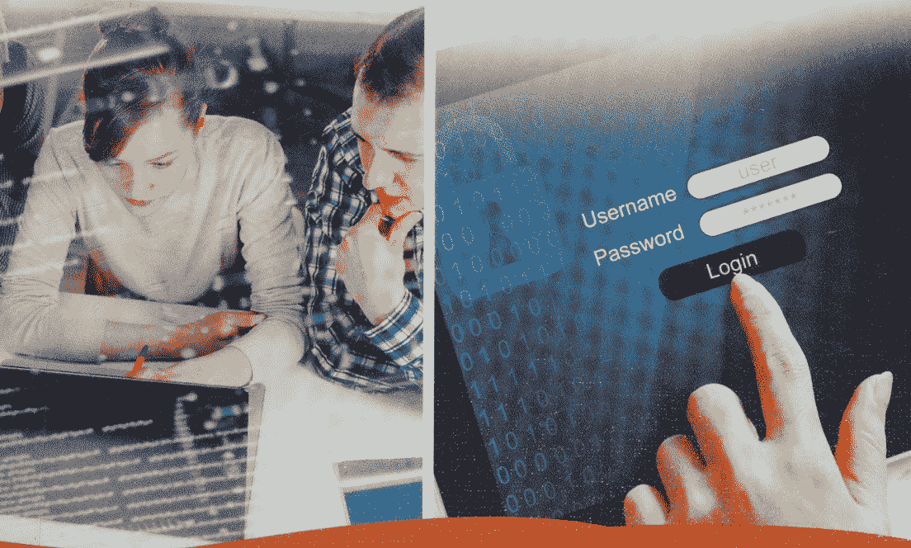
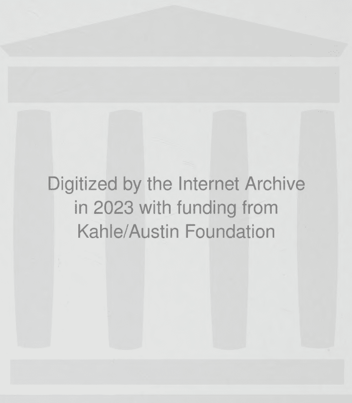
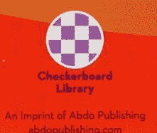
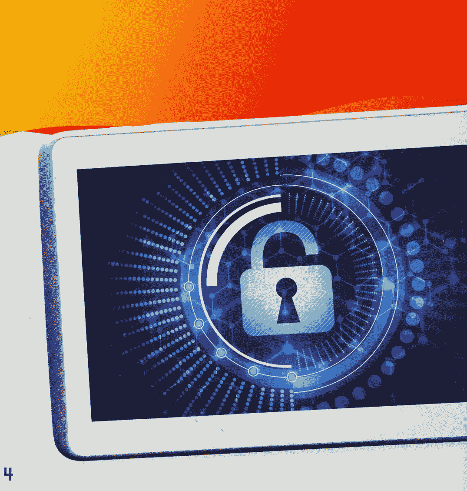
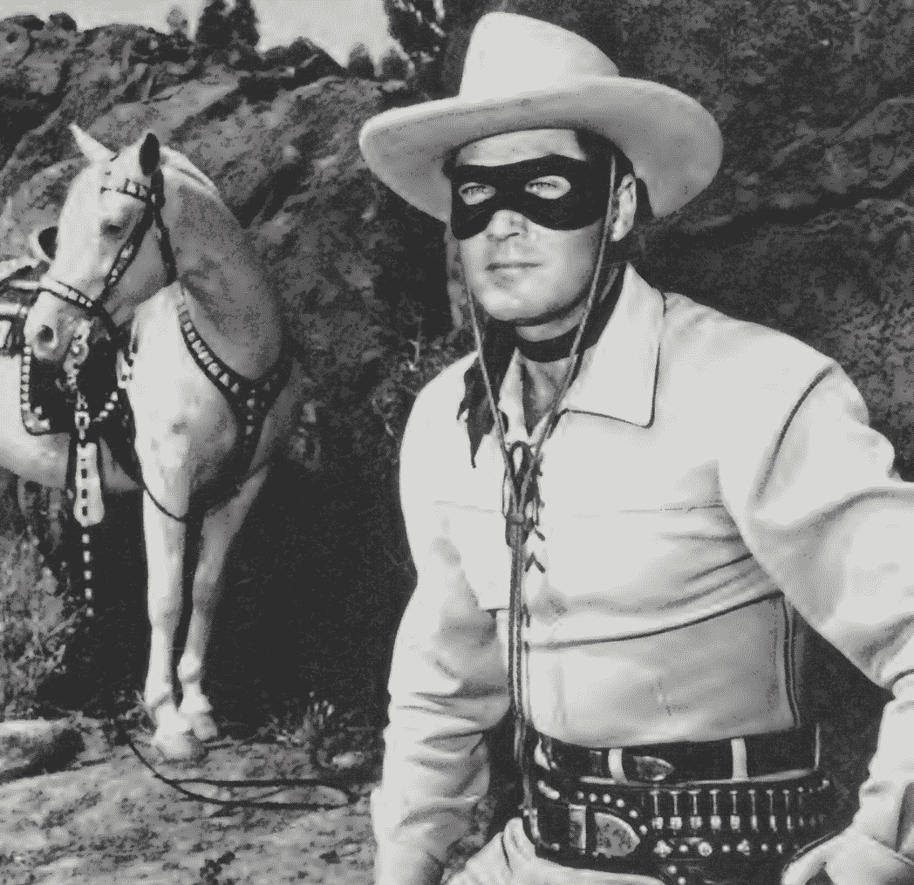
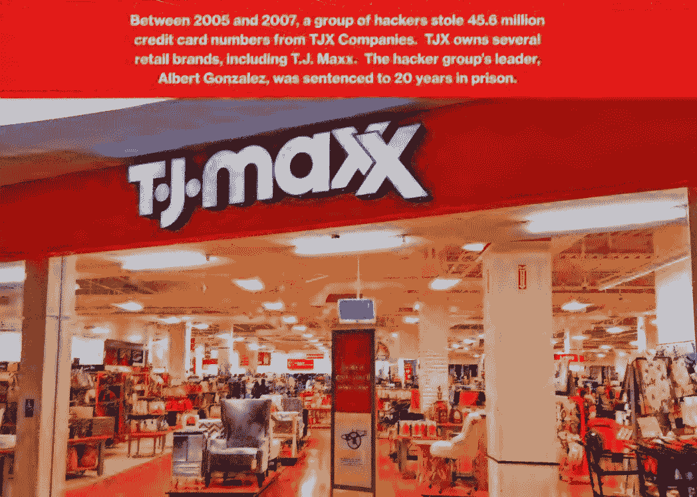
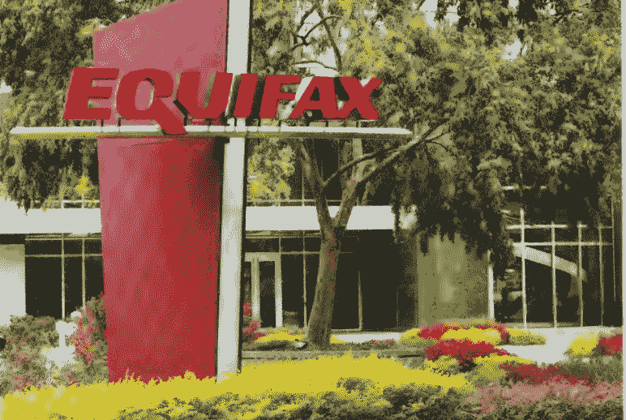
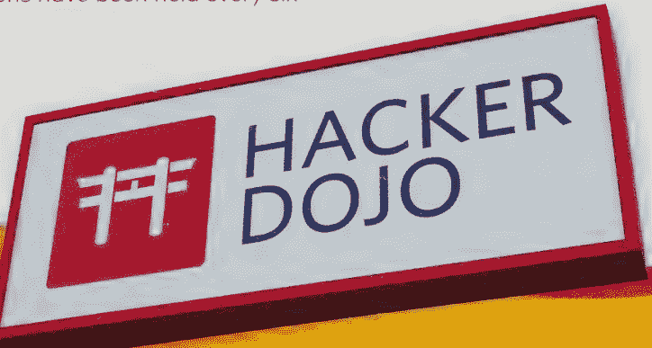
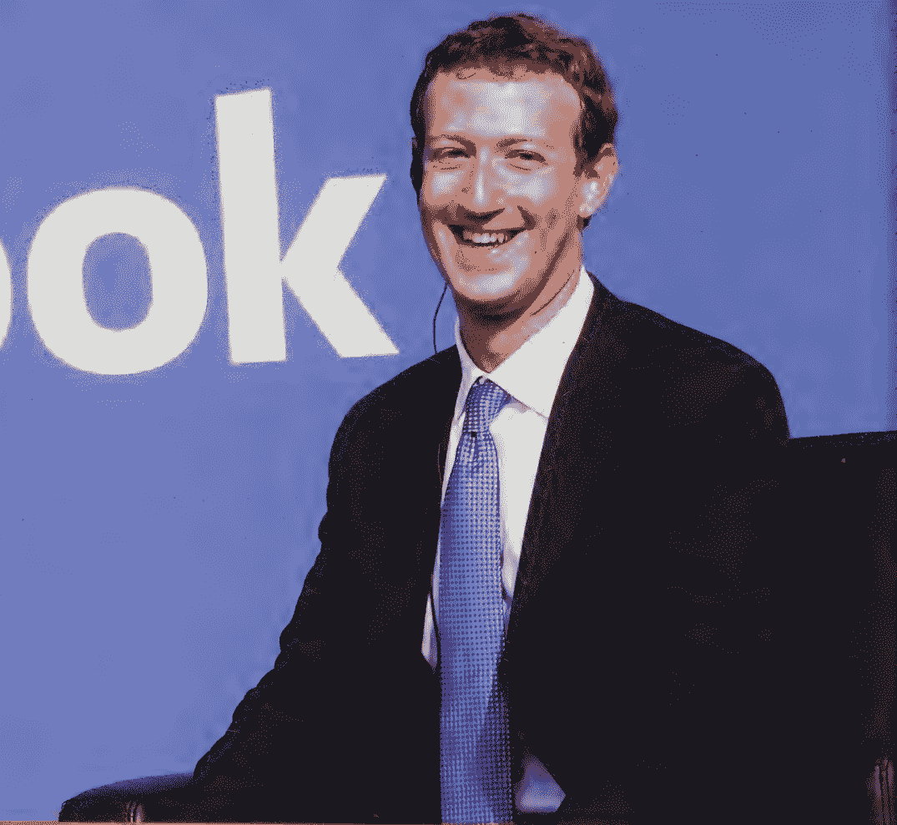
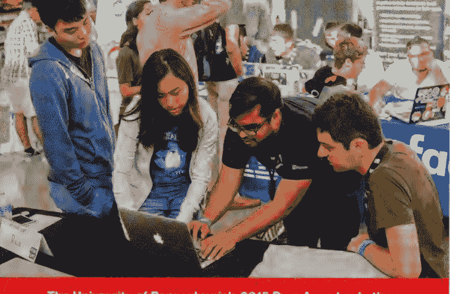

# 热心黑客（这是一个数字世界！）

# 拓展技术的边界

**你是否曾经计划过一场需要保密的惊喜派对？** 你是否在电脑上保存了关于这个派对的信息？也许你还使用了密码来防止别人阅读它。如果有人能够进入你的电脑并读到关于这个派对的信息呢？他们可能会更改信息，甚至可能将其删除。

黑客在计算机系统和**软件**中寻找弱点。大多数黑客尝试在发现问题时尝试修复它们。他们在**网络安全**或软件测试领域工作。但有些黑客会利用他们的技能来伤害他人。他们入侵计算机系统来盗取或破坏信息。

黑客拓展**技术**的边界，以寻找使用它的新方法。黑客可以对不同的做事方式进行可视化。然后他们找到了**创新**的方法来使他们的愿景变为现实。

# 第一章：如何成为一名黑客

**黑客的工作是发明新方法来解决问题并改进流程。** 黑客拥有计算机系统和软件的专家知识，并喜欢研究它们是如何运作的。许多黑客喜欢将事物拆解并重新组装。

黑客寻找使用现有系统和软件的新方法。当计算机程序没有按照黑客需要的方式执行工作时，黑客会找到完成任务的方法。他们甚至可能编写新的计算机代码。黑客也擅长创建新的计算机程序。

成为黑客并不需要大学学位。黑客只需要对计算机和软件有深入的了解。尽管如此，许多黑客拥有计算机科学、信息技术（IT）或网络安全的学位。

一些机构为黑客提供特殊的认证。此类认证证明了黑客具备所需的技能

伊利诺伊大学的学生可以申请伊利诺伊网络安全学者计划。该计划的毕业生已进入国土安全部和中央情报局等政府机构工作。

以及他们良好完成工作所需的知识。拥有**认证**也能证明一名黑客是值得信赖的。

有些黑客以团队形式工作。整个团队合作寻找解决方案。另一些黑客则独立工作。他们按项目为公司服务。

# 第二章：黑帽对白帽

当新闻中提到黑客时，故事通常是关于不伦理黑客的。不伦理黑客也被称为黑帽。这是因为在旧的西部片中，坏人总是戴着黑帽子。

黑帽为了伤害他人而入侵计算机系统和软件。他们盗取数据并破坏系统。他们可能会窃取、侵犯他人隐私或破坏文件。

由于对黑客犯罪的报道，很多人认为所有黑客都是。然而然而大多数黑客是有伦理的。他们想要让计算机更加安全。伦理黑客被称为白帽，因为西部片中的好人通常戴着白帽子。

白帽帮助公司免受黑帽的侵害。公司聘佣白帽入侵系统

牛仔侠是许多西部剧集和电影中的英雄。他以戴着白帽子而闻名。

和程序以寻找弱点。然后黑客会确定如何加强系统。这被称为渗透测试。黑客还帮助工作场所的其他人员了解潜在威胁。他们教导如何防止**网络犯罪分子**侵害他们的系统和**软件**。

白帽黑客每天监控进出公司服务器的数据。他们留意黑帽可能入侵系统的安全威胁和弱点。他们确保公司与互联网的连接尽可能安全。

**网络安全**并不是黑客利用技能的唯一方式。有些黑客会在发布前测试新的游戏、应用程序和软件程序。这些黑客会寻找任何问题并确保这些产品正常运行。当黑客

> Kevin Mitnick 是第一个进入 FBI 通缉逃犯名单的黑客。他在 20 世纪 90 年代因黑客被判了几年。后来，他成为一名白帽黑客并成立了一家网络安全咨询公司。

发现问题，他们可能会与原始程序员合作修复它们。或者他们可能会自己修复这些问题。

白帽客和黑帽客使用相同的程序和方法。他们有很多可以使用的程序。某些程序可以帮助黑客进入私人**网络**或计算机系统。白帽客被允许进入这些系统，而黑帽客则不能。

`Cain & Abel` 和 `Aircrack-ng` 是帮助黑客寻找密码的程序。其他程序帮助黑客测试**软件**和安全性。黑客使用 `Wireshark` 和 `Nmap` 等软件程序查看谁正在连接到计算机网络并进行安全测试。他们使用 `Omnipeek` 等程序来监控和报告无线流量。

许多黑客会共享他们使用的程序，以便让他们互相学习。他们将自己的计算机**源代码公开**供他人免费使用。源代码是一系列指令、注释和函数，告诉计算机应该做什么。它是任何软件程序的一部分。免费共享的源代码就是开源代码。

## 开源代码

## 第 3 章

停止安全威胁

**黑客对所有类型的公司，无论大小，都很有帮助。** 任何使用计算机**网络**或互联网的公司都面临着安全威胁的风险。公司聘请白帽客来告诉他们需要做什么来保护自己。

大型机构（如政府、医院、银行和大学）有成千上万的人连接到他们的系统。这些人中的每个人都有计算机和其他包含重要信息的设备。这些信息可能包括顶密军事活动、突破性研究或信用卡详情。在别有用的人手中，这些信息可能被用来伤害他人或从他们那里偷窃。白帽客帮助寻找保护这些设备免受安全威胁的方法。

除了尝试入侵系统外，黑帽客经常使用**诈骗**。他们通过电子邮件或网站联系人员并假装成值得信赖的人。他们可能会说自己来自政府机构或像 Google 这样著名的公司。

然后他们会索取个人或敏感信息，例如信用卡号或社会安全号码。黑客可以使用这些信息购买昂贵的产品或盗取他人的身份。白帽客教人们如何识别这些诈骗，并避免向错误的人提供信息。

> 在 2005 年到 2007 年间，一个黑客从 TJX 公司盗取了 4560 万个信用卡号。TJX 拥有多个零售品牌，包括 T.J. Maxx。该黑客组织的头目阿尔伯特·冈萨莱斯（Albert Gonzalez）被判处 20 年监。

## 第 4 章

黑客历史

**hack 这个词并不总是与计算机相关联。** 这个词在英语中已经存在了数百年，有许多不同的含义。其中一个意思是“用不均匀或不熟练的击打来切砍”。

在 20 世纪 60 年代，`hack` 开始与计算机编程相关。麻省理工学院（MIT）的学生开始以新颖且创意的方式使用计算机编程。*Hacking*（黑客）被用来描述这些新方法。

当时，现代计算机刚刚开始开发。因此，这些是人们开始破解的系统类型。科学家和工程师就是这样想出了使用计算机的新、更好的方法。

在 20 世纪中期，黑客是指那些对计算机能做什么有宏大想法的人。他们扩展了计算机系统的能力。他们开始致力于

> 最早使用 `hack` 术语的团体之一是麻省理工学院的 Tech 模型铁路俱乐部。俱乐部成员使用 `hack` 指代发明为模型火车设置电气电路的新方法。

将计算机相互连接，以便他们共享信息。这就是计算机网络的开始。

黑客被计算机科学领域的同行认为是他们所做领域的最顶尖者。这些创新者推向了技术及其能力的边界。他们的想法和进步导致了互联网、智能手机和其他技术的发展。黑客帮助改变了世界。

## 第 5 章

伤害意图

**计算机从 20 世纪 70 年代和 80 年代开始变得越来越普及。** 在那时，计算机是巨大且昂贵的。只有大型公司和大学等机构才拥有计算机。

但改进的**技术**让计算机变得更小、更廉价。越来越多的人开始购买计算机并学习它们的工作原理。但其中一些程序员开始利用他们的技能进入其他计算机以获取个人利益。

最早被破解的一些系统是电话系统。当时，电话通话是根据特定的声音或音调路由的。一些人开始复制用于长途路由的音调，以便他们拨打免费电话。这些黑客被称为“电话狂人（phone freaks）”。

最著名的电话黑客之一是计算机程序员约翰·德珀（John Draper）。他制造了一个名为蓝盒（blue box）的设备。

约翰·德珀的蓝盒基于 Cap'n Crunch 麦片中附带的玩具哨发出的声音。正因如此，德珀被称为“脆队长（Captain Crunch）”。

2017 年，黑客入侵了消费者信贷报告机构 Equifax 的计算机系统。超过 1.45 亿账户受到影响。黑客盗了社会安全号码、出生日期、地址、信用卡信息等。

- 它能产生用于破解 AT&T 电话线的正确音调。
- 德珀在 1972 年首次因破解被捕。
- 他在 20 世纪 70 年代又被捕了好几次。

在 20 世纪 80 年代，出现了一个日益增长的熟练黑客社区。他们认为自己是**创新者**。*Phrack* 和 *2600: The Hacker Quarterly* 等杂志是针对黑客的。秘密黑客俱乐部开始形成。

最著名的俱乐部之一是末日骑士团（LOD）。它由一个自称 Lex Luther（莱克斯·路德）的黑客于 1984 年创立。该小组为成员出版期刊，解释如何破解系统。LOD 成员经常入侵系统，特别是电信系统。这主要是为了练习他们的技能并向其他黑客展示他们能做什么。他们通常不会损害他们破解的系统。事实上，有些成员因为造成伤害而被踢出了 LOD。

在 20 世纪 80 年代和 90 年代，人们通过了法律以防止黑客滥用他们的能力。1990 年 5 月，美国特勤局启动了“日表行动（Operation Sundial）”。这是一个试图抓捕黑客的计划。但黑客极难追踪。他们可以在不留痕迹的情况下进出计算机系统。日表行动事实证明是失败的。很少有黑客被捕。

在 21 世纪，大多数人将黑客视为罪犯。黑客开始频繁出现在新闻中。似乎没有人是安全的，即使是规模最大的公司或执法机构也是如此。历史上最大的攻击之一发生在 2013 年 8 月，针对网络服务提供商 Yahoo。超过 30 亿账户被破解。

## 第 6 章

黑客攻击

在过去的十年里，计算机黑客已成为一门大生意。自 21 世纪世纪中期以来，网络诈骗和计算机病毒变得越来越普遍。黑帽客将他们的技能卖给犯罪分子和其他想要伤害他人的人。

黑客使用的一种方法被称为网络钓鱼（phishing）。这是一种诈骗。受害者收到来自黑客的电子邮件或短信。黑客假装成受害者信任的人，例如在线商店或朋友。黑客声称需要个人详情，例如密码或银行信息。黑客利用这些信息获取个人利益。常见的犯罪包括盗取银行账户资金。

恶意软件是黑客伤害人类损坏计算机的另一种方式。`Malware` 是恶意软件的缩写。病毒是恶意软件的一种。病毒是一种改变计算机工作方式的程序。它可以迅速从一台计算机传播到另一台计算机。它可能会删除数据和软件。

智能安全，为速度而设计

每个家庭最多 3 台电脑提供 1 年保护

+ 包含
- Norton 身份安全™
- Norton™ 防钓鱼
- Norton™ 脉冲更新
- Norton 洞察
- Norton 浏览器保护
- Norton 杀病毒软件™
- Norton 反间谍软件
- Norton 个人防火墙

免费支持*

防护强力，系统资源占用少

+ - 快速、轻量且
- 阻止在线身份盗取病毒、间谍软件，

自 1991 年以来，诺顿一直是最受欢迎的反病毒和计算机安全软件品牌之一。

> 20 世纪 80 年代后期，史蒂·贝洛文（Steven Bellovin）开发了最早的计算机防火墙之一。他在贝尔实验室与 William Cheswick 一创建了它。

其他类型的恶意软件包括木马、间谍软件和勒索软件。木马看起来像是一个可以安全使用的程序。然而，它会在系统中创建漏洞，让黑客得以入侵。间谍软件会学习害者的密码、银行详情等信息。勒索软件会关闭害者的计算机系统，直到支付赎金为止。

黑帽黑客通过短信和电子邮件附件发送恶意软件。当被打开或点击时，恶意软件开始在整个设备中传播。2017 年，每天检测到 360,000 个恶意软件文件。白帽黑客致力于寻找阻止恶意软件传播的方法。

防止黑客有几种主要方法。一种防御是防火墙。这是一种防止不受允许的人连接计算机网络的系统。防火墙必须经常更新，因为黑客最终会找到绕过它们的方法。

另一种防御是反恶意软件软件。这类软件会扫描设备中的威胁。该软件还可以防止恶意软件进入设备，并移除在系统中发现的任何恶意软件。

防火墙和反恶意软件通常结合使用以保护计算机系统。但它们只是人们保护自己受黑帽黑客攻击的方法两种。新的防御正在不断开发。

## 第 9 章

## 黑客革命

**新的黑客形式正在不断出现。** 20 世纪 90 年代中期开始的一种趋势是“黑客行动”（hacktivism）。这个词是 *hack*（黑客）与 **activism**（行动主义）的结合。

黑客利用黑客行动来推他们对他们重要的事业。他们可能会在反对该事业的网站上写下关于该事业的消息。他们可能会**破坏**访问网站的流量，或将其重定向到另一个网站。这种类型的黑客行为通常不会损害被黑入的系统。然而，即使黑客没有造成伤害，这通常也是违法的。

并非所有行动主义者都是破坏性的。“随机善良黑客”（RHoK）是一个黑客行动小组。他们寻找**创新**的方法，利用**技术**来解决世界各地的问题。RHoK 举办名为“黑客马拉松”的活动。该小组的目标是使用计算机和其他技术来帮助人们。学院和大学等机构也利用黑客马拉松来激发创新。来自世界各地的学生

## 数字聚光灯

## 随机善良黑客

RHoK 由微软、谷歌、雅虎、美国（NASA）和世界银行于 2009 年成立。他们希望专注于改进灾难救援工作。他们的想法是在全球范围内举办的黑客马拉松，将灾难救援专家和程序员的知识结合起来。

在 RHoK 黑客马拉松期间，灾难救援专家会给黑客一个需要解决的问题。然后他们会对该问题工作几天并提出解决方案。灾难专家选择获胜的解决方案，在真实的灾难响应情况下进行尝试。

第一场黑客马拉松于 2009 年 11 月在加利福尼亚州山景城的 Hacker Dojo 举行。活动中构建的一些软件被用于 2010 年海地和智利地震后的救援工作。自那以后，RHoK 黑客马拉松每六个月举行一次。

社交媒体公司 Facebook 经常举办黑客马拉松以开发新功能。创始人兼首席执行官马克·扎克伯格（Mark Zuckerberg）会审查每场黑客马拉松的最佳点子。

> 宾夕法尼亚大学 2015 年 PennApps 黑客马拉松是全球最大的学生黑客马拉松。黑客来自美国 24 个州和 11 个国家的 147 所大学。

聚集在 PennApps 和 MHacks 等活动中。他们学习如何使用不同类型的软件和计算机，编写新代码，并提出创意的想法。

这些形式的黑客更像 20 世纪 60 年代原始黑客所做的。每天，黑客都会为计算机和软件想出新点。无论好坏，黑客总是推向极限，去做以前没有做过的事情。没有人知道接下来会发生什么。但黑客无疑将在计算机和未来发挥巨大作用。

## 时间轴

### 1970 计算机开始变得更加普及。

### 1972 约翰·德拉（John Draper）首次因黑客行为被捕。

### 1960 年代 *hack* 一词开始与计算机编程相关。

### 1984 黑客俱乐部邪恶骑士（LOD）成立。

### 1990 联邦政府启动“太阳径行动”（Operation Sundial）调查黑客行为。

### 2009 微软、谷歌、雅虎、美国和世界银行成立 RHoK。举办了首场 RHoK 黑客马拉松。

### 2013 30 亿雅虎账户被黑。

### 2017 每天检测到 360,000 个恶意软件文件。

### 2010 在 RHoK 黑客马拉松开发的软件被用于海地和智利地震后的救援工作。

`activism`——支持或反对引起争议的问题并采取行动的实践。

`available`——可以获得或使用的。

`certification`——对某人履行某些要求的官方认可。

`code`——计算机的一组指令。

`cybercriminal`——与计算机相关或使用计算机犯罪的人。

`cybersecurity`——保护计算机或计算机系统免受攻击的措施。

`disaster`——造成破坏、毁灭并通常导致人员生命的事件。自然灾难包括飓风、龙卷风和地震等事件。

`disrupt`——破坏秩序。

`ethical`——道德上正确的。不道德的道德上是错误的。

`innovate`——想出新的想法、方法或设备。以新想法、方法或设备为特征的是创新的。创新的人是创新者。

`malicious`——具有或表现出伤害他人的愿望。

`NASA`——美国航空航天局。NASA 是管理国家太空计划并进行飞行研究的美国政府机构。

`network`——连接的计算机系统。

## 在线资源

要了解更多关于计算机黑客，请访问在线链接。这些链接会监控以最新信息。

# 这是一个数字世界！

技术无处不在！很难想象一整天不使用电脑、智能手机或平板电脑。但这些设备是如何运作的呢？你知道你最喜欢的游戏、网站、播客和应用程序是如何创建的吗？从事计算机相关职业是一种怎样的体验？在《这是一个数字世界！》中寻找这些问题的答案吧！探索计算机技术的奇妙世界，从计算机编程、黑客技术到网站开发、游戏设计等。了解那些先驱的程序员，以及他们如何创造出突破性的应用程序和计算机软件。发现作为播客制作人或应用程序开发者的职业生活是怎样的。本系列将为你开启通往数字世界中令人兴奋的未来大门！

# 本系列书籍

- *神奇的应用开发者*
- *创意的播客制作人*
- *活力的网站开发者*
- *有天赋的游戏设计师*
- *乐于人的黑客*
- *大师级程序员*

ISBN 978-1-5321-1534-9

9000
