# Herbert Schildt C 3.0 初学者指南 奥斯伯麦格罗 2008

## C# 3.0: 入学者指南

涵盖：

- 数据类型、运算符和控制语句
- 类、对象和方法
- 属性、索引器和事件
- `LINQ`、`Lambda` 表达式、泛型
- 以及更多


## 想学习更多吗？

我们希望你喜欢本 McGraw-Hill 电子书！如果你想了解更多关于这本书、作者或相关书籍和网站的信息，请[点击此处](#)。

## 关于作者

Herb Schildt 是 `C#`、`Java`、`C` 和 `C++` 领域的领先权威。他的编程书籍在全球范围内销量超过 350 万册，并翻译成所有主要外语。他广誉的著作包括 `C#: The Complete Reference`、`Java: The Complete Reference`、`Java: A Beginner’s Guide`、`C++: The Complete Reference` 以及 `C++: A Beginner’s Guide`。尽管他对计算的所有方面都感兴趣，他的主要关注是计算机语言，包括编译器、解释器和机器人控制语言。他对语言标准化也有浓厚的兴趣。Schildt 拥有伊利诺伊大学的硕士和本科学位。可以通过电话 `(217) 586-4683` 与其咨询办公室联系。他的网站是 `www.HerbSchildt.com`。

## 关于技术编辑

Eric Lippert 是微软 `C#` 编译器开发团队的高级开发人员。

有关此书的更多信息，请[点击此处](#)。

- `Lambda` 表达式 .................................................... 544
- 扩展方法 .................................................... 547
- 内部访问修饰符 (`internal Access Modifier`) ................................................. 586
- `sizeof` .......................................................................... 586
- `lock` .......................................................................... 586
- 只读 (`readonly`) ................................................................. 587

# 自测答案 ............................................................ 595

- 第 8 章 继承 ......................................................... 609
- 第 9 章 接口、结构体和枚举 ................... 610
- 第 10 章 异常处理 ................................................ 612
- 第 11 章 使用 I/O ......................................................... 614
- 第 12 章 委托、事件和命名空间 ......................... 617
- 第 13 章 泛型 ......................................................... 618
- 第 14 章 介绍 `LINQ` ................................................... 618
- 第 15 章 预处理器、RTTI、可空类型和其他高级主题 ................................................. 619

# 前言

在一个“网络即计算机”的时代，`.NET Framework` 已成为创建代码的领先环境。`.NET` 开发的首选语言是 `C#`。因此，如果 `.NET` 编程是你的未来，那么你选择了一个正确的学习语言。

除了用于 `.NET` 编程之外，`C#` 还有另一个原因也非常重要。它的创新特性正在重塑编程世界，改变代码的编写方式，并能够以新的方式构建解决方案。因此，`C#` 正在帮助定义编程的未来方向。结果，对于专业程序员来说，精通 `C#` 不再是一个可选项，而是一项必要技能。

本书的目的是教你 `C#` 编程的基础知识。它采用循序渐进的方法，并配有大量的示例和自测。它假设你没有之前的编程经验。本书从基础知识开始，例如如何编译和运行一个 `C#` 程序。它讨论了构成 `C#` 语言的关键字、特性和结构。当你完成这本书时，你将牢牢掌握 `C#` 编程的精要。

与所有程序员一样，在编程领域，没有什么是长久不变的。`C#` 也不例外。自 2000 年诞生以来，`C#` 经历了两次重大修订，每次修订都增加了重大的新特性。在编写时，`C#` 的当前版本是 3.0，这也是本书描述的 `C#` 版本。此外，本书涵盖了 `C#` 的最新特性，包括集成查询 (`LINQ`) 和 `lambda` 表达式。

当然，这本入门指南只是一个起点。`C#` 是一门非常大的语言，涉及的不仅仅定义它的关键字和语法。它还涉及一套名为 `.NET Framework` 类库的复杂库集。这个库非常庞大，要完全介绍它需要专门的一本书。虽然书中讨论了该库定义的几个类，但由于空间限制，大多数类并没有被讨论。然而，成为一名顶尖的 `C#` 程序员意味着也要精通这个库。在完成本书后，你将拥有探索该库以及 `C#` 所有其他层面的知识。

# 本书的组织结构

本书提供了一个节奏均匀的教程，其中每个章节都建立在上一节的基础上。它包含 15 章，每章都讨论了 `C#` 的一个方面。这本书的独特之处在于它包含了几个特殊元素，有助于组织和强化你正在学习的内容。

## 核心技能与概念

每一章都从列出该章将教授的核心技能和概念开始。

## 自测

每一章都以自测结束，让你能够测试自己的知识。答案在附录中。

## 提问专家

书中散布着特殊的“提问专家”框。这些框包含了关于某个主题的额外信息或有趣的评论。它们采用问答格式。

## 尝试一试

每一章都包含一个或多个“尝试一试”部分。它们提供了循序渐进的示例，向你展示如何应用所学。

## 无需之前的编程经验

本书假设你没有之前的编程经验。因此，如果你以前从未编写过程序，可以使用这本书。当然，在当今时代，大多数读者至少会有一点编程经验。对于许多人来说，这种经验是关于 `C++` 或 `Java` 的。当你学习时，`C#` 与这两种语言都相关。因此，如果你已经认识 `C++` 或 `Java`，那么你将能够轻松地学习 `C#`。

## 所需软件

要编译和运行书中的程序，你需要一个支持 `C#` 的 `Visual Studio 2008`（或更高版本）。`Visual C 2008` 快速版是一个很好的选择，因为可以从微软免费获取。书中的所有代码都使用该编译器进行过测试。当然，你的电脑上必须安装了 `.NET Framework`。

## 不要忘记：网络上的代码

书中所有示例和项目的源代码都可以在网络上的 `www.mhprofessional.com` 免费获取。

# Herbert Schildt 的更多著作

《`C# 3.0`: 入门指南》只是 Herb 许多编程书籍中的一本。这里是其他你可能感兴趣的几本。

若要继续你对 `C#` 的学习，我们建议：

- `C# 3.0`: 完全参考

若要学习 `Java`，我们推荐：

- `Java`: 完全参考
- `Java`: 入门指南
- `Java` 艺术
- `Swing`: 入门指南
- Herb Schildt 的 `Java` 编程食谱

若要学习 `C++`，你会发现这些书非常有帮助：

- `C++`: 完全参考
- `C++`: 入门指南
- 从零开始学习 `C++`
- 从零开始学习 `STL` 编程
- Herb Schildt 的 `C++` 编程食谱

如果你想学习 `C` 语言，那么以下标题将让你感兴趣：

- `C`: 完全参考

> 当你需要快速获得可靠的答案时，请寻求公认的编程权威 Herbert Schildt。

# 第 1 章

# C# 基础

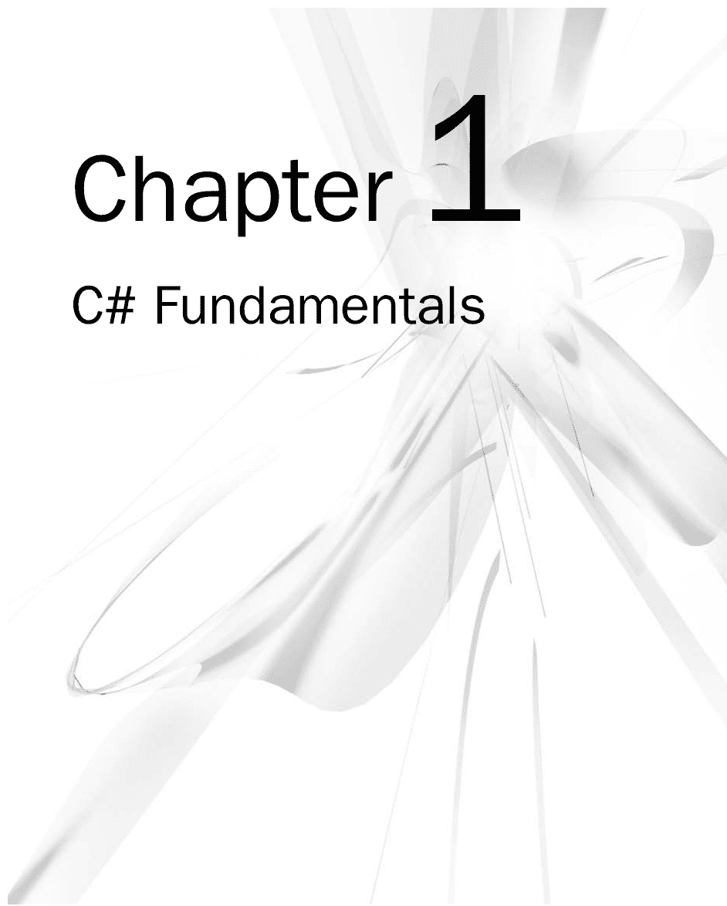

## 核心技能与概念

- `C#` 背后的历史
- `C#` 如何与使用 `.NET Framework` 相关
- 面向对象的三个原则
- 创建、编译和运行 `C#`
- 变量
- 代码块

`C#` 背后的历史与编程语言的演变相联系。`C#` 背后的历史与 `.NET Framework` 相关，它为现代开发提供了环境。面向对象编程的三个原则是封装、继承和多态。创建、编译和运行 `C#` 是任何开发者的基本步骤。变量用于存储数据，代码块组织程序的流程。`C#` 背后的历史还展示了它是如何从其前身演变而来的。

# 第 2 章

## 核心技能与概念

- `C#` 背后的历史
- `C#` 如何与使用 `.NET Framework` 相关
- 面向对象的三个原则
- 创建、编译和运行 `C#`
- 变量
- 代码块

## 互联网与 Java 的融合

编程语言的下一次进步是 `Java`。`Java` 的工作最初名为 `Oak`，于 1991 年在太阳系统（Sun Microsystems）启动。`Java` 设计的动力是詹姆斯·戈斯林（James Gosling）。Patrick Naughton、Chris Ward、Ed Frank 和 Mike Sheridan 也发挥了作用。

`Java` 是一种结构化、面向对象的语言，其语法和哲学源自 `C++`。`Java` 的创新之处与其说是源于编程艺术的进步（尽管确实有一些），不如说是源于计算环境的变化。在互联网主流化之前，大多数程序都是针对特定的 CPU 和特定的操作系统进行编写、编译和目标设计的。虽然程序员喜欢复用代码一直一直是事实，但将程序轻松地从一个环境迁移到另一个环境的能力，在更多问题面前退居其次。然而，随着互联网的兴起，它连接了许多不同类型的 CPU 和操作系统，可移植性的旧问题变得至关重要。为了解决这个问题，需要一种新语言，而这门新语言就是 `Java`。

`Java` 通过将源代码转换为一种称为 `bytecode` 的中间语言实现了可移植性。这种 `bytecode` 由 `Java` 虚拟机（`JVM`）执行。因此，`Java` 程序可以在任何安装了 `JVM` 的环境中运行。此外，由于 `JVM` 相对容易实现，它在大量环境中都是可用的。

除了可移植性，在基于互联网的编程成为现实之前，还需要解决第二个基础性问题：安全性。正如互联网用户所知，计算机病毒构成了严重且持续的潜在威胁。如果人们无法信任程序，那么可移植的程序有什么意义呢？谁会想冒风险执行一个通过互联网传输的程序呢？它可能包含恶意代码。幸运的是，安全问题的解决方案也在 `JVM` 和 `bytecode` 中找到了。由于 `JVM` 执行 `bytecode`，它对程序具有完全控制权，并可以防止程序执行不应该执行的事情。因此，`JVM` 和 `bytecode` 解决了可移植性和安全性问题。

关键的一点是，理解 `Java` 的用法与 `C` 和 `C++` 有着本质的差异，后者几乎总是被编译为可执行的机器码。机器码绑定于特定的 CPU 和操作系统。因此，如果你想在不同的系统上运行 `C/C++` 程序，就需要专门针对该环境对代码进行重新编译。为了创建一个可以在各种环境中运行的 `C/C++` 程序，需要该程序的多个可执行版本。这不仅不切实际，而且成本高昂。`Java` 使用中间语言是一种优雅且具有成本效益的解决方案。这也是 `C#` 将为了自己的目的而采用的解决方案。

如所述，`Java` 溯源于 `C` 和 `C++`。它的语法基于 `C`，其对象模型从 `C++` 演变而来。尽管 `Java` 代码与 `C` 或 `C++` 既向上兼容也不向下兼容，但它的语法足够相似，使得大量的 `C/C++` 程序员可以以很小的努力转向 `Java`。此外，由于 `Java` 是建立在现有范式的基础上并对其进行了改进，戈斯林等人可以自由将注意力集中在新的、创新的特性上。正如斯特劳斯特普（Stroustrup）在创建 `C++` 时不需要“重新发明轮”一样，戈斯林在开发 `Java` 时也不需要创建一个全新的语言。

此外，随着 `Java` 的诞生，`C` 和 `C++` 变成了构建新计算机语言的受认可的基底。

虽然 `Java` 成功地解决了互联网环境中围绕可移植性和安全性的许多问题，但它仍然缺乏一些特性。其中之一是跨语言互操作性，也称为混合语言编程。这是由一种语言产生的代码能够轻松与另一种语言产生的代码工作的能力。跨语言互操作性对于创建大型分布式软件系统至关重要。对于编程软件组件来说，这是理想的，因为最有价值的组件是那些能够在最广泛的计算机语言和尽可能多的操作系统环境中使用的。

`Java` 缺乏另一个特性是与 Windows 平台的深度集成。尽管 `Java` 程序可以运行在 Windows 上，但由于 `JVM` 相对容易实现，它在许多环境中都是可用的。安全问题的解决方案也在 `JVM` 和 `bytecode` 中。由于 `JVM` 执行 `bytecode`，它对程序具有完全控制权，并防止程序执行不应该执行的事情。因此，`JVM` 和 `bytecode` 解决了可移植性和安全性问题。


如所述，`Java`溯源于`C`和`C++`。它的语法基于`C`，其对象模型从`C++`演变而来。尽管`Java`代码与`C`或`C++`既向上兼容也不向下兼容，但它的语法足够相似，使得大量的`C/C++`程序员可以以很小的努力转向`Java`。此外，由于`Java`是建立在现有范式的基础上并对其进行了改进，戈斯林等人可以自由将注意力集中在新的、创新的特性上。正如斯特劳斯特普（`Stroustrup`）在创建`C++`时不需要“重新发明轮”一样，戈斯林在开发`Java`时也不需要创建一个全新的语言。

此外，随着`Java`的诞生，`C`和`C++`变成了构建新计算机语言的受认可的基底。

虽然`Java`成功地解决了互联网环境中围绕可移植性和安全性的许多问题，但它仍然缺乏一些特性。其中之一是跨语言互操作性，也称为混合语言编程。这是由一种语言产生的代码能够轻松与另一种语言产生的代码工作的能力。跨语言互操作性对于创建大型分布式软件系统至关重要。对于编程软件组件来说，这是理想的，因为最有价值的组件是那些能够在最广泛的计算机语言和尽可能多的操作系统环境中使用的。

`Java`缺乏另一个特性是与`Windows`平台的深度集成。尽管`Java`程序可以运行在`Windows`上，但由于`JVM`相对容易实现，它在许多环境中都是可用的。安全问题的解决方案也在`JVM`和字节码中。由于`JVM`执行字节码，它对程序具有完全控制权，并防止程序执行不应该执行的事情。因此，`JVM`和字节码解决了可移植性和安全性问题。

关键的一点是，理解`Java`的用法与`C`和`C++`有着本质的差异，后者几乎总是被编译为可执行的机器码。机器码绑定于特定的`CPU`和操作系统。因此，如果你想在不同的系统上运行`C/C++`程序，就需要专门针对该环境对代码进行重新编译。为了创建一个可以在各种环境中运行的`C/C++`程序，需要该程序的多个可执行版本。这不仅不切实际，而且成本高昂。`Java`使用中间语言的使用是一种优雅且具有成本效益的解决方案。这也是`C#`将为了自己的目的而采用的解决方案。

## 互联网与 Java 的融合

编程语言的下一次进步是`Java`。`Java`的工作最初名为`Oak`，于1991年在太阳系统（`Sun Microsystems`）启动。`Java`设计的动力是詹姆斯·戈斯林（`James Gosling`）。`Patrick Naughton`、`Chris Ward`、`Ed Frank`和`Mike Sheridan`也发挥了作用。

`Java`是一种结构化、面向对象的语言，其语法和哲学源自`C++`。`Java`的创新之处与其说是源于编程艺术的进步（尽管确实有一些），不如说是源于计算环境的变化。在互联网主流化之前，大多数程序都是针对特定的`CPU`和特定的操作系统进行编写、编译和目标设计的。虽然程序员喜欢复用代码一直一直是事实，但将程序轻松地从一个环境迁移到另一个环境的能力，在更多问题面前退居其次。然而，随着互联网的兴起，它连接了许多不同类型的`CPU`和操作系统，可移植性的旧问题变得至关重要。为了解决这个问题，需要一种新语言，而这门新语言就是`Java`。

`Java`通过将源代码转换为一种称为字节码（`bytecode`）的中间语言实现了可移植性。这种字节码由`Java`虚拟机（`JVM`）执行。因此，`Java`程序可以在任何安装了`JVM`的环境中运行。此外，由于`JVM`相对容易实现，它在大量环境中都是可用的。

除了可移植性，在基于互联网的编程成为现实之前，还需要解决第二个基础性问题：安全性。正如互联网用户所知，计算机病毒构成了严重且持续的潜在威胁。如果人们无法信任程序，那么可移植的程序有什么意义呢？谁会想冒风险执行一个通过互联网传输的程序呢？它可能包含恶意代码。幸运的是，安全问题的解决方案也在`JVM`和字节码中找到了。由于`JVM`执行字节码，它对程序具有完全控制权，并可以防止程序执行不应该执行的事情。因此，`JVM`和字节码解决了可移植性和安全性问题。

关键的一点是，理解`Java`的用法与`C`和`C++`有着本质的差异，后者几乎总是被编译为可执行的机器码。机器码绑定于特定的`CPU`和操作系统。因此，如果你想在不同的系统上运行`C/C++`程序，就需要专门针对该环境对代码进行重新编译。为了创建一个可以在各种环境中运行的`C/C++`程序，需要该程序的多个可执行版本。这不仅不切实际，而且成本高昂。`Java`使用中间语言是一种优雅且具有成本效益的解决方案。这也是`C#`将为了自己的目的而采用的解决方案。

正如此，对`.NET Framework`有通用的了解以及理解它为什么对`C#`很重要非常重要。

## 什么是 .NET Framework？

简单来说，`.NET Framework`定义了一个支持高度分布式、基于组件的应用程序开发和执行的环境。它允许不同的计算机语言协同工作，并为`Windows`平台提供安全性、程序可移植性和通用的编程模型。

对于`C#`而言，`.NET Framework`定义两个非常重要的实体。第一个是通用语言运行时（`Common Language Runtime`，简称`CLR`）。这是管理程序执行的系统。除了其他优点外，通用语言运行时是`.NET Framework`的一部分，它使程序具有可移植性，支持混合语言编程并提供安全性。

第二个实体是`.NET`类库（`.NET class library`）。该库让你的程序访问运行时环境。例如，如果你想执行`I/O`操作（如在屏幕上显示内容），你将使用`.NET`类库来实现。如果你是编程初学者，“类”（`class`）这个术对你来说可能很陌生。虽然稍后会进行详细解释，但简而言之，类是一种有助于组织程序的面向对象结构。只要你的程序限制在`.NET`类库定义的特征范围内，你的程序就可以运行在任何支持`.NET`运行时的环境中。由于`C#`会自动使用`.NET`类库，因此`C#`程序会自动移植到所有`.NET`环境中。

## 通用语言运行时的工作原理

通用语言运行时（`CLR`）管理`.NET`代码的执行。以下是它的工作原理：当你编译一个`C#`程序时，编译器的输出并不是可执行代码。相反，它是一个包含特殊类型伪代码的文件，称为微软中间语言（`Microsoft Intermediate Language`，简称`MSIL`）。`MSIL`定义了一组独立于任何特定`CPU`的可移植指令。尽管`MSIL`在概念上与`Java`的字节码相似，但两者者并不等同。

在程序运行期间，将中间代码翻译成可执行代码是`CLR`的工作。因此，任何编译成`MSIL`的程序都可以在任何实现了`CLR`实现的环境中运行。这是`.NET Framework`实现可移植性的方式之一。微软中间语言由`JIT`编译器转换为可执行代码。`JIT`代表“即时编译”（`just in time`）。当执行`.NET`程序时，`CLR`会激活`JIT`编译器。`JIT`编译器会根据需要，在需要程序程序的每个部分时将`MSIL`转换为原生代码。因此，你的`C#`程序实际上是以原生代码执行的，尽管它最初被编译成`MSIL`。这意味着你的程序运行速度几乎与从初就编译成原生代码一样快，但它获得了安全方面的优势。

除了`MSIL`之外，编译`C#`程序时还有另一项输出：元数据（`metadata`）。元数据描述了你的程序使用的数据，并允许你与其他代码交互。元数据包含在与`MSIL`相同的文件中。

幸运的是，就本书的内容以及大多数编程任务而言，没有必要了解更多关于`CLR`、`MSIL`或元数据的知识。`C#`会为你处理好这些细节。

通常情况下，当你编写`C#`程序时，你正在创建所谓的“托管代码”（`managed code`）。如所述，托管代码是在通用语言运行时的控制下执行的。由于它正在运行，它受到某些限制——并从中获得几处好处。编译器必须产生目标为`CLR`（`C#`使用）和`.NET Framework`库（`C#`使用）的`MSIL`文件。托管代码的优点包括：现代语言管理、混合语言的能力、更好的安全性、对版本控制的支持以及软件组件之间整洁交互的方法。

托管代码的反面是“非托管代码”（`unmanaged code`）。非托管代码不在通用语言运行时下执行。因此，在`.NET Framework`之前，所有的`Windows`程序都使用非托管代码。非托管代码与托管代码可以协同工作，因此`C#`生成托管代码不会限制其与预存程序协同操作的能力。

尽管所有托管代码都获得了`CLR`提供的好处，但如果你的代码将被由不同语言编写的其他程序使用，为了最大的可用性，它应该遵循通用语言规范（`CLS`）。`CLS`描述了不同语言共同拥有的特征（例如数据类型）。在创建将由其他语言使用的软件组件时，遵循`CLS`特别重要。虽然对于本书来说我们不需要担心`CLS`，但当你开始编写商业代码时，你会想要研究它的。

- **问**：为了解决移植性、安全混合语言编程的问题，为什么必须创建一个像`C#`这样的新计算机语言？像`C++`这样的语言不能适配以支持`.NET Framework`吗？
- **答**：是的，可以调整`C++`以使其产生在`CLR`下运行的`.NET`兼容代码。事实上，微软确实这样做过。最初，微软为`C++`添加了托管扩展。然而，这种方法已过时，并被`Ecma/CLI`标准（`CLI`代表通用语言体系`Common Language Infrastructure`）定义的一组扩展关键字和语法所取代。虽然`C++/CLI`使得将现有代码移植到`.NET Framework`变得可能，但在`C#`中进行新的`.NET`开发要容易得多，因为它从设计之初就考虑了`.NET`。

## 面向对象编程

`C#`的核心是面向对象编程（`OOP`）。面向对象的方法论与`C#`是不可分割的，所有的`C#`程序至少在某些方面是面向对象的。由于它对`C#`非常重要，在编写简单的`C#`之前了解`OOP`的基本原理非常有用。`OOP`是一种强大的编程方法。由于它对`C#`的重要性，编程方法自计算机发明以来发生了巨大的变化，主要是为了让程序员处理日益增长复杂性。例如，当计算机被发明时，编程是使用前面面板指令完成的。随着语言的发展，引入了高级语言（如`FORTRAN`和`COBOL`），为程序员提供了更多工具来处理复杂性。当这些早期语言开始达到极限点时，结构化编程被发明了。考虑这一点：在编程开发的里程碑处，创建了技术和工具来允许程序员处理日益增长复杂性。`OOP`也是如此。在`OOP`出现之前，许多项目接近或超过了结构化方法的极限。需要一种更好的处理复杂性的方法，而面向对象编程就是解决方案。`OOP`将结构化编程的最佳思想与若干新概念相结合。结果产生了一种不同且更好的组织程序的方式。通常情况下，程序可以通过两种方式之一组织：围绕代码（正在发生什么）或围绕数据（受影响什么）。仅使用结构化技术，程序通常围绕代码组织。这种方法可以认为是“代码作用于数据”。

面向对象的程序的工作方式相反。它们围绕数据组织，核心原则是“数据控制代码的访问”。在面向对象的语言中，你定义数据以及允许操作该数据的程序。因此，数据类型精确定义了可以应用于该数据的操作。

### 封装

封装是一种编程机制，它将代码与其操作的数据绑定在一起，并使其免受外部干扰和误用。在面向对象的语言中，代码和数据可以这样绑定，从而创建一个自包含的黑盒。盒子内部包含了所有数据和代码。当代码和数据以这种方式链接时，对象就创建了。换句话说，对象是支持封装的设备。

在对象内部，代码、数据或两者可以是私有的或公开的。私有的代码或数据仅对对象的其他部分可见并可访问。也就是说，私有代码或数据无法被对象外部的程序部分访问。当代码或数据是公共的时，你程序的其他部分就可以访问它，尽管它是定义在对象内部。通常，对象的公共部分用于为对象的私有元素提供一个受控的接口。

`C#`封装的基本单元是类（`class`）。类定义了对象的形状。`C#`使用类规范来指定数据以及操作这些数据的代码。对象（`object`）是类的实例。因此，类本质上是一组指定如何构建对象的方案。

构成类的代码和数据被称为类的成员（`members`）。具体来说，由类定义的数据称为成员变量或实例变量。操作这些数据的代码称为成员方法或方法（`methods`）。“方法”是`C#`对子程序（`subroutine`）的称呼。如果你熟悉`C/C++`，了解`C#`程序员如何称呼`C/C++`函数（`function`）为方法可能会有所帮助。由于`C#`是`C++`的直接后代，因此在引用`C#`方法时有时也会使用“函数”一词。

### 多态

多态（`Polymorphism`，源自希腊语，意为“多种形式”）允许一个接口访问一类通用操作的特性。多态的一个简单例子可以在汽车的方向盘中找到。无论使用何种实际机制，方向盘（接口）都是相同的。无论你的汽车是手动转向、助力转向还是齿轮条转向，方向盘的工作方式都是样的。因此，无论使用什么类型的转向系统，转动方向盘都能让汽车行驶。接口的益处显然是，你知道如何操作方向盘，就可以驾驶任何类型的汽车。


同样的原理也适用于编程。例如，考虑一个栈（`stack`，它是一个后进先出的列表）。你可能有一个需要三种不同类型栈的程序。在这种情况下，其中一个的算法可能是针对整数值的，另一个针对浮点值的，第三个是针对字符的。在非面向对象的语言中，你需要创建三组不同的栈例程，每组都使用不同的名称。然而，由于多态的存在，在 C# 中，你可以指定一次栈的通用形式，然后将其应用于所有三种特定情况。如果你知道如何使用一个栈，你就可以使用所有的栈。

更通俗地说，多态的概念通常通过“一个接口，多个方法”来表达。这意味着为一组相关的接口设计一个通用接口是可能的。多态通过允许同一个接口用于一类通用操作来降低复杂性。根据每个情况选择特定的操作（即方法）是编译器的工作。你，作为程序员，不需要手动进行这种选择。你只需要记住并利用这个通用接口即可。

### 继承

继承（`Inheritance`）是一个对象可以获取另一个对象属性的过程。这很重要，因为它支持了分级分类的概念。想一下，大多数知识都是通过分级（即自上而下）分类变得易于管理的。

**Q**: 你提到面向对象编程是管理大型程序的有效方法。然而，OOP 似乎会给较小的程序增加大量的开销。既然你说所有 C# 程序在某种程度上都是面向对象的，这是否会对较小的程序产生性能惩罚？

**A**: 不会。你将会发现，对于小型程序，C# 的面向对象特性几乎是透明的。虽然 C# 确实遵循严格的对象模型，但在你使用该模型的程度上，你拥有很大的自由度。对于较小的程序，它们的“面向对象性”几乎无法察觉。随着你的程序的增长，你将毫不轻松地整合更多的面向对象特性。

例如，红富士苹果（`Red Delicious apple`）是苹果类（`apple`）的一部分，而苹果类又是水果类（`fruit`）的一部分，水果类属于更大的食物类（`food`）。也就是说，食物类拥有某些特定的属性（可食用、有营养等），这些属性在逻辑上适用于这个子类——水果。除了这些属性外，水果类具有特定的特征（多汁、甜等），以此与其他食物区分开来。苹果定义了苹果特有的属性（生长在树上、不是热带水果等）。一个红富士苹果反过来会继承之前所有类的属性，并且只定义那些使其与众不同的属性。

如果不使用层次结构，每个对象都必须显式地定义它的所有特征。使用继承，对象只需要定义那些在其类中使其保持独特的属性。它可以从父类继承其通用属性。因此，是继承机制使得一个对象能够成为更通用情况的特定实例。

现在是时候学习如何创建、编译和运行 C# 程序了。由于这是一份 C# 编程的“上手”指南，能够成功完成这些任务是必要的第一步。这是我们将使用的程序：

```csharp
/*
这是一个简单的 C# 程序。
将此程序命名为 Example.cs。
*/

using System;

class Example {
// C# 程序始于对 Main() 的调用。
static void Main() {
    Console.WriteLine("C# gives you programming power.");
}
}
```

虽然这个程序很短，但它包含了所有 C# 常见的几个特征。一旦你学会了如何编译和运行它，我们将对其进行详细检查。

要编译并运行 C# 程序，你需要一个 C# 副本。虽然书中的许多程序可以使用较早版本的 C# 编译，但你需要 Visual C# 2008。如果你没有 Visual C# 2008，将需要获取它。微软提供了多种形式的 Visual C# 2008，包括商业版本。在本文编写时，免费版可以从 www.microsoft.com/express 下载。书中的所有代码都已在此编译器通过测试。

使用 C# 创建、编译和运行 C# 程序有两种通用方法。首先，你可以使用 Visual Studio IDE。其次，你可以使用命令行编译器 `csc.exe`。这里描述了两种方法。

如前所述，Visual Studio 是微软的集成环境。它允许你编辑、编译、运行和调试 C# 程序，而无需离开其良好的环境。Visual Studio 提供了便利并管理你的程序。它对于较大的项目非常有效，但也可以成功地用于较小的程序。

这里展示了使用 Visual Studio 2008 IDE 编辑、编译和运行 C# 程序的步骤。这些步骤假设你使用的是 Visual C# Express 2008 提供的 IDE。使用其他版本的 Visual Studio 2008 时可能会细微差异。

1. 通过文件（File）|新建项目（New Project）创建一个新的 C# 项目，选择 空项目（Empty Project）。

![img/bced2a82848b29e0ff396f252376b6d4_30_0.png]

2. 创建新项目后，Visual Studio IDE 看起来如下：

![img/bced2a82848b29e0ff396f252376b6d4_30_1.png]

如果由于原因你没有看到解决方案管理器（Solution Explorer）窗口，可以通过视图（View）菜单中的解决方案管理器来激活它。

3. 在此阶段，项目是空的，你需要向其添加一个 C# 源文件。这可以通过在“解决方案管理器”中右键点击“Project 1”，然后选择“添加”（Add）。你会看到以下内容：

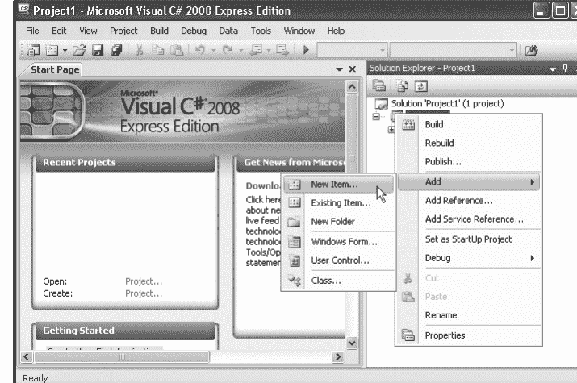

4. 接下来，选择“新建项”（New Item）。这将显示“新建项”对话框。选择“代码”（Code），然后将名称改为 `Example.cs`，所示：

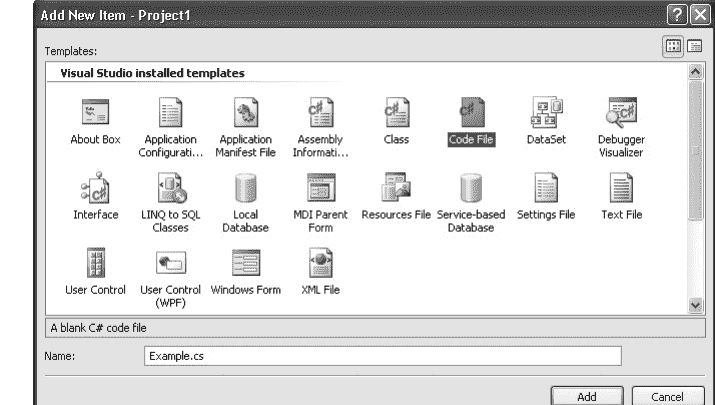

5. 接下来，按“添加”（Add）将文件添加到项目中。现在你的屏幕看起来应该像这样：

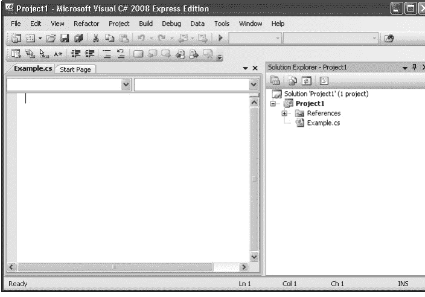

6. 接下来，在 `Example.cs` 窗口中输入示例程序，然后保存文件。（你可以从 www.mhprofessional.com 下载书中程序的源代码，这样你就不需要手动输入每个示例了。）完成后，你的屏幕看起来像这样：

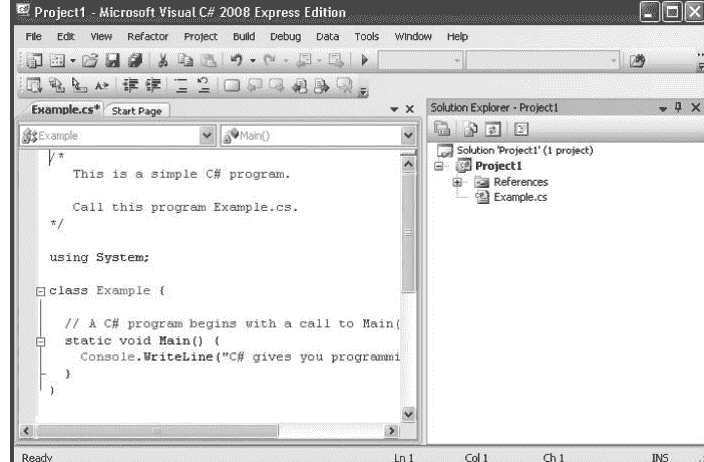

7. 从“生成”（Build）菜单中选择“生成解决方案”（Build Solution）来编译程序。

8. 从“调试”（Debug）菜单中选择“无调试启动”（Start Without Debugging）来运行程序。当你运行程序时，你会在这里看到窗口：

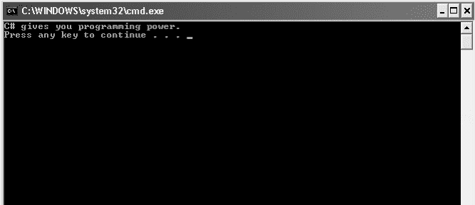

如前面的指令所示，使用 IDE 编译短示例程序涉及许多步骤。然而，你不需要为书中的每个示例程序创建一个新项目。相反，你可以使用同一个 C# 项目。只需删除当前源文件并添加新文件即可。然后重新编译并运行。这种方法极大地简化了流程。但是，请理解，对于实际应用，这种方法将使用它自己的项目。

虽然前面的指令足以编译和运行书中的程序，但如果你将使用 Visual Studio IDE 作为你的主要工作环境，你应该熟悉它所有的功能和特性。这是一个非常强大的开发环境，有助于使大型项目变得于管理。它还提供了一种组织与项目相关的文件和资源的方法。花费精力和精通运行 Visual Studio 是值得的。

虽然你可能在你的商业项目中使用 Visual Studio IDE，但某些读者会发现 C# 命令行编译器在编译和运行书中的所示示例程序时更加方便。这是因为你不需要为程序创建项目。你只需要创建程序，然后编译它，并运行它——这一切都可以在命令行中完成。因此，如果你知道如何使用命令提示符（Command Prompt）窗口及其命令行界面，使用命令行编译器将比使用 IDE 更快、更简单。

如果不熟悉命令提示符窗口，可能使用 Visual Studio IDE 更好。虽然它的命令并不难学习，但同时学习命令提示符和 C# 将是一次具有挑战性的经历。

使用 C# 命令行编译器创建并运行程序，请遵循以下三个步骤：

1. 使用文本编辑器输入程序。

2. 使用 `csc.exe` 编译程序。

3. 运行程序。

如所述，书中的程序可以从 McGraw-Hill 网站获取：www.mghill.com。然而，如果你想手动输入程序，可以随意这样做。在这种情况下，你必须使用文本编辑器（或记事本）将程序输入计算机。记住，你必须创建纯文本文件，而不是格式化的文字处理文件，因为文字处理文件中的格式会混乱 C# 编译器。输入程序时，将文件命名为 `Example.cs`。

要编译程序，请执行 C# 编译器 `csc.exe`，并在命令行指定源文件的名称，所示：

```
csc Example.cs
```

C# 编译器会创建一个名为 `Example.exe` 的文件，该文件包含程序的 MSIL 版本。虽然 MSIL 不是可执行代码，但它仍然包含在 exe 文件中。当你尝试执行 `Example.exe` 时，通用语言运行时（CLR）会自动调用 JIT 编译器。请注意，如果你在没有安装 .NET Framework 的计算机上执行 `Example.exe`（或任何包含 MSIL 的其他 exe 文件），程序将无法执行，或缺少 CL。

在运行 `csc.exe` 之前，你需要打开一个配置了 Visual Studio 的命令提示符窗口。最简单的方法是在开始菜单的“Visual Studio 工具”下选择“Visual Studio 2008 命令提示符”。或者，你可以启动一个未配置的命令提示符窗口，然后运行 Visual Studio 提供的批文件 `devcmd.bat`。在本书编写，C# 2008 版本未提供 Visual Studio 工具。因此，如果你正在使用 IDE，将能够自动完成。C# 2008 版

### 运行程序

要运行程序，通过命令行指定程序名称，所示：

当程序运行时，它将显示以下内容：

```
Console.WriteLine("Hello, World!");
```

### 逐行代码

正如提到的，书中的程序可以从 McGraw-Hill 网站获取：www.mghill.com。然而，如果你想手动输入程序，可以随意这样做。在这种情况下，你必须使用文本编辑器或记事本将程序输入计算机。记住，你必须创建纯文本文件，而不是格式化的文字处理文件，因为文字处理文件中的格式会混乱 C# 编译器。输入程序时，将文件命名为 `Example.cs`。

要编译程序，执行 C# 编译器 `csc.exe`，并在命令行指定源文件的名称，所示：

```
csc Example.cs
```

C# 编译器会创建一个名为 `Example.exe` 的文件，该文件包含程序的 MSIL 版本。虽然 MSIL 不是可执行代码，但它仍然包含在 exe 文件中。当你尝试执行 `Example.exe` 时，通用语言运行时（CLR）会自动调用 JIT 编译器。请注意，如果你在没有安装 .NET Framework 的计算机上执行 `Example.exe`（或任何包含 MSIL 的其他 exe 文件），程序将无法执行，或缺少 CL。

在运行 `csc.exe` 之前，你需要打开一个配置了 Visual Studio 的命令提示符窗口。最简单的方法是在开始菜单的“Visual Studio 工具”下选择“Visual Studio 2008 命令提示符”。或者，你可以启动一个未配置的命令提示符窗口，然后运行 Visual Studio 提供的批文件 `devcmd.bat`。在本书编写，C# 2008 版本未提供 Visual Studio 工具。因此，如果你正在使用 IDE，将能够自动完成。

问：你提到 C# 支持三种类型的注释，但你只提到了两种。第三种是什么？

答：C# 支持的第三种类型注释是文档注释，也称为 XML 注释。文档注释使用 XML 标签来创建自文档化代码。

这一行代码在屏幕上输出“C# gives you programming power.” 随后是一个换行。输出实际上是由内置方法 `WriteLine()` 实现的。在这种情况下，`WriteLine()` 显示传递给它的字符串。方法接收的信息被称为参数。除了字符串，`WriteLine()` 还可以显示其他类型的信息，例如数值数据。该行以 `Console` 开头，这是一个支持控制台 I/O 的预定义类的名称。通过将 `Console` 与 `WriteLine()` 连接，你是在告诉编译器 `WriteLine()` 是 `Console` 类的一个成员。由于C# 使用对象来定义控制台输出，这一事实进一步证明了它的面向对象的本质。

注意，`WriteLine()` 语句以分号结尾；而它结束于程序早些时候的 `Using System` 语句之后。通常情况下，C# 中的所有语句都以分号结尾。该规则的例外是块，它以 `{` 开始并以 `}` 结束。块不以分号结尾。这就是为什么 `}` 后面没有跟分号的原因。块提供了一种分组语句的机制。我们将在本章稍后详细介绍它们。

程序中的 `}` 结束了 `Main()`，而另一个 `}` 结束了 `Example` 类的定义。最后一点：C# 是区分大小大小的。这可能会导致问题，如果你不小心输入 `main` 而不是 `Main`，或者输入 `writeline` 而不是 `WriteLine`，执行过程将会错误。此外，C# 编译器会编译不包含 `Main()` 方法的类，但没有方法将其用作执行程序的入口点。因此，如果你写错了 `Main`，编译器仍然会编译你的程序。但是，你也会看到一条错误消息，说明 `Example.exe` 没有入口点。

如果你还没有这样做，请编译并运行前面的程序。正如你可能从之前的编程经验中所了解的，在向计算机输入代码时，很容易不小心输入错误内容。如果发生这种情况，编译器在尝试编译时会报告语法错误。显示的消息将包含发现错误所在的行号和字符位置，以及错误的描述。

虽然编译器报告的语法错误显然是有帮助的，但它们有时也会具有误导性。无论你写了什么，C# 编译器都会尝试理解你的源代码。由于这个原因，报告的错误并不总是反映问题的真实原因。在前面的程序中，例如，无意中省略 `Main()` 方法后的左大括号，在由 `csc` 命令行编译器编译时，会生成以下错误序列（使用 IDE 时也会生成类似的错误）：

```
EX1.CS(12,21): error CS1002; expected '\' 
EX1.CS(13,22): error CS1519: Invalid token '(' in class, struct, or interface member declaration
EX1.CS(15,1): error CS1022: Type or namespace definition, or end-of-file expected
```

显然，第一条消息完全错误，因为缺失的不是冒号，而是大括号。第二条消息同样令人困惑。讨论的要点是，当你的程序包含语法错误时，不要一定从字面上接受编译器的消息。它们可能是误导性的。你可能需要对错误消息进行“二次怀疑”才能找到问题。此外，查看紧邻报告错误行的之前的几行代码。有时，在错误实际发生点几行之后，错误才会被报告。

虽然书中的所有程序都会使用它，但第一个示例程序开头的语句

在技术上并不是需要的。然而，它是一个非常有价值的便利。。没有必要的原因是在 C# 中，你可以使用其所属的命名空间对名称进行完全限定。例如，这一行代码：

```
Console.WriteLine("A simple C# program.");
```

可以重写为：

```
System.Console.WriteLine("A simple C# program.");
```

你偶尔会看到使用这种方法的 C 代码，但它并不常见。大多数 C# 程序员都会在程序的顶部包含 `using System` 语句，正如书中的所有程序一样。这样做避免了每当使用该命名空间的成员时，都要指定 `System` 命名空间的繁琐工作。然而，重要的是，如果需要，你可以显式地使用命名空间限定名称。

### 使用变量

可能没有任何结构比变量对编程语言更重要。变量是一个可以赋值的命名内存位置。它被称为变量，是因为它的值在程序执行期间可以改变。换句话说，变量的内容不是固定的。

让我们从示例开始。下面的程序创建了三个名为 `length`、`width` 和 `area` 的变量。它使用这些变量来计算并显示长为 9x7 的矩形面积。

```csharp
// 这个程序介绍了变量。

using System;

class UseVars {
    static void Main() {
        int length; // 这声明了一个变量
        int width; // 这声明了另一个变量
        int area; // 这是第三个变量

        length = 9; // 将 9 赋值给 length。
        width = 7; // 将 7 赋值给 width。
        area = length * width; // 乘以 width并将结果赋值给 area。

        Console.WriteLine("length contains " + length);
        Console.WriteLine("width contains " + width);
        Console.WriteLine("area contains: " + area);
    }
}
```

当你运行此程序时，你将看到以下输出：

length contains 9

width contains 7

area contains: 63

### 专家问

**问：你提到所有变量在使用之前必须先声明，并且所有变量都有自己的类型。然而，你提到 C# 3.0 包含一种名为“隐式类型变量”的新功能。这是什么？它是否避免了声明变量的需求？**

**答：正如你将在第 2 章中学到的，隐式类型变量是指类型由编译器自动指定的变量。然而，请理解，隐式类型变量仍然需要声明。与其使用像 *int* 这样的类型名称，不如使用 *var* 关键字来声明隐式类型变量。隐式类型变量在几种特殊情况下（尤其是涉及 LINQ 时）非常有用，但它们并不是为了替代普通的显式类型变量。通常，当你声明变量时，会赋予一个显式类型。**

以下是程序的后续两行：


```cs
Console.Write("area contains length * width: ");
Console.WriteLine(area);
```

这里发生了两个新情况。首先，使用了内置方法 `Write()` 来显示字符串 "area contains width"；后面*没有跟随*换行。这意味着当生成下次输出时，它将从同一行开始。`Write()` 方法与 `WriteLine()` 类似，区别在于它在每次调用后都不会输出新行。`Write()` 和 `WriteLine()` 都可以输出任何 C# 内置类型的值。

在继续之前，关于声明变量有一点需要说明：可以使用同一个声明语句声明两个或多个变量。用逗号将它们的名称分开。例如，`length` 和 `width` 可以这样声明：

```cs
int length, width; // 使用一条语句声明了 length 和 width
```

### double 数据类型

在前面的程序中，使用了一个 `int` 类型的变量。然而，`int` 类型的变量只能存储整数。因此，在需要小数部分时，无法使用它。例如，一个 `int` 变量可以存储值 18，但不能存储值 18.3。幸运的是，`int` 仅是 C# 定义的几种类型之一。为了允许带有小数部分的数字存在，C# 定义了浮点类型：`float` 和 `double`，它们分别表示单精度和双精度值。在这两者中，`double` 是最常用的。

要声明一个 `double` 类型的变量，请使用类似于这里的语句：

```cs
double result;
```

在这里，`result` 是变量名，其类型为 `double`。因为 `result` 是浮点类型，所以它可以存储诸如 122.23、0.034 和 -19.0 等值。

为了更好地理解 `int` 和 `double` 区别，请尝试以下程序：

```cs
/*
 * 此程序演示了
 * int 和 double 之间的差异。
 */

using System;

class IntVsDouble {
    static void Main() {
        int ivar; // 声明了一个 int 变量      ivar 是 int 类型。
        double dvar; // 声明了一个浮点变量
                     dvar 是 double 类型。

        // 给 ivar 赋值为 10。
        ivar = 10;

        // 给 dvar 赋值为 10.0。
        dvar = 10.0;

        Console.WriteLine("Original value of ivar: " + ivar);
        Console.WriteLine("Original value of dvar: " + dvar);

        Console.WriteLine(); // 打印空行          -- 输出一个空行。

        // 现在，将两者都除以 4。
        ivar = ivar / 4;      <-- 这是整数除法。
        dvar = dvar / 4.0;    <-- 这种除法保留了
                                     小数部分。
        Console.WriteLine("ivar after division: " + ivar);
        Console.WriteLine("dvar after division: " + dvar);
    }
}
```

该程序的输出所示：

Original value of ivar: 10

Original value of dvar: 10

ivar after division: 2

dvar after division: 2.5

如你所见，当 `ivar` 除以 4 时，执行的是整数除法，结果是 2——小数部分丢失了。然而，当 `dvar` 除以 4.0 时，小数部分被保留了，结果是 2.5。

# C# 3.0：入门指南

### 专家问

**问：为什么 C# 对整数和浮点值有不同的数据类型？也就是说，难道所有的数值不都是同一种类型吗？**

**答：C# 提供不同的数据类型以便你编写高效的程序。例如，整数运算比浮点数计算更快。因此，如果你不需要小数值，就不需要承担与类型 `float` 或 `double` 相关的开销。其次，一种类型的数据所需的内存可能少于另一种。通过提供不同的类型，C# 使你能够最极度地利用系统资源。最后，某些算法需要（或至少受益于）使用特定类型的数据。C# 提供了许多内置类型，以给你提供最大的灵活性。**

正如程序所示，当你想要在程序中指定浮点值时，必须包含一个小数点。如果不包含，它将被解释为整数。例如，在 C# 中，值 100 是整数，但 100.0 是浮点值。程序中还有一点需要注意：为了打印一个空行，只需调用 `WriteLine()` 而不带任何参数。

## C# 3.0: 入学者指南

它在语法上与 C、C++ 和 Java 中的 if 语句相似。其最简单的形式所示所示：

```c
if(condition) statement;
```

在这里，`condition` 是一个布尔（即真或假）表达式。如果 `condition` 为真，则执行该语句。如果 `condition` 为假，则跳过该语句。以下是一个示例：

```c
if(10 < 11) Console.WriteLine("10 is less than 11");
```

在这种种情况下，10 小于 11，条件表达式为真，`WriteLine()` 将执行。考虑以下情况：

```c
if(10 < 9) Console.WriteLine("this won't be displayed");
```

在这种种情况下，10 不小于 9。不会调用 `WriteLine()`。

C# 定义了一套完整的关系运算符，可以用于条件表达式。它们如表所示：

| 运算符 | 含义 |

|---|---|

| < | 小于 |

| <= | 小于等于 |

| > | 大于 |

| >= | 大于等于 |

| == | 等于 |

| != | 不等于 |

注意，相等性测试使用的是双等号。

这里是一个演示 if 语句和关系运算符的程序。

```csharp
// Demonstrate the if.

using System;

class IfDemo {
    static void Main() {
        int a, b, c;

        a = 2;
        b = 3;

        // 这个 if 语句成功了是因为 a 小于 b。
        if(a < b) Console.WriteLine("a is less than b"); // <--- 这是 if 测试的条件。

        // WriteLine() 语句仅在条件为真时才执行。

```csharp

// 这不会显示任何内容，因为 a 不等于于 b。

if (a == b) Console.WriteLine("you won't see this");

// 如果这个成功，a 包含值 2。

if(a == 2) Console.WriteLine("a contains the value 2");

// 如果这个失败，a 不包含值 19。

if(a == 19) Console.WriteLine("you won't see this");

// 如果将会成功，因为 a 将等于 b - 1。

if(a == b-1) Console.WriteLine("a equals b - 1");

Console.WriteLine();

c = a - b; // c 包含 -1

Console.WriteLine("c contains -1");

if(c >= 0) Console.WriteLine("c is non-negative");

if(c < 0) Console.WriteLine("c is negative");

Console.WriteLine();c = b - a; // c 现在包含 1

Console.WriteLine("c now contains 1");

if(c == 0) Console.WriteLine("c is non-negative");

if(c < 0) Console.WriteLine("c is negative");

Console.WriteLine();

}

```

该程序生成的输出所示：

a is less than b
a contains the value 2
a equals b - 1

c contains -1
c is negative

c now contains 1
c is non-negative

注意该程序中的另一个点。

```csharp

int a, b, c;

```

通过使用逗号分隔的列表声明了三个变量 `a`、`b` 和 `c`。正如前面提到的，
当你需要两个或多个相同类型的变量时，可以在一个语句中声明它们。
只需用逗号分隔变量名。

### for 循环

你可以通过创建循环来重复执行一段代码。C# 提供了一系列强大的循环结构构造。我们在这里查看的是 for 循环。如果你熟悉 C、C++ 或 Java，你会很高兴发现 C# 中的 for 循环工作方式与这些语言相同。for 循环的最简单形式所示：

`(初始化; 条件; 迭代) 语句；`

在最常见的形式中，循环的初始化部分将循环控制变量设置为初始值。条件是一个布尔表达式，用于测试循环控制变量。如果测试结果为真，for 将继续迭代。如果为假，循环终止。迭代表达式决定了循环变量在每次迭代时如何发生变化。这里是一个演示 for 循环的短程序：

```csharp

// Demonstrate System;

using System;

class ForDemo {

    static void Main() {

        int count = 0;

        // 如果 count 小于 5，则执行

        // WriteLine() 语句。

        Console.WriteLine("Counting from 0 to 4:");

        for(count = 0; count < 5; count++) {

            Console.WriteLine("count is " + count);

        }

        Console.WriteLine("Done!");

    }

}

```

该程序生成的输出所示：

```

Counting from 0 to 4:

count is 0

count is 1

count is 2

count is 3

count is 4

Done!

```

在这个示例中，`count` 是循环控制变量。它在 `for` 的初始化部分被设置为零。在每次迭代的开始时（包括第一次），都会执行条件测试 `count < 5`。如果测试结果为真，则执行 `WriteLine()` 语句。

# 第1章：C# 基础 33

C# 并不将行尾识别为语句的结束——只有分号（;）才会终止一个语句。因此，你将语句放置在一行的任何位置并不重要。例如，对于 C# 来说：

```

x = y;

y = y + 1;

Console.WriteLine(x + " " " " + y);

```

等同于

```

x = y; y = y + 1; Console.WriteLine(x + " " " " + y);

```

此外，语句的各个元素也可以放在单独的行。例如，以下写法是完全可以的：

```

Console.WriteLine("This is a long line of output" +

x + y + z + 

"more output");

```

这种习惯性的断行方式通常用于提高程序的可读性。它还可以防止过长的行发生自动换行。

### 缩进规范

你可能在之前的示例中注意到某些语句进行了缩进。C# 是一门自由格式语言，这意味着在同一行内，语句之间的相对位置并不重要。然而，通过多年来，已经形成了一种通用且被认可的缩进风格，使得程序具有非常的可读性。本书遵循这种风格，并建议你也这样做。使用这种风格：在每个左大括号后缩进一级，在每个右大括号后向外移动一级。某些语句可能需要额外的缩进；这些将在后续介绍。

### 尝试一下：改进温度转换程序

你可以使用 `for` 循环、`if` 语句和代码块来创建一个你在第一个“尝试示例”中开发的华氏度转摄度转换器的改进版本。这个新版本将打印一个转换表，从 0 度华氏度开始，到 99 度结束。每隔 10 度，将输出一个空行。这是通过一个名为 `counter` 的变量实现的，该变量用于计算输出的行数。请特别注意它的用法。

（续上）

# 34 C# 3.0：学者指南

### 逐步步骤

- 1. 创建一个新文件 `FtoCTable.cs`。

- 2. 将以下程序输入文件：
```csharp

/*

此程序显示华氏度到摄氏度的转换表。

将此程序命名为 FtoCTable.cs。

*/

using System;

class FtoCTable {

    static void Main() {

        double f, c;

        int counter;

        counter = 0;

        for(f = 0.0; f < 100.0; f++) {

            // 转换为摄氏度

            c = 5.0 / 9.0 * (f - 32.0);

            Console.WriteLine(f + " degrees Fahrenheit is " + c + " degrees Celsius.");

            // 每 10 行，打印一个空行。
            if(counter == 10) {

                Console.WriteLine();

                counter = 0; // 重置行计数器

            }

        }

    }

}

```

- 3. 按照之前的描述编译程序。

- 4. 运行程序。这里是你将看到的输出部分。注意每隔十行就会输出一个空行。如所述，这是由 `counter` 变量控制的，它的初始值设置为零。每执行一次 `for` 循环，`counter` 就会加 1。当 `counter` 等于 10 时，输出一个空行，然后 `counter` 重置为零。这个过程使得输出按十个为单位进行分组。

0 degrees Fahrenheit is -17.777777777777772 degrees Celsius.
1 degrees Fahrenheit is -17.222222222222222 degrees Celsius.

2 degrees Fahrenheit is -16.66666666667 degrees Celsius.
3 degrees Fahrenheit is -16.111111111111 degrees Celsius.
4 degrees Fahrenheit is -15.555555555556 degrees Celsius.
5 degrees Fahrenheit is -15 degrees Celsius.
6 degrees Fahrenheit is -14.444444444444 degrees Celsius.
7 degrees Fahrenheit is -13.888888888889 degrees Celsius.
8 degrees Fahrenheit is -13.333333333333 degrees Celsius.
9 degrees Fahrenheit is -12.777777777777 degrees Celsius.

10 degrees Fahrenheit is -12.222222222222 degrees Celsius.
11 degrees Fahrenheit is -11.6666666666667 degrees Celsius.
12 degrees Fahrenheit is -11.111111111111 degrees Celsius.
13 degrees Fahrenheit is -10.555555555556 degrees Celsius.
14 degrees Fahrenheit is -10 degrees Celsius.
15 degrees Fahrenheit is -9.444444444444 degrees Celsius.
16 degrees Fahrenheit is -8.888888888889 degrees Celsius.
17 degrees Fahrenheit is -8.333333333333 degrees Celsius.
18 degrees Fahrenheit is -7.777777777777 degrees Celsius.
19 degrees Fahrenheit is -7.222222222222 degrees Celsius.

C# 并不将行尾识别为语句的结束——只有分号（;）才会终止一个语句。因此，你将语句放置在一行的任何位置并不重要。例如，对于 C# 来说：

```

x = y;

y = y + 1;

Console.WriteLine(x + " " " " + y);

```

等同于

```

x = y; y = y + 1; Console.WriteLine(x + " " " " + y);


此外，语句的各个元素也可以放在单独的行。例如，以下写法是完全可以的：

```
Console.WriteLine("This is a long line of output" +
x + y + z + 
"more output");
```

这种习惯性的断行方式通常用于提高程序的可读性。它还可以防止过长的行发生自动换行。

### 缩进规范

你可能在之前的示例中注意到某些语句进行了缩进。C# 是一门自由格式语言，这意味着在同一行内，语句之间的相对位置并不重要。然而，通过多年来，已经形成了一种通用且被认可的缩进风格，使得程序具有非常的可读性。本书遵循这种风格，并建议你也这样做。使用这种风格：在每个左大括号后缩进一级，在每个右大括号后向外移动一级。某些语句可能需要额外的缩进；这些将在后续介绍。

### 尝试一下：改进温度转换程序

你可以使用 `for` 循环、`if` 语句和代码块来创建一个你在第一个“尝试示例”中开发的华氏度转摄度转换器的改进版本。这个新版本将打印一个转换表，从 0 度华氏度开始，到 99 度结束。每隔 10 度，将输出一个空行。这是通过一个名为 `counter` 的变量实现的，该变量用于计算输出的行数。请特别注意它的用法。

（续上）

# 34 C# 3.0：学者指南

### 逐步步骤

- 1. 创建一个新文件 `FtoCTable.cs`。
- 2. 将以下程序输入文件：

```csharp
/*
此程序显示华氏度到摄氏度的转换表。
将此程序命名为 FtoCTable.cs。
*/
using System;
class FtoCTable {
    static void Main() {
        double f, c;
        int counter;
        counter = 0;
        for(f = 0.0; f < 100.0; f++) {
            // 转换为摄氏度
            c = 5.0 / 9.0 * (f - 32.0);
            Console.WriteLine(f + " degrees Fahrenheit is " + c + " degrees Celsius.");
            // 每 10 行，打印一个空行。
            if(counter == 10) {
                Console.WriteLine();
                counter = 0; // 重置行计数器
            }
        }
    }
}
```

- 3. 按照之前的描述编译程序。
- 4. 运行程序。这里是你将看到的输出部分。注意每隔十行就会输出一个空行。如所述，这是由 `counter` 变量控制的，它的初始值设置为零。每执行一次 `for` 循环，`counter` 就会加 1。当 `counter` 等于 10 时，输出一个空行，然后 `counter` 重置为零。这个过程使得输出按十个为单位进行分组。

0 degrees Fahrenheit is -17.777777777777772 degrees Celsius.
1 degrees Fahrenheit is -17.222222222222222 degrees Celsius.

2 degrees Fahrenheit is -16.66666666667 degrees Celsius.
3 degrees Fahrenheit is -16.111111111111 degrees Celsius.
4 degrees Fahrenheit is -15.555555555556 degrees Celsius.
5 degrees Fahrenheit is -15 degrees Celsius.
6 degrees Fahrenheit is -14.444444444444 degrees Celsius.
7 degrees Fahrenheit is -13.888888888889 degrees Celsius.
8 degrees Fahrenheit is -13.333333333333 degrees Celsius.
9 degrees Fahrenheit is -12.777777777777 degrees Celsius.

10 degrees Fahrenheit is -12.222222222222 degrees Celsius.
11 degrees Fahrenheit is -11.6666666666667 degrees Celsius.
12 degrees Fahrenheit is -11.111111111111 degrees Celsius.
13 degrees Fahrenheit is -10.555555555556 degrees Celsius.
14 degrees Fahrenheit is -10 degrees Celsius.
15 degrees Fahrenheit is -9.444444444444 degrees Celsius.
16 degrees Fahrenheit is -8.888888888889 degrees Celsius.
17 degrees Fahrenheit is -8.333333333333 degrees Celsius.
18 degrees Fahrenheit is -7.777777777777 degrees Celsius.
19 degrees Fahrenheit is -7.222222222222 degrees Celsius.

C# 并不将行尾识别为语句的结束——只有分号（`;`）才会终止一个语句。因此，你将语句放置在一行的任何位置并不重要。例如，对于 C# 来说：

```
x = y;
y = y + 1;
Console.WriteLine(x + " " " " + y);
```

等同于

```
x = y; y = y + 1; Console.WriteLine(x + " " " " + y);
```


- 3. 按照之前的描述编译程序。
- 4. 运行程序。这里是你将看到的输出部分。注意每隔十行就会输出一个空行。如所述，这是由 `counter` 变量控制的，它的初始值设置为零。每执行一次 `for` 循环，`counter` 就会加 1。当 `counter` 等于 10 时，输出一个空行，然后 `counter` 重置为零。这个过程使得输出按十个为单位进行分组。

0 degrees Fahrenheit is -17.777777777777772 degrees Celsius.
1 degrees Fahrenheit is -17.222222222222222 degrees Celsius.

2 degrees Fahrenheit is -16.66666666667 degrees Celsius.
3 degrees Fahrenheit is -16.111111111111 degrees Celsius.
4 degrees Fahrenheit is -15.555555555556 degrees Celsius.
5 degrees Fahrenheit is -15 degrees Celsius.
6 degrees Fahrenheit is -14.444444444444 degrees Celsius.
7 degrees Fahrenheit is -13.888888888889 degrees Celsius.
8 degrees Fahrenheit is -13.333333333333 degrees Celsius.
9 degrees Fahrenheit is -12.777777777777 degrees Celsius.

10 degrees Fahrenheit is -12.222222222222 degrees Celsius.
11 degrees Fahrenheit is -11.6666666666667 degrees Celsius.
12 degrees Fahrenheit is -11.111111111111 degrees Celsius.
13 degrees Fahrenheit is -10.555555555556 degrees Celsius.
14 degrees Fahrenheit is -10 degrees Celsius.
15 degrees Fahrenheit is -9.444444444444 degrees Celsius.
16 degrees Fahrenheit is -8.888888888889 degrees Celsius.
17 degrees Fahrenheit is -8.333333333333 degrees Celsius.
18 degrees Fahrenheit is -7.777777777777 degrees Celsius.
19 degrees Fahrenheit is -7.222222222222 degrees Celsius.

C# 并不将行尾识别为语句的结束——只有分号（`;`）才会终止一个语句。因此，你将语句放置在一行的任何位置并不重要。例如，对于 C# 来说：

```
x = y;
y = y + 1;
Console.WriteLine(x + " " " " + y);
```

等同于

```
x = y; y = y + 1; Console.WriteLine(x + " " " " + y);
```

此外，语句的各个元素也可以放在单独的行。例如，以下写法是完全可以的：

```
Console.WriteLine("This is a long line of output" +
x + y + z + 
"more output");
```

这种习惯性的断行方式通常用于提高程序的可读性。它还可以防止过长的行发生自动换行。

### 缩进规范

你可能在之前的示例中注意到某些语句进行了缩进。C# 是一门自由格式语言，这意味着在同一行内，语句之间的相对位置并不重要。然而，通过多年来，已经形成了一种通用且被认可的缩进风格，使得程序具有非常的可读性。本书遵循这种风格，并建议你也这样做。使用这种风格：在每个左大括号后缩进一级，在每个右大括号后向外移动一级。某些语句可能需要额外的缩进；这些将在后续介绍。

### 尝试一下：改进温度转换程序

你可以使用 `for` 循环、`if` 语句和代码块来创建一个你在第一个“尝试示例”中开发的华氏度转摄度转换器的改进版本。这个新版本将打印一个转换表，从 0 度华氏度开始，到 99 度结束。每隔 10 度，将输出一个空行。这是通过使用一个名为 `counter` 的变量实现的，该变量用于计算输出的行数。请特别注意它的用法。

（续上）

# 34 C# 3.0：学者指南

### 逐步步骤

- 1. 创建一个新文件 `FtoCTable.cs`。
- 2. 将以下程序输入文件：

```csharp
/*
此程序显示华氏度到摄氏度的转换表。
将此程序命名为 FtoCTable.cs。
*/
using System;
class FtoCTable {
    static void Main() {
        double f, c;
        int counter;
        counter = 0;
        for(f = 0.0; f < 100.0; f++) {
            // 转换为摄氏度
            c = 5.0 / 9.0 * (f - 32.0);
            Console.WriteLine(f + " degrees Fahrenheit is " + c + " degrees Celsius.");
            // 每 10 行，打印一个空行。
            if(counter == 10) {
                Console.WriteLine();
                counter = 0; // 重置行计数器
            }
        }
    }
}
```

- 3. 按照之前的描述编译程序。
- 4. 运行程序。这里是你将看到的输出部分。注意每隔十行就会输出一个空行。如所述，这是由 `counter` 变量控制的，它的初始值设置为零。每执行一次 `for` 循环，`counter` 就会加 1。当 `counter` 等于 10 时，输出一个空行，然后 `counter` 重置为零。这个过程使得输出按十个为单位进行分组。


```csharp
Console.WriteLine(f + " degrees Fahrenheit is " + c + " degrees Celsius.");

// 每 10 行，打印一个空行。

if(counter == 10) {

    Console.WriteLine();

    counter = 0; // 重置行计数器

}
}
}
```

- 3. 按照之前的描述编译程序。

- 4. 运行程序。这里是你将看到的输出部分。注意每隔十行就会输出一个空行。如所述，这是由 `counter` 变量控制的，它的初始值设置为零。每执行一次 `for` 循环，`counter` 就会加 1。当 `counter` 等于 10 时，输出一个空行，然后 `counter` 重置为零。这个过程使得输出按十个为单位进行分组。

0 degrees Fahrenheit is -17.777777777777772 degrees Celsius.
1 degrees Fahrenheit is -17.222222222222222 degrees Celsius.

2 degrees Fahrenheit is -16.66666666667 degrees Celsius.
3 degrees Fahrenheit is -16.111111111111 degrees Celsius.
4 degrees Fahrenheit is -15.555555555556 degrees Celsius.
5 degrees Fahrenheit is -15 degrees Celsius.
6 degrees Fahrenheit is -14.444444444444 degrees Celsius.
7 degrees Fahrenheit is -13.888888888889 degrees Celsius.
8 degrees Fahrenheit is -13.333333333333 degrees Celsius.
9 degrees Fahrenheit is -12.777777777777 degrees Celsius.

10 degrees Fahrenheit is -12.222222222222 degrees Celsius.
11 degrees Fahrenheit is -11.6666666666667 degrees Celsius.
12 degrees Fahrenheit is -11.111111111111 degrees Celsius.
13 degrees Fahrenheit is -10.555555555556 degrees Celsius.
14 degrees Fahrenheit is -10 degrees Celsius.
15 degrees Fahrenheit is -9.444444444444 degrees Celsius.
16 degrees Fahrenheit is -8.888888888889 degrees Celsius.
17 degrees Fahrenheit is -8.333333333333 degrees Celsius.
18 degrees Fahrenheit is -7.777777777777 degrees Celsius.
19 degrees Fahrenheit is -7.222222222222 degrees Celsius.

C# 并不将行尾识别为语句的结束——只有分号（`;`）才会终止一个语句。因此，你将语句放置在一行的任何位置并不重要。例如，对于 C# 来说：

```
x = y;
y = y + 1;
Console.WriteLine(x + " " " " + y);
```

等同于

```
x = y; y = y + 1; Console.WriteLine(x + " " " " + y);
```

此外，语句的各个元素也可以放在单独的行。例如，以下写法是完全可以的：

```
Console.WriteLine("This is a long line of output" +
x + y + z + 
"more output");
```

这种习惯性的断行方式通常用于提高程序的可读性。它还可以防止过长的行发生自动换行。

### 缩进规范

你可能在之前的示例中注意到某些语句进行了缩进。C# 是一门自由格式语言，这意味着在同一行内，语句之间的相对位置并不重要。然而，通过多年来，已经形成了一种通用且被认可的缩进风格，使得程序具有非常的可读性。本书遵循这种风格，并建议你也这样做。使用这种风格：在每个左大括号后缩进一级，在每个右大括号后向外移动一级。某些语句可能需要额外的缩进；这些将在后续介绍。

### 尝试一下：改进温度转换程序

你可以使用 `for` 循环、`if` 语句和代码块来创建一个你在第一个“尝试示例”中开发的华氏度转摄度转换器的改进版本。这个新版本将打印一个转换表，从 0 度华氏度开始，到 99 度结束。每隔 10 度，将输出一个空行。这是通过使用一个名为 `counter` 的变量实现的，该变量用于计算输出的行数。请特别注意它的用法。

（续上）

# 34 C# 3.0：学者指南

### 逐步步骤

- 1. 创建一个新文件 `FtoCTable.cs`。

- 2. 将以下程序输入文件：
```csharp
/*
此程序显示华氏度到摄氏度的转换表。
将此程序命名为 FtoCTable.cs。
*/
using System;
class FtoCTable {
    static void Main() {
        double f, c;
        int counter;
        counter = 0;
        for(f = 0.0; f < 100.0; f++) {
            // 转换为摄氏度
            c = 5.0 / 9.0 * (f - 32.0);
            Console.WriteLine(f + " degrees Fahrenheit is " + c + " degrees Celsius.");
            // 每 10 行，打印一个空行。
            if(counter == 10) {
                Console.WriteLine();
                counter = 0; // 重置行计数器
            }
        }
    }
}
```

- 3. 按照之前的描述编译程序。

- 4. 运行程序。这里是你将看到的输出部分。注意每隔十行就会输出一个空行。如所述，这是由 `counter` 变量控制的，它的初始值设置为零。每执行一次 `for` 循环，`counter` 就会加 1。当 `counter` 等于 10 时，输出一个空行，然后 `counter` 重置为零。这个过程使得输出按十个为单位进行分组。


```csharp
using System;

class FtoCTable {

    static void Main() {

        double f, c;

        int counter;

        counter = 0;

        for(f = 0.0; f < 100.0; f++) {

            // 转换为摄氏度
            c = 5.0 / 9.0 * (f - 32.0);

            Console.WriteLine(f + " degrees Fahrenheit is " + c + " degrees Celsius.");

            // 每 10 行，打印一个空行。
            if(counter == 10) {

                Console.WriteLine();

                counter = 0; // 重置行计数器
            }

        }

    }

}
```

- 3. 按照之前的描述编译程序。

- 4. 运行程序。这里是你将看到的输出部分。注意每隔十行就会输出一个空行。如所述，这是由 `counter` 变量控制的，它的初始值设置为零。每执行一次 `for` 循环，`counter` 就会加 1。当 `counter` 等于 10 时，输出一个空行，然后 `counter` 重置为零。这个过程使得输出按十个为单位进行分组。

0 degrees Fahrenheit is -17.777777777777772 degrees Celsius.
1 degrees Fahrenheit is -17.222222222222222 degrees Celsius.

2 degrees Fahrenheit is -16.66666666667 degrees Celsius.
3 degrees Fahrenheit is -16.111111111111 degrees Celsius.
4 degrees Fahrenheit is -15.555555555556 degrees Celsius.
5 degrees Fahrenheit is -15 degrees Celsius.
6 degrees Fahrenheit is -14.444444444444 degrees Celsius.
7 degrees Fahrenheit is -13.888888888889 degrees Celsius.
8 degrees Fahrenheit is -13.333333333333 degrees Celsius.
9 degrees Fahrenheit is -12.777777777777 degrees Celsius.

10 degrees Fahrenheit is -12.222222222222 degrees Celsius.
11 degrees Fahrenheit is -11.6666666666667 degrees Celsius.
12 degrees Fahrenheit is -11.111111111111 degrees Celsius.
13 degrees Fahrenheit is -10.555555555556 degrees Celsius.
14 degrees Fahrenheit is -10 degrees Celsius.
15 degrees Fahrenheit is -9.444444444444 degrees Celsius.
16 degrees Fahrenheit is -8.888888888889 degrees Celsius.
17 degrees Fahrenheit is -8.333333333333 degrees Celsius.
18 degrees Fahrenheit is -7.777777777777 degrees Celsius.
19 degrees Fahrenheit is -7.222222222222 degrees Celsius.

C# 并不将行尾识别为语句的结束——只有分号（`;`）才会终止一个语句。因此，你将语句放置在一行的任何位置并不重要。例如，对于 C# 来说：

```
x = y;

y = y + 1;

Console.WriteLine(x + " " " " + y);
```

等同于

```
x = y; y = y + 1; Console.WriteLine(x + " " " " + y);
```

此外，语句的各个元素也可以放在单独的行。例如，以下写法是完全可以的：

```
Console.WriteLine("This is a long line of output" +
x + y + z + 
"more output");
```

这种习惯性的断行方式通常用于提高程序的可读性。它还可以防止过长的行发生自动换行。

### 缩进规范

你可能在之前的示例中注意到某些语句进行了缩进。C# 是一门自由格式语言，这意味着在同一行内，语句之间的相对位置并不重要。然而，通过多年来，已经形成了一种通用且被认可的缩进风格，使得程序具有非常的可读性。本书遵循这种风格，并建议你也这样做。使用这种风格：在每个左大括号后缩进一级，在每个右大括号后向外移动一级。某些语句可能需要额外的缩进；这些将在后续介绍。

### 尝试一下：改进温度转换程序

你可以使用 `for` 循环、`if` 语句和代码块来创建一个你在第一个“尝试示例”中开发的华氏度转摄度转换器的改进版本。这个新版本将打印一个转换表，从 0 度华氏度开始，到 99 度结束。每隔 10 度，将输出一个空行。这是通过使用一个名为 `counter` 的变量实现的，该变量用于计算输出的行数。请特别注意它的用法。

（续上）

# 34 C# 3.0：学者指南

### 逐步步骤

- 1. 创建一个新文件 `FtoCTable.cs`。

- 2. 将以下程序输入文件：
```csharp
/*
此程序显示华氏度到摄氏度的转换表。
将此程序命名为 FtoCTable.cs。
*/
using System;
class FtoCTable {
    static void Main() {
        double f, c;
        int counter;
        counter = 0;
        for(f = 0.0; f < 100.0; f++) {
            // 转换为摄氏度
            c = 5.0 / 9.0 * (f - 32.0);
            Console.WriteLine(f + " degrees Fahrenheit is " + c + " degrees Celsius.");
            // 每 10 行，打印一个空行。
            if(counter == 10) {
                Console.WriteLine();
                counter = 0; // 重置行计数器
            }
        }
    }
}
```

- 3. 按照之前的描述编译程序。

- 4. 运行程序。这里是你将看到的输出部分。注意每隔十行就会输出一个空行。如所述，这是由 `counter` 变量控制的，它的初始值设置为零。每执行一次 `for` 循环，`counter` 就会加 1。当 `counter` 等于 10 时，输出一个空行，然后 `counter` 重置为零。这个过程使得输出按十个为单位进行分组。

0 degrees Fahrenheit is -17.777777777777772 degrees Celsius.
1 degrees Fahrenheit is -17.222222222222222 degrees Celsius.

2 degrees Fahrenheit is -16.66666666667 degrees Celsius.
3 degrees Fahrenheit is -16.111111111111 degrees Celsius.
4 degrees Fahrenheit is -15.555555555556 degrees Celsius.
5 degrees Fahrenheit is -15 degrees Celsius.
6 degrees Fahrenheit is -14.444444444444 degrees Celsius.
7 degrees Fahrenheit is -13.888888888889 degrees Celsius.
8 degrees Fahrenheit is -13.333333333333 degrees Celsius.
9 degrees Fahrenheit is -12.777777777777 degrees Celsius.

10 degrees Fahrenheit is -12.222222222222 degrees Celsius.
11 degrees Fahrenheit is -11.6666666666667 degrees Celsius.
12 degrees Fahrenheit is -11.111111111111 degrees Celsius.
13 degrees Fahrenheit is -10.555555555556 degrees Celsius.
14 degrees Fahrenheit is -10 degrees Celsius.
15 degrees Fahrenheit is -9.444444444444 degrees Celsius.
16 degrees Fahrenheit is -8.888888888889 degrees Celsius.
17 degrees Fahrenheit is -8.333333333333 degrees Celsius.
18 degrees Fahrenheit is -7.777777777777 degrees Celsius.
19 degrees Fahrenheit is -7.222222222222 degrees Celsius.

C# 并不将行尾识别为语句的结束——只有分号（`;`）才会终止一个语句。因此，你将语句放置在一行的任何位置并不重要。例如，对于 C# 来说：

```
x = y;
y = y + 1;
Console.WriteLine(x + " " " " + y);
```

等同于

```
x = y; y = y + 1; Console.WriteLine(x + " " " + y);
```

此外，语句的各个元素也可以放在单独的行。例如，以下写法是完全可以的：

```
Console.WriteLine("This is a long line of output" +
x + y + z + 
"more output");
```


这种习惯性的断行方式通常用于提高程序的可读性。它还可以防止过长的行发生自动换行。

### 缩进规范

你可能在之前的示例中注意到某些语句进行了缩进。C# 是一门自由格式语言，这意味着在同一行内，语句之间的相对位置并不重要。然而，通过多年来，已经形成了一种通用且被认可的缩进风格，使得程序具有非常的可读性。本书遵循这种风格，并建议你也这样做。使用这种风格：在每个左大括号后缩进一级，在每个右大括号后向外移动一级。某些语句可能需要额外的缩进；这些将在后续介绍。

### 尝试一下：改进温度转换程序

你可以使用 `for` 循环、`if` 语句和代码块来创建一个你在第一个“尝试示例”中开发的华氏度转摄度转换器的改进版本。这个新版本将打印一个转换表，从 0 度华氏度开始，到 99 度结束。每隔 10 度，将输出一个空行。这是通过使用一个名为 `counter` 的变量实现的，该变量用于计算输出的行数。请特别注意它的用法。

（续上）

# 34 C# 3.0：学者指南

### 逐步步骤

- 1. 创建一个新文件 `FtoCTable.cs`。
- 2. 将以下程序输入文件：
```csharp
/*
此程序显示华氏度到摄氏度的转换表。
将此程序命名为 FtoCTable.cs。
*/
using System;
class FtoCTable {
    static void Main() {
        double f, c;
        int counter;
        counter = 0;
        for(f = 0.0; f < 100.0; f++) {
            // 转换为摄氏度
            c = 5.0 / 9.0 * (f - 32.0);
            Console.WriteLine(f + " degrees Fahrenheit is " + c + " degrees Celsius.");
            // 每 10 行，打印一个空行。
            if(counter == 10) {
                Console.WriteLine();
                counter = 0; // 重置行计数器
            }
        }
    }
}
```
- 3. 按照之前的描述编译程序。
- 4. 运行程序。这里是你将看到的输出部分。注意每隔十行就会输出一个空行。如所述，这是由 `counter` 变量控制的，它的初始值设置为零。每执行一次 `for` 循环，`counter` 就会加 1。当 `counter` 等于 10 时，输出一个空行，然后 `counter` 重置为零。这个过程使得输出按十个为单位进行分组。

0 degrees Fahrenheit is -17.777777777777772 degrees Celsius.
1 degrees Fahrenheit is -17.222222222222222 degrees Celsius.

2 degrees Fahrenheit is -16.66666666667 degrees Celsius.
3 degrees Fahrenheit is -16.111111111111 degrees Celsius.
4 degrees Fahrenheit is -15.555555555556 degrees Celsius.
5 degrees Fahrenheit is -15 degrees Celsius.
6 degrees Fahrenheit is -14.444444444444 degrees Celsius.
7 degrees Fahrenheit is -13.888888888889 degrees Celsius.
8 degrees Fahrenheit is -13.333333333333 degrees Celsius.
9 degrees Fahrenheit is -12.777777777777 degrees Celsius.

10 degrees Fahrenheit is -12.222222222222 degrees Celsius.
11 degrees Fahrenheit is -11.6666666666667 degrees Celsius.
12 degrees Fahrenheit is -11.111111111111 degrees Celsius.
13 degrees Fahrenheit is -10.555555555556 degrees Celsius.
14 degrees Fahrenheit is -10 degrees Celsius.
15 degrees Fahrenheit is -9.444444444444 degrees Celsius.
16 degrees Fahrenheit is -8.888888888889 degrees Celsius.
17 degrees Fahrenheit is -8.333333333333 degrees Celsius.
18 degrees Fahrenheit is -7.777777777777 degrees Celsius.
19 degrees Fahrenheit is -7.222222222222 degrees Celsius.

C# 并不将行尾识别为语句的结束——只有分号（`;`）才会终止一个语句。因此，你将语句放置在一行的任何位置并不重要。例如，对于 C# 来说：

```
x = y;
y = y + 1;
Console.WriteLine(x + " " " " + y);
```

等同于

```
x = y; y = y + 1; Console.WriteLine(x + " " " " + y);
```

此外，语句的各个元素也可以放在单独的行。例如，以下写法是完全可以的：

```
Console.WriteLine("This is a long line of output" +
x + y + z + 
"more output");
```

这种习惯性的断行方式通常用于提高程序的可读性。它还可以防止过长的行发生自动换行。


`Console.WriteLine(x + " " " " + y);`

等同于

```
x = y; y = y + 1; Console.WriteLine(x + " " " " + y);
```

此外，语句的各个元素也可以放在单独的行。例如，以下写法是完全可以的：

```
Console.WriteLine("This is a long line of output" +
x + y + z + 
"more output");
```

这种习惯性的断行方式通常用于提高程序的可读性。它还可以防止过长的行发生自动换行。

### 缩进规范

你可能在之前的示例中注意到某些语句进行了缩进。C# 是一门自由格式语言，这意味着在同一行内，语句之间的相对位置并不重要。然而，通过多年来，已经形成了一种通用且被认可的缩进风格，使得程序具有非常的可读性。本书遵循这种风格，并建议你也这样做。使用这种风格：在每个左大括号后缩进一级，在每个右大括号后向外移动一级。某些语句可能需要额外的缩进；这些将在后续介绍。

### 尝试一下：改进温度转换程序

你可以使用 `for` 循环、`if` 语句和代码块来创建一个你在第一个“尝试示例”中开发的华氏度转摄度转换器的改进版本。这个新版本将打印一个转换表，从 0 度华氏度开始，到 99 度结束。每隔 10 度，将输出一个空行。这是通过使用一个名为 `counter` 的变量实现的，该变量用于计算输出的行数。请特别注意它的用法。

（续上）

# 34 C# 3.0：学者指南

### 逐步步骤

- 1. 创建一个新文件 `FtoCTable.cs`。

- 2. 将以下程序输入文件：
```csharp
/*
此程序显示华氏度到摄氏度的转换表。
将此程序命名为 FtoCTable.cs。
*/
using System;
class FtoCTable {
    static void Main() {
        double f, c;
        int counter;
        counter = 0;
        for(f = 0.0; f < 100.0; f++) {
            // 转换为摄氏度
            c = 5.0 / 9.0 * (f - 32.0);
            Console.WriteLine(f + " degrees Fahrenheit is " + c + " degrees Celsius.");
            // 每 10 行，打印一个空行。
            if(counter == 10) {
                Console.WriteLine();
                counter = 0; // 重置行计数器
            }
        }
    }
}
```

- 3. 按照之前的描述编译程序。

- 4. 运行程序。这里是你将看到的输出部分。注意每隔十行就会输出一个空行。如所述，这是由 `counter` 变量控制的，它的初始值设置为零。每执行一次 `for` 循环，`counter` 就会加 1。当 `counter` 等于 10 时，输出一个空行，然后 `counter` 重置为零。这个过程使得输出按十个为单位进行分组。

0 degrees Fahrenheit is -17.777777777777772 degrees Celsius.
1 degrees Fahrenheit is -17.222222222222222 degrees Celsius.

2 degrees Fahrenheit is -16.66666666667 degrees Celsius.
3 degrees Fahrenheit is -16.111111111111 degrees Celsius.
4 degrees Fahrenheit is -15.555555555556 degrees Celsius.
5 degrees Fahrenheit is -15 degrees Celsius.
6 degrees Fahrenheit is -14.444444444444 degrees Celsius.
7 degrees Fahrenheit is -13.888888888889 degrees Celsius.
8 degrees Fahrenheit is -13.333333333333 degrees Celsius.
9 degrees Fahrenheit is -12.777777777777 degrees Celsius.

10 degrees Fahrenheit is -12.222222222222 degrees Celsius.
11 degrees Fahrenheit is -11.6666666666667 degrees Celsius.
12 degrees Fahrenheit is -11.111111111111 degrees Celsius.
13 degrees Fahrenheit is -10.555555555556 degrees Celsius.
14 degrees Fahrenheit is -10 degrees Celsius.
15 degrees Fahrenheit is -9.444444444444 degrees Celsius.
16 degrees Fahrenheit is -8.888888888889 degrees Celsius.
17 degrees Fahrenheit is -8.333333333333 degrees Celsius.
18 degrees Fahrenheit is -7.777777777777 degrees Celsius.
19 degrees Fahrenheit is -7.222222222222 degrees Celsius.

C# 并不将行尾识别为语句的结束——只有分号（`;`）才会终止一个语句。因此，你将语句放置在一行的任何位置并不重要。例如，对于 C# 来说：

```
x = y;
y = y + 1;
Console.WriteLine(x + " " " " + y);
```

等同于

```
x = y; y = y + 1; Console.WriteLine(x + " " " " + y);
```

此外，语句的各个元素也可以放在单独的行。例如，以下写法是完全可以的：

```
Console.WriteLine("This is a long line of output" +
x + y + z + 
"more output");
```

这种习惯性的断行方式通常用于提高程序的可读性。它还可以防止过长的行发生自动换行。


- 3. 按照之前的描述编译程序。
- 4. 运行程序。这里是你将看到的输出部分。注意每隔十行就会输出一个空行。如所述，这是由 `counter` 变量控制的，它的初始值设置为零。每执行一次 `for` 循环，`counter` 就会加 1。当 `counter` 等于 10 时，输出一个空行，然后 `counter` 重置为零。这个过程使得输出按十个为单位进行分组。

0 degrees Fahrenheit is -17.777777777777772 degrees Celsius.
1 degrees Fahrenheit is -17.222222222222222 degrees Celsius.

2 degrees Fahrenheit is -16.66666666667 degrees Celsius.
3 degrees Fahrenheit is -16.111111111111 degrees Celsius.
4 degrees Fahrenheit is -15.555555555556 degrees Celsius.
5 degrees Fahrenheit is -15 degrees Celsius.
6 degrees Fahrenheit is -14.444444444444 degrees Celsius.
7 degrees Fahrenheit is -13.888888888889 degrees Celsius.
8 degrees Fahrenheit is -13.333333333333 degrees Celsius.
9 degrees Fahrenheit is -12.777777777777 degrees Celsius.

10 degrees Fahrenheit is -12.222222222222 degrees Celsius.
11 degrees Fahrenheit is -11.6666666666667 degrees Celsius.
12 degrees Fahrenheit is -11.111111111111 degrees Celsius.
13 degrees Fahrenheit is -10.555555555556 degrees Celsius.
14 degrees Fahrenheit is -10 degrees Celsius.
15 degrees Fahrenheit is -9.444444444444 degrees Celsius.
16 degrees Fahrenheit is -8.888888888889 degrees Celsius.
17 degrees Fahrenheit is -8.333333333333 degrees Celsius.
18 degrees Fahrenheit is -7.777777777777 degrees Celsius.
19 degrees Fahrenheit is -7.222222222222 degrees Celsius.

C# 并不将行尾识别为语句的结束——只有分号（`;`）才会终止一个语句。因此，你将语句放置在一行的任何位置并不重要。例如，对于 C# 来说：

```
x = y;
y = y + 1;
Console.WriteLine(x + " " " " + y);
```

等同于

```
x = y; y = y + 1; Console.WriteLine(x + " " " " + y);
```

此外，语句的各个元素也可以放在单独的行。例如，以下写法是完全可以的：

```
Console.WriteLine("This is a long line of output" +
x + y + z + 
"more output");
```

这种习惯性的断行方式通常用于提高程序的可读性。它还可以防止过长的行发生自动换行。

### 缩进规范

你可能在之前的示例中注意到某些语句进行了缩进。C# 是一门自由格式语言，这意味着在同一行内，语句之间的相对位置并不重要。然而，通过多年来，已经形成了一种通用且被认可的缩进风格，使得程序具有非常的可读性。本书遵循这种风格，并建议你也这样做。使用这种风格：在每个左大括号后缩进一级，在每个右大括号后向外移动一级。某些语句可能需要额外的缩进；这些将在后续介绍。

### 尝试一下：改进温度转换程序

你可以使用 `for` 循环、`if` 语句和代码块来创建一个你在第一个“尝试示例”中开发的华氏度转摄度转换器的改进版本。这个新版本将打印一个转换表，从 0 度华氏度开始，到 99 度结束。每隔 10 度，将输出一个空行。这是通过使用一个名为 `counter` 的变量实现的，该变量用于计算输出的行数。请特别注意它的用法。

（续上）

# 34 C# 3.0：学者指南

### 逐步步骤

- 1. 创建一个新文件 `FtoCTable.cs`。
- 2. 将以下程序输入文件：

```csharp
/*
此程序显示华氏度到摄氏度的转换表。
将此程序命名为 FtoCTable.cs。
*/
using System;
class FtoCTable {
    static void Main() {
        double f, c;
        int counter;
        counter = 0;
        for(f = 0.0; f < 100.0; f++) {
            // 转换为摄氏度
            c = 5.0 / 9.0 * (f - 32.0);
            Console.WriteLine(f + " degrees Fahrenheit is " + c + " degrees Celsius.");
            // 每 10 行，打印一个空行。
            if(counter == 10) {
                Console.WriteLine();
                counter = 0; // 重置行计数器
            }
        }
    }
}
```

- 3. 按照之前的描述编译程序。
- 4. 运行程序。这里是你将看到的输出部分。注意每隔十行就会输出一个空行。如所述，这是由 `counter` 变量控制的，它的初始值设置为零。每执行一次 `for` 循环，`counter` 就会加 1。当 `counter` 等于 10 时，输出一个空行，然后 `counter` 重置为零。这个过程使得输出按十个为单位进行分组。


```
            Console.WriteLine(f + " degrees Fahrenheit is " + c + " degrees Celsius.");

            // 每 10 行，打印一个空行。

            if(counter == 10) {

                Console.WriteLine();

                counter = 0; // 重置行计数器

            }

        }

    }

}
```

- 3. 按照之前的描述编译程序。

- 4. 运行程序。这里是你将看到的输出部分。注意每隔十行就会输出一个空行。如所述，这是由 `counter` 变量控制的，它的初始值设置为零。每执行一次 `for` 循环，`counter` 就会加 1。当 `counter` 等于 10 时，输出一个空行，然后 `counter` 重置为零。这个过程使得输出按十个为单位进行分组。

0 degrees Fahrenheit is -17.777777777777772 degrees Celsius.
1 degrees Fahrenheit is -17.222222222222222 degrees Celsius.

2 degrees Fahrenheit is -16.66666666667 degrees Celsius.
3 degrees Fahrenheit is -16.111111111111 degrees Celsius.
4 degrees Fahrenheit is -15.555555555556 degrees Celsius.
5 degrees Fahrenheit is -15 degrees Celsius.
6 degrees Fahrenheit is -14.444444444444 degrees Celsius.
7 degrees Fahrenheit is -13.888888888889 degrees Celsius.
8 degrees Fahrenheit is -13.333333333333 degrees Celsius.
9 degrees Fahrenheit is -12.777777777777 degrees Celsius.

10 degrees Fahrenheit is -12.222222222222 degrees Celsius.
11 degrees Fahrenheit is -11.6666666666667 degrees Celsius.
12 degrees Fahrenheit is -11.111111111111 degrees Celsius.
13 degrees Fahrenheit is -10.555555555556 degrees Celsius.
14 degrees Fahrenheit is -10 degrees Celsius.
15 degrees Fahrenheit is -9.444444444444 degrees Celsius.
16 degrees Fahrenheit is -8.888888888889 degrees Celsius.
17 degrees Fahrenheit is -8.333333333333 degrees Celsius.
18 degrees Fahrenheit is -7.777777777777 degrees Celsius.
19 degrees Fahrenheit is -7.222222222222 degrees Celsius.

C# 并不将行尾识别为语句的结束——只有分号（`;`）才会终止一个语句。因此，你将语句放置在一行的任何位置并不重要。例如，对于 C# 来说：

```
x = y;
y = y + 1;
Console.WriteLine(x + " " " " + y);
```

等同于

```
x = y; y = y + 1; Console.WriteLine(x + " " " " + y);
```

此外，语句的各个元素也可以放在单独的行。例如，以下写法是完全可以的：

```
Console.WriteLine("This is a long line of output" +
x + y + z + 
"more output");
```

这种习惯性的断行方式通常用于提高程序的可读性。它还可以防止过长的行发生自动换行。

### 缩进规范

你可能在之前的示例中注意到某些语句进行了缩进。C# 是一门自由格式语言，这意味着在同一行内，语句之间的相对位置并不重要。然而，通过多年来，已经形成了一种通用且被认可的缩进风格，使得程序具有非常的可读性。本书遵循这种风格，并建议你也这样做。使用这种风格：在每个左大括号后缩进一级，在每个右大括号后向外移动一级。某些语句可能需要额外的缩进；这些将在后续介绍。

### 尝试一下：改进温度转换程序

你可以使用 `for` 循环、`if` 语句和代码块来创建一个你在第一个“尝试示例”中开发的华氏度转摄度转换器的改进版本。这个新版本将打印一个转换表，从 0 度华氏度开始，到 99 度结束。每隔 10 度，将输出一个空行。这是通过使用一个名为 `counter` 的变量实现的，该变量用于计算输出的行数。请特别注意它的用法。

（续上）

# 34 C# 3.0：学者指南

### 逐步步骤

- 1. 创建一个新文件 `FtoCTable.cs`。

- 2. 将以下程序输入文件：
```csharp
/*
此程序显示华氏度到摄氏度的转换表。
将此程序命名为 FtoCTable.cs。
*/
using System;
class FtoCTable {
    static void Main() {
        double f, c;
        int counter;
        counter = 0;
        for(f = 0.0; f < 100.0; f++) {
            // 转换为摄氏度
            c = 5.0 / 9.0 * (f - 32.0);
            Console.WriteLine(f + " degrees Fahrenheit is " + c + " degrees Celsius.");
            // 每 10 行，打印一个空行。
            if(counter == 10) {
                Console.WriteLine();
                counter = 0; // 重置行计数器
            }
        }
    }
}
```

- 3. 按照之前的描述编译程序。

- 4. 运行程序。这里是你将看到的输出部分。注意每隔十行就会输出一个空行。如所述，这是由 `counter` 变量控制的，它的初始值设置为零。每执行一次 `for` 循环，`counter` 就会加 1。当 `counter` 等于 10 时，输出一个空行，然后 `counter` 重置为零。这个过程使得输出按十个为单位进行分组。

# 第1章：C# 基础 33

C# 并不将行尾识别为语句的结束——只有分号（`;`）才会终止一个语句。因此，你将语句放置在一行的任何位置并不重要。例如，对于 C# 来说：

```
x = y;
y = y + 1;
Console.WriteLine(x + " " " " + y);
```

等同于

```
x = y; y = y + 1; Console.WriteLine(x + " " " " + y);
```

此外，语句的各个元素也可以放在单独的行。例如，以下写法是完全可以的：

```
Console.WriteLine("This is a long line of output" +
x + y + z + 
"more output");
```

这种习惯性的断行方式通常用于提高程序的可读性。它还可以防止过长的行发生自动换行。

### 缩进规范

你可能在之前的示例中注意到某些语句进行了缩进。C# 是一门自由格式语言，这意味着在同一行内，语句之间的相对位置并不重要。然而，通过多年来，已经形成了一种通用且被认可的缩进风格，使得程序具有非常的可读性。本书遵循这种风格，并建议你也这样做。使用这种风格：在每个左大括号后缩进一级，在每个右大括号后向外移动一级。某些语句可能需要额外的缩进；这些将在后续介绍。

### 尝试一下：改进温度转换程序

你可以使用 `for` 循环、`if` 语句和代码块来创建一个你在第一个“尝试示例”中开发的华氏度转摄度转换器的改进版本。这个新版本将打印一个转换表，从 0 度华氏度开始，到 99 度结束。每隔 10 度，将输出一个空行。这是通过使用一个名为 `counter` 的变量实现的，该变量用于计算输出的行数。请特别注意它的用法。

（续上）

# 34 C# 3.0：学者指南

### 逐步步骤

- 1. 创建一个新文件 `FtoCTable.cs`。

- 2. 将以下程序输入文件：
```csharp
/*
此程序显示华氏度到摄氏度的转换表。
将此程序命名为 FtoCTable.cs。
*/
using System;
class FtoCTable {
    static void Main() {
        double f, c;
        int counter;
        counter = 0;
        for(f = 0.0; f < 100.0; f++) {
            // 转换为摄氏度
            c = 5.0 / 9.0 * (f - 32.0);
            Console.WriteLine(f + " degrees Fahrenheit is " + c + " degrees Celsius.");
            // 每 10 行，打印一个空行。
            if(counter == 10) {
                Console.WriteLine();
                counter = 0; // 重置行计数器
            }
        }
    }
}
```


- 3. 按照之前的描述编译程序。

- 4. 运行程序。这里是你将看到的输出部分。注意每隔十行就会输出一个空行。如所述，这是由 `counter` 变量控制的，它的初始值设置为零。每执行一次 `for` 循环，`counter` 就会加 1。当 `counter` 等于 10 时，输出一个空行，然后 `counter` 重置为零。这个过程使得输出按十个为单位进行分组。

0 degrees Fahrenheit is -17.777777777777772 degrees Celsius.
1 degrees Fahrenheit is -17.222222222222222 degrees Celsius.

2 degrees Fahrenheit is -16.66666666667 degrees Celsius.
3 degrees Fahrenheit is -16.111111111111 degrees Celsius.
4 degrees Fahrenheit is -15.555555555556 degrees Celsius.
5 degrees Fahrenheit is -15 degrees Celsius.
6 degrees Fahrenheit is -14.444444444444 degrees Celsius.
7 degrees Fahrenheit is -13.888888888889 degrees Celsius.
8 degrees Fahrenheit is -13.333333333333 degrees Celsius.
9 degrees Fahrenheit is -12.777777777777 degrees Celsius.

10 degrees Fahrenheit is -12.222222222222 degrees Celsius.
11 degrees Fahrenheit is -11.6666666666667 degrees Celsius.
12 degrees Fahrenheit is -11.111111111111 degrees Celsius.
13 degrees Fahrenheit is -10.555555555556 degrees Celsius.
14 degrees Fahrenheit is -10 degrees Celsius.
15 degrees Fahrenheit is -9.444444444444 degrees Celsius.
16 degrees Fahrenheit is -8.888888888889 degrees Celsius.
17 degrees Fahrenheit is -8.333333333333 degrees Celsius.
18 degrees Fahrenheit is -7.777777777777 degrees Celsius.
19 degrees Fahrenheit is -7.222222222222 degrees Celsius.

7. 如何创建单行注释？如何创建多行注释？

8. 显示 `if` 语句的通用形式。显示 `for` 循环的通用形式。

9. 如何创建一个代码块？

10. 每个 C# 程序是否都必须以以下语句开头？
`using System;`

11. 月球的重力大约是地球的 17%。请编写一个程序，计算你在月球上的有效重量。

12. 调整“尝试一下：改进温度转换程序”中的 `FloTable` 程序，使其打印英寸到米的转换表。显示 12 英尺的转换结果，每英寸增加一个。每 12 英寸输出一个空行。（1 米约等于 39.37 英寸。）

## 第 2 章
## 介绍数据类型和运算符

### 核心技能概念

- C# 基础类型
- 格式化输出
- 字面量
- 初始化变量
- 方法的作用域规则
- 类型转换与强制转换
- 算术运算符
- 关系和逻辑运算符
- 赋值运算符
- 表达式

任何编程语言的基础都是其数据类型和运算符，C# 也不例外。这些元素定义了语言的边界，并决定了它能够处理的任务类型。正如你所预期的，C# 支持丰富的数据类型和运算符组合，使其适用于广泛的编程。

数据类型和运算符是一个庞大的课题。我们将从这里开始，检查 C# 的基础数据类型及其常用类型。我们还将仔细查看变量并研究表达式。

#### 为什么数据类型很重要

数据类型在 C# 中特别重要，因为它是一门强类型语言。这意味着所有操作都由编译器进行类型检查以确保类型兼容性。非法的操作将无法通过编译。因此，强类型检查有助于防止错误并增强可靠性。为了实现强类型检查，所有的变量、表达式和值都有特定的类型。例如，不存在“无类型”变量的概念。此外，值的类型决定了哪些操作是被允许的。对一种类型执行的操作在另一种类型上可能是不允许的。

### C# 的值类型

C# 包含了两类内置数据类型：值类型和引用类型。这两种类型的区别在于变量包含的内容。对于值类型，变量持有的是实际的值，例如 101 或 98.6。对于引用类型，变量持有的是对该值的引用。

## 第 2 章：介绍数据类型和运算符 41

最常用的引用类型是类 `class`，关于类和引用类型的讨论将推到后以后。这里描述的是值类型。

C# 的核心是表 2-1 所示的 13 值类型。它们统称为简单类型。之所以被称为简单类型是因为它们由单个值组成。（换句话说，它们不是两个或多个值的组合。）它们构成了 C# 类型系统的基础，提供了程序运行的基础低级数据元素。简单类型有时也被称为原生类型 `primitive types`。

C# 严格规定了每种类型的范围和行为。C# 在这方面是非常不妥协的。例如，为了支持混合语言编程，`int` 在所有执行环境中都是相同的。不需要为了适应特定平台而重写代码。虽然严格规定简单类型的大小在某些环境中可能会导致性能微降，但为了确保可移植性是必要的。

#### 注意

除了简单类型外，C# 还定义了其他三类值类型。这些枚举、结构和可空类型，它们在书的后部分都会描述。

#### 整数

C# 定义了九种整数类型：`char, byte, sbyte, short, ushort, int, uint, long, and ulong.`。然而，`char` 主要用于表示字符，将在本章讨论。剩余的整数类型用于数值计算。它们的位宽和范围所示：

| 类型 | 含义 |
| :--- | :--- |
| bool | 表示真/假值 |
| byte | 8 位无符号整数 |
| char | 字符 |
| decimal | 用于财务计算的数值类型 |
| double | 双精度浮点数 |
| float | 单精度浮点数 |
| int | 整数 |
| long | 长整数 |
| sbyte | 8 位有符号整数 |
| short | 短整数 |
| uint | 无符号整数 |
| ulong | 无符号长整数 |
| ushort | 无符号短整数 |

**表 2-1** C# 简单类型

## C# 3.0：初入门指南

| 类型 | 位宽（位） | 范围 |
| :--- | :--- | :--- |
| byte | 8 | 0 到 255 |
| sbyte | 8 | -128 到 127 |
| short | 16 | -32,768 到 32,767 |
| ushort | 16 | 0 到 65,535 |
| int | 32 | -2,147,483,648 到 2,147,483,647 |
| uint | 32 | 0 到 4,294,967,295 |
| long | 64 | -9,223,372,036,854,775,808 |
| ulong | 64 | 0 到 18,446,744,073,709,551,615 |

如表所示，C# 定义了有符号和无符号版本的整数。对于大值，我们使用 `long`。对于无符号值，使用 `ulong`。这里有一个程序，计算边长为 1 英尺的立方体的英寸数。由于这个值很大，程序使用 `long` 来存储它。

```csharp
// 计算 1 英尺立方体的英寸数。

using System;

class Inches {

    static void Main() {

        long ci;

        long im;
```

## 第 2 章：介绍数据类型和运算符 43

```csharp
long im;
```

> 声明 `long` 变量

```csharp
im = 5280 * 12;
ci = im * im * im;
Console.WriteLine("There are " + ci + " cubic mile.");
}
```

这里是程序的输出：

There are 25,435,806,105,600 cubic mile.

显然，结果无法存储在 `int` 或 `uint` 变量中。最小的整数是 `byte`。`byte` 类型是 0 到 255 之间的无符号值。`byte` 类型的变量在处理二进制数据（例如某些设备产生的字节流）时特别有用。对于小整数，我们使用 `sbyte`。这里有一个使用 `byte` 类型的变量控制 `for` 循环以产生 100 之和的示例：

```csharp
// 使用 byte。

using System;

class Use_byte {

    static void Main() {

        byte x;

        int sum;

        sum = 0;

        for(int x = 1; x < 100; x++)
            sum = sum + x;

        Console.WriteLine("Summation of 100 is " + sum);

    }

}
```

> 使用 `byte` 变量控制 `for` 循环

程序的输出所示：

Summation of 100 is 5050

由于 `for` 循环从 0 运行到 100，完全在 `byte` 的范围内，因此没有使用更大的类型来控制它。当然，`byte` 无法存储求和的结果，因为 5050 远远超出了它的范围。

# C# 3.0: 初学者指南

### 浮点类型

如第 1 章所述，浮点类型可以表示带有小数部分的数字。浮点类型有两种：`float` 和 `double`，它们分别表示单精度和双精度数字。`float` 类型宽度为 32 位，范围从 1.5E-45 到 3.4E+38。`double` 类型宽度为 64 位，范围从 5E-324 到 1.7E+308。

`double` 是最常用的类型。其原因之一是 C# 类库（即 .NET Framework 库）中的许多数学函数都使用 `double 值`。例如，`Sqrt()` 方法（由 `System.Math` 类定义）返回一个 `double` 值，该值是输入的 `double` 类型参数的平方根。在这里，`Sqrt()` 用于根据两条直角边的长度计算斜边的长度：

- 使用勾股定理在已知两条直角边长度的情况下计算斜边的长度。

```
using System;

class Hypot {

    static void Main() {

        double x, y, z;

        x = 3;

        y = 4;

        z = Math.Sqrt(x*x + y*y);

        Console.WriteLine("Hypotenuse is " + z);

    }

}
```

> 注意 `Sqrt()` 的调用。它的前面是其所属的类名。

程序的输出如下：

Hypotenuse is 5

关于上一个示例还有一点。正如前面提到的，`Sqrt()` 是 `Math` 类的一个成员。注意 `Sqrt()` 是如何调用的；它的前面是名称 `Math`。这类似于 `Console` 在 `WriteLine()` 之前。虽然并不是所有标准方法都是通过指定类名来调用的，但有几个

### decimal 类型

也许最有趣的 C# 数字类型是 `decimal`，它旨在用于货币计算。`decimal` 类型使用 128 位来表示 1E-28 到 7.9E+28 范围内的值。如你所知，普通的浮点算术在应用于小数值时会产生各种舍入误差。`decimal` 类型消除了这些误差，并可以精确表示多达 28 位小数（在某些情况下为 29 位）。这种无需产生舍入误差即可表示小数值的能力使其在涉及资金的计算中特别有用。

以下是一个在财务计算中使用 `decimal` 类型的程序。该程序计算了应用利息后的余额。

```
// 在财务计算中使用 decimal 类型。

using System;

class UseDecimal {

    static void Main() {

        decimal balance;

        decimal rate;

        // 计算新余额。

        balance = 1000.10;

        rate = 0.1m;

        balance = balance * rate + balance;

        Console.WriteLine("New balance: $" + balance);

    }

}
```

该程序的输出所示：

New balance: $1100.10

在程序中，注意 `decimal` 常数后面紧跟着 `m` 或 `M` 后缀。这是必要的，因为如果没有这个后缀，这些值将会被解释为标准的浮点常数，而它们与 `decimal` 数据类型不兼容。（我们将在本章稍后详细介绍如何指定数字常量。）

# 第 2 章：介绍数据类型和运算符

# 提问专家

**A:** `decimal` 类型不被 C、C++ 或 Java 作为内置类型支持。因此，在其直接的谱系中，它是独特的。

# 字符

在 C# 中，字符不是像许多其他计算机语言（如 C++）那样的 8 位量。相反，C# 使用 Unicode。Unicode 定义了一个可以表示所有人类语言字符的字符集。因此，在 C# 中，`char` 是无符号 16 位类型，范围从 0 到 65535。标准的 8 位字符集是 Unicode 的子集，范围从 0 到 127。ASCII 字符仍然有效。字符可以通过单引号赋值。例如，`char ch = 'A';`。你可以使用 `WriteLine()` 语句输出 `char` 值。例如：

```csharp
Console.WriteLine("This is: " + ch);
```

虽然 `char` 被 C# 定义为整数，但在所有情况下都不能与整数混合，因为没有从整数到 `char` 的转换。例如，以下片段是无效的：

```csharp
char ch;
ch = 10; // 不工作
```

前面的代码无法工作是因为 10 是整数，赋值涉及不兼容的类型。如果你尝试编译此代码将看到错误。在本章稍后部分，你会看到处理这种限制的方法。

# 提问专家

Q: 为什么 C# 使用 Unicode？

A: C# 的设计是为了允许在全球范围内编写程序。因此，它需要可以表示英语、西班牙语或法语等语言的字符集，这些字符可以包含在 8 位内。

### bool 类型

`bool` 类型表示真/假值。C# 使用保留字 `true` 和 `false` 来定义真假。此外，`bool` 和整数值之间没有定义转换。例如，1 不转换为 `true`，0 不转换为 `false`。这里是一个演示 `bool` 类型的程序：

```csharp
// 显示 bool 值。

using System;

class BoolDemo {

    static void Main() {

        bool b;

        b = false;

        Console.WriteLine("b is " + b);

        b = true;

        Console.WriteLine("b is now " + b);

        // bool 值可以控制 if 语句。

        if(b) Console.WriteLine("This is executed.");

        b = false;

        if(b) Console.WriteLine("This is not executed.");

        // 关系运算符的结果是 bool 值。

        Console.WriteLine("8 > 7 is " + (b > 7));

    }

}
```

此程序生成的输出所示：

b is False
b is now True
This is executed.
8 > 7 is True

关于这个程序有三个有趣的注意点。首先，正如你看到的，当 `WriteLine()` 输出 `bool` 值时，显示的是 "True" 或 "False"。其次，`bool` 变量的值本身足以控制 `if` 语句。不需要像这样写 `if` 语句：

```csharp
if(b) ...
```

第三，如 `<` 等关系运算符的结果是一个 `bool` 值。这就是为什么表达式 `(8 > 7)` 显示为 "True"。此外，`(8 > 7` 外 外括号是必要的，因为 `+` 运算符的优先级高于 `>` 运算符。

# 输出选项

在继续检查数据类型和运算符之前，一段穿插将是有用的。到目前，在输出数据列表时，你一直在使用加号分隔列表的每个部分，如下：

```csharp
Console.WriteLine("You ordered " + 2 + " items at $" + 3 + " each.");
```

虽然这种方式非常方便，但这种方式输出数值信息无法让你控制其显示方式。例如，对于浮点值，你可以控制显示的小位数。考虑以下语句：

```csharp
Console.WriteLine("Here is 10/3: " + 10.0/3.0);
```

它生成了如下输出：

```
Here is 10/3: 3.333333333333333
```


这对于某些用途可能是好的，但显示这么多小数对于其他用途可能是不恰的。例如，在财务计算中，你通常希望显示两位小数。

为了控制如何格式化数据，你需要使用 `WriteLine()` 的第二形式（所示），它允许你嵌入格式信息：

```csharp
WriteLine("format string", arg0, arg1, ..., argN);
```

在这一版本中，`WriteLine()` 的参数是用逗号而不是加号分隔的。格式字符串包含两个项目：原样显示的打印字符和格式占位符。格式占位符采用这种通用形式：

```
{argnum, width: fmt}
```

在这里，`arg` 指定要显示的参数索引（从 0 开始）。字段的最小宽度由 `width` 指定，格式由 `fmt` 指定。执行期间，当在格式字符串中遇到格式占位符时，对应的参数 `argnum` 被替换并显示。因此，格式规范在格式字符串中的位置决定了将显示哪些匹配的数据。`width` 和 `fmt` 都是可选的。因此，在最简单的形式下，格式占位符仅指示显示哪个参数。例如，`{0}` 表示 `arg0`，`{1}` 指定 `arg1`，依此类推。

让我们从一个简单的示例开始。语句

```csharp
Console.WriteLine("February has {0} or {1} days.", 28, 29);
```

产生了以下输出：

```
February has 28 or 29 days.
```

你可以看到，值 28 被替换为 `{0}`，29 被替换为 `{1}`。因此，格式占位符标识后续参数的位置——在本例中，

## 第 2 章：介绍数据类型和运算符 49

28 和 29——显示在字符串中。此外，注意额外的值是用逗号而不是加号分隔的。

以下是前述语句的变体，它指定了最小字段宽度：

```
Console.WriteLine("February has {0,10} or {1,5} days.", 28, 29);
```

它产生以下输出：

February      28      29 days.

如你所示，已添加空格以填充字段中未使用的部分。记住，最小字段宽度仅仅是：最小宽度。如果需要，输出可以超过该宽度。

在前面的示例中，没有对值本身应用任何格式化。当然，使用格式指定符的值是为了控制数据的显示方式。最常用的格式化数据类型是浮点数和 `DEC` 值。指定格式最简单的方法之一是描述 `WriteLine()` 将使用的格式。要做到这一点，请显示你想要的格式的示例，并使用 `##` 来标记数字位置。例如，显示 10 除以 3 有一种更好的方法：

```
Console.WriteLine("Here is 10/3: {0:###}", 10.0/3.0);
```

该语句的输出所示：

Here is 10/3: 3.33

在这个示例中，模板是 `##`，它告诉 `WriteLine()` 显示两个小数位。重要的是理解，如果必要，`WriteLine()` 将在小数点左侧显示多于数字，以防错误地表示该值。如果你想显示货币值，请使用 `C` 格式指定符。例如：

```csharp
decimal balance;
balance = 12232.09m;
Console.WriteLine("Current balance is {0:C}", balance);
```

该序列的输出所示（美国美元格式）：

Current balance is $12,323.09

# 与火星对话

火星在距离地球最近时，大约有 3400 万英里远。假设火星上有一个你想通话的人，从无线电信号离开地球到到达火星之间延迟有多长时间？这个程序提供了答案。记住，光速大约为每秒 186,000 英里。因此，要计算延迟，你需要将距离除以光速。以秒和分钟为延迟显示。

（继续）


# C# 3.0：入门指南

### 逐步步骤

- 1. 创建一个名为 `Mars.cs` 的新文件。
- 2. 要计算延迟，你需要使用浮点值。为什么？因为时间间隔将有一个分数部分。以下是程序使用的变量：

```csharp
double distance;
double lightspeed;
double delay;
double delay_in_min;
```

- 3. 给 `distance` 和 `lightspeed` 赋予这些值：

```csharp
distance = 34000000; // 34,000,000 英里
lightspeed = 186000; // 每秒 186,000 英里
```

- 4. 要计算延迟，将 `distance` 除以 `lightspeed`。这得到了以秒为单位的延迟。将此值分配 `delay` 并显示结果。这些步骤所示：

```csharp
delay = distance / lightspeed;
Console.WriteLine("Time delay when talking to Mars: " + delay + " seconds.");
```

- 5. 将 `delay` 中的秒数除以 60 以以分钟为单位的延迟；显示这些行代码：

```csharp
delay_in_min = delay / 60;
Console.WriteLine("This is " + delay_in_min + " minutes.");
```

以下是 `Mars.cs` 程序的列表：

```csharp
// Talk to System
using System;
class Mars {
    static void Main() {
        double distance;
        double lightspeed;
        double delay;
        double delay_in_min;
        distance = 34000000; // 34,000,000 英里
        lightspeed = 186000; // 每秒 186,000 英里
        delay = distance / lightspeed;
        Console.WriteLine("Time delay when talking to Mars: " + delay + " seconds.");
        delay_in_min = delay / 60;
        Console.WriteLine("This is " + delay_in_min + " minutes.");
    }
}
```

- 6. 编译并运行程序。显示如下结果：

Time delay when talking to Mars: 182.795698924731 seconds.
This is about 3.0465948207885 minutes.

- 7. 对于大多数人来说，程序显示了过多小数。为了提高程序的可读性，将 `WriteLine()` 语句替换为所示语句：

```csharp
Console.WriteLine("Time delay when talking to Mars: {0:F2}", delay);
Console.WriteLine("This is {0:F2}", delay_in_min);
```

- 8. 编译并运行程序。输出是：

Time delay when talking to Mars: 182.80 seconds

This is 3.05 minutes.

# 十进制字面量

在编程中，有时使用基于 16 的数制比基于 10 更容易。16进制系统被称为十六进制，使用数字 0 到 9，加上字母 A 到 F，它们分别代表 10、11、12、13、14 和 15。例如，十六进制的 10 在十进制中是 16。由于十六进制使用频繁，C# 允许你以十六进制格式指定整数字面量。十六进制字面量必须以 `0x`（零后跟一个 x）开头。是一些示例：

```csharp
count = 0xFF; // 十进制为 255
incr = 0x6a;
```

# 字符转义序列

对于大多数打印字符用单引号括起来，但少数字符（如回车）在用文本编辑器时会产生特殊问题。此外，其他字符（如单引号和双引号）在 C# 中有特殊含义，因此不能直接使用它们。出于这些原因，C# 提供了转义序列，如表 2-2 所示。这些序列用于代替它们代表的字符。

例如，这会将表符分配给 `ch`：

```csharp
ch = '\t';
```

下一个示例将单引号分配给 `ch`：

```csharp
ch = '\'';
```

## 第 2 章：介绍数据类型和操作符

| 转义序列 | 说明 |
| --- | --- |
| `\a` | 警报（蜂鸣声） |
| `\b` | 退格格 |
| `\f` | 分页 |
| `\n` | 换行（行符） |
| `\r` | 回车 |
| `\t` | 水平制表符 |
| `\v` | 垂直制表符 |
| `\0` | 空字符 |
| `\'` | 单引号 |
| `\"` | 双引号 |
| `\\` | 反斜杠 |

表 2-2 字符转义序列

### 字符串字面量

C# 支持另一种类型的字面量：字符串。字符串字面量是一组由双引号括的字符。例如：

```
"this is a test"
```

这是一个字符串。在之前的示例程序的许多 `WriteLine()` 语句中你已经见过字符串的示例。

除了普通字符外，字符串字面量还可以包含一个或多个上述的转义序列。例如，考虑以下程序。它使用了 `\n` 和 `\t` 转义序列。

### 专家问答

**问**：我知道 C++ 允许用八进制（基于 8 的数字）指定整数字面量。C# 允许八进制字面量吗？

**答**：不允许。C# 只允许以十进制或十六进制形式指定整数字面量。在现代编程环境中，很少使用八进制。

## 原始字面量（Verbatim Literals）

```csharp
// 演示字符串中的转义序列
using System;
class StrDemo {
    // 使用 \n 生成换行
    static void Main() {
        Console.WriteLine("First line\nSecond line");
        Console.WriteLine("A\tB\tC"); // 使用制表符对齐输出
        Console.WriteLine("D\tE\tF");
    }
}
```

输出如下：

```
First line
Second line
A B C
D E F
```

注意 `\n` 转义序列是如何用于生成换行的。你不需要使用多个 `WriteLine()` 语句来获取多行输出。

除了字面量，你还可以指定原始字面量。原始字面量以 `@` 开头，后面跟着双引号。双引号字符串的内容会被原样接受，并且可以跨越多行。因此，你可以包含换行符、制表符等，但不需要使用转义序列。以下是一个演示原始字面量的程序：

```csharp
// 演示原始字面量。
using System;
class Verbatim {
    // 原始字面量包含了换行。
    static void Main() {
        Console.WriteLine(@"This is a verbatim
literal that spans several lines.");
        Console.WriteLine(@"Here is some tabbed output:
1    2    3    4
5    6    7    8"); // 这一个也包含了制表符。
        Console.WriteLine(@"Programmers say, ""I like C#."");
    }
}
```

程序的输出如下：

```
This is a verbatim
literal that spans several lines.
Here is some tabbed output:
1    2    3    4
5    6    7    8
Programmers say, "I like C#."
```

原始字面量的重要点是，它们会按照你输入程序时的格式显示在屏幕上。对于多行字符串，这会导致你的程序缩进变得模糊。因此，书中的程序对原始字面量的使用有限。尽管如此，它们对于许多格式情况仍然是一个很好的优势。

### 变量详解

变量在第 1 章中介绍。正如你所学的，变量使用这种语句形式声明：

`type var-name;`

其中 `type` 是变量的数据类型，`var-name` 是它的名称。你可以声明任何有效变量，包括上述的值类型。重要的是，变量的能力由其类型决定。例如，`bool` 类型的变量不能存储浮点值。此外，变量类型在其生命周期内不能更改。例如，`int` 变量不能变成 `char` 变量。

C# 中的所有变量必须声明。这是因为编译器在正确编译使用该变量的语句之前必须知道数据的类型。这还允许 C# 执行严格的类型检查。

C# 定义了多种变量。我们一直在使用的类型被称为局部变量，因为它们是在方法内部声明的。

### 专家问答

**问**：由单个字符组成的字符串与字符字面量相同吗？例如，`"k"` 是否等于 `'k'`？

**答**：你不能混淆字符串和字符。字符字面量代表 `char` 类型的单个字母。包含一个字母的字符串仍然字符串。尽管字符串由字符组成，但它们不是同一类型。

## C# 3.0 入门指南

### 变量初始化

给变量赋值的一种方法是通过赋值语句，正如你已经看到的。另一种方法是在声明时赋值。初始化的通用形式所示：

`type var-name = value;`

在这里，`var-name` 用 `value` 初始化。以下是一些示例：

```csharp
int count = 10; // 用 int 初始化 count
char ch = 'X'; // 用 char 初始化 ch
float f = 1.2F; // 用 float 初始化 f
```

在声明两个或相同类型的变量时，你可以给它们赋初值。例如：

```csharp
int a, b = 8, c = 9;
```

## 动态初始化

虽然前面的示例仅使用常量作为初始化器，但 C# 允许动态初始化变量，使用初始化点有效的任何表达式。例如，这里有一个短程序，根据给定的半径和高度计算圆柱体积：

```csharp
// 演示动态初始化
```

```csharp
using System;
class DynInit {
    static void Main() {
        double radius = 4, height = 5;
        // 动态初始化体积
        double volume = 3.1416 * radius * height;
        Console.WriteLine("Volume is " + volume);
    }
}
```

在这里，声明了三个局部变量——`radius`、`height` 和 `volume`。前两个 `radius` 和 `height` 用常量初始化。然而，`volume` 是动态初始化的。

## 隐式类型变量

正如解释，在 C# 中所有变量必须声明。通常声明包含变量类型，例如 `int` 或 `bool`。然而，从 C# 3.0 开始，可以根据初始化使用的值让编译器确定变量的类型。这就是隐式类型变量。

隐式类型变量使用关键字 `var` 声明，并且必须初始化。编译器使用初始化器的类型来确定变量的类型。这里有一个示例：

```csharp
var pi = 3.1416;
```

由于 `pi` 使用浮点字面量初始化（其默认类型为 `double`），因此 `pi` 的类型是 `double`。如果 `pi` 这样声明：

```csharp
var pi = 3.1416M;
```

那么 `pi` 将具有 `decimal` 类型。

以下程序演示了隐式类型变量：

```csharp
// 演示隐式类型变量。
using System;
class ImpTypedVar {
    static void Main() {
        // 这些是隐式类型变量。
        var pi = 3.1416; // pi 是 double
        var radius = 10; // radius 是 int
        // msg 和 msg2 都是字符串类型。
        var msg = "Radius:";
        var msg2 = "Area:";
        // 显式声明 area 为 double。
        double area;
        Console.WriteLine(msg2 + radius);
        area = pi * radius + radius;
        Console.WriteLine(msg + area);
        Console.WriteLine();
        radius = radius + 2;
        Console.WriteLine(msg2 + radius + radius);
        area = pi * radius * radius;
    }
}
```

```cs
Console.WriteLine(msg + area);
```

```cs
// The following statement will not compile because
// radius is an int and cannot be assigned a floating-
// point value.
}
radius = 12.2; // Error!
```


输出所示：

```
Area: 10
Radius: 314.16

Area: 12
Radius: 452.3904
```

需要强调的是，隐式类型变量仍然是强类型变量。注意程序中这一行注释掉的代码：

```
// radius = 12.2; // Error!
```

该赋值是无效的，因为 `radius` 的类型是 `int`。因此，它不能被赋值浮点值。隐式类型变量与“普通”显式类型变量之间的唯一区别在于类型的确定方式。一旦该类型在变量的整个生命周期内固定，在程序执行期间 `radius` 的类型就不能更改。

C# 引入隐式类型变量是为了处理特殊情况，其中最重要的是与 LINQ（语言集成查询）有关，这将在本书稍后部分对其进行描述。对于大多数变量，你应该使用显式类型变量，因为它们使你的代码更易读、更易理解。只有在必要时才使用隐式类型变量。它们并不是为了取代普通的变量声明。本质上，但请不要滥用这项新的 C# 特性。

最后一点：只有隐式类型变量可以在任何时间声明。因此，以下声明

```
var count = 10, max = 20; // Error!
```

是错误的且无法编译的，因为它尝试同时声明 `count` 和 `max`。

### 变量的作用域和生命周期

到为止，我们使用的所有变量都是在 `Main` 方法开始声明的。然而，C# 允许在任何块（block）中声明局部变量。正如第 1 章所解释的那样，一个块以左大括号开始，以右大括号结束。一个块定义了一个作用域。每当你开始一个新的块时，你都会创建一个新的作用域。作用域决定了哪些名称对程序的其他部分是可见。它还决定了局部变量的生命周期。

C# 中最重要的作用域是由类定义的以及由方法定义的。关于类作用域（以及其中声明的变量）的讨论将推迟到书的后后部分描述类时进行。目前，我们将只检查方法内部定义的作用域。

方法定义的作用域从它的大括号开始，到它的大括号结束。然而，如果该方法有参数，这些参数也被包含在方法定义的作用域内。

作为一个一般规则，在作用域内部声明的局部变量对作用域外部的代码不可见。当你作用域内声明一个变量时，你防止了在作用域之外访问或修改它。事实上，作用域规则为封装提供了基础。

作用域是可以嵌套的。每当你创建一个代码块时，你都会创建一个新的嵌套作用域。当这种情况发生时，外部作用域包含内部作用域。这意味着在外部作用域中声明的局部变量对于内部作用域的代码是可见的。然而，反过来则不然。在内部作用域内声明的局部变量在外部不可见。

为了理解嵌套作用域的影响，请考虑以下程序：

```cs
using System;

class ScopeDemo {

    static void Main() {

        int x; // Main() 内的所有代码可见

        x = 10;

        if(x == 10) { // 开始新作用域

            int y = 20; // 仅此块可见

            // x 和 y 在这里都可见

            Console.WriteLine("x and y " + x + " " + y);

            x = y * 2;

        }

        // y = 100; // Error! 这里不可见 y <--- 这里，y 处于其作用域之外。

        // x 仍然可见

        Console.WriteLine("x is " + x);

    }

}
```

正如注释所示，变量 `x` 在 `Main()` 作用域的开始处声明，对 `Main()` 内的所有代码都是可访问。在块内部，声明了 `y`。由于块定义了一个作用域，`y` 仅对其内部的其他代码可见。这就是为什么在该块中，行代码 `y = 100;` 被注释掉了。如果你移除开头的注释符号，将发生编译错误，因为 `y` 在其外部不可见。在 `if` 块内部，可以使用 `x`，因为块内部（即嵌套作用域）可以访问由闭包作用域声明的变量。

## C# 3.0: 初学者指南

在块中，局部变量可以在任何点声明，但只有在声明后才有效。因此，如果你在方法开始处定义一个变量，它对方法内的所有代码都是可用的。相反，如果你在块的末尾声明变量，它实际上是无用的，因为没有代码可以访问它。

## 第 2 章：数据类型与运算符简介

### 递增和递减运算符

`x++;`

以及

`x = x - 1;`

等于

`--x;`

递增和递减运算符都可以位于操作数之前（前置）或之后（后置）。例如：

`x = x + 1;`

可以写为

`++x; // 前置形式`

或者写为

`x++; // 后置形式`

在上面的示例中，递增是作为前置还是后置应用是没有区别的。然而，当递增或递减被作为较大表达式的一部分时，存在一个重要的区别。在这种情况下，当运算符位于操作数之前时，操作的结果是操作数在递增或递减之后的值。如果运算符位于操作数之后，操作的结果是操作数在递增或递减之前的值。考虑以下情况：

```
x = 10;
y = ++x;
```

在这种情况下，`y` 将设置为 11。这是因为 `x` 先递增，然后获取它的值。但是，如果代码写成

```
x = 10;
y = x++;
```

那么 `y` 将设置为 10。在这种情况下，首先获取 `x` 的值，`x` 递增，然后返回 `x` 的原始值。在两种情况下，`x` 最终仍然被设置为 11；区别在于运算符返回的值。

这里有一个稍微复杂一点示例：

```
x = 10;
y = 2;
z = x++ * (x * y);
```

这使得 `z` 的值为 -12。原因为当对 `x++` 进行求值时，它将 `x` 设置为 11，但产生值 10（`x` 的原始值）。这意味着 `z` 被赋值为 10 – (11 * 2)，即 -12。
然而，如果写成这样：

```
z = ++x * (x * y);
```

结果是 -11。这是因为 `x` 先递增，然后获取它的值。`z` 被赋值为 11 – (11 * 2)，即 -11。正如这个示例所暗示的，能够控制递增或递减操作发生的时间可能具有显著的优势。

### 关系运算符与逻辑运算符

在关系运算符和逻辑运算符的术语中，关系指的是值与值之间可以具有的关系，而逻辑指的是真假值连接在一起的方式。由于关系运算符产生真或假的结果，因此它们通常与逻辑运算符一起工作。出于这个原因，我们将在这里放在一起讨论。

这里显示了关系运算符：

| 运算符 | 含义 |
|---|---|
| `==` | 等于 |
| `!=` | 不等于 |
| `>` | 大于 |
| `<` | 小于 |
| `>=` | 大于等于 |
| `<=` | 小于等于 |

接下来是逻辑运算符：

| 运算符 | 含义 |
|---|---|
| `&` | AND（与） |
| `\|` | OR（或） |
| `^` | XOR（异或） |
| `||` | 短路或 |
| `&&` | 短路与 |
| `!` | NOT（非） |

关系运算符和逻辑运算符的结果是一个 `bool` 值。
通常，可以使用 `==` 和 `!=` 比较对象的相等性或不相等性。然而，比较运算符 `<`、`<=` 或 `>=` 可以应用于那些支持顺序关系的类型。因此，所有的关系运算符都可以应用于所有的数值类型。`bool` 类型的值只能比较相等性或不相等性，因为真和假值是没有顺序的。例如，在 C# 中，`true > false` 没有意义。

对于逻辑运算符，操作数必须是 `bool` 类型，逻辑操作的结果也是 `bool` 类型。逻辑运算符 `&`、`|`、`^` 和 `!` 根据下方的真值表支持基础逻辑操作 AND、OR、XOR 和 NOT：

| p | q | p & q | p \| q | p ^ q | !p |
|---|---|---|---|---|---|
| False | False | False | False | False | True |
| True | True | True | True | False | False |
| False | True | False | True | True | True |
| True | False | False | True | True | False |

如表所示，异或操作的结果仅当恰好有一个操作数为真时才为真。这里有一个演示若干关系运算符和逻辑运算符的程序：

```csharp
// 关系和逻辑运算符

using System;

class RelLogOps {

    static void Main() {

        int i, j;

        bool b1, b2;

        i = 10;

        j = 11;

        if (i < j) Console.WriteLine("i < j");

        if (i <= j) Console.WriteLine("i <= j");

        if (i != j) Console.WriteLine("i != j");

        if (i == j) Console.WriteLine("this't execute");

        if (i > j) Console.WriteLine("this't execute");

        b1 = true;

        b2 = false;

        if (b1 & b2) Console.WriteLine("this't execute");

        if (!(b1 & b2)) Console.WriteLine("b1 & b2 is true");

        if (b1 | b2) Console.WriteLine("b1 | b2 is true");

    }

}
```

短路运算符的程序的输出如下：

```
i < j

i <= j

i != j

b1 & b2 is true

b1 | b2 is true
```

### 短路运算符 (Short-Circuit Operators)

为了理解短路运算符，请考虑以下情况：在 AND 运算符中，如果第一个操作数为假，则不需要求值第二个操作数；在 OR 运算符中，如果第一个操作数为真，则不需要求值第二个操作数。这节省了时间。

短路运算符是 `&&` 和 `||`。它们与普通的 `&` 和 `|` 区别在于，后者总是会求值两个操作数，而短路版本在结果已经确定时会停止评估。

# C# 3.0: 初学者指南

```csharp
p = false; q = true;

Console.Write(p + "\t" + q + "\t");

Console.Write((p&q) + "\t" + (p|q) + "\t");

Console.WriteLine((p*q) + "\t" + (!p));

p = false; q = false;

Console.Write(p + "\t" + q + "\t");

Console.Write((p&q) + "\t" + (p|q) + "\t");

Console.WriteLine((p*q) + "\t" + (!p));
```


5. 编译并运行程序。将显示以下表格：

| P | Q | 与 | 或 | 异 | 非 |
|---|---|---|---|---|---|
| true | true | true | true | false | false |
| true | false | false | true | true | false |
| false | true | false | true | true | false |
| false | false | false | false | false | true |

6. 注意 `Write()` 和 `WriteLine()` 语句中逻辑操作周围的括号。由于 C# 运算符的优先级，这些括号是必要的。`+` 运算符的优先级高于逻辑运算符。

7. 尝试自己修改程序，使其使用并显示 `1s` 和 `0`，而不是 `true` 和 `false`。

# 专家问答

**Q:** 由于短路运算符在某些情况下比它们的普通运算符更高效，为什么 C# 仍然提供普通的 AND（与）和 OR（或）运算符呢？

**A:** 在某些情况下，你希望 AND 或 OR 操作的操作数都求值，因为会产生副作用。考虑以下情况：

```csharp
// 副作用可能是重要的。

using System;

class SideEffects {

    static void Main() {

        int i;

        i = 0;

        // 这里，即使 if 语句失败，i 也会加增。

        if(false && (++i < 100))

        Console.WriteLine("this won't be displayed");

        Console.WriteLine("if statement executed: " + i); // 显示 1

        // 在这种情况下，i 不会加增，因为短路
        // 运算符跳过了加增。

        if(false && (++i < 100))

        Console.WriteLine("this won't be displayed");

        Console.WriteLine("if statement executed: " + i); // 还是 1 !

    }

}
```

正如注释所示，在第一个语句中，无论 `if` 是否成功，`i` 都会加增。然而，当使用短路运算符时，如果第一个操作数失败，变量 `i` 不加增。这里的教是：如果你的代码期望 AND 或 OR 操作的右操作数被求值，你必须使用这些操作的普通形式。

# 第 2 章：数据类型与运算符

从第 1 章开始，你一直在使用赋值运算符。现在是时候正式查看它了。赋值运算符是单等号，赋值运算符在 C# 中的工作方式与其它计算机语言中一样。它具有以下通用形式：

```csharp
var = expression;
```

在这里，`var` 的类型必须与 `expression` 的类型兼容。

赋值运算符有一个你可能不熟悉的有趣属性：它允许你创建赋值链。例如，考虑这段代码：

```csharp
int x, y, z;
x = y = z = 100; // 将 x, y, 和 z 设置为 100
```

这段代码使用单个语句将 `x`, `y`, 和 `z` 设置为 `100`。这是因为 `=` 是一个产生赋值值的运算符。因此，`z = 100` 的值是 `100`，它被赋值给 `y`，然后 `y` 又赋值给 `x`。使用“赋值链”是将一组变量设置为相同值的一种简单方法。

### 复合赋值

C# 提供了特殊的复合赋值运算符，简化了某些赋值语句的编码。让我们从一个示例开始。这里显示的赋值语句：

```csharp
x = x + 10;
```

可以使用复合赋值编写，例如：

```csharp
x += 10;
```

运算符对 `+=` 告诉编译器将 `x` 加 `10` 后的值赋值给 `x`。这是另一个例子。语句

```csharp
x = x - 100;
```

等同于

```csharp
x -= 100;
```

这两个语句都将 `x` 减 `100` 的值赋值给 `x`。许多二进制运算符（即需要两个操作数的运算符）都有复合赋值运算符。简写的通用形式为：

```csharp
variable op expression;
```

因此，算术和逻辑赋值运算符为：

| += | *= | /= | %= | &= | == | ^= |

由于复合赋值语句比其非复合等价语句短，复合赋值运算符也被称为简写赋值。复合赋值运算符提供了两个优点：首先，它们比非复合等价语句短；其次，它们使得代码更紧凑（因为右侧表达式只求值一次）。

# 类型转换

由于复合赋值语句比非复合等价语句短，复合赋值时，赋值被称为

# 类型。

在编程中，常见将 `int` 赋值给另一种类型。例如，`int` 赋值给 `float`：

```csharp
int =;
```

在赋值时，`int` 赋值给 `float` 是常见的。转换会发生，如果：

- 类型兼容
- 目标类型大于源类型

当这些条件满足时，会发生转换。例如，逻辑运算符赋值类型是兼容的。

``` 
int i;

float f;

```

当 `int` 赋值到 `float` 时，`int` 赋值到 `float` 是允许的。转换会发生，如果 `int` 赋值到 `float`，`int` 赋值到 `float` 是允许的。

当 `int` 赋值到 `float` 时，这种类型转换是允许的。例如，将 `int` 赋值给 `float`：

```csharp
int i;
float f;
i = 10;
```

# 转换不兼容的类型

虽然隐式类型转换很有用，但它们只适用于兼容类型之间的扩展转换，无法满足所有的编程需求。对于所有其他情况，你必须使用强制转换。强制转换是编译器将表达式转换为指定类型的指令。强制具有以下通用形式：

```csharp
(target-type) expression
```

在这里，`target-type` 指定了转换表达式的目标类型。例如，如果你希望表达式 `x/y` 的类型为 `int`，你可以写成：

```csharp
double x, y;
// ...
(int) (x / y)
```

即使 `x` 和 `y` 都是 `double` 类型，强制转换也将表达式的结果转换为 `int`。括号 `x / y` 是必要的。否则，强制转换将作用于 `x`，而不是除法的结果。这里需要强制转换，因为没有从 `double` 到 `int` 的隐式转换。

当强制转换涉及窄转换时，信息可能会丢失。例如，将 `long` 转换为 `int`，如果 `long` 的值大于 `int` 的范围，其高位将被移除。当将浮点值转换为整数类型时，小数部分也会由于截断而丢失。例如，如果将 `1.23` 赋值给 `int`，结果将是 `1`。`0.23` 丢失了。

以下程序演示了一些需要强制转换的类型转换：

```csharp
// 演示强制转换。
using System;
class CastDemo {
    static void Main() {
        double x, y;
        byte b;
        int i;
        char ch;
        x = 10.0;
        y = 3.0;
        i = (int) (x / y); // 此处转换将发生截断。
        Console.WriteLine("Integer outcome of x / y: " + i);
    }
}
```

# 第 2 章：数据类型与运算符 73

```csharp
i = 100;
b = (byte) i; // 此处没有信息丢失。byte 可以存储值 100。
Console.WriteLine("Value of b: " + b);
```

```csharp
i = 257;
b = (byte) i; // 这次发生了信息丢失。byte 无法存储值 257。
Console.WriteLine("Value of b: " + b);
```

```csharp
b = 88; // X 的 ASCII 码
ch = (char) b; // 不兼容类型之间需要强制转换。
Console.WriteLine("ch: " + ch);
```

程序的输出结果所示：

Integer outcome of x / y: 3
Value of b: 100
Value of b: 1
ch: X

在程序中，将 `(x / y)` 强制转换为 `int` 会导致功能部分被截断并丢失。接下来，当给 `b` 赋值 `100` 时，不会发生信息丢失，因为 `byte` 可以存储值 `100`。然而，当尝试给 `b` 赋值 `257` 时，会发生信息丢失，因为 `257` 超过了 `byte` 的范围。这导致 `b` 的值为 `1`，因为在 `257` 的二进制表示的低 8 位中仅设置了 1 位。最后，在将 `byte` 赋值给 `char` 时，没有丢失信息，但需要强制转换。

### 运算符优先级

表 2-3 显示了所有 C# 运算符的优先级，从高到低排列。此表包含了书中之后将讨论几个运算符。

# 表达式中的类型转换

在表达式中，可以混合两种或多种不同类型的数据，只要它们之间是兼容的。例如，你可以在表达式中混合 `short` 和 `long`，因为它们都是数值类型。当表达式中混合了不同类型的数据时，它们将根据操作逐个地转换为相同的类型。

这些转换通过使用 C# 的类型提升规则完成。以下是规则为二元操作定义的算法：

如果一个操作数是 `decimal`，那么另一个操作数被提升为 `decimal`（除非它是 `float` 或 `double`，在这种情况下会导致错误）。

否则如果其中一个操作数是 `double`，第二个被提升为 `double`。

否则如果其中一个操作数是 `float` 类型，第二个被提升为 `float`。

否则如果其中一个操作数是 `ulong`，第二个被提升为 `ulong`（除非它是类型 `sbyte`、`short`、`int` 或 `long`，在这种情况下会导致错误）。

否则如果其中一个操作数是 `long`，第二个被提升为 `long`。

否则如果其中一个操作数是 `uint` 而第二个是 `sbyte`、`short` 或 `int`，则两者都被提升为 `long`。

否则如果其中一个操作数是 `uint`，第二个被提升为 `uint`。

否则，两个操作数都被提升为 `int`。

关于类型提升规则有几点重要的需要说明。首先，并不是所有类型都可以在表达式中混合。具体来说，从 `float` 或 `double` 到 `decimal` 没有隐式转换，且无法将 `ulong` 与任何符号整数类型混合。要混合这些类型需要使用显式强制转换。

# 表 2-3 C# 运算符的优先级

| 最高 | | |
| :--- | :--- | :--- |
| ++ (后置) | -- (后置) | |
| checked new sizeof type unchecked | | |
| ! | (强制转换) | + (一元) - (一元) | ++ (前置) | -- (前置) | |
| * | % | | |
| + | | | |
| << | >> | | |
| < | >= | | |
| == | != | | |
| & | | | |
| ^ | | | |
| \| | | | |
| && | | | |
| \|\| | | | |
| ?? | | | |
| : | | |
| = op= => | | |
| 最低 | | |

其次，特别注意最后一条规则。它规定，如果没有前面的规则适用，则所有其他操作数都被提升为 **int**。因此，在表达式中，为了计算，所有的 **char, byte, ushort 和 short** 值都会被提升为 **int**。这意味着所有算术操作的结果将不会比 `int` 小。

重要的是理解类型提升适用于表达式求值时所操作的值。例如，如果一个 **byte** 的值在表达式内部被提升为 **int**，在表达式外部，该变量仍然是 **byte**。类型提升只影响表达式的求值。

然而，类型提升可能会导致意想不到的结果。例如，当算术操作涉及两个 **byte** 值时，会发生这种情况：首先，**byte** 操作数被提升为 **int**。然后进行操作，产生 **int** 结果。这并不是你直觉上认为的。考虑以下示例：

```csharp
// 类型提升的惊喜！
using System;
class Demo {
```


# 第 2 章：数据类型与运算符 73

```csharp
i = 100;
b = (byte) i; // 此处没有信息丢失。byte 可以存储值 100。
Console.WriteLine("Value of b: " + b);
```

```csharp
i = 257;
b = (byte) i; // 这次发生了信息丢失。byte 无法存储值 257。
Console.WriteLine("Value of b: " + b);
```

```csharp
b = 88; // X 的 ASCII 码
ch = (char) b; // 不兼容类型之间需要强制转换。
Console.WriteLine("ch: " + ch);
```

程序的输出结果所示：

Integer outcome of x / y: 3
Value of b: 100
Value of b: 1
ch: X

在程序中，将 `(x / y)` 强制转换为 `int` 会导致功能部分被截断并丢失。接下来，当给 `b` 赋值 `100` 时，不会发生信息丢失，因为 `byte` 可以存储值 `100`。然而，当尝试给 `b` 赋值 `257` 时，会发生信息丢失，因为 `257` 超过了 `byte` 的范围。这导致 `b` 的值为 `1`，因为在 `257` 的二进制表示的低 8 位中仅设置了 `1` 位。最后，在将 `byte` 赋值给 `char` 时，没有丢失信息，但需要强制转换。

### 运算符优先级

表 2-3 显示了所有 C# 运算符的优先级，从高到低排列。此表包含了书中之后将讨论几个运算符。

# 表达式中的类型转换

在表达式中，可以混合两种或多种不同类型的数据，只要它们之间是兼容的。例如，你可以在表达式中混合 `short` 和 `long`，因为它们都是数值类型。当表达式中混合了不同类型的数据时，它们将根据操作逐个地转换为相同的类型。

这些转换通过使用 C# 的类型提升规则完成。以下是规则为二元操作定义的算法：

如果一个操作数是 `decimal`，那么另一个操作数被提升为 `decimal`（除非它是 `float` 或 `double`，在这种情况下会导致错误）。

否则如果其中一个操作数是 `double`，第二个被提升为 `double`。

否则如果其中一个操作数是 `float` 类型，第二个被提升为 `float`。

否则如果其中一个操作数是 `ulong`，第二个被提升为 `ulong`（除非它是类型 `sbyte`、`short`、`int` 或 `long`，在这种情况下会导致错误）。

否则如果其中一个操作数是 `long`，第二个被提升为 `long`。

否则如果其中一个操作数是 `uint` 而第二个是 `sbyte`、`short` 或 `int`，则两者都被提升为 `long`。

否则如果其中一个操作数是 `uint`，第二个被提升为 `uint`。

否则，两个操作数都被提升为 `int`。

关于类型提升规则有几点重要的需要说明。首先，并不是所有类型都可以在表达式中混合。具体来说，从 `float` 或 `double` 到 `decimal` 没有隐式转换，且无法将 `ulong` 与任何符号整数类型混合。要混合这些类型需要使用显式强制转换。

# 表 2-3 C# 运算符的优先级

| 最高 | | |
| :--- | :--- | :--- |
| ++ (后置) | -- (后置) | |
| checked new sizeof type unchecked | | |
| ! | (强制转换) | + (一元) - (一元) | ++ (前置) | -- (前置) | |
| * | % | | |
| + | | | |
| << | >> | | |
| < | >= | | |
| == | != | | |
| & | | | |
| ^ | | | |
| \| | | | |
| && | | | |
| \|\| | | | |
| ?? | | | |
| : | | | |
| = op= => | | |
| 最低 | | |

其次，特别注意最后一条规则。它规定，如果没有前面的规则适用，则所有其他操作数都被提升为 `int`。因此，在表达式中，为了计算，所有的 `char`, `byte`, `ushort` 和 `short` 值都会被提升为 `int`。这被称为*整数提升*。这意味着所有算术操作的结果将不会比 `int` 小。

重要的是理解类型提升适用于表达式求值时所操作的值。例如，如果一个 `byte` 的值在表达式内部被提升为 `int`，在表达式外部，该变量仍然是 `byte`。类型提升只影响表达式的求值。

然而，类型提升可能会导致意想不到的结果。例如，当算术操作涉及两个 `byte` 值时，会发生这种情况：首先，`byte` 操作数被提升为 `int`。然后进行操作，产生 `int` 结果。这并不是你直觉上认为的。考虑以下示例：

```csharp
// 类型提升的惊喜！
using System;
class Demo {
    static void Main() {
        byte b;
        int i;
        b = 10; // 因为结果已经是 int，所以需要转换
        i = b * b; // OK，不需要强制转换
        // 这里需要强制转换将 int 赋值给 byte。
        b = 10;
        b = (byte)(b * b); // 需要强制转换！！
        Console.WriteLine("i: " + i + " " + b);
    }
}
```

直觉上，将 `b * b` 赋值给 `b` 时不需要强制转换。然而，在将 `b * b` 赋值给 `byte` 时，需要强制转换。这并不是你直觉上认为的。

# C# 3.0: 初学者指南

### 逐步步骤

- 1. 创建一个名为 `RegPay.cs` 的新文件。

- 2. 以下是程序将用到的变量：
```csharp
decimal Principal; // 原始本金
decimal IntRate; // 以十进制表示的利率，例如 0.075
decimal PayYear; // 每年的还款次数
decimal NumYears; // 年数
decimal Payment; // 定期还款金额
decimal number, denom; // 临时工作变量
double b, e; // 调用 Pow() 的基数和指数
```

由于大部分计算将使用 `decimal` 数据类型完成，因此大部分变量都是 `decimal` 类型。

注意每个变量声明后面都紧跟着一个描述其用途的注释。这有助于任何阅读你程序的人理解每个变量的意图。虽然我们不会在书中大多数短程序中包含如此详细的注释，但随着你的程序变得越来越复杂，这是一个值得遵循的好习惯。

- 3. 添加以下代码行，用于指定贷款信息。在这种情况下，本金为 $10,000，利率为 7.5%，每年还款次数为 12 次，贷款期限为 5 年。
```csharp
Principal = 10000.0m;
IntRate = 0.075m;
PayYear = 12.0m;
NumYears = 5.0m;
```

- 4. 添加执行财务计算的代码行：
```csharp
number = IntRate * Principal / PayYear;
e = (double) - (PayYear * NumYears);
b = (double) (IntRate / PayYear) + 1;
denom = 1 - (decimal) Math.Pow(b, e);
```
`Payment = numer / denom;`
注意必须使用强制类型转换将值传递给 `Pow()` 并转换返回值。请记住，在 C# 中 `decimal` 和 `double` 之间没有隐式转换。

- 5. 通过输出定期还款金额来完成程序，如下所示：
```csharp
Console.WriteLine("Payment is {0:C}", Payment);
```

- 6. 以下是整个 `RegPay.cs` 程序列表：
```csharp
// 计算贷款的定期还款金额。
using System;
class RegPay {
    static void Main() {
        decimal Principal; // 原始本金
        decimal IntRate; // 以十进制表示的利率，例如 0.075
        decimal PayYear; // 每年的还款次数
        decimal NumYears; // 年数
        decimal Payment; // 定期还款金额
        decimal number, denom; // 临时工作变量
        double b, e; // 调用 Pow( 的基数和指数
        Principal = 10000.00m;
        IntRate = 0.075m;
        PayYear = 12.0m;
        NumYears = 5.0m;
        double numer = IntRate * Principal / PayYear;
        e = (double) -(PayYear * NumYears) + 1;
        denom = 1 - (decimal)Math.Pow(b, e);
        decimal Payment = numer / denom;
        Console.WriteLine("Payment is {0:C}", Payment);
    }
}
```

这里是程序的输出：

Payment is $200.38

在继续之前，你可能想尝试让程序计算不同金额、期限和利率的定期还款金额。

# 第2章自测

- 1. 为什么 C# 严格规定了其简单类型的范围和行为？

- 2. C# 的字符类型是什么？它与某些其他编程语言使用的字符类型有何不同？

- 3. `bool` 值可以取你任何喜欢的值，因为

- 4. 给定以下输出，什么样的真或假？
One
Two

- 5. 下述代码片段有什么问题？

```csharp
for(i = 0; i < 10; i++) {
    int sum;
    sum = i;
    Console.WriteLine("Sum is: " + sum);
}
```


- 6. 解释前缀和后缀形式的运算符运算符。
- 7. 在表达式中，使用 `short` 来防止除零错误。
- 8. 在表达式中，`byte` 转换为
- 9. 下列哪些类型不能与 `decimal` 混合？
  A. `float`
  B. `int`
  C. `uint`
  D. `byte`
- 11. 通常情况下，何时需要强制转换？
- 12. 编写一个程序找到 2 到 100 之间的质数。
- 13. 你自己，重写真表使用嵌入转义符和换行符。

# 第3章

## 程序控制语句

## 关键技能与概念

- 输入字符
- `if` 和 `switch`
- `while`
- `do-while`
- `break`
- `continue`
- `goto`

本章介绍了控制流的语句。在检查 `if` 语句之前，我们将展示一个适合儿童的简单猜字母游戏。在游戏的第一个版本中，程序要求玩家输入 A 到 Z 之间的字母。如果玩家在键盘上按对了字母，程序将通过打印消息 ** Right ** 来做出。程序所示：

```csharp
// 猜字母游戏。
using System;
class Guess {
    static void Main() {
        char ch, answer = 'K';
        Console.WriteLine("I'm thinking of a letter between A and Z.");
        Console.WriteLine("Can you guess it: ");
    }
    ch = (char) Console.Read(); // 获取用户的猜测
    if(ch == answer) Console.WriteLine("** Right **");
}
```

## 从键盘输入字符

在检查 `if` 语句之前，我们将展示如何从键盘读取字符。`Read()` 方法等待用户输入字符并按回车。该方法返回字符的 ASCII 值。

```csharp
using System;
class KbIn {
    static void Main() {
        char ch;
        Console.Write("Press a key: ");
        ch = (char)Console.Read();
        Console.WriteLine("\nYou pressed: " + ch);
    }
}
```

### `if` 语句

为了演示 `if`，我们将演变一个猜游戏。在第一个版本中，程序询问玩家一个 A 到 Z 之间的字母。使用 `if` 语句，它与字符（在本例中为 K）进行比较。如果输入了 K，就会显示消息。当你尝试这个程序时，请记住 K 必须大大写输入。

## 第 3 章：程序控制语句

### 嵌套 if (Nested ifs)

嵌套 if 是作为另一个 `if` 或 `else` 目标目标的 `if` 语句。嵌套 if 在编程中非常常见。在 C# 中关于嵌套 if 主要需要记住的一点是：`else` 子句始终与与 `else` 处于同一代码块中且尚未与任何 `else` 关联的最近 `if` 语句关联。以下是一个示例：

```csharp
if (i == 10) {          // 这个 else 与这个 关联。
    if (j < 20) a = b;        // 这个 if 与这个 else 关联。
    if (k > 100) c = d;       // 这个 else 指向 if(k > 100)
    else a = c;
} else a = d; // 这个 else 指向 if(i == 10)
```

如注释所示，最后的 `else` 与 `if(j<20)` 关联，因为它不在同一个代码块内（尽管它是最近的 if 或 else）。相反，最后的 `else` 与 `if(i()==10)` 关联。内部的 `else` 指向 `if(k>100)`，它是同一代码块内最近的关联。

你可以使用嵌套 if 为猜数字游戏添加进一步改进。此添加为玩家提供了关于错误猜测的反馈。

// 猜数字游戏，第 3 版本。
using System;

```csharp
class Guess3 {
    static void Main() {
        char ch, answer = 'K';
        Console.WriteLine("我正在想一个 A 到 Z 之间的字母。");
        Console.Write("你能猜到吗: ");
        ch = (char)Console.Read(); // 获取用户的猜测
        if (ch == answer) Console.WriteLine("** 正确 **");
        else {
            Console.WriteLine("...抱歉，你的是: ");
            // 一个嵌套 if
            if (ch < answer) Console.WriteLine("太小了");
            else Console.WriteLine("太大了");
        }
    }
}
```

这里显示了一个示例运行结果：

我正在想一个 A 到 Z 之间的字母。
你能猜到吗: Z
...抱歉，你太大了

## C# 3.0：初学者指南

### if-else-if 阶梯 (The if-else-if Ladder)

基于嵌套 if 的常用编程结构是 if-else-if 阶梯。它看起来如下：

```csharp
if(condition)
    statement;
else if(condition)
    statement;
else if(condition)
    statement;
else
    statement;
```

条件表达式从上到下计算。一旦发现真条件，与其关联的 `else` 语句就会执行，并跳过阶梯的其他部分。如果没有任何条件为真，则将执行最后的 `else` 子句。最后的 `else` 通常充当默认计数器；即如果所有其他条件测试都失败，就会执行最后一个 `else` 子句。如果没有最后的 `else` 且所有其他条件为假，则不会发生任何操作。
下面的程序演示了 if-else-if 阶梯：

```csharp
// 展示 if-else-if 阶梯。
using System;
class Ladder {
    static void Main() {
        int x;
        for(x=0; x<6; x++) {
            if(x==1)
                Console.WriteLine("x is one");
            else if(x==2)
                Console.WriteLine("x is two");
            else if(x==3)
                Console.WriteLine("x is three");
            else if(x==4)
                Console.WriteLine("x is four");
            else
                Console.WriteLine("x is not between 1 and 4");
        }
    }
}
```

> 这是一个默认语句。

程序产生以下输出：

```
x is not between 1 and 4
x is one
x is two
x is three
x is four
x is not between 1 and 4
```

如你所见，只有在之前的 `if` 语句都不成功时，才会执行最后的 `else`。

### switch 语句 (The switch Statement)

C# 选择语句的第二个是 `switch`。`switch` 提供了多路分支。因此，它允许程序在多个选项之间进行选择。虽然一系列嵌套 `if` 语句可以执行多次测试，但对于许多情况，`switch` 是一种更高效的方法。工作原理如下：表达式的值连续与常量列表进行比较。当找到匹配项时，执行与该匹配关联的语句序列。

`switch` 语句的通用形式为

```csharp
switch(expression) {
  case constant1:
    statement sequence
    break;
  case constant2:
    statement sequence
    break;
  case constant3:
    statement sequence
    break;
  default:
    statement sequence
    break;
}
```

`switch` 表达式必须是整数类型，如 `char`、`byte`、`short` 或 `int`；枚举类型；或 `string` 类型。（枚举和字符串类型在后文中描述。）因此，浮点类型等是不允许的。频繁地，`switch` 控制的 case 具有相同的值。`switch` 语句执行与匹配关联的语句序列。


```csharp
switch(expression) {
  case constant1:
    statement sequence
    break;
  case constant2:
    statement sequence
    break;
  case constant3:
    statement sequence
    break;
  default:
    statement sequence
    break;
}
```

`switch` 表达式必须是整数类型，如 `char`、`byte`、`short` 或 `int`；枚举类型；或 `string` 类型。（枚举和字符串类型在后文中描述。）因此，浮点类型等是不允许的。

# 专家问答

**问：在编写多路分支时，在什么情况下应该使用 if-else-if 阶梯而不是 switch？**

**答：** 通常情况下，当控制选择过程的条件不完全依赖于单一值时，请使用 **`if-else-if`** 阶梯。例如，考虑以下 **`if-else-if`** 序列：

```csharp
if(x == 10) // /
else if(ch == 'a') // ...
else if(done == true) // ...
```

此序列无法转换为 **`switch`**，因为所有三个条件都涉及不同的变量和类型。将用哪个变量来控制 **`switch`** 呢？此外，在测试浮点值或测试未用于 `switch` 表达式的类型的对象时，将需要使用 **`if-else-if`** 阶梯。**`switch`** 只能进行相等性测试。如果你将测试某些其他关系（例如小于或等于），则必须使用 **`if-else-if`** 阶梯。例如，

```csharp
if(x < 10) // ...
else if(y >= 0) // ...
else if(z != -1) // ...
```

此序列可以用 **`switch`** 来表示。

此示例是在没有使用堆叠的情况下编写的；同一个 **`WriteLine()`** 语句会被重复六次。**`cases`** 的堆叠防止了这种冗余的重复。

## 嵌套 switch 语句

可以在外层 **`switch`** 的语句序列中包含一个 **`switch`**。这被称为**嵌套 switch**。内部和外层 **`switch`** 的 **`case`** 常量可以包含共同的值，且不会产生冲突。例如，下面的代码片段是完全可以的：

```csharp
switch(ch1) {
    case 'A': Console.WriteLine("This A is part of outer switch.");
    switch(ch2) { // Nested switch.
        case 'A':
            Console.WriteLine("This A is part of inner switch");
            break;
        case 'B': // ...
    } // end of inner switch
    break;
}
case 'B': // ...
```

# C# 3.0：入门指南

# 专家问答

**问：在 C、C++ 和 Java 中，一个 case 可以继续（即穿透）到下一个 case。为什么 C# 不允许这样做？**

**答：** C 语言为 **`cases`** 制定了禁止穿透的规则有两个原因。首先，它允许重新排列 `cases` 的顺序。如果一个 **`case`** 可以流向下一个 `case`，这种重排是不可能的。其次，要求每个 **`case`** 显式处理，可以防止程序员意外地允许一个 `case` 流向下一个 `case`。

# 尝试一下：构建 C# 帮助系统

在这里，你将开始构建一个简单的帮助系统，用于显示 C# 控制语句的语法。该系统将在本章节的过程中不断增强。第一个版本将显示一个包含控制语句的菜单，并等待你选择。选择后，将显示该语句的语法。在程序的第一个版本中，仅为 **`if`** 和 **`switch`** 语句提供帮助。其他控制语句将在后续的尝试章节”（Try Sections）中添加。

## 逐步进行

- 1. 创建名为 `Help.cs` 的文件。
- 2. 程序开始时显示以下菜单：

```
Help on:
    if:
    switch
Choose one:
```

为了实现这一点，你将使用此处显示的语句序列：

```csharp
Console.WriteLine("Help on:");
Console.WriteLine(" 1. if");
Console.WriteLine(" 2. switch");
Console.Write("Choose one: ");
```

- 3. 程序通过调用 **`Console.Read()`** 获取用户的选择，如下：

```csharp
choice = (char) Console.Read();
```

- 4. 一旦获得选择，程序在此处使用 **`switch`** 语句来显示所选语句的语法：

```csharp
switch(choice) {
    case '1':
        Console.WriteLine("The if:\n");
        Console.WriteLine("if (condition) statement;");
        Console.WriteLine("else statement;");
        break;
    case '2':
        Console.WriteLine("The switch:\n");
        Console.WriteLine("  switch(expression) {");
```

注意默认子如何捕获无效选择。例如，如果用户输入 3，没有任何 `case` 常数匹配，将执行默认序列。

- 5. 这里是完整的 `Help.cs` 程序列表：（续）

```csharp
        Console.WriteLine(" break;");
        Console.WriteLine(" ...");
        Console.WriteLine("{}");
break;
default:
    Console.Write("Selection not found.");
    break;
```

这里是一个运行示例：

Help on:
1. if
2. switch
Choose one: 1

The if:
if(condition) statement;
else statement;

## for 循环

你从第 1 章开始一直在使用简单的 `for` 循环。你可能会对 `for` 循环的强大和灵活感到惊讶。让我们从基础开始，回顾 `for` 的各种形式。对于单条语句，`for` 的通用形式：

`for(initialization; condition; iteration)`

对于块，通用形式为：

```csharp
for(initialization; condition; iteration)
{
    statement
}
```

初始化设置循环变量。条件决定循环是否重复。迭代定义循环的变化。注意 `for` 只能测试相等性。如果你将测试某些其他关系（例如小于或等于），则必须使用 **`if-else-if`** 阶梯。

# 第3 章：控制语句

下面的程序使用 `for` 打印平方根。注意循环变量是 `double` 类型。

```csharp
using System;
class SRoot {
    static void Main() {
        double num, sroot;
        for(num = 100; num > 0; num -= 5) {
            sroot = Math.Sqrt(num);
            Console.WriteLine(num + " square root is " + sroot);
        }
    }
}
```

### for 循环的一些变体

`for` 是 语言中最灵活的语句之一，因为它允许广泛的变化。例如，可以使用多个循环变量。考虑以下程序：

```csharp
// 在 for 语句中使用逗号。
using System;
class Comma {
    static void Main() {
        int i, j;
        for(i=0, j=10; i < j; i++, j--)
            Console.WriteLine("i and j: " + i + " " + j);
    }
}
```

程序的输出所示：

```
i and j: 0 10
i and j: 1 9
i and j: 2 8
i and j: 3 7
i and j: 4 6
```

循环的条件可以是任何产生 `bool` 结果的有效表达式。在下一个示例中，循环将持续执行直到用户在键盘上输入 S。

```csharp
using System;
class ForTest {
    static void Main() {
        int i;
        Console.WriteLine("Press S to stop.");
        for(i = 0; (char) Console.Read() != 'S'; i++)
            Console.WriteLine("Pass #" + i);
    }
}
```

# 第 3 章：程序控制语句

## 缺失的部分
通过将循环定义的某些留为空可以创建出有趣的 `for` 循环变体。在 C# 中，`for` 循环的初始化、条件或迭代部分可以部分或全部留白。例如，考虑以下程序：

```csharp
// for 的部分可以为空。
using System;
class Empty {
    static void Main() {
    int i;
    for (i = 0; i < 10; ) {
        Console.WriteLine("Pass #" + i);
        i++; // 递增循环控制变量
    }
    }
}
```

`for` 循环的迭代表达式是空的。循环控制变量 `i` 在循环体内进行递增。这意味着每次循环重复时，都会测试 `i` 是否等于 10，但不会发生其他后续操作。当然，由于 `i` 在循环体内被递增，循环会正常运行，并显示如下输出：

- Pass #0
- Pass #1
- Pass #2
- Pass #3
- Pass #4
- Pass #5
- Pass #6
- Pass #7
- Pass #8
- Pass #9

在下一个示例中，初始化部分也被移出了 `for` 循环。

```csharp
// 将更多部分移出 for 循环。
using System;
class Empty2 {
    static void Main() {
    int i;
    i = 0; // 将初始化移到循环外
    for(; i < 10; )
```

> 初始化表达式被移出了循环。

## C# 3.0：学者指南

```csharp
Console.WriteLine("Pass #" + i);
i++; // 递增循环控制变量
}
}
```

在这个版本中，`i` 在循环开始之前进行初始化，而不是作为 `for` 语句的一部分。通常情况下，你会在 `for` 内部初始化循环控制变量。将初始化放在循环外部通常只在初始值是通过一个复杂的过程得出的，且该过程不包含在 `for` 语句内部的情况下。

### 死循环
你可以通过将条件表达式留空使用 `for` 创建一个无限循环（永远不会终止的循环）。例如，以下片段展示了许多 C# 程序员是如何创建无限循环的：

```csharp
for(;); // 刻意的无限循环
{
//..
}
```

这个循环将永远运行。虽然某些编程任务需要无限循环（例如操作系统的命令处理器），但大多数“无限循环”实际上只是具有特殊终止要求的循环。在本章末尾，你将看到如何停止这种类型的循环。（提示：使用 `break` 语句来实现。）

### 无主体的循环
在 C# 中，与 `for` 循环（或其他任何循环）关联的主体可以是空的。这是因为空语句在语法上是有效的。没有主体的循环通常有用。例如，以下程序使用它来计算 1 到 5 的数字和：

```csharp
// 循环的主体可以为空。
using System;
class Empty3 {
    static void Main() {
        int i;
        int sum = 0;
        // 求加直到 5 的数字。
        for(i = 1; i <= 5; sum += i++) // 此循环没有主体！
        Console.WriteLine("Sum is " + sum);
    }
}
```

# 第 3 章：程序控制语句

程序的输出显示在此：

Sum is 15

注意，求和过程完全在 `for` 语句内部处理，不需要主体。请特别注意迭代表达式：

```csharp
sum += i++;
```

不要被这样的语句吓到。它们在专业编写的 C# 程序中很常见，如果你将它们拆解成各个部分，是非常理解的。用语言描述，这条语句的意思是“将 `sum` 的值加上加 `i`，然后递增 `i`”。因此，它等同于以下语句序列：

```csharp
sum = sum + i;
i++;
```

## 在 for 内部声明循环控制变量
通常，控制 `for` 循环的变量只需要用于循环本身，而不在其他地方使用。在这种情况下，可以在 `for` 的初始化部分声明该变量。例如，以下程序同时计算了 1 到 5 的数字之和与阶乘。它在 `for` 内部声明了循环变量：

```csharp
// 在 for 内部声明循环控制变量。
using System;
class ForVar {
    static void Main() {
        int sum = 0;
        int fact = 1;
        // 计算直到 5 的数字的阶乘。
        for(int i = 1; i <= 5; i++) {
            sum += i; // i 在整个循环中都是可知的
            fact *= i;
        }
        // 这里，i 是不可知的。
        Console.WriteLine("Sum is " + sum);
        Console.WriteLine("Factorial is " + fact);
    }
}
```

> 注意 `i` 是在循环内部声明的。

当你在 `for` 循环内部声明变量时，有一个重要的点需要记住：该变量的作用域在 `for` 语句结束时也结束。（也就是说，变量的作用域仅限于 `for` 循环。）在 `for` 循环外部，该变量将不再存在。因此，在前面的示例中，`i` 无法在 `for` 循环外部访问。如果你需要在其他地方使用循环控制变量，则必须在循环之前声明它。

## C# 3.0：学者指南

### while 循环
在继续之前，你可能想尝试实验一下 `while` 循环。C# 的另一个循环是 `while`。`while` 的通用形式是 `while(condition)`，其中 `statement` 可以是任何单个语句或代码块。这里有一个打印字母表的简单示例：

```csharp
// 演示 while 循环。
using System;
class WhileDemo {
    static void Main() {
        char ch = 'a';
        // 循环 ch 小于或等于 'z'。
        while (ch <= 'z') {
            Console.Write(ch + " ");
            ch++;
        }
    }
}
```

只要条件表达式为真，`while` 循环就会执行。当条件变为假时，循环终止。这最适用于你不知道循环将运行次数的情况。例如，以下程序计算 2 的幂：

```csharp
// 计算 2 的幂。
using System;
class Power {
    static void Main() {
        int e;
        int result = 1;
        while (e > 0) {
            Console.WriteLine(result);
            result *= 2;
            e--;
        }
    }
}
```

# 程序控制语句

程序的输出如下：

2
4
8
16
32
64
128
256

注意 `while` 循环只在 `e` 大于 0 时执行。因此，当 `e` 为 0 时，循环被跳过。

# 提问专家

问：鉴于 C# 循环的灵活性，我在选择循环时应该使用什么标准？也就是说，我如何为某个任务选择合适的循环？

答：执行已知次数的迭代时使用 `for` 循环。你需要一个至少执行一次的循环时使用 `do-while`。循环循环未知次数时使用 `while`。

### do-while 循环

下一个循环是 `do-while`。与 `for` 和 `while` 循环在顶部测试条件不同，`do-while` 循环在循环底部检查条件。这意味着 `do-while` 循环至少会执行一次。`do-while` 循环的通用形式为：

```csharp
do {
  statements;
} while(condition);
```


只有一个语句时括号并不是必要的，但通常用于提高 `do-while` 结构的可读性，防止与 `while` 混淆。`do-while` 循环只要条件表达式为真就会执行。以下程序一直循环直到用户输入字母 `q`：

```csharp
// 演示 do-while 循环。

using System;

class DWDemo {
  static void Main() {
    char ch;

    do {
      Console.Write("按一个键并按回车: ");
      ch = (char) Console.Read(); // 读取按键
    } while (ch != 'q');
  }
}
```

> 当 `ch` 不等于 `'q'` 时循环。

使用 `do-while` 循环，我们可以进一步改进本章之前的猜字母游戏。这次，程序将一直循环到你猜出字母为止。

// 猜字母游戏，第 4 版本。

using System;

class Guess4 {

  static void Main() {

    char ch, answer = 'K';

    do {

      Console.WriteLine("我正在想一个 A 到 Z 之间的字母.");

      Console.Write("你能猜到吗: ");

      ch = (char) Console.Read();

      if (ch == answer) {

        Console.WriteLine("你猜对了！");

      } else {

        Console.WriteLine("再试一次.");

      }

    } while (ch != answer);

  }

}

## 第 3 章：程序控制语句

```csharp

do {

    ch = (char) Console.Read();

    while (ch == '\n' | ch == '\r');

    if(ch == answer) Console.WriteLine("** Right **");

    else {

        Console.WriteLine("...Sorry

    }

}

```

以下是示例运行：

我正在想一个 A 到 Z 之间的字母。
你能猜中吗：A
...抱歉，你太小了
再试一次！

我正在想一个 A 到 Z 之间的字母。
你能猜中吗：Z
...抱歉，你太大了
再试一次！

我正在想一个 A 到 Z 之间的字母。
你能猜中吗：K
** 正确 **

请注意此程序中另一个值得关注的地方。这里显示的 `do-while` 循环获取了下一个字符，并跳过了输入流中可能存在的每一个回车符和换行符：

```csharp

// 读取一个字母，但跳过 cr/lf

do {

    ch = (char) Console.Read(); // 获取一个字符

} while (ch == '\n' | ch == '\r');

```

以下是需要此循环的原因。正如之前解释过的，控制台输入是行缓冲的——你必须按下 ENTER 键字符才会被发送。按下 ENTER 会产生一个回车符和一个换行符。这些字符会留在输入缓冲区中。此循环通过继续读取输入直到这两个字符都不存在，从而丢弃这些字符。

## C# 3.0：初学者指南

### 尝试改进 C# 帮助系统

此程序扩展了上一节中的 C# 帮助系统。此版本增加了 `for`、`while` 和 `do-while` 循环的语法。它还会检查用户的菜单选择，循环直到输入有效响应为止。

### 逐步步骤

- 1. 将 `Help.cs` 复制到命名为 `Help2.cs` 的新文件中。
- 2. 修改程序中显示选项的部分，使其如下所示：

```csharp

do {

    Console.WriteLine("帮助内容:");

    Console.WriteLine(" 1. if:");

    Console.WriteLine(" 2. switch:");

    Console.WriteLine(" 3. for:");

    Console.WriteLine(" 4. while:");

    Console.WriteLine(" 5. do-while\n");

    Console.WriteLine("选择一个： ");

    do {

        choice = (char) Console.Read();

    } while (choice == '\n' | choice == '\r');

} while (choice < '1' | choice > '5');

```

注意这里使用了嵌套的 `do-while` 循环来丢弃输入流中出现的任何干扰回车符或换行符。通过此更改，程序将循环显示菜单，直到用户输入 1 到 5 之间的响应为止。

- 3. 扩展 `switch` 语句以包含 `for`、`while` 和 `do-while` 循环，如下所示：

```csharp

switch (choice) {

    case '1':

        Console.WriteLine("The if:\n");

        Console.WriteLine("if(condition) statement;\n");

        Console.WriteLine("else statement;\n");

        break;

    case '2':

        Console.WriteLine("The switch:\n");

        Console.WriteLine("switch (expression) case constant:\n");

        Console.WriteLine("statement sequence;\n");

        Console.WriteLine("break;\n");

        Console.WriteLine(" // ...\n");

        Console.WriteLine(")");

        break;

    case '3':

        Console.WriteLine("The for:\n");

        Console.Write("for(init; condition; iteration) ");

}

```

注意此 `switch` 中没有 `default`。`switch` 菜单确保了将输入有效响应，因此不再需要包含 `default` 序列来处理无效选择。

- 4. 此处是整个 `Help2.cs` 程序代码列表：

```csharp

/*

改进后的帮助系统使用

do-while 来处理菜单选择。

*/

using System;

class Help2 {

    static void Main() {

        char choice;

        do {

            Console.WriteLine("帮助内容:");

            Console.WriteLine(" 1. if;");

            Console.WriteLine(" 2. switch;");

            Console.WriteLine(" 3. for;");

            Console.WriteLine(" 4. while;");

            Console.WriteLine(" 5. do-while\n");

            Console.WriteLine("选择一个:");

            choice = (char) Console.Read();

        } while (choice == '\n' | choice == '\r');

        } while (choice < '1' | choice > '5');

        Console.WriteLine("\n");

        switch(choice) {

            case '1':

                Console.WriteLine("The if:\n");

                Console.WriteLine("if(condition) statement;");

                Console.WriteLine("else statement;");

                break;

            case '2':

                Console.WriteLine("The switch:\n");

                Console.WriteLine("switch(expression) {");

                Console.WriteLine("    case constant;");

                Console.WriteLine("    statement sequence;");

                Console.WriteLine("    break;");

                Console.WriteLine("    // ...");

                Console.WriteLine("}");

                break;

            case '3':

                Console.WriteLine("The for:\n");

                Console.Write("for(init; condition; iteration)");

                Console.WriteLine();

                break;

            case '4':

                Console.WriteLine("The while:\n");

                Console.WriteLine("while(condition) {");

                Console.WriteLine("    statement sequence;");

                Console.WriteLine("    break;");

                Console.WriteLine("}");

                break;

            case '5':

                Console.WriteLine("The do-while:\n");

                Console.WriteLine("do {");

                Console.WriteLine("    statement sequence;");

                Console.WriteLine("    break;");

                Console.WriteLine("} while (condition);");

                break;

        }

    }

}

```

### 使用 break 退出

可以使用 `break` 语句强制立即退出循环，跳过循环体中剩余的任何代码。这是一个简单的示例：`break` 语句终止了循环。

```csharp

using System;

class BreakDemo {

    static void Main() {

        int num = 100;

        for(int i=0; i < num; i++) {

            if(i >= num) break; // 终止循环

            Console.Write(i + " ");

        }

        Console.WriteLine("Loop complete.");

    }

}

```

此程序产生以下输出：

0 1 2 3 4 5 6 7 8 9 Loop complete.

你可以看到，`break` 语句允许提前终止。`break` 语句可以用于任何循环，包括无限循环。例如，以下程序一直读取输入直到用户按下 `q` 为止：

```csharp

using System;

class Break {

    static void Main() {

        char ch;

        for(; ) {

            ch = (char) Console.Read(); // 此无限循环通过 break 终止。

            if(ch == 'q') break;

        }

        Console.WriteLine("You pressed q!");

    }

}

```

在嵌套循环内部时，`break` 语句只会跳出内层循环。例如：

```csharp

using System;

class Break3 {

    static void Main() {

        for(int i=0; i<3; i++) {

            Console.WriteLine("Outer loop count: " + i);

            Console.WriteLine(" Inner loop count: ");

            int t = 0;

            while(t < 100) {

                if(t == 10) break; // 跳出内层循环。

                Console.Write(t + " ");

                t++;

            }

            Console.WriteLine();

            Console.WriteLine("Loops complete.");

        }

    }

}

```

## 问专家

- Q：我知道在 Java 中，`break` 和 `continue` 语句可以配合标签使用。C# 支持这一功能吗？
- A：C# 的设计者没有赋予 `break` 或 `continue` 这种能力。相反，`break` 和 `continue` 在 C# 中的工作方式与 C 和 C++ 相同。C# 没有在这个问题上遵循 Java 的做法，原因之一是 Java 不支持 `goto` 语句，但 C# 支持。Java 需要赋予 `break` 和 `continue` 额外的力量来弥补缺乏 `goto` 的缺陷。

# 第3章：程序控制语句

### 使用 continue

可以强制循环提前迭代，从而跳过循环的正常控制结构。这是通过 `continue` 实现的。`continue` 语句强制执行循环的下一次迭代，跳过之间的任何代码。因此，`continue` 本质上是 `break` 的互补。例如，以下程序使用 `continue` 来帮助打印 0 到 100 之间的偶数：

```csharp

// Use continue.

using System;

class ContDemo {

    static void Main() {

        int i;

        // 打印 0 到 100 之间的偶数。

        for(i = 0; i<=100; i++) {

            // 如果 i 是奇数，则继续迭代。

            if ((i%2) != 0) continue;

            Console.WriteLine(i);

        }

    }

}

```


只打印了偶数，因为奇数会引起循环提前迭代，跳过对 `WriteLine()` 的调用。

在 `while` 和 `do-while` 循环中，`continue` 语句将直接跳转到条件表达式。在 `for` 循环的情况下，会评估循环的迭代，然后执行条件表达式。

`continue` 的良好用法很少见。原因之一是 C# 了一了一系列丰富的循环语句，适用于大多数应用程序。然而，对于那些需要提前迭代的特殊情况，`continue` 语句提供了一种结构化的实现方法。

## goto 

`goto` 是 C# 中的无条件跳转语句。遇到它时，程序流将跳转到 `goto` 指定的位置。该语句多年前就不被程序员所青睐，因为它鼓励了“意大利面代码”的产生——一种由无条件跳转组成的错乱局面，导致代码难以追踪。然而，`goto` 仍然偶尔会被——并且有时会被使用——这并不是对其作为程序控制形式的有效性的判断。但应该说明，没有没有任何编程场景需要使用 goto 语句——它不是使语言完备所必需的项。相反，作为一种便利手段，如果使用得当，可以在某些编程情况下获益。因此，

C# 3.0：初学者指南

关于 goto 的情况是它倾向于让程序杂乱并变得几乎无法忍受。然而，某些时候使用 goto 可以澄清程序流，而不是混淆它。

`goto` 需要一个标签（label）来操作。标签是一个有效的 C# 标识符后跟冒号。此外，标签必须与使用它的 goto 位于同一个方法中。例如，一个从 1 到 100 的循环可以使用 `goto` 和标签来编写，所示：

```csharp

x = 1;

loop:

  x++;
```


`if(x < 100) goto loop;`

执行跳转到 `loop1`。

`goto` 的一个良好用法是退出深层嵌套程序。这里有一个简单的示例：

```csharp

// Demonstrate the goto.

using System;

class Use_goto {

  static void Main() {

    int i=0, j=0, k=0;

    for(i=0; i < 10; i++) {

      for(j=0; j < 10; j++) {

        for(k=0; k < 10; k++) {

          Console.WriteLine("i, j, k: " + i + " " + + j + " " + k);

          if(k == 3) goto stop;

        }

      }

    }

}

stop:

  Console.WriteLine("Stopped! i, j,,:: + + i + " " + + j + " " + k);

```

程序的输出显示在此。

```
i, j, k: 0 0 0

i, j, k: 0 0 1

i, j, k: 0 0 2

i, j, k: 0 0 3

Stopped! i, j, k: 0, 0, 3
```

消除 `goto` 将强制要求使用 `if` 和 `break` 语句。在这种情况下，`goto` 简化了代码。虽然这是一个用于说明的刻意示例，但你可以想象现实世界中 `goto` 可能会有益的情况。

`goto` 确实有一个重要的限制：你不能跳转进入块（block）。当然，你可以跳出一个块，如前一个示例所示。

### 第3章：程序控制语句

除了处理“正常”的标签外，`goto` 还可以跳转到 `switch` 内部的 `case` 或 `default` 标签。例如，这是一个有效的 `switch` 语句：

```csharp

switch(x) {

    case 1: // ...

        goto default;

    case 2: // ...

        goto case 1;

    default: // ...

        break;

}

```

`goto default` 跳到 `default` 标签。`goto case 1` 跳到 `case 1`。由于上述的限制，你不能从 `switch` 外部的代码跳转到 `switch` 内部，因为 `switch` 定义了一个块。因此，这些类型的 `goto` 语句必须在 `switch` 内部执行。

### 尝试一下完成 C# 帮助系统

在这里，你将为 C# 帮助系统完成最后的润色。这个版本增加了

通过以下步骤

1. 将 `Help2.cs` 复制到新文件。
2. 包围循环以：
3. 扩展 `switch` 语句以：
4. 包围循环以：
5. 这里是完整的 `Help3.cs` 列表：

```csharp

/*

The finished C# help system

that processes requests.

*/

using System;

class Help3 {

    static void Main() {

        char choice;

        for(;;) {

            do {

                Console.WriteLine("Help on:");

                switch (choice) {

                    case '1':

                        Console.WriteLine("The if:");

                        Console.WriteLine("if(condition) statement;");

                        Console.WriteLine("else statement;");

                        break;

                    case '2':

                        Console.WriteLine("The switch:");

                        Console.WriteLine("switch (expression) {");

                        Console.WriteLine("  case constant;");

                        Console.WriteLine("      statement;");

                        Console.WriteLine("      break;");

                        Console.WriteLine("}");

                        break;

                    case '3':

                        Console.WriteLine("The for:");

                        Console.WriteLine("for (init; condition; iteration);");

                        Console.WriteLine("  statement;");

                        break;

                    case '4':

                        Console.WriteLine("The while:");

                        Console.WriteLine("while (condition) statement;");

                        break;

                    case '5':

                        Console.WriteLine("The do-while:");

                        Console.WriteLine("do {");

                        Console.WriteLine("  statement;");

                        Console.WriteLine("} while (condition);");

                        break;

                    case '6':

                        Console.WriteLine("The break:");

                        Console.WriteLine("break;");

                        break;

                    case '7':

                        Console.WriteLine("The continue:");

                        Console.WriteLine("continue;");

                        break;

                    case '8':

                        Console.WriteLine("The goto:");

                        Console.WriteLine("goto label;");

                        break;

                }

                Console.Write("Choose one (q to quit): ");

                // 注意：此处代码为示例，假设有输入逻辑

                choice = Console.ReadKey().KeyChar;

            } while (choice != 'q');

        }

    }

}

```

注意这个循环现在包含了 `break`、`continue` 和 `goto`，所示：

114 C# 3.0：初学者指南

这里是一个示例运行：

Help on:

+   1. if
2. switch
3. for
4. while
5. do-while
6. break
7. continue
8. goto

Choose one (q to quit): 1

The if:

```
if(condition) statement;

else statement;
```

### 第 3 章：程序控制语句 115

### 嵌套循环

正如你在前面的示例中所看到的，一个循环可以嵌套在另一个循环内部。嵌套循环用于解决各种编程问题，是编程中不可或缺的一部分。因此，在结束 C# 循环语句主题之前，让我们来看另一个嵌套循环示例。以下程序使用嵌套的 `for` 循环来寻找 2 到 100 之间数字的因数：

```
// 使用嵌套循环寻找 2 到 100 之间数的因数。

using System;

class FindFac {

    static void Main() {

        for(int i=2; i <= 100; i++) {

            Console.Write("Factors of " + i + ": ");

            for(int j = 2; j <= i/2; j++) {

                if ((i%j) == 0) Console.Write(j + " ");

            }

            Console.WriteLine();

        }

    }

}
```

以下是该程序生成的输出输出：

- 2 的因数：
- 3 的因数：
- 4 的因数：2
- 5 的因数：
- 6 的因数：2 3
- 7 的因数：
- 8 的因数：2 4
- 9 的因数：3
- 10 的因数：2 5
- 11 的因数：
- 12 的因数：2 3 4 6
- 13 的因数：
- 14 的因数：2 7
- 15 的因数：3 5
- 16 的因数：2 4 8
- 17 的因数：
- 18 的因数：2 3 6 9
- 19 的因数：
- 20 的因数：2 4 5 10

在程序中，外层循环 `i` 从 2 运行到 100。内层循环连续测试从 2 到 `i` 的数字，打印出能整除 `i` 的数字。

### 第 3 章自测

- 1. 写一个程序，从键盘读取字符直到接收到句号。让程序统计空格的数量。在程序结束时报告总数。
- 2. 在 `switch` 中，从一个 `case` 的代码序列可以执行到下一个 吗？
- 3. 显示 `if-else-if` 阶梯的通用形式。
- 4. 给定

```
if(x < 10)

  if(y > 100) {

    if(!done) x = z;

    else y = z;

  }

else Console.WriteLine("error"); // 如果会？
```

最后的 `else` 与哪个 `if` 关联？
- 5. 显示一个从 1000 计数到 0 的循环 `for` 语句——。
- 6. 下面片段有效吗？

```
for(int i = 0; i < num; i++)

  sum += i;

count = i;
```

- 7. 解释 `break` 的作用。
- 8. 在以下片段中，执行 `break` 语句后，会显示什么？

```
for(int i = 0; i < 10; i++)

  while(running) {

    if(x<y) break;

    //...

  }

  Console.WriteLine("after while");

Console.WriteLine("After for");
```

- 9. 下面片段打印什么？

```
for(int i = 0; i<10; i++)

  Console.Write(i + " ");

  if((i%2) == 0) continue;

  Console.WriteLine();
```


## 第 3 章：程序控制语句 115

## 嵌套循环

正如你在前面的示例中所看到的，一个循环可以嵌套在另一个循环内部。嵌套循环用于解决各种编程问题，是编程中不可或缺的一部分。因此，在结束 C# 循环语句主题之前，让我们来看另一个嵌套循环示例。以下程序使用嵌套的 `for` 循环来寻找 2 到 100 之间数字的因数：

```
// 使用嵌套循环寻找 2 到 100 之间数的因数。
using System;
class FindFac {
    static void Main() {
        for(int i=2; i <= 100; i++) {
            Console.Write("Factors of " + i + ": ");
            for(int j = 2; j <= i/2; j++) {
                if ((i%j) == 0) Console.Write(j + " ");
            }
            Console.WriteLine();
        }
    }
}
```

以下是该程序生成的输出：

- 2 的因数：
- 3 的因数：
- 4 的因数：2
- 5 的因数：
- 6 的因数：2 3
- 7 的因数：
- 8 的因数：2 4
- 9 的因数：3
- 10 的因数：2 5
- 11 的因数：
- 12 的因数：2 3 4 6
- 13 的因数：
- 14 的因数：2 7
- 15 的因数：3 5
- 16 的因数：2 4 8
- 17 的因数：
- 18 的因数：2 3 6 9
- 19 的因数：
- 20 的因数：2 4 5 10

在程序中，外层循环 `i` 从 2 运行到 100。内层循环连续测试从 2 到 `i` 的数字，打印出能整除 `i` 的数字。

## 第 3 章自测

- 1. 写一个程序，从键盘读取字符直到接收到句号。让程序统计空格的数量。在程序结束时报告总数。
- 2. 在 `switch` 中，从一个 `case` 的代码序列可以执行到下一个吗？
- 3. 显示 `if-else-if` 阶梯的通用形式。
- 4. 给定

```
if(x < 10)
  if(y > 100) {
    if(!done) x = z;
    else y = z;
  }
else Console.WriteLine("error");
```

最后的 `else` 与哪个 `if` 关联？
- 5. 显示一个从 1000 计数到 0 的循环 `for` 语句。
- 6. 下面片段有效吗？

```
for(int i = 0; i < num; i++)
  sum += i;
count = i;
```
- 7. 解释 `break` 的作用。
- 8. 在以下片段中，执行 `break` 语句后，会显示什么？

```
for(int i = 0; i < 10; i++)
  while(running) {
    if(x<y) break;
    //...
  }
  Console.WriteLine("after while");
Console.WriteLine("After for");
```
- 9. 下面片段打印什么？

```
for(int i = 0; i<10; i++)
  Console.Write(i + " ");
  if((i%2) == 0) continue;
  Console.WriteLine();
```
- 10. `for` 循环中的迭代表达式并不总是按固定量改变循环控制变量。相反，循环控制变量可以以任何任意方式改变。使用这个概念，写一个程序，使用 `for` 循环生成并显示 1, 2, 4, 8, 16, 32 等递增。
- 11. ASCII 小写字母与大写字母之间相差 32。因此，要将小写字母转换为大写字母，需对其减去 32。利用这一信息写一个程序，从键盘读取字符。让它将所有小写字母转换为大写，所有大写字母转换为小写，并显示结果。对任何其他字符不做修改。当用户按下句号键时程序停止。在最后，让程序显示发生的大小转换次数。

## 第 4 章：引入类、对象和方法

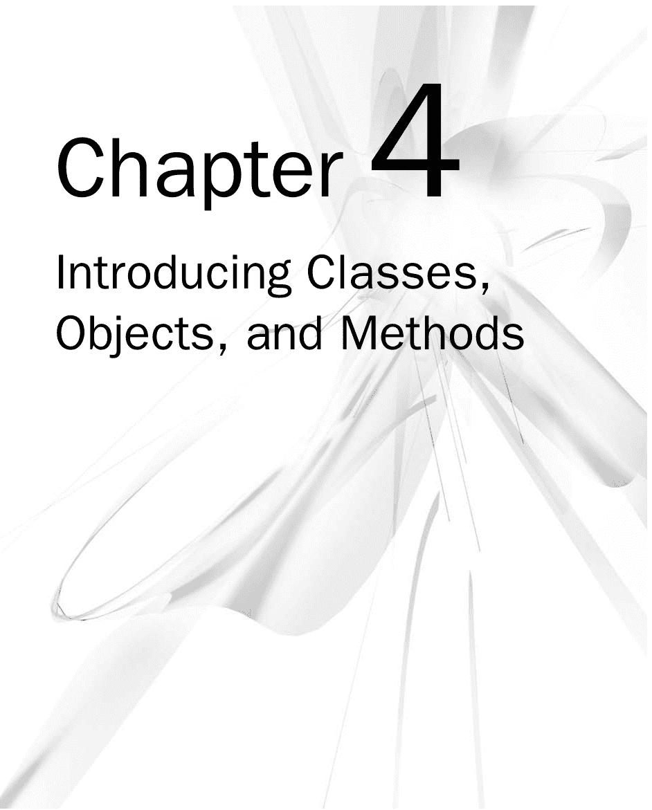

## 核心技能与概念

- 类基础
- 实例化对象
- 方法基础
- 方法参数
- 从方法返回值
- 构造函数
- `new`
- 垃圾回收
- 析构函数

在深入学习 C# 之前，你需要学习类。类是 C# 的本质，因为它定义了对象的性质。因此，类构成了 C# 面向对象编程的基础。类内部定义了数据以及处理这些数据的代码。由于类、对象和方法是 C# 的基础，它们在这一章中被介绍。对这些特征的基本了解将允许你编写更复杂的程序，并更好地理解第 5 章中描述的某些元素。

### 类基础

从本书开始，我们一直在使用类。当然，我们一直使用的是极其简单的类，并且没有利用它们的大部分功能。正如你所看到的，类比这些有限的类要强大得多。类是一个定义对象形式的模板。它通常同时指定代码和数据。对象是类的实例。因此，类本质上是一个抽象；直到该类的对象被创建后，内存中才存在物理表示。回想构成类的方法和变量被称为成员。

### 类的通用形式

当你定义一个类时，你声明它包含的数据和操作这些数据的代码。虽然非常简单的类可能只包含代码或数据，但现实世界的类二者兼备。从通俗来说，数据包含在类定义的实例变量中，代码包含在方法中。需要说明的是，C# 定义了几种类型的成员，包括实例变量、常量、构造函数、析构函数、索引器、事件和运算符。现在我们把对类的讨论限制在它的要素元素：实例变量和方法。在本章的晚些时候，将讨论构造函数和析构函数。

### 类的实例化与成员访问

每当你创建一个类的实例时，你都会创建一个对象，该对象包含了该类中定义的每个实例变量的独立拷贝。因此，每个 `Vehicle` 对象都包含其实例变量 `Passengers`、`FuelCap` 和 `Mpg` 的拷贝。要访问这些变量，你将使用成员访问运算符，它是一个句号 `.`。它通常被称为点运算符。点运算符将对象的名称与成员的名称连接起来。形式为：

```
object.member
```

例如，使用以下语句将 `minivan` 的 `FuelCap` 变量赋值为 16：

```
minivan.FuelCap = 16;
```

通常，你可以使用点运算符来访问实例变量和方法。这里是一个使用 `Vehicle` 类的完整程序：

```csharp
/* 使用 Vehicle 类的程序。请将此文件命名为 UseVehicle.cs */
using System;
// 一个封装车辆信息的类。
class Vehicle {
    public int Passengers; // 客员人数
    public int FuelCap; // 油箱容量（加仑）
    public int Mpg; // 每加仑英里的油耗
}
// 此类声明了一个 Vehicle 类型的对象。
class VehicleDemo {
    static void Main() {
        Vehicle minivan = new Vehicle();
        // 为 minivan 中的字段赋值。
        minivan.Passengers = 7;
        minivan.FuelCap = 16;
        minivan.Mpg = 21;
        // 假设油箱是满，计算行驶里程。
        int range = minivan.FuelCap * minivan.Mpg;
        Console.WriteLine("Minivan can carry " + minivan.Passengers + " with a range of " + range);
    }
}
```

此程序由两个类组成：`Vehicle` 和 `VehicleDemo`。在 `VehicleDemo` 内部，`Main()` 方法创建名为 `minivan` 的 `Vehicle` 实例。然后，代码内部访问与 `minivan` 相关的实例变量，为它们赋值并使用这些值。`Vehicle` 和 `VehicleDemo` 是两个独立的类。它们之间唯一的的关系是其中一个创建另一个的实例。尽管它们是独立的类，但如果 `Vehicle` 的成员没有赋予 `public` 访问修饰符，`VehicleDemo` 内部将无法访问这些成员。

编译此程序会创建一个 `UseVehicle.exe` 文件。`Vehicle` 和 `VehicleDemo` 类都自动成为可执行文件的一部分。该程序将显示以下输出：

```
Minivan can carry 7 with a range of 336
```

`Vehicle` 和 `VehicleDemo` 两个类并不非要位于同一个源文件中。你可以将每个类放在它们自己的文件中，例如命名为 `Vehicle.cs` 和 `VehicleDemo.cs`。只需使用 C# 编译器编译这两个文件并将它们链接在一起即可。例如：

```
csc Vehicle.cs VehicleDemo.cs
```

这将创建 `VehicleDemo.exe`，因为该类是包含 `Main()` 方法。

每个对象都拥有其类所定义的实例变量的独立拷贝。因此，一个对象中的变量内容可能与另一个对象中的变量内容不同。以下程序演示了这一事实：

```csharp
// 演示每个对象拥有其类定义的实例变量的拷贝。
using System;
class Vehicle {
    public int Passengers;
    public int FuelCap;
    public int Mpg;
}
class VehicleDemo {
    static void Main() {
        Vehicle minivan = new Vehicle();
        minivan.Passengers = 7;
        minivan.FuelCap = 16;
        minivan.Mpg = 21;
```


进入`/path/to/xxx`目录，找到`xxx.json`。

在表达式`cvar = avar + bvar`中，加法运算符（`+`）将`avar`与`bvar`相加，得到它们的和`cvar`

在`List.of(arg0, arg1, arg2)`中，`List`接口的工厂方法`of()`接受一系列的元素，返回包含它们的只读列表。

之后我们这样调用`cmd`命令：`cmd arg0 arg1 arg2`。

```java
if (condVar > someVal) {console.log("xxx")}
```

### 基本原则

每个对象都拥有其类所定义的实例变量的独立拷贝。因此，一个对象中的变量内容可能与另一个对象中的变量内容不同。这两个对象之间没有联系，它们它们是相同类型的对象之外。例如，如果你有两个 `Vehicles`，每个对象都有自己的 `Passengers`、`FuelCap` 和 `MPG` 拷贝，且这些内容在两个对象之间可以不同。以下程序演示了这一事实：

# 第 4 章：介绍类、对象和方法

在方法中允许有多个返回 `return` 语句，特别是当方法有两个或多个出口路径时。例如：

```java
public void MyMeth() {
    // ...
    if (done) return;
    // ...
    if (error) return;
}
```

在这里，如果方法已完成或发生错误，它就会返回。然而，请注意，方法中的返回点过多会破坏你的代码结构，因此要避免随意使用它们。
关于返回：一个 `void` 方法可以通过两种方式之一返回：到达结束大括号，或者执行了 `return` 语句。

### 返回值

虽然返回类型为 `void` 的方法并不罕见，但大多数方法都会返回一个值。事实上，返回数值是方法最有特性之一。你已经见过一个关于返回值的示例了：在第 2 章和第 3 章中，我们使用 `Math.Sqrt()` 来获取平方根。
返回值在编程中有多种用途。在某些情况下（例如使用 `Math.Sqrt()`），返回值包含某些计算的结果。在其他情况下，返回值可能仅仅表示成功或失败。无论目的如何，使用方法的返回值都是 C# 编程中不可或缺的一部分。
方法通过这种形式的返回向调用程序返回值：

`return value;`

在这里，`value` 是返回的值。
你可以使用返回值来改进 `Range()` 的实现。与其直接显示范围，更好的方法是让 `Range()` 计算范围并返回这个值。这种方法的优点之一是，你可以将该值用于其他计算。下面的示例修改了 `Range()`，使其返回范围而不是显示它：

```java
// 使用返回值。
using System;
// 一个封装了车辆车辆信息的类。
class Vehicle {
    public int Passengers; // 乘客人数
    public int FuelCap; // 油油箱容量（加仑）
    public int MPG; // 每加仑英里的油耗
```

## C# 3.0：学者指南

```java
// 返回范围。
public int Range() {
    return Mpg * FuelCap;
}
```

现在 `Range()` 返回了一个值。

```java
class ReturnMeth {
    static void Main() {
        Vehicle minivan = new Vehicle();
        Vehicle sportcar = new Vehicle();
    }
}
```

```csharp
int range, range2;
// 为 minivan 的字段赋值。。
minivan.Passengers = 7;
minivan.FuelCap = 16;
minivan.Mpg = 21;
```

```csharp
// 为 sportcar 的字段赋值。。
sportcar.Passengers = 2;
sportcar.FuelCap = 14;
sportcar.Mpg = 12;
```

```csharp
// 获取范围
range = minivan.Range();
range2 = sportcar.Range();
```

将 `Range()` 返回的值赋给变量。

```csharp
Console.WriteLine("Minivan can carry " + minivan.Passengers + " with range of " + range + " miles.");
Console.WriteLine("Sportcar can carry " + sportcar.Passengers + " with range of " + range2 + " miles.");
```

输出结果所示：

Minivan can carry 7 with range of 336 miles.
sportcar can carry 2 with range of 168 miles.

在程序中，当调用 `Range()` 时，它被放在赋值语句的右侧。左侧是一个接收 `Range()` 返回值的变量。因此，这行代码执行了：

```csharp
range = minivan.Range();
```

`minivan` 对象的范围存储在 `range` 中。

注意，`Range()` 现在有一个 `int` 返回类型。这意味着它将向调用者返回一个整数值。方法的返回类型是非常重要的，因为方法返回的数据类型必须与方法指定的返回类型兼容。

# 第 4 章：介绍类、对象和方法

由方法指定的返回类型。因此，如果你有一个返回 `double` 类型数据的方法，它的返回类型必须是 `double` 类型。

虽然前面的程序是正确的，但它的写法并没有预期的那么高效。具体来说，不需要 `range1` 和 `range2` 变量。`Range()` 的调用可以直接用于 `WriteLine()` 语句，如下所示：

```csharp
Console.WriteLine("Minivan can carry " + minivan.Passengers + " with range of " + minivan.Range() + " Miles;");
```

在这种情况下，当执行 `WriteLine()` 时，`minivan.Range()` 会被自动调用，其值将传递给 `WriteLine()`。此外，每当需要 `Vehicle` 对象的范围时，都可以调用 `Range()`。对于这个示例，该语句比较了两辆车辆的范围：

```csharp
if(v1.Range() > v2.Range()) Console.WriteLine("v1 has greater range");
```

# 专家问答

**答：**你听得没错。如果你创建一个包含没有任何执行路径都永远无法到达的代码的方法，C# 编译器将发出警告消息。考虑这个示例：

```java
public void m() {
  char a, b;
  // ...
  if(a==b) {
    Console.WriteLine("equal");
    return;
  } else {
    Console.WriteLine("not equal");
    return;
  }
  Console.WriteLine("this is unreachable");
}
```

在这里，`m()` 始终会在最后的 `WriteLine()` 语句执行之前之前就返回了。如果你尝试编译这个方法，你将得到一个警告。

## C# 3.0：学者指南

### 参数

可以向方法传递一个或多个值。只需声明每个参数，并用逗号将它们隔开即可。例如，`Factor` 类定义了一个名为 `IsFactor()` 的方法，判断第一个参数是否是第二个参数的因子。

```csharp
using System;
class Factor {
    // 判断 x 是否是 y 的因子。
    public bool IsFactor(int x, int y) {
        if(y % x == 0) return true;
        else return false;
    }
}
```

```csharp
class IsFact {
    static void Main() {
        Factor x = new Factor();
        if(x.IsFactor(2, 20)) Console.WriteLine("2 is factor");
        if(x.IsFactor(3, 20)) Console.WriteLine("this won't be displayed");
    }
}
```

这是程序产生的输出：

2 is factor.

```csharp
gallons = sportcar.FuelNeeded(dist);
```

# 第 4 章：介绍类、对象和方法

```csharp
Console.WriteLine("To go " + dist + " miles sportcar needs " + 
gallons + " gallons of fuel.");
```

程序的输出结果所示：

To go 252 miles minivan needs 12.0 gallons of fuel.
To go 252 miles sportcar needs 21.0 gallons of fuel.

## 尝试创建一个帮助类

如果用一句话来概括类的本质，那可能是这样的：类封装了功能。当然，有时的技巧在于知道一个“功能”在哪里结束，另一个“功能”从哪里开始。根据一般原则，你希望你的类是你更大型应用程序的构建模块。为了做到这一点，每个类必须代表一个执行清晰划分动作的单一功能单元。因此，你希望你的类尽可能小——但不能太小了！也就是说，包含多余功能的类会使代码混乱且困惑，但包含功能太少的类则会导致代码碎片化。平衡点在哪里？正是在这一点上，编程科学变成了编程艺术。大多数程序员发现随着经验的增长，这种平衡会变得更容易。

为了开始积累经验，我们将第 3 章“尝试”部分中开发的帮助系统转换为一个帮助类。让我们解释一下为什么这是一个好主意。首先，帮助系统定义了一个逻辑单元。它只需显示 C# 控制台语句的语法。因此，它的功能是紧凑且定义良好的。其次，将帮助放在类中是一种非常符合美学的方法。每当你想为用户提供帮助系统时，只需实例化帮助系统对象即可。最后，由于帮助被封装起来，可以对其进行升级或更改，而不会对你使用的程序产生副作用。

### 逐步实施

- 1. 创建一个新文件 `HelpClassDemo.cs`。为了节省打字时间，你可能想从第 3 章最后的 Try 章节复制文件 `Help.cs` 或 `HelpClassDemo.cs`。
- 2. 要将帮助系统转换为类，你必须首先精确确定什么构成用户的选择、检查有效响应，并显示有关所选项目的信息。程序还会循环，直到按下 `q` 为止。如果你仔细考虑，很显然，对有效响应的检查和信息的显示是帮助系统不可或缺的一部分。如何获取用户输入以及是否应该处理请求并不是不可或缺的。因此，你将创建一个显示帮助信息和帮助菜单并检查有效选择的类。这些功能可以组织成方法中，称为 `HelpOn()`、`ShowMenu()` 和 `IsValid()`。
- 3. 创建 `HelpOn()` 方法，如下：

```csharp
public void HelpOn(char wat) {
    switch(wat) {
        case '1':
            Console.WriteLine("The if:\n");
            Console.WriteLine("if(condition) statement;");
            Console.WriteLine("else statement;");
            break;
        case '2':
            Console.WriteLine("The switch:\n");
            Console.WriteLine("switch(expression) {");
```

- 4. 创建 `ShowMenu()` 方法：

```csharp
public void ShowMenu() {
    Console.WriteLine("Help on:");
    Console.WriteLine(" 1. if:");
    Console.WriteLine(" 2. switch:");
    Console.WriteLine(" 3. for:");
    Console.WriteLine(" 4. while:");
    Console.WriteLine(" 5. do-while:");
    Console.WriteLine(" 6. break:");
    Console.WriteLine(" 7. continue:");
    Console.WriteLine(" 8. goto\n");
    Console.Write("Choose one (q to quit):");
}
```

- 5. 创建 `IsValid()` 方法，如下：

```csharp
public bool IsValid(char ch) {
    if(ch < '1' && ch != 'q') return false;
    else return true;
}
```

- 6. 将上述方法组合到 `Help` 类中，如下：

```csharp
class Help {
    public void HelpOn(char what) {
        switch (what) {
            case '1':
                Console.WriteLine("The if:\n");
                Console.WriteLine("if (condition) statement;");
                Console.WriteLine("else statement;");
                break;
            case '2':
                Console.WriteLine("The switch:\n");
                Console.WriteLine("switch (expression) {");
                case '5':
Console.WriteLine("The do-while:\n");
Console.WriteLine("do {");
```

```csharp
public void ShowMenu() {
Console.WriteLine("Help on:");
Console.WriteLine(" 1. if if;");
Console.WriteLine(" 2. switch;");
Console.WriteLine(" 3. for;");
Console.WriteLine(" 4. while;");
Console.WriteLine(" 5. do-while;");
Console.WriteLine(" 6. break;");
Console.WriteLine(" 7. continue;");
Console.WriteLine(" 8. goto;");
Console.Write("Choose one (q to quit); ");
}
```

```csharp
public bool IsValid(char ch) {
if(ch < '1' || ch > '8' && ch != 'q') return false;
else return true;
}
```

- 7. 最后，创建一个名为 `HelpClassDemo.cs` 的类，它使用 `Help` 类。让 `Main()` 显示帮助信息，直到用户输入 `q`。`HelpClassDemo.cs` 的完整代码所示：

```csharp
// 将第 3 章的帮助系统转换为类。
using System;
// 显示帮助菜单。
public void ShowMenu() {
    Console.WriteLine("Help on:");
    Console.WriteLine(" 1. if");
    Console.WriteLine(" 2. switch");
    Console.WriteLine(" 3. for");
    Console.WriteLine(" 4. while");
    Console.WriteLine(" 5. do-while");
    Console.WriteLine(" 6. break");
    Console.WriteLine(" 7. continue");
    Console.WriteLine(" 8. goto\n");
    Console.Write("Choose one (q to quit): ");
}
// 测试有效的选择。
public bool IsValid(char ch) {
    if(ch < '1' || ch > '8' && ch != 'q') return false;
    else return true;
}
class HelpClassDemo {
```


```csharp
static void Main() {

    char choice;

    Help hplobj = new Help();

    for(;;) {

        do {

            hplobj.ShowMenu();

            choice = (char) Console.Read();

        } while (choice == '\n' || choice == '\r');

        if (!hplobj.IsValid(choice));
        if(choice == 'q') break;
        Console.WriteLine("\n");

        hplobj.HelpOn(choice);

    }

}
```

当你尝试运行程序时，你会发现它与第 3 章的最后版本是相同的。这种方法的优势是，你现在可以在需要的地方复用帮助组件。

# 第 4 章：介绍类、对象和方法

## 构造函数

在前面的示例中，每个 `Vehicle` 对象的实例变量必须通过语句手动设置，例如：

```csharp
minivan.Passengers = 7;
minivan.FuelCap = 16;
minivan.Mpg = 21;
```

这种方法永远不会出现在专业的 C# 代码中。除了容易出错（可能会忘记设置字段）之外，完成此任务更好的方法：

构造函数在对象创建时初始化它。它与类同名，语法与方法相似。然而，构造函数没有显式的返回类型。构造函数的通用形式所示：

```csharp
access classname(param-list) {
    // 构造函数
}
```

通常，你会使用构造函数为类定义的实例变量赋初值，或者访问修饰符是 `public`，因为构造函数通常从类外部调用。参数列表可以为空，也可以指定一个或多个参数。

所有类都有构造函数，无论你是否定义，因为 C# 会自动提供一个默认构造函数，使所有成员初始化为它们的默认值。对于大多数值类型，默认值是 0。对于 `bool`，默认是 `false`。对于引用类型，默认值是 `null`。然而，一旦你定义了自己的构造函数，默认构造函数就不会再使用。

使用构造函数的简单示例：

```csharp
// 一个简单的构造函数。
using System;
class MyClass {
    public int x;
    public MyClass() {
        x = 10;
    }
}
class ConsDemo {
    static void Main() {
```

> `MyClass` 的构造函数。

# C# 3.0：初学者指南

```csharp
MyClass t1 = new MyClass();
MyClass t2 = new MyClass();
Console.WriteLine(t1.x + " " + t2.x);
}
```

在这个示例中，`MyClass` 的构造函数是：

```csharp
public MyClass() {
    x = 10;
}
```

注意，构造函数被指定为 `public`，因为该构造函数将在类外部代码中被调用。正如前面提到的，大多数构造函数由于这个原因被声明为 `public`。此构造函数将 `MyClass` 的实例变量 `x` 赋值为 `10`。例如，在创建对象时，`new` 会调用构造函数。例如，在这一行中：

```csharp
MyClass t1 = new MyClass();
```

在 `t1` 对象上调用了构造函数 `MyClass`，使得 `t1.x` 的值变为 `10`。`t2` 也是如此。构造完成后，`t2.x` 的值为 `10`。因此，程序的输出为：

10 10

### 参数化构造函数

在前面的示例中，使用了一个无参数构造函数。虽然这在某些情况下是可以的，但大多数情况下，你需要一个接受一个或多个参数的构造函数。参数添加到构造函数的方式与添加到方法的方式相同：只需在构造函数名称后的括号内声明它们即可。例如，这里为 `MyClass` 提供了一个参数化构造函数：

```csharp
// 一个参数化构造函数。
```

```csharp
using System;
class MyClass {
    public int x;
    public MyClass(int i) {
        x = i;
    }
}
```

> 此构造函数有一个参数。

```csharp
class ParmConsDemo {
    static void Main() {
        MyClass t1 = new MyClass(10);
```

# 第 4 章：介绍类、对象和方法 145

该程序的输出所示：

88

在程序的这个版本，`MyClass()` 构造函数定义了一个名为 `i` 的参数，用于初始化实例变量 `x`。因此，当执行这一行代码时：

```csharp
MyClass t1 = new MyClass(10);
// 值 10 被传递给 i，然后被赋值给 x。
```

# 为 Vehicle 类添加构造函数

我们可以通过添加一个构造函数来改进 `Vehicle` 类，在对象创建时自动初始化 `Passengers`、`FuelCap` 和 `M` 字段。请特别注意 `Vehicle` 对象是如何创建的。

```csharp
// 为 Vehicle 添加一个构造函数。
using System;
class Vehicle {
    public int Passengers; // 乘客人数
    public int FuelCap; // 油箱容量（加仑）
    public int M; // 每加仑英里的油耗
    // 这是 Vehicle 的构造函数。
    public Vehicle(int p, int f, int m) {
        Passengers = p;
        FuelCap = f;
        M = m;
    }
```

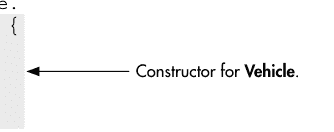

```csharp
// 返回范围。
public int Range() {
    return M * FuelCap;
}
// 计算给定距离所需的燃料。
public double FuelNeeded(int miles) {
    return (double) miles / M;
}
```

# C# 3.0：初学者指南

```csharp
class VehConsDemo {
    static void Main() {
        // 构建完整的车辆。
        Vehicle minivan = new Vehicle(7, 16, 21);
        Vehicle sportswear = new Vehicle(2, 14, 12);
        double gallons;
        int dist = 252;
        gallons = minivan.FuelNeeded(dist);
        Console.WriteLine("行驶 " + dist + " 英里，面包型客车需要 " + gallons + " 加仑燃料。");
        gallons = sportswear.FuelNeeded(dist);
        Console.WriteLine("行驶 " + dist + " 英里，运动跑车需要 " + gallons + " 加仑燃料。");
    }
}
```

`minivan` 和 `sportswear` 在创建时通过 `Vehicle()` 构造函数进行了初始化。每个对象都按照其构造函数参数中指定的定值进行初始化。例如，在下面这一行中：

```csharp
Vehicle minivan = new Vehicle(7, 16, 21);
```

当 `new` 创建对象时，值 7、16 和 21 被传递给 `Vehicle()` 构造函数。因此，`minivan` 的 `Passengers`、`FuelCap` 和 `M` 分别包含值 7、16 和 21。因此，该程序的输出与上一个版本相同。

### new 运算符

现在你对类及其构造函数已经有了更多了解，让我们仔细观察一下 `new` 运算符。它具有以下通用形式：

```csharp
new class-name(arg-list)
```

这里，`class-name` 是正在实例化的类名，随后的括号指定了如前节所述的类构造函数。如果类没有定义自己的构造函数，`new` 将使用 C# 提供的默认构造函数。

由于内存是有限的，`new` 可能因为内存不足而无法为对象分配内存。如果发生这种情况，将产生一个运行时异常。（你将在第 9 章中学习异常。）对于书中的示例程序，你不需要担心内存耗尽，但在现实世界的程序中，你需要考虑这一点。

# 第 4 章：介绍类、对象和方法

# 专家

**问：** 为什么我不需要使用 `new` 来处理值类型？
**答：** 在 C# 中，对于值类型，`int` 是自动初始化的。因此，不需要显式使用 `new`。

# 垃圾回收与析构函数

正如你所见，垃圾回收是在程序执行期间自动进行的。在许多编程语言中，例如 C++，你需要使用 `delete` 运算符来释放内存。而 C# 使用了不同的方法：垃圾回收。当对象不再被使用时，内存会被回收。当对象不再被使用时，内存可以被回收。

垃圾回收是随机发生的。因此，你无法确切知道垃圾回收何时发生。

# C# 3.0：初学者指南 析构函数

在某些特殊情况下，为了确保对象被终止，可以定义一个在对象被垃圾器回收之前调用的方法。这种方法被称为析构函数，它可以释放资源。它们通常是需要的。

析构函数具有以下通用形式：

```csharp
~class-name() {
    // 销毁代码
}
```

这里，`class-name` 是类名。因此，析构函数的声明方式类似于构造函数，只是前面有一个 `~`（波浪号）。它没有返回类型。重要的是，析构函数是在垃圾回收之前调用的。它在包含对象引变量离开作用域时调用（这与 C++ 的析构函数不同）。这意味着你无法确定析构函数何时执行。此外，程序可能在垃圾回收发生之前结束，因此析构函数可能不会被调用。

### this 关键字

在开始本章之前，有必要介绍 `this`。当调用方法时，它会自动传递一个调用对象的引用（即调用该方法的对象）。这个引用被称为 `this`。因此，`this` 指向正在执行操作的对象。为了理解这一点，首先考虑一个创建 `Pwr` 类的程序，该类计算数字的整数幂：

```csharp
using System;
class Pwr {
    public double b;
    public int e;
    public double val;
    public Pwr(double num, int exp) {
        b = num;
        e = exp;
    }
    public void Compute() {
        val = 1;
        for(int i = e; i > 0; i--) {
            val = val * b;
        }
    }
}
```

# 第 4 章：介绍类、对象和方法

```csharp
public double GetPwr() {
    return val;
}
```

```csharp
class DemoPwr {
    static void Main() {
        Pwr x = new Pwr(4.0, 2);
        Pwr y = new Pwr(2.5, 1);
        Pwr z = new Pwr(5.7, 0);
        Console.WriteLine(x.b + " raised to the " + x.e + 
            " power is " + x.GetPwr());
        Console.WriteLine(y.b + " raised to the " + y.e + 
            " power is " + y.GetPwr());
        Console.WriteLine(z.b + " raised to the " + z.e + 
            " power is " + z.GetPwr());
    }
}
```

如你所知，在方法内部，可以直接访问类的其他成员，而不需要任何对象或类限定。因此，在 `GetPwr()` 内部，语句

`return val;`

意味着返回与调用对象相关的 val 拷贝。然而，相同的语句也可以这样写：

`return this.val;`

在这里，`this` 指向调用 `GetPwr()` 的对象。因此，`this.val` 指向该对象的 val 拷贝。例如，如果在 `x` 上调用了 `GetPwr()`，那么前一个语句中的 `this` 将指向 `x`。不写这个 `this` 而写语句实际上是简写。

在构造函数中使用 `this` 也是可能的。在这种情况下，`this` 指向正在被构造的对象。例如，在 `Pwr()` 内部，如下语句

```csharp
b = num;
e = exp;
```

可以写成：

```csharp
this.b = num;
this.e = exp;
```

当然，在这种情况下这样做并没有益处。

# C# 3.0：初学者指南

以下是使用 `this` 引用编写的整个 `Pwr` 类：

```csharp
// 演示 this。
class Pwr {
    public double b;
    public int e;
    public double val;
    public Pwr(double num, int exp) {
        this.b = num;
        this.e = exp;
        this.val = 1;
        for (; e>0; e--) this.val = this.val * this.b;
    }
    public double GetPwr() {
        return this.val;
    }
}
```

实际上，没有任何 C# 程序员会像上面那样用 `this` 来编写 `Pwr`，因为这样没有任何收益，而且标准形式更容易读。然而，这有一些重要的用途。例如，C# 允许参数名称或局部变量名称与实例变量名称相同。当这种情况发生时，局部名称会隐藏实例变量。你可以通过 `this` 引用它来获取对隐藏实例变量的访问权限。例如，以下是编写 `(Pwr)` 构造函数的一种语法上有效的方法：

```csharp
public Pwr(double b, int e) {
    this.b = b;
    this.e = e;
    val = 1;
    for (; e>0; e--) val = val * b;
}
```

> 在这里 `this.b` 指的是 `b` 实例变量，而不是参数。

在这个版本中，参数名称与实例变量名称相同，从而隐藏了它们。然而，这被用来“揭示”实例变量。

# 第 4 章自测

- 1. 类和对象之间的区别是什么？
- 2. 如何定义类？
- 3. 每个对象都有自己的什么拷贝？
- 4. 使用两个独立的语句，显示如何声明一个名为 `counter` 的 `MyCounter()` 类对象，并为其分配一个对象引用。
- 5. 如果一个名为 `MyMeth()` 的方法返回类型为 `double` 且有两个 `int` 参数 `a` 和 `b`，应该如何声明它？
- 6. 如果一个方法返回一个值，它必须如何返回？
- 7. 构造函数叫什么名字？
- 8. `new` 起什么作用？
- 9. 什么是垃圾收集？它是如何工作的？什么是析构函数？
- 10. 什么是 `this`？

# 第 5 章

## 更多数据类型和运算符

## 核心技能与概念

- 一维数组
- 多维数组
- 锯齿数组（Jagged arrays）
- `Length` 属性
- 隐式类型数组
- 字符串
- `foreach` 循环
- 位运算符
- `?` 运算符

这回到了 C# 的数据类型和运算符的主题。它讨论了数组、字符串类型、位运算符和 `?` 条件运算符。在此过程中，还引入了 `foreach` 循环。

### 数组

数组是具有相同名称的相同类型变量集合。在 C# 中，数组可以有一个或多个维度，尽管一维数组是最常见的。数组有多种用途，因为提供了分组相关变量的方便方法。例如，你可能会使用数组来存储一个月每日最高温度记录、登录网络的用户列表，或者你的编程书籍集。

数组的主要优势是它可以组织相关变量。

### 一维数组

一维数组是具有相同名称的相同类型变量集合。在 C# 中，数组可以有一个或多个维度，尽管一维数组是最常见的。数组有多种用途，因为它们提供了分组相关变量的方便方法。例如，你可能会使用数组来存储一个月每日最高温度记录、登录网络的用户列表，或者你的编程书籍集。

数组的主要优势是它可以组织相关变量。

# C# 3.0：初学者指南

```csharp
for(i = 0; i < 10; i++)
    sample[i] = i;
```

```csharp
for(i = 0; i < 10; i++)
    Console.WriteLine("This is sample[" + i + "]: " + sample[i]);
```


程序的输出在此处：

This is sample[0] : 0
This is sample[1] : 1
This is sample[2] : 2
This is sample[3] : 3
This is sample[4] : 4
This is sample[5] : 5
This is sample[6] : 6
This is sample[7] : 7
This is sample[8] : 8
This is sample[9] : 9

概念上，`sample` 数组看起来如下：

| 0 | 1 | 2 | 3 | 4 | 5 | 6 | 7 | 8 | 9 |
|---|---|---|---|---|---|---|---|---|---|
| sample[0] | sample[1] | sample[2] | sample[3] | sample[4] | sample[5] | sample[6] | sample[7] | sample[8] | sample[9] |

数组在编程中很常见，因为你可以轻松处理大量相关变量。例如，下面的程序通过 `for` 循环遍历数组，找到 `nums` 数组中存储的最小值和最大值：

```csharp
// 找到数组中的最小值和最大值。
```

```csharp
using System;

class MinMax {
    static void Main() {
        int[] nums = new int[10];
        int min, max;
        nums[0] = 99;
        nums[1] = -10;
        nums[2] = 100123;
        nums[3] = 18;
```

# 第 5 章：更多数据类型和运算符 157

```csharp
nums[4] = -978;
nums[5] = 5623;
nums[6] = 463;
nums[7] = -9;
nums[8] = 287;
nums[9] = 49;
```

```csharp
min = max = nums[0];
// 找到数组中的最小值和最大值。
for(int i=1; i < 10; i++) {
  if(nums[i] < min) min = nums[i];
  if(nums[i] > max) max = nums[i];
}
Console.WriteLine("min and max: " + min + " " + max);
```

程序的输出显示在这里：

min and max: -978 56123

## 初始化数组

在前面的程序中，`nums` 数组是通过十个独立的赋值语句手动赋值的。虽然这完全正确，但有种更简单的方法可以做到。数组在创建时就会被初始化。初始化一维数组的通用格式所示：

```csharp
type[] array-name = {val1, val2, val3, ..., valN};
```

在这里，初始值通过 `val1` 到 `valN` 赋值。它们按照从左到右的顺序赋值。C# 会自动分配足够大的数组来容纳你指定的初始化器。不需要显式使用 `new` 运算符。例如，这里是使用 `MinMax` 程序的更好方法：

```csharp
// 使用数组初始化器。
```

```csharp
using System;
class MinMax {
  static void Main() {
    int[] nums = { 99, -10, 100123, 18, -978, 5623, 463, -9, 287, 49 };
    int min, max;
```

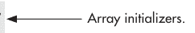

## C# 3.0：学者指南

```csharp
min = max = nums[0];
for(int i=1; i < 10; i++) {
    if (nums[i] < min) min = nums[i];
    if (nums[i] > max) max = nums[i];
}
Console.WriteLine("Min and max " + min + " " + max);
```

有趣的一点是，不此多言，你可以在初始化数组时使用 `new`。例如，在前面的程序中，初始化 `nums` 这样写是正确的，但是多余的：

```csharp
int[] nums = new int[] { 99, -10, 100123, 18, -978, 5623, 463, -9, 287, 49 };
```

虽然是多余的，但当你将一个新数组赋值给已经存在的数组变量时，这种新的数组初始化形式是有用的。例如：

```csharp
int[] nums = new int[] { 99, -10, 100123, 18, -978, 5623, 463, -9, 287, 49 };
```

在这种情况下，`nums` 在第一条语句中声明并在第二条语句中初始化。

### 强制执行边界

C# 严格强制执行数组边界；越界或欠界访问数组末尾是运行时错误。如果你想亲自确认这一点，请尝试运行这个故意溢出数组程序：

```csharp
// 演示数组越界。
```

```csharp
using System;
class ArrayErr {
    static void Main() {
        int[] sample = new int[10];
        // 产生数组越界。
        for(int i = 0; i < 100; i++)
            sample[i] = i; // 越界 sample 的末尾。
    }
}
```

一旦 `i` 达到 10，就会生成一个 `IndexOutOfRangeException` 并且程序终止。

# 第 5 章：更多数据类型和运算符 159

## 尝试排序数组

由于一维数组将数据组织成可索引的列表，因此它是排序的最佳数据结构。此外，排序算法是数组处理的一些最佳示例。为此，此示例开发了一个相当臭名昭彰的冒泡排序版本。如你所知，有很多不同的排序算法。有快速排序、摆动排序和插入排序，仅举三个。然而，最简单且最易理解的排序算法之一是冒泡排序。在性能方面它也是最糟糕的排序之一（尽管有时可以有效地用于非常小的数组）。但是，冒泡排序确实有一个非常有用的特性：它是数组处理的一个有趣的示例！

### 逐步进行

1. 创建一个名为 **Bubble.cs** 的文件。
2. 冒泡排序的名字源于它执行排序操作的方式。它对数组中的相邻元素进行重复比较，并在必要时进行交换。在这个过程中，小值向一端移动，大值向另一端移动。这个过程在概念上类似于气泡在水箱中找到自己的位置。冒泡排序通过对数组进行多次扫描来操作，在必要时交换位置不对的元素。

# C# 3.0: 初学者指南

```csharp
Console.WriteLine();
}
```

在这个示例中，`table[0, 0]` 的值将为1，`table[0, 1]` 的值为 2，`table[0, 2]` 的值为 3，依此类推。`table[2, 3]` 的值将是 12。从概念上来说，该数组的结构将如图 5-1 所示。

# 三维或更多维数组

C# 允许创建超过两个维数组。以下是多维数组声明的通用形式：

```csharp
type[...] multidim name = type[size1,size2,...,sizeN];
```

例如，以下声明创建了一个 4x10x3 的三维数组：

```csharp
int [,,] multidim = new int[4, 10, 3];
```

要为 `multidim` 的 `[2, 4, 1]` 赋值为 100，请使用此语句：

```csharp
multidim[2, 4, 1] = 100;
```

# 初始化多维数组

可以通过将每个维度的初始化列表封装在自己的大括号内来初始化多维数组。这里是二维数组初始化的通用示例：

```csharp
type[].array_name = {
  { val, val, val, ... val },
  { val, val, val, ... val },
..
  { val, val, val, ... val }
};
```

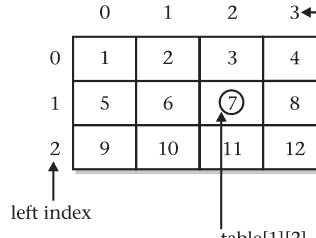

图 5-1 由 `TwoD` 程序创建的表格数组的概念视图

在这里，`val` 表示初始化值。每个内部块表示行。在每个块中，第一个值将存储在行的第一个位置，第二个值存储在第二个位置，依此类推。请注意逗号分隔了初始化块，并且在闭合大括号后有一个分号。

例如，以下程序初始化了一个名为 `sqrs` 的数组，其中包含 1 到 5 的数字及其平方数：

```csharp
// 初始化一个二维数组。
using System;
    class Squares {
        static void Main() {
            int[] sqrs = {
                { 1, 1},
                { 2, 4},
                { 3, 9},
                { 4, 16},
                { 5, 25 }
            };
            int i, j;
            for(i=0; i < 5; i++)
                for(j=0; j < 2; j++)
                    Console.Write(sqrs[i,j] + " ");
                Console.WriteLine();
        }
}
```


以下是程序的输出：

```
1 1
2 4
3 9
4 16
5 25
```

# 锯错数组 (Jagged Arrays)

在之前的示例中，当你创建一个二维数组时，你创建的是 C# 所说的的“矩形数组”（rectangular array）。将二维数组看作表格，矩形数组是一种二维数组，其中每行的长度对于整个数组来说都是相同的。然而，C# 也允许你创建一种特殊的二维数组，称为“锯错数组”（jagged array）。锯错数组是数组的数组，其中每个数组的长度可以不同。因此，锯错数组可以用于创建行不同的表格。

锯错数组通过使用一组方括号来指示每个维度。例如，要声明一个二维锯错数组，你需要使用此通用形式：

在这里，`size` 表示数组的行数。行本身尚未分配。相反，行是单独分配的。这允许每行的长度发生变化。例如，以下代码在声明 `jagged` 时为第一个 `jagged` 分配内存。它手动分配了第二个维度。

```csharp
int[] jagged = new int[3][];
			jagged[0] = new int[2];
			jagged[1] = new int[3];
			jagged[2] = new int[4];
```

执行完此序列后，`jagged` 看起来如下：

| jagged[0][0] | jagged[0][1] |
| jagged[1][0] | jagged[1][1] | jagged[1][2] |
| jagged[2][0] | jagged[2][1] | jagged[2][2] | jagged[2][3] |

很容易看出锯错数组是如何命名的！
一旦创建了锯错数组，就可以通过指定大括号内的每个索引来访问元素。例如，要为 `jagged` 的元素 `[2][1]` 赋值为 10，你将使用此语句：

```csharp
jagged[2][1] = 10;
```

注意，这与访问矩形数组元素使用的语法不同。这里是一个使用锯锯错数组的示例。假设你正在编写一个存储乘坐机场班车人数的程序。如果班车在工作日每天运行十次，周六和周日每天运行两次，你可以可以使用程序所示的数组来存储信息。注意前五个维度的长度为 10，最后两个维度的长度为 2。

```csharp
// 演示锯错数组。
using System;
class Jagged {
    static void Main() {
        int[] riders = new int[7][];
        riders[0] = new int[10];
        riders[1] = new int[10];
        riders[2] = new int[10];
        riders[3] = new int[10];
        riders[4] = new int[10];
        riders[5] = new int[2];
        riders[6] = new int[2];
        int i, j;
        // 构造数据。
        for(i=0; i < 5; i++)
            for(j=0; j < 10; j++)
                riders[i][j] = i + j + 10;
        for(i=5; i < 7; i++)
            for(j=0; j < 2; j++)
                riders[i][j] = i + j + 10;
        Console.WriteLine("工作期间每班次人数:");
        for(i=0; i < 5; i++) {
            for(j=0; j < 10; j++) {
                Console.Write(riders[i][j] + " ");
            }
            Console.WriteLine();
        }
        Console.WriteLine("周末每班次人数:");
        for(i=5; i < 7; i++) {
            for(j=0; j < 2; j++) {
                Console.Write(riders[i][j] + " ");
            }
            Console.WriteLine();
        }
    }
}
```

锯错数组并不是所有的应用程序都会使用，但在某些情况下非常有效。例如，如果你需要一个稀疏的二维数组（即并非所有元素都被使用），那么锯错数组可能是完美的解决方案。

### 引用

对于对象，当你将一个数组赋值给另一个时，你只是让两个变量引用同一个数组。你并没有创建数组的副本，也没有将一个数组的内容到另一个。例如，考虑此程序：

```csharp
// 赋值数组变量。
using System;
class AssignARef {
    static void Main() {
        int i;
        int[] nums1 = new int[10];
        int[] nums2 = new int[10];
        // 给 nums1 和 nums2 赋一些值。
        for(i=0; i < 10; i++) nums1[i] = i;
        for(i=0; i < 10; i++) nums2[i] = -i;
        Console.Write("nums1 为: ");
        Console.Write("赋值后的 nums2 为: ");
        // 通过 nums2 操作 nums1。
        nums2[3] = 99;
        Console.Write("通过 nums2 修改后的 nums1 为: ");
```

程序的输出所示：

```
nums1 为: 0 1 2 3 4 5 6 7 8 9
赋值后的 nums2 为: 0 -1 -2 -3 -4 -5 -6 -7 -8 -9 (注：此处原文逻辑略有误，此处按原文翻译)
通过 nums2 修改后的 nums1 为: 0 1 2 99 4 5 6 7 8 9
```

如输出所示，将 `nums1` 赋值给 `nums2`，两个引用变量指向同一个对象。

# 在数组中使用 Length 属性

由于 C# 将数组实现为对象，因此带来了许多好处。其中之一是每个数组都关联有一个 `Length` 属性，该属性包含数组可以容的元素数量。因此，每个数组提供了一种确定其长度的方法。这是一个演示 `Length` 属性的程序：

```csharp
// 使用 Length 属性。
using System;
class LengthDemo {
    static void Main() {
        int[] list = new int[10];
        int[] twoD = new int[3, 4];
        int[] nums = { 1, 2, 3 };
        // 变长表格。
        int[] table = new int[3][];
        // 添加第二个维度。
        table[0] = new int[] { 1, 2, 3 };
        table[1] = new int[] { 4, 5 };
        table[2] = new int[] { 6, 7, 8 };
        Console.WriteLine("list 的长度为 " + list.Length);


显示数组的长度。

```csharp
Console.WriteLine("twoD 的长度为 " + twoD.Length);
Console.WriteLine("nums 的长度为 " + nums.Length);
Console.WriteLine("table 的长度为 " + table.Length);
Console.WriteLine("table[0] 的长度为 " + table[0].Length);
Console.WriteLine("table[1] 的长度为 " + table[1].Length);
Console.WriteLine("table[2] 的长度为 " + table[2].Length);
Console.WriteLine();
// 使用 Length 初始化 list。
for(int i = 0; i < list.Length; i++)
    list[i] = i * i;
}
}
```

## C# 3.0: 初学者指南

```csharp
Console.Write("Here is list: ");
// now use Length to display list
for (int i=0; i < list.Length; i++)
    Console.Write(list[i] + " ");
Console.WriteLine();
```

此程序显示以下输出：

```
length of list is 10
length of twoD is 12
length of nums is 3
length of table is 3
length of table[0] is 3
length of table[1] is 2
length of table[2] is 4
```

Here is list: 0 1 4 9 16 25 36 49 64 81

这个程序中有几个值得关注的点。首先，`list` 的长度（一个一维数组）等于其声明的长度 10。其次，`twoD` 的长度（一个 3x 4 的二维数组）为 12，这是它所包含的元素总数。通常情况下，多维数组的长度等于它能够容纳的所有元素数量。然而，交错数组（jagged arrays）的情况有所不同。

如你所知，交错数组是数组的数组。因此，在程序中，`table` 是一个具有两个维度的交错数组。特别注意 `Length` 对它的使用方式。首先，表达式

```csharp
table.Length
```

获取 `table` 中存储的数组数量，在这种情况下为 3。要获取 `table` 中任何单个数组的长度，请使用如下的表达式：

```csharp
table[0].Length
```

在 `LengthDemo` 中需要注意的是的是，`list.Length` 被 `for` 循环用于获取执行的迭代次数。每个数组都带有其自身的长度，你可以使用此信息，而不是手动跟踪数组的大小。请记住，`Length` 的值与你实际使用的元素数量无关。它包含数组能够容纳的元素数量。

`Length` 属性的引入简化了某些类型的数组操作——使其执行变得更容易且更安全。例如，以下程序使用 `Length` 将一个数组复制到另一个数组，同时防止了数组越界及其随之而来的运行时异常：

在这里，`Length` 帮助执行两个重要功能。首先，它被用于确认目标数组足够大以容纳源数组的内容。其次，它提供了执行复制的 `for` 循环的终止条件。当然，在这个简单的示例中，数组的大小是显而易见的，但同样的方法可以应用于许多更具挑战性的情况。

## 创建隐式类型数组

如第 2 节所述，C# 3.0 通过使用 `var` 关键字 增加了隐式类型变量的能力。这些变量的类型由编译器根据初始化表达式的类型来确定。因此，隐式类型变量必须初始化。使用相同的机制，也可以创建隐式类型数组。作为一条一般规则，隐式类型数组用于某些类型的 LINQ 查询（LINQ 将在本书的后部分进行描述）。在其他情况下，你将使用“正常”的数组声明方法。

隐式类型数组使用 `var` 关键字声明，但你不需要在 `var` 后面跟随 `[]`。此外，数组必须初始化。是初始化器的类型决定了数组的类型。所有初始化器必须是相同类型或兼容的类型。这是一个隐式类型数组的示例：

```csharp
var vals = new[] { 1, 2, 3, 4, 5 };
```

这创建了一个长度为 5 的 `int` 数组。该数组的引用被赋值给 `vals`。因此，`vals` 的类型是“int 数组”，它有五个元素。再次注意，`var` 后面没有跟随 `[]`。此外，尽管数组正在初始化，你也必须包含 `new[]`。这在这种语文中并不是最优的。

这是另一个示例。它创建了一个 `double` 类型的二维数组。

```csharp
var vals = new[,] { {1.1, 2.2}, {3.3, 4.4}, {5.5, 6.6} };
```

在这种情况下，`vals` 的维度是 2x 3。如前提到的，泛型数组最适用于基于 LINQ 的查询。它们并不是为了通用用途设计的。在大多数情况下，你应该使用显式类型数组。

## 尝试此：创建一个简单的队列类

如你所知，数据结构是组织数据的手段。最简单的数据结构是数组，一种支持访问元素的线性列表。数组通常用作更复杂结构（如栈和队列）的基础。栈是一个元素按照“后进先出”（LIFO）顺序访问的列表。队列是一个元素按照“先入后出”（FIFO）顺序访问的列表。因此，栈就像桌子上的一叠盘子；先放的最后用。队列就像银行排队；先来的先服务。

栈和队列等数据结构的有趣之处在于，它们将存储信息的访问的方法结合在一起。因此，存储和检索是由数据结构提供的，而不是由你的程序手动提供的。这种组合显然。

## 第 5 节：更多数据类型和运算符

### 步骤

1. 创建一个名为 `QDemo.cs` 的文件
2. 虽然有其他方法支持队列，我们将使用的方法基于数组。也就是说，数组将为队列中的项提供存储。该数组通过两个索引访问。存储索引决定下一个元素的存储位置。获取索引指示下一个元素的位置。记住，获取操作是消耗性的，无法多次检索同一个元素。尽管我们将创建的是字符，但相同的逻辑可以用于存储任何类型的对象。开始 `SimpleQueue` 类：

```csharp
class SimpleQueue {
    public char[] q; // 此数组持有队列
    public int putloc, getloc; // put 和 get 索引
}
```

3. `SimpleQueue` 的构造函数创建一个指定大小的队列。这里是 `SimpleQueue` 构造函数：

```csharp
public SimpleQueue(int size) {
    q = new char[size+1]; // 为队列分配内存
    putloc = getloc = 0;
}
```

注意，创建的队列比指定的 size 大一个。由于实现队列算法的方式，一个位置将闲置，因此数组必须比请求的队列大小大一个。`putloc` 和 `getloc` 索引初始化为零。

4. 存储元素的 `Put()` 方法如下所示：

```csharp
public void Put(char ch) {
    if(putloc==q.Length-1) {
        Console.WriteLine(" Queue is full.");
        return;
    }
    putloc++;
    q[putloc] = ch;
}
```

# 172 C# 3.0: 入学者指南

5. 要检索元素，使用下文所示的 `Get()` 方法：

```csharp
// 从队列中获取一个字符
public char Get() {
    if(getloc == putloc) {
        Console.WriteLine(" -- 队列为空.");
        return (char) 0;
    }
    getloc++;
    return q[getloc];
}
```

首先注意这个对队列是否为空的检查。如果 `getloc` 和 `putloc` 都指向同一个元素，则假设队列为空。这就是为什么 `SimpleQueue` 构造函数将 `getloc` 和 `putloc` 都初始化为零。接下来，`getloc` 加1并返回下一个元素。然后，`getloc` 指向最后一个检索元素的位置。

6. 这里是整个 `Qdemo.cs` 程序：

```csharp
// 一个用于字符的简单队列类。
using System;
class SimpleQueue {
    public char[] q; // 此数组持有队列
    public int putloc, getloc; // 放入和获取的索引
    public SimpleQueue(int size) {
        q = new char[size+1]; // 为队列分配内存
        putloc = 0;
    }
    // 将一个字符放入队列。
    public void Put(char ch) {
        if(putloc==q.Length-1) {
            Console.WriteLine(" -- 队列已满.");
            return;
        }
        putloc++;
        q[putloc] = ch;
    }
    // 从队列中获取一个字符
    public char Get() {
        if(getloc == putloc) {
            Console.WriteLine(" -- 队列为空.");
            return (char) 0;
        }
        getloc++;
        return q[getloc];
    }
}
// 演示 SimpleQueue 类。
class QDemo {
    static void Main(){
        SimpleQueue bigQ = new SimpleQueue(100);
        SimpleQueue smallQ = new SimpleQueue(4);
        char ch;
        int i;
        Console.WriteLine("Using bigQ 存储字母表.");
        // 将一些数字放入 bigQ
        for(i=0; i < 26; i++)
            bigQ.Put((char)('A' + i));
        // 从 bigQ 获取并显示元素。
        Console.WriteLine("Contents of bigQ:");
        for(i=0; i < 26; i++) {
            ch = bigQ.Get();
            if (ch != (char) 0) Console.Write(ch);
        }
        Console.WriteLine("\n");
        // 现在，使用 smallQ 生成一些错误。
        for(i=0; i < 5; i++) {
            Console.Write("Attempting to store " + (char)('Z' - i));
            smallQ.Put((char)('Z' - i));
        }
        Console.WriteLine();
        Console.WriteLine();
        // smallQ 上的更多错误。
        Console.WriteLine("Contents of smallQ:");
        for(i=0; i < 5; i++) {
            ch = smallQ.Get();
            if (ch != (char) 0) Console.Write(ch);
        }
    }
}
```

7. 程序产生的输出所示：

Using bigQ 存储字母表.
Contents of bigQ: ABCDEFGHIJKLMNOPQRSTUVWXYZ

Using smallQ 生成错误.
Attempting to store Z
Attempting to store Y
Attempting to store X
Attempting to store W
Attempting to store V -- 队列已满.

Contents of smallQ: ZYXW -- 队列为空.

8. 请你自己尝试修改 `SimpleQueue`，使其存储其他类型的对象。例如，让它存储 `int` 或 `double`。

### foreach 循环

在第 3 章中，提到过 C# 定义了一个名为 `foreach` 的循环，但对该语句的讨论被推迟到了你了解更多 C# 知识之后。现在是时候讨论它了。

`foreach` 循环用于遍历集合中的元素。集合是一组对象的集合。C# 定义了多种类型的集合，其中一种就是数组。`foreach` 的通用形式所示：

```csharp
foreach (type loopvar in collection)
```

在这里，`type loopvar` 指定了迭代变量的类型和名称。每当 `foreach` 循环迭代时，迭代变量都会接收集合中下一个元素的值。正在循环的集合由 `collection` 指定，在本文后续的讨论中它是一个数组。因此，`loopvar` 必须与数组的元素类型相同（或与之兼容）。从 C# 3.0 开始，`type` 也可以是 `var`，此时编译器根据数组的元素类型来确定类型。这在处理本书描述的某些查询时非常有用。通常情况下你会显式指定类型。

以下是 `foreach` 的工作原理。当循环开始时，数组中的第一个元素被赋值并交给 `loopvar`。随后的每次迭代都会从数组获取下一个元素并将其存储在 `loopvar` 中。因此，当没有更多元素可以获取时，`foreach` 结束。

需要记住的一个重要点是变量 `loopvar` 是只读的。这意味着你不能通过给迭代变量赋新值来更改数组的内容。

这是一个使用 `foreach` 的简单示例。它创建了一个整数数组并赋予它一些值。它使用 `foreach` 循环显示这些值，并在此过程中计算总和。

```csharp
using System;
class ForeachDemo {
    int sum = 0;
    int[] nums = { 10, 20, 30, 40, 50 };
    public void Display() {
        foreach (int x in nums) {
            Console.WriteLine("Value: " + x);
            sum += x;
        }
        Console.WriteLine("Sum: " + sum);
    }
}
```

以下是 `foreach` 的示例：

```csharp
foreach (int x in nums) {
    Console.WriteLine("Value: " + x);
    sum += x;
}
Console.WriteLine("Sum: " + sum);
```


在这里，`type loopvar` 指定了迭代变量的类型和名称。每当 `foreach` 循环迭代时，迭代变量都会接收集合中下一个元素的值。正在循环的集合由 `collection` 指定，在本文后续的讨论中它是一个数组。因此，`loopvar` 必须与数组的元素类型相同（或与之兼容）。从 C# 3.0 开始，`type` 也可以是 `var`，此时编译器根据数组的元素类型来确定类型。这在处理本书描述的某些查询时非常有用。通常情况下你会显式指定类型。

以下是 `foreach` 的工作原理。当循环开始时，数组中的第一个元素被赋值并交给 `loopvar`。随后的每次迭代都会从数组获取下一个元素并将其存储在 `loopvar` 中。因此，当没有更多元素可以获取时，`foreach` 结束。

需要记住的一个重要点是变量 `loopvar` 是只读的。这意味着你不能通过给迭代变量赋新值来更改数组的内容。

这是一个使用 `foreach` 的简单示例。它创建了一个整数数组并赋予它一些值。它使用 `foreach` 循环显示这些值，并在此过程中计算总和。

```csharp
using System;

class ForeachDemo {

    int sum = 0;

    int[] nums = { 10, 20, 30, 40, 50 };

    public void Display() {

        foreach (int x in nums) {

            Console.WriteLine("Value: " + x);

            sum += x;

        }

        Console.WriteLine("Sum: " + sum);

    }

}
```

## C# 3.0: 入学者指南

一旦你创建了字符串对象，就可以就可以几乎任何允许字符串字面量的地方使用它。例如，你可以将字符串对象作为 `WriteLine()` 的参数，如下例所示：

```csharp
// Introduce string.
using System;

class StringDemo{
    static void Main() {
        char[] charray = {'A', 'n', ' ', 'o', ' ', 't', ' ', 'r', ' ', 'i', ' ', 'n', ' ', 'g', ' ', '.'};
        string str1 = new string(charray);
        string str2 = "Another string.";
        Console.WriteLine(str1);
        Console.WriteLine(str2);
    }
}
```

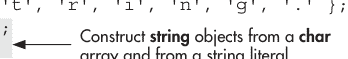


程序的输出所示：

A string.
Another string.

# 对字符串进行操作

`string` 类包含了几个对字符串进行操作的方法。这里是其中几个：

| static string Copy(string str) | 返回 str 的副本。 |
| int CompareTo(string str) | 如果调用字符串小于 str，则返回小于零；如果调用字符串大于 str，则返回大于零；如果两个字符串相等，则返回零。 |
| int IndexOf(string str) | 在调用字符串中搜索由 str 指定子字符串。返回第一个匹配项的索引，失败则返回 -1。 |
| int LastIndexOf(string str) | 在调用字符串中搜索由 str 指定子字符串。返回上一次匹配项的索引，失败则返回 -1。 |

`string` 类型还包括 `Length` 属性，它包含字符串的长度。要获取字符串中单个字符的值，你只需要使用索引即可。

```csharp
string str = "test";
Console.WriteLine(str[0]);
```

这显示了 't'。与数组一样，字符串索引从零开始。然而，一个重要的一点是，你不能使用索引给字符串内的字符赋新值。索引只能用于获取字符。

# 第5章：更多数据类型和运算符 179

要测试两个字符串的相等性，你可以使用 `==` 运算符。通常，当 `==` 运算符应用于对象引用时，它会判断两个引用是否指向同一个对象。对于 `string` 类型的对象，情况不同。当 `==` 应用于两个字符串时，会比较字符串的内容是否相等。 `!=` 运算符也是如此：在比较字符串对象时，比较的是字符串的内容。对于其他类型的字符串比较，你需要使用 `CompareTo()` 方法。

以下是一个演示若干字符串操作的程序：

```csharp
// Some string operations
using System;

class StROps {
    static void Main() {
        string str1 =
        "When it comes to .NET programming, C# is #1.";
        string str2 = string.Copy(str1);
        string str3 = "C# strings are powerful.";
        int result, idx;
        Console.WriteLine("Length of string " + str1.Length);
        // Display string,一次显示一个字符。
        for(int i=0; i < str1.Length; i++)
            Console.Write(str1[i]);
        Console.WriteLine();
        if(str1 == str2)
            Console.WriteLine("str1 == str2");
        else
            Console.WriteLine("str1 != str2");
        if(str1 == str3)
            Console.WriteLine("str1 == str3");
        else
            Console.WriteLine("str1 != str3");
        result = str1.CompareTo(str3);
        if(result == 0)
            Console.WriteLine("str1 and str3 are equal");
        else if(result < 0)
            Console.WriteLine("str1 is less than str3");
        else
            Console.WriteLine("str1 is greater than str3");
        // 给 str2 赋新字符串。
        str2 = "One Two Three One";
    }
}
```

# 180 C# 3.0: 入学者指南

```csharp
idx = str2.IndexOf("One");
Console.WriteLine("Index of first occurrence of One: " + idx);
idx = str2.LastIndexOf("One");
Console.WriteLine("Index of last occurrence of One: " + idx);
}
```

此程序产生以下输出：

Length of str1: 44
When it comes to .NET programming, C# is #1
str1 == str2
str1 != str3
str1 is greater than str3
Index of first occurrence of One: 0
Index of last occurrence of One: 14

你可以使用 `+` 运算符拼接（连接）两个字符串。例如，这条语句：

```csharp
string str1 = "One";
string str2 = "Two";
string str3 = "Three";
string str4 = str1 + str2 + str3;
```

将 `str4` 初始化为字符串 "OneTwoThree."

# 字符串数组

与任何其他数据类型一样，字符串可以组成数组。例如：

```csharp
// Demonstrate string.
using System;

class StringArrays {
    static void Main() {
        string[] str = { "This", "is", "a", "test." };
        Console.WriteLine("Original array: ");
        for(int i=0; i < str.Length; i++)
            Console.WriteLine(str[i]);
        Console.WriteLine("\nModified array: ");
        // Change string.
        str[1] = "was";
        str[3] = "test!";
        for(int i=0; i < str.Length; i++)
            Console.WriteLine(str[i]);
    }
}
```

这产生了以下输出：

Original array:
This
is
a
test.

Modified array:
This
was
a
test!


这产生了以下输出：

Original array:
This
is
a
test.

Modified array:
This
was
a
test!

98 第5章：更多数据类型和运算符

# 对字符串进行操作

`string`类包含了几个对字符串进行操作的方法。这里是几个：

| static string Copy(string str) | 返回 str 的副本。 |
| int CompareTo(string str) | 如果调用字符串小于 str，则返回小于零；如果调用字符串大于 str，则返回大于零；如果两个字符串相等，则返回零。 |
| int IndexOf(string str) | 在调用字符串中搜索由 str 指定子字符串。返回第一个匹配项的索引，失败则返回 -1。 |
| int LastIndexOf(string str) | 在调用字符串中搜索由 str 指定子字符串。返回上一次匹配项的索引，失败则返回 -1。 |

`string`类型还包括 `Length`属性，它包含字符串的长度。要获取字符串中单个字符的值，你只需要使用索引即可。

```csharp
string str = "test";
Console.WriteLine(str[0]);
```

这显示了 't'。与数组一样，字符串索引从零开始。然而，一个重要的一点是，你不能使用索引给字符串内的字符赋新值。索引只能用于获取字符。

### 字符串是不可变的

`string`类是不可变的。一旦创建字符串，其内容就不能更改。如果你想更改字符串，必须创建一个新字符串。这是一个重要的概念，因为它对性能和内存有影响。

以下是一个演示这一点的程序：

```csharp
string s = "Hello";
Console.WriteLine(s);
// 这将导致编译错误：
// s[0] = 'j'; 
// 反之，我们创建一个新字符串：
s = "Jello";
Console.WriteLine(s);
```

程序的输出是：

Hello
Jello

# 询问专家

**你很幸运。C# 提供了一个名为 `StringBuilder` 的类，位于 `System.Text` 命名空间中。它创建可以更改的字符串对象。但对于大多数用途，你会希望使用 `string` 而不是 `StringBuilder`。**

### 位运算符

在第 2 章中，你学习了 C# 的算术、关系和逻辑运算符。虽然这些是常用的，但 C# 还提供了额外的运算符，扩展了 C# 应用的问题集：位运算符。位运算符直接作用于操作数的位。它们仅对整数操作数定义。它们不能用于 **`bool`**, **`float`**, **`double`** 或 **`class`** 类型。

它们被称为位运算符，是因为它们用于测试、设置或移动组成整数值的位。位操作对于各种系统级编程任务都非常重要，例如在查询或构建设备状态信息时。表 5-1 列出了位运算符。

| 运算符 | 结果 |
|---|---|
| `&` | 位与 |
| `|` | 位或 |
| `^` | 位异异或 (XOR) |
| `>>` | 右移 |
| `<<` | 左移 |
| `~` | 一位取反（一元非） |

**表 5-1** 位运算符

# 第5 章：更多数据类型和运算符

## 位与、位或、位异或位非

位运算符 AND、OR、XOR 和 NOT 分别是 `&`、`^` 和 `~`。它们执行的操作与第 2 章中的布尔逻辑运算符相同。区别在于，位运算符是按位为单位工作的。下表显示了使用 1 和 0 进行每次操作的结果：

| p | q | p&q | p|q | p^q | ~p |
|---|---|---|---|---|---|
| 0 | 0 | 0 | 0 | 0 | 1 |
| 1 | 0 | 0 | 1 | 1 | 0 |
| 0 | 1 | 0 | 1 | 1 | 1 |
| 1 | 1 | 1 | 1 | 0 | 0 |

从最常用的用法来说，你可以将位与（AND）视为一种关闭位的方法。也就是说，操作操作数中任意一个为 0 的位都会导致结果中对应的位被设置为 0。例如：

```
1 1 0 1 0 1 1
& 1 0 1 0 1 1 0
-
1 0 0 0 0 1 0
```

接下来的程序通过重置第 6 位为 0 将任何小写字母转换为大写字母，演示了 `&` 运算符。由于 ASCII 字符集（Unicode 的子集），小写字母与大写字母相同，只是小写字母的值正好大 32。因此，要将小写字母转换为大写，只需关闭第 6 位即可，如下程序所示：

```csharp
// 大写字母。
using System;
class UpCase {
    static void Main() {
        char ch;
        for(int i=0; i < 10; i++) {
            ch = (char)('a' + i);
            Console.Write(ch);
            // 这条语句关闭了第 6 位。
            ch = (char)(ch & 65503); // ch 现在是大写了
            Console.Write(ch + " "); // 使用与运算符。
        }
    }
}
```

# C# 3.0：初学者指南

此程序的输出所示：
aA bB CC dD EE FF gG hH II JJ 

在 AND 操作中使用的值 65,503 是 `1111 1111 1111 1111` 的十进制表示。因此，AND 操作使 `ch` 中的所有位保持不变，但第 6 位外，该位被设置为零。

当你想要确定某个位是开启还是关闭时，AND 也很有用。在这个示例中，它确定 `status` 中的第 4 位是否设置为：

```csharp
if((status & 8) != 0) Console.WriteLine("bit is on");
```

使用 8 的原因是它翻译为只有第 4 位被设置的二进制值。因此，只有当 `status` 的第 4 位开启状态时，`if` 语句才能成功。该概念的一个有趣用法是用二进制格式显示字节值的各个位：

```csharp
// 显示字节内部的位。
using System;
class BitsInByte {
    static void Main() {
        byte val;
        val = 123;
        for(int t=128; t > 0; t = t/2) {
            if((val & t) != 0) Console.Write("1 ");
            else Console.Write("0 ");
        }
    }
}
```


输出所示：

0 1 1 1 0 1 1

`for` 循环使用位与成功测试了 `val` 中的每个位，以确定其是开启还是关闭。如果位开启，则显示数字 1；否则显示 0。

位或（OR）可以用于开启位。操作数中任何一个设置为 1 的位都会导致变量中对应的位被设置为 1。例如：

```
1 0 1 0 0 1 1
| 1 0 1 0 1 0 1 0
1 1 1 1 1 0 1 1
```

# 第5 章：更多数据类型和运算符

我们可以使用 OR 将大写转换程序改为小写转换程序，如下：

```csharp
// 小写字母。
using System;
class LowCase {
    static void Main() {
        char ch;
        for(int i=0; i < 10; i++) {
            ch = (char) ('A' + i);
            Console.Write(ch);
        }
        // 这条语句开启了第 6 位。
        ch = (char) ( 32); // ch 现在是小写的
        Console.Write(ch + " "); // 使用或运算符。
    }
}
```

此程序的输出所示：

Aa Bb Cc Dd Ee Ff Gg Hh Ii Jj 

该程序的工作原理是将每个字符与值 32 进行 OR 运算，32 的二进制是 `0000 0000 0010 0000`。因此，32 是一个第 6 位开启的值。当该值与任何其他值进行 OR 运算时，结果的第 6 位保持开启。对于 ASCII 字符，这意味着每个大写字母都转换为其小写等效字符。

位异或（Exclusive OR，缩写为 XOR）只有在位不同时才会开启位，如下所示：

```
0 1 1 1 1
^ 0 1 1 1 1
1 0 0 0 0
```

XOR 操作有一个有趣的属性，适用于多种情况。当值 X 与值 Y 进行 XOR 运算，然后将结果再次与 Y 进行 XOR 运算，会产生 X。即：

```csharp
R1 = X^Y;
R2 = R1^Y;
```

# C# 3.0：初学者指南

R2 与 X 值相同。因此，使用相同的值进行两次 XOR 操作会产生原始值。查看 XOR 的这一特性，我们将一个整数作为密钥，通过 XOR 来加密和解码一个简单的密文。加密时，应用第一次 XOR 运算，产生密文；解码时，再次应用 XOR 运算，产生明文。当然，这种简单的 XOR 密文由于其本质上是不安全的。

```csharp
// 展示 XOR。
using System;
class Encode {
    static void Main() {
        string msg = "This is a test";
        string encmsg = "";
        string decmsg = "";
        int key = 88;
        Console.Write("Original message: " + msg);
        Console.WriteLine(msg);
        // 加密消息。
        for (int i=0; i < msg.Length; i++)
            encmsg = encmsg + (char)(msg[i] ^ key);
        Console.Write("Encoded message: " + encmsg);
        Console.WriteLine(encmsg);
        // 解密消息。
        for (int i=0; i < msg.Length; i++)
            decmsg = decmsg + (char)(encmsg[i] ^ key);
        Console.Write("Decoded message: " + decmsg);
        Console.WriteLine(decmsg);
    }
}
```

输出所示：
Original message: This is a test
Encoded message: %
Decoded message: This is a test

你可以看到，使用相同密钥进行两次 XOR 的结果是解码后的消息。（记住，这种简单的 XOR 密文不适用于现实世界的使用。）

单目取反（NOT）运算符反转操作数所有位的状态。例如，如果某个整数 A 的位模式为 `1001 0110`，`~A` 会产生位模式为 `0110 1001` 的结果。

下面的程序通过以二进制显示数字及其补码来演示 NOT 运算符：

```csharp
// 展示位非运算。
using System;
class NotDemo {
    static void Main() {
        sbyte b = -34;
        for(int t=128; t > 0; t = t/2) {
            if((b & t) != 0) Console.Write("1");
            else Console.Write("0");
        }
        Console.WriteLine();
        // 反转所有位。
        b = (sbyte)-b;
        for(int t=128; t > 0; t = t/2) {
            if((b & t) != 0) Console.Write("1");
            else Console.Write("0");
        }
    }
}
```

输出如下：

```
1 1 0 1 1 1 0
0 0 1 0 0 0 1
```

# 移位运算符

在 C# 中，可以将组成值的位向左或向右移动指定的长度。C# 定义了所示的位移运算符：

| `<<` | 左移 |
| `>>` | 右移 |

这些运算符的通用形式所示：

```
value << num-bits
value >> num-bits
```

在这里，*value* 是按 *num-bits* 指定的位数移动的值。

左移会使指定值内的所有位向左移动一位，并在右侧引入一个 0 位。右移使所有位向右移动一位。在对无符号值进行右移时，左侧引入一个 0。在对有符号值进行右移时，会保留符号位。记住负数通过将整数的高位设置为 1 来表示。因此，如果移动的值为负数，每次右移都会在左侧引入一个 1。如果值为正数，每次右移都会在左侧引入 0。

对于左移和右移，移出的位都是丢失的。因此，移位不是旋转（rotate），没有方法检索被移出的位。

这是一个图形化说明左移和右移影响的程序。给一个整数一个初始值 1，这意味着它的低位被设置。然后对该整数进行八次移位。每次移位后，都会显示值的低位。重复此过程，直到 1 处于第八位位置并进行右移：

```csharp
// 展示 << 和 >> 运算符。
using System;
class ShiftDemo {
    static void Main() {
        int val = 1;
        for(int i = 0; i < 8; i++) {
            for(int t=128; t > 0; t = t/2) {
                if((val & t) != 0) Console.Write("1 ");
                else Console.Write("0 ");
            }
            Console.WriteLine();
            val = val << 1; // 左移
        }
        Console.WriteLine();
        val = 128;
        for(int i = 0; i < 8; i++) {
            for(int t=128; t > 0; t = t/2) {
                if((val & t) != 0) Console.Write("1 ");
                else Console.Write("0 ");
            }
            Console.WriteLine();
            val = val >> 1; // 右移
        }
    }
}
```

# 第 5 章：更多数据类型和运算符

# 专家问答

**问：由于二进制是基于 2 的幂，移位运算符可以作为整数乘以或除以 2 的快捷方法吗？**

**答：** 可以的。位移运算符可以用于执行乘 2 或除以 2 操作。左移会将值翻倍。当然，只要我们没有将位移出末端或另一端，这种方法就有效。

程序的输出所示：

```
0 0 0 0 0 0 1
0 0 0 0 0 1 0
0 0 0 0 1 0 0
0 0 0 1 0 0 0
0 0 1 0 0 0 0
0 1 0 0 0 0 0
0 1 0 0 0 0 0
1 0 0 0 0 0 0
1 0 0 0 0 0 0
0 1 0 0 0 0 0
0 0 1 0 0 0 0
0 0 0 1 0 0 0
0 0 0 0 1 0 0
0 0 0 0 0 1 0
0 0 0 0 0 0 1
0 0 0 0 0 0 1
```

# 位复合赋值

所有的位运算符都可以用于复合赋值。例如，下面的两个语句将 x 与值 127 的异或（XOR）结果赋值给 x：

```csharp
x = x ^ 127;
x ^= 127;
```

# 尝试：创建一个 ShowBits 类

在本章前面，你看到了 **`BitsByte`** 类，它显示组成一个 **`byte`**（byte）的位。**`BitsByte`** 的一个缺点是它只适用于 **`byte`** 值。一个更有用的类应该显示任何类型整数值的位模式。幸运的是，这样的类很容易创建，这里开发的程序展示了如何实现。它创建了一个名为 **`ShowBits`** 的类，允许显示任何类型无符号整数值中的位。（你也可以使用 ShowBits 显示有符号整数值的位，但你需要将其转换为等效的无符号。）能够查看值中的位在许多情况下都非常有用。例如，如果你正在从通过互联网传输的设备接收原始数据，如果设备发生故障，能够以二进制形式观察数据将很有帮助。

# 逐步实现

- 1. 创建一个名为 `ShowBitsDemo.cs` 的文件。
- 2. 开始编写 `ShowBits` 类，如下：

```csharp
class ShowBits {
    public int numbits;
    public ShowBits(int n) {
        numbits = n;
    }
}
```


`ShowBits` 创建显示指定位数的对象。例如，要创建一个显示某些值低 8 位的对象，使用

`ShowBits b = new ShowBits(8);`

要显示的位数存储在 `numbits` 中。

### 3. 为了实际显示位模式，`ShowBits` 提供了 `Show()` 方法，如下所示：

```csharp
public void Show(ulong val) {
    ulong mask = 1;
    // 将 1 左移到适当的位置。
    mask <<= numbits-1;
    int spacer = 0;
    for(; mask != 0; mask >>= 1) {
        if((val & mask) != 0) Console.Write("1");
        else Console.Write("0");
        spacer++;
        if((spacer % 8) == 0) {
            Console.Write(" ");
            spacer = 0;
        }
    }
    Console.WriteLine();
}
```

注意 `Show()` 指定了一个 `ulong` 参数。然而，这并不意味着你必须给 `Show()` 传递 `ulong` 值。由于 C# 的隐式转换，任何无符号整数类型都可以传递给 `Show()`。要显示有符号整数值，只需将其转换为相应的无符号类型。显示的位数由存储在 `numbits` 中的值决定。在每组 8 位之后，`Show()` 会输出一个空格。这使得读取长位模式的二进制值更加容易。

### 4. 下面名为 `ShowBitsDemo` 的程序演示了 `ShowBits` 类：

```csharp
// 一个显示值的二进制表示的类。
using System;
class ShowBits {
    public int numbits;
    public ShowBits(int n) {
        numbits = n;
    }
    public void Show(ulong val) {
        ulong mask = 1;
        // 将 1 左移到适当的位置。
        mask <<= numbits-1;
        int spacer = 0;
        for(; mask != 0; mask >>= 1) {
            if((val & mask) != 0) Console.Write("1");
            else Console.Write("0");
            spacer++;
            if((spacer % 8) == 0) {
                Console.Write(" ");
                spacer = 0;
            }
        }
        Console.WriteLine();
    }
}
// 演示 ShowBits
class ShowBitsDemo {
    static void Main() {
        ShowBits b = new ShowBits(8);
        ShowBits i = new ShowBits(32);
        ShowBits li = new ShowBits(64);
        Console.WriteLine("123 in binary: ");
        b.Show(123);
        Console.WriteLine("87987 in binary: ");
        i.Show(87987);
        Console.WriteLine("237658768 in binary: ");
        li.Show(237658768);
        // 你也可以显示任何整数的低位。
        Console.WriteLine("low order 8 bits of 87987 in binary: ");
        b.Show(87987);
    }
}
```

`ShowBitsDemo` 的输出所示：

```
123 in binary:
01111011
87987 in binary:
00000000000000011010101110011011
237658768 in binary:
0000000000000011000111110111111100000000
low order 8 bits of 87987 in binary:
10101011
```

## `?` 运算符

C# 最有趣的运算符之一是 `?` 它通常用于替换 `if-else` 语句。考虑这个例子：

```csharp
if (condition)
    result = expression1;
else
    result = expression2;
```

同样的内容可以写成：

```csharp
result = condition ? expression1 : expression2;
```

`?` 运算符被称为三元运算符，因为它接受三个操作数。如果 `condition` 为真，则将 `expression1` 赋值给 `result`；如果为假，则赋值 `expression2`。`expression1` 和 `expression2` 的类型必须相同或兼容。`result` 的值取决于 `condition`。

10. 位运算符可以应用于 `double` 类型吗？

11. 显示如何使用 `?` 运算符重写此序列：

```
if(x < 0) y = 10;
else y = 20;
```

12. 在以下片段中，`&` 是位运算符还是逻辑运算符？为什么？

```
bool a, b;
// ...
if(a & b) ...
```

## 第 6 章
## 深入研究方法与类

## 核心技能与概念

- 控制成员的访问权限
- 将对象传递给方法
- 从方法返回对象
- 使用 `ref` 和 `out` 参数
- 方法重载
- 构造函数重载
- 从 `Main()` 返回值
- 向 `Main()` 传递参数
- 递归
- `static` 修饰符

本章继续对类和方法的探讨。首先解释了如何控制类成员的访问权限。然后讨论了对象的传递和返回、方法重载、`Main()` 的各种形式、递归以及 `static` 关键字的使用。

## 控制类成员的访问权限

为了支持封装，类提供了两个主要优势。首先，它将数据与处理数据的代码结合在一起。从第 4 章开始，你已经从类的这一方面受益了。其次，它提供了控制成员访问的手段。这一功能在这里被启用。

虽然 C# 的处理方式稍微有点复杂，但本质上，类成员有两种基本类型：`public` 公共和 `private` 私有。公共成员可以由类外部定义的代码自由访问。这是我们到目前为止一直在使用的的类成员类型。私有成员只能由该类定义的其他方法访问。这正是通过使用私有方法来控制访问的。

限制类成员的访问是面向对象编程的一个根本部分，因为有助于防止对象的误用。通过仅允许通过一组定义良好的方法访问私有数据，你可以防止将不当的值赋值给数据——例如通过执行范围检查。类外部的代码无法设置私有成员的值。你还可以精确地控制对象内部数据如何以及何时被使用。因此，当正确实现时，类创建了一个“黑盒”，它可以被使用，但其内部运行机制不对外篡改。

## C# 的访问修饰符

成员访问控制通过使用四种访问修饰符来实现：`public`、`private`、`protected` 和 `internal`。在本章中，我们将关注 `public` 和 `private`。`protected` 修饰符仅在涉及继承时适用并在第 7 章中描述。`internal` 修饰符主要应用于程序集在 C# 中意味着一个项目或组件。`internal` 修饰符在第 15 章中简要描述。

当一个成员被 `public` 修饰符修改时，该成员可以被程序中的任何其他代码访问。这包括在其他类内部定义的方法。

当类的成员被指定为 `private` 时，该成员只能由该类的其他成员访问。因此，其他类的方法无法访问另一个类的私有成员。正如第 4 章所解释，如果不使用访问修饰符，类成员默认对该类是私有的。在创建私有类成员时，`private` 修饰符是可选的。

访问修饰符位于成员其余类型说明之前。也就是说，它是成员声明语句的开头。以下是一些示例：

```
public string ErrorMsg;
private bool bal;
private bool isError(byte status) { // ... }
```

为了理解 `public` 和 `private` 访问之间的区别，考虑以下程序：

```
// 公共与私有访问。
using System;
class MyClass {
    private int alpha; // 显式指定私有访问
    int beta; // 默认私有访问
    public int gamma; // 公共访问
/* 访问 alpha 和 beta 方法。类成员访问同类的私有成员是允许的。 */
public void setAlpha(int a) {
    alpha = a;
}
public int GetAlpha() {
    return alpha;
}
public void setBeta(int a) {
    beta = a;
}
```

关键点在于：私有成员可以被类的其他成员自由使用，但不能被类外部的代码访问。为了看到如何将控制应用于更实际的用例，请考虑实现“软故障”数组的程序。这是通过将数组封装为私有成员来实现的，允许通过方法访问数组。通过这种方法，任何越越边界访问数组的尝试都可以被优雅地防止导致“软”着陆而不是“崩溃”。该类防止了运行时错误。如果你删除以下代码的注释，你将因为访问冲突而无法编译此程序：

```csharp
using System;
class FailSoftArray {
    private int[] a; // 数组引用
    private int errval; // 如果 Get() 失败时返回的值
    public int Length; // Length 是公共的
    /* 给给定的大小和 Get() 失败时的返回值构造数组。 */
    public FailSoftArray(int size, int errv) {
        a = new int[size];
        errval = errv;
        Length = size;
    }
    /* 返回指定索引的值。 */
    public int Get(int index) {
        if (ok(index)) return a[index];
        return errval;
    }
    /* 在索引处放置值。失败时返回 false。 */
    public bool Put(int index, int val) {
        if (ok(index)) {
            a[index] = val;
            return true;
        }
        return false;
    }
    /* 如果索引在边界内则返回 true。 */
    private bool ok(int index) {
        if (index >= 0 && index < Length) return true;
        return false;
    }
}
/* 演示软故障数组。 */
class FSDemo {
    static void Main() {
        FailSoftArray fs = new FailSoftArray(5, -1);
        int x;
        // 显示静默失败。
        Console.WriteLine("Fail quietly.");
        for (int i=0; i < (fs.Length * 2); i++)
            fs.Put(i, i*10);
        for(int i=0; i < (fs.Length * 2); i++) {
            x = fs.Get(i);
            if(x != -1) Console.Write(x + " ");
        }
        Console.WriteLine("\");
        // 现在，处理失败。
        Console.WriteLine("Fail with error reports.");
    }
}
```

程序的输出如下：

```
Fail quietly.
0 10 20 30 40
Fail with error reports.
Index 5 out-of-bounds
Index 6 out-of-bounds
Index 7 out-of-bounds
Index 8 out-of-bounds
Index 9 out-of-bounds
```

正如你所见，在 `FailToArray` 类内部，`alpha` 被显式指定为私有，`beta` 默认为私有，`gamma` 被指定为公共。由于 `alpha` 和 `beta` 是私有的，它们不能被类外部的代码访问。因此，`AccessDemo` 类无法使用。每个成员必须通过公共方法访问，例如 `SetAlpha()` 和 `GetBeta()`。例如：

```
// ob.alpha = 10; // 错误！alpha 是私有的！
// ob.beta = 9; // 错误！beta 是私有的！
// ob.gamma = 99; // 正确，因为 gamma 是公共的。
```

构造 `FailToArray` 对象时，必须指定数组的大小以及调用 `Get()` 失败时要返回的值。错误值必须是一个

## 第 6 章：深入研究方法与类

# 提问专家

**Q**：虽然“软失败”数组确实可以防止数组越界，但这是以牺牲普通的数组索引语法为代价的。是否有更好的方法来创建“软失败”数组？

**A**：是的。有的。正如你在第 7 章中看到的，C# 包含一种特殊类型的类成员称为*索引器* `indexer`，它允许你像对待数组一样对类对象进行索引。此外，还有更好的方法来处理 `Length` 字段，将其变为一个*属性* `property`。这在第 7 章中也有描述。

否则不会存储在数组中。一旦构造完成，存储在 `errval` 中的错误值所引用的实际数组将无法被 `FailSoftArray` 对象的实例访问。因此，它们不会被误用。例如，用户无法尝试直接对它进行索引以超过其边界。只能通过 `Get()` 和 `Put()` 方法进行访问。为了说明起，`Get()` 方法是*私有* `private` 的。将其设置为*公有* `public` 也是无害的，因为它没有修改对象。然而，由于它在 `FailSoftArray` 类内部使用，因此它可以是*私有*的。

注意 `Length` 变量是*公有*的。这与 C# 实现数组的方式保持一致。要获取 `FailSoftArray` 的长度，请使用它的 `Length` 成员。

要使用 `FailSoftArray` 数组，调用 `Put()` 在指定的索引处存储值。调用 `Get()` 从指定的索引处检索值。如果索引越界，`Put()` 将返回 `false`，`Get()` 将返回 `errval`。

由于类成员默认是私有的，因此没有理由使用 `private` 显式声明它们。因此，从现在起，该类将不再冗余地将类成员声明为 `private`。只需记住，如果类成员前面没有访问修饰符，它的访问权限就是私有的。

### 尝试：改进 SimpleQueue 类

你可以使用私有访问对第 5 章中开发的 `SimpleQueue` 类进行相当重要的改进。在那个版本中，`SimpleQueue` 类的所有成员都是公有的。这意味着使用 `SimpleQueue` 的程序可能直接访问底层数组，甚至可能无顺序地访问其元素。由于队列的重点是提供一个先进先出的列表，因此允许无序访问是不如愿的。恶意的程序员还可能更改存储在 `putloc` 和 `getloc` 索引中的值，从而损坏队列。幸运的是，通过将 `SimpleQueue` 的部分内容设为私有，很容易防止这类问题。

### 逐步就绪

- 1. 将原始的 SimpleQueue 复制到名为 `SimpleQueue.cs` 的新文件中。
- 2. 在 `SimpleQueue` 类中，移除 `q` 数组以及索引 `putloc` 和 `getloc` 的公有 `public` 修饰符，所示：

```csharp
// 针对字符的改进型队列类。
class SimpleQueue {
  // 现在这些是私有的。
  char[] q; // 此数组持有队列
  int putloc, getloc; // 和获取索引
  public SimpleQueue(int size) {
    q = new char[size+1]; // 为队列分配内存
    putloc = getloc = 0;
  }
  // 将字符放入队列。
  public void Put(char ch) {
    if(putloc==q.Length-1) {
      Console.WriteLine(" -- 队列已满.");
      return;
    }
```


`putloc++`;

`q[putloc] = ch`;
}

// 从队列中获取字符。

public char Get() {

if(getloc == putloc) {

Console.WriteLine(" -- 队列为空。");

return (char) 0;

}

getloc++;

return q[getloc];

}

}

```
*(注：原文代码中 Get 方法缺少 return 语句，此处已根据逻辑在翻译中补全 return getloc;)*
```

- 3. (由于原文文本不完整或存在重复，此处遵循指令逻辑处理)

# 208 C# 3.0: 初学者指南

```csharp
public Test Test(int i, int j) {
    a = i;
    b = j;
}
```

```csharp
/* 传递一个对象。现在，调用中使用的对象中的
ob.a 和 ob.b 将被改变。 */
public void Change(Test ob) {
    ob.a = ob.a + ob.b; // 这将改变参数。
    ob.b = -ob.b;
}
```

```csharp
class CallByRef {
    static void Main() {
        Test ob = new Test(15, 20);
        Console.WriteLine("ob.a and ob.b before call: " + ob.a + " " + ob.b);
        Change(ob);
        Console.WriteLine("ob.a and ob.b after call: " + ob.a + " " + ob.b);
    }
}
```

此程序生成了以下输出：

`ob.a and ob.b before call: 15 20`
`ob.a and ob.b after call: 35 -20`

如你所见，在这种情况下，`Change()` 内部的操作影响了作为参数使用的对象。

复习：当对象引用被传递给方法时，该引用是通过值传递（call-by-value）传递的。因此，创建了引用的副本。但是，由于传递的值引用一个对象，值的副本将仍然指向与其对应的参数相同的对象。

# 使用 ref 和 out 参数

正如所解释的，默认情况下，如 `int` 或 `char` 等值是按值传递给方法的。这意味着对接收值类型的参数的更改不会影响调用中使用的实际参数。但是你可以改变这种行为。通过使用 `ref` 和 `out` 关键字，可以按引用传递任何值类型。这样做允许方法修改调用中使用的参数。

# 第 6 章：深入研究方法和类 209

在进入使用 `ref` 和 `out` 的机制之前，了解你为什么可能想要通过引用传递类型是有帮助的。通常，有两个原因：允许方法修改其参数的内容，或者允许方法返回多个值。让我们详细查看每个原因。

通常，你可能希望方法能够对传递给它的实际参数进行操作。这的最典型例子是交换两个参数值的“交换（swap）”方法。由于值类型是按值传递的，无法使用 C# 默认的按值传递机制编写一个交换两个 `int` 值的方法（例如）。`ref` 修饰符解决了这个问题。

如你所知，`return` 语句允许方法向调用者返回一个值。然而，方法每次被调用时只能返回一个值。如果你需要返回两个或更多信息该怎么办？例如，如果你想创建一个计算矩形面积并判断该矩形是否为正方形的方法？这需要返回两个信息：一个指示是否为正方形的值。这种方法无法仅使用单个返回值来编写。`out` 修饰符解决了这个问题。

# 使用 ref

`ref` 参数导致 C# 创建按引用传递而非按值传递。`ref` 修饰符在方法声明和调用时均使用。让我们从一个简单的示例开始。以下程序创建了一个名为 `Sqr()` 的方法，它直接返回其整数参数的平方。注意 `ref` 的使用和位置。

```csharp
// 使用 ref 按引用传递值类型。
using System;
class RefTest {
    // 此方法改变其参数。
    public void Sqr(ref int i) { // 这里，ref 位于参数声明之前。
        i = i * i;
    }
}
class RefDemo {
    static void Main() {
        RefTest ob = new RefTest();
        int a = 10;
        Console.WriteLine("a before call: " + a);
        ob.Sqr(ref a); // 这里，ref 位于参数之前。
        Console.WriteLine("a after call: " + a);
    }
}
```

注意 `ref` 在方法中位于整个参数声明之前，并且在调用方法时它位于参数名称之前。该程序的输出（此处所示）证实了参数 `a` 的值确实被 `Sqr()` 修改了：

```
a before call: 10
after call: 100
```

使用 `ref`，现在可以编写一个交换两个值类型参数值的方法。例如，这里的程序包含一个名为 `Swap()` 的方法，它交换被调用时的两个整数参数的值：

```csharp
// 交换两个值。
using System;
class SwapDemo {
    // 此方法交换其参数。
    public void Swap(ref int a, ref int b) {
        int t = a;
        a = b;
        b = t;
    }
}
class SwapIt {
    static void Main() {
        SwapDemo ob = new SwapDemo();
        int x = 10, y = 20;
        Console.WriteLine("x and y before call: " + x + " " + y);
        ob.Swap(ref x, ref y);
        Console.WriteLine("x and y after call: " + x + " " + y);
    }
}
```

关于 `ref` 有一个重要点：此程序的输出如下：

```
x and y before call: 10 20
x and y after call: 20 10
```

# 第 6 章：深入研究方法和类 211

# 使用 out

有时你可能希望方法能够对传递给它的实际参数进行操作。这的最典型例子是交换两个参数值的“交换”方法。由于值类型是按值传递的，无法使用 C# 默认的按值传递机制编写一个交换两个 `int` 值的方法（例如）。`ref` 修饰符解决了这个问题。

```cs
// 这将改变参数所引的对象。
public void Change(ref Test o) {
    Test newob = new Test(0);
    o = newob; // 这影响调用者的参数。
}
```

```cs
class CallObjByRef {
    static void Main() {
        Test ob = new Test(100);
        Console.WriteLine("ob.a before call: " + ob.a);
        ob.NoChange(ob);
        Console.WriteLine("ob.a after call to NoChange() : " + ob.a);
        ob.Change(ob);
        Console.WriteLine("ob.a after call to Change() : " + ob.a);
    }
}
```

该程序的输出所示：
`ob.a before call: 100`
`ob.a after call to NoChange(): 100`
`ob.a after call to Change(): 0`

如你所见，当在 `NoChange()` 中为 `o` 赋值新对象的引用时，对 `Main()` 中的参数 `ob` 没有任何影响。但在 `Change()` 内部，它使用了 `ref` 参数，这改变了 `Main()` 内部引用的对象。

## 使用可变参数

当你创建一个方法时，通常会预先知道要传递给它的参数数量，但情况并非总是如此。有时你可能想要创建一个可以接受任意数量参数的方法。例如，考虑一个寻找一组值中最小值的方法。这种方法可能会传递两个、三个等。在所有情况下，你都希望该方法返回最小值。无法使用普通参数创建这种方法。相反，你必须使用一种代表任意数量参数的特殊类型。这通过创建一个 `params` 参数来实现。`params` 修饰符用于声明一个数组参数，它能够接收零或多个参数。数组中的元素个数将等于传递给方法的参数个数。你的程序通过访问数组来获取参数。

这里是一个使用 `params` 创建名为 `Min()` 方法的示例，该方法返回一组值中的最小值：

```cs
using System;
class Min {
    public int MinVal(params int[] nums) {
        int m;
        if (nums.Length == 0) {
            Console.WriteLine("Error: no arguments.");
            return 0;
        }
        m = nums[0];
        for (int i = 1; i < nums.Length; i++) {
            if (nums[i] < m)
                m = nums[i];
        }
        return m;
    }
}
class ParamsDemo {
    static void Main() {
        Min ob = new Min();
        int a = 10, b = 20;
        // 使用两个值调用。
        int m = ob.MinVal(a, b);
        Console.WriteLine("Minimum is " + m);
        // 使用 3 个值调用。
        m = ob.MinVal(a, b, -1);
        Console.WriteLine("Minimum is " + m);
        // 使用 5 个值调用。
        m = ob.MinVal(a, b, 3, 4, 5);
        Console.WriteLine("Minimum is " + m);
        // 也可以用 int 数组调用。
        int[] argsArray = { 45, 67, 34, 9, 112, 8 };
        m = ob.MinVal(argsArray);
        Console.WriteLine("Minimum is " + m);
    }
}
```

### 使用 params 创建可变长度参数。

```cs
class MyClass {
    public void ShowArgs(params string[] msg) {
        foreach (string s in msg) {
            Console.WriteLine(s);
        }
    }
}
class ParamsDemo2 {
    static void Main() {
        MyClass ob = new MyClass();
        ob.ShowArgs("Here are some integers", "1", "2", "3", "4", "5");
        ob.ShowArgs("Here are two more", "17", "20");
    }
}
```

该程序显示以下输出：
Here are some integers:
1
2
3
4
5
Here are two more:
17
20

在方法同时有普通参数和 `params` 参数的情况下，`params` 参数必须是参数列表中的最后一个。此外，在所有情况下，只能有一个 `params` 参数。

### 返回对象

方法可以返回任何类型的数据，包括类类型。例如，可以使用可以使用 `ErrorMsg` 类来报告错误。它的方法 `GetErrorMessage()` 返回一个字符串，根据其接收的错误代码包含错误描述。

```cs
using System;
class ErrorMsg {
    string[] msgs = {
        "Output Error",
        "Input Error",
        "Disk Full",
        "Index Out-Of-Bounds"
    };
    public string GetErrorMessage(int i) { // 返回 string 类型的对象。
        if (i >= 0 && i < msgs.Length)
            return msgs[i];
        else
            return "Invalid Error Code";
    }
}
class ErrMsg {
    static void Main() {
        ErrorMsg err = new ErrorMsg();
        Console.WriteLine(err.GetErrorMessage(2));
        Console.WriteLine(err.GetErrorMessage(19));
    }
}
```

它的输出所示：
Disk Full
Invalid Error Code

你当然也可以返回你创建的对象。例如，这里有一个返回对象的 `ErrorInfo` 方法。一个是 `Err` 类。

```cs
using System;
class Err {
    public string Msg; // 错误消息
    public int Severity; // 严重程度
    public Err(string m, int s) {
        Msg = m;
        Severity = s;
    }
}
class ErrorInfo {
    string[] msgs = {
        "Output Error",
        "Input Error",
        "Disk Full",
        "Index Out-Of-Bounds"
    };
    public Err GetErrorInfo(int i) { // 返回程序员定义的对象。
        if (i >= 0 && i < msgs.Length)
            return new Err(msgs[i], 0);
        else
            return new Err("Invalid Error Code", -1);
    }
}
class ErrDemo {
    static void Main() {
        ErrorInfo info = new ErrorInfo();
        Err e = info.GetErrorInfo(2);
        if (e != null) {
            Console.WriteLine(e.Msg + " severity: " + e.Severity);
        }
    }
}
```

### 方法重载

通常，要重载一个方法，只需在参数声明不同的声明它的多个版本。这是 C# 最令人兴奋的功能之一：方法重载。重载方法可以具有相同的名称，只要它们的类型或数量不同即可。编译器会根据提供的参数处理其余调用工作。

```cs
using System;
class Overload {
    public void OvlDemo() {
        Console.WriteLine("No parameters");
    }
    public void OvlDemo(int a) {
        Console.WriteLine("One parameter: " + a);
    }
    public int OvlDemo(int a, int b) {
        Console.WriteLine("Two parameters: " + a + " " + b);
        return a + b;
    }
    public double OvlDemo(double a, double b) {
        Console.WriteLine("Two double parameters: " + a + " " + b);
        return a + b;
    }
}
class OverloadDemo {
    static void Main() {
        Overload ob = new Overload();
        ob.OvlDemo();


```csharp
Console.WriteLine();

ob.OvlDemo(2);

Console.WriteLine();

int resI = ob.OvlDemo(4, 6);

Console.WriteLine("Result of ob.OvlDemo(4, 6): " + resI);

Console.WriteLine();

double resD = ob.OvlDemo(1.1, 2.32);

Console.WriteLine("Result of ob.OvlDemo(1.1, 2.32): " + resD);

}
}
```

```csharp
Console.WriteLine("Result of ob.OvlDemo(1.1, 2.2): " + resD);
```

该程序生成以下输出：

无参数

一个参数: 2

两个参数: 4 6
Result of ob.OvlDemo(4, 6): 10

两个 double 参数: 1.1 2.2
Result of ob.OvlDemo(1.1, 2.2): 3.42

如你所示，`OvlDemo()` 被重载了四次。第一个版本接受一个整数参数，第三个接受两个整数参数，第四个接受两个参数。注意 `OvlDemo()` 的前两个版本返回 `void`，而第二个版本返回一个值。这是完全有效的，但正如所解释的那样，重载不会受方法返回类型的影响。尝试使用这两个版本的 `OvlDemo()` 将导致错误。

```csharp
// OvlDemo(int) 是可以的。
public void OvlDemo(int a) {
  Console.WriteLine("One parameter: " + a);
}
```

```csharp
// 错误：两个 OvlDemo(int) 是不允许的，即使
// 返回类型不同。*
public int OvlDemo(int a) {
  Console.WriteLine("One parameter: " + a);
  return a;
}
```

> 返回类型不能用于区分重载方法。

正如注释所建议的，它们返回类型的差异对于重载目的来说是不够充分的差异。

正如你从第 2 章回想的，C# 提供了隐式类型转换。这些转换也适用于重载方法的参数。例如，请考虑以下内容：

```csharp
// 隐式类型转换会影响重载方法的解析。
using System;
class Overload {
  public void MyMeth(int x) {
    Console.WriteLine("Inside MyMeth: " + x);
  }
}
```

# 第 6 章：深入观察方法与类 221

```csharp
public void MyMeth(double x) {
  Console.WriteLine("Inside MyMeth(double): " + x);
}
```
class TypeConv{
  static void Main() {
    Overload2 ob = new Overload2();
```

```csharp
  int i = 10;
  double d = 10.1;
```

```csharp
  byte b = 99;
  short s = 10;
  float f = 11.5F;
```

```csharp
  ob.MyMeth(i); // 调用 ob.MyMeth(int)
  ob.MyMeth(d); // 调用 ob.MyMeth(double)
```

```csharp
  ob.MyMeth(b); // 调用 ob.MyMeth(int) -- 类型转换
  ob.MyMeth(s); // 调用 ob.MyMeth(int) -- 类型转换
  ob.MyMeth(f); // 调用 ob.MyMeth(double) -- 类型转换
}
```

程序的输出显示在此：

```
Inside MyMeth(int): 10
Inside MyMeth(double): 10.1
Inside MyMeth(int): 99
Inside MyMeth(int): 10
Inside MyMeth(double): 11.5
```

在这个示例中，定义了两个版本的 `MyMeth()`：一个有一个 `int` 参数，另一个有一个 `double` 参数。然而，可以使用 `byte`、`short` 或 `float` 值传递给 `MyMeth()`。在 `byte` 和 `short` 的情况下，C# 自动将它们转换为 `int`。因此，调用了 `MyMeth()`。该值被转换为 `double` 并调用了 `MyMeth`。

重要的是要理解到，隐式转换仅在参数类型和参数类型之间没有直接匹配时才会发生。例如，这里是之前的程序，并在其中增加了一个指定 `byte` 参数的 `MyMeth()` 版本：

```csharp
// 添加 MyMeth(byte)。
```

```csharp
using System;
class Overload2 {
  public void MyMeth(byte x) {
```

```csharp
Console.WriteLine("Inside MyMath(byte): " + x);
}
public void MyMath(int x) {
    Console.WriteLine("Inside MyMath(int): " + x);
}
public void MyMath(double x) {
    Console.WriteLine("Inside MyMath(double): " + x);
}
class TypeConv {
    static void Main() {
        Overload2 ob = new Overload2();
        int i = 10;
        double d = 10.1;
        byte b = 99;
        short s = 10;
        float f = 11.5F;
        ob.MyMath(i); // 调用 ob.MyMath(int)
        ob.MyMath(b); // 调用 ob.MyMath(double)
        ob.MyMath(b); // 调用 ob.MyMath(byte) // 现在，没有类型转换
        ob.MyMath(s); // 调用 ob.MyMath(int) -- 类型转换
        ob.MyMath(f); // 调用 ob.MyMath(double) -- 类型转换
    }
}
```

现在当程序运行时，产生了以下输出：

```
InsideMyMath(int): 10
InsideMyMath(double): 10.1
InsideMyMath(byte): 99
InsideMyMath(int): 10
InsideMyMath(double): 11.5
```

# 224 C# 3.0: 初学者指南

# 询问专家

**Q:** 我听过 C# 使用签名（signature）。它是什么？

**A:** 当应用于 C# 时，签名是方法的名称加上它的参数列表。因此，对于重载目的，同一类中没有两个方法具有相同的签名。注意签名不包括返回类型，因为 C# 在解析时不使用它。

### 重载构造函数

像方法一样，构造也可以被重载。这允许你以多种方式构造对象。例如，请考虑以下程序：

```csharp
// 演示重载构造函数。
using System;
class MyClass {
    public int x;
    public MyClass() {
        Console.WriteLine("Inside MyClass().");
        x = 0;
    }
    public MyClass(int i) {
        Console.WriteLine("Inside MyClass(int).");
        x = i;
    }
    public MyClass(double d) {
        Console.WriteLine("Inside MyClass(double).");
        x = (int) d;
    }
}
```

## 第 6 章：深入研究方法与类 225

```csharp
public MyClass(int i, int j) {
    Console.WriteLine("Inside MyClass(int, int).");
    x = i * j;
}
```

```csharp
class OverloadConsDemo {
    static void Main() {
        MyClass t1 = new MyClass();
        MyClass t2 = new MyClass(88);
        MyClass t3 = new MyClass(17.23);
        MyClass t4 = new MyClass(2, 4);
        Console.WriteLine("t1.x: " + t1.x);
        Console.WriteLine("t2.x: " + t2.x);
        Console.WriteLine("t3.x: " + t3.x);
        Console.WriteLine("t4.x: " + t4.x);
    }
}
```

程序的输出如下：

```
Inside MyClass().
Inside MyClass(int).
Inside MyClass(double).
Inside MyClass(int, int).
t1.x: 0
t2.x: 88
t3.x: 17
t4.x: 8
```


`MyClass()`被重载了四次，每种构造对象的方式都不同。根据执行`new`时指定的参数，会调用相应的构造函数。通过重载类的构造函数，你为该类的用户在构造对象的方式上提供了灵活性。

构造函数被重载的最常见原因之一允许一个对象初始化另一个对象。例如，此程序使用`Summation`类来计算整数值的求和。

```csharp
// 使用另一个对象初始化一个对象。

using System;

class Summation {

    public int Sum;

    // 从 int 构造。

    public Summation(int num) {

        Sum = 0;

        for (int i = 1; i <= num; i++) {

            Sum += i;

        }

    }

    // 从另一个对象构造。

    public Summation(Summation ob) {

        Sum = ob.Sum;

    }

}

// 从另一个对象构造一个对象。

class SumDemo {

    static void Main() {

        Summation s1 = new Summation(5);

        Summation s2 = new Summation(s1);

        Console.WriteLine("s1.Sum: " + s1.Sum);

        Console.WriteLine("s2.Sum: " + s2.Sum);

    }

}
```

输出如下：

```
s1.Sum: 15
s2.Sum: 15
```

如示例所示，通常提供一个使用一个对象初始化另一个对象的构造函数的优势是效率高。在这种情况下，构造`s2`时，没有必要重新计算求和。当然，即使在效率不是问题时提供一个可以复制对象的构造函数通常也是很有用的。

### 通过 this 调用重载的构造函数

在处理重载构造函数时，有时让一个构造函数调用另一个是很有用的。在 C# 中，这通过使用`this`关键字的另一种形式来实现。通用形式所示：

```csharp
constructor-name(parameter-list) : this(parameter-list2) {
    // 构造函数体，可能为空
}
```

当构造函数执行时，首先会执行与`parameter-list2`指定参数列表匹配的重载构造函数。然后，如果原始构造函数内部有任何语句，将会执行。这里是一个示例：

```csharp
// 演示通过 this 调用构造函数。

using System;

class XYCoord {

    public int x, y;

    public XYCoord() : this(0, 0) {

        Console.WriteLine("Inside XYCoord()");

    }

    public XYCoord(XYCoord obj) : this(obj.x, obj.y) {

        Console.WriteLine("Inside XYCoord(XYCoord obj)");

    }

    public XYCoord(int i, int j) {

        Console.WriteLine("Inside XYCoord(int, int))");

        x = i;

        y = j;

    }

}

class OverloadConsDemo {

    static void Main() {

        XYCoord t1 = new XYCoord();

        XYCoord t2 = new XYCoord(8, 9);

        XYCoord t3 = new XYCoord(t2);

        Console.WriteLine("t1.x, t1.y: " + t1.x + ", " + t1.y);

        Console.WriteLine("t2.x, t2.y: " + t2.x + ", " + t2.y);

        Console.WriteLine("t3.x, t3.y: " + t3.x + ", " + t3.y);

    }

}
```

程序的输出如下：

```
Inside XYCoord(int, int)
Inside XYCoord()
Inside XYCoord(int, int)
Inside XYCoord(int, int)
Inside XYCoord(obj)
t1.x, t1.y: 0, 0
t2.x, t2.y: 8, 9
t3.x, t3.y: 8, 9
```

## 逐步实现：SimpleQueue 实现

本节详细介绍了了队列类。以下是完整的更新后的`SimpleQueue`类，以及演示它的`QDemo2`类：

```csharp
// 用于字符的队列类。

using System;

class SimpleQueue {

    // 这些成员现在是私有的。

    char[] q; // 此数组持有队列

    int putloc, getloc;

    // 给大小构造一个空队列。

    public SimpleQueue(int size) {

        q = new char[size+1]; // 为队列分配内存

        putloc = getloc = 0;

    }

    // 从 SimpleQueue 对象构造 SimpleQueue。

    public SimpleQueue(SimpleQueue ob) {

        putloc = ob.putloc;

        getloc = ob.getloc;

        q = new char[ob.q.Length];

        // 拷贝元素。

        for (int i=getloc+1; i <= putloc; i++) {

            q[i] = ob.q[i];

        }

    }

    // 使用初始值构造 SimpleQueue。

    public SimpleQueue(char[] a) {

        putloc = 0;

        getloc = 0;

        q = new char[a.Length+1];

        for (int i = 0; i < a.Length; i++) {

            Put(a[i]);

        }

    }

    // 将字符放入队列。

    public void Put(char ch) {

        if (putloc == q.Length-1) {

            Console.WriteLine(" -- 队列满了.");

            return;

        }

        q[++putloc] = ch;

    }
}
```

```csharp
putloc++;
q[putloc] = ch;
}
```

```csharp
// 从队列中获取一个字符。

public char Get() {

    if(getloc == putloc) {

        Console.WriteLine(" -- 队列为空.");

        return (char) 0;

    }

    ngetloc++;

    return q[getloc];

}
```

```csharp
// 演示 SimpleQueue 类。

class QDemo {

    static void Main() {

        // 构建一个 10 元素的空队列。

        SimpleQueue q1 = new SimpleQueue(10);

        char[] name = {'T', 'o', 'm'};

        // 从数组构造队列。

        SimpleQueue q2 = new SimpleQueue(name);

        char ch;

        int i;

        // 将一些字符放入 q1。

        for(i=0; i < 10; i++)

            q1.Put((char) ('A' + i));

        // 从另一个队列构造队列。

        SimpleQueue q3 = new SimpleQueue(q1);

        // 显示队列。

        Console.Write("Contents of q1: ");

        for(i=0; i < 10; i++) {

            ch = q1.Get();

            Console.Write(ch);

        }

        Console.WriteLine("\n");
```

```csharp
Console.Write("Contents of q2: ");

for(i=0; i < 3; i++) {

  ch = q2.Get();

  Console.Write(ch);

}
```

```csharp
Console.WriteLine("\n");

Console.Write("Contents of q3: ");

for(i=0; i < 10; i++) {

  ch = q3.Get();

  Console.Write(ch);

}
```

### Main() 方法

到目前为止，你一直在使用一种形式的`Main()`。然而，`Main()`有几种重载形式。某些形式可以返回返回值，另一些可以接收参数。从这里开始对它们进行检查。

### 从 Main() 返回值

当程序结束时，你可以通过从`Main()`返回一个值给调用进程（通常是操作系统）。要做到这一点，可以使用这种形式的`Main()`：

```csharp
static int Main()
```

注意，这个版本的`Main()`没有声明为`void`，而是具有返回类型`int`。通常，`Main()`的返回值表示程序是正常结束的还是由于某些异常条件结束的。按照惯例，返回`0`通常表示终止。所有其他值都表示发生了某种类型的错误。

### 向 Main() 传递参数

许多程序接受所谓的命令行参数。命令行参数是程序在命令行中执行时，直接跟在程序名后面的信息。对于 C# 程序，这些参数随后会被传递给`Main()`方法。要接收这些参数，你必须使用这些`Main`的形式之一：

```csharp
static void Main(string[] args)
static int Main(string[] args)
```

第一种形式返回`void`；第二种可以用于返回整数值，对于这两种，命令行参数都存储在传递给`Main()`的`string`数组中。`args`数组的长度将等于命令行参数的数量。

例如，以下程序显示了调用它时带的所有命令行参数：

如果像这样执行`CLDemo`：

`CLDemo one two three`

你将看到以下输出：

There are 3 command-line arguments.
They are:
one
two
three

为了示例命令行参数的使用方法，考虑下一个程序。它接受一个命令行参数来指定一个人的姓名。然后它在字符串二维数组中搜索该姓名。如果找到匹配项，它将显示该人的电话号码。

# 第 6 章：深入观察方法和类 233

// 一个简单的自动电话电话录。

using System;

```csharp
class Phone {

    public static int Main(string[] args) {

        string[,] numbers = {

            { "Tom", "555-3322" },

            { "Mary", "555-8976" },

            { "Jon", "555-1037" },

            { "Rachel", "555-1400" }

        };

        int i;

        if(args.Length != 1) {

            Console.WriteLine("Usage: Phone <name>");

            return 1; // 表示命令行参数不正确

        } else {

            for(i=0; i < numbers.Length/2; i++) {

                if (numbers[i, 0] == args[0]) {

                    Console.WriteLine(numbers[i, 0] + ": " + numbers[i, 1]);

                    break;

                }

                if (i == numbers.Length/2) {

                    Console.WriteLine("Name not found.");

                }

            }

            return 0;

        }

    }

}
```

这是一个示例运行：

C>Phone Mary
Mary: 555-8976

这个程序中有两个有趣的地方。首先，注意程序如何通过检查`args`的长度来确认命令行参数是否存在。如果参数数量不正确，执行将终止。这种确认非常重要，并且可以

# C# 3.0：初学者指南 251

# C# 3.0：初学者指南

### 递归

在 C# 中，方法可以调用自己。这被称为递归。递归的力量在于方法可以根据自身进行定义。例如，一个数字的阶乘被定义为它乘以`(n-1)`的阶乘，而`0`的阶乘为`1`。

```csharp
using System;

class Factorial {

    // 一个简单的递归阶乘方法

    public static int Factor(int n) {

        if (n == 0) {

            return 1;

        } else {

            return n * Factor(n - 1);

        }

    }

    static void Main() {

        int n = 5;

        Console.WriteLine("Factorial of " + n + " is " + Factor(n));

    }

}
```

当方法调用自己时，局部变量和参数在系统栈上分配。代码从这些新变量开始执行。当每次递归返回时，局部变量和参数从栈中移除，执行在方法内部调用处继续。递归方法可以说是“向外”并返回。

递归版本的程序可能比迭代方法执行慢一点，因为额外的调用可能会导致栈溢出。如果发生这种情况，CLR 将抛出异常。然而，你可能不需要担心，除非递归程序无限运行。

递归的主要优势在于某些类型的算法用递归实现比迭代实现更清晰。例如，快速排序算法用迭代方式实现相当困难。此外，某些 AI 相关的问题似乎限于递归解决方案。

编写递归方法时，你必须在某处有一个条件语句（例如 IF），以强制方法返回而不执行递归调用。如果不这样做，一旦你调用该方法，它永远不会返回。这种错误在处理递归时非常常见。大量使用`WriteLine()`语句可以让你在出错时观察执行发生了什么。

# 第 6 章：深入观察方法和类 232

阶乘程序的输出是：

```
Factorial of 5 is 120
Factorial of 4 is 24
Factorial of 3 is 6
Factorial of 2 is 2
Factorial of 1 is 1
```

斐波那契程序的输出是：

```
Fibonacci(0) is 0
Fibonacci(1) is 1
Fibonacci(2) is 1
Fibonacci(3) is 2
Fibonacci(4) is 3
Fibonacci(5) is 5
Fibonacci(6) is 8
Fibonacci(7) is 13
Fibonacci(8) is 21
Fibonacci(9) is 34
Fibonacci(10) is 55
```

汉诺塔程序的输出是：

```
Move disk 1 to B
Move disk 2 to C
Move disk 1 to C
Move disk 3 to A
Move disk 1 to B
Move disk 2 to A
Move disk 1 to A
```


## C# 3.0: 入学者指南

## 理解 static（静态）

有时你可能想要定义一个类成员，该成员可以独立于该类的任何对象而使用。通常情况下，类成员必须通过该类的对象来访问，但也可以创建一个可以独立使用的成员，而无需引用特定的实例。要创建这样的成员，请在它的声明之前加上 `static` 关键字。当一个成员被声明为 `static` 时，可以在该类的任何对象被创建之前进行访问，且无需引用任何对象。你可以将方法和变量都声明为 `static`。静态成员最常见的例子是 `Main()`，它之所以被声明为 `static` 是因为当你的程序启动时，操作系统必须调用它。

在类外部，要使用静态成员，必须通过点运算符 `.` 指定其类名。不需要创建对象。事实上，静态成员无法通过对象实例访问。它必须通过类名进行访问。例如，假设名为 `Timer` 的类中有一个名为 `count` 的静态变量。为 `count` 赋值为 10：

```
Timer.count = 10;
```

这种格式类似于通过对象访问普通实例变量的格式，不同之处使用的是类名。静态方法也可以以相同的方式调用——通过对类使用点运算符。

声明为 `static` 的变量本质上是全局变量。当声明该类的对象时，不会创建静态变量的副本。静态变量在类被使用之前就会被初始化。如果没有指定显式初始化器，该类的所有实例将共享同一个静态变量。对于数值类型，它初始化为零；对于引用类型初始化为 `null`；对于 `bool` 类型变量初始化为 `false`。因此，静态变量始终有一个值。

静态方法和普通方法之间的区别在于，静态方法可以通过其类名调用，而无需创建该类的任何实例。你已经见过这方面的例子了：`Sqrt()` 方法，它是 C# `System.Math` 类中的一个静态方法。

这里有一个声明了静态变量和静态方法的示例：

```c
// 使用 static。
class StaticDemo {
    // 一个静态变量。
    public static int Val = 100;    // 一个静态变量。
    // 一个静态方法。
    public static int ValDiv2() {  // 一个静态方法。
        return Val/2;
    }
}
```

```csharp
class SDemo {
    static void Main() {
        Console.WriteLine("Initial value of StaticDemo.Val is " + StaticDemo.Val);
        StaticDemo.Val = 8;
        Console.WriteLine("StaticDemo.Val is " + StaticDemo.Val);
        Console.WriteLine("StaticDemo.ValDiv2() : " + StaticDemo.ValDiv2());
    }
}
```

输出结果如下：

Initial value of StaticDemo.Val is 100
StaticDemo.Val is 8
StaticDemo.ValDiv2() : 4

如输出所示，静态变量在该类的任何对象被创建之前就已经初始化了。静态方法存在几项限制：

- 静态方法没有这个 `this` 引用。这是因为静态方法不是相对于任何对象执行的。
- 静态方法只能直接调用同类的其他静态方法。它不能直接调用该类的实例方法。原因是实例方法是在特定对象上操作的，而静态方法不是在对象上调用的。因此，实例方法应该在哪个对象上操作呢？
- 类似的限制也适用于静态数据。静态方法只能直接访问该类的静态数据。它不能操作该类的实例变量，因为没有对象可以进行操作。

例如，在下面的类中，静态方法 `ValDivDenom()` 是非法的：

```csharp
class StaticError {
    public int Demo = 3; // 一个普通实例变量
    public static int Val = 10; // 静态变量
    /* 静态方法 ValDivDenom() 是非法的 */
    public static int ValDivDenom() {
        return Demo / Val;
    }
}
```

*注：由于原文文本在 `ValDivDenom` 示例处存在描述与代码逻辑的细微差异，翻译时保持了其原始意图。*

# C# 3.0：初学者指南

你可以通过两种方式选择基值（pivot）。你可以随机选择，也可以通过对数组中的一小组数值取平均值来选择。为了实现最佳排序，你应该选择一个精确位于数值范围中间的值。然而，对于大多数数据集来说，这并不容易。在最坏的情况下，选中的值位于一端。尽管如此，快速排序仍然可以正确运行。这种版本的快速排序将开发数组的中间元素开发为基值。

在我们开始之前，有一点需要说明。虽然开发自己的排序方法既有启发性又有趣，但你并不经常需要这样做。这是因为 C 提供了库方法来对数组和其他对象集合进行排序。例如，`System.Array.Sort()` 方法可以对数组排序。正如你所预期那样，它同样是用快速排序实现的！

### 逐步步骤

- 1. 创建一个文件 `QSDemo.cs`
- 2. 创建此处所示的 `Quicksort` 类：

```csharp
// 一个简单的快速排序版本
using System;
class Quicksort {
    // 设置对实际快速排序方法的调用。
    public static void QSort(char[] items) {
        if(items.Length == 0) return;
        qs(items, 0, items.Length-1);
    }
    // 字符的递归版本快速排序。
    private static void qs(char[] items, int left, int right) {
        int i, j;
        char x, y;
        i = left; j = right;
        x = items[(left+right)/2];
        do {
            while ((items[i] < x) && (i < right)) i++;
            while ((x < items[j]) && (j > left)) j--;
            if (i <= j) {
                y = items[i];
                items[i] = items[j];
                items[j] = y;
                i++; j--;
            }
        } while (i <= j);
        if(left < j) qs(items, left, j);
        if(i < right) qs(items, i, right);
    }
}
```

为了保持快速排序接口的简单，`Quicksort` 类提供了 `QSort` 方法，它设置了对实际快速排序方法 `qs()` 的调用。这使得只需提供要排序数组名称即可调用快速排序方法，而无需提供初始分区。由于 `qs()` 仅在内部使用，因此它被指定为 `private`。

- 3. 要使用 `Quicksort`，只需调用 `Quicksort.QSort()`。由于 `QSort()` 被指定为 `static`，因此它必须通过类来调用，而不是作为对象。不需要创建 `Quicksort` 对象。在调用返回后，数组将完成排序。请记住，此版本仅适用于字符数组，但你可以调整该逻辑来对你想要的任何类型的数组进行排序。

- 4. 这是一个演示快速排序的程序：

```csharp
// 一个简单的快速排序版本
using System;
class Quicksort {
    // 设置对实际快速排序方法的调用。
    public static void QSort(char[] items) {
        if(items.Length == 0) return;
        qs(items, 0, items.Length-1);
    }
    // 字符的递归版本快速排序。
    private static void qs(char[] items, int left, int right) {
        int i, j;
        char x, y;
        i = left; j = right;
        x = items[(left+right)/2];
        do {
            while((items[i] < x) && (i < right)) i++;
            while((x < items[j]) && (j > left)) j--;
            if(i < j) {
                y = items[i];
                items[i] = items[j];
                items[j] = y;
                i++; j--;
            }
        }
```

# 第 6 章：深入研究方法和类 241

```csharp
} while (i <= j);
if(left < j) qs(items, left, j);
if(i < right) qs(items, i, right);
}
class QSDemo {
    static void Main() {
        char[] a = { 'd', 'x', 'a', 'r', 'p', 'j', 'i' };
        int i;
        Console.Write("Original array: ");
        for(i=0; i < a.Length; i++) Console.Write(a[i]);
        Console.WriteLine();
        // 现在，排序数组。
        Quicksort.QSort(a);
        Console.Write("Sorted array: ");
        for(i=0; i < a.Length; i++) Console.Write(a[i]);
    }
}
```

# 第 6 章测试

- 1. 给定此片段：
```csharp
class X {
    int count;
}
```
以下内容正确吗？
```csharp
class Y {
    static void Main() {
    X ob = new X();
    ob.count = 10;
```
- 2. 访问修饰符必须跟随成员声明。
- 3. 队列的补集是栈。它使用“先进后出”来描述元素栈。第一个放入栈的元素是最后一个使用的。创建一个可以容字符的栈。调用访问栈的 `Push()` 和 `Pop()` 方法。
- 4. 给定此类：
```csharp
class Test {
    int a;
    Test(int i) { a = i; }
}
```
编写一个名为 `Swap()` 的方法，交换 `Test` 引用所指向的对象的内容。
- 5. 以下片段正确吗？
```csharp
class X {
    void method(int a, int b) { ... }
}
```
- 6. 写一个类似于递归的方法，反向显示字符串的内容。
- 7. 如果一个类的所有对象都需要共享同一个变量，你必须如何声明？
- 8. `ref` 和 `out` 是做什么的？它们有什么区别？
- 9. 显示 `Main()` 的四种形式。
- 10. 给定此片段，以下调用是合法的？
```csharp
void method(int i, int j, params int[] args) { // ... }
```
A. `method(10, 12, 19);`
B. `method(10, 12, 19, 20);`
C. `method(10, 12, 19, 20, 21);`
D. `method(10, 12);`

# 第 7 章
运算符重载、索引器和属性

## 核心技能与概念

- 运算符重载
- 重载二进制运算符
- 重载一元运算符
- 索引器
- 属性

本章检查了三种特殊的类成员：重载运算符、索引器和属性。这些成员中的每一个都通过提高其可用性以及与 C# 类型系统的集成，扩展了类的功能。使用这些成员，可以创建看起来和感觉都像内置类型的类。这种类型可扩展性是 C# 这种面向对象的语言强大之处的重要部分。

### 运算符重载

C# 允许你相对于创建的类定义运算符的含义。这个过程被称为运算符重载。通过重载运算符，你将其用法扩展到你的类中。运算符的效果完全由你控制，并且可能可能随类而异。例如，定义链列表的类可能会使用 `+` 将对象添加到列表中。实现栈的类可能会使用 `+` 将元素推入栈中。另一个类可能会以完全不同的方式使用 `+`。

当运算符被重载时，它的任何原始含义都不会丢失。这简单来说是增加了一个相对于特定类的类的新操作。因此，例如，重载 `+` 来处理链表不会导致其相对于整数的含义（即加法）发生改变。

运算符重载的一个主要优势是它允许你将新的类类型无缝地集成到你的编程环境中。一旦为类定义了运算符，你就可以使用标准的 C# 表达式语法对该类的对象进行操作。你甚至可以在涉及其他数据类型的表达式中使用对象。

运算符重载与方法重载密切相关。要重载运算符，使用 `operator` 关键字来定义运算符方法，该方法定义了运算符的操作。

### 运算符方法的通用形式

运算符方法有两种形式：一种用于一元运算符，另一种用于二进制运算符。每种的通用形式在此所示：

```csharp
// 重载一元运算符的通用形式。
public static ret-type operator op(param-type operand)
{
    // 操作
}
```

```csharp
// 重载二进制运算符的通用形式。
public static ret-type operator op(param-type operand1, param-type operand2)
{
    // 操作
}
```

你正在重载的运算符（如 `+` 或 `/`）替换 `op`。`ret-type` 是运算符返回值的类型。虽然可以是你选择的任何类型，但返回值与重载运算符的类类型相同。这种关联促进了在表达式中使用重载运算符。

### 重载二进制运算符

为了看到运算符重载如何工作，让我们从一个使用两个二进制运算符：`+` 和 `-` 的示例开始。以下程序创建了一个 `ThreeD` 类，它维护三维空间中对象的坐标。重载将一个 `ThreeD` 对象的各个坐标加到另一个上。重载从一个对象中减去另一个对象的坐标。

```csharp
// 运算符重载的示例。
```

```csharp
using System;
```

```csharp
// 三维坐标类。
class ThreeD {
    int x, y, z; // 三维 坐标
    public ThreeD() { x = y = z = 0; }
    public ThreeD(int i, int j, int k) { x = i; y = j; z = k; }
}
```

# 248 C# 3.0: 初学者指南

```csharp
// 重载二元运算符 +
public static ThreeD operator +(ThreeD op1, ThreeD op2)
{
    ThreeD result = new ThreeD();
    // 为 ThreeD 对象重载 +。
    /* 这将两个点的坐标相加
    并返回结果。 */
    result.x = op1.x + op2.x; // 这些是整数加法
    result.y = op1.y + op2.y; //  + 保留了其原始含义
    result.z = op1.z + op2.z; // 即相对于它们而言。
    return result;
}
```

```csharp
// 重载二元运算符 -
public static ThreeD operator - (ThreeD op1, ThreeD op2)
{
    ThreeD result = new ThreeD();
    // 为 ThreeD 对象重载 -。
    /* 注意操作数的顺序。op1 是左
    操作数，op2 是右操作数。 */
    result.x = op1.x - op2.x; // 这些是整数减法
    result.y = op1.y - op2.y;
    result.z = op1.z - op2.z;
    return result;
}
```

```csharp
// 显示 X, Y, Z 坐标。
public void Show()
{
    Console.WriteLine(x + " ", " + y + " ", " + z);
}
```

```csharp
class ThreeDDemo
{
    static void Main()
    {
```


```csharp
ThreeD a = new ThreeD(1, 2, 3);

ThreeD b = new ThreeD(10, 10, 10);

ThreeD c = new ThreeD();

Console.Write("Here is a: ");

a.Show();

Console.WriteLine();

Console.Write("Here is b: ");

b.Show();

Console.WriteLine();

}
}
```

# 第 7 章：运算符重载、索引器和属性

# 249

```csharp
c = a + b; // 将 a 和 b 相加

Console.Write("Result of a + b: ");

Console.Show();

Console.WriteLine();
```

```csharp
c = a + b + c; // 将 a, b 和 c 相加

Console.Write("Result of a + b + c: ");

Console.Show();

Console.WriteLine();
```

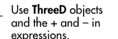

```csharp
c = c - a; // 减去 a

Console.Write("Result of c - a: ");

Console.Show();

Console.WriteLine();
```

```csharp
c = c - b; // 减去 b

Console.Write("Result of c - b: ");

Console.Show();

Console.WriteLine();
```

该程序产生以下输出：

Here is a: 1, 2, 3

Here is b: 10, 10, 10

Result of a + b: 11, 12, 13

Result of a + b + c: 22, 24, 26

Result of c - a: 21, 22, 23

Result of c - b: 11, 12, 13

让我们仔细检查前面的程序，从重载的运算符 `+` 开始。当两个 `ThreeD` 对象通过运算符 `+` 进行操作时，它们各自坐标的量级会被相加，如 `operator(+)` 所示。注意，此方法没有修改任一操作数的值。相反，该方法返回了一个包含操作结果的新 `ThreeD` 对象。要理解为什么 `+` 操作不会改变任一对象的内容，请考虑标准的算术加法运算符，其应用于：`10 + 12`。该操作的结果是 22，但 10 或 12 都没有被改变。虽然没有规则规定重载运算符不能改变其一个操作数的值，但让重载运算符的行为与其通常含义保持一致是最好的。

注意 `operator+()` 返回的是一个 `ThreeD` 类型的对象。虽然该方法可以返回任何有效的 C# 类型，但返回 `ThreeD` 对象的这一使得 `+` 运算符可以用于复合表达式，例如 `a+b+c`。在这里，`a+b` 生成类型为 `ThreeD` 的结果。该值随后可以加到 `c`。如果 `a+b` 生成了其他类型的值，这种表达式将无法工作。

另一个重要点是：坐标在 `operator()` 内部相加，单个坐标的相加导致了整数加法。这是因为单个坐标 `x`、`y` 和 `z` 是整数值。为 `ThreeD` 类型对象重载 `+` 运算符这一事实对于应用于整数的 `+` 没有影响。

现在看 `operator-`。该运算符的工作方式与 `operator+` 相同，但参数的顺序很重要。回加法具有交换律，而减法没有（也就是说，`A – B` 不等于 `B – A`！）。对于二元运算符，运算符方法的第一个参数将包含左侧的操作数。第二个参数将包含右侧的操作数。在实现非交换运算符的重载版本时，你必须记住哪个操作数在左，哪个在右。

### 重载一元运算符

一元运算符的重载方式与二元运算符相同。主要的区别在于只有一个操作数。例如，这里是 `ThreeD` 类的一元减运算符方法：

```csharp
// 重载一元 -
public static ThreeD operator - (ThreeD op)
{
    ThreeD result = new ThreeD();
    result.x = -op.x;
    result.y = -op.y;
    result.z = -op.z;
    return result;
}
```

在这里，创建了一个包含操作数取反字段的对象。该对象被返回。注意运算符没有改变。再次，这保持了一元减的通常含义。例如，在如 `a++` 的表达式中，C# `++` 和 `--` 只是返回递增或递减的值。C# 会自动处理这一点，考虑前缀和后置形式的区别。例如，这里是 `ThreeD` 类的 `operator++`：

```csharp
// 重载一元 ++
public static ThreeD operator ++ (ThreeD op)
{
    ThreeD result = new ThreeD();
    // 返回增加后的结果
    result.x = op.x + 1;
    result.y = op.y + 1;
    result.z = op.z + 1;
    return result;
}
```

这是一个之前程序的扩展版本，演示了一元 `++` 运算符：

```csharp
using System;
// 三维坐标类
class ThreeD {
    int x, y, z;
    public ThreeD() { x = y = z = 0; }
    public ThreeD(int i, int j, int k) { x = i; y = j; z = k; }
    // 重载二元运算符 +
    public static ThreeD operator +(ThreeD op1, ThreeD op2)
    {
        ThreeD result = new ThreeD();
        /* 这将两个点的坐标相加
        并返回结果。 */
        result.x = op1.x + op2.x; // 这些是整数加法
        result.y = op1.y + op2.y; //  + 保留了其原始含义
        result.z = op1.z + op2.z; // 即相对于它们而言。
        return result;
    }
    // 重载二元运算符 -
    public static ThreeD operator - (ThreeD op1, ThreeD op2)
    {
        ThreeD result = new ThreeD();
        /* 注意操作数的顺序。op1 是左
        操作数，op2 是右操作数。 */
        result.x = op1.x - op2.x; // 这些是整数减法
        result.y = op1.y - op2.y;
        result.z = op1.z - op2.z;
        return result;
    }
}
```

## 254 C# 3.0：初学者指南

a + b + c 的结果: 22, 24, 26
c - a 的结果: 21, 22, 23
c - b 的结果: 11, 12, 13
-a 的结果: -1, -2, -3

```c
Given c = a++
c is 1, 2, 3
ai is 2, 3, 4
```

重置 c = 1, 2, 3

```c
Given c = ++a
c is 2, 3, 4
ai is 2, 3, 4
```

## 增加灵活性

对于任何给定的类和操作符，运算符方法本身都可以被重载。例如，再次考虑 `ThreeD` 类。到目前，你已经看到了如何重载 `+` 以便能够加一个 `ThreeD` 对象的坐标。然而，这并不是我们想要为 `ThreeD` 定义加法的唯一方式。例如，将整数值加到 `ThreeD` 对象的每个坐标上可能是很有用的。这种操作可以用于平移轴。要执行此类操作，你将需要再次重载 `+`，如下所示：

```csharp
// Overload binary + for ThreeD + int.
public static ThreeD operator + (ThreeD op1, int op2)
{
  ThreeD result = new ThreeD();
  result.x = op1.x + op2;
  result.y = op1.y + op2;
  result.z = op1.z + op2;
  return result;
}
```

注意第二个参数的类型是 `int`。因此，前面的方法允许将整数值加到 `ThreeD` 对象的每个字段上。这是允许的，因为正如之前解释的那样，在重载二元运算符时，操作数之一必须与重载该运算符的类类型相同。然而，另一个操作数可以是任何其他类型。

## 第 7 章：运算符重载、索引器和属性

这里是一个具有两个重载 `+` 方法的 `ThreeD` 版本：

```csharp
// Overload addition for ThreeD + ThreeD, and for ThreeD + int.
using System;
// 一个三维坐标类。
class ThreeD {
    int x, y, z; // 3D 坐标
    public ThreeD() { x = y = z = 0; }
    public ThreeD(int i, int j, int k) { x = i; y = j; z = k; }
    // Overload binary + for ThreeD + ThreeD.
    public static ThreeD operator +(ThreeD op1, ThreeD op2) {
        ThreeD result = new ThreeD();
        /* 这加上了两个点的坐标
           并返回结果。 */
        result.x = op1.x + op2.x;
        result.y = op1.y + op2.y;
        result.z = op1.z + op2.z;
        return result;
    }
    // Overload binary + for ThreeD + int.
    public static ThreeD operator +(ThreeD op1, int op2) {
        ThreeD result = new ThreeD(); // 定义 ThreeD + 整数.
        result.x = op1.x + op2;
        result.y = op1.y + op2;
        result.z = op1.z + op2;
        return result;
    }
    // 显示 X, Y, Z 坐标。
    public void Show() {
        Console.WriteLine(x + " , " + y + " , " + z);
    }
}
```

```csharp
class ThreeDDemo {
    static void Main() {
        ThreeD a = new ThreeD(1, 2, 3);
        ThreeD b = new ThreeD(10, 10, 10);
        ThreeD c = new ThreeD();
        Console.Write("Here is a: ");
        a.Show();
        Console.WriteLine();
        Console.Write("Here is b: ");
        b.Show();
        Console.WriteLine();
        c = a + b; // ThreeD + ThreeD
        Console.Write("Result of a + b: ");
        c.Show();
        c = b + 10; // ThreeD + int
        Console.Write("Result of b + 10: ");
        c.Show();
    }
}
```

该程序的输出如所示：
Here is a: 1, 2, 3
Here is b: 10, 10, 10
Result of a + b: 11, 12, 13
Result of b + 10: 20, 20, 20

如输出所证实，当 `+` 应用于两个 `ThreeD` 对象时，它们的坐标会被相加。当 `+` 应用于一个 `ThreeD` 对象和一个整数时，坐标会根据该整数而增加。虽然所展示的 `+` 重载无疑为 `ThreeD` 类增加了实用的功能，但 `operator+(ThreeD, int)` 允许像 `c = b + 10;` 这样的语句。遗憾的是，它不允许像 `c = 10 + b;` 这样的语句，因为整数参数是第二个参数，即右侧的操作数。为了允许这两个语句，你将再次重载 `+`。此版本必须将其第一个参数设置为 `int`，第二个参数设置为 `ThreeD`。其中一个运算符(+) 处理 `ThreeD +` 整数，另一个处理整数 + `ThreeD`。

### 重载关系运算符

关系运算符（例如 `==` 或 `<`）也可以被重载，且过程非常简单。通常，重载的关系运算符返回一个 `true` 或 `false` 值。这与这些运算符的正常用法以及在条件表达式中使用重载的关系运算符保持一致。如果你返回不同的类型结果，将极大限制该运算符的实用性。

这是一个重载了 `<` 和 `>` 运算符的 `ThreeD` 类。在示例中，这些运算符根据到原点的距离来比较 `ThreeD` 对象。如果一个对象到原点的距离更小，则它大于另一个对象。如果一个对象到原点的距离小于两个点；这种实现可以用来判断哪一个点位于较大的球面上。如果两个运算符都没有返回 `true`，则这两个点位于同一个球面上。当然，其他的排序方案也是可能的。

```csharp
// Overload < and >.
using System;
// 一个三维坐标类。
class ThreeD {
    int x, y, z;
    public ThreeD() { x = y = z = 0; }
    public ThreeD(int i, int j, int k) { x = i; y = j; z = k; }
    // 如果 op1 小于 op2 则返回 true。
    // 重载 <.
    public static bool operator <(ThreeD op1, ThreeD op2) {
        // 实现此处
        return false; 
    }
    // 如果 op1 大于 op2 则返回 true。
    // 重载 >.
    public static bool operator >(ThreeD op1, ThreeD op2) {
        // 实现此处
        return false;
    }
}
```


## 第 7 章：运算符重载、索引器和属性

在重载关系运算符时有一个重要的限制：你必须成对地进行重载。例如，如果你重载了 `<`，就必须重载 `>`，反之亦然。运算符配对如下：

| == | != |
| < | > |
| <= | >= |

因此，如果你重载了 `<=`，就必须重载 `>=`；如果你重载了 `=`，就必须重载 `!=`。

注意：
如果你重载了 `==` 和 `is` 运算符，你通常需要重写 `Object.Equals()` 和 `Object.GetHashCode()`。这些方法以及重写的技术将在第 8 章中讨论。

### 运算符重载的提示与限制

应用于其定义所在类的重载运算符的操作，不需要与该运算符在 C# 内置类型中的默认用法有任何关系。为了代码的结构和可读性，重载运算符应当尽可能地反映该运算符原始用法的精髓。例如，对于 `Three` 类型来说，`+` 操作在概念上与对于整数类型的 `+` 操作相似。例如，定义某个类的 `+` 操作，如果它的行为更像你预期的 `/` 运算符那样，将几乎没有益处。核心概念是，虽然你可以赋予重载运算符任何你喜欢的含义，但为了清晰起见，其新含义与其原始含义相关是最好的。

运算符重载存在限制。你不能更改任何运算符的优先级，尽管你的运算符方法可以选择忽略某个运算符。有几个运算符是无法重载的。最重要的一点可能是，你不能重载任何赋值运算符，包括 `+=` 等复合赋值运算符。这些都是不能重载的运算符。（这些运算符中的某些将在本书后后部分介绍。）

| && | () | ? |
| ?? | [] | = |
| => | -> | checked |
| default | is | new |
| typeof | unchecked | sizeof |

最后一点：关键字 `true` 和 `false` 也可以用作重载时的一元运算符。它们相对于某个类被重载，以判断一个对象是“真（true）”还是“假（false）”。一旦这些运算符对某个类进行了重载，你就可以使用该类的对象来控制 `if` 语句，例如。

## 专家问答

**Q：** 由于我不能重载像 `+=` 这样的运算符，如果我尝试对一个定义了 `+` 的类对象使用 `+=`，会发生什么？更通地说，当我对我已经定义了该赋值操作运算部分的对象使用任何复合赋值时，会发生什么？

**A：** 通常情况下，如果你定义了一个运算符，并且该运算符被用于复合赋值，那么你的重载运算符方法就会被调用。因此，`+=` 会自动使用你版本的运算符(`+`)。例如，假设有一个 `ThreeD` 类，如果你使用如下序列：

```
ThreeD a = new ThreeD(1, 2, 3);
ThreeD b = new ThreeD(10, 10, 10);
b += a; // 将 a 和 b 相加
```

会自动调用，且 `b` 将包含坐标 11, 12, 13。

### 索引器

如你所知，数组索引是使用 `[ ]` 运算符实现的。你可以为你创建的类重载 `[ ]` 运算符，但并不使用运算符方法，而是创建一个索引器（indexer）。索引器允许对象像数组一样被索引。索引器的主要用途是支持创建受一个或多个约束的特殊数组。然而，你可以对任何使用数组类语法有益的用途使用索引器。索引器可以有一个或多个维度。

我们将从一维索引器开始。一维索引器具有以下通用形式：

```
element-type this[int index] {
    // get 访问器。
    get {
        // 返回索引指定的值
    }
}
```

```
// set 访问器。
set {
    // 设置索引指定的值
}
```

在这里，`element-type` 是索引器的元素类型。因此，通过索引器访问的每个元素都是 `element-type` 类型。它对应于数组的元素类型。参数 `index` 接收被访问元素的类型。从技术上讲，这个参数不需要是 `int`，但由于索引器通常用于提供数组索引，因此整数值是常见做法。

在索引器的内部定义了两个名为 `get` 和 `set` 的访问器。访问器类似于方法，不同之处在于不返回类型或参数。当使用索引器时，访问器会被自动调用，且两个访问器都接收 `index` 作为参数。如果索引器正在被赋值（当它位于赋值语句的左侧时），则调用 `set` 访问器并必须设置由索引指定的元素。否则，调用 `getter` 并必须返回与 `index` 关联的值。`set` 方法还会接收一个名为 `value` 的值，该值包含了赋值给指定索引的值。

索引器的优点之一是，你可以控制访问数组的方式，从而防止不当访问。例如，在第 6 章中有一种实现“软失败（fail-soft）”数组更好的方法。它使用索引器，允许使用普通的数组表示法访问数组。

```
// 通过添加索引器来改进软失败数组。
```

```
using System;
class FailSoftArray {
    int[] a; // 数组的引用
    public int Length; // Length 是公共的
    public bool ErrFlag; // 表示上一次操作的结果
```

# C# 3.0: 入门指南

```csharp
ErrFlag = false;
}
else ErrFlag = true;
}
```

在这种情况下，索引（index）在边界之内。否则，传入的 `value` 值将赋值给相应的元素。`ErrFlag` 被设置为 `true`。请记住，在访问器方法中，`value` 是一个自动参数，包含了包含被赋值的值。你不需要（也无法）声明它。

索引器（indexer）并不同时提供 `get` 和 `set`。你可以通过只实现 `get` 来创建一个只读索引。你可以通过只实现 `set` 来创建一个只写索引器。

需要理解这一点是，索引器并不要求实际上在数组上进行操作。它只是为索引器的用户提供了一种看起来“像数组”的功能。例如，以下程序有一个索引器，它表现为一个包含 0 到 15 的 2 的幂的只读数组。然而，实际上并不存在数组。相反，索引器只是为给定的索引计算正确的值。

```csharp
// 索引器不需要操作实际的数组
```

```csharp
using System;
class PwrOfTwo {
    /* 访问一个逻辑数组，该数组包含 0 到 15 的 2 的幂。 */
    public int this[int index] {
        // 计算并返回 2 的幂。
        get {
            if((index >= 0) && (index < 16)) return Pwr(index);
            else return -1;
        }
    }
    // 没有 set 访问器。
}
    int Pwr(int p) {
        int result = 1;
        for(int i=0; i<p; i++)
            result *= 2;
        return result;
    }
}
class UsePwrOfTwo {
    static void Main() {
        PwrOfTwo pwr = new PwrOfTwo();
```

```csharp
Console.Write("First 8 powers of 2: ");
for(int i=0; i < 8; i++)
    Console.Write(pwr[i] + " ");
Console.WriteLine();
Console.Write("Here are some errors: ");
Console.Write(pwr[-1] + " " + pwr[17]);
}
```

程序的输出显示在此：

First 8 powers of 2: 1 2 4 8 16 32 64 128
Here are some errors: -1 -1

注意 `PwrOfTwo` 的索引器包含一个 `get` 访问器，但没有 `set` 访问器。正如所解释的，这意味着该索引器是只读的。因此，`PwrTwo` 对象可以用于赋值语句的右侧，但不能用于左侧。例如，尝试在你的程序工作之前的语句中添加此内容：

```csharp
pwr[0] = 11; // 无法编译
```

该语句会导致编译错误，因为为索引器没有定义 `set` 访问器。

## 多维索引器

你也可以为多维数组创建索引器。例如，这里有一个二维软故障（fail-soft）数组。请密切关注索引器的声明方式。

```csharp
// 一个二维软故障数组。
using System;
class FailSoftArray2D {
    int[,] a; // 2D 数组的引用
    int rows, cols; // 维度
    public int Length; // Length 是公共的
    public bool ErrFlag; // 表示上一次操作的结果
    // 给定维度构造数组。
    public FailSoftArray2D(int r, int c) {
        rows = r;
        cols = c;
        a = new int[rows, cols];
        Length = rows * cols;
    }
```

```csharp
// 这是 FailSoftArray2D 的索引器。
public int this[int index1, int index2] { // 一个二维索引器。
    // 这是 get 访问器。
    get {
        if (ok(index1, index2)) {
            ErrFlag = false;
            return a[index1, index2];
        } else {
            ErrFlag = true;
            return 0;
        }
    }
    // 这是 setter 赋值访问器。
    set {
        if (ok(index1, index2)) {
            a[index1, index2] = value;
            ErrFlag = false;
        } else ErrFlag = true;
    }
}
// 如果索引在边界内则返回 true。
private bool ok(int index1, int index2) {
    if (index1 >= 0 && index1 < rows &&
        index2 >= 0 && index2 < cols)
        return true;
    return false;
}
// 演示一个 2D 索引器 Demo
class Two2DIndexerDemo {
    static void Main() {
        FailSoftArray2D fs = new FailSoftArray2D(3, 5);
        int x;
        // 显示静默失败。
        Console.WriteLine("Fail quietly.");
        for(int i=0; i<p; i++)
            result *= 2;
    }
}
```


# C# 3.0: 入门指南

## 第 7 章：运算符重载、索引器和属性

```csharp
using System;
class PwrOfTwo {
    /* 访问一个逻辑数组，该数组包含
    0 到 15 的 2 的幂。 */
    public int this[int index] {
        // 计算并返回 2 的幂。
        get {
            if((index >= 0) && (index < 16)) return Pwr(index);
            else return -1;
        }
    }
    // 没有 set 访问器。
}

int Pwr(int p) {
    int result = 1;

    for(int i=0; i<p; i++)
        result *= 2;

    return result;
}

class UsePwrOfTwo {
    static void Main() {
        PwrOfTwo pwr = new PwrOfTwo();
```


```csharp
Console.Write("First 8 powers of 2: ");
for(int i=0; i < 8; i++)
    Console.Write(pwr[i] + " ");
Console.WriteLine();

Console.Write("Here are some errors: ");
Console.Write(pwr[-1] + " " + pwr[17]);
}
```

程序的输出显示在此：

First 8 powers of 2: 1 2 4 8 16 32 64 128

Here are some errors: -1 -1

注意 `PwrOfTwo` 的索引器包含一个 `get` 访问器，但没有 `set` 访问器。正如所解释的，这意味着该索引器是只读的。因此，`PwrTwo` 对象可以用于赋值语句的右侧，但不能用于左侧。例如，尝试在你的程序工作之前的语句中添加此内容：

```csharp
pwr[0] = 11; // 无法编译
```

该语句会导致编译错误，因为为索引器没有定义 `set` 访问器。

### 多维索引器

你也可以为多维数组创建索引器。例如，这里有一个二维软故障数组。请密切关注索引器的声明方式。

```csharp
// 一个二维软故障数组。
using System;

class FailSoftArray2D {
    int[,] a; // 2D 数组的引用
    int rows, cols; // 维度
    public int Length; // Length 是公共的
    public bool ErrFlag; // 表示上一次操作的结果

    // 给定维度构造数组。
    public FailSoftArray2D(int r, int c) {
        rows = r;
        cols = c;
        a = new int[rows, cols];
        Length = rows * cols;
    }
```

```csharp
// 这是 FailSoftArray2D 的索引器。
public int this[int index1, int index2] { // 一个二维索引器。
    // 这是是 get 访问器。
    get {
        if (ok(index1, index2)) {
            ErrFlag = false;
            return a[index1, index2];
        } else {
            ErrFlag = true;
            return 0;
        }
    }

    // 这是 setter 赋值访问器。
    set {
        if (ok(index1, index2)) {
            a[index1, index2] = value;
            ErrFlag = false;
        } else ErrFlag = true;
    }
}

// 如果索引在边界内则返回 true。
private bool ok(int index1, int index2) {
    if (index1 >= 0 && index1 < rows &&
        index2 >= 0 && index2 < cols)
        return true;

    return false;
}
```

在这种情况下，索引在边界之内。否则，传入的 `value` 值将赋值给相应的元素。`ErrFlag` 被设置为 `true`。请记住，在访问器方法中，`value` 是一个自动参数，包含了包含被赋值的值。你不需要（也无法）声明它。

索引器并不同时提供 `get` 和 `set`。你可以通过只实现 `get` 来创建一个只读索引。你可以通过只实现 `set` 来创建一个只写索引器。

需要理解这一点是，索引器并不要求实际上在数组上进行操作。它只是为索引器的用户提供了一种看起来“像数组”的功能。例如，以下程序有一个索引器，它表现为一个包含 0 到 15 的 2 的幂的只读数组。然而，实际上并不存在数组。相反，索引器只是为给定的索引计算正确的值。

```csharp
// 索引器不需要操作实际的数组
```

### 属性

只写属性。要创建一个只读属性，只需定义 `get` 访问器。要定义只写属性，只需定义 `set` 访问器。

你可以使用属性来进一步改进容错（fail-soft）数组类。如你所知，所有数组都关联有一个 `Length` 属性。到目前为止，`FailSoftArray` 类仅使用一个公共整数字段 `Length` 来实现此目的。然而，这不是良好的做法，因为它允许 `Length` 被设置为除容错数组长度之外的其他值。我们可以通过将 `Length` 转换为只读属性来改善这种局面，如下版本的 `FailSoftArray` 所示。

```csharp
using System;

class FailSoftArray {
    int[] a; // 数组引用
    int len; // 数组长度

    public bool ErrFlag; // 表示上次操作的结果

    // 根据指定的大小构造数组。
    public FailSoftArray(int size) {
        a = new int[size];
        len = size;
    }

    // 只读的 Length 属性。
    public int Length {
        get {
            return len;
        }
    }

    // 这是 FailSoftArray 的索引器。
    public int this[int index] {
        // 这是 get 访问器。
        get {
            if (ok(index)) {
                ErrFlag = false;
                return a[index];
            } else {
                ErrFlag = true;
                return 0;
            }
        }
        // 这是 set 访问器。
        set {
            if (ok(index)) {
                a[index] = value;
                ErrFlag = false;
            } else ErrFlag = true;
        }
    }

    // 如果索引在边界内，则返回 true。
    private bool ok(int index) {
        if (index >= 0 && index < Length) return true;
        return false;
    }
}
```

现在，`Length` 是一个只读属性，可以读取但不能赋值。为了向自己证明这一点，请尝试移除程序中该行之前的注释符号：

```csharp
// fs.Length = 10; // 错误，非法！
```

当你尝试编译时，将收到一条错误消息，说明 `Length` 是只读的。

#### 自动实现属性

从 C# 3.0 开始，可以实现非常简单的属性，而无需显式定义由属性管理的变量。相反，你可以让编译器自动提供底层变量。这被称为自动实现属性。它具有以下通用形式：

```csharp
type name { get; set; }
```

在这里，`type` 指定属性的类型，`name` 指定名称。注意 `get` 和 `set` 后面紧跟着分号。自动实现属性的访问器没有方法体。此语法告诉编译器自动创建一个存储位置来持有该值。该变量没有名称，且你无法直接访问它。相反，它只能通过属性进行访问。

以下是使用自动实现方式声明属性 `UserCount` 的方法：

```csharp
public int UserCount { get; set; }
```

注意没有显式声明字段。如前所述，编译器会自动生成一个持有该值的匿名字段。否则，`UserCount` 的行为和特征与其他任何属性一样。

与普通属性不同，自动实现属性不能是只读或只写的。在所有情况下都必须指定 `get` 和 `set`。然而，你可以通过将 `get` 或 `set` 声明为 `private` 来实现类似的效果。

自动实现属性提供了便利性，但其使用局限于不需要对备份字段的获取或设置控制的情况。记住，你不能直接访问备份字段。这意味着没有办法可以限制自动实现属性可以做什么。因此，自动实现属性只是让属性名称作为字段本身的代理。

#### 属性限制

属性具有一些重要的限制。首先，属性不定义存储位置，它不能作为 `ref` 或 `out` 参数传递给方法。其次，你不能重载属性。最后，当调用 `get` 时，属性不应更改底层变量的状态。虽然这一规则没有由编译器强制，但这种更改在语义上是错误的。`get` 操作不应该产生副作用。

#### 使用访问修饰符


属性具有一些重要的限制。首先，属性不定义存储位置，它不能作为 `ref` 或 `out` 参数传递给方法。其次，你不能重载属性。（你可以有两个访问相同底层变量的属性，但这通常是不寻常的。）最后，当调用 `get` 时，属性不应更改底层变量的状态。虽然这一规则没有由编译器强制，但这种更改在语义上是错误的。`get` 操作不应该产生副作用。

### 第 7 章：运算符重载、索引器和属性

```csharp
if (x != -1) Console.Write(x + " ");
}
Console.WriteLine();
// fs.Length = 10; // Error! Length's setter is private.
```

`FailSoftArray` 外部对 `Length` 的赋值是非合法的。

此版本的 `FailSoftArray` 工作方式与之前的版本相同，但它不包含显式声明的底层字段（backing field）。

#### 尝试一下：创建一个 Set 类

正如在本章开头提到的，运算符重载、索引器和属性有助于创建能够完全集成到 C# 编程环境中的类。请考虑这一点：通过定义必要的运算符、索引器和属性，你可以使一个类在程序中的用法与使用内置类型完全相同。你可以通过运算符和索引器对该类的对象进行操作，并在表达式中使用该类的对象。添加属性可以使类提供一个与 C# 内置对象一致的接口。为了说明如何将新类集成到 C# 环境中，我们将创建一个名为 `Set` 的类，它定义了一个集合（set）类型。

在开始之前，准确理解我们所说的“集合”至关重要。在本例中，集合是一个唯一元素的集合。也就是说，任何集合中没有两个元素是相同的。集合中成员的顺序是无关的。因此，集合

- A, B, C

等同于集合

- A, C, B

集合也可以是空的。

集合支持许多操作。我们将实现的是：

- 向集合中添加元素
- 从集合中移除元素
- 集合并集
- 集合差集

向集合中添加元素和从集合中移除元素是自言易懂的操作。另外两个需要一些解释。

两个集合的并集是包含两个集合所有元素的集合。（当然，不允许重复元素。）我们将使用 `+` 运算符来执行集合并集。

### C# 3.0：初学者指南

两个集合的差集是包含第一个集合中但不属于第二个集合的元素的集合。我们将使用运算符执行集合差集。例如，对于两个集合 `S1` 和 `S2`，该语句从 `S1` 中移除 `S2` 的元素，并将结果放入 `S3` 中：

`S3 = S1 - S2`

如果 `S1` 和 `S2` 是相同的，那么 `S3` 将是空集。

当然，集合上还可以执行其他操作。有些操作在“自我测试”部分进行了开发。你可能会发现可以自己尝试。

为了简单起见，该类存储字符集合，但相同的基本原理可以创建能够存储其他类型元素的 `Set` 类。

#### 逐步实现

1. 创建名为 `SetDemo.cs` 的新文件。

2. 使用以下代码开始创建 `Set`：

```csharp
class Set {
    char[] members; // 此数组持有集合
```

```csharp
// 一个自动实现的只读的 Length 属性。
public int Length { get; private set; }
```

每个集合都存储在由 `members` 的字符数组中。集合中实际的成员数量由自动实现的 `Length` 属性表示。注意，在 `Set` 类外部，它实际上是只读的。

3. 添加以下 `Set` 构造函数：

```csharp
// 构建一个空集。
public Set() {
    Length = 0;
}
```

```csharp
// 构建一个给定大小的空集。
public Set(int size) {
    members = new char[size]; // 为集合分配内存
    Length = 0; // 构建时没有成员
}
```

```csharp
// 从另一个集合构造集合。
public Set(Set s) {
    members = new char[s.Length]; // 为集合分配内存
    for(int i=0; i < s.Length; i++) members[i] = s[i];
    Length = s.Length; // 成员数量
}
```

### 第 7 章：运算符重载、索引器和属性

集合可以通过三种方式构造。首先，可以创建一个空集。空集不包含任何成员，也没有为成员分配数组。因此，空集仅仅是一个占位符。可以创建一个给定大小的空集。最后，可以从另一个集合构造集合。在这种情况下，两个集合包含相同的成员，但引用的是不同的对象。

4. 添加只读索引器，如此文所示：

```csharp
// 实现只读索引器。
public char this[int idx]{
get {
    if(idx >= 0 && idx < Length) return members[idx];
    else return (char)0;
}
```

索引器根据给定的索引返回集合的成员。它执行了边界检查以防止溢出。如果索引无效，则返回空字符。

5. 添加此文所示的 `find(char)` 方法。此方法确定传入的元素 `ch` 是否为集合的成员。如果找到元素，则返回元素的索引；如果元素不属于集合，则返回 `-1`。此方法是私有的。

```csharp
/* 检查元素是否在集合中。
返回元素的索引，如果未找到则返回 -1。 */
int find(char ch) {
int i;

for(i=0; i < Length; i++) {
    if(members[i] == ch) return i;
}
return -1;
}
```

6. 重载 `+` 运算符，如此文所示。此方法执行集合并集。

```csharp
// 向集合添加元素。
public static Set operator +(Set s1, Set s2) {
    Set newset = new Set(s1); // 第一个集合
    for (int i=0; i < s2.Length; i++) {
        if (newset.find(s2[i]) == -1) {
            // 集合集的逻辑
        }
    }
    return newset;
}
```

等待，OCR 提供的文本在后面的页面是碎片化的。我将根据提供的片段和标准的 C# 模式重新构建逻辑流，以确保输出是专业的。

### C# 3.0: 入门指南

```csharp
// 构建一个给定大小的空集合。
public Set(int size) {
    members = new char[size]; // 为集合分配内存
    Length = 0; // 构建时没有成员
}
```

```csharp
// 从另一个集合构造集合。
public Set(Set s) {
    members = new char[s.Length]; // 为集合分配内存
    for(int i=0; i < s.Length; i++) members[i] = s[i];
    Length = s.Length; // 成员数量
}
```

```csharp
// 实现只读索引器。
public char this(int idx) {
    if(idx >= 0 && idx < Length) return members[idx];
    else return (char)0;
}
```

```csharp
// 检查元素是否在集合中。
// 返回元素的索引，如果未找到则返回 -1。
int find(char ch) {
    int i;
    for(i=0; i < Length; i++)
        if(members[i] == ch) return i;
    return -1;
}
```

```csharp
// 向集合中添加唯一元素。
public static Set + +(Set ob, char ch) {
    // 如果 ch 已经在集合中，则返回原始集合的副本。
    if(ob.find(ch) != -1) {
        return new Set(ob);
    } else {
        // 返回包含新元素的新集合副本。
        // 使新集合比原始集合大一个元素。
        Set newset = new Set(ob.Length+1);
        // ... 实现细节
        for(int i=0; i < ob.Length; i++)
            newset.members[i] = ob.members[i];

        // 设置 Length 属性。
        newset.Length = ob.Length+1;

        // 将新元素添加到新集合。
        newset.members[newset.Length-1] = ch;

        return newset; // 返回新集合
    }
}
```

```csharp
// 从集合中移除元素。
public static Set operator -(Set ob, char ch) {
    Set newset = new Set();
    int i = ob.find(ch); // 如果未找到元素则 i 为 -1
    for(int j=0; j < ob.Length; j++)
        if(j != i) newset.members[j] = ob.members[j];
    return newset;
}
```

```csharp
// 集合并集。
public static Set + +(Set ob1, Set ob2) {
    Set newset = new Set(ob1); // 复制第一个集合
    // 来自第二个集合的元素。
    for(int i=0; i < ob2.Length; i++)
        // 添加唯一元素的逻辑
    return newset;
}
```

```csharp
// 集合差。
public static Set operator -(Set ob1, Set ob2) {
    Set newset = new Set(ob1); // 复制第一个集合
    // 从第二个集合中减去元素。
    for(int i=0; i < ob2.Length; i++)
        // 减去元素的逻辑
    return newset;
}
```

```csharp
// 演示 Set 类。
class SetDemo {
    static void Main() {
        // 构建 Set。
        Set s1 = new Set();
        Set s2 = new Set();
        Set s3 = new Set();
    }
}
```

#### 第 7 章：运算符重载、索引器与属性

#### 第 7 章自测

- 1. 写出用于重载一元运算符的通用形式。运算符方法的参数必须是什么类型的？
- 2. 为了允许涉及类类型和内置类型的进行操作，你必须做什么？
- 3. ? 可以被重载吗？你可以更改运算符的优先级吗？
- 4. 什么是索引器？显示它的通用形式。
- 5. 在索引器中，它的 get 和 set 访问器必须执行什么函数？
- 6. 什么是属性？
- 7. 属性定义了存储吗？
- 8. 属性可以作为参数传递吗？
- 9. 什么是自动实现属性？
- 10. 对于类，它位于哪里？

# 第 8 章：继承

## 核心概念

- 继承
- 受保护访问 `Protected`
- 调用构造函数
- 多级层次结构
- 基类
- 抽象类
- 密封 `Sealed`

### 继承基础

```csharp
using System;

// 用于二维对象的类。
class TwoDShape {
    public double Width;
    public double Height;

    public void ShowDim() {
        Console.WriteLine("宽度和高度为 " + Width + " 和 " + Height);
    }
}

// Triangle 继承自 TwoDShape。注意其语法。
class Triangle : TwoDShape {
    public string Style;

    public double Area() {
        return Width * Height / 2;
    }

    public void ShowStyle() {
        Console.WriteLine("三角形样式为 " + Style);
    }
}

class Shapes {
    static void Main() {
        Triangle t1 = new Triangle();
        Triangle t2 = new Triangle();

        t1.Width = 4.0;
        t1.Height = 4.0;
        t1.Style = "isosceles";

        t2.Width = 8.0;
        t2.Height = 12.0;
        t2.Style = "right";

        t1.ShowStyle();
        t1.ShowDim();
        t2.ShowStyle();
        t2.ShowDim();
    }
}
```

### C# 3.0: 初学者指南

该程序的输出结果所示：

```
Info for t1:
Triangle is isosceles
Width and height are 4 and 4
Area is 8

Info for t2:
Triangle is right
Width and height are 8 and 12
Area is 48
```

在这里，`TwoShape` 定义了“通用”二维形状的属性，例如正方形、矩形、三角形等。`Triangle` 类创建了 `TwoShape` 的一种特定类型，在本例中三角形。`Triangle` 类包含了 `TwoShape` 的所有内容，并添加了字段 `Style`、方法 `Area()` 和方法 `StyleSheet()`。`Style` 存储三角形样式的描述。`Area()` 返回三角形的面积，而 `StyleSheet()` 显示三角形的样式。

尽管 `TwoShape` 是 `Triangle` 的基类，但它也是一个完全独立的、单独类。作为派生类的基类并不意味着该基类不能单独使用。例如，以下代码是完全有效的：

```csharp
TwoShape shape = new TwoShape();

shape.Width = 10;
shape.Height = 20;

shape.ShowDim();
```

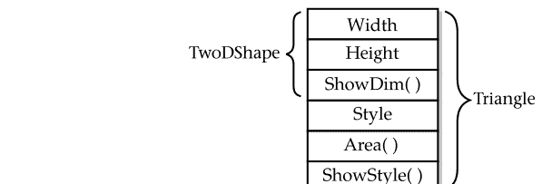

**图 8-1** `Triangle` 类的概念性描绘

### 第 8 章：继承

这是一个使用 protected 的简单示例：

```csharp
// Demonstrate protected.
using System;
The字段 i 和 j 被声明为 protected。
class B {
    protected int i, j; // 对 B 是私有的，但对 D 访问

    public void Set(int a, int b) {
        i = a;
        j = b;
    }

    public void Show() {
        Console.WriteLine(i + " " + j);
    }
}

class D : B {
    int k; // 私有

    // D 可以访问 B 的 i 和 j。
    public void SetK() {
        k = i * j; // D 可以访问 i 和 j，因为它们是 protected 的，而不是 private。
    }

    public void ShowK() {
        Console.WriteLine(k);
    }
}
class ProtectedDemo {
    static void Main() {
        D ob = new D();
        ob.Set(2, 3); // OK, D 可知
        ob.Show(); // OK, D 可知

        ob.SetK(); // OK, D 的部分
        ob.ShowK(); // OK, D 的部分
    }
}
```

在这个示例中，`D` 继承了 `B`，因为 `i` 和 `j` 在 `B` 中被声明为 `protected`，所以 `SetK()` 方法可以访问它们。如果 `i` 和 `j` 被 `B` 声明为 `private`，那么 `D` 将无法访问它们，程序将无法编译。

与 `public` 和 `private` 一样，`protected` 状态无论涉及多少层继承都会一直与成员保持。因此，当一个派生类作为另一个派生类的基类时，初始基类中被第一个派生类继承的任何 `protected` 成员也会被第二个派生类作为 `protected` 继承。

尽管 `protected` 访问非常有用，但它并不适用于所有情况。例如，在显示前一节内容的 `TwoDShape` 中，我们明确希望 `Width` 和 `Height` 值是公开可访问的。我们想要的是管理赋值的值。因此，将它们声明为 `protected` 不是一个选项。在这种情况下，使用属性（properties）提供了正确的解决方案，通过控制而不是阻止访问。记住，当你使用 `protected` 时，你想要创建一个在整个类层次结构中存在且不受限制的成员。要管理对值的访问，请使用属性。


# 构造函数与继承

在层次结构中，基类和派生类都可以拥有自己的构造函数。这引发了一个重要的问题：哪个构造函数负责构建派生类的对象？是基类中的，还是派生类中的，还是两者都有？答案是：基类的构造函数构建对象的基类部分，而派生类的构造函数构建派生类部分。这是合理的，因为基类对派生类中的任何元素一无所知也无法访问。因此，它的构造函数必须是独立的。之前的示例依赖于 C# 创建的默认构造函数，所以这并不是一个问题。但在实践中，大多数类都会有构造函数。在这里，你将看到如何处理这种情况。

当派生类定义构造函数时，过程非常直观：对象的基类部分将使用其默认构造函数自动构建。例如，这里是 `Triangle` 的重构版本，它定义了一个构造函数。它还将 `Style` 设为私有，因为它现在是由构造函数设置的。

```csharp
// Add a constructor to Triangle.
using System;

// 一个用于二维对象的类。
class TwoDShape {
    double pri_width;
    double pri_height;

    // 用于 Width 和 Height 的属性。
    public double Width {
        get { return pri_width; }
        set { pri_width = value < 0 ? -value : value; }
    }

    public double Height {
        get { return pri_height; }
        set { pri_height = value < 0 ? -value : value; }
    }
}
```

# 第 8 章：继承

```csharp
public void ShowDim() {
    Console.WriteLine("Width and height are " + 
    Width + " and " + Height);
}
```

// 用于三角形的 TwoDShape 派生类。

class Triangle : TwoDShape {

    string Style;

    // Constructor
    public Triangle(string s, double w, double h) { // Triangle 的构造函数
        Width = w; // 初始化基类构造 TwoDShape 部分
        Height = h; // 初始化 Triangle 对象的基类部分。
        Style = s; // 初始化派生类
    }

    public double Area() {
        return Width * Height / 2;
    }

    public void ShowStyle() {
        Console.WriteLine("Triangle is " + Style);
    }

    class Shapes3 {
        static void Main() {
            Triangle t1 = new Triangle("isosceles", 4.0, 4.0);
            Triangle t2 = new Triangle("right", 8.0, 12.0);

            Console.WriteLine("Info for t1: ");
            t1.ShowStyle();
            t1.ShowDim();
            Console.WriteLine("Area is " + t1.Area());

            Console.WriteLine("Info for t2: ");
            t2.ShowStyle();
            t2.ShowDim();
            Console.WriteLine("Area is " + t2.Area());
        }
    }
}
```

在这里，`Triangle` 的构造函数初始化了它继承的 `TwoDShape` 成员。这个构造函数是派生类特有的。为了看到如何使用 `base`，请考虑此处所示 `Triangle` 版本：

## C# 3.0：学者指南

当基类和派生类都定义构造函数时，过程会变得复杂一些，因为派生类必须调用基类构造函数。这通过使用冒号关键字来实现：

```csharp
: base(arg-list)
```

### 调用基构造函数

在这里，`arg-list` 指定了构造函数所需的任何参数。注意冒号的位置：这定义了一个调用基类的构造函数。输出与之前相同：

基类定义的任何形式的构造函数都可以通过 `base` 调用。执行的构造函数将与参数匹配的那一个。例如，这里是 `TwoDShape` 和 `Triangle` 的扩展版本，它们包含了默认构造函数和接受一个参数的构造函数。

```csharp
// 为 TwoDShape 添加更多构造函数。
using System;

class TwoDShape {
    double pri_width;
    double pri_height;

    // 默认构造函数。
    public TwoDShape() {
        Width = 0.0;
    }

    // 指定 Width 和 Height。
    public TwoDShape(double w, double h) {
        Width = w;
        Height = h;
    }

    // 使用等宽等高构造对象。
    public TwoDShape(double x) {
        Width = x;
    }

    // Width 和 Height 的属性。
    public double Width {
        get { return pri_width; }
        set { pri_width = value < 0 ? -value : value; }
    }

    public double Height {
        get { return pri_height; }
        set { pri_height = value < 0 ? -value : value; }
    }

    public void ShowDim() {
        Console.WriteLine("Width and height are " + Width + " and " + Height);
    }
}

// Triangle 的 TwoDShape 生类。
class Triangle : TwoDShape {
    string Style;

    /* 默认构造函数。这会自动调用 TwoShape 的默认构造函数。 */
    public Triangle() {
        Style = "null";
    }

    // 接受样式、宽度和高度的构造函数。
    public Triangle(string s, double w, double h) : base(w, h) {
        Style = s;
    }

    // 构造等腰三角形。
    public Triangle(double x) : base(x) {
        Style = "isosceles";
    }

    public double Area() {
        return Width * 2;
    }

    public void ShowStyle() {
        Console.WriteLine("Triangle is " + Style);
    }
}
```

```csharp
class Shapes5 {
    static void Main() {
        Triangle t1 = new Triangle();
        Triangle t2 = new Triangle("right", 8.0, 12.0);
        Triangle t3 = new Triangle(4.0);
        // Triangle t1 = t2;

        Console.WriteLine("Info for t1: ");
        t1.ShowStyle();
        t1.ShowDim();
        Console.WriteLine("Area is " + t1.Area());

        Console.WriteLine();
        Console.WriteLine("Info for t2: ");
        t2.ShowStyle();
        t2.ShowDim();
        Console.WriteLine("Area is " + t2.Area());

        Console.WriteLine();
        Console.WriteLine("Info for t3: ");
        t3.ShowStyle();
        t3.ShowDim();
        Console.WriteLine("Area is " + t3.Area());
    }
}
```

以下是该版本的输出：

Info for t1:
Triangle is right
Width and height are 8 and 12
Area is 48

Info for t2:
Triangle is right
Width and height are 8 and 12
Area is 48

Info for t3:
Triangle is isosceles
Width and height are 4 and 4
Area is 8

让我们回顾一下 `base` 背后的核心概念。当派生类指定 `base` 子句时，它正在调用其直接基类的构造函数。因此，`base` 始终指向调用类上方的基类。即使在多级层次结构中也是如此。你通过将参数作为 `base` 的参数来传递给基构造函数。如果不存在 `base` 子句，则会自动调用基类的默认构造函数。

## 继承与名称隐藏

派生类可以定义与其基类成员同名的成员。当这种情况发生时，基类中的成员在派生类中被隐藏。虽然这在 C# 中技术上并不是错误，但编译器会发出警告信息。此警告提醒你某个名称正在被隐藏。如果你的意图是隐藏基类成员，为了防止这种情况，必须在派生类成员前加上 `new` 关键字。请理解这种 `new` 的用法与创建对象实例时的用法是分开且不同的。

这里是名称隐藏的示例：

```csharp
// 继承相关的名称隐藏示例
using System;

class A {
    public int i = 0;
}

// 创建一个派生类
class B : A {
    new int i; // 此 i 隐藏了 A 中的 i
    public B(int b) {
        i = b; // B 中的 i
    }
    public void Show() {
        Console.WriteLine("i in derived class: " + i);
    }
}

class NameHiding {
    static void Main() {
        B ob = new B(2);
        ob.Show();
    }
}
```

`A` 中的 `i` 被 `B` 中的 `i` 隐藏了。注意 `new` 的使用。

首先，注意 `new` 的用法。从本质上说，`base` 允许访问基类。例如，你可以调用基类的隐藏方法。

```csharp
// 继承相关的名称隐藏示例
using System;

class A {
    public int i = 0;
    public void Show() {
        Console.WriteLine("i in A: " + i);
    }
}

class B : A {
    new int i; // 此 i 隐藏了 A 中的 i
    public B(int b) {
        i = b; // B 中的 i
    }
    public void Show() {
        Console.WriteLine("i in derived class: " + i);
        base.Show(); // 调用基类版本的 Show
    }
}

class NameHiding {
    static void Main() {
        B ob = new B(2);
        ob.Show();
    }
}
```

程序的输出为：

i in derived class: 2
i in A: 0

## C# 3.0: 入学者指南

# 逐步教程

- 1. 创建一个名为 `TruckDemo.cs` 的文件，并将第 4 章中 `Vehicle` 的最后实现复制到该文件中。
- 2. 将 `Vehicle` 中的实例变量转换为自动实现属性。将 `set` 访问器指定为 `protected`，如下所示：

```csharp
/* 用于乘客、燃油容量和里程的自动实现属性。注意这些
/* set 访问器是受保护的。 */
public int Passengers { get; protected set; }
public int FuelCap { get; protected set; }
public int Mpg { get; protected set; }
```

如所述，将 `set` 访问器设置为 `protected` 意味着任何派自 `Vehicle` 的类都可以访问它们，但在其他情况下它们是私有的。

- 3. 如下所示创建 `Truck` 类：

```csharp
// 使用 Vehicle 创建一个 Truck 特化类。
class Truck : Vehicle 
{
    // 这是 Truck 的构造函数。
    public Truck(int p, int f, int m, int c) : base(p, f, m)
    {
        CargoCap = c;
    }
    // 以磅为单位的货物容量自动实现属性。
    public int CargoCap { get; protected set; }
}
```

在这里，`Truck` 继承自 `Vehicle` 并增加了 `CargoCap` 属性。因此，`Truck` 包含了 `Vehicle` 定义的所有通用车辆属性。它只需要自身类特有的项。注意 `CargoCap` 也是一个自动实现属性，其 `set` 访问器是 `protected` 的。这意味着任何继承 `Truck` 的类都可以访问它，但在其他情况下它是私有的。

- 4. 这里是一个演示了 `Truck` 类的完整类：

```csharp
// 为卡车构建一个 Vehicle 的派生类。
using System;

class Vehicle {
    // 这是 Vehicle 的构造函数。
    public Vehicle(int p, int f, int m) 
    {
        Passengers = p;
        FuelCap = f;
        Mpg = m;
    }
    // 返回范围。
    public int Range() {
      return Mpg * FuelCap;
    }
    // 计算给定距离所需的燃料。
    public double FuelNeeded(int miles) {
      return (double) miles / Mpg;
    }
    // 用于乘客、
    // 燃油容量和里程的自动实现属性。注意这些
    // set 访问器是受保护的。
    public int Passengers { get; protected set; }
    public int FuelCap { get; protected set; }
    public int Mpg { get; protected set; }
}

// 使用 Vehicle 创建一个 Truck 特化类。
class Truck : Vehicle {
    // 这是 Truck 的构造函数。
    public Truck(int p, int f, int m, int c) : base(p, f, m) {
      CargoCap = c;
    }
    // 以磅为单位的货物容量自动实现属性。
    public int CargoCap { get; protected set; }
}

class TruckDemo {
  static void Main() {
    // 构建一些卡车。
    Truck semi = new Truck(2, 200, 7, 44000);
    Truck pickup = new Truck(3, 28, 15, 20000);
    double gallons;
}
```


```csharp
int dist = 252;

gallons = semi.FuelNeeded(dist);

Console.WriteLine("Semi can carry " + semi.CargoCap + " pounds.");

Console.WriteLine("To go " + dist + " miles semi need " + gallons + " gallons of fuel.\n");

gallons = pickup.FuelNeeded(dist);

Console.WriteLine("Pickup can carry " + pickup.CargoCap + " pounds.");

Console.WriteLine("To go " + dist + " miles pickup need " + gallons + " gallons of fuel.");

}
}
```

- 5. 该程序的输出所示：

```
Semi can carry 44000 pounds.

To go 252 miles needs 36 gallons of fuel.

Pickup can carry 2000 pounds.

To go 252 miles pickup needs 16 gallons of fuel.
```

# 创建多级层次结构

到此为止，我们一直在使用简单的层级结构。然而，你可以构建包含所需的任意层数的层级结构。继承的本质是，一旦你定义了基类，任何派生类可以使用它的属性。为了看到多级层次结构如何有用，请考虑以下程序：

```csharp
// 多级层次结构。

using System;

class Vehicle {
    public int Passengers { get; protected set; }
    public int FuelCap { get; protected set; }
    public int Mpg { get; protected set; }
    public Vehicle(int p, int f, int m) {
        Passengers = p;
        FuelCap = f;
        Mpg = m;
    }
    public int Range() {
      return Mpg * FuelCap;
    }
    public double FuelNeeded(int miles) {
      return (double) miles / Mpg;
    }
}

class Truck : Vehicle {
    public int CargoCap { get; protected set; }
    public Truck(int p, int f, int m, int c) : base(p, f, m) {
        CargoCap = c;
    }
}

class OffRoad : Truck {
    public double Groundance { get; protected set; }
    public OffRoad(int p, int f, int m, int c, double gc) : base(p, f, m, c) {
        Groundance = gc;
    }
}

class TruckDemo {
    static void Main() {
        Truck semi = new Truck(2, 200, 7, 44000);
        Truck pickup = new Truck(3, 28, 15, 20000);
        OffRoad suv = new OffRoad(2, 200, 7, 44000, 10.5);
        double gallons;
        int dist = 252;
        gallons = semi.FuelNeeded(dist);
        Console.WriteLine("Semi can carry " + semi.CargoCap + " pounds.");
        Console.WriteLine("To go " + dist + " miles semi need " + gallons + " gallons of fuel.\n");
        gallons = pickup.FuelNeeded(dist);
        Console.WriteLine("Pickup can carry " + pickup.CargoCap + " pounds.");
        Console.WriteLine("To go " + dist + " miles pickup need " + gallons + " gallons of fuel.\n");
        gallons = suv.FuelNeeded(dist);
        Console.WriteLine("SUV can carry " + suv.CargoCap + " pounds.");
        Console.WriteLine("To go " + dist + " miles suv need " + gallons + " gallons of fuel.\n");
    }
}
```

# 构造函数何时调用？

在上述关于继承和类层次结构的讨论中，你可能产生了一个重要问题：当创建派生类时，执行哪个类的构造函数？是派生类的还是基类的？例如，给定一个派生类 `B` 和一个基类 `A`，是 `A` 的构造函数在 `B` 之前调用，还是反之？答案是，在类层次结构中，构造函数按照派生顺序调用的，从基类到派生类。此外，无论是否使用 `base`，这种顺序都是相同的。如果没有使用 `base`，每个基类的默认（无参数）构造函数将被执行。以下程序说明了这一原理：

```csharp
// 演示构造函数何时被调用。

using System;

class A {
    public A() {
        Console.WriteLine("Constructing A.");
    }
}

class B : A {
    public B() {
        Console.WriteLine("Constructing B.");
    }
}

class C : B {
    public C() {
        Console.WriteLine("Constructing C.");
    }
}

class OrderOfConstruction {
    static void Main() {
        C c = new C();
    }
}
```

该程序的输出在此：

```
Constructing A
Constructing B
Constructing C
```

### 基类引用与派生对象

如你所知，`C#` 是一种强类型语言。除了适用于其类型的标准转换和自动提升外，类型兼容性是严格强制的。因此，通常情况下，一个类类型的引用变量不能指向另一个类类型的对象。例如，考虑以下程序：

```csharp
// 这将无法编译。

class X {
    int a;
    public X(int i) { a = i; }
}

class Y {
    int a;
    public Y(int i) { a = i; }
}

class IncompatibleRef {
    static void Main() {
        X x = new X(10);
        X x2;
        Y y = new Y(5);
        x2 = x; // 正确，两者类型相同
        x2 = y; // 错误，类型不同
    }
}
```

> 这些引用是不兼容的。尽管类 `X` 和类 `Y` 在结构上是相同的，但无法将 `X` 的引用赋值给 `Y` 变量，因为它们具有不同的类型。通常情况下，引用变量只能引用其类型的对象。

然而，`C#` 的严格类型强制有一个重要的例外。基类的引用变量可以赋值给任何派生自该基类的类引用。这是合法的，因为派生类的实例封装了基类类型的实例。因此，基类引用可以指向它。这里有一个示例：

```csharp
// 基类引用可以指向派生类对象。

using System;

class X {
    public int a;
    public X(int i) {
        a = i;
    }
}
```

## 314 C# 3.0: 入门指南

```csharp
class Y : X {
    public int b;
    public Y(int i, int j) : base(j) {
        b = i;
    }
}

class BaseRef {
    static void Main() {
        X x = new X(10);
        X x2;
        Y y = new Y(5, 6);
        x2 = x; // 正确，两者类型相同
        Console.WriteLine("x2.a: " + x2.a);
        x2 = y; // 正确，因为 Y 派生自 X
        Console.WriteLine("x2.a: " + x2.a);
    }
}
```

// X 引用只了解 X 的成员。
x2.a = 19; // 正确
x2.b = 27; // 错误！X 没有成员 b。

现在，`Y` 派生自 `X`；因此，允许为 `x2` 赋值一个 `Y` 对象的引用。

重要的一点是，决定哪些成员可以被访问的的是**引用变量的类型**，而不是它所指向的**对象的类型**。也就是说，当将指向派生类的引用赋值给基类引用时，你只能访问该对象中由基类定义的部分。这就是为什么即使 `x2` 指向一个 `Y` 对象，也无法访问 `b`。这是符合逻辑的，因为基类并不知道派生类增加了什么内容。这就是为什么程序中最后一行代码被注释掉的原因。

虽然之前的讨论看起来可能有些深奥，但它有一些实际应用。这里描述了其中一个。另一个将在本章稍后的虚方法部分中进行讨论。

派生类引用被赋值给基类变量的一个重要场景是在类层次结构中调用构造函数时。如你所知，类通常会定义一个接受其类对象作为参数的构造函数。这允许该类构造一个对象的拷贝。派生自此类类的类可以利用这一特性。例如，这里是 `TwoDShape` 和 `Triangle` 的构造函数，它们接受一个该类对象作为参数。

```csharp
class TwoDShape {
  // 一个 TwoDShape 对象的拷贝。
  public TwoDShape(TwoDShape ob) {
    Width = ob.Width;
    Height = ob.Height;
  }
  // ...
}
```

```csharp
class Triangle : TwoDShape {
  // 构造一个 Triangle 对象 ob 的拷贝。
  public Triangle(Triangle ob) : base(ob) {
    Style = ob.Style;
  }
  // ...
}
```

注意，`Triangle` 构造函数接收一个 `Triangle` 类型的对象，并将该对象（通过 `base`）传递给 `TwoDShape` 构造函数。这里的关键点是 `TwoDShape()` 期望的是一个 `TwoDShape` 对象。然而，`Triangle()` 传递的是一个 `Triangle` 对象。正如所解释的，这种之所以可行，是因为基类引用可以指向派生类。因此，向 `TwoDShape()` 传递一个派生自 `TwoDShape` 的类的对象引用是完全可以的。因为 `TwoDShape()` 构造函数只初始化派生类对象中属于 `TwoDShape` 成员的部分，因此该对象可能还包含由派生类添加的其他成员并不重要。

## 虚方法与重写

虚方法是在基类中声明为 `virtual` 的方法。虚方法的定义特征是它可以在一个或多个派生类中重新定义。因此，每个派生类都可以有自己的虚方法版本。虚方法的有趣之处在于当通过基类引用调用时会发生什么。在这种情况下，`C#` 根据对象的类型确定调用哪个版本的方法。

## C# 3.0: 入学者指南

```csharp
baseRef = dOB1;
baseRef.Who();
baseRef = dOB2;
baseRef.Who(); // calls Base's Who()
```

该程序的输出所示：

```
Who() in Base
Who() in Derived1
Who() in Base
```

在这里，`Derived2` 没有重写 `Who()`。因此，当在 `Derived2` 对象上调用 `Who()` 时，执行的是 `Base` 中的 `Who()`。

# 专家问答

**问：** 属性（properties）可以是虚拟的吗？
**答：** 可以。可以通过 `virtual` 关键字对属性进行修改，并使用 `override` 进行重写。索引器（indexers）也是如此。

# 为什么要重写方法？

重写方法允许 `C#` 支持多态性。多态对于面向对象编程至关重要，原因在于：它允许通用类指定所有派生类都通用的方法，同时允许派生类定义其中某些或所有方法的具体实现。重写方法是 `C#` 实现多态中“一个接口，多个方法”特性的另一种方式。

成功应用多态性的关键在于在于理解基类和派生类形成了一个从低特化到高特化的层级结构。如果使用得当，基类提供了派生类可以直接使用的所有元素。它还定义了派生类必须自行实现的方法。这使得派生类具有定义自己方法的灵活性，同时强制了统一的接口。因此，通过将继承与重写方法相结合，基类可以定义所有派生类都将使用的方法的通用形式。

### 应用虚拟方法

为了更好地理解虚拟方法的威力，我们将将其应用于 `TwoDShape` 类。在之前的示例中，每个派自 `TwoShape` 的类都定义了一个名为 `Area()` 方法。这表明将 `Area()` 改为 `TwoShape` 类的虚拟方法可能更好，允许每个派生类重写它，并根据该类封装的形状类型定义面积的计算方式。以下程序实现了这一点。为了方便，它还为 `TwoDShape` 添加了一个名为 `Name` 的自动实现属性（这有助于演示这些类）。

```csharp
// 使用虚拟方法和多态性。

using System;

class TwoDShape {
    double pri_width;
    double pri_height;
    // 默认构造函数。
    public TwoDShape() {
        Width = Height = 0.0;
        Name = "null";
    }
    // 指定所有信息。
    public TwoDShape(double w, double h, string n) {
        Width = w;
        Height = h;
        Name = n;
    }
    // 构造等宽高的对象。
    public TwoDShape(double x, string n) {
        Width = x;
        Name = n;
    }
    // 构造 TwoDShape 对象的拷贝。
    public TwoDShape(TwoDShape ob) {
        Width = ob.Width;
        Height = ob.Height;
        Name = ob.Name;
    }
    // 用于 Width、Height 和 Name 的属性。
    public double Width {
        get { return pri_width; }
        set { pri_width = value < 0 ? -value : value; }
    }
    public double Height {
        get { return pri_height; }
        set { pri_height = value < 0 ? -value : value; }
    }
    public string Name { get; set; }
    public void ShowDim() {
        Console.WriteLine("Width and height are " + 
        Width + " and " + Height);
    }
    public virtual double Area() { 
        Console.WriteLine("Area() must be overridden");
        return 0.0;
    }
}

// Derived自 TwoDShape 的三角形派生类。

class Triangle : TwoDShape {
    string Style;
    // 默认构造函数。
    public Triangle() {
        Style = "null";
    }
    // 接收样式、宽度和高的构造函数。
    public Triangle(string s, double w, double h) : 
```


    base(w, h, "triangle") {

        Style = s;

    }

    // 构造 TwoDShape 对象的拷贝。

    public Triangle(TwoDShape ob) : base(ob.Width, ob.Height, "triangle") {

        Style = ob.Style;

    }

    // 重写面积。

    public override double Area() {

        return 0.5 * Width * Height;

    }

}

## 第 8 章：继承 323

通过指定 `abstract` 类型修饰符可以创建一个抽象方法。抽象方法没有方法体，因此它不在基类中实现。因此，派生类必须对其进行重写——只需使用基类中定义的版本即可。正如你可能猜到的，抽象方法自动是虚拟的，因此无需使用 `virtual` 修饰符。事实上，将 `virtual` 和 `abstract` 结合使用是一个错误。

要声明抽象方法，请使用以下通用形式：

```csharp
abstract type name(parameter-list);
```

如你所见，这里没有方法体。`abstract` 修饰符只能用于实例方法。它不能应用于静态方法。

包含一个或多个抽象方法的类也必须在类声明之前使用 `abstract` 饰符将其声明为 `abstract` 类。如果一个抽象类没有定义完整的实现，则无法创建抽象类的对象。因此，尝试使用 `new` 创建抽象类的对象将导致编译时错误。

当派生类继承抽象类时，它必须实现基类中所有的抽象方法。如果它这样做了，那么派生类也必须被指定为 `abstract`。因此，`abstract` 属性会一直继承，直到实现完整的实现为止。

使用抽象类时，我们使用了 `TwoShape` 类。由于对于未定义的二维图形，“面积”并没有有意义的概念，以下程序版本在抽象的 `TwoShape` 内部声明了 `Area()`并将 `TwoShape` 声明为 `abstract`。这意味着所有派生自 `TwoShape` 的类都必须重写 `Area()`。

```csharp
// 创建一个抽象类。
using System;

abstract class TwoShape {
    double pri_width;
    double pri_height;

    // 默认构造函数。
    public TwoShape() {
        Width = Height = 0.0;
        Name = "null";
    }

    // 参数化构造函数。
    public TwoShape(double w, double h, string n) {
        Width = w;
        Height = h;
        Name = n;
    }

    // 构造等宽等高的对象。
    public TwoShape(double x, string n) {
        Width = Height = x;
        Name = n;
    }
}
```


## 324 C# 3.0：初学者指南

```csharp
// 从一个对象构造一个对象。
public TwoDShape(TwoDShape ob) {
  Width = ob.Width;
  Height = ob.Height;
  Name = ob.Name;
}
```

```csharp
// Width, Height 和 Name 的属性。
public double Width {
  get { return pri_width; }
  set { pri_width = value < 0 ? -value : value; }
}
```

```csharp
public double Height {
  get { return pri_height; }
  set { pri_height = value < 0 ? -value : value; }
}
```

```csharp
public string Name { get; set; }
```

```csharp
public void ShowDim() {
  Console.WriteLine("Width and height are " +
  Width + " and " + Height);
}
```

```csharp
// 现在，Area() 是抽象的。
public abstract double Area(); // Area() 是抽象的。
```

```csharp
// 用于三角形的 TwoDShape 派生类。
class Triangle : TwoDShape {
  string Style;
}
```

```csharp
// 默认构造函数。
public Triangle() {
  Style = "null";
}
```

```csharp
// 接受样式、宽度和高度的构造函数。
public Triangle(string s, double w, double h) :
  base(w, h, "triangle") {
  Style = s;
}
```

```csharp
// 构造一个等腰三角形。
public Triangle(double x) : base(x, "triangle") {
  Style = "isosceles";
}
```

## 第 8 章：继承 325

```csharp
// 从一个对象构造一个对象。
public Triangle(Triangle ob) : base(ob) {
    Style = ob.Style;
}
```

```csharp
// 为 Triangle 重写 Area()。
public override double Area() {
    return Width * Height / 2;
}
```

```csharp
public void ShowStyle() {
    Console.WriteLine("Triangle is " + Style);
}
```

```csharp
// 用于矩形的 TwoDShape 派生类。
class Rectangle : TwoDShape {
    // 接受宽度和高度的构造函数。
    public Rectangle(double w, double h) {
        base(w, h, "rectangle");
    }
```

```csharp
// 构造一个正方形。
public Rectangle(double x) {
    base(x, "rectangle");
}
```

```csharp
// 从一个对象构造一个对象。
public Rectangle(Rectangle ob) : base(ob) {
}
```

```csharp
// 如果矩形是正方形，则返回 true。
public bool IsSquare() {
    if(Width == Height) return true;
    return false;
}
```

```csharp
// 为 Rectangle 重写 Area()。
public override double Area() {
    return Width * Height;
}
```

```csharp
class AbsShape {
    static void Main() {
        TwoDShape[] shapes = new TwoDShape[4];
        shapes[0] = new Rectangle(10, 20);
        shapes[1] = new Rectangle(10);
        shapes[2] = new Triangle(10);
        shapes[3] = new Triangle(5);
        for(int i=0; i < shapes.Length; i++) {
            Console.WriteLine(shapes[i].Name + " Area: " + shapes[i].Area());
        }
    }
}
```

## C# 3.0：初学者指南

C# 定义了一个名为 `object` 的特殊类，它是所有其他类以及所有类型的隐式基类。换句话说，所有的 C# 类型都派自 `object`。这意味着 `object` 类型的变量可以引用任何类型。此外，由于数组是作为对象实现的，`object` 类型变量也可以指向数组。`object` 类定义了以下方法，这意味着它们在每个类中都是可用的：

```csharp
object[] shapes = new TwoDShape[4];
shapes[0] = new Rectangle(10, 20);
shapes[1] = new Rectangle(10);
shapes[2] = new Triangle(10);
shapes[3] = new Triangle(5);
for(int i=0; i < shapes.Length; i++) {
    Console.WriteLine(shapes[i].Name + " Area: " + shapes[i].Area());
}
```

由于 `object` 类没有 `Area()` 方法，这会导致编译时错误：

```csharp
for(int i=0; i < shapes.Length; i++) {
    Console.WriteLine(shapes[i].Area()); // 错误：object 不包含 Area 的定义
}
```

为了解决这个问题，你可以使用类型转换：

```csharp
for(int i=0; i < shapes.Length; i++) {
    if (shapes[i] is Rectangle) {
        Console.WriteLine(shapes[i].Name + " Area: " + ((Rectangle)shapes[i]).Area());
    } else if (shapes[i] is Triangle) {
        Console.WriteLine(shapes[i].Name + " Area: " + ((Triangle)shapes[i]).Area());
    }
}
```

或者在 C# 3.0 中使用 `as` 运算符：

```csharp
for(int i=0; i < shapes.Length; i++) {
    Rectangle rect = shapes[i] as Rectangle;
    if (rect != null) {
        Console.WriteLine(rect.Name + " Area: " + rect.Area());
    }
    Triangle tri = shapes[i] as Triangle;
    if (tri != null) {
        Console.WriteLine(tri.Name + " Area: " + tri.Area());
    }
}
```

在 C# 7.0 中，你可以使用模式匹配来简化此代码：

```csharp
for(int i=0; i < shapes.Length; i++) {
    if (shapes[i] is Rectangle rect) {
        Console.WriteLine(rect.Name + " Area: " + rect.Area());
    } else if (shapes[i] is Triangle tri) {
        Console.WriteLine(tri.Name + " Area: " + tri.Area());
    }
}
```

## 使用 sealed 防止继承

继承虽然强大且有用，但有时你想防止一个类被继承。例如，假设有一个基类 `B` 和派生类 `D`。如果 `B` 中的某个方法被声明为 `sealed`，它将阻止任何派自 `D` 的类重写该方法。这种情况如下所示：

```csharp
class B {
    public virtual void MyMethod() { }
}
class D : B {
    // 密封 MyMethod 并阻止进一步的重写。
    sealed override void MyMethod() { }
}
class X : D {
    // 错误！MyMethod 被密封了！
    public override void MyMethod() { }
}
```

实际上，在 C# 中，你可以通过 `sealed` 关键字直接防止类被继承。示例如下：

```csharp
sealed class FinalClass { }
// 错误：无法派生密封类
class DerivedClass : FinalClass { }
```

## C# 3.0: 入学者指南

这些方法中，一些需要特殊的解释。默认情况下，`Equals(object)` 方法用于判断调用对象是否与参数所引用的对象是同一个对象（即：它判断两个引用是否相同）。如果对象相同，则返回 `true`，否则返回 `false`。你可以在创建的类中重写此方法。这样做允许你定义某个类中“相等性”的特定含义。例如，你可以定义 `Equals(object)`，使其比较两个对象的内容以判断相等性。`Equals(object)` 方法通过调用 `Equals(object)` 来计算其结果。`GetHashCode()` 方法返回一个与调用对象相关的哈希值。该哈希值可以用于任何采用哈希作为访问存储对象手段的算法。

如第 7 节所述，如果你重写了 `=` 运算符，那么你通常也需要重写 `Equals(object)` 和 `GetHashCode()`，因为从时间上考虑，你会希望 `==` 运算符和 `Equals(object)` 方法的行为一致。当重写了 `Equals` 时，你应该重写 `GetHashCode()` 以确保这两个方法的的兼容性。

`ToString()` 方法返回一个包含被调用对象描述的字符串。此外，当使用 `WriteLine()` 输出对象时，该方法会被自动调用。许多类都重写了此方法。这样做允许它们为所创建的特定类型定制特定的描述。例如：

```csharp
// Demonstrate ToString()
using System;
```

```csharp
class MyClass {
    static int count = 0;
    int id;
    public MyClass() {
        id = count;
        count++;
    }
    public override string ToString() // Override ToString()
        { return "MyClass object #" + id;
    }
}
```

```csharp
class Test {
    static void Main() {
        MyClass obj1 = new MyClass();
        MyClass obj2 = new MyClass();
        MyClass obj3 = new MyClass();
        Console.WriteLine(obj1); // 这里自动调用了 ToString()
        Console.WriteLine(obj2);
        Console.WriteLine(obj3);
    }
}
```

# 第 8 节：继承

程序的输出显示在此：

MyClass object #0
MyClass object #1
MyClass object #2

### 装箱与拆箱

如所述，所有的 C# 类型（包括值类型）都派自 object。因此，类型为 object 的引用可以指向任何其他类型，包括值类型。当对象引用指向值类型时，就会发生被称为“装箱”（boxing）的过程。装箱将类型的值存储在对象实例中。这个值类型被“装”在一个对象内部。该对象就可以像任何其他对象一样使用。在所有情况下，装箱都是自动发生的。你只需要给对象引用赋值即可。C 会处理其余工作。

拆箱（unboxing）是从对象中检索值的过程。此操作通过将对象引用强制转换为所需的值类型来完成。尝试将对象拆箱为不兼容的类型会导致运行时错误。

是一个说明装箱和拆箱的简单示例：

```csharp
// 一个简单的装箱/拆箱示例。
using System;
class BoxingDemo {
    static void Main() {
        int x;
        object obj;
        x = 10;
        obj = x; // 将 x 装箱为对象 ← 这里，x 的值被装箱了。
        int y = (int)obj; // 将 obj 拆箱为 int ← 这里，值被拆箱了。
```


`Console.WriteLine(y);`

}

}

```

此程序显示值 10。注意，通过简单的赋值给 `obj`（一个对象引用），值就被装箱了。`obj` 中的整数值通过将 `obj` 转换为 `int` 来检索。

这是另一个有趣的装箱示例。在这种情况下，一个 `int` 被作为参数传递给 `Sqr()` 方法，该方法使用一个对象参数。

```csharp

// 在传递值时也会发生装箱。

using System;

class BoxingDemo {

    static void Main() {

        int x;

        x = 10;

        Console.WriteLine("Here is x: " + x);

```

## C# 3.0: 入学者指南

```csharp

// x 在传递给 Sqr() 时会被自动装箱。

x = BoxingDemo.Sqr(x); // ←

Console.WriteLine("Here is x squared: " + x);

static int Sqr(object o) {

    return (int)o * (int)o;

}

```

当调用 `Sqr()` 时，`x` 中的值被装箱。

程序的输出显示在此：
is x: 10
Here is x squared: 100

当 `x` 被传递给 `Sqr()` 时，其值会被自动装箱。通过装箱和拆箱将 C# 的类型系统完全统一。所有类型都派自 `object`。任何类型的引用都可以赋值给类型为 `object` 的变量。装箱/拆箱会自动处理值类型的细节。此外，由于所有类型都派自 `object`，因此它们都可以访问 `object` 的方法。例如，考虑以下相当惊人的语句：

```csharp

// 装箱使得在值上调用方法成为可能！

using System;

class MethOnChangeValue {

    static void Main() {

        Console.WriteLine(186.ToString()); // ← 在 C# 中完全合法！

    }

```

> 在 C 中是完全合法的！

此程序显示 186。`ToString()` 方法返回一个包含被调用对象描述的字符串。

# 第 8 节 继承 测试

- 接口是否可以访问基类的成员？一个派生类是否可以访问基类的成员？
- 创建一个名为 `Circle` 的派生类。包含一个计算面积的 `Area()` 方法和一个初始化基类的构造函数。
- 如何防止派生类访问基类的成员？
- 描述基。
- 给以下层次结构，当实例化 `Gamma` 对象时，这些类的构造函数的调用顺序是？

```csharp

class Alpha { ...

class Beta : Alpha { ...

class Gamma : Beta { ... }

```

类引用可以指向派生类。解释为什么对于方法重写很重要。
- 什么是抽象类？
- 如何防止类被继承？
- 解释继承、方法重写和抽象类如何支持多态。
- 什么类是所有类的基类？
- 解释装箱。
- 如何访问受保护成员？

# 第 9 节 接口、结构体和枚举

## C# 3.0: 入学者指南

## 关键技能与概念

- 接口基础
- 在接口中添加属性和索引器
- 继承接口
- 显式实现
- 结构体
- 枚举

本节讨论了 C# 最重要的特性之一：接口。接口定义了一组将要实现的方法。接口本身并不实现任何方法。它是一个纯逻辑结构，描述了类将提供的方法。本节还讨论了另外两种 C# 类型：结构体和枚举。结构体与类相似，但它们被视为值类型而非引用类型。枚举是命名整数的列表，增加了编程环境的丰富性，为许多编程问题提供了优雅的解决方案。

### 接口

在面向对象的编程中，有时定义类必须做什么，而不是如何做是有帮助的。你已经见过这种方法的示例：抽象方法。抽象方法定义了方法的签名，但不提供实现。派生类必须提供其基类定义的每个抽象方法的实现。因此，抽象方法指定了方法的接口，而不是实现。虽然抽象类和方法是有用的，但可以进一步。在 C# 中，你可以使用 `interface` 关键字将类的接口与其实现完全分离。接口在语法上与抽象类相似。然而，在接口中没有方法可以包含体。接口不提供任何实现。它指定了必须做什么，而不是如何做。一旦定义了接口，任何类都可以实现它。同样，一个类也可以实现任何数量的接口。要实现接口，类必须为描述的方法提供体（实现）。每个类都可以自由决定自己的实现细节。因此，两个类可能以不同的方式实现同一个接口，并且每个类仍然支持相同的方法集。因此，了解该

## 第 9 章：接口、结构体和枚举

接口可以使用任何一个类的对象，因为指向这些对象的接口是相同的。通过提供接口，C# 允许你充分利用多态中“一个接口，多个方法”的特性。

接口使用 `interface` 关键字声明。以下是接口声明的简化形式：

```cs

interface name {

  ret-type method-name1(param-list);

  ret-type method-name2(param-list);

  // ...

  ret-type method-nameN(param-list);

}

```

接口的名称由 `name` 指定。方法仅使用其返回类型和签名进行声明。它们本质上是抽象方法。在接口中，任何方法都不能实现。每个包含接口的类必须实现该接口声明的所有方法。在接口中，方法隐式地为 `public`，且不允许使用显式的访问修符。

这里是一个 `interface` 的示例。它指定了一个用于生成系列数字的类的接口。

```cs

public interface ISeries {

  int GetNext(); // 返回序列中的下一个数字

  void Reset(); // 重置

  void SetStart(int x); // 设置起始值

}

```

此接口被声明为 `public`，以便程序中的任何类都能实现它。

除了方法签名，接口还可以声明属性、索引器和事件的签名。事件将在第12章中描述，我们这里只关注方法、属性和索引器。接口不能拥有数据成员。它们不能定义构造函数、析构函数或运算符方法。此外，没有成员可以声明为 `static`。

### 实现接口

一旦定义了 `interface`，一个或多个类就可以实现该接口。要实现接口，在类名之后指定接口名称，与指定基类的方式完全相同。实现接口的类的通用形式所示：

```cs

class class-name : interface-name {

  // 类体

}

```

正在实现的接口名称在 `interface-name` 中指定。

## C# 3.0：学者指南

当类实现一个接口时，该类必须实现整个接口。例如，它不会选择性地实现某些部分。

类可以实现多个接口。要实现多个接口，需用逗号分隔这些接口。一个类可以继承一个基类和一个或多个接口。在这种情况下，基类的名称必须位于逗号分隔列表的首部。

接口的方法必须声明为 public。这是因为方法在接口内部是显式为 public 的，因此它们的实现也必须是 public 的。此外，实现方法的类型签名必须与接口中指定的类型签名完全匹配。

这里是之前实现 `ISeries` 接口的示例。它创建了一个名为 `ByTwos` 的类，该类生成一系列数字，每个数字都比前一个大 2。

```cs

// 实现 ISeries

class ByTwos : ISeries {

    int start;

    int val;

    public ByTwos() {

        start = 0;

        val = 0;

    }

    public int GetNext() {

        val += 2;

        return val;

    }

    public void Reset() {

        start = 0;

        val = 0;

    }

    public void SetStart(int x) {

        start = x;

        val = x;

    }

}

```

如你所示，`ByTwos` 实现了 `ISeries` 定义的所有三个方法。正如所解释，这是必要的，因为类不能创建接口的部分实现。

这里是一个演示 `ByTwos` 的类：

```cs

// 展示 ByTwos 接口。

using System;

class ISeriesDemo {

    static void Main() {

        ByTwos ob = new ByTwos();

        for(int i=0; i < 5; i++)

            Console.WriteLine("Next value is " + 

            ob.GetNext());

        Console.WriteLine("\nResetting");

```

要编译 `ISeriesDemo`，你必须在编译中包含 `ISeries`、`ByTwo` 和 `ISeriesDemo` 类。编译器会自动编译所有文件以创建可执行文件。例如，如果你将这些文件命名为 `ISeries.cs`、`ByTwo.cs` 和 `ISeriesDemo.cs`，那么以下命令行将编译该程序：

```bash

>csc ISeries.cs ByTwo.cs ISeriesDemo.cs

```

如果你正在使用 Visual Studio IDE，请将所有三个文件添加到你的 C# 项目中。另一点：将这三个类放在同一个文件中也是完全有效的。该程序的输出如所示：

Next value is 2
Next value is 4
Next value is 6
Next value is 8
Next value is 10

Resetting
Next value is 2
Next value is 4
Next value is 6
Next value is 8
Next value is 10

Starting at 100
Next value is 102
Next value is 104
Next value is 106
Next value is 108
Next value is 110

类实现接口来定义额外的接口是被允许且常见的。

## 第9 章：接口、结构体和枚举

```csharp

class ISeriesDemo2 {

    static void Main() {

        ByTwos twoOb = new ByTwos();

        ByThrees threeOb = new ByThrees();

        ISeries ob; // 声明一个接口引用变量。

        for(int i=0; i < 5; i++) {

            ob = twoOb;

            Console.WriteLine("Next ByTwos value is " + ob.GetNext()); // 通过接口引用访问对象。

            ob = threeOb;

            Console.WriteLine("Next ByThrees value is " + ob.GetNext());

        }

    }

}

```

在 `Main()` 方法中，`ob` 被声明为指向 `ISeries` 接口的引用。这意味着它可以用于存储指向任何实现了 `ISeries` 的对象的引用。在这种情况下，`twoOb` 和 `threeOb` 分别是 `ByTwos` 和 `ByThrees` 类型的对象，它们都实现了 `ISeries`。接口引用只知道接口声明中定义的方法。因此，`ob` 无法访问对象可能支持的其他变量或方法。

## 尝试创建一个队列接口

为了展示接口的威力，我们将查看一个实际示例。在之前的章节中，你开发了一个名为 `Queue` 的类，它实现了一个用于字符的简单固定大小队列。然而，实现队列有许多方法。例如，队列可以是固定大小的，也可以是“可增长的”。队列可以是线性的（这种情况下会被用尽），也可以是环形的（这种情况下只要有元素被取出，就可以放入新元素）。队列也可以存储在数组、链表、二叉树等中。无论队列如何实现，队列的接口保持不变，且 `Put()` 和 `Get()` 方法独立于实现细节定义了该接口。由于接口与其实现是分离的，因此很容易定义一个队列接口，将具体细节交给每个实现去定义。

在这里，我们将为字符队列创建一个接口并提供三种实现。所有三个实现将使用数组来存储字符。其中一个队列是之前开发的 `SimpleQueue` 类。另一个是环形队列。在环形队列中，当遇到底层数组末尾时，`get` 和 `put` 索引会自动返回开头。因此，只要元素被取出，环形队列就可以存储任意数量的项。最后一个实现创建了一个动态队列，当其大小超过限制时会自动增长。

### 逐步步骤

- 1. 创建文件 `ICharQ.cs`，并在该文件中放入以下接口定义：

```csharp

// 字符队列接口。

public interface ICharQ {

    // 将字符放入队列。

    void Put(char ch);

    // 从队列中获取字符。

    char Get();

}

```

如你所见，这个接口非常简单，只包含两个方法。每个实现 `ICharQ` 的类都需要实现这些方法。

- 2. 创建文件 `IQDMemo.cs`。

- 3. 通过添加此处所示的 `SimpleQueue` 类开始创建 `IQDMemo.cs`：

```csharp

// 演示 ICharQ 接口。

using System;

// 一个用于字符的简单固定大小队列类。

class SimpleQueue : ICharQ {

    char[] q; // 此数组持有队列

    int putloc, getloc; // put 和 get 索引

    // 根据给定大小构造一个空队列。

    public SimpleQueue(int size) {

        q = new char[size+1]; // 为队列分配内存

        putloc = getloc = 0;

    }

    // 将字符放入队列。

    public void Put(char ch) {

        if(putloc==q.Length-1) {

            Console.WriteLine(" Queue is full.");

            return;

        }

        q[putloc++] = ch;

    }

    // 从队列中获取字符。

    public char Get() {

        if(getloc == putloc) {

            Console.WriteLine(" Queue is empty.");

            return '\0';

        }

        return q[getloc++];

    }

}

```

此实现是自于之前的 `SimpleQueue` 类。

- 4. 在 **IQDMemo.cs** 中，添加此处所示的 `CircularQueue` 类。它实现了环形队列。

```csharp

// 环形队列。

class CircularQueue : ICharQ {

    char[] q; // 此数组持有队列

    int putloc, getloc; // put 和 get 索引

    // 根据给定大小构造一个空队列。

    public CircularQueue(int size) {

        q = new char[size+1];

        putloc = getloc = 0;

    }

    // 将字符放入队列。

    public void Put(char ch) {

        if((putloc==q.Length-1 && getloc==0)) {

            Console.WriteLine(" Queue is full.");

            return;

        }

        q[putloc++] = ch;

        if(putloc == q.Length) putloc = 0;

    }

    // 从队列中获取字符。

    public char Get() {

        if(getloc == putloc) {

            Console.WriteLine(" Queue is empty.");

            return '\0';

        }

        char ch = q[getloc++];

        if(getloc == q.Length) getloc = 0;

        return ch;

    }

}

```

- 5. 最后，是 `DynQueue` 类。它是在大小超过限制时会扩展的动态队列。

```csharp

// 动态队列。

class DynQueue {

    char[] q; // 此数组持有队列

    int putloc, getloc; // put 和 get 索引

    // 根据给定大小构造一个空队列。

    DynQueue(int size) {

        q = new char[size+1];

        putloc = getloc = 0;

    }

    // 将字符放入队列。

    public void Put(char ch) {

        if((putloc==q.Length-1 && getloc==0)) {

            // 如果队列已满，双倍大小。


```csharp
char[] t = new char[q.Length * 2];

// 将元素拷贝到新数组。

int i;

for(i=1; putloc != getloc; i++)
    t[i] = Get(i);

// 重置 getloc 和 putloc 索引。

getloc = 0;
putloc = i-1;

// 让 q 指向新队列。
q = t;
}

q[putloc++] = ch;
if(putloc == q.Length) putloc = 0;
}

// 辅助方法，用于拷贝
private char Get(int i) {
    char ch = q[getloc++];
    if(getloc == q.Length) getloc = 0;
    return ch;
}

// 从队列中获取字符。
public char Get() {
    if(getloc == putloc) {
        Console.WriteLine(" Queue is empty.");
        return '\0';
    }
    char ch = q[getloc++];
    if(getloc == q.Length) getloc = 0;
    return ch;
}
}
```

- 6. 为了演示 `ICharQueue` 实现，将以下类输入 `IQDMemo.cs`。它使用 `IChar` 引用访问所有三个队列。

```csharp
// 演示队列。
class IQDemo {
    static void Main() {
        SimpleQueue q1 = new SimpleQueue(10);
        DynQueue q2 = new DynQueue(5);
        CircularQueue q3 = new CircularQueue(10);
        ICharQ iQ;
        char ch;
        int i;
        // 将 iQ 分配给简单固定大小队列的引用。
        iQ = q1;
    }
}
```

```csharp
// Put some characters into queue.
for(i=0; i < 10; i++)
    iQ.Put((char) ('A' + i));
```

```csharp
// Show the queue.
Console.Write("Contents of fixed-size queue: ");
for(i=0; i < 10; i++) {
    ch = iQ.Get();
    Console.Write(ch);
}
Console.WriteLine();
```

```csharp
// Assign iQ a reference to a dynamic queue.
iQ = q2;
```

```csharp
// Put some characters into dynamic queue.
for(i=0; i < 10; i++)
    iQ.Put((char) ('Z' - i));
```

```csharp
// Show the queue.
Console.Write("Contents of dynamic queue: ");
for(i=0; i < 10; i++) {
    ch = iQ.Get();
    Console.Write(ch);
}
Console.WriteLine();
```

```csharp
// Assign iQ a reference to a circular queue.
iQ = q3;
```

```csharp
// Put some characters into circular queue.
for(i=0; i < 10; i++)
    iQ.Put((char) ('A' + i));
```

```csharp
// Show the queue.
Console.Write("Contents of circular queue: ");
for(i=0; i < 10; i++) {
    ch = iQ.Get();
    Console.Write(ch);
}
Console.WriteLine();
```

```csharp
// Put more characters into circular queue.
for(i=10; i < 20; i++)
    iQ.Put((char) ('A' + i));
```

# 第 9 章：接口、结构体和枚举值

```csharp
// Show the queue.
Console.Write("Contents of circular queue: ");
for(i=0; i < 10; i++) {
    ch = iQ.Get();
    Console.Write(ch);
}
Console.WriteLine("\nstore and consume from " + \
    "circular queue.");
```

```csharp
// Use and consume from circular queue.
for(i=0; i < 20; i++) {
    iQ.Put((char)('A' + i));
    ch = iQ.Get();
    Console.Write(ch);
}
```

- 7. 通过包含 `ICharQ.cs` 和 `IQDemo.cs` 来编译程序。
- 8. 该程序的输出所示：

```
Contents of fixed queue: ABCDEFGHIJ
Contents of dynamic queue: ZYXWVUTSRQ
Contents of circular queue: ABCDEFGHJ
Contents of circular queue: KLMMNOP
Store and consume from circular queue:
ABCDEFGHIJKLMNOPQRST
```

- 9. 这里有两个可以供你独立尝试的练习：在 `ICharQ` 中添加一个 `Reset()` 方法来重置队列。创建一个静态方法，将一种类型队列的内容复制到另一种队列中。

## 接口属性

与方法一样，属性在接口中指定时不带有任何方法体。以下是属性定义的通用形式：

```csharp
// interface property
type name {
    get;
    set;
}
```

# C# 3.0：入门指南

当然，对于只读或只写属性，分别只存在 `get` 或 `set`。虽然在接口中声明属性看起来与在类中声明自动实现属性的方式相似，但两者并不是一回事。接口声明不会导致属性被自动实现。它只是指定了属性的名称和类型。实现留给每个实现类。此外，当在接口中声明属性时，访问器不允许使用访问修饰符。因此，不能在接口中将 `set` 访问器指定为 `private`。

以下是 `ISeries` 和 `ByTwos` 类的写法，它们使用属性来获取和设置序列中的下一个元素：

```csharp
// Use a property in an interface.
using System;
public interface ISeries {
    // An interface property.
    int Next {
        get; // 返回序列中的下一个数字
        set; // 设置下一个数字
    }
}
```


```csharp
// Implement ISeries.
class ByTwos : ISeries {
    int val;
    public ByTwos() {
        val = 0;
    }
```


```csharp
// Get or set value.
public int Next {
    get {
        val += 2;
        return val;
    }
    set {
        val = value;
    }
}
// Demonstrate an interface property.
class ISeriesDemo {
    static void Main() {
        ByTwos ob = new ByTwos();
        // 通过属性访问序列
        for(i=0; i < 5; i++) {
            Console.WriteLine("Next value is " + ob.Next);
        }
    }
}
```

# 第 9 章：接口、结构体和枚举值

```csharp
// Show the queue.
Console.Write("Contents of circular queue: ");
for(i=0; i < 10; i++) {
    ch = iQ.Get();
    Console.Write(ch);
}
Console.WriteLine("\nStarting at 21");
ob.Next = 21;
for (i=0; i < 5; i++) {
    Console.WriteLine("Next value is " + ob.Next);
}
```

该程序的输出所示：

Next value is 2
Next value is 4
Next value is 6
Next value is 8
Next value is 10
Starting at 21
Next value is 23
Next value is 25
Next value is 27
Next value is 31

## 接口索引器

在接口中定义的索引器具有如下形式：

```csharp
// interface indexer
type[index] {
    get;
    set;
}
```

与之前一样，只读或只写索引器分别存在 `get` 或 `set`。在接口中声明索引器时，访问器不允许使用访问修饰符。这里是 `ISeries` 的另一个版本，它添加了返回序列中第 i 个元素的只读索引器：

```csharp
using System;
public interface ISeries {
    // An interface property.
    int Next {
        get; // 返回序列中的下一个数字
        set; // 设置下一个数字
    }
    // Add indexer in an interface.
    int this[int index] {
        get; // 返回序列中指定的数字
    }
}
```

```csharp
// Implement ISeries.
class ByTwos : ISeries {
    int val;
    public ByTwos() {
        val = 0;
    }
    // 使用属性获取或设置值
    public int Next {
        get {
            val += 2;
            return val;
        }
        set {
            val = value;
        }
    }
    // 使用索引器获取值
    public int this[int index] {
        get {
            return val;
        }
    }
}
// Demonstrate an indexer.
class ISeriesDemo4 {
    static void Main() {
        ByTwos ob = new ByTwos();
        // 通过属性访问序列
        for(i=0; i < 5; i++) {
            Console.WriteLine("Next value is " + ob.Next);
        }
        Console.WriteLine("\nStarting at 21");
        ob.Next = 21;
        for(i=0; i < 5; i++) {
            Console.WriteLine("Next value is " + ob[i]);
        }
    }
}
```

该程序的输出所示：

Next value is 2
Next value is 4
Next value is 6
Next value is 8
Next value is 10
Starting at 21
Next value is 23
Next value is 25
Next value is 27
Next value is 29
Next value is 31

## 接口可以继承

一个接口可以继承另一个接口。语法与继承类相同。当类实现一个继承另一个接口的接口时，它必须为接口继承链中的所有成员提供实现。以下是一个示例：

```csharp
// One interface can inherit another.
using System;
public interface IA {
    void Meth1();
    void Meth2();
}
```

```csharp
// IB 现在包含 Meth1() 和 Meth2() -- 它添加了 Meth3().
public interface IB : IA { // IB 继承 IA
    void Meth3();
}
// 这个类必须实现所有的 IA 和 IB。
class MyClass : IB {
    public void Meth1() {
        Console.WriteLine("Implement Meth1().");
    }
    public void Meth2() {
        Console.WriteLine("Implement Meth2().");
    }
    public void Meth3() {
        Console.WriteLine("Implement Meth3().");
    }
}
class IFPEtend {
    static void Main() {
        MyClass ob = new MyClass();
        ob.Meth1();
        ob.Meth2();
        ob.Meth3();
    }
}
```

作为一项实验，你可能尝试移除 `MyClass` 中对 `Meth1()` 的实现。这将导致编译错误。正如之前提到的，任何实现接口的类必须实现该接口定义的所有方法，包括从其他接口继承来的方法。

## 咨询专家

问：当一个接口继承另一个接口时，是否可以在派生接口中声明一个隐藏基接口定义成员的成员？

答：可以。当派生接口中的成员与基接口中的成员签名相同时，基接口名称会被隐藏。与类继承的情况一样，这种隐藏会导致警告消息，除非你使用 `new` 关键字指定派生接口成员。

# 第 9 章：接口、结构体和枚举 353

## 显式实现

在实现接口的成员时，可以使用接口名称对其成员名称进行完全限定。这样做创建了一个显式接口成员实现，简称为“显式实现”。例如，给定：

```
interface IMyIF {
  int MyMeth(int x);
}
```

如下所示，实现 `IMyIF` 是合法的：

```
class Class : IMyIF {
  int IMyIF.MyMeth(int x) {
    return x / 3;
  }
}
```

> 用于创建显式实现的完全限定名称。

如你所见的，`IMyIF` 的 `MyMeth()` 已经实现，它的完整名称（包括接口名称）已被指定。

可能有两个原因使你需要创建接口成员的显式实现。首先，可能实现两个接口，这两个接口都声明了相同名称和类型签名的方法。通过其接口限定名称可以消除这种情况下的歧义。当你使用完全限定名称实现一个方法时，你提供了一个无法通过类对象访问的实现。因此，显式实现为你提供了一种实现接口方法的方法，使其成为实现类的公共成员。让我们来看每个例子。

以下程序包含一个名为 `IEvent` 的接口，它定义了两个方法：`IsEven()` 和 `IsOdd()`。这些方法判断一个数字是偶数还是奇数。`MyClass` 实现了 `IEvent`。在实现时，它显式地实现了 `IsOdd()`。

```
// 显式实现一个接口成员
using System;
```


`interface IEvent` {

  `bool IsOdd(int x)`;

  `bool IsEven(int x)`;

}

`class Class : IEvent` {

  // 显式实现。

  `bool IEvent.IsOdd(int x)` {

    `if((x%2) != 0) return true`;

    `else return false`;

  }

}

> 显式实现 `IsOdd()`。

# 354 C# 3.0：入门指南

```
// 普通实现
public bool IsEven(int x) {
    IEven o = this; // 指向调用对象的接口引用
    return !o.IsOdd(x);
}
```

```
class Demo {
    static void Main() {
        MyClass ob = new MyClass();
        bool result;
        result = ob.IsEven(4);
        if(result) Console.WriteLine("4 is even");
        else Console.WriteLine("3 is odd");
        // result = ob.IsOdd(); // 错误，未暴露。
    }
```

**`IsOdd`** 是显式实现的，它没有作为 **`MyClass`** 的公共成员暴露。相反，**`IsOdd`** 只能通过接口引用访问。这就是为什么在 **`IsEven`** 的实现中是通过 `o` 来调用它的。

这里是一个实现了两个接口的示例，且两个接口都声明了名为 **`Meth()`** 的方法。使用显式实现是为了消除这种情况下固有的歧义。

```
// 使用显式实现来消除歧义
using System;
```

```cs
interface IMYIF_A {
    int Meth(int x);
}
interface IMYIF_B {
    int Meth(int x);
}
class MyClass : IMYIF_A, IMYIF_B {
    // 显式实现两个 Meth()。
    int IMYIF_A.Meth(int x) { // 显式实现消除了歧义。
        return x + x;
    }
```


# 第 9 章：接口、结构体和枚举

```
int IMYIF_B.Meth(int x) { // 显式实现消除了歧义。
    return x * x;
}
// 通过接口引用调用 Meth()
public int MethA(int x) {
    a_ob = this;
    return a_ob.Meth(x); // 调用 IMYIF_A
}
public int MethB(int x) {
    b_ob = this;
    return b_ob.Meth(x); // 调用 IMYIF_B
}
class FQIFNames {
    static void Main() {
    MyClass obj = new MyClass();
    Console.Write("Calling IMYIF_A.Meth(): ");
    Console.WriteLine(obj.MethA(3));
    Console.Write("Calling IMYIF_B.Meth(): ");
    Console.WriteLine(obj.MethB(3));
    }
}
```

该程序的输出显示在此：
Calling IMYIF_A.Meth() : 6
IMYIF_B.Meth() : 9

观察程序，首先 `Meth()` 在 `IMYIF_A` 和 `IMYIF_B` 中具有相同的签名。因此，当 `MyClass` 实现这两个接口时，它分别显式地实现了每一个接口，并在过程中完全限定了它们的成员名称。由于调用显式实现方法的唯一方法是通过接口引用，`MyClass` 创建了两个这样的引用，一个用于 `IMYIF_A`，另一个用于 `IMYIF_B`。它调用了它的两个方法，这两个方法又调用接口方法，从而消除了歧义。

# 结构体

如你所知，类是引用类型。这意味着类对象是通过引用访问的。这与直接访问的值类型不同。

等待，类是引用类型。这意味着类对象是通过引用访问的。这与直接访问的值类型不同。

如你所知，类是引用类型。这意味着类对象是通过引用访问的。这与直接访问的值类型不同。

等待，类是引用类型。这意味着类对象是通过引用访问的。这与直接访问的值类型不同。

如你所知，类是引用类型。这意味着类对象是通过引用访问的。这与直接访问的值类型不同。

等待，类是引用类型。这意味着类对象是通过引用访问的。这与直接访问的值类型不同。

值类型是直接访问的。这与通过引用访问的引用类型不同。

值类型是直接访问的。

结构体的一般形式：

```
struct Account {
    public string name;
    public double balance;
    public Account(string n, double b) {
        name = n;
        balance = b;
    }
}
```

这是一个使用结构的示例：

```cs
// 演示结构体。
using System;
// 定义一个结构体。
struct Account {
    public string name;
    public double balance;
    public Account(string n, double b) {
        name = n;
        balance = b;
    }
}
// 演示结构体。
class StructDemo {
    static void Main() {
        Account acc1 = new Account("Tom", 1232.22); // 显式构造函数
        Account acc2 = new Account(); // 默认构造函数
        Account acc3; // 无构造函数
        Console.WriteLine(acc1.name + " has a balance of " + acc1.balance);
        Console.WriteLine();
        if(acc2.name == null) Console.WriteLine("acc2.name is null.");
        Console.WriteLine("acc2.balance is " + acc2.balance);
        Console.WriteLine();
        // 使用前初始化 acc3。
        acc3.name = "Mary";
        acc3.balance = 99.33;
        Console.WriteLine(acc3.name + " has a balance of " + acc3.balance);
    }
}
```

该程序的输出所示：

Tom has a balance of 1232.22

acc2.name is null.
acc2.balance is 0

Mary has a balance of 99.33

程序所示，结构体可以使用使用 `new` 调用构造函数或通过简单声明对象来初始化。如果使用了 `new`，则结构体的字段将通过初始化（通过将所有字段初始化为默认值的默认构造函数或通过用户定义的构造函数）。如果没有使用 `new`，则对象未初始化，在使用之前必须设置其字段。

# 专家问答

> Q: 我知道 C++ 也有结构体并使用 `struct` 关键字。C# 和 C++ 的结构体一样吗？
> A: 在 C++ 中，`struct` 定义一个类。因此，在 C++ 中，`struct` 和 `class` 几乎等价。（区别在于成员的默认访问权限，class 是私有的而 struct 是公共的。）在 C# 中，`struct` 定义值类型，而 `class` 定义引用类型。

### 枚举

枚举是一组命名的整数常量。枚举在日常生活中很常见。例如美国硬币的枚举

- 分（penny）、镍角（nickel）、十分角（dime）、四角（quarter）、半美元（half-dollar）、美元（dollar）

## C# 3.0: 入门指南

`enum` 关键字用于声明枚举类型。枚举的通用形式为：
`enum 名称 { 枚举列表 };`

在这里，枚举的类型通过名称指定。枚举列表是由逗号分隔的标识符列表。以下是一个定义名为 `Coin` 枚举的示例：
`enum Coin { Penny, Nickel, Dime, Quarter, HalfDollar, Dollar };`

理解枚举的一个关键点是，符号列表与整数值是相对应的。然而，枚举类型和内置类型之间没有定义隐式转换，必须使用类型转换。此外，在两个枚举类型之间转换时需要进行强制转换。由于枚举表示整数值，因此你可以使用枚举来控制 `switch` 语句，或作为 `for` 循环中的变量，例如。

每个枚举符号都会获得一个紧随其后的值。
默认情况下，第一个枚举符号的值为 0。因此，在 `Coin` 枚举中，`Penny` 是 0，`Dime` 是 2，以此此类推。

枚举的成员通过其类型名使用点操作符来访问。

```
Console.WriteLine(Coin.Penny + " " + Coin.Nickel);
```
显示
Penny Nickel

以下是一个说明 `Coin` 枚举的程序：

```csharp
// 演示枚举。
using System;
class EnumDemo {
    enum Coin { Penny, Nickel, Dime, Quarter, HalfDollar, Dollar };
    static void Main() {
        // 使用 for 循环通过 c 循环枚举。
        for(Coin c = Coin.Penny; c <= Coin.Dollar; c++) { // 一个 Coin 变量可以
            Console.WriteLine(c + " has value of " + (int)c); // 控制 for 循环。
        }
        // 使用枚举值控制 switch。
        switch(c) { // 一个 Coin 值可以控制 switch。
            case Coin.Nickel:
                Console.WriteLine("A nickel is 5 pennies.");
                break;
            case Coin.Dime:
                Console.WriteLine("A dime is 2 nickels.");
        }
    }
}
```

## 第 9 章：接口、结构体和枚举 359

程序的输出显示在此处：

Penny has value of 0

Nickel has value of 1
A nickel is 5 pennies.

Dime has value of 2
A dime is 2 nickels.

Quarter has value of 3
A quarter is 5 nickels.

HalfDollar has value of 4
A half-dollar is 5 dimes.

Dollar has value of 5
A dollar is 10 dimes.

注意 `for` 循环和 `switch` 语句是由 `c` 控制的，`c` 是一个 `Coin` 类型的变量。正如前面提到的，枚举类型的变量可以用于控制循环或 `switch`。注意通过 `WriteLine()` 输出枚举常量会导致其名称被显示。要获取其值，则需要强制转换为 `int`。

## 初始化枚举

你可以通过初始化器来指定一个或多个枚举符号的值。通过在符号后紧跟等号和一个整数值来实现。出现在初始化器其后的符号将获得分配一个大于上一个初始化值的值。例如，以下代码为 `Quarter` 分配了值 100：

```csharp
enum Coin { Penny, Nickel, Dime, Quarter=100, HalfDollar, Dollar };
```

现在，这些符号的值为：

| Penny | 0 |
| :--- | :--- |
| Nickel | 1 |
| Dime | 2 |
| Quarter | 100 |
| HalfDollar | 101 |
| Dollar | 102 |

默认情况下，枚举基于 **int** 以外的类型，但你可以创建任何整数类型的枚举，**char** 类型除外。要指定 **int** 以外的任何类型，可以在枚举名称后的冒号指定底层类型：例如，此语句使 **Coin** 成为基于 **byte** 的枚举：

```csharp
enum Coin : byte { Penny, Nickel, Dime, Quarter, HalfDollar, Dollar };
```

现在，例如 **Coin.Penny** 是一个 **byte** 数量。

## 第 9 章自测

- 1. “一个接口，多个方法”是 C# 的核心原则。什么特性体现了这一点？
- 2. 多少个类可以实现一个接口？一个类可以实现多少接口？
- 3. 接口可以继承吗？
- 4. 类必须实现接口的所有成员。
- 5. 接口可以声明构造函数吗？
- 6. 为第 8 章中的 **Vehicle** 类创建一个接口。将接口命名为 **IVehicle**。（提示：属性需要支持读和写操作，且不能具有访问器修饰符。）
- 7. 为安全数组创建一个接口。通过适配第 7 章最后的 `fail-sort` 数组示例来实现。（提示：**Length** 属性必须是只读的且不能自动实现。）
- 8. **struct**（结构体）与 **class**（类）有什么区别？
- 9. 展示如何为行星创建一个枚举。将该枚举命名为 **Planets**。

## 第 10 章

## 异常处理

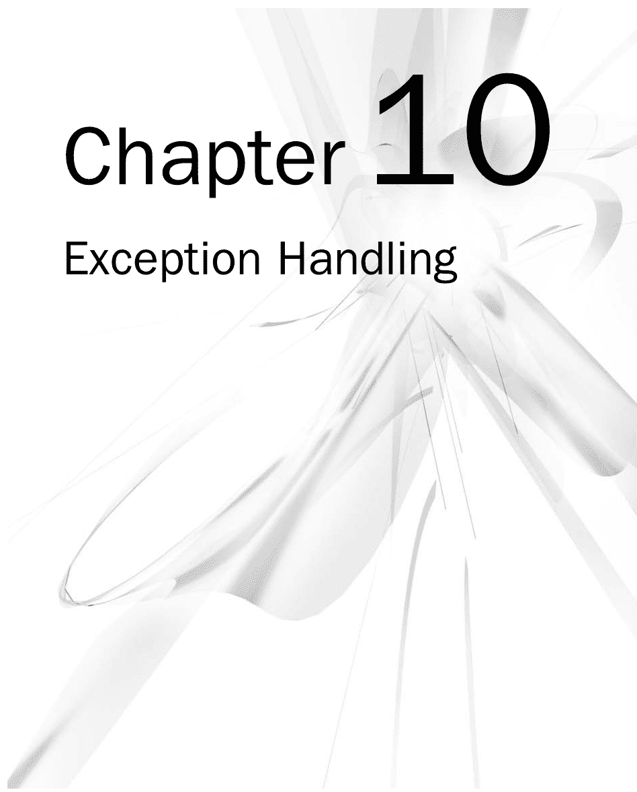

## 核心概念

- 异常处理基础
- Exception 类
- 内置异常
- Try 和 catch
- 抛出异常
- Finally
- 自定义异常

本章讨论了异常处理。异常是运行期间发生的错误。通过异常处理，可以以更合理的方式处理错误。异常处理的主要优势是它自动处理了原本需要手动处理的代码。

### Exception 类

在 C# 中，异常由类表示。所有异常必须派生自 `System` 命名空间的 `Exception`。一个非常重要的子类是 `SystemException`。它是运行时系统（即 CLR）生成的所有异常的基类。`SystemException` 定义了多个标准异常。例如，当尝试除以零时，会生成 `DivideByZeroException`。在本章后面所示，你也可以创建自己的异常类。

## 异常处理基础

C# 异常处理通过四个关键字管理：`try`、`catch`、`throw` 和 `finally`。它们形成了一个相互关联的子系统，其中一个意味着另一个。在本章中，将对每个关键字进行详细检查。然而，在开始阶段对它们的作用有一个一般的理解是有用的。它们，它们的工作原理：

- 要监控异常的程序语句位于 `try` 块中。
- 如果 `try` 块发生异常，你的代码可以捕获该异常并以更合理的方式处理。
- 系统生成的异常会自动抛出。要手动抛出异常，请使用 `throw` 关键字。
- 在退出 `try` 块时必须执行的任何放在 `finally` 块中。

### 使用 try 和 catch

异常处理的核心是 `try` 和 `catch`。这两个关键字协同工作，没有 `try` 就没有 `catch`。这里是 `try/catch` 异常处理块的通用形式：

```csharp
try {
    // 监控错误的代码块
}
catch (Exception1 exOb) {
    // ExceptionType1 的处理程序
}
catch (Exception2 exOb) {
    // ExceptionType2 的处理程序
}
```


在这里，`ExceptionType` 是发生的异常类型。当异常被抛出时，它会被相应的 `catch` 子句捕获，由其处理异常。正如通用形式所示，一个 `try` 可以关联多个 `catch` 子句。异常类型决定了执行哪个 `catch`。也就是说，如果 `catch` 指定的异常类型与异常匹配，则执行与该 `catch` 关联的代码块。

## C# 3.0: 入学者指南

（其他 `catch` 子句将被跳过）。当异常被捕获时，异常变量 `exOb` 将接收其值。

实际上，指定 `exOb` 是可选的。如果异常处理程序不需要异常对象（通常情况下如此），那么就没有需要指定 `exOb`。由于这个原因，本章中的许多示例将不会指定 `exOb`。

这里有一个重要的点：如果没有抛出异常，则所有的 `catch` 块都将被跳过。异常将从最后一个 `catch` 之后的第一个语句继续；只有在抛出异常时，才会执行 `catch`。

# 简单的异常示例

下面的示例说明了如何监控并捕获异常。如你所知，尝试访问数组边界之外的索引是一个错误。当这种情况发生时，C# 运行时会抛出一个 `IndexOutOfRangeException`，这是一个标准异常。接下来的程序故意生成了这样一个异常并捕获了它：

```c
// 演示异常处理。

using System;

class ExcDemo1 {

    static void Main() {

        int[] nums = new int[4];

        try {

            Console.WriteLine("Before exception is generated.");

            // 生成索引越界异常。

            nums[7] = 10;

            Console.WriteLine("this won't be displayed");

        } catch (IndexOutOfRangeException) {

            // 捕获异常

            Console.WriteLine("Index out-of-bounds!");

        }

        Console.WriteLine("After catch block.");

    }

}
```

该程序显示以下内容：

Before exception is generated.
Index out-of-bounds!
After catch block.

虽然很短，但前面的程序说明了异常处理的几个关键点。首先，你想要监控错误的代码包含在 `try` 块中。其次当发生异常时（在本例中，是因为尝试访问边界内的索引），异常会被抛出 `try` 块并被 `catch` 捕获。此时，控制权传递到 `catch` 块，`try` 块终止。也就是说，`catch` 没有被调用。

# 第 10 章：异常处理

相反，程序执行被转移到了它。因此，越界索引之后的 `WriteLine()` 语句永远不会执行。在 `catch` 块执行后，程序控制将继续执行 `catch` 之后的语句。因此，你的异常处理程序的任务是修复导致异常的问题，以便程序执行能够正常继续。

注意，`catch` 子句中没有指定异常变量。相反，需要异常的类型（在本例中为 `IndexOutOfRangeException`）。如前所述，只有在需要访问异常对象时才需要异常变量。在某些情况下，异常处理程序可以使用异常对象的值来获取有关错误的额外信息。因此，`catch` 异常变量缺失并不罕见，正如前面的程序中的所示。

正如所解释的，如果 `try` 块没有抛出异常，则没有 `catch` 会被执行，程序控制将在 `catch` 之后恢复。为了确认这一点，在前面的程序中，将该行：

`nums[7] = 10;`

改为

`nums[0] = 10;`

现在，没有生成异常，`catch` 块也不会被执行。

## 第二个异常示例

理解 `try` 块中的所有代码都受到异常监控是非常重要的。这包括由从 `try` 块内部调的方法可能生成的异常。从 `try` 块内部调用的方法抛出的异常可以被该 `try` 块捕获——当然，假设方法本身没有捕获该异常。例如，这是一个有效的程序：

```csharp
// 异常可以由一个方法生成并由另一个方法捕获。

using System;

class ExcTest {

    // 生成异常。

    public static void GenException() {

        int[] nums = new int[4];

        Console.WriteLine("Before exception is generated.");

        // 生成索引越界异常。

        nums[7] = 10;

        Console.WriteLine("this won't be displayed");

    }

}
```

```csharp
class ExcDemo2 {

    static void Main() {

        try {

            ExcTest.GenException();

        } catch (IndexOutOfRangeException) {

            // 捕获异常。

            Console.WriteLine("Index out-of-bounds!");

        }

        Console.WriteLine("After catch block.");

    }

}
```

此程序产生以下输出，与之前的第一个版本相同：

Before exception is generated.
Index out-of-bounds!
After catch block.

由于 `GenException()` 是从 `try` 块调用的，它生成的（且未捕获的）异常被 `Main()` 中的 `catch` 捕获了。理解，如果 `GenException()` 捕获了异常，它将永远不会传回 `Main()`。

## 未捕获异常的后果

捕获 C# 的标准异常有一个好处：它可以防止程序终止。当异常抛出时，它必须被某些代码捕获。通常情况下，如果你的程序没有捕获异常，会导致异常终止。虽然这种消息对调试有用，但并不是你希望用户看到的。例如，下面的代码显示了异常未被正确捕获时发生的情况：

```csharp
// 这无效

using System;

class TypeMismatch {

    static void Main() {

        int[] nums = new int[4];

        try {

            Console.WriteLine("Before exception is generated.");

            // 生成索引越界异常。

            nums[7] = 10; 

            Console.WriteLine("this won't displayed");

        } catch (DivideZeroException) {

            /* 无法捕获数组错误。 */

            Console.WriteLine("Index out-of-bounds!");

        }

        Console.WriteLine("After catch block.");

    }

}
```

在这里显示输出：

Before exception is generated.

Unhandled Exception: System.IndexOutOfRangeException outside the array.
at TypeMismatch.Main()

### 异常让你优雅处理

异常处理的一个关键优势是它允许你的程序响应错误并继续。例如，考虑下面的示例，它将一个数组的元素除以另一个数组的元素。如果发生了除以零，就会生成一个 `DivideZeroException`。在程序中，通过报告错误并继续来处理。

```csharp
// 优雅地处理错误并继续。

using System;

class ExcDemo3 {

    static void Main() {

        int[] numer = { 4, 8, 16, 32, 64, 128 };

        int[] denom = { 2, 0, 4, 4, 0, 8 };

        for(int i=0; i < numer.Length; i++) {

            try {

                Console.WriteLine(numer[i] + " / " + 

                denom[i] + " is " + 

                numer[i]/denom[i]);

            } catch (DivideZeroException) {

                Console.WriteLine("Can't divide by Zero!");

            }

        }

    }

}
```

程序的输出在这里：

```
4 / 2 is 2
Can't divide by Zero!
16 / 4 is 4
32 / 4 is 8
Can't divide by Zero!
128 / 8 is 16
```

这个示例说明了另一个重要的点：一旦异常被处理，它就会从系统中移除。因此，在程序中，循环的每次都会都会进入进入块——之前的异常已经被处理过了。这使得你的程序能够处理重复的错误。

### 使用多个 catch 子句

你可以与 `try` 块关联多个一个 `catch` 子句。事实上，这样做非常常见。然而，每个 `catch` 必须捕获不同类型的异常。例如，此处显示的程序同时捕获了数组边界错误和除零错误：

```csharp
// 使用多个 catch 子句。

using System;

class ExcDemo4 {

    static void Main() {

        // 这里，numer 的长度比 denom 长。

        int[] numer = { 4, 8, 16, 32, 64, 128, 256, 512 };

        int[] denom = { 2, 0, 4, 4, 0, 8 };

        for(int i=0; i < numer.Length; i++) {

            try {

                Console.WriteLine(numer[i] + " / " +

                                denom[i] + " is " +

                                numer[i]/denom[i]);

            }

            catch (DivideByZeroException) {

                Console.WriteLine("Can't divide by Zero!");

            }

            catch (OutOfRangeException) {

                Console.WriteLine("No matching element found.");

            }

        }

    }

}
```

该程序产生以下输出：

```
4 / 2 is 2
Can't divide by Zero!
16 / 4 is 4
32 / 4 is 8
Can't divide by Zero!
128 / 8 is 16
No matching element found.
No matching element found.
```


如输出确认，每个 `catch` 子句只对其特定类型的异常做出响应。
通常情况下，`catch` 子句按照它们在程序中出现的顺序进行检查。只有匹配的子句会被执行。所有其他子句都被忽略。


## C# 3.0：学者指南

### 捕获所有异常

有时你想要捕获所有异常，无论其类型如何。要做到这一点，请使用不指定任何异常类型的 `catch` 子句。这创建了一个“捕获所有”处理器，当你想要确保所有异常都由你的程序处理时，它是非常有用的。例如，唯一的 `catch` 是“捕获所有”，它同时捕获了程序生成的 `IndexOutOfRangeException` 和 `DivideByZeroException`：

```csharp
// 使用“捕获所有”catch。

class ExcDeemo5 {

  static void Main() {

    // 这里，numer 的长度比 denom 长。

    int[] numer = { 4, 8, 16, 32, 64, 128, 256, 512 };

    int[] denom = { 2, 0, 4, 4, 0, 8 };

    for (int i=0; i < numer.Length; i++) {

        try {

            Console.WriteLine(numer[i] + " / " + 
                denom[i] + " is " + 
                numer[i]/denom[i]);

        }
        catch { // 这捕获所有异常。
            Console.WriteLine("Some exception occurred.");
        }

    }

  }

}
```

输出显示在此：

```
4 / 2 is 2
Some exception occurred.
16 / 4 is 4
32 / 4 is 8
Some exception occurred.
128 / 8 is 16
Some exception occurred.
Some exception occurred.
```

### try 块可以嵌套

一个 `try` 块可以嵌套另一个 `try` 块中。在内部 `try` 块中生成的异常不会被外部 `try` 块关联的 `catch` 捕获。

## 第 10 章：异常处理

例如，这里的 `IndexOutOfRangeException` 没有被内部 `try` 块捕获，而是被外部 `try` 捕获了：

```csharp
// 使用嵌套的 try 块。

using System;

class NestTries {

    static void Main() {

        // 这里，number 的长度比 denom 长。

        int[] numer = { 4, 16, 32, 64, 128, 256, 512 };

        int[] denom = { 2, 0, 4, 4, 0, 8 };

        try { // 外部 try
            for(int i=0; i < numer.Length; i++) {
                try { // 嵌套 try
                    Console.WriteLine(numer[i] + " / " + 
                        denom[i] + " is " + 
                        numer[i]/denom[i]);
                }
                } catch (DivideByZeroException) { // 内部 try 的 catch
                    Console.WriteLine("Can't divide by Zero!");
                }
            }
        } catch (OutOfRangeException) { // 外部 try 的 catch
            Console.WriteLine("No matching element found.");
        }

    }

}
```

最后执行的代码是由 `finally` 定义的。如果 `try` 块中的任何代码或其任何 `catch` 子句从方法返回，`finally` 块也会被执行。这里是 `finally` 的示例：

```csharp
// 使用 finally.
using System;

class UseFinally {

    public static void GenException(int what) {

        int t;
        int[] nums = new int[2];

        Console.WriteLine("Receiving " + what);

        try {
            switch (what) {
                case 0:
                    t = 10 / what; // 生成除以零错误
                    break;
                case 1:
                    nums[4] = 4; // 生成数组索引越界错误
                    break;
                case 2:
                    return; // 从 try 块返回
            }
        } catch (DivideByZeroException) {
            Console.WriteLine("Can't divide by Zero!");
            return; // 从 catch 返回
        }
        catch (OutOfRangeException) {
            Console.WriteLine("No matching element found.");
        }
        finally {
            Console.WriteLine("Leaving try.");
        }

    }
}

class FinallyDemo {

    static void Main() {

        for(int i=0; i < 3; i++) {
            UseFinally.GenException(i);
            Console.WriteLine();
        }

    }

}
```

> `finally` 块在离开 try/catch 块时会被执行。

## C# 3.0：入门指南

以下是程序产生的输出：

```
Receiving 0
Can't divide by Zero!
Leaving try.

Receiving 1
No matching element found.
Leaving try.

Receiving 2
Leaving try.
```

如输出所示，无论如何退出 `try` 块，`finally` 块都会执行。另有一一点：在语法上，当 `finally` 块紧跟在 `try` 块之后，技术上并不需要 `catch` 子句。因此，你可以有一个 `try` 后面跟一个 `finally` 而没有 `catch` 子句。在这种情况下，当 `try` 退出时会执行 `finally` 块，但不会处理任何异常。

## 深入观察异常

到为止，我们一直在捕获异常，但我们还没有对异常对象本身进行任何操作。如前面解释的那样，`catch` 允许你指定异常类型和一个变量。该变量接收异常对象的引用。由于所有异常都派生自 `Exception`，因此异常支持 `Exception` 定义的成员。在这里，我们将检查它的几个有用成员和构造函数。`Exception` 定义了几个属性。最有趣的三个是 `Message`、`StackTrace` 和 `TargetSite`。`Message` 是描述错误性质的字符串。`StackTrace` 是一个包含导致异常的调用栈的字符串。`TargetSite` 返回一个指定生成异常的方法的对象。

`Exception` 还定义了几个方法。你最常用的是 `ToString()`，它返回一个描述异常的字符串。例如，当异常通过 `WriteLine()` 显示异常时，`ToString()` 会被自动调用。

以下程序演示了上述属性和方法：

```csharp
// 使用 Exception 成员。
using System;

class ExceptionTest {

    public static void GenException() {
        int[] nums = new int[4];
        Console.WriteLine("Before exception is generated.");
        // 生成索引越界异常。
        nums[7] = 10;
        Console.WriteLine("this won't be displayed");
    }

}
```

```csharp
class UseExcept {

    static void Main() {
        try {
            ExcTest.GenException();
        } catch (IndexOutOfRangeException exc) {
            Console.WriteLine("Standard message is: ");
            Console.WriteLine(exc); // 调用 ToString()
            Console.WriteLine("Stack trace: " + exc.StackTrace);
            Console.WriteLine("Message: " + exc.Message);
            Console.WriteLine("TargetSite: " + exc.TargetSite);
        }
        Console.WriteLine("After catch block.");
    }

}
```

该程序的输出所示：

Before exception is generated.
Standard message is:
System.IndexOutOfRangeException: Index was outside the bounds of the array.
    at ExcTest.GenException()
    at UseException.Main()
Stack trace:      at ExcTest.GenException()
    at UseException.Main()
Message: Index was outside the bounds of the array.
TargetSite: Void GenException()
After catch block.

`Exception` 定义了以下构造函数：

`public Exception()`

`public Exception(string str)`

`public Exception(System.Runtime.Serialization.SerializationInfo si, Exception inner)`

`protected Exception(System.Runtime.Serialization.SerializationInfo si, System.Runtime.Serialization.StreamingContext ctx)`

第一个是默认构造函数。第二个指定异常。第三个指定什么是内层异常。它被用于一个异常引发另一个异常的情况。在这种情况下，`inner` 指定第一个异常，如果没有异常存在则为 `null`。（如果存在内层异常，可以通过 `InnerException` 属性获取。） 最后一个一个构造函数处理需要序列化和反序列化的异常。

| Exception | 含义 |
|---|---|
| TypeMismatchException | 类型与数组不匹配。 |
| DivideByZeroException | 除以零。 |
| IndexOutOfRangeException | 索引越界。 |
| InvalidCastException | 类型转换无效。 |
| OutOfMemoryException | 内存不足。 |
| OverflowException | 溢出。 |
| StackOverflowException | 栈溢出。 |

### 表 10-2：Exception 定义的属性

| 属性 | 描述 |
|---|---|
| Message | 描述错误性质的字符串。 |
| StackTrace | 导致异常的调用栈字符串。 |
| TargetSite | 指定生成异常的对象。 |

### 表 10-3：Exception 定义的方法

| 方法 | 描述 |
|---|---|
| ToString() | 返回描述异常的字符串。 |

## 第 10 章：异常处理 379

创建异常类时，你通常希望支持 `Exception` 的属性和方法。例如，你可能希望重写 `ToString()` 方法。

```csharp
// 使用自定义异常。
using System;

// 创建异常。
class NonResultException : Exception {
    /* 实现所有构造函数。注意它没有给基类添加任何内容。 */
    public NonResultException() : base() {}
    public NonResultException(string str) : base(str) {}
    public NonResultException(string str, Exception inner) :
        base(str, inner) {}
    protected NonResultException(
        System.Runtime.Serialization.SerializationInfo si,
        System.Runtime.Serialization.StreamingContext sc)
        : base(si, sc) {}
    // 为 NonResultException 重写 ToString。
    public override string ToString() {
        return Message;
    }
}

class CustomExceptDemo {

    static void Main() {
        // 这里，number 包含一些奇值。
        int[] numer = { 4, 8, 15, 32, 64, 127, 256, 512 };
        int[] denom = { 2, 0, 4, 4, 0, 8 };

        for(int i=0; i < numer.Length; i++) {
            try {
                if((numer[i] % denom[i]) != 0)
                    throw new NonResultException("Outcome of " +
                        numer[i] + " / " + denom[i] + " is not even.");
            } catch (NonResultException ex) {
                Console.WriteLine(ex.Message);
            }
        }

    }

}
```

## C# 3.0: 初学者指南

```csharp
Console.WriteLine(numer[i] + " / " +
      denom[i] + " is = " +
      numer[i]/denom[i]);
}
  catch (DivideByZeroException) {
    Console.WriteLine("Can't divide by Zero!");
  }
  catch (IndexOutOfRangeException) {
    Console.WriteLine("No matching element found.");
  }
  catch (NonIntResultException exc) {
    Console.WriteLine(exc);
  }
}
```


程序的输出所示：

4 / 2 is 2
Can't divide by Zero!
Outcome of 15 / 4 is not even.
32 / 4 is 8
Can't divide by Zero!
Outcome of 127 / 8 is not even.
No matching element found.
No matching element found.

注意，没有任何一个构造函数在它们的体中提供了语句。相反，它们仅仅是通过 `base` 将参数传递给 `Exception`。在你的异常类没有添加任何功能的情况下，你可以简单地让 `Exception` 构造函数处理该过程。正如所解释的，并没有要求你的派生类必须增加从 `Exception` 继承的内容。正是它们在类型系统中的存在，允许你将它们作为异常使用。

在继续之前，你可能想稍微实验一下这个程序。例如，尝试注释掉 `ToString()` 的覆盖并观察它生成了什么。此外，使用默认构造函数创建一个异常，并观察 C# 生成了什么默认消息。

# 捕获派生类异常

在尝试捕获涉及基类和派生类的异常类型时，你需要小心如何使用 `catch`，因为用于基类的 `catch` 子句也会匹配它的任何派生类。例如，所有异常的基类都是 `Exception`，捕获 `Exception` 就会捕获所有可能的异常。当然，不带异常类型的 `catch` 了一种了一种更干净的方法来捕获所有异常，如前所述。然而，捕获派生类异常的问题在其他上下文中非常重要，特别是当你创建自己的异常时。

# 第 10 章：异常处理

如果你想同时捕获基类类型和派生类类型的异常，请将派生类放在 `catch` 序列的第一个位置。这是必要的，因为基类的 `catch` 会捕获所有派生类。幸运的是，这个规则是强制执行的，将基类放在前面会导致编译时错误。

以下程序创建了名为 `ExceptA` 和 `ExceptionB` 的两个异常类。`ExceptA` 派自 `Exception`。`ExceptionB` 派自 `ExceptA`。程序随后抛出了每个类型的异常。为了简单起见，它只提供了一个构造函数（接受一个描述异常的字符串）。但请记住，在商业代码中，你的自定义异常类通常会提供 `Exception` 定义的四个构造函数之一。

```csharp
// 派生类必须出现在基类之前。

using System;

// 创建一个异常。

class ExceptA : Exception {

    public ExceptA(string str) : base(str) { }

    public override string ToString() {

        return Message;

    }

}

// 创建一个派自 ExceptA 的异常

class ExceptB : ExceptA {

    public ExceptB(string str) : base(str) { }

    public override string ToString() {

        return Message;

    }

}

class OrderMatters {

    static void Main() {

    for(int x = 0; x < 3; x++) {

        try {

            if(x==0) throw new ExceptA("Caught an ExceptA exception");

            else if(x==1) throw new ExceptB("Caught an ExceptB exception");

            else throw new Exception();

        } catch (ExceptB exc) {

            Console.WriteLine(exc);

        }

        catch (ExceptA exc) {

            Console.WriteLine(exc);

        }

        catch (Exception exc) {

            Console.WriteLine(exc);

        }

    }

}
```

> 注意 `ExceptB` 派自 `ExceptA`。

# C# 3.0: 初学者指南

程序的输出所示：

```
Caught an ExceptA exception

Caught an ExceptB exception

System.Exception: Exception of type 'System.Exception' was thrown.

at OrderMeters.Main()
```

注意 `catch` 子句的顺序。这是它们可以出现的唯一顺序。由于 `ExceptB` 派自 `ExceptA`，因此对 `ExceptB` 的捕获必须在对 `ExceptA` 的之前。同样，对 `Exception`（所有异常的基类）的捕获必须最后出现。为了亲自证明这一点，请尝试重新排列 `catch` 子句。这样做会导致编译错误。

# 专家问答

- Q: 既然异常通常表示特定的错误，我为什么想要捕获基类异常呢？
- A: 捕获基类异常的子句允许你捕获一整类异常，通过单个 `catch` 妥当地处理它们并避免代码重复。例如，你可能会创建一组描述某种设备错误的异常。如果你的异常只是告诉用户发生了设备错误，那么你就可以对所有此类类型的异常使用通用的 `catch`。处理器可以简单地显示 `Message` 字符串。由于执行此操作的代码对所有异常都是相同的，一个 `catch` 就可以响应所有的设备异常。

# 尝试将异常添加到 Queue 类中

在这个项目中，你将创建两个异常类，它们可以用于第 9 章“尝试”部分中开发的队列类。它们将指示队列已满和空的错误条件。当发生错误时，这些异常分别由 `Put()` 和 `Get()` 方法抛出。

## 逐步步骤

1. 创建一个名为 `QExcDemo.cs` 的文件。
2. 在 `QExcDemo.cs` 中定义以下异常：

```csharp
// 为队列添加异常处理。

using System;

// 队列满异常。

class QueueFullException : Exception {

    public QueueFullException(string str) : base(str) {}

    // 如果需要，添加其他的 QueueFullException。

    public override string ToString() {

        return "\n" + Message;

    }

}

// 队列空异常。

class QueueEmptyException : Exception {

    public QueueEmptyException(string str) : base(str) {}

    // 如果需要，添加其他的 QueueEmptyException。

    public override string ToString() {

        return "\n" + Message;

    }

}
```

3. 修改 `SimpleQueue` 类使其抛出异常，所示：

```csharp
// 使用异常的简单固定大小队列类。

class SimpleQueue : ICharQ {

    char[] q; // 此数组持有队列

    int putloc, getloc; // put 和 get 索引

    // 给定大小构造一个空队列。

    public SimpleQueue(int size) {

        q = new char[size+1]; // 为队列分配内存

        putloc = getloc = 0;

    }

    // 将字符放入队列。
```

当向已满的队列存储项时，会生成 `QueueFullException`。当从空队列删除元素时，会生成 `QueueEmptyException`。

为 `SimpleQueue` 添加异常允许以合理的方式处理队列错误。你可能记得之前的 `SimpleQueue` 版本只是报告了错误。抛出异常是一个好得的方法，因为它允许使用 `SimpleQueue` 的代码能够适当处理错误。

4. 要尝试更新后的 `SimpleQueue` 类，将此处所示的 `QExDemo` 类添加到 `QExcDemo.cs`：

```csharp
// 演示队列异常。

class QExDemo {

    static void Main() {

        SimpleQueue q = new SimpleQueue(10);

        char ch;

        int i;

        try {

            // 溢队列。

            for(i=0; i<11; i++) {

                Console.Write("Attempting to store : " + (char)('A' + i));

                q.Put((char)('A' + i));

                Console.WriteLine(" -- OK");

            }

            Console.WriteLine();

        }

        catch (QueueFullException exc) {

            Console.WriteLine(exc);

        }

        Console.WriteLine();

    }

}
```

# 第 10 章：异常处理 385

```c
try {

    // 使队列溢空。

    for(i=0; i < 11; i++) {

        Console.Write("Getting next char: ");

        ch = q.Get();

        Console.WriteLine(ch);

    }

} catch (QueueEmptyException exc) {

    Console.WriteLine(exc);

}
```

5. 要创建程序，你必须使用 `IQChar.cs` 文件编译 `QExcDemo.cs`。请记住 `IQChar.cs` 队列接口。当你运行 `QExcDemo` 时，将看到以下输出：

```
Attempting to store : A -- OK
Attempting to store : B -- OK
Attempting to store : C -- OK
Attempting to store : D -- OK
Attempting to store : E -- OK
Attempting to store : F -- OK
Attempting to store : G -- OK
Attempting to store : H -- OK
Attempting to store : I -- OK
Attempting to store : J -- OK

Queue Full! Max length is 10.
```

```
Getting next char: A
Getting next char: B
Getting next char: C
Getting next char: D
Getting next char: E
Getting next char: F
Getting next char: G
Getting next char: H
Getting next char: I
Getting next char: J

Queue is empty.
```

# 使用 checked 和 unchecked

算术运算可能会导致溢出。例如，考虑以下序列：

```csharp
byte a, b, result;

a = 127;

b = 127;

result = (byte) (a * b);
```

在这里，`a` 和 `b` 的乘积超过了 `byte` 的范围。因此，结果溢出了 `result` 类型的范围。

C# 允许你使用 `checked` 和 `unchecked` 关键字来指定当发生溢出时代码是否会抛出异常。要指定对一个表达式进行溢出检查，请使用 `checked`。要指定忽略溢出，请使用 `unchecked`。在这种情况下，结果将被截断以适应表达式的目标类型。

`checked` 关键字有两种通用形式。一种是检查特定的表达式，称为运算符形式的 `checked`。另一种是检查一个语句块，称为语句形式。

```csharp
checked (
    // 要检查的语句
)
```

在这里，`expr` 是正在被检查的表达式。如果 `checked` 表达式溢出，则会抛出 `OverflowException`。

`unchecked` 关键字也有两种通用形式。第一是运算符形式，忽略特定表达式的溢出。另一种是忽略语句块的溢出。它们显示在这里：

```csharp
unchecked (expr)
unchecked (
    // 忽略溢出的语句
)
```

在这里，`expr` 是未进行溢出检查的表达式。如果 `unchecked` 表达式溢出，将发生截断。

这里是一个演示同时使用 `checked` 和 `unchecked` 的程序。

```csharp
// Using checked and unchecked.
using System;
```

# 第 10 章：异常处理 387

```csharp
class CheckedDemo {

    static void Main() {

        byte a, b;

        byte result;

        a = 127;

        b = 127;

        // 此表达式中的溢出      // 此处的溢出
        // 会被截断。              //会导致异常。

        try {

            result = unchecked((byte) (a * b));

            Console.WriteLine("Unchecked result: " + result);

            result = checked((byte) (a * b)); // 这会导致异常

            Console.WriteLine("Checked result: " + result); // 不执行

        } catch (OverflowException exc) {

            Console.WriteLine(exc);

        }

    }

}
```

程序的输出显示在此：

Unchecked result: 1
OverflowException: Arithmetic operation resulted in an overflow.
at CheckedDemo.Main()

显而易见，`unchecked` 表达式导致了截断。`checked` 表达式导致了异常。
前面的程序演示了对单个表达式使用 `checked` 和 `unchecked`。下面的程序显示了如何对语句块进行检查和取消检查：

```csharp
// Using checked and unchecked with statement blocks.
using System;

class CheckedBlocks {

    static void Main() {

        byte a, b;

        byte result;

        a = 127;

        b = 127;

        try {

            unchecked {

                a = 127;

                b = 127;
```

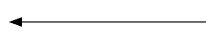

```csharp
result = (byte)(a * b);

Console.WriteLine("Unchecked result: " + result);

a = 125;

b = 5;

result = (byte)(a * b);

Console.WriteLine("Unchecked result: " + result);
```

```csharp
checked {

    a = 2;

    b = 7;

    result = (byte)(a * b); // 这是 OK

    Console.WriteLine("Checked result: " + result);

    a = 127;

    result = (byte)(a * b); // 这会导致异常

    Console.WriteLine("Checked result: " + won't execute);

}
```

```csharp
catch (OverflowException exc) {

    Console.WriteLine(exc);

}
```


程序的输出显示在此：

Unchecked result: 1
OverflowException: Arithmetic operation resulted in an overflow.
at CheckedDemo.Main()

显而易见，`unchecked`表达式导致了截断。`checked`表达式导致了异常。
前面的程序演示了对单个表达式使用`checked`和`unchecked`。下面的程序显示了如何对语句块进行检查和取消检查：

```csharp
// Using checked and unchecked with statement blocks.

using System;

class CheckedBlocks {

    static void Main() {

        byte a, b;

        byte result;

        a = 127;

        b = 127;

        try {

            unchecked {

                a = 127;

                b = 127;

```
`char`字节的高位字节。但这对于其余 Unicode 字符并不适用，因为这些字符需要两个字节。字节流并不完全适合处理基于字符的 I/O。为了解决这个问题，C# 定义了几个类，可以将字节流转换为流，并自动替你处理从字节到字符以及字符到字节的转换。

## 预定义流

三个定义的流通过属性`Console.In`、`Console.Out`和`Console.Error`暴露出来，供所有使用`System`命名空间的程序使用。`Console.Out`指向标准输出流，通常就是控制台。例如，当你调用`Console.WriteLine()`时，它会自动发送到`Console.Out`。`Console.In`指向标准输入；而默认情况下，`Console.Error`指向标准错误流，默认情况下也是控制台。然而，这些流可以重定向到任何兼容的 I/O 设备。标准流是字符流。因此，这些流读取和写入字符。

### 流类

I/O 系统同时定义了字节流和字符流类。然而，字符流实际上是包装器，用于将统一的字节流转换为字符流，并自动处理任何转换。因此，字符类虽然逻辑上是独立的，但它们构建在字节流之上。

所有类都定义在`System.IO`命名空间中。要使用这些类，通常会在程序顶部包含以下语句：

```csharp
using System.IO;
```

不需要为控制台输入输出指定`System.IO`的原因是`Console`类定义在`System`命名空间中。

## 类

核心流类是`System.IO.Stream`。它表示字节流，是所有其他流类的基类。它是抽象的，这意味着你不能直接实例化`Stream`。`Stream`定义了一系列标准的流操作。表 11-1 显示了`Stream`定义的方法。

表 11-1 中的某些方法会在发生 I/O 错误时抛出`IOException`。如果尝试无效操作（例如尝试向只读流写入），将抛出`NotSupportedException`。取决于具体的方法，可能会发生其他异常。

注意`Stream`定义了读取和写入数据的方法。然而，并不是所有的流都支持这两个操作，因为可以打开只读或只写入的流。此外，并不是所有流都支持通过`Seek()`请求位置。要确定流的能力，你将使用`Stream`的一个或多个属性。它们显示在表 11-2 中。同时也展示了`Length`和`Position`属性，它们包含了流的长度及其当前位置。

## C# 3.0：初学者指南

| 方法 | 描述 |
| --- | --- |
| void Close() | 关闭流。 |
| void Flush() | 将流的内容写入物理设备。 |
| int ReadByte() | 返回下一个可用输入字节的整数表示。遇到文件末尾时返回 -1。 |
| int Read(byte[] buf, int offset, int numBytes) | 尝试从`buf[offset]`开始向`buf`中读取`numBytes`个字节，并返回成功读取的字节数。 |
| long Seek(long offset, SeekOrigin origin) | 将流中的当前位置设置为相对于指定源的指定偏移量。 |
| void WriteByte(byte[] buf, int offset, int numBytes) | 从数组`buf`中从`buf[offset]`开始写入子范围的字节。返回写入的字节数。 |

表 11-1 Stream 定义的方法示例

## 字节流类

几个具体的字节流派自`Stream`。这里显示了定义在`System.IO`命名空间中的流类。

| 流类 | 描述 |
| --- | --- |
| BufferedStream | 包装字节流并添加缓冲。在许多情况下，缓冲可以提供性能增强。 |
| FileStream | 为文件 I/O 设计的字节流。 |
| MemoryStream | 使用内存进行存储的字节流。 |
| UnmanagedMemoryStream | 使用内存存储的字节流，但不适用于混合语言编程。 |

其他具体的流类提供了对压缩文件、套接字和管道的支持，.NET Framework 还支持其他类型。你也可以派生自己的流类。对于绝大多数应用程序，内置流就已经足够了。

### 字符流包装类

要创建字符流，你会将一个字节流封装在一个字符流包装器内部。在字符流层级结构的顶端是抽象类`TextReader`和`StreamWriter`。这两个抽象类定义的方法对其所有的子类都可用。因此，它们构成了所有字符流都将拥有的 I/O 函数最小集。

## 第11 章：使用 I/O 395

| 属性 | 描述 |
|---|---|
| bool CanRead | 如果流可以读取，则该属性为真。该属性是只读。 |
| bool CanSeek | 如果流支持位置请求，则该属性为真。该属性是只读。 |
| bool CanTimeout | 如果流可以超时，则该属性为真。该属性是只读。 |
| bool CanWrite | 如果流可以写入，则该属性为真。该属性是只读。 |
| long Length | 该属性包含流的长度。该属性是只读。 |
| long Position | 该属性表示流的当前位置。该属性是可读写的。 |
| int ReadTimeout | 该属性表示超时前的长度。该属性是可读写的。 |
| int WriteTimeout | 该属性表示超时前的长度。该属性是只读。 |

表 11-2 Stream 定义的属性

## C# 3.0：初学者指南

`TextWriter`定义了`Write()`和`WriteLine()`的重载版本以输出所有内置类型。例如，这里是它们的一些重载版本：

| 方法 | 描述 |
| --- | --- |
| void Write(int val) | 写入 int。 |
| void Write(double val) | 写入 double。 |
| void Write(bool val) | 写入 bool。 |
| void WriteLine(string val) | 写入字符串并换行。 |
| void WriteLine(int val) | 写入 uint 并换行。 |
| void WriteLine(char val) | 写入字符并换行。 |

写入时发生错误会抛出`IOException`。除了`Write()`和`WriteLine()`，`TextWriter`还定义了这里的`Close()`和`Flush()`方法：

- virtual void Close()
- virtual void Flush()

`Flush()`将输出缓冲区剩余的数据写入物理介质。`Close()`关闭流。
`TextReader`和`TextWriter`类由几个字符流类实现，包括这里的。因此，这些流提供了`TextReader`和`TextWriter`指定的方法和属性。

| 流类 | 描述 |
| --- | --- |
| StreamReader | 从字节流读取字符。该类包装了字节输入流。 |
| StreamWriter | 将字符写入字节流。该类包装了字节输出流。 |
| StringReader | 从字符串读取字符。 |
| StringWriter | 将字符写入字符串。 |

表 11-3 TextReader 定义的输入方法

| 方法 | 描述 |
|---|---|
| int Peek() | 获取输入的下一个字符，但不移除该字符。如果没有字符则返回 -1。 |
| int Read() | 返回流中下一个可用字符的整数表示。遇到文件末尾时返回 -1。 |
| int Read(char[] buf, int offset, int numChars) | 尝试从`buf[offset]`开始向`buf`中读取`numChars`个字符，并返回成功读取的字符数。 |
| int ReadBlock(char[] buf, int offset, int numChars) | 尝试从`buf[offset]`开始向`buf`中读取`numChars`个字符，并返回成功读取的字符数。 |
| string ReadLine() | 读取行文本并作为字符串返回。在文件末尾尝试读取时返回 null。 |
| string ReadToEnd() | 返回流中的所有剩余字符并作为字符串返回。 |

### 控制台 I/O

控制台 I/O 通过标准流`Console.In`、`Console.Out`和`Console.Error`完成。你从 Console 1 开始就在使用控制台 I/O，因此对它已经熟悉了。正如你将看到的，它具有一些额外的功能。

然而，在我们开始之前，强调书中前面的这一点非常重要：C# 的大多数真实应用并不是基于文本的控制台程序。相反，它们将是面向图形的程序或组件，依赖于窗口界面与用户交互，或者是服务器端应用程序。因此，I/O 系统中与控制台输入输出相关的部分并不广泛使用。虽然基于文本的程序作为教学示例和短实用程序非常出色，但它们并不适用于大多数真实世界的应用。

### 读取控制台输入

`Console.In`是`TextReader`的实例，你可以使用`TextReader`提供的方法来访问它。不过，你通常会使用`Console`提供的方法，它会自动从`Console.In`读取。Console 定义了两个输入方法：`Read()`和`ReadLine()`。

要读取单个字符，请使用`Read()`方法。如下所示：

```
static int Read()
```

该方法在第 3 章中引入。它返回从控制台读取的下一个字符。该字符以`int`类型返回，必须强制转换为`char`。出错时返回 -1。此方法在失败时会抛出`Exception`。记住`Read()`是行缓冲的，因此在你输入的任何字符发送到程序之前，你必须按下 ENTER 键。

要读取字符字符串，请使用`ReadLine()`方法。如下所示：

```
static string ReadLine()
```

`ReadLine()`读取字符直到你按下 ENTER 键，并以字符串对象的形式返回它们。此方法在失败时也会抛出`Exception`。

这里是一个演示如何从`Console.In`读取一行字符的程序：

```
// 使用 ReadLine() 从控制台读取输入。
using System;
class ReadChars {
    static void Main() {
        string str;
        Console.WriteLine("Enter some characters.");
        str = Console.ReadLine(); //<- 从键盘读取字符串。
        Console.WriteLine("You entered: " + str);
    }
}
```


## C# 3.0: 初学者指南

这里是示例运行：

Enterter some characters.
This is a test.
You entered: This is a test.

虽然`Console`方法是从控制台读取内容最简单的方法，但你可以调用底层`TextReader`的方法，该对象可以通过`Console.In`获取。例如，这里是将前面的程序重写为使用`TextReader`定义的方法：

```
/* 直接使用 Console.In 从键盘读取字节数组。 */
class ReadChars2 {
    static void Main() {
        string str;
        Console.WriteLine("Enter some characters.");
        str = Console.In.ReadLine(); ⬅️ 显式地从 Console.In 读取。
        Console.WriteLine("You entered: " + str);
    }
}
```

注意`ReadLine()`现在是如何直接由`Console.In`调用的。这里的关键点在于，如果你需要访问由`Console.In`底层的`TextBox`定义的方法，你将像这个示例所示调用这些方法。

## 输出控制台输出

`Console.Out`和`Console.Error`是`StreamWriter`对象。控制台输出最容易实现的方法是使用`Write()`和`WriteLine()`，你对这些方法已经熟悉了。这些方法存在多个版本用于处理每个内置类型的输出。Console 定义了它的`Write()`和`WriteLine()`版本，以便它们被`Console`调用，正如你在整本书中一直在做的那样。不过，如果你选择，你可以在`Console.Out`和`Console.Error`底层的`TextWriter`上调用这些（以及其他）方法。

这里是一个演示向`Console.Out`输出的程序。向`Console.Out`输出最容易的方法是：

```csharp
using System;
class WriteChars {
    static void Main() {
        string str;
        Console.WriteLine("Enter some characters.");
        try {
            int a=10, b=0; a / b;
        } catch (DivideByZeroException exc) {
            Console.WriteLine(exc.Message);
        }
    }
}
```

控制台输出。使用`Console.WriteLine`和`Console.Write`最容易实现。`Console.Out`和`Console.Error`是`StreamWriter`对象。控制台输出最容易实现的方法是使用`Write()`和`WriteLine()`，你对这些方法已经熟悉了。Console 定义了它的`Write()`和`WriteLine()`版本，以便它们被`Console`调用，正如你在整本书中一直在做的那样。不过，如果你选择，你可以在`Console.Out`和`Console.Error`底层的`TextWriter`上调用这些（以及其他）方法。


控制台输出。使用 `Console.WriteLine` 和 `Console.Write` 最容易实现。`Console.Out` 和 `Console.Error` 是 `StreamWriter` 对象。控制台输出最容易实现的方法是使用 `Write()` 和 `WriteLine()`，你对这些方法已经熟悉了。`Console` 定义了它的 `Write()` 和 `WriteLine()` 版本，以便它们被 `Console` 调用，正如你在整本书中一直在做的那样。不过，如果你选择，你可以在 `Console.Out` 和 `Console.Error` 底层的 `TextWriter` 上调用这些（以及其他）方法。

```cs
using System;

class WriteChars {
    static void Main() {
        string str;
        Console.WriteLine("Enter some characters.");
        try {
            int a=10, b=0; a / b; // 异常
        } catch (DivideByZeroException exc) {
            Console.WriteLine(exc.Message);
        }
    }
}
```

## 询问专家

- **Q:** 正如你所解释的，`Read()` 是行缓冲的。这意味着它会等待按键。是否有按键的方法？
- **A:** 有的！从 2.0 版本开始，NET Framework 包含了非缓冲方式读取按键的方法。`ReadKey()` 返回一个 `ConsoleKeyInfo` 对象，这是一个结构体。它包含以下只读属性：

  - `KeyChar`: 按键的字符形式。
  - `Key`: 来自 `ConsoleKey` 枚举的值，它是键盘上所有键的枚举。
  - `Modifiers`: 描述了生成按键时按下了哪些（如果有的话）键盘修饰键。这些修饰键由 `ConsoleModifiers` 枚举表示，它的值有：Control、Shift 和 Alt。`Modifiers` 中可能存在多个修饰键值。

### FileStream 和字节流 I/O

I/O 系统提供了允许读取和写入文件的类。当然，最常见的文件类型是磁盘文件。在操作系统层面，所有文件都是面向字节的。正如你所预期的，有方法可以在文件中读写字节。使用字节读写文件非常常见。你也可以将字节流封装在字符对象中。字符文件操作在存储文本时非常有用。这里描述了字节流 I/O。

要创建一个连接文件的字节流，你将使用 `FileStream` 类。`FileStream` 派生自 `Stream` 并包含了 `Stream` 的所有功能。

记住，流类（包括 `FileStream`）定义在 `System.IO` 中。因此，在任何使用它们的程序顶部，你通常会包含它。

### 打开和关闭文件

要创建一个链接到文件的字节流，创建一个 `FileStream` 对象。`FileStream` 定义了多个构造函数。可能最常用的一个所示：

```
FileStream(string filename, FileMode mode)
```

在这里，`filename` 指定要打开的文件名，可以包含完整路径规范。`mode` 参数指定打开文件的方式。它必须是 `FileMode` 枚举定义的值之一。这些值表 11-4 所示。通常情况下，这

# 第 11 章：使用 I/O 401

| 值 | 描述 |
| :--- | :--- |
| `FileMode.Append` | 输出追加到文件末尾。 |
| `FileMode.Create` | 创建一个新的输出文件。任何同名的预存在文件都将被删除。 |
| `FileMode.CreateNew` | 创建一个新的输出文件。该文件不能已存在。 |
| `FileMode.Open` | 打开一个已存在的文件。 |
| `FileMode.OpenOrCreate` | 如果文件存在则打开它，如果不存在则创建该文件。 |
| `FileMode.Truncate` | 打开一个已存在的文件，但将其长度减为零。 |

# 表 11-4 FileMode 的值

构造函数打开一个文件以进行读/写访问。唯一的例外情况是使用 `File.Append` 打开文件时。在这种情况下，文件是只写的。

如果在尝试打开文件时发生故障，将抛出异常。如果因为文件不存在而无法打开，将抛出 `FileNotFoundException`。如果由于某种类型的 I/O 错误无法打开文件，将抛出 `IOException`。其他可能的异常包括 `ArgumentNullException`（文件名为空）、`ArgumentException`（文件名无效）、`OutOfRangeException`（模式无效）、`SecurityException`（用户没有访问权限）、`PathTooLongException`（文件名过长）、`NotSupportedException`（文件名指定了不支持的设备）以及 `DirectoryNotFoundException`（指定的目录无效）。

`PathTooLongException`、`DirectoryNotFoundException` 和 `FileNotFoundException` 是 `IOException` 的子类。因此，通过捕获 `IOException` 可以捕获所有这些异常。

以下显示了如何为了输入打开文件 `test.dat`：

```cs
try {
    fin = new FileStream("test", FileMode.Open);
} catch (IOException exc) {
    Console.WriteLine(exc.Message);
    // 处理错误。
} catch (Exception exc) { // 捕获任何其他异常
    Console.WriteLine(exc.Message);
    // 处理错误。
}
```

在这里，第一个 `catch` 处理找不到文件、路径过长、目录不存在或发生其他 I/O 错误的情况。第二个 `catch` 是针对所有其他类型异常的“全捕获”子句，处理可能的错误（可能通过重新抛出异常）。你也可以单独检查每个错误，更具体地报告发生的问题并采取针对该错误的特定补救措施。为了简单起见，书中的示例将只捕获 `IOException`，但根据情况，你的真实世界代码可能需要处理其他可能的异常。

# 402 C# 3.0：入门指南

### 注意

为了保持代码简单，本章中的示例仅捕获 `IOException`，但你自己的代码可能需要处理其他可能的异常，或单独处理 I/O 异常。

如前所述，除了指定了 `FileMode.Append` 之外，`FileStream` 构造函数只是打开一个具有读/写访问权限的文件。如果你想将访问限制为仅读或仅写，请使用此构造函数：

```cs
FileStream(string filename, FileMode mode, FileAccess how)
```

与之前一样，`filename` 指定要打开的文件名，`mode` 指定了如何打开文件。传递给 `how` 的值决定了如何访问该文件。它必须是 `FileAccess` 枚举定义的值之一，显示在此：

```cs
FileAccess.Read                               FileAccess.Write                                     FileAccess.ReadWrite
```

例如，这是一个只读文件：

```cs
FileStream fin = new FileStream("test.dat", FileMode.Open, FileAccess.Read);
```

当你完成对文件的操作后，必须通过调用 `Close()` 关闭它。其通用形式所示：

```cs
void Close()
```

关闭文件释放分配给文件的系统资源，允许其他文件使用它们。有趣的是，`Close()` 通过调用 `Dispose()` 来工作，而 `Dispose` 实际上释放了资源。

### 注意

第 15 章中描述的 `using` 语句提供了一种在不再需要时自动关闭文件的方法，这种方法适用于各种情况。然而，为了清晰说明文件处理的基础，本章在所有情况下都显式调用了 `close()`。

### 从 FileStream 读取字节

`FileStream` 定义了两个从文件读取字节的方法：`ReadByte()` 和 `Read()`。从文件中读取单个字节，使用 `ReadByte()`，其通用形式所示：

```cs
int ReadByte()
```

# 第 11 章：使用 I/O 403

每次调用它时，它都会从文件中读取单个字节并作为整数值返回。当遇到文件末尾时，返回 –1。可能的异常包括 `NotSupportedException`（流未为输入打开）和 `ObjectDisposedException`（流已关闭）。

要读取字节块，使用 `Read()`，它的通用形式为：

```cs
int Read(byte[] buf, int offset, int numBytes)
```

`Read()` 尝试将 `num` 个字节读取到 `buf[offset]` 中。它返回成功读取的字节数。如果发生 I/O 错误，将抛出 `IOException`。可能还有其他几种类型的异常，包括 `NotSupportedException`，当流不支持读取时会抛出该异常。

以下程序使用 `ReadByte()` 输入并显示文件的内容，其文件名作为命令行参数指定。它捕获 `ReadByte()` 返回的值并将其转换为 `char`，以便显示。注意，程序处理了两种错误：找不到文件或读取期间发生错误。要查看名为 `TEST.CS` 的文件，使用以下命令。

```cs
using System;
using System.IO;
class ShowFile {
    static void Main(string[] args) {
        int i;
        FileStream fin;
        if(args.Length != 1) {
            Console.WriteLine("Usage: ShowFile File");
            return;
        }
        try {
            fin = new FileStream(args[0], FileMode.Open);
        } catch (IOException exc) {
            Console.WriteLine(exc.Message);
            return;
        }
        // 读取字节直到遇到 EOF。
        do {
            try {
                i = fin.ReadByte(); // 从文件读取。
            } catch (IOException exc) {
                Console.WriteLine(exc.Message);
            }
            if (i != -1) Console.Write((char) i);
        } while (i != -1);
        fin.Close();
    }
}
```

## 问专家

**Q:** 我注意到 `ReadByte()` 在到达文件末尾时返回 -1，但它对文件错误没有特殊的返回值。为什么不这样做呢？

**A:** 在 C# 中，错误由异常表示。因此，如果 `ReadByte()` 或任何其他 I/O 方法没有抛出异常，意味着它执行无误。这比使用特殊的错误代码处理 I/O 错误要干净得多。

### 写入文件

向文件中写入字节，使用 `WriteByte()` 方法。其最简单的形式所示：

```cs
void WriteByte(byte val)
```

该方法将字节 `val` 写入文件。如果底层流未为输出打开，将抛出 `NotSupportedException`。如果流已关闭，将抛出 `ObjectDisposedException`。

你可以调用 `Write()` 向文件写入一组字节。形式所示：

```cs
int WriteByte(byte[] buf, int offset, int numBytes)
```

`Write()` 将数组 `buf` 中从 `buf[offset]` 开始的 `numBytes` 个字节写入文件。返回写入的字节数。如果在写入期间发生错误，将抛出 `IOException`。如果流未为输出打开，将抛出 `NotSupportedException`。可能还有其他异常。

如你所知，执行文件输出时，输出通常不会立即写入物理设备。相反，输出由操作系统进行缓冲，直到可以一次性写入大量数据块为止。这提高了系统的效率。

# 第 11 章：使用 I/O 405

例如，磁盘文件按扇区组织，扇区长度可能从 128 字节不等。输出通常会被缓冲，直到整个扇区可以一次性写入。然而，如果你想强制将数据写入物理设备，无论缓冲区是否满，都可以调用 `Flush()`，如下所示：

```
void Flush()
```

如果失败，将抛出 `IOException`。如果在调用时流已关闭关闭，则会抛出 `ObjectDisposedException`。

当你完成输出文件的操作后，必须记得使用 `Close()` 将其关闭。这样做可以确保磁盘缓冲区中任何剩余的输出都会实际写入磁盘。在关闭文件之前没有必要调用 `Flush()`。

下面的示例复制了一个文件。源文件和目标文件的名称在命令行中指定。

```c
/*
复制文件。
要使用此程序，请指定
源文件和目标文件的名称。
例如，将名为 FIRST.TXT 的文件
复制到名为 SECOND.TXT 的文件，请使用以下
命令行。
CopyFile FIRST.TXT SECOND.TXT
*/
```

```csharp
using System;
using System.IO;
class CopyFile {
    static void Main(string[] args) {
        int i;
        FileStream fin;
        FileStream fout;
        if(args.Length != 2) {
            Console.WriteLine("Usage: CopyFile From To");
            return;
        }
```


```csharp
// 打开输入文件。
try {
    fin = new FileStream(args[0], FileMode.Open);
} catch (IOException exc) {
    Console.WriteLine(exc.Message);
    return;
}
}
```
# C# 3.0：初学者指南

```csharp
// 打开输出文件。
try {
    fout = new FileStream(args[1], FileMode.Create);
} catch (IOException exc) {
    Console.WriteLine(exc.Message);
    fin.Close();
    return;
}
```

```csharp
// 复制文件。
try {
    do {
        i = fin.ReadByte();
        if (i != -1) fout.Write((byte)i);
    } while (i != -1);
} catch (IOException exc) {
    Console.WriteLine(exc.Message);
}
fin.Close();
fout.Close();
```

# 基于字符的文件 I/O

虽然面向字节的文件处理非常常见，但为了此目的也可以使用基于字符的流。字符流的优势是它们直接在 Unicode 字符上操作。如果你想存储 Unicode 文本，字符流无疑是你的最佳选择。通常，为了执行基于字符的文件操作，你会将一个 `FileStream` 封装在 `StreamReader` 或 `StreamWriter` 中。这些类会自动将字节流转换为字符流，反之亦然。

请记住，在操作系统层面，文件是由字节集组成的。使用 `StreamReader` 或 `StreamWriter` 并不会改变这一事实。`StreamWriter` 继承自 `TextWriter`。`StreamReader` 继承自 `TextReader`。因此，`StreamWriter` 和 `StreamReader` 均可以访问其基类定义的方法和属性。

## 使用 StreamWriter

要创建一个基于字符的输出流，请将 `Stream` 对象（例如 `FileStream`）封装在 `StreamWriter` 中。`StreamWriter` 定义了几个构造函数。其中最流行的之一所示：

`StreamWriter(Stream stream)`

这里，`stream` 是打开的流名称。如果指定的流未为输出打开，此构造函数将抛出 `ArgumentException`；如果 `stream` 为 `null`，则抛出 `ArgumentNullException`。一旦创建，`StreamWriter` 会自动处理字符到字节的转换。

这是一个简单的键到磁盘工具，它从键盘读取文本行并将其写入名为 `test.txt` 的文件中。读取文本，直到用户输入“stop”一词。该工具使用封装在 `StreamWriter` 中的 `FileStream` 输出到文件。

> 创建一个 `StreamWriter`。

# C# 3.0：初学者指南

在某些情况下，你可以直接使用 `StreamWriter` 打开文件。为了这样做，可以使用以下构造函数：

`StreamWriter(string filename)`

`StreamWriter(string filename, bool appendFlag)`

这里，`filename` 指定打开的文件。如果 `appendFlag` 为 `true`，则追加到现有文件的末尾；否则，将覆盖文件。在某些情况下，如果发生 I/O 错误将抛出 `IOException`。这是一个简单的键到磁盘程序，它从键盘读取文本并将其写入名为 `test.txt` 的文件中。

```csharp
// 使用 StreamWriter 打开文件。
using System;
using System.IO;
class KeyToDisk {
    static void Main() {
        StreamWriter fout_out;
        string str;
        try {
            fout_out = new StreamWriter("test.txt");
        } catch (IOException exc) {
            Console.WriteLine(exc.Message);
            return;
        }
        Console.WriteLine("输入 'stop' 退出。");
        do {
            str = Console.ReadLine();
            if (str != "stop") {
                fout_out.Write(str + "\n");
            }
        } while (str != "stop");
        fout_out.Close();
    }
}
```

在某些情况下，你可以直接使用 `StreamWriter` 来打开文件。

## 使用 StreamReader

要创建一个基于字符的输入流，请将 `Stream` 对象封装在 `StreamReader` 中。`StreamReader` 定义了几个构造函数。常用的之一所示：

`StreamReader(Stream stream)`

一个简单的磁盘到屏幕工具，它从文件读取并在屏幕上显示。

```csharp
using System;
using System.IO;
class DiskToScreen {
    static void Main() {
        FileStream fin;
        string s;
        try {
            fin = new FileStream("test.txt", FileMode.Open);
        } catch (IOException exc) {
            Console.WriteLine(exc.Message);
            return;
        }
        StreamReader fstr_in = new StreamReader(fin);
        try {
            while ((s = fstr_in.ReadLine()) != null) {
                Console.WriteLine(s);
            }
        } catch (IOException exc) {
            Console.WriteLine(exc.Message);
        }
        fstr_in.Close();
    }
}
```

注意如何确定文件的结束。当 `ReadLine()` 返回的引用为 `null` 时，到达文件的结束。

# C# 3.0：初学者指南

与 `StreamWriter` 类似，在某些情况下，你可以直接使用 `StreamReader` 打开文件。为了这样做，可以使用构造函数：

`StreamReader(string filename)`

这里，`filename` 指定打开的文件，可以包含完整路径限定符。文件必须存在。如果不存在，将抛出 `FileNotFoundException`。如果 `filename` 为 `null`，则抛出 `ArgumentNullException`。如果 `filename` 为空字符串，将抛出 `ArgumentException`。`IOException` 和 `DirectoryNotFoundException` 也是可能的。

### 重定向标准流

如前所述，标准流（如 `Console.In`）可以重定向。最常见的重定向是到文件。当标准流被重定向时，输入或输出会自动指向新流，跳过默认设备。通过重定向标准流，你的程序可以从磁盘文件读取命令、创建日志文件，甚至从网络连接读取输入。

重定向标准流可以通过两种方式实现。当你在命令行执行程序时，可以使用 `<` 和 `>` 运算符分别重定向 `Console.In` 和 `Console.Out`。例如，给定以下程序：

```csharp
using System;
class Test {
    static void Main() {
        Console.WriteLine("This is a test.");
    }
}
```

在命令行中这样执行程序：

`Test > log`

# 第 11 章：使用 I/O

这将“This is a test.”这一行写入一个名为 `log` 的文件中。输入也可以以同样的方式进行重定向。在重定向输入时需要记住的一点是，你必须确保你所指定的输入源包含足够的输入以满足程序的需求。否则，程序将挂起。

`< >` 命令行重定向操作符不是 C# 的一部分，而是由操作系统提供的。因此，如果你的环境支持 I/O 重定向（如 Windows 情况），你可以在不对程序进行任何更改的情况下重定向标准输入和输出。然而，还有另一种重定向标准流的方法，它是由程序控制的。要做到这一点，你可以使用 `Console` 的成员 `SetIn()`、`SetOut()` 和 `SetError()` 方法：

```csharp
static void SetIn(TextReader input)
static void SetOut(TextWriter output)
static void SetError(TextWriter output)
```

因此，要进行重定向，调用 `SetIn()` 并指定所需的流。只要它派生自 `TextReader`，你就可以任何输入流。要重定向输出，请指定任何派生自 `TextWriter` 的流。要将输出重定向到文件，可以使用 `StreamWriter`。以下程序显示了示例：

```csharp
// 重定向 Console.Out。
using System;
using System.IO;
class Program {
    static void Main() {
        StreamWriter log_out;
        try {
            log_out = new StreamWriter("logfile.txt");
        } catch (IOException exc) {
            Console.WriteLine(exc.Message);
            return;
        }
        // 将标准输出重定向到 logfile.txt。
        Console.SetOut(log_out); // 重定向 Console.Out.
        try {
            Console.WriteLine("This is the start of the log file.");
            for (int i=0; i<10; i++) Console.WriteLine(i);
            Console.WriteLine("This is the end of the log file.");
        } catch (IOException exc) {
            Console.WriteLine(exc.Message);
        }
        log_out.Close();
    }
}
```

运行此程序时，你不会在屏幕上看到任何输出。然而，`logfile.txt` 文件将包含以下内容：

This is the start of the log file.
0
1
2
3
4
5
6
7
8
9
This is the end of the log file.

你自己动手，你可能想尝试重定向其他内置流。

### 尝试一下：创建一个文件比较工具

此示例开发了一个简单但实用的文件比较工具。它的工作原理是同时打开两个要比较的文件，并读取和比较每组对应的字节。如果发现不匹配项，则文件不同。如果同时到达每个文件的末尾且没有发现不匹配项，则文件是相同的。

#### 逐步步骤

- 1. 创建一个名为 `CompFiles.cs` 的文件。
- 2. 在 `CompFiles.cs` 中添加以下程序：

```csharp
/*
比较两个文件。
要使用此程序，请在命令行上指定
要比较的文件名。
例如：
CompFiles FIRST.TXT SECOND.TXT
*/
```

```csharp
using System;
using System.IO;
class CompFiles {
    static void Main(string[] args) {
        if (args.Length != 2) {
            Console.WriteLine("Usage: CompFiles <file1> <file2>");
            return;
        }
        int i = 0, j = 0;
        FileStream f1, f2;
        try {
            f1 = new FileStream(args[0], FileMode.Open);
            f2 = new FileStream(args[1], FileMode.Open);
        } catch (IOException exc) {
            Console.WriteLine(exc.Message);
            return;
        }
        try {
            while ((i = f1.ReadByte()) != -1) {
                j = f2.ReadByte();
                if (i != j) {
                    Console.WriteLine("Files differ.");
                    return;
                }
            }
            if (f2.ReadByte() != -1) {
                Console.WriteLine("Files differ.");
            } else {
                Console.WriteLine("Files are the same.");
            }
        } catch (IOException exc) {
            Console.WriteLine(exc.Message);
        } finally {
            f1.Close();
            f2.Close();
        }
    }
}
```

- 3. 编译 `CompFiles.cs`。
- 4. 在命令行中运行程序，传入两个文件名进行比较。
- 5. 你自己动手，你可能想尝试重定向输出到文件。

## C# 3.0: 入学者指南

| 方法 | 说明 |
| --- | --- |
| bool `ReadBoolean()` | 读取一个 bool 值。 |
| byte `ReadByte()` | 读取一个字节。 |
| sbyte `ReadSByte()` | 读取一个 sbyte。 |
| byte[] `Readbytes(int num)` | 读取 num 个字节并以数组形式返回。 |
| char `ReadChar()` | 读取一个字符。 |
| char[] `ReadChars(int num)` | 读取 num 个字符并以数组形式返回。 |
| double `ReadDouble()` | 读取一个 double。 |
| float `ReadSingle()` | 读取一个 float。 |
| short `ReadInt16()` | 读取一个 short。 |
| int `ReadInt32()` | 读取一个 int。 |
| long `ReadInt64()` | 读取一个 long。 |
| ushort `ReadInt16()` | 读取一个 ushort。 |
| uint `ReadInt32()` | 读取一个 uint。 |
| ulong `ReadInt64()` | 读取一个 ulong。 |
| string `ReadString()` | 读取一个字符串。 |

**表 11-6** 由 **Binary** 定义的常用输入方法

### 演示二进制 I/O

这里是一个演示 `BinaryReader` 和 `Binary Writer` 的程序。它向文件写入并从文件中读取各种类型的数据。

```csharp
// 写入并回回读二进制数据。
using System;
using System.IO;
class RWData {
    static void Main() {
        BinaryWriter dataOut;
        BinaryReader dataIn;
        int i = 10;
        double d = 1023.56;
```


`bool b = true;`

```csharp
try {
    dataOut = new BinaryWriter(new FileStream("testdata", FileMode.Create));
}
```

```csharp
catch (IOException exc) {
    Console.WriteLine(exc.Message);
    return;
}
```

```csharp
// 将数据写入文件
try {
    Console.WriteLine("Writing " + i);
    dataOut.Write(i);
    Console.WriteLine("Writing " + d);
    dataOut.Write(d);
    Console.WriteLine("Writing " + b);
    dataOut.Write(b);
    Console.WriteLine("Writing " + 12.2 * 7.4);
    dataOut.Write(12.2 * 7.4);
} catch (IOException exc) {
    Console.WriteLine(exc.Message);
}
dataOut.Close();
Console.WriteLine();
// 现在，读取数据。
try {
    dataIn = new BinaryReader(new FileStream("testdata", FileMode.Open));
} catch (IOException exc) {
    Console.WriteLine(exc.Message);
    return;
}
```

```csharp
try {
    i = dataIn.ReadInt32();
    Console.WriteLine("Reading " + i);
}
```

```csharp
d = dataIn.ReadDouble();
Console.WriteLine("Reading " + d);
```

```csharp
b = dataIn.ReadBoolean();
Console.WriteLine("Reading " + b);
```

```csharp
d = dataIn.ReadDouble();
Console.WriteLine("Reading " + d);
```

读取二进制数据。

读取二进制数据。

```csharp
catch(IOException exc) {
    Console.WriteLine(exc.Message);
}
dataIn.Close();
```

程序的输出所示：

Writing 10
Writing 1023.56
Writing True
Writing 90.28

Reading 10
Reading 1023.56
Reading True
Reading 90.28

### 随机访问文件

到目前为止，我们处理的是顺序文件，即按照严格线性方式访问的文件，一个接一个。然而，你也可以顺序访问文件的内容。要实现这一点，你将使用 `FileStream` 定义的 `Seek()` 方法。该方法允许你将*文件位置*（也称为*文件指针*）设置为文件中的任意点。

此处展示了 `Seek()` 方法：

```csharp
Seek(long newPos, SeekOrigin origin)
```

在这里，*newPos* 指定文件指针相对于 *origin* 所指定位置的新位置（以字节为单位）。origin 是以下值之一，由 `SeekOrigin` 枚举定义。

| 值 | 含义 |
| --- | --- |
| Begin | 从文件开始开始寻找。 |
| Current | 从当前位置开始寻找。 |
| End | 从文件末尾开始寻找。 |

调用 `Seek()` 后，下一次读取或写入操作将在新的文件位置发生。如果在寻找过程中发生错误，则会抛出 `IOException`。如果底层流不支持位置请求，将抛出 `NotSupportedException`。可能会发生其他异常。这里是一个演示随机访问 I/O 的示例。它向文件写入大写字母表，然后以非顺序顺序将其读回。

```csharp
// 演示随机访问。
using System;
using System.IO;
```

```csharp
class RandomAccessDemo {
    static void Main() {
        FileStream f;
        char ch;
        try {
            f = new FileStream("random.dat", FileMode.Create);
        } catch (IOException exc) {
            Console.WriteLine(exc.Message);
            return;
        }
        // 写入字母表。
        for (int i = 0; i < 26; i++) {
            try {
                f.Write((char)('A' + i));
            } catch (IOException exc) {
                Console.WriteLine(exc.Message);
            }
        }
        f.Close();
        // 现在，读回。
        try {
            f = new FileStream("random.dat", FileMode.Open);
            for (int i = 0; i < 26; i++) {
                ch = (char)f.ReadChar();
                Console.WriteLine(ch);
            }
        } catch (IOException exc) {
            Console.WriteLine(exc.Message);
        }
        f.Close();
    }
}
```

# C# 3.0：初学者指南

如果 `str` 不包含调用类型定义的有效数字，`Parse()` 方法将抛出 `FormatException`。如果 `str` 为空，则抛出 `ArgumentNullException`；如果 `str` 中的值超过了调用类型的范围，则抛出 `OverflowException`。

解析方法为您提供了一种简单的方法，可以将从键盘或文本文件中读取的数值转换为适当的内部格式。例如，以下程序计算用户输入的一组数字的平均值。它首先要求用户输入平均值的数值个数。然后使用 `ReadLine()` 读取数字，并使用 `Int32.Parse()` 将字符串转换为整数。接下来，它输入数值，并使用 `Double.Parse()` 将字符串转换为 `double` 类型。

```csharp
// 此程序计算用户输入的数字列表的平均值。
using System;
using System.IO;
class AvgNums {
    static void Main() {
        string str;
        int n;
        double sum = 0.0;
        double avg, t;
        Console.Write("How many numbers will you enter: ");
        str = Console.ReadLine();
        try {
            n = Int32.Parse(str); // Convert a string to an int.
        } catch (FormatException exc) {
            Console.WriteLine(exc.Message);
            return;
        } catch (OverflowException exc) {
            Console.WriteLine(exc.Message);
            return;
        }
        Console.WriteLine("Enter " + n + " values: ");
        for(int i=0; i < n; i++) {
            Console.Write(": ");
            str = Console.ReadLine();
            try {
                t = Double.Parse(str); // Convert a string to a double.
            } catch (FormatException exc) {
                Console.WriteLine(exc.Message);
            } catch (OverflowException exc) {
                Console.WriteLine(exc.Message);
            }
            sum += t;
        }
        avg = sum / n;
        Console.WriteLine("Average is " + avg);
    }
}
```

以下是示例运行：

- How many numbers will you enter: 5
Enter 5 values.
- 1.1
- 2.2
- 3.3
- 4.4
- 5.5
Average is 3.3

您可以通过改进在第 2 章开发的贷款计算器来充分利用 `Parse()` 方法。在那个版本中，贷款本金、利息等被硬编码在程序中。如果提示用户输入这些值，程序将变得有用得多。以下是改进后的贷款计算器版本，它可以实现此功能：

```csharp
// 计算改进的贷款定期还款。
using System;
class RegPay {
    static void Main() {
        decimal Principal; // original principal
        decimal IntRate; // interest rate as a decimal, such as 0.075
        decimal PayPerYear; // number of payments per year
        decimal NumYears; // number of years
        decimal Payment; // the regular payment
        decimal numer, denom; // temporary work variables
        double b, e; // base and exponent for call to Pow
        string str;
        try {
            Console.Write("Enter principal: ");
            str = Console.ReadLine();
            Principal = Decimal.Parse(str);
            Console.Write("Enter interest rate (such as 0.085): ");
            str = Console.ReadLine();
            IntRate = Decimal.Parse(str);
            Console.Write("Enter number of years: ");
            str = Console.ReadLine();
            NumYears = Decimal.Parse(str);
            Console.Write("Enter number of payments per year: ");
            str = Console.ReadLine();
            PayPerYear = Decimal.Parse(str);
        } catch (FormatException exc) {
            Console.WriteLine(exc.Message);
            return;
        } catch (OverflowException exc) {
            Console.WriteLine(exc.Message);
            return;
        }
        numer = IntRate * Principal / PayPerYear;
        e = (double) - (PayPerYear * NumYears);
        b = (double) (IntRate / PayPerYear) + 1;
        denom = 1 - (decimal) Math.Pow(b, e);
        Payment = numer / denom;
        Console.WriteLine("Payment is {0:C}", Payment);
    }
}
```

示例运行如所示：

Enter principal: 10000
Enter interest rate (0.085): 0.075
Enter number of years: 5
Enter number of payments per year: 12
Payment = $200.38

# 专家问答

问：数值值类型结构还能提供哪些方法，以帮助将 C# 内置类型集成到对象层次结构中？

答：数值值类型结构提供了许多有助于集成层次结构的方法。例如，所有结构都调用了 `CompareTo()`，它用于比较包装器包含的值；`Equals()`，它用于测试两个对象的相等性；以及以各种形式返回对象值的方法。数值结构还包括 `MinValue` 和 `MaxValue` 字段，它们包含了该类型对象可以存储的最小值和最大值。

# 创建基于磁盘的帮助系统

在本节中，我们将创建一个基于磁盘的帮助系统。在之前的章节中，我们创建了一个文本硬编码在程序中的帮助系统。然而，这并不理想，因为不重新编译程序的情况下更改帮助文本。相反，我们将帮助文本存储在外部文件中。程序将在运行时从文件中读取。

首先，我们定义管理帮助文件的 `Help` 类：

```csharp
class Help {
    string helpfile;
    public Help(string fname) {
        helpfile = fname;
    }
}
```

接下来，为 `Help` 类添加 `HelpOn()` 方法。该方法获取指定主题的帮助。

```csharp
// 显示主题帮助。
public bool HelpOn(string what) {
    StreamReader helpPrdr;
    int ch;
    string topic, info;
    try {
        helpPrdr = new StreamReader(helpfile);
    } catch (IOException exc) {
        Console.WriteLine(exc.Message);
        return false;
    }
    try {
        do {
            // 读取字符直到找到 #。
            ch = helpPrdr.Read();
            // 现在检查主题是否匹配。
            if (ch == '#') {
                topic = helpPrdr.ReadLine();
                if (what == topic) {
                    do {
                        info = helpPrdr.ReadLine();
                        if (info != null) Console.WriteLine(info);
                    } while (info != null && info != "");
                    helpPrdr.Close();
                    return true;
                }
            }
        } while (ch != -1);
    } catch (IOException exc) {
        Console.WriteLine(exc.Message);
    }
    helpPrdr.Close();
    return false;
}
```


帮助文件使用 `StreamReader` 打开。由于帮助文件包含文本，使用字符流允许帮助系统更有效地进行国际化。

`HelpOn()` 方法的工作原理如下：传入包含主题名称的字符串作为 `what` 参数。然后打开帮助文件。对文件进行搜索，查找 `what` 与文件中主题之间的匹配项。记住，每个主题前面都有一个 `#`；搜索循环扫描文件寻找 `#`。当找到时，检查 `#` 之后的主题与传入的 `what` 是否匹配。如果是，则显示与该主题相关的信息。如果找到匹配，`HelpOn()` 返回 `true`。否则，返回 `false`。

### `Help` 类还提供了一个名为 `GetSelection()` 的方法，如下所示。它提示用户输入主题，并返回用户输入的字符串。

```csharp
// Get a Help topic.
public string GetSelection() {
    topic = "";
    Console.Write("Enter topic: ");
    topic = Console.ReadLine();
    return topic;
}
```

### 这里显示了整个磁盘的帮助系统：

```csharp
// 使用磁盘文件存储帮助信息的帮助程序。
using System;
using System.IO;
/* Help 类打开一个帮助文件，
搜索一个主题，然后显示
与该主题相关的信息。 */
class Help {
    string helpline; // 帮助文件的名称
    public Help(string fname) {
        helpfile = fname;
    }
    // 显示某个主题的帮助。
    public bool HelpOn(string what) {
        StreamReader helpRdr;
        int ch;
        string topic, info;
        try {
            helpRdr = new StreamReader(helpfile);
        } catch (IOException exc) {
            Console.WriteLine(exc.Message);
            return false;
        }
        try {
        do {
            // 读取字符直到找到 # 符号。
            ch = helpRdr.Read();
            // 现在，检查主题是否匹配。
            if(ch == '#') {
```

# 第11章：使用 I/O

```csharp
topic = helpRdr.ReadLine();
if (what == topic) { // 找到了主题
do {
    info = helpRdr.ReadLine();
    if (info != null) Console.WriteLine(info);
} while (info != null) && (info != "");
    helpRdr.Close();
    return true;
}
}
while (ch != -1) {
}
catch (IOException exc) {
    Console.WriteLine(exc.Message);
}
helpRdr.Close();
return false; // 未找到主题
```

// Get a Help topic.
public string GetSelection() {
    topic = "";
```

```csharp
Console.Write("Enter topic:");
topic = Console.ReadLine();
return topic;
}
```

// 演示基于文件的帮助系统。
class FileHelp
```

```csharp
static void Main() {
    Help helpobj = new Help("helpfile.txt");
    string topic;
    Console.WriteLine("Try the help system. " +
        "Enter 'stop' to end.");
    for(;;) {
        topic = helpobj.GetSelection();
```

```csharp
if (topic == "stop") break;
if (!helpobj.HelpOn(topic))
```

```csharp
Console.WriteLine("Topic not found.\n");
}
}
```

# C# 3.0：初学者指南

# 问专家

**Q: 在本章的前面，你提到了用于流的 `MemoryStream` 类，它使用内存进行存储。这个流如何使用？**

**A:** `MemoryStream` 是 `Stream` 的一种实现，它使用字节数组进行输入或输出。这里是它定义的构造函数之一：

```csharp
MemoryStream(byte[] buf);
```

在这里，`buf` 是一个字节数组，将作为 I/O 请求的源或目标。它必须足够大，以容纳你重定向到它的任何输出。此构造函数创建的流可以被写入或读取，并支持 `Seek()`。

基于内存的流在编程中非常有用。例如，你可以提前构建复杂的输出，将其存储在数组中直到你需要它为止。这种技术在为 GUI 环境（如 Windows）编写程序时特别有用。你还可以重定向标准流从数组读取。这对于向程序提供测试信息可能有用，例如。

最后一点：要创建一个基于内存的字符流，请使用 `StreamReader` 或 `StringWriter`。

# 第11章自测

- 1. 为什么 C# 同时定义了字节流和字符流？
- 2. 流的层次结构顶端的类是什么？
- 3. 如何打开文件读取字节。
- 4. 如何打开文件读取字符。
- 5. `Seek()` 是做什么的？
- 6. 哪些类支持内置类型的二进制 I/O？
- 7. 使用哪些方法来重定向程序控制的标准流？
- 8. 如何将如“123.23”的数字字符串转换为其二进制等值？
- 9. 编写一个复制文本文件的程序。在过程中，让它将所有空格转换为连字符。使用字节流文件类。
- 10. 重写第9题中的程序，使其使用字符流类。

# 第12章

## 委托、事件和命名空间

### 核心技能与概念

- 委托 `Delegates`
- 在委托中使用实例
- 多路用委托
- 匿名方法
- 事件 `Events`
- 在事件中使用匿名方法
- 多路用事件
- 命名空间 `Namespaces`
- `using` 指令
- 添加命名空间
- 嵌套命名空间

前面的章节介绍了可能被描述为 C# 核心的内容。这些章节涵盖了基础性主题，如数据类型、控制语句、类、方法和对象。它们还讨论了几个关键概念，如继承、接口、结构体、索引器、属性、重载、异常和 I/O。在你学习的这个阶段，你可以开始。

# 第12章：委托、事件和命名空间

### 核心技能与概念

- 委托
- 在委托中使用实例
- 多路用委托
- 匿名方法
- 事件
- 在事件中使用匿名方法
- 多路用事件
- 命名空间
- `using` 指令
- 添加命名空间
- 嵌套命名空间

前面的章节介绍了可能被描述为 C# 核心的内容。它们涵盖了基础性主题，如数据类型、控制语句、类、方法和对象。它们还讨论了几个关键概念，如继承、接口、结构体、索引器、属性、重载、异常和 I/O。

### 委托

C# 的初学者有时会被委托吓倒，但没什么好怕的。委托并没有其他 C# 特性更难理解或使用，只要你记住什么是委托。简单来说，*委托*是一个可以引用方法的对象。因此，当你创建一个委托时，你正在创建一个可以持有方法引用的对象。一旦委托引用了方法，就可以通过该引用调用方法。此外，通过更改委托引用的方法，可以使用委托调用不同的方法。委托的主要优势是它允许指定对方法的调用，该方法是在运行时调用的，而不是编译时。

注意

如果你熟悉 C/C++，知道 C# 中的委托类似于 C++ 中的函数指针会有帮助。

委托使用 `delegate` 关键字声明。委托声明的形式如下：

```csharp
delegate ret-type name(parameter-list);
```

在这里，*ret-type* 是委托调用的方法返回值的类型。委托的名称由 *name* 指定。通过委托调用的方法所需的参数在 *parameter-list* 中指定。一旦创建，委托只能引用和调用与委托指定的返回类型和参数列表的方法。

关键点是，委托可以调用任何与其签名和返回类型匹配的方法。此外，通过简单给委托分配兼容的方法，可以在运行时调用该方法。调用的方法可以是与对象相关的实例方法，也可以是类的静态方法。唯一重要的是方法的签名和返回类型与委托的一致。

为了看到委托的作用，让我们从这里显示的简单示例开始：

```csharp
// 一个简单的委托示例。
using System;
// 声明委托。
delegate string StrMod(string str); // 一个名为 StrMod 的委托。
```

```csharp
class DelegateTest {
    // 将空格替换为连字符。
    static string ReplaceSpaces(string a) {
        Console.WriteLine("Replaces spaces with hyphens.");
        return a.Replace(' ', '-');
    }
    // Remove空格.
    static string RemoveSpaces(string a) {
        string temp = "";
        int i;
        Console.WriteLine("Removing spaces.");
        for(i=0; i < a.Length; i++)
            if(a[i] != ' ') temp += a[i];
        return temp;
    }
    // 反转字符串.
    static string Reverse(string a) {
        string temp = "";
        int i, j;
        Console.WriteLine("Reversing string.");
        for(j=0, i=a.Length-1; i >= 0; j++)
            temp += a[i];
        return temp;
    }
    static void Main() {
        // 构建委托。
        StrMod strop = ReplaceSpaces; // 构建一个委托实例。
        string str;
        // 通过委托调用方法。
        str = strop("This is a test."); // 通过委托调用方法。
        Console.WriteLine("Resulting string: " + str);
        Console.WriteLine();
        strop = RemoveSpaces;
        str = strop("This is a test.");
        Console.WriteLine("Resulting string: " + str);
        Console.WriteLine();
        strop = Reverse;
        str = strop("This is a test.");
        Console.WriteLine("Resulting string: " + str);
    }
}
```

程序的输出显示在此：

```
Replaces spaces with hyphens.
Resulting string: This-is-a-test.
```

```
Removing spaces.
Resulting string: Thisisatest.
```

```
Reversing string.
Result string: .tset a si siht
```

让我们仔细观察这个程序。程序声明了一个委托 `StrMod`，它接受一个字符串参数并返回一个字符串。在 `DelegateTest` 中，声明了三个静态方法，每个方法都都具有匹配的签名。这些方法执行某种类型的字符串修改。注意 `ReplaceSpaces()` 使用了 `string` 的一个方法 `Replace()`，将空格替换为连字符。

在 `Main()` 中，创建了一个名为 `strOp` 的 `StrMod` 委托，并将其赋值为 `ReplaceSpaces()` 的引用。请密切注意这一行：

```csharp
StrMod strOp = ReplaceSpaces;
```

注意 `ReplaceSpaces()` 被赋值给 `strOp`。只使用了方法名，没有指定参数。这种语法可以通用于任何情况，因为 C# 自动提供了从方法到委托类型的转换。这种转换被称为“方法组转换”，是 C# 2.0 引入的功能。这种转换是下面长形式的简写：

```csharp
StrMod strOp = new StrMod(ReplaceSpaces);
```

在这种形式下，使用 `new` 显式实例化委托。虽然你会在代码中看到这种长形式，但前面的方法更简单且使用。使用哪种方法，方法的签名必须与委托的声明匹配。如果不匹配，将导致编译错误。接下来，通过委托实例 `strOp` 调用 `RemoveSpaces()`，如下：

```csharp
str = strOp("This is a test.");
```

由于 `strOp` 指向 `ReplaceSpaces()`，因此调用了 `ReplaceSpaces()`。接下来，`strOp` 被赋值为 `RemoveSpaces()` 的引用，然后调用了它。最后，`strOp` 被赋值为 `Reverse()` 的引用并调用了它。

该示例的关键点在于，在调用发生时，`strOp` 指向的方法。因此，方法调用是在运行时解析的，而不是在编译时。

### 使用实例方法作为委托

虽然前面的示例使用了静态方法，但委托也可以指向实例方法。然而，必须通过对象来实现。例如，这里是前面示例的重写，将字符串操作封装在 `StringOps` 类中：

```csharp
// 委托也可以指向实例方法。
using System;
// 声明委托类型。
delegate string StrMod(string str);
class StringOps {
    // 将空格替换为连字符。
    public string ReplaceSpaces(string a) {
        Console.WriteLine("Replaces spaces with hyphens.");
        return a.Replace(' ', '-');
    }
    // 移除空格。
    public string RemoveSpaces(string a) {
        string temp = "";
        int i;
        Console.WriteLine("Removing spaces.");
        for(i=0; i < a.Length; i++)
            if(a[i] != ' ') temp += a[i];
        return temp;
    }
    // 反转字符串。
    public string Reverse(string a) {
        string temp = "";
        int i, j;
        Console.WriteLine("Reversing string.");
        for(j=0, i=a.Length-1; i >= 0; i--)
            temp += a[i];
        return temp;
    }
}
class DelegateTest {
    static void Main() {
        StringOps so = new StringOps();
        // 构建委托。
        StrMod strOp = so.ReplaceSpaces;
        string str;
        // 通过委托调用方法。
        str = strOp("This is a test.");
```


`Console.WriteLine("Resulting string: " + str);`

`Console.WriteLine();`

`strOp = so.RemoveSpaces;`

`str = strOp("This is a test.");`

`Console.WriteLine("Resulting string: " + str);`

`Console.WriteLine();`

`strOp = so.Reverse;`

`str = strOp("This is a test.");`

`Console.WriteLine("Resulting string: " + str);`

```
此程序产生与第一个相同的输出，但在这种情况下，委托指向 StringOps 的实例。
```

### 多播（Multicasting）
委托最令人兴奋的功能之一是它支持多播。简单来说，多播是指创建一个在委托调用时会被调用的方法链。这样的链很容易创建。只需实例化委托，然后使用 `+=` 将方法添加到链中。要移除方法，使用 `-=`。如果委托有返回值，列表中最后一个方法的返回值将成为整个委托的返回值。出于这个原因，使用多播的委托通常具有 `void` 类型。这里有一个多播示例，通过将返回类型改为 `void` 并使用 `ref` 参数将修改后的字符串返回给调用者：

```csharp
// 演示多播。

using System;

// 声明委托类型。

delegate void StrMod(ref string str);

class StringOps {

// 将空格替换为连字符。

static void ReplaceSpaces(ref string a) {

Console.WriteLine("Replaces spaces with hyphens.");

a = a.Replace(' ', '-');

}

}
```

# 438 C# 3.0: 初学者指南

```csharp
// 移除空格。

static void RemoveSpaces(ref string a) {

string temp = "";

int i;

Console.WriteLine("Removing spaces.");

for(i=0; i < a.Length; i++)

if(a[i] != ' ') temp += a[i];

a = temp;

}

// 反转字符串。

static void Reverse(ref string a) {

string temp = "";

int i, j;

Console.WriteLine("Reversing string.");

for(j=0, i=a.Length-1; i >= 0; j++)

temp += a[i];

a = temp;

}

static void Main() {

// 构建委托。

StrMod strOp;

StrMod replaceSp = ReplaceSpaces;

StrMod removeSp = RemoveSpaces;

StrMod reverseStr = Reverse;

string str = "This is a test.";

// 设置多播。

strOp = replaceSp;

strOp += reverseStr;

strOp += removeSp;

// 调用多播。

strOp(ref str);

Console.WriteLine("Resulting string: " + str);

Console.WriteLine();

// 移除一个方法。

strOp -= replaceSp;

// 调用多播。

strOp(ref str);

Console.WriteLine("Resulting string: " + str);

Console.WriteLine();

// 移除另一个方法。

strOp -= reverseStr;

// 调用多播。

strOp(ref str);

Console.WriteLine("Resulting string: " + str);

Console.WriteLine();

// 移除最后一个方法。

strOp -= removeSp;

// 调用多播。

strOp(ref str);

Console.WriteLine("Resulting string: " + str);

Console.WriteLine();

}
```

# 434 C# 3.0: 初学者指南

```csharp
Console.WriteLine("Replaces spaces with hyphens.");
return a.Replace(' ', '-');
}
```

```csharp
// 移除空格。

static string RemoveSpaces(string a) {

string temp = "";

int i;

Console.WriteLine("Removing spaces.");

for(i=0; i < a.Length; i++)

if(a[i] != ' ') temp += a[i];

return temp;

}
```

```csharp
// 反转字符串。

static string Reverse(string a) {

string temp = "";

int i, j;

Console.WriteLine("Reversing string.");

for(j=0, i=a.Length-1; i >= 0; j++)

temp += a[i];

return temp;

}
```

```csharp
static void Main() {

// 构建委托。

StrMod strop = ReplaceSpaces; // 构建一个委托实例。

string str;
```

```csharp
// 通过委托调用方法。

str = strop("This is a test."); // 通过委托调用方法。

Console.WriteLine("Resulting string: " + str);

Console.WriteLine();
```

```csharp
strop = RemoveSpaces;
str = strop("This is a test.");
Console.WriteLine("Resulting string: " + str);
Console.WriteLine();
```

```csharp
strop = Reverse;
str = strop("This is a test.");
Console.WriteLine("Resulting string: " + str);
}
```

# 第 12 章：委托、事件与命名空间 435

程序的输出显示在此：

```
Replaces spaces with hyphens.
Resulting string: This-is-a-test.
```

```
Removing spaces.
Resulting string: Thisisatest.
```

```
Reversing string.
Result string: .tset a si siht
```

让我们仔细观察这个程序。程序声明了一个委托 `StrMod`，它接受一个字符串参数并返回一个字符串。在 `DelegateTest` 中，声明了三个静态方法，每个方法都具有匹配的签名。这些方法执行某种类型的字符串修改。注意 `ReplaceSpaces()` 使用了 `string` 的一个方法 `Replace()`，将空格替换为连字符。

在 `Main()` 中，创建了一个名为 `strOp` 的 `StrMod` 委托，并将其赋值为 `ReplaceSpaces()` 的引用。请密切注意这一行：

```csharp
StrMod strOp = ReplaceSpaces;
```

注意 `ReplaceSpaces()` 被赋值给 `strOp`。只使用了方法名，没有指定参数。这种语法可以通用于任何情况，因为 C# 自动提供了从方法到委托类型的转换。这种转换被称为“方法组转换”，是 C# 2.0 引入的功能。这种转换是下面长形式的简写：

```csharp
StrMod strOp = new StrMod(ReplaceSpaces);
```

在这种形式下，使用 `new` 显式实例化委托。虽然你会在代码中看到这种长形式，但前面的方法更简单且使用广泛。使用哪种方法，方法的签名必须与委托的声明匹配。如果不匹配，将导致编译错误。接下来，通过委托实例 `strOp` 调用 `RemoveSpaces()`，如下：

```csharp
str = strOp("This is a test.");
```

由于 `strOp` 指向 `ReplaceSpaces()`，因此调用了 `ReplaceSpaces()`。接下来，`strOp` 被赋值为 `RemoveSpaces()` 的引用，然后调用了它。最后，`strOp` 被赋值为 `Reverse()` 的引用并调用了它。

该示例的关键点在于，在调用发生时，`strOp` 指向的方法。因此，方法调用是在运行时解析的，而不是在编译时。

# C# 3.0: 初学者指南

### 使用实例方法作为委托
虽然前面的示例使用了静态方法，但委托也可以指向实例方法。然而，必须通过对象来实现。例如，这里是前面示例的重写，将字符串操作封装在 `StringOps` 类中：

```csharp
// 委托也可以指向实例方法。

using System;

// 声明委托类型。

delegate string StrMod(string str);

class StringOps {

// 将空格替换为连字符。

public string ReplaceSpaces(string a) {

Console.WriteLine("Replaces spaces with hyphens.");

return a.Replace(' ', '-');

}

// 移除空格。

public string RemoveSpaces(string a) {

string temp = "";

int i;

Console.WriteLine("Removing spaces.");

for(i=0; i < a.Length; i++)

if(a[i] != ' ') temp += a[i];

return temp;

}

// 反转字符串。

public string Reverse(string a) {

string temp = "";

int i, j;

Console.WriteLine("Reversing string.");

for(j=0, i=a.Length-1; i >= 0; i--)

temp += a[i];

return temp;

}

}

class DelegateTest {

static void Main() {

StringOps so = new StringOps();
```

```csharp
// 构建委托。

StrMod strOp = so.ReplaceSpaces;

string str;

// 通过委托调用方法。

str = strOp("This is a test.");

Console.WriteLine("Resulting string: " + str);

Console.WriteLine();

strOp = so.RemoveSpaces;

str = strOp("This is a test.");

Console.WriteLine("Resulting string: " + str);

Console.WriteLine();

strOp = so.Reverse;

str = strOp("This is a test.");

Console.WriteLine("Resulting string: " + str);
```

此程序产生与第一个相同的输出，但在这种情况下，委托指向 `StringOps` 的实例。

### 多播（Multicasting）
委托最令人兴奋的功能之一是它支持多播。简单来说，多播是指创建一个在委托调用时会被调用的方法链。这样的链很容易创建。只需实例化委托，然后使用 `+=` 将方法添加到链中。要移除方法，使用 `-=`。如果委托有返回值，列表中最后一个方法的返回值将成为整个委托的返回值。出于这个原因，使用多播的委托通常具有 `void` 类型。这里有一个多播示例，通过将返回类型改为 `void` 并使用 `ref` 参数将修改后的字符串返回给调用者：

```csharp
// 演示多播。

using System;

// 声明委托 类型。

delegate void StrMod(ref string str);

class StringOps {

// 将空格替换为连字符。

static void ReplaceSpaces(ref string a) {

Console.WriteLine("Replaces spaces with hyphens.");

a = a.Replace(' ', '-');

}

}
```

# 438 C# 3.0: 初学者指南

```csharp
// 移除空格。

static void RemoveSpaces(ref string a) {

string temp = "";

int i;

Console.WriteLine("Removing spaces.");

for(i=0; i < a.Length; i++)

if(a[i] != ' ') temp += a[i];

a = temp;

}

// 反转字符串。

static void Reverse(ref string a) {

string temp = "";

int i, j;

Console.WriteLine("Reversing string.");

for(j=0, i=a.Length-1; i >= 0; j++)

temp += a[i];

a = temp;

}

static void Main() {

// 构建委托。

StrMod strOp;

StrMod replaceSp = ReplaceSpaces;

StrMod removeSp = RemoveSpaces;

StrMod reverseStr = Reverse;

string str = "This is a test.";

// 设置多播。

strOp = replaceSp;

strOp += reverseStr;

strOp += removeSp;

// 调用多播。

strOp(ref str);

Console.WriteLine("Resulting string: " + str);

Console.WriteLine();

// 移除一个方法。

strOp -= replaceSp;

// 调用多播。

strOp(ref str);

Console.WriteLine("Resulting string: " + str);

Console.WriteLine();

// 移除另一个方法。

strOp -= reverseStr;

// 调用多播。

strOp(ref str);

Console.WriteLine("Resulting string: " + str);

Console.WriteLine();

// 移除最后一个方法。

strOp -= removeSp;

// 调用多播。

strOp(ref str);

Console.WriteLine("Resulting string: " + str);

Console.WriteLine();

}


## C# 3.0: 入学者指南

### 匿名方法

在处理委托（`delegates`）时，你经常发现委托所引的方法仅用于某个特定目的。换句话说，该方法存在的唯一理由是可以通过委托进行调用。该方法永远不会被单独调用。在这种情况下，你可以通过使用匿名方法（`anonymous method`）来避免创建单独方法的麻烦。匿名方法本质上是传递给委托构造函数的一个代码块。使用匿名方法的一个优点是简单：你不再需要声明一个唯一目的是为了传递给委托的单独方法。

在继续之前，需要说明一个重要点。C# 3.0 在匿名方法的基础上（在许多情况下）增加了一个新特性：Lambda 表达式（`lambda expression`）。Lambda 表达式的讨论可以在第 14 章。虽然 Lambda 表达式通常是更好的选择，但它们并不适用于所有情况。此外，匿名方法在演示 C# 代码时被广泛使用。因此，理解它们的工作原理并看到它们的实际运行仍然很重要。

这里是一个使用匿名方法的简单示例：

```
// Demonstrate an anonymous method.
using System;
// Declare a delegate.
delegate void CountIt();
class AnonMethDemo {
    static void Main() {
        // Here, the code for counting is passed
        // as an anonymous method.
        CountIt count = delegate {
            // This is the block of code passed to the delegate.
            for(int i=0; i <= 5; i++)
            Console.Write(i + " ");
        }; // notice the semicolon
        count();
        Console.WriteLine();
    }
}
```

匿名方法。

程序的输出所示：

`0 1 2 3 4 5`

该程序首先声明了一个名为 `CountIt` 的委托类型，它没有参数且返回 `void`。在 `Main()` 内部，创建了一个名为 `count` 的 `CountIt` 委托，并将委托关键字随后的代码块传递给它。这个代码块就是调用 `count` 时将执行的匿名方法。注意代码块后面有一个分号，用于结束声明语句。

可以向匿名方法传递一个或多个参数。要这样做，请在 `delegate` 关键字后跟一个带括号的参数列表。然后在调用委托实例时传递参数。例如，这里是重写后的之前的程序，使得计数的结束值被传递：

```
// Demonstrate an anonymous method that takes an argument.
using System;
// Notice CountIt now has a parameter.
delegate void CountIt(int end);
class AnonMethDemo2 {
    static void Main() {
        // Here, the ending value for the count
        // is passed to the anonymous method.
        CountIt count = delegate (int end) {
            for (int i=0; i < end; i++)
                Console.Write(i + " ");
        };
        count(3);
        Console.WriteLine();
        count(5);
        Console.WriteLine();
    }
}
```

在这个版本中，`CountIt` 现在接受一个整数参数。注意在创建匿名方法时，参数列表是如何在 `delegate` 关键字之后指定的。在这种情况下，唯一的参数是 `end`，它的类型是 `int`。匿名方法内部的代码访问参数 `end` 的方式与创建“普通”方法时一样。该程序的输出所示：

```
0 1 2 3
0 1 2 3 4 5
```

如你所见，传递给 `count()` 的值由 `end` 接收，该值被用作计数的停止点。

匿名方法可以返回一个值。该值通过 `return` 语句返回，其在匿名方法中的工作方式与命名方法中相同。正如你预期的那样，返回类型必须与委托指定的返回类型兼容。

接下来的示例演示了一个返回值的匿名方法。它更改了倒计时代码，使其返回计数的总和。

```
// Demonstrate an anonymous method that returns a value.
using System;
// This delegate returns a value.
delegate int CountIt(int end);
class AnonMethDemo3 {
    static void Main() {
        int result;
        // Here, the ending value for the count
        // is passed to the anonymous method.
        // A summation of the count is returned.
        CountIt count = delegate (int end) {
            int sum = 0;
            for(int i=0; i <= end; i++) {
                Console.Write(i + " ");
                sum += i;
            }
            return sum; // return a value from an anonymous method
        };
        result = count(3);
        Console.WriteLine("\nSummation of 3 is " + result);
        Console.WriteLine();
        result = count(5);
        Console.WriteLine("\nSummation of 5 is " + result);
        Console.WriteLine();
    }
}
```

在这个版本中，`CountIt` 现在接受一个整数参数。注意在创建匿名方法时，参数列表是如何在 `delegate` 关键字之后指定的。在这种情况下，唯一的参数是 `end`，它的类型是 `int`。匿名方法内部的代码访问参数 `end` 的方式与创建“普通”方法时一样。

# 第 12 章：委托、事件与命名空间 445

接下来，创建一个事件类 `MyEvent`。在类内部，使用以下行代码声明了一个名为 `SomeEvent` 的事件：

```
public event MyEventHandler SomeEvent;
```

注意该语法。`event` 关键字告诉编译器正在声明一个事件。
在 `MyEvent` 内部还声明了方法 `Fire()`，该方法是程序调用以信号（或“触发”）事件的方法。如下所示，它通过 `SomeEvent` 委托调用事件处理程序：

```
if (SomeEvent != null)
SomeEvent();
```

注意，只有当 `SomeEvent` 不为空时才会调用处理程序。由于程序的其他部分通过注册对事件感兴趣来接收事件通知，因此 `Fire()` 可能会在任何事件处理器注册之前被调用。为了防止调用空引用，必须对每个事件委托进行测试，以确保其不为空。
在 `EventDemo` 中，创建了一个事件处理器 `Handler()`。在这个简单的示例中，事件处理器只是显示一条消息，但处理程序通常会执行更有意义的操作。在 `Main()` 中，创建了一个 `MyEvent` 对象，并将 `Handler()` 注册为该事件的处理器，如下所示：

```
MyEvent evt = new MyEvent();
// 将 Handler() 添加事件列表中。
ev.SomeEvent += Handler;
```

注意，使用 `+=` 运算符添加处理程序。事件仅支持使用 `+=` 和 `-=` 添加或移除处理程序。
最后，触发该事件，如下所示：

```
// 触发事件。
ev.Fire();
```

调用 `Fire()` 会导致所有事件处理器被调用。在这种情况下，只有一个注册的处理器，但正如下一节所解释的，可能有更多。

## 多路复事件示例

事件允许多个对象对事件通知做出响应。这是一个事件多路复：

```
// 事件多路复演示。
using System;
// 为事件声明委托类型。
delegate void MyEventEventHandler();
// 声明一个包含事件的类。
class MyEvent {
    public event MyEventHandler SomeEvent;
}
// 调用此方法来触发事件。
public void Fire() {
    if (SomeEvent != null)
        SomeEvent();
}
class X {
    public void Xhandler("Event received by X object");
}
class Y {
    public void Yhandler("Event received by Y object");
}
class EventDemo {
    static void Handler("Event received by EventDemo");
    static void Main() {
        MyEvent evt = new MyEvent();
        X xob = new X();
        Y yob = new Y();
        // 将处理器添加到事件列表中。
        evt.SomeEvent += Handler;
        evt.SomeEvent += xob.Xhandler;
        evt.SomeEvent += yob.Yhandler;
        // 触发事件。
        evt.Fire();
        Console.WriteLine();
        // 移除一个处理器。
        evt.SomeEvent -= xob.Xhandler;
        Console.WriteLine("After removing xob.Xhandler");
        evt.Fire();
    }
}
```

> 为事件创建多路复用链。

# 第 12 章：委托、事件与命名空间 447

程序的输出所示：

```
Event received by EventDemo
Event received by X object
Event received by Y object
After removing xOb.Xhandler
Event received by EventDemo
Event received by Y object
```

此示例创建了另外两个名为 `X` 和 `Y` 的类，它们也定义了与 `MyEventHandler` 兼容的事件处理器。因此，这些处理器也可以成为事件链的一部分。注意 `X` 和 `Y` 中的处理器不是静态的。这意味着必须创建每个类的对象，并且与对象实例链接的处理器会被附加到事件链中。因此，如果事件链的内容发生变化，事件链中不同的处理器会被调用。程序在移除 `xOb.Xhandler` 时说明了这一点。

理解事件是发送给特定的对象实例，而不是泛泛地发送给类。因此，类的每个对象都必须注册接收事件通知。例如，以下程序向三个类型为 `X` 的对象多路发送事件：

```
// 对象接收事件，而不是类。
using System;
// 为事件声明委托类型。
delegate void MyEventHandler();
// 声明一个包含事件的类。
class MyEvent {
    public event MyEventHandler SomeEvent;
    // 调用此方法来触发事件。
    public void Fire() {
        if(SomeEvent != null)
            SomeEvent();
    }
}
class X {
    int id;
    public X(int x) { id = x; }
    public void Xhandler() {
        Console.WriteLine("Event received by object " + id);
    }
}
class EventDemo {
    static void Main() {
        MyEvent evt = new MyEvent();
        X o1 = new X(1);
        X o2 = new X(2);
        X o3 = new X(3);
        evt.SomeEvent += o1.EventHandler;
        evt.SomeEvent += o2.EventHandler;
        evt.SomeEvent += o3.EventHandler;
        // 触发事件。
        evt.Fire();
    }
}
```

程序的输出所示：

```
Event received by object 1
Event received by object 2
Event received by object 3
```

正如输出所示，每个对象都注册了事件。

## 在事件中使用匿名方法

匿名方法在处理事件时特别有用，因为匿名方法可以作为事件处理器。这消除了声明独立方法的需要。这里有一个使用匿名方法的示例：

```
// 使用匿名方法的事件。
using System;
// 为事件声明委托类型。
delegate void MyEventHandler();
// 声明一个包含事件的类。
class Event {
    public event MyEventHandler SomeEvent;
    // 调用此方法来触发事件。
    public void Fire() {
        if (SomeEvent != null)
            SomeEvent();
    }
}
class AnonHandler {
    static void Main() {
        MyEvent evt = new MyEvent();
        // 使用匿名方法作为事件处理器。
        evt.SomeEvent += delegate {
            // 这是事件处理器。
            Console.WriteLine("Event received.");
        };
        // 触发两次事件。
        evt.Fire();
        evt.Fire();
    }
}
```

输出所示：

```
Event received.
Event received.
```

在程序中，特别注意匿名事件处理器添加到事件的方式：

```
// 使用匿名方法作为事件处理器。
evt.SomeEvent += delegate {
    // 这是事件处理器。
    Console.WriteLine("Event received.");
};
```

使用匿名事件处理器的语法与对任何委托类型使用匿名方法相同。

匿名事件处理器在处理事件时特别有用，因为事件处理器通常不受事件处理机制以外的代码调用。

### 专家问

问：是否有特殊技术可以创建与 .NET Framework 使用的事件类型兼容的事件和事件处理器？

答：是的。C# 允许你编写任何类型的事件，为了与 .NET Framework 组件兼容，你必须遵循这方面的指南。这些指南的核心要求是事件处理器具有两个参数。第一个是生成事件的对象的引用。第二个是 `EventArgs` 类型的参数，它包含了处理器所需的任何其他信息。对于使用 `EventArgs` 参数的简单事件，可以使用委托类型 `EventHandler`。这是一个预定义的类型，用于声明不提供额外信息的事件。详情请阅微软指南，关于编写与 .NET Framework 兼容的事件的信息可以在我的书籍《C# 3.0: The Complete Reference》中找到。

### 命名空间 (Namespaces)

在第 1 章中简要提到了命名空间，因为它是 C# 的一个基本概念。事实上，每个 C# 程序都会以某种方式使用命名空间。在此之前，我们还没有详细检查命名空间，因为 C# 会为你的程序自动提供默认的“全局”命名空间。


让我们先回顾一下你对命名空间的已知。。命名空间定义了一个声明区域，提供了一种将一组名称与另一组名称隔离开的方法。在一个命名空间中声明的名称与之后声明的名称不会冲突。.NET Framework 库（即 C# 库）使用的命名空间是 `System`。这就是为什么你在每个程序的顶部都包含了：

```
using System;
```

正如你在第 11 章中看到的，I/O 类定义在 `System` 的子命名空间中：`System.IO`。还有许多其他属于 `System` 的子命名空间，包含了 C# 库的其他部分。

命名空间非常重要，因为在过去的几年中，变量、属性和类名称爆炸式增长。这些包括库程序、第三方代码以及你的代码。如果没有命名空间，所有这些都将在全局命名空间中争夺位置，并产生冲突。例如，如果你的程序定义了一个名为 `Finder` 的类，它可能会与你的程序使用的第三方库提供的另一个 `Finder` 类冲突。坦率地说，命名空间防止了此类问题的发生，因为命名空间尊重在其内部的名称的可见性。

## 声明命名空间 (Declare a Namespace)

使用 `namespace` 关键字声明命名空间。命名空间的通用形式所示：

```namespace
namespace name {
    // 成员
}
```

在这里，`name` 是命名空间的名称。命名空间声明定义了一个范围。直接在命名空间内部声明的任何内容在整个命名空间范围内都是有效的。在命名空间内部，你可以声明类、结构体、委托、枚举、接口或其他命名空间。

这是一个创建一个名为 `Counter` 的命名空间的示例。它局部化了用于实现简单计数器类（名为 `Countdown`）所使用的名称。

```csharp
// 为计数器声明一个命名空间。
namespace Counter {  // 声明 Counter 命名空间。

// 一个简单的倒计时计数器。
class Countdown {
    int val;

    public void Countdown(int n) { val = n; }

    public void Reset(int n) {
        val = n;
    }

    public int Count() {
        if(val > 0) return val--;
        else return 0;
    }
}
// 这标记着 Counter 命名空间的结束。
```

在这里，类 `Countdown` 定义在 `Counter` 命名空间定义的范围内。要跟随此示例，请将此代码放入名为 `Counter.cs` 的文件中。

这是一个演示如何使用 `Counter` 命名空间的程序。

```csharp
// 演示 Counter 命名空间。
using System;

class NSDemo {
    static void Main() {
        Counter.Countdown cd1 = new Counter.Countdown(10);
        int i;

        do {
            i = cd1.Count();
            Console.Write(i + " ");
        } while (i > 0);
        Console.WriteLine();

        Counter.Countdown cd2 = new Counter.Countdown(20);

        do {
            i = cd2.Count();
            Console.Write(i + " ");
        } while (i > 0);
        Console.WriteLine();

        cd2.Reset(4);
        do {
            i = cd2.Count();
            Console.Write(i + " ");
        } while (i > 0);
        Console.WriteLine();
        }
    }
}
```

> 这里，`Counter` 限定了 `Countdown`。

## C# 3.0: 入门指南

要编译此程序，你必须包含之前的代码以及在 `Counter` 命名空间中创建的代码。假设你将之前的代码命名为 `NSDemo.cs`，并如前所述，将 `Counter` 命名空间的源代码放在名为 `Counter.cs` 的文件中，那么你就可以使用此命令行来编译程序：

```
csc NSDemo.cs Counter.cs
```

当运行程序时，该程序会产生以下输出：

```
10 9 8 7 6 5 4 3 2 1 0
20 19 18 17 16 15 14 13 12 11 10 9 8 7 6 5 4 3 2 1 0
4 3 2 1 0
```

该程序的某些方面值得仔细检查。首先，由于 `Count` 是在 `Counter` 命名空间内声明的，当创建对象时，`Count` 必须用 `Counter` 限定，如下：

```csharp
Counter.Count cd = new Counter.Count(10);
```

此规则可以推广。每当你使用命名空间的成员时，都必须用命名空间对其进行限定。如果不这样做，编译器将找不到该命名空间的成员。

其次，一旦创建了 `Counter` 类型的对象，就没有必要进一步对其或其任何成员进行命名空间限定了。因此，可以直接调用 `cd1.Count()` 而不需要命名空间限定，如此行代码所示：

```csharp
i = cdl.Count();
```

第三，虽然这个示例使用了两个独立的文件（一个一个包含 `Counter` 命名空间，另一个包含 `NSDemo` 程序），但它们都可以包含在同一个命名空间中。当一个命名空间结束时，另一个命名空间将恢复，在这种情况下，是全局命名空间。此外，单个文件类似于该文件可以包含两个或多个独立的类。每个命名空间都定义了自己的了自己的声明区域。

### using

正如第 1 章所解释的，如果你的程序包含了对命名空间成员的引用，那么每次需要引用它们时都必须指定命名空间，很快就会变得非常繁琐。`using` 指令缓解了这个问题。在整本书中，你一直在使用 `using` 来将 `System` 命名空间引入视图，你已经对它非常熟悉。正如你预期的，`using` 也可以用于引入你创建的命名空间。

`using` 指令有两种形式。第一种所示：

```
using name;
```

在这里，`name` 指定你想要访问的命名空间的名称。这是你已经过的 `using` 形式。指定命名空间内定义的所有成员都将被引入视图，并可以在不限定的情况下使用。`using` 指令必须在每个文件的顶部指定，在任何其他声明之前。

以下程序演示了如何使用 `using` 将你创建的命名空间引入视图：

```csharp
// 演示命名空间。
using System;

// 引入 Counter 命名空间。
using Counter;

class NSDemo {
    static void Main() {
        // 现在可以直接使用 Countdown 了。
        Countdown cd1 = new Countdown(10);
        int i;

        do {
            i = cd1.Count();
            Console.Write(i + " ");
        } while (i > 0);
        Console.WriteLine();

        Countdown cd2 = new Countdown(20);

        do {
            i = cd2.Count();
            Console.Write(i + " ");
        } while (i > 0);
        Console.WriteLine();

        cd2.Reset(4);
        do {
            i = cd2.Count();
            Console.Write(i + " ");
        } while (i > 0);
        Console.WriteLine();
        }
    }
}
```

正如之前，要编译此程序，你必须包含之前的代码以及包含在 `Counter` 命名空间中的代码。程序说明了另一个点：使用一个命名空间不会覆盖另一个。当你引入一个命名空间时，它只是允许你在不限定的情况下使用它。因此，在示例中，`System` 和 `Counter` 都已被引入视图。

## using 的第二形式

`using` 指令有第二种形式，为命名空间或类型创建另一个名称，称为别名（alias）。这种形式所示：

```
using alias = name;
```

`alias` 变成 `name` 指定类型（例如类类型）或命名空间的另一个名称。一旦创建了别名，就可以代替原始名称。

这里重构了计数程序，以便创建了别名 `MyCounter`：

```csharp
// 演示别名。
using System;

// 为 Counter.Count 创建别名。
using MyCounter = Counter.Count;

class NSDemo {
    static void Main() {
        // 直接引用 Countdown。
        MyCounter cdl = new MyCounter(10);
        int i;

        do {
            i = cdl.Count();
            Console.Write(i + " ");
        } while (i > 0);
        Console.WriteLine();
    }
}
```

# 第 12 章：委托、事件与命名空间 455

在这种情况下，`MyCounter` 是类型 `Counter.Countdown` 的别名。一旦 `MyCounter` 被指定为别名，就可以用它声明对象，而无需任何进一步的命名空间限定。例如，在程序中，这一行

```
MyCounter cdl = new MyCounter(10);
```

创建了一个 `Countdown` 对象。

## 命名空间是可加的

同一个名称可以有多个命名空间声明。这允许将一个命名空间划分在多个文件中，甚至在同一个文件中拆分开。例如，下面的代码也指定了 `Counter` 命名空间。它添加了一个名为 `CounterUp` 的类，它是递数的而不是递减的。

```cs
// 这是 Counter 命名空间的另一个部分。
namespace Counter { // 添加到 Counter 命名空间。
    // 一个简单的递计数器。
    class CounterUp {
        int val;
        int target;

        public int Target { return target; }

        public CounterUp(int n) { target = n; val = 0; }

        public void Reset(int n) {
            target = n;
            val = 0;
        }

        public int Count() {
            if(val < target) return val++;
            else return target;
        }
    }
}
```

为了跟随练习，请将此代码放入名为 `Counter2.cs` 的文件中。

下面的程序通过同时使用 `Countdown` 和 `CounterUp` 展示了命名空间的可加效应：

```cs
// 命名空间是可加的。
using System;

// 将整个 Counter 命名空间引入视野。
using Counter;
```

## C# 3.0：初学者指南

```cs
class NSDemo {
    static void Main() {
    CountDown cd = new CountDown(10);
    CountUp cu = new CountUp(8);
    int i;

    do {
        i = cd.Count();
        Console.Write(i + " ");
    } while (i > 0);
    Console.WriteLine();

    do {
        i = cu.Count();
        Console.Write(i + " ");
    } while (i < cu.Target);
    }
}
```

要编译此程序，你必须包含前面的代码以及包含 `Counter` 命名空间的两个文件。假设你将前面的代码命名为 `NSDemo.cs`，且 `Counter` 命名空间文件名为 `Counter.cs` 和 `Counter2.cs`，你可以使用此命令编译程序：

```bash
csc NSDemo.cs Counter.cs Counter2.cs
```

该程序产生以下输出：

10 9 8 7 6 5 4 3 2 1 0

0 1 2 3 4 5 6 7 8

注意另一点点：指令

```cs
using Counter;
```

将 `Counter` 命名空间的全部内容引入了视野。因此，`CountDown` 和 `CountUp` 都可以直接引用，而无需命名空间限定。`Counter` 命名空间被拆分为两部分并没有关系。

## 命名空间可以嵌套

一个命名空间可以嵌套在另一个命名空间内部。当从嵌套命名空间外部的代码引用它时，必须同时指定外部命名空间和内部命名空间，并用点分隔它们。为了理解这个过程，请考虑这个程序：

```cs
// 命名空间可以嵌套。
using System;
```

```cs
namespace NS1 {
    class ClassA {
        public ClassA() {
            Console.WriteLine("constructing ClassA");
        }
    }
    namespace NS2 { // 嵌套的命名空间
        class ClassB {
            public ClassB() {
                Console.WriteLine("constructing ClassB");
            }
        }
    }
}
```

```cs
class NestedNSDemo {
    static void Main() {
        NS1.ClassA a = new NS1.ClassA();

        // NS2.ClassB b = new NS2.ClassB(); // 错误！！！ NS2 不可见

        NS1.NS2.ClassB b = new NS1.NS2.ClassB(); // 这是正确的
    }
}
```

该程序产生以下输出：

constructing ClassA

constructing ClassB

在程序中，命名空间 `NS2` 嵌套在 `NS1` 内部。因此，从 `NS1` 和 `NS2` 外部的代码引用 `ClassB` 时，你必须用 `NS1` 和 `NS2` 名称对其进行限定。仅用 `NS2` 是不够的。正如所解释的，命名空间名称由点分隔。因此，在 `Main()` 中引用 `ClassB` 时，使用 `NS1.NS2.ClassB`。

命名空间可以嵌套超过两层。在这种情况下，嵌套命名空间中的成员必须用所有包含命名空间名称进行限定。

你可以使用单个命名空间语句来指定嵌套命名空间，并用点分隔每个命名空间。例如：

```cs
namespace OuterNS {
    namespace InnerNS {
        // ...
    }
}
```

也可以像这样指定：

```cs
namespace OuterNS.InnerNS {
    // ...
}
```

## C# 3.0：初学者指南

### 全局命名空间

如果你没有为程序声明命名空间，则将使用默认的全局命名空间。这就是为什么在前面的章节中，简短的示例程序不需要使用命名空间。虽然全局命名空间对于书中的短示例程序很方便，但大多数真实世界的代码将包含在声明的命名空间中。将代码封装在声明的命名空间中的主要原因是防止名称冲突。命名空间是你另一个可以帮助解决此问题的工具。

## 咨询专家

- Q：我在阅读 C# 文档时看到了一个命名空间限定符。它是什么？

- A：虽然命名空间可以防止冲突，但它们并没有完全消除冲突。冲突可能发生在两个命名空间中具有相同的名称时。例如，假设有两个命名空间：`Alpha` 和 `Beta`。当你尝试将这两个命名空间引入视野时，可以使用命名空间限定符来明确指定哪一个。运算符具有以下通用形式：

```cs
namespace-alias::identifier
```

在这里，`namespace-alias` 是命名空间的别名，`identifier` 是成员名称。例如，假设命名空间 `Alpha` 和 `Beta`，下面的 `using` 语句为 `Alpha` 命名空间创建别名：

```cs
using alpha = Alpha;
```

编译后，下面引用的是 `Alpha` 命名空间中的 `MyClass`，而不是 `Beta` 命名空间：

```cs
alpha::MyClass
```

因此，命名空间别名消除了了这种情况。

最后一点：你可以使用 `::` 限定符通过预定义的标识符 `global` 引用全局命名空间，如：

```cs
global::Test
```


# 第 12 章：委托、事件与命名空间 459

## 尝试将 Set 放入命名空间

在此：在第 7 章创建 `Set` 类时，你创建了一个实现集合类型的类。这正是你应该考虑放入单独命名空间的类类型。原因之一是 `Set` 名称很容易与其他类冲突。通过将 `Set` 放入自己的命名空间，你可以避免潜在冲突。此示例展示了该过程。

## 步骤

- 1. 使用第 7 章 `SetDemo.cs` 中的代码，将整个 `Set` 类移动到名为 `Setcs` 的文件中。在此过程中，将 `Set` 代码封装在 `MyTypes` 命名空间内，如下所示：

```cs
// 将 Set 类放入自己的命名空间。
using System;

namespace MyTypes {
    class Set {
        char[] members; // 此数组持有集合

        // 一个自动实现的只读 Length 属性
        public int Length { get; private set; }

        // 构造一个空集合。
        public Set() {
            Length = 0;
        }

        // 构造一个给定大小的空集合。
        public Set(int size) {
            members = new char[size]; // 为集合分配内存
            Length = 0; // 构造时没有成员
        }

        // 从另一个集合构造集合。
        public Set(Set s) {
            members = new char[s.Length]; // 为集合分配内存
            for (int i=0; i < s.Length; i++) members[i] = s[i];
            Length = s.Length; // 成员数量
        }

        // 实现只读索引器。
        public char this[int idx] {
            get {
```

```csharp
if(idx >= 0 && idx < Length) return members[idx];else return (char) 0;
}
```

```csharp
/* 检查元素是否在集合中。
返回元素的索引，如果未找到则返回 -1。 */
int find(char ch) {
    int i;

    for(i=0; i < Length; i++)
        if(members[i] == ch) return i;

    return -1;
}
```

```csharp
// 向集合中添加一个唯一元素。
public static Set operator +(Set ob, char ch) {
    // 如果 ch 已经在集合中，返回原始集合的
    // 副本。
    if(ob.find(ch) != -1) {
        // 返回原始集合的副本。
        return new Set(ob);
    } else { // 返回一个包含新元素的新集合。
        // 让新集合比原始集合大一个元素。
        Set newSet = new Set(ob.Length+1);

        // 将元素拷贝到新集合中。
        for(int i=0; i < ob.Length; i++)
            newSet.members[i] = ob.members[i];

        // 设置 Length 属性。
        newSet.length = ob.Length+1;

        // 将新元素添加到新集合中。
        newSet.members[newSet.Length-1] = ch;

        return newSet; // 返回新集合
    }
}
```

## 第12 章：委托、事件与命名空间 461

```csharp
// 从集合中移除元素。
public static Set operator -(Set ob, char ch) {
    Set newset = new Set();
    int i = ob.find(ch); // 如果未找到元素，i 将为 -1

    // 拷贝并压缩剩余元素。
    for(int j=0; j < ob.Length; j++)
        if(j != i) newset = newset + ob.members[j];

    return newset;
}

// 集合并集。
public static Set operator+(Set ob1, Set ob2) {
    Set newset = new Set(ob1); // 拷贝第一个集合

    // 添加第二个集合中的元素。
    for(int i=0; i < ob2.Length; i++)
        newset = newset + ob2[i];

    return newset;
}

// 集合差集。
public static Set operator -(Set ob1, Set ob2) {
    Set newset = new Set(ob1); // 拷贝第一个集合

    // 减去第二个集合中的元素
    for(int i=0; i < ob2.Length; i++)
        newset = newset - ob2[i];

    return newset;
}
// MyTypes 命名空间的结束。
```

2. 将 `Set` 放入 `MyTypes` 命名空间后，你需要在任何使用 `Set` 的程序中包含 `MyTypes` 命名空间，如下所示：

`using MyTypes;`

3. 或者，你可以对 `Set` 使用完全限定的引用，如示例所示：

```csharp
MyTypes.Set s1 = new MyTypes.Set();
```

## 第12 章自测

- 1. 如何声明一个名为 `Filter` 的委托，它返回一个 `double` 并接受一个 `int` 参数。
- 2. 如何使用委托实现多路调用？
- 3. 什么是匿名方法？
- 4. 匿名方法可以有参数吗？它可以有返回值吗？
- 5. 委托和事件之间有什么关系？
- 6. 哪个关键字声明事件？
- 7. 事件可以是多路用的吗？
- 8. 事件是发送给实例还是类？
- 9. 命名空间的主要用处是什么？
- 10. 显示 `using` 的别名形式。
- 11. 显示另一种命名空间的方式：

```csharp
namespace X {
    namespace Y {
        // ...
    }
}
```

# 第13 章 泛型

## 464 C# 3.0: 初学者指南

## 关键技能与概念

- 泛型基础
- 基类约束
- 接口约束
- 构造函数约束
- 类型约束
- 值类型约束
- 默认运算符
- 泛型结构体
- 泛型方法
- 泛型委托
- 泛型接口

C# 生命周期中一个极其重要的事件发生在 2.0 版本发布时，那就是泛型的引入。泛型不仅为 C# 引入了新的语法，还导致了 .NET 库的许多变化。尽管泛型出现已多年，但它的影响仍然贯穿 C# 3.0。泛型已成为不可或缺的一部分。

泛型特性使得创建类、接口和方法能够以类型安全的方式处理各种数据。正如你可能所知，许多算法无论处理什么类型的数据，其逻辑都是相同的。例如，支持泛型的机制在存储 `int`、`string` 或用户定义类时是相同的。在泛型出现之前，你可能需要为不同的类型创建多个版本的算法。通过泛型，你可以定义一个适用于多种类型的单一实现，从而提高了代码的重用性和可维护性。

## 第13 章：泛型 465

### 什么是泛型？

泛型的核心允许你定义可以处理任何数据类型同时保持完全类型安全的类、接口和方法。这消除了频繁转换和装箱的需求，这些操作可能会导致错误并影响性能。

# 第 13 章：泛型 467

接下来，`T` 用于声明一个名为 `ob` 的变量，如下：

```
T ob; // 声明类型为 T 的变量
```

如前所述，`T` 是在创建 `MyGenClass` 对象时指定类型的占位符。因此，当实例化 `MyGenClass` 对象时，`ob` 将是绑定到 `T` 的类型的变量。例如，如果为 `T` 指定了类型，那么在实例中，`ob` 将是 `string` 类型。

现在来看 `MyGenClass` 的构造函数。

```
public MyGenClass(T o) {
    ob = o;
}
```

注意，它的参数 `o` 的类型是 `T`。这意味着 `o` 的实际类型是由 `T` 绑定的类型决定的。此外，参数和实例变量 `ob` 的类型都是 `T`，在创建 `MyGenClass` 对象时，它们都将是实际类型。

类型 `T` 还可以指定方法的返回类型，如下所示的 `GetOb()` 方法：

```public
public T GetOb() {
    return ob;
}
```

由于 `ob` 的类型也是 `T`，它与 `GetOb()` 指定的返回类型是兼容。`GenericDemo` 展示了泛型类 `MyGenClass`。它首先为 `int` 类型创建了一个 `MyGenClass` 的版本，如下：

```
MyGenClass<int> ob;
```

仔细观察此声明。在这种情况下，`int` 是绑定到 `MyGenClass` 类型参数 `T` 的类型参数参数。这创建了一个 `MyGenClass` 的版本，其中所有对 `T` 的使用都被替换为 `int`。因此，对于此声明，`ob` 的类型是 `int`，`GetOb()` 的返回类型也是 `int`。

当你在 C# 中为 `MyGenClass` 指定类型为 `int` 或 `string` 时，你正在创建一个 C# 中被称为“构造类型”（constructed type）。因此，泛型类型（如 `MyGenClass<T>`）是一种抽象。只有在构造了特定版本（如 `MyGenClass<int>`）之后，才创建了具体类型。在 C 术语中，像 `MyGenClass<T>` 这样的结构被称为“开放构造类型”（open constructed type），其中指定的是 `T`（而不是实际类型）。

下一行将 `iob` 指向 `int` 版本 `MyGenClass` 类的实例。

```
iob = new MyGenClass<int>(),
```

注意，当调用 `MyGenClass` 构造函数时，也指定了类型参数 `int`。这是必要的，因为赋值引用的变量（在此例中为 `iob`）类型是 `MyGenClass<int>`。因此，new` 返回的引用也必须是 `MyGenClass<int>` 类型。如果不是，将导致编译错误。例如，以下赋值会导致编译错误。

```
iOB = new MyGenClass<byte>(16); // 错误！类型错误！
```

由于 `iOB` 类型为 `MyGenClass<int>`，它不能用于返回 `MyGenClass<byte>` 对象。这种类型检查是泛型的许多用处之一，因为它确保了安全性。

下一个程序通过以下行获取 `ob` 的值：

```
int v = iOB.GetObject();
```

由于 `GetObject()` 的返回类型是 `T`，在声明 `iOB` 时它被替换为 `int`，因此这次调用 `GetObject()` 的返回类型也是 `int`。此值可以赋值给 `int` 变量。接下来，泛型声明了一个类型为 `MyGenClass<string>` 的对象。

由于类型是 `string`，`MyGenClass` 内部的 `T` 被替换为 `string`。这创建了字符串 `MyGenClass`，正如程序的其余行所示。

# 泛型类型根据其类型参数不同

理解泛型类型的一个关键点是：一个特定版本的泛型的引用与同一泛型的另一个版本不是类型兼容的。例如，假设程序如下，以下代码行是错误的且无法编译。

```
iOB = strOB; // 错误！
```

尽管你可能会想，尽管 `iOB` 和 `strOB` 都是 `MyGenClass<T>` 类型，但它们是对不同类型的引用，因为它们的类型参数不同。

# 泛型提高了类型安全性

此时，你可能会问以下问题。既然 `MyGenClass` 类中的相同功能可以在不使用泛型的情况下通过简单地指定 `object` 为类型并采用适当的转换来实现，那么将 `MyGenClass` 泛化的好处是什么？答案是，泛型自动确保所有涉及 `MyGenClass` 的操作的安全性。在此过程中，泛型消除了你使用转换和手动进行类型检查的需求。

为了理解泛型的用处，首先考虑以下创建 `MyGenClass` 的非泛型等效类 `NotGeneric` 的程序：

```
// NotGeneric 在功能上等同于 MyGenClass 但
// 没有使用泛型。
using System;

class NotGeneric {
    object ob; // ob 现在是 object 类型 ← 使用对象引用。

    // 返回类型为 object。
    public object GetOb() {
        return ob;
    }

    // 创建 NotGeneric 对象。
    iob = new NotGeneric(88);

    // 获取 iob 中的值。
    // 这次需要强制转换。
    int v = (int) iob.GetOb(); ← 需要强制转换。
    Console.WriteLine("iob 是 NotGeneric 的实例。\n" +
        "因此，GetOb() 返回的值也也是 object。\n" +
        "它必须转换为 int: " + v);

    // 创建 NotGeneric 对象。
    NotGeneric stro = new NotGeneric("string"); // 注意：此部分原文逻辑有断层，根据上下文推断
}
```

*(注：由于原文文本存在大量重复和 OCR 错误，翻译已根据逻辑流进行了整合和去重。)*

代码不是类型安全的，误用可能会导致运行时异常。泛型防止了这种情况发生。本质上，通过泛型，曾经的运行时错误变成了编译时错误。这是一个巨大的优势。

## 带有两个类型参数的泛型类

可以在泛型类型中声明多个类型参数。要指定两个或多个类型参数，只需使用逗号分隔的列表即可。例如，下面的 `TwoGen` 类是 `MyGenClass` 的变体，它有两个类型参数：

```csharp
// 一个带有两个类型参数：T 和 V 的简单泛型类。
using System;
```

```csharp
// TwoGen 有两个类型参数，T 和 V。
class TwoGen<T, V> { // 使用两个类型参数。
    T obj1;
    V obj2;
```

```csharp
    // 注意此构造函数使用了两个类型参数，T 和 V。
    public TwoGen(T o1, V o2) {
        obj1 = o1;
        obj2 = o2;
    }
```

```csharp
    public T GetObj1() {
        return obj1;
    }
```

```csharp
    public V GetObj2() {
        return obj2;
    }
```

```csharp
// 两个泛型类型参数。
class SimpGen {
    static void Main() {

        Console.WriteLine("Constructing a TwoGen<int, string> object.");
        TwoGen<int, string> tgObj = 
            new TwoGen<int, string>(1024, "Using two type parameters");

        // 获取并显示值。
        int v = tgObj.GetObj1(); // 传递两个类型参数。
        Console.WriteLine("The value of obj1: " + v);

        string str = tgObj.GetObj2();
        Console.WriteLine("The value of obj2: " + str);
    }
}
```

## C# 3.0：学者指南

该程序的输出在此所示：

```
Constructing a TwoGen<int, string> object
The value of obj1: 1024
The value of obj2: Using two type parameters
```

注意 `TwoGen` 是如何声明的：

```csharp
class TwoGen<T, V> {
```

它指定了两个类型参数 T 和 V，并用逗号分隔。因为它有两个类型参数，所以在创建对象时为 `TwoGen` 必须指定两个类型参数，如下：

```csharp
TwoGen<int, string> tgObj =
new TwoGen<int, string>(1024, "Using two type parameters");
```

在这种情况下，`int` 替换了 `T`，`string` 替换了 `V`。虽然在这个示例中两个类型参数不同，但两个类型也可以是相同的。例如，下面的代码行是：


```csharp
TwoGen<double, double> x = new TwoGen<double, double>(98.6, 102.4);
```

在这种情况下，`T` 和 `V` 都是 `double` 类型。当然，如果类型参数总是相同，那么就不需要两个类型参数了。前面示例所示的泛型语法可以泛化。以下是声明泛型类的语法：

```csharp
class class-name<type-param-list> { // ...
```

以下是声明泛型类引用并赋予其初始值的语法：

```csharp
class-name<type-arg-list> var-name =
new class-name<type-arg-list>(cons-arg-list);
```

## 专家问答

- 问：你说类、结构体、方法、接口和委托可以是泛型的。那么属性、运算符、索引器和事件呢？

- 答：属性、运算符、索引器和事件不能声明类型参数。因此，它们不能被泛型化。但是，它们可以在泛型类中使用并利用类型参数。

## 第 13 章：泛型

### 约束类型

在前面的示例中，类型参数可以替换为任何类型。例如，给定以下声明：

```csharp
class MyGenClass<T> {
```

任何类型都可以指定为 `T`。因此，创建 `T` 替换为 `int`、`double`、`string`、`FileStream` 或其他类型的 `MyGenClass` 对象是合。虽然对于许多目的来说，没有限制是可以的，但有时限制绑定的类型是有用的。例如，你可能想创建一个处理流的方法，包括 `FileStream` 或 `MemoryStream`。这种情况非常适合泛型，但你需要某种方式来确保只有流类型被用作类型。例如，你不想允许将 `int` 作为类型参数。你还需要告诉编译器可以使用定义的 `Read()` 方法。

为了处理此类情况，C# 提供了约束类型。在指定类型时，你可以指定类型参数必须满足的约束。这是通过在指定类型参数时使用 `where` 子句实现的，如下：

```csharp
class class-name<type-param> where type-param : constraints { // ...
```

这里是逗号分隔的约束列表。C# 定义了以下类型的约束：

- 1. 你要求类型参数有一个基类。该约束通过命名基类指定。
- 2. 你要求实现一个或多个接口。该约束通过命名接口指定。
- 3. 你要求类型参数有一个无参数构造函数。
- 4. 你要求类型参数是引用类型。
- 5. 你要求类型参数是值类型。

在这些约束中，基类约束和接口约束可能是最常用的。

### C# 3.0: 入学者指南

`where` 子句规定为 `T` 指定的任何类型参数必须以 `MyStr` 为基类。`Test` 类定义了一个名为 `obj` 的实例变量，类型为 `T`，并包含一个构造函数。这些如下所示：如你所见，传递给 `Test()` 的对象被存储在 `obj` 中。现在 `Test` 声明了接下来的方法 `Reverse(string str)`：

```csharp
public void Reverse(string str) {
    // 可以调用 ReverseStr()，因为它是由基类声明的。
    string revStr = obj.ReverseStr(str);
    Console.WriteLine(revStr);
}
```

该方法调用了 `obj` 的 `ReverseStr()`（`obj` 是一个 `T` 对象），然后显示反转后的字符串。关键点是，能够调用 `ReverseStr()` 的唯一原因是基类约束要求任何绑定到 `T` 的类型参数都继承自 `MyStr`。如果没有使用基类约束，编译器将不知道在 `T` 类型的对象上可以调用 `ReverseStr()` 方法。你可以通过删除 `where` 子句来证明这一点。除了访问基类的成员外，基类还强制要求只有继承基类的类型才能用作类型参数。这就是为什么以下行被注释掉了：

```csharp
// Test<MyClass2> t3 = new Test<MyClass2>(obj); // 错误！
```

由于 `MyClass2` 没有继承 `MyStr`，因此在构造 `Test` 对象时不能将其用作类型参数。你可以通过取消注释并尝试重新编译来证明这一点。

### 使用该约束建立类型参数之间的关系

基类约束有一种变体，允许您在类型参数之间建立关系。例如，考虑以下泛型声明：

```csharp
class MyClass<T, V> where V : T {
```

在此声明中，`where` 子句告诉编译器，绑定到 `V` 的类型参数必须与绑定到 `T` 的类型参数相同或继承自后者。如果不存在这种关系，将导致编译错误。使用类型参数作为约束的约束被称为“裸约束”（naked constraint）。以下示例说明了这种约束：

```csharp
// 在类型参数之间建立关系
using System;
class A {
    //...
}
class B : A {
    //...
}
// 这里，V 必须继承 T。
class MyClass<T, V> where V : T {
    //...
}
class NakedConstraintDemo {
    static void Main() {
        // 此声明是正确的，因为 B 继承了 A。
        MyClass<A, B> x = new MyClass<A, B>();

        // 此声明是错误的，因为 A 没有继承 B。
        MyClass<B, A> y = new MyClass<B, A>();
    }
}
```

### 使用接口约束

接口约束允许您指定类型参数必须实现的某个接口。接口约束的作用与基类约束相同。首先，它允许您在泛型类中使用接口的成员。其次，它确保只使用实现了指定接口的类型。这意味着，对于任何给定的接口约束，类型参数必须是该接口本身或实现该接口的类型。接口约束使用以下形式的 `where` 子句：

`where T : interface-name`

在这里，`T` 是类型参数的名称，`interface-name` 是接口的名称。通过使用逗号分隔的列表可以指定多个接口。如果约束同时包含基类和接口，则基类必须排在第一。以下程序说明了接口约束：

```csharp
// 接口约束的简单演示
using System;
interface IInterface {
    void Start();
    void Stop();
}

// MyClass 类实现了 IInterface。
class MyClass : IInterface {
    public void Start() {
        Console.WriteLine("Starting...");
    }

    public void Stop() {
        Console.WriteLine("Stopping...");
    }
}

// MyClass2 类没有实现 IInterface。
class MyClass2 {}
```

由于接口约束，为 `Test` 指定的所有类型参数必须实现 `IInterface`。

```csharp
class Test<T> where T : IInterface {
    T obj;

    public Test(T o) {
        obj = o;
    }

    public void Activate() {
        // 可以调用 Start() 和 Stop()，因为是由 IInterface 声明的。
        obj.Start(); // 这些调用是合法的，因为 T 实现了 IInterface。
        obj.Stop();
    }
}

class InterfaceConstraintDemo {
    static void Main() {
        MyClass objA = new MyClass();
        MyClass2 objB = new MyClass2();

        // 以下是有效的，因为 MyClass 实现了 IInterface。
        Test<MyClass> t1 = new Test<MyClass>(objA);
        t1.Activate();

        // 以下是无效的，因为 MyClass2 没有实现 IInterface。
        Test<MyClass2> t2 = new Test<MyClass2>(objB);
        t2.Activate();
    }
}
```

首先，程序创建了一个接口 `IInterface`。它定义了两个方法：`Start()` 和 `Stop()`。程序定义了三个类。第一个类 `MyClass` 实现了 `IInterface`。第二个类 `MyClass2` 没有。泛型类 `Test` 注意到 `Test` 使用接口约束要求 `T` 实现接口 `IInterface`。此外注意，类型 `T` 的对象被传递给 `Test` 的构造函数并存储在 `obj` 中。`Test` 定义了一个名为 `Activate()` 的方法，该方法使用 `obj` 通过 `IInterface` 调用 `Start()` 和 `Stop()` 方法。

在 `Main()` 中，程序创建了 `MyClass` 和 `MyClass2` 的对象，分别称为 `objA` 和 `objB`。它使用 `MyClass` 作为类型参数创建了一个名为 `t1` 的 `Test` 对象。这可行是因为 `MyClass` 实现了 `IInterface`，从而满足了接口约束。然而，使用 `MyClass2` 作为类型参数创建 `Test` 对象 `t2` 的尝试将失败，因为 `MyClass2` 没有实现 `IInterface`。你可以通过取消最后两行的注释来证明这一点。

### 使用 new() 构造函数约束

`new()` 构造函数允许您实例化泛型类型的对象。通常，您无法创建泛型参数的实例。但 `new()` 约束改变了这一点，因为它要求类型参数提供无参数构造函数。这种无参数构造函数是在没有显式构造函数时自动提供的默认构造函数。有了 `new()` 约束，你可以调用无参数构造函数来创建泛型类型的对象。

```csharp
// 演示 new() 构造函数约束
using System;
class MyClass {
    public MyClass() {
        Console.WriteLine("Creating a MyClass instance.");
        //...
    }
}
class Test<T> where T : new() {
    T obj;
    public Test() {
        Console.WriteLine("Creating a Test instance.");
        // 因为有 new() 约束，这里是可行的
        obj = new T(); // 创建一个 T 对象
    }
    //...
}
class ConsConstraintDemo {
    static void Main() {
        Test<MyClass> t = new Test<MyClass>();
    }
}
```

## 第13 章：泛型

接下来，检查所示的 `Test` 构造函数：

```csharp
public T Test() {
    Console.WriteLine("Creating a Test instance.");

    // 下面代码之所以有效是因为 new() 约束。
    obj = new T(); // 创建一个 T 对象
}
```

创建了一个类型为 `T` 的新对象并将其引用赋值给 `obj`。该语句之所以有效，是因为 `new()` 约束确保了存在可用的构造函数。为了证明这一点，请移除 `new()` 约束并尝试重新编译程序。如你所看到的，程序将报告一个错误。

在 `Main()` 中，实例化了一个类型为 `Test` 的对象，所示：

```csharp
Test<MyClass> x = new Test<MyClass>();
```

注意类型参数为 `MyClass`，且 `MyClass` 定义了一个无参数构造函数。将其作为 `Test` 的参数是有效的。必须指出的是，`MyClass` 并不显式声明无参数构造函数，它的默认构造函数就能满足该语句。然而，如果一个类除了无参数构造函数外还需要约束，则有必要显式声明一个无参数的版本。

以下是使用 `new()` 的三个重要点。首先，它可以与约束一起使用，但它必须是列表中的最后一个。其次，`new()` 允许你使用无参数构造函数构建对象，即使有其他构造函数可用。也就是说，不允许向类型参数的构造函数传递参数。第三，你不能将 `new()` 与下文的值类型约束结合使用。

### 引用类型和值类型约束

后续约束允许你指定类型参数必须是引用类型或值类型。在引用类型和值类型之间的差异对泛型代码重要的少数情况下，这些约束是有用的。以下是引用类型约束的通用形式：

`T : class`

在 `where` 子句的这种形式中，关键字 `class` 指定 `T` 必须是引用类型。因此，尝试使用 `int` 或 `bool` 等值类型作为 `T` 将导致编译错误。以下是值类型约束的通用形式：

`T : struct`

在这种情况下，关键字 `struct` 指定 `T` 必须是值类型。（回想一下，结构体是值类型。）因此，尝试使用如 `string` 等引用类型作为 `T` 将导致编译错误。在两种情况下，当存在额外约束时，`class` 或 `struct` 必须是列表中的第一个约束。

这里有一个演示引用类型约束的示例：

```csharp
// 演示引用约束。
using System;

class MyClass {
    //...
}

// 使用引用约束。
class Test<T> where T : class {
    T obj;

    public Test() {
        // 下面语句之所以合法是因为
        // T 保证是一个引用类型，
        // 它可以被赋值为 null。
        obj = null;
    }
    // ...
}
class ClassConstraintDemo {
    static void Main() {
        // 下面是 OK 的，因为 MyClass 是类。
        Test<MyClass> x = new Test<MyClass>();

        // 下一行是错误，因为 int 是值类型。
        Test<int> y = new Test<int>();
    }
}
```

首先，注意 `Test<T> where T : class` 是如何声明的：

类约束要求 `T` 的任何参数必须是引用类型。在程序中，这是必要的，因为在 `Test` 构造函数内部发生了这种情况：

```csharp
public Test() {
    // 下面语句之所以合法是因为
    // T 保证是一个引用类型，
    // 它可以被赋值为 null。
    obj = null;
}
```

在这里，`obj`（其类型为 `T`）被赋值为 `null`。此赋值仅对引用类型有效。根据一般规则，你不能给值类型赋值为 `null`。（该规则的例外是 `nullable` 类型，它是一种特殊的结构体类型，封装了值类型并允许赋值为 `null`。详情请参见第14章。）因此，如果没有该约束，赋值将无法执行且编译将失败。这是值类型和引用类型之间的差异对泛型例程可能重要的情况之一。

值约束是引用类型约束的补充。它简单地确保任何类型都是值类型，包括 `struct` 或 `enum`。（在当前上下文中，`nullable` 类型不被视为值类型。）这里是一个示例：

```csharp
// 演示值类型约束。
using System;

struct MyStruct {
    //...
}

class MyClass {
    //...
}

class Test<T> where T : struct { <-- 只有值类型可以传递给 T。
    T obj;

    public Test (T x) {
        obj = x;
    }
    // ...
}

class ValueConstraintDemo {
    static void Main() {
    // 这两个声明都是合法的。
    Test<MyStruct> x = new Test<MyStruct>(new MyStruct());
    Test<int> y = new Test<int>(10);

    // 但是，下面的声明是非合法的！
    Test<MyClass> z = new Test<MyClass>(new MyClass());
}}
```

在程序中，`Test` 的声明所示：

```csharp
class Test<T> where T : struct {
```

### C# 3.0: 初学者指南

由于 `T` 是一个值类型，它不能被初始化为 `null`。然而，它可以被初始化为默认值。


```csharp
// 构造 T 的默认值。
class Test<T> {
    public T obj;

    public Test() {
        // 下面语句仅对引用类型有效。
        // obj = null; // 不能使用

        // 下面语句仅对数值值类型有效。
        // obj = 0; // 不能使用

        // 此语句对引用类型和值类型都有效。
        obj = default(T); //为任何 T 创建一个默认值
    }
}

class DefaultDemo {
    static void Main() {
        // 使用引用类型构造 Test。
        Test<MyClass> x = new Test<MyClass>();
    }
}
```

## 多重约束

你可以为类型参数指定多个约束。约束之间用逗号隔开。例如：

```csharp
// 使用多个约束。
using System;

class Twoheres<T, V> where T : class, V : struct {
    T obj1;
    V obj2;

    public Twoheres(T t, V v) {
        obj1 = t;
        obj2 = v;
    }
}

class TwoheresDemo {
    static void Main() {
        // 这是 OK 的，因为 string 是类且 int 是值类型。
        Twoheres<string, int> obj = new Twoheres<string, int>("test", 11);

        // 下面是错误的，因为 bool 不是类。
        // Twoheres<bool, int> obj2 = new Twoheres<bool, int>(true, 11);
    }
}
```

# 第13章：泛型 487

```csharp
if(x.obj == null)
    Console.WriteLine("x.obj is null.");
```

```csharp
// 使用值类型构造 Test。
Test<int> y = new Test<int>();
```

```csharp
if(y.obj == 0)
    Console.WriteLine("y.obj is 0.");
```

输出所示：

x.obj is null.

y.obj is 0.

# 泛型结构体

你可以创建一个接受类型参数的结构体。泛型结构体的语法与泛型类相同。例如，在下面的程序中，存储键值对的 KeyValue 结构体是泛型的：

```csharp
// 演示泛型 struct。
using System;
```

```csharp
// 这个结构体是泛型的。
struct KeyValue<TKey, TValue> {
    public TKey key;
    public TValue val;
```


```csharp
    public KeyValue(TKey a, TValue b) {
        key = a;
        val = b;
    }
}
```

```csharp
class GenStructDemo {
    static void Main() {
        KeyValue<string, int> kv =
            new KeyValue<string, int>("Tom", 20);
```

```csharp
        KeyValue<string, bool> kv2 =
            new KeyValue<string, bool>("Fan On", false);
```

```csharp
        Console.WriteLine(kv.key + " is " + kv.val + " years old.");
```

```csharp
        Console.WriteLine(kv2.key + " is " + kv2.val );
}
```

# C# 3.0：初学者指南

输出所示：

Tom is 20 years old.

Fan On Is False

与泛型类一样，泛型结构体也可以有约束。例如，这个版本的 KeyValue 将 TValue 限制为值类型：

```csharp
struct KeyValue<TKey, TValue> where TValue : struct {
    // ...
```

# 泛型方法

之前的示例已经表明泛型类内部的方法可以使用该类的类型参数，因此相对于该类型参数是自动泛型的。然而，也可以声明一个使用一个或多个自身参数的泛型方法。此外，可以在非泛型类内部创建一个泛型方法。

让我们从一个示例开始。下面的示例声明了一个名为 `ArrayUtils` 的非泛型类，并在其中了一个名为 `CopyInsert()` 的静态泛型方法。`CopyInsert()` 方法将一个数组的内容复制到另一个数组，在此过程中在特定位置插入一个新元素。它可以用于任何类型的数组。

```csharp
// 演示泛型方法。
using System;
```

```csharp
// 数组工具类。注意这不是一个
// 泛型类。
class ArrayUtils {
```

```csharp
    // 复制数组，在此过程中插入新元素。
    // 这是一个泛型方法。
    public static bool CopyInsert<T>(T e, int idx, T[] src, T[] target) {
```

```csharp
        // 检查目标数组大小是否足够。
        if(target.Length < src.Length+1)
            return false;
```

```csharp
        // 复制 src 到 target，在此过程中在 idx 处插入 e。
        for(int i = 0, j = 0; i < src.Length; i++, j++) {
            if (i == idx) {
                target[j] = e;
                j++;
            }
            target[j] = src[i];
        }
        return true;
    }
}
}
```

```csharp
class GenMethDemo {
    static void Main() {
        int[] nums = { 1, 2, 3 };
        int[] nums2 = new int[4];

        // 显示 nums 的内容。
        Console.Write("Contents of nums: ");
        foreach(int x in nums) {
            Console.Write(x + " ");
        }
        Console.WriteLine();

        // 对 int 数组进行操作。
        ArrayUtils.CopyInsert(99, 2, nums, nums2);

        // 显示 nums2 的内容。
        Console.Write("Contents of nums2: ");
        foreach(int x in nums2) {
            Console.Write(x + " ");
        }
        Console.WriteLine();
    }
}
```

# C# 3.0: 初学者指南

当此方法被调用时，没有参数可以推断出 T 的类型。T 的返回类型不足以进行推断。因此，这种写法将无法工作：

```
someObj = SomeClass.SomeMethod(); // 无法工作
```

相反，必须通过指定显式类型来调用。例如：

```
someObj = SomeClass.SomeMethod<MyClass>(); // 已修复
```

# 泛型委托

与方法一样，委托也可以是泛型的。要声明一个泛型委托，请使用以下通用形式：

```
delegate ret-type delegate-name<type-parameter-list>(arg-list);
```

注意类型参数列表的位置。它紧跟在委托名称之后。泛型委托的优势在于，它让你以类型安全的方式定义一个通用形式，然后该形式可以匹配到任何兼容的方法。

下面的程序演示了一个名为 `Invert` 的泛型委托，它有一个类型参数 T。它返回类型 T 并接收一个类型为 T 的参数。

```csharp
// 演示泛型委托。
using System;
// 声明一个泛型委托。
delegate T Invert<T>(T v); // 一个泛型委托。
class GenDelegateDemo {
    // 返回 double 的倒数。
    static double Recip(double v) {
        return 1 / v;
    }
    // 反转字符串并返回结果。
    static string ReverseStr(string str) {
        string result = "";
        foreach(char ch in str) {
            result = ch + result;
        }
        return result;
    }
    static void Main() {
        // 构建两个 Invert 委托。
        Invert<double> invDel = Recip;
        Invert<string> invDel2 = ReverseStr;
        Console.WriteLine("4的倒数是 " + invDel(4.0));
        Console.WriteLine();
        string str = "ABCDEFG";
        Console.WriteLine("Original string: " + str);
        str = invDel2(str);
        Console.WriteLine("Reversed string: " + str);
    }
}
```

输出结果所示。

```
4的倒数是 0.25
Original string: ABCDEFG
Reversed string: GFEDCBA
```

让我们仔细观察这个程序。首先，注意 `Invert` 委托是如何声明的：`delegate T Invert<T>(T v);`

注意，T 可以作为返回类型，尽管类型参数 T 被指定为名称 Invert。
在 `GenDelegateDemo` 内部，声明了方法 `Recip()` 和 `ReverseStr()`，如下所示：
`static double Recip(double v) {`
`static string ReverseStr(string str) {`

`Recip()` 方法返回作为参数传递的 double 值的倒数。`ReverseStr()` 方法自早期的示例，反转字符串并返回结果。
在 `Main()` 中，实例化了一个名为 `invDel` 的委托并将其赋值为 `Recip()` 的引用。
`Invert<double> invDel = Recip;`
由于 `Recip()` 接收一个 double 参数并返回 double 值，因此 `Recip()` 与 double 类型的 `Invert` 兼容。
同样地，创建了委托 `invDel2` 并将其赋值为 `ReverseStr()` 的引用。
`Invert<string> invDel2 = ReverseStr;`

由于 `ReverseStr()` 接收一个 string 参数并返回 string 结果，它与 string 版本的 `Invert` 兼容。

由于泛型固有的类型安全性，你不能将不兼容的方法分配委托。例如，假设前面的程序，以下语句将报错：

```
Invert<int> invDel = ReverseStr(); // 错误！
```

由于 `ReverseStr()` 接收 string 参数并返回 string 结果，它不能赋值给 int 版本的 `Invert`。

# 泛型接口

泛型接口的指定方式与泛型类相同。这里的示例创建一个泛型接口 `ITwoDCoord`，定义了设置 X 和 Y 坐标值的方法。因此，任何实现此接口的类都支持 X 和 Y 坐标。坐标的数据类型由类型参数指定。`ITwoDCoord` 然后由两个不同的类实现。

```csharp
// 演示泛型接口
using System;
// 此接口是泛型的。它定义了支持
// 二维坐标的方法。
public interface ITwoDCoord<T> { // 一个泛型接口。
    T GetX();
    void SetX(T x);
    T GetY();
    void SetY(T y);
}
// 封装二维坐标的类。
class XYCoord<T> : ITwoDCoord<T> { // 实现泛型接口。
    T X;
    T Y;
    public XYCoord(T x, T y) {
      X = x;
      Y = y;
    }
    public T GetX() { return X; }
    public void SetX(T x) { X = x; }
    public T GetY() { return Y; }
    public void SetY(T y) { Y = y; }
}
```

一个封装三维坐标的类。

```csharp
class XYZCoord<T> : ITwoDCoord<T> { // 实现泛型接口。
    T X;
    T Y;
    T Z;
    public XYZCoord(T x, T y, T z) {
        X = x;
        Y = y;
        Z = z;
    }
    public T GetX() { return X; }
    public void SetX(T x) { X = x; }
    public T GetY() { return Y; }
    public void SetY(T y) { Y = y; }
    public T GetZ() { return Z; }
    public void SetZ(T z) { Z = z; }
}
class GenInterfaceDemo {
    // 一个可以显示对象 X,Y 坐标的泛型方法。
    static void ShowXY<T>(ITwoDCoord<T> coord) {
        Console.WriteLine(coord.GetX() + ", " + coord.GetY());
    }
    static void Main() {
        XYCoord<int> coord = new XYCoord<int>(10, 20);
        ShowXY(coord);
        XYZCoord<double> xyzCoord = new XYZCoord<double>(1.1, 2.2, 3.3);
        ShowXY(xyzCoord);
    }
}
```

输出结果所示。

```
10, 20
1.1, 2.2
```

虽然实现泛型接口泛型版本的类本身必须是泛型的，但如前所述，非泛型类可以实现泛型接口的具体版本。例如，在这里，`XYCoordInt` 显式实现了 `ITwoDCoord<int>`：

```cs
class XYCoordInt : ITwoDCoord<int> {
    int X;
    int Y;
    public XYCoordInt(int x, int y) {
        X = x;
        Y = y;
    }
    public int getX() { return X; }
    public void setX(int x) { X = x; }
    public int getY() { return Y; }
    public void setY(int y) { Y = y; }
}
```

注意 `ITwoDCoord` 指定了显式的 `int` 类型。因此，`XYCoordInt` 不需要类型参数，因为它不是 `ITwoDCoord`。

另一点：虽然属性声明本身不能指定类型参数，但在泛型类中声明的属性可以使用由泛型类声明的类型参数。前例示例中的 `GetX()`、`GetY()` 等方法可以变成使用类型参数 `T` 的属性。这留给读者在本章末尾的自测测试部分进行练习。

## 专家问答

Q：我可以使用 `==` 或 `!=` 运算符比较两个类型参数的实例吗？

答：答案分部分。首先，如果类型参数指定了引用或基类约束，则允许 `==` 和 `!=`，但它们测试的是引用相等性。例如，以下方法将无法编译：

```cs
```


`public static bool sameValue<T>(T a, T b) {`

    `if(a == b) return true; // 无法工作`

}

由于 `T` 是泛型类型，编译器无法知道如何对两个对象进行相等性比较。应该进行位比较吗？应该只比较某些字段吗？应该使用引用相等性吗？编译器无法回答这些问题。

## C# 3.0：学者指南

乍一看这似乎是一个严重的问题。幸运的是，并非如此，因为 C# 提供了一种机制，可以通过它可以判断两个类型参数的实例是否相同。要允许两个泛型类型的对象进行比较，请使用由标准接口之一 `IComparable` 定义的 `CompareTo()` 方法。该接口具有泛型和非泛型形式。所有 C# 内置类型（包括 `int`、`string` 和 `double`）都实现了 `IComparable`。对于你创建的类，也很实现。

`IComparable` 接口只定义了 `CompareTo()` 方法。其泛型形式所示：

```cs
int CompareTo(T obj)
```

它将调用对象与 `obj` 进行比较。如果两个对象相等，则返回零；如果调用对象大于 `obj`，返回正值；如果调用对象小于 `obj`，则返回负值。

要使用 `CompareTo()`，你必须指定一个约束，要求每个参数都实现 `IComparable` 接口。然后，当你需要比较两个类型参数类型的对象时，只需调用 `CompareTo()`。例如，这里是 `SameValue()` 的修正后版本：

```cs
// IComparable接口.
public static bool SameValue<T>(T a, T b) : IComparable<T> {
    if(a.CompareTo(b) == 0) return true; // 已修复
    return false;
}
```

由于接口约束要求 `T` 实现 `IComparable<T>`，可以使用 `CompareTo()` 方法来确定相等性。当然，这意味着只有实现了 `IComparable<T>` 的类实例可以传递给 `SameValue()`。

## 尝试创建一个泛型队列

在之前的章节中，你创建并增强了一个队列类。在那些章节中，在队列上操作的数据类型被硬编码为 `char`。通过使用泛型，你可以轻松地将队列类转换为可以操作任何类型数据的形式。这是本节的主题。

### 步骤

- 1. 创建一个名为 `IQ` 的泛型接口，它接受一个指定存储数据的类型参数：

```cs
// 泛型接口.
// 这里指定队列存储的数据类型.
public interface IQ<T> {
    void Put(T obj);
    T Get();
}
```

- 2. 包含异常类以便实现 `IQ`。

```cs
// 队列满异常.
class QueueFullException : Exception {
    public QueueFullException(string str) : base(str) {}
    public override string ToString() {
        return "\n" + Message;
    }
}

// 队列空异常.
class QueueEmptyException : Exception {
    public QueueEmptyException(string str) : base(str) {}
    public override string ToString() {
        return "\n" + Message;
    }
}
```

- 3. 修改 `SimpleQueue` 类以实现 `IQ`。

```cs
// 泛型固定大小队列类.
// 此类实现了 IQ 接口.
class SimpleQueue<T> : IQ<T> {
    T[] q;
    int putloc, getloc;
    // 给定大小构造空队列.
    public SimpleQueue(int size) {
        q = new T[size+1];
        putloc = 0;
    }
    // 将项放入队列.
    public void Put(T obj) {
        if(putloc==q.Length-1)
            throw new QueueFullException("队列满！最大长度为 " + (q.Length-1) + ".");
        putloc++;
        q[putloc] = obj;
    }
    // 从队列中获取项.
    public T Get() {
        if(getloc == putloc)
            throw new QueueEmptyException("队列为空.");
        getloc++;
        return q[getloc];
    }
}
```

- 4. 下面程序展示了泛型队列的操作：

```cs
// 演示泛型队列.
class GenQueueDemo {
    static void Main() {
        SimpleQueue<int> intQueue = new SimpleQueue<int>(5);
        intQueue.Put(10);
        intQueue.Put(20);
        Console.WriteLine(intQueue.Get());
        Console.WriteLine(intQueue.Get());
    }
}
```

## 502 C# 3.0: 初学者指南

```cs
// Create a queue for chars and a queue for doubles.
SimpleQueue<char> charQ = new SimpleQueue<char>(10);
SimpleQueue<double> doubleQ = new SimpleQueue<double>(5);
```

```cs
char ch;
double d;
int i;
```

```cs
try {
  // Use a queue.
  for(i=0; i < 10; i++) {
    Console.WriteLine(" " + (char) ('A' + i));
    charQ.Put((char) ('A' + i));
  }
  Console.WriteLine();
```

```cs
for(i=0; i < 10; i++) {
  Console.Write("Getting next char: ");
  ch = charQ.Get();
  Console.WriteLine(ch);
}
```

```cs
catch (QueueFullException exc) {
  Console.WriteLine(exc);
}
Console.WriteLine();
```

```cs
try {
  // Use a double queue.
  for(i=1; i <= 5; i++) {
    Console.Write(" " + i * 3.1416 );
    doubleQ.Put(i * 3.1416);
  }
  Console.WriteLine();
```

```cs
for(i=0; i < 5; i++) {
  Console.Write("Getting next double: ");
  d = doubleQ.Get();
  Console.WriteLine(d);
}
```

```cs
catch (QueueEmptyException exc) {
  Console.WriteLine(exc);
}
```

输出如下：

```
Storing: A
Storing: B
Storing: C
Storing: D
Storing: E
Storing: F
Storing: G
Storing: H
Storing: I
Storing: J
```

```
Getting next char: A
Getting next char: B
Getting next char: C
Getting next char: D
Getting next char: E
Getting next char: F
Getting next char: G
Getting next char: H
Getting next char: I
Getting next char: J
```

```
Storing: 3.1416
Storing: 6.2832
Storing: 9.4248
Storing: 12.5664
Storing: 15.708
```

```
Getting next double: 3.1416
Getting next double: 6.2832
Getting next double: 9.4248
Getting next double: 12.5664
Getting next double: 15.708
```

## 第 13 章自测

- 1. 泛型简化了以类型安全的方式处理各种类型数据的类的创建。正确或错误？
- 2. 什么是类型参数？
- 3. 什么是类型参数？
- 4. 正如所解释，在引入泛型之前，C# 已经通过使用对象引用来实现通用代码。这种方法的一个问题是与提供所需的强制类型转换时非常繁琐且容易出错。另一个问题是什么？
- 5. 基类约束的作用是什么什么？值类型约束的作用又是什么？
- 6. 接口可以是泛型的吗？
- 7. 如何为类型创建一个默认值？
- 8. 创建泛型方法时，类型参数列表是在哪里指定的？
- 9. 泛型方法可以使用类型约束吗？
- 10. 如前所述，虽然不能创建泛型属性，但属性可以使用其所在作用域内的类型参数。重构本中所示 ITwoDCoord 接口和 XYCoord 类，将 GetX() 和 GetY() 等方法转换为属性。

## 第 14 章

## 介绍 LINQ

### 关键技能与概念

- LINQ 基础
- 查询中的类型对应
- 使用 where 过滤值
- 使用 orderby 排序结果
- 使用 select 选择值
- 使用 group 分组结果
- 使用 into 创建延续
- 使用 join 关联两个序列
- 匿名类型和对象初始化器
- 创建分组连接 `group join`
- 使用 let 创建变量

如你所见，`nums` 数组中只显示了正值。尽管这个程序非常简单，但它展示了 LINQ 的核心特性。让我们仔细观察。
程序中首先要注意到的是 `using` 指令：

```
using System.Linq;
```

要使用 LINQ 特性，你必须包含 `System.Linq` 命名空间。
接下来，声明了一个名为 `nums` 的 `int` 类型的数组。C# 中的所有数组都可以隐式转换为 `IEnumerable<T>`。这使得任何 C# 数组都可以作为 LINQ 数据源。
接着，声明了一个查询，用于检索 `nums` 中的正数元素。显示如下：

```
var posNums = from n in nums
              where n > 0
              select n;
```

变量 `posNums` 被称为*query*（查询）变量。它引用了查询定义的规则集。注意它使用 `var` 来声明 `posNums`。如你所知，这使得 `posNums` 成为一个隐式类型变量。使用隐式类型变量通常很方便，尽管你也可以显式声明类型（该类型必须是某种形式的 `IEnumerable<T>`）。然后为变量 `posNums` 赋值查询表达式。
所有查询都以 `from` 开始。该子句指定了两项：第一个是*range*（范围）变量，它将接收来自数据源的元素；第二个项是数据源，在这种情况下是 `nums` 数组。范围变量的类型是从数据源推断出来的。在这种情况下，`n` 的类型是 `int`。泛化来说，这是 `from` 子句的语法: data-source

查询的下一个子句是 `where`。它指定了数据源中的元素必须满足的条件才能被查询获取。其通用格式如下：

```
where boolean-expression
```

`boolean-expression`（布尔表达式）必须产生 `bool` 结果。（此表达式也称为 *predicate*，谓词）。一个查询中可以有多个 `where` 子句。程序中使用了这个 `where`：

```
where n > 0
```

它仅对值大于零的元素结果为真。当查询执行时，此表达式将对 `nums` 中的每个 `n` 进行求值。只有满足此条件的值会被获取。换句话说，`where` 子句充当数据源的过滤器，允许某些元素通过。
所有查询都以 `select` 子句或 `group` 子句结束。在本示例中，使用了 `select` 子句。它指定了查询获取的内容。对于简单查询（如本例所示），选择了范围值。因此，它返回了 `nums` 中满足 `where` 子句的整数。在更复杂的情况下，可以精细地选择内容。例如，查询邮件列表时，你可能会返回每个收件者的姓，而不是整个地址。注意 select 子句以分号结束。因为 select 结束了一个查询，所以它结束了语句并需要分号。但注意，查询中的其他子句并不以分号结束。

到此时，查询变量 `posNums` 已经创建，但尚未获得任何结果。重要的是要理解查询仅仅定义了一组规则。只有在执行查询时，才会获得结果。此外，同一个查询可以执行两次或多次，如果底层数据源在执行之间发生变化，结果可能会不同。因此，简单地声明查询 `posNums` 并不意味着它包含了查询结果。

要执行查询，程序使用了此处所示的 `foreach` 循环：

```
foreach(int i in posNums) Console.WriteLine(i);
```

注意 `posNums` 是正在迭代的集合。当 `foreach` 执行时，由 `posNums` 指定的查询所定义的规则将被执行。随着循环的每次通过，都会获取查询返回的下一个元素。当没有更多元素可以检索时，过程结束。在这种情况下，迭代变量 `i` 的类型被显式指定，因为它是查询获取的元素的类型。在某种情况下显式指定迭代变量的类型是可以的，因为很容易知道查询选取值的类型。然而，在更复杂的情况下，使用 `var` 隐式指定迭代变量的类型会更容易（或者在某些情况下是必要的）。

## 查询可以执行多次

同一个查询定义了一组规则。如果数据源在执行之间发生变化，结果可能会有所不同。因此，范围的类型是 `int`。这是一个示例：

```csharp
using System;
using System.Linq;
using System.Collections.Generic;
class SimpleQuery {
    static void Main() {
        int[] nums = { 1, -2, 3, -4, 5 };
        // 创建一个简单查询
        var posNums = from n in nums
                      where n > 0
                      select n;
        // 执行查询
        foreach(int i in posNums) {
            Console.WriteLine(i);
        }
    }
}
```

## 查询中类型之间的关系

范围变量的类型是从数据源推断出来的。在这种情况下，`n` 的类型是 `int`。只要数据源实现了 `IEnumerable<T>`，范围变量的类型就可以推断出来。这是一个关键点。

## 查询的通用形式

所有查询共享一个通用形式，该形式基于一组上下文关键字，如下：

| ascending | descending | equals | from |
|---|---|---|---|
| group | in | into | join |
| let | on | orderby | select |
| where | | | |

在这些中，以下开始了查询子句：

| from | group | join | let |
|---|---|---|---|
| orderby | select | | |
| where | | | |

## 第 14 章：介绍 LINQ

如前所述，查询必须以 `from` 关键字开始，并以 `select` 或 `group` 子句结束。`select` 子句决定了查询枚举的值的类型。`group` 子句按分组返回数据，每个组都将被单独枚举。如前面的示例所示，`where` 子句指定了项目返回时必须满足的标准。剩余的子句则帮助你精调查询。

## 使用 where 过滤值

如所解释，`where` 用于通过查询返回数据。之前的示例仅展示了最简单的形式，即使用单个条件。需要理解的一个关键点是，你可以使用 `where` 根据多个条件来过滤数据。实现此点的方法之一是使用多个子句。例如，考虑以下程序，它只显示数组中大于且小于 10 的值。

```csharp
// 使用多个子句.
using System;
using System.Linq;
class TwoWheres {
    static void Main() {
        int[] nums = { 1, -2, 3, -3, 0, -8, 12, 19, 6, 9, 10 };


```csharp
// 创建一个获取小于 10 的正值的查询

var posNums = from n in nums

              where n > 0 // 使用两个 where 子句。

              where n < 10

              select n;

Console.WriteLine("小于 10 的正值：");

// 执行查询并显示结果。

foreach (int i in posNums) Console.WriteLine(i);

}
}
```

输出结果所示：

小于 10 的正值：
1
3
6
9

如你所见，只检索了小于 10 的正值。

## C# 3.0：初指南

虽然像所示那样使用两个 `where` 子句并没有错，但通过使用单个 `where` 并将两个测试组合成单个表达式，可以以更紧凑的方式实现相同的效果。以下是使用这种方法重写的查询：

```csharp
var posNums = from n in nums
              where n > 0 && n < 10
              select n;
```

通常情况下，`where` 条件可以使用任何评估为布尔结果的有效 C# 表达式。例如，以下程序定义了一个字符串数组。其中几个字符串是互联网地址。查询 `netAddr` 仅检索那些超过四个字符且以 ".net" 结尾的字符串。因此，它找到了包含使用 .net 域名的互联网地址的字符串。

```csharp
// 另一个 where 子句。
using System;
using System.Linq;
class WhereDemo2 {
    static void Main() {
        string[] strs = { ".com", ".net", "hsNameA.com", "hsNameB.net",
                          "test", ".network", "hsNameC.net", "hsNameD.com" };
        // 创建一个获取以 .net 结尾的互联网地址的查询。
        var netAddrs = from addr in strs
                       where addr.Length > 4 && addr.EndsWith(".net")
                   select addr;
        // 执行查询并显示结果。
        foreach(var str in netAddrs) Console.WriteLine(str);
    }
}
```

输出结果所示：

```
hsNameB.net
hsNameC.net
```

注意，该程序使用了字符串的另一个名为 `EndsWith()` 的方法。如果调用字符串以参数指定的字符序列结尾，该方法返回 `true`。

## 使用 orderby 排序结果

通常你可能希望对查询结果进行排序。例如，你可能希望获得一个逾期账户列表，按剩余余额从大到小排序。或者，你可能希望获得一个按名称字母排序的客户列表。无论目的如何，LINQ 都提供了一种生成排序结果的简单方法：`orderby` 子句。

`orderby` 的通用形式所示：

`orderby sort-on`

`sort-on` 是根据其排序的项目。它可以包含数据源中存储的整个元素，也可以限制为元素中单个字段的部分。`how` 的值决定了排序是升序还是降序，它必须是 `ascending`（升序）或 `descending`（降序）。默认方向是升序，所以你通常不需要指定 `ascending`。这是一个使用 `orderby` 按升序检索 `int` 数组中值的示例：

```csharp
// 演示 orderby。
using System;
using System.Linq;
class OrderByDemo {
    static void Main() {
        int[] nums = { 10, -19, 4, 7, 2, -5, 0 };
        // 创建一个按排序顺序获取值的查询。
        var sNums = from n in nums
            orderby n // 排序结果。
            select n;
        Console.Write("升序值： ");
        // 执行查询并显示结果。
        foreach(int i in sNums) Console.Write(i + " ");
        Console.WriteLine();
    }
}
```

输出结果所示：
升序值：-19 -5 0 2 4 7 10

若要将顺序更改为降序，只需指定 `descending` 选项，所示：

```csharp
var sNums = from n in nums
    orderby n descending
    select n;
```

如果你尝试这样做，你会发现顺序反转了。

## C# 3.0：初指南

### 对 select 的深入观察

查询返回的序列的类型由 `select` 子句决定。到目前为止，我们一直在使用 `select` 返回范围变量的一部分。`select` 最强大的功能之一是它能够返回由范围变量构造的新类型。例如，考虑以下程序。它定义了 `ContactInfo` 类，存储了姓名、电子邮件和电话号码。在 `Main()` 中创建了 `ContactInfo` 的实例。数据源是 `ContactInfo` 数组，但返回的序列包含了 `EmailAddress` 对象。

```csharp
// 使用查询从 ContactInfo 获取一个序列。
using System;
using System.Linq;
class ContactInfo {
    public string Name { get; set; }
    public string Email { get; set; }
    public string Phone { get; set; }
}
public ContactInfo(string n, string a, string p) {
    Name = n;
    Email = a;
    Phone = p;
}
class EmailAddress {
    public string Name { get; set; }
    public string Address { get; set; }
}
public EmailAddress(string n, string a) {
    Name = n;
    Address = a;
}
```

### 投影

`select` 的通用形式所示：

`select expression`

`select` 子句决定了查询枚举的值的类型。到目前为止，我们一直在使用 `select` 返回范围变量的一部分。然而，`select` 并不限于这种简单操作。它可以返回由范围变量构造的新类型。这被称为投影。

```csharp
// 返回一个新类型
using System;
using System.Linq;
class SelectDemo {
    static void Main() {
        EmailAddress[] addrs = {
            new EmailAddress("Herb", "Herb@Schildt.com"),
            new EmailAddress("Tom", "Tom@Schildt.com"),
            new EmailAddress("Sara", "Sara@Schildt.com")
        };
        // 创建一个选择电子邮件地址的查询。
        var eAddrs = from entry in addrs
            select entry.Address; // 使用 Address 部分
        Console.WriteLine("电子邮件地址：");
        // 执行查询并显示结果。
        foreach(string s in eAddrs) Console.WriteLine(s);
    }
}
```

输出结果所示：

```
电子邮件地址：
Herb@Schildt.com
Tom@Schildt.com
Sara@Schildt.com
```

# 第 14 章：引进 LINQ

```csharp
Address = a;
}
```

```csharp
class SelectDemo3 {
    static void Main() {
        ContactInfo[] contacts = {
            new ContactInfo("Herb", "Herb@HerbSchchildt.com", "555-1010"),
            new ContactInfo("Tom", "Tom@HerbSchchildt.com", "555-1101"),
            new ContactInfo("Sara", "Sara@HerbSchchildt.com", "555-0110")
        };
        // 创建一个生成 EmailAddress 对象列表的查询。
        var emailList = from entry in contacts
            select new EmailAddress(entry.Name, entry.Email);
        Console.WriteLine("The e-mail list is:");
        // 执行查询并显示结果。
        foreach(EmailAddress e in emailList)
            Console.WriteLine("{0}: {1}", e.Name, e.Address);
    }
}
```

输出如下：

The e-mail list is
Herb: Herb@HerbSchchildt.com
Tom: Tom@HerbSchchildt.com
Sara: Sara@HerbSchchildt.com

> 从一个 `ContactInfo` 数组生成一个 `EmailAddress` 对象的列表。

此示例的关键点在于，查询生成的序列类型可以由查询创建的对象组成。

# 使用 group 分组结果

`group` 子句提供了最强大的查询功能之一，因为它允许你创建按键分组的结果。通过使用从 `group` 获取的序列，你可以轻松地访问与某个键相关联的所有数据。这使得 **group** 成为一种检索组织为相关项序列数据的简单且有效的方法。**group** 子句是可以结束查询的两个子句之一（另一个是 **select**）。

**group** 子句具有以下通用形式：

`group range-variable by key`

它返回被分组为序列的数据，每个序列共享由 `key` 指定的键。

## C# 3.0：学者指南

`group` 的结果是一个包含 `IGrouping<TKey, TElement>` 元素的序列，该接口定义在 `System.Linq` 命名空间中。它定义了一个共享公共键的对象集合。在返回 `group` 的查询中，查询变量的类型是 `IEnumerable<IGrouping<TKey, TElement>>`。`IGrouping` 定义了一个读取属性 `Key`，返回与每个组关联的键。

这里是一个说明 `group` 用法的示例。它声明了一个包含网站列表的数组。它创建了一个查询，按顶级域名（如 .org 或 .com）对列表进行分组。

```csharp
// Demo group 子句。
using System;
using System.Linq;
class GroupDemo {
    static void Main() {
        string[] websites = { "hsNameA.com", "hsNameB.net", "hsNameC.net", "hsNameD.com", "hsNameE.org", "hsNameF.org", "hsNameG.tv", "hsNameH.net", "hsNameI.tv" };
        // 创建一个按顶级域名分组网站的查询。
        var webAddrs = from addr in websites
                        where addr.LastIndexOf(".") != -1
                        group addr by addr.Substring(addr.LastIndexOf("."));
        ###  执行查询并显示结果。
        foreach(var sites in webAddrs) {
            Console.WriteLine("Websites grouped by " + sites.Key);
            foreach(var site in sites) {
                Console.WriteLine("  " + site);
            }
        }
    }
}
```

输出如下：

Websites grouped by .com
hsNameA.com
hsNameD.com

Websites grouped by .net
hsNameB.net
hsNameC.net
hsNameH.net

Websites grouped by .org
hsNameE.org
hsNameF.org

Websites grouped by .tv
hsNameG.tv
hsNameI.tv

如输出所示，数据是根据网站的顶级域名分组的。通过 **group** 子句实现这一点的如下：

```csharp
var webAddrs = from addr in websites
              where addr.LastIndexOf(".") != -1
              group addr by addr.Substring(addr.LastIndexOf("."));
```

键是通过 `string` 定义的 `LastIndexOf()` 和 `Substring()` 方法获得的（这些在第 5 章中描述过）。这里的 `Substring()` 版本返回从指定索引开始一直到调用字符串末尾的子字符串。网站名称中最后一个点的索引是通过 `IndexOf()` 找到的。使用该索引，`Substring()` 方法获取字符串的剩余部分，即网站名称中包含顶级域名的部分。一点：使用 `where` 子句过滤掉任何不包含点的字符串。如果调用字符串不包含指定的字符串，`IndexOf()` 方法将返回 -1。

因为执行 `webAddrs` 时获取的序列是一个组列表，因此你需要使用两个 `foreach` 循环来访问每个组的成员。外层循环输出每个组。内层循环枚举组内的成员。外层 `foreach` 循环的迭代变量与键和元素类型兼容的实例。在示例中，两者都是 `string`。

```csharp
foreach(var sites in webAddrs) {
    Console.WriteLine("Websites grouped by " + sites.Key);
    foreach(var site in sites) {
        Console.WriteLine("  " + site);
    }
}
```

# 524 C# 3.0: 初学者指南

```csharp
// 使用 let 子句和嵌套的 from 子句。
using System;
using System.Linq;
class LetDemo {
    static void Main() {
        string[] strs = { "alpha", "beta", "gamma" };
        // 创建一个查询，获取字符串中的字符，
        // 并按排序返回。注意嵌套子句的使用。
        var chrs = from str in strs
            let chrArray = str.ToArray()
            from ch in chrArray
            orderby ch
            select ch;
        Console.WriteLine("按顺序排序的单个字符:");
        foreach (char c in chrs) Console.Write(c + " ");
        Console.WriteLine();
    }
}
```

`chrArray` 指向从 `str` 获取的字符数组。

输出所示：

按顺序排序的单个字符：
a a a a b e g h l m p t

在程序中，`let` 子句如何将 `chrArray` 赋值为 `str.ToArray()` 返回的数组的引用：

```csharp
chrArray = str.ToArray();
```


# 524 C# 3.0: 初学者指南

```csharp
// 使用 let 子句和嵌套的 from 子句。
using System;
using System.Linq;
class LetDemo {
    static void Main() {
        string[] strs = { "alpha", "beta", "gamma" };
        // 创建一个查询，获取字符串中的字符，
        // 并按排序返回。注意嵌套子句的使用。
        var chrs = from str in strs
            let chrArray = str.ToArray()
            from ch in chrArray
            orderby ch
            select ch;
        Console.WriteLine("按顺序排序的单个字符:");
        foreach (char c in chrs) Console.Write(c + " ");
        Console.WriteLine();
    }
}
```

`chrArray` 指向从 `str` 获取的字符数组。

输出所示：

按顺序排序的单个字符：
a a a a b e g h l m p t

在程序中，`let` 子句如何将 `chrArray` 赋值为 `str.ToArray()` 返回的数组的引用：

```csharp
chrArray = str.ToArray();
```

在 `let` 子句之后，其他可以使用 `chrArray`。此外，由于 C# 中的所有数组都实现了 `IEnumerable<T>`，因此 `chrArray` 可以用作第二个嵌套 `from` 子句的数据源。这正是示例中发生的情况。嵌套的 `from` 枚举数组中的单个字符，将它们按升序排列并返回结果。

你也可以使用 `let` 子句来保存一个非枚举值。例如，这是编写前一节中 `IntDemo` 程序所示查询的更高效的方法。

```csharp
var webAddrs = from addr in websites
    let idx = addr.LastIndexOf(".")
    where idx != -1
```

只调用一次 `LastIndexOf()`，并将结果存储在 `idx` 中。

# 第 14 章：介绍 LINQ 525

```csharp
group addr by addr.Substring(idx)
into ws
where ws.Count() > 2
select ws;
```

在这个版本中，句号最后一次出现的索引被赋值给 `idx`。该值随后被 `Substring()` 使用。这避免了需要两次搜索句号的操作。

## 使用 join 合并两个序列

在处理数据库工作时，创建一个关联来自两个不同源数据的序列是常见的。例如，一个在线商店可能有一个数据库将项目名称与其项目编号关联，有另一个数据库将项目编号与在库状态关联。给定这种情况，你可能想生成一个列表，按名称显示项目的在库状态，而不是按项目编号。你可以通过关联两个数据库中的数据来实现这一点。在 LINQ 中，通过 `join` 子句很容易实现这种操作。

`join` 的通用形式所示（结合 `from` 子句的上下文）：

```csharp
from rangeVarA in data-sourceA
join rangeVarB in data-sourceB
on rangeVarA.property equals rangeVarB.property
```

使用 `join` 的关键在于理解每个数据源必须包含共同数据，并且这些数据可以进行等值比较。因此，在通用形式中，`data-sourceA` 和 `dataSourceB` 具有可以比较的共同点。正在比较的项目由 `on` 部分指定。因此，当 `rangeVarA.property` 等于 `rangeVarB.property` 时，关联成功。从本质上说，`join` 像过滤器，只允许共享共同值的元素通过。

使用 `join` 时，返回的序列通常是两个不同源的复合。因此，`join` 允许你生成一个包含两个不同源元素的新列表。这使你能够以新的方式组织数据。

以下程序创建了一个 `Item` 类，它封装了项目的名称及其编号。它创建了另一个名为 `InStatus` 的类，它将项目编号与一个指示项目是否在库的布尔属性关联。它还创建了一个名为 `Temp` 的类，它有两个字段：`string` 和 `bool`。该类的对象将持有查询结果。查询使用 `join` 生成一个列表，其中项目的名称与其在库状态相关联。

```csharp
// 演示 join。
using System;
using System.Linq;
```

```csharp
// 将项目名称与其编号关联的类。
class Item {
```

# 526 C# 3.0: 初学者指南

```csharp
public string Name { get; set; }
public int ItemNumber { get; set; }
public Item(string n, int inum) {
    Name = n;
    ItemNumber = inum;
}
```

```csharp
// 将项目编号与其状态关联的类。
class InStatus {
    public int ItemNumber { get; set; }
    public bool InStock { get; set; }
}
public InStatus(int n, bool b) {
    ItemNumber = n;
    InStock = b;
}
```

```csharp
// 封装名称及其状态的类。
class Temp {
    public string Name { get; set; }
    public bool InStock { get; set; }
}
public Temp(string n, bool b) {
    Name = n;
    InStock = b;
}
```

## 第 14 章：引入 LINQ

请记住，当创建一个匿名类型时，你指定的标识符将成为只读的公共属性。因此，它们可以被代码的其他部分使用。

虽然使用了匿名类型，但这并不完全准确！该类型相对于你（即程序员）来说是匿名的。然而，编译器确实给它分配了一个内部名称。因此，匿名类型并没有违反 C# 的强类型检查规则。

为了完全理解匿名类型的价值，请考虑对之前演示 Join（连接）的程序进行重写。回想之前的之前的版本，需要一个名为 `Temp` 的类来封装连接的结果。通过使用匿名类型，这个“占位符”类不再被需要了，也不会让程序的源代码变得杂乱。程序的输出与之前保持一致。

```csharp
// 使用匿名类型改进连接 演示程序。
using System;
using System.Linq;
// 将项目名称与其数字关联的类。
class Item {
    public string Name { get; set; }
    public int ItemNumber { get; set; }
    public Item(string n, int inum) {
        Name = n;
        ItemNumber = inum;
    }
}
// 将项目编号与其库存状态关联的类。
class InStockStatus {
    public int ItemNumber { get; set; }
    public bool InStock { get; set; }
    public InStockStatus(int n, bool b) {
        ItemNumber = n;
        InStock = b;
    }
}
class AnonTypeDemo {
    static void Main() {
        Item[] items = {
            new Item("Pliers", 1424),
            new Item("Hammer", 7892),
            new Item("Wrench", 8534),
            new Item("Saw", 6411)
        };
    }
}
```

# C# 3.0：初学者指南

```csharp
InStockStatus[] statusList = {
    new InStockStatus(1424, true),
    new InStockStatus(7892, false),
    new InStockStatus(8534, true),
    new InStockStatus(6411, true)
};
```

```csharp
// 创建一个连接 Item 和 InStatus 的查询，
// 以产生一个项目类型的列表。
// 现在，来自 item in items 的匿名类型。
var inStockList = join entry in statusList
    on item.ItemNumber equals entry.ItemNumber
    select new { Name = item.Name,
    InStock = entry.InStock };
```

```csharp
Console.WriteLine("Item\tAvailable\n");
```

```csharp
// 执行查询并显示结果。
foreach(var t in inStockList)
    Console.WriteLine("{0}\t{1}", t.Name, t.InStock);
```

注意 `select` 子句：

```csharp
select new { Name = item.Name,
    InStock = entry.InStock };
```


它返回一个匿名类型的对象，该对象具有两个只读属性：`Name` 和 `InStock`。这些值是由项目的名称和可用性指定的。由于匿名类型的存在，就不不再需要 `Temp` 类了。

有一点。注意 `foreach` 循环。现在我们使用 `var` 来声明迭代变量。`inStockList` 没有名称。这种情况是 C# 3.0 添加隐式类型变量的原因之一。它们被用于匿名类型。

在继续之前，我们还提到了匿名类型的另一个方面。在某些情况下（包括刚刚使用的情况），你可以通过使用*投影初始化器*（projection initializer）来简化匿名类型的语法。在这种情况下，你只需要指定初始化器本身。该名称将自动成为属性名称。例如，这里是上一个程序使用的 select 子句的另一种编码方式：

```csharp
select new { item.Name, entry.InStock };
```

在这里，属性名称仍然是 `Name` 和 `InStock`，与之前一样。编译器会自动“投影”标识符 `Name` 和 `InStock`，使其成为匿名类型的属性名称。同样，与之前一样，属性的值是由 `item.Name` 和 `entry.InStock` 指定的。

# 专家问答

**Q**: 匿名类型使用的对象初始化语法也可以用于具名类型吗？

**A**: 是的！对象初始化语法也可以用于具名类型。例如，给定此类：

```csharp
class MyClass {
    public int Alpha { get; set; }
    public int Beta { get; set; }
}
```

以下声明是合法的：

```csharp
var myOb = new MyClass { Alpha = 10, Beta = 20 };
```

在该语句执行后，该行

```csharp
Console.WriteLine("Alpha: {0}, Beta: {1}", myOb.Alpha, myOb.Beta);
```

将显示
Alpha: 10, Beta: 20

> 虽然对象初始化器可以用于具名类，但它们的主要用途是匿名类型。因此，通常在处理具名类时，你应该显式地调用构造函数。

# 创建分组连接 (Group Join)

如之前所述，你可以使用 `into join` 来创建一个*分组连接*（group join），它创建一个序列，其中每个结果项由第一个序列中的一个项和第二个序列中所有匹配元素的组组成。之前没有给出示例，分组连接经常使用匿名类型。现在已经涵盖了匿名类型，可以给出一个简单的分组连接示例。

接下来的示例使用分组连接为各种运输工具创建一个列表，因为汽车、船只和飞机是根据其通用运输类别（陆地、海洋或空中）来组织的。程序首先创建一个名为 `Transport` 的类，将运输类型与其分类关联。在 `Main()` 中，它创建了两个输入序列。第一个是字符串数组，包含了旅行通用方式的名称：陆地、海洋和空中。第二个

# C# 3.0：初学者指南

是 `Transport` 数组，它封装了各种运输工具。然后它使用分组连接产生一个按类别组织的运输工具列表。

```csharp
// 演示简单的分组连接。
using System;
using System.Linq;
// 此类将运输工具名称（例如火车）
// 与其通用分类（例如海洋或空中）关联。
class Transport {
    public string Name { get; set; }
    public string How { get; set; }
}
```

```csharp
class GroupJoinDemo {
    static void Main() {
        string[] travelTypes = { "land", "sea", "air" };
        Transport[] transports = {
            new Transport { Name = "Bicycle", How = "land" },
            new Transport { Name = "Car", How = "land" },
            new Transport { Name = "Train", How = "land" },
            new Transport { Name = "Boat", How = "sea" },
            new Transport { Name = "Canoe", How = "sea" },
            new Transport { Name = "Cargo Ship", How = "sea" },
            new Transport { Name = "Balloon", How = "air" },
            new Transport { Name = "Jet", How = "air" },
            new Transport { Name = "Biplane", How = "air" }
        };
        // 创建一个使用分组连接按类别产生
        // 运输工具列表的查询。
        var byHow = from how in travelTypes
            join trans in transports
            on how equals trans.How
            into lst
            select new { How = how, Tlist = lst };
        // 执行查询并显示结果。
        foreach(var t in byHow) {
            Console.WriteLine("{0} transportation includes:", t.How);
            foreach(var m in t.Tlist) {
                Console.WriteLine(" " + m.Name);
            }
            Console.WriteLine();
        }
    }
}
```


# C# 3.0：初学者指南

分组连接（group joins）涉及到许多选项和细微差别。事实上，分组连接是最复杂的查询技术之一，它是你将想要彻底探索的特性之一。最好的方法之一是使用简单的示例进行实验，确保你彻底理解每一步中发生的情况。

## 查询方法与 Lambda 表达式

在前节中描述的查询语法（query syntax）可能是你会在 C# 中编写大多数查询时使用的。它既方便、强大又紧凑。然而，这并不是编写查询的唯一方法。另一种方法是使用查询方法（query methods）。这些方法可以在任何可枚举对象（如数组）上调用。许多查询方法需要使用另一个 C# 3.0 特性：Lambda 表达式。由于查询方法和 Lambda 表达式都是新引入的，因此在这里都对其进行介绍。

## 基础查询方法

查询方法由 `System.Linq.Enumerable<T>` 定义，并实现为扩展 `IEnumerable<T>` 功能的扩展方法。（查询方法也由 `System.Linq.Query` 定义，该接口扩展了 `IQuery<T>` 的功能，但本章未包含该接口。）扩展方法在不使用继承的情况下为另一个类添加功能。C# 3.0 增加了对方法的支持，我们将在本章稍后部分详细地查看它们。目前，只需要理解查询方法可以在实现 `IEnumerable<T>` 的对象上调用即可。

`Enumerable` 类提供了许多查询方法，但核心是那些与前面描述的查询关键字对应的方法。这里显示了这些方法以及与它们相关的关键字。请注意，这些方法有重载形式，这里只显示了最简单的形式。不过，这也是你通常会使用的形式。

| 查询关键字 | 等效查询方法 |
|--- | :--- |
| select | Select(arg) |
| where | Where(arg) |
| order | OrderBy(arg) or OrderByDescending(arg) |
| join | Join(seq2, key1, key2, result) |
| group | GroupBy(arg) |

除了 `Join()` 外，其他方法都接受一个参数 `arg`，其类型为 `Func<T, TResult>`。这是一个由 LINQ 定义的委托类型。它的声明如下：

```
delegate TResult Func<T, TResult>(T arg)
```

在这里，`TResult` 指定委托的结果，`T` 指定参数类型。在查询方法中，`arg` 决定了查询方法接收的内容。例如，在 `Where()` 情况下，`arg` 决定了查询如何过滤数据。这些查询方法都返回一个可枚举对象。因此，一个结果可以用于执行另一个方法的调用，允许将方法链在一起。

`Join` 方法接受四个参数。第一个是待连接的第二个序列的引用。第一个序列是调用 `Join` 的序列。第一个序列的键选择器通过 `key1` 传递，第二个序列的键选择器通过 `key2` 传递。连接的结果由 `result` 完成。`key1` 的类型为 `Func<TOuter, TKey>`，`key2` 的类型为 `Func<TInner, TKey>`。结果类型为 `Func<TOuter, TResult>`。在这里，`TOuter` 是调用序列的元素，`TInner` 是传递序列的元素，`TResult` 是合并元素的结果。返回的是一个包含连接结果的可枚举对象。

在查看任何使用查询方法的示例之前，你需要了解 Lambda 表达式。

### Lambda 表达式

虽然如 `Where()` 等查询方法的参数类型是 `Func<T, TResult>`，但它不需要是一个显式声明的方法。事实上，它通常不是。相反，你通常会使用 Lambda 表达式。Lambda 表达式是 C# 3.0 的一种语法特性。它提供了一种简洁、强大的方式来定义其本质。

### Lambda 表达式

尽管如 `Where()` 等查询方法的参数类型是 `Func<T, TResult>`，但它不需要是一个显式声明的方法。事实上，它通常不是。相反，你通常会使用 Lambda 表达式。Lambda 表达式是 C# 3.0 提供的一种新语法特性。它提供了一种简洁、强大的方式来定义其本质。

## 使用查询方法创建查询

使用查询方法结合 Lambda 表达式，可以创建查询。这是对之前查询语法的重写。

## C# 3.0: 入学者指南

这是另一个示例。回想之前在 `JoinDemo` 示例中使用的连接查询（join query）：

```
var inStockList = from item in items
              join entry in statusList
              on item.ItemNumber equals entry.ItemNumber
              select new Temp(item.Name, entry.InStock);
```

该查询生成了一个序列，其中包含的对象封装了库存物品的名称和库存状态。这些信息是通过通过连接 `items` 和 `statusList` 两个列表得而成的。下面的重构工作了该查询，使其使用 `Join()` 方法而不是 C# 查询语法（C# query syntax）来执行：

```csharp
// 使用 Join() 产生一个包含 de item 名称和状态的列表。
var inStockList = items.Join(statusList,
                               k1 => k1.ItemNumber,
                               k2 => k2.ItemNumber,
                               (k1, k2) => new Temp(k1.Name, k2.InStock));
```

虽然这个版本使用了命名的类 `Temp` 来存储结果对象，但也可以使用匿名类型（anonymous type）来替代。这种方法所示：

```csharp
var inStockList = items.Join(statusList,
                               k1 => k1.ItemNumber,
                               k2 => k2.ItemNumber,
                               (k1, k2) => new { k1.Name, k2.InStock });
```

# 问问专家

**Q：我听过在 lambda 表达式的上下文中使用了表达式树（expression tree）。它是什么？**

**A：** 表达式树是将 lambda 表达式表示为数据的形式。因此，表达式树本身是不能被执行的。然而，它可以被转换为可执行的形式。表达式树由 `System.Linq.Expressions.Expression<T>` 类封装。在查询将在程序外部执行的情况下（例如在使用 SQL 的数据库中），表达式树非常有用。通过将查询表示为数据，查询可以被转换为数据库能够理解的格式。例如，这个过程被 Visual# 提供的 LINQ-to-SQL 功能所使用。表达式树帮助 C# 支持多种数据源。

你可以通过调用 `Expression` 定义的 `Compile()` 方法来获取表达式树的可执行形式。它返回一个可以分配给委托（delegate）并随后执行的引用。表达式树有一个关键限制：只有表达式 lambda 表达式可以用表达式树表示。它们不能被用于表示语句（statements）。虽然我们在本章中不会显式地使用表达式树，但它们是您可能会觉得非常有趣的内容。

# 第 14 章：简介 LINQ

# 更多与查询相关的扩展方法

除了与查询关键字对应的方法外，`Enumerable` 还为 `IEnumerable<T>` 定义了几个与查询相关的方法。这里是几个常用方法的采样。由于许多方法都经过重载，因此只显示了它们的通用形式。

| 方法 | 描述 |
| --- | --- |
| All(condition) | 如果序列中的所有元素都满足指定的条件，则返回 true。 |
| Any(condition) | 如果序列中的任何元素满足指定的条件，则返回 true。 |
| Average() | 返回数值序列中数值的平均值。 |
| Contains(obj) | 如果序列包含指定的对象，则返回 true。 |
| Count() | 返回序列的长度。这是它包含的元素数量。 |
| First() | 返回序列中的第一个元素。 |
| Last() | 返回序列中的最后一个元素。 |
| Max() | 返回序列中的最大值。 |
| Min() | 返回序列中的最小值。 |
| Sum() | 返回数值序列中数值的总和。 |

你已经在本章的早期部分看到过 `Count()`。这里是一个演示其他方法的程序：

```csharp
// 使用由 Enumerable 定义的几个方法。
using System;
using System.Linq;
class ExtMethods {
    static void Main() {
        int[] nums = { 1, 2, 3, 4, 5 };
        Console.WriteLine(nums.All(n => n > 0));
        Console.WriteLine(nums.Any(n => n > 5));
        Console.WriteLine(nums.Average());
        Console.WriteLine(nums.Contains(3));
        Console.WriteLine(nums.Count());
        Console.WriteLine(nums.First());
        Console.WriteLine(nums.Last());
        Console.WriteLine(nums.Max());
        Console.WriteLine(nums.Min());
        Console.WriteLine(nums.Sum());
    }
}
```

你已经在本章的早期部分看到过 `Count()`。这里是一个演示其他方法的程序：

```csharp
// 使用由 Enumerable 定义的几个方法。
```


```csharp
using System;
using System.Linq;
class ExtMethods {
    static void Main() {
        int[] nums = { 1, 2, 3, 4, 5 };
        Console.WriteLine(nums.All(n => n > 0));
        Console.WriteLine(nums.Any(n => n > 5));
        Console.WriteLine(nums.Average());
        Console.WriteLine(nums.Contains(3));
        Console.WriteLine(nums.Count());
        Console.WriteLine(nums.First());
        Console.WriteLine(nums.Last());
        Console.WriteLine(nums.Max());
        Console.WriteLine(nums.Min());
        Console.WriteLine(nums.Sum());
    }
}
```

# 第 14 章：引入 LINQ

这是扩展方法的通用形式：

`static ret-type name(this invoked-on-type ob, param-list)`

当然，如果除了隐式传递给 `ob` 的参数外没有其他参数，那么 `param-list` 将为空。请记住，第一个参数会自动接收到调用该方法的对象。通常情况下，扩展方法将是其所在类的公共成员。

下面是一个创建三个简单扩展方法的示例：

```csharp
// 创建并使用一些扩展方法。
using System;
static class MyExtMethods {
    // 返回 double 的倒数。
    public static double Reciprocal(this double v) {
        return 1.0 / v;
    }
    // 反转字符串内字母的大小写并
    public static string RevCase(this string str) {
        string temp = "";
        foreach(char ch in str) {
            if (Char.IsLower(ch)) temp += Char.ToUpper(ch);
            else temp += Char.ToLower(ch);
        }
        return temp;
    }
    // 返回 n / d 的绝对值。
    public static double AbsDivideBy(this double n, double d) {
        return Math.Abs(n / d);
    }
}
class ExtDemo {
    static void Main() {
        double val = 8.0;
        string str = "Alpha Beta Gamma";
        // 调用 Reciprocal() 扩展方法。
        Console.WriteLine("Reciprocal of {0} is {1}", val, val.Reciprocal());
        // 调用 RevCase() 扩展方法。注意其用法。
        Console.WriteLine(str + " after reversing case is " + str.RevCase());
        // 使用 AbsDivideBy();
        Console.WriteLine("Result of val.AbsDivideBy(-2): " + val.AbsDivideBy(-2));
    }
}
```

输出所示：

```
Reciprocal of 8 is 0.125
Alpha Beta Gamma after reversing case is ALPHA BETA gAMMA
Result of val.AbsDivideBy(-2): 4
```

在程序中，该扩展方法位于名为 `MyExtMethods` 的静态类中。如所解释，扩展方法必须在静态类内部声明。此外，该类必须存在，其包含的扩展方法才能被使用。（在使用 LINQ 时需要包含 `System.Linq` 命名空间）。接下来，注意对扩展方法的调用。它们以调用实例方法的方式在对象上被调用。主要的区别在于调用对象被传递给了扩展方法的第一个参数。因此，当

```csharp
val.AbsDivideBy(-2)
```

执行时，`val` 被传递给 `AbsDivideBy()` 的 `n` 参数，而 `-2` 被传递给 `d` 参数。值得感兴趣的是，由于 `Reciprocal()` 和 `AbsDivideBy()` 方法是针对 `double` 定义的，因此在 `double` 字面量上调用它们是合法的，如下所示：

- `8.0.Reciprocal()`
- `8.0.AbsDivideBy(-1)`

此外，`RevCase()` 可以像这样调用：

```csharp
"AbCde"
```

在这里，返回了字符串字面量的反转版本。

# 深入 Lambda 表达式

虽然 Lambda 表达式的主要用途是 LINQ，但它们也是可以用于 C# 其他部分的特性。原因是 Lambda 表达式创建了另一种类型的匿名函数。（另一种匿名函数是书中之前描述的匿名方法。）因此，Lambda 表达式可以赋值给（或传递给）委托。由于 Lambda 表达式通常比等效的匿名方法更简洁，现在大多数情况下 Lambda 表达式是推荐的方法。

如前所述，C# 支持两种类型的 Lambda 表达式。第一种是表达式 Lambda（expression lambda），它是你到为止一直在使用的类型。表达式 Lambda 的正体是自由的——也就是说，它不被括号包含。第二种是语句 Lambda（statement lambda）。在语句 Lambda 中，正体由括号包含。

语句 Lambda 可以包含 C# 语句，例如循环、方法调用和 if 语句。这里对这两种 Lambda 都进行了检查。

# 表达式 Lambda

表达式 Lambda 的正体仅由 `=>` 右侧的表达式组成。无论表达式 Lambda 执行什么操作，必须在单个表达式内完成。表达式 Lambda 通常用于查询，如前面的示例所示，但当委托需要可以使用单个表达式表示的方法时，也可以使用。

使用委托使用 Lambda 需要两个步骤。首先，你必须声明委托类型。其次，当你声明委托实例时，将其赋值给 Lambda 表达式。完成此操作后，可以通过调用委托实例执行 Lambda。

下面的示例说明了与委托配合使用表达式 Lambda。它声明了两个委托类型。

```csharp
// 表达式 lambda
using System;
// 首先，声明两个委托类型。
// Transform 委托接收一个参数
// 返回一个 double 值。
delegate double Transform(double v);
// TestInts 委托接收两个 int 参数
// 返回一个 bool 结果。
delegate bool TestInts(int a, int b);
class ExpressionLambdaDemo {
    static void Main() {
        // Transform 委托接收一个参数。
        Transform transform = v => 1.0 / v;
        // TestInts 委托接收两个参数。
        TestInts testInts = (a, b) => a % b == 0;
        // 调用委托实例。
        Console.WriteLine("Reciprocal of 8.0 is {0}", transform(8.0));
        Console.WriteLine("Is 8 divisible by 2? {0}", testInts(8, 2));
        Console.WriteLine("Is 8 divisible by 3? {0}", testInts(8, 3));
    }
}
```

# 548 C# 3.0: 入学者指南

`public event MyEventHandler SomeEvent;`

```csharp
// 调用此方法以触发事件。
public void Fire() {
    if (SomeEvent != null)
        SomeEvent();
}
```

- 2. 开始创建一个名为 `LambdaEventHandlers` 的类，用于生成和处理事件，如下所示：

```csharp
class LambdaEventHandler {
    static void Main() {
        MyEvent evt = new MyEvent();
        int count = 0;
```

注意，`Main()` 创建了一个由 `evt` 引用的事件，并将 `count` 声明为初始化为 0 的整数变量。

- 3. 向 `evt` 的事件链中添加一个增加 `count` 值的事件处理程序，如下所示：

```csharp
// 此表达式 lambda 在事件发生时
// 增加 count 的值。
evt.SomeEvent += ( ) => count++;
```

这里使用了表达式 lambda（expression lambda）作为事件处理程序。注意它可以使用外部变量 `count`。适用于匿名方法的外部变量规则（在第 12 节描述）同样适用于 lambda 表达式。

- 4. 为 `evt` 添加一个事件处理程序以显示 `count` 的值，后续所示：

```csharp
// 此语句 lambda 显示 count 的值。
// 如果 count 大于 3，则将其重置为 0。
evt.SomeEvent += () => {
    if(count > 3) count = 0;
    Console.WriteLine("Count is " + count);
};
```

这里使用了语句 lambda（statement lambda）来显示 `count` 的值。在执行之前，它测试了 `count` 的值。如果它大于 3，则重置为 0。

- 5. 通过调用五次事件完成 `LambdaEventHandlers`：

```csharp
// 触发五次事件。
evt.Fire();
evt.Fire();
evt.Fire();
evt.Fire();
evt.Fire();
}
```

输出结果所示：

```
Count is 1
Count is 2
Count is 3
Count is 0
Count is 1
```

# 550 C# 3.0: 入学者指南

# 专家问答

**Q:** 好的，我被服了！LINQ 极其强大。学习它的最佳途径是什么？

**A:** 首先探索 `System.Linq` 的内容。特别关注由 `Enumerable` 定义的扩展方法的功能。接下来，扩展你在编写 lambda 表达式方面的知识和专业技能。它们在 C# 编程中将发挥日益重要的作用。此外，学习 `System.Collections` 和 `System.Collections.Generic` 中的集合。第 15 节将介绍集合，但其中有许多更多内容需要学习。虽然 LINQ 非常新颖，但它已经是 C# 的重要部分，且其地位随着时间的推移将会增加。简单来说，LINQ 将成为每个 C# 程序员未来的组成部分。你今天付出的努力将获得数倍的回报。

# 第 14 章自测

- 1. LINQ 代表什么？从通俗上说，它的目的是什么？
- 2. 涉及 LINQ，数据源实现了哪个接口？
- 3. 用于查询子句（query clauses）的查询关键字有哪些？
- 4. 假设有一个名为 `myDataList` 的数据源，展示如何创建一个返回这些对象序列的查询。将查询变量命名为 `allData`。
- 5. 假设 `myDataList` 包含 `MyData` 对象，且 `MyData` 定义了一个名为 `Height` 的属性，重写问题 4 的查询，使其返回 `Height` 属性的序列，而不是整个 `MyData` 对象。
- 6. 使用什么查询关键字过滤序列？使用它重写问题 5 的答案，使其只返回 `Height` 属性小于 100 的 `MyData` 对象。
- 7. 什么查询关键字对序列进行排序？使用你问题 6 的答案，根据 `Height` 属性对结果进行降序排序。
- 8. 什么查询关键字将组织成序列的查询结果分组？（换句话说，哪个关键字返回序列的序列？）显示它的通用形式。
- 9. 什么关键字连接两个序列？在 `from` 子句的上下文中显示它的通用形式。
- 10. 使用 `select` 或 `group` 时，什么关键字创建延续部分（continuation）？
- 11. 什么关键字创建一个持有值的变量？
- 12. 展示如何创建一个具有两个字符串属性 `Title` 和 `Author` 的匿名类型实例。
- 13. lambda 算符是什么？
- 14. lambda 表达式是匿名函数的一种形式。对还是错？
- 15. 对应 `where` 关键字的查询方法是什么？
- 16. 什么是扩展方法？第一个参数必须如何声明？
- 17. 为什么扩展方法对 LINQ 很重要？

# 第 15 章

预处理器、RTTI、可空类型、以及其他高级主题

## C# 3.0: 入学者指南

## 核心技能与概念

- 预处理器 `Preprocessor`
- 运行时类型识别 `Runtime type identification`
- 可空类型 `Nullable types`
- 不安全代码 `Unsafe code`
- 特性 `Attributes`
- 转换运算符 `Conversion operators`
- 集合 `Collections`
- 其他关键字 `Additional keywords`

从本书开始以来，你已经走了很远。这最后一章检查了几个在其他地方未涵盖的 C# 主题，例如预处理器、运行时类型 ID 和可空类型。它还介绍了集合，并展示了如何创建转换运算符。本章以对内容的简要回顾结束。

### 预处理器

鉴于 C# 现代的面向对象的架构，对预处理器指令的需求没有旧语言中那么大。然而，它们某些时候是有价值的，特别是对于条件编译。每个指令被依次检查。“预处理器”一词源于这些指令传统由一个独立的阶段处理。如今的编译器不再需要独立阶段，但现在有了。C# 定义了以下预处理器指令：

| `#define` | `#elif` | `#else` | `#endif` |
| `#endregion` | `#error` | `#if` | `#line` |
| `#pragma` | `#region` | `#warning` |

所有的预处理器指令都以 `#` 号开头。此外，每个处理指令必须单独一行。

# 第 15 章：预处理器、RTTI、可空类型以及其他高级主题

### #define

`#define` 指令定义了一个字符序列称为符号。符号的存在与可以通过 `#if` 或 `#elif` 定义，并用于控制编译。

```csharp
#define symbol
```

注意此语句中没有分号。`#define` 和符号之间可以有任意数量的空格，但一旦符号开始，它仅由换行符终止。例如，定义符号 `EXPERIMENTAL`，使用此指令：

```csharp
#define EXPERIMENTAL
```

### #if 和 #endif

`#if` 和 `#endif` 指令允许根据涉及一个或多个符号的表达式是否为真来条件编译代码序列。如果符号已定义，则为真；否则为假。因此，如果符号通过 `#define` 指令定义，它将求值为真。

`#if` 的通用形式为：

```
#if symbol-expression
statement sequence
#endif
```

如果后续的 `#if` 为真，则它与 `#endif` 之间的代码将被编译。否则，中间的代码将被跳过。`#endif` 指令标记 `#if` 块的结束。

符号可以简单为符号的名字。你也可以在符号表达式中使用这些运算符：`!`、`==`、`!=`、`&&` 和 `||`。允许使用括号。

这是一个演示条件编译的简单示例：

```csharp
// 演示 #if, #endif 和 #define。
#define EXPERIMENTAL
using System;
class Test {
    static void Main() {
        #if EXPERIMENTAL // 仅当 EXPERIMENTAL 定义时编译。
        Console.WriteLine("为实验版本编译.");
        #endif
    }
}
```


```csharp
Console.WriteLine("所有版本都包含此内容。");
}
}
```

# C# 3.0: 初学者指南

此程序显示以下内容：

针对性版本编译。
所有版本均包含此。

程序定义了符号 `EXPERIMENTAL`。因此，当遇到 `if` 时，符号表达式求值为真，并且第一个 `WriteLine()` 语句会被编译。如果你删除了 `EXPERIMENTAL` 的定义并重新编译程序，第一个 `WriteLine()` 语句将不会被编译，因为 `if` 语句将无法求值。在任何情况下，第二个 `WriteLine()` 语句都会被编译，因为它不是 `if` 块的一部分。

正如所解释的，你可以在 `if` 中使用符号表达式。例如：

```csharp
// 使用符号表达式。

#define EXPERIMENTAL

#define TRIAL
```

```csharp
using System;

class Test {
    static void Main() {
#if EXPERIMENTAL
        Console.WriteLine("Compiled for experimental version.");
    #endif
    #if EXPERIMENTAL && TRIAL
        // 一个符号表达式。
        Console.Error.WriteLine("Testing experimental trial version.");
    #endif
    Console.WriteLine("This is in all versions.");
}}
```

该程序的输出所示：

Compiled for experimental version.
Testing experimental trial version.
This is in all versions.

在此示例中，定义了两个符号 `EXPERIMENTAL` 和 `TRIAL`。只有当两者都被定义时，第二个 `WriteLine()` 语句才会被编译。
你可以使用 `!` 在符号未定义时编译代码。例如：

```csharp
#if QC_PASSED
    Console.WriteLine("Code has not passed quality control.");
#endif
```

只有当 `QC_PASSED` 未定义时，对 `WriteLine()` 的调用会被编译。

由于 `TRIAL` 未定义，因此使用了第二个条件代码序列的 `#else` 部分。
注意，`#else` 标记了 `#if` 的结束和 `#else` 块的开始。这是必要的，因为任何 `#if` 只能关联一个 `#endif`。此外，任何 `#if` 只能关联一个 `#else`。

`#elif` 指令意味着“else if”，并为多个备选方案建立一个 if-else 链。`#elif` 后面跟着一个符号表达式。如果该表达式为真，则编译该块代码，且不再测试其他的 `#elif` 表达式。否则，将检查系列中的下一个块。如果没有 `#elif` 成功，则存在 `#else`，编译与 `#else` else 关联的代码序列。否则，整个 `#if` 中没有任何代码会被被编译。

```csharp
#else symbol-expression
statement sequence
#endif
```

# 第 15 章：预处理器、RTTI、可空类型和其他高级主题 559

### #undef

`#undef` 指令用于移除之前定义的符号。也就是说，它会“取消定义”一个符号。
`#undef` 的通用形式为：

```csharp
#undef symbol
```

例如：

```csharp
#define MOBILE_DEVICE
```

```csharp
#if MOBILE_DEVICE
//...
#undef MOBILE_DEVICE
// 在此点，MOBILE_DEVICE 变得未定义。
```

在执行 `#undef` 指令后，`MOBILE_DEVICE` 不再被定义。
`#undef` 主要用于允许符号限制在仅需要它的代码段中。

## # 提问专家

> **Q：我注意到 C# 预处理器指令与 C 和 C++ 支持的预处理器指令有许多相似之处。此外，在 C/C++ 中，我知道可以使用 `#define` 来执行文本替换（通过为值定义名称），并创建类似函数的宏。C# 支持这些 `#define` 的用法吗？**

**A：不支持。在 C# 中，`#define` 仅用于定义符号。**

### #error

`#error` 指令强制编译器停止编译。它用于调试。
`#error` 指令的通用形式为：

```csharp
#error error-message
```

当遇到 `#error` 指令时，会显示错误消息。例如，当编译器遇到以下内容时：

```csharp
#error Debug code still being compiled
```

编译停止并显示错误消息“Debug code still being compiled!”。

### #warning

`#warning` 指令与 `#error` 类似，区别在于产生的是警告而不是错误。因此，编译不会停止。`#warning` 指令的通用形式为：

```csharp
#warning warning-message
```

# C# 3.0: 初学者指南 577 560

### #line

`#line` 指令设置行号和文件名，用于调试。`#line` 的通用形式为：

```csharp
#line line-number "filename"
```

在这里，`line-number` 是行号，`filename` 是文件名。这用于告诉编译器代码在源文件中的位置。

### #region

`#region` 指令允许你将一组代码组合在一起，这对于组织大型文件非常有用。通用形式为：

```csharp
#region name
// code
#endregion
```

`#endregion` 指令标记 `#region` 块的结束。

### #pragma

`#pragma` 指令用于提供特定编译器的指令。通用形式为：

```csharp
#pragma directive argument
```

在这里，`directive` 是指令，`argument` 是参数。这用于启用不是 C# 标准部分的功能。

# 第 15 章：预处理器、RTTI、可空类型以及其他高级主题 563

关于类型的信息。例如，此程序显示了 `StreamReader` 类的完整名称：

```csharp
// 演示 typeof。
using System;
using System.IO;
class Useof {
  static void Main() {
    Type t = typeof(StreamReader);
    Console.WriteLine(t.FullName);
  }
}
```

此程序输出以下内容：

System.IO.StreamReader

`System.Type` 包含许多描述类型的方法、字段和属性。你可能想要自己探索它。

### 可空类型 (Nullable Types)

从 2.0 版本开始，C# 引入了一项功能，为既常见又恼人的问题提供了优雅的解决方案。该功能就是可空类型。问题在于如何识别和处理不包含值的字段（换句话说，未赋值的字段）。为了理解这个问题，请考虑一个简单的数据库，它记录了客户名称、账户 ID、发票号和当前余额。在这种情况下，可能会创建一个客户条目，其中一个或多个字段未赋值赋值。例如，客户可能只是请求一份目录。在这种情况下，不需要发票号，该字段将不被使用。

在可空类型出现之前，处理未使用字段的可能性需要使用占位符值，或者使用一个额外的字段来指示是否使用了值。当然，只有当存在一个在其他无效的值时，占位符值才有效，而这在所有情况下都不成立。在所有情况下都添加一个额外字段来指示字段是否被使用，但手动创建和管理此类字段是件令人恼的事。

可空类型是值类型的特殊版本，由结构体表示。除了底层类型定义的值外，可空类型还可以存储值 `null`。因此，可空类型的范围和特征与其底层类型相同。它增加了表示该类型未赋值值的能力。可空类型是 `System.Nullable<T>` 的对象，其中 `T` 必须是非可空的值类型。

您可以通过两种方式指定可空类型。首先，你可以显式地使用类型 `Nullable<T>`。例如，这声明了 `int` 和 `bool` 类型的可空变量：

```csharp
Nullable<int> count;
Nullable<bool> done;
```

## C# 3.0：入门指南

指定可空类型的第二种方式短得多，且更常用。只需在底层类型名称后跟一个 `?`。即可，下面的代码显示了声明可空 `int` 和 `bool` 类型变量的常用方法：

```csharp
int? count;
bool? done;
```

在使用可空类型时，你经常会看到这样创建一个可空对象：

```csharp
int? count = null;
```

这显式地将 `count` 初始化为 `null`。这满足了变量在使用之前必须有值的约束。在这种情况下，该值仅意味着“未定义”。
你可以以普通方式为可空变量赋值，因为底层类型到可空类型的转换是预定义的。例如，这为 `count` 赋值了值 100：

```csharp
count = 100;
```

有两种方法可以判断可空类型是为 null 还是包含值。首先，你可以将值与 null 进行比较。例如，使用前一个语句声明的 `count`，以下代码判断它是否有值：

```csharp
if (count != null) // 有值
```

如果 `count` 不是 null，那么它就包含一个值。
判断可空类型是否包含值的第二种方法是使用 `Nullable<T>` 定义的只读属性 `HasValue`。显示如下：

```csharp
bool HasValue
```

只有当实例包含值时，`HasValue` 才会返回 `true`。否则返回 `false`。使用 `HasValue` 属性，是判断可空对象是否有值的第二种方法：

```csharp
if (count.HasValue) // 有值
```

假设可空对象包含值，你可以通过 `Nullable<T>` 定义的只读属性 `Value` 来获取其值，显示如下：

```csharp
T Value
```

它返回所调用的可空实例的值。如果你尝试从一个 null 变量获取值，将抛出 `System.InvalidOperationException`。也可以通过将可空实例强制转换为其底层类型来获取值。
以下程序整合了这些部分，并演示了处理可空类型的基本机制：

## 第 15 章：预处理器、RTTI、可空类型以及其他高级主题 565

```csharp
// 演示可空类型。
using System;
class NullableDemo {
    static void Main() {
        int? count = null; // 为 int 声明可空类型
        if (count.HasValue) {
            Console.WriteLine("count has this value: " + count.Value);
        } else {
            Console.WriteLine("count has no value");
        }
        count = 100;
        if (count.HasValue) {
            Console.WriteLine("count has this value: " + count.Value);
        } else {
            Console.WriteLine("count has no value");
        }
    }
}
```

输出显示在此：

count has no value
count has this value: 100

### ?? 运算符

如果你尝试使用强制转换将可空对象转换为其底层类型，如果可空对象为 null，则将抛出 `System.InvalidOperationException`。你可以使用合并运算符来避免这种异常的可能性。它允许你指定一个在可空对象包含 null 时使用的默认值。`??` 运算符具有这种通用形式：

```csharp
nullable-object ?? default-value
```

如果 `nullable-object` 包含值，则 `??` 就是该值。否则，使用默认值。例如，在下面的代码中，`balance` 为 null。这导致 `currentBalance` 被赋值为 0。

```csharp
double? balance = null;
double currentBalance;
currentBalance = balance ?? 0.0;
```

## C# 3.0：入门指南

在接下来的序列中，`balance` 被赋予了值 123.75。

```csharp
double? balance = 123.75;
double currentBalance;
currentBalance = balance ?? 0.0;
```

现在，`currentBalance` 将包含 `balance` 的值，即 123.75。
另一点：只有当左侧表达式不包含值时，`??` 的右侧表达式才会被求值。

## 可空对象与关系及逻辑运算符

可空对象在关系表达式中的用法与其对应的非可空类型相同。然而，还有一个额外的规则适用。当使用 `<>`、 `<=` 或 `>=` 运算符比较两个可空对象时，如果其中一个对象为 `null`，结果为 `false`。例如，考虑以下序列：

```csharp
byte? lower = 16;
byte? upper = null;
```

```csharp
// 这里 lower 定义了，但 upper 未定义。
if(lower < upper) // false
```

在这里，小于测试的结果为 `false`。然而，有些违背直觉的是，反向比较：

```csharp
if(lower > upper) // 也是 false!
```

因此，当用于比较的可空对象有一个（或两个）为 `null` 时，比较结果始终为 `false`。因此，`null` 不参与排序关系。
你可以通过 `==` 或 `!=` 运算符测试可空对象是否包含 `null`。例如，这是一个返回 `true` 结果的测试：

```csharp
if(upper == null) // true
```

当逻辑表达式涉及两个对象时，该表达式的结果有三种可能：`true`、`false` 或 `null`（未定义）。以下是适用于 `bool?` 的 `&` 和 `|` 运算符真值表中增加的条目：

| P | Q | P|Q | P&Q |
|---|---|---|---|
| true | null | true | null |
| false | null | null | false |
| null | true | true | null |
| null | false | null | false |

另一点：当 `!` 运算符作用于为 `null` 的 `bool?` 值时，结果为 `null`。

第 15 章：预处理器、RTTI、可空类型以及其他高级主题

### 不安全代码 (Unsafe Code)

C# 允许你编写所谓的“不安全”代码！这听起来可能像是包含错误的代码名称，但事实并非如此。不安全代码并不是糟糕的代码；它是不是在通用语言运行时（CLR）完全管理下执行的代码。正如第 1 节所过的，C# 通常用于创建托管代码。然而，编写在不在 CLR 完全控制下执行的代码也是可能的。由于这种非托管代码不受与托管代码相同的控制和限制，因此被称为“不安全”的，因为无法验证你是否执行了某种类型的有害操作。因此，“不安全”一词并不意味着代码本身有缺陷。它意味着代码可能会执行不受托管上下文监督的操作。

托管代码虽然在大多数情况下是有益的，但它阻止了指针的使用。如果你熟悉 C++，那么你就知道指针是存储其他对象地址的变量。从概念上说，指针就相当于 C# 中的引用（reference）。主要的区别在于，指针可以指向内存中的任何位置，而引用始终指向其类型的对象。由于指针可以指向内存中的任何位置，因此可能会误用指针。使用指针也很容易引入编码错误。这就是为什么 C# 在创建托管代码时不支持指针。然而，指针对于某些类型的编程（例如编写与设备交互的代码）是有用且必需的，C# 允许你创建和使用指针。所有的指针操作都必须标记为不安全的（unsafe），因为它们在托管环境之外执行。

有趣的是，C# 中指针的声明和使用与 C++ 相似；如果你知道如何在 C++ 中使用指针，那么你就可以 C# 中使用它们。但请记住，C# 的重点是创建托管代码。它支持非托管代码的能力使其能够应用于一类特殊问题，而不适用于普通的 C# 编程。实际上，要编译非托管代码，你必须使用 `unsafe` 编译器选项。如果你需要创建大量在 CLR 之外执行的代码，那么可能应该使用 C++。

处理非托管代码是一个高级主题，详细讨论远超本书的范围。尽管如此，我们将简要检查指针以及支持非托管代码的关键字：`unsafe` 和 `fixed`。

### 指针简述

指针是一个存储其他对象地址的变量。例如，如果 `p` 包含 `y` 的地址，则称 `p` “指向” `y`。指针变量必须声明。指针声明的通用形式为：

```c
type* var_name;
```


在这里，`type` 是指针将指向的对象类型，且它必须是非引用类型。`var_name` 是指针变量的。例如，要声明 `ip` 为指向 `int` 的指针，使用此声明：

```c
int* ip;
```

对于 `float` 指针，使用：

```c
float* fp;
```

通常，在声明语句中，在类型名后跟一个 `*` 会创建一个指针类型。指针将指向的数据类型由其引用类型（referent type）决定，这通常也被称为指针的基类型。因此，在前面的示例中，`ip` 可以指向一个 `int`，而 `fp` 可以指向一个 `float`。然而，要理解，没有任何东西阻止指针指向其他东西。这就是为什么指针潜在是不安全的。

记住，指针类型只能为非引用类型声明。这意味着指针的引用类型可以是任何简单类型，如 `int`、`double`、`char`；枚举类型；或结构体（struct）（只要其字段是非引用类型）。

有两个关键的指针运算符：`*` 和 `&`。`&` 是一个返回操作数内存地址的一元运算符。（记住一元运算符只需要一个操作数）。例如：

```c
int* ip;
int num = 10;
```

```c
ip = &num;
```

将变量 `num` 的内存地址放入 `ip`。该地址是变量在计算机内部内存中的位置。它与 `num` 的值无关。因此，`ip` 不包含值 10（`num` 的初始值）。它包含 `num` 存储的地址。`&` 操作可以记忆为返回其前置变量的“地址”。因此，上面的赋值语句可以口述为“ip 接收了 num 的地址”。

第二个运算符是 `*`，它是 `&` 的补补。它是一个解引用（dereferences）指针的一元运算符。换句话说，它求值操作数所指定地址的变量。继续同样的示例，如果 `ip` 包含变量 `num` 的内存地址，那么：

```c
int val;
val = *ip;
```

将值 10 放入 `val`，这是 `num` 的值（被 `ip` 指向的值）。`*` 操作可以记忆为“在地址处”。在这种情况下，该语句可以读作“val 接收了 ip 处的值”。

指针可以与结构体一起使用。当通过指针访问结构体的成员时，必须使用 `->` 运算符而不是点 (`.`) 运算符。`->` 非正式地称为箭头运算符。例如，给定此结构：

```c
struct MyStruct {
    public int x;
    public int y;
    public int sum() { return x + y; }
}
```

```c
MyStruct o = new MyStruct();
MyStruct* p;
p = &o; // 将 o 的地址放入 p
p->x = 10; // 通过 p 赋值 x
p->y = 20; // 通过 p 赋值 y
Console.WriteLine("Sum is " + p->sum());
```

指针可以进行算运算。例如，你可以增加或减少指针。这允许你遍历数组。

```csharp
int[] numbers = { 10, 20, 30 };
int* p = numbers;
for (int i = 0; i < 3; i++) {
    Console.WriteLine(*p);
    p++;
}
```

### unsafe 关键字

任何使用指针的代码都必须使用 `unsafe` 关键字进行标记。你可以将类型（如类和结构体）、成员（如方法和运算符）或单独的代码块标记为 `unsafe`。例如，这里有一个在 `Main()` 中使用指针的程序：

```c
// 演示指针和 unsafe。
// 你需要通过 /unsafe 选项编译此程序。
using System;
class UnsafeCode {
    // 将 Main 标记为 unsafe。
    unsafe static void Main() {
        int count = 99;
        int* p; // 创建一个 int 指针
        p = &count; // 将 count 的地址放入 p
        Console.WriteLine("Initial value of count is " + *p);
        *p = 10; // 通过 p 给 count赋值
        Console.WriteLine("New value of count is " + *p);
    }
}
```

此程序的输出在此处：

Initial value of count is 99
New value of count is 10

此程序使用指针 p 获取 `count` 包含的值，即 p 指向的对象。由于指针操作，它必须标记为 `unsafe` 才能编译。

## 使用 fixed

`fixed` 关键字有两个用途。第一个是防止托管对象被垃圾回收器移动。当指针引用此类内部的字段时，这是需要的。由于指针不知道垃圾回收器的操作，如果对象移动，指针将指向错误的位置。这里是 `fixed` 的通用形式：

```c
fixed (type* p = &fixedVar) {
    // 使用对象
}
```

在这里，`p` 是一个被赋值变量地址的指针。在代码块执行之前，该变量将保持在当前的内存位置。

# 第 15 章：预处理器、RTTI、可空类型及其他高级主题

用于固定语句的目标语句。`fixed` 关键字只能在不安全（unsafe）上下文中使用。
以下是 `fixed` 的示例：

```cs
// Demonstrate fixed.
using System;
class Test {
    public int num;
    public Test(int i) { num = i; }
}
class UseFixed {
    // 标记为 unsafe.
    unsafe static void Main() {
        Test o = new Test(19);
        fixed (int* p = &o.num) { // 使用 fixed 将 o.num 的地址放入 p
            Console.WriteLine("Initial value of o.num is " + *p);
            *p = 10; // 通过 p 赋值给 o.num
            Console.WriteLine("New value of o.num is " + *p);
        }
    }
}
```

该程序的输出所示：
Initial value of o.num is 19
New value of o.num is 10

`fixed` 的第二个用途是创建固定大小的一维数组。这些被称为固定大小缓冲区（fixed-size buffers）。固定大小缓冲区始终结构体（struct）的成员。固定大小缓冲区的目的是创建一个结构体，其中组成缓冲区的数组元素包含在结构体内部。通常，当你在结构体中包含数组成员时，结构体内实际上只持有数组的引用。通过使用固定大小缓冲区，你可以使整个数组包含在结构体中。这导致生成的结构可以在结构体大小重要的情况下使用，例如混合语言编程、与非 C# 程序创建的数据进行交互，或者任何需要包含数组的非托管结构体的场景。固定大小缓冲区只能在不安全（unsafe）上下文中使用。

## C# 3.0：学者指南

要创建固定大小缓冲区，请使用 `fixed` 这种形式的形式：
`fixed type buf-name[size];`

在这里，`type` 是数组的数据类型，`buf-name` 是固定大小缓冲区的名称，`size` 是缓冲区中元素的数量。固定大小缓冲区只能在结构体内部指定。

正如本节开头所述，不安全代码（unsafe code）的创建和使用是一个高级主题，涉及的问题比这里讨论的要多。如果编写不安全代码将成为你编程未来的一部分，那么你将需要进一步学习。

### 属性（Attributes）

C# 允许你以属性（attribute）的形式为程序添加声明性信息。属性定义了与类、结构体、方法等关联的附加信息。例如，你可以定义一个属性来确定类将显示的的按钮类型。

属性指定在方括号之间，位于其所适用的项目之前。你可以定义自己的属性，也可以使用 C# 提供的属性。虽然创建自己的属性超出了本书的范围，但你可以很容易使用 C# 的两个内置属性：`Conditional` 和 `Obsolete`。它们将在接下来的节中进行检查。

### Conditional 特性（The Conditional Attribute）

`Conditional` 特性是 C# 最有趣的属性。它允许你创建条件方法（conditional methods）。条件方法只有在通过 `#define` 定义了特定符号时才会被调用。否则，方法将被跳过。因此，条件方法提供了使用 `#if` 进行条件编译的替代方案。使用 `Conditional` 特性时，必须包含 `System.Diagnostics` 命名空间。

让我们从一个示例开始：

```cs
// Demonstrate the Conditional attribute.
#define TRIAL
```

```cs
using System;
using System.Diagnostics;
```

```cs
class Test {
    [Conditional("TRIAL")]
    void Trial() { // 只有在定义 TRIAL 时执行。
        Console.WriteLine("Trial version, not for distribution.");
    }
    [Conditional("RELEASE")]
    void Release() { // 只有在定义 RELEASE 时执行。
        Console.WriteLine("Final release version.");
    }
}
```

```cs
static void Main() {
    Test t = new Test();
    t.Trial(); // 只有在定义 TRIAL 时调用
    t.Release(); // 只有在定义 RELEASE 时调用
}
}
```

该程序的输出所示：

Trial version, not for distribution.

让我们仔细观察程序以理解为什么会产生这种输出。首先注意程序定义了符号 `TRIAL`。接下来，看 `Trial()` 和 `Release()` 方法是如何编写的。它们前面都有 `Conditional` 特性，该特性具有以下通用形式：

`[Conditional symbol]`

其中 `symbol` 是决定方法是否将执行的符号。如果符号已定义，则方法将被调用并执行。该属性只能用于方法。如果符号未定义，则方法将不执行。在 `Main()` 中，`Trial()` 和 `Release()` 都被调用了，但只定义了 `TRIAL`。因此，执行了 `Trial()`。`Release()` 的调用被忽略。如果你定义了 `RELEASE`，那么 `Release()` 也会被调用。如果你删除了 `TRIAL` 的定义，`Trial()` 将不会被调用。

方法有一些限制：它们必须返回 `void`；它们必须是类或结构体的成员，而不是接口；并且它们前面不能有 `override` 关键字。

### Obsolete 特性（The Obsolete Attribute）

`Obsolete` 特性允许你将程序元素标记为过时。它有两个基本形式。第一种是：

`[Obsolete "message"]`

在这里，`message` 是元素被使用时显示的消息。这是一个简短的示例：

```cs
// Demonstrate the obsolete attribute.
using System;
class Test {
    [Obsolete("Use MyMethod instead.")]
    void MyMethod() { }
}
```

# 转换运算符（Conversion Operators）

在某些情况下，你希望将类对象转换为数值，以便在表达式中使用。为了实现这一点，你可以使用转换运算符。转换运算符有两种形式：隐式（implicit）和显式（explicit）。

如果运算符指定为隐式，则在表达式中使用时自动调用。当运算符指定为显式时，在使用强制转换时调用。你不能对相同的源类型同时定义隐性和显式转换运算符。

为了说明转换，我们将使用在第 7 章中创建的 `ThreeD` 类。记得 `ThreeD` 存储三维坐标。假设你想将 `ThreeD` 类型的对象转换为其到原点的距离。

```cs
// An implicit conversion from ThreeD to double.
// It returns the distance from the origin to the
// specified point.
public static implicit operator double(ThreeD opl) {
    return Math.Sqrt(opl.x * opl.x + opl.y * opl.y + opl.z * opl.z);
}
```

以下是一个说明此转换运算符的示例：

```cs
// An example that uses an implicit conversion
using System;
// A three-dimensional coordinate class.
class ThreeD {
    int x, y, z; // 3-D coordinates
    public ThreeD() { x = y = z = 0; }
    public ThreeD(int i, int j, int k) { x = i; y = j; z = k; }
    // Overload binary +.
    public static ThreeD operator+(ThreeD opl, ThreeD op2) {
        ThreeD result = new ThreeD();
        result.x = opl.x + op2.x;
        result.y = opl.y + op2.y;
        result.z = opl.z + op2.z;
        return result;
    }
    // An implicit conversion from ThreeD to double.
    // It returns the distance from the origin to the
    // specified point.
    public static implicit operator double(ThreeD opl) {
        return Math.Sqrt(opl.x * opl.x + opl.y * opl.y + opl.z * opl.z);
    }
    // Show X, Y, Z coordinates.
    public void Show() {
        Console.WriteLine(x + " , " + y + " , " + z);
    }
}
```

# C# 3.0: 初学者指南

```cs
class ConversionOpDemo {
    static void Main() {
        ThreeD alpha = new ThreeD(12, 3, 4);
        ThreeD beta = new ThreeD(10, 10, 10);
        ThreeD gamma = new ThreeD();
        double dist;
        Console.Write("Here is alpha: ");
        alpha.Show();
        Console.WriteLine();
        Console.Write("Here is beta: ");
        beta.Show();
        Console.WriteLine();
        // Add alpha and beta together. This does NOT invoke
        // the conversion operator because no conversion to
        // double is needed
        gamma = alpha + beta;
        Console.Write("Result of alpha + beta: ");
        gamma.Show();
        Console.WriteLine();
        // The following statement invokes the conversion
        // operator because the value of a is assigned
        // to dist, which is a double.
        dist = alpha; // convert to double
        Console.WriteLine("Result of dist = " + dist);
        Console.WriteLine();
        // This also invokes the conversion operator


```
// because the expression requires a double value.

if (beta > dist) {

    Console.WriteLine("beta is farther from the origin");

}

}
}
```

此程序将显示输出：

Here is alpha: 12, 3, 4

Here is beta: 10, 10, 10

Result of alpha + beta: 22, 13, 14

Result of dist = alpha: 13

beta is farther from the origin

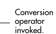

# 第 15 章：预处理器、RTTI、可空类型和其他高级主题 577

正如程序所示，当 `ThreeD` 对象在在 `double` 类型的表达式中使用时（例如 `dist = alpha`），转换将应用于该对象。在这一特定情况下，转换返回值 `13`，即 `alpha` 到原点的距离。然而，当表达式不需要转换为 `double` 时，则不会调用转换运算符。这就是为什么 `gamma = alpha + beta` 没有调用 `operator()`。

记住，你可以创建不同的转换运算符来满足不同的需求。例如，你可以定义一个转换为 `long` 的运算符。每个转换都会自动且独立地应用。

当表达式中需要转换、将对象传递给方法、在赋值中以及使用对目标类型的显式强制转换时，会自动使用隐式转换运算符。你可以创建一个显式转换运算符，它仅在使用显式强制转换时被调用。例如，这里是将上一个程序中的转换运算符重写为显式转换器：

```cs
// 现在是显式的。

public static explicit operator double (ThreeD opl)

{

    return Math.Sqrt(opl.x * opl.x + opl.y * opl.y + opl.z * opl.z);

}
```

现在，上一个示例中的这条语句

```cs
dist = alpha;
```

必须被重写为使用显式强制转换，如下：

```cs
dist = (double) alpha;
```

此外，此语句：

```cs
if (beta > dist)
    Console.WriteLine("beta is farther from the origin");
```

必须像这样重写：

```cs
if ((double) beta > dist)
    Console.WriteLine("beta is farther from the origin");
```

由于转换运算符现在被标记为显式，在所有情况下转换为 `double` 都必须进行显式强制转换。
转换运算符有一些限制：

- 你不能创建从内置类型到另一个内置类型的转换。例如，你不能重新定义从 `double` 到 `int` 的转换。
- 你不能定义到 `object` 或从 `object` 的转换。

# C# 3.0: 初学者指南

- 你不能对同一组源类型和目标类型同时定义隐式和显式转换。
- 你不能定义从基类到派生类的转换。
- 你不能定义从接口或到接口的转换。

# 专家问答

> **Q: 既然隐式转换自动调用的，不需要强制转换，我还需要创建显式转换吗？**
>
> **A: 尽管隐式转换很方便，但应该只在转换本质上是无错误的情况下使用。为了确保这一点，只有在满足以下两个条件时才创建隐式转换：第一是不会发生信息丢失（例如截断、溢出或符号丢失）。第二是转换不会抛出异常。如果转换无法满足这两个要求，则你应该使用显式转换。**

# .NET 框架简述

`.NET Framework` 最重要的部分之一是集合（collections）。对于 C# 而言，集合是一组对象。`.NET Framework` 包含了许多定义各种类型集合的接口和类。集合简化了许多编程任务，因为它们为几种常见但有时开发起来很繁琐的数据结构提供了现成的解决方案。例如，内置了支持动态数组、链表、栈、队列和哈希表的集合。

`Collections API` 包含了泛型和非泛型集合，非常庞大。在这里无法完全描述其内容或用法。然而，由于集合是 C# 编程中日益重要的部分，这些是你需要关注的特征。为此，本节对这一重要系统进行了简要介绍。当你深入学习 C# 编程时，集合是你需要关注的特性。

# 集合基础

集合的主要用处在于它们标准化了处理对象的方式。集合是围绕一组接口设计的。提供了这些接口的内置实现，你可以直接使用。你也可以实现自己的集合。

正如前面提到的，`.NET Framework` 定义了泛型和非泛型集合。原始 `1.0` 版本只包含非泛型集合，但 `2.0` 版本增加了泛型集合。虽然两者仍在使用，但新代码应该关注泛型集合，因为它们是类型安全的。（非泛型集合存储对象引用，这会导致类型不匹配错误。）非泛型集合类和接口在 `System.Collections` 中。泛型集合在 `System.Generic` 中。

集合的基本功能由它们实现的接口定义。对于泛型集合，基础是 `ICollection<T>` 接口，它继承自 `IEnumerable<T>` 并定义了此处所示的方法：

| 方法 | 说明 |
| :--- | :--- |
| void Add(T obj) | 将 `obj` 添加到调用集合。 |
| void Clear() | 删除调用集合中的所有元素。 |
| bool Contains(T obj) | 如果调用集合包含 `obj` 则返回 `true`，否则返回 `false`。 |
| void CopyTo(T[] target, int startIndex) | 将调用集合的内容复制到指定的数组 `target` 中，从指定的 `startIndex` 开始。 |
| IEnumerator<T> GetEnumerator() | 返回集合的枚举器。（由 `IEnumerable<T>` 指定。） |
| IEnumerator GetEnumerator() | 返回集合的非泛型枚举器。（由 `IEnumerable` 指定。） |
| bool Remove(T obj) | 从调用集合中删除 `obj` 的首次出现。如果删除了 `obj` 则返回 `true`，如果未在调用集合中找到则返回 `false`。 |

修改集合的方法在集合只读时将抛出 `UnsupportedException`。

`ICollection<T>` 还定义了以下属性：

`int Count { get; }`
`bool IsReadOnly { get; }`

计算集合中持有的项目数量。如果集合是只读的，`IsReadOnly` 为 `true`。如果集合是可读写的，则为 `false`。

# C# 3.0: 入门指南

`Collections API` 定义了其他几个接口以扩展其功能。例如，`IList<T>` 继承自 `IEnumerable<T>`，增加了对可以通过索引访问元素的集合的支持。`IDictionary<TK, TV>` 继承自 `ICollection<T>` 以支持键值对的存储。

`Collections API` 提供了集合接口的多种实现。例如，泛型 `List<T>` 集合实现了动态数组，这是一种根据需要自动增长的数组。还有实现栈和队列的类，例如 `Stack<T>` 和 `Queue<T>`。其他类如 `Dictionary<TK, TV>` 则用于存储键值对。

由于对每个集合接口进行深入探讨是不可能的，本文介绍的案例研究将让你对它们有一个大致的了解，并说明它们的一种通用方法。本示例使用了 `List<T>` 集合。

# 集合研究：创建一个动态数组

可能最常用的集合是 `List<T>`，它实现了一个泛型动态数组。它具有以下构造函数：

```cs
public List()
public List(IEnumerable<T> c)
public List(int capacity)
```

第一个构造函数构建一个具有默认初始容量的空列表。第二个构造函数构建一个由 `c` 指定集合的元素初始化的列表，且其初始容量等于元素的数量。第三个构造函数构建一个具有指定初始容量的列表。当元素被添加到 `List<T>` 中时，容量会自动增长。每当列表需要扩大时，其容量就会增加。

`List<T>` 实现了多个接口，包括 `IList<T>`、`IEnumerable<T>` 和 `ICollection`。`IList<T>` 接口定义了泛型集合的行为，允许通过从 `0` 开始的索引访问元素。除了它继承的接口所指定的方法外，`IList<T>` 还增加了此处显示的方法。如果集合是只读的，`Insert()` 和 `RemoveAt()` 方法将抛出 `NotSupportedException`。

| 方法 | 说明 |
|---|---|
| int IndexOf(T obj) | 如果 `obj` 包含在调用集合中，返回其索引。如果未找到 `obj`，则返回 `-1`。 |
| void Insert(int idx, T obj) | 在指定的 `idx` 处插入 `obj`。 |
| void RemoveAt(int idx) | 从调用集合中删除指定 `idx` 处的对象。 |

`IList<T>` 定义了以下索引器：

```cs
T[int idx] { get; set; }
```

此索引器设置或获取指定 `idx` 处元素的值。

# 第 15 章：预处理器、RTTI、可空类型以及其他高级主题

除了它所实现的接口所提供的功能外，`List<T>` 还提供了许多自有的功能。例如，它提供了排序列表、执行二分查找以及将列表转换为数组的方法。`List<T>` 还定义了 `Capacity` 属性，用于获取或设置调用列表的容量。容量是在列表必须扩大之前可以容纳的元素数量（它不是列表中当前已有的元素数量）。因为列表会自动增长，因此没有必要手动设置容量。然而，出于效率考虑，当你预先知道列表将包含多少元素时，你可能想要设置容量。这可以防止与内存分配相关的开销。

以下是一个演示 `List<T>` 基本用法的程序。它创建了一个 `int` 类型的动态数组。注意，列表会根据其包含的元素数量自动扩展和收缩。

```cs
// 演示 List<T>.
using System;
using System.Collections.Generic;
class ListDemo {
    static void Main() {
        // 创建整数列表。
        List<int> lst = new List<int>();
        Console.WriteLine("初始元素数量: " + lst.Count());
        Console.WriteLine();
        Console.WriteLine("添加 5 个元素");
        // 向数组列表添加元素。
        lst.Add(1);
        lst.Add(-2);
        lst.Add(14);
        lst.Add(9);
        lst.Add(88);
        Console.WriteLine("元素数量: " + lst.Count());
        // 使用数组索引显示数组列表。
        Console.Write("Contents: ");
        for(int i=0; i < lst.Count; i++) {
            Console.Write(lst[i] + " ");
        }
        Console.WriteLine("\n");
        Console.WriteLine("移除 2 个元素");
        // 从数组列表中删除元素。
        lst.Remove(-2);
        lst.Remove(88);
        Console.WriteLine("元素数量: " + lst.Count());
    }
}
```

// 使用 foreach 循环显示列表。
Console.Write("Contents: ");
Console.WriteLine("添加 10 个元素");

// 向 lst 添加足够的元素以触发增长。
for(int i=0; i < 10; i++) // 扩展列表。
    lst.Add(i);
Console.WriteLine("添加 10 个元素后的数量: " + lst.Count);
Console.Write("Contents: ");
foreach(int i in lst)
    Console.Write(i + " ");
    Console.WriteLine("\n");

// 使用数组索引更改元素。
Console.WriteLine("更改前三个元素");
lst[0] = -10;
lst[1] = 14;
lst[2] = 99;

# 第 15 章：预处理器

程序从创建一个名为 `lst` 的 `List<int>` 实例开始。该集合最初是空的。注意当添加元素时其大小是如何增长的。如所述，`List<T>` 创建了一个动态数组，根据需要容纳必须存储的元素。还注意 `lst` 如何像数组一样被索引。

由于 `List<T>` 集合创建了一个可索引的动态数组，它通常被用来替代数组。主要的优势是你不需要在编译时知道将存储多少元素。当然，数组提供了更好的运行时效率，因此使用 `List<T>` 是用效率换取便利。

# 尝试：使用 Queue<T> 集合

在前面的章节中，几个示例已经开发并演进了一个队列类，用于演示多种 C# 编程概念，如封装、属性、异常等。虽然创建自己的数据结构（如队列）是学习 C# 的好方法，但并不是你需要做的事情。相反，你将使用标准集合。对于队列来说，就是 `Queue<T>`。它提供了一个完全集成到整体框架中的高性能实现。在本部分，书中最后的示例中，你将看到如何使用 `Queue<T>`。它创建一个短程序，模拟使用队列授予网络访问。

`Queue<T>` 是一个动态集合，根据需要增长以容纳必须存储的元素。`Queue<T>` 定义了以下构造函数：

```cs
public Queue()
public Queue (int capacity)
public Queue (IEnumerable<T> c)
```

第一个形式创建一个具有默认初始容量的空队列。第二个形式创建一个具有由 `capacity` 指定初始容量的空队列。第三个形式包含 `c` 指定集合的元素。

除了它所实现的集合接口提供的功能外，`Queue<T>` 定义了此处显示的方法。要将对象放入队列，调用 `Enqueue()`。要移除并返回队列头部的对象，调用 `Dequeue()`。如果在调用队列为空时调用 `Dequeue()`，将抛出 `InvalidOperationException`。你可以使用 `Peek()` 返回但不移除下一个对象。

# 584 C# 3.0: 入学者指南

| 方法 | 描述 |
| :--- | :--- |
| public T Dequeue() | 返回调用队列开部的对象。在此过程中该对象会被移除。 |
| public void Enqueue(T v) | 将 `v` 添加到队列末尾。 |
| public T Peek() | 返回调用队列开部的对象，但不将其移除。 |
| public T [] ToArray() | 返回一个包含调用队列元素副本的数组。 |
| public void TrimExcess() | 如果调用队列的大小小于其容量的 90%，则移除多余的容量。 |

此示例使用队列（queue）来模拟一组用户对网络访问的调度。它并没有实际执行任何调度。相反，它简单地向队列中填充用户名称，并根据他们进入队列的顺序授予用户访问权限。当然，由于这是一个模拟，程序在授予用户访问权限时仅简单地显示用户的用户名。

### 逐步步骤

- 1. 按照所示开始创建模拟：

```cs
// 使用 Queue<T> 类来模拟用户对网络的访问调度。
using System;
using System.Collections.Generic;
class QueueDemo {
    static void Main() {
        Queue<string> userQ = new Queue<string>();
```

注意，创建了一个 `userQ` 队列，它可以持有 `string` 类型对象的引用。

- 2. 添加将用户名称放入队列的代码：

```cs
Console.WriteLine("Adding users to the network queue.\n");
userQ.Enqueue("Eric");
userQ.Enqueue("Tom");
userQ.Enqueue("Ralph");
userQ.Enqueue("Ken");
```

- 3. 添加每次移除一个名称的代码，这模拟了授予网络访问权限。

```cs
Console.WriteLine("Granting network access in queue order.\n");
while(userQ.Count > 0) {
    Console.WriteLine("Granting network access to: " + userQ.Dequeue());
}
```

## 第 15 章：预处理器、RTTI、可空类型和其他高级主题 585

- 4. 完成程序。

```cs
Console.WriteLine("\nUser queue is exhausted.");
}
}
```

- 5. 这里是使用 `Queue<T>` 模拟用户网络访问调度的完整程序：


```cs
// 使用 Queue<T> 类来模拟用户对网络的访问调度。

using System;
using System.Collections.Generic;

class QueueDemo {
    static void Main() {
        Queue<string> userQ = new Queue<string>();

        Console.WriteLine("Adding users to the network user queue.\n");

        userQ.Enqueue("Eric");
        userQ.Enqueue("Tom");
        userQ.Enqueue("Ralph");
        userQ.Enqueue("Ken");

        Console.WriteLine("Granting network access in queue order.\n");

        while (userQ.Count > 0) {
            Console.WriteLine("Granting network access to: " + userQ.Dequeue());
        }

        Console.WriteLine("\nUser queue is exhausted.");
    }
}
```

输出所示如下：

Adding users to the network user queue.

Granting network access to: Eric

Granting network access to: Tom

Granting network access to: Ralph

Granting network access to: Ken

User queue is exhausted.

（续）

## 586 C# 3.0: 入学者指南

此示例的一个关键点是实现该模拟所需的代码是如此少。如果你必须自己开发队列（如之前的 "Try This" 示例所示），代码将会大得多。此外，标准的 `Queue<T>` 类提供了一个所有 C# 程序员都能立即识别的解决方案，从而使你的程序更容易维护。

## 其他关键字

为了结束本书，将简要讨论 C# 定义的未在其他处描述的少数剩余关键字。

## internal（内部）访问修饰符

除了我们在书中一直使用的 `public`、`private` 和 `protected` 访问修饰符外，C# 还定义了 `internal`。在第 6 章中简要提到，`internal` 成员在程序集中的所有文件中都是知的，但在程序集外部不可见。程序集（assembly）包含程序所有部署和版本信息的文件（或多个文件）。因此，简单来说，标记为 `internal` 的成员在整个程序中是知的，但在其他地方不是。

## sizeof

有时，你可能会发现 C# 值类型之一的大小（以字节为）是有用的。要获取此信息，请使用 `sizeof` 运算符。它具有以下通用形式：

```
sizeof(type)
```

这里，`type` 是要获取大小的类型。因此，它主要用于特殊情况，特别是当处理托管和非托管代码的混合时。

## lock

`lock` 关键字用于处理多个线程时。在 C# 中，程序可以包含两个或多个执行线程。在这种情况下，程序的片段是多任务处理的。这引发了一种特殊类型的问题：两个线程尝试使用一个只能由一个线程使用的资源？为了解决这个问题，你可以创建一个临界代码段，它将被一次且仅由一个线程执行。这是 `lock` 实现的。它的通用形式所示：

```cs
lock(obj) {
  // 临界区
}
```

这里，`obj` 是加锁的对象。

## 第 15 章：预处理器、RTTI、可空类型和其他高级主题 504

`lock` 关键字在处理多个线程时使用。在 C# 中，程序可以包含两个或多个执行线程。在这种情况下，程序的片段是多任务处理的。这引发了一种特殊类型的问题：两个线程尝试使用一个只能由一个线程使用的资源？为了解决这个问题，你可以创建一个一次且仅由一个线程执行的临界代码段。这是 `lock` 实现的。它的通用形式所示：

```cs
lock(obj) {
  // 临界区
}
```

这里，`obj` 是加锁的对象。

## internal 访问修饰符

除了我们在书中一直使用的 `public`、`private` 和 `protected` 访问修饰符外，C# 还定义了 `internal`。在第 6 章中简要提到，`internal` 成员在程序集中的所有文件中都是知的，但在程序集外部不可见。程序集包含程序所有部署和版本信息的文件（或多个文件）。因此，简单来说，标记为 `internal` 的成员在整个程序中是知的，但在其他地方不是。

## sizeof

有时，你可能会发现 C# 值类型之一的大小（以字节为）是有用的。要获取此信息，请使用 `sizeof` 运算符。它具有这种形式：

```
sizeof(type)
```

这里，`type` 是要获取大小的类型。因此，它主要用于特殊情况，特别是当处理托管和非托管代码的混合时。

## lock

`lock` 关键字在处理多个线程时使用。在 C# 中，程序可以包含两个或多个执行线程。在这种情况下，程序的片段是多任务处理的。这引发了一种特殊类型的问题：两个线程尝试使用一个只能由一个线程使用的资源？为了解决这个问题，你可以创建一个一次且仅由一个线程执行的临界代码段。这是 `lock` 实现的。它的通用形式所示：

```cs
lock(obj) {
  // 临界区
}
```

这里，`obj` 是加锁的对象。

## readonly

你可以通过将其声明为 `readonly` 在类中创建一个只读字段。只读字段可以在声明处或在构造函数中初始化。一旦初始化，其值就无法更改。这是一个使用 `readonly` 字段的示例：

```cs
using System;

class MyClass {
    public readonly int SIZE = 10;
    public MyClass(int size) {
        SIZE = size;
    }
    public static void Main() {
        MyClass obj = new MyClass(20);
        Console.WriteLine(obj.SIZE);
        // obj.SIZE = 30; // 错误
    }
}
```

### stackalloc

你可以使用 `stackalloc` 从栈上分配内存。它必须在 `unsafe` 上下文中中使用，并具有这种形式：

```cs
type* p = stackalloc type[size];
```

这里，`p` 是一个指针，接收容纳 `size` 个 `type` 对象的内存。通常，对象的内存是从堆（heap）分配的，堆是一个空闲区域。从栈分配内存是例外。在栈上分配的不会被垃圾回收。相反，它们只在声明它们的块执行时存在。

## using 语句

除了前面的 `using` 指令，`using` 还有另一种形式称为使用语句。它具有以下通用形式：

```cs
using (obj) {
// 使用 obj
}
```

```cs
using (type obj = initializer) {
// 使用 obj
}
```

这里，`obj` 是一个必须实现 `IDisposable` 接口对象的表达式。它指定了 `using` 块内部使用的变量。在第一形式中，对象声明在 `using` 语句之外。当块结束时，将对 `obj` 调用 `Dispose()` 方法（由 `IDisposable` 接口定义）。因此，`using` 语句提供了一种在不再需要时自动释放对象的方法。记住，`using` 语句适用于实现 `IDisposable` 接口的对象。

这里是 `using` 语句每种形式的示例：

```cs
using System;
using System.IO;

class Demo {
  static void Main() {
    StreamReader sr = new StreamReader("test.txt");

    // 在 using 语句内部使用
    using(sr) {
      // ...
    }

    // 在 using 语句内部创建 StreamReader;
    using(StreamReader sr2 = new StreamReader("test.txt")) {
      // ...
    }
  }
}
```

# 第 15 章：预处理器、RTTI、可空类型以及其他高级主题

`StreamReader` 类实现了 `IDisposable` 接口（通过基类 `TextReader`）。因此，它可以用于 `using` 语句。当 `using` 语句结束时，会自动在流变量上调用 `Dispose()`，从而关闭流。

## const 和 volatile

`const` 修饰符用于声明不可更改的字段或局部变量。这些变量在声明时必须赋予初始值。因此，一个 `const` 变量本质上是一个常量。例如：

```cs
const int i = 10;
```

这创建了一个值为 10 的类变量 `i`。

`volatile` 修饰符告诉编译器，字段的值可能会被两个或多个并发执行的线程更改。在这种情况下，一个线程可能不知道字段何时被另一个线程修改（此处应为被另一个线程更改）了。这一点非常重要，因为 C# 编译器会自动执行某些优化，这些优化仅在字段由单个执行线程访问时才有效。为了防止这些优化被应用于共享字段，请将其声明为 `volatile`。这告诉编译器在每次访问该字段时都必须获取其值。

## partial 修饰符

`partial` 修饰符有两个用途。它可以允许将类、结构体或接口的定义拆分为两个或多个部分，每个部分位于单独的文件中。当程序被编译时，类、结构体或接口的各个将被合并，形成完整的类型。其次，在部分类或结构体中，`partial` 可以允许将方法的声明与其实现分离。这里描述了这两种用法。

## 部分类型 (Partial Types)

当用于创建部分类型时，`partial` 修饰符具有以下通用形式：

```cs
partial class typename { ... }
```

在这里，`typename` 是被拆分的类、结构体或接口的名称。部分类型的每个部分都必须由 `partial` 修饰。

以下示例将一个简单的 XY 坐标类分为三个独立的文件。第一个文件显示在此：

```cs
partial class XY {
    public XY(int a, int b) {
        X = a;
        Y = b;
    }
}
```

第二个文件显示如下：

```cs
partial class XY {
    public int X { get; set; }
}
```

第三个文件是：

```cs
partial class XY {
    public int Y { get; set; }
}
```

后续文件演示了 XY 的用法：

```cs
// Demonstrate partial class definitions.
using System;

class Test {
    static void Main() {
        XY xy = new XY(1, 2);

        Console.WriteLine(xy.X + " ", + xy.Y);
    }
}
```

要使用 XY，所有文件都必须参与编译。例如，假设 XY 文件为 `xy1.cs`、`xy2.cs` 和 `xy3.cs`，且 Test 包含在一个名为 `test.cs` 的文件中，要编译 Test，请使用以下命令行：

```bash
csc test.cs xy1.cs xy2.cs xy3.cs
```

有一点：部分泛型类是合法的。但是，每个部分声明的类型参数必须与其他部分匹配。

### 部分方法 (Partial Methods)

在类或结构体的部分类型内部，你可以使用 partial 来创建一个部分方法。部分方法的声明在一个部分，而实现在另一个部分。部分方法是 C# 3.0 引入的。

部分方法的关键点是不需要实现！当部分方法没有被类或结构体的另一部分实现时，对部分方法的所有调用将被默默忽略。这使得类可以指定但不强制要求可选功能。如果功能没有实现，它将直接被忽略。

以下是上述程序的扩展版本，它创建了一个名为 `Show()` 的部分方法。它由另一个名为 `ShowXY()` 的方法调用。

```cs
// Demonstrate a partial method.

using System;
```

```cs
partial class XY {
    public XY(int a, int b) {
        X = a;
        Y = b;
    }
    // Declare a partial method.
    partial void Show();
}
```

```cs
partial class XY {
    public int X { get; set; }
    // Implement a partial method.
    partial void Show() {
        Console.WriteLine("{0}, {1}", X, Y);
    }
}
```

```cs
partial class XY {
    public int Y { get; set; }
    // Call a partial method.
    public void ShowXY() {
        Show();
    }
}
class Test {
    static void Main() {
        XY xy = new XY(1, 2);
        xy.ShowXY();
    }
}
```

注意，`Show()` 在 XY 的一部分声明，并在另一部分实现。实现显示了 X 和 Y 的值。这意味着 `Show()` 是由 `ShowXY()` 调用的，调用有效并且确实会显示 X 和 Y。然而，如果你注释掉 `Show()` 的实现，那么 `ShowXY` 中对 `Show()` 的调用将不起任何作用。

部分方法有若干限制：它们必须是 void；它们不能有访问修饰符；它们不能是虚。

### yield

`yield` 关键字是一个迭代器，它一次返回一个对象。

### extern

`extern` 关键字有两个用途。首先，它表示该方法由非托管代码提供。其次，它用于为外部程序集创建别名。

## 接下来？

恭喜！如果你读完了所有的章节，你已经拥有了坚实的基础，可以在此基础上建立专业知识。以下是一些你可能感兴趣的主题：

- 创建多线程应用程序
- 使用 Windows Forms
- 使用 C# 进行网络编程

# 附录 A：自测答案

12. /*

```

此程序显示英寸到米的转换表。

*/

using System;

class InchToMeterTable {

    static void Main() {

    double inches, meters;

    int counter;

    counter = 0;

    for (inches = 1.0; inches <= 144.0; inches++) {

        // 转换为米。

        meters = inches + " inches is " + meters + " meters.";

        Console.WriteLine(inches + " inches is " + meters + " meters.");

        counter++;

        // 每 12 行打印一个空行。

        if (counter == 12) {

            Console.WriteLine();

            counter = 0; // 重置行计数器

        }

    }

}

```

# 第 2 章：介绍数据类型和运算符

- 1. C# 规定了其简单类型的范围和行为，以确保在混合语言环境中的移植性和互操作性。
- 2. C# 的字符类型是 `char`，C# 字符是 Unicode 而不是 ASCII（许多其他计算机语言使用 ASCII）。
- 3. 错误。`bool` 值必须为 `true` 或 `false`。
- 4. `Console.WriteLine("One\nTwo\nThree");`
- 5. 该片段代码有三个错误。首先，`sum` 在每次进入由 `for` 循环创建的块时都会创建，并在退出时销毁。因此，它在迭代之间不会保留其值。尝试让 `sum` 保持迭代的运行累加和是徒劳的。`sum` 在其声明的块之外是不可见的。因此，在 `WriteLine()` 语句中对它的引用是无效的。第三，`sum` 没有被赋给初始值。

# C# 3.0：入门指南

- 6. 当递增运算符位于操作数之前时，C# 会在获取操作数的值之前对操作数加增。如果运算符位于操作数之后，C# 将先获取操作数的值，然后对其值进行加增。
- 7. `if ((b != 0) && (val / b)) ...`
- 8. 在表达式中，`byte` 和 `short` 被提升为 `int`。
- 9. A。
- 10. 在转换不兼容类型之间或发生收窄转换时，需要强制类型转换。
- 11. 这是寻找 2 到 100 之间质数的方法。当然，还有其他解决方案。

``` 
// 寻找 2 到 100 之间的质数。
using System;

class Prime {
    static void Main() {


```csharp
int i, j;

bool isprime;

for(i=2; i < 100; i++) {

    isprime = true;

    // 检查是否能被整除。

    for(j=2; j <= i/j; j++) {

        // 如果 i 能被整除，则它不是质数。
        if ((i%j) == 0) isprime = false;
    }

    if(isprime)
        Console.WriteLine(i + " is prime.");
}
}
}
```

# 第 3 章：程序控制语句

- 1. // 计数空格。

```csharp
using System;

class Spaces {
    static void Main() {
        char ch;
        int spaces = 0;
        Console.WriteLine("Enter a period to stop.");
    }
}
```

# 附录 A：自测答案 599

```csharp
do {
    ch = (char) Console.Read();
    if(ch == ' ') spaces++;
} while (ch != '.');
```

```csharp
Console.WriteLine("Spaces: " + spaces);
```

```csharp
}
```

- 2. “不允许贯穿”规则规定，从一个 `case` 标签开始的代码序列不能继续到下一个标签。然而，`case` 标签可以被“堆叠”。

- 3. `if(condition)`  
    `statement;`  
    `else if(condition)`  
    `statement;`  
    `else if(condition)`  
    `statement;`  
    `else`  
    `statement;`

- 4. 最后一个 `else` 关联到外部的 `if`，它是与 `else` 处于同一层且最近的 `if`。

- 5. `for(int i = 1000; i >= 0; i -= 2)` // ...

- 6. 不，`i` 在其声明的 `for` 循环之外是不可见的。

- 7. `break` 会导致其直接包含的循环或 `switch` 语句终止。

- 8. 执行 `break` 后，将显示“after while”。

- 9. 0 1  
2 3  
4 5  
6 7  
8 9

- 10. /* 使用 for 循环生成等差数列

```csharp
1 2 4 8 16, ...
*/
```

```csharp
using System;

class Progress {
    static void Main() {
```

```csharp
for(int i = 1; i < 100; i += i)
    Console.Write(i + " ");
```

- 11. // 大小写转换。

```csharp
using CaseChg;

class CaseChg {
    static void Main() {
        char ch;
        int changes = 0;
        Console.WriteLine("Enter period to stop.");
        do {
            ch = (char) Console.Read();
            if (ch >= 'a' && ch <= 'z') {
                ch -= (char) 32;
                changes++;
                Console.WriteLine(ch);
            } else if (ch >= 'A' && ch <= 'Z') {
                ch += (char) 32;
                changes++;
                Console.WriteLine(ch);
            }
        } while (ch != '.');
        Console.WriteLine("Case changes: " + changes);
    }
}
```

# 第 6 章：深入了解方法和类

- 1. 不，私有成员无法类外部访问。正如所解释的，当没有访问指示符时，类默认为私有访问。

- 2. 前置
- 3. // 用于字符的栈类。

```csharp
using System;

class Stack {
char[] stck; // 此数组持有栈
int tos; // 栈顶
// 给定指定的大小构造一个空栈。）
}
```

```csharp
public Stack(int size) {
    stck = new char[size]; // 为栈分配内存
    tos = 0;
}
```

```csharp
// 从一个 Stack 构造一个 Stack.
public Stack(Stack ob) {
    tos = ob.tos;
    stck = new char[ob.stck.Length];
    // 拷贝元素。
    for (int i = 0; i < tos; i++) {
        stck[i] = ob.stck[i];
    }
}
```

```csharp
// 构建带有初始值的栈。
public Stack(char[] a) {
    stck = new char[a.Length];
    for (int i = 0; i < a.Length; i++) {
        Push(a[i]);
    }
}
```

```csharp
// 将字符推入栈。
public void Push(char ch) {
    if (tos == stck.Length) {
        Console.WriteLine(" -- 栈满了.");
        return;
    }
    stck[tos] = ch;
    tos++;
}
```

```csharp
public char Pop() {
    tos--;
    return stck[tos];
}
```

```csharp
// 演示 Stack 类。
class SDemo {
    static void Main() {
        // 构建一个包含 10 个元素的空栈
        Stack stk1 = new Stack(10);
        char[] name = {'T', 'o', 'm'};
        // 从数组构造栈。
        Stack stk2 = new Stack(name);
        char ch;
        int i;
        // 将一些字符放入 stk1；
        for (i = 0; i < 10; i++)
            stk1.Push((char) ('A' + i));
            Console.Write(ch);
        // 从另一个栈构造栈。
        Stack stk3 = new Stack(stk1);
        // 显示栈的。。
        Console.Write("Contents of stk1: ");
        for (i = 0; i < 10; i++) {
            ch = stk1.Pop();
            Console.Write(ch);
        }
        Console.WriteLine("\n");
        Console.Write("Contents of stk2: ");
        for (i = 0; i < 3; i++) {
            ch = stk2.Pop();
            Console.Write(ch);
        }
        Console.WriteLine("\n");
        Console.Write("Contents of stk3: ");
        for (i = 0; i < 10; i++) {
            ch = stk3.Pop();
            Console.Write(ch);
        }
    }
}
```

# 606 C# 3.0: 初学者指南

以下是程序的输出：  
Contents of stk1: JIHGFEDCBA  
Contents of stk2: moT  
Contents of stk3: JIHGFEDCBA

- 4. `void Swap(Test obj1, Test obj2) {`  
    `int t;`  
    `t = obj1.a;`  
    `obj1.a = obj2.a;`  
    `obj2.a = t;`  
    `}`

- 5. 重重载方法不能有不同的返回类型，但它们在重载解析中不起作用。重载方法必须有不同的参数列表。

- 6. // 使用递归反向显示字符串

```csharp
using System;

class Backwards {
    string str;
    public Backwards(string s) {
        str = s;
    }
    public void Backward(int idx) {
        if(idx != str.Length - 1) Backward(idx + 1);
        Console.Write(str[idx]);
    }
}

class BWDemo {
    static void Main() {
        Backwards s = new Backwards("This is a test");
        s.Backward(0);
    }
}
```

- 7. 共享变量声明为 `static`。

- 8. `ref` 修饰符导致参数按引用传递。这允许方法修改参数的内容。`ref` 参数可以接收传入方法的信息。`out` 修饰符与 `ref` 相同，但它不能用于将值传递到方法。

# 附录 A：607 自测答案

```csharp
static void Main()
static void Main(string[] args)
static int Main()
static int Main(string[] args)
```

- 10. 它们都是合法的。

# 第 7 章：运算符重载、索引器和属性

- 1. `public static ret-type operator op(param-type operand)`  
    `{`  
    `// 操作`  
    `}`

- 操作数的类型必须与重载运算符的类类型相同。
- 2. 为了允许类类型与内置类型完全混合，你必须以两种方式重载运算符。一种方法是将类类型作为第一个操作数，内置类型作为第二个操作数。另一种方法是将内置类型作为第一个操作数，类类型作为第二个操作数。

- 3. 不，`?` 不能被重载。不，你不能更改运算符的优先级。

- 4. 索引器提供了对对象的数组式访问

```csharp
element-type this[int index] {
  // get 访问器。
  get {
    // 返回索引指定的值。
  }
  // set 访问器。
  set {
    // 设置索引指定的值。
  }
}
```

- 5. `get` 和 `set` 访问器分别获取或设置索引指定的值。

- 6. 属性提供了对值的受控访问。

```csharp
type {
  get {
    // get 访问代码。
  }
  set {
    // set 访问代码。
  }
}
```

- 7. 不，属性不定义存储位置。它管理对单独字段的访问。因此，你必须声明由属性管理的字段或使用编译器提供的自动属性。
- 8. 不，属性不能作为 `ref` 或 `out` 参数传递。
- 9. 自动属性是由编译器提供匿名字段来存储值的属性。它通过仅指定 `get` 和 `set` 来指示。

- 10. // 判断一个集合是否是另一个的子集。

```csharp
public static bool operator < (Set ob1, Set ob2) {
    if(ob1.Length > ob2.Length) return false; // ob1 元素更多
    for(int i = 0; i < ob1.Length; i++)
        if(ob2.find(ob1[i]) == -1) return false;
    return true;
}
```

```csharp
// 判断一个集合是否是另一个的超集。
public static bool operator > (Set ob1, Set ob2) {
    if(ob1.Length < ob2.Length) return false; // ob1 元素更少
    for(int i = 0; i < ob2.Length; i++)
        if(ob1.find(ob2[i]) == -1) return false;
    return true;
}
```

- 11. // 交集。

```csharp
public static Set operator & (Set ob1, Set ob2) {
    Set newset = new Set();
    // 添加公共元素。
    for(int i = 0; i < ob1.Length; i++)
        if(ob2.find(ob1[i]) != -1)
            // 如果它是两个集合的成员。
            newset = newset + ob1[i];
    return newset; // 交集
}
```

# 第 8 章：继承

- 1. 不，基类不知道其派生类。是的，派生类可以访问基类的所有非私有成员。

```csharp
// TwoShape 的子类。
class Circle : TwoShape {
    // 构造 Circle
    public Circle(double x) : base(x) { }
    // 对象的拷贝。
    public Circle(Circle ob) : base(ob) { }
    public override double Area() {
        return (Width / 2) * (Width / 2) * 3.1416;
    }
}
```

- 3. 为了防止派生类访问基类成员，将该成员声明为 `private`。

- 4. `base` 关键字有两种形式。第一种用于调用基类构造函数。通用形式是 `base(param-list)`。第二种用于访问基类成员。具有这种形式：`base.member`

- 5. 构造函数总是按照顺序调用。因此，创建 Gamma 对象时，顺序是 Alpha、Beta、Gamma。

- 6. 当通过基类引用调用虚方法时，引用对象的类型决定了调用哪个版本的方法。

- 7. 抽象类包含至少一个抽象方法。

- 8. 为了防止类被继承，将其声明为 `sealed`。

- 9. 继承、虚方法和抽象类支持多态，允许你创建一个可以被各种类实现的泛化类结构。因此，抽象类定义了一个所有实现类共享的一致接口。它体现了“一个接口，多种方法”的概念。

- 10. `object`

- 11. 装箱是将值类型存储在对象的过程。在给对象引用赋值时会自动发生装箱。

- 12. `protected` 成员供派生类使用，但在该类之外是私有的。

# 第 9 章：接口、结构体和枚举

- 1. 接口最好体现了 OOP 的“一个接口，多种方法”原则。

- 2. 接口可以由无限数量的类实现。一个类可以实现它选择的多个接口。

- 3. 是的，接口可以继承。

- 4. 是的，类必须实现由接口定义的所有成员。

- 5. 不，接口不能定义构造函数。

```csharp
interface IVehicle {
  int Range();
  double FuelNeeded(int miles);
  int Passengers {
    get;
    set;
  }
  int FuelCap {
    get;
    set;
  }
  int MPG {
    get;
    set;
  }
}
```

```csharp
// 创建一个软失败接口。
using System;
// 这是一个软失败接口。
public interface IFail {
  // 这指定长度属性接口。
  int Length {
    get;
    set;
  }
  // 这指定索引器接口。
  int this[int index] {
    get;
    set;
  }
}
```

# 附录 A：自测 611 答案

```csharp
// 现在，实现 IFailSoft。
class FailSoftArray : IFailSoft {
    int[] a; // 数组引用
    int len; // 长度的底层变量
```


`public bool ErrFlag; // 表示上一次操作的结果`

// 根据给定的大小构造数组。

```csharp
public FailSoftArray(int size) {
    a = new int[size];
    len = size;
}
```

// 只读的 Length 属性。

```csharp
public int Length { get { return len; }}
```

// 这是 FailSoft 的索引器。

```csharp
public int this[int index] {
    // 这是 get 访问器。
    get() {
        if (ok(index)) {
            ErrFlag = false;
            return a[index];
        } else {
            ErrFlag = true;
            return 0;
        }
    }
    // 这是 set 访问器。
    set() {
        if (ok(index)) {
            a[index] = value;
            ErrFlag = false;
        } else {
            ErrFlag = true;
        }
    }
}
```

// 如果索引在边界内则返回 true。

```csharp
private bool ok(int index) {
    if (index >= 0 && index < Length) return true;
    return false;
}
}
```

# C# 3.0：入门指南

```csharp
// 演示改进后的软失败数组（fail-soft array）。
class ImprovedFSDemo {
    static void Main() {
        FailSoftArray fs = new FailSoftArray(5);
        int x;
        for (int i=0; i < fs.Length; i++)
            fs[i] = i*10;
        for (int i=0; i < fs.Length; i++) {
            x = fs[i];
            if (x <= -i) Console.Write(x + " ");
        }
        Console.WriteLine();
    }
}
```

- 8. `struct` 定义值类型。`class` 定义引用类型。
- 9. 枚举行星 `Planets` { 水星，金星，地球，火星，木星，土星，天王星，海王星 };

# 第 10 章：异常处理

- 1. `System.Exception` 位于异常层次结构的顶端。
- 2. `try` 和 `catch` 协同工作。你想要监控异常的程序语句包含 `try` 块中。使用 `catch` 捕获异常。
- 3. `catch` 子句之前没有 `try` 块。
- 4. 如果异常未被捕获，将导致程序异常终止。
- 5. 在片段中，基类 `catch` 位于派生 `catch` 类之前。由于基类 `catch` 也会捕获所有类，因此代码是不可达的
- 6. 是的，可以抛出异常。
- 7. 当 `try` 块结束时执行 `finally` 块。
- 8. 以下是为 `Stack` 类添加异常处理的一种方法：

```csharp
// 针对栈溢出错误的异常。
using System;
class StackFullException : Exception {
    // 创建构造函数。
    public StackFullException() : base() {}
    public StackFullException(string str) : base(str) {}
    public StackFullException(string str, Exception inner)
        : base(str, inner) {}
}
protected RuntimeException(
    System.Runtime.Serialization.SerializationInfo si,
    System.Runtime.Serialization.StreamingContext sc) :
    base(si, sc) { }
}
```

```csharp
// 针对栈为空错误的的异常。
class StackEmptyException : Exception {
    // 创建标准构造函数。
    public StackEmptyException() : base() {}
    public StackEmptyException(string str) : base(str) {}
    public StackEmptyException(string str, Exception inner) :
      base(str, inner) {}
    protected StackEmptyException(
        System.Runtime.Serialization.SerializationInfo si,
        System.Runtime.Serialization.StreamingContext sc) :
      base(si, sc) { }
}
```

```csharp
// 一个用于字符的栈类。
class Stack {
    char[] stck; // 此数组持有栈
    int tos;
    // 根据给定的大小构造空栈。
    public Stack(int size) {
        stck = new char[size]; // 为栈分配内存
        tos = 0;
    }
    // 从另一个 Stack 构造 Stack。
    public Stack(Stack ob) {
        tos = ob.tos;
        stck = new char[ob.Length];
    }
    // 拷贝元素。
    for (int i=0; i < tos; i++) {
        stck[i] = stck[i];
    }
    // 使用初始值构造栈。
    public Stack(char[] a) {
        stck = new char[a.Length];
    }
    for (int i = 0; i < a.Length; i++) {
        try {
            Push(a[i]);
        } catch(StackFullException exc) {
            Console.WriteLine(exc);
        }
    }
    // 将字符推入栈。
    public void Push(char ch) {
        if (tos==stck.Length) {
            throw new StackFullException();
        }
        stck[tos] = ch;
        tos++;
    }
    // 从栈中弹出字符。
    public char Pop() {
        if (tos==0) {
            throw new StackEmptyException();
        }
        tos--;
        return stck[tos];
    }
}
```

- 9. `checked` 和 `unchecked` 决定算术溢出是否会导致引起异常。要避免异常，请将相关代码标记为 `unchecked`。要在溢出时抛出异常，请将相关代码标记为 `checked`。
- 10. 所有异常都可以使用以下 `catch` 形式之一捕获：

```csharp
catch { }
catch(Exception exc) { }
catch(Exception) { }
```

# 第 11 章：使用 I/O

- 1. 字节流对于文件 I/O 非常有用，特别是二进制文件 I/O，并且它们支持随机访问文件。
- 2. 流层次结构顶端的类是 `Stream`。字符针对 Unicode 进行了优化。以下是为字节输入打开文件的方法：
- 4. 以下是为读取字符打开文件的方法：

```csharp
FileStream fin = new FileStream("myfile", FileMode.Open);
StreamReader fr_in = new StreamReader(FileStream("myfile", FileMode.Open));
```

- 5. `Seek()` 设置了当前文件位置。
- 6. 二进制 I/O 由 `BinaryReader` 和 `BinaryWriter` 支持。
- 7. I/O 通过调用 `Set()` 重定向。
- 8. 数值字符串可以使用 .NET 内部表示进行转换。
- 9. 文本文件将空格替换为连字符。这种版本使用了字节流。使用此程序需要指定源文件和目标文件。例如：

源文件 目标文件

```csharp
using System;
using System.IO;
class Hyphen {
    static void Main(string[] args) {
        int i;
        FileStream fin;
        if(args.Length != 2) {
            Console.WriteLine("Usage: Hyphen From To");
            return;
        }
        // 打开输入文件。
        try {
            fin = new FileStream(args[0], FileMode.Open);
        } catch (IOException exc) {
            Console.WriteLine(exc.Message);
            return;
        }
        // 打开输出文件。
        try {
            FileStream fout = new FileStream(args[1], FileMode.Create);
        } catch (IOException exc) {
            Console.WriteLine(exc.Message);
            fin.Close();
            return;
        }
        // 拷贝文件。
        try {
            do {
                i = fin.ReadByte();
                if((char)i == ' ' ) i = '-';
                if (i != -1) fout.Write((byte)i);
            } while (i != -1);
        } catch (IOException exc) {
            Console.WriteLine(exc.Message);
        }
        fin.Close();
        fout.Close();
    }
}
```

# 第 13 章：泛型

- 1. 正确。
- 2. 类型参数是实际类型的占位符。实际类型将在实例化泛型类或委托的对象时，或者在调用泛型方法时指定。
- 3. 类型参数是传递给类型参数的实际数据类型。
- 4. 当通过对象引用进行操作时，编译器不会捕获所提供的数据类型与所需数据类型之间的类型不匹配错误。这会导致错误在运行时发生。
- 5. 类型参数的基类约束要求任何类型参数必须派生自或等同指定的基类。值类型约束要求类型参数必须是值类型而不是引用类型。
- 6. 是的。
- 7. 要获取类型的默认值，请使用 `default` 运算符。
- 8. 泛型方法的类型参数列表紧跟在方法的括号之后。它位于方法名和方法参数列表的左括号之间。
- 9. 是。
- 10. 这里有一种方法。它对 X 和 Y 使用了自动实现的属性。

```csharp
public interface ITwoCoord<T> {
  T X { get; set; }
  T Y { get; set; }
}
```

```csharp
class XYCoord<T> : ITwoCoord<T> {
  public XYCoord(T x, T y) {
    X = x;
    Y = y;
  }
  public T X { get; set; }
  public T Y { get; set; }
}
```

# 第 14 章：引入 LINQ

- 1. LINQ 代表 Language Integrated Query（语言集成查询）。它用于从数据源检索信息。
- 2. 泛型或非泛型形式的 `IEnumerable`。

# 附录 A：自测答案

- 3. 查询关键字来自：`group`, `where`, `join`, `let`, `orderby` 和 `select`。

```csharp
var allData = from info in myDataList
select info;
```

```csharp
var heightData = from info in myDataList
select info.Height;
```

```csharp
where
var allData = from info in myDataList
where info.Height < 100
select info.Height;
```

```csharp
orderby
var allData = from info in myDataList
where info.Height < 100
orderby info.Height descending
select info.Height;
```

```csharp
group
group range-variable by key
```

```csharp
join
from range-varA in data-sourceA
join range-varB in data-sourceB
on range-varA.property equals range-varB.property.
```

- 10. `into`
- 11. `let`
- 12. `new { Author = "Knuth", Title = "The Art of Computer Programming" }`
- 13. `=>`
- 14. 正确。
- 15. `Where()` 扩展方法为类添加了功能，但无需使用继承。第一个参数定义了被扩展的类型。它必须由此进行修改。第一个参数会自动传递调用扩展方法时的对象。
- 17. 扩展方法对 LINQ 至关重要，因为查询方法是作为 `IEnumerable<T>` 的扩展方法实现的。

# 第 15 章：预处理器、RTTI、可空类型及其他高级主题

- 1. 条件编译指令有 `##if`, `#elif`, `#else` 和 `#endif`。
- 2. `#elif` 是 "else if"。它允许你为多个编译选项创建 if-else 链。
- 3. 要在运行时获取 `System.Type` 对象，请使用 `typeof` 运算符。
- 4. `as` 关键字确定对象是否为指定的类型。
- 5. 如果转换是合法的装箱、拆箱、标识转换或包含值，`as` 运算符会将一种类型转换为另一种类型。它的优点是，如果不允许转换，它不会抛出异常。

```csharp
int? count = null;
```

- 7. 正确。
- 8. `??` 是空合并运算符。如果该可空实例包含值，则返回该实例的值；否则，它返回指定的默认值。
- 9. 不安全代码是在托管上下文中之外执行的代码。
- 10. `double* ptr;`
- 11. 特性封装在方括号之间，所示：

`[attribute]`

- 12. 存在隐式和显式转换运算符。它们的通用形式所示：

```csharp
public static operator implicit target-type(source-type v) { return value; }
```

```csharp
public static operator explicit target-type(source-type v) { return value; }
```


- 13. 集合是对象的组。泛型集合位于 `System.Collections.Generic` 命名空间。
- 14. `ICollection<T>`
- 15. `partial` 关键字在两种情况下均使用。

# 索引

| 位与与 AND, 182–184 |
| 逻辑与 AND, 64, 65, 68–69, 566 |
| 指针运算符, 568 |
| && (短路与), 64, 66–67, 68–69 |
| * 乘法运算符, 23, 61–62 |
| 指针运算符, 567–568, 569 |
| @ 指定逐义字面量, 54–55 |
| @ 限定关键字, 36 |
| 位或 OR, 182, 183, 184–185 |
| 逻辑或 OR, 64, 65, 68–69 |
| || (短路或), 64, 66–67, 68–69 |
| [], 164, 169, 170, 182, 252, 572 |
| 位异或 OR, 182, 183, 184–186 |
| 逻辑异或 OR, 64, 65 |
| :: 命名空间限定符, 458 |
| { 19, 20, 31, 32, 58, 59, 129–130, 131, 544 |
| 用于数组, 157, 162 |
| 用于 WriteLine(), 48–49 |
| = (等关系运算符), 28, 64, 261, 328, 497, 566 |
| => lambda 运算符, 535, 545 |
| !, 64, 65, 566 |
| !== 28, 64, 261, 497, 566 |
| /, 23, 61–62 |
| /* /, 19 |
| I/O 重定向运算符, 410–411 |
| 关系运算符, 28, 64, 261, 566 |
| <>, 466, 467 |
| <<, 182, 187–189 |
| ., 28, 64, 261, 566 |
| 减法运算符, 23, 61–62 |
| = 委托, 437 |
| 和事件, 445 |
| ->, 568–569 |
| --, 31, 61, 62–250 |
| %, 61, 62 |
| 和类型转换, 72 |
| 和构造函数, 146 |
| 和表达式, 546 |
| 和方法, 19, 127–138, 134 |
| . (点 运算符), 123, 130, 236, 358 |

# C# 3.0：入门指南

| 加法运算符, 23, 61–62 |
| 和 委托, 437 |
| 和字符串拼接, 180 |
| 用于 WriteLine( ), 206–208 |
| 类型, 数量, 213–216 |
| 算术运算符, 21, 61–64 |
| 数组(s), 154–174 |
| +=, 和 委托, 437 |
| 和事件, 445 |
| 边界, 158 |
| 动态, 使用 List<T> 创建, 580–583 |
| 固定大小, 571–572 |
| 和 IEnumerator<T> 接口, 508, 509, 512, 533, 536 |
| ++, 31, 61, 62–64, 250 |
| #, 49, 554 |
| 在 C# 对象中实现, 154, 155, 167 |
| 隐式类型, 169–170 |
| 初始化, 157, 162–163 |
| 锯齿, 163–168 |
| ? 用于可空类型声明, 564 |
| 运算符, 192–194 |
| Length 属性, 167, 169, 203, 272–273, 275–277 |
| 维度, 161–163 |
| 溢出, 200–203, 272–275, 275–277 |
| 参数名称, 213–216 |
| 引用变量, 165–167 |
| 排序, 165–139–242 |
| 字符串, 180–181 |
| ?? 空合并运算符, 565–566 |
| ArrayTypeMismatch, 378 |
| as 运算符, 362 |
| I/O 重定向运算符, 410–411 |
| 关系运算符, 28, 64, 261, 566 |
| 升序计数关键字, 512, 515 |
| ASCII 字符集, ... |
| ASP.NET, 561 |
| 程序集, 199, 586 |
| 赋值运算符(s), >=, 28, 64, 261, 566 |
| (分号), 20, 33 |
| = 算术和逻辑 (op=), 69, 70 |
| = 位复合, 189 |
| 和 运算符, 261, 262 |
| 简写, 70 |
| 位非 NOT, 182, 183 |

# 索引 623

- 位操作符，182–192
- 代码块（Blocks），20, 31–52, 58
- bool 简单类型，41, 47
- 默认值，143
- 与逻辑运算符，65
- 与关系运算符，64

- 装箱（Boxing），329–330
- break 语句，82, 87, 88, 89–90, 106–108
- 泡泡排序，159–160
- 缓冲区（Buffer），固定大小，571–572
- BufferedStream，394
- byte 简单类型，41, 42, 43, 52
- Byte 结构，421
- 字节码（Bytecode），4

- char 简单类型，23, 41–46
- 字符（Character(s)），46
- 转义序列，52–53
- 编码，410
- 来自键盘输入，82–83
- 字面量，55
- checked 关键字，386–388
- checksum#pragma option，561
- 类（Class(s)），19, 120–125
    - 抽象类，325–326, 334
    - 基类（base），定义，288
    - 构造函数。参见 Constructor()
    - 定义，7, 10, 120
    - 派生类（derived），定义，288
    - 一般形式，121–122
    - 泛型（generic），参见 Generic class
    - 接口（interfaces），334–339
    - .NET 类库，7, 8, 19
    - 成员（member）。参见 member
    - 名称和程序文件名，18
    - 部分类（partial），589–590

# C

- C 格式化符，49
- C 的历史，3
- 与 Java 的关系，4–5, 6

- C++
    - 历史，3
    - 与 Java 的关系，4–6
    - 与 .NET Framework 的关系，8
    - C# 的使用时机，567

- C# 作为一种面向对象的语言，6
- 类库（class library），7, 18, 19
    - 定义，2–3, 5–6
    - 关键字。参见 keywords, C#
    - 与 .NET Framework 的关系，2, 6–8
    - 程序编译，7, 12–17
    - 作为一种强类型语言，40, 313
    - 定义良好的，123
- class 关键字，19, 121, 473, 481
- Clear.，579
- Close.，394, 396, 402, 414, 415
- CLR。参见 Common Language Runtime (CLR)

# Code

- 引用传递（Call-reference）
    - 使用 ref 创建，209–210
    - 与按值传递，206–208
- + 块，20, 31–32
    - 托管 vs. 非托管，587
    - 关键区域，586–587
    - 不可达的，133
    - 安全的，567–572

- CanRead 属性，395
- CanSeek 属性，395
- CanTimeout，395
- CanWrite 属性，395
- Capacity 属性，581
- C# 的大小写敏感性，20
- case 语句，87–89
- 转换（Casts），72–73, 74, 75–76, 465, 468
    - 与显式转换运算符，574, 577–578
    - 与运算符，562
    - catch 子句，363–366

- 集合（Collection），174
    - 类，550, 578–586
    - Collections API，578, 580
    - 注释，18, 20
    - 公用语言运行时 (CLR)，7, 8, 17, 567
    - 公用语言规范 (CLS)，8
    - Compare(To)，178, 179, 428
    - 编译，555, 572
    - 完成（Complete），538
    - 编译器（Compiler）
        - 捕获所有异常，370
        - 捕获派生类异常，380–382
        - 多个，369
        - 抛出异常，373–374

- C# 命令行，12, 16–17
- JIT，7
- 组件与 C#软件，6
- 内置属性，572–573
- Console 类，20, 393, 397, 399, 411
- Console 输入，82–83
- Console.Error，393, 397
    - 重定向，411
- Console.In，393, 397–398
    - 重定向，410–441
- Console.Out，393, 397, 398–399
    - 重定向，410–444
- Console.Read()，82
- ConsoleKey 枚举，400
- ConsoleKeyInfo 结构，400
- ConsoleModifiers，400
- const 修饰符，580
- 约束（Constraints），477–485
    - 基类，473, 474–476, 478, 484
    - 构造函数，479–491
    - 泛型方法，491
    - 接口，473, 477–479
    - 多个，484–485
    - 引用类型，473, 481–484
    - 值类型，473, 481–488

- 构造函数（Constructor），143–146
    - 匿名类型，528
    - 与基类使用，298–302
    - 在类层次结构中，311–312
    - 继承，296–315
    - 重载，224–239
- Contains()
    - 扩展方法，539–540
    - ICollection<T> 结构
- continue 语句，82, 108–109
- 控制语句（Control statements），72
- 转换运算符，574–578
    - 隐式 vs. 显式，574, 578
    - 限制，577–578
- Copy()，178
- Copy<T>，579
- 属性，579
- Count() 方法，523, 539, 541–542
- 跨语言交互性，5
- cs 文件扩展名，18
- csc.exe 命令行，12, 16–17
    - 简单 (Simple(s))
    - 值类型 (Value type(s))
- decimal 简单类型，44–45
    - 字面量，52
- Decimal 结构，421
- 递减运算符 ()，31, 61, 62–64, 250
- default 语句，88–89, 90
- 运算符形式，485–487
- 与行使用

- define 指令，555, 559, 572
- delegate 关键字，430, 440–441
- 委托（Delegates），432–439
    - 与匿名方法，440–443
    - 声明，433
    - 与事件，439, 444
    - 泛型，492–494
    - 实例化，435
    - 与 lambda 表达式，440, 545–546
    - 与多播（multicast），437
- Deque()，583, 584
- Desc降上下文关键字，512, 515
- 结构（structs），148
- Dictionary<TK, TK> 集合，580
- DirectoryNotFoundException，401, 410
- Dispose()，402, 588, 589
- DivideByZeroException，363, 367, 372, 378
- do-while 循环，82, 102–103
- 点运算符 (.)，123, 130, 236, 358
- double 简单类型，23, 24–26, 41, 44, 52
    - 字面量，52
- double 结构，421
- 动态方法派发，316

# E

- Ecma C++/CLI 标准，8
- #elif 指令，555, 557–558
- else，83–87
- #else 指令，557–558
- 封装（Encapsulation），9–10, 19, 59, 198
- #endif 指令，555–556, 557, 588
- #endregion 指令，560
- EndsWith()，51
- Enqueued()，583, 584
- enum 关键字，358
- 可枚举类（enumerable class），534, 539, 550
- 枚举（Enumerations），41, 334, 357–360
- 等，512, 525, 527
- Equals()，261, 327, 328, 424
- #error 指令，559

# Errors

# D

- 数据引擎（Data engine），170
- Data 结构，170
    - 数据类型 (Data type())，23, 26
    - 转换（casting），参见 Cast
    - 作为类使用，122
    - 导入（import of），40
    - 原始类型（primitive），41
    - 引用类型，41, 126, 206
    - 运行时，362–471
    - 语法，20–21
- event 关键字，443
- EventArgs，444
- 事件（Events），432–449
    - 与匿名方法，433, 448–449
    - 泛型，472
    - 与 lambda 表达式，547–550
    - 多类，445–404
- 异常类（Exception class），362–363, 376–378
    - 构造函数，377, 379, 381
    - 异常处理，382–404
    - 一般形式，363
    - 与派生类，363, 378–385
    - 未捕获异常，366–368
    - 使用，389
- 异常组（Exceptions），362, 363, 378
    - .exe 文件，17
    - 显式关键字，574
    - 表达式类，538
    - 括号，77
    - 符号，555–556
    - 树，538
- 扩展方法（Extension methods），629, 542–544, 550
    - 与集合，579
    - 对应的查询，534–535
    - 定义，534
    - 一般形式，543
    - fixed 修饰符使用，370–572
    - float 简单类型，24, 26, 41, 44
    - 字面量，52
- 浮点类型（Floating-point types），24, 26, 44
    - 字面量，51, 52
- Flush()，394, 396, 405, 414
- for 循环，301, 82, 94–100, 102
    - 自动实现属性（auto-implemented property），274
    - 索引器（indexer），263–266, 267, 399
    - 属性，270, 372, 348
- foreach 循环，82, 174–177
    - 执行，308, 510, 512, 541
- FormatException，222
- from 子句，509, 512, 535
- Func<T, TResult> 委托类型，534
- Func<TInner, TKey> 类型，535
- Func<Outer, Inner, TResult> 类型，535
- Func<TOuter, TKey> 类型，535
- 函数（Function），10

- 垃圾回收（Garbage collection），147–148, 218, 588
    - 与数组，154
    - 与 fixed，570–571
- 泛型（Generic）
    - 带有一个类型参数，465–468
    - 一般形式，471–572
- 泛型方法（Generic method()），488–492
    - 与约束，491
    - 与显式类型，491–492
    - 一般形式，490
- 泛型（Generics），464–503
    - 通过防止运行时错误，470–471
    - 与类型安全，464, 468–471, 476, 490, 494
- get 访问器
    - 使用访问修饰符，272–275
- GetEnumerator()，579
- GetHashCode()，261, 327, 328
- GetType(T)，327
- 全局预定义标识符，458
- Gosling, James，4
- goto，82, 108–111
- 组类（group class），509, 512, 519–521
    - 使用使用，521–523
- GroupBy()，534, 537

- false，47, 64, 261
- 文件（File(s））
    - I/O。参见 I/O, file
    - 位置指示器/指针，418
- FileAccess 枚举，402
- FileMode 枚举，400–401
- FileNotFoundException，410
- FileStream 类，394, 400–406, 414, 415
- Final()，327
- Finally，373–376
- First() 扩展方法，539–540

 Hash code，328
- HasValue 属性，564, 565
- 堆内存区域（Heap memory region），587
- Hejsberg, Anders，5
- 十进制字面量，52
- 隐藏（hidden），560
- 分类分类（Hierarchical classification），10–11
    - 与继承，288
- Hoare, C.A.R.,239

- H
    - 成员访问，291–294
    - 多级，308–311
    - 名称隐藏，302–305, 352
    - 密封（sealed）以防止，326–327
- InnerException 属性，377
- Insert( )，580
- 类实例（Instance of a class），120
    - 参见 Object(s)
- 实例变量
    - 访问，123, 130
    - 与匿名方法，433
    - 定义，7, 10, 120
    - 隐藏，350
    - into 子句，512
    - 接口关键字，334
    - 接口，334–339
    - 成员，334
    - 成员，334
    - 名称和程序文件名，18
    - 部分类（partial），589–590
    - 属性，347–349
    - 引用类型，40–41, 126, 206
    - 运行时，362–471
    - 语法，20–21
    - this 访问，350
    - 你的类型，350
- 简单类型，23, 24–26, 41, 44, 52
    - 字面量，52
    - 提升，35
    - 类型，35
- 类型转换中的，73–76
- 树，538

# 索引 627

- 运算符，561–562
- IsReadOnly 属性, 579
- 迭代语句, 82
- 迭代器, 591
- LINQ (语言集成查询), 6, 24, 58, 169, 170, 506–542, 550
- 以及 ADO.NET 数据集, 507
- 以及匿名类型, 528–531
- 基础, 507–513
- 以及 lambda 表达式, 535–536
- 以及 SQL, 507, 538
- 以及 XML 文件, 507

# J

- Java
- 和 C#, 3, 6
- 喜欢的特性, 5
- 历史, 4–5
- Java 虚拟机 (JVM), 4
- JIT 编译器, 17
- join 子句, 512, 529–530
- 和匿名类型, 528, 529
- 一般形式, 525
- 使用 with into, 521, 531–538
- Join(), 534, 538
- 跳转语句, 822
- List<T> 集合, 580–583
- 字面量, 51–55
- lock, 586–587
- 逻辑运算符, 64–69, 666
- long 简单类型, 41, 42–43
- 字面量, 522
- 循环
- 无体的, 98–99
- 使用 break, 106–108
- 选择标准, 101
- do-while, 82, 103
- for, 见 loop
- foreach, 见 foreach loop
- 死循环, 98, 107
- 嵌套的, 107–108, 115
- while, 82, 100–101

# K

- Key 属性, 400, 520
- KeyChar 属性, 400
- C# 关键字
- 上下文, 35, 37
- 留的, 35, 37

# M

- Main(), 19–20, 122, 236
- 以及命令行参数, 231–233
- 从中返回值, 231
- 管理代码, 8, 567
- Math 类, 44
- Math.Pow(), 7
- Math.Sqrt(), 44, 131
- Max() 扩展方法, 539–540
- 成员，类, 10, 120
- 访问和索引, 291–296
- 控制访问, 121, 198–205
- 使用点运算符访问, 123
- MemberwiseClone(), 327
- 内存分配
- 标签, 110–111
- Lambda 表达式, 6, 449–536
- 匿名方法对比, 544, 547
- 以及 委托, 440, 544–546
- 作为事件处理程序, 547–550
- 表达式, 535–536, 544–546
- 以及使用查询方法创建查询, 536–538
- 语句, 535, 544, 546–547
- Last() 扩展, 539–540
- LastIndexOf(), 178, 521
- 数组的 Length 属性, 167–169, 203, 272–273, 275–277
- Stream 的, 393, 395
- 字符串的, 178
- let 类, 512, 523–525
- 库， .NET Framework 类, 7, 8, 19, 37
- #line 指令, 560
- 使用 new, 126, 146–155
- 使用 stackalloc, 587
- MemoryStream 类, 394, 430
- 异常的 Message 属性, 376–377
- 元数据, 7–8
- Method(), 10, 19, 127–137
- 抽象的, 322–336
- 匿名的, 440–443, 448–449, 535, 547
- 使用 base 访问隐藏, 303, 304–305
- 方法 (续)
- 调用, 130
- 条件的, 572–573
- 委托, 432–439
- 动态分发, 316
- 接口的显式实现, 353–355
- 扩展。见 Extension methods
- 泛型形式, 128
- 泛型。见 Generic method
- 组, 435
- 以及接口, 334
- 运算符, 246–247, 254–259
- 重载, 218–224
- 重写。见 Overriding method
- 以及参数, 128
- 局部的, 589, 590–591
- 向其传递对象引用, 205–208
- 查询。见 Query methods
- 递归的, 234–235
- 从中返回对象, 130, 131–136
- 返回一个值, 130
- 返回多个值, 211–212
- 范围定义的, 59
- 静态的, 236–238
- 虚的。见 Virtual methods
- .NET Framework, 2–6
- 类库, 7, 18, 19
- 集合 API, 578, 580
- 以及 事件, 449
- I/O 系统, 392
- new, 126, 144–146, 147, 155–158, 170, 435
- 创建一个匿名类型, 528, 530
- 隐藏类成员, 302, 303, 305, 352
- 对象初始化
- 以及匿名类型, 528–529
- 使用另一个对象, 225–226
- 使用构造函数, 143–146
- 以及命名类型, 531
- 面向对象 (OOP), 3, 9–118
- DisposedException, 403, 404
- 弃用内置特性, 572, 573–574
- 八进制字面量, 53
- 洋葱模型, 512, 525
- 补码运算符 (一元取反), 182, 183, 187
- 三元的, 192–194
- 算术, 23, 61–64
- 赋值, 23, 69
- 位运算, 182–192
- 以及 泛型, 472
- lambda (=>), 535, 545
- 逻辑, 64–696
- 空合并 (??), 565–566
- 以及 括号, 74
- 优先级, 74, 28–64, 655–566
- 位置属性, 393, 395
- Pow(), 77
- #pragma 指令, 560–561
- Predicate (LINQ), 509
- 预处理器构造函数, 554–561
- 运算符重载, 246–262
- 二进制, 247–250
- 以及重载方法, 254–259
- 关系, 259–261
- 以及限制, 261–562
- 以及 真和假, 261
- 一元的, 247, 250–254
- 私有修饰符, 199–205
- 以及 继承, 291–294, 295
- 混合语言, 5, 7, 8
- 面向对象。见 Object-oriented programming (OOP)
- 投影初始化器, 530
- OR 运算符, 182, 183–184
- 逻辑, 64, 65–698
- 短路 (||), 64, 66–67
- order 子句, 512, 514–515
- OrderByDescending(), 534
- 输出参数方法, 208–209, 211–212, 222–223, 269, 274
- OutOfMemoryException, 378
- 溢出, 378, 392
- 以及 检查和未检查, 386–388
- 重载构造函数, 224–231
- 方法, 218–224
- override 关键字, 315
- 重写方法, 315–332
- 以及 动态分发, 316
- 参数 (s), 128, 134–137
- 修饰符, 208–216
- params 参数方法, 213–216
- partial 修饰符, 389–391
- Parse(), 320, 421–424
- PathToException, 401
- Peek(), 395, 583, 584
- 指针, 567–571
- 多态, 99
- 覆盖方法, 运行时, 316, 318
- 接口, 335
- 重载方法, 218, 223
- 可移植性, 4, 5, 7, 8
- 延续, 521–523
- 数据源, 509, 511–512
- 数据类型，关系, 511–512
- def, 507
- 确定获取, 509–510, 516–519
- 组连接, 519–534
- 组结果, 519–529
- 连接两个数据源，as, 525–528
- 范围变量, 509, 511–512
- 对 a 的排序结果, 514–515
- a 中的临时结果，生成器, 521–523
- 过滤器返回的值, 509, 513–514
- 变量, 509, 511, 512
- a 中的变量, 525–529
- 查询，创建 a, 532
- 使用查询, 536–538
- 使用查询语法, 508–510
- 查询执行, 508, 510–512
- 延迟与即时, 541–442
- 查询方法, 534–542
- 对应查询, 533–535
- 以及使用 lambda 表达式创建查询, 536–538
- 队列 (s), 170, 343
- 循环，a 的示例程序. 343–344
- 动态，a 的示例程序. 344–355
- 固定大小，a 的示例程序. 170–174, 203–205, 228–231, 342–343–382
- 创建 a 的泛型示例. 283–586
- 使用 Queue<T> 集合, 580, 583–586
- 排序算法, 159, 160, 235–242
- SecurityException, 401
- Seek (s), 393, 394, 418–420, 430
- SeekOrigin 枚举, 418
- select 子句, 509–510, 512, 513, 516–519
- 使用 a. 521–522
- Select (s), 534, 536–537
- 选择语句, 82
- SerializationInfo, 378
- 使用 a 的访问器修饰符. 275–277
- 自动实现属性, 274
- 索引器, 266–267, 269
- 属性的, 270, 272, 348
- a 的随机文件
- Read (s), 393, 394, 418–420, 430
- ReadBlock (s), 399
- ReadByte (s), 392–393, 399–400, 415
- ReadLine (s), 395, 397
- ReadToEnd (s), 395
- 递归, 234–235
- ref 修饰符, 208–210, 212–223, 222, 269, 274
- Set (s), 411
- SetIn (s), 411
- SetOut (s), 411
- 移位运算符，位运算, 182, 183–189
- short 类型, 41, 53
- a 的签名, 224
- 简单类型, 41, 47
- 表格, 42
- 单一结构, 421
- sizeof 运算符, 586
- SQL (结构查询语言)
- 以及 LINQ-to-SQL 特性, 538
- sbyte 类型, 41, 42, 43, 52
- SByte 结构, 421
- 范围, 58–61
- 以及命名空间声明, 450
- sealed 关键字, 326–327
- 安全, 4, 5, 7, 8

# 索引 631

StreamWriter 类, 396, 391–408, 411
以及字符编码, 410

System.Type 类, 562, 563
SystemException, 363, 378

String(s)

- 数组, 188–101
- 结构化, 177
- string 类的不可变性, 181–182
- 索引, 178
- Length 属性, 178
- 字面量, 53–55, 177
- 数值, 420–424
- 作为对象, 177
- string 类, 23, 177–182
- 方法, 177–180

# T

- TargetSite 属性, 376–377
TextReader 类, 394–395, 396, 397, 398, 406, 411, 589
- 定义的输入方法，表, 395
TextWriter 类, 394, 396, 398, 406, 411
- this, 148–150, 226–228, 237
- 以及扩展
  - StringBuilder 类, 182
StringReader 类, 396, 430
StreamWriter 类, 396, 430
James StreamWriter, 3
struct 关键字, 356, 357, 473, 481
Structure（结构）, 334–355
- 结构体的默认值, 485
- 以及固定大小缓冲区, 571–572
- 泛型, 477–488
- .NET 数值, 402–421, 424
- 部分 (partial), 589, 590
- 作为值类型, 431, 334, 356
Subclass（子类）, 294

- Threads（多线程）, 586
nrow, 363–372
ToArray( ), 584
ToCharArray(), 523
ToString(s), 327–328–329, 330–377
TrimExcess, 384
- true, 在 64, 261
- 以及 C# 中的 true 和 false, 47
try 块, 363–366
- 嵌套, 370–372

- Substring( ), 181–182, 521
Sum () 扩展方法, 539–540
Sun Microsystems（太阳系统）, 4
Superclass（父类）, 294
switch 语句, 82–97
- 以及没有穿透语句 (no fall-through clause), 89–91, 92
- 以及 goto, 111
语法错误, 20–21
System 命名空间, 19, 378, 393, 421, 450
System Array(s), 240
System.Collections, 550, 579
System.Collections.Generic, 508, 550, 579
System.Diagnostics 命名空间, 572
System.Exception 类. Except Exception 类
System.Idisposable 接口, 588
System.InvalidOperationException, 564, 565
System.IO 命名空间, 393, 394, 400, 450
System.IO 类, StreamWriter
System.Linq 命名空间, 509, 538–544, 550
System.Linq.Enumerable 类, 538
System.Linq.Queryable 类, 534
System.Math 类, 44, 223
System.Nullable<T>, 563
System.Object 类, 327
System.Runtime.Serialization 命名空间, 378
System Type 命名空间, 182
- 补码, 42
- 强制转换, 40, 70, 313, 529
- 闭合 vs 开放 (closed vs. open), 467
- 扩展性, 246
- 标识, 561–563
- 推断, 490
- 可空 (nullable) 类型
- 参数化的 (parameterized), 466
- 规则, 73–76
- 安全性与泛型, 464, 465–468, 471, 490

- Type 参数, 467, 468
- 显式调用方法, 492
- 以及约束, 473–485
Type 转换
- 转换运算符, 574–578
- true 字面量, 72–73
- 表达式中的, 73–76
- 隐式, 70, 72–222
- 窄转换, 72
- 运行时, 562
- 宽转换, 71
Type 参数, 466
- 两个之间的比较, 497–498
- 以及约束, 473
- 默认值，创建, 485–487
- 两个之间的关系, 473–476

## C# 3.0: 入学者指南

Types（类型）

- 匿名. 查看 Anonymous types
- 受约束的, 273. 查看 Constraints
- 数据. 查看 Data types

- 查询, 509, 511, 512
- 范围, 509, 511–512, 516
- 引用. 查看 Reference variables
- 作用域和生命周期, 57–61
- 静态, 236–238
- virtual 关键字, 315, 318, 323
Virtual 方法, 315–322
- 以及密封 (sealed), 326–327
Virtual 属性和索引, 318
Visual C+ 2008 Express,
Visual C#, 12

# U

uint 简单类型, 41, 42, 43, 52
- 字面量, 52
UInt16 结构, 421
UInt32 结构, 421
UInt64 结构, 421
ulong 简单类型, 41, 52
- 字面量, 52
- 装箱和拆箱, 329–330
- 默认值, 143
.NET 结构, 420–421, 424
- 以及 new, 147
Unicode, 46, 183, 363, 406
托管代码, 8, 567
托管内存, 394
unsafe 编译器选项, 567
unsafe 关键字, 使用, 570
ushort 简单类型, 41, 52

using

- 指令, 19, 452–455
- 语句, 402–588

LINQ-to-SQL 功能, 538
Visual Studio IDE, 12
void, 128
方法, 130–131
volatile 修饰符, 589
var.file, 17

# W

warning #pragma 选项, 560–561
#ifndef 定义, 559
with, 4
where 子句
- LINQ 查询中的, 509, 512–513
- 以及类型参数, 473, 474, 477, 481, 484, 485
Where(, 534, 536
while 循环, 82, 100–101
Windows 环境, 5
Write(, 24, 394, 396, 398, 404, 415
Write(), 394, 404
Write(, 20, 23, 24, 26, 39, 398, 420
- 以及 bool 值, 47
- 格式化版本, 48–49
- 以及 ToString(), 328, 376–377
WriteTimeout 属性

# V

value 参数, 263, 270
Value 属性, 564
Value 类型, 40–41, 126
装箱和拆箱, 329–330
- 默认值, 143
.NET结构, 420–421, 424
- 以及 new, 147

var 关键字, 24, 57, 169, 170, 174, 486, 510, 512

Variables（变量）
- 被捕获的, 443
const, 589
- 声明, 22–23, 29–30, 55, 68
- 定义, 21
- 动态初始化, 56
- 隐含类型, 6, 24, 57–58, 169, 530
- 初始化, 59, 60
- 实例. 查看 Instance variables
- 局部, 55
- 成员, 10
- 名称，命名规则, 35–36
- 外部, 443

# X
XML
- 注释, 20
- 使用 LINQ 处理文件, 507
XOR（异或）运算符 (*)
- 位运算, 182, 183, 185–186
- 逻辑, 64, 65

# Y

yield 上下文关键字, 591
